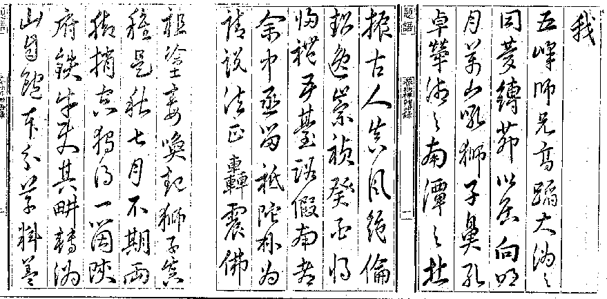
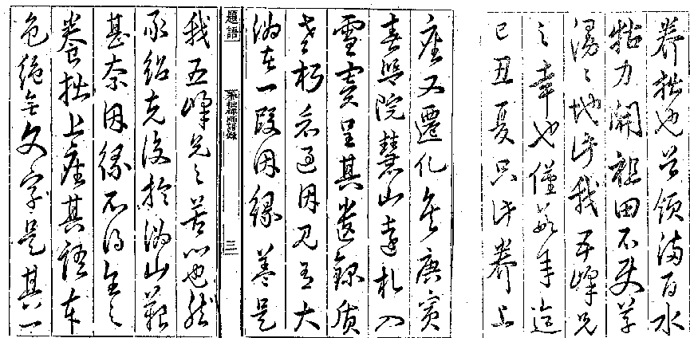
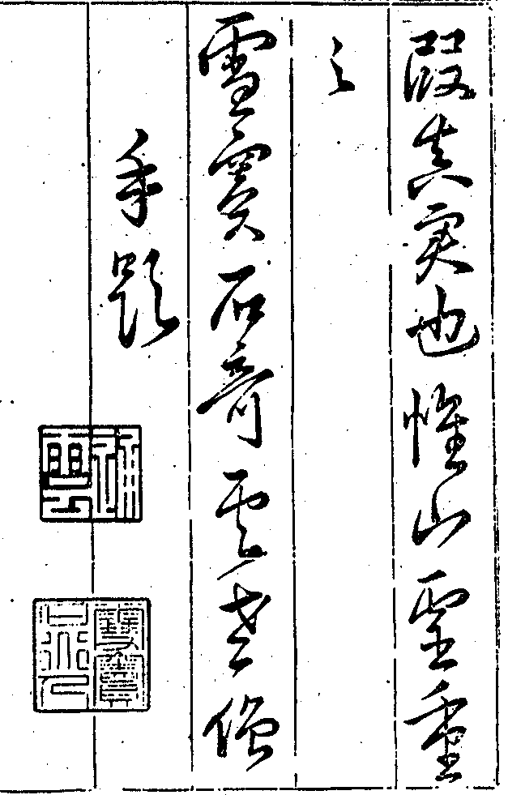

# 大沩密印寺养拙明禅师语录



> **藏经**：嘉兴大藏经（新文丰版）（嘉兴藏）　**册次** 第 25 册（J25）　**编号** JB176　**部类** 密教部　**卷次** 1 卷　**篇幅** 19,199 字

> **卷／品**：0 卷 · 0 品



---















大沩密印禅寺养拙明禅师语录



嗣法门人智海编



崇祯丁丑年，师於同庆寺受大圜老宿请住密印寺，正月八日入院。



三门基。「佛语心为宗，无门为法门。」以拄杖指云：「且道是有门无门？道有门，在甚麼处？道无门，从那里入？」喝一喝便行。



佛殿。「前释迦、后释迦，百亿山头、百亿释迦。」顾视左右云：「有谁识你？」



伽蓝堂。「伽蓝伽蓝，一寺之主，正令当行，精心唯尔。」



祖师堂。「河沙玅德，尽归方寸，十世古今，不离当念，说甚东土西天……」以目视云：「总在者里。」



众请上堂，升座，拈香祝圣毕，次拈香云：「者一瓣香，供养传曹谿正脉第三十五世，上五下峰大和尚，用酬法乳之恩。」敛衣敷坐。上首白椎云：「法筵龙象众，当观第一义。」僧问：「和尚传曹谿正法、续佛祖源流，为甚麼问著佛法便棒便喝？」师云：「直。」乃云：「昔日当山祐祖踢倒净瓶赢得此山，直至如今壁立万仞。众中还有直下觑得破底也无？所以道：『空一切相，成万法智。』法随法行，法幢随处建立，发一切用。我为法王，於法自在。拈一茎艸作丈六金身，拈丈六金身作一茎艸，能纵能夺，能杀能活。」蓦拈拄杖云：「唤作拄杖则触，不唤作拄杖则背，又作麼生道？」复卓一卓，下座。上首白椎云：「谛观法王法，法王法如是。」



上堂。僧问：「如何是西来意？」师云：「我者里是东土。」问：「拄杖辽天师子吼，大展宗风事若何？」师打云：「看脚下。」乃云：「迷因悟有，悟以迷生，迷悟两忘，圣凡路绝。」以拄杖畫○相云：「若向者里会去，直入如来大圜觉海。所以世尊始从鹿野苑，终至跋提河，於是中间千言万语，总教人自识。末后灵山会上拈花示众，号为教外别传，传至达磨，神光断臂安心。自后历代古锥，事不得已，垂示一言半句，如将蜜枣换汝苦葫芦，淘诸人业根，只要你一个个脱体无依，识取自家本来面目。且道：诸人面目毕竟在甚麼处？」良久云：「各自摸取好。」



升座。僧问：「如何是法王？」师云：「礼拜著。」进云：「法王，法王。」师云：「莫错。」乃举：「昔日玄沙持书上雪峰，峰拆书，见白纸三张，召大众云：『谛观谛观。』」喝一喝，便下座。



了然禅人送佛至，上堂。「佛佛为一大事因缘故，出现於世。且道如何是大事？」竖拂子云：「我无隐乎尔。」复举：「赵州云：『泥佛不度水，金佛不度炉，木佛不度火，真佛内里坐。』山僧今日不免将者拄杖子拨转赵州关，别开一路去也。」以拄杖畫○相云：「泥佛能度水，不假他人力。」以拄杖又畫



相云：「木佛能度火，个事明如日。」又以拄杖畫



相云：「金佛能度炉，诸人见也无。真佛无住所，大家在者里。急著眼，莫拟议。」掷下拄杖云：「还见麼？」下座。



上堂。僧问：「前无村，后无店，途路中人向甚麼处安身立命？」师以拄杖作接势。进云：「莫是安身立命处麼？」师便打，乃云：「入得三界，混於常流，识得个事，无处停留。三世诸佛与六道众生同时成等正觉，转大法轮，随类行化，六门清净，出入无碍，得大总持，得大自在，举足下足，微尘刹土无非佛事。从耳者，音声佛事；从眼者，色空佛事；从口者，言谭佛事。不离四大作者佛事，所以道：『唯此一事实，餘二则非真。』」下座。



五峰和尚灵骨至，上堂。僧问：「世尊有八万四千舍利，未审先师有多少？」师卓拄杖一下，僧喝，师便打。乃举：「雪峰灭度，玄沙作祭主，举起茶盏云：『会麼？若还会得，先师无过；若还不会，过在先师。』众无语，沙乃扑破茶盏。」师云：「沩山也不举盏，也不扑破，只将本分所得呈示诸人。」举起拄杖云：「还见麼？」一时打散，归方丈。



上堂。僧问：「作何所务，顿超十地？」师云：「山僧今日升座。」问：「如何是第一义？」师卓拄杖一下，乃召众云：「还闻麼？」众无语。师云：「大众有耳不闻，山僧有口无说，有耳不闻为真闻，有口不说为真说。」以拄杖卓一下，云：「拟议思量，脚跟错过，直得三世诸佛口挂壁上，历代祖师亡锋结舌，更有一人在汝顶门上呵呵大笑！识得此人，方丈来通个消息。」



师诞，请上堂。僧问：「如何是佛世界？」师云：「出牛栏，入马圈。」「如何是他世界？」师云：「阇黎合自知。」进云：「单提一著事如何？」师云：「放下著。」问：「沩山诞日即不问，祖印高县事若何？」师云：「慧日满乾坤。」乃拈起拂子云：「还见麼？量等虚空界，示等虚空法。证得虚空时，无是无非法。所以庵提遮女问文殊云：『明知生是不生之理，为甚麼却被生死之所流转？』殊云：『其力未充。』」师云：「古人恁麼商量地，好各与二十拄杖。为甚如此？明知生是不生之理，为甚麼却被生死之所流转？」拈拄杖，便归方丈。解制，上堂。「道本无言，因言显道，道不离人，人自离道，若还达道，无道非道。九十日结制安居，无绳自缚，畫地为牢；九十日外，解制他走，披著枷锁，遍地刀鎗。正恁麼时，若不去，死在者里；若也去，丧却性命。诸人作麼生出脱？」拈拄杖，下座。



师出山宁，乡众檀护敦留，上堂。僧问：「旧店新开，和尚如何为人？」师便打。问：「独坐金轮峰一句如何？」师云：「天上天下。」进云：「某甲今日觑破也。」师打云：「是赏你，罚你？」僧一喝，师复打。问：「只者一事，为甚麼七说八说，横说竖说？」师云：「舌头常在口。」进云：「争奈者一句。」师云：「亲言出亲口。」乃云：「道人出入无形踪，来亦如斯去亦同。师子游行无伴侣，象王一吼绝狐踪。只因行墨露消息，大檀有笔判虚空。应命归来无别事，太阳当昼运西东。」



升座。僧问：「临济道：『一句中具三玄，一玄中具三要。』」遂打○相云：「且道是第几玄？」师云：「莫乱做。」问：「古镜未磨，妄生注脚；古镜已磨，将错就错。正当恁麼时，还有错处也无？」师云：「自领出去。」问：「世尊四十九年说法，未曾说著一字。和尚升座，说甚麼法？」师打云：「山僧秖会打人。」进云：「今日亲见世尊。」师云：「莫眼花。」乃云：「今辰正是诸人解制时节。若会去，解也者个时节，结也者个时节，不解不结也是者个时节。诸佛出世也是者个时节，祖师证道也是者个时节。凡也者个时节，圣也者个时节。僧也者个时节，俗也者个时节。老也者个时节，少也者个时节。生也者个时节，死也者个时节。总是者个时节。」举起拄杖云：「众中有人向者个时节撩起便行，犹较些子。」众无语，便掷拄杖，下座。



元旦上堂。「一年十二月，此是第一月；一年三百六十日，此是第一日。且道如何是最初一句？眨眼看来，已是落二落三了也。所以道：『参禅无秘诀，只要生死切。透过祖师关，应用本无缺。』」举拂子云：「还见麼？三世诸佛在此放光动地。」击香几云：「还闻麼？六道众生在此安身立命。若还闻见分明，正好与汝三十拄杖。且道何故？」卓拄杖，下座。



上元值大雪，升座。僧问：「如何是禅那大定？」师云：「速去！速来！」进云：「还是身定，心定？」师云：「非身非心。」进云：「作麼生道？」师云：「死汉！」乃云：「人间都玩元宵节，白雪纷纷落不彻，大家冻得骨毛寒。试问诸人彻不彻？彻也皮穿脑裂，未彻也脑裂皮穿。且道作麼生回避？百尺竿头横打眠，虚空背上任经行。」下座。



上堂。僧问：「向上一著事如何？」师云：「退后。」进云：「向后一著又如何？」师云：「莫妄想。」乃云：「尘尘说，刹刹说，威音那畔作麼说？」横拄杖云：「三世诸佛鼻孔一齐穿，森罗万象闻著心胆裂。为甚如此？马驹蹋杀天下人，正法眼藏瞎驴灭。」



上堂。僧问：「有动有静事如何？」师云：「生死根本。」进云：「不动不静又如何？」师云：「生死根本。」问：「三世诸佛从何处得？」师云：「从拄杖得。」进云：「离却拄杖又作麼生？」师云：「不识三世诸佛。」问：「如何是玅明真性？」师云：「见不得。」进云：「如何见不得？」师云：「玅明真性。」问：「不生不灭一句作麼生道？」师嘘一嘘，乃云：「沩山穷透底，无粒与君餐。虽然有个真供养，山僧昔日在金粟密云师翁处挑水，值入室，被老汉一棒打破水桶，将山僧无量劫来家业一时倾尽，只收得个本分受用底。」竖拳云：「只者一个，酸甜咸澹苦辣百味具足底，今日对众拈出，众中还有吞得者麼？参！」



实相禅人送佛到山，请上堂。僧问：「佛者如如不动，为甚麼又道送得佛来？」师云：「山僧耳聋，高声问。」进云：「莫颟顸。」师云：「亲言出亲口。」乃云：「光明遍照大千界，山色青青尽法身。众中还有不昧见闻者麼？若无，有耳不闻华藏界，有眼不见遮那身。」



结制上堂。僧问：「踢破虚空、推倒泰山时如何？」师云：「还我破虚空来。」师乃以拄杖点



此云：「九旬结制，高挂钵囊。若不彻去，鬼使不怜人贫，阎王那饶鬼瘦？且道如何？三根椽下，七尺单前。」



解制上堂。僧问：「结制解制即不问，不结不解事如何？」师云：「打出骨髓。」进云：「恁麼则三月安禅，畫地为牢。」师云：「自作自受。」问：「如何是诸佛出身处？」师云：「忘却了。」进云：「如何是和尚出身处？」师云：「忘却了。」乃云：「者一大事，须是眼里有筋底汉子，撩起便行，直下推倒五蕴山，掀翻无明窟。直得虚空粉碎，大地平沈，一段光明，无遮无障。建立也在我，掀翻也在我，放也在我，收也在我。所以道：『法随法行，法幢随处建立。』不见昔日临济大师住镇州时，一日谓普化、克符二上座曰：『我欲建立黄檗宗旨，汝且成禠我。』二人珍重下去。三日后，普化却上来问：『和尚三日前道甚麼？』济便打。三日后，克符亦上来问曰：『和尚三日前打普化作麼？』济亦打。」师云：「沩山今日要与古人相见。」卓拄杖，下座。



五峰和尚三周，上堂。师弹指一下，云：「人人尽道先师今日死，山僧道：『先师从来不曾生。』故经云：『无所从来，亦无所去。』既无来又无去，则生无所生，死无所死。正当恁麼时，五峰和尚在甚麼处？」便下座。



示众：「大丈夫，休拟议，翻身提起吹毛利，大鹏展翅绝遮栏，直透千重万重去。」



机缘



夜半，维那入方丈云：「元物还和尚。」师曰：「道甚麼？」那便打，师亦打。那云：「而今不被天下老和尚拄杖瞒也。」便行。师云：「脚跟下好与三十棒。」次日，师自击鼓云：「山僧出征去。」转身入堂云：「昨夜被维那劫一阵，不分胜负；今日特来击鼓与诸人相战。不用如何若何，便请单刀直入。有麼？有麼？」维那便出，作相扑势。师云：「残兵败将，不堪对敌。」便归方丈。



师入堂就地趺坐，时有僧便坐师榻，师起身向僧礼拜，僧遂走，师复坐地云：「我起不得，众中谁扶山僧起？」一僧推师倒地，师起身打坐榻者，便归方丈。



有牧牛僧云：「山间一鹿，见僧人不动，见猎夫奔行，其物尚有灵性如此。」师云：「疑於人者，人亦疑之；忘於物者，物亦忘之。」



僧参次，送小刀一柄，礼毕云：「一把杀人刀。」声未绝，师连棒打，僧便出。师入堂，掷刀於地，唤僧至，师云：「此刀是谁得？」僧云：「和尚道是谁得？」师遂将拄杖撺向前云：「不得唤作拄杖，诸人向者里道看。」一僧珍重而出，师云：「自救不了。」一僧拂袖便行，师云：「脚跟下好与三十棒。」僧一喝，师云：「还少一顿。」一僧拈起拄杖云：「恁麼也不得，不恁麼也不得。」师云：「撞倒露柱底瞎汉。」一僧云：「请师归方丈。」师掌云：「第二个瞎汉。」



一僧求开示，师以禅版指佛，僧云：「如何是正法眼？」师随声便喝。



僧才礼拜，师归方丈，僧随入礼拜云：「和尚为甚不荅话？」师云：「你道我不荅话麼？」僧无语。



僧参次，师问：「向在何处住？」进云：「检字纸。」师云：「沩山一字也无，你来作麼？」僧一喝，师便打；僧又喝，师连棒打出。



一僧别去，师打云：「且道是留你？是赶你？」进云：「不住，不去。」师云：「不去不住死汉！」



一日，师看证道歌，至行亦禅坐亦禅处，问侍僧：「如何是行坐底禅？」僧云：「莫头上安头。」师云：「你作麼生？」僧放下扇子立。师云：「者就是你底禅那？」僧打扇，师微笑。



僧问：「如何是衲子行履处？」师云：「著衣持钵。」



彻源问：「千觔担子独自担行事如何？」师云：「谢子扶持。」进云：「还要和尚提携。」师云：「自语相违。」



僧问：「如何是活句？」师云：「拔却汝舌根。」「如何是死句？」师打云：「按著汝鼻孔。」僧礼拜，师一蹋云：「会麼？」



僧参次，师云：「相别者几年，何处去来？」僧云：「在沩山。」师云：「如何不见你？」进云：「瞎。」师云：「我瞎久矣。」进云：「所以不见。」师打一棒，云：「野狐精！」



问：「如何是中秋节？」师云：「山河大地普光辉。」



问：「人人有个影子，为甚蹋不著？」师云：「东土西天。」



问：「如何是寸艸不生处？」师云：「石头。」



问：「一口气不来，向何处安身立命？」师云：「天上天下。」进云：「不然。」师云：「汝作麼生？」僧便吹灭案前烛，师云：「西牛贺洲驴吃艸。」



问：「天地同根，万物一体，因甚有迷有悟？」师云：「妄生分别。」



问：「不是天堂便是地狱，那里安身立命？」师云：「待你出来向汝道。」



问：「达磨未至东土，人人本有；及乎到来，为甚自救不了？」师云：「只为阇黎脚跟不点地。」进云：「即今达磨在甚麼处？」师震威一喝。进云：「好一喝。」师拈棒打出。



僧问：「入定时如何？」师云：「闲家具。」进云：「出定时如何？」师云：「蹋破脚跟。」



僧问：「打破虚空时如何？」师云：「还我碎虚空来。」僧呵呵大笑，师休去。



僧问：「如何是某甲自己？」师云：「乌龟陆地行。」



僧问：「圜陀陀、光烁烁是甚物？」师云：「我一向疑著。」进云：「某甲不会。」师云：「吃饭莫开口，行路莫忘脚。」



僧问：「四大分张，主人公向何处安身立命？」师云：「头顶天，脚蹋地。」



僧问：「仰山九十七圜相，明甚麼边事？」师便掌。进云：「秖如一一抹却又如何？」师鸣指一下。



师令侍者唤僧至，问：「昨日圜相话，汝作麼生会？」僧云：「请师举。」师云：「三世诸佛出不得，历代祖师出不得，天下老和尚出不得，你作麼生会？」进云：「瞎。」师云：「亲切道一句看。」僧拂袖便行。师云：「脚跟下少一顿在。」进云：「瞒和尚不得。」师云：「门外汉。」



居士设斋礼拜，师云：「昔日净明居士於香积世界取香饭供养无量菩萨，大作佛事，即今居士以何作佛事？」士云：「弟子无力。」师云：「多谢供养。」士礼拜。



僧入方丈，师云：「与汝商量一件事，得麼？」进云：「没商量。」师云：「你来作甚麼？」进云：「听师说法。」师云：「莫谤山僧好。」僧拟议，师喝出。



牧牛僧礼拜，师云：「山童未肯亲相许，且把芒鞋紧系留，汝还系得牛麼？」僧云：「请赐牧牛钱。」师便打。



众经行次，师忽推一僧入火炉，僧跳出，傍僧云：「今日看破和尚了也。」师连掌。



僧问：「古人道：『高高山顶立，深深海底行。』高高山顶立即不问，只如深深海底行事如何？」师云：「犹是程途中事。」进云：「恁麼则龙袖拂开全体现，尘尘尽是本来人。」师打云：「正好吃棒。」



五峰和尚生忌拈香。「今朝四月八，一是慈父生辰，一是先师诞日。」拈香云：「若供养先师，背却慈父；若供养慈父，又背却先师。且道毕竟如何？」喝一喝，云：「逢人不得错举。」便烧。



示禅徒三偈



山僧不会文章，一生没多伎俩，问著西来祖意，劈面拳头巴掌。



山僧不会方便，只据直指单传，开口未曾动舌，拟议错过眼前。



山僧不会打坐，只是申脚睡卧。若问那事如何，蓦面好与一唾。



赠慧山海监院



周孔之学虽不能，潜行密用合天真，銕面从来爷不识，棒下无生续祖灯。



自题(启域请)



古潭土老，不会修心，不知颠倒，昼作夜眠，那管禅道。



又(弃人请)



我相如虚空，阇黎怎描得？赞好也是失，毁恶也是失。銕面本无情，问著当头抶。且道是谁？金粟曾运水，大沩居丈室。



为智圣魏居士入塔



「以三界为家，无家可离；以四生为子，无子可舍。虚空为普同，日月为灯烛，智圣还会也未？若还会得，金银玉帛，道之餘者也；妻室子女，身之外者也。正眼观来，大千为基地。」以拄杖指云：「权且入普同。」



上天童密老和尚书



正明自天启五年到金粟，入堂挂搭，昼夜行思。至七年正月初二日，入西堂寮请益，承五峰和尚指个歇处。是年，出堂挑水。崇祯元年十月三十日，值老和尚入室大棒打死复苏。二年八月十二日，老和尚受闽请，明先於黄檗办事。三年九月二日，老和尚转金粟，五日退院。七日追至，嘉兴一别，倏尔数载，心心无间，念念不忘。晨夕顶礼其年，遂到南京五峰本师处。至四年四月十二日，同本师诣衡岳。十月十六日，至沩山祖塔同庆寺，缚茅栖止。六年正月十五日，本师诣金台，以沩山安众结制贴单事付嘱於明。七月，本师於金陵祇陀林圜寂，临终遗书将来源拂子发人上山付明，毋令断绝，正明不得已承顺师命。丁丑春，僧大圜力请住持密印禅寺，存纳四方来学，已受请矣。今明肃耑魏居士顶礼老和尚，询问法体调顺何如，及常住修理事毕否？敬具香信果仪，乞垂鉴纳。



复上密老和尚



前蒙和尚手示，谓明老实太过，宜以学问助成，领戴不尽矣。但明根器愚钝，疏懒失学，一十六岁动无常之想，生死念切。二十岁潜别父母出家，不入讲席经期，只要发明本分大事。幸累劫有缘，遇和尚出世，非世外骨肉，那得机缘相扣耶？自从金粟吃棒后，直至如今饱不饥。故凡有来者，当头便棒，更无异端也。即如和尚示训，亦正好蓦口大拳。昔日水潦只扬一蹋，俱胝但竖一指，德山棒、临济喝，世尊拈花，迦叶微笑，及和尚金粟室中大棒打明，不知是学耶？教耶？且笑岩高祖云：「妙义玄言春细雨，莫教污却我心田。」故在明分中，不论先圣有学无学，唯此一棒，任其诸方知我罪我无辞焉。然明但恨地隔一方，不得早晚巾瓶侍奉。罪万罪万！



复简予周居士(附来书)



从业中来，还向业中走，纷纷世网中，无从索我面目也。惟初心犹在，而浮生之名实后昆两无快心时也。今且受此生苦矣，未审吾师何以示我？



接手教云「从业中来」，业则不定耳。或云福业，或云儒业，或云道业，或云乐业、苦业，未可以一例推，固在为之者何如耳。至云「初心犹在」，初心者如如也。识得初心不变，是即不昧本来面目也。幸思之，幸思之！



行实



癸未冬日，慧山等袖香作礼，乞师行繇。乃云：「余乃山西河东蒲州人。父常姓，字禄山。母张氏。临诞，母梦异人曰：『汝当生贵子。』父母以儒业望余，然余素恶荤酒，好出世法，故无心世间事。十六岁夏初日没时，仰面见青天，忽然省云：『世界许阔，如何拘此，坏我善因？』即立心出家，父母难之。至二十岁夜，梦至黄河边，举头见水暴涨，涌水花一朵，高丈餘，花到余前遂隐。只见一头陀僧，余问云：『你来何为？』僧云：『我来接你到我家。』余云：『你住何处？』僧云：『你只管去，到山方知。』余云：『你说寺名。』僧指云：『那边。』又一僧来，余转眼看，二僧俱失所在。梦觉即潜别父母，至南普陀山，投天衣如绣师薙发，誓明生死大事，或行或坐无时敢懈。日作众务，夜则顶礼观音，不辍者三年，辞师出山。凡入丛林，或烧火或作园头，不惮劳苦。於二十五岁，谒金粟密云师翁，誓云：『今生若不大悟，决不出禅堂门。』一日问师翁云：『大地众生遍尘刹，如何是诸佛出身处？』师翁劈头一棒。余不契，昼夜不眠，三冬未曾归单，二时粥饭出入作务，动静寒暑等事，浑然不知。一日又问：『如何是威音以前事？』师翁便打，余益罔然。因见傍僧看《万峰录》，示语云：『只看个万法归一，一归何处？』余即将日前学得记得底，埽入东洋大海，看者一归何处。此时年二十七岁，值本师在金粟为西堂，余问：『我做工夫，忽现境界，放舍不去。请师如何方便？』本师云：『你为甚麼出家？』余云：『我为生死出家。』本师云：『为生死决明生死，有甚境界？』遂以竹篦打云：『眼观一物即不是，但见丝毫便是尘。』余礼拜退。自是工夫也不作、香也不坐，百无所思，已前心境忘却，秖有个事似担百斤担子放不下。乃出禅堂，入水寮挑水。一日入室，师翁问：『你来作麼？』余云：『挑水。』师翁云：『水桶在甚麼处？』余拟对，师翁劈头一棒云：『打破了也。』余忽然棒下识得根源，己物不从他得，世法佛法合为一体。后随师翁入闽，应黄檗请余为圊头，复随师翁转金粟。后师翁赴天童，时有同参邀余住静，余云：『我有三住静、三不住静。三住静者，一、本分事毕，二、无善知识开堂，三、有兵戈难行，余即住静。三不住静者，一、本分事未妥，二、有善知识开堂，三、天下太平，余则不住静。』於是遂往南京，入祇陀林，谒本师。本师云：『那里去？』余云：『此处止。』本师云：『你住不得。』余云：『无我住即得。』本师云：『那里来？』余云：『金粟来。』本师云：『曾会过麼？』余云：『将谓忘却了也。』本师云：『金粟来底会弄嘴。』余云：『师从那里来？』本师云：『我不从金粟来。』余云：『谁弄嘴？』本师云：『请坐。』余便出，乃充饭头。一日本师出关，入方丈，至晚，众进作礼。壁间有一小圜光，维那云：『金粟大圜光，者里小圜光。』本师云：『他那里大，我者里小。』余以茶扑灭烛云：『我也不论大圜光小圜光，扑灭天下光去。』便出。除夜茶次，本师警众，维那云：『师如一条明杖，一个个牵著走。』余云：『腊月三十日到来，和尚要算饭钱。』本师云：『饭头𫆏。』余便覆却茶钟。本师诣沩山，余侍行。一日普请择菜，余云：『我要止静去。』本师云：『那里不是静？』余打本师一掌。本师云：『作麼？』余云：『那里不是静？』本师大笑。又一日择菜，本师呼傍僧，其僧不来，本师云：『你不来，我要打你。』余即打本师一掌。本师云：『只说人行早，更有早行人。』余即抽身归禅堂。一日本师议入燕归礼五台，余欲随侍，本师对众云：『老僧没向你底心，你为甚麼只要随老僧？』余云：『我也不为师向我随去。我也不为师不向我不随去。』本师云：『你为甚麼？』余云：『各家事，各家知。』便礼拜，本师休去。崇祯癸酉春，本师决志入燕，有僧问：『和尚去，沩山何人炤管？』本师指余云：『养拙。』遂命余监院，繇是发足。路假南都，中丞集生余居士，复迎本师说法祇陀林。不料化缘将毕，是年七月示寂。时将源流拂子，命僧智隆，转沩山付嘱於余。余虽承师命，本欲敛迹穷岩，聊终残喘。至丁丑春，大圜老宿再三请居密印，余辞不已，遂住持此山焉。此余一场败阙，本不堪吐向人前，被众兄弟苦逼，吐露一翻。众兄弟各宜自奋，慎勿效山僧不唧溜汉可也。」众乃礼谢而退。



塔铭



师讳正明，别号养拙，曹谿三十六世。生於河东之蒲版，为常禄山仲子，其母张。诞弥有异梦，期望甚重。师顾不业儒，不茹荤，不姻媾，飘然作出世之想。廿旬，别父母，薙发於南海普陀。参学金粟、黄檗、祇陀等处，不事文学，秖以苦行磨砺性灵。一日，见僧读《万峰录》，语以万法归一，恍然大悟。厥后如打破水桶，扑灭烛光，种种与本师密印，皆悟后事也。读其语录曰：「迷因悟有，悟以迷生。迷悟俩忘，圣凡路绝。」又曰：「入得三界，混於常流，识得个事，无处停留。」又曰：「有耳不闻，有口不说。历代祖师亡锋结舌，参禅无秘诀，只要生死切，透过祖师关，举拂放毫光。」嗟嗟！唯悟者能言之，知者能解之也。师固不事文学者也，事文学者能如是耶？师盖曹谿再来人耳。五峰知后之得人也，偕之西来，付以沩山。按沩自万历末年，圣迹化为劫灰矣。师结茅而庐，对粟而食，挥麈论道，宗风渐开。四方之士，云集响应，灵祐之统，赖以不坠。虽然时当鼎革，物力凋残，明宫斋庐事，尚有待师之意，似不能畅。然於今昔间也。与师游者，有裴李之心，而非其时。抚膺太息，不能成师之志，逊美於前，而让功於后，岂非天哉？岂非天哉？己丑之春，师知世缘将尽，留僧伽黎，嘱门人慧山，继席住持，乃栩然大还。时慧公从南岳归，偕诸比丘塔师於沩之前阜，属余为铭。知师莫如余，敢辞不文耶？铭曰：天挺灵异，於河之东。吉梦发祥，诞降人龙。心如古佛，貌若乔松。挥麈危坐，非玄非空。灵祐之后，百世之宗。霓裳羽衣，泠然御风。舍利具在，斗灿星芒。



赐进士第资政大夫正治上卿户部尚书周堪赓顿首拜撰



叙



湖南大沩，采之司马头陀也。因见优钵罗华水迥迈湘流，遂溯源而上，而毘卢峰自此揭露矣。其山峭绝，掩霭云中，巅则平原沃壤，周可百四十里。其间奇峰远岫，巨泽飞泉，怪石乔木，石室幽丛，不尽殊胜。迺云：「一千五百人善知识所在。」百丈老人以肉山不可人骨，故净瓶踢自祐公。公入山时，盖唐之元和也。今八百餘年，历来阐扬宗教载在传灯者，班班辈出。迄明神庙间，湘江宗门澹泊，香灯烬熄殆有十祀。有僧跨白牯来，古杏复开生面，未几，五峰老人同养拙明禅师接踵相继，峰乃天童密云悟和尚首出之子也。不二年，峰示灭建业，属归礼五台，为集生余中丞留说法祗陀也。养公披蓁种粟十有餘岁，其如土地寥阔，辟垦弗周，万础千沟，经营不逮，於己丑迁化矣。继席者，乃我　慧山禅师。师时缚茆衡岳，养公遗书伽黎嘱为补处。及还山十载，虽开炉结夏，并不鸣椎，每见揖让之风，不易丘壑之志，求之近代中，不可多得耶。至丁酉冬，天童山翁老和尚，遣书劝勉，谓五峰学祖，宗旨攸关，然后瓣香拈出，遐迩道俗仰慕高风。师为人天资纯粹，大度含弘，正眼圆明，机锋迅捷，学者云奔，经冬曾盈三万指。卓哉吾楚之一座大法幢也。与峰智公、古梅捌公，共相赓和，同为激扬。佥曰：「亢宗之子起家何在多麟？」己亥之冬，余同易子勷伯重游其地，陟其𪩘殆，穷日见其层峦屏立，瀑布瓴倾，骊颔赤珠以澄澄，龟背绿毛而隐隐，嶂望芙蓉谓叠峰如瓣，水通黄木曰甘美犹莲，禅衣拥翠，忘其暑往寒来；供石辛勤，不惜栉风沐雨。田开万顷，叹罗汉披星戴星；杏老千年，念祐祖手栽手植。环山庐舍，尽昔日之精蓝；遍野佳禾，想当年之橡栗。松风价贵，何敌六月披裘；矶立垂丝。谁知高山有鲤。英陈厚褥，毋烦帝释铺来；沙布重金，若从长者施得。巍巍乎如若登天然，荡荡乎王道平平，霖雨先得乎人寰，瑞雪偏厚於丘壑，鱼磬鼓钟，迭送凌空；兰若叶麻，鸡犬间见。野老农家。地高多得日，艸木欣欣；谿厚自藏冰，泉水泠泠。香象如伏静且寿，仁者见之之谓仁；神虬若豢乐在水，知者见之之谓知。苍苍松色，东岭何如；盈盈春水，南河可楫。铜塔来燕京，并诸龙幡凤绣；石塔飞峨眉，不畏鸟道蚕丛。通津者木也，许透长安。运水者石也，果尔神通。阡陌井井，遭旱魃以无虞；窣堵团团，对孤轮而更肃。青龙岩下，下临无地；青羊山上，上登无天。盘陀石尚在，柿子再飞来，香严何处去，钟石为谁悬？佛日化日交辉，白云法云并起。频来天子诏，时送牧童歌。狮弦日上弹，天上华飘四坠；鲸音夜半吼，人间梦断三更。机忘物自忘，观鸥何必海，性驯渠为驯，牧牛正在沩。薰风时节满池荷，谁谓莲郊十万亿，月明人静秋风里，竟忘此地古潭西。下方城郭郑州出曹门，上界钟声听取有分。彷佛云端，依稀天表，神怡乎一壶，目穷乎千岛。山川之胜也，暗机建旨，沩仰称宗。法王之窟，狮子之薮。小释迦拔眼中之屑，李军容识刺里之泥。遥空礼拜，去在南阳，匡徒助道，来自西江。临济小厮儿，曾为传言送语；铁棒周金刚，也须过东过西。刘铁磨谓之老牸牛，邓隐峰莫谓无语。云岩千传正传，洞山五宗一宗，不惜艸鞋钱，到者里按过。有病底有不病底，道吾宗智，落声色不落声色，则是疏山。米里有虫，石霜诸为米头；二年同一春，夹山会充典座。灵山相逢，寒拾古佛见称。雪峰说法四十餘年，居徒常多千众，法系派衍无穷，颖脱莫悉其数。厥后幢帜千年，百年英灵如麻如粟。盖以出家，将相有所不能；参禅，佛祖有所不屑。西方大圣人，尼父逊美；东土大乘气，碧眼来梁。选官选佛，及第心空，弃子弃亲，释迦大孝。吴人越人，肥瘠相关；江北江南，家园到处。执布袋以横行，儿童嬉戏；按莫邪而正令，佛祖吞声。阎浮化主，天地闲人。今日狮王哮吼，象子骈阗，肃肃雍雍，跄跄跻跻，庞眉古貌，博袖宽袍，遇佛则骂，见人有礼。一棒一喝，死人万劫偷心；三要三玄，开人顶门正眼。得其体，得其用，父子投机；如来禅，祖师禅，弟兄击节。东厕上不说佛法，镢头边全超事理。咳嗽掉臂，祖意西来；持钵著衣，衲僧行履。不事章缝，好穷性命，人物之盛也。绀殿凌云，法堂蔽日，影像辉煌，磬铃交错，而楼阁庄严也。日出而作，插锹刈茅，戈矛谭笑，日入而息，经行坐卧，除睡摄心。不立文字，间尔搜箧搜单；匪曰枯禅，盖为透顶透底。不辞痛上加锥，何惜瘢处炙艾。狞拳辣掌，杀人活人，细语麤言，皆归一义。触著磕著，谩尔承当，得肉得皮，未许入室，而炉鞲燄烈也。初登戒品，讲演条章，毘尼堂以精律也。年高腊长，向往乐邦，净业堂以燕老也。饥馑洊臻，流离猬集，苾刍忍饿，钵盂分羹，其苦乐相均於穷子。猫狸牛犬毙死茶毘，弋子射夫拒诸境外，其生死一体乎。异类巨镬有二，食可五千人来，粤之东施出戎伯於上年之春。金吾藩伯，郡守邑侯，璇榜交辉，皆题於不年之内。王公大人，车马载道，高人逸士，屦履阗门，丐受木叉，今可半万计，是主人之德致之也。而异迹徽猷，莫可枚举。余寓榻久之，殆不舍去。古云「入见圣道而悦」，岂欺我哉。今日之盛也，夫复何言？但见残碑断碣狼藉堆头，不无昔时之感。游同庆寺中，获睹祐祖断石，噫其来旧矣。其文载在邑志，此最初一道文章，不容不读。旋得空印禅师片碣，问其文则载在石门文字，亦中兴一段胜事，讵可泯没无闻。何也？湖之南、湘之西，今古尊宿咸以海内第一名蓝推之。其御书阁、御香亭，基址宛然。而累朝来，宸章纶翰，不知凡几。惜旧志未得，攷无由焉。名公巨卿，遇铭登赋，亦不多见，或散漫於传牒者欤，而渔猎之未至耶。抑世远时遥，安保无沦於千岁者乎。虽摘句短章，若或盈帙，未为完璧，且阙之也。今兹二篇，井然粲然，家君捐赀而付之剞劂。氏并湘洲先生一文附焉，意以天下之祖庭，凡有一言一字，必公之天下也。且祖叶垂秋，衡湘废久，故典遗文得一於什，尤当广播以志山灵，此家大人护念之苦心也。(典)为之叙次如此。近来僧田营搆二记，乃𫞚阳郭中丞家君太史公撰也。立石於戊戌之冬，慧山禅师事绩系焉。其文已采入邑志，是诚今日中兴旷代盛事，故并敬刊之，有四云。



(住沩列祖语录载五灯者约数十篇，并近代名贤游沩咏十二景诗，嗣山志刻)



时顺治庚子岁佛诞日



邑学人陶之典拜题



同庆禅寺碑记



(礼部侍郎)郑　愚(唐人)



天下之言道术者多矣，各用所宗为是，而五常教化人事之外，于性命精神之际，史氏以为道家之言，故老庄之类是也，其书具存。然至于荡情累、外生死，出于有无之间，昭然独得，言象不可以拟议，胜妙不可以意况，则浮屠氏之言禅者，庶几乎尽也。有口无所用其辨，巧历无所用其数。愈得者愈失，愈是者愈非。我则我矣，不知我者谁氏？知则知矣，不知知者何以？无其无不能尽，空其空不能了。是者无所不是，得者无所不得。山林不必寂，城市不必喧，无春夏秋冬四时之行，无得失是非本末之迹。非尽无也，宜于顺也。遇所即而安，故不介于时；当其处无必，故不跼于物。其大旨如此。其徒虽千百，得者无一二。近代言之者必有宗，宗必有师，师必有传。然非聪明瑰宏、杰达之器，不能得其传；当其传，是皆时之鸿庞，伟绝之度也。今长沙郡西北有山名大沩，蟠林穹谷，不知其峦几千百重，为罴豹虎兕之封，虺蜮蚺蟒之宅，虽夷人射猎，虞迹槱甿，不敢从也。师始僧号灵祐，福州人。笠首𪨗足，背闽来游，庵于翳荟，非食时不出。栖栖风雨，默坐而已，恬然昼夕，物不能害。非夫外生死、忘忧患，宜顺天和者，孰能与于是哉？昔孔孟殆庶之士，以箪瓢乐陋巷，夫子时称咏之不足，言人不堪其忧，以其有生之厚也。且生死于人，得丧之大者也。既无得于生，必无得于死；既无得于得，必无得于失。故于其间得失是非所不容措委化而已。其为道术，天下之能事毕矣。若涉语言是非之端，辨之益惑，无补于学者，今不论也。师既以兹为事，其徒稍知所从从之，则与之结搆庐室，与之伐去阴黑，以至于千有餘人自为饮食纲纪，而于师言无所是非。其有问者，随语而荅，不强所不能也。数十年，言佛者，天下以为称首。武宗毁寺逐僧，遂空其所，师遽褁首为民，惟恐出蚩蚩之辈，有识者益贵重之矣。后湖南观察使故相国裴公休，酷好佛事，值宣宗释武宗之禁，固请迎而出之，乘之以己舆，亲为其徒列，又议重削其须发。师始不欲，戏其徒曰：「尔以须发为佛耶？」其徒愈强之，不得已，又笑而从之。复到其所居，为同庆寺而归之。诸徒复来，其事如初，师皆幻视，无所为意。忽一二日，笑报其徒，示若有疾。以大中七年正月九日，终于同庆精庐。年八十三，僧腊五十五，即窆于大沩之南阜。其徒云：「年终之日，水泉旱竭，禽鸟号鸣，艸树皆白。」虽有其事，语且不经，又非师所得之意，故不书。师始闻法于江西百丈怀海禅师，谥曰大智。其付传宗系，僧谍甚明，此不复出。师亡后十一年，徒有以师之道上闻，始诏加谥号及坟塔，以盛其死。非达者所谓耶？噫！人生万类之最灵者，而以精神为本。自童孺至老白首，始于饮食，渐于功名利养，是非嫉妒、得失忧喜，昼夜缠缚。又其念虑未尝时饷历息，煎熬形器，起如冤雠，行坐则思想，偃卧则魂梦，以耽沈之利欲，役老朽之筋骸，餐饭既耗，齿发已弊。由拔白饵药，以从其事，外以夸人，内以欺亡。曾不知息阴休影，捐虑安神，自求须臾之暇，以致溘然而尽。亲交不啻行路，利养悉归他人，愧负积于神明，辱殆流于后嗣。淫渝汗漫，不能自止。斯皆自心而发，不可不制以道术。道术之妙，莫有及此。佛经之说，益于神性。然其归趣，悉臻无有，僧事千百，不可梗概，各言宗教，自号矛盾，故褐衣髡首，未必皆是。若予者，少抱幽忧之疾，长多羁旅之役，形凋气乏，常不逮人。行年五十，已极迟暮，既无妻子之恋，思近田闾之乐，非敢强也，恨不能也。况洗心于是，逾三十载，适师之徒有审虔者，以师之面形，自大沩来，知予学佛，求为赞说。观其图状，果前所谓鸿庞伟绝之度者也。则报之曰：「师之形实无可赞，心或可言，心又无体，自忘吾说。」审虔不信，益欲赞之云云。既与其赞，则又曰：「吾从居大沩者尚多，感师之开悟者不一。相与伐石，欲碑师之道于精庐之前，欲其文辞近吾师之侧，谓予又不得不为也。」予笑不应。后十日来予门益坚其说，且思文字之空与碑之妄，空妄既等，则又何虞？咸通六年岁在乙酉，草创其事，会予有疾，明年二月始讫其铭。又因其说以自警触，故其立意不专以褒大沩之事云尔。铭曰：



> 湖之南，湘之西。山大沩，深无蹊。虎已啸，  

> 猿又啼。雨槭㯙，风凄凄。高入云，不可梯。  

> 虽欲去，谁与携？彼上人，忘其身。一宴坐，  

> 千餘旬。去无疏，来无亲。夷积阻，搆嶙峋。  

> 栋宇成，供养陈。我不知，徒自勤。物之生，  

> 孰无情？识好恶，如龙惊。原物具，广象呈。  

> 随宛转，住峥嵘。云弥天，日不明。金在矿，  

> 火收荧。我不知，天地先。无首尾，功用全。  

> 六度备，力行圆。常自随，在畔边。要即用，  

> 长目前。非艰难，不幽玄。哀世徒，若驰驱，  

> 觅作佛，向其愚。筭海沙，登迷庐。眼喘喘，  

> 心区区。见得失，系荣枯。弃知觉，求形模。  

> 近如远，易复难。但无事，心即安。少思虑，  

> 简悲懽。净荡荡，圆团团，更无物，不劳看。  

> 听他语，被人谩。生必死，理之常。荣必悴，  

> 非敢张。造众罪，欺心王。作少福，须天堂。  

> 善恶报，正身当。百劫里，无人将。心作恶，  

> 口说空。欺木石，吓盲聋。牛阿房，鬼五通。  

> 专觑捕，见西东。禁定住，阳朦胧。与作为，  

> 事不同。最上乘，有想基。无垢净，本无为。  

> 人不见，心自知。动便是，莫狐疑。直下说，  

> 没文词。识此意，见吾师。



密印禅寺碑记



释觉范洪(宋人)



崇宁三年十一月，大沩山密印禅寺火，一夕而烬。住持僧海评移疾郡，以子方者继焉，未几而弃去。寺规模宏大，而经营者非其人。岁移三霜，才办法堂，大殿寝室而已。然又苟简斋庖垣庑皆未具，上雨旁风，无所盖障，故禅学者分处山间林下，蜂房蚁穴。百丈大雄之风，陵夷至此极矣。大观三年，潭帅曾公孝蕴闻之曰：「沩山，南国精庐之冠，非道行信於缁衲、名誉重於缙绅者，莫能振兴之。吾闻天衣怀禅师在嘉祐治平之间，五迁法席皆废残荒寂处，而怀能幻出宝构、化成禅丛。今空印禅师轼公者，盖怀四世之孙而吴江法真之嗣，方说法於庐山之下，学者归之如云，挺然有祖风烈，当能整大圆真如已坠之纲。」於是厚礼遣人致之。越明年三月，空印来自归宗，山川改观，丛席增气，登殿拜起，周顾太息曰：「冠世绝境，大佛应迹，而殿宇卑陋，堂室狭小，何以严像设而致吉祥，震潮音而集龙天哉？」皆广其基构而增修之，使其壮丽称山雄深。传曰：「钟声铿铿以立号，号以警众也。」寺钟不足以光燄四海选佛来者，於是聚铜神运仓之下，穴山为炉，钟成万斤，涂以黄金，建阁馆於殿之东庑。佛菩萨之语藏於龙宫，传自五天，学者所当尽心，所以资智证之妙，而尽微细之惑。即室五千轴者，藏於殿之西庑。又明年，增广善法堂之后，为雨华堂，含风而虚明，吐月而宏深。夜参既罢，缤纷满庭，自两廊之左绕以复屋建库院，所以总庶务也。自祖龛之右翼以修廊建堂司，所以牧清众也。又明年，重修僧堂广博靖深，冬温夏凉，曰：「僧者，人天之福田，佛祖之因地，十方如来同一道故，出离生死。旷野深山圣道场地，皆阿罗汉所住持，世间麤入所不能见。既以广延其所见，则所不见者敢不敬乎？」又刻五百尊者之像，阁而供事之，又明年，得异木於绝壑，断而为三大合抱、长倍寻，刻净土佛菩萨之像，庄严妙丽，千华照映，如紫金山，并高争峻。建殿于天供厨之南，又特建阁于寝室之前，绿疏青琐，下临风雨，奉安神宗皇帝所赐御书。阁成而东南倾，师默计曰：「增万牛莫能挽。且天章宸翰之所在，山君水王之所宜，谨藏而卫护之。今职弗修，是神羞也。」言卒而风雷挟屋，山岳撼动，俄而阁正，万人懽呼。昔大圆禅师开法此山也，有众千人，硕大而秀出者，有若大仰寂子、香严闲禅，建两堂，为学者燕闲之私，而名其东曰香严，名其西曰大仰。方欲广摄异根，则修净土观法，不以宗门为赚。及其成就法器，则以寂子、闲禅期学者，盖其方便应机而设教，譬如大海，蚊虻、阿修罗饮者，皆得饱满。又明年，重修大三门，宏壮杰立，镂金镂碧宝翰，飞动於千岩万壑之上。而太师楚国公为书其额。却望形胜众峰来朝，如趋如俯、如屹立如蹈舞，有台自献其前，以宝积灵牙舍利葬台之中，而建塔其上。千尺九层，荡摩云烟，微风徐来，塔铃和鸣，比丘来往，旋遶作礼，望之如开牒。疑师以三昧力搏取梵释龙天之宫，置於人间。不然，何其幻怪神异，如此其多耶？唐元和中，僧昙叙开基则有绪言曰：「地灵甚，不可葬，葬且致祸。」今三百餘年，僧物故，莫可塔。塔于回心桥南十里。师曰：「事无大小，而断於理，从违不可苟也。」僧火化，众俱临，先圣令，不可违也。祸福之来，以智避就之，不可从也。遂建普同塔于寺之西，又修大圆禅师之塔，而峙立两亭以覆古今碑刻，部从者以其威灵，奏赐真应禅师，塔曰净惠。圣谿庄垄亩，为比邻所吞，数世且百年，莫敢谁何？师云：「此唐相国裴公施以饭十方僧者，横自何德以堪之，不直而归，是陷人入泥犁。」遣掌事执券证诸官竟，还二百亩。岁度一僧，上资睿美。有玉泉住持僧死于龙牙山，山中之人不容其葬。弟子抱骨石涕，师哀之，使於沩山择地建冢塔，丛林义之。师以潜行密用之懿，时时见於与夺，然皆本於仁义，道俗化其德。政和六年，敕补住镇军之焦山。师雅意不欲东，解住持事，力辞之，归庵鸾谿之上。俄诏听还之沩山。自其始至中而还，八年之间，百废具兴，非乘愿力，何以臻此？雪窦天衣之道，至师大振，丛林归心焉。兴修，盖其游戏也。今嗣法者，自南台定昭、了山法光而下，诜诜辈出棋布名山，方进而未艾也。法义谓余曰：「沩山之雄夸，非空印老师，莫能办之。精神，非文字莫足以传，愿求文以昭后世。」不得辞，系以辞曰：



「有异比丘清而狂，相山趼足穷衡湘。黄才掬谿行嗅尝，笑云水作青莲香。梯空杙险屡仆僵，寝宿雾露冲虎狼。水与石斗声舂撞，谁挽千乘行羊肠。霄然洞开云水乡，横峰侧岭争回翔。咨嗟曰此古道场，山灵乃今发天藏。泥艸吟啸久彷徉，无人告语空夕阳。翩然曳杖还江南，道经新吴山郁苍，登山作礼僧中王。骨面气宇凌八荒，侍其侧者矫鸾皇。祐公杰出尤堂堂，袖中肉山倾置旁。瓶踢一笑戏取将，懒安寂子尤敦庞，佐于耨耕立禅房。九世沉溺为津梁，分灯延联世相望，既绝复续暗而彰。轼公貌臞中方刚，漆瞳照人俨而庄，食堂十年折绳床。有大长老续遗芳，派出天衣嗣吴江，烬餘为子整颓纲。机锋击电谁敢当？宗风回顾已举扬，以印印空成文章。凛然面目如冰霜，令人望见折慢幢。丛林迩来顿荒凉，反袂拭面空叹伤。而师声价重四方，力能咄嗟办宝坊。又取佛日重洗光，芙蓉峰峻沩水长。功德之利建我皇，愿同山呼寿无疆。」



密印禅寺僧田记



(中丞司马)郭都贤(资阳人)



大沩山繇黄木江而上，循磴陟𪩘，度高出地千仞，夷其巅，旷若中墅。古密印寺如在平楚间，寺前稻畦，凡数百顷，云泉沃壤，至高无涸，此祖庭之殊胜也。然灵祐开山，迥绝人境，以橡栗充食者七载。唐宣宗崇尚浮屠法，裴公休以相节镇潭州，既奏建厥寺，连师李公景让续奏建同庆。有大安和尚，领众躬耕助道者三十餘载。志云：裴公捐赀置饭僧田三万二千亩，乞朝廷贷其租。想当然也，然而三万二千无攷也。窃稽同庆至密印，凡二十餘里，环山之奥，数十里皆可田。古人不敢以将相夺民而购之，使缁素殊井，无相杂作，专供上善，称罗汉田。则护法之意，深且勤矣。故此山非有道者居之不能聚，聚亦辄败也。明正统后，龙象弗至，田始入于官。久之，籍于民常住田，未科者才数十亩，耰锄偪处，咸有竞心。沩是以不振。明之季遂成劫灰。大宗伯李公来游，属陶子徵掌故，属有司复其田曰沩佛田。戒德相承，禅者更聚。至于改革之际，法益隆，塔庙益盛。向所与竞者家，尽落前后捐施，及弃其田归常住者三百餘亩，载粮二十　石，并入沩福田下。虽供钵无所歉，而里胥得千其净梵矣。



清初，僧请于　定南王檄所司捐其赋，不报。然沩接梅山之险，盗贼数起，二百里内无聚落，独惧寺众不得逞，则蔽我西陲，恃此法幢，匪止崇象教已耳。今蒋侯宰官中调御丈夫也，推其惠露，以及丛兰。窃虑沩所隶第十都，最凋残积逋黠者易相影射，乃令立僧户甲，外微输本，折色如例，而特兔髡者之徭仝。时藩臬郡公咸韪其事。于是住持慧公，感兹悲护，决意安禅集众建二大殿，成沩祖一灯，炤燿湖岳，蒋侯之力也。明年，奉旨，清文　藩伯(张田)公、　兵宪吴公、　郡守孔公，准立沩山僧户之牒俱下，非独护幕祖庭也。盖与其困僧而废田，宁宽徭而存赋之意晓然也。后有贤者，其法可以不变。诸比丘闻　蒋侯擢郡司马，请勒石以垂不朽。　侯许之，俾记其田粮经界，及所以贷役之故，使遵王路不侵不贪。寒山一片石，具无诤三昧矣。然则是役也，王公宰官护念哉！天龙鬼神鉴念哉！比丘大众正念哉！请视此碑，永永无斁。



密印禅寺碑记



(邑太史)陶菊延(原名汝鼐)



盖闻宙合之内，名山数千，最上者长菩提七叶。海印之中，释迦百亿，住世者入宗镜五灯。故西方有圣，其事徵于仲尼，惟优波乏缘，此土付诸迦叶。与金僊为梵刹，皆华藏之灵区。因宾称寺，始隶鸿胪，扫教立禅，仍存白马。则宰官为之檀护，帝后命其精蓝，隋唐之间，于斯为盛。楚潭州大沩山，唐灵祐禅师建宗立旨处也。时使相裴公休好浮屠法，觌承殊胜，奏建厥寺，赐额曰密印。金襕坐腊，供出天人；宝所扶云，宫犹帝释。盖青莲掬水，从声闻而得肉山，白牯当家，以雄力而嗣心印。云中千顷，遂名罗汉之田；海内双林，共举净缾之案。然且屡传真子，代翊　皇图，中兴于宋之崇宁，增搆于明之正统。迨法堂深艸，珠已去而椟存；莲社成墟，冈再炎而玉尽。良繇人弃梵行，火焚禅天，神庙末年，遂婴坏劫。至　崇祯戊辰，有圆上座者，骑犊披蓁，把茅晏坐，觇枯杏复芽之异。明年，大宗伯李公腾芳来访白牛，寻源黄木，与圆公一宿树下而去。属同游者陶子汝𪔇作记，胡子懋选作庵，得前令周公瑞豹所清复官田三十餘亩作常住，咸钦聚石之风，颇忆畫灰之语。嗣圆至者，　五峰学禅师也。才举南宗，遽还中印。时有金铜瑞像，官绣幢幡，赍自行僧，出于大内。诸方闻者，咸谓复兴。师付嘱养拙明禅师，使嗣其事。主沩十餘载，尝与百人俱，顿成师子之林，欲践象王之迹，以致天童遐慕，雪窦赞扬。而十年之间，刀涂火涂，众苦方炽，欲界器界，六度不行，聊藉艸以参禅，就镢边而说法尔。然石虬吐水，依然优钵罗华；银杏胎莲，更长栴檀香树。时节因缘，于斯肇矣。



慧山海禅师，承其积力，抗彼前修，而随众作务，不碍悲流，施法同参，径嬴山子。故楗椎之筵，尝围四众，毘尼所摄，岁授千徒。螟蜮不灾其界中，魔军自摧于境上，以是因缘，重修胜境。　顺治乙未秋，采轮菌于芙蓉，得良工于忍艸。绣柱柏梁，如从海涌，郢斤轮墨，即出蒲团。绀殿屹乎齐云，琳宫焕而丽日，度其高峻，视昔由旬，规此正中，亦云方广。而妙相嵯峨丈六，符于汉梦；铃音缥缈大千，眇若陶轮，则祖庭之雄刹也。明年秋，于殿后故址，建警策院，用承记莂，念续灵文。林间宝月，更开选佛之场；象外幡风，直冠诸天之表。繇是龙藏象负，标厥珠林；鹿苑鸡园，总为兰若。袈裟器钵，尽菩萨之威仪；音乐华香，满天人之床座，则密印之肯堂也。又明年夏建三门，于中肖关夫子像，示忠义乃正觉之因，表英雄为成佛之品。作镇名山，无烦宝带，坚持愿海，即现玉泉，则梵天之象魏也。然世无须达、家尽黔娄，诸上人不求檀施而坐招提，不离将作而持梵行。用戒为基栋，即波罗之木；因禅立壁堵，皆成镜之砖。邪许无非佛声，饮食皆同法喜。故能转移劫土，卓立化城。岁月无多，山川增概。昔所称菩萨放光，资藉长康之畫；山祗捧足，神移嵩岳之林。未免有为，方斯蔑矣。县令　蒋公，燕山人也。金吾世胄，玉尺仙姿，政洽鸾祥，功存象学。两行雕字，实抒赞叹之忱；一片闲田，特免租庸之役。承兹悲护，得遂庄严。而况新朝御寓以来，王公宰官，金汤不替，　藩伯臬长，璇榜交辉，岂非天龙之所拥持，灵鹫分其严净者哉？虽然，废兴有数，嗣印在心。愿居此山者，振沩山仰山之宗，思佛恩国恩之报，则须弥兜率，处处现成，弥勒育王源源应供。庶几护法大宗伯以下、住持慧公以上，不常不断，无穷无尽之心也欤！戊戌夏工既竣，其徒求文墅史，勒石山庭，谨作记铭，用彰宗镜。铭曰：



> 邃古大沩，不崩不骞。星雾在址，云泉在巅。  

> 慈龙守之，破荒立禅。曰千五百，知识之薮。  

> 香海常流，肉山无朽。宗小释迦，法不绝纽。  

> 云何立宗？正法眼故。沩仰唱和，天人敬护。  

> 金田宝坊，帝命常住。龙蛰象隐，灰劫云封。  

> 悠悠千载，瞥然五峰。施法待渡，县筛接舂。  

> 爰有慧孙，夏扶山子。华梵穹窿，宝幢蔚起。  

> 施不阶檀，构犹神徒。华严富贵，弥勒楼台。  

> 义天想国，浊劫浮杯。振斯末法，慈雄负才。  

> 天龙式听，佛日无涯。



> 相轮音涩兮毘岚勿飘，洪钟警旦兮助平泰阶。

