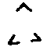
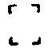
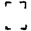

# 大毘卢遮那成佛神变加持经莲华胎藏菩提幢标帜普通真言藏广大成就瑜伽



> **藏经**：大正新修大藏经（大正藏）　**册次** 第 18 册（T18）　**编号** No. 853（T0853）　**部类** 密教部　**卷次** 3 卷　**篇幅** 21,107 字

> **卷／品**：0 卷 · 0 品



---



大毘卢遮那成佛神变加持经莲华胎藏菩提幢标帜普通真言藏广大成就瑜伽卷上



青龙寺沙门法全集



(欲结契者，敬白十方三世诸佛：「我等下辈愚钝凡夫，虽掌持此印，由如蚊蚁掌须弥山，恐无势力，唯愿诸佛加护我等，令我得成无上正觉，结持此印同佛势力。」发是语已，至诚礼拜)



> 稽首毘卢遮那佛，开敷净眼如青莲，  

> 我依大日经王说，供养所资众仪轨，  

> 为成次第真言法，如彼当得速成就。  

> 欲於此生入悉地，授学处师同梵行，  

> 一切勿怀毁坏心，不造愚童心行法，  

> 不於诸尊起嫌恨。如世导师契经说，  

> 能损大利莫过瞋，一念因缘悉焚灭，  

> 俱胝旷劫所修善，是故慇懃常舍离。  

> 净菩提心如意宝，能满诸愿灭尘劳，  

> 三昧智念由此生，是故我今勤守护。  

> 又常具足大慈悲，及与喜舍无量心，  

> 亲於尊所授明法，观察相应作成就。  

> 先礼灌顶传教尊，请白真言所修业，  

> 智者蒙师许可已，依於地分所宜处，  

> 妙山辅峰半岩间，芰荷青莲遍严池，  

> 大河经川洲岸侧，远离人物众愦闹，  

> 条叶扶疎悦意树，多饶乳木及祥草，  

> 或诸如来圣弟子，常於往昔所游居，  

> 寺塔练若古仙室。当於自心意乐处，  

> 悲愍有情畫大坛，具净慧力能堪忍，  

> 是夜放逸所生罪，慇懃还净皆悔除。  

> 心目视观谛明了，五轮投地而作礼，  

> 归命十方正等觉，三世一切具三身，  

> 归命一切大乘法，归命不退菩提众，  

> 归命诸明真实言，归命一切诸密印。  

> 以身口意清净业，慇懃无量恭敬礼，  

> 礼三绕三而赞叹，欲出亦还三礼赞。



真言曰(持地印。手印有四名，其右智手，云毘钵舍那；左定手，名三昧亦云舍摩他)：



唵(引)(一)　曩莫萨嚩怛他蘖多(二)　迦野弭嚩吃质(二合)多(三)　嚩日罗(二合)满娜南迦噜弭(四)



> 我由无明所积集，身口意业造众罪，  

> 贪欲恚痴覆心故，於佛正法贤圣僧，  

> 父母二师善知识，及以无量众生所，  

> 无始生死流转中，具造极重无尽罪，  

> 亲对十方现在佛，悉皆忏悔不复作。



出罪真言曰(大慧刀印)：



唵(引)(一)　萨嚩播波萨怖(二合)咤(二)　娜诃曩嚩日啰(二合)野(二)　娑嚩(二合引)贺(引)



> 曩莫十方三世佛，三种常身正法藏，  

> 胜愿菩提大心众，我今皆悉正归依。



归依真言曰(普印)：



唵(引)(一)　萨嚩没驮冒地萨怛鑁(三合)(二)　设罗𧹞蘖车弭(三)　嚩日啰(二合)达磨(四)　颉唎(二合)(五)



> 我净此身离诸垢，及与三世身口意，  

> 过於大海刹尘数，奉献一切诸如来。



施身真言曰(独股印)：



唵(引)(一)　萨嚩怛他蘖多(二)　布惹钵啰(二合)嚩(无渴反)㗚多(二合)曩夜怛麼(二合)南(三)　涅哩(二合)夜(引)哆夜弭(四)　萨嚩怛他(引)蘖多室者(二合)地底瑟姹(二合)担(五)　萨嚩怛他(引)蘖多惹难谜阿味设覩(引)(六)



> 净菩提心胜愿宝，我今起发济群生，  

> 生苦等集所缠身，及与无知所害身，  

> 救摄归依令解脱，常当利益诸含识。



发菩提心真言曰(定印)：



唵(引)(一)　冒地唧多(二)　母怛跛娜夜弭(三)



> 十方无量世界中，诸正遍知大海众，  

> 种种善巧方便力，及诸佛子为群生，  

> 诸有所修福业等，我今一切尽随喜。



随喜真言曰(归命合掌亦云金刚合掌)：



唵(引)(一)　萨嚩怛佗蘖多(二)　本惹(尼也反)惹曩(三)　弩暮捺那布阇迷伽三暮捺啰(二合)(四)　萨叵(二合)啰儜三麼曳(引)(五)　吽



> 我今劝请诸如来，菩提大心救世者，  

> 唯愿普於十方界，恒以大云降法雨。



劝请真言曰(普印)：



唵(引)(一)　萨嚩怛他蘖多(二)　睇洒儜布惹迷伽三暮捺啰(二合)(三)　萨叵(二合)啰儜三麼曳(四)　吽



> 愿令凡夫所住处，速舍众苦所集身，  

> 当得至於无垢处，安住清净法界身。



奉请法身真言曰(普通印)：



唵(引)(一)　萨嚩怛他(引)蘖多(二)　捺睇洒夜弭(三)　萨嚩萨怛缚(二合)系多(引)㗚佗(二合去)野(四)　达麼驮覩悉体(他以反二合)底㗚嚩(二合)靺覩(五)



> 所修一切众善业，利益一切众生故，  

> 我今尽皆正回向，除生死苦至菩提。



回向真言曰(普通印)：



唵(引)(一)　萨嚩怛他(引)蘖多(二)　涅哩(二合)也怛曩(二合)布惹迷伽三暮捺罗(二合)(三)　萨叵(二合)啰儜三麼曳(四)　吽



> (此入佛三昧之前承事法)  

> 为令身心遍清净，哀愍救摄於自他，  

> 身随所应以安坐，分明谛观初字明，  

> 轮围九重虚圆白，正念运心四无量，  

> 入慈遍缘於六道，有情皆具如来藏，  

> 三种身口意金刚，以我所修功德力，  

> 同入普贤法界身。



大慈三摩地真言曰：



唵摩贺(引)昧怛啰也(二合引)娑颇(二合)啰



> 悲心愍念诸有情，沈溺生死妄分别，  

> 起彼烦恼随烦恼，不达真如平等理，  

> 超过河沙诸功德，以我所修三密力，  

> 普愿等同虚空藏。



大悲三摩地真言曰：



唵摩贺(引)迦噜拏(上)夜(引)娑颇(二合)啰



> 喜心无量遍四生，本来清净如莲华，  

> 凡所修行及有情，同证观世自在身。



大喜三摩地真言曰：



唵秫(诗聿反)驮钵啰(二合)谟(引)娜娑颇(二合)啰



> 舍心清净遍法界，离我我所及蕴处，  

> 能所平等心不生，性相本寂同空库。



大舍三摩地真言曰：



唵摩护闭乞洒(二合引)娑颇(二合)啰



次当结三昧耶印(定慧虚心合，空竖建如幢)，能满福智聚。所谓净除三业道真言曰(以初三昧耶故，同如来秘密身口意平等。亦为自受用故，亦为立大悲胎藏坛故，亦为加持如来眷属故，亦五处真言各一遍，能除宿障以净自身，令身净故外障亦净，故诸障皆不得入。此大护也，诸佛警觉满其所愿也。由不开法印故，不合听闻一切诸法。若不先作，不合作诸法也)：



曩莫三满多没驮喃(归命一切如来)阿三迷(无等谓三身也)怛哩(二合)三迷(三平等法报化合为一身化众生)三摩曳(三昧耶)娑嚩(二合)贺



> 才结此印故，能净如来地，  

> 地波罗蜜满，成三法界道。  

> 次结法界生，密慧之标帜，  

> 净身口意故，遍转於身分。



彼真言曰(以第二三昧耶故，得同如来加持法界宫尊特之身。又为成就法性身诸菩萨故，又为作毘卢遮那阿阇梨事故，又为加持莲华部眷属故。两手各别作拳，竖头指当胸向里而转，两头从顶两边向里曳头指背向内，渐渐至心散。凡诵真言作印，喻如耕牛二头同进，不得前后也)：



曩莫三曼多没驮喃达麼駄睹(法界)萨嚩(二合)婆嚩(自性亦本性也)句唅(我我即是法界，行者虽未体真性，但以印真言即同法界也)



> 如法界自性，而观於自身，  

> 为令彼坚固，观自执金刚，  

> 结金刚轮印。



金刚萨埵真言曰(以第三三昧耶故，令自身土皆如金刚，与无量持金刚众而自围绕。又为折伏摄受随类众生故，为执金刚弟子事业故，又加持金刚眷属故，谓庄严金刚萨埵身故，具说三三昧耶。由真言印故，令彼身心俱净，能现见十方诸佛法轮三随转，能转无上大法轮於大千也)：



曩莫(归命曩谟归敬)三满多(上普也)嚩日啰(二合)𧹞(一切金刚)嚩日罗(二合)怛摩呴含(谓我)



> 谛观我此身，即是执金刚，  

> 次擐金刚甲，当观所被服，  

> 遍体生光焰。



彼真言曰：



曩莫三满多嚩日罗(二合)𧹞唵嚩日啰(金刚)迦嚩遮(甲)吽(因义，三乘法故具论三身说法义，果位得名，因因出生生起义)



> 啰字色鲜白，空点以严之，  

> 如彼髻明珠，置之於顶上，  

> 所积众罪垢，由是悉除灭，  

> 福智皆圆满。一切触秽处，  

> 当加此字门，赤色具威光，  

> 焰鬘遍围绕。次谓降伏魔，  

> 制诸大障者，当念大护者，  

> 无能堪忍明。



(诸佛平等力不住於寂现大方便，由彼威光猛盛，如初生小儿不堪视烈日之光。此亦如是，一切不能堪忍而敢映夺之者。此明王以此真言而护行者)



彼真言曰：



曩莫萨嚩怛他(引)蘖帝毘药(二合，归命一切如来)萨缚佩也尾蘖帝弊(能除一切诸障恐怖等)尾湿嚩(二合)目契弊(无量诸门巧妙)萨嚩他(引，总诸佛功德)唅欠嚩(入)博索(空义，法幢高峰观)啰吃洒(二合，拥护)摩诃沫丽(大力)萨嚩(一切)怛他(引)蘖多(如来)奔尼也(二合)涅左帝(功德生)吽吽(恐怖内外二障)怛啰(二合)咤(叱呵摄伏烦恼)怛啰(二合)咤(重言对治根本随烦恼)阿钵罗(二合)底诃谛(无对无比力)娑嚩贺(警觉一切贤圣谓作证明)



> 由才忆念故，诸毘那夜迦，  

> 恶形罗刹等，彼一切驰散。  

> 警发於地神，应说如是偈。



(双膝长跪，定持杵当心，慧手舒五轮平掌按地)



怛鑁(二合，汝也)泥(引)尾(引，地天有女声)娑(引)乞叉(引二合，护也)部(引)跢(引)悉(亲也於也)(一)　萨嚩(一切)没驮(引)曩(佛有多声)跢(引)易南(引度也，有导师义)(二)　左哩也(二合，引行也)曩也(修也)尾势(引)晒(引)数(入殊胜)(三)　部(引)密(净地)播啰蜜跢(引到彼岸)速者(等)(四)　摩罗(天魔)细(引)便演(二合，军众)怛他(引如)婆蘖南(二合)(破)(五)　舍(引)吉也(二合，释迦也)僧呬(引)曩(师子)跢(引)易弩(引，救世)(六)　怛他(引)贺(如我)魔罗(魔)惹演(降)乞㗚(二合)怛嚩(二合引)(伏)(七)　满拏㨫历(曼荼罗)洛佉夜(引畫)没药(二合)唅(我)(八)



地神持次第真言曰(金刚缚开掌，仰按习三七，覆按亦复然，即成坚牢地)：



唵仆(引)欠



作坛真言曰：



唵难驮难驮娜智娜智难驮婆哩(入)娑嚩(二合)贺(引)



洒净真言曰(定拳安腰侧，慧手散舒，风空相捻遍净，洒身五处。次香华饮食衣服并结界)：



曩莫三(去)满多没驮(引)南(引)(一)　阿钵啰(二合)底娑(上)谜(二)　誐誐曩娑(上)谜(三)　三满多(引)弩(鼻音)蘖帝(引)(四)　钵啰(二合)讫哩(二合)底尾秫弟(引)(五)　达磨駄(引)覩尾戍(引)驮𩕳(六)　娑嚩(二合)贺



> 诸佛慈愍有情者，唯愿存念於我等，  

> 我今请白诸贤圣，坚牢地神并眷属，  

> 一切如来及佛子，不舍悲愿悉降临，  

> 我受此地求成就，为作证明加护我。



持地真言曰(定拳如前相，慧舒按於地)：



曩莫三(去)满多没驮(引)南(引)(一)　萨嚩怛他蘖多(引)(二)　地瑟咤(二合)曩(引)地瑟耻(二合)帝(三)　阿佐丽(四)　尾麼丽(五)　娑麼(二合)啰祢(平)(六)　钵啰(二合)讫哩(二合)底钵哩输睇(七)　娑嚩(二合)贺(引)



尔时薄伽梵观察一切法界，入法界俱舍，以如来奋迅平等庄严藏三昧，自身表化云，遍诸毛孔中出无量佛，以现法界无尽庄严故，以是真言行门度无餘众生界，满足本愿，从众声门出随类音声，如其本性、业生、成就、受用、果报、显形、诸色、种种语言、心所思念，而为说法，令一切众生皆得欢喜。展转加持已，还入法界宫中，复告秘密主言：「有造曼荼罗圣尊分位种子标帜。汝当谛听，善思念之。吾今演说优陀那曰(五种三昧耶：一本尊、二真言、三密印、四三昧、五种子)：



> 「真言遍学者，通达秘密坛，  

> 如法为弟子，烧尽一切罪。  

> 寿命悉焚灭，令彼不复生，  

> 同於灰烬已，彼寿命还复。  

> 谓以字烧字，因字而更生，  

> 一切寿乃生，清净遍无垢，  

> 以十二支句，而作於彼器。  

> 如是三昧耶，一切诸如来，  

> 菩萨救世者，及佛声闻众，  

> 乃至诸世间，平等不违逆。  

> 解此平等誓，秘密曼荼罗，  

> 入一切法教，诸坛得自在。  

> 我身等同彼，真言者亦然，  

> 以不相异故，说名三昧耶。  

> 现前观啰字，谓净光焰鬘，  

> 赫如朝日晖，念声真实义，  

> 能除一切障，解脱三毒垢。  

> 诸法亦复然，先自净心地，  

> 复净道场地，悉除众过患。  

> 其相如虚空，如金刚所持，  

> 此地亦如是，住本尊瑜伽。  

> 加以五支字，等引而运想，  

> 即同牟尼尊。阿字遍金色，  

> 用作金刚轮，加持於下体，  

> 说名瑜伽座。鑁字素月光，  

> 於在雾聚中，加持自脐上，  

> 是名大悲水。囕字初日晖，  

> 彤赤在三角，加持本心位，  

> 是名智火光。唅字劫灾焰，  

> 黑色在风轮，加持白毫际，  

> 说名自在力。佉字及空点，  

> 想成一切色，加持在顶上，  

> 故名为大空。五字以严身，  

> 威德炬炽然，灭除众罪业，  

> 天魔为障者，见赫奕金刚。  

> 首中百光王，心置无生句，  

> 胸表离染字，安立无垢眼，  

> 观身同如来，复念满足句。」



曩莫三曼多没驮喃阿鑁览唅欠



　



















> 「安立器世间，空风最居下，  

> 次观火水地，是轮同金刚，  

> 名大因陀罗。光焰净金色，  

> 普皆遍流出，次应念持地，  

> 而图众形像。」



　



















> 尔时薄伽梵，观察大众会，  

> 告秘密主言：「有法界幖帜，  

> 由是严身故，生死中巡历，  

> 於如来大会。菩提幢幖帜，  

> 诸天龙夜叉，恭敬而授教。  

> 初印佛三昧，法界及法轮，  

> 憩伽归命合，屈风空轮加(甲侧)。  

> 法螺虚心合，风绞空轮上。  

> 吉祥愿莲华，金刚大慧印，  

> 摩诃如来顶，慧拳毫相藏。  

> 瑜伽持钵相，智慧手上舒，  

> 名无畏施者，下垂号满愿(掌外)。  

> 慧拳舒火水(押空)，智者成佛眼，  

> 内缚风轮索，心印舒火轮。  

> 舒水如来脐。前印风入月，  

> 是名如来腰。如次习真言。」



大慧刀真言曰(金刚合掌亦云归命。刀喻利智，以能除断为义。除恶见山峰，如大山之峰撩乱甚多，烦恼亦尔。今此印能断害身见及俱生见、六十二见等，此刀即大智，或云定慧虚心合，能断截诸烦恼，得无垢法身)：



曩莫三曼多没驮(引)喃(引)(一)　摩贺(引)朅伽尾啰惹(二)　达摩珊捺啰(二合)奢迦娑诃惹(三)　萨得迦(二合)野捺㗚(二合)瑟耻砌诺迦(四)　怛他(引)蘖多尾目吃底(二合)儞(入)佐多(五)　尾啰誐达磨儞(入)惹多吽(六)



大法螺真言曰(近口吹之，如吹螺之状，左右旋转)：



曩莫三曼多没驮喃暗(去，即得满一切善愿，宣说大法普得闻知。此是寂静涅槃印)



莲华座真言曰：



曩莫三满多没驮喃阿(去，金刚座，犹坐此故诸佛从此生。印名吉祥座。金刚不坏，阿生诸佛)



金刚大慧真言曰(五峰印)：



曩莫三满多嚩日啰(二合)𧹞吽



如来顶真言曰(即同仁者诸佛身。顶印安顶，想佛入身中，相好圆满)：



曩莫三满多没驮喃吽吽(具三解脱义。初为因，后为果。因是如来行，果是佛也)



如来顶相真言曰(阿阇梨右手为拳，置於顶上加持。一切诸天神，不能见顶相)：



曩莫三曼多没驮喃誐(体)誐曩(引，虚空无量)难多娑叵(二合)啰儜(普遍)尾秫驮(清净)达摩儞(入，丁逸反)惹帝(法界生)娑嚩(二合)贺



毫相藏真言曰(慧拳置毫处，毫光遍十方，能满愿净戒因)：



曩莫三曼多没驮喃阿(急呼)唅惹(入)



大钵真言曰(取袈裟手内角及搭肩之角，绕肘回入手中，令二角如双耳也。重於二手引上当脐，承钵之形同如来。持河沙诸佛幖帜之仪，令非器众生堪为法器)：



曩莫三曼多没驮喃婆(上急呼，有即三有也，以本不生故即离三有，而得如来真实之有，谓诸佛法身也)



施无畏真言曰(左手如前持衣二角。此印能除一切众生种种怖畏忧患即得皆息，亦除未来种种大可怖畏也)：



曩莫三曼多没驮喃萨嚩他(引，遍也)尔那尔那(胜义。尔那尔那而最为胜能胜彼也。初离异生烦恼，次离二乘烦恼重言)佩野曩奢那(除恐怖也)娑嚩(二合)贺



与愿满真言曰(持衣如前，掌外如施水)：



曩莫三满多没驮喃嚩罗那(与也)嚩日啰(二合引，金刚)怛麼(二合)迦(我也身也。意云愿诸佛与我金刚身也，亦是受我大智之身，即是满其所愿耳)娑嚩(二合)贺



悲生眼真言曰(地风押空背，反手三饰眼，成金篦除暗膜印，先右次左眼。以此秘密方便，能净眼根成就佛眼，得见如来深密境界也。肉眼见一切色，天眼见一切众生心，慧眼见一切众生诸根境界，法眼见一切法如实相，佛眼见十力。出《华严》五十七)：



曩莫三满多没驮喃誐誐曩(空也)嚩啰(愿也)落吃叉(二合)儜(一切相)迦噜拏(悲义)摩野(体义)怛他(引)蘖多(如来)作吃𫇴(二合，眼也)娑嚩(二合)贺



如来索真言曰(此索从如来信解中生，犹信解力中示现种种形类，或作忿怒或为持明，大力势摄化有情)：



曩莫三曼多没驮喃系系(呼召摄因，有三昧义。呼成佛之因，此因本不生，离因果相，令此因净而复果净也)摩贺播舍(大索也，离相之因是名大索)钵罗(二合)娑劳(普也)那哩也(二合，如空也。大索广普无不遍也)萨埵(有情)驮睹(界有情界而摄)微谟诃迦(痴除)怛他蘖多(引，如来)地目吃底(二合，信解生。诸佛行菩萨道时，立大誓度一切众生。今以此因要成果，若住解脱之乐不忆本誓，即违本愿，此亦名痴。除此痴故，使究竟恒作佛事也)儞(入，生也)佐多娑嚩(二合)贺(能缚及破坏作障难者。从信解力生，能现种种形，四摄度有情，结除散乱风)



如来心真言曰(不易前指，申火相并微屈，能生大慧慈善深广大方便)：



曩莫三曼多没驮喃枳攘(二合)怒(智也，即诸佛之智。此智不从他得，还从佛心生也)嗢婆(二合)嚩(生也)娑嚩(二合)贺



如来脐真言曰(阿密㗚，甘露。甘露者，智之别名，能除身心热恼，得而服之不老不死长寿之身。有心印微屈等)：



曩莫三满多没驮喃阿没㗚(二合)都(甘露也，除身心热恼也)嗢婆(二合)嚩(生)娑嚩(二合)贺



如来腰真言曰(慧手地水火风如前皆少屈，成佛妙色身，自性成圣智)：



曩莫三满多没驮喃怛他(引)蘖多(引，如来)三婆嚩(生)娑嚩(二合)贺



> 藏印虚心合，风屈空轮押，  

> 地水轮微曲。普光火内交，  

> 空入风水散，地轮竖相合。  

> 甲印虚心合，风幢加火背。  

> 舌相二空入。语门风水圆，  

> 竝空犹口形。牙印风入掌(准前)。  

> 辩说二风轮(准前印)，火侧第三节，  

> 空轮微摇动。十力莲华合，  

> 地空屈入月，掌内节相合。  

> 念处风捻空(准前印)。开悟圆风甲，  

> 地水空入掌。普贤如意珠，  

> 莲合风加火，上节如宝形。  

> 慈氏印准前，屈风火轮下，  

> 空献妙军持。



如来藏真言曰(除於二垢障，悟佛清净身)：



曩莫萨嚩怛他(引)蘖底弊蓝蓝(二除凡夫垢)𡀩𡀩(二除二乘垢)娑嚩(二合)贺



普光真言曰(亦圆光)：



曩莫三曼多没驮喃入嚩(二合)攞(光)摩𭌆儞(平，鬘也，以焰为鬘轮环不绝，名如来圆光)怛他(引)蘖多㗚旨(体如来明白之光)娑嚩(二合)贺



如来甲真言曰(定慧虚心合，风持火轮侧，空离火如小麦许。如一生补处菩萨，要被此无上菩提甲，坐金刚座，降一切魔军，成於正觉。真言者要被此甲作於佛事)：



曩莫三曼多没驮喃钵啰(二合)战拏嚩日啰(二合)入嚩(二合)攞(光)尾娑普(二合)啰(遍也)吽



如来舌相真言曰(得如来舌，法音遍十方，常作如语、不诳不惑不异语，真实故常住)：



曩莫三曼多没驮喃怛他蘖多(如来)尔诃嚩(二合，舌也)萨底也(二合，谛也)达磨(法)钵罗(二合)底瑟耻(二合)多(成就之实谛法体)娑嚩(二合)贺



如来语真言曰(谓此语从如来无量门巧慧而生)：



曩莫三曼多没驮喃怛他蘖多摩诃(引)嚩吃怛啰(二合，语也)尾湿嚩(二合)枳娘(二合)曩(种种巧智也)摩护那也(大广也)娑嚩(二合)贺



如来牙真言曰：



曩莫三满多没驮喃怛他(引，如)蘖多(来)能(去)瑟咤啰(三合，牙也)啰娑啰娑(引，味也，味中上味)𨰿啰(二合)参钵啰(二合引)博迦(得也)萨嚩怛他(引)蘖多(如来)尾洒也(境界也)糁婆嚩(生也)娑嚩(二合)贺



如来辩说真言曰(由此印故处众无畏，为人演说正法，乃至一字中含无穷义，辩才不可穷尽也)：



曩莫三曼多没驮喃阿振底也(二合，不思议)那部(二合)多(奇特)路波嚩(引，语之分段)三麼哆(上，普至也，佛以一音演说法等)钵啰(二合)钵多(二合，至也得也)尾输(上)驮(清净)娑嚩(二合)啰(言音也)娑嚩(二合)贺



如来持十力真言曰(由此智印能持如来十力支分也)：



曩莫糁曼多没驮喃捺奢沫浪(十力身)誐达啰(持也)吽三髯娑嚩(二合)贺



如来念处真言曰：



曩莫三满多没驮喃怛他(引)蘖多(如来)娑麼㗚(三合)底(念)萨怛嚩(二合)系怛嚩(二合，众生利益也)毘庾(二合)嗢蘖(二合)多(生也起也)誐誐曩三忙(虚空等生也)糁麼(无等)娑嚩(二合)贺



一切法平等开悟真言曰：



曩莫三曼多没驮喃萨嚩达麼(一切法)三麼多(平等)钵啰(二合)钵多(二合，至也得也，一切平等)怛他(引)蘖多(如来)弩蘖多(随同佛如是开悟)娑嚩(二合)贺(已上如来身会)



普贤菩萨如意珠真言曰(此菩萨所有三业普遍贤善，诸佛菩萨之所敬叹也)：



曩莫糁满多没驮(引)喃(引)参麼多弩蘖多(平等至也，进去往也)尾啰惹(离尘垢障也)达麼(法也)儞(入)社多(生也，言无垢从法而生)摩贺摩贺(重言如天中天。诸菩萨等供养於佛，佛转供养普贤，菩萨身与三世佛等。天中天大供养中供养)娑嚩(二合)贺(菩提万行从兹生，众愿满足，故名珠也)



慈氏菩萨真言曰(住发生普遍大慈三昧，印同诸佛窣堵波)：



曩莫三满多没驮(引)喃(引)阿(体)尔单(古云阿逸多，其义无胜，一切爱见烦恼及二乘等无有能胜)惹野(得胜，於无胜中得胜)萨嚩萨怛嚩(二合，一切众生也)奢野(性，心性也，谓先世所习诸根性欲)弩蘖多(知也，能了知众生诸根性欲)娑嚩(二合)贺



时佛住甘露生三昧，说一切三世无阂力明妃真言曰(顶印与第二卷虚空眼妃同用)：



怛儞也(二合)他(一)　誐誐曩三谜(二)　阿钵啰(二合)底(丁以反)三谜(三)　萨嚩怛他(引)蘖多三麼跢弩蘖帝(四)　誐誐曩三麼(五)　嚩罗𡀩乞叉(二合)嬭(平)(六)　娑嚩(二合)贺(引)



无能害力明妃真言曰(以梵夹印八遍，从前定起更入无量胜三昧)：



曩莫萨嚩怛他(引)蘖帝毘药(二合)萨嚩目契毘药(二合)阿三迷(三)　钵啰(二合)谜(四)　阿者隶(五)　誐誐泥萨麼(二合)啰嬭(六)　萨嚩怛啰(二合)弩蘖帝(七)　娑嚩(二合)贺(引)(此明意在警发诸佛令忆本誓，然后调下彩色)



> 严净佛国土，奉事诸如来，  

> 谛观香水海。



大海真言曰(二印相互相叉，二空散舒右旋，是海水印。准前印，右风甲押左风面，定之不动，即八功德水印)：



唵尾摩噜娜地吽



金刚手持华(内五智印)：



嚩(入茎)嚩日罗(二合)播抳(此大真言王印口授)



> 以妙莲华王，持於华藏界。



(口授，此上印四道秘授)



> 最初正觉等，敷置曼荼罗，  

> 密中之秘密，大悲胎藏生，  

> 及无量世间，出世曼荼罗，  

> 彼所有图像，次第说当听。  

> 四方普周匝，一门及通道，  

> 金刚印遍严，中羯磨金刚。  

> 其上大莲华，妙色金刚茎，  

> 八叶具须蘂，众宝自庄严，  

> 开敷含果实。於彼大莲印，  

> 大空点庄严，十二支生句，  

> 普遍华台中，常出无量光，  

> 百千众莲绕。其上复观想，  

> 大觉师子座，宝王以严饰，  

> 在大宫殿中。宝柱皆行列，  

> 遍有诸幢盖，珠鬘等交络，  

> 垂悬妙宝衣，周匝香华云，  

> 及与众宝云，普雨杂华等，  

> 缤纷以严地，谐韵有爱声，  

> 而奏诸音乐。宫中想净妙，  

> 贤瓶与阏伽，宝树王开敷，  

> 照以摩尼灯。三昧总持地，  

> 自在之婇女，佛波罗蜜等，  

> 菩提妙严华，方便作众伎，  

> 歌咏妙法音，供养诸如来。  

> 以我功德力，如来加持力，  

> 及以法界力，普供养而住(普印)，  

> 结大轮坛印。次众色界道，



啰(白色中)囕(赤色幢)迦(黄色华)麼(青色弥)诃(黑色音界道，金刚大慧印二)



> 观彼中胎内(诸尊种子一一分明安布先想圆光)，  

> 普光净月轮，阿字置其中。  

> 次当转阿字，成大日牟尼，  

> 清净离诸垢，妙色超三界，  

> 绡縠严身服，宝冠绀发垂，  

> 寂然三昧地，辉焰过众电，  

> 犹如净镜内，幽邃现真容，  

> 喜怒显形色，操持与愿等，  

> 正受相应身，明了心无乱，  

> 无相净法体，应愿济群生，  

> 以八曼荼罗，眷属自围绕。  

> 次东遍知印，北方观自在，  

> 南置金刚手，依涅哩底方，  

> 不动如来使，风方胜三世，  

> 四方四大护。初门释迦文，  

> 第三妙吉祥，南方除盖障，  

> 胜方地藏尊，龙方虚空藏，  

> 苏悉地眷属，护世威德天，  

> 次第而分布。次应执香𬬻。



净治真言曰：



唵(引)苏悉地羯哩入缚(二合)里多(上)曩南(去)多(上)谟(上)啰多(二合上)曳入缚(二合)罗满驮满驮贺曩贺曩吽泮咤(半音)



> 不动大明王，去垢令清净，  

> 辟除使光显，及护身结界。



彼真言曰(如来谓息一切障故，住火生三昧，说摧大障者真言。谓行人从初发菩提心守护增长，至令成佛果终不退失，不堕在非道中)阿左罗曩(引)他。



曩莫三曼多嚩日啰𧹞战拏(极恶，谓暴恶也，又甚暴恶也)摩贺路洒儜(大忿怒也)娑破(二合)咤也(破坏也)吽(恐怖也)怛啰(二合)迦(坚固也)悍(引)𤚥(引，二字种子也)



> 次以印真言，而请召众圣，  

> 诸佛菩萨说，依本誓而来。  

> 定慧内成拳，慧风屈如钩，  

> 随召而赴集(灌顶时以此钩印引行者入门)。



真言曰(此钩印能召十方诸佛菩萨集会道场，满足十地位，况餘八部未生善心者而不来至耶。能招诸佛大功德海，悉满一切如来功德。普召一切众生，亦令得此道也)：



曩莫三满多没驮(引)喃(一)　阿(去急呼)萨嚩怛啰(二合，一切所害身)钵啰(二合)底诃谛(二)　怛佗蘖党(如来)矩奢(钩)(三)　冒地浙哩也(二合，菩提行)钵哩布啰迦(四)　娑嚩(二合)贺(七遍索锁铃除障不动)



> 次示三昧耶，速满无上愿，  

> 令本真言主，诸明欢喜故。  

> 次执金刚杵，抽掷振金铃，  

> 所献阏伽水，如法已加持，  

> 奉诸善逝者，用浴无垢身，  

> 先右后左膝，至额三奉献。  

> 次当净一切，佛口所生子。  

> (不动尊加持二十五遍，莲合风绞火，空持风下节。)



真言曰(变成宝净香水海，底布金沙八德盈，想浴众圣净无垢，大悲胎藏大智海，能洗众尘证法身)：



曩莫三满多没驮(引)喃(引)誐誐曩(虚空)三摩(引，等)三摩(引，无等)娑嚩(二合)贺(引)



次奉华座真言曰(加护不动偈曰)：



曩莫三满多没驮(引)喃(引)阿(引)



> 佉字大空点，而置於顶上，  

> 转身作萨埵，金刚种子心，  

> 遍布诸支分，诸法离言说，  

> 以具印真言，即同执金刚。



彼真言曰(五股三股)：



曩莫三曼多嚩日啰(二合)赧(一)　战拏摩诃噜洒拏(平)(二)　吽



> 遍身被服甲。  

> 次应一心作，摧伏诸魔印，  

> 真语共相应。慧拳舒风轮，  

> 加於白毫际，如毘俱胝形。  

> 才结是法故，当观遍此地，  

> 金刚炽焰光，能除极猛利，  

> 无量天魔军，及餘为障者，  

> 必定皆退散(左拳安腰)。



怖魔真言曰(面如忿怒，心住一境，能现如来威猛大势之力，能满一切众生所愿。如来菩提树下以此印摧伏诸魔)：



曩莫三满多没驮(引)喃(引)(一)　摩诃(引)沫罗(二合，大力)嚩底(二)　捺奢嚩路(十力)嗢婆(二合)吠(平持也)(三)　摩诃(引)昧怛哩也(三合，大慈)毘庾(二合)嗢蘖(二合)底(发生)(四)　娑嚩(二合)贺(引)



> 次用难堪忍，密印明结护，  

> 藏印散水轮，旋转指十方，  

> 是名结大界。用持十方国，  

> 能令悉坚住，是故三世事，  

> 悉能普护之，威猛无能覩。



大界真言曰(谓初发大菩提心乃至成佛，不令间断不退菩提，即大界义也)：



曩莫三曼多没驮(引)喃(引)萨嚩怛罗(二合)弩蘖帝(一切方处，谓十方皆须遍结)满驮野(结)徙瞒(界)麼诃三摩野(大三昧耶)涅啰者(二合)帝(从生也)娑麼(二合)啰嬭(忆念)阿钵啰(二合)底诃帝(无有能害，亦云无碍无坏)驮迦驮迦(光威，由光威故成界)折啰折啰(遍往十方结界)满驮满驮(结)捺奢(十)　儞以(二合)膻(方)萨嚩怛他蘖多(一切如来)弩枳惹(二合)帝(教)钵啰(二合)嚩啰(所证)达麼(法)腊驮(获也得也)尾惹曳(无能胜)婆(真言主)誐嚩底(世尊)尾矩𭌆(除也，能除垢也)尾矩𭌚(前句除有相垢，后句除离相之垢)丽(种子)鲁补哩(宫)娑嚩(二)　贺(引)



第二略说真言(归命一切圣，凡不合越此界。若故同前越者犯三昧耶，决定不安，圣众张罸，越圣言誓故)：



丽鲁补哩尾矩𭌆尾矩隶娑嚩(二合)贺



> 四方四大护，无畏坏诸怖，  

> 难降伏护者，无堪忍普护。  

> 大界火内交，散舒二风轮，  

> 法幢高峰观，哀愍无餘众。  

> 帝释方华台，嚩字光转成，  

> 无畏结护者，金色妙白衣，  

> 面现少忿怒，手持於檀荼。  

> 夜叉方博字，坏诸怖结护，  

> 素衣洁白色，手持於朅伽。  

> 龙方观索字，转成难降伏，  

> 色如无忧华，朱衣现微笑，  

> 而观於众会。焰魔方唅欠，  

> 成无胜结护，黑色玄服衣。  

> 毘俱眉浪文，首戴发髻冠，  

> 光照众生界，手持檀荼印，  

> 及一切眷属，皆坐白莲华。  

> 真言及密印，如前已开示，  

> 门门二守护，无能三昧拳，  

> 举翼轮开敷，智拳心舒风，  

> 犹如相拟势，相对举慧拳，  

> 状如相击势(右拳也)。



不可越守护(赤白色，作极忿怒形)真言曰(此二守护威猛炽盛故，如百千日无敢视者，常在如来内门而奉教命，一切魔不能娆乱)：



曩莫三满多嚩日啰(二合)𧹞讷啰驮(二合)𭌆洒(二合，此是名，即不可视越义，难降伏也)摩贺𡀔洒拏(大忿怒也)佉(种子)捺野(吃也，一切烦恼食也)萨鑁娑怛(二合)他(引)蘖多(一切如来)然(教勅)矩噜(作也，令行如来教勅也)娑嚩(二合)贺



相向守护真言曰(与难胜相对挟门，故为名，色准前)：



曩莫三满多嚩日啰(二合)𧹞系(呼名)阿鼻目佉(引，相对也)摩贺(大)钵啰(二合，极也)战拏(大极忿怒，暴恶也)佉(一切善生种)那野(食，吃也)紧旨啰也徙(可不速也)三摩野(如前本誓)摩弩娑麼(二合)啰(忆念也，本於一切如来前立誓，噉一切烦恼。今何不忆本所愿，急速作之也)娑嚩(二合)贺



涂香真言曰(此供养以前更奉献水，出〈次第〉及释中。奉食有四种说，佛、菩萨、金刚、诸天)：



曩莫糁满多没驮(引)喃(引)尾(真言体)输驮(净)誐度(涂香)纳婆(二合)嚩(发生)娑嚩(二合)贺



华鬘真言曰(相叉印莲掌置额，右旋转遍法界，开现众华王，万德皆圆满)：



曩莫糁满多没驮(引)喃(引)摩贺(引)妹(真言体，心义)怛哩也(三合，大慈)毘廋(二合)讷蘖帝(生)娑嚩(二合)贺



焚香真言曰(地水火相背，二风侧相合，空捻风轮侧，水火四轮上节开，额前旋转如香云)：



曩莫三满多没驮(引)喃(引)达(体)摩(法)驮怛嚩(二合，界)弩蘖帝(随义遍至)娑嚩(二合)贺



饮食真言曰(密合。法喜禅悦食，能开甘露门，常以妙供献诸佛，下及神鬼悉皆通。饮食施福田，世世令丰足)：



曩莫糁满多没驮(引)喃(引)阿啰啰(不可乐闻声，不善声)迦啰啰(止前不善声，是恬怕寂义。正以法喜禅悦为食)末隣(上)捺娜弭(西方享祭之食)沬隣捺祢(受我食已还，我妙食)摩贺沫沥(广大丰美)娑嚩(二合)贺



灯明真言曰：



曩莫糁满多没驮(引)喃(引)怛(体也)佗(引)蘖多(引，如来也)啰𭇣(二合，焰明也)娑叵(二合)啰儜(普遍)嚩婆(引)娑曩(诸暗)誐誐猱那哩也(二合，无限量，等虚空)娑嚩(二合)贺



虚空藏菩萨普供养真言曰：



曩莫萨嚩怛佗蘖帝(归命一切如来)𭍇(等也)尾湿嚩(二合，是种种门义、巧义)目契弊(门等)萨嚩他(一切)欠(一切智空种)呜娜蘖帝(生也)娑颇(二合)啰系𤚥(普遍)誐誐娜剑(平引，虚空)娑嚩(二合)贺(於印上想一宝莲华，上想普通种子字，亦从此字流种种供养，流出作金色)



> 毘卢遮那位，及行者所居，  

> 海会刹尘众，眷属自围绕。  

> 次以清雅音，赞佛功德海，  

> 法身法界体；诸佛功德海，  

> 应以清雅音，歌咏而赞曰：



萨嚩尾也(二合)比婆(去)嚩讫啰(二合)讫哩(二合)也(一切善生种)素蘖哆地(引)钵帝尔(而以反)曩(妙用体无碍)怛𪢐(二合)驮覩迦摩诃攞(引)佐(三界如大王)尾噜左曩曩谟(引)娑覩(二合)谛(遍照我顶礼)



成就菩提报身赞曰：



阿难多摩(引)毕跢(引)娑虞(上)娜者蓝(引)(一)　曩莫三摩娑瞻(二合)素蘖耽怛啰(二合)迦攞沓(引)摩贺摩贺(引)难帝摩贺摩贺纥哩(二合)沓(引)(三)　摩贺摩贺(引)拽野摩贺摩贺(引)阿怛麼(二合)喃(引)(四)



金刚应身赞曰：



嚩每迦旨啰娑跢擗曩𩕳素多曩娑怛鑁(三合)跛晒迦贺娑多(二合)鼻哩(二合)俱胝(二合)穆佉髻迦罗(引)乞忏(二合)悉底哩野(四合)地尾罽(引)尔娜嚩哩(引)钵啰(二合)底僧娑覩(二合)多(引)娑怛鑁(三合)(三)　阿(引)哩擿曩麼弥野(二合)阿者攞制咤(去)喃(引)地(上)焰(四)



大毘卢遮那成佛神变加持经莲华胎藏广大成就仪轨卷上



大毘卢遮那成佛神变加持经莲华胎藏菩提幢标帜普通真言藏广大成就瑜伽卷中



青龙寺沙门法全集



> 尔时薄伽梵，告金刚手言：  

> 「有遍一切处，甚深秘法门，  

> 住此字门者，事业疾成就。  

> 宝冠举手印(五股)，身行轮布之，  

> 眉间咽心脐，阿字至娑贺，  

> 右旋转相接，初行果圆寂。  

> 方便一切处，身外如光焰，  

> 伊等十二字，在外而散布。」



曩莫糁满多没驮喃(引)阿



曩莫糁满多没驮喃(引)娑



曩莫糁满多嚩日罗(二合)𧹞嚩



迦佉誐伽左磋惹酂咤咤拏荼多佗娜驮跛颇麼婆野啰攞嚩舍洒娑贺吃洒(二合，此一转上声呼之)



曩莫糁满多没驮喃(引)阿(引)



曩莫糁满多没驮喃(引)娑(引)



曩莫糁满多嚩日罗(二合)𧹞嚩(引)



迦佉誐伽左磋惹酂咤咤拏荼多他娜驮跛颇麼婆野罗攞嚩舍洒娑贺吃洒(二合，次引声长呼)



曩莫糁满多没驮喃(引)暗



曩莫糁满多没驮喃(引)糁



曩莫糁满多嚩日罗(二合)𧹞鑁



剑欠俨俭占襜染瞻𪗦𭌂喃湛担探喃淡𠷖𭈠𭍊焚阎㘕蓝鑁睒衫参颔讫衫(二合，皆口边字同第一转本音呼)



曩莫糁满多没驮喃(引)恶



曩莫糁满多没驮喃(引)索



曩莫糁满多嚩日罗(二合)𧹞嚩(入声呼之)



𪨗却虐噱灼绰𠺁杓磔坼搦择𭈂托诺铎博泊漠薄药𡀩落嚩(入)铄嗦索臛吃叉(二合入呼)



伊缢坞乌哩𭊂哩𭊂翳蔼污奥



菩提心三昧句真言曰：



曩莫三曼多没驮喃(引)冒(引)地阿仰壤𠸎曩莽娑嚩(二合)贺(引)



菩提行发慧真言曰：



曩莫三满多没驮喃(引)左哩也(二合引)阿(引)𠵫(引)穰(引)儜(引)囊(引)忙(引)娑嚩(二合)贺(引)



成菩提补阙真言曰：



曩莫三满多没驮喃(引)三冒(引)驮暗𪡋髯喃南𤚥娑嚩(二合引)贺(引)



寂静涅槃真言曰：



曩莫三满多没驮喃(引)[嗨-每+(臼/工)]啰嚩(引)拏恶[唬-儿+(雪-雨)]弱搦诺莫娑嚩(二合引)贺(引)



「秘密主！如是字门，如来神力之所加持。我今普观诸佛刹土，无不见此遍一切处法门彼诸如来无有不宣说者。真言门修菩萨行者，於此法门应勤修学，於舸遮咤多波初中后相加，以等持品类相入，自然获得菩提心行成等正觉，如大日世尊而转法轮。」



尔时世尊从等至三昧起，告秘密主言：「善男子！谛听。内心漫荼罗，彼身地即是法界自性，真言密印加持而加持之，本性清净故。羯磨金刚所护持故，净除一切尘垢我人众生寿者等过患。方坛四门西向通达周旋界道，内现意生八叶大莲华王，抽茎敷蘂彩绚端妙。其中如来一切世间最尊特身，超越身语意地至於心地，逮得殊胜悦意之果。於八叶上，宝幢如来、开敷华王如来、无量寿如来、鼓音如来、普贤、妙吉祥、观音、慈氏尊；一切蘂中，佛菩萨母六波罗蜜三昧眷属而自庄严；下列持明诸忿怒众，持金刚秘密主菩萨以为其茎，处于无尽大海；一切地居天等其数无量而环绕之。尔时行者为成三昧耶故，应以意生香华灯明涂香种种肴饍一切皆以献之。」优陀那曰：



> 真言者诚谛，图畫漫荼罗，  

> 自身为大我，啰字净诸垢。  

> 安住瑜伽座，寻念诸如来，  

> 顶授诸弟子，阿字大空点。  

> 智者传妙华，令散於自身，  

> 为说内所见，行人宗奉处。  

> 此最上坛故，应与三昧耶。



漫荼罗三重，内金轮二三中位，恶字第三重，黄黄白色方便一切处。



尔时金刚手升於大日世尊身语意地法平等观，念未来众生，为断一切疑故，说大真言王曰(住法界平等观)：



曩莫三漫多没驮喃(引)阿三忙钵多(二合，无尽)达摩驮覩(法界)蘖登(底孕反)蘖多喃(超越义，无尽法界)萨嚩佗(一切)暗欠(空)暗恶(地)糁索唅(风轮)鹤㘕(火轮)𡀩鑁(水轮)嚩(入)娑嚩(二合引)贺(引)(下三道真言)吽㘕𡀩(此身真言)诃罗(二合)鹤(此语真言)娑嚩(二合引)贺㘕𡀩(意真言)娑嚩(二合)贺



尔时毘卢遮那世尊复观诸大众会，告执金刚秘密主言：「佛子！有秘密八印最为秘密，圣天之位威神所同，自真言道以为幖帜，图其曼荼罗如本尊相应。若依法教於真言门修菩萨行诸菩萨，应如是知自身住本尊形坚固不动。知本尊已，如本尊住而得悉地。云何八印？



> 「宝幢日晖色，三角而具光，  

> 莲合散地风，开敷净金色，  

> 缚字金刚光，风轮屈在空。  

> 弥陀真金色，月轮波头绕，  

> 开敷妙莲华。鼓音曼荼罗，  

> 半月空点围，双地入满月。  

> 普贤曼荼罗，满月金刚绕，  

> 莲华竖二空。观音颇梨色，  

> 彩虹金刚旛，准前屈火轮(如钩相背)。  

> 文殊欝金色，虚空杂色围，  

> 青莲开火轮。慈氏黄金色，  

> 虚空用青点，金刚掌旋转(掌心相著)。」



大威德生真言曰(宝幢佛)：



曩莫糁曼多没驮喃(引)㘕𡀩娑嚩(二合)贺(引)



金刚不坏真言曰(开敷华)：



曩莫三曼多没驮喃(引)鑁嚩娑嚩(二合)贺(引)



莲华藏真言曰(阿弥陀佛)：



曩莫糁曼多没驮喃(引)糁索娑嚩(二合)贺(引)



万德庄严真言曰(鼓音)：



曩莫糁曼多没驮喃(引)唅鹤娑嚩(二合)贺(引)



一切支分生真言曰(普贤菩萨)：



曩莫糁曼多没驮喃(引)暗恶娑嚩(二合)贺(引)



世尊陀罗尼曰：



曩莫三满多没驮喃(引)(一)　没驮达啰尼(二)　娑没㗚(二合)底沫罗驮曩迦𭌆(三)　驮罗驮罗驮罗野驮罗野萨鑁(四)　婆誐嚩底(五)　阿迦(引)啰缚底三麼曳娑嚩(二合)贺(引)



文殊师利菩萨法住真言曰(有本云青莲开火风)：



曩莫糁曼多没驮喃(引)阿(去)吠娜尾泥娑嚩(二合)贺(秘印。先八师子座华印稍相近，坐上青莲散火风，上置梵夹印，印上令莲华)



迅疾弥勒菩萨真言曰：



曩莫三曼多没驮喃(引)(一)　摩诃(引)瑜(引)誐瑜(引)拟(宜以反)宁(二)　瑜诣诜嚩唎(三)　欠惹利计(四)　娑嚩(二合)贺



尔时世尊复住三世无碍力，依如来加持不思议力依庄严清净藏三昧。即时世尊从三摩钵底中出无尽界无尽语表，依法界力无等力正等觉信解，以一音声四处流出普遍一切法界，与虚空等无所不至。



真言曰(根本印从师密授)：



曩莫萨嚩怛佗(引)蘖帝(引)毘廋(二合引)尾湿嚩(二合)目契毘药(二合)萨㗚嚩(二合)佗(引上)阿(上)阿(去引)暗恶



即时住於智生三昧，而说出生种种巧智百光遍照真言曰(金刚掌舒臂顶上，时时摇动)：



曩莫三曼多没驮喃(引)暗(欲布百光王，暗字在其中，次轮布十二，伊等至邬奥。第二迦等二十五字，第三轮迦（引）等二十五，第四剑等二十五，第五却等二十五。右旋转布，相接三七遍加持)



「秘密主！是名如来秘密印。最胜秘密，不应辄授与人，除已灌顶，其性调柔、精勤坚固、发殊胜愿、恭敬师长、念恩德者、内外清净、舍自身命而求法者。



> 「复次秘密主！如来漫荼罗，  

> 犹如净满月，内现商佉色，  

> 一切佛三角，在於白莲华，  

> 空点为幖帜，金刚印围绕。  

> 从彼真言王，周匝放光明，  

> 佛坐道树下，持此降四魔，  

> 号名遍智印，能具多功德，  

> 生众三昧王，伽耶迦叶优，  

> 楼频螺迦叶。次於其北维，  

> 导师诸佛母，光曜真金色，  

> 缟素以为衣，遍照犹日光，  

> 正受住三昧。复次七俱胝，  

> 佛母菩萨等。复於彼南方，  

> 大勇猛菩萨，大安乐不空，  

> 金刚三昧宝，救世诸菩萨，  

> 大德圣尊印，号名满众愿，  

> 真陀摩尼珠，住於白莲上。」



一切佛心真言曰(普印)：



曩莫三曼多没驮喃(引)暗萨嚩没駄冐地萨怛嚩(二合，菩萨)纥哩(二合)捺野儞也(二合，心也)吠奢儞(入也)曩莫(归命)萨嚩尾泥(与愿)娑嚩(二合)贺



虚空眼明妃真言曰(名誐誐曩噜（引）左曩如佛顶印)：



曩莫糁满多没驮喃(引)(一)　睑誐誐曩嚩罗(愿)落讫叉(二合，相)嬭(二)　誐誐曩(空也)三迷(等)曳(三)　萨缚覩(一切处)嗢蘖(二合)多(四)(更无比)　避娑啰(坚不可坏)三婆吠(平)(五)(从生)　入缚(二合)攞(光炎明)那目(归命)伽难(去)(六)(不空者也)　娑嚩(二合)贺



一切菩萨真言曰(普印)：



曩莫糁曼多没驮喃(引)(一)　萨嚩佗(二)(一切)　尾麼底(三)(无慧，以无慧故名痴)　尾枳啰儜(四)(除弃)　达啰麼(二合)驮睹(法界)[嗨-每+(臼/工)](入)佐多(五)(生也)　参参诃(六)　娑嚩(二合)贺



> 「北方观自在，秘密曼陀罗，  

> 佛子一心听。普遍四方相，  

> 中吉祥商佉，出生钵昙华，  

> 开数含果实。承以大莲印，  

> 光色如皓月，商佉军那华，  

> 微笑坐白莲。髻现无量寿，  

> 住普观三昧，莲华部眷属，  

> 最西第一置：



「马头观自在菩萨、大明白身观自在菩萨、多罗观自在菩萨、观自在菩萨、毘俱胝菩萨、大势至菩萨、莲华部发生菩萨、第二寂留明菩萨、大吉祥明菩萨、大吉祥大明菩萨、如意轮菩萨、耶输陀罗菩萨、窣覩波大吉祥菩萨、大随求菩萨。次白处尊菩萨、大吉变菩萨、水吉祥菩萨、不空羂索菩萨、丰财菩萨、白身观世音菩萨、披叶衣菩萨。莲华灯涂香四摄内供养，莲华使诸眷属佛刹微尘众。



> 「彼右大名称，圣者多罗尊，  

> 青白色相杂，中年女人状，  

> 合掌持青莲，圆光靡不遍，  

> 晖发由净金，微笑鲜白衣。  

> 内缚竖空风，左边毘俱胝，  

> 手垂数珠鬘，三目持发髻。  

> 尊形由皓素，圆光色无主，  

> 黄赤白相入，前印风火交。  

> 次近毘俱胝，畫得大势尊，  

> 被服商佉色，大悲莲华手，  

> 滋荣而未敷，围绕以圆光。  

> 明妃住其侧，号持名称者，  

> 一切妙璎珞，庄严金色身，  

> 执鲜妙华枝，左持钵胤遇，  

> 密印准明王，上举风轮屈。  

> 近圣者多罗，住於白处尊，  

> 发冠袭纯白，钵昙摩华手，  

> 定慧虚心合，空水入月中。  

> 於圣者前作，大力持明王，  

> 晨朝日晖色，白莲以严身，  

> 赫奕成焰鬘，吼怒牙出现，  

> 利爪兽王发，印如白处尊，  

> 移风空轮下，相去如穬麦。  

> 地藏圆满合，二空风轮侧，  

> 如是应器成。」



观自在菩萨真言曰(阿缚路枳帝湿嚩（二合）罗)：



曩莫糁曼多没驮喃(引)(一)　娑(上种子)萨嚩(二合)怛他蘖多(引，一切如来也)嚩路吉多(二)(观名诸佛观，即是平等普眼观)　羯噜儜麼野(三)(体大悲为体)　啰啰啰(啰是尘义，入阿字门。阿，无也，即是无尘义，以空悲为体也。离三毒，得无贪等三善根，生三解脱，有三重啰字也)吽(是因义、恐怖义，以大威猛自在之力怖三重尘障，令得清净而同佛眼。吽有诃字是欢喜义，上有空点是三昧义)惹(四)(种子，即不生义。或以初萨字为体，警觉义也)　娑嚩(二合)贺



多罗菩萨真言曰(路多啰儞尾。如船渡人越大海，置於彼岸得自在)：



曩莫三曼多没驮喃(引)耽(种子)羯噜呶(悲)嗢婆(上二合)吠(生谓悲者。而此菩萨从观音眼中生，由见法实性，名为普眼，见於如如之体)多𭌚(呼彼)多哩抳(是度义，以初多字为体)娑嚩(二合引)贺



毘俱胝菩萨真言曰(梵云勃哩（二合）俱胝，即形恐怖一切，永离四魔)：



曩莫糁曼多没驮喃(引)(一)　勃哩(二合，种子)萨嚩婆野(一切恐怖)怛罗(二合，如如为体)散儞(入)(二)(又恐怖义。前是有畏，后是无畏，一切众生有恐怖故，不得无畏处故，缘生我慢我执自高恐怖，令离有畏而得无畏也)　吽娑颇(二合)咤野(残害破障)娑嚩(二合)贺



大势至菩萨真言曰(摩贺娑太（二合）摩钵罗（二合）钵跢)：



曩莫糁曼多没驮喃(引)参髯髯(生义二重，上生烦恼，二生所知障。入阿字门即不生。上有大空点，谓除二障得大空生也)索(不动义种子。动法有生灭，经动不动皆是不安相。傍加二点同於涅槃，即是坚住义。已离二障同於大空，如诸佛住)娑嚩(二合)贺



耶输陀罗菩萨真言曰：



曩莫糁曼多没驮喃(引)琰(种子)野输驮罗野(引)娑嚩(二合)贺



白处尊菩萨真言曰(半拏罗嚩（引）悉儞)：



曩莫糁曼多没驮喃(引)半(种子)怛他(引)孽多(体如来)尾洒野(境界)三婆吠(生，从彼生也)钵娜麼(二合，白花)忙履儞(入，为华鬘也，严身具也。此即能生於诸佛功德，以为庄严法身)娑嚩(二合)贺



马头明王真言曰(贺野仡里（二合）缚（入）噉食无明诸障尽)：



曩莫糁曼多没驮喃(引)唅(种子)吽(恐怖)佉那野(噉食诸障也)畔惹(打破)萨叵(二合)咤野(破碎令尽)娑嚩(二合)贺



诸菩萨所说真言曰(明住在此，名野兔（引）讫多（二合）冐（引）地萨怛嚩（二合）)：



曩莫三满多没驮喃(引)讫叉(入二合)拏(入)多啰阎剑



地藏真言曰：



曩莫糁曼多没驮喃(引)诃诃诃(三因也：谓声闻、缘觉、菩萨之因。凡诸真言自说本尊之德，此总地藏菩萨之德也)素怛弩(妙色身，自身极净故名妙色身，即法身也)娑嚩(二合)贺



诸奉教者真言曰(名枳迦罗（引）赧)：



曩莫糁曼多没驮喃(引)地(引)室哩(二合)唅没㘕(二合)娑嚩(二合)贺



> 「佛子应谛听，次东第三院，  

> 施愿金刚坛，四方相均普，  

> 卫以金刚印。当於彼中作，  

> 火生曼荼罗，内心复安置，  

> 妙善青莲华。智者曼殊音，  

> 本真言围之，如法布种子，  

> 而以为种子，复於其四旁，  

> 严饰以青莲。图作勤勇众，  

> 先安妙吉祥，其身欝金色，  

> 五髻冠其顶，犹如童子形，  

> 左持青莲华，上表金刚印，  

> 慈颜遍微笑，坐於白莲华，  

> 妙相圆普光，周匝互晖映，  

> 而住佛加持，神力三昧王，  

> 及无量眷属：



「观自在、普贤、对面护、对护、惹野、尾惹野、𡀇母噜尔多、阿波罗尔多。北光网菩萨、宝冠菩萨、无垢光菩萨、月光菩萨、五髻文殊师利菩萨。南门月乌波髻失儞菩萨、奉教菩萨、文殊二使者、钩召四奉教。」



> 「青莲虚心合，火轮持水背，  

> 二风捻空甲。右光网菩萨，  

> 执持众宝网，种种妙璎珞，  

> 住宝莲华座，而观佛长子。  

> 定拳执钩印。宝轮持火中。  

> 宝冠持宝印。右莲无垢光，  

> 青莲而未敷，前印舒微屈(如佛身光)。  

> 计设儞持刀，慧拳竖风火(空押地水甲如拟势)。  

> 乌波计设儞，前印火轮戟(空押风地水甲)。  

> 地慧持幢印，定拳地水竖(空押风火)。  

> 质多罗童子，右拳风轮杖。  

> 召请风为钩(外拳)。次五种奉教，  

> 不思议童子，定慧内缚拳，  

> 空入风甲背。如是五使者，  

> 五种奉教者，二众共围绕，  

> 侍卫无胜者(文殊三补咤二火反押二水背，二风捻空轮)。」



文殊师利菩萨真言曰(满祖室哩没驮曩)：



曩莫糁曼多没驮喃(引)瞒系系(呼召，诃声因，谓离二因超二乘境界。系系童子，住解脱道者忆念本所立愿来降也)俱(破碎)麼(体)罗(四魔)迦(童子也，破坏诸魔)尾目吃底(二合，解脱)钵他悉体(二合)多(善道言住何处，谓解脱道也)娑麼(二合)啰(忆念)娑麼(二合)啰(忆念)钵罗(二合)底然(尊者所愿悉度一切众生，如我无异，今者忆昔誓也)娑嚩(二合)贺



光网菩萨真言曰(名惹里宁钵罗（二合）婆。为摄诸含识，令住解脱地，招诸佛大德，即钩义)。



曩莫糁曼多没驮喃(引)髯(种子)系系俱摩罗(如前)忙野(幻)孽多(知也，知一切法如幻)娑嚩(二合)婆嚩(性)悉体(地以反)多(住了知诸法如幻，住诸佛实性中)娑嚩(二合)贺



无垢光菩萨真言曰(种种无边行，亦现种种异形也)：



曩莫糁满多没驮喃(引)(一)　系矩忙罗(二)　尾质怛啰(二合，种种)蘖底(行)矩忙啰(三)　摩弩娑摩(二合)啰(四)(忆念所愿)　娑嚩(二合)贺



计设尼真言曰(名计引设宁)：



曩莫糁曼多没驮喃(引)(一)　枳履(二合，种子)系系(呼召)矩忙(引)𭌆计(二)(童子作女声呼。二子亦是文殊三昧)　那耶(与愿)壤难(二合，智)娑麼(二合)罗(三)(忆昔)　钵罗(二合)底然(四)(本愿，意云尊者於文殊所得胜愿，授与我)　娑嚩(二合)贺



乌波计设儞真言曰(名乌波计始宁引，以智观穿无智)：



曩莫糁曼多没驮喃(引)儞履(二合，种子)频那野(穿也)壤难(智也，前句者有阿声相连即是无智。言以妙慧穿於无智达於实理也)系矩忙哩计(童女，三昧义，以女声而呼召)娑嚩(二合)贺



地慧菩萨真言曰(名缚苏摩底，亦名财慧，忆念如意幢)。



曩莫糁满多没驮喃(引)呬𭌆(二合，种子)系娑麼(二合)啰(忆念)壤曩(二合)计覩(幢也，由此妙慧幢故摧破诸魔，今当忆念，令我亦尔)娑嚩(二合)贺



质怛罗童子真言曰(或本云质多弭哩)：



曩莫糁曼多没驮喃(引)弭𭌆(二合)娑嚩(二合)贺



召请童子真言曰(因钩引至菩提)：



曩莫糁曼多没驮喃(引)阿迦啰洒(二合)野(招，召也，召请摄召皆是钩来义)萨鑁矩噜(一切作也，取与等皆是，谓尊者文殊所指授事皆当作之)阿然矩忙啰(圣者身)写娑嚩(二合)贺



不思议童子真言曰(示现忿怒形，满愿奉持教，不成令成就)：



曩莫糁曼多没驮喃(引)阿(去)尾娑麼(二合)野儜曳娑嚩(二合)贺



> 「行者於左方，次作大名称，  

> 除一切盖障，大精进种子，  

> 谓真陀摩尼，住於火轮中，  

> 翼从端严身，当知彼眷属：



「悲愍菩萨、破恶趣菩萨、施无畏菩萨、贤护菩萨、不思议慧菩萨、慈发生菩萨、折诸热恼菩萨。」



> 「秘密之标志，次第应安布，  

> 名称除障尊，住悲力三昧，  

> 智福虚心合，地水空入月(空持水中)，  

> 竝合风火轮，如持摩尼珠。  

> 尊右除疑怪，内缚竖火轮，  

> 宝瓶置一股。施无畏菩萨，  

> 举慧施无畏。除一切恶趣，  

> 前印相不殊，救护慧菩萨，  

> 悲手当在心。大慈生菩萨，  

> 慧风空持华(散三)，悲旋润右置，  

> 悲念在心上，垂屈火轮指。  

> 除一切热恼。作垂施愿手。  

> 甘露水流注。遍在诸指端。  

> 次不思议慧，以施无畏手，  

> 空风持珠状，火等散微屈。」



除一切盖障菩萨真言曰(萨缚儞缚啰拏尾晒剑（二合）避。法性之悲以自在力能除一切众生盖障，於障得自在)：



曩莫糁曼多没驮喃(引)阿(去，种子)萨怛嚩(二合，有情)系多(利益)弊(毘庾反)嗢蘖(二合)多(发起起生，开发其善性令显现)怛㘕(二合)怛㘕(二合，怛是即多字，如如义。㘕是啰，无垢义。加一点是尘义，即大空入证也)㘕㘕(谓除四垢也，一爱见垢、二缘觉垢、三声闻垢、四菩萨垢，谓除四垢入清净位)娑嚩(二合)贺



除疑怪菩萨真言曰(憍覩褐罗。此译为除疑怪或云除垢。众有所疑之事不能决，此菩萨即往而断其疑网，与为不请友也。梵云号俱贺哩曩（入）)：



曩莫糁曼多没驮喃(引)诃娑难(三字种子)尾麼底(无慧也)掣诺迦(截断也，截断无知令智慧生。亦是断坏决断义，犹如能断金刚般若之义也)



施无畏菩萨真言曰(萨嚩萨怛嚩（二合引）婆阎娜娜)：



曩莫糁曼多没驮喃(引)啰娑难(三字种子)阿佩演那那(无畏施也。以何法施无畏？谓住阿字离於一切生。尊者所愿已满，我等未，得愿施我及一切众生也)娑嚩(二合)贺



除一切恶趣菩萨真言曰(梵萨缚（引）播（引）野惹诃)：



曩莫糁满多没驮喃(引)特懵(二合)娑难阿毘廋(二合)达啰抳(举也)萨怛嚩(二合)驮敦(众生界也。一切众生无始无明覆故，常在三恶趣中。尊者以得五力，愿举之令清升，令一切众生得出三界也)



救护慧菩萨真言曰(跛里怛啰（二合引）拏舍也摩底。左拳安腰侧。亦名哀愍慧)：



曩莫糁曼多没驮喃(引)尾诃沙难(四字种子)系摩贺(引)摩贺(引，大中之大)娑摩(二合)啰(忆念)钵啰(二合)底然(本愿愿除一切苦故，故名为救护慧。今呼彼名，令忆本愿而救护一切也)娑嚩(二合)贺



大慈生菩萨真言曰(摩贺（引）每嘀哩也（二合）毘喻（二合）嗢蘖（二合）多)：



曩莫糁曼多没驮喃(引)谄(种子)娑嚩(二合)制妬(心义)嗢蘖(二合)多(上生也。言此慈从自心生，不从他生得，故名大慈。谓从自性清净心生，不从他种子心生，故名自心生也)娑嚩(二合)贺



悲旋润菩萨真言曰(摩诃迦噜拏钵啰（二合）抳多亦名大悲旋润)：



曩莫三曼多没驮喃(引)焰(种子)迦噜儜(悲也，此菩萨系属於悲不得自在，常为悲所牵，除一切苦故)没囇眤多(念也，本尊愿救众生，今当忆本愿救护我等)娑嚩(二合)贺



除一切热恼菩萨真言曰(萨嚩娜引贺钵罗（二合）舍弭曩)：



曩莫糁曼多没驮喃(引)缢(种子)系嚩啰娜(与愿也，以离因之法而满一切众生愿)嚩啰钵啰(二合)钵多(先得先不得，所愿云何能授与人？菩萨所立誓愿今者满足，今忆本愿而与一切众生除诸热恼，化一切众生令成佛道)娑嚩(二合)贺



不思议慧菩萨真言曰(阿进底也麼底那难多)：



曩莫糁曼多没驮喃(引)污(种子)萨嚩舍(一切愿也)钵哩布啰迦(二合，满也，谓满一切众生种种胜愿如如意珠也)娑嚩(二合)贺



> 「北方地藏尊，其座极巧严，  

> 身处於焰胎，杂宝庄严地，  

> 绮错互相间，四宝为莲华，  

> 圣者所安住，金刚不可坏，  

> 行境界三昧，及与大名称，  

> 无量诸眷属：



「日光菩萨、坚固深心菩萨、并持地菩萨、宝手菩萨、宝光菩萨、宝印手菩萨、不空见菩萨、除一切忧冥菩萨。」



> 「秘密内为缚，火轮竖散开，  

> 二空持风侧。右观宝处尊，  

> 慧散空风宝，宝上三股印。  

> 宝掌於宝上，一股金刚印，  

> 慧拳舒水轮(空押三)。持地右宝上，  

> 二手金刚印。宝印手宝上，  

> 五股金刚印。坚固意右宝，  

> 羯磨金刚印，定慧莲华合，  

> 竝空微举开。」



地藏菩萨真言曰(尾萨缚（引）舍（引）钵哩布罗迦)：



曩莫三曼多没驮喃(引)诃诃诃(三因，谓是三乘之因也)尾娑麼(二合)曳(希有也。一切有情常有我相种种烦恼裁，若念真言我相即除，此为希有，亦甚希奇也)娑嚩(二合)贺



宝处菩萨真言曰(啰怛曩（二合）迦啰)：



曩莫三曼多没驮喃(引)难髯(种子)系摩贺摩诃(引，大中大。宝处者，如宝生於大海中，从彼心生，故宝处也)娑嚩(二合)贺



宝手菩萨真言曰(啰怛曩（二合）播抳。宝从手出生，言圣者从宝而生。从何宝而生？谓从菩提心而生)。



曩莫三曼多没驮喃(引)衫(种子)啰怛怒(二合，宝)嗢婆(二合)嚩(生)娑嚩(二合)贺



持地菩萨真言曰(驮攞抳驮罗髯)：



曩莫糁曼多没驮喃(引)𪡋(种子)达啰尼(尼仁反，地也。以地能持一切物，故以为名也)达啰(持也，诸佛荷负众生，故名持地，亦令众生同得此也)娑嚩(二合)贺



宝印手菩萨真言曰(啰怛曩（二合）谟捺啰（二合）贺萨多)：



曩莫三曼多没驮喃(引)唅(种子)啰怛曩(二合，宝)儞(入)唎尔多(生诸佛宝生)娑嚩(二合)贺



坚固意菩萨真言曰(涅哩（二合）荼地也（二合引）舍也)：



曩莫糁曼多没驮喃(引)𧹞(种子)嚩日啰(二合)三婆嚩(从金刚不坏智印而生，故以为名也)娑嚩(二合)贺



> 「西方虚空藏，勤勇被白衣，  

> 圆白悦意坛，大白莲华座，  

> 持大慧刀印，如是坚利刃，  

> 锋锐犹氷霜，住清净境界，  

> 自种子为种。智者尊北布：



「檀波罗蜜菩萨、戒波罗蜜菩萨、忍波罗蜜菩萨、精进波罗蜜菩萨、禅波罗蜜菩萨、般若波罗蜜菩萨、方便波罗蜜菩萨、愿波罗蜜菩萨、力波罗蜜菩萨、智波罗蜜菩萨。次置金刚藏菩萨、苏悉地羯啰菩萨、金刚针菩萨、苏婆呼菩萨、无垢逝菩萨、共发意转轮菩萨、生念处菩萨、忿怒钩观自在菩萨、不空钩观自在菩萨、千手千眼观自在菩萨。次曼荼罗菩萨、金刚明王菩萨、金刚将菩萨、军咤利菩萨、不空金刚菩萨、不空供养宝菩萨、孔雀明王菩萨、一髻罗刹王菩萨、十一面观世音菩萨。」



> 「印形如法教，尊密同慈氏，  

> 空持水中节。次虚空无垢，  

> 二手慧刀印。虚空慧法轮。  

> 莲华印莲华。清净慧商佉。  

> 行慧敷莲华。安住慧菩萨，  

> 多罗印稍开。出现智(此间古本脱落)，  

> 执杵五股印。次十波罗蜜，  

> 右仰火持空，内缚竖二空，  

> 前印风如幢，精进风舒散，  

> 禅仰右安左，般若即梵夹。  

> 地水加空轮，火竖风侧合，  

> 右竖施无畏。力密同於戒，  

> 火风轮相合，外缚地轮交，  

> 风圆火轮幢。」



虚空藏菩萨住清净境界(能知自心本性清净。空含众色，随形利群生)三昧真言曰：



曩莫糁曼多没驮喃伊阿迦奢(虚空也)三曼多(等也，一切法等於虚空)弩蘖多(得也，前云知义起义，此中云得义，亦相会也)尾质怛㘕(种种杂色)嚩啰(二合，衣义)达啰(被著也，著种种衣。如虚空而无色能现种种形，此菩萨亦尔，能满众生种种愿，现种种形利益有情也)娑嚩(二合)贺



虚空无垢菩萨真言曰(梵誐誐曩（引）摩啰)：



曩莫三曼多没驮喃(引)憾(种子)誐誐曩(虚空)阿难多(无量也)遇者啰(行也，无量行同虚空也)娑嚩(二合)贺



虚空慧菩萨真言曰(誐誐曩摩（上）帝（引）)：



曩莫三满多没驮喃(引)𠻱(种子)斫吃罗(二合，法轮也)嚩唎底(二合，转，言圣者先得是法轮，今谓一切有情转此法轮也)娑嚩(二合)贺



莲华印菩萨真言曰：



曩莫三曼多没驮喃(引)俱嚩𭌚野娑嚩(二合)贺



清净慧菩萨真言曰(尾秫驮摩（上）帝（引）)：



曩莫三曼多没驮喃(引)蘖丹(二字种子)达麼(法)三婆嚩(生，言此菩萨得法自在同佛境界，从佛而生，故名法生也)娑嚩(二合)贺



行慧菩萨真言曰(梵左里怛啰摩（上）帝（引）)：



曩莫三曼多没驮喃(引)地㘕(二字种子)钵纳麼(二合，莲华)阿赖野(藏也，藏即是菩提心从彼藏而生)娑嚩(二合)贺



安住慧菩萨真言曰：



曩莫三曼多没驮喃(引)吽壤(智)弩纳婆(二合)嚩(生也)娑嚩(二合)贺



出现智菩萨真言曰：



曩莫三曼多没驮喃(引)尔(种子)嚩日啰(二合)悉体(二合)啰没弟布啰嚩(二合)嚩怛麼(二合)满怛啰(二合)娑啰娑嚩(二合)贺



执莲华杵菩萨真言曰：



曩莫糁满多没驮喃(引)嚩日罗(二合)迦啰娑嚩(二合)贺



檀波罗蜜菩萨真言曰：



唵婆誐嚩底娜(引)曩地跛帝尾娑㗚(二合)惹(引)布罗野娜(引)难娑嚩(二合)贺



戒波罗蜜菩萨真言曰：



唵试(引)攞驮(引)哩抳婆誐嚩底吽郝



忍波罗蜜菩萨真言曰：



唵婆誐嚩底乞铲(二合引)底驮(引)哩抳吽发咤



精进波罗蜜菩萨真言曰：



唵尾(引)哩野(二合)迦哩吽尾(引)哩裔(二合)尾(二)　哩裔(二合)娑嚩(二合)贺



禅波罗蜜菩萨真言曰：



唵婆誐嚩底萨嚩播(引)跛贺(引)哩抳摩贺(引)奈(引)底曳(二合引)吽吽吽(引)发咤娑嚩(二合)贺



般若波罗蜜菩萨真言曰：



唵地(引)室哩(二合引)输噜(二合)多尾惹曳娑嚩(二合)贺



方便波罗蜜菩萨真言曰：



唵摩贺(引)每怛啰(二合)唧帝娑嚩(二合)贺



愿波罗蜜菩萨真言曰：



唵迦噜抳(尼贞反)迦噜抳贺贺贺糁(引)



力波罗蜜菩萨真言曰：



唵娜麼𩕳母儞帝吽(引)贺贺贺(引)吽弱



智波罗蜜菩萨真言曰：



唵麼麼枳娘(二合引)曩迦哩吽(引)娑嚩(二合)贺



> 「复次秘密主，今说第二坛，  

> 正等四方相，金刚印围绕，  

> 一切妙金色，内心莲华敷，  

> 台现迦罗奢，光色如净月，  

> 亦以大空点，周匝自庄严。  

> 上表大风印，叆叇犹玄云，  

> 鼓动幢幡相，空点为幖帜。  

> 其上生猛焰，同於劫灾火，  

> 而作三角形，三角以围之。  

> 光鬘相周普，晨朝日晖色，  

> 是中𭽽头摩，朱黰犹劫火。  

> 彼上金刚印，流散发辉焰，  

> 持以吽字声，胜妙种子字。  

> 先佛说是汝，勤勇曼荼罗，  

> 忿怒金刚众。次东第一布：



「发生金刚部菩萨、金刚钩菩萨、手持金刚菩萨、金刚萨埵菩萨、金刚锋菩萨、金刚拳菩萨、忿怒月黡菩萨。第二虚空无垢持金刚菩萨、金刚牢持菩萨、忿怒持金刚菩萨、虚空无边超越菩萨、金刚锁菩萨、金刚持菩萨、住无戏论菩萨。第三次金刚持轮菩萨、金刚锐菩萨、适悦持金刚菩萨、金刚牙菩萨、离戏论菩萨、持妙金刚菩萨、持金刚利菩萨、使者军咤利及金刚使者。次使者大力、金刚钩孙婆、金刚眷属拳、金刚使童子、金刚王菩萨。



> 「部母忙莽鸡，亦持坚慧杵(三股)，  

> 严身以璎珞。彼右金刚针，  

> 使者众围绕，微笑同瞻仰，  

> 独股坚利慧，内缚申风轮(空入)。  

> 左置商佉罗，执持金刚锁，  

> 自部诸使俱，其身浅黄色，  

> 智杵为幖帜，四轮肯相叉，  

> 旋转慧加定。於执金刚下，  

> 忿怒降三世，摧伏大障者，  

> 号名月黡尊，三目四牙现，  

> 夏时雨云色，阿咤咤笑声。  

> 金刚宝璎珞，摄护众生故，  

> 无量众围绕，乃至百千手，  

> 操持众器械。如是忿怒等，  

> 皆住莲华中。准前金刚锁，  

> 二空开持风。诸金刚持地，  

> 金刚拳内缚(二空竝竖，二肘相近稍高举以像槌形，向右视如瞋打)。  

> 忿怒军咤利，莹如碧颇梨，  

> 威光如劫火，赫奕背日轮，  

> 颦眉笑怒容，虎牙上下现，  

> 千目视不瞬，威曜盛如日，  

> 千手各操持，金刚诸器杖，  

> 首冠金刚宝，龙璎虎皮裙，  

> 在於月轮中，坐瑟瑟盘石。  

> 忿迅俱摩罗，住於青莲华，  

> 身作黄云色，发赤上撩乱，  

> 璎珞钏严身，虎皮用缦跨，  

> 慧杵定无畏，才持真言句，  

> 化佛从口出。次乌刍沙摩，  

> 作大忿怒形，黑金光焰起，  

> 右剑下羂索，棒及三股叉，  

> 器杖皆焰起。奉教等金刚，  

> 如是等上首，十佛刹尘数，  

> 持金刚众俱。」



金刚手菩萨住大金刚无胜三昧(更无等比，名为无胜，由现觉诸佛金刚之体，能持如来智，故名执金刚)真言曰(内缚五股印，名嚩日罗（二合）播抳)：



曩莫糁曼多嚩日啰(二合)𧹞(归命金刚手)嚩(种子)战拏(极恶之中极恶也，谓示形状暴恶无有过者，乃至噉食一切世间令无有餘。战字者遮声，是生死。上有点，是大空义。言此生死同於大空也。拏是战敌也，犹离生死等於大空，是以无能对敌之者)摩贺噜洒拏(大忿怒也，如上所说无能敌者，所以大忿也)吽(同前三解脱。以上法恐怖众生，令离生死得三解脱也。即是诸佛第一威猛残害世间，尽令入法界，归於金刚之界)



忙莽鸡真言曰：



曩莫三曼多嚩日啰(二合)𧹞怛哩(二合，种子)咤怛哩(二合)咤(咤半体，破坏义，由此三昧杀无明住地烦恼也。此中多声即是平等，同於如如理三昧也。又咤是离我慢也，住此如如，所有我慢自然无也。再言之者，最极之义也)惹演底(胜也，谓以如如无我之法降伏一切障难，令恐怖而伏，即战义也)娑嚩(二合)贺



金刚针真言曰：



曩莫三曼多嚩日啰(二合)𧹞萨(种子)嚩达磨(一切法)儞㗚吠达儞(穿也，以金刚慧针贯达一切法也)嚩日罗(二合)素尔(金刚针也，金刚锐利之智观穿法性)缚啰祢(胜愿也，先发愿以得，当令我等皆达诸法之原)娑嚩(二合)贺



金刚锁真言曰(亦名金刚商佉罗，大智之锁)：



曩莫糁曼多嚩日啰(二合)𧹞(归命一切金刚，金刚即是诸佛之智印，佛之别名)吽(引，三解脱如前)满驮满驮野(缚也，如壮士捉无力人也。又说离二种缚，即是烦恼、所知缚也)冒咤冒咤野(缚上重缚令牢固，如断其颈令身分破坏，令碎二障亦复如是)嚩曰噜(二合)娜婆(二合)吠(是金刚生，从金刚界大智而生)萨嚩怛啰(二合，一切处)钵罗(二合)底贺帝(无有能害，如金刚宝体一切无能损害，由识达此金刚体性故)娑嚩(二合)贺



降三世金刚真言曰(亦云忿怒月黡，此金刚在佛毫相而生也，亦云毫相明净由如满月)：



曩莫糁曼多嚩日啰(二合)𧹞纥林(二合，摄召请召，离因无垢，傍有点，极忿怒也)吽(准前)泮咤(叱呵一切魔障)娑嚩(二合)贺



一切持金刚真言曰(谓佛刹微尘数金刚同入无胜定，心中出光，光中显此真言)：



曩莫糁曼多嚩日啰(二合)𧹞吽(种子)吽吽发咤发咤(呵障再呵二障)髯髯(生)娑嚩(二合)贺



金刚拳真言曰：



曩莫三曼多嚩日啰(二合)𧹞娑怖(二合)咤野(打散，以金刚慧槌击三毒，令散分破坏也)嚩日啰(二合)三婆吠(生，从金刚生也)娑嚩(二合)贺



一切奉教金刚真言曰(一切金刚菩萨如来三部通同此使者，谓此真言在本尊之侧，承命往来，随有所作也。同上，入金刚无胜定也)。



曩莫三曼多嚩日啰(二合)𧹞系系(种子，呼召也)紧旨啰拽徙(何不速作。为约勅义，如人处分，何不速作此事而稽迟也)疑哩(二合)佷拏(二合)疑哩(二合)佷拏(二合，食噉义，食诸烦恼)佉那佉那(此四个字，珍依经加)钵哩布罗野(充满，谓极食，令满足行人胜愿金刚行三昧)萨嚩紧迦啰𧹞娑嚩(二合)钵啰(二合)底尾然(本所立愿)娑嚩(二合)贺



> 「次往西方畫，无量持金刚，  

> 种种金刚印，形色各差别，  

> 普放圆净光，为诸众生故。  

> 中置般若尊，不动曼荼罗，  

> 风轮与火俱。依涅哩底方，  

> 大日如来下，不动如来使，  

> 持慧刀羂索，顶发垂左肩，  

> 一目而谛观，威怒身猛焰，  

> 安住在盘石，面门水波相，  

> 充满童子形，光焰火界印。  

> 风方忿怒尊，所谓胜三世，  

> 威猛焰围绕，宝冠持金刚(五股)，  

> 不顾自身命，专请而受教。  

> 般若右边置，焰曼威怒王，  

> 乘青水牛座，持种种器杖，  

> 髑髅为璎珞，头冠虎皮裙，  

> 遍身焰同然，顾视於四方，  

> 如师子奋迅。次右降三世。」



不动尊真言曰：



曩莫萨嚩怛佗(引)蘖帝毘药(二合)萨嚩目契毘药(二合)萨嚩他怛啰(二合)咤赞拏摩贺路洒拏欠佉(引)呬佉(引)呬萨嚩尾觐南(二合)吽怛罗(二合)咤憾𤚥



胜三世金刚真言曰(如来住法幢高峰观三昧，降伏三界难调众生及三毒烦恼，於三界天中天化无量眷属为大天主，胜彼诸天百千万倍，更有何众生而能胜也)：



曩莫三曼多嚩日啰(二合)𧹞诃诃诃(行义、喜义是三乘人行，越此三行即是佛行也)尾娑麼(二合)曳(奇哉怪哉。佛常以慈对治於瞋、以无贪治贪，今乃以大忿怒而降忿怒、以大贪而除一切贪)萨嚩怛佗蘖多(一切如来)尾洒野(境界也)三婆吠(生，从佛境界生。佛境界者诸佛实相，从实相而生，号为降三世也)怛𪢐(二合，种子)路枳也(二合，三世)尾惹野(降胜)吽惹(入，呼召警觉)娑嚩(二合)贺



大威德金刚真言曰：



唵(警觉三界一切贤圣皆云集)纥唎(二合，种子)瑟置力(二合，摧伏一切怨家)尾讫哩(二合)多娜曩(恐怖)吽萨嚩设咄𡃝(二合，一切怨家灭坏)娜(引)舍野萨担(二合)婆野(禁止)萨担(二合)婆野(禁止)娑发(二合)咤娑发(二合)咤(破坏降伏摧坏)娑嚩(二合)贺



大毘卢遮那成佛神变加持经莲华胎藏广大成就仪轨卷中



大毘卢遮那成佛神变加持经莲华胎藏菩提幢幖帜普通真言藏广大成就瑜伽卷下



青龙寺沙门法全集



> 「持真言行者，次往第三院。  

> 东方初门中，释迦师子坛，  

> 谓大因陀罗，妙善真金色，  

> 四方相均等，如前金刚印，  

> 上现波头摩，周匝皆黄晖，  

> 金刚印围绕，紫金光聚身，  

> 具相三十二，被服袈裟衣，  

> 坐白莲华台，为令教流布，  

> 住彼而说法，智手吉祥印(空水持)，  

> 入宝处三昧，虚空观自在，  

> 无能胜及妃。次北如来宝，  

> 如来毫相尊，大转轮光聚，  

> 无边音声佛，如来悲愍慈。  

> 左白伞盖佛，胜佛最胜佛，  

> 高佛摧碎佛，如来舌语笑，  

> 宝上烁乞底，栴檀香辟支，  

> 多摩罗香等，目连须菩提，  

> 迦叶舍利弗，如来喜悲舍。  

> 伞上如来牙，轮辐辟支佛，  

> 宝辐辟支佛，拘𫄨罗阿难，  

> 迦旃忧波离，智供养云海。」



释迦牟尼佛真言曰(名舍（引）枳也（二合引）母儞。三昧光中现此真言，入宝处三昧，眷属同入，乃至诸天等皆是如来所化之身)：



曩莫糁曼多没驮喃(引)婆(种子)萨(真言坚义)嚩吃哩(二合)舍(一切烦恼也)涅素娜曩(摧伏也、掘也，如利鑁直下令彻底也)萨嚩达磨(一切法)嚩(反)始多钵啰(二合)钵多(二合，得也，谓於诸法而得自在)誐誐曩(虚空)三摩(等)三摩(无等，於诸法得自在，以此法而掘烦恼之也)娑嚩(二合)贺



> 「次於世尊右，显示遍知眼，  

> 熙怡相微笑，遍体圆净光，  

> 憙见无比身，是名能寂母。」



真言曰(则得佛母加持眼根清净。眼印，二羽虚中合，屈风火背不相著，空轮竝建五眼成)：



曩莫三曼多没驮喃(引)怛(为体)佗(引)誐多(如来)作乞刍(二合，眼)尾野(二合)嚩路(引)迦野(观义)娑嚩(二合)贺



> 「次写毫相明，住钵头摩华，  

> 圆照商佉色，执持如意宝，  

> 满足众希愿，慧拳置眉间(申风指，空在内掌)。」



毫相真言曰(不生之行净行，即同仁中人最胜尊)：



曩莫三曼多没驮喃(引)嚩啰泥(与愿也，能与一切众生愿)嚩啰钵啰(二合)钵帝(愿得也，如人有宝能施与人依，犹我成就此愿，能自在施与，悉令有情充足)吽娑嚩(二合)贺



> 「一切诸佛顶，慧手指峰聚，  

> 置顶成密印。」



彼真言曰(谓十方佛刹土微尘数诸佛之顶，顶是尊胜之义，即得如来顶相圆)：



曩莫糁曼多没駄喃(引)鑁(种子)鑁鑁(缚义入阿字，即无缚。无缚，言语道断之义。上有点，大空也。三说，极令成就清净之义)吽吽吽(离三因，得三空)泮咤(不生)娑嚩(二合)贺



> 「救世释师子，次南五佛顶，  

> 白伞竖慧风(真金)，定掌覆如盖，  

> 胜顶前刀印(金色)，最胜印金轮(浅黄)，  

> 光聚如来顶(白)，舍除内成拳(内缚白)，  

> 风轮屈如钩。复於毫相北，  

> 安布三佛顶，广大发生顶，  

> 同前莲华印，极广广生顶，  

> 五智金刚印，无边音声顶(赤)，  

> 即前商佉印。」



白伞盖佛顶真言曰(毕竟无生常清净，法相不可得白净。慈悲周遍覆，即法界诸众生)：



曩莫三曼多没驮喃(引)㘕悉怛多钵怛啰(二合)邬瑟尼(二合)洒娑嚩(二合)贺



胜佛顶真言曰(大慧刀印)：



曩莫三曼多没驮喃(引)苫惹欲邬瑟尼(二合)洒娑嚩(二合)贺



最胜佛顶真言曰(娑字是法华义。三昧声，故具须蘂。如来极寿量)：



曩莫三曼多没驮喃(引)施只(种子)尾惹欲邬瑟尼(二合)洒娑嚩(二合)贺



光聚佛顶真言曰(如如无垢是即火轮，如来聚能除暗悉皆无)。



曩莫三曼多没驮喃(引)怛陵(二合)帝儒啰施邬瑟抳(二合)洒娑嚩(二合)贺



除障佛顶真言曰：



曩莫三曼多没驮喃(引)诃啉(二合)尾枳啰拏半祖邬瑟尼(二合)洒娑嚩(二合)贺



广生佛顶真言曰：



曩莫三曼多没驮喃(引)咤噜吽(二合)邬瑟尼(二合)洒娑嚩(二合)贺



发生佛顶真言曰：



曩莫三曼多没驮喃(引)输噜吽(三合)邬瑟尼(二合)洒娑嚩(二合)贺



无量声佛顶真言曰(虚合二风绞火背，空捻於火中节，如前商佉相)：



曩莫三曼多没驮(引)喃(引)吽惹欲邬瑟尼(二合)洒娑嚩(二合)贺



> 「次置声闻众，梵夹为幖帜(左在)。」



彼真言曰：



曩莫三满多没驮南(引)系(体)睹(因也)钵罗(二合)底也(二合)野(缘)尾蘖多(离也)羯磨(事业)涅惹多(生)吽



> 「复置缘觉众，内缚竖火轮，  

> 圆满锡杖相。」



真言曰(缘觉相与佛相何别？佛相圆满，缘觉身相瘦)：



曩莫三满多没驮喃(引)嚩(入言语道断，证极无言说)



> 「释迦牟尼前，无能胜及妃，  

> 明王智持莲(风捻空，火屈入掌，右手)，  

> 定掌外向舒(高於头)。而在黑莲上，  

> 妃密胜大口(黑色持刀内缚，并二空如口形)。」



阿(上)跛罗(引)尔多(引)真言曰(无能胜，不可破坏，隐德而化。吽字是释迦如来忿怒师子震吼声)：



曩莫三曼多没驮南(引)吽吽地(法界种子)𠻱(二合，是尘义)地𠻱(二合)唧𠻱(二合，诸障不生)唧𠻱(二合)娑嚩(二合)贺



无能胜妃真言曰(女形，於因得自在，二十五有自不生，常於三有而不动，如来住宝处三昧，化种种随类身)：



曩莫三曼多没驮南(引)阿跛罗尔帝(无能胜义)惹衍底(胜之别名，即战胜之胜，能伏他也)怛抳帝(摧伏，胜竟也)娑嚩(二合)贺



> 「次於东北方，布列净居众，  

> 自在思惟手(侧头就手)，普华风火差(火入胸前侧)，  

> 光鬘空在掌，满意空风华，  

> 遍音空加水，火风以掩耳(两耳)。」



自在天子真言曰(从清净法生，非同世天从业生。净心思惟胜妙手，离垢妙端严，微妙适悦众生心)：



曩莫三曼多没驮喃(引)唵播啰儞怛麼(二合)啰底毘药(二合)娑嚩(二)　贺



普华天子真言曰(散右手风捻火背，空持火侧文，地水稍屈印胸前)：



曩莫三曼多没驮喃(引)摩弩啰达摩麼糁婆嚩尾婆嚩迦托迦托那糁糁忙縒泥娑嚩(二合)贺



光鬘天子真言曰(右空入掌散诸轮)：



曩莫三曼多没驮喃(引)惹覩邬姹(二合)写难娑嚩(二合)贺



满意天子真言曰(空捻风侧当前献华势，满意梵众生。我等皆从梵天生，不见怨众，如来所生亦如是)：



曩莫三曼多没驮南阿唵哿聍耻毘药(二合)娑嚩贺(我等皆依佛心生，不见如来有终始，名为出世大慈父)



遍音天子真言曰(慧手侧掌屈三轮，令此音声普遍知，法界诸天极欢喜)：



曩莫三曼多没驮南(引)唵阿婆萨嚩(二合)㘑弊娑嚩(二合)贺



> 「行者於东隅，而作火仙像，  

> 住於炽焰中，三点灰为标，  

> 身色皆深赤，心置三角印，  

> 慧珠定操瓶，掌印定持杖，  

> 青羊以为座。妃后侍左右，  

> 婆薮仙仙妃，阿诣罗瞿昙，  

> 阿底哩与仙，及毘哩瞿仙。  

> 次置自在女，毘纽夜摩女，  

> 贤摩羯二鱼，罗睺阿伽罗，  

> 大主诃悉多。次置於摩伽，  

> 七曜众问错，自记质多罗，  

> 果得尾舍佉，药叉持明众。  

> 次增长天王，南门难陀龙，  

> 乌波大龙王，并二修罗王，  

> 近门黑暗天。次焰魔罗王，  

> 手持檀拏印，水牛以为座，  

> 震雷玄云色，七母并黑夜，  

> 死后妃围绕。奉教鬼众女，  

> 鬼众拏吉尼，成就大仙众，  

> 摩尼阿修罗，及阿修罗众，  

> 金翅王并女(准九头龙印)，鸠盘荼及女。  

> 火天空在掌，嚩思等仙印，  

> 空持水二节，次第开敷遍(先开头指)。  

> 焰魔定慧合，地风双入月。  

> 七母三昧拳，抽空竖锤印(於心)。  

> 暗夜三昧拳，风火竝皆申(空押地水上)。  

> 焰魔妃后铎，慧手垂五轮，  

> 犹如健咤相。荼吉尼定掌。  

> 尔贺嚩触之。」



火天真言曰(定印掌当心，火空相捻如三角形，慧竖四轮，空横掌中，风屈三召)：



曩莫三曼多没驮喃(引)阿拟曩(二合)曳娑嚩(二合)贺



火天后真言曰：



曩莫三曼多没驮喃(引)阿起祢曳娑嚩(二合)贺



嚩斯仙真言曰：



曩莫三曼多没驮喃(引)嚩斯瑟咤(二合)㗚钐(二合)娑嚩(二合)贺



阿跌哩仙真言曰：



曩莫三满多没驮喃(引)恶帝啰(二合)也摩贺㗚钐(二合)娑嚩(二合)贺



尾哩瞿仙真言曰：



归命比哩俱多麼(二合)摩诃㗚钐(二合)娑嚩(二合)贺



骄答摩仙真言曰：



曩莫三曼多没驮喃(引)婆哩(二合)输怛摩(二合)摩诃㗚钐(二合)娑嚩(二合)贺



蘖栗伽仙真言曰：



曩莫三曼多没驮喃(引)俱怛摩(二合)摩诃㗚钐(二合)蘖㗚伽(二合)娑嚩(二合)贺



增长天王真言曰(二羽背相合，火轮钩如索，地风空屈如钩，左手持刀，右把矟根著地)：



曩莫三曼多没驮南(引)唵尾噜𠻬迦(二)　药乞叉(二合)地跛多曳(三)　娑嚩(二合)贺



阎魔王真言曰(住无缚三昧，能解众生缚，不以非法治，罪福无错谬，离言绝戏论，乘如法王位，生死中自在)。



曩莫三曼多没驮喃(引)嚩(无背反，种子)嚩(坚住)娑嚩(二合)多野(二合)娑嚩贺



死王真言曰：



曩莫三曼多没驮南(引)没哩(二合，种子)底野(二合)吠(此死义、杀义，断根本名杀。意断一切众生烦恼，於法自在)娑嚩(二合)贺



焰摩七母真言曰(有七姊妹遮闷拏娇摩哩等)：



曩莫三曼多没驮喃(引)忙(种子)底哩(二合)毘药(二合)娑婆贺



暗夜神真言曰(焰摩侍后也，鬼魅所行处，有情多恐怖，此神於夜中加护与安乐。众生虚妄业，迷失堕稠林，如来於中夜，成佛为照明)：



曩莫三曼多没驮喃(引)迦攞(黑也)啰底哩(二合)曳(夜)娑嚩(二合)贺



焰摩后真言曰：



曩莫三曼多没驮南(引)麼哩(二合)怛野(二合)吠娑嚩(二合)贺



奉教官真言曰：



曩莫三曼多没驮南(引)只怛啰(二合)虞钵多(二合)野娑嚩(二合)贺



拏吉尼真言曰(离因无垢空三昧)：



曩莫三曼多没驮喃(引)颉唎(二合)诃(上字离因无垢，上有三昧，傍点亦忿怒也。诃是因义，有点忿怒也)娑嚩诃



> 「泥哩底方主，号名大罗刹，  

> 执刀恐怖形(慧刀)。是诸罗刹娑，  

> 莲合水入月，风竖空火交，  

> 及罗刹女等。」



罗刹主真言曰(左手空捻地水甲，火风并竖)：



曩莫三曼多没驮喃(引)啰(引)吃察(二合)娑(食娑是竖义也，啰是垢，傍有点是菩提，亦是能食也。阿声即是行也。吃察是履空也)地(法界三昧)跛跢(王也)曳(住也，指其德也，令彼闻已欢喜，满众愿也)娑嚩(二合)贺



罗刹斯真言曰：



曩莫三满多没驮喃(引)𡀩乞刹(二合)娑誐尼弭娑嚩(二合)贺



罗刹众真言曰：



曩莫三曼多没驮喃(引)𡀩乞叉(二合)细毘药(二合)娑嚩(二合)贺



> 「西门内左右，忿怒无能胜，  

> 阿毘目佉对，难徒跋难徒，  

> 及以诸地神，龙王嚩噜拏，  

> 天形女人状，龙光龟为座，  

> 龙众自围绕。孰耀众尊辰，  

> 店对生大光，寂蝎弓秤宫，  

> 月耀及女天，男天摩奴赦，  

> 遮文鸠摩利，释梵二女天，  

> 自在乌摩妃。门北当安布，  

> 广目天龙众，龙王妃眷属，  

> 那罗毘纽妃，辩才塞建曩，  

> 月妃战捺罗，鼓天歌天女，  

> 歌天乐天众，风天并眷属，  

> 天使并妃等。水天执羂索，  

> 诸龙覆散掌，二空互相绞。  

> 二龙左右掌，更互而相加。  

> 地神持宝瓶，辩才即妙音，  

> 慧风持於空，运动如奏乐。  

> 彼天费拏印，那罗延持轮，  

> 定掌以舒散。后契空持风，  

> 圆满如轮势。塞建曩童子，  

> 三首乘孔雀，商羯罗戟印，  

> 定空加自地(微屈三指，散空捻地甲为加对，合曰持)。  

> 后印空持地，妃密三轮开(前竖)。  

> 遮文荼内缚，火合安顶上。  

> 月天三昧手(或空捻火初节，应观白月在华中)，  

> 持於白莲华。宿密火空交，  

> 缚庾风天幢，智拳地水竖(空在内)，  

> 皆眷属围绕。」



广目天王真言曰(二拳背相合，空押火轮甲，风交如索。左执钩，右手把赤索)：



曩莫三曼多没驮喃(引)(一)　唵尾噜博乞叉(二合)(二)　那伽地波跢曳(三)　娑嚩(二合)贺



水天真言曰(大海中龙王，诸龙王同此真言。左手作大海大龙王，一切智水大法雨而得自在，名为王)：



曩莫三曼多没驮喃(引)阿(种子)播(哺甘反，水也)钵多(主也)曳(助声也)娑嚩(二合)贺



难陀拔难陀真言曰(兄弟二龙王)：



曩莫三曼多没驮喃(引)难徒钵难娜曳娑嚩(二合)贺



诸龙真言曰(前是龙王，此是诸龙，通用此真言。龙噉食云，障万像明，现大虚廓，然又起无尽云普雨法雨。或用索印右手)：



曩莫三曼多没驮喃(引)铭(种子)伽(云也)舍儞(吃噉)曳娑嚩(二合)贺



地神真言曰(法宝生所依处，出过语言道，能令道场地坚固不倾动，生长佛心地，内证真如境，名钵哩（二合）体微)：



曩莫三曼多没驮喃(引)钵哩(二合)体(丁以反)吠曳(二合，地神名，便为真言第三字种子)娑嚩(二合)贺(定慧密头相跓，空其掌内奉瓶形)



妙音天真言曰(即摄乾闼婆类。左仰安脐下如琶琶，右散风空相捻运动净净法身，深入清净妙法音，演出解脱声，言词柔美悦众心，随顺说法度有情)：



曩莫三曼多没驮喃(引)苏(上，种)啰娑嚩(二合)带曳(二合，即美音名也)娑嚩(二合)贺



那罗延天真言曰：



曩莫三满多没驮喃(引)尾瑟拏(二合)吠娑嚩(二合)贺



后真言曰：



曩莫三满多没驮喃(引)尾瑟拏(二合)弭娑嚩贺



月天真言曰(瑜伽圆满净圆实，体性遍清净，普照於世间，能除极热恼，施清净法药，甘露十六分，十五施有清，一分还生战，谓无生灭净月喻三昧)。



曩莫三满多没驮喃(引)战(种子)捺啰(二合，不死)野娑嚩(二合)贺



二十八宿真言曰：



曩莫三满多没驮喃(引)唵阿(上)瑟咤(二合)尾孕(二合)设底喃诺乞察(二合)怛啰(二合)毘药(二合)儞(宁逸反)曩𩕳(去)曳摘计吽惹娑嚩(二合)贺



魔醯首罗天王真言曰(二羽外相叉，左押右，直竖地风空成召，供养本天及一切贤圣)：



曩莫三曼多没驮喃(引)唵摩系(引)湿嚩(二合)啰野娑嚩贺



乌摩妃真言曰：



曩莫三曼多没驮喃(引)乌摩尔弭娑嚩(二合)贺



遮文荼真言曰(亦名伏魔印。用此印，定手仰劫，波罗置口)：



曩莫三满多没驮喃(引)唵护噜护噜左门拏娑嚩(二合)贺



风天真言曰(以缚（引）入阿字，本来无缚真解脱，无言三昧毕竟空，空中旋转无有碍，迷情坚执尽无餘，往返神通得自在，速度於有情)：



曩莫三曼多没驮喃(引)嚩(引，种子)野吠(名为真言)娑嚩(二合)贺



> 「北方门内置，难陀乌波龙，  

> 俱肥罗并女。次西舍乞罗，  

> 帝释众眷属，明女歌乐天，  

> 摩睺罗乐天，摩睺罗伽众，  

> 成就持明仙，持鬘并天众，  

> 他化兜率天，光音大光音。  

> 门东毘沙门，吉祥功德天，  

> 八大药叉众，持明仙仙女，  

> 百药爱才等，贤钩本方曜，  

> 并阿湿毘儞，多罗满者百，  

> 十二属天女，螃蟹师子众，  

> 大战鬼太白，毘那夜迦等。  

> 摩诃迦罗天，多闻虚心合，  

> 双地入掌交，空竖风侧屈，  

> 一寸不相著。左药叉内缚，  

> 水竖二风屈。一切药叉女，  

> 空入持地甲，散合三昧耶。  

> 门东毘舍遮，内缚火轮圆。  

> 前印火甲背。即名毘舍支。  

> 又大药叉印，内缚水竝二风屈。」



多闻天王真言曰(八药叉：摩尼跋陀罗宝贤（一）、布噜那跋陀罗满贤（二）、半只迦散支（三）、娑多祁哩（四）、醯摩缚多（五）、毘洒迦（六）、阿咤嚩迦（七）、半遮罗（八）)：



曩莫三曼多没驮喃(引)味室罗(二合)摩拏野娑嚩(二合)贺



诸药叉真言曰(虚心合掌，火空相叉，二风如钩形，水合竖。能食噉无遗，迅速名药叉，常食众生无厌足。是世尊弘誓愿，常食众生垢障，令住法界胎藏中)：



曩莫三曼多没驮喃(引)药乞叉(二合，药是乘义，句是噉食义)湿嚩(二合)罗(自在，於食一切烦恼而自在，故为名)娑嚩(二合)贺



诸药叉女真言曰(二羽地空入掌，空捻地甲，风火水相捻散，由如三昧耶)：



曩莫三曼多没驮喃(引)药讫叉(二合，食)尾儞也(二合，大也，反明也)达哩(句云药叉持明，尾是缚也，噉食缚也)娑嚩(二合)贺



诸毘舍遮真言曰(极苦饿鬼常饥渴，热恼所迫恶因缘，第一义谛离迁变，大悲不舍苦众生)：



曩莫三曼多没驮(引)喃(引)毘舍遮(厕神)蘖底(丁以反，趣也，第一义趣不可得)娑嚩(二合)贺



诸毘舍支真言曰(名毘舍紫儞（引）喃（引）)：



曩莫三曼多没驮喃(引)毘旨毘旨(跛是第一义，遮是离生死义，以知第一义故)娑嚩(二合)贺



> 「东北伊舍那，眷属部多等，  

> 戟印三昧拳，竖火风屈背。」



伊舍那天真言曰(魔醯首罗化身)：



曩莫三曼多没驮喃(引)噜(为心)捺罗(二合，授与)野(本名为真言)娑嚩(二合)贺



诸步跢真言曰：



曩莫三曼多没驮喃(引)喁缢喁伊(上)曼娑多恕步跢喃娑嚩(二合)贺



> 「东门帝释天，安住妙高山，  

> 宝冠被璎珞，手持独股杵，  

> 天众自围绕。左置日天众，  

> 八马车辂中，二妃在左右，  

> 逝耶毘逝耶，摩利支在前。  

> 识处空处天，无所非想天，  

> 坚牢神与后，器手天天后，  

> 常醉喜面天，左右二守门，  

> 并二守门女。持国大梵天，  

> 四禅五净居。次木者作者，  

> 乌头服米湿，增益不染等。  

> 羊牛密夫妇，彗流星霹雳，  

> 日天子眷属。帝释印内缚，  

> 二风申如针(空竖)。日天福智仰。  

> 水入空持侧。火轮欲相竝。  

> 舒二地轮合。社耶毘社耶(弓印)，  

> 般若三昧手，风地节相背，  

> 水火自相持，空并置於心。  

> 九执二羽合，空轮竝而申。  

> 梵天持红莲(准月)，三昧空持水。  

> 明妃风加火，空持水中节。  

> 乾闼婆密印，内缚申水轮。  

> 修罗以智手，风绞空轮上。」  

> (定手如妙音天。诸天若作事业印，单手作亦得。)



帝释天王真言曰(或云内缚合竖空地恐错，此福帝释天因中，广设百无遮大会。大施主释字，寂静舍诸垢，本性无生净心地，用表庄严净法身)：



曩莫三曼多没驮喃(引)铄(种子)吃啰(二合)也(增进也)娑嚩(二合)贺



持国天王真言曰(右拳空竖风如钩不相著，左准此，腕相交)：



曩莫三曼多没驮喃(引)唵地㘑(二合)多罗瑟咤啰(二合)啰啰钵啰(二合)末驮那(二合)娑嚩贺(种种天衣严饰，左手垂下把刀，右手掌宝上出)



日天子真言曰(世间谓利众生，阿字不生，喻佛日三昧日出破诸暗，菩提心自然开，乘此真如实相日，大光遍照法界尊)：



曩莫三曼多没驮喃(引)阿儞怛也(二合)野娑嚩(二合)贺



摩利支真言曰：



曩莫三曼多没驮喃(引)摩利支娑嚩(二合)贺



七曜十二宫神九执真言曰(定慧手相合，空微屈，离火轮。此一趣是非人非鬼，能为恐怖人，时有名执曜，若近宿即合，取九执为定)：



曩莫三曼多没驮喃(引)蘖啰(二合)醯(行也，垢因也)湿嚩(二合)哩也(二合，自在)钵啰(二合)钵多(得也)孺底(明也，诸曜)麼野(性也，於明性中而得自在，呼彼名得自在)娑嚩(二合)贺



梵天真言曰：



曩莫三曼多没驮喃(引)钵啰(二合，种子)惹(一切众生)钵多曳(主)娑嚩(二合)贺



乾闼婆王真言曰(清净平等声，演出言词美妙音，所有闻者令欢喜)：



曩莫三曼多没驮喃(引)尾戍驮(清净义)萨嚩(二合)啰(音义)嚩(引)系儞(出义，言出清净音也，皆是世间三昧也)娑嚩(二合)贺



诸阿修罗王真言曰(罗字离垢不可得)：



曩莫三曼多没驮喃(引)阿素啰逻延(行也)啰鹐啰鹐特菵(二合)耽没啰(二合)钵啰(二合)娑嚩(二合)贺



摩睺罗伽真言曰(名摩护罗誐)：



曩莫三曼多没驮喃(引)蘖啰蓝尾啰隣娑嚩(二合)贺



诸紧那罗真言曰：



曩莫三曼多没驮喃(引)贺迦娑喃尾贺萨喃(名)枳那啰𠼶娑嚩(二合)贺



诸人真言曰(名摩努使也（二合）𠼶)：



曩莫三曼多没驮喃(引)壹车钵㘕麼努麼曳迷娑嚩(二合)贺



普世明妃真言曰(普印)：



曩莫三曼多没驮喃(引)路(种子)迦路迦(世间也：即是暗暝义也)羯啰野(作也)萨嚩祢嚩(一切天也)曩誐(龙)药乞叉(二合)健达嚩阿素啰誐噜拏(金翅)紧曩啰(乐声)摩护罗誐(大龙蛇众)儞(等诸部摄)诃哩(二合)捺野儞也(二合：心也)羯啰洒(二合：作明)野(摄八部等心)尾质怛啰(二合)蘖底(种种趣也)娑嚩(二合)贺



「秘密主！如是上首诸如来印，从如来信解生(此等上首有如上所说诸印，乃至荼吉尼为后。若广穷部类眷属，其数无边，如广本十万偈所说。并此本举其上首，如提纲绳)即同菩萨之幖帜，其数无量。又秘密主！乃至身分举动住止，应知皆是密印。舌相所转众多言说，应知皆是真言(若阿阇梨明解瑜伽、深达秘密之趣、能净菩提心，以心净故通达秘密法，故凡有所作皆为利益调伏众生，随所施为无不随顺佛之威仪，一切身分举动施为无不是密印，所有言语皆是真言也)。是故秘密主！真言门修菩萨行诸菩萨已发菩提心，应当住如来地畫曼荼罗(阿阇梨须体解密印真言等法，一一不违法则，久修瑜伽观行，净身口意业，体解平等三密法门之行，即是同诸佛菩萨，理事不违，善知次第，又不错失，当知必大利不虚也)若异此者，同谤诸佛菩萨越三昧耶，决定堕於恶趣(一切如来所立本誓，为欲普为一切众生，开佛知见令悉如我，方便立此法印。由如世间大王，严勅教令不可过越，为越者必获重责也。必顺教典审求经法，又访明师勿自误耳。若不顺法则徒费功夫，虚弃光景终无所成，徒招罪咎无所益也)。」



> 「所疑不净者，皆观囕字烧，  

> 办事加持身，十力明方食。」



曩莫萨嚩没驮冒地萨怛嚩(二合)喃(一)　唵麼兰捺泥(去)帝孺忙栗寗娑嚩(二合)贺



> 「净意作念诵，功行数未终，  

> 中间不应间，或语或须出，  

> 或由於放逸，置使数不终，  

> 便阙於成就。若要语当观，  

> 㘕字在舌端，或习部母明，  

> 纵语不为间。持珠当心上，  

> 餘如苏悉地，一一诸真言，  

> 作心意念诵，出入息为二，  

> 常第一相应，阿字布支分，  

> 持满三洛叉，普贤及文殊，  

> 执金刚圣天，现前而摩顶。  

> 行者稽首礼，速奉阏伽水，  

> 意生香华鬘，便得身清净。  

> 念诵分限毕，持珠安本处，  

> 方入三摩地，食顷从定出，  

> 复结根本印，真言七遍已，  

> 次陈虚空眼，奉献香华等，  

> 悦意妙伽陀，阏伽及发愿，  

> 说救世加持，令法眼道遍，  

> 一切处久住，当合金刚掌，  

> 随明遍触身。」



(十万为一落叉，百万为一俱胝，一俱胝为阿庾多，一阿庾多为一那由他，广如《华严经》)



加持句真言曰：



曩莫三曼多没驮喃(引)(一)　萨嚩他(二)　胜胜(三)　怛陵(二合)怛陵(二合)(四)　颙颙(五)　达隣达隣(六)　娑他(二合)婆野娑他(二合)娑野(七)　没驮萨底也(二合)嚩(八)　达摩萨底也(二合)嚩(九)　僧伽萨底也(二合)嚩(十)　娑嚩(二合)迦嚩(十一)　吽吽(十二)　吠那尾泥(十三)　娑嚩(二合)贺(引)



> 「难堪忍大护，左旋解大界，  

> 还呈三昧耶，顶上散开之。  

> 心送於圣天，五轮投地礼，  

> 当启白圣众，现在诸如来，  

> 救世诸菩萨，不断大乘教，  

> 到殊胜位者，唯愿圣天众，  

> 决定证知我，各当随所安，  

> 后复垂哀赴。」



真言曰：



唵(一)　讫哩(二合)妬嚩(二合)(二)　萨嚩萨怛嚩(二合)啰他(二合)(三)　悉地捺多(引)(四)　野他(引)弩誐(引)(五)　蘖车特𭊃(二合)(六)　没驮尾洒盐(七)　布曩啰誐摩曩野覩(八)　唵钵娜麼(二合)萨怛嚩(二合)穆(九)(所奉请诸尊各还所住，不为无等本誓之所留止之)



> 「如前三密护，忏悔随喜等，  

> 思惟菩提心，而住萨埵身，  

> 圣力所加持，行愿相应故。  

> 持明传本教，无越三昧耶，  

> 顺行於学处，悉地当现前。」  

> 我依大日教，开示瑜祇行，  

> 修证殊胜福，普利诸有情。



大毘卢遮那成佛神变加持经莲华胎藏菩提幢幖帜普通真言藏成就瑜伽卷下



大毘卢遮那成就瑜伽三卷，法全阿阇梨住青龙寺而所撰集，故呼曰「青龙寺仪轨」。此慈觉、智证、容睿三师之请来也。但今所锓，未决是孰师本。若依《安然录》曰「睿与前本同，但以有注为异」，则宗睿之本也。若依一切奉教金刚言中注佉那佉那句，而曰「此四个字珍依经加」，是智证之本也。又五言偈颂旧本一行四句，而今改为一行三句，意如《玄轨记》。又其雠校而有未定，则冠注之，以俟后贤。



时正德二年星纪壬辰猛夏二十有一日武城灵云寺沙门慧光识

