# 供养仪式



> **藏经**：大正新修大藏经（大正藏）　**册次** 第 18 册（T18）　**编号** No. 859（T0859）　**部类** 密教部　**卷次** 1 卷　**篇幅** 3,440 字

> **卷／品**：0 卷 · 0 品



---



供养仪式



> 略有二十四法则：  

> 稽首毘卢遮那佛，开敷净眼如青莲，  

> 我依大日经王说，供养所资众仪轨；  

> 为成次第真言法，如彼当得速成就，  

> 又令本心离垢故，我今随要略宣说。



次择所法第一：



> 依於地分所宜处，妙山辅峰半岩间，  

> 种种龛窟两山中，於一切时得安稳。  

> 芰荷青莲遍严池，大河流川洲岸侧，  

> 远离人物众愦闹，条叶扶疏悦意树，  

> 多饶乳木及祥草，无有蚊虻苦寒热，  

> 恶兽毒虫众妨难。或诸如来圣弟子，  

> 尝於往昔所游居，寺塔练若古仙窟，  

> 当依自心意乐处，舍离在家绝諠务，  

> 勤转五欲诸盖缠，一向深乐於法味，  

> 长养其心来悉地(撰地法竟)。



若得依前所说地，先须澡浴，沐浴有印明，真言曰(应诵三遍)：



「raṃ　vaṃ







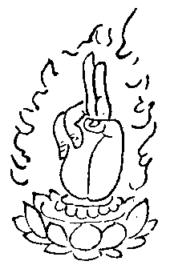



其手作印了，右转护自体，左转辟除众魔，后指八方及上下，即是沐浴(沐浴法竟)。若掘地，亦须密印真言，真言曰(应诵三遍)：



「na　maḥ　sa　ma　nta　bu　ddhā　nāṃ　ha



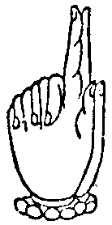



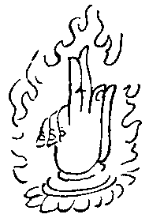



此真言印，或餘经说，如是通用不违背，若能解了旋转者，诸有所作皆成就。次若揣土时，亦须密印真言，真言曰：



「na　maḥ　sa　ma　nta　bu　ddhā　nāṃ　khaṃ



若欲加持地，先入法界心，净除於世间，最下安大空，从空起风轮，乃至於地轮，等香水海观。



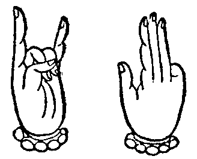



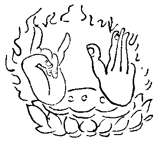



次若欲作量地，若从东北头住，向南度，从东南地至西南度，从此地至西北量，从北方即还本地，度量地如上毕。



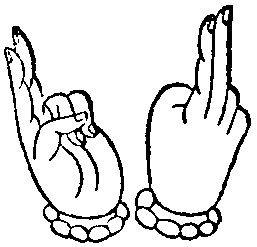



凡有一切供养具，依前列随日转下，更忿怒之像，喜怒与俱。持诵时，从初夜至三，从四更至半夜，初后加hūṃ吽phaṭ发oṃ唵字，后加hūṃ吽phaṭ发。持诵时，蹲踞坐曰之贤坐，若真言之初，以加持本心位。降伏者，转加持白毫际；摄召者，在raṃ字门，色如火光，haṃ此唅字门，色加青黑在风，a此阿字门，色加黄金，vaṃ加此鑁字门，色如白月光，持於下体(名为瑜伽座。持自脐上)；增益者，吉祥座；若真寂灾者，莲华坐。若真言之初后，na纳maḥ麼。



持诵，言之初以oṃ唵字，后加svā莎hā诃。时从后夜至日初出时。持诵时，从日中至日没，悦乐之容，时淡泊之心。



次若事法毕，则向道场坐。



入佛三昧耶真言曰：



「na　maḥ　sa　rva　ta　thā　ga　te　bhyaḥ　vi　śva　mu　khkhe　bhyaḥ　oṃ　a　sa　me　tri　sa　me　sa　ma　ye　svā　hā



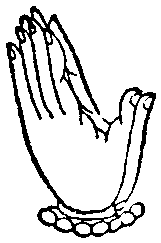



当结三昧耶印，所谓净除三业，遍触诸支分，诵持真实语，才结此密印，能净如来地也。次结法界生，密慧之幖帜，净身口意故，遍转於其身。真言曰(应诵三遍)：



「na　maḥ　sa　ma　nta　bu　ddhā　nāṃ　dha　rmma　dhā　tu　sva　bha　va　ko　haṃ



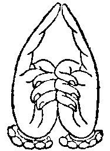



如法界自性，而观於自身，或以真实语，三转而宣说。当见住法体，无垢如虚空。



次，以金刚甲胄，庄严於自身，当观所被服，遍体生焰光。真言曰：



「na　maḥ　sa　ma　nta　va　jra　ṇaṃ　oṃ　va　jra　ka　va　ca　hūṃ



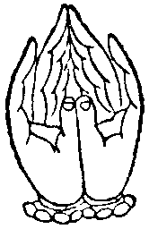



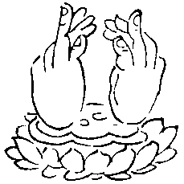



避诸魔除自障者，要诵彼真言已，当观无垢字，及餘恶心类，覩之咸四散。次忏诸罪根，须观raṃ㘕字门，色如日初出，烧除无始罪。真言曰：



「na　maḥ　sa　rva　ta　thā　ga　te　bhyaḥ　vi　śva　mu　khkhe　bhyaḥ　sa　rva　thā　khaṃ　dga　te　spho　ra　he　māṃ　ga　ga　na　kaṃ　svā　hā



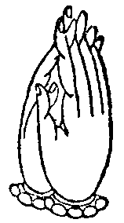



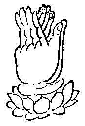



如是真言印，顶戴加五支，并及香花灯，涂香末香等，世间及出世间，所有妙供具，便成三昧供，皆以印真言，是为三业清净。



次结诸方界，以不动印真言，及去垢辟除，护持自身真言曰(应诵三遍)：



「na　maḥ　sa　ma　nta　va　jra　ṇaṃ　ca　ṇḍa　ma　hā　ro　ṣa　ṇa　spha　ṭ　ya　hūṃ　trā　ka　hāṃ　māṃ



定手住其心，慧手普旋转，应知所触物，即名为去垢，以此而左旋，因是成辟除。若结方



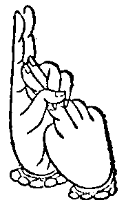



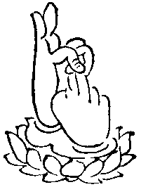



隅界，皆令随右转，所餘众事灭恶净诸障。



次以真言印，而请召众圣，诸佛菩萨说，依本誓而来。真言曰：



「oṃ　va　jra　sa　tva　hūṃ　hūṃ　hye　hye



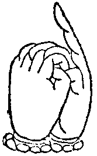



诸佛救世者，以兹召一切，安住十地等，大力诸菩萨，及餘难调伏，不善心众生。其慧风幢，一诵一召，是召请也。



次奉三昧耶，以真言印，印相如上观，诸三昧耶教。真言曰：



「na　maḥ　sa　ma　nta　bu　ddhā　ntāṃ　a　sa　me　tri　sa　me　sa　ma　ye　svā　hā　(入佛三昧耶印)」



以如是方便，正示三昧耶，则能普增益，一切众生类，当得成悉地，速满无上愿，令本真言主诸明欢喜，如是发愿。



次辟除众魔，钩本尊，便入欢喜门，令生尊欢喜，诵辟除真言。真言曰：



「hūṃ　ni　su　dbha　ni　hūṃ



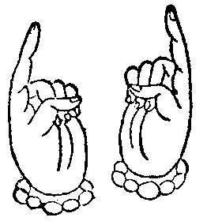



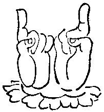



以慧手避从魔，真言并印左转，定手作钩留，即是留本尊也。



次奉献阏伽水。所献阏伽水，先已具严备，以本尊真言，加持真言曰(应通诵十五遍)：



「na　maḥ　sa　ma　nta　bu　ddhā　nāṃ　ga　ga　na　sa　mā　sa　ma　svā　hā







奉诸善逝者，用浴无垢身，次当净一切，佛口所生子。



次奉金刚座，即作莲花印，令坐真言曰：



「na　maḥ　sa　ma　nta　bu　ddhā　nāṃ　āḥ



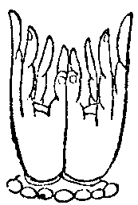



遍置一切处，觉者所安坐。



次当辟除自身所生障，以大慧刀印，圣不动真言。真言曰：



「na　maḥ　sa　ma　nta　va　jra　ṇaṃ　vaṃ



当观最胜金刚焰，焚烧一切障，令尽无有餘，智者当转作，金刚萨埵身，真言印相应，遍布诸支分。



次频诵真言，各说本真言，及自所持明，应如是作已，称名而奉献，一切先遍置，清净法界心。所谓(前不动剑印)raṃ囕字门，如前所献开示称名中。



涂香时，以密印用。真言曰：



「na　maḥ　sa　ma　nta　bu　ddhā　nāṃ　vi　śu　ddha　ga　ndho　dbha　va　svā　hā







次焚香供养。真言曰(应诵三遍)：



「na　maḥ　sa　ma　nta　bu　ddhā　nāṃ　dha　rmma　dhā　tu　dga　te　svā　hā







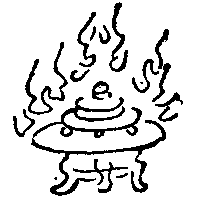



次燃灯供养。真言曰(当诵三遍)：



「na　maḥ　sa　ma　nta　bu　ddhā　nāṃ　oṃ　ta　thā　ga　tā　rci　spha　ra　ṇa　va　bhā　sa　na　ga　ga　nau　da　rya　svā　hā



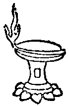



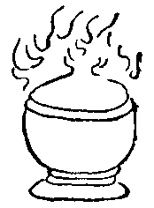



次杂食饮供养。真言曰：



「na　maḥ　sa　ma　nta　bu　ddhā　nāṃ　sa　ra　ra　ka　ra　ra　va　liṃ　da　da　mi　va　liṃ　da　ne　ma　hā　va　liḥ　svā　hā



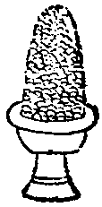



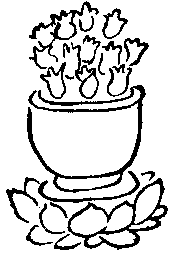



次及餘供养具，所应奉献者，依随此法则，净敬养众圣尊。复作心仪式，清净极严丽，所献皆充满，平等如法界，此方及餘刹，普入诸趣中。依诸佛菩萨，福德而生起，幢幡诸璎盖，广大妙楼阁，及天宝树王，遍有诸资具，众香华云等，无际犹虚空。各雨诸供物，供养成佛事，思惟奉一切，诸佛及菩萨。以虚空藏明，普通供养印，三转作加持，所愿皆成就。次普通印，顶戴广供养，忏悔诸垢，一依本法座，便入三摩地，将以本种子，安置自体内，转成本尊身。真言曰(前普通供养印)：



「na　maḥ　sa　ma　nta　bu　ddhā　nāṃ　a



次持诵法之念诵三落叉，三昧即现前，转成法界身。念诵既毕已，遍数寄本尊，复献阏伽等，诸供养等物，准初广作之，护尊及己身。所作既毕已，顶解三昧耶，护道场及己身，转读摩诃衍，印塔浴佛像，经涉人事，其若初后夜，遍数同一等，午时减半数。



凡持诵法，略有二种：一者依时，二者依相。依时者，谓所期数满，及定时日月限等。依相者，谓佛塔图像出光焰音声等，当知是真言行者罪障净除之相也。若其法事竟，当诵此偈，偈曰：



> 「诸法从缘生，此法从缘灭，  

> 彼法从因灭，是大沙门说。」



凡作曼荼罗者，依前法也，若其度量分短之能造，最大三十六肘、二十八肘、十六肘、八肘、六肘、四肘，极小二肘，皆取受方福人身手肘量，形状如前。若为国王大臣长者，具有种种上妙具七宝器等。



又阿阇梨，有众多聪明快利弟子，应作广坛；若其施主乏少，无七宝上妙供具，亦无众多聪明快利弟子，应作略法，随力所办。凡所供养物，但除五辛酒肉等不净者，其供养器皆用金银铜铁瓷等，餘者悉不堪用，其坛内供养诸味等，一日一易，如果子等，三日一易亦得。



凡欲易供养物及扫拭，先须发遣圣者、启白尊容，然后扫拭涂香供养。行者口云：「尊容暂出离道场。」扫拭讫，涂香，复开座位，覆请已了，供养法如前。



又复内院中央一院主，随其施主所乐佛等为道场主，及般若乃至菩萨等，随意安置中，随主。



供养仪式



灵云校本末云贞享三年四月廿三日一校



　并点烂脱了　净严(四十八载)

