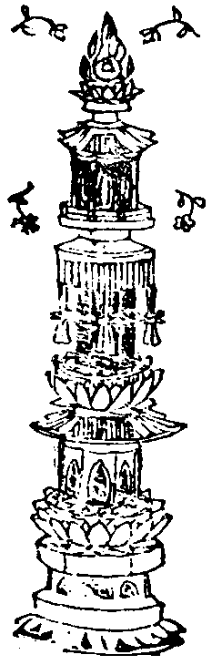

# 苏悉地羯罗经



> **藏经**：大正新修大藏经　**编号** No. 893（T0893a）

> **卷／品**：0 卷 · 37 品



---



## 目录



  - [请问品第一](#请问品第一)

  - [苏悉地羯罗经真言相品第二](#苏悉地羯罗经真言相品第二)

  - [苏悉地羯啰经分别阿阇梨相品第三](#苏悉地羯啰经分别阿阇梨相品第三)

  - [苏悉地羯啰经分别持诵真言相品第四](#苏悉地羯啰经分别持诵真言相品第四)

  - [苏悉地羯啰经分别同伴品第五](#苏悉地羯啰经分别同伴品第五)

  - [苏悉地羯啰经拣择处所品第六](#苏悉地羯啰经拣择处所品第六)

  - [苏悉地羯啰经持戒品第七](#苏悉地羯啰经持戒品第七)

  - [苏悉地羯啰经供养花品第八](#苏悉地羯啰经供养花品第八)

  - [苏悉地羯啰经涂香药品第九](#苏悉地羯啰经涂香药品第九)

  - [苏悉地羯啰经分别烧香品第十](#苏悉地羯啰经分别烧香品第十)

  - [苏悉地羯啰经分别然灯法品第十一](#苏悉地羯啰经分别然灯法品第十一)

  - [苏悉地羯啰经献食品第十二](#苏悉地羯啰经献食品第十二)

  - [扇底迦法品第十三](#扇底迦法品第十三)

  - [苏悉地羯啰经补瑟徵迦法品第十四](#苏悉地羯啰经补瑟徵迦法品第十四)

  - [苏悉地羯啰经阿毘遮噜迦品第十五](#苏悉地羯啰经阿毘遮噜迦品第十五)

  - [苏悉地羯啰经分别成就法品第十六(亦名悉地相品)](#苏悉地羯啰经分别成就法品第十六亦名悉地相品)

  - [苏悉地羯啰经奉请本尊品第十七](#苏悉地羯啰经奉请本尊品第十七)

  - [苏悉地羯啰经供养次第法品第十八(亦名念诵法)](#苏悉地羯啰经供养次第法品第十八亦名念诵法)

  - [苏悉地羯啰经光显法品第十九](#苏悉地羯啰经光显法品第十九)

  - [苏悉地羯啰经灌顶本尊法品第二十](#苏悉地羯啰经灌顶本尊法品第二十)

  - [苏悉地羯啰经祈验相品第二十一](#苏悉地羯啰经祈验相品第二十一)

  - [苏悉地羯啰经受真言法品第二十二](#苏悉地羯啰经受真言法品第二十二)

  - [苏悉地羯啰经满足真言法品第二十三](#苏悉地羯啰经满足真言法品第二十三)

  - [苏悉地羯啰经增威品第二十四](#苏悉地羯啰经增威品第二十四)

  - [苏悉地羯啰经护摩法则品第二十五](#苏悉地羯啰经护摩法则品第二十五)

  - [苏悉地羯啰经备办持诵支分品第二十六](#苏悉地羯啰经备办持诵支分品第二十六)

  - [苏悉地羯啰经成就诸物相品第二十七](#苏悉地羯啰经成就诸物相品第二十七)

  - [苏悉地羯啰经取成就物品第二十八](#苏悉地羯啰经取成就物品第二十八)

  - [苏悉地羯啰经净除诸物品第二十九](#苏悉地羯啰经净除诸物品第二十九)

  - [苏悉地羯啰经诸物量数品第三十](#苏悉地羯啰经诸物量数品第三十)

  - [苏悉地羯啰经除一切障大灌顶曼荼罗法品第三十一](#苏悉地羯啰经除一切障大灌顶曼荼罗法品第三十一)

  - [苏悉地羯啰经光显诸物品第三十二](#苏悉地羯啰经光显诸物品第三十二)

  - [分别悉地时分品第三十三](#分别悉地时分品第三十三)

  - [苏悉地羯啰经圆备成就品第三十四](#苏悉地羯啰经圆备成就品第三十四)

  - [苏悉地羯啰经请尊加被成就品第三十五](#苏悉地羯啰经请尊加被成就品第三十五)

  - [苏悉地羯啰经补阙少法品第三十六](#苏悉地羯啰经补阙少法品第三十六)

  - [苏悉地羯啰经被偷成物却徵法品第三十七](#苏悉地羯啰经被偷成物却徵法品第三十七)



---



苏悉地羯啰经卷上



大唐中天竺三藏输波迦罗译



------



### 请问品第一



尔时，忿怒军荼利菩萨合掌恭敬，顶礼尊者执金刚足，发如是问：「我曾往昔於尊者所，闻一切明王曼荼罗法及以次第，复闻明王并诸眷属神验之德。愿为未来诸有情故，唯愿尊者广为解说，以何法则持诵真言速得成就？其真言字虽有一体，所成就法其数无量？以颂偈问：



> 「云何真言相，及阿阇梨相？  

> 云何成就者，并说伴侣相？  

> 方所何为胜？何处速易成？  

> 云何调伏相，及应不应作？  

> 云何诵真言，方便及次第？  

> 何花得易成？云何用涂香？  

> 云何供养食？复烧何等香？  

> 云何然灯相？云何扇底迦？  

> 云何增益相？云何降伏怨？  

> 於此三种中，各成何等事？  

> 云何上中下，次第成就相？  

> 以何法请召？云何供养之？  

> 云何作护身？云何广持诵？  

> 何相诵真言？云何作灌顶？  

> 真言试何相？云何当受持？  

> 云何字得圆？云何得增益？  

> 云何作护摩，及以次第法？  

> 复用何等物，能令速成就？



> 「云何成就诸药相？云何而受诸药相？  

> 云何能净诸药法？云何药量及多少？  

> 彼诸药等并相貌，唯愿尊者具慈悲，  

> 一一分明为我说。云何护诸成就物，  

> 及以分别为分数？云何受用成就物？  

> 唯垂分别说彼相。云何失物令却得？  

> 云何被破令著彼？云何先知作碍相？  

> 云何成就曼荼罗？云何办事曼荼罗？  

> 云何灌顶曼荼罗？



> 「如上诸所问，及以随要者；  

> 为诸众生故，唯愿广分别。」



------



### 苏悉地羯罗经真言相品第二



尔时吉祥庄严一切持明应供养手执金刚大悲菩萨告彼金刚大精进忿怒军茶利言：「善哉善哉！大忿怒！能於我所发如斯问，应当一心谛听是胜上微妙法则。此苏悉地羯啰有五种庄严：一谓大精进；二谓明王；三、能除障；四、能成就一切勇猛事；五、能成就一切真言。此《苏悉地经》，若持餘真言法不成就者，能兼持此经，本真言当速成就。於三部中此经为王，亦能成办一切等事，所为护身、结界、召请等事；供养、相助、决罚、教授等事，一切真言能得成就。



「复次，或有心真言中，有三『𤙖』字者，亦能成办如上所说一切法事。三𤙖心真言：



「『曩(上)谟(上)　啰怛囊(上二合)怛啰(二合)夜也　囊(上)莽室战(二合)拏　嚩日啰(二合)簸儜(上)曳　莽诃(上)也乞沙(二合)细囊钵多(上)曳　唵　苏悉地也(二合)　悉地也　娑(去)大也　苏悉地羯罗　𤙖　𤙖　𤙖　泮咤(二合)　泮咤』



「复次上中下成就法，如别经中说欲求成就者须解真言上中下法。此经通摄三部所作曼荼罗法：佛部真言扇底迦；观音真言补瑟徵迦；金刚真言阿毘遮噜迦。从腋至顶为上品；从脐至腋为中品；从足至脐为下品。於真言中，亦应分别三种成就，於此三部各分为三，善须了解。於三部中，真言明王是上成就；诸餘使者、制咤、制徵等真言是下成就。诸餘尊者所说真言，是三种事法者：一、扇底迦法；二、补瑟迦法；三、阿毘遮噜迦法。凡是三事，於三部中各各皆有，应须善知分别次第。



「佛部之中用佛眼，号为佛母，用此真言为扇底迦。佛母真言曰：



「『曩谟　婆(去)伽嚩姤乌瑟腻(二合)沙(去)也　唵(一)　噜　噜　娑普(二合)噜(二)　什嚩(二合)啰(三)　底瑟咤(二合)(四)　悉驮(去)　路者宁(五)　萨啰嚩(引二合)啰他(二合)娑(引)驮宁(六)　娑嚩(二合)诃』(诵三遍)。



「莲花部中用观音母，号为半拏啰缚悉宁，用此真言为扇底迦。观音母真言曰：



「『那啰舍(二合)曩　婆缚(二合)啰舍囊(引)　弊(毘也反)嚩(平)　室啰(二合)嚩　娑莽(二合)啰嬭囊　者泻　莽(上)含　萨啰嚩(二合)　萨怛嚩(引二合)难(去)　萨啰嚩(二合)　微也(二合)地　指枳怛瑳(上)迦　怛姪他　唵　迦𪘨　微迦𪘨　迦咤　微迦咤　迦祯(咤应反)　迦𪘨　婆(去)伽(轻呼)嚩底(丁以反)　微惹(而也反)曳　娑嚩诃(三遍)』



「金刚部中用执金刚母，号为忙莽鸡，用此真言为扇底迦。金刚母真言曰：



「『曩谟(引)　啰怛曩(二合)怛啰(二合)夜也　曩莽室　战(二合)拏　嚩日啰(二合)簸儜(上)曳　摩诃(去)药乞沙(二合)细囊钵多(上)曳　唵　俱(上)兰达哩　满驮　满驮　𤙖(大声)　泮咤(三遍)』



「又佛部中用明王真言，明王号曰最胜佛顶，用此真言为补瑟徵迦。明王真言曰：



「『曩莽　三漫多　没驮难(去)　唵　悖论(引二合)　曩莽』



「莲花部中亦用明王，号曰诃野𨰿利嚩，用此真言为补瑟徵迦。明王真言曰：



「『唵　暗没栗(二合)姤椰婆(上二合)嚩　曩莽　莎(去)诃』



「金刚部中亦用明王，号曰苏嚩，用此真言为补瑟徵迦。真言曰：



「『曩谟　啰怛曩(二合)怛啰(二合)夜也　曩莽室　战(二合)拏　嚩日啰(二合)簸儜(上)曳　莽诃(去)药乞沙(二合)细囊钵多(上)曳　唵　素唵(二合)婆　宁(上)素唵(二合)婆　𤙖　𨰿㗚(二合)恨儜　𨰿㗚恨儜　𤙖　阿(去)囊也　𤙖　薄伽(轻)𭊃　尾尔夜(二合)啰(引)惹　𤙖　泮咤(二合)　曩莽』



「又佛部中用大忿怒，号曰阿钵啰氏多，用此真言为阿毘遮噜迦。真言曰：



「『𤙖　泮咤(二合)　缚迦(轻)　缚迦(轻)　指囊悉指迦(轻二合)　𤙖　泮咤(二合)』



「莲花部中大忿怒，号曰施嚩(去)嚩(平)诃，用此真言为阿毘遮噜迦。真言曰：



「『𤙖　泮咤(二合)　嘻唎(二合)　𤙖　泮咤(二合)』



「金刚部中大忿怒号曰军茶利，用此真言为阿毘遮噜迦。真言曰：



「『囊谟　啰怛曩怛啰(二合)夜也　曩莽室　战拏　嚩日啰(二合)簸儜(上)曳　莽诃药乞沙(二合)细囊钵多曳』



「『唵　暗没㗚(二合)多军茶里　佉佉　佉佉　却(引)醯　却醯　底瑟咤　底瑟咤　满驮　满驮　贺囊　贺囊　𨰿啰若徵(并疑反)𨰿啰若　徵娑铺咤也　娑铺咤也　萨啰嚩(二合)　尾近囊(上)　微囊也迦(引)　莽诃(去)儜(上)钵底(丁以反)　饵尾旦多羯啰(引)也　𤙖　泮咤(二合)』



「复次，或有真言不入三部，随彼真言文字而办扇底迦等三种法事。其真言中，若有扇底句噜字(令吉祥也)、閦莽字(除也)、钵啰(二合)閦莽字(极净也)、乌波閦莽字(更除也)、莎(去)诃(去)字者，当知即是扇底迦真言。



「若有补瑟徵字(增益也)、落乞澁民(三合，具相也)、　那那(与也，谓与)、乌(去)乳字(威德也)、麼罗(力也)、嚩㗚(二合)地(增也)、露波咩驮(聪也)、但囊(财也)、但宁(上)也(藏也，二合)、醯里宁(上)也(金也)、𮓌啰(引)莽(村邑也)、囊(上)𮓌啰(城也)、啰(引)瑟咤(二合，堡也)、啰(引)尔阎(主也，二合)、那那字(与也)者，当知即是补瑟徵迦真言。



「若有𤙖字、贺囊(击也)、畔咤(二合，破也)、莽他(二合，摧也)、畔若(打破也)、乌柘咤也(楚切也)、乌槎(去)肥也(用力勿放也)、戍沙也(涓枯也)、忙啰也(杀也)、却(引)那也(食也)、枳椤也(钉也)、齿曳(二合)挪也(断坏也)、婆(去)悉咩(二合，钵也)句噜字者，当知即是阿毘遮噜迦真言。



「复有真言句义慈善，当知即入扇底迦用；若有真言句义猛怒，当知即入阿毘遮噜迦用；若有真言非慈非猛，当知即入补瑟徵迦用。



「复次，若欲速成扇底迦者，当用佛部真言；若欲速成补瑟徵迦者，当用莲花部真言；若欲速成阿毘遮噜迦者，当用金刚部真言。



「复次，此经深妙如天中天，亦有真言上中之上，若依此法一切诸事无不成就。此经虽属金刚下分，以奉佛教勅许通成故，亦能成就上二部法。譬如国王勅许依行，此法亦尔，准义应知。



「若有真言字数虽少，初有『唵』字，后有『莎(去)诃』字，当知真言速能成就扇底迦法；或有真言初有『𤙖』字，后有『泮咤』字，或有『𭋤普』字——此是诃声，有如上字真言，速得成就阿毘遮噜迦法；或有真言，初无『唵』字，复无『莎诃』字，又无『𤙖』字，亦无『泮咤』字及无『𭋤普』等字者，当知此等真言速能成就补瑟徵迦法。



「若复有人欲求摄伏诸餘鬼魅及阿毘舍，当用使者及制咤迦等所说真言速得成就；若复有异部真言云能成就一切事者，但能成就本部所说，不通餘部。犹有经演彼有真言为除毒病，故说亦能除餘诸苦，当即知其通一切用。善知其部、善识真言所应用处，亦须知其真言功力，复须善解修真言法，随所求随称彼法真言言相，诵彼真言即得成就。



------



### 苏悉地羯啰经分别阿阇梨相品第三



「复次，我今当说阿阇梨相。一切真言由彼而得，故知阇梨最为相本。其相者何？谓：支分圆满福德庄严；善须知解世出世法；恒依法住不行非法；具大慈悲怜愍众生；贵族生长性调柔软；随所共住皆获安乐；聪明智慧辩才无碍；能怀忍辱亦无我慢；常乐大乘及解妙义；深信秘密之门；纵有小罪犹怀大怖；身口意业善须调柔；常乐转读大乘经典。复依法教勤诵真言而不间断；所作悉地皆悉成者。



「复须善解畫曼荼罗；常具四摄；为求大故不乐小缘永离悭悋；曾入大曼荼罗而受灌顶。复为先师而叹：『德者，汝从今往堪授灌顶为阿阇梨！』获斯印可方合自手造曼荼罗，须依次第亦合授与弟子真言。若依此者所受真言速得成就不可怀疑，不於和上阿阇梨处，擅诵真言徒用功劳终不获果。



「弟子之法：视阿阇梨犹如三宝及菩萨等，为能授与归依之处；於诸善事而为因首，现世安乐当来获果；为依阿阇梨故，不久而得无上胜事，所谓菩提。以是义故比之如佛，以为弟子承事阇梨无有懈怠勤持不阙，所授明王及明王妃当得悉地必无疑也。



------



### 苏悉地羯啰经分别持诵真言相品第四



「复次，我今演说持诵真言速获成就修行法相。三业清净心不散乱；曾无间断常修智慧；能行一法成就众事复离悭悋；所出言辞无有滞碍；处众无畏所作速办；当行忍辱离诸谄佞；无诸疹病；常行实语善解法事；年岁少壮诸根身分皆悉圆满；於三宝处常起信心；修习大乘微妙经典；诸善功德无怀退心。如此之人速得成就。



「於诸菩萨及以真言常起恭敬；於诸有情起大慈悲，如此之人速得成就。



「常乐寂静不欲众閙，恒行实语作意护净，如此之人速得成就。



「若闻执金刚菩萨威力自在，闻已谛信心生欢喜，如此之人速得成就。



「若人少欲及以知足，诵持真言念所求事日夜不绝，如此之人速得成就。



「若人初闻真言法，则身毛皆竖心怀踊跃欢喜，如此之人成就法器。



「若人梦中自见悉地如经所说，心乐寂静不与众居，如此之人速得成就。



「若人复有於阿阇梨所敬重如佛，如此之人速得成就。



「若人持诵真言，久无效验亦不弃舍，倍增广愿转加精进以成为限，如此之人速得成就。



------



### 苏悉地羯啰经分别同伴品第五



「复次，当说其同伴相。福德庄严贵族生者；常乐正法不行非法；复怀深信离诸恐怖；精进不退奉行尊教常作实语；诸根支分皆悉圆满身无疾病；不过大长复不大短、不大肥麁亦不瘦小、不用大黑亦不极白，离此诸过；福德同伴能忍诸苦；善解真言及曼荼罗供养次第诸餘法则；常修梵行忍顺诸事；出言柔软令人乐闻；离诸我慢强记不忘；有教奉行不相推托；多闻智慧、慈心不瞋、常念布施；善解分别明王真言；常须念诵所持真言；与尊行同兼明结界、护身等法。得如是伴当速成就。



「三业调善；曾於师所入曼荼罗；归依佛教不习邪法；善知尊者所须次第；不待言教随有所求知时即送。具如此者为胜同伴。



「身意贤善心无忧恼，决定坚固终不退心，得如是伴当速成就。



「於多财利不生贪著，具如是德说为胜伴。



「复於行者心无舍离。若欲成就诸餘药等，为作强缘不应舍离，自然圣戒，具如是德说为胜伴。



「於行者处无所规求，未得悉地成就以来终不舍离，纵淹年岁复无悉地，终不怀於舍离之心。假有大苦及餘难事，逼切身心亦不应舍，具如是德说为胜伴。



「若有如前种种德行，堪能成就最上胜事。纵无前德，但明真言成就法则，并须善解诸曼荼罗智慧高明，复加福德胜持诵者，如是之伴亦能成就最上胜事。



「为欲成就最上胜事故，其福德伴半月半月与持诵者而作灌顶及以护摩，随时所办香花、然灯，诸餘次第拥护拣择，随所有为并须助作非直助修。如前等事若持诵者有所亏失，其福德伴依於经法，以理教诲勿令有阙，乃至广为开示因缘，具如是者最为胜伴。



「行者每日持诵之时，及所行事有时忘失，其福德伴随所见处，相助作之使令周备。若欲成就药法之时，须常以手按其药，或以草干而用按之，念诵作法事务虽多终不废忘。



「行者持诵欲了之时，其伴当须侧近而立，看彼行者念诵既劳，或恐忘作发遣尊法、置数珠法及餘法等，见彼忘处应助作之。其伴常须持诵供养所作诸事而生福德，并皆回向持真言者满所求愿。有所指授唯共伴语，既欲成就最胜事故，更许一伴展转令语不得参差。



「其伴所食与行者同，行者所食如依法制，具如是者堪为最上胜事同伴，第三同伴福德亦然，一如前说。



------



### 苏悉地羯啰经拣择处所品第六



「复次，演说持诵真言成就处所者，於住何方速得成就。佛所得道降四魔军，如是之处最为胜上速得成就。尼连禅河於彼岸侧无诸难故，其地方所速得悉地，纵有众魔不能为障，所求之事无不成就，如是之处速得悉地。或於佛所转法轮处；或於拘尸那城佛涅槃处；或於迦毘罗城佛所生处。如上四处最为胜上，无障娆故三种悉地决定得成。



「又於诸佛所说胜处；复有菩萨所说胜处；佛八大塔；或於名山多诸林木，复多果实泉水交流，如是之处说为胜处。



「或於兰若多诸花果，复有水流人所爱乐，如是之处说为胜处；复有兰若多诸麋鹿无人采捕，复无罴、熊、虎、狼等兽，如是之处说为胜处。



「或无大寒复无大热，其处宜人心所乐者，如是之处说为胜处。



「或於山傍；或山峰顶；或独高台；或於山腹中彼复有水，如是之处说为胜处。



「复有胜处青草遍地树多诸花，中有其木堪作护摩，如是之处说为胜处。



「或於安置舍利塔前；或於山中安舍利处；或四河边；或有兰若，种种林木而饰严之无多人处；或於寒林烟不绝处；或大河岸；或大池边；或於曾有多牛居处；或於逈独大树之下，神灵所依日影不转；或多聚落一神祠处；或於十字大路之边；或龙池边，如是之处说为胜处。



「或佛经行所至之国，如是之方速得成就。但有国土诸人四辈，深信三宝弘扬正法，如是之处速得成就。



「复有国土多诸仁众并具慈悲，如是之处速得成就。



「既得如是上妙处所，应须拣择地中秽恶瓦砾等物，曼荼罗品一一广明。如悉地法善须分别三部处所；复须分别扇底迦法、补瑟徵迦、阿毘遮噜迦如是三法；复须分别上中下成，即於是处随心所宜，应涂洒扫作诸事业，速得成就悉地之法。



------



### 苏悉地羯啰经持戒品第七



「复次广说制持真言法则，若依此戒不久当获成就。若有智者持诸真言先断於瞋，乃至邪神不应生忿；复於餘类持真言者亦不怀瞋。於诸真言不应擅意乃至功德及诸法则而分别之；应於诸真言及以法则深生敬重；於诸恶人善须将护。何以故？能障大事及怀彼故。於阿阇梨所纵见愆过三业，犹不生於憍慢之心，口不谈说种种是非心意，终不分别愆过之想。纵有愆过尚不谈说，况依法耶？纵他怀恶终不加报；又复不得以自所持真言缚他明王及生损害并苦治罚；亦复不应作降怨法。未曾经於阿阇梨处而受真言者，不应与彼受持；又於三宝处不生恭敬者及是外道，虽於阿阇梨所受得真言后退本心亦不可与；乃至手印及以真言并功能法及普行法并不应与；未曾经入曼荼罗者亦不授与。



「不应跳蓦一切有情两足之类，乃至多足亦复如是；又不应蓦诸地印过，所谓：锤、轮、棒、杵、螺、拔折罗等，及以索成并不应蓦；诸餘药草、根茎、枝叶及以子实亦不应蓦；亦不弃於不净之中。



「若乐成就真言法者，应须依制不应诘难大乘正义；若闻菩萨甚深希有不思议行应生谛信不怀疑心；持真言人不应与彼别持诵人更相施验；若缘小过不应作降伏法；乐成就人不应歌咏调戏；又为严身故，不应涂饰及带花鬘亦不跳踯而行，亦不河中浮戏。



「略而言之，身诸调笑皆不应作，口业不善皆不应作。所谓：作虚诳语、染污心语、离间和合、恶口骂詈。所作对答不假多言，无益言谈终不习学；亦复不与外道共住，及以难诘旃荼罗类皆不与语；不应与於诸人谈话唯除同伴。



「当念诵时纵是同伴亦不与语，持诵餘时自非所须不与伴语，亦不以油涂身。又不应吃五辛、䓗、䔉、萝卜、油麻并酢，及餘一切诸菜茹、米粉、豆饼并馑毕豆，及油麻饼并作团食皆不应吃；一切毘那夜迦所爱之食及供养残食，油麻、粳、豆粥及以乳粥皆不应食；一切车乘及以鞍乘皆不乘骑，及所被蓦食并被触食并不得食。



「又一切严身之具，所谓：镜、花并以粉、药、伞盖非因缘事；不应以手揩手，以脚揩脚；不於一切水中及侧近水大小便；不应以手承食而食，亦不用锤铜器食，其诸叶中不翻盛食。



「不卧大小床榻，亦不与人同卧。欲卧之时安心寂静清净而卧，寻思智慧，不覆面而卧亦不仰卧，如师子王右脇而卧。当卧之时不得张目而睡。



「日不应再食；不应断食；不应多食；不应全少，於食有疑不须食之。一切调戏及多人丛聚，乃至女人皆不观看。身口意等所受好房舍及好饮食皆不应著；应受恶房舍及恶饮食皆不应弃。



「不应著紫衣裳及不著故破之衣、垢秽之衣，念诵之时应著内衣。



「亦不自卑下云：『多愆犯，无由得成悉地。』复为宿世之业身婴诸疾，终不应违阙念诵，於阿阇梨边所受真言终不舍弃；於其梦中或於虚空又声告言：『汝不应持是真言。』如是频闻亦不舍弃复不瞋彼。何以故？并是魔故。唯须精进不应退止，心不恶思攀缘诸境纵放诸根，恒常护净而念诵之。



「若求大成就，自所持真言不应摄伏魍魉，亦不拥护自他，亦不救难及禁诸毒；非持所持真言诸餘真言亦不应作；所有随用一切真言皆不应频频而作；亦不与人互诤验力。



「若欲求悉地，当须三时持诵三时洗净，洗净净时非但空水，和真言水而洗净之。水真言曰：



「『唵　𤙖　贺曩　嚩日哩(二合)　嚩日𭋤儜(上)　贺(上惊声)』



「澡浴之时，应用净土遍身涂洗，用真言土诵经七遍。土真言曰：



「『唵　嚩日啰(二合)　贺啰　𤙖』



「水土之中多有行障毘那夜迦，先须发遣然后用之，诵此真言而遣逐之。於水土中遣障真言曰：



「『曩谟　嚩日啰(引)也　𤙖　贺曩　度曩　莽他　尾特瞢(二合)娑瑜瑳(去)啰也　泮咤』



「又先取水以手和搅，诵真言讫而用澡浴。澡浴真言曰：



「『曩谟　啰怛曩(二合)怛啰(二合)夜也　娜莽室　战(二合)拏　嚩日啰(二合)簸儜(上)曳　摩诃(去)药乞沙(二合)细囊钵多(上)曳　娜谟(上)能(去)』



「用此真言水随意澡浴。澡浴之时不应谈话，澡浴未了已来，常须心念次下心真言。浴时心真言曰：



「『唵　暗没(二合)帝　𤙖　泮咤(二合)』



「澡浴既了，应以两手掬水一掬，用前心真言加之，经诵七遍用灌其顶。如是三度应结顶发，诵真言之经七遍当顶作发。若是出家，应以右手为拳置於顶上，如前遍数同结顶发。顶发真言曰：



「『唵　苏悉地羯哩　莎(去)诃』



「次应洗手，取水三度漱口，然后浴自本尊，用本真言诵经七遍，诵漱口真言遍身五处：



「『唵　枳里　枳里　嚩日啰　𤙖　泮咤(二合)』



「澡浴都了想浴本尊，复於其处当诵所持真言，任诵多少然始可往常念诵处，乃至未到彼所已来，不怀贪瞋随顺诸境，身心清净敬想本尊而徐徐往，坚持禁戒如前所制当持不忘。既到彼所，即应如法作诸事业而念诵之。



「当须作曼荼罗，常念诵既疲当须转读大乘经典或作制多，诸餘善事常不废忘，应须三时归依三宝；三度忏悔诸餘罪业；三时发菩提心，若如是者当得成就；三时发愿，愿成所胜事。为除罪故应当依教作诸善业，常行惠施具大慈悲，於诸法教不生悭悋，常怀忍辱精进不退，深怀归信六念在心。所闻经典谛思其义，常须转读真言功德，当须供养真言法经，依善畫妙曼荼罗。应须入发之初，令谛信比丘入之，比丘尼、优婆塞、优婆夷随次入之，并皆坚固发菩提心、决定心、正见。



「入曼荼罗了，应当授与结手印法及真言，并以法则亦应正说，广为宣说一切真言法则。或十四日、或月八日及以月尽日、或十一日、十五日，如是之日倍加供养，及以持诵并作护摩加持禁戒，常须忆念倍加诸事，真言速成。



「作护摩时常须以手持拔折罗，诵真言之经餘千遍或一百遍。办事金刚真言曰：



「『唵　度曩　嚩日啰(二合)　贺』



「诸事金刚应用天火所烧之木，或苦练木；或取烧尸残火糟木；或用白檀；或紫檀木，随取一木作拔折罗应施三股。护摩之时及念诵时，常以左手而执持之，能成诸事，故号拔折罗。若持此金刚者，一切毘那夜迦及餘作障者，并皆恐怖驰散而去。以紫檀香涂是金刚置本尊前，当用如前所说真言持诵花香而供养之，其诸事业金刚秘密微细，能成就诸餘事等。



「作诸事时常须右手带持珠索，以香涂之诵真言之，一百遍或一千。珠索真言曰：



「『唵　句兰达哩　满驮　满驮　𤙖　泮咤(二合)』



「此明王大印名忙莽鸡，能成一切明王真言，亦能增益及能满足真言字句，亦能成就诸餘法乃至护身等事，非直但是诸明王母亦是金刚之母。



「若金刚部珠索，著一呜噜捺啰叉，穿於线中后系为结，金刚部中既尔，餘二随可知。佛部珠索应用佛母真言；若莲花部珠索应用半拏啰嚩斯泥真言；金刚部珠索，应用忙莽鸡真言。(三部母真言准前说之)



「带持此珠索者，毘那夜迦不能为障，身得清净当速成就满所求愿。



「又作法之时当用茅草作镮，置於右手无名指上。应诵当部三字半心真言，经百遍或经千遍后安指上。佛部心真言曰：



「『尔曩尔迦(轻)』



「莲花部心真言曰：



「『阿(夫)𡀔力迦(轻)』



「金刚部心真言曰：



「『嚩日啰地嘞(二合)迦(轻)』



「供养之时、持诵之时、护摩等时应著草镮，以著此草镮故，罪障除灭手得清净所作皆成。复取白㲲丝及以麻缕，令童女染作红色或作欝金色，合作线结为真言索。一结应诵七遍真言经，餘七结置本尊前，以真言持经一千遍。念诵之时及护摩时并以卧时——卧时者暮时也应用系腰、夜卧之时不失精秽，故常须作加持索真言曰：



「『唵　贺啰　贺啰　满驮宁(上)　束讫啰(二合)驮啰尼(上)悉驮啰替(二合)　莎(去)诃(去)』



「念诵之时及护摩时，应须上下著衣偏袒右肩，若以卧时洗净及浴之时不在此制。所著上衣应真言之；若大小便应著木履；若於本尊前及和上阿阇梨前并餘尊宿前不应著之，於诸尊处用身口意而供养之。若乐悉地速得成者，若见制多及以比丘常应礼敬；若遇外天形像但应合掌或诵伽陀；若见尊者亦应致礼。



「若闻妙法深生敬信；若闻菩萨不思议相，或闻真言所成诸事皆应欢喜心怀踊跃；若乐速成者常应勇进不生懈怠。如前所制常须思念，若不如是者当违制戒获大重罪，悉地不成。



「身等诸根恒常忆念，不应贪著诸欲，复须常行如前所制不可废忘。若晨朝时造诸恶业，至於暮间即忏悔；若於夜中纵造诸业，至晨朝时诚心忏悔。复须清净念诵及以护摩供养等，如依本戒应须如是遣度时日，当於明王戒中常须作意，不久住於悉地之中。



------



### 苏悉地羯啰经供养花品第八



「复次分别说三品事业。所谓三品者：即扇底迦法、补瑟徵迦法、阿毘遮噜迦法。是为三品。



「三部之中，有三等真言。所谓：圣者所说、诸天所说、地居天说。是为三部。圣者所说者：佛、菩萨、声闻、缘觉所说，是为圣者真言；诸天所说者：从净居天乃至三十三天中间诸天所说，是为诸天真言；地居天说者：诸龙、夜叉、罗刹、阿修罗、迦楼罗、乾闼婆、紧那罗、摩护罗、部多、卑舍遮、鸠盘茶等所说，为地居天真言。



「作扇底迦法，应用圣者说真言；作补瑟徵迦法，应用诸天说真言；作阿毘遮噜迦法，应用地居天说真言。



「若求上成就，应用圣者真言；若求中成就，应用诸天真言；若求下成就，应用地居天真言。



「如前三部中及求三等成就，并作三种等法，应用水陆所生种种诸花，当须各依本部善分别之，以真言加持应当奉献。奉献之时发如是愿：『此花清净生处复净，我今奉献愿垂纳受当赐成就。』献花真言曰：



「『何(上)贺啰　阿贺啰　萨啰嚩(二合)　尾儞夜(二合)达啰　布尔帝　莎(去)诃(去)』



「当用此真言持花供养通及三部。若献佛花，取白花香气者供养之；若供献观音，应取水中所生白花而供养之；若献金刚，应用种种妙花而以供养；若献地居天，随时所有种种诸花随取而献。忙攞底(丁异反)花、簸咤罗花、莲花、瞻卜花、龙蘂花(似牡丹花)、嚩(无可反)句蓝花、俱物头花、娑罗树花、末利花、举亦迦花、喻底(厅以反)迦花、势破理迦花、句噜嚩(同前)釰花、迦淡闻华、末度摈尼(上)迦花、怛㗚(二合)拏花、彦陀补澁波花、本囊(去)言花、那嚩(无可反)忙里迦花、阿输(去)剑花、母注捃难花、那莽难花、注多曼折利花、勿嘞刍乌钵罗花、迦咤㘕花、建折那(上声)蓝花、娑摈尼(上)剑花、忧钵罗花、得𮓌㘕花、捃陀难花、迦啰末花等，於林邑兰若所生者及水陆生，如上等花应须善知三部所用，及以三品三等供献。



「用忙攞底(丁以反)花、得𮓌㘕花、捃难花、末理迦花、喻底(听以反)迦花、那龙絮花，如上等花佛部献；用忧钵罗花、俱物头花、莲花、娑罗树花、势破理罗阇底(丁以反)迦花、本那言花、得𮓌㘕花，此上等花观音部中供养为胜；青莲花、钵孕衢花，花叶枝条，餘不说者，并皆通献金刚部中。



「如上花中白色者当作扇底迦法；黄色者作补瑟徵迦法；紫色者作阿毘遮噜迦法。



「如是花中甘味者，作扇底迦法；辛味者作阿毘遮噜迦法；淡味作补瑟徵迦法。



「或於净处所生枝蔓花条，始生芽茅草，或小草花、或中树花、大树花，种种诸花随类应用。阇底花、苏末那花，单通献佛；莲花单献通供养观音；青莲花奉献金刚各为胜上。



「佛部之中，作扇底迦法，用阇底苏末那花；作补瑟徵迦法，用莲花；作阿毘遮噜迦法，用青莲花，餘二部类此作之。上色妙香花，中色香花，下色香花，随事分用。



「或用取花条，或用花朵以献妃天等用，说为上胜；紫白二色羯啰末啰花，应用奉献忿怒尊主及诸使者，说为上胜。



「句咤惹(而也反)花、底落迦花、娑罗花、迦㗚尼(上二合)迦(引)啰(引)花、阿娑囊(去)努噜莽(二合)花、尾螺花、迦咤㘕花等，随取其一而供养之，遍通三部及上中下、除灾等三，复有种种诸花合成为鬘，或种种花聚持以供养，遍通九种。



「种种花中，不用臭花或刺树所生，或苦辛味；或前广列花名之中无名之者亦不应用；木堇花、计得剑花、阿地目得迦花、瞢句蓝花、宁(去)簸花等，亦不应用。



「长时供养通九种者：红花、闪弭花、钵啰孕句花及骨路草，并此等类稻谷花，油麻相和。如上所说种种花等供养最为胜上。如无此类种种诸花，但用白粳米择碎者而供养之亦通九种，不得互用其花。



「如作法之时求不得者，随所得花应诵当部花真言而加持之。若无花献应用苏啰二枝叶，或莽噜闻叶、滩敦叶、耽忙(去声)罗叶、讫㗚(二合)瑟拏(二合)末利迦叶、忙都抃伽叶、阏啰惹(而也反二合)迦叶及兰香等类而替献之。



「如无此等枝叶，应用嚩(无可反)落迦根、甘松香根、卷柏根、牛膝根及餘香药根，香果亦通供养。所谓：丁香、荳蔲、肉荳蔲、甘橘及一切香果等，通替花供养。



「若无如上花叶根果献者，先曾见献供，或曾闻说；或自曾献花，随其所知应令自运心想而供养之，最为胜上供养。



「虽有如前花果等献，若能至心虔诚合掌顶奉，供养本尊花等，如是心意供养最上，更无过者致作之，常应如是供养不得怀疑。



------



### 苏悉地羯啰经涂香药品第九



「次复我今说途香药法，随诸真言应合供养能成众福。其名曰：香附子、句咤囊(上)咤、青木香、嚩落迦、乌施啰、舍哩嚩、煎香、沈香、欝金香、白檀香、紫檀香、嚩啰拏(二合)那噜钵啰(或粉忙啰钵怛罗)、拏(二合)剑娑啰蓝(云松木是)、娑比嘞(二合)迦钵持莽(二合)剑(云柘木是)、带啰钵㗚尼(上二合)迦(引)利也剑(或曰翻云黑拂刷子黑)、丁香、婆罗门桂皮、天木香、钵孕瞿、阏乳难燥啰盆泥(去)崩细攞嚩噜剑、迦毕贪、咾达啰讫啰(二合)母剑颇里迦宁(上)囊里迦、始嚩(引)瞻(去)臂、苏嚩㗚拏(二合)赊迦㘕、忙覩抃伽(并皮)、多利三薄娑怛㗚(三合)拏忙(去)斯(甘松香是)、那莽难莽噜崩梵母啰计施耽(云水苏)、忙(去)罗本囊(去)言、医罗末夜(二合)杰啰(二合)囊(上)却没痴啰嚩利嚩(引)澁比(二合)迦、怛儞阎(二合，胡荽)设多补澁波(二合，回香)、诃𭋤、蔬蹄草、拏迦(云蔬蹄草)、脚句蓝、(白荳蔲)、惹(而夜反)底(都以反)颇罗诸啰剑劫伴蓝娑縚(二合)嬭阎地夜(二合)莽剑、战茶、都噜瑟剑(二合，苏合香)、钵啰(二合)娑怛(二合)婆嚩(二合)计萨㘕等类；及胶汁，所谓：龙脑，言陀罗娑、娑遮啰娑、安悉香、薰陆香、设落翅势嚩(引)娑迦等，及餘有胶树香者，并通随其本部善须合和。



「用诸草香、根汁、香花等三物和为涂香，佛部供养；诸香树皮及坚香木，所谓：栴檀、沈水、天木等类并以香果，如前分别和为涂香，莲花部用；诸香草、根花果叶等和为涂香，金刚部用。



「或有涂香具诸根菓，先人所合成者，香气胜者，通於三部。



「或唯用沈水和少龙脑以为涂香，佛部供养；唯用白檀和少龙脑以为涂香，莲花部用；唯用欝金和少龙脑以为涂香，金刚部用。



「紫檀涂香通於一切金刚等用；肉豆蔲、脚句罗惹(而也反)底(都以反)苏末那，或湿沙蜜、苏澁咩罗钵孕瞿等，通於一切女使者天涂香供养；甘松、湿沙蜜、肉豆蔲用为涂香献明王妃；白檀、沈水、郁金用为涂香供献明王；用诸香树皮用为涂香献诸使者；随所得香用为涂香献地居天；唯用沈水以为涂香，通於三部九种法等及明王妃一切处用。



「或有别作扇底迦法用白色香；补瑟徵迦法用黄色香；阿毘遮噜迦法用以紫色无气之香。



「若欲成就大悉地者，用前汁香及以香菓；若中悉地用坚木香及以香花；若下悉地根皮花菓，用为涂香而供养之。



「和合香时不应用於依有情香，谓：甲香、麝香、紫钐等类及以酒酢，或过分香世不乐者，皆不应用。



「供养之时有四种香，谓：涂香、末香、香丸、香水，随用一类尽以为花。欲献之时作如是言：『此香天妙清净护持，我今奉献唯垂纳受，令愿圆满。』香真言曰：



「『阿(去)　以贺啰　贺啰　萨啰嚩　尾儞夜(二合)达啰　布尔帝　莎(去)诃(去)』



「先诵此真言而真言之，后诵所持真言净持如法奉献於尊。若求诸香而不能得，随取涂香用前真言持诵供养，复用本部涂香真言，而持诵已奉献本尊。



------



### 苏悉地羯啰经分别烧香品第十



「次复我今说烧香法。通於三部沈水、白檀、欝金香等，随其次第取一供养，或三种香和通三部；或取一香随通其部。



「目诸香名：室唎(二合)吠瑟咤(二合)、剑汁娑折啰娑(云娑罗树谬)、乾陀啰素、安悉香、娑落翅、龙脑香、薰陆香、语苫地夜(二合)目剑、祇哩若(西可反)蜜、诃梨勒、砂糖、香附子、酥合香、沈水、嚩(引)落剑、白檀、紫檀、五叶松木、天木、囊里、迦钵哩闭攞嚩乌施蓝、石蜜、甘松香及菓等。



「若欲成就真言法应合和香。室唎(二合)吠瑟咤迦树汁香，遍通三部及通诸天；安悉香通献药叉；薰陆香通诸天女；娑折啰娑香献地居天；娑落翅香献女使者；乾陀啰娑香献男使者。



「龙脑、乾陀啰娑、娑折啰娑、薰陆、安悉、萨落翅、室利(二合)吠瑟咤(二合)迦。此七胶香和以烧之遍通九种。复此七香最为胜上，胶香为上；坚木香为中；餘花叶根等为下。



「苏合、沈水、欝金等香和为第一香；加以白檀复置砂糖，为第二香；又加安悉及以薰陆，为第三香。如是三种和香，随用其一，遍通诸事。



「地居天等及以卫护，应用萨折啰娑、砂糖、诃梨勒，以和为香供养彼等。



「复有五香，所谓：砂糖、势丽翼迦、萨折啰娑、诃梨勒、石蜜，和合为香通於三部一切事用。或有一香遍通诸事无上好者，众人所贵上妙和香；如无是香，随所得者亦通三部诸餘事用。如前所说合和香法善须分别，应其所用根叶花菓合之而献。



「有四种香应须知之，所谓：自性、捣丸香、尘末香、作丸香。亦须要知应用之处。扇底迦法用捣丸香；阿毘遮噜迦用尘末香；补瑟徵迦用作丸香。摄通一切用自性合捣丸香，置以砂糖和尘末香、安树胶香令作丸香，应用好蜜、酥乳、砂糖，亦通替蜜。自性香上应洒少酥，如求当部所烧香，若不得者随所有香先诵当部香真言，而持诵后然诵此真言。



「合和香法不置甲麝及紫钐香，亦不应用末儞也等而和香；亦不过分致使恶气及以无香。『以此林野树香胶能称一切诸人意愿，诸天常为食，我今将奉献，哀愍故垂受。』



「『阿(去)贺啰　贺啰　萨啰嚩(二合)　尾儞夜(二合)达啰　布尔帝　莎(去)诃(去)』



「先用此真言而持诵之后，用所持真言取彼香真言如法用之。



------



### 苏悉地羯啰经分别然灯法品第十一



「复次今说然灯法，以依法故令诸天仙欢喜成就。以金为盏；或用银作；或用熟铜；或用泥、瓦，此五种中随取一用本尊喜欢作灯炷法，用白㲲花作之；或新㲲布作之；或耨句罗树皮丝作之；或新净布而作炷，用取月诸香油众所乐者；或以诸香酥油。



「扇底迦法用上香油；补瑟徵迦法用次香油；阿毘遮噜迦法用下香油。



「诸香木油扇底迦用；以油麻油补瑟徵迦用；以白芥子油阿毘遮噜迦用；阿(去)怛娑菓油真言妃用及餘女仙；诸餘菓油真言主用；苦树菓油诸天神用；谓摩诃迦罗等鱼脂鬼用；诸畜生脂药叉用之；拔罗得鸡油及麻子油下类天用，谓四姊妹遮门茶等；於寒林中起吠侈罗等用犬肉脂。



「诸油之中黧牛酥上遍通三部，或白牛酥扇底迦用；黄牛酥补瑟徵迦用；乌牛酥阿毘遮噜迦用，或本部分别依彼而用。



「诸药之中所生油补瑟徵迦用；诸香出油扇底迦用；恶香气油阿毘遮噜迦用。



「如上所略说灯然次第善自观之，纵此不说而审用之，虽有灯油而不依本部者，以本部真言而真言之：『供养此灯能却障能净及除昏，我今持奉献，哀愍故垂受。』真言曰：



「『阿路迦也　阿路迦也　萨啰嚩(二合)　尾儞也(二合)达啰　布尔帝　莎诃』



「诵此真言已，复诵本尊真言。而真言已复作净法，除诸过故如前已说。



------



### 苏悉地羯啰经献食品第十二



「复次我今说献食法，令诸天仙悉皆喜欢速得成就。略说食献，应用圆根及长根菓；酥油饼等，非酥油饼；诸餘羹𩟯等味；或种种粥及诸饮。如此四种饮食通於诸部；献末惹(而也反)布啰迦菓遍通三部；或以石榴、或注耽菓亦通三部；以其次第各通一部。



「甘味扇底迦用；甘酢味补瑟徵迦用；苦辛淡味阿毘遮噜迦。多罗树菓、椰子菓、尾罗菓、儞跛菓及餘臭菓，众所不乐亦不应献。



「或有上味菓，世复多饶而复最贵，献如此菓获上成就；或有诸菓，其味次美世复易求，价无苦贵，如此菓获中成就；或有诸菓其味苦辛淡，世复丰足价复最贱，献如此菓获下成就。



「复欲加意奉献应取女名菓，所谓：柹子、杏、桃等而献女天；诸树生菓无苦味者献真言妃；室利泮罗菓通三部一切忿怒；嚩拏菓通求一切药叉；劫比贪菓室利夫用；钵夜攞树生菓，钵囇使迦用。如是类前诸菓更有多种异名，随观其味而用献之。



「或於村侧或兰若中清净之处，有诸草根其味甘美，取之奉献速得成就。微迦那唎根通一切用；复有奇美味亦通一切奉献，非直天神人中复用。



「山中所生根美味者佛部献，熟芋根亦通佛部；迦契噜剑根、徵那唎根、嚩也赐根、举知根及餘圆根，从水生者莲花部用；一切药圆根，苦辛味花及多种生芋金刚部用。



「色香白香极甘美足味，如是圆根佛部奉献；色黄中香中美，不大酸不太甜味，如是圆根莲花部用；赤色苦辛淡味臭气不甘，如是圆根金刚部用。如是三部扇底迦等及上中下并同通用。



「略说圆根，善随其部上中下等而用献之，如是别分速得成就。前说圆根，长根生长及所用之，如圆根类等，䓗、䔉、韮根及餘极臭辛苦味等，不应供养。



「莎悉底食、乌路比迦食、布波食、嚩拏迦等食及餘粉食，或作种种胡麻团；复有种种白糖所作食、欢喜团食、莽度失食、毘拏迦食、宾(去)尼拏句释迦食、阿输(去)迦嚩侈也食、指室罗食、饼食、过啰比瑟咤迦食、赊句离也食、钵钵咤食、布波食、莽沙布波食、微诺铎迦食、补沙嚩多食、罗嚩尼(去)迦(引)食、𮓌部迦(引)啰迦食、俱举知食、啰莽迦(引)食、桁沙食、昔底迦食、钵㗚香指里迦食、室利布啰迦食、吠瑟徵迦食、瞋诺迦食、咤那啰迦食、遇拏补啰迦食、质但啰布波食、却若啰食、遇拏钵钵咤失䔖伽咤食、竭多食、种种𮓌避侈傧拏布波食、啰若桁娑食、娑若迦食、竭㗚多布啰迦食、劫谟徵迦食、句娑里迦食、三补咤食、舍拏嚩食、诃哩儜食、释句囊食、弭囊食、种种钵啰尼(上)悖㗚瑟咤迦食、地比迦食、若罗诃悉底儞阎食、羯羯啰傧拏迦食、嚩罗伽(去)多食、嚩底徵迦食、乞澁(二合)底迦食、迦若羯哩尼(上)迦食等。如上等食或用砂糖作；或以酥油；或以油麻和作。如前其本部随取而用献，依法奉献速得成就。



「米粉等食，佛部扇底迦及上成就；一切麦面食，莲花部补瑟徵迦及中成就；油麻豆子所作食，金刚部阿毘遮噜迦及下成就等。



「用一切诸味中以白糖而所庄者佛部供献，之中常当奉献；室利吠瑟咤迦食莲花部用；欢喜团食金刚部用；布波迦(引)食求药叉用；女名食真言妃用。女名食者：剑谟里食、钵钵徵食等。



「诸食中最贵而复美味者，求上成就而献；如其次味餘二部中，此中不具随所作者八部等用。



「献食之时先敷巾、叶等，为庄严故先置莎悉底迦食、乌路比迦食、布波食，如是先作三部共同。复如本部所须饮食随力献之，粳米饭、六十日熟粳米饭、大麦乳煮饭，不种自生粳米饭、粟米饭，应须献者依法献之，具诸香味奇美羹𦡱及诸豆臛等而奉献之。



「乳煮大麦饭及成不种自生粳米饭求上成就；粳米及饭、六十日熟粳米饭，求中成就；粟米饭及饭等下成就。



「用扇底迦法为上成就；补瑟徵迦法为中成就；阿毘遮噜迦法为下成就。



「供献饭食、根菓、饭粥，依上中下而奉献之。扇底迦法最上佛部；补瑟徵迦法中莲花部；阿毘遮噜迦法下金刚部。最上悉地及与中下，善须依法随类应知。



「羹臛之中甘美者扇底迦用；酢甜之者补瑟徵迦用；苦辛淡者阿毘遮噜迦用。



「乳粥扇底迦用；石榴粥、酪粥等补瑟徵迦用；讫娑啰粥，谓胡麻、粳米、豆子等，是阿毘遮噜迦用。



「如前略说诸食味等，或随方所种种有异，观上中下而奉献之；或有诸味众所称赞，或自爱者应持献佛；或有本部真言所说献食次第宜当依之，若异彼者不得成就。食中显者及以恶香者金刚部中用。



「前说涂香及与香灯食等先依本部，扇底迦等亦当依之观真言性为喜为怒？次复观之能成何事？复细寻察满何等愿？既观知已前所献食随力献之。



「於供献法中见有用迦(引)弭迦食者，应献莎悉底食、乌路比迦食及餘力所办食，砂糖、酪饭、根菓、乳粥等是也。此迦(引)弭迦食，遍通献一切，唯除阿毘遮噜迦。



「於供献法中见有用徵质覩𡀔食者，应以迦(引)弭迦食中，加三两种上异饮食即是也。



「於供献法中见有用乌邪噜食者，以前迦(引)弭迦食，倍加多置即是也。



「於献法中见有用三白食者，应以乳酪、酥、饭是也。复见有三甜食者，酥、蜜、乳饭是也。



「於献法中见有萨嚩薄底迦食者，娑也里迦食、陵祇里迦食、薝没梨耶食、底罗比瑟咤剑食、酪饭根菓，或於前所说食中，随取一两味置之，稻谷花、诸花及叶盛以大器置水满中，远於持诵之处而弃之即是也。



「於献法中见有扇底迦食者，用莎悉底、乳粥、稻糓花，酥蜜乳及乳煮大麦饭、微惹布啰，决能除灾无致怀疑也。



「於献法中见有补瑟徵迦食者，应用酪粥欢喜团，乌路比迦砂糖，室唎吠瑟咤迦(引)等食，决能满愿无怀疑也。



「於献法中见有阿毘遮噜迦食者，应用赤粳米饭；或用句捺啰嚩子；或染作赤色饭；或油麻饼、娑布跛迦、薝没梨也(二合)、讫娑啰粥等，决能降怨无怀疑也。



「若持药叉真言无献食法者，应依此法而奉献之，以用赤粳米饭、根菓、蜜水及蜜并砂糖、米粉饼等是也。持女天真言等应献羹饭、豆子、臛等、诸甜水浆、钵啰拏钵㗚瑟咤迦(引)缹叶味等及诸菓子，一切女天应献是食也。



「欲求上成本部献法者依此献，有诸饮食、根菓香等，众所共啖其味美者多而复贵女，此上味求上成就而奉献之。



「如上略说诸献食法，各随本部所求事法皆已略陈，或於餘方饮食味异，观其色味随类献之。



「欲献食时先净涂地，香水遍洒净洗诸叶：莲叶、钵罗势叶、诸乳树叶，或新㲲布等敷设其上，后下诸肴膳依用此叶。



「扇底迦用水生诸叶及餘奇树叶、或芭蕉叶作；补瑟徵迦用拔罗计树叶、阏伽树叶及苦树叶，或随时得者；阿毘遮噜迦用以雌树名叶，谓：芭蕉叶、始生莲叶等；女仙真言处用钵隷迦使乾树叶；用地居天等以草用之。



「求上中下法善须知，先涂洒地后敷诸叶，净洗手及数漱口、咽水，次须下食。先下莎悉底迦食；次下圆根、长根、菓；复下诸粥；次下诸食；次下羹臛饭；次下乳酪。各随法本依此下之。若作曼荼罗及拟成就诸事，得诸境界已者，应当倍加奉献清净饮食、花菓等类。



「初持诵时随其所办随所得味，依彼本法而奉献之。若黑白二月八日、十四日、十五日，日月蚀时、地动时即广加供养。



「护摩之时所须之物先办置於本尊前，持诵人食时先出一分食亦同置尊前。如先作护摩而后食者应预作食而出置之，先设供养。所办食已然后应当起首念诵，献诸花菓及诸饮食，常须念之不应废忘仍依本法。



「若欲一时念诵，一时供养诸根菓食；若欲二时念诵，二时供养；若言三时念诵，三时供养，如是依法当速成就。



「持诵之人不献饮食、违本部者，其人乃著魔障，身无精光所饶风惨饥渴恒恶思想，不能成就本尊真言，皆由不献本尊菓食。应当於前黑白二月等日，广设供养，奉献本尊并诸眷属。



「初持诵时於前等日作薄底迦食，远持诵处四方弃之。於此不说或本部不通，纵有所通以诸下味而求上成，及所制食臭恶之类皆不应用。常献酪饭，於诸部中求上中下扇底迦等并通诸天真言等者应当如是供养。若无本所制食随其所得，以本部真言而持诵之：『此药奇香美，唯堪奉於尊！我今持奉献，哀愍故垂受。』



「『阿(去)贺啰　阿贺啰　萨啰嚩(二合)尾比　夜(二合)达啰　布尔帝　莎诃』



「此真言遍通三部后，诵一持真言而持诵之。」



苏悉地羯啰经卷上



苏悉地羯啰经卷中



大唐中天竺三藏输波迦罗译



------



### 扇底迦法品第十三



「扇底迦法、补瑟徵迦法、阿毘遮噜迦法，前虽通说犹未能周，今更重宣广其义理。此三种法速成者，应当如法次第行之。



「若扇底迦念诵及作除灾护摩法者，归命三宝深起慈心，於白月一日黄昏之时，起首念持成扇底迦法。於此之时净居天下游历人间，以天福祐速得悉地。身著白衣坐俱尸草，以面向北身心寂静作扇底迦。先取未经堕地牛粪，三时涂地普散白花。



「若作护摩，先办小麦、乳酪、稻谷花、油麻、青举、虑草、钵孕瞿花、粳米饭，以乾白花及乾花蘂，用闪弥木，或用诸树胶香；或用夜一尔迦木；或用诸乳树木，应取树梢枝，不应弃叶应量截之；或用酥蜜。此护摩具遍通诸部，若於本法有所说者应当依之作扇底迦。取乳树木相揩取九，或应取处取来护摩，作扇底迦当速成就。



「以一搩手截乳树枝、酥蜜乳等器内相和，乾乳木著火护摩，或於兰若净处，有乾牛粪生火胜上；或闪弥木；或诸香木作扇底迦。薪如一肘量团作炉，其地上白处净，抗深十二指，以大母指量之。抗上作椽皆四指量，抗中四寸量作轮，轮高一指量。



「持诵之人结加趺坐，所缘事如其本部法，如依供养作供养佛慈，复怛他𮓌多嗗㗚囊(引)胜真言妃、波若波罗蜜佛眼；次献辟支佛、阿罗汉众；次供净居天；次难陀、乌波难陀龙王等。



「本真言主当中，佛坐左，佛慈、佛母、普贤、弥勒、虚空、地藏、除盖障等菩萨即次安坐，辟支佛等及净居天等，乃至门西难陀龙王，其右相如来毫般若、大佛顶若也、佛顶微若也、佛顶帝殊啰施。



------



### 苏悉地羯啰经补瑟徵迦法品第十四



「补瑟徵迦法时，心怀踊跃或诵持护摩应依本部，从白月十五日起首，至后白月十五日为终，仍依当部而作补瑟徵迦。复从寅时起首，终日中止，一随本情。於此时起首者，当尔之时诸尊天众游观於世，复有帝释等天及诸法天於彼之时降临察世，见兴善者心怀欢喜能满其愿。



「持诵之人至於此时，应当至诚不应懈怠，身著白衣以面向东半加而坐作补瑟徵迦，以诸美香三时涂地，於其地上遍散杂色花。若作护摩应依此作，以稠乳粥，或酥乳蜜；或酥蜜酪并苣蕂四物和作；或用单酥；或用空酪；或用没多补澁波；或用尾螺菓；或用粳米；或用囊伽汁萨花；或用莲花；或用揭㗚尼(上)迦花，随各取一揾苏护摩。或用酪饭；或诸种子随取其一，诸乳树枝如前等物，如本法作补瑟徵迦。



「取刹帝利家火，或於王宫取林木相揩出火；或取大火，得此火者皆悉吉祥。木麁一握长一肘量，揾酥乳酪而作护摩，先取乳木生火令著，或用花菓树木作生火薪於黑土地。如无此地，外处取黑土填抗，於上穿炉须方二肘深一肘量，抗中作一莲花，量如两指折高四指量，椽阔一搩手；於其内外涂以黑土，依於本部如法作之，谛想本缘时无闲忘。



「作补瑟徵迦当前置观世音菩萨。右边大势至，於此左边置观世音持明王等；右边悉达他持明王仙，於此左边置菩萨。於此又置七吉祥等天；次持明王；次置梵天与梵天众围达，为求愿故亦任供养药叉阿利底大仙。连花部中诸天仙众各依法作。先自灌顶然后念诵作补瑟徵迦，求觅长年；或求齿落令生、发白更黑；或求身支肥悦福力增加；或求种种诸德，心所希求作如是愿者名补瑟徵迦。



------



### 苏悉地羯啰经阿毘遮噜迦品第十五



「阿毘遮噜迦者，心怀瞋怒，瞋彼所治自无恐怖。应作此法以忿怒真言而念诵之，或作护摩不择时日亦不作斋。



「忿怒之时应当起首，若看时日以黑月八日或十五日於日中时；或於时日，毘舍诸鬼及与部多、罗刹等众集会一处或游历於方所，於此之时作阿毘遮噜迦者，忿怒心生易得成就。诸餘鬼类助持诵者使忿怒增，所作之事速得成就。



「身著赤衣或青色服，水洒令湿而以著之，作极忿事以自血洒令湿之，以右脚踏左脚上，面向南住怒目不齐，精眉闲瞋皱、囓其牙齿作大声音，自想己身此部之主，身意劳苦堪能忍之。如依此法次第作阿毘遮噜迦，日别三时取於黑土涂漫茶罗，或用驴粪；或驰羊、猪、狗粪或烧死尸灰，献以赤色香之花；或献臭花；或青色者；或献诸糓、麦、豆之糠。



「护摩之时用白芥子；或芥子油；或自身血；或复用盐；或用芥子；或苦练叶；或复用灰；或足底尘；或用驴粪；或𫘞、狗、猪、羊粪、或人粪等；或用毛发捣碎用之；或用乌𭯘；或鹚、雕、鹫、鹳、鹊鸟等；或用其𭯘；或用毛羽；或用如上禽兽脂等；或用棘刺；或破瓦器；或诸骨散；或用犬肉；或猪肉等；或俱尾那木；或苦练木；或烧尸木；或烧尸残木，或有刺木；或佉陀罗木，仍依法截而用护摩。如上等类随所用者，皆应和以毒药及自身血、盐等三种。或所作诸事应称彼名，取焚尸火或旃茶罗舍火；或敲骨石取火。前所说树取彼根本十指量截，皆须擘破其两头使令尖，涂其毒药并芥子油。著火之时用乾臭辛树木，或擎尸木；或烧尸残木先用著火，於黑土地穿三角炉，一角向外，三角中间各长二十指深十指量椽阔三指，以焚尸灰涂之。炉底作人指量，拔折罗高三指量，以焚尸灰作，或用诸糠；或用炭作；或取护摩物作，谓：毒药、诸粪、芥子及盐等。作彼怨形，片割彼形而作护摩；或用左脚踏形心上而作护摩。护摩既尔念诵亦同，或以刀割分支；或用杖鞭打；或用皂荚刺；或佉达罗木作杖打之。遍通诸部并法如前，本法自宣应当依用，如前广说依法护摩所作事缘心不应忘。



「作是法时先供养大忿怒金刚，并诸眷属皆供养之。先置拔折罗央俱尸持明妃；次置俱里舍没宁，此云食金刚者持明王；次摩诃麼哩，此云大死持明王；次设多乞使答，此六百眼持明王；次龙鸠盘茶、罗刹娑等。



「应用扇底迦真言先护自身，如法办供作阿毘遮噜迦，於诸怨处令彼支分相离，或徙移本处；或亲者相憎；或令彼重病；或令眷属离散；或令彼顽愚；或作种种诸餘恶事。作如此法，号阿毘遮噜迦。



「行此恶事惩罚恶人於三宝所怀起恶心或求其过，欲令彼等现世微苦免地狱难。见诸众生造种种罪，或犯菩萨清净律仪；或谤三宝；或於师长作违逆事，为愍彼故作阿毘遮噜迦。



「作此法时须依本部，不得擅意用忿怒真言；或用诸恶罗刹等真言；或用钵隷史使真言作此阿毘遮噜迦。作此法已惩罚人恶所愿既毕，盛其怒目视而加。



「困笃者、将死不久者速应作扇底迦，然后徐作补瑟徵迦，此法不应作之。若欲作时应用罗刹等真言为佳或依本法，纵是佛部真言亦无所畏。



「若作此法治行恶人，心无恚恨具大慈悲，虑彼恶业因缘长时受苦，尔若常行是恶唯长苦因，欲与彼永世安乐故应作此法须发瞋心。行恶之人应堕地狱，为欲除去地狱苦故，诸真言主作是方便而救护之；观彼恶行业有轻重随对治之，不应轻罪致令至死，以治彼故令他苦痛过分，为令彼欢喜故应作扇底迦法。



「当尔之时或就彼炉或更别作，以乳护摩成扇底迦，用阿毘遮噜迦真言去彼『诃那诃那　波者波者　麼啰麼啰』等名字，安『扇底矩噜』名，即成扇底迦法。



「既回心已，思念菩提心发菩提心，於诸众生常怀饶益，岂可合行如此法耶？如佛经教若人怀瞋作地狱业，智者速应起慈善心。



「若欲速成作扇底迦法；应就舍利塔前作补瑟徵迦法；於池侧作阿毘遮噜迦法。於塞林中如是之处当速成就。



------



### 苏悉地羯啰经分别成就法品第十六(亦名悉地相品)



「复次悉地成就，乘空而进此为最上；藏形隐迹为中成就；世间诸事为下悉地。上中下成有此三种，乘空、隐形、世间事等三种成就，随上中下更分别之。



「三部上成，我今重演。持明仙乘空成就五通及有多种：或得诸漏尽；或辟支佛；或证菩萨位地；或知解一切事；或辩才多闻；或成就吠多(去)罗尸；或成就药叉尼；或得真陀摩尼；或得无尽伏藏。具如上等事，为上中上成就。



「次说三部之内中成就法隐形藏迹：身得大力；先来懈怠而得精懃；入修罗宫得长寿药；成钵㘑史迦天使；或能使鬼；或能成就娑罗坌尔迦树神；或成多闻，未经所闻深知义理；或合药成，才涂足顶纵远所涉无有疲乏。如上所说悉地，名中上成就。



「次说下中成就法：以真言力所令众喜见；或摄伏众人；或能惩罚恶人降诸众怨及餘下事。为上中下。



「若欲成就药拘等者，有三种成：光焰生为上、烟气为中、煴煖为下。



「复次，圣者真言为上成就；诸天所说名为中成就；世天真言为下成就。



「复次，佛部真言为上悉地；莲花部真言为中悉地；金刚部为下悉地。



「若欲以上真言欲求下者得下成就；或以下真言欲求上者得上成就；或以用中真言成上下者亦等。



「真言之中具此四德，当知真言上中下分能成大果报，谓：满辟支佛位；满足菩萨十地；乃至成佛为大果报。复成大德行，谓：多诸眷属前后围遶，满如是愿者为大德行。复能久住位，谓：得胜处、转轮处长寿之仙，满如是愿者为久能住位。复形仪广大，谓：威光远照为形广大。具此四德者，虽是下品真言能成上品；上品之中其不具此德，虽是上品真言者下品用也。诸佛菩萨所说真言，如是转次，多佛菩萨所说之者，虽是属下品亦能成就上品等事。



「或尊等所说真言之中，唯具一事者，谓：扇底迦法、补瑟徵迦法、阿毘遮噜迦法。虽具一事，於中各有上中下品，岂有下品真言能成上事？犹青泥中出妙莲花固无疑也；岂有上品慈善真言能成忿怒下品成就？如白檀木其性清凉，若风击相揩自然火起，非无因缘也。如是差互虽非次第，诸餘悉地皆勿疑虑也。



「身分悉地为上品成；诸药悉地为中品成；富饶悉地为下品成。



「若复有人久来持诵下品真言，虽纵自无力於本尊边转求上品，而相惠之；若於上品真言之中，心怀犹豫，念持供养复不精诚，虽是上品真言，由彼念诵心轻，感招下品成就。故知持诵皆由心意，且如诸天之中亦有贫者，诸鬼部内亦有富强，此彼如然真言亦尔。一一真言皆具三悉地，谓上中下，诚心念诵皆获悉地。



------



### 苏悉地羯啰经奉请本尊品第十七



「复次若欲入本尊室，先覩尊颜，合十指爪当小低头，复以器盛净水随所作事置本献花复置涂香，依於本法而作阏伽烧香熏之，应诵真言七遍而加持之取此奉请，既奉请已后当依法供养。盛阏伽器当用银；或用熟铜；或以石作；或以土木；或取螺作；或用束底；或用荷叶以缀作器；或乳树叶。如上所说阏伽器等当用之时须知次第。



「若扇底迦当用白器；补瑟徵迦当用黄器；阿毘遮噜迦当用黑器。作上中下悉地成就，类前所说应可用之。



「作扇底迦所用阏伽置少小麦；补瑟徵迦应著胡麻；阿毘遮噜迦当置粟米。



「又扇底迦置乳；补瑟徵迦著酪；阿毘遮噜迦应置牛尿或著自血；遍通用者应著稻花、涂香及花、胡麻、茅草环，用熟铜器盛以阏伽；若无此器，随所得者亦遍通用。



「请召之时应用当部明王真言及慕捺啰。若有本法已说召请真言，应当取用无烦别者。先请当部尊，次请明王妃，三部之中皆应如是；本法若无请召真言，应用明王等真言而请召之；本法虽说请召真言，既是下劣岂合请於部主？若以本法真言请召当速成就，不应生难也；本法若有请召真言及发遣者，当请之时此真言主至部主所请云：『今有某甲，为某事奉请……』；若发遣时亦复如是，所作事已，『愿尊证知随意而去。』



「明王妃真言用请女仙等；明王真言请诸真言主；或有真言主不受明王真言所请，要以明王及明王妃真言然可依请。



「如别部说置阏伽时应诵真言，大者一遍；中者三遍；下者七遍；极小者听诵二十一遍。如上所说阏伽法则，走两膝著地，应须手著净茅草环如前已说，手持阏伽烧香熏之作如是请：『仰唯尊者以本愿故降赴道场，愿垂哀愍受此阏伽及微献供。』



「有真言主名曰：独胜奇加忿怒，不受诸餘真言召请，用彼所说真言然降所请；彼请眷属亦不受於餘真言请，亦应用彼眷属真言而请召之，但缘请召，用心真言，或说根本或明王妃所说真言而用请召。部心真言遍通三部，用彼请召当应降赴，加『翳醯』字，此更秘密速满其愿。



「当此之时诚心作礼再三启白：『大慈悲者请依本愿，来降道场。』若不诚心徒多念诵。乃至真言亦皆慇重。以用两手捧阏伽器顶戴供养为上悉地；置於心间为中悉地；置於脐间为下悉地。



「先观本尊彼所畫像，其像若立，持诵之人亦应立请；㡧像若坐亦应坐请；又观彼像曲躬立势，亦应効之而奉请之。



「当请之时先观本尊所止之方而向彼请，然便廻身置阏伽器於尊像前。复有秘密，复观所作扇底迦等诸餘方所而请召之，或於餘时得诸花菓称本尊意，应须奉请然可献之。当请之时合手爪指随於本方但至诚心奉请；或以两手而捧请；或阏伽器而请召之，然后应献所得之物。



「若欲成就上中下事及扇底迦等，皆须加以真言及慕捺啰而作请召。作成就诸餘事等或有障起、或有魔兴、或病者加苦，当尔之时事缘既速，不可当时办阏伽器，便用心启请本尊作除遣法。如上所说随其大小，拟欲成就阏伽请之；急难等事诚心请之。若复有人欲得归仰诸部尊者，应当作召请法则，持诵之人速得成就。



------



### 苏悉地羯啰经供养次第法品第十八(亦名念诵法)



「复次奉请尊已，次依部类或诸事业观其大小，依於法则而供养之。既说奉请已作如是言：『善来尊者！愍我等故降临道场，复垂哀愍当就此座坐受微献供。』复起诚心频兴作礼而白尊言：『大悲垂愍以本愿故而具降临，非我所能请本尊者。』如是三时皆应依此。



「如前已说应须办供。先献涂香；次施花等；后献烧香；次供饮食；次乃然灯，如其次第用忿怒王真言。此等物清净善悦人心，各用本色真言而真言之。献涂香已各列其名，如依前说即奉阏伽。如是花香及饮食等皆亦准此。涂香、烧香、花及饮食无可献者，但诵本色真言及作手印以此献之。表云：『无可求得，但纳真心。』后作阏伽，以真心故速满其愿。



「离此之外有四供养，遍通诸部一切处用。一、谓合掌；二、以阏伽；三、用真言及慕捺啰；四、但运心。此善品中随方应作，或复长时供养中最无过运心，如世尊说诸法行中心为其首，若能标心而供养者满一切愿。若欲成就诸餘事者，应当发遣诸为障者；若不遣除后恐伤及，所以先须作遣除法，诵忿怒真言或用当部成办诸事真言，诵此遣除先。次应诵本部尊真言而加持水，遍请护摩及作手印等。



「佛部真言曰：



「『唵　怛他(去)𮓌妒挪婆(二合)嚩(引)也　莎(去)诃』



「莲花部尊真言曰：



「『唵　钵挪谟(二合)挪婆(二合)嚩(引)也　莎诃(去)』



「金刚部尊真言曰：



「『唵　嚩日噜挪婆(二合)嚩也　莎诃』



「或用部心真言。



「佛部心真言曰：



「『尔囊(上)迩迦(轻呼)』



「莲花部心真言曰：



「『阿𡀔力迦(轻)』



「金刚部心真言曰：



「『嚩日啰(二合)特嘞(二合)迦(轻)』



「或用此真言或用部尊，遍洒花等；复用吉利枳罗忿怒真言及印，口诵真言左手作印，遍印涂香、烧香、饮食、花等，方始得净除秽。为自身净故，以其右手盛掬香水，眼观香水而诵心真言灌自身顶，自身清净除秽。复用一切事真言并忿怒真言，此为净座故，真言香水而用洒之。又诵七遍普洒地方，能除诸秽而得清净。吉利枳罗真言曰：



「『唵　枳里　枳里　嚩日啰(二合)　嚩曰里(二合)部啰　满(二合)驮嚩　𤙖　泮咤(二合)』



「此上真言护地方讫，结虚空界应用次下苏悉地真言，烧香手执口诵真言熏馥空中，秽恶能除便得清净。苏悉地真言曰：



「『唵　苏悉地羯哩　若嚩(二合)里多(去)难　慕(轻)啰多(上二合)曳　若嚩攞　若嚩攞　满驮　满驮　贺囊(上)　贺曩(上)　𤙖　泮咤』



「此上金刚部苏悉地真言，遍通诸事结空界用。次说佛部结空虚真言曰：



「『若嚩(二合)罗　𤙖』



「此上佛部结空界真言唯通当部。



「次说莲花部结空界真言曰：



「『唵　钵特弭(二合)宁(上)　薄伽(轻)嚩底(丁以反)　谟贺也谟贺也　若𮓌怛　谟贺宁(上)　莎(去)诃(去)』



「此上莲花部结空界真言唯通当部。次应当用部心真言呪，香水散洒诸方，复以明王根本真言、或心真言、或真言主使者心真言，随取其一用结方界。以此诸心真言而作结界，所结之处如置垣墙，当部仙天常当护卫无能作障。诸部诸事有为障者应依甘露军茶利法而遣除之。



「有五种护卫法，常於道场室内恒须作之。谓：金刚墙、金刚梁、金刚橛、忿怒吉利枳罗、忿怒甘露军茶利。



「金刚墙真言曰：



「『唵　萨啰　萨啰　嚩日啰(二合)钵啰(引二合)迦(引)㘕　𤙖泮咤』



「金刚梁真言曰：



「『唵　微娑普(二合)啰　啰乞沙(二合)　嚩日啰(二合)半若啰　𤙖　泮咤(二合)』



「金刚橛真言曰：



「『唵　枳里　枳里　嚩日啰(二合)　嚩曰利(二合)部啰　满驮　满驮　𤙖　泮咤』



「忿怒吉利枳罗真言曰：



「『唵　枳里枳里句𡀔(二合)駄　𤙖　泮咤』



「忿怒甘露军茶利真言曰：



「『囊谟　啰怛囊(上)怛啰(二合)夜也　囊(上)莽室　战拏　嚩日啰(二合)簸儜曳　囊谟(上)　嚩日啰(二合)句𡀔(二合)驮(引)也　能(去)瑟咤唠(三合)得羯咤　婆(去)也　珮啰嚩(引)也　阿徙母萨罗　钵啰戍　簸舍　贺娑多(去二合)　唵　暗没㗚(二合)多军(去)拏里　佉　佉　却(引)醯　却醯　底(丁以反)瑟咤　底(丁以反)瑟咤　满驮　满驮　贺囊(上)　贺囊(上)𮓌啰若(二合)　微娑铺(二合)咤也　微娑铺(二合)咤也萨啰嚩(二合)　尾近囊(上二合)尾囊亦剑　莽阿(去)言(上)儜(上)钵底　饵尾旦(引)多迦啰(引)也　𤙖　泮咤(二合)　莎诃(去)』



「或若於本法之中有如是等金刚墙真言，重应结之。诸事既了次应持诵。持诵之时先诵当部母真言。



「佛部母真言曰：



「『囊(上)谟(上)　薄伽嚩帝　乌瑟尼(去二合)沙(去)也　唵　噜噜　娑普(二合)噜　若嚩(二合)罗　底瑟咤(二合)　悉驮　路者宁(去)　萨啰嚩(引二合)啰他(二合)　娑(去)达宁(上)　莎诃(去)』



「莲花部母真言曰：



「『囊(上)谟　啰怛囊(上)怛啰(二合)夜也　囊(上)莽　阿(去)哩也(二合)嚩路枳帝湿嚩(二合)啰(引)也　菩地萨怛嚩(引二合)也　莽诃(去)萨怛嚩(二合)也　莽诃(去)迦(引)噜尼(上)迦(引)那　啰舍(二合)囊(上)　娑莾㗚(三合)啰舍(二合)囊便　室啰(二合)嚩　娑莽(二合)啰嬭囊(上)　者泻　莽含　萨啰嚩(二合)　萨怛嚩难(去)　萨啰嚩　微也(二合)地指枳瑳(上)迦　怛儞也(二合)他　唵　迦𪘨　微迦𪘨　迦咤　微迦咤　迦揁(咤痛反)　迦𪘨　婆伽(轻)嚩底(丁以反)　微若曳　莎(去)诃(去)』



「金刚部母真言曰：



「『囊(上)谟(上)　啰怛囊(上二合)怛啰(二合)夜也　囊(上)莽室战拏　嚩日啰(二合)簸儜(上)曳　莽诃(上)药乞沙(二合)细囊钵多(上)曳　唵　俱(上)兰达哩　满驮　满驮　𤙖　泮咤(二合)』



「先诵此母真言故能卫本尊，复令罪灭能除诸障，与悉地门相应。但诵忙麼鸡真言亦通於二部，初后持诵诸天增卫。若於本法而已说者，持诵之时先念此者，应随本法而念诵之；或於本法有独胜真言，亦应先诵无烦别者。



「如上所说供养次第乃至除秽、护净、结界等事，初持诵时及作法时、扇底迦等所作事时皆应作之。若以部尊主真言；或以部心真言；或以一切真言王真言；或以苏悉地法王真言；或以一切事真言。此五种真言三部遍有，随作诸事，各於本部应取其一而用作之，所谓护己及请召、洒水、作净、结诸方界、以法相治。真言不真为增力故、为治罚真言故、为发觉故及餘诸事所不述者，亦以当部五真言中随取其一而以用之，当速悉地。



「部心真言能护本尊及护己身，护身之时应诵三遍或经七遍，结其顶发而作一结。若出家人结袈裟角；或结护身线；或直呪头七遍，点五处亦成护身，所谓：顶、两肩、膊、咽下、心上。或用牛黄；或白芥子；或阏伽水，随取其一而用护身。



「若作阿毘遮噜迦法，应用部尊主真言而护自身；若作扇底迦法，应用忿怒金刚真言护之；若作补瑟徵迦法，应用部尊主真言及忿怒金刚二真言兼而护之。



「若真言主现时，持诵人怖者，应用部尊主真言用护自身。但作诸事之时常以二真言而护自身，谓：部尊主及忿怒真言。



「念诵了时应当发遣，发遣之时护彼真言主、或部尊主真言、或用部母、或以部心，亦护自身而作随意。



「若於秽处、不净等处缘事须往，先诵乌枢澁摩真言作印，印其五处任意而往，仍须常诵其真言不得废忘。澡浴之时先诵伏障真言护身，乃至浴了已来，不应废忘。伏障真言者军茶利也；吃食之时用部尊主真言护身念持；欲卧之时用部母真言护身。若作诸法遂乃忘作护持法则今使魔兴，欲除魔故速应诵持当部明王真言将护自身，一切魔障不得其便。



「如上所说护身、结界及餘法等已，然后摄心安详念诵。念诵之人所须之座，以青茅草而作其座，座高四指阔一搩手，长十六指，如此之座初念诵时及持诵时，皆应受用。或用迦(去声)势草；或餘青草等；或随部法而取乳树，以用其木最为要妙。用作床座量如前说而净刬治；或用诸叶；或以枝茎如上而制，随观事法取枝叶用为座。



「於彼座上结跏趺坐作扇底迦及上成就；半跏趺坐作补瑟徵迦及中成就；垂两足坐作阿毘遮噜迦及下成就。



「供养既了应起诚心赞叹於佛；次叹法、僧；次观自在；次叹明王大威金刚亦如是赞：



> 「大悲救众生，善导一切智；  

> 福持功德海，我今顶礼佛！  

> 能净贪瞋毒，善除诸恶趣；  

> 一向真如理，我今礼彼法！  

> 得彼解脱门，善住诸学处；  

> 胜上福田德，我今礼彼僧！  

> 诸佛同赞叹，能生种种福；  

> 号为观自在！我今稽首礼。  

> 大力忿怒身！善哉持明主；  

> 降伏难降者，我今稽首礼。



「如是虔诚赞叹佛菩萨已，复合指掌起慇重心，赞诸佛德及餘菩萨。其赞叹文应用诸佛菩萨众等所说叹文，不应自作。



「赞叹既已，起至诚心忏悔诸罪：『我今归命十方世界诸佛、世尊、罗汉、圣僧及诸菩萨！证知我等自从过去及以今生，烦恼覆心久流生死，及以餘生贪、瞋、痴覆造诸恶业，或於佛、法及以圣僧；或於罗汉、菩萨圣众；或於父母及尊者处及餘众生有德无德。於如上处造诸恶业，自作、教他、见作随喜，身、口、意业广聚诸罪，对诸佛菩萨前合掌诚心顶礼。如是频忏以不善业所造众罪，如法佛知并皆忏悔，起至诚心尽形归命佛、法、僧宝涅槃正路。为除众生生死苦故，归命三宝。』起珍重心，如是归依，头面作礼。次复起诚心求胜上子解脱甘露果，应怀踊跃发菩提心求悉地果。『世界众生无量法苦我当除灭，复度令离一切恶趣；於诸烦恼令得解脱；所有众苦种种煎迫，而起大悲发菩提心；苦恼众生中为作归依；无主众生我当为主；失路众生为作导师；恐怖众生为作无畏；苦恼众生令得安乐；众生诸烦恼逼，我为除灭之。我今所作诸餘善业及发胜心所生功德，回施一切众生归於正路；所造六波罗蜜门及餘所造诸福，回与众生同归胜果。自从过去、现在、未来，略而言之所作胜福，尽皆回施一切众生速成佛道乃至菩提，不生懈怠而起发菩提心，悲念诸众生起大慈心。彼有众苦何时除灭？为净心故常持六念，念六念持专注一境而不散乱不应我执。又如过去诸佛发愿，应如是发愿，所生诸净业回施众生成就诸德；复愿我所生功德愿一切众生获无尽财，复能舍施增益智慧成大忍辱，常修善品常宿命智常怀大悲。诸众生类所生之处具如上事。』



「次应合掌顶礼部尊主忆念明王；次依法则作诸事业，先以右手而取数珠置左手中，合掌捧之思念明王，为用数珠故而诵真言：



「金刚部真言曰：



「『囊(上)谟(上)　啰怛囊(上二合)怛啰(二合)夜也　囊(上)莽室战(二合)拏　嚩日啰(二合)簸儜(上)曳　莽诃(去)药乞沙(二合)细囊钵多(上)曳　唵　枳里枳里唠捺哩(二合)尼(上)　莎(去)诃(去)』



「佛部真言曰：



「『囊(上)谟(上)　啰怛囊(上二合)怛啰(二合)夜也　唵　阏那(轻)部(二合)帝　微若(而也反)曳　悉驮(引)啰替(二合)　莎诃』



「莲花部真言曰：



「『唵　庵没㗚(二合)担伽(轻)咩　室哩(二合)曳　室唎(二合)忙里宁(上)　莎(去)诃(去)』



「二手头指、无名指捻，右手掐念，通一切用。若阿毘遮噜迦，竖其母指捻数珠印。



「菩提子珠佛部念诵；莲花子珠观音部用；噜梛啰叉子金刚部珠。三部遍用各如前说，此等数珠最为胜上，一切念诵应当执持。或用木槵；或多罗树子；或用土作；或螺琁作珠；或以水精、或用真珠；或牙作珠；或用赤珠；或诸摩尼等；或用薏苡珠及餘草子，各随於部观其色类应取念持。若作阿毘遮噜迦法应用诸骨而作数珠速得成就，为护净增益法验故更应诵。



「佛部真言曰：



「『唵　囊(上)谟(上)　薄伽(轻)嚩底(丁以反)　悉悌　娑(去)大也悉驮(引)啰替(二合)　莎(去)诃』



「莲花部增验真言曰：



「『唵　嚩苏(上)莽底(丁以反)　室哩(二合)曳　莎(去)诃』



「金刚部增验真言曰：



「『唵　嚩曰𪢠(二合)尔担　若曳　莎(去)诃』



「用前珠印而念诵之。念诵之时珠置当心不得高下。捧数珠时以小低头结志诚心而礼三宝；次礼八大菩萨；次礼明王眷属；次应起首持诵真言，想真言主如对目前，如是倾诚不应散乱心缘别境。



「但诸真言初有『唵』字及『囊(上)麼塞迦(去)㘕』等字者，应静心中念诵，扇底迦时、补瑟徵迦时皆应缓诵或心念诵；或有真言后有『𤙖』字及有『泮咤』字者，当知皆应厉声念诵。作阿毘遮噜迦时及餘忿时，用看真言字数有多少，字有十五应诵十五落叉遍，有三十三字应诵三落叉，过此数者诵十千遍如上。



「初诵之时满如上数，观其部类或上中下；或三种事；或观圣者说；为天说——谓地居天说，细观部类当诵持之乃至成就。如是初诵若不先诵而遍念持，所求下法尚不得久，况求上、中悉地成就？以是义故作胜上心而先念诵。



「但诸真言初诵持时如已先说，诵持遍数分为十分，然后念诵既满，祈请真言主悉地因缘。初无相貌，如是从头第二第三祈请；若有相貌，即当依法念诵真言；若无境界弃不应诵。



「请祈法则与请召法同，祈请之时於其梦中见真言主背面而去或不与语，当应更须起首念诵如是再三；若於梦中见真言主与语，当知此人不久成就；若无境界不应诵持，若强念持与人为祸。



「初持诵时於净密处起首诵持，从初日诵持乃至疲极，遍数多少，一须依定不应加减。



「先说三时念诵者。昼日初分、后分，於此二时应当持诵，中分之时加以澡浴及造诸善业；於夜有三时亦同於上，中分之间消息等事，於此夜中持诵，供作阿毘遮噜迦法、安怛驮囊法及起身法，於此夜分说为胜上。



「若昼念诵、夜作护摩；若夜中持诵、昼作护摩，多具诸药。念诵之前而作护摩，持诵了后复护摩，若能如是最为其上。



「如前先出所说团食应作护摩，无问前后但依此法念诵护摩。或於法中但作护摩而得成者，当知亦须念诵真言，若如是者诸明欢喜法验易成。



「持诵之人不生瞋怒；不求欲乐；不应自下劣；不劳勤苦；不生恐怖；不过懃求；不生轻慢。念诵之时不作异语，身虽疲极不纵於之，制诸恶气，世间谈语皆不思念，不舍本尊纵见奇相不应怪之；念诵之时亦不分别种种之相。持诵了时应诵部主真言；或诵部母真言，诵此真言故当得卫护无能为障。



「依於本法念诵了已，或过本数亦无所畏，应起诚心作祈请云：『我依本法念诵数满，唯愿尊者领而为证，於其梦中为授教诲。』



「正念诵时忽然謦咳，及来欠上下气、忘真言字等，即起就水作洒净法，纵掐数珠欠一欲匝，有斯病至洒净讫已还从首念。如上所说障道者，为一一皆须从始而念。念掐数珠将毕之时申礼一拜，终而复始又申一礼。於其㡧前、或於像所、或於塔前、或於座所，随念诵处数珠一匝一观尊颜而作一礼。已如前说念诵了已安心静处，或想真言及其尊主。



「三时念诵但初中后诚心作意，遍数多少皆须一类不增不减；三时澡浴、涂地、献花及除萎花，种种供养等事皆三时作。



「应具三衣，又内衣三时浣泽其身，燥听以香薰洒净，一一时中随听作一。别置睡衣及以浴衣，於此二时替换内衣日别一洗，其衣难澡听以熏晒。献尊钵器三时洗涤，既除萎花更置新者；三时常读大乘般若等经及作制多涂漫茶罗。先诵承事真言，既了请祈未得，於中不得废阙，一时二时乃至一𫗵应当念诵不得间断。



「若魔障所著、病业婴身，心不精诚恒常放逸，身心疲劳违於时节，不依法则或时不浴，作如是念诵及以护摩不应作数；摄心用行依法念持，具此之者应记数之。



「作护摩时、念诵之时请召，於此三事之中所有真言遍数皆不成就，一一皆须依法满数，纵欲数满欠一未了，而有障起更从头数。



「若有依法作曼茶罗，或於日、月蚀时，於此二时就彼念诵，其福增高不久成就无有疑也；或於八大灵塔及有过去诸佛行、菩萨行处最为胜上；或於正月十五日时亦为胜时；或於师主处受得真言，先经承事便当念持不久速成；或於梦中见真言主而指授者，依彼法则亦速成就。



「彼念诵人供养增加处所尊胜，或当时分便加精诚，其数未满唯此胜故，真言主悦而赐成就。当知此法悉地虽速，不久当坏，以是义故，先承事了而所得者说为坚固。先承事时应广供养，於日月蚀时八日、十四日、十五日，复加献供诸神仙众如餘部说。



「於前等日加诸善事业、斋戒等事，复加献供本真言主；复於是日瓶盛香水垂插花枝；或取阏伽器用甘露军茶利真言而真言之，自灌其顶能除魔障；或於其日献诸饮食，涂曼茶罗及以护摩、然灯等供并须加之；或有法中但说持诵自然验见者，㡧前、像所、舍利塔等，或然摇动或光焰出，当知不久速得成就。



「得成就时，有何相貌？所谓：身能轻利病苦永除；增益胜慧心无所畏；身威光现勇健增益；夜梦常见清净实事心恒安泰；於诵念时及作事业不生疲倦；身出奇香或行勇施钦敬尊德；於真言主深生敬仰。成就之时现如上事，当知即是成就相貌。



「先事了，依於法则供养本尊，应加献供及以护摩。先承事法依数既了，次应须作悉地念诵，复先求愿於其梦中而希境界。



「作先承事法时，所念诵处应作悉地，念诵不应移处，有诸难事而欲移者，至所住处复须先作承事法则，然后乃作悉地念诵。若不依前念诵应作治罚，令取部尊主真言诵一千遍，或时念诵本持真言经十万遍，若离此者还如前说先作承事。



「正念诵时忽然错误诵餘真言，既知错误诚心悔过：『由放逸故致斯错误，愿尊舍过。』便申顶礼，复须从始而念诵之。忽於秽处心放逸故诵本真言，便自觉已应须治罚，至持诵处诵部尊王真言七遍，半月半月一日不食，次服五净，诵五净真言，经八百遍然后服之。服此五净，半月之中所食秽恶之食，当得清净真言增力。



「佛部五净真言曰：



「『囊(上)谟(上)　薄伽嚩底　乌瑟尼沙(去二合)夜　微戍悌　微啰誓　始吠　扇帝羯哩　莎(去)诃(去)』



「莲华部五净真言曰：



「『唵　也输(去)誓(轻)　莎诃』



「金刚部五净真言曰：



「『囊(上)谟(上)　啰怛囊(上二合)怛啰(二合)夜也　囊(上)莽室战拏　嚩日啰(二合)簸儜(上)曳　莽诃(去)药乞沙(二合)细囊钵多曳　唵　尸弃尸弃　宁(上)啰莽(二合)𥻊　钵啰(二合)鞞　钵啰(二合)婆(去)娑嚩(二合)𥻊　帝誓　帝若嚩帝　钵啰(二合)嚩底(丁以反)　莎诃(去)』



「取黄牛乳、酪酥、粪尿，各别真言之，经八百遍置於一处，复八百遍以波罗舍中盛之，或诸乳树叶、或阏伽器，复以茅草搅诵真言经一百遍后，面向东蹲踞而坐顿服三合，如是三度。如用药汁合，当服之时不应致语。



「念诵之时像见声语，先应拣鍊，即诵部尊主真言及印，若是魔作自然而退；或出语言与本法异，当知魔作；或出语言劝作恶事，亦知是魔。



「若见恶梦，即须先诵部母真言经一百遍；若不先诵部母真言，不可念诵。念诵之时其数减少不应休止，若增无过。如上所说念诵次第皆须依之；若异此法欲求悉地不可得也。



------



### 苏悉地羯啰经光显法品第十九



「复次今说增益威神令使欢喜，所持真言而速成就。先具香水澡浴身首，於大节日加诸供养，复取苏摩那花一百枚，取一一花别诵真言经二十一遍或经七遍或时三遍。先观真言字数多少而念诵之奉献本尊；次献涂香及以烧香、奇香气者；复献饮食，如先陈说加以砂糖及酪。复作护摩，但用其木取烧之，其木不过其量烧百八枚；次用乳酪和蜜护摩一百八遍；次用酥酪和粳米饭一百八遍而作护摩，经三七日、或一七日、或复三晨。此三既了，应取乳粥和以牛酥一百八遍复作护摩；此既终了，取阏伽器诵以真言经一百八遍，倾致少水而作护摩。



「作此等法真言增盛，若为异真言截断其威而得增益；或真言损坏而得增益；或被罗截真言不行；或被系缚；或异真言递相交杂；或真言缺字；或真言字增，如上等患尽皆除去而得增威。



「诸护摩中所说药草随取其一，经一日夜而作护摩，真言欢喜而得增威。复取诸香和作香泥作本尊形，献怛攞底花烧树胶香、或坚木香，一日三时诵以真言一百八遍，真言欢喜而得增威。作此尊形置荷叶上、或芭蕉叶、或乳树叶、或诸草叶，非直昼日夜亦献之，法事了时如法发遣送置大河。如上次第依此法则作者，本尊欢喜速赐悉地。



------



### 苏悉地羯啰经灌顶本尊法品第二十



「复次先承事了，若欲真言主增加威德故应灌顶之。取以金瓶、或银、铜等、或新瓦瓶，盛满香水置於五宝、花果、香叶。复置五谷、种种涂香或坚香末，以新彩帛系其瓶项，插诸哆罗树枝或乳树枝，用部尊主真言或用部母真言持诵一百八遍，然后灌其真言主顶。应用金等及以沈、檀而作其形，置於座上而灌顶之。灌顶既了复当献供花香等色或诸璎珞，种种供具而供养之，为供养故复作护摩并加念诵，如是作者能令本尊增加威力速得悉地。



「先承事故作念诵时，应灌本尊取阏伽器，标想本尊而灌顶之；或自浴了时，复应想念本真言主，三度七度而灌顶之。先承事时不应废忘，或复用乳、或复用酥、或时用蜜满瓶中，如法复置七宝等物灌顶本尊，所祈之愿速得成满。



------



### 苏悉地羯啰经祈验相品第二十一



「复次广说祈请法则。於黑白月八日、十四日、十五日、日月蚀日等经一日不食；或经三日或经七日澡浴清净著新净衣，离此晨日而祈请者应用白月诵扇底迦真言而祈请之。复於暮间以诸汤水及用真言，澡浴清净除诸垢秽洒沾五处，如法供养本真言主；复献阏伽加诵真言一百八遍；复用阇底花未盛开者，洒栴檀香次奉献之，又广献食，名乌那(去)梨食，中加陪酪。以忙攞底花作鬘供养。先取牛酥而作护摩一百八遍；次娑折啰娑一百八遍复作护摩。令童女合白㲲缕，或布线缕取作七结一结一诵。真言七结都了，复七诵真言系左肘上，随右胁卧思念真言主，得进止已随意而住，安置茅座上敷散花想念尊形。



「於其梦中见自部主；或真言主；或见明王，当知此相成就之相。或见三宝；或诸菩萨及四众等，并见供养者悉地之相；或见自身诵持真言作诸事等；或见自身著净白衣；复见他来供养，当知胜上悉地在近。



「或见登山峰；或见乘象；或渡大河海；或升菓树；或乘师子；或牛、鹿、马诸餘兽等；或乘飞鹅、孔雀、鸟等一切飞禽；或见美女佩带璎珞手持花瓶；或香花盖围遶行道；或於梦中受得象、马、车乘诸宝物等，见是等相悉地之相。



「或梦得花果、根酥、乳酪、稻花等物，所成就药悉地之相。



「先承事时，梦是成就药及得数珠，得是相者当知即须便作持诵法，或见熏馥自身；或见澡浴清净；或见身分佩带璎珞。见是相已便作持诵当速悉地。



「作持诵法取阇底花一百枚，用部母真言兼本真言和诵一百八遍而供养之；复取白檀香真言百遍，如是祈请当随意，卧时真言主自当见相；又取乌施啰药捣和作真言主形，以乌里弭迦蚁土和作器，盛满牛乳置形於中；或用酥乳、蜜和置器中内形於中，诵一百八遍三时供养，如是供养本尊欢喜速得相现。



「复於白黑二月八日、十四日、十五日、月蚀日等不食，持斋度作供养，以七胶香及五坚香，一一香等一诵真言一作护摩，数满一千二百遍已，所祈之愿速见其相。如上广说祈请范则，若依法作速得成就，见其相貌不有疑也。



------



### 苏悉地羯啰经受真言法品第二十二



「复次广说受真言法。双膝著地先於尊者阿阇梨处广作布施，手捧妙花发慇重心，於阇梨处三遍口受真言，多者受诵不得应用纸叶、牛黄写之，受取随意诵之。



「先入漫茶罗已，后於餘时受真言者，於良日时於尊者阇梨等处，广作奉施已如前受之，如是正受真言速成，纵不作先承事法，便即持诵亦得成就。



「复以新瓶无有损缺，置诸花叶、七宝、五谷，一一如法唯不著水，作至诚心广作供养。阿阇梨先书写纸叶作诸真言主名置於瓶中，庄严供养如灌顶法。



「作此法时或经一日，或经三日不食斋戒。於日暮间作此法，则以牛黄抄诸真言名号置於瓶中，献以涂香、花香、灯食并作护摩，以本真言作百八遍，广作懃求圣众护听。如是经满三日，令其弟子乃於瓶中擎取一叶，先须洗浴身体香馥，手加吉祥茅环，以用真言诵百八遍，持诵其瓶并以香熏倾心作礼，令取一叶，取已复礼，如是受者速得悉地；若更别诵诸餘真言，所受真言退失悉地；若於弟子处心生欢喜，授与自所持悉地真言，应依轨则如法受之，为先诵持故，弟子不久当得悉地。



「先於真言主处启请陈表：『授此真言与此弟子，愿作加被速赐悉地。』手捧香花，诵一百遍或一千遍，便呼弟子采授与之。复作是言：『我於今时回本明主授与弟子，唯愿照知为作悉地。』弟子应言：『我於今时已受明主，誓从今日乃至菩提而不废忘。』如上所说，师主、弟子受真言法当得成就，离此受者不得悉地。如此受得悉地真言，於中决定成就无疑。



「既先有悉地不先承事，真言既尔悉地药等受法亦然。或复有人先承事已次合念持，依於法则回授与人，所受得者不先承事，但作念持便得成就。



「受真言者为悉地故，先於师主处广作奉施花菓、根药、名衣上服、金银、摩尼、诸杂宝物、种种谷麦、瓶盛好酪、男女童仆、种种卧具、奇妙革屣、严身之具、已成就药、象马牛犊诸餘乘等，乃至自身亦将奉施为仆所使，久经承事不惮劳劬，合掌虔诚珍重奉施，如是行施速得悉地。广说如上种种之物，先须奉施上阿阇梨已，然后受於真言妙句。



------



### 苏悉地羯啰经满足真言法品第二十三



「复以持诵之人，於其梦中见真言主身诸支分加者，应知真言字加；支分减少，应知字少，委是相已作满足法。或见真言与受持者异，或加或减字数不同心便生疑，应作满足。作满足法，先以纸叶、牛黄，稀写所错真言，如法供养明王真言及卫护己，置真言主座。复取乳木并依本法，但用空酥为求明王而加助，故应作护摩。布茅为铺先礼部尊主；次礼部母；次礼诸佛，作如是启：『唯愿诸佛及诸众圣而加助卫。』启已於茅草上头面东卧。其於梦中本尊示相，牛黄所写纸叶之上有加有减，本尊还以牛黄写之题注满足乃至加减点畫亦皆揩定，真言不错但云不错，或於梦中指授满足。作此法时为除魔故作法卫护。



------



### 苏悉地羯啰经增威品第二十四



「复次为欲增加威力故应作护摩，或用酥蜜；或时用乳各各别作；或用油麻和酥护摩；或用胶香和酥护摩；或用莲花和酥护摩；或时空用娑阇啰娑；或於山间常服五净，不食餘飡，取本部花满十万枚，枚一真言，奉献本尊妙好涂香，及以香花、然灯、食等，各诵真言经八百遍，一日三时经於三日，如是供养增加威力；或用坚木然以为灯，一日三时经於七日，能令真言增加威力；或用时供养迦弭迦食亦增威力。如上所说念诵护摩供养法则，亦复能令增加威力。



------



### 苏悉地羯啰经护摩法则品第二十五



「复次广说护摩法则，令持诵者速得悉地。於尊像前作护摩炉顿方一肘，四面安椽深半肘量，圆作亦然。



「念诵之处若在房室应出於外，望见尊形而穿作炉，随其事业依法作之。乳木等物及以香花置於右边，护摩器皿置於左边，用诸事真言洒诸物等，坐於茅座摄心静虑，手持阏伽启请明主，倾阏伽水少泻炉中，复以一花一诵真言献真言主。为除秽故应诵计利吉里真言并作其印；为卫护故诵军茶利真言水洒作净，然后用乳木烧火。既烧火已先请火天：『我今奉请火天之首天中之仙梵行宗敬，降临此处受纳护摩。』次诵真言。请召火天真言曰：



「『唵　𪾼呬䤈　莽诃(去)部多　泥(去)嚩哩使(二合)　儞尾(二合)若萨多(上)莽　多(上)莽仡㗚(二合)呬怛嚩(二合)护底　莽诃(引)诃(去)啰　莽娑泯(二合)　散宁(上)呬妬婆(上)嚩　阿仡囊(二合)曳　合尾也(二合)　劫尾也(二合)嚩(引)护底也　莎诃(去)』



「召火天已，先以阏伽水三度洒净，取诸五谷、酥酪等物，诵以真言三遍护摩奉祀火天。



「祀火天真言曰：



「『阿蘖囊(二合)曳　合微也(二合)　劫微也(二合)　嚩贺囊也　儞比也(二合)　儞比也(二合)　儞钵也　莎(去)诃(去)』



「作祀火天食已，唯心标想引送火天置於本座，然后诵计利吉里真言并作手印复净其火，一切护摩皆应如是。次请本尊，先诵本尊真言一遍安住本座，依法供养已垂受护摩。



「护摩之时所须之木，谓：钵罗(去)输木、乌昙麼啰木、钵攞(二合)讫沙(二合)木、尼俱陀木、却地罗木、阏迦木、吠宫讫那木、暗没啰(二合)木、迦湿没(二合)啰也(二合)木、闪弭木、阿簸麼㗚伽(二合)木、阏说替那木。如上十二种树枝，量长两指一搩，皆须湿润。新采得者通於一切护摩处用，条端直者观其上下，一向置之香水净洗，纤头向外麁下向身，酥揾两头，掷於炉内。作扇底迦等法时，各依本法，先出抟食取作护摩，如是轨摸遍通一切。



「每日作食之时，先出一分之食置在尊前，待护摩时先应取用，如念诵时致於两手在双膝间，护摩之时亦应如是。取以沈水量长四指，麁如头指，揾酥合香百八护摩，此法深妙益真言威，如是作时遍通诸部。或用安悉和酥护摩复一百八；或时空用安阇啰娑而作护摩作百八遍，皆能增益真言威力。



「为欲成就真言法故作诸护摩，先请部尊主，次请本尊然后依法乃作护摩；为欲成就真言法故作诸护摩，先用部母真言护卫本尊次及自身，然后依法乃作护摩；为欲成就真言法故作诸护摩，护摩了时为增益真言力故，应当念诵部心真言；为欲成就诸真言法故，凡作诸护摩，初时皆须大杓酌施，欲了之时亦用大杓满泻三遍，在於中间应用小杓；为欲成就真言法故，作诸护摩了时用部心真言，真言阏伽而供养之。



「如漫茶罗法中所说护摩，次第请作护摩亦应如是。先作阿毘遮噜迦法；次作补瑟徵迦法；复作扇底迦法。



「护摩了已用本尊真言加持净水，以手巡遶散洒炉中。如是三度护摩都了，复启火天重受餘供，如法退还发遣祈愿，如请召法去降临字置退还字，所残餘谷、酥、蜜酪等并和一处，用祀前火天真言，真言三遍而作护摩；复观本真言字数多少而念诵之；复作供养护卫本尊并护己身如法发遣。



------



### 苏悉地羯啰经备办持诵支分品第二十六



「复次广说诸成就支分。为欲成就诸真言故，先当办备诸杂物分，然后应作先承事法。已先承事次应当念诵所谓：诸杂涂香、诸烧香等。



「五种坚香谓：沈、檀、紫檀、娑啰罗香、天木香等。



「七胶香者谓：乾陀啰娑香、萨阇啰娑香、安悉香、苏合香、薰陆香、设落枳(去)香、室唎吠瑟咤迦香。并白芥子、毒药、益芥子、胡麻油、牛酥、瓶、铜椀。



「五谷谓：大麦、小麦、稻谷、小豆、胡麻。



「五宝谓：金、银、真珠、螺贝、赤珠。



「五药谓：乾杔迦哩药、勿哩何底药、娑诃药、娑诃提婆药、税多拟里讫哩迦药。



「五色线谓：青、黄、赤、白、黑。



「童女所合线，金刚杵、灯炷、灯盏、瓦、椀、五种彩色，却地啰木橛、乳木枝、苦练木椀，大杓、小杓、牛黄、镔铁、紫檀、护净线、净浴衣、黑鹿皮、钵孕瞿花、苏谷花、木履、冐饵草、大茅草、设多布澁波——茴香是、采花筐，缘饮食所须酥、蜜、砂糖、石蜜等物数珠如上。所说种种等物皆预备之，然后应当作先承事及广念诵。



------



### 苏悉地羯啰经成就诸物相品第二十七



「复次我今说成就物，依是等物真言悉地。所谓：真陀摩尼、贤瓶、雨宝、伏藏、轮、雌黄、刀。此等七物上中之上，能令种种悉地成就，增益福德乃至成满法王之果，况餘世事？佛部、莲花部、金刚部等，此三部真言皆有如是胜上成就，於此之中随取受持，获具五通为上悉地。



「前说七物今又细演，长一肘量作一金台或用银作，庄严精细安摩尼珠，著以摩尼、红玻璃光净无翳，或好水精置於台头，成就此宝者应夜念诵次作台样。」







「若欲成就贤瓶法者，庄严其瓶，如受真言品中说，唯不著水置於幢台。次作瓶样，样准印法。



「若欲成就雨宝法者，法验成已但当诚心，五由旬内能雨金、银，种种杂宝。



「若欲成就伏藏法者，法验成已但当诚心，随所念处伏藏发起，真金满藏济给贫乏，种种费用其藏无尽。



「若欲成就轮仙法者，镔铁作轮，量圆两指一搩，轮安六辐辋缘纤利，如是依法速得悉地。



「若欲成就雌黄法，先取好光雌黄，如日初出，其光烟赤亦如炼金，作水之时金汁烟光，其雌黄应取如是好者。



「若欲成就刀法，先取镔刀，量长两肘，以小指齐阔四指，无诸病疹，其色绀青，如桑施鸟翎。



「若欲成就佛顶法者，以金作佛顶，犹如畫印安置幢台，茎用颇知迦。



「若欲成就莲花法者，先以金作莲花，花作八叶，如两指一搩手量。或用银作；或熟铜作；或白檀作。



「若欲成就拔折啰者，先以镔铁作折拔啰，长十六指两头皆作三股，或紫檀作；或三金作——三金者谓：金、银、熟铜。



「若欲成就雄黄法者，先取雄黄，色如金薄块成分片复有光焰，如是雄黄能成上事。



「若欲成就牛黄法者，取黄牛牛黄。



「若欲成就刈哩迦药者，先取其药色如金钱花者好。



「若欲成就素噜(二合)多安膳那药，如曲蟮粪者好。



「若欲成就白㲲布者，取细软者择去毛发蔚金染之。



「若欲成就护身线者，取白㲲缕细细三合复三合之，皆须右合或缕金合。



「若欲成就花鬘法者，童女合缕，取阇底花作鬘。



「若欲成就牛粪灰法者，取兰若所乾燥牛粪烧作白灰，和龙脑香用。



「若欲成就木履法者，取室唎(二合)钵㗚尼(二合)木作木履，上安其盖。



「若欲成就繖盖法者，盖应以孔雀尾作，以新端竹而作其茎。



「若欲成就弓箭、枪矟、独股叉棒诸餘器仗，各随世人所用，应如是作。



「若欲成就世间诸物，所谓：鞍马、车乘、牛羊、一切鸟兽诸餘物等，随其世人共将为上，或所意乐或依本法，应如是作制。



「若欲成就吠多罗者，应取族姓家生，盛年无病卒死身无瘢迹，由未胀坏诸根具足，取如是尸而作成就。随其所作上中下成，所取之物亦复如是！心无怖畏方作此法。



------



### 苏悉地羯啰经取成就物品第二十八



「复次我今说取物法。於黑白二月八日、十四日、十五日，日月蚀时地动时日，於其午前而取其物；於念诵时得境界已，然后应当而取诸物；或澡浴清净不食持斋，求善境界而取诸物；所说须物随於方处所有，是物者而就货买，不酬价直而取诸物；或时自觉增加威力，堪忍饥寒种种异相，当尔之时而取诸物。所取诸物各依本性上中下品取上好者，如法得已应加精勇，作成就法。



------



### 苏悉地羯啰经净除诸物品第二十九



「复次今说净除诸物而洒净法。先以五净洗之，不应洗者五净洒之，观雌黄量五净亦然，而和末之。雌黄和乳作末；朱砂、牛尿和作其末；牛黄、酥和末，彩色和乳调；安膳那药唯空作末。刀、轮等物用牛粪水洗，餘所说者牛尿洗之。应洗物等先以牛尿和胡麻水，洗讫后以香水洗之。诸餘物等世所称用其水洗应随洗之，或可香水洗洗。次用诸事真言，真言水洒净；次用部心真言，真言水洒净；次用部母真言，真言水洒净。但应洗者先以五净，次胡麻水；次用香水，如所应净皆应如是。



------



### 苏悉地羯啰经诸物量数品第三十



「复次广说成就物量成就物者，谓：身庄严具诸倚仗等种种衣服如世常法，所用量数应作成就。



「然欲成就雌黄法者，取末五两为最上法、三两为中法、一两为下法；成就牛黄者，一两为上、半两为中、一分为下法；成就雄黄者，二两为上法、一两为中法、半两为下法；若欲成就安膳那者，取三分为上、二分为中、一分为下；成就酥者，七两为上、五两为中、三两为下；成就灰者，五两为上、三两为中、二两为下；若欲成就欝金香者，量比雌黄。



「於安怛法说种种丸，欲成就者其数须只，二十一丸为上、十四为中、七丸为下。



「於本法中诸物量少应加数，或依都量；或如本法；或世所贵尊，量数多少亦可依之。应观念诵功力及观同伴多少，应当具备如本尊恩眷境界许多任可成就。悉地之法有上中下，诸物数量亦复如是。



------



### 苏悉地羯啰经除一切障大灌顶曼荼罗法品第三十一



「复次广说成就诸物秘密妙法令速悉地。若欲起首成就法者，先应备办诸悉地具，次应以护摩之法而加威本尊真言及自灌顶。欲灌顶者作曼荼罗如法供养，作灌顶已然后起首作成就法。



「次说灌顶大曼荼罗能得成就一切诸事，如前所说明王曼荼罗净地等法皆应如是。其曼荼罗顿方四角安置四门，其量八肘或七肘、五肘，唯开四门分明界道，以五彩色而用畫之如其胎晕，次外减半次外亦然。



「於此西面四肘之外，复作一曼荼罗，其量五肘或四或三。唯开东门或如根本大曼荼罗灌顶处所减半而作。凡曼荼罗地势皆须地门而泻说为吉祥；但曼荼罗地势北泻说为最胜。



「或用一种彩色畫之，於四角外作三钴叉拔折罗；於中台内如法畫作八叶莲花，诸曼荼罗亦应如是。莲花叶外周匝畫作吉祥妙印；於四门中畫拔折罗；复於诸角安吉祥瓶，於外灌顶曼荼罗亦如是作。



「凡欲灌顶必须四种，所置瓶处并函界角，随所持诵真言及与明等，於其台内畫本尊印并置一瓶，所持真言随其部类畫本尊主印，所谓：佛顶、莲花、金刚。应知此法置为秘密。



「所持真言不识名号及部不贯者应安一瓶，名办诸事；或安成就义利之瓶；或安一瓶，名诸真言。



「次外东面畫佛顶印。右边部母印，左边部心印；次右铄底印、次左牙印；次右阿难、次左湏菩提，诸餘真言及明等印左右安置乃至两角。



「次於北面畫观自在菩萨印。右边部母印、左边部心印；次右落澁弥印、次左多罗印；次右成就义菩萨印，次左大势至菩萨印，诸餘真言及明等印左右安置乃至两角。



「次於南面畫金刚印。右边部母印，左边部心印；次右金刚拳印，次左食金刚印；次右拔折罗印，次左金刚棒印，诸餘真言及明等印左右安置乃至两角。



「次於西面门南畫梵王印及梵吉祥明并诸眷属；乃至南角门北畫达罗神印及妃印并诸眷属；乃至北角次第三曼荼罗畫八方神，各与眷属令满其位。



「第二曼荼罗门外右边畫难陀龙王，左边畫拔难陀龙王；於三曼荼罗门外，右边畫孙陀龙王、优波孙陀龙王。曼荼罗外畫甘露瓶印。



「如前作曼荼罗法已及供养已，次应如法作三种事护摩。为欲遣除毘那夜迦故，应作阿毘遮噜事；为自利益故应作补瑟徵迦事；为息诸灾难故应作扇底迦事。应以当部成办诸事真言作阿毘遮噜迦事，或用甘露瓶真言通三部用；应用当部心明作补瑟徵迦事；应以当部母明作扇底迦事。



「於曼荼罗所集圣者及以诸天，各各以本真言而作三种护摩；或以成办诸事真言而作，其护摩处曼荼罗西面门南作之。



「如护摩法酥等诸物，以三事真言各供养百遍或加其数，为欲加威诸真言故，应作如是三种护摩；次为三部诸真言等各供养七遍，其三部主应加其数，或但三部各供养百遍，如不办者七遍三遍亦得满足。



「所持真言主於台曼荼罗内部尊之下安置。於曼荼罗外东面别安诃利帝母；南面安置输利尼；西面安置医迦热咤；北面安置句咤啮利，随彼所乐而奉献之。



「如法供养诸真言已及护摩已，前之安瓶随所为者，诵彼真言而用加被；於本尊前所安之瓶还用彼真言而加被之；其台内瓶应用明王真言而作加被；当门为军荼利所安置瓶亦须用彼真言加被。



「於台曼荼罗东面两角所安置瓶，东北角者以部心真言；东南角者用部母真言；西北角者用能办诸真言；西南角者用一切真言。



「如是加被此上瓶已及供养已，次应右遶。如前已说灌顶之法，此亦如是安置吉祥。所谓：谷实、药草、花菓、香树枝叶、花鬘及宝置於瓶内，新帛缯彩用缠其颈。诸灌顶法皆应如是即令同伴灌行者顶，其同伴者皆须持诵如法清净，或求阿阇梨与其灌顶。为欲除遣诸作障故，先用军荼利瓶而用灌顶；第四应用所持真言而用灌顶，其餘二瓶随意而用。如是毕已应以手黄涂香薰香，芥子、线钏、衣服皆应受用。



「如法灌顶了已，复为息诸障故应作护摩，了已便即发遣。或於平净处所但一彩色作小曼荼罗极令方正，其量二肘安置三部大印，西面朔印如前安置，净瓶如法灌顶，即应离诸障难，本尊欢喜不久速成，此是秘密最胜悉地。



------



### 苏悉地羯啰经光显诸物品第三十二



「复次如法灌顶毕已应作护摩，经三七日或一七日或经一月；或随其成就相应；或於本法所说每日三时用酥、密及酪和以胡麻应作护摩；或依本法；或献乳粥；或以酪饭。



「所成就物每日三时以香熏之；以香水洒；以真言加被其眼观视其物；以吉祥环安置於指㧑按其物；以牛黄水或白芥子洒散其上，及於节日加诸供具奉献彼物。



「若白月成者取十五日；若黑月成者取十四日。如斯光显其物，皆用部母真言。复重加诸香花鬘等物供养以香涂手安置茅环，按所成物毕夜持诵，於夜三时诵百八遍。如斯光显成就之物，从始至终皆应如是，若具此法速得成就。



「佛部光显真言曰：



「『唵　帝誓　帝若娑尾(二合)宁(上)　悉悌娑(去)大也　𤙖泮咤(二合)』



「莲花部光显真言曰：



「『唵　尔(去)比也(二合)　尔(去)比也(二合)　尔(去)钵也　莽诃(去)室哩曳　莎(去)诃(去)』



「金刚部光显真言曰：



「『唵　若嚩(二合)罗　若嚩(引二合)罗也　满度　莎(去)诃(去)』



「於三部法皆用赤羯啰微啰花，以真言持诵散洒其物；或用忙落底花或白芥子，初首及末乃至中间皆应如是散沾其物；或有境界及见异相亦如是散；临欲成就亦如是散，便成光显。若欲成就酥等之物，真言香水用洒其物便成光显。以如是法而光显物，纵不成者不应间断。



「或作曼荼罗以为光显，如前净地用五种色作曼荼罗，其量四肘而开一门。



「於内院东面先置轮印。於东北角置钵印；东南角置袈裟印。



「次於北面置莲花印。於西北角置难(上)拏棒印；於东北角置军持瓶印。



「次於南面置拔折罗印。於东南角置𮓌那棒印；於西南角置羯攞赊瓶印。



「次於西面置金刚钩、金刚拳印。於西南角置计利吉罗印；於西北角置逊婆印。



「复於东面轮右边置佛眼部母印；次於北面莲花印，右边置半拏啰嚩思宁部母印；次於南面拔折罗印，右边置忙莽计部母印。



「次於曼荼罗门外，如前所说置能摧诸难军荼利印，依前供养。复於北面置六臂印、马头印、多罗印、战捺啰(二合)印，及於当部所有眷属次第安置，其形皆白；复於东面置如来铄底印、帝殊啰施印、无能胜明王印、无能胜妃印；复於南面，於当部内所有眷属次第安之；然於西面随意安置三部诸印。



「次於外院置俱尾啰等八方大神，於其空处任置三部内成办诸事真言等主；次於中台置所持部主印，所成就物随於本法所说置於其中，安其部主中台印上。其物东边置真言本所持印，其物西边安护摩炉。次於西边持诵人坐，各各以本真言依法召请，如前所说次第供养。供养毕已以三部母明次第护摩光显其物，然后以本真言护摩而作光显。



「於诸光显法中护摩为最，凡初护摩先以部母明持诵，香水洒净其物，护摩既毕亦如是洒。或用忙莽计心明；或用四字明王真言，通用三部护摩而作光显。随其所用真言为护摩者，初且诵其真言，次诵求请之句；复中间诵其真言，复诵求请之句；复亦诵其真言，还安求请句。如是真言之中，三处上中下分安置求请之句，最后安其『𤙖　泮咤　莎(去)诃(去)』字，所谓：阇嚩(二合放光)、攞阇嚩(引二合)攞也(令放光)、　悉地(成)、娑(去)駄也(令成)、尔(去)𭅤(威辉)　尔(去)跛耶跛跢跛跢(去二合)南(诸威辉者)、帝阇(润泽)、帝阇也(令润泽)、拔駄也(令增长)、忙尾览摩(莫延迟)、阿(去)尾赊(遍入)、啰乞沙(二合护持)散尔(轻)、甜(令瑞现前)、俱(上)噜(日耳)、𤙖　泮咤　莎(去)诃(去)。以如是等求请之句光显其物，前后中间种种重说亦无所妨。



「护摩毕已次应持诵，白羯啰尾啰花散其物上而作光显；或持诵赤羯啰尾啰花；或用白芥子；或用酥摩那花而作光显。



「先用涂香涂手以按其物，次以诸花持诵而散；次散白芥子；次烧香熏之；次后持诵香水而洒。应知如是次第，初中后夜三时以本尊主真言持诵，香水真言而洒以诵本持真言，而洒毕已如前护摩念诵乃至日出，具此法者速得成就。



「如是光显诸物及与己身决定速得成就，其物纵少亦获大验，具此法者其物增多及得清净，是故应作光显之法，此名一切成就秘密之法。



「於诸节日应作如是光显之法，餘日随时而作光显，念诵遍数满已欲作成就法时，先应初夜具作光显之法然后成就。」



苏悉地羯啰经卷中



苏悉地羯啰经卷下



大唐中天竺三藏输波迦罗译



------



### 分别悉地时分品第三十三



「复次我今解释如说吉祥成就时节，行者知已寻求悉地，其时节者八月、腊月、正月、二月及四月。此等五月白十五日应作上成就。其四月时必有雨难；於二月时亦有风难；於正月时有种种难；但其腊月无诸难事；於八月时应有雷雹霹雳之难，如上所说之难皆成就相。此五个月求但作成就。亦当应作扇底迦事，即此五月黑十五日应作中、下二成就法；亦当应作补瑟徵迦事、阿毘遮鲁迦二事。



「於月蚀时成就最上之物；於日蚀时通上、中、下成就之物。或月十五日、或七、或一、或十三日、或用三日应作成就及一切事。若作最上成就，应取上宿曜时，其中下法类此应知。



「然诸宿中，鬼宿为最，若作猛利成就，还依猛利宿曜时等。或与三种事法相应，其所成就亦依三事而作，或如本法所说；或依本尊指授。



「然十、正、二月一日至十五日，於其中间应作一切成就及事。或取本尊指日；或诸月中黑白十三日亦得成就。七月、八月是雨时后节，应於此时作扇底迦法；九月、十月是冬初节，应於此时作补瑟徵迦法；三月、四月是春后节，应於此时作阿毘遮噜迦法；正月、二月是春初节，应於此时通一切事；五月、六月是雨初节，要欲成者作下悉地。如是春、冬及雨后节亦应成就三种悉地，此中九品分别随类分配。



「於初夜分下成就时；於中夜分中成就时；於后夜分上成就时。於初夜分是作扇底迦事时；於中夜分是作阿毘遮噜迦事时；於后夜分是作补瑟徵迦事时。於此三事九品分别随类相应知其时节，於其时分所现之相辨上中下。



「然於日月蚀时即当作法不观时分，凡猛利成就及阿毘遮噜迦事，日月蚀时最是相应；凡起首成就三日二日一日断食，上中下事类日应知。



------



### 苏悉地羯啰经圆备成就品第三十四



「复次当说本法阙少成就支身。若恐身力不济勿须断食，念诵遍数满已欲起成就更须念诵护摩，花香赞叹种种供养，观念本尊取白㲲缕令童女合为绳。如前作法系作七结，诵明七百遍，於晨朝时以系其腰便止失精。明曰：



「『唵　若(而也反)以　俱忙　束讫啰(二合)　满驮宁(上)　莎(去)诃(去)　曀醯曀醯　莽忙伽(去轻呼)　宁(上)乞使(二合)　钵啰(二合)忙尾舍苏(上)　麼啰(二合)帝莽若(而也反)　囊莽　比僧室㗚(二合)底(丁以反)也(二合)　微者𭋤多(去)忙指嚂唵　啰乞产(二合)　俱噜　俱𭍌拟(宜以反)尼(上)　莎诃　唵俱兰达哩　满驮　𤙖　泮咤(二合)』



「俱摩罗明佛部中用；俱𭍌拟(宜以反)尼明莲花部用；忙莽计明金刚部用。



「初中后分间诵求请之句。若於本法自无求请之句应取安之。然此三明当部用之，其持诵绳或每日系；或作光显法时应系；作曼荼罗时、念诵之时、於节日时皆须急系。



「又除惛沈故应合眼药。苏噜多、安膳那、澁砂蜜、龙脑香、荜茇、婆罗门桂、得𮓌啰香、自生石蜜，各取等分捣筛为粖，以马口沫相和细研，复以此明持诵百遍。成就之时数数洗面，以药涂眼除去懈怠及以惛沈，有诸难起遥皆悉见。



「佛部明曰：



「『唵　若嚩(二合)罗路者宁(上)　莎诃』



「莲花部明曰：



「『唵　微路枳宁(上)　莎(去)诃(去)』



「金刚部明曰：



「『唵　满度哩儞异(二合)　钵帝(二合)　莎诃』



「此三部明通一切用之。若有持诵人今欲成就之时念诵若乏，以白檀香和水用部心明持诵七遍而饮三掬。欲成就时先以水洒身应取善相方可作成就。



「其善相者，谓：商佉、轮、钩鱼、右旋印、白莲花、幢、莎悉底迦印、满瓶、万字印、金刚杵、花鬘。或见端正妇人璎珞严身；或见怀妊妇人或擎衣物；或见欢喜童女；或见净行婆罗门著新白衣；或见乘车、象马、根药及菓；或见奇事；或闻雷声；或闻诵吠陀声；或闻吹螺、吹角诸音乐声；或闻孔雀之声、鹘鹧、鹅、鹦鹉等吉祥鸟声；或闻善言慰喻之音，谓起首安乐成就可意之言；或见庆云、闪电、微风、细雨；或雨天花；或有好香及见晕虹。



「於此相中天所降者为上成就；於空现者是中成就；於地现者为下成就。於此三相九品分别，如上所现皆是吉祥，反此见者即不成就。见此相已深生欢喜，以如是心方作成就。



------



### 苏悉地羯啰经请尊加被成就品第三十五



「复次说奉请成就之法。如前所说时节、星曜及瑞相等，於作曼荼罗法中及成就法中广以陈说。若不善相现时，即以部母明护摩牛酥经一百遍然后作法，亦得成就悉地。



「前所分别曼荼罗地，亦应依彼而作成就。若上成就於山上作；若中成就於池边作；若下成就随处而作。或与真言相应之处当就彼作，不依此处成就稍迟。於有舍利骨制底之中，作一切内法真言皆得成就。佛生处等八大制底，成就之中最为胜上。然於菩提道场无一切难能与成就相应，魔王尚於彼处不能为难，况餘诸类？是故一切真言决定成就。



「凡是猛利成就，於冢间作；或於空室；或於一神独居之庙；或逈独树下；或於河边，当作成就。



「若欲成就女药叉者於林间作；若欲成就龙王法者於泉边作；若欲成就富贵法者於屋上作；若欲成就使者法时，於诸人民集会之处作；若欲成就入诸穴法於窟中作。此是秘密分别成就之处。



「拣择地定已先应断食，如曼荼罗净地之法，或如念诵室法应净其地，处所清洁速得灵验。先以成办诸事真言或用军茶利真言持诵白芥子等物散打其地辟除诸难；以佉达罗木为橛四枚，其量二指纤其一头如一股杵，以紫檀香涂其橛上，复以绯线緾之，以跋折啰橛印作拳执之，以此真言持诵一百遍，钉於四角，橛头少现。作一白幡，於曼荼罗东西悬长竹竿上，以金刚墙真言持诵铁末百遍，作三钴跋折啰皆相接围遶曼荼罗，为金刚墙；复以金刚钩栏真言持诵铁末百遍，亦作三钴跋折啰各横置於竖跋折啰上绕曼荼罗，为金刚钩栏。



「外曼荼罗门以军荼利真言、以跋折罗印而护其门；第二重门以诃利帝母而护其门；中台院门以无能胜而护其门。此等护门三部通用，或用其一通护三门。此三圣者能摧诸难无有能坏，此是秘密护成就物。



「其台中心埋五宝等物。若於人民集会之处作曼荼罗时，其五宝等物不应埋之，但置所成物下，若於中庭及与室内，或佛堂中作曼荼罗时亦复如是。



「以上五处但持诵香水洒即便成净，不假掘地。若於本念诵室中作此法速得成就。於诸室中必不合作成就法；於坏室中亦不合作。



「欲作曼荼罗时，七日已前於黄昏时，以敬仰心观念诸尊如对目前，而奉请言：『於三部内一切诸尊及於本藏中诸尊与眷属等，我已久时念诵护摩坚持戒行，以此真心供养诸尊，愿后七日降赴道场，哀愍我故受此微供，以大慈悲令我成就。』如是乃至满其七日，依时启请然后作法，又以阏伽、花香、饮食及赞叹等，每日暮时别供一方护世诸神，乃至三方皆应如是。又以香涂手持诵，其手以按其物而奉请之；复以烧香熏物奉请；又复断食。取好时日略作曼荼罗，用奉请物或但用一色作圆曼荼罗，唯开一门中置八叶莲花，其量二肘，次餘外院随意大小而作。



「先於内院置三部主，西面门北置摩醯首罗及妃。佛右边置帝殊罗施，左边置佛眼；次观自在右边置摩诃室利，左边置六臂；次金刚右边置忙莽计，左边置明王心，西边门南置吉里吉利忿怒及金刚钩。如上所说皆於内院安置。



「次於外院置八方神，及置能办诸事真言主等，内外二院心所敬重真言主等乐皆应安置外门。北边置军荼利，门南置无能胜，各以心真言而请供养。



「於莲花上置成就物而供养之；或於莲花上置满迦罗赊瓶，於上置其成就之物；或於莲花上置合子於中盛物；或莲花置瓦器，於中盛物其物；或於花台中盛置莲花上，加以手按持诵其物千遍或一百遍。次复持诵花以掷物上；次复以酥和安悉香而烧熏之；次复香水微洒物上；次复以部母明持诵其物，於曼荼罗所有诸尊，各以彼等真言持诵其物。次复次牛酥护摩；或用牛乳或以酥蜜、胡麻和作护摩后以酪饭护摩。於本法中所说诸物皆应护摩，各取以曼荼罗内所有真言遍作护摩，及各以真言持诵香水而洒其物。



「如前所说光显物法此亦如是持诵，自眼用看其物心诵真言，如是作法其物即成奉请，凡一切物作奉请法速得成就。



「或於本法所有一切供养及祭祀法，一一皆应具作此奉请法，曼荼罗中亦通受持其物，其物亦通光显其物；於中若作成就，诸作障者亦不得便亦通净物；依灌顶法亦通灌顶其物亦通灌顶自身。此是秘密能办诸事胜曼荼罗，若作此法不久得成。



------



### 苏悉地羯啰经补阙少法品第三十六



「我今当说补阙少法。从受持物已每日三时澡浴；三时供养及作护摩，手按其物；三时换衣节日断食，供养等法皆须增加；三时礼拜忏悔随喜劝请发愿；三时读经及作曼荼罗；三时归依受戒；三时护身，如是作法定得成就。



「或由放逸致有阙少，即应以部母明持诵二十一遍便成满足。若阙此法成就亦阙，或若有阙更须念诵一十万遍，复应作此曼荼罗补前阙少然后方作成就。



「其曼荼罗方四角安四门，如前所说分布界道。东面置佛。右边置佛毫，左边置佛铄底；右边置佛慈，左边置佛眼；右边置轮王佛顶，左边置白伞佛顶；右边置帝殊罗尸，左边置最胜佛顶；右边置超越佛顶，左边置须菩提；右边置阿难。



「於西南角置钵；於西北角置锡杖。门外右边置诃利帝母，左边置无能胜。



「於曼荼罗外置能办诸事；中央置轮；於上置其所成就物；或置本尊。



「外院置八方神；门两边置难陀及拔难陀龙王，各以本真言请、或以部心明都请，依法供养，然后护摩其诸尊等，或置其印或置其座。以本真言成净火已，护摩酥密一百八遍；又以酪饭及用胡麻，各以本真言护摩百遍，其事毕已复诵百遍，此是秘密补愆过法。



「所供养物皆须香美，其所献食用呜那啰供及粆糖和酪，作此法者诸尊皆得充滋欢喜得成就。非但补阙亦应半月半月，或於节日或复每日，作此曼荼罗供养诸尊，皆得充滋速与成就。若不办时随力而作。



「如前所说佛部曼荼罗法，此莲花部法亦皆同彼，唯改圆作，其量随意。东西置观自在。右边置马头明王，左边置毘首噜波；右边置二目，左边置四臂；右边置六臂，左边置十二臂；右边置能满诸愿；又右边置耶输末底，左边置大吉祥；右边置多罗，左边置战捺啰(二合)。近门右边置湿吠多，左边置半拏啰嚩悉宁，中央置莲花。曼荼罗外置本部能办诸事，此是莲花部补阙曼荼罗法。



「如前所说佛部曼荼罗，此金刚部亦复如是，然须方作，其量随意。东面置执金刚。右边置明王，左边置忙莽计；右边置军荼利忿怒，左边置金刚钩；右边置棒，左边置大力；右边置拳，左边置逊婆；右边置提防伽，左边置钵那宁乞差(二合)跛；右边置忿怒火。右边近门置金刚可畏眼，右边近门置金刚无能胜。曼荼罗外置本部能办诸事，诸餘外院及供养法皆如前说。此是金刚部补阙之法。



「如是供养毕已求得好梦，晨朝澡浴著白净衣，以稻谷花及青俱蒌草、香美白花供养所作曼荼罗地，然后以牛粪遍涂扫却。复作三簸多护摩。右边置俱蒌草、柴、酥蜜、胡麻及饭。所有护摩之物皆置於右，左边置阏伽器率酥杓及率诸物杓置於当前。融酥，次置杓前，用成办诸事真言洒其物等，请部主尊安置供养，用本真言以阏伽请其本尊亦复安置。自身前置酥；酥前置火；酥、火中间置成就物。最初自身；次酥；次物；次火；次本持尊及部主尊。如前五种之物置次应知。



「部主左边置帝阇宁明，右边置成办诸事。如前所说护摩法中次第安置。先敷青俱蒌草，置和酪饭散稻谷花，献莎嚩(二合)悉底(二合)供，以好美香供养，然后依法作护摩事。



「所成就物置於金器、或银、熟铜、石、商佉、螺、木、啰弭迦土器等，敷阿说他树叶於上置器；或敷有乳树叶；或阏伽树叶；或芭蕉树叶；或莲花叶；或新净白㲲随取敷之。又叶五重先敷地上置成就物；复以叶五重而覆其物；或可是繖；或种种衣；或诸杂物。



「次第应知所盛之器，然后以不散乱心作三簸多法；以心光明其物及散洒之。手执杓缓㪻其酥，置其物上诵本真言，至其『莎(去)』字即泻炉中，呼其『诃(去)』字还触其物，却至酥器。如是来去三处，触物不得断绝，是名三簸多护摩法。经一千遍或一百遍；或观真言广略；或复成就上下轻重乃至护摩二十一遍，此名都说遍数之限。



「三簸多时，以杓遍沾其物令皆润腻。初置物时先以水洒次按持诵；次以眼看；次献供养，护摩毕已还须如是。於成就曼荼罗所说三种成就之相，作此法时若有相现即须禁之，应知不久即得成就。其物若大置於右边，应右手执者置於左边，而三簸多之。



「若成有情之物，作其形像杓触於头而作护摩；若成自身，以杓触顶而作护摩；若为他故作三簸多者，但称其名而作护摩。



「其成就物复有三种差别：一、但称名；二、以物盖隔之；三、但露现眼所观见。如是皆用其酥而作护摩。若不获酥，当用牛乳；或酥和乳；或用三甜；或观成就差别应当用酪；或如本所说而用护摩；或以麻油护摩器仗。若成吠多罗者应用坚木香心护摩；或用苏合等诸餘汁香；或观其物差别及与成就差别当取诸类香物与法相应者而作护摩；若或犬肉还用彼脂，诸餘肉类亦复如是。其成就物或尽置於前，以此所三簸多法说或如前说护摩之法，当应广作三簸多法护摩其物，如是作已速得成就。



「三簸多已洗灌令净，然后如法灌顶。灌顶毕已，供养护持置本尊前，更加种种饮食供养本尊及当祭祀八方护世，亦须如法供养护摩之地。然后以诸澡豆及阿摩罗，以自如法澡浴，於其午时手按其物而加念诵。又更别办其线，依前如法持诵，臂钏水、灰白芥子水，一一皆须如前持诵。



「欲作成就之时，如是护身之物先须持诵拟充后用。如是念诵护身诸物成就之时，有所用处皆即有验，是故应须预先持诵。备拟花等供养之物，亦须加法持诵置於侧近。



「次则依作曼荼罗，如法供养而作成就，用能办诸事真言持诵，五色界道线缠四橛上，以军荼利真言持诵，瓶置外门前。所缠之线两头俱系瓶项稍令宽纵，每出入时思念军荼利举线而入。其线若以军荼利真言持诵亦得，或取本法真言持诵亦得。如是所说辟除难法，先净其处然后作法。



「其时於外祭祀八方护世大神并诸眷属，於其瓶上置跋折罗；或置有果枝条。其瓶及线或当部明王持诵；或用部心；或用部母持诵以护其处；或於当部所有契印，各於本方而安置之以辟诸难。



「其橛以金刚栓真言持诵百遍，其栓上一头作三钴杵形或一钴形，如是作已於净室外四角钉之。若作曼荼罗於界道角钉之，此名金刚栓法能办诸事。



「其曼荼罗或用乾粖彩色；或用种种香粖，或以湿色用牛毛笔畫。於诸角外畫三钴杵，其诸界道遍作三钴杵形，还用金刚墙真言持诵；复於其界杵形之中，更复横置一杵，遍应如是，则名金刚钩栏。还用金刚钩栏真言持诵，如是作已无有能坏。是故於中作成就法，於诸门中及门外由各置跋折罗，其成就法或於净室中作；或於露地作，曼荼罗其量五肘或七或八，观其所成就事随事大小而作。



「於诸门中置跋折罗；於诸角上置瓶；於外门前置能办诸事瓶。



「於内东面置法轮印；右边置佛眼；左边置佛毫；右置牙印，左置铄底印；右置五种佛顶，次第左右安置。於佛部中，所有诸尊随意次第左右安置，最后两边置阿难及须菩提；次下近门置无能胜。



「次於外院东面置悉达多明王；北面置大势至尊；南面置妙吉祥尊；西面置军热啰尊。东面右置梵天及与色界诸天，左置因陀罗，上至他化自在乃至地居天神。



「於东南方置火神与诸仙人以为眷属；於南方置焰摩王与毘舍遮、布单那，诸魔怛罗而为眷属；於西南方置泥唎帝神与诸罗刹而为眷属；於西面门南置嚩噜拏神与诸龙众而为眷属；门北置地神与诸阿修罗而为眷属；於西北方置风神与诸伽路拏而为眷属；於北方置多闻天王与诸药叉而为眷属；於东北方置伊舍那神与诸鸠盘荼而为眷属。



「复於东面一所之处置日天子及与曜等；复於西面一所之处置月天子与宿围遶。於西门曲两边置难陀、拔难陀龙王。



「於佛部中所有使者等类真言及明，於其外院四面随意安置，然后依法启请，次第供养护摩念诵。於最中央置其本尊或成就物，如於曼荼罗法所说护身等事，此亦如是次第应行。此是佛部成诸物曼荼罗。一切诸难无能得便，於中作法速得成就；一切诸尊增加卫护。



「如前以五彩色作曼荼罗，唯改圆作方。於其内院东面处中置莲花印。右置七多罗明，左置七吉祥明；次左右置六大明王；右置半拏嚩悉宁，左置耶输末底。近门两边置一髻明妃及马头明王。於外门前置能办诸事瓶；於门及角置拔折罗，中置莲花。於其外院置其梵天及因陀罗、摩醯首罗等净居诸天，及无垢行菩萨、光鬘菩萨、庄严菩萨、无边龙王、逊陀及优波逊陀龙王，及商佉持明仙王，与诸持明仙俱，如前诸方护世，於此部中所有使者诸类真言及明随意安置，如前所说安置次第此亦如是，一切诸难无能得便，应当此中作成就法。



「如前方作如所界道，於内院东面置苏悉地羯啰。右置天尸金刚明妃，左置金刚拳明妃；右置逊婆明王，左置计利枳里明王；右置拔折啰尊，左置拔折啰但咤；右置金刚亩特伽罗锤，左置金刚商羯罗；右置金刚钩明妃，左置忙莽计明妃。於其外院东边置胜慧使者、金刚慧使者、摩醯首罗及妃、多闻天王及诸药叉。於其门前置办诸事瓶。



「於金刚部中所有使者真言及明，部多、毘舍遮、乾闼婆、摩睺罗伽、及持明仙、八方护世，各於外院次第安置，然后启请如法供养，护摩念诵起首成就。



「其所启请诸尊应用明王真言，或用部母明请，於曼荼罗所有诸尊各为置瓶，如前曼荼罗所有诸法各为置瓶。如前曼荼罗所有诸法，此成就法亦皆如是。



「若於此等曼荼罗中作成就者，纵不具足护身之法亦得悉地，为彼诸尊自有其誓：『若请我等赴曼荼罗者，以虔诚心如法供养，我等当与彼所求愿。』是故於此应知无难必为加护。



「若用部心真言及以部母或用明妃、能办诸事真言，并及内护身真言而用启请，护身诸界速得成就。此是三部秘密之法。



「复次更说通三部秘密曼荼罗。如法界道置跋折啰，中央置本部主印，其前置本真言主，或如前置羯罗尸瓶，其物盛於器等之中置其瓶上。



「内院东面置如来印；北面置观自在印；南面置金刚印；西面右边置噜达罗，左边置多闻天王。



「如前所说明王曼荼罗，此亦如是次第安置。右边置部母明，左置办事明。莲花、金刚二部左右亦尔。西面右置𪡀(宜乔反)唎，左置落乞澁弥。



「东面两角置钵及支伐罗；北面两角置但拏棒及军持瓶；南面两角置跋折啰及母特伽罗；西面两角置输罗及宝瓶。



「於外门前别立置处所置无能胜。东面门前置诃利帝母；南面门前置句咤祇唎迦；北面门前置瞖迦契咤。於其外院随意遍置诸印，如法启请供养，此是秘密都曼荼罗，於中所作成就诸物皆得悉地。顶行於此尚不得便，何况诸餘毘那夜迦？以诸羔香、花灯、种种饮食持诵光显然供养，如於念诵及於曼荼罗所说供养法，此亦如是应作，若於净室中作亦复如是。其曼荼罗主种种供养应加四倍，此是秘密之法。



「供养毕已，次应於外如法祭祀，以酥燃灯，其炷鲜净供养本尊，一一之物皆须奉献阏伽，若如是作法速得有验。以明王真言持诵白芥子，或用能办诸事真言；或用先持有功真言持诵，近置成就物边用辟诸难便即退散。又用本部主印置於左边或但持诵，大刀置於左边，於其八方所各置丈夫。初於东方，其人作帝释装束，手执跋折啰，形色一如帝释；於南方其人作焰摩装束，手执但拏棒；於西方其人作龙王装束，手执羂索；於北方其人作毘沙门装束，手执迦陀棒；於东北方，其人作伊舍那装束，手执三钴叉；於东南方其人作火神装束，状如仙人手执军持及数珠；於西南方其人作罗刹王装束，手执横刀；於西北方其人作风神装束，手执幢旗。



「帝释白色、焰摩黑色、龙王红色、毘沙门金色、伊舍那白色带黄、火神火色、罗刹王浅黑云色、风神青色，其所著衣皆亦如是。其人皆须受戒极令清净，有大胆勇善作护身之法，形色端正盛年肥壮，所执器仗皆须持诵，於颈、两肩交络花鬘。备白芥子，善如难相。若有难至即散白芥子而用打之，或掷花鬘；或若其难众多现大怖畏，当以所执器仗而遥拟之。彼若相逼以器仗击，散白芥子及掷花鬘以器仗拟，及击时不得移动本处，若移本处当得便，是故应须不动本处。



「於本藏中所有护身之印难摧伏者，持诵供养置己身边。若有极大猛害难来，应自用彼诸印以掷打之，或比来持诵有功真言诵白芥子散击难者。必若不止即应出外，以好饮食加以丰多如法祭祀彼诸难众。



「一切护法总有九种，谓：辟除诸难、结地界、结虚空界、结曼荼罗界、结方所、结金刚墙、结金刚钩栏护物护身以除诸难。作成就时如斯等法皆须忆念。



「或若不办前护方人，应当置其当方器仗；此亦不办，於诸方所置那逻遮器仗；或张弓擩箭置诸方所；或与助成就人明解藏法有智方便、持诵有功戒行清洁，立在门中助办诸事辟除诸难，乃至内院外院彼皆应助。



「所有一切诸事至於暮间皆须办足。日才没已即起首成就，中间困时出曼荼罗外含水漱口，以军荼利真言用持诵水而饮三掬；或以本尊心真言持诵，少许苏而用饮之，所有疲极当得除愈；复以蜜和荜茇用佛部母明持诵以涂其眼，惽沈难起即便除愈。



「先以诚心面向东立，观察诸尊归命启请，於三种吉祥瑞应於中随得好相，以欢喜心而作成就，随见先瑞成就亦尔。是故行者应观先瑞，先当须臾观察苏悉地羯啰明王，次则右遶办诸事瓶。入曼荼罗时，随所逢瓶皆右遶过，到已顶礼诸尊及以遍观，各各以本真言而奉阏伽，或以部心真言奉献所请。



「诸真言主当以明王真言请召；所请明王当以明妃请召。请已各示本印及诵本真言明等，或但都示一印，诵其真言及明，若如是作速得悉地。



「其成就物有置阏伽器中，或置瓶上；或掬合手内；或但心念；或置嚩啰(二合)弭迦器；或置叶上迫置於内。本尊之前所成诸器皆以牛黄涂之；次用白芥子作护；次持诵，摩辢底花供养其物。牛黄涂故便成禁住；用其芥子便成作护；以花供养便成光显。此三种法次第应作不得废阙。



「於本尊前置成就物，於中不得餘物间隔。成就之物用两种法为作护：一、谓手印；二、白芥子。令成就物速有验故，数献阏伽、花香等具及酪，数应供养其助成就之人，护其物故常在其处。



「如是安置供养物已，然后以手按之或以眼观，以其不散心徐徐持诵，中间数数光显其物。如是相续竟夜持诵，勿令间断，其夜三时以阏伽等次第供养。若须出外漱口，令助人替坐物前续次念诵；其持诵人有所废念，其所助人皆须补阙。持诵之时若大难至，助成之人应拒其难。如不能禁行者应自散白芥子以辟其难。



「助成之人持诵其物，於时东方有是难现，谓大雨电，应知帝释之难。於东南方有是难现，谓火色大人，或如昼日应知即是火天之难。於其南方有是难现，谓死尸，形甚可怖畏，高声叫唤手执大刀，皆悉劓鼻，手执髑髅盛人血领头上火燃，应知即是焰摩之难。於西南方有是难现，谓雨其屎。屎秽曼荼罗及种种形甚可怖畏，应知即是泥利羝难。於其西方有是难现，谓雨、雷、电、霹雳、雹等，应知即是龙王之难。於西北方有是难现，谓：有大黑风起，应知即是风神之难。於其北方有是难现，谓大药叉及女药叉恼乱行者，应知即是多闻天王难。於东北方有是难现，为象头、猪头、狗头，异形各持大山，应知即是伊舍那难。於其上方有诸天现具大威德，应知即是上方天难。下方之难地动及裂，应知即是阿修罗难。



「作上成就方现斯难，如是等难於中夜现，凡上成就难相还大，中及下成准此应知。於夜三时是其上中下相与时应即是成就，时不相应即非成就。



「其三种相谓：煖气、烟、光，如是三相应次第现。若上成就即具三相；若中成就具前二相；若下成就唯现初相。或若持诵虔诚，於初夜时三相次第现者，即以部母明禁住其光；或以明王心禁住其相；及以持诵牛黄涂洒；或以手按；或酥洒；或以散花；或白芥子；或但洒水禁住其相，便即受用亦果其愿。或若初夜即成便作禁住念诵，至其本时方可受用，其中成就准此应知。



「於其初夜下悉地成；於其中夜获中成就；明相动时获上成就。其中成就中夜成就者如法禁已，纵至明晓受用亦得，其下成就准此应知。各於本时其成者，若不受用亦不为吉，其物纵成不即用又不禁住，至其平晓亦不受用其物，犹若萎花亦如秽食无所堪用，以念诵故请启真言入其物中，时既过已其验亦失。



「又成就物虽初相现然不成就，当时若禁其相已，后还作光显等法及诸节日供养灌顶，便作成就。经於三年若不成者，当知此物不可得成。上成就法限至三年；若中成就至第六月；若下成就不限其时，祯成就法亦复如是。



------



### 苏悉地羯啰经被偷成物却徵法品第三十七



「我今当说被偷之物却徵之法。其物成已或作成就之时其物被偷，偷物之时或见其形；或但失物不见偷者。於时不择日宿亦不断食，发起瞋怒现前，速应作此曼荼罗法。用烧尸灰三角而作，唯开西门，於外门前置其本尊，内院东角置苏悉地羯啰明王。右置金刚忿，左置大怒；右置金刚拳，左置金刚钩；右置金刚计利吉罗，左置毘摩；右置热咤，左置宾𮓌罗；右置阿设宁，左置商羯罗；右置微若耶门，右置迦(引)利门；左置难地目佉，左置金刚军；右置苏摩呼及置诸餘大忿怒等。为成就故次第安置如法启请，以赤色花及赤食等次第供养。



「如前所说阿毘遮噜迦法於此应作，门外所置本尊，应以美妙花等如法供养；於其外院置八方神及置本部诸餘使者等尊，亦须如是供养。



「於其中央作护摩法，其炉三角一一如前，以七枚纤却地罗，以己身血涂而用护摩；或用苦练木或用烧尸残柴而用护摩；火著已后以烧尸灰和己身血而用护摩；及以毒药、己身之血、芥子油及赤芥子，四种相和而用护摩；复取四种物，作偷物者形而坐其上，以左手片片割折而取护摩，若其能伏瞋者及门法者应作此法。



「其偷物者慞惶恐怖赍持亲付，行者便应施彼无畏，於时与彼作扇底迦法；若不作者彼便命终，或所将物更复加添密置尊前。



「又成就物盗将日久，若欲追取即应作此，通三部成办诸事曼荼罗，四方而作，中央安置苏悉地羯啰明王印。



「内院南面置金刚忿怒、大忿、忙莽鸡、金刚钩、食、金刚拳、金刚火、金刚母、特伽罗、金刚怖畏、金刚商羯啰锁、计利吉罗、慧金刚、无能胜，及置诸大忿怒及诸使者，诸大威德真言主等，於其南面次第安置。



「内院北面置能满诸愿观自在、马头明王、多面多手能现多形耶输末底、大吉祥、落乞澁(二合)弭、湿吠多、半拏啰嚩悉宁(去)、多啰、战捺啰、末啰。所有真言及明、诸使者等，各各次第如法安置。



「内院东面置金轮佛顶等，诸餘佛顶、佛毫、佛眼、佛铄底、佛牙、佛慈及无能胜等，自餘明主及能办事诸真言等诸餘真言及诸使者，於其东面各各次第如法安置。近门两边及门外者，亦复如前依法安置。



「於其外院八方神，西门南边置梵天王及与眷属；西门北边置摩醯首罗及妃、言那钵底等诸眷属俱；及七忙怛啰母及八龙王并诸眷属；阿修罗王与诸眷属。归依佛者大威德神，於其外院各各如法次第安置，至诚启请次第供养。



「於外西面置护摩炉，以蜡作其盗物者形置簸箕中，依阿毘遮噜法启请祭祀供养护摩；次以刀割其形而作护摩。或依本部所说阿毘遮噜法依彼而作；或本尊自盗及不与成亦如是作。从黑月五日至十四日来，中间作法说为胜达。



「其形复以杖鞭及以火炙，种种猛法打棒，以末但那剌依金刚橛法用刺身分；以黑芥子、油和盐遍涂其身，随意苦楚而致害之；复以盖尸之衣而覆其形；以赤线缠献赤色花持诵，自眼努目视之，於真言中置诃责句每日打之，若将物来即当休止。



「中夜应作是猛利法，用俱徵那木涂黑芥油而作护摩；又以毒药及己身血、芥、油、盐及黑芥子惣与相和，称盗物者名而作护摩经八百遍；或但用己身血和盐而和护摩。如是苦治，若不还物即应更作至死猛法。於阿毘遮噜法中所说杀法，遍作其法，於真言置其杀句。若将物来即止其法从乞欢喜。彼若已用其物将餘物替，亦止其事；或已用其物复无物替，但来悔谢，亦止其事施彼欢喜；彼或损失及分与他，随残所有持来还者，亦止其事施彼欢喜。应当以金刚徵那啰真言而作护摩；或用大怒、或用不净忿怒而作护摩；或於当部所说却追失物真言而作护摩。然此三种真言通三部用，真言曰：



「『囊(上)谟　啰怛囊(上二合)怛啰(二合)夜也　囊(上)莽室　战拏　嚩日啰(二合)簸儜(上)曳　莽贺药乞沙(二合)细那囊钵多(上)曳　唵　贺罗　贺罗　嚩日啰(二合)　莽他　莽他(上)　嚩日啰(二合)　度囊　度囊(上)　嚩日啰(二合)　贺曩贺曩　嚩日啰(二合)　钵者　钵者　嚩日啰(二合)　捺罗　捺罗　嚩日啰(二合)　那啰野　那啰也　嚩日啰(二合)　那啰野　尾那啰也　嚩日啰(二合)　瞋(去)那　瞋(去)那　嚩日啰(二合)　频(去)那　频(去)那　嚩日啰(二合)　𤙖　泮咤(二合)』



「得其物已或得替已，即护其物兼及护身。当於节日次第而作光显等法。其中成就物及下成就，一分应奉世尊；一分应奉於阿阇梨；出曼荼罗外取其一分奉先成就者；一分当与同伴等人；取第五分而自受用或作两分，一分自用，一分奉四处。诸有未物法皆如是。先以阏伽奉献尊等后取本分，其先成就者分以阏伽供养，陪其价直自取受用，其价直者供养是也。其阿阇梨若不在时，其分还酬价直而自受用，其愧直者心生惭愧，即是价直之。



「曼荼罗外奉先成就者时应作是言：『诸先成者受取本分。』手执阏伽，第二第三应如是唱：『若无取者即当持与同伴之人勿怀疑虑。彼等以虔诚心故、以供养故、坚持戒故、侍行人故，即是先成之人，是故其分彼等应受。』三唱之时彼同伴者应如是报：『我等即是先成就者。』行人自分其物与同伴等。



「其物若少不可分者，即安善那及牛黄等不可分也，应当以心作其分量而自受用。有如是物唯一人用不可分者，轮、刀等是，随於本法所说成就应如是作，其㡧像等亦不可分。於本法中成就之物其量纵少，任加本量而作成就与伴同等；或依先成之人物量而作成就，纵减其半亦得成就；或於本法所说分量皆须依行。



「行人分物与同伴时应处分言：『汝等随我种种驱使。』彼然诺已后当与之。或若一身成就利益餘人，依此藏教或餘法中并皆通许。分与同伴等时，随其功劳节限分物不应偏傥。物成就已先应供养本尊，深生惭愧慇懃再请然后可分，一切诸部法皆如是。中下成就准此应知，深生惭愧恭敬供养及施财物，所得进止依其处分，以如是事酬还物价。



「物成就已先献阏伽，如法分与诵本真言及作手印，以心观念本尊及诵明王妃真言乃至观念然后受用其物，随意升空至众仙所，彼无能坏及以轻蔑，纵有怨敌亦无能损。



「彼成就者常念本尊不应废忘，其成就物常须心念或以眼视，为持诵明王真言故诸仙恭敬，持妃明故无诸怖畏，作三摩耶印及作部印，及眼视物皆不应废。与仙相见应先起敬而问讯言：『善来安乐复从何至？』彼若所问善言而答。



「游行空时不应於神庙上过及独一树并四衢道、诸仙居处，及以城郭、祭祀之坛、婆罗门集会处。假使邪法仙众所居之处不应过，增上慢故，经彼等过必当堕落。为放逸故而堕落者，即应持诵明王真言及以思惟；若已堕落及欲堕时，便得本位虚空，虽无形色天眼见道，譬如成者起心即至，如亦在定不动而至。



「是故游彼先成就路，以福力故自然衣服随意，宫殿用花林园观种种诸鸟，天女游献歌舞妓乐，种种欲乐炽然光明，如意劫树能满诸愿。为居止故宝石为座，下流渠水耎草布地，种种璎珞及严身具并娱乐，诸吉祥树有甘露果，乃至随所意乐忆念之处皆现其前。纵如是已常须护身不应废忘，应住清净园林及诸山顶并海洲岛、江河滩渚，以游戏故应住其处，於彼便有如前胜境，或与先成仙众共住。



「又如前所说具足而作悉地之法。其物不成者如法禁住护持藏弃，如前更作先念诵法，乃至还作成就之法；如是作已若不成者，重加精进又更念诵作成就法；如是经满七遍犹不成者，当作此法决定成就。所谓：乞食、精勤念诵、发大恭敬、巡八圣迹、礼拜行道；或复转读《大般若经经》七遍或一百；或持胜物奉施僧伽；或於入海河边；或於海岛，应作一肘窣覩波数满一百，於一一窣覩波前如法念诵满一千遍，最后第一百塔若放光者，当知作法决定成就。



「后作一千窣覩波，於一一前念诵千遍，假使无间罪其数满已，不须作法自然成就；又一切真言念诵一俱胝决定成就；若作时念诵者经十二年，纵有重罪亦皆成就，假使法不具足皆得成就。



「又念遍数及时满已，即当应作增益护摩；或复作此成办诸事曼荼罗，於中而作四种护摩。或於山顶；或於牛群先所住处；或恒河渚，平治其地作曼荼罗，量百八肘置一百八瓶。於其四门立柱为门，各於门前建立宝台种种装严，以名花枝条作鬘系其门柱及角幢上，遍遶其处；以酥燃灯满一百八布曼荼罗，及一百八香炉烧诸名香亦置其处。内院一面其量七肘，外院一面三肘，餘是中央。



「所有启请及供养等皆悉如前，准护摩法次当别说。於中以本真言置羯攞舍瓶，其瓶四面作护摩法。於其内院东面遍置佛部诸尊；其北面遍置莲花部中诸尊；於其南面遍置金刚部中诸尊；於西面置噜达啰神及多闻天王各并眷属。如前所说使者等尊，内院若不容受当置外院。其护方神与诸眷属各置本位方；其三部主及噜达罗、多闻天王先置本处；次复各置明王、明妃、办事真言主等并诸使者次第安置；於外门前置军荼利尊及置无能胜尊。如是依法作曼荼罗成已，用本部心而作启请次第供养。即於四方而作念诵，然后其瓶四面所置之炉各依彼部中作护摩法，是名增益诸尊护摩。其供养食用乌那罗献。作此已一切诸尊便成增益。



「如是念诵作护摩已，更以部母真言而护摩酥；次以本尊真言乳粥、酥和而作护摩；更以部母真言，胡麻和三甜而作护摩；又以部母真言用酥护摩。作此法已一切尊即便充足，及成增益圆满具足，悉皆欢喜速与成就。若作此曼荼罗乃至七度决定成就。



「如前念诵及巡塔乃至七遍作此曼荼罗若不成者，即以阿毘遮噜迦法苦治本尊。以蜡作其形像，取其真言而念诵之。先诵部母及明王真言，中间置本尊真言，以阿毘遮噜迦法护摩，用芥子油涂其形像便著壮热，若伏他者遍身皆痛，以瞋鞭打及以花打，用前二真言以其瞋心而作供养，譬如治罚鬼魅，治罚本尊法亦如是。



「如斯之法依教而作不得自专，辄其尊即来现前与其成就，满本愿已止其前事作扇底迦法。或以毒药、己身血、胡麻、油盐、赤芥子总相和竟夜护摩。本尊於时慞惶唱言：『止止莫莫。』与成就。



「如是作法经三日已，亦复不来与成就者，又加勇猛以无畏心便割己肉护摩三遍，本尊即来乞彼欢喜，心所求愿即与成就。若有阙过一一而说，假使犯五无间，经於九夜割肉护摩，决定而来与其成就。此是与真言鬪争之法，以无畏心如法护身方可而作必不空过。得成就已即应当速作扇底迦法。若说愆过即须补阙，於诸成就事中此曼荼罗为最。於中作三种事得三种果，於中应作一切诸事及以护摩。治罚本尊如治鬼魅，每时供养皆用新物，护摩之物亦复如是。



「此法不应放逸，澡浴清净如法护身不应轻慢，明解藏教方以此法治罚本尊，若违此者即使自损。」



苏悉地羯啰经卷下



右经国本同宋，丹本独异，捡无所据，不敢去取，而双存之以待贤哲，此则丹本也。

