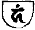
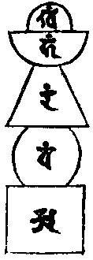
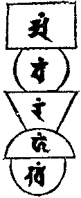
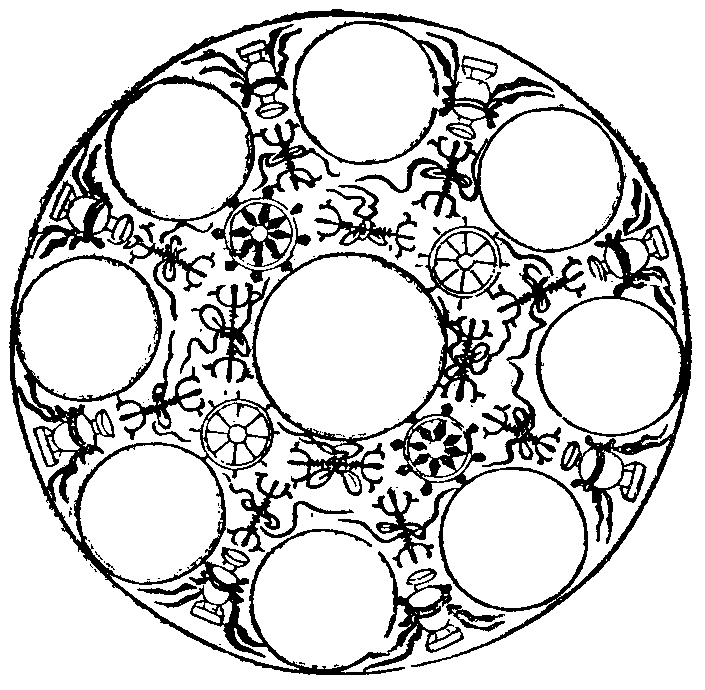
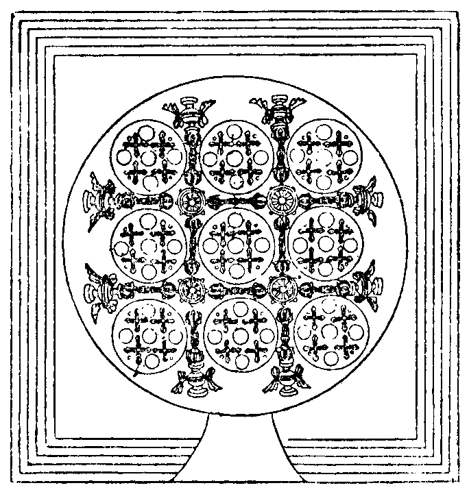
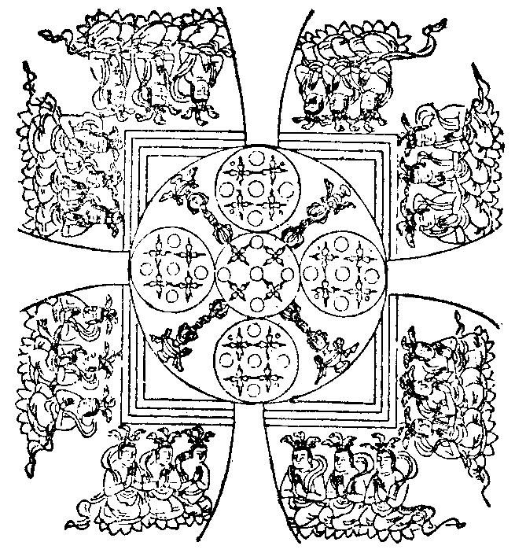

# 尊胜佛顶修瑜伽法轨仪



> **藏经**：大正新修大藏经（大正藏）　**册次** 第 19 册（T19）　**编号** No. 973（T0973）　**部类** 密教部　**卷次** 2 卷　**篇幅** 22,617 字

> **卷／品**：0 卷 · 12 品



---



## 目录



  - [尊胜真言序品第一](#尊胜真言序品第一)

  - [尊胜真言持诵法则品第二](#尊胜真言持诵法则品第二)

  - [尊胜佛顶真言召请本尊等品第三](#尊胜佛顶真言召请本尊等品第三)

  - [尊胜佛顶真言修瑜伽奉献香华品第四](#尊胜佛顶真言修瑜伽奉献香华品第四)

  - [尊胜真言修瑜伽五智品第五](#尊胜真言修瑜伽五智品第五)

  - [尊胜佛顶修瑜伽本尊真言品第六](#尊胜佛顶修瑜伽本尊真言品第六)

  - [尊胜佛顶真言修瑜伽畫像品第七](#尊胜佛顶真言修瑜伽畫像品第七)

  - [大灌顶曼荼罗品第八](#大灌顶曼荼罗品第八)

  - [尊胜真言证瑜伽悉地品第九](#尊胜真言证瑜伽悉地品第九)

  - [尊胜佛顶真言修瑜伽护摩品第十](#尊胜佛顶真言修瑜伽护摩品第十)

  - [尊胜真言修瑜伽祈雨法品第十一](#尊胜真言修瑜伽祈雨法品第十一)

  - [尊胜佛顶陀罗尼入成就境界品第十二](#尊胜佛顶陀罗尼入成就境界品第十二)



---



尊胜佛顶修瑜伽法轨仪卷上



三藏善无畏



------



### 尊胜真言序品第一



> 稽首一切薄伽梵，及以东方金刚部，  

> 雄猛阿閦金刚藏，宝生如来虚空宝，  

> 达磨句攞无量寿，观自在王莲华眼，  

> 毘首羯磨大牟尼，不空成就萨埵尊，  

> 四波罗蜜四供养，八大佛顶转轮王，  

> 为利一切修瑜祇，速成尊胜大悉地。  

> 乐修无相说瑜伽，为求有相兼说相。  

> 有无一体真大空，是故我今修瑜伽。  

> 文字观照实相智，三种般若无一体，  

> 身口意业三密门，应化法身即三密，  

> 五轮即是五智轮，五智便成五分身，  

> 五轮尽摄法界轮，三密即是三身故。  

> 是故我今礼瑜伽，瑜伽即是大日尊，  

> 是故我今修瑜伽，为利法界诸含识。



我今略说尊胜陀罗尼法，即是除一切障，灭一切地狱、傍生等身，故号尊胜佛顶之义。是故如来为善住天子，说除七遍畜生之身。即此修瑜伽者，不同事法。若於一念顷证无生，转五智成五分法身，悟三密即三身，初发心时，便越百六十种心，度三无数劫行，证普现色身三昧耶，即是初发心时便成正觉。是故我今为求有相者为说有相，若求无相者兼说无相念诵之法。虽说多种，我今略说两种，尽摄一切：一者，为求世间除灾、增益等故，略说有相之法；二者，为求无上菩提修瑜伽者，即说无生顿入普现色身之法。



其世间念诵者略有四种，所谓：除灾、增益、降伏、摄召即是；方、圆、三角、半月曼荼罗等，及护摩炉法即是。四种念诵：若增益念诵时，每真言上下加「na娜maḥ莫」二字；若除灾念诵时，真言初后加以「svā娑嚩(二合)hā贺」二字；若降伏念诵时，加以「hūṃ吽phaṭ泮咤(二合)」三字；若摄召念诵时，每真言前后加以「hrīḥ诃哩(二合)haḥ贺(入)」二字即是。除灾、增益、降伏、摄召增加句，并称所为者名字。其色相者，黄、白、赤、青是，或以面上及遍身衣服皆想本色。所有供养香华、涂末香，并诸饮食，黄白赤青，香美淡辛等，各依本法相应作之。护摩等法，各有殊异。所有焚烧柴木等，亦须临时看取本法，相应作之。



------



### 尊胜真言持诵法则品第二



复次，若欲作法念诵时，先须入净法界三摩地。於顶上想有「raṃ蓝」字，三角智火形，色如日初出时。遍身为智火焚烧四大五蕴，唯有空寂。其法界真言曰：



「娜摩　三曼多勃驮喃　㘕raṃ」



心念口诵，想顶及遍体为三角智火。



形如上图。次即入五轮三摩地，便入金刚轮三摩地。观己身脐已下方形紫金色，为金刚轮，便诵真言曰：



「娜麼　三曼多勃驮喃　阿a」



每字想时，口诵并归命。心想本体字，其形如图，「阿」字金刚轮黄色。次观脐中「va嚩」字，为大悲水轮色，如商佉或如乳色，形如满月，如图在下。「鑁」字水轮真言曰：



「娜摩三　曼多勃驮南　鑁vaṃ」



次说火轮真言曰：



「那摩　三曼多勃驮南　㘕raṃ」



当心上观三角火轮，色如日初出时，光焰猛利如劫火形，其形如三角曼荼罗。



次想「ha诃」字，大空点形如仰月，黑色，名「haṃ含」字，即是天风轮，安置於眉上，叆叇如劫风



。



次观於顶上「khaṃ欠」字。大空轮具一切色，种种众形，号为大空轮。此名为五智轮，谓地、水、火、风、空，即以普通印加持五支，即成真实智。即说普通真言曰：



「唵(一)　萨婆他欠(二)　嗢那蘗谛(三)　萨叵啰醯䐽(四)　伽伽那剑(五)　莎嚩(二合引)贺(引)(六)」



次以定慧二手叉十轮，顶戴，及以加五支，即成金刚不坏身，即入三昧耶故，即同一切诸佛菩萨三昧耶身。作三昧耶身施作佛事，先入三昧耶。真言曰：



「唵(一)　嚩日𪢠(二合)(二)　惹里(三)　三麼野(四)」



每加印处，并诵真言而加持之。其手印相：智定相叉，齐轮合掌，以智押禅。此名一切佛心三昧耶印，因作此印生一切印，是故先作此印。从三昧耶起，即同从三昧加持五处：顶及咽喉即名五支，其五轮图如左。



大空点具种种色，名为「



欠」字、「



唅」字风大，「



蓝」字火大，「



鑁」字水大，「



阿」字地大。金刚轮腰下，大空轮顶上，风轮眉上，火轮心上，水轮脐中。







(一本无此图也)



既去有为五蕴四大，立无为金刚不坏五蕴，即名无漏智。身即无为，曼荼罗地亦然。其曼荼罗五轮加持，名为地、水、火、风、空。去有为五大，立无为五大，故先观曼荼罗地相(上)时，先从空起，上观风等，如左(图)。



aṃvaṃraṃhaṃkhaṃ







以净法界心，先烧曼荼罗地中秽恶触等，然后依次第安立五大轮，即以结界护身，辟除光显净除三业，坚固菩提心等。是故复入金刚三昧耶真言及印，真言曰：



「唵(一)　嚩日啰(二合)满驮(二)　怛啰(二合)咤(三)」



其手印相：作前金刚掌印，便合作拳，置系心上。当系心时散其合拳，双下三系，此名结金刚界印。三系心已，由是真言及印力故，能净三业坚菩提心。



次於持诵处遣除秽浊及为障者，凡献香华、涂香、末香，并诸供养，辟除去垢发光增威，作金刚界结诸方界，护身及伴护居止处。如上所说及有未详，临事要须一一皆诵此真言作印护持，能使成就，无诸障难。当以降三世真言及手印而加持，各能成办诸事等。



次诵降三世真言曰：



「唵(一)　宁(上)三婆(二)　嚩日啰(二合)(三)　𤙖(四)」



此名降三世尊言及手印，名成办诸事者。其印相：智定各为拳，竖其风幢，屈二大空轮入掌内，以地水火三轮押之即成。其印以定手印置在心上，以智印用触诸物，及结地界四方乃至上下等界。右转三遍上下即成结界。



------



### 尊胜佛顶真言召请本尊等品第三



复次，应警觉诸佛，及八大佛顶轮王，或本部尊等。从三昧耶起观瞻，愍念真言者故，降赴道场。所谓发生真言曰：



「唵　嚩日啰(二合)(二)　底瑟咤(二合)(三)」



其手印相：智、定二手，地轮钩锁相连，其大空令入掌中，以水轮及以火轮双押空轮，风幢向前相著，以掌向上，便诵真言。以印从下发起诸尊，是名发生之印。



次请本尊等真言手印。发请真言曰：



「oṃ　va　jra　sa　maṃ　ja　jaḥ



其手印相：以智、定相叉，作金刚拳。不解此拳，以智风轮拨智大空，定手亦然。如是三弹，即成发请诸尊之法。心想本尊所在之处，建竖楼阁，想其楼阁内有宝莲华，上观大圆明，内有九轮金刚界道，每轮中本尊令坐。图如左：







其大圆明内分为九圆、八宝瓶、十二金刚杵、四宝轮。从八宝瓶口竖八金刚杵，承四金刚轮，从轮四面横拄四金刚。每瓶及金刚皆继彩带，叆叇垂布。大圆明内，各坐九圣者。中心大毘卢遮那如来，头戴五智宝冠，坐七师子座上，结跏趺坐，结法界印。自餘诸尊，下曼荼罗品具明。



迎请真言曰：



「唵(一)　嚩日𪢠(二合、引)俱舍(二)　惹(急重呼)(三)　jaḥ」



其手印相：用降三世印，以二风轮举作钩形，而动其钩，便成奉请。



既蒙来赴，次应请入。念诵道场请入真言曰：



「唵(一)　嚩日啰(二合)　跛舍(二)　吽(三)　hūṃ」



其手印相：以金刚拳竖二地轮，二空轮交结入掌，右押左。既奉请入，作三昧耶，依请而住。请住真言曰：



「唵(一)　嚩日啰(二合)建咤(二)　阿(短急呼)(三)　aḥ」



其手印相：作金刚拳竖二地轮，二空轮交结入掌，右押左。请召乃至欢喜，令其坚固故，而诵真言。坚固真言曰：



「唵(一)　萨啰嚩(二合)怛他蘗多(二)(引)　毘三菩地(三)　捺㗚(二合)荼(四)　嚩日啰(二合)底瑟姹(二合)(五)」



其手印相：智、定相拍，便成坚固。



次应灌沐本尊及己身。灌顶真言曰：



「唵(一)　嚩日啰(二合)(二)　诺迦咤(去)」



其手印相：以其智手水轮、空轮相捻，餘轮并竖，按诵水器，想沐浴本尊，洒印己身顶上。奉献阏伽，想灌尊顶，亦用此印，拜诵真言七遍。



------



### 尊胜佛顶真言修瑜伽奉献香华品第四



次献香华、饮食、灯火等，以本真言诵持而用奉献。



先奉烧香真言曰：



「唵(一)　嚩日罗(二合)(二)　度弊(三)」



其手印相：作金刚拳按其香上，持诵真言经一七遍，即成真实宝香，遍满十方虚空法界。



次奉献华真言曰：



「唵(一)　嚩日啰(二合)(二)　扶瑟(二合)弊(三)」



其手印相：合金刚掌，用印加持，诵真言经一七遍，即成真实宝华等。



次奉献宝灯真言印。真言曰：



「唵(一)　嚩日啰(二合)(二)　地币(三)」



其手印相：作金刚拳，竖二大空置於心上，持诵真言经七遍，便成宝灯，遍虚空界。



次奉涂香真言曰：



「唵(一)　嚩日啰(二合)(二)　誐度(三)」



其手印相：智、定覆掌，散舒其轮，以智、大空押定、空轮，持诵真言经一七遍。



次当归依三宝，出罪忏悔，随喜功德，劝请功德，常住发菩提心，赞叹佛德，发胜上愿。其归命三宝者：「愿从今身乃至当坐菩提道场，归依如来无上三身，归依方广大乘法藏，归依一切不退转菩萨摩诃萨僧。」应当如是归命三宝。次应出罪忏悔者：「自从无始乃至今时，烦恼覆源，久流生死；三种业障，造罪无边，今日诚心发露忏悔。」惟当广忏悔，令使罪除。次应发菩提心者：「始从今日乃至当坐菩提道场，誓发无上大菩提道心，誓度无量诸有情类，愿皆令离生死大苦。今所发心，复当远离我法二相，我法平等无自性故。」应当如是发菩提心。以真言加持，令菩提心坚固不退。真言曰：



「唵(一)　菩提质多(二)　牟怛跛(二合)陀夜弭(三)」



其手印相：合金刚掌，发菩提心，持诵真言经一七遍。



随喜功德者：「三世如来及诸菩萨，为众生故，备无量功德，所有功德我当随喜。」劝请常住者：「唯愿诸佛久住於世，依瑜伽理趣无住涅槃，复请转大法轮遍十方界。」发胜上愿者：「愿诸众生多饶财宝，常当勇施，具足智慧，常怀大忍，乐作善缘，得宿命智，悲念有情。愿诸众生所生之处，常获如是种种胜事。」



次运心供养。以心运想：水陆诸华，无主所摄，遍满虚空，尽十方界。及以人天上妙涂香、云海、烧香、灯明、幢幡，种种鼓乐、歌舞、妓唱、真珠、罗网，悬诸宝铃、华鬘、白拂。微妙磬铎、宝绳、罗网、如意宝树、衣服之云；天诸厨膳，上妙香羹，宫殿、楼阁、宝柱庄严；天诸严身，头冠璎珞。如是等瑜祇运心，遍满虚空，以至诚心如是供养最为胜上。是故行者以决定心而行此法，运心供养，诵持真言及作手印，如上所想悉皆成就。运心真言曰。



唵(一)　萨婆他(二)　欠(三)　嗢怛蘗帝(四)　萨叵(二合)啰醯麼暗(二合)(五)　誐誐娜(六)　剑(七)　婆嚩(二合引)贺(引)(八)



诵真言七遍，即成普通供养。



其手印相：作合金刚掌置於顶上，诵此真言经七遍，即成就诸供养具。次以真言及印护身五处。真言曰：



「唵(一)　质多(二)　钵啰(二合)底(三)　吠能(四)　迦路弭(五)」



诵此真言，令住一切如来具足三昧耶，能办一切诸佛事业，速得成就。



------



### 尊胜真言修瑜伽五智品第五



复次，修瑜伽瑜祇者，自住妙菩提心故，速入观菩提心智。观菩提心真言曰：



「唵(一)　菩地质多(二)　牟怛簸(二合)那夜弭(三)」



此名发菩提心真言，亦名大圆镜智，速令发菩提心。初发心时便成正觉，即是法身之义。



次说平等性智真言曰：



「唵(一)　底瑟姹(二合)(二)　缚折啰(二合)(三)」



诵此真言，速令心住不令散乱，即是应身之义。



次说成所作智真言曰：



「唵(一)　拽他(二)　萨啰嚩(二合)怛他蘗多(三)　娑多(二合)他痕(四)」



次说妙观察智真言曰：



「唵(一)　娑嚩(二合)婆嚩(二)　戍(入)度痕(三)」



此名妙观察智，是应身之义，亦是后得智法身之义。



次说方便究竟智真言曰：



「唵(一)　萨啰嚩(二合)(二)　三谟痕(三)」



此名方便究竟智，化身之义。或进修门中，以方便为究竟，即是后得智法身之义，此明中胎，五方安之。其五智真言印相：以智、定二羽外叉，合掌为拳，直竖二火轮，以二地轮亦合，二风轮屈各在二火轮背上节，去二三分许，二大空并竖，形如五股金刚。以此一印通用五智，后乃用大日法界印加持五处，即成具足五分法身，万德之身。其法界印相：以权、智各作金刚拳，智手执权风幢，加持五处，便住当心上。己身为毘卢遮那如来之身，头上五智佛宝冠即是五顶轮王，具五智义，便以一切佛顶轮王心印真言加持五处。



其一切佛顶轮王心真言曰：



「唵(一)　度噜𤙖(二合)(二)　𤙖(三)　泮咤(四)」



其手印相：两手内相叉为拳，竖直二中轮即是。此印真言通一切用辨事，召请、发遣、结界、护身，一切处通用。



复次，说本尊真言曰：



其印相者：两手外叉，合掌为拳，曲钩右风幢，即加持五处，增益时用；或一手作，摄召时用。又，经中所说以两手合掌，以右手大指押左大指上，除灾时用。若降伏念诵时，以左押右即是。便执数珠合掌顶戴，当心上执数珠念诵。当一一与本法相应念诵，速得成就所求之愿，除不至心及以恶事，却被自损。



------



### 尊胜佛顶修瑜伽本尊真言品第六



复次，我今略说修本尊真言法。每月十五日自诵，或遣人诵，满一千八遍，能除一切灾殃长寿增福。或每日三时，观本尊心上圆明中，或观己身为本尊，於心上圆明中，旋转安布尊胜真言，如字轮形，一一字随本法。临时本色相应放光，皆变成为曼荼罗圣众，即是己身为尊胜佛顶法界曼荼罗体。其本尊尊胜佛顶真言曰：



> 「na　mo　bha　ga　va　te◇　trai　lo　kya　pra　ti　vi　śi　ṣṭa　ya　bu　ddhā　ya　bha　ga　va　te◇　ta　dya　thā　oṃ　vi　śu　ddha　ya◇　sa　ma　sa　ma　nta◇　va　bhā　sa◇　spha　ra　ṇa　ga　ti　ga　ha　na◇　sva　bha　va　vi　śu　ddhe◇　a　bhi　ṣiṃ　ca　tva　maṃ◇　su　ga　ta　va　ra　va　ca　nā◇　a　mṛ　tā　bhi　ṣai　kai　ā　ha　ra　ā　hā　ra　ā　yu　sa　tdhā　ra　ṇi◇　śo　ddha　ya　śoddhaya　ga　ga　na　vi　śu　ddhe◇　u　ṣṇī　ṣa　vi　ja　ya　vi　śu　ddhe◇　sa　hā　srā　ra　śmi　saṃ　su　di　te◇　sa　rva　ta　thā　ga　tā◇　va　rū　ka　ni　ṣa　ṭpa　ra　mi　ta　pa　ri　pū　ra　ṇi◇　sa　rva　ta　thā　ga　ta　hṛ　da　yā　dhi　ṣṭā　nā　dhi　ṣṭi　ta　ma　hā　mu　dre　va　jra　kā　ya　suṃ　hā　ta　na　vi　śu　ddhe　sa　rvā　va　ra　ṇa　bha　ya　du　rga　ti　pa　ri　śu　ddhe◇　pra　ti　ni　va　rtta　ya　a　yuḥ　śu　ddhe◇　sa　ma　ya　dhi　ṣṭi　te◇　ma　ṇi　maṇi　ma　hā　ma　ṇi◇　ta　thā　ta　bhū　ta◇　ko　ṭi　pa　ri　śu　ddhe　vi　spho　ṭa　bo　dhi　śu　ddhe　ja　ya　jaya　vi　ja　ya　vijaya　sma　ra　smasa　rva　bu　ddhā◇　dhi　ṣṭi　ta　śu　ddhe　va　jrī　va　jra　ga　rbhe◇　va　jrāṃ　bha　va　tu　ma　ma　sya　śa　ri　raṃ　sa　rva　sa　tvā　nāṃ　ca　kā　ya　pa　ri　vi　śu　ddhe◇　sa　rva　ga　ti◇　pa　ri　śu　ddhe◇　sa　rva　ta　thā　ga　tā　śca　me　sa　ma　śva　sa　yaṃ　to　sa　rva　ta　thā　ga　ta　sa　ma　śva　sā　dhi　ṣṭi　te　bu　ddhya　buddhya　vi　bu　dha　ya　vibudhaya　sa　ma　nta　pa　ri　śu　ddhe◇　sa　rva　ta　thā　ga　tā　hṛ　da　yā　dhi　ṣṭi　nā　dhi　ṣṭi　ta　ma　hā　mū　dre　svā　hā



(此陀罗尼本，中天竺国三藏善无畏将传此土。凡汉地佛陀波利已来，流传诸本并阙少，是故具本译出，流行如上)



念诵疲乏随意住，或观己身心圆明中安本尊。己身坐於圆明中，遍法界为一身心，以真言轮至於乏极，即广作发弘愿，回向施诸众生：「向所修善业回施众生，令免离种种地狱等苦。」如是随喜等，一如前方便。次诵真言，所列胜愿回向皆得成就。列愿回向真言曰：



「唵(一)　萨啰嚩(二合)俱舍逻慕攞宁(二)　钵啰宁度夜弭(三)　萨啰嚩(二合)俱舍逻慕攞(四)　三摩多(引)钵　啰(二合)半遮达啰莽(二合)多(去)(五)　娑嚩(二合)婆(去)嚩悉地夜(六)　啰誐曩(去)多曳(七)」



持诵既毕，次应发遣本尊，解金刚界。次以真言解所结界。解界真言曰：



「唵(一)　嚩折啰(二合)谟乞洒(二合)谋」



其手印相：智、定相叉作金刚拳，向顶上解，是名能解所结之界，亦能成发遣本尊等事。从次已后，具明曼荼罗畫像护摩等事。



第一法者，若人欲得寿命长远，不堕地狱、饿鬼、畜生、阿修罗道及灭诸罪者，每时至心诵此陀罗尼二十一遍，起大慈悲怜愍一切众生，即得四恶趣罪业消灭。即此第一法耳。



第二法者，若有飞腾罗刹鬼神入国，恐怖恼乱一切众生者，称「南无佛」，心忆念，诵此陀罗尼一百八遍，即得如上诸难皆悉消灭。



第三法者，若有人不信者，但制心一处，专作此法，即得大验，即令不信者能起大信心。若作法得验，时当有白风旋来入身，身上所有麁恶黑皮，及诸厄难，皆风吹，恶皮变退，厄难消灭。



第四法者，若人欲得为大自在者，於七日中，对四方诵呪一百八遍，以七种谷揑作人形，安置四方，必得所愿称意。



第五法者，若人欲得灭自身重罪者，即於城门底作前法。



第六法者，若人欲得灭先世罪者，即於十字街头(柯崕反，四通道也)。



第七法者，若人欲得灭一切众生罪者，即於佛塔前作前法。



第八法者，若欲得救地狱中一切众生罪苦者，每时结佛顶印，诵真言二十一遍，即向四方散印，得罪苦灭。



第九法者，若人能欲得施饿鬼浆水者，取净水以真言加持二十一遍，以水散洒四方，作施彼之心，鬼等即得水吃。



第十法者，若有人欲得救一切畜生罪苦者，取黄净土，以真言加持二十一遍，散於畜生身上，及散四方，即得罪苦消灭。



第十一法者，若欲得救人天罪苦及堕落诸恐怖者，剪五色杂彩华，以真言加持二十一遍，将散三宝及佛顶上，即得一切罪苦自然消灭。



第十二法者，若有王难、百官难、军兵并口舌等难者，以真言加持五味香汤二十一遍，将洗佛及灌佛，即得诸难消灭。



第十三法者，若有沙门、婆罗门、毘舍、首陀四众等，欲得福报具足者，每日发愿、忏悔，诵此真言七遍，以此功德回施一切众生。但作此心，即得如愿。



第十四法者，若有人欲得灭除一切众生业障者，当以五色彩帛作拂，当用诵真言加持拂，扫故像及故经。常作此法，即得一切众生罪障消灭。



第十五法者，若有人口舌起者，取好蜜，以净器盛之，以朱砂和蜜，以真言加持二十一遍，将用涂一百八躯佛像唇口，即得口舌当即消灭。



第十六法者，若人长病在床，若复有人，欲得一切爱念敬重，复有人欲救一切世间、出世间事，心未得定，被鬼神恼乱，梦想颠倒，当取金薄一百八番，以真言加持二十一遍，将用贴一百八躯佛像形顶前，作摩尼宝珠形，即得一切诸事消除所求如意。



第十七法者，若有国内被鬼病所著，及时气疫病流行，当於四城门上，以青纸写真言，用白檀香木作函盛之，锁函门，别以蜡印函。当於四城门上之，以五色伞盖函，门别安一本，即得诸鬼病等即皆消灭。



第十八法者，若有国内五谷不熟，风雨不时，当以白绢作幡书真言於上，并畫作佛顶印，悬一百八十尺刹上，向正南著之，即得风雨调适，五谷成熟，人民安乐。即得恶龙回心作善，阿修罗王不能障碍。



第十九法者，若多雨不止，即以绯绢书真言二十一道，悬著正南刹上，即得雨止天晴。



第二十法者，若有恶贼起於国内，当以青绢书真言二十一道，中心畫乾闼婆儿善住，两手调箭，悬於正东刹上，即得恶贼自然退散。



第二十一法者，若有国王衰祸欲至，当以杂物作一百八个浮图相轮。又打金薄叶，各书真言一本，於一相轮最上头函内盛之安置，即得衰祸消灭，福祚延长。



第二十二法者，若有贵人贱人，欲得常拥护他人，及自护身，所求财宝称意者，常起善心，心不散乱，每日每时於佛像前结印诵真言七遍，瞻仰观佛面目不动。如此作法，即得种种福禄充足，命终之后必有福报，不堕恶趣。



第二十三法者，若有女人欲求男女子者，於一百日办香美饮食，乞与贫病人吃。施食之时，口常诵真言，念念不绝。如此作法，必获福德男女儿子。



第二十四法者，若有夫妇相憎者，将绢帛诵真言加持二十一遍，即将作衣与夫壻者，即便得和顺。



第二十五法者，若有女人嫁娶不结者，取好净盐不限多少，诵真言加持二十一遍，施与现前僧吃，即便女得嫁处。



第二十六者，若有外道，及国王、王子、大臣、百官等不信佛法者，取无疮瘢黄乳牛三头，诵真言加持水艸二十一遍，与牛食之，日欲出时，即将取乳，以银器盛之，又诵真言加持乳二十一遍，即於四方净地写之。其将乳人须著白衣，口云：「乾闼婆儿善住！及天王帝释！今有此事当自处分。」行者当即入城见国王、王子、大臣、百官及诸外道。不信佛法人等见此行者，深生欢喜，行者所说悉皆信受，得信之心无有改动。



第二十七法者，若有人所在处界内，所有恶鬼神、恶鬼、毒龙等，行者欲得降伏者，取牛乳加持二十一遍，即写著有龙水中。若有龙出来，行者语言：「汝莫损此界内众生！」即令依旧安置。龙若薄媚不出来，恶业不息者，即诵真言加持沙二十一遍，散於池中，即得池平如地。行者别将龙向餘处安置，遣令得所。行者即更加持二十一遍，莫遣东西。其恶鬼神，加持饮食二十一遍，以施之。行者告言：「我今语汝，若不损害众生，任汝住此；若拟损害众生，即须出去！」其鬼神薄媚不受处分者，即此作铁𣐍长十二指，以真言加持二十一遍，即钉入地，恶鬼神即散出走去。行者仍安置鬼神，遣令得所，又告言：「一如处分不得东西。」



第二十八法者，行者每欲出行之时，常作一白拂，诵真言加持一百八遍，手常持行。若逢诸类一切畜生等，皆拂之一遍，即得畜生恶业离苦解脱。



第二十九法者，若欲令先亡离苦解脱者，行者当於尸陀林中安坐七日，日别三时诵真言，任意多少。满七日已，即取行者坐处土散之，时亡者即得离苦解脱，悉得生天，永离恶道。



第三十法者，若有人顾卖不售，所求不称意者，行者为结印诵真言二十一遍，安置善住形像於密处供养，即得所求顾卖称意。



第三十一法者，若有人欲入山林，逢师子、虎、狼、毒蛇、恶兽等者，欲入之时，预於山前诵真言二十一遍，加持黄土七遍，即取上土口含之，数数诃气，入於山中，口云：「於此山中，恶毒禽狩等所有恶毒气悉皆消灭。此地属我，若能依我法行者，任听汝住；若不能依我法行者，即须急出。若不出者，口即闭塞，开口不得！」行者见虎狼禽狩等开口不得，即须急出。若不出者，行者见虎狼禽狩口开，即须集之一处，以右手摩挲其头上，加持二十一遍。行者口云：「我和上令开汝口！」即放出界外守护地，勿令伤损此界内一切众生。行者发遣乃已，仍须安置，令遣得所。行者常坐山中二月餘日，更不得住，即须且东西去，已后更来坐。若其久住，诸禽狩等即不得安隐。



第三十二法者，若山中有悭鬼神、悭龙等，不许行者於山中隐逸者，行者知见此事，即依法处分者。行者口云：「我乐此地，乞汝与我。若不与我，当共汝住。若不许者，儞即须出去，於三百由旬外安置。若其薄媚不受谏劝者，我即禁系汝不令东西。」行者即以铁杵长十二指，加持一百八遍，用钉住处门首，即令诸恶禽狩等於一百由旬内住止安稳。



第三十三法者，若有诸龙被外道等禁系，致令国中无雨，行者当於有龙水泉边作一小坛，以桑木作橛八个安於坛中，又以乳酪三椀亦安坛上，总加持乳𣐍等一百八遍，即以木𣐍钉泉水四边八处。又以乳酪写於池中，又以金薄叶加持，著荷叶上、著泉中。行者口云：「善知识今有厄难，被诸外道禁系。今此作法已讫，以陀罗尼护汝发遣！」收领其荷叶与真言，没水去，行者诃气三遍，外道禁法即便破坏，其龙即得解脱无难。其龙当即出来供养行者。龙口云：「曹主有何处分？」行者口云：「汝可每依时兴云致雨。将此陀罗尼顶上安置，令汝等永得无难。」



第三十四法者，若有大水泛涨损伤人者，即诵真言加持水二十一遍，将投大水中，更不泛溢。



------



### 尊胜佛顶真言修瑜伽畫像品第七



复次，我今更说修瑜伽速证有相无相悉地。准例内外有异。外相法者，先须畫像，择取吉善好月、时、日，晨朝起畫。好月者，正、二、三、四、五、六、七、十二月等，此为最上好月。好日者，日月蚀时，及地动时鬼宿日，此为上好胜日。或取白月十五日，或取二十三日等。已择取日月时节，唤畫师沐浴，与三昧耶戒，或与三昧耶灌顶。每出入，洗浴换衣，食三白食，不杂秽食等，亦不还价。其畫物白毡，或好细布绢等物中，如法畫之。一依图上如左，其所畫布绢㲲等，大小随意。中心畫大圆明白色，又大圆明分为九圆，八方置宝瓶，於瓶口中插以名华，上置三股嚩折罗。中心圆外四隅，安四宝轮，皆以嚩折啰相拄。宝瓶及嚩折啰腰，缠彩带垂之。中圆畫毘芦遮那如来，头戴五佛冠，种种宝华光，於七师子座上结跏趺坐，手结法界印。左圆明中畫白伞盖佛顶轮王，头戴五智冠，左手执莲华，於莲华上安置白伞盖，右手扬掌，半跏趺坐，其身光及头光如五色车轮形。右圆明中畫最胜佛顶轮王，头戴五智冠，种种庄严。背圆光及以通身光状如车轮，具种种色。右手持莲华，於莲华上安八辐宝轮，具种种色，光焰圆绕。於莲华上结跏趺坐，左手扬掌。中圆明前畫尊胜佛顶，亦名除障佛顶轮王，於莲华台上结跏趺坐，白肉色。两手脐下，如入禅定，掌中承莲华，於莲华上金刚钩，如上顶轮王等种种光明，五智冠等一依瑜伽图，皆於白莲华座结跏趺坐。大日如来后圆中畫放光佛顶，或名光聚佛顶轮王，左执莲华。於华台上畫佛顶印，於佛顶上放光。五智宝冠光明等，一如上说，右手扬掌。其尊胜佛顶左边圆明中畫胜佛顶，左手执剑，右手扬掌，五佛冠种种庄严，轮光明中亦如上说。其尊胜佛顶右畫广生佛顶王，右手持嚩折啰，左手扬掌。五智冠轮光焰璎珞等，一依上诸尊等例。光聚佛顶右圆明中畫无边声佛顶王，右手持莲华。於莲华台上畫商佉，左手当嬭房上扬掌。五佛冠轮光庄严等，随意种种庄严。光聚左圆明中畫发生佛顶王，左手执开莲华，右手右膝上，半跏趺坐，轮光璎珞同如上说，皆大仁慈悲相。下左边畫降三世尊，於半月轮邪立走势，青色，拘牙上出，四手。两手结三昧耶印，一手结心印，一手执缚折啰。右边三角赤光中畫无动尊，於盘石上半跏趺坐。一目怒出，一目合，咬下唇，一边反出。赤发交锁，垂下左边，身复肥满如童子形。右手把剑，左手执索。两明王中间修瑜伽者，坐前香炉，其像上畫宝盖，两边畫六个乘云首陀会天童子形，半身涌出，各执香华宝鬘等，一依如上图，或如外观像法。修瑜祇者观己身为毘卢遮那法身，周遍法界同一体相，更无异相。我今略说观像及畫法则已竟。



凡欲作法受持佛顶尊胜陀罗尼神呪者，先须畫像。畫像法者，取好绢，或用白㲲。绢用三幅，高一丈。彩色中勿用皮胶，须用香胶。畫师须清净，不吃熏辛。从黑月一日起首，畫像满七日即须造了。当畫作甘露山，山中作种种树林华果流泉鸟兽。山中作禅窟，窟内作释迦牟尼佛结跏趺坐。佛右边作天主帝释，一切眷属围绕。左作乾闼婆儿，名曰善住，容貌端严如似菩萨，头发衣冠亦复如是，以种种璎珞华冠庄严，又以白㲲巾斜勒左肩上，右手把毬杖。又作乾闼婆眷属围绕善住，歌舞作乐。佛左右各作两个四天王及其眷属。又於佛左边作大梵天王并魔王。畫像了已，即须作坛受法。



作坛法者，先觅净地，勿令有瓦石。以五种香汤和净土作泥，泥地方一丈，又作坛中心方圆。一肘内作一佛顶，青色，於坛四面外各安饮食，面别七盆。四方各置一具香炉，烧众名香。南门安一铜瓶，瓶中盛香水，安帝释坐处。东门安乾闼婆儿善住坐处，於西门呪师自坐，面向东方，佛像面向西方。又以五色彩帛作幡，悬坛场外四边。又安五盏灯，一盏处中高著，四盏四角下著，如似塔形。坛场内散诸杂华。供养物等并於坛外四面安置，勿於坛内。七日之中於道场内诵呪，数须满一万遍讫，佛顶放大光明。呪师七日之内，须数数发露忏悔，起大慈悲，发弘誓愿，永不退转。当尔之时，即知法成，更莫疑虑。



尊胜佛顶真言修瑜伽法卷上



曩谟婆(去引)誐缚帝(引)怛赖(二合)路(引)枳也(二合)钵罗(二合)底尾始瑟咤野没驮(引)野婆(去)誐嚩帝(引)怛儞也(二合)佗(引)唵(引)尾戍驮野尾戍驮野娑麼娑麼三(去)满跢(去引)缚婆(去引)娑娑颇(二合)罗拏誐底誐贺曩娑嚩(二合)婆(去引)嚩尾秫第阿(上)诜鼻左覩𤚥素誐哆嚩罗嚩左曩(引)阿密嘌(二合)哆鼻矖罽(平)摩贺(引)曼怛啰(二合)跋乃(引)阿(去引)贺罗阿贺罗阿(去引)臾散驮(引)啰抳戍(引)驮耶戍驮耶誐誐曩尾秫第邬瑟抳(二合)洒野(上)尾惹野尾秫第娑贺娑啰啰湿茗(二合)散祖儞帝萨啰嚩(二合)怛他(去引)誐多嚩路(引)迦𩕳娑(上)咤幡(二合)啰弭哆(去引)跛里布(引)罗抳萨嚩(二合)怛他(去引)誐哆纥哩(二合)娜野地瑟姹(二合)曩地瑟耻(二合)多摩贺(引)母捺哩嚩日啰(二合)迦野僧贺多(上)曩尾秫第萨罗嚩(二合、引)嚩啰拏(鼻引)播野讷蘖底跛哩尾秫弟钵罗(二合)底𩕳韈啰哆(二合)野阿(去引)欲秫第三麼野(引)地瑟耻(二合)帝麼抳摩抳摩贺摩抳怛闼(去引)哆部多句(引)致跛哩秫第尾娑普(二合)咤没地秫第惹野惹野尾惹野尾惹野娑麼罗娑麼罗萨嚩没(引)驮地瑟耻(二合)多秫第嚩日哩嚩日啰(二合、引)蘖陛嚩日览(二合)婆嚩都麼麼(某甲)设哩览萨罗嚩(二合)萨怛缚(二合)难左迦野跛哩尾秫第萨嚩(二合)誐底跛哩秫第萨罗嚩(二合)怛他蘖哆(去引)室者(二合)铭三(去)麼(引)湿(二合、引)嚩(平)沙琰覩萨啰嚩(二合)怛他蘖多三麼(鼻)湿嚩沙(去引)地瑟耻(二合)帝没地野(二合)没地野(二合)尾没地野尾没地野冒驮野冒驮野尾没驮尾没驮野三满跢跛里秫第萨罗嚩(二合)怛他蘖多纥哩(二合)娜野地瑟姹曩地瑟耻(二合)多摩贺母捺哩(二合)娑嚩(二合)贺



namobhagavatetrailokyaprativiśiṣṭayabuddhāyabhāgavatetadyathāoṃviśuddhaya◇sama◇samantavabhāsaspharaṇagatigahanasvabhāvaviśuddheabhiṣiṃcatumaṃsugatavaravacanaamṛtābhiṣaikaimahāvantrapaddhaiahara◇āyusandhāraṇiśoddhaya◇gaganaviśuddheuṣṇīṣavijayaviśuddhesahasrarasmisaṃsuditesarvatathāgatāvarūkaniṣaṅpāramitaparipūraṇisarvatathāgatahṛdayādhiṣṭinādhiṣṭitamahāmudrevajrakāyasuṃhātanaviśuddhesarvāvaraṇabhayadurgatipariviśuddhepratinivarttayaayuḥśuddhesamāyādhiṣṭitemaṇimaṇimahāmaṇitathātabhūtakoṭipariśuddhevisphoṭaboddhiśuddhejaya◇vijaya◇smarasmarasarvabuddhādhiṣṭitaśuddhevajrīvajragarbhevajrāṃbhavatumamaśariraṃsarvasatvānāṃcakāyapariviśuddhesarvagatipariśuddhesarvatathāgataścamesamāśvasayaṃtosarvatathāgatasamāśvasādhiṣṭitebuddhya◇vibuddhya◇bodhaya◇vibodhaya◇samantapariśuddhesarvatathāgatahṛdayādhiṣṭanādhiṣṭitamahāmudresvāhā



尊胜佛顶真言修瑜伽轨仪卷下



善无畏三藏



------



### 大灌顶曼荼罗品第八



我今复说修瑜祇者观曼荼罗并畫诸圣众样者净与不净。但发菩提心为净。内外缘合，不择时日。若择清净者，内外净，一一依如上说。日月时节，及清净胜地、佛堂、殿宇、兰若、伽蓝、山林、树下，一依四种曼荼罗法，方、圆、三角、半月等形，及以青、黄、赤、白，各依本方而作曼荼罗。今略《金刚顶大毘卢遮那经》，并释义十卷，苏悉地、苏摩呼、如意轮、七俱胝、瞿醯且怛罗、不空羂索等经，撰集坛仪。举一法现其三种，唯形色等异，图如左：







如上所说，图曼荼罗时，先观如前所说五轮及净界讫，然后作之。若畫曼荼罗及畫尊像等，结界、召请、供养时，要须先用一切佛顶轮王心真言及手印、难胜忿怒王真言手印辟除护身，然后起首作诸事业、和彩色。但所用物，皆须此二明王、真言印等。其一切佛顶轮王真言曰：



「oṃ　trūṃ　huṃ　phaṭ



其手印相者：以两手勾，内叉十指合掌，直竖二中指，合头，加持五处为护身。加持所用器物彩色，及指地为清净，光显护净等事。若召请时，二中指合屈，来去三召。若奉送本尊等时，向外拨之三遍。结界、护身、辟除等，以难胜忿怒王真言及手印便成办事，一切处用。难胜忿怒王真言曰：



「oṃ　vi　kra　nda　dhū　na　dhū　na　hūṃ



若不得此二明王及印，作一切佛顶法，法则不成。要须作前件一切法等真言印契了，仍须加此二法，宁不得上件所说诸契真言等，但用此一切佛顶印真言、难胜忿怒王真言印，即得办诸事业，无不成就者。一切召请、结界、光显、辟除、护净、自护护他、护道场界、奉送诸尊等，皆同用此二明王真言印契，无不成办。其持诵、结印功德，唯佛乃能说之，餘一切菩萨、声闻所不能知。何以故？一切佛顶心最为胜故，一切佛顶中尊胜佛顶能除一切烦恼业障故。号为尊胜佛顶心，亦名除障佛顶。难胜忿怒王真言印者，准一切佛顶心印，唯改右中指上节屈，拄左中指上节即是。



其所畫方曼荼罗法则者，方八肘，或十二肘，或三十八肘。若自为众生造，四肘或七八肘等亦得。若大作者，或官府上下为国者，上至一百八肘，下至三十者，任意大造。其八肘者，四肘者为中心，大圆更分为五圆，四隅半月轮，每圆畫九尊。其半月轮畫六足尊，大圆四面畫八瓶四轮，十六嚩日啰(二合)为柱，等皆絓彩帛。四肘分两院，各二肘。其二肘分别为两院，又两院各分三道。第二院外缘畫三道：白、黄、赤，表三佛顶之义，亦是戒定慧三学义也。第三院外缘畫五道：白、黄、赤、青、黑，此表五佛顶五智之义。其两院中各分三道，从外第一院诸圣众座位向内，第二道布列诸宝瓶、香炉、灯明、阏伽、饮食、菓盘、诸浆等处内，第三道是办事侍者行食来往之道。第二院亦准此。其中台畫大圆明，中又分为九圆，每轮中更分为九圆，其圆畫九圣者等，中心圆中畫毘卢遮那如来；四面，尊胜等四顶轮王；四隅，四波罗蜜菩萨。四隅半月中心，各畫四大顶轮王，各畫四供养波罗蜜等，一依瑜伽具有法则，不能一一载名字。



其第二院直东，释迦牟尼如来结跏趺坐，作说法相。座下左右天帝释并善住天子合掌恭敬，两膝著地，瞻仰如来请问：「世尊！云何除灾？云何延寿？云何去七返畜生之身？」如是请已，尔时世尊慈悲愍念，便入除障三摩地。从如来顶上发生惹耶三摩地，状若轮王之像，白色首戴五佛宝冠，手执金刚钩，项背圆光，通身如车轮状，晖曜赫奕。现此三摩地时，十方世界六种震动。十方世界一切地狱六趣众生，应堕恶道者，皆悉灭除一切恶业，不复受，若便得生天及十方清净国土。为此善住天子七返恶道之身一时消灭，是故号为除障佛顶轮王，即是五佛顶轮王之一数，并通三佛顶八大顶轮王也。如来左右弥勒菩萨，手执法界印；曼殊室利菩萨，手持青莲华，各执本契，一手把拂，皆侧向如来立。其如来左右，如来毫相、如来心、如来舌相、如来眼、如来鼻、如来牙、如来耳、如来脐、如来腰、如来槊、如来无畏、如来力、如来马阴藏、如来眉、如来口、如来无能胜明王、如来无能胜明妃。院四角，香波罗蜜三昧耶、宝波罗蜜三昧耶、华波罗蜜三昧耶、涂香波罗蜜三昧耶，相对各在圆明中。其餘如来毫相等，各执本契，种种庄严，结跏趺坐。四面各畫十方佛并二仕菩萨等。又四大阿罗汉，四辟支佛等，分布四面。其北面中心畫观自在王菩萨，左右畫莲华部内眷属：得大势至、观自在菩萨、二白处尊观自在菩萨、苾俱胝观自在菩萨、不空羂索观自在菩萨、多罗观自在菩萨、如意轮观自在菩萨、乔哩观自在菩萨、吉祥观自在菩萨、大吉祥观自在菩萨、佛吉祥观自在菩萨、水吉祥观自在菩萨、马头明王观自在菩萨、莲华军荼利明王观自在菩萨、一髻明王观自在菩萨。如上诸圣者等，皆执本契，种种庄严，於莲华座上半跏趺坐。



次南面中心畫执金刚王秘密主菩萨，手持嚩日啰(二合)，结跏趺坐。於菩萨左右金刚部内，诸圣众次第安置：金刚母菩萨、金刚拳菩萨、金刚锁菩萨、金刚眼菩萨、金刚忿怒菩萨、金刚索菩萨、金刚军荼利菩萨、金刚矟菩萨、金刚火菩萨、金刚铎菩萨、金刚喜菩萨、金刚棒菩萨、金刚心菩萨、金刚苏波呼菩萨、金刚童子菩萨、金刚赤身菩萨、金刚青面菩萨等。如上诸金刚菩萨等，各执嚩日啰(二合)、轮、索、棒、矟等本印契，次第而坐，光焰璎珞等庄严之具，皆如法状之。



其西门左右安置八大菩萨等：虚空藏菩萨、地藏菩萨、除盖障菩萨、慈氏菩萨、曼殊室利童子菩萨、持地菩萨、莲华手菩萨、秘密主等，次第门左右安置之，各执本契，种种庄严。



其外院各安十方护法神王等，各领眷属。左右畫四个侍者。如东北角伊舍那，手执怛利首罗；左右各二侍者，随执本方印契；东门北东方提头赖咤天王，手执琵琶并四侍者；东门南上方护法天帝释王，手持嚩日啰(二合)，各领四侍者。外院四面各畫辟支佛、四大声闻众。东南角火天神在於火焰中坐，手持澡罐、数珠，左右各二侍者。南面畫阎罗王，手执死王节印。阎罗后及判官鬼类等眷属，左右畫之。西南角畫罗刹王，手把剑，各有二侍者，手执刀而坐。西面门南西方水天神，被甲，头上蛇头，手把龙索，四侍者左右两膝跪坐，合掌而住。门北下方地神阿修罗王，手把宝瓶，四侍者亦如是。又南门西面，日天子并后，乘五马车，两手把开莲华坐圆轮，七曜各其本色，手执本印，在日左右围绕。门东面，月天子并后，乘五鹅车，手执风幢，上伏兔，坐白月轮中。二十八宿各执本契，随本方色状若天形，遶月天而坐。其东面南北面闲处，各畫诸悉地仙天等，各有三四侍者。



如上诸圣众，如法一一具畫本形像，名为上曼荼罗。若单畫印契，於莲华台上放光明焰，名曰中曼荼罗。若畫莲华台上书种子梵字，光焰围绕，或但写梵种子字者，号曰下曼荼罗。若国难除灾者，第三院中畫五岳四渎君王军兵众、地界国内神祇等，如法畫之。若起逆贼者，临时改变。第四院畫贼徒失度之状，半入坛下镇之。如是畫毕，结界辟除召请，便下宝瓶、香炉、燃灯、菓盘、涂香、末香、凡香等，及诸妙浆阏伽，随诸尊位下之。临时看事相应任意大小，若大一百八肘，或三十五肘，或十五肘已来者，宝瓶二十五个；若八肘已来者十一个，下至六个。餘供养者随时而奉献之。中心九圆中各各下之。外二院共十六，四角四门相对，名增益曼荼罗。息炎曼荼罗者，唯改圆；若降伏，三角；若摄召，半月形。餘皆同。



------



### 尊胜真言证瑜伽悉地品第九



复次，如是畫上中下曼荼罗，如法供养，作法念诵十万遍，必得上悉地。若一百、二百、三百、四百万遍，不作法亦得成就，一切世间所求胜事无不随意，除遣五逆事、背恩德等，餘皆成就。若千万遍，必获无生悉地，即同本尊之身。若初持诵十万、二十万、百万数内，有种种相现，必不得取舍，一心之外更无餘物。自心是佛，如实知自心即是菩提。故但知求无上菩提，得成之日自知。某时有如是相现，为如是事，应了了自知，不假须妄生分别，必堕毘那夜迦境界。若灯焰自然高，或一尺二尺已上，先不烧香、香炉忽有焰起，或幡无风自动，或微雨或天华等者，或齿落更生，或白发须髭变黑，更生牙齿，或先有病患自然除差，或先无福德，福德增加，或先愚痴加以聪慧，智慧日益，先是愚痴，除痴慧生，或先所求解才笔文章日新悟解，世出世间胜事随意即成，或曾未解真言、印契、秘密法等，自然悟解，先不通大乘经典善知通塞，如是等事皆是灭罪除障之相，未是成就真言之法。或见诸佛国土，或见自身为诸佛国遍满法界，如是等事不可具说。欲成就真言近悉地之相，更勤功德念诵必得成就，非但得长寿增福，如法持诵必获无生悉地。



悉地有三种。下悉地者长生不死，地仙中为王，或世间一切胜事巧妙合练赤白，种种胜事，多闻、智慧、福德，无不具足，住寿万万岁。中悉地者隐形，悉地中为转轮圣王，住寿一劫。上悉地者，所加持药物、器杖等三相具现，得证五地已上八地已来菩萨之身，一念之间，无量诸天、大梵天王，无量帝释天、众毘沙门天王等，各领无量大威德天众迎来。一念之顷，过十佛刹微尘数佛世界，一一佛前承事供养，随众生趣，化度众生。如是说者，名为有相悉地之法。



其念诵药物器杖者，光明砂、雄黄、牛黄、大小还丹、龙脑香、水精珠、宝珠、真珠等，如是皆有分数。其器杖者，嚩日啰(二合)五股、三股、独股，轮、钩、数珠及宝冠等物，一一皆依法作之。其无相悉地者，前三种悉地为下悉地。若无相中悉地者，或得本尊身，若得应化身乃至十地位之菩萨之身，号曰中悉地。其上悉地者，三业即是三密，三密即是三身，三身即是大毘卢遮那如来智。若得如是毘卢遮那之身，若证法界普现色身，同一法界同一体性，一心之外更无一物而可得立。诸佛虚空相，虚空亦无相，心同虚空故，修瑜祇者亦同一体，一念之顷越三妄执，度三僧祇行，初发心时便成正觉，即是悉地之身也。此是无相悉地中，最上悉地之法也。



------



### 尊胜佛顶真言修瑜伽护摩品第十



我今复说护摩之法。护摩虽有多种，今略说四种，尽摄一切护摩之法。所谓：除灾圆炉、增益方炉、摄召半月、降伏三角。如是四种护摩具有两种：一者外护摩，二者内护摩。若外护摩者，一依常度依事法对。於曼荼罗外相望处，净治地泥涂，量取四肘，中心掘深一肘，方圆等。唇高八指，唇阔四指。外安重缘，亦阔四指二肘，各分两边。分四面安置诸圣众，炉四面布茅草，以末押根顺押之。净泥揑作轮，阔一磔手，高一指，具八辐辋，而作安於炉底。以枫木为柴，长一肘，以本押末而顺押累之。著火之法，必不得口吹，要须取净处火，随法而用，或以扇扇之。火著已，即洒净香水，请火天令坐炉中，即捧华散其炉中，以阏伽水献之。取苏三遍，以大杓一一真言泮炉中。次取油，次乳，次酪，次蜜，各护摩三遍。次乳粥、粳米饭，又取五谷粥皆护摩。次取长一寸黑沈香、白檀木、紫檀木，各取三枝揾酥中，掷之炉中。又取柏木长十二指，一向本末束之，取三条还酥中揾上下，掷之炉中。又用杨枝，亦准前法烧之。次取沈香木等各三遍。次取沈香、末香、白檀、紫檀、煎香末等，已上末以蜜和湿泮之。安悉末、丁香末、熏陆香末、健怛啰娑末，已上和苏泮之。甘松末、藿香、零陵末，已上和蜜泮之。乳头香、安悉香、健怛罗、娑阇啰娑香、龙脑香、丁香颗用之，豆䓻、白芥子和香。如是等坚木香、坚木香末、脂香、脂香末，次第取各三遍护摩之，然后奉送火天还本座位，即请本尊奉华阏伽等，奉坐炉内令生欢喜，即取酥等以大杓三遍，次小杓一百八遍，或千遍护摩，然后护摩蜜、乳酪、油、诸香水末及五谷等，一依如上，即奉阏伽还本位中。每所供养香及木等，皆满三把，留五谷粥器中。次第大曼荼罗中诸佛顶轮王，及外院佛及菩萨，下至十方护世天神等，一一护摩之。或都诸色物等，各三遍护摩，一依如上。诸木苏等，尽护摩之。其所供养香物等，都和五谷粥中相和。先为国主、皇后，及太子、诸王、公主、宰相、百寮、法界众生，乃至自己身，各为三遍护摩。最后取炉，四面供养饭、菓盘等，一一加持护摩之。其火坛四角，置五宝瓶、香炉、菓盘等，一依大坛法。方、圆、三角、半月火炉，一依如上大坛法用。若能如是作法无不成矣。



若其恶相，正护摩之时，忽然火死，或黑焰，或驴骡等声，皆是不成之相也。若火色与本法相应，即是成相。或声音相貌，本法不相应，不成之相也。若除灾法火色白，若增益法火色黄，若降伏法火色赤，若摄召法火色青。相貌者，如伞盖、嚩日啰(二合)、莲华铎，焰光、善妙声音，皆与本法相应，皆是成就之相。凡念诵护摩作法之时，依本时而作，速得悉地。所谓从初夜二更、三更为除灾时也，夜半摄召时，后夜至明增益时，日中降伏时。其四种护摩，各各木香药炉形等，各有殊异，准苏悉地具明，临时采作之。已说事法护摩之仪。



第二内护摩者，三处同一体。三处同一体者，大曼荼罗即是护摩曼荼罗，护摩曼荼罗即是己身，己身即是火天，火天即是毘卢遮那如来。毘卢遮那如来、火天、己身，三种无二，等无差别，同一体故，具足三身。大日遍照法界，无所不遍，不生不灭，离言离想。生与无生，无非大日，故号为法身。护摩者，此方为火天，火能烧艸木卉林，无有餘者。天者智也，智火能烧一切无明株杌，无不尽烧。遮那大日即是法身，火天智火即是应身，己身能住方便即是化身。故经云：「方便为究竟，能作一切佛事。」是故自身为化身。此三种同一体相，入五智轮，顶上观法界生，智火烧除一切业障等，能满一切众生愿。其四种护摩随本法作。若除灾等一依外护摩，能转一切障，令生诸福德。一依毘卢遮那经十二种火法，次第而用之。



------



### 尊胜真言修瑜伽祈雨法品第十一



我今次说祈雨之法。为利群品，略说祈雨之法。天气亢旱，甘泽不调，赤旱千里，苗稼不生，万类惶惶，国土不宁，火天灾竞起，水陆众生命在朝夕。修瑜祇者，见如是众生受苦，起大慈心，即略作祈雨曼荼罗。其祈雨曼荼罗大小准上，临时任意。坛基高一尺，净泥及和牛粪涂地，更加坛外四五尺，净地泥饰。以种种杂香末和为水，细细涂之，下及外三尺净处。其曼荼罗高一尺，四门安蹈道，更基一二肘，缘以为畫诸八大龙王并妃眷属。东方三首，身长三肘；南方五首，身长五肘；西方七首，身长七肘；北方八首，身长八肘；中央九首，身长九肘。妃等亦准王，各领侍从一首、二首、三四五六七八等，种种身形相类(此下有畫样)。







上件祈雨曼荼罗大小有殊。若国，作方三十八肘；若郡县，造方十五肘；若坊村邑，作八肘。若无主请、自私请为法界众生作者，或在山林兰若，或寺舍、伽蓝、聚落、村邑念诵者，阔四肘或二肘，随时大小。其曼荼罗分为三院，中心大圆又分五圆，又每圆中分为五圆。中心畫尊胜佛顶轮王，乘金翅鸟王为座，张翼，忿怒举一足，欲捉诸龙头脑势，其龙等皆合掌低头。其本尊把金刚钩，怒形向前搭势。其四圆各畫白伞盖佛顶等，为中心五圆。四面各畫四波罗蜜等，皆乘金翅鸟王为座，状如中院形势，举足蹈龙王等之状，以四印押龙等尾上。外院四角四供养：东西面畫佛并二菩萨；左右畫无能胜王、难胜忿怒王；北面中心畫观自在王菩萨，左右部母尊部心尊明王、孙婆嚩何耶曷利(二合)婆持明王等；南面秘密主执金刚藏王菩萨，左右部母尊部心尊、军荼利金刚菩萨、忿怒大明王等；西面门南北，各畫降三世尊、不动尊明王等，外院各畫本方十方结护神，并眷属四个侍者；南门东西，各畫日天子、月天子并妃。四面空处，各畫七曜二十八宿等，各执本印。四面闲处畫诸悉地仙，各有侍者，及大菩萨并侍者，一如图样安之。其三十八肘国力作，已下府县造十五肘、八肘者，一依上畫之。或就中国内五岳、四渎、五方龙等，於曼荼罗最外更涂畫围绕。图畫讫，内外诸院著种种饭食，一如大坛供养，食香华等同。其四肘、二肘者，不假须如法畫形像，但畫印契，或但书种子字，或书名字。其曼荼罗外二尺平净处，以苦楝叶捣取汁，遍涂青色，四面各畫大龙王并侍者等，又对畫妃并眷属等，三首、五头、七八九首等，各依本方畫之。其西门蹈道中涌出半身，中央龙王并妃眷属，向诸尊等恭敬供养，降伏请降甘雨。其三十八肘、十五肘已上者，宝瓶二十五个；八肘已下者，五个瓶即得。其瓶青，瓷𤬳或新瓦瓮，每日新水和青黛五宝五谷，口插竹枝柏叶等，青彩长七八尺者系项。坛上张青伞盖，四面县幡四七口等身青幡，坛直东悬四十九尺青幡，诸饮食香华等，一如大坛同。西面外去坛三五肘，作护摩坛一炉，具四种炉形，及炉内四方各书种子字。其种子字，「a阿」字方形，黄色，东方。「ha诃」字青色，西方，半月形。「vaṃ鑁字」圆形，北方，白色。「raṃ览」字赤色，南方，三角形。底各畫印契等。东方畫轮，北方莲华，南方嚩日啰(二合)，西方钩，依本方畫之，或当方别造。召请火天本尊及诸明王等，一依如上护摩法则更无异，唯初日除灾，第二日增益，第三日摄召，第四五日降伏，第六七日极忿怒降伏等事，若所期日得甘雨即止，便与除灾、增益等护摩。为诸龙等事，其降伏时用橿子木，两头尖用触火。将苦练木棘刺，以黑芥子油揾两头护摩，或将蜡和黑白芥子末、毒药等作龙形，寸寸叚护摩，得雨便乞欢喜等事。



又法，取帛图写梵字尊胜陀罗尼，四面畫诸印契，加持念诵送龙池中，即得雨下。若有国土旱涝不调，阴阳不顺，赤旱千里，无有青草苗稼等者，或背恩德起逆心，杀害无量众生。见如是事，智者必获发大慈大悲心，作降伏法。以大悲愿故，其人彼此生天，无有获罪。先须为国除障，诵佛顶尊胜真言一千或万遍，若为臣佐诵五百遍，若为一切百姓，诵一万遍，若为法界众生，诵一千遍。然后一一依前件降伏等护摩，便意遂意。



又法，每日四时护摩念诵，加持白芥子，每日打龙王心上一千八遍，即得遂意。



或想己身为除障佛顶身，乘金翅鸟王，忿怒飞腾，欲蹈龙势，以金刚钩拟钩搭状，便得甘泽。或每诵白芥子打诸龙等，或和白芥子、安悉香、赤芥子油，护摩一千遍或一百八遍，或但是坛内诸明王等次第护摩，皆加降伏句。如是作法即得降雨，便施除灾、增益等护摩。毕更与灌顶诸龙王等，广设供养，令生欢喜。更加食饮广设供养，其食饮皆著荷叶里，送河流水中或龙池中，其五方彩帛便当前埋之。其佛菩萨等施物，依法处置。正作法时，著青衣，或各随方著衣等。其护摩坛安五瓶，诸饮食等一依大坛法不异。若不依如是者，法不成，后回难请。必须依法作之，速得成就。



------



### 尊胜佛顶陀罗尼入成就境界品第十二



我今复说修瑜伽者欲成就真言之相。若具说者，穷劫不尽，唯佛乃能说之。若有瑜祇者，百千万遍必获成就。若欲成就时，先应七种吉祥上妙境界，必知瑜祇者速得悉地。



第一梦见入我十方一切刹土三世一切佛毘卢遮那如来大如意广大尊胜佛顶大灌顶秘密曼荼罗印三昧耶会，我等一切如来为授灌顶曼荼罗印三昧地品，我诸如来一时同声赞言：「善哉！善哉！善男子！汝得十方一切佛刹一时门开，任汝游往彼诸佛刹土。」各有九十九亿殑伽沙俱胝那庾多一百千一切如来，忆念加被。得如是境界，勤加精进，不得取舍。



第二梦见入我十方一切刹土三世一切如来大莲华种族尊胜佛顶大摩尼宝曼荼罗印三昧耶宫殿会中，我诸如来为授大莲华种族尊胜佛顶大摩尼宝灌顶曼荼罗印三昧耶品，及得一切如来尊胜佛顶大摩尼印灌顶曼荼罗印品现前。我诸如来同声赞言：「善哉！善哉！善男子！汝得大莲华种族尊胜佛顶灌顶曼荼罗印三昧耶品，为诸如来摄受加被大摩尼印三昧耶。」



第三梦见入我十方一切刹土三世一切如来大金刚种族尊胜佛顶大摩尼宝灌顶曼荼罗印三昧耶中，我诸如来为授金刚种族尊胜佛顶大摩尼宝灌顶曼荼罗印三昧耶品，及授我等一切如来金刚种族尊胜佛顶陀罗尼三昧耶品，一切金刚同声赞言：「善哉！善哉！善男子！汝得一切如来金刚种族尊胜佛顶大摩尼宝曼荼罗印三昧耶品，得诸金刚摄受加被大摩尼宝金刚印三昧耶。」



第四梦见入我十方一切刹土三世一切如来大摩尼宝种族尊胜大灌顶曼荼罗印三昧耶品，见我一切如来大摩尼宝种族尊胜佛顶大摩尼宝幢灌顶曼荼罗印秘密成就三昧耶，诸如来同声赞言：「善哉！善哉！善男子！汝今得我一切如来大摩尼宝种族尊胜佛顶灌顶曼荼罗印秘密心品，现前加被。此灌顶法，是我一切如来大如意宝种族秘密心真言三昧耶品。」



第五梦见入我十方一切刹土三世一切如来不退轮尊胜大灌顶秘密曼荼罗印三昧耶中，我诸如来为授不退转大灌顶秘密曼荼罗印三昧耶品，我诸如来同声赞言：「善哉！善哉！善男子！汝今得我十方一切刹土三世一切如来不退转尊胜佛顶大灌顶秘密曼荼啰印三昧耶品。」



第六梦见我等十方一切刹土三世一切如来，住菩提树，坐金刚座，现等正觉，作大法王灌顶地法，尽见十方一切刹土三世一切如来坐师子座，为授一切如来不退法王灌顶地法。时，诸如来同声赞言：「善哉！善哉！坚固者！今得一切如来不退法王灌顶护念，坚持不舍。」



第七梦见释迦牟尼如来菩提树下，坐金刚座，放大光明，转大法轮，燃大法炬，雨大法雨，建大法幢，吹大法螺，系大法鼓，摧大魔军。并见十方一切刹土，三世一切如来菩提树下坐金刚座，转大法轮，摧大魔军，最胜大灌顶秘密曼荼罗印三昧耶品，得如来为授转法轮大灌顶秘密曼荼罗印三昧耶印品。时，诸如来同声赞言：「善哉！善哉！善男子！汝得真言宝坚固解脱转法轮大灌顶秘密曼荼罗印三昧耶。」



如是如法常勤精恳佛瑜伽观，受持读诵，恒不间废，则获如是七大善梦，证我一切如来五顶轮王尊胜佛顶，亦名除障佛顶轮王真言神变之法，当入十方一切刹土三世一切佛顶轮王大毘卢遮那如来大曼荼罗印三昧耶会，入一切处三昧耶门，得见十方一切刹土三世一切如来尊胜佛顶王大毘卢遮那如来、四波罗蜜等，及东方阿閦如来、执金刚秘密主等，南方宝生如来、虚空宝等，西方无量寿如来、莲华眼等，北方不空悉地如来、毘首羯摩等。四智四三昧耶等，无量圣众微妙色身，恭敬供养。当持十方一切刹土三世一切尊胜佛顶大毘卢遮那如来一切名号，当得十方一切刹土三世一切尊胜佛顶大毘卢遮那如来为授除障佛顶等印陀罗尼三昧耶神通法品而最第一。若有过去一切十恶、五逆、四重诸罪，烬燃除灭。



若有众生随处得闻此大灌顶光王尊胜佛顶轮王真言一二三七遍，经於耳根者，即得除灭一切罪障。若有瑜祇者愍念一切六趣有情，於高山顶上各礼十方，各诵尊胜真言一遍，眼所及望处一切众生，皆悉免离一切罪苦，当来生不动佛国。或写幡上，安於山高顶，竖幡竿头悬幡，幡脚所指方处，一切众生，十恶、五逆、四重罪等，皆悉得消灭。或高幢上梵字写安置，亦准前说。如上所说七种善梦相应，即知瑜祇者速得证普现色身大三摩地，便入无生平等五智，成就大毘卢遮那如来之身矣。



尊胜佛顶瑜伽轨仪卷下



《尊胜佛顶瑜伽法轨仪》二卷，无畏三藏译，慈觉、圆行、慧运之请来也。而今所锲，未决是孰师本？但以灵云净严大苾刍之挍本及别本而挍阅之。然传写异同不少，故猥冠注之，后贤犹质之耳。



享保纪乙卯春三月十五日丰山长谷轮下无等志

