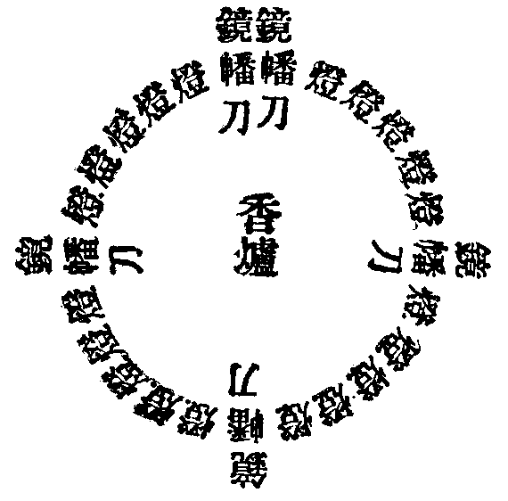

# 孔雀王呪经



> **藏经**：大正新修大藏经（大正藏）　**册次** 第 19 册（T19）　**编号** T0984　**部类** 密教部　**卷次** 2 卷　**篇幅** 19,955 字

> **卷／品**：0 卷 · 0 品



---



No. 984 [Nos. 982, 983, 985]  

孔雀王呪经卷上



梁扶南三藏僧伽婆罗译



礼佛法僧，礼七正遍知及声闻罗汉三果四向，礼弥勒等菩萨及成就正行。我当说此孔雀王呪，愿诸神众听我所言。有地行、虚空行、水行，天、龙、阿修罗、摩娄多、伽娄婆、乾闼婆、紧那罗、摩睺罗伽、夜叉、罗刹娑、卑离多、比舍遮、部多、鸠槃茶、富多那、柯咤富多那、娑干陀、欝摩陀、车耶、阿钵娑摩罗、欝多罗柯，愿听我言。



邬斜诃罗(梁言噏食)、部多伽那(梁言神众)、伽破诃罗(梁言食乳)、捺耻(汤履反)罗诃罗(梁言饮血)、婆娑诃罗(梁言食脂膏)、网娑诃罗(梁言食肉)、弭(亡比反)陀诃罗(梁言食胞)、社多诃罗(梁言食生)、恃毘多诃罗(梁言食寿命)、跋利诃罗(梁言食藤)、摩逻诃罗(梁言食髻发)、乾他诃罗(梁言食香)、弗婆诃罗(梁言食花)、颇罗诃罗(梁言食果)、萨泻诃罗(梁言食种)、阿欻底诃罗(梁言食火所烧)，如是等谄恶可畏取他寿命，我今说此大孔雀王呪，愿去谄恶诸可畏，当与华香摩香邬斜诃罗，愿听我语。当善爱慈悲信佛法僧，愿听我言。



柯里、柯罗里、鸠槃峙(唐履反，后皆同)伤已柅(奴履反，后皆同)、柯摩罗起柅、诃利底、诃利枳试、诃梨氷伽离



以慈悲信善心，愿听我言，如是信佛法僧。



柯里、柯罗里、鸠槃峙、伤已柅、柯摩罗起柅、诃梨底、诃梨枳试、哬梨氷伽离、婪婢(脾米反)、波罗蓝婢、柯罗波豕夜摩头底、夜摩、洛叉、死部娑柅



愿受香摩香华食饮，愿守护我某甲，愿呪法成就娑诃(许贺反)。



如是我闻：



一时佛住舍卫国祇树给孤独园，时有比丘名曰娑底，年少新出家，受具足未久，始学毘尼，为众破藮以营澡浴，藮孔黑蛇啮其右脚拇指，毒攻其身，躄地吐沫转眼腾视。阿难见其苦痛，往至佛所具白佛言：「云何治救？」佛告阿难：「汝持我语，以大孔雀王呪为除恶毒，往至於彼摄受守护，令娑底比丘身得安乐。汝当结界，从天持龙、阿修罗、伽楼多、乾闼婆、紧那罗、摩睺罗伽、夜叉、罗刹娑、卑离多、毘舍阇、部多、鸠槃茶、富多、那娑、干陀、欝摩驮、车耶、阿钵摩罗、欝多罗、以稚、柯若陀、优已罗、俾多罗，不可使，食不调适，恶唾恶影、恶见恶书、恶渡恶喷，一日二日三日四日乃至七日半月一月，或须臾或长恒，乍寒乍热、风冷痰癊、或备三病寒热头痛，皆愿除差。或半头痛及不能食，眼痛鼻痛耳痛口痛、心痛头颊痛喉咽痛，齿风心风胸胁风背腹风、脾胫风手足风骨节风，以佛神力愿除某甲身体病苦，日夜安隐快乐。说呪如是：



「伊致　毘致　箕致　熙利　婆致　尼致　阿智耶智　头伽智　阿梨娑求致　榜修比沙之尼　阿缕诃尼　波罗缕诃尼　軁缕诃尼　黳离(卢翅反后皆同)智(贞樏反下皆同)离底履底履　靡离靡离　底靡　头靡　头头靡一底蜜底馝担婢　毘摩离　吼溜吼溜　阿输母弃哿梨摩诃哿梨婆罗紧那枳试　苟漏苟漏怛不漏梨　拘诃漏　拘漏　杜娑𫎫婆　杜𫎫婆　头摩𫎫婆　瞿罗夜　左罗夜　熙狩　熙利熙利　弭(亡比反后皆回)利弭利徵(张里反后皆同)底利底利　州漏州漏母漏母漏母漏母漏母漏休休休休休休休休休休　婆婆婆婆婆婆婆婆婆婆蛇(常罗反后皆同)罗蛇罗蛇罗蛇罗蛇罗驮摩驮摩尼　多波多波泥　驮诃　驮诃尼　座罗尼　𤜤头婢(房比反)　桀社尼　波里沙尼　沙普多尼　多波尼　波遮尼　诃里尼　甘波尼　末陀尼　曼雉尼　歌摩歌里　伤歌里　萨柯里　萨柯里　萨柯里座(俎戈反)罗尼头摩头摩利　婆狗修弥　瞿罗叉　波利鞞(吴音同)罗夜　婆里婆斗　提婆　娑漫底那伊利　基利婆诃」



「慈我毘留赖叉　慈我黳罗婆那象　慈我毘留博叉　慈我及黑瞿昙　慈我摩尼龙王　慈我婆修已龙王　慈我杖足龙王　慈我满月龙王　慈我难陀优婆难陀龙王(皆有色有称誉与天阿修罗共战大神通)慈我阿㝹达多龙王　慈我婆楼那龙王　慈我曼蛇(常罗反，后皆同)利柯龙王　慈我得叉多龙王　慈我阿难多龙王　慈我如是婆修木河龙王　慈我阿波罗视多龙王　慈我沈婆修多龙王　慈我摩诃摩祁虽龙王　慈我如是摩那虽龙王　慈我柯多高龙王　慈我阿波罗龙王　慈我敷伽槃龙王　慈我沙弥龙王　慈我驮地母珂龙王　慈我摩尼分陀利龙王　慈我毘衫波底龙王　慈我葛雉多柯龙王　慈我伤珂波陀龙王　慈我甘婆罗龙王　慈我娑多罗龙王　慈我於彼龙王　慈我婆覊多鳣龙王　慈我针毛龙王　慈我胸行主龙王　慈我主龙王　慈我里婆柯龙王　慈我如是满耳龙王　慈我蝤䗋面龙王　慈我鼓罗柯龙王　慈我修难陀跋死费多罗常龙王　慈我倚罗具多罗龙王　慈我蓝浮罗柯龙王　慈我非人龙王　慈我上人龙王　慈我里祁罗大龙王　慈我母之𬴊驼龙王　慈我地行龙王



「如是依水依虚空依须弥山，一头二头彼常慈我，无足二足四足多足一切神龙皆莫为害，慈我住地及一切众生，若动不动皆愿安乐一切无疾病。一切见贤善莫起恶心，慈念於我，灭毒摄受，如是守护。礼佛菩萨、礼寂灭解脱、礼已解脱，婆罗门欲除恶法皆当作礼。愿垂守护一切恐畏荒乱、一切灾害疾病，愿断一切恶毒、一切不饶益，常现饶益。先时，阿难！於雪山南，名金光明孔雀王住处，朝起读诵此大孔雀王呪，昼必安乐；日入时读诵，夜必安乐。」说呪如是：



「吼吼吼吼吼吼。那伽离离离　淡婆离离离毘摩离离离　吼嘘(呼介反，后皆同)吼嘘毘阇毘阇偷循求楼　倚罗弥罗伊利弭罗　踬利弭罗　踬利弭罗　伊利蜜渧丽底利蜜渧丽喜(许里反，后皆同)利底利底蜜渧丽醰婢(亡俾反，后皆同)叟婢覩叟覩瞿罗　支罗　遮波罗　毘罗　遮伊底利馝底利　栗底利」



「南无佛陀南(奴担反，后皆同)　止利已死瞿途熙尼　南无阿罗汉多南诃罗拖罗愿雨於十方　南无佛陀南」



「彼孔雀王有时，以此大孔雀明王不作呪诵拥护安乐，而与多林孔雀女从园至园、从苑至苑、从山至山，贪著於欲，处憍迷多痴闷，提携游行，放逸自憍入一山穴。於彼长夜怨家怨友常伺其便，以孔雀绳缚。彼孔雀王将至怨中，心自作念：『唯此大孔雀明王有呪如是：



「『吼吼吼吼吼吼　那伽离离离　淡婆离离离　毘摩离离离　吼冶吼冶　毘阇毘阇偷修求喽　倚罗弥罗　伊利弥离　踬利弥罗　伊利蜜渧丽　底利蜜渧丽　熙利底利蜜渧丽　𫎫婢修𫎫婢　明修瞿罗　支罗遮波逻　毘罗遮一徵(张里反)利馝底利　栗底利』



「南无佛陀南(奴担反后皆同)　止利已死瞿途熙那　南无阿罗汉多南诃利那利愿处於十方雨一切处南无佛陀南」



「是时从苦得脱，安隐至其境界。说此呪句如是：



「悉提(途枳反)醯(呼枳反，后皆同)薮悉提醯武　遮尼武叉尼木柢(都此反，后皆同)毘木柢　阿摩离　毘摩离(都纸反)尼摩离　曼陀离　亡伽离　喜兰耳　治跋婢　赖那伽婢醯　摩牖里　跋陀离　修跋陀离　婆修跋陀离　娑满多　跋陀离　萨婆他娑陀尼　波罗末他娑陀尼　摩那死　摩诃摩那死　鷃部柢(都纸反，后皆同)鷃哲部柢　鷃箒柢　阿罗是　毘罗是　阿摩里柢　阿摩隷　婆罗弥　婆罗娑离趺(方牟反，后皆同)罗耐(奴翅反)趺罗那　摩弩脂　弥里多三恃婆底死里跋陀隷　旃(遮千反，后皆同)陀隷　旃陀罗　波罗譬(敷俾反)修离易(易移反，下皆同)修罗那干谛(都豉反)毘多颇易修跋抳　婆罗摩瞿屣　婆罗摩述柢(都此反，后皆同)萨婆波罗底　诃柢娑诃」



「礼一切诸佛，愿守护我令得安隐。止咎止咎臭止母止娑诃。复次阿难！餘彼先时金光明孔雀王。已坐非餘可知。何故？唯我，阿难！先时名金光孔雀王。阿难！此大孔雀明王，今我当说其心其呪如是：



「伊底　蜜底　底里　比里　蜜底　底里　蜜底　弭修醰婆醰波　修婆　止里　指死馝哿罗弥里」



「南无佛陀南(奴担反)止里　指死　波兰多母离　伊底诃罗　芦喜多　母罗　耽婆　掩(於甘反)婆苟底苟捺底鞠苟捺底　底罗　君社捺底　阿迮(张假反)伴侈盐」



「九月十月愿天降雨：



「伊里　弭里　指里　弭里　枳罗　弭里枳㪷母离　头头摩　修头弥雉　陀里弥散(苏半反，后皆同)㪷跋谛(当翅反，后皆同)部娑跋谛　部娑罗部娑罗　倚多　跋娑多　罗哿　诏哿罗诺摩里弭　罗珂罗摩起离　伊底萨阇离　耽鞞耽鞞　阿捺谛婆罗捺谛　阿那那捺谛　周遍周遍周遍周遍周遍周遍周遍」



「愿天降雨新水：



「那罗耶柅　波罗耶柅　诃里多里　君多里　蜜死底　已底里　蜜死底　伊里弭　悉陀牢㪷　陀罗弥陀　曼多罗　我某甲　娑婆诃」



「阿难！此大孔雀王心。以大孔雀王呪，若入国界至阿兰若，正路邪路诣王宫殿，劫贼鬪诤水火怨恶及处大众蛇啮饮毒，於一切怖畏应当忆念此呪。若风痰寒热和合，於四百四病若为一一病所触，亦应忆念。若非意苦至，亦应忆念。何以故？阿难！若人应遭囚系，但以罚而得解脱；若应鞭罚，以杖捶解脱；若应杖捶，搏耳解脱；若应搏耳，瞋骂解脱；若应瞋骂，诫勗解脱；若应诫勗，不涉言解脱。如是解脱，离一切病。阿难！我不见天人魔梵及沙门婆罗门，不以此大孔雀王呪所摄护者，坦然安隐消除罚毒。结界结地，无有敢往以作恐怖。或天或天父母天众女众，若龙若龙父母子女龙众女众，若阿修罗若修罗父母子女阿修罗众及女众，若伽楼陀若伽楼陀父母子女众，若乾闼婆若乾闼婆父母子女众，若厌鬼若厌鬼父母子女众，若紧那罗、若摩睺罗伽、若夜叉、若落叉娑、若卑离多，若毘舍阇、部多、拘槃茶、富多那、柯多富多那、娑干陀、缊摩陀、身耶、阿钵娑摩罗等，皆亦如是常觅人方便，诵念此呪终不能得。若天等得人方便，终不复得还彼天众。以是现故，应当忆念。其呪如是：



「熙利　熙利　基利眉(无梨反)利禁读第(唐纸反)醯(呼是反)木渧(阳豉反，后皆同)修木渧　阿多那多修那多　修那多　提扶婆里婆鬪　波罗摩　阿槃多艶(吴音同)阿罗婆罗　瞿(庚具反)杜喜多　伊里　弭里　馝恃里哿　柳头柯柳头柯　伊里　弥里　伊里　弥里　娑曼多妬　已栗埵　吼漏吼漏　熙里熙里已利已利　识绮那　母芟　负漏负漏　遮罗遮罗　止利止利　箒漏箒漏　毘底毘底　矢弃矢弃　伊致　伊致　弃弃弃弃弃吼受吼受吼受吼受吼受吼受吼受吼受吼受吼受　诃罗诃罗　诃罗泥(奴系反)剡埤(扶卑反)醯(呼豉反)」



「一切谄恶我皆降伏，我护某甲救济摄受，令得安隐快乐、除罚除毒，结界结地。



「质多离　质多罗摩离　诃离　诃罗摩离颇离　颇罗摩离　叩漏叩漏　波罗波漏那毘利　阿漏母漏　伊移　诃担毘茤」



「一切谄恶牙毒根毒饭毒，以佛力一切消灭。



「修漏　修鹿枳　婆罗　婆落枳　婆朗枳毘(扶比反)利喜利」



「以七正觉及声闻众力，灭牙毒根毒饭毒。



「倚离　弭离　伊里　弭离　底里底里　弥离　底摩头摩头摩(唐苟反)薮苟婆　粽婆耽婆诃智　那智　㪷罗君蛇　那智　婆里所㪷提薄伊利　已死」



「一切九月十月慈我及於一切众生。



「褒修智　褒陀罗尼　褒陀罗尼枳　婆陀枳婆陀哿母离　伊底奢婆离　斗婢斗婢　婆里飏哿离　阿跋智　波里跋智」



「南无世尊愿天雨新水。



「因陀罗　瞿弭母柯耶　一质多耶　瞿杜喜架耶　婆陵伽李柯耶　阿离多离　居多离　阿沙泥(奴翅反)波沙泥(奴翅反)波多尼拘离」



「南无诸佛世尊。毘贝尸佛，依无忧树下；尸弃佛，依分陀利树下；毘输佛，依娑罗树下；拘孙牟尼佛，依尸梨沙树下；柯那柯佛，依忧昙婆罗树下；迦叶佛，依若伽楼驮树下；瞿昙释迦牟尼佛，依菩提树下得菩提。於诸佛大神通，与诸天有信，时彼诸天皆大欢喜，常愿安隐。其呪如是：



「伊里　弭里　已里　毘里　枳里　蒲里优头罗　修头牟第(途施反)部娑罗　吼吼　哿罗　哿罗是　哿罗是　哿罗杜母离　伊底舍遮多　苟斗履　那俾罗尼钵舍底　钵舍　钵舍底　柯俾罗末　沙斗　伊里婆　悉陀　牢斗陀罗眉陀　曼多罗　婆多　莎诃」



「阿难！若有人诵此大药叉名者，设有恶心欲相恼害，头破作七分如罗毘扶。说言如是：



「吉底母离　倚楼母离　娑曼多母离　阿智那智　苟薮那智　一涕(他离反，后皆同)蜜涕波漏　阿罗咤个　摩罗咤个　伊利已止利　瞿头(当楼反，后皆同)头诃檀陀　卯(吴音同)训头吼摩频那罢(亡俾反)多」



「礼诸佛两足尊，愿汝等安隐行路往还，一切昼夜心无伤愍。一切诸佛大神通，一切无漏诸罗汉，以此实语愿皆安隐。此大孔雀王呪如来所说，愿作救济摄受守护，寂乐安隐除诸罚毒。结界结地，愿寿百岁见於百春。阿难！诸大药叉，或住海中或住须弥山，或住高山密林大林，或住大小江河、川渠陂池、山冢四衢、国村园苑、大路小路、游戏之处。阿难！药叉住於阿兰盘多国王处，以此大孔雀王呪，愿见守护，寿於百春。说呪如是：



「诃利诃利尼　遮利遮利尼　波罗摩尼　母诃尼娑担婆尼　剡婆尼　莎炎部莎呵」



「阿难！东方提头赖咤，领乾闼婆王众，数非一千万，前后围遶，守护东方，天王复有儿孙兄弟及大臣军主吏民大众，以此大孔雀王呪拥护守视，令其安隐百岁欢乐。说呪如是：



「受受漏　受受漏　受受漏　受受漏　受漏受漏是莎诃」



「阿难！南方毘楼略，领鸠槃茶王众，数非一千万，前后围遶，拥护守视南方，天王复有儿孙兄弟大臣军主吏民大众，以此大孔雀王呪，愿拥护守视皆见百春。说呪如是：



「鞞漏翅　鞞漏翅　阿蜜多罗　伽多尼　波楼那婆底　婢糅婆里尼　婢利那弗多罗翅　主呪毘呪莎诃」



「阿难！西方毘楼博叉，领龙王众，数非一千万，前后围遶守护西方，天王复有儿孙兄弟大臣军主吏民大众，以此大孔雀王呪，拥护守卫令寿百春。说呪如是：



「罢(防俾反，后皆同)部利　罢部利末底智　末底智　俱踬俱踬苾头摩底　楼楼楼楼楼楼楼楼　周周周周周周周周　遮遮遮遮遮遮遮遮(吴音同)莎诃」



「阿难北方名毘沙门。领药叉王众，数非一千万，前后围遶，守护北方，天王复有儿孙兄弟大臣军主吏民大众，以此大孔雀王呪，愿拥护守卫我某甲等令见百春。说呪如是：



「苏利苏利　失利失利摩底　熙利熙利　摩底　已里利　诃里利　彼漏彼漏氷伽离　周漏周漏团(吴音同)头摩底　诃多毘芟　坦头摩底莎诃」



「东方提头赖咤、南方毘楼略、西方毘楼博叉、北方鸠鞞罗，此四大天王守护世间，有大称誉、有大神通力，能降伏怨敌，世无有抵无能胜者。阿修罗战，以此大孔雀明王呪，拥护我等愿见百春。说呪如是：



「多婆离　摩婆离　遮离　弥离　底罗弭离　伊施　鞞施　耽鞞　耽鞞」



「愿天雨一切。



「喜利弭里　耽鞞　斗斗鞞　遏智跋智　波罗摩头　捺智」



「愿天雨。



「咎漏伽兰多　安第(途翅反皆同)难第　斗斗难第槃檀第　粥翅木翅　伊哩底　尼里底　喜里喜里　吼漏吼漏　诃利弭里　斗离多多离　莎诃」



「汝阿难！当诵取大药叉军主，名偈如是：鸠鞞罗大儿名先阇耶乘人，住弥(亡之反)伊罗国，常乞天实语，以此大孔雀王呪，拥护我愿见百春。说呪如是：



「波离　具罗柯智　摩登耆　旃陀利　富楼娑腻　止止里尼　瞿利　乾陀利　旃陀利　摩登耆　摩里尼　喜利喜利　阿伽底　伽底　乾陀利　俱耻柯罗　柯罗衣智诃底　喜利喜利箴(吴音同)莎诃」



钩钩孙陀夜叉，住弗波多利弗国。阿难波实多(梁言不称)夜叉，住偷那国。药叉名世罗，住跋陀国。那婆夜叉，住欝单越国。彼周罗波尼夜叉(梁言金刚手)，住耆阇崛山。伽楼陀夜叉，住毘富罗国。质多罗崛多夜叉，住底季底木珂国。薄拘罗夜叉，有大军大力，珂多夜叉、优波珂多夜叉，皆住迦毘罗国释迦生处。柯摩履波陀斑足夜叉，住毘罗国。摩醯首罗夜叉，住毘罗多国。魔醯镞罗夜叉(梁言太白)，止罗多国。毘里害(吴音同)波底夜叉，住舍卫国。娑伽罗夜叉，住娑枳多国。发阇罗牖他夜叉(梁言金刚仗)，住毘沙罗国。诃梨氷伽罗夜叉(梁言师子青色)，住末罗国。摩诃哿罗夜叉，住婆罗那国。修陀里舍那夜叉(梁言善见)，住瞻波国。毘复䌷夜叉，住堕罗个国。陀罗秦持夜叉，住堕罗波利国。毘纰(敷比反)舍那夜叉(梁言可畏)，住担罗跋魔熟铜色国。末陀那夜叉，住沙耶遮国。阿多婆夜叉，住於林中。迦毘罗夜叉，住多谷国。婆修多罗夜叉，住欝阇耶尼国。婆部底夜叉，住婆兰底国。裘楼个夜叉，住婆楼割车国。难陀夜叉，住阿难陀富罗国。末离他罗夜叉(梁言持华鬘)、陀瞿缕陀分夜叉，皆住胜水国。阿难陀夜叉(梁言白牙)，住波罗钵多国。叔柯罗荡屣多罗夜叉，住修跋升难国(梁言善处)。如是夜叉从佛游化。地里陀那南手夜叉(梁言坚名)，住末死底柯国。摩诃耆利夜叉(梁言大山)，住耆利那伽罗山城。婆娑婆夜叉，住鞞持舍国。柯底枳夜叉，住鲁喜多个国。拘摩罗童子夜叉，於世有称誉(梁言百肩)，沙多婆吼夜叉，皆住阐陀哿罗国。毘梨害(呼割反)罗他夜叉，住迦陵伽国。头漏庾陀那夜叉(梁言大车不可系)，住遏祁柰国。遏受那夜叉，住遏受罗林。末陀柰夜叉，住曼陀婆国。山顶者利苟多夜叉，住摩罗婆国。苹陀罗夜叉，住缕憙多国。萨婆跋陀罗夜叉，住奢柯罗国。波利多柯夜叉，住输底罗柯国。萨他婆诃夜叉、陀尼莎罗夜叉，皆住阿恃单阇耶国。苟多荡娑多罗夜叉、婆修跋陀罗夜叉，皆住婆莎底国。矢婆夜叉，住矢婆富罗诃罗国。矢婆跋陀罗夜叉，住矢沙那国。因陀罗夜叉，住因陀罗婆驮国。弗沙波支(伧音)斗夜叉，住尸罗不罗国。陀罗柯夜叉，住陀罗不罗国。柯毘罗夜叉，住跋那国。摩尼跋陀罗夜叉、分尼跋陀夜叉，此二兄弟皆住婆罗摩底野国。波罗末陀那夜叉，住乾陀罗国。波罗槃阇那夜叉，住卓叉尸罗国。珂罗留(吴音同)摩夜叉，住掣(昌葛反)陀世(设鸡反)罗国。底里堀多夜叉，住阿㝹诃底罗国。波罗朋哿罗夜叉，住鲁楼个国。难提尺跋他那夜叉，住兴咎跋他那国。婆比罗夜叉，住婆各诃部弭国。哿罗诃比里野夜叉，住婆哿国。竭(苦葛反)施婆哿夜叉，住摩偷罗国。哿输陀罗夜叉，住朗柯国。修里耶波罗婆夜叉，住修那国。其梨刎陀夜叉，住偷罗诃国。毘阇耶及鞞阇延多夜叉，住䉽头摩偷罗国。分那柯夜叉，住摩罗耶山。紧那罗夜叉，住鸡罗哿国。弭珂波腻夜叉，住槃陀国。看陀哿夜叉，住波底施(汤哿反)那国。僧哿利夜叉，住比等伽罗国。速可婆诃夜叉，住多郎伽底国。孙陀罗夜叉，住那死柯国。阿僧伽夜叉、波楼割旦(吴音同)夜叉、难提哿夜叉、比多难提夜叉、毘罗夜叉，皆住哿罗诃多个国。蓝扶施罗夜叉，住伽陵伽国。摩诃部阇夜叉，住俱莎罗国。萨(苏括反)底个夜叉，住萨(苏括反)底个咤国。波罗个夜叉，住婆那婆死国。跋陀罗千陀夜叉，住多踬莎干陀国。施那诃罗夜叉，住莎陀富罗国。婆罗夜叉，住鞞罗摩个国。比里耶陀里舍那夜叉，住阿槃底国。矢看地夜叉，住瞿竭(苦割反)陀那国。安阇那比里耶夜叉，住鞞雉舍国。罢(亡俾反)矢体(畅底反)多个夜叉，住掣(昌葛反)多罗伽罗国。摩柯蓝陀摩夜叉，住底里不罗国。妣奢浴夜叉，住倚哿觉叉国。阿蓝婆夜叉，住遮漏𫎫婆罗国。摩诃颇伽夜叉，住鸠婆利国。毘缕遮罗夜叉，住释柯摩底国。遮罗底哿夜叉，住阿喜掣(昌葛反)多罗国。柯比罗夜叉，住甘比利国。薄鸠罗夜叉、曼陀婆耶夜叉、分那柯夜叉，皆住类恃诃那国。苨(奴枳反)伽弭婆夜叉，住般遮利国。波罗婆夜叉，住伽阇国。陀里陀诃陀㝹夜叉，住波那国。不蓝阇那夜叉，住摇他国。拘婆罗个二夜叉王，住苟鹿绮多罗国；摩呼楼可弭可罗二夜叉女，有大名称，亦住於彼。罢(亡俾反)底诃尼奈夜叉、悉达夜叉，皆住阿耶底波耶国。悉陀抴(扬结反)多罗夜叉，住莎鹿珂那国。莎偷那夜叉，住莎偷那国。僧(苏拯反)伽波罗二夜叉(梁言师子力虎力)，住拘底波里沙国。摩诃先那夜叉，住阿摩罗不蓝阇耶国。弗波檀多夜叉，住瞻波国。摩伽多夜叉，住五山。瞿渝瞿夜叉、具婆都夜叉、修徒那夜叉，住那伽罗国(梁言那竭)。毘罗婆诃夜叉，住莎枳多国。修可婆诃夜叉，住哿底国。阿那抴(扬结反)阿那耶莎夜叉，住高芟毘国。跋陀利柯夜叉，住跋陀利柯国。部多木珂夜叉，住波多利弗多罗国。阿输柯夜叉，住倚哿者国。柯檐柯多夜叉，住庵婆多国。悉太夜叉，住阿罗柯国。弭(亡俾反)里头个夜叉，住恃单阇耶国。刎阇枳舍夜叉，住恶伽缕陀介国。摩尼柯摩那夜叉，住先颇婆国。毘哿多哿多夜叉、柯比罗夜叉，皆住跋莎升国。乾他罗介夜叉、毘已里底介夜叉、堕罗介夜叉、尼罗耶夜叉、父楼婆夜叉、未茶摩夜叉、已耶搔夜叉、跋陀罗治夜叉、摩诃耶舍夜叉，皆住鞞头罗不罗国。剡婆介夜叉，住摩楼部弭国。毘哿多夜叉，住频驮柯多国。提婆芟摩夜叉，住鞞摩尼介国。曼陀罗夜叉，住优陀罗陀国。波罗朋哿罗夜叉，住劫宾国。瞻波柯夜叉，住阇多修罗国。般之介夜叉，住劫宾国；有五百子，有大军大力，其最大者名般止介，住止那地(止那即中夏地也)。娑干社夜叉(梁言无别头姓高式)，住修多罗地。欝多波陀(梁言骆驼足)，住鸠陈陀国。曼陀罗夜叉，住曼陀罗婆那国。朗枳莎罗夜叉(梁言坚自在)，住迦毘尸国。摩里止夜叉(梁言光明)，住罗摩起罗国。挞摩波摩(梁言守法)，住迦舍国。摩诃部社夜叉(梁言大肩)，住婆诃梨国。毘沙门王子杜那里娑婆(梁言有吉)，一亿夜叉围遶，住可罗国。莎多祁梨夜叉、醯摩婆多夜叉，皆住辛头莎伽离国。底里守罗波柅(囊子反)，住底里夫那国。婆罗末陀那夜叉，住謌陵伽国。般遮罗旃陀夜叉，住陀罗美陀国。陀离奢罗夜叉(梁言财物自在)，住师子国。叔謌罗木珂夜叉(梁言白面)，住林中。矜謌罗夜叉(梁言何所作)，住波多罗国(梁言地下)。波罗颇莎罗夜叉(梁言最光明)，住陀利国(梁言即分陀利华)。萨(苏葛反)眉罗夜叉，住遮摩罗国。波罗蜯哿罗(梁言作光明)夜叉，住优罗舍国。氷伽罗夜叉，住阿摩利摩国。跋螺社夜叉，住婆芦堕林。摩多利夜叉，住謌波陀国。薮波罗佛陀夜叉(梁言善见)，住弗底利波智国。那罗鸠婆罗夜叉，住柯毘尸国、波罗多国。伤柯罗夜叉，住莎何婆他那国。毘摩质多罗夜叉，住波罗婆国。氷伽罗夜叉，住哿多柯国。介那木珂(梁言满面)夜叉，住分那跋他那国。哿罗多夜叉，住乌缠国。曼头陀罗夜叉，住高莎罗国。摩柯罗堕阇夜叉(梁言𮬖鱼)，住摩娄国。质多罗仙那夜叉(梁言种种军)，住仆柯那国。罗婆那夜叉(梁言碧色)，住罗摩他国。氷加罗夜叉，住婆罗死耶国。波里耶持里舍那夜叉(梁言乐见)，住毕底耶国。金毘罗夜叉，亿万夜叉围遶，住王舍城。瞿波罗夜叉，住阿喜掣(昌葛反)多罗国。阿多介夜叉，住阿底柯不罗国。难提夜叉(梁言欢喜)，住难提国。婆利夜叉，住伽蓝瞿沙国。毘沙门夜叉，一亿夜叉军以自围遶，住提婆婆多罗那国，常在阿多盘多城。此诸神通军主大力夜叉，常能降伏怨敌无能胜者，大有称誉，常与诸天及阿修罗共战，以此大孔雀王呪常加守护愿寿百岁。说呪如是：



「阿柯智　毘柯智　诃罗尼　诃罗尼　他罗尼　他罗他　勗翅勗翅　曝翅曝翅　诃那诃」那诃那诃那诃那诃那诃那诃那诃那诃那



「我某甲怨家陀诃陀诃陀诃陀诃陀诃陀诃陀诃陀诃陀诃」



「不饶益我波遮波遮波遮波遮波遮波遮波遮波遮波遮波遮」



「我讐头头头头头头头头头头」



「不饶益我诃诃诃诃诃诃诃诃诃诃」



「阇智阇智阇智阇智阇智阇智阇智阇智阇智阇智」



「愿除我怨家箒漏箒漏箒漏箒漏箒漏箒漏箒漏箒漏箒漏箒漏」



「熙利熙利熙利熙利熙利熙利熙利熙利熙利熙利」



「弥利弭利弭利弭利弭利弭利弭利弭利弭利弭利」



「剖漏剖漏剖漏剖漏剖漏剖漏剖漏剖漏剖漏剖漏」



「止底止底止底止底止底止底止底止底止底止底」



「[〦/(目*目)/大]翅　密(捕逼反)翅　织翅薄翅　矢里跋陀离　亡伽离三曼陀跋陀离萨婆罗他莎他腻　柯摩离　毘摩离　旃陀罗　波罗譬(敷臂反)　修利竿智　醰鞞(浮辟反)涂醰(浮臂反)波罗　养柯离」



「愿护我某甲及我眷属愿寿百岁。」



孔雀王呪经卷上



孔雀王呪经卷下



梁扶南三藏僧伽婆罗译



「阿难！汝当取二十八夜叉大军主名，守护十方国土。



「阿难！东方四夜叉大军主住东方，常守护东方。其名如是：



「地呵(梁言长)、修涅多罗(梁言善根)、介那柯(梁言满)、迦毘罗(梁言黄色)。



「以此大孔雀王呪，拥护我某甲愿寿百岁。」



「阿难！南方四夜叉大军主住南方，常守护南方。其名如是：



「僧(桑拯反，后皆同)伽(梁言师子)、优波僧伽(梁言师子子)、偿起罗(梁言螺)、旃陀那(梁言栴檀)。



「以此大孔雀王呪，常守护我愿寿百岁。」



「阿难！西方四夜叉大军主住西方，常守护西方。其名如是：



「诃利(梁言师子)、诃利枳舍(梁言师子发)、波罗赴(梁言自在)、氷伽罗(梁言苍色)。



「以此大孔雀王呪，常守护我愿寿百岁。」



「阿难！北方四夜叉大军主住北方，常守护北方。其名如是：



「陀罗那(梁言持)、陀罗难陀(梁言欢喜)、欝庾伽波罗(梁言勤守)、别伽那(梁言围)。



「以此大孔雀王呪，常守护我愿寿百岁。」



「阿难！四维有四夜叉大军主住四维，常守护四维。其名如是：



「般止柯(梁言五)、般遮罗旃陀(梁言五可畏)、莎多祁梨(梁言七山主)、醯遮婆多(梁言雪山主)。



「以此大孔雀王呪，常守护我愿寿百岁。」



「阿难！下方有四夜叉大军主住下方，常守护下方。其名如是：



「部摩(梁言地)、修部摩(梁言善地)、柯罗(梁言黑)、优波柯罗(梁言小黑)。



「以此大孔雀王呪，常守护我愿寿百岁。」



「阿难！上方有四夜叉大军主住上方，常守护上方。其名如是：



「苏摩(梁言月)、修利(梁言日)、恶祁尼(梁言火)、婆牖(梁言风)。



「以此大孔雀王呪，常守护我愿寿百岁。」



「阿难！汝当取毘沙王诸兄弟千军主名，常守护众生，除世间灾害一切恼乱，为摄受世间周行世间。其名如是：



「因陀罗(梁言帝释)、苏摩(梁言月)、婆楼那(梁言龙)、罗阇波底(梁言主世)、颇罗堕蛇(是姓)伊奢那(梁言自在)、旃陀那(梁言栴檀)、柯摩施离沙多(梁言胜欲)、已尼延(胡栴反，后皆同)叉(梁言铃声)、尼延他柯(梁言无怨)、婆利摩尼(梁言珠力)、摩尼遮罗(梁言珠行)、波罗那驮(梁言大声)、优波般止哿(梁言小五)、莎多祁梨(梁言七山)、醯摩婆多(梁言雪山主)、介那柯(梁言满)、珂陀罗鼓毘驮(梁言树名)、瞿波罗(梁言守地)、阿多波柯(梁言林)、那罗罗阇社那里娑婆(梁言众牛王)、般遮罗栴陀(梁言五可畏)、修木珂(梁言善意)、持罗珂(梁言美)、质多罗仙那乾闼婆(梁言种种伎乐)、底梨颇里(梁言三果)、底里干多柯(梁言三刺)、持罗珂释底摩多利(梁言调长槊)。」



「此大夜叉总领诸军，有神通力、有光明称誉，皆毘沙王兄弟王，常约勅此夜叉，常恼他不放。毘沙王兄弟以此大孔雀王呪，常守护我愿寿百岁愿守护，鬪诤相击等愿守护。人非人所录，天、龙、阿修罗、摩楼多、伽楼多、乾闼婆、紧那罗、摩睺罗伽、夜叉、罗刹莎、波离多、毘设遮、部多、鸠槃茶、富多那、柯多富多那、莎于陀、怨摩陀、车耶、阿具莎摩罗、欝多罗、诺器(吴音同)多罗、离波等所录，愿常守护。食气、食胎孕、食血膋、食肉，食寿命、藤香、华鬘、种种华果，及火所烧，愿守护。事业珂辜罗陀，厌鬼、骑人鬼、唤人鬼、起风鬼、使鬼、起尸鬼、异声鬼、兵鬼，恶食恶唾、恶影恶见、恶书恶渡。从此惊恐，劫贼水火军饥死、非时死、地动虎狼怨家等，如是怖畏，愿皆消除。头痛不能食，耳眼鼻口牙齿项颊、心胸颈胁腹背腓髀、手脚身体一切支节，如是处风，愿皆消除。若一日二日三日四日乃至七日十五日，月日天时所作寒热，及鬼所作、风冷痰癊和合所作，一切病痛及恶毒怖畏，是谓我怨，一时愿灭。」



「阿难！此十二大女鬼，常守护菩萨入胎时、生时、生后时。云何十二？其名如是：



「蓝婆、毘蓝婆、婆罗蓝婆、优蓝婆、诃梨底、诃梨枳矢、诃梨氷伽罗、柯梨、柯罗梨、甘曝其梨婆柯已、柯罗收陀利



「此十二大女鬼，有光誉神通、有大力，常与提婆、阿修罗战。以此大孔雀王呪，常守护我，愿寿百岁。」



「阿难！复有八大女鬼，常守护菩萨入胎时、生时、生后时。云何为八？其名如是：



「摩陀摩陀那、摩脱柯多、优波摩陀、波梨底、优阇诃梨、优阇诃梨尼、阿舍尼、伽罗莎尼。



「以此大孔雀王呪，常守护我，愿寿百岁。」



「阿难！复有七大女鬼，常噉血肉兼恼触人，守护菩萨入胎时、生时、生后时。云何为七？其名如是：



「恶伽芦持柯、洛起底柯、质多罗毘设止柯、分那跋雉里柯、恶祁尼洛起底柯、蜜多罗柯、里个里史洛起底柯。



「此七大女鬼，有光称神通，常与大力提婆、阿修罗鬪。以此大孔雀王呪，常守护我，愿寿百岁。」



「阿难！复有五大女鬼，常守护菩萨入胎时、生时及生后时。云何为五？其名如是：



「军叉、阿底军耻、难陀、苹细罗、迦毘罗。



「此五大女鬼，有光明神通。以此大孔雀王呪，常守护我，愿寿百岁。」



「阿难！复有八大罗刹女，饮血噉肉恼触於人，常守护菩萨入胎时、生时及生后时。云何为八？其名如是：



「牟诃、阿矢摩、等鸠释弃、枳矢尼、甘蒲侍、阿蜜多罗、虏喜多驮、柯罗逻。



「此鬼饮血噉肉，常取童男童女及初产妪家。恒随逐人，或入空处或唤人名字，恒噏人精气，无慈悲心，大可怖畏。此八大罗刹女有光明神通。以此大孔雀明王呪，常守护我，愿寿百岁。」



「阿难！复有十大罗刹女，常守护菩萨入胎时、生时及生后时。云何为十？其名如是：



「诃梨底罗刹女、难陀罗刹女、杀氷伽罗罗刹女、赏起尼罗刹女、柯里个罗刹女、提婆蜜多罗罗刹女、军多罗刹女、军多堂屣多罗刹女(梁言白牙)、蓝毘个罗刹女、阿那逻罗刹女。



「此十大罗刹女，有光明神通。以此大孔雀王呪，常守护我，愿寿百岁。」



「阿难！复有十二大罗刹女。云何为十二？其名如是：



「阿那底里个罗刹女、三勿陀罗罗刹女、老捺里罗刹女、波罗那陀罗刹女、苾陀施罗罗刹女、他莵施罗罗刹女、奢罗陀罗罗刹女、陀死陀罗罗刹女、灼柯罗陀罗罗刹女、灼柯罗婆陀罗刹女、毘纰屣那罗刹女(丹本注云少一女名，当异译可畏罗刹女)。



「此十二大罗刹女。以孔雀王呪，常守护我，愿寿百岁。」



「阿难！复有十二鬼母，常恼触众生。云何为十二？其名如是：



「婆罗靡(亡至反)、留(吴音)持利、高摩利、鞞沙那毘医持利、婆罗喜、高莎利、婆楼尼野、婆叶(杨獦反)婆夜、尼祁尼夜、摩诃柯利。



「以此大孔雀王呪，常守护我，愿寿百岁。」



「阿难！复有一大比沙止罗刹妇，住於海边，闻八万里血香一夜周行，常护菩萨入胎时、生时及生后时。以此大孔雀王呪，常守护我，愿寿百岁。其名如是：



「诃离　珂离　丘离　摩离　弭(亡比反)离　母离末智　曼持底翅　吼楼　吼楼　吼楼　吼楼　漏漏　漏漏　弭利　弭利　弭利　萨(苏咄反后皆同)死底　萨死底　萨死底」



「护我某甲及眷属莎诃。」



「阿难汝当取大罗刹女名。其名如是：



「迦比罗、波头罗、摩熙使、毛利个、多底个、座罗那、毘摩罗、陀罗尼、诃里旃陀逻、缕喜尼、摩梨止、吼多泥尼、婆楼尼、柯利、柯仑至、婆罗、伽罗莎尼、柯罗利、摩登耆、氷伽罗、盘偷逻、瞿利、乾他利、鸠曼地、柯郎记、波罗尼、摩陀尼、阿奢尼、揭婆诃梨尼、楼持罗诃梨尼、檀兜罗、欝多罗莎尼、诃莎里柯、婆罗靡(亡主反)多多、柯波利、跋阇罗、陀逻莎干陀、多靡罗、婆利沙尼、揭阇尼、莎俯多尼、苾弟庾多尼、甞伽摩、欝罗柯母、起婆宣他罗、哿罗赖底里、野摩头底、阿婆罗、奢婆罗欝惰呵阇多、舍多婆吼、舍多涅多罗、伽多尼、末陀尼、末罗阇尼、末阇利、屣洛起尼舍遮梨、地婆娑遮利、曼地底哿、哿罗他那、毘醯(呼翅反)他尼、阿死母婆罗他逻底里首、罗波尼、多摩罗、哿罗檀底、摩怒罗摩、檀陀熙沈婆、尼罗质多罗。



「此七十一大罗刹女，有称誉光色神通，常与大力提婆、阿修罗战。以此大孔雀王呪，常守护我，愿寿百岁。其名如是：



「熙利熙利　弭(亡比反)利　怛陀　多跋智　鑮(蒲博反)翅(言以反)鑮翅呼离呼离陀罗陀罗　诃罗诃罗　遮罗遮罗　箒楼箒楼莎诃　那末萨婆　佛陀南(奴担反，后皆同)莎诃　辟支佛陀南莎诃　阿罗汉多南莎　米徙遏(呼葛反)死野(即弥勒也)菩陀萨怛缚(二合)莎诃　萨婆菩地萨埵南(奴担反)莎诃　阿那钳靡(亡比反)南(奴担反)莎诃婆已梨多钳弭南莎诃　输卢多半那南(奴担反)莎诃　三藐伽多南莎诃　三藐波罗底半那南莎诃　婆罗摩耶莎诃　波罗阇波多易(难易之易后皆同)莎诃　伊沙那耶莎诃　恶伽那易莎诃　波野婢莎诃　波缕那耶莎诃　野摩耶莎诃　优边陀罗耶莎诃　鞞沙罗婆耶药叉地(途止反)波多易(难易)莎诃　陀里多赖多罗耶乾挞婆地(途止反)波多易莎诃　毘楼他柯耶鸠槃茶地波多易莎诃　毘缕博叉耶那伽地波多易莎诃　提波南莎诃　那伽南莎诃　阿修罗南莎诃　摩楼多南莎诃　伽楼多南莎诃　乾挞婆南莎诃　紧那罗南莎诃　摩睺罗伽南莎诃　药叉南莎诃　洛叉那南莎诃　彼离多南莎诃　比舍诈南莎诃　部多南莎诃　鸠盘茶南莎诃　富多那南莎诃　柯多富多那南莎诃　莎干陀南莎诃　蕴摩陀南莎诃　车耶南莎诃　阿贝莎摩罗南莎诃　欝(乌突反)　多罗柯那南莎诃　旃陀罗修里喻南莎诃　诺察多罗南莎诃　伽罗诃那南莎诃　竖底沙南莎诃　毘沙南莎诃　里史南莎诃　悉他南莎诃　悉他婆罗多南莎诃　悉他苾陀耶南莎诃　瞿里易莎诃　乾他里易莎诃　甞求梨易莎诃　阿弭(亡比反)里多耶莎诃　遮彼底易莎诃　陀罗弭(亡比反)地易莎诃　奢婆里易莎诃　阿阇婆那耶莎诃　旃陀里易莎诃　摩当祁易莎诃　那伽喜里陀耶野莎诃　伽楼陀喜里陀耶野莎诃　摩捺虽尼易莎诃　摩诃摩捺虽尼易莎诃　奢陀叉梨易莎诃　摩尼跋陀罗耶莎诃　莎曼多罗跋陀罗耶莎诃　摩诃莎摩陀耶野莎诃　摩诃波罗底莎罗那耶莎诃　矢多婆那耶莎诃　摩诃矢多婆那耶莎诃　檀陀陀罗尼易莎诃　摩诃檀陀陀罗尼易莎诃　母止离那罗耶莎诃　摩诃母止隣那罗耶莎诃　阇延底易莎诃　潜底易莎诃　阿舍(伤戈反)哿里多耶莎诃　摩诃摩诱利苾陀耶罗阇莎诃」



「以此大明大呪大行大护，令我某甲灭恶事业，除厌鬼、起死鬼、作声鬼、兵鬼、无头鬼、癫癎鬼、怖人鬼，消毒噏气、恶食恶唾、恶影恶见、恶书恶度，辟县官、除寒热，一日二日三日四日乃至七日半月一月，或天时所作、鬼作风冷痰癊，一切和合乍寒乍热，除头痛不能食，眼鼻颊齿领车颈耳、心胁背腹𦝣膝风、手脚身体支节风痛，除诸执录、一切毒病，愿日夜安隐，愿佛垂施。」



「那姥死斗佛陀耶　那姥死斗菩陀也　那姥死斗澘多耶　那姥死斗澘多也　那姥毘木多耶　那姥毘木多也　那姥死斗木多耶　那姥死斗木多也　婆罗摩　那婆喜多　波跘达摩　低(都离反)英那摩　那磨基栗埵　莎死底　莎死底」



「愿护某甲入胎时。」



「阿难！汝当取诸龙王名。其名如是：



「佛世尊龙王(龙取佛世尊为名，下多如是)、梵龙王、帝释龙王、海龙王、海子龙王、莎伽罗龙王、鲸龙王、难陀龙王、优波难陀龙王、那罗龙王、优波那伽龙王、善见龙王、婆修已龙王、得解屣龙王、阿楼那龙王、婆楼那龙王、六体龙王、有吉龙王、吉羊毛龙王、吉增长龙王、吉贤龙王、大力龙王、斑斓色龙王、善肩龙王、须弥山龙王、日光龙王、月光龙王、舞龙王、声龙王、电龙王、破龙王、降雨龙王、无垢龙王、阿力柯龙王(梁言蜂头)、阿矢沙龙王(梁言马)、婆里龙王、柯矢沙龙王、马头龙王、牛头龙王、鹿头龙王、象头龙王、半白鹭龙王、人声龙王、种种龙王、种种军龙王、种种眼龙王、那母止龙王、母止龙王、母止隣陀龙王、声龙王、帝释龙王、山龙王、大山龙王、罗部罗龙王、虫龙王、无边龙王、金龙王、葛旦龙王、青色龙王、黄色龙王、倚罗贝多罗龙王、螺龙王、无半龙王、黑龙王、小黑龙王、天力龙王、毘㝹龙王、毛被龙王、可畏龙王、罗刹龙王、山肩龙王、恒龙王、辛头龙王、薄丘龙王、死多龙王、益吉龙王、阿㝹达多龙王、善迹龙王、瑿罗龙王、持地龙王、持山龙王、持光明龙王、贤龙王、善贤龙王、宝贤龙王、力贤龙王、珠龙王、珠顶龙王、雨黑龙王、雨黄龙王、雨赤龙王、雨白龙王、曼华龙王、赤曼龙王、独子龙王、贤衣龙王、鼓龙王、鼓声龙王、阿落渚龙王、戏儿龙王、毘头赖咤龙王、毘头略龙王、毘楼博叉龙王、毘沙门龙王、车面龙王、可畏龙王、瞿昙龙王、五龙王、五髻起龙王、滴龙王、小滴龙王、阿修哿龙王、柯罗哿龙王、婆里个龙王、摩尼得柯罗龙王、金纸尼龙王、金者那柯龙王、齿傍个龙王、黑瞿昙龙王、非人龙王、人龙王、根人龙王、上人龙王、摩等伽罗龙王、般他个龙王、上龙王、蓝扶罗龙王、胜龙王、香龙王、香色龙王、阿罗婆陀龙王、摩罗婆陀龙王、有意龙王、大有意龙王、葛雉多哿龙王、欢喜龙王、迦比罗世罗婆个龙王、欝波罗龙王、那珂柯龙王、跋他摩那龙王、木叉个龙王、浡地哿龙王、木叉浡地龙王、波罗木叉那龙王、甘婆罗琐多劳(慰劳之劳)二龙王、倚陀弭逃二龙王、难土波难陀二龙王、蔼[?/(冗-几+豕)](昌尔反)多龙王、摩诃修陀里沙那龙王、波陀罗柯龙王、师子龙王、阿陀里沙那木珂龙王、波里架多龙王、修木珂龙王、陀罗尼陀龙王、雨黑龙王、雨白龙王、青白龙王、雨小白龙王。



「此诸龙王及诸龙王，於此地上或时作声、或时放光、或时降雨、或时熟稻，其常见佛受三归五戒，解脱金翅鸟怖畏、解脱热沙怖畏、解脱王事怖畏，常持於地住大宝宫，寿命长久有大神通力，富贵自在，与诸眷属常除怨嫉，名誉远流，与天、阿修罗战。彼诸龙王及儿孙兄弟大臣军主使吏群众，以此大孔雀王呪，愿常拥护，令我安隐。若残食不残食、若醉不醉、行住坐卧睡觉去来，若从於王𡨥乱荒饿非时节死，大地震动、师子虎狼，一切怖畏皆得安隐。从天、龙、阿修罗、摩睺多、伽楼多、乾闼婆、紧那罗、摩睺罗伽、药叉、落叉波、离多、比沙者、部多、鸠槃茶、富多那、柯多富多那、娑干陀、蕴摩陀、车耶、阿贝摩罗、欝娑多罗、罗哿等，一切怖畏事业皆得安隐。柯若罗陀已罗那、起死鬼、作声鬼、使鬼，恶食恶唾、恶影恶见、恶书恶渡、执录怖畏，皆得安隐。癣疥疽癞、瘿瘤等诸病，皆悉除差，日夜安隐。愿一切诸佛，常施我安隐。



「那姥死斗佛陀耶　那姥死斗菩陀也　那姥莎斗潜多耶　那姥莎斗潜多也　那姥毘木多耶　那姥毘木多也　那姥死斗木多耶　那姥死斗木多也　婆罗摩　那婆喜多　波跘达摩低(都离反)芟那摩　那磨基粟埵」



「愿守护我及我眷属。」



「阿难！此大孔雀明王，毘婆尸佛正遍知觉所说所随喜。其呪如是：



「阿罗智　柯罗智　摩提(途斯反，后皆同)摩陀　跋罗提　阿婆离　沙婆离　斗离斗离　首离首离　部离部离　沙婆离　波罗那罗　吼止吼止吼止吼止吼止　母止母止母止　莎诃」



「阿难！此大孔雀王，尸弃佛正遍知所说所随喜。其呪如是：



「一智　蜜智　口提　毘提　喜利弭(亡比反)利枳斗母离　庵婆离　庵婆罗波底　醰鞞　土醰鞞　喜利喜利　憙利　苟止苟止　母止母止　莎诃」



「阿难！此大孔雀王，毘首抚佛正遍知所说所随喜。其呪如是：



「武利　武利翅　摩地　曼地尼只　诃离　诃离　伽离　珂离　颇离　颇里尸檀底　檀底檀底离　奢柯底　摩柯底那　智那底尼　矢利矢利矢利矢利　莎诃」



「阿难！此大孔雀王呪，哿拘留孙佛正遍知所说所随喜。其呪如是：



「喜底　婆底　鸠底　母底　斗底修智　檀谛(当离反，后皆同)檀戴(吴音同)檀底离　奢弭里　遮摩利　他伽利　遮伽利　干遮尼　干遮那婆底　婆离婆离婆离婆离婆离　檀谛悉他　莎诃」



「阿难！此大孔雀王呪，柯那供正遍知所说所随喜。其呪如是：



「檀多离　多多离　多罗离　多罗都多离多离多离　毘离　毘阇易　苾受婆离　毘罗提毘罗提　毘罗阇毘罗阇　摩死　摩底　摩利　摩里尼　刎提　祁梨刎提　座离座离座离座离座离　跋陀罗波底悉地　莎诃」



「阿难！此大孔雀王呪，迦叶正遍知所说所随喜。其呪如是：



「安陀离　干陀离　曼陀离　看陀离　剡浮剡浮那地　剡浮婆底　末谛末底尼翅　阿摩离　僧戏(香豉切)诃罗诃罗诃罗诃罗　波首波首波首波首波首　波底　悉地　莎诃」



「阿难！此大孔雀王呪，我今释迦牟尼正遍知所说所随喜。其呪如是：



「喜利弭(亡比反)利已利弭(亡比反)利伊里离多罗武离　阿那喜　踏赴　陀踏赴　倚他柯　哿莎提　那罗苟多　已底利　菩地里翅　甘部　优陀里尼　婆娑婆　朗祇多罗头义　婆罗泥(郎臂反)扶吁罗尼　波罗已里致　达杀智　弭(亡比反)利多利　伊致诃斯　阿婆隶摩基(姑祁反)隶　跋智　跋多　跋智　婆罗　耽毘　婆娄沙斗隄步　沙得柯罗斗　三曼底　那　耶他　修欬　施赊修　地赊修　多无陀绀婆婆斗　南无颇婆渧(都致反)伊利底移瞿杜憙柯易尸凌伽利柯移阿娄止　那娄止　那智那智　跋视罗那　跋视罗　优陀那　毘陵易　阿罗多易婆罗多易那罗那罗　钵赊耶尼　波梨赊尼易　莎诃　死檀斗　曼多罗波驮　陀罗尼驮　耶他」



「如汝啮莎底比丘常安隐，如是此大孔雀王呪，愿安隐护一切众生，愿得安隐。」



「阿难！此大孔雀王呪，弥勒菩萨所说所随喜。其呪如是：



「尸利尸利尸利跋陀竖帝(当利反，后皆同)　竖帝　跋陀离　呵隶呵　呵梨尼　檀底赊波离尸弭(亡臂反)守罗波尼　菩提菩提菩提菩提萨埵　菩提波利　遮梨尼易」



「愿帝释护我头，金刚手及迦叶愿大力护我头，毘沙王护我腹，博叉王护我心，令我造一切善。



「柯罗　毘舍遮　地喜波帝　勒叉洛叉梵(摩监反)菩婆部底　莎诃」



「阿难！此大孔雀王呪，梵一千世界主所说所随喜。其呪如是：



「喜利喜利呵利呵利弭利弭(亡比反)　利弭利弭利弭利　摩梨尼朋拘利　机利机利机利机利机利　摩利机里底　婆罗摩移(移徙之移)叉罗翅毘杜　诃毘杜　诃赴徙赴漏赴漏赴漏赴漏莎诃」



「懕杀毒害，佛力、缘觉力、阿罗汉力、阿那含力、须陀洹力实语，梵杖帝释、金刚毘纫、铁轮火烧龙绳阿修罗、幻龙电摩醯手叉娑干陀锡(锡音徙)、大孔雀王呪等，所杀诸毒愿皆入地，令我某甲等皆得安隐。徙一切毒龙蛊等之及人所作，齿啮电雨蛇鼠痈疽蛷螋、蚰蚣虾蟇蝇虻蜂虿、黠歛父个底履罗、人非人疑药等毒，愿渡诸毒皆入地中。」



「阿难此大孔雀王呪，帝释天王所说所随喜。其呪如是：



「地罗禅兜隷　作卑致　禅兜隷摩呵尼珂多尼　伽罗娑尼喜(吴音同，后皆同)利矢利陀由底尸利　多楼那　僧喜呵呵呵呵呵呵僧醯　痴底　毘痴底　钩漏钩漏　摩罗刺(昌致反)兜陀兜陀死　婆陀婆陀死死利死利　迦比隷　迦毘罗母隷呵喜吼萨婆头使多　婆罗头使多南剡婆南　迦酉(吴音同)弭(亡比反)莎诃　多里陀世喜提(徒规反)鞞喜　欝邓(徒拯反)祁利　修罗波底　跋底跋阇罗　跋阇罗　跋阇罗　跋阇罗　跋阇罗　波多易　莎诃」



「阿难！此大孔雀王呪，四天王所说所随喜。其呪如是：



「座逻座罗奈　多波多波奈　陀磨陀磨奈　婆罗婆罗奈　已(吴音同，后皆同)底已底比致比致娑罗娑罗诃罗诃罗　多罗底里　陀陀陀陀陀　婆婆婆婆婆　呵罗呵罗呵罗呵罗呵罗　悉地憙(吴音同，后皆同)悉地喜悉地喜悉地喜悉地喜　萨(萨割反)死底萨死底萨死底萨死底萨死底」



「我某甲从一切捉人鬼兵、暗冥夜死持绳所缚鬼死罚下，皆易有罚梵杖、帝释杖、仙人杖、天杖、龙杖、阿修罗杖、紧那罗杖，摩睺罗伽、药叉罚，罗刹、俾礼多(梁言饿鬼)、毘舍阇(梁言愿鬼)、部多、鸠槃茶、富单那、柯多富多那、娑干多、怨摩他、车耶、阿钵莎摩罗、欝多罗、柯鞞多罗、罗阇、水火盗贼，从一切讁罚，愿我及眷属皆悉安隐。」



「阿难！汝当取诸河王名。其名如是：



「辛头河王、恒河王、薄丘河王、死多河王、莎罗部河王、阿恃罗婆底河王、阎母那河王、苟诃河王、毘多莎多河王、沙多陀劳河王、毘波沙河王、医罗婆底河王、旃陀波罗婆河王、莎赖婆底河王、葛车比河王、波楼沙㝹河王、柯毘梨河王、多摩罗般尼河王、摩偷摩底河王、别多罗婆底河王、忆口摩底河王、捺摩陀河王、修蜜多罗河王、苾沙蜜多罗河王、多摩罗河王、般遮罗河王、修婆死斗河王、波罗跋特利柯河王、多逋陀河王、毘摩罗河王。此诸河王及餘川流，乃至地上一切河，诸天、龙、阿修罗、摩楼多、伽楼陀、乾闼婆、紧那罗、摩睺罗伽、药叉、罗刹、娑毕离多、比沙遮、部多鸠槃茶、富单那、柯多富多耶、娑干陀、怨摩陀、车耶、阿钵莎摩罗、欝多罗柯，噏人精气食肉食胎、饮血髓脂膏生藤寿命，乃至华鬘香华果种，火所烧食臭烂屎尿、唾涕涎淡残吐不净。诸噉食鬼种种可恶，以此大孔雀王呪，愿守护我，令寿百岁。」



「阿难！汝当取诸山王名。其名如是：须弥山王、雪山王、乾闼摩陀那山王、百顶山王、珂特罗柯山王、金翅山王、持光明山王、尼旻陀罗山王、灼哿罗婆陀山王、摩诃灼哿罗婆陀山王、婆罗摩山王、抄梵摩山王、有吉山王、善见山王、善翅山王、大山王、宝处山王、已里美沙山王、珠颈山王、帝释山王、罢(亡俾反)摩质多罗山王、金刚处山王、曲随阿修罗山王、诃㝹摩质多罗山王、电光山王、莎多那山王、月光山王、日光山王、毘头山王、频他耶山王、贤石山王、种种顶山王、摩罗耶山王、马耳山王、波里治多罗山王、善肩山王、珠迷山王、修仙那山王、梵喙山王、皮楼葛车山王、瞿诃那山王、摩罗质多罗山王、渴伽山王、莎多婆那山王、刎阇山王、楼楼婆修山王、达陀罗山王、稽罗婆山王、摩醯斗山王。



「彼诸王於地上，住於彼。



「诸天、龙、阿修罗、摩楼多、伽楼陀、乾闼婆、紧那罗、摩睺罗伽、药叉、罗刹沙、彼离多、比沙遮、部多、鸠槃茶、富单那、柯多富多那、娑干陀、怨摩陀、车耶、阿钵莎摩罗、欝多罗、柯悉他、苾陀他罗王等，及其眷属常住於彼。彼复以此大孔雀王呪，愿守护我令寿百岁，除一切恶纳一切善，诸佛护念日夜安隐莎诃。」



「阿难！汝当取诸星神名常行虚空。其名如是：



「基栗底柯、虏喜尼摩梨伽尸罗、阿陀罗、不奈那婆修弗沙阿沙离沙。此七星常於东门守护东方，亦以此大孔雀王呪，愿守护我令寿百岁。」



「诃可、雨颇、求尼、诃莎多、质多罗、莎底、毘释珂。此七星常於南门守护南方，亦以此大孔雀王呪，愿守护我令寿百岁。」



「阿㝹罗他、拆沙他、牟蓝、弗婆莎他、欝多罗莎他、阿毘止、沙罗波那。　此七星常於西门守护西方，亦以此大孔雀王呪，愿守护我令寿百岁。」



「阿茶他、舍多毘沙、弗婆跋陀罗、欝多罗、跋陀罗离婆底、阿离尼、婆罗尼。此七星常於北门守护北方，亦以此大孔雀王呪，愿守护我令寿百岁。」



「二十八星方方有七，如是七星及日月出没增减，常行於世间，有大光明神通。我以至心愿亦随喜此大孔雀王呪，愿守护我令寿百岁。」



「阿难！汝当取诸仙人名，成就诸行光明苦行，常住江河山林，语言术艺为伐，有五神通飞行自在。我今当说其名如是：



「蔼沙多哿摩诃里史大仙人、婆摩个大仙人、婆摩提婆大仙人、婆里大仙人、末干陀耶大仙人、苾沙蜜多罗大仙人、婆悉他大仙人、迦叶波大仙人、毘栗他迦叶波大仙人、毘梨咎大仙人、鸯其罗婆大仙人、鸯其罗大仙人、鸯其罗莎大仙人、婆逻其罗他大仙人、阿底离大仙人、富赖沙他大仙人、死偷罗尸罗大仙人、阇摩度伽尼大仙人、提携波耶那大仙人、已栗沙那提波耶那大仙人、诃里底大仙人、诃里多耶那大仙人、娑瞢其罗大仙人、羼底婆持大仙人、已罗底大仙人、阿已罗底大仙人、求楼大仙人、补多柯大仙人、柯补多柯大仙人、蔼娑罗耶那大仙人、熙摩槃大仙人、虏喜著敧大仙人、夺(吴音)婆莎大仙人、鞞衫波耶那大仙人、槃米(摩底反)柯大仙人、摩陀那大仙人、罗部大仙人、斗姑卢陀那大仙人、毘梨害(吴音)娑波底大仙人、阿罗年尼大仙人、莎尼遮罗大仙人、部他大仙人、尚求梨大仙人、寒(吴音)那里大仙人、倚介尼陵伽大仙人、糜梨伽尸凌伽大仙人、竭罗伽大仙人、旦陀耶那大仙人、于婆耶那大仙人、毘摩摩登伽大仙人、劫毘逻大仙人、瞿昙大仙人、虏喜多娑大仙人、修涅多罗大仙人、婆陀诘罗大仙人、那罗陀大仙人、具婆多大仙人、阿已里米(摩底反)虏大仙人。



「阿难！彼先仙人造四阿韦陀，常说呪术，能使人善恶苦行成就。亦以此大孔雀王呪，愿守护我令寿百岁。其名如是：



「诃梨　诃梨　诃梨　欺(吴音同)梨尼梨　修梨修利　喜利喜利　眉利眉利　蹋副陀蹋副　伽罗莎尼　摩他尼　陀诃尼　珂多尼　波遮尼　波多尼　诃那尼陀尼　陀罗尼　遮罗　遮罗尼　波多尼　牟诃尼　娑担　婆尼　剡婆尼　莎诃」



「阿难！汝当取大毒名。其名如是：



「安陀罗、般陀罗、柯罗逻、枳由逻、部登伽摩、部多波底、频头波底、死里波底、底阇波底、底阇伽罗波底、耶奢波底、耶奢伽罗波底、阿罗逻多罗逻多、罗夺(吴音)多罗、檀多陀诃是罗、是蓝颇罗求刘之罗、檀兜罗、伊利已遮、基梨已遮奢多斗罗、毘拘利、那拘利、伊利已力起、多朗伽栗沙他、阿罗摩底、剡浮摩底、摩偷摩底、阿偷摩他底、柯摩离、毘摩离、军陀离、阿底、那底、薄枳、薄哿头底、跋娑那帔摩诃伽离斗瀶皮。



「阿难！此大毒名，亦以此大孔雀王呪，愿守护我令寿百岁。」



「阿难！此大孔雀王呪，七正遍知所说如是。



「毘贝尸正遍知、尸弃佛、必沙部、柯罗拘散、柯那柯牟尼佛、今我释迦牟尼正遍知所说，弥勒菩萨所说，三千梵世主所说，帝释、四天王、二十八乾闼婆军主、二十八鸠槃茶军主、二十八龙军主、二十八药叉军主、般止柯大药叉军主、诃梨底落叉女，及五百子等所随喜。」



「阿难！此大孔雀王呪，天、龙、阿修罗、摩楼多、伽楼陀、乾闼婆、紧那罗、摩睺罗伽、药叉、罗刹娑、彼离多、毘设遮、部多、鸠槃茶、富多那、柯多富多那、莎干陀、怨摩陀、车耶、阿贝摩罗、欝多那等，一切所录不可得度。若噏人精气，乃至食吐食不净等不可度事，及起死鬼作声鬼兵鬼、恶食唾影见书度等，一日二日三日四日乃至七日半月一月，一时一岁常恒寒热，乍寒乍热鬼神寒热，风冷痰癊和合寒热等，疥癞痈疖瘤瘿等病，蛊毒怖畏灾害恼乱瘟疫等，及一切病苦难可度脱。阿难！以此大孔雀王呪，若人能以其名自守护者，一切疾苦不得侵近。若人应被执系，以罚得脱；若应当鞭罚，以杖得脱；若应得杖，搏耸得脱；若应搏耸，瞋骂得脱；若应得瞋骂，戒勗得解脱；若应戒勗，和然得脱。无王怖畏、无劫贼怖畏、无水火怖畏，不溺水死、毒不害身、器仗不伤，悟觉常安、夜见善梦，无诸苦乱，怨家恶友一切解脱，无复怖畏除初报业。阿难！此大孔雀王呪，若时多雨、若时枯旱，应当读诵。诸龙惊惧，若雨即晴、若旱即雨，善男子随意所愿。阿难！忆此大孔雀王呪，能灭一切怖畏，何况悉能受持读诵，若作百结等亦能灭除一切怖畏。



「阿难！汝当受持，取此大孔雀王呪为守护四众比丘、比丘尼、优婆塞、优婆夷，离一切怖畏。其呪如是：



「耶婆檀底　耶盘底　他底　他落已　斗楼斗楼弭　莎诃」



「贪欲瞋痴，为世三毒。如来已无，道谛所除。贪欲瞋痴，法谛所灭。如此三毒，众谛能杀。佛法僧力，愿守护我。以大孔雀王呪之所除灭，愿我安隐。」长老阿难闻佛所说，恭敬顶礼右遶三匝，往至莎底比丘所，结界结地，以此大孔雀王呪为莎底比丘亦说呪摄受守护，离诸毒苦寂然安隐。阿难为莎底比丘闻说呪已即能行步。时长老阿难及莎底比丘共往诣佛，头面礼足，却住一面，具以白佛。是时世尊唤长老阿难：「是故阿难！汝当语四众，比丘、比丘尼、优婆塞、优婆夷，此大孔雀王呪。」阿难白佛：「善哉！世尊！」尔时长老阿难受佛教已，即语四众及莎底比丘，亦於天龙药叉八部众等，闻佛所说悉皆随喜。



孔雀王呪经卷下(二十六纸内第四行中，准异译经少迦叶佛，南北本无，不敢添入)



结呪界法　帛尸梨蜜前出



以石灰燥土散地，为三重规界。



从东北角至东南角，此是东方乾闼婆王所住处，提头赖将帅官属鬼神大将军守护东壁。



从东南角至西南角，此是南方鸠槃茶王所住处，毘楼勒将帅官属鬼神大将军守护南壁。



从西南角至西北角，此是西方大龙王所住处，毘楼博叉所将帅官属鬼神大将军守护西壁。



从西北角至东北角，此是北方夜叉王所住处，毘沙门天王所将帅官属鬼神大将军守护北壁。呪竟解界。



此中诸被系缚鬼神，我今解界，听汝随意去。



五尺刀五口，五色幡五枚，箭二十一枚，灯二十一盏，镜五面，安息香、薰陆香，香汤泥地、外道呪牛屎泥地，芥子烧火中，恶鬼即身上火然。畫作鬼像，石留枝鞭之，恶鬼口中血流。



坛法





