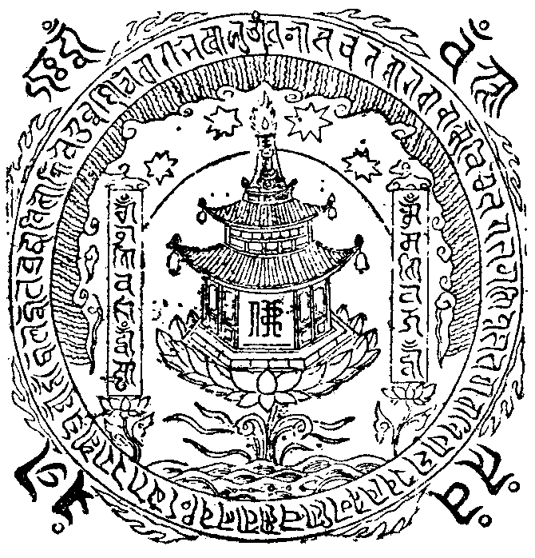
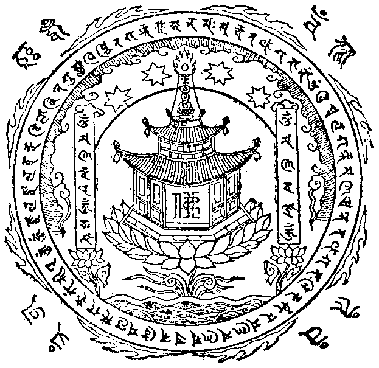

# 大宝广博楼阁善住秘密陀罗尼经



> **藏经**：大正新修大藏经（大正藏）　**册次** 第 19 册（T19）　**编号** T1005A　**部类** 密教部　**卷次** 3 卷　**篇幅** 25,432 字

> **卷／品**：0 卷 · 10 品



---



## 目录



  - [序品第一](#序品第一)

  - [根本陀罗尼品第二](#根本陀罗尼品第二)

  - [心及随心陀罗尼品第三](#心及随心陀罗尼品第三)

  - [成就心陀罗尼法品第四](#成就心陀罗尼法品第四)

  - [成就随心陀罗尼法品第五](#成就随心陀罗尼法品第五)

  - [诸仪轨陀罗尼品第六](#诸仪轨陀罗尼品第六)

  - [建立曼荼罗品第七](#建立曼荼罗品第七)

  - [畫像品第八](#畫像品第八)

  - [护摩品第九](#护摩品第九)

  - [护摩品第九之餘](#护摩品第九之餘)



---



No. 1005A [Nos. 1006, 1007]  

大宝广博楼阁善住秘密陀罗尼经大宝广博楼阁善住秘密陀罗尼轮











曩莫萨嚩怛他孽多南　唵尾补攞孽陛　麼抳钵啰陛　怛他多　儞捺舍宁　摩抳　摩抳　苏钵啰陛　尾麼黎　娑孽啰　俨鼻㘑　吽　吽　入嚩攞　入嚩攞　没驮　尾卢枳帝　麌呬夜　地瑟耻多　孽陛　娑缚诃



经云：此陀罗尼有大威德，佛由此成道、由此降魔，能灭恶障、能成六度。若书纸、素、牌、壁、幢、阁之上，有人暂视、读诵、受持，及闻声、佩身，并转触餘人，是人五逆、四重、十恶等罪消灭，无有刀毒水火、劫贼邪魅，疟疫寒热一切病苦，皆悉远离。见获福庆，所求遂意。临命终时，诸佛安慰，得生净土。所有禽兽、飞蛾、蚊虻虫等，遇影蒙尘，皆得解脱。



大宝广博楼阁善住秘密陀罗尼经卷上



开府仪同三司特进试鸿胪卿肃国公食邑三千户赐紫赠司空谥大鉴正号大广智大兴善寺三藏沙门不空奉　诏译



------



### 序品第一



如是我闻：



一时，薄伽梵住王舍大城，於初会时，降伏俱知魔军，及调伏一切外道，舍离生死，渡诸瀑流。



是时，那由他百千兢伽罗频婆罗魔军，遍赡部洲。于时世尊以佛神力，变此大地尽成金刚，令赡部洲有情之类不闻恐怖。时彼魔军雨诸器仗，皆变为花。於王舍城四衢道中，自然从地涌出大莲花，其花千叶，七宝庄严，黄金为台、琉璃为茎，高至梵天。出种种光明，普遍十方。於其花中自然出声，说陀罗尼名为警觉。陀罗尼曰：



「曩莫萨嚩怛他(引)蘖帝毘喻(二合)　曳底瑟绽(二合)底娜舍儞势　唵　麼抳(上)嚩日隷(二合)　纥哩(二合)娜也嚩日隷(二合)　磨罗赛儞也(二合上)　尾捺啰(二合)跛宁(上)　贺曩　贺曩　嚩日罗(二合)孽陛　怛啰(二合)细也　怛啰(二合)细也　娑嚩(二合)磨(引)啰婆(上)嚩曩(引)儞　吽　吽　散驮罗　散驮啰　没驮(引)昧(上)底唎(二合引)　萨嚩　怛他(引)孽多嚩日啰(二合)迦腊　跛(二合)地瑟耻(二合)帝　娑嚩(二合引)诃(引)」



时，彼莲花中流出此陀罗尼已，复出妙声，遍满三千大千世界，赞言：「善哉！释迦牟尼如来！已度生死大海、殄灭魔军，离烦恼尘、破无明㲉、然大法炬。由此陀罗尼威德力故，令作大地变成金刚，降伏魔军。」尔时，金刚手秘密主菩萨，欢喜踊跃，身毛竦竖，顶礼佛足，白佛言：「世尊！今此陀罗尼，於何佛会最初而得？我从昔来，於诸世间，未曾闻见。」



尔时，佛告金刚手秘密主菩萨：「有陀罗尼，名大麼尼广博楼阁善住秘密，由此陀罗尼威德力故，能令三千大千世界变成金刚，一切魔军所有器仗咸变为花。由此陀罗尼威神力故，降诸魔众，及化俱知餘类有情，悉令调伏。由此陀罗尼威神力，於四衢道涌莲华。」复告金刚手言：「我若不因此陀罗尼，不能成等正觉，不能降伏俱知魔众，不能枯竭烦恼大海，不能然大法炬。金刚手！我於无量俱知百千劫来，虽难行苦行，犹故不能成菩提果；由才闻此大陀罗尼加行相应故，得成正觉。金刚手！此陀罗尼，有大威力、有大殊胜，是一切如来真实法性，令诸如来圆证法身。金刚手！由称此陀罗尼名号，则为已称十方诸佛如来名号；若能才念，则为礼拜供养一切如来。」



尔时，金刚手菩萨摩诃萨，以种种花、种种香、涂香、粖香，供养於佛。既供养已，右遶三匝，顶礼佛足，而白佛言：「世尊，此陀罗尼有大威德有大殊胜，唯愿世尊普为一切有情说，彼世界现何殊胜功德？一切有情，不以少善根得闻此陀罗尼。此陀罗尼等同如来身，同舍利法性。」



尔时，世尊告金刚手菩萨言：「金刚手！众生下劣，不勤精进；心多惑乱，愚痴暗钝；耽著诸欲，不信正法；不敬父母，不敬沙门、婆罗门，不敬尊者。是故，此陀罗尼不入彼人之手。薄福、少智、少慧，如此众生不能得闻、不能受持、不生净信。此陀罗尼能灭一切罪，是诸如来秘密之藏。」



尔时，世尊复告金刚手菩萨言：「善男子，今为汝说。从此世界东方，过无量恒河沙数俱知那庾多佛世界，彼有世界名宝灯，其世界七宝所成。其城四面，广一由旬。多诸人民，安隐丰乐。彼诸男子，及诸女人、童男、童女，一切璎珞庄严其身，上妙宝冠严饰其首，容貌端严，有大威力，勇健精进，智慧具足，通达众艺。城中有王，名曰妙宝，有八十俱知大臣辅佐围遶。其王皇后名光明宝，有二万宫人，皆如天女，前后侍奉。彼世界中所生花树及诸香树，皆是七宝所成。水生诸花，亦是七宝所成。陆生诸花，皆是阎浮檀金所成。其国人民，寿八万劫。彼皆成就十善业道，於佛法僧发大净信。其王以正法养育不以非法，於诸有情常作利益。



「彼世界中有佛，名端严摩尼种种清净建立如来、应、正等觉，於彼世界成佛，广作佛事，与无量大菩萨摩诃萨众，及俱知大持明仙众，以为眷属。彼如来身紫金色，具三十二相，八十随形好，圆光一寻。其光周遍，犹如七宝，炽盛照曜。诸菩萨身悉皆金色，晃曜相好，端严坐七宝莲华。彼皆辩才无碍，智境通达明处。皆共思惟大宝摩尼广博楼阁善住秘密陀罗尼。由此陀罗尼威神力故，出生如是殊胜功德。彼佛世尊为一切有情，演说此陀罗尼法。彼诸有情，由闻此陀罗尼故，常获安乐。彼一切有情，离诸地狱、傍生及焰魔界，阿修罗身皆得解脱、诸恶趣门悉皆关闭；开诸天门及开诸善趣，彼世界有情悉皆安住无上菩提，彼一切有情悉住慈心，如水乳合。彼佛世尊往昔久远行菩萨道时，修此陀罗尼法，作如是愿：『一切有情生我刹土者，彼皆决定不退转无上正等菩提。』若有众生闻此陀罗尼，受持、读诵、精勤修习、忆念不舍，求大成就；乃至闻名，或复手触、或佩身上、或才眼视，或书经卷，或书帛素，或书墙壁；一切众生若有见者，五逆、四重、诽谤正法、诽谤圣人；捕猎、屠儿、魁脍、喃婆、布羯娑；盲者、聋者、瞎者、伛者、人所恶者、痖者癞者、贫穷下劣；不定业者、魔网缚者、堕邪见者、毘那夜迦触者、恶星凌逼者、七曜害者，彼等诸人闻此陀罗尼，决定当证无上正觉。乃至傍生，鹿、鸟、蚊、虻、飞蛾、蝼蚁，及餘类卵生、胎生、化生、湿生等诸众生，闻此陀罗尼名者，决定证得阿耨多罗三藐三菩提，不应疑惑。」



尔时，世尊说是语已，一切大众皆大欢喜，身毛耸竖。是时，天雨波头摩花、芬陀利花、曼陀罗花、摩诃曼陀罗华。於虚空中，有种种微妙天乐，不鼓自鸣。尔时，会中大众各各皆见身有光明。於如来前，自然涌出七宝楼阁，端严丽好，人所乐见。其宝楼阁，四柱四门及四阶道，光明照曜。楼阁四角有四大宝，如日炽盛。复有无量摩尼宝珠缀於罗网，无量宝铎而悬其上，无量缯幡以为庄严，种种妙花间错垂下。是时，大地六种震动，所谓：动、摇、震、吼、涌、没之相。诸天宫殿，光明照触。光所到处，皆悉觉悟。四大天王持明仙等亦复如是。一切魔宫，炽然焰起。一切障者毘那夜迦，皆大惊怖，驰走十方，大声号哭。



尔时，世尊从眉间毫相放大光明，其光普照，警觉十方一切佛刹中诸佛。既警觉已，其光复收，却入佛顶。时，十方佛咸皆同声，赞叹释迦牟尼如来言：「善哉，善哉！释迦牟尼如来！今可应往宝灯世界，端严摩尼种种清净建立如来所，令此大众得相随从，瞻礼供养，又得广闻大宝广博楼阁善住秘密陀罗尼法。何以故？此陀罗尼有大威德、有大功能，一切过去诸如来等共所加持。若有人得闻此陀罗尼者，乃至名字，及手触者，彼人决定得不退转，证无上正觉。」



尔时，释迦如来闻彼十方世界中诸如来请已，复放无量俱知百千万亿光明，告诸大会诸人等言：「我今欲往宝灯世界，时将已至，汝等当共速严随从。」



尔时，如来从座而起，诣升七宝楼阁，以手触之。其楼阁中忽然而出金刚师子妙座，其座七宝所成，庄严殊胜，见者悦意。又於座上生妙莲华，七宝所成，黄金为茎，红宝为台。时，佛世尊於莲华上敷座而坐。



尔时，世界皆大震动。如来即入大宝清净三摩地，以三昧力安慰一切大众，接诣虚空。与一切众会，并诸眷属，及大菩萨眷属，大天、龙、药叉、彦达嚩、阿苏啰、誐噜拏、紧娜啰、摩护啰誐、人及非人，无量俱知持明仙众、金刚手秘密主，与一切释梵、护世四大天王等，上升虚空，往於东方，过无量恒河沙数俱知那庾多百千佛刹，於刹那顷至宝灯世界。从空而下，诣彼端严摩尼种种清净建立如来所，恭敬问讯：「小病？少恼？起居轻利？」时，释迦牟尼如来，以千叶七宝所成莲华，奉献彼佛。时彼如来在大众会，处天妙宫殿，舒金色臂，安慰释迦牟尼应正等觉。安慰已，坐於宝楼阁中，谓释迦牟尼如来曰：「婆伽梵已转大法轮、降伏魔军、然大法炬、建立法幢、击大法鼓、吹大法螺，於彼世界已作佛事，证萨婆若智。婆伽梵今复转第二法轮，当於阎浮提开正法藏。」才作是语，彼诸佛刹十八种动，所谓：动、极动、遍动，摇、极摇、遍摇，振、极振、遍振，吼、极吼、遍吼，击、极击、遍击，涌、极涌、遍涌。尔时，天雨妙华，现大神变。於虚空中，有种种音乐不鼓自鸣，其声悦意。又诸天子奏诸音乐，所有天龙，雨种种宝、种种香、种种旃檀香水、种种衣服、种种庄严具，雨天妙赤珠、马瑙、毘卢遮那大宝、日藏、月爱、日爱，雨吉祥藏大摩尼宝，雨天妙乌钵啰莲华、俱勿头莲华、芬陀利莲华，雨曼陀罗华、大曼陀罗华，雨天妙阎浮檀金华，雨天妙银花，雨天妙真珠。诸天子於虚空中，出微妙音欢悦赞叹，其音展转相告：「善哉，善哉！释迦牟尼如来！今於此时再转法轮。於阎浮提，建大妙宝如意法幢，所谓大宝广博楼阁善住秘密陀罗尼大教法王，今於阎浮提，广大流布。」尔时，端严摩尼种种清净建立如来、应、正等觉，从眉间毫相出光，其光普照十方佛刹，警觉一切如来。其光复照三千大千世界，及诸天宫，一切龙宫，一切地狱、傍生、阎摩罗界、阿苏罗众，普皆照曜警觉已，其光复收，右遶彼佛及释迦牟尼如来三匝，便於顶没。



尔时，十方世界无量恒河沙数一切诸佛，各各於彼本土作大神变。现神变已，诣彼世界，各各以大神通变化七宝楼阁，於楼阁中出生阎浮檀金师子座。彼一切佛并诸眷属，於楼阁中坐。尔时，端严摩尼种种清净建立如来，安慰彼等一切如来，以大神通作大供养。彼等诸佛供养已，还坐师子座。



尔时，摩尼藏菩萨摩诃萨，诣端严摩尼种种清净建立如来所，头面礼足白佛言：「世尊！今现大集会。诸佛菩萨，并天、龙、药叉、彦达嚩、阿苏啰、孽噜拏、摩护啰誐、人非人等，并大持明仙会，所谓金刚手菩萨为上首，与大摩诃萨现大神变。唯愿宣说大宝广博楼阁善住秘密陀罗尼，今正是时。」乃至第二、第三作如是请。



尔时，端严摩尼种种清净建立如来告摩尼藏菩萨摩诃萨言：「汝往释迦牟尼如来所，启请彼佛，当为汝说。」



时，摩尼藏菩萨，诣释迦牟尼应正等觉所，遶佛三匝，合掌顶礼，前住白佛言：「世尊！我今请世尊说大宝广博楼阁善住秘密陀罗尼，为哀愍利益一切有情故。」



尔时，释迦牟尼如来受摩尼藏菩萨请已，即告金刚手秘密主菩萨言：「秘密主！汝往於大众，以金刚杵扣击於地。」时，金刚手秘密主，承佛圣旨，於大众道场中，以杵击地。才击地已，其地四裂。时，三千大千世界六种震动，於彼裂处涌出七宝楼阁。其楼阁四角四柱四门，严丽殊特，相好圆备，光明赫奕，有四阶道。高三由旬，纵广正等有五由旬。於楼阁中现阎浮檀金窣覩波，种种宝珠而为严饰，七宝罗网而覆其上，无量宝铎悬於四角，妙花缯彩而为间错。彼窣覩波中有三如来身。尔时，一切如来并诸菩萨大众，皆共供养宝楼阁窣覩波中三如来，所谓：花鬘、烧香、涂香、粖香幢、幡、宝盖，奏诸音乐，合掌礼敬。时，诸天、龙、药叉、彦达嚩、蘖噜拏、紧那啰、摩护啰誐、人非人等，一切众会咸悉瞻仰，皆生奇特希有之心，咸作是言：「此宝楼阁窣覩波从何而来？」高声赞言：「奇哉希有！」旋遶、歌咏，花香、涂香、粖香，并诸音乐，供养宝楼阁窣覩波，合掌顶礼，瞻仰而住。



尔时，於楼阁中出声告言：「汝诸大众，可观空中。」众闻此声已，咸观空中，即见广大吠瑠璃宝所成云叶在於虚空。其宝云叶上，以金书此大宝广博楼阁善住秘密陀罗尼。於虚空际复出声曰：「汝等一切诸佛并菩萨大众，咸可读此宝云叶上陀罗尼。」出此声已，於十方所来诸佛一一佛前，皆现吠瑠璃宝所成云叶，叶上以金书此陀罗尼。复出是声：「南谟释迦牟尼如来！今可开此宝楼阁窣覩波门，於彼窣覩波中有三如来身，由此三如来威神力故，现大神变殊胜之相。彼三如来於此会中，当具说此大宝广博楼阁善住秘密陀罗尼，并曼茶罗成就明法。」



尔时，十方同来诸佛咸作是言：「唯愿释迦牟尼如来、应、正等觉，为诸大众开此窣覩波门，令诸大会见三如来，所谓摩尼宝花幢王如来，种种摩尼如来，金刚超涌王如来、应、正等觉。」



尔时，释迦牟尼如来现大神通，往诣宝楼阁窣覩波，舒百福庄严金色臂，开窣覩波门已，示三如来身。时，三如来赞释迦牟尼言：「善哉，善哉！释迦牟尼如来！今於瞻部洲再转法轮。薄伽梵！可於此坐。」



尔时，释迦如来即升宝塔，与三如来同座而坐。



尔时，金刚手菩萨摩诃萨，顶礼释迦牟尼如来，白佛言：「世尊！今此楼阁，及窣覩波中三如来，从何而来？」佛言：「乃往古昔不可思议无量无比过无数劫，於此阎浮提，多诸人众安隐丰乐，香稻不种自然成熟，人无彼我亦无贮积。当彼之时，无佛出世。有一宝山王，彼山王中有三仙居住，一名宝髻、二名金髻、三名金刚髻。彼三仙人决定思惟佛法僧宝，复作是念：『我等何时成佛，证无上等正觉，度诸有情？』时，彼仙等作是思惟已，须臾默然。复起前念故，即证於诸有情慈心欢喜种种楼阁三摩地，即获天眼，观於上方，见净居天。复於空中有声言：『善哉，善哉！正士能发胜心！所谓阿耨多罗三藐三菩提心。汝岂曾闻大宝广博楼阁善住秘密陀罗尼耶？过去一切如来为诸有情利益故，已曾演说。才闻此陀罗尼者，当於无上菩提得不退转，一切佛法当得现前，证得一切三摩地，一切陀罗尼法悉皆现前；善能降伏一切魔军，然大法炬；一切善根当得现前，满足六波罗蜜；能解一切地狱、饿鬼、傍生、焰魔界、阿苏啰众，及生、老、病、死、忧悲苦恼，永得解脱。当於后世时，於此赡部洲有情不孝父母，不敬沙门、婆罗门，不敬耆旧，诽谤正法，毁谤圣人，应堕地狱。诽谤诸佛菩萨，杀阿罗汉，作五无间罪；杀婆罗门，及杀牛者；抄劫、窃盗、妄语者，不与取者，欲邪行者，离间和合者，杂染语者，轻秤小㪷者，强夺财物者，匿他财物者；妄言背信者，先世恶业所持者，彼一切有情类，由此陀罗尼威力，若读、若诵、受持，若佩身上，若书衣中，若置幢上，若书经卷，若书素㲲及墙壁牌板，乃至闻声、手触及影其身，及转触餘人，决定当得不退转无上菩提，能於现世获无量百千功德，远离诸罪，成就一切善根，摧伏诸魔。於诸世间皆得敬爱，於一切处皆得供养，一切国王、王子、宰官、后宫，并诸眷属，皆得欢喜，一切沙门、婆罗门亦皆欢喜。言音威肃，人所乐闻，手脚柔软，声相和雅。离於贫穷，不受世间毒药、刀杖、水火等难。诸恶兽怖，不能为害。无诸贼怖，无劫盗怖，无旃陀罗怖，无喃摩怖，行大小路悉皆无怖。无鬼神怖，无罗刹比舍遮怖，无拏吉儞怖，无毒蛇怖。乃至一日、二日、三日、四日寒疟常疟，一切疟病悉不著身。眼病、耳病、鼻病、舌病、齿病、唇病、喉病、项病、诸支分病、手病、背病、腰病、脐病、痔病、淋病、痢病、瘘疮病、髀病、胫脚痛病、丁疮肿病、瘰疬班病、肚痛疥病、疱跛癞癣，无如是等病。无头痛，不盲、不瞎、不伛，无横灾死，不聋、不痖、不被轻欺。如是等类，现世不受。得无碍辩，临命终时心不散动，一切诸佛现前安慰。亦不为𥜒祷、蛊毒、呪诅著身，卧安、觉安。於其梦中见百千佛刹，及见诸佛并诸菩萨围遶。由此秘密陀罗尼威力故，获如是殊胜功德。』



「时，彼仙人得法欢喜，心生踊跃，於其住处便舍身命。所舍之身由如生酥，消融入地。即於没处，而生三竹。金为茎叶，七宝为根，於枝梢上皆有真珠，香气芬馥，常有光明，所有见者无不欣悦。其竹生长十月，便自剖裂，各於竹内生一童子，颜貌端正，令人乐见。最胜端严，光色殊丽，相好成就。时，三童子即於是地竹下，结跏趺坐即入正定，至第七日，於其中夜，皆成正觉。其身金色，三十二相，八十种好，圆光严饰。时，彼三竹悉皆变成七宝楼阁。又於虚空中，有大宝广博楼阁善住秘密陀罗尼，以金为字，忽然而现。时，有四大天王，所谓：宝髻龙主天王、宝藏鸠槃茶主天王、殊妙光摩护啰誐主天王、摩尼金刚药叉主天王，各持宝盖而覆其上，唱佛功德。是四天王，各有无量百千眷属，悉持妙花而以供养，咸作是言：『今佛世尊出现於世。』」



尔时，世尊告金刚手菩萨摩诃萨言：「昔三仙人，岂异人乎？今此宝楼阁窣覩波中三如来是，彼时三竹者今妙楼阁是，彼时地者今此地是，彼时世界者今此世界是。彼三仙人，由闻此陀罗尼勤修习故，舍彼仙身成等正觉。复次，金刚手！彼时空中，赞叹此陀罗尼净居天子者，岂异人乎？则我身是。是复有侍者，名曰净居，常勤承事彼三仙人。其三仙人成正觉已，亦复供养。为彼净居而授记曰：『汝於来世当得作佛。』其净居者岂异人乎？今此端严摩尼种种清净建立如来是。」



尔时，十方世界所来一切诸佛，咸赞释迦牟尼如来言：「善哉！善哉！能以如来神通加持，说此往昔因缘，示现如来秘密陀罗尼。此陀罗尼，是一切如来秘密，是一切如来母，是一切如来心秘密陀罗尼，是一切如来转法轮秘密陀罗尼，是一切如来往诣菩提道场秘密陀罗尼，是一切如来诣金刚师子座秘密陀罗尼，是一切如来神通游戏秘密陀罗尼，是一切如来波罗蜜圆满秘密陀罗尼，是一切如来般若波罗蜜摄授秘密陀罗尼，是一切如来真言秘密陀罗尼，是一切如来曼茶罗秘密陀罗尼，是一切如来坚持印秘密陀罗尼，是一切如来放俱知光秘密陀罗尼，是一切如来实际秘密陀罗尼，是一切如来三摩地神变加持秘密陀罗尼，是一切菩萨菩提心庄严秘密陀罗尼，是一切菩萨安立如来地秘密陀罗尼，是一切三摩地通达秘密陀罗尼，是摧一切障秘密陀罗尼。汝今说耶？」



尔时，释迦牟尼如来、应、正等觉，住正念智，观察一切如来，出大梵音，复放百千万俱知那庾多种种光明，所谓：青、黄、赤、白、紫，普遍十方诸佛世界照曜已，警觉一切如来，其光复收遶佛三匝，没於佛顶光既没已。



尔时，世尊以净妙梵音，於大众中即说警觉陀罗尼曰：



「唵　萨嚩怛他蘖多　摩抳　舍多儞跛底(二合平)　入嚩(二合)攞　入嚩(二合)罗　达麼驮覩蘗鞞　麼抳　麼抳　摩诃麼抳　怛他蘗多　纥哩(二合)怛野　麼抳　娑嚩(二合引)阿(引)」



说此警觉大明陀罗尼已，山林大地六种震动，一切如来同声赞言：「善哉，善哉！释迦牟尼如来！善说此最胜秘密陀罗尼。」於虚空中现赡部金云，遍满十方。於其云中下七宝雨，复雨龙坚旃檀末，复雨优昙钵花，而以供养；及餘种种妙花，复雨莲华、俱物头花、芬陀利华、苏𪩘地迦华、曼陀罗华、摩诃曼陀罗华、𠰷遮华、摩诃卢遮华、曼殊沙华、摩诃曼殊沙华、苏摩那华、末利师华、瞻卜华，而供养佛。一切魔宫，炽然火起，一切魔众，愁忧萎悴，皆大惊怖。一切障者毘那夜迦惊惧，身皆流汗，恶气臭秽，十方驰走。所有诸天，於佛教中生净信者，及天、龙、药叉、彦达嚩、阿苏罗、蘖噜拏、紧那罗、摩护罗誐、人非人等，各持供具，虔诚供养如来。复有摩尼照曜思惟菩萨而为上首，与无量俱知那庾多百千菩萨，悉持种种妙宝而供养佛。时，金刚手菩萨而为上首，与无量百千持明仙，各持种种百千天衣，而供养佛。复有四大天王，与无量百千万亿四天王众，以种种香华、涂香、粖香、花鬘、衣服、幡盖而供养佛。复有梵天，与梵众诸天而来供养。复有三十三天与百千万亿天子，帝释而为上首，供养於佛。如是那罗延大自在天，宝贤、满贤、贤力天等，同来供养。复有日月天子，在於空中而供养佛。复有大吉祥天女、大辩才天女、饷企尼天女、诃利底药叉女，与无量百千药叉而为眷属。复有毘摩大天女、金刚迦离天女、华齿天女、使者大天女，百千万亿，各各以天宫殿供养於佛。复有无量彦达嚩众，奏百千种天妙音乐而供养佛。复有无量百千龙王集会，所谓：娑竭罗龙王、难陀龙王、邬波难陀龙王、嚩鲁拏龙王、善住龙王、宝髻龙王、普遍形圆满龙王，以种种光味宝而供养佛。复有转轮王，与无量百千万亿大臣、宫人、婇女及千子围遶，来供养佛。尔时，大地变成金刚，於如来前从地涌出七宝莲华，其华百叶。於其华中，有赡部金刚千辐宝轮，光明赫奕如日，其光遍照三千大千世界。於齐轮中出微妙声，作如是言：「善哉，善哉！释迦牟尼如来！能说如是秘密陀罗尼，能转无上大法轮，能诣大菩提场。此陀罗尼是诸如来秘密明心，是诸如来真实理趣明心。唯愿世尊复更为说此大宝广博楼阁陀罗尼。世尊已说警觉心陀罗尼，由此陀罗尼，警觉一切如来并其大众，皆来集会。世尊！说此秘密陀罗尼，今正是时。世尊！此陀罗尼是成佛根本，能除一切罪、能竭一切苦海、能遮止一切生死旷野、能越一切烦恼瀑流，若无此陀罗尼大明王，终不能成无上正觉。此陀罗尼是成佛种子、是转大法轮、是燃大法炬、是建大法幢、是吹大法螺、是系大法鼓、是法师子座。善哉！世尊！唯愿广为大众说此大陀罗尼王、曼茶罗、印法、畫像法。」尔时，大会云集天、龙、药叉、彦达嚩、蘖噜拏、紧那啰、摩护啰誐、人、非人等，咸生希有奇特之心，皆礼世尊瞻仰而住。尔时，世尊闻大众虔诚请已，即为广说此陀罗尼大教王法。



------



### 根本陀罗尼品第二



尔时，世尊告诸大众：「我今说此陀罗尼教王。此陀罗尼能成就无上菩提，若有受持，能除一切罪业，身得清净。」即说根本陀罗尼曰：



「曩莫萨嚩怛他(引)蘖多(去)南(一)(引)　唵(二)　尾捕攞蘖陛(三)　麼抳钵啰(二合)陛(四)　怛他多(五)　儞捺舍宁(六)　麼抳麼抳(七)　苏(上)钵啰(二合)陛(八)　尾麼黎(九)　娑(引)蘖啰(十)　俨鼻㘑(十一)　吽(十二)　吽(十三)　入嚩(二合)攞　入嚩(二合)攞(十四)　没驮尾卢枳帝(十五)　麌呬夜(二合)　地瑟耻(二合)多(上)　蘖陛(十六)　娑嚩(二合引)诃(引)(十七)」



尔时，世尊说此大宝广博楼阁善住秘密根本陀罗尼已，於此大地六种震动，雨大宝雨及大妙华。一切所来大众咸皆欢喜，叹未曾有，能令一切善法皆悉成就，证得十地。是时，十方诸如来同声赞叹释迦牟尼如来言：「善哉！释迦牟尼如来！乃能说此入菩提道场陀罗尼。若才闻此陀罗尼，除灭一切恶趣。才忆念此陀罗尼者，则为以诸微妙香华、涂香、粖香供养十方一切诸佛。若能才诵，即得不退转无上正觉。乃至百劫千劫百千劫，一切如来不能赞叹尽其功能。此陀罗尼有大威力，一切诸魔，终不能作其障碍，一切冤家、恶友、鬼神、药叉、罗刹、人非人等，不得其便，增长无量善根。若才念此陀罗尼者，获福无量。何况久能诵持，其福不可挍量。」



尔时，执金刚手药叉将，及四大天王，往诣佛所，恭敬合掌，顶礼佛足，供养而住，白佛言：「世尊！我等拥护持此陀罗尼有情，加持养育，皆令欢喜。」



尔时，世尊舒金色手，摩执金刚菩萨顶，及安慰四大天王，作如是言：「我以此陀罗尼付嘱於汝，若有持此陀罗尼者，汝当拥护。」



尔时，执金刚手菩萨及四大天王白佛言：「世尊！我等受付嘱已，以此大教王，常当拥护彼有情受持陀罗尼者。」



------



### 心及随心陀罗尼品第三



尔时，世尊复说心陀罗尼曰：



「唵(一)　麼抳嚩日礼(二合)(二)　吽」



尔时，世尊复说随心陀罗尼曰：



「唵(一)　麼抳(尼轸反)驮(上)礼(二)　吽　泮咤(半音)」



「若诵持根本陀罗尼者，不假拣择时、日、宿曜，不限斋戒，但诵满一万遍已，然后佛前或舍利塔前，於白月十五日，洁净洗浴，著鲜净衣，随力供养，燃四盏灯，散诸香华。受持陀罗尼者，食三白食，旋遶制底一百八匝，诵陀罗尼一百八遍，便於当处寝息。天欲晓时，如来即现其身，执金刚手菩萨亦现於前，所有愿者皆得如意。若造五无间罪者，作如是法第三遍，方得感现，勿生疑惑。常於清旦诵一百八遍，所求之事皆得成就，蛊毒诸毒不能为害，水不能漂，火不能烧，贼不能劫，病不能侵。无他冤怖，常无重病，亦无眼病、耳病、鼻病、舌病口病、齿病、唇病、头痛、𨈛节痛、一日疟、二日三日四日疟，悉不著身。诸恶毒蛇、虎狼、禽兽，不能为害。𥜒祷、呪诅，亦不著身。此陀罗尼威力如是，能息一切怖畏、能灭一切恶障、能生一切功德、能成就六波罗蜜、能成就如来境界。才诵此陀罗尼者，皆能成办一切事业。若有人登大高山顶诵此陀罗尼，尽眼所见处，所有众生灭一切罪业，亦离一切地狱业，得免一切傍生身。若入天庙中诵此陀罗尼者，使诸天神皆悉奉教；若入龙池中诵此陀罗尼者，一切龙众皆来归命；若於日前诵此陀罗尼者，日天子即来现其人前，所求意愿皆能与之。若有人於执金刚手菩萨前诵此陀罗尼者，金刚手菩萨现於其前，所求愿者亦得随意。若有人取菖蒲根诵此陀罗尼一千八遍，口中含之，入於王宫，所有演说，妃后、婇女欢喜净信。若加持胡椒含於口中，共他人语，所出言辞皆悉信受，当生欢喜。若加持白芥子一千八遍，掷於虚空，一切恶风雷雹皆得消散。若加持盐一百八遍，与净行婆罗门，皆来敬爱，食此盐者皆得欢喜。若欲令刹利敬爱者，取白芥子护摩一千八遍，即得敬爱。若加持安悉香一千八遍，於一切鬼魅病人前烧，随其所愿，皆自下语，彼病即差。若亢旱时，先以瞿摩夷涂地，作四肘方坛，中心畫一水池方二肘，作青色。於池中取瞿摩夷和土为泥，揑作一龙。腰已上为菩萨身，作菩萨面，於其头上出三蛇头。腰已下为蛇身，於池中盘屈。其龙遍身以黄丹涂，令作赤色，以金薄贴龙心上。遶坛四边，以白粉畫作莲花。於坛四角插四只箭，以五色线缠绕於箭，周围其坛。又於线上悬五色小幡，四角安四水瓶，四门安香炉，又用四个小瓶：一瓶盛乳、一瓶盛酪、一瓶盛乳麋、一瓶盛酥及沙糖。然四盏灯，烧四种香，所谓：安悉、董陆、白檀、苏合，於坛上散七种谷子(大麦、小麦、稻谷、菉豆、油麻、芥子、白芥子)，供养五色食饮并诸花菓。念诵人面向东坐，取白芥子先诵陀罗尼，加持一千八遍已，然后取白芥子一颗，诵陀罗尼一遍，钉龙头上，满一千八遍，其龙即降雨，一切龙皆降伏。若欲止雨，加持白芥子一百八遍，掷龙池中，其雨即止。若有恶风雹雨，取佉陀罗木作橛，钉龙池边，即得霜雹不下，恶风即止。若欲缚毘那夜迦，取白芥子加持一百八遍，安毘那夜迦头上，便不能作其障碍。以乳洗毘那夜迦，即得解脱。所作事业皆得成就。其持诵者，常须清洁，著鲜净衣。此是根本陀罗尼法。」



大宝广博楼阁善住秘密陀罗尼经卷上



namaḥsarvatathāgatanāṃoṃvipulagarbhemaṇiprabhetathāgatanidarśanemaṇimaṇisuprabhevimalesāgaragambhīrehūṃhūṃjvālajvālabuddhāvilokiteguhyādhiṣṭitagarbhesvāhā



大宝广博楼阁善住秘密陀罗尼经卷中



开府仪同三司特进试鸿胪卿肃国公食邑三千户赐紫赠司空谥大鉴正号大广智大兴善寺三藏沙门不空奉　诏译



------



### 成就心陀罗尼法品第四



「凡成就心陀罗尼事业者，诵十万遍，即见一切如来。诵二十万遍，得见一切佛土。若诵三十万遍，得成入一切曼荼罗，一切真言法悉得成就。诵四十万遍，得持明仙中转轮王。诵五十万遍，一切阿苏啰及诸仙窟龙宫窟门自开，悉皆得入。若诵六十万遍，得见一切伏藏。若诵七十万遍，即忆知过去无量生宿命事。若诵八十万遍，即得宝印三摩地。若诵九十万遍，得一切菩萨游戏神通加持。若诵一百万遍，得一切如来灌顶，与一切如来同会。福慧如是倍增，而获无量殊胜功德。若造五无间罪，诽谤圣人、诽谤正法，应入阿鼻地狱者，由诵此陀罗尼十万遍，一切业障悉皆消灭，得不退转，获宿命智，一切如来护念摄受，得眼清净、耳清净、鼻清净、舌清净、身清净，增胜无量殊胜功德，转受增胜，身业清净，兼获世间种种事业随意成就。



「复次说雄黄法。取好雄黄置熟铜器中，从白月十三日，清净洗浴，著鲜净衣，吃三白食，所谓：乳、酪、粳米，於佛前加持十万遍，至十五日夜，所加持雄黄现三种成就相：若煖、若烟、若光焰，即得成就。若暖，将用点额，即得安怛那成就，入阿苏罗窟及一切神仙龙宫，得持明转轮王位，意乐所作皆得成就。若烟出，用点眼中，当见一切菩萨宫殿住处，又见一切金刚族类菩萨，一切诸恶魔不能障碍，获得一切法藏，随所去处皆得通达。若现光焰，即腾虚空，证得燃炬陀罗尼三摩地，得作三十三天中主宰，所须皆得。若於山顶上诵一万遍，得一切众生尊重，所求皆得，一切赡部人咸来恭敬。若入水池中诵一千八遍，一切诸龙皆悉降伏。取白芥子加持一千八遍，散掷虚空，应时注雨，降伏诸龙。若常日日诵持，获大吉祥。若患一切病，取水一瓶，以因陀罗呵悉多药(白及药也)、及钵罗奢药(赤及也)、白芥子，并欝金香、白檀香等各一分，内著瓶中加持一万遍，取此香水淋灌於顶，一切大重病人皆得除差，及灭一切罪障。所有符书压祷，皆悉消灭，获得一切殊胜吉祥。若患癞病，澡浴灌顶亦得除差。若患白癜风，以水灌顶亦得除差。若有女人意欲求男，以水灌顶即便生男。若有人久持诵无灵验，悉地不见前者，作此灌顶法速得悉地。如是等世间、出世间，所求一切愿皆得成就」



------



### 成就随心陀罗尼法品第五



「诵随心陀罗尼满一万遍，所有诸鬼神作障难者，悉来接足礼拜，白言：『持明者救护我等，勿断我命！所使我者，决定得了，我皆成就。』若诵二万一千遍者，即得一切天龙敬伏，为天中主，所出言辞，天皆奉行。若诵三万遍，一切鬼神药叉等，咸悉顺伏。若诵四万遍，意欲钩召，随意即成。若诵五万遍，所欲钩召追摄，若天、若龙、若药叉、若蘗噜拏、若紧那罗、阿苏啰、摩护啰，及仙人、婇女、沙门、婆罗门、刹利、国王、王后、宰相、群臣，及餘种种人等，皆得随意。烧安悉香和白芥子，若诵六万遍，得无垢三摩地。若诵七万遍，得作持明仙中转轮王。若诵八万遍，执金刚手菩萨及与眷属来现其前。若诵九万遍，得诸菩萨施与无畏。若诵十万遍，得见一切如来。彼等如来作是言：『善男子！汝欲所往诸佛刹土，皆得随意无有障碍。』通达一切真言，通达经论，一切如来加持，於三藐三菩提不退转。及得种种世间、出世间法，心所乐求，皆得成就，诸佛如来皆悉印可。」



------



### 诸仪轨陀罗尼品第六



「坐真言曰：



「『唵　摩抳　军咤利　吽　吽　娑嚩(二合引)诃』



「诵七遍然后坐，作餘护持法。



「次结坛界真言曰：



「『唵　摩抳　尾惹曳　驮啰　驮啰　吽　娑嚩(二合)诃』



「诵此真言加持白芥子七遍，散於四向便成结界。



「次结十方界真言曰：



「『唵　入嚩(二合)里多　麼抳𠰷止啰　室里(二合)抳　吽　吽　泮咤(半音)』



「诵此真言加持香水，和白芥子一百八遍，散於十方，即成结十方界。



「辟毘那夜迦真言曰：



「『唵　摩抳　钵啰(二合)婆嚩底　贺啰　贺啰　吽吽　泮咤(半音)　娑嚩(二合)诃』



「诵此真言，加持灰水二十一遍，散於十方。



「顶髻真言曰：



「『唵　嚩日啰(二合)　摩抳　底瑟咤(二合)　底瑟咤(二合)　吽　吽　泮咤(半音)』



「诵此真言七遍加持，右手作拳舒大指，以摩顶右旋三匝，即成护身。



「加持衣真言曰：



「『唵　摩抳微布黎　地里　地里　吽　泮咤(半音)』



「诵此真言七遍加持衣服。



「洗漱真言曰：



「『唵　尾儞庾(二合)嚩底　诃啰　诃啰　摩诃摩抳　吽　吽　泮咤(半音)』



「诵此真言加持水洗手漱口，及用洒於身，能净诸根。



「洗浴真言曰：



「『唵　苏涅摩啰嚩　底　诃啰　诃啰　播奔　弭哩　弭哩　吽　娑嚩(二合)诃』



「诵此真言，加持白芥子水一百八遍浴身法。



「护真言曰：



「『唵　摩抳达哩　吽　吽　泮咤(半音)』



「诵此真言，用洒一切香花菓实饮食及所用之物，皆用此真言加持而护之。



「神线真言曰：



「『唵　地哩　地哩　微麼罗迦哩　吽　吽　泮咤(半音)』



「献真言曰：



「『唵　萨嚩怛他孽多　布惹麼抳　吽　吽』



「所有花皆诵此真言加持，散时亦诵。



「涂香真言曰：



「『唵　萨嚩怛他孽多　𪩘驮摩抳娑颇(二合)啰拏　吽』



「烧香真言曰：



「『唵　入嚩(二合)里多　麼抳阿没啰矩咤娑颇(二合)啰拏(上)尾𦽆底　吽』



「灯真言曰：



「『唵　入嚩(二合)里多　始佉嚟驮嚩哩　吽　吽　泮咤(半音)』



「献食真言曰：



「『唵　钵啰(二合)嚩啰(引)　𦽆啰(二合)嚩底　娑啰　娑啰　吽　吽』



「献阏伽真言曰：



「『唵　摩诃末抳布啰耶　驮啰　驮啰　吽　吽』



「奉献供养物及食等真言曰：



「『唵　摩诃微麼犁　吽　吽　婆啰　婆啰　吽』



「护摩真言曰：



「『唵　入嚩(二合)罗萨普(二合)啰　誐誐那钵啰(二合)多罗抳　吽　吽』



「加持念珠真言曰：



「『唵　𠰷止啰　摩抳钵啰(二合)靺多耶　吽』



「以此真言加持念珠七遍，若念诵本真言一遍移一珠，即成诵一切如来所说真言一遍，一一真言成无量百千那庾多遍。



「念诵时真言曰(欲念诵本真言时先诵此真言)：



「『唵　嚩日啰(二合)　摩儞迦啰紧迦哩　吽　吽　泮咤(半音)』



「结跏坐真言曰：



「『唵　苏钵啰(二合)靺底多吠艺　摩抳　摩抳　娑嚩(二合)诃』



「警觉一切如来真言曰：



「『唵　萨嚩怛他孽多嚩庾(平)惹吠　多罗　多啰　吽　摩抳迦娜宁　娑嚩(二合)诃』



「请一切如来真言曰：



「『唵　微布罗钵啰(二合)嚩黎　杜噜　杜噜　吽吽』



「求愿真言曰：



「『唵　萨嚩怛他孽多　地瑟咤(二合)那质多僧　𠸪讫叉(二合)拏　嚩日礼(二合)　吽　吽』



「求菩萨愿真言曰：



「『唵　苏尾布罗嚩娜宁　诃啰　诃啰　吽』



「请一切天龙真言曰：



「『唵　阿鼻娑摩耶　嚩日礼(二合)　驮啰　驮啰　吽』



「请四天王等真言曰：



「『唵　摩抳尾誐嚩底　吽』



「加持弟子真言曰：



「『唵　输(上)婆摩抳　户卢　户卢　吽』



「加持弟子，令弟子入坛真言曰：



「『唵　萨嚩怛他孽多　曷哩(二合)捺耶　嚩日哩(二合)抳　达啰　达啰　吽　吽』



「献一切佛、一切菩萨、诸天等食真言曰：



「『唵　尾啰　尾啰逝誐誐那嚩呬儞　攞呼　攞呼　吽　吽』



「所有一切香花饮食，皆诵此真言用持献之。



「护身真言曰：



「『唵　摩抳苏唵(二合)婆抳吠誐嚩底　啰讫叉(二合)　啰讫叉(二合)𤚥　吽』



「奉送诸圣众真言曰：



「『唵　萨嚩怛他孽多　矩卢儞底娑摩啰尾誐底　入嚩(二合)罗　入嚩(二合)罗　吽　吽娑嚩(二合)诃』



「诵此真言通一切处用，所谓奉送本尊、献阏伽、香花、饮食等用。



「已上一切心真言，先各诵一百八遍，然后作法。时才诵，灭一切罪，一切苦恼皆得解脱，诸佛如来决定授菩提记，当得作佛。先世恶业，受持此真言悉皆消散，获无量恒河沙数功德，速证无上正等菩提，能转法轮。」



------



### 建立曼荼罗品第七



尔时，世尊说曼荼罗仪轨：



「依时依法，先择胜地，然后作坛。其坛四肘四门，以瞿摩夷和土，遍涂拭之。坛上张一白盖，称坛大小。於坛中心取二肘，拼作一小方坛，先以白檀香涂拭，次用欝金香涂之，或以五色粉撚成，或畫亦得。於新器中，和彩色用之。於小坛中畫七宝楼阁，於楼阁中畫一佛形像，作说法相。佛前作一莲华，七宝庄严。於莲华胎中畫作一轮，其轮百辐，齐辋具足，以金庄严，轮外畫焰光。其莲华茎，吠流璃色。佛左边畫金刚手菩萨而作忿怒形，右手执金刚杵，左手执白拂。右边畫摩尼金刚菩萨，种种璎珞庄严其身，左手执持宝珠，右手执白拂。四角各畫四天大王，身著甲胄手执器仗，种种头冠璎珞，庄严其身，作瞋怒形。其小坛中畫七宝界道，於其坛上悬一伞盖，可一肘量，於伞盖四面周匝悬幡。其大坛东门悬五色缯幡。以四金瓶满盛香水，於瓶中著七宝及诸香药五谷，於瓶口插时花有菓枝条，以缯帛系瓶项，置坛四角。又以四银瓶满盛乳，安大坛四隅。若无金银瓶，以金银图瓶替之。於中坛南门中，畫大吉祥天女，种种璎珞庄严其身。北门中畫饷弃尼天女，坛西门中畫金刚使者天女，八臂持种种器仗，以种种璎珞庄严，上悬青缯幡。於中坛四边，香花饮食随力供养，然三十二灯，种种花菓散其坛上。於佛像前置金香炉，烧苏合香；金刚手菩萨前以银香炉烧安悉香；摩尼金刚菩萨前亦以银香炉烧酥合香；於四天王前烧薰陆酥，合白胶香和烧。於吉祥天女前烧白坛香，於饷弃尼天女前烧安悉香，於金刚女使者前烧萨罗计香(是青胶香)；於四天王等前，各各别以饮食而供养之。其中坛四门外，各立吉祥标门。其大坛东门中畫诃利帝母，七子围遶；於南门中畫大自在天王；於西门中畫花齿罗刹女；於北门中畫毘摩天女，颜貌美丽有七婇女围遶。於坛上四边插三十二只箭，其一一箭，以五色加持线缠，周匝围遶，於线上悬五色小幡以为庄严。於大坛外食界道上，安置种种花、种种味饮食、种种菓、七种油饼、三十二梡、三十二瓶、三十二香炉，烧灯一百八盏，种种末香、种种烧香，所谓：薰陆香、安悉香、必栗迦(苜蓿香)、白檀、沈香、多孽罗香、苏合萨罗计(青胶是也)，应烧五石蜜香，又以龙脑香、麝香、欝金、紫檀、白檀等，各各以为涂香。次应献食饮：乳、酪、沙糖水、石蜜水，各盛八瓶，乳粥八梡。又以粳米、菉豆、油麻相和，作粥八梡，粳米饭、欢喜团各八梡，又粳米粥八梡。复盛油四瓦梡，酥四瓦梡，沙糖四梡，石蜜四梡，油麻四梡，菓子四梡，七种谷子四梡。应以种种饮食供养，所谓：天竺饼、煎饼、菉豆饼、油麻煎饼、无忧饼、妙味饼、酥饼、沙糖饼，已上饮食随所得营办。当於引弟子入坛门中，两边置香水二瓶，应为弟子作入坛仪轨。其弟子入已，即为弟子灌顶，诵此真言以用灌顶真言曰：



「『唵(一)　摩诃尾布罗(二)　钵啰(二合)底(丁以反)瑟耻(二合)多悉第(三)　阿毘诜者𤚥(四)　萨嚩怛他孽多鼻晒罽(五)　婆啰婆啰(六)　三婆啰(七)　吽　吽』



「才灌顶已，先世一切罪障、一切业障，悉皆清净，得一切如来摄受、一切如来加持、一切如来灌顶、一切如来安慰、一切悉地现前，所思所求皆得满愿，即成入一切如来三昧耶曼荼罗，入一切如来法性，证甚深法忍，往诣菩提场获得如是等胜上功德，乃至获得不退转，证无上正等菩提。」



------



### 畫像品第八



尔时，世尊告诸大众：「我今说畫像法，而能成就一切事业。应取新白㲲不割截者，或一肘，或二肘，令四方等。畫人应受八戒。其畫彩色，於新器中盛，勿用皮胶。畫七宝庄严楼阁，於楼阁中畫如来，作说法相，坐师子座。佛右边畫金刚手菩萨，十二臂黄白色。其像四面：正面欢喜；右边面忿怒相；左边面开口，狗牙上出；当头上面，颦眉怒目。头冠璎珞种种庄严，於莲华上半跏而坐。左边畫宝金刚菩萨，四面十六臂。正面欢喜；右面青色，作摩诃迦罗天面；左面绿色，作师子面。头上面颦眉露齿忿怒，作浅绿色。右边第一手持真多摩尼宝，作献佛势，左边第一手持莲花；右第二手作安慰手，左第二手持三戟叉；二手合掌，餘手皆执诸器仗：右第四手持轮，左第四手持剑；右第五手持金刚杵，左第五手持花箧；右第六手持念珠，左第六手持军迟；右第七手持刀，左第七手持梵夹；右第八手持宝塔，左第八手持须弥山，於莲华台上半跏而坐。於其座下畫饷弃尼天女，有八臂，跪坐合掌，作供养佛相。金刚手菩萨座下，作吉祥天女，跪坐持宝器，满盛种种宝供养如来。於吉祥天女后，畫金刚使者天女，作笑面，有四臂，种种璎珞而为严饰，手持种种器仗。饷弃尼天女后，畫花齿天女，身著素服，以手持花，瞻仰如来。於如来前，畫作七宝花。其花百叶，以金为台，吠琉璃为茎。其莲华上，畫作百辐轮，脐辋具足。轮外周匝皆有光焰。於莲华根下，畫四大天王，悉被甲胄，种种严饰，手执器仗。莲华下畫作水池，以七宝庄严。於池岸上应畫持诵人跪坐，手持香炉并持花枝，又持念珠，跪坐瞻仰如来。於宝楼阁上，於虚空中畫梵天、毘纽天、大自在天，散花供养。应依如是仪则畫像。



「其持诵者，著新净衣，食三白食，从白月八日在如来前如法念诵，至十五日令满十万遍。其像动摇，及见自身炽然光明，获得无障碍眼，证清净摩尼，行三摩地，於一切持明仙中为转轮王，亲见一切如来。才诵一遍，远离一切地狱傍生，能断贪瞋痴等，离诸悭悋垢，成就一切功德，获得一切安乐，摄受一切善根。一切如来之所加持，一切菩萨之所安慰，一切诸天悉皆拥护，一切药叉、罗刹、毕隷多、比舍遮、阿苏罗、彦达嚩、蘖噜拏、紧那啰、摩护啰誐、人非人等，悉来侍卫。於一切王宫，皆得供养，令诸世间皆得顺伏。一切功德波罗蜜，悉皆圆满。如是等殊胜功德，悉皆获得。若才诵者，犹获如上福利，况多增胜！受持者若有读诵、受持、相应、供养、求成就，并与印契真言相应对於像前，其人等同诸佛，应受天、人、世间供养、礼拜。其人等同诸佛，应见、应知如来之所受记。其人决定不退转於无上菩提，不复生於母胎。所生世界，莲华化生，不离诸佛菩萨所生之处，共诸如来集会乃至坐菩提场。」



------



### 护摩品第九



尔时，如来复为诸大众说护摩法：「先须清净身心，然后作法。一一法速令成就，起广大利益，为诸有情发如是心，应作护摩如法供养。



「护摩真言曰：



「『唵　娑嚩(二合)诃钵底　部啰(二合)　部嚩(入)　吽　吽　𠰢咤(半音)　娑嚩(二合)诃(引)』



「以此真言加持油麻、白芥子，和酥一遍一烧，满一百八遍，能令一切真言法速得成就，除遣一切障者毘那夜迦。一切罪、一切烦恼、一切冤家、恶友，皆得摧伏禁止，令其迷惑，一切恶梦、灾怪、不祥之事，自然消散。



「又以安悉香、白芥子和酥，诵真言一遍一投火中烧之，满一千八遍，一切鬼魅头自破裂；一切病患诸疟，速得除愈；一切鬼神变怪，皆得远离。又以酥和白芥子，一诵真言一投火中，满一千八遍，获得一邑主。又以白芥子和酥，护摩一千八遍，一切诸魔恐怖、冤家、他敌，悉皆除灭。



「又以天木(杉木是也)和酥，护摩一千八遍，得啰惹并内宫眷属欢喜敬爱，所求皆遂。



「若以白胶香和酥及白芥子，於山峰上护摩如前遍数，一切诸宫窟门自然而开，即得入中为持明仙中王。



「又以香胶和芥子油，於龙池边护摩一千八遍，一切诸龙皆得敬爱，所勅皆作之。依时降雨不损苗稼。



「又以饮食护摩一千八遍，供养如来，即得五谷丰饶。



「又以盐护摩一千八遍，一切药叉女皆来礼足，作是言：『大家！勿伤我命。』任意驱使，皆得成办。



「又以酥和粳米，护摩一千八遍，获大吉祥。



「又以胡椒对日，护摩一千八遍，常得诸天拥护，获大吉祥。



「又於大吉祥天女前，以油麻和白芥子护摩，得大财丰饶。



「又以遏迦木护摩一千八遍，即成警觉诸佛菩萨，悉知是人离一切罪，於一切世间、出世间真言王，悉皆现前。除一切病，於诸冤敌而得最胜，一切生死苦不能𣣋逼。由此真言力故，诸有善业皆易成就，一切恶梦不祥之事皆得消散。一切厌祷、一切系缚、一切烦恼不能侵扰。如是等护摩事业，能作息灾、能获安乐、获得财利。设有堕诸恶见众生，令得正见。」



尔时，婆伽梵告金刚手菩萨：「此教王有大威德，是一切如来心、是诸如来母、是诸如来转大法轮、是诸如来往诣菩提场、是诸如来建大法幢、是诸如来吹大法䗍、是诸如来坐金刚座、是诸如来降伏魔军、是诸如来最胜秘密、是诸如来极大秘密。金刚手！此陀罗尼，於赡部洲，息一切有情烦恼，能除一切有情罪，能竭赡部洲有情地狱、饿鬼、傍生之业，能除有情生、老、病、死、愁叹、苦忧及诸热恼。」



尔时，世尊复告金刚手菩萨：「我以天眼观诸如来，不能说此陀罗尼所生功德聚。此陀罗尼有如上最胜殊妙，如是广大如是甚深，如是等胜最胜，上最上大神通。如是大宝广博楼阁教王，薄福少德众生，必不闻此陀罗尼名字，况复得见，受持读诵？若有闻见此陀罗尼名者，是人已曾亲近恒沙诸佛菩萨。金刚手！此陀罗尼，是如来心，难解难入。若有善男子、善女人，於百千万劫，供养八十俱知那庾多百千恒河沙诸佛菩萨饮食、衣服、房舍、卧具、百种汤药、幡盖、香花、涂香、末香，复以七宝满三千大千世界，日日中奉施诸佛。金刚手！於汝意云何，是善男子、善女人功德多不？」金刚手菩萨白佛言：「世尊！此人功德无量无边，不可称数。」「若有诵此陀罗尼一遍者，此人功德胜前功德，诸佛如来说不能尽。若有善男子、善女人，於一时顷作意，思惟此陀罗尼，称量比前供养如一切如来饮食、衣服、香花、七宝功德，倍胜於前，即成供养一切如来。」



尔时，如来说是语已，众中天、龙、药叉、彦达嚩、阿苏啰、孽噜拏、紧娜啰、摩护啰誐、人非人等，一切大众踊跃欢喜，发声称赞，五体投地，虔诚礼敬，合掌向佛白言：「世尊！此陀罗尼等同如来出於世间。今佛世尊於赡部洲，能善建立此秘密陀罗尼心法。」



尔时，十方同会诸佛菩萨，咸赞释迦如来言：「善哉！善哉！」既赞叹已，各还本土。尔时，释迦牟尼世尊以佛神力还娑诃世界。



大宝广博楼阁善住秘密陀罗尼经卷中



大宝广博楼阁善住秘密陀罗尼经卷下开府仪同三司特进试鸿胪卿肃国公食邑三千户赐紫赠司空谥大鉴正号大广智大兴善寺三藏沙门不空奉　诏译



------



### 护摩品第九之餘



尔时，金刚手秘密主菩萨，面貌熙怡微笑身毛耸竖，持金刚杵轮掷挥空，以种种香花、衣服严具。诸持明仙众歌赞叹咏，往诣佛所，以诸香花衣服严具而散佛上，遶佛三匝顶礼佛足，渐进佛前，偏袒右肩，右膝著地，合掌白佛言：「世尊！如来今於世间然大法炬，於赡部洲建立陀罗尼教王。若有见闻此陀罗尼者，等同见佛出兴於世，应如是知世尊说是大宝广博楼阁善住秘密大印曼荼罗教明王法。世尊！若有才闻此陀罗尼者，於无上菩提决定得不退，疾证无上等觉菩提，解脱一切罪障。唯愿世尊为诸众生说此陀罗尼印法。」即以伽他而问於佛：



> 「此之秘密印，云何而轮结？  

> 云何安於指？云何复安臂？  

> 云何手按手？云何以印触？  

> 而作於加持？云何印在心？  

> 云何而舒臂？云何三昧耶？  

> 云何安慰印？云何以神力？  

> 加持速成就？云何金刚座？  

> 云何灌顶印？云何法轮印？  

> 云何持无上？无能胜密印？  

> 云何转轮印？及如意宝印？  

> 云何四王印？云何吉祥天？  

> 秘密之契印？云何饷弃尼？  

> 及女使者印？云何持坛中？  

> 一切圣众印？云何迎请印？  

> 云何根本印？心及随心印？  

> 如上之印法，唯愿大牟尼，  

> 而为我解说。由结此印故，  

> 一切业成就。才见此印故，  

> 诸罪皆清净。若修真言法，  

> 成无上悉地。愿佛说真实，  

> 由结此印故，世尊为我说。」



尔时，释迦牟尼如来於大众中，舒金色如象王鼻百千福庄严臂，按金刚手秘密主菩萨顶，而安慰之作是言：「金刚手！此大宝广博楼阁善住秘密陀罗尼印品，如是印法汝今听、善听、极善听，作意思惟。今委寄汝，汝应极生恭敬印品及曼荼罗成就法，当於后世敬重印品，知一切印等同如来，如薄伽梵诣菩提场，如转法轮，如佛舍利。於后世时，不应授与下族类人、恶性有情、破戒有情、懈怠有情、不净信者、耽嗜有情、我慢有情，如斯之类不须为说。此陀罗尼等同如来舍利，勿令隐没。若有薄福有情，闻我此法，便生毁谤。当知此等如毁谤佛，无有异也。是故，金刚手！善应执持此陀罗尼，所在之处如佛无异。」尔时，金刚手菩萨顶礼佛足，白言：「世尊！如是，如是！世尊所说，我当专心受持，恭敬供养，以报佛恩。唯愿世尊为我演说，我当守护如来三昧耶，不敢违越，不敢弃舍，不敢疑惑，令持明者速得成就。」



尔时，薄伽梵作念正知，於大众中以吉祥仪轨，说修行此大宝广博楼阁善住秘密陀罗尼大印品：「持明者善须依法澡浴，及饮五净，依法加持及自护身，著新净衣。先以白檀香遍涂手臂，然后复用欝金香涂系於神线。臂钏茅镮安於右臂。离喧闹密静处，建立精室，或舍利塔前对佛像，面向东方，作吉祥座及结跏坐。先於一切有情起大慈心，深生悲愍，即应诵根本陀罗尼，次诵心陀罗尼、随心陀罗尼。以花鬘烧香供养一切如来，并供养持金刚、观自在、曼殊室利、慈氏等怜愍有情者。遍礼十方一切如来。所奉献者二手合掌。



> 「应作如是言：『住在於十方，  

> 诸佛摄受我。遍在於十方，  

> 过去及现在，未来诸世尊，  

> 菩萨威德者，我今悉皆礼。』



「『唵　牟尼　摩尼钵啰(二合)嚩啰　钵啰(二合)嚩隷麌呬耶(二合)钵纳铭(二合)　摩诃钵啰(二合)陛　娑嚩(二合引)诃(引)』



「次结普遍光明宝清净如来心印。先以右手拇指捻头指甲上如镮，餘三指展之。次以左手展其头指，屈大拇指，押三指甲上。二手相对，置於心前。



> 「应住寂静心，观想佛形像，  

> 身仪应寂静。复以寂静眼，  

> 身不应动摇，不动於静虑，  

> 结印诵密言，数限二十一。



「『唵　萨嚩怛他蘖多纥哩(二合)捺耶摩抳入嚩(二合)攞宁阿(去)　尾瑟咤(二合)也　吽(引)』



「才结此印，即持一切如来心印，积集广大福聚，如恒河沙那庾多百千如微尘诸佛。若有善男子、善女人，苾刍、苾刍尼、优婆塞、优婆夷，以满三千大千世界七宝，及天妙衣服、涂香、末香、烧香、花鬘、璎珞、诸庄严具、幢、幡、宝盖，供养一一佛满百劫。如是供养一切佛已，若有人结此印诵真言一遍，所生善根百分不及其一。如上恒河沙诸佛，不能尽说其福聚。如是大威德有大神验。才结此印诵真言，观念地狱一切众生，彼地狱众生皆得解脱，由此观行皆得生极乐世界。如是等阿修罗及焰魔界、傍生，皆得解脱一切身垢，过现生身得清净，一切如来摄受护念，即成见一切如来，皆由结此普遍光明宝清净如来印威力故。



「次结一切如来心印，亦名安慰一切如来印。先以左肘当𦜮，平展仰掌，即屈无名指、小指，以大母指押之。右手准前印不改，颦眉羯咤讫叉眼，自视其身。微屈身，齿咬下唇，应诵真言曰：



「『唵　萨嚩怛他孽多　钵啰(二合)嚩啰孽啰啰摩抳　吽』



「才结此印诵真言，即成入一切如来所有三昧耶曼茶罗，则成俱知三昧耶者。若人百千劫来宿障，由见此印，即得消灭，闭一切恶趣门。即成结一万四千俱胝那庾多百千佛大三昧印及诵真言，又同结一切如来部族印。一切夜叉、罗刹、部多、诸毘那夜迦等，皆悉被烧，如一火聚。是诸障者，面皆踣地，皆顺三昧耶，不敢违越。一切诸天顶戴诵持者二足，皆住三昧耶。由才见闻此印故，即成知一切三昧耶者。一切恶龙亦顺，住三昧耶，不敢违越。无有三昧耶、秘密曼茶罗教轨仪，无不知者，悉皆成入。由结印诵真言故，诸有恶人不敬信者，及外道、冤敌、不饶益有情者，皆起慈心，深生恭敬。一切怀恶意诸烦恼者，悉皆消灭，即成具三昧耶，即离一切罪障，即成归依三宝，即成就大福德聚，远离诸疾病，离一切悭悋烦恼垢。



「次结一切如来普遍大宝三昧耶秘密大印。先以右手置右膝上，以大拇指捻中指甲上，次以左手仰横安心上，以母指押中指、无名指甲上，舒头指及小指，发慈心开目而住，即诵真言曰：



「『唵　萨嚩怛他孽多毘　三冒驮娜　嚩日[口*(黍-禾+利)](二合)吽』



「才结此印诵真言，即得一切如来之所安慰，皆称：『善哉！』舒手按顶，怜如爱子，则为一切如来之子，千俱胝那庾多恒河沙诸佛所共安慰。其人一切罪障皆得清净，一切烦恼悉皆消灭，一切菩萨悉皆礼敬，一切诸天悉皆侍卫，一切鬼神并一切夜叉罗刹，悉皆不敢侵倰。一切障碍毘那夜迦不敢恼害，驰散十方。一切皆起慈心，由见此印故，无有疑也。见持明者，持此最胜印，当知佛菩萨现前安慰。由诵此真言，当知是佛音声，等同诸佛。佛语甚深难闻。若有善男子、善女人，苾刍、苾刍尼、坞波索迦、坞波斯迦，若持明者，结跏趺坐，结印诵真言。若得见持此真言人，则成见六十二恒河沙百千俱知那庾多诸佛如来、应、正等觉，不应起疑惑，应当供养彼人，奉其衣服。应起恭敬，如大师想，观持明者等同诸佛，当知是人则同诸佛。一切希求胜愿皆得满足。若一时间结印诵真言，慈心遍缘六趣轮回诸有情，二足、四足、多足，思惟起慈愍心，轮回有情及傍生者，皆获安慰，获佛菩提不久，诸天拥护。於一切曼茶罗，成知三昧耶者，即成诵一切真言，即成结一切印。



「次结一切如来庄严大宝光加持秘密大印。以二手右押左，背相叉，屈二头指各如钩，二小指各直竖，二大指各屈在掌中。结跏趺坐，以印当脐上，倾身向右，颦眉眼，寂静而视。观想诸佛住大慈心，应诵真言，矜愍一切有情。观佛色相，置印於顶上。结印时，诵『唵』字、『吽』字、『泮』字。结印已，由诵『唵』字成加持菩提场，由诵『吽』字加持转法轮，由诵『泮』字加持菩提树，如须弥山不倾动。一切如来所加持，一切佛皆与授记，一切处加持人天。是人身得清净，如日光摩尼照曜，离一切罪，增长福德聚。是处犹如窣堵波，由结此印故。由如菩提场，诸佛所加持，加持於十地，亦加持不退转处。能净宿障，解脱诸恶趣，关闭诸地狱门，开诸天门。是人於七十二恒河沙数俱低那庾多百千诸佛所种植善根，获得授记。一切鬼、神、夜叉、罗刹及龙，皆生恐怖。及诸障毘那夜迦踣面於地，如火聚焚烧。及诸餘类难调伏者，摧坏无疑。此印难见难闻，离一切罪，及离八大地狱，成就一切真言教法，即成入一切曼荼罗一切三昧耶印，如来所说皆得加持，亦能加持一切印，成佛菩提最胜。才结此印，一切处常得加持。真言曰：



「『唵　萨嚩怛他蘖多　地瑟姹(二合)那　摩尼　摩尼吽　泮咤(半音)』



「次结如来宝大金刚安立金刚师子座印。



「先应结金刚加座。即结金刚合掌印，想身为金刚杵形，微屈身，观想遍毛端遍触，然后二手合掌，屈二头指捻二大指甲，竖二中指如金刚杵形，直竖二无名指，以二小指㧙在无名指背。以印触地，及触二膝，即安於脐。此名二金刚师子座印。其地犹若金刚，周匝十方如金刚墙，亦成一切如来座，由一切如来加持故，成金刚座楼阁，一切难调伏者不能沮坏。一切处得无畏，及障者毘那夜迦，一切诸魔类，由结此印皆得超胜，彼皆一切驰散。及夜叉、罗刹、大力作障者，悉皆远离。难伏不见形者，及诸不友、冤敌、恶心众生，悉皆殄灭。由结此印故，一切有情，若男若女，皆得敬爱，王及后宫皆得欢喜。及餘有情在於地上，皆得敬伏，一切随顺，昼夜无间断。由诸佛加持成金刚宝殿，建立师子座。由佛神通加持故，如俱胝恒河沙数百千应供正遍知处，成金刚师子座。由才结此印，於如是等如来所，成奉献金刚座，则获一切如来神力加持。由才结如来宝大金刚建立金刚师子座印，一切地狱、傍生、焰魔界、饿鬼、阿苏啰身、一切地狱等，由先世业障以此金刚墙令摧坏、令系缚，皆令消灭，其身得清净，成金刚不坏身。由诵真言结印故，於诸恶趣皆得解脱，及解脱一切罪。真言曰：



「『唵　萨嚩怛他蘖多钵啰(二合)嚩啰　摩尼𠰷旨黎　吽　吽　泮咤(半音)』



「次结一切如来大宝出生灌顶大印。



「二手合掌如金刚杵，二头指傍舒，二中指屈节，指面相合，直竖二无名指如金刚杵，二大指押二小指甲上。结吉祥跏座，置印於顶上。应诵此真言曰：



「『唵　萨嚩怛他孽多　尾麼罗三婆吠　吽　吽』



「才结此印诵真言，其持明者於六十八百千恒河沙数微尘等如来应供正遍知，以一切如来神变加持获得灌顶。即彼乃至得如上如来系无垢缯於其首，以一切曼荼罗印品明真言灌顶，成就无量阿僧祇福德聚，获得无量善根。一切菩萨，金刚手，於持明仙人，以百千遍灌其顶。一切天、龙、夜叉、乾闼婆、阿苏啰、孽噜拏、紧那啰、摩护啰誐、四天王，与成彼持明人灌顶。一切持明仙中轮王，与成彼灌顶，为一切如来长子殊胜灌顶，成一切如来三昧耶秘密曼荼罗灌顶，以大宝广博楼阁秘密成灌顶。一切不友、冤敌、作障者毘那夜迦、恶药叉、罗刹、部多、鬼、神，不能见彼持明者。其持诵者身如虚空，隐形不现，普遍十方一切佛刹一切如来、应供、正遍知。广大衣服缯彩，七宝璎珞庄严头冠，於一切如来所，作大供养云海，成供养灌顶。由才结此印，得如是神通自在善根，成就如是大威德、大福利。



「次结一切如来光明大宝摧魔炽然法轮神通加持大印。



「二手合掌安於心，以右手大指、头指甲相捻，餘三指直舒，掩於心。屈左手大指入掌中，捻中指甲上，餘三指微屈。二手背相著，其左手掌面向前，结跏趺坐，应诵真言。住慈三摩地，内心定寂静。由结此印，即转清净大法轮，三千大千世界六种震动无疑，诸佛菩萨皆观察持明者。金刚手欢喜，并诸天眷属、持明转轮王，常来侍卫持明者，四大天王昼夜常护持四方，一切如来常加持。由转法轮，於诸众皆得超胜一切障、作障毘那夜迦。持明者若持此印，心得寂静，离诸障难，是人等同如来出兴於世转大法轮，如坐菩提场转大法轮。我见彼人等同诸佛，应当供养，所获善福如供养佛。持诵者应清净心，於诸有情常起悲愍。应结印诵真言，少颦眉唇齿俱合，观想佛形如转法轮。心作是思惟：降伏诸魔，制诸障难。由结此印诵真言故，能然大法炬、建大法幢、击大法鼓、吹大法蠡、作大师子吼，增长福德聚。由才结此印，如结八十俱知恒河沙诸佛真言密印。是诸如来亦加其威神，咸称：『善哉！善哉！』授菩提记真言曰：



「『唵　萨嚩怛他孽多三摩耶　摩抳嚩日黎(二合)吽　吽』



「次结无能胜印。以右手大指拄头指头，屈如环，餘三指直竖。左手亦然。竖二手，所舒指背相著以印。小指当於脐，颦眉向下观身，以右脚押左脚。以羯咤讫叉眼顾视意。诵真言即举右脚，以大母指触地。由才结印诵真言故，即能降伏诸魔并诸营从得胜，及降伏一切作障毘那夜迦，及不现形者，一切夜叉、罗刹。於诸冤敌通达无碍，及诸不友、冤敌得胜，离诸烦恼苦及诸鬼趣得胜。於其身中，贪、瞋、痴，及餘种种烦恼，彼皆寂静。由才结印故，则解脱诸罪，一切所往处得胜。於真言法得无障碍，得成无障碍事，得离一切诸病，乃至证菩提。一切处诸天拥护於十方。无能胜真言曰：



「『唵　萨嚩怛他孽多惹耶尾惹耶阿尔多　嚩日嚟(二合)　吽　吽』



「次结一切如来转法轮印。



「先以右手握大母指作拳，左手亦然。以右拳安於左拳上。由结此印，一切如来之所印可，如恒河沙俱胝百千如来咸皆欢喜，受与无上悉地。是诸如来决定现其身。於一切持明仙众中为转轮王，一切真言、印契、教法悉皆通达如在心。於诸曼荼罗成就，最胜一切诸天十方拥护。转法轮真言曰：



「『唵　萨嚩怛他孽多　达磨驮都　摩诃麼抳试佉黎　喝啰　喝啰　吽　吽　泮咤(半音)』



「次结金刚手菩萨印。



「先以二手合掌，二中指右押左，内相叉。二头指并二大指如金刚形。竖二无名指，指面相著。二大指直竖，二小指搩开。举其左肘，下其右肘，顾视左肘。右脚押左脚，半跏微展左脚。作颦眉怒目瞋相，以齿𫜪下唇，喉中称『吽』声，意诵真言。观己身如金刚手。才结印诵真言故，三十三天皆大惊怖，一切天宫悉皆震动，一切夜叉、罗刹王，及难调诸龙、鬼神、毘那夜迦及诸作障者，悉踣面在地号哭，四方驰走。金刚手皆大欢喜，受与悉地。真言教法悉皆成就，福聚增长，持明中为主宰。若能三摩地相应，洗浴清净，涂香涂身，著新净衣服，诸佛如来观察其人，一切曼荼罗圣众皆大欢喜。真言曰：



「『唵　萨嚩怛他孽多　摩诃嚩日啰(二合)贺嚩耶驮啰　驮啰　吽　吽　泮咤(半音)』



「次结宝金刚菩萨印。



「准前印，唯搩开二头指，安印当心，结跏趺坐。起慈心眼，寂静而视，端严柔软诵真言。随其意思所求满足。金刚手常欢喜，观彼人如所爱子。真言曰：



「『唵　杜𠰷(二合)　杜𠰷(二合)　摩尼　摩尼　摩诃密儞与(二合)怛末尼(二合)　娑嚩(二合引)诃(引)』



「次结四大天王印。



「先以右手安於脐上，屈大指入掌，以头指捻大指头，餘三指直舒。左手安左𦜮上，直舒头指，餘三指握大指为拳作拟势。身向前微屈，眼视右手，作忿怒形，怒目不转睛。应诵真言曰：



「『唵　𠰷迦播里低　惹耶　惹耶　吽』



「次结吉祥天女印。



「先以二手虚心合掌，二头指、二中指、二无名指散开，微屈，如开敷莲花形。由结印诵真言，能满一切所希求愿。是大威德者真言曰：



「『唵　尾摩罗孽罗(二合)缚底　三婆啰　吽』



「次结饷弃尼天女印。



「以右手近右乳边，头指直竖，大指屈入掌中，以中指、无名、小指慢为拳。左手覆左膝，触膝上。曲身向前，怒目而视。应诵真言曰：



「『唵　能(上)瑟置哩(三合)抳(平)尾娑罗　吽』



「次结使者天女印。



「先以右手仰掌，当心平展，下其肘。次以左手平展覆掌於右手下。二手背相背，举其臂肘，引头向前微曲身。诵真言曰：



「『唵　阿誐麼野地啰门(上)者咤诃悉儞　吽』



「次结曼荼罗中一切圣众印。



「以二手指相叉钩结，安於脐。展左脚按地即成。诵真言曰：



「『唵　三曼多迦啰　跛哩布啰抳　驮迦　驮迦　吽泮』



「次结花齿天女印。



「先以右手屈五指如莲华形，安左耳上。左手准前安於心。真言曰：



「『唵　娑啰　娑啰　尾娑啰　吽　吽』」



> 尔时金刚手，复白世尊言：  

> 「云何根本印？云何是心印？  

> 云何随心印？牟尼为我说。」  

> 世尊作是言：「二手作合掌，  

> 应置於心上。屈於二头指，  

> 及以二大指，相捻犹如环。  

> 二中指蹙屈，犹如於宝形。  

> 竖合二无名，搩开二小指。  

> 是名根本印。智者结此印，  

> 诵根本密言，即成先行法。  

> 次说心印相。先以於右手，  

> 仰掌安於心。大指与无名，  

> 而以头相捻，餘三指平舒。  

> 次以於左手，大指捻小甲，  

> 餘三亦直舒，覆於左膝上。  

> 是则名心印，亦名安慰印，  

> 功能如根本。次法随心印。  

> 准前心印相，大母与头指，  

> 相捻犹如环，依前左膝上。



「结此印能成办一切事业，灭一切罪、除一切烦恼，不久决定当得佛菩提。若人结一一印，其福不可量。由结此印，於无量阿僧祇恒河沙数俱胝那庾多百千如来、应、正等觉，雨大供养云海，涂香、末香、华鬘、衣服、幢幡、璎珞，严具七宝，於一切如来成供养。种种百味饮食，随如来所宜成出生供养。随其意乐，医药资缘，於一一如来前，成广大供养。由结印诵真言，於一切如来平等，於十方即警觉。彼等如来称：『善哉！』悉皆授与记。一切如来安慰其人，乐见彼人。金刚手、持明王并诸眷属众，昼夜常拥护其人。四大天王决定拥护其处，等同窣覩波。由结此印故，其地如来说如有舍利塔，皆得决定不退转。是故，金刚手！若善男子、善女人，苾刍、苾刍尼、优婆塞、优婆夷，净信持明者，应当极生恭敬，受持、读诵、供养。若自书写、劝他书写，应当结印。以大信心，以大恭敬，以种种物，应当供养。其善男子、善女人，苾刍、苾刍尼、邬波索迦、邬波斯迦，获大福成就。一切戒成就，大精进、大忍辱成就，大禅定成就，檀那成就，大智慧成就，广大功德成就，六波罗蜜圆满。若有得此陀罗尼印坛场法者，成就如是广大功德。」



佛说是经已，金刚手菩萨摩诃萨，及一切大众，天、龙、药叉、彦达嚩、阿苏啰、蘖噜拏、紧娜啰、摩护啰誐、人非人等，皆大欢喜，信受奉行。



大宝广博楼阁善住秘密陀罗尼经卷下

