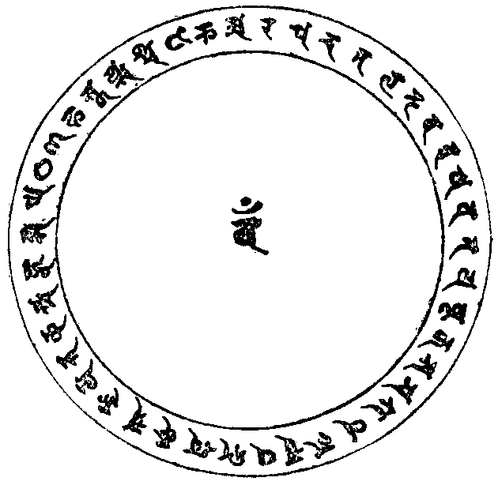

# 大方广佛花严经入法界品顿证毘卢遮那法身字轮瑜伽仪轨



> **藏经**：大正新修大藏经（大正藏）　**册次** 第 19 册（T19）　**编号** No. 1020（T1020）　**部类** 密教部　**卷次** 1 卷　**篇幅** 627 字

> **卷／品**：0 卷 · 0 品



---



大方广佛花严经入法界品顿证毘卢遮那法身字轮瑜伽仪轨



夫欲顿入一乘修习毘卢遮那如来法身观者，先应发起普贤菩萨微妙行愿，复应以三密加持身心，则能悟入文殊师利大智慧海。然修行者最初於空闲处摄念安心，闭目端身结跏趺坐，运心普缘无边刹海，谛观三世一切如来遍於一一佛菩萨前，慇勤恭敬礼拜旋遶，又以种种供具云海奉献如是等一切众圣。广大供养已，复应观自心，心本不生，自性成就，光明遍照犹如虚空。复应深起悲念，哀愍众生不悟自心、轮回诸趣，我当普化拔济，令其开悟尽无有餘。复应观察自心、诸众生心及诸佛心本无有异，平等一相成大菩提心，莹彻清凉廓然周遍，圆明皎洁成大月轮，量等虚空无有边际。复应於月轮内右旋布列四十二梵字，悉皆金色放大光明，照彻十方分明显现。一一光中见无量刹海，有无量诸佛，有无量众前后围遶，坐菩提场成等正觉，智入三际身遍十方，转大法轮度脱群品，悉令现证无住涅槃。复应悟入般若波罗蜜四十二字门，了一切法皆无所得，能观正智、所观法界悉皆平等无异无别。修瑜伽者若能与是旋陀罗尼观行相应，即能现证毘卢遮那如来智身，於诸法中得无障碍。



圆明字轮







四十二字颂曰：



阿(上)啰跛左曩攞娜麼拏(上)洒嚩𫖰(上)野瑟咤(上二合)迦(上)娑(上)莽誐他(上)惹娑嚩(二合)驮舍佉(上)讫洒(二合)娑𫖰(二合上)娘(上)啰他(上二合)婆(去)縒(上)娑麼(二合)诃嚩(二合)哆娑(二合)伽(上)姹(上)儜(上)颇娑迦(二合)野娑(二合上)室左(二合上)咤(上)荼(去)



大方广佛花严经入法界品四十二字观门

