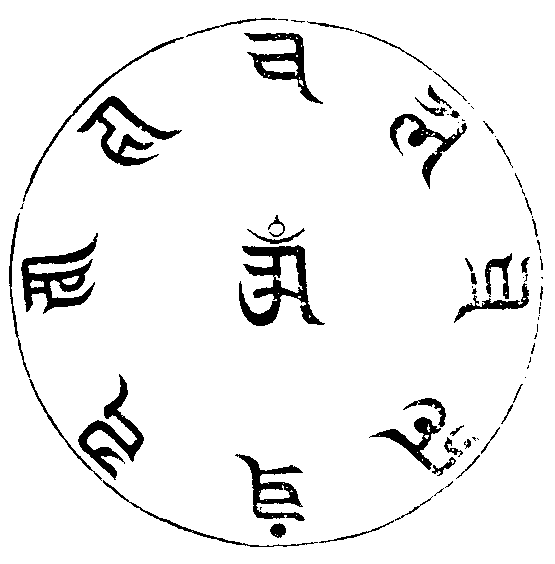

# 七俱胝佛母所说准提陀罗尼经会释



> **藏经**：卍新纂大日本续藏经（新纂卍续藏）　**册次** 第 23 册（X23）　**编号** No. 446（X0446）　**部类** 密教部　**卷次** 3 卷　**篇幅** 55,095 字

> **卷／品**：0 卷 · 0 品



---



七俱胝佛母所说准提陀罗尼经会释卷上



唐天竺三藏法师大广智不空奉　诏译



清粤东鼎湖山菩提心沙门弘赞　会释



按如来一代说法，教分三藏，所谓修多罗、毗奈耶、苏怛䌫，即经律论也。藏虽分三，而不出显密二门。显则广谈性相，晓悟玄理，修证法身。密乃但令诵持，不加了知，默登圣位。然悟有顿渐，位有浅深。渐则历诸僧祗，顿即立超十地。浅则声闻缘觉菩提，深即现证佛果大乘。今此准提陀罗尼，即经藏密教，默证十身佛果大乘也。或於三藏外，立一杂藏，收诸部陀罗尼。或於三乘外，别立最上金刚乘，即是陀罗尼藏。若据神变疏，则判陀罗尼为大不思议成佛神通乘。故此经以大秘密为宗，法界真如为体，不思议为用，三密为门，最上乘为教相。以一切法，皆从金刚陀罗尼乘中流出。如千流万派，发自昆仑石碛之山。三藏十二分教，出乎总持秘密之藏。乃至六度万行，莫不从陀罗尼所出。谓真言一一字，全是无相法界。而六度万行，无不从法界中流出。故云唵字者，是三身义，亦是一切法本不生义。由一切法本不生故，即得不生灭。由不生灭故，即得相无所得。相无所得，即是无相法界。实则证法界真如。故白伞葢颂云：诵满一万八千遍，遍遍入於无相定，号成坚固金刚幢，自在得名人中佛。又五秘密修行仪轨云：金刚萨埵者，是普贤菩萨，即一切如来长子，是一切如来菩提心。如经所说：金刚萨埵三摩地，名为一切诸佛法，此法能成诸佛道。若离此法，更别无有成佛。欲知金刚者，名为般若波罗蜜，能通达一切佛无滞无碍，犹如金刚，是故出生诸佛。若於显教修行者，久经三大无数劫，然后证成无上菩提。於其中间，十进九退，或证七住，以所集福德智慧，回向声闻、缘觉道果，仍不能证无上菩提。若依毗卢遮那佛自受用身所说内证自觉圣智法，及大普贤金刚萨埵地受用身智，乃至应时集得身中一大阿僧祇劫所集福德智慧，则为生在佛家。其人从一切如来心生，从佛口生，从佛法生，从法化生，得佛法财。从此已后，受得广大甚深不思议法，超越二乘十地。是知真言秘密之旨，尚非因位菩萨所知，况容凡夫小智能测？兹会众译，并诸疏钞，略为互相发明，以便初学持诵，有所措心，非敢曰释。如神变疏云：金刚手方可探其頥，莲华眼始能窥其奥。首楞严云：诸佛秘密法，唯佛与佛自相解了，非是餘圣所能通达。但持诵之，能灭大过，速登圣位。天竺止观云：上圣方能显密两说。凡人但能宣传显教，不能宣传密教，故非下凡所议，师心可知。今按此准提真言前后数译，而不空三藏深得密教之传。由昔金刚萨埵亲於毗卢遮那牟尼如来前受瑜伽最上乘义，后数百年传於龙树菩萨，龙树又数百年传於龙智阿阇黎，龙智传於金刚智法师。金刚智来游震旦，以五部瑜伽及毗卢遮那经苏悉轨范授与不空三藏。及智灭度，三藏奉其遗教，复游天竺诸国，增广其学。於师子国，从龙智阿阇黎求开十八会金刚灌顶及大悲胎藏之法。法化相承，自毗卢遮那如来至於不空三藏，凡六叶矣。空既遍游天竺，复得亲传之旨，故其所译本真言仪轨委悉详备。今恐初学未闲梵音印契，由是於诸译中多取智所译本而会明之，以其师资相承，授受无替故也。



如是我闻：



谓如来如实相理说是准提陀罗尼法，故云如是。阿难尊者亲从佛闻如是之法，故云我闻。



一时。



是说此经之时也。



薄伽梵。



此是如来众德至尚之称。具六种义：一、自在；二、炽盛；三、端严；四、名称；五、吉祥；六、尊贵。广如餘处释。



在名称大城。



梵言舍卫。



逝多林



旧云祇树，谓林树，是祇陀太子所施也。



给孤独园。



给孤独是须达长者之别名，园是长者布金所买之地，二人共施，故名合称也。



与大苾刍众，并诸菩萨，及诸天龙八部，前后围绕。



此是听法之众。



愍念未来薄福恶业众生，即入准提三摩地，说过去七俱胝佛所说陀罗尼曰：



愍念，谓如来悲愍慈念众生也。梵语三摩地，华言等持，谓定慧平等任持者也。俱胝，华言百亿。陀罗尼，华言总持，谓总持一切法门，含摄无尽教理行果。又持善不失，持恶不生，故亦翻为遮持，谓遮二边之恶，持中道之善。别名为呪，元非正翻。既含多义，故非名言所能宣释。究其实，乃毗卢遮那如来诸佛大不思议秘密心印也。



曩谟飒多(引)南(引)(一)，三藐三没䭾(引)俱(引)胝南(引)(二)，怛你也(二合)他(引)(三)，唵(四)，者礼(五)，主礼(六)，准泥(七)，莎嚩(二合)(引)贺(引)(八)



凡诵真言，唵字当引，句须分明，声要不缓不急，详如下释。



此真言八句，上三句是归敬诸佛说呪之辞，下五句正是呪体。言引者，谓长引其声。二合者，谓二字合为一音。金刚智译作：折隶主隶准提莎嚩诃。其上多字、南字皆有口傍，隶字去声。○地婆诃罗译作：折戾主戾准提莎婆诃。○阇那岌多译作：折丽主丽准递莎诃。○天息灾译作：曩莫飒钵哆喃三藐讫三没䭾句致喃怛你也他唵左隶𭉷隶噂祢娑嚩贺。莫字入声，钵哆字二合，他字去声，唵字及两隶字皆引，噂字上声，祢字引，餘并同上。法贤译大同。天息灾初句皆同，次句讫三字二合，祖字、尊字无口。此中诸译不同，皆由梵音有轻重之转，故字不一。然既梵音，即取字之音，不取字之义。若其善梵音者，诵上诸译而无有异，任取一译诵之，但於梵音不讹者皆得也。凡是口傍字者，须弹舌道之，即得其音矣。曩谟，或作娜麼，或作纳莫，或作南无，华言归命，亦云皈依。怛你也他，华言所谓，亦言即说。莎嚩贺，译为成就义，亦云吉祥义，亦云圆寂义，亦云消灾增益义，亦云无住义，即是无住涅槃，尽未来际利益有情无尽期故。



若有修真言之行出家在家菩萨，诵持此陀罗尼满九十万遍，无量劫造十恶、五逆、四重、五无间罪悉皆消灭，所生之处常遇诸佛菩萨，丰饶财宝常得出家。



十恶者，谓杀、盗、婬、妄言、绮语、两舌、恶口、贪、瞋、邪见。四重者，谓破四禁戒，杀、盗、婬、妄也。五逆者，一、弑父，二、弑母，三、出佛身血，四、弑阿罗汉，五、破和合僧。若造一逆，即堕阿鼻地狱一劫受苦。具五逆者，故云五无间罪。梵语阿鼻，此云无间，谓堕此狱中一大劫受苦，无弹指顷间歇也。



若是在家菩萨修持戒行坚固不退，诵此陀罗尼常生天趣，或於人间常作国王，不堕恶趣亲近贤圣，诸天爱敬拥护加持，若营世务无诸灾横，仪容端正言音威肃心无忧恼。若出家菩萨具诸禁戒，三时念诵依教修行，现生所求出世间悉地定慧现前，证地波罗蜜圆满，疾证无上正等菩提。



在家菩萨奉持五戒十善菩萨大戒，故云修持戒行。出家菩萨俱持沙弥比丘律仪菩萨木叉，故云具诸禁戒。出世间悉地者，即定慧现前乃至证无上正等菩提是也。悉地此云成，意谓成就世出世间所求大愿，由含多义故无正翻。言证地者，释陀罗尼云：瑜伽中从凡至圣总为四地：一胜解行地，通目地前；二普贤行愿地，通目十地；三大普贤地，即等觉地；四普照曜地，即成正觉地，亦云成毗卢遮那三身普光地。波罗蜜者，谓六波罗蜜及十波罗蜜。大乘宝王等经云：持诵真言行者，日日得具六波罗蜜圆满功德。故诸陀罗尼经说：真言行者，现世能成无上菩提。五字陀罗尼颂云：诸佛本誓力，现成诸圣事，即於一座中，便成最正觉。



若诵满一万遍。



智，译云十万遍。



即於梦中，见佛菩萨，即吐黑物，



黑物表恶业即吐，是罪灭福生之相，故自见口中吐出黑物，或云黑饭。



其人若罪尤重，诵二万遍。



餘译云二十万遍，亦见自口中吐出黑饭。



即梦见诸天堂寺舍，或登高山，或见上树。



不为罪业所累，故能升蹑。成就善因，故见天堂寺舍。



或於大池中澡浴。



涤除罪垢，得清净身。



或见腾空。



不为罪业所缠，故身轻举。



或见与诸天女娱乐。



谓与慈善根力相应，故见与之娱乐。



或见说法。



得示教利，喜也。



或见拔发剃发。



拔发是西国外道之法。拔发、剃发，皆表断除烦恼根株也。智译云：或见拔发，自身剃头。



或食酪饭，饮白甘露。



食酪饭，是成就世间福善；饮甘露，谓得出世法味。



或渡大海江河。



得越苦海。



或升师子座。



谓得法王之座。



或见菩提树。



是见道相。



或乘船。



是乘般若船得登彼岸之相。苏悉地经云：或见乘师子、象、牛、鹿、鹅等，皆是悉地成就之相。



或见沙门。



得离世染，而出三界。



或见居士以白衣、黄衣覆头。



黄表正，白表净，以白净正法而覆护之。智译云：以衣笼覆其头。



或见日月。



表破无明烦恼暗也。



或见童男童女。



不为贪欲烦恼所染也。



或上有乳果树。



乳者白义，白者善业，谓得世出世间善业果报也。



或见黑丈夫，口中吐火焰，共彼鬬得胜。



谓与瞋烦恼魔共战得胜。



或见恶马、水牛欲来觝触，持诵者或打、或叱，怖走而去。



谓於痴烦恼魔得胜故也。



或食乳粥酪饭。



谓得上味，福善成就。



或见苏摩那华。



华言称意华，色黄白而极香，树高三四尺，下垂如葢，谓表所求善法必得称意智。译云或见有香气。白华香表五分法身之香，谓得五分善业。



或见国王。



谓得大人护念，获尊贵胜业也。



若不见如是境界者，当知此人前世造五无间罪，应更诵满七十万遍，即见如上境界，应知罪灭即成先行。



此令诵七十万遍。上言一万、二万，疑误。应如餘二译云十万、二十万为当。如上所梦境界，皆是行者证騐成就之相。苏悉地经云：於其梦中见真言主背面而去，或不与语，当应更须起首念诵，如是再三。若梦中见真言主与语，当知此人不久成就。若无境界，不应诵持。若强念持，恐与人祸。初持诵时，於净密处起首



然后依法畫本像(谓准提本尊像)，或三时或四时或六时依法供养，求世间出世间悉地，乃至无上菩提皆悉获得。若有修持此陀罗尼，当知未来成就处所，有难无难悉地迟疾，应於净室以瞿摩夷涂一小坛随力供养，以结界真言结十方界(四方四维上下)，以香水一瓶置在坛中，一心念诵其瓶动转，当知所为所求事成就，若不动转其事不成。



结界真言如下：结地界、墙界等。出智译云：若於佛像前、或於塔前、若清净处，以瞿摩夷涂地而作四肘方坛，复以香华、幢葢、饮食、灯明、烛火，随力所办依法供养。若欲求愿先须念诵，加持香水散於八方上下结界。既结界已，於坛四角及其中央各置一香水之瓶，行者面向东方互跪诵一千八十遍，其瓶即便自转，随意东西任以上下。诃罗译云：呪香水散於四方上下以为结界，於坛四角中央各置一香水瓶，持呪者於其坛中面向东方，胡跪诵呪一千八十遍。言加持香水者，当诵根本真言三七遍，十方洒之。



又法：取一瓦碗，以香涂置於坛中，专心念诵。碗若转动，事即成就；若不动，事即不成。



智译云：以净瓦钵烧香熏之，内外涂香，盛满香水并好香华置坛中，依前瓶法而作念诵，其钵即转与瓶无异。若欲得知一切成就不成就事，即烧香发启白圣者，愿决心疑。若右转即成就，若左转即不成就。



又法，欲知未来之事，先涂一小坛，令一具相福德童子澡浴清洁，著新净衣服，以七俱胝真言加持香涂童子手，又加持华七遍置童子手中，令童子掩面立於坛中，又取别华诵真言加持一遍，一打童子手背乃至二十一枚，即问童子善恶之事，童子皆说。



智译。令取好华，念诵一百八遍，以香末涂童子手，捧华掩面，复自手更取别华，念诵掷童子身。



又法，取一明镜置於坛中，先诵真言，加持华一百八遍已，然后又诵真言一遍，一掷打镜面，於镜面上即有文字现，说善恶事。



智译或使者，即身现镜中使者，即佛母之使者。



又法，欲知事善不善、成就不成就，取苏摩那华、香油，诵真言加持一百八遍，涂右手大拇指面，诵真言声不断绝，令童子观指面上现诸佛菩萨形像，或现文字具说善恶。



智译云：或以朱砂，或以苏摩那华，浸胡麻油中，涂拇指甲，念诵一百八遍，即现天神及僧、菩萨、佛等形像。若心有所疑，三世中事一一问皆知，即拇指上自现。



又法，若人患鬼魅病，取杨柳枝或茅草，诵真言拂患者身，即得除愈。



诃罗，译云：以呪呪茅拂病人，得香茅第一，不得直茅亦得。智，译云：以石榴枝、白茅香等草，念诵鞭拂之。



又法：若患重病者，诵真言一百八遍，称彼人名，以牛乳护摩即瘥。



谓以茅草等捏乳，诵呪作法，掷火中烧之，名为护摩智。译云：以茅草置酥中，念诵七遍，掷著火中烧之，令烟熏病人即愈。所言酥者，谓以牛乳钻炼成酪，酪钻成生酥，生酥钻成熟酥，熟酥钻成醍醐。



又法，若孩子夜啼，令童女右搓线，诵真言加持，结二十一结，系於颈下，孩子即不夜啼。



餘译云：令童女合五色缕，一呪一结，满二十一结，与病人小男女等颈上系者，恶魔鬼魅等病即得除瘥。



又法，先加持白芥子一百八遍，然后取芥子诵真言，一遍一掷打彼鬼魅者，满二十一遍，其鬼魅驰走，病者除愈。



智译云：或以白芥子置酥中，取芥子少许，念诵一遍，一掷火中，如是二十一度，病即除愈。



又法，或有患鬼魅，以瞿摩夷涂一小坛，以麸炭畫地作鬼魅形，诵真言，以石榴等杖鞭之，彼鬼啼泣驰走而去。



智，译作法同此。诃罗，译令於病者前以墨畫其病人形，呪杨枝打此畫形，亦得除瘥。瞿摩夷，此云牛粪。



又法：若人被鬼魅所著，或复病者身在远处不能自来，或念诵人又不往彼，取杨柳枝或桃枝或华，加持一百八遍，使人将往病人所，以枝拂病人，或以华使病人嗅，或以华打病人，鬼魅即去，病者除瘥。



智译云：遣人将去，语彼云：汝去，某甲遣将此枝鞭汝。汝若不去，损汝无疑。若不去，鞭之即去。



又法，若被蛇所啮，或拏吉你女鬼所持，旋绕病人诵真言，其病即愈。



谓绕诵病人数帀即愈。



又法，若人患痈肿等及诸毒虫所啮，取檀香汁和土为泥，诵真言七遍，涂疮上即愈。



智译令取熏睦香和净水土，涂丁疮痈疖癣漏即愈。



又法，若人在路行，诵此真言，不被贼劫伤损，亦离诸恶禽兽等难。



智译云：若在路夜行念诵不缺，无有贼盗虎狼恶鬼等怖畏难处，持心念诵并作护身，彼等诸难即皆自灭。若乞食时常持此呪，不为恶人恶狗等类之所侵害，乞食易得。



又法：若鬬诤、言讼、论理及谈论求胜者，诵此真言强胜。



准提真言如金刚杵，拟物皆碎无敢当者，故於诤讼、理论、谈说、名言、法义无不获胜。



又法：若於江河中行，诵此真言，不被漂㲻及水中恶龙、摩竭鼋鼍等伤害。



摩竭，此云鲸鱼，长十餘里，或数百里。能吞大舟等者，谓诸毒虫蛇类也。智译云：或蛇咬，即遣彼人围绕，念诵人数帀，即愈。



又法，若被囚禁系闭者，诵此陀罗尼速得解脱。



菩提心体自性空故，离一切物，犹如莲性不为垢染。今此陀罗尼从诸佛菩提心流出故，持诵者自然速得解脱。



又法：若国中有疾病，十夜以油、麻、粳米和酥、蜜作护摩，即得灾灭，国土安宁。



智译云：或国土水旱不调，牛马六畜等疫毒流行，应以油麻、大麦、粳米、粟豆、酥蜜、乳酪、白乳木、诸杂香等，皆置一边，烧香发愿，为一切众生除去灾难。即作手契，护身念诵，取前诸物，念诵加持，掷著火中烧之。如是七日，日别三时，作法时别一千八十遍，即得满愿，一切安乐，一切三宝悉皆护念，亦能成就一切大愿。诃罗译云：应以酥和胡麻、粳米，用手三指取其一撮，呪之一遍，掷火中烧。或经七日、七夜、六时，如是相续不绝，一切灾疫无不消灭。言手契者，谓手结印也。



又法，若求丰饶财宝者，每日以种种食护摩，即得财宝丰饶。



智译云：若求富饶，以粳米油麻置酥酪中，手把少许发愿念诵七遍，掷著火中烧之，随力七日乃至七七日即如其愿。诃罗译云：以酥和稻谷呪一百八遍，火中烧之，随心所愿无不成谛，财宝增盈也。言护摩者，即是以前诸物掷著火中烧之以为供养。苏悉地经云：於尊像前作护摩炉，顶方一肘四面安缘，量深半肘缘高四指，以牛屎和牛尿涂，用香水洒或作圆炉。其念诵之处若在房室，应出於外望见尊像而穿作炉，随其事业依法作之。乳木等物及以香华置於右边，护摩器皿置於左边，坐茅草座摄心静虑，先诵本尊真言一遍，请安本座依法供养，愿尊垂纳护摩之食。其护摩木有十二种，此方无有，可用紫檀或坚实乳木代之。取其枝端直者，量长两指或云十指，皆新采湿润者，观其上下一面置之。香水净洗，细头向外麤头向身，以乳酪酥蜜揾两头掷於炉内。如念诵时置两手在双膝间，护摩时亦应如是。护摩毕，用本真言净水以手远巡散洒炉中，如是三度护摩都了如法发遣。若以酥蜜油作法，当用杓至娑嚩贺字，餘声未尽即潟炉中。初以一杓满酥护摩一遍，中间小杓护摩毕，还以一杓满酥护摩一遍，重献阏伽乃至供养。准前重作护身等印，乃至解界方可发遣，如下所明。



又法，欲令人敬爱欢喜者，真言句中称彼人名，即得欢喜顺伏。



诃罗，译云称。彼前人名字，一呪一称，满一百八遍，即便敬念。



又法若无衣，念诵即得衣，



又法意中，所求念诵，皆得如意，



准提真言：是诸佛心宝，如摩尼珠王，随众生念，故云皆得如意。



又法，若人身体肢节痛，加持手二十一遍，摩触痛处，即瘥。



若自为，若为他，皆得。



又法，若患疟及头痛，以加持手二十一遍，摩触亦得，除瘥。



此等皆谓已成就先行，或长持诵准提真言行人，故得随手应物悉騐。若初诵行人，梵音未淳，心不专一，反谤无騐，获罪弥深。



又法：涂一小坛，取一铜碗满盛净灰，令童子两手按灰碗上，持诵者应诵真言。本尊使者入童子身，其碗即转，即下语童子，即自结三部三昧耶印，诵三部真言。即取滑石过与童子，童子即於地上书过去未来事、吉凶善恶及失脱经论、废忘难义真言印，即得知解。



此中不言遍，应是百八遍，或持至童子自结印呪为限。



又法：两军相敌，於桦皮上书此陀罗尼，悬於竹竿上，令人手把诵真言，彼敌即破。



已上数条，餘译俱缺。



又法，若女人无男女，以牛黄於桦皮上书此真言令带，不久当有男女。



智译云：於桦皮叶上书此陀罗尼，并畫童子，以紫彩裹之，念诵一千八十遍，安著髻中即孕。或曰：诸佛本意令人断贪瞋等诸烦恼，今何却令人起贪念，求於世事名利等耶？答曰：此是诸佛不思议力度生方便之妙用。若有众生不肯直求无上菩提，且随其所欲，令持呪求之，尽得遂心。由是神呪不思议力熏，罪业消灭，菩提种成，自然超凡入圣。如此真言，诸佛境界，十地菩萨尚非其量，况凡夫人而得思议哉？若具智眼者，须终日求，而无能求所求之相，即与般若相应，故非佛纵众生起贪等烦恼也。



又法：或有女人，夫主不敬重，取一新瓶满盛水，於瓶中著七宝及诸灵药、五谷、白芥子，以缯帛系瓶项，以真言加持一百八遍，令女人结根本印安顶上，以水灌顶，即得宠爱敬重。非但敬重，亦得有子息，在胎牢固。



智译云：取净瓶盛满香水，别置净处，以牛粪涂作坛，念诵一百八遍，如是七瓶皆作此法。於净处以香华为道场，取瓶内香水洗浴，夫即爱乐亦得有孕，妇不乐夫亦如前法。按一大藏经中陀罗尼神呪总为五部：一佛部，谓诸佛呪；二莲华部，谓观自在等诸持莲华菩萨呪；三金刚部，谓金刚手菩萨并诸金刚神呪；四宝部，谓诸天呪；五羯磨部，谓诸鬼神呪。此五部每一部各有五部，总成二十五部。今此准提真言总持摄二十五部，故随所用之无不成就。



又法行者每念诵时，结大印诵真言印塔，满六十万遍，所求之事即得满足。观自在菩萨、金刚手菩萨、多罗菩萨，即为现身所求如意，或作阿苏罗宫中王，或得菩萨地，或得长年药，或得敬爱法成就。



智译云：於大海边或河渚间沙滩之上，以塔形像印印沙滩上为塔形像，念诵一遍印成一塔，如是数满六十万遍，即覩见圣者观自在菩萨等，随其心愿皆得满足。或见授与神仙妙药，或见授与菩萨之记，或现前来问，随其乞愿皆得菩萨等位。若欲求聪明，取石菖蒲、牛黄各半两，捣作末，以酥和，於佛前作坛，念诵五千遍，服之即得聪明。持明藏经云：若有行人欲作最上殊胜成就者，一心专注精勤修习，先於大海岸边诵准提根本真言，造沙塔六洛叉已，於所求事必获成就。金刚手亦名金刚藏。



又法：於菩提道场，於大制底前，诵此陀罗尼，得见圣僧共语，与悉地成就，得共彼同行，即得同彼圣僧。



菩提道场在中天竺摩竭国，佛坐其中成等正觉，故以为名。制底是佛塔也。此塔在菩提场中。智译云：右绕菩提树像，行道念诵一百万遍，即见佛、菩萨、罗汉为其说法。欲随菩萨，即得随从所求如愿，乃至现身成大呪仙，即得往诣十方净土，历事诸佛得闻正法。又欲得见一切鬼神，取牛黄念诵令烟火出，即涂目并服之即见。持明藏仪轨云：诵一俱胝数满得阿罗汉，现身与语获大利益。此后与阿罗汉同行，亦同其威德。



又法，於高山顶上念诵一俱胝遍，金刚手菩萨即将此人领五百六十人同入阿苏罗宫，寿命一劫，得见弥勒菩萨听闻正法，闻法已获菩萨地得不退转。



言一劫者，此当一小劫，计有一千六百八十万年。入阿修罗宫以待弥勒下生。上生经云：弥勒菩萨五十六亿万岁，尔乃下生阿苏宫，其处非一。且如清辩论师所入者，其宫在南天竺安达罗国城南不远大山嵓石壁间。论师呪芥子击石壁，豁然洞开，入中待见弥勒菩萨下生。



又法上毗补罗山。



此山在摩竭国。又云：但有高山亦得。



有舍利塔，像前念诵，随力以香华供养，乞食以支身命。从月一日至十五日，诵陀罗尼满三十万遍。取其满日，一日一夜不食，倍加供养。至后夜，即见金刚手菩萨将行人往自宫中，为行者则示阿修罗窟门。入窟中，得天甘露，寿齐日月。



金刚手者，手持金刚杵，表内心具大菩提，外摧伏诸烦恼魔，又自体坚固成金刚智杵，破邪见山证金刚定，常持於掌中，故名金刚手。菩萨者，具云菩提萨埵，菩提是能觉义，萨埵是有情义，谓自能觉悟，复住生死中觉悟一切有情也。智译不言上山，但云在塔前，或佛像前，或舍利塔前。初言在塔前者，或如来八大灵塔，或法身偈塔，非舍利塔也。



又法，於三道宝阶，从天下处宝塔，行者乞食旋绕诵俱胝遍，即见无能胜菩萨与愿为说妙法，示无上菩提道。或见阿利底母，将此人入自宫中，与长年药，还童年少，端正可喜，获得伏藏。大人许可，应广利益三宝，得一切菩萨安慰，示其正道，乃至菩提道场。



若诵此陀罗尼者，乃至未坐道场，一切菩萨为其胜友，故常安慰，示以三十七品菩提之道，令其进修，乃至坐菩提树下，成等正觉，故云坐道场。阿利底母，即鬼子母，本名欢喜母。伏藏，谓得地中宝藏，诸佛菩萨许其将以广利群生，供养三宝，不得悭慝自用。三道宝阶，在中天竺僧伽舍国，昔佛升忉利天，为母说法三月讫，从天来下，天帝化作三道宝阶，中央黄金，左瑠璃，右玛瑙，佛从中下，后阿育王於其处建立宝塔也。智译云：若於转法轮塔前，或佛生处塔前，或宝阶塔前，或舍利塔前，念诵右绕，满七七日，即见彼二菩萨，随其所愿，皆悉满足云云。持明藏云：菩萨授与圣药，变行人身，具殊胜相，及得一切菩萨接引证道，乃至速坐菩提道场。



又法，若人无宿善根，无菩提种，不修菩提行，才诵一遍，则生菩提法芽，何况常能念诵受持？



智译云：若读一遍即得菩提分，根器芽生，何况诵持常不懈废，由此善根速成佛种，无量功德皆悉成就。诃罗译云：若得闻此大准提陀罗尼法，速疾证得阿耨多罗三藐三菩提。若人忆持诵念常不懈废，此佛母心大准提陀罗尼者，无量善根皆得成就。佛说此大准提陀罗尼法时，无量众生远离尘垢，得大准提陀罗尼大明呪功德，得见十方诸佛菩萨诸圣众等，作礼而去。



○七俱胝准提陀罗尼念诵仪轨



智译云：依经梵本有十万偈，我今略说念诵、观行、供养次第。若有四辈弟子，发菩提心，行菩萨行，求速出离生死者，先须入三摩耶灌顶道场，受持禁戒，坚固不退，爱乐大乘菩萨戒行，於四威仪，修四无量，发四弘愿，求离三途，於一切事业，心不散乱，方可入此秘密法门。



若有修习此陀罗尼求成就者，先须澡浴，应著净衣。



苏悉地经云：三时澡浴应具三衣。又内衣一日三时浣濯，其衣乾燥香熏洒净，别置睡衣及以澡衣。於此三时替换内衣，日别一洗，乾听熏洒。澡浴、洗净、大小便利，皆用真言和水而洗净之。若不如法洗净，即无灵騐。故根本杂事律：佛言：若苾刍、苾刍尼、邬波塞迦、邬波斯迦以我为师者，咸应洗净。若不洗净，不应绕塔行道礼佛诵经，诸天不喜，所持呪法皆无效騐。若作斋供书经造像，得福寡薄云云。其洗净法备载律中。苏悉地经洗净并同，但用呪印及澡洒身有别。其洗浴、洗净、去秽、浣手各有真言，俱如餘处应知。持明藏仪轨云：复诵甘露军茶利菩萨心真言，加持水三掬用灌自顶，即成沐浴。真言曰：



唵(引)，阿蜜哩(二合)，帝(引)，吽(引)(一句)。



复诵二十一遍，加持水用洒净及遣魔障，然后随意沐浴，所用拭巾亦濯令清净，又洗二手作洁净已，却入道场近於贤圣。又凡结印，当用涂香涂其二手。



严饰道场，安置本尊，随力所办。其道场法，应择胜地，作四肘坛，掘深三肘。



谓严饰道场，随力所办旛葢、香华、饮食等。胜地如下所明。智译云：东西南北各量取四肘作方坛，掘深一肘。



除去瓦砾、恶土、发毛及骨、灰炭、虫蚁等，以好净土填满筑平，掘无恶土即取旧土填。土若有賸，当知其地是大吉祥速疾成就。取未堕地瞿摩夷，以香水和净好土为泥，诵无能胜菩萨真言，加持二十一遍然后埿坛，埿已复取五净相和。



五净者，瞿摩夷汁、牛尿、酪、乳、酥，餘部令取黄牛五净。



以无能胜菩萨真言加持一百八遍，右旋遍涂其坛。



梵语曼茶罗，华言坛。坛者，生也，谓出生无尽功德故。又坛者，集也，是无边圣贤会集之处。如是坛法，乃诸佛不思议之神用，勿生疑惑，依法结之，所求必获如愿。



若在山石上建立，或在楼阁，或居船上，一切贤圣得道处，但以五净涂拭。



智译云：若在山中及好净屋，不须掘地，依前涂拭，即张天葢，四面悬旛。若有俱胝佛母形像，安置坛中，面向西。若无本尊，有诸佛像舍利及大乘经典供养亦得。



面向东坐，结无能胜印，按地诵真言七遍，加持坛中心。又取诸药七宝并五谷各少分，掘坛中心深一肘，安诸药及七宝。复取旧土填满平治，以右手按诵地天偈三遍，警觉地天神。偈曰：



> 汝天亲护者，於诸佛导师，修行殊胜行，  

> 净地波罗蜜，如破魔军众，释师子救世。  

> 我亦降伏魔，我畫曼茶罗。



诵地天真言曰：



曩谟三满多没䭾(引)南(引)毕哩(二合)体(佗以切)微曳(二合)娑嚩(二合)(引)贺(引)



地天者，谓夜叉、罗刹、阿修罗、龙、迦楼罗、乾闼婆、紧那罗、摩睺罗伽、部多、毕舍遮、鸠槃茶等。真言亦曰妙言，谓从诸佛心中流出，乃真实微妙秘密之语，一切诸天魔梵及因位菩萨，不可得而思议也。



诵偈加持已，然后以檀香涂九个圣位如满月。



智译云磨白檀香涂作八坛，犹如满月或似八叶莲华。本译令涂九圣位，即是供养根本九字真言。智译令涂八坛，拟供全呪八句，任意作之皆得。



以新净供具，金、银、熟铜、商佉贝、玉石、瓷木等新器，盛诸饮食及好香华、灯烛、阏伽香水，随力所有布列供养。



商佉即螺杯也。苏悉地经：三时涂地，献华香水种种供养，除去萎华续置新者，献供钵器三时洗挑。



若在家、出家菩萨求成就者，每入道场，先应礼佛，忏悔随喜，劝请发愿已，应自誓受菩提心戒。



据此，若比丘、比丘尼及在家已受三归、五戒、八戒者，入道场时，皆须自誓受菩提心戒。苏悉地经云：每日三时澡浴、换衣，三时供养、礼拜、忏悔、随喜、劝请、发愿，三时读经及作曼茶罗，三时归依、受戒，三时护身，如是作法，定得成就。智译亦令三时受戒、礼佛、忏悔、随喜，而文缺劝请、发愿。今以礼佛、忏悔、随喜、劝请、发愿五法，详附于后。



真言曰：



唵，冐(引)，地止多母怛跛(二合)(引)，娜野(引)，弭



冐地，亦作菩提止，亦作唧，又作质跛，或作麼弭，亦作弥。瑜伽释云：冐地止多，此云觉心，冐字为种子。冐字者，诠一切法无缚义也。若能知自身中菩提之心，自性成就，三世平等，犹如虗空，离一切相，则能了知一切有情心，及诸佛心，皆如自心，本来清净，则起大悲，深生矜愍，种种方便，令诸有情，离苦解脱，得至究竟，无缚无解，是为广大菩提心也。



菩提心者，离一切我执，远离蕴处界及离能取所取，於法平等，自心本不生，自性空故。如过去一切佛菩萨发菩提心，我亦如是。此名自誓受菩提心戒。由诵一遍思惟胜义谛，获得无量无边无为功德，庄严三业乃至菩提道场，其福无间断，速灭一切业障，真言速得成就，本尊现前。如华严入法界品，慈氏菩萨为善财童子说菩提心功德。



蕴即五蕴，处即十二入，界即十八界，如餘处释。受菩提心戒仪云：今所发觉心，远离诸性相，蕴界及处等，能取所取执。诸法皆无我，平等如虗空，自心本不生，空性圆寂故。如诸佛菩萨，发大菩提心，我今如是发。餘如入法界品明。



自誓受菩提心戒已，全加半加随意而坐，端身闭目即结定印，想空中准提佛母与七俱胝佛围绕遍满虗空，定中礼一切诸佛及准提佛母，然后以香涂手应结契印。



先结定印，次结礼佛印，俱如后出。智译云：安心定坐，除一切妄想，观六道众生，无始以来，生死海中，轮回六趣，愿皆发菩提心，行菩萨行，速得出离。即以涂香摩手，而结手印。结印时，以衣覆手，勿令人见。先结三部三摩耶契，次结诸契。



○佛部三摩耶印(即三昧印)



苏悉地经云：先於室内当置尊容㡧，或制底，或但置座。入时面向於尊，合掌曲身，口诵真言，入便礼已而供养之。真言曰：



唵，入嚩(二合)里多(二合)路者泥，𤙖，泮咤



七遍诵之，次即应作三部三摩耶印及真言。



二手虗心合掌，开二头指，屈辅二中指甲下第一节侧，二大指各附二头指根下即成。当心诵真言七遍，想於如来三十二相、八十种好，相好分明，如对目前。



智译云福，智手并仰，檀戒忍慧便愿微屈相拄，进力压忍愿上节，禅智附进力侧即成。苏悉地经印同智译。檀戒忍进禅从右手小指起，慧便愿力智从左手小指起，此是十波罗蜜。



真言曰：



唵(引)(一)，怛他(引)蘖覩(引)(二)，纳婆(二合)嚩(引)野娑嚩(二合)(引)贺(引)(三)



覩，或作妬纳，或作娜智，译作唵怛他㜸覩嚩皤耶娑嚩诃，以契顶上散之。皤字去声，下并同。



由结此印诵真言故，即警觉一切如来，悉当护念加持行者，以光明照触，所有罪障皆得消灭，寿命长远，福慧增长，佛部圣众拥护欢喜，生生世世离诸恶趣，莲华化生，速证无上正等菩提。



大宝楼阁经云：或山顶上诵呪，尽目所覩处，五逆十恶诸众生等，皆得灭一切罪，来世生诸佛净土，莲华化生。而况持呪行者，不莲华化生，灭一切罪耶？



○莲华部三摩耶印。



以二手虗心合掌，散开二头指、二中指、二无名指，屈如莲华形，安印当心，诵真言七遍，想观自在菩萨相好具足，於顶右散。



二小指、二大指相著，餘六指散开微屈，如开莲华。观自在菩萨相好，如观无量寿经说：



真言曰：



唵(引)(一)，跛娜谟(二合)(引)(二)，纳婆(二合)嚩(引)野娑嚩(二合)(引)贺(引)(三)



跛娜，或作钵讷智，译作唵钵头牟嚩皤耶莎嚩诃。



由结此印诵真言故，即警觉观自在菩萨等持莲华者，一切菩萨光明照触，所有业障皆悉消灭，一切菩萨常为善友。



无量寿如来供养仪轨云：由结此印及诵真言，警觉观自在菩萨及莲华部圣众皆来加持，行者获得语业清净，言音威肃，令人乐闻，无碍辩才，说法自在。



○金刚部三麼耶印。



以左手翻向外，以右手掌背安左手背，以左右大小指互相钩，如金刚杵形安於当心，想金刚手菩萨，诵真言七遍，顶左散印。



苏悉地经云：两手中间六指微令开，如三股杵。此三印名为大印，诸佛菩萨犹不能违，况诸魔类等。非但顺教，亦灭诸罪，以除诸难。所求之法，必得顺愿智。译令左覆右仰，大小指相交。然其印成，皆同本译。



真言曰：



唵(引)(一)，嚩日𠰷(二合)(引)(二)，纳婆(二合)嚩(引)野娑嚩(二合)(引)贺(引)(三)



智译作唵。嚩折噜。婆皤耶。莎嚩诃。



由结此印及诵真言故，即警觉一切金刚圣众加持拥护，所有罪障皆得除灭，一切痛苦终不著身，当得金刚坚固之体。



供养仪轨云：由结此印及诵真言，警觉金刚藏菩萨并金刚部圣众皆来加持，行者获得意业清净证菩提心，三昧现前速得解脱。按智译结三部三摩耶印后，即结佛母根本身印，诵佛母真言七遍。今本译在持珠念诵前结根本印，如欲结者准理无妨，其印如后阏伽印出。



○次结第二根本印(用护身)



智译以此印在后，持数珠念诵前用，而别有辟除一切天魔恶鬼等印呪。本译用此印及心真言护身，后复以无能胜印呪辟除障者。



二手外相叉，二头指、二大指并直竖即成。诵佛母心真言印身五处，所谓额、次右肩、次左肩、次心、次喉。顶上散真言曰：



唵，迦麼黎，尾麼黎，准泥，娑嚩(二合)贺(引)。



结护身印时，起大慈心，徧缘六道四生，愿一切有情被大誓庄严坚固金刚甲胄，速证无上正等菩提。



大誓庄严坚固金刚甲胄者，谓菩萨以四弘誓而为庄严，不为邪魔之所沮坏，遇逆顺缘心无退转。故愿诸有情皆披如是坚固金刚甲胄，离诸障难速证无上菩提。如是想已即成被金刚甲胄，一切诸魔不敢障难。



○次结地界橛印。



二手内相叉，竖二大指、二头指、二小指各相合，屈左头指如钩，三掣大拇指指地，印成一掣，诵真言一遍。



智译云：以左右二中指、二无名指叉入掌，右压左，右头指屈如钩，左头指直竖二大指、二小指，令面相著。



真言曰：



唵，准你，你枳(引)，逻野，娑嚩(二合)(引)，贺(引)



智译。唵准你泥枳逻耶莎嚩诃。诵一遍，以印大母指触地一回，如卓橛势，三度作即休。



由结此印诵真言加持地界故，下至水际如金刚座，天魔及诸障者不为恼害，少加功力速得成就。



地中所有诸秽恶物，由此印呪加持力故，悉皆清净。



持诵者次应於坛中心想八叶大莲华上有师子座，座上有宝楼阁垂诸缨络，缯旛幢盖宝柱行列，垂妙天衣周布香云，普雨杂华奏诸音乐，宝瓶阏伽天妙饮食，摩尼为灯。如无曼荼罗，但於空中观想即成。作此观已应诵此偈：



> 以我功德力，如来加持力，及以法界力，  

> 普供养而住。



诵此偈已，即诵大虗空藏菩萨真言曰：



唵(一)，誐誐曩(引)三婆嚩(二)，嚩日啰(二合)斛(引)(三)



三字去声，婆字去声，誐字或作伽字，轻呼。



由诵此真言加持故，所想供养具真实无异，一切圣众皆得受用。



按无量寿仪轨，诵大虗空藏真言，先令结印，以二手合掌，二中指右押左，外相叉，博著手背，二头指相蹙如宝形，想从印流出无量诸供养具、衣服、饮食、宫殿、楼阁等。行者纵使观念力微，由此印呪加持力故，诸供养物皆成真实广大供养。又准别部，有出生供养印，二手当心合掌，以十指右压左，头相交，复安在顶上，诵出生供养真言二十一遍，即唵字也。由唵字真言及印不思议力，自然遍法界出生无尽香华、灯烛、幢旛、宝葢、衣服、卧具、楼阁、宫殿、音乐、呗赞等种种诸供养具，供养遍法界无边佛、法、僧三宝等。若无饮食、香华等，但对像前结印，诵唵字真言，自然有无量供养，遍供法界无尽三宝。是知唵之一字如摩尼珠，随心所现，亦如本经所想，悉皆成就。又此唵字是一切真言字母，能生一切真言字义，是故一切真言皆首宣之。



○次结宝车辂印(车，昌遮切，撦平声。辂，鲁故切，音路。)



二手内相叉，仰掌，二头指横相挃，以二大指各捻头指根下，想七宝车辂佛部使者，驾御七宝车辂，乘空而去，至於色界顶阿迦尼咤天毗卢遮那佛宫殿中，诵真言七遍。



智译云：先以二手向内相义，右压左，即仰开掌，二头指直伸头相拄，以二大指拨二中指头，来去即成。心想阿迦尼咤天宫中，毗卢遮那如来，十地菩萨围绕集会中，请准提佛母圣者，乘七宝庄严车辂，上有白莲华座，座上有如所画形像，心中想念，如在目前。阿迦尼咤天，此云色究竟天，是色界最顶天，亦名有顶天。



真言曰：



唵(引)(一)，覩噜覩噜吽(引)(二)



噜字，转舌呼智译，无吽字，有莎嚩诃字。



由诵真言结印加持故，七宝车辂至色界顶，准提佛母并八大菩萨及诸圣众眷属围绕，乘七宝车辂。



八大菩萨者：一、观自在，二、弥勒，三、虗空藏，四、普贤，五、金刚手，六、文殊师利，七、除葢障，八、地藏菩萨。若毗卢遮那佛内心证得三摩地智，则流出十六菩萨：一、金刚萨埵，二、金刚王，三、金刚爱，四、金刚善哉，五、金刚宝，六、金刚威光，七、金刚幢，八、金刚笑，九、金刚法，十、金刚剑，十一、金刚因，十二、金刚语，十三、金刚业，十四、金刚护，十五、金刚药叉，十六、金刚拳。菩萨瑜伽分别圣位修证法门云：夫真言，陀罗尼宗也，是一切如来秘密之教，自觉圣智修证法门。亦是菩萨具受净戒无量威仪，入一切如来海会坛，受菩萨职位，超过三界，受佛教敕三摩地门。具是因缘，顿集功德广大智慧，於无上菩提皆不退转，离诸天魔一切烦恼及诸罪障，念念融证佛四种身，谓自性身、受用身、变化身、等流身，满足五智、三十七等不共佛法。然如来变化身，於阎浮提摩竭陀国菩提道场成等正觉，为地前菩萨、声闻、缘觉、凡夫说三乘教法，或於他意趣说，或自意趣说，种种根器、种种方便如法修行，得人天果报，或得三乘解脱果，或进或退，於无上菩提三无数大劫修行勤苦，方得成佛。王宫生，双树灭，遗身舍利，起塔供养，感受人天胜妙果报及涅槃因，不同报身。毗卢遮那如来於色界顶第四禅阿迦尼咤天宫云集，尽虗空徧法界一切诸佛十地满足，诸大菩萨证明警觉身心，顿证无上菩提。自受用佛从心流出无量菩萨，皆同一性，谓金刚性，对毗卢遮那如来受灌顶职位。彼等菩萨各说三密门，以献毗卢遮那佛及一切如来，便请加持教敕。毗卢遮那佛言：汝等将来於无量世界为最上乘者，令得现生世间、出世间，悉地成就。若依次说，前后有差。据报身佛顿证身、口、意三种净业，徧周法界，於一一法门、一一理趣、一一毛孔身分相好，尽虗空界不相障碍，各住本位，以成徧照光明。毗卢遮那自受用身、他受用身，若依二乘次第而说，若不具修三十七菩提分法，证得道果，无有是处。若证自受用身佛，必须三十七三摩地智以成佛果。梵本入楞伽偈颂品云：自性及受用，变化并等流，佛德三十六，皆同自性身。并法界身总成三十七也。以三十七内证无上金刚界分智威力加持，顿证毗卢遮那之身，从无见顶相流出无量佛顶法身，云集空中以成法会，光明徧覆如塔相轮，十地满足莫能覩见，冥加有情身心罪障，悉令殄灭无能知者。虽不能知，能息诸苦而生善趣。从光流出十六菩萨及八方等内外大护，展转出光照触恶趣，以成窣堵坡阶级卫护诸佛。窣堵坡法界宫殿成为全身，现证金刚界如来毗卢遮那徧照之身也。是知准提佛母乃从毗卢遮那身流出，而准提真言即诸佛内心自证之法，故云七俱胝如来所说。以能出生诸佛，故云佛母也。



○次结请车辂印。



准前印，以二大指向身，拨二中指头即成，诵真言七遍。真言曰：



曩麼悉底哩(三合)野地尾(二合)迦(引)南(引)(一)，怛他(引)蘖多(引)南(引)(二)，唵，嚩日𠻴(二合)(引)拟(斫以切)你也(二合)(引)(三)，羯哩洒(二合)也娑嚩(二合)贺(引)(四)



南亦作难。𠻴亦作朗，又作㘕。拟亦作祇。蘖多应作孽。跢你也。亦作娘，字上声。羯哩亦作迦啰。



由诵真言加持故，圣众从本土来至道场空中而住。



智译无此真言印契，唯用后真言印契请之。修真言行者，随准一法皆成。



○次结请本尊印，从车辂下降於道场(本尊即准提佛母)。



准前第一根本印，以二大指向身招，诵真言三遍。



第一根本印，即前佛部印，下言准前根本印同。此智译云：以二大指来去招之，三度想圣者从宝车上下，来道场中白莲华座上。苏悉地经请云：今有某甲为某事奉请，仰惟尊者以本愿故降赴道场，愿垂哀愍受此阏伽及微献供。当请之时诚心作礼再三启白，若不诚心徒多念诵，乃至真言亦皆慇懃加翳醯字，此更秘密速满其愿。



真言曰：



唵者，礼主，礼准，泥翳，醯曳，呬婆，战嚩底(丁以切)，娑嚩(二合)贺(引)



婆字去声呼智，译作唵。折[棣-木+(上/矢)]主[棣-木+(上/矢)]准提噎醯曳醯薄伽嚩底莎嚩诃伽誐揭孽。四字同音，战字疑是戟字，当伽字轻呼。苏悉地经云：奉请已，作如是言：善来尊者，愍我等故，降临道场。复垂哀愍，当就此座坐，受微献供。复起诚心，频兴作礼，而白尊言：大悲垂愍，乘本愿故，而见降临。非我所能，应须办供。先献涂香，次施华等，复献烧香，次献饮食，次乃然灯，如其次第。



○次结无能胜菩萨印辟除障者。



二手右压左内，相叉作拳，竖二中指头，相合即成，绕身右旋三帀，作是思惟：所有障者，毗那夜迦诸恶鬼神远走而去，所来圣众不越本三麼耶大悲而住，愿垂加护。



凡修真言行者及坐禅人，须先以呪印除诸魔障。故金光明经云：十地菩萨尚以呪护持，况其凡夫。如首楞严经云：若不持呪而坐道场，令其身心远诸魔事，无有是处。悉地经云：若成就诸餘事者，应当发遣诸有障者。若不遣除，后恐伤及，所以先须作遣除法。



真言曰：



曩莫三满多没䭾(引)南(一)，唵(引)(二)，户噜户噜(三)，战拏(引)里(四)，麼(引)蹬耆娑嚩(二合)(引)贺(引)(五)



战，或作赞耆，或作儗里，作哩持。明藏云：此呪能成就一切事。



○次结墙界印。



准前地界印，屈右头指，展左头指，右旋三帀，随心近远，即成金刚坚固之城。诸佛菩萨尚不违越，何况诸餘难调伏者？毗那夜迦及毒虫利牙爪者，不能附近。



无量寿仪轨云：想从印流出炽焰，以印右旋，绕身三转，随心大小，成金刚光焰。方隅墙界，诸魔、恶人、虎、狼、师子及诸毒虫，不能附近。神变疏云：持呪行者，得诸佛归命。故佛顶偈云：十方世界诸如来，护念归命受持者。然诸佛尚且归命持呪人，而敢有违越者乎？毗那夜迦，此云猪头象鼻。



真言曰：



唵，准你儜，钵啰(二合)迦啰耶，娑嚩(二合)(引)贺(引)



智译儜字作泥字，诵三遍，以印右挥三帀。



○次结上方网界印。



准前墙界印，展左头指右压左，当中节相交即成，诵此真言三遍。



智译云：准墙界印，开仰著，右大指捻左头指头，左大指捻右头指头，小指依旧相拄即成。



真言曰：



唵，准你儜，半惹啰，娑嚩(二合)(引)贺(引)



惹字自攞切。智译儜字作泥字，啰字作逻字。诵三遍，以印随日挥三度，按别部以印於顶上右旋转便散。



由诵真言结印加持故，即成金刚坚固不坏之网。



无量寿仪轨云：由印呪加持力故，即於上方覆以金刚坚固之网，乃至他化自在诸天不能障难，行者身心安乐，三摩地易得成就。



○次结火院密缝印。



以左手掩右手背相重(令无缝)，直竖二大指即成。诵真言三遍，右旋三帀，想金刚墙外有大金刚火焰围绕。



智译云：以左手密掩，右手背相重，直竖二大指，相去二寸许。无量寿仪轨云：想从此印流出无量光焰，以印右旋三帀，则於金刚墙外便有火焰围绕，即成坚固清净火界。



真言曰：



唵(一)，阿三莾拟(宜以切)你(二合)吽(引)癹咤(半声)(呼)(二)



三字去声，莾字上声，亦作摩，或作𤚥，又作𥌋引拟，或作儗，苏悉地经令咽声念之智译作唵阿三摩𱒿你𤙖莎嚩诃。



由结此印，诵真言，成大结，护密缝，不被诸魔入。



○次结阏伽印。



阏伽，或作遏伽，又作阿伽，此云器。凡供养之器，皆称曰阏伽。谓以郁金、龙脑、白檀香等水，盛于阏伽妙器中而奉献之。其器或金银、宝玉、铜石、瓦木、螺杯及缀莲叶、乳树叶，皆得为阏伽供养。有云：法中使熟铜作阏伽器最上。苏悉地经云：作扇底迦法，当用白器，置少小麦及乳。作布瑟徵迦法，当用黄器，应著胡麻及酪。作阿毗遮噜迦法，当用黑器，当致粟米及牛尿或自血。餘如下释。



二手内相叉，竖二中指头相著，以二头指捻二中指背，二大指侧附二头指根下，即成根本印。准前根本印，微屈二大指入掌，即成阏伽印。诵真言三遍。



智译云：准前根本印，以二大指各捻头指根第一节侧下即成。



真言曰：



唵者，礼主，礼准，泥遏，钳钵啰(二合)底(引)，蹉婆誐嚩底(异丁反)，娑嚩(二合)(引)贺(引)



智译作：唵，折隶主隶，准提遏钳，薄伽嚩帝，钵啰底槎，莎嚩诃。按此真言与本译同，但后二句相倒不同耳。本译以钵啰底蹉在先，婆誐嚩底在后。彼以薄伽嚩帝在先，钵啰底槎在后为别。持明藏经亦同智译。



行者思惟圣众了了分明，想自身在诸佛圣众足下，手持七宝阏伽器，盛香水浴圣众足。由献阏伽香水故，行者三业清净，洗涤烦恼垢，业障消灭。



无量寿仪轨云：由献阏伽香水浴圣众双足，令行者三业清净，洗除一切烦恼罪垢。从胜解行地至十地及如来地，当证如是地波罗蜜时，得一切如来授与甘露法水灌顶。又五字心陀罗尼云：饮此水者，除诸灾患。



○次结莲华座印。



准前根本印，并二大指向身竖运，想从此印流出无量师子座，奉献一切圣众，是诸圣众各各皆坐。



智译印呪并同，而印云：并二大指向身开，竖之即成。心想道场中种种宝钿师子座上，开白莲华安置圣者，即诵真言三遍。



真言曰：



唵(一)，迦麼逻娑嚩(二合)(引)贺(引)(二)



麼，亦作摩，上声。逻，亦作攞，或作啰。



由结座印诵真言奉献圣众故，行者当得十地满足，得金刚之座。



行者亦得三业坚固，犹如金刚。言金刚座者，谓坐金刚座而成等正觉也。今此神呪是诸佛境界，有不可思议神力，但当生信诵持，自然灭障成德，超凡证圣。故云：当得十地满足，得金刚之座。持明藏经云：行人诵真言已，即言：惟愿圣众处此座已，安住道场，受我供养。



○次结澡浴印。



准前根本印，以二大拇指头捻二中指中节即成，诵真言三遍。



智译。以二大指各并捻二中指下节侧。



真言曰：



唵者，娑嚩(二合)(引)贺(引)。



想从此印流出无量光明，一一光明道有无量七宝贤瓶。想满天玅香水，灌注一切圣众澡浴。复想空中有无量天乐，供养本尊诸佛菩萨一切圣众。由结此印诵真言故，行者不久当得法云地。



法云地是第十地，谓菩萨修行功满，唯务化利众生，大慈如云，普覆一切也。神变疏云：如餘菩萨为求菩提，虽行难行苦行，如救头然，经无量劫尚不能得。真言行者不亏法则，只於此生得菩提也。大教王经云：若不依秘密课诵修行，终不成於无上菩提也。



○次结涂香印。



准前根本印，以二大指傅著右头指下节侧即成，诵真言三遍。



智译印呪悉同。



真言曰：



唵，礼，娑嚩(二合)(引)贺(引)。



想从此印流出无量光明，一一光明道有无量天玅涂香、末香、云海，供养本尊诸佛菩萨、一切圣众。由结此印诵真言故，当证一切如来戒、定、慧、解脱、解脱知见香。



香，以熏闻为义，故感证五分法身之香。如餘菩萨，由持戒清净，则戒体成就，而得无持无犯；若修习无漏禅定，则根尘泯净，而便离诸散乱；若修习无漏智慧，则能断三界烦恼，而出离生死；若不作诸业，则脱诸累缚，而得自在。知即无生智眼，谓照了识心虗妄分别，则无生之智眼自在明了。今持真言行者，不假餘修，由真言力故，即越诸阶级，而证得五分法身。理趣疏云：性德力大，密呪功强，解行虽劣，解脱则疾。故成佛心要云：显教圆宗，须要先悟毗卢法界，后依悟修满普贤行海，得离生死，证成十身无碍佛果。如病人得好药方，要须自知分两炮炙法则，合成服之，方得除病身安。今密教圆宗神呪，一切众生并因位菩萨，虽不解得，但持诵之，便具毗卢法界普贤行海，自然得离生死，成就十身无碍佛果。如病人得合成妙药，虽不知分两和合法则，但服之，自然除病身安。故大般若经云：总持犹妙药，亦如天甘露，能疗众惑病，服者常安乐。



○次结华印。



准前根本印，以二大指傅著左头指下节即成，诵真言三遍。



节字下应有侧字，智译印呪并同。



唵，主，娑嚩(二合)(引)贺(引)。



想从此印流出无量光明，一一光明道有无量种种水陆天妙华云海，供养本尊诸佛菩萨一切圣众。由结此印诵真言故，当得大慈三摩地成就，能利乐无边众生，诸灾难不著身故。



大慈，即无缘慈也。皆言云海者，云是随缘义，谓此供具，色相显然，而智鉴无性，从法性空，无生法起，能现所现。能现即行愿力，所现即供养具，逈无所依，应用而来，来无所从，用谢而去，去无所至，而能含悲，润注法雨，益济万物，重重无尽，故如云像。言海者，以表供养，称理故深，称事故广，以深广故，喻之如海。如是一一供具，称於真理，等虗空界，即以全法之身，游诸佛刹，称真之物，供养诸佛圣众。行者安心观行，於诸供具，常称理而成就，以是法施供佛，名真供养也。



○次结烧香印。



准前根本印，屈右头指捻二大指头即成，诵真言三遍。



智译印呪并同。



真言曰：



唵，礼，娑嚩(二合)(引)贺(引)。



想从此印流出无量光明，一一光明道有无量和合俱生天妙，烧香云海供养本尊诸佛菩萨一切圣众。由结此印诵真言故，当得普徧法界三摩地成就。



○次结饮食印。



准前根本印，以左头指捻二大指头即成，诵真言三遍。



智译印呪并同。



真言曰：



唵，准，娑嚩(二合)(引)贺(引)。



想从此印流出无量光明，一一光明道有无量天妙种种饮食云海，供养本尊诸佛菩萨一切圣众，当得法喜禅悦食三解脱最胜味三摩地成就。



以爱乐大法，得法资长道种，心生欢喜，不嗜世味，常持正念，是为法喜食。由得禅定，自资长养慧命，道品圆明，正念现前，心常喜乐，不贪世味，是为禅悦食。苏悉地供养法云：若不办涂香乃至灯明供养，但诵如上奉涂香等真言及作手印，亦成圆满供养。次运心供养者，以心运想水陆诸华无主所摄，遍满虗空，尽十方界及与人天妙涂香云、烧香灯明、幢幡繖葢、种种鼓乐、歌舞倡妓、真珠罗网、悬诸宝铃、华鬘白拂、微妙磬铎、如意宝树、衣服之云、天诸厨食、上妙香美、种种楼阁宝柱、诸天严身、头冠缨络如是等云，行者运心遍满虗空，以至诚心如是供养最为胜上。是发行者以决定心而行此法，运心供养，诵真言及作手印，如上所想供养皆悉成就。苏悉地经云：若香华饮食无可献者，但诵本色真言及此手印献之。表云：供物无可求得，但纳真言，以真心故速满其愿。离此之外有四供养，遍通诸部一切处用：一谓合掌，二以阏伽，三用真言及慕捺罗，四但运心。此善品中随力应作，或复长时供养中置，无过运心。如世尊说：诸法行中心为其首，若能标心而供养者满一切愿。又复应知，不可才闻运心即便悭贪，不办供养悉地难成。若能办诸供养加以真言，运心最为殊胜。故彼经云：持诵之人不献饮食违本部者，其人乃著魔障身无精光，风燥饥渴恒恶思想，不能成就本尊真言，皆由不献本尊果食。当於六斋等日广设供养，奉献本尊并诸眷属，当净洗手𠻳口咽水，次下饮食。若准本部真言，运想香华等供养，皆从印中流出尤胜。以水陆无主香华运想，或恐初学观心未淳，用此助成亦妙。言三解脱者，一空解脱，二无相解脱，三无愿解脱，亦名三三昧。此三即涅槃门，是诸贤圣所常飡履，一切解脱法中无过於此，故云最胜味。



○次结灯印。



准前根本印，以二头指各捻二大指头即成。诵真言三遍。真言曰：



唵，泥，娑嚩(二合)(引)贺(引)



智译印呪并同。彼云：已上涂香印等，各各印触当色物上供养。按诸部陀罗尼，别有香华饮食等供养印呪，而字句颇繁。今此准提陀罗尼唯改本印，以本六字真言而成六种供养，诚为妙用不可得而思议者。



想从此印流出无量光明，一一光明道有无量种种七宝灯烛云海，供养本尊诸佛菩萨一切圣众，当得般若波罗蜜光明五眼清净。



一肉眼，二天眼，三慧眼，四法眼，五佛眼。般若，此云智慧。波罗蜜，此云到彼岸。由献灯故，感智慧光，得五眼净，而登彼岸也。此上作法结界供养真言，与持明藏仪轨经同，唯契印有异耳。彼经云：如是诸印相，行人䖍心记忆，习令精熟。於作法时，无令误失。若稍疑误，不成印契。不成印契，即贤圣不喜。凡所祈求，不获成就。



七俱胝佛母所说准提陀罗尼经会释卷上



音释



法财



谓三密菩提心教法也。



十二分教



一、修多罗，此云契经；二、重颂；三、授记；四、孤起；五、无问自说；六、因缘；七、譬喻；八、本事；九、本生；十、方广；十一、未曾有；十二、论义。



苾刍



旧云比丘，新云苾刍，本香草名，含五义：一、体性柔輭，喻出家人能折伏身口麤犷；二、引蔓傍布，喻出家人传法度人，连延不绝；三、馨香远闻，喻出家人戒德芬馥，为众所闻；四、能疗疼痛，喻出家人能断烦恼毒害；五、不背日光，喻出家人常向佛日。故



菩萨摩诃萨



菩萨如上释。摩诃萨者，摩诃是大义，萨即萨埵，是有情义，亦名心，亦云勇猛，以勇猛不怯弱故。三大无数劫积集二种资粮故，名摩诃萨。



八部



一天，谓诸天神也。二龙，谓龙神也。三夜叉，此云勇健，有在地，有在空，有在天者。四乾闼婆，此言香阴，不食酒肉，天帝乐神也。五阿修罗，亦作阿苏罗，此云非天，谓其果报最胜，隣次诸天也。六迦楼罗，此云金翅，即金翅鸟神也。七紧那罗，此云疑神，似人而头有角，是天帝乐神也。八摩睺罗伽，此云大腹行，即地龙，是大蟒神也。



㲻



同溺。



鼋



音元。似鼈，长一二丈。



鼍



音陀。类鱼，有足，长丈餘，甲如铠。



桦



音话。木名。皮可贴弓。



四无量



慈悲喜舍。



四弘愿



众生无边誓愿度，烦恼无尽誓愿断，法门无量誓愿学，佛道无上誓愿成。



砾



音力。小石。



賸



与剩同。餘也。



钿



音田，金华饰也。



六道



亦名六趣：一、天，二、人，三、阿修罗，四、地狱，五、饿鬼，六、畜生。



四生



化胎卵湿



五智



一、通达智，二、随念智，三、安立智，四、和合智，五、如意智。谓菩萨起行度生，分别显示而能觉了，通达诸法忆持不失，建立正教令他修行，观一切法随缘和合，随意所欲无不满足，故有五种之别。详如摄大乘论释所明



三十七不共佛法



谓佛证四种身：一、自性身；二、受用身；三、变化身；四、等流身。梵本入楞伽经？偈颂品云：自性及受用，变化并等流，佛德三十六，皆同自性身。并法界身，总成三十七，是为三十七不共佛法，餘一切声闻、缘觉、菩萨所不共有也。唐实叉难提译云：自性及受用，变化复现化，佛德三十六，皆自性所成。元魏菩提留支译云：实体及受乐，化复作诸化，佛众三十六，是诸佛实体。



窣堵坡



即佛塔也。



十身



一、菩提身；二、愿身；三、化身；四、力持身；五、相好庄严身；六、威势身；七、意生身；八、福德身；九、法身；十、智身。



阏伽



阏音遏，阏伽水真言中遏钳字亦作阿哩伽(二合)。



阿伽



阿入声，音遏。



蘖



与㜸孽蘗不同。



十波罗蜜



一、施，二、戒，三、忍辱，四、精进，五、禅定，六、慧，七、方便，八、愿，九、力，十、智。



药叉



旧云夜叉。



搓



音蹉，娜也。



五分法身



一、戒，二、定，三、慧，四、解脱，五、解脱知见。



洛叉



此云十万。



凡经律论中华言梵语各不同者，良由如来灭度一百一十餘年后，时诸比丘互执见闻各引师说，分经律论为五部，致於文言呪语有详有略，大虽不殊小则不无其异。然佛在世曾已预记，我涅槃后经律论当分为五部，而皆是如来金口所说，但为闻听不广故成多部，犹如甘露散於人间，但同飡饮无不除病延年，随秉一部修行悉成道果。是以五天竺国各宗一法咸获圣证，既知如来先为预记则无是无非，是故智者不可於中妄生疑惑阻自前进，失却千生万劫之殊妙因果也。



七俱胝佛母所说准提陀罗尼经会释卷中



唐天竺三藏法师大广智不空奉　诏译



清粤东鼎湖山菩提心沙门弘赞　会释



○次诵赞叹



阿嚩𠶒啰左覩啰娜(二合)，舍(引)，啰䭾(二合)，娑麼(二合)，啰哩补句致钵啰(二合)，拏麼跛娜尾呬帝阿者礼怛𪘨娑哩素你祖礼悉𠆙思准泥萨啰(二合)，闷底南(引)，婆嚩舍麼你娑嚩(二合)(引)，罕(引)，帝萨钵啰(二合)，拏吠怛你也(二合)，佗(引)，讫洒(二合)，啰(引)，拏蘖帝阿尾你多萨怛嚩(二合)，娜麼你钵啰(二合)，枲(引)，那路(引)，迦怛啰(二合)，野(引)，啰佗(二合)，迦唎啰讫多(二合)(引)，啰尾孕(二合)(引)，那戍(引)，鼻你播(引)，怛啰(二合)，迦啰那讫使(二合)，𩕳娑普(二合)，砧(底浪切)，悉体(二合)，怛嚩(二合)，进底多麼啰贪(二合)(去)，钵啰(二合)，瑟砧(二合)，李佉惹曩你尔娜(引)，你萨帝(知曳切)，曩钵啰(二合)，库舞(二合)，地晒逻始佉嚟野萨怛梵(二合)(引)啰抳焰(二合)惹闭怛母(二合)你帽(引)你(你夷切)嚩日哩(二合)担枳逻䭾弥焰(二合)素啰哩补婆嚩喃钵啰(二合)吠奢野底阿引哩野(二合)嚩路(引)枳帝皤悉𠆙底诺僧舍阎萨怛多惹播(引)多(半音)(多语切)旦曩(引)悉底(二合)惹㜸底紧旨你也(二合)萨怛梵(三合)(引)曩那娜(引)悉薄羯底(二合)毗药(二合)壹底娑迦罗播(引)跛曩(引)舍你婆誐嚩底跛耻多麼(引)怛啰(二合)悉地迦哩布啰野麼努(引)啰贪冥枲(引)娜底曩怛梵(二合)(引)娑麼(二合)囕迦室子(二合)多(半音)婆誐嚩底准泥陀(引)啰尼萨妬(二合)怛罗(二合)萨麼跛多(二合)



赞叹者，谓称扬赞叹圣德之美，具足无边福智，能成就众生所求一切世出世间之乐。然智译缺此赞法，持明藏中虽备，其文尤繁。行者若不能作此梵赞，当知苏悉地经赞偈。苏悉地经云：其赞叹文，应用诸佛菩萨所说叹偈，不应自作。而彼经无赞准提文。今按本经述一偈，以赞本尊。偈曰：



> 大慈救世尊，善导一切众，福持功德海，  

> 我今稽首礼，真如舍摩法，能净贪瞋毒，  

> 善除诸恶趣。我今稽首礼，得法解脱僧。  

> 善住诸学地，胜上福德因，我今稽首礼。  

> 大圣准提尊，哀愍於世间，成就诸悉地，  

> 我今稽首礼，大悲观自在，一切佛赞叹。  

> 能生种种福。我今稽首礼，大力忿怒身，  

> 善哉持明王，降伏难伏者，我今稽首礼。



忿怒身即明，王大威金刚，



○次说本尊陀罗尼布字法。



从顶至足观一一真言字，屈曲分明流出光明，照六道四生轮回有情，深起悲愍施与安乐，用陀罗尼九字布列於行者身，即成以如来印。八大菩萨所加持身，若作息灾、增益、降伏、敬爱，随四种法，所谓白、黄、黑、赤，成办悉地，即结布字印。二手内相叉，二大指、二头指、二小指相合，直竖即成。



智译云：结此手契成，即想自身犹若释迦如来，三十二相、八十种好，紫磨金色圆满身光。想已，以手契触头上布唵字，触眼中布折字，一一依字次第，乃至两足皆以契触布之。



想oṃ唵字安於顶，以大拇指触头上。



次想ca左字(即者字)，两目瞳人上俱。



想le礼字，复以大拇指触左右眼上。



次想cu祖字(即主字)安於颈上，用大拇指触。



次想le礼字当心，以大拇指触。



次想cuṃ准字，安左右肩，以大拇指触。



次想de泥字安脐上，以大拇指触。



次想svā娑嚩(二合)字，安右左两䏶上，以小指触。



次想hā诃字，安右左两胫上，以小指触。



智译，每字皆以偈释及令观字色相，然其安布与本译略有参差，故不录。如欲知者，下持诵法要当出。又当知令想九字真言皆是天竺梵书，非此方之文。故一字顶轮王仪轨云：所言观诸字，唯瞻於梵书，非是随方文，有大神力用。或问曰：何以梵字皆有不思议神用耶？答曰：谓每一一字当体即是诸佛菩萨心故，当体即是离相法界故，当体即是教理行果故，是以有不可思议神用也。又天竺梵字法尔本有。何以故？以世界初成时梵王传说，不同此方苍颉等创制。若然者，凡天竺梵字皆有不思议神用，何得偏赞真言中字耶？答曰：以真言中字由诸佛不思议神力加持，体含多义，法性如然，故偏有神用。即如此方语言文字是一，唯急急如律令等语，呪火不烧、呪汤不热、呪刀不伤、呪毒不中，由作呪语偏有此神用，非餘一切文言皆有此功力。天竺亦尔，文字虽一，唯真言中字偏有神力，非餘一切字皆有如是神用也。或曰：呪是诸佛秘密之法，尚非因位所知，何以今解释此九圣字义？答曰：据贤首心经疏及神变疏并密藏诸经释陀罗尼字意，而有二门：一、不可说门，谓呪是诸佛密法，唯佛与佛相传，不通他解，但当持诵，不须强释。二、强说门，谓真言中随举一字，或作人，或作法，横竖该罗，自在解脱。以要言之，无尽法门於一字中解说都尽，方是陀罗尼字义。就此而言，假使十方诸佛经恒沙劫共说真言中一字义，亦不能尽。故庄严宝王经云：六字陀罗尼是观自在菩萨微妙本心，无量如来而尚难知，其因位菩萨云何而能解耶？是知知者尚难，况其受者。今於一字中略为解释，即是强说门中少分一途义耳。谓於真言一字中，或作二义、五义、十义乃至百义等解释，名为少分义；若作一义解释，名为一途义。上云尚非因位能解者，此据密教圆宗不可说门而言也。其不可说门义，当密教圆宗离言果海；其强说门义，当显教圆宗带言因分也。



由想布真言，结印加持故，行者身即成，准泥佛母身。灭除一切业障，积集无量福德吉祥，其身成金刚不坏体。若能常专注观行，一切悉地皆得现前，速证无上正等菩提。



智译云：如是布字想念已，便成准提胜法门。亦名本尊真实相，能灭诸罪得吉祥。犹如金刚坚固聚，是名准提胜上法。若常如是修行者，当知是人速悉地。故持明藏仪轨经云：若於准提菩萨法中求成就者，先观准提菩萨根本微妙字轮安自身分，一一分明是人先身所造一切罪业悉得除灭。凡有所求，决定成就。神变疏云：真言行者能令三业即同本尊三业。又真言中每一一字皆是诸佛全身，故云行者身，即成准泥佛母身。故知此准提神呪，体即法身圆圆果海，用即不可思议，所以得速证无上菩提。



○次结根本印



如前阏伽印，出持明藏经云：行人结根本印，诵根本真言时，本尊菩萨欢喜顾视行人。



诵根本真言七遍，顶上散印。



智译。用第二根本印诵根本真言。



即取菩提子念珠，具一百八依法贯穿，即以涂香涂其珠上，以二手掌中捧珠当心，诵真言七遍加持念珠。



苏悉地经云：捧数珠时，微小低头，以至诚心顶礼三宝诸佛菩萨。若作阿毗遮噜迦法，应用诸首而作数珠，速成就故。



真言曰：



唵，吠𠰷(引)，遮那(引)，麼罗，娑嚩(二合)(引)，贺(引)



此是持珠真言。吠字，无盖切智译作微字，於麼字上有阿字，餘悉同吠。𠰷遮那，此云徧照，亦云大日。如世间日，唯照昼不照夜，照一世界不照餘世界，不得名大日。如来色身、法身普周法界，十方世界悉皆照耀。若人称名皈依礼拜，则得法界一切诸佛、菩萨、贤圣乃至八部加持卫护。



加持顶戴心口，作是愿言：我今欲念诵，惟愿本尊诸佛菩萨加持护念，愿令速得随意所求悉地圆满。然后以左手无名指、大指承珠，右手以大指、无名指移珠，手如说法相。



先以珠加持顶载，后方结此持珠印。有云：右手大指捻无名指头，直舒中指，小指微屈，以头指著中指上节侧，此是佛部执数珠印。智译云：二手相去一寸许，餘指散开微屈。



当於心前持珠念诵，其声不缓不急。



此名言音持诵。根本真言智译云：不得高声，须分明称字而令自闻。此名声念一字。佛顶轮王念诵仪轨云：字句分明呼，不缓亦不急，不频伸哕嗌，咳𠻳与唾涕，染等心相应，及与缘苦受，如是等过患，皆不得成就。



心专注不异缘，观自身同本尊身，相好具足。又於身前坛中，观想七俱胝佛母与眷属围绕，了了分明对坐。



智译云：所观本尊，及身上布字，念诵记数，於一念中，并须一时观见，不得有缺，使心散乱。苏悉地经云：念诵之时，不作异语，想真言如对目前，如是倾诚，不应散乱。心缘别境，身虽疲极，不纵放之，制诸恶气。世间谈话，皆不思念，不舍本尊，纵见奇相，而不恠之。



每称娑嚩(二合)(引)贺字，同时移一珠。



智译云：诵本尊陀罗尼一遍，以右手无名指捻一珠过，周而复始。



一百八或一千八十为念诵遍数，常须限定。若不满一百八，即不克求悉地遍数。



苏悉地经云：依法念诵了，应起诚心作祈请云：我依本法念诵数满，唯愿尊者领受为证，於其梦中为授教诲。正念诵时，若有謦欬、昏𤞑、欠呿、忌真言字，即起就水作洗净法已，还从前念被所障隔，为须一一皆从始念，掐珠将毕时申礼一拜，终而复始数珠一帀，一覩本尊颜而作一礼。若正念诵时忽然错误，当诚心忏悔，过由放逸故致斯误，愿尊舍过便申顶礼，复须从始而念诵之。



念诵毕已，蟠珠於掌中，顶戴发愿，作是愿言：以我念诵功德，一切众生所修真行，求上中下悉地，速得成就。安珠於箧中。



言上中下悉地者，每地各有三品，共成九品。下三品者，若下品成就，能摄伏一切四众，凡有所求举意从心，一切天龙而来问讯，又能伏一切虫兽及鬼魅等。若中品成就，能驱使一切天龙八部，能开一切伏藏，或要入阿修罗宫龙宫便得入之，去住随心。若上品成就，便得仙道，乘空往来天上天下而得自在，世出世间事无不通达。中三品者，若下品成就，便得诸呪仙中为王，住寿无数岁，福德智慧三界无比。若中品成就，便得神通，往餘世界为转轮王，住寿一劫。若上品成就，现证初地已上菩萨之位。上三品者，若下品成就，得至五地已上菩萨之位。若中品成就，得至八地已上菩萨之位。若上品成就，三密变成三身，只於此生得证无上菩提之果。此是持呪人九品成就。若直求成佛，不须求中下三品等，即当求上三品成就。餘如下增益法明。



即结定印，端身闭目，澄心静意，当於胸臆身内炳现圆明，如满月皎洁光明，起大精进，决定取证。若能不懈怠专功，必当得见本源清净之心。於圆明中想唵字，餘八字右旋，於圆明上布列，於定中须见真言字分明。既不散动得定，即与般若波罗蜜相应，即畫圆明月轮。



即结定印者，以两手外相叉，仰於脐下，或以二手仰掌展舒，将右手在左手上，二大拇指甲相拄，安於脐轮下。又无量寿仪轨云：以二手外相叉，二头指背相著，从中节以上，直竖二大指，捻二头指，即成此之三印。随结其一，皆得作此圆明观法，名为瑜伽念诵。故智译云：若求解脱速出离，生死作此三摩地。瑜伽观行无记无数念者，即想自心如满月，湛然清净，内外分明。以唵字安月心中，以折隷主隷准提莎嚩诃字，从前右旋，次第周布轮缘，谛观一一字义，与心相应，不得差互。



圆明布列梵书图。







持明藏仪轨云：唵字为毗卢遮那佛根本，左字为大轮明王根本，隷字为大忿怒不动尊明王根本，又为马头明王根本，祖字为四臂佛身根本，隷字为不空羂索菩萨根本，亦观自在菩萨根本，尊字为大尊那菩萨根本，祢字为金刚萨埵菩萨根本，莎字为伊迦惹咤菩萨根本，贺字为嚩日啰曩佉明王根本。



次应思惟字母种子义。



此九圣字能生一切字，故云字母。言种子者，是引生义、摄持义。以初一字为种子，而下诸字所有观智，依所引生摄入初字。若得唵字门秘密相应，即得诸佛无尽法藏，则悟一切法本不生。一以普及为言，切以尽际为语。由悟一切法本不生，即达诸法空。以诸法入实相中，故不生不灭。乃至悟一切法言语道断，故无言说。法相平等，如霔大雨，故云平等。於一一字专注思惟观察，则一切行愿皆得满足。



唵字者，是三身义，亦是一切法本不生义。



智，译云唵字门者，是流注不生不灭义，复於一切法为最胜义。



左字者，一切法不生不灭义。



智，译云於一切法是无行义。



礼字者，一切法相无所得义。祖字者，一切法无生灭义。



智，译云於一切法是无起住义。



礼字者，一切法无垢义。准字者，一切法无等觉义。泥字者，一切法无取舍义。娑嚩字者，一切法平等无言说义。诃字者，一切法无因义。



於一切法是无因，寂静无住涅槃义，



由一切法本不生故，即得不生不灭。



由不生不灭故，即得相无所得。



由相无所得故，即得无生灭。



由无生灭故，即得无垢。



由无垢故，即得无等觉。



由无等觉故，即得无取舍。



由无取舍故，即得平等无言说。



由平等无言说故，即得无因无果。



般若相应无所得。以为方便入胜义。实则证法界真如。以此为三摩地。念诵毕已。



谓由悟一切法本不生故，平等无二，成无分别智，与般若波罗蜜无智无得相应。由此无所得智以为方便，悟入最胜义，谛证法界真如。此法界真如海，不可以言诠，是佛境界，自觉圣智所证，非思量分别所能知智。译云：所说文字义。虽立文字，皆是无文字义。既无文字，须谛观一一义相，周而复始，无记无数，不得断绝。不断绝者，为流注不生不灭最胜义。是故无行为无行义，乃至云：无因寂静，无住涅槃，为无因寂静，无住涅槃义。是故不生不灭，最胜无断，周而复始，此名三摩地念诵。按诸陀罗尼经，持诵法亦有多种，今略出其六：一、三摩地持，亦名瑜伽持，但想心月中布字，如本经布字法所明。二、出入息持，即於出入息中，想有梵书真言字，若息出字出，若息入字入，字字分明朗，如贯明珠，不得间断。如息出时，想自心月轮中九圣梵字，字字连环，皆有五色光明，从自口中流入准提菩萨口中，右旋安布菩萨心月轮内。如息入时，想菩萨心月轮中字，字字连环，皆有五色光明，从菩萨口出，流入自口中，右旋安布心月轮内，如是终而复始想之。三、金刚持，急口齿舌不至㗁，但口中微动。四、言音持，亦名微声持，但令自耳闻之，不缓不急，字字分明称之。五、高声持，令他闻之灭罪。此须观时，若有不信者，在傍闻声，反生毁谤，便获重罪，只宜微声持之。六、降魔持，内以悲心为本，外现威怒之相，颦眉厉声念之，如后阿毗遮噜迦法是也。复有二种持诵：一、无数持诵，谓不持珠，定数常无间断念之。二、有相持诵，谓掐数珠，每日须得限定其数，不得阙少。於上八种持诵，随用其一，依法念诵，无有间断，所祈胜果，决定成就。准金刚智所译本，亦出多种持诵。故智译本，次说准提求愿观想法云：若求无分别者，当观无分别无记念。若求无相无色，当观文字无文字念。若求不二法门者，应观两臂。若求四无量，当观四臂。若求六神通者，当观六臂。若求八圣道，当观八臂。若求十波罗蜜圆满十地者，应观十臂。若求如来普遍广地者，应观十二臂。若求十八不共法者，应观十八臂，即如画像法观也。若求三十二相，当观三十二臂。若求八万四千法门者，应观八十四臂。如上观念，当入一切如来三摩地门，甚深方广不可思议地，是正念处，是正真如、正解脱。念诵观行了，欲出道场，复须依前次第，更结烧香、灯明、饮食等手契，供养忏悔，随喜发愿，即结前第一根本印，诵根本陀罗尼七遍，顶上散之，复结前辂车印云云。



应结根本印。



○次结澡浴印。



○次结五供养印。



○次诵赞叹献阏伽。



○次结阿三摩拟你(二合)印，左转一帀，解界。



谓结前火院印，诵阿三摩拟你真言，左转一帀，解前所结诸界。持明藏仪轨经云：复作供养赞叹忏谢，某甲上来供养绝无殊妙，唯愿菩萨布施欢喜。又献阏伽而作顶礼。作法毕已，发遣贤圣，复作护身。次作阿三摩拟你印。



○次结宝车辂印



此中诸印，准前应结。辂车者，乃大车之总名。此方黄帝始制天子所乘法车，名曰玉辂。今宝辂是佛母所乘，上有幰葢，垂诸华缨，四面悬铃，周帀栏楯，七宝间错，种种严饰。



以大拇指向外拨中指头，奉送圣者还本宫。



准智译，以二大拇指向外三度，拨二中指头，诵真言三遍。



奉送真言曰：



唵，者礼主礼准泥蘖车蘖车婆誐嚩底婆嚩(二合)(引)婆(引)嚩南布娜啰(引)誐麼那(引)野娑嚩(二合)(引)贺(引)



车字当书何切。蘖车蘖车即奉送句。前请辂车羯哩洒耶即迎请句。



○次结三部三麼耶印，各诵真言一遍，礼佛如前，忏悔随喜，劝请发愿，廻向无上菩提，随意经行，转读大乘经典，华严大般若等经，印塔像，浴舍利，右旋绕，思六念，以此福聚，回向自所求悉地。



智译云：诵大般若，或华严，或无边门，或法华、楞伽、涅槃、大经论等，思惟讲说。或以七俱胝佛像塔印，用印香泥沙上纸上，随意印之多少。如念诵有功，如经所说境界，一一分明，了知次第。苏悉地经云：为净心故，常持六念，心注一境，而不散乱。一念佛，二念法，三念僧，四念施，五念戒，六念天。前三是念他，后三是念自。以施戒是自因，天是自果。而果有近远，近是生天，远是第一义天。又前三亦可为念自，谓念一体三宝也。优婆塞戒经云：念佛法僧，名智慧庄严。念施戒天，名福德庄严。然上所修，为欲速得圆满福智，及十波罗蜜，顿出世间，超三无数劫，现生祈尅圣果。故须发菩提愿，运大悲心，常欲利乐一切有情，同於准提菩萨。复仗无边诸佛菩萨，以大悲愿，加持护助，使速成就。准此，必须依前选择胜处，为所修坛场。限四月四日为一期，屏绝往来言语，方得三密相应，面向东方吉祥之位，或复餘方。若不能依上如法结坛者，别有一法，亦须择一静处，於准提圣像前，置一净镜，为坛如上。向方跏趺，对於圣像。行者先於自顶上，想一raṃ㘕字，变成三角火轮，从顶至足，烧尽自己有漏之身，及烧此有为世界。如同劫火，烧尽无遗，但有空寂而已。又想一aṃ暗字，在自顶门中。此字体，即是诸佛光明法水，用灌佛子之顶。此是秘密灌顶法门也。复想建立无为之坛，於最下方遍想khaṃ欠字杂色而为空轮，於空轮上遍想tnaṃ含字黑色变成风轮，风轮上遍想caṃ㘕字赤色变成火轮，火轮上遍想raṃ𮢥字白色变成水轮，水轮上遍想a阿字黄色变成金刚地，於金刚地上遍想有大莲华，一一华上皆有准提菩萨饮食幢旛等诸供养具而为供养，皆对准提镜坛三密相应。又行者无准提像并华果饮食等供具，但作此观亦得吉祥成就。如是想已，一心谛观准提菩萨具无尽相好光明，於菩萨心月轮中有九圣字右旋布列。行者想自心月轮中亦有九字如前布列，於自身分从顶至足亦布九字。次诵唵㘕净法界真言并唵齿𡄦护身真言各二十一遍，然后结根本印或金刚拳，诵准提真言无记无数，专精一意勤策身心不令懈怠。欲近成就时或有种种障起，应如后作息灾等法而降伏之，於一期中随自根性必获三昧现前，即於定中见无数佛会闻妙法音，证得十地菩萨之位。行者欲於此法求成就者，须依前预诵准提真言一万遍乃至十万遍而为先行。如苏悉地经云：若不先诵遍满念持，所求下法尚不得成就，况求上中悉地成就。以是义故，作胜上心而先念诵。既为先行，便於梦中见诸佛菩萨吐出黑物等，即是罪灭福生成就之相。如念所求，决获果遂。莫生疑惑之心，勿起取舍之念，更须策发三业加功诵持，亦不得以是境界衒卖於人。唯同道者不为名利敬赞，方得说之。或曰：见如上相，得无成邪妄耶？曰：今依经持诵，正观成就，胜境自现，非同他修斥离取相。如不达经各有旨，雷同取谤，毁灭大乘，自陷泥犁。然行者若欲持诵真言，必须求於明师善晓梵音作法之者，指决字句契印，不令讹谬。切勿师心持诵无騐，於呪生疑，自招愆咎。苏悉地经云：若复有人久至持诵下品真言，纵自无力，於本尊边转求上品自成。若於上品真言之中心怀犹预，念持供养复不精诚，虽於上品真言，彼念诵心轻，致招下品成就。故知持诵皆由心意，诚心念诵皆获悉地。若人持诵真言久无效验，不可弃舍，倍增广愿，转加精进，以成为限，如此之人速得成就。於其梦中或於虗空有声告言：汝不应持是真言法，亦不应弃。复不瞋彼。何以故？并是魔故。唯须精进，不应退转，心不恶思，攀缘诸境，纵放诸根，恒常获净而念诵之。故香王陀罗尼经云：日别滤水，香汤洗浴，别著衣裳，大小行来皆须洗净。入坛之时须嚼杨枝，然后入坛，一心诵呪，莫思外事。持呪之法不得破戒身，亦不得近触著女人，若触著者即无騐



○次说息灾、增益、敬爱、调伏四种法。



○扇底迦法者，求灭罪转障，除灾害、鬼魅、疾病、囚闭、枷锁、疫病、国难、水旱不调、虫损苗稼、五星陵逼本命，悉皆除灭，烦恼解脱，是名息灾法。



扇底迦义译为息灾，复含上多义，故存梵音而不直翻华言。下三法准此应知。



作此法时，著白衣，面向北，交胫竖膝，吉祥坐，观本尊白色，供养饮食、果子、香华、灯烛、地等，悉皆白色。



交脚竖膝名为吉祥坐，涂香用白擅，烧香用沉水，灯用酥然，如无酥用白茶油。本译云观作白色，智译云并用白色，下三法亦然。



从月一日至八日，日三时念诵，夜作护摩。息灾真言曰：



唵者，礼主礼准泥(令某甲若为他念诵，当称彼名)，扇(引)，底矩噜(二合)，娑嚩(二合)(引)，贺(引)



智译云：欲作扇底迦等种种方法，或为自身或为他人，即任依法而作念诵。若欲求息灾除一切鬼神，及聪明长命求解脱者，即於道场中面向北交脚竖膝而坐，乃至日三时念诵及护摩等法。若念诵时，先诵根本陀罗尼三七遍已，然后但从唵字诵之。妙言曰：唵折隷主隷准提与彼某甲除灾难莎嚩诃。



○作此法时，并须於道场坛中。如无场坛，或於准提像前安置镜坛。更须想一白色圆坛，於圆坛中遍想va嚩字或vaṃ𮢥字尊像供具，并自身想在圆坛中，或於像前只涂一圆坛亦得。以慈心相应，从月一日初夜起至月八日，每日三时洗浴，三时换衣。至日满时，或断食，或食三白食，谓乳、酪、粳米饭。



○布瑟置(二合)迦法者，求延命、官荣、伏藏、富饶、聪慧、闻持不忘、药法成就、金刚杵等成就，或作师子象马类，以真言加持三相现，随上中下所求获果，如苏悉地经广说。欲求持明仙入阿苏罗窟，及诸八部鬼神窟，求入者皆得，及证地位神通，求二种资粮圆满，速成无上菩提，是名增益法。作此法时，身著黄衣，面向东结跏趺坐，观本尊黄色，所供养香华、饮食、果子、灯烛、地等，并皆黄色。



涂香用黄檀或白檀，加少郁金。烧香用白檀然麻油灯。



从月八日至十五日，日三时念诵，夜作护摩真言曰：



唵者，礼主礼准泥(令某甲)，布瑟徵(二合)，矩噜(二合)，娑嚩(二合)(引)贺(引)



徵音纸智译云：若欲求增长五通转轮种种宝藏，布著轮剑、贤瓶、如意宝、安善那、虞里迦钟，及钺斧、羂索、三叉等一切财宝药草，求成就者，身著黄衣，乃至念诵如前。妙言曰：唵折隷主隷准提与彼某甲所求如意，莎嚩诃。



○如无坛场，可於准提像前，安置镜坛。更想一黄色方坛。於方坛中，遍想a阿字，或aṃ暗字。尊像供具，自身俱想在方坛中。或像前涂一方坛亦得。以喜悦心，相应如前洗浴换衣。至日满时，亦如前断食等。三相现者，谓火𦦨、烟出、煖气。若真言行人，欲求成就时，按诸陀罗尼经，用四种物：一者弓、箭、钺、斧、钩、轮、杵、镜，或数珠、瓶、钵、袈裟等，僧家所用种种之物。二者雄黄、雌黄等种种药物。三者取河岸上土，埿作师子、象、马、牛、驼，或鸡、鹅、孔雀、金翅鸟等，种种禽兽之形。四者或塑畫雕刻种种佛、菩萨、明王等形像。随心所乐，用作一事。依法成已，而置坛中，如法诵呪。若得火𦦨出时，或手执，或涂身，或乘之，与助伴知识，飞腾虗空。或有人见成就者，或成就者见彼人等，总得腾空，游诸世界，供养诸佛菩萨，皆寿命一劫，获初地百法明门。若烟出时，依前用之，得诸仙中为王，住寿万万岁。若煖气出时，得一切人天敬爱，所求如意。此是成就三种相现。若得火光出，是上品成就相。得烟出，是中品成就相。得煖气出，是下品成就相。西方昔有一人，得上品成就，引五百人升空。又云：若火光现，得一切呪神常来拥护，八部之众皆常恭敬，一切神呪用之皆得最胜灵騐。若烟相现，随所去处而无障难，所求遂心。若煖气现，得一切诸人并鬼神等同心敬爱。苏悉地经云：若欲成就药物等者，有三种成：光𦦨为上，烟气为中，煖气为下。若乘空自在而进，此为最上；藏形隐迹为中；成就世间诸事为下。三种成就随上中下更分别之。上成就法得持明仙，乘空游行成就五通，或得诸漏断尽，或得辟支佛地，或证菩萨地位，或知解一切事，或辩才多闻，或成吠跢罗尸，或成药叉尼，或得真陀罗尼，或得无尽伏藏，具上等事名上中下成就之法。若藏迹於身得大势力，先来懈怠而得精勤，入修罗宫得长寿药，成钵[口*(上/矢)*(入/米)]史迦天使，或能使鬼，或能成就娑罗坌尔迦树神，或成多闻悟深义理，或合药，或才涂足顶即远所涉无有疲乏，如上所说悉名中成就之法。若下成就法令众喜见，或摄伏众人，或能惩罚恶人降诸怨众，及餘下事名下中下成就之法。若见㡧像舍利塔等忽然摇动，或光焰出，当知不久速得成就。餘如上念诵法中上中下九品法明。若欲成就轮仙法者，镔铁作轮，量圆两指一磔，轮安六辐，辋椽铦利。若欲成就雌黄法者，取光雌黄如日初出色光，亦如融金色光，是为上好。若欲成就刀法者，取好镔铁刀，量长两肘，以小指齐濶四指，无诸瑕病，其色绀青如枿施鸟𣭔。若欲成就佛顶法者，当以金作佛顶，犹如画印安置台上，其台撑用萨颇胝迦宝。若欲成就莲华法者，金作八叶莲华，如两指一磔手量，或用银作，或熟铜、白檀、木作。若欲成就拔折罗法者，以好镔铁作拔折罗，长十六指，两头各作三股，或紫檀、金、银、熟铜作。若欲成就雄黄法者，取雄黄色如融金，块成分折复上有光，如是雄黄能成上事。若欲成就牛黄法者，当取黄牛，牛黄为上。若欲成就护身线法者，取细白氎缕三合为股，复三股合索童女右撚合，或缕金合。若欲成就牛粪者，取兰若处净牛粪烧作灰，和龙脑香用。若欲成就弓箭枪矟、独股叉棓及诸器杖随世用者，如意而作。若欲成就鞍马车乘、牛羊一切鸟兽诸餘物等，随世人共将为上，随意乐作。所成就物置於金银器，或熟铜螺杯石木土器等，或敷有乳叶、香叶、莲叶、蕉叶，或新氎随取敷之。又叶五重先敷地上置成就物，复以五重叶而覆其物，或可是散，或种种衣，或诸杂物，次第应知所盛之器。然后以不散乱心作三簸多法，以心光明其物及散洒之，手执杓缓𢍶其酥置其物上，诵本真言至莎嚩字即泻炉中，至诃字还触其物却至酥器，如是去来三处触物不得断绝，是名三簸多护摩法。三簸多时以杓遍沾其物皆令润腻，初置物时先以水洒，次按持诵。若成有情之物作其形像，杓次於顶而作护摩。若欲成自身以杓触自顶，若为他作但称其名。其护摩物复有三种差别：一、但称名；二、以物葢隔之；三、但露现眼所观见。如是皆用其酥而作护摩。若不得酥当用牛乳，或酥和乳，或用三甜，或观成就差别应当用之。或以真言持诵香水而洒其物，如前光显物法，此亦如是。又苏悉地供养法云：真言中有唵字者及归命字应寂心诵，若作息灾增益之事应小声念诵，若真言有𤙖字及泮咤字应嗔猛诵。言二种资粮者，谓菩萨欲证佛果必须广修福智二法以为资粮，福智圆满方证佛果菩提。今持真言行人不假餘修，但依法念诵即得圆满，速成无上菩提。



○伐施迦啰拏法者，若欲令一切人见者，发欢喜心，摄伏钩召，若男若女，天龙八部，药叉女，及摄伏难调伏鬼神，有诸怨敌，作不饶益事，皆令回心欢喜，诸佛护念加持，是名摄召敬爱法。作此法者，身著赤衣，面向西，竖二膝并脚，名为贤坐。



坐法略有三种：一、结跏坐；二、半跏坐；三、记贤坐。令身端直，勿使动摇而作念诵。



观本尊及所供养香华、饮食、果子、灯烛、地等，并皆赤色。



涂香。用郁金烧香，以丁香、苏合和蜜烧之，然诸果油灯。



从十六日至二十三日，每日三时念诵，夜作护摩。摄召真言曰：



唵者，礼主礼准泥(令某甲)嚩试矩噜(二合)婆嚩(二合)(引)贺(引)



智译云：若欲呼召一切天龙鬼神人非人等，应作此法。乃至妙言曰：唵折隷主隷准提。为彼摄召某神，成就我愿。莎嚩诃。



○如无坛场，可於准提像前安置镜坛，更想一赤色半月形坛，於半月坛中遍想hā贺字或haṃ含字，尊像供具自身俱想在半月坛中，或於像前只涂一半月坛亦得。内以悲心，外现怒相，应洗浴断食如前。



○阿毗遮噜迦法者，犯五无间，谤方广大乘，毁灭佛性，背逆君主，惑乱正法，於如是等人，深起悲愍，应作降伏法。



若为自己所求及有怨讐而作此法，准诸经说必定反招灾祸，及反得尽世痴𫘤，行者宜慎之。故金刚陪啰嚩轮仪轨经云：持呪之人自心不得愚痴憎嫉，於诸有情具众善人輙作此法为恼害者，当来感果入於号呌大地狱中，受於众苦经无量劫。持呪之人当须远离如是过恶，方可修习此曼茶罗求诸成就。



以驴粪或驼粪，或烧尸灰，以用涂坛。作此法时，身著黑衣或青衣，面向南，左脚押右脚，蹲踞坐，观本尊黑色，取臰无香气黑色或青色华供养。所供养饮食香华果子等，灯烛地等，并皆黑色或青色。



押即压也。有云：阏伽用黑器，饮食用石榴汁染作黑色或青色，涂香用栢木，阏伽用牛尿，以黑色华及芥子、栢木涂香等，各取少分置阏伽水，烧安息香，然芥子油。灯持明藏仪轨云：其阏伽水若作息灾法，用乳汁、大麦同作；若作增益法，加脂麻；若作调伏法，加血及荞麦。所用阏伽器亦有差别。苏悉地经云：羮臛之中味甘甜者，及乳粥、扇底迦用；味酢甜者，及石榴粥、酪粥等，布瑟徵迦用；味苦辛淡者，及胡麻、粳米、豆子等，阿毗遮噜迦用。如前所说诸食味等，或随方所种种有异，观上中下而奉献之。凡猛利成就及阿毗遮噜迦事，日月蚀时最是相应。其炉三角以己身血涂，或用苦楝木，或用烧尸残柴而用护摩。火著已后，以烧尸灰和己身血而用护摩，及以毒药、自血、芥子油、赤芥子和而用护摩。



从月二十三日至月尽日，取午时、中夜二时念诵，夜作护摩真言曰：



吽者，礼主礼准泥(令某甲)，钵啰(二合)喃，伽多野吽，癹咤



吽字合口呼，如牛鸣声；咤字半声呼。智译云：若欲降伏一切恶鬼神及损三宝人天者，有多罪业障重众生难调伏者，能令发菩提心修诸善业者，应起慈悲心而作此法云云。苏悉地经云：或有真言，初有𤙖字，后有㧊咤字，速得成就阿毗遮噜迦法。复须善解修真言法，随所求事，随称彼法真言之相，诵彼真言即得成就。持明藏云：若作息灾增益法时，轻轻诵吽字，又癹咤字；若作调伏法，当起忿怒心，厉声持诵吽字、癹咤字。



○若无坛场，可於准提像前安置镜坛，更想一青色三角坛，於三角坛中遍想ra啰字或raṃ㘕字，尊像供具自身俱想在三角坛中，或於像前只涂一三角坛亦得。以忿怒心相应，洗浴、换衣、断食如前。若恶人等身心不安、或得大病、或命欲终，即当劝彼令发善心。若是悔过自责永断恶心者，即为彼人作息灾法念诵，彼人即免灾难。此上四种法，若欲於中求成就者，须预前持诵准提真言五十万遍、或七十万遍、或百万遍而为先行，方於四种法中随心所作一法决定成就。当依本经用真言印契、结界、护身、供养、迎请本尊。念诵毕，复如前作供养、解界、奉送本尊等印呪。故持明藏经云：若作如上四法，必须请召本尊及众贤圣，作法竟却发遣。苏悉地经云：护摩了已，用本尊真言真言净水，以手远巡散洒炉中。如是三度护摩都了，乃至复作供养等已，如法发遣。又持真言行者，不应与彼别持诵人更相试騐。若缘小过者，不应作降伏之法。持明藏云：又行人以红华染线，用童女合以真言加持一千遍，结七结已系於腰侧。真言曰：



唵(引)贺啰(一)，贺啰(二)，满提戌讫啰(二合)䭾(引)哩尾(三)，悉提(引)娑嚩(二合)(引)贺(引)(四)(○戍亦作缩)。



此真言亦能禁伏戍讫啰，及能破设咄噜。苏悉地经云：取白氎丝及以麻缕，令童女染红色或郁金色，作线取结为真言索，持诵七遍而作一结，一一如是乃至七结置本尊前，以真言持经一千遍。或持诵时及护摩时，欲卧之时应以系腰不失精秽，卧时应如师子王右脇而卧。真言同上，但满提字彼作满䭾满䭾为异。又苏悉地供养法云：其腰线者，令童女右旋搓合，经三合已重更三合。若网调云作，以五净用洒之。佛部五净真言曰：



那谟婆迦嚩帝乌瑟腻(二合)沙也微输(上声)提微啰誓尸吠扇(引)底羯里，莎诃



又云：以红蓝华染，或郁金染，如前法成就已，以结索真言，持诵千遍。於念诵护摩时，及以睡时，系於腰间，能止失精。念诵之时，及护摩时，须上下著衣，偏袒右肩。若大小便，应著木屐。於本尊及二师耆宿前，不应著之。言谤方广大乘者，谓华严、法华、楞严、楞伽、维摩、圆觉、胜鬘、涅槃诸大经典，广谈真如实相。谓一切众生，本来成佛性，具恒沙德用。诽谤不信，自损损他，俱堕阿鼻，千佛出世，莫能救拔。毁灭佛性者，谓一切众生，本具佛性，只因妄想烦恼积集，而不证得。若息妄归真，即与诸佛同一觉源。凡夫邪见，毁而不信，自他断灭佛性种子，作一阐提，永劫难救。故於如是等人，深生悲愍，作法降伏，令其回心向善也。持明藏经云：若以唵字为首者，能成就一切法。若左字於息灾、增益、降伏三法，有大威力。隷字能破坏设咄噜，亦作发遣及拥护法，功力最大。主字能作破坏及散他军，如金翅鸟能食於龙。隷字破诸大恶，有最胜力。准字能成就一切，而能破坚固禁缚。泥字能破魔怨及诸大恶。莎字能自拥护及能破怨。贺字能除大毒及一切病。如是等字，犹八正道，能使有情解脱轮回，后得涅槃。若诸真言所用加唵字，能为警觉及作发遣。若加唵隷吽三字，力能断截。若加唵罗吽癹咤五字，力能惊怖及能破坏，亦能拥护。若加唵主曩谟四字者，能成就敬爱法。若加唵主吽三字，能退他军。若加唵隷癹咤四字者，能息大鬦战。



七俱胝佛母所说准提陀罗尼经会释卷中



音释



𩕳



乃挺切，音宁去声。梵音亦同你。



𠆙



切身。



𪘨



音斋。



枲



音徙。



㧊



音泼。



衒



音眩。自矜也。又卖也。



设咄噜



此云冤家也。



安善那



眼药。



𢍶



音见。抒：满也。



枿



音不。



哕嗌



上音洲入声，下音抑。



咳𠻳



上音慨，下音搜，去声。



臰



同臭。恶气也。



棓



同棒又连枷。



䟦折啰



此云金刚杵。



七俱胝佛母所说准提陀罗尼经会释卷下　附五悔仪并持诵法要



唐天竺三藏法师大广智不空奉　诏译



清粤东鼎湖山菩提心沙门弘赞　会释



○次说准泥佛母畫像法(亦名尊那菩萨)。



取不截白氎去毛发者，㡧於净壁。先应涂坛，以阏伽饮食随力供养。画师应受八戒斋。清净畫像，其彩色中勿用皮胶，於新器中调色，应画准泥。佛母像，身黄白色，结跏趺坐，坐莲华上，身佩圆光，著轻縠如十波罗蜜。菩萨衣，上下皆作白色。复有天衣、角络、璎珞、头冠，臂皆著螺钏，檀慧著宝环。



檀慧即二小指智，译云种种庄严。其身腰下著白衣，衣上有华。又身著轻罗绰袖天衣，以绶带系腰，朝霞络身。其手腕以白螺为钏，七宝庄严。一一手上著指环，都十八臂。



其像面有三目、十八臂，上二手作说法相，右第二手作施无畏，第三手执剑，第四手持宝鬘(贯宝华为鬘)，第五手掌俱缘果。



梵云微若布罗迦果，华言子满果。西竺国有，此间无。



第六、手持钺斧；第七、手执钩；第八、手执金刚杵；第九、手持念珠。



智译以第四手持念珠，第九手持宝鬘。法贤译。第四手执宝铎而无宝鬘。



左第二、手执如意宝幢；第三、手持开敷红莲华；第四、手执军持(澡罐也)；第五、手执羂索；第六、手持轮；第七、手持商佉(螺也)；第八、手持贤缾(即净瓶也)；第九、手掌般若梵夹。莲华下畫水池，池中难陀龙王、坞波难陀龙王拓莲华。



智译云：二龙王共扶莲华茎。



座右边畫持诵者，手执香炉，瞻仰圣者。准提佛母矜愍持诵人，眼下顾视。上畫二净居天子，一名俱素陀天子，手持华鬘，向下承空而来，供养圣者。畫像已，随力僧次请七僧供养，请开光明，呪愿赞叹。於像下应书法身缘起偈：



偈云：诸法从缘起，如来说是因。彼法因缘尽，是大沙门说。



将像於精室，秘密供养，以帛覆像。念诵时，去覆帛，瞻礼供养。念诵毕，却以帛覆，慎勿令人见。何以故？从师受仪轨畫像法，若转与人呈像，被魔得便，当须秘密。



白氎若无，可倩人织，与西洋布相似，长短濶狭随宜织之。如无能织者，可取西洋布权用之亦得。彩色中不听用皮胶，当用白胶香等。此亦无者，可用桃树胶，或以肥皂荚仁去上麤皮，取内白净煎胶，或磨黄豆、白芨用之皆得。僧次者，恐无财力，不能总请众僧。又复如来不听择请，故随僧中次第差赴请也。



○附五悔仪



经云：每入道场，先应礼佛，忏悔随喜，劝请发愿已，应自誓受菩提心戒。此之五法，乃诸菩萨六时行道之轨辙，文备诸经论，今略录其要，以便修持。行者初入道场，长跪合掌，专心定意，手擎香炉云：愿此香华云，徧满十方界，一一诸佛土，无量香庄严，具足菩萨道，成就如来香。



供养已，次应起礼敬。



一心顶礼，毗卢遮那，牟尼世尊，



分别圣位修证法门云：如来最初於无上乘发菩提心，由阿閦佛加持故，证得圆满菩提心。由证菩提，外感空中宝生佛灌顶，受三界法王位。由观自在王佛加持语轮，说无量修多罗法门。由不空成就佛加持，於诸佛事及有情事所修行利乐，皆悉成就。是故如下当次第一一礼之。



一心顶礼，阿閦世尊。



一心顶礼，宝生世尊。



一心顶礼，观自在王世尊。



一心顶礼，不空成就世尊。



一心顶礼极乐世界阿弥陀世尊。



一心顶礼，十方法界，诸佛世尊，



一心顶礼七俱胝佛母所说大准提陀罗尼。



一心顶礼，十方法界修多罗藏一切陀罗尼门。



一心顶礼毗卢遮那宫殿中七俱胝准提佛母菩萨摩诃萨。



一心顶礼观自在菩萨摩诃萨。



一心顶礼弥勒菩萨摩诃萨。



一心顶礼虗空藏菩萨摩诃萨。



一心顶礼普贤菩萨摩诃萨。



一心顶礼金刚手菩萨摩诃萨。



一心顶礼文殊师利菩萨摩诃萨。



一心顶礼除盖障菩萨摩诃萨。



一心顶礼地藏菩萨摩诃萨。



一心顶礼无能胜菩萨摩诃萨。



一心顶礼大势至菩萨摩诃萨。



一心顶礼十方法界一切菩萨摩诃萨。



一心顶礼摩诃迦叶尊者、诸大声闻僧。



一心顶礼，十方法界一切三乘贤圣僧。



已上俱一拜，至准提佛母及准提陀罗尼各须三拜。此之人法是道场主，故礼已次当忏悔。行者应想自身对三宝前忆念先罪及今生所造，若不忏悔当堕阿鼻地狱受极大苦，岂能成就所修真言妙行？持明藏仪轨经云：行人於瑜伽法门若欲修习求诸悉地者，先於自身种种作法忏除宿业令无障难，若不如此圣道难成。金刚智译本与此仪轨虽出忏悔等五法而文简略，恐行者临文恳祷之情难伸，故述餘经以详其旨。如无量寿仪轨云：自身五体投地，想於一一佛菩萨前恭敬作礼已，即右膝著地合掌当心，虔诚发露忏悔无始以来一切罪障，则随喜诸佛菩萨声闻缘觉一切有情所修福业。又观十方世界所有如来初成正觉者请转法轮，所有如来现般涅槃者请久住世不般涅槃。又发愿言：我所积集善根礼佛忏悔，随喜劝请以此福聚回施一切有情，乃至见佛闻法速证无上正等菩提。如是知已心生哀切口宣忏悔。



我弟子(某甲)至心忏悔，自从无始生死以来随恶流转，共诸众生造业障罪，为贪瞋痴之所缠缚，由身口意造五无间罪及十恶业，自作教他见作随喜，或塔物僧物自在而用，於诸善人横生毁谤，见学声闻缘觉大乘行者喜生骂辱，令诸行人心生悔恼，见有胜已便怀嫉妬，法施财施常生悭惜，无明所覆邪见惑心，不修善因令恶增长，於诸佛所而起诽谤，如是众罪佛悉知见。我今归命对诸佛菩萨圣众前，皆悉发露不敢覆藏，未作之罪更不复作，已作之罪今皆忏悔，所作业障应堕三途及八难处。愿我此生所有业障皆得消灭，所有恶报未来不受，亦如过去未来现在诸大菩萨修菩提行，所有业障悉皆忏悔，我之业障今亦忏悔，咸悉发露不敢覆藏，已作之罪愿得除灭，未来之恶更不敢造。



忏悔已，归命礼三宝。



我(某甲)至心随喜过去、未来、现在一切众生，修行施、戒、心、慧所有善根，我今皆悉深生随喜。由作如是随喜福故，必当获得尊重殊胜无上无等之果。又於过去、未来、现在一切诸佛、菩萨、声闻、缘觉所有无量功德之聚，我今至心悉皆随而欢喜赞叹。



随喜已，归命礼三宝。



我(某甲)至心劝请，十方一切诸佛世尊，现得无上菩提者，未转法轮，我皆至诚劝请，转大法轮，安乐有情。十方一切诸佛世尊，欲舍报身入涅槃者，我今头面顶礼，至心劝请，久住世间，度脱安乐一切众生。



劝请已，归命礼三宝。



我(某甲)至心回向，从无始来至於今日，於三宝所修行成就所有善根，乃至施与众生一抟之食，复以如是持诵秘密功德，忏悔劝请随喜善根，皆悉摄取回施一切众生无悔悋心，是解脱分善根所摄。如诸佛世尊之所知见，不可称量无碍清净，如是所有功德善根，悉以回施一切众生，不住相心不舍相心；我亦如是，功德善根悉以回施一切众生，共诸众生同证无上菩提得一切智，因此善根更复出生无量善法，亦皆回向无上菩提。又如过去未来现在诸大菩萨修行之时，功德善根悉皆回向一切种智，然我所有功德善根，亦皆回向无上菩提，是诸善根愿共一切众生俱成正觉。如餘诸佛坐於道场菩提树下，不可思议无碍清净，住於无尽法藏陀罗尼首楞严定，破魔波旬无量兵众，一刹那中悉皆照了，於后夜中获甘露法证甘露义，我及众生愿皆同证如是妙觉。犹如诸佛示现应化得无上菩提，转妙法轮为度众生；我亦如是，示现应化得无上菩提，转妙法轮度诸众生。



回向已，归命礼三宝。



我(某甲)至心发愿：愿诸众生悉发无上菩提之心，常念十方诸佛功德智慧。复愿一切众生顿破无明，得见佛性，犹如诸大菩萨、一切天龙八部，增益威光，拥护国土及於坛场，却诸魔怨，令我所修诸佛秘密法要速获成就。



发愿已，归命礼三宝。次应自誓受菩提心戒。如上忏悔、随喜、劝请、回向文，出大金光明经。而五法皆言悔者，以其悉能除障灭罪。礼佛能除我慢障，得尊贵身。忏悔能除三障，得依正俱足。随喜能除嫉妬障，得大眷属。劝请能除慢法障，得多闻智慧。回向者，谓回自所修善根向於三处，即实相菩提及与众生，能除著有及悭悋心。由回向少善徧入三际，如滴水投海，如声入角，则能远徧。发愿能除退屈障，得总持诸行，速获妙果。然回向即兼发愿，今於回向开出发愿，以对治无决定心喜退屈障。或可入道场时礼佛，乃至回向持诵毕，方兼发愿。亦得念诵毕，如前次第结印，各诵真言一遍，复修五悔。若时速不能如上诵忏悔等文，可为偈曰：



我弟子某甲，至心忏悔。



> 归命十方佛，大圣准提尊，一切贤圣众。  

> 悉知悉见我。今身若前身，所造诸恶业，  

> 我今尽发露，众罪皆忏悔。



我弟子某甲，至心劝请。



> 十方一切佛，现在成道者，我请转法轮。  

> 安乐诸众生。十方一切佛，若欲般涅槃，  

> 我今头面礼，劝请久住世。



我弟子某甲，至心随喜。



> 三世诸如来，菩萨声闻众，修习三乘人，  

> 乃至凡夫类，所有诸福善，施戒禅定慧，  

> 忍辱并精进，我今皆随喜。



我弟子某甲至心发愿：



> 愿诸众生等，悉发菩提心，永断诸烦恼。  

> 当证一切智。复愿我今修，准提秘密行，  

> 所求诸悉地，随心速成就。



我弟子某甲，至心回向。



> 以我所修福，及与真言行，回向诸有情。  

> 共成无上道。复以今所修，礼拜及忏悔，  

> 劝请并随喜，发愿回向善，悉施与众生。  

> 永离三途苦，同趣大菩提。法界真如海。



○附持诵法要



今此法要，葢为初机行人，依经修习，三业未淳，不能作诸观行。然闻陀罗尼功德殊胜，而心急欲持诵。或钝根之人，闻经真言观行，心生退怖，遂失菩提法芽，无量功德。如经所说，若人才诵一遍，即生菩提法芽，何况常能念诵受持。由此善根，速成佛种，无量功德，皆悉成就。故持明藏云：若有众生，作大恶业，无有善种，於菩提心，无由生起，菩提分法，永不获得。如是之人，忽遇知识，诵此真言，一历耳根，重罪减劣，善种即生。何况恒常持诵，专注精勤。漫茶罗疏云：念如来之神呪，心心暗契如来心。诵菩萨之密言，愿愿冥符菩萨愿。何生死而不出，何涅槃而不得。有斯利故。由是集此法要，以便受持。行者若欲持诵，先须屏息诸缘，起慇重心，生难遭想。至圣像前，或对镜坛正立，作合掌顶礼相。此是准提菩萨最上顶礼印。然后注心观想尊容，五体投地，顶礼十方佛法僧三宝，次礼毗卢遮那牟尼如来、准提佛母、观世音菩萨、金刚手菩萨及一切圣众已，胡跪合掌至心忏悔，作如是言：我弟子(某甲)，自无始以来身口意所作之罪，今对三宝诸佛菩萨前，发露忏悔不敢覆藏，乃至过去现在未来三世诸佛菩萨，福智圆满种种功德，我今随喜。然后结金刚正坐，以右足压左䏶上，或半加趺或随意坐。次结大三昧耶印，以二手仰掌展舒，将右手在左手上，二大拇指甲相拄安脐轮下，此印能灭一切狂乱妄念杂染。思惟既澄定身心，即观六道众生，无始已来於生死海中轮回六趣，愿彼皆发菩提心，行菩萨行速得出离。作是念已，即便入净法界三昧，谓想自身顶上有一梵书raṃ㘕字，此字遍有光明，犹如明珠或如满月。想此字已，复结金刚拳印，以左手大拇指捻无名指根第一节，餘四指握大拇指作拳，此印能除内外障染，成就一切功德。右手持数珠，即口诵净法界真言二十一遍。真言曰：



唵㘕(或单持㘕字亦得，㘕或作囕)○oṃraṃ(此是梵书唵㘕字)。



此净法界㘕字，若想若诵能令三业悉皆清净，一切罪障尽得消除，又能成办一切胜事，随所住处悉得清净，衣服不净便成净衣，身不澡浴便当澡浴，若用水作净不名真净。若兼此法界心㘕字净之，即名毕竟清净瓶，如灵丹一粒点铁成金，真言一字变染令净。偈云：啰字色鲜白，空点以严之，



梵书ra啰字上安空点，即成raṃ㘕字矣。



如彼髻明珠，置之於顶上。真言同法界，无量众罪除，一切触秽处，当加此字门。故莲华部念诵法云：若触秽处，当观顶上有法界生字，放赤色光明，所谓㘕字也。



若实外缘不具，无水洗浴阙新净衣，用此㘕字净之。若外缘具者而不洗换，托此以为净，是无敬信懈怠之人，尚不免轻慢之愆，何能灭罪生福成就所求悉地？若先用水如法澡浴，洗净著新净衣，更用此真言净之，即内外俱成清净，所祈速获灵騐。



次诵护身真言，当结本经第二根本印，诵心真言七遍；或结无能胜菩萨印，诵无能胜真言七遍。今时多诵他部，所谓文殊一字真言：



唵，齿𡄦(二合)(𡄦字当作离禁切，弹舌道之，或直音疾陵)。oṃcchrīṃ(此是梵书唵齿𡄦字)◇◇(此亦唵齿𡄦字。原梵书两种不同，亦如此方之隶篆也)。



此齿𡄦字，作二合，或作三合。叱哩陵，或作四合。体哩呬淫，义净法师译作叱洛呬𦦨。如是四字，合为一言，方成梵音一字。如不善梵音者，实难得其真妙。此一字呪王，功力甚大，不可思议。如文殊根本一字陀罗尼法云：世尊告诸天众言：应知此陀罗尼，於诸呪中，是大呪王，有大神力。若善男子、善女人，能受持者，文殊师利菩萨，常来拥护。或於觉时，或於梦中，为现身相，及诸善事。此呪尚能摄得文殊师利菩萨，况餘菩萨，及世出世贤圣等众。此呪能消一切五逆、四重、十恶罪业。当知是呪，於世出世种种呪中，最为殊胜。是诸佛心，能令一切所愿，皆悉满足。未作法时，即能成办如意等事。若发无上大菩提心，诵之一遍，力能守护自身。若诵两遍，力能守护同伴。若诵三遍，力能守护一宅中人。若诵四遍，力能守护一城中人。若诵五遍，力能守护一国中人。若诵六遍，力能守护一天下人。若诵七遍，力能守护四天下人。若以清旦诵一遍，呪水洗面，能令见者欢喜。乃至云：若有众生为飞头鬼所执，以手自摩其面，诵呪一百八遍，作可畏相貌，便以左手作本生印(以大母指屈在掌中，用后四指压大母指上，急把拳)，即自努目，阴诵此呪而著病者，所患即除。若患一切鬼病，以呪呪右手一百八遍，烧安息香熏之，左手作本生印，右手摩病人头，患即除愈。若欲经过师子、虎、狼、毒蛇、怨贼一切险难之处，当须尽其身心，不得近诸女人及吃五辛一切酒肉，於诸众生起大悲想，至心诵呪四十九遍，而诸怨恶自然退散，假令遇之无不欢喜。此呪假令一切众生，或於一劫或无量劫，乃至名字不可得闻，何况得见？专心念诵此陀罗尼，能令众生现世当来常获安隐，与诸如来大菩萨众常为眷属。是故慇懃生难遇想，勿生轻慢起疑惑心。广如经说，此不繁录。



别译云：若诵百遍，能护一国；若诵千遍，能护四天下。旧令诵此一字呪王已，复诵六字大明真言一百八遍，然后诵准提陀罗尼。今恐多杂他部行人，反见难持，故此不录。如欲持者，当如后诵之。



次诵加持数珠真言：用末香涂珠上，以二手掌捧珠当心，诵真言七遍。加持数珠真言曰：



唵，吠𠰷(引)，遮那(引)，摩罗，娑嚩(二合)(引)，贺(引)。



加持珠已，心口作是愿言：我今欲念诵，惟愿本尊诸佛菩萨加持护念，令速如意所求圆满。然后以左手无名指及大拇指承珠，右手以大指、无名指移珠，当於心前澄心观想，准提佛母与眷属围绕了了分明。对坐诵准提真言时，其声不缓不急，每称娑嚩贺字，同时移过一珠，或一百八遍或一千八十遍，常须定限不得缺减。若务忙者，诵一百八遍已后随意散持之，或结根本大印，於菩萨臂上记数念诵，诵毕顶上散印。若一百八满已不能多记，可以左手作金刚拳印，右手持珠念诵根本真言曰：



曩　谟　飒　多(引)　南　三　藐　三　没　䭾(引)　俱(引)　胝　南(引)　怛　你也(二合)　他(引)　唵。　者　礼。　主　礼。　准　泥。　娑嚩。(二合)(引)　贺。(引)　(此是梵书准提真言)



若所求事欲速得成就者，当依如上本经作法，断除酒肉荤辛，方得应騐。如或随时获益，灭罪生福。在家不能全断酒肉妻妾，可於十斋日持诵。如欲长持无间断者，非十斋日。纵令酒肉妻妾，但当一心诵持，亦能使短命者增寿，疾病者消除。



经律中谓在家不能长持斋戒，令於每月中十日受持八关戒斋，断杀、盗、婬、妄、酒、香华、歌舞、戏乐等八事为戒，过中不食为斋。由此十日净持斋戒，故令念诵真言，必获速騐。今时不知斋戒，但以不食酒肉为斋，谬之久矣。兹许酒肉妻妾持诵者，由近代俗流，酒肉妻妾是其常业，虽闻佛戒，习性难改。若不用此大不思议神呪救拔，何日得出生死？故佛顶颂云：不持斋者名持斋，不持戒者名持戒。若闻念佛顶陀罗尼，便得具於声戒。其有斋戒清净，依法持诵者，岂不速出生死乎？



或有无福无相者，求官不遂贫苦所逼，常诵此呪能令现世得转轮王福，所求官位必得称遂。若求智慧男女等无不称意。此真言似摩尼珠，一切随心所欲皆得。乃至欲请梵王、帝释、四天王、阎罗天子等，但诵此呪随请必至，所有驱使随自心愿。此呪於南瞻部洲有大势力，移须弥山竭大海水，呪乾枯木能生华果，何况更能依法持诵，不转肉身得大神足，往兜率天听闻正法，及往十方世界承事诸佛获菩提记。若欲成就坛法，如前依经作法。或但用镜坛，可取一新镜。未曾用者，於佛像前从月十五日夜，面向东方置镜座前，随力庄严供养，具诸香华阏伽净水，然后结根本大印。当於心前诵根本真言，呪镜一百八遍，以囊盛镜常将随身。每欲念诵，但以镜坛置於面前结印诵呪。若不能逐日对镜念诵，但於十斋日对镜念诵，餘日不对镜念亦得。若无镜者，但观想一镜在前持诵亦成。或不能观想者，但只专注念诵亦得。成就此准提呪，七十七俱胝如来同说。龙树菩萨以偈赞曰：



> 准提功德聚，寂静心常诵，一切诸大难，  

> 无能侵是人，天上及人间，受福如佛等。  

> 遇此如意珠，定获无等等。



今时多於准提真言下兼诵佛顶大轮一字明王真言，所谓部林字bhrūṃ。



此是梵书部林字，亦作◇　弹舌、道之二字合为一字，亦作步林，或作𠽾[口*(隆-一)]，又作部陇，又作勃龙。不空三藏译作勃、噜、唵，三字合为一字，其注云：噜字、弹舌共为一音。又引声从胸喉中出，其声如系大鼓，古译云步林，讹不正也。如此则音难得其正，惟善梵音者能之。



根本仪轨经云：此佛顶大轮一字明王得成就者，乃至於诸如来法欲灭时能为佛事，复能拥护诸佛如来一切法藏。此一字明王於佛灭后末法之时行於世间，为无能胜诸真言，亦诸佛菩萨悉所受持，乃是过去佛菩萨之所传说。若复所在有彼行人专心持诵此大明者，於彼所在五由旬内地界之中，所有一切诸恶宿曜不能侵近，诸恶鬼神皆自驰散，乃至一切诸恶不能为害，至於天人圣人亦不敢近。若持诵者，一切业障皆得清净。若作拥护，能隐身入一切部多中无所障碍，於世间出世间不能为害，能摧世间一切恶呪。此真言是一切诸佛之顶，是文殊菩萨之心，能施一切众生无畏，能与一切众生快乐。凡有修持，随意得果，同如意珠，能满一切之愿。若持诵餘一切呪不成就者，用此真言共餘呪一处同诵持之，决定成就。若不成就及灵騐，其呪神等即当头破七分，是知此真言能助一切呪疾得成就。若欲单持此真言求一切法成就者，当依彼经作法念诵。若持诵者不能如前诵净法界真言、护身真言乃至大轮一字真言者，便可专持此准提陀罗尼。若年老衰迈气力短少，不能诵全真言，可初诵三遍已，后但从唵字起诵下九字亦得。又或不能结准提大印，即当作金刚拳念诵。凡诵呪讫，却用金刚拳印诵吽字真言而印五处：先印额上，次印右肩，次印左肩，次印心上，后印喉上。印竟於顶上散之，能除一切魔障，成就一切胜事。又随所住处欲辟除鬼神，可结金刚界，但诵准提真言呪，香水二十一遍，八方上下之洒，即成辟除结界。



持明藏仪轨云：或作法时，在坛内睡卧，或得恶梦，即诵佛眼真言八百遍。当诵时，右手持珠，左手执金刚杵。真言曰：



唵(引)，度曩，嚩日啰(二合)，郝。



每日依法持诵时，须限定其时分。若一时持，即当早晨。若二时持，则兼黄昏。若三时持，则加正午。如务忙者，不能依时，但有暇时，即便持之。若上根者，持得三密相应：一、身密(端坐结印)，二、语密(口诵真言)，三、意密。



一念专注，或想真言梵字，或缘持诵之声，或想准提圣容，或想菩萨手中所执杵瓶华果等物。



神变经疏云：若用三密为门，不须经历劫数具修诸行，只於此生满足诸波罗蜜。故五秘密仪轨云：三密金刚以为增上缘，能证毘卢遮那清净三身果位。释陀罗尼文字云：若有诸佛不修三密门，不依普贤行愿得成佛者，无有是处。若成佛已，於三密门普贤行愿有休息者，无有是处。若正持诵时，未满一百八遍，不得共人语话。如必欲语话时，於自舌上想一梵书raṃ㘕字，纵语话不成间断，语话竟即当续前持之。问曰：为当只持一道真言功德成就？为复广持多道真言功德成就？答曰：此有二门：一者随根所乐门，谓人根机有於多种好乐不同，或有乐持三道、五道、十道乃至百道等，於中随根所乐皆得持诵。二者疾得成就门，谓欲求一切功德疾得成就，宜专持诵一道真言，成时一切真言功德皆悉成就。故文殊仪轨经云：若欲一切功德成就，不得於别真言而起思想是也。如上虽有数道真言，而皆是持诵准提真言之次第，助成胜妙故也。又每日对镜，初欲持诵时，当如本经，想自心如一月轮，圆明皎洁，有九圣字梵书。每一一字，想有种种光明，布於心月圆明中。或不能想此九字，可於心月轮中，想一梵书唵字，或想九梵字，安布自身分中。言梵书九字，有种种光明者，如金刚智所译本颂云：唵想安头上，其色白如月，放於无量光，除灭一切障，即同佛菩萨，摩是人顶上。折字安两目，其色如日月，为照诸愚暗，能发深慧明。𨽻字安颈上，色如绀瑠璃，能显诸色相，渐具如来智。主字想安心，其色如皎素，犹心清净故，速达菩提路。𨽻字安两肩，色黄如金色，犹观是色相，能披精进甲。准字想脐中，其色妙黄白，速登妙道场，不退菩提故。提字安两䏶，其色如浅黄，速证菩提道，得坐金刚座。莎嚩字安两胫，其状作赤色，常能想是字，速得转法轮。诃字置两足，其色犹满月，行者作是想，速得达圆寂。按显密圆通，取诸部陀罗尼字义，安布观想。今恐初学，反见尤难，故依本宗，为持诵法要。或欲观想他字义者，当如本经末，别出一法中所明。如有复不能想此梵书者，但只专心持诵，亦具一切三昧。故大悲心经云：陀罗尼是禅定藏，百千三昧常现前。若人紧切持诵时，或遇种种魔障，或忽然怕怖，或口舌难诵，或身心不安，或多嗔多睡，或见诸异相，或於呪生疑心，不欲持诵等，当作对治之法。应依本经结第二根本印诵心真言，或作无能胜真言印契，或观梵书ra啰字，或观a阿字，随作一法，随观一字，彼等境界自然消灭。若分别心多者，当观ṣa洒字，即成无分别。若著有为心多者，应观haṃ含字，即得因缘，法本空故。又持明藏经云：行人欲作法时，先须澄心离诸谊閙，於自身分想微妙字相一一现前。若得现前，一切罪垢皆得消灭。微妙字者，先於口门想其maṃ𤚥字，於右肩上想aṃ暗字，於左肩上想aḥ恶字，於头上复想aṃ暗字，於右臂上想ā阿(引)字，左臂上想va嚩字，於脐轮中想hūṃ吽字，复於遍身想ā阿(引)字。行人每想如是字於身分现时，即复诵真言曰：



吽(引)左𨽻祖𨽻尊祢(引)吽(引)



此真言若诵至一洛叉，能除一切罪。



又真言曰：



唵(引)，左𨽻祖𨽻尊祢(引)，癹咤(半音)



此真言若诵至一洛叉，得大智慧。



又真言曰：



曩莫(引)左𨽻祖𨽻尊祢(引)曩莫



此真言常持，能除一切尘垢。其𤚥字是妙吉祥菩萨根本、昧字是慈氏菩萨根本、室哩字为如来根本、暗字为普贤菩萨根本、恶字为虚空藏菩萨根本、阿字为一切如来根本、阿字又为观自在菩萨根本、又为金刚手菩萨根本、吽字为焰鬘得迦忿怒明王根本。今略出其印相：先正足立，后却作右旋转，以二手各作拳，舒中指作动摇相，此名惹嚩曩印。若行人於大难中或被禁缚时，用彼一切事无能为害。



又以右手作拳，直竖中指，此名幢印。若鬬战时，或有大怖时用。



又先作跏趺坐，以左手作拳直竖拇指，以右手执左手拇指安於脐轮，此名法印求解脱用，一切天人皆悉称赞。



又以二手展舒手指，各相离於头上，旋转如轮相，此印名八辐轮威力，能断除一切大恶。



又先正立作右舞势，右转以右手作施愿，左手作三旛相安额上，复作右舞势，复作左舞势，此名方位印，能伏师子龙虎及部多，必舍左鬼等乃至贼盗等。



又以二手各安臂上，各竖头指，此名钵哩伽印，能除一切疟病。



又以二手作拳相合，以拇指相交，此名捣杵印，当用息除大恶宿曜。



又以右手拇指与小指安於头指头，此名钵致娑印，能降伏阿苏罗。



又以二手合掌，二拇指如针，此名说法印。於供养本尊时，用当得诸佛菩萨，及天龙八部，诸持明天尊，皆悉欢喜，能施成就。(已上诸印，皆诵本部真言。)如欲成就大事，速求灵騐者，必须依经立坛作法，方获果遂。



○修悲敬二田



○初修敬田



行者欲得定慧增长，福智圆明，必须广修悲敬二田，上供十方三宝，下济六道四生，以此为定慧之基，菩提之本。故云：菩提心有二种，度无边众生为因，无上菩提为果。曼茶罗疏云：夫为道者，上若不供诸佛菩萨，何处展智欲求菩提？下若不济诸仙饿鬼，何处行悲？行者如欲修敬，当依本经结五供养印，诵根本真言，运想供养本尊诸佛菩萨一切圣众，成就所愿，福智圆满。如或常须供养，不能依经作法。今准诸部陀罗尼并成佛心要，略而出之。先当於圣像前一心恭敬，五体投地，遍礼十方法界无尽佛法僧三宝，如五字陀罗尼颂，令结金刚印，以两手各相背，二小指二拇指相钩，口诵真言七遍。真言曰：



唵(引)，嚩日啰(二合)，勿(微吉切)(亦作吠)。



诵已以印顶上散之，由此真言印不思议力，自然遍法界无尽三宝前，皆有自身礼拜奉事。然后以饮食香华等，随力所办盛於净器，结普通吉祥印印之，以右手拇指与无名指相捻，餘三指舒散，诵净法界真言加持二十一遍。真言曰：



㘕



由此真言加持及手印力，其饮食器物等自然清净遍於法界。莲华部念诵法云：於一切供养香华等皆加持此raṃ㘕字，放白色光即无秽触，所供养物皆遍法界。次诵无量威德自在光明胜妙力变食真言，合掌加持二十一遍。真言曰：



娜谟萨嚩(无可切)(下同)怛他(引)(去声)㜸跢(引)(一)，嚩路(引)枳帝(二)，唵(引)(三)，三(去声)䟦啰三䟦啰吽(引)(四)



由此真言加持力故，其饮食等即变成诸天，种种肴饍上味奉献供养十方无尽三宝，亦为赞叹劝请随喜功德。复结出生供养印，二手外相叉合掌，十指各两节相交安在顶上，诵出生供养真言二十一遍。真言曰：



唵



由此真言及印不思议力，自然遍法界出生无尽香华、灯烛、幢旛、宝葢、衣服、卧具、楼阁、音乐等种种供具，供养遍法界无量三宝等。若无饮食、香华等，但於佛前运想、结印、诵呪，亦自然出生如上种种供具，供养法界三宝(此变食真言理趣功德，如下广明)。



○次修悲田



欲施诸仙食者，以一净器盛满饮食，诵变食真言二七遍，投於净流水中，即变成天仙美妙之食，供养百千俱胝恒河沙数诸仙。彼诸仙等得加持食，各各成就根本所愿诸善功德。若人以此真言加持饮食施诸仙众，能令现世增长福寿，心所见闻正解清净，具足成就梵天威德，一切冤讐不能侵害。



欲济诸饿鬼者，每於晨朝及一切时悉无障碍，取一净器盛少净水，置於少饭及诸饼食，以左手持器，右手作宝印(以大拇指、头指、中指、小指舒，以无名指用搅食上，施诸仙食亦作此印)，诵变食真言七遍加持已，然后称四如来名号。



南无多宝如来(能破饿鬼悭恡业，得福德圆满。)  

南无妙色身如来(能除饿鬼丑陋形，得色相具足。)  

南无广博身如来(能令饿鬼喉咽宽大，所施之食悉皆充足。)  

南无离怖畏如来(能除饿鬼一切怖畏，得离鬼道。)



称如来名号已，弹指七遍取其食器，於净地上展右臂泻之(净石木上瓦器亦得)。佛言：加持此陀罗尼七遍，能令一食变成种种甘露饮食，充足百千俱胝那由他恒河沙数一切饿鬼及异类鬼神皆得饱满。如是等众一一各得摩伽陀国七七斛食，此食此水量同法界食之无尽，皆获圣果解脱苦身，得生天上及生净土。其能施者便能具足无量福德，则同供养百千俱胝如来功德等无差别。



当知此无量威德自在光明胜妙力变食陀罗尼，即是三德秘藏。此之秘藏，具一切法，故能流出无穷，出生无量，周徧法界，普兴供养。三德者，法身、般若、解脱，各具常、乐、我、净四德。法身不独法身，必具般若、解脱。般若、解脱，互具亦尔。言威德自在者，即解脱德也。光明者，般若德也。胜妙者，法身德也。力者，三德之力也。梵语陀罗尼，此云总持。谓总持三德，要在一心。一心三德，法尔而具。然则一心即陀罗尼，陀罗尼即是法食。莫不以三德共为之体，亦莫不以三德共为之用。圆教之人，由能了知三德秘藏具一切法，一切诸法体是三德，故能举体起用，作此现前所施分段之食。於一一食，出生一切天须陀甘露味，及欢喜丸、酥酪醍醐、一切美味，莫不悉具。於此一一味中，亦复出生妙香宝华、天衣璎珞、众宝辇舆、一切服用，钟磬金铙、笙箫角贝、乐弦歌、一切妙音，流泉浴池、华果园林、光明台殿、一切住处。复於一一美味、一一服用、一一妙音、一一住处，彼彼出生如上六尘一切妙供，无不周徧。一器之食，至微至约，而所以能有如是不思议用者，以此一即三德之全体故也。我今持此三德所熏六尘妙供，普施法界无量群生，一时充足，无所乏少。虽施之物，亦本无有我及众生，亦无有相，是为以空为观者。虽复无与、无取、无物、无我、无众生，而其施者、受者及中间物，莫不宛然，历历可见，是为以假为观者。於一心中，了知施者、受者及所施物，非有非无，三轮俱绝，是为以中为观者。三观照一念中，得无后无前，何思何虑，作如是观而行施，是为不住相施。是诸众生受此施时，一一自然皆得禅悦法喜之食，以故居天道则转增胜福，在人伦则顿悟真归。修罗调伏瞋心，饿鬼咸获饱满，畜生自得智慧，地狱永脱拘囚，即於此时，咸悔业因，进求出世。应知是法是食，俱得为利。譬如熏药，药随火势，入人身中，患除方复。法随食入，亦复如是，或近或远，终破无明。



若取水一掬，用甘露真言加持七遍散於空中，其水一滴即皆变成十斛甘露，一切饿鬼并得饮之，无有乏少皆得饱足。真言曰：



南无素噜皤耶，怛多揭他耶，怛姪他，唵，素噜素噜，皤啰素噜，皤啰素噜，莎嚩(二合)诃



设无饮食，即以甘露真言加持水施之，令一切饿鬼皆悉饱满。若有四辈弟子，以此真言及四如来名号，加持饮食施诸饿鬼，便能具足无量功德，寿命延长福德增荣，又得颜色鲜洁威德强记，速能满足檀波罗蜜。一切夜叉、罗刹、诸恶鬼神、人非人等，皆畏是人不敢侵害。



○智矩如来心破地狱真言。



别行经云：此呪若诵一遍，无间地狱碎如微尘，於中受苦众生悉生极乐。若梵书此呪於钟皷铃铎作声，木上等有诸众生得闻声者，所有十恶五逆等罪悉皆消灭，不堕恶趣之中。真言曰：



曩　谟。　阿　洒咤(二合)　悉　底(引)　喃(引)。　三　摩也(二合)　三　母　䭾。　故　致(引)　喃(引)。　唵。　艮啮(二合)　曩(引)。　嚩　婆(引)。　悉　蹄　哩。　提　哩。　吽　(以梵汉字兼书之於钟皷等上更妙)



○毗卢遮那佛大灌顶光真言。



不空羂神变经云：若诸众生具造十恶、五逆、四重之罪，数如微尘满斯世界，身坏命终堕诸恶道，以此真言加持土沙一百八遍，散亡者尸骸上或散冢墓上。彼所亡者若在地狱、饿鬼、修罗、傍生等中，以此真言加持力故，应时即得光明及身，除诸罪报舍所苦身，往於西方极乐国土莲华化生，直至成佛更不堕落。真言曰：



唵(喉中擡声引呼)(一)　阿　谟(引)　伽(上声)　尾　𠰷　左　曩(二)　摩　贺(引)　母　捺啰(二合)　麼　抳(三)　钵　纳麼(二合)　入嚩(二合)　攞(四)　钵啰(二合)　靺　哆　野(靺亦作韈)　吽(引)(五)(○合口呼，胸喉中声如牛吼。尾亦作吠、废、微，左亦作遮者，母亦作畆，抳亦作儗。)



阿字去声，呼阿谟伽，此云无间断，古云不空者谬也。尾𠰷左曩，亦作吠𠰷遮娜。或用纸帛等书此真言，置亡人身上或骨上亦妙。故偈云：真言梵字触尸骨，亡者得生净土中，见佛闻法亲授记，速证无上大菩提。不空羂索经云：若闻此呪二三七遍经耳根者，即得除灭一切罪障。若有众生连年累月痿黄疾恼苦楚万端，是病人者先世业报，以是真言於病者前一二三日，每日高声诵此真言一千八十遍，则得除灭宿业病障。若为鬼娆魂识闷乱失音不语，持真言者加持手一百八遍，摩扪头面以手按於心上额上，加持一千八十遍则得除瘥。若诸鬼神魍魉之病，加持五色线索一百八结，系病者腰臂项上及加持衣，则便除瘥矣。



○观自在菩萨甘露真言。



观自在菩萨陀罗尼经云：若人诵此呪者，所有过去现在四重五逆、谤方等经、一阐提罪，悉皆消灭，无有遗餘。身心轻利，智慧明达，若身若语，悉能利乐一切有情。若有众生，广造一切无间等罪，若得遇此持呪人影，暂映其身，忽得共语，或闻语声，彼人罪障，悉皆消灭。又若欲利益一切有情者，每至天降雨时，起大悲心，仰面向空，诵此真言二十一遍，其雨滴所沾，一切有情尽灭，一切恶业重罪，皆获利乐。真言曰：



曩　谟　啰　怛曩(二合)　怛啰(二合)　夜(引)　野　曩　谟　阿(引)(去)　哩也(二合)　嚩　路　枳　帝　湿嚩(二合)　啰(平)(引)　野　冐　地　萨　怛嚩(二合)　野　摩　贺(引)　萨　怛嚩(二合)　野　摩　诃　迦(引)　噜　抳　迦　野　怛　你也(二合)　他(引)　唵(引)　度　𩕳　度　𩕳　迦　度　𩕳　娑嚩(二合)　贺(引)　(迦或作葛，抳或作祢，𩕳或作你。)



若乐略者，但唵字以下持之，唵字已上是归敬辞。又怛你也他已上之文，或不惯诵，可依大悲呪曩谟字诵起，至迦卢尼迦耶向下，如本真言诵之。若书此真言於钟皷铎等一切出声物上，或有撞击吹振出声，一切众生闻此声者，悉皆清净，命终得生西方净土。



○六字大明真言



唵(引)　麼　抳　钵　讷铭(二合)(引)　吽(引)



庄严宝王经云：时观自在菩萨说此大明时，四大部州并诸天宫悉皆震摇，四大海水波浪腾涌，一切诸魔作障者悉皆怖散驰走。佛告除盖障菩萨言：此六字大明陀罗尼难得值遇，若有得此六字大明王者，是人贪瞋痴毒不能染污。若戴持在身中者，是人亦不染著三毒病。此真言无量相应，如来而尚难知，菩萨云何而得知此观自在菩萨微妙本心处耶？若人能常受持此大明者，於持诵时有九十九殑伽？河沙数如来集会，复有微尘数菩萨集会，复有无数天龙八部而来卫护是人。此持诵人七代种族皆当得其解脱，腹中所有诸虫当得不退转菩萨之位。若身中顶上戴持有人得见，是戴持人则同见於金刚之身，乃至见於如来。若能依法念诵，即得无尽辨才，日日具六波罗蜜圆满功德。若口中所出之气触他人身，彼人发起慈心，离诸瞋毒，当得不退转菩萨，疾证无上菩提。此戴持之人以手触人，或以眼见，乃至异类诸有情等悉皆速得菩萨之位。如是之人永不受生老病死诸苦。又佛言：所有微尘我能数其数量，乃至大海水我能知其数量。若有念六字大明一遍所获功德，而我不能数其数量。假如四大部洲一切男女，皆得七地菩萨之位，所有功德与念六字大明一遍功德而无有异。若人书写此大明者，同写八万四千法藏。若以天金宝造作如来形像如微尘数，不如书写此六字大明中一字，所获果报功德不可思议，是人当得一百八三摩地门。但念一遍，当得一切如来以衣服、饮食、汤药及座卧等资具一切供养，此法於大乘中最上精纯微妙。一切如来及诸菩萨，而皆恭敬合掌作礼。说此六字真言时，有七十七俱胝如来皆来集会，同说七俱胝准提陀罗尼。是知此六字真言，与准提真言首尾相须。如欲与准提真言同诵者，可於准提真言前念诵，然须要得其讷铭二字合为一字，始符梵音不谬。或欲单持诵者，功德准如上说。若欲如法结坛念诵，详彼经文此不繁录。



○文殊菩萨五字心呪



阿啰跛者娜(梵书)arapacana



金刚顶经五字真言胜相云：若人才诵一遍，如诵八万四千十二围陀藏经。若诵两遍，文殊、普贤随逐加被，护法善神在其人前。又若诵一遍，能除行人一切苦难。若诵两遍，除灭亿劫生死重罪。若诵三遍，三昧现前。若诵四遍，总持不忘。若诵五遍，速成无上菩提。若人一心独处闲静，梵书五字轮坛，依法念诵，满一月已，文殊菩萨即现其身，或於空中演说法要。是时行者得宿命智，辩才无碍，神足自在，胜愿成就，福智具足，速能皆证如来法身。但心信受，经十六生，决定成正觉。(欲作法加持结界，详如五字心陀罗尼品。)



○大宝广博楼阁善住秘密陀罗尼。



曩谟萨嚩怛他(引)孽多(去声)喃(引)(一)唵(二)尾补攞孽陛(三)(亦作毗布罗揭陛，尾又作肥，陛亦作鞞)麼抳钵啰(二合)陛(四)(抳亦作尼去声，啰亦作腊)怛他多(五)(他上声，多去声)你捺舍宁(六)(亦作那捺你舍泥，又作达啰设你)麼抳麼抳(七)(抳亦作尼)(上声)苏(上声)钵啰(二合)陛(八)(苏亦作素，啰亦作腊)尾麼黎(九)(亦作肥摩丽，又作毗末梨)娑(引)孽啰(十)(孽亦作竭)俨鼻[口*隸](十一)(亦作钳鼻囇，又作钳苾𠼝)吽(十二)吽(十三)入嚩(二合)攞入嚩(二合)攞(十四)(亦作什皤罗，又作什伐啰)没䭾尾卢枳帝(十五)(亦作勃陀嚩𡀔枳羝，又作勃陀毗路吉帝)麌呬作(二合)地瑟耻(二合)多(上声)孽陛(十六)(麌呬夜亦作矩醯耶)娑嚩(二合)诃(引)(十七)(下是梵书，旧本多讹，今校正。若欲书於物上，须华梵两存。然书华文，不必书其句下别译之文。)namosavatathā(引)gatānāṃ(引)(一)oṃ(二)vipulagabhe(三)maṇiprabhe(四)tathātā(五)thīnāśane(六)maṇimaṇi(七)suprabhe(八)vimaṇi(九)sā(引)gara(十)gambhīre(十一)hūṃ(十二)hūṃ(十三)jvalajvala(十四)buddhāvilokite(十五)guhṭhadhiṣṭhitāgabhe(十六)svāhā(十七)



○心呪。



唵(一)麼抳嚩日啰(二合)(二)吽(三)oṃ(一)maṇivajra(二)hūṃ(三)



○随心呪。



唵(一)麼抳(尾轸切)駄(上声)哩(二合)(二)吽(三)泮咤(半音)(四)oṃ(一)maṇitho(二)hūṃ(三)phaṭ(四)



此呪前后三译，初译失译人名，开元附梁录，次菩提流志译，三不空三藏译。今恐初学苦於梵音，乃校其三译，正录不空所译之文，以餘二译字有不同者，赘於句下，俾习者宛得其音，而无疑滞焉。



经云：此陀罗尼有大威德，佛由此成道，由此降魔，能灭恶障，能成六度。若书於幢上、殿上、氎纸上、墙板等上，有诸众生暂得见者，或身手触者，或影中过者，及於人转触此人者，或佩身，或顶戴，或书於有声物上。其闻声者，或读诵者，或有但闻此陀罗尼名者，如是众生等，纵有四重、五逆、十恶等罪，悉皆消灭，决定当得无上菩提。能於现世获无量百千功德，常得国王、宰官、四众喜敬，不受世间种种诸苦、毒药、刀杖、水火等难，一切师子、虎狼、诸恶禽兽不敢为害。又无一切盗贼、鬼神、邪魅、诸毒蛇难。又现身不受一切诸病，所谓一切疟病、眼病、耳病、鼻病、舌病、齿病、唇病、喉病、头病、项病、诸支分病、手病、背病、腰病、脐病、痔病、淋病、痢病、瘘病、疮病、髀病、脚病、疔病、斑病、肚病、疥病、疱病、癞病、癣病，如是等病悉不著身，不为厌祷、蛊毒、呪诅著身，无横灾死，卧安觉安。於其梦中见百千佛刹，及见诸佛并诸菩萨围绕。临命终时，心不散乱，一切诸佛现前安慰。又一切傍生、鹿鸟、蚊蝱、飞蛾、蝼蚁，乃至胎卵湿化诸有情等，闻此陀罗尼名者，或身触者，或影中过者，决定当得无上菩提。又人於高山顶上诵此陀罗尼者，尽眼所见处，一切众生皆得灭除一切罪业(广如经说)。



○功德宝山陀罗尼。



南无佛陀(引)耶　南无达磨(引)耶　南无僧伽(引)耶　唵　悉帝护噜噜　悉都噜　只利波(二合)　吉利婆(二合)　悉达哩　布噜哩　娑嚩(二合)(引)诃(引)(○护，亦作胡都，亦作度只，亦作遮波，亦作婆哩，亦作尼去声)。



大集经云：若人诵此呪一遍，如礼大佛名经四万五千四百遍，又如转大藏六十万五千四百遍，造罪过十刹土，入阿鼻大地狱受罪，劫尽更生。念此呪一遍，其罪皆得消灭，不入地狱，命终决定往生西方世界，得见阿弥陀佛，上品上生。



造罪过十刹土者，谓造罪过於十世界微尘也。劫尽更生者，谓此娑婆世界坏时，其罪未毕，即寄往他方世界地狱中，此界成已，复移其人回此方地狱中受苦也。



○三字总持真言



唵哑吽(哑亦作阿)oṃāḥhūṃ(此是梵书唵哑吽字)。



瑜伽大教王经云：唵字是大遍照如来(即毗卢遮那佛)，哑字是无量寿如来(即阿弥陀佛)，吽字是阿閦如来(即不动佛)。



如来因住多年修道不得菩提，后习此观，於初夜分便成正觉。谓唵字具含无量法门，是一切真言之母，一切如来皆因观想此字而得成佛。阿字是毗卢佛身，亦是法界，亦是菩提心，若人想念，能生无量功德。吽字总摄金刚部一切真言，是金刚部主身，亦是三解脱门，若常想念，能除一切罪障，成就一切功德。



诸教决定名义论云：吽字即法身，阿字即报身，唵字即化身，如是三字摄此三身。彼分别说三乘解脱道，是为正说因。所有声闻、缘觉及一切智智，由是出现说一切法。即彼三字亦是金刚三业如实安住，所谓唵(引)、阿(引)、吽(引)。此中唵字是名金刚身业，阿(引)字金刚语业，吽字金刚心业。又复吽字而为心智觉了一切法。如上所说一切文字，当知皆从盎阿(引)吽三字所生，由是诸法起种种相。今当分别，彼一切法皆与盎阿(引)二字初后相摄。此中吽字出生一切，於三界中出现众色。所有天、人、龙、阿修罗、迦楼罗、紧那罗、乾闼婆、成就持明天、吉祥天、辩才天、乌摩天、帝释天、梵王天、那罗延天、大自在天，如是等天及天后所有一切有情界中男子女人乃至诸佛菩萨等，皆从此吽字出生变化。彼一一心住此字相，若心想此字时，当住虗空出生无碍，所谓三界心同此一心入。入是心已，此得名为现证菩提。当知此心无等无取、无著无住、无表无相，是即虗空平等一切智无所得相应、无自无他相应正行。世间所有旃陀罗等最下族类彼等诸行，乃至傍生等类彼所行行种种差别，如是诸行虽复差别，皆亦不离一切智智相应正行(云云)。



成佛仪轨颂云：



> 由诵此唵字，加持威力故，纵观想不成。  

> 於诸佛海会，诸供养云海，真实具成就。  

> 由诸佛诚谛，法尔所成故。由适诵哑字，  

> 摧灭诸罪障，获诸悦意乐，等同一切佛。  

> 超胜众魔罗，不能为障碍。应受诸世间，  

> 广大诸供养，由吽字加持，虎狼诸毒虫，  

> 恶心人非人，尽无能陵屈。如来初成道，  

> 於菩提树下，以此印密言：摧坏天魔众。



大佛顶陀罗尼经言：设有众生於散乱心口持神呪，尚有八万四千那由他恒河沙俱胝金刚藏王菩萨种族，一一皆有诸金刚众而为眷属，昼夜常随侍护此人，纵令魔王求其方便终不可得。诸山鬼神去此善人十由旬外，若魔眷属欲来侵扰是善人者，诸金刚众而以宝杵殒碎其首犹如微尘，恒令此人所作如愿。



已上修持悲敬诸真言等，若不能各各诵持书写者，一切所作悉用准提真言亦得。以准提真言似如意珠，若持诵行人处处用之，皆得成就也。上言诵持真言能灭五逆十恶四重罪者，须知罪有性遮，忏具事理。性则无论受戒与不受戒，作便是罪。遮谓曾受佛戒，故心毁犯。事须披陈发露，礼佛名经，行方等仪，能伏业本。理谓专观实相，达罪性空，灭业根源。此诸真言神呪，若能依法诵持，即事理双运，业本罪源并消。若犯禁戒，准律说悔，加以神呪，则事理兼备，性遮齐遣。不可才闻神呪功力，便乃违犯禁戒，不依律忏，遮罪犹存。或托真言仪轨，数造众过。譬如愚人恃王势力，广作诸恶，祸终灭顶。业心不断，罪实难除。必使身心俱捐，方得罪灭，如日消霜矣。



○数珠功德法。



夫数珠者，记心之奇术，积功之初基。持之者成德，戴之者灭垢。世出世果，莫不由斯。如金刚顶瑜伽念珠经云：尔时毗卢遮那世尊告金刚手言：善哉善哉，为诸修真言行菩萨者，说诸仪轨。哀愍未来诸有情等，说念珠功德胜利。由闻如是妙意趣故，速证悉地。时金刚萨埵菩萨白佛言：唯然世尊，我今为说之。尔时金刚萨埵菩萨而说偈言：



> 珠表菩提之胜果，於中间绝为断漏。  

> 绳线贯串表观音，母珠以表无量寿，  

> 慎莫蓦过越法罪，皆由念珠积功德。  

> 砗磲念珠一倍福，木槵念珠两倍福，  

> 以铁为珠三倍福，熟铜作珠四倍福，  

> 水精真珠及诸宝，此等念珠百倍福。  

> 千倍功德帝释子，金刚子珠俱胝福，  

> 莲子念珠千俱胝，菩提子珠无数福，  

> 佛部念珠菩提子，金刚部法金刚子，  

> 宝部念诵以诸宝，莲华部珠用莲子，  

> 羯磨部中为念珠，众珠间杂应贯串，  

> 念珠分别有四种，上品最胜及中下，  

> 一千八十以为上，一百八珠为最胜，  

> 五十四珠以为中，二十七珠为下类。  

> 二手持珠当心上，静虑离念心专注，  

> 本尊瑜伽心一境，皆得成就事理法，  

> 设安顶髻及挂身，或安颈上及安臂，  

> 所说言论成念诵，以此念诵净三业。  

> 由安顶髻净无间，由带颈上净四重，  

> 手持臂上除众罪，能令行者速清净。  

> 若修真言陀罗尼，念诸如来菩萨名，  

> 当获无量胜功德，所求胜愿皆成就。



三部念诵持数珠手印相，今当分别。如苏悉地供养法云：以右手大指捻无名指头，直舒中指，小指微屈，以头指著中指上节侧。此通三部执数珠印。其莲华部执珠印，以右手大指捻中指头，餘三指直舒，左手亦然。其金刚部执珠印，以右手作拳，展直大指，捻头指，左手亦然。持明藏仪轨经云：用童女合线，以二十一合成条穿珠。或持诵时，以大拇指掐一珠，一诵真言。



七俱胝佛母所说准提陀罗尼经会释卷下(终)



音释



郝



音壑。



𭘻



音诤。张开画缯也。



縠



音斛。纺丝织之，细如雾。一名方空，言其纱薄如空也。



那由他



此云万亿。



拔折罗



此云金刚，即金刚杵。



棓



同棒。



部多



鬼也。



净居天子



色界第四禅共有九天，上五天名五净居天也。



瘘



音闾。痀瘘曲脊，病。



必舍左



此云啖精气，谓噉人及五谷之精气。



殑伽河



旧云恒河。



三障



一烦恼障。二、业障，三、报障。



五悔法



一礼佛。二忏悔。三随喜，四劝请，五发愿。餘经或不以礼佛为五，以回向足五元回向，即兼发愿。若本经初入道场时，令发愿持诵毕，乃兼回向。意谓以现所修真言功德，回向三处也。或有以随喜在劝请后，谓先忏涤身器，次欣法雨，后摄他同己，回向三处。若劝请在随喜后，以随喜是忏悔中别义，事势相连，故先明之。平等广大，方堪闻法也。大金光明经云：有四种重业，难可灭除。一者於诸菩萨律仪，犯极重罪。二者於大乘经，心生诽谤。三者於自善根，不能增长。四者贪著三有，无出离心。有四对治，能灭四罪。一者於十方佛，至心亲近，说一切罪。二者为一切众生，劝请诸佛，说深妙法。三者随喜一切众生所有功德。四者所有善根，悉皆回向无上菩提。如是随喜，当德无量功德之聚。如恒河沙三千大千世界众生，皆成阿罗汉。有人尽其形寿，以上妙四事供养，不及随喜功德十分之一。其劝请所得功德，假使人以满恒河沙数大千世界七宝，供养一切诸佛，所德功德，其劝请功德，亦胜於彼云云。



䟦



鞞揭切。



数珠一百八



表除一百八烦恼，谓九十八使更加十缠是也。



儗



偶起切，音拟。



有清信士问曰：准提有忏法否？答曰：经云：每入道场，先应礼佛、忏悔、随喜、劝请、发愿。此之五悔，即是忏法，无别有以为忏也。问曰：近见有云：梦授忏仪。或云：镜中所现，复图诸形像。今某甲未辩邪正，特请师决。答曰：若不与本经文合，皆是魔事。或持呪行人不善作法，魔现佛像、菩萨像种种异相，令行人生喜生怖，皆不足信。倘行人遇斯境者，观其所现不合经文，即当以无能胜呪印辟除之，魔遂不得便。问曰：镜上可用梵书九字否？答曰：行者不能如法结坛，故以镜为坛元。梵书只宜想布於心月轮中，奚用书於镜为？问曰：世云五月初十日，复云某月日，是准提菩萨诞晨，果否？答曰：准提乃法身菩萨，既不降生人间，何有诞耶？

