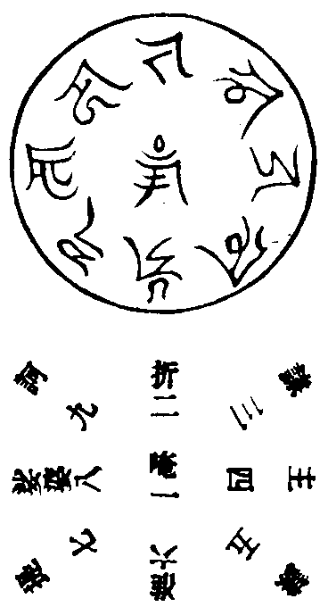
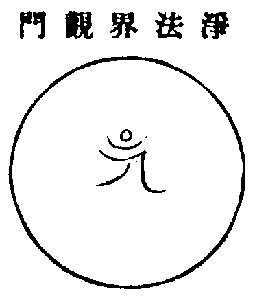
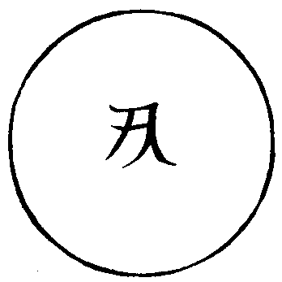
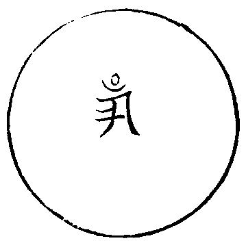

# 准提净业



> **藏经**：卍新纂大日本续藏经（新纂卍续藏）　**册次** 第 59 册（X59）　**编号** X1077　**部类** 密教部　**卷次** 3 卷　**篇幅** 31,249 字

> **卷／品**：1 卷 · 1 品



---



## 目录



  - [No. 1077-A 重刻准提净业序](#no-1077-a-重刻准提净业序)

- [准提净业卷二](#准提净业卷二)



---



### No. 1077-A 重刻准提净业序



甞闻之：有物先天地，无形本寂寥。能为万象主，不逐四时凋。盖无形万形之元性，宗之秘奥，三教圣人所不能外者。后赵文肃公畫一圆相，○目之为混元图，又加卍字其中，[○@卍]目之为万字轮相图。余甞三复於斯，窃谓真空也，妙有也，一为无量，无量为一者也，何独於准提净业而疑之？岁戊午之至日，余梦近溪罗先生示余圆图曰：子眼清利，常观此则入道速疾。已又语一僧持二签授余，余目签有南字，恍然曰：吾师也。即泣下沾襟，觉而惕然不识所谓。俄有僧德庵持疏募造千手千眼大悲观音像，余解曰：签千声相近，非即大悲千手千眼之谓耶？已而扣之，则善梵呪也，且能作准提梵字，曰：是西域高僧所传，对梵藏本相合的，真可信者也。因作月轮圆相，安九圣梵字，布畫皆精妙可喜。余忆畴昔之夜，梦近溪先生示我圆图，虽无文字，而文字曷甞不在其中？今僧人授我梵书，虽立文字，而亦无文字相可得，盖先师塘南先生命教也久矣。先是塘师访近翁，论及准提功德，归而语给谏贺少龙公，给谏受持久之，梦童子送九华衣，遂得生天。后见梦以相谢，教时举而询之，先师曰：然，顾此福报耳。乃出普贤行愿品曰：汝以此经与准提同观，即得圆宗之意。教於是服膺不忘，而第疑梵字无据，难以入观，不意乃今若神告之也。夫普贤愿王导归极乐，固与净业相为表里者，而或者见舍秽取净，疑与圆宗有隔，不知混元一图固无量妙义，百千三昧之所从出也。九圣梵字即体是毗卢法界，六八愿门即体是普贤行海，变娑婆为极乐，即极乐为华藏，皆即大悲之手眼也。夫大悲余何敢知，而此准提净业显密观门，傥亦所谓无量之一耶？若圆观圆修而超出乎文字之外，则俟乎观象得意之君子。



天启癸亥中元之吉古虔青莲居士　谢于教　沐手焚香书



No. 1077-B 准提净业引



是编即显密圆通之旨也。而以准提净业名，又首及准提布字法者，何也？曰：重观行也。然则曷不专言观行，而先之持诵？曰：观行难入，故以持诵先之。又多字难观，且以一字收之。盖曲为初机耳。实则深浅获益，一多无碍也。夫既一多无碍，则以一字净法界，应得徧净，曷为更增之以净业？曰：法界无殊，究竟有异。或以爱重而恋娑婆，或以念一而趋极乐，则菩提之愿，有发有不发者也。准提圆宗，随众希求，指入菩提。众得所求，遂忘正指。余故以净业合之。净业者，以普贤之行愿为究竟者也。果以是愿而入於观行，则帝网无尽之妙观，显密双融；即毗卢遍处之阿弥，法报齐现。准提净业，尚无有一，宁复有二耶？余读显密心要，未甞不叹其渊深浩博，尽尽善美。而此割裂附会，非敢掩前人之长，聊以见取精之意云尔。



天启癸亥孟秋古虔青莲居士谢于教沐手焚香书



准提净业目



一卷准提陀罗尼经  

陀罗尼布字法  

持诵便覧  

持诵仪轨



二卷观行仪轨



三卷显密双修观行说(五首)  

净业圆修说(六首)  

(附)供佛利生仪



No. 1077  

准提净业卷之一



佛说七俱𦙆佛母心大准提陀罗尼经



唐武周沙门　地婆诃罗　译



尔时佛在舍卫国祇树给孤独园。是时世尊思惟观察，愍念未来诸众生故，说是七俱𦙆母佛心准提陀罗尼法，即说呪曰：



南无飒哆南(一)，三藐三勃陀俱𦙆南(二)，怛姪他(长引)(三)，唵折戾(四)，主戾(五)，准提(六)，娑婆诃(七)



若有比丘、比丘尼、优婆塞、优婆夷，受持读诵此陀罗尼满八十万遍，无量劫来所造五无间等一切诸罪悉灭无餘，所在生处皆得值遇诸佛菩萨，所有资具随意充足，生生常得出家，具持菩萨律仪净戒，恒生人天不堕恶趣，常为诸天之所守护。若有在家善男女等诵持之者，其家无有灾横病苦之所恼害，诸有所作无不谐偶，所出言教人皆信受。若有诵此陀罗尼呪满十万遍，梦中得见诸佛、菩萨、声闻、缘觉，自见口中吐出黑饭。若有重罪诵满二十万遍，梦中亦见诸佛菩萨，亦自见口中吐出黑饭。若有五逆罪者，不得如是善梦现时，应当更诵满七十万遍，是时还得如前之相，乃至梦见吐出白色秔米酪饭，当知此人即是罪灭清净之相。复次，我今说此大陀罗尼所作之事，若於佛像前、或於塔前、若清净处，以瞿摩夷(此云牛粪)涂地而作方坛，随其大小，复以华香、旛盖、饮食、灯明、烛火，随力所办而供养之。复呪香水，散於四方及以上下，以为结界。既结界已，於坛四角及坛中央，皆各置一香水之瓶。持呪之者，於其坛中面向东方，胡跪诵呪一千八十遍，其香水瓶即便自转。又手捧杂华，呪一千八十遍，散一镜面。又於镜前正观镜面，诵呪亦一千八十遍。又以香油(以苏摩那华香浸著胡麻油中)涂手大指，诵呪一百八遍，即於童面镜中指爪甲内，皆各得见佛菩萨像。复诵呪呪华一百八遍，而散供养佛菩萨像。心所有事，一一请问，无不决了。若有鬼病，以呪呪茅(得香茅第一，不得直茅亦可)而拂病人，即得除愈。若有幼小为鬼所著，以五色缕，应令童女合以成线，一呪一结，满二十一结，用系其颈，以白芥子呪之七遍，复散其面，即便除瘥。



复次，有法：於病者前，以墨畫其病人形像，呪杨枝打此畫形，亦得除瘥。



复有一法，若有病人为鬼所著身在远处，应呪杨枝足满七遍，寄往持打即亦除愈。



复有一法，若在路行诵念此呪，无有贼盗恶兽等怖。复有一法，常持此呪，设有诤讼无不获胜。若欲往渡江河大海诵呪而渡，无有水中恶兽等难。



复有一法，若被系闭枷锁禁其身，诵此呪者即得解脱。



复有一法，若诸国土水旱不调、疫毒流行，应以酥和胡麻、秔米，用手三指取其一撮，呪之一遍掷火中烧，或经七日、七夜、六时，如是相续不绝，一切灾疫无不消灭。



复有一法，以酥和稻谷，呪一百八遍，火中烧之，随心所愿，无不成谛，财宝增盈，求心满足。若人欲令他敬念者，称彼前人名字，一呪一称，满一百八遍，即便敬念。



复有一法，於河渚间砂潬之上，以塔形像印印砂潬上为塔形像，诵呪一遍印成一塔，如是数满六十万遍，即得覩见圣者观自在菩萨之像，或见多罗菩萨、金刚主菩萨，随其心愿皆得满足，或见授与仙神妙药，或见授与菩萨之记。



复有一法，作右绕菩提树像，诵呪满千万遍，即见菩萨为其说法，欲随菩萨即得随从。



复有一法，若乞食时常持此呪，不为恶人、恶狗等类之所侵害。



复有一法，若在塔前、或佛像前、或舍利塔前，诵持此呪三十万遍，复於白月十五日设大供养，一日一夜不食，正诵呪得见金刚手菩萨，而彼菩萨即将是人往於自宫。



复有一法，若於转法轮塔前、或佛生处塔前、或於忉利天下宝阶塔前、或舍利塔前，於如是等诸塔之前诵呪右绕，即见阿钵罗是多菩萨及呵利底菩萨，随其所愿皆悉满足。若须仙药即便授之，复为说法示菩萨道。若有诵此陀罗尼者，乃至未坐道场一切菩萨为其胜友。又此准提大陀罗尼大明呪法，过去一切诸佛已说、现在一切诸佛今说、未来一切诸佛当说，我今亦如是说，为利一切众生故、得无上菩提故。若有薄福众生，无有少善根者、无有根器之者、无有菩提分者，若得闻此大准提陀罗尼法，速疾证得阿耨多罗三藐三菩提。若有人忆持诵念常不懈废此佛母心大准提陀罗尼者，无量善根皆得成就。佛说此大准提陀罗尼法时，无量众生远尘离垢，得大准提陀罗尼大明呪功德，得见十方诸佛菩萨诸圣众等，作礼而去。



佛说七俱胝佛母心大准提陀罗尼经(竟)。



佛说七俱胝佛母准提大明陀罗尼经(呪文节略)



唐天竺三藏　金刚智　译



依经梵本有十万偈，我今略说：念诵观行，　说陀罗尼字，想布於身法(后观行中布字，即用此法)。



> 唵想安头上，其色白如月，放於无量光。  

> 除灭一切障，即同佛菩萨，摩是人顶上。  

> 折字安两目，其色如日月，为照诸愚暗。  

> 能发深慧明。𨽻字安项上，色如绀瑠璃，  

> 能显诸色相，渐具如来智。主字想安心，  

> 其色如皎素，由心清净故，速达菩提路。  

> 𨽻字安两肩，色黄如金色，由观是色相，  

> 能披精进甲，准字想脐中，其色妙黄白，  

> 速登妙道场，不退菩萨故。提字安两䏶。  

> 其色如浅黄，速证菩提道，得坐金刚座。  

> 莎嚩字安两胫，其状作赤色，常能想是字。  

> 速得转法轮。诃字置两足，其色犹如月，  

> 行者作是想，速得达圆寂。



> 如是布字想念已，便成准提胜法门。  

> 亦如本尊真实相，能灭诸罪得吉祥。  

> 犹如金刚坚固聚，是名准提胜上法。  

> 若常如是修行者，当知是人速悉地(布身字竟)。



又以自心想七俱胝佛母，口中出七俱胝陀罗尼文字，字字放五色光入行者口里，安自心月中右旋布置，即作三摩地瑜伽观行及谛观，一一字义与心相应，此名三摩地念诵。



心月梵字观门







此即上图中梵字直音也。但观真言字，惟用梵书，有大神力，不是此方文字。



陀罗尼布字法竟。



按准提大明经念诵仪轨，前后真言手印有三十餘种，今俱不载，但取纯一观行以为三摩地念诵。



字义



唵者



流注不生灭义，复於一切法为最胜义



折者。



一切法无行义



𨽻者



一切法无相义



主者



一切法无起住义



𨽻者



一切法无垢义



准者



一切法无等觉义



提者



一切法无取，舍义



娑婆者



一切法平等，无言说义



诃者



一切法无因、寂静、无住、涅槃义。



又观此字义，无断无绝周而复始，由流注不生灭。最胜义！是故无行，由无行义是故无相，由无相义是故无起住，由无起住义是故无垢，由无垢义是故无等觉，由无等觉义是故不取舍，由无取舍义是故平等无言说，由平等无言说义是故无因寂静无住涅槃，由寂静无住涅槃义是故不生灭。最胜！如是妙义虽立文字，亦无文字相可得。



按真言密教，不通解脱，而此云云者，但取谛观字义，与心相应耳，非意识分别也。



准提真言持诵便览



> (赞云)准提功德聚，寂静心常诵，一切诸大难，  

> 无能侵是人，天上及人间，受福如佛等。  

> 遇此如意珠，定获无等等。



南无七俱胝佛母大准提菩萨(三称)。



唵㘕(音𫬠)(此净法界真言诵二十一遍或百八遍)唵啮𡄦(二合)(此获身真言诵二十一遍或百八遍)唵麼尼钵讷铭(二合)吽(此六字大明真言要诵满一百八遍)南无飒哆喃三藐三菩䭾俱胝喃怛你也(二合)他　唵折𨽻主𨽻准提娑婆(二合)诃　部林(二合)(此准提真言与大轮一字呪同诵，要满一百八遍或五百遍以至千遍。持呪毕，至心回向云：)



> 我今持诵大准提，即发菩提广大愿。  

> 愿我定慧速圆明，愿我功德皆成就，  

> 愿我胜福徧庄严，愿共众生成佛道。  

> 我昔所造诸恶业，皆由无始贪嗔痴，  

> 从身语意之所生，一切我今皆忏悔。  

> 愿我临欲命终时，尽除一切诸障碍。  

> 面见彼佛阿弥陀，即得往生安乐刹。



(如欲成就世法及诸善事，随意称之。)



持诵仪轨



(依显密心要，从头净法界护身等呪，皆是持诵准提之次第。)



净法界观门







前九圣梵字安心月中，即作三摩地瑜伽观行，恐初机难以入手，今但用净法界raṃ㘕字作观，一心持诵，自然得入净法界三昧，一多无碍也。



真言。行者依法持诵，先须金刚正坐(以右脚压左脚胫上，或随意坐亦得)，手结大三昧印(二手仰掌展舒，以右手在左手上，二大拇指甲相著，安脐轮下。此印能灭一切狂乱、妄念、杂染、思惟)，澄定身心，方入净法界三昧。谓想自身顶上有一梵书raṃ㘕字，此字徧有光明，犹如明珠，或如满月。想此字已，复以左手结金刚拳印(以大拇指掐无名指根第一节，餘四指握大拇指作拳。此印能除内外障染，成就一切功德)，右手持数珠，口诵净法界真言二十一遍。



净法界真言(各真言中只诵正呪，餘文不诵。)



唵㘕(音𫬠)oṃraṃ(此是梵书唵㘕字)。



此净法界raṃ㘕字，若想若诵能令三业清净，一切罪障悉皆消除，又能成办一切胜事，随所住处悉得清净。衣服不净便成净衣，身不澡浴便当澡浴，若用水洗净不名真净。若用此法界心㘕字净之，即名毕竟清净瓶，如灵丹一粒点铁成金，真言一字变染令净。偈云：ra(音啰)字色鲜白，空点以严之(梵书ra啰字上安空点，即成raṃ㘕字也)，如彼髻明珠，置之於顶上。真言同法界，无量众罪除，一切触秽处，当加此字门(若实外缘不具，无水洗浴阙新净衣，但用此㘕字净之。若外缘具者，先用水了著新净衣，更用此㘕字净之，即内外俱清净也)。次诵护身真言二十一遍。



护身真言



庵啮𡄦(二合)(𡄦字去声)oṃcchrīṃ(此是梵书唵啮𡄦字)。



此呪能灭五逆十恶一切罪业，能除一切种种病苦、灾障恶梦、邪魅鬼神诸不祥事，而能成办一切胜事，令一切所愿皆得圆满。此呪是诸佛心，若人专诵一遍，能守护自身，一切鬼神天魔不敢侵近；诵两遍，能守护同伴；诵三遍，能守护一宅中人；诵四遍，能守护一城中人；乃至七遍，能守护四天下人(上二呪各持百八遍亦得)。



次诵六字大明真言一百(八遍)。



六字大明真言



唵麼尼钵讷铭(二合)吽oṃmaṇipadmehūṃ(此是梵书六字)。



若诵此呪，随所住处有无量诸佛菩萨天龙八部集会，又具无量三昧法门，诵持之人七代种族皆得解脱，腹中诸虫当得菩萨之位。是人日日得具六波罗蜜圆满功德，得无量辨才清净智聚，口中所出之气触他人身，蒙所触者离诸嗔毒，当得菩萨之位。假若四天下人皆得七地菩萨之位，彼诸菩萨所有功德，与诵六字呪一遍功德等无有异。此呪是观世音菩萨微妙本心，若人书写此六字大明，则同书写八万四千法藏，所获功德等无有异。若以金宝造如来像数如微尘，不如书写此六字中一字功德。若人得此六字大明，是人贪嗔痴不能染著。若戴持此呪在身者，亦不染著贪嗔痴病。此戴持人身手所触眼目所覩，一切有情速得菩萨之位，永不复受生老病死等苦。说此六字大明竟，有七十七俱胝佛一时现前，同声说准提呪，即知此六字大明与准提真言次第相须也。然后结准提印，当於心上以准提真言与一字大轮呪同诵一百八遍，於顶上散其手印(或有不乐大论呪者，只持准提真言亦得。准提印法，以二手无名指并小指相义，於内二中指直竖相柱，二头指屈附二中指第一节，二大拇指捻右手无名指中节。若有请召，二头指来去正结印。诵呪欲记数时，於自身分手指上记、或准提菩萨手臂上记、或於观心上记皆得。或结印诵得一千八十遍更好，或一百八遍外，但以左手作金刚拳印，右手掐数珠持亦得。若务忙者，只散持之)。



七俱胝佛母心大准提陀罗尼(一字大轮呪，附后同诵。)



南　无　飒　哆　喃　三　藐　三　菩　䭾　俱　胝　喃　怛　你也(二合)　他　唵　折　𨽻　主　𨽻　准　提　娑婆(二合)　诃　部林(二合)　(此是梵书准提二呪)。



佛言：此呪能灭十恶五逆一切罪障，成就一切白法功德。持此呪者，不问在家出家、饮酒食肉、有妻子，不拣净秽，但志心持诵，能使短命众生增寿无量，迦摩罗疾尚得除差，何况餘病。若不消灭，无有是处。若诵满四十九日，准提菩萨令二圣者，常随其人所有善恶心之所念，皆於耳边一一具报。若有无福无相、求官不遂、贫苦所逼者，常诵此呪，能令现世得轮王福，所求官位必得称遂(禅宗传灯录中引古人云：俱胝只念三行呪，便得名超一切人是也)。若求智慧得大智慧，求男女者便得男女，凡有所求无不称遂，似如意珠一切随心。又诵此呪，能令国王大臣及诸四众，生爱敬心见即欢喜。诵此呪人，水不能溺、火不能烧，毒药怨家、军阵强贼及恶龙兽、诸鬼魅等皆不能害。若欲请梵王、帝释、四天王、阎罗天子等，但诵此呪，随请必至不敢前次，所有驱使随心皆得。此呪於南赡部洲有大势力，移须弥山竭大海水，呪乾枯木能生花果，何况更能依法持诵，不转肉身得大神足往兜率天。若求长生及诸仙药，但依法诵呪，即得见观世音菩萨或金刚手菩萨，授与神仙妙药，随取食之即成仙道，得延寿命齐於日月证菩萨位。若依法诵满一百万遍，便得往诣十方净土，历事诸佛普闻妙法得证菩提。



大轮一字呪，即部林(二合)是也，亦名末法中一字心呪。此呪於末法时，法欲灭时有大势力，能於世间作大利益，能护如来一切法藏，能降伏一切八部之众，能摧世间一切恶。呪是一切诸佛之顶，是文殊菩萨之心，能施一切众生无畏，能与一切众生快乐。凡有修持随意得果，同如意珠能满一切之愿。若诵此呪，於四方面五百驿内，诸恶鬼神皆自驰散，诸恶星曜及诸天魔不敢侵近。若持诵餘一切真言恐不成就，即用此呪共餘真言一处同诵持之，决定成就。若不成就及无现验，其呪神等即当头破七分。是知此呪能助一切真言，疾得成就(或别持此呪亦得)。上来次第持诵至准提呪，若不能结得准提印者，但以左手作金刚拳印，右手持珠诵之。或不能从前净法界真言等次第持诵者，只持准提神呪。更或根钝不能具受此准提者，只唵字已下持之。唵字已上是归敬词，唵字等是正呪也。每持诵了，却用右手作金刚拳印，口诵吽字真言而印五处。先印额上，次印左右肩，次印心上，从印㗋上印竟顶上散之。能除一切魔障，成就一切胜事，回向发愿如前随意称之。



净业续课



(按准提经云：诵真言回向竟，随意经行，转读大乘经典、华严、大般若等经。故今续课。)



般若波罗蜜多心经



观自在！菩萨行深般若波罗蜜多时，照见五蕴皆空，度一切苦厄。舍利子！色不异空、空不异色，色即是空、空即是色，受想行识亦复如是。舍利子！是诸法空相，不生不灭、不垢不净、不增不减，是故空中无色、无受想行识、无眼耳鼻舌身意、无色声香味触法、无眼界乃至无意识界、无无明亦无无明尽、乃至无老死亦无老死尽、无苦集灭道、无智亦无得。以无所得故，菩提萨埵依般若波罗蜜多故，心无罣碍。无罣碍故，无有恐怖，远离颠倒梦想，究竟涅槃。三世诸佛依般若波罗蜜多故，得阿耨多罗三藐三菩提。故知般若波罗蜜多是大神呪、是大明呪、是无上呪、是无等等呪，能除一切苦，真实不虗，故说般若波罗蜜多呪。即说呪曰：揭谛，揭谛，波罗揭谛，波罗僧揭谛，菩提萨婆(二合)诃。



大方广佛华严经入不思议解脱境界普贤行愿品



一者、礼敬诸佛；二者、称赞如来；三者、广修供养；四者、忏悔业障；五者、随喜功德；六者、请转法轮；七者、请佛住世；八者、常随佛学；九者、恒顺众生；十者、普皆回向。



> 所有礼赞供养福，请佛住世转法轮。  

> 随喜忏悔诸善根，回向众生及佛道。  

> 愿我临欲命终时，尽除一切诸障碍。  

> 面见彼佛阿弥陀，即得往生安乐刹。  

> 我既往生彼国已，现前成就此大愿，  

> 一切圆满尽无餘，利乐一切众生界。  

> 彼佛众会咸清净，我时於胜莲华生，  

> 亲覩如来无量光，现前授我菩提记。  

> 蒙彼如来授记已，化身无数百俱胝，  

> 智力广大徧十方，普利一切众生界，  

> 乃至虗空世界尽，众生及业烦恼尽，  

> 如是一切无尽时，我愿究竟恒无尽。  

> 我此普贤殊胜行，无边胜福皆回向，  

> 普愿沉溺诸众生，速往无量光佛刹。



观无量寿佛经上品上生章



佛告阿难及韦提希：上品上生者，若有众生愿生彼国者，发三种心，即便往生。何等为三？一者、至诚心；二者、深心；三者、回向发愿心。具三心者，必生彼国。复有三种众生，当得往生。何等为三？一者、慈心不杀，具诸戒行；二者、读诵大乘方等经典；三者、修行六念，回向发愿，愿生彼国。具此功德，一日乃至七日，即得往生。生彼国时，此人精进勇猛故，阿弥陀如来与观世音、大势至、无数化佛、百千比丘、声闻大众、无量诸天，七宝宫殿，观世音菩萨执金刚台，与大势至菩萨至行者前。阿弥陀佛放大光明，照行者身，与诸菩萨授手迎接。观世音、大势至与无数菩萨，赞叹行者，劝进其心。行者见已，欢喜踊跃，自见其身乘金刚台，随从佛后，如弹指顷，往生彼国。生彼国已，见佛色身众相具足，见诸菩萨色相具足，光明宝林演说妙法。闻已，即悟无生法忍，经须臾间，历事诸佛，徧十方界，於诸佛前，次第受记，还至本国，得无量百千陀罗尼门。是名上品上生者。



拔一切业障根本往生净土神呪



曩谟阿弥哆婆夜哆他伽哆夜哆地夜他阿弥唎都婆毗阿弥唎哆悉躭婆毗阿弥唎哆毗迦兰帝阿弥唎哆毗迦兰哆伽弥腻伽伽那枳多迦𨽻娑婆诃(哆，去声，读如掇，又如带，随便皆得)。



> 阿弥陀佛身金色，相好光明无等伦，  

> 白毫宛转五须弥，绀目澄清四大海。  

> 光中化佛无数亿，化菩萨众亦无边，  

> 四十八愿度众生，九品咸令登彼岸。



南无西方极乐世界大慈大悲阿弥陀佛  

南无阿弥陀佛(或千声，或三五百声，或十念)  

南无观世音菩萨(十声)  

南无大势至菩萨(十声)  

南无清净大海众菩萨(十声)



回向西方愿文



> 稽首西方安乐国，接引众生大导师。  

> 我今发愿愿往生，唯愿慈悲哀摄受。



弟子(某)普为四恩三有法界众生，求於诸佛一乘无上菩提道故，专心持念阿弥陀佛万德洪名，期生净土。又以业重福轻，障深慧浅，染心易炽，净德难成。今念佛前，翘勤五体，披沥一心，投诚忏悔。我及众生，旷劫至今，迷本净心，纵贪嗔痴染秽三业，无量无边所作罪垢，无量无边所结冤业，愿悉消灭。从於今日，立深誓愿，远离恶法，誓不更造，勤修圣道，誓不退惰，誓成正觉，誓度众生。阿弥陀佛以慈悲愿力，当证知我，当哀悯我，当加被我。愿禅观之中，梦寐之际，得见阿弥陀佛金色之身，得历阿弥陀佛宝严之土，得蒙阿弥陀佛甘露灌顶、光明照身、手摩我头、衣覆我体，使我宿障自除，善根增长，疾空烦恼，顿破无明，圆觉妙心，廓然开悟，寂光真境，常得现前。至於临欲命终，预知时至，身无一切病苦厄难，心无一切贪恋迷惑，诸根悦豫，正念分明，舍报安详，如入禅定。阿弥陀佛与观音、势至诸圣贤众，放光接引，垂手提𢹂，楼阁幢旛，异香天乐，西方圣境，昭示目前，令诸众生，见者闻者，欢喜感叹，发菩提心。我於尔时，乘金刚台，随从佛后，如弹指顷，生极乐国七宝池内胜莲华中。华开见佛，见诸菩萨，闻妙法音，获无生忍，於须臾间，承事诸佛，亲蒙授记。得受记已，三身、四智、五眼、六通，无量百千陀罗尼门，一切功德，皆悉成就。然后不违安养，回入娑婆，分身无数，徧十方刹，以不可思议自在神力，种种方便，度脱众生，咸令离染，还得净心，同生西方，入不退地。如是大愿，世界无尽，众生无尽，业及烦恼一切无尽，我愿无尽。愿今礼佛发愿，修持功德，回施有情，四恩总报，三有齐资，法界众生，同圆种智。



自皈依佛，当愿众生：体解大道，发无上心。  

自皈依法，当愿众生：深入经藏，智慧如海。  

自皈依僧，当愿众生，统理大众，一切无碍。  

和南圣众。



(已上俱依莲池大师节定在家要略)(又金刚般若经，普贤行愿品，阿弥陀经，俱大乘切要经典。若有餘力者，更当全持。)



十念法门



世有冗忙之极，顷刻无间者，每日晨朝，必须十念。十念者，清晨面西，正立合掌，连声称阿弥陀佛。尽一气为一念，如是十气，名为十念。但随气长短，不限佛数多少，唯长唯久，气极为度。其佛声不高不低，不缓不急，调停得中。如是十气，连属不断，意在令心不散，专精为功。故名此为十念者，显是藉气束心也。尽此一生，不得一日暂废。十念毕，回向发愿云：



弟子(某)一心皈命极乐世界阿弥陀佛，愿以净光照我，慈誓摄我。我今正念，称如来名，为菩提道，求生净土。佛昔本誓：若有众生，欲生我国，志心信乐，称我名号，乃至十念。若不生者，不取正觉。以此念佛因缘，得入如来大誓海中。承佛慈力，众罪消灭，净因增长。若临命终，自知时至，身无病苦，心不贪恋，亦不颠倒，如入禅定。佛及圣众，手执金台，来迎接我。於一念顷，生极乐国。华开见佛，即闻佛乘。顿开佛慧，广度众生，满菩提愿。



淮提净业卷之一



准提净业卷之二



观行仪轨(依显密心要，准提大明诸经，特标观行，即显密双修观法也。)



(前专持诵而略观行，便於流通。此专观行而兼持诵，切於修证。或公务忙迫，不能全依观行次第，於中随人节取用之亦可。)



准提大明经云：若有在家出家菩萨，发菩提心，行菩提行，求速出离生死者，先须入三摩耶灌顶道场，受持禁戒，坚固不退，爱乐大乘菩萨戒行，於四威仪，修四无量，发四弘愿，一切事业，心不散乱，方可入此秘密法门。初入道场，复须礼敬忏悔，自誓受戒，随喜发愿，然后持诵。(以后观行次第，依此建立。)



坛法



(真言：行者於佛像前斋戒设供烧香及净水，随月十五夜向东朝月，以一新镜未曾用者安置座前，对镜结印在於心上，诵呪一千八十遍，即以囊盛此镜佩带在身。以后每日限定二时三时对镜礼诵，即是净坛。或十斋日对镜，餘不对镜亦得。诸经多说想成坛法持诵为上，但须净心合法)。行者金刚正坐手结大三昧印(坐法印法俱见前)，诵赞云：准提功德聚，寂静心常诵，一切诸大难，无能侵是人。天上及人间，受福如佛等，遇此如意珠，定获无等等。　南无七俱胝佛母大准提菩萨。(三称)　观准提菩萨像(其像作黄白色，面有三目，宝冠缨络庄严，腰下著白衣，衣〡有花，上身著轻罗绰袖天衣，以绶带系腰，珠霞络身。其手腕以白螺为钏，其臂上钏七宝庄严，一一手上著指环有十八，臂上二手作说法相。右第二手施无畏，第三手把劒，第四手把数珠，第五手把俱缘果，第六手把钺斧，第七手把钩，第八手把金刚杵，第九手把宝鬘。左第二手把如意宝幢，第三手把莲华，第四手把澡罐，第五手把索，第六手把轮，第七手把螺，第八手把贤瓶，第九手把般若波罗密经卷。菩萨下作水池，池中安莲华，难陀龙王、坞波难陀龙王共扶莲华茎，於莲华上安准提菩萨，其像周圆安明光焰。准提佛母矜怜行人，慈眼下视云)。　歌诀(佛母大准提，庄严极妙丽，宝冠缨络埀，天衣罗带系，黄金满月相，三目十八臂，说法无畏施，宝幢得如意，把劒持珠握，俱缘莲华，澡罐索皆备，钺钩金刚杵，轮螺贤瓶器，宝鬘都来色即空，般若总持第一义。此歌便记从无畏手以下皆先右后左，如无像，但观镜亦得)：　想准提菩萨面前有一镜坛，湛然清净，想自心如一轮明月，光明相映。　次想准提菩萨口中吐出九圣梵书，字字相续如贯珠，有五色光从自口入，右旋安布心月轮中，即从中第一oṃ唵字观起，次ca折字、le𨽻字，至第九hā阿字，复观第一oṃ唵字，如是周而复始，字字分明，内外交彻，圆满清净，以应镜坛(月轮梵字图见前，已上入坛观)。



观raṃ㘕字，入净法界三昧。想自身顶上有一梵书raṃ㘕字，此字徧有光明，犹如明珠，或如满月，普照十方。即诵净法界真言　唵㘕二十一徧。　次想raṃ㘕字变成三角火轮，燃尽自己有漏之身(从头眼耳鼻舌身一一烧尽，纵有五无间罪，用此字烧身，亦皆除灭无遗)，徧大地尽，燃成净法界(如同劫火烧尽有为世界，但成空寂)。念云：愿我永离三界五欲男女臭秽不净等身，愿得净土法性生身(已上净法界观)。次观a阿字，生成无漏智身。想八叶大莲华上(八叶莲华表白净八识心王)有一a阿字，此字即是无相法界，我身从无相中受生。　次观aṃ暗字，在自己顶门十字缝中(此字即体，是十方诸佛光明法水，即如来秘密灌顶法门)，想十方诸佛同时以光明法水为我灌顶。



次结布字印(以二中指、无名指向内相义，二大拇指、二头指、二小指竝直竖，头相著。)



用触九处布九圣梵字，想oṃ唵字安头上，ca折字安两目，le𨽻字安颈项，cu主字安於心，le𨽻字安两肩，cuṃ准字安脐中，de提字安两䏶，svā娑婆字安两胫，hā诃字安两足(俱用手印随观随触九处布之，准字已上用大指触，提字已下用小指触。依前经中布字，於身法念诵作观尤妙)。谛观从顶至足，一一真言字体皆有无量光明，我身即同准提佛母身，具足相好光明(念云)。如是本尊真实相，能灭诸罪得吉祥，犹如金刚坚固聚，是名准提胜上法(由想布九圣字结印加持故，令我身即同本尊诸相具足，灭除一切业障，积集无量福德吉祥，即得金刚不坏之体)。然后诵护身真言，与一字大轮呪同诵，结金刚界



奄啮𡄦(二合)○唵部林(二合)



(同持二十一遍，作是思惟：我於四方面五百驿内结金刚界，所有障者诸恶鬼神远走而去，所来圣众不越本三摩耶大悲而住，愿垂加护。　已上护身观。)



观a阿字入礼敬观，此字即是毗卢法身，观在目前即作帝网无尽礼敬观。想尽虗空遍法界，尘尘刹刹帝网无尽三宝前，各有帝网无尽自身，一一自身遍礼帝网无尽三宝，一一三宝各受帝网无尽身礼敬，穷未来际相续不断，身语意业无有疲厌。　次念普礼真言：



唵，嚩日啰(二合)。



勿七，遍就定中作观礼。(念云：)所有十方世界中，三世一切人师子，我以清净身语意，一切遍礼尽无餘。(观礼一拜。)普贤行愿威神力，普现一切如来前，一身复现刹尘身，一一遍礼刹尘佛。(观礼一拜。)於一尘中尘数佛，各处菩萨众会中，无尽法界尘亦然，深信诸佛皆充满。(观礼一拜。已上礼敬观。)



观oṃ唵字入供养观，想尽虗空遍法界，尘尘刹刹帝网无尽三宝前，各有帝网无尽自身，一一自身烧香散花燃灯，出无尽供具，供养帝网无尽三宝，一一三宝各受帝网无尽身供养，穷未来际相续不断，身语意业无有疲厌。　次想自身在诸佛前燃香普薰(念云)：弟子(某)谨燃五分真香：戒香、定香、慧香、解脱香、解脱知见香，运此法香充满法界，供养三宝，普薰众生，咸生净土。次结出生供养印(二手当心合掌，以指上节右压左头相交，复安在顶上散之)，诵出生供养真言　oṃ唵二十一遍(若无饮食香花，但佛像前手结此印，口诵此加持真言，亦自然有无尽供养，普遍法界也)，念云：以我功德力，如来加持力，及以法界力，普供养而住。即诵大虗空藏菩萨真言：



唵，誐誐曩，三婆嚩，嚩目罗(二合)斛，三遍(已上供养观)。



观hūṃ(音吽)字，入忏悔发愿观。此字即是金刚部主解脱法门。观此字时，想尽虗空徧法界，尘尘刹刹帝网无尽。三宝前各有帝网无尽自身，一一自身尽皆至诚忏悔帝网无尽罪障，一一罪障有帝网无尽身忏悔，一一自身发起帝网无尽清净行愿，一一净愿有帝网无尽身成就，穷未来际相续不断，身语意业无有疲厌。　次忏云：弟子(某)至心忏悔，我及众生无始以来迷本净心、染秽三业，身有杀、盗、婬，口有妄言、绮语、两舌、恶口，意有贪、嗔、痴烦恼所知一切罪障。我今悉以清净三业，恭对诸佛菩萨前诚心忏悔，誓不复造恒住净戒一切功德。



次诵戒赞



云：众生受佛戒，即入诸佛位，位同大觉已，真是诸佛子。(居士、沙弥、大僧，戒相随举。增进菩萨戒云)弟子(某)一心归命三宝，受菩萨心地戒，有十重波罗提木叉，今当受持。第一、杀戒，第二、盗戒，第三、婬戒，第四、妄语戒，第五、酤酒戒，第六、说四众过戒，第七、自赞毁他戒，第八、悭惜加毁戒，第九、嗔心不受悔戒，第十、谤三宝戒。如是十戒，誓愿受持，永不堕波罗夷罪。摩诃般若波罗蜜多(三称)即今自誓受菩提心戒，离一切我执，远离蕴、处、界，及离能取、所取，於法平等，自心本不生，自性空故。如过去一切佛菩萨发菩提心，我亦如是。众生无边誓愿度，烦恼无尽誓愿断，法门无量誓愿学，佛道无上誓愿成。虗空有尽，我愿无穷；虗空有尽，我愿无穷。(已上忏悔发愿观)



次入持诵观



想尽虗空遍法界，尘尘刹刹帝网无尽，三宝前各有帝网无尽自身，一一自身受持帝网无尽真言教法诸佛菩萨名号，一一真言名号有帝网无尽身受持，穷未来际相续不断，身语意业无有疲厌。　次想五轮指端有一hūṃ吽字，变成白净五金刚杵。又想舌端有一hūṃ吽字，变成金刚不坏舌。然后结金刚拳印(两手俱结印，印法同前)，仍诵净法界真言：



○唵㘕(二十一遍)



诵护身真言○



唵啮𡄦(二合)(二十一遍，用梵书唵字七畫记数，写三遍即合数)诵大明六字真言。



唵嘛尼八讷铭(二合)吽(一百八遍)　仍观准提圣像，及心月轮中九圣梵字，结准提印(印法同前)。诵准提呪，与一字大轮呪同，诵一百八遍。



南无飒哆喃，三藐三菩䭾，俱胝喃，怛你也(二合)他，唵，折𨽻主𨽻，准提娑婆(二合)诃部林(二合)。



(正结印诵呪欲记数时，将九圣梵字畫数记之。初观oṃ唵字意中填写，每持一遍填写一畫，至第九hā诃字再写第一oṃ唵字竟，则为一周。但图转者通作一畫，折转者每折作一畫，如是二回即合一百八遍之数，加多随人。)即以右手作金刚拳印，(拳印同前。)口诵hūṃ吽字真言而印五处。(先印额上，次左右肩，次心上喉上，印竟於顶上散之。)　复结三昧印，端身闭目澄心静意，仍观月论梵字及身所布字，一时齐现炳然圆明，起大精进决定取证无有懈怠，必当得见本源清净之心，然后回向。



> 我今持诵大准提，即发菩提广大愿。  

> 愿我定慧速圆明，愿我功德皆成就，  

> 愿我胜福徧庄严，愿共众生成佛道。  

> 我昔所造诸恶业，皆由无始贪嗔痴，  

> 从身语意之所生，一切我今皆忏悔。  

> 愿我临欲命终时，尽除一切诸障碍。  

> 面见彼佛阿弥陀，即得往生安乐刹。



弟子(某)不为自求人天福报，声闻、缘觉乃至权乘诸位菩萨，唯依最上乘发菩提心，愿与现生父母及多生父母、法界众生、一切冤亲同生净土，皆得不退转於阿耨多罗三藐三菩提(准提观行竟)。



(凡设准提圣像，须以帛覆像。念诵时，去覆帛。念诵毕，仍以帛覆之。结印，用衣覆手，勿令人见，须当秘密。已上观行，但早课行之。至二时三时，只观现成身所布字，及月轮中字，即便持诵真言，不必复用诸观也。)



净业续课诸经如前



念佛观门







一心称念南无阿弥陀佛。观此a阿字，即体是毗卢遮那法身，念佛即念毗卢法身佛。十六妙观甚深法门，以此一字收之，义无不尽。又观佛有八万四千相好光明，境细心粗，初机难入。念佛持名，又恐散动，难得一心。今观字简易，以心缘字，又不散乱，入手尤便也。



真言之母







此字具含无量法门，释迦如来及过去如来，皆因观想此字而得成佛。如观九圣字，先观此字分明，餘皆现前。凡持诵及四威仪中，但观此字，即得总持法门。按华严字母四十二字，以阿字为首。疏云：阿者，是无生义。以无生之理，统该万法。故宗门教人提无字公案，与此相似。要之，心观法门，不落分别，谛理幽䆳，显密圆融。今但常观此a阿字，作个本参话头，得失是非，一时放却可也。又天台止观，教人昏沉时观鼻端，掉举时观脐轮。禅门口诀，但令人观脐中白，即入禅定。今谓脐中观一月轮，於月轮中，有一梵书a阿字，或oṃ唵字，以意观写，默念此呪，即得三密相应，亦与出入息持相符。较所称玄关一窍，不啻浮沤之与大海也。彼之所守，止於色身；此之所观，等於法界也。



观行次第，具详前文。於中尚有修习仪轨，一往未悉，方便多门，故当备述。又随所住处，欲辟除鬼神，结金刚界，但诵准提真言呪，香水二十一遍，八方上下洒之，即成辟除结界。又正持诵时，准俱胝陀罗尼经、金刚顶经及诸经教中说，随根所乐，亦有多种：一、瑜伽持，但想心月中布字，谓想自心如一月轮，湛然清净，内外分明，以梵书唵字，安心月中，以折𨽻主𨽻准提娑婆诃字，从前右旋，次第周布轮缘(去声呼之)，终而复始(详如观行中前后所说)。二、出入息持，谓出入息中，想有真言梵字，息出字出，息入字入，字字朗然，如贯明珠，不得间断(或息出时，想自心月轮中九圣梵字，字字连环，皆有五色光明，从自口中出，流入准提菩萨口中，右旋安布准提菩萨心月轮内。若息入时，想准提菩萨心月轮中字，亦字字连环，皆有五色光明，从准提菩萨口出，流入自口中，右旋安布心月轮内。如是终而复始，想之甚妙。)三、金刚持，唇齿不动，舌不至㗁，但口中微动。(微动者，舌微动也，口不作声。)四、微声持，但令自耳闻之，不缓不急，字字须得分明称之。(准提大明经云：诵呪时不急不缓，不得高声，须分明称字而令自闻。所观本尊及上布字念诵记数，於一念中竝须一时观见，不得有缺，使心散乱。如观念疲劳，随力念诵，或一千二千乃至三千四千五千遍，常取一数为定。如有缘事，亦不得减数至一百八遍已下。)五、高声持，令他闻之灭罪。复有二种持诵：一、无数持诵，谓不持珠定数，常无间断持之。二、有数持诵，谓掐数珠，每日须得限定其数，不得阙少。(数珠功德，诸经广赞。又金刚顶念珠经偈云：若安顶髻净无间，由戴颈项灭四重。手持臂上除众罪，能令行人速清净。又一字顶轮仪说：先用raṃ㘕字真言加持数珠七遍，然后掐数珠课诵，至母珠却回，不得越过母珠。)



按准提真言之妙，在於观行。经云：坐中澄心定意，须见心月轮中梵字分明。既不散动得定，即与般若波罗蜜相应，必当得见本源清净之心。又云：若求解脱，速出离生死，作三摩地瑜伽观行者，即想心月轮中梵字，及谛观一一字义，与心相应，不得差互，此名三摩地念诵。则持诵之法，无若瑜伽矣。又有一法，将前瑜伽持、金刚持合而为一，但观想心月轮中九圣梵字，即将全呪用金刚持念诵。虽然念诵意重观行，且观字时，即便可以记数。初观oṃ唵字，意中填写，至第九hā诃字，再写第一oṃ唵字竟，则为一周(记数法详前)。又将身上布字作母数，以统记之，虽多遍而不乱(如写月轮字一周，然后写顶上oṃ唵字，作一母数。又写月轮字一周，然后写右目ca折字，又作一母数。次左目ca折字，次项颈le隷字。计周身布字竟，通算共有八百二十八遍之数。如是加多至一千二千，随人方便)。或用此法，只持九字亦得。总要称字，观字分明，即文即义，即畫即心，自然得入三昧。故知心观法门，惟贵修鍊。鍊之有味，说之言淡也。



每日依法持诵时，须限定其时分。若一时持谓早晨，若二时持并黄昏，若三时持加正午(若忙务者不拘时分，但有暇时持之)。若上根持诵，须得三密相应：一、身密结印；二、语密诵呪；三、意密观想。或想真言梵字，或缘持诵之声，或想准提菩萨，或想菩萨手中所执杵瓶花果等物。故神变经疏云：若用三密为门，不须经历劫数具修诸行，只於此生满足诸波罗蜜。　又正持诵未满一百八遍，不得共人语话。若欲语话时，於自舌上想一梵书raṃ㘕字，纵语话不成间断。　问曰：为当只持一道真言功德成就？为复广持多本真言功德成就？答：有二门：一者、随根所乐门。谓根有多种好乐不同，或有乐持三道、五道、十道乃至百道等，中间随根所乐不同，皆得持诵。二者、疾得成就门。谓欲求一切功德即得成就，宜专持诵一道真言，成时一切真言功德皆悉成就。故文殊仪轨经说：若欲一切功德成就，不得於别真言而起思想是也。如上虽有数道真言，皆是持诵准提真言之次第。问曰：既专诵一呪疾得成就，何以独示准提真言令人持诵？答云：一、为准提总含一切诸真言故，准提能含诸呪、诸呪不含准提，如大海能摄百川、百川不摄大海。二、为准提坛法人易成办故，但以一新镜未曾用者便是坛法(准提经云：镜坛总设二十五部大曼荼罗，梵语曼荼罗，此云坛也。是知镜坛最尊最上，能灭一切魔障、能生一切功德，眼见身戴皆获利乐。故昔人云：坛者生也，出生无尽功德故；坛者集也，无边圣贤集会之处)。不同餘呪建办坛法，须得拣选净处、香埿涂地、广造佛像、多用供具方能成就(有财物者广造佛像、多办供具，於佛像前安置镜坛，对之持诵更妙)。三、为准提不拣染净得持诵故，不问在家出家、饮酒食肉、有妻子等皆得持诵。不同餘呪须要持戒方得诵习，所以多示准提真言令人持诵。若有乐持餘真言者，随心皆得，勿要定执一途耳。



又真言行者每日对镜初欲持诵时，或只如前想一raṃ㘕字，或想布准提九圣梵字，然后持诵(持明藏仪轨经云：若於准提菩萨法中求成就者，先观准提菩萨根本微妙字轮安自身分，一一分明是人先身所造一切罪业悉得除灭，凡有所求决定成就。布字法见前)。或想自心如一月轮圆满清净，於月轮中有一梵书oṃ唵字(此字具含无量法门，是一切真言之母。如来因位多年修行不得菩提，后习此观，於初夜分便成正觉。过去如来皆因观想此字而得成佛)。或心月轮中想一a阿字(谓阿字是毗卢佛身，亦是法界，亦是菩提心。若人想念，能生无量功德)。或心月轮中想一hūṃ吽字(谓吽字总摄金刚部一切真言，是金刚部主身，亦是三解脱门。若常想念，能除一切罪障，成就一切功德)。或舌上想一raṃ㘕字，或hūṃ吽字，想竟然后持诵。或想自身颈上有大莲华，於莲华上现出a阿字，复想阿字变成月轮，又想月轮变成hūṃ吽字，吽字变成五股金刚杵，又想此杵移於舌上，方得名为金刚舌，然后持诵(次於一一手中亦想a阿字，阿字变成月轮，月轮变成hūṃ吽字，吽字变为白色五股金刚杵，方得名为金刚手，然后结一切印)。观想梵字所有功德，广如诸陀罗尼经中说之(此梵字观门，若四威仪中常思之更妙。凡诸经中说想真言字者，皆是梵字，非是此方文。故一字顶轮王仪轨云：所言观诸字，惟瞻於梵字，非是随方文，有大神用力)。或有不能想得梵字者，但只专心持诵，亦具一切三昧。故大悲心经云：陀罗尼是禅定藏，百千三昧常现前故。若人紧切持诵时，或逢种种魔障、或忽然怕怖、或舌难持诵、或身心不安、或多嗔多睡、或见诸异相、或於呪反生疑心不欲持诵等。若对治者，应观梵书ra啰字、或观raṃ㘕字、或观a阿字等，但随观一字，彼境界自然消灭(此上且约一途而说，若实言之，随一字一切处皆得用之，谓一字实具一切字一切功用也)。问曰：何以梵字皆有如是不思议神用？答：谓每一一字即体是诸佛菩萨身心故，又即体是离相法界故，又即体是教理行果故，所以有不思议神用(西天梵字法尔本有，世界初成时，梵王传说便有此字，不同此方字是苍颉等创制)。问曰：或有众生欲除种种灾障、或欲增长福慧、或欲祈证圣果等，为当只依前仪轨持诵耶？为复更别有方法耶？答曰：但只依前仪轨持诵，凡有所求决定成就。或有乐随所求之事各别作法者，随意皆得(准诸真言仪轨等说，有五种坛法，所谓息灾法、增益法、敬爱法、降伏法、出世间法。息灾四种另有作法)。若作出世间法者(为欲速满福德智慧二种资粮，及顿圆十波罗蜜，超越三无数劫，今世祈尅圣果现前)，行者在於山间深谷殊胜岩窟清净伽蓝，运大悲心常乐利乐无边有情，同准提王菩萨仗托无尽诸佛菩萨大悲愿力助护，限一期之内阻绝人客默断语言，三密相应心无间断。行者面向东、像面向西，於准提像前安置镜坛，一心谛想准提菩萨具无尽相好光明，於菩萨心月轮中想有九圣字坛，行者想自心月轮中亦有九圣字坛，并自身分中想布九圣之字，依前次第轨仪持诵。至准提真言，从头无记无数专精念诵，勤䇿身心不令懈怠，欲近成就时必有种种障起，应如前观字对治之法。



又行者不须苦节劳形，恐心神散乱，於行住坐卧四威仪中，皆得三密修习，於见闻觉知，惟观a阿字(於一真清净法界，亦常作观行，即有障起，自当消灭)，专精持诵，但令一念相应，随行者根性差别，於其中间，必获三昧现前，即於定中，见无数佛会，闻妙法音，证得十地菩萨之位(此一种法，唯求出世间，若欲於此法中求成就者，须得预前持诵准提真言五百万遍，或七百万遍，或千万遍，而为先行，方作此法，定有灵验)。



又验成行相，行者用功持诵，或梦见诸佛菩萨圣僧天女、或梦见自身腾空自在、或正持诵时见诸𤳖光明(异相多端不能具述)。若逢如上之事，但是福慧增长近成就相，莫生疑惑之心、勿起取舍之念，应观所逢境界皆是a阿字或raṃ㘕字等(或想皆如梦幻、或想皆如法界一心)。若得如是应验，更须䇿发三业加功持诵，不得宣说呪中境界衒卖与人，唯同道者不为名利敬赞方得说之。　问曰：上说对坛结印诵呪等，岂不是有相耶？答曰：圆宗无障碍法界体上本具无尽法门，禅宗无相法门但是无尽门中之一门耳。今密宗坛法手印真言，即体便是无障碍法界也。　问曰：上引古来诸师皆云：呪是诸佛秘密之法，非因位所解。何却如前解说阿字是毗卢佛身，吽字是三解脱门等耶？答云：准贤首般若心经疏及神变疏，并密藏诸陀罗尼经意，而有二门：一、不可说门，谓呪是诸佛密法，佛佛相传，不通他解，但当持诵，不须强释。二、强说门，谓真言中随举一字，或作人，或作法，横竖该罗，自在解说。举要而言，无尽法门於一字中总解说尽，方是陀罗尼字义。就此言之，假使十方诸佛经恒沙劫共说真言，一字中义亦不能尽，何况餘人？说者尚难，岂况受者？所以且於一字中少分，或作人，或作法，而解说之。前说阿字是毗卢佛身，吽字是三解脱门等，即是强说中少分一途之义。餘处有文解释真言字义、句义，皆是此强说门中少分一途义耳。



按禅宗提无义味话头，不通解说，欲其思尽还源耳。持真言者亦复如是，不通解说，且理圆解偏，解兴理丧，所以不解。准提大明经云：若求无分别者，当观无分别、无记念；若求无色相，当观文字、无文字念。又云：如上观念，当入一切如来三摩地门、甚深方广不思议地，是正念处，是正真如、正解脱。是知不可说门，方称密宗甚深法要。



------



## 准提净业卷二



准提净业卷之三



显密双修观行说(前总论，后分显密，俱依显密心要。)



如来一代圣教，不出显、密两门。於显教中，虽五教不同，而华严一经，最尊最妙，是诸佛之髓，菩萨之心，具包三藏，总含五教(五教者，小、始、终、顿、圆也。而华严为圆教，义理广博。其中最津要者，唯别行普贤行愿品一卷，是华严之关键，修行之枢机。西天道流，无不依之修行也)。於密部中，虽五部有异，而准提一呪，最灵最胜，是诸佛之母，菩萨之命，具包三密，总摄五部(五部者：一、佛部，是诸佛呪；二、莲华部，是菩萨呪；三、金刚部，是金刚神呪；五、羯磨部，鬼神呪。此五部复各有五准提，总摄二十五部也)。若双依显、密二宗修者，上上根也。谓心造法界帝网等观，口诵准提六字等呪。此有二类：一、久修者，显、密齐运；二、初习者，先作显教普贤观已，方乃三密加持。或先用三密竟，然后作观，二类皆得。故仁王般若陀罗尼释并仁王仪轨皆云：若不修三密门，不依普贤行愿，得成佛者，无有是处。又华严经？字轮仪轨云：夫欲顿入一乘，修习毗卢遮那法身观者，先应发起普贤行愿，复以三密加持身心，则能悟入文殊师利大智慧海。是知上根须要显、密双修，中、下之根，随心所乐，或显或密，科修一门，皆得



显教



依圆教修行，略分为二：初悟毗卢法界，后修普贤行海。且初悟毗卢法界者，谓华严经所说一真无障碍法界，或名一心。於中本具三世间(一器世间，谓一切国土；二众生世间，谓一切有情；三智正觉世间，谓一切圣人)、四法界(一事法界、二理法界、三事理无碍法界、四事事无碍法界)，全此全彼而无障碍。即知包罗法界，圆裹十方，全是一真大法界心。於此一真大法界内，所有若凡若圣，若理若事，随举一法，亦皆全是大法界心。乃至唯举一尘，亦皆全是大法界心。华严经云：华藏世界所有尘，一一尘中见法界。又一尘既是大法界心，於此一尘大法界内，复举一尘，亦皆全是大法界心。若横若竖，重重举之，重重皆是大法界心。故清凉大师於华严十地品疏说：帝网无尽，一心也。一切众生，从无始来，迷妄不知无尽法界是自身心。於中本具帝网无尽色心功德，即与毗卢遮那身心齐等。却将自家无障无碍佛之身心，颠倒执为杂染众生。譬如金轮圣王，统四天下，身智具足，富乐无比。忽然昏睡，梦为蚁子。於梦位中，但认己为蚁子，不觉本是轮王。是故欲求成就究竟佛果，切须悟此毗卢法界。若未悟此法界，纵经多劫修习万行，徒自劳苦，不得名为真实菩萨，亦不能生如来家。故华严经云：不了於自心，云何知正道？彼由颠倒慧，增长一切恶。清凉云：不依此悟，所作非真。自为修行，元来结业。后修普贤行海者，既得了悟无障碍法界，於自本心，於中本具十华藏世界微尘数相好帝网无尽神通功德，与十方诸佛更无差别。奈无始局执妄情，习以性成，卒难顿尽。致令自家神通功德，不能尽得自在受用。故须称(去声)自家毗卢法界，修本有普贤行海，令无尽功用疾得现前。华严经云：修此法者，少作功力，疾得菩提。虽普贤行海，浩汗无涯。今就观行，略示五门：一、诸法如梦幻观，二、真如绝相观，三、事理无碍观，四、帝网无尽观，五、无障碍法界观。且初诸法如梦幻观者(即当事法界观)，谓常观一切染净诸法，全体不实，皆如梦幻。此能观智，亦如梦幻。华严经云：譬如梦中见，种种诸异相。世间亦如是，与梦无差别。又云：度脱诸众生，令知法如幻。众生不异幻，了幻无众生。又金刚经云：一切有为法，如梦幻泡影。如露亦如电，应作如是观。肇公云：虗兮妄兮，三界不实。梦兮幻兮，六道无物。一切众生，从无始来，执一切法，而为实有。致使起惑造业，循环六道。若常想一切名利怨亲，三界六道，全体不实，皆如梦幻。则爱恶自然淡薄，悲智自然增明。(此梦幻观，圆觉疏中，名起幻消尘观。天台名假观，亦名方便随缘止。谓分明鉴照曰观，寂然不乱曰止。便观中便有止，止中便具观，乃止观双运也。餘诸止观，准此解之。若人虽信解圆教，而烦恼厚重，不能习得此梦幻观者，应作不净观。谓观身五种不净：一种子不净，二住处不净，三自体不净，四自相不净，五究竟不净。天台云：从足至头，从头至足，循身观察，唯见䏺胀坏烂，大小便道，虫脓流出，臭剧死狗。观自身竟，复观他人，乃至观一切世间有情之身，皆是不净。或作骨璅观，应先观想自身额上皮肉烂坠，唯见白骨。渐渐从狭至宽，想於一头皮肉烂坠，见於白骨，乃至全身，皆见白骨。既见自身，复观餘人，渐次观於一城一国，乃至遍地，骨璅充满。复却从宽至狭，想於一身，唯见眉间少许白骨，专注一缘。如是修习，乃至得定。此观成就，一切贪爱，自然消亡。或作数息观，应从浅至深，次第进修。先须调和自家气息，不澁不滑，专注一心，数出入息。先数入息，后数出息，从一至十，终而复始，想心在数，不令散乱。若觉自心不假功力，任运从一至十，住数息中，然更一心，随息出入。若息入时，心乃随之，从鼻至喉，至心脐𣎑脾胫，乃至脚指。若息出时，心亦随之，息出离身，为至一磔一寻等，一心恒随息之出入。若觉心息任运相依，然更系念，唯在眉间，或在鼻端，安止其心。观息住身，如珠中缕，为冷为暖，为损为益。若觉身湛然悦乐，然更谛观微细之息，及观全身三十六物，内外不净。又观心识，刹那不住。如是修习，觉息出入，遍诸毛孔，心眼开明，彻见身内三十六物，及诸虫户，方更转修其餘行门。更有别说，恐繁且止。如经中说，观出入息，三世诸佛入道之初门也。或作我空观，应须作意推寻。今此之身，本来无我，但是色心二法，和合为相。色有地水火风之四类，所谓毛发爪齿，皮肉筋骨，髓脑垢色，皆是其地。涕唾脓血，津液涎沫，痰泪精气，大小便利，皆是其水。暖是其火，动转是风。心有受想行识之四类，所谓领纳是受，取像是想，造作是行，了别是识。於此八类，何者是我。若皆是我，即有八我。又况色中，复有三百六十段骨，段段各别。皮毛筋肉，肝心脾肾，各不同是。诸心数等，亦各不同。见不是闻，喜不是怒。既有此众多之物，不知定取何者为我。若皆是我，我即百十一身之中，多生纷乱。离此之外，复无别法。翻覆推我，皆不可得。便知此身，但是众缘假和合相，本来无我。行者昼夜，恒作此观甚妙。为一切众生，从无始来，执身为我，因宝此我。贪求名利，欲荣益我。嗔违情境，恐侵损我。愚痴之情，非理计较。今既常观此身，本来无我，即三毒自灭。三毒既灭，三界自离也。或作法空观，应须谛观此身色心二法。色有地水火风，心有受想行识。於此八法，一一谛观，皆从缘生，都无自性。八法当体，皆是空也。初心行者，宜习此等观门。随心所乐，或一或二，乃至五种，皆得修习。)二真如绝相观者。(即当理法界观。)於中安心，复有三门：一者常观徧法界，唯是一味清净真如，本无差别事相。此能观智，亦是一味真如。华严经云：一切法无生，一切法无灭。若能如是解，诸佛常现前。又七祖禅师云：无念念者，即念真如。六祖释无念云：无者无诸相，念者念真如。此乃想念诸法，全是真如。虽然想念，本无想念之相。故起信论云：虽念，无有能念可念。(此中所想真如，即是顿教中所说绝待真心也。谓绝待一心，弥满清净，中不容他。一切妄相，本来是无。绝待真心，本来清净。华严经云：法性本空寂，无取亦无见。性空即是佛，不可得思量。起信论云：一切诸法，从本已来，离言说相，离名字相，离心缘相，毕竟平等，无有变易，不可破坏，唯是一心，故名真如。谓大乘终教，随众生迷，说有色身、山河、虗空、大地、世间诸法，令诸众生，翻妄归真。了达色身、山河、虗空、大地、世间诸法，全是一味妙明真心。今顿教中，本无色身、山河、虗空、大地、世间诸法，本是一味绝待真心。故清凉云：总不说法相，唯辨真性。即知周徧法界，本是一味绝待真心，寂然清净，不生不灭，不增不减。一切众生，从无始来，不了此心，妄见诸相。犹如眼病，横见空华。图觉经云：妄认四大为自身相，六尘缘影为自心相，譬彼病目，见空中华。又云：如来因地修缘觉者，知是空华，即无流转，亦无身心受彼生死，非作故无，本性无故。此门行者，常想一切诸法，唯是一味清净真如，本无生灭，是名真如三昧，亦名一行三昧，亦名无生三昧。)二者若念起时，但起觉心。故七祖云：念起即觉，觉之即无，修行妙门，唯在於此。即此觉心，便名为观。此亦虽起觉心，本无起觉之相。(此门行者，一切时中，心念若起，但起觉心，便是修行要妙之门。)三者拟心即差，动念便乖，但栖心无寄，理自玄会。故华严经云：法性本空寂，无取亦无见，性空即是佛，不可得思量。又古德云：实相言思断，真如绝见闻，此是安心处，异学徒云云。此但任其本性自照，更不起新生慧解。故圆觉经云：但诸菩萨，及末世众生，居一切时，不起妄念，於诸妄心，亦不息灭，住妄想境，不加了知，於无了知，不辨真实。又贤首云：若起心作凡行圣行，非是真行，不作一切行，行心无寄，是名大行。此门即以本性自照名观。(此门行者，一切时中，心无所寄，是名真修。虽然备修万行，於万行中，心无所寄。又禅宗东夏七代祖师，所传心要，而有三门，摄尽无遗。一见性门，先须了悟，绝待真心，一切妄相本无，真心本净，即心是佛，非假外求，即前顿教一心是也。二、安心门，如上所说想念真如等三门是也。三、发行门，须备修菩萨六度万行。具依三门，即是正禅；随阙一门，便成偏见。达磨云：我法以心传心，不立文字。此心是一切众生清净本觉，亦名佛性。欲求佛道，须悟此心，即是见性门。又云：如是安心，所谓壁观。令修道人心住真理，寂然无为，喻似墙壁，不起分别，即是安心门。又云：如是发行，所谓四行：一、报怨行，谓修道人若受苦时，当自念云：我从徃昔无数劫中，弃本逐末，流浪诸趣，多起怨憎，违害无限。今虽无犯，是我宿怨，恶业果熟，非天非人所能见与。甘心忍受，都无怨诉。经云：逢苦不忧。何以故？识达故。二、随缘行，谓修道人若得胜报荣誉等事，当自念言：一切诸法皆从缘生，是我过去修因所感，今方得之。缘尽还无，何喜之有？得失随缘，心无增减。喜风不动，嗔风不生。三、无所求行，世人长迷，处处贪著，名之为求。智者悟真，理将俗及。二界九居，犹如火宅，有身皆苦，谁得而安？於三界内，无称愿乐。经云：有求皆苦，无求乃乐。四、称法行，谓性净真理，目之为法。而此理性本无悭等一切万恶，应称理性修布施等一切万善。斯之四行，即是发行门。又草堂禅师圆觉疏中亦有三门，大同於此：一、先悟圆觉性，谓一味清净真心；二、次发菩提心，谓大悲、大智、太愿；三、后修菩萨行，谓六度万行等法。斯之三门，禅学之者甚为切要。若不圆修三门，无由离诸邪见。谓古来禅宗诸家，语录多分，但应当时根宜，或唯说见性，或但言安心，或只谈发行。又於安心发行中，复各有多途，或但明一途等云云。今此诸门，心若通达，然后披览诸禅教，乃各知其旨归)。三、事理无碍观者(即当事理无碍法界观)，谓常观一切染净事法，缘生无性，全是真理，真理全是一切染净事法。如观波全是湿，湿全是波。故起信论云：虽念诸法自性不生，而复即念因缘和合，善恶之业，苦乐等报，不失不坏(理不碍事也。如湿性虽一，不碍波浪成多)。虽念因缘善恶业报，而亦即念性不可得(事不碍理也。如波浪虽多，不碍全是湿性。若习假空中三观者，谓想一切诸法，缘生无性，举体全空，即是空观。如观镜中像，全无实体。若想一切诸法，虽有不实，皆如梦幻，即是假观。如观镜中像，有而不实。如想一切诸法，全是一味妙明真心，如前终教所明广大真心是也。即是中观，如观明镜。此之三观，或单修一门，或渐次俱修，或一时齐修，在器取舍)。四、帝网无尽观者(即当事事无碍法界观)，於中略示五门：一、礼敬门，二、供养门，三、忏悔门，四、发愿门，五、持诵门。初、礼敬门者，谓想尽虗空徧法界，尘尘刹刹，帝网无尽三宝前，各有帝网无尽自身。每一一身，各礼帝网无尽三宝。每一一三宝前，各有自家帝网无尽身礼。更想此一门，尽未来际，无有休歇。念念相续，无有间断。身语意业，无有疲厌。(清凉云：不入此观，徒自疲劳。或且入纯门，想徧法界，纯是毗卢佛，或准提等。每一尊前，且想一身礼。更若难入，且想十尊佛。每一尊前，有一身礼。习之稍熟，渐增百尊千尊，乃至无尽。下准此门习之。)供养忏悔，发愿持诵，俱详观行中。(帝网无尽观者，谓帝网中所贯之珠，交光相映。一珠之光，复入千珠。千珠之光，复入一珠。而此一珠之光，复相含摄，重重无尽。作此观时，所修礼敬各门，皆徧法界。或坐中作此观想，或礼佛烧香奉华忏悔发愿时，暂入此观。或持课诵经时，先作此观想竟，然后持诵甚妙。或无香华等，但合掌入此观门，功德亦无穷尽。)上之五门既尔，其餘行门，准此习之。若习相即观者，而有四句。一者一即一，谓观一毛即一耳时，一耳同时却即一毛。二者一切即一，三者一即一切。此两句应合而观之，谓观一切尘即一佛时，一佛同时却即一切尘。四者一切即一切，谓观一切人即一切佛时，一切佛同时却即一切人。每句之中，一切诸法，例准观之。若习相入观者，亦有四句。一者一摄一，带之入一。谓观一人摄一佛，带之将入一菩萨中。如东镜摄南镜，带之将入西镜中。二者一摄一切，带之入一。谓观一华摄一切河，带之将入一山中；三者、一切摄一，带之入一切，谓观一切尘摄一佛，带之将入一切毛中；四者、一切摄一切，带之入一切，谓观一切树摄一切神，带之将入一切海中。每句之中，一切诸法例准观之。此相即相入，二观随观。每句之中，复有总观、别观，多𤳖观心，恐繁不示，但专心修鍊，自然晓达。故裴公法界观序云：但使学人冥此境於自心，心慧即明，自见无尽之义。不在备通教典，碎列科段。若习同时具足相应观者，但随观一法，同时具足法界诸法也。其餘玄门，例此解之。若有乐习圆宗三观三止者，谓行者观一人时，便成三观三止。且就一人之身，具明三谛：人身假相有，故名俗谛；人身缘生无色，性体空，故名真谛；人身假相无别自性，举体全是寂照真理，名中道谛。然此三谛，体用无碍，空有相观，即一而三，即三而一，法本如是。依此三谛，行者观察，成三观三止。谓行者心观人身假相幻有，名假观；即此观心了假相时，离实有执，名方便随缘止。又观人身色体全空，名为空观；即此观心了色空时，离於色体实有之执，名体真止。又观人身举体全是中道实性，名中道观；即此观心离相有执及离体空执，名远离二边分别止。如是观心，於一念中齐现三谛，义立三观；离二种执，义立三止。三观三止，只是一心，即一常六，即六常一。将此一心，契同所观三谛体用空有无碍之境。心境常融，复常历然。既观一人之身，而成三观三止。观一切法，例皆如是。问曰，夫大行统唯无念，何以此帝网相即等观，令人起无尽想念，岂不疲役身心耶。答云，若此见者，是离念外求。无念者，尚未得於真无念。真无念者，念本无无。何能更得念与无念之相碍。又若得真无念，但是无尽行中之一行。岂得总遮无尽之圆行耶。此问答意，出华严大疏。若不习帝网相即等观，终不能得无碍佛果。今有小根，闻此法门，却嫌繁乱，全不介怀。昔人云，井蛙不能居海，泰山难以处囊是也。(按帝网无尽观原文中，止说礼敬五门。其餘行门以后，俱作小注。今前五门，收入观行，即以此补入大文。盖此中所说相即相入，及三止三观，正观门中微妙法旨，非为剩语。又前事法界中不净等观，既在所收，皆即微妙观心。以圆心达法，无法不圆。须深心善会可也。)五无障碍法界观者，(即当四法界所依总法界观。)谓常观想一切染净诸法，举体全是无障碍法界之心。此能观智，亦想全是法界之心。华严经云，知一切法，即心自性。成就慧身，不由他悟。又清凉云，若知触物皆心，方了心性。今此无障碍法界中，本具三世间四法界。一切染净诸法，未有一法出此法界。而此法界，全此全彼，互无障碍。则知根根尘尘，全是无障碍法界。若於四威仪中，常观根根尘尘，皆是重重无尽法界，即习普眼之境界也。(此观是一切三昧观门根本。若常修习，一切三昧观门自然现前。)上来所说诸观门，或乐总修者，或修一二者，任情皆得。但专切修鍊，一生不克，三生必圆。又行者须起思想，想得现前，常现不隐，方是华严圆教真行。清凉疏主，事事无碍。十玄门中，多有六句。前五句是起想修鍊，鍊得现前，更不想鍊。虽不想鍊，常现不隐，方成第六句行法界。观云：深细思之，令现在前，圆明显现，称行境界。(圭山禅师释云：思之令现，为真解也。已现，即不更思。虽不更思，而亦常现不隐，方为实行。)又一行禅师云：先须起想，想得现前，然后用般若空而净除之，即成不思议大用，顿入佛果。若不起心观之，错会般若意也。纵尔入空，亦失圆顿之道。圆宗行者，鍊修功至豁然，言亡虑绝，了了分明，方为真行。若得如是，四威仪中，常见不思议境界。愿修道者，於此留心。本来如是，但昧之不见。　又修心行者，或有诸𤳖善恶梦境，或逢种种魔障，或现种种违顺境界，或闻种种善恶之声，或诸𤳖虫蚁身上行走，或身心不安，多想多虑，或入观时种种相现，不与本观相应等，皆须观之如梦如幻，全体非实，或观之皆是自家真心。起信论云：当念唯心，境界则灭，终不为恼。已上显教



(附)略法界观门颂



(终南杜顺和尚创制法界观门，末后略出此颂，附此以见无障碍法界之义。)



> 若人欲识真空理，身内真如还遍外。  

> 情与无情共一体，处处皆同真法界。  

> 秪用一念观一境，一切诸境同时会。  

> 於一境中一切智，一切智中诸法界，  

> 一念照入於多劫，一一念劫收一切，  

> 时处帝网现重重，一切智通无罣碍。



按显教中，修普贤行海，依四法界，开立五门。而法界观，约为三重。一真空观，拣情妄以显理。二理事无碍观，融事理以显用。三周遍含融观，摄事事以显玄。至於溥融无碍，则十方三世，一念齐收。如一月千江，波波具含净月。万灯一室，光光各显全灯。主伴同时，圣凡一家。物物全真，受用自在。而真空观，实其初门也。彼云：法界宗中，无孤单法，离理无事。若单观於事，即是情计之境。故除事界，惟显真空。而意已该悉矣。且实色不即真空，拣实色而幻色始彰，幻色即真空也。断空不即幻色，拣断空而真空始显，真空即幻色也。有无不计，人法俱忘。帝网重重，一多互遍。而后谓之溥融无碍。彼外道小乘，著断空者毋论。乃初心菩萨，计色相以为真空，於义实滥。不可不从密修中，一一镕鍊。所谓镜里原无影，影虗显镜明也。今此五观中，初观诸法如梦幻，即合真空之意，不可错会。圆觉经云：知幻即离，不作方便。离幻即觉，亦无渐次。岂可以形碍色相，毫无转动，而遂以为幻空也哉。若於此勘得真，即毗卢法界，本来寂灭。三止三观，当下圆修。性德行海，实非阶级也。○咄！请如是入。最初一步要分明，直透长安无异路。



密教



前显教圆宗，须要先悟毗卢法界，后依悟修满普贤行海，得离生死，证成十身无碍佛果。如病人得好药方，须要自知分两炮炙法则，合成服之，方能除病身安。今密、圆神呪，一切众生并因位菩萨虽不解得，但诵持之，便具毗卢法界普贤行海，自然得离生死，成就十身无碍佛果。如病人得合成妙药，虽不知分两和合法则，但服之，自然除病身安。故首楞严经云：诸佛密呪秘密之法，唯佛与佛自相解了，非是餘圣所能通达。但持诵之，能灭大过，速登圣位。般若经云：总持犹妙药亦如天甘露能疗众惑病服者常安乐。又理趣经中，如来说有五藏：一、经藏，如牛乳；二、律藏，如酪；三、论藏，如生酥；四、般若藏，如熟酥；五、陀罗尼藏，如醍醐。醍醐之味，乳、酪等中最为第一，能除诸病，令诸有情身心安乐。(西天多用醍醐疗病。)陀罗尼者，经、律等中最为第一，能除诸罪，令诸众生解脱生死，速证涅槃，安乐法身。彼理趣疏云：性德力大，密呪功强，解行虽劣，解脱则疾。问曰：贤首大师等但判华严经为圆，餘教皆非。今判陀罗尼又是圆教，岂不违贤首等耶？答云：圆宗有二：一、显圆，二、密圆。贤首但据显教，正判华严为圆。今神变疏钞、曼荼罗疏钞类彼显圆，判斯密教，亦是圆宗。显、密既异，乃诸师无违也。



又一切诸佛皆从陀罗尼所生。楼阁经云：真言是诸佛之母，成佛种子。若无真言，终不能成无上正觉。又三藏教尽从陀罗尼所出，故最上大乘宝王经中说有四乘：一、声闻乘，二、圆觉乘，三、方广大乘，四、最上金刚乘。谓陀罗尼藏是也。一切法皆从金刚乘陀罗尼中流出。神变钞云：千流万派起自昆仑积石之山，十二分经出乎总持秘密之藏。又万行总从陀罗尼所流，谓真言中每一一字全是无相法界，万行无不从法界所流。故持明藏仪轨经云：唵字即是无相法界。神变疏云：无相法界全是真言，真言全是无相法界。又真言一名三藏，有持呪者皆号三藏。谓真言中每一一字皆含戒、定、慧三。且万行不出六度，六度不离三学。既真言名三藏，即知真言总含万行。真言是总行，其餘法门是支流行门也。(又别颂云：开无相门圆寂宗，字字观照金刚定。又云：瑜伽妙旨传心印，摩诃衍行总持门。如一行禅师是中夏圣人，赞述神变真言。智者禅师得宿命通，广示持呪仪轨。契符禅师人问最上乘法，直教持诵密言。古来禅师皆赞持呪，信是诸佛之母，教行之本源也。)大教王经云：七俱胝如来三身赞说准提菩萨真言，能度一切圣贤。若人持诵，一切所求悉得成就，不久证得大准提果。是知准提真言，密藏之中最为第一，是真言之母，神呪之王。　一切四众但解言语者，行住坐卧四威仪中而易诵习。又但口诵便是真行，能除烦恼，安乐法身，不假备通教典。佛顶陀罗尼疏云：斋戒不禀而自备，果证不远而自得。消难获利，自行化他。因人果人，摩不由此而办其事。又曼荼罗疏云：念如来之神呪，心心暗契如来心；讽菩萨之密言，愿愿冥符菩萨愿。何生死而不逃？何涅槃而不得？是知神呪行门省略，功德甚深，普引七众速至菩提，最为要道。　又真言行者，持诵神呪课数满时，身语意三所作善恶之业，皆得成无漏功德法门。故白伞盖颂云：诵满一万八千遍，遍遍入於无相定。号成坚固金刚幢，自在得名人中佛。大悲心陀罗尼经云：诵持陀罗尼者，口中所出言音，若善若恶，一切天龙闻者，皆是清净法音。又偈云：譬如灵丹药，点铁成金宝。诵持陀罗尼，变凡作圣贤。　又显教中有自力、他力二门。十住论、念佛镜等说：一、自力门，谓修六度万行等，名难行道。如人陆地，步行千里，程则迟到。二、他力门，谓念佛等，名易行道。如人水路乘船行千里，程则疾到。今真言中密具自他二力，谓大乘宝王等诸经中说：真言行者日日得具六波罗蜜圆满功德。又佛顶颂云：不持斋者名持斋，不持戒者名持戒。僧破二百五十戒，比丘尼犯八波罗，闻念佛顶陀罗尼，便得具足声闻戒。则是自力门。又真言中每一一字皆是诸佛全身末法中一字呪。经云：吾灭度之后，变身作此呪等。即是他力门。(彼佛顶疏云：菩萨行门，随行则具。今不行而备，盖神呪之力云云。然实与持呪者之力合而言之，故云密具自他二力。)又诸经说：真言行者现世能成无上菩提。故楼阁经云：我於无量俱胝百千劫难行苦行，犹不得菩提。由才闻陀罗尼故，加行相应，便成正觉。又神变疏判陀罗尼为大不思议成佛神通乘。谓依餘门成佛，如乘羊马行千里程，经久方到。依陀罗尼门成佛，如乘神通行千里程，举意便到。所至处虽无异，所乘法有迟疾也。又餘门成佛，如磨黄石取如意珠。依真言门成佛，如神通力取如意珠。又云：如餘菩萨为求菩提，虽难行苦行，如救头燃，经无量劫尚不能得。如是成就真言行者，不亏法则，只於此生得菩提也。



又观音有六字大明陀罗尼，一切如来皆不知其所得之处，因位菩萨云何得知？乃至说莲华上佛成佛竟，方经历诸佛求此六字大明等。问曰：佛具一切智，岂不知得陀罗尼也？答：有三义：一者、表此陀罗尼最胜最深，令人生於尊重，所以言佛不知而自求之；二者、谓权教中佛不能知得圆宗密呪，如小乘极果不能知得大乘深法；三者、密宗神呪即体便是圆圆果海，故佛不得今六字大明，准提神呪即体便是圆圆果海也。故神变钞云：金刚手方可探其赜，莲华眼始能窥其奥。问曰：何以凡夫而得持诵？答云：今密教中说以真言不思议力，令凡夫三业同如来三业而得持诵。　问曰：上说密部包广包深、难思难议，未审此法被何根器？答云：真言既有五教不同，根器亦乃五种各异，五教中陀罗尼各总被当教内上中下三根也。故曼荼罗疏中亦说陀罗尼通被胜劣诸根。　又云：一切真言更无胜劣，皆是毗卢遮那大不思议秘密心印(一代教中乃至鬼神所说真言，皆是毗卢遮那如来欲普门益生，全体变作彼鬼神类而说真言，非实鬼神能说真言，餘类皆尔)，一切陀罗尼皆被不思议圆根。故佛顶颂云：神通胜化不思议，陀罗尼门最第一。今有未曾钻仰密教者，多云陀罗尼藏唯被下根，斯言甚谬。且诸经中说陀罗尼，或名最上乘，或名无上乘，或名金刚乘，或名不思议乘，岂可唯被下根耶？故清凉云：以浅为深，有符理之得；以深为浅，有谤法之愆。冀诸学者切宜留心，不得固执先闻而生轻忽。已上密教。



按密教中，但标持诵仪轨，即具观行。所谓三密相应，非有二法也。为有口诵而心不诵者，故立观行。此云口诵，便是真行，不假备通教典。当知密呪有不思议神力，被不思议圆根。前云随观梵书一字，即具帝网无尽之行门。今可云随诵真言一周，即入毗卢难思之法界。深浅获益，性德无殊，未可执此而议彼也。若是出世高流，决当刻期修证。古有定散之判(持诵为散善，修观为定善)，与其散也，宁定口诵，必贵於心。惟今计难易之分，先其难，然后易，九仞毋亏於一篑。○咄！请如是观，不是几番寒彻骨，怎得梅花扑鼻香。



密呪利益



(为人多不知密教胜深，故此赞扬，用警未闻。若实一向舍显赞密，亦非通人。华严经云，受一非餘，魔所摄持。劝诸后学，若显若密，或性或相，行则任在一门，信须圆通无碍。以下皆说准提陀罗尼功德也。)



叶衣观自在菩萨经云：陀罗尼能除一切有情灾祸、疾疫、饥馑、劫贼、刀兵、水旱不调、星宿失度，亦能增长福德，国界丰盛，人民安乐，国王男女皆得长寿。又苏婆呼童子经云：离真言外，更无别法能与众生乐者，广如诸陀罗尼经说。　菩提场庄严陀罗尼经、最胜总持经等皆说：若书写陀罗尼，置佛像中、塔中、杵中，或书在幢上、堂殿上，或纸素竹帛上，或桦皮、墙壁、板木等上，有众生得覩视者，或身手触者，或影中过者，或真言字上尘飘在身者，又或书之戴在顶上者、身上者、衣中者，或书之幡上，若风吹幡动，其幡所指处，众生或书钟鼓、铃铎、螺钹等出声物上，有闻声者。此上来所说诸众生等，纵有五无间之罪，诸佛不忏之业，悉皆灭尽，来世生诸佛国，何况亲持诵者。故昔人云：五无间之极罪，应念云消；十恶业之巨愆，才闻雾散。又随求颂云：纵犯波罗十恶罪，煞阿罗汉及尊亲，五逆根本七无遮，应念随声竝消灭。真言圣力功无量，故我称赞不思议。　又无垢净光经、尊胜经等皆说：若亡人广造恶业，死堕三涂，真言行者即称亡人名字，专心诵呪，亡者应时得离恶趣，生於天上。又以真言呪土砂或莲华，散亡者墓上尸上，亡者即得生於诸佛净土。又亡人衣物或身分骨肉等，得持呪人影所暎著，亦得生诸佛国。又书陀罗尼置亡人骨上尸上，亡人即得生於天宫。故先哲云：尘飘影烁神玩天宫，土散水沾识分恶趣。　问曰：亡人造业既成已堕三涂之中，云何真言行者或称亡人名字，或呪土砂置尸冢上，便令亡人转恶道苦得佛国乐耶？非唯俗士怀疑，兼乃缁流难信。答云：智者以譬喻得解，今举喻况之。如世禁呪之人，禁火不烧、禁刀不斫、禁虵不螫，尚能变有毒而作无毒，岂况如来神呪不能改苦得乐耶？又如列子书说：师文善弹琴，正当春时而叩商弦以召南吕，凉风总至草木成实(商金音属秋，南吕八月律，由得秋气草木成实)；正秋而叩角弦以激夹鍾，凉风徐回草木发荣(角木音属春，夹钟二月律，由得春气草木荣华)；当夏而叩羽弦以召黄钟，霜雪交下川池暴冻(羽水音属冬，黄钟十一月律，得冬气故凝阴冰冻)；及冬而叩徵弦以激蕤宾，阳光炽烈，坚冰立散。(徵，火音，属夏。蕤宾，五月律，得夏气故，坚冰消散。)此是世间弹琴之术，尚能变秋作春，更冬为夏，况如来大不思议神呪，岂不能改恶道苦，得佛国乐耶？又庄子云：六合之外，圣人存而不论。华严经说：十地菩萨一举足量智功德，九地菩萨不能知。况我如来是诸圣中王，所有秘密心印，岂可以凡夫妄情而欲筹量者哉？其犹井坎之鱼，争知东海之深广也？确宜谛而信之。故观世音菩萨秘密藏神呪经云：若有受持神呪之者，凡有所作，必得成就。唯须深信，不得生疑。　又六字陀罗尼经、普贤陀罗尼经等，皆说真言行人能除种种身心病苦，或四大种种病，或五脏种种病，或鬼神所作种种病，或宿业所感种种病。如是等病，以神呪不思议力，悉能除愈。又一切贪嗔痴心病，自然消灭。故白伞盖陀罗尼经云：若有宿习贪心等不能除灭，应当一心诵我神呪。如摩登伽女与阿难是曩劫恩爱，以我呪力，爱心永断，成阿罗汉。彼是婬女，无心修行，神呪冥资，速证无学，何况本心求菩提者？又大悲经云：志心称念陀罗尼，婬欲火灭邪心除。　又如意轮等诸陀罗尼经说：真言行人现能增长一切福慧，凡所出言人皆信受，所用衣物财宝等举意从心，能令五百由旬内人天鬼神尽来归仰。又自然通晓一经切律论并世间典籍，或得总持不忘日记千颂。故大佛顶经云：若读若诵陀罗尼者，此诸众生纵其自身不作福业，十方如来所有功德悉与此人。又云：若持神呪不生疑悔，是善男子於此父母所生之身不得心通，十方诸佛便为妄语。又云：未精进者令得精进，无智慧者令得智慧等。如世间药饵尚能令人去除睡眠增长精神，岂况神呪不生智慧耶？　问曰：诸佛本意令断贪嗔等，何却令人起贪心求世事名利等耶？答云：诸佛有不思议度生方便，谓有不肯真求菩提，且随其所乐令持呪求之。由神呪不思议力，所求之事尽得遂心，一切罪业亦得消灭，自然超凡入圣。如小儿有病不肯服药，被有智医人涂在母乳，其小儿本食母乳，不觉服著良药除却病苦。故羂索心呪经云：若有众生设以谄曲为求富贵名利等，得闻此呪，彼诸众生生生处处成就智慧福聚之香，真言境界不可思议也。



密呪护持



又末法中一字呪等诸陀罗尼经说：持呪者於四方向五百驿内，诸恶星曜鬼神天魔等尽皆驰散而去。有发善心守护者不去。若有故尔不去作障碍者，便令头破百分，身心粉碎。由是行者无诸魔障，得至菩提。　问曰：有人言：持呪者能惹魔障。今何却说能离魔障？答曰：此是闾巷之谈，圣教无文。今密部诸经皆说陀罗尼能离魔障，且置勿论。如显教法华经中，恐有讲诵修习法华者有魔障起，故说陀罗尼品令除恶魔。故彼经云：若不顺我呪，恼乱说法者，头破作七分，如阿梨树枝。又释摩诃衍论：令坐禅人须得诵呪除魔。又止观云：若诸魔障恼乱坐禅行者，当诵大乘方等教中诸治魔呪。若出禅时，亦当诵呪。又金光明经说：十地菩萨尚以呪护持，何况凡夫。故首楞严经云：若不持呪而坐道场，令其身心远诸魔事，无有是处。又云：末世众生乐修三昧，恐同邪魔，应当劝令持戒神呪。若未能诵，写於禅室或戴身上，一切诸魔所不能动。　又诸经说：真言行者四威仪中，有无量天龙八部诸金刚众常守护之。故广大圆满无碍大悲心陀罗尼经云：诵持陀罗尼者，是无畏藏龙天善神常护持故。又云：若能如法诵呪，即有一切善神龙王金刚密迹常随卫护，不离其侧，如护眼睛，如护己命。又持呪者，若在空山旷野独宿孤眠，是诸善神番代宿卫辟除灾障。若在深山迷失道路，善神龙王化作善人示其正道。若逢贼阵被他抄掠堕落他国，善神龙王接还本土。若在山林旷野乏少水火，龙王护故化出水火。故彼颂云：龙王众圣同慈护，百千三昧顿薰修。又大佛顶陀罗尼经说：设有众生於散乱心口持神呪，常有八万四千那由恒河沙俱胝金刚藏王菩萨种族，一一皆有诸金刚众而为眷属，昼夜常随侍卫此人，纵令魔王求其方便终不可得。诸小鬼神去此善人十由旬外，若魔眷属欲来侵扰是善人者，诸金刚众而以宝杵损碎其首犹如微尘，恒令此人所作如愿。故彼颂云：八万四千金刚众，行住坐卧每随身。密部诸经广说护持诵呪之人，凡有所作必得成就，唯须深信不得生疑。



按密呪护持等，姑就其一节言之。言密而显可知也，言释而三教可知也。先师塘南先生甞言：戒德之严，鬼神所钦。因举一先辈素不入婬房酒肆，偶宿舟中，友人欲毁其戒，乃佯为雅集之所，故邀而留之。夜深，呼妓者为侑觞，先辈乃觉，即趋出，不避险暗。俄有持灯者曰：我往舟去。先辈随之。将及舟，欲涉水，持灯者曰：我隣舟也。顺便负过。比上舟，持灯者不见，闻者惊叹。此未持密呪而护持，亦若是矣。吾乃知显密二修，不离心观。心观者，即康诰所谓顾𬤊天之明命也。明命固万灵之所必钦，而何显与密之分耶？有问近溪先生曰：我闻先生论天命之谓性，见得随处皆天，岂不畅快？先生曰：天命所在，即生死祸福之所在也。不知悚然生些惧怕，却更侈然谓可顺适，则天命一言，反作汝之狂药矣。世多豁达空，故先生指点人心，以日用现前为真机，即以敬畏天命为实德。其言曰：大出自天，机原自统；博本平地，命亦自纯。至矣，至矣！圣狂危微，判在於此。我辈不可不知所以护持之理。



净业圆修说



观无量寿佛经说三辈往生，皆云发菩提心。至上品上生章则云：发三种心，谓至诚心、深心、回向发愿心也。妙宗引起信释云：一者直心，正念真如故；二者深心，乐集一切善行故；三者大悲心，欲拔一切众生苦故。夫至诚心，固即所谓直心也。何者？正念真如，无谄曲故，无巧伪故。然则至诚即是菩提，菩提无生而何以言往生？又何以分净分秽而必西方之生也？曰：菩提无生而无不生，方便分别实无分别，约化仪而定向，顺实相以无方，其为一真无碍法界一也。如普贤行愿云：一尘中有尘数刹，一一刹有难思佛。此不思议境界，岂容有净秽之分？而云：面见彼佛阿弥陀，即得往生安乐刹。此不思议清净解脱，又何甞以往生为碍耶？当知毗卢法界不隔毫端，常寂光土不离当念，全彼全此无有障碍，集诸善行穷未来际，即深心也；广度众生满菩提愿，即回向发愿心也。准提圆宗含摄六度万行，一一观门与此相合，所当圆修者此也。　或疑十六观经初标落日悬鼓，惟念西方准提呪，镜面东朝，月东西相违。不知白月东升，但取其圆明，表背尘合觉之智；红日西坠，则指其方向，标安养极乐之归。若达法界一心，则圆融不碍，行布皆即菩提道场也。　弥陀经言：若人念佛，临命终时，必生西方。又观经云：念佛之人，生西方者，莲分九品。盖此念佛法门，不论男女僧俗，不论贤愚贵贱，但一心念佛，随其功行大小，九品往生，显密心要，验成行相。持呪之人，亦分九品，上品成就三密，变成三身，只於此生，得证无上菩提之果。夫念佛念呪，同一念也；观佛观字，同一观也。所贵一心不乱，福慧双修，世出世间，成就白法功德，其於净土，决定往生。前观行五门中，如礼拜供养，是福边事；忏悔发愿持诵，是慧边事。若先悟毗卢法界，后修普贤行海，则一切所修，皆即称性，成就慧身，更无差别也。儒者重智，故有水母无虾之喻；释门亦重智，故有目足交资之谭。要未有舍悟而言修者。准提重般若(前说准提菩萨三目，第九手持般若经卷，即重金刚智慧意也)，西方表金刚，意旨可知。



净业正愿



理由智导，行由愿兴，行愿得均，理智兼备。故证此三昧，以愿为根本也。夫愿者，乐也，欲也。欲生西方净土，乐见阿弥陀佛，必须发愿。如无愿心，则善根沉没。华严经云：不发大愿，是为魔事。所以普贤广无边愿海，弥陀有六八愿门。是知十方诸佛、上古先贤，皆因愿力而得成就菩提。故云：法门广大，无愿不从。又忏云：众生无边誓愿度，烦恼无尽誓愿断，法门无量誓愿学，佛道无上誓愿成。此则谓之四弘誓愿。故我慈照集忏，恐人著性迷理，乃云：自性众生誓愿度，自性烦恼誓愿断，自性法门誓愿学，自性佛道誓愿成。此四句直明真理，欲令一切人於自性中度了一切妄念众生，所谓邪迷杂想、贪痴嫉妒、嗔恚恶毒等心，故令发大誓愿，自性自度也。又於自性中断除一切烦恼，所谓尘劳业识、邪思恶念，犹如浮云障覆自性，光明不现，故令发大誓愿，自断除之，永不令起。又於自性中修学一切法门，所谓念佛三昧、悲智行愿、无量法门，故令发大誓愿，自悟自修，常无退失，直至菩提，不以得少为足。又於自性中自信有佛，发大誓愿，常自观照，自愿成佛菩提。此乃慈照老㜑心切，明明与后人开了一个门户。只要你诸人自信自肯，从这里入头，悟自性弥陀，达唯心净土，入诸佛境界，成就无上菩提。嗟乎！世之善人不知此意，向外别求，何异持神珠而巡乞也。



慈照云：有行无愿，其行必孤。有愿无行，其愿必虗。无行无愿，空住阎浮。有行有愿，直入无为。此乃佛祖修净业之根本也。备观今时信人，皈依佛会，或为病苦而发心，或为报亲而举意，或为保扶家宅，或为怖罪持斋。虽有信心，而无行愿。虽云念佛，不达本根。凡修善缘，皆为了还心愿，罕有为自己生死发心念佛，求生净土者。往往香烛道场，祝愿回向之辞，皆是表献神明，消灾延寿而已。故与经忏本意相违，不合诸佛本愿。纵使一生修诵，不明理趣，错用工夫，是谓终日数他宝，自无半钱分也。



今持准提发愿者，或为成就世缘亦不相妨，但要归於正愿，所谓净业圆修者此也。



发菩提愿



无上佛果，名曰菩提。若发此心，决定成佛。净行法门曰：凡修净土，须善发心。若为自己厌五浊，忻九品，则违菩提心，是声闻行，不应发也。若为众生起大悲心，求生彼国，希速成就道力神通，徧历十方，救度一切，令共成佛，则顺菩提心，是菩萨行，应当发也。今劝净业高流，凡欲利己利他，须是发心立志。应於三宝前，虔奉香花，志心发愿云：南无佛，南无法，南无僧。弟子某，从於今日，发此大心，不为自求人天福报，缘觉声闻，乃至权乘诸位菩萨，唯依最上乘法，发菩提心。愿与现生父母，及多生父母，法界众生，一切冤亲，同生净土，皆得不退转於阿耨多罗三藐三菩提。如是三说。此心时时要发，日日常然。所以善财一生证果，龙女八岁成佛。地狱发心，顿超十地。沙弥发意，已越二乘。可谓一气回元运，恩沾万物深矣。



三种净业：第三、发菩提心者，疏中标为大乘不共之业，谓不同凡夫、二乘之所发心也。盖无上正觉名曰菩提，是诸佛究竟之果德，众生本源之佛性。修大乘者，依圆、顿、无作四谛，发自性四弘誓，是谓发菩提心，乃众行之首，履道之初，终始该罗，不可暂废。华严经云：菩提心者，犹如种子，能生一切诸佛法故；菩提心者，犹如良田，能长众生白净法故；菩提心者，犹如大地，能持一切诸世间故；菩提心者，犹如净水，能洗一切烦恼垢故；菩提心者，犹如大风，普於世间无所碍故；菩提心者，犹如盛火，能烧世间诸见薪故。问：菩提理本，性自周圆，何假发心，故兴妄念？答：般若经云：若菩萨知心性即是菩提，而能发起大菩提心，是名菩萨。又上首菩萨云：吾於无所求中而故求之，知一切法皆无所发，而发菩提心。所证真如，如外无智；能发妙智，智外无如。双照双遮，不存不泯。不二而二，理、智自分；二而不二，能、所俱寂。



六度万行齐修



六度者，布施、持戒、忍辱、精进、禅定、智慧六波罗蜜也。若念佛人，专修三昧，学出世间，须达乎至善。要知六度万行，不出一心，於一心中，一切法俱备。如浴大海已，用诸河水也。如万种香为丸，若烧一丸，具足众味。如人取宝，获如意珠王，一切众宝，出生无尽也。何以知其然？执持一句阿弥陀佛，故得三昧。一念之中，与理相应，诸法现前，六度万行，皆悉具足。布施则心无染著，持戒则不起妄缘，忍辱则能所俱忘，精进则心无所间断，禅定则动静俱寂，智慧则不立丝毫。乃一度之中，出无量度，度度之内，如帝网罗。但知一心本空，自然万行具足。是故八万四千法门，八万四千智慧，八万四千功德，皆从一念念佛心中出生也。华严经贤首菩萨言：佛子！於一切时中，善用其心，则获一切胜妙功德。可谓一性圆通一切性，一法徧合一切法。



按念佛三昧、真言三昧，持诵不同，其为万行圆修一也。



决生净土



或问：今见世人念佛者多，生西方成佛者少，何也？答：此有三故：一者、口虽念佛，心中不善，以此不得往生。奉劝世人，既是念佛，便要依佛所说，积德修福，要孝顺父母，要忠事君王，要兄弟相爱，要夫妇相敬，要至诚信实，要柔和忍耐，要公平正直，要阴隲方便，要慈愍一切，不杀害生命，不凌辱下人，不欺压小民。但有不好心起，著力念佛，定要念退这不好心，如此才是念佛的人，定得成佛。二者、口虽念佛，心中胡思乱想，以此不得往生。奉劝世人，念佛之时，按定心猿意马，字字分明，心心照管，如亲在西方，面对弥陀，不敢散乱，如此才是念佛的人，定得成佛。三者、口虽念佛，心中只愿来生富贵。或说我等凡夫，料得西方无有我分，止图来世不失人身，此则不合佛心。佛指引你生西方，你却自不愿生，以此不得往生。奉劝世人，凡念佛者，决意求生西方，休得疑惑。且如天宫富贵，福尽也要堕落，何况人间富贵，能有几时？若说你是凡夫，西方无分，则圣贤都是凡夫做，安知你不生西方也？便可发广大心，立坚固志，誓愿往生，见佛闻法，得无上果，广度众生，如此才是念佛的人，定得成佛。



真信修行之士，端的是要生西方极乐世界，专意一念，持一句阿弥陀佛，只此一念是我本师，只此一念即是化佛，只此一念是破地狱之猛将，只此一念是斩群邪之宝劒，只此一念是开黑暗之明灯，只此一念是度苦海之大船，只此一念是脱生死之良方，只此一念是出三界之径路，只此一念是本性弥陀，只此一念达唯心净土。但要记得这一句阿弥陀佛在念，莫教失落，念念常现前，念念不离心，无事也如是念，有事也如是念，安乐也如是念，病苦也如是念，生也如是念，死也如是念，如是一念分明不昧，又何必问人觅归程乎？可谓行船尽在把梢人，达者同游涅槃路。



普贤愿王得生极乐



华严经？行愿品：普贤菩萨於逝多林末会发十大愿王，其一一愿皆云：虗空界尽，众生界尽，我此大愿无有穷尽。是人临命终时，最后刹那，一切诸根悉皆散坏，一切威势悉皆散失，辅相大臣、宫殿内外、象马车乘、珍宝伏藏无复相随，唯此愿王不相离舍，於一切时引导其前，一刹那中即得往生极乐世界。到已，即见阿弥陀佛。其人自见生莲花中，蒙佛授记。得授记已，经无数劫，普於十方不可说不可说世界，以智慧力随众生心而为利益，乃至能於烦恼大苦海中拔济众生，令其出离，皆得往生极乐世界。贞元疏云：问：不求生华藏，期生极乐，何耶？答：有四意：一者、有缘故，二、欲使众生归凭情一故，三、不离华藏故，四、即本师故。行愿钞曰：有缘者，弥陀愿重，偏接娑婆人也。归凭情一者，若闻十方皆妙，彼此融通，则初心茫茫，无所依托，故方便引之。不离华藏者，极乐去此但十万亿佛土，华藏中所有佛刹皆微尘数，故不离也。即本师者，如经第三十九云：或有见佛无量寿观自在等共围绕。疏判云：赞本尊遮那之德也。疏又云：华藏刹海皆遮那境，无量寿佛去十万亿，竝未出於刹种之中。岂非本师随名异化也？道纯法师曰：问：普贤行愿是华严流通，何故於世界海中偏指极乐？既信解圆宗，十方佛刹皆可往生，结归西方，必有深旨。答：普贤为善财海众说愿王已，结归西方者，盖为信解圆宗人入文殊智，修普贤行，福、慧、事、理，皆称法界。此大心人虽妙悟本明，顿同诸圣，然犹力用未充，未及如来出现，普利众生。所以暂依净土，亲近弥陀海众，直至成佛。故经曰：亲覩如来无量光现前授我菩提记蒙彼如来授记已化身无数百俱胝智力广大徧十方普利一切众生界。　准提发愿，回向净土，即此意也。



按准提净业观门，与华严法界观门，正等无异，皆即毗卢遮那清净法身，但明正因，必获正果无疑矣。今有不达法界之理，而必欲於相外觅无相者，此非拨无以为达，则必滞寂而沉空。楞严经云：即离一切见闻觉知，内守幽闲，犹为法尘分别影事。若诵真言，持名号，即无此过。盖观行相应，必得入於毗卢法界，如显密圆通所称者，亦已备矣。若龙树菩萨弘扬准提赞云：准提功德聚，寂静心常诵。又云：遇此如意珠，定获无等等。夫无等等者，菩提正果也。而寂静心，则菩提正因也。谓寂静心常诵，又未闻以持诵而碍禅寂者也。第亦有专希福利，不求慧因者，此则世情太重，未免买椟还珠之诮。夫如意珠，而第世福之成就已耶？余故以净业续之。愿诸仁者，发菩提心，毋掩衣中珠，而辜此良遇可也。



供佛利生仪



夫祈道者，若非上供三宝，下拯四生，福慧无因增长。今於密藏之内，录出要妙之门，冀诸四众，依而行之。若欲供养佛、法、僧三宝者，应先於三宝像前，五体投地，普礼徧法界无尽佛、法、僧三宝，口诵普礼真言七遍。真言曰：



唵，缚日啰(二合)，勿。



由真言不思议力，自然遍法界无尽三宝前皆有自身，尽皆礼拜奉事也(每至晨昏或入寺礼佛等时，宜诵此真言)。方始以饮食香花等随力所办之物，并盛饮食器物等，皆以普通吉祥印印之(右手大拇指与无名指相捻，餘三指皆舒散)。诵净法界真言，加持二十一遍。真言曰：



㘕raṃ。



由诵㘕字真言加持及手印力，其饮食器物等自然清净徧法界也。次诵无量威德自在光明胜妙力变食真言加持二十一徧。真言曰：



那谟萨嚩。怛他蘖多。嚩卢枳帝。唵。参婆啰。参婆啰。吽。



由加持力，其饮食等即变成诸天种种肴饍上味，奉献供养满十方佛法僧三宝，亦为赞叹劝请随喜功德。后结出生供养印(二手当心合掌，以上节指头右压左头相交，复安在顶上)，诵出生供养真言二十一遍。真言曰：



唵oṃ



由诵唵字真言及印不思议力，自然遍法界有无尽香花灯烛、幢旛伞盖、衣服卧具、楼阁宫殿、音乐歌舞等种种诸供养具，尽供养遍法界无量佛法僧三宝诸天等(若无饮食香花，但佛像前手结此印、口诵此真言，亦自然有无尽供养，遍供养法界无尽诸三宝也)。



若施诸仙，以尽饮食盛满一器，诵前变食呪二七遍，投於净流水中，即变成天仙美妙之食，供养百千俱胝恒河沙数诸仙。彼诸仙等得加持食，各各成就根本所愿诸善功德(若有善男子、善女人等，以此密言加持於食施彼诸仙，能令现世寿命延长福德安乐，心所见闻正解清净，具足成就梵天威德，一切冤雠不能侵害)。



若济饿鬼，每於晨朝及一切时悉无障碍，取一净器盛少净水，置少饭及诸饼食，以左手执器，右手作宝手印(以大拇指压头指、中指、小指，舒无名指用搅食上，施仙食亦作此印)，诵前变食呪七遍加持已，然后称四如来名号：南无多宝如来(能除饿鬼悭恡业，得福德圆满)。南无妙色身如来(能破饿鬼丑陋形，得色相具足)。南无广博身如来(能令饿鬼喉咽宽大，所施之食悉皆充足)。南无离怖畏如来(能除饿鬼一切怖畏，得离鬼趣)。称四如来名号已，弹指七遍取於食器，於净地上展臂泻之(或净石上、生食台上、净器中皆得)。作此施已，於四方百千俱胝那由他恒河沙数饿鬼前，各有摩伽陀国七七斛食，受此食已悉皆饱满，尽舍鬼趣生於天上(若有比丘、比丘尼、优婆塞、优婆夷，常以此密言及四如来名号，加持於食施诸饿鬼，便能具足无量功德，短命之者寿命延长，薄福之者福德增荣。又得颜色鲜洁威德强盛，速能满足檀波罗蜜，一切非人、夜叉罗刹、诸恶鬼神，皆畏是人不敢侵害)。若欲施水，取水一掬，用甘露呪呪之七遍散於空中，其水一滴即皆变成十斛甘露，一切饿鬼竝得饮之，无有乏少皆得满足。甘露呪曰：



南无素噜皤耶。怛他谒多耶。怛姪他。唵。素噜素噜。皤啰素噜。皤啰素噜。娑婆诃。



(曼荼罗疏云：夫为道者，祈运为宗。上若不供诸佛菩萨，何处展智欲求菩提？下若不济诸神饿鬼，何处行悲以成萨若？有信之流，无遗斯业。)



若欲利益一切有情者，每至天降雨时起大悲心，仰面向空诵胜观自在菩萨甘露真言二十一遍，其雨滴所沾一切有情尽灭，一切恶业重罪皆获利乐。又若诵此陀罗尼者，所有过现作四重五过、谤方等经、一阐提罪，悉皆消灭无有遗餘，身心轻利智慧明达，若身若语悉能利乐一切众生。若有众生广造一切无间等罪，若得遇此持明人影暂暎其身，忽得共语或闻语声，彼人罪障悉皆消灭。真言曰：



曩谟啰怛曩(二合)怛啰(二合)夜野，曩谟阿哩也(二合)嚩，路枳帝湿嚩(二合)啰野，冐比萨怛啰(二合)野，摩贺萨怛嚩(二合)野，摩诃迦噜抳迦野，怛你也(二合)他，唵，度𩕳，度𩕳，迦度𩕳，娑嚩(二合)贺。



(乐略者，只唵字已下持之。唵字已上是皈敬辞，唵字等是正呪也。若书此陀罗尼於钟鼓铃铎等一切出声物上，或有击吹振出声，一切众生闻此声者，悉皆清净，命终得生西方净土。呪中迦噜抳迦野已上，即大悲呪前八句也。首句或落一喝字，又翻译之不同耳。)



上来供佛利生诸真言等，若不能都各诵持书写，皆用准提真言亦得。故持明藏仪轨经云：此准提呪似如意珠，若有行人处处用之，皆得成就是也。



准提净业三卷终

