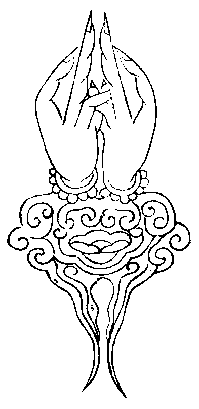
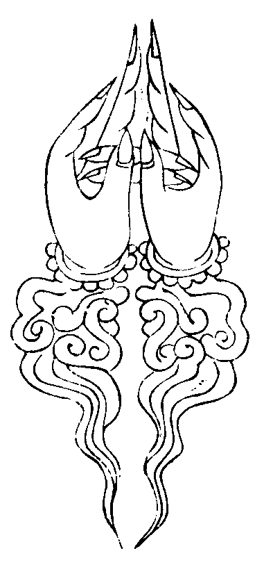
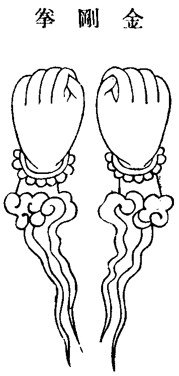
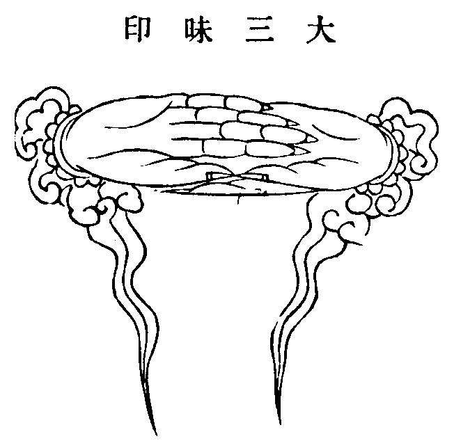

# 准提心要



> **藏经**：卍新纂大日本续藏经（新纂卍续藏）　**册次** 第 59 册（X59）　**编号** X1078　**部类** 密教部　**卷次** 1 卷　**篇幅** 6,904 字

> **卷／品**：0 卷 · 3 品



---



## 目录



  - [No. 1078-A 刻准提心要序](#no-1078-a-刻准提心要序)

  - [宝永己丑七月僧自恣日天台山饭谷沙门(慧昙)　谨序](#宝永己丑七月僧自恣日天台山饭谷沙门慧昙谨序)

  - [准提心要序](#准提心要序)



---



### No. 1078-A 刻准提心要序



一切菩萨之德不可思议，况称七俱胝佛母乎？一切总持之功不可测量，况称陀罗尼之王乎？故念准提王者，速灭四重五逆；持其神呪者，顿生三昧智慧。灭恶生善，其用至矣哉！予师伯长寿香法师，信奉准提，诵持神呪有年矣。一日，视予准提心要一册而谓曰：此之法也，其行简易，其効神速，大有裨於叔世行人者也。请子傍加国训，梓行於世焉，则其利亦岂尠少哉！予闻其言，欣然乃诺。遂为校阅，授之劂生，仍书数字，冠於卷首。



------



### 宝永己丑七月僧自恣日天台山饭谷沙门(慧昙)　谨序



No. 1078  

准提心要



------



### 准提心要序



经言：佛国无诸女人。解之者曰：女人作佛者，皆变成佛相，不复有女人旧相也。而准提王独以佛母名者，何哉？一日，瞻拜之下，忽有思曰：母者，养育之义也，慈爱之称也。葢父师之督责，不能施於有生之初；母氏之劬劳，偏能适其赤子之性。古佛之戒律甚严，父师教诲之道也；准提之接引甚宽，母氏慈祥之德也。何者？古佛欲众生之出世也，必严其防而正告之曰：人生好色者不能成佛，尔之妻子不必有也；人生残忍者不能成佛，尔於有情之肉不必食也；人生迷乱其性者不能成佛，尔於清酒美醴不必染指而沾唇也。其教可谓严矣。於是众生能者从之，不能者去之。准提王虑其从之者少，去之者多也，因立一法以诱之曰：尔能从吾教，吾听尔有妻子也，但勿邪淫足矣；尔能从吾教，吾听尔食肉以果腹也，但一月数斋戒足矣；尔能从吾教，吾听尔取旨酒而少甞之也，但令温克不沉湎焉亦足矣。若尔不吾信，将尔所欲求如官爵、如眷属、如宝珠仙药之难致者，第从吾教而诵吾呪，皆可大慰其怀来。吾教不以饮酒食肉有妻子之故而拒绝於尔也，亦见吾教之宽而可从乎？於是众生之从佛者，闻准提之名而信之向之；即众生之不从佛者，亦闻准提之名而信之向之。所以然者何也？人情畏父师之严，乐母氏之宽。故世尊之法，人畏其难；准提之法，人乐其宽。此佛母之名所由来也欤！虽然，立教者既宽，而奉教者又欲严，必体慈母爱子之心，如临深、如履薄，有善必进、有过必知而改，然后可以立身扬名耳。倘恃母氏之宽而不吾责也，遂肆情欲以自陷於罪戾，虽有圣善之母不能为之地，是可悲也夫！是可畏也夫！奉准提者必作如是观，方有合於准提之旨也。请以是言为序。



天运壬子岁长至日闽中佛弟子施尧挺薰沐拜撰



宝像记



准提佛母宝像，有无量光明相好，身黄白色，结趺跏坐。上衣下裳皆白縠花纹者，体挂璎珞，胸生卍字，绶带系腰，朝霞络身。手腕白螺为钏，臂上七宝为钏，两耳悬宝铛，众指著指环。首戴花冠，冠上化现五如来。面上三目，目色澄清，有下视众生生悲愍意。全身十八手，臂上两手作说法相(或作结准提印)。第二手左执如意幢，右施无畏。第三手左执红莲花，右执劒。第四手左执澡罐(一作灌澡瓶)，右执摩尼数珠(一作执宝鬘)。第五手左执金刚索，右执徵若布罗迦菓(汉言子满菓，此间无，西国有)。第六手左执轮，右执钺斧。第七手左执法螺(一名商佉)，右执钩。第八手左执贤瓶(一名如意瓶)，右执拔折罗(一名金刚杵)。第九手左执般若波罗蜜经，右执宝鬘(一作执数珠)，坐莲花上，花下有二龙王拥护。此宝像大略也。若持诵行者欲想出宝像，应作如是观。不能作如是观者，随意所便谛观一物(十八臂所执法物)，则念虑诚一，杂妄不生，是谓意密。加以诵呪口密，结印身密，是谓三密相应。上根持诵方能有此，久不间断则获福广大，即於此生得进菩提矣。癸丑年九日记。



今世所传宝像十八，臂中法物，彼此互异。尧挺详攷经忏遗文，参酌至当，援笔记之，使后之观想者知所据，即作像者亦知所准云。



集提印法



大三昧印



两手仰掌，展舒右手，压左手两大拇指，以指甲相著，放在脐轮下，澄定身心后，顶上散印。○此印能灭一切狂乱、妄想、杂染、思维。



金刚拳印



大拇指捻无名指根第一节，捻时念唵字，餘四指𮞏握大拇指作拳，𮞏念四吽字，诵呪毕，亦𮞏念五吽字，𮞏开五指散印。○此印能除内外障染，成就一切功德。



准提印



两手无名指并小指相叉於内，右指压左指(左指叠近胸，右指叠在外)，两中指直竖相柱，两头指屈附中指第一节(一云第二节侧)，两大拇指并捻右手无名指中节。屈指时，念九圣梵字。欲有召请时，以二头指去来。诵呪毕，举印顶上，两手散开，各用响声诀，念吽字散之。○此印菩萨即来护持，能消一切业障，积集无量福德，皆得现前，速证无上菩提。



响声诀



大拇指捻中指头肚，头指屈附中指第一节，打响一声，念一吽字。



上来诸印，总要身密。若不晓诸印者，但结金刚拳，亦是身密。更有散持者，凡行住坐卧皆可持，只持唵折隶以下呪文，不必结印，不必记数，不必观想，不必对佛对镜，所谓口诵便是真行，能除烦恼，安乐法身者也。



准提印外式







准提印内式







金刚拳







大三昧印







持诵仪轨



持呪人须立镜坛，取一新镜，未曾用者，镜面向西，行者面向东。每月十五日夜，随力设供养具，结准提印，当心呪镜一百八遍，然后照常持呪。



每日早晚，对镜焚香礼拜已，便观想诸佛菩萨宝像，有无量光明相好，一一现前。念：



南无七俱胝佛母大圣准提王菩萨(三拜或一拜)。



南无准提会上诸佛诸菩萨(一拜)。



南无准提会上护法护呪一切圣众(一拜)。拜竟，诵普供养真言曰：



唵哦哦曩。三婆缚韈。日啰吽。



(口中念普供养真言，手中要结普通吉祥印。其印法，以右手大指与无名指相捻着，餘三指皆放散是也。即以此印印诸器物，自然遍法界皆有无尽香．花．灯．涂．幢幡．珍馐等物供养，以表䖍诚。若无种种香．花等物诸供养具者，止念此呪，结此印，亦成无尽供养具。诵呪毕，顶上散印)跪祝曰：弟子(某甲)奉持神呪，祈求(某事云云)。如意者一拜而起(按：显密圆通，凡有祈求，要先持准提真言五十万遍，或七十万遍，或百万遍，以为先行，然后诵呪祈求，决定成就。若求出世间法者，预前持准提真言五百万遍，或七百万遍，或千万遍，而为先行，然后诵呪，定有灵騐)，乃金刚正坐(以右脚压左脚䏶上，或随人意坐亦得)，手结大三昧印，想自身顶上有梵书raṃ㘕字，此字遍有光明，如明珠，如满月，然后诵呪(有不能想得梵字者，只专心诵呪，亦具一切三昧，餘倣此)。或又想raṃ字变成火轮，烧尽自己有漏之身。复想大莲花上有a阿字，生成无漏智身。更想aṃ暗字灌顶已，又想raṃ㘕字变成大火，烧此有为世界，如同刼火烧尽无遗但有空寂。复想建立无为之坛，於最下方遍想khaṃ欠字杂色而为空轮，於空轮上遍想haṃ含字黑色变成风轮，於风轮上遍想raṃ㘕字赤色变成火轮，於火轮上遍想vaṃ鑁字白色变成水轮，於水轮上遍想a阿字黄色变成金刚地，於金刚地上遍想有大莲花，一一莲花上皆有准提菩萨无量圣众围绕，一一准提前皆有行者自身，一一自身各出无量华．菓．饮食．幢幡等诸供养具而为供养，又皆对准提镜坛三密相应(又行者若无准提像并花菓饮食等供具，但作此观亦得吉祥成就。有不能想火轮灌顶建立无为坛等法者，但依上文想raṃ字顶上如明珠如满月止亦得)。观想毕，捧净水念准提真言二十一遍，上下八方洒之，即成辟除结界(不便洒水者，以手拟水想作洒水状，亦同洒水)。次诵净法界真言二十一遍，左手握金刚拳，右手持念珠(或跪或坐随便)。诵真言曰：



唵　㘕(心想梵字)



次诵护身真言二十一遍。真言曰：



唵　啮𡄦(二合)(𡄦字去声，弹舌呼之，心想梵字。)



次诵六字大明真言一百八遍。真言曰：



唵麼抳钵讷铭(二合)吽(心想梵字光明，又想自身完满洁白徧有光明，心作思维曰：一切众生身中悉得清净不染烦恼)oṃmaṇipadme(二合)hūṃ



诵毕，以金刚拳印额上，次印左肩、右肩，次印心上、㗋上，於顶上散之。印五处时，𮞏念五吽字，散时𮞏开五指，亦𮞏念五吽字。



次诵准提真言：两手结准提印，以准提真言与一字大轮呪一次同诵一百八遍。(若不能结准提印者，如前式左手结金刚拳，右手执念珠持。若结准提印欲记数时，於自身分手指上记，或准提菩萨手臂上记。若忙者，只散持之。或有不乐大轮呪者，只持准提真言亦得。○或不能从普供养净法界等真言次第持诵者，只持准提神呪亦得。更或钝根，只唵字以下持之。)



稽首皈依苏悉帝，头面顶礼七俱胝，我今称赞大准提，惟愿慈悲垂加护。(念一遍)



七俱胝佛母心大准提陀罗尼真言曰：



南无飒哆喃，三藐三菩䭾，俱胝喃，怛你也(二合)他，唵，折隶，主隶，隶提，娑婆(二合)诃，　唵，部林(二合)namosattanāṃsamyaksaṃbuddhākoṭināṃtadya(二合)thāoṃcaleculecondesvā(二合)hā　oṃbhrūṃ(二合)



诵竟，於顶上散准，提手印，或结印，诵得一千八十遍更好。或一百八遍外，但以左手作金刚印，右手掐念珠持。或持三百遍，或五百遍，或七百遍，或千八十遍，或三五千遍，或无数无记，随力以持皆可。但一百八遍外，自唵字以下持之。(初学者，宜全呪持之。或不乐持全呪者，槩从唵字以下持之。或不乐唵字以下持之者，从初至终，已全呪持之。更有息灾法，增益法，敬爱法，降伏法，及出世间法，五种坛法，各有不同，只照前法持之。凡有所求，决定成就。详见显密圆通。○又正持诵时，未满一百八遍，不得共人语话。若欲语话时，舌上想raṃ字，纵有语话，不成间断。)诵毕，仍念完满补阙真言十遍。真言曰：



唵。呼鲁呼鲁。社野穆。契莎诃。



南无七俱胝佛母大圣准提王菩萨(三拜或一拜)。



南无准提会上诸佛诸菩萨(一拜)。



南无准提会上护法护呪一切圣众(一拜)。



拜竟，收镜入囊。上来持诵仪轨竟。



准提呪说



唵。哦哦曩。三婆缚韈。日啰吽。



是普供养真言，加以吉祥印，能令遍法界皆有无尽香．花．灯．涂．幢幡．伞葢、衣服．卧具．楼阁．宫殿．狮子座．音乐．歌舞．种种珍馐等物，遍虗空界而为供养，以表虔诚。若无香花等物诸供养具者，止念此呪，结此印，亦成无尽供养具。(此呪原不属准提，古人恐持准提者乏供养以致敬，故补此呪於前云。)



唵㘕。



是净法界。真言想一raṃ㘕字，能令三业悉皆清净，一切罪障尽得消除。又能成办一切胜事，随所住处悉得清净。衣服不净便成净衣，身不澡浴便当澡浴。若用水作净，不名真净。真言一字变染成净。偈云：啰字色鲜白，空点以严之，如彼髻明珠，置之於顶上。真言同法界，无量众罪除，一切触秽处，当加此字门。○若实外缘不具，但用此㘕字净之。若外缘具者，先水澡浴著新净衣，更用raṃ字净之，即内外俱清净也。



唵，啮𡄦。



是护身真言，能灭五逆十恶一切罪业，能除一切种种病苦、灾障恶梦、邪魅鬼神诸不祥事，而能成办一切胜事，令一切所愿皆得圆满。此呪是诸佛心，若人专心诵一遍，能守护自身，一切鬼神天魔不敢侵近；诵两遍，能守护同伴；诵三遍，能守护一宅中人；诵四遍，能守护一城中人；乃至诵七遍，能守护四天下人。



唵麼抳钵讷铭吽。



是六字大明真言，若诵此呪，随所住处，有无量诸佛菩萨天龙八部集会，又具无量三昧法门。持诵之人，七代种族皆得解脱，腹中诸虫当得菩萨之位。是人日日得具六波罗蜜圆满功德，得无尽辨才清净众聚，口中所出之气触他人身，蒙所触者离诸嗔毒，当得菩萨之位。假若四天下人皆得七地菩萨之位，彼诸菩萨所有功德，与诵六字呪一遍功德等无有异。此呪是观世音菩萨微玅本心，若人书写此六字大明，则同书写八万四千法藏所获功德等无有异。若以金宝造如来像数如微尘，不如书写此六字中一字功德。若人得持诵此六字大明，是人贪嗔痴不能染著。若戴持此呪在身者，亦不染著贪嗔痴病。此戴持人身手所触、眼目所覩一切有情，速得菩萨之位，永不复受生．老．病．死等苦。说此六字大明竟，有七十七俱胝佛一时现前，同声说准提呪，即知此六字大明与准提真言次第相须也。



南无飒哆喃。三藐三菩駄。俱胝喃。怛你也他。唵。折隶主隶。准提娑婆诃。



是准提呪，能灭五逆十恶一切罪障，成就一切白法功德。持此呪者，不问在家出家、饮酒食肉、有妻子、不拣净秽，但志心持诵，能使短命众生增寿无量，迦摩罗疾尚得差除，何况餘病。若不消灭，无有是处。若诵满四十九日，准提菩萨令二圣者，常随其人所有善恶心之所念，皆於耳边一一具报。若有无福无相、求官不遂、贫苦所逼者，常诵此呪，能令现世得轮王福，所求官位必得称遂。若求智慧得大智慧，求男女者便得男女，凡有所求无不称遂，似如意珠一切随心。又诵此呪，能令国王大臣及诸四众生爱敬心，见即欢喜。诵此呪人，水不能溺、火不能烧，毒药怨家、军阵强贼及恶龙猛兽、诸鬼魅等皆不能害。若欲请梵王、帝释、四天王、阎罗天子等，但诵此呪，随请必至不敢前次，所有驱使随心皆得。此呪於南瞻部州有大势力，移须弥山竭大海水，呪乾枯木能生花菓，何况更能依法持诵，不转肉身得大神足往兜率天。若求长生及诸仙药，但依法诵呪，即得见观世音菩萨或金刚手菩萨，授与神仙妙药，随取食之即成仙道，得延寿命齐於日月证菩萨位。若依法诵满一百万遍，便得往诣十方净土，历事诸佛普闻玅法得证菩提。龙树菩萨以偈赞曰：准提功德聚，寂静心常诵，一切诸大难，无能侵是人。天上及人间，受福如佛等，遇此如意珠，定获无等等。



唵部林



是一字大轮呪，亦名末法中一字心呪。此呪於末法时，法欲灭时有大势力，能於世间作大利益，能护如来一切法藏，能降伏一切八部之众，能摧世间一切恶。呪是一切诸佛之顶、文殊菩萨之心，能施一切众生无畏，能与一切众生快乐。凡有修持随意得果，同如意珠能满一切之愿。若诵此呪，於四方面五百驿内，诸恶鬼神皆自驰散，诸恶星曜及诸天魔不敢侵近。若持诵餘一切真言恐不成就，即用此呪共餘真言一处同诵决定成就。若不成就及无现騐，其呪神等即当头破七分。是知此呪能助一切真言疾得成就，或别持此呪亦得。



唵。呼噜呼噜。社野穆。契莎诃。



是圆满补阙真言，所以补诸呪之阙失，而获圆满之全功也。凡持诸真言者，如有手印，不次第存想，不专注诵持，有断续等过，一念此呪，皆有功无罪。故编附於后，以为准提呪一助焉。(此呪原不属准提，自他呪采入，故云编附。)



若能如法诵呪，即有一切善神、龙王、金刚密迹常随卫护，不离其侧，如护眼睛，如护己命。



设有众生於散乱心口持神呪，常有无量金刚藏王菩萨种族眷属，昼夜常随侍卫此人，纵令魔王求其方便终不可得。诸小鬼神去此善人十由旬外，若魔眷属欲来侵扰是善人者，诸金刚众以宝杵碎其首犹如微尘，恒令此人所作如愿(心未开悟自有散乱处，即散乱持呪尚有如是功用也，况不散乱者乎)。



若亡人广造恶业，死堕三涂，真言行者，即称亡人名字，专心诵呪，亡者应时得离恶趣，生於天上。(若亡人未造恶业者，其得呪力生天，更无疑也。凡仁孝慈悲之士，更当留意於此。)



依餘门成佛，如乘羊马行千里程经久方到；依陀罗尼门成佛，如乘神通行千里程举意便到。所至处虽无异，所乘法有迟疾也。



持诵呪者，一切所求皆得果遂，惟除於呪生疑(不深信者，其持呪必无騐，勿讶呪之罔功也)。



以上说呪功用。



每日持诵，须要定其时分。若一时持定早晨，二时持加黄昏，三昧持加正午。若务忙者，不拘时分，有暇则持。(若日间有事者，从夜间持之。若奔走不给者，凡应事接物，皆散持之。○散持，谓不结印，不记数，不对镜，不观想。)



持诵有五种，随根所乐：一、瑜伽持，想自心如一月轮，湛然清净，内外分明，以九圣梵字布心月中，oṃ唵字居中，ca折le隶cu主le隶co准nda提svā娑婆hā诃字，从前右旋，次第周布轮缘(去声)，终而复始。二、出入息持，谓出入息中想有九圣梵字，息出字出，息入字入，字字朗然，如贯明珠，不得间断。三、金刚持，唇齿不动，舌不至㗁，但口中微动。四、微声持，但令自耳闻之，不缓不急，字字须得分明称之。五、高声持，令他闻之，亦得灭罪。



复有二种持诵：一、无数持，谓不持珠，定数常无间断。二、有数持，谓掐数珠，每日须限定其数，不得阙少。(倘有要事阻碍，阙少其数，事已必须补还。或限数简易，不过三五百，或一二百，每日宁过其数，不至阙少亦得。)



上根持须得三密相应：一、身密结印；二、语密诵呪；三、意密。或想真言梵字，或缘持诵之声，或想准提菩萨，或想菩萨手中所执杵瓶花菓等物。若用三密为门，不须经历劫数具修诸行，只於此生足满诸波罗蜜。



行者不须苦节劳形，恐心神散乱。於行住坐卧四威仪中，皆得三密修习。於见闻觉知，惟观a阿字，要在勤䇿身心，不令懈怠。欲近成就时，必有种种障起，应作息灾降伏等法。随行者性根差别，於其中间，必获三昧现前。即於定中，见无数佛会，闻玅法音，证得十地菩萨之位。



若人紧切持诵时，或逢种种魔障，或忽然怕怖，或舌难持诵，或身心不安，或多嗔多睡，或见诸异相，或於呪反生疑心，不欲持诵等(云云)。若对治者，应观梵书ra啰字，或观raṃ㘕字，或观a阿字等。但随观一字，彼境界自然消灭。若分别心多，当观ṣa洒字，即成无分别。若著有心多，应观haṃ含字，即因缘法本空也。○此上且约一途而说。若实言之，随一字一切处，皆得用之。谓一字实具一切字一切功用，是一切佛菩萨也。



真言，行者用功持诵。或梦见诸佛菩萨圣僧天女，或梦见自身腾空自在，或渡大海，或浮江河，或上楼台高树，或登白山，或乘狮子白马白象，或梦见好花菓，或梦见著黄衣白衣沙门，或吃白物吐黑物，或吞日月等，即是无始罪灭之相。或正持呪时见诸𤳖光明，或见空中遍地奇特之花，或见诸佛菩萨圣僧天仙等，或见诸佛净土，或自游佛国亲承供养，或见灯光高一二尺乃至一丈，或无火炉中自有烟起，或见佛像幡葢自动，或闻诸佛菩萨种种美声，或觉自身巍巍高大，或齿落重生，或发白返黑，或身润白不生蚤虱，或贪嗔痴心自然消灭，或总持不忘一字能演多义，或智慧顿生自然通晓一切经律论，或一切三昧法门自然现前，或福德顿高四众归仰等(云云)。若逢如上之事，但见福慧增长近成就相，莫生疑惑之心，勿起取舍之念。应观所逢境界，皆是a阿字或raṃ㘕字等，或想皆如梦幻，或想皆是法界一心。若得逢如是应騐，更须䇿发三业加功持诵，不得宣说呪中境界衒买与人。惟同道者不为名利敬赞，方得说之。○此上所说正持呪时见诸𤳖光明等事，皆是经文。今有闲僧儒士泛参禅理者，阙见相以为妖异。此则非但毁谤最上乘教，亦是舍相取性之邪见也。不知其相本来自性耳。



以上说持呪工夫。



呪为如来密教，惟佛与佛，不言而喻。即因位菩萨，亦不能知其微旨也。况(挺)世间凡夫，又何能取而说之也。然呪不可说，而呪之功用，与持呪之功夫，则可说也。苟能从功夫而获功用，精进不已，亦将超因位菩萨而上之。则凡不可说者，而皆为可说者矣。



佛弟子施(尧挺)谨述。



此呪文所在，必有天龙八部拥护，最为灵应。即不能持诵者，亦当虔心奉祀，与家中佛神供养一处，获福无量。切不可混置亵慢，自取罪过。敬之敬之。



福省南台后洲准提堂藏板

