# 瑜伽燄口注集纂要仪轨



> **藏经**：卍新纂大日本续藏经（新纂卍续藏）　**册次** 第 59 册（X59）　**编号** X1084　**部类** 密教部　**卷次** 2 卷　**篇幅** 19,858 字

> **卷／品**：0 卷 · 1 品



---



## 目录



  - [No. 1084-A 纂要序](#no-1084-a-纂要序)



---



### No. 1084-A 纂要序



阅大藏作陀罗尼法，须得五智灌顶，绍阿阇黎位，方可传授。若不尔者，自招殃咎。此世尊授阿难之密嘱耳。相传既久，法臣成弊。后莲大师去华就实，稽古考定，时流奇好，痛口诃责。今观巨澈上座之纂要，深得先哲之训，以正季世之讹。可谓洞开古詻，枝蔓剪除，功补缁门，饶益有情者也。



岁在乙卯重阳前五日桃村无隐千峰立书



No. 1084-1 瑜伽𦦨口仪轨六则



苕水(子若观内衡铨)仝攷正



瑜伽密教



释迦说灋，有显有密。显通大小，密唯大乘。瑜伽本经，都十万偈，有十八会。除十八会，餘经属显。今大藏中，佛说救拔𦦨口饿鬼陀罗尼经，是不空译。佛说救面然饿鬼陀罗尼神呪经，实叉难陀译。一经二译，俱唯有变食真言，此经自属显教。不空又译出瑜伽集要救阿难陀罗尼𦦨口仪轨经，复用密部大悲空智仪轨经云：瑜伽即相应义，谓一切乘境行果所有诸法，皆相应也。其密教相，如显密圆通中说。施食缘起，如本经说。



坛仪



一切如来真实摄经说大曼茶啰有五部：初佛部，毗卢遮那佛为部主；次金刚部，阿閦佛为部主；次宝部，宝生佛为部主；次莲华部，阿弥陀佛为部主；次羯磨部，不空成就佛为部主。又五部各有四大品：一、金刚界，二、降三世，三、徧调伏，四、一切义成就。又四品中各建立六曼茶啰，所谓大曼茶啰、三昧耶曼茶啰、法曼茶啰、羯磨曼茶啰、四印曼茶啰、一印曼茶啰。今本坛仪于五部中属莲华部，于四大品徧是调伏。千手千眼观自在菩萨念诵仪轨明四种坛法，所谓息灾、增益、敬爱、降伏，今是增益出世悉地。梵语曼茶啰，或云曼荼啰等，有翻即坛义。准千手眼仪轨中结才发意转法轮菩萨印云：以印置身前空中，即满虗空界成大曼茶啰；以印安于心上，即自身成大曼茶啰等。则知曼茶啰非止是坛义，后当再明。而本经仪轨名三昧耶坛者，即与弟子及鬼神授戒坛也。般若理趣释中，梵语三昧耶含四义。第四义云：三昧耶亦为曼茶啰之异名。故六曼茶啰中，第二名三昧耶、曼茶啰，其名义一也。金刚顶瑜伽略出念诵法，有画像坛、手印坛，此用手印坛也。手印坛亦名随心坛，随心变现。故千手眼观自在菩萨十肘曼茶啰法门云：以曾入大会三曼拏啰金刚大道场者，不须作曼拏啰，唯结印诵呪，无愿不果。大毗卢遮那成佛神变经本尊三昧品云：诸尊有三种身，所谓字、印、形相。其画像法，必须作曼拏啰如法。故藏本集施食仪人，虑末世不能建画像曼拏啰，亦恐不得金刚阿阇黎，故权用大轮明王呪印与转法轮呪印起首，深为有理，宜可准行。又曼拏疏云：夫为道者，析运为宗。上若不供诸佛菩萨，何处展智欲求菩提？下若不济诸仙饿鬼，何处行悲以度萨埵？有信之流，无遗斯业。今本印现坛仪以前，是上供求菩提；启告以后，是下济度萨埵。



阿阇黎



(国师金刚智，乃西域人，亲传龙智阿阇黎法。唐开元七年来支那，所至结坛作灌顶道场，即此土阿阇黎之始祖也。)



准瑜伽大教王经，乃是十地灌顶位菩萨，其次或是解行地菩萨。故最上大乘金刚大教宝王经，称为金刚阿阇黎。𦦨口仪轨经云：若乐修行者，应从瑜伽阿阇黎学，发无上大菩提心，受三昧耶戒，入大曼拏啰，得灌顶者，然许受之。受大毗卢遮那如来五智灌顶，绍阿阇黎位，方可传教也。若不尔者，递相不许。设尔修行，自招殃咎，成盗法罪，终无功效。佛说持明藏仪轨经云：行人若欲修习诸成就法者，先须修习观智及诸印相，皆令精熟，毋使谬误。于作法时，若稍疑误，不成印契，即贤圣不喜，凡所祈求，不获成就。



观菩提心



守护国界主陀罗尼经云：谓观此身体成金刚，坚固不坏，当以身作金刚结跏，以坚牢智谛观自心以为月轮，当于鼻端不令驰散，清净圆满，色如凝雪、牛乳、水精，而此月轮为菩提心。此菩提心本无色相，为未成就诸众生故，说如月轮。妙法莲华经王仪轨云：推求自心乃至不可得，则能悟入人空智、法空智，即于此无所得心观于圆明，净无尘翳，如秋满月炳现于身，仰于心王，则此是本源清净大圆镜智。佛说瑜伽大教王经观想菩提心大智品：佛言：此菩提心即是身相，身相性空即真菩提，身既无别，语相亦然。毗卢遮那仪轨云：先证一道清净，次证菩提心。菩提心释云：菩提心离一切性，非五蕴。乃至自既觉悟菩提心，如实观己，然后发大悲心，令诸众生于自心法如实证觉，如是名为一切根本最上菩提心。



字种



阿阇黎观想三十七尊字种，具如佛说瑜伽大教王经。佛说一切如来真实摄现证三昧经调伏一切世间大曼拏啰仪轨云：尔时大毗遮那如来，即入一切如来金刚法三昧，出生加持莲花三摩地。说此一切如来法三昧，即一切如来心从自心出，说是心明曰𠶹哩。说是心明时，从一切如来心出现莲花相，有无数色殊妙光明，其光旋复从圣观自在菩萨摩诃萨心入𠶹哩字，具四字义，成一字真言。如密呪圆因集说十八会指归云：于月轮上有旋列真言字住心，于一一字实相理相应用而复始。



手印



准金刚顶略出念诵法，右手配止，左手配观，十指配度。右手施、戒、忍、进、禅，左手慧、方、愿、力、智。盖西域当阳向东，以右尊左卑故也。如意轮莲华心仪轨亦同。瑜伽大教王经云：尔时大徧照如来即释迦佛变相，告金刚手菩萨言：三金刚大智所生秘密印相法，若持诵者，依法结印，能灭一切罪业，复能观想真理，即得证于无上菩提，何况别求成就之事。乃至依此菩提心想为月轮，於月轮上想有唵字为身金刚，次想啊字成语金刚，吽字成心金刚。故凡结印，先当想此三梵书字。今手印图上皆有唵、啊、吽三梵书者，即是用经义也。又云：一切印从金刚掌、金刚拳、金刚缚生起。



旹康熈十四年岁在乙卯孟秋自恣前三日，净业比丘寂暹巨彻氏熏沐敬书於楞严般若堂。



瑜伽𦦨口仪轨(终)



夫欲徧供普济者，䖍恳至诚，严洁坛场，随力备办香花，供养饮食净水等，已准戌亥二时施之。饿鬼得食，施主获福。如过其时，徒废精神，於事无益。斯出本教，亦非胸见。今有违者，地方不宁，即此过也。若欲深明所以，请观后注，文备彰矣。



No. 1084-2  

瑜伽𦦨口注集纂要仪轨卷上



苕水法师　子若净观　攷正



偁山法师　内衡智铨　较阅



秀州后学　巨彻寂暹　纂书



> 大宝华王座，人天普护持，我今登演处。  

> 触目即菩提。



吉祥会启，甘露门开，孤魂佛子降临来。闻法赴香斋逈脱，轮回幽暗一时开。



∴云来集



此香不从天降，岂属地生。两仪未判之先，根源充塞三界。一气才分之后，枝叶徧满十方。超日月之光华，夺山川之秀丽。即戒即定即慧，非木非火非烟。收来在一微尘，散处普熏法界。𦶟向罏中，耑伸供养。常住三宝，刹海万灵。历代祖师，一切圣众。河沙品类，幽显圣凡。悉仗真香，普同供养。



∴香云盖



> 佛面犹如净满月，亦如千日放光明，  

> 圆光普照于十方，喜舍慈悲皆具足。



南无尽虗空徧法界过现未来佛法僧三宝。



∴登宝座



伏以登瑜伽显密之座，六度齐修。开济物利生之门，三檀等施。一心湛寂，全身总是大悲王。三业应兮，脱体俱成𠶹哩hrīḥ字。果然如是，则是因是果，不出自心。自利利他，岂关餘物。化滴水作长河之酥酪，变微食为大地之斛食。于倏忽际，普济法界之饥虗。在顷刻间，利益河沙之鬼趣。若也如斯会得，须当普利群机。其或未然，不免重宣妙偈。所谓道：



> 尘尘刹，尽圆融，万别千差一贯通。  

> 拈起珊瑚枝上月，光辉烱烱照无穷。



南无大悲观世音菩萨(众和毕，上师祝水文)。



夫此水者，八功德水自天真，先洗众生业垢尘，徧入毗卢华藏界，个中无处不超沦。水不洗水，玅极法身；尘不染尘，返作自己。蠲除器界，荡涤坛场，洒枯木而再逢春，洁秽邦而成净土。所谓道：内外中间无浊秽，圣凡幽显总清凉。教有密言，今当持诵。(大众同声诵大悲神呪毕，表白举)



∴甘露王



(三遍。　侍者白：云何梵？)



> 云何于此经，究竟到彼岸？愿佛开微密。  

> 广为众生说。



∴净法界真言



(诵真言时调伏身心，想顶脐两处具唵㘕二字，令清净故，以表福智圆满。)



唵囕oṃraṃ莎诃



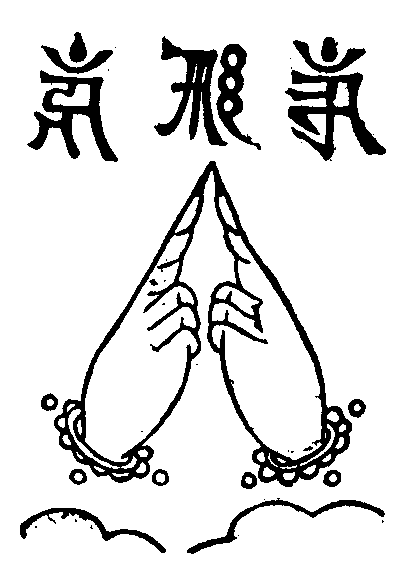



(成就妙法莲华经王瑜伽观智仪轨云：应结法界生印，二手各作金刚拳，舒二头指侧相拄即成，安印於顶，于其印中想法界种子raṃ𫬠字，其色皓白徧流光明，普照一切有情界，能破一切有情虗妄烦恼，当观自身及诸有情同一法界无二无别。大毗卢遮那成佛神变加持经第二卷中法界真言曰：㘕。瑜伽莲花部念诵法云：当观顶上有法界生字，放赤色光，所谓㘕字。显密圆通云：此梵书㘕字，若想若诵能令三业悉皆清净，一切罪障尽得消除，又能成办一切胜事，随所住处悉得清净，衣服不净便成净衣，身不澡浴便当澡浴，若用水作净不名真净，用此法界心㘕字净之，即名毕竟清净，譬如灵丹一粒点铁成金，真言一字变染成净。又大毗卢遮那成佛神变加持经第四卷中有净法界真言曰：南无三曼多勃駄南达麼䭾睹萨嚩婆嚩句痕。大悲空智仪轨经云：佛说一切真言句首当安唵字，次安吽癹咤字，后用莎贺字。若真言初以唵字，后加莎诃字，寂灾用；初以唵字，后加𤙖癹字，摄召用；初后纳麼，增益用；初后𤙖癹，降伏用)。



∴点净真言



(诵真言时，用右手无名指揾取香水，弹洒虗空并涂掌，想坛场内外悉令清净)。



唵。哑穆葛。拶啰弥。麻迎。苏噜苏噜。莎诃。



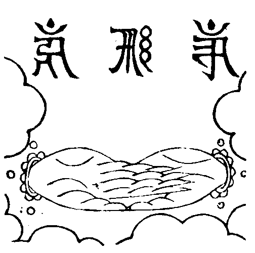



(此真言名出不空罥索经，用右手无名指揾取白檀香水，涂二手掌。甘露军茶利仪轨云：修瑜伽者不应执著外净，当以胜义自性清净法水洗涤身心，如理相应。守护国界主陀罗尼经云：金刚结跏端身正坐，左手仰掌当于脐上，右手仰掌重左手上，以大拇指令头相拄。此印名为第一最胜三昧之印，能灭狂乱一切妄念，令心一境澄定身心，方入法界三昧。)



∴加持花米真言



(诵真言时，以手拈花米三次，想成光明，种出生金银碧玉珍宝之云。)



唵，斡资啰(二合)𠽾弥，哑，吽。



(持明藏仪轨经云：用稻谷花徧散其上。虗空藏菩萨问七佛陀罗尼经云：以三指撮米花而呪之。此即花米之因也。将欲应用表显诸法，故加持之。)



∴加持铃杵真言



(诵真言时，手拈花米洒在铃杵上，想成智慧种。)



唵，斡资啰(二合)，萨答哑，吽。



唵，斡资啰(二合)看咤，哑，吽。



(金刚顶莲花部心仪轨云：次结振铃印，右杵左振铃，心入声解脱，观照般若理。仁王护国般若波罗蜜多经道场念诵仪轨云：东方金刚手菩萨，手执金刚杵，表起正智犹如金刚，能断我法微细障故。北方金刚药义菩萨，手持金刚铃，铃音振击，觉悟有情，以表般若警群迷故。诸部要目引经云：不持金刚杵，无由得成就。金刚杵者，菩提心义，能坏断二边契中道。)



唵(一)(引)，哑(二)(引)，吽(三)(引)。



(大教王经云：唵字是大徧照如来，啊字是无量寿如来，吽字是阿閦如来。佛说大悲空智大教王仪轨云：唵哑吽三字，名加持真言。成佛仪轨云：由诵此唵字，加持威力故，纵观想不成，于诸佛海会。诸供养云海，真实真成就，由诸佛诚谛，法尔所成故。由适诵啊字，摧灭诸罪障，获诸悦意乐，等同一切佛。超胜诸魔罗，不能为障碍，应受诸世间，广大之供养。由吽字加持，虎狼诸毒虫，恶心人非人，尽无能陵屈。如来初成佛，于菩提树下，以此印密言，摧坏天魔众。分一二三并引字，准密呪圆因集。)



降魔偈



(持杵振铃诵。)



> 我今振铃杵，声徧十方处，礼请诸圣贤，  

> 悉皆来赴会。



> ∴此乃一切诸如来，手中执持金刚杵，  

> 金刚佛母大勇识，我亦恒常而执持。



> ∴愿灭有情大愚痴，唵贺啰贺啰吽(三遍)。  

> ∴左手执持微妙七宝铎，洪音振动十方及三际。  

> 梵音嘹喨惊觉魔冤心，摧碎邪妖魍魉诸鬼魅。



> ∴右手执持金刚降魔杵，威势力重八万四千觔。  

> 摧坏天与非天魔眷属，普使回光返照而渴仰。



> ∴内外冤魔三毒四害等，呪咀魇祷波旬及外道。  

> 三尖火轮遣魔变空力，能使颠倒梦想皆远离。



> ∴四方八面忿怒诸天魔，闻我作法谛听而信受。  

> 唧𫩔叭怛秘密妙伽陀，弹指扫荡𠒋恶及祸祟。



十二因缘呪



唵，耶，答儿麻(二合)兮，都不啰(二合)巴，斡兮敦的山，答塔葛答歇，斡怛的山，拶约尼噜怛耶，𠳐叭谛，麻曷释啰(二合)麻纳耶，莎诃。



(密呪圆因徃生集中，准经翻译，即为颂曰：诸法从缘起，如来说是因，彼法因缘尽，是大沙门说。此呪两用，今始开坛，是缘起义。)



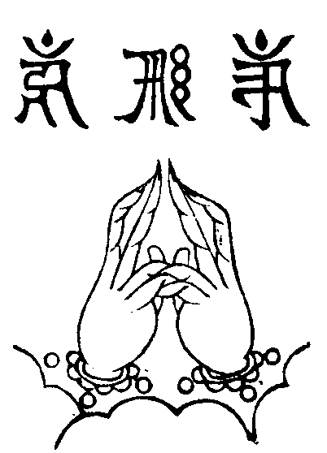



加持灌顶真言



唵，斡资啰(二合)，毗卢拶耶，吽。



> ∴稽首皈依苏悉帝，头面顶礼七俱胝。  

> 我今称赞大准提，惟愿慈悲垂加护。



南无萨哆喃，三藐三菩陀，俱胝喃，怛姪他，唵，折[棣-木+(上/矢)]主[棣-木+(上/矢)]准提，莎诃。



我及法界一切有情，从今为始乃至未证菩提之间，誓愿皈依金刚上师三宝。



∴上师三宝真言



(手持花米，上举而诵。)



捺谟孤噜(二合)毗耶(二合)　捺谟勃塔耶。



捺谟达而麻耶？　捺谟桑渴耶？



唵哩哩哈哈吽吽癹怛



唵。失哩麻。哈歌罗。哈哈吽吽。癹怛莎诃。



唵(一)(引)哑(二)(引)吽(三)(引)(将手持的花米散洒虗空，想所落宝米悉成花香诸供养等云)



(准瑜伽大教王经，上师即金刚阿阇黎，经云此阿阇黎即是我等诸佛父母，及为我等诸佛之师云云。此金刚阿阇黎即金刚手秘密主，亦即毗卢遮那，故为释迦等师。毗卢遮那及四如来即佛宝，金刚一乘甚深教即法宝，金刚菩萨等即僧宝。此上师三宝属受用土，报身佛等非变化土，释迦佛等即中围佛会也。总持教中说三十七尊皆是毗卢一佛所现，谓毗卢遮那如来内心证自受用，成于五智，从四智流出四如来，大圆镜智流出东方，阿閦如来平等性智流出南方，宝生如来妙观察智流出西方，无量寿如来成所作智流出北方，不空成就如来法界清净智即自当毗卢遮那如来。言三十七者，五方如来各有四大菩萨在于左右。中央毗卢遮那如来四菩萨者，一金刚波罗蜜菩萨、二宝波罗蜜菩萨、三法波罗蜜菩萨、四羯磨波罗蜜菩萨。东方阿閦如来四菩萨者，一金刚萨埵菩萨、二金刚王菩萨、三金刚爱菩萨、四金刚善哉菩萨。南方宝生如来四菩萨者，一金刚宝、二金刚威光、三金刚幢、四金刚笑。西方无量寿如来四菩萨者，一金刚法、二金刚剑、三金刚因、四金刚利。北方不空成就如来四菩萨者，一金刚业、二金刚法、三金刚药义、四金刚拳。已有二十五及四摄八供养，故成三十七。言四摄者，即钩索锁铃。八供养者，即烧散灯涂花缦歌舞。皆上有金刚下有菩萨，然此三十七尊各有种子，皆是本师智用流出)。



自性偈



> ∴方便自性不坏体，金刚不坏大勇识，  

> 最胜无比超出相，今此所作皆成就。  

> ∴胜慧自性甚深性，演说最上法轮音，  

> 以无生现方便身，今此所作愿得成。



(净印法门经云：佛言：以我自性即菩提场自性，而菩提场自性即一切众生自性，彼一切众生自性即一切法自性。大智度论云：如金刚山从上穿下，至金刚际自性便止，一切金刚皆金刚轮而为自性。又金刚座亦从金刚际自性而起。佛说大悲空智仪轨经云：佛告金刚藏菩萨：空智者，谓大悲空智。金刚者，体即胜惠，以胜惠方便成就仪轨，乃至生住因缘以识智成办。又云：以智慧方便自性出生诸法。又云：金刚渴椿誐杖者，表智慧相。奎楼鼓者，即善方便。)



净地偈



> ∴：一切方隅所有地，瓦砾砂碛等皆无。  

> 瑠璃宝地平如掌，柔软微玅愿安住，  

> ∴犹如极乐国庄严，妙宝为地众花敷，  

> 园林池沼无缺少，以大法音愿具足。  

> ∴从出世间复能现，种种七宝之所成，  

> 无量光明徧照处，诸佛菩萨愿安住。



(此中虽属手印坛，然作法一准画像曼拏啰，故须念净地偈。寻诸部建坛仪则，如此渴义。)



音乐呪



唵，斡资啰(二合)看支夷，啰纳(二合)啰纳(二合)不啰(二合)啰纳，不啰(二合)啰纳，三不啰(二合)啰纳，三不啰(二合)啰纳，萨哩斡(二合)勃塔赤的啰(二合)不啰，拶哩答麻曷不啰(二合)尼牙(二合)巴啰，蔑答那达速巴微，萨哩斡(二合)塔哩麻(二合)𠶹哩(二合)达耶，伞多沙纳葛哩，吽，吽，癹咤，莎诃



(此呪三用。今初，皈依三宝，将欲启坛而念，故缺和和哑龛。)



缘起文



切以法不孤起，仗境方生。道不虗行，遇缘即应。今则罗列华坛，阐扬佛事。香焚宝篆，腾五色之云霞。烛绽金莲，灿一天之星斗。法乐奏无生之曲，梵音演最上之宗。归依五眼六通，迎请千贤万圣。由是觉王住世，以法利生。不有因缘，无由垂范。是以阿难尊者，林间习定，夜是鬼王。口吐火𦦨，顶发烟生。身形丑恶，肢节如破车之声。讥火交然，烟喉似针锋之细。见斯恠异，问是何名。答曰：面然。汝三日之中，当堕我类。阿难惊怖，归投大觉慈尊，叙说前因，启请救苦之法。佛垂方便，利济洪深。使延年而益筭，诵威德之真诠。令饿鬼以充资，施甘露之法食。加持必专于神呪，严卫须假於坛仪。虽然启请一时，法传千古。金山修建，不烛自明。摩伽斛食，施周法界。若无灵騐，今古焉传。有是功勋，方堪演说。梵音演处，上穷有顶之天。唐韵宣时，下极风轮之际。欲明圣理，故白斯文。佛事完成，同归真际。所谓道



> 最胜光明自在王，如来宣演妙难量，  

> 昔因庆喜生惶怖，𦦨口雷音报祸殃。  

> 稽首慇懃白教主，兴慈济物利生方。  

> 如今稽古重拈出，凡圣同游解脱场。



唵，斡资啰(二合)麻明，哑，吽。



(用右手无名指点取香水，弹洒曼丹。此曼丹作法成后，即名曼拏啰。洒水诵呪，亦加持义。)



唵，斡资啰(二合)，乌怛葛，哑吽。



(仍用右手无名指点取香水，于曼丹上右旋作一圆相。佛说大教王经明画像坛仪云：时阿阎黎于曼拏啰地中间，以涂香作圆相𭦟拏啰。今手印坛亦准经义，故以香水于曼丹上作此圆相，表曼拏啰也。佛说秘密相经云：当念诵时，应观心月曼拏啰相。则知作此圆相有二义：一则以事显法，二乃观想唯心曼拏啰也。般若波罗密多理趣释云：以事显于理故，即事即理，理事不相碍故。)



(就念真言一遍，作圆相一匝，次加持花米成光明种，如用之时，悉成如意珍宝供具。)



唵，斡资啰(二合)𠽾弥，哑，吽。



(念真言时，手持花米右旋，洒散曼丹，如空注雨。)



轮围山　铁围山



唵，斡资啰(二合)哩，契哑，吽。



(佛说金刚手菩萨降伏一切部多大教王经云：告大部多主无能胜言：所有四大洲界阎浮提内一切众生，作法诵持，悉令成就。今此亦用四洲为限，是故加持，唱此二山为地界。)



金刚地胜，金刚地基，吽hūṃ字而作拥护。(佛说大教王经云：复想曼拏啰地即成金刚地，徧满炽盛。时阿阇黎即称己名，同诵吽字。大乐金刚不空理趣释下卷云：hūṃ字者，是因义，即一切如来菩提心，亦是一切如来不共真如妙体，恒沙功德皆从此生。)



> 诵一真言，拈一花米。  

> 排列须弥，等位如图。



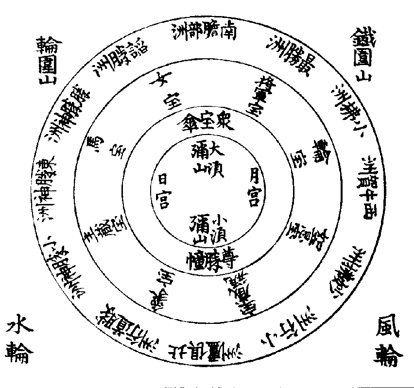



> 南北东西四部洲，百千刹土亦能酬。  

> 须弥顶上安宫殿，大地孤魂脱苦坵。



唵，唅弥啰，微捺麻(大须弥山)。



唵，唅斯克彻(二合)麻弥啰，微捺麻(小须弥山)。



唵，岩晡儿斡(二合)微的葛耶捺麻(东胜神洲)。



唵，岩的葛耶捺麻(小胜神洲)。



唵，岩微的葛耶捺麻(胜胜神洲)。



唵囕咱晡的癹耶捺麻(南赡部洲)



唵囕沙茶耶捺麻(谄胜洲)



唵，囕，乌答啰，曼的哩(二合)尼耶捺麻(最胜洲)。



唵，㘕，哑咓啰，孤答(二合)尼耶捺麻(西牛贺洲)。



唵，㘕，拶(二合)麻啰耶捺麻(小拂洲)。



唵，㘕，斡啰拶(二合)麻啰耶捺麻(妙拂洲)。



唵，鑁，乌答啰，孤啰，尼捺麻(北俱卢州)。



唵，鑁，孤啰，微捺麻(小行洲)。



∴，唵，鑁，葛啰斡(二合)耶捺麻(胜道行洲)。



唵，岩葛拶啰的捺(二合)耶捺麻(象宝)。



唵囕𠽾噜沙啰唽的捺(二合)耶捺麻(主藏宝)



唵，囕，斡节啰的捺(二合)耶捺麻(马宝)



唵，鑁，斯的哩(二合)啰的捺(二合)耶捺麻(女宝)。



唵，岩葛咤葛(二合)啰的捺(二合)耶捺麻(将军宝)。



唵，囕咤吃啰(二合)啰的捺(二合)耶捺麻(轮宝)



唵囕麻尼啰的捺(二合)耶捺麻(如意宝)



∴唵鑁麻曷聂塔捺耶捺麻(宝藏瓶)。



唵，哑斯哩(二合)牙耶捺麻(日宫)。



唵㘕拶的啰耶捺麻(月宫)。



唵，哑，吽，捺麻(众宝伞)。



∴，唵，萨哩斡(二合)啰的尼(二合)毗药捺麻(尊胜幢)。



唵，室哩(二合)，麻忒(二合)，斡资啰(二合)，孤噜拶啰，捺葛麻辣耶，三藐克答捺哑，斡癹萨拏葛啰(二合)耶，吽，捺麻



(大须弥，即四宝山。小须弥，即七金山。象宝等，即佛说大乘庄严宝王经。金轮七宝经云：七宝现时，其地悉皆变成金色。宝藏缾，与七俱胝佛母所说准提经七宝贤瓶义同。众宝伞，即妙吉祥大教王经五伞之一。尊胜幢，是高显摧邪义。一字金轮王佛顶要略念诵法云：想曼拏啰中有香水大海，于海中心有妙高山，七重金光周匝围绕。于妙高顶上有八叶白色莲花，於一一叶上右旋布列轮王七宝。一切如来大秘密王未曾有最上微妙大曼拏啰经云：观想四宝金刚山上有吽字，名徧现最上大金刚宝峰。其上有大宝殿，以金刚宝柱等庄严。而彼殿中有莲花宝色，如来於中而住，此名三昧曼拏啰。则知此中亦应观想妙高峰顶有大宝殿，上师三宝于中安住。甘露军茶利仪轨云：诵密语时，思惟从印流出种种供养云海、天妙伎乐、歌舞嬉戏、衣服、饮食、灯明、阏伽、贤缾、劫树、宝幢、旛盖诸宝等，一切人天所有受用之物。故云。)



人天所有，种种供物，



(金刚顶莲花部心念诵仪轨，明有七种：一、花，二、烧香，三、涂香，四、灯明，五、宝，六、嬉戏，七、衣服资具。俱言：人天所有种种等，皆为供养佛而作事业，故我今当奉献。)



奉献呪



唵，萨哩斡(二合)答塔葛达啰的捺麻曷曼答啰(二合)布拶弥渴萨谟的啰(二合)斯癹啰纳三麻耶哑吽。



(金刚顶念诵注云：三麻耶，此呼供养初名。)



唵，萨哩斡(二合)答塔葛达，萨叭哩咓啰(哑哩千巴　丹)巴啰(二合)谛拶耶，莎诃



(一切如来大秘密王经云：复次金刚手！如是作曼拏啰已，其阿阇黎当须至心奉献花缦璎珞乃至妙香阏伽等七俱胝。佛母所说准提经有阏伽印呪，须者寻之。)



五供养



唵，萨哩斡(二合)答塔葛达，萨叭哩咓啰



唵，斡资啰(二合)，不思必，哑，吽。



唵，斡资啰(二合)，舍不荅，布拶弥，渴萨谟的啰(二合)，斯癹啰



纳三麻耶哑吽。



(五字陀罗尼颂云：次以散花印，庄严诸世界，金刚缚上散，花网徧虗空。)



(唵，嚩日啰，补瑟闭)。



唵，萨哩斡(二合)答塔葛达，萨叭哩咓啰



唵，斡资啰(二合)度必哑吽



唵，斡资啰(二合)，舍不答，布拶弥，渴萨谟的啰(二合)，斯癹啰纳，三麻耶，哑，吽。



(次以焚香印，普熏诸世界，金刚缚下散，徧法界香云。)



(唵，嚩日啰，度闭)。



唵，萨哩斡(二合)答塔葛达，萨叭哩咓啰



唵，斡资啰(二合)，哑噜吉，哑吽。



唵，斡资啰(二合)，舍不答，布拶弥，渴萨谟的啰(二合)，斯癹啰纳，三麻耶，哑，吽。



(次献智灯印，普燎诸幽冥，禅智前相逼，普此智慧光。)



(唵，嚩日啰鲁计)。



唵，萨哩斡(二合)答塔葛达，萨叭哩咓啰



唵，斡资啰(二合)干底，哑，吽。



唵，斡资啰(二合)，舍不答，布拶弥，渴萨谟的啰(二合)，斯癹啰纳，三麻耶，哑，吽。



(次献涂香印，当胷涂香势，以解脱香云，普净众生界。)



(唵，嚩日啰，𪩘提)。



唵，萨哩斡(二合)答塔葛达，萨叭哩咓啰



唵，斡资啰(二合)你微的哑吽



唵，斡资啰(二合)，舍不答，布拶弥，渴萨谟的啰(二合)，斯癹啰纳，三麻耶，哑，吽。



(大悲空智仪轨云)。



(唵，嚩日啰，廼尾你，阿吽)



(其印准知)。



音乐呪



唵，斡资啰(二合)看支夷，啰纳(二合)啰纳(二合)不啰(二合)啰纳，不啰(二合)啰纳，三不啰(二合)啰纳，三不啰(二合)啰纳，萨哩斡(二合)孛塔赤的啰(二合)不啰，拶哩答麻曷不啰(二合)尼牙(二合)巴啰，蔑答那达速巴微，萨哩斡(二合)塔哩麻(二合)𠶹哩(二合)达耶，伞多沙纳葛哩，吽，吽，和和，哑龛，沙诃。



(念呪将毕，手持铃杵，于曼丹上紧摇一遍，置铃于案。次摄授宝错，左手持于宝错，右手结三尖印，遣魔徧空。於空性中，自心月轮上，想成黄色得浪。(二合)tra字中放光，利益一切有情，光回得浪。(二合)tra字，一念变成黄色宝生。佛手结施印为一不二境，一念变成宝错，如用之时而令错之也。)



(瑜伽大教王经云：以香花灯涂等殊妙供养，复用微妙音乐及吉祥偈赞，故有和和哑龛。)



宝错真言



(念真言时，想宝错内出生无尽诸天，如意珍宝而奉献之。)



唵，斯嘛啰(二合)斯嘛啰(二合)密嘛，曩斯葛啰，摩诃拶葛啰，吽。



(准诸仪轨经，乃是降魔之具，即金刚枝或金刚棒，右有一日字，左有一月字，表二自性。金刚顶瑜伽他化自在天理趣会普贤修行念诵仪轨云：右日左成月，流散金刚光，入门而顾视，诸魔咸消散。地藏菩萨请问法身赞云：以大力升进，执持智慧棒，一切无明㲉，普徧皆碎坏。错即交错，谓前印呪观想唯心变现事相坛仪已，复欲融事相为真空，于空性中现起受用报土成妙曼拏啰，则天魔等恐其度生出界，心起嫉妬而来阻娆，故即用此宝错撒花米并三手印真言而遣之也。)



撒花米真言



唵，萨不答(二合)啰，的捺，吽。



遣魔真言



(以二手作金刚拳，手背相靠，二小指相钩，二头指直竖，结印当胷，想手印出火光而遣境界魔。)



唵，斡资啰(二合)，哑弥哩达，昆咤唎，曷纳曷纳，吽吽癹咤。



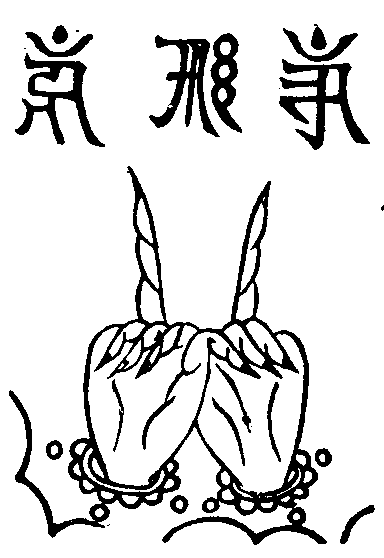



(此印呪出佛说大乘观想曼拏啰下卷，想手印上出金刚焰遣境界魔。金刚顶经修习毗卢遮那三摩地法云：次以威怒降三世，净治内外所生障，二羽交臂金刚拳，檀慧相钩进力竖。行者想身发威熖，八臂四面竖利牙，震吼吽字如雷音，顶右回旋成结界。)



遣魔真言



唵，斡资啰(二合)牙恰，吽。



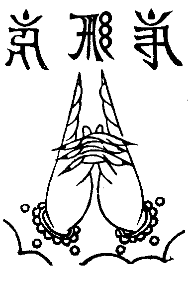



(二手外相义，二头指直竖，结印当胷，手动似扇，印出火光而遣诸魔)。



遣魔真言



唵，斡资啰(二合)佐辣，哑捺辣，曷捺答曷，巴拶麼，塔班拶啰，纳吽癹咤。



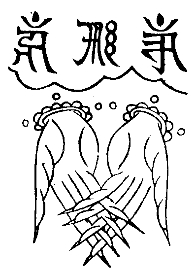



(二手内相义，十指仰上，结印当胷，想印中放出金刚焰，令诸魔远离。)



真空呪印



(二手内相义，进禅力智，直竖念真言：)



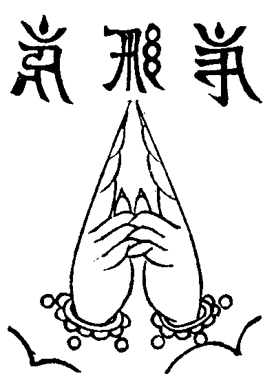



唵，莎癹斡顺牙(二合)萨哩斡(二合)答哩麻(二合)，莎癹斡顺牙(二合)达(二合)



(侍者白云)于空性中，想(阿阇黎观想此梵书九字)[口*(隆-一)][口*(隆-一)](二合)bhrūṃ𠽾[口*(隆-一)](二合)bhrūṃ𠽾[口*(隆-一)](二合)bhrūṃ哑哑哑āḥ吽吽hūṃ(此下众和)吽而成十方世界所有天妙曼怛哑哩干，濯足花香，灯涂食乐，清彻无碍，犹如普贤化现种种云集供养，徧满虗空，充塞法界，尽轮回际，无有间断。



(二、手内相义。进力禅智直竖大毗卢遮那成佛神变加持经第四云：由结此印诵真言故，其坛中诸佛菩萨及诸圣众，量同虗空，徧周法界，成报土佛刹。佛说一切如来金刚三业最上秘密大教王经第二云：当观想㪍笼字，即成虗空金刚心曼拏啰，一切金刚周匝围绕，故云于空性中等大威怒。乌刍仪轨云：当奉阏伽香水器浴圣众足，故云哑哩干濯足。此中皆是无碍报土不思议境界，故云犹如普贤等㪍笼。bhrūṃ字即𠽾[口*(隆-一)]，唐言佛宝阁。)



唵，萨哩斡(二合)答塔葛达，萨叭哩咓啰(哑哩干巴　丹)巴啰(二合)谛拶耶，莎诃



五供养



唵，萨哩斡(二合)答塔葛达，萨叭哩咓啰



唵，斡资啰(二合)，不思必，哑，吽。



唵，斡资啰(二合)，舍不答，布拶弥，渴萨谟的啰(二合)，斯癹啰纳，三麻耶，哑，吽。



唵，萨哩斡(二合)答塔葛达，萨叭哩咓啰



唵，斡资啰(二合)度必哑吽



唵，斡资啰(二合)，舍不答，布拶弥，渴萨谟的啰(二合)，斯癹啰纳，三麻耶，哑，吽。



唵，萨哩斡(二合)答塔葛达，萨叭哩咓啰



唵，斡资啰(二合)，哑噜吉，哑吽。



唵，斡资啰(二合)，舍不答，布拶弥，渴萨谟的啰(二合)，斯癹啰纳，三麻耶，哑，吽。



唵，萨哩斡(二合)答塔葛达，萨叭哩咓啰



唵，斡资啰(二合)干底，哑，吽。



唵，斡资啰(二合)，舍不答，布拶弥，渴萨谟的啰(二合)，斯癹啰纳，三麻耶，哑，吽。



唵，萨哩斡(二合)答塔葛达，萨叭哩咓啰



唵，斡资啰(二合)你微的哑吽



唵，斡资啰(二合)，舍不答，布拶弥，渴萨谟的啰(二合)，斯癹啰纳，三麻耶，哑，吽。



音乐呪



唵，斡资啰(二合)看支夷，啰纳(二合)啰纳(二合)不啰(二合)啰纳，不啰(二合)啰纳，三不啰(二合)啰纳，三不啰(二合)啰纳，萨哩斡(二合)孛塔赤，的啰(二合)不罗，拶哩答麻，曷不啰(二合)尼牙(二合)巴啰，蔑答那，达速巴微，萨哩斡(二合)塔哩麻(二合)𠶹哩(二合)达耶伞，多沙纳葛哩，吽，吽，和和，哑龛，莎诃。



(至此不特唯心变现，而且转成受用报土不思议供养，故与前不可。)



十二因缘呪



(阿阇黎持花米诵云：)



唵，耶，答儿麻(二合)兮，都不啰(二合)巴，斡兮敦的山，答塔葛达歇，斡怛的山，拶约尼噜怛耶，𠳐叭谛，麻曷释啰(二合)麻纳耶，莎诃。



唵(一)(引)，哑(二)(引)，吽(三)(引)(念三遍，就撒花米持铃念曼拏啰偈)。



(密呪圆因集云：凡修功德，诵此庆成。)



曼拏啰偈



> 谛想清净广大曼拏啰，四洲充满无量诸珍宝，  

> 一一皆如玅高摩尼聚，奉献上师三宝愿安住。



曼拏啰真言



唵，萨哩斡(二合)答塔葛答啰的捺(二合)麻曷曼答辣布拶弥渴萨谟的啰(二合)斯癹啰纳三麻耶哑吽。



> ∴宝山宝海妙宝座，天衣璎珞如意树，  

> 宝池妙花香灯涂，周徧法界满虗空。  

> ∴：宝珠自性广大海，七宝之中最殊胜，  

> 献如云聚妙宝供，我今䖍诚而奉献。  

> ∴中央八峰须弥卢，四大部洲诸形相，  

> 以日月等而围遶，黄金白银与宝玉，  

> ∴麻萨葛斡及琉璃，赤珠乃至石心等，  

> 奉献上师三宝尊，唯愿慈悲哀纳受。



唵，萨哩斡(二合)答塔葛达啰的捺(二合)麻曷曼答辣布拶弥渴萨谟的啰(二合)斯癹啰纳三麻耶哑吽。



(此以报土妙曼拏啰及妙供具，总献上师三宝。)



> ∴我今依教建立曼拏啰，量等虗空金刚为宝地。  

> 字字密言，惟心之所成。须弥日月，七宝四天下。  

> ∴衣服、伞盖、伎乐、幢幡、云，宝座、珍羞、楼阁并宫殿。  

> 池沼园林名花普徧布，奉献上师三宝护神等。  

> ∴惟愿慈悲纳受生欢悦。屏除魔碍集福施安宁。  

> 今宵施主所求皆如意，尽未来际吉祥无间断。



(佛说瑜伽大教王经云：右手持金刚杵，左手振金刚铃，即以歌赞供养贤圣。如是依金刚大乘作最上真实供养已，诸佛贤圣悉皆欢喜。此是结撮回向再念奉献真言。)



唵，萨哩斡(二合)，答塔葛达啰的捺(二合)，麻曷曼答辣布拶弥渴萨谟的啰(二合)，斯癹啰纳三麻耶哑吽(手持花米上举诵之)惟愿上师三宝中围佛会慈悲，摄授今辰施主福慧庄严，世出世间吉祥如意，普及法界一切有情，速成无上佛果菩提。



捺谟孤噜(二合)毗耶　捺谟勃塔耶



捺谟达而麻耶？　捺谟桑渴耶？



唵(一)(引)，哑(二)(引)，吽(三)(引)。



(阿阇黎于此亲见中围佛会，故自皈依已，复劝大众发心。十八会经初会中，有为弟子授速证菩萨地法。)



三归依赞



佛法僧宝，体徧十方。恭敬请祈，必蒙感应。将当阐扬施食之初，先须归敬三宝。要祈法事周隆，庶使胜因成就。大众虔诚，随声应和。



志心信礼，佛陀耶，两足尊，三觉圆，万德具。天人调御师(唵哑吽)，凡圣大慈父。从真界，腾应质，悲化普。竖穷三际时，横徧十方处。震法雷，鸣法鼓，广演权实教(唵哑吽)，大开方便路。若归依，能消灭，地狱苦。



志心信礼，达磨耶，离欲尊。宝藏收，王凾贮，结集于西域(唵哑吽)，飜译传东士。祖师弘，贤哲判，成章疏。三乘分顿渐，五教定宗趣。鬼神钦，龙天护，导迷标月指(唵哑吽)，除热真甘露。若归依，能消灭，饿鬼苦。



志心信礼，僧伽耶，众中尊，五德师，六和侣。利生为事业(唵哑吽)，弘法是家务。避嚣尘，常晏坐，寂静处。遮身服毳衣，充腹采薪薇。钵降龙，锡解虎，法灯常徧照(唵哑吽)，祖印相传付。若归依，能消灭，旁生苦。



∴三宝圣众垂加护。



众等发广大心



(皈依金刚上师句下，众和：)



归依金刚上师，归依佛，归依法，归依僧。我今发心，不为自求人天福报、声闻、缘觉乃至权乘诸位菩萨，唯依最上乘发菩提心，愿与法界众生一时同得阿耨多罗三藐三菩提心。



> 先结大轮明王印，加持坛场悉清净。  

> 我今依教诵密言，令我所作皆成就。



默念大轮明王呪七遍



(金刚顶略出念诵经。四种念诵：一、音声念诵，一切声是也；二、金刚念诵，合口动舌默念是也；三、三摩地念诵，心念是也；四、真实念诵，如字义修行是也。佛说秘密相经云：若持诵时，不动舌端，唇齿相合，离诸音声，但以金刚语音而为持诵，即能成就一切仪轨。)



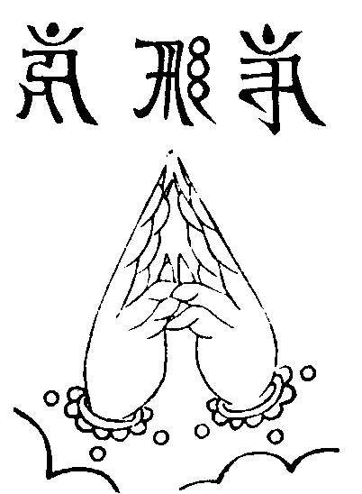



捺麻斯得哩(二合)野脱夷(二合)葛喃，萨哩斡(二合)怛塔葛达喃，唵，微啰积，微啰积，麻曷拶，葛啰(二合)斡资哩(二合)斡资哩(二合)萨怛萨怛，萨啰谛，萨啰谛，得啰(二合)夷，得啰(二合)夷，微䭾麻尼(二合)三攀拶，纳祢得啰(二合)麻祢，的席塔𠶹哩(二合)得兰(二合)颜席提脱夷(二合)，莎诃。



(甘露军茶利仪轨云：二手内相义，进力并伸直。忍愿缠进力，初节前各以峰相拄，禅智并伸直。又云：应结金刚轮菩萨印，诵密语以入曼拏啰者，受得三世无障碍三种菩萨律仪。由入曼拏啰，身心备十微尘刹世界微尘数三昧耶，无作戒禁。或因屈伸俯仰，发言吐气，起心动念，废忘菩提之心，退失善根。以此印契密言，殊胜方便，诵持作意，能除违犯愆咎，三昧耶如故。倍加光显，能净身口意故，则成入一切曼拏啰，获得灌顶三摩耶。唐沙门慧日云：有人未曾经和尚阿阇黎入大曼茶啰坛场者，但宽取大轮明王金刚呪，诵二十一遍，即当入坛。然后作诸呪法，悉得成就。又云：诵密言时，作是观想，尽虗空徧法界三界生死六趣有情，速得入金刚界大曼拏啰，等同金刚萨埵大菩萨。)



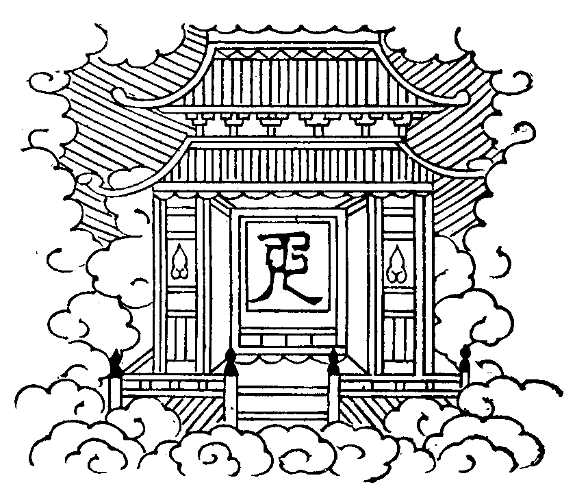



(师印呪可知。应想面前空处，离身七肘，高八肘，现一金色𠽾[口*(隆-一)](二合)bhrūṃ字种，变成胜妙宫殿。以大千国土合为一国土，以此国土融成一宫殿，一一庄严，皆准华严经说胜妙乐事。问：此大千国土合而为一，云何合耶？答：一切国土体自空寂，谁立彊界？若离众生见，则国土自一。问：此土众生置于何处？答：自中众生即诸佛心中之众生，同佛受用，复何用置？问：何全依心想便成宫殿？答：彼大千国土等，咸是妙明真心所现。若离真心，毕竟无有。全依幻化力故，复以大千国土而为宫殿，是为万法而由我者也。)



> 归命十方调御师，演扬清净微玅法。  

> 三乘四果解脱僧，愿赐慈悲临法会。



奉请三宝



(表白，和香花，迎香花，请阿阇黎执罏，三请。)



南无一心奉请，尽十方，徧法界，微尘刹土中，诸佛法僧，金刚密迹，卫法神王，天龙八部，婆罗门仙，一切圣众。惟愿不违本誓，怜愍有情，此夜今时，光临法会。



(此夜今时句，仪轨经无。斯三宝等，属变化土。将欲下化，故特奉请。请毕，阿阇黎合掌白云：)



> 谨依瑜伽教，建置曼拏啰。惟愿三宝尊，  

> 慈悲哀纳受。



印现坛仪



(千手眼修行仪云：二手各作金刚拳，施进慧力相钩，胷前微动。诵真言曰：)



唵，斡资啰(二合)，拶裓啰(二合)，吽，𠳐斛。



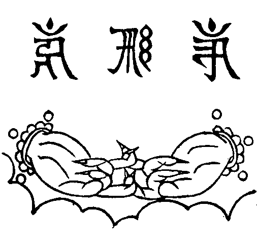



(师印呪可知。应想心间字种放光，至色究竟天上，召请智观世音，来入道场。此智观世音，即放无量光，召请一切三宝，及显密护神，来至道场，重重无尽。问：于此教门，但说果主因伴。今何得因为主，果为伴耶？答：此有二义：一、行者以观音为所缘熟境，故先契此境，后契诸佛之境。然观音放光，召请诸佛，亦犹行者召请观音者也。今藉观音请佛，非为主也。二、此菩萨即是过去威德自在光明王如来，退位度生，即果位也。若或为主，亦无过也。建坛仪云：若无坛佛，应结才发意转法轮印，印现坛仪。千手眼观自在仪轨云：二手各作金刚拳，进力檀慧相钩结。又云：即结才发意转法轮菩萨印。以印置于身前坛上，即成莲花部徧调伏大曼拏啰。以印安于心上，即自身成大曼拏啰。以印触本尊像等，皆成大曼拏啰。以印置身前空中，即满虗空界，成大曼拏啰。行者设有越法，悮失三业，破三昧耶戒。由结此印，诵真言加持故，能除诸过，皆得圆满。然后恭申情旨。)



> 罗列香花建宝坛，重重佛境一毫端。  

> 心融妙理虗空小，道契真如法界宽。  

> 相好慈悲秋月满，化身腾处暮云繁。  

> 香烟堆里瞻应现，万象森罗海印含。



> 释迦如来，证明功德。  

> 弥陀如来，慈悲摄授。  

> 观世音菩萨，密垂加护。  

> 阿难陀尊者，兴权启教。



香云盖



(至此宣疏毕，或执手罏，表白击引磬，念三十五佛，声宜和缓。或用钟鼓，同众念大忏悔。)



忏悔师



瑜伽𦦨口注集纂要卷上



瑜伽𦦨口注集纂要仪轨卷下



苕水法师　子若净观　攷正



偁山法师　内衡智铨　较阅



秀州后学　巨彻寂暹　纂书



> 毗卢遮那佛，愿力周沙界，一切国土中，  

> 恒转无上轮。



般若心经一遍



(藏本中无默念二字，念般若心经意，具如佛母般若波罗蜜多大明观想仪轨中明。)



启告十方一切诸佛、般若菩萨、金刚天等及诸业道无量圣贤：我今(某甲)以大慈悲，乘佛神力，召请十方尽虗空界三涂地狱诸恶趣中旷劫饥虗一切饿鬼、阎罗诸司、天曹地府业道冥官、婆罗门仙、久远先亡旷野冥灵、虗空诸天及诸眷属、异类鬼神。惟愿诸佛、般若菩萨、金刚天等无量圣贤及诸业道，愿赐威光，悲增护念。普愿十方尽虗空界天曹地府业道冥官、无量饿鬼、多生父母、先亡久远婆罗门仙、一切冤结负于财命种种类族异类鬼神各及眷属，乘如来力，於此时中决定降临，得受如来上妙法味清净甘露，饮食充足滋润身田，福德智慧发菩提心，永离邪行皈敬三宝，行大慈心利益有情，求无上道不受轮回诸恶苦果，常生善家离诸怖畏，身常清净证无上道，口常清净证无上道，意常清净证无上道。



伸五供养



> 十方一切刹，诸佛菩萨众，无量诸圣贤，  

> 及诸业道官，惟愿大慈悲，降临於法会。  

> 摄授(花、香、灯、涂、菓、乐)，微分少供养。



(师诵吽字而结手印六天母，此乃表六度想成供养。)



hūṃ字涌出(花、香、灯、涂、菓、乐)，天母一面四臂放光明，上二手印持妙(花、香、灯、涂、菓、乐)，下二手印轮相交。



吽唵哑吽唵哑吽𠶹哩。



妙(花、香、灯、涂、菓、乐)天母供养佛，愿佛慈悲哀纳受。



> 因缘自性所出生，所有种种微妙(花、香、灯、涂、菓、乐)。  

> 奉献上师三宝尊，惟愿慈悲哀纳受。



户，唵，萨哩嚩，怛他誐多(布思必　度，　必　哑噜，吉　干　的，　你微的，　舍不答)，布拶弥渴，萨谟的啰斯，癹啰纳，三麻耶，哑，吽。



(师印呪可知。应想心间字种出生六个吽字，各具一色，以六波罗密为体，化成六天母，窈窕美貌，展左跪右而作舞势，奉供诸佛。问：六色何色？答：花淡红色，香黄色，灯红赤色，涂白色，菓红黄色，乐青绿色，各相其色故。问：如何以六度为体？答：此有所表。花表布施，布施令人能生欢喜故。香表持戒，持戒则业行芬馥故。灯表忍辱，忍辱则转嗔恚火为大光明故。涂表精进，精进则润泽法身故。菓表禅定，禅定则能成就佛果故。乐表智慧，智慧则能出生种种诸法故。问：果有此天母耶？谓只是依行想成。答：此六天母乃喜金刚中围内有之，皆佛母也，皆文殊、普贤之俦也。如意轮莲花心仪轨云：于心月轮上想hūṃ字形，诵吽字已，hūṃ字化为六色光，于此光中变为六菩萨，各执供养物，普供养诸佛，前供上师三宝。五供养与音乐呪分念此供化土三宝，乐与五供养同，申复与前异。)



> 我以普贤行愿力，修设花香灯涂食，  

> 微尘刹土诸圣贤，一一徧礼皆供养。



次结运心供养印



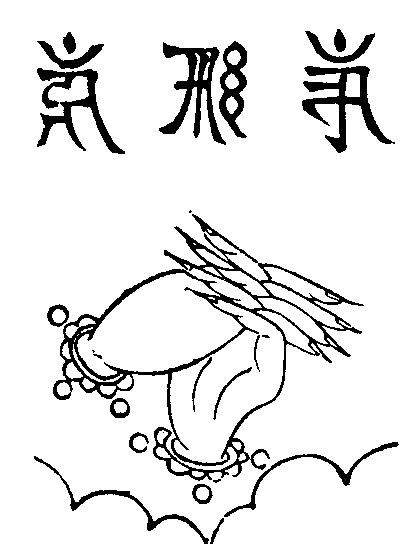



那麻萨哩斡(二合)，答塔葛的毗牙(二合)，月说穆契毗牙(二合)，唵(引)，萨哩斡(二合)，哩塔乌忒葛(二合)，的斯癹(二合)，啰纳兮慢葛葛捺龛莎诃



(苏悉地羯罗供养法云：两手外相义合掌，以右压左置于顶上。凡作供养应具此法，至诚信心及奉阏伽，皆以真言手印持诵成就，及以运心合掌至顶，方成圆满供养之法。又云：次运心供养者，以心运想水陆诸花无主所摄徧满虚空，尽十方界及与人天妙涂香云、烧香灯明、幢幡伞盖、种种鼓乐、歌舞伎唱、真珠罗网、悬诸宝铃、花缦白拂、微妙磬铎、矜羯尼网、如意宝树、衣服、天厨诸食、上妙楼阁、严身璎珞，行者运心徧满虚空，以至诚心如是供养最为胜上。大日经略摄念诵随行法云：次当随力分，供养表诚心，阏伽香食灯，乃至一花水，或但心运想，殊胜最难量，有表无表俱，一时皆成就。金刚顶瑜伽念诵经第四卷云：次明供养饮食法，应以香洁种种微妙饮食供养。如不能办，随力作已，复当心念世间所有上妙饮食及种种珍菓、蒲桃、石榴等诸非时浆而作供养。)



> 我以至诚心，奉献甘露食，惟愿三宝尊，  

> 慈悲哀纳受。



次结献佛印



(一旧作遣魔印。)



唵(引)，斡资啰(二合)，拽屹彻(二合)，吽。



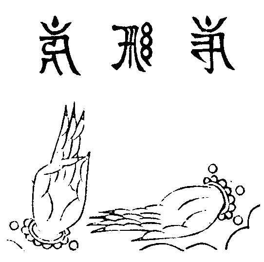



(师印呪可知。应想掌中有赤色hūṃ字，字脚放光，从三尖出，作摇扇势，遣食器上魔。问：食器上有何等魔？答：有寻香食、施食等魔碍，故今遣之也。藏本云：将奉三宝施食，先结三尖印。圣宝藏神仪轨经云：献佛印，以右手大指捻小指甲，餘三指如金刚杵相，向上而转，作献佛印。)



> 我以佛神力，依教诵密言，加持甘露食，  

> 变满虗空界。



次结变空印



(二羽虚，合掌如莲花状，竖立胷前，诵真言：)



唵，莎癹斡秫塔萨哩斡(二合)，塔哩麻(二合)，莎癹斡秫徒㰠唵(引)，哑吽



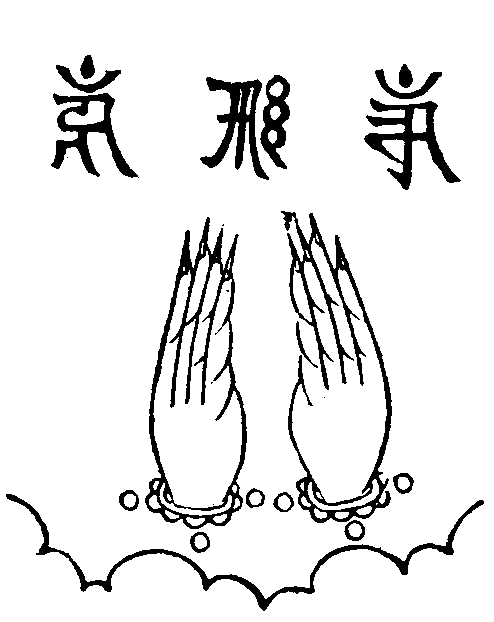



(师印呪可知。应想食器及食悉皆空寂，以分断食多染触故，故今空之极令清净。于其空处应想三个bhrūṃ𠽾[口*(隆-一)](二合)字，字皆金色变成食器。于食器中想白色oṃ唵字变成胜妙饮食，皆醍醐乳酪及𪎊蜜等味。默净念唵哑吽二十一遍，极令广大已，复念拶吽𠳐斛而作手印，想令前来所观三宝海会分明显现。再伸五供养施宝错，念思麻啰等呪，想三宝摄受，初一分奉佛并法衣，一分奉菩萨圣僧，后一分奉显密护神等。既奉献已，然后作掬水势，念云：)



> 以此甘露食，奉献诸圣贤，怜愍我等故。  

> 慈悲哀纳受。



次结奉食印



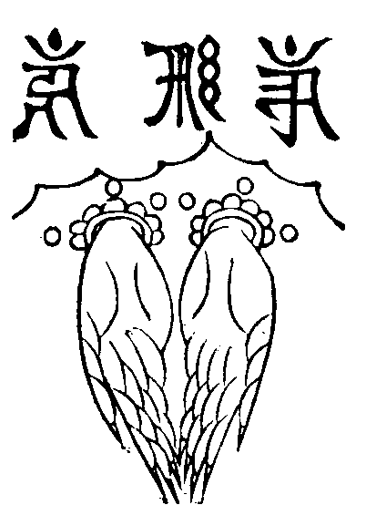



唵(引)，哑葛噜穆看，萨哩斡(二合)，塔哩麻(二合)，喃哑牒耶(二合)，奴忒班答奴，唵，哑，吽，癹咤，莎诃



(仰二手，二掌向前侧相著，二无名指头侧相着，微曲，二头指博着中指侧，二大指博着头指侧，小似掬水相。想诸佛子等，徧奉受用，生欢喜心，求索显事，必蒙允许。广迎圣众入坛，即以香花灯涂等，而为供养之。)



奉食偈



> 我今奉献甘露食，量等须弥无过上，  

> 色香美味徧虗空，上师三宝哀纳受。  

> 次供显密护神等，后及法界诸有情，  

> 受用饱满生欢悦，屏除魔碍施安宁。  

> 今辰施主眷属等，消灾集福寿延长。  

> 所求如意悉成就，一切时中愿吉祥。



三宝赞



> 世尊大慈妙庄严，明解圆满一切智，  

> 能施福慧如大海，于诸如来我赞礼。  

> 自性本体离诸欲，能依此行脱恶趣。  

> 以为甚深玄妙理，於诸妙法我赞礼。  

> 解脱道中胜解脱，持净戒行堪恭敬，  

> 胜妙福田生胜处，于彼大众我赞礼。



(入禅定偈)



> 普陀洛伽常入定，随缘赴感靡不周。  

> 寻声救苦度群迷，故号名为观自在。



次入观音禅定



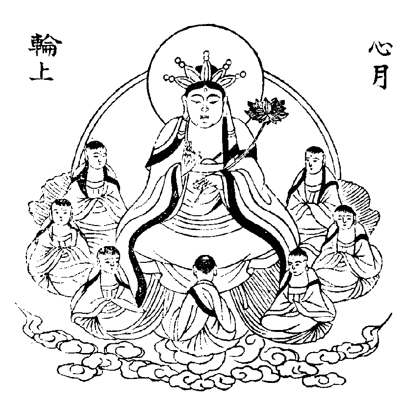



(以上供养三宝，是作福门。有福而无智，则落于人天因果。今若修习此观音禅定，则有智。既具福智，即同诸佛。然后于法界众生，能作利益。侍者白云：次入观音禅定。师作禅定，维那伸偈。其声贵柔和清亮，不可雄厉，恐妨观想。又不可太近世俗儿女之声。当入定时，闭目澄心，观想自身中，圆满洁白，犹如净月。于心净月上，想𠶹哩字，放大光明。其字变成八叶莲花，上有观自在菩萨，相好分明。左手持莲花，右手作开敷势。作是思惟：一切有情身中，有此觉悟之花。清净法界，不染烦恼。莲花八叶上，各有如来。入定跏趺而坐，面向观自在，项佩圆光，身如金色，光明晃曜。想此八叶莲花，渐舒渐大，量等虗空。以此觉花，照触如来海会，愿成广大供养。以此觉花，蒙照触者，于诸苦恼，悉得解脱，等同菩萨相好。即想莲花渐收，量等己身。结印念呪，加持四处。以此加持，令身坚固。所谓顶、喉、心、脐，每于印处，成𠶹哩(二合)hrīḥ字。其字印，以二手外相叉，二头指相拄，如莲花叶，二大指并竖。即诵观自在菩萨真言观音禅定偈)。



> ∴南无无尽三宝尊，我今誓发菩提心。  

> 唯愿菩萨来摄授，速证观音微妙身。



> ∴次入观音三摩地，澄心闭目观心中。  

> 圆满皎洁净月上，字种放光成莲花。



> ∴花中有一观自在，相好具足无比对。  

> 左手执持妙莲花，右手於叶作开势。



> ∴菩萨思惟有情身，各具觉悟之莲花，  

> 清净法界无惑染，八叶各有一如来。



> ∴如来入定跏趺坐，各各面向观自在，  

> 项佩圆光身金色，光明朗照及晃耀。



> ∴次想其花渐舒大，其量周徧虗空界，  

> 思彼觉花照法界，如来海会共广大。



> ∴心若不移于此定，怜愍一切诸众生。  

> 觉花蒙照脱苦恼，便同菩萨观自在。



> ∴莲花渐收同己量，复结自在观音印。  

> 加持四处诵密言，自身亦等观自在。



> ∴以此禅定胜功德，回向法界诸众生，  

> 同见西方无量光，成就普贤广大愿。



观音禅定印



唵(引)，斡资啰(二合)，塔啰麻(二合)，𠶹哩(二合)。



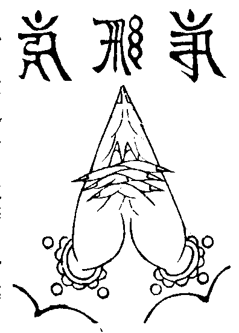



(次入蹑前生后三摩地，即是闻尘。澄心则清净之时也，内不放出。闭目则观想之时也，外缘不入。问：心无所在，安得有中？答：此明肉团心也。以灵知之心，栖止于肉团之心内，故师当于此作六禁反。偈之略也。其说应当于心尖上，想一红色paṃ𠳐字，变成杂色八叶莲花。花上想白色āḥ阿字，变成月轮也。圆满皎洁者，心之体用也。圆而满，则无德不备，体也。皎而洁，则无所不照，用也。字种，hrīḥ𠶹哩字也。此字乃大悲菩萨取证之理，度生之妙门也。放究成莲花者，乃所造之花也。即𠶹哩心增长自身，成观自在菩萨之种也。逆顺无碍，故名自在花，乃指所坐之花也。偈之略也。其说应云：一面二臂，其身金色花冠，璎珞严身，顶戴阿弥陀佛，无比对称赞之词也。理能成事，故云持也。花表因果同时也。事能显理，故能作开势也。已上并是自觉思惟有情，方是觉他行菩萨行也。偈意谓一切众生，与菩萨本是同体，皆有觉悟之莲花，但由颠倒执著而不证也。故菩萨思惟而起哀救。行者于此处，更不可将菩萨与自身作两处想。前来既以字种增长作观音，此处思惟即是指行者之言也。如是禅定若不能念思惟，则向所作法徒劳心力，当与前两句作一片看，不可打成两橛。清净法界，一尘不立也。无垢染清净，若执著清净即成垢染矣。八叶，即指心间莲花之八叶。各有一如来者，八识元是一心也。既是一心，还同正觉而为一体，故云各有一如来者，即是观音也。不言菩萨而言如来者，一超直诣也。此二句通自他说，约他则言有情心本清净无垢，觉悟莲花中有八如来，约自则言行人与八如来同时入定也。问：定有多种，如今来入定何等定耶？答：即行人所入之定也。此定名为刹那大悲禅定。又问：各各面向，前四面向可，后四面岂不背耶？答：向背岂得名为如来？正所谓妙在转处矣。若约事相而说，诸佛菩萨身非同众生分段之身，东向则背西，南向则背北，而菩萨则不然，有随类意生身应化无穷，背向皆正，岂八如来也？或千佛万佛向无不正，学者当作是观，更须向前来者无向背处看。上句彰殊胜身，下句彰殊胜境。从前来七行偈十四句，皆显法界也。今此二句，方入理事无碍法界。次想者，令知时也。以事揽理成，故能渐舒大；以理随事变，故能徧法界，则其大无外也。皆是惟心境界，非分外的事也。如来海会，正明事事无碍也。觉花，事也。海会，亦事也。以觉花称周时，与如来海会同时，广大而无碍。譬如一室千灯，光光无杂。法界，十法界也，四圣六凡之谓也。意谓此花舒大时，能照此十法界，同于一真，更无殊别也。上来思惟有情，方是起行；至此怜愍一切，方是行行。谓证此无碍广大境界，方能行行度生也。深有密焉，学者不可不慎也。蒙照脱苦恼，利生之効也。观自在，所获之果也。初发心时，即得阿耨多罗三藐三菩提之谓也。前八句皆舒，至渐收一句惟卷。约密说，即是增长究竟。准鲁餘巴现前解云：从正位而起名增长，复归正位是究竟，亦是始本不二也。上师云：有放不收同凡夫，有收无放名声闻，有收有放名为秘密境界，收放总不用名无戏论。此乃最极本续也。收之一字，不觉如此轻易流布，学者说不可作等闲见闻也。加持四处，此约行者请求智佛冥加之力也。所以密言者，皆指后面手印之密言也。回光返照者，前来既观观音，今恐迷己逐物，复回观自身，故云亦等。问：以何义最初既以字种增长令成观音，何又云亦等？答：初来增长由未离觉，今是亲证亲入也，如善财始见文殊等也。又前所想观音望因，则名因中果也。加持密言之后，则当体即果中因也。问：初入坛场即顿起观音慢，今复何故又入此定，岂不滥耶？答：不也。前是根本定，亦名正位，亦名正体，如在家为人也。此后所入定即是所作定，如人在邦为臣也。其实一体而约处殊也。又如人在朝则朝衣，在戎则戎服，故根本定白色，所作定金色，向下随一一作法，多有更易身色，常以此理鉴之，故勿疑。诸结自在观音印，以二手外相叉，二头指相拄如莲花叶，二大指并竖，即诵真言时四处，顶、喉、心、脐是也。师印呪可知。每处以手印按之，诵真言一次，复以oṃ唵字加持，即当以印按口上，次以hūṃ吽字加顶，raṃ𫬠字加脐，hrīḥ𠶹哩字加心，āḥ阿字加喉，以此加持令身坚固也，所以一切魔碍皆不能害。加持四处有二说，只用前说)。



> 若人欲了知，三世一切佛，应观法界性，  

> 一切惟心造。



次结破地狱印



(两羽金刚拳，施慧两相钩，进力竖相拄，念想开地狱，三诵三掣开。真言曰：)



那麻，阿瑟咤(二合)，瑟咤(二合)，摄谛喃，三藐三勃塔，俱胝喃，唵(引)，撮(引)，辣(引)，纳嚩婆细，提哩提哩，吽。



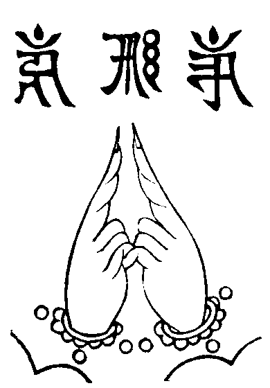



(师印呪可知。应想自身增长红色观音，一面、二臂、舌上、心间、印上三处，皆有红色𠶹哩（二合）āḥ字放光，如日初出之光，照触地狱，悉皆破坏。问：一处放光，足以破之，何用三乎？答：为彼地狱是众生三业妄造故，故今亦用三业放光而破之也。又问：地狱是众生别业而成，云何能破？答：虽云别业，同是一心，以智照之，众生亦无，岂有地狱？由迷一心故，妄造众恶，恶业成熟，妄成地狱，既堕地狱，妄见受苦。譬如梦中为虎狼狮子所噬，或为贼所缚，或遭王难，受种种苦，及至梦醒，了无所得。今观地狱及苦，亦复如是。今假以照力，无不破也。问：地狱既然本空，何须破而救之？答：我虽以智照，知其本空，彼无智照，焉得不苦？故圆觉经云：梦时非无，及至于醒，了无所得。今正欲破此地狱及苦空也。若惟原之，彼以恶业因缘而成地狱，则知非本有矣。我今以智照因缘而为之破，岂不破乎？一、禅定，二、手印，三、真言，四、作观，五、智照。有此五种因缘，何事不办？岂惟破地狱乎？今世学者滥称阇黎，惟是音声振铃击节，虑恐负于请主之意者多矣，可不慎与！)。



(此印呪出破阿毗地狱智炬陀罗尼经。又准灭恶趣王本续说，手结密印，从印流出火光，口诵神呪，口出无量火光，心月轮上红色𠶹哩(二合)hrīḥ字，放赤色火光，三光同照阿毗地狱等，三诵三掣，关鎻自开，所有罪人悉皆得出。)



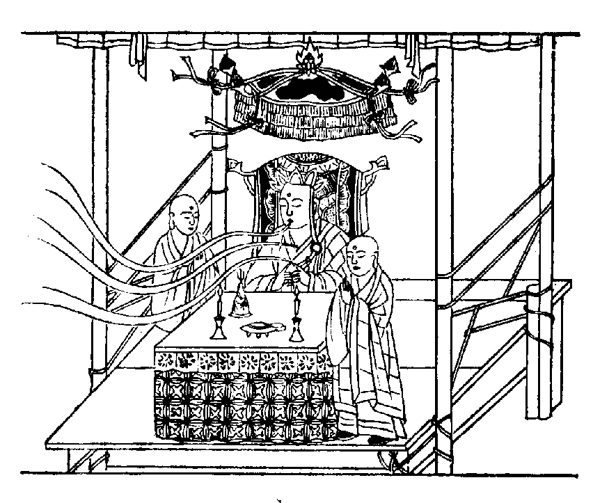



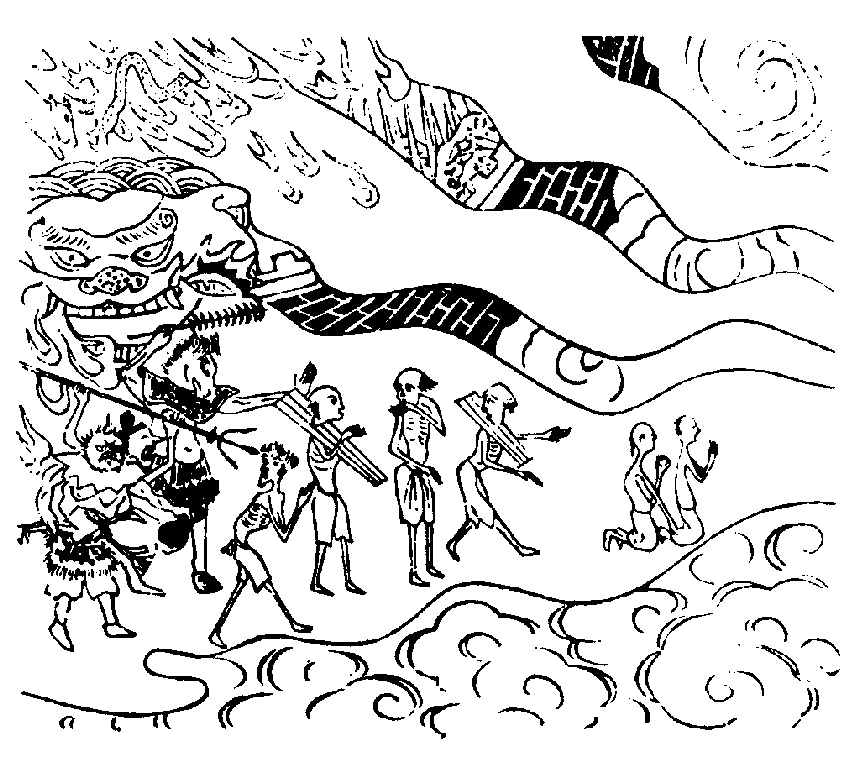



(此举难破，偏言地狱。若准下文，理应光照通餘五趣，意令专注，故偏举此。别行经云：此呪若诵一遍，无间地狱碎如微尘，于中受苦众生悉生极乐世界。金刚顶莲花部心念诵仪轨云：次结开门契，二羽金刚拳，檀慧相应钩，进力竖侧合，每诵真言时，应吽而擘开。千手千眼修行仪轨云：此印亦名警觉一切如来印，由结此警觉一切如来印故，一切如来皆从定起，加护摄受云云。)



由此印呪威神力故，所有诸趣地狱之门，随此印呪豁然自开(仪轨经无神字)。



奉请地藏菩萨



(表白三举香花迎请，阿阇黎执炉三请云：)



南无一心奉请，众生度尽，方证菩提，地狱未空，誓不成佛。大圣地藏王菩萨摩诃萨，惟愿不违本誓，怜愍有情，此夜今时，光临法会。(众和，香花迎，香花请。)



一心召请，花生大地，华长名园。花逢细雨滋开，花被狂风摆落。(呜呼)人生如花绽之期，人死似花残之际。良宵夜奉佛，普利荐拔。(某)是夜，命我沙门，设放瑜伽𦦨口，平等甘露法食。初𦶟名香，初伸设召(大地饥虚，众当斋亡故一)位灵魂。再伸召请(各家本宅)祠堂之内，爱及法界之中，大地山河之内，四生六道，八难三途，有无二主，孤魂佛子等众。惟愿承三宝力，仗秘密言，此夜今时，来受无遮甘露法食。



一心召请。月明波底，月朗长江。月圆如镜挂当空，月缺似弓张远汉。(呜呼)！人生如月满之期，人死似月亏之际。良宵夜



一心召请。巫山一段云。楚岫一团雪。名园一株花。瑶台一轮月。(呜呼)。刹那云散雪销镕。又是花残并月缺。良宵夜。



一心召请累朝帝主，历代王侯。九重殿阙高居，万里山河独据。西来战舰，千年王气俄收；北去銮舆，五国冤声未断。(呜呼)杜䳌呌落桃花月，血染枝头恨正长。如是前王后伯之流，一类孤魂等众。



一心召请，筑坛拜将，建节封侯。力移金鼎千钧，身作长城万里。霜寒豹帐，徒勤汗马之劳；风息狼烟，空负攀龙之望。(呜呼)！将军战马今何在？野草间花满地愁。如是英雄将帅之流，一类孤魂等众。



一心召请五陵才俊，百郡贤良。三年清节为官，一片丹心报主。南州北悬，久离桑梓之乡；海角天涯，远丧蓬莱之岛。(呜呼)官况萧萧随逝水，离魂杳杳隔阳关。如是文臣宰辅之流，一类孤魂等众。



一心召请黉门才子，白屋书生。探花足步文林，射䇿身游𣗥院。萤灯飞散，三年徒用工夫；铁砚磨穿，十载谩施辛苦。(呜呼)！七尺红罗书姓字，一坯黄土盖文章。如是文人才子之流，一类孤魂等众。



一心召请出尘上士，飞锡高僧，精修五戒，净人梵行，比丘尼众。黄花翠竹，空谈秘密真诠。白牯黧奴，徒演苦空妙偈。(呜呼)经窓冷浸三更月，禅室虗明半夜灯。如是缁衣释子之流，一类觉灵等众。



一心召请黄冠野客，羽服仙流。桃源洞里修真，阆苑洲前养性。三花九炼，天曹未许标名；四大无常，地府难容转限。(呜呼)琳观霜寒丹灶冷，醮坛风惨杏花稀。如是玄门道士之流，一类遐灵等众。



一心召请江湖覊旅，南北经商。图财万里游行，积货千金贸易。风霜不测，身膏鱼腹之中；途路难防，命丧羊肠之险。(呜呼)！滞魄北随云黯黯，客魂东逐水悠悠。如是他乡客旅之流，一类孤魂等众。



一心召请戎衣战士，临阵徤儿。红旗影里争雄，白刃丛中敌命。鼓金初振，霎时腹破膓穿；胜败才分，遍地肢膓首碎。(呜呼)！漠漠黄沙闻鬼哭，茫茫白骨少人收。如是阵已，兵卒之流，一类孤魂等众。



一心召请，怀躭十月，坐草三朝。初欣鸾凤和鸣，次望熊罴叶梦。奉恭欲唱，吉㐫只在片时；璋瓦未分，母子皆归长夜。(呜呼)！花正开时遭急雨，月当明处覆乌云。如是血湖产难之流，一类孤魂等众。



一心召请蛮夷戎狄，瘖痖盲聋。勤劳失命庸奴，妬忌伤身婢妾。轻欺三宝，罪𠍴积若河沙；忤逆双亲，凶恶浮于宇宙。(呜呼)长夜漫漫何日晓，幽关隐隐不知春。如是冥顽悖逆之流，一类孤魂等众。



一心召请。宫帏美女，闺阁佳人。胭脂画面争妍，龙麝熏衣竞俏。云收雨散，魂消金谷之园；月缺花残，膓断马嵬之驿。(呜呼)！昔日风流都不见，绿杨芳草髑髅寒。如是裙钗妇女之流，一类孤魂等众。



一心召请饥寒丐者，刑戮囚人。遇水火以己身，逢虎狼而失命。悬梁服毒，千年怨气沉沉。雷击崕崩，一点惊魂漾漾。(呜呼)暮雨青烟寒鹊噪，秋风黄叶乱鸦飞。如是伤已横死之流，一类孤魂等众。



一心召请法界六道、大地含灵、面然所统、薜茘多众、尘沙种类、依草附木、魑魅魍魉、滞魄孤魂、自他先亡、家亲眷属等众，惟愿承



三宝力仗秘密言：此夜今时来受无遮甘露法食，受此无遮甘露法食。



上来召请，悉已来临。大众慈悲，齐声叹悼。



近代先朝，帝主尊荣位。勋戚王侯，玉叶金枝贵。宰辅中宫，彩女嫔妃类。梦断华胥，来受甘露味。



国士朝臣，经纬匡时世。牧化黎民，未遂忠良志。失宠怀忧，谪降边邦地。恋国游魂，来受甘露味。



武将戎臣，统领三军队。结阵交锋，锣鼓喧天地。北战南征，失陷沙场内。为国亡身，来受甘露味。



学古穷今，锦绣文章士。映雪偷光，苦志寒窓内。命运蹉跎，金榜无名字。郁郁幽魂，来受甘露味。



割爱辞亲，早入空门内。访道寻师，只为超生死。暑往寒来，不觉无常至。返照回光，早证菩提位。



羽服黄冠，早发修真志。炼药烧丹，养性还元气。苦行劳神，指望登仙位。莫恋遗形，来受甘露味。



孝子贤孙，义勇忠良士。烈女贞妻，视死如归去。仗节亡躯，千古留英气。耿耿灵魂，来受甘露味。



女道尼流，身住黄金地。鸾凤缘空，不染人间事。未了无为，流浪虗生死。清净幽魂，来受甘露味。



地理天文，医药阴阳类。卜卦占龟，风鉴并星士。报吉谈凶，难免无常至。弃伪归真，来受甘露味。



坐贾行商，种种经营辈。艺术多能，贸易求财利。背井离乡，死在他方地。旅梦悠悠，来受甘露味。



犯法遭刑，牢狱长幽系。负命谋财，债主冤家类。肿毒瘟㾮，冻死饥亡辈。速离黄泉，来受甘露味。



车碾伤残，马踏身形碎。墙倒崕崩，自刎悬梁缢。水火漂焚，虎咬蛇伤类。九横孤魂，来受甘露味。



食血茹毛，生长蛮夷地。负债偿劳，婢妾并奴隷。瘖痖盲聋，残疾无依恃。受苦冤魂，来受甘露味。



忤逆爷娘，怨黩天和地。谤佛欺僧，毁像焚经偈。邪见深沉，苦报无边际。十恶狂魂，来受甘露味。



大施门开，荐㧞孤魂辈。祖称先亡，五姓冤家类。八难三途，平等俱超济。仗佛慈光，来受甘露味。



阿弥陀佛，宿有无边誓。观见迷途，苦海常漂溺。垂手提携，特驾慈航至。普度众生，同赴莲池会。



∴莲池海会佛菩萨。



> 我以大悲佛神力，召请冥阳诸有情，  

> 旷劫饥虗饿鬼等，不违佛勅来降临。



次结召请饿鬼印



(左羽作无畏相，直前舒掌，竖掌向外，右羽向前竖四度，微曲进度。钩召真言曰：)



唵，即纳即葛，移希曳(二合)歇，莎诃



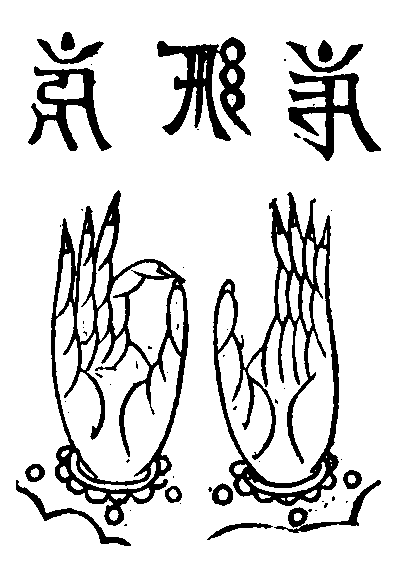



(此印呪，出燄炽饿鬼母本续自身，想观自在菩萨心月轮上，想红色hrīḥ𠶹哩(二合)字印及字母，流出光明，照彼罪人。口诵神呪，随光来至行者面前，大众赞善安慰。既至道场，遶佛三匝，投身布礼。至回向已，还礼圣众，退坐一面。从坛东门至于南门，地狱众居；南门至西南隅，饿鬼众居；西南隅至西门，畜生趣居；自西门至西北隅，人趣宫室；西北隅至北门，修罗所居；北门至东门，天仙所居。或无坛室，自上至下，胜劣居之，亦得重座。色印如开合录说。)



既召请已，普皆云集，以愍念心，赞叹慰喻，令欢喜已，渴仰于法。



善来诸佛子，曾结胜缘故，今遇此佳会，勿得生忧怖。一心渴仰法，不出于此时，戒品而沾身，速令离苦趣。



> 汝等诸佛子，得遇道场中，所有一切罪，  

> 召入金刚掌。



次结召罪印



(二羽金刚缚，忍愿伸如针，进力曲如钩。召罪真言曰：)



唵，萨哩斡(二合)巴钵羯哩(二合)沙拏(二合)月戍䭾纳，斡资啰(二合)萨埵，萨麻耶，吽，拶。



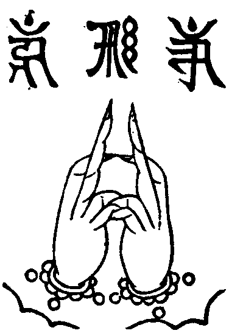



(师印呪可知。应想于二中指尖上，想白色𠶹哩(二合)hrīḥ字出光，入彼身中出，其罪犹如烟雾而合。问：罪无实体，云何今说如彼烟雾出有实体耶？答：虽无实体，能充塞天地、障蔽心目，不能得见诸佛清净境界。今借诸雾为所缘相，以召其罪。钩罪契经云：曲进力度于忍愿，皆作跋折啰服形，勿相拄著，观自身成观自在菩萨心。月轮上想白色𠶹哩字出钩火光，口出秘密言，钩摄一切有情三恶趣业，并自身三恶趣业。黑色如云雾，众罪召入掌，变成诸鬼形。金刚顶瑜伽念诵云：诵此秘密时，想彼罪形如鬼，黑色发竖。即以二羽诸度各各相钩，头入掌内。想以进力二度钩夹彼罪，令入掌中，随结摧罪印相。餘度面各相捻，忍愿二度直伸如针。)



> 摧罪诸恶业，犹如劫火灭，火灭还曾有。  

> 金刚碎微尘。



次结摧罪印



唵，斡资啰(二合)巴尼，月斯普(二合)咤耶，萨哩斡(二合)阿巴耶，班塔拏尼不啰(二合)穆恰耶，萨哩斡(二合)阿巴耶，葛谛毗药(二合)萨哩斡(二合)萨埵喃，萨哩斡(二合)答塔葛达，斡资啰(二合)三麻耶，吽，怛啰咤。



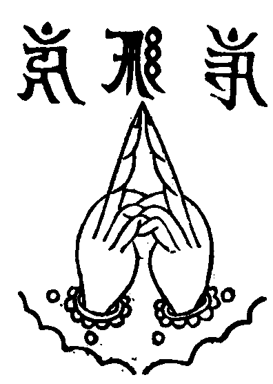



(师印呪可知。于二中指尖上，左想怛啰（二合）a字，右想咤ṭa字，并金色。廖当行人身自增长，作青色、绿色观音菩萨之身。每念呪一遍，二中指摩摇，至后一遍叉过，拍手作声，想彼罪山犹如瓦塌而倒，前来所召之罪如烟雾者，应念而散。问：罪无体相，云何摧耶？答：正谓之无，故摧也。若决定有，岂能摧耶？aṭa)。



(钩罪经云：心月轮上想青色𠶹哩(二合)hrīḥ字，出光照前罪业相应。将忍愿三拍，摧前众罪形状，口诵密言，罪相悉摧尽，令灭无有餘。金刚顶念诵法云：于愿度端想一答啰a字，忍度端想一咤ṭa字，复于字上想生火燄，夹取彼罪，诵摧罪呪。诵密语已，用力撚之，如弹指法，右上左下。或准金刚顶经，身作降三世印，观独股杵，厉声诵真言，忍愿应三拍。约文中云：业报有二，业中复有现行种子成就，现行业中有定不定。今此印中灭不定业者也。)



> 定业不可转，三昧加持力，无始诸障难，  

> 一切皆消灭。



次结破定业印



(二羽金刚掌，进力屈二节，禅智押二度。净业真言曰：)



唵，斡资啰(二合)葛哩麻(二合)月束塔耶，萨哩斡(二合)阿咓啰拏你(二合)菩塔萨底曳(二合)纳三麻耶，吽。



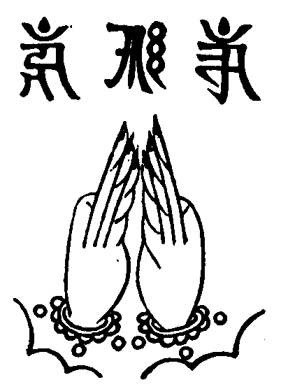



(师印呪可知。心月轮上，想一青色𠶹哩(二合)hrīḥ字出光，照前诸鬼众。所有诸佛出世，不通忏悔之业，应想自性清净，本无作想。观彼鬼众及佛与心，三无差别，是名破决定业也。此一法，正是断所知障，学者须知之。)



(此印呪出不动本续，有十二种诸佛不通忏悔定业印。又云：手结定业印，自身想观自在菩萨心，月轮上想青色𠶹哩(二合)hrīḥ字出光，口诵心密言，照前诸鬼等。所有诸佛不通忏悔之业，并自身三恶趣业，转重为轻，重即定业，此中转灭粗重决定业故。以上二印净现行竟。轻微种子灭罪印除净业，准仪轨经文。)



> 罪性本空由心造，心若灭时罪亦亡。  

> 罪亡心灭两俱空，是则名为真忏悔。



次结忏悔灭罪印



(二羽金刚缚，进力屈二节，禅智押二度，忏悔真言曰：)



唵，萨哩斡(二合)巴钵月斯普(二合)咤怛贺纳斡资啰(二合)耶，莎诃



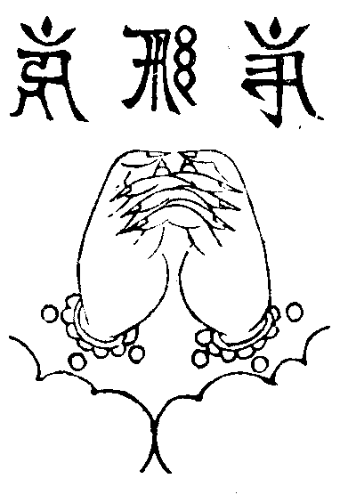



(师印呪可知。应想二屈指上有白色𠶹哩(二合)hrīḥ字，入彼鬼身如日烁露之状，罪垢销镕犹如墨汁，从足流下渗入地中至金刚际。问：前来既召既摧既破，今复为忏悔何耶？答：前来并是理忏悔，今者方是事忏悔，理事无碍故不滥也。又问：何罪如墨汁？答：罪者黑业也，故以黑表汁，有流注之义，故云如墨汁者也。)



诸佛子！等既忏悔已，百劫积集罪，一念顿消除，如火焚枯草，灭尽无有餘。



> 一滴清凉水。能除饥渴痟。弹洒灌顶门。  

> 悉令获安乐。



次结妙色身如来施甘露印



(或云施清凉印，即以右羽转腕向前，进禅度相，弹施甘露真言)。



那谟苏噜癹耶答塔葛达耶怛牒塔唵酥噜酥噜钵啰(二合)酥噜钵啰(二合)酥噜莎诃



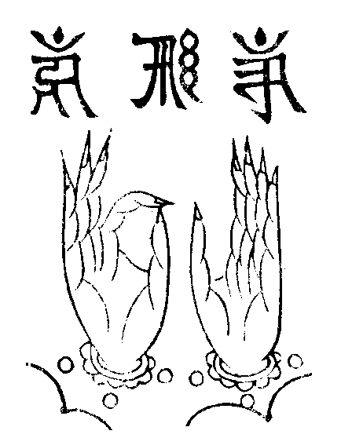



(师印呪可知。结印诵呪，想左手愿上有一白色鑁vaṃ字，流出甘露如水银色，是真智所成。右手点取弹洒虚空，想诸天及人鬼等类，触此甘露悉具色相，猛火悉灭普得清凉，离饥渴想灭心执障。)



> 汝等自从无量劫，造诸恶业起悭贪，  

> 由此业力闭咽喉，仗此密言悉开通。



次结开咽喉印



(仪轨经云：左羽想持莲花，右羽忍禅弹作声，随诵而弹之。开咽喉真言曰：)



唵那谟癹葛咓谛月补辣葛得啰(二合)耶答塔葛达耶



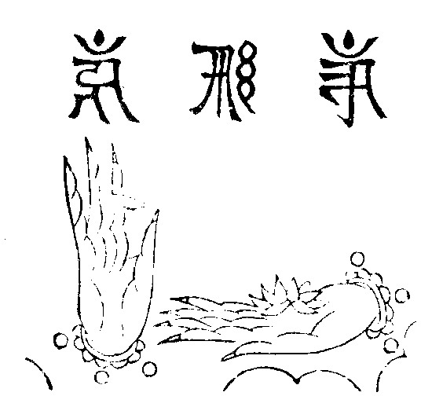



(师印呪可知。结印诵呪，左手掌中想一青色莲花，莲花上想一白色阿hrīḥ字，流出性水，极甚清冷。右手点取，弹洒虚空，想诸鬼众得触此水，咽喉广大，清凉润泽，无所障碍。问：何前来多用𠶹哩(二合)hrīḥ字，此独用āḥ字，何也？答：阿字是语种，故依三本而续用之也。)(此广博身如来开咽喉印，依唧怛哩法师说。师是加行位，菩萨知之。自身想观自在菩萨，心月轮上想白色𠶹哩(二合)hrīḥ字，出光照前鬼神等。手结施清凉印，口诵心密言，并忍禅开左手莲花时，想鬼神等咽喉自开，通达无碍，便得出声，接得名号。随闻记云：右手禅度上想一月轮，轮上想一白色阿āḥ字，流出般若甘露法水。以忍禅弹时，左手莲花开拆，甘露满中，想诸鬼神咽喉开通，清凉润泽，无所障碍。)



语诸佛子：今为汝等作印呪已，咽喉自开，通达无碍，离诸障难。



诸佛子等！我今为汝称赞如来吉祥名号，能令汝等永离三途八难之苦，常为如来真净佛子。



南无宝胜如来



(二羽金刚掌六度内相义进力头相拄禅，二羽金刚掌六度内相义进力头相拄禅，智侧竖立称赞七佛，由二益故，一则总能灭除诸业报障，二乃庄严役等令成法器)。



那谟啰怛纳(二合)怛啰耶答塔葛达耶。



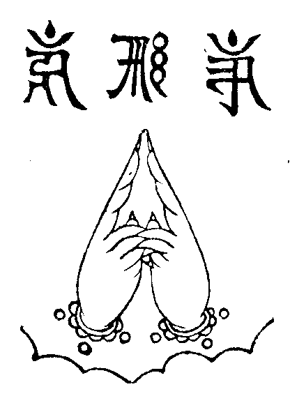



(诵彼如来，结彼手印，应不离自身观音也。)



诸佛子等！若闻宝胜如来名号，能令汝等尘劳业火悉皆消灭。



南无离怖畏如来



(右羽胸前竖，忍禅智相捻，掌覆指下垂，左掌仰上舒。)



那谟微葛怛得啰(二合)纳耶答塔葛达耶。



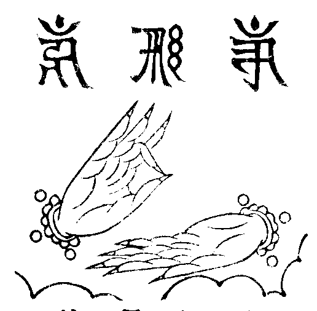



诸佛子等！若闻离怖畏如来名号，能令汝等常得安乐，永离惊怖，清净快乐。



南无广博身如来



那谟癹葛咓谛月补辣葛得啰(二合)耶答塔葛达耶



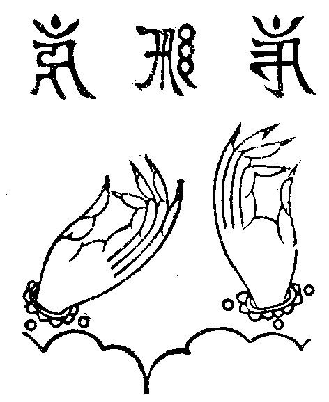



诸佛子等！若闻广博身如来名号，能令汝等饿鬼针咽，业火停烧，清凉通达，所受饮食得甘露味。



南无妙色身如来



那谟苏噜叭耶。答塔葛达耶。



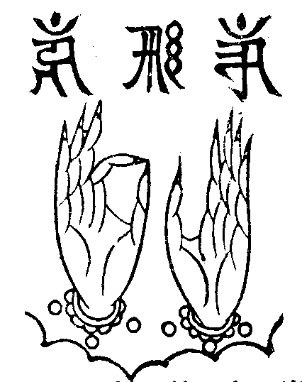



诸佛子等！若闻妙色身如来名号，能令汝等不受丑陋，诸根具足，相好圆满，殊胜端严，天上、人间最为第一。



南无多宝如来



(二羽虚合掌，胷前莲花状。)



那谟波虎啰怛纳(二合)耶答塔葛达耶。



诸佛子等！若闻多宝如来名号，能令汝等具足财宝，称意所须，受用无尽。



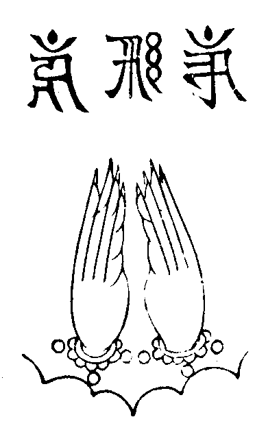



南无阿弥陀如来



(以右压左，禅智相拄。)



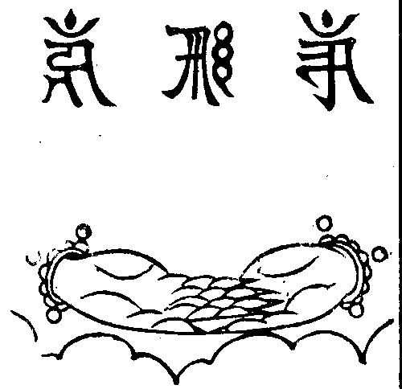



那谟阿弥哆婆耶答塔葛达耶。



诸佛子等！若闻阿弥陀如来名号，能令汝等往生西方极乐净土，莲花化生，入不退地。



南无世间广大威德自在光明如来



那谟卢迦委斯的(二合)，呤捺(二合)，第唧说啰不啰(二合)，癹耶答塔葛达耶



(右羽曲，仰拳忍，禅度相弹，左掌仰上，五指皆舒)。



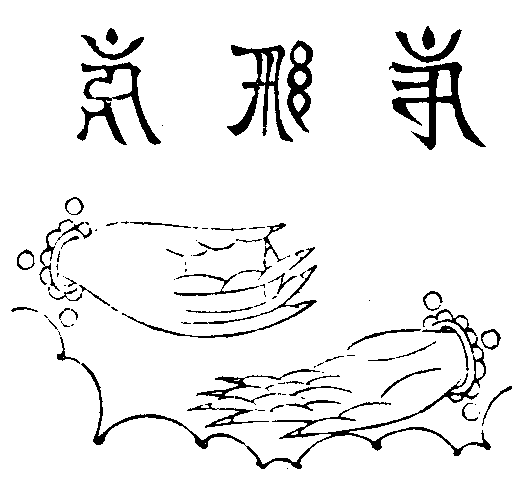



诸佛子等！若闻世间广大威德自在光明如来名号，能令汝等获得五种功德：一者、于诸世间最为第一；二者、得菩萨身，端严殊胜；三者、威德广大，超过一切外道、天魔，如日照世，显于大海，功德巍巍；四者、得大自在，所向如意，似鸟飞空而无阻碍；五者、得大坚固智慧光明，身心明彻，如琉璃珠。



(称赞毕，阿阇黎白云：)



诸佛子等！此七如来，以誓愿力，拔济众生，永离烦恼，脱三涂苦，安隐常乐，一称其名，千生离苦，证无上道。(三说)



次与汝等皈依三宝



> 皈依佛两足尊，皈依法离欲尊，  

> 皈依僧众中尊，皈依佛不堕地狱。  

> 皈依法不堕饿鬼，皈依僧不堕傍生。  

> 汝等佛子！



皈依佛竟，　皈依法竟，　皈依僧竟(以上俱阿阇黎三说，表白三和)。



> 皈依三宝故，如法坚护持，自离邪见道。  

> 是故至心礼。



次结三宝印



(左羽作拳相竖，进度当胷，右手屈力度，心想诵真言：)



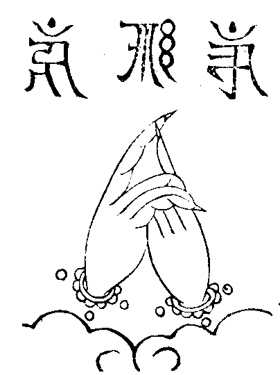



唵，婆(重呼)，龛。



南无佛！南无法！南无僧！我今发心，不为自求人天福报、声闻、缘觉乃至权乘诸位菩萨，唯依最上乘发菩提心，愿与法界众生一时同得阿耨多罗三藐三菩提。



今所发觉心，远离诸性相，蕴处及界等，能取所取执。诸法悉无我，平等如虗空，自心本不生，空性圆寂故。如诸佛菩萨，发大菩提心，我亦如是发，是故至心礼。



次与汝等发菩提心



汝等谛听(阿阇黎鸣尺一下，白四弘誓愿。)



> 众生无边誓愿度，烦恼无尽誓愿断，  

> 法门无量誓愿学，佛道无上誓愿成。



> 假使热铁轮，於汝顶上旋，终不为此苦。  

> 退失菩提心。



次结发菩提心印



(二羽虚合，如莲花状，以印心上。)



唵。补提即答。没怛巴。达野弥。



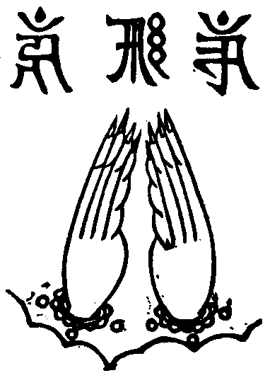



(师印呪可知。应想心、佛、众生三无差别，于一念间融成一广大月轮，如八月十五日夜中宵无云之时，极甚清凉皎洁，与虚空齐等。于月轮中想一金色阿hrīḥ字，如秋毫之末，非有非无。故当尔之时，不得加了。于知上无佛可成，下无生可度，中无行可修，烦恼、菩提、生死、涅槃净尽，此为大要，宜善用心焉。不惟为鬼神作利益，行人不久亦即就此中了解者矣。师诵呪，众和三声，次白云：)



今为汝等发菩提心竟。诸佛子等！当知菩提心者，从大悲起，成佛正因，智慧根本，能破无明烦恼恶业，不被染坏。



次与汝等受三昧耶戒



(行者鸣尺一下，白云：)



一摄律仪戒，无恶不断，起正道行，是断德因，修成法身。二摄善法戒，无善不积，起助道行，是智德因，修成报身。三摄众生戒，无生不度，起不住道，是恩德因，修成化身。



(既成大器，堪受宝戒。三昧耶者，准大乐金刚三昧经云：三昧名为本誓，亦名时，亦名期契，亦名曼茶罗，乃异名也。故有四种：一、大，二、三昧耶，三、法，四、羯磨。曼茶罗者，此四摠摄一切曼茶罗。又三昧耶亦四智印，即大智印、三昧耶智印、法智印、羯磨智印。又神变义释云：三昧耶者，是平等义，是本誓义，是除障义，是惊觉义。言平等者，谓如来现证此三昧时，一切众生种种身语意皆悉与如来等，禅定智慧与实相身亦毕竟等，初发心时与地波罗蜜满时亦毕竟等。是故出诚谛言以告众生：若我所言必定不虗者，亦合一切众生发此忱谛之言时，亦蒙三蜜加持无尽庄严与如来等。以是因缘故，能作金刚事业，故名三昧耶也。言本誓者，如来现证此三昧时，见一切众生悉有成佛义故，即将立大誓愿：我今要从普门以无量方便合一切众生皆至无上菩提，剂众生界未尽以来，我之事业终不休息。若有众生随我本誓发此忱实言时，亦令彼所为事业皆悉成金刚性，故名三昧耶也。言除障者，如来见一切众生悉有如来法界，但有一念无明故，常在其前而不觉知，是故发诚实言：我今要当设种种方便，普为一切众生抉除眼膜。若我誓愿必当成就者，令诸众生随我方便说此忱实言时，乃至于一切众生获无垢眼障盖都尽，故名三昧耶也。言惊觉义者，如来以一切众生皆在无明睡故，于如是功德不自觉知故，以议言感动令得醒悟，亦以此惊觉诸菩萨等，令发起禅定窟学师子频申三昧。若真言行人说此三昧耶者，我等诸佛亦当忆持本誓不得违越，犹如国王自制法已遂自敬顺行之，故名三昧耶也。具如是等广大甚深微妙之义，故名三昧耶也)。



> 汝等受佛戒，即入诸佛位，位同大觉已。  

> 真是诸佛子。



次结三昧耶印



(二羽金刚缚忍愿申如针，诵真言曰：)



唵，三摩耶，萨埵，鑁。



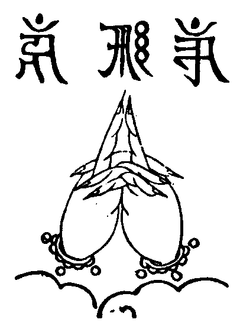



(师印呪可知。应想印中有白色鑁vaṃ字，放大光明普照所请一切有情。彼诸有情蒙光照及，三世诸佛戒波罗蜜一时圆满，法界善法想为光明，流光灌顶贮彼身中，身同普贤坐大月轮，绍诸佛职为佛嫡子也。据本文义无别观想，但如印呪自成受忏。如金刚顶经说：若诵此呪一遍，如入坛轮证三摩提，一切善法皆悉满足，三聚净戒俱时圆满，身同普贤坐大月轮，一切诸佛忆昔本誓观察护念。设有人曾受佛戒，恶心破毁不复清净者，若诵此呪一七遍已，破戒罪垢悉得清净，一切戒品还得如故。一切坛法未经师受，诵呪七遍即许行作，不成盗法。)



今为汝等授三昧耶戒竟，从今以去，能令汝等入如来位，是真佛子，从法化生，得佛法分。



> 汝等冥阳诸有情，我今施汝甘露食，  

> 法力加持徧十方，令汝一一皆饱满。



次结无量威德自在光明如来印



(藏本云：左印想持器，右羽弹忍禅。随闻记云：想字有据作如字，理甚允当，行者思之。)



嚩萨哩斡(二合)答塔葛达阿咓卢揭谛鑁婆啰鑁婆啰三婆啰三婆啰吽。



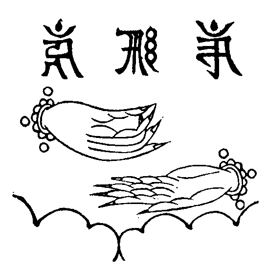



(师印呪可知。侍者取水点腕中及桶中，退坐本位。师应以右手怖畏弹指，遣左手魔碍，念云：吽吽癹怛。念三遍。问：手有何魔耶？答：为手中有诸户虫。次变空，念云：唵㰠。或三遍。问：变空此手，其意如何？答：以此手是赤白二种不净所成，故空之，令成胜妙功德庄严手也。问：前来入禅定，则自己是菩萨，今复何故又遣魔变空？答：法华经云：世尊说无量义已，又入三昧放光，至开宝塔，又入定放光。岂不滥耶？盖因一事而彰一法。譬乎世礼祀宗庙之人，非不斋戒沐浴，及至登殿之时，却又盥手，何也？为表敬也。今再遣魔变空，表慈之深，悲之极，用心之切也。次于一念间，顿成胜妙之手，於手掌中，出一红色𠳐paṃ字，变成红色莲花，花上想一白色鑁vaṃ字，明点中流出无尽饮食，想面前水器，尽成摩竭陀国之斛，七宝严饰，满盛胜妙食等。然后想此字种，流出无尽饮食，变满法界，念：唵oṃ阿āḥ𠶹哩(二合)hrīḥ吽hūṃ。呪一百八遍，或四十九遍，当自知时。次念变食呪，每一念于明点中，想取饮食，弹洒虗空。)



(准本经云：阿难白佛：大悲世尊！愿救我苦。所以者何？昨夜三更经行静处念所受法，见燄口鬼而语我言：汝过三日必当命尽生饿鬼中。我问鬼言：云何令我得免斯苦？饿鬼答言：汝若能施百千万亿那由他恒河沙数无量饿鬼、婆罗门仙、阎罗所司、业道冥官及诸鬼神、侍从眷属先亡久远，平等普施饿鬼饮食，汝得增寿。白言：世尊！云何能辩无量饮食充足？佛告阿难：汝今勿怖。我念过去无量劫中曾作婆罗门时，于观世音菩萨摩诃萨边受得陀罗尼，名曰无量威德自在光明如来陀罗尼法。汝若善能作此陀罗尼法加持七遍，能令一食变成种种甘露饮食，即能充足百千俱胝那由他恒河沙数一切饿鬼、婆罗门仙、异类鬼神上妙饮食皆得饱满。如是等众一一皆得摩伽陀国所用之斛，此食此水量同法界食之无尽，皆获圣果解脱苦身。佛告阿难：汝今受此陀罗尼法，令汝福德寿命增长，饿鬼生天及生净土受人天身，能令施主转障消灾延年益寿，现招胜福当得菩提云云。此呪旧多一鑁字，应准本经仪轨除之。)



语诸佛子：今为汝等作印呪已，变此一食为无量食，大如须弥，量同法界，终无能尽。



> 由此真言力，变食作乳海，普施饿鬼等。  

> 身心皆饱满。



复结前印诵乳海真言



那麻，三鬘哆，勃塔喃，鑁。



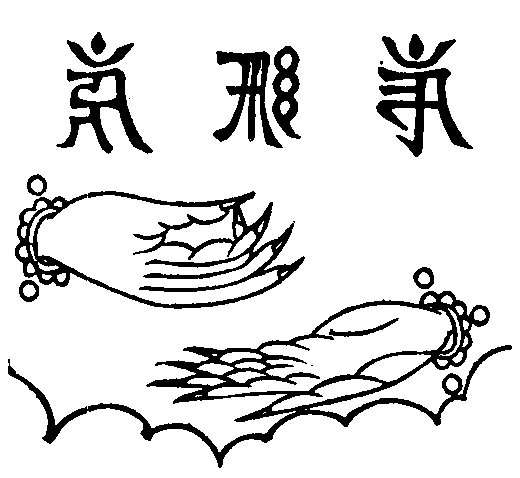



(师印呪可知。应想明点中流出甘露，以右手点取，弹洒虗空，如雨注下。凡所至处，即成长河酥酪也。问：何以少小器水等徧满法界？答：心力难思故也。况又藉神呪及字种观想等力，乃至诸佛冥加禅定之力，岂不能变小成大，化少为多也？且如栾巴一巵之酒，以术力尚能化为霖雨，何况神呪难思之力者乎？行者亦不可不专注用心也。又问：何故不以饮食施之，却用水也？答：彼鬼趣多为业火所烧，故今以水施之，沃灭其业火。佛云：彼鬼等百千万劫不闻浆水之名，何况得饮？又云：彼鬼在恒河边而不见水，设使得见，变成脓血。若饮之时，入腹化为猛燄，热烧心腹，难堪痛苦。悲哉！悲哉！故今以水施之，体此意也。又番本云：苏噜巴，此云水施食。则知本乎施水矣。今世俗不知，多用施食，水亦失矣。况今施食亦不专用水，彼器中皆投饭七粒徧十方是也。故勿疑诸耳。)



语诸佛子：今为汝等作印呪已，由此印呪加持威力，想于印中流出甘露，成於乳海流注法界，普济汝等一切有情充足饱满。



> 汝等业障鬼，变火不能食，今诵秘密言，  

> 法食皆饱满。



次诵障施鬼真言



唵，哑吽，拶辣弥担，萨哩斡(二合)不哩(二合)的毗牙(二合)莎诃



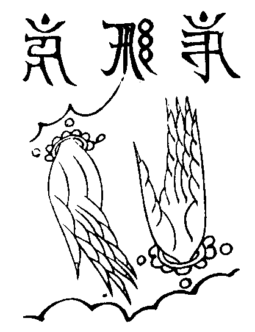



(师印呪可知。应埀展右羽，想右掌中有一鑁vaṃ字，明点中流出甘露，从左掌而下，念：唵oṃ哑āḥ𠶹哩(二合)hrīḥ吽hūṃ字，一百八遍或三七遍皆可。侍者至师前作礼，取净瓶出坛，将净水徐徐注下。师至唱时，想彼障施鬼悉皆胡跪。师想自身观音徧至其前，而施甘露从顶上入，灭其业火而得清凉。呪三遍，各弹指一下。呪三遍或七遍，障施鬼等饱满懽喜，弹指一下。是时行者即以右羽持甘露器，面向东立，泻于坛前，或净地上，或于石上，或新净瓦盆亦名盂兰盆，生台亦得，或泉池河海长流水中，不得泻于石榴桃树之下。鬼神惧怕，不得食之。若圣众坛中明王诸天，若施饮食置生台上，是本法也。若供养诸佛圣众，于上五更、晨朝、日出，是供养时。若鬼神法，于人定亥时、本人定时。阿阇黎法，若於斋时，尽于一日，但加持饮食水等，布施飞空乌兽水族之类，不拣时节，但用施之。若作饿鬼施食之法，当于亥时。若于斋时施饿鬼食者，徒设功劳，终无効也。不是时节，妄生虗诳，鬼神不得食也。不从师得，自招殃咎，成盗法罪。佛说普贤曼拏罗经云：左手弹指，一切善事速疾成就；右手弹指，速疾集会。苏悉地羯罗供养法云：两手各作弹指，是辟除法也。)



诸佛子等，虽复方以类聚，物以群分，然我所施，一切无碍，无高无下，平等普徧，不择冤亲。汝等今日，勿得以贵轻贱，以强凌弱，拥遏孤幼，令不得食，使不均平，越佛慈济。必须互相爱念，犹如父母忆子之想，语诸佛子：汝等各有父母、兄弟、姊妹、妻子、眷属、善友、亲戚，或有事缘来不得者，汝等佛子，慈心爱念，各各賷持饮食、钱财物等，递相布施，充足饱满，无有乏少，令发道意，永离三涂，长越四流，当舍此身，速超道果。又为汝等，将此净食，分为三分：一施水族，令获人空；二施毛群，令获法寂；三施他方，禀识陶形，悉令充足，获无生忍。



> 神呪加持净法食，普施河沙众鬼神。  

> 愿皆饱满舍悭贪，速脱幽冥生净土。



次结普供养印



唵葛葛纳三婆斡斡资啰(二合)斛



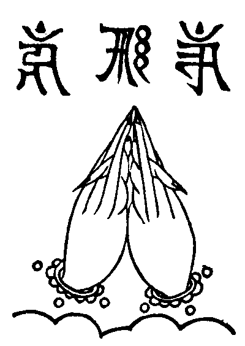



(师印呪可知。应想屈中指处，想白色唵oṃ字，明点中流出无尽供养，具足庄严平等供养，同声念普供养真言，或五遍或七遍。问：最初既奉献三宝施食已竟，今复何故作此供养？答：前来所作由拣圣凡，故奉献三宝，后施鬼众。今融以平等，故圣凡交彻，所以普供养也。维那白从来所受饮食文毕，师应作五供养施宝，错念斯麻啰等呪。)



(无量寿如来仪轨云：次结大虗空菩萨印，二手合掌，二中指右押，左外相叉，博著手背，二头指相蹙如宝形即成。想从印中流出无量诸供养具、衣服、饮食等。)



诸佛子等！从来所受饮食，皆是人间贩鬻生命、酒脯钱财、血肉𦎬膻、荤辛臭秽，虽复受得如是饮食，譬如毒药损坏於身，但增苦木沉沦苦海无解脱时。我今依如来教精诚罄舍，设此无遮广大法会，汝等今日遇兹胜事戒品沾身，于过去世广事诸佛、亲近善友、供养三宝，由此因缘值善知识发菩提心，誓愿成佛不求餘果，先得道者递相度脱。又愿汝等昼夜恒常拥护于我满我所愿，以此施食所生功德，普将回施法界有情，共诸有情同将此福，尽皆回施无上菩提一切智智，勿招餘果愿速成佛。



尊胜呪



唵，𠽾[口*(隆-一)](二合)，莎诃唵，捺谟癹葛斡谛，萨哩斡(二合)得啰卢迦卜啰(二合)谛，月涉瑟咤(二合)耶，勃塔耶，爹捺麻答的牙(二合)塔唵，𠽾[口*(隆-一)](二合)𠽾[口*(隆-一)](二合)𠽾[口*(隆-一)](二合)杓讹(二合)塔耶，杓讹(二合)塔耶，月杓讹(二合)塔耶，月杓讹(二合)塔耶，哑萨麻萨蛮达哑，斡癹萨思葩(二合)啰拿葛谛，葛葛拿，莎癹斡月述提哑，撇膻𠽷都𦎌，萨哩斡(二合)答塔葛达，苏葛答瓦啰，斡拶拿，哑密哩(二合)达哑，撇释该而(二合)马曷木得啰(二合)曼特啰(二合)叭𦊋，哑曷啰，哑曷啰，马麻蔼由而(二合)伞塔啰尼，杓讹(二合)塔耶，杓讹(二合)塔耶，月杓讹(二合)塔耶，月杓讹(二合)塔耶，葛葛拿，娑癹斡月述提，乌失尼沙身拶耶，巴哩述铁，萨曷思啰(二合)啰思弥(二合)伞租爹敌，萨哩斡(二合)答塔葛达哑，斡噜结尼煞咤(二合)巴啰密达巴哩卜啰尼萨哩斡(二合)答塔葛达麻谛答摄蒲密卜啰(二合)牒瑟咤(二合)谛萨哩斡(二合)答塔葛达赫哩(二合)达耶哑牒瑟咤(二合)拿哑牒瑟咤(二合)谛木得哩(二合)木得哩(二合)马曷木得哩(二合)斡资啰(二合)葛耶三曷达拿叭哩述铁萨哩斡(二合)葛哩麻(二合)哑斡啰拿月述铁卜啰牒聂斡而达(二合)耶马麻蔼由而(二合)月述提(二合)萨哩斡(二合)答塔葛达(二合)萨麻耶哑牒瑟咤(二合)拿哑牒瑟咤(二合)谛唵摩尼摩尼马曷摩尼月摩尼月摩尼摩曷月摩尼麻谛麻谛马曷麻谛麻麻谛莎麻谛答塔葛达蒲达戈𨕕巴哩述提月思蒲咤卜铁述铁希希拶耶拶耶月拶耶月拶耶思麻(二合)啰思麻(二合)啰思葩(二合)啰思葩(二合)啰思葩(二合)啰耶思葩(二合)啰耶萨哩斡(二合)勃塔哑牒咤(二合)拿哑牒瑟咤(二合)谛述铁述铁卜铁卜铁斡资哩(二合)斡资哩(二合)马曷斡资哩(二合)莎斡资哩(二合)斡资啰(二合)葛而(二合)毗拶耶，葛而(二合)毗月拶耶，葛而(二合)毗斡资啰(二合)左辣，葛而(二合)毗斡资啰(二合)忒葩微，斡资啰(二合)三葩微，斡资啰(二合)斡资哩尼，斡资㘕(二合)癹斡都，麻麻摄哩㘕，萨哩斡(二合)萨埵喃，拶葛耶，巴哩述提，癹斡都，萨埵弥，萨哩斡(二合)葛谛，巴哩述提，释哲(二合)萨哩斡(二合)答塔葛达，释哲(二合)𦎌，萨麻刷，萨颜都，卜铁卜铁，悉铁悉铁，勃塔耶，勃塔耶，月勃塔耶，月勃塔耶，谟拶耶，谟拶耶，月谟拶耶，月谟拶耶，杓讹(二合)塔耶，杓讹(二合)塔耶，月杓讹(二合)塔耶，月杓讹(二合)塔耶，萨蛮答谟拶耶，谟拶耶，萨蛮答啰思弥(二合)巴哩述提，萨哩斡(二合)答塔葛达，赫哩(二合)达耶，哑牒瑟咤(二合)拿，哑牒瑟咤(二合)谛，木得哩(二合)木得哩(二合)马曷，木得哩(二合)马曷木得哩(二合)曼特啰(二合)叭谛，莎诃



(佛顶尊胜陀罗尼经云：此呪能破一切地狱，琰魔王界旁生之苦，回趋善道。此呪不可思议，有大神力等。)



(举，徃生呪三遍。此圆满加持复有二种：一、神呪圆满，二、善根圆满。神呪圆满者，谓侍者当取花米俵与大众。俵已，师资同声诵尊胜呪，想彼成光明种。加持花米已，侍者以小楪取花米出外抛撒。师想鬼神等触此光明者，皆得徃生极乐国土上品上生也。侍者倾施食净水，师资等同念六字大明真言一百八遍毕。上师振铃，众和法乐，诵六趣偈。)



六字大明真言



唵嘛呢叭𠵸吽(一百八遍)



(佛说大乘庄严宝王经云：此六字大明，是观自在菩萨微妙本心。若人诵持此呪，于诵持时，有九十九殑伽河沙数如来集会，复有如微尘数菩萨集会，乃至复有地中药叉、虗空神等而来卫护，七代种族皆得解脱云云。)



六趣偈



承斯善利地狱受苦有情者，刀山劒树变化皆成如意树，火团铁丸变成莲花而为宝，吉祥地狱解脱而能成正觉。



承斯善利饿鬼受苦有情者，口中烟𦦨烧身速愿得清凉，观音手内甘露自然常饱满，吉祥饿鬼解脱而能成正觉。



承斯善利，畜生受苦有情者，杀害、烧煑、楚毒等苦皆远离，远离乘骑、愚痴，速得大智慧吉祥，畜生解脱而能成正觉。



承斯善利人间受苦有情者，生时犹如摩耶右脇而降诞，愿具六根永离八难，修福慧吉祥人间解脱而能成正觉。



承斯善利修罗受苦有情者，我慢颠狂拙朴速疾令柔软，恶心嫉妬瞋恚鬬争自调伏，吉祥修罗解脱而能成正觉。



承斯善利天中受乐有情者，欲乐䇿勤速发广大菩提心，天中受尽忧苦自然生欢悦，吉祥天中解脱而能成正觉。



承斯善利，十方独觉、声闻者，弃舍小乘四谛、十二因缘行，进趋大乘四摄、六度，修万行吉祥、二乘解脱，而能成正觉。



承斯善利初地菩萨勇识者，百福庄严一切行愿皆圆满，顿超十地证入一生补处位，吉祥大乘速证究竟成正觉。



发愿回向偈



> 现世之中未证菩提间，愿无内外障难恶缘等。  

> 恒常遇逢最妙善知识，所修善事行愿速成就。



最上三宝。



> 临命终时识性无迷惑，愿生西方净土如来前。  

> 依于慧日发光闻思修，断惑证真愍念于有情。



最上三宝。



> 能回施人回施回施善，所获一切一切诸功德。  

> 犹如幻化幻化似梦境；三轮体空体空悉清净。



最上三宝。



吉祥偈



> 愿昼吉祥吉祥夜吉祥，昼夜六时六时恒吉祥。  

> 一切时中时中吉祥者，愿诸上师上师哀摄授。  

> 愿昼吉祥吉祥夜吉祥，昼夜六时六时恒吉祥。  

> 一切时中时中吉祥者，愿诸三宝三宝哀摄授。  

> 愿昼吉祥吉祥夜吉祥，昼夜六时六时恒吉祥。  

> 一切时中时中吉祥者，愿诸护法护法常拥护。



南无西方无量寿如来，诸大菩萨，海会圣众。惟愿法界存亡，等罪消除，同生净土，回向无上佛菩提。



> 见闻如幻翳。三界若空华。闻复翳根除。  

> 尘消觉圆净。



伏以真源湛寂，乃罪性之本空。苦海洪深，逐妄波而不息。由众生之业感，致长劫以沉沦。受报地狱之中，永罹苦楚。转生饿鬼之内，长忍饥虗。既无解脱之期，宁有超升之路。匪仗如来之慈愿，曷解恶趣之倒悬。呪诵真诠，施甘露之法食。灯燃宝炬，烛冥界之幽途。普使迷流，俱超极乐。今日道场，以此普施功德，回向铁围山内，面燃大士，统领三十六部，无量无边，恒河沙数，诸饿鬼众。伏愿自从旷劫，迨至今生，释业障以消镕，雪罪𠎝而清净。镬汤涌沸，变成八德之莲池。炉𦦨交辉，化作七珍之香盖。劒树皆为玉树，刀山尽作宝山。徧界铁床，现菩提之法座。满釜洞汁，化甘露之醍醐。往昔债主以相逢，俱蒙解脱。积劫冤家而共会，各遂逍遥。狱主兴慈，冥官持善。多生父母，从兹入圣超凡。累世亲姻，自此承恩获福。天上五衰不现，人间四相皆空。修罗舍尽嗔心，地狱息诸苦恼。河沙饿鬼，化热恼而作清凉。十类含生，舍迷途而登觉岸。普愿此国土，他国土，无量诸国土，一切有情，共证真常。此世界，他世界，无量诸世界，无尽含识，齐成佛道。四恩总报，三有均资。法界众生，同圆种智。



(阿阇黎称大众同和)。



> 诸佛正法菩萨僧，直至菩提我归依。  

> 我以所修诸善根，为利有情愿成佛，  

> 世出世间，随愿所成，随愿所成，  

> 愿以此功德，普及于一切。我等与众生，  

> 皆共成佛道。



次结圆满奉送印



(二羽金刚拳，进力两相钩，随诵而掣开。金刚解脱真言曰：)



唵，斡资啰(二合)穆。



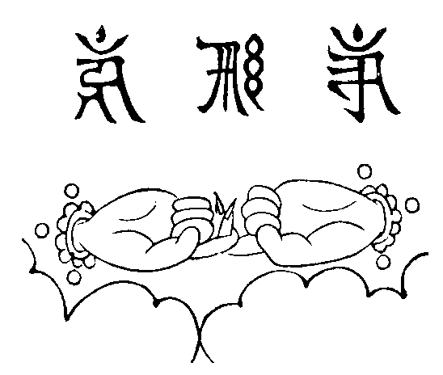



(师印呪可知，想诸佛菩萨及六道四生悉皆不现。二善根圆满者，谓举施食功德殊胜行偈，众同音和。问：既是奉送已，诸佛菩萨不现，谁为证明？答：此显来实无来，去实无去也。三宝常住世间，且如法华经云：多宝佛塔还可如故。而妙音菩萨来，多宝佛与塔未常不在也。若夫请之则实来，送之则实去，何异鬼乎？学者思之。复念金刚萨埵百字呪三遍，补阙。)



金刚萨埵百字呪



唵，斡资啰(二合)，萨埵苏萨麻耶，麻纳巴辣耶，斡资啰(二合)，萨埵谛奴钵谛，瑟劄(二合)得哩(二合)锄弥癹咓，苏度束弥癹咓，阿奴啰屹都(二合)弥癹咓，苏布苏弥癹咓，萨哩斡(二合)戍提弥不啰(二合)耶茶，萨哩斡(二合)葛哩麻(二合)苏拶弥，稷达释哩(二合)扬骨噜吽，诃诃诃诃，斛癹葛湾，萨哩斡(二合)答塔葛达，斡资啰(二合)麻弥扪拶，斡资啰(二合)癹咓麻，诃萨麻耶，萨埵阿(引)



(此呪补阙行者，手作印不次第，心观想不专注，如是等过，悉皆清净。复念阿āḥ字二十一遍，则前来能想所想，一一作行，皆不可得。若不如是，则堕于有为矣。所谓燄口，岂易语哉？金刚萨埵。五秘密云：金刚萨埵者，是普贤菩萨，即一切如来长子，是一切如来菩提心。又萨埵有愚萨埵、智萨埵、金刚萨埵，今简其二种，故云金刚萨埵。密呪。圆因集云：此呪求愿补阙，功德无量，散在诸经。又名句中，随宗回转，诵者知之。复念阿字二十一遍。甘露军茶利云：于圆明心上，初观唵oṃ字，次观阿āḥ字，乃至第七观咤ṭa字，明一切不可得也云云)。



薜茘多文(阇黎自白)



> 五姓孤魂薜茘多，莫教平地起风波。  

> 慈航泛涨须到岸，洗脚上船会也麼。  

> 已发觉，未发觉，莫论鄷都并泰岳。  

> 罪无轻重尽蠲除，何须一一重惩悫。  

> 已结证，未结证，打破阎君台畔镜。  

> 慈风扫荡障云消，万里青天孤逈逈。



诸佛子等会也麼？休休休，更莫造罪结冤讐。钓竿还在阎君手，切莫从前再犯钩。即今施食圆满，功德周隆，汝等孤魂佛子，向甚麼处安身立命？咦！



> 覩莲池不离当处，指净土只在目前。  

> 不劳弹指证菩提，顷刻便参观自在。



回向偈



> 施食功德殊胜行，无边胜福皆回向，  

> 普愿沉溺诸众生，速往无量光佛刹。  

> 会上因缘三世佛，文殊普贤观自在，  

> 诸尊菩萨摩诃萨，摩诃般若波罗蜜。



归依三宝。上来设放瑜伽𦦨口，平等甘露法食，功德圆满，无限良因，普沾沙界。和南圣众。



瑜伽𦦨口注集纂要卷下(终)



嘉兴楞严寺般若堂经赀刻此瑜伽注集纂要二卷，计字□万□千□百□十□□，该银□拾□两□钱□□。



康熈十四年七月比丘　寂暹　识



No. 1084-B



附增津济疏



一、泗天下　南赡部洲。



大清国浙江等处承宣布政使司，某府某县僧纲司，某寺幻住，秉释迦如来遗教，主修燄口法事比丘某，今据某府某县某乡贯居住，奉佛普利荐扷，赈济孤魂信。　某是夜沐手焚香，一心拜于本师和尚释迦文佛，接引导师弥陀慈父，瑜伽会上宝胜如来，幽冥教主地藏菩萨，广度群迷观音大士，兴权启教难陀尊者，一阴真宰，郡邑城隍，土谷灵聪，当方司令。惟愿同垂慧鉴，俯察葵里情旨。伏为　切念冥途杳隔，泉界难通，不凭修荐之功，曷遂超升之理。由是发心，取今　年　月　日，延命僧伽，　启建某道场一会。是夜敦请金刚上师登坛，设放瑜伽燄口平等甘露法食，超法界之孤魂，济河沙之含识。伏以九幽十类，未脱生死之轮；八难三涂，宁免饥虗之苦。今则无遮会启，观音现焦面之形；大施门开，尊者设摩伽之斛。请七如来而作证，慈化流芳；结三昧印以加持，悲增护念。化粒米为大地，超沉冥于万灵。德泽四生，恩沾九有。所集功德，专伸修荐。某仗此良因，早登觉岸。所冀五衰不现，天宫脱牛领之因；四相皆空，人世乐尧风之化。修罗罢战，从兹舍尽嗔心；地狱停酸，自此高跻净域。受甘露味，多生饥火以全消；证金刚智，累劫愚痴而顿释。伏愿胎卵湿化，各各悟本性之弥陀；鳞甲羽毛，彼彼达惟心之净土。获无生忍，入不退地者。



恭　于



三宝证明赈济孤魂文疏



岁　在



> 康　熙年　月日　具



附六道疏式



五衰不现天仙道众



四相皆空人伦道众  

乙卯孟秋



舍尽嗔心修罗道众  

僧自恣日



息诸苦恼地狱道众  

净业比丘



常获饱满饿鬼道众  

寂暹谨识



速得智慧畜生道众



No. 1084-C 跋



余髫年时，侧聆先师祖垂训曰：既得出俗为僧，当发大弘誓愿，凡利生接物之阴功，惟𦦨口一事为最大。因二六铭心，随取瑜伽密部，澄神而习绎之，不辍昼夜者，今将二十年矣。盖阅诸家登坛演习，繁简不同，为有七家𦦨口八家忏之讹传，致令好新奇杜撰之端，因兹始矣。所以参差百等，诸方不能一揆也。故今繁简得中，悉遵天机大师行窾，并纂内法师所集本部注文，合成一帙，名注集纂要，呈鉴诸方高贤达士。若以为可，愿广流通大地；若以为不可，乞垂慈诲。片言愽笑，大方合十云耳。



旹丙辰秋日法云后学寂暹䟦并书

