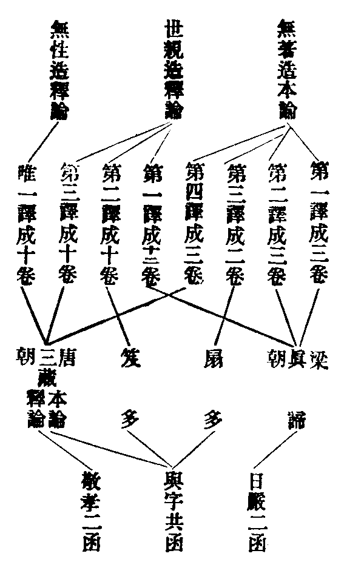
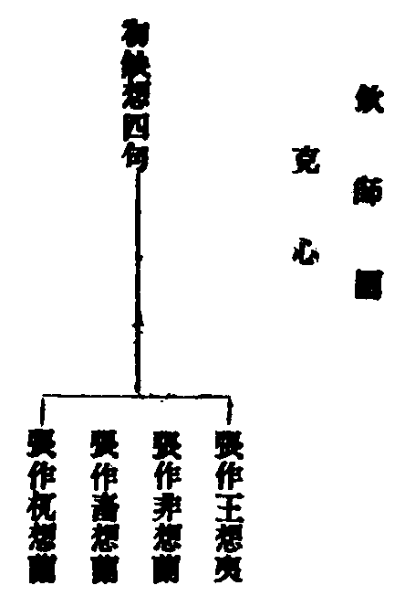
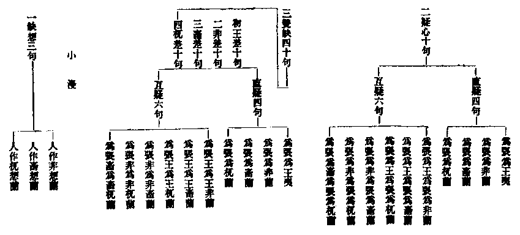
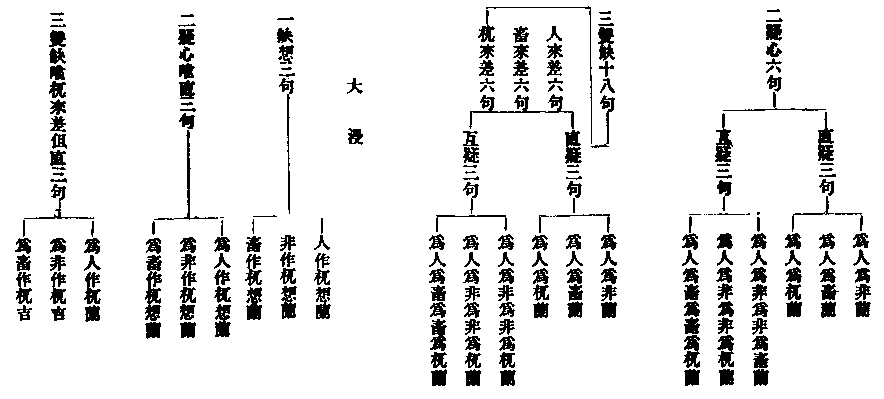
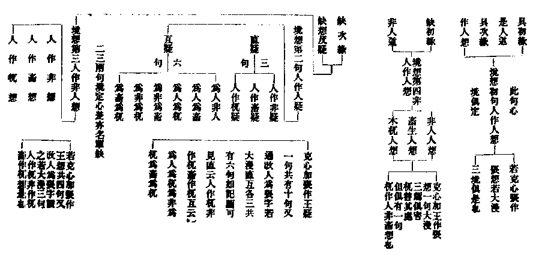
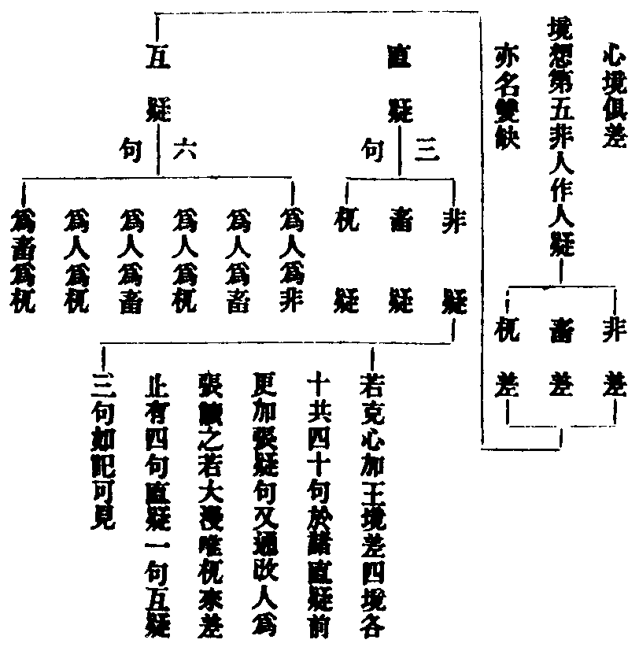

# 终南家业



> **藏经**：卍新纂大日本续藏经（新纂卍续藏）　**册次** 第 59 册（X59）　**编号** X1109　**部类** 密教部　**卷次** 3 卷　**篇幅** 87,548 字

> **卷／品**：1 卷 · 0 品



---



## 目录



- [终南家业卷第一](#终南家业卷第一)



---



终南家业目录



四明　䥫翁宗师　述



门人　行枝　编



上卷教观撮要  

三观尘露  

答日本芿法师教观诸问



中卷重受戒文  

戒体正义直言  

四诤要论  

衣制格言  

论分部  

论僧体  

科释杂心论出三有对文  

受缘重开



下卷论心用双持犯结制罪  

辨二止并八九名义  

重释事钞持犯篇通塞文  

重答钦师境想问  

㭊然梦庵持犯四难  

徵显定道二戒  

略辨正用相从  

略议第七非体  

辨略教结犯



No. 1109



------



## 终南家业卷第一



教观撮要



吾祖弘律，以妙观为本。盖准律中，佛制比丘观念对治，方能入道，故曰常尔一心。念除诸盖，违则结犯。但律中观念，皆属权少。祖师克究佛怀，深符开会，直依摄大乘论(皈敬仪引)：知尘无所有(空观)，通达真(真谛)；知唯识有(假观)，通达俗(俗谛)。若不达俗，无以通真；若不通真，无以遣俗。以俗无别体等义。(上显真、俗相即为空谛，空、假不二为中观。)立中道妙观为出家学本。於事，钞：沙弥篇及业疏受戒篇并云观事是心等，言事即总十界依、正色、心等法。盖是唯心本具，全心变现。事即俗谛，心即真谛，心、事不即不离即中谛。如此观事，岂思议哉！使自沙弥便开妙解，达事是理，全性成修，凡所进用，俱成妙行。又於钞疏忏六聚篇乃云诸法外尘本无实唯有识此理深妙等，上句真谛，下句俗谛。俗不离真，真不离俗，不即不离，即是中谛。(在所为三谛，在能为三观。)三谛之法，微妙圆融，故云深妙。会上两文，其义即一。是则一心即三谛，三谛即一心。若以一心为能观，则三谛并属能观，为之一心三观圆融妙观；若以一心为所观，则三谛并属所观，为之一心三谛圆融妙境。境、观俱明，能、所互照，无能、所中能、所历然，无差别中差别宛尔。复於归敬仪中，能敬无非三业，所敬莫过三宝。於篇篇事事之下，令理事圆融，真俗并运。(上明观讫。)立观既妙，在教必圆。此宗云教，无非律乘。若据教限，律是偏少。究佛本怀，诸有所作，常为一事。百千方便，曲功调停。皆佛权谋，随他意语。至终法华，方畅本怀。开决偏小，即一佛乘。涅槃扶谈，终显佛性。自昔传律，全昧归源。唯我南山，高怀卓朗。判释教门，空有无滥。别凖二经，开扶妙旨。直显戒律，即是圆乘。点显境缘，及受随行。皆即一心，无非唯识。唯心教行，岂不圆妙。今更略引诸文，使学者知其教也。(下引戒法处，即指於教也。)如事钞指戒法云：法界、尘沙、二谛等法。法界乃戒法之体，尘沙乃戒法之数。若以法界为境，应须了境即是二谛。三谛之法，非界言界，故云法界。当知戒法，乃於法界理上，假名建立，故有差别。数等空尘，又若河沙，故云二谛法也。所谓诸佛说法，常依二谛者是也。二谛非即非离，强名中谛。故一一教门，皆三谛圆融微妙之法。故又续云：测思明慧，(观妙。)与妙法相应。(教妙。)测思，能受心也。妙法，所受法也。以微妙心，受微妙法。能所体同，即一实相，故曰相应。钞中又云：所发戒相，乃有无量。(乃至。)若随境论，不过情与非情，空有二谛。灭理涅槃，佛说圣教，文字卷轴，形像塔庙，地水火风，虗空识等，法界为量，并是戒体。此文以法界结上诸境，则一一境皆微妙法界。依法界而制诸戒，则法界是戒法之体。故云并是戒体也。要使受者以法界心缘法界境，受法界法，只一法界，无异法界。能、所泯亡，究竟一相。故得钞文又云：深戒上善，广周法界。(文)戒法若非体是法界，何得云深？何云上善？况钞序首云戒德难思等，此文虽叹戒功，由体微妙，故功用难思。学者不能如此推究，以致屈抑教门，情切哀痛。又业疏云：智知境缘，本是心作；不妄缘境，但唯一识。(文)境是尘境，缘即戒法。境与戒法既唯一识，唯识即是三谛圆融妙理。境岂不妙？法岂不圆？亦欲受者识源达本，圆发上心，圆纳三聚，圆成三行。故疏又云：常思此行即摄律仪，用为法佛清净心也。此行即小法，律仪即大乘，法佛即果德。即小是大，即因是果。小、大，因、果，即一净心，无差别也。故疏复云：大、小俱心，律仪不异。义极明显。圆文妙义，具在诸文。学不究心，鲜能知要。吾祖教观，几至扫地。余曾释圆教五门及答日本芿师疑，并三观尘露等处，輙以管见发挥圣言。但恐文繁，学者难晓。今撮要义，别书一纸，庶易流传，为广究之蹊径耳，即非沽誉要名也。深愿同门精研愽究，一、益自己，二、化他人，二、皆契实，无忝其裔。淳祐壬寅佛忌前一日，华严阁下出



三观尘露



吾祖南山澄照大师，迹示四依，位阶上地。妙明一实，洞彻两乘。预译场而辞翰推尊，敷讲席而天龙拱侍。慨律藏实佛法命脉，轸戒德乃定慧依因。历三生而偏志弘扬，抗六师而广文流演。虽举宗而持犯为正，在进修而理观兼明。或令福智双行，或示化制同禀。通依两典，总列三阶。义趣该罗，文辞简略。管闚曷既，肤受何穷。唯灵芝记主大智律师，妙赜真源，深研理味。律遵南阜，而教领南屏。位隐西湖，而道闻西竺。广明圆行，妙演观文。辨㭊浅深，辉映今古。(守一)忝继学徒，谩寻文相。愚情有拥，略义伸明。仍决异传，少资己解。自愧斗筲量窄，萤焰见卑。虽竭精诚，焉能尽理。犹尘露之於山海，故题曰三观尘露者矣。大分四科。



初引本文  

二略叙释  

三示立意  

四决异传



第一、引本文



事钞(忏篇)云：一者、诸法性空无我，此理照心，名为小乘。二者、诸法本相是空，唯情妄见，此理照用，属小菩萨。三者、诸法外尘本无，实唯有识，此理深妙，唯意缘知，是大菩萨佛果证行。故摄论云：唯识通四位等。又(事钞沙弥篇、业疏受戒篇)同云：一者、小乘人行，观事生灭，知无我、人、善、恶等性。二者、小菩萨行，观事生灭，知无我、人、善、恶等相。(业疏云：观事是空等。)三者、大菩萨行，观事是心，意言分别。故摄论云：从愿乐位至究竟位，名观中缘，意言分别为境。又业疏(忏篇)云：小乘极处，人、法二观。对我观析，唯见是尘；对阴求之，但唯名色。求人求法，了不可得，是为空也。大乘极处，空识为本。初浅滞教，谓境是空，了境本无，性唯识也。(净心诫观、归敬仪广明理观，故不尽录。)



第二、叙释



分二：初、叙略意。详上诸文，莫不以三位极理，示於观体。至於心境行相，在文皆略，备载摄论及道整禅师。凡圣行法，当时盛行，是故诸文并指如彼。整师之文，近世已亡；摄论之义，晚学难晓。灵芝诸记复指天台摩诃止观，是可投心。良由此宗疏钞正明持犯，定慧资修，理须旁示，恐乱宗途，故不繁广。



次释文相。就文分三，即境、理、人也。



一者示境，三观皆云诸法，及云观事。若对机见，须分广狭。前之性空，小机见狭，六凡五阴，为诸法也。后之二观，即指十观，该及三世，为之诸法。又复动心即事，有念皆法，诸法及事，通收内外。至於取境成业，无过妄计。前二云我人，后一云意言，皆妄计也。舍䟽就亲，正指妄计为所观境。故记云：三理照之，乃知颠倒，但有妄计。又云：但破妄计。又云：谓观念性等是也。(上示境竟)二言理者，理即观体，亦诸法体。若就文指，即性空、相空、无我，及唯识是心等是也。虽分节文，相有境理之殊，其实句义连绵，诸法即理，不可分异。须知诸法唯是一心，究竟圆明，平等一相。妄计自障，贪著轮回。如来随机，或说诸法皆空，或谓唯一实相。小乘机劣，认空为极。其间钝者，推㭊法性，方见空理。利者，体法即空。后大乘中，然有一类，虽发大心，未穷心本，亦但认空以为极理，了相即空，与前为异，志愿弘大。故云：菩萨修唯识者，不无利钝。钝者别修，从假入空，方达中道。利者圆入，初后一如，因果皆妙。后更引明，



问：性、相二空，唯空人、我，兼空诸法耶？钞文但云无我，不言法空，请为明之。



答：文中具明，何不详耶？初云诸法性空，此空法体性也。复云无我即空，我人执性也。次云诸法相空，此空法体相也。复云无我即空，我人执相也。又云观事生灭，法空也。知无我人，人空也。是则性相二空，具兼人法。业疏甚明，记文更显。又复人法之义，诸文广陈，学者自知，兹不繁累(决异传中又略释之)。须知在境为人法二执，在观为人法二智，在理为人法二空也。



问：性、相二观，钞文皆云生、灭，如何分异？



答：初则见相如实，从缘生灭；次则见相如幻，空花水月，虗生虗灭。初则生灭是实，次则生灭是空。故业疏云观事是空者是也。文云：外尘本无，实唯有识。此之二句，即是三谛圆融，中道妙理也。尘即诸法，皆六尘故。对於凡小，不了心源，故云外也。本即元本，无乃理体，实谓不虗，唯乃训独。本实二字，显知其的。今作三义，释此二句：一、克体释。一切诸法，从本以来，若体若相，泯迹亡形，究竟如空，微妙莫测，即一真如，无非实际，故云外尘本无。盖是唯心本具，全心发生，法法皆心，尘尘即识，究竟指示，故云实唯有识。识是圆理，体亦本无，是则无即是识，识即是无。且就诸法体上，强言於无；诸法相上，假立言识。无乃识之体，识乃无之相，不即不离，复不思议，故言妙深也。二、遣情释。言本无者，遣著有计。本无虽空，空非偏空，有识假立，即是妙有。不著二边，不离二边，即是中道，故云妙也。三、修显释。据梁摄论，方便位中，先以依他性遣分别性，见一切尘空。然无体，但有意言分别，故云外尘本无。翻分别性为无相性，此中言无，但见尘空(即空观成)。依他性体虽是唯识，申智未利，但见似像。以真实性遣依他性，真实性渐显，依他性渐消，然后一切法似名似义及似唯识，无所从生，灭意言分别，得无分别智。翻依他性为无生性，此中言无，正示识体(乃假观成)。真实性体即实相，本无可翻。欲显体妙，翻无性性，言无性之性，显空即识也(即中观成)。此方显出唯识圆妙觉，方见极圆。上论次第，非今立意。真俗并运，空假即中，三性圆修，初后俱妙，是今宗旨，如下更明。



问：文唯二句，何见三谛圆融、三观圆修之义耶？



答：外尘本无，即是真谛，亦即空观。实唯识有，即是俗谛，亦即假观。识即是无，空不离假，不即不离，名为中道。是知立观，唯据三谛圆融中道妙理。故文结云：此理深妙，岂不然耶？正准摄论(敬仪中引)云：知尘无所有，通达真。(真即真谛，知无即是空观。)知唯识有，通达俗。(俗即俗谛，知识即是假观。)若不达俗，无以通真。(上谓通达真时，必先达俗是空。)若不通真，无以遣俗，以俗无别体故。(上谓通达俗时，必先通真即俗。)前二句分示观境，后二句正显圆修。吾祖依此论文，建立圆观。钞又云：观事是心者，此句即总三谛，即示妙理也。以由一切境事，即是唯心，缘生故空，一切皆假。事既即心，空不离假，岂非中道乎？若了此义，则境观皆如，因根俱妙。在境为中道妙境，在理为中道妙理，在观为中道妙观。斯则祖师括约论中圆义，以立圆观，用被圆修。始初发心，终至究竟，妙达意言，无非中道。故云：从愿乐位，至究竟位，名观。中缘意言，分别为境。(有约他宗但中释此中义者，葢不究论文，不达祖意故也。)论中更有圆义，今略引明。论以金藏土，譬於三性。(分别、依他、真实三性。)天台云：摄论如土染金之文，即是圆意。(文)斯则论中愿乐、方便位中，三性圆修之义。论又云：菩萨有二种：一者、凡位，二者、圣位。从初发心讫十信已还，并是凡位；十解已上，悉属圣位。(十解即十住也。)此亦论中初住破惑证圣之文也。论又云：於一切法实唯有识理中(意言)分别生等。此亦论中圆义也。理中意言即体内方便，理即妙理，中即中道。意言分别即初位观境，便达中道妙理，岂非圆修义乎？归敬仪中立圆观已，假设外人难云：吾闻真、俗并观，登住方修，如何下凡僭地上圣等？(此指十住名圣，十信已前名凡。)初师自答云：发心毕竟，初、后心齐。乃至不可执文，便乖义实等。若据此文，则十信已前从初发心便修圆观，与后无殊，即同前引。论云：从愿乐位至究竟位等，义无别也。如斯略示，则显疏：钞立观，并准论中圆义，以被圆修也。近世诸师不善讨论，妄谓文中外尘、识有及意言等乃愿乐位中所修观相，不应通於后位。盖彼论於此位中修影像唯识，正观意言，遣伏外尘，至见道位，方达中道。此乃诸师执文释义，甚抑祖怀。然不知论中具有圆、别二义，通被利、钝二备。愿乐、意言、遣尘等文，乃钝修历别义也。疏：钞所立唯据圆文，如前略引，义实昭然。却於归敬仪中备明圆别、利钝、修进、迟速，悉准於论，如下引明也。文云此理照心、照用者，理即观也。理是能照，心之与用，皆所照也。



问：资持云：若於时中观心为要，若善若恶，三理照之。是则三皆照心，何独初观耶？



答：良以机有利钝，观照乃殊。虽皆照心，通局有异。二乘机钝，唯观妄心，遣我人执。纵有事用，但照此心，令妄不赴。至於果上，设或利他，亦唯照心，住空寂理。故资持云：二乘住寂，故但照心。小菩萨行，机当次利，虽亦照心，不唯专守。利他志广，事用乃多，常照事用，当相即空。故资持云：菩萨涉事，故云照用。有人云：前空我人妄计之情，故云照心；今空五阴假用和合，故云照用。如斯之义，恐为未然。须知相空，亦空我人妄计之情。岂不见钞云：知无我人善恶等相。又云：本相是空，唯情妄见等。达者更详。



问：后唯识观何不云照？



答：前二根钝，作心对照，然后方空。后乃利智，深解妙理，遮照绝待，能所圆融。



何待照耶？若尔，资持那云照之？



答：此且一往总示，三皆云照。至后唯识，虽有照义，智解既妙，非照而照。故照而常寂，寂而常照，故不立照名也。业疏云：对我观析，唯见是尘者。记云：我即法尘。须知法尘有二：一者、落谢五尘，二者、心数法。我、人妄计，体是意思，即心数法，故属法尘。或可尘即是境，对境观度，境落法尘故也。有人云：我、人乃於色阴尘大体质上，横起执情。今求我、人，本无有体，但见色阴尘大而已。次以法空，求色阴尘大，及餘四阴，但见名色。(彼文)识者更详。



问：观之与理，何以分异？



答：克体言之，观即是理，或分因果。能所之殊，不无其致。在因名视，在果名理。又复观是能观，理是所显。



问：观之与行，亦何以分？



答：观是极理，体绝言思。行即行心，造修履践。观无行而无以显，行无观而无以成。解行兼济，如目足相资也。



(上示理竟)三者指人，即三乘也。初观言少乘，通収声闻缘觉。后二云菩萨，复分大小之别。



问：小乘菩萨等文中，或似修观行人，或举果人，彰理如何定当？



答：若据疏钞忏篇，克体立观，唯据极理。如云然理大要以此三理等，故举三位果人以彰三理深浅。后位菩萨、佛果乃重示者，一、显非偏，二、彰圆极也。若沙弥篇(疏见受戒)约行示观，故小乘菩萨即修观之人。如云一者小乘人行等，岂不然耶？记释忏篇云：持举深位以彰理妙，不妨令辙。



问：如文所示，观据极理复名圣业，深位可修在凡无分耶？



答：观虽是理，行通凡圣。如小乘人必先闻空理，故用空观历诸行相，行微观昧见理未明，故位在凡行但属事，观明理显即证初果，观方契理行名圣业。后唯识观四位通修，若圆机上达用观见理初后一如，如摄论中十住名圣，自此以后并名圣业。若钝士利修於前愿乐，虽观空有未见中道，犹在凡位入见道去，方得称圣行名圣业。文召理观名为圣业，何妨修奉自通凡下(上示人竟)？又云：摄论乃示后观所出也，本释多译作图示之。







问：如上多译，今依何本？



答：梁朝真谛译本，是今所宗。



问：何处文明宗梁摄耶？



答：吾祖所立圆观正本，梁摄知尘无所有，通达真等文。又钞云：从愿乐位至究竟位等，亦出彼论。若是唐摄初位，名胜解行，彼谓一向随闻生胜解故。梁摄初位，名愿乐，亦名信乐。论云：依此境界，随心信乐，入信乐位。文云愿乐，宗梁明矣。若唯识论五位修证，与此不同。



问：梁、唐两摄，唯识等论当时并行，祖师何意唯宗梁摄？



答：诸祖宗承，各有主意。如天台示观，乃依中论。然唐摄等论，南山同时，翻译方就，承用者稀。真谛所翻，理圆行妙，深契祖怀，故所承用。



问：三观之立，通依两乘，何得后观唯专梁摄？



答：理观行相，经但泛明，故诸论师广遵众典，自成一家，示体立行，条流有归。故今所宗，通则一代大乘，局则梁朝摄论。前二观行所本之教，於后决异传中略辨明之。



第三、示立意者



又二，即通别也。初通意者，吾祖宗阐毗尼观，明极理者，深有旨焉。盖由佛所设教，下至三归十善，莫不被三乘修学，为成出离之益。况律令比丘，衣食四仪，语默动静，常尔一心，念除诸盖，违则结犯。又戒疏云：为道制戒，本非世福。戒乃事行，非假理慧。何云为道？且为道之言，义该深浅。若据毗尼教限，则曰为求四果故，制增戒学。若究佛怀，为成一实。祖师弘阐，亦本圣心。若不然者，何以逃数宝之诃，得免徒劳之责乎？但以教为机设，机有利钝，理有偏圆。略分三位，以显教殊。的详祖意，唯在不徧性相，圆修唯识。庶使出家五众，受(纳体)随(持奉)诸行，日用轨仪，一一皆与圆理相应。一家部文，示观明理，导於受随。义见诸文，故略引之。故事钞云：测思明慧，冥会前法，与彼妙法相应。及令发心，唯明上品。且上品心，非理观而何？又业疏云：智知境缘，本是心作。不妄缘境，但唯一识等。斯并示受者，令以妙观融会前法，能所一如，究竟微妙也。又显随行云：希思此行(即篇聚小行也)，即是三聚(即大乘圆行也)。又云：今识前缘(此指已受篇聚戒法)，终归大乘。故须域心於处(以一实妙理为指皈之处。)又通括教源云：意唯拯拔一人，指归为显一理。斯乃用实相慧受小戒，即大戒；以实相慧持律行，即妙行。智解既明，法无不妙。正如智论以八十诵即尸罗波罗蜜，胜鬘以毗尼即大乘学，大集谓五部虽异，不妨诸佛法界涅槃。斯则皆以戒律为一乘妙行，不由妙解。何由然乎？亦如天台止观云：用中道慧，遍入诸法。故经云：式叉！式叉！名大乘戒也。荆溪云：以此中慧融一切法，故使一止一作，无非法界等。须知法华、涅槃之后，凡有弘阐，判教浅深，丝毫不滥；被机修奉，大小融通，无不圆妙。故知吾祖弘律，以妙观为宗，亦由不此。斯是吾辈用心之处，不可不明。多见讲学不善深究，屈丧祖怀。故略叙引，不觉繁累。次别意者，事钞及业疏忏六聚篇中，广明化、制、行、仪，盛罗理、事、忏、法。制唯羯磨，则独据律文；化兼理、事，则通遵经、论。复於理、忏具陈三观，使化、制俱遵，理、事并运者矣。又事钞沙弥篇及业疏受戒篇，广陈凡、圣行、法，该列福、道两修。复上於圣道行中，备明三种理、观。意使初心修奉，有从域心得处；出家学本，义不虗设也。



第四、决异传



又二，即总、别也。初、总决三观者。



问：有人云：南山教部但通律相，那示观法乎？此说如何？



答：不然也。如灵芝云：三藏为一人而设，三学为一人而修。又云：据行则虽通兼济，在教则各有司存(文)。焉有出家修道，而但专一行；撰集流通，而不明理事乎？但以据进修而必须相资，在弘通而用分旁正。诸祖疏钞，莫不皆然。又如四分等诸部律中，明五停、四念一切行相；又涅槃等诸部经中，列五篇、七治一切律事。斯盖如来说法被机，理须通示。至於诸祖，约教判文，义有条贯。若律中示定慧等行，判为随律之经；经明戒律之文，判为随经之律。如斯摄属，行有所归。然今一家，约教释文，则唯归律藏；被机修奉，而观行兼明。苟若各专一隅，何为高达者乎？



问：辅行云：南山亦云无生忏法总别三种(如前所列)。乃至云：南山此文虽则有据，然第一判属小乘，小乘且无忏重之理，况复此位已隔初心？第二第三复属菩萨及以佛果，凡夫欲依，措心无地。乃至云：判位太高，初心无分，高位无罪，何须列之等(文)。此文传久，其义如何？



答：荆谿尊者一代宗师、人天眼目，教门抑扬无非利物，岂悠悠者而可议哉？然晚学相承故多妄说，既忝学徒无宜缄默，今略叙明，知我心者无咎加焉。初云小乘无忏重理者，此语自谓依律羯磨忏初篇罪，不复本净，故云小乘无忏重理。彼以此义而行立观，两无交涉，盖不晓化制之殊也。



问：律有羯磨，许忏初重，何得言无？



答：祖师云：就律文中，忏重之相，虽非足数，有可収理，尽形学悔等。灵芝云：律开忏者，为同财法，及障来报。若望坏体，无任僧用，不复本位，犹同不忏，故云无也。非谓不许等。



问：忏之既净，何不足数？



答：事钞云：忏本清净，理当足数，如得作说戒、自恣、羯磨等。但由情过深厚，不任僧用，故云来否随意也。



问：既不足数，开忏何为？



答：若不求忏，财法两亡，僧须灭摈。由忏净故，得入僧中，同於财法，但不足数。又除九百二十一亿六十千岁地狱之苦，顿然清净，岂得无益耶？



问：上引荆谿谓南山小乘理忏不灭，重罪立之无益，其义如何？



答：荆谿意谓欲灭四重五逆之罪，须依普贤方等大乘理忏，故行此位立而无益。然不知四重等律制之罪，设依大忏亦所不灭，小教无生不灭可知矣。而荆谿不晓南山立意，妄为破斥。然南山依律示六聚忏法而忏制罪，据经列三位理观为除化业，意使化制双行罪业俱遣，何甞独以空慧而忏四重耶？今更因明化制犯忏相须，略分二意：一者犯意，二者忏意。言犯意者，且婬杀等过体是十恶，本有之愆化教亦禁，佛为出家又加制约而成篇聚，五众有犯，一违本有化业，二犯篇聚制罪，故钞云重增圣制者是也。二忏意者，祖师云：佛法东流，行此法者亦小，纵有行忏则弃小取大。依佛名方等而忏者，余意之所未安，由心怀厌忻未合大道，但篇聚则依教自灭，业道则任自静思。又钞云：五众犯罪则理事两缘，事则顺教无违唯识，理则达妄外尘本无。记云：事则顺教者，谓作律忏历事缘境，常照起心知唯本识，随缘流动趣向於理，故云无违唯识也。又云：达法皆真何妨泯净，了真即用岂碍修行？是故悟理则万行齐修，涉事则一毫不立，自非通鉴餘复何言？又云：化行二教罪忏相须，若唯依化忏则制罪不亡，若专据制科则业道全在，故当化行齐用则使业制俱除。



又问云：若依理事忏已，制罪灭否？



答：灭否难知，须准教判。化灭心业制忏，违教准知，制罪不灭。(上资持文)



问：化忏观成，道圆业遣。若制罪不灭，应更堕狱耶？



答：上云制据违教，设证圣位，亦须忏悔，焉有圣人故违佛制？阿难道证四果，忏七吉罗，可以准知。且阿难既经开显，已达中道，岂同愚小耶？又据大教，观成理显，如翻大地，罪业皆枯，岂有制罪而不清净？但是违教，理难覆藏。又复先犯戒失，今虽阶圣，还依律忏，复本戒体。又复妙解既发，备修万行，岂有过犯而不求忏？吾祖双立二忏，正被圆机。若钝劣者，事尚不同，何能合理？若据天台诸文，三种忏法，皆灭制罪。及荆谿记文，各词异辞，今略引之，以通大见。光明文句云：作法忏成，违无作罪灭，而性罪不除(云云)。取相忏能灭性罪，违无作罪亡(云云)。无生忏能除无明，如覆大地(云云)。止观云：事忏忏苦道、业道，理忏忏烦恼道。文云(虗空藏经文也)：犯沙弥戒，乃至大比丘戒，若不还生，无有是处，即忏业道文也。眼耳诸根清净，即忏苦道文也。第七日见十方佛，闻法得不退转，即忏烦恼道文也。又百录通示三忏云：四重五逆，若依大教，则许忏悔等(文)。然上天台诸文，乃准虗空藏经，依化教理事行忏，并灭制罪。至荆谿文中，初决作法不灭制罪，不堪足数。次决取相无生，可灭可足。亦因略引，又加随决。辅行引虗空藏经云：若比丘至心方等，诵陀罗尼一千四百遍乃一忏，如是次第八十七日行道。若诸菩萨八百遍一忏，六十七日行道。(乃至)尼众须大僧为主，如是忏者，皆论夷罪。犯此罪竟，佛法死人。今复清净，戒体还生。悔法若成，罪无不灭。(上依经示，下彼自决。)然小乘教门尚不开忏，虽曰还生，无任僧用。沙弥犯已，忏成进具。大乘所许，事可通行。倘听大僧招奸来诈，实梁诚制足，数无文信。大小区分，听制条别。小无忏重之说，仍成重罪未亡，安用大教忏夷，以足小乘僧数？依大忏已，内进已道，何须混滥，以惑时情？又引虗空藏云：知法者须教八百日涂厕，日日告言：汝作不净事，一心涂厕，勿令人知。涂已洗浴，礼三十五佛，𫁉虗空藏名，(乃至)文殊、普贤为证。白四羯磨，如前更受。此亦是犯重失戒之文。若不失者，如何忏已，令其更受？(上并荆谿决作法忏不灭制罪之文。)彼又引经云：虗空藏顶有天冠，冠中有如意珠，冠中有三十五佛，现是菩萨，结跏趺坐，或时现作一切色像。行者若於梦中，若坐禅中，见此相时，以摩尼珠印，印行者臂上，作罪灭字。若得此相，还入僧中，如法说戒。若准此意，足数可矣。故付法藏中，灭重罪已，时人名为清净律师。(已上是荆谿决取相灭制罪也。)今曰彼见经中云：若得此相，还入僧中，如法说戒。更决取相，能灭制罪，可以足数。然恐经中，乃谓得相好已，化灭制轻，可容同法。而云如法说戒，未必便应足数。又引付法藏文，切详彼文，恐是依律羯磨忏已，名为清净。虽名清净，未必足数。彼又云：凡下欲用大乘忏重罪者，当依方等、普贤观等。(已上是荆谿决无生灭制罪也。)今曰彼意，欲以大乘理忏，通灭化制之罪，便为清净足数，谅恐未然。如前引示，可以自明。



问：制罪灭否，如前可晓。未知依化教理事二忏灭业道罪，其相如何？



答：天台忏分三种(作法、取相、无生)，南山悔列二科(理、事)，文义深广，卒难道尽。略而言之，事但伏业，理可除愆。但教有偏圆，忏分大小。大则观妙理圆，见罪边际，无非一实。初心分见，妙觉极圆，忏悔位长，诸文具广。小乘观显，覔罪叵得，但免恶道，不无别报。故业疏云：若论别报，无学未免。故有贯恼之苦，碎身之痛，狱火烧身，饿饥切体等。若尔，小乘观成，业不尽遣。是则南山性空一位，立之无益。荆谿之斥，理有可从。答：如前已决，何为再问？盖彼引语斥文，不明化制，一不可从。小乘理忏，虽非究竟，经论所载，理须引示，令识偏圆，指归得处。天台亦云：亦有观空忏，即真空也(见百录文)。彼不究此，二不可从。南山约教立观，虽分三位，结劝指归，唯在唯识。敬仪诫观，广明妙解。已上略引，可以自知。彼又不究，三不可从(已上斥初二句文竟)。辅行又云：况复此位，已隔初心，乃至初心无分等。今决此文，总有二失：一者不究南山教门，被机无局；二者不晓文中，举人显理。今略引文，决令无壅。且此宗坟典，理事行仪，结劝指归，并令下凡，随心忻慕，修舍有从。焉有立观，而独被深位，不为下凡乎？如事钞云：以此三理，任智强弱，随事观缘等。归敬仪云：圣道远而难希，净心近而易惑。为山基於一篑，为佛起於初念。故万里之剋，离初步而不登；三劫之功，非始心而罔就。是知行人发足，常步此心等。又云：发心毕竟，初、后心齐。唯识四位，凡、圣通学。今则在凡不学，何有剋圣之期等。又云：此解微妙，唯圣达知。位在下凡，不宜不解，不修习也。请观上文。岂祖师立观，唯被深位？观位阶降，理、事浅深，具在疏钞。敬仪等文，非积学而莫尽玄微也。(决初失意)。又事钞云：然理大要，不出三种。又云：以此三理等，则知立观乃据极理。故举三位果人，用彰三观分齐。意令初心行者，操心信乐，妙达偏圆。以理照心，渐阶极位。而彼不晓此意，乃将文中菩萨等文，属观法所被，禀教修奉之人，故有判位太高之责。灵芝虽曾决云：特举深位，以彰理妙。晚学尚昧，故特明之。几悛旧执。(决次失竟)。辅行又云：深位无罪，何须列等？且吾祖立观，不专深位，如前可知。等觉已还，皆须忏悔。经中具明，何云无罪？(已上决辅行文)。



问：有人云：南山何不依天台观法，而别立何为？



答：此愚者之执，不足与议。然不知建宗判教，意各有由，焉可抑此而同彼乎？如扶新论云：佛法譬如通都大邑，东西南北，随人往来。果如彼见，必使天下之人，同遵一路而行，其可得乎？后学公心，莫循彼说。



问：天台观经疏以心观为宗，灵芝新疏以观佛为宗，其意若何？



答：窃观二文，各有其意。天台定宗，单就能观，使开妙解，达境唯心。新疏观佛，具兼能所，意简餘经。然能观通於诸行(凡一切诸行，须以妙观为主，此佛祖之意)，开解习在餘时(如新疏云：故诸行者，先开智解，通达无碍，然后晨夕念念系想彼方)。至於依经起行，必体经文正宗(诸经正宗行相，各各不同，如新疏以五例精简，使无通滥)。此经正宗，十六观为能观，十六境为所观。观虽十六，无非一心；境虽十六，言佛便足。故得题云观无量寿佛经也。新疏覧题考义，能所合𫁉，故以观佛为宗，使行者妙识经宗，不滥餘行故也。



问：心观即妙理观，佛涉境事，理事兼妙，霄壤之殊，毁斥者多，如何明决？



答：斯盖学之不固，见之不深，以口尔之传，妄生毁斥。且天台单能，非无所观。彼疏云：佛是所观胜境，举正报以収依报，述化主以包徒众。观虽十六，言佛便周。十疑论(天台作也)云：凡求生者，希心起想，缘阿弥陀佛相好光明，又观彼土七宝庄严，如无量寿十六观等。(并彼全文)盖此经示观言略，列境文繁。恐诸行者滞於境事，故疏特以妙观为宗，令开妙解，使炽然求生，达於生体了不可得故也。灵芝新疏教观俱圆，能所皆妙。今略引明，以通大见。故疏云：准知一代弥陀教观，皆是圆顿一佛乘法。引慈云云：今谈净土，唯是大乘了义中了义法也。经曰：十方谛求，更无餘乘，唯一佛乘。斯之谓矣。(上慈云文，灵芝准显)言了义者，了彼净土即我自心，非他法也；达彼弥陀即我自性，非他佛也。如此，则回神亿刹，实生乎自己心中；孕质九莲，岂逃乎刹那际内？故经云：是心作佛，是心是佛。即是开示众生佛之知见。大乘了义，岂复过此？乃至云：即知净秽身土，悉是众生自心。祇由心体虗融，故使往来无碍；心性包徧，遂使取舍无妨等。又示修云：一者、能观心，即以现前识心想念为体。下云：当起想念，谛观於日是也。二者、所观境，即以弥陀依正庄严为体。能所相资，方成观行。



又问云：起心取境，那名理观？



答：了此心境，皆因缘生。缘生无性，体非生灭，即无生理。乃至云：以缘生心，观缘生境。心境虽殊，缘生不异。能观是心，所观即佛。心法佛法，皆不思议。故华严云：心佛众生，三无差别。即斯义也。(上并疏文。疏中义广，请自观之。)细详新疏，前明教观，教圆观妙。后段示修，能观所观，皆不思议。则与天台所立无殊，何分理事麤妙之别？又如四明妙宗云：若此观法，及般舟三昧，拕彼安养依正之境，用微妙观，专就弥陀，显真佛体。虽托彼境，须知依正同居一心，心性遍周，无法不造，无法不具。若一毫法从心外生，则不名为大乘观也。等请观此文，则与灵芝血脉相通，何是此而非彼乎？见云心观，便为高妙，全不假境。见云观佛，便斥麤浅。若然，四种三昧，无非历事托境，应非妙耶？如此传演，念念我人，心心我见。非唯昏乱学徒，抑亦自扬寡陋。斧在口中，谁之过也？



次别决。文三：即唯识性相。初中。



问：有人准占察经义，谓真如理观、唯识事观，斥今家所立乃唯识事观。此说传久，请为明之。



答：斯乃道听唯识之名，以对占察之义。属事属理，议论纷纭。一旦誊於方䇿，末代播为口实。非唯灭裂前贤，亦且翳昏后学。然吾祖所立，何甞局名唯识观耶？如前引云：外尘本无，即真如观；实唯有识，即唯识观。若利根所修，理、事圆融，真、俗并运，因、果皆妙，初、后一如；若钝根所修，先修唯识，后修真如。焉有利修而不涉事，钝修而不达理？况乎唯识得名非局。或就体得名，即是一实妙理，如论云唯识理等。又前引云：唯识通四位。斯以中道唯识为之观体，故通四位。或就行得名，行有深、浅，观分理、事，故摄论中或云似唯识观，或云真唯识观。占察所明修唯识观人入愿乐位，修有利、钝，故分二观。钝根之人历一切事，达唯是识，故得辅行云唯识历事。此之言事，岂理外之事？(占察、辅行二观之义，并见下引。)惜乎晚学不曾讨论，妄将破斥，实可痛心！又不知吾宗所立，若在疏钞，唯明圆观，如前略示；若在归敬仪，净心诫观，据一实妙理而为观体，约机修利、钝，观分真、俗，与占察同。今欲塞彼妄传，故详引会，分为二科：初明观体，体唯是一，即前钞云此理深妙，业疏云大乘极处，又云要识心本是大乘理，其体清净，妙用虗通等。归敬仪云：是知修道行人常观此理。(即唯识妙理也。)又云：自昔已来，此乘无权。诸文广谈三谛圆融，一性平等，为能观观体。占察经云：善男子，欲向大乘者，应当先知最初根本，所谓依止一实境界(一实境界亦即唯识妙理)，以修信解(乃至)。言一实境界者，谓众生心体，从本以来，不生不灭，自性清净，无障无碍，犹如虗空，离分别故，平等普遍，无所不至，圆满十方，究竟一相(云云)。此乃经中先示观体，以开妙解。前如天台云：初心修观，以上品寂光而为观体者是也。次约机修，修有利钝，行分真俗。即归敬仪云：真俗并运。又云：然则性识昏明，推步通局等。又云：见虽是色，了色心生，心外无尘，名为真观。言从心起，实唯识有，名为俗观。渐次增明，念念无绝，时功既积，熏习逾增，观道修明，不迷缘假，名愿乐位修道人焉。占察经云：依一实境界修信解者(四位修观，信解即初位，论名信乐，又名愿乐，收信、住、行、向四十心人)，应当学习二种观道：一者唯心识观，二者真如实观。学唯心识观者，所谓於一切时、一切处，随身口意所有作业，悉当观察，知唯是心(乃至)。有所缘念，还当使心随逐彼念，令心自知自生想念，非一切境界有念有分别等(乃至)。当知如是唯心识观，名为最上智慧之门(云云)。二学真实观者，思惟心性无生无灭，不住见闻学知，永离一切分别之相，(乃至)离诸障碍，懃修不癈，展转能入心寂三昧。又云：修学如上信解者，又有二种：一者利根，二者钝根。其利根者，先已能知一切外诸境界，唯心所作，虗狂不实，如梦如幻等，决定无有疑虑，阴盖轻微，散乱心少，如是等人，应学真如实观。其钝根者，先未能知一切诸外境界，悉是唯心，虗诳不实，染著情厚，盖障数起，心难调伏，应当先学唯心识观等。如前比拟，则经文祖义，所立无殊，后学我人，故多妄说。又灵芝云：识即真识，即是常住本净真心，亦即中道一实境界。(上示观体。)然修观有二：一者直尔总观，谓观念性即是真识，其体清净，平等周徧，含摄诸法，出生无尽，究竟一相，寂然常住。二者历事别观，一切时中，随缘动念，衣食四仪，若善若恶，皆能了知一识流变。(上明利钝二修，与前祖义经文是同。)又辅行云：当知修三昧者，於四十二途，一不可癈。故占察云：观有二种：一者准识，谓一切准心；二者实相，谓观真如。准识历事，真如观理。指要钞云：实相观者，即於心识，体其本寂，三千宛然，即空假中。准识观者，照於起心，变造十界，即空假中。据此之文，只以体其本寂，照於起心，而分其异。二观皆云即空假中，即空假中，乃圆观也。但利者观念即真，念起即俗；钝机历事，知无是真，知识是俗。则前占察真如，准识虽对利钝，必应真俗相须，但深浅有异耳。斯葢利者入愿乐时，先已了达诸法究竟一相，能观所观无非中道，念念真如，心心泯寂。此人位虽在初，智圆惑遣。如华严云：初发心时，便成正觉等。又如敬仪，初后心齐等。又如论云：从愿乐至究竟，名观中等。始从初心，终至后心，无分别智念念增明，破惑亦利，见理亦速，不历僧祇，涉位究竟。钝根之者，虽已闻妙理，能发大心，但知未明利。入愿乐时，始知诸法体是唯识，但有意言、思惟、分别种种差异。於此位中，修影像唯识观，遣意言分别，伏外诸尘。准论谓之依他性，遣分别性，证无相性。时经长劫，渐渐明利，然后方达一切唯真唯实。论中谓之以真实性，遣依他性，证无生性。翻真实性为无性性，谓之从假入空，照假无生。故见中道，得无分别智，位入见道。如是则虽利钝、明昧、迟速有异，必真俗两缘，历位无别也。然上所引占察南山真观、灵芝总观，唯利根所修；占察南山唯识俗观及灵芝别观，乃钝根所修。利者智圆，能了俗即真，观别是总，故隐俗别之号，唯彰真总之名。钝者智劣，由俗显真，因别归总，故扬俗别之称，乃隐真总之目。已上皆谓修唯识愿乐位人，虽利钝小异，真俗无殊，



问：既利钝二机，证有迟速，所历阶位，为同为异？



答：同也。如前引敬仪云：由解行之远近，致利钝之乖异，菩萨约位具列五十餘阶等。是知唯识四位俱历，但迟速异耳。



问：有人以今家观位初住破惑列图行世，又有人谓观虽是圆断必初地，唯据仪文三贤十圣三祇三劫等文，如斯诸说其义如何？



答：由不究诸文理事两缘、利钝皆被之义，故此妄立。初师则褒於钝渐，一混上流；次师抑於圆修，涉时长远。文云推步通局、解行远近等，何不详取？而妄意偏判，溺丧祖怀，其可得乎？



问：祖师於疏钞以利、钝二机分对相空唯识，如云：钝见空时，不分别色；智知唯识，不分别空。今唯识一观通被利、钝，何耶？



答：若三观相望，性空是钝，唯识最利。相空望前为利，望后为钝。若三观别论，则各被利、钝。略分如此，义见诸文，非学不知也。问：近多判大菩萨乃是行大，非位大，破灵芝说地上为大菩萨，故使荆谿有判位大高之责。殊不知今家所谓大菩萨者，盖指乎修唯识观者对前相空为小，故称大尔。资持反谓特举深位以彰理妙，未免将错就错等。此义请为决之。既纳三聚，何须后增？菩萨等乃是修唯识观人，故有判位太高，深位无罪之斥。前二师亦谓大菩萨者乃是行大，圆观唯识之者正是将错就错。何以此语而责资持耶？盖由钞疏中观示三种极理，故举三位果人证此观行乃是圣道故也。至於行位，在文皆略，并指论文及凡、圣行法。资持岂不知唯识四位，凡、圣通学？如云：论文自云唯识通四位，那责南山判耶？此盖特举深位以彰理妙，当知悔法正为下凡。故下劝令任智强、弱，随事观缘，岂令佛果而悔罪耶？此是资持全文，故特引之，庶使见者知其意焉。



问：既云深位，应是十地资持，那得又云大菩萨者初地已去耶？



答：若在贤位，未见真理，显观非妙。初地已去，破无明，证中道，显理观之高深，令行者之忻慕。既云已去，明知非局。



次决相空。



问：业疏既云经中乃多要分三位，未审此位本何经耶？学者议论纷纭，未见定指。



答：吾祖圣师，神慧卓朗，通经通律，立事立言，非考之实录，得之自心，必无妄示此位所未说者无唯。今依业疏云：初浅滞教，谓境是空等。又灵芝云：虽发大心，未穷心本，故设此观，空诸尘境，如诸般若所被初心等(文)。今且以诸部般若中，通被大乘初心，浅破诸法之相，滞住空理者，即此位教意。如灵感传天神告南山云：但是无相，离我我所，即入般若等。又原人论分般若共不共别，不共乃唯被菩萨，共则通被三乘。又成实云：若灭五阴相，尔时乃名空相具足等。是知般若通被浅深两机，相空该於大小二典，当须优柔教意，不可妄心穿凿。



问：业疏何云大乘极处空识为本耶？



答：小菩萨既发大心亦名大乘，虽但见空理，於彼当教亦为极处。



问：未审此观断证位次如何？



答：有人依大品中乾慧等地，祖师无定指之文，又不见整师凡圣行法，故未敢定论，请更详之。



问：相空观位属大耶？小耶？



答：如上所示，属大明矣。但缘失考诸文，故有异说。今通引疏钞明文，方见判摄不滥。如云：观事是空。又云：谓境是空。又云：钝见空时等。据此，但见空理，则与二乘是同。如云：小菩萨。又云：大乘极处等。据此，又属大乘。寻观灵芝诸记，分对极明。如云：由小菩萨涉於大小。小据观智，大约志求。大小虽异，并菩萨乘。故且一往通収大中。又云：相空通大小。又云：前二性相虽殊，皆以空为理，后一以心为理。若权实往分，前二为权，后一是实。若大小相对，前一是小，后二属大。又云：上之三观，前二小乘，后一大乘等(云云)。斯皆约志求収大，约观智归小。大卛修行，志愿为要。故此一位，必属大摄。近有我见不融，见云前二小乘，便谓灵芝判此观位不合属小，广有毁斥云云久矣。今谓管窥者，即此人也。然不知此文总判三理，大小有归，故云前二小耳。苟通究诸文，则妄执必释也。



问：会正记释小菩萨云即地前加行三贤，增晖云修影像唯识者，又有云信解行向四十心人，又有判同台宗别教列图流行，又有判同台宗通教等云云，如何？



答：准摄论中，地前修影像唯识，为愿乐位，収信解行向等人。然此行者，皆知妙理，发心究竟，修唯识观。但智未圆明，未证中道，故在贤位。而小菩萨者，南山谓之初浅滞教，灵芝谓之未穷心本，以空慧证空理，与唯识愿乐行相天别。判同别教者，且别教修次第三观，破无明，证中道，比之浅滞之教，空相之人，远之又远，自悮悮他，师资相授，非一日矣。判同通教者，一往覧文，不无其致。细详今立，理恐未然。何耶？此之性相唯识，皆本教诠之有殊；彼之藏通别圆，各明观行之乃异。虽三四之不等，摄大小而皆同。苟以彼通而同此相，则何异续凫而载鶴乎？须知性空一位，通被利钝，该乎体扸。切详义趣，可以収彼藏通二乘，如资持等记，可以准知。相空一观，文通深浅，如前引般若、成实等是也。此位观行，亦通大小，如前引资持云大小虽异，并菩萨乘等是也。约义斟酌，可収彼藏通菩萨。唯识虽圆，机修乃异，亦如前引疏钞诸记，理事总别，敬仪诫观，利钝迟速等大观文理，可以収彼别圆二门。如此分对，方见祖师立教被机，两皆周足。



问：资持谓相空云：若对三宗，即当四分同观空理，故云小也。志慕佛乘，故云菩萨。相召佛子，即为明例。有人云：资持将三观配三宗，故以四分属小菩萨。不知性空一观正出成论，那得四分属小菩萨等(云云)？此破资持文义极广，如何疎决？



答：盖彼人不体此位义通，又昧四分旨趣，但随他宗教门，以局今家观行，未免展转有过。若据天台所判，以小乘诸律成实等论，尽鹿苑三藏教収，故不可以相属空观位配属四分。然吾祖遵一代时教，大小浅深，总示三观三宗，文义既齐，摄属何失？若执文云观事是空，本相是空等语，谓不可比对四分者，然此部计达诸法相缘生故空，一切皆假，故名空宗，亦曰假宗。舍财用，非重相，召为佛子，皆大乘义。沓婆厌小，行专利他。又成论中，先以生空不见我人，后以法空不见色性，乃至不见识性。又云：若灭五阴相，尔时乃名空相具足。是知四分成实乘，非愚小行兼利他。观不唯明㭊拙，人匪局号二乘。教蕴分通，义该深浅，浅属性空，深归相位。况复相空又通深浅，浅収四分成实等，深収般若大空。又乃性空亦具深浅，浅収十诵杂心等，深収四分成实等。前引成实具有破性破相之语，岂不明耶？广在诸文，义非臆说。



三、决性空。



问性空者，请示其体，以决诸疑。



答：言性者，即横执之情。如瑜伽论云：性者，情也。执情之义，如前略释，请白披之。



问：性空一观，本何教义？



答：观依经立，理假言诠，虽文无定指，必义有所归。既观明空理，位结小乘，约义定文，即阿含等经、成杂等论、四十等律，但有明㭊法破性、体法破性者，皆此宗教意破人法执情之性，故得性名永异先哲。



问：性空一观，属有门耶？空门耶？



答：空有齐収。如资持云：言性空者，须分利钝。利者体色即空，钝者㭊法见空(文)。准此，利即空门，钝即有门。深浅配对，如前可见。



问：资持云：或云：有宗唯证人空，假宗人法二空。其义如何？



答：据南山敬仪诫、观业疏等文，人法二空，大小同证，空有俱修，但深浅有异。若我人执性，空有并破，实法体性，尽不尽别。如四明云：有门说存隣虗，空门说破隣虗。今更议之。有门计我是空，计法是实，本证人空。盖於诸法，穷逐我人，故得破法麤相，分证法空。微细色心，不能穷尽，所谓观色至於极微，观心至於一念。空门计我人实法，体皆空寂，但观诸法，我人何立？行圆果满，空皆究竟也。如上略叙，可谓以螺酌海，不知分量也。嘉定庚辰仲秋，沧洲座司出。



终南家业卷上(本)



终南家业卷上(末)



答日本芿法师教观诸问



日本芿师为法之切，於庆元间泛舶东来。彼时先师如庵开法景福，芿即依学十有餘年。缘异音不解，每别席指教，芿乃讨论分阴不癈大小部文，一宗教观无不通达。后游参诸方，彼有不入其门者，妄测堂奥之浅深，於是作疑而激学者。余甞会语扣知彼怀，而非实疑也。彼文一出餘二十年，将谓公心义士必能洞之，岂期因此反多妄议。兹以学徒请与决之，故略为叙。冗迫夏课，义多未安，苟有正者而我师焉。庚寅中制日山述。



先誊彼疑，次列今答。



彼云：五、义分通疑。



今决分二：初、决妄传，二、答彼疑。初中有谓吾祖依五义分，通判四分为大乘者。殊不知南山深位高怀，建宗判教，映古夺今，大小有归，偏圆不滥。於唐麟德改元，撰内典录，分判一代经论，四分属小明矣。业疏三宗出体，四分正当空宗。虽义蕴分通，教终局小。故灵芝亦云：过分小乘者，得其传也。但於小教四门入道，四分属空，同彼成实。且分通之义，乃佛随机，不思仪用。故吾祖云：大小二乘，理无分隔，对机设药，除病为先。故鹿野初唱，本为声闻，八万诸天，便发大道。双林告灭，终显佛性，而有听众，果成罗汉。以此推之，悟解在心，不违教旨(文)。今此一律，义蕴大乘。盖由佛世小乘座廗，别有一类利机，大乘缘熟，不泥小法。佛以不思议力，或令於小而得大益(如沓婆等)，或於小中密说大乘(如舍财、识见等)，意便不滞小果，终会佛乘，为后开显而作先容也。昙无德师：一、是小中密得大益之机，二、得法等涅槃开扶之旨。深体如来权巧之意，采集律部，全以大乘而为宗体。所以前后律序，多陈大义(如相召佛子、施生成佛等)。故吾祖云：斯人愽考三机，殷鉴两典，包括权实，统収名理，结集兹藏者是也。问：五义分通，为出於佛，为出部主？答：观后二义，似出部主，斯亦部主体佛而作。考论诸义，并出於佛。部主但体权建实，建宗立教而已矣。问：此宗义既当大，应即教归大摄耶？答：此宗教即是律，律乃局小。义虽是大，教非大摄。约教判宗，还属於小。问：前云四分属空，同彼成实。未审二文有深浅否？答：成实但得空门入道教义，故略与四分空义是同。而四分匪唯属空，亦通佛乘。是知四分旨趣，超过成实。问：记主云：彼明诸法缘生故空，故名空宗。但有名字，故名假宗。以名求义，正同成实。何谓超过耶？答：四分属空，少与彼同。切详五义，深通佛乘，故过彼论。是故四分之空，即大乘空。故记主云：深取大乘空义，故名经部师。是知此律空又过彼。问：据本律中何处文义而言空耶？答：诸义分通，无非空义。舍财非重，空义又显。盖由四分机利，了法皆空，教随机说，故召此律乃属空门。但空非局小，如前已明。故吾祖云：四分一律，义当大乘，虗通无系，故发诚言，事无滞结是也。若尔，有宗不达法空耶？答：教门差别，并因当时机见之异。一类机缘，计五阴诸法为之实有。佛亦随之，谓法皆实。推折诸法，穷逐我人，故得破法麤相，兼证法空，即属有门。又有一类，达法皆空，佛谓诸法一切皆假，体之即空，乃属空门。机有利钝，见分空有，教门深浅，行相缓急，并出圣怀，下凡难尽。问：如上所辨，四分一律，义虽通大，教终属小。世何妄传，判摄有滥？答：推彼妄传，不无所以。只缘南山疏钞建立圆宗，欲遮外疑而设。问云：如上所片，须识宗途。律是小乘，岂怀大解？矛盾自扣，如何会通？答：大小俱心，律仪不异。卿不见前出家学本，故兴此难，非矛盾也。何况四分，通明佛乘等(五义如后)。学者梦中观海，议者道听途说。晚进相传，故多妄计。大底欲继南山之宗，须徧覧南山之文，详究南山旨趣，然后判文释义，万无失一。何不究心，滥称其裔？祖属莫伸，良由於此。然上所引问答，乃立圆决疑之文。以圆决小，无小不圆。况此四分，义通大乘，於圆又便，故云何况。济缘释云：意谓纵是小教，於理自融。何况本部，非局偏小，义又明矣。往往学者鲜曾究此，肆意妄谈。或云依分通而立圆宗，或云依分通而判为大。非唯屈丧祖怀，抑亦自扬寡陋之丑。今更决彼五疑，识者必能鉴也。



初、沓婆厌无学疑。此但厌於果缚依身，非是厌於所证真理，故律本但云此身不坚固，不云厌无漏。若尔，一切罗汉谁不厌患果缚依身？或可是毗昙所说罗汉住寿行欤？然则用此何为义通？



决云乃厌果缚，非厌所证者，今捡律文云：沓婆摩罗子得阿罗汉，住静处思惟，心自念言：此身不坚固，我今当以何方便求牢固坚法？我今宜以力供养，分僧卧具，差次受请等。斯即沓婆回心向大。既云此身不坚固，乃知无常生灭，终归空寂；既求坚固法，乃知法身常在，是为实道。佛令白二，差为知事行、利他行，即大士之兼怀修福业以庄严也。细详此义，由知所证非究竟，故厌此身不坚固，况来固坚法之语，非厌所证而何？则与其餘罗汉厌於果缚，灰身灭寂者，不同日而语。毗昙有云住寿行者，彼计此外更无所证，亦乃不知别有坚固之法，故特留身久住於世，与此不同，焉将为难？



次疑施生成佛道云：此则部主回向之辞也。若以此为义通，有部律亦应义通，何故彼有部律尼戒本亦云：福利诸有情，皆共成佛道。



决云：施生成佛道。即戒序云：施一切众生，皆共成佛道。虽是部主回自向他，归源无二，旷济之怀，诚乃体出本宗通大之义，即合涅槃扶谈之旨。故涅槃云：菩萨坚固持如是遮制之戒，与性重戒等无差别。护持如是诸戒已，悉以施於一切众生等(文见第十卷圣行品)。有部诸律并无此语。十诵、五分、僧祇戒本序末并云：惭愧得具足，能得无为道。唯根本有部戒本末云：福利诸有情，皆共成佛道。以彼诸文详定此语，有情则唯六凡，佛道则局释迦。纵是通大，记主亦曾决云：施小为大，无非分通。故诸部中时有斯意，但不如四分宗旨灼然如是，则何疑之有？



三、疑相召为佛子云：佛子之名言有通，别而言之，三乘弟子莫非皆是从佛而生，故诸律中并称释子，岂异佛子？别而论之，二乘无继佛种之义，故佛子名局在菩萨，是故小乘部中设有佛子之言，应是通途之谓也。



决云相召佛子，即本律序云如是诸佛子，佛子亦如是等。今以三意定於佛子，非召二乘。一者、本部蕴大意。南山虽撮五义以遮外疑，其实分通义谈一部。如戒本前序云稽首礼诸佛之后，序云三世诸佛皆尊敬戒。又律文中提婆害佛，诸比丘慰言诸佛常法。又云戒净有智慧，便得第一道。以上诸义，证今佛子即召大士。二、部主解大意。如前引斯人愽考三机等可见。是则部主解圆识大，知佛权巧，小中谈大，引偏归圆，特扬佛子之名，乃召出家菩萨。三、诸部不同意。捡寻十诵、五分、僧祇诸部律本戒序，并无佛子。虽诸部戒序皆云合十指爪掌供养释师子，彼召教主与此不同，正是小乘无他佛之谓也。他律有云四姓出家咸称释子，斯召释迦之子与佛子之义又远矣。考彼验此，佛子属大，何以疑乎？



四、疑舍财用非重。此是宗部异计，何开义通？例如净地，当部开之以资小根，餘部閇之还同大乘。若然，餘部亦应义通耶？况财既舍已，僧用何罪而结吉罗？应知此是小教之方便也。若依大心，直任四海也。



决云：舍财用非重，谓比丘畜物犯长，须作羯磨。舍财悔罪已，物仍还主，事同新得。僧用不还，违教犯吉，非成重盗。则知四分行人心智明达，了法本空，而於财物不生执著。如前引示，可以知之。事钞又云：若依他部(即十诵等律)，一舍已后，无反还求(彼律无还主义)，任僧处断(僧用不犯，违教吉罗)。是则空有两宗，浅深可见。彼疑云：是宗部异计者，正缘是宗部异计，故四分之计胜於他部矣。又以净地为妨者，然舍财无系，乃机之高怀；净地开遮，是佛之谋略。今论分通，须求机见。净地之开閇，各一时之缘起(四分因〔贼〕饿比丘故听，十诵僧祗因外俗讥故閇)，何以因此而分大小耶？又复既云分通，显非全大，焉得以大心直任四海而为妨乎？



五、疑尘境非根。晓云：此亦小宗偏计，非大乘义，如彼法相。大乘以明根、境、识等九缘和合故，眼能见色，乃至意唯知法故。荆溪引大乘义破小乘异见，如彼辅行。若尔，祖师何认小部异计以立义通耶？



决云：尘境非根晓，如小乘戒，谓见、闻、触、知。律自解云：见者，眼识能见，耳识能闻，鼻、舌、身识能触，意识能知。识即是心。又律序云：备具三种业，当审观其意。又成论云：是三种业皆但是心，离心无思，无身、口业等。是故此宗取境成业，皆推心识，即显分通，不谈七、八，让於大教。有宗诸部计根了境，眼、耳、鼻等为浮尘根，见、闻、觉、知即胜义根。且见、闻、觉、知本即是心，彼不谈心，故计成业，推於胜义业。疏引云：身、口七业皆是色中，有损益故。杂心论云：色者，一切身、口业是色性，因四大故。是则彼宗能造是色，所造亦色；本宗能造是心，所造非二。彼宗动身、口色，成远方便；此宗重缘向念，即入犯科。彼宗戒防七支，此宗同禁十业。若尔，彼部都不言心耶？答：不然。且五阴、十八界、恶觉、餘思、五停、四念等，诸部通谈。但彼所计，了境成业，推於根色，故非通大。彼疑云：境非根晓，小宗偏计，非大乘义者，小不谈心。今推心识，非大而何？又引大乘眼能见等，为妨疑者。且大乘中，或言根见，理必在识，不言可知。如涅槃云：从於身口，获无作色，以是无作色因缘等。又十住婆娑云：律仪善根有二种，作者是色，无作非色等。岂可才见此义，便判彼文属於有部？须观教门大体，理味浅深，宗计大小，方可判摄。天台所谓佛法不思议，唯教相难解，岂不然乎？彼疑又云：荆溪以大乘义，破少异见者，此以大斥小，废权立实，佛祖常理，何足恠耶？



彼云：增受菩萨戒疑。



决云：欲决此疑，先叙教意，次决彼疑。初教意者，诸佛极证，戒唯一乘，首演寂场，名为心地。小机昧己，力不堪任，降迹鹿园，方便提诱，於一乘中，摘取小分，为五十具。尔时也，小不堪大，大不容小，然后以小调停，机渐通利，故说善戒。欲受菩萨戒者，以五十具而为方便。戒标八重，但列后四，婬杀已制，指同篇聚。是以梵网斥二乘为邪见，学则有违；善戒指小法为方便，不学成犯。前顿后渐，彼斥此収，二部虽异，皆佛权巧。又复善戒之中，小为方便，乃彰大从小入；指同篇聚，即显小与大通。重楼四级，喻於四戒，前小后大，次第而发，教意显然。而与南山所立不同，如后可见。



彼问：若南山意以白四受具而发圆体者，更受菩萨戒否？若云受者，一发圆体，则三聚具备，而更受何为？故诸传中全不见祖师自增菩萨戒。验知白四即发圆体，故不用更受也。况复如来在世，诸声闻等开显之后，不云更受菩萨戒。若谓不受，南山既依善戒，以五十具为菩萨戒，方便经中譬以四重楼阁，若不受者，则缺彼一级。彼经云：若欲受菩萨戒者，先发大乘心，而受优婆塞乃至比丘戒。若不受比丘戒，受菩萨戒者，无有是处。又业疏云：向不缘慈，如何容大？意在后也。此岂非更受大哉？若言既发圆体故，更不可受者，则比丘戒亦不可受，以五戒、沙弥戒已发圆体故。汝会此难，而言五戒、沙弥戒未具比丘仪法故，必须登坛者，比丘亦未具菩萨仪法故，必须大乘作法受也。(此问古来异诤，未见其善。今重设问端，愿闻一彻。请不俟再斫，细为明判。)



次决彼疑。此疑非一日矣。讲学之妄，口耳相传，逮今不绝。今欲决之，唯在考文及细思义。文义才明，疑无不遣。大为二科：一、推立法之意，二、究圆决之由。此之二意，并在祖文。学者宜自寻之。在理或当，何必求人？推立意者，事钞及羯磨经受戒篇中，一依律文，建立受法，且无一言涉於善戒。钞明三品发心，为成三品受具。上品令发大心，期在白四，而成三聚。经引多论慈悲之文，唯成上品大心而受。出家本务，度生为先。欲使依体起行，故须运慈行受。初受若不标高大之心，终后何以成异常之行？所以首令起慈，运菩萨大心，纳菩萨大戒，为立行之本，成佛之基，深有由矣。斯盖钞经两立受缘，正本四分。此宗机利，达法皆空。至於行受，不碍受缘，但有志愿，戒随愿感。亦复此宗，教虽是小，义当大乘。所以上品一受，全依大义，直纳大戒。准教立法，自成一家。据何而言为后方便？况钞於正受前明云今受成三聚乎？业疏释经欲比丘受具，即纳大戒，有所承据，乃云如善戒经，菩萨戒本七众所受者是。此文即是引证之辞。从古不详，便谓祖师令依善戒次第而受，一何悮哉！疏中又云向不缘慈，如何容大？意在后者，斯谓发心缘慈，期在白四，而纳三聚。以发心而望正受，故云后也。今求立意，唯据钞及经疏记中，考文少实，语尚迟疑，下更去取。纵记顺彼经意，后既圆决，今亦无用。弊风久扇，习熟生常，闻余此说，或为骇然。吁！闻义不能，徒是吾忧也。



二、圆决者。据前所明，上品一受，纳戒虽周，犹涉权乘，疑情未遣。是故祖师於业疏出体文中，准法华、涅槃，开扶妙旨，立一圆教，圆开圆发，圆受圆持，义载疏文，非不明了。今时行受，须本圆宗。前乃依宗立法，尚无后受之疑，况今圆受？若教若行，无非究竟一实之谈，纵有餘疑，亦须氷释。何得不思，一恣妄言，依宗立法，以圆决通，前后相须，共成一受？在文极明。又况祖师立圆，非依善戒，如何一混，以失其源？及捡诸记，据文出意，两不滥通。如济缘云：准此经意，必更受大。资持云：善戒经中，七众所受，为大方便。斯乃出彼经意，必须受大。济缘又云：如是心受，即纳圆体；如是心持，即成圆行。又云：若发此心，即发此体。又云：前并小教，此是大乘。以大决小，不待受大。即圆顿义等。资持云：能造所发，全体是识，更无别法。又云：既知受体，当发心时，为成三聚；随持一戒，即同三聚。(文)斯文并伸今立，即於小法，便纳三聚，不须后大。又济缘问云：此与菩萨戒体，如何分异？戒体章释云：体同缘异等。又问云：既发此体，后用受菩萨戒否？若不须受，即应约大判持犯耶？若云须受，则无作业，为重发否？戒体章释云：体须约圆，行必依受，从当教故。乃至云：既开大解，依小律仪，即成大行。岂须弃舍，方曰大乎？(彼文)据斯伸释，不须受大。明又问云：教有分齐，何须此示？答：为成本宗分通义故。何以然耶？如前善戒五十具等，迭为方便等，斯出善戒经意，小是方便，还须受大。又云：假宗知权，不住方便等。既云不住方便，则显於小，便成究竟。详此文意，谓善戒小为方便，且据有宗当分之小。若四分机缘，达诸法体空，相为假有，岂於受法而生滞碍？心志既大，不妨於小而纳大法，正是深通佛乘之义。假宗教义尚乃如此，况今立圆扶显，不须后大，理又昭然。问：依圆行受，即小受大，记主伸明，又加分晓。既依圆纳，无法不具，岂独依小而判持犯，未免偏局？答：约义互具，依小亦得；约教相判，未免有过，如下当明。难：文中云具戒亦不须受，以五十戒已发圆体等者，今谓不然。若发此体，岂为比丘？亦菩萨体，亦是佛体。须知祖师立教，要使圆发妙解，达法唯心，圆融无碍。至於行法，还须依律，五十具三，遵律作法。体圆妙故，何妨重发？行无违故，方曰圆机。问：若行无违，体重发者，今更云受大，有何不可？答：非谓祖师不容更受，但祖师依律立法行受，不涉善戒。彼之善戒是渐入义，小是方便，大为究竟。今家圆旨，乃全即小，便成究竟，教旨别故，何须依彼？汝若智解圆妙，更欲受大，有何不可？不妨始终皆发圆体。今告诸师，须体祖师圆义，教彼受者，圆发三誓，圆纳三聚，圆成三行。不可又依善戒四级，而云坛上所受，且为大戒方便，非唯屈丧祖怀，抑致异宗谤辱。至祝！至祝！



问：白四发圆体疑，愚甞於斯一事，徧请益於浙间宗师。有云：发而增受大。有云：发则不用增。大虽是增，不增不同，於发圆之说是同。虽闻斯言，於义未明。今设十难，輙扣义关，非故作疑而起戏论，唯欲自预精通其旨，亦以塞於他妨而已。



决云：吾祖以四分是大，令发大心，即纳大戒，更立圆融导，使开圆解，了达诸法能所泯亡，境缘微妙，究竟一相。故正受时，勇发三誓，揽彼无边三聚善法，由心业力，结为戒体。既纳三聚，何须后增受？如业疏云智知境缘等，文意极明。彼以缘法而为妨者，斯乃特为昧教妄传而设也。彼岂不知立法据教，彼此不同；纳体约心，大小无异？亦如荆溪云戒无大小，由受者心期等，可准知也。若谓大乘圆体，须依大乘缘法者，则梵网有云：千里无师，许自誓受，岂须缘法？识者洞之。则下十疑，尽成戏论，何必须决，繁费纸墨？奈以世多愚昧，执妄为是，未免因笔以决诸疑。



初、大小相滥。难曰：登坛白四是小乘教，三聚羯磨即大乘法，大小教门岂可混滥？若言发大乘心故，即小而得大者，其何局在四分宗耶？设依有部，若发圆心，亦应谓发圆宗戒体。然则有部受戒，或发圆体，或发空宗，四分亦应然。所以但依发心，不依法故。如此立义，非是宗骨颠倒，大小混滥耶？



予决云：教门大小，一往而分，大小兼通，理无分隔，如前可见。依宗立法，以圆决显，唯今一宗，有斯深致，何混滥乎？有虽无大，既经开显，亦可白四，即纳大戒。



二、师缘相违。难曰：圆宗戒体，元依现前一人而发，岂可坛上十师所发耶？夫受戒法，大乘小乘俱缘如法，方乃发戒。若有违，则定不发也。故择大乘戒师云：必须具能五德六蔽，有一不如，不任为师。今何义故，輙说坛上发圆宗体耶？



决云：彼依大受，须和尚、阇梨；此依小法，必三师、七证。人虽有异，纳体约心，无妨彼此。况今坛上和尚、阇梨，与彼无别。彼难又云：大小两乘须具缘如法方发戒者，小遵律制，一不可违，必须如法，故可知矣。而彼大戒，梵网、地持、高昌、缨珞、杂撰制旨，六本不同，立法各异，或多或少，彼此相违。以六本相望，互有不具，应各不如法也。况彼羯磨，两出乃殊，何者为是？若六本皆得，则缘法不具，亦纳得戒。今依坛上，纳圆何疑？若谓缘法为发胜解，今坛上诸缘岂不发解胜耶？又云：择大戒师须五德、六蔽者，亦未若律文拣众是非，十德、五缘最为精要。彼既可作大戒师，此焉不可授圆体？



三、问遮相违难。曰：大乘先请和尚、阿阇梨二师问七遮，若有一遮现前，不许受戒。小乘但问二逆，然则问遮不全，岂可发戒耶？



决云：大小问遮，各有所本。小依律文，大准梵网，大抵遮难为净机器。今十三难、十六遮，净器极矣，何不发戒？如自誓等，全不问遮，亦纳戒体，此何不可？



四、愿期相违。难曰：白四即期尽形，圆宗是尽未来。若口昌尽形，心期未来际，岂非还同虗诳耶？若尔，不两得乎？非心所期故，不可发形俱；非尽未来故，不可发圆戒。



决云：期愿之义，如业疏中思愿两分，测思圆解，达法究竟微妙之体，任运彻至未来，何待期而后至？愿期禀行，尽报持奉，形终愿谢，但亏行功，不妨无作，无有穷尽。故正受时，思心缘境，愿期尽形，不妨两得。



五、作法相违。难曰：受戒作法，大小不同。受大依大，受小依小，岂可妄用乎？彼小乘中，尚有异部，不妄通用，如加衣法，舍僧祇，取十诵等也。何况大乘受戒，不用三聚羯磨，而用小乘法发圆体，则如彼下官望大臣位，宁可得乎？



决云：应知受戒全在用心。故业疏云：餘虽从缘，还期心本等。是则心大戒大，缘法何碍乎？餘见第二答中。又以加衣为难者，受戒乃纳体，加衣即随行。纳体由心，大小不异；随行据教，取舍须明。何碍之有？



六、徵求发体。难曰：言发圆体者，与形俱为并发？为相即发？为单发耶？若言并发，於一法中何发两体？设计并发，亦妨圆义。若言即发，今应反问：所言即者，为理即？为事即耶？若言理即，此义不然，以受戒作法不涉理谈。若言事即，二非与心种，尽形与未来，十师与一人，白四与三聚，并相违法，如何相即？若言单发圆体，资持既云为扶本宗，验知本宗体亦有焉。



决云：彼以形俱与圆体并难，盖不知祖师依宗行受之旨。钞：明发心业，疏：空宗正义、出体，并大乘义。祖师以前弘律诸师不知四分旨趣，俱依成非二出体。疏决斥云：不知何目，强名非二？据此决斥，则见祖师依宗出体，不在非二。所以疏推能造，反考所发，与昔全别。据斯文意，依四分而受，非形俱可比。况后立圆，融会空、有，扶显今受无非识种。至论其体，本即一法，空、有各计，皆不知实。如昧玉为石及谓非石，有知是玉，指破前二，谓石、非石无非玉也。如疏云：愚人谓异，就之起著。智知境缘本是心作，所发之体无非识种。如前玉譬，可以知也。体既一法，彼但妄计。今以圆决，执情既开，体无彼、此，何得以并即同、异而为难乎？彼又言理，言事者，当知圆顿教中，事乃即理之事，理乃即事之理。全性成修，即小受大，发起业体。纵从身、口搆造，体有相状，名之为色，乃即心即性之色。谁可言议而称量哉？



七、受随相违。难曰：随行持护，必依受体，未审令随何体而行护耶？若云俱护，如烧身臂指，捉畜二宝，则大乘得福，小乘犯罪；沽酒谤毁，菩萨则重，声闻则轻。如此持犯，轻重千差，如何通会，两方免过？若言但依小者，圆体既发，若不持护，岂非违体耶？若违体而依别行护，则是受随相违之失也。例如义净四分，受体而随行有部。



决云：彼谓既纳圆体，随行持护，为双为单者，当知若小若大，各滞一端，未免偏局。今释此难，先明受体，次出持护，以义相关故也。今论圆受，即发大心；发心既大，即纳大法。一言大法，无出三聚。今依善戒、缨络等经，以示其相。在家、出家，大乘、小乘，一切律仪、戒行，并摄律仪聚；八万四千法门，为摄善法聚；四弘、四摄，化导众生等法，即摄众生聚。然此诸法，体实无殊。随举一法，即具律仪、摄善、摄生三聚之法(此即教之)；依法起行，即具断恶、作善、度生一切诸行(此即行也)。微妙教行，举一通収，斯约义判。若据教相，如上引示。律仪一聚，既大小通受，应须大小通持，犯亦俱犯。如善戒经云：菩萨若犯比丘四重，亦失波罗提木叉戒，污菩萨戒等。此文可据，岂非依大依小，尽成偏局？其间烧身捉宝等事，在教虽大小相违，若从行判，菩萨利广，从大为优，如资持中辨也。大小各忏等义，如释五门中(上明律仪)。餘之二聚，称体秉行，若有慢违，应须准律违教结吉。如此伸明，则无受随相违之过也。问：切详胜鬘、智论、南山、灵芝等诸文，并只点小即大，未见有文令大小俱受，方曰圆体。又复既达法法唯心，随举一法，即具诸法，何须备受？答：然上诸文，但在决小，使开妙解，令大小融通，体无差别。今论受行，应须备尽教门，苟取此遗彼，岂为上达？况复三聚法相，摄尽一切大小教门，既发三誓，必纳三聚圆机，上达智解既妙，遍历法门，行行皆妙，是则持犯不可偏判。



八、结犯相违。难曰：圆教瞥尔，四分重缘，分齐各别，不可相乱。若重缘结罪，则违圆教。若瞥尔结，则从来律学，还成无用。律中最要，莫过持犯。今既不用，何劳学耶？



决云：且圆宗微纵，定犯吉罗，亦依律制。但律本一也，随机三别。有宗动色，空宗重缘，乃依十诵、四分判也。圆宗微纵，即准涅槃。盖五篇七聚，涅槃扶谈，即成了义。此经有云：出家菩萨持息世讥嫌戒，与性重无别。罗刹乞微尘浮囊，菩萨不与。微尘浮囊喻微纵犯吉，斯据明矣。况空有行相，既经法华开显，涅槃扶谈，在教则必为圆妙究竟上乘，在机则名真是声闻，亦号出家菩萨。今禀圆教，发圆解，纳圆体，修圆行，是则机教俱圆。若持若犯，并准圆判，无非律乘。



九、忏罪相违。难曰：若忏罪时，直依大乘忏，而可灭犯戒罪耶？若云祖师不许，是故立忏六聚法。若然，体既是大乘罪，不依大忏而可灭者乎？若云亦发大乘心，作六法而灭业道罪，可否？若云可灭，祖师亦不许，故更立三观。若云不灭，违汝立义。彼受戒时，则云发大乘心，故於坛上即发圆体。今行忏法，亦应例云发大乘心，故作律忏，即灭业道，而何云不灭耶？又何故一是圆，一是不圆耶？



决云：难谓既纳大乘圆体，直作大乘忏而灭制罪。又白四制法纳大乘体，应六聚法灭业道耶？又复受忏要在发心，不拘行法也。(上出难意，下为决通。)当知不然。详究祖教，受随诸行，一则须发大乘圆解，二乃无违律制行法。如受具足戒，必在白四；若忏制罪，须依律行。但使解圆行妙，即性成修。受具则三聚圆成，忏制则分清化业。引文证之，如钞云测思明慧，冥会前法等，业疏云智知境缘，但唯一识等，此即用大乘圆解受具戒之明文。又云常思此行，即摄律仪，又云今识前缘，域心於处等，此即达唯心、开大解、持奉小行之明文。又钞忏篇云五众犯罪，理、事两缘，事则顺教，无达唯识等，记云事顺教者，谓依律忏，历事缘境，当照起心，知唯本识，随缘动念，趣向於理，此即用唯识妙观依律行忏之明文。是则吾祖教门无非理、事圆融，真、俗并运，受、随皆妙，即上品持律之最也。问：妙发圆解，受具足戒，则一切法究竟圆满。应发圆解，行六聚忏，化、制二罪尽净无餘耶？答：受戒在心，体唯一法；罪分化、制，义约须殊。制罪乃一期违教，依律忏成，罪必清净；化业乃积妄所结，应难顿遣。律、忏兼观，虽云俱净，至於化、业，俱可分除。忏悔位长，经中具载，岂不然耶？



十、教典无据。难曰：所言受小法即圆体者，典据在何耶？如彼善戒经虽云：为纳后菩萨戒，先发大乘心，受五十具而为方便。祖师顺经，或云：受菩萨戒，必假七众为方便，乃得大戒。或云：为成三聚。或云：意在后也。而不云受即是乎？若指多论以上品发心者，此义不然，彼是小教中共二乘菩萨戒，只可应以上品心受小戒，为后菩萨方便尔，何谓以云直是也？若云指彼即为圆宗，诸部律中亦说三乘发心，应亦是圆宗乎？若尔，非唯大小颠乱，亦四分通大，义何独乎？若指胜鬘、大论，此亦不然，彼但说大乘徧学，未论大小受法仪式，故祖师又引法华十方佛土中，唯有一乘法，则约开显而示行者所归而已，岂会於此即发圆体乎？请义有文据，发明祖意。



决云：彼难白四小法纳大乘圆体，据何教典者，此义从古未明，余前答增受文中已为决显。当知白四而纳大戒，正本四分，义当大乘令发上品慈悲大心，而白四即纳菩萨大戒。至业疏中，恐人疑云：今受小戒，那令起慈受大戒耶？故引善戒决证七众所受三归，白四皆发菩萨三聚(但引彼证小受大，不依彼次第受义)。今之圆受，止是决小即大，开荡情执。至於作法，不异於前所求典据，如上述也。难文所引诸文，皆非正义，并如前决。



圆宗所依疑。问曰：依何经论立此圆教耶？若云依法华、涅槃开显而立者，夫三宗戒体正出业疏，而往寻彼疏圆宗一章，全不见说依开显立，但於总嘱文方引法华令知所归耳。何为以此圆教之所依耶？若云依四分律，此大乱教门。何者？如来教法有大有小、有制有化，以律为制，经论是化；以三藏为小，摩诃𮕢是大。且却问言：四分为制为化？为大为小？若言非化非大、是制是小者，制教但明事相持犯小犯，不通圆宗之谈。若尔，四分立圆义在何耶？况四分一律於何处说圆教唯识之名义耶？若云五义分通，是又不然，以彼即是本部分通之义故。若以彼为圆宗，何须更立空宗耶？是以捡圆宗章，都不见云依四分律立圆教体乎？故正出体云：熏本藏识成善种子。所言藏识名义从何而得？若尔，毕竟依何经论立圆教名义耶？



决云：须知圆教之立，正本法华开会，涅槃扶谈。即记主云舍此二经，餘无此义是也。吾祖业疏，准义立圆，决体示行。后劝修，方引二经，证令有据。显体行以皆圆，达受随之两妙。在文其显，请自寻之。彼又以大小不分为难者，正缘小非究竟，以大决显，使达小行，皆即一实。譬若万派之水，归於一海，何有不分之过？又立化制为难者，且毗尼戒相，乃法华所开，涅槃所扶。今依二经，立圆决显，岂有化制异耶？四分分通，非圆所本，不足为难。又云识种从何立者，须知藏识善种，见梁摄等诸大乘论。良由善恶业体，实本一心。但小机昧己，或计身口所成，或计六识所造。是故如来於小教中，或说为色，或说非色，并不了义。至於大教，深契上机，说一切法，唯心本具，全心发生。是则凡有所为善恶诸法，无非藏识心业种子。譬浪从海起，湿性无殊，是为了义。故梁摄等，括了义之极谈，显行体之究竟。当知诸经，但泛明善恶行相，论中详辨善恶业体。才言行相，必谈业体种。所谈业种，为显行体。论乃通经，义必相贯。今依开会，决显教门。故准论文，明示体相，使识体究竟，发趣知归矣。



一心三观疑。



问曰：唯识所入云三性观，为一心圆观？为次第观欤？若云次第观，唯识既是圆人所行，岂可次偏观乎？故归敬仪中，或云随其发足，毕约两缘；或云初后心齐；或云真俗并观。业疏即云：观中此等诸文，岂非初心圆观耶？若云一心圆观者，大违本论。何者？彼立四位唯识，修相各别，似真不同。初以似法似义入分别性，次以四寻思入依他性，后以四如实智入真实性，方乃缘中入地证真。尔前二观，自然具足矣。是知本论三观次第，全无初心圆修之义。若尔，祖师立义，恐失本寄乎？又南山自引唯识四位，凡圣通学，而虽通他难，难实未知。何者？唯识观自有三种：空、有、真也。他人所难难唯识，即是中通唯识，非谓凡夫愿乐所修空有。唯识名同，其体不一。空有唯识，本被地前，於愿乐位，修之何恠？伏请明断，文义一彻。



决云：欲决此疑，先叙三性及三无性，后当释通彼疑。言三性者，论云：阿梨耶识说名应知依。上相三种自性：一、依他性，二、分别性，三、真实性。说名应知相。又云：世尊说法有三种：一、染污分，二、清净分，三、染污清净分。於依他性中，分别性为染污分，真实性为清净分，依他性为染污清净分等。(彼文)此谓诸尘妄念种种分别，由一识变，乃此识中具分别性也。妄念及诸外尘，皆此识有随缘义。能依染、净诸缘而起，乃此识具依他性。虽依他起，真净不变，乃此识有真实义。已上约一识本具释。若约用观起修，於方便位中，先以依他性遣分别性。一切诸法唯识所变，但是妄计，见有诸法体、相皆空，即翻分别为无相性。此是从假入空。若唯滞空，二乘何异？故以空照假。谓一切法体即唯识，假何所生？即翻依他为无生性。然后达一切法空、假不二，四性叵得，即翻真实为无性性。住於中道，位入初地。上明钝根别修。若圆机所修，於愿乐位中三谛、一境、三性圆修，即於分别了非分别，任运三性，不相舍离，无非中道。(下更释通彼疑。)然南山立义，必符论文。如钞：疏敬仪、净心、诚观等处，具有圆观次第之义。圆观义者，如前三观尘露中已辨。次第义者，归敬仪中引论三祇、三劫等语，岂不明乎？又云：然则性识昏明、推步通局等。又云：愚智浅深、贤圣位阶，由解行之远近，致利钝之乖异。是故论中菩萨约位具列五十餘阶，故知无分别智念念利钝等。又云：示位地浅深，开行相之阶，渐令修趣之士践迹可期。若为说万行齐修，方衢同进，则心路茫然，不知踪绪，故教迹殊异。如能一以贯之，则大观於日月矣。请详文中民明通局、利钝、远近等语，岂非明圆、别两修乎？又复论中以金藏土譬於三性，岂非圆义？又云：从愿乐位至究竟位名观中，岂非初、后心齐耶？又云：菩萨有三种：一者、凡位，二者、圣位。从初发心讫十信以还，并是凡位；十解以上，悉属圣位。(十解，即十住也。)方便位中三性圆修，前后文烦，不暇具举。则见南山圆观及本论文，岂为无据？至於行位浅深，因果次第，不无其例。如华严等经，通披圆别两机，及别行位，多从次篇。彼疑云：南山通他难者(见敬仪真俗篇抚掌大笑等文)，斯吾祖於归敬仪，始从发心下凡，便令真俗并观，有违论中登住方修之义，故便他难云：吾闻真俗并观，登住方修，如何下凡僭他上圣等。答：唯识通四位，在凡不学，何有克圣之期等。疑家云：南山难实未知者，意谓彼难以深位所修中道唯识，而难南山发心并观，立义太高。反自答云：唯识四位，凡圣通学。若通凡者，则愿乐空有，唯识正当地前人修，何须立难？是为南山难实未知。若然者，非唯难意未知，抑且自违发心并观之义。今谓疑家，一则未晓论中圆修则登住修真，钝修则登地修真，仪文难意，乃取论中圆义登住，真俗并观，而难南山所立。二乃错认答文凡局三贤，圣乃初地，故有未知之诮。然不知仪文初后心齐，及发足并修等，则信住已前，便令真俗并观，故云在凡。至於登住，破惑证真，故云克圣。如此释通，非唯知其难意，亦且立观有据。请细披文，其理自见。



唯识通四位疑。问：若云通四位，绳智既灭，入真实观，则但通达真如理境，於唯识智灭而不起，故论云：唯识亦灭离。若云不通，论并祖文云：唯识通四位。又所言唯识者，为召能观耶？为召所观耶？



决云：此有二义：一者、能观观体，即是中道唯识，亦即一实境界。不论机之利钝，莫非以此开解，依此起修，故通四位。如论云：一切法实唯有识，以识为相，真如为境。依此境界，随闻信乐，入信乐位。占察经云：依一实境界，修信解等。二者、利智圆修中道唯识妙观，贯於初后，故云通四位。前答略引，可以自明。彼引论文唯识亦灭离为难者，此乃论文历别修义。愿乐位中，以依他照分别，如见绳似虵，达依他是识，则了虵是妄，绳乃是实。若智圆观妙，则似唯识及绳智皆灭，唯以中道唯识妙观，契中道唯识妙理。据此钝修，虽观分似真，皆名唯识，不妨唯识之名，通於四位。文云唯识灭离者，乃飜依他性为无生性，入真实性，乃去似入真，无违唯识也。



唯识修相疑。问：本论明修唯识观则用无分别智，其智相皃自有五种：一、离非思惟故，二、离非觉观地故，三、离灭想受故，四、离色自性故，五、於真实义不异分别故。未审离此五义毕竟如何？



决云：且无分别智离此五义，唯一平等实相妙惠，成因感果莫不由此。若非此智，何以彻无明之边际，见法界之源底者乎？今更依论略举修相。初愿乐中正观意言分别，以四寻思观了别六尘，次四如实观伏灭尘想。得入唯识观中，先以依他性遣分别性，次以真实性遣依他性。如论云：如此菩萨由入似义显现意言分别故，得入分别性；由入唯识义故，得入依他性。若舍唯识想已，是时意言分别先所闻法熏习种类，菩萨已了别伏灭尘想，以一切义中由无分别智证得住真如法界。至此愿乐位满，次入见位。所以先得无别智，由通达真俗故。今於此位深行福惠，真俗并观。然入唯识三无性中，真如智境非散动故。显入此观乃有三义：一、真境，二、奢摩他，三、毗钵舍那(论云：大乘中五百定等名〔奢摩他〕，如理、如量二智名〔毗钵舍那〕)，以四善根(煖、顶、忍、世第一)而为依上。故世第一最后一刹那定，由先了别无相性故，更思量所缘，既无能缘必不得生。由此了别，故能伏灭唯识之想。唯识既灭，从后刹那更进一念，即入初地。论问云：由无分别智灭障，立因得果，故入唯识观。入观后，无分别后智，其用云何？答：若依无分别智，正说诸法因果，无有功能。以此智无分别故，须用后智。菩萨於诸法中，自无颠倒，如自所证，亦能为他说诸法因果。为得此二用，故修后智。已上见道竟。次入修位，有究竟位。由前通达真如，欲成三种佛身，更践十重法界。二智双明(无分别智并的得智)，三慧研习(闻、思、修也)。修慧生起如理、如量，二智缘极，通境出世。无分别智及无分别智后，所得奢摩他、毗钵舍那，寂静无倒。由后所得舍摩他、毗钵舍那智，於无量数百千俱胝大劫中，数数修习，故得转依。由转依故，菩萨作心云：我今必定应得三种佛身，自他两利。更修加行，兼行十波罗蜜，尽破十种无明。显唯识之究竟，见法界以圆明。万德备严，三身并显。略言如此，餘见论文(上且约次第。若论圆修，初后皆妙，如上已示矣)。



相空分别空疑。



问：相宜观与分别空为同为异？若云同，相空是小菩萨所行，乾慧等位修之；唯识空即大菩萨所修，信住行等修之。彼此门异，根分大小，岂可混滥哉？若既同者，何劳立相空观耶？又於唯识中开方便空立为一位者，亦何不开依他立为一位耶？若云不同，二空名义无不同，故天亲释论而会者乎？



决云：只缘他宗判相空观即愿乐位，収地前四十心人，致芿师有此疑也。然不知疏云初浅滞教谓境是空，又云观事是空，知无我人善恶等相，灵芝云虽发大心，未穷心本，如诸般若所被初心等，是则相空但证空理。然唯识观愿乐位人，虽未证中道唯识，必闻中道理，随闻信乐，与浅滞教证空理人不同日而语，余亦评之久矣。三观尘露，曾与决之。右决二十疑，皆宗部要论，学者不明，或有异闻，无吝惠施。



终南家业卷上(末)



终南家业卷中(本)



重受戒父



予主巾峰坛席，累行重受。今因日本忍师泛舶远来，探阅律藏，明达受缘，微有所碍，戒非增上，自疑先受，力乞重增。世多昧者，輙生疑阻，逆彼高怀，因考律论及诸祖明文，决彼迷情，使教门无拥。大分三段：



初引据者



先引有宗多论，不立重受事。钞(中一)云：萨婆多宗，戒不重发，亦不重受，罪不重犯，依本常定故。罗汉心中，下品戒等(云云)。次引空宗成论，立重受义。钞引成论云：有人言：波罗提木叉有重发否？答云：一日之中，受七善律仪。随得道处，更得律仪。本得不失，胜者受名。其七善者，谓五戒、八戒、十戒、具戒、禅戒、定戒、道戒、共戒也。又萨婆多师资传云：重受增为上品，本受不失。僧传云：宋元嘉七年，罽宾沙门求那拔摩至扬州，许请尼重受。曰：夫戒、定、慧品，从微至著。若欲增明，甚相随喜。至元喜十年，有僧伽拔摩(此云众铠)，於扬都南林戒坛，为僧慧照等五十人、尼慧果等三十三人，重受具戒。有慧义法师难曰：先贤圣哲，共有常规。岂独改异，何穆众望？僧伽答曰：五部之异，自此常理，相与弃俗，本为弘法，法必可传，何忤众情？又问曰：夫戒，非可见之色也。顷见重受戒者，或依旧臈次，或从后受为始，进退之间，足致深疑。答曰：人有二种，故不一类。若年岁不满，胎月未充，则今受为始；若年已满，便入得戒之位。但疑先受有中下心，理须更求增胜，而重受戒，即依本臈而为定也。乃至曰：戒有九品，下为上因。至於求者，心有优劣，所托缘起，亦有不同，别受重发，有何障碍等。南山坛经云：余以乾封二年二月八日及以夏初，既立戒坛，仍依法载受具戒，于时前后预受者二十七人等。芝薗集云：夫戒者，截苦海之舟航，发万善之端绪，三乘圣贤之所尊敬，历代祖师之所传通。但受之者，心有明昧，学有精粗，而不能一揆，故有初受者焉，重增者焉等。



二、立义者



原其戒也，即一佛乘。修言而教则有殊，得意而体实无异。须知文文即性，法法归源。玄邈若虗空，深广同法界。所谓深戒上善，亦曰戒德难思。而欲受者，直须知齐佛量，法达唯心。心法圆融，境缘皆妙。能缘所缘，始终一念。三誓三聚，前后皆如。是为上品心，方称上品戒。契如来本志，合南山圆宗。苟一念有差，一毫有碍，难逃数宝之呵，岂免徒劳之责。呪或不逢良导，不具诸缘。虗上戒德之瓶，妄受明珠之喻。后或讲闻始悟，阅教方知。忆前受或劣或无，叹经生虗消虗丧。知非改过，见义勇为。决欲重增，必凭至教。载惟大觉慈心益物，岂唯在於当机。教网被时，故实通於末世。盖空有传集之不同，致教门去留之乃异。有宗局狭，遗之岂在於重登。四分通深，得之匪专於再受。钞文所谓接俗揩定，御法无准，萨婆多之责也。人法有序，轨用多方，昙无德之褒也。此方重受僧传，广明疏钞坛经，略提梗槩。如前列示，俾之有教可凭。更在资深，方见於心为慊。



三、释疑者



问：今言重受的义若何？若据成论，七戒各受，何见重义？有门十诵，五十具三，亦次第受，岂不为重？



答：重受之要，唯据发体。体性幽微，宗计有异。如多论中，下心受五，上心受十，后五发上，前五仍下，体不增发。体既不增，故於前五不为重受。彼宗不立，正据於斯。纵使三戒皆发上心，必应三体前后性别。由彼所计，能造是色，所造亦色，虽非见对，体是障碍。故业疏云：然为四大造，更相障碍，据所可分，故名色也。由体是色，不相融通，随其所发，各各局定，故不言重。成实空宗，业由心造，体相虗融，随缘转变，从胜受名。如下心受五，中心受八，增发前五，并为中品。上心受十，前八增上，亦复如是。故就一体次第增起，增小为大，增狭为广，增劣为胜。其犹添波於海水，湿性无殊，但浅深之有异耳。亦犹加皂於黑服，色体一同，但鲜旧之乃别耳。重发重受，粗为可晓。



问：重发、重受如何分别？



答：资持云：重发据多戒，重受约一戒。



若尔，论明重发，那见重受？



答：由体重发，即得重受，由彼七受一体发故。



问：据教重增，宗归成实。如何立义，乃约圆乘？



答：据彼空宗，纵云上品，犹属偏拥。须究佛怀及明开会，无法不妙，无戒不圆。吾祖疏：钞所明发心，准文约义，虽列三品，为在格量，令知深浅。的穷祖意，全依圆旨，妙发上心，期感圆戒，故名上品。钞：疏之中示上品相，皆云：为成三聚及教开怀，妙发身、心，总虗空界容受法界微妙善法。记以上心对唯识观。又云：如是心受，即发圆体。今云增受，须依南山宗旨，圆发三心，圆成三聚，方为究竟上上品戒。



问：吾祖教门，自唐至今，盛行天下，孰其不知上心圆旨？岂有受者尚滞中下？



答：教门虽显，机器乃殊。或能授寡陋，开导无方；或所受愚蒙，识心昏散。丝毫落妄，千里乖差。其犹周孔之道，训人以善，贤之不肖，今古咸然，何恠之有？



问：业体一也，空有何殊？



答：如来随机，故於一法，或召色心，或召非二，种种不同。诸家论师，不体佛意，随名执体，各计为宗。如涅槃云：我於经中，或说为色，诸比丘便说为色；或说非色，诸比丘便说非色。皆由不解我意。於是祖师，穷究佛怀，立圆推体，即一识种。既得佛意，心色非二，随名认体，皆得其实。言是心者，谓此业体，全心本具，唯心发生，能缘所缘，能发所发，无非心故。言是色者，乃即性之色，犹即水之波，了色真源，达色边际，得色实相，则前有宗。虽得色名，不知实故。言非二者，体既唯心，故云非色；实有相状，故言非心。言种子者，然此业种，即性本具，诸缘搆造，全性发现，体有功能，出生众善，故名种子。南山考体，旨在於斯。



问：坛场既纳圆体，更须增受菩萨戒否？



答：如他文已辨，请自寻之。



问：重受之旨，如前可知，业体差殊，会之可领。且重受人，事同新入，位分年臈，何以决之？



答：如前已引，僧伽甚明。若前受年登，即依本臈，或亏年月，今受为初学是也。



问：前既得戒，犯重名边；或戒先无，难逃贼住。二途有碍，重受若何？



答：如前引示，幸自有例可攀、可条、可准。佛开重受，正为当今诸祖相承，必非妄据。求那言甚相随喜，僧伽谓必可传。南山达坛，亲行灵芝，长书陈秉。然诸祖行受，时当像季，机杂纯浮，边罪贼住，岂一无违？诸师皆四依示现，穷达化源，岂不明难之有无，受之可否？今括疏钞、坛经、僧传重受之文，并无一句言及难障。窃详诸祖，意必有由。盖戒之有无，难之成否，凡小莫测，唯佛能知。但在依教，随顺前机，为之重受，无非诱接，总是结缘。今引诸文，证显机性差别，业理幽微，智未及佛，如何妄详？迷者及此，好为一明。齐僧传云：魏文帝三年，设无遮会。帝问此土僧尼得戒灵验，众无敢对。有一比丘请往西国，问诸得道。於是发足长安，往至西竺，问一罗汉。答称小圣，不知得否。即为入定，上升兜卛。问弥勒佛，佛答得戒。斯明得戒非凡小所知也。如涅槃？诤论品云：善男子！我於经中作如是说：若有比丘犯四重已，不名比丘，不复能生善芽种子。譬如焦种，不生果实等。我诸弟子闻是说已，不解我意，唱言：如来说诸比丘犯重禁已，失比丘戒。(此执无也。)善男子！我於经中为纯陀说四种比丘：一者、毕竟到道(无学)，二者、示道(初、二、三果)，三者、受道(通内外也)，四者、污道(薄地)。凡四重者，即是污道。我诸弟子，闻是说已，不能我意，唱言如来说诸比丘犯四重已，不失禁戒(此执有也)。请视上文，得戒失戒，有边名贼，岂宜妄量随二，执之非伤，重受之教，其可得乎？又珠林云：智严法师在俗，曾受五戒，有所亏犯，出家受具，疑不得戒，禅观不成，遂往西竺，諮询达道，亦遇罗汉，不敢与决，为严入定，上询弥勒，报称得戒，严喜而回。观斯一节，犯边明矣，不妨得戒。是知机有明昧，志有勤堕，犯有成否，不可以一毫之麤见，碍千古之通规。涅槃又云：若犯四重、五逆、谤法，名为破戒，有因缘故，则可拔济。若披法服，常怀惭愧，生护法心，建立正法，我说是人，不名破戒。若据此文，有惭愧人，虽犯无罪，亦不失戒。今重受者，莫非心生惭愧，信乐志深，纵有所犯，岂成边障？若谓必有贼住一难者，且贼住之难，律因为饥饿故滥，窃形服冐，为同说戒，盗听羯磨，诈称年臈，輙受礼施，名为贼住。今出家者，心怀正信，纵闻羯磨，意非剽窃。据僧祇律，或暗愚钝，或缘餘念，不记初后，皆不为障。今时久在教门，尚於作法，不能晓了，况餘泛泛，或致愚鲁，何因识达？或被缘夺，终无前后。如斯引示，可决疑情。又复作恶犯戒，律中尚有开缘，今发善心，勇志重增，当今末世，实为希有。如来随机之教，岂无诱道之方？不可局执难缘，阻彼高兴。涅槃四依，宜在一用，略兹叙释，达者鉴之。绍定癸巳冬日山迷。



戒体正义直言。



(细色决有，分通决空，圆通空有，正显分大。)



业疏戒体正义一门，始末文义，皆是大乘，与昔全别。中间再述空、有，乃是引古腾计，意在对破决显。能决之文，尽出祖怀，俱为正义。但先就计，义尚含容，故后立圆，分明指示识藏种子，方显其实。



初、顺有门谈体是色。然有宗诸师：一、谓体是身口所成；二、计体有损益，故判为色。如前引示，虽据杂心、俱舍，无非皆是如来权巧随机而说。诸师不晓，乃成宗计。今立正义，且顺彼计，以色决色。谓一切众生造善造恶所发业体，相皃显然，故名为色。乃全心即性之色，微细难知，凡小莫测。唯佛如来种智圆明，穷尽业性，实知实见，如实而说。显前所计虽亦名色，不知其实，故总斥云意言如此。



假宗中，钞及今经上品既令受大，今依受出体，须约大论。初略标古计。由下，示今立。业既心起，色岂他成？则内外色心等法全是一心，随缘变造，故云分心成色。乃显能受之心起得其实，身口之具体亦虗融。盖准此律大义，而有此示。能造既融，所发之体岂是非二？且顺教限，故云强目。考下，重显体用，决前空计。虽依成实，由彼止是小教空门，与四分旨取不同。彼云心造，且据六识。今谓诸法体唯一心，随缘变造。文云本由心生者，发起有从也。还熏本心者，依持得所也。心既真常，体乃微妙，故得熏习有力用也。心道冥昧者，戒业之体隐密难知也。(体是心业，故云心道。如杂心论召无作为思，显道亦名业道等是也。)止可名通者，诸师通体止在循名也。故约等语，重牒前计，斥其不知。虽云非二，犹是强立。又复前有宗中直决所发之体，昔云假色，今谓细色。此假宗中乃决能造，显於所发。昔谓作戒能造，体是色心，无作异前，体名非二。今决能造，造能在六，起必因八，所发之体岂是他法？是则能所方知其的。假宗诸师以色心五义推穷业体，全不知实。故又斥云：不知何目，强号非二。济缘云：且附权意，故云强目。又云：今取道意，识达体皃。即知二非附权而立，故云强耳。(彼文)若体权取通意者，岂唯四分？一切小乘若教若行皆附权立。若取通意，无非一实。有宗假色，非强号耶？今谓不然，两云强号，前且顺古，后是斥非。文意若此，何必他求？盖南山已前弘律诸师不达四分宗旨，但依成实，非二出体，故此决之。若尔，此宗正义以何为体？答：受既纳大，体依大出。如前叙释心生、熏心，体是心种，义实昭然。但教限局在，文尚隐后。圆决教扶，显种子名。问：记释心生、熏心等文，并约六识，子何相违？答：就文释义，不乱宗途。理当如此，不妨记主意自明白。如云即此乃是示体之处，岂不然哉？须知此科正是考出无作，体是心种，决前不知也。请细读文，其义自显。又况摄大乘释论云：眼等六识生灭不定，餘识间起，熏习种子不得成就。阿梨耶识不生不灭，体唯是一，常受贪欲等六识所熏，成世间果报等。准此文决，六不受熏。今文熏心，若谓熏六，恐非疏意。



疏接假宗能决文后，立问答云：如正义论，熏本识藏，此是种子，能为后习，何得说为形终戒谢？答：种由思生，要期是愿；愿约尽形，形终戒谢。行随愿起，功用超前；功由思生，随心无绝。故偏就行能起后习，不约虗愿来招乐果。记云：此问所来，由后圆教决此二非，以为识种。识既常存，种则不灭，即违今家命终失义。故探取后文为难(文)。若云探取后圆者，何不直於圆教后难耶？今谓此问即蹑前科大乘之义，以难戒谢也。由前依宗，约大考体，能生所熏，唯一真常，所发业体，岂随形谢？此问之来，其意若此。但正义所立，的在识种，前顺宗计，语尚暗含。今特指决，故云如正义等。显此生熏，即是藏识；显此业体，即是种子。彰常存之义，俾问意分明，复使学者晓前能决即大义也。问：能决既即大义，何不显谈识种？答：四分虽大，教犹在小，所以文隐而义明也。若尔，此问答中显谈识种，岂非混乱？答：若不显陈，何彰问意？正恐混乱，故立问决。问：此问答中既谈识种，后圆教中何再出耶？答：此问答中且显四分，后圆教中通决空、有，不妨重示。餘如前决。问：记释疏中答文，思、愿、行等，并约受论，其义如何？答：约受释文，其义虽善，但述意未明，致学者多昧。须知思即能缘能受之心，愿即尽形断恶纳戒之誓，行即随愿而起奉持之志。若唯思、愿，而无持心，不发戒体。如戒疏释共戒、同戒云：前列共者，明同受愿也；后列同者，明同随行也。若受戒时，且论受愿，无思学行，则但虗愿，不感戒也。又钞云：若但有受，无持心者，受戒不得。又云：宁起行用，不须愿求。据此诸文，必须持心，方感戒也。今文以愿期有谢，戒种无亡，而通来难。受既无获，何论无亡？文中上二句示思、愿之别；次二句示释愿期有谢；行下，明戒种无亡。思之一字，即同钞中测思、明慧之思，皆指圆人能缘能受六识意思也。但圆解微妙，举心动念，皆不思议。以此心受，戒体何量？成体之功，推行为胜，故云行随等。行力虽胜，论其所自，还须思妙。是知妙思非唯发体，亦起行功。二皆微妙，故得随生死心，绵绵无绝，故云功由等。问：有宗云：感生集业，其行在随。与此，故偏就行，能起后习，义何异耶？答：有宗体无力用，全假随行而成集业。此中体具妙能，假行庄严，行全体起，体假行成。若无行功，体难终续，故云偏就等。问：此云后习乃推於行，后云牵习而推於体，其义若何？答：此论习胜种存，故推於行；后论起习之能，故推於体。又复此虽推行，行全体起；后虽就体，体假行成。请考二文，义可见矣。问：思、愿、行三心间起，相续不断，共圆戒品。何以疏中种存推於思心，后习推於行力？未详何义？答：极有理也。且善恶诸行，悉由现前一念造成业种，心坚业坚，心广业广。今圆受微妙，故体无终极。体既无尽，力用难量。至於显发体用，要在行力庄严。故当深坚行学奉持之心，始於初受，念念无违；及乎受后，对境防敌，心心无间。不思议力展转熏习，相续无穷，涤除妄业，显净心体，即成圣果。故云不约虗愿来招乐果。如是推之，行力超前，义可见矣。问：大小两乘皆云戒谢，义有何别？答：小教言谢，行体俱失。何耶？由彼小教能发所依，皆即六识。命终之时，六识随去，体亦随灭，行亦无续。大教乃论心具心造，造虽在六，全八而起，如海之浪也。能所发既皆常住，体有何谢？但是愿行形终则止，故云戒谢。大小不同，其义若此。今文问答，正据后义。问：地是无记，结界亦发无作。受戒纳体，何得须论受心？答：地是无记，功推能秉，要缘限域，众念业力，结成无作。纳戒不尔，体是道基，非能、所而不克；法为行本，非授、受以何归？故得事钞羯磨：受前具缘，并列五种。要须能、所相应，方发无作戒业。经不云乎：戒是生死舟航，正法根本，必须缘集；相应有违，虽受不得。斯葢禀法修道，要在前机；体备功成，必须缘具。当知戒法，佛佛相承，师师相授。授非虗授，要须前机受心分明，方显传授之益；受非易受，必须澄心一毫无妄，方彰领纳不虗。岂非受戒发体，唯推受者心耶？故事钞云：戒者以随器为功，行者以领纳为趣。而能善净身心，称缘而受者，方克相应之道。此文明矣，何得昧焉？疏云：后约圆教明戒体者，戒是警意之缘也。以凡支无始随妄兴业，动兴妄会，无思返本。是以大圣树戒警心，不得随妄还沦生死。故律中云：欲修梵行尽苦源者，便命召之入圣戒数。此根利也。后渐浇浊，不可示本，乃就傍缘，广开衢路，终依心起，妄分前境。



初言体者，乃此章正意也(前标分云二陈体状是也)。但体非孤起，必揽法成。法之偏圆，体之麤妙，由机执之异也。今出圆体，须究设教本意，决偏小执情，受全心起，境缘心作，方显其体，乃是识种。苟不究能受所受之妙，何以见能成所成之圆？略提如此，更就文释。警意缘者，推戒功也。警即戒义，戒是能警，意即所警。对境防警，虽有万差，成业之本，唯在於意，故须警之。文虽在圆，义通空有。有宗警意，但禁身口，以彼唯制在於七支也。空宗言警，禁在重缘，此宗通大，制同十业也。圆之论警，义又天殊，能警既妙，所警亦融。推佛本意，凡所设教，无非佛乘。况经开会，殊途同归，一乘妙戒，究竟圆明。圆人持奉，机教俱妙，真俗并运，修性全彰，岂唯上业直破无明？如斯警意，岂思议哉！以下约义科三：初七句，究佛怀以明教意；次故下，显随机暂施小法；三终下，约圆实决小不了。初中言返本者，复本净心也。不随妄者，意在破惑也。斯以大乘实义而推戒功。次中利乃小中之利，但会偏空，不明中道。宿世戒缘种熟，一唱善来，纳法具足。钝者既昧唯心，制须托境，受必假缘，方便立法，曲顺彼机。三中决上二受，迷法异心，受从外入，盖不知全心而起故也。问：既云受依心起，则不用诸缘，亦无法可受耶？答：非。圆教学子必未识心，唯心之理虽未明见，义载祖文，非不分晓。当知下凡介尔一念，广大圆融，包徧一切，岂有诸缘及所受法而出心外？一切诸法既唯心徧，岂有缘法而非唯心？是则依缘纳法，并由心起。近有人云：圆宗中不列受法，故坛场行受非可论圆。盖不知圆宗但在开决，机教无非一实，使开妙解，受成究竟，至於缘法，悉依经别。又圆宗正在决小，记中返云：此借偏文以证圆戒。偏乃圆家之物，何须言借？偏即是圆，岂云引证？余意未安也。问：此既已决偏小，下愚人等又何重决？答：此则且以圆义决於小法。然诸劣机不体权意，空有异执通於灭后，故须更决。问：前第三门既出异执，后何再明？答：前且引示，令知昔非，未彰决会。此正义中以圆决小，以智决愚，使机教但圆，俾能所皆妙也。疏云：愚人谓异，就之起著，或依色心等。记谓愚人通指诸计，或下二句正决当今所受之体。前明细色已破有宗，今此唯决四分作无作耳。(记文)问：记主於戒体章中破斥隆师，妄谓疏家三宗迭癈，其义甚明。今记云：四分细色已破有宗，圆宗种子唯决假体。岂非三宗迭癈耶？答：古来义学不细考记，错会此文，以为三宗迭癈，相延至今，子亦未省。然不知细色乃大乘义，细色种子其义是一，细色决假色，种子决非二，并是以大决小，即非迭癈。记意如此，何不细推，任从臆说乎？问：记谓此文唯决四分，其义如何？答：记家意谓有宗假色已用细色决之，空宗非二，未曾会决，故以此文唯决四分。今更难云：立圆应在通圆空有，何得出体唯决四分耶？答：通圆空有，理不在言。今受既依四分上品大受，体是心种，教限所拘，未敢明示。故前考体，但云心生熏心，在文尚隐。若非圆决教门，何得法体明显？细详圆意，乃正决於今受也。(记云：唯决四分，与我意别。)



疏：又云：智知境缘本是心作，不妄缘境。智知谓圆机明慧，了达境缘，如记所示。境即前境，缘即戒法，作谓造作。当知若境若法，本即一心，随缘徧造，故并云心作。如钞云观事是心，岂不然耶？又经云一切唯心造，即斯义也。一切诸法既唯心具，心造全体是心，真如微妙，圆融廓彻，绝思绝议，无相无形。疏：欲扫荡妄著，故云不妄缘境，正是真谛，泯一切法也。问：造义如何？答：推其能造，虽本六识，全八而起，故异小教。此之造作，即随缘义，当见次科第六缘念。犹如伎儿，亦如幻师所成幻相。迷谓实有，识者谓无。问：戒、律、教法乃是佛说，何为心作？答：诸佛说法，常依二谛。一切教门乃於真理假名建立。真、俗虽异，无非一心。教从此有，故云心作。虽则戒由妄立，妄全是真，真、俗相即，岂离一心？



又云：但唯一识，随缘转变，有彼有此。斯明真识随缘而徧，所谓俗谛立一切法也。缘即众生心念，乃成业之缘也。真理无碍，随念而起。记云：不守自性，随染净缘，造黑白业者是也。不守自性，谓体理无碍。染净缘，即善恶心念。善念成人天及四圣，恶念成四恶趣。则十界依正，由一念造。此据从因感果言之。又复若执念为念，则十界依正，纷然而有。若了念非念，则能所境缘，平等一相。故起信云：若离妄念，则无一境界者是也。占察经云：若无觉知，即无一切境等。今记前依楞伽三识圆融之义，开发行者，使观妄即真，了浪即水。如云：真如随缘不变，不与妄合，为真识。不变随缘，和合现起，为现识。餘之七识，为分别事识。引经证云：譬如巨海浪，无有若干相。诸识心如是，异亦不可得。是则但了一念圆融微妙，则能缘所缘，能受所受，究竟一相。诸法未甞增，一念未甞减。即於彼此达无彼此，即於差别了达无差别。下云了妄即妄是真，又云知业达业实际。作法则全性成修，言受则不从外入。如是开解，如是论受，方契圆宗，纳法究竟。问：前云境缘，后云随缘，此二缘字，义有何别？答：前召戒法，后召心念，并因缘义也。问：约何义故，召戒为缘？复与受前总别诸缘，有何异耶？答：总别为纳体之缘，戒法是立行证果之缘。即疏云戒是警意之缘者，岂不然耶？问：上云境缘，缘即戒法。未审戒法与境，同异若何？答：若了境缘，究竟一实，无非唯识，有何彼此？至於约事约相，不无同异。境是色心，戒是佛制。但有言句，体非色心，异可知矣。若芝园云：但留名句文，徧在尘沙界(文)。如云婬戒、杀戒，戒岂离境？是为同矣。问：今论於受，为受境耶？受戒耶？答：受谓受戒，诸文甚明。但戒之所起，不离於境。如钞云戒发所因，还偏法界者是。又如犯戒，犯必托境。今论於受，戒从境起。如此引明，义又显矣。



又云：欲了妄情，须知妄业。此二句正述受意。情即瞥起妄念，此嘱惑道。业即行心运造，此属业道。情业虽并六识意思，盖是无始结成妄惑，蕴积八识，染浊习气，触境生情，动成结业。今此圆机，妙达境缘，了妄即真，知业是识。至於无始微细妄种，卒难顿净。又复欲证妙果，须凭妙行，故须受戒持戒也。问：若论戒限，但止业非，何能破惑？答：此谓圆机妙达唯心，则见秉行作用，一念之心，圆明微妙，业何所起？惑何不破？圆受圆持，疏记甚明。



又云：故作法受，还熏妄心，於本藏识成善种子。上句能熏，次句所熏。於下谓去妄显真，揽真成体。作法之言，通於能、所。能谓十师深明圆旨，举法皆如；所即受者，顿开圆解，达法唯心。始请师，终白四，妙熏、妙用，念念现前。如此作法，岂思议哉！疏中但云作法，不言发三誓、纳三聚，致使学者从来未彻。当知既达唯心，则三誓、三聚岂非唯心？况是圆机，发则尽发，受则徧受，岂同声闻？但徒断恶，唯受篇聚。又钞叙发心，而云为成三聚，彼明发心为成。今圆受而为成之言，正在作法。况下疏明随行，令三聚并持，则见作法已纳三聚。上能熏、竟所熏中妄心，即上妄情忘业也。问：熏妄心者，妄即六心，六不受熏。如前，可见。今何论熏？答：前谓小教，心唯六识，以大斥小，六不受熏。今圆实教，妄乃全真之妄，六即体全是八。前引楞伽三识，其义明矣。又如注中海浪之喻，岂不然耶？问：受心亦现前一念，妄心亦现前一念，何分能、所？答：受心之体，真净圆明；妄心之体，秽染昏结。发动受心，以真夺妄，以净除染，以明破昏，即记云此心反妄，即是真心是也。问：妄乃无始结成，一夕受心，何能顿净？答：圆达唯心，究竟一实；一发胜心，发亦究竟。如敬仪云发心必究初、后心齐，亦即楞伽一发真归源，十方界消殒。若此作法，以真夺妄，妄何所依？如灯破暗，明未甞增，暗未甞减，了妄即真，妄体何动？若尔，发心作用，使成究竟，何须历劫修断？答：圆人见理，虽初浚一，如克论所见，不无明昧。如智论云：如人於暗室中然灯，照诸器物，皆悉明了，更有大灯，益复明审。菩萨智惠，虽与烦恼习合，能得诸法实相，犹如前灯，亦能照物。诸佛智慧，尽诸烦恼习，亦得诸法实相，犹如后灯，倍复明了等。成体中，问：前论成业，唯左现前一念，何云於本识成耶？答：既发圆解，了妄即真，真即藏识，识体圆融，随缘而起，结成戒种。前之起妄，亦在此识，今成戒种，亦在此识，故云於本也。斯则圆人以不思议善心，熏不思议识藏，揽不思议善法，成不思议业种也。上论作熏，若无作熏，当见下文。问：言善种者，为始成耶？为本有耶？答：种子之义，如释圆教五门，并解十业章，及答芿师文，已为辨明，恐不见彼，更略示之。一、言於种修性不同。言性种者，即一真识，具随缘义，名之为种。言修种者，昔於何日，曾受佛戒，搆成业种？应知全性成修，全修是性，如水为浪，湿性同也。但缘守心不固，随缘成染，造业轮回，宿种所牵，今获重受。非性种不能相续至今，无修种不能遇缘重受。种虽本有，望前随染，今重显发，故云成也。深加胜心，业力资熏，搆揽无边，善法庄严，则此种体，功力胜妙。又复种子，体全是识，此识前无力用，今假熏成，而有功力，能生后果，乃名种子，摄论中义也。



疏又云：由有本种熏心，故力有常；能牵后习起功用，故於诸过境能忆，能持，能防。本种熏心者，种即无作为能熏，心即八识为所熏。由能受心妙，所发无作功能力用，皆不思议：一、能熏涤八识妄染，二、能发起后习。后习有二：一、於现报能忆、持、防；二、则习气力强，展转资熏，尽未来际，或受，或持，皆是今日无作力用作、忆、持、防；三、据是随作，行心运为，细详所自，皆是无作功力发现。当知二、六时中起善、起恶，悉由善、恶业种任运使然。问：能熏之义，唯推无作，须随行否？答：受时无作，虽有功能，还须随行。作与无作，资显受种同共熏涤八识也。问：无作业种既能任运防歒，何得更起恶念？答：发心不妙，念力不坚，业种力弱，故被恶欺。强恶习熟，触境而起。如古今达士，得处既深，始终固守，皆无作之力。如钞云上品高达能受，能持者是也。无作熏义，如记自明。(瞥尔有犯等义，释五门及答芿师文已明。)



疏又云：是故行人常思此行，即摄律仪，用为法佛清净心也。上文虽论无作功力，若无行功，何能严果？是故自此以下，正明依体起行。又复前文论受，须达境缘，即妙唯识；今明起行，须论大、小无殊，因、果不二。用斯五句，融会开解，行方圆妙。文局初聚章，义贯下二，依而作之。应云：是故行人常思此行，即摄善法，用为报佛圆明心也(准记，应云自在心也)；是故行人常思此行，即摄众生，用为应佛平等心也。前云智知，今云行人，并召能受、能持之士。此行即白四所受三聚行也。恐昧宗致，犹同昔见止奉篇聚，故嘱依受起行，圆修三聚。文中三聚，因行也；三佛，果德也。既云用为，乃即因是果也。三心体一，约义分异。当知三聚亦即一心，三佛亦即一心也。故文结云清净心也。记文以三誓、三聚、三德、三佛，交络融会。盖体是唯心，融通无碍；相虽差别，如水上波。体即真谛，相即俗谛；相全体起，俗不离真。於上诸法，措举其一，无非三谛圆融微妙。圆受、圆持，其义若此。斯即祖师圆义，记中明之。又显且如三聚，大、小通収。其中小行在彼，劣机所修，唯斯脱苦，故为小乘。若圆机上达，了一切法悉是唯心，岂小乘行而非唯心？如来随机，小是似名字说，大乃契实而谈。吾祖弘律，教乃嘱小，恐诸行者犹滞权乘，故取大乘中了义。前决受法即一唯识，此决随行大、小、因、果即清净心。佛於法花虽已决显，至於传演，尚有滞情。故特禀佛嘉模，重敷妙旨。问：有云：圆受止纳小法，随中方修三行。其义何耶？答：此不究祖师立法令依上品，且上品心即是大义。今经又依多论，起慈悲心。既发大乘心，即纳大乘戒。况钞明云为成三聚，则白四作法纳三聚，明矣。钞及今经，并无一言今受止得小法为后方便，又无一言语及善戒从古妄传，盖失考祖文故也。问：前叚五句与后以妄等文，义有何别？答：前乃开解，后示起行。虽圆人解妙，举行皆如。至於法相，须识差别；历行，要须徧周；断证，不无次第；见理，不无浅深也。学者至此，应须通晓。餘如记中。问：如斯论受，还用更受菩萨戒否？答：据此疏记，义、理分晓，何须更受？如前诸文中已与决显。



疏：又云：今识前缘，终归大乘，故须域心於处矣。今必对昔：若在佛世，法花已前，并名为昔；二乘小器，既昧唯心，不明一实，为之愚人。法花开显，深悟一乘，是为今识。若佛灭后，南山已前，故为之昔；空、有异计，全昧归源，故为愚人。亦为不识立圆融会，妙达诸法即唯一心，大、小体同，受、随无别。如此了达，岂非今识？言前缘者，指戒法也。前云境缘唯识，决法无殊；次思此行即是三聚，显行无别。今又斥世不智宗，致执受是小。今须达法花开显，会小归大，小亦一乘，岂非终归大乘也？心体深广，微妙莫测，故云大也；运载众生，直至宝所，故云乘也。当知大乘即一心也。餘义如前常思等文已释明也。故须等语正嘱行者用观持奉，常符妙理，一切作为常置此心於中道唯识如理之中，斯须无妄，故云域也。钞：又云：测思等语，前云智知等言，皆受戒得处也。又前常思此行等句，此科今识前缘之文，并随行得处也。又钞云：五众犯罪，理、事两缘等，忏罪得处也。又复如前引。钞：出家学本受戒篇，令开妙解；忏篇无生，明唯识观。今疏圆宗融会受随意，使以唯识妙理为安心之处。若得此处，则法法皆圆，行行皆妙，念念皆常，头头合道，无能、所相，无因、果相，无染、净相，无圣、凡相，清净圆明，微妙廓彻，方得称之微妙大乘，是谓究竟域心之处。前云常思此行，即摄律仪；此云今识前缘，终与大乘。其语虽异，其义实同。不可才逢此说，便向教相上求，葛蕂里走。须知三聚大乘，全体是何？嗟乎！学者动经年﨟，无个入头，由於谨切提示之言，不能留心用意，甓鸡捕雀，徒自啾啾，终无大见，沉屈己灵，抑绝宗旨，实可痛伤！问：言前缘者，指何为前？答：今决随行，望受为前。问：前云境缘，今但云缘，未详何意？答：前文论受，受必假境；今明随行，唯指制法。故但云缘也。



疏又云：大、小俱心，律仪不异。上句即前智知境缘，本是心作等义；下句即前常思此行，即摄律仪等义。前决境缘小法实唯一心，与大无别；又决此行即摄律仪清净心也。则显大、小教门，体无有异。疏指出家学本即唯识妙观，显教、观相须，方成圆受，究竟一如。问：记云为成本宗分通义者，此意如何？答：本宗分通亦通佛乘，与圆无别。但教嘱小，不可混滥，故须别立，扶而成之。若尔，本宗分通可立圆成，有宗无大，圆不可会耶？答：此文且据今受，又是所承，而云扶成本宗，通、圆、空、有，诸文甚明，无足疑矣。又复才成本宗，便成有部。何以故？盖空能兼有故。嘉熈庚子冬日，山出



四诤要论



问：凡情迷倒诤竞千差，何为四种而能摄尽？



答：君子小人，谕义争利，世分善恶，出家入道，与世悬殊。诤因名利，非教所被，纵有诤论，舍於教行，餘何所评？惑为教相而生，或因举治而起，或犯罪忏评有滥，或秉法被事乖差，以斯四种，摄无不尽。察病立教，数极於此。



问：四诤七灭，病小药多，何相当之有？



答：大圣观病设药，必无差滥。病分轻重，故九品之不同；药有总通，故分对而无爽。戒疏赞云：病药观对，机用权仪。得非是乎？



问：诸文或云七药，或谓七灭，药灭互举，其义若何？



答：药从服食调治得名，灭据药行病差立号。故义钞云：毗尼名灭，以无为体。若对经文，现前等七名药也，皆云毗尼即灭也。



问：七皆云药即法也，皆云毗尼，毗尼名灭，未审此二与现前中法与毗尼何分同异？



答：现前中，法与毗尼与下六同，诤起虽异，至於用灭，无非五现前、三现今。更明下六中药法同异。忆念、不痴、罪处三种，药即是法，如义钞云忆念等三，法药同体是也。自言治者，若对下品，药只即法，但取自言，即灭於诤，无别法故。若对中品，法是拣人，单白药即自言也。多人语者，法即羯磨，药取多语。草覆一种，法药同体，如下对品，更细明之。



问：法药同异，於斯略悉。法灭先后，其相如何？



答：如前义中，法、药同者，灭亦无异；法、药殊者，法先灭后。如言诤上、中及犯诤中品，法是单白，必在先作；后用教评，或取多语、或取自言，诤方灭也(上略决法、药、灭三种，下详示分品用药及生事诤)。



问：言觅犯三，约何分品？



答：觅诤三品，能诤为下，狂犯为中，具犯为上。详斯一诤，约境分三，言犯二诤，据在临时，酙酌诤情，分上中下，用药始之。如义钞云：觅中三品，上中下定，言犯二诤，执情流转不定，用药无准是也。(上明分品，下示随品用药。)



问：言诤三品用药如何？



答：下品情轻，三现即灭。诤情既轻，不须集众。但一二德人，唤两诤人，面对各叙(人现)德人，引教证劝(法现)。既引教证，是非可见，诤情即息(毗尼现也)。由彼诤者，暗教成竞。教旨既明，疑暗自遣。当知此中，法药体一，义不无异。轨度不滥名法，劝谕调治名药。若对法灭，轨用调谕，并嘱於法，教明诤息，故为灭也。中品言诤，情是次重，须众同详。众混智愚，或杂持毁，难伏前人。先作一白，拣集智人。后作一白，出彼破戒、不诵戒等。却唤两争，面聚各叙(人现)德人，引三藏教，详而评之(并上单白，并法现也)。引教明白，判息诤情(毗尼现也)。既须作法，六和无乖(僧现)。既秉羯磨，应须法地(界现)。



问：戒疏云：法现，须僧作法详评；毗尼现前，须用羯磨，有德同评。又义钞云：五中，法指羯磨。又云：羯磨判灭名毗尼。疏钞二文，法与毗尼，语似相滥。如何明之？



答：若约进用，法先灭后。若以义详，羯磨拣德，即兼灭义。后正灭时，乃彰法用，故得法灭。文义互举，如义钞法，与毗尼更无别体。轨用名作法，能灭名毗尼者是。



若尔，法现一种，正指何法？



答：准义钞云：法者，拣集智惠羯磨；药者，正用三藏教法判者是也(文)。据此，法药虽殊，义类是同，并嘱法现斯二力行，诤息无处，名为灭也。



问：以灭是毗尼，分判为毗尼，今五现中正取何义？



答：戒疏云：毗尼现前，有德同评等，斯取分判义也。义钞云：毗尼者，勿不皆是诤无之处，此取灭义也。义钞又云：羯磨判灭名毗尼者，此双取判灭义也。上品言诤，两朋相援，应集屏处，先作一白，拣集智人破戒无德，作法出之，评量两诤谁是谁非，然后公集一处(僧现前也)，唤两争人面对迷情(人现)，白二羯磨差行寿人(法现)，显露覆耳，三种随时。筹有二种：一完，一破。如法捉完，非法捉破。如法人多，道理应是(此多人语药也)，诤情即息(毗尼现前，界现可知)。又义钞云：如法多者，彼应作白，言诤事已灭(准此，应更作一单白，灭方究竟)。若如法少，应作乱起去，待如法人多，后更与灭。



问：正行筹时，是非无语，何为多人语耶？



答：行筹之人，应先告之，如是语人捉完筹，如是语人捉破筹，后但数筹，以筹表语也。



问：此言诤中，但争教理，未必有犯，戒经何云多灭罪相？



答：诤之既多，身口乖违，岂非犯耶？



问：觅诤三品用药如何？



答：下品觅诤，清人被谤，或有错举，数诘不止，而生竞诤。上座德人，唤两争人，各取自言清净无犯(人现)，与白四法(法现)，忆记无犯(药也)，诤情即息(毗尼现也，僧界可见)。



问：用拣人单白否？



答：据义钞云：忆念不痴罪处所中，僧应拣取，具不爱等四(文)。准此应须拣人，诸文未见用法。若论中品，狂时曾犯，狂止无违，众谓有犯，数诰举觅，遂生其诤。众中德人唤取，自言狂犯，无心狂止无犯，故与白四，证彼不痴，实无有犯。上品多犯，德人诘举，前后语逸，遂生其诤。僧作白四，徵取处所，诤情方息，未伏本罪。又彼刚戾，触恼僧多，白二羯磨，更重治夺七五事，待彼伏顺，方与解也。



问：何以此中亦云自言？



答：义钞云：不现前，不自言，皆不如法，正谓忆念等也。况自言乃治忏常法，但非正灭诤，故不在药数也。



问：犯诤三品用药如何？



答：下品诤轻，三现灭之。能忏所忏，议犯悮滥，而生其诤。上座德人，唤两争人，面对各叙(人现)。问取所忏，自言著实(法现也，亦药也)。自言无隐，诤即息也(毗尼)。



问：自言是药，何云法现？



答：如义钞云：或自言忏法名法者是。此即法药体同，约义分异，轨用名法，调治名药也。



问：何以自言为毗尼现？



答：义钞云：或以自言忏灭名为毗尼者是。斯亦体同义异，有轨用义名为法，具决判义为毗尼。



问：自言是药，药但灭诤，何云忏法？



答：所言忏者，无非彰露已犯，断相续心。今既自言，情无私隐，知过自悔，必无续念。如义钞云：自言草覆，罪诤俱灭，是应单提。下可作此忏，上三不得。



问：单提已下，可一向自言忏否？



答：不然。圣人立法，各有其旨。此因灭诤，情念决彻，可云但净。餘非因诤，还须依法。中品次重，五现灭之。应须集众(僧现)，两争面述(人现)，单白和僧(法现)。其所忏者，自言引过(药也)。情既无隐，诤自息也(毗尼)。



问：中品自言亦灭罪否？



答：如前已示，提下可示，已上不得。



问：如钞云：若罪在一比丘前忏，应至一清净比丘所而作忏法。二、三、四等皆亦如是(文)。据此，一人前忏单提已下为下品，二、三、四等舍堕已下为中品耶？



答：此文通叙起诤，不明分品。当智分品，须约诤情。且如虽忏单提，若能忏、所忏，各有朋党，诤竞情深，可作三现而得灭耶？虽忏上篇，起诤情轻，无党相援，何须五现？故义钞云：言、犯二诤，得通多少？人起此言，通於中、下二品。又前引云：言、犯二诤，执情流转不定，用药无准。义可见也。上品两朋鬪诤，历争情重，过犯亦多，故用五现草覆灭之。用与，如经注及记文可见。(已上决三单诤，已下决三事诤。)



问：三种单诤，义可粗悉，各生事诤，未知的论。古来章藻，或云用药殄诤，评议此药，是非成诤，为药上生病也；或云用药殄诤，秉法虽己，仍诤前事，此病上生病也。并引疏钞评量已起羯磨等文证之，未如孰是？



答：偏局之见，未合教意，如前略叙。入道之人，凡有诤论，悉从一切犯制教行上起。佛立四诤，摄尽教行。如疏钞列叙四诤，前一通化制，后三局制教。四种文相，叙事述义，四皆不同。摄教被机，无不整足。若为从药生病，则摄教不尽。如义钞云：评量已起百一羯磨。又云：争其一切已作羯磨，为事诤。若如彼云：除七药外，争餘羯磨。何诤所収耶？若从病生病，则被机不足。如用药已，前诤虽息，同和理难，别生诤竞。或因其餘羯磨而起纷诤，又嘱何耶？愿穷诤教意，不可情裁。



问：谓事诤者从何得名？



答：义钞云：言觅约因，犯事从境。斯可见也。泛论羯磨，若不秉行，被事只嘱於教。今诤已秉，纵争餘缘，还归事摄。如秉羯磨，名为行事；又翻羯磨，为之辨事。从境立名，义亦明矣。



问：上云四诤各立，事义皆殊。复观疏中三种事诤与三单诤，文义亦别。既各不同，有何意故収归上三，而云言事、觅事、犯事耶？



答：一则以类相从，二则用药无别。戒疏总叙三事云：羯磨被事，义在顺明。乃至各执一见，事法成坏，由斯致诤，故曰事诤。义钞总叙云：评佗已起百一羯磨，彼此不和，故名事诤。(文)但将一切羯磨、僧、法三类分之。一切忏罪羯磨，则归犯事；一切治举羯磨，如七治法，并为覔事。除此二种，其餘羯磨并嘱言事。但言事则通：一、通生善灭恶一切僧、法，二、通人、法、事、处四缘是、非，三、通本众、佗人，皆成言事。覔犯则局：一、局所被一缘，二、则觅局能举、所举，犯局能忏、所忏。如义钞云：但使争其一切已作百一羯磨，道理是非，事同见异者，是言中事作。若争治人举罪(治人则四羯磨，举罪则三举也)，能举证犯，所举诤犯，不肯引过者，是覔中事作。若前人羯磨恶心、懈怠心者，是犯中事作。文详此钞文，岂非言事则通，觅犯则局？通局之义，下更点显。



问：九品单诤，除言犯下品不秉羯磨，争餘七品殄诤之药，归何诤摄？



答：义钞既云百一羯磨，百一之言如何不収？古人所谓药与非药，皆生事诤，即斯义也。如三单诤，用药殄除，仍诤不已。能举所举，能忏所忏，唯争所被，则归覔犯二事。若餘僧人争於四缘，并归言事。若能所争餘三缘，亦归言事。如疏钞中，覔事只争治举三根虗实，犯事则争定罪轻重。若争餘缘，乃嘱法相道理是非，岂非言事？前云言事通者是也。



问：前破古人药病生事，皆是偏局，今何取用？



答：非无此义。但古人唯就药病生事，故成偏局。前谓摄教不尽，被机不定，岂不明耶？



问：若争言犯下品用药，及争堕等对首忏法，并袈裟等别法，何争所収？



答：并嘱单诤。准疏钞中，事诤唯据僧法羯磨。行宗云：若非羯磨，并归上三(上通决三事，下别决三事)。



问：言诤之言，为说示教理之言，为诤论之言耶？



答：乃说示教理之言。化制教门，理事行相，假言以显。因争此言，为之言诤。故义钞云：理不自斑，藉言以显者是也。



问：若评羯磨，何亦云言？



答：表彰法事，唯据言音，岂非言事以类相从，得非是乎？



问：觅犯事三，亦由言起，何不云言？



答，各有起因，何得混滥。言诤因言，覔诤因覔，犯诤因犯故也。



问：若不因被事餘时泛论羯磨四缘，为嘱何诤？



答：此诤法相是，非嘱草言也。



问：疏云：同和理难，各执一见(文)。此据本众。若有别众，或外二比丘，争此所秉之法，何诤所収？



答：亦归言事。如义钞云：若二比丘争尼羯磨，成与不成，在言中事。可例明也。



问：觅诤生事，其相如何？



答：谓三举四羯磨法，因前人有犯，或不见罪，或见犯不忏，或恶邪不舍，或比丘俗人前倒说四事，或污家恶行，犯该五篇三根显露，众中具五德人举来诣僧，若闻便伏，从此不劳治。或有拒逆应须治罸，於七治中随用何法而治罸之。前人讳举不肯引过，与五德人遂生诤竞，未治前诤则嘱单觅，若经治法则归觅事。若能举所举争餘三缘，或有餘人争於四缘，并嘱言事。下犯事中通局亦尔，如前所谓言事通生善灭恶者是也。



问：犯事之相，可得闻乎？



答：犯中事诤，乃目忏罪，能忏所忏，争其轻重。若二三人忏法，及上篇未羯磨前，忽有诤竞，即嘱单犯，或忏上篇。僧作羯磨，其所忏者，忽生恶心懈怠，争云犯轻，或犯轻罪。众中恶心懈怠，心生非法羯磨，定罪行忏，所忏诤争，故嘱犯事。



问：餘时泛诤五篇轻重，为嘱何収？



答：虽争罪聚，只嘱教相，还归单言，不因行忏。能所评诤，故非单犯。既非羯磨，又非犯事，略此叙之。餘见疏钞。



嘉熈庚子季夏，在丹丘，日山出。



终南家业卷中(本)



终南家业卷中(末)



衣制格言



佛制三衣，统於一化，凡曰比丘，皆须遵奉。所谓同一师之氏族，等三圣之形仪者也。通量、局量，律有正文，长会广增，妄情取舍。或愚昧无知，或披文不细，邪风一扇，习熟生常。南山芝苑，虽久正诸，奈何深积弊情，卒难悛革。今先定尺量，次明披著。定量则准九十过量三衣戒，披著乃本众学齐整著衣戒。以此二文为本，却引疏钞律、论明文，详其进否，自然明白，何劳执诤？初、定量者，戒本云：若比丘，佛衣等量作，若过者，波逸提。是中量者，长佛九搩手，广六搩手，是名佛衣等量。此戒因六群与佛等作，而为制戒缘起。至论结罪，文约过量。问：此戒过量，约何分齐？若据戒本，乃过佛衣之量，则一丈八尺，无乃太过乎？答：凡佛制戒，兼通像、末。时既迁流，身亦渐减，故以佛身而为准的。故戒疏云：弟子无限，不可定准。世唯一佛，故衣是定。事钞释此戒，准多论云：佛量丈六，常人半之。衣量长、广，皆应半也。钞：又云：长姬周尺丈八，广丈二，常人九尺、六尺。(戒疏同此。)今须依此而定持、犯。又据事钞二房戒文，周以十寸为尺，唐尺加周二寸。资持云：今朝私用周尺，公用唐尺。(文)世中造衣，无非私用。依前多论，九、六为定。问：律有通量，足可任情，何拘尺、寸？答：诸戒成犯，各有分齐，不定尺、寸，何论此戒之持、犯乎？制戒为人，人身不定，故有通量。世昧通意，通之太漫，丈二长会，悮之甚矣。准前多论，佛身丈六，常人折半。佛世之人，而有八尺之躯，末时渺劣，身多减小。佛慈悬鉴，乃制八尺之人，而著九六之衣。约此为量，自下视身长短，称体而作，乃为通也。故律云：通量者，度身而衣，取足而矣。业疏云：先以衣财，从肩下地，踝上四指，以为衣身，餘分叶相，足可相称。请视取足相称之语，实为通中之局。又况钞中引通文已，续云：虽尔，亦须揩准接引十诵等诸部肘量。(诸文如下引之。)此显虽通，还依人量。但言通，则不可过於九六；言局，则不可定指一文。岂宜不究一恣贪情，长广而作，以致过量不齐，犯长等罪，靡所不至乎？资持：又准多论，九六之数，约身细筭。一尺之身，则衣长边得一尺一寸二分半，广边得七寸五分。如是增之，则五尺之身，衣长得五尺六寸二分半，广得三尺七寸半；六尺之身，衣长六尺七寸三分，广四尺五寸。如是则雅合取足之旨，深符相称之文。若此论通，无违尺量，佛祖之教，必无差滥。学者麤情，而成妄执。问：且据六尺之人，忽得七尺之衣，所餘二寸七分，而犯过量戒否？答：如资持云：但取九尺已内，足可相称。又行宗云：已内皆通，等过不得。准此二文，过九方犯，已内不成。问：设有此者，还成犯否？答：又准资持，随身定量。若有过者，不及九餘，但令说净，不犯此戒。问：钞引四分云：安陀会长四肘(约人肘，一肘长一尺八寸)，广二肘；餘二衣长五肘，广三肘。十诵：上衣长五，广三；下衣长四，广二肘半。七条在上下之间。僧祇：二衣各有三品：上者长五，广三；中、下二品，次第减之。多论：三衣长五，广三。若极大者，长六，广三肘半；极小者，长四，广二肘半。据上诸文，衣量不定，何拘九、六而为限齐？答：斯皆如来随机而设，以致诸文所出不同。祖师引於通文之后，为显通中之局；诸文肘量不同，即是局中之通。请看诸文，皆至长五、广三。自下短长不定，正使任身长短，随用皆得。问：多论极大、长六，岂非过限？答：论文先云长五、广三，此是常途之制；次明极大、极小，显非常途。世虽末劫，人有异报。如孔子身长九尺六寸，岂不然耶？有此之人，合此之量，身、衣相称，何为过耶？既言极大者，岂非约人而论？亦不违律取足之义。若非九尺七寸之身，难以滥依多论极大之量。如戒疏云：若定出量，人有长短，不称威仪，外不生善，内无轨物，故随身分，不出定量。即用此语，判前诸文肘量不同，使随身分。非谓不定出量，便任妄情也。



次明披著者。如戒本云：齐整著三衣，应当学。此戒正制垂前一角，如象鼻相，名不齐整，而犯吉罗。毗奈耶云：不得垂三衣前角。注云：(毗奈自注)不排著肩上，而垂臂肘。前事钞於此文下小注云：以垂臂上，名象鼻也。钞又引十诵云：佛自教比丘施䩙纽法，前去缘四指施䩙，得去缘八指施纽。应如是作。准此，以左肩上常以衣右角覆等。业疏云：逼边缘四指安钩，拟反向后八指取纽，以覆左肩等。章服仪云：良以用衣右角掩覆左肩，前钩后纽，收束便易。所以西来圣像、东土灵仪，衣在左肩，无垂肘膝等。戒本有象鼻之讥，毗奈不许垂臂。南山本此二文，而乃立言垂训，苦言衣角在肩，为免垂臂不齐之咎。今人违反，愚可悲哉！至於影在桑榆，常感韦天侍卫，衣制之所未善，律相之所未明，天乃备言，师皆随录，名感通传者是也。盖此天深誓，弘赞毗尼。佛凡制戒，无论轻重，悉在天怀。如袈裟四制，诸律未详，非此天无以言，非南山无以感。故传云：元佛初度五人，后及迦叶兄弟，并制袈裟，左臂坐具在袈裟下。西土王臣，皆披白氎，搭左肩上。故佛制衣角，居臂异俗。(此一制也。)后徒侣渐多，年少比丘仪容端美，入城乞食，多为女爱。由是制衣角在肩，后为风飘，以尼师坛镇之。(此二制也。)后有比丘为外道难言：袈裟既为可责，有大威灵，岂以所坐之布而居其上？比丘不能答，以事白佛。由此佛制还以衣角居于左臂，坐具还在衣下。(此三制也。)於后比丘著衣不齐整，外道讥言：状如婬女，犹如象鼻。由此始制上安钩纽，令以衣角达于左臂，(远即到也。)置於腋下，不得令垂，如上过也。(上并传文。)请观第四达臂置腋之言，则灵芝短会，有诚据矣。亦顺毗奈不得在臂之制，且免垂角象鼻之愆，岂无益乎？窃观灵芝诸记，返非救失，皆得其实，岂此衣训而非实耶？苟以尺量定之，亦难过臂。如六尺之人，搭六尺七寸之衣，但足周身，将何遶臂？况律令度身，若长拖肘外，何度身之有？又令取足，止许周身而已，臂外餘长，岂为取足？禅教不知，犹为可恕，曾正律徒，何得自昧？汝若考之得实，於心无嫌，何以右角而藏衣下？斯盖明知非法，伪设此端而杜外仪。外仪可杜，狱苦何穷？今更问汝，右角藏於衣下，出何经律？标何祖文？既无典据，何为世范？自陷陷他，实可伤也。纵妄训遶为达，争有置腋之语，及不得令垂等文，又如何耶？借使遶臂，何预钩纽？究施钩纽之意，正为不容达臂。右角无可缀粘，故以钩纽收束。请详前引诸文，钩纽并为衣角而设，义甚明矣。劝彼学徒，公心斫究，莫顺迷情。问：既有达臂置腋之文，何以疏钞仪文，并令衣角在肩？答：盖作疏钞仪文之时，未闻天示。且据毗奈耶文，而有在肩之训。垂终虽闻天告，诸文已广行世。所以不及改正，意使依於传文也。问：前钩后纽，今何倒之？答：钩纽之设，意在束衣，倒亦无在。况是衣外之物，何定拘制？问：长会遶臂，有何过耶？答：一、犯过量，二、不齐整，三、餘者落长，四、有不学无知。犯因衣生，是为罪服。结犯归人，人为狱囚。况用罗绢，体应不如。白及青黄，色成非法。深增贪毒，俱犯宪章。此若可忍，孰不可忍？岂不见章服仪云：减量而作，同俭约之仪。过限妄增，有成犯之法。又云：顷载下流，骄奢其度。至论俭狭，未见其人。又云：衣服立量，减开过制者，俱抑贪竞之情也。又业疏云：前垂一角，为象鼻相。人不思罪，习以谓法。烦恼我执，无始常习，可是圣法耶？闻义即改，从谏若流，斯上人也。(疏文)慈训若此，那不思之？嘉熈辛丑春日山云。



论分部



(有图别行。)



分部一门，见戒疏义钞，其文甚详。复指广於宗轮、部执、文殊问等诸经论中，逮加披捡，始末可明。但古人章藻凡五六家，虽并引诚文，不无情计。守一於丙子岁寄迹沧洲，通究诸典，因示小图，以备自忘。有不同意，执为诤端，盈文斥逐。继有黜讹，略与辨明。时有高范，亦顺彼情。然善诱抑扬，虽无可不可，恐后学相循，有伤教化，再伸管见，问答释通，识者幸无诮焉。



问：未审结集因何分二？



答：据律文中，䟦难陀自庆诸外道起谤，迦叶亲闻而兴结集(别文有云：诸天白告上座迦叶，法将颓灭，速兴结集)。於是击犍地於须弥山顶，会徒众於王舍城中，遴选耆年极果，达教无疑，於毕钵窟内结集法藏，餘不在数，别於窟外自行结集。虽拣人有异，而情见无殊；虽所集不同，而法本无别。故宗轮疏云：内有五百应真，外亦万餘应果。愽闲三藏之旨，结集七叶之岩。时虽两处弘宣，然尚混一知见。斯文可准也。



问：集法既分二处，必应人法两殊，尔后传弘，应成二派耶？



答：二处各集，文句虽殊，法无异辙。一百年内，时机纯利，善达化源，禀承一化教主，同奉一佛之法，不执内外，不滞教诠，所以五师一味传通，与佛无异。如戒疏云教主是一，不相是非者是也。又行宗云非唯佛在，灭后百年尚无乖竞等，岂不明耶？既云教主是一，则百年之内，迦叶等五蹑迹任持，为一化教主明矣。又云同奉一律，必应遵承一佛之法明矣。如黜讹文中所引部执、宗轮、北山录、文殊问、法华钞、百法钞等，皆明百年已来通奉未分，与今戒疏教本无分之文显然符契也。又部执论乃隋朝真谛翻，随出疏释，唐时重译，名宗轮论。慈恩有疏，正明分部。祖师指云三十餘纸，闲暇看之。行宗引云其十八部异执论中，育王集会，论法成乖等，可见。疏钞及记所明分部，乃通依众典。惜乎学者不广讨论，罔知来致，瓮鸡檐雀，徒自啾啾。



问：迦叶等五皆窟内之同，师奉僧祇亦窟内之法，不涉窟外，何为二部通传？



答：子不晓通传之意，迷之久矣。迦叶等人，既是一化教主，天下之僧，无不归焉。僧祇之名，虽属窟内，无非一佛之法。百年之内，教主是一，人无异见，但遵一佛之法，不分内外之殊。通传之意，於斯又显。



若尔，何以戒疏教本无分文中，但说五部，不言二部耶？



答：五部在后，二部在前。五部既说无分，二部不言可知也。又复五部乃随机异制，轻重不同；二部但是别集，法实无异。异制尚不乖离，一法岂分彼此？



问：既云百年，通奉初灭，各集何为？



答：如前已示，拣众纯杂而有二处，莫非皆効嗣法之勤。



问：分部各传，起於何时？



答：疏不云乎：一百十六年方出异执。又义钞云佛去世后百年始分等是也。据宗轮论、百法钞等文所示，乃因鸡园寺僧名大天，黠慧巧辨，广诱徒众，恶业所使，邪言滥正，大众斥逐，纷诤不已，便将朋党远承窟外。自此一化，僧分两朋，法分二部。



若尔，何故疏钞以佛初灭，便分二部耶？



答，时虽分部，各传在后。毕竟部文之异根，於初集文中，且叙根异，不说后分。请究名体权实，虽闻异制不相是非之语，方见一百年内，二部五部，虽各集法，未各诤分。况是迦叶阿难等，佛亲付嘱，任持一化之法。则百年之内，无有异徒，又复明矣。



若尔，何故商那、田提二师并化，即应非一徒矣。



答：此虽殊方异化，而无彼此之心，禀一师法，如水乳合。又复此时资徒分化，非独此人，请大思之。



问昙无德：五部所出，唯出窟内耶？通二部出耶？



答：晓疏钞教本无分之旨，必应五部通一法出，无足疑矣。或果不从此说，且疏钞所引传法藏传及方等文，悬记灭后教分五部。



斯还悬记一化之法分五部耶？唯记窟内分五部耶？



疏云：二部是本，义通五见者。



如何说耶？若尔，何以疏云：



若据缘本，其流上座。又云：於上座部，搜括愽要。



又资持云：於根本部中，随己所乐，采集成文。如是等文，皆说唯出窟内耶？



答：迦叶等五乃窟内之人，虽为一化教主，弘演一佛教门，还以窟内之法而为其主，故得昙无德等依於窟内采集成文。疏：推四分缘本，故云：於上座等百年之内未生异见。此等五师但各集法，不相是非，虽本窟内之文，而无异外之见。通奉内、外，如前已明。



问：五部结集，百年将满，分派各传，出於何时？



答：大论分部，须人法两殊。初集之时，教部虽别，人同一和。后因异派各传，方为分部。今之五部，结集之后，至四百年来，於十八部中，各因诤竞，次第分出也。



问：据下记及古人章文，引宗轮论疏、百法钞等，分二十部，皆有时节缘起。三百年中，於萨婆多部分出一部，名昙无德。且空、有之异，矢石相反，何以昙无德部出於萨婆多耶？



答：斯乃萨婆多部先行於世，昙无德部未有承用。忽於一日，婆多学徒或议行事，或争法相，有谓昙无之是，萨婆之非，遂与朋党禀承昙无之法，故云从婆多出也。但是人从彼分，故乃法随人显，非如五部从僧祇集出也。十八部中弥沙、迦叶遗等，例皆如是。有於所学部中见异争分者，如雪转法上等，如百法钞可见也。



论僧体



且僧体一科，自古为难者，只由三处祖文少异，致使学人情见未融。今因对破他文，故乃会而释之。



问：戒疏(三上九纸)云：明僧体者，有云：僧和以非色心为体。又义钞云(上二六纸)：论云：成实非色非心为体。今律家辨僧是假名，揽四以成僧，四外无别体。业疏(一上)云：四人假用为僧之体等。如斯三文，何论同异？



答：三文出体，一家建立，何有异耶？戒疏依论，体是非二。记家释云：即目人假。钞：亦准论，先云非二。复依律出，僧是假名(即上人假)。准上二文，乃以人假为僧之体，即同业疏云人假为体，及济缘云自推假体，故知僧以假为体等。是则三文皆无异辙。奈缘人假，有滥非用，如不足数，非堪乘御者是也。故於业疏终穷教内简去非用，特显堪为，故云假用为僧体也。又复对破初师实法无用，假人有用，故此标显。



若尔，又成异耶？



答：三文皆同，有何所异？业疏以假为体，体必兼用。彼二不言用者，如济缘云：人假为体，且偏举耳。既云偏举，必须兼用，方成僧体。若寻常所论，体乃用家之体，用乃体上之用，则体用义别。今就僧考体，故双取假用也。



问：依论出体，非二便周，何须言用？



答：论虽出体，律必简能；约律准论，出体方周。



问：非二与人假，其义如何？



答：诸小乘论，以世间一切诸法，三科收之：一色，二心，三非。色心非二，乃摄法聚。名聚中有十七种法，此十七法，体皆非二。其间名身一种，即摄人假。是则人假，体即非二，义无别也。



问：四分空宗亦名假宗，未审此假与人假何异？



答：假体本同，於义有异。言体同者，无非皆是以无立名为之假名。言义异者，此乃对前色心体是实有，故指人为假。今四分以五阴法体皆是空，故名为假。



问：假之与用，其体如何？



答：假即非二，如前可见。泛论於用，乃是作为，属於色法。此之言用，乃体上功能。虽则僧以人假为体，要须体相圆净，具成僧之用。或有事起，称体为之。故业疏云：必於说戒等法，相顺同崇，便能随法待用。又云：欲者，表心无二，以应僧体，清净无玷，实通假用等。此谓不来之人，亦具成法之用也。如此论用，亦无自体，还属非二。若推所起，用从人假起，假从实法起。如业疏云：而用无别体，还以阴本实法为体是也。



问：对首心念一二人法，还以假用为体否？



答：据能成业，一人亦僧，假用为体。又复一人乃能成众之缘，故业疏云：众无别体，还揽缘成。故於缘中分兼众义等，可见也。略辨如此，餘见别文。嘉定八年仲秋在沧洲圆洁斋出。



杂心论出三有对文分二初结前标后



已说记无记，十二有对今当说。



二正出三对分二初略总示



十二界有对，二界说少分(六根、六识及心数法并境界对)。十界(五根、五尘障碍对也)七有对，一少分亦然(六识、意根为七心及一分心数法并缘对)。说境界有对，障碍及与缘。



二广简释二初示三对正体二初正出三初境界



眼、耳、鼻、舌、身界及七心界说有对，法界少分亦说有对。



次障碍



又十色界说有对。



三缘对



七、心界及法界少分，亦说有对(法界一分，四十六心所也)。



次总结



问：此中说何等有对？答：说境界有对，障碍及与缘三种有对。



次释三对名义二初标列



境界有对。障碍有对。缘有对。



次简释三初境界二初释义二初正叙



境界有对者，如经所说：眼与色对，乃至意与法对。



次结显



已说境界，当知已说七心界、法界少分，是故当知。



次简体二初正简



十二界、一界少分是有对，五外界、法界少分是无对。



次引证



如彼经说，若视陆则不观水，如此广说。



次障碍二初叙义



障碍有对，谓各各相对、各各处障碍。若彼有一，则无第二，住极微聚故、障碍故、可分别故、缘处所故，当知。



次正简



八、无对，此中广说。七、心界法尘。



三缘对二初叙义



缘有对者，心、心法於境界转，应如是言：



次简体二初徵起



若法境界有对，彼法障碍有对耶？



次正简二初相因重简碍界二初立句总标



应作四句。



次约句正简



或境界有对非障碍有对，七心界及心相应法界。或障碍有对非境界有对者，五外界。或境界有对亦障碍有对者，五内界。或非境界有对亦非障碍有对者，法入所摄色、无为、不相应行。



次正简缘对体二初徵起



若法境界有对，彼法缘有对耶？



次简取二初正取



谓：缘有对是境界有对。



次简除



或境界有对，非缘有对。五、内界。



且夫名有召体之能，体有应名之实。就论寻对，名、体无差，文、义不滥。言境界者，纳六根、六识，取境不滥，各有分齐，故云境界。境即前境，界乃限分。名虽在所，体实取能，是故前境并在所简。故文简云：五、外界法界小分是无对。此云法界小分者，即法尘中落谢五尘及无作色、不相应行、三无为也。若法尘中心数法一分，自属此对收。论云：眼与色对，乃至意与法对。此正示根、识取境不滥之义。然取境之功，必须心数，所以文中兼而明之。以五根、七心及心数法，通有照境、取境功能，为此对体。疏云五根、七心，记云根、识论对，并简除尘、境也。



问：疏记不明心数法者。



答：大底起用之心，必兼王数。文虽不言，义须齐具。



问：且取境不滥者，前五可尔。意根、意识通缘一切，约何分齐为之不滥？



答：忽尔起心，思取前事(初念属根，次念属识)，功非前五，岂非意家取境分齐耶？



问：诸师章门并以六根为能，六识为所，其义如何？



答：若唯根不能了境，既能了境，根必须识，功用是齐，何得强分？况复论中所对，自是尘境，即非以识为所。但境在所简，此则唯以有取境照境之能者，为之一类，以作对体也。



问：取境照境，功能之义，论疏不明，何得加擅？



答：俱舍论云：若彼有法，此有功能。涉法师解云：彼法即六境，此法即心、心及色。根有见、闻、觉、知等，照境功能，即说彼法为此法界。(彼文)此据古人所引，不妨亲切。障碍者，即五根、五尘。体是实质，形相、方所、麤细、大小，各不通涉，故云障碍。论以七句，释义极详。文云：各各相对。疏云：能、所俱对色。据此以言能、所，不知亦是障碍之一义也。正论对体，但取色质拘碍者为之一类，以应名题。七心、心数，法并法尘，并在所简，文极分明。疏云：五根、五尘。记云：根、尘论对，并同论文，不须他谓。



问：有以五根为能，五尘为所，义又如何？



答：论疏虽有此义，亦是显於障碍，不可据此局论能、所，如前已示。缘对者，即七心、心数、缘虑、筹度为体。然缘虑之心，必托境起，故论云：心、心法於境界转。心即七心，法即心数，境界即六尘，转即相续展转筹度之义。据此，乃尘为所缘。但今所论，唯取体、用，五根、五尘、色、无为、不相应行，体非缘虑，并在所拣。



问：何以论中但拣五根，餘不言者？



答：境界已拣，后不重明，况正出体。但云七心及法界，少分可见，餘并简除也。疏云能缘心、所缘有对者，心即论中七心及心数法，缘虑、筹度、王数、功齐。疏不言数，理自可知。但云所缘，不明尘境者，意在拣除，故且克体，以应题目。



问：记文云：能缘是意，所缘即法。即非拣除耶？



答：记作斯示，深有旨哉！恐执文者，谓此缘对，体但思度，非托境起，有违论文於境转义，故特出所缘也。又俱舍云：心法执彼而起，彼於心心等，名为所缘。解云：彼即六境等。此法证记文所缘即法之语，极为分晓。



问：所缘乃尘境，记文何云法？



答：召境为法，有何不可？前引俱舍，亦召境为法。又复对境缘虑，境落法尘。疏云一念色声，眼耳所得；相续色声，法入所摄，意识所得者是也。



问：疏之心字，一、总七心，二、总王数，记何特异，而云意法？



答：非特异也。杂心第一自有文云：缘有对者，意识於一切法也。所标意字，据文似局一界，约义则通诸心：一、通心意，名别体同；二、通五识，起必同时。即论云：眼识以意界为依者。



何故不名意识？



答：眼是不共依，意是共依，以六识体展转缘生故。意界即六识体，离是无餘等。(据标师所引，未知何论。)三、通王数缘，虑功齐业。疏云：言思其必是心等。如斯点擸，疏论记文，一无异辙。



问：六识及心数皆有缘虑之功，如何取别？



答：前五则局，第六乃通。故论云：於色二识，即眼识、意识，共缘色境等(亦据他文所引，未知何论文也)。又复意家根识，通缘一切现及过、未，世、出世间，有为、无为，色、心、非色、心等法。



问：有以意根为能对，心数为所对，其义如何？



答：此但庄对偶之巧，而不知义趣之乖。且能所之分殊，必各专於一义。今意根心数，缘虑功齐，何得强分？



问：有云：意根心王为能，六识等数为所。又如何耶？



答：一者妄分能所，如前已破。二者大小经论诸师章藻，并以意根六识为王，思欲念等为数。彼以六识在数，妄之尤甚。



问：有以七心为能，六尘为所，如何？



答：一往似顺论文，以论有心心法於境界转之语，再详亦无可取，何耶？且论取体用齐者为之对体，尘境体别，论已拣除，何不详审？



问：文拣对体，唯取用齐，何以五根、七心及心数法跨涉前后耶？



答：一者、五根体是色质，故归障碍；又能生识取境，亦入境界。二者、七心心数以照境边，入於境界；能缘虑边，又入缘对。五尘唯色，但入障碍；假色、无为、不相应行，体非上三，故并不入。



问：取境缘虑深浅如何？



答：若约局论，次念取境，乃属界对；相续缘虑，即是缘对。若约通论，取境之时，岂无缘虑？缘虑之时，岂无照取？是则照取、缘虑，二心间起。但照取时短，缘虑时长；照取则局，缘虑则通。局则唯在六尘，通则缘一切法。又局则唯对现境，通则通於过未。如此分之，不无深残。



问：三种皆云有对，其义如何？



答：障碍中对，对即碍义。界缘二对，约境得名。但功取类齐，故境在所拣。是知对字即类也，非对偶之对也。如前详叙，岂不明耶？



问：诸师章门定约能所，以论有何过失？



答：过失乃多，略陈三种：一者暗文，二昧名体，三失疏意。且暗文者，论疏之文，并不局约能所，虽有所对，各乃拣除，详如前示，兹得以略。昧名体者，境界据取照不滥，障碍约色质拘塞，缘对取筹虑思度，尅名论体，用体显名，丝毫不滥。若局能所而论，则心色不分，名体滑混，何以显假色之体？失疏意者，且疏出三对，本非他意，只欲显无作假色之体，一非障碍实质，二无照取功能，三者不能缘虑，但缘假色，微隐难知，故以此三，表而出之。例如空宗非二，各以五义推穷，色心非二之体，自然见矣。然彼诸师，不得此意，简易而繁文，径直而迂曲，徒涉言语之多，终昧假色之体，自迷迷他，知几年矣。绍定庚寅秋丹丘日山出。



受缘重关



(谓依善戒，为后方便，一重关也。立圆受具，习后受大，两重关也。特与注决。)



事钞(上三受戒篇)云：毗跋律曰：发心我今求道，(将欲受戒，先标所期，为求成道。此云求道，即小乘四果也。)当救一切众生。众生皆惜寿命，(小乘唯专自利。此云救生，语似利他。然护彼命，意在全己，使无损他，还是自利。但诸行中，护生为要，故先标之。)以此事受，是下品耎心。(志非坚利，心无节操。)又云：云何中品？若言我今正心向道，(立志决彻，绝无他念，故云正心。此云向道，望前为胜，望后为劣，如记可见。)解众生疑，(解疑之言，非究竟度。中品之相，於兹可见。)我为一切作津梁，亦能自利，复利他人，(菩萨利他，有深有浅。诸经论中，各有教量。)受持正戒。(发心所期，戒随心感。)又云：云何上品？若言我今发心受戒，为成三聚戒故(上品发心，期在白四纳三聚也。后於正羯磨前，又云：今受此戒，成就三聚戒，此名上品心。妄执者言：今白四受，为后方便好。细详此文)，趣三解脱门，正求泥洹果(即断恶、修善二誓也)。又以此法，引导众生，令至涅槃(即度生誓也)，令法久住(行已、度生、护法，此三出家本务，三中度生㝡要。所以此文及羯磨经，并引多论，起慈悲心，专在救摄众生。后第三羯磨之前，又嘱云：心缘救摄众生，并护佛法。是知度生、护法，为僧己任，庶使正法久住於世。今欲受戒，若不先建此心，何能纳法亘周？何能起行弥博？白四虽是小法，发大故，即纳三聚。此本宗通大之义也)。



又羯磨经(上卷受戒篇正授戒体前)云：萨婆多论云：凡欲受戒，先与说法，引导开解，令一切境上起慈悲心，便得增上戒。(乃至)汝无遮难，定得受戒。汝当依论发增上心，所谓救摄一切众生等。(细详此文，引论起慈，正为白四受具，是为上品心，而纳上品戒。此经立法，与钞一同。钞叙发心，而列三品。上品一受，直纳三聚。此经不列中、下，唯明上品。引论起慈，乃菩萨大心，意令即纳菩萨大戒。文中即无起慈为后方便之义。世中妄言之人，皆考文之不细也。)



业，疏(三下，释前经文)云：此之戒法，出家本务，素非怀大，定难容纳，深有由矣。(此文赞美经中引论起慈，正合机教。教即此宗，义当大乘。钞中上品一受，正本此义。凡大乘明行，度生为先。机即假宗知权，不滞小果，直趣菩提。然成佛果，先须度生。据斯机教，建立受仪，所以先令起慈。若不预起慈悲大心，何以纳菩萨大戒？正合出家本志，故云深有由矣。)文令境上起慈悲者，以行慈救摄众生故。(此释经起慈受具，唯在摄生也。)如善戒经菩萨戒本，七众所受者是也。(引经证显比丘受具，即纳菩萨大戒。七众既许受菩萨戒，今比丘受具，受菩萨戒，决无疑矣。此三句文，即是引证之语。世人不晓，妄谓祖师令依善戒次第而受。今之受具，为后方便。余将经疏参合钞文，从前至后，子细详考，即无此义。且如钞中三品发心，皆为受具，岂上品一受，反为后大方便？又依律立法，为成受具，而发心起慈，反成后大。若谓记中有此义者，然今所立，唯以祖师之文考定祖师立意。记文或得或失，未可一槩輙便依用。)向不缘慈，如何容大？意在后者，(此即前素非怀大等义。以正受望发心，故云向也；发心望正受，故云后也。)



问：钞明三品发心，本何教意？



答：本四分也。盖此律义通深浅，本教立法，故分三品：下品一受，即本律兼浅之义，可收有门；中品正是本律空门之义，既达法空，融通无滞。但此门空义亦通深浅，故记主云：深取大乘空义，故名经部师等。浅属中品，深归上品。又复分通之义亦通深浅，浅收中品，深当上品，是则中品亦是大义。所以记中将对相空小菩萨位，义可见也。上品一受全是大乘，虽属分通，乃通佛乘。



故钞问云：此教宗是何乘，而发大乘志耶？(此问正决上品大受。)



答：此四分宗，义当大乘。戒本文云：若有为自身，欲求於佛道，及回施众生，共成佛道。据此问答，一、证上品是本宗分通义，二、证上品全是大乘。



问：钞及经文，并引多论慈悲之文，未知何意？



答：为成上品受也。上品三誓为成三聚，乃大菩萨之发心，必须慈救为先，是故引论令先起慈也。



问：慈悲之文遍诸大乘，何以独引多论耶？



答：今立受仪，乃依律部，故引律论，乃显律中亦有慈济受大之义也。



问：多论小教，而云慈悲，未审何意？



答：亦分通义。如济缘云：施小为大无非分通。故诸部之中时有斯意，但四分立教宗旨灼然等是也。今上品受正本分通，引彼证此不妨合辙。



问：资持云：上品心为扶成本宗分通义。是何意耶？



答：本宗分通，虽全是大，不明发心纳法之相，故立上品，明发三誓，成三聚戒，显出分通纳法究竟也。



问：据大教中，受菩萨戒不出二文：梵网顿受，善戒渐受。今依律受大，恐成滥作。



答：祖师立法，一推教意，二体佛怀，岂为滥作？然教门之顿渐大小皆佛权谋，祖师所谓斯并随机设化，当寻本据。且诸佛传授戒唯一乘，如来出兴亦欲唯以一乘而为化本，寂场顿受二乘不被，虽鹿苑施小而志唯在於大，小智狭劣且令受小，智若明利不妨受大，於小座席有得大益者，亦佛不思议力而使之然。既得大益志必远大，不泥法相不图小果，此即四分通大之旨。祖师详此教意，岂唯局在别脱？故立上品起慈发心而纳大戒，彼之善戒乃被渐入之机，又与四分旨起不同，彼乃大中论渐对梵网得名，四分受大乃小中论顿对小中渐机得名，故所异也。如济缘云假宗知权不住方便者是也。



问：前云业疏引善戒七众受大而证，比丘受具得纳三聚，且彼经七众所受自属方便，今上品受即纳三聚，义与彼别，何得引证？



答：据彼经云：欲受菩萨戒者，先发大乘心，受七众戒。既标欲受之心，又发大乘之志，虽秉五十具，不妨自得菩萨戒。彼经被渐入之机，故以七众而为方便，后秉三聚，方为究竟。今之引证，非彼方便之义，乃取七众便得受大，而证今受也。



问：白四言下，既纳三聚，别脱篇聚，何时而得？



答：既纳三聚，何法不收(三聚法相，如前答芿师文可见)？岂有别脱而不具耶？当知菩萨三聚，出家人受为出家戒，在家人受为在家戒。梵网通在家、出家二众，所受善戒，唯出家人受。所以业疏引善戒为证，即此意也。但引彼证，非依彼受，如前已决。



问：上品既纳三聚世中，何云依善戒为后方便？



答：从古妄传，盖失考文。今特引钞及经疏受缘之文，详细注释，欲使学者知祖师所立，非为后受方便。请详究文，疑必释矣。



问：受缘大受，是圆义耶？非耶？



答：上品虽是大乘，未为圆义，乃即本宗分通之大也。又复钞：经乃业疏，前文虽有明大乘义，并非立圆决通之处。唯义立圆，会小即大，唯见业疏出体文中。讲学之家不细考文，凡形、言、句，并无分别，良可悲叹！



问：受缘上品若非圆义，何以记中约圆消释？



答：祖师建立，义有次第，前且依宗立法，后方立圆决通。若就文考义，前后自殊；若以后决前，前所立法无非圆义。记主既得圆意，不妨以圆释通，庶使来者依圆行受。



问：上品大受纳法既周，后更立圆，何益其事？



答：上品虽大犹属分通，义虽当大教终属小。又上品之名慈悲之语并出小论，故须立圆决。偏小教行即一佛乘，显出分大究竟圆妙，故济缘云为成本宗分通义者是也。



问：祖师立圆，为通空有，唯圆四分耶？



答：据论立圆，通圆空有。立法既唯依四分，所以且据所承，为圆四分也。又复四分教义，兼该深浅，所以才圆四分，便可兼圆於有门也。



问：业疏立圆之后，引律分通文证，钞中上品心后，亦引分通文证，未知何意？



答：两文所引，其意自别。钞中直引其文(文在前引)，乃证上品即分通义。疏中先以圆融会，云大、小俱心，律仪不异，方云何况四分通明佛乘等！斯谓以圆决小，无小不圆，何况四分通明佛乘！以圆决显，何疑之有？是则钞：疏两引，义意天殊。



问：依宗立法，尚无后受之疑，况又圆决，宗旨甚明。今时临受，高座广谈，或谓依善戒次第而受，或引四重楼阁之喻，或谓祖师立圆开解，受小逗会，习后受大。学功既浅，说不知源，玷辱宗门，为害不少。请为决明，使开茅塞。



答，详考圆宗章中，决制法，融境缘。明作法，显随行。无非以开显义，融会教行，开荡执情。使其依前受仪，圆导圆开，圆受圆持。缘境则彻三际，亘十方，不离当念。纳法则即三誓，纳三聚，只一唯心。豁开五义分通，揭倒四重楼阁。方见吾祖教门，若秋蟾当空，了无滞碍矣。



问：或云一乘，或云三聚，其义若何？



答：一乘据体之广大，三聚约摄法具周。究竟广愽，故名一；轨持运载，故云乘。三聚之法，一一皆究竟广愽，一一能轨成运载。於差别中，了无差别；於有相中，相不可得。微妙圆融，绝思绝议。前受缘中，上品之大，虽具斯义，而未彰显；后圆宗中，决显受随，无非唯心，方彰三聚圆妙之义。文有先后，义有浅深，应须细究。



终南家业卷中(末)



终南家业卷下(本)



论心用双持犯结制罪



学者皆云：心用双持，犯但论化业，不犯制罪。余昔亦同。此见於会元等处，并约化业注释。今详诸文，义则不可。既云持犯，犯则结罪。但教行则临事约教，须遵法式。心用依修，对治常时摄念。二种持犯，教相不滥，罪各有归。何不依明，但从臆说。教行双持，如别已明。心用双持，於兹略叙。如戒疏云：(一上)若据心用以明持犯，一切诸戒并二持犯。何者是耶？且如淫戒，顺戒禁防，即止持义。观厌现前，无思染秽，纵有境逼，三时不乐，名为作持。违作止犯，违止作犯。(疏文)顺戒禁防，显非托事造境。观厌无思，即是对治。摄念记云：凡持一戒，必起护心。望离过边，名成止持。望起护边，复是作持。两犯亦尔。违教作恶，必无对治。(记文)此记文约持戒显心用之相。其实心用，一则通一切戒，二则通一切时。以凡对境持一戒净，皆心用、止作二持之功。若非操履有常，何能对境无染？对境持戒，即止持。此从教判。起心防敌，即作持。治念离犯，即止持。此二约心用。论记中，凡持一戒一句，即对境具缘。持戒教上，止持必下，并出心用义看。读者不可鱼鲁。言离过者，即离不作治念，律制犯吉之过。起护者，即作观对治也。违教者，即违诸戒对治，及常尔一心之制，乃止犯也。作恶者，即作犯也。作恶之言，有浅有深。浅据忘念起妄，深据造境为非。此中正据忘念。当知造境为非，亦由忘念不摄也。又疏(二上)云：言对治者，对婬，制学离染行、不净观等；对盗，制学少欲知足行；对杀，制修慈悲愍物行；对妄，制修实语行等。(疏文)此云制行，不行违制也。又疏(同上)云：起对治行，明不犯法。如诸戒对治(此指慈悲少欲等为不犯法也)，依修成就(不犯行也)，则据不犯法起不犯行。若於此法生情厌背，懈怠不修，即是托不犯法以成犯行。(疏文)详彼疏文，初约犯法，明犯行、不犯行；次约开不犯法，明犯行、不犯行；后约对治不犯法，明犯行、不犯行。前二并据犯制，岂得对治独不论犯制乎？此言对治，即前疏云观厌义也。以后照前，则前心用言犯，犯制明矣。又疏(同上)云：大妄开戏笑，婬摩开净授，离衣开念舍等。若忘失念，皆有小犯，是名犯行。当自摄持，名不犯行。(疏文)若心用对治，念力坚强，忽逢上缘，定不失念。失念少犯，岂非心用结制之明据也？记云：失念者，非谓染著前事，但遇此缘，弥须谨护，忘念即犯。(记文)记家虽有此语，亦未见明指心用犯制，致使从来而无定论。又事钞引律云：佛制摄持威仪，比丘若出若入，屈伸俯仰，摄持衣钵，若饮食，若服药，大小便利，若睡若觉，若来若去，若坐若卧，若语若默，常尔一心。若违此制，并结其犯。又如母论：利根比丘，房则入入作念，食则口口作念，衣则著著作念。若钝根者，初得衣食，总作一念等。(彼文)切观常尔一心，即对治之异名也。常尔既云结犯，违治岂不有罪？又复须知，对治非唯在戒，常尔不但房衣。是则对治常尔，通於善恶诸境，制令一心摄护。虽云诸境用但一心，只就一心显於持犯。作念摄持即作持，无违教制即止持(教制即律中制令摄念之文也)。失念妄觉即作犯，故违律制即止犯。止犯即违教吉罗，作犯亦吉。即恶觉餘思，染心看女，并懈怠忘念等，皆犯吉是也。远离两犯，即成二持，义极明矣。



问：此与教行双持，有何异耶？况复对治常尔，皆律所制。今依修奉，即是依教而行，岂非教行？



答：虽皆依教，结犯有异。心用据平时用心勤隋，约教有违顺，显双持犯。教行据临事造作，约教有违顺，显双持犯。的实明义，心用约心，教行据法。如衣钵之有三，如羯磨之须四。缘制听一切事法，皆有制作法式，作须遵依。岂不见疏云：若据教行，必托境生。依教奉行，作而无犯者是也。资持云：心用双持，通一切戒观修止。缘通约化业，并非制教。彼指观念之法，是化教行业。



如行宗问云：观行属化，那云制学？



答：制名乃通，约罪可判(彼文)。彼意谓心用但犯化罪，故判观行属於化也。今意不同，对治教念虽属化教，律制须修，不修违制，如前引示，义岂不明？



问：疏云教行，即是依教奉行之义，何以钞云教谓律教，行谓对治？与疏不同，未知何意？



答：作者随时，两皆合法。钞云教者，即收教行，记约众、共两行，衣、钵、行、护等释之；行谓对治，正召心用，记约衣、食、四仪，常尔一心等释之。疏中具明心用教行，收教出义，二种无滥。钞中不分二种之别，故以教、行二字兼而收之，各有意也。推此钞文，一、可证上，谓心用教行，并约行相，有违有顺；二、可证上，谓常尔一心与於对治，其义是一也。又如戒疏三轮判教，正取於忆念，判於律藏，盖取律中佛制比丘常尔忆持之义；亦可证前对治常尔，并通一切违，皆结犯也。



问：忆持之制，通於经论，如善思念之作是观等是也。若然，则乃通被道俗之教。若比丘有犯，则应俗众亦有犯耶？



答：劝忆之语，虽通经论，然俗在事乱，犯非力分。推佛所制，正为内众。况对治常尔，及当思惟是，莫思惟是，当念是，莫念是等，明载律文，正制内众。既是正制，违则有罪。俗非正制，违与不违，一切无过。故得疏云：道则反俗，常有时功。近遣尘欲，远清诸惑。若不念持，何能通会？(疏文)此明制内，违则有犯，义又明矣。



问：对治观念，为事为理？



答，凡佛设教，为存出离。然恐极钝之机，未达空理。但以有作之心，忆持摄念，止成事行。纵以空慧忆持，亦未称佛本志。要须圆机上达，真正出家。菩萨以唯识妙观，照於举心动念，无非究竟一实境界。是为域心於处，方见常尔之妙也。



问：失、念、结罪，三宗何分？



答：如释五例及答芿师文中，略已辨明，无惜一见。嘉熈庚子岁佛忌日志。



辨二止并八九名义



止犯一位，准疏钞文，标名有二：一不学止犯，二事法。并句分八九，罪列本枝，显持犯重轻，广识心之明昧。文义虽然详委，讲学寡於讨论。今略申明，大科分二：初明二止犯，次辨八九句。初中又三：初标据，次略释，三决疑。初中钞云：止犯心中有作犯，如人畜衣过日，造房不乞是。若望不学止犯，无作犯等。记云：止犯有二：上明事法止犯，若下简不学止犯。次略释记主，正据此文，分二止犯。记文科节，甚相显然。初为事法者，即一切制听事法也。文明房长，且举别戒，以显止中有作之义。若通而言之，凡作一事，举一法，持则双持，犯则两犯。故违教制即止犯，妄行造修即作犯。而此二犯，从一事生。止则一品吉罗，作则随篇轻重。作归前位，止在此收。皆因事法而有，乃名事法。(此止犯，即教行双持犯中止犯也。)不学者，一下坛场，违本志愿。或顿心弃善，或渐起慢求，或悬思教行不明，或临事造修有昧。不学无知，二罪并得。盖由不学，致兹成犯。召斯二罪，名不学止犯。但不学人，智有昧明，心分渐顿。凡於事法，识疑不识，三心差降。故此二罪，历四行二九之中，彰轻重有无之相，令知罪网难逃，俾识犯忏不滥故也。三决疑又二：初决事法



问：不学止犯，名出钞文，前引可见。事法止犯，出何文耶？



答：钞云：对事造(去呼)修，以名止犯。疏又云：所对事法，怠而不修，皆名止犯等。是则据文立号，丝毫无妄。



问：对事造修，何名止犯？



答：此示教行双持犯义，略见前释，广在诸文。



问：怠而不修，即止息不作，此止何得兼作？



答：不修之名，通作不作。此据造作，故违教制，即是不修。如不乞不说，岂不然耶？行宗云：事法止犯於善，事法故违不作(文)。亦是此义，不可错消。



问：可名事法作犯否？



答：作犯体通善恶，事法虽通善恶，望作义一，故无异号，但名作犯。止犯一位，论犯义别，一於教行愚昧，二故违教制。据斯以分，乃立二目，请究祖怀，必不徒尔。次决不学。



问：不学止犯通恶事法否？



答：如作婬盗犯根本外，更得不学无知二罪，岂不通耶？



问：不学止犯，通二持否？



答：前云不学、无知，历四行、二、九，岂不通耶？但持有等差，义须详示。当知利器精持，方得名为学者。设有疑、妄，并开不犯。不学、无知，唯结不学。然不学人亦有三品，疏钞具显，此不繁引。虽是不学，对境止非。本罪不犯，亦名持律。不妨愚昧，教行自得。不学、无知，资持云非谓不学一向无持，非谓学人永无有犯，但望学心有进有止，故两分之等。



问：戒疏总义云：对教不学止犯，对事不学止犯。九十别义云：翻解止犯，翻修止犯，并及钞中教行不学止犯，对事以明止犯。记主但立不学事、法二止犯名，比对祖师三处所标，为同为异？



答：二三虽殊，通收无异。不学即对教翻解，事法即对事翻修，恰然相符，在文可见。



问：事、法、不学二止犯，义在诸文，何独引钞通塞文耶？



答：实通诸文，但记家因释此文立二止号，故今特引令知所出。



大科第二明八、九句，又分三：引据，引释，决疑。初且引据，钞云：次论止犯，或八，或九。又云：言八句者，对教不学以明。若对事明，亦有两个九句等。疏云：对教不学唯八句，对事不学九句通有等。次引释八、九句法。欲知其相，请以资持止犯中可学九句照之，可见。但八则除本列枝，九则本、枝并结。钞中又云：九句者，上品四句者，有十六罪；中品四句，有八罪；下品一句，但犯根本，无不学、无知等。(十六及八罪，且举枝，不说根本。此九句中，自〔含〕根、条并列。寻图，可见也。)资持云：八句中，此谓随对事、法，心缘不解，结不学、无知。犯门解义，必须有罪。既无根本，下品不立，故唯八句等。是则或八，或九虽殊，不学、无知不别。当知句法之兴，为显不学之罪。故行宗释戒疏四行二九位列文云：第四门中唯明不学无知止犯罪相，有无轻重随一，事法皆须二九等。如此指明，文相无滥。苟或未达，更详示之。言八句对教者，此谓悬思教相，事法冥昧，意思说戒，不晓行事，心缘制衣，三如未识筹量，羯磨罔知四缘等。九句对事者，斯乃临事造修，不明行相，如临说恣，错谬行事，造作衣钵，不识制量，造房愚於妨难，畜长暗於日限等。将悬思历於八句，结不学无知枝条之罪。第九下品既非造修，不犯根本；既识事犯，又非冥昧。犯门唯据有罪无罪，此句不立。若於造修行事错谬，亦先於八句历显根条。下品第九明白心犯，虽无枝条，乃有根本，故得立之。对教对事，或八或九，其相显明。如斯分释，粗可知之也。



三、决疑。问：



疏：钞：八、九句法乃是昔解，去取如何？



答：祖师既无斥夺，焉可私心去取？细推其义，亦是相因而用。且如对教八句，於义自分承用，岂分今昔之殊？复於对事九句，例分二九，岂非相因耶？



问：古今列句，同异如何？



答：古谓恶事法，上圣不制学，故止持作犯，通可不可。於善事法，圣制须学，无不可学。今谓善恶事法，并是可学，临事迷忘，非学可得。是故可不可学，遍该四行，类通法界也。



问：上云八、九句法并显不学、无知，何以二记以八句属不学止犯，九句属事、法止犯，是则八句收不学、无知，九句但收违教耶？又乃公违疏文，八、九并云不学。



答：疏文八、九并云不学，正为皆显不学无知也。记将八、九分对二止，亦据钞云：八句对教不学，九句对事以明。今详分对，不无意焉。须知止犯位中，根本是违教罪，枝条是不学罪。八句中唯显枝条，不该根本，故将八句属於不学。九句中正犯根本，傍得枝条，且从正犯以收，故以九句属事法止犯(此即违教罪也)。要须得意，莫滞名言。如悬思教门，不晓事法，此则八通事法。又如造修事法，昏昧教制，斯乃九通不学。是则事法及与教门，不学之与无知，并通八九。但以悬思对八，造修对九，故为异耳。



问：疏钞止犯八句，并引房长，其义如何？



答：斯盖造房不乞，畜长不说，皆由不学愚教，犯根本残提之外，更得不学无知。下品一句，既识达教行，但犯根本，无有枝条。疏钞特举为显下品有本无枝之义。前示可见。



问：有人见止犯位中房长残提，便谓此罪属於止犯。其义如何？



答：不然。由彼不晓文中为显下品有本之义，故此妄消。殊不知残提自属作犯根本之罪。若谓止中列残提便属止者，亦应作中列不学无知枝条之罪便属作耶？文中所举房长等戒，具双持犯，随举无在，妄传久矣。如拆四难，已为辨之，无惜一观。



问：止中列作，莫是止犯，心边有作犯麼？



答：前云於止犯中列房长残提，乃显下品罪相有无。如前答，可见。若止犯心边有作犯，乃双持犯义。如过量造房心，故违尺量；妄作衣钵，必故违三如之类。由妄作一事，二犯并起。违制即止，妄修即作。由止有作，由作成止。故云止犯心边有作犯事。钞：通塞门，约教行、心用二种论通，义可见也。须知持犯一章，诸门意别。若双持犯义，当见疏钞持犯体状门及钞通塞，备而明之。若诸句法，约根本历於三心，对显不学、无知、有无、轻重之相。如此分之，粗知蹊径。



问：妄修一事为得几罪？



答，妄修作犯，违制止犯，更得不学无知，四罪具矣。又四行列罪，自有等差。两持二九，并止犯八句。唯显枝条，不列根本。两犯二九，根条并列。根本据随成轻重，句法不因此义。枝条据三心不同，分句由此而作。识则一向无犯，疑则二皆吉罗。不识之心，不学结吉，无知犯提。更有事开犯结，并见诸文。可谓持犯之相实深，非积学洞微，穷幽尽理者，斯义难见也。宝庆三禩仲冬於灵芝为客书。



重释事钞持犯篇通塞文



钞云：若就修行解止持者。



对境䇿持，为修行也。此中止持，正据随对恶境，具缘持戒者是也。与下心用教行中，二止持名月义别也。



如止杀盗，先修慈悲少欲等行，以行成故名作持，望境不起名止持，即止中有作也。



止杀、盗，即遵制持戒；修慈等，即起观对治。欲临境不犯於戒，须平时对治有功，治功成故，对恶不作，故云望境不起也。是则由作成止，止不离作，故云止中有作。止据临境离过，作据用心对治。又复须知止持有二：一、对善事，作无违制，此止归下，作持论通也；二、对恶境，顺戒离过，正是此位，与心用作持论通。如上可见。



若就修行解作持者。



此作持对制听善事善法，依教䇿修，名作持。与前止门作持，名同义别。前约心用起观，此据随对事法，依教而作也。



如欲诵戒羯磨，先止外缘，望离麤过名止，后善行成名作，即作中有止也。



诵戒等，禀制教也。止外等，修对治也。事法乃多，且举诵戒羯磨是常行，故人事往反，懈怠作恶，并名外缘。以平时忆本受愿，有善必行，橾履既坚，故临众事，能止於外缘也。望随对事法，各有离过之止为细，此乃平时通止名麤也。此中作据教行，乃依教而行也。止属心用，乃止息外缘也。假止成作，作不离止，故云作中有止也。若细论通塞，此心用止持，与前心用作持，自可论通。教行作持，望无违教，即兼止持，亦止作自通。钞家且约相成，故以心用止持，与教行作持，论於通也。



作犯，心边有止犯。如人作恶，先不学善，是等类也。



上句论通，如下释义。作恶即作犯，翻上修行止持，於杀盗等事具缘成犯者是也。不学等即止犯，翻上止中作持，谓不修慈悲少欲等对治行也。作犯据违戒，止犯据心用，由止成作，故作通止也。问：此中作犯与下作犯同异如何耶？答：此於恶事法造境为非，下於善事法故违妄作，此二作犯并属根本，随篇轻重也。问：心用作犯犯相如何？答：由对治心劣故，乃随缘动念触境生情，如恶觉餘思、染心看女等，皆犯吉罗是也。问：此中止犯与下何异？答：此属心用，下据教行，此二止犯并是违制，皆吉罗也。但心用约心，教行据法，如前心用结制文中可见也。



止犯心中有作犯，如人畜衣过日，造房不乞是。



上句标通，如下释义。畜衣过日，作犯也；违不说净，止犯也；造房，作犯也；不乞，止犯也。亦由止成作，故作通止也。何耶？因故不说净，致过日犯提；由故不乞法，致房成犯残。问：此中合云作中有止，何云止中有作耶？答：欲异前科作恶与心用论通，此中教行止作论通，随举无在，亦是由止成作之义也。问：此中止犯，理合翻前修行依持，何故前持中以止外缘心用论通，今犯中以房长教行止作论通？又复前举制法，此举听事，未审何意？答：此作持止犯门中，凡修事法，或违或顺，具有心用、教行二种持犯。前作持中，在文虽以教行作持与心用止持论通，於义亦可教行作持与教行止持自论於通，心用止持亦可与心用作持自论於通。今止犯中，在文虽独以教行止作自论於通，约义亦可心用止作自论於通。以凡举一事，持则具教行、心用二种，双持犯则具二种双犯，所以文中互举也。又复教行双持犯，若别据戒本，止有二十六戒，具双持犯；若通一律藏，但是制听善事善法，临事造修，有违有顺，并具双持犯。故得持中据通举制法，犯中据别举听事，以犯照持，前后交映，显并具也。问：止犯有几？答：不学事法二种别也。此中正属事法，教行止犯，义兼心用；不学止犯，无兼通义，非此中论也。问：记释此文云：二持即心用双持，二犯即教行双持。其义如何？答：此记家考文不细也。钞中二持论通，亦非全据心用。且如止持止杀盗等，乃即犯戒，教上止持慈悲少欲，方属心用。又如作持说戒羯磨，乃属教行，止外缘等，方为心用。岂可一槩云二持据心用耶？斯盖凡持戒净，必假对治，故以止不犯戒与对治心用论通。欲行众法，须止外缘，故以教行作持与心用止持论通也。二犯中，若作犯翻上心持，文理极顺，如前可见。记云：作恶论犯戒，不学据制科。此释义迂，学者难晓。余注会元，虽且顺记，心实未安。又止犯中，虽非翻前作持，於义兼通，亦如前示。问：此止犯与杀盗等作犯，论通得否？答：此事法止犯与杀盗等作犯，无相成义，不可论通。所以此位独约畜长、造房等论通，盖有相成之义故也。由此等事法，持则双持，犯具两犯，不相舍也。嘉熈己亥日山出。



重答钦师境想问



行宗杀戒境想句，钦依止立问，作图刊以易之。后因宗师答而辟之，复板如旧。今於讲次略考诸说，钦老之作固无可取，因师之答亦多不明，世虽传写，莫详是非。或依文读句，意趣冥然，故不得已又如答释，并决彼图，激发学者小留心哉。并境想通相亦出於后，幸为一覧。嘉熙己亥台州日山叙。



钦师问，　因师答，　日山又答。



一问：直疑为涉几境？若唯一境，疑起无从。且如张作王疑，祇由张起王疑，心不涉张，如何得疑？若云涉张，则兼二境，与后互疑，为张为非，如何分异？



答：言直疑者，谓於一境犹预莫分，心不异缘故言直也。如云为张人耶？非张人耶？乃至杌木作句例同。是以图中但云张疑、非疑、畜疑、杌疑，斯言谓矣。由此而知，则与互疑逈然天别。



又答：直疑唯专一境，略如前答。或於本境起疑，或直於异境起疑。须知此图诸直疑句，并就异境起疑作句。问家不晓，旧答不明，转添昏暗。且如图中，单缺张是本境，故有王疑等句；双缺王是本境，故有张疑等句；大漫双缺人、非、畜三，皆是本境，故有杌疑一句。并就异境，此义最明。若於本境起疑，如诸戒境想第二句，事义分晓，不劳具出。问：单缺直疑，著张作字；双缺直疑，何无王作、非作等语？答：著、无、不著，皆亦无在。但单缺直疑，著张作者，为显境定心差故；双缺直疑，不著王作等语，为表心境俱差故。必竟此疑皆就异作，在文可见。



二、问：单缺直疑中，何故不立张作张疑句者？若既不立，互疑中何立张疑句？互疑既得立，直疑何不立？又单缺直疑既不立，双缺直疑何以立耶？



答：单缺张作王，疑心差境定。若标张姓不应本题，由是张疑逈不可立。双缺疑之语正是俱差，若改从王即为当境，故於二处不可混同。又互疑作句非独互张，三趣当心应须减半，岂得却将为张之语例同张疑句耶？



又答：单缺直疑，不立张疑句者，盖问家不晓图中直疑尽就异境作句，故有此疑也。互疑心涉二境为张等语，有何不可？双缺直疑，张是异境，作句当然。问：单缺直疑，若立张作张疑句，有何过耶？答：此即境想第二句，立有何过？旧答不思，谓不可立者，非也。盖此中直就异论，故无此句。如前已示，后当更说。



三问：单缺直疑中，既有王疑句，双缺直疑中，何无王疑句耶？



答：单缺心差，境定王疑，人类无殊，乃结重夷，自成根本。双缺境差，心转王疑，又是相当，若起王疑，不成双缺。是则前为心转，可立王疑；后是双差，不应称境。



又答：单缺直疑，王是异境，故可以立。双缺直疑，王是本境，故不可立。餘如前说。旧答不明，未克再示。若尔，非畜杌中，何得立耶？答：如后可见。



四、问：互疑中何以不立为张为王句耶？若不立者，则摄境不尽。又若立者，句法则多，如何会通耶？



答：直疑则四境各辨，互疑乃四趣迭论。各辨须立於王，四境方足迭论。四趣参作，方得互名。若更加王，则同人类，既非交杂，互义安成？是知直立互除，其义方显。若或更加王句，又是心境相当，不唯句法仍多，抑亦不成於互。若云张王境别，杀戒悮犯错开，既成重夷，岂不参杂？即知此句定不可加。



又答：互疑中为张、为王，义亦可立。但疏中列句局(疏云疑有十句)，判罪定(疏云一夷、九兰)。若立为张、为王，人境不殊，罪合是夷，应改疏云二夷、八兰耶？若更添一句，应云十一句耶？二途有妨，故不可立。克心论境，张、王自别。心缘二境，犹豫不决，岂非互义？但疏家别有深意，是故不立此句。记依疏出，不敢妄加。问：何为互疑？答：切详互义，必缘二境，交互不决，故云互疑。如图中诸互，皆立六句。前三就本异生疑，后三於异境起互。后三句中，若通本境，即涉三境。又究前后诸文，及思世间事义，多於一事不决，或缘二事不决，少有缘三而起疑者。设或有者，自归后三句摄。问家列句，於互疑中牒境重重，太成穿凿，又无所据。复乃直疑，与互相滥，并非可取。问：单、双二缺，互疑列句，上下一同，未审何意？答：缺心单、双虽殊，至於论互，无非四境交杂。且约本异，互涉作句，故得上下一同，无别所以。



五、问：双缺中王境来差，不立王疑句者，何以非畜杌来差，乃立非畜杌句耶？



答：若立王疑句，不成心境差；人类随相应，还成究竟罪。三趣非人类，三境正未差；前心既缘人，后转为非畜。不妨心境转，方便结偷兰；以故不立王，三趣应须列。



又答：双缺王差，直疑不立。王是本境，作句起异，故不可立。互疑不立，句不可多，罪不可改，如前已示。非畜杌差，非疑等句，虽有与本相当，句法须尔，不可不立。若不立者，何应疏中四十之数？又且无妨双缺之义。非等来差，即境缺也。为非等疑，即心缺也。是知记图列句，深有其意。



六、问：尅心、双缺、直疑中，并以张本境立句，何故大漫、双缺、直疑不用？三本境立句，大漫既不用，尅心何得用？又大漫互疑中，亦以三本境立句，直疑何不用耶？



答：大漫之设，其境至宽。三趣有心，杌为异境。其或三趣皆列直疑，正是相当。但起杌疑，始成方便，所以图中唯存一句。尅心既局四境，当前各趣生疑，应须别列互疑。心涉两境，句法不可一端。直则一境独明，互则三趣交作，是显上义。明若秋蟾，前合后开，深有所以。



又答：此盖不晓记图，直疑就异作句，互疑二境交涉，故有此问。如前已决，非不了然。大漫双缺，直疑三是本境，故唯就异，但立杌疑一句；互疑既涉二境，故立为人为杌等句，有何不可？



七、问：小漫中疑但九句，除尅心中初句者，今若改张为人，亦合具十，何但九耶？



答：小漫人趣，皆害前境，不简张王。若或改张为人，正是有心当境。既云心差境定，不应又作人疑。是则还依记中，除初一句。



又答：若改张为人，合有人作人疑句，此句理亦应立，正是境想第二缺心结兰之句。但疏家前后辨缺，文中恐滥，心、境相当，并不出此一句，欲使学者易晓，皆就本异互涉作句。如前盗戒疏中小漫辨疑云：为人非人物，为人畜生物，为人无主物。下妄戒云：漫心辨疑有六。记云：漫即小漫，疑兼有互，直有三句。记出互中三句，并就异境论互，如云为非为畜等。上引盗戒，疏自作句，乃就本异论互。准此二文，则互具六句，并作中三句，即疑心具九。此图准上诸文立句，不敢妄作，故无人疑之句。设有此疑，则准境想第二，自可知矣。立句出没，作者通变，岂宜偏局耶？



八问：双缺直疑中，并立张疑者，未审此疑相状如何耶？



答相状如初答中，既有准绳，无疑再惑。



又答：直中论疑是张非张，其相易见，问家意欲妄作，故有此问，无足议也。



九、问：文中直疑者，单就异境而立，何故疏文盗戒立句，为人为非？此则本异两兼，岂独异境耶？若云此是互疑者，下妄语小漫互疑，何就异境立三句法？若或更加本境，则有六句耶？



答：直疑起心，本异俱得。异境如前王等，本境如后张疑，但不异缘，皆通作句。盗、妄两戒，俱是互疑。盗戒但出本境前三，妄戒唯论后三异趣，应知六句前后相成。若加直疑，恰为九句，则知疏记出没互彰，不晓来由，张为妨难。



又直疑局一境起，通於本异。图中就异作句，如前已明。盗妄立句，并就互论。如旧答：就盗戒涉本异互论(旧答云盗戒但出本境者非)，图中前三句是也。妄中就异境论互，图中后三句是也。准文立句，岂虗托乎？



十、问：疏文妄戒，自有小漫句法，今此依何而立，与后疏文不同耶？



答：妄戒句法与此应同，但单缺互疑，通略人趣，记文於此具足出之。下顺疏家且分六句，影略互现制作常规，良由不晓直疑，故使作句有多有少。如前盗戒小漫，想、疑双缺，但各立三，总有九句，亦应以妄戒疑中六句返破祖师不合立三，前后异同以为无据耶？准彼验此，人、异互彰，一代雄诠莫不皆尔。故律中境想唯二十六戒具足出文，自餘诸戒疑、想并同，但是略之无别，所以圣心明断，岂得致疑？



又答：妄戒但云漫心，辨疑有六，不分大小之殊。盗戒明云小漫，疑无直互之别。今此杀中，方标直四互六，据文唯局克心大小二漫。复令准作记家，考核诸文，详究义理，具而出之，何有不同之疑乎？















详上图中，一违祖教，二乖义意。且直疑为张为王等句，乃缘二境，互涉起疑，岂得云直？又详互句，牒境重重，不遵祖典，穿凿太过。又小漫中，直疑滥互，如前已行。互疑二句，上半本异论互，下半就异论互，与记何殊？岂特改作，公违师训？又大漫中，唯立直句，据何文义？疏云：餘大小漫，心境缺想，并准克论。句法多少，约义斟酌。直互大槩，须准绳规。设谓疏无明文，理义亦难偏局。如三趣通害，杌替其处。或直缘杌起疑，或缘非杌互起。机情万别，心念千差。如何一定，单双二缺，唯论互三？至於作句，又滥於互，全成戏论。记图所立，於教有凭，於义周足。直於一境上起，互收二境，乃至多境。但使心涉彼此，名名为互，岂非义足？后绍兴年中，有会稽定师，亦出图相，大略与上钦师是同。但於大漫，想疑各唯一句，与上为异。今但破钦师之义，定师所出，自然无取。学者亦不须传，从费纸墨。请知之。



予因观疏记，具缺初二两缘，出义立句，无非本於诸戒之未境想之文。学者讨论，少怀通贯。又复诸戒境想句数，四五不定，如疏简辨。且依转想，皆具五句。今先以具缺初次二缘，收於境想五句。次以境想后四，通收缺想缺境，及单双直互等疑。庶使枝文，易知指掌。



且依杀戒，餘戒例此，正出小漫克心，大漫亦随决明。











上图中境、想二五疑句：二就本境起，五从异境生。据是直疑，若唯依文，诠相不了。是故疏家更分直、互，历境显异，乃有多句。缺想亦尔。餘义见前答文。诸句之下，结罪轻重，并在记中，更不细出。



㭊然梦庵持犯四难



持犯一门，义趣幽隐，非积学洞微，诚难通解。一日，忽得梦庵之文，题曰持犯四难，谓双单难辨，止作难明，句法难定，事法难显。初得之，宝而藏之。近与同俦议论持犯，因究彼文，但得破他一端，全非祖意。且持犯之难，传来乃久。自古义学之家，知难释难者，斯人解矣。而梦庵乃知持犯之难，犹为达者，而於释难，义理偏僻，似无可取。今将疏钞明文，对㭊彼语，使双单止作显然，曲直是非昭矣。庶几后锐不坠於邪坑，俾同舟善知於诚教耳。嘉定癸酉春，沧洲出。



终南家业卷下(本)



终南家业卷下(末)



四难云：双单难辨者。



㭊云：久闻师意，唯以制中有开法，听中有制法。如离衣造房等，方具二持犯。如斯立义，特舍通而执局，唯屈祖而罔时。今乃先录祖文，然后立义释疑。戒疏云：止持对制门，可学事中，制必作者，如衣钵体量也。言可学法者，制必须作，如三羯磨等。又问云：此止持中，但得守戒而已。若有作者，便同作持。今明作者，岂非合乱？答：今言制作，即成止持。若不依行，则是作犯。今顺教作，便成止持。如三衣一钵，法须具有，故制畜之，岂非作也？望无犯故，名为止持。依教奉行，又是作持。乃至云：具二持犯，其致在兹。(近有同辈，指上一节之文，是明心用持犯。以下若据教行等文，方明教行。此无稽之论，不足可道。)行宗云：为欲显示双持犯义。发挥云：双持犯义，理在兹矣。(此二记文，并是释上同答等文之末。)疏又云：若据教行，必托境生。依教奉行，作而无犯。何者是耶？且如三衣，教遣备具。(梦庵谓：此中明三衣等者，乃是预出离衣戒，持护离失之义。今有随流之者，犹以为是，岂为识达耶？)不敢违悔，名为止持。如教䇿修，顺行不犯，名为作持。违此二持，便成两犯。又云：言可学者，并制修学。事谓衣钵等，法谓教行等。并托事法，进用修成，而无违犯，名为作持。不敢违越，又是止持。又云：前对恶法，无由可作，名为止持。此就善法，必不违越，名为止持。钞中制止门中云：如衣钵体量等。制作门中云：法谓教行也。教谓律藏，行谓对治。事唯可学衣钵体量等是(云云)。观上祖文，岂宜偏局？须知但是制作听作，善事善法，造境䇿修，或有违顺，具二持犯。制作事者，且如三衣，比丘道具，制必须作。其於临事营理，当须观量财体，染净色量。如非依佛诚教而作，即是作持。不敢违教，即是止持。违越而作，即是作犯。不顺教故，便成止犯。若一向不作，但有止犯，难成双义。制作法者，且如说恣结受等，欲行羯磨，应须评量人法事处。如非审定纲骨缘兆是否，捡而行之，作持成矣。望无违教，止持成矣。不捡冐为，成於作犯。懈惰违教，成於止犯。止作两犯，名异体一。二持亦然，并就一事，相番乃成。祖意如此，且非臆说。制作事法，如上可悉。不作斯论，尽成虗伪。听中事法，疏钞具彰。恐有惑者，更为明之。如疏止持对听门，则以房长净法等出相；作持对听门，复以房长净法等出相。岂非但是听作，善事、善法皆具双持？故发挥云：顺制、听两教中，制作、听作边说有二持。反此，无圣教制作、听作者，并是单持。行宗云：是则一切作持，其必兼止。若但止持，未必有作。自餘羯磨、依钵等事，并见广律。文举三衣，其相甚显。此等诚言，与夫疏钞恰然相同。只缘祖师文义坦然，致此二记用与无改。何故特异，反成破斥？巧事一时之唇吻，搆装千古之谬辞，翳昧后昆，谁之过耶？彼之徒以为正说，此宗义士尚有随流，稍逢如上所录祖师明文，如何消遣？问：如斯立义，亦所未安。戒疏明云：无圣教听，并是单作。岂不然耶？答：子迷此语，故成质碍。今为通之，自然明晓。言无圣教听者，听即是许。有圣教许作者，莫非善事法乎，并是双持；无圣教许作者，无过恶事法矣，尽属单持。今文云：无圣教听，乃是婬、盗、杀生等不许作者之谓也。反显衣、钵、羯磨等有教、听、作者，皆具双也。疏云：可同杀、盗，有教开作，名作持耶？会上诸文，疑自释矣。(已上示通义，此下问答及㭊彼义中用别义也。)



问：若依通论，则制听二教，事法皆然。祖师何独明二十六戒具双持耶？



答：此据戒本有开制羯磨法者，故就法上历显四行，唯二十六有法可历彰於双义，餘并单论。戒疏随篇精拣，数极於此，不可妄通。故得行宗云：此据戒本具双持犯者，餘并单持。岂不然耶？其於戒疏总义通论持犯，则举衣钵及诸羯磨者，岂非双持犯不局戒本耶？随篇且据有法总义通论律藏，故行宗云：自餘羯磨衣钵等事，并见广律者也。源流正传，妙若於此，未裔监觞，岂宜輙议？



问：过量房戒，事上双持。既别无法，如何更显？



答：祖师自云：就房事明，何关於法？所以二十五戒例於法上显双持犯，唯此一戒重就事明者，乃有二义：一者事法相对，法就处分以明，事就度量以显。如疏云：此则约其度量显於违顺，及论结犯，并据房成，是犯分齐。二者房是听事，就一房事明双持犯，则显一切听事并可双论。



若尔，雨衣、疮衣亦是听事，何不具双？



答：此之二戒，固是听事。戒本不列者，无法可历。故所有尺量之文，乃约造作边，自成双持，义在通论也。又如过量佛衣、过量坐具，乃是制事。尺寸数量，自属制中。造作违顺，明二持犯。戒本不出，亦归通中。如发挥云：制作听作边，说有二持。又资持云：教制奉行，或事或法，或制或听，且如三衣等。然斯二记，并约通论，文义可见。为不了者，更略示之。二十六戒，并听中有制法，如造房处分等。制中有听法，如离衣羯磨等。缘有此法，故就法上相从，历显持犯四行。雨衣、疮衣等，此听事也。佛衣、坐具，及毛、绵等戒，并制事也。如是诸戒，各於制听、造作顺违边，论於双义。是故戒本，唯据有法，止二十六，餘所不出，义妇通说。



问：犯雨衣等戒，还得一罪耶？二罪耶？



答：如上略示诸戒，推详戒本，或因求畜违限，或因造作乖方，既各违教制，岂无违教心犯罪耶？是则顺成二持，违得两犯，如前已示，可以明也。但以无别听法，戒本更不重出也。



若尔，过量房事如何重示？



答：请观前文具二义故，故须别显四难，指尺量即法以成双义，此由不究通论之意，故此妄释。



问：上云二十六戒并就法上历显双义，至论结罪，还就事耶？还就法耶？



答：事法相假，乃成本罪。且如虽不乞法，若不造房，难成其犯。要须造房事成边，全於不乞之罪。如疏云：此之不乞，及以过量，缘虽两望，果由房结。离衣入聚等，可以例之。如云：身违事，合名作犯等。



问：如上立义，须於造境造作违顺方成持犯者，此领何义？



答：如疏云：若据教行，必托境生。又云：并托事法，进用修成。又云：如造房、衣钵、达相、了知等，及诸篇总义，皆就造境违顺，以明持犯。行宗释：缘虽两望，果由房结。二句云：既有二作，必兼两止。并望身业，造作过量，具兼四犯。又云：业不自有，必假行成。行即行心，无非造作。若都不作，但是无记，焉能成业？明文更广，恐系不引。斯示文义，次㭊难辞。行宗云：自餘羯磨、衣钵等事，并见广律。



四难云：若此立义，敢问与二十六戒有以异否？(云云)。



㭊云：亦同亦异。若二十六戒有开制羯磨，则与衣钵等异。若论持犯，双义则同。何者？且二十六戒则就羯磨法上以显双义，衣钵羯磨则就制作度量上以示双义，岂非同耶？



四难云：今不作三衣，或体量不如，及不行一切羯磨，具二犯否？若云须具，比前诸戒，理有不同(云云)。又云：今不作三衣，则有事上止犯。若望不依教边结法上止犯者，二犯同名，不成双义。



㭊云不作三衣及不行一切羯磨，但有止犯，不成双义，固不在言。须约造境营构，或三如违顺，或四缘是非，方成持犯，乃有双义。如上立义，示相可了云云之文，不攻自破。



四难云：若尔，疏引衣钵体量一切教行，历显双持，那云不具？答：衣钵体通，单、双须简。故文云：若据教行，必托境生；依教造修，作而无犯。今不作衣，是不造境。但有事上，番修止犯。若论造作，如非，亦有商量。且如衣钵，体须圣制。衣以麤布，钵须瓦、铁。今用绢、木，则是体乖圣教，正属作犯。既无教听，无法可止，故无止犯。乃至云：此据造作以显单犯。既以造成，理须加法。今不受持，准钞得吉。约义定之，此属止犯。既无造作，作犯不成。既加法已，必谨护持。有缘听离，要须乞法。今既不乞，即是止犯。违教故离，又是作犯，方成双犯。若此以明衣钵行护，必具二持。(前注云梦庵约持护论者，文见此也。)



㭊云：观此一节，要以疏中衣钵体量等文，即就乞法离衣上明双持犯，乃是预指离衣戒，非就造作以论也。如此看读，岂为上达？如此树文，从费纸墨。戒疏明云：今言制作，即成止持。若不依行，即是作犯。今顺教作，便成止持。如三衣一钵，法须具有，故制畜之，岂非作也？望无犯故，名为止持。依教奉行，又是作持。乃至云具二持犯，其致在兹。若依彼意，此等文相，如何消释？及捡离衣戒双持犯义，但就羯磨法上历显四行，则与前文略无相似。所言既无听法，故无止犯者，且无主房事上双持，岂有法耶？可细思之。



四难云：问：文云：且如三衣，教遣备具。正据造作，岂唯行护？答：文相含畜，裁断实难。若约通论，义含造作(云云)。



㭊云：今详彼立，问虽符义，答又乖文。疏云：不敢违侮名止持。彼作二意注之：一意云：如体乖佛制，不敢造作。(彼文)此谓不作名止，於义甚疎。今与改云：佛制三如，违则犯罪。今欲造作，顺行不犯也。一意云：不得羯磨，不敢擅离。(彼文)此又不然。此制门中，於造作边，历显双义，妄将听法注显，可非杂乱耶？疏又云：依教䇿修名作持。彼亦二意注之：一意云：如体依佛教，如法造作。(彼文)此如其理。一意云：有缘欲离，从僧乞法。(彼文)斯由穿凿，全非祖意。制听杂乱，如前已明。又复彼谓止据不作，作据䇿修。此论二持，名异体别，是古师义，如三十义门已破。今双持犯，止据造作离过，作据依教䇿修，名体不监，今义成矣。只由不善思文，故有胸谈臆说，如实自昧，其犹可恕。知而故违，谤法咎深。彼又云：若约翻犯，则造作边，单有作犯，无别止犯，是何言欤？翻上二持，以成两犯，四行足矣。便显造作，自成双义。如何强云无别止犯，此非谤法乎？彼文更广，不必尽㭊。识者观之，自成无用。



四难云：问：离衣有听，可云双犯。房事过量，有何听法？答：量虽佛制，是佛所许。虽无现作之法，然有尺量之文。即此律量，便是听法。此法与离衣等戒，羯磨不殊。



㭊云：然房之有尺量者，乃是听中制作度量也。岂谓尺量便是听法？若便是者，听中又听，是何佛意？又复尺量若是听法者，则与处分白二何别？若云是同祖师，不应事法分二耶？且衣钵亦有度量，可是听法耶？疏云：就房事论，何甞言法？全成戏论，略无可探。繁文杂义，颠乱难㭊。总究彼文，则有二意：一、惟约有开制法者，属双持犯，局二十六戒，餘则不可。二、将戒疏衣钵体量等，文迃曲释，归离衣戒，非就造作以论。其文虽多，不过二意。如上引文立义，明如指掌。公心看读，可自鉴之。义假文显，莫讶观缕。



右㭊双单难辨竟。



四、难云止作难明者。



㭊云：彼以教行双持，犯随戒本，罪属於止犯，树文立义云云久矣。隐连二师，虽词而辟之，其奈狐疑尚拥，再有此作，诳惑脱生，为害不少。今亦先誊祖诰，然后立义决疑，使止作不滥，根条自分。疏云：就房事明，依教不越止持，捡教知量作持，出於教量作犯，不顺教故止犯。次就法辨，如法无违止持，从僧乞法作持，故违不乞作犯，即此违教止犯。止据无违，作据顺教。乃至问云：准此，持犯与前既乖，约事明作，身营可悉，故犯僧残。约法明作，其相如何？答：此之过量及以不乞，缘虽两望，果由房结，对相思事，随有四违。才一举乎营称土木，即有偷吉，四罪随生，安有过量偏属作犯？若如此问，后戒无过，无作犯矣。准此，诚例身业是过。行宗云：此约方便，二作犯两兰，二止犯两吉。又云：并望身业，造作过量，具兼四犯。发挥云：四罪释上四违，谓作心不乞，造过量房，结二兰(与行宗同)。知是妨难，二处得二吉(与行宗别)。又云：知不乞罪是僧残。钞云：但不依戒相，造行成办，悉名作犯。所对事法，怠懈不学，为止犯。疏又云：如有羯磨说麤罪，是作持；不违教说，名止持；无教輙说，是作犯；抑教不求，止犯(云云)。审详祖意，定以教、行双持犯，随戒本罪，结属作犯。何者是耶？如上所引，不乞、过量，并约身业造作违越而成，得二僧残。在文极显，何事迟疑？疏中又云：出於教量，名作犯。此戒本云：过量作者，僧残是也。又云：故违不乞，名作犯。(此谓不乞属作)。又云：由於僧残，有乞无犯。(反显不乞犯残)。据此二文，不乞属作犯残，明矣。正同戒本云：不将诸比丘指受处所，僧残者是也。疏又云：既从僧乞，名作持；於僧残罪欲犯不得，名止持。请以此文翻持说犯，岂非犯残属作犯耶？又如离衣、入聚等，不乞羯磨，不作白知，更不离衣，又不入聚，可独结法上止犯罪耶？由不乞，不白，擅离，擅入，约身业辄为，成於本罪。事法相假，此罪属作止。据违教，通得吉罪。二十六戒及一切制听事法，皆例此明。钞：疏文义明如皎日。记文申释，意亦无昧。彼何特异？强生分别，刚欲伏从，奈道理迃疎，从之是难。斯提大略，问答㭊难，更为明之。问：钞云：止犯心中有作犯，如人畜衣过日，造房不乞，収作归止，属止明矣。又资持云：作持止犯，但引房长。可不然耶？答：此止犯中列听作事者，乃显双持犯义。但止就离过，作就䇿修，故为二持，犯则反之也。如上听止中以房长出相，听作中亦以房长出相，即其义也。况引钞文，乃出通塞，二犯皆通，止作无在。若尔，戒疏三十义门云：九是作持，止便成犯。据此之文，属止又明。答：若观大意，文亦无害。良由此九具双持犯，随举无在，何苦执文？又复此且一往就䇿修奉行，名作持；违教不作，名止犯。及下分释，止作自明。如说净云：故违不说，名止犯；越於期限，名作犯。至论结戒本罪，正据违限。故戒本云：齐十日不净施，得畜。若过者，尼萨耆波逸提。又取尼衣云：番止受纳，名作犯。及於戒本，正约贪心受纳，结於本罪。据斯以论，教行持犯。若就持说，则以作持为本。如云：依教奉说，名作持。又十三云：捡教知量，从僧乞法，皆名作持。若就犯说，则以作犯为本。如云：约事明作，身营可悉，故犯僧残。又云：出於教量，名作犯。如上云：越於期限，身违事合。又疏前文房、衣、财、食，作法而生，近表作持，远防作犯等。如斯引示，作持、作犯虽非相番，道理当然。明文朗义，属作显矣。问：戒疏云：有人解：止犯位中对教不学，则唯八句，除事、法俱识也。对事不学，九句通有。如造房舍、衣钵，虽达相了知，何妨不乞处分、受持、加净，皆获残提等罪。岂非止犯属於本罪？(钞中止门，文亦同此。)答：子迷久矣。前虽㭊显，犹乃执文。且止犯位中所引房长、衣钵，由属双持，故得止、作皆列。文中虽云不乞，乃属止犯；及犯僧残，还据作成。如前引示，文义甚明。衣不加持，长不说净，正属作犯，指提显然。何为执此，妄云止犯？当知此文所引，别有其意。盖由造房不乞衣钵，及长不加不说，皆因不学愚教，疑及不识犯根本残提，更得不学无知下品一句。既识达教行，但犯根本，无有枝条。疏钞特举为显下品有本无枝之义。须知句法为显何事？岂可将出相之文，便同本位结犯？只缘教眼不明，看读多滞文相。尚有闻义不能从者，其奈之何？如辨止犯名义中，又为明之。



四难云：若谓作犯，且四行不乞犯残，判归止犯(云云)。由此诸戒，本属作持，正翻止犯；傍収止持，翻属作犯。



㭊云：疏云：故违不乞名作犯，何云归止耶？由此诸戒，并据依教策修为作持，违教輙作为作犯。如上以示，此非相翻，道理当然。



四难云：若谓止犯，且造房、过量、足食、杖囊等，并据作成，何云止犯？今准行宗，定属作犯，故释二房偷吉云：二吉止方便，二偷作方便。乃至云：若作此，定之向引，明言教相，皆有相违。



㭊云：行宗正顺，明言教相，即非相违。何耶？疏云：约事明作，身营可悉，故犯僧残。乃至云：不乞过量，缘虽两望，果由房结。亦如彼言足食、杖囊，并据作成，非诚言耶？



四难云：故知本罪，定属止犯。戒疏文云：翻修止犯，挓相具九。如九十中，不作教法，輙行輙食，輙语輙取等(云云)。



㭊云：只由不观疏文大体，句法之作，是为何事？故有妄消文相，诳惑学从。然不知止犯位中，番不解，得不学无知；番不修，得违教之罪。此二止犯，罪名相监，故须显示。如上问答，义已条理。今此文相连绵，重分句读(音逗)。文云不作教法者，此句正得违教之罪，属於本位止犯。如疏云抑教不求，名止犯是也。輙行等四，正犯根本，乃归作犯。又疏云无教輙说，是作犯是也。由此诸戒，不作教法，輙造前事，止作双结。止据违教，作据身为。今位正论止犯，必须双列四輙。故结归云：望不作法名止，随作即违名作。在文自显，何不释然？



四难云：若尔，诸戒有法可止，故名止犯。无主房中过量之罪，就事论犯，犯是作成。文云：过量作者，僧残。准此，作犯明矣，何云止犯？答：事虽在房，犯还据法。乞法验量，皆是作持；不乞不验，并属止犯。准此，不乞处分，不依教量，二犯属止，皆结僧残。故违不乞，故出教量，二犯属作，并结吉罪。



㭊云：所言事虽在房，犯还据法者，正与明言教相，实有相违。疏云：缘虽两望，果由房结。又云：才一举手，营构土木，即有偷吉，四罪随生。准此，不乞、过量，并就房事成时，双结二犯，何言据法耶？所言不乞处分，属止结残；故违不乞，属作得吉者，两句不乞是同，何强分二？又此不乞，属作属止，结残结吉。如此颠乱，是何见解？祖师明云：故违不乞，名作犯，何言止耶？又云：即此违教，名止犯，何甞将不乞属止耶？钞云：若不乞法，便结僧残，谁言吉耶？彼又云：故出教量，属作得吉者，是何言欤？此乃正就过量房成，结作犯残，不应得吉。文如前示，义亦可领。后诸问答，尽是如峨投火，如蚕作蠒，自焚自毁，自缚自缠。若得上义，不㭊自明。诚由只攻他短，不觉己非。祖诰明规，不肯依奉。輙乃巧生穿凿，树文立义，云云极多。既非教意，尽是闲言。伏请高达，审详祖训，莫看人情。



右㭊止作难明竟。



四难云句法难定者。



今㭊云且事。钞：戒疏止作句法，破古立今，分句节目，明如皎日。资持行宗，依而申释，问答决疑，又加分晓，如秋水映日，表里明营。彼言难者，只由不依祖教，强生分别，使直而却迃，明而却昧，如日之被云，大地昏暗，云之过也。而言新记尚有失者，请陈失相，且莫背后捻拳，浪称胜负矣。



右㭊句法难定竟。



四难云事法难显者。



今㭊云：所言教行者，该乎事法也。何耶？且制作、听作、善事、善法等，有教令作即教，依教行之即行。如疏云：并托事法，进用修成。又云：莫过事法等(云云)。



四难云：及论二房，乃云事法分二。有人准此，别立事法，双持犯义，乃至云则子所立，自成无用等(云云)。



今㭊云有人之义，未知是谁，便依彼立事法双者，亦无大过，如上所引可以自通。又如就房事明，次就法论，岂非事法耶？言教行则通也，言事法则别也，収别归通名於教行，从通分别可云事法。又复应知，就禀教行行说名教行，若就造境说名事法，立为事法理之有在，何强撗攻？此门文繁且无急要，恐费纸墨更不尽㭊，览者宜详鉴诸。



右㭊事法难显竟。



徵显定道二戒



定共道具有漏无漏总别解脱诸文之中，或就机拣异，或发体有无，或约证之有圣凡，而於修之分理事，文义交参，学者难晓。今为叙之，更不分科，广陈由致，但直引诸文，令知差别，略伸问答，以决异同。



业疏(三下二纸)云：定、道二戒约心论业，别脱一戒从缘发生。记云：定、道二戒不从缘受，随入禅、定，断惑证道，任运发起，故名定共、道共，亦名禅、无漏。对下别脱，亦名总脱。又疏(十二纸)云：八者、随心无作，入定、慧心，无作常起。如成论云：有人言：入定、入道有禅、无漏律仪，出定则无。又云：出、入常有，常不为恶，善心转胜等。记云：定、慧心中所发无作，两宗不同。(两宗即上成实二义。)事钞：(中一)引多论云：木叉戒，佛在世有，希现故胜；禅、无漏戒，一切时有。二、有漏木叉通情、非情，宽故言胜；餘二局情，狭故不如。三、有漏木叉从慈心发，故胜，为佛道作因。四、木叉戒者，被及七众，绍续三乘、三宝、三道住持功德；餘二无能，故劣。五、木叉戒者，唯佛弟子有；餘禅戒者，外道亦有。记云：定、道从心为因，与定、慧二心同时，故并言共，亦名为俱。此辨名也。二、别定并有漏，道共唯无漏；别脱欲界业，定共上二界业，道共非三界业。此论体也。三、别定通凡、圣，道共唯局圣。此位分也。四、别脱假缘受，定、道随心发。此明因也。五、别脱但随身，要期尽形故；定、道名随心，生死不绝故。此示功也。又钞引成论云：一日之中受七律仪，随得道处，更得律仪，而本得不失，胜者受名。又戒疏(一上五纸)云：如论所引，道戒名解脱，事戒名别脱等。



问：定、道二戒发戒体否？若不发者，何以前诸文中并云发耶？若云发者，何有白衣、罗汉耶？



答：所言发者，乃於昔受体上增发胜解。前若不受，无体可发，如白衣罗汉者是也。



若尔，白衣罗汉全无戒耶？若既无戒，何生定慧？



答：必有五八之戒为其行本，或往世曾受习气相连，入定道时任运离恶，故名定道戒也。且据今生十具无因，故不发体与俗是同，故名白衣也。



若尔，破结一受何发戒？



答：此盖前有要誓，期在证果，感发具戒，不同定道。前无方便，复无要誓，体无从发，但於前受，增发胜能。如前成论云：本得不失，胜者受名是也。



问：戒以对境防非为义，入定入道，何得名戒？



答：如入定之心，具二义故：一者凝寂，此即是定；二离非恶，此即是戒。体是一心，二不相舍，名定共戒。又如入道，亦具二义：一者虗无，此即是道；二离非染，此即是戒。二不相舍，名道共戒。须知戒义，由昔曾受别脱无作功力，於藏识中，任运离恶，故名戒也。



若尔，离恶名戒，何以前引诸文云发无作耶？



答：前云无作发者，由昔戒力，随其道品，任运增发无作，非谓有心禀受，别有体发也。如前可见。



问：何无道共定耶？



答：亦有此义。入道之时，凝寂不散，即是定义。盖因修三学，果上证道，亦具三义。随位进登，胜则俱胜。



问：言入定入道者，定有出入，义则易见。道体平等，那分出入？



答：小乘所证，於事未融。其入观也，人法俱亡，与道体合，故云入道。及其出也，不无事碍，故云出道。



若尔，出观之后，都不合道耶？



答：既证圣位，动必合道。但不如入观，能所俱亡，药病皆舍，犹如虗空，了无罣碍，正与道体合也。若在大乘，出入皆如，故非所辨。



若尔，前引成论出入常有，今何分异？



答：须知小乘增进果位，并於入观见其深浅。戒与道俱，亦从观判，故分出入。增发戒德，随心无绝，故言常有也。



问：前引钞云有漏木叉通情非情，定道局情，其义如何？



答：有漏木叉，五、八、十具，遮性通禁，是故戒境通情、非情。定、道离恶，境局有情，以遮境非情，体非恶故。问：前引资持云：别脱欲界业，定共上二界业，道共非三界业。此论体也。



所言体者，未审何体。



答：乃戒之本体也。谓别脱戒，教限本体，只是散善。依此所修，止生欲界。定体凝寂，依此而修，生上二界。道体虗融，依此所修，得证圣果。



若尔，别脱全非道耶？



答：此有二义：若据教限，戒即散善；若约机修，随其行力，有事有理。两凡薄地，顺戒集业，是事乱故；若登圣位，以观融行，戒属无漏。前引婆论，指别脱为有漏木叉。又资持云别定并有漏者，乃据教限判也。如戒疏引伽论云戒是有为有漏世间法者是也。



问：总脱、别脱，其义若何？



答：定、道二戒，入定、道时，总离诸过，故云总脱。如戒疏云举法类遣是也。木叉一戒，对境起持，别别离过，故云别脱。



问：律仪据教，戒乃属行，定、道二戒乃据行，论可云禅无漏律仪耶？



答：律者，法也。仪，谓轨式。定道二戒，由昔受戒法，无作功力，任运轨范防非，故亦得名律仪也。



问：道共名无漏律仪，何分同异？



答：约位体则同，以义推则异。何耶？道俱及别脱名无漏者，并据初果已去，此位同也；皆以无漏慧为体，此体同也。道俱乃约入观之时，任运离非，以得其名；别脱据位见理，虽名无漏，至论离非，还须对境约教以论也。如初果故，遮悮性等，岂不然耶？此为义别也。



问：行宗记(一上十一)以道俱戒，指同八正。道中语、业、命三，亦是道戒。其义如何？



答：不同也。岂不晓语、业、命即是身、口、意？前引业疏，定、道二戒，约心论业，入定、慧心中，任运发起，而与身、口、意戒天然有异。何得指同？但由初果已去，见真谛理，所修三学，皆得名正，亦名圣行，亦名无漏功德。至於诸戒，不同凡地，历事别持。约具总论，云语、业、命，乃就三业摄一切戒，即是在因所受别脱。行与理合，持无所持，业非界系，名无漏戒也。



问：定、道二戒既是前受无作发现，即与别脱体相是同，何以前引钞中特分优劣？



答：推究来因，必由前受。功用既别，教门不同，岂无优劣？如上略明：一、见定道，发体无由；二、知道俱，与破结及八正道戒，义无相滥；三、达道俱，无漏与别脱无漏，名监义别。会诸文之异同，显行相之深浅，岂无益於学者乎？



略辨正用相从



正用相从者，坛上教师入众白召一白，自恣五德出众和僧一白，此二为正用。羯磨师对众问难一白，舍堕忏主和僧一白，更有上阑忏主和僧一白，此三为相从。上之五法，僧须满五，方堪秉行。於五人中，四正是僧，故不在言。今所论者，唯论第五秉法一人耳。正用据全具僧能，相从约少分入数。大论僧能，略有三种，谓能秉、能量、能忍也。如教师白召，能秉一也。彼受戒事，既与教授，必量可否，能量二也。彼既应法，事合忍可，能忍三也。是则教师具足诸能，正充僧用。五德和白，法是能秉。彼自恣法，亦同量可，亦同忍成。三能既具，正用亦然。



问：既全僧能身外三人，便遂前事，何须五耶？



答：为释疑故。如白召一法，若唯四人，则疑三坐一立，坐立既乖，僧数不满，何秉众法？白和一法，四虽皆坐，恐疑五德，既是所差，何足僧数？大圣悬鉴，欲除疑情，制此二法，五人方行。言相从者，如戒师问难，忏主受忏，既并在众，无宜輙作，故须作白告僧，量可问僧忍否。如戒师白云：听我问难。忏主白云：听我受某忏悔。义可见也。但此白法，非别人可秉，乃具能秉一义，故得相从，入僧数摄。略述如斯，餘义具见疏钞，宜自寻之。



略议第七非体



第七非体，古今未定，今略出之。还对前六，次第简显，方见其的。且如初非，总括四缘；第二唯据人、法俱非；三下四位，亦唯人、法如非互作；唯第七之非，四缘无乖，作而依教。是故经疏皆标如法也。七虽如法，至论非体，唯据得呵、人呵、止不止别也。故疏云：无问情涉违顺，缘通是非。德人吐辞，义须依住。住则是别，法不可非；不住乖法，人法俱非。(疏文)法虽如法，人虽德人，想差见别，谓是为非。临事迷到，圣犹未免，况在凡乎？疏文情涉违顺之语，正对古义。第四师云：约人明呵，情不同故；(此谓能呵，情见异也。)约法不止，欲同详秉。(此谓众僧执法为是，闻呵不止也。)今不问彼情之违顺，既是德呵，自合依止，不止成非。故济缘云：然止顺呵，故法不非，即如法别；不止违呵，故兼法非，同非法别。此之两相，即非体矣。



(文)。问：止与不止，其义自别，何得共为一体？



答：斯谓七下义兼二种，及正论体唯归其一，止以如法别为体，不止以非法为体。



问：经中但云呵不止羯磨，则应一种为体，何得兼二？



答：据文求体，乃有二种。盖七文下，注止、不止二义别故，所以疏记兼二为体。约非考体，只有一种，谓非法别，故得经中但云不止二皆有以。



问：详斯二义与前相滥，若如法别即滥第四，非法别者同前第二，其义若何？



答：上以前六次第简显，已见第七与前非滥。子犹未达，故与此问。须知前二白此为彼，法体全非，七本如法，德呵不止，故成非法，其义自别。前四以白此为此为如，此七顺呵即止为如，相亦无滥。



问：法之如非，其异可知。二、四及七皆云别众，岂无滥耶？



答：别虽有滥，对法如非，前后义殊。若就文简，不无少异。前之言别，具兼不来等三；七之言别，唯据德呵一种而言也(今更因简前六滥非滥别)。



问：中间五非，人、法二种，与初非中人、法何异？



答：在文所列，前后无滥。恐入舍性，更略述之。二、三法非，白此为彼。如戒场、衣界，虽白二中事，不应一法前后各牒。白四、单白，各牒亦尔。若白二牒白四事，单白牒白二事，并初非摄。第四如法，反前可见。五、六二似，诵文无差，但倒作故。此亦白二、白四，当体自倒，不通单白。若三羯磨全法，增减互倒，并归初非。前总后别，寻文可见。若论人、非五种，并指三别。初非中人，自论僧、别，举相与五不同。又二、三两位，非法虽滥，人分和别，交络出体。人、法俱非，为第二体；法非人是，为第三体；法是人非，为四非体；五亦人、法俱非；六亦法非人是，



问：非法别中德人不忍呵，则理当如法别中德人何呵？



答：事法虽如，人处有异，况呵起情见，见有万差，是故呵相不可一定。德人既呵，或来、或欲不欲，人乖四准，法为非法。



若尔，何名如法？



答：白此为此，岂非如法？就体立名，故标如法；约缘定法，还入非位。略辨如此，餘见疏记。淳祐壬寅岁华严阁下出。



辨略教结犯



略教结犯。汶州讷庵脗师章门中，第列三家：一云：未落广教者，但心违三善。未犯广教小罪，先犯略教吉罗。广教有犯，则无犯略。此则但以广略二犯，结有前后，以出未落广教之相。又人云：略教唯被利机，当须常尔一心，守护三业，勿违三善。微有懈怠之心，似涉有违之意，即结违略之罪。



又自徵云：与瞥尔何异？



答云：瞥尔据初念，违略属重缘。



又云：与律中发心心念何异？



答：发心恶觉，乃对前恶境而起。今此违略，不约对境，微有违心，即结其罪。此约起心对境不对境以出，未落广教之相。又人云：今此略教，利钝俱摄，不可唯约利机以明等。未审此师，约何明於略广之义？已上三师，并未详究疏记略教结犯之义。故此意言，皆非可取。脗师云：违略结犯，唯就利机而论，广教约钝明犯。又引四依四开为例，上根遵四依本制，中下遵四依四开听教。可证上利根唯奉略不禀广，钝根唯禀广不禀略。此师虽云利钝各禀，未明约位，复昧兼通。又复四依开听，通被三机，俱为道缘。广教一制，三根俱奉，岂有利机唯禀略耶？道缘制法，义不相当，何得例同？今之所立，先引疏记，后为决明。戒疏(一下十八)云：未制广前，有犯略者，心违三善(不贪、不嗔、不痴)。况制广后，而无犯耶？(据疏所定，犯吉罗也。)行宗：问云：此明犯者，犯在何时？有云：随犯广制，更兼犯略。细寻诸部，及悔法中，都无此说，未可准的。意详心违三善，未落广教，随七佛偈所诠行相，有违即结。详此记文，语意通漫，学者迟疑。今依此文，更以四意决而明之：一、究七偈结犯之相；二、定禀略是何位人；三、明二教被机通别；四、伸问答，略决疑拥。一、初佛偈唯戒忍辱，忽被他辱，应忍不嗔，起嗔返报，即是违犯。二、佛偈制离险恶，险恶有二：世间来报分之，全身修道，二皆远离，苟不念离，非贪即痴。三、佛偈戒不谤嫉，知足精进，谤嫉即贪嗔，知足由贪犯，精进多痴违。四、佛偈乞食戒多求，违则因贪痴，於众慎增爱，返必在贪嗔。五、佛偈戒轻纵放逸，放逸虽通三业，以心为业主，故偏戒之，违多痴慢。六、佛偈止恶修善，常戒观意，苟有纵堕，无非三毒。七、佛偈戒调三业，能调是心，於心有违，即是犯略。上且据文，以三毒别对诸行，若论犯时，不无相兼。二者、诸文虽云略教被利，利亦通於浅深，更以二意定於禀略，位必内凡。初且约义，佛成道后，五年之内，善来三语，所度之人，非圣即凡，圣乃初果已去，凡即内凡位人，故说略教，普被闻修。次据文定，经中初偈，明言於忍；第五放逸，疏判增忍。举二例餘，则七偈行相，非内凡而不可及也。且内凡四位，煖、顶於行，尚有退失。业疏引多论云：於戒不羸，始终坚固。知是内凡者，乃忍及世第一也。前二行浅，违略起非，故佛为钝，制广补之。若据二教本制之缘，略唯被利，广为钝兴；末世多钝，略本无用。但以时虽不竞，机变难伦。儒中尚云：五百年有王者兴，十室之邑必有忠信。况佛法中，闻教开解，待时托缘，悟入前后，岂容测量？略教末世，岂无当机之人？故疏云：微被少机，不可不用。又云：且顺别机，故须后说。略教行在内凡，末世既稀，故云少也。间有依奉，与钝不同，故云别也。三者、诸文或有二教通被利钝之语，及疏(四下)云：故列七法，同成一禁。又云：通有摄心之能，理须齐奉。故曰：是中应当学。(文)虽云通被，而有当机、不当机之异；虽云齐奉，而有结犯、不结犯之殊。且佛制并陈，意使齐奉，岂简利钝？况七佛偈，摄心入道之要，前机谁不愿依？但行功既浅，力分不堪。机教既不相当，有违不名为犯。不妨微有摄心之益，故曰齐奉。利是当机，闻必依修，违定结犯，理当然也。若论广教，起虽为钝，一制之后，圣凡利钝，悉须禀行。违教结犯，未见开利。阿难忏七吉罗，岂不明耶？四者、



问：内凡利器，唯禀略耶？兼奉广耶？



答：广略俱也。岂有上根故违教制？如上已明。



问：未落广教，其相如何？



答：钝根之人，略非当机，违则无犯，故不须论。利是当机，违有滥广，应究起心。对於二教，犯相自别。犯略之时，於广无违，故云未落也。或可违略纵心，自此滋慢，致后犯广。初违略时，未即犯广，故云未落也。



问：利机於广如何持护？



答：据事钞持犯篇说，内凡等人，持奉别脱，名护根戒。此但通摄六根故也。



问：约心持犯，为重缘？为瞥尔？



答：且据教限为重缘也。向在日山曾出，今於福源又书，且略提利钝广略相滥之义，餘见疏记。



终南家业卷下末(终)



以洛北观音寺之本，补写上本一卷。因以彼本校雠悉竟，则亦句读训点毕。



旹宝永六秊龙集(己丑)无射十六日。



老比丘　宗觉　志

