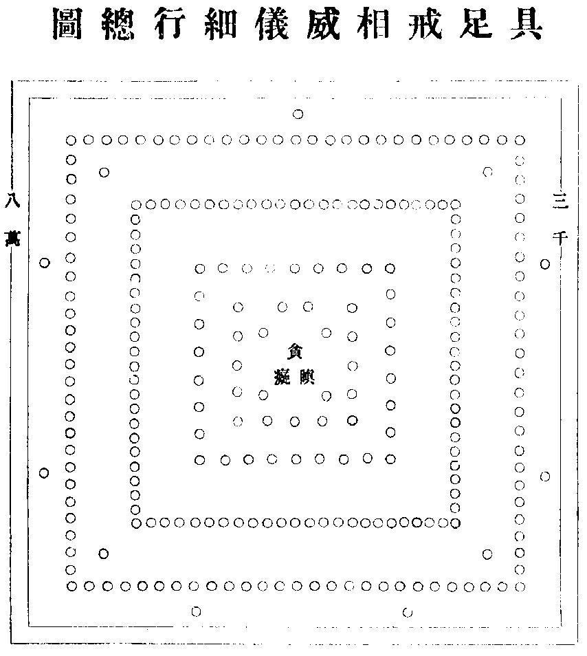
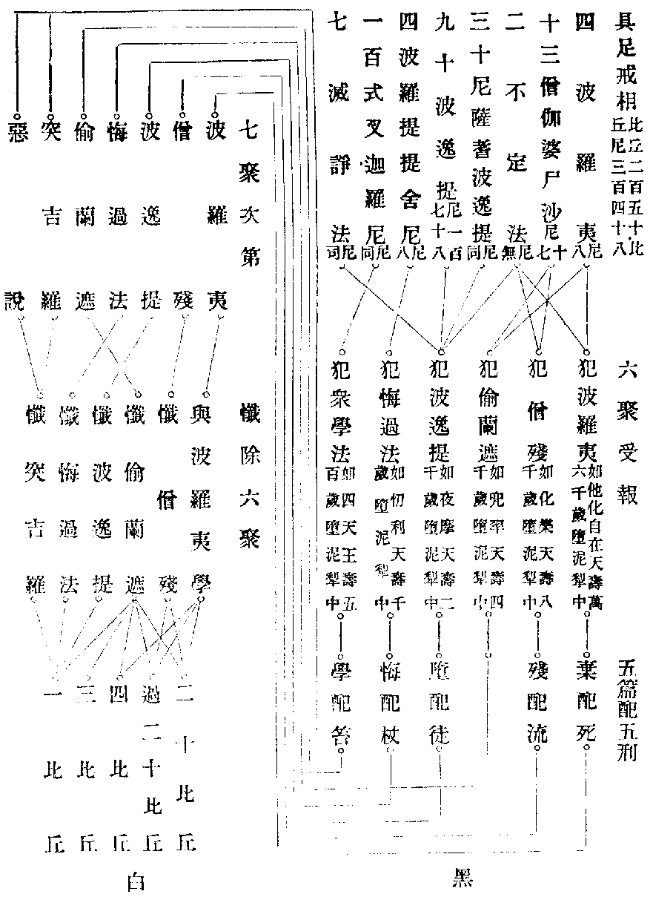

# 四分戒本如释



> **藏经**：卍新纂大日本续藏经（新纂卍续藏）　**册次** 第 40 册（X40）　**编号** No. 717-A敘四分戒本如釋語（X0717）　**部类** 律部　**卷次** 12 卷　**篇幅** 148,256 字

> **卷／品**：12 卷 · 1 品



---



## 目录



  - [释戒经序](#释戒经序)

- [四分戒本如释卷第一](#四分戒本如释卷第一)

- [四分戒本如释卷第二](#四分戒本如释卷第二)

- [四分戒本如释卷第三](#四分戒本如释卷第三)

- [四分戒本如释卷第四](#四分戒本如释卷第四)

- [四分戒本如释卷第五](#四分戒本如释卷第五)

- [四分戒本如释卷第六](#四分戒本如释卷第六)

- [四分戒本如释卷第七](#四分戒本如释卷第七)

- [四分戒本如释卷第八](#四分戒本如释卷第八)

- [四分戒本如释卷第九](#四分戒本如释卷第九)

- [四分戒本如释卷第十](#四分戒本如释卷第十)

- [四分戒本如释卷第十一](#四分戒本如释卷第十一)

- [四分戒本如释卷第十二](#四分戒本如释卷第十二)



---



夫戒本者何？乃比丘之规矱，涅槃之津要。规矱失，则心虑无整；津要迷，则彼岸难到。故如来首自鹿苑，终乎鶴树，谆谆诲嘱，俾依木叉为师，视同如佛。今人背遗嘱，诋毗尼，何异逆子而抗慈父，善星而侮圣言？背遗嘱，是非佛也；诋毗尼，是非法也；见持戒者而嘲𠿝，是非僧也。三宝既非而且毁，奚名释子？葢戒法乃对治无明业种之醍醐，修证五分法身之玅术。业种不断，因流弥漫；法身不圆，解脱无日。违此而修，纵得玅悟，禅定现前，终是魔业。经有明言，非人臆语。今时妄修谬证，置木叉于言外，取己见为自规尺，自不能持，欲他而同己僻，毁法灭律，无堪视之。予因覩此，每劝初学著目毗尼，使定慧有址，正法而得久住。第律文旨奥，止持作犯，名种性相，阅者无不茫然。乃忞自庸，力取戒本，如律释之，故曰如释。释而未尽，附餘部以悉之。遹为律之首钥，以学者而跽通蹊径，文蹄虽约，而义阶实周。其有欲登舍那殿阁者，可向此跨上一足。



旹崇祯癸未冬西来山菩提心比丘弘赞序于象王阁中



凡例十三节



此戒本藏本有二：一是后秦佛陀耶舍尊者所译，二乃唐怀素律师依四分藏中集出。而四分律藏一部，卷有六十，亦耶舍尊者所翻。此方上德，悉共尊行。自秦至唐，多人疏业，恨不一存。稽宋代来，尠有作者。今时初学习律，每以事相为艰，多释卷高阁，故律学渐废，持犯无不昧然释子要法，而成故典矣。余因观此，惧正法灭无多日，乃举四分藏中华梵文句奥者，标而释之，号曰四分律名义。标释卷成二十有八，仅为律之通径，亦以便后疏义不滞於文。然疏工颇宏，非日能就，欲使初学急知持犯，爰取戒本如律释之。而律文繁广，不能一一仍其藏本，乃删繁揭要，而义实全。至於开遮持犯，毫𨤲不敢增略。如来法王知诸众生业性所宜与戒，尚非菩萨、罗汉所堪，况容凡愚有所添损？理本如如，故云如释。而所释本，仍依律藏及素师所集，中有文句简质，恐初学难顺，乃取翻译本一二字以易明之。然於每戒下附餘部律文，并诸论传，意欲互相发明旨趣，及补所未备，全非取轻替重，以开易遮。律各有旨，无容凑泊，偷心不绝，何名信戒？行者但於自部中持，无劳自生穿凿。其中事理通途，文义委悉者，用之非过。若欲广明，须阅全藏始得。倘为师范，必要广学精研，乐简厌繁，律教乃有大诃。  

佛制比丘满足十夏，学通三藏，行解相应，方许为师，授人大戒，并畜沙弥。如或不能，三藏俱通律典，必须明了。若夫持犯不知，犹如白羊，欲急为人师者，将何摄授？既自违佛明制，而欲使他遵承者，岂可得乎？自损损他，成何师法？  

比丘违犯七聚，除初篇不可悔治，餘篇即须对他发露除灭，或众中忏，或对首悔，戒体还复圆净。今时不分皂白，轻重罔知，重即令其持呪若干，轻乃多皆忽略，大违佛制，全乖律旨。  

佛制过中不食，大益身心，自他兼济。故尊者迦叶，首传心印，奉头陀，自至终身，日中惟是一食，更无餘噉。比丘中前得食，中后复开饮浆，亦已足矣。既是正信，舍家出家，家业身心尽弃，如捐粪秽，何乃为斯少许饮食？违自本信，毁佛之明制。或云：我无执著。噫！偏违律教，宁不大执乎？  

律以解脱为宗，不耽世味，教舍五欲，如弃洟唾。今人畜积箱囊，甚於牦牛爱尾，非但乖乎律旨，实乃重结生死之累，深溺爱河自没，痴津难救。或曰：为他故畜，自无贪著。既尔，胡不现将供养三宝，以济群生？若云：为他故积私用，即犯盗愆。  

佛制比丘，三衣不得离宿，乃至一夜，离即失衣获罪。今人既不遵法，輙便故离，有受无持，何免现前袈裟离体，当来铁鍱缠身者乎？三衣之外，所有盈长之物，佛令说净，作委寄他心，而得持畜，表其离著，无属己之累。兹时此法尽失，比丘悉皆茫然。大乘虽许菩萨为众生故得畜，要须说净，若不依教，是名为犯。  

律制：出家五众，并著袈裟。袈裟者，坏色衣也。以三如法色，坏其五大色。近世以应赴五彩之服，目为袈裟者，是为大错。佛昔预记，末法袈裟，变为五彩。今时披著，诚为末法衰相，释子宜知。  

今时沙弥披著比丘三衣，五部律文悉未见有，百一羯磨深诫不许，惟令披著缦衣，并无条隔等相。近代为师，不谙律典，妄授人戒，相踵讹风，以为正轨，致令在家男女披服比丘五条袈裟，迷惑至此，一何可笑！讹习既久，非夕能复，但我绍隆之士，当共扶扬正轨，勿令披著为幸。  

比丘之戒极尊，能为人天而作良祐福田，岂但自出生死而已。今时亦既受得，将为人间应赴故事，可惜之甚。我佛如来历劫捐舍头目髓脑而得此法，今将货易世间少许秽利，宁不痛心。况应赴一法出自此土，西国全无，深非僧法。佛无斯教出世之宾，宜速知改。  

戒是定之体，慧乃定之用。苟体不立，用无从施。是故一切圣贤咸从戒成，七众法子悉由戒立。故南宗得法之后，犹须登坛禀受。清凉国师乃华严菩萨，自以十律严身。历代祖师何有白衣度人，三世如来皆以戒为首约。故我释尊初坐菩提树下，即与诸菩萨结波罗提木叉，寻检大小两乘经律，无不赞叹持戒之人，未见一佛称誉破禁之者。智士详观，万无自错。  

如来临将涅槃，嘱令依波罗提木叉为师。今人舍毗尼不学，岂但背佛遗诲，然已弃其师矣。见人持戒，即𠹛笑诽呰，苟非智过如来，即是与佛共诤。余谓其非𠹛呰人也，是诽讟佛也。请自揣看，可不惧欤？  

西方学法，始习小乘，次阅大教。大旨既通，法法无非中观。故知大小由心，法无广劣，讵可於中而生取舍毁誉者耶。若不始从小学，先习大典，必坐妄夸般若，拨无因果者多矣。  

三世诸佛，俱说经律论三藏。圣教经论二藏，咸通在家出家。惟律一藏，比丘独持。如王秘藏，非外官所司。故白衣沙弥，若先览者，后永不得受大戒，罪与五逆同例。凡为师者，最宜谨慎。



具足戒相威仪细行总图







二百五十，具足戒法。以行住坐卧四威仪，各有二百五十，合为一千。循过去、未来、现在三世，为三千威仪。以此三千，配身口七支，成二万一千。以此二万一千，复对治贪瞋痴及等分四种烦恼，为八万四千细行。此即八万四千律仪也。言八万细行者，举其略也。若论生起者，则弃为根，残为株，舍堕为枝，逸提为茎，众学为叶，悔过为花，灭诤为果，不定为皮肤筋节。持之则七觉为花，四圣为果。毁之即身口七支为花，四恶趣为果。



No. 717-B 四分戒本如释科



释此戒本大科分二初释题目  

次释本文(分三)初序前方便(分四)初述赞颂  

二作前方便  

三秉白羯磨  

三秉白羯磨  

四说戒序(二)初正说  

次结问



中总列戒相(分八)初捐弃法(开三)初总标  

中别列　四事  

后结问



二僧残法(开三)初总标  

中别列　十三事  

后结问



三不定法(开三)初总标  

中别列　二事  

后结问



四舍堕法(开三)初总标  

中别列　三十事  

后结问



五堕法(开三)初总标  

中别列　九十事  

后结问



六悔过法(开三)初总标  

中别列　四事  

后结问



七众学法(开三)初总标  

中别列　一百事  

后结问



八灭诤法(开三)初总标  

中别列　七事  

后结问



后结劝回向(分四)初总结前相  

二勤学餘法  

三七佛戒经  

四结颂回向



四分戒本如释科(终)



四分戒本如释目录



卷一叙语  

凡例  

具戒总图  

分科图  

释本题目  

释初赞颂  

释前方便  

释白羯磨



------



### 释戒经序



卷二释波罗夷法  

释僧残法(一事至五事)



卷三释僧残法(六事至十三事)  

释不定法



卷四释舍堕法(一事至十一事)



卷五释舍堕法(十二事至二十七事)



卷六释舍堕法(二十八事至三十事)



卷七释波逸提法(一事至二十五事)



卷八释波逸提法(二十六事至五十事)



卷九释波逸提法(五十一事至六十七事)



卷十释波逸提法(六十八事至九十事)  

释悔过法



卷十一释众学法



卷十二释灭诤法  

释总结前相  

释学餘法  

释七佛戒经  

释后结颂  

附二百五十戒摄颂  

戒相篇聚图



No. 717



------



## 四分戒本如释卷第一



明　广州沙门释　弘赞在犙　绎



释此戒本大科分二：初释题目，次释本文。



○初释题目。



四分戒本。



释曰：四分戒本者，从出处以立名也。本出昙无德律，律分四分：初分明比丘法，二分明比丘尼法及受戒说戒法，三分明安居自恣等法，四分明房舍等法。今此戒本即彼初分，乃比丘二百五十戒经也。爰夫律制，始自鹿园终乎鶴树，金言寂唱波离续宣，诵如来言词满八十，号为八十诵律。初则迦叶顶受，次乃阿难荷持，第三末田地，第四舍那波提，第五优波崛多。如是五师递相传持，百一十餘载授受不异。后有育王御世崇敬三尊，广会僧众重集三藏。时诸比丘互执见闻抄治经律，各引师说以为章轴，引执不同遂成二部，相言是非求王判决，行白黑筹表其新旧。时取旧者多以多为名，号曰摩诃僧祇；取新者少而是上座，从上座为目，名曰上座部。由斯二部於二百年间复出十八部，十八部中有五部为其纲领：一曰昙无德(此云法密，人名也，律名四分)，二曰萨婆多(此云说一切有根本，十诵是也)，三曰迦叶遗(此云重空观，律名解脱，止有戒本一卷到此方)，四曰弥沙塞(此云不著有无观，律名五分)，五曰婆蹉富罗(此云犊子，律本未到)。如此五部所制，文有广狭，事有详略。至於轻重开遮，虽无大殊，不无小异。然皆一佛所宣，但为闻听不广，传诵有缺，各据一边，致成多别。如来在昔，预为记曰：我灭度后，经律当分五部，致于十八。虽名别异，而皆不妨。诸佛法界，及大涅槃，依之修行，皆得解脱。佛告文殊：未来我诸弟子，有二十部，能令诸法住。二十部者，并得四果。三藏平等，无下中上。譬如海水，味无有异。如人有二十子，真实如来所说。根本二部，从大乘出，从般若波罗蜜出。声闻缘觉诸佛，悉从般若波罗蜜出。复说偈曰：十八及二本，悉从大乘出。无是亦无非，我说未来起。言根本二部者，即是僧祇上座二部。其僧祇部，分出七部。上座部，分出十一部。并二根本，共为二十部。今此震旦所传，唯存四部。谓僧祇、法密、萨婆多、弥沙塞、其戒因缘、优波离问经，乃律之支属。自餘善见毗尼、母摩得勒伽、萨婆多毗尼、毗婆沙、明了论等，并是略释律之名义。如斯部类，既佛亲为印记，则无劳致疑。已知无是无非，又何烦再议。譬如船舫𥱼筏浮囊，名虽不同，至岸无异。是以五天诸国，随秉一法，皆获道果。震旦比来，四部悉行，咸登圣证。若非如来善应群机，曷缘获斯胜益。故当谨护浮囊，无不济其彼岸者也。



○次释本文(分三)，　初序前方便　中总列戒相，　后结劝回向。



●初序前方便(分四)　初述赞颂，　二作前方便，　三秉白羯磨，　四说戒经序。



○初述赞颂(共十二颂，分为九释)



> 稽首礼诸佛，及法比丘僧，今演毗尼法。  

> 令正法久住。



释曰：上半颂是归敬三宝，下半颂显当说戒法得久住也。凡作法事，必须先敬三宝，以求加被。使内障潜消，外魔无娆，法事而得成办也。稽首者，出周礼九拜之初。谓下首至地，稽留停头，少久乃起也。礼者，履也。谓进退有度，尊卑有分之义。然而方俗不同，礼无一定。西国以五体投地，为之致敬。此方则稽首，为之尽恭。今取随国行之，以为䖍敬之仪也。诸者，总举十方三世也。佛者，具云佛陀。乃穷理尽性，大觉之称也。觉具三义：一者自觉，悟性真常，了惑虗妄。二者觉他，运无缘慈，度有情界。三者觉行圆满，穷源极底，行满果圆也。法者，谓如来随机演说清净法要，决定能令有情得无热恼，而趣涅槃。内证三明，智慧圆满之圣教也。若以义释，法是轨持之义。轨，生物解，任持自性也。持是法体，轨是法用。任持不舍，各守自性。如水就下，火扬於上，性各决定，此是法体。轨谓轨范，可生物解，如火熟食，用水浮舟，各取其则，是为法用也。比丘僧者，比丘，此云乞士，乞是乞求之名，士是清雅之称，谓内修清雅之德，外离四邪，福利众生，告求资身，以成清雅之德。亦云除馑，谓众生无法自资，多所馑乏，出家戒行，是良福田，能生物善，是故世人归信，供养种福，如沃壤之田，能生嘉苗，而除彼之馑乏也。新云苾刍，别有五义，如常可知。僧，具云僧伽，此言众，乃四比丘已上之称，即清净持戒，及学无学众之总称也。今演者，正当宣说戒时也。毗尼，此云灭，谓灭贪瞋痴也。亦云折伏，谓调伏诸烦恼也。又云律，谓佛所说法律，处断轻重，开遮持犯，令止诸恶，而生众善也。令正法久住者，正法，谓出世无漏圣道也。由秉羯磨说戒，正法未灭世间，故云毗尼。藏者，是佛法寿，毗尼藏住，佛法亦住，以诸善法，妙定胜慧，皆藉戒而生也。



> 戒如海无涯，如宝求无厌，欲护圣法财，  

> 众集听我说。



释曰：上半颂明戒胜德，下半颂劝听获益。戒如海无涯者，戒谓二百五十波罗提木叉并诸威仪，於一一戒中各生摄取於僧十种功德，一一功德中生十种正法，谓信等五根、无贪瞋痴三善根及身口二护，由此成诸福海无有边际，故云无涯。如宝求无厌者，宝谓海中清净如意珠王，随众生所欲能与种种乐具，故世求之无厌。佛法海中尸罗皎洁，出生根力觉道诸胜善品应念而得，如彼珠王求者无厌。圣法财者，即上根等诸胜善品及信戒闻舍慧惭愧，此诸法财非戒无能守护，故戒有防非止恶之功能，如勇兵猛将能伏怨敌不令侵凌。欲护此财，当和合共集一处听说如说而行也。众谓如法得圆满戒者，集是身根和集一处，听属耳识，於彼所说文义以耳识领受决心了知也。我说者，谓词义无违如律而说也。



> 欲除四弃法，及灭僧残法，障三十舍堕，  

> 众集听我说。



释曰：此颂明听戒离过。四弃是婬、盗、杀、妄四波罗夷。随犯其一，即一切功德道果，悉皆捐弃。又永弃清众，不得与诸比丘共住。如大海不受死尸，漂弃岸上。戒法海中，不纳破戒。故永弃清净众之外，不问不治也。僧残者，总有十三事。谓犯此事，尚有少许餘残可治之理。於二十僧中，如法忏悔，可得除灭。不同前四，无有餘残可治也。舍堕者，共有三十事。由恣畜财物生过。犯此过者，须向众中，先舍其物，次忏堕罪。而罪称堕者，谓此罪若不忏除，即堕在三途，受烧煑苦。欲得除灭四弃僧残，遮障舍堕，当共集一心而听也。



> 毗婆尸式弃，毗舍拘留孙，拘那含牟尼，  

> 迦叶释迦文，诸世尊大德，为我说是事。  

> 我今欲善说，诸贤咸共听。



释曰：前一颂总举七佛，后一颂述说嘱听。毗婆尸，亦名维卫，此云胜观。式弃，亦名尸弃，此云火。毗舍，具云毗舍浮，此云徧一切自在(此三如来在过去庄严劫末出世)。拘留孙，此云所应断，又云作用庄严(在此贤劫第九小劫中减至人寿六万岁时出世，为千佛之首)。拘那含牟尼，此云金寂，亦云金仙(人寿四万岁时出现於世)。迦叶，具云迦摄波，此云饮光(人寿二万岁时出世)。释迦文，此云能儒，亦云释迦牟尼，此云能仁寂默(人寿百岁时出世。此四如来在此贤劫初次第出现世间)。世尊者，谓十号具足，天人凡圣世出世间咸尊重故。大德者，谓福慧两足，十号德具，世无与等。此二通称上之七佛也。为我说是事者，此明师资授受，显非应说也。我，指现前能说戒人。是事，谓从戒序乃至七佛经偈。我今欲善说者，善说，谓如法而说，词无差谬也。诸贤咸共听者，诸贤，谓从初得戒无腊乃至百腊者。咸共听，谓皆和合集在一处，至心谛听也。



> 譬如人毁足，不堪有所涉，毁戒亦如是。  

> 不得生天人。欲得生天上，若生人间者，  

> 常当护戒足，勿令有毁损。



释曰：前一颂上半设喻，下半明障生善道。后一颂上半示生善趣，下半诫护善因。譬如者，假设之词。毁者，坏也。涉者，蹑躐也。毁戒由破戒也。天谓欲界、色界、无色界之二十八天也。人谓四大洲及八中洲、诸小洲人也。常当护戒足者，谓戒不可暂时有所毁犯也。损者，伤也。不但诫勿大毁，而小亦不可伤也。言生天人者，此乃随机顺世权说。以西域之人多乐生天，佛初出世，随彼所乐而为说法。然非圣意，亦非律之本旨。律以解脱为宗，岂示人天漏果？又复天道原是险途。所谓险途有二：一是生天，二是恶道。生天虽受胜乐，福尽还堕恶趣。以此证之，故非律旨。设若毁戒，则险途尚不能登，况复涅槃之乐道？此不言涅槃者，略也。如大律云：求天若涅槃，方便守护戒，如是无毁坏，必能度险道。又云：如是念修戒，能避诸恶行，除诸结使患，安隐入涅槃。原声闻厌患三界苦果，断集修道证灭，宁复更期人天果报？菩萨不贪世乐，畏厌生死烦恼，深乐涅槃。声闻畏厌烦恼，深乐涅槃，百千万倍不及菩萨一分，岂希人天之欲乐哉？



> 如御入险道，失辖折轴忧，毁戒亦如是。  

> 死时怀恐惧。



释曰：上下颂设喻，下半颂示知过患。轴谓车轮中之转轴，辖是轴头之铁，犹御车过险难之路，中途失辖断轴，心怀忧恼生大惶怖也。毁戒如彼失辖折轴，死时如在险道，中途既自知戒毁必堕恶道，便怀恐怖惶惧，如入险路中失辖折轴之忧怖也。



> 如人自照镜，好丑生欣戚，说戒亦如是。  

> 全毁生忧喜。



释曰：上半颂设喻，下半颂显戒完缺。如人以镜自照其面，容端则生欣喜，貌陋便怀忧戚。今当说戒之时，以戒而自观察，全则内怀欣喜外不愧人，毁便内生忧戚外耻於他也。



> 如两阵共战，勇怯有进退，说戒亦如是。  

> 净秽生安畏。



释曰：上半颂设喻，下半颂明戒得失。如两军阵共相交战，勇者安而前进，怯者畏而退缩。今众集说戒，正与烦恼魔军共战，戒净如勇则身心俱安，戒秽如怯则情色自畏，遂没烦恼阵中被魔所伏也。



> 世间王为最，众流海为最，众星月为最，  

> 众圣佛为最，一切众律中，戒经为上最。  

> 如来立禁戒，半月半月说。



释曰：前颂初句以尊贵为胜，次句以深广为胜，第三句以明净为胜，第四句以果德为胜。谓声闻、缘觉、菩萨行果未圆，如来行满果圆，於诸圣中独为最胜。此亦喻比丘是金轮王子，法王贵裔，德慧深广，戒体圆明，天上人间无能及者，是为诸众中尊也。后一颂初二句正显戒经是为最胜。戒经谓比丘、比丘尼律仪之别解脱经也。别解脱者，谓依此经修行，即於下下等九品诸惑渐次断除，於诸烦恼而得解脱。又见修烦恼其数各多，於别别品而能舍离，故名别解脱也。由烦恼惑结缚有情沉没三界，此经能使解脱而趣涅槃，是故此经恃为上最。众律谓五戒、八戒、十戒，乃至轮王十善、世间法律及诸外道邪禁也。大律云：众经亿百千，戒为第一最。是则不但餘教不如，即三藏十二部中亦以戒为最。故根本律云：佛说三藏教，毗奈耶为首，佛游於世间，随处说经法，律教不如是，故知难值遇。诸佛证菩提，独觉身心静，及以阿罗汉，咸由律行成。三世诸贤圣，远离有为缚，皆以律为本，能至安隐处。如地载群生，能长诸草木，律教亦如是，能生诸福智。律是法中王，诸佛之导首，苾刍喻商旅，此为无价珍。准如律说，若不依斯修行，终无所成，设有所得，皆是魔业。故经云：纵有多智禅定现前，如不持戒，必落魔道。如来立禁戒者，此显如来亲制，非餘圣僭为，不同经论，或容他说，呈佛印可。斯由如来智周法界，穷尽物性，知诸众生根业差别所宜与戒，非声闻菩萨所可堪能。如世礼乐，非天子不制，出世洪规，非佛莫立也。半月半月说者，谓黑白二月，以表黑白二业，欲黑尽而白圆，故半月半月说戒，使诸比丘自忆所犯，如法忏除，令恶尽而善圆也。



已上十二颂，是诸阿罗汉结集时安置。按大律本，共有四十六颂。



○二、作前方便(分七释)。



僧集不？



释曰：凡作羯磨布萨，同一界内比丘，并令共集会在一处，以防别众破僧方便，故须先问。僧有四种，谓四人、五人、十人、二十人。四人僧者，除受具戒、自恣、出僧残罪，餘一切羯磨应作。五人僧者，除中国受具出罪，餘一切羯磨应作。二十人僧者，一切羯磨应作。此四位僧中，随少一人作法不成，过则如法，减则非法非律得罪。除布萨，餘有要事羯磨众多，造次难集或防障难，听在戒场上作法，不集无咎。



和合不？



释曰：同一羯磨和集一处，必须心口无诤不来者与，欲在现前应诃者不诃，谓防鬬诤因缘有妨法事，故须次问也。



未受大戒者出。



释曰：未受大戒者，谓未经白四羯磨如法得具足戒也。出谓遣出众外离见闻处。佛言：不应在未受大戒人前作羯磨说戒。



不来诸比丘，说欲及清净。



释曰：不来者，谓不来赴集也。凡作一切羯磨法事，必须身心俱集，方成和合。设有佛、法、僧事，若病事，若瞻病等缘，乃开心集，故听传心口，应僧前事，方得彼此俱办，不妨法事，无别众过也。说欲者，谓说意乐，彼所作如法僧事，自心乐欲，随喜共同也。清净者，谓自无罪，此是布萨时与清净也。复以布萨时，僧作种种羯磨故，须欲及清净俱与，不得单与清净，致妨僧事。亦不得称与某事欲，应言如法僧事，与欲清净，乃无稽留，废僧羯磨之患也。有五种与欲，若言与汝欲，若言我说欲，若言为我说欲，若病不能语，应现身相，若广与欲，俱成与欲，若不如是，不成与欲，应更与餘者欲。此中与欲，必是身现在界内，亦不得今日与明日欲。若病比丘与欲已，闻僧中说法、毗尼，自力就听，坐久疲苦，即以先所与欲，默离座去，不名与欲，已破前欲故，应更与欲。餘缘准此应知。若病比丘不能如上身口与欲，应扶舁至僧中。若虑扶舁病增，一切僧应往病者所，围绕与作羯磨。若病者多，能集一处者善，若不能，僧应出界外作羯磨说戒，更无方便，得别众羯磨说戒。若欲广与欲者，应至一可传欲人所，整威仪，作如是言：



大德一心念！我某甲比丘，如法僧事与欲清净。(一说)若自恣时，应言：与欲。自恣餘一切羯磨，但言：与欲。彼受欲比丘持欲至僧中，其羯磨人如上问已，即应具威仪答言：



大德僧听！某甲比丘，我受彼欲清净，彼如法僧事与欲清净。(一说)别部听持欲者对比座说，不告大众，为遮延时僧生疲劳等诸过失故。其持欲人受欲已，若命过、若餘处行、若罢道、若入外道中、若入别部众、若至戒场上、若明相出、若自言犯边罪等十三难人、若被举、若灭摈、若应灭摈、若神足在空、若离见闻处，并不成与欲清净，应更与餘者欲。如是若在路中、若至众中亦如是。受欲人若眠、若入定、若忘、若不故作，如是成与欲。若故不说者，得恶作罪。若遇道路隔塞、有贼、有恶兽、河水涨，一切命难、梵行难不得至，从界外来至僧中，如是不失与欲。复听一人受二、三、四人乃至众多人欲。若能尽记识字者，随忆多少受欲。若不能忆字，当称姓。不能记识姓，当称相貌。若不能记相貌，但言：众多比丘如法僧事与欲清净。若受欲人自有缘事起，不及诣僧中，听转授欲与餘比丘。当如是言：大德一心念！我某甲比丘与(某甲众多)比丘受欲清净，彼及我身如法僧事与欲清净。若比丘为缘事故与欲已，事休便应往就说戒处。若一住处满，四比丘应共集说戒，不合说欲。



谁遣比丘尼来请教诫？



释曰：尼禀漏质，形累多拘，故阙游方问道之资、晨昏训导之益。如来愍此，制令半月半月诣僧求请教授。僧方差具德者，诲以微言、勉以至道。但去圣时遥，僧尼慢教，既不遵承，斯法渐失。闻者尚少，行者全稀。拟复斯规，故为详注。其比丘尼，僧众於说戒日集僧，白二羯磨，差一比丘尼往僧寺中求请教授。若独行无护，更差二三人为伴。既至寺中，诣一旧住比丘所(准义，僧应差人承受彼尼嘱授)，礼敬已，曲身低头，合掌白言：



大德一心念！比丘尼僧和合，礼比丘僧足，求请教授。(三说。)僧说戒时，诵戒者问言：谁遣比丘尼来请教诫？(佛言：於僧说戒时，上座问言：比丘尼众遣何人来耶？今但取当时说戒者问之。)先受尼嘱授者，即应起，具修威仪，白言：



大德僧听！某处比丘尼僧和合，差比丘尼某甲，礼比丘僧足，求请教诫尼人。如是三说已，准义应至上座所言：大德慈济！能教诫比丘尼不？若答言：不堪。者，乃至二十夏已来，一一具问。彼说戒者应更问云：谁为教诫比丘尼？若有者应差。其教诫人要具十法：一、戒律具足；二、多闻；三、诵二部戒利；四、决断无疑；五、善能说法；六、族姓出家；七、颜貌端正，尼众见便欢喜；八、堪任与尼众说法，劝令欢喜；九、不为佛出家而披法服，犯重法；十、若满二十夏。若过二十夏者，应如是差。



大德僧听！若僧时到僧忍听，僧差某甲比丘教诫比丘尼。白如是。



大德僧听！僧差某甲比丘教诫比丘尼。谁诸长老忍僧差某甲比丘教诫比丘尼者默然，谁不忍者说。僧已忍差某甲比丘教诫比丘尼竟。僧忍，默然故，是事如是持。(若教诫者多，应问尼：请谁？随言：便差。若言：随僧处分。即应随常教授者次第差往。)彼比丘尼十六日更往寺中问：可不？彼被差比丘将一比丘为伴，尅期而往，尼亦尅时而迎。其教诫师观尼众集已，为说八敬法，然后量机说法开导。若无教诫尼人，遍请不得。彼受嘱授比丘还至上座所，白言：遍问众僧，无有堪者。时上座即应略为教授法，告受嘱人云：此众无堪教诫师，明日尼来请可不？时应报言：昨为尼众遍请，无有教授比丘尼人。然上座有敕，敕诸尼众：精勤行道，谨慎莫放逸。(十六日尼至，如敕告知。尼还住处集众，具宣僧敕，诸尼合掌顶受。)



僧今和合，何所作为？



释曰：谓僧既已和集，所为何等法事？然所为事不出三种：一为情事，如受忏悔等；二为非情事，如结诸界等；三情非情事，如处分离衣等。此所为事委僧量宜，故须对众问其所作，一人随事答之。



说戒羯磨(若非说戒时，据事称之，答云某羯磨。)



释曰：梵语羯磨，此云事，亦云办事，谓诸法事由兹成办也。然羯磨约体唯三，谓单白、白二、白四，随事量作。若轻事应作单白，中事白二，重事白四，此三种羯磨能摄一切羯磨。而诸羯磨略有一百二十一法，单白有二十七，白二有五十七，白四有三十八，其餘诸部或增或减，根本部中共有百一事。



凡为诸羯磨法事，必须作前方便，惟在说戒时，乃加问尼来请教诫。其餘六法，遍诸羯磨，唯除结界，阙者不成。谓应共了知界相，故不许说，欲事须尽集也。



○三，秉白羯磨(单白)。



大德僧听！今白月十五日众僧说戒。若僧时到僧忍听，和合说戒。白如是。



释曰：大德僧听者，谓令诸比丘耳识，勿缘异境，专心一境，於所闻事，当正忆持也。白月十五日者，此取上半月言之，若下半月，即是黑月。月有大小，或十四日，或十五日，当依时称之。众僧说戒者，显非餘事也。按耶舍所译戒本，则云布萨说戒，今不言者，是略也。何以故？说戒是直陈其事，未彰其义。布萨者，是长养净除义，谓由众集说戒，能长养功德，净除烦恼诸不善法故。若僧时到者，时谓说戒之时，到谓僧如时而至也。僧忍听者，谓现前大众，当共忍可听许和合说波罗提木叉戒也。白如是者，谓以此事而告知也。凡布萨日至，其年少比丘，应先往说戒堂，扫洒敷座，备水燃灯具筹。若不知者，上座当教，不教突吉罗。若不随教，亦突吉罗。说戒竟，应收复本处，不尔者，如上得罪。言具筹者，谓令知人数故。其筹应用铜铁竹木作，以函筒盛之。比座者，共相检校，知有来者不来者，应先白已，然后说戒。若众集大说戒时，不悉闻，听敷高座，极令高好，在上说戒。诵时若忘若误，次座比丘当授语，若故忘者，次第二比丘当代说，即以次说，不得重说。然说戒比丘，先当暗诵使利，莫致众中说时错谬。若说戒时，有八难事起，及有餘缘，听略说戒。八难者，王、贼、水、火、病、恶虫、人、非人。餘缘者，若大众集、床座少、若众多病、若座上覆葢不周、值天雨、或鬬诤事、或说法夜已久听齐、明相未出，应作羯磨说戒，更无方便可得宿。受欲清净羯磨说戒，略前方便一如广法，量难远近以为广略，若无难缘不得略说。若说戒序问清净已难至，应告言：诸大德！是四波罗夷法僧常闻，如是十三僧残乃至众学法。若难卒至，应随到处言：已说至某处。餘者僧常闻。若难缘逼近不及说序者，如僧祇律告云：诸大德！今十五日布萨时，各正身口意莫放逸。便各各随意去。若一比丘独住者，至布萨日应诣说戒堂扫洒，如前安置。若有客比丘来，若四、若过四，应先白已然后说戒。若但有三人、若二人，应各各相向说，作是言：二长老忆念！今僧十五日说戒，我某甲比丘净净。(三说)若独一人，应心念口言：今僧十五日说戒，我某甲比丘清净。(三说)若有犯者，不得说戒、不得闻戒、不得向犯者忏悔，犯者不得受他忏悔。当诣清净比丘所，偏露右臂、脱屣、右膝著地、合掌。若是上座，应礼足自称所犯名字，如法忏悔。若於犯中生疑，亦如上诣净比丘所，称所犯名字，作是言：我某甲於所犯罪生疑，今向大德自说，须后无疑时当如法忏悔。如是作已得听说戒。若比丘正说戒时，或忆知有罪，或心疑，若向众说，恐致閙乱，当语比座，或应心念：须座罢已，当如法忏悔。如是者得闻戒。若一切僧尽有犯，或生疑，当向清净客比丘忏悔决疑，然后说戒。若无客来，当差二三人，诣比近清净僧中，决疑忏悔已，还所住处。诸比丘当向此比丘忏悔，然后说戒。若比近无净僧，应作白已，当忏悔，作如是白：大德僧听！此一切众僧犯罪。若僧时到，僧忍听，此一切众僧忏悔。白如是。作是白已，然后说戒。(然此一途忏悔，谓各各识知所犯罪名种相，而无一净比丘向之忏悔，故听作斯白忏。非是於罪不识，儱侗而为作斯羯磨，而得罪除灭也。)若一切僧於罪有疑者，当作白已，应说其罪，当作如是白：大德僧听！此一切僧於罪有疑。若僧时到，僧忍听，此众僧自说罪。白如是。作是白已，然后说戒。(此但露罪，得闻说戒本罪。俟无疑时，仍须向他说已忏悔。五分律：听向有罪比丘悔过，但不得向同犯者悔过。若病比丘，听向同犯共悔过。)若不识罪名、罪相待，有客比丘持律者来，应请问之，如法忏悔。若说戒日，旧比丘集已，说戒序竟，有客比丘来少，客当告清净，作如是言：大德僧听！我某甲清净。作是告已，餘者当次第听。若说戒竟，举众未起，若多未起，若都已起，亦应告清净。若说戒序竟，若说戒竟，客比丘来，或等或多，应更为重说戒。若客比丘先说戒，旧比丘来，亦如上说。若比丘心乱狂痴，应与作狂痴羯磨。此有三种狂痴：一、说戒时，或忆或不忆，或来或不来；二、或忆而来；三、或不忆不来。是中后二种不应与作。初一种应作白二羯磨，若狂病止，应白二羯磨解。五、夏比丘当诵戒羯磨使通利，不应众多痴比丘集在一处，既不知戒，复不知说戒，不知布萨，不知布萨羯磨，应依能诵戒比丘夏安居。若安居中所依人命终，或远行，或休道，乃至十三难等，若后安居日未至，当诣比近处结后安居，或当请彼能诵戒者来过安居。若已过后安居，诸比丘应向比近处有学诵序者，若诵四事者，若十三事，乃至九十事者，若诵餘残法者，彼各各诵已，还至本住处，教一人使诵。若一人不能尽诵者，随先所诵，得各次第诵，不得重诵。若尔者善，不者但说法诵经已，从座起而去。(谓布萨日至，不得不说戒。既皆无能诵者，方许说法诵经，非为长途轨则。僧祇律云：若举众不利者，应遣上座出界外，心念口言作布萨。餘三人界内作三语布萨，即是罚上座，不应早作布萨。若一比丘住者，应待客来共作布萨。若无客来有罪者，应作是念：若得清净比丘，此事当如法除。作是念已，应心念口言，三说布萨。若布萨竟，有客来者，客应随喜言：长老已作布萨，我某甲随喜。若不随喜，应世界外作布萨，一住处不得再作布萨。若比丘远行，布萨日至比丘住处，作布萨已，不应默去，应嘱沙弥，若守围民，若放牧者，有比丘来，语令知此中已作布萨。若无人者，应书柱、户扇，或散准作相。彼后来者，应问应求相，不得輙作布萨。若共商客行，至布萨日，有恐怖难商行，不待得行作布萨。先应筹量齐几许，得诵戒竟，若山若石，作标帜伸手相，及羯磨结作布萨界已，然后作布萨。若据本部，布萨日於无村旷野中行，结小界说戒，并无外标相，即身所坐处以为界体。故羯磨文中云：今有尔许比丘集结小界，是知无有多相。在如是处行，僧应和合集一处共说戒。若僧不得和合，随同师善友，於下道集一处，白二羯磨结小界说戒。此为难缘方许，无缘不听。说戒竟，应白二羯磨解界而去。毗尼母经云：不应用歌音诵戒，当以高声了了诵戒。歌音有五事失：一、心染著此音，二、为世人所嫌，三、与世人无异，四、妨废行道，五、妨入定。本律不听歌音说法，不禁诵戒，疑是遗误。按说法仪中，初听，后以过差，即不听。有五种过失，大同母经说。)



○四说戒经序(开二)。　初正说序，　次结问。



△初、正说序。



诸大德！我今欲说波罗提木叉戒，汝等谛听，善思念之。若自知有犯者，即应自忏悔；无犯者，默然。默然故，知诸大德清净。若有他问者，亦如是答。如是比丘在众中，乃至三问，忆念有罪不忏悔者，得故妄语罪。故妄语者，佛说障道法。若比丘忆念有罪，欲求清净者，应忏悔，忏悔得安乐。



释曰：诸大德！我今欲说波罗提木叉戒者，此是告众令知，今说戒时将至，各当摄持威仪，整肃三业，勿为散乱也。波罗提木叉，此翻别解脱，义如前释。又翻保解脱，谓能保任行人出生死海故。汝等谛听者，是诫令端意审实，详听人於语义，以成闻慧也。善思念之者，谓当如闻思义，忆念勿忘，以成思慧也。若自知有犯等者，既闻思择义，美恶自现於心中，当去其不善，择其善者而修之，以成修慧。修慧若成，则法流常注於心矣。有犯，谓所作犯事，未向他发露说悔，今当自说露其罪，乃堪闻戒，勿俟他首更犯罪也。无犯，谓不犯，或犯已说悔。默然，谓既无所犯，当一心寂默而听戒也。默然故等者，由其默然故，故知清净无罪也。若有他问，亦如是答者，如餘时中，他举问实答，此亦应如实答。如是比丘在众中乃至三问者，比丘指犯罪人，众中谓现前听戒僧众。三问是令语词圆满无广略过故，略则暗钝者卒难知觉、无惭者未发愧悔，广则听者生烦心起疲倦也。忆念等者，谓由他三问忆知所犯而不发露，故得妄语罪。虽默不说，由现身相表成语业故，纵曾有犯今不忆知，无妄语罪。一一问随忆得罪，三问三忆得三罪。障道法者，谓佛说故妄语是障道之法。障何等道？谓障诸禅三昧四果涅槃之道。欲求清净者，谓欲求清净无罪而自忏悔，非为畏他诘问责罚而为忏悔。清净有二：一是净因、二是净果。因谓净戒、果谓涅槃。欲得涅槃当持净戒，才有毫芒瑕疵萌於心胸，即应发露其根无令覆阴，条干日茂致成秽蕚而失净果也。忏悔得安乐者，由发露说悔身心寂定，即得诸禅三昧至获涅槃乐果。



△次、结问。



诸大德！我已说戒经序。今问诸大德！是中清净不？(三说)诸大德！是中清净，默然故，是事如是持。



释曰：戒经序者，谓此为二百五十别解脱经之由绪也。是事如是持者，持是了知义已，三诘问众皆清净，由清净故默然，由其默然故，此事我今如是了知，堪为说戒经也。



音释



四邪



即四邪命食：一、下口食，谓合药种谷植树不净活命；二、仰口食，谓观星宿日月风雨雷电霹𮦷不净活命；三、方口食，谓曲媚豪势通使四方巧言多求不净活命；四、维口食，谓学种种呪术卜算吉凶不净活命。



苾刍五义



一体性柔輭，二引蔓傍布，三馨香远闻，四能疗疼痛，五不背日光。



毗奈耶



即毗尼也。



------



## 四分戒本如释卷第二



明　广州沙门释　弘赞在犙　绎



●中，总列戒相(分八)。　初、捐弃法。　二、僧残法。　三、不定法。　四、舍堕法。　五、逸提法。　六、悔过法。　七、众学法。　八、灭诤法。



○初捐弃法(开三)：　初总标，　中别列，　后结问。



△初、总标。



诸大德！是四波罗夷法，半月半月说，戒经中来。



释曰：戒经中来者，谓此四法出自别解脱经，是佛亲说，非出餘典及以他说。波罗夷者，本含多义，故翻名不一，此翻云弃。或云他胜；或云是无餘义，谓无有餘法可治，不可发露忏悔故；或云是极恶义，更无有事重过此故；或云是断头义，不复更生故；或云是堕负处义，谓比丘受戒欲出生死与四魔共战，若犯此戒即堕负处。又如燋种虽植良田，勤加溉灌不生苗实。犯此戒亦尔，虽复勤加精进，终不能生道果苗实。又才犯之时，即非沙门、非释迦子，失比丘性、乖涅槃行，堕落崩倒，被他净行者所欺胜故。又比丘是法王之子，被他非法军来降伏受败於他，既失所尊故名他胜。以非尊故永弃清众，不得与众说戒羯磨布萨自恣，一切功德尽皆捐弃，故云弃也。略释如此。



△中别列。



○不净行戒第一。



若比丘，共比丘同戒，若不还戒，戒羸不自悔，犯不净行，乃至共畜生，是比丘波罗夷，不共住。



释曰：如来出世初十二年中，众皆清净，未生有漏法与无事僧。略说戒经至十三年，渐生漏法。时佛在毗舍离国迦兰陀村。长者子须提那以信坚固，出家为道。后为母教，与妇安子，使种不断，便与其妇三行不净，心怀忧悔。同学问知其故，以此具白世尊。世尊集诸比丘，以无数方便诃责言：汝所为非，非威仪，非沙门，非净行，非随顺行，所不应为。云何於此清净法中，乃至爱尽涅槃，与故二行不净耶？宁以男根著毒蛇口中，不著女根中。何以故？不以此缘堕於恶道。若犯女人，命终堕三恶道。我以无数方便说断欲法，断於欲想，灭欲念，除散欲热，越度爱结。我无数方便说欲如火，如把草炬，亦如树果，又如假借，犹如枯骨，亦如段肉，如梦所见，如履锋刃，如新瓦器盛水著於日中，如毒蛇头，如轮转刀，如在尖标，如利戟刺，甚可秽恶，佛所诃责。诃责已，集十句义与诸比丘结戒。时有䟦阇子比丘，愁忧不乐净行，还家共妻行欲。诸比丘白佛，佛言：汝痴人，犯波罗夷不供住。若比丘不乐净行，听舍戒还家。若复欲出家修净行，应度令出家受大戒。由此更结不还戒，戒羸不自悔之言。复有一比丘，依林中住，与雌猕猴共行不净。诸比丘以此白佛，佛诃责彼已，乃更与结共畜生之文也。言十句义者：一、摄取於僧，谓世间有诸善男子、女人，於如来正法中，深生敬信，出家受具足戒，以摄取成清众故。二、令僧欢喜，谓於正法、律中，修清梵行，令善增长，常怀欢喜故。三、令僧安乐，谓由欢喜，便得禅定寂灭乐故，亦由净修梵行，还信施债，心得安乐故。四、令未信者信，谓其未信之人，覩斯清白梵行，即生净信故。五、已信者令增长，谓已生信者，当善护其信，令增广故。六、难调者令调顺，谓有无耻犯戒之人，以此毗尼而为调伏，应治罚者治罚，应驱摈者而驱摈之。七、惭愧者得安乐，谓令诸有惭愧修梵行人，不怀疑悔，亦无诤论，得安隐住故。八、断现在有漏，谓现缠烦恼，使不行故。九、断未来有漏，谓未生烦恼令不生，已生烦恼令永断其种故。十、正法得久住，谓由持梵行如来正教，得久住世间故。此之十利功德，於一一戒中俱有，是故一一戒中，各能生摄取於僧等十种功德。於一一功德，能生十种正法，谓信等五根，无贪等三善根，及身口二护。如是二百五十戒，合成二万五千福河。复於诸犍度中，如来所结诸戒，各能生十种功德正法，遂成无量福河。由此福河，常注恒时浣灈诸烦恼结使垢秽故，能令行者生死解脱，福智圆满也。若比丘者，比丘有八种：一、名字比丘(谓世间人有立名字，唤为比丘，非出家法众也)；二、相似比丘(谓有人剃除须发，不受佛戒，而形貌、威仪、进止，像类比丘，亦非法众)；三、自称比丘(谓自剃除须发，著袈裟，在僧中自称言：我是比丘。此名贼住，人应灭摈，不得与授戒)；四、善来比丘(谓佛在世时，有人於佛现在，得证无学果者，来至佛所。如来唤言：善来比丘！可修梵行，令尽苦源。应时须发自落，袈裟著身，成比丘性。此亲从金口得戒，非此不得也)；五、乞求比丘(比丘是乞求义。如诸外道俗人，从他乞时，亦言：我是比丘。是谓乞求比丘，非法众也)；六、著割截衣比丘(原比丘三衣，并令坏色，割截而著。如诸外道俗人，有著此者，亦名比丘，而非法众也)；七、破结使比丘(一切烦恼，名为结使。谓能结缚众生，驱使流转三界故。若人出家，或满二十，或不满二十，能破断此烦恼，证阿罗汉，即名得具足戒)；八、受大戒白四羯磨如法成就得处所比丘(谓有善男子，希求具戒，发增上心，於众僧前三乞，僧乃一白三羯磨，於所作事，如法成就，究竟圆满，成比丘性，名为受大戒白四羯磨如法成就得处所比丘。住比丘法中，是为比丘义)。此中取第八白四羯磨比丘结戒。其善来破结，有自然之戒，永离破禁过患，烦恼已断，梵行已立故。餘之五种，但名相同，然非法众，故不在禁限也。共比丘同戒者，如餘比丘受大戒白四羯磨，得处所住比丘法中，是为共比丘义。云何同戒？谓共餘比丘同一遵持，宁死不犯，老少同学等无有异。假令先受大戒百年所应学者，与新受戒者所学无殊。其新受戒所应学者，与百岁比丘学亦不别。所谓於诸戒法持犯轨仪咸皆相同，故名同戒。若不还戒者，是不舍戒也。谓若比丘不乐梵行，听舍戒还家。复欲出家修梵行，听更度令出家受大戒。然此中有成舍、不成舍。云何名不成舍戒？若颠狂心乱痛恼所缠，或痖或聋、或对颠狂乃至痖聋人前舍戒，或中国人对边地人前、或边地人对中国人前，以语不相解故。或不静静想(不静谓非自一身也)、或静作不静想、或戏笑、或对天龙鬼神睡人死人无知人、或自不语、或语前人不解，如是等皆不名舍戒。云何名成舍戒？若比丘厌比丘法，便向非如上痖聋等人前作是语：我舍佛、舍法、舍僧、舍和尚、舍阿阇梨、舍同和尚同阿阇梨、舍诸梵行、舍律、舍学事，受居家法。我作净人、我作优婆塞、我作沙弥、我作外道、我作外道弟子、我非沙门非释子。若复作是言：我止！不须佛。佛於我何益？离於佛所。如是乃至学事亦如是。若作餘语毁佛法僧乃至学事，便赞家业乃至非沙门非释子。如是随作一语说而了了者，便名舍戒。戒羸不自悔者，谓於如来戒法无力能持心生厌倦，是为戒羸。内怀愁忧而不悔说，是为不自悔。此中或有戒羸不舍戒，或有戒羸而舍戒。何者戒羸不舍戒？若比丘愁忧不乐梵行厌比丘法，意乐在家乃至欲乐作非沙门非释子法，便作是言：我念父母兄弟姊妹妇儿村落城邑园田等，我欲舍佛法僧乃至学事。便欲受持家业乃至非沙门非释子法。彼但作如是种种之言，然自未决定向他人说，是谓戒羸不舍戒。何者戒羸而舍戒？若比丘愁忧不乐梵行厌比丘法，作如是思惟：我欲舍戒。便舍戒，是谓戒羸而舍戒。(萨婆多论：谓舍戒时无出家人，若得白衣或佛弟子非佛弟子，但使言音相闻解人情亦得舍戒，一说便舍不须三说。谓受戒时如入海采宝，无数方便乃得，故须三师七僧。舍戒时如失宝，盗贼水火须臾散失，亦如从高坠下，故对一人便舍也。摩得勒伽论：不听在沙弥外道白衣前舍，不成舍。)犯不净行者，犯谓故心而作，非难强逼无受乐心，亦非梦事。此中违犯，是身业所作之非不净行，是婬欲法，由此行染污心地，违背圣道乖涅槃故。乃至共畜生者，谓从人天鬼神下至共畜生为鄙恶事，但可行婬者即成其犯也。波罗夷者，如断人头不可复苏，比丘犯此法者不复还成比丘，故名波罗夷。餘义如前释。不共住者，谓即应驱摈，不得与众僧共住。共住有二，谓同一羯磨，同一说戒。不得於此二事中住，故名不共住。是中犯相云何？谓比丘有婬心，向一切人非人、畜生、男女二形、黄门，於大便道、小便道及口中入如毛头许，即得波罗夷。方便而不入，偷兰遮(此云麤罪)。若於如上堪行婬境，以物裹隔，入有物隔，以有隔入无隔，以无隔入有隔，以无隔入无隔，尽波罗夷。若为怨家强逼，持男根入三处，初入、入已、出时，於此三时，随有一时，心生受乐，便得本罪。若怨家强於比丘大便道中行不净，三时中随一受乐，得本罪。若睡时男根起，他於上行婬，自不觉知，无犯。未离欲人有五因缘令男根起：一、大便急；二、小便急；三、风患；四、虫啮；五、欲心。若离欲人无后一种，若持他根，或持自根，著自口中受乐，得本罪。若教他比丘作，教者麤罪，受教者本罪，教他而不作，教者得突吉罗(此云恶作)。若为怨家强逼，於未坏尸，或多未坏，令入受乐，得本罪。若半坏，若多分坏，若骨，若塑画女形像间，若地穴、泥孔、瓶口，若身餘穴，尽得麤罪。若道作道想，若复生疑，或作非道想，并得本罪。若非道道想，若疑，得麤罪。当知比丘方便求欲作非法，成者本罪，不成者得方便偷兰遮。从初兴方便整衣，乃至未触身已来，得恶作。若比丘有信戒心及与怖畏，而为烦恼逼迫，作於非法，都无一念覆藏心，悲泣流泪，不愿舍离法服，听於僧中三乞，僧作白四羯磨与学戒，尽形寿随顺行三十五事。若僧说戒及羯磨时，来与不来，众僧无过。若比丘尼犯此戒者，亦得波罗夷。式叉摩那、沙弥、沙弥尼，得突吉罗灭摈。(后三戒四众得罪同此，更不别出。)不犯者，心不受乐，一切无有婬欲意，及最初未制戒，痴狂、心乱、痛恼所缠。最初者，谓佛未制戒之前，如须提那等。痴狂者，或亲里死，或失财物，或四大病，或先世业报故。颠狂心乱者，或为非人所恼，或四大病及先业报故。痛恼者，或为风寒热等病，令心痛恼缠迫。如此等病，皆为失其本性，不别东西净秽，於自身无比丘想，是故不犯。已下诸戒，俱有此四法，不成犯事。准斯应知，更不重出。然此戒要具四缘，方成其犯：一、是真比丘(谓如法得戒者)，二、全情境(谓不坏根人、非人、畜生也)，三、入过毛头许，四、心觉受乐(受乐者，如饥得食，如渴得饮。不受乐者，如啖坏粪秽，如热铁烧身)。具此四缘，即得无救波罗夷。若有信戒心及怖畏心，无覆藏心，得可悔波罗夷，与学者是也。与学已，若更重犯，即应灭摈。(萨婆多论云：初犯一戒已，毁破受道器，名波罗夷。后更杀人，得突吉罗。实罪虽重，无波罗夷名，以更无道器可破故。母经云：与学已，名清净持戒。但此一身，不得超生离死障，不入地狱耳。按根本部下三众亦与学。言三十五事者：不得授人具足戒；不得与人依止；不得畜沙弥；若差教诫比丘尼，不得受；设差，不应往教诫；不应为僧说戒；不应在僧中问答毗尼；不应受僧差使作知事人；不应受僧差平论断事；不应受僧差使命；不应早入聚落，逼暮还；当亲近比丘；不得亲近外道白衣；当顺从比丘法；不得说餘俗语；不得众中诵律，若无能诵者听；不得更犯此罪，餘亦不应犯，若相似，若从此生，若重於此者；不得非僧羯磨及作羯磨者；不得受清净比丘敷座、洗足、拭革屣、揩摩身及礼拜、迎逆、问讯；不应受清净比丘捉衣钵；不得举清净比丘为作忆念，作自言治；不应证正人事；不得遮清净比丘说戒、自恣；不得与清净比丘共诤。十诵律云：佛所结戒，一切受行，在大比丘下座。不得与大僧过三夜，自不得与未受具人过二夜。得与僧作自恣、布萨二种羯磨，不得足数。餘众法不得作，得受岁。僧祇律云：比丘不净食，彼亦不净；彼不净食，比丘亦不净。得与比丘过食，除火，净五生种及金银，自从沙弥受食。)



○不与取戒第二。



若比丘，若在村落，若闲静处，不与盗心取，随不与取法，若为王、王大臣所捉，若杀，若缚，若驱出国：汝是贼，汝痴，汝无所知！是比丘波罗夷，不共住。



释曰：佛在王舍城灵鹫山中。时檀尼迦比丘，被取薪人破其草屋，乃和泥以柴烧作，全成瓦屋。佛制不听，敕僧打破。彼便往诳守王材人，取瓶沙王所留要材。大臣白王，王念不可以少材而断出家人命，乃诃责放去。诸比丘白佛，佛问比丘：王法盗几许物应死？白言：若取五钱，若直五钱物，应死。佛即依王法结戒，盗满五钱，得波罗夷。言在村落者，谓在人所居处，城壍篱墙之内也。若闲静处者，谓村篱墙外空地也。不与盗心取者，不与谓非他授与，盗心取谓知物属他作窃，盗心取以属己，非暂用想，非同意亲友想取也。随不与取法者，谓满五钱，若过五钱，若直五钱物。(王舍国法，盗五钱已上，即入死罪。佛依此法，总制胆部州内现有佛法处，限五钱得重罪。若国不用钱，准直五钱物成罪。十诵律谓一铜钱直十六小铜钱，此则盗满八十小钱成重罪。根本律谓满五磨洒得重罪。磨洒是数名，以一磨洒有八十个贝齿，五磨洒共有四百贝齿，一时离处，方名犯重。贝齿亦名贝子，俗呼为压惊螺，又名海巴，乃海中之小螺也。上古珍之以为宝货，今有处犹现作钱用。)王者，是国主也。大臣者，典领国事人，国之辅相也。捉者，执持也。杀者，谓以刀杖等断其命也。缚者，谓杻械枷鎻等。驱出国者，谓摈令出国界。此等皆是不信王臣，心量不广，情生不忍，故作如是治罚。若敬信王臣，但作如下诃责言词。汝是贼等者，谓离善及无记心，持於恶念，故名为贼。由愚痴无所识知，故行斯恶法也。是中犯者，若自取，若教人取，若教人求。有盗心，起方便，有主物，作有主想，是重物。满五钱，举离本处，作属己想，初离处，即得波罗夷。若方便欲举而不得，乃至触著物，摇动转侧之时，麤罪。若离本处，作属己想，复悔，还著本处，亦得本罪。若见直五钱物，念言：还当盗取。后生悔心，不取，得麤罪。(萨婆多论云：不与取者，或有不与取，非是贼，如取有主物，谓是无主。或是贼，非不与取，如僧中行三番饼，盗心取四。又如无主物，作有主心取，是为贼，非不与取：一、以人与故，二、以无主故。或是贼，亦不与取，如盗心取有主物。或非贼，非不与取，如无盗心取无主物。)言处者，若地处(谓地中埋藏七宝等物)，若地上处，若乘处(谓象马车步等乘)，若担处(谓头肩背抱等担，担上有七宝诸物)，若虗空处(谓风吹他物在空，及有主诸禽鸟等)，若上处(谓树上、墙篱杙上、衣架床褥枕敷上)，若村处，若阿兰若处(谓村外有主空地，上有七宝诸餘所须物，或以方便坏他空地、或依亲厚强力、或以言辞辩说诳惑而取，初得波罗夷)、若田处(谓稻麦甘蔗等田中有七宝等物、或以方便坏他田乃至诳惑而取)、若处所(谓家处所、市肆处所、若园池庭前舍后及诸餘处所)、若船处、若水处(谓他藏物著水中、或鱼鳖莲花等有主之物)、若私度关塞不输税(比丘无输税法，若白衣有应输税物，比丘以盗心为他过物、或掷过关外、或埋藏举、或以言辩说诳惑、或以呪术过、若五钱若过五钱)、若取他寄信物(谓受他所寄持物去，以盗心头上移著肩上、肩上移著头上、从右肩移著左，乃至左右互相移、若抱中、若著地。善见律云：若受人寄物，物主还取。答言：我不受汝寄。得恶作，令物主狐疑，偷兰遮。物主言：我不得此物。波罗夷)、若取水(谓大小瓮及诸水器、若香水、若药水，乃至盗他田水、或为他盗决田水、若与他有怨决弃他田水，满五钱本罪)、若杨枝(若一若两乃至一束一担)、若园处(谓一切草木丛林华果有主物)、若无足众生、若二足四足多足、若同财业(谓盗得财物当共)、若共他作要(谓教彼徃盗取财物来共)、若伺候(谓自往观候，彼得物当共)、若守护(谓从外得财来，我当守护，所得物当共)、若看道(我当看路，若有人来，当相告语，得物当共)，如上诸处有七宝及餘所须之物属主者，以盗心取，直五钱以上，得本罪。方便欲取而不得，得麤罪。方便求五钱以上，得减五钱，麤罪。求减五钱，得五钱，波罗夷。求减五钱，得者，麤罪；不得者，恶作。教人求五钱以上，得者，二俱本罪；不得者，二俱麤罪。教求减五钱，得五钱，取者，本罪；教者，麤罪；不得者，二俱恶作。教求五钱以上，受教者取异物或异处取物，取者，本罪；教者，麤罪。若受教者无盗心，不犯；彼教者，准物得罪。若教人取物，无盗心，受教者谓教盗取，取者，得罪；教者，无犯。若众多比丘遣一人取他物，得五钱以上，一切波罗夷。众中有疑者，即遮之，而彼故往取，得五钱以上，遮者，麤罪；不遮者，本罪。得五钱，还共分，虽各得减五钱，尽得本罪。於彼处得直五钱物，到此处直减五钱，亦得本罪。於彼处得减五钱物，到此处直过五钱，麤罪。先许可他往盗取物，后悔不往，亦得恶作。欲盗他物，错取己物，得麤罪。他盗取物，而夺取彼盗者物，得本罪。若以盗心倒易他分物筹者，举筹便得本罪。若前后取满五钱，亦本罪。若作损减意，破坏烧埋他物，直五钱，得本罪。若分地盗心，移他标相，直五钱，本罪。若取鸟鼠巢穴中，彼所食物，准直成罪。若金帛，彼无用者，不犯。有主物作有主想，盗五钱以上，得本罪。减五钱，麤罪。有主疑，取五钱以上，麤罪。减五钱，恶作。无主作有主想，或复生疑，取五钱以上，麤罪。减五钱，恶作。不犯者，他与想、己有想、粪扫无主想、暂取想、亲厚意想等。此中具足六缘，方成其犯：一、是真比丘。二、有盗心。二、或自作，或教他。四、是他物作有主想。五、数满五钱。六、离本处作己物想，即得本罪。若缘不具者，得偷兰遮。(五分律云：物属他，他所护，不与而取，是名盗心。又以谄心、曲心、瞋恚心、恐怖心取他物，亦名盗心。律摄云：盗事略有五种：一、对面强取。二、窃盗取。三、调弄取。四、寄付取。五、与更夺取。此之五种，咸是贼收。若夫实不言苾刍，妄说从彼妻索，随得物时，犯罪轻重。盗经书，皆计直犯罪。盗舍利，有人守护，意欲供养，作大师想者，犯恶作罪。若作卖求利想而盗者，得他胜罪。若天祠中及塔寺之处庄严具，有人守护，得他胜。非人护者，得麤罪。无非人护，作诸天药叉护想，得恶作罪。若盗人时，至期契处，犯盗。若弟子被他偷去，已属於彼，或未相属，随前次第，成犯非犯。若苾刍被他逼掠为奴，身自逃走者，无犯。若网罩所系有情，及贼偷牛，系之於柱，盗心解时，离处成重；怀悲愍解，得恶作。猎师逐鹿入寺，随伤不伤，不还无犯。若鹿死应还。若他田地园店等，意为僧伽非理言竞，官断与时，彼心未舍，得麤罪；心若舍时，即得本罪。官不断与，得麤罪。若就王断，断得便重罪，不待他心息方犯。若持己物到於税处，使他越过，得本罪。实是己财，决心回与父母等，告掌税者：此非我物，不与汝税。或乘空去，或口含，或衣裹，或避路，并得麤罪。若商人将应税物，置苾刍衣袋中，苾刍不知，携过无犯。若为父母及三宝事，持过税处，应为税官种种说法，称赞三宝，说父母恩，彼不取税者，无犯；若犹索者，应与。若三宝财，应持一分，酬彼税直，后当均分，勿令偏少。若有施物来，知非己分，言我合得者，得麤罪；若受其物，准数成犯。若为他持物，拟济病人，闻彼身亡，物还本主；若及命在后方死者，此成亡物。若贼盗他物，为怖故施，苾刍不应受；若作还彼主心，受之无犯。若贼首者，持物来施，随意应受；若初为贷借，后欲不还，决绝之时，便得本罪。博奕偷子，迷惑取物，准数成犯。凡是赌物，皆得恶作。被贼偷物，已作舍心，即是属他，不应重夺，夺即准数成犯。被他盗时，不应仓卒輙为舍意，后见应取。僧祇律谓：比丘为贼所劫，若已作失想，还夺还取，便为贼复劫贼。若贼往聚落，持物将分，还从乞，得无罪。若以势力恐怖令还，无罪。若告聚落主，方便慰令还，无罪。若知令彼或杀或缚，则不应告。善见律云：比丘以偷心夺取贼物，离彼身分。若彼人徤，还夺去，比丘虽不得物，亦波罗夷。以决定得偷心，离本处故。若檀越施僧果树，或拟衣服，或拟汤药，僧不得分食。若以果树为四事布施，比丘以盗心过分食，随直多少结罪。若为作房舍施僧，回食得麤罪，应还直。若为衣施，应当作衣。若饥险时，僧羯磨和合食用，无罪。以衣施作房舍，以房舍施作饮食，亦如是。僧祇律云：若比丘作寺主，塔无物，僧有物，便作是念：天人所以供养僧者，皆蒙佛恩。供养僧者，便为供养僧。即持僧物修治塔者，此寺主得波罗夷。若塔有物，僧无物，便作是念：供养僧者，佛亦在中。便持塔物供僧，寺主用者，波罗夷。若塔无物，僧有物者，得如法贷用，但分明疏记言：某时贷用，某时得当还。若僧无物，塔有物，亦如是。若交代时，应僧中读疏，分明付授。若不读疏，越毗尼罪。若二比丘共财物，应分一比丘，盗心独取，除自分、他分，满波罗夷。若同意取，若作是念：今用，后当还。无罪。十诵云：檀越请僧食，次未至，自言：我应去。波逸提。得食时，随计直犯。破鸟巢、取鸟巢，皆恶作。以快心坏捕猎物，麤罪。愍心坏，恶作。善见律云：若寺舍空废无人，比丘来，见树有果，应打犍槌，下至三拍手，然后食，无罪。不尔者，犯盗。若寺僧避难走去，客比丘来，见饮食及果，以盗心取食，随结罪。若比丘盗人及衣，人走，解衣置地，比丘犹逐不及而返，取衣离地，波罗夷。若盗人，人走，脱衣掷去，犹逐不及而还，见衣在地，念言此人掷去，我当拾取，不犯。但得方便偷人，麤罪。若彼人回头遥语比丘莫取我衣，若故取者，离地，本罪。若他奴，比丘语言汝在此辛苦，何不叛去？若至他处，可得适意，随彼比丘语去，离两足，得本罪。若奴叛，比丘语其道，催令使去，随语，得重罪。若安徐去，比丘语言宽行，主当捉得，奴随语驶走，得重罪。若比丘作是言某方极乐，饭食丰饶，谁能逐去？奴闻，便自逐比丘去，无犯。又云：有四人共偷，三人得罪，一人得脱。何以故？如四比丘，一是师，三是弟子，欲偷六钱，师语弟子言汝人各偷一钱，我偷三，第一弟子言师偷二，我偷一，汝二人各偷一钱，餘二人展转相教，亦如是。彼师自偷三钱，得偷兰遮。教三弟子偷，亦偷兰遮。何以故？自偷异，教人偷异，是故二偷兰遮。三人云何得重罪？为教他偷五钱故。)



○断人命戒第三。



若比丘，故自手断人命，持刀与人，叹誉死、快劝死：咄！男子！用此恶活为？宁死不生。作如是心，思惟种种方便，叹誉死、快欢死，是比丘波罗夷，不共住。



释曰：佛游广严城，住猕猴江边讲堂中，与诸比丘说不净观。诸比丘即便修习不净观，从定觉已厌患身命愁忧不乐，便求刀欲自杀，叹死赞死劝死。时有比丘字勿力伽难提(此云鹿喜，餘律皆云鹿杖外道)，手执利刀入婆裘园中。有一比丘厌患身命，语言：可断我命，我以衣钵与汝。彼即受雇便断其命，如是乃至杀六十人。阿难白佛，佛乃集僧为说阿那般那三昧寂然快乐，诸不善法生即能灭之永使不生。说已遂与诸比丘结戒故。自手断人命者，故谓专心，非错悮也。自手谓亲手而作也。断谓令彼命根不得相续四大分散也。人正谓人趣，显非餘道。云何为命？彼一切众生以识为本，是识六种从眼耳鼻舌身意生，以能生识故名为根。从此六根生六种识，名之为寿。所以者何？是六根六识得相续生故，是相续断名之为死，是故说此名之曰命。此有二种：一彼从初入母胎但有身命意三根，二至四十九日后六根圆具，此之二者皆名人命。若杀此二，尽名断命。持刀与人者，此是教杀，谓持刀杖等授与他人令断彼命。或知彼人患厌身命，即持刀等与他叹劝令其自害。叹誉死者，谓於彼乐死者则赞叹称誉其之美德，言：汝已作众善行、已作功德、已作救护，汝生便受众苦，若死当生天上。种种方便叹誉令死也。快劝死者，谓於其乐死者则奖劝彼言：汝所作恶无仁慈怀毒意，不作众善行、不作救护，汝生便受罪多，不如死快。如此於善恶二种人前而行赞劝，令其自杀，或口说，或身口现相，或遣人说，或遣人持书往彼，令其死也。咄男子者，此是呼召之言，用此恶活为？宁死不生者，谓汝何用此不善罪恶生活为？生则罪恶日增，宁可就死，不生则福由多。彼以先劝叹不从，故出此诃毁之言，令其取死也。作如是心思惟者，谓若诃毁不从，复以如是杀心思求别法也。种种方便等者，谓以种种善巧劝叹，令其必死也。此中方便总有三种：一身，二身语，三语。若以自手及瓦石刀杖等行杀，是名身。持刀与人，教令行杀，或持刀与彼，叹劝令其自杀，是名身语。诃毁劝誉使死，是名为语。是中犯相云何？若以如上三种令死者，尽得波罗夷。不死者，得麤罪。若更以餘方便，或作坑陷令堕下，或作发机使堕，或与非药，或堕他胎，若母死儿活，得麤罪，非本心故。若众多比丘遣一人断他命，中有疑者即遮之，而彼故往断他命，其遮者麤罪，餘不遮者尽波罗夷。若比丘方便欲自杀，得麤罪。若天、龙、神、鬼及畜生，有解人语，能变形者杀，得麤罪。不死恶作实人人想杀，波罗夷。实人生疑及作非人想，皆偷兰遮。非人人想及疑，皆偷兰遮。不犯者，悮杀，一切无有害心。此中具足五缘，方成其犯：一是比丘，二是人境(谓男、女、黄门及从初入母胎后)，三是故杀，四是人想，五令命断。缘有阙者，不得本罪。(僧祇律云：比丘为杀人故捉刀，得越毗尼罪。若触彼身，得偷兰遮。若死，波罗夷。十诵律云：有三种断人命：一者，用内色，谓比丘用手打他，若足，若头，若餘身分。二者，用非内色，谓以木、瓦、石、刀、箭等，遥掷彼人。三者，用内、非内色，谓以手捉木、瓦、石、刀、箭等打他。复有不用如是三色者，令毒药作坑，作弶，作[(ㄇ@(企-止))/(糸*貞)]，作机、拨、呪、起尸鬼等。若比丘为人作坑、桁、弶、[(ㄇ@(企-止))/(糸*貞)]拨等，是人因是死者，得波罗夷。若不即死，后因是死，亦波罗夷。后不因此死，偷兰遮。若非人及畜生因是死者，皆得偷兰遮。若为非人作坑等，非人死者，麤罪；人死、畜死，皆恶作。若为畜生作坑等，畜死者，波逸提；人及非人死者，皆恶作。若不定为一事作，诸有来者，皆令死。人死，波罗夷；非人死，麤罪；畜生死，波逸提；都无死者，偷兰遮、突吉罗。若自断阴，麤罪；自断指，恶作。律摄云：苾刍自打生支，佛言：理应打此，翻更打餘。是无智者，得恶作罪。摩得勒伽论云：若人怀畜生胎堕，不犯重；若畜怀人胎堕，犯重。欲杀凡人而杀罗汉，欲杀罗汉而杀凡人，欲杀父而误杀母，或反此，皆得偷兰遮，不得逆罪。若先作杀母方便已而自死，母先死，重逆；自先死，后母死，偷兰遮。父、罗汉亦如是。萨婆多论云：若以比丘语故，征统异国，兼得财宝，皆得杀、盗二波罗夷。)



○大妄语戒第四。



若比丘，实无所知，自称言：我得上人法，我已入圣智胜法，我如是，我见是。彼於异时，若问、若不问，欲自清净故，作是说：我实不知不见，言知言见，虗诳妄语。除增上慢，是比丘波罗夷，不共住。



释曰：尔时世尊游於广严城，住猕猴江边高阁讲堂。时世谷贵乞食难得，婆裘河边寺中诸比丘，向诸居士自说我得上人法，并赞彼某甲比丘亦得上人法。诸居士信其言，即以饮食供养，不为饮食所苦。安居竟往见世尊，佛慰问已，具以上事白佛。佛言：汝等愚人！有实尚不应向人说，况复无实。以无数方便诃责已，与诸比丘结戒。时有一增上慢比丘语人言：我得道。彼於异时精进不懈，勤求方便证最上胜法，疑犯妄语。以此白佛，佛言：除增上慢者不犯(彼比丘在阿兰若修习，暂成就止观降伏烦恼，后游人间不摄诸根，烦恼便起大生惭愧，精进方便得阿罗汉)。实无所知者，谓於上人法无所证悟。自称者，自称说己之所得也。上人法者，是贤圣所修所证之法。此法对一切凡夫五阴六入十八界，乃至五欲十结诸有漏法是最上故，所谓念、慧、正勤、根、力、觉、道、诸禅、解脱、三昧、正受也。又能除彼漏法，亦名之为上人法。我已入圣智胜法者，我已入谓自己证入也。圣是佛及声闻也。智谓苦集灭道四圣谛智及餘诸智，此智是最上殊胜之法，能证得三乘圣果也。我知是者，谓知彼苦集灭道四圣谛。我见是者，谓见彼四圣谛理，及得清净天眼，观诸众生生此死彼，随善恶之业报，或见天龙鬼神来至我所。又知属意根，得意根清净证入圣智。见属眼根，得眼根清净，明见诸法而无遗谬也。彼於异时者，彼指妄证人，异时谓妄说之后别时也。若问者，谓被他检问：汝以何法得？从谁得？於何处得？得时云何？如是问时方说。若不问者，谓自生悔心，他不问而自发露也。欲自清净故者，谓希求戒净，乃告他言：我实不知不见四圣谛等法。但言知言见，是虗诳妄语耳。虗者，谓自所说无实。诳者，本为诳惑於他。妄语者，因以妄心方自称说。何以此戒有若问不问求清净等语，岂待他发露方成其犯耶？此以彼先自对境陈说而得其罪，故后还欲於境而求清净。虽作如是发露之言，然初向他说时，其罪已成，不由此发露而得无犯也。除增上慢者，谓除增上慢人，无有诳心，不入妄语罪中。以其修道，烦恼暂住自心，谓实已得已证圣果，故於出世增上法中起心生慢。然此上慢，非破戒懈怠人得，唯持净戒修禅定者，不善分别名色。彼初入毗婆舍那，心绝猛勇，或得舍摩他，以善持力故，烦恼不起，自谓已得圣果，是故生增上慢。若自知实无所证，而故作虗诳，是为妄语也。是中犯者，若比丘如是虗而不实，口向人说，或遣手印，或遣使语，或遣书往，或作知相，前人知者波罗夷，不知者麤罪。若自在静处作不静想，若不静处作静想，自说我得上人法，麤罪。若向天龙神鬼及能变形畜生说，彼知者麤罪，不知者恶作。若实得道，向不同意比丘说，得恶作。若为人说法相，言我得者，本罪人作人想；向说者，本罪人疑；人作非人想，及非人人想，或疑，尽偷兰遮。不犯者：向人说法，不自言我得；若戏笑说、屏处独说、梦中说、错说等。是中具足五缘，方成其犯：一、是得处所比丘，二、是人境，三、有故妄心，四、身口现相，五、前人领解。具此五缘，得波罗夷。缘有阙者，随结应知。(律摄云：苾刍意显胜法，在己面云：有苾刍得如是等胜妙之事。然不自言是我者，得麤罪。五分律云：为利养故，种种赞叹他戒、定、慧、解脱、解脱知见成就，而密以自美，偷兰遮。为利养故，坐起行立，言语安详，以此现得道相，欲令人知，偷兰遮。十诵律云：有人问比丘言：汝是阿罗汉不？若默然者，偷兰应。应言：我非阿罗汉。勒伽论云：若问：得果不？答言：得。而示以手中果，偷兰遮。若言：我不堕三途。偷兰遮。萨婆多论云：乃至言：持戒清净，婬欲不起。不实者，偷兰遮。若不诵经，自言诵经；非论师，言论师；非律师，言律师；非坐禅，言坐禅；大而言之，无所诵习，而言我有所诵习，悉偷兰遮。僧祇律云：宁噉灰炭，吞食粪土，利刀破腹，不以虗妄称过人法而得供养。如律本说：佛告诸比丘：世有二贼：一者，实非净行，自称净行；二者，为口腹故，不真实，非己有，在大众中故，作妄语，自称得上人法。是中为口腹者，最上大贼，以盗受人饮食故。)



△后结问。



诸大德！我已说四波罗夷法。若比丘犯一一法，不得与诸比丘共住。如前，后犯亦如是。是比丘得波罗夷罪，不应共住。今问诸大德！是中清净不？(三说)诸大德！是中清净，默然故，是事如是持。



释曰：犯一一法者，谓於四波罗夷法中，随犯其一，即非比丘，不得与清众同居。如前后犯亦如是者，如前未受大戒时，是俗人无比丘分，后犯戒时，亦如前俗人无异。是比丘得波罗夷罪，不应共住者，既犯其法，便招其罪，罪名捐弃，谓捐弃佛法海外，故不应共住也。若斯四法清净，堪闻后戒，故须致问。餘义如前释。向下诸篇，例此应知，更不重出。此中波罗夷罪，犯名虽同，果报有异。所以者何？如婬处非一，畜生及人，人中有出家、不出家。不出家有二种：有持戒、不持戒。出家中有五种：亦有持戒、不持戒。乃至圣人，有如是差别。如盗戒中，所盗处非一：有出家、在家。在家人中，盗取他物，亦有差别；出家人中，盗亦有差别；三宝中亦有差别。如杀戒中，人有在家、出家，及持戒、不持戒，乃至圣人，如是差别。如妄戒中，向在家人说，得上人法重，向出家人说轻。是故得罪名虽同，果报不同也。萨婆多论云：凡犯罪有三种：一、犯业道罪，二、犯恶行罪，三、犯戒罪。须提那！於三罪中，得犯恶行罪，婬是恶法故；无业道罪，自己妻故；无犯戒罪，佛未结戒故。林中比丘得二罪：得恶行罪，婬是恶法故；得业道罪，雌猕猴属雄猕猴故；不得犯戒罪，佛未结戒故。餘戒例此可知。又盗他物时，物离本处有二种：一、举离本处，二、举离本处。还著本处，即持去者，得二种罪：一、得业道罪，以盗他物故；二、得犯戒罪，以佛结戒故。还著本处者得一罪，先离本处还著本处不损他物，故无业道罪，唯得犯戒罪。准义应知，俱有恶行罪，盗是恶法故也。律摄云：何故初三他胜，先婬后杀逆次而说，不同餘处杀盗婬妄而为次第？此依犯缘前后而说，又依由前引生后故而为次第。由不净行便行偷盗，既行盗已遂杀怨家，杀已问时便作妄语。又复烦恼最强盛者在前而制。此四他胜其相云何？谓无厌离、不忍、不证。然无厌离最强盛者立为初二：一於婬欲、二於资财。不忍故行杀，不证故妄语。如上所释，当取后说为义，谓以地系烦恼偏重，故首制之。比丘遽出三界婬欲，是生死根原有漏浊因，故楞严经亦为首诲。佛告阿难：若诸世界六道众生其心不婬，则不随其生死相续。汝修三昧本出尘劳，婬心不除尘不可出，纵有多智禅定现前，如不断婬必落魔道。汝教世人修三摩地先断心婬，是名如来先佛世尊第一决定清净明诲。若不断婬修禅定者，如蒸砂石欲其成饭，经百千劫秪名热砂。何以故？此非饭本，砂石成故。汝以婬身求佛妙果，纵得妙悟皆是婬根，根本成婬轮转三涂必不能出，如来涅槃何路修证？必使婬机身心俱断断性亦无，於佛菩提斯可希冀。如经所明自当观察，善惟修习无致后失。



○二僧残法(开三)。　初总标　中别列，　后结。问：



△初、总标。



诸大德！是十三僧伽婆尸沙法，半月半月说，戒经中来。



释曰：僧伽是众，婆尸沙是残。谓前四波罗夷法是无餘义，若犯其一，无有餘残可治。此十三法体是有餘，若犯者，尚有餘残可治。要依僧伽而行其法，及依僧伽而出其罪，非依一、二、三比丘而行其法，及非依不满二十人僧而得出罪也。毗尼母经云：如人为他所杀，尚有咽喉，名之为残。如二人共入阵间，一为他所害，命绝；二为他所害，命根少在不断。若得好医良药，可得除瘥；若无者，不可瘥也。犯僧残者亦复如是，有少可忏悔之理。若得清净大众，为如法说忏悔除罪之法，此罪可除；若无清净大众，不可除灭，是名僧残。



△中别列。



○故失精戒第一



若比丘，故弄阴失精，除梦中，僧伽婆尸沙。



释曰：时佛游舍卫城，迦留陀夷欲意炽盛，随念忆想弄失不净。诸比丘以此白佛，佛言：云何於我清净法中出家作秽污行？汝愚人！舒手受人信施，复以此手弄阴出精。以无数方便呵责已，与诸比丘结戒。时有一比丘乱意睡眠，於梦中失精，疑犯僧残。以此白佛，佛言：不犯。然乱意眠有五过失：一者恶梦；二者诸天不护；三者心不入法；四者不恶惟明相；五者於梦中失精。善意眠有五功德，反上是也。故弄阴失精者，故谓故心而作，以妄想邪忆念风吹婬欲火故，肉髓膏流热变为精，故心泄出离於本处也。(善见律云：以腰为本处。又云：不然。举体有精，惟除发瓜及燥处乃无精。若精离本处，至道不至道及出，乃至饱一蝇，得僧残。)除梦中者，谓在梦中不犯，以梦中无有实事可求故。若未离贪瞋痴人，散乱心眠必失不净。若系念心眠，无有是过。言故弄阴是所犯因，除梦中乃重结开缘，僧伽婆尸沙是结罪相也。(僧祇律云：梦者虗妄不实。若梦真实，於我法中修梵行者无有解脱。以一切梦皆不真实，是故诸修梵行者於我法中得尽苦际。)是中犯者，若为乐故、为自试故、为福德故、为祭祀故、为生天故、为布施故、为种子故、为自憍恣故、为颜色和悦故，如是一切方便弄失者僧残，不失偷兰遮。此有六种，发心动身失不净并得僧残，谓内色、外色、内外色、水、风、空。内色者，己身；外色者，他身；内外色者，己身、他身。水、风、空者，若以男根逆水，或顺水，或以水洒，若逆风、顺风，或口嘘，若虗空中动身，亦无内色，亦无外色，自动故得罪。如是一切忆念身动，失不净，僧残。若女人捉比丘前或后比丘动身，失不净，僧残；不动身失者，恶作。若比丘教比丘弄失，得麤罪；不失，得恶作。教餘人弄失不失，一切恶作。比丘尼波逸提。下三众突吉罗。不犯者：邪忆念失；见美色不触而失；或行时自触两䏶，或衣或裙，或洗浴揩摩；或烦恼炽盛，他触著时泄出，一切不作出不净意等。此戒比丘尼得波逸提者，以女人烦恼深重，难拘难制。又要在私屏处，多缘多力，方能得出。不同男子随事能出，故不同制，而罪亦轻也。(根本律摄云：觉时为方便，梦中流泄；或复翻此，作心受乐；或前兴方便，后乃息心；或作方便，其精欲动，即便摄念，皆得麤罪。若捉他生支故，出不净；或量度自生支；或手捉搦，为乐摩触，故令兴起，并得麤罪。若为染心，看自生支，得恶作罪。勒伽论云：出茎中精，偷兰遮。僧祇律云：若欲心起，身生无出想，不故弄出，当自责心。若见他行婬及禽兽交会，欲心起，失不净者，是应责心。若复为受乐故，更方便逐，看欲令出，出者僧残。若见男女裸身，欲心起，失不净者，应责心。若为乐故，逐往看令出者，僧残。)



○女身相触戒第二



若比丘，婬欲意与女人身相触，若捉手、若捉发、若触一一身分者，僧伽婆尸沙。



释曰：佛在舍卫国。时迦留陀夷闻佛所制，不得堕精，便伺妇女至房，扪摸唼口。诸比丘以此白佛，佛呵责已，而为结戒。婬欲意者，谓情生爱染也。与女人身相触者，是总标句。捉手、捉发，是别释句。触一一身分，是总结句。女人，谓堪行欲境。身，谓从发至足。身相触，谓以身就身，作摩触事。此有九事，谓捉、摩、牵、推、逆摩、顺摩、举、下捉、捺。捉摩者，摩身前后。牵者，牵近於前。推者，推却於后。逆摩者，从下至上。顺摩者，从上至下。举者，捉举於上。下者，捉令坐下。捉者，捉持前后乳髀。捺者，擪捺前后乳髀也。捉手者，手谓从指至臂。捉发者，发谓头发。若触一一身分者，触谓触著，身分谓餘身诸支节，肩、臂、脐、乳、髀、腨、爪、齿等。是中犯者，若比丘欲心染著，触女人，或女人触比丘，欲心染著，无衣物隔时，随触多少，一一僧残。随一有衣隔，便得麤罪。二俱有隔，以衣物相触，得恶作。若触天、龙、神、鬼女、畜生女，能变形者，皆得麤罪。与二形身相触者，麤罪。与男子身相触，及触畜生不能变形者，皆恶作。若作女想，与男身相触，作男想，与女身相触，皆偷兰遮。此女作餘女想，餘女作此女想，皆僧残。触死女身，未坏者，僧残。半分坏，多分坏者，麤罪。随女人所倚处，比丘以欲心动之，麤罪。若女人作礼捉足，觉触乐，动身，僧残。不动身，恶作。打女人，突吉罗。若欲心触衣、钵、坐具等，乃至自触身，一切恶作。人女、人女想，僧残。人女疑，及作非人女想，非人女作人女想，或复生疑，尽得麤罪。比丘尼，波罗夷。下三众恶作。不犯者：若有所取，与相触著；若脚跌倒地，堕女人上；若女人为水所漂，或堕火中、坑中，慈念接出；或绳缢、食毒、自刎，为救济故，一切无心受触乐，不犯。时佛在人间游行，见大聚火炽然，告诸比丘曰：若使有人捉彼火，扪摸呜之，即烧其皮肉，筋骨消尽。若复有人捉四姓之女，扪摸呜之。此二事，何者为善？诸比丘言：捉彼等女呜之，世事为善。若捉火即烧烂，皮骨消尽，得大苦痛，不可堪耐。佛言：宁捉火呜，乃至筋骨消尽为善。何以故？不以此因缘堕三恶道。若非沙门自言沙门，乃至覆处作罪，内空腐烂，外现完净，不消信施，堕三恶道，长夜受苦。是故当持净戒，受人信施，一切所须，能令施主得大果报。所为出家作沙门，亦得成就。(僧祇律云：若女人落水求救者，比丘作地想，捉出不犯。若授竹、木、绳，牵出不犯。若女人急捉比丘者，比丘正念住。若心有异，合麤厚衣捉者，偷兰遮。若輭薄衣被合捉者，僧残。十诵律云：女人为水漂，应救。虽婬心起，但捉一处，莫放到岸，不应故触。若更触，得罪。若绣画木雕女故触，突吉罗。善见律云：若女人打比丘，比丘以欲心喜受，突吉罗。律摄云：若母来抱，若女坐怀中，若於迮路，口触女唇，皆无犯。五种傍生可凭渡河：象、马、特牛、水牛、牦牛，若㹀牛。傍生不应凭渡。)



○麤恶语戒第三。



若比丘，婬欲意与女人麤恶婬欲语，随所说麤恶婬欲语，僧伽婆尸沙。



释曰：缘起同前。婬欲意，如上释。女人，谓解善恶言语者。麤恶者，谓鄙秽不净，非梵行法。虽一切罪皆名为恶，但此为麤重罪之因缘，现是鄙秽不净之因，当来定招不如意之恶果，故特标云麤恶婬欲。语者，谓称说彼大小便道好丑，与婬欲相应不轨之言也。与女人麤恶婬欲语，是总标句。随所说麤恶婬欲语，是别相句。是中犯者，有八事皆得僧残，谓自求、教他求、问答、解说、教骂也。自求者，比丘欲意对女人言：与我二道作如是如是事。或作餘语，与婬欲相应之言。教他求者，比丘语言：天神祐我，共汝作如是如是事。问者，谓问彼二道与夫主及外人私通事。答者，谓答彼二道与夫主私通事。解者、说者，亦如上。教者，谓教彼治二道，令夫主、外人敬爱。骂者，谓毁辱彼二道也。如上说而了了者，一一僧残；不了了者，麤罪。若与指印书遣使作相，令彼女人知者，僧残；不知者，麤罪。除二道说，餘处好恶麤罪。向天龙鬼神女及黄门二形说，彼知者，麤罪；不知者，恶作。向不能变形畜女及男子说者，恶作。若比丘欲意向说麤恶语，麤恶语想，僧残。麤恶语疑及非麤恶，麤恶想，或复生疑，皆偷兰遮。人女，人女想，僧残。人女疑，或作非人女想，及非人女作人女想，或复生疑，或女作男想，男作女想，尽偷兰遮。此女作餘女想，餘女作此女想，皆僧残。若性好作麤恶语，非欲心，突吉罗。比丘尼偷兰遮。下三众突吉罗。不犯者：为女人说不净观；若说毗尼时，言次及此；若梦中语，欲说此，错说彼等。(根本部云：若女人说鄙恶语，苾刍以言领受，情欢其事，虽不自说，亦得僧残。若於方国虽说鄙恶言，然非所讳者，皆非是犯。)



○叹身索供戒第四。



若比丘，婬欲意，於女人前自叹身言：大妹！我修梵行、持戒、精进、修集善法，可持是婬欲法供养我。如是供养第一最。僧伽婆尸沙。



释曰：缘处同前。婬欲意如上释。於女人前者，谓在能解善恶言义女人前也。自叹身者，此有三种自叹：一谓自称誉己身端正好颜色；二谓自称誉种族，我是刹帝利、长者、居士、婆罗门种；三谓自称誉所修善法也。大妹者，是称唤彼词。我修梵行者，述自能修习清净之行，以此行是趣涅槃道，故云梵行。持戒精进者，谓自戒圆满，不缺、不穿漏、无染污也。修集善法者，谓勤修集诸胜妙法，所谓十二头陀功德，及能读诵、多闻、说法、持律、坐禅等。由修净行故，戒圆满；由戒圆满故，成就诸胜妙功德也。已上显自述功德，向下明索供养。可持是婬欲法供养我者，此明正索，非法供养，拣非餘事也。如是供养第一最者，谓如是婬欲供养，於诸供养中，是为第一最胜也。是中犯者，若在女前，一自叹誉身，一僧残。随叹身多少，了了者，一一僧残；说而不了了者，麤罪。若作手印、书信、遣使、现相，令彼知者，皆得僧残；不知者，麤罪。除二道，更索餘处供养，偷兰遮。向天、龙、鬼、神女、畜女能变形者，说而了了，麤罪；不了了，恶作。向男子、畜生叹，突吉罗。人女、非人女想、疑，及餘四众，得罪轻重，俱如前戒说。不犯者，语言：此比丘贤善，汝应以身、口、意业慈供养。若为说毗尼时，言说相似，乃至错说等。(刹帝利，如九十事中入王宫戒释。)



○媒嫁戒第五



若比丘，往来彼此媒嫁，持男意语女，持女意语男，若为成妇事，若为私通事，乃至须臾顷，僧伽婆尸沙。



释曰：佛在王舍城灵鹫山中。时迦罗比丘善知俗法，为他媒嫁。彼诸男女婚娶，得适意者便欢喜供养赞叹，不得适意者便怨骂之。诸比丘以此白佛，佛种种诃责已结戒。往来彼此媒嫁者，谓比丘为男女使往来作婚娶也。持男意语女、持女意语男者，谓将彼此男女之意互相告知也。若为成妇及私通事者，成妇是终身为妻也，私通是暂时私与他交会也。乃至须臾顷者，显非长时也。一日一夜共有三十须臾，乃至令一须臾间合会，亦得本罪。其往来彼此媒嫁是使也，持男女意相语是主也，为成妇及私通是事也，乃至须臾顷是时也。是中犯相云何？彼男女遣比丘为使，语言：汝为我取妇、若与我私通。若言：须臾间、若一念顷。比丘自受其语，自往语、自受语，还报僧残。如是应知，比丘受语往问还报，於此三中，或自为初二后一遣使、或自为初一后二遣使、或自为初后遣他作中，皆得僧残。此有四事并成媒嫁：一语、二书、三指印、四现相。用此四事，於彼受往还三中，或单以一事而为三，或用二、三事而为间杂，若自往还，若遣使往还，令彼知者，僧残；不知，麤罪。於其三中作二，得偷兰遮；作一，得突吉罗。随媒嫁多小说而了了，一一僧残；不了了，麤罪。若媒嫁天、龙、神、鬼女、畜女，得变形者，及两门、二根，尽麤罪。媒嫁男子、畜生，皆恶作。人女、人女想，僧残；人女疑，及作非人女想，非人女、非人女想及疑，皆偷兰遮。若持他书往，不检看，若为白衣作餘使，尽恶作。比丘尼同犯。下三众恶作。不犯者：为和合别离；夫妇共诤，和合令忏悔；为父母病，及系闭在狱；为信心优婆塞病，及在狱；为三宝，为塔，为病比丘等看书持往，不犯。此上五戒，并属欲事。初戒虽无女境，而得受乐。次二戒由身由语，而受欲乐。第四戒以善方便，而求欲乐。此第五戒为他欲乐，而於中取活也。(善见律云：若父母鬬诤，父遣母还本家，后生悔心，语比丘言：我年老，旦夕无人侍养，可语汝母还看我。比丘受此使语，母还报父，僧残。僧祇律云：若男子有众多妇，有念者，有不念者，比丘语言：当等看视，务令均平。答言：当如师教。得偷兰遮。若夫妇诤，比丘劝论和合，偷兰遮。若彼夫妇不和，或於佛事、僧事有缺，为福事故，劝令和合，无罪。若劝妇早还夫舍，偷兰遮。有二比丘，一有子，一有女，即自为婚配，二俱僧残。有人多畜马而无好种生者，倩比丘语：某家有好生马，为我求之。比丘为求，得偷兰遮。戒因缘经云：解放畜生，合其牝牡，僧残。律摄云：若告言：何不索妇？得恶作罪。若复告言：彼家有女，何不求之？意为媒合，得麤罪。若言：此男何不为入舍？若言：此女何不事姑？若言：此男何不别室？但是片言与媒事相应，所有言说皆恶作罪。弟子语师：我欲为他作媒事。师默言许者，得麤罪。何因此四戒如是次第？凡诸男子未知女意，先且执手，欲试其情。若听许时，次当捉臂，乃至咽腹，渐次触餘。若不许时，便说鄙语，以诱其情。此对不信女人为斯二事。若信敬女，知其乐福，作众善语而劝论之。此三据其自身染欲。次一为他因求衣食，作媒嫁事，和合男女也。)



音释



杙



音亦。橜也。



关塞



塞，音赛，隔也。边，界也。



桁弶



上音杭，械夹足及颈皆曰桁；下音强，去声，设詈於道也。



二形



即二根人，谓一身具有男女二根。



------



## 四分戒本如释卷第三



明　广州沙门释　弘赞在犙　绎



○私屋过量戒第六。



若比丘，自求作屋，无主、自为己，当应量作。是中量者，长佛十二磔手，内广七磔手，当将餘比丘指授处所。彼比丘当指授处所，无难处、无妨处。若比丘有难处、妨处，自求作屋，无主、自为己，不将餘比丘指授处所，若过量作者，僧伽婆尸沙。



释曰：佛在王舍城灵鹫山中，听诸比丘作私房舍。时有旷野国比丘，闻佛听许即私作大房，功力繁多常行求索，居士厌避。复有一比丘，欲起房舍自斫树，树神失依，往白世尊。时大迦叶至旷野城，诸居士遥见各自逃避。迦叶问知其故，具以白佛。佛诃责彼比丘已而为结戒。自求作屋者，自求谓自乞材木及工匠等作屋，或自作或使人作也。无主者，谓无施主自行求乞也。自为己者，自为己身非为众僧也。当应量作者，谓如佛制量而作，离大烦劳之过、无小逼狭之患也。是中量者，正指十二七手之量也。长佛十二磔手者，长谓屋之深直量，佛一磔手当常人三磔手(磔音窄，张也，谓张开指也)。内广七磔手者，是屋内之宽横量也。当将比丘指授处所等者，比丘谓僧或别差人，指是指示、授是授与。其作房比丘应先自观看无难无妨处已，到本住处从僧乞观指授处所，应如是乞，白言：大德僧听！我某甲比丘自求作屋，无主自为己，今从僧乞知无难无妨处。三说已。僧当观察此比丘为可信不？若可信，即当听作。若不可信，众僧应到彼处看。若僧不去，应差遣僧中可信一、二、三比丘到彼处观看。若有难有妨，不应与处分。既无难无妨，僧应与处分，作白二羯磨：大德僧听！某甲比丘自乞作屋，无主自为己，今从众僧乞处分无难无妨处。若僧时到僧忍听，当与某甲比丘处分无难无妨处。白如是。大德僧听！此某甲比丘自求作屋，无主自为己，从僧乞处分无难无妨处。僧今与某甲比丘处分无难无妨处。谁诸长老忍僧与某甲比丘处分无难无妨处者默然，谁不忍者说。僧已忍与某甲比丘处分无难无妨处竟。僧忍，默然故，是事如是持。难处者，谓有诸恶兽下至蚁子，彼比丘若不为此诸虫兽所恼，应使人修治平地。若地为他所认，当共断，当无使他有语。妨处者，谓屋外四边不通草车回转往来。(僧祇律云：四边各不容十二桄梯，其桄间各一拳肘。律摄云：近屋边一寻之内有井及道，若近悬崖。十诵云：四边一寻地内，有塔地，若官地，居士、外道地，比丘尼地，若大石、流泉、大树、深坑，是名妨处。)若比丘自求作屋，乃至无妨处，是制令顺教免过。若比丘有难处，乃至过量作者，是违教得罪也。是中犯者，二重二轻。若不被僧处分及过量作，得二僧残。有难有妨处，得二恶作。使他作亦尔。於彼四中，随所阙事，得罪多少轻重应知。若作而不成，得二麤罪、二恶作。若为他作屋，成二麤罪、二恶作，不成四恶作。若僧不处分，作不处分想，僧残。生疑等，皆麤罪。过量亦尔。若有难有难想及疑等，尽恶作。有妨亦如是。比丘尼偷兰遮，下三众突吉罗。不犯者，为僧、为佛、讲堂、草庵、叶庵、容身小屋。(十诵律云：若得先成舍，无犯。善见律云：若长中减一磔手，广中益一磔手，若灭广益长亦不得，何况长广俱过量未竟，乃至一抟泥亦犯。若房长六广四，无主亦犯。何以故？非房故。若二三人共作屋，一比丘、一沙弥悉不犯。何以故？人无一屋分故。若段段分人，得一屋分，僧残。)



○作大房不处分戒第七。



若比丘，欲作大房，有主为己作，当将餘比丘指授处所。彼比丘应指受处所：无难处、无妨处。若比丘，有难处、妨处作大房，有主为己作，不将餘比丘往看指授处所，僧伽婆尸沙。



释曰：佛在拘睒弥国美音长者园中。时优填王与尊者阐陀为亲友，随意任作房舍。近城有尼拘律神树，人马往来多止息其下，阐陀伐之而作大屋，居士讥嫌。诸比丘闻以此白佛，佛为结戒。大房者，大有二种：一者施大，多用财物；二者形大，量过於限。有主者，谓有人与作施主也。餘如前戒释。此中别者，谓有主故听过量作。其乞指授文及僧与彼指授羯磨文，俱如前戒，唯改大房为异。其所犯者，一僧残、二恶作，餘悉同上。缘有阙者，得罪轻重应知，更不繁出。因明诸界结解法。佛言：随所住处，若村若邑境界处，听结界。(按随机羯磨本明界总有二种：一作法、二自然。作法界如律本则有三种，谓大界、戒场、小界。若自然界则分四别，谓聚落、兰若、道行、水界。初言聚落则有二种。若不可分别者，准僧祇七树之量，通计六间六十三步，共无异众得作羯磨。若可分别者，准十诵尽聚落集之。二、言兰若界亦有二种。无难者，如根本律云：无村阿兰若空田之处，周围各齐一俱卢舍，诸有苾刍共集一处作诸羯磨。难事者，如善见律云：极小方圆七槃陀罗，此内共作羯磨。三、明道行界。十诵云：纵广六百步。四、明水界。五分云：船上众中有力人，以水若砂四面掷所及处。此之六相，皆谓身面所向方隅齐限之内，集僧无异众方可应法也。大界者，五分云：极远三由旬。根本云：齐两逾膳那半。应可结之，若过非界)。应如是结：当敷座、打揵椎，尽共集一处，不听受欲(以未结界无界摄故，又若受欲则不知相故，有失衣破夏故)。是中旧住比丘应唱大界四方相：若东方有山称山、有堑称堑，若村、若城、若疆畔、若园、若林、若池、若树、若石垣墙、若神祀舍。如东方相，餘方亦尔。但结界处不得两界相接，应留中间，不得隔驶流水，除常有桥船。唱相之法，应起礼僧已，白言：



大德僧听！我旧住比丘某甲(若非旧住，识界相者亦得。应除旧住二字)，为僧唱四方大界相：从东南角某处标，至西南角某处标，从此至西北角某处标，从此至东北角某处标，从此还至东南角某处标。此是大界外相，一周讫。(须分明三唱，必有屈曲，随事称之。若不知齐分制限，结既不成，羯磨虗设。受戒等法，俱是空作。唱已，众中应差堪能羯磨者，问答已，应如是言：)



大德僧听！此住处比丘唱四方大界相。若僧时到僧忍听，僧今於此四方相内结大界，同一住处、同一说戒。白如是。



大德僧听！此住处比丘唱四方大界相。僧今於此四方相内结大界，同一住处，同一说戒。谁诸长老忍僧今於此四方相内结大界，同一住处，同一说戒者默然，谁不忍者说。僧已忍於此四方相内同一住处，同一说戒，结大界竟。僧忍，默然故，是事如是持。(律摄云：河㵎有桥者，得通结界。桥梁坏者，若欲修治，得经七夜，至第八夜，界法便失。若本无心重修理者，随坏即失。凡客苾刍至他住处，应可住经七八日已，无人来者，应共结界。此谓故废空处，无比丘住者。)



时诸比丘意欲广作者、狭作者，佛言：欲改作者，先解前界，然后广狭作从意。当白二羯磨，如是解。



大德僧听！今此住处比丘，同一住处，同一说戒。若僧时到僧忍听，解界。白如是。



大德僧听！此住处比丘同一住处、同一说戒，今解界。谁诸长老忍僧同一住处、同一说戒、解界者默然，谁不忍者说。僧已忍同一住处、同一说戒、解界竟。僧忍，默然故，是事如是持。(若解有戒场大界，文亦同此，更无有别。时有二住处：别说戒、别利养。欲得共说戒、同利养，佛听各自解界已，尽集一处，唱四方相结之。结文略同，惟言：僧於此彼二处结大界同，说戒、利养异耳。复有二住处：别说戒、别利养。欲同说戒、别利养，佛听各解通结。文略同前，可知。又有二住处：欲别说戒、同利养。为守护住处故，佛听解已结之。)



时诸比丘有须四人众羯磨事起，五比丘众、十比丘众、二十比丘众羯磨事起，是中大众集会疲极。佛言：听结戒场。当如是结，称四方界相，若安杙，若石，若标畔，作齐限。(原此戒场，本为有其要事，僧多难集，或数有事起，僧集疲极，故听别结此场。若众能总集者，自可在大界内秉作诸法。其场大小，律无定制。按义净三藏注，谓西国在处皆有，其量才可丈餘，平地砖围，可高二尺，墙内垒基，高五寸许，拟以僧坐，更无阶级等事。中安小塔，高与人齐，傍开小门，得容出入。善见律云：戒场极小，容二十一人。此拟其极，得与他出僧残罪故。自餘一切羯磨，亦皆成办。若欲结者，可在大界内一边无妨难处安之。毗尼母经云：必以大界围绕。根本五分：并令在大界前结解时，在大界后，应先安三重标相：内里一重，是戒场外相；中间一重，是大界内相，此与戒场相不得相涉，及并应留；中间最外一重，是大界外相。立三相已尽，自然界内僧集在戒场标内，先令一比丘唱戒场外相，应如是言：)。



大德僧听！我此住处比丘某甲，为僧称四方小界相：从此住处东南角某标，至西南角某标；从此北回，至西北角某标；从此东回，至东北角某标；从此南回，还至东南角某标。此是戒场外相一周讫。(三说已。若有曲斜，随事称之。其羯磨者，如上应知已，作是言：)



大德僧听！此住处比丘称四方小界相。若僧时到僧忍听，僧今於此四方小界相内结作戒场。白如是。



大德僧听！此住处比丘称四方小界相，僧今於此四方小界相内结戒场。谁诸长老忍僧今於此四方相内结戒场者默然，谁不忍者说。僧已忍於此四方相内结戒场竟。僧忍，默然故，是事如是持。(结已牓示显处，令后来者知诸界分齐，次唱大界内外相。)



大德僧听！我比丘某甲，为僧唱四方大界内外相(先唱内相，从戒塲外相东南角标外二尺许某标，此据当时有者言之，不必诵文)，此是大界内相。东南角某标，从此西回至西南角某标，从此北回至西北角某标，从此东回至东北角某标，从此南回还至东南角某标(次唱外相)，从此住处东南角某处标，西回至西南角某标，从此北回至西北角某标，从此东回至东北角某标，从此南回还至东南角某标，彼为内相，此为外相，此是大界内外相。一周讫(三唱已，凡欲唱相，应将四五比丘出戒场外，尽标相内集僧，然后唱二重标相已，僧中方作羯磨结之。其文如前结大界法无异，故不重出。此谓结有戒场大界法，若不须戒场，应可如前直结之。若欲解者，先解大界已，次解戒场。律阙解文，应翻结文云)。



大德僧听！今此住处比丘解戒场。若僧时到僧忍听，解戒场。白如是。



大德僧听！今此住处比丘解戒场。谁诸长老忍僧於此解戒场者默然，谁不忍者说。僧已忍於此解戒场竟。僧忍默然故，是事如是持。(言小界者有三种，并为难事故，与非难无缘不听。时有比丘遮他受戒，佛言：不同意者未出界，听在界外疾疾一处集结小界受戒。若布萨日於无村旷野中行，众僧不得和合者，随同意师友下道各集一处结小界说戒。又自恣日於非村阿兰若道路行，若不得和合者，随同师友移异处结小界自恣。此之三界皆无外相，即身所坐处以为界体。故受戒中云：此僧一处集结小界。说戒中云：今尔许比丘集结小界。自恣中云：诸比丘坐处已满，齐如是比丘坐处，僧於中结小界云云。是知俱无外相，为遮诃人故。如律云：界外诃，不成诃。若大界立相，不唱非法；小界无相，若立非法。故大界别人唱相，羯磨时文中牒之；小界既无唱法，羯磨文中自显标相。以其处非留久固，是以法事既毕，即应解界而去。其结解文，具如大律及羯磨本中。欲结不失衣界者，文如离衣宿戒中出。次应结净地。)时有吐下病比丘，使城中人煑粥，城门晚开，未及得粥便死。佛言：听在僧伽蓝内结作净地。白二羯磨应唱，若房处、若温室、若经行堂处。律既令唱相结时，僧应在院外遥唱遥结。若疑先有净地，应解已更结。应一比丘起，具威仪於僧中唱言：大德僧听！我比丘为僧唱净地处所，此僧伽蓝内、某院中及诸果菜处作净地。(三唱。若更唱餘处，随事准知。唱已方作羯磨。)大德僧听！若僧时到僧忍听，僧今结某院中及诸果菜处作净地。白如是。



大德僧听！僧今结某院中及诸果菜处作净地。谁诸长老忍僧结某院中及诸果菜处作净地者默然，谁不忍者说。僧已忍结某院及果菜处作净地竟。僧忍，默然故，是事如是持。佛言：有四种净地：一者，檀越、若经营人作僧伽蓝时分处，如是言：某处为僧作净地。二者，若为僧作寺未施僧。三者，若半有篱障、若多无篱障、若都无篱障、若垣墙、若壍，亦如是。四者，僧作白二羯磨结，不应结上好房作净地，应结下者。若出家五众房，当除去比丘，乃至鬼神庙屋，皆得结作净地。若有缘者，解已更结。律阙解文，应翻结云：大德僧听！若僧时到僧忍听，僧今解某处净地。白如是。



大德僧听！僧今解某处净地。谁诸长老忍僧解某处净地者默然，谁不忍者说。僧已忍解某处净地竟。僧忍默然故，是事如是持。(五分根本并听通结僧坊内作净地，如寄归传。依根本云：有五种净地：一者起心作，谓初造寺时定基石已，若一苾刍为检校人者，应起如是心：於一寺或可一房，为僧当作净厨也。二者共印持，谓定寺基时若但有三人者，应一苾刍告餘苾刍言：诸具寿！皆可用心印定此处，於此一寺或可一房，为僧作净厨。如是三说。三者如牛卧，谓寺屋舍犹如牛卧房门，无有定所。四者故废处，谓是经久僧舍废处，如重来者至旧触处便为净也。然此不得经宿，即须作法结之。五者秉法作，谓白二羯磨结也。如前五种作净法已，诸苾刍得二种安乐：一在界外贮、得在界内煮，二在界内贮、得在界外煮，并皆无过。检验四部、详观律旨，大同如此立净。但未作净之前，若共饮食同界宿者，咸有煮宿二过。既其加法，虽共界宿无煮宿之罪。言一寺者，总唱住处以为净厨，房房之内生熟皆贮。如其不听内宿，岂可遣僧出外而住？一则僧不护宿，二乃贮畜无愆。西国相承，总结一寺为净厨也。释曰：言一逾膳那者，可三十餘里。一俱卢舍者，八里，旧云五里。一槃陀罗者，二十八肘也。)



○无根谤戒第八。



若比丘，瞋恚所覆故，非波罗夷。比丘以无根波罗夷法谤，欲坏彼清净行。彼於异时，若问、若不问，知此事无根说：我瞋恚故作是语。若比丘作是语者，僧伽婆尸沙。



释曰：佛在灵鹫山中。时尊者沓婆摩罗子得阿罗汉已，自念：我宜以力供养众僧。遂往白佛。佛令诸比丘白二羯磨，差沓婆分僧卧具及差次受请。时有慈地比丘来，是下座随次得麤房卧具，便生瞋恚。次日差僧受请，慈地被差次至檀越家，檀越闻是慈地，便敷弊坐具，施设麤食。慈地倍复瞋恚，遂使其妹慈比丘尼於佛僧会时，诬谤尊者言：沓婆来犯我。世尊知而故问尊者，尊者答言：生来梦中尚无，况觉时有。佛告诸比丘：有二种人，一向入地狱。何谓为二？若非梵行，自称梵行；若真梵行，以无根非梵行谤之。是为二。乃种种诃责已，与之结戒。瞋恚所覆者，瞋恚谓由怒心而忿恨也。又忿他为瞋，自忿为恚也。所覆谓被瞋恚葢，覆蔽其心，非由善及无记心而生诽谤也。非波罗夷比丘者，谓不犯四弃之比丘也。以无根波罗夷法谤者，根谓见、闻、疑三根，见谓实见彼犯四弃，闻谓闻彼犯四弃，或从他边闻。疑有二种，或从见生疑，谓见彼与女人入出，裸身手捉刀，与恶人为伴。或从闻生疑，谓闻床声、转侧声、共语声、交会声，闻偷五钱，闻言我杀人，闻言我得上人法。若无此三者，是为无根。以此无根恶法，欲加彼人故，而横生毁讟，是谓无根法谤也。欲坏彼清净行者，意欲损坏前人梵行，令作非比丘沙门释子也。彼於异时等者，彼指瞋恚之人，异时谓后别时，自知此谤是无根，心生悔恨希求清净，自欲发露，或由他诘问、或不由他诘问，而向他说言：我为瞋恚故作是谤语。非他实有所犯也。若比丘作是语者，谓作上无根谤言及悔说之语，既作毁谤便得其罪，不由后时向他悔说而得脱免也。瞋恚所覆乃至欲坏彼清净行，是犯因起。彼於异时乃至故作是语，是欲自净罪。作是语者，是结罪也。是中犯者，若比丘以四弃法谤他比丘，或更以餘非比丘法谤，言：犯边罪、污尼、贼住、破内外道、犯五逆罪、非人、畜生、黄门二根。以如是等非比丘法谤，不论彼人清净与不，但无三根妄说他罪，说而了了者僧残，不了了偷兰遮。或先有根后忘其根，妄谓有根，得罪同上。若指印书使、若作知相，了了不了了如上。若以八弃谤比丘尼，得罪同上。若谤餘人得恶作，比丘尼同犯。下三众恶作不犯者，有见闻疑根、真实说、戏笑、错说等(下三众者，式叉摩那、沙弥、沙弥尼。若言餘四众者，则兼比丘尼)。



○取片谤戒第九。



若比丘，以瞋恚故，於异分事中取片，非波罗夷比丘以无根波罗夷法谤，欲坏彼清净行。彼於异时，若问、若不问，知是异分中取片，是比丘自言：我瞋恚故作是语。作是语者，僧伽婆尸沙。



释曰：佛处同前。时慈地比丘从灵鹫山下，见大羝羊共母羊行欲，便以羝羊比尊者沓婆。母羊比慈比丘尼，往语比丘言：前以无根法谤，今亲自眼见。诸比丘诘问，乃自谓以相似事比类而说。诸比丘以此白佛，佛呵责已结戒。异分事中取片者，谓於别分事中取片罪以谤他，如取羊比人，或更取餘相似事谤。又异分事即是四弃，以四弃是生死堕落法与涅槃净因，而相乖异随犯其一，即非沙门释子失比丘性，故名异分事。於四弃中取小小片罪，或见他与女人笑语，或见取聚粪扫物杀畜生，向畜生说得上人法等，诬他犯波罗夷，是为异分事中取片。或见他犯僧残乃至突吉罗恶说，谤他犯重，亦名取片也。餘如前戒释。是中犯者，若相似名同姓同相同，以此人事而谤於彼，或见闻彼在家时犯取以今谤，并餘一切取片谤他，了了不了了，得罪轻重有犯无犯，悉同前戒。



○不舍坏僧法戒第十。



若比丘，欲坏和合僧，方便受坏和合僧法，坚持不舍。彼比丘应谏是比丘：大德！莫坏和合僧，莫方便坏和合僧，莫受坏僧法，坚持不舍。大德！应与僧和合，与僧和合欢喜不诤，同一师学如水乳合，於佛法中有增益安乐住。是比丘如是谏时，坚持不舍。彼比丘应三谏，舍此事故。乃至三谏，舍者善；不舍者，僧伽婆尸沙。



释曰：佛处同前。时调达为利养故，学得神通，化太子阿阇世，令生信乐，大得供养。唯不如佛，心生嫉姤，即失神通，欲畜徒众，往世尊所，求佛付嘱徒众。佛因诃责，彼心不忍，便教阿阇世害父，遣人害佛，不遂，自往山顶，执石遥掷世尊。由是恶名流布，利养断绝，乃通己五人，家家乞食。佛制不听别众食，彼即生是念：未曾有！瞿昙乃断人口食，我宁可破彼僧轮。我身灭后，可得名称，言瞿昙有大神力，智慧无碍，而调达能破。即共四比丘为伴，以五法教诸比丘言：尽形寿乞食，著粪扫衣，露地坐，不食酥盐，不食鱼肉，令其新学无智比丘信乐。诸比丘闻已，往白世尊。佛言：破和合僧，得大重罪，在地狱中一劫受苦，不可救疗。集僧种种诃责调达已，令僧与作诃谏白四羯磨，遂为结戒。欲坏和合僧者，欲坏，谓欲破为二分也。和合，谓不别众同一羯磨，同一说戒也。僧，谓四比丘乃至无数也。破有十八事：法、非法，律、非律，犯、不犯，若轻、若重，有残、无残，麤恶、非麤恶，常所行、非常所行，制、非制，说、非说。(十诵律云：常所行事者，若白一、白二、白四羯磨，布萨、自恣、立十四人羯磨。萨婆多论云：八圣道是常所用法，而说非是常所用法。五法是非常所用法，而说是常所用法。餘如大律及标释中释。)方便受坏和合僧法者，谓方便劝喻其伴，受十八破僧事也。坚持不舍者，谓固守十八邪宗而不弃舍也。彼比丘应谏是比丘者，彼比丘谓持正法人，先当作如是别谏此破僧比丘。大德莫破和合僧等者，大德是称破僧人，此明不可破和合众，若破定堕地狱一劫受苦。大德应与僧和合者，谓若舍破僧法，与僧和合共住，不但无地狱苦，而且有增益安乐住也。欢喜不诤者，谓与僧和合则善法增长各生欢悦，由欢悦故彼此见同无有诤讼也。同一师学者，谓共一如来大师教法中修学不生异见，以如来教法虽分十二而体无别故。如水乳合者，谓水与乳合即为一类无别色味，喻彼四姓异类出家，入如来法中同一修学，行与理顺一相无差。於佛法中有增益安乐住者，既同一学行理无违，则烦恼调伏，如来教法得增益炽盛安乐久住也。又依四圣种得现法乐住，后获涅槃寂灭乐也。是比丘如是谏时坚持不舍者，谓此比丘得如上别谏之时，由固守邪法不舍弃也。彼比丘应三谏等者，谓作一白三羯磨谏也。欲坏和合僧乃至坚持不舍，是犯因起。彼比丘应谏是比丘，谓作如下别谏之词：莫坏和合僧乃至坚持不舍，是呵诫语；应与僧和合乃至有增益安乐住，是劝谕词；应三谏是僧中白三羯磨谏不舍者，是结罪文。是中犯相云何？彼比丘如上谏言：大德！莫方便欲坏和合僧，乃至於佛法中有增益安乐住。大德！可舍此事，莫令僧作诃谏而犯重罪。若其用此语者善，若不用语者，复令四辈，或王臣异道，或餘方知识，信用其言者，应来劝谕。若用言者善，若不用者，应僧中作白谏。作白已，应更求言：大德！我已白竟，餘有羯磨在。汝今可舍此事，莫令僧为汝作羯磨更犯重罪。若用语者善，若不用语者，应作初番羯磨，乃至第二番羯磨。於一一羯磨竟，皆应作，如上求言。若不舍者，作第三羯磨竟，得僧残罪。作白二羯磨竟舍者，三麤罪。作白一羯磨竟舍者，二麤罪。作白竟舍者，一麤罪。初白未竟舍者，突吉罗。若一切未白，方便欲破和合僧，受破僧法，坚持不舍，一切突吉罗。若僧作诃谏时，有比丘教言莫舍，得麤罪。未作诃谏，教莫舍，恶作。比丘尼教，得罪同上。餘人教，尽恶作。比丘尼同犯。下三众恶作。不犯者：初谏便舍，彼作非法非律非佛所教羯磨；若一切未作诃谏；若为破恶友及非法非律羯磨等。(十诵律云：不先软语约敕，便白四羯磨约敕，作羯磨人得突吉罗。未白四羯磨，便摈出去，作羯磨人得突吉罗。未作三语约敕，於界内别请人作羯磨，得偷兰遮。破僧因缘故，若众僧知，众僧得罪。僧祇律云：以瞋恚破钵、破衣、破塔、破僧房、破僧、破界，尽得偷兰遮。)齐何名破僧？谓作妄语、相似语，作羯磨取筹。又非一比丘能破，亦非比丘尼及下三众能破。此众一、二、三比丘，彼众一、二、三比丘，行破僧筹作羯磨，亦不能破，但令僧尘垢。彼此众四人以上，行破僧筹作羯磨，是名为破僧。其餘破有差别，罪分轻重，地狱受报不同，具如大律及标释中悉。(五分律云：有四事名破僧，说五法：自行筹、捉筹，於界内别行僧事。复次，若王、若大臣、若餘六众，令僧不和合而非破。若一比丘乃至七比丘不和合，亦非破。若不问上座而行僧事，是即不和，亦非破僧。若不共同食，食时异坐，鬬诤骂詈，亦不名破。要在界内八比丘以上，分作二部，别行僧事，乃名为破。是中作主者，一劫堕大地狱，不可救。十诵律云：破僧有二种：破羯磨、破转法轮。破羯磨者，一界内别作布萨羯磨。破法轮者，轮名八圣道分，令人舍八圣道，入邪道中。萨婆多论云：破僧轮，犯逆罪，偷兰遮，不可悔。破羯磨僧，犯非逆罪，可悔，偷兰遮。破僧输，下至九人，一人自称佛。破羯磨僧，下至八人，不自称作佛。破僧轮，界内、界外尽破。破羯磨僧，要在界内别作羯磨。破僧轮，必男子破羯磨僧，女人亦通。破僧轮，破俗谛僧破羯磨僧，亦破第一义僧。破僧轮，但阎浮提破羯磨僧，通三天下。)



○伴党助破僧戒第十一。



若比丘，伴党若一、若二、若三，乃至无数。是比丘语彼比丘言：大德！莫谏此比丘，此比丘是法语比丘、律语比丘。此比丘所说，我等喜乐；此比丘所说，我等忍可。彼比丘言：大德！莫作是说言：此比丘是法语比丘、律语比丘。此比丘所说，我等喜乐；此比丘所说，我等忍可。然此比丘非法语比丘、非律语比丘。大德！莫欲破坏和合僧，汝等当乐欲和合僧。大德！与僧和合，欢喜不诤，同一师学，如水乳合，於佛法中有增益安乐住。是比丘如是谏时，坚持不舍。彼比丘应三谏，舍此事故。乃至三谏，舍者善；不舍者，僧伽婆尸沙。



释曰：佛在王舍城灵鹫山中。时调达伴党方便助破和合僧，语诸比丘言：汝莫诃调达所说，调达是法语、律语，我等忍可。诸比丘以此白佛，佛令僧与作诃谏，白四羯磨结戒。法语者，说修多罗藏；律语者，说毗奈耶藏。又法语者，词理圆足；律语者，诠量轻重，开遮无差。又法语者，说无生义；律语者，诠伏三毒。又能引实义，名曰法语；出柔软言，名曰律语。我等喜乐者，谓彼所说事，我等情生欢喜爱乐。我等忍可者，谓我等皆许其说，随顺受持也。餘如前释。是中犯相云何？若比丘，一、二、三乃至众多共作非法群党，语诸比丘言：大德！汝莫谏此比丘，此比丘是法语，乃至我等忍可。诸比丘谏言：大德！汝莫作是说，乃至云有增益安乐住，可舍此事，勿为僧所诃，更犯重罪。若随语者，善；若不随语者，应为作白。如是一一羯磨诃谏，及得罪轻重，有犯无犯，悉同前戒，此不重出。(律摄云：若他谏时，心同恶党，设令不语，亦犯僧残。有言不同，而心乐破，犯麤罪。若虽言同，作不破心，或无破心，不同其事者，无犯。若生疑者，麤罪。苾刍尼众若破，不应教授，应告彼曰：姊妹！应先和合已，方求教授。若苾刍尼众不咨禀苾刍，輙自擅意，别为轨则，聚徒众者，得麤罪。诸有被责求寂等，若餘苾刍辄供衣食而摄养者，破他门徒，得麤罪。若作好心，欲令调伏，权时摄诱者，无犯。十诵律云：若一比丘被摈，而四比丘随顺之，名为破僧。若多知、多识、多闻大德，明解三藏义人，不应与作不见摈。若摈，得偷兰遮，近破僧故。)



○污家逆摈戒第十二。



若比丘，依聚落若城邑住，污他家，行恶行，污他家亦见亦闻，行恶行亦见亦闻。诸比丘当语是比丘言：大德！污他家，行恶行，污他家亦见亦闻，行恶行亦见亦闻。大德！汝污他家，行恶行，今可远此聚落去，不须住此。是比丘语彼比丘言：大德！诸比丘有爱、有恚、有怖、有痴，有如是同罪比丘，有驱者，有不驱者。诸比丘报言：大德！莫作是语：有爱、有恚、有怖、有痴，有如是同罪比丘，有驱者，有不驱者。而诸比丘不爱、不恚、不怖、不痴：大德！污他家，行恶行，污他家亦见亦闻，行恶行亦见亦闻。是比丘如是谏时，坚持不舍者，彼比丘应三谏，舍此事故。乃至三谏，舍者善；不舍者，僧伽婆尸沙。



释曰：佛在舍卫国。时䩭连邑有二比丘，一名马师，二名满宿，作非法行，自种华树，自溉灌，自摘华，自作鬘，自持鬘与人，亦教他作，与妇女同床坐，同器食，乃至歌舞、倡伎、俳说、弹皷、吹贝、受雇、戏笑等。时有众多比丘至䩭连乞食，齐整庠序，低目直前，不左右视。诸居士见，反以为非，不施饮食。诸比丘问知其故，乃知彼行恶行，污他净信，具以白佛。佛遣舍利弗、目犍连往作驱摈羯磨。二尊者受敕，往彼集僧已，为彼二人作举、作忆念、与罪白四羯磨。时彼二人言：众僧有爱、有恚、有怖、有痴，更有餘同罪比丘，有驱者，有不驱者，而独驱我。尊者还以此事白佛，佛令僧与彼作诃谏白四羯磨，而结此戒。依聚落城邑住者，巷陌街衢住处，名之为聚。聚外远家，名之为落。君王都处，名为城邑。依，谓依止彼处而住也。污他家者，他家，谓男女舍也。污者，谓彼前人先有普敬净信之心，因比丘作非法行，以物赠送，污彼普信，失其福利，於不送物处，全无施敬之念。此有四种事，能污他家：一、依家污家(谓从一家得物与一家，所得物处闻之不喜，所与物处思当报恩，即作是言：若与我者，我当报之。若不与我者，我何故与？)。二、依利养污家。(若比丘如法得利，乃至钵中之餘，或与一居士，不与一居士。彼得物者，念当报恩。乃至若其不与我，我何故与？)。三、依亲友污家。(若比丘依王，依大臣，或为一居士，不为一居士。所为者，思当报恩。即言：其为我者，我当供养。不为我者，我不供养。)四、依僧伽蓝污家。(若比丘取僧华果，与一居士，不与一居士。乃至其与我者，我当供养。不与我者，我不供养。)行恶行者，谓自种华树，亦教人作，乃至受雇戏笑等。亦见亦闻者，谓作诸非法恶行，众人悉见闻知。诸比丘者，是持法人。当语者，是谏彼之词。是比丘者，谓作非法人，今可远此聚落去，不须住。此者，是驱摈语也。有爱者，谓爱念，彼者便不驱。有恚者，谓瞋恚，彼者即摈之。有怖者，谓畏其者，不敢治罚。有痴者，谓无智识，不善分别，应驱不驱，不应驱而驱也。若比丘依聚落，乃至亦见亦闻，是犯因起。大德！污他家，乃至亦见亦闻，是出其罪过。汝污他家，乃至不须住。此是驱摈之词。诸比丘有爱、恚、怖、痴，乃至有不驱者，是不服摈言。诸比丘报言：莫作是语。乃至亦见亦闻，是别谏词。三谏者，是僧中作白三羯磨谏也。不舍者，是结罪文也。是中犯相云何？若比丘依聚落住，污他家，乃至亦见亦闻，彼比丘应如上谏已，复应语云：大德！可舍此事，莫为僧所诃，更犯重罪。若不随语，应僧中作一白三羯磨谏。於一一羯磨竟，应求彼舍。若不随语，第三羯磨竟，僧残。其餘得罪轻重等，悉同破僧戒说。中有别者，今当随释。若未作白前，言僧有爱、恚、怖、痴者，一切突吉罗。(十诵律云：若言诸比丘随爱、瞋、怖、痴，得四偷兰遮。若言有驱者，有不驱者，呵骂僧故，得波逸提。若未作驱出羯磨时，言诸比丘随爱、瞋、怖、痴，突吉罗。)若与父母、病人、小儿、妊妇、牢狱系人，不犯污家也。若为供养三宝，教人种华作鬘，若走避贼、恶兽、恐难，若跳踯坑渠，若啸唤伴行，若为父母病等，为塔、为僧、为病比丘事，持书往反者，不犯恶行也。若比丘於圣法律中歌戏如哭，舞如狂，戏笑似小儿，又复不应作者，比丘不应为白衣剃鬘，除欲出家者，不应礼白衣及彼塔庙，亦不应故慢，不应与人卜占，亦不从人卜占，不应事餘种种外道法，不应诵外道安置宅舍吉凶符书呪、解支节呪、刹利呪、起尸鬼呪、知人生死吉凶呪、解禽兽音声呪，不应自作伎乐，若为供养塔，听令白衣作，不应畜鹦鹉等鸟并狗，(律摄云：为防守故，随意养狗。)不应乘象马、车乘、辇舆及捉持刀剑。老病者，应乘步挽车及男乘。避难，听乘象马。(萨婆多论云：若比丘凡有所请求，或为三宝，或自为己，以种种物与国王、大臣、长者、居士等，皆名污他家。何以故？凡出家人，无为无欲，清净自守，以修道为心。若与俗人信使往来，废乱正业，非出家所宜。又复以物赠遗白衣，则破前人平等好心。於得物者，欢喜爱敬；不得物者，纵使贤圣无爱敬心，失他前人深厚福利，又复倒乱佛法。凡在家人，应供养出家人，而出家人反供养白衣，仰失圣心，又乱正法。凡在家人，常於三宝求清净福田，割损血肉，以种善根。以出家人赠遗因缘故，反於出家人生希望心，破他前人清净信敬，又失一切出家人种种利养。若以少物赠遗白衣，纵使起七宝塔，种种庄严，不如静坐清净持戒，即是供养如来真实法身。若以少物赠遗白衣，正使得立精舍，犹如祇洹，不如静坐清净持戒，即是清净供养三宝。若以少物赠遗白衣，纵令四事供满阎浮提一切圣众，不如静坐清净持戒，即是清净供养一切圣众。若有强力欲破塔坏像，必以赠遗得全济者，当卖塔地华果。若塔有钱、若餘缘得物，随宜消息。若有强力欲於僧祇作破乱折减，僧祇地中随有何物卖以作钱，随缘消息。若僧常腊、若面门腊，或有强力欲作折减，随此地中所可出物以消息之。父母是福田，则听供养。若为僧祇作役人，此则应与。若施主欲与僧作食，欲知法则，此亦应与。一切孤穷乞匃，怜愍心故应与。又一切女人母女姊妹，不问亲疎俱不听同床席坐，以坏威仪故。四众以香熏衣，得恶作罪，比丘尼得波逸提，以女人著染心深故。不听令象鬬乃至鸡鬬。若父母丧亡，一切不听啼哭。四众哭，得恶作罪，比丘尼得波逸提，以爱恋心深故。善见律云：若檀越请比丘送丧不得去。若比丘自念：我往看葬作无常观，因此故我或得道果。如是去无罪。根本部云：苾刍於诸天神处不应供养，亦勿欺凌及毁其像，不应右绕天庙。若因路便而右绕者，当诵圣伽陀，声欬弹指令其警觉。又苾刍不应卖药。若善医方者起慈愍心，应病与药、受他价值与药，及以受雇为客作者，得恶作罪。诸杂类人既出家已，不应輙显昔时伎业，亦不得畜工巧器具。若先是医人，听畜针筩及盛刀子袋。若先书生，听留墨瓶。)



○不舍恶性戒第十三。



若比丘，恶性不受人语，於戒法中诸比丘如法谏已，自身不受谏语，言：诸大德！莫向我说若好、若恶，我亦不向诸大德说若好、若恶。诸大德！且止，莫谏我。彼比丘谏是比丘言：大德！莫自身不受谏语。大德！自身当受谏语。大德！如法谏诸比丘，诸比丘亦如法谏大德。如是佛弟子众得增益，展转相谏、展转相教、展转忏悔。是比丘如是谏时，坚持不舍。彼比丘应三谏，舍是事故。乃至三谏，舍者善；不舍者，僧伽婆尸沙。



释曰：佛在拘睒弥国美音长者园中。时，尊者阐陀比丘恶性不受人语，诸比丘白佛，佛令僧与彼作诃谏羯磨而为结戒。恶性不受人语者，谓其禀性麤犷，不纳他比丘善言教诲也。於戒法中者，谓七犯聚中：一、他胜；二、僧残；三、波逸提；四、悔过法；五、偷兰遮；六、突吉罗；七、恶说。彼以如是法、律谏诲之时，而固守恶性，不领他言也。诸比丘者，是持正法善比丘也。如法谏者，谓如法、如律、如佛所教劝谏也。自身不受谏语者，谓他以戒律如法教授，而自用戾情，不纳他词，乃作不可共语也。诸大德！莫向我说若好若恶者，谓利益事不须劝喻，非利益事勿相遮止，此亦慠慢之言也。我亦不向诸大德说若好若恶者，此欲彰自无事及人，而人勿以事及我，皆是遮他谏语也。且止者，是预为遮止他未说之言，令勿说也。莫谏我者，谓自心不忍，更彰此不纳之言也。彼比丘谏是比丘者，谓当更如法谏喻也。莫自身不受谏语者，是教诫之词。自身当受谏语者，是教授之言。大德！如法谏诸比丘等者，此是劝喻之语，谓正当以法律彼此互相教谏也。如是佛弟子众得增益者，正显互谏获益，由互相谏故佛弟子众得善法增长，由增长故佛法炽然，由炽然故正法而得久住也。展转相谏教悔者，此更慇懃重彰互相教谏也。谏谓遮无利益，教谓令获善利，悔谓改往修来也。如是谏时坚持不舍者，谓此比丘得他如是别谏之时，由固执恶性不改从也。恶性不受人语，乃至莫谏我，是犯因起。莫自身不受谏语，乃至展转忏悔，是别谏之词。三谏者，是僧中白三羯磨谏也。不舍者，是结罪文。是中犯相轻重，及餘四众得罪，有犯无犯悉同前戒。若为无智人诃谏时，应语彼言：汝和尚阿阇黎所行亦如是，汝可更学问诵经。时佛告诸比丘：我今为汝等说八种恶马及八种恶人。何等为八？或有恶马授勒与鞭欲令其去，而更觝踬不去，或反倚傍两辕而不前进，或颠蹷倒地既伤其膝又折辕隔，或更却行不进，或更趣非道破轮折轴，或不畏御者亦不畏鞭，方便昨衔奔突不可禁制，或双脚人立吐沫，或反蹲卧，是为八种恶马。何等八种恶人？或有比丘举彼见闻疑罪，而彼比丘便言：我不忆，我不忆。如彼恶马授勒与鞭，而更觝踬不去。或不言犯，不言不犯，默然而住，如彼恶马倚傍两辕而不前进。或言：长老亦自犯是罪，云何能除他罪？如彼恶马颠蹷倒地伤膝折𨍮。或言：长老自痴，犹须人教而欲教我。如彼恶马而更却行不进。或便说餘事答，反生瞋恚，如彼恶马而趣非道破轮折轴。或不畏众僧亦不畏犯，而不受举罪者语，便捉坐具置肩而出不可诃制，如彼恶马不畏御者亦不畏鞭，咋衔奔突不可禁制。或左抄衣在僧中举手大语：乃令汝等教授我耶？如彼恶马双脚人立吐沫。或言：长老亦不与我衣钵卧具医药，何故教我？彼即舍戒取於下道，至比丘所作如是言：我已休道，於意快耶？如彼恶马而更蹲卧。是为八种恶人。如彼八种恶马所应慈愍，诸弟子我已具说，当住在空处树下修习禅定，莫为放逸后致悔恨，此是我所教戒(如上诸羯磨文，备载大律及羯磨本中)。



△后结问。



诸大德！我已说十三僧伽婆尸沙法：九戒、初犯、四乃至三谏。若比丘犯一一法，知而覆藏，应强与波利婆沙。行波利婆沙竟，增上与六夜摩那埵。行摩那埵已，餘有出罪，应二十僧中出是比丘罪。若少一人、不满二十众，出是比丘罪，是比丘罪不得除，诸比丘亦可诃。此是时。今问诸大德！是中清净不？(三说)诸大德！是中清净，默然故，是事如是持。



释曰：我已说者，谓彰自所说事竟，欲令听众重审其罪，而暂舒息也。九戒初犯者，谓前之九戒，初作之时，便得本罪，不致他谏不舍，方成其犯。四乃至三谏者，谓后之四戒，白三羯磨谏竟，方得其罪。犯一一法者，谓於十三事中，随犯其一也。知而覆藏者，谓心了知自所犯事，而故隐匿，不向他发露也。应强与波利婆沙者，强谓不乐，波利婆沙，此翻别住，谓随其覆藏日数，僧应与作不乐别住法也。行波利婆沙竟者，谓覆藏若干日，应行若干日别住，中间不更重犯，如法行竟也。增上与六夜摩那埵者，摩那埵，此云意喜，谓行别住竟，更加上与其六夜意喜行，行斯行时，罪得清净，自心欢喜，亦令众僧欢喜，僧知此人因斯改悔，更不重起烦恼，成清净人，乃与之出罪。若不覆藏，不须行其别住，但直行此六夜意喜，以日该夜，故云六夜也。行摩那埵已者，谓六夜如法行竟，中间不坏其法也。餘有出罪等者，谓既於六夜而行其法，是净罪方便，尚有出罪事在，应於二十比丘中出，若少不足，作法不成，则彼罪不除，僧招非法之咎。以如来法王，深知众生业性，必须二十净僧，罪得除灭，非此不脱。如人为他所害，尚存咽喉，若非妙药良医，少施功力，不可得活。此亦如是，非不依法，及无净僧，少众少缘，还得清净戒生，无有是处。此是时者，谓此是其出罪之法也。餘文如上释。此中行法云何？若比丘犯僧残罪覆藏者，应随覆藏日，与覆藏羯磨治。彼比丘应往僧中，具威仪，礼僧足，合掌胡跪，白言：大德僧听！我某甲比丘，犯某僧残罪覆藏(若干日，应随覆藏年月日长短称之)。我某甲比丘，犯某僧残罪，随覆藏(若干)日，今从僧乞覆藏羯磨。愿僧与我某甲比丘随覆藏(若干)日羯磨，慈愍故！如是三说。僧应白四羯磨与之。若行覆藏时更重犯者，应从僧乞作覆藏本日治，僧应白四羯磨与(此是新罪与旧罪合法，名为坏覆藏法者。若不坏法行竟，即直乞六夜意喜)。行覆藏竟，应从僧乞六夜摩那埵，僧应白四羯磨与。行六夜已，从僧乞出罪，僧应与白四羯磨出罪。若犯僧残不覆藏，应从僧乞六夜意喜，僧应白四与之。行意喜时重犯者，应乞意喜本日治，僧应白四与之(斯据新旧合作治法，此名为坏摩那捶法者)。行本日治已，应乞出罪，僧应与白四出。若有犯众多僧残罪，或覆藏一夜，乃至有十夜者，听与共作众多僧残罪覆藏十夜白四羯磨(如法行已，次与意喜出罪)。若有犯二僧残罪，二俱覆藏，或忆一、不忆一，或一有疑、一无疑，或识一、不识一，或乞覆藏时说一、不说一，应随所忆、所识、所说无疑，与覆藏羯磨。后还忆、还识、还说无疑，应随所犯，与覆藏羯磨。若覆藏两月，忆一月、不忆一月，乃至说一月、不说一月，亦如是。若比丘犯二僧残罪罢道，罢道已还受大戒，或先后俱覆藏、或先覆藏后发露、或先发露后覆藏，应随所覆藏日与覆藏羯磨。或先后俱发露，即应与意喜(先谓未罢道时，后谓还受大戒时)。或先覆一不覆一后二俱覆，或先所覆者后复覆、先发露者后亦发露，或先所覆者后发露、先露者后便覆，或先覆一露一后二俱露，如是皆应随所覆者与覆藏羯磨。行覆藏竟，然后二俱与意喜。忆一不忆一、疑一不疑一、识一不识一、说一不说一，各如上。覆一不覆一作四句，共有二十句。行覆藏时行覆藏竟、行意喜时行意喜竟，各作二十句亦如是(后覆一不覆一至此共有百句)。作沙弥还受大戒百句亦如是。颠狂、心乱、痛恼、不见罪举、不忏悔举、恶见不舍举，各有百句(共有八百句)。或行覆藏时罢道后还受大戒(后应续行前日覆藏)，或应与作本日治彼罢道(后应为作本日治)，或行覆藏竟罢道(后应与意喜)，或行意喜时罢道(后应续日行之)，或行意喜竟罢道(后应与出罪)。作沙弥乃至恶见不舍举，各作五句亦如是(从行覆藏时罢道至此共有四十句)。若有比丘犯僧残罪，谓犯弃覆藏，或谓犯波逸提乃至恶说覆藏者，是为不覆藏，应教彼作突吉罗忏已与意喜。或有犯波逸提，谓是弃罪等覆藏者，并先教作突吉罗忏，后如法忏本罪。若犯僧残，作僧残意覆藏，教作突吉罗忏已，与覆藏羯磨。若犯僧残，不忆犯数、不忆日数，或忆犯数、不忆日数，皆应与清净已来覆藏。若忆日数、不忆犯数，应数日与覆藏。疑不疑、识不识亦如是。若比丘从僧乞行摩那埵，即於其日中间重犯覆藏，僧应语言：汝应更行摩那埵。若行摩那埵，一夜乃至六夜中间重犯覆藏，应更与摩那埵，次与本日治，然后出罪。比丘自行覆藏乃至出罪等，不应更互作覆藏羯磨及本日治，意喜足二十人数出罪。行覆藏比丘有八事失夜得恶作罪：一、往餘寺不白；二、客比丘来不白；三、有缘事自出外不白；四、寺内徐行者不白；五、病不遣信白；六、二三人共一屋宿(应别自在一下小房中住)；七、在无比丘处住；八、不半月说戒时白。白时应具威仪如是白：大德僧听！我某甲比丘犯僧残罪覆藏，我某甲比丘随覆藏日从僧乞覆藏日羯磨，僧已与我随覆藏日羯磨。我某甲比丘已行若干日、未行若干日，白大德令知我行覆藏。若行意喜者，应常在僧中宿，日日准如上白。若布萨日，彼人软弱多有羞愧，应至清净比丘所白言：大德上座！我今日舍教敕不作。若欲作时，应至清净比丘所白言：我今日随所教敕当作。行覆藏意喜比丘应行三十五事，不行得罪(三十五事如初篇婬戒出，当知罪事非轻。此中忏法繁密，理须精练，自可依律行用，不然彼成虗悔，自招重过。其间更有犯相差别、羯磨出罪轨则，并行覆藏摩那埵法，备於大律覆藏犍度及羯磨本中，此不烦出。有云：若不忆覆藏日数，须行满一百日为限。十诵云：从受大戒来治。五分云：从其忆犯已来，与别住。疑亦如是。母经云：以何义故，名为别住？别在一房，不得与僧同处。在一切大僧下坐，不得连草食。又复一切众僧苦役，扫塔及僧房，乃至僧大小行处，皆料理之。又虽复入僧中，不得与僧谈论。若有问，亦不得答。以是义故，名为别住。摩那埵者，秦言意喜。自意欢喜，亦使众僧欢喜。苦役与前无异，但以日限少有异耳。善见律云：秦言折伏贡高，亦言下意。下意者，承事众僧也。五分律云：有诸比丘，或行别住时，或行意喜时，或意喜竟，唤入拔罪时命过。诸比丘白佛：彼为具戒命过，为是破戒命过？佛言：皆是具戒。)言偷兰遮罪者，有其二位：一者根本，亦名独头；二者从生，亦名方便。於此二中，忏阶三品：一者上品，对大众忏，谓根本中破法轮主、盗四钱、盗僧食、杀天等，从生中波罗夷下重偷兰遮；二者中品，对三比丘忏，谓根本中破羯磨僧、坏法轮伴、盗三二钱、互有衣相触等，从生中波罗夷下轻偷兰遮、僧残下重偷兰遮；三者下品，对一比丘忏，谓根本中恶心骂僧、盗一钱、用人发、人皮、石钵、剃毛、裸身、食生肉血、著外道衣等，从生中僧残下轻偷兰遮。按十诵律：重者，应一切僧中悔；中者，应出界外四比丘众中悔；轻者，同上。毗尼母经云：偷兰遮者，於麤恶罪边生，故名偷兰遮。又复欲起大事不成，名为偷兰遮。又复於突吉罗恶说重，故名为偷兰遮。若欲忏除此罪者，其上品偷兰遮，对大众忏时，应至僧中具仪，从僧三乞已，乃请一人为忏悔主。其忏主当作白，既白僧已，然后受彼忏悔。(按十诵，对一切僧及四比丘忏者，法亦同此。)其中品者，对小众忏，应至三清净比丘所，请一人为忏主。忏主应问餘二比丘已，方受彼忏。欲对二比丘前忏者，法亦同此。其下品者，对一人忏，应至一清净比丘所，先请为忏主已，然后忏悔。此间忏法，并白僧请忏主文，俱与忏舍堕法同，唯除舍物及改罪名为异，故不复出。(观佛三昧经云：犯偷兰遮，久不忏悔，虗食僧食，坐僧众中，与僧布萨。如是众多无量不净恶业罪人，临命终时，轝身皆香，如麝香子，不可堪处。即作是念：当於何处不闻此香？如此香气，犹如狂风来熏我心。作是念已，狱卒罗刹自化己身，犹如画瓶中盛粪秽，至罪人所，以手摩触，令彼罪人心生爱著。气绝命终，犹如风吹堕沸屎中，堕已麋烂，众虫唼食。东西走时，削骨彻髓，饥渴逼故，饮热沸屎，蛕虫蛆虫唼其舌根。一日一夜，九十亿生，九十亿死，罪举乃出。生贫贱家，系属於他，不得自在。设生世时，恒值恶王，属邪见王，种种恶事逼切其身，瘿瘇恶疮以为衣服。)



○三不定法(开三)。　初总标　中别列，　后结。问：



△初、总标。



诸大德！是二不定法，半月半月说，戒经中来。



释曰：不定法者，谓此罪体无有定相，容有多罪不可楷定。故萨婆多论云：佛坐道场时，已决定五篇戒，轻重通塞无法不定。此所以言不定者，直以可信人不识罪相轻重，亦不识罪名字。设见共女人一处坐，不如为作何事？为共行婬？为作摩触？为作恶语？为过五六语？故言不定(尼无此二法)。



△中别列。



○初不定法



若比丘，共女人独在屏覆处、障处、可作婬处坐，说非法语。有住信优婆夷，於三法中一一法说：若波罗夷、若僧伽婆尸沙、若波逸提。是坐比丘自言：我犯是罪。於三法中应一一治：若波罗夷、若僧伽婆尸沙、若波逸提。如住信优波夷所说，应如法治是比丘。是名不定法。



释曰：佛在舍卫国。迦留陀夷未出家时，有亲友妇，名斋优婆夷，互相系意。於乞食时，往诣其家，在屏覆处，共床而坐，说非法语。毗舍佉母闻声，往闚见之，以白世尊。世尊种种诃责迦留陀夷已，与诸比丘结戒。(萨婆多论云：与诸比丘结戒者：一、为止诽谤故；二、为除鬬诤故；三、为增上法故，比丘出家，迹绝俗秽，为人天所宗向信敬；四、为断恶业次第法故。初既屏处，渐染缠绵，无所不至，是以防之，而制斯戒。)女人者，谓是人女，若老若少，堪行婬境者是也。独者，谓一比丘、一女人，更无餘伴。屏覆者，有二种：一、见屏覆，谓若尘、若雾、若黑暗中不相见也；二、闻屏覆，谓乃至常语不闻声处也。障处者，若树、若墙壁、若篱、若衣，及餘诸物障，斯等皆为堪蔽其形，得隐羞耻也。可作婬处者，谓其处堪作不净事也。坐者，谓身所居也。若床、若座，乃至地敷，得容二身也。说非法语者，谓说不轨之言也。住信优婆夷者，谓其人於三宝所，深起敬心，得不坏信。於四真谛，无有疑惑，得见谛果。假令失命因缘，不故作妄语。纵其未证谛果，若有深心信乐三宝，受持五戒，善忆持事，不错所说，言行忠信真实而不虗妄者，亦名之为住信也。优婆夷，此云近事女。於三法中一一法说者，谓於四弃、十三残、九十堕中，随一一法而陈说也。是坐比丘自言我犯是罪等者，谓以其所为之事，据实自说，即如其言治之。若其言与优婆夷语不相当，即应如优婆夷言而治。若其抗讳不臣，应与作不见罪举白四羯磨。(十诵根本令与彼作觅罪相羯磨。)若优婆夷为护彼比丘故，不肯说以为证，或漫说餘事，或说事不分明，皆应如彼比丘语治。是中犯相者，若比丘自言所趣向处，自言所到处，自言坐，自言卧，自言作，即应如比丘所语治。若不自言作，应如住信者所说治。若自言趣处、到处坐，不自言卧作，若自言趣处、到处，不自言坐、卧作，若自言趣处，不自言到坐、卧作，及不自言趣处，乃至不自言作，俱如住信者所说治也。应如法治者，谓如法、如律、如佛所教，於三法中随事而治也。(既不臣罪，为被作羯磨已，应行三十五随顺行。萨婆多云：若作羯磨已，若说先罪，应解羯磨，随罪轻重治之。若不说者，尽形筹不解羯磨。)



○后不定法



若比丘，共女人在露现处，不可作婬处坐，作麤恶语。有住信优婆夷，於二法中一一法说：若僧伽婆尸沙，若波逸捉。是坐比丘自言：我犯是罪。於二法中应一一治：若僧伽婆尸沙，若波逸提。如住信优婆夷所说，应如法治是比丘。是名不定法。



释曰：缘处同前。然此戒与前戒事多相似，其中别者，前据三事，是在屏障堪作婬处坐；此以二事，谓在露现不堪作婬处坐。其波罗夷罪无由得生故，以彼共在露处，或身相触，或说非法麤恶语，或说索供等语，故得僧残。若独与女露地坐，或过语说法，或向说实得上人法，或说他麤罪等，故得波逸提。所言若者，亦是不定之词，谓於彼所作事不究竟，即得偷兰遮、突吉罗、恶说也。此戒但除其作以为异相，餘趣向、所到、坐卧，悉如前释。



△后结问。



诸大德！我已说二不定法。今问诸大德！是中清净不？(三说)诸大德！是中清净，默然故，是事如是持。



释曰：是中结文如前应知，更不别释。



音释



𫘝



音快，疾流也。



羝



音低。𦍩：羊也。



觝踬



上音底，触也。下音至，不行也。



辕𨍮



上音员，下音隔。



蛕



音为，人腹中长虫也。



------



## 四分戒本如释卷第四



明　广州沙门释　弘赞在犙　释



○四舍堕法(开三)。　初总标　中别列，　后结。问：



△初、总标。



诸大德！是三十尼萨耆波逸提法，半月半月说，戒经中来。



释曰：尼萨耆，此云舍。波逸提，此云堕。又有释：尼为尽，萨耆为舍。谓其所犯财物尽应舍与僧，若众多人、若一人，不得别众舍。既其舍已，餘有堕罪应对他忏悔。此中堕罪与后九十堕同。然大僧堕事总有一百二十种，拣三十种因财生犯，贪慢心强制舍入僧，其九十事无物可舍。以斯为异故，此名尼萨耆波逸提也。



△中别列。



○畜长衣戒第一。



若比丘，衣已竟，迦𫄨那衣已出，畜长衣经十日，不净施得畜。若过十日，尼萨耆波逸提。



释曰：佛在舍卫国，听诸比丘持三衣，不得长。六群比丘於早、中、晡三时各畜长衣，佛故制之不听。时阿难得一粪扫衣，欲奉大迦叶，以其常行头陀著此衣故，而迦叶不在，畏犯长衣，乃往白佛。佛问迦叶：何时当还？白言：却后十日。佛因斯结戒，听畜长衣齐十日也。衣已竟者，谓比丘三衣已成，迦𫄨那衣已出，亦名衣竟。不受迦𫄨那衣，亦名衣竟。以受迦𫄨那衣，於五月中得畜长衣等五事，而不犯戒不受，亦得一月。以其坐夏有功，虽不受功德衣，亦於一月中与五事赏之。其迦𫄨那衣，七月十六日受，腊月十五日僧作白羯磨舍，是名已出。畜长衣者，谓除所受持三衣之外，更有盈长衣物，下至长佛八指、广四指，皆名长也。衣有十种：一、野蚕绵衣；二、劫贝衣；三、毛衣；四、刍摩麻衣；五、麤布衣(或草织成者)；六、扇那衣(是西国麻类织成衣，以麤布相似，此方无也)；七、麻衣；八、翅夷罗衣；九、鸠夷罗衣；十、谶罗半尼衣(此方皆无)。经十日者，谓齐十日之内也。不净施者，净施有二种：一、真实净施，谓真实施与他比丘也；二、展转净施，谓对彼作法已，然后畜之(净施法如九十事中輙著净施衣戒释)。得畜者，谓齐十日内得畜藏也。若过十日者，谓衣应受持者受持，应施净者施净。不尔，至第十一日明相出时，得舍堕罪。是中犯者，若比丘从他得衣入手，即以此日为初，至第十日，於十日内，或日日得衣，或间日得，或唯初日所得者，至第十一日明相出时，随所得衣，尽犯舍堕。其第二日乃至第十日所得之衣，虽不满十日，由其初得衣相续势力染故，故得舍堕。若初日得衣不净施，二日乃至十日中间，或得或不得，或净施或不净施，其所不净施者，十一日明相出，尽舍堕。乃至中间所得之衣，若遣与人，若失去，若故坏，若将作非衣，若被他作亲厚意取去，若忘去，随所有衣，但以初衣力故，十一日明相出，尽舍堕。若舍堕衣不舍，持更贸餘衣，一舍堕，一恶作。此衣应舍与僧，若众多人，若一人，不得别众舍。若舍不成舍，得恶作罪。舍衣竟，当对一净比丘忏悔。彼受忏者，白僧已，然后受忏。若僧多难集，此比丘有因缘事欲远行，应问言：汝此衣与谁？随彼说便与。僧应白二羯磨，还此比丘衣。(若无上缘，要经宿已，乃羯磨还之。此三十事中，舍财、忏悔、羯磨法，俱付在结文后。)不还者，得恶作。若有人教莫还者，亦恶作。若作净施，若遣与人，若作三衣，若作杂碎衣，若故坏，若烧，若作非衣，若数数著坏者，尽恶作罪。比丘尼同犯。下三众突吉罗。不犯者，齐十日内净施，若遣与人，若贼夺失烧漂想不净施，不遣与人，不犯。彼付嘱衣者，若命终远出休道，贼将去，恶兽害等，如此不作净施，不犯。(长字去声，餘也，剩也。摩得勒伽论云：云何得长衣？谓若入手，若在膝上、肩上，作想：此是我衣。僧祗律云：若二人共物未分，不犯。若分得已，不作净，过十日犯。若施主请食并施衣物，病比丘嘱人取衣分，是比丘持衣来，虽久未与，不犯。若闻他送衣未得，虽久不犯。若令他织衣，织竟，虽久未与，不犯。若买衣，虽价决了，未得，不犯。若为佛为僧供养故，求物集在一处，虽久未用，不犯。若路行恐畏处，藏衣而去，过十日取者，犯。若人取来与者，亦犯。若为贼逐，便舍衣走，过十日已，有人持来还者，无罪。律摄云：或时施主作如是言：此是我物，仁当受用。虽不说净，用之无犯。或是己物寄他，或未作得想，皆无犯。得衣五日即颠狂者，后若得心，更开五日。餘义通塞，准事应思。萨婆多论云：若初日得衣，二日舍，如是乃至九日得衣，十日舍。十日所得衣不舍，不受持，不作净，至十一日地了时，舍堕。谓前九日所得衣，尽舍作净，但第十日所得一衣，以前次续因缘故，得舍堕。若初日得衣，初日舍，二日得衣，以不相续故，此二日衣次第更得十日。若初日得衣，二日舍，二日更不得衣，三日得衣，此三日衣次第得至十日，以不相续故。若比丘衣已舍，罪已悔过，求衣心次续未断，若更得衣，是衣於前衣边得，舍堕。衣已舍，罪已悔，次续心断，即日或先所求衣来，或意外衣来，不堕次续，以心断故。若即日舍衣，即日悔过，求衣心不断，乃至一月得衣，尽属次续，於先衣边得舍堕。即得衣日得罪，不须经日。若今日舍衣，罪已悔过，求心亦断，后日更生求衣因缘，不堕次续，以中间心断故。若地了时舍衣，罪已悔，续心断，向暮更求得衣，此衣应舍，作突吉罗忏。若衣已舍，次续已断，罪未忏悔，正使多日得衣，此衣应舍，突吉罗忏。前以日相续，后以心相续，故同得罪。十诵云：三衣不应少，不应多。若少畜，得恶作；若多畜，得舍堕。释曰：言地了者，是明相出也。约日未出前二刻为隢，此为明相，谓见其白色。又以观见掌文为限次)。次明迦𫄨那衣事。迦𫄨那，此云功德。谓受此衣，以此衣力，於五月中，能荷持五事功德。又名赏善罚恶衣。谓比丘安居，有善功德，以此赏之。其破安居非法之众，罚之不得也。比丘安居竟，有四事应作，所谓自恣、解界、结界、受功德衣(或为大水涨没界相，或贼难僧尽出界，或众乐界广狭。应解先者，然后更结，不乐则已)。受功德衣已，得五事利：一、畜长衣，二、离衣宿，三、别众食，四、展转食，五、食前后不嘱比丘入聚落。云何成受功德衣？若得新衣、檀越施衣、粪扫衣，若是新衣，若是故衣，新物贴作净。若已浣，浣已纳作净。非邪命得，非谄曲得，不以相得，不以激发得，不经宿，不舍堕作净。即日来，应法四周安缘，五条十隔。若过是者，亦应受(谓七条二十一隔，乃至二十五条一百二十五隔)。应自浣染，作袈裟色，舒张展治，裁作十隔缝治，在界内众僧前受。(非一人前受，亦非一人受，非二、三、四人前受，亦非二、三、四人受。凡住处下至要得五善比丘同界一人受，差四人羯磨成受。不得界外自受，若过五人说欲者成受。若出界外还，闻僧受功德衣竟，即便随喜，亦成受。若人多施衣物，应取一好者作功德衣，餘随羯磨分之。)应作如是白：大德僧听！今日众僧受功德衣。若僧时到僧忍听，众僧和合受功德衣。白如是。(次当差持衣人。十诵律云：有五法不应差：一、随爱，二、随瞋，三、随怖，四、随痴，五、不知受不受。反上应差。又五比丘不得作功德衣人：一、无岁，二、破安居，三、后安居，四、摈，五、别住。律本云：应问：谁能持功德衣？若答言：我某甲能。众中堪能作羯磨者，应如是差。)大德僧听！若僧时到僧忍听，僧差某甲比丘为僧持功德衣。白如是。大德僧听！僧差某甲比丘为僧持功德衣。谁诸长老忍僧差某甲比丘为僧持功德衣者默然，谁不忍者说。僧已忍差某甲比丘为僧持功德衣竟。僧忍，默然故，是事如是持。(僧即应白二羯磨，付功德衣与持衣人。应如是作。)大德僧听！此住处僧得可分衣物，现前僧应分。若僧时到僧忍听，僧持此衣与某甲比丘，此比丘当持此衣为僧受作功德衣，於此住处持。白如是。大德僧听！此住处僧得可分衣物，现前僧应分。僧今持此衣与某甲比丘，此比丘当持此衣为僧受作功德衣，於此住处持。谁诸长老忍僧持此衣与某甲比丘受作功德衣者默然，谁不忍者说。僧已忍与某甲比丘衣竟。僧忍，默然故，是事如是持。(持衣比丘应起捉衣，随诸比丘手得及衣言相了处，作如是言：)此衣众僧当受作功德衣，此衣众僧今受作功德衣，此衣众僧已受作功德衣竟。(三说。彼诸比丘应作是言：)其受者已善受，此中所有功德名称属我。彼持衣人应答言：尔。若得未成衣，应僧中羯磨差比丘令作。(应如是差作：)大德僧听！若僧时到僧忍听，僧差某甲比丘为僧作功德衣。白如是。大德僧听！僧差某甲比丘为僧作功德衣。谁诸长老忍僧差某甲比丘为僧作功德衣者默然，谁不忍者说。僧已忍差某甲比丘为僧作功德衣竟。僧忍，默然故，是事如是持。(作衣已，如前法受之。善见律云：十六日明相出，将功德衣裁来与众僧。比丘应语衣主：须针线染色。作衣比丘，多少檀越应供养饮食。为僧受功德衣，应知受法用。若衣裁者，应先浣，与众多比丘共割裁缝治，即日染成，点净已应受。若衣未成，应唤一切比丘共成。不得说道德作留难，唯除病者。律摄云：乃至能行二三针者，皆共助作。成已，其张衣人应以涂香、烧香及华彩严饰供养功德衣已，置净盘上，擎向众首，在上座前捧衣而住。乃至三说已，即於上座前舒张其衣。上座告曰：善哉张衣！极善张衣！此有利养及以饶益，我当获之。如是乃至众末，其张衣人不应持此衣往大小行处及烟火舍，不住露地，不向界外。设有缘行，不应经宿。有十种人不合同受功德衣：一、未有夏，二、破夏，三、坐后夏，四、餘处坐夏，五、张衣之时不现前，六、行徧住，七、行徧住竟，八、行意喜，九、意喜竟，十、授学人。复有十人但得利物，不获饶益，谓以求寂替前第四，便成十人。有五种人，利及饶益悉皆不得，谓三种舍置人：餘处坐夏人、僧伽破时、非法之党。善见律云：若住处不满五人，及不知受法，得唤餘寺僧足数受，及使作羯磨。而彼僧不得受功德衣，亦不得受衣分。僧祗律：听一人独住者作。彼取衣时，应言：此迦𫄨那衣截，今受。如是三说。截时应言：此迦𫄨衣我当受。缝时、浣时、染时、点时、刀净时，亦如上说。作成已，应心念口言：我某甲比丘受此迦𫄨那衣。如是三说。)冬四月竟，僧应出功德衣。应如是出，作前方便已，白言：大德僧听！今日众僧出功德衣。若僧时到，僧忍听，僧今和合出功德衣。白如是。(出已，不复更得五事功德。所有长物应舍，或作净等。不尔，过十日得舍堕。)若不出，过功德衣分齐，突吉罗。有八因缘舍功德衣：一、去，二、竟，三、不竟，四、失，五、断望，六、闻，七、出界，八、共出。复有二种舍功德衣：持功德衣比丘出界外宿，众僧和合共出。(广如大律明。)



○离衣宿戒第二。



若比丘，衣已竟，迦𫄨那衣已出，三衣中离一一衣异处宿，除僧羯磨，尼萨耆波逸提。



释曰：佛在舍卫国。六群比丘往人间游行，持衣付嘱亲友比丘，彼数数为晒。诸比丘白佛，佛与结戒。时有一比丘得乾痟病，有粪扫僧伽梨极重，有因缘事欲往人间，不堪持行。诸比丘为白佛，佛听僧与病比丘结不失衣白二羯磨。彼病比丘应至僧中，具仪礼上座足，胡跪合掌乞言：大德僧听！我某甲比丘得某病，此粪扫僧伽梨重，有因缘事欲人间行，不堪持行。我今从僧乞结不失衣法。(三说已，僧应为羯磨。)大德僧听！某甲比丘得某病，有粪扫僧伽梨重，有因缘事欲人间行，不堪持行。从僧乞不失衣法。若僧时到僧忍听，与此比丘结不失衣法。白如是。大德僧听！某甲比丘得某病，有粪扫僧伽梨衣患重，有因缘事欲人间行，不堪持行。今从僧乞结不失衣法。今僧与某甲比丘结不失衣法。谁诸长老忍僧与某甲比丘结不失衣法者默然，谁不忍者说。僧已忍与某甲比丘结不失衣法竟。僧忍默然故，是事如是持。衣已竟。迦𫄨那衣已出，如上释。三衣者：一、安陀会(此云下著衣)，二、郁多罗僧(此云上著衣)，三、僧伽梨(此云重复衣)。此之三衣，西国总名支伐罗，以色称之，并名袈裟。所以作此三名者，为表三转法轮故，为显三世故，为断三毒故，为出三界故，为度三有故，欲现未曾有法以异外道故，为少欲知足故，以三衣不多不少足得资身行道。亦为冬春夏三时故，冬著重者、春著中者、夏著下者。大寒总著三衣，可以御之。(僧祗律云：三衣是沙门贤圣幖帜故。我诸弟子齐是三衣，足遮大寒大热蝇蚊虻覆障惭愧，不坏圣种。若性不堪寒者，听故弊衣随意重纳，即是少欲少事。)离者，谓身衣异处也。一一衣者，谓三衣随离其一也。异处宿者，谓异界而宿。明相出时，即得舍堕。此据三衣受持已，若离一宿即名失衣，故得其罪。除僧羯磨者，谓有病缘，众与作法无犯。是中界者，若不失衣，则僧伽蓝里一界、树一界、场一界、车一界、船一界、村一界、舍一界、堂一界、库藏一界、仓一界。(树谓与人等足荫覆跏趺坐，场谓於中治五谷处，车谓若车回转处，船谓船回转处，村有四种如上，堂谓多敞露，库谓储积诸物，仓谓储积谷米。)若失衣，则僧伽蓝里有若干界，乃至仓有若干界，及此僧伽蓝界非彼僧伽蓝界，乃至此仓界非彼仓界，及诸界互相非。若在如上诸界边，以中人力用石或甎掷所及处，是名界势分。若置衣伽蓝内在树下宿，乃至在库藏宿，或置衣库藏等处在伽蓝内宿，及诸处置衣餘处宿，若不舍衣、若不手捉衣、若不至掷石所及处，明相出，随所离衣舍堕。除三衣，离餘衣恶作。若无村阿兰若处，留衣著八树间异处宿，不舍衣等，明相出舍堕。(言不舍衣者，谓有缘暂出拟还，为难事阻留，不得即日还，当於彼处借他餘长三衣受持。先所受持衣，应心念舍，然后受持借衣。若无比丘衣，尼衣亦得。明当舍衣还他，至本处还受持自衣。若无餘衣可借者，应心念舍所受持衣。宁无衣受持，得坏威仪恶作罪，以免离衣之重堕也。言八树间者，一树间相去七弓，八树相去共五十六弓，其一弓长中人四肘，此八树间是其衣界也。根本部云：若道行齐四十九寻，住及坐卧周一寻内，是不失衣分齐。若两界中间坐卧，乃至衣角不离身者，不名失衣。)此舍堕衣应舍已，忏悔法皆同前戒。僧即应还此比丘衣，白二羯磨。若不还，乃至数数著坏，尽恶作。餘四众得罪同前。不犯者，明相未出手捉衣，乃至至掷石所及处，并夺失烧漂坏等想。若道路险难、被执系缚、命难、梵行难。(善见云：羯磨者，随病未瘥得离衣宿。若病瘥欲还，道路险难不得还，恒作还意，虽病瘥不失衣。若决定作不还意失衣，过十日犯长衣罪。若病瘥还来至衣所，病复发更欲往，即承先羯磨，不须更羯磨。)因明结不失衣界。时有离欲比丘，欲往阿兰若窟住，恐犯离衣宿。佛听僧结不失衣界，除隔驶流水，白二羯磨。大德僧听！此处同一住处，同一说戒。若僧时到僧忍听，结不失衣界，除村、村外界。白如是。大德僧听！此处同一住处，同一说戒。今僧结不失衣界，除村、村外界。谁诸长老忍僧於此处同一住处，同一说戒，结不失衣界，除村、村外界者默然，谁不忍者说。僧已忍此处同一住处、同一说戒，结不失衣界，除村、村外界竟。僧忍，默然故，是事如是持。(此不失衣界更无别相，即依同一住处大界内结。先结大界，后结不失衣界。然有三种僧伽蓝：若大界共伽蓝等，或界小於伽蓝，并不须结；若界大於伽蓝者，依法结之，则随界摄衣也。除村、村外界者，谓除聚落及聚落外界，取空地及住处结，作不失衣羯磨。先因立无村羯磨，村内摄衣；后因事起，方乃除村。今不问有村无村，法尔须除。萨婆多论张明此义，以有村来五意故除。若先无村，作法结已，净人住处外村来入，随所及处皆非衣界。若本村还出，衣界仍摄；若先有村在，非摄。村去空地，衣界还满，由村去来非结解故。若比丘身在村，衣亦在村，应至衣所；若身在村，衣在兰若，应出村界；若身在兰若，衣在村，应至衣所；若身及衣俱在兰若，不犯。若欲解者，应先解不失衣界，却解大界，作如是解。)大德僧听！此处同一住处、同一说戒。若僧时到僧忍听，解不失衣界。白如是。大德僧听！此处同一住处、同一说戒，僧今解不失衣界。谁诸长老忍僧於此处同一住处、同一说戒，解不失衣界者默然，谁不忍者说。僧已忍此处同一住处、同一说戒，解不失衣界竟。僧忍，默然故，是事如是持。(十诵律云：若舍大界，不离衣界亦舍；若舍不离衣界，大界不舍。)



○过一月衣戒第三。



若比丘，衣已竟，迦𫄨那衣已出，若比丘得非时衣，欲须便受，受已疾疾成衣。若足者善；若不足者，得畜一月，为满足故。若过畜，尼萨耆波逸提。



释曰：佛在舍卫国。有比丘僧伽梨故烂弊坏，十日中间更不能办，畏犯长衣。同学为白世尊，乃听比丘畜长衣，为满足故。时六群比丘多畜餘种衣，同者不足。诸比丘白佛，佛与结戒衣已竟，迦𫄨那衣已出，如前释。若比丘得非时衣者，得谓於男、女、在家、出家人边得。何者名时？何者名非时？若不受功德衣，自恣后一月，若受功德衣，自恣后五月，是名为时。过此限者，名曰非时。於此非时中得衣，名非时衣也。欲须便受者，欲须谓希乐得衣也，便受谓合畜也。受已疾疾成衣者，谓既得衣已，於三衣中随所阙坏，当速作成衣受持，勿过十日也。若足者善，谓得同样之衣，量已满足，堪成一服，而不少缺也。若不足者，得畜一月，谓衣少欠，有所望得衣处，听停待，乃至经三十日，为令满足故也。是中犯者，若十日内同衣足者，应裁割，若线拼，若缝作衣，若作净施，若遣与人。不尔者，十一日明相出，随衣多少，尽舍堕。若同衣不足，至十一日同衣足，即应如上作裁割等事。不尔者，十二日明相出，随衣多少，得舍堕。乃至二十九日亦如是。至三十日，若足若不足，若同衣若不同衣，应即日作裁割等事。不尔者，三十一日明相出，舍堕。是衣应舍已忏悔，僧应白二羯磨，还此比丘衣。餘犯不犯及四众得罪，悉同前戒。(善见律云：若二十九日得所望衣细，先衣麤，先衣说净，新得衣复得一月，为望同故。若望得衣麤，复得停一月。如是展转，随意所乐，为欲同故，莫过一月。)次明衣法。时佛令阿难教诸比丘：像田畦畔，齐整割截作衣。过去、未来诸佛弟子著如是衣，如我今日刀截成沙门衣，不为怨贼所劫。听诸比丘作割截安陀会、郁多罗僧、僧伽梨，亦听作不割截安陀会。(章服仪云：条堤之相，事等田畴之畦，贮水而养嘉苗，譬服此衣生功德也。佛令像此，义不徒然。释曰：今时开通水路者，正从此穿凿，原非本制。)听叶作鸟足缝，若编叶边，若作马齿缝。应五条，不应六条；应七条，不应八条；应九条，不应十条；乃至十九条，不应二十条。若过是条数，不应畜。(今按：餘部极许至二十五条。)若新衣，应一重作安陀会及郁多罗僧，二重僧伽梨。若故衣，听二重安陀会及郁多罗僧，四重僧伽梨。若粪扫衣，随意多少重数，不应持小小衣。当三衣，听以长四肘、广二肘衣作安陀会，广三肘、长五肘作郁多罗僧、僧伽梨。若得缦衣，广长足，裁割作衣便少。听作帖叶，应染作坏色，为沙门衣。衣坏应补治，听著纳重𫄧编边，随孔大小方圆补之。按：餘部律文，僧伽梨总有九品。初三品，九条、十一条、十三条，坛隔两长一短。中三品，十五条、十七条、十九条，三长一短。后三品，二十一条、二十三条、二十五条，四长一短。郁多罗僧七条，二长一短。安陀会五条，一长一短。佛言：三衣应受持。若疑，应舍已更受。若有三衣不受持，突吉罗。然律阙受文，据餘诸部，皆有受法。今依十诵，应具修威仪，对一比丘云：大德一心念！我某甲比丘，此安陀会五条衣受，一长一短，割截衣持。(应如是三说。)若受郁多罗僧，应云：大德一心念！我某甲比丘，此郁多罗僧七条衣受，两长一短，割截衣持。三说。若受僧伽梨，应云：大德一心念！我某甲比丘，是僧伽梨(若干)条衣受，(若干)长(若干)短，割截衣持。三说。若有缘须舍者，依僧祇律，应云：大德一心念！我比丘某甲，此僧伽梨是我三衣数，先受持，今舍。一说。下二衣须舍，准此应知。十诵律：缦三衣亦听受持。南山钞明安陀会有四种作，谓割截、𫌇叶、褋叶、缦作。就中有正、从二品。正有三种，谓割截、𫌇叶、褋叶。从有二十一种，谓缦作一、中衣二、大衣十八也。(十诵云：若比丘贫少衣，不能得割截衣，应衣上安条，若五、若七、若九、若十一、若十三、若十五、若过十五。)郁多罗僧正有二种，谓割截、褋叶。从有二十二种，谓下衣四、大衣十八也。僧伽梨正有十八种，谓割截、褋叶，各有九品。从有六种，谓中衣二、下衣四也。若得正衣，如上加法受持。(若作𫌇叶、褋叶衣受时，但改割截二字。)若缺安陀会，上二衣有长者，开将作从受持。应加法云：大德一心念！我某甲比丘，此安陀会二十五条衣受，四长一短，割截衣持。三说。乃至九条、七条，类此应知。若郁多罗僧有缺者，餘二衣有长，将作、从时，例此可解。僧伽梨有阙亦尔。若受缦安陀会，应云：大德一心念！我某甲比丘，此缦安陀会受持。三说。若拟作郁多罗僧、僧伽梨者，并准安陀会法受之。不应不舍衣便与他贸易，应舍已然后贸易。善见及五分律：听独住比丘心生口言自受，应具威仪，手执衣云：我比丘某甲，此僧伽梨(若干)条受。三说。若三衣中须有换易者，应先舍所受持衣，后受新衣。所舍之衣，应作心念。净施法(净施法，如輙著净施衣戒释。萨婆多云：三衣若破，但缘不断，不失受持。根本律云：衣之大小差别有三，谓上、中、下。大衣上者，竖三肘，横五肘；下者，竖二肘半，横四肘半。二内名中，餘二衣亦尔。五条复有二种：竖二横五，竖二横四。五分律云：肘量长短不定，佛令随身分量。律摄云：若身大而肘短者，依身为量，不依肘量。若翻此者，亦依身量。其缝刺法，依稻田畦势而割截之，叶向两边，不应一靡。叶有三别，谓上、中、下。上者，濶四指，或如鸟张足，狭齐二指。二内名中。凡为小坛，当大坛半。然小坛望大坛裁割之时，更须增其半叶一缝，作了之后，方始明暗正得相应，异此非也。四边安缘，稍狭於叶，去缘四指，肩隅置帖。於此帖中穿为小孔，安细绦[巾*勾]，可长两指，反自相系，便成两[巾*勾]𮌎。前缘边应安其纽，叠为三𫌇，是安[巾*勾]纽处，或随身大小。纽有三种：一、似婴薁子；二、似葵子；三、似梨子。上边既尔，下缘亦然，颠倒任披，并成非犯。若行出外，内纽双[巾*勾]，绕颈通披，角搭肩上。若衣缘断坏者，应以物帖，或用线缭。若衣欲破，应以长线而缝络之。若见有孔，应可补帖。若在内烂，两重幅叠，如埋烂坏，不堪料理者，应作灯炷，或可斩碎，和牛粪作泥，用塞柱孔，或泥墙壁。如是用时，能令施主所舍福田，任运增长。若身著衣，不应於澁鞕地，木石粪扫，无坐物处，放身而坐。若作务时，应须善护，勿令泥土污衣。若游行时，有棘剩处，应为褰衣，莫令垂破。若应浣不浣，应缝染不缝染，皆得恶作。著大衣，不应作务，不在道行，不裹胯坐及披而卧，不赤体披。礼拜之时，衣勿拂地，不裹膝头，亦不於下二衣上坐卧。若无餘物，听用为衬，坐卧无犯。若三衣肩上垢腻污者，於著肩处，应以物替，长一肘半，广一张手，四边缝著，污即拆洗。其浣衣法，可自为灰水，安洗器中，若手若足，徐徐浣濯。若被香泥污，或餘腻物，应用汤水及灰屑等洗之。其染衣法，先用木皮，洗去尘土，打搥使碎，日𭨃令乾，三遍煑汁，别安三处：先用初汁，次用第二，后用第三。欲染之时，应用少水，揉令遍湿，染已捩去其汁，更揉数遍，方晒𭨃之。晒衣之法，横系细绳，衣边搭上，劈竹夹之，汁流下边，还翻向上，勿令垂渧，应数数看。若衣车大，应於竹木上晒，数数翻转。新衣应用新树皮汁日中𭨃之，故衣应用旧树皮汁阴处而晒，待其乾后以少水湿揉，色益鲜好亦复不脱。不应披三衣剃须发，应别畜剃发衣，或用僧脚崎遮身而剃。应以帒盛衣，帒法取布一幅，长三肘广一肘半，长牒两重缝之为帒，两头缝合当中开口，长内其衣搭在肩上，口安内带勿令虫入。凡置衣时，常用者在上、非常用者在下。又三衣在上、餘衣在下，用意防守如护身皮，欲令施主得福多故、令受用者无阙乏故。大衣者是衣中主，不应随处著用作诸事业。入聚落时、乞食时、随噉食时、入众食时、礼塔时、听法时、礼拜二师及同梵行者时，如是等处可披大衣七条，应於净处披著及食等事。其五条衣任於何处随意著用，悉皆无犯。凡著衣服应舍三种心：一喜好玩饰心、二轻贱受用心、三憍觅名称心。诈著弊衣欲令他知有德有行，如是三心皆不应作，但求坏色趣得克身。顺大师教进修善品，应生五种心：一知量，度量而用勿使伤损；二知间隙，不可频著一衣臭而疾破；三知思察来处极难作报恩心，受用之时勿为非法；四知时，寒热适时受用合度；五知数，十三资具足得资身，多畜贮衣长贪废业。言十三者，三衣：坐具裙、副裙、掩腋衣、副掩腋衣、拭身巾、拭面巾、剃发衣、覆疮衣、药直衣。释曰：言用木皮汁者，亦不必定随处所有，或根或叶皆可染之)。



○取非亲里尼衣戒第四。



若比丘，从非亲里比丘尼取衣，除贸易，尼萨耆波逸提。



释曰：佛在王舍城。时有一比丘，著弊故补纳僧伽梨莲华色。比丘尼见已发慈愍心，即脱自所著贵价衣与彼易之。著往见佛，佛语莲华色：不应如是，听汝畜五衣完坚者，餘衣随意净施与人。因为结戒，不听从尼取衣。诸比丘皆畏慎，不敢从亲里尼取衣。佛言：听取。何以故？若是亲里筹量知有无、可取不可取、若好若恶、若新若故，时祇洹中僧尼二部得施衣共分，比丘错得尼衣、尼错得比丘衣，不敢共易。佛言：若贸易衣听故更结，除贸易之语也。亲里者，父母亲里，谓从七世已来所有亲族皆名亲里，异此非亲。以从非亲尼取衣用时，则不顾彼之有无。若於亲里边便有怀念之心量度而受，故制不听从非亲取衣也。比丘尼者，谓於二部僧中受得具足戒人，非沙弥尼、学法女也。衣者，十种如上。除贸易者，谓易得无罪，或以衣贸衣、衣易非衣、或以非衣贸衣、或以针筒刀线乃至一丸药贸衣也。是中舍衣忏悔还衣，得罪轻重悉如上说。餘四众突吉罗。若为僧为塔取者不犯。(萨婆多论云：取应量衣钵舍堕，取不应量衣物恶作。五分云：从非亲里下二众取衣恶作。若亲里犯戒邪见，从取衣恶作。根本律云：若尼将衣施僧，或为说法故施、或为受具时施、或见被贼故施、或时买得。若尼众多获利养，持衣物到苾刍前置地语言：圣者！幸愿犯慈悲为我纳受。即弃之而去，取亦无犯。)



○使非亲里尼浣衣戒第五



若比丘，使非亲里比丘尼浣故衣，若染、若打，尼萨耆波逸提。



释曰：佛在舍卫国给孤独园。时迦留陀夷与偷兰难陀比丘尼对坐相视，便失不净。尼取衣为浣扴，取不净著口及女根中，后遂有娠。因为结戒，不听使尼浣衣。诸比丘畏慎，不敢令亲里尼浣衣。佛言听浣非亲里等者，如上释。此为防他讥嫌故，开使亲里，亦为防婬染事故。由非亲里数见，则烦恼增盛，过失从之而生，是故不听使非亲也。浣者，洗浣，下至水一浸故。衣者，乃至一经身著。染者，下至一入染色。打者，乃至以手一拍。是中犯者，若令浣、染、打三事，彼俱为作者，得三舍堕。随有不作，但得恶作。若俱不作，得三恶作。使有全缺，得罪应知。若是新衣，得恶作罪，使非亲。餘二女浣故衣，得恶作。舍衣、忏悔、还衣，有犯无犯，悉同前戒。餘四众突吉罗。(僧祇律云：若为二师持衣，使尼浣，得越毗尼罪。为塔、僧无罪。勒伽论：使浣坐具，得舍堕。浣耨枕等，得恶作。律摄云：若老病无力，或尼恭敬尊德情乐为浣，及是门徒，或使亲尼非亲为浣，斯皆无犯。若衣须洗者，或自洗，或遣门徒等，使好用心，勿令衣损。凡洗浣衣有五种利：除臭秽气，蚁虱不生，身无瘙痒，能受染色，堪久受用。不浣衣者，翻成五失。著染色衣亦有五利：顺圣形仪故，令离慠慢故，不受尘垢故，不生蚁虱故，触时柔软易将护故。过分浣衣亦有五失：能令疾破故，不堪苦用故，受用劳心故，无益烦劳故，障诸善品故。著好染衣亦有五失：自长骄恣生他妒心故，令他知是治容好色故，能令求时多劳苦故，能障善品事故，过染损衣用不坚牢故。若过打时亦有五失，俱如上说。若於施主处得好光色衣，当柔坏而用。仍不坏者，或置露中摩使光失，或可以水洒浸而用。如前所说，不依行者，咸得恶作。)



○从非亲里居士乞衣戒第六。



若比丘，从非亲里居士、若居士妇乞衣，除餘时，尼萨耆波逸提。餘时者，若比丘夺衣、失衣、烧衣、漂衣，是谓餘时。



释曰：时佛在舍术国。䟦难陀释子强索长者贵价白㲲，俗生讥嫌，因斯结戒。诸比丘皆畏慎，不敢从亲里居士索衣。佛言：听索。时诸比丘夏安居竟往世尊所，畏昼日热而夜行失道，为贼所劫露形至寺。所以露形行者，一以佛制戒故不敢乞衣、二为将来比丘亦有此难，欲佛作开通因缘故。佛言：裸形而行得恶作，当以软草若叶覆形往至寺边。若先有长衣应取著，若无者，知亲友比丘有长衣应取著。若知友无者，可借僧物以自覆形出外乞求。若得衣已，应还浣染缝治安著本处，不尔者如法治。时有比丘夺衣失衣烧衣漂衣，畏慎不敢从非亲里乞衣。佛言：听乞。由此诸缘更为结戒。前戒制不从出家人乞，出家人中唯取尼众结戒。此戒制不从在家人乞，无问男女悉皆不听。居士谓在家多财富乐居业丰盈之士。复有释云：爱谈名言清净自居谓之居士。乞衣者，谓从彼乞求而得也。衣有十种，如上说。除餘时者，谓在难缘，乞便无犯。夺衣者，谓被贼劫夺。失衣者，谓自失落，或忘处所。烧衣者，谓被火焚烧。漂衣者，谓被水漂去也。是中舍衣、忏悔、还衣等，俱如前戒。比丘尼同犯。下三众恶作。若从同出家人乞，或为他乞，他为己乞，或不求而得，并皆无犯。(僧祇律云：若自乞，使人乞，若作寒热相乞，若说施衣功德而乞得者，皆舍堕。若乞漉囊、小补衣物、系头物、裹疮物，若衣褋，若衣中一条，皆不犯。为二师乞，越毗尼罪。为塔、僧乞，不犯。萨婆多论云：若使书信、印信，若二人共乞一衣，若为他索，皆突吉罗。若得应量衣，舍堕。得不应量衣，突吉罗。若亲里贫匮，从索，突吉罗。若亲里与少，更索多，及为他索，皆突吉罗。若非亲里先请与衣，后若贵穷，从索，突吉罗。与少，更索多，及为他索，亦突吉罗。)



○过受衣戒第七。



若比丘，失衣、夺衣、烧衣、漂衣，若非亲里居士、居士妇自恣请多与衣，是比丘当知足受衣。若过者，尼萨耆波逸提。



释曰：佛在舍卫国。时有众多比丘遇贼失衣，来到祇洹精舍。有优婆塞闻诸比丘失衣，多持好衣来施，随意而取。比丘报言：我等自有三衣，不须也。六群比丘语诸比丘言：何不取与我等、若与餘人耶？诸比丘便取与之。时诸少欲比丘嫌责，白佛结戒。失衣等如上释。自恣请，谓居士自意恣恁比丘所索也。当知足受衣者，知足有二种：在家人知足者，随白衣所与衣受之；出家人知足者，三衣也。若失一衣不应取，若失二衣餘一衣在，若二重三重四重，应挝作一一衣。若三衣都失，应知足受。若居士自恣请多与衣，若衣细、若薄、若不牢，应取作。若二重三重四重，当安缘当肩上、应帖障垢腻处、应安钩纽。若有餘残，语居士言：此餘残衣裁作何等？若檀越言：我不以失故与，我曹自与大德耳。若欲受者便受。若过知足受衣，舍堕。舍衣等犯不犯如上。比丘尼同犯，下三众吉罗(餘律听受上下二衣)。



○求增衣价戒第八。



若比丘，居士、居士妇为比丘办衣价，买如是衣与某甲比丘。是比丘先不受自恣请，到居士家如是说：善哉居士！为我买如是如是衣与我，为好故。若得衣者，尼萨耆波逸提。



释曰：佛在舍卫国。䟦难陀释子闻檀越夫妇办价欲买衣施与，便到其家语言：若欲与我衣者，当如是广大作新好坚致中我受持者。居士遂生讥嫌，佛因结戒。时有居士自恣请比丘，问言：大德！须何等衣？比丘意疑不答。复有居士欲为比丘作贵价衣，比丘知足，欲须不如者，亦意疑，不敢随意求索。佛言：若自恣请，听索。乃更为结戒也。居士、居士妇者，谓夫妇同心共施也。办衣价者，办谓备办，预为贮畜也。衣价谓金、银、钱、七宝之类。买者，谓以价直易得，非从他乞得也。如是衣者，谓十种之衣，是堪比丘受用也。与者，谓不由他乞，自乐施与也。先不受自恣请者，谓先未曾得彼檀越告恣意求索之请，而径往强求贵价大衣。求有二种：一者求价，乃至求增一钱十六分之一分；二者求衣，乃至求增一缕线也。善哉居士者，此是赞劝之词，欲令彼施加以精妙也。如是如是衣者，谓广大新好坚致之衣也。为好故等者，谓比丘如是为求胜妙衣故，得者舍堕，求而不得者恶作。比丘尼同犯。下三众恶作。舍衣、忏悔、还衣，有犯、无犯同上。(毗尼毗婆沙云：若遣使、书信、印信，突吉罗。若不为贵价、好色、大量求，随其所宜，等价、等色、等量、减价、色量，无犯。得应量衣，下至四肘，上至八肘，舍堕。得不应量衣，恶作。若亲里贫乏，从索恶作。五分云：从亲里索好者，恶作。根本云：若乞小片，他与大衣，无犯。)



○劝合价买衣戒第九。



若比丘，二居士、居士妇与比丘办衣价，持如是衣价买如是衣与某甲比丘。是比丘先不受居士自恣请，到二居士家作如是言：善哉！办如是如是衣价与我，共作一衣，为好故。若得衣者，尼萨耆波逸提。



释曰：缘处同前前戒。一居士夫妇为比丘办衣价买衣施与，而比丘劝令增直好作此戒。二居士夫妇各办衣价各买衣施与，而比丘劝令合作一衣使得精好。以是二缘为异，餘犯不犯并同前戒。



○索衣过六反戒第十



若比丘，若王、若大臣、若婆罗门、若居士、居士妇，遣使为比丘送衣价：持如是衣价与某甲比丘。彼使人至比丘所，语比丘言：大德！今为汝故，送是衣价受取。是比丘应语彼使如是言：我不应受此衣价，我若须衣，合时清净当受。彼使语比丘言：大德！有执事人不？须衣比丘应语言：有！若僧伽蓝民、若优婆塞，此是比丘执事人，常为诸比丘执事。时彼使往至执事人所，与衣价已，还比丘所如是言：大德！所示某甲执事人，我已与衣价。大德！知时往彼当得衣。须衣比丘当往执事人所，若二反、三反为作忆念，应语言：我须衣。若二反、三反为作忆念，若得衣者善；若不得衣，四反、五反、六反在前默然立，若四反、五反、六反在前默然住，得衣者善；若不得衣，过是求得衣者，尼萨耆波逸提。若不得衣，从所得衣价处，若自往、若遣使往，语言：汝先遣使持衣价与某甲比丘，是比丘竟不得衣，汝还取，莫使失。此是时。



释曰：佛在舍卫国给孤独园王舍城。大臣遣使持衣价与䟦难陀(或云寄商客持价来)，䟦难陀即将此使入舍卫城，以衣价付与亲旧长者掌之。异时大臣问使人言：我前遣持衣价与䟦难陀作衣，为我著不？报言：不著。大臣更遣使索还衣价，䟦难陀闻已即疾至长者家索衣。时城中诸长者集会，先有制：其不至者罚钱五百。长者报言：大德小待，我赴会还。䟦难陀言：不得尔，当先与我作衣。长者为作衣竟，会坐已罢，即罚钱五百。时长者及诸居士尽共讥嫌，佛为结戒。王及大臣居士如前释。婆罗门者，此云净行，又云净裔，谓是梵天之苗裔，亦名梵志，乃五天竺国之贵姓，餘国所无，故其国名为天方也。遣使者，或遣男女黄门等。送衣价者，谓持金银钱七宝等施与也。我不应受此衣价者，谓比丘法不应受畜金银宝物及谷粟米豆田园奴婢牛马车乘等。若施僧祇合畜，应与净人俗人等，计分租税以供众僧。不得使净人及佣人自作，若作者是为不净。众僧不应噉食，食者得罪。合时清净当受者，合时谓合比丘须用衣时，或佛开许比丘听畜之时。清净谓不违如来禁制，及无诸障难堪可受用，我当纳取以成衣受持也。僧伽蓝民者，是寺家净人，常为僧伽执作众务，给事比丘也。优婆塞者，此云近事男，谓归依三宝，受持五戒，堪能亲近承事比丘故，即是比丘执事人也。彼使往至执事人所者，谓彼使往至如比丘所示人处，以衣价付之，嘱令合时，当买清净衣与彼比丘也。大德知时，往彼当得衣者，谓彼使付衣价已，还比丘所，报言：大德知须用衣时，往彼某甲执事人所，当得净衣也。须衣比丘，当往执事人所者，谓此比丘欲须衣时，当至彼所付衣价人处。若二反、三反，为作忆念等者，谓二、三往返出言，令彼净人忆念。彼净人或在家中，或在市间，或在作处，语言：我今须衣，与我作衣。是为作忆念也。若得衣者善者，谓称自求心，不假餘索也。若不得衣，四反、五反、六反，在前默然立等者，谓三反出言，求索不得衣，应四、五、六反往彼净人所。彼净人或在家，或在市，或在作处，至彼前默然而住。若净人问言：汝何缘在此立？比丘报言：汝自知之。若净人言：我不知。若有餘人知者，比丘当语言：彼人知之。如是得衣者善。若不得衣，不应更往求索。若比丘作一语，破二反默然，乃至作三语，破六反默然。是中犯者，若过三反语索，过六反默然，得衣者舍堕。若三反、六默时，竟不得衣，应往所施衣价檀越处，若自往，若遣可委信人，往报彼檀越知，令其收取原物，莫使虗失。此是还报之法也。若彼檀越言：我不须即相布施。是比丘应以时、软语、方便索衣。不犯者：若为作杂碎衣故，与以时索、软语索、方便索，餘舍衣、忏悔、还衣，犯不犯并同上。比丘尼同犯。下三众恶作。(毗婆沙云：此戒体正在三索、三默无过。若七反得衣，成罪；不得，突吉罗。善见律云：若不口语索，得十二默然求。若一语索，破二默然；乃至六语索，破十二默然。僧祇律云：三反六默时，或缓期，或急期。云何缓急？若索衣时，彼答言：尊者！更一月来。比丘满一月往索。若复言：更一月来。仍满一月，复往索。若复言：更一月来。又满一月，更往索。过三月已，不得复索。若言：半月、十日，乃至须臾。不得复索。六反往时亦如是。过六月，乃至六须曳已，不得复往默然住。若语物主时，物主言：我先施比丘。随方便更索。比丘尔时得如前三反语索，六反默然住。根本律云：若苾刍遣使报衣主已，彼执事人来作是语：圣者！可受此衣价。苾刍应报曰：此衣价我已舍讫，汝当还彼送衣来处。如是报者善。若取衣者，犯舍堕。若执事人言：圣者！可受此衣价。彼之施主，我共平章，令其心喜。若如是者，取衣无犯。)



○野蚕绵作卧具戒第十一。



若比丘，杂野蚕绵作新卧具，尼萨耆波逸提。



释曰：佛在旷野国。六群比丘作新杂野蚕绵、卧具至养蚕家，语言：我等须绵。彼报言：小待，须蚕熟时来。六群在边住待，看彼𭨃茧、蚕蛹作声。居士讥嫌，诸比丘白佛结戒。杂者，若毳，若劫贝、拘遮罗、乳叶草，若刍摩，若麻。野蚕绵者，丝绵也。作者，若自作，若使人作。新者，有二种：一者新造，二者新得。此中言新，谓是新造也。卧具者，是毡褥也。此有二种：一者贮褥，二者衦成。皆不听用，以杀多命，害物伤慈故。又体是贵物故，憍恣身心故，自行乞求，自作教他，妨废道业故。此中犯者，若自作，若使他作，成者舍堕，不成者恶作。为他作，成与不成，尽恶作。是中舍者，若以斤斧细剉斩和泥，若涂壁、涂埵，其堕罪应忏悔。餘四众恶作。不犯者，若得已成者，若以斧、𬬱、剉和泥等。(五分律：令舍与僧，不得舍与餘人。一切僧得随次坐卧，唯除此比丘不得。僧祇律：令舍与僧敷地及作遮向帘、帐、幔。蚕绵有二种：一者生，二者作。生者细丝，作者纺丝。亦不听蚕绵及羊毛作三衣，若经，若纬，若中，若边，若间𬘓，若缘，若细褋，若补。作成，舍堕；受用，越毗尼罪。萨婆多云：若乞得成绵贮衣，无罪。律摄云：或他已用，或修故物，无犯。或他告言：我为仁作丝绵衣。意欲得故，默而不止，遂贪心故，亦得本罪。)



音释



𫌇褋



上音折，下音叠。



蛹



音勇。茧虫也。



衦



音干。摩展衣也。



剉



音蹉，去声。



纬



音位。纵曰经，横曰纬。



六群比丘



一难陀，二䟦难陀，示现多贪及多瞋。三迦留陀夷，现多欲。四阐陀，现多瞋。五马宿，六满宿，现多痴。此之六人，乃大权示现，无法不通，善解三藏十二部经，及五明百艺异术人，各弟子九人群，出坠入现诸非威仪事，大护法门，宣通佛教也。



------



## 四分戒本如释卷第五



明　广州沙门释　弘赞在犙　绎



○黑羊毛卧具戒第十二。



若比丘，以新纯黑羺羊毛作新卧具者，尼萨耆波逸提。



释曰：佛在广严城。诸梨车子等多行邪婬，作纯黑羺羊毛毡被体，夜行使人不见。六群效作，彼言：大德！我等为婬欲故作，汝等作此何所为耶？诸比丘闻，白佛结戒。新者，非故弊也。纯黑羺羊毛者，纯谓不杂。黑有二种：一者生黑、二者染黑。作新卧具者，如上释。得罪轻重亦如上说。舍已忏悔还法，如长衣戒。餘四众突吉罗。不犯者，若得已成者、若割截坏、若细薄揲作两重、若作褥、作枕、作方小坐具、作衬钵毡、作剃刀囊等。(五分律：令舍与僧敷床上坐卧，不得敷地。餘如上说。萨婆多云：若得朽坏黑羊毛作，无犯。若为塔为僧，不犯。若以餘毛及木绵麻等合作，突吉罗。作衣下至四肘，舍堕。)



○不杂色作卧具戒第十三。



若比丘，作新卧具，应用二分纯黑羊毛、三分白、四分牻。若比丘，不用二分黑、三分白、四分牻作新卧具者，尼萨耆波逸提。



释曰：佛在舍卫国。六群以纯白羊毛作卧具，居士讥嫌，谓似王及大臣。诸比丘白佛结戒。作者、新者、卧具者、纯黑者，俱如上释。羊毛者，显非餘毛也。白者，或生白，或染令白。牻者，谓头上毛、耳毛、脚毛，若餘牻色毛。有释云：白者，脇傍、脊上及项边毛。牻者，头、足、腹毛。由头、足、腹是行动处，其毛麤恶，故亦云下毛也。二、三、四者，乃数之次第也。若欲作四十钵罗羊毛卧具者，二十钵罗、黑十钵罗、白十钵罗牻(十诵云：一钵罗，此四两也)。欲作三十钵罗、二十钵罗者，例此可知。以黑色两分，白、牻各一分，故成三、四之次第，非谓黑少而白牻多也。此据黑者难得，白者次难，牻者易求。亦以黑、白是细软贵物，长自恣情。牻者体麤，原非贵价，不增己欲也。是中犯者，不依数量，自作、教他。成者，舍堕；不成者，恶作。不犯者，若白不足，以牻足之。若作纯牻者，舍已，忏悔还法。有犯、无犯悉同上。餘四众突吉罗(十诵律云：用黑者，乃至多一两，舍堕；用白者，乃至多一两，恶作；用下者，乃至减一两，舍堕。根本律云：或黑者易得，餘者难求。两数增减，并皆无犯)。



○卧具不满六年持戒第十四。



若比丘，作新卧具，持至六年、若减六年，不舍故更作新者，除僧羯磨，尼萨耆波逸提。



释曰：缘处同前。六群嫌卧具或重或轻、或薄或厚，不舍故更作新者，藏积众多，佛为结戒。时一比丘得乾痟病，欲往人间，有粪扫卧具重不堪持行。诸比丘为白佛，佛听彼比丘往僧中三乞。僧与作白二羯磨，於六年内随意作新者，故云除僧羯磨。持至六年者，谓要满六岁持也。此中犯者，若减六年不舍故卧具，更作新卧具，舍堕。餘犯轻重及舍悔还法，并餘四众得罪悉同上。不犯者，僧听及满六年，若减六年舍旧作新，若复无更自作，若他作与，若得已成者。



○坐具不帖戒第十五。



若比丘，作新坐具，当取故者纵广一磔手帖著新者上，坏色故。若作新坐具，不取故者纵广一磔手帖著新者上，用坏色故，尼萨耆波逸提。



释曰：佛在舍卫国给孤独园，遣人请食。诸佛常法，诸比丘受请后徧行诸房，因见故坐具处处狼籍，乃令诸比丘作新坐具，取故者纵广一磔手，帖著新者上，以坏色故。六群不依佛教，故为结戒。(根本律云：世尊有五因缘不赴请处：一、为宴默而居；二、为诸天说法；三、为观察病者；四、为看诸卧具；五、为苾刍制戒。此中佛意欲看卧具，并为诸苾刍制戒，故不赴请家。)坐具者，谓坐时或卧时敷以坐卧，亦云随坐衣，为护身护衣护卧具故听畜之。梵语谓之尼师坛，亦云尼师但那也。当取故者纵广一磔手等者，谓作新坐具时，应以旧坐具未穿坏处浣染裁割，取正方佛一磔手缝在新坐具上，或边或中央随意帖之。坏色故者，谓用坏其新好之色而成沙门之轨，复令舍离贪爱心故，又欲令得坚牢故，使诸比丘知足受用故，有爱护心不损信施故，施福得任运增长故也。佛一磔手者，当常人三磔手。复有释云：方二尺，此当周尺也。是中犯者，若不取故者帖新者上，用坏色故，成者舍堕，不成者恶作。餘犯轻重，舍悔还法，及餘四众，得罪同上。不犯者，自无故者可得，若他为作，若得已成者，若纯故者作。(善见律云：故者下至一经坐，是名故也。四边随取一边，或方或圆，取帖新者上。若不能帖，细擗杂新者作，亦得。戒因缘经云：取故者缘四边，以乱其色。婆沙律云：广中取一磔手长裂，随广狭分作缘，周帀缘尼师坛。根本律云：如佛一张手帖著之时，若减一指半指者，亦得舍堕。若以故者徧覆新者，或总破碎不堪补帖新者，无犯。绎曰：戒因缘婆沙律令以故者缘於四边：一为坏色，二为坚牢。今时取新物周缘四边，因之由来，原非本制。律令衣肩上揲物，以障垢腻，污则拆洗。今时作衣，取一小方帖，帖著於外，妄指为须弥山。复於两畔更加两帖，谓之日月。三千威仪令帖衣之四角，五分令帖坐具四角，皆为坚牢。故今并妄谓四天王，致使后代雷同取惑。)



○自持羊毛过三由旬戒第十六。



若比丘，道路行得羊毛，若无人持，得自持乃至三由旬；若无人持，自持过三由旬，尼萨耆波逸提。



释曰：佛处如前。䟦难陀道行，多得羊毛贯杖头担。居士嫌责言：释子！云何贩卖羊毛？因为结戒。道路行者，谓在行路中也。得羊毛者，或他施得、或粪扫得。若无人持者，谓无别人可遣担持也。得自持乃至三由旬者，谓听自賷持极至三由旬而不得过也。由旬是天竺里数之名，数有大小不定。今取折中言之，一由旬可三十餘里，三由旬准有百里也。是中犯相云何？若比丘在路行、或在住处得羊毛，须者应取。若无人持，得自持至三由旬。若有人持，应语令持至彼处。比丘於中路不得助持，助持得恶作。若令餘四众持过三由旬，亦恶作。除羊毛，持一切草叶麻等过三由旬，恶作。若担餘物著杖头行者，亦恶作。舍悔还法并餘四众，得罪悉同上。不犯者，若持作镊热巾、裹革屣囊少许者(律摄云：若为作腰绦立播密而持去，无犯。凡诸苾刍不应负担。五分律云：应使净人担，若无净人乃听自持。不得担檐头戴背负)。



○使非亲尼染羊毛戒第十七。



若比丘，使非亲里比丘尼浣、染、擘羊毛者，尼萨耆波逸提。



释曰：佛在赤泽国尼拘律园。六群取羊毛作新坐具，使大爱道比丘尼浣染擘，染色污手。佛见之因为结戒，诸比丘皆畏慎不敢使亲里尼，佛乃开听使亲里也。浣染者，如前释。擘者，下至以手擘一片。是中犯者，使浣染擘三事，得三舍堕。使作三事，随所不为，作者但得突吉罗，作者便得舍堕。使非亲求寂女、学法女，突吉罗。舍悔还法及餘四众，得罪同上。若为病人、为僧、为佛、为塔使作，不犯。



○受金银钱戒第十八。



若比丘，自手捉钱、若金银、若教人捉、若置地受者，尼萨耆波逸提。



释曰：佛在灵鹫山中，䟦难陀持钵诣王舍城旧识大臣家，其妇欲持钱市食与之。䟦难陀言：若为我故可与我钱。彼即置钱於地与时，䟦难陀持钱寄市肆上而去。王臣居士皆共讥嫌言：沙门释子不舍金银钱宝。时有珠髻大臣善能解释，令诸人众殄息讥嫌各生欢喜，信解已往白世尊。佛告大臣：如汝所说，於正法中多有所益。何以故？沙门释子舍离珍宝不著饰好，若应著金银钱宝则应受五欲，若受五欲非沙门释子法。若见以我为师而捉金银钱宝，则决定知非我弟子。当知日月有四患，不明、不净、不能有所照、亦无威神。云何为四？阿修罗、烟、云、尘、雾是日月大患。沙门婆罗门亦有四患，不明、不净、不能有所照、亦无威神。云何为四？不舍饮酒、不舍婬欲、不舍手持金银、不舍邪命自活。是为四大患，能令沙门婆罗门不明不净乃至无威神。时佛以无数方便诃责䟦难陀已，而为结戒。自手捉者，谓自身手执持，乃至臂肘膝足及餘身分而受也。钱者，谓上有文像，随方国所用铜铁铅钖等钱也。金银者，谓成及未成世所珍用也。教人捉者，谓教他人捉持，亦得罪也。置地受者，谓非从他手授，得他置於地时而受取者，亦得本罪。乃至以衣物器等受取亦尔。此应舍罪，应忏悔。是中舍者，若有信乐守园人、若优婆塞，当语言：此是我所不应，汝当知之。若彼人取还与比丘者，比丘当为彼人物故受，敕净人使掌之。若得净衣钵、针筒、坐具，应贸易受持之。若彼优婆塞取已，与比丘净衣钵、针筒、坐具，应取持之。若彼取已不还者，令餘比丘语言：佛有教，为净故与汝。汝应还彼比丘物。若餘比丘不语者，当自往语言：佛有教，为净故与汝。汝今可与僧、与塔、与和尚、与同和尚、与阿阇梨、同阿阇梨、与亲旧知识，若还本主。何以故？不欲使失彼信施故。若不语彼人知是看是，而直教彼取者，突吉罗。比丘尼同犯。下三众突吉罗。(律摄云：此据自物，得舍堕。若他物、自他物，得堕无舍。善见律云：下至树胶钱，国土所用，皆不得捉，亦不得教人捉，悉犯。若为身捉，舍堕。若为僧、若为众乃至一人、若为像捉，悉得恶作。无罪者，不自受、不教人受。若居士持金银布施比丘，比丘答言：不得受。彼复言：大德！我舍心布施已定，不得将还。放地而去。去已，比丘留守看。若有居士来问，如实告之。此居士言：大德！既不得受，布施弟子。比丘默然。居士承取持去，以易饮食、衣服、净物与比丘，比丘得受。若无解法人，金银在屋中，闭户莫使失。若有卖衣钵人，比丘唤来示金银，语言：贫道须此衣钵，有此金银。居士自知。若无卖衣钵人，有卖非时浆、七日药、尽形寿药，将来至金银所，语言：有此金银，众僧须此药。居士自知。得药已，众僧得食用，此比丘不得食用。餘白衣、净人乃至畜生，悉不得食。何以故？为众僧物故。若不得药，金银主弃而去，更无方便得受。若见优婆塞，唤来教掷去。若言：何故掷去？我当拾取。比丘答言：随意。若彼解法，持易衣钵来与众僧，众僧得受。若无优婆塞，可教掷去。众僧应白四羯磨，差一比丘知五法者，将此金银使闭目掷去，莫记处所。若记处所，突吉罗罪。五分律云：僧应白二羯磨，差一比丘作弃金银钱人。彼比丘应弃此物，著坑中、火中、流水中、旷野中不应志处。若捉著餘处，不应更捉。彼比丘不应问僧：此物当云何？僧亦不应教作是作是。若不弃不问，而使净人以贸僧所衣食之物来与僧，僧得受。若分者，惟犯罪人不得受分。不犯者，虽施比丘，比丘不知净人受之，为买净物。僧祇律云：听病人得使净人畜，莫贪著。若犯舍堕物，僧中舍已，不得还彼比丘，僧亦不得分。若多者，应著无尽物中。若生息利，得作房舍中衣，不得食用。比丘凡得钱及安居讫，得衣直时，不得自手取，当使净人知。若无净人，指示脚边地，语言：是中知。著地已，自得用草叶、甎瓦等物遥掷覆上，待净人来令知。随国土中所用，若铜钱、铁钱、胡胶钱、皮钱、竹筹，一切不得捉。或有国土所用相不成就，及国土不用相成就捉者，皆越毗尼罪。十诵律云：自手取宝，若少应弃。若多，设得同心净人，应语言：我以不净故，不应取，汝应取。净人取已，语比丘言：此物与比丘。比丘言：此是不净物，若净当受。若不得同心净人，应作四方僧卧具，应入僧中言：诸大德，我自手取宝，得波逸提罪。我今发露，不敢覆藏，悔过。僧应问：汝舍是宝不？答言：已舍。僧应问：汝见罪不？答言：见。僧应语言：后莫复作。若言未舍，僧应约敕令舍。若不约敕，一切僧得突吉罗。若约敕不舍，是比丘得突吉罗。萨婆多论云：净人取已，语比丘言：此物与比丘。比丘言：此是不净物，若净当受。即是说净。说净已，然后入众僧悔过。根本律云：若有他施衣价，欲须便受。受已，即作彼人物心而持畜之。然应求觅净人，或近事男，而问彼云：汝能为我作净施主不？若言能者，即作委寄此人心而畜其物。应使人持，不应自捉。纵令远去，但令彼人命存已来，常是净施主。若未求得净人作净施主，应持物对一苾刍作如是语：具寿存念！我某甲得此不净物，我当持此不净之物换取净财。如是三说，随情受用，勿致疑心。律摄云：若无净施主可得者，应持金银等物，对一苾刍随住随立，作如是说：具寿存念！我苾刍某甲得此不净财，当持此不净财换取净财。如是再三，应自持举，或令人举。若苾刍於行路中得金银等，为道粮故，应自持去，或令净人等及求寂持去。应知求寂於金银等，但制自畜，不遮执捉。僧祇律云：若比丘使沙弥最初捉金银钱者，越毗尼罪。若见沙弥先已捉，后使捉者，无罪。绎曰：准根本律摄，作法听畜者，乃佛大慈，为末世劣根弟子故。畜者须深惭愧，起厌离心，勿生贪著。以施两田，有益便用。不应深著箱囊，致眼光落地时，命根难断。如鸟欲飞虗空，为蚌所困，实为自赚自害也。)



○卖买宝物戒第十九。



若比丘，种种卖买宝物者，尼萨耆波逸提。



释曰：佛在灵鹫山中，䟦难陀往市肆上以钱易钱持去，居士见皆讥嫌。诸比丘白佛，佛为结戒。种种卖买者，非一事而贸易也，谓以成金未成金、成银未成银互为相易。成者，谓以金银作诸器物。未成者，谓未作诸器物也。或以钱易金银、金银易钱、或以钱易钱。钱有八种，谓金、银、铜、铁、白蜡、铅、锡、木、胡胶、钱也。宝物者，即金、银、钱、七宝、璎珞等。是中舍法并四众得罪，同上捉宝戒说。不犯者，为佛法僧以钱贸璎珞具、璎珞具易钱(根本律云：时诸苾刍得无尽物置房库中，施主来问：圣者！何意寺仍不修补？苾刍报言：贤首！为无钱物。主曰：我岂不施无尽物耶？报言：其无尽物今现在僧库中。主曰：不合如是。我之家中岂无安处？何不回易求生利耶？报言：佛遮不许求利。诸苾刍以缘白佛，佛言：若为僧伽应求利润。闻佛语已，诸有信心居士等，为佛法僧故施无尽物。此三实物亦应回转求利，所得利物还於三宝而作供养。若与物时，应可分明两倍纳质书其券契，并立保证记其年日，安上座名及授事人字。假令信心近事，亦应两倍而纳其质。律摄云：求好保证明作契书，年终之日应告上座及授事人皆使同知，复或告彼信心近事。)



○贩卖戒第二十



若比丘，种种贩卖，尼萨耆波逸提。



释曰：时佛在给孤独园。䟦难陀持生姜肆上易食，复捣治故衣，与外道贸易新服。外道反悔，不肯相还。诸比丘白佛结戒。贩者，贱买贵卖也。卖者，增上价直也。种种贩卖者，谓以时药、非时药、七日药、尽形寿药及衣物等，互相贸易也。是中犯者，若比丘种种贩卖，得者，舍堕；不得者，恶作。舍悔还法，如长衣戒说。前戒以金、银、钱、宝贸易故，令舍与净人；此戒以衣、药贸易故，令舍与僧也。比丘尼同犯。下三众恶作。不犯者：与五众出家人贸易；自审定不相高下，如市易法；不与餘人贸易；若使净人贸易；若悔者，应还；若以酥易油，以油易酥(僧祇律云：种种者，若自问价，若使人问价，若自上价，若使人上价，若自下价，若使人下价，作不净语时，越毗尼罪；得时，舍堕。若彼物应直五十而索百钱，比丘言我以五十，知是如是求者，不名下价。若知前人欲买物，不得抄买，买者，越毗尼罪。若比丘见卖钵时，作是念此钵好，至某方常得利，买时，越毗尼罪。若作是念我有是物，无有净人，此是净物，得买去，无罪。若比丘为僧作直，月行市贾酥、油等，求一切物时，作不净语者，越毗尼罪。若自为买酥油等，一切不作净语，得者，犯尼萨耆。若比丘共比丘易，作不净语买者，及一切九十六种出家人边，作不净语买者，悉无犯。有檀越为比丘故，与店上钱，语言：若某甲比丘日日来，有所索，从意与。彼比丘后来索时，作净不净语，无罪。是比丘所索物，店上无，即与比丘钱，餘处买。比丘至餘处求物时，作不净语者，舍堕。若比丘籴糓时，作是念：此后当贵。籴时，越毗尼罪。粜时，舍堕。若作是念：恐某时糓贵，我今籴此糓，我当依是得诵经、坐禅、行道。到时糓大贵，若食长，若与和尚、阇梨，若作功德，餘者粜，得利无罪。买钵、买药等，亦如是。根本律云：若为利买，不为利卖，买时恶作，卖时无犯。若不为利买，为利故卖，买时无犯，卖时舍堕。若向餘方买得物去，元不求利，到处卖时，虽得利，无犯。律摄云：卖买时，不依实说，或以伪滥斗秤，欺诳於他，得妄语罪。获物之时，犯盗。凡持财物欲卖买时，先须定意，无求利心，随处获利，悉皆无犯。设为三衣，不应规利而作贩卖。又於俗人作市易处，不应自酬价直，应令信敬俗人，或使求寂，为买无犯。若无此者，应自酬直，或二或三，而还其价。不应过此，共为高下。实不欲买，妄增他价，得恶作罪。五分律云：若欲贸易，应使净人语言：为我以此物易彼物。又应心念：宁使彼得我利，我不得彼利。十诵律云：若以舍堕物买食，口口得突吉罗。买衣著，随著得波逸提。萨婆多论云：贩卖罪，於一切波逸提中最为重者，宁作屠儿，不为贩卖。何以故？屠儿正害畜生，贩卖一切欺害。不问道俗贤愚，持戒毁戒，无往不欺。又常怀恶心，设若居糓，心恒希望使世荒饿，霜雹灾害。若居盐贮积物，意常企望四远反乱，王路隔塞。夫贩卖者，有如是恶。此贩卖物，设与众僧作食，众僧不应食。若作四方僧房，不得住中。若作塔作像，不应向礼。又云：但佛作意礼。凡持戒比丘，不应受用此物。若此比丘死，此物众僧应羯磨分。问曰：不死时不受用此物，何以死便分？答曰：此贩卖业，罪过深重。若生在时，众僧食用此物故，续作不断。是僧福田中，不听受用，令知今世无福，后得重罪。以此因缘，不敢更作。比丘既死，更无贩卖因故，是故听羯磨取物。)



○畜长钵戒第二十一。



若比丘，畜长钵不净施，得齐十日。过者，尼萨耆波逸提。



释曰：佛在给孤独园。六群畜钵，好者持、不好者置之。诸居士诣房观见多钵，便讥嫌言：如陶师瓦肆。诸比丘白佛结戒，不听畜长钵。时阿难得一贵价钵欲与迦叶，而迦叶不在，畏犯长钵，往白世尊。佛问迦叶：几日当还？白言：却后十日。由是听畜齐十日也。畜者，谓作属己心也。长钵者，谓现有一钵受持，更畜餘者，是名为长也。钵有二种：一铁、二瓦。色亦二种：一赤、二黑。量亦有二：大钵受三斗、小钵受一斗半(准唐斗，大钵一斗、小钵半斗)。此是钵量，应受持。然律本不出受文，按餘诸部皆有受法。应对一比丘以钵仰安左掌中，右手掩钵云：大德一心念！我比丘某甲，此钵多罗应量受，长用故。三说。有缘须舍，如舍衣法应知。言钵多罗者，此是应法之器，谓体、色、量三皆应法。体谓铁、瓦，色谓赤、黑，量谓三斗、斗半。若过三斗减斗半者，即非应量，不听受持也。不净施者，谓不作真实展转二种净施也。得齐十日者，谓齐十日内得畜不得过，若过十日、十一日明相出时舍堕。於十日中随所得钵，若净施、不净施乃至若忘去，一一句如长衣戒说，更无异相，故不复出。舍悔还法及无犯者，皆悉同然。比丘尼畜一夜即得舍堕，下三众突吉罗。若得键𮢯、小钵、次钵，听不作净施畜。键𮢯是小浅之钵，所谓键𮢯入小钵、小钵入次钵、次钵入大钵。不应畜木钵，是外道法。不应畜石钵，是如来法。钵不应畜金银琉璃宝钵，是白衣法。不应钵中画蒲萄蔓莲华像，及作卍字、作己名字。不应缠钵四边。若口不应都缦缠钵，应缦两分留一分。若有星孔多，应尽缦食入孔中，随可𢸑出便𢸑出。餘者不可出，无犯。听作囊盛、作带络肩，挟钵腋下令口外向。钵穿破听补。若作钵者出家，听为诸比丘作钵，听畜作具，听熏钵。应作熏炉，若釜若瓨种种泥涂，以杏子麻子泥里，以灰平地作熏钵场安支，以钵置上钵炉覆上，以灰壅四边手按令坚，若薪牛粪壅四边烧之。当作如是熏。(母经云：若麻子若胡麻子捣破，用涂钵炉上，安钵在中熏之。熏竟炉应好举，莫令见雨。尼陀那云：听畜钵笼。笼有二种：一者匠作，谓是陶师；二者自为，谓以瓮或用瓨截为两段。应以草𪎈作泥遍涂於外，以胡麻滓作泥涂拭於内，待乾内安稻𪎈以笼合之。口边泥涂可用物高支其钵，笼内烟出用灰壅口。应垒牛粪从上放火，应自看火。若嘱餘人看，仍不受色，应数数洗，然后更烧。应净扫地，勿损诸虫。十诵律云：钵是恒沙诸佛幖帜，不得盛不净物。五分律云：持钵应如钵法，不得除粪扫、盛残食、盛过中饮、盛香及药，当净举谨护。如眼过中，不应用钵饮，听作饮器。用铜铁瓦，听别作歠粥器。又云：钵有三种：上者，受三钵他饭，除羮菜；下者，受一钵他饭，除羮菜；中者，上下之中。僧祇律云：不听钵中安隔。若以饼隔及饭隔者，无犯。萨婆多云：若畜长白铁钵、瓦钵未烧，一切不应量钵，突吉罗。律摄云：无犯者，若减量、若过量、若拟与餘人出家近圆，济其所用，虽不分别，皆亦无犯。若为贮羮菜、或用饮水，畜二小钵及安盐盘子并匙，悉皆无犯。又於大钵之中，随容小钵，若顺所须，多畜非犯。应更畜一大钵，防阙事故。世尊许一，非多非少，善顺中道，资身修业，知量受用，如护眼睛。涉路行时，不露擎去，不衣角裹，应以帒盛，挂肩而去。若在寺中，应为龛窟。居兰若者，应编竹苇为笼，泥及牛粪涂其表里，置钵在中。绎曰：言一钵他者，此翻一升。准萨婆多论，可有七合。)



○减缀求钵戒第二十二。



若比丘，畜钵减五缀不漏，更求新钵，为好故，尼萨耆波逸提。彼比丘应往僧中舍，展转取最下钵与之令持，乃至破应持，此是时。



释曰：佛在给孤独园。䟦难陀钵破入城，至一一居士家求钵，诸居士各市钵与之，彼破一钵得众多钵。异时诸居士集会审知，皆共讥嫌，佛为结戒。畜钵者，谓现自所受持钵。减五缀者，减谓不满也。五缀谓相去两指间一缀。缀谓联缀合著连补也。不漏者，由堪受羮饭也。更求新钵为好故者，谓现有不漏之钵，而为贪新好胜妙故，更从他乞求第二钵也。若减五缀不漏，更求新钵，舍堕。若满五缀不漏，更求新钵，恶作。彼比丘者，谓是犯人。应往僧中舍等者，谓要须对僧，复於此住处舍，非餘住处。舍已忏悔，僧应羯磨与钵。此钵若是贵价好者，应留置取最下不如者，白二羯磨与之。作羯磨已，彼钵应僧中次第行。若都无人取者，当还与彼比丘，终身令畜。前所受持钵，应如法受持。此钵不得受持，直令常畜用故。当如是行，应作白问僧。白云：大德僧听！若僧时到僧忍听，以此钵次第问上座。白如是。白已当持与上座。若上座欲取此钵与之，应取上座钵与次座。若与彼比丘，彼比丘应取，不应护众僧故不取，亦不应以此因缘受持最下钵。若受，突吉罗。若第二上座取此钵，应取第二上座钵与第三上座。若与彼比丘，彼比丘应受，不应护众僧故不受，不应以此因缘受最下钵。若受，突吉罗。如是展转乃至下座，若持此比丘钵还、此比丘若持最下座钵与，应白二羯磨与：大德僧听！若僧时到僧忍听，僧今以此最下座钵(若是此比丘钵，应云：僧今以此比丘下钵)与某甲比丘受持，乃至破。白如是。大德僧听！僧今以此最下座钵与某甲比丘受持，乃至破。谁诸长老忍僧与此比丘钵者默然，谁不忍者说。僧已忍与某甲比丘钵竟。僧忍，默然故，是事如是持。(准根本部，先白二羯磨，差一具五德苾刍令行有犯钵。被差人应僧中作白言：大德！我苾刍某甲当行有犯钵。诸具寿！明日各各自持钵来至僧中。既至明日，诸苾刍各持自钵至僧中。行钵苾刍持其犯钵向上座前，赞叹其钵清净圆满堪得受用。若上座取与不取，如上应知。乃至行末得一钵，付与彼比丘嘱令守护。)乃至破应持者，非谓作法受持，谓彼得此最下钵，当好用心守护，乃至破来应持受用也。此是时者，谓此是与其最下钵应持之法也。彼比丘守护此钵，不得著瓦石落处，不得著倚杖下及倚刀下，不得著悬物下、道中、石上、果树下及不平地，不得一手促两钵、除指隔中间，不得一手捉两钵开户、除用心，不得著户阈内、户扉下，不得著绳床、木床下、床间及角头、除暂著，不得立荡钵乃至足令钵破，不应故坏故令失作非钵用。比丘尼同犯，下三众恶作。不犯者：减五缀漏更求新钵；若从亲里及出家人索；若为他索、他为己索，不求而得；施僧时次得；若自有价买畜(根本部云：行钵苾刍以钵付彼，苾刍语言：此钵不应守持、不应分别、亦不与人，详审徐徐如法而用，乃至破坏。应畜二钵帒，好者安此长钵，不好者安旧所持钵。若乞食时应将二钵，得好饭著长钵中，得麤饭安旧钵中，应於旧钵中食。应先洗长钵，如是乃至晒𭨃安置，皆以长钵为先。若内安龛及火熏时，皆於好处先安长钵。若行道时旧钵遣人持，长钵当自持。无人为擎者，长钵安在左肩，旧钵应安右畔，自持而去。此之治罚乃至尽寿，或至破来应好守护。如此行法不依行者，得越法罪。时有苾刍钵破片多钻为孔，以细绳连缀，食已解洗，洗已复缀，废修善品。佛言：若钵难得随意修理，若易得处应可弃之。更求好者，有五种缀铁钵法：一、以细针塞孔；二、安小铁片打入令坚；三、如鱼齿四边铰破内外相夹；四、以铁片掩孔周圆钉之；五、用屑末。此有二种：一、错铁；二、磨石末。初补铁钵，次补瓦钵。用末缀时以油和末，於铁碗中用铁锤熟研，方用塞孔，即以彻火烧之使硬。若麤澁者，更以油涂，依法熏之。若瓦钵有孔隙者，用沙糖和泥塞之，以火乾炙。若璺破者，刻作鼓腰，以铁鼓填之，上以泥涂，火熏应用。绎曰：此中言沙糖者，即片糖也。)



○使非亲织衣戒第二十三。



若比丘，自乞缕线，使非亲里织师织作三衣者，尼萨耆波逸提。



释曰：佛在给孤独园。䟦难陀欲缝僧伽梨，入城至诸居士家，处处求线。乞得线多，遂持与织师，使织作三衣。便自手作繀，自看织。诸居士见讥嫌，佛为结戒。自乞者，在在处处自行求乞也。缕线者，如上十种衣线也。非亲里，如上释。织师者，是织衣人也。三衣，如上释。是中犯者，若织师及与线者俱非亲，或织师非亲、与线者是亲，或与线者非亲、织师是亲，悉犯。若看织、若自织、若自作𥼂，尽突吉罗。舍悔还法，同长衣戒说。比丘尼同犯下三众恶作。不犯者，织师及与线者俱是亲里，若自织作钵囊、禅带、腰带、帽、袜、裹、屣、巾等。(根本部从非亲乞缕，得恶作。使非亲织，得舍堕。自织亦得恶作。若酬价者，无犯。若虗诳心陈己胜德，乞得物时，恶作他胜，一时俱得。实有德者，恶作堕罪。虽亲织师，不知时故，令他生恼，或现异相，皆得恶作。萨婆多云：若少衣，正应乞衣，不应乞缕作衣。须缕缝衣，作带无罪。)



○劝织好衣戒第二十四。



若比丘，居士、居士妇，使织师为比丘织作衣。彼比丘先不受自恣请，便往织师所语言：此衣为我作，与我极好织，令广大坚致，我当少多与汝价。是比丘与价，乃至一食直，若得衣，尼萨耆波逸提。



释曰：佛在给孤独园。有一居士出好线，令织师为䟦难陀织衣。织师至寺，告彼令知。彼即至居士家，更从其妇乞线，持与织师，令广大极好坚致织，复许增其工价。衣织成已，居士见非自先所敕织者，乃问知其故，即便讥嫌。佛因结戒。时有居士自恣请，诸比丘疑不敢答，及不敢索不如者，故更结先不受自恣请也。极好织者，谓令精妙也，亦是令衣广大坚致之义。广者，令足竖量也。大者，令足横量也。坚者，牢固也。致者，细密也。乃至一食直者，谓下至极少与其一飡之工价也。餘文句如前释。是中犯者，若比丘先不受自恣请，便往求衣，得者舍堕，不得者恶作。舍悔还法如上。比丘尼同犯。下三众恶作。不犯者，从亲里及出家人索，他为己索等。(毗尼、毗婆沙云：此衣不问应量不应量，尽得罪。若为织师说法令织，不与食直，得好衣，突吉罗。若自有缕，令织师织，无罪。)



○与衣后夺戒第二十五。



若比丘，先与比丘衣，后瞋恚，若自夺、若教人夺取：还我衣来，不与汝。若比丘还衣，彼取衣，尼萨耆波逸提。



释曰：佛在给孤独园。䟦难陀先与难陀弟子衣，后因唤行不随，便生瞋恚强夺取还。诸比丘白佛结戒。先与比丘衣者，显非暂与亦非借著，谓本决意施与他也。后瞋恚者，显非爱念，由违己情心生忿恨造意恶业也。若自夺者，显身业所作恶也。若教人夺取者，显口业所作恶也。还我衣来不与汝者，谓希望欲得先衣而返从索也。若比丘还衣者，谓衣已离此比丘身处也。彼取衣者，谓取衣入手作己得想也。是中犯者，若夺取藏举舍堕，不藏举恶作。若著树墙篱杙架上床机地敷上，取离本处舍堕，取不离处恶作。舍悔还法同上。比丘尼同犯，下三众恶作。不犯者，不瞋恚，前人知其心悔即还衣，若餘人劝令还衣，若借衣者无道理还夺取，若恐失衣坏衣，若彼人破戒破见破威仪，若被举若灭摈若应灭摈，若为此事命难梵行难，如是一切夺取不藏举不犯。(萨婆多论云：若夺与学沙弥行别住意喜盲瞎聋痖不见摈恶邪摈人衣，尽舍堕。若夺狂乱病坏心犯四重五逆五法人及餘四众衣，尽突吉罗。若尼夺比丘衣恶作，夺尼等衣舍堕。此戒体先根本与他衣，后为恼故暂还夺取舍堕。衣还他，波逸提忏。若先根本与他衣，后根本夺，应计钱成罪。若先暂与他衣，后便夺取无罪。若以忿恚故欲令彼恼，暂夺突吉罗。若师为折伏弟子令离恶法故，暂夺无罪。)



○过七药戒第二十六。



若比丘，有病残药，酥、油、生酥、蜜、石蜜，齐七日得服。若过七日服者，尼萨耆波逸提。



释曰：佛在给孤独园。诸比丘秋月风病动，形体枯燥又生恶疮，佛听时非时有病因缘服五种药。时毕陵伽婆蹉弟子，积聚藏举众多五种药，处处流漫房舍臭秽。诸长者见如是储积狼藉，皆生讥嫌，如来因斯制戒。有病者，谓身婴疾病，医教服尔所种药也。残者，从他受得已，或食不食，次日即名为残也。药者，谓酥、油、生酥、蜜、石蜜五种之药也。酥者，是牛羊等乳钻抨成之，或以草叶药置乳中而成也。油者，谓麻、胡麻、蔓菁等油。生酥者，是牛羊等乳作成而未熟者。初从乳成酪，酪成生酥，生酥成熟酥，熟酥成醍醐，醍醐最为上药也。蜜者，诸蜂蜜也。石蜜者，是甘蔗糖煎炼坚强者，名为石蜜。此有黑白二种，白者味纯甘能治热病，黑者味带苦能治冷病。若诸蔗糖或浓或薄、或未成或杂水者，并是石蜜所摄也。若甘蔗浆未熟，听非时饮，熟即不听。蔗听时食。时有比丘见他作石蜜，以杂物和之，不敢非时食。佛言：听非时食，作法应尔。若有风病，油脂能治。脂有五种，谓熊、鱼、驴、猪、摩揭鱼脂，应时受时煑时漉，如服油法滤使净洁，从他受取作法受持，乃至病瘥随意应服，不听非时受煑漉服。酥与石蜜能除热患，蜜治痰癊并与水病，陈沙糖亦除痰荫，酥蜜亦治风痰，稀糖能除风痰热三病也。齐七日得服者，谓从他始受得药，入手日为初，以至七日。齐七日内，时与非时，得自取服。此是举其极时，故言七日。然初受得药时，要须加法，应持药对一比丘云：大德一心念！我比丘某甲，有某病缘故，此某七日药，为共宿七日服故，今於大德边受。(三说。若欲少日服，可随日称之。律摄令在时中洗手受药，置左手中，右手掩上，对彼作法。)若过七日服者，谓越过限齐也。是中犯者，初日得药，以至七日，於其中间，或得不得，或净施不净施，随有多少，至第八日，明相出尽，舍堕。乃至遣与人失坏等，并舍悔还法，一如长衣戒说。但此是药及七日为异耳。若犯舍堕，药不舍，更贸易餘药，一舍堕，一恶作。僧羯磨还此比丘药，当用涂足或然灯，比丘尼同犯，下三众突吉罗。不犯者，过七日酥油涂户响，若蜜、石蜜与守园人，若至七日舍与比丘食之。(涂足者，谓以油涂时，能除风故。又此足跟通於跟脉，以油涂时，能令目明净。五分云：应舍与僧，僧舍与白衣沙弥。若用然灯，彼比丘不得用，一切比丘皆不得噉。善见律云：未满七日布施沙弥，至八日有急病须用，得就沙弥乞食无罪。)药者，不出四种：一者时药，谓饭、𪎊、饼、果、根、茎、华、叶等，从旦至中应食，不许非时食噉，是名时药。二者非时药，谓八种浆：一、梨浆，二、阎浮子浆(状如沉苽大紫色酢甜)、三酸枣浆、四甘蔗浆、五蕤果浆、六舍楼伽浆(藕汁澄清)、七婆楼师浆(果如蘡薁子亦似庵罗果)、八蒲萄浆。除此八浆，其餘橘柚石榴蕉子等汁，不醉人者亦得为浆。应净器漉澄如水色，以水滴净。从净人手受已，对一比丘加法云：大德一心念！我比丘某甲，有某病缘故，此某非时浆，为经非时服故，今於大德边受。三说。受已中后应食，是名非时药。不听今日受，停至明日饮，饮者如法治。三者七日药，如上酥等从他受，得对比丘作法已，极至齐七日内得自手取服，名为七日药。四者尽形寿药，谓诃梨勒(俗略云诃子)、鞞醯勒(似桃子功用与诃梨勒同)、阿摩勒(餘甘子也)、蕤罗、荜茇、胡椒，并餘根茎叶华果堪作药用，及诸丸散汤膏一切咸苦酢辛乃至灰土等不任为食者，有长病因缘应所宜药从他受，得对比丘作法已，乃至尽形寿听自取服。应如是加法云：大德一心念！我比丘某甲，有某病缘故，此某尽形寿药，为共宿长服故，今於大德边受。(三说)若四药共相杂和者，应作初药服；后三药杂和者，应作第二药服；后二药杂和者，应作第三药服；后一与后一和者，应作第四药服。然此四药皆为疗治病故听服，服食之时咸应作治病想方堪食噉。即如初药为治饥疮，以成道业故乃受食，非为甘美肥容而为受用也。(萨婆多论云：若以时药等助成七日药，作七日服无过。或以七日药等助成终身药，作终身药服无过。或以七日药等助成时药，应作时药服。随势力多故，相助成故。若数分势力等者，随名取定。根本羯磨注云：然而西国造沙糖时，皆安米屑，如造石蜜，安乳及油。佛许非时开其噉食，而为防麤相，长道资身。南海诸洲，煎树汁酒而作糖团，非时总食。准斯道理，东夏饴糖，纵在非时，亦应得食。何者？甘蔗时药，汁为非时。米曲虽曰在时，饴团何废过午？详检虽有此理，行不亦各任己情。稠浊杏汤，定非开限。蜜煎薯蓣，确在遮条也。律摄云：蔗体是时，汁为更药，糖为七日，烧害成灰，便为尽寿。自餘诸物，类此应知。有六种醋物：一、大醋，二、麦醋，三、药醋，四、小醋，五、酪浆醋，六、钻酪浆醋。饮用之时，应以少水滴之，作净绢㲲漉过，色如竹荻。时与非时，病及无病，随意饮用。诸杂果等，欲作浆者，若时中受取，净手搦碎，水和澄清，但时中饮。若在非时自料理者，听非时饮。若令未受大戒人作者，时非时应饮。若欲作浆，齐更饮者，时中料理，时中受取，对人加法，至初夜尽，自取而饮。若过此时，便不应饮。时中饮者，随漉不漉。非时饮者，必须澄漉。其六醋物，准此应知。有五种人，得守持七日药：一、行路人，二、断食人，三、病人，四、守护寺人，五、营作人。行路之时，若以沙糖内於米中，以手拍去米，应食。若置𪎊中，应以水洗。若黏著者，竹片刮除，重以水洗，食之无犯。若不能令无染者，先水洗已，手挼令碎，投以净水，将物漉之，非时得饮。然此糖等，时与非时，病及无病，食皆无犯。甘蔗、油、麻等，若非时受、非时压，虽滤守持，并不应食。若蜜以水滴净，时与非时，随意应食。若有病缘，医人教服非常药者，亦应服之，为消诸毒故，令信心者为取。若服蒜为药者，僧伽卧具、大小行处，咸不应受用，不入僧中，不礼佛绕塔。有俗人来，不为说法，请亦不往，应住边房。服药既了，更停七日，待臰气消，洗浴身衣，并令净洁。其所居处，扫洒净涂。若服胡葱，应停三日，泽蒜一日。有病，应带杂香及香涂身，不应入众及为俗人说法等。病愈，即应除弃，沐浴身衣，方可如常。或有信心，以香奉施，宜应受取，安在床头。或涂户扇，时以鼻齅，能令眼明。华亦如是。既守持七日药讫，应生心念：此药七日当服。若不标心，服食咽咽，得恶作罪。若为好容仪，惑著滋味，或求肥盛，或诈伪心，服食诸药，皆恶作罪。又正服之时，应告同梵行者言：我已一日服药讫，餘六日在，我当服之。乃至七日，皆应告知。绎曰：言更者，即非时也。守持者，是对彼作法受持也。)



○过前求用雨浴衣戒第二十七



若比丘，春残一月在，当求雨浴衣，半月应用浴。若比丘，过一月前求雨浴衣，过半月前用浴，尼萨耆波逸提。



释曰：佛在给孤独园。毗舍佉母请佛及僧，时天大雨，佛令诸比丘雨中浴。婢来白时到，遥见诸比丘尽裸形浴，谓是外道，还白大家，重敕往请。佛至其舍，受供既讫，彼即请愿：愿世尊听我与客比丘食、远行比丘食、病比丘食、病比丘药、赡病人食、供给比丘粥、供给雨浴衣、与比丘尼浴衣。如是八愿，尽寿供给，佛皆听许。时六群即一切时春夏冬常求雨浴衣，不舍雨衣，便持餘用，现有雨衣，犹裸形浴。诸比丘白佛结戒。春残一月在者，谓春时四月已过三月，餘有一月在，即是三月十六日至四月十五日也。当求雨浴衣者，谓於此一月中应求乞也。值大雨时，被在中浴，故名雨浴衣也。半月应用浴者，是后半月，谓至四月一日方听受用也。过一月前求者，谓未至三月十六日而求也。若未至时，有人自持施者，应说净而畜。至求时，过半月前用浴者，谓未至四月一日而用也。此以防其仓卒难办，雨时将至，安居日近，故听去夏前一月预求雨衣，不应更过此时。复不听夏中求，以安居时正当修道为心，不应经营求觅，妨废正业。未至四月，非大雨时，故不听用浴。由是应知，小雨不得披浴，亦非著入餘水中浴也。是中犯者：若三月十六日前求，四月一日前用者，舍堕、舍悔、还法等同上。餘四众突吉罗，以尼无雨衣故。不犯者：若舍雨衣已，乃作餘用；若著浴衣浴；若无雨衣，若作浴衣等。(僧祇律云：此衣不得受当三衣，不得作净施，不得著入河池中及小小雨时浴，亦不得裸身浴，当著舍勒。若餘故衣，不得著雨衣种种作事，当须大雨时披浴。若雨卒止垢液，得著入餘水中浴。若食时欲以油涂身，若病时，若多人行处，得系两头作障。至八月十五日当舍，一比丘应僧中作是唱：大德僧听！今日僧舍雨浴衣。如是三说。若至十六日舍者，越毗尼罪。舍已得用作三衣，亦得知识比丘边作净，及得入餘水中浴，种种著作无罪。萨婆多论云：畜雨衣〔，凡〕有二事：雨时以障四边，於中澡浴；若天热时，亦以自障，於中澡浴。二、以夏月多雨，常裹三衣，担持行来。若闰三月，不应前二月求。比丘不畜雨浴衣，无罪。绎曰：按根本部，前安居人如前时节，应求应畜，至未自恣前半月，不听仍用。后安居人随其意，或前或后求觅，未至后自恣前半月，不得仍用。若十诵萨婆多，前后安居人至七月十五日，俱不听畜用。言舍勒者，是内短小裙也。)



音释



饴



音夷。饧餹。米糱煎成也。



薯蓣



上音孺，下音预。山药也。



擘



音伯。㧑也。分擘也。



擗



音僻。分开也。



键𮢯



上音件，下音镃。



歠



音穿，入声，饮也。



蕤



音橤。



抨



音并。



------



## 四分戒本如释卷第六



明　广州沙门释　弘赞在犙　绎



○过时畜急施衣戒第二十八。



若比丘，十日未竟夏三月，诸比丘得急施衣，比丘知是急施衣当受，受已乃至衣时应畜。若过畜者，尼萨耆波逸提。



释曰：佛在毗兰若国，夏安居竟，听诸比丘受夏衣。六群即春、夏、冬一切时常乞衣，安居未竟，亦乞衣，亦受衣。时䟦难陀在一处安居竟，闻异处安居，大得衣利，即便往彼，处处共分衣，多得衣分持来。诸比丘白佛，佛言：不得一切时常乞衣，及安居未竟，乞衣受衣。不得此处安居，异处受衣分。时波斯匿王遣仙授、宿旧二大臣往征反叛。大臣自念：往征未知得还不？当预为僧设食施衣。诸比丘以安居未竟，不敢受衣。以事白佛，佛言：听受急施衣。由此为诸比丘结戒。十日未竟夏三月者，谓前三月夏安居未讫，尚有十日在。未至自恣时，即是七月初六日至十五日也。急施衣者，受便得，不受便失。谓前人有急难因缘，持衣施僧，为求福利，如欲行军，或遭重病，若临产妇，如是等时施。若过此时，不复更施，故名急施衣也。知是急施衣者，显非餘衣也。以餘一切衣，要安居竟受。设有檀越奉施，应白二羯磨，差一人为僧作掌衣人，至安居竟分之。(萨婆多论云：除急施衣，一切安居衣，必须待自恣时分。若安居中分，突吉罗。)当受者，谓合受衣时。如其不受，则前人便失功德利，比丘亦失衣利，是故听受也。受已者，谓受得衣入手也。乃至衣时应畜者，畜是藏举也。谓自恣竟，不受迦𫄨那一月，受迦𫄨那衣五月，是为衣时。於此二时中，得畜长衣，而不犯戒，故云应畜也。(婆沙律云：一月所以名衣时者，以安居竟，檀越多致饮食衣服供养众僧，兼诸比丘种种执作浣染衣服。以是因缘，一月内所有放舍，故名为衣时。)若过畜者，谓过一五月也。若无功德衣，至八月十五日，此衣应舍，或作净施，或缺三衣，将作受持。不尔者，十六日明相出，舍堕。若有功德衣，至腊月十五日，此衣如前应作舍等。不尔者，腊月十六日明相出，舍堕。是中犯相差别云何？若去自恣前有十日在，得急施衣，应畜至衣时。若有九日在，得急施衣，听畜至衣时，更增一日。如是乃至有一日在，得急施衣，畜至衣时，更增九日。如此前后得共满十日畜，不犯。若过前十日，便犯。过后增多畜，乃至一日，亦犯舍悔。还衣同上。尼同犯。下三众恶作不犯者：若为夺失烧漂衣，过前不犯。若作夺失等想，若贼、恶兽、水涨、崄难、王难、命难、梵行难，若彼受寄者死，或出行罢道等，如是过后无犯。(根本律明五种急施衣：为自病施，为他病施，将死时施，为死亡施，将行时施。萨婆多云：若王、王子、夫人、大官鬬，将持物施僧，以彼善心难得。若女欲嫁，若病人施，令存亡有益。或有餘急难缘故，名急施衣。)因明夏三月所应作事，谓比丘不应一切时人间游行，妨废道业，践伤物命，无时栖止，以招世讥。应三月夏安居。无事应前安居，住前三月，谓从四月十六日至七月十五日。有事听后安居，住后三月，谓从五月十六日至八月十五日。欲安居时，自应筹量：若僧伽蓝，若阿兰若，若树下、山窟等，无有恐怖、毒虫、诸难、喧杂之声，可得乐住终，安居竟不？有可依人不？夏中当依广诵二部律师。此若无者，有解经藏、论藏者不？能慈愍、常教授我，令不生放逸不？又复勿致有疑，无所决处。脱有所犯，欲得除灭，无忏悔处。众中无有破僧好诤者不？不生破戒因缘，为梵行及命作留难不？如是筹量，得相应已，乃白所依人言：大德一心念！我比丘某甲，今依某僧伽蓝(若在村内，应云某聚落；若在别房，应云某房)，前三月夏安居。房舍破，修治故。如是三说。若后安居，应改云后三月，餘词并同(准餘部三说已，彼所依人应报言：去！莫放逸。答言：受持。按羯磨本，复应问言：汝依谁持？律者答言：依某甲。律师语言：有疑当问。答言：可尔。夏安居应依都诵毗尼律师，不依住者堕罪。其房舍破，修治之语，局在僧住处。若在檀越家、山窟、树下，可随事量宜称之。餘四众安居法，文悉同上，唯改所称名为异也)。若无所依人可白，应心念安居。文准如上，唯除初句所对之词(此言所依人，谓住处无有比丘可依住，对彼作法，非谓从彼受学之人。若彼处无可依，从受学者，或处所迮閙。如五分云：应七日得往还处，心念遥依止。)时比丘无所依人，白处自忘不心念，不知成不？佛言：若为安居故来，便成安居。时诸比丘往安居处，安居入界便明相出，不知成不？佛言：若为安居故来，便成安居。次入园亦尔。次一足入界、一足入园亦如是。(此据前后两十六日夜而言，准律文亦听中间安居。若是中间，则从前十七日至后十五日，随日得结。律摄云：既至十五日，其授事人扫涂房舍令清净已，众集之时应告白言：明日苾刍应作安居，夏中之事咸应思念。至十六日，授事人应看人多少可为办筹，以香水洗香泥涂安净盘中，鲜华布上以净物覆之，鸣犍稚集大众筹置上座前。次应宣告夏中众制，令知众者巡行告白：诸大德！若同心乐欲者，应此安居。诸苾刍众不应夏中更相诘罪，亦不应作非法制，令诸苾刍不安乐住，违者得越法罪。其行筹者擎筹盘在前，其收筹者持空盘随后。大师教主先置一筹，次诸大众皆舍本座，蹲居详审受取筹已，两手擎筹置空盘上。若有求寂，其亲教师或轨范师应代取筹，次下护寺天神筹。既总行已，应数其筹白大众言：今此住处现受筹者，苾刍有尔许求寂、尔许施主某甲、营事人某甲，於某村坊是乞食处。时诸苾刍皆应观察乞食之处，既观察已当自念云：我於此处堪作安居不令苦生，设生能遣。若有病患、有看侍人给我医药，诸有所须悉皆充济。作是念已，应向屏处，对一苾刍具修威仪，蹲居合掌，三说受安居法)。若安居竟，客比丘来，不应移亦不应去。若於住处欲安居，应先自往看房舍卧具，然后受房。应安居前白二羯磨，差分房、分卧具人。差竟，应数比丘、数房、数卧具。数竟，至上座前如是言：大德！如是房舍卧具，随意所乐。便取与上座竟，次与第二上座，如是展转乃至下座。若有餘，更从上座分，乃至三转。有餘，应开客比丘住处。若善比丘来，应与，不应分。僧集处、温室、夏堂及经行堂，设得缺坏房舍，应受，随力当治。若欲在静窟安居，当先往作相，或书名字云：某甲欲此安居。去时应灭相名。若房舍窄狭不相容受，听齐床分，乃至应共分得坐处，不应移此房定床褥卧具置餘房中。若此房多，听问旧住人或塔寺主。得移去时，应还本处。不应在露地及树上安居，听在树下乃至树高过人、头枝叶足荫一坐处，并小屋内、山窟中、树空中起、不碍头坐、得容膝足、障水雨处安居。若依牧牛者、压油人、斫材人及船上安居，夏中移徙，听随彼所去处应去。若在聚落，夏中聚落分为二分，随所供给所须具足处住，彼移徙应随去(明了论中听无五过处得在中安居：一、太远聚落求须难得；二、太近城市妨修道行；三、多蚊蚁自他两损；四、无可依人人具五德：一、未闻令闻；二、已闻令清净；三、能决断疑网；四、通达无碍；五、正见；五、无施主供给药食。凡安居人，夏中不应出界一宿)。若有檀越请远，不得即日还，听受七日去。不应专为饮食故去，除餘因缘。若为六物乃至药草去，至第七日应还。若五众请忏罪，下三众请受戒，国王、大臣、近事父母、诸亲里知识等请唤，及看病患、自求同诵人，乃至为三宝缘事，尽听受七日去。应如是受。具威仪，对一比丘言：长老一心念！我某甲比丘，今受七日法，出界外，为某事故，还来此中安居。白长老令知。(三说。若前事不用七日，可随事称之。十诵律：受七日法，无比丘听从四众受，不得心念受。除五种人，谓阿兰若、独住人、远行人、长病人、饥饿时亲里边住人。无佛所听因缘，不听出界宿，乃至一夜，听五众安居。五众受日，若往赴在道，事尽即须返界，以无法故)。若处远不及七日还，听受过七日法。若半月、一月白二羯磨，应如是作：大德僧听！若僧时到，僧忍听某甲比丘受过七日法(十五日、一月日)，出界外，为某事故，还此中安居。白如是。大德僧听！某甲比丘受过七日法(十五日、一月日)，出界外，为某事故，还此中安居。谁诸长老忍僧听某甲比丘受过七日法(十五日、一月日)，出界外，为某事故，还此中安居者默然，谁不忍者说。僧已忍某甲比丘受过七日法(十五日、一月日)，出界外，为某事故，还此中安居竟。僧忍默然故，是事如是持。(应知如上三种受日，并不通夜，不同餘律。)若受七日出界外，为彼所留，或水陆不通，并诸难事，至意欲还，而不及日还，不名失岁。若安居处有梵行难、命难，或为我故破僧，或为止破僧事，或为和合彼僧，或不得随意饮食、医药、净人，有如此事应去。若在前安居处，闻餘处大得利养，即便往彼，此比丘不得前岁，违本要得罪，或无事便去。或受七日法，过七日，彼破前安居，违本要得罪。及七日还，成前安居，不违本要无罪。末后受七日出界外，来与不来，成前安居无罪。后安居亦如是。若此处安居，闻异处僧大得安居利物，而往彼住，即失此处。於彼少住已还，复失彼处。若受他安居请，见有命难、梵行难，应往白檀越，求移去。听者善，不听便应去。时诸比丘结安居，自作制，不得共语、礼拜、问讯。佛言：汝等共住，如似怨家，犹如白羊。我无数方便教诸比丘，彼此相教，共相受语，展转觉悟。不应如是共受痖法，同於外道。若行痖法者，突吉罗。(僧祗律云：若行路未到住处，安居日至，即於路侧，若依树，若车，应受安居。至明相出，趣所住处，到后安居日，对一比丘胡跪合掌，三说受后安居。若行路，前安居日不受安居，一越毗尼罪。到住处，后安居日不受后安居，二越毗尼罪。是人破安居，不得衣施。若春冬时付房舍，有上座来，随次第住。安居时付房舍，上座来，不应次第住。若驱他起者，得罪。不听不共语，欲方便少事，不语得半月。至布萨日，应共语、共相问讯事、答事、呪愿。过布萨日，续复如前。)比丘安居既竟，应作自恣。言自恣者，谓於三月中，或有所犯而不觉知，今任僧於见、闻、疑罪恣宣己过，如法忏除也。亦云随意，即是随他於三事之中，任意举发说罪除𠎝之义。若住处有五人，若过五人，当差白自恣。上座先应於小食中，食上唱言：大德僧听！今僧某月某日某时集某处自恣，听在说戒堂自恣。应十四、十五、十六日自恣。白二羯磨差授自恣人。人具五德，谓无爱、瞋、怖、痴，知自恣、未自恣。和集僧已，应问言：汝某甲能为众僧作授自恣人不？答言能者，当作如是差：大德僧听！若僧时到，僧忍听僧差某甲比丘作授自恣人。白如是。大德僧听！僧差某甲比丘作授自恣人。谁诸长老忍僧差某甲比丘作授自恣人者默然，谁不忍者说。僧已忍差某甲比丘作授自恣人竟。僧忍默然故，是事如是持。(餘部听差至二、三人不得过。)若上座或五德者，应先白已，然后自恣，作如是白：大德僧听！今日众僧自恣。若僧时到，僧忍听僧和合自恣。白如是。白已，五德者至上座前，次第一一自恣。彼应离座，偏袒脱屣，互跪合掌，对五德者作如是言：大德！众僧今日自恣，我比丘某甲亦自恣。若有见闻疑罪，愿大德长老哀愍故语我。我若见罪，当如法忏悔。(三说自恣竟，复座。若老病者，随身所安，在本座自恣。若说时错忘，应一一授之，百一羯磨。听不能者，书纸读之。十诵云：若作自恣人，是上座应偏袒曲身，语第二上座言：长老！今日自恣来。是时第二上座偏袒胡跪，捉上座足，三说自恣。若下座作自恣人，应偏袒胡跪，合掌如是语：上座！今日自恣来。上座亦应偏袒胡跪，合掌三说自恣。如是次第，一切僧及已作自恣竟，应至上座前唱言：僧一心自恣竟。便如常礼退出。僧祗律云：作自恣人到自座处，应受自恣。不得受僧自恣竟，然后自恣。根本十诵：听僧自恣竟，为僧作自恣人，互相作自恣。律摄云：众若少者，应差一人为受随意者。众若多者，应差二、三人。若差二人者，一人从上座受随意，一人从半向下。若差三人者，从三处起随意苾刍。若一人者，应对已作随意人而为随意。若二、三人者，应自更互为随意事。)若有八难及餘缘起，如说戒中事，听略自恣。若难事尚远，容得广说，应广说。若难事近，不得三说，当再说。复不得再说，应一说。若不者，如法治。若难事近，不得一说者，诸比丘即应作白，各共三说自恣。如是白：大德僧听！若僧时到僧忍听，僧今各各共三语自恣。白如是。作是白已，各各共三语自恣。(谓两两对首而说。)再说、一说亦如是。若难事近，不得各三语，亦不得白，即应以此事去。若有四人，不得作白差授自恣人，应各各相向互为自恣，作如是言：三大德忆念！今日众僧自恣，我某甲比丘自恣清净。(三说。若有三人、二人，亦如上作，唯改初句对首人数为异，不得别众及有犯自恣，以不应此法故。有犯应忏悔已，然后自恣。四人不得受第五人欲，更互自恣。乃至一人不得受第二人欲，心念自恣。)若有一人者，应心念口言：今日众僧自恣，我某甲比丘自恣清净。(三说。一比丘住自恣日，应往说戒堂作扫洒等事，如说戒中轨式，待客来共作自恣，无来乃自为三语自恣。)听后安居人从前安居者自恣。自恣已，住待日足，至八月十五日，若分夏中所得物并卧具等，亦听受之，不应三月未满便数岁。若前后安居人杂住，应随上座所在处自恣。上座或前或后发居，应随旧住者自恣。旧住者亦有先后，随多者应自恣。若在路行，得和合自恣者善。若不得和合，随同师友移异处，白二羯磨，结小界作自恣，去时应解界而去。若有犯四弃者，应摈除己自恣。若犯僧残，应与覆藏羯磨，或与意喜，或与出罪，随当与竟，然后自恣。若犯餘篇，应忏悔竟方自恣。若今日自恣，必当有诤事，或能破僧等，不应即日自恣，应小停自恣。听遮自恣，不应求听自恣，即是听。若遮自恣人，三业不清净，无智不分明，不知问不能答，餘比丘应语言：止！不须起此诤事，不用此人语。便应自恣。若其人三业清净等，应问言：以何事遮？为以破戒？为以破见？为破威仪？为见何事？为闻何事？为疑何事？若不能具答，随所举无根与罪。若能具答，随彼所犯治罪，然后僧应自恣。若有病比丘遮病比丘，或与无病者互相遮，应语言：佛如是语，须待病瘥。应如法说，彼亦当如法说。如是作已，然后自恣。若有众多比丘安居精进得增上果证，恐今日自恣便不得如是乐，应作单白增益自恣，至四月满自恣。若有异处比丘鬬诤不和合，欲来此自恣，此众若十五日自恣减作十四日，若十四日自恣减作十三日。若闻今日来，便集僧疾疾自恣。若闻已至界内，便出界外自恣。若闻已入寺内，应具浴器等令浴，乃密出界外自恣。若客唤自恣，应答言：我曹已自恣竟。若旧比丘自恣竟，客不得遮。客自恣时，旧比丘得遮。能如是方便得作者善，不能者应作白增上自恣。白言：大德僧听！若僧时到僧忍听，今日僧不自恣，至黑月十五日当自恣。白如是。若客住至黑月十五日，应作白第二增上自恣。若客至后白月十五日仍不去，应如法如律强和合自恣。若客旧多少等者，与说戒中事同，应知不应在比丘尼及未受大戒人前作羯磨自恣，不应自恣竟复说戒。自恣即是说戒。若比丘尼安居竟，应白二羯磨，差一尼为尼僧故，往大僧中说自恣。彼至僧中礼僧已，曲身低头合掌言：比丘尼僧夏安居竟，比丘僧夏安居竟，比丘尼僧说三事自恣：见、闻、疑罪。大德僧！慈愍故语我，我若见罪，当如法忏悔。三说已，上座语云：大德僧众！不见比丘尼众有见、闻、疑罪，可举语比丘尼众如法自恣，谨慎莫放逸。(使尼应礼僧而还。若僧尼二众各不满五人，至自恣日，尼应至比丘所，礼拜问讯而退。沙弥应对比丘自恣，沙弥尼、学法女应对比丘尼自恣。僧祗律云：若安居众中，有一人前安居者，至七月十五日举众，应同此一人受自恣。自恣竟，坐至八月十五日。若一切后安居，一切应八月十五日自恣。若众一万、二万，应集在一处，乃至明相未出，於中自恣。若大众六万、八万，畏不竟者，应减出界外作自恣。根本部云：安居欲竟，去随意日，有七八日在。应於随近村坊，预为宣告，或书纸上，令远近咸知。若老若少，出家五众及诸施主，於供养事，咸共修营。诸年少苾刍，应扫洒庄校寺宇，并制底处。至十四日夜，令持经者通宵诵经，明日知时，作随意事，勿过明相。作白二羯磨，差五德者已，五德者应行生茅，与僧为座，方为单白。尔时各各用心受得一把茅已，颠倒横布，移身近前，双足俱蹈，手取少许，当前举之。三说而为随意事。五分律亦令布草在地为座。随意既竟，出家五众并诸俗旅，各以刀子针线及巾帛等，共为解夏，供现前众。此日所以奉刀针者，意求聪明利智。时五德者，应持刀子针线，或持诸杂沙门资具等，在上座前立，作如是言：大德！此等诸物，颇得与安居竟人作随意布施不？若於此处，更得诸餘利物，和合僧伽，应合分不？举众同时答云：合分。若异此者，受差苾刍及大众，皆得越法罪。内法传云：必须於十四夜，请一经师升座诵经。於时缁素云集，然灯续明，香花供养。明朝总出，旋绕村城，各并䖍心，礼诸制底。棚车兴像，皷乐张天，幡葢萦罗，飘扬敝日。禹中始还入寺，日午方为大齐。过午咸集，作随意事。先乃苾刍，后方尼众，次下三众。随意既讫，任各东西，即是坐夏已周，无劳更经一宿。绎曰：此是说一切有部律意。南山释：本部不听出界，以破夏离衣，由夜分未尽故。要十五日夜分讫，至十六日明相出，名坐夏竟。问曰：何为但结三月？答曰：一、生死待形，必假资养故。结前三月，开后一月，为成供身衣服故。二、若四月尽结，则四月十六日得成。若有差脱，便不得结。教法太急，用难常准。故如来顺物，始从初十六日，至后十六日，开其一月，续结令成。摭华钞云：诸经律中，以七月十六日，是比丘五分法身生来之岁，则七月十五日是腊除也。比丘出俗，不以俗年为计，乃数夏腊耳。)



○迦提离衣过六夜戒第二十九。



若比丘，夏三月竟，后迦提一月满，在阿兰若有疑恐惧处住。比丘在如是处住，三衣中欲留一一衣置舍内。诸比丘有因缘，离衣宿乃至六夜。若过者，尼萨耆波逸提。



释曰：佛在给孤独园，诸比丘安居讫，后迦提一月在兰若处住，多有劫贼，佛听在如是处住，留一一衣置舍内。时六群即留衣舍内，嘱亲友比丘已出行。诸比丘白佛，佛为结戒。夏三月竟者，谓七月十五日讫。后迦提一月者，迦提此翻昴星，谓昴星直此月，即七月十六日至八月十五日，是夏四月之后一月也。满者，谓坐后安居人要满迦提一月住，纵随前安居人自恣竟，亦须满此一月住，令足九十日故。若有疑恐惧，听离衣六夜宿，非谓迦提月已满而得离衣宿也。若不尔者，则与餘四部律文相违。餘部皆云后月未满，然此一月是西国秋贼兴发之时，亦非前安居人，以前安居人不受迦𫄨那衣，亦得一月离宿故。阿兰若者，谓离村五里寂静处也。有疑者，谓疑此中有贼欲来劫盗衣物也。恐惧者，谓此处数有贼来劫夺而畏失衣物也。处者，即是阿兰若之庵寺也。住者，谓於中作后安居也。比丘在如是处住者，谓在有疑恐惧处住也。三衣者，谓伽僧梨、郁多罗僧、安陀会也。欲留一一衣者，谓三衣中随留其一也。置舍内者，谓安寄衣在村中、俗家舍内也。有因缘者，谓有三宝等缘事也。离衣宿者，谓离所寄之衣也。乃至六夜者，谓有如上因缘，听离衣宿，极至得齐六夜也。若过者，谓过六夜，齐限即得罪也。是中犯者，离衣六夜竟，至第七夜，明相未出前，不舍衣，不手捉衣，不至掷石所及处住，明相出时，犯舍堕。除三衣，离餘衣，突吉罗。舍悔、还衣等同上。餘四众突吉罗，以尼无住兰若法故。不犯者，夺、失、漂、烧等想，若船济不通，及诸阻难等。(毗尼毗婆沙云：从七月十六日，次第六夜，听阿兰若安居比丘处离衣宿。所以听者，外国贼盗有时，此一月中间是贼发时，是故听也。善见云：若兰若处众僧多，房舍坚密，不须寄衣聚落。寄衣已，至六夜往看，见衣已，还阿兰若处。僧祇律：不听寄大衣、五衣，得寄七衣。五分律云：随所重寄一衣，不得寄五衣，以著身故。不得寄二，以礼拜、入僧乞食，不得单著故。)



○回僧物入己戒第三十。



若比丘，知是僧物，自求入己者，尼萨耆波逸提。



释曰：佛在给孤独园。有一居士恒惠施，欲饭佛僧，兼施好衣。时䟦难陀语言：施众僧者多，汝今食可施僧，衣可施我。居士可之。明日请僧至家，见诸比丘威仪具足，发大声言：我云何为如是严整众僧衣而作留难？诸比丘问知其故，以事白佛，佛为结戒。知者，或自知，或由他语知，拣非不知也。僧者，谓佛弟子。众物者，谓比丘资身六物，下至饮水器。僧物者，为僧故作。已与僧，已许僧，自求入己者，谓知物属僧，而回以润己也。是中犯者，若比丘知是僧物，自求入己者，舍堕。若以僧物转与塔，塔物转与僧，若四方僧物、现前僧物、比丘僧物、比丘尼僧物、此处物、彼处物，如是互相转与者，尽突吉罗。由不入己故，得轻罪。若已许，作已许想，舍堕。已许疑，恶作。若未许，作许想及疑，皆恶作，舍悔。还物同上。比丘尼同犯。下三众恶作。不犯者：若不知；若已许，作不许想；若许少，劝令与多；若许少人，劝与多人；欲许麤，劝令与好者；若戏笑语、误语、独语、梦语，欲说此乃错说彼。(僧祇律云：若有人来欲布施，问比丘言：应施何处？答言：随汝心所敬处便与。复问：何处果报多？答言：施僧果报多。复问：何等清净持戒有功德僧？答言：僧无有犯，戒不清净。若人持物来施比丘，应语言：施僧者，得大果报。若言：我已曾施僧，今正欲施尊者。受之无罪。若知物向僧，回向己者舍堕。是物众僧不应还，僧应受用。若回与餘人，波逸提。按一切有部，回餘人物向己，亦得舍堕。若以餘人物回与餘人或与僧，若以僧物回与餘人或与餘僧，回时恶作，得时亦恶作。餘人者，一二三比丘也。萨婆多论云：若回此塔物向彼塔，不须还取，以福同故，但作突吉罗忏。若回此僧祇物向彼僧祇，不须还取，以僧祇同故，作突吉罗忏。若回此众僧自恣腊向餘众僧，应取还，以自恣物所属异故，作突吉罗忏。若不还，计钱成罪。面门腊亦如是。若回他物向餘人，应还取与物主，突吉罗忏。不还，计钱成罪。根本律云：回此寺物与彼寺，回此房物与彼房，回此廊物与彼廊，回此柱间与彼柱间，回柱间物与门处，回门物与阁上，乃至房廊柱门阁更互回与，皆得恶作。若回此像物与餘像，回此塔物与餘塔，若塔下基、立柱、蹋道、层级、覆钵、方台、轮相，乃至宝瓶展转相回，皆恶作罪。若王力使回者无犯。若回此贫人物与彼贫人，回此傍生物与彼傍生，回傍生物与人，回人物与傍生，回出家物与俗人，或复翻此，皆恶作。若觅不得者无犯。如是男女黄门及餘四众物，互相回与，准上应知。)因明施属及分物法。若有人自乐作房，施一人或施多人、或施与僧已复转施餘人、若施与多人、若施与众僧、若施与所同部、若施与异部，尽名非法施、非法受、非法住。若有人自乐作房，施一人或施众多人、或施僧或施二部僧，是为如法施、如法受、如法住。若在僧地中作私房，有上座来应起避，若不起避应还僧地，更无有理以僧地入己。凡四方僧物不应分、不应自入、不应卖买，亦非僧所卖、非众多人乃至一人所卖。若彼自入、若分、若卖买者，皆不成，犯偷兰遮。何等四方僧物？若僧伽蓝僧伽蓝物、房舍房舍物、瓮瓨釜镬斧凿灯台诸杂重物、绳床木床大褥小褥卧具杂物、材木竹草皆不听分，听分果华。若华上佛、若现前僧得可分衣物，应计人数多少好恶相参，使不见者掷筹分之。若有客比丘未掷筹前来应与分，掷筹后来不应与分。分衣时有客数数来，应白二羯磨差一人令分，差已复白二羯磨付物与彼令分与僧(差法并付衣法等备载大律及羯磨本中)。若但有四人不须差付，应直作白二羯磨分，作法已准人数多少等分。若僧和合应与沙弥等分，若不和合应与半分。若不听应三分与一，若不与不应分。守僧伽蓝人四分与一，若不与不应分。若三人应彼此共三语分，作是言：二大德忆念！此住处若衣、若非时衣，现前僧应分。此处无僧，此是我分。三说。若二人亦如是。若一人，应心念口言，文准如上，但除所对之词。若住处有比丘，有比丘想及疑，欲别部分，不成分，得恶作。若有比丘，无比丘想，不成分，无犯。无比丘，有比丘想及疑，皆成分，得恶作。无比丘，无比丘想，成分，无犯。受衣成不成、犯不犯亦如是。若僧尼二部得可分衣物，应分作二分。若无比丘尼，乃至唯有沙弥尼，亦应分作二分。若无沙弥尼，比丘僧应分。若无比丘，唯有沙弥，亦分作二分。若无沙弥，比丘尼僧应分。若比丘亡过，所有僧伽蓝、田园、果树、别房、属别房物、铜瓶、铜瓮、釜镬、灯台诸重物、床褥、枕等，并守僧伽蓝人车轝、澡鑵、锡杖、扇诸作器具，皆属四方僧，不应分。若衣钵、坐具、针筒、盛衣、贮器，现前僧应分。若瞻病人持亡者六物至僧中，僧应白二羯磨赏与瞻病者。若有多三衣，应以亡者常所持者与之。僧应看此瞻病人，若能极上瞻病，应与上三衣；若中，与中三衣；若下，与下三衣。若亡者负债，听持长衣偿；或无长衣，卖三衣偿之；有餘者，与瞻病人。瞻病人应问病人：何者是三衣？何者是长衣？汝负谁？谁负汝？汝应与谁？若不问，如法治。瞻病人应具五法：一者知病人可食不可食，可食能与；二者不恶贱病人大小便、唾吐；三者有慈愍心，不为衣食；四者能经理汤药，乃至瘥若死；五者能为病人说法，令病者欢喜，己身於善法增益。有如是五法，应取病人衣物，随现前有六物与之，无者不得将餘物替。若病人临终时言：我此众物与佛、与法、与僧、若与塔、若与人、若我终与、若不死还我。佛言：不应如是与，应现前僧分。若比丘在无住处村命终，彼处若有信乐优婆塞、若守园人，应掌录，俟五众出家人来者与之。若无来者，应送与近处寺(亡物现前僧应分，不应留过安居分。亡物法如前分衣法，若僧、若三人乃至属一人应知)。若比丘在异处结夏已，复於餘处住，应住日多处取安居物。若二处俱等，听各取半。不应此处安居受衣分已，复於餘处受衣分。若比丘夏安居未分衣便去，应嘱一人取分，僧应与之。若不嘱、若漫嘱、若受嘱者忘，皆非僧过。若一比丘住处大得夏安居衣物，彼比丘应作心念言：此是我物。若受、若不受，更有餘比丘来，不应得分。若僧大得衣物，后僧破为二分，应分为二分。若未得时僧破，应问檀越，随彼所语与之。若彼言：不知。或言：俱与。应作二分。若僧得可分衣，有比丘从此部往彼部，不应与分。有比丘往彼部未至便死，衣钵与所欲往处。若比丘被举已命过，衣钵与共同羯磨举僧。若僧破为二部，檀越请一处饮食，并施衣、施缕，应随檀越所与。若僧得夏安居衣，僧破为二部，应数人多少分。若未得夏衣，僧破亦应数人分。若得夏衣、未得夏衣，往餘部皆应与。凡有八种施衣：若与比丘僧、若与比丘尼僧、若与二部僧、若与四方僧、若与界内僧、若与同羯磨僧、若称名字与、若与一人，皆应随所施分属。若比丘不爱、不恚、不怖、不痴，知已分、未分，僧应差分粥、分小食、分五正食、差请会、敷卧具、分卧具、分浴衣、分衣、可取、可与、差比丘使、差沙弥使，一切亦如是。有此五法为僧分物，生天如射箭。反上五法为僧分物，入地狱如射箭。(此中分物及物所属，若四方僧、若现前僧、若多人、一人、若时、非时，事甚微细，此难具述，不可造次，当详检大律并羯磨本中，方可行事。僧祇律：沙弥死，物属和尚。五分律：沙弥死，现前僧应分。律摄云：若苾刍身死，有饮食利下至一片树叶，其衣物利下至撚为灯炷，皆可均分。若有上好贵价衣，不应割破，应卖取直而分之。若苾刍来及五时者，应与利分：一、打揵椎时；二、诵；三、启无常经时；三、礼制底时；四、行筹时；五、作白时。若众不和集，或无秉法人，应为初后法，谓取亡人少许财物或两钱等，与众首、上座及最下座，各行与之，用为定记，然后现前僧众如常共分，更不须作法。若作初后法竟，有人来者不应与分。若前四时有、后二时无，亦应与分。若作白已，现於界内应合得者，皆应受利。若不作白、不作初后法者，但是世尊声闻弟子，所有现住瞻部洲中或住餘处，悉皆有分。所有田宅邸店、卧具毡褥、铜铁竹木器及皮卧物、剃发之具、奴婢饮食、谷麦豆等，入四方僧。若大小钵碗、针锥刀杓、火炉诸袋、净触瓶、贮油器、一切衣被、无问法衣浴衣、若染未染鞋履之属，赤白工及下青色，现前僧应分。诸上彩色，应入佛堂供画像用。杂药草等，应安僧库以供病者。珍宝珠玉分为二分：一分入法、一分入僧。法物可写佛经并料理狮子座，入僧者现前应分。所有经论并不应分，当贮经藏，四方僧伽共读，其外道书卖之，现前应分。所有券契之物，若能早索得者即可分之；如未得者，其券当贮僧库，后时充四方僧用。若有金银及成未成器、贝齿诸钱，并分为三分：一佛、二法、三僧。佛物应修理佛堂及塔，餘二如前应知。若苾刍病作如是语：我死之后，可持此物与彼人。者，是俗人法，不成嘱授。此物应分，对面授者便为善与。其死尸应焚烧供养，诵经事了然后分物。若亡人寄物，即於物所在处众共分之。若声闻弟子塔处所获利物，应还修营此塔，若有餘长现前应分。)



△后结问。



诸大德！我已说三十尼萨耆波逸提法。今问诸大德！是中清净不？(三说)诸大德！是中清净，默然故，是事如是持。



释曰：是中结文如前处释。已上一一戒中略释其相，今当总明忏法。然此忏法事通僧别，义该三舍：一者舍财，谓离罪缘；二者舍心，谓离罪因；三者舍罪，谓除生死业。若财不舍则忏法不成，心不舍则因流不绝，罪不舍则污行不捐。於此三中如阙其一即不清净，更得财物入手便获其罪，由前势力相染生故。故萨婆多论云：衣已舍、罪已悔过，求衣心不断，若当日乃至一月得本异财，尽犯舍堕。由心次续不断，即得衣日得罪，不须经日。若即日舍衣悔过心断，后日更生求衣心不犯，以中间心断故。若衣已舍、求心已断、罪未悔过，正使多日得本异财，当舍作突吉罗忏。凡为舍者须决心舍之，情无系恋。若还本财事同新得，或受持、或如法说净得畜。今此三十舍中，除二宝不对受大戒人舍，其野蚕绵卧具应须斩坏永弃，餘者随本住处，若僧、若多人、若一人，不得别众舍。若舍不成舍，得恶作罪。舍与僧时应持往僧中，偏袒脱屣向上座礼，互跪合掌作是舍言：



大德僧听！我某甲比丘，故畜(若干、众多。若知数者，当依数称之；若衣财不可数者，乃云众多)长衣，过十日(餘故离衣，乃至故回僧物入己，皆随种名，事别称之)，犯舍堕。我今舍与僧。(一说。舍竟，然后从僧乞忏。作如是乞：)大德僧听！我某甲比丘，故畜(若干、众多)长衣，过十日(餘随种名，事别称之)，犯舍堕。此衣已舍与僧，是中有(若干、众多)波逸提罪。今从僧乞忏悔。愿僧听我某甲比丘忏悔，慈愍故。(三说已，即於僧中请一清净比丘为忏悔主。律阙请文，按诸羯磨本俱有。应具仪诣彼比丘所，请言：)大德一心念！我比丘某甲，故畜(若干、众多)长衣，过十日(餘随事别称之)，犯舍堕。此衣已舍与僧，是中有(若干、众多)波逸提罪。今请大德作忏悔主。愿大德为我作忏悔主，慈愍故。(三说。其忏主未得即许，应白僧云：)大德僧听！某甲比丘，故畜(若干、众多)长衣，过十日(餘随事别称之)，犯舍堕。此衣已舍与僧，是中有(若干、众多)波逸提罪。今从僧乞忏悔。若僧时到，僧忍听，我受某甲比丘忏悔。白如是。(作是白已，方答彼言：可尔。彼应具仪，至诚恳恻惭愧，断相续心，请乞证明，说露其罪。若泛尔轻浮，罪必不灭。应作如是忏言：)大德一心念！我比丘某甲，故畜(若干、众多)长衣过十日(餘随事别称之)，犯尼萨耆波逸提，此衣已舍与僧。是中有(若干、众多)波逸提罪，今向大德忏悔，不敢覆藏。忏悔则安乐，不忏悔不安乐。忆念犯发露，知而不覆藏。愿大德忆我清净，戒身具足，清净布萨。(三说已，受忏主应语彼言：)自责汝心，应生厌离。(彼应答言：尔。若舍堕物已用坏尽，虽无而罪，须一一如法忏除。既忏悔已，僧应还此比丘物。还法有三：谓即座转付还、经宿还、即座直还。若长衣、一月衣、急施衣、过后畜、长钵、残药，此五长物，有缘者展转还，无缘者要经宿还，餘者即座直还。言有缘者，谓住处僧多难集，此比丘有因缘事欲远行，即应问言：汝此衣物与谁？随彼说便与。应作如是转付与：)。大德僧听！某甲比丘，故畜(尔许、众多)长衣过十日(餘随事别称之)，犯舍堕，已舍与僧。若僧时到，僧忍听，僧今持此衣与彼某甲比丘，彼某甲比丘当还此某甲比丘。白如是。大德僧听！某甲比丘，故畜(尔许、众多)长衣过十日(餘随事称)，犯舍堕，已舍与僧。僧今持此衣与彼某甲比丘，彼某甲比丘当还此某甲比丘。谁诸长老忍僧持此衣与彼某甲比丘，彼某甲比丘当还此某甲比丘者默然，谁不忍者说。僧已忍与彼某甲比丘衣竟。僧忍，默然故，是事如是持。(僧祗律云：彼知识比丘，僧中得此衣已，屏处分付。若非五长，即座直还。及是五长曾经宿者，并同如是作。)大德僧听！某甲比丘，故畜(尔许、众多)长衣，过十日(餘随事称)，犯舍堕。此衣已舍与僧。若僧时到，僧忍听，僧今持此衣还某甲比丘。白如是。大德僧听！某甲比丘，故畜(尔许、众多)长衣，过十日(餘随事称)，犯舍堕。此衣已舍与僧。僧今持此衣还某甲比丘。谁诸长老忍僧持此衣还某甲比丘者默然，谁不忍者说。僧已忍还某甲比丘衣竟。僧忍默然故，是事如是持。(准餘律，一切物须隔一宿还主根本部，至第三日还，要须其中间全隔一日故。若於僧中舍物竟不还者，乃至数数著坏，尽突吉罗。)若在三比丘前忏悔者，应至三清净比丘所，具仪作是舍言：诸大德忆念！我某甲比丘，故畜(尔许)长衣，过十日，犯舍堕。我今舍与诸大德。(一说。舍已，应忏本罪。先请一忏主，请词如上。忏主应问餘二比丘言：)若二长老听我受某甲比丘忏悔者，我当受。(二比丘应答言：)可尔。(忏主方报彼忏罪者云：)尔。(既许已，然后忏悔。忏词同上。并还衣，准上应作。)若对二比丘忏，悉同三人，更无有异。若对一人忏，唯除问边人，餘悉同上。(然此舍堕，犯时不即发露，及著用犯财，便有从生覆藏等罪。如𠜂补羯磨中，具足八品突吉罗，二品根本。从生覆藏，合有六品：初二品覆木堕生，中二覆著用不净衣生，后二覆僧说戒默然生，并经初夜二夜以去为率。若据四分羯磨本所出，总列诸罪始终位别，合有一十二位三罪。第一三者，谓长波逸提及根本展转二种覆藏。第二三者，僧说戒时告清净波逸提罪及二覆藏。第三三者，对首说戒自言清净波逸提罪及二覆藏。第四三者，僧自恣时告清净波逸提罪及二覆藏。第五三者，对首自恣自言清净波逸提罪及二覆藏。第六三者，自身有罪为众说戒突吉罗罪及二覆藏。第七三者，自身有犯不合闻戒突吉罗罪及二覆藏。第八三者，僧说戒时二处三问默妄突吉罗罪及二覆藏。第九三者，心念说戒自言清净突吉罗罪及二覆藏。第十三者，心念自恣自言清净突吉罗罪及二覆藏。第十一三者，自身有罪受他忏悔突吉罗罪及二覆藏。第十二三者，著用舍堕衣突吉罗罪及二覆藏。此等诸罪或有或无须自思察，随有所犯多少准文应作。今忏开三位：第一同忏二十四覆藏罪，谓本提乃至第十二著用舍堕衣下覆二突吉罗，以此诸罪种类同故。第二同忏不应说戒等七位突吉罗罪，亦以此七种类同故。第三同忏长等五位波逸提罪。夫欲忏者，当首忏覆藏从生，次忏本罪。今先忏二十四覆藏罪，应至诚恳恻具仪如是作)。我比丘某甲，故畜(尔许众多)长衣过十日(餘随种别称之)，犯(尔许、众多)尼萨耆波逸提罪。既犯此罪，僧说戒时告清净，犯(尔许)波逸提罪。对首说戒，自言清净，犯(尔许)波逸提罪。僧自恣时告清净，犯(尔许)波逸提罪。对首自恣，自言清净，犯(尔许)波逸提罪。自身有罪，为众说戒，犯(尔许)突吉罗罪。自身有罪，不合闻戒，犯(尔许)突吉罗罪。僧说戒时，二处三问，犯(尔许)默妄突吉罗罪。心念说戒，自言清净，犯(尔许)突吉罗罪。心念自恣，自言清净，犯(尔许)突吉罗罪。自身有罪，受他忏悔，犯(尔许)突吉罗罪。著用舍堕衣，犯(尔许)突吉罗罪。此等诸罪，并悉识知，故不发露。经宿，犯覆藏突吉罗罪，不忆数(知数者，当依数言之)。经第二宿已去，复犯随展转覆藏突吉罗罪，不忆数(知数言数)。我今忏悔，不敢覆藏。忏悔则安乐，不忏悔不安乐。忆念犯发露，知而不覆藏。我今自责，心生厌离。(一说：虽云责心言陈，须具三业彰显，罪方除灭。虽是自责，然对於他请乞证明不同，误作突吉罗自责心悔。若准𠜂补及餘律，并须对他求责。下罪同此。次忏不应说戒等七位突吉罗罪，应具仪如是作。)我比丘某甲，故畜(尔许)长衣过十日(餘随种别称之)，犯(尔许)尼萨耆波逸提罪。既犯此罪，为众说戒，犯(尔许)突吉罗罪。又自身有罪，不合闻戒，犯(尔许)突吉罗罪。僧说戒时，二处三问，犯(尔许)默妄突吉罗罪。心念说戒，自言清净，犯(尔许)突吉罗罪。心念自恣，自言清净，犯(尔许)突吉罗罪。自身有罪，受他忏悔，犯(尔许)突吉罗罪。著用犯舍堕衣，犯(尔许)突吉罗罪。我今忏悔。(乃至自责，心生厌离，同上一说。忏已，乃忏长等五位波逸提罪。应具仪，对忏主如是作。)大德一心念！我比丘某甲，故畜(尔许)长衣过十日(餘随种别称之)，犯舍堕。此衣已舍与僧，是中有(尔许)波逸提罪。既犯此罪，僧说戒时告清净，犯(尔许)波逸提罪。对首说戒，自言清净，犯(尔许)波逸提罪。僧自恣时告清净，犯(尔许)波逸提罪。对首自恣，自言清净，犯(尔许)波逸提罪。今向大德忏悔，不敢覆藏。忏悔则安乐，不忏悔不安乐。忆念犯发露，知而不覆藏。愿大德忆念我清净，戒身具足，清净布萨。(三说。忏主语言：)自责汝心，应生厌离。(答言：)尔。(若无从生、覆藏等罪，准前文应作。今恐忏者卒难知故，复出此文。然其受忏悔主，须预前委问所有覆藏、从生等罪，并为分别罪名、种性，然后受忏。言名者，谓六聚差别。种者，谓畜长离衣三十事异。性者，谓一多不同。故律云：一名多种，自性非自性，住别异。)



音释



犍稚



旧曰犍椎，凡木石铜铁打能鸣者是也。



------



## 四分戒本如释卷第七



明　广州沙门释　弘赞在犙　绎



○五波逸提法(开三)。　初总标　中别列，　后结。问：



△初、总标。



诸大德！是九十波逸提法，半月半月说，戒经中来。



释曰：波逸提者，是堕落义。十诵律云：堕在烧煑，覆障八热、八寒地狱。根本律云：谓犯罪者，堕在地狱、傍生、饿鬼恶道之中，受烧煑苦。又犯此罪，若不殷勤说除，便能障碍所有善法。律摄云：波逸底迦者，谓是烧煑堕恶趣义。又波逸底迦，但目於堕，烧煑指其堕处。虽复餘罪皆是其堕，依共许声，斯得堕称。犹如瞿声，目其行义，於人等处，行义亦通。众许瞿声，於牛处转，堕亦如是，故无有过。又诸学处，於方便位，皆悉许有不敬圣教波逸底迦。据斯少分，堕义皆通。



△中别列。



○故妄语戒第一。



若比丘，知而妄语者，波逸提。



释曰：佛在释氏赤泽国尼拘类园中。象力释子与外道论，若不如时便违反前语，若僧中问时亦复违反前语。外道梵志共生讥嫌，诸比丘白佛结戒。知者，谓自心了知，非错误也。妄语者，谓对前人违心异说而作诳言也。是中妄语有其八种，谓不见不闻不触不知，言：我见闻触知。若见闻触知，言：我不见不闻不触不知。见是眼识，闻是耳识，触是鼻舌身三识，知是意识。此以六识束为四名，以眼耳意三根性利力用偏多，又能远取境界，故各分为名。鼻舌身三根性钝力用处少，又唯近取境界，故合名为触。此中犯者，说而了了者堕罪，不了了者恶作。若说戒时乃至三问忆念罪而不说者，得恶作罪。比丘尼同犯下三众恶作。不犯者，据实说意，有见闻触知想，依想而说(总有五种妄语，谓有妄语入波罗夷，如自称得上人法；有妄语入僧残，如以无根弃罪谤他；有妄语入波逸提，如以无根僧残谤他，及此中所犯；有妄语入偷兰遮，如说上人法不了了，无根谤不了了；有妄语入突吉罗，如说戒时三问，及此中不了了者。善见律云：妄语者，口与心相违，亦名空语也。律摄云：意欲迷彼，一一说时，各各得罪。起心欲诳，得责心罪。乃至发言，前人未解，咸得对说恶作之罪。语所言事，身亦表知，同得本罪。佛之弟子，言常说实，不应为盟自雪，表他不信故。设被诬谤，亦不应作誓。律本云：时六群有小事至，便作咒诅言：我若作如是事，当堕三恶道，不生佛法中。若汝作如是事，亦当堕三恶道，不生佛法中。佛言：不应尔，听作如是语。若我作如是事，南无佛。若汝作如是事，亦南无佛。若居士嚏，及来礼足，应咒愿言：长寿。若下座嚏时，应咒言：无病。若上座嚏时，应言：和南。)



○毁呰语戒第二。



若比丘，种类毁呰语者，波逸提。



释曰：佛在给孤独园。六群断诤事，种类骂比丘，比丘惭愧忘失前后不得语。诸比丘白佛，结戒毁呰。语者，谓口出毁辱之言而诃骂於他，欲令彼羞耻也。是中种类毁呰有其七事，谓卑、种姓、行业、工伎、犯过、结使、病患。种者，谓主杀人，除粪竹师车师等卑种也。姓者，谓诸餘卑族，若本非卑族习卑伎艺，亦是卑姓也。行业者，谓贩卖猪羊、杀牛放鹰、网猎作贼、捕贼守城、知刑狱等诸卑业也。工伎者，谓铁木瓦皮剃发作等诸卑伎术也。犯过者，谓犯七犯聚波罗夷乃至恶说也。结使者，谓瞋恨恼嫉乃至五百结使烦恼也。病患者，谓盲瞎秃躄跛聋痖等，乃至疥癞癕疽及餘众患所加也。此中犯者，以如上七事，若面骂汝是主杀人乃至聋痖人、若喻骂汝似主杀人乃至似聋痖人、若自比骂我非主杀人乃至我非聋痖人，如是毁呰餘比丘者，尽得堕罪。不了了者，恶作。若说善法，面骂、喻骂、自比骂者，了了不了了尽恶作。说善法骂者，汝是阿兰若乞食纳衣乃至坐禅人、汝似阿兰若等人、我非阿兰若等人，比丘尼同犯，下三众恶作。不犯者，相利故说、为法为律、为教授故说、为亲厚故说、或戏笑说、失口说、独说、梦说、误说(按僧祇及萨婆多部有轻毁心，纵与上种姓伎业说之，亦得恶作。若轻毁餘四众及一切在家人，尽恶作罪)。



○两舌语戒第三。



若比丘，两舌语者，波逸提。



释曰：佛处同前。六群传此屏语向彼说，传彼屏语向此说，遂至众中未有鬬事而生鬬，已有鬬事而不得灭。诸比丘察知其故，白佛结戒。两舌语者，谓传他彼此之言，令生鬬乱，为离间事也。是中犯者，如上七事，随以一事向他言：某甲说汝是主杀人种，乃至聋痖人。说而了了者堕罪，不了了者恶作。餘四众得罪同上。不犯者，破恶知识、恶伴党，破欲坏僧及非法非律羯磨者，破欲坏塔坏寺及彼无义无利数数语等。(僧祇律云：若作念欲离别彼彼离与不离，尽波逸提。萨婆多论云：传四众语及一切在家人语，尽突吉罗。若不传彼此语，但二边说令离散者，突吉罗。十诵律云：若白衣於寺中欲作恶事侵恼比丘，应苦切语令其折伏。若不折伏，不应直向王言：先语是恶人知识，次语王子大臣等。若是人舍恶便止，莫令得事。)



○与妇女同室宿戒第四。



若比丘，与妇女同室宿者，波逸提。



释曰：佛处同前。尊者阿那律至无比丘住处村，闻有一婬女家常安止客，即往寄宿，结加趺坐系念在前。婬女於初夜后夜来求作夫，尊者不答亦不观视，即脱衣来捉之。尊者涌身空中，婬女惭愧著衣，合掌向空再三忏悔。尊者下坐为说妙法，得须陀洹果，求受三归五戒为优婆夷。诸比丘闻，白佛结戒。妇女者，谓人女有知命根不断。室者，有四周墙壁，障上有覆葢、或前厰而无壁、或虽有覆而不遍、或虽覆遍而有开处。是中犯者，若比丘先宿妇女后至、或妇女先至比丘后到、或二人俱至、若欹卧随脇著地及随转侧，尽得堕罪。若与天龙神鬼畜生女及黄门二根人同室宿者，尽恶作。若昼日妇女立比丘卧，亦恶作。餘四众得罪同上。不犯者，不知彼室内有妇女、若屋有覆而无四障、或半障少障、若尽障而不覆、或少覆、或半障半覆少覆少障、或露地、若行、若坐、若病卧、若为人捉缚等(律摄云：若女在阁上、苾刍在下、或复翻此、有梯除去、有户牢闭、若不去梯应安关钥、或虽同室以物遮障使绝行路。若不尔者，明相出时咸得堕罪。若天龙女可见形者，及女傍生同处宿时，咸得恶作。小女傍生不堪行婬者，无犯。若有父母夫主等为守护者，同宿无犯。五分律云：若同覆异隔、若大会说法、若母姊妹近亲病患、有有知男子自伴不卧，皆不犯)。



○与未受具人三宿戒第五。



若比丘，与未受大戒人共宿，过二宿至三宿，波逸提。



释曰：佛在旷野城，六群与诸长者共在讲堂止宿。六群中一人散乱心睡眠，转侧形露。长者见已，讥嫌调弄。诸比丘皆惭愧，白佛结戒。后诸比丘以罗睺罗未受大戒，遣出在厕上宿。佛乃听诸比丘与未受大戒人共二宿。若至三宿，明相未出时，应起避去。若至第四宿，若自去、若使彼去。未受大戒人者，除比丘、比丘尼，餘人是也。共宿者，谓同室而宿也。室如上释。是中犯者，若前后至、或俱至、脇著地转侧，尽犯。若天、龙、神、鬼、畜生男，共过二三宿，恶作。餘四众得罪同上。不犯者，亦同上。(萨婆多论云：若不听二宿，必有种种恼事及失命因缘。以怜悯心故，得共二宿。以护佛法故，不听三宿。若共宿过二夜已，第三夜更共餘人宿，波逸提。以前人相续故。若共宿二夜已，移在餘处，过一宿已，还共同宿，无过。若通夜坐，不犯。僧祗律云：至第四夜时，当异房，若露地。露地风雨雪寒，当还入房，坐至地了。若老病不堪坐者，当以缦障齐顶齐掖，缦下至地当用致物作，不得容猫子过。若道行时无帐缦者，彼未受具人可信，应语言：汝眠我坐。自欲卧时当唤使觉：我眠汝坐。若眠汝无。福德律摄云：至第三夜令出宿时，不应遣出寺外及离簷前，但可离自房势分。若恐恶苾刍为破戒缘者，应令求寂向善友房。此若无者，应共驱出罪恶苾刍，或自将求寂往餘处宿。若自安居已不得往者，应生心念：为防护故同宿无犯。若有难缘无餘床席，应叠七衣为四重而卧其上，以大衣叠安头下，或用覆身五衣以充内服。凡卧息时右脇著床，两足重累身不动摇，作光明想安住正念，情无娆恼衣服不乱，於睡知量念当早起，初夜后夜恒修善品，此是沙门卧息之法。若无病苦昼不应卧，病人虽过二夜共宿无犯)。



○与未受具人共诵戒第六。



若比丘，与未受大戒人共诵者，波逸提。



释曰：佛在旷野城。六群与诸长者共在讲堂诵佛经，语声高大，如婆罗门诵书无异，乱诸坐禅者。诸比丘白佛结戒。未受大戒人如上释。共诵者，谓同句字读诵经法也。同句者，谓二人同句诵，不前不后；或先句诵，一人说未竟，第二人抄前而说。同字者，谓二人共字诵，不前不后；或先字诵，一人未称，第二人抄前而说。经法者，谓佛所说，若声闻所说，仙人、诸天所说，佛印可之，皆名为法也。是中犯者：与未受具人共诵，若口授，若书授，了了，堕罪；不了了，恶作。共天、龙、鬼子及畜生能变者说，了了、不了了，尽恶作。若师不教言我说竟，汝可说者，师得恶作。餘四众得罪同上。不犯者：我说竟，汝说，一人诵竟，一人书，若二人同业同诵，乃至错说。(僧按：祗十诵五分，根本与本部同，不听与未具人共诵经法。据戒因缘经，六群向沙弥说毗尼语，佛因制不得向未具人说一句戒法。律摄中意亦同之，谓此中法与毗尼相应之法。善见律云：若法师所撰文字共同诵者，不犯。由是应知，五篇七聚惟比丘得闻，餘人非分。如王秘藏，非外官所同。若向未具人说，彼此俱损，复障出家，终身不得受具。若诵经法，准律开遮，自知方便。五分律云：若教未具戒人经，并诵，堕罪。并诵者，俱时诵；或授声未绝，彼已诵；或彼诵未竟，此复授，句句堕罪。萨婆多论云：若二人俱经利，并诵，无犯。不得合呗。律摄云：不犯者：若口吃；若性急言；若同诵为正文句；若教授时，先告彼言：汝勿与我同时而说。虽同，无犯。若作吟咏之声而授法者，得恶作罪。若说法时，或为赞叹，於隐屏处作吟讽声，诵经，非犯。不应赞诵外书典籍。若为降伏异道，自知有力，日作三时：两分胜时，应学佛法；一分下时，应习外典。不应计年月以为三时。若作婆罗门，诵书节段音韵而读诵者，得越法罪。若方言国法，随时吟咏，为唱导者，斯亦无犯。若读经者，前置高案，用承经典，严设香花。说法之师，若他不请，輙为人说，得越法罪。五分云：听学书不？听为好废业，为伏外道故。听读外书不？听随书生见不？听以佛语作外书语。犯者，偷兰遮。律本云：不听以外道言论杂糅佛经，听随国言音所解，诵习佛经。)



○向未具人说他麤罪戒第七。



若比丘，知他有麤恶罪，向未受大戒人说，除僧羯磨，波逸提。



释曰：佛在灵鹫山中。时有行别住意喜比丘在下行坐，六群语诸白衣言：此等犯如是事故，僧罚在下行坐。彼比丘及餘比丘闻，皆惭愧。诸比丘白佛结戒。时舍利弗为僧所差，在王及人民众中说调达过，闻佛结戒，生畏慎心。佛言：僧差无犯。由是更结，除僧羯磨也。知者，谓自心了知他有是罪，非不知也。他者，谓受具戒人。麤恶罪者，谓波罗夷、僧残。向未受大戒人说者，谓对彼陈说，彰露前人所犯过也。除僧羯磨者，谓除大众作法差遣，说其过非而无犯也。是中犯者，若说而了了，堕罪；不了了，恶作。除麤恶罪，更以餘罪向未具人说者，恶作。自犯麤恶罪，向未具戒人说，亦恶作。除比丘、比丘尼，以餘人麤恶罪向未具戒人说，尽恶作。麤恶麤恶想，堕罪；疑，得恶作。非麤恶麤恶想及疑，皆恶作。餘四众得罪同上。不犯者，不知，若白衣先已闻此麤恶罪等。(十诵律云：若羯磨此比丘作说罪人，餘比丘说者，恶作。若令向此人说、此处说，而向餘人、餘处说者，皆得恶作。若僧作随意、随时、随所说罪羯磨者说，无犯。律摄云：羯磨差遣告众知者，为遮损灭三宝故，为遮破戒恶党增故，令弃恶友近善友故，又为将护众人心故，勿彼总谓同恶行故，亦勿总谓诸苾刍等多犯戒行想覆葢故，又勿令其於白衣舍因斯更作无益事故。若於先不知俗家作不知想、疑，以他麤恶而告语者，得堕罪。若於先知俗家作不知想、疑而语他者，得恶作。若他不知，作已知想，无犯。若向尼说己麤罪者，咸得恶作。虽得羯磨，於己知人有私忿心而向说者，亦恶作。由此应知，出家之人所有言说皆为利益，不应私忿道说於他。萨婆多论云：宁破塔坏像，不向未受具戒人说比丘过恶。若说过罪，则破法身故。若向说二篇罪名，得堕罪；说罪事，得恶作；说下三篇罪名、罪事，尽恶作罪。)



○向未受具人说自证法戒第八。



若比丘，向未受大戒人说过人法，言：我见是，我知是。实者，波逸提。



释曰：缘起如初篇妄语戒中说。此间别者，谓以自实所证法，向未受具人说故，不入虗诳妄语也。过人法者，即上人法。谓此圣利法，过一切凡愚之上，无有能胜者。何言过人，不言过天？谓佛出於人间，於人中结戒，以人中有波罗提木叉戒故。又人胜於天故，以人能修习善法，多证圣道。诸天著乐，不能勤修。是以但言过人，则己过天矣。实者，谓自真实证得此法也。是中犯者，若真实有此事，向未受具人说，及以手印书相遣使，了了者堕罪，不了了者恶作。若向非同意比丘说，亦得恶作。餘犯不犯，俱如第四波罗夷说。於中别者，彼中得弃，此中得堕。彼处得偷兰遮，此中得恶作。斯为异相也。餘四众得罪同上。(萨婆多论云：若实得四果，乃至得不净观，向他说，尽堕罪。若为名利故，言我清净持戒，实诵得三藏，及随所诵经，随所解义，随能问答，向人说者，尽得恶作。五分云：泥洹时说不犯。律摄云：对俗人现神通者，恶作。若为显圣教，现希有事，自陈己德，或欲令彼所化有情心调服故，虽说无犯。)



○与女人过语说法戒第九。



若比丘，与女人说法，过五、六语，除有知男子，波逸提。



释曰：佛在给孤独园。迦留陀夷与妇人耳语说法，见者生疑，佛因结戒。后诸比丘畏慎，不敢为女人说法，及有男子复不敢过说，故更结五六语等言也。女人者，谓能解知善恶之言。说者，谓口宣陈也。法者，如上释。过者，谓於五六语处，而更过多为说也。五六语者，五谓五阴，如说色无我，受、想、行、识无我。六谓六根，如说眼无常，耳、鼻、舌、身、意无常。若更有五六相应之法，名为五六语也。有知男子者，谓是白衣，解知麤恶、不麤恶事，情无婬滥。可为证明者，由对此人无邪说故，复息讥嫌故。若一切出家人，不名证明，以事相同故。是中犯者，为女人说法，应五过五至六，应六过六至七，了了不了了，及餘四众得罪，悉同前戒。不犯者，齐五六语说，有知男子前过说，若无有知男子前授五戒及说五戒法，授八关斋戒法及说八关斋戒法，说八圣道法、十不善法、十善法，及女人问义应答，若不解，应广为说。(五分律云：若为女人说五六语竟，语言：姊妹！法正齐此。从坐起去，更有因缘，还复来坐，为说不犯。若说五六语竟，更有女人来，为后女人说，如是相续为无量女人说，皆不犯。若自诵经，女人来听，若女人问义，要使得解，过五六语，皆不犯。毗尼毗婆沙论云：说布施福报、咒愿，不犯。若说世间常事，突吉罗。得为尼说法，一切足众以教诫法故，无过。)



○掘地戒第十



若比丘，自手掘地、若教人掘者，波逸提。



释曰：佛在旷野城，六群与佛修治讲堂，周匝自掘地。长者讥嫌，谓释子断他命根。佛因制戒，彼便教人掘地言：掘是置是。佛更为结戒。地者，谓已掘地、未掘地。已掘地者，谓地曾经被掘，虫类隐散、草木不生，义名不生地也。未掘地者，谓地未经被掘、或曾被掘，时经四月，被天雨及餘水渍湿，虫类草木滋生如本，还名未掘地，义名生地也。(律摄云：若曾经掘，被天雨湿、若餘水沾，时经三月，是名生地。若无雨湿水沾，时经六月，亦名生地。异此非生。按善见律：其地四分沙石一分土，及地被烧者，皆非生地。)是中犯者，若用锄、或以镢斵、或以椎打、或以镰刀刺，乃至指爪指伤、打橛入地、地上然火，一切堕罪。若不教言：看是知是。恶作。餘四众得罪同上。不犯者，若语言：知是看是。若曳材木竹、若篱倒地扶正、若反塼石、取牛粪、取崩岸土、取鼠壤土、若除经行处土、除屋内土、若往来经行、若扫地、若材筑地、若不故掘，一切无犯。然比丘之法，欲有所取，当作净语：知是看是。令彼自知自看、所应掘所应置处，不得直言：掘是置是。(五分律云：下三众无事掘地，恶作。若取燥土，不犯。若比丘一一所须，语净人言：汝知是。若不解，复语言：汝看是。若不解，复语言：我须是。若不解，复语言：与我是。萨婆多论云：凡欲取菜草木，当遥言：某处有好者净来。若到边指示，犯也。僧祗律云：若河边坎上，以脚踏堕，踏踏堕罪。坎岸边行，土崩无罪。若土块，一人不胜破者，堕罪。破减一人，重者无犯。若营事比丘，畏失塔物僧物，欲藏地中，若在露处生地，不得自掘，当使净人知。若在覆处死地，得自掘藏。钉栓拔栓亦尔。若死土被雨已，不得自取，使净人取。尽雨所洽际，然后自取，无罪。掘半沙地，恶作。纯沙，无罪。石、姜石、粪灰，准此应知。十诵律云：若掘泥处，乃至没膝处掘取，随一一掘，恶作。若手畫地，乃至没芥子，随一一畫，恶作。若比丘作师匠，欲新起佛图僧坊，畫地作摸像处所，不犯。餘比丘畫者，犯罪。若生金银等鑛处，若雌黄、赭土、白墡土、生石处、黑石处、沙处、盐地，掘者不犯。根本律云：㧞橛者，恶作。若营作苾刍，欲定基时，得好星候吉辰，无净人，应自以橛钉地。欲记疆界，深四指者，无犯。)



○坏鬼神村戒第十一。



若比丘，坏鬼神村，波逸提。



释曰：佛处同前。有一比丘修治屋舍，故自斫树，佛为结戒。坏者，斫截、烧煑、拗拔、拉伤之总名也。鬼神者，非人也。村者，是诸草木，谓一切鬼神依之而住，犹若人村。村有五种，所谓五生种：一者根种，谓诸姜、香莩、雀头香、黄连等根所生者是。二者枝种，谓杨柳、菩提树、贝多树等枝所生者是。三者节生种，谓称意华、罗勒蓼等节所生者是。四者虗中种，谓甘蔗、竹苇、藕根等虗中所生者是。五者子子种，谓子还生子者是，如谷麦豆芥等也。(戒因缘经云：有神依树根，有依树枝，有依树皮里，有依皮裂中，有依树蓓蕾，有依树叶，有依华，有依果。一切药草树木，尽有神依住，食其香故。)是中犯者，於五生种，若生作生想，自断、自炒、自煑及教他作，尽得堕罪。若生疑及非生想，若非生生想并疑，自作、教他，尽突吉罗。(若非生非生想，无犯。律略此句，准义应有此六境想。徧餘诸戒，例此应思。)若生草木及非生草木境想，应为五句。自断、炒、煑及教他作，得罪轻重，如上应知。若打橛著树上，以火著生草木上，及断多分生草木，皆堕罪。若断半乾半生草木，恶作。若不言：看是，知是，恶作。餘四众得罪同上。(五分云：下三众无故杀生草木，突吉罗。准此应知。三众有事不禁，无事即遮。生地例此亦尔。)不犯者，言：知是，看是。断枯乾草木，曳材竹，正篱障，拨塼石，杖筑地，草覆道，以杖披开扫，经行来住处，一切无故心。误断无犯。不应不净果便食，应作五种净法已，然后食：一、火净(乃至以火一触)，二、刀净(以刀损坏)，三、疮净(果上自有坏处)，四、鸟啄净(鸟啄伤也)，五、不中种净(不任为种，或未成熟)。是中初、后二种净已都食，餘三应去子食。复有五种净：一、皮剥(剥少皮也)，二、剥皮(都剥皮也)，三、腐(烂坏)，四、破(劈裂)，五、瘀燥(自蔫乾)。不应噉不净菜，不应自作净，不应自手捉令人作净，应置地使人作净。作净已，不应不受便食。(律摄云：若蒲桃、瓜果总为一聚，於三、四处以火拄之，此便为净。若刀、爪，一一皆须别净。若自将刀等作净者，食时无犯，净时堕罪。五分律云：若食根种，亦应五种净，谓剥、截、破、洗、火。若食茎、叶，应三种净，谓刀、火、洗。若作净时，应作总净。於一聚一器中，若净一，名为总净。若住处庭中生草，听使净人知。僧祗云：有国土作谷聚，畏非人偷，以灰火绕上作识，即此为净。如寺主有仓谷未净，畏年少比丘不知法，使净人火净。至仓谷尽，比丘恒得语言：舂去。不犯。若有浮萍遍满水上，不得以手拨开取水用，当觅牛、马等行处。若无此者，捉土块打掷，作如是言：至梵天上去。块石下打水开处，得用，无罪。若翻覆水中浮萍草，越毗尼罪。捉掷岸上，堕罪。若拾乾牛屎时，合生草者，堕罪。摩得勒伽论云：以灰土若沙覆生草，恶作。若语餘人言：取是果，我欲食。得恶作。生果未净，全咽，得恶作。若咬破，堕罪。取木耳，恶作。打熟果落，恶作。打生果落，堕罪。善见律云：若火净已后生芽，生芽处更净，非生芽处得食。若须华果，得攀树枝下，使净人取，不犯。不得令枝折。若树高，净人不及比丘，得抱净人取，不犯。若木倒笮比丘而不死，虽手中有刀斧等，宁守死，不斫木掘土以脱自命。何以故？掘土斫木得堕罪。智慧人宁守戒而死，不犯戒而生。若树押他比丘，得斫树掘地以救他命，不犯。若人放火来烧寺，为护住处故，得刬草掘土以断火，不犯。根本律云：若於生草及青苔地，经行之时，起念令草损坏者，随所损坏，皆得堕罪。若但作经行心者，无犯。若㧞地菌，得恶作。若缾瓨及衣服蓐席等，有青衣白醭生，作损坏心，皆得恶作。令人知净方受用，无犯。凡授事苾刍，为营作故，将伐树时，於七八日前，在彼树下，设诸祭食，诵三启经。耆宿苾刍应为咒愿，说十善道，赞叹善业。复应告语：若於此树，旧住天神应别求居止。此树今为三宝有所营作，过七八日已，应使净人而斩伐之。若伐树时，有异相现者，应为赞叹施舍功德，说悭贪过。若仍现异相者，即不应伐。若无别相，应可伐之。婆沙论云：有三戒大利益，佛法不得担：不杀草木，不掘地。若不制三戒，一切国王当使比丘作役。有此三戒，帝主国王一切息心。)



○异语恼他戒第十二。



若比丘，妄作异语恼他者，波逸提。



释曰：佛在拘睒毗国。阐陀犯罪，诸比丘问时，即以餘事报言：汝向谁语？为说何事？为论何理？为语我？为语谁耶？是谁犯罪？罪由何生？我不见罪，云何言我有罪？诸比丘白佛，佛令僧为作餘语白羯磨，而与结戒云：若比丘，餘语者，波逸提。僧既与制，不得作餘语后便触恼众僧，唤来不来，不唤来便来，应起不起，不应起便起，应语不语，不应语便语。佛复令僧为作触恼白羯磨，乃合此二事而为结戒。(羯磨文如律本。)妄者，谓不如其事而答对之。异语者，即餘语也。谓诸比丘如法问时，情生不忍，便作餘语报言：汝向谁说？为说何事？乃至我不见罪。若僧未作白前，作如是餘语者，尽恶作。若作白已，作如是餘语者，一切尽堕罪。恼他者，谓故心欲令前人生恼，唤来不来，不唤来便来，乃至不应语便语。若未白前，如是触恼僧者，一切尽恶作。若作白已，如是触恼僧者，一切尽堕罪。若上座唤来不来，得恶作罪。比丘尼同犯。下三众恶作。不犯者：重听不解前人，语有参差，反问於彼，似作餘语；若彼欲为作非法律羯磨；欲为二师、亲友作无利益羯磨；不与和合，唤来不来；或欲知，教言莫来便来；若一坐食或病，唤起时，应言大德忍我有如是因缘故不起；或有诸难，教莫起便起；若恶心问等，不与说；或作非法律无利益羯磨，教莫语便语等，如是似触恼，皆不犯。(僧祇律云：若僧中问异答异，得堕罪。多人中二师长老前问异答异，越毗尼罪。律摄云：若於僧伽及尊重类，称理之教，垢心违恼，亦得堕罪。非称理教，作违恼言，得恶作罪。若差知众事，以垢恶心，应作不作，不应作而作，皆得堕罪。无垢心，得恶作。五分律云：若轻二师及戒，一一堕罪。轻餘比丘，恶作。乃至师教令扫地而不扫，教顺扫而逆扫，皆恶作。根本律云：若苾刍见有猎人逐麞鹿等来入寺内，彼问言：颇见有鹿从此过不？不应答言：见。若是寒时，报言：汝可暂入温室向火。若是热时，报言：汝可暂入凉室饮水，少时停息。若彼云：我不疲倦，我问走鹿。即应先可自观指甲，报彼言：我见指甲。若更问者，应观太虗，报言：我见太虗。若彼云：我不问指甲及以太虗，然问可杀有情於此过不？苾刍即应遍观四方，作如是念：於胜义谛一切诸行本无有情。即报彼云：我不见有情。此皆无犯。)



○嫌骂戒第十三。



若比丘，嫌骂，波逸提。



释曰：缘处如二篇无根谤戒中，摩罗子为僧所差，知僧卧具及差僧食。慈地比丘於眼见耳不闻处讥嫌言：摩罗子有爱恚怖痴。诸比丘白佛结戒。后复於耳闻眼不见处骂言：有爱等。乃合此二事更为结戒。嫌者，谓情怀不忍而憎嫌讥毁於他，或对面嫌、或屏处嫌。此中以对面为义。对面者，齐眼见耳不闻处而言有爱等也。骂者，谓出不善言而呵骂於他，或面骂、或背骂。此中以背骂为义。背骂者，齐耳闻眼不见处而言有爱等也。是中犯者，若面嫌、若背骂，说而了了堕罪，不了了恶作。若上座教汝嫌骂、若受教嫌骂，得恶作罪。餘四众得罪同上。不犯者，其人实有是事，恐后有悔恨语，令如法发露，若戏笑语、独语、梦语、错语等(按餘律皆云：嫌责僧所差人得堕罪，嫌责餘人得恶作)。



○敷僧卧具不举戒第十四。



若比丘，取僧绳床、木床，若卧具、坐褥，露地敷、若教人敷，舍去，不自举、不教人举，波逸提。



释曰：佛在给孤独园。十七群比丘取僧坐具，在露地敷，而经行不收摄，便赴他请，即为风尘土坌，虫鸟啄坏，污秽不净。诸比丘白佛结戒。取者，若自取，若教他取。僧者，谓四比丘以上。此中绳床等，谓是僧物。僧物者，或为僧作，未舍与僧，或属僧，谓已入僧，已舍与僧也。绳床者，有五种，谓旋脚、直脚、曲脚、入陛无脚。木床亦如是。卧具者，或用坐，或用卧。坐褥者，是用坐也。露地者，无覆葢处也。敷者，安布也。舍去者，谓离住处而去也。不自举者，谓自不收摄也。不教人举者，谓不嘱付他人为举也。若有缘事欲去，当嘱付旧住比丘，或经营人，语言：我今有缘事欲去，付授大德守护看。若都无人，当举著屏处而去。若无屏处，当安隐已，持麤者覆上而去。若即时得还，应去。若疾雨疾还，不坏物，应往。若中雨中行，及得还，应往。少雨少行，及得还，应往。是中犯者，若不作如上方便而行，初出门时堕罪。若一足在门外，一足在门内，意欲去而不去，还悔一切恶作。若二人共一床坐，下座应收而去。下座意谓上座当收，而上座不收，下座犯堕。复以非威仪故，得恶作罪。上座意谓下座当收，而下座不收，上座犯堕。若二人不前不后，俱不收，二俱堕罪。若餘空绳床、木床、踞床，若几浴床，若卧具表里，若地敷，若取绳索毳纻，放在露地，不收便去，皆得恶作。若敷僧卧具，露地不收，而入房坐思惟，得恶作罪。餘四众得罪同上。不犯者，付授去、安隐去、即去、即时还，如上应知。若命难、梵行难，听不举去。诸餘空床等，收已而去。若二人共坐，下座应收。若论法律时，相降三腊，听共坐木床。相降二腊，听共坐小绳床。不应二人同床宿，除病。不应二人同被褥卧，更无餘者，听敷上各别安毡卧。寒惟一被，听内各别著衬身衣，外乃通覆，违此得罪。(按律本，不举僧物犯堕。若别人物，及自物不举，得恶作。所嘱付人，要是比丘，餘者不堪，有缘事亦听。婆沙律云：好持戒大沙弥亦得付嘱之。律摄云：若无苾刍应告求寂，此若无者嘱近施主，无施主应观四方密藏户钥方去。若於路中逢苾刍者，应须指的告户钥处。若路中许他为举来至寺内，初夜不举乃至明相出，不损而举得恶作，若损而举者堕罪。有五种人不堪嘱授，谓无惭愧、有雠隙、年衰老、身带病、未具圆人。凡是僧伽所有衣服，不将餘物而衬替者不合受用，其所替物亦非疎破。若用僧伽敷具有损坏者，不应不料理。其穿破处应须缝补，若断坏者应为连接。若不堪修补者，用充灯炷乃至用填孔隙，令施福增。诸苾刍夜听法时，不应与尼及俗人求寂同一毡席相近而坐，有难缘者非犯。无夏者不应共三夏者同座，一夏者不得与四夏者同座，二夏已去共大三夏者皆得同座。若白衣舍迮，虽亲教师同座非犯。於一床上听坐至三人，若大木枮听坐二人，小方座者但一人坐，不应重垒木枮而坐)。



○僧房不举卧具戒第十五。



若比丘，於僧房中敷僧卧具，若自敷、若教人敷，若坐、若卧，去时不自举、不教人举，波逸提。



释曰：佛处同前。时有客比丘语旧住比丘言：我在边僧房中敷僧卧具宿。后时不语主便去，卧具烂坏，虫啮色变。诸比丘白佛结戒。僧房者，谓众僧住处，堪得容四威仪也。卧具等如上释。若敷僧床、褥、枕，下至卧毡，去时应自举。若嘱付言：与我掌护牢举。若无人不畏失，当移床离壁，高支脚，枕、褥置里，以麤具覆上。若恐坏败，当以卧具等置衣架上，竖床而去。是中犯者，若不作如上事而去，出界外时堕罪。一脚在界外，乃至期去而不去，尽得恶作。若拟即还，在外二宿至第三宿，明相未出，不自还房，不遣人还，语掌护物者堕罪。餘四众得罪同上。不犯者，作如上次第事去，若时还不久，若有诸难缘，不得自还、遣使还等。餘如上说。(善见律云：内房敷僧卧具，若无篱障去，离一掷石外还恶作，二掷石还堕罪。僧祇律云：若欲去时，房舍内当洒扫地令净，褥、枕晒令燥，语知床、褥人知。若在俗家宿，去时应示语。若草敷者，去时应问：此草欲安何处？随主人语安之。若主言：但去，我自料理。应少敛一角而去。)



○强夺止宿戒第十六。



若比丘，知先比丘住处，后来强於中间敷卧具止宿，念言：彼若嫌迮者，自当避我去。作如是因缘，非餘、非威仪，波逸提。



释曰：佛处同前。时六群及十七群在道路行，向无比丘住处村。十七群语六群言：汝是我等上座，应先去求住处。六群报言：汝等自去，我不求住处。时十七群即往，自敷卧具止宿。六群后至，与论大小次第令起。彼不起，即强在座间敷坐具止宿。十七群高声言：诸尊莫尔。诸比丘闻，白佛结戒。知者，或自了知、或他告知，显非不知也。先比丘住处者，谓彼比丘先在中止宿也。后来者，谓后至比丘恃势强为，即纵身於彼卧具上坐卧也。中间者，若头边、若脚边、若两脇边。卧具者，草敷、叶敷，下至地敷卧具。念言者，生不善心，欲令他自避去也。彼若嫌迮等者，谓其被迮苦所逼不乐，自当离我去也。作如是因缘非餘者，谓作如上不善强缘令他自避，非异缘也。非威仪者，谓非比丘所应作故得罪。是中犯者，随转侧脇著床，波逸提。餘四众得罪同上。不犯者：先不知，若语已住，若宽广不相妨碍，若有亲旧人教於中敷，若病倒，若被系闭等难。(僧祇律云：若住处少，一比丘当一柱间敷床褥。若后来眠他床上，是上座者应语言：长老，不知世尊制戒耶？若是下座者，应诃责：汝不善，不知戒相。汝不知世尊制戒，云何后来眠他床上？若比丘在他处经行者，见先比丘来，应避去。若扰乱比丘，得堕罪，比丘尼得麤罪，餘三众得越毗尼罪，俗人得越毗尼心悔。十诵云：若为恼他故，闭户开户，闭向开向，然火灭火，然灯灭灯，梵呗、咒愿、读经、说法、问难，随他不喜乐事作，得堕罪。律摄云：大小便室，不依大小，在前至者，即应先入。洗足之处，须依长幼。僧伽器物，下至染器，在前用者，皆待事毕。不应依年大小夺先用者，亦不应器中安少染汁，作留滞心。读诵经时，先来已坐，不应依大小令彼起避。僧伽剃刀用了，应复本处，不应停留。此等不依行者，咸得恶作。)



○牵他出房戒第十七



若比丘，瞋他比丘不喜，僧房舍中若自牵出、教他牵出，波逸提。



释曰：缘处同前。十七群入寺扫洒房舍敷卧具止宿已，六群后来强牵，瞋不喜驱出房，佛为结戒。牵出者，或以手牵出、或驱令自出，餘如上释。是中犯者，若牵多人出多户，多堕罪。若牵多人出一户，多堕罪。若牵一人出一户，一堕罪。出多户，多堕罪。若持他物掷著户外、若闭他著户外，皆得恶作。餘四众得罪同上。不犯者，无恚恨心随次第出、若至第三夜遣未具戒人出、若破戒见威仪、若为他所举摈及应摈者、若以此故有梵行命难驱出，如是等人无犯。(五分律云：若将其所不喜人来共房住，欲令自出，若出、若不出，皆恶作。牵餘四众出，恶作。尼牵上二众出，堕罪。牵下三众出，恶作。若牵无惭愧人及欲降伏弟子而牵出者，不犯。律摄云：若有苾刍是鬬诤者，能令诤生、令诤增长，戒见轨式多有亏损，如此之人瞋而曳出，若无善心亦得恶作。若於非僧房处曳出清净苾刍，得恶作罪。若破戒人，大众应共驱出。若恐鬬诤者，应为恐愦，持其衣钵方便令出。若於门徒、或於餘人，为诃责心冀其惩息，牵出房时无犯，然不应令出其住处。若无破戒罪但难共语者，应为拽缰法而折伏之，应遣智人就彼开谏，令其息恶而来忏谢。若已近圆人不行恭敬不堪教诲者，应与六物驱令出去。若是求寂，与上下二衣亦驱令去。若住处龙蛇忽至，应弹指语曰：贤首！汝应远去，勿恼苾刍。若告已不去者，应持软物而羂去之，勿以毛绳等系、勿令伤损，於草丛处安详解放，待入穴已然后舍去。若弃蚤虱等，不可随宜輙便弃地，应於故布帛上观冷热而安置之。此若无者，应安壁隙柱孔任其自活。杂事云：壁虱置青草中。此若无者，置凉冷处。若有餘虫，可於所宜处安置。凡是生命，不应悬弃令其闷绝。律本云：不应多人住处拾虱弃地。有老病比丘数数起弃虱疲极，听以牙角竹苇木等作筒拾虱著中，虱出应作葢塞，以缕系著床脚里安之。绎曰：不应久贮筒内令其饿冻，可持出所宜处安置之。言拽缰法者，谓暂舍置不与共语同事，如恶马难调，即应合缰杙而舍弃之)。



○重阁上坐脱脚床第十八。



若比丘，若房、若重阁上，脱脚绳床、木床，若坐、若卧，波逸提。



释曰：佛处同前。时比丘在重阁上住，在脱脚床上坐不安详，阁薄床脚脱，堕下止宿比丘上，伤身血出，佛为结戒。房者，若僧房、若私房，谓是重阁之房。按耶舍所译戒本，房字上下无若字。重阁者，谓重房棚阁立头不至上者是。按此阁应是朽薄不坚之棚，或是竹苇草阁也。脱床脚者，即是插脚之床。床既脱脚，阁薄不牢复不安详，过由是生。若床是脱脚，阁牢无过。阁非坚牢，脚安细腰、或榍缚令固、或以板支，此并非过。虽阁牢床固，亦应安详。然比丘之法，行住坐卧要须摄念庠审，若纵情掉戏即便获罪。是中犯者，随脇著床、随转侧得堕罪。除脱脚床已，若在独坐床、或一板床、或浴床一切恶作，餘四众得罪同上。不犯者，坐旋脚直脚曲脚无脚床、若床支大、若阁上有板覆、若反置床、若脱却床脚等。



○用虫水浇泥草戒第十九



若比丘，知水有虫，若自浇泥、若草、若教人浇者，波逸提。



释曰：佛在拘睒弥国。阐陀起大屋，以虫水和泥教人和，佛因结戒。知者，或自察知、或他语知。水者，谓河池井水乃至浆醋等类。虫者，谓於水中眼可见者、或滤而后见也。浇者，漓也，亦是用之异名。用有内外，内谓饮食之属，外谓浇漓溉灌浣濯沐浴之类。此间为外用故制其内用，如后戒禁。是中犯者，知水有虫用浇泥草、或以草土弃掷著中，皆得堕罪。虫水虫水想堕罪。虫水疑及无虫有虫想疑，并得恶作。餘四众得罪同上。不犯者，不知有虫作无虫想、若虫大以手触水令虫去、若漉水洒地等(若准五分及说一切有部有虫疑，亦得本罪与本部不同。餘戒疑罪例此应知。十诵律云：随虫死一一堕罪。根本律云：河池水处，多有虫鱼，苾刍杀心，决去其水，随虫命断，皆得堕罪，不死恶作。若於此水处，堰之令断，下畔虫死，得罪同前。律摄云：纵无虫水，不应輙弃，得恶作罪。应须散洒，或向窦边，齐一肘来，是其倾处。僧祇律云：若比丘营作房舍温室者，须水若池河井，漉取满器，看无虫，然后用。若故有虫，当重囊漉，谛观之。若故有虫者，至三重。若故有虫，当更作井，如前谛观。若故有虫者，当舍所营事，至餘处去。虫生无常，或先无今有，或今有后无，是故比丘日日谛观，无虫便用。婆沙律云：欲作住处，先应看水，用上细㲲，一重作囊。令持戒审悉者，漉水竟，器中向日谛看。若故有虫，应三重作囊。三重故有虫者，此处不应住。凡杀生有三种：有贪毛角皮肉而杀，有怨憎恚害而杀，有无所贪利及无瞋害而杀，是名愚痴杀。此用有虫水，是谓愚痴杀生也)。



○覆屋过三节戒第二十。



若比丘，作大房舍，户、扉、窓、牖及餘庄饰具，指授覆苫，齐二、三节。若过，波逸提。



释曰：缘处同前。彼起大房覆有餘草，复更重覆，过三不止屋便摧破。居士见嫌，诸比丘白佛结戒。作者，若自作、若教他作。大房舍者，谓过量及多用物也。户扉者，门扇也。窓牖者，穿壁以通明也。餘庄饰具者，谓刻镂彩画诸餘庄饰也。按西国所造室宇台观、板屋平头、壁泥石灰、覆以甎墼、或苫茅苫草及以板木、户牖垣墙、图画雕镂，种种奇制严饰不一也。指授者，教示也。覆苫者，葢屋也。覆有二种，谓纵覆、横覆也。齐二三节者，谓齐限二三重节度也。若过者，谓越过限度，故得其罪。是中犯者，若指授二节覆已，第三节未竟，当去至不见不闻处。若不去，第三节竟堕罪。若舍闻处至见处、舍见处至闻处，一切恶作。餘四众得罪同上。不犯者，第三节覆未竟至不见闻处，若为诸难所阻不得去者无犯。(按本部与十诵至第三节覆未竟舍去无犯，餘部至第四节方成其罪。根本律云：若起墙时是湿泥者，始从治地筑基创起墙壁，应二三重布其模墼，过者堕罪。若是熟甎及以石木，或可施主欲得疾成，虽过重数并皆无犯)。因明房舍法。时五比丘偏露右肩右膝著地，合掌白佛言：世尊！我等当住何等房舍卧具？佛言：听在阿兰若处树下、若空房山谷窟中、露地𦮽草、积边林边冢边水边、若敷草或叶。若檀越为僧作大讲堂楼阁及种种房，听作。比丘欲作房，所须一切听与。听作床、作褥、作枕、若方枕、圆枕、三角枕。听作户、户枢、户扇、关钥。听作向、向扇、櫺子、关扂、扂安横槩。有小沙弥，听房中安隔障。听作大床、小床、独坐床、须板与板、须地敷与地敷。听作布萨大堂。布萨时人多，应作长床、长板、草座、若地敷草或叶坐。听作经行长堂。若老病羸顿，听索系两头循索行。捉索手破，听作卷或竹筒穿索捉筒经行。经行疲极，应两头安床。应别作洗足处。寺内听作池，上以屋覆，四边作栏。听别作安水屋。病比丘不应在阁上大房中住，应别作小屋安便器唾器。若牛羊入寺，听作壍障，以板木作桥，两边安栏楯。听作渠通水或作井，应作井栏，上作屋覆。听在屋边屏处作浴室。应安户开牕，上应开孔出烟。应作浴床，以甎石砌地。应别作安衣屋、煖水屋、安薪屋。入浴应随次坐，不应共白衣浴。若称赞三宝者听浴。听四种覆障而浴：若墙壁障、树木草障、水障。身浴患寒，应别作然火堂，中安火炉。不应以男女形像文绣庄校堂宇，听用餘杂色禽兽文。(庄画堂屋，备在标释中。)不应尽形寿经营一房屋。若作极上大好房、重阁堂，听十二年经营，六年内覆成。餘者随大小量宜经营。比丘不应一切时受僧营事房，听夏三月竟随上座分。不应处处取营事房，应九十日取一处住。营事人不应在众多人住处住，不应小小经营便索营事房。夏安居受所治房，不应复受餘房，即所住房作安居房。若僧房故坏，有异居士言：若与我者，我当为僧修理。听僧白二羯磨与营事比丘。僧未分房先出行，应嘱人取，应指示取某处房。不应畜白衣器、耕犂。若捞，不应作瓦坐床、瓦斛、瓦升斗合。(五分律云：不听畜田宅店肆，有施者听众僧受，使净人知。)



○自往教尼戒第二十一



若比丘，僧不差，教诫比丘尼者，波逸提。



释曰：佛在给孤独园。大爱道比丘尼，请佛听诸比丘与尼教诫说法。佛𠡠阿难，随次差上座往教诫。为尼说法时，次当尊者般陀应往。然尊者所诵惟一偈，至彼三番说一偈，三番入第四禅。彼诸罗汉尼皆大欢喜，六群尼便调戏讥毁。尊者即升虗空，现诸神变，说法而去。时六群比丘自往教诫，乃说餘事，不说正法，但说诸世论俗事等，六群尼极大欢喜。大爱道往白佛，佛告诸比丘：自今已去，当僧中差教授尼人白二羯磨。时六群即出界外，更互相差往。诸比丘白佛，佛言：成就十法者，然后得教授比丘尼。因为结戒(十法如上六方便法中出)。僧者，谓同一说戒、同一羯磨。不差者，谓非僧中白二羯磨所差遣也。教诫者，谓以八不可违法而教授之。一、百岁尼见初受戒比丘，当起迎逆、问讯、礼拜、请令坐。二、不得骂谤比丘。三、不得举比丘罪，作忆念、作自言；不得遮他觅罪，遮说戒、自恣及说他过失，比丘得说尼过失。四、从比丘僧求受失戒。五、若犯僧残，应在二部僧中半月行摩那埵。六、半月当从僧求教授人。七、不应在无比丘处夏安居。八、安居竟，当诣比丘僧中求三事：见、闻、疑、自恣。如此八法，应尊重、恭敬、赞叹，尽形寿不应违(亦名八敬法)。是中犯者，若僧不差，或非教授日而往，与说八敬法，得恶作罪；与说餘法，堕罪。若僧差往，应尅时到，尼亦尅时迎。尅时不到，得恶作。尼至时不迎，亦恶作。尼当出半由旬迎，供给所须。不尔者，得恶作罪。不犯者，如上众僧差往，若诸难阻不容，尅时而至。(五分律云：若不差教诫尼，语语堕罪；教诫餘二女，恶作。若僧不差，为教授故，入尼住处，随入多少，步步堕罪。若一脚入门，恶作。除比丘尼病。善见律云：有八法堪教诫尼：一者，持戒不犯；二者，守护波罗提木叉，行无上法；三者，威仪具足，不邪命自活，不往五处；四者，见小罪生怖畏心；五者，坚持无退心；六者，多闻；七者，多闻坚固；八者，分别说法，初、中、后善，纯一清白，梵行具足，正见无邪，诵二部戒，义字分明，音声流利，为尼恭敬贵重，善能随顺说法。若不说八敬，先说餘法，恶作。僧祇律云：教诫尼，不得从日没至明相未出；不得深猥处；不得露现处，当在不深不露处，若讲堂，若树下；不得十四日、十五日，及月一日、二日、三日，应从四日至十三日往教诫。不得教诫不和合尼众。到已，应问比丘尼：僧和合不？若言和合，应遣使呼来。若不得来者，应与教诫欲。不得偏教诫，不得长语教诫。教诫者，若阿毗昙，若毗尼。根本律云：教诫，谓以戒、定、慧三学法而教诫之。)



○教授尼至日暮戒第二十二



若比丘，为僧差教授比丘尼，乃至日暮者，波逸提。



释曰：佛处同前。时尊者难陀为僧所差教授尼众，而尊者好音声，为说法时听者乐闻。遂至日暮，尼出祇桓入城，城门已闭，即依城壍中宿。晨旦门开，在先入城。诸长者见嫌谤，谓与比丘同宿，佛因结戒(此非佛弟难陀)。为僧差者，谓众僧中白二羯磨差。乃至日暮者，谓日已没时将入夜，非宜教诫之时。若此教诫，名曰非时。是中犯者，若教授至日暮，得堕罪。除教授，若授经诵经、若问、若以餘事，乃至日暮，得恶作。除比丘尼已，若为餘妇女授经，乃至以餘事至日暮，亦恶作。日暮日墓想，堕罪。日暮疑及不日暮想，若不日暮日暮想及疑，皆得恶作。不犯者，日未暮便休，若船济处说法，尼听共贾客行夜说法，若至尼寺中说法，若说戒日来请教授人，值说法便听(律摄云：虽在时中，若诸尼众立而不坐，或复营务纷扰未息，或身有拘碍而为说法者，亦曰非时。若施主本意请法师通夜说法，或尼寺近对城门，或城门不闭，或住处同在城中，或尼众在白衣舍，此皆无犯)。



○讥论他教尼戒第二十三。



若比丘，语诸比丘作如是语：比丘为饮食故，教授比丘尼。者，波逸提。



释曰：佛处同前。时比丘尼闻教授师来往半由旬迎，安处房舍，办食床座及洗浴处，六群不获僧差，心生嫉妒，言：诸比丘无有真实，但为饮食故，教授尼众。诸比丘白佛结戒。作如是语者，是讥毁之言也。饮食者，谓正非正食之总称，乃四圣种之一也。是中犯者，若言诸比丘为饮食故教授尼，为饮食故教诵经，授经说而了了，皆得堕罪；不了了，得恶作。餘四众突吉罗。不犯者，其事实尔，乃至梦语错说等。(僧祇律云：若言为医药者，得越毗尼罪。五分律云：若言为供养故，教诫比丘及下三众，突吉罗。若言比丘行十二头陀，坐禅诵经，作诸功德，皆为供养利故，语语突吉罗。)



○与非亲里尼衣戒第二十四。



若比丘，与非亲里比丘尼衣，除贸易，波逸提。



释曰：佛处同前。城中有一乞食比丘，威仪具足。时有尼见，数请与食不受。此比丘后时得一衣分，欲酬前请，意彼不受，即以衣与彼尼，輙便受之。此比丘数数向人嫌责彼尼，诸比丘白佛结戒。非亲里者，谓非亲里则心无顾念，便不筹量比丘衣之有无，得輙受之。衣者十种，如上说。除贸易者，谓共相换易，不犯也。是中犯者，与非亲尼衣，得堕罪。餘四众与非亲，得恶作。不犯者，与亲里及共相贸易也。(五分律云：若与破戒邪见亲里尼衣，恶作。与非亲里餘二女衣，恶作。若为料理功业事、若为善说经法、或为多诵经戒与衣，皆不犯。根本律云：若见遭难无衣服者，与之。或因说法、或因受戒而施，无犯。)



○与非亲里尼作衣戒第二十五。



若比丘，与非亲里比丘尼作衣者，波逸提。



释曰：佛处同前。时有尼欲作大衣持至寺中，迦留陀夷即受之与裁，便作男女行欲像。尼来即襞衣与之，语言：此衣不得妄解披看，亦莫示人。若白时到，当著在尼众后行。尼如其教，时到著衣后行。诸居士见拍手大笑，尼众审知白诸比丘，比丘白佛结戒。非亲者，谓由非亲便无爱护之心，致有损减作不饶益事。作者，谓缝割浣染也。是中犯者，与非亲尼作衣，随刀截多小及随一缝一针，皆得堕罪。若披看、牵挽、熨治、摩扪、捉角、挽正、安帖、若缘、若索线、若续线，一切恶作罪。餘四众突吉罗。不犯者，为僧为塔作，借著浣染治还主。(五分律云：取衣时便得恶作。)



音释



镢斵



上音匡，入声。下音捉，削也。



掐



苦洽切，嵌字入声。爪刺也。



橛



音掘。木段。即杙也。



栓



同橛字。木入土也。



鑛



古猛切，音矿。



赭



音者，赤土。



墡



音善。白土。



拗



於巧切，音凹上声。拉，折也。



拉



音蜡，折也，摧也。



蓓蕾



上音倍，下音垒。蓓蕾，始华也。



醭



音扑。



漉



音六。



墼



音吉。未烧塼坯也。



苫



诗廉切，闪字入声。编茅草葢屋也。



捞



音牢。编竹木为之，即磨之异名。



------



## 四分戒本如释卷第八



明　广州沙门释　弘赞在犙　绎



○与尼屏坐戒第二十六。



若比丘，与比丘尼屏处坐者，波逸提。



释曰：佛处同前。时迦留陀夷至偷兰难陀比丘尼所，在门外共一处坐。居士讥嫌，诸比丘白佛结戒。与者，谓一比丘独与一尼共坐也。屏处者，谓屏障处，如不定法中释。是中犯者，若独在屏处与尼坐者堕罪，立住者恶作，若盲而不聋、聋而不盲得恶作，餘四众恶作。不犯者，有伴、若行过、卒病倒地等(按根本部，设餘威仪亦得堕罪。萨婆多云：起已还坐，随得尔所堕罪。若与餘二女屏覆处坐，尽堕罪)。



○与尼同行戒第二十七。



若比丘，与比丘尼期同一道行，从一村乃至一村，除异时，波逸提。异时者，与估客行，若疑畏怖时，是谓异时。



释曰：佛在舍卫国。六群比丘与六群尼在人间游行，诸居士见皆嫌之，佛为结戒。后诸比丘於道路卒相逢遇，畏慎不敢共行。佛言：不期无犯。时僧尼二众俱欲至毗舍离国，以不得同行，诸尼在后为贼所劫，由是开听异时也。期者，谓共结契，期约去至某处也。同一道者，显非异路也。道谓村间分齐行处也。行者，谓共涉路而去也。从一村乃至一村者，谓经涉聚落界也。除异时者，谓在难缘，有商客同行，不犯。疑畏怖者，如三十事中释。是中犯者，若与尼期行，乃至村间分齐处，随众多界多少，一一堕罪。若非村空处行，乃至十里堕罪。若减一村，若减十里，若多村间同一界行，若方便欲去，共期庄严，一切恶作罪。餘四众突吉罗。不犯者，为势力所持等。(萨婆多论云：若不期而偶共同道，当使相去，语言不相闻处。若相闻已，还得恶作罪。若与餘二女议，共道、同行、同尼也。尼与比丘期行，突吉罗。律摄云：凡苾刍、苾刍尼将行之时，预先一日应白二师：我今有事诣彼村坊，听不随师，不应违逆。若无二师，应白上座。所有卧具，嘱他守护。有讐隙者，不应共行。若有因缘须共行者，应忏摩已，与之同去。凡涉路时，应为法语，勿出恶言。或为圣默然，勿令心散乱。若至天神祠庙之处，诵佛伽陀，弹指而进。若於路次暂止息时，或至泉池取水之处，皆诵伽陀。其止宿处，应诵三启尼食，苾刍应持。若至食时，更相授与。有病苾刍，应共舁去。若人少者，尼亦助舁。若至村落，随病所须，为觅医药。若乞食时，令人看物，持食来与。若有尼病，准此应知。伽陀述如餘处。十诵律云：若有疑处，尼之衣食，比丘应取持去。至安隐处，应还语言：姊妹！汝等随意，不得共行。若复共行，至一聚落，堕罪。)



○与尼同船戒第二十八。



若比丘，与比丘尼共期同乘一船，上水、下水，除直渡者，波逸提。



释曰：缘处同前。佛制戒不得同船，时僧尼俱欲渡恒水直至彼岸，以不得同船故，尼遂在后。值天暴雨江水泛涨，船不及还，尼在岸宿，夜为贼劫，故开直渡也。期同乘一船者，谓共期约同载一船也。上水者，逆流也。下水者，顺流也。除直中者，谓从此岸直至彼岸而不犯也。是中犯者，与尼期同船，上水下水若入船里，便得堕罪。若一脚上船、若方便欲入而不入、若共期庄严，尽得恶作。餘四众得罪同前。不犯者，不共期，若直渡时船师失济，上水下水或为诸难等。(萨婆多论云：与餘二女共期载船，同尼也。尼与比丘议载船，突吉罗。根本律云：若篙棹柁折随流而去、或避滩碛、或柁师不用其语，此皆无犯。)



○尼赞得食戒第二十九。



若比丘，知比丘尼赞叹教化因缘得食食，除檀越，先有意者，波逸提。



释曰：佛处同前。时城中有一居士，请舍利弗、目连饭食。偷兰难陀尼先至其家，向居士毁二尊者是下贱人，赞调达五人是龙中之龙。言语之间二尊者至，尼即改言：龙中之龙已至。尊者食已还白世尊，世尊呵责调达部党，遣尼劝化得食，因为结戒。后诸比丘不知有劝化无劝化？佛言：不知无犯。时王舍城有大长者，是梨师达尊者知识，念言：若尊者来至此城，我当为尊者初至故供养众僧。后时尊者至城，长者家尼闻尊者至，便往报长者，因即设供请尊者及僧。时梨师达问知尼报因缘，遂不敢受食。佛言：檀越先有意者不犯。由是更为结戒，除先有意也。赞叹教化者，谓过分赞美其德，言此比丘是十二头陀多闻法师持律坐禅，若供养者获殊胜福。以斯称扬劝化檀越，令生信敬而行惠施也。因缘者，正由教化事故得食，非为餘缘而得也。得食食者，食谓彼所施馔，饭𪎊饼果酥酪羮菜等。下食字，是噉嚼吞咽之义。除檀越先有意者，谓施主先有念请此比丘，其尼虽后赞叹，食之无犯。是中犯者，彼比丘知尼教化得食食，咽咽堕罪。得餘衬体衣灯油等，尽恶作。教化教化想，堕罪。教化疑及不教化作教化想疑，皆恶作。餘四众，突吉罗。不犯者，尼自作檀越，或檀越令尼料理等。(五分律云：若以餘四众赞叹因缘得食食，恶作。萨婆多论云：若不曲赞功德，但说布施沙门功德，其福甚大，食者无罪。律摄云：依实赞德，无矫妄心，或正信家，或亲族舍，设知赞叹，并皆无犯。僧祇律云：若有如是赞叹食，当展转贸食，不可舍食而去。若比座垢秽不净，不喜与贸者，当作是念：此钵中食，是某甲比丘许我当食。无罪。)



○与妇女同行戒第三十。



若比丘，与妇女共期同一道行，乃至村间，波逸提。



释曰：佛处同前。时尊者阿那律在道路行，有妇与姑共诤，欲还外家，便逐尊者随去。其夫追至，谓尊者诱妇逃去，遂打尊者几死。尊者即下道，在静处趺坐，入火光三昧，其夫便生善心。俟起定已，礼拜忏悔，尊者为说妙法而去。还寺向诸比丘说，比丘白佛结戒。是中犯相轻重，与尼同行戒无别。此唯以白衣女人为异，故不重释。餘四众突吉罗。(根本律云：若他遣女人为引导者，或迷於道路，女人为指授，无犯。此根本部无有男子同伴，故犯。)



○过受一食施戒第三十一。



若比丘，施一食处，无病比丘应一食。若过受者，波逸提。



释曰：佛处同前。时拘萨罗国有村，无僧住处。有居士为僧故作住处，常供给饮食。住此中者，唯听一食。六群至彼住处，得好美食。以贪著故，至第二宿。由复不去，意欲得数数食故。居士讥嫌，佛为结戒。时舍利弗至彼处得病，畏犯此戒，即扶病去，病遂增剧。由此复为结戒，更增无病之言。施者，谓供给所须也。一食处者，谓其住处，本为周给一宿，施以一食。所言食者，谓是时食也。无病者，谓四大调适，无诸疾苦。若身有病，不能前进。若离此处，则病患增剧，不得安隐，是为病也。应一食者，谓正当受彼一䬸之供也。若过受者，谓受第二食，即得罪也。是中犯者，若无病，於彼一宿处过受食者，咽咽堕罪。更受餘衬身衣、灯油等，得恶作。比丘尼同犯。下三众恶作。不犯者，若居士请留，若檀越次第请食，今日受此人食，明日受彼人食，或为诸难所阻。(萨婆多论云：若过一夜不食者，恶作。若餘处宿，是中食堕。病者，乃至从一聚落来，身伤破，下至竹叶所伤，皆名为病。)



○展转食戒第三十二。



若比丘，展转食，除餘时，波逸提。餘时者，病时、施衣时，是谓餘时。



释曰：时佛与诸比丘游行人间，有沙㝹婆罗门载五百车饮食，经冬涉夏随逐世尊，伺候空缺无食日设供，而不能得空日。往语阿难，为代白佛：欲以饮食布地，令佛僧蹈过，则为受供。佛乃听作粥饼供僧。时频头国诸居士闻佛听僧食粥及饼，皆大欢喜，作好饼稠粥供之。有一少信大臣，见佛僧大得供养，知必福田，遂办美食请僧。然僧先已食浓粥，不能多食，大臣嫌之。佛制不听食稠粥，由未结戒。稠粥者，以草畫之，不合是也。时王舍城中有一少信乐师，办诸美食请佛及僧，而僧先已食饭𪎊饼等，不复多食，乐师讥嫌。佛因结戒，不听展转食。时诸病比丘所请食处，无随病食及药。若有随病药食，畏慎不敢食，恐犯展转食。佛及开病比丘，听展转食。时有一居士请佛及僧，复有一居士欲请佛僧施食及衣，诸比丘畏慎不敢受后请，往白世尊。佛复开施衣时听展转食，乃更为结戒，除餘时也。展转食者，亦名数数食，谓受一家请食已，复受餘家请食。请有二种：一、僧次请；二、别请。食谓饭𪎊饼等。除餘时者，是佛听许时也。病时者，谓身有病，不能一坐食得饱足也。施衣时者，谓无功德衣一月、有功德衣五月，若复餘时施食及衣也(律摄云：谓有施主施与浴衣及餘帔服或贝齿物等，以充衣直。根本律谓乃至施如拭巾裙量无犯)。是中犯者，若今日得多请食，应自受一请，餘者当施与人。如是施与言：长老！我应往彼，今布施汝。若不舍前请，受后请食，咽咽堕罪。不舍后请，受前请食，咽咽恶作。餘四众突吉罗。(若比丘尼先受请，若足食已，后食正食，堕罪。)不犯者：若请与非食，或食不足，或无请食者，或食已更得食，或一处有前食、后食。(五分律云：若僧所差，若别房食，若白衣来受八戒，设供养，若常食，不犯。摩得勒伽论云：若先受无衣请食，后受有衣请食，不犯。彼语比丘言：就此食，当为汝觅衣食。食，不犯。语比丘：此间食，餘处随意食。食，不犯。除五正食随意食，餘食不犯。律摄云：若於一舍，或在寺中，或阿兰若，为求肥悦，或乐美食，而数食者，得恶作罪。若轻贱心，或怀矫诈，而不食者，亦得恶作。十诵律云：听诸比丘节日数数食，病比丘不应受二请。若一请处不能饱，应受二请，不应受第三请。若受第二处不能饱，应受三请，不应受第四请。若第三请不能饱，应受已渐渐食，乃至日中。十诵毗尼序云：阿难先受他请，时忘不忆，复同佛受王请食，以食著口乃忆。知有二请不与他：一请不敢吐食，为恭敬佛故；又不敢咽食，为持戒故。佛知阿难心悔，语令心念与他便食。有五种人听心念与食：一、坐禅，二、独住，三、远行，四、长病，五、饥饿时依亲里住。餘悉不听。按根本部作时、道行时，亦听数食。)



○别众食戒第三十三。



若比丘，别众食，除餘时，波逸提。餘时者，病时、作衣时、施衣时、道行时、乘船时、大众集时、沙门施食时，此是时。



释曰：佛在灵鹫山中，调达教人害佛，复教阿阇世杀父，恶名流布利养断绝，与五人俱家家乞食。佛为制戒，不得别众食。时病比丘畏慎不敢别众，佛言：听病比丘别众食。时自恣竟，迦提月中比丘作衣，诸近事念众疲苦，来请与食。比丘不受，佛言：听作衣时受别众食。时有居士欲施食及衣来请，诸比丘不受，佛言：听受施衣时别众食。时诸比丘与多居士同行险路，居士与食不敢受，遂入村乞食，在后不及伴，为贼所劫。佛言：若在险道行，听受别众食。与居士同船亦尔。时众多比丘游行诣一小村，诸居士念言：僧多而村少，今可与僧作食，勿令疲苦。比丘不敢受，佛言：听大众集时别众食。时瓶沙王姊子欲於外道沙门中出家，因为诸沙门设食请。诸比丘不敢受，佛言：听沙门施食时得别众食。以如是等缘更为结戒，除餘时也。别众食者，谓四比丘以上别共一处食也。食谓正食，饭𪎊饼等。病者，下至脚跟躄。作衣时者，谓自恣竟一月五月乃至衣上一缝。施衣时者，如上释。道行者，下至半由旬，若去若来。乘船亦如是。大众集者，众多比丘聚集，下至食足，四人长一人为患。此谓人多食不足故，应随檀越分请别食，无犯。(萨婆多云：或以法事，或以餘缘，众僧集会，极少旧比丘四人，客比丘四人，名为大众。虽众集，食不难得，不听别众。)沙门施食者，沙门，此翻勤劳，亦云勤行。此中言沙门者，非释子沙门。原西国九十六种诸出家外道，皆名沙门，以其亦劳身求道故。若此诸外道设供，或从彼外道中出家者请食，俱名沙门施食也。是中犯者，若比丘无别众食因缘，即当起白言：我於此别众食中，无因缘欲求出，听使出。若二人、三人，随意食。若四人，若过四人，应分作二部，更互入食。若比丘有别众食因缘欲入，寻即当起白言：我有别众食因缘欲求入，听随上座次入。若无因缘别众食者，咽咽堕罪。若有因缘不说者，恶作比丘尼同犯。下三众恶作。不犯者，不满四人，若四人更互食。(善见律云：别众食有二种：一请，二乞。如一居士至四比丘所，以正食请言：愿大德受之。是名请。一时受，一处食，四人俱得罪。若一时受，请各去，各受各食，不得罪。若别请别去，至居士家，一时受食，得罪。是名受请得罪。从乞得罪者，如四乞食比丘，见居士语言：与我等四人食。或俱去，或各去，一时受食，得罪。是名从乞得罪。若请四人，有一解法者，欲俱食，畏犯，即作方便行食，时覆钵不受。居士问言：何以不受？答言：但与三人食，我欲咒愿。三人食竟，后便受食，不犯。若请与饭，至家与粥，不犯。十诵律云：以二利故，遮别众食：一者，随护檀越，以怜愍心故；二者，破诸恶欲，比丘力势故。若三比丘别共一处食，第四人取食分，不犯。若道行乘船，昨日来，今日食；明日行，今日食，皆堕罪。根本律云：若三人食，一人不食；若三圆具，一未圆具食，皆无犯。若以食送彼，乃至盐一七，或草叶一握，与彼众处食，皆无犯。或施主言：但来入者，我皆与食。或施主别造房，施云：於我房中住者，我皆与食。斯亦无犯。律摄云：若四苾刍同一界内，下至一人不共同食，并名别众。若四人中一有开缘，若僧伽食，若私己食，并皆无犯。萨婆多论云：若僧祇食时，应作四种相：一、打犍椎；二、吹贝；三、打鼓；四、唱令，令界内闻知。此四种相，随定作一，勿使杂乱，不成僧法。若不作相而食僧祇食者，食不清净，名为丘僧祇食，不名别众罪。若作相食者，设使界内有比盗无比丘，若多若少，若知有比丘无比丘，若来不来，但使不遮，一切无咎。若使有遮，虽打犍椎，食不清净，名盗僧祇。若大界内有二处、三处，各有始终僧祇，同一布萨。若食时，但各打犍椎，一切无遮，清净无过。若檀越请四人已上，在布萨界内食，应布萨处请僧次一人，若送一分食。不尔者，堕罪。若二处、三处亦如是。若各至布萨处，僧中请一人，若送一分食，则清净。随何处不请僧中一人，不送一分食者，堕罪。设请设送，外有异处比丘来，若遮不与食，堕罪。若聚落界内虽无僧界，设二檀越请四人已上，於二处食，应打犍椎，二处互请一人，若送一分。若有异比丘，应如法入，乃至一人。不尔者，堕罪。若僧食时，自在维那以僧祇物别作肥美，四人共食。四人虽在二处，无别众食罪，但食不清净。凡是别众食，尽是檀越食。若僧祇食，一切尽无别众罪，但不如法食僧祇食者，食不清净，多得盗僧祇罪。若檀越舍内请四人已上食，虽打犍椎，若檀越遮者，知一比丘不得食者，尽得堕罪。戒因缘经云：毗舍佉母别请佛及五百阿罗汉食。世尊知而故问阿难：颇有一比丘於僧中唱使行否？答言：不也。佛言：愍此毗舍佉不获一福，云何不食一比丘？食一比丘僧者，得大福，获大果报。若比丘众中不唱，私去会者，犯堕。绎曰：按经论意，若有檀越欲别请大德知识比丘，当教兼请众僧。若不能请众者，下至请众中一人差次受请，即无别众过也。)



○过三钵受请戒第三十四。



若比丘，至白衣家，请比丘与饼、𪎊、饭。若比丘欲须者，当二、三钵受，还至僧伽蓝中，应分与餘比丘食。若比丘无病，过两、三钵受，持至僧伽蓝中，不分与餘比丘食者，波逸提。



释曰：佛在给孤独园，时有居士妇还外家，其夫遣使呼归，即办食严衣。有诸比丘至其家乞，便以所办食施与，诸比丘尽取食之无餘，复更办食。未还之间，其夫已更取妇。复有诸乞食比丘，乞他信乐商贾路粮令尽，彼入城更籴粮食，诸伴已去在后不及，道中为贼所劫。佛因制戒，时病比丘不敢过受食，乃更为结戒，开听病者过受而不犯也。至者，谓到其舍也。白衣家者，若出家五众，随所得衣染作坏色受用。若在家男女，则无有论，随得便著。又复其情多好洁白，故名白衣家也。请者，发言敬请也。与者，施与也。饼者，米面等所作也。𪎊者，以粟麦秔米等磨而为𪎊。此有二种：一散𪎊、二以糖蜜抟令相著也。饭者，谓秔麦粟等饭也。欲须者，谓意欲乐得也。当二三钵受者，是其限齐也。钵有大小，如上所释。还至僧伽蓝中者，谓回至寺内也。应分与餘比丘食者，谓与同梵行人均分而食，所谓利和同均是也。无病者，如上释。过者，谓过限齐外受便得罪也。是中犯者，比丘至白衣家请与食，当问其主，若彼言：是归妇食、商贾道路粮。即应食已出，还至寺中白诸比丘：某家有归妇食、有商贾道路粮。若欲食者，食已应出。若欲持食还者，可齐二三钵。若已持一钵还，共分食之，当语餘比丘言：若至彼家，可於彼食。欲持还者，应取两钵。若已持两钵还，共分食之，当语餘比丘言：若至彼家，可於彼食。欲持还者，应取一钵。若尽持三钵还，共分食之，语与餘比丘言：若至彼家，可於彼食。慎勿持还，我已持三钵来。若无病，於彼家过两三钵受，出彼门堕罪。若一足在门外，方便欲去还住者，一切恶作。若不问归妇食、贾客路粮而取食，若持还不分与餘比丘食，若不语餘比丘，尽恶作罪。尼同犯。下三众恶作。不犯者，不违上制。若彼自送至寺中得受，若送至尼寺中亦得受。(十诵律云：若以上钵取者，应取一钵，不应取二。若以钵中取者，极多取二钵，不应取三。若以下钵取者，极多取三，不应取四。过取皆得堕罪。根本律云：要而言之，若苾刍取他食时，过　升半米饭分量已上，皆得堕罪。若施主任取多少者无犯。律摄云：若於非人及外道家过三钵取，咸得恶作。若即於此座过三而食，或除饼𪎊但持餘物，或施主欢喜随意将去者，并皆无犯。)



○不作餘食法戒第三十五



若比丘，足食竟，或时受请，不作餘食法而食者，波逸提。



释曰：佛在给孤独园，与诸比丘说一食法。比丘即随所噉根叶华果饭𪎊，乃至饮浆服药，便当一食，体枯色悴。佛乃听於一座上食饭𪎊饼等令饱足。病比丘不能一座食者，听数数食。复听瞻病人足食已，得食病人残食。时比丘清旦受食，举已入村乞食，食已还取所举食与，诸比丘皆不敢食。佛听取所受食，作餘食法食之。复有比丘入村，大得饮食共食，持残食来还与，诸比丘皆不敢食。佛听从彼处持食还，作餘食法而食之。当作如是餘食法言：大德！我足食已，知是看是，此作餘食法。彼应取少许食已，语言：我止，汝取食之。是名餘食法。时有一贪餮比丘，不知足食不足食、不知餘食不餘食，得便食之，佛为结戒。足食竟者，谓噉正食饱足已，作弃舍心发言遮止离於本座也。此有五种因缘足食：一知是食，谓饭𪎊饼等正食也。二知持来，谓有前人舍与而从彼受得也。三知遮，谓作食竟心发言不须也。四知威仪，谓行住坐卧四威仪中并得受食也。五知舍威仪，谓坏本威仪，如行者住、或坐或卧、住者行坐、卧坐者卧住、行卧者坐行住，异此五缘不名足食。或时受请者，谓足食已更噉餘食、或受他人请食也。不作餘食法而食者，谓不持食物对彼作法而噉，便得罪也(作法之词如上)。是中犯者，足食已舍威仪不作餘食法，而更食正食及不正食，咽咽皆堕罪。若自足食为他作餘食法、或知他足食已对彼作法、或自手捉食作法、或持食置地作法、或使净人持食作法、或对净人前作法、或以不好食覆好食上作法、或受他餘食法尽持去，如是等尽不成餘食法，皆得恶作罪。若足食足食想堕罪，足食疑及不足食足食想疑皆恶作。餘四众突吉罗(五分律尼亦同犯)。不犯者，若病、若食病人残食(十诵云：以二利故听受残食法：一者看病比丘因缘故、二者比丘有因缘食不足故。律摄云：若先食根茎叶华果五种嚼食及乳酪菜等，后食饭𪎊饼等五种噉食无犯。若先食五噉食、更食五嚼食及乳酪菜等，名犯遮足。应知有五未足之言，谓见他人授食之时未即须者，应报彼言：且待且去且有、且待我食、且待我尽。若兼且声名曰未足，若无且声即是遮足。若未为足意，设作足言亦不成足，得恶作罪，由言不称法故。若得餘食作法食者，自身乐住施主得福。欲作法时先洗净手，受得食已应持就一未足苾刍，或虽已足未离本座对彼作法，彼自未遮，得取两三口食已而报之曰：此是汝物，随意应食。若自足已，便不合食，应以手按，而告之曰：斯是汝物，随意食之。有五不成作餘食法：一、身在界内对界外人；二、不相及处；三、在傍边；四、在背后；五、前人离座。翻此便成。若一人作法，设餘人食，并皆无犯。僧祇律云：听一人作残食，餘人皆得食。若比丘持食来，欲作残食时，即於钵上椀中作残者，正得椀中名作残食，钵中食不名作。若椀中食汁流入钵中，得俱名残食。若并两钵求作残，前人止食一钵中食者，正一钵得作残食。若二钵上，或饼或菜，通覆横上者，二俱得名作残食。餘种种器亦如是。若比丘足食已，有大檀越持种种饮食至，应问：有直月维那知事人未足食者，从彼作残食。若彼已足食，当从上座未足食者作。若上座羞，不能人中作者，当合坐，举上座至屏处作。若上座已足食，有客比丘来者，应问：彼若未足，即於彼边作。若客已足食，僧应作方便，不应破檀越善心。或众中有大沙弥，将至戒场，与受具足，教作残食已，然后当食。绎曰：按五分律：作法时，持食著钵中，手擎偏袒右肩，右膝著地，对彼而说。萨婆多论：若於上座边，应偏袒胡跪，事事如法。若下座边，唯除胡跪。根本律令当前而立，律摄令蹲居。据此则立跪随意，或可依上下座而修威仪也。)



○使他犯餘食戒第三十六



若比丘，知他比丘足食已，若受请，不作餘食法，殷勤请与食：长老！取是食。以是因缘，非餘欲使他，犯波逸提。



释曰：佛处同前。贪餮比丘为他比丘所诃，心怀恚恨。后於异时殷勤请与食，欲令他犯戒，返诘彼过，诸比丘白佛结戒。殷勤请与食者，谓再三频请强劝令噉嚼也。欲使他犯者，谓欲令彼比丘因此犯罪心生悔恼也。餘如上释。是中犯者，若彼比丘即受食之，咽咽二俱堕罪。若与彼不食，与者恶作。境想同前。不犯者，先不知他已足食、若无心令他犯等。



○非时食戒第三十七。



若比丘，非时受食食者，波逸提。



释曰：佛在灵鹫山中。时难陀、䟦难陀往王舍城节会处看作伎乐，众人与之饮食。食讫故看，向暮方还。又迦留陀夷日暮乞食天暗，有一姙妇持食出门，值天雷电暂见其面，谓言：是鬼。怖而堕身，恚言：沙门释子宁自破腹，不应夜行乞食。诸比丘白佛，佛言：观妓乐者，突吉罗。遂与诸比丘而结此戒。时者，谓明相出乃至日中。非时者，谓日中乃至明相未出。此非比丘受食之时。比丘中前当行乞食，中后宜静端拱坐禅诵经各修正业。若食无度，即非佛子。又佛欲制断六趣因故，令同三世佛食，谓晨朝是诸天食、日中是诸佛食、日西畜生食、日暮鬼神食。比丘学佛日中而食。云何佛日中食？如婆沙论云：世尊性离非时食故。如来自诞王宫以至涅槃，於其中间曾无非时之餐。谓诸佛性恒处中道不著二边，故离非时。以表中道，故制中食。而中前得食者，表前方便得有证义，亦令身心获现利故。谓中后不食，则少昏睡无宿食患，身轻安隐心易得定。有如是义故，故令中食。所言食者，有二种：谓正食、非正食。下食字是噉嚼吞咽之义。是中犯者，非时受食食，咽咽堕罪。若非时药过非时、七日药过七日，皆堕罪。尽形寿药无因缘服者，恶作。非时非时想，堕罪。非时时想疑，及时非时想疑，尽恶作。尼同犯。下三众恶作。不犯者：噉黑石蜜。若有病服吐下药，听煑麦令皮不破，漉汁饮之。若喉中𠯟出还咽。(内法传云：牙中食在舌上腻存，未将净水重漱已来，涎唾必须外弃。若日时过，更犯非时。僧祇律云：日中影过，一发一瞬，即是非时。毗尼序云：比丘病，服下药中后心闷，佛令与熬稻华汁饮。与竟闷犹不止，佛令与竹笋汁。与竟不瘥，佛令囊盛米粥绞汁与饮。病犹不瘥，佛令将至屏处与米粥。根本尼陀那云：有病苾刍，医令以水和𪎊，非时可食。佛言：有无齿牛，食噉糠麦，后时便出，其粒仍全。用此为𪎊，非时应服。虽服不瘥，医令用生麦𪎊。佛言：医人处方，令服𪎊饮。若稠若团，随意应服。凡所有事，我於病人非时开者，於病瘥后，咸不应作。绎曰：此等皆佛大悲，愍诸重病弟子，随宜病药，开听服之。若非丧命因缘，决不可托轻小疾，妄符圣意，还堕非时之咎，更加违教诬圣之愆。舍利弗问经云：舍利弗白佛言：世尊！有诸檀越造寺，厚置资给，供来世僧。有似出家僧，非时就典食僧索食而食。与者食者，得何等罪？其本檀越，得何等福？佛言：非时食者，是破戒人，是犯盗人。非时与者，亦破戒人，亦犯盗人。盗檀越物，是不与取，非施主意。施主无福，以失物故，惟有发心置立之善。舍利弗问言：时受时食，食不尽者，非时复食。或有时受至非时食，复得福不？佛言：时食净者，是即福田，是即出家，是即僧伽，是即天人良友，是即天人导师。其不净者，犹为破戒，是大劫盗，是即饿鬼，为罪窟宅。非时索者，以时非时，非时輙与。是典食者，是名退道，是名恶魔，是名三恶道，是名破器，是癞病人，坏善果故，偷乞自活。是故诸婆罗门不非时食，外道梵志亦不邪食，况我弟子知法行法而当尔耶？凡如此者，非我弟子，是盗我法利，著无法人，盗名盗食。非法之人，盗与盗受，一团一撮，片盐片酢，死堕燋膓地狱，吞热铁丸。从地狱出，生猪狗中，食诸不净。又生恶鸟，人怪其声。后生饿鬼，还於寺中，处都圊内，噉食粪秽，并百千万岁。更生人中，贫穷下贱，人所弃恶，所可言说，人不信用。不如盗一人物，其罪尚轻，割夺多人故，良福田故，断绝出世道故。文殊师利白佛言：世尊！舍利弗者，如来常言：其於声闻中，智慧第一，不为小心，能问要义。佛言：其久种明悟，发扬我法，以徧尘刹利众生故。)



○残宿食戒第三十八。



若比丘，残宿食而食者，波逸提。



释曰：佛处同前。时尊者迦罗常坐禅思惟，作如是念：我何为日日入城乞食疲苦？宁可食先得者，后得食当持还。即如所言。诸比丘於大食小食时不见迦罗，疑是命终远行休道。后见迦罗，问知其故，白佛结戒。残宿食者，谓今日自手受得食已，留至明日拟自噉食，是名残宿，亦名触食。是食於一切沙门释子受大戒者皆不清净。食者，谓正食非正食也。而食者，噉嚼也。是中犯者，若举宿食而食，咽咽堕罪。不应故触彼净食令得不净，触者恶作，彼不触者无犯。不应界内共食宿、煑食食，应在边房静处结净厨屋。病比丘须粥，使净人著水米煑令沸，洗手受，然后自煑令熟。若重煑粥，听自煑。谷贵时听界内共食宿，及煑、自煑、自取食。早起受食足食已，不作餘食法得食，从食处持餘食来，及得果等亦尔。若谷还贱不应食宿，作宿想堕罪。宿非宿想疑及非宿宿想疑，尽恶作。餘四众得罪同上。不犯者，宿受食有餘，与父母及计直与塔、作房、作人，后时从彼人边乞得得食。若钵盂有孔罅，食入中恐擿洗穿坏，应如法再三净洗，餘不出者无犯。尼宿食与比丘为净。比丘宿食与尼为净时，有居士载种种饮食，於道路供佛及僧，行过旷野故有餘食，使人尽持与比丘。比丘白佛，佛听作檀越食受，令净人掌举，不应自受。若有所须，随意索取。有居士持食与比丘掌举，后若自食、若持归、若与比丘，比丘听受。若小沙弥持净食过水，不自胜举，听扶令过及上岸。若有酥瓶、油瓶，应使净人覆。若无净人，听自捉葢悬置其上，不应手触。时佛欲服三种药，阿难自煑已上佛。世尊知而故问：谁煑此药？答言：我自煑。佛言：大比丘不应自手煑食。若自煑，如法治。(十诵律云：大比丘未手受食而共宿者，名曰内宿，噉者恶作。已手受举共宿者，名残宿食，噉者堕罪。若先自取果，后从净人受而食者，恶作。有二种触食，食无罪：一、清净持戒比丘误触，二、破戒比丘无惭愧触。尼陀那云：所餘饼果持与求寂，明旦还得食之。若有希望心，与时恶作，食时犯堕。若总无希望心，不犯。目得迦云：苾刍路行，令诸求寂持路粮来，亦得为其擎举擎下。又诸苾刍若道行时应持粮者，既无俗人，又无求寂，应劝施主。施生亦无，应持自去。后见俗人共换而食，换处亦无，分为两分。告俗人曰：汝取一分。彼既入手，应告彼曰：汝取我食，我取汝分。换易而食，此复难求。於第一日应须绝食，明日如有授人，受取而食。若无授者，自取一彪拳许食之。至第三日还无授者，食二彪拳。至第四日复无授人，随情自取，饱食无犯。於后路粮罄尽，见有熟果堕地，应取作净，受已而食。若净人难得者，受已应食，授者亦无。应可自取，作北洲想，持心而食。树上果熟，未落地者，应自上树，[打-丁+(婬-女)]振令堕，自取而食。如上开者，并为难缘。若无难时，悉皆制断。善见律云：若众多比丘共行，惟有一沙弥。比丘各自携粮，至食时，各自分分。沙弥得分已，语比丘言：今持沙弥分，与大德易。得已，复持与第二上座。如是展转易，乃至众多。如是食，皆无罪。若沙弥不解法，比丘自持食分，与沙弥易。第一上座易已，第二上座复与沙弥易。如是展转与弥，沙换得食，不犯。若比丘携米行，沙弥小，不能作食。比丘得自作，惟除不然火。食熟，分分与沙弥已，应取沙弥分，展转与沙弥换，得食。若食沸涌出，比丘不得用气吹、持物搅，皆犯恶作。五分律：若无净人，听为病比丘然火、煑粥、净洗器、著水，令净人著米。豆熟已，更从净人受，持与病人。十诵律云：食生，听更煑。若生食，听火净已得煑。云何名火净？乃至火一触。律摄云：苾刍及尼，各有触宿，两相换易者，听食。若尼所有饮食，苾刍为举作。彼学心尼，将施时得食。然於口中，常含津触，欲求极净，此故无缘。应以澡豆及瞿摩等，和水揩唇，周徧令净，再三水潄，饮时非犯。凡欲饮水，噉食时与非时，皆须以水再三潄口，方可饮噉。不尔，得恶作罪。)



○不受食戒第三十九



若比丘，不受食，若药著口中，除水及杨枝，波逸提。



释曰：佛在舍卫国。时城中诸居士，为命过父母兄弟姊妹等，於四衢道头或河边树下庙中设食祭祀。有一常乞食比丘自取食之，居士讥嫌，佛为结戒。时诸比丘生疑，不敢自取杨枝净水，乃更结戒，除水及杨枝，不受无犯。不受食者，不受谓不从比丘尼、学法女、沙弥、沙弥尼、诸在家男女等而受得也。受有五种，谓手与手受、或手与持物受、或持物与持物受、或持物与手受、或遥过物与者，受者俱知中间无所触碍，得堕手中。复有五种受，若身与身受、若衣与衣受、曲肘与曲肘受、若器与器受、若有因缘置地与。如有行食者，卒有难事起，不及授与置地而去，即以此因缘便为授食。又如有国土嫌恶乞者，可作小坛置钵於上，遥指授置钵中，便成受食。食者，谓正食非正食。药著口中者，谓非时七日尽寿，乃至片丸片散要从他受，不得自取而吞噉也。水者，是一切河池泉井清净之水，若咸卤盐水犹须他授。杨枝者，谓是杨柳枝条，并诸非毒树干堪为齿木用者，极长听一磔手，短者四指。有云：长者尺二寸，短者六寸。大者如小指，小者如箸。嚼一头寸许令软，徐揩牙龂，以水再三净漱，弃之勿咽。不应纯嚼皮及去皮者，不应杂叶嚼及嚼叉奇者。不嚼杨枝有五过失：一、口气臭；二、不别味；三、增益热荫；四、不引食；五、眼不明。嚼有五利益，反上是也。不应在多人行处嚼，应在屏处嚼讫水洗。弃时犹须弹指或作謦欬，弃之屏处。若难得者，截却嚼处，餘者再用。若无齿木，当用灰土、草木、澡豆等洗漱之。若舌上多垢，听作刮舌刀，不应用宝作，应用骨牙角、铜铁铅锡、竹苇草木。此卒难求，当以杨枝擘为两片，互揩去缘，屈而刮舌。听作擿齿物，应用骨牙乃至竹木。听作挑耳錍，应用骨牙等。凡此等物用已，水洗晒燥举之，无致臭秽。是中犯者，不受食，自取著口中，咽咽堕罪。不受不受想，堕罪。不受疑及受不受想疑，皆恶作。餘四众得罪同上。不犯者，尼得与比丘授食，比丘得与尼授食。若乞食时，鸟衔食堕钵中、若风吹堕，欲除去此食乃至一指爪，餘者无犯。(五分律：听甞食，知咸淡，但不得咽。听从龙、天、鬼、猕猴受食，以施主语受食，不得受掷食食。目得迦云：正受食时，未及得，遂便堕地，应更受食。授者若无，应自取已，除去多分，方可食之。内法传云：每日旦朝，须嚼齿木，揩齿刮舌，务令如法，盥潄清净，方行敬礼。若其不然，受礼礼他，悉皆得罪。然而牙龂宿秽，积久成坚，刮之令尽。若汤净潄，更不腐败，自至终身牙痛。西国逈无，良为嚼其齿木。五天法俗，嚼齿木自是恒事。三岁童子，咸即教为圣教，流俗俱通利益。近山生者，则柞条葛蔓为先；处平畴者，乃楮桃槐柳。随意预收备拟，无令阙乏。湿者即须他授，乾者许自执持。少壮者任取嚼之，耆宿者乃搥头使碎。其木条以苦涩辛辢者为佳，嚼头成絮者为最麤，胡葈根极为精也。注曰：即苍耳根，截入地二寸。波离论云：出家僧尼白衣等斋讫，不用澡豆末、巨摩等澡口者，皆不成斋。如过去有比丘，字莲提，六十岁持斋戒不阙，惟一日食，用巨摩、豆屑等成斋。若不尔者，皆不成斋。绎曰：以过中不食，名为斋也。其齿木若是枝生种，应以火净已，受而嚼之。)



○无病索美食戒第四十



若得好美饮食，乳、酪、鱼及肉，若比丘如此美饮食，无病自为己索者，波逸提。



释曰：佛处同前。时䟦难陀诣一商主家索杂食，彼问言：今有何患？报言：无所患苦，但意欲得杂食耳。商主讥嫌，佛为结戒。时诸病比丘皆畏慎不敢乞，不敢为病者乞，得已不敢食，故更为结戒，开听病者及为病者乞，不犯也。好美饮食者，乳酪鱼肉也。乳酪是饮、鱼肉是食，病者乃至一坐间不堪食竟。自为己索者，自为己身乞求，非为餘人也。是中犯者，无病自为身乞美食食，咽咽堕罪。餘四众突吉罗(按比丘尼律，尼犯悔过法)。不犯者，若为他、他为己、若不乞而得(根本律云：无病时乞、无病而食，乞时恶作，食便堕罪。无病时乞、有病而食，乞时恶作，食时无犯。有病时乞、无病而食，乞时无犯，食时堕罪。有病乞、有病食无犯。若乞食时，他持饭出欲须餘物者，勿受其饭默然而住。彼问曰：欲何所须？作此言时，即是表其随情所欲，须者即可随觅无犯。又施主见苾刍时语言：有所须者随意当索。苾刍随觅何物无犯)。



○自手与外道食戒第四十一。



若比丘，外道男、外道女，自手与食者，波逸提。



释曰：世尊将诸弟子，从拘萨罗国游行，至舍卫国。诸檀越供养佛僧，大得饼食。佛令阿难分与众僧，分已有餘，令分与乞人。乞人中有一躶形外道女，颜貌端正，阿难付饼，饼黏相著，谓是一饼。女人得饼，转相推问所得，彼得一者，遂生疑谤。复有一梵志在此，食已而去，道逢一笃信相士，问从何来，彼谓从秃头居士边得食来。相士乃往白诸比丘。佛以此二事故，制不听与外道食。时诸外道皆有怨言，谓非我等过。佛乃听置地与，使人与，不得自手与，乃更为结戒。外道者，谓躶形异学之人。此亦据其缘起，因人制戒，故言躶形。若准律旨，无问躶形、非躶形，但餘一切外道，皆不听自手与食。自手与者，谓自亲手授与，致令彼生憍慢而无惭耻也。食者，正食、非正食也。是中犯者：若自手与外道男女食，堕罪；与而不受，恶作；方便欲与而不与，还悔者，一切恶作。餘四众得罪同上。(准尼律，尼亦同犯。)不犯者：若置地；若使人；若与父母；若计直与作人；若势力强夺。(根本律云：或欲以食因缘，除彼恶见，与亦无犯。十诵律云：若彼有病，若是亲里，若求出家时与，不犯。若自未受食，不应与他，先受已，后当与他。若父母，若系闭人，若急须食人，若姙身人，应正观多少与之。畜生应与一口。五分律云：若外道来乞，应以己分一抟，别著一处，使其自取，不应持僧食与。若乞、乞[日*儿]、乞狗、乞乌，应量己食多少取分，然后减以乞之，不得取分外为施。毗尼母经云：比丘受人施不如法，为施所堕。堕有二种：一、食人施，不如法修道，放心纵逸，无善可记；二者、与施转施，施不如法。因此二处，当堕三涂。应施者，若父母贫苦，应先受三归、五戒、十善，然后施与；若不贫，虽受归戒，不中施与。复有施处，治塔人、治僧房人，计其功劳，当酬作价；若过分与，为施所堕。施病者食，当作慈心，随所宜与之；若错误与食，为施所堕。婴儿、牢狱、系人、怀姙者，当作慈心施之，勿望出入得报，当为佛法不作留难。如此等心，施之如法；若不尔者，为施所堕。诣僧坊乞者，若自有粮，不须施之；若无粮食，施之无咎。若比丘不坐禅，不诵经，不营佛法僧事，受人施，为施所堕。若前人无此三业，知而转施与者，受施、能施，皆为施所堕。贤愚经云：目连携福增比丘入海行次，见一大树，多虫围唼其身，乃至枝叶无有空处，针头许大呌震动，如地狱声。比丘问目连，目连告曰：是营僧事比丘，用僧祇物、华果、饮食送与白衣。受此华报，后堕地狱。唼树诸虫，即是得物之人。婆沙论云：若有孝子，肩担父母，经於百年，四事供养，犹非真实报恩。若能劝父母於佛法僧因果等法，未信者信，信者增长；无净戒者，劝受持戒；有悭贪者，劝行惠施；无胜慧者，劝修胜慧。令善安住，以自调伏，乃名真实报父母恩。)



○诣餘家不嘱授戒第四十二。



若比丘，先受请已，前食、后食诣餘家，不嘱授餘比丘，除餘时，波逸提。餘时者，病时、作衣时、施衣时，是谓时。



释曰：佛在舍卫国。时城中有一长者，是䟦难陀亲友，为䟦难陀故设食请僧，待䟦难陀至乃行饮食。而䟦难陀小食时更诣餘家，时垂欲过方来，诸比丘饮食不得满足。复有一大臣，亦为䟦难陀送新甘果至寺，待䟦难陀分与众僧，而彼后食已方诣餘家，时过乃还，使众僧不得食新果。佛因结戒，时诸比丘皆畏慎不敢入城受请，佛听相嘱授入城。时病比丘畏慎不敢入城，恐犯食后至餘家，佛听病比丘不嘱授得入。时诸比丘作衣时到须作具，及施衣时到皆不敢入城，佛乃更为结戒，除餘时不嘱授无犯。请者，谓施主家请。前食者，谓明相出至食时也。后食者，谓从食时至日中也。诣者，往也。餘家者，非先请食家也。不嘱授餘比丘者，谓不白同界共住比丘也。餘如上释。是中犯相云何？若嘱授诣村而中道还，即失前嘱，后欲去者，当更嘱。若不至所嘱处，乃更诣餘家，失前嘱，欲往，应更嘱。若嘱至白衣家，乃更至库藏、聚落、边房、尼寺，若即白衣家还出，失前嘱，应更嘱而往。若不嘱入餘家，堕罪。若一脚在门内，一脚在门外，方便欲去而不去，皆恶作罪。尼同犯。下三众恶作。不犯者：不嘱授至库藏、聚落、边房、尼寺，若众多家请，若为势力所持，或命难、梵行难。(五分律云：若白至东家而至西家，不名为白。若白至一家，因此至餘家，不犯。若无比丘可白，亦不犯。律摄云：若语施主：我设不来，应与僧食，勿令废阙。若施主不以此人而为先首去，并无罪。)



○食家强安坐戒第四十三。



若比丘，在食家中有宝，强安坐者，波逸提。



释曰：佛处同前。有斋优婆夷颜貌端正，其夫爱敬未曾相离。时迦留陀夷至其家坐，其夫问言：欲须何等？报言：须食。即使妇与食，食已犹故不去。其夫瞋言：我今出去，随汝所作。诸比丘闻，白佛结戒。食者，男以女为食、女以男为食，谓男女交会时互相受用，故名为食。家者，白衣舍也。宝者，七宝。按此中意，亦以男女有欲心名为宝也。强安坐者，谓他不许而自纵己情，故名为强。放身就座，名为安坐。谓比丘知他男女有欲意时须交合，故强安坐以妨他事，令其所欲不得随意，致生恚恨也。是中犯者，知是食家有宝而强於中坐者，堕罪。若盲而不聋、聋而不盲、立而不坐，皆恶作罪。餘四众得罪同上。不犯者，舒手及户处坐，若有伴、或有客人、或为势力所持等。(萨婆多论云：若断婬家、若受斋家、若有所尊重人在座，谓和上、阿阇梨、父母，若此舍多人出入处，皆不犯。)



○食家屏处坐戒第四十四。



若比丘，食家中有宝，在屏处坐者，波逸提。



释曰：缘处同前。时迦留陀夷念言：世尊制戒，食家中有宝不应坐，应在舒手及户处坐。即便在户扇后坐，与优婆夷共语，乃为结戒。屏处者，谓树墙壁篱栅及餘物障也。前戒与夫妇露处强坐，此戒独与一女人屏处共坐，斯为异相。餘悉同上。



○独与女人坐戒第四十五。



若比丘，独与女人露地坐，波逸提。



释曰：缘处同前。独者，一女人、一比丘也。女人者，有知命根不断者。露地者，非屏障处也。坐者，同一处而坐也。是中有犯无犯悉同前戒。(萨婆多论云：若相去一寻坐堕罪，一寻半坐恶作，若二寻过二寻不犯。律摄云：若与非人女、半择迦女及未堪行婬境、若聋𫘤等共屏处坐时，咸得恶作。绎曰：一寻，八尺也。)



○故使他不得食戒第四十六



若比丘，语餘比丘如是语：大德！共至聚落，当与汝食。彼比丘竟不教与是比丘食，语言：汝去！我与汝一处。若坐、若语不乐，独坐、独语乐。以此因缘，非餘方便遣去，波逸提。



释曰：佛在舍卫国。䟦难陀与餘比丘共鬬，结恨在心。后时将至无食处，周回徧行，少时念言：彼出城至寺中，日时已过。即语彼言：今由汝故，并使我不得食，可速去，乃至我独坐独语乐。便自至有食家而食。彼比丘回寺，日时已过，不得食，乏极。诸比丘白佛结戒。当与汝食者，谓欲恼他故，作此诳言。食者，时食也。汝去者，是驱遣之词。若坐若语不乐等者，是重彰驱遣，令生困恼义。坐是禅思，语是读诵也。以此因缘非餘者，谓正由嫌恨故，使他绝食生恼为缘，非为餘利益事而遣去也。方便遣去者，谓假共坐语不乐等，种种方便驱他去也。是中犯者，若方便遣去，舍见闻处，或自舍见闻处，皆堕罪。若他，若自舍见处至闻处，舍闻处至见处，尽恶作。尼同犯。下三众恶作。不犯者：与食遣去；若病；若无威仪人见不喜者，语言：汝去，我当送食至寺中；若破戒、破见、破威仪；若众中所举；若被摈；若应摈；若见命难、梵行难，方便遣去，不以嫌恨故遣去。(五分律云：若作此恼，餘四众恶作。尼作此恼，上二众堕罪，恼下三众恶作。)



○过受药戒第四十七。



若比丘，受四月请与药，无病比丘应受；若过受，除常请、更请、分请、尽形寿请，波逸提。



释曰：佛在释氏国尼拘律树园。时释种摩诃男居士供众僧药，六群比丘自相谓言：摩诃男供僧药恭敬上座，施与好者於我等无敬心，施与恶者我等当诣其家求难得所无之药。即往索之。居士报言：若家中有当相与，若无当诣市买相给。六群即诃彼有爱及以妄语，彼因是不复供给僧药。佛为结戒，后以诸请缘故更开常请等也。四月者，谓夏四月。此据当时请缘结戒，准理应随施主所请，或春或夏或冬、或三月两月，事无一定，但过期限不得更索。病者，医所教服药也。应受者，佛所听许也。过受者，谓过限齐而索也。常请者，其人作如是言：我常与药。更请者，断已后复更请。与分请者，自送药至寺中分与。尽形寿请者，其人言：我当尽形寿与药。请有四种：或有请夜有限齐、药无限齐，或夜有限齐、药有限齐，应夏四月受。或有请夜无限齐、药有限齐，或夜无限齐、药无限齐，应随施时受。所言夜者，由日以该夜。若其夜分未过，犹非越限也。是中犯者，若过受，咽咽堕罪。尼同犯。下三众恶作。不犯者，齐限内若病者过受。(僧祇律云：若期满已，不得更索。若言：尊者！受我前食。不得索后食。若请后食，不得索前食。药及餘物亦尔。若言：尊者！尽寿受我请衣、食、卧具、医药。尔时得随意索。五分律云：若人施僧药，应白二羯磨，差成就五法比丘作守僧药人，谓不随爱、恚、痴、畏、知药非药者。彼应以新器盛柯子、餘甘子、鞞醯勒毕茇、乾姜、甘蔗、糖、石蜜、不漏器，应盛酥、油、蜜。应持皮结口，题上药名。若病比丘须者，应欢喜与。若病者自知须此药，应自取服。若不知，应问医。若无医，应问二师：我如是如是病，应服何药？若二师不知，应取药再三服。不差，复取餘药服。)



○观军阵戒第四十八。



若比丘，往观军阵，除时因缘，波逸提。



释曰：佛在舍卫国。时波斯匿王自领六军，征伐反叛。六群往观，王见之不悦，遂与石蜜一裹，寄奉世尊。佛因之呵责，而为结戒。后仙授、宿旧二大臣，在军中渴仰，欲见比丘，遣使来请。诸比丘皆畏慎不敢往。佛乃更为结戒，除时因缘，听往而不犯也。阵者，若戏，若鬬。军有四种，谓象、马、车、步。时因缘者，若须有所白，若有请唤，听往。是中犯者，若往观军阵，从道至道，从道至非道，从非道至道，从下至高，从高至下，去而见者，堕罪。不见者，恶作。欲观而不去，路逢而不避，皆恶作。餘四众得罪同上。不犯者，若势力者将去，若有诸阻难，不得僻道避。(僧祇律云：若军来诣寺，不作意看，无罪。若作意看，得越毗尼罪。下至人口诤看，越毗尼罪。根本部云：若有打鬬者，不应傍看住。若见诤者，急须舍去。若见军时，不应说其好恶。)



○军中过三宿戒第四十九。



若比丘，有因缘，听至军中二宿、三宿。过者，波逸提。



释曰：佛处同前。时六群有因缘至军中宿，居士讥嫌，佛为结戒。有因缘者，谓有王臣众庶请唤，或为三宝有所启白。军中者，谓军兵欲战之处。二三宿者，是止宿夜分限齐也。过者，谓越过限齐即得罪也。是中犯者，若有因缘至军中得二宿住，至第三宿明相未出时，应离闻处见处。若不离，至明相出时即得堕罪。若离闻处至见处、离见处至闻处，皆恶作。餘四众同上。不犯者，有诸阻难。(五分律云：虽有因缘，若遣书信得了，应遣书信，要须自往然后得往，事讫便还，不得经宿。若不了应一宿，一宿不了应再宿，若复不了应三宿。若了不了，过三宿堕罪。若即了，不应宿而宿，恶作。)



○观军力势戒第五十。



若比丘，二宿、三宿军中住，或时观军阵鬬战，或观游军象马力势者，波逸提。



释曰：缘处同前。彼有因缘在军中宿，观军阵鬬战力势，为箭所射，佛为结戒。军者，四种如上，或有王军、贼军、居士军。阵者，行列布阵也，或方阵、或圆阵、或半月形阵、或张甄阵、或函相阵。鬬战者，两相交刃，或真或戏。游军者，行军也。力势者，象马车步之力势也。是中有犯无犯，悉同前戒。(五分律云：若观鸟兽鬬，突吉罗。)



音释



𪎊



音炒。



罅



虗讶切，𫚥去声。裂也。孔罅也。



彪



补尤切，音髟。小虎也。



柞



音昨。



葈



音徙。



半择迦



此云变，今生变作也。



叛



音盘，去声。背：叛也。



𪎈



音弋。麦𪎈。



------



## 四分戒本如释卷第九



明　广州沙门释　弘赞在犙　绎



○饮酒戒第五十一。



若比丘，饮酒者，波逸提。



释曰：佛在支陀国。时尊者娑伽陀比丘往辫发梵志家宿，现诸神变，降伏毒龙。拘睒弥国主见之，心生笃信，复为说法，令得欢喜。王遂慇懃再三白言：欲何所须？尊者止之。六群语言：比丘！六物易得，难得者可与之。王曰：何者难得？报言：黑酒。次日设供，出种种甘饍，兼与黑酒。时尊者饮食饱足已，去至中路，为酒所醉，倒地而吐。阿难白佛，佛言：如今尚不能降伏小蛇，况大毒龙？凡饮酒者，有十过失：一者、颜色恶；二者、力少；三者、眼视不明；四者、现瞋恚相；五者、坏田业资生法；六者、增致疾病；七者、益鬬讼；八者、无名称恶名流布；九者、智慧减少；十者、身坏命终，堕三恶道。自今已去，以我为师者，乃至不得以草木头内著酒中而滴入口。遂为结戒。饮者，吞咽也。酒者，以米麦等用饼曲酿成，或有杂酒用华果、藕、蔗、糖、蜜等，加少米曲酝酿成之，饮时令人惛醉，故名酒也。是中犯者，若酒、酒煑、酒和合，若食若饮者，堕罪。若饮甜味酒、酢味酒，食曲及酒糟，皆得恶作。酒作酒想、酒疑，及作无酒想，皆堕罪。无酒酒想及疑，尽恶作。尼同犯。下三众恶作。不犯者，若有病，餘药治不瘥，以酒为药，若涂疮。(律摄云：凡作酒色、酒香、酒味，或阙一阙二，能醉人，皆堕罪。不醉人，得恶作。若噉曲及华果，能令人醉，皆恶作。若酒被煎煑，饮不醉人，不犯。若酒变成醋，不醉人，澄清见面，水解为净，以罗滤之，同非时浆，随意应饮。佛言：依我为师而出家者，不应饮酒。不与他，不贮畜，乃至不以茅端滴酒置於口中。善见律云：若酒煑食、煑药故，有酒香昧，恶作。无酒香味，得食。萨婆多论云：噉曲犯者，以曲及药草，以酒和卧之，后乾持行，和水饮之，令人醉也。餘曲无犯。)



○水中戏戒第五十二。



若比丘，水中嬉戏者，波逸提。



释曰：佛在舍卫国。十七群比丘在河水中嬉戏，波斯匿王与夫人在楼上见之，夫人遣人问讯。世尊以此因缘白佛，佛为结戒。水中嬉戏者，谓放意自恣为戏笑事也。是中犯者，从此岸至彼岸、或顺流逆流、或此没彼出、或以手畫水、或水相浇𪷽，乃至以钵盛水戏弄，尽得堕罪。若酪浆、若酒麦汁器中弄戏者，皆恶作。尼同犯。下三众恶作。不犯者，若渡水、若水中牵竹木、若取沙石、若失物入水取、或欲学知浮法。(律摄云：若以水洒弄他时，随滴多少，咸得堕罪。十诵云：槃上坐床上有水，以指畫之，恶作。善见律云：若摇船弄水，恶作。五分云：搏雪弄草头霜，皆恶作。)



○指相击攊戒第五十三。



若比丘，以指相击攊者，波逸提。



释曰：佛处同前。时六群中一人击攊，十七群中一人笑，气绝便命终，佛为结戒。以指相击攊者，此是身业所作，谓用指挃其肉令酸痒难忍而取笑也。指谓手足之十指也。是中犯者，若以手足指相击攊者，尽堕罪。若拄杖、户𨸎、拂柄及一切餘物相击攊，皆恶作。餘四众得罪同上。不犯者，若眠触令觉及一切误触(五分云：击攊沙弥乃至畜生，皆恶作)。



○不受谏戒第五十四。



若比丘，不受谏者，波逸提。



释曰：佛在拘睒毗国。阐陀欲犯戒，诸比丘谏而不从，佛为结戒。不受谏者，谓他以诚言劝诫而不纳受也。是中犯者：若他遮言莫作，是不应尔，然故作者，突吉罗；若自知所作非，然故作者，堕罪。餘四众得罪同上。不犯者：若无智人来谏，若戏笑语及错说等。



○恐怖他戒第五十五。



若比丘，恐怖他比丘者，波逸提。



释曰：佛在波罗梨毗国。夜间经行，龙护比丘为给侍人。诸佛常法，若经行时，供养人在经行道头立时，初夜已过，彼便请佛归房，世尊默然。中夜、后夜过，亦复如是。心自念言：我今宁可恐怖，令佛入房。即反被毛衣，作非人恐怖声。世尊清旦集僧，诃责彼已，而为结戒。恐怖者，谓作种种可畏形状，惊怖他人，所谓色、声、香、味、触、法也。色谓象、马、鸟、兽、非人等形。声谓螺、鼓、象、马等声。香谓根、皮、华、叶、果等香，及诸臭气。味谓醋、甜、苦、涩、咸、辛等味。触谓冷、热、轻、重、细、麤、滑、涩、软、坚等触。法谓语前人言：我梦汝死，失衣钵，罢道。汝师亦尔。父母重病，若命终。以如是等怖他也。是中犯者，若以色等而恐怖他人，彼人见、闻、知，怖与不怖，咸得堕罪。彼不见、闻、知，得恶作。若说而了了者，堕罪。不了了者，恶作。餘四众得罪同上。不犯者，若以色等示人，不作恐怖意，若实有是事，若见如是相，或梦见若当死，或罢道失衣钵，乃至父母重病当死，应语彼言：我见汝如是诸变相事，乃至错说等。(律摄云：以可恶色、声等，令生畏恼，得堕罪。若以可爱色、声等，令生畏恼，得恶作。若於受学人及餘人处，为惊恼者，恶作。若说地狱、傍生、饿鬼，情存化导，彼虽怖无犯。)



○过洗浴戒第五十六。



若比丘，半月洗浴，无病比丘应受，不得过，除餘时，波逸提。餘时者，热时、病时、作时、风雨时、道行时，此是时。



释曰：佛在王舍城竹园中，瓶沙王听诸比丘在王池中浴。六群於后夜时入池洗浴，王与婇女诣池欲洗，闻六群声，王便静默待之。六群以诸末药互相洗浴，乃至天明，王不得浴而去。大臣讥嫌，佛为结戒。后以热等因缘故，开餘时也。半月洗浴者，谓听齐十五日一度而浴，无病比丘应受。不得过者，谓当依教行，不得违越也。除餘时者，谓在热等时浴而无犯也。热时者，春四十五日及夏初一月，是为热时。春四十五日，谓春时餘有一月半在，应作安居，即是三月一日至四月十五日。夏初一月，谓入夏一月，即是四月十六日至五月十五日。此两月半，名极热时也。病时者，下至身体臭秽。作时者，下至扫屋前地。风雨时者，下至一旋风一滴雨著身。道行时者，下至半由旬若来若往。是中犯者，除餘时，若过一遍浇身及浇半身，皆得堕罪。若方便欲洗而不去，尽恶作。餘四众得罪同上。不犯者，为力势所持，强使洗浴。(僧祇律云：若无上诸时，当作陶家浴法。先洗两䏶、两脚，后洗头、面、腰、背、臂、肘、胸、掖。萨婆多论云：天竺早热，是名天竺热时。如是随处热时，早晚数取，二月半於中浴，无犯。律摄云：若有方处，地多暑热，亦随意浴。若洗浴时，不应輙使不信之人及初信人人於浴室。若洗浴时，要须心念守持：我今欲洗，在何时中？然后方浴。不应露体而浴。应畜浴裙，长四五肘，阔一肘半。将欲洗时，应观其水，无虫方浴。若无裙者，应用树叶掩身，屏处而浴。若在河池洗浴竟时，应方便以手开掩浴裙，渐渐出水，勿令相著。带小虫出，拭去身水，方可披衣。如上所说，不顺行者，咸恶作罪。)



○露地然火戒第五十七



若比丘，无病，自为炙身故，在露地然火、若教人然，除故缘，波逸提。



释曰：佛在旷野城，六群以在上座前，不得随意言语，即出房外，在露地拾草及大树株然火。时空树中有毒蛇，为火气逼，从树孔出。六群惊怖，取所烧薪，散掷迸火，烧佛讲堂，因为结戒。后以病比丘及为病者煑食，若厨屋、温室、熏钵、染衣、然灯、烧香等故，开除因缘而不犯也。无病者，谓非有病，须火炙身也。自为炙身者，非为他人也。露地者，谓在房外无覆葢处。此据当时犯缘而制。若无因缘，屋内亦不听然。以然火向，有五过失：一、令人无颜色；二、无力；三、令人眼暗；四、令多人閙集；五、多说俗事。然火者，谓以草薪等而烧然也。若教人然者，非但自作，不听教人，亦得其罪。是中犯者，若然草木、枝叶、牛屎、粪扫、糠䴰等，皆堕罪。若以火置草木乃至糠䴰中，亦堕罪。若以半燋者，掷火中及然炭，皆恶作。若不语人言：汝看是，知是恶作。尼同犯。下三众恶作。不犯者，有时因缘。(僧祇律云：若持炬行，欲抖擞炬者，不得在未烧地，当在灰上，若瓦上。若炬火自落地，即在上抖擞，无罪。若然发、马尾、毛等，及烧皮饼、毒药，皆越毗尼罪。律摄云：若发、毛、瓜、骨、洟、唾、血等，置火中者，咸得恶作。萨婆多云：若行路盛寒然，不犯。)



○藏他物戒第五十八



若比丘，藏比丘衣钵、坐具、针筒，若自藏、教人藏，下至戏笑者，波逸提。



释曰：佛在舍卫国。有居士设食请僧，十七群比丘持衣钵坐具等置在一面，经行彷徉望食时到。六群伺彼经行，背向取其衣钵等藏。举时到觅之不得，彼即在前调弄。餘比丘察知是彼所为，白佛结戒。藏者，密举也。衣者，三衣及餘衣也。钵者，铁瓦二种应量之器也。坐具者，敷以坐卧也。针筒者，贮针之器。此等并是比丘要用资身之六物也。下至戏笑者，若故令他生恼而藏、或戏弄取笑而藏，悉皆得罪。是中犯者，若故恼他、或复戏笑而藏者，皆堕罪。餘四众得罪同上。不犯者，相体悉而取举，畏风雨飘渍故举。若彼为性慢藏狼藉六物，为戒敕彼故而举之。彼借衣著不收摄，恐失故举之。或以此物故，有命难、梵行难而取举之(律摄云：但是沙门合畜之物，藏得堕罪，不合畜者恶作。若犯舍堕物及不净三衣、减量衣、授学人物、外道婆罗门等物，輙藏举者，咸得恶作。五分云：藏餘四众物乃至畜生物，恶作。尼藏上二众物，堕罪。餘皆恶作)。



○輙著净施衣戒第五十九。



若比丘，与比丘、比丘尼、式叉摩那、沙弥、沙弥尼衣，后不语主还取著，波逸提。



释曰：佛处同前。六群真实施他比丘衣已，后不语主还取著。诸比丘嫌责，白佛结戒。与者，施与也。式叉摩那者，此云学法女，谓於二年中学其六法及比丘尼威仪。若曾嫁女年十岁与其六法，年满十二授与具足戒。若童女十八与其六法，满二十授与具戒。所谓六法者，一染心相触、二盗人四钱、三輙畜生命、四小妄语、五非时食、六饮酒。若犯此六法应从始更学，若犯根本即应灭摈。沙弥，此言求寂，谓求趣涅槃圆寂之处也。尼者，女也。衣者，十种如上。不语主还取著者，谓施与他衣已，后不问彼受施衣人，而輙自还取披著也。所言与者，净施衣也。净施衣有二种：一者真实净施，谓真实施与他，应言：大德一心念！我有此长衣未作净，今为净故舍与大德，为真实净。二者展转净施，谓对彼作法然后畜用，应持衣对一比丘言：大德一心念！此是我长衣未作净，今为净故施与大德，为展转净故。(彼受净者应言：)长老听！汝有如是长衣未作净，为净故与我，我今受之。(受已当问言：)汝欲与谁耶？(彼应答言：)与某甲。(受净者言：)长老！汝有是长衣未作净，为净故施与我，我今受之与某甲比丘。此衣是某甲所有，汝为某甲故守护持随意用。(长钵残药文并准此。)其真实净施者，应问主然后取著。展转净施者，语以不语随意取著。(善见律云：若衣物众多衣，段段说之。若欲总说者，并缚著然后说之。)是中犯者，若真实施与他衣，不语主而取著者堕罪，尼同犯。下三众恶作不犯，准上应知。(展转净施者，即是持衣对彼说净。新云分别，既说净已久近随畜，非谓实施与他也。所言施与某甲者，即随意遥指一亲友比丘名，然亦不须说令彼知。根本羯磨云：应於二师及餘尊类而作委寄，应持其物对餘苾刍作如是说：具寿存念！我某甲有此长衣，未为分别是合分别。我今於具寿前而作分别，以乌波駄耶作委寄者，我今持之。如是三说。注曰：此中但云於其二师而作委寄，意道彼师之衣，表其离著无属己之累，然亦不须请为施主。律中但遣遥指即休，不合报知其人。其人设居海外，但令身在遥指委寄亦无有过。其人若死，餘处遥指。凡言委寄者，欲明其人是可委付也。五分律云：若独住比丘有长衣，应作遥指净施。若於三衣中须有所易，应偏袒右肩脱屣互跪捉衣，心生口言：我此某衣若干条今舍。三说已，然后受所长衣，如前威仪心生口言：我此某衣若干条受。三说受已，所舍之衣，应用净施。如前威仪，心生口言：我此长衣，净施某甲，从彼取用。若不须易受者，所长之衣，应即如前净施。独净施法，至十一日，复应如前威仪，心生口言：我此长衣，从某甲取还。得至十日，复如前法净施。若对人净施，应作展转净施。萨婆多论云：九十六种无净施法，佛大慈大悲方便力故，教令净施，令诸弟子得畜长财，而不犯戒。问曰：佛何以不直令弟子得畜长财，而强与结戒，设此方便？答曰：佛法以少欲为本，是故结戒，不畜长财。而众生根性不同，或有众生，多预畜积，而后行道，得证圣法。是故如来先为结戒，而后方便，於佛法无碍，众生得益。净施法者，如钱一切宝物，应先求一知法白衣净人，语意令解，言：我比丘之法，不畜钱宝。今以檀越为净主，后得钱宝，尽施檀越。得净主已，后得钱宝，尽比丘边说净，不须说净主名。说净已，随久近畜。若主死，远出异国，应更求净主，除钱及宝，一切长财，尽五众边作净。应求持戒多闻有德者，而为净主。后设得物，於一比丘边，说净主名，而说净法。若净主死，远出异国，应更求净主，除一切罪人，及盲聋痖瞎病坏心等。凡净施者，欲令清净作证明故，不生鬬诤。如是等人，则不如法。)



○新衣不坏色戒第六十。



若比丘，得新衣，应三种坏色，一一色中随意坏：若青、若黑、若木兰。若不坏色，著餘新衣，波逸提。



释曰：佛处同前。六群著白色衣行，居士讥嫌，遂为结戒。新衣者，若是新衣、若初从人得，尽名新衣(若从人得如法色衣，准理应无有犯，然须点净而著)。应三种坏色者，谓染作青、黑、木兰也。一一色中随意坏者，谓於三种色中任情为一也。青者，非大深青及纯青也。黑者，谓是泥染，然亦不听用纯乌泥皂，以类外道服故，宜兼赤土、赤石、树皮也。木兰者，树名也，亦名林兰，其皮染衣色作赤色。是中犯者，得新衣不染，作三种色著者堕罪。若有重衣、轻衣及钵囊、屣囊、针线囊、禅带、腰带、帽、袜、巾等，不作净而畜者，尽恶作。若以未染衣寄白衣家，亦恶作。餘四众得罪同上。不犯者，不违上制。若衣色脱，应更染(十诵律云：若得青衣，应二种净：若泥、若茜。若得泥衣，亦二种净：若青、若茜。若得茜衣，亦二种净：若青、若泥。若得黄衣、赤衣、白衣，应以上三种净。律摄云：下至拭钵巾、拂足巾、钵袋、腰绦等，咸须坏色点净而畜。萨婆多论云：除三衣，餘一切衣但作三点净著无过。若非纯青、浅青及碧作点净，得作衣里舍勒，外不现得著。若作现处衣，尽不得著。赤、黄、白色，色不纯大者，亦如是。除富罗、革屣，餘一切衣、卧具等，尽应三点净著。不点净著用者，皆堕罪。若如法色衣，以五大色作点著者，恶作。除五大色，有纯黄、蓝、郁金、青黛及一切青，亦不得著。若黄、赤、白，虽三点著，亦恶作。僧祇律云：作净时，极大齐四指，极小如豌豆，或一、或三、或五、或七、或九，不得如花形。若浣㲲时，有泥堕上；若乌鸟泥，足蹈上，即名为净。若得众多杂碎新物，若合补一处者，一处作净。若各各别补者，一一作净。若新作僧伽梨，趣一角作净。若一条、半条补者，亦作净。下二衣及一切衣，乃至新细补，亦作净。绎曰：凡得一切不如法色衣，当以三种色染作净。若得一切如法色衣，应以三种色点作净。舍勒，此云内衣，似短裙也。)



○杀畜生戒第六十一。



若比丘，故杀畜生命者，波逸提。



释曰：佛处同前。迦留陀夷不喜见乌，作竹弓射之。佛为结戒故者，谓非错误也。杀者，谓断其命根，令不相续。若自断，若教人断，乃至以毒药安杀具等。广如初篇中释。畜生者，是顺时方说，应云傍生。以其形傍，负天而行，故行亦傍，非待他畜养而名畜生。所谓一切禽兽鱼鳖、蜎飞蝡动等，凡有命者是也。是中犯者，若作杀害心，断畜生命者，堕罪。若兴方便，欲杀而不杀者，恶作。尼同犯。下三众恶作不犯者，一切无有害心而误伤命也。(摩得勒伽论云：欲斫藤，误斫蛇，不犯。欲斫蛇，误斫藤，恶作。欲杀此虫而杀彼虫，欲斫虫而斫地，欲搦虫而搦土，皆恶作。绎曰：原戒有性、遮、体、具、无作。其无作体性，从受戒时三羯磨讫得。得此性已，任运止恶，任运行善，不俟　作，故云无作。是以於一切圣凡边得不杀戒，於一切情非情边得不盗戒，乃至於一切地得不掘戒，於一切草木得不坏戒。如是二百五十戒法，一一各周法界。持一则福等虗空，况复尸罗具足。是故出家一日一夜持戒，功德不可穷尽也。言性戒者，本性是罪，无问受戒与不受戒，犯之性自是恶，持之性自是善，不由佛制方有善恶，故此亦名曰旧戒。遮戒者，本非是罪，因佛制戒，遮不听作，犯之得罪，不受犯不得罪。如草木等，俗即不遮，坏别无罪。比丘受得戒已，无作别生，持则感福，坏便获罪。又此遮罪，於一切性戒上俱有，忏则遮灭，性罪犹存。如伐草害畜，同是堕篇，忏即二罪俱蠲，偿命之愆犹在。是故性遮不同，篇属自别。於二百五十戒中属性罪者，如初篇四弃，二篇相触、恶语、无根谤等，三篇夺衣、妄语、毁呰、两舌、异语、嫌骂、强夺、止宿、牵他出房、用二虫水杀生故恼、覆罪呵戒、屏听诤语、瞋打比丘等。餘者多是遮摄，准义应思。如明了论云：佛所立戒有三种：一性罪，二制罪，三二罪。性罪者，若是身口意恶业所摄，或由随惑及惑等流故犯，复於此过犯中故意所摄，有染污业增长，与此俱有罪相续流，是名性罪。异此三因所犯，或由不可别戒，或由失念，或由不故意过犯，此中若无惑及惑等流，又无念念增长，是名制罪。若具二相，是名制性二罪。若人能如理了别此戒义，此人於律则明了，不看他面)。



○饮用虫水戒第六十二。



若比丘，知水有虫饮用，波逸提。



释曰：佛在舍卫国，六群取杂虫水饮用，佛为结戒。知者，或自察知、或因他告知。水者，诸水，谓一切河池泉井沟渎，乃至酱醋酪浆等。虫者，或观即见、或滤然后见。饮用者，是内受用，其外受用如前戒禁。是中犯者，知是虫水及虫浆醋等而饮用者，堕罪。境想如前，餘四众得罪同上。佛言：听作漉水囊如杓形，若三角、若作漉瓶。若细虫出，听安沙囊中，漉已虫沙还著水中。不应无漉水囊行乃至半由旬，若无应以僧伽黎角漉水。(律摄云：若苾刍无滤罗等，不应往餘村餘寺齐三拘卢舍。若所到之处知无阙乏，不持去者无犯，谓知彼僧祇恒有净水。若於河井先知无虫，有五种眼不得观水：一、患疮眼；二、睛翳眼；三、狂乱眼；四、老病眼；五、天眼。由彼天眼与人事不同，故不许观。齐几许时应观其水，谓六牛竹车廻转之顷，或心净已来观知无虫，设不滤饮亦无有犯，不观不滤咸不合用。应知滤物有其五种：一、谓方罗，应用细密绢，一尺二尺随时大小。二、谓法瓶，即阴阳瓶。三谓君持迦，乃瓶也。以绢鞔口，细绳系项，沉放水中，待满引出，仍须察虫，无方受用。四谓酌水罗，即小团罗子。五谓衣角罗，应取密绢方一磔许，或系瓶口，或置碗口，滤济时须，非是袈裟角也。若顺河流，齐五拘卢舍；若不流河，齐三拘卢舍。虽无滤罗，去亦无犯。若顺流河，一度观水无有虫者，齐一拘卢舍，随意饮用，然须中间无别河入。若不流水及逆流河，一度观时，齐一寻内得用。有五种净水：一、僧伽净，二、别人净，三、滤净，四、涌泉净，五、井水净。谓彼井水恒无有虫，若知彼人是持戒者，存护生命，纵不观察，饮用无犯。凡一观水，始从日出，迄至明相未出已来，咸随受用。若观水时，虫细难见，应草莛示，勿以指示。取水既讫，罗置碗中。若近河池，就彼倾覆，必居原陆，可放井中。不得悬虗，罗翻井上，令虫闷绝，或致损生。应罐为放生器，徐沉井内。罗须净洗，晒暴令乾。僧祇律云：若水中虫极细微者，不得就用洗手而及大小行。若不可信者，不得语令漉水比丘应自漉用。义净三藏云：水罗是六物之数，不得不持。若行三五里，无罗不去。若知寺不滤水，不合餐食，渴死长途，足为龟镜。如来圣教，慈悲为本。所制戒律，罪有性遮。遮则准事合轻，性乃理应从重。性罪之内，杀生最初。是故智人，特宜存护。若将此为轻者，更复何有重哉？若能依教作者，现在得长命果报，来世当生净土。设使学通三藏，坐证四禅，镇想无生，澄心空理。若不护命，依教奉持，终亦不免佛所诃责。十恶初罪，谁代受之？且如见有牵羊入寺，不过数口，放作长生。众共聚看，弹指称善。宁知房内用水，日杀千生万生？既知理教不轻，宜应细罗细察。自利利物，善护善思。复有令人耕田种植，规图小利，不见大尤。水陆俱伤，杀生无数。斯之罪咎，欲如之何？直如束手泉门，任他处分。故经云：杀生之人，当堕三途。设得为人，短命多病。呜呼此苦，谁当受之？脱有能为，善哉甚善。可谓释迦末法，共结慈念之因；弥勒初成，俱证无生之果。)



○故恼他戒第六十三。



若比丘，故恼他比丘，令须臾间不乐，波逸提。



释曰：佛在舍卫国。十七群往问六群：云何入初禅乃至四禅？云何入空无相无愿？云何得豫流果乃至无生果？六群报言：如汝等所说者，则自称得上人法已，犯波罗夷非比丘。十七群便往白上尘。若作如是问：为犯何罪？答言：不犯。即察知彼与十七群作疑恼，白佛结戒。故恼者，谓故心令他疑悔而生恼也。或为生时疑，如问彼言：汝生来几时耶？答言：尔所时。语言：汝不尔所时生，汝如餘人生。或为岁腊时疑，问言：汝几岁？答言：尔所岁。语言：汝非尔所岁，如餘受戒者，汝未尔所岁。或为受戒生疑，问言：汝受戒既年不满二十，又界内别众。或为羯磨生疑，问言：汝受戒时白不成、羯磨不成，非法别众。或为犯生疑，语言：汝犯波罗夷乃至突吉罗、恶说。或为法生疑，语言：汝等所问，则是犯波罗夷非比丘也。须臾间不乐者，三十须臾为一昼夜，谓令他乃至少时间情不安隐也。是中犯者，若故以此事为作疑恼说，而了了堕罪，不了了恶作。餘四众得罪同上。不犯者，其事实尔，不故作恼，恐彼后生疑悔，为利益心故说乃至错说等(律摄云：若作饶益心，随顺律教以理开导者，皆悉无犯)。



○覆他麤罪戒第六十四。



若比丘，知他比丘犯麤罪，覆藏者，波逸提。



释曰：佛在给孤独园。䟦难陀数犯罪，向一亲厚比丘说，嘱令勿语人。后䟦难陀与彼共鬬，彼即向餘比丘说其所犯，餘比丘问，知其后为鬬故乃说，白佛结戒。知者，若自见知，或别人说。知他比丘者，谓在此法中受大戒人。麤罪者，四弃、十三僧残也。覆藏者，谓掩蔽其过而不说也。是中犯者，若小食知，食后说，食后知至初夜说，初夜知至中夜说，皆恶作。中夜知至后夜，欲说而未说，明相出，堕罪。若覆餘罪，若自覆麤罪，若覆未受大戒人麤罪，尽恶作。麤罪麤罪想犯堕，餘悉恶作。尼同犯下三众恶作。若尼覆他弃罪，得波罗夷。不犯者，先不知麤罪不麤罪想，或无人可向说，若说，或有命难、梵行难，不说无犯。若比丘内有五法，应举他罪：以时不以非时，真实不以不实，有益不以减损，柔软不以麤犷，慈心不以瞋恚，若身威仪不清净，言不清净，命不清净，寡闻不知修多罗，寡闻不诵毗尼，言辩不了，喻若白羊，是不应数举他罪。若诸法具足，应以时以法举他罪。又复此比丘有爱恭敬於我者，则应举罪。或无爱有恭敬，或无恭敬有爱，应举。若虽无爱无敬，能令舍恶就善，应举。若彼有所重比丘尊敬信乐者，能令舍恶行善，应举。若都无者，僧即应都舍置驱弃，语言：长老！随汝所去处，彼当为汝作举、作忆念、作自言、遮出罪、遮说戒、遮自恣。譬如调马师，恶马难调，即合缰杙驱弃。如此比丘不应先从其求听，即此是听。(萨婆多论云：覆他麤罪有三种：一、覆他；四、弃僧残，得堕；二、覆他出佛身血破僧，得偷兰遮；三、覆他堕罪，得恶作，以匿藏罪恶，染污佛法也。十诵律云：见他罪，向一人说便止。若闻若疑，不须说。僧祇律云：说时不得趋向人说，当向善比丘说，若同和尚、阇黎。若彼罪比丘凶暴，若依王臣力、凶恶人力，或起夺命因缘伤梵行者，应作是念：彼罪行业必自有报，彼自应知。喻如失火，但自救身，焉知餘事？尔时，但护根相应无罪。)



○与减年受戒戒第六十五。



年满二十应受大戒。若比丘，知年不满二十与受大戒，此人不得戒，彼比丘可诃，痴故，波逸提。



释曰：佛在王舍城。时城中有十七群童子先为亲友，最大者年十七、最小者年十二，相将共至寺中求出家，诸比丘即度之与受大戒。时诸童子小来习乐不堪一食，夜半患饥大唤啼哭。佛闻声知而故问，阿难具以事白，遂为结戒。年满二十者，谓生年已足二十岁也。应受大戒者，谓年岁既满二十，堪受具足戒也。具足者，谓受二百五十大戒，便能具足圆寂涅槃道故，亦名圆具，又名近圆，并是亲近涅槃之义也。知年不满二十者，知或和尚及众僧自知，或受戒人及餘人语知，以其年少志性轻躁，不能具学诸戒威仪进修道业，亦复不能堪忍恶言及日中一食饥渴寒热等苦。又以轻躁故，人多诃责毁呰佛法，若在沙弥人则不诃也。与受大戒者，与是能授、受是所受，能授谓三师及餘僧众，所受谓求具足人。此人不得戒者，谓所受人年既不满，僧虽以白四羯磨法受，而彼不成比丘性，名非具足。如来深知众生业性差别，非满则戒体不圆，故制年满二十听受大戒。佛为法王诸法之主，而诸佛子从佛口生、从法化生，是故依制则比丘性具，违教则戒法匪成也。彼比丘可诃者，谓不但所受者不得戒，而能授者亦得罪。痴故者，谓能授人无智慧不知戒法，故名为痴。佛言：听十岁智慧比丘授人具足戒，与人依止，当行和尚阿阇黎法。和尚者，从受得十戒。具足戒和尚等者，多己十岁。阿阇梨者，有五种：一、出家阿阇梨，所依得出家者是。二、受戒阿阇梨，受戒时作羯磨者是。三、教授阿阇梨，教授威仪者是。四、受经阿阇梨，所从受经若说义乃至一四句偈。五、依止阿阇梨，乃至依止一宿住阿阇梨等者，多己五岁。如上五人皆当师位，能生轨范故，总名之为轨范师也。(和尚，此云亲教师。律摄云：满足十夏方住师位，复须成就五法，乃至戒、见、多闻、自他俱利、威仪行法无所亏犯。具如是德名亲教师，由其亲能教出离法故。)有五法不成就，不得授人具足戒，谓戒、定、慧、解脱、解脱知见，复不能教人坚住於此五法。有五法成就，不得授人具足戒，谓无信、无惭、无愧、懒惰、多忘。复有五法破增上，戒、见、威仪、少闻、无智慧。复有五不瞻视病弟子、弟子不乐住处、不方便移、不能如法律教除彼疑、不能教舍恶见住善见，减十岁。复有五不知犯不犯、若轻若重，减十岁。复有五不知教授弟子、增上威仪、增上净行、增上波罗提木叉白羯磨。复有五不知增戒、增心、增慧、不知白、不知羯磨。若一一反上，得与人授具足戒，得与人依止。得畜沙弥，不得畜二沙弥。若能教持戒、增心、增慧、学问、讽诵，听畜。当以二事将护：一、以法，谓教增戒乃至讽诵；二、以衣食，谓四事乃至所须之物，随力所堪为办。若不承顺恭敬、不顺弟子法，听以五事诃责，应语言：汝去！莫入我房，莫为我作使，莫至我所，不与汝语。(阿阇梨则改莫至我所，应云：莫依止我住。)有五事师应诃责：无惭、无愧、不受教、作非威仪、不恭敬。复有五事：无惭、无愧、难与语、与不好人为友、好往婬女家、复好往妇女、大童女、黄门家及比丘尼学法女、求寂女精舍、好往看捕龟鼈。有如是等事应诃责。不应尽形及竟安居诃责，不得诃责病者，不应不现前及不出其过诃责。诃责已，不应便受供给作使，不应与依止。时有被呵责已，无人为将顺，致彼休道，不乐佛法，听餘人作如是意受。为其和尚阇梨，欲令忏悔和合故，不应引诱将他弟子去，若将去如法治。若彼和尚阇梨，或破戒、破见、破威仪，若被举、若灭摈、若应灭摈，於沙门法无利益，应作如是意：所以诱进将去，欲令其长益沙门法故。若弟子下意随顺，无有违逆，求解过，师当受。(律摄云：应诃不诃、不应诃而诃、应恕不恕、不应恕而恕，皆得恶作罪。)若僧欲为弟子作羯磨，所谓作诃责、作摈、作依止、作遮不至白衣家、作不见罪举、不忏悔举、不舍恶见举，和尚当於中如法料理，令僧不与弟子作羯磨。若作令如法，当令弟子顺从於僧，不违逆求除罪，令僧疾疾与解羯磨。若弟子犯僧残，当如法料理。若应与别住、应与本日治、应与意喜、应与出罪，皆随应与之。如上所制，和尚法不依行者，一一得罪。时和尚於弟子所行和尚法，弟子於和尚所不行弟子法。佛言：应行弟子法。若和尚众僧为作羯磨等，弟子当於中如法料理，乃至令僧疾疾与解羯磨。和尚犯僧残，弟子当如法料理，乃至与出罪。和尚病，当瞻视。不乐住处，当移，乃至以二事将护。不白和尚：不得入村及入他家，不得从餘比丘或将餘比丘为伴，不得与，不得受，不得佐助众事，不得受他佐助众事，不与他剃发及使他剃发，不得入浴室，不得为人揩身及受他揩身，不得至昼日住处，不得至界外，不得行他方。(根本部云：惟除五事不白，自外一一皆须白师：一、嚼齿木，二、饮水，三、大便，四、小便，五、界中，四、十九寻内礼塔。)当清旦入师房中受经问义，当除去小便器。应白时到，以澡豆灰净洗手。有可食物及僧中有利养，当为取。当授澡豆杨枝与师洗手漱口。有可食物授与僧中有利养，当白师言：得如是物，是和尚分。当问言：和尚欲入村不？若言：不入。当问：何处取食？当如敕往取。若言：入村。当洗手已，徐徐取衣，勿使倒错。取安陀会，舒张抖擞看，勿令有毒虫。次取腰带、僧祇支、郁多罗僧，舒张抖擞看，授与和尚。应叠僧伽梨著肩上，次取钵洗盛囊中持去。应取师衬身衣叠举，复取洗足物卧毡被举之。师出行时，当捉行道革屣。出房时，当还顾闭户，复以手推扉看牢不。若不牢，当重闭。徧观左右已，持户𨸎著屏处。若恐人见及不牢者，当持去，令师在前。行道逢相识人，当共善语、善心忆念。行时当避人道。若欲入村时，应小下道，安钵置一面，舒张僧伽梨看，方授与师。若村外有客舍、坐肆、作坊，持行道屣寄中，应问师：我得寻从不？若言：可尔。即当寻从。若言：不须，在某处住。应如敕住。若师入村不时出，当作如是意：入村乞食，此分与和尚，此分属我。彼出村已，还取革屣下道，持钵置地，叠僧伽梨著肩上。若师所住食处，当净扫敷坐具，具净水瓶、洗浴器、盛食器，复安浴座、洗足石、拭足巾。若遥见师来，即起奉迎，取手中钵置钵支上、若钵床上。取僧伽梨舒张看，勿令有腻沾污等，有当去之，宜浣者浣之。师洗足竟，当弃水，持洗石、拭巾还置本处。复自净洗手已，授净水与师洗手。自所有食，当取奉师，白言：此是我食分，可食。彼须者当取。若师食时，当侍立看，供给所须。若日时欲过者，应即同时食。师食已，当手中取钵，行澡漱水。若自食竟，有餘当与人、若非人。若著净地无草处、若著无虫水中，取盛食器净洗，及取坐具等还置本处。复次，入师房时当看，若有尘土，当出床、褥、枕及地敷等在外晒之，净除房中粪土。弃时当看，若有针线、弊帛至下一丸药，取置现处。若有主识者当取，复当拂拭向上、杙上、架上。若房有坏处、虫鼠孔穴，当补治之，极令净洁。若本敷座不齐整，当更齐整。所著衣、不著衣，应各各别一处。庭中有尘土，应除去。取水瓶净洗已，还盛净水安本处。复当与师具水瓶、澡瓶、饮水器。若浴室中有洗浴时，当问师：欲洗不？若言洗，当先至浴室，看洒扫令洁。有不净水，应弃之。应破薪便破，具诸洗浴具。当白上座，然后然火。然已，白时到。若师病羸，若老极，当自扶抱，若以衣与。往温室中，取衣安架上已，与师揩摩身，当立师后，与师洗。自洗已，若师羸老，当扶舆出浴室，乃至还房中，敷卧具令卧，以衣被覆之。乃出房闭户，还至浴室中，徧看诸洗浴物，还置本处。有不净水，除之，灭火，闭户而去。彼当朝、中、日暮三问讯师。当为师执二事劳苦，不得辞惮：一、修理房舍，二、为补浣衣服。师如法所教事，尽当奉行。若遣往，方面周旋，不得辞惮，假托因缘而住。若被诃责已，应向师如是忏悔，露肩脱屣，胡跪合掌言：和尚存念！我今忏悔，更不复作。若听忏悔者善；若不听者，当更日三时忏悔；复不听者，当下意随顺方便，求解所犯。如上不依行者，一一得罪。和尚有五非法，弟子应忏悔而去。应语师言：我如法，师亦不知；我不如法，亦不知；若我犯戒，舍不教诃，若犯亦不知，若犯而忏悔亦不知。时诸新受戒比丘，和尚命终，无人教授，不按威仪。佛言：听十岁智慧比丘与人依止，作阿阇梨。阿阇梨於弟子当如儿想，弟子於阿阇梨当如父想，展转教事，於佛法中有增益流布。当作是请：大德一心念！我某甲今求大德为依止，愿大德与我依止，我依止大德住。(如是三说。)彼当言：可尔，与汝依止，汝莫放逸。(阿阇梨法一如和尚法，弟子事阿阇梨法一如事和尚法。)若新受戒比丘乐静处者，听餘处依止，即日得往还。若不得，听无依止而住。时新受戒旧住比丘輙舍住处去求依止，住处坏。佛言：听新受戒旧住比丘无依止而住，为护住处故，不应遣使受依止、与依止。若和尚、阿阇梨行不即日还，若弟子行不即日还，皆应更受依止。以离宿一夜故，即失依止。若一夜不依止，得一突吉罗罪。(十诵五分：听无依止乃至六宿。尼陀那云：若有心求依止师，得至五六夜。若无心求一夜，不得。於僧受用饮食之类，皆不合受。)不得不选择受依止、与依止。若病及瞻病者，无依止得住。若众僧与二师及弟子作诃责羯磨等，不失依止。若为作灭摈，即失依止。听五岁有智慧比丘从十岁有智慧比丘受依止。若愚痴无智者，尽形寿依止。有五法失依止：一、师诃责，二、去，三、休道，四、不与依止，五、入戒场上。复有失依止：若死，若五岁，若过五岁，若见本和尚，若二师休道，若死，若还在和尚目下住。有五种持律师咸应依住：一者诵戒序至三十事，二者诵至九十事，三者广诵戒毗尼，四者广诵二部戒毗尼，五者都诵毗尼。是中春冬随依上四种，若不依住，恶作罪。夏安居应依第五持律，若不依住，堕罪。(僧祇律云：有四种阿阇梨：一、无食无法，应不问而去；二、有食无法，应问而去；三、无食有法，虽苦，尽寿不应去；四、有食有法，虽驱遣，尽寿不应去。若二师有过，弟子应谏，不得麤语，如教诫法。应软语言：师不应作是事，若从者善。若反加诃斥者，彼是和尚，应舍远去。是阇梨应担衣钵出界一宿，还依止餘人。若彼有势力，应远去，或依止有德重人。若满五岁，善知法及毗尼，得离依止。若不善知法、毗尼，不能自立，不能立他，尽寿应依止住。若满十岁，善法、毗尼能自立、立他，得受人依止。十诵律云：五法成就，满五岁不受依止：一、知犯，二、知不犯，三、知轻，四、知重，五、诵波罗提木叉学利广说。虽复受戒岁多，不知五法，应尽寿依止他住。根本部云：未满五岁，虽五法成就，乃至善通三藏，具证三明，除尽三垢，亦须依止。若满五夏，许离夏止游行，然所到处，仍须依止。若生年八十，满六十夏，於别解脱经未曾读诵，不了其义，亦须依止老者。如无老者，小者亦得。惟除礼拜，餘悉应作。此人名为老小苾刍。十诵云：若饥饿时，可得日日见和尚处听住，应日日来。若不能者，可至五日。若五日不得来者，布萨时应来，复不得来，乃至二由旬半。至自恣时，应来见和尚。母经云：受依止竟，乞七日法出界外。七日满，还来到寺，不失依止。)如上已明师资之法，向下当释本文。是中犯者，和尚若知若疑，未满二十，与授戒。三羯磨竟，堕罪。二羯磨竟，三恶作。一羯磨竟，二恶作。白竟，一恶作。若未白，为作方便。若剃发，若欲集僧，若僧已集，一切恶作。众僧若知若疑，未满众僧，尽得恶作。尼同犯。不犯者，先不知信受戒人语，若傍人证，若信父母言，若受戒已疑，听数胎中年月及闰月，若数一切十四日说戒，以为年数。如是满者善。若不满者，退为沙弥，然后更与受戒。若不尔者，同於贼住。若无和尚，若二和尚，乃至众多和尚，不名受具足戒。不得度官人。(善见律云：食禄尽，然后得出家。若王听，亦得出家。)无衣钵者，不得受具。不得借衣钵受具。不听度犯比丘尼者出家受大戒。若已受，应灭摈。不得度贼心入道者出家。已出家，应灭摈。(此谓自出家人。若未共比丘众僧羯磨说戒，未度出家，不应度。若已度出家受具足，即名为受具足。若曾共羯磨说戒，即应灭摈。僧祇律谓：未曾入布萨自恣中，后有好心，得与出家受具。若曾入，是名盗住，不听出家。若王子、大臣子避难，自著袈裟，亦如是。若沙弥盗听说戒，解知初中后语者，后不得受具足。若暗钝，若意缘餘事，不记初中后语者，后得受具足戒。)不得度坏法外道。欲度外道，先与剃发著袈裟，受三归十戒，从僧乞四月共住，僧应白二羯磨与之。若彼不执外道白衣法，及不亲近外道，不诵外道典籍，闻说外道过不生瞋恚，随顺比丘能令比丘喜悦，乃与受具足戒。若受戒已复入外道，后还求出家，不应与出家，此名坏法外道。不得度奴及贼并负债人(有人为偿债得度)。不得度五种黄门，谓生犍妒变半，若已度即应灭摈。若畜生变人形来，不得度与出家。不得度五逆罪人及无男根者。有三种人不得具足戒：不自称字，不肯称和尚名，不乞戒。复有三种人不得戒，谓著俗服、外道衣、庄严身具。不得受眠、醉、狂、瞋恚者戒。如是截手、足、耳、鼻、根、卵、臂、肘、指，及常患疥疮，若死相现，若身癯，若身如女人，有名籍避官租赋，身駮尖头，背坏锯齿，虫身虫头，若发痶痪，曲指、六指、缦指，一卵无卵，或㿉内曲外曲，上气病、[病-丙+(工/矢)]病、吐沫病，癞、癕、白癞、乾痟、癫狂及诸苦恼，青眼、黄眼、赤眼、烂眼、红眼、瞖眼、水精眼、极深眼、三角眼、猕猴眼、大张眼、凸眼、一眼、睐眼、邪眼、瞋怒眼、瞷眼、疮眼、斑眼，身臊若患婬疮，或痖聋、跛曳、脚卷足指，一手一足一耳，无发无毛无齿，青发黄发白发，太长太短，妇女𨄔，象、马、牛、猪、羊、鹿、蛇、鱼、鸟头，一头乃至多头，一切青黄黑赤白色，风病、热病、痰癊病、癖病，喉戾唇缺无舌，身前凸后凸，内病外病，常卧不转病，似老极形，失威仪行，不知好恶，下至一切污辱众僧者，并不得度。若从不持戒和尚受具足，不知者得戒，知者不得戒。若有八难事及餘因缘，二人、三人听一时作羯磨受具足戒，不得过，过即不得戒。以非法故，众僧得罪。若受具足，乃至先须臾时，名为上座。若二、三人同时羯磨，便无大小，不互礼敬。若和尚及足数人不现前，离见闻处，或在界外，皆不名受具足。若先不与沙弥戒，便受具戒，得戒，众僧有犯。若在中国，不满十僧，不得受大戒。若在边国，听持律五人得受大戒，父母不听，不得度令出家。若在僧伽蓝中剃发，当白一切僧。若不得和合，当房房语令知。若不满二十，若减十二，能驱乌持戒一食者，听度令出家。於二师前，阿阇梨授与十戒，名为沙弥也。(萨婆多论云：年六十，不得受大戒。设师僧强授，亦不得戒，惟听为沙弥。七岁已下，亦不听度。若度受戒，二俱恶作。若先请和尚受十戒法，和尚不现前，亦得十戒。和尚若死，闻不得戒，不闻得戒。若白四羯磨受具足戒，和尚不现前，不得戒，以僧数不满故。若僧数满，设不现前，亦得受戒。杂事律云：不得四人同时受近圆。何以故？非众为众而作羯磨，理相违故。五分律云：先到受戒处者，应先与受戒。若二人俱到，年大者先受。若同年，和尚大者先受。若和尚复同，应一时羯磨，先称名者先受。三人亦如是。餘事亦得羯磨三人，一切不得羯磨四人。若二师罢道，后来就弟子求出家受具，先弟子应与衣钵，助使得成，亦听即与作师。彼更受戒者，应如法敬师。萨婆多论云：凡受戒法，先与说法，引导开解，令於一切众生上起慈愍心，即得增上心，便得增上戒。内法传云：其受戒竟，次即本师为指戒本，令识罪相，方教诵戒。既其熟已，诵大律藏。日日诵过，旦旦试之。诵律藏了，方学经论。岂有欲受之时，非常劳倦？亦既得已，戒不关怀，有始无终，可惜之甚。自有一会求受，受已不重参师，不诵戒经，不披律典，虗沾法位，自损损他。若此之流，成灭法者。故律文云：宁作屠儿，不授他具戒，舍而不教也。西国相承事师之礼，初夜后夜，到其师所。师乃遣弟子安坐三藏之中，随时教授。若事若理，不令空过。察其戒行，勿使亏违。知有所犯，即令治忏。弟子方乃为师按摩身体，襞疉衣裳。或时扫拭房庭，观虫进水。片有所作，咸皆代为。期则敬上之礼也。若门徒有病，即皆躬自抱持。汤药所须，忧同赤子。然佛法纲纪，以教诲为首。如轮王长子，摄养不轻。律有明言：宁容致慢？菩萨善戒经云：旃陀罗等及以屠儿，虽行恶业，不能破坏如来正法，不必定堕三恶道中。为师不能教诃弟子，则破佛法，必堕地狱。优婆塞戒经云：宁受恶戒，一日中断无量命根，终不畜养。弊恶弟子，不能调伏。何以故？是恶律仪，殃齐自身。畜恶弟子，不能教诲，乃令无量众生作恶，能谤无量善妙之法，坏和合僧，令多众生作五无间。是故剧於恶律仪罪。)



○发起诤事戒第六十六。



若比丘，知诤事，如法忏悔已，后更发起者，波逸提。



释曰：佛在舍卫国。六群鬬诤如法灭已，后更发起作是言：汝不善观不成观，不善解不成解，不善灭不成灭，令僧未有诤事而有诤事起，已有诤事而不除灭。诸比丘察知其故，白佛结戒。知者，若自了知、若他语知。诤事者，以此事故诤竞由是而生。诤有四种，谓言诤、觅诤、犯诤、事诤，详如后释。如法者，谓如法、如律、如佛所教。忏悔已者，谓其事善。除灭竟后更发起者，谓其诤已灭，复以不善心而发举之，令不止息也。是中犯者，知如法灭已更发起，言不善观不成观乃至不成灭，说而了了堕罪、不了了恶作。若餘鬬诤骂詈、若自诤事、若共非受具人鬬诤更发起者，尽恶作。如法灭、如法灭想，堕罪、疑、恶作。不如法灭、如法灭想及疑，皆恶作。尼同犯。下三众恶作。不犯者，先不知如法灭及实不如法灭。



○与贼伴同行戒第六十七。



若比丘，知贼伴结要，共同道行，乃至一村间，波逸提。



释曰：佛在舍卫国。六群从舍卫至毗舍离，有私度关贾客伴，舆之同行，俱为守关人所捉。佛为结戒。贼伴者，谓窃盗、劫夺及偷关税人，若还若去也。结要者，谓共期约至城若村也。同道行者，谓共为伴侣，同在村间，处处道路而行也。乃至一村间者，谓下至行一村间道，亦得本罪。是中犯相轻重，如共妇女同行戒说。餘四众得罪同上。不犯者：不知、不共结伴及力势、持缚等。(僧祇律云：若中道觉知是贼，是时不得即便舍离，且随顺去，至近聚落，方便舍去。若贼觉者，应语言：长寿！我正到此耳。若与反、叛、负债人共行，越毗尼罪。五分云：共恶比丘期行恶作，若诸难缘共期行，不犯。根本律云：若以贼为防援引导人，若迷失道，彼来指示，虽同道，不犯。)



音释



𪷽



音赞。同溅。



癯



音渠。瘦也。



駮



音博。斑駮也。



痶痪



上音沗，下音唤。病貌。



癞



音颓。阴病。



睐



音赉。旁视。



瞷



音闲。一目白。



癖



音僻。腹病。



茜



音倩，染绛之草。



鞔



音瞒。



------



## 四分戒本如释卷第十



明　广州沙门释　弘赞在犙　绎



○不舍恶见戒第六十八。



若比丘，作如是说：我知佛所说法，行婬欲非障道法。彼比丘谏此比丘言：大德！莫作是语，莫谤世尊。谤世尊者不善，世尊不作是语。世尊无数方便说犯婬欲是障道法。彼比丘谏此比丘时，坚持不舍。彼比丘乃至三谏，舍此事故。若再三谏，舍者善；不舍者，波逸提。



释曰：佛处同前。时阿梨咤比丘有如是恶见生，诸比丘谏而不舍，往白世尊。佛听僧为作诃谏白四羯磨，舍此事故乃为结戒。作是说者，谓谬引世尊之言以证己见，亦由其见彼在家之人虽有妻室，而能证得须陀洹果乃至阿那含果，故生如是恶见。我知者，谓自能察知也。佛所说法者，佛是如来、应、正等觉所说，是彰表义。法有二种：一是佛亲说、二是弟子说。虽弟子所说，由承佛教故亦名之为法。行婬欲者，是鄙恶事也。非障道法者，谓习行其事，不能障碍诸圣道果也。彼比丘谏此比丘言者，谓作如下别谏之词。大德者，是称唤彼词。莫作是语者，谓不可作是恶见之言也。莫谤世尊者，谓佛所说法离欲寂净。若言欲非障道，即违反佛说，是诽谤世尊。谤者，谓出非理之言也。不善者，谓当来定招恶果报也。世尊不作是语者，谓佛不说婬非障道法也。无数方便等者，谓佛以种种言词说欲不净，是有漏法、是障碍法也。彼比丘谏此比丘时坚持不舍者，谓作如上别谏，恶见不舍，应语言：汝今可舍此事，莫为僧所诃更犯罪。若受语者善，不随语者乃作白羯磨。三谏是中犯者，唱三羯磨竟堕罪。作白已二羯磨竟舍者，三恶作。一羯磨竟舍者，二恶作。白已舍者，一恶作。若白未竟舍、若未白前作是非法言、若遮彼莫舍者，一切恶作尼同犯。下三众恶作不犯者，若作非法等羯磨，不得堕罪，但犯恶作(律摄云：应於大众中说，诲其堕罪)。



○党恶见不舍人戒第六十九。



若比丘，知如是语人未作法，如是邪见而不舍，供给所须，共同羯磨，止宿言语者，波逸提。



释曰：时阿梨咤，众僧诃谏而故不舍，佛令僧与作恶见不舍举白四羯磨。时六群供给所须，共同法事止宿言语，诸比丘白佛结戒。如是语人者，谓说行婬欲非障道法之比丘也。未作法者，谓其被举，由固执恶见无改悔心，众僧未为作解羯磨法也。如是邪见者，谓说非障道法之恶见也。不舍者，谓众僧诃谏，由坚执恶见也。供给所须者，此有二种：一是法，谓教修习增上戒心慧学问诵经也。二是财，谓与衣服饮食卧具医药也。共同羯磨者，谓同说戒作诸法事也。止宿者，谓同屋而宿也。屋有四种，或有四壁一切覆、或一切覆不一切障、或一切障不一切覆、或不尽覆不尽障。言语者，谓教授及与评论善恶等事也。是中犯者，若比丘先入屋，后恶见人来，或彼先入比丘后来，或二人俱入宿，随脇著地，一切堕罪。尼同犯下三众恶作。若尼随顺被举比丘三谏不舍，波罗夷。不犯者，不知有是语人在中宿，若屋不尽覆障、若露地、若病倒及诸难缘(准律文，供给羯磨止宿言语四事随作，一一皆得堕罪。十诵律云：若教他法、若从受法、若与他财、若取他财、若共宿，一切堕罪。通夜坐不卧恶作。根本律云：若彼身病，看侍无犯。或共同居令舍恶见，此亦无犯)。



○畜养被摈沙弥戒第七十。



若比丘，知沙弥作如是言：我从佛闻法，若行婬欲非障道法。彼比丘谏此沙弥如是言：汝莫诽谤世尊，谤世尊者不善，世尊不作是语。沙弥！世尊无数方便说婬欲是障道法。彼比丘谏此沙弥时，坚持不舍。彼比丘应乃再三诃谏，令舍此事故。乃至三谏而舍者善；不舍者，彼比丘应语此沙弥言：汝自今已去，不得言佛是我世尊，不得随逐餘比丘。如诸沙弥得与餘比丘二、三宿，汝今无是事。汝出去！灭去！不应住此。若比丘，知如是众中被摈沙弥，而诱将畜养共止宿者，波逸提。



释曰：佛在给孤独园。䟦难陀有二沙弥，生如是恶见。佛令僧置此沙弥於众僧前眼见耳不闻处，立为作诃谏白四羯磨。而彼故不舍，乃令僧如前置立作灭摈羯磨。时六群知僧灭摈，而诱将畜养共宿。诸比丘白佛结戒。此中文句，从初句至婬欲是障道法，是作诃谏词。若坚持不舍，乃羯磨三谏。三谏不舍，乃作灭摈。汝自今已去乃至不应住，此是作灭𢷤羯磨文。下皆结戒文也。所言灭摈者，谓灭除摈弃，不得与比丘共住也。众中者，僧中也。被摈者，谓已被僧白四羯磨灭摈也。沙弥者，谓受十戒而生恶见人也。诱将者，谓以财法劝动引诱呼将去也。若自诱、若教人诱，并得罪。畜养者，若自畜、若与人畜。畜谓摄受与作依止，养谓给彼衣食及教学经法也。共止宿者，谓同屋而宿也。餘义及有犯无犯，俱如前释。(僧祇律云：若沙弥为二师所嫌，比丘不得诱呼共住。我当与汝衣钵医药，当教汝经。若知是沙弥，因此还俗，得软语诱取。诱取已，应语言：和尚阿阇梨恩重难报，汝当还彼目下住。根本律云：若是亲族，或时带病，或复令彼冀舍恶见，虽权摄受，并皆无犯。律摄云：凡不见罪等，被舍置人，共为受用，皆得恶作。沙弥者，下至七岁，能为僧伽守护谷麦，以驱乌鸟，合与出家，应受三归并十学处。若八岁不能，由七应与。六岁能者，非七不应度。僧祇律云：太小者，若减七岁，若满七岁，不知好恶，皆不应与出家。太老者，若过七十，能有所作，若减七十，不堪造事，卧起须人，皆不听出家。若年满七十，康健能修习诸业，听与出家。又沙弥有三品：一、从七岁至十三岁，名驱乌沙弥；二、从十四至十九，名应法沙弥；三、从二十至七十，名名字沙弥。是三品皆名沙弥也。释曰：既其出家年幼，未堪别务，乃令於僧食厨及坐禅等处，驱遣乌鸟，以代片劳，兼生福善也。)



○逆谏难问戒第七十一。



若比丘，餘比丘如法谏时，如是语：我今不学此戒，当难问餘智慧持律比丘。者，波逸提。若为知、为学故，应难问。



释曰：佛在美音园中。时餘比丘如法谏阐陀，阐陀便言：我今不学此戒，当难问餘智慧持律比丘。诸比丘白佛结戒。餘比丘者，谓此法中人。如法者，谓如法、如律、如佛所教也。谏时者，谓正以诚言教谏之时也。如是语者，谓作抗逆之言也。我今不学此戒者，谓不修习波罗提木叉，非实不修习，乃欲以此语而拒彼谏言耳。难问者，谓以巧言诘问於他也。智慧者，智即是慧，若分别说，智知也，慧见也。又决定审理名智，造心分别名慧也。持律者，谓持毗尼藏也。为知者，谓欲了达轻重，开遮持犯也。为学者，谓欲广博文义也。应难问者，谓欲知、欲学难问而无犯也。是中犯者，彼如法谏时，作抗逆语，说而了了，堕罪；不了了，恶作。尼同犯。下三众恶作。不犯者，彼谏者实痴，乃至错说等。



○轻诃说戒戒第七十二。



若比丘，说戒时，作是语：大德！何用说是杂碎戒为？说是戒时，令人恼愧怀疑。轻诃戒故，波逸提。



释曰：佛在舍卫国。有众多比丘集在一处，诵正法毗尼。六群恐彼诵习通利，数举其罪，乃往语言：长老，何用此杂碎戒为？若必欲诵者，当诵四事及十三事，餘者不应诵，使人怀疑忧恼。诸比丘白佛结戒。说戒时者，戒谓从四弃终至七灭诤法，时谓宣说时也。作是语者，谓出轻诃之言。大德者，是称呼彼以述己情也。何用者，正是轻诃之相。由数犯罪，闻说戒时，情生不安，遂即轻诃也。杂碎戒者，谓下三篇。令人者，是假他以显自身也。恼愧怀疑者，谓自犯过，闻他说戒，情不生喜。由不喜故，烦闷交胸，名之为恼。追悔所犯，名故曰愧。不能自决所犯，是为怀疑。轻诃戒者，谓出毁呰之言也。是中犯者，若轻诃戒，说而了了，堕罪；不了了，恶作。若毁呰阿毗昙及餘契经，皆恶作。餘四众得罪同上。不犯者，语令先诵阿毗昙、契经，然后诵律；若有病，语令瘥乃诵；语令勤求果证而后诵。(五分律云：若欲令人远离毗尼，不读不诵而毁呰者，堕罪。若欲令波罗提木叉不得久住而毁呰者，偷兰遮。毁呰经亦如是。若毁呰餘四众戒及在家二众戒，皆恶作。尼毁呰二部戒，堕罪；毁餘五众戒，恶作。若恐新受戒人生疑废退心，教未可诵戒，不犯毗尼。毘婆沙论云：凡经中有随律经说时诃者堕罪，说餘经时诃者恶作。何以诃随律经等罪重，餘经罪轻耶？以戒是佛法之平地，万善由之而生。又一切佛弟子皆依而住，若无戒者，则无依止。又是入佛法之初门，若无戒者，则无由入泥洹城也。又是佛法之璎珞庄严佛法，是故罪重。五百问：目连白佛言：如来灭度后，谁受持如是毘尼？佛言：思学毘尼者，当知是人能修行如是毘尼。吾灭度后，若有比丘、比丘尼诽谤如是毘尼者，当知是人是魔朋侣，非吾弟子。如是人辈，世世学道不成，不出三界。善见律云：若学毘尼者有五德：一者身自护戒，二者能断他疑，三者入众无畏，四者能伏怨家，五者令正法久住，下至五比丘解律在世，能令正法久住。若中天竺佛法灭，若边地有五人受戒，满十人往中天竺，得与人具足戒，是名令正法久住。又持律有六德：一者守领波罗提木叉，二者知布萨，三者知自恣，四者知授人具足戒法，五者受人依止，六者得畜沙弥。若不解律，但知经论，不得度沙弥受人依止。以律师持律故，佛法住世五千岁。)



○诈言始知戒第七十三



若比丘，说戒时作如是语：我今始知此法戒经所载，半月半月说戒经来。餘比丘知是比丘若二、若三说戒中坐，何况多！彼比丘无知、无解，若犯罪应如法治，更重增无知罪，语言：长老！汝无利、不善得，汝说戒时不用心念、不一心摄耳听法。彼无知故，波逸提。



释曰：佛处同前。六群中有一人犯罪，当说戒时自知罪障，恐清净比丘发举，先往语言：我今始知此法。乃至云：戒经来。诸比丘察知其故，白佛结戒。说戒者，谓从四弃乃至七灭诤法，次第诠其要义也。作如是语者，是诈作始知之言。我今始知此法者，谓屡同听戒，今乃诈言创知法，是四弃至七灭诤。戒经所载者，谓别解脱经所由典也。半月半月说戒经来者，谓是黑白月作布萨说戒经之所从出，非餘经所载也。若二若三说戒中坐何况多者，谓已曾再三同作布萨闻说戒经，况复过二三耶？无知无解者，不识罪相名曰无知，不别罪义名曰无解。若犯罪应如法治等者，谓不以不知故得免罪，当如其所犯与罪治之，复更增与无知堕罪。长老等者，是劝诫之言。不用心念，是不善作意思惟也。不一心摄耳听法，谓由不善作意故不一其心，以不一其心故耳缘他境，由缘他境故不能听法也。彼无知故者，由彼无知故得其罪也。是中犯者，若自说戒时、若他说戒时，作如是语者堕罪。若不与彼罪者，恶作尼同犯。下三众恶作不犯者，实未曾闻说戒今始闻，若未闻广说今始闻，乃至戏笑错说等。(律摄云：若由烦恼、或由忘念、若睡眠、若乱意，随一一戒不听闻者，皆得堕罪。若闻苾刍尼不共戒，作如是语得恶作罪。若共戒便得本罪。若老耄无所识知，依实说者无犯。长净之时应令纯熟，善诵戒经者为众诵之。先鸣犍椎时，诸苾刍应自忆罪，如法说悔，然后赴集。僧祇律云：僧中应使诵利者说，餘人专心听，不得坐禅及作餘业。若於四事乃至七灭诤法中间，随不听，随得越毗尼罪。一切不听，波逸提。此罪不得趣向人悔过。当众中持戒有威德，人所敬难者，於前悔过。前人应诃言：长老！汝失善利，半月说波罗提木叉时，汝不尊重、不一心念、不摄耳听法。诃已，波逸提悔过。)



○违反羯磨戒第七十四。



若比丘，共同羯磨已，后如是言：诸比丘随亲厚，以众僧物与。者，波逸提。



释曰：佛在灵鹫山中，尊者沓婆摩罗子知僧事，檀越设会布施，不暇往赴，衣服破坏无替。异时众僧得一衣，共白二羯磨与之。时六群亦同羯磨，后作悔言谤僧，佛为结戒。共同羯磨者，谓情共相许同所作事也。如是言者，谓同僧羯磨之后，而自违情作如下悔言也。诸比丘者，同作羯磨人也。亲厚者，谓和尚阇梨、同和尚阇梨及餘亲友，坐起言语相得者是也。僧物如前释。物者，谓比丘六物，下至饮水器。与者，谓以僧物回施别人也。是中犯者，若先共僧羯磨竟，后作悔言说而了了堕罪，不了了恶作。餘四众得罪同上。不犯者，其事实尔。(萨婆多论云：凡众僧中，若执劳苦人、若大德其贫匮者、若僧和合与，尽得与之。但言不应与，尽犯。)



○不与欲戒第七十五。



若比丘，众僧断事未竟，不与欲而起去，波逸提。



释曰：佛在舍卫国。诸比丘集在一处，论法、毗尼。六群疑僧为其作羯磨，即从座起去，众僧止而不住，佛为结戒。僧者，谓同一说戒、一羯磨也。断者，谓评论也。事者，谓十八破僧事，法、非法，乃至说、不说，及餘诸羯磨法事也。不与欲者，谓自有事至不嘱授僧，若语餘比丘，知而默然起去也。起去者，谓从座而起，出於众外也。是中犯者，若起去，出户外，堕罪。一足在户外，及方便欲去而不去，若期欲去而不去，尽恶作。餘四众得罪同上。不犯者，若营塔事、僧事、瞻病事，与欲而去，若口噤不能与欲，若作非法非律羯磨，或欲为塔、僧、二师、亲友作损减无利事，不与欲去，无犯。(僧祇律云：若欲大小便须臾还，不废僧事，无罪。)



○与欲后悔戒第七十六。



若比丘，与欲已，后悔者，波逸提。



释曰：佛处同前。时六群中有犯事者，恐僧弹举，於一切时六人相随不离，使僧不得与作羯磨。后时六群作衣，僧知得便即遣人唤之，报言：我等作衣不得往。僧言：若不得来，可令一二比丘持欲来。彼即令一比丘受欲来，僧即与此比丘作羯磨。此比丘还语知六群，六群便悔言：彼作羯磨者非为羯磨，羯磨不成。我以彼事故与欲，不以此事。诸比丘白佛结戒。与欲已者，谓僧有如法事，先心乐欲。许可已后悔者，谓与欲后心生悔恨也。此戒与前违反羯磨戒大同。中有少别者，前以先知其事共许羯磨，后悔诽僧。此据不知，后悔遮欲。二戒俱欲毁破羯磨，使光事不成也。是中犯者，若已与他欲，后作悔言说，而了了堕罪，不了了恶作。餘四众得罪同上。不犯者，彼实作非羯磨。(萨婆多论云：凡僧断事和合作已，后悔讥诃恶作。若僧如法作一切羯磨事已，后诃言不可，堕罪。若僧作不如法羯磨，当时力不能转易，故默然而不诃，后言不可，无犯。)



○屏听鬬诤传语戒第七十七。



若比丘，比丘共鬬诤已，听此语向彼说，波逸提。



释曰：佛处同前。时诸比丘鬬诤，六群听此语向彼说，令僧未有诤事而有，已有而不能灭。诸比丘察知其故，白佛结戒。鬬诤有四种，谓言诤乃至事诤也。听此语向彼说者，谓於屏隐处窃听他言，求觅过失，而更相递说，令生忿竞，致小事始兴而成大诤，大诤既成而不能息。是中犯者，若欲听他诤语，往而闻者堕罪，不闻者恶作。若欲去而不去，若共期而不去，尽恶作。若二人共在暗地语，或隐处语，或在前行语，如是当知一切屏处私语，比丘忽遇者，皆当弹指謦咳作声。若不尔者，尽得恶作。餘四众得罪同上。不犯者，若作非法非律羯磨，为塔、僧、二师、亲友作损减无利益事，欲得知者，往听不犯。(萨婆多论云：此中诤人及餘不诤人来听，及向人说不说，皆犯。十诵云：若为和合故，往听不犯。善见云：为欲自改，往听不犯。五分云：默听餘四众语，恶作。僧祇云：若二比丘在堂里私语，若比丘欲入者，应弹指动脚作声。若前人默然者，应还出。若前人故语不止者，入无罪。若一比丘先在堂内坐，二比丘私语从外来，堂内比丘应作声。若彼默然者，堂内比丘应出。前后行亦如是。若餘比丘鬬诤结恨，作是骂詈：我要当杀此恶人。比丘闻已，得语彼人：长老！好自警备，我闻有恶声。若有客比丘作是言：我等当盗某库藏、某塔物、僧物、某比丘衣钵。知事人闻者，默言：应还。还已，僧中唱言：诸大德！某库藏乃至某比丘衣钵，当警备，我闻恶声。应使前人知。若比丘多有弟子，日暮窃来，按行诸房，知如法不？若闻说世俗谈话，不得便入诃责。待自来已，然后诲责言：汝等信心出家，食人信施，应坐禅诵经。云何论说世俗非法事？此非出家随顺善法。若闻论经说义，问难答对，不得便入赞叹。待自来已，然后赞美：汝等能共论经说义，讲佛法事。如世尊说：比丘集时，当行二法：一者贤圣默然，二者讲论法义。)



○瞋打比丘戒第七十八



若比丘，瞋恚故不喜，打比丘者，波逸提。



释曰：佛处同前。时六群中，一比丘瞋打十七群比丘，其被打人高声大唤，诸比丘白佛结戒。不喜者，谓忿恚缠心，情生不悦也。打者，谓手、若石、若杖而打塔、他也。是中犯者，若以手、石、杖打，皆得堕罪。若餘户𨸎、曲钩、拂柄、香炉柄挃者，尽恶作。尼同犯。下三众恶作。不犯者，若病须椎打，食噎须椎脊及误触等。(勒伽论云：若打贼住人、受五法人、犯四重人，皆恶作。若把沙、把豆等物掷众多比丘，随所著，随得尔所堕罪。若不著者，恶作。律摄云：若持戒，若破戒，有苾刍相，起苾刍想，或复生疑，打者，皆得堕罪。若非苾刍，作苾刍想、疑，或於柱壁，或於餘事作掉乱心而打拍者，咸得恶作。不以瞋心为利益事，无犯。五分云：打餘四众及畜生，恶作。僧祇云：打尼，偷兰遮。打下三众，越毗尼罪。下至俗人，越毗尼心悔。若恶兽来，不得打，得捉杖、石等打地，作恐怖相。若畜生来，入寺坏物，亦作恐怖相令去。)



○瞋搏比丘戒第七十九。



若比丘，瞋恚不喜，以手搏比丘者，波逸提。



释曰：缘处同前。搏者，谓以手掌拟他而不著彼身也。世尊既制不得打，复以掌拟令生恐怖，此中得罪轻重同前。但前戒本心规打，打不著身不得本罪。此戒直以掌拟，拟便得本罪。此为异相也。不犯者，他欲打举手遮，乃至一切不故作(搏，伯各切，音博。十诵律云：以手脚掌向他堕罪，举餘身分向他恶作。律摄云：若一举手向多苾刍，随其多少准人得罪。)



○无根僧残谤戒第八十。



若比丘，瞋恚故，以无根僧伽娑尸沙谤者，波逸提。



释曰：缘处同前。既制不得打拟，遂以无根谤他。前制不得以波罗夷谤，此即以僧残法谤也。根谓见、闻、疑三根，如十三事中释。是中犯者，以无根僧残谤，说了了堕罪，不了了恶作。餘四众得罪同上。不犯者，有根实说，欲令改悔，而非诽谤。(僧祇云：谤尼得偷兰遮，谤下三众越毗尼罪，谤俗人越毗尼心悔。萨婆多论云：谤人犯重偷兰遮，得恶作。向一人谤亦犯。)



○入王宫阈戒第八十一。



若比丘，刹利水浇头王种，王未出、未藏宝而入，若过宫门阈者，波逸提。



释曰：佛在舍卫国。时末利夫人闻佛说法得果证已，劝喻波斯匿王令得信乐，听诸比丘入出宫合。迦留陀夷乞食次入王宫，时王与夫人昼日共卧，夫人遥见彼来即便起迎，失衣堕地形露惭愧而蹲。彼还寺中语诸比丘：我已见王第一宝。诸比丘嫌贵，白佛结戒。刹利水浇头王种者，刹利此云田主，是劫初时有德之人众，立彼为众处分田土，以其尊贵自在故，相承以为姓也。水浇头，谓立王时取四大海水，集诸小王大婆罗门灌王顶上。若是刹利种，作此立王故，名为刹利王水浇头种。设非斯种得水灌顶，亦名刹利王水浇头种。王未出者，谓王未出宫合，彩女未还本处也。未藏宝者，谓夫人婇女共王宿时，著众宝璎珞具庄严其身，未收举此宝，名未藏宝。又以所重义为宝，婇女是王所爱重，故未使藏隐，亦名未藏宝也。入者，谓入王宫也。过者，谓足越过宫阈也。阈者，门限也。谓门下横木为内外之限也。是中犯者，入王宫过门阈堕罪。若一足在外、若发意欲去、若共期不去、若入餘粟散小王豪贵长者家，尽恶作罪。餘四众得罪同上。不犯者，王已出、婇女还、璎珞已举、若有所奏白、若请唤、若为力势所持等。(律摄云：凡入王宫有十过失：一、宫人有娠便疑苾刍行不净行。二、宫中失物。三、密言出外。四、王子有损。五、王身有损。六、举大臣。七、黜国相。八、国人苦害。九、往征餘国。十、輙聚军师。如是等事咸疑苾刍，故不应往。)



○捉宝物戒第八十二。



若比丘，宝及宝庄饰，自捉、若教人捉，除僧伽蓝中及寄宿处，波逸提。若比丘，在僧伽蓝中、若寄宿处，若宝及宝庄饰，自捉、教人捉，当作是意：若有主识者当取。作是因缘非餘。



释曰：佛在舍卫国。有居士是外道弟子，在路行，止息道边，忘千两金囊而去。时有众比丘后来，见而持去，以待识主。居士忆知疾还，即出囊与彼。彼反谓少，往启波斯匿王。王审知其伪，即税其家财，并金入官，佛因结戒。时毗舍佉母入祇洹精舍，脱身璎珞，置於树下，往见世尊。佛为说法，心存於法，忘取还家。比丘白佛，佛听在僧伽蓝内见遗物，为不失故，取举之。又众比丘至一无住处村，在金师舍寄宿，金师以金银物置舍内而去。诸比丘为守护故，竟夜不得眠。以此白佛，佛听在寄宿处有物，为不失故，应收举之。故除在僧伽蓝内及寄宿处捉举，而不犯也。宝者，谓七宝。宝庄饰者，谓铜、铁、铅、锡、白镴，以诸宝填厕其上也。自捉者，谓自手执持。教人捉者，谓遣他执持。僧伽蓝，此言众园，谓众人所居之园，亦以园为生植之所，谓是佛弟子生植道芽圣果之处也。亦翻为众院，院是顺此方之称，乃舍宅庭馆之名。今称僧住处为寺者，寺亦此方公院之名，诸侯所止之处。昔西僧初来，权止鸿胪寺，后造白马精舍而请居之。居止虽迁，以不忘其本，还标寺号。自此以来，皆称曰寺。言精舍者，谓其处非麤暴者所止，乃精练行者所居也。寄宿处者，谓寓宿白衣之舍也。当作是意等者，谓在寺中及寄宿处见宝物，应作是念：若有主来识认者，我便与之，然后当取也。作是因缘非餘者，谓除上二种开缘，更无餘方便得捉也。是中犯相云何？若自捉、教人捉，堕罪。若在寺中舍内见宝物，自捉、教人捉，当记识囊器相及裹相、系相，应解囊器，看知几连缀、几未连缀、几方几圆、几故几新。若有求索者，应问言：汝物何似？若相应，应还；若不相应，当语言：我不见如是物。若有二人俱来索，亦作如上问答。若二人语俱相应，应持物著前，语言：是汝等物，各取持去。若不作如上识相，及解囊不看，一切恶作罪。尼同犯。下三众恶作。不犯者：若是供养塔寺庄严具，为坚牢故收举之。(十诵律云：捉举伪珠，恶作。若人间金银宝、地床器，比丘不应行、不应坐、不应用。若天上宝，无犯。律摄云：若於寺外见他物时，以叶草等葢覆令密，不应以此为轻弃心。无主来索，收归住处，私自举掌，经七八日。无人索者，收贮僧库，经五六月。又无索者，应供僧伽，买牢器具。若后主索，应劝谕彼，令施僧伽。若不肯施，应酬本直。若索利者，应告之曰：由佛制戒，还汝本物。更索其利，是所不应。僧祇律云：若无人识者，应亭。至三月已，若塔园中得者，即作塔用。若僧园中得者，当作四方僧用。若来索者，问答相应。应集众人，出宝示言：长寿！此是汝物不？若言：是。应教言：汝归依佛法僧。若世尊不制戒者，汝眼见犹不可得。若言：更有餘物。应言：长寿！我止得此，更不见餘。汝是恶人，汝但得此，已为过多。云何方便，妄索餘物谤人？若世尊不制戒者，汝尚不能见此物，而况得耶？若如是犹复不了者，应将至优婆塞边，语言：我本止得此物，尽以还归。而今方见诬谤。尔时优婆塞应骂言：子！汝得此物，已为过多。而今反谤比丘。汝但去！我当与汝作对，断理此事。若是贵重宝物，无人来索者，至三年，如上随所得处，当界用之。善见律云：若寺内得遗宝，为掌护故。若去时，应付与知法畏罪者。嘱言：有主来索，当还。若久无主索，得为僧舍用。后主来索，应将示僧房言：此是檀越物。若不允施，欲得本者，应语信心居士及广教化还之。)



○非时入聚落戒第八十三。



若比丘，非时入聚落，不嘱比丘者，波逸提。



释曰：佛在舍卫国。䟦难陀非时入村，与居士共樗蒱。居士不胜，以悭疾故便言：比丘晨朝入村为乞食故，非时入村为何事耶？诸比丘闻，白佛结戒。非时者，谓从日中后至明相未出聚落，如上释。不嘱比丘者，谓不告知餘比丘。若有僧事、塔事、瞻病事，听嘱授餘比丘而去。若独处一房，当嘱授比房。应作是嘱，至一比丘所，具威仪言：大德一心念！我某甲比丘，非时入聚落至某甲家，为某缘故白大德令知。(一说)是中犯者，有比丘不嘱授，初入村门堕罪。一脚在门内，及欲去不去、共期不去，尽恶作。餘四众得罪同上。不犯者，若道由村过、若有所启白、若为唤、若受请及诸难缘等。(十诵云：若白已入聚落还所住处，即以先白复至聚落堕罪。僧祇律云：若二比丘在阿兰若住，欲行展转相白。若一人说已行，后人复欲行者，应白餘比丘。若无餘比丘者，应作是念：若道中、若门、若聚落、若尼精舍，见比丘当白，白已然后入。摩得勒伽论云：若无比丘，应白比丘尼乃至沙弥尼。律摄云：若无苾刍，嘱餘俗人者无犯。)



○过量作床戒第八十四。



若比丘，作绳床、木床，足应高如来八指，除入陛孔上截竟。若过者，波逸提。



释曰：佛处同前。时迦留陀夷预知佛从此道来，即於道中敷高好床座。佛见之告诸比丘曰：此痴人敷高广大床，但自为己诃已结戒。作者，若自作、若使人作。床者，有五种，如前释。如来八指者，佛一指阔二寸。除入陛孔上者，谓除床脚上入陛木下高八指也。截竟者，谓量过八指，应须截却方为忏罪。若过者，谓高过八指即得其罪。是中犯者，自作、教他作，成者皆堕罪，不成者皆恶作。为他作、成不成，尽恶作。餘四众得罪同上。不犯者，齐八指、灭八指。若他施已成者，截而用之。(律摄云：佛八指者，长中人一肘，当笏尺一尺五寸。过此是高床，量用皆得罪。萨婆多云：此所以不入舍堕者，以截断故。截使应量入僧中悔。若下湿处，听八指支脚过八指，尽犯。)



○兜罗绵贮床褥戒第八十五。



若比丘，作兜罗绵，贮绳床、木床、大小褥，成者，波逸提。



释曰：佛处同前。六群作此贮床褥，诸居士见嫌，谓无慈心断众生命，亦如王臣，佛为结戒。作者，自作、教他作。兜罗绵者，谓白杨树华、杨柳华、蒱台华之总名也。贮者，积也、盛也。大褥者，用以坐卧。小褥者，将以为坐。成者，谓作成之时即得其罪。是中犯者，自作、使他作，成者皆堕罪，不成者皆恶作。若为他作，成不成尽恶作。餘四众犯同上。不犯者，以草、若毳、劫贝、碎弊物、若用作支肩物、作舆上枕。(萨婆多论云：此是贵人所畜故，又人所嫌故，喜生虫故。又若卧软煗上，后得寒及麤鞕时，不堪忍故。十诵云：应擿破却之，然后悔过。若未破僧，应敕令破。)



○骨牙角针筒戒第八十六。



若比丘，作骨牙角针筒，刳刮成者，波逸提。



释曰：佛在王舍城。有信乐工师，为诸比丘作骨牙角针筒无暂停息，由是废业，家事贫乏无复衣食。世人讥其求福得殃，佛为结戒。作者，自作遣他作。骨者，象马牛龙等骨。牙者，象猪大鱼等牙。角者，牛犀鹿羊等角。针筒者，有二种：或个形、或合形。若用上三种物，是二皆不听作。刳刮者，刳谓剖内以空其中，刮谓刬削於外以莹其表。成者，谓初作成时便得罪也。是中犯相轻重如上，餘四众恶。作不犯者，若铁铜铅锡、白镴竹木、苇竿蔗草用作针筒，若作钖杖头镖、𨰭伞葢子、斗头镖、曲钩、刮汗刀、如意玦、㺲、匙、杓、钩衣、𮢏眼药篦、刮舌刀、擿齿物、挑耳篦、禅镇、熏鼻筒(十诵律云：应破已悔过，若未破僧应敕令破。萨婆多论云：以是小物故，所以不入三十事。又应破故，若还主主不受，若与他则生恼，施僧则非法，帷毁弃也。律摄云：畜针筒者应密藏举，若无惭愧苾刍及未具人借不应与，能善爱护者应与。贮畜针刀恐铁生垢，应以蜡布裹之，谓炙黄蜡拭布帛上)。



○过量作坐具戒第八十七。



若比丘，作尼师坛，当应量作。是中量者，长佛二磔手、广一磔手半，更增广长各半磔手。若过截竟，波逸提。



释曰：佛在给孤独园，按行僧房，见有不净污僧卧具，乃听诸比丘为障身、障衣、障卧具故，作尼师坛，六群便广大作。佛因结戒时，迦留陀夷身大，坐具小，不能容受，以手牵挽，欲令广大。佛见之，乃听更增广长各半磔手。言磔手者，有云佛一磔长二尺，或云二尺四寸，此乃随处随时，尺之大小不定。今揆取决中，如根本部，佛一磔手，当中人三磔手，中人一磔大尺，约有六寸也。作者，自作、教他作。尼师坛者，坐具也。谓坐卧时，敷於卧具之上，随卧随坐，无令垢腻污於卧具。今时将敷地上礼拜，深乖本仪，讹替之甚，其来久矣。当应量作者，遣令如佛制量也。是中量者，正出如下所制之量。长佛二磔手者，当中人六磔手也。广一磔手半者，当中人四磔手，复有六指也。更增广长各半磔手者，谓於广长中，各更益中人一磔六指也。总约长当四尺五寸，广当三尺六寸也。若过截竟者，谓不依量而作，当截却令如量，罪应悔过也。是中犯者，若长中过量，广中不过量，若广中过量，长中不过量，若广长俱过量，作成堕罪，不成恶作，为他作成不成尽恶作，餘四众恶作。不犯者，减量，若从他得，已成者，裁割如量，若叠作两重。(按根本十诵，皆令长中增一磔，广中不言五分令续方一磔手，谓截作三分续长头，餘一分帖四角，不帖则已。义净三藏云：坐具制意，本谓衬替卧具，恐有所损，不拟餘用。然其大量与自身等，顶上餘有一磔手在，斯乃正与卧具相当。若其量小，不堪替卧礼拜，敷其坐具，五天所不见行。其所须者，但拟眠卧之时，护他毡席。若用他物新故，并须安替。如其己物，故则不须。勿令污染，亏损信施，非为礼拜。十诵律云：新者二重，故者四重。不应受单尼师坛，先受者不应舍。根本部云：凡为坐具，应作两重，染令坏色，叠为三分。在下一分，应截断作叶，与三衣叶同，四边安缘。时诸苾刍不将坐具向餘处宿，谓犯离衣。佛言：我制苾刍不应輙离三衣而宿，非谓坐具。然诸苾刍不应故心而不持去，忘念者无犯。又苾刍不应无坐具，輙出外行，违者得越法罪。若其意即拟还来，遇有他缘不及归者，当於彼处宿，不应夜行。可於同梵行者，借替充事。若得者善。如其无者，取七条衣，叠为四重，将替席褥，少睡多觉，以至天明。勒伽论云：若离宿，不须舍，但作突吉罪悔过。绎曰：法既讹已，非一朝而可得复也。倘入丛林，不免随众者，要知非本所制，惭愧而用，作敬重如来法衣之想，庶几仅免违教之愆。若在罕时，宜依本制。原礼拜意，在自𢍉敬他之义，不当敷物盛体而自重也。律论并制受持，而阙受法。据诸羯磨本，俱有其文。应具威仪，对一比丘云：大德一心念！我比丘某甲，此尼师坛，应量作，今受持。三说。若有缘须舍者，应云：大德一心念！我比丘某甲，此尼师坛，先受持，今舍。一说。)



○过量作覆疮衣戒第八十八。



若比丘，作覆疮衣，当应量作。是中量者，长佛四磔手，广二磔手。裁竟过者，波逸提。



释曰：佛处同前。时诸比丘患种种疮，脓血污身，并衣卧具，佛听畜覆疮衣。衣麤，多毛著疮，举衣患痛，佛听以细輭衣覆疮上，后著衣裙。若至白衣家请坐，应语言：我有患。若主人言：但坐。当褰上裙，以衣覆疮而坐。时六群便多作广长覆疮衣，佛因制戒。覆疮衣者，谓有种种疮病，持用覆身也。长佛四磔手者，当中人十二磔手。广二磔手者，当中人六磔手也。是中有犯无犯，并餘四众得罪，悉同上戒。(僧祇律云：此覆疮衣是随身衣，不得作三衣及净施，乃至杂用。疮瘥已，得作三衣及净施餘用。十诵云：乃至疮瘥后十日，若过是畜，堕罪。应截断已，悔过。若未截，僧应敕令截，按根本部，令加法受持。既受持已，则无长衣之过。应如是受持：大德一心念！我比丘某甲，此覆疮衣应量作，今受持。三说。彼应报云：尔。准梵音，应云奥萆迦，此译为尔，亦云好，亦是方便义。由此圣教，为善方便，能趣涅槃，至安隐处。自应答言：娑度。此译为善，亦云善哉。凡是作法了时，及随日白事，皆如是报答。若不说者，得越法罪。若欲舍者，翻受文应知。)



○过量作雨浴衣戒第八十九。



若比丘，作雨浴衣，当应量作。是中量者，长佛六磔手，广二磔手半。过者裁竟，波逸提。



释曰：佛处同前。六群闻佛听诸比丘作雨浴衣，便自多作广大雨浴衣，佛为结戒。雨浴衣者，谓著在大雨中洗浴也。餘义如前释。是中有犯无犯，并餘四众得罪，如上应知(比丘尼无雨浴衣，听畜浴衣。若过量作，亦得堕罪)。



○等佛衣量戒第九十。



若比丘，与如来等量作衣，或过量作者，波逸提。是中如来衣量者，长佛十磔手、广六磔手，是谓如来衣量。



释曰：佛在释氏国尼拘类园。尊者难陀短佛四指，诸比丘遥见，谓是佛来，即起奉迎。至乃知是难陀，彼此俱怀惭愧。佛遂令难陀著黑色衣以别之(谓以黑泥染作坏色也)。时六群与如来等量作衣、或过量作，诸比丘白佛结戒。如来者，是世尊十号之首。如十号经释，谓如过去诸佛行六波罗蜜，得诸法如相，来至佛道。今佛亦如是道来，如诸佛来，故名如来。若约三身释者，如金刚经云：无所从来，亦无所去，故名如来。此约法身释也。转法轮论云：第一义谛名如，正觉名来。此约报身释也。成实论云：乘如实道，来成正觉，故名如来。此约应身释也。广如餘处释。长佛十磔手者，当常人十五肘。广六磔手者，当常人九肘(常人一肘一尺二寸)。餘义及有犯无犯、四众得罪，俱如上释(十诵云：应截己悔过。若未截，僧应敕令截)。



△后结问。



诸大德！我已说九十波逸提法。今问诸大德！是中清净不？(三说)诸大德！是中清净，默然故，是事如是持。



释曰：此中结文义如前释。上已一一别释其相，今当总明忏法。是中堕罪大同三十，惟无财舍为异，忏时别众得开。若欲忏除本罪，应先忏其覆藏，品数多少准前应知。若忏本罪当请忏主，请法如前。请已应对忏主作是忏言：大德一心念！我某甲比丘故妄语(餘随种名事别称之)，犯(随多少准数而言，若不忆数乃云众多，如实称之不可错妄)波逸提罪。今向大德忏悔，不敢覆藏。忏悔则安乐，不忏悔不安乐。忆念犯发露，知而不覆藏。愿大德忆我清净，戒身具足清净布萨。(三说已，忏主应语言：)自责汝心，应生厌离。(忏悔者当答言：)尔。



○六悔过法(开三)。　初总标　中别列，　后结。问：



△初、总标。



诸大德！是四波罗提提舍尼法，半月半月说，戒经中来。



释曰：此之四法，皆由食故而长贪惑，坏他信敬，故佛禁之。波罗提提舍尼者，此无正翻，以义译之，名向彼悔。然一切罪皆应向他说悔，何故此中独名向彼悔耶？以此罪若犯，即须向他发露忏悔请诃，是故独受悔名。根本律摄云：谓於住处现有苾刍，皆须一一别对陈说，不同餘罪，故受别名。又犯罪已，即须陈说，不得停息，亦异餘罪。按僧祇十诵及本部，并令向一人边一说悔过，即已



△中别列。



○受非亲尼食戒第一。



若比丘入村中，从非亲里比丘尼，若无病自手取食食者，是比丘应向餘比丘悔过言：大德！我犯可诃法，所不应为，我今向大德悔过。是法名悔过法。



释曰：佛在舍卫国。时世谷贵乞求难得，莲华色比丘尼初日乞所得食持与比丘，二日三日亦如是。复持钵入城，路逢长者乘车觐王，尼因避道堕深泥中掩泥而卧。长者愍之敕人扶出，问知其故，乃嫌责比丘不知义让，即请尼还家濯衣供食。诸比丘白佛结戒。入村中者，谓在聚落中取尼食便犯，聚落外不犯也。非亲里者，谓若是亲里便量知有无，故从受食而无犯也。比丘尼者，谓於二部僧中受具足戒人。无病者，谓身无患苦。自手取者，或手或器亲从他受得食也。若置地与、若使人与，并成非犯。食者，有二种，谓正食、非正食也。又食者，吞咽也。是比丘者，谓犯过人。餘比丘者，是善受具足清净之人。悔过者，谓说露其所犯罪名种相也。可诃法者，谓所作非善是佛遮止，既违所制是应诃责也。所不应为者，谓非比丘所当作法也。今向大德悔过者，是雪其所犯也。是法名悔过法者，谓此即其所犯之聚。是中犯者，若不病而自手受如是食食，咽咽波罗提提舍尼。餘四众恶作不犯者，若在僧寺中与、若在尼寺内与。



○受尼指示食戒第二。



若比丘至白衣家内食，是中有比丘尼指示：与某甲羮、与某甲饭。比丘应语彼比丘尼如是言：大姊且止！须比丘食竟。若无一比丘语彼比丘尼如是言：大姊且止！须比丘食竟。者，是比丘应悔过言：大德！我犯可诃法，所不应为，我今向诸大德悔过。是法名悔过法。



释曰：佛处同前。诸比丘与六群在白衣家食时，六群尼为六群索羮饭，语言：与此羮，与此饭。而舍中间不与，乃越次与，令中间比丘不得食。佛为结戒指示者，谓处分其事也。与者，谓非等与也。羮饭者，显非麤食也。且止者，是出诃止之言，止其小停，待诸比丘食竟也。若无一比丘者，谓众中乃至无一人诃止彼尼，是食比丘即得本罪。向诸大德悔过者，谓是食比丘应对现前众比丘说悔其罪，不同餘之三戒对一人边悔，即得除灭。是中犯者，若无一比丘诃止而食者，咽咽波罗提提舍尼。餘四众恶作。不犯者，若尼自为檀越，若檀越令尼处分，若不故作偏与(按根本僧祇：若众中无一比丘诃止一切比丘食，皆得罪。而僧祇惟令向一人边悔。五分律云：若餘二女众教益比丘食，不语言小却者，恶作。若比丘教益比丘食，不平等而食者，恶作)。



○学家受食戒第三。



若先作学家羯磨，若比丘於如是学家，先不请无病自手受食食，是比丘应向餘比丘悔过言：我犯可诃法，所不应为，我今向大德悔过。是法名悔过法。



释曰：佛在王舍城。有居士家夫妇俱得信乐，然诸佛见谛弟子常法，於诸比丘乃至身肉无所爱惜，常与供养，遂至贫穷衣食乏尽，隣里讥之。佛令僧与作学家白二羯磨而结此戒。学家者，学谓初果二果三果，惑漏未尽还须学断，故名为学。家谓四姓之家，惟此学人尚处居家，故名学家。若阿罗汉诸漏已尽、所作已办，名为无学。羯磨者，谓彼夫妇俱证圣果，於三宝中无所悭惜、家事贫乏，僧乃为作遮护法，不至其家而受饮食。如是学家者，谓僧已作羯磨之学家也。先不请者，谓虽与作羯磨而受请无犯。无病者，若有病即不犯也。是中犯者，若先不请及无病，於如是学家自手受饮食，咽咽波罗提提舍尼。餘四众恶作。不犯者，若置地与、若从人受取、若其后财物还多，彼从僧乞解学家羯磨，僧应与作白二羯磨解，解已受食无犯。(五分律云：若妇是圣夫非圣、夫是圣妇非圣，皆不应与作羯磨。若夫妇俱是圣人，无悭贪心，财物竭尽，乃与作学家羯磨。若僧有园田，应与令知使毕，常限餘以自供。若无园田，僧坊异供养时，令其家作使得餘遗。若复无此，乞食得已，应就其家食与以所餘。若不能尔，应将至僧坊给其房舍衣食。彼学家妇女比丘尼，亦应如是料理。)



○恐怖处受食戒第四。



若比丘在阿兰若逈远有疑恐怖处，若比丘在如是阿兰若处住，先不语檀越，若僧伽蓝外不受食，在僧伽蓝内无病自手受食食者，应向餘比丘悔过言：大德！我犯可诃法，所不应为，我今向大德悔过。是法名悔过法。



释曰：佛在尼拘类园。时舍夷城诸妇女持饮食诣寺中供养，道路为贼娆触。诸比丘白佛，佛言：自今以去诸比丘应语诸妇女：莫出道路有贼恐怖。若已出城应语言：莫至寺中道路有贼恐怖。乃为结戒。阿兰若及疑恐怖处，俱如舍堕中释。檀越者，檀是西音，此言为舍。越是此方之言，谓其能破悭嫉行於舍施，自可越渡贫穷之海，后获大富而引生福德资粮故也。亦云檀那，详言陀那钵底，此译为施主也。僧伽蓝内者，谓在寺中无病，自手受食便得其罪。前之三戒为在聚落家内起过，此戒因在寺中生犯。是中犯相如前应知。其不犯者，先语知檀越、若有病、若置地与、若教人与(按根本十诵俱令白二羯磨差一比丘为观察看守险路人)。因明住阿兰若法。阿兰若比丘入村乞食，应清旦净洗手取衣，抖擞看次第而著，褋大衣著肩上，洗钵著络囊中，取革屣打露杖，持钥出房闭户推看牢不。若不牢应更安居，应四顾看。若无人见应藏举户钩，有人见应更藏或持去。在道行应常思惟善法，若见人应先问讯言：善来。若欲至村，安钵置地著大衣，以屣杖寄村边店舍。入村时应看巷相、若空处相、市相、门相、粪聚相。入白衣家应看第一门乃至第七门相。若欲正衣应向壁，右手捉杖左手捉钵。不应当道住及屏处住，不应迎取食，若唤应往取。若得饭乾饭等，不应并著一处。若是一钵，应以物隔，不应选大家乞，不应强乞要得。若知当得，应待乞已。出时当看门相乃至粪聚相，出村还取杖屣安钵置地，褋大衣著肩上。行时常思善法，回至常所食处，净扫洒具、水洗器、残食器、具床座、洗脚石水器、拭脚巾。若见餘阿兰若比丘来，应起远迎，为取钵衣、与座、与水器、洗足等物。彼若洗已，诸物还复本处，应以澡豆净洗手已，应净洁别留残食。有娑那来者，应与次授水及食与彼阿兰若比丘。彼食时应看供给所须，若日时欲过应俱食。食已应为取钵与洗，若有餘食应与人若非人，或著无草地无虫水中，应洗器复本处扫除食处。若有娑那来，应语言：此是水、此是洗足物、此是食，为汝等故别留净洁。若欲食便食，应善知夜分时节、善知方相、善知星宿，不应敷好卧具安眠，应初夜后夜警心思惟。住阿兰若比丘应随顺阿兰若法，若不随顺一一得罪。(律摄云：非愚痴人堪住阿兰若处，设非多闻但明戒相亦得住。在所居方地星晨道路咸应善知，行人来往随力供给，乾𪎊及水量时贮畜。若见客至应唱善来，含咲先言不应嚬蹙。若女人来，随其年岁作母女姊妹等想。十诵律云：阿练若比丘应畜火及火钻食食器等，常用水瓶盛满水，乃至应诵解经律论，应知四禅四果。若未得者，应知诵读。不应畜日珠月珠，无人深山可畏处不应住。)



△后结问。



诸大德！我已说四波罗提提舍尼法。今问诸大德！是中清净不？(三说)诸大德！是中清净，默然故，是事如是持。



释曰：结文如前释。若欲忏除此罪者，应先请一忏主已，乃作如是忏言：大德一心念！我某甲比丘无病故，在村中从非亲里比丘尼边自手受食食(餘随种名事别称之)，犯(尔许、众多)波罗提提舍尼罪。大德！我犯可诃法，所不应为。今向大德悔过，不敢覆藏。悔过则安乐，不悔过不安乐。忆念犯发露，知而不覆藏。愿大德忆我清净，戒身具足，清净布萨。(一说。诃言：)自贵汝心，应生厌离。(答言：)尔。



音释



阈



音域。



樗蒱



上音抠，下音蒲。赙：戏也。



笏



音忽。



娑那



此言贼。



------



## 四分戒本如释卷第十一



明　广州沙门释　弘赞在犙　绎



○七众学法(开三)。　初总标　中别列，　后结。问：



△初、总标。



诸大德！是众学戒法，半月半月说戒经中来。



释曰：梵云式叉迦罗尼，亦云尸叉罽赖尼，此译为应当学，谓是所应学事也。胡僧翻为守戒，言此罪微细，持之极难，故随学随守以立名。斯乃义翻，非正译也。毗尼毗婆沙论：问曰：餘篇不言应当学，而此戒独尔？答曰：餘篇易持而罪重，犯则成罪，或众中悔，或对首悔。此戒难持而罪轻，脱尔有犯，心悔念学，不结罪名，直言应当学也。然此学法，虽不出其罪名，设有违犯，皆作突吉罗忏。而犯有故、误，忏阶两列，故则对他说悔，误乃自责心除。诸律论中，皆明故、误二心。如律本云：故作者，犯应忏突吉罗。以故作故，犯非威仪突吉罗。若不故作，犯突吉罗。根本律摄云：若苾刍不依佛教，不顾羞耻，欲为非法者，捉衣开张，得责心恶作。若披著身，得对说恶作。若苾刍有顺奉心，而著衣不如法，或是忘念，或时无知，非法著者，惟犯责心恶作。按诸律论多云：此众学戒，佛最在初结，而集法藏者，编次在后。言其罪名虽一，而轻重有五，以重戒在先，轻戒在后。此戒於五篇中最轻，是故在后。又以一是实罪、二是遮罪，以实在初、遮者在后。又以一是无残、二是有残，是故重者在初、轻者在后。然於百事中未必尽在初结，以首戒冠初故云初也。如佛初度五比丘出家，服饰尚俗，佛作是念：过去诸佛云何教诸弟子著衣服耶？即以天眼观知如净居天所著衣服，遂告五比丘曰：汝从今后应同净居天齐整著涅槃僧。萨婆多论：问曰：五篇戒中佛何以止制著泥洹僧及三衣，观去来现佛并净居天耶？答曰：佛结五篇戒此最在初，以此贯初故餘篇不说。又此戒於餘篇是轻者，将来弟子不生重心，是故如来以佛眼观去来诸佛及净居天而后结也，使来世众生不生慢罪。又三世诸佛结戒有同不同，於五篇戒中不必尽同，此著泥洹僧袈裟三世诸佛尽同，是故此戒观诸佛及净居天，餘篇不观也(实罪即性罪也)。



△中别列。



此众学戒法，文句简略，事多同轨，不繁条列科名，当文思之，即得其旨。至於缘起释义，律本或具不具。稽诸犍度，多是六群兴起，同是遮罪，并皆行护威仪，轻重惟分故误，更无别相可得。然其事理，单复无恒。今统百法，约为十事，摄以成颂，俾学习者而易持之。一著衣事，二入村事，三坐起事，四噉嚼事，五护钵事，六便利事，七说法事，八塔像事，九道行事，十升树事。颂曰：



> 齐整著裙并三衣，入村舍坐噉嚼事，  

> 护钵便利说法仪，敬塔房像道行树。



当齐整著涅槃僧，应当学。(一)



释曰：佛在舍卫国。六群著涅槃僧，或下或高、或作象鼻、或作多罗叶、或时细𫌇。居士讥嫌，谓似王臣及戏笑俳说人等。诸比丘白佛结戒。涅槃僧或云泥洹僧。此言裙当齐整者，谓应离不齐整著之过也。云何不齐整？或系带䐡下、或高褰齐膝、或垂前一角如象鼻形、或垂前二角如多罗树叶、或绕腰作细𫌇(律摄云：谓捉裙边细叠成𫌇，腰间总擪形。若多罗叶，上聚下散者是也)。是中犯者，若不依佛教而故作者，犯应忏突吉罗。以故作故，犯非威仪突吉罗。若不故作，突吉罗。向下诸戒准此应知，更不别出。餘四众突吉罗。此之百法尼皆同学，间有一二不同者，於下随事注出。不犯者，䐡中生疮下著、若脚𨄔有疮高著、若寺内村外及作时在道行时(西域记云：泥缚些那，唐言裙。旧曰涅槃僧，讹也。既无带襻，其将服也，集衣为𫌇，束带以绦。𫌇则诸部各异，色乃黄赤不同。内法传云：如有部裙制，横五肘、竖二肘，𫄟绢及布随有作之。西国并悉单为，神州任情复作，横竖随意。绕腰既讫，擡使过䐡，右手牵其左边上角，在内牵向腰之右边，左边上裾取外边而掩左畔，両手二畔举使正平，中间矗直即成三𫌇。后以两手各蹙至腰，俱将三叠向后掩之，两角各擡三指俱插向脊，使下入腰间可三指许，斯则纵未系绦亦乃著身不落。后以腰绦长五肘许钩取正中，举向䐡下抹裙上缘，向后双排交度前抽傍牵，左右各以一手牢擪两边，缠彼两绦可令三度，有长割却少则更添。绦带之头不合缉彩，其绦濶如指面，则靴绦袜带之流，或方或圆双亦无损，麻绳之类律文不许。凡踞坐小床及拈之时，牵裙上裙下角，急抹裙缘擪於膝下，但掩双胯露胫无伤，高须上盖脐轮下至踝上四指，斯乃俗舍之仪。若在寺中半腨亦得，此之剂限佛自亲制，非是人意輙为高下，宁合故违教旨自顺凡情。所著裙衣长伸拂地，一则损信心之净施，二乃慢大师之格言。西国裙衣并皆横著，良由彼方自㲲幅宽二肘，此著衣仪律文具有其制，但且略陈纲要，细论非面不可，斯谓圆整著裙矣。然四部之殊以著裙表异，一切有部则两边向外双𫌇，大众部则右裙蹙在左边，向内插之不令其堕。上座正量制亦同斯，但以向外直翻傍插为异，腰绦之制亦复不殊，尼则准部如僧全无别体)。



当齐整著三衣，应当学(二)。



释曰：缘处同前。当齐整者，谓离不齐整也。云何不齐整？或下垂过肘露脇，或高过脚𨄔上，或下垂一角如象鼻，或垂前两角，后褰高成细𫌇已安缘。不犯者，肩臂有疮下著，餘悉同上。(内法传云：其著法衣及施[巾*勾]纽法式，依律陈之。可取五肘之衣叠作三𫌇，其肩头叠处去缘四指许，安其方帖，可方五指周刺四边，当中以锥穿为小孔，用安衫[巾*勾]。其[巾*勾]或绦或帛，麤细如衫[巾*勾]相似，可长两指结作固心，将[巾*勾]穿孔向外牵出，十字交系，便成两[巾*勾]，内纽在中。其胸前叠处缘边安纽，亦如衫纽，即其法也。两头去角可八指许，各施一[巾*勾]一纽，此为食时所须，反𫌇胸前，纽使相合，此成要也。凡在寺内或时对众，必无带纽及笼肩披法。若向外游行并入俗舍，方须[巾*勾]纽，餘时但可搭肩而已。屏处执务，随意反抄。若对尊容，事须齐整，以衣右角宽搭左肩，垂之背后，勿安肘上。若欲带纽，即须通肩披已，将纽内[巾*勾]回向肩后，勿令其脱。以角搭肩，衣便绕颈，双手下出，一角前垂，阿育王像正当其式。出行执伞，形仪可爱，即是依教齐整著上衣也。其三衣若安短纽而截长绦，则违教之愆现免；著横裙而去腰缘，乃针线之劳交息。所有瓶钵各挂两肩，才至腋下，不合交络。其襻不长，但容穿膊而已。若交络胸前，令人气急，元非本制，即不可行。设有餘衣长搭肩上，然后通披覆其衣钵。若其向寺及诣俗家，要至房舍安置伞盖，方始解纽挂其衣钵。然其薄绢为袈裟者，多滑不肯著肩，礼拜之时遂便落地，任取不堕物为之，𫄟䌷白㲲即其要也。其僧脚崎衣即是覆膊，更加一肘始合本仪。其披著法，应出右肩交搭左膊，房中恒著唯此与裙，出外礼尊任加餘服。杂事律云：苾刍热时，於自房内但著下裙及僧脚崎，随情读诵、说法、作衣服等，於四威仪悉皆无犯。舍利弗问经云：修供养时应须偏袒，以便作事。作福田时应覆两肩，现田文相。云何修供养？如见佛时、问讯师僧时，应随事相，若拂床、若扫地、若卷衣裳，乃至种种供养。云何作福田时？国王请食、入里乞食、坐禅诵经、经行树下，人见端严有可观也。)



不得反抄衣入白衣舍，应当学。(三)



释曰：缘处同前。反抄衣者，谓左右反抄衣著肩上也。不犯者，脇肋边有疮等(律摄云：上下衣服不得偏抄一边露现形体，双抄总摄两边置於肩上)。



不得反抄衣入白衣舍坐，应当学。(四)



释曰：前戒是行威仪，此戒是坐威仪。谓在俗舍坐时应好遮身，勿为撩乱失比丘仪，当端身正意生他信敬。若放恣诸根抄衣露体令他讥谤，则为自损损他也。



不得衣缠颈入白衣舍，应当学。(五)



释曰：缘处同前。衣缠颈者，谓总捉衣两角著在肩上也。不犯者，肩臂有疮等。



不得衣缠颈入白衣舍坐，应当学。(六)



释曰：谓在俗舍，当齐整著衣，现福田相而坐也。



不得覆头入白衣舍，应当学。(七)



释曰：缘处同前。覆头者，谓以衣、若树叶、若碎段物而覆盖头也。不犯者，或患寒、或头上生疮、或命难、梵行难，覆头而走。(僧祇律云：若风寒雨及病，不得全覆，当覆半令一耳现。若见二师上座当却，不得覆头入厕。若在屏私房覆，无罪。)



不得覆头入白衣舍坐，应当学。(八)



释曰：义如前释。又比丘不得裹头，是白衣法。若头冷痛，听以毳若结贝作帽。



不得跳行入白衣舍，应当学。(九)



释曰：佛处同前。六群跳行入俗家，居士嫌言：似如鸟雀。佛为结戒。跳行者，谓双脚跳跃也。不犯者，若为人所打、若有贼及恶兽、若有棘刺、或渡渠及坑堑等。



不得跳行入白衣舍坐，应当学。(十)



释曰：谓比丘凡有所行步非大人相者，皆应离之。(僧祇律云：不得抱膝坐、不得交脚坐。交脚者，髀著髀上、膝著膝上、腨肠著脚胫上、脚著脚趺上。若病无罪。)



不得白衣舍内蹲坐，应当学。(十一)



释曰：佛处同前。有居士请僧设食时到，诸比丘至家就座而坐，六群蹲踞，比座以手触之即倒露形，佛为结戒。蹲坐者，若在地上、若在床座上，而尻不至地，即是双足蹈地两膝竝竖也。不犯者，尻边生疮、若有所与、若礼、若忏悔、若受教诫，所谓胡跪者是也(尻，苦高切，音考，平声。谓脊梁尽处是，即臀也)。



不得叉腰行入白衣舍，应当学。(十二)



释曰：佛处同前。六群手叉腰行入俗家，故制。叉腰者，或以一手两手而自叉腰匡肘也。不犯者，脇下生疮、若寺内村外作时、道路行时。



不得手叉腰入白衣舍坐，应当学。(十三)



释曰：谓以手义腰匡肘而妨比座，纵无比座亦非仪轨也(十诵云：不掌扶颊坐)。



不得摇身行入白衣舍，应当学。(十四)



释曰：缘处同前。摇身者，谓左右戾身趋行也。比丘尼得堕罪，不犯者，或为人所打回戾身避杖、或避恶兽、或逢担棘刺人戾身避、或渡坑渠、或时著衣回身看衣齐整不。



不得摇身行入白衣舍坐，应当学。(十五)



释曰：谓在白衣家内，当整肃容仪，端身而坐也。



不得掉臂行入白衣舍，应当学。(十六)



释曰：缘处同前。掉臂者，谓垂臂前却也。不犯者，或为人打及恶兽来举手遮、或以手招伴。



不得掉臂行入白衣舍坐，应当学。(十七)



释曰：谓在俗舍时，应端拱而坐也。(僧祇律云：不得动手动足、舞手舞足坐，当安祥靖住。若有所问者，当先护戒，随顺而答。)



好覆身入白衣舍，应当学。(十八)



释曰：缘处同前。若不好覆身，则处处露现也。不犯者，被缚、或风吹衣离体。



好覆身入白衣舍坐，应当学。(十九)



释曰：谓在俗舍坐，当好覆盖身仪也。不应著一衣，除大小便处。不应著串头衣及绣衣，不应著袄(是裘属又袍袄也)，不应著皮衣，不应著褶，不应著草衣、树皮衣、树叶衣、璎珞衣、毛衣、发衣、马牛尾衣，如是一切白衣及外道之法不应作。若患寒，听著复贮衣(僧祇律云：三衣竝听絮，应用致物作。五衣若物疎者，应两重三重作。若五衣疎者，七衣应用致物作。若七衣疎者，大衣应用致物。若大衣疎者，七衣应用致物。坐时当一手褰衣、一手按坐具，然后安祥而坐)。



不得左右顾视行入白衣舍，应当学。(二十)



释曰：缘处同前。左右顾视者，谓处处看也。不犯者，若仰瞻日时节，或命难、梵行难，左右处处伺求方便道路欲逃去。(律摄云：不高视者，举目视前一逾伽地，是为视量。逾伽量者，长四肘也。不应傍视，亦不回顾，端形直视，徐行而进。牛马犬等应预观察，不应逼近，恐有伤损。僧祇律云：谛视行时，不得如马低头行，当平视行。防恶象马牛，当如担辇人行，不得东西视瞻。若欲看时，回身向所看处。)



不得左右顾视入白衣舍坐，应当学。(二十一)



释曰：凡在俗舍，当端心直视系念在前而坐，不应看他行人往来技儿歌舞等。(根本律云：在白衣舍，他未请坐不应輙坐，不善观察不应坐。)



静默入白衣舍，应当学。(二十二)



释曰：缘处同前。不静默者，高声大唤、若嘱授、若高声施食。不犯者，若聋、若命难、梵行难、高声而走。



静默入白衣舍坐，应当学。(二十三)



释曰：谓在俗舍坐时，宜当寂静如圣默然，有问随答。欲有所言，当平平语。欲有所唤，应弹指令觉。若前人不闻，应语比座传知。



不得戏笑行入白衣舍，应当学。(二十四)



释曰：缘处同前。戏笑者，谓露齿而笑也。不犯者，或念法欢喜而笑。



不得戏笑入白衣舍坐，应当学。(二十五)



释曰：谓在俗舍坐，当敛容整肃如大人相，勿为儿戏法。(僧祇云：不得白衣家内笑坐，若寺内食上二师上座前不得笑。若有可笑事，不得出尔现齿大笑，当忍之。起无常苦空无我想、思惟死想，当自啮舌。若复不止者，不得现齿大笑，当以衣遮口制之。)



用意受食，应当学。(二十六)



释曰：佛在舍卫国，有居士请僧设供，手自斟酌种种饮食。六群不用意受食，捐弃羮饭。佛与制戒，不用意受食者，捐弃羮饭食也。不犯者，或钵小故，食时弃饭，或还堕案上。(五分律云：一心受食者，左手一心持钵，右手扶缘。)



当平钵受食，应当学。(二十七)



释曰：缘处同前。六群溢钵受食，捐弃羮饭，故制不平。钵者，溢满也。不犯者，或时钵小，或还堕案上。时诸比丘受檀越请，错乱而去，或已去，或方去，或已坐方坐，或已食方食，或已出方出。佛言：欲往受请，应至僧常食处、可见处住。檀越来白时到，上座应在前，如雁行而去。若有三宝事、瞻病事，应白上座在前去。若有命难、梵行难，听不问去。往彼食处，不应错乱聚住，应随次坐，上中下座应互相看。若有不如法座、不善覆身者，应弹指令觉，若遣人语令知。不应贪恭敬故，在后往食上，令诸比丘起。若未来者，听比座开坐处。若檀越与上座果，应问言：果净未？若言：未。应语：令净。若已净，应问：为谁送来？若言：为上座。得随意取。若言：为僧。应语：令传使徧。与羮亦如是。若有比丘不得食，听比座为索。若无比座，应自减半与。不应得食便食，应唱言：等得。然后食。不应匡肘食，不应大咳唾，应徐徐弃唾，不应食已默然而出。上座应为檀越说大嚫，乃至为说一偈。若上座不能说，应语：能说者说。若上座不语，及语而不说，皆恶作罪。大嚫时，餘比丘不应去，应上座四人相待。若为三宝事、瞻病事，应白：令知。然后去。若檀越欲闻种种法，应随机为说，赞叹布施、持戒并佛法僧。(言等得者，或云等供。勒伽论云：众僧行食时，上座应语：一切平等与。使唱僧跋，然后俱食。言僧跋者，众僧饭皆平等。目得迦云：佛告苾刍：凡於众首为上座者，所有供养置在众前，先令一人执持饮食，或先行盐在上座前，曲身恭敬唱三钵罗佉多，未唱已来不得受食。当知此言有大威力，輙违受食得恶作罪。注曰：三钵罗佉多，译为正至、或为时至、或为善至、或是密语神呪能除毒故。意道供具善成、食时复至，准其字义合当如此。然佛昔与大众受他毒食，佛教令唱然后方食，所有毒药皆变成美味。以此言之，乃是秘密言辞，未必目其善至。东西两音临时任道并分之地，唱时至者颇有故实。等供食遍不是正翻，食罢随意亦非圣说。昔云僧跋者，讹也。佛教遣唱食前，今乃后称食遍，非真失於本意，上座未免其𠍴，讹替多时智者详用。言大嚫者，或云达嚫。义当施颂有云：报施之法名曰达嚫，导引福地亦名达嚫，即是为其施主呪愿也。义净三藏云：世尊在日亲为呪愿，但至食罢必为说特欹挐伽他，是将施物供奉之义。特欹尼野即是应合受供养人。是故圣制：每但食了，心须诵一两陀那伽他报施主恩。旧云达嚫者，讹也。颂云：饭食已讫，当愿众生，德行充盈，成十种力。所为布施者，必获其利义，若为乐故施，后必得安乐。绎曰：陀那，此云施伽他，旧云伽陀者是也。佛言：食时，若人非人，应与食，乃至一抟。大论云：若初得食时，先献三宝，后施四生。杂事云：佛言：凡噉食时，为施畜生，留一抄食，普施群生，勿拘一类。可於饭上，以水浇湿，饼须细擘，散之於地，随意当食，不应遮止。涅槃经云：若有住处，不能施食者，是魔眷属，非我弟子。寄归传云：既其食了，以片水漱口，咽而不弃。将少水置器，略净右手，然后方起。欲起之时，须以右手，满掬取食，持将出外。不简佛僧之物，圣遣普施众生。未食前呈，律无成教。又复将食一盘以上，先亡及餘神鬼应食之类，可将其食，向上座前跪。上座乃以片水洒，而呪愿曰：　以今所修福，　普沾於鬼趣，　食已免极苦，　舍身生乐处。　菩萨之福报，　无尽若虗空，　施获如是果，　增长无休息。持将出外，於幽僻处，林丛之下，或在河池之内，以施先亡矣。然后施主授齿木，供净水，盥漱如法已。僧徒辞别之时，口云：所有福业，悉皆随喜。然后散去。此是西方一涂，赴请受供之式，广如彼文，此不繁述。)



平钵受羮，应当学(二十八)。



释曰：缘处同前。六群受饭过多，不容受羮，故制。不犯者，钵小堕食案上。



羮饭等食应当学(二十九)。



释曰：缘处同前。居士设供，请僧手自行食。下饭已，入内取羮，六群食。饭已尽，居士与羮已，复入内取饭，取饭还彼食。羮已尽，居士讥嫌，佛为结戒：不等者，羮未至，饭已尽；饭未至，羮已尽。不犯者，或时正须饭，不须羮；或时正须羮，不须饭；或日时欲过；或有难缘，疾疾食。



以次食，应当学。(三十)



释曰：缘处同前。居士请僧设食，六群不次第取食食，故制。不次第者，钵中处处取食食。不犯者，或患饭热挑取冷处、若日时欲过等。(十诵云：不得钵中择好食。)



不得挑钵中而食，应当学。(三十一)



释曰：缘处同前。居士设食六群受食，当挑钵中而食，令现空故。制挑者，置四边挑中央至钵底也。不犯者，若患饭热开中令冷、或日时欲过等。



若比丘，不病，不得自为己索羮饭，应当学。(三十二)



释曰：缘处同前。居士供僧手自行食，六群自为己索食，如讥饿时，故制。不犯者，若病自索、若为他、他为己索。



不得以饭覆羮，更望得应当学(三十三)。



释曰：缘处同前。居士与一六群比丘羮已识，次更入内取羮，彼於后即以饭覆羮。居士还问，彼便默然。佛因制戒不犯者，或时正须饭等。(律摄云：羮饭不得互掩覆者，意欲多求长贪心，故应於饮食生厌离想。是为出家所应作事，随得随食，少欲为念也。)



不得视比座钵中，应当学。(三十四)



释曰：缘处同前。居士设食供僧，六群中一人得食分少，见比座分多即语：居士有爱。佛为制戒。视者，谓看视谁多谁少现於贪相，见他多得便生瞋姤，故不听视也。不犯者，若比座眼暗，为看得食不得食、净不净、受未受。



当系钵想食，应当学。(三十五)



释曰：缘处同前。六群受羮饭已，左右顾视，不觉比座取其羮藏之。佛为结戒。系想钵者，谓不左右顾视，当自系心，念食充身，以成道故。不犯者，或比座眼暗，为受取看净不净等。(勒伽论云：若食一一食时，当观此食从何处来，从仓中出仓，从地出地，以和合种子得生，今复还养粪身。举搏时作粪想，正念在前，不以散乱心噉食，当作逆食想、从地得想、病想等。智度论云：思惟此食，工夫甚重。计一钵之饭，作夫流汗。集合量之，食少汗多。此食辛苦，如是入口，即成不净。宿昔之间，变为𱚵尿。本是美味，恶不欲见。行者自思：如此弊食，我若食著，当堕三涂。如是观食，当厌五欲。)



不得大抟饭食，应当学。(三十六)



释曰：缘处同前。六群大抟饭食，令口不受，故制。大抟者，口不容受也。不犯者，日时欲过及有难至疾疾食。(僧祇律云：不得大团，亦不得小如婬女两三粒而食，当可口食。上座当徐徐食，不得速食竟住看，令年少狼狈食不饱。)



不得大张口待饭食，应当学。(三十七)



释曰：大张口者，谓饭未至，先大开口以待也。不犯同上。(僧祇律云：比丘食时，当如雪山象王食法。食入口已，以鼻作后口分齐。前食咽已，续内后团。若口有疮，得预张口，无罪。)



不得含饭语，应当学。(三十八)



释曰：六群含饭语故制。此据缘起结戒，故云含饭。准义，凡是含一切食，皆不应语话也。含饭语者，谓饭在口中，语不分明，令人难解。亦是白衣婆罗门法，非比丘仪，故不听作。不犯者，或噎而索水，或命难、梵行难作声食。(僧祇云：若食上二师上座唤时，咽未尽，能使声不异者，得应。若不能得者，咽已然后应。若前人嫌者，应答言：我口中有食，是故不即应。五分云：益食时，听言须不须。)



不得抟饭遥掷口中，应当学。(三十九)



释曰：六群抟饭遥掷口中，居士嫌言如似幻师，故制。遥掷者，谓先张其口，乃以饭团遥掷入口也。不犯者，或被系缚。



不得遗落饭食，应当学。(四十)



释曰：六群手把饭抟啮半食，故制。遗落食者，谓半入口、半在手，即是食半留半也。不犯者，噉薄饼、燋饭、瓜果、蔗菜等。(僧祇律云：若𪎊团大，当手中分令可口。饼亦如是。)



不得颊食食，应当学。(四十一)



释曰：六群颊食食，居士嫌言如似猕猴，故制。颊食者，谓故𠿡食，令两颊鼓起，如似猕猴也(僧祇律云：不得口中回食食。谓含饭团，从一颊回至一颊，当一边嚼，即嚼边咽)。



不得嚼饭作声食，应当学。(四十二)



释曰：嚼者，噉嚼也。不犯者，嚼乾饭及燋饭瓜果等。(僧祇律云：不得㗘㗱作声食，不得全吞食嗗嗗作声，若咽喉病无罪。十诵云：啜粥不得作声，噉根茎等勿令大作声。)



不得大噏饭食，应当学。(四十三)



释曰：噏与吸同。气出为吹，气入为吸，是引食入口也。噏饭者，谓张口遥噏取其饭也。不犯者，若口痛，若食羮酪浆等。



不得舌䑛食，应当学。(四十四)



释曰：舌䑛者，谓长舒其舌以䑛取饭食、或䑛掠两唇也。不犯者，或被缚、或手有泥腻。(僧祇律云：不得䑛手食。若酥油蜜石蜜著手者，当就钵缘上概聚著一处，然后取食。不得𪢒指食。若蜜盐著指头，得𪢒无罪。)



不得振手食，应当学。(四十五)



释曰：振者，举奋也。不犯者，食中有草有虫；或手有不净，欲振去之；或有未受食，手触而污，手振去之。(僧祇律云：若振手时，不得向比座振。若食著手，当向己前振。若钵中抖擞。)



不得手把散饭食，应当学。(四十六)



释曰：把散饭者，谓散弃饭也。不犯如上。(僧祇律云：受食时不得令一粒落地。若净人潟时，堕地无罪。食著口中时，勿令落地，误落者无罪。若噉瓜果蔗时，皮核滓不得纵横弃地，当聚足边。十诵云：食堕所受草叶上者应食。若有土著，吹却土而食。或有多土著者，水洗得食。)



不得污手捉食器，应当学。(四十七)



释曰：污手者，谓有食腻所沾及餘垢所污。凡为饮食，当净洗手已，方捉饮食之器。不犯者，草上受、叶上受、洗手受。(五分云：不曲指收钵食、不齅食食、不嫌诃食。)



不得洗钵水弃白衣舍内，应当学。(四十八)



释曰：六群食已洗钵，弃洗钵水及餘食狼藉在地，故制。洗钵水者，杂饭水也。不犯者，若澡槃承取水持弃外。(僧祇律云：食时当称腹而取，不得多受。若净人卒多与者，未噉时应减与比座。若比座不取，应与沙弥及园民。若洗钵时，不应一粒泻弃地。若有者，应聚著板上、叶上。若细粒若𪎊不可得聚者，无罪。十诵云：问主人弃，不犯。五分律云：有诸白衣新作屋，欲得比丘钵中水洒地，以为吉祥。佛听以钵中无食水洒地。根本律云：若有人来乞钵水时，应洗净钵，置清净水，诵伽陀三徧，授与彼人。或洗或饮，能除万病。又云：不得以残食置钵水中。释曰：伽陀是佛亲说，颂如餘处录。)



不得生草菜上大小便、洟、唾，除病，应当学。(四十九)



释曰：佛在舍卫国。六群大小便洟唾生草菜上，佛为结戒。时病比丘避生草菜，疲极故，除病者，不犯。又不犯者，在无草菜处，大小便流堕草菜上，或为风吹，或为鸟㘅，而堕生草菜中。若比丘尼生草菜上，大小便洟唾者，堕罪。(僧祇律云：若夏月生草普茂，无空缺处者，当在骆驼牛马等行处，及砖瓦石上，乾草叶上，如上次第。无者，当以木枝承令粪，先堕木上，后堕地。若大小便洟唾污手脚，得拭生草。律摄云：若棘刺丛处，无犯。若大林中行，枝叶交茂，应离人行处。若涉生草田间，无空处，应持乾草叶布上，便利。若无可得者，无犯。)



不得水中大小便、洟唾，除病，应当学。(五十)



释曰：缘处同前。不犯者，或於岸上便流堕水中，及风吹鸟㘅等。(僧祇律云：若雨时水卒浮满，当在土块上及瓦石竹木上，令先堕木上后落水中。若大小便污手脚，得水中洗。若入水浴时，不得唾中。若岸远者，当唾手中然后弃。善见律云：若水人所不用，或海水不犯。水虽中用，旷远无人用不犯。律摄云：凡为洟唾时，勿作大声，亦不应数为洟唾。若性多洟唾者，应向屏处。)佛言：听作厕屋，应作众多处，以物隔障。若老病倒地，听在边安栏架。应别作小便处，掘地作坑，下安甎石，持瓨著上，开瓨底漏。下坑两边安木气臭，听作盖覆。(根本律云：应在寺后西北隅作厕，外安木履，入时应著。臭应洗拭令净，置叶土等，勿损飞虫。洗时箒揩，不应用手。僧祇律云：厕屋不得在东在北，应在南在西，开通风道。作法者，若作坑、若依高岸、若临岸上底下水流者，应安板，令先堕板上后堕水中。应作两孔三孔，孔广一肘，不舒手长一肘半。五分律云：厕满应除去。若生虫，应作坑安之。若未生虫，持曲末著厕埳中，虫即不生。释曰：西国门皆东向，故不听在东。)



不得立大小便，除病，应当学。(五十一)



释曰：佛在给孤独园，六群立大小便。居士嫌言：如似牛马猪羊等。佛因制戒。原五天竺境小行之时人皆蹲踞，至於蕃胡诸国亦多符此。其惟东夏方处不同事非一定，立者多而蹲者寡。若非蹲乡而蹲者，讥为不男。设非立方而立者，见之亦未为怪。据此两途如何行护？准如略教自为通塞。如根本羯磨云：时佛临欲涅槃，告诸苾刍曰：我先为汝等广已开阐毗奈耶教而未略说，汝等今时宜听略教。且如有事我於先来非许非遮，若於此事顺不清净违清净者，此是不净即不应行。若事顺清净违不清净者，此即是净应可顺行。问曰：何意世尊将圆寂时说斯略教？答曰：大师灭后乃至圣教未没已来，无令外道作斯讥议。世尊既是具一切智，世间有事不开不遮，诸弟子辈欲如何行？为遮斯难，远察未来利益故制。又复欲令诸弟子於事无碍得安乐住，是故须说。如世尊说：若事顺不净违净、有顺净违不净、应行不应行者。未审此言有何义意？答曰：若有事物佛先非许非遮，今时若作俗生讥论者，此是不净即不应行。何者是耶？且如西方诸处，时人贵贱皆噉槟榔藤叶白灰，香物相杂以为美味。此若苾刍为病因缘冀除口气，医人所说食者非过，若为染口赤唇即成不合。又如赤土染衣，亦是先来非遮非许，今时著用同外道服生俗讥说，此即合遮，理不应用(东夏黄衣事同於此)。又如有事亦非遮许，今时受用人无讥议，用之无犯。即如腰绦，佛说三种餘非许遮，此外诸带用系腰时人无见耻，此亦无过，皆是清净。又如佛说：有三种物可用洗手：一是咸卤土、二是乾牛粪、三是澡豆。此是开听。如夜合树花木患皂荚之类咸堪洗沐，既非遮许，无毒无虫用之非过。诸如此类思察应行。注曰：佛唯开匙元不说箸，今时用者是略教开经。堂上高床跏趺坐食，此乃咸非略教所许，但行之既久固是难言。今此不立小便者是佛已遮，然今时行之俗生讥议，虽非佛许，以顺时方护俗讥嫌，想亦不违圣意。然诸智者深须思察，幸勿才闻斯说，便取餘之定禁妄符圣教。是即非制而制、是制而开，废教之罪谁当代之？略释本文竟。其便利事今当陈之。佛言：不应久忍。大小便去时应捉厕草，若在前去者应在前行。至厕坊应安衣著杙上、若架上、树石上。至厕外，应弹指、若謦欬，令人非人知。手坚捉衣，不令触厕，两边应坚安脚。当先看有蛇虫，应驱出。不应未蹲便举衣，应竝蹲。渐举衣蹲已，当看勿令前却近两边，使大小便洟唾污厕孔，不应高声大鸣。厕草极长一磔，手极短四指。已用草、未用草，应别安处。便已徐起，渐下衣至洗处。应弹指，令人非人知。应先看毒虫，渐褰衣蹲。不应就水器中洗，洗时勿使有声。洗已，应以手、若叶、若弊物，拭去身上水。应以卤土、若灰、若泥、若牛屎、若土堑、若澡豆洗手。洗已，应渐下衣起。见厕上有不净，应扫除。(杂事律云：持筹片并三块土入厕。筹用拭身，一土洗净，一土洗小便处，一土洗左手。母经云：应用二指头洗之，谓无名指及小指也。义净三藏依说一切有部撰出便利法云：便利之事，略出其仪。下著洗浴之裙，上披僧脚崎服。次取触瓶，添水令满，持将上厕，闭户遮身。土须二七块，在其厕外，於甎石上或小版上而安置之。其土碎之为末，列作两行，一一别聚，更安一块。复将三丸入於厕内，安在一边，一将拭体，一用洗身。洗身之法，须将左手，先以水洗，后兼土净。餘有一丸，麤且一遍，洗其左手。若有筹片，持入亦佳。如其用罢，须掷厕外，必用故纸，可弃厕中。既洗净了，以右手牵下其衣，瓶安一边，右手拨开傍居，还将右手捉瓶而出。或以左臂抱瓶，拳其左手，可用右手开户而去，就彼土处，蹲坐一边。若须坐物，随时量处，置瓶左䏶之上，可以左臂向下压之。若有三叉木置上，极要先取近身七土，别别洗其左手，后用餘七，一一两手俱净。其瓶木上，必须净洗。餘有一丸，将洗瓶器，次洗臂腨及足，并令净洁，然后堕情而去。此瓶之水，不入口唇，重至房中，以净瓶水，𠻳口再三。若其事至，触此瓶者，还须洗手潄口，方可执餘器具。斯乃大便之仪，麤说如此。小便则一二之土，可用洗手洗身。此即清净之先，为敬基本。或人将为小事，律教乃有大呵。若不洗净，不合坐僧床，亦不应礼三宝。修之则奉律福生，不作乃违教招罪。斯则东夏不传，其来尚矣。设令启示，遂起嫌心，即道：大乘虗通，何净何秽？腹内恒满，外洗宁益？讵知轻欺教检，诬罔圣心，受礼礼他，俱招罪过。著衣噉食，天神共嫌。若不洗净，五天同笑。所至之处，人皆见讥。弘绍之宾，特宜传教。既而厌俗离尘，舍家趣於非家，即须慇懃用释父之言，何得睚𥈐毗尼之说？如其不信，幸可依此洗之。五六日间，便知不洗之过。然而寒冬之月，须作煖汤。自外之时，事便随意。凡是僧坊，先须净治厕处。若自无力教化，为之供十方僧，理通凡圣，无多所费，斯其要焉。是净方业，固非虗矣。理须大槽贮土令满，置在厕边，大众必无私房可畜。若卒无水瓶，许用瓷瓦等钵盛水，将人安在一边，右手浇洗，亦无伤也。江淮地下，瓮厕者多，不可於斯即为洗净。宜应别作洗处，水流通出者为善。杂事律云：佛告诸苾刍：汝等当知，此是常行，恒须在意。如是洗净，有大利益，令身清洁，诸天敬奉。是故汝等，从今已去，若苾刍、苾刍尼、学戒女、求寂男、求寂女、部波索迦、邬波斯迦，归依於我，以我为师者，咸应洗净。若不如是洗净者，不应遶塔行道，不合礼佛读经，自不礼他，亦不受礼，不应噉食，不坐僧床，亦不入众。由身不净，不如法故，能令诸天见不生喜。所持呪法，皆无効验。若有犯者，得恶作罪。若作斋供、书经、造像，不洗净者，由轻慢故，得福寡薄。汝等皆应依我言教，无得自欺，作不净法，懈怠放逸，为下品行，当堕恶道。时诸苾刍，闻佛教诲，皆大欢喜，如法奉行。)



不得与反抄衣、不恭人说法，除病，应当学。(五十二)



释曰：佛在舍卫国，六群与不恭敬反抄衣人说法，故制。当文易解，不须更释。不犯者，若彼病、若为王及大臣说，虽曰王臣，宜加重法。若生傲慢，则法雨不沾，纵闻奚益？为法忘躯，上吉皆然。况灵山会上亲以付嘱，故特宜尊敬，说者愈当以法自重。若彼此不恭，二皆失利。若夫诱进折伏之权，则随机量宜，事无一定，不可直尔造为，俱招慢法之咎。故十诵律中，悉皆不听为说。向下诸戒，准此应知(十诵律云：诸佛常法，不一心众生不为说法)。



不得为衣缠颈者说法，除病，应当学。(五十三)



释曰：衣缠颈则仪不端显，非恭敬故，不应为说。



不得为覆头者说法，除病，应当学。(五十四)



释曰：覆头者，谓以衣物等盖头也。



不得为裹头者说法，除病，应当学。(五十五)



释曰：裹谓包裹。缠裹与覆义不同。



不得为叉腰者说法，除病，应当学。(五十六)



释曰：或两手叉、或一手叉，俱不应为说。



不得为著革屣者说法，除病，应当学。(五十七)



释曰：西国以露顶跣足为敬，此方以冠履备整为恭。然礼无一定，随国行之，便为虔敬之仪。若其不净难履，还须遣却。餘义通塞，准如略教应思。(五分律云：若多人著革屣，不能令脱，但因不著者，为说无犯。)



不得为著木履者说法，除病，应当学。(五十八)



释曰：草作者名屝，皮作者名履，麻作者名𪨗，木作者名屐。亦有帛屐，以帛为之。西国有金银等宝屐，准义悉皆不听为说。若随机权摄，如上应知。(僧祇律云：若比丘为塔为僧事，诣王若地主所，彼言：为我说法。不应语令脱屐，恐生疑故。若边有净人，应作意为净人说，王听无罪。)



不得为骑乘者说法，除病，应当学。(五十九)



释曰：乘者，谓象马牛车等乘也。



不得在佛塔中止宿，除为守护故，应当学。(六十)



释曰：佛在祇洹，六群止宿佛塔中故。制不犯者，为守护故、或被执及命难等。按塔字乃梵音之讹略也。旧云塔婆，亦云浮图。新曰窣堵波，又曰制底。别名支提，此译为聚相。谓如来众德俱聚於此，人天所共瞻仰，即瘗佛舍利处也。若佛说法经行之处，於中建立浮图，虽无舍利亦名佛塔。今此中言佛塔者，拣非菩萨、辟支、声闻之塔。虽非佛塔，咸当敬仰，不应为止宿等事。然其所制各别不同。若依十二因缘经，佛塔露盘八重、菩萨七重、辟支六重、四界五重、三果四重、二果三重、初果二重、轮王一重。八盘已上竝是佛塔，凡僧但蕉叶火珠而已。轮王虽一重，比丘见之不得为礼，以非圣塔故。凡僧随次应礼。准涅槃经，佛塔高十三层，上有轮相众宝庄严。辟支十一层、罗汉四层，亦以众宝严饰。轮王虽亦宝成，无复层级，以未脱三界诸有苦故。根本部中与此大同，或方或圆或八角作，悉皆随意(杂事律云：两重作基，次安塔身，上安覆钵，随意高下安置平头，高一二尺、方二三尺，准量大小。中安轮竿，次著轮相，其轮相重敷，或一二三四乃至十三。次安宝瓶，若为如来造者，应可如前具足而作。若为独觉，勿安宝瓶。若阿罗汉，轮相四重，不还至三，一来应二，预流应一。淳善异生苾刍但可平头无有轮盖，名曰平头制底。凡诸香殿幡竿制底，如来形影皆诵伽陀然后足蹈。若不尔者，得越法罪)。



不得藏财物置佛塔中，除为坚牢，应当学。(六十一)



释曰：财物者，谓供养塔及形像之物或僧祇物。不犯者，为坚牢故、为强者所执等。



不得著革𭕫入佛塔中，应当学。(六十二)



释曰：革屣者，皮履也。此据缘起，制戒准义。凡足所著物，皆不听入佛塔中。不犯者，或为所执唤入塔中，听为护身、护衣、护坐具故在寺内著。一重革屣穿坏，听以树皮、若皮补之，当以缕、若以筋毛皮缕缝之。若边国以皮为卧具者，听畜。及多瓦石硗确处，听著两重革屣。得未治皮，听柔治。听畜刀、刬、锥、板、石等。不应著新衣革屣上坐，亦不应皮上坐。若边方阿槃提国听。不听一手捉屣及钵。一切大皮不得畜，谓师子、虎、豹、獭、野狸、野狐、黑皮等。不应坐高大床、象牙床，及敷马、象皮锦褥、杂色卧具、氍氀、狙毛作纻褥。若在白衣舍，无别床敷，除宝床，餘者听坐。不应乞生皮，听带浮囊及乘皮船渡水。不听畜鞔跟革屣、旋角屣、鹿角屣、象毛安边屣、杂色皮屣、绢布屣、带编边屣、青黄赤白屣、锦色屣、毳贮劫贝贮屣并一切草贮屣。若眼坏，听著鞔跟鞔指革屣，为护身护坐具故。在寺内听著蒲屣，听畜坏色屣，不应畜毛屐、宝屐、一切革屐。大小便洗足，听著屐。在和尚等前、阿阇梨等前，应偏露右肩脱革屣有所取与，除在白衣舍及在道行。若夜暮畏毒虫听著。得辇车，却皮听受。若老病听乘舆车辇，执事人、近事男、沙弥应担牵。听以皮作汲水索及户绳，不应以皮作钵囊、屣囊、针线囊、帽、腰带、禅带。若一切不净可恶皮及皮器不应畜。寒雪国听著富罗庵鞮及韈。所住房应扫洒，有尘应用泥浆洒，复有尘听作地敷。不得以皮作，应洗足拭乾乃上地敷。



不得手捉革屣入佛塔中，应当学。(六十三)



释曰：前既不听著入，彼复执持而进，故制革屣乃是履践之物，不净所污，故不听持入塔中也。



不得著革屣绕佛塔行，应当学。(六十四)



释曰：绕有二种：一路由塔边过故绕、二为表敬故绕。此言绕者，是路由边过。原西国致敬之仪有於多种，或以礼拜为恭、或复旋绕为敬。礼则品列九等，旋乃分於左右，右旋名吉、左绕为凶。匝数则从一二三乃至百千，各随所表且如常行。三匝者，表供三尊、止三毒、净三业、灭三恶道、得值三宝。餘可意思，此不繁论。言九等者：一发言慰问、二俯首示敬、三举手高揖、四合掌平拱、五屈膝、六长跪、七手膝踞地、八五轮俱屈、九五体投地。凡斯九等极惟一拜，跪而赞德谓之尽敬。远则稽颡拜手，近则䑛足摩踵。凡其致词受命褰裳长跪，尊贤受拜必有慰词，或摩其顶、或拊其背，善言诲导以示亲厚。出家沙门既受敬礼，惟加善愿不止跪拜。此方礼数久乖，智者宜当奉教，勿顺人情而亏圣制也。(内法传云：佛言：有二种人合受礼拜：一谓如来、二大己苾刍。斯则金口诚教，何劳輙事识下？小者见大，缓须伸敬唱畔睇而礼之。大受小礼，自可端拱而云疴路，祇此是呪愿彼令无病义耳。如其不道，彼此招愆，随立随坐，不改常式。既其合受，无容反敬，斯乃五天师徒之轨式。岂有小欲礼大，先望大起，大受小恭，恐小嫌恨。为此则怱迫怱迫，尊执𢍉而不听稽首；辛苦辛苦，𢍉求敬而不能至地。若不如此，元乖礼数。呜呼！𧇊圣教，取人情，敬受乖仪，诚可深察。延波既久，谁当偃诸？凡礼拜者，意在敬上，自𢍉之仪也。欲致敬时，及有请白，先整法衣，搭在肩上，擪衣左腋，令使著身。即将左手向下，掩摄衣之左畔，右手随所掩之衣裙。既至下边，卷衣向膝，两膝俱掩，勿令身现。背后衣缘，急使近身，掩摄衣裳，莫遣垂地。足跟双竖，脊须平直，十指布地，方始叩头。然其膝下，回无衣物，复还合掌，复还叩地，慇懃致敬，如是至三。必也寻常，一礼便罢，中间更无起义。西国见为三拜，人皆怪之。若恐额上有尘，先须摩手令净，然后拭之。次当拂去两膝头土，整顿衣裳，在一边坐。或可暂时𥩟立，尊者即宜赐坐，必有诃责，立亦无伤。斯乃佛在世时，迄乎末代，师资相传，於今不绝。畔睇者，礼敬也。旧曰和南者，讹也)。



不得著富罗入佛塔中，应当学。(六十五)



释曰：富罗，此译为短靿靴。(五分云：不应深作𩍓，听至踝上。不得𩍓，如靴应开。前寄归传云：准如佛教，若对形像及近尊师，除病则徒跣是仪，无容輙著鞋履。偏露右肩，衣掩左膊。首无巾帊，自是怛途。餘处迸行，在开非过。若是寒国，听著短靴。诸餘履屣，随处应用。既而殊方异域，寒燠不同。准如圣教，多有违处。理可隆冬之月，权著养身。春夏之时，须依律制。履屣不旋佛塔，教已先明。富罗勿邋香毫，颁之自久。然有故违之类，即是强慢金言。)



不得捉富罗人佛塔中，应当学。(六十六)



释曰：前制著，此禁持，餘义应知。



不得塔下坐食留草及食污地，应当学。(六十七)



释曰：佛在祇洹。六群在塔下坐食已，留残食及草污地而去，佛为结戒。时诸比丘作塔已施食，作房已施食，众集坐处窄狭，不敢塔下坐食，佛言：听坐食，不应留草及食污地。时有病比丘不敢留残食草污地，佛言：听聚著脚边，出时持弃之。



不得担死尸从塔下过，应当学。(六十八)



释曰：六群担尸塔下过，护塔神瞋故。制不犯者，或须此道行、或为强力所将也。



不得塔下埋死尸，应当学。(六十九)



释曰：埋者葬也。凡比丘身亡，当依佛教为四种葬法，谓焚烧、水殡、地埋、弃林。如此四法必依处所，不可輙尔便为，还违圣教。(杂事律云：苾刍身死应可焚烧。邬波离白佛言：如佛所说，於此身中有八万户虫，如何得烧？佛言：此诸虫类，人生随生、人死随死。身有疮者，应观无虫方可烧殡。无柴可得，可弃河中。若无河者，穿地埋之。地多虫蚁，可於丛薄深处，令其北首右脇而卧，以草稕支头、若草若叶覆其身上。送丧苾刍可令能者诵三启无常经，并说伽陀为其呪愿。事了归寺，应可洗身。若触尸者，连衣俱洗。其不触者，但洗手足。还至寺中，应礼制底尼陀那云：苾刍身亡，所有衣钵不应弃掷，众可共分。不可露尸而送，应以裙帔盖身，勿用好衣及破碎衣盖，应以非好非恶处中衣盖。)



不得在塔下烧死尸，应当学。(七十)



释曰：经云阇维，亦云茶毗，此译为焚烧，义如前释。(寄归传云：死丧之际，僧尼漫设礼仪，或复与俗同哀将为孝子、或房设灵几用作供尊、或披黪布而乖恒、或留长发而异则、或拄哭杖、或寝苦庐，斯等咸非教仪，不行无过。理应为其亡者净饰一房，或可随时权施盖幔，读经念佛具施香华，冀使亡魂托生善处，方成孝子始是报恩。岂可泣血三年将为赛德，不飡七日始符酬恩者乎？斯乃重结尘劳更婴枷锁，从暗入阇不悟缘起之三节，从死趣死讵证圆乘之十地欤？然依佛教，苾刍亡者观知决死，当日与向烧处，寻即以火焚之。当烧之时，亲友咸萃在一边坐，或结草为座、或聚土作台、或置甎石以充坐物，令一能者诵无常经，半纸一纸勿令疲久，然后各念无常还归住处。寺外池内连衣并浴，其无池处就井洗身，皆用故衣不损新服，别著乾者然后归房。地以牛粪净涂，餘事并皆如故，衣服之仪曾无片别。或有收其设利罗为亡人作塔，名为俱㑩，形如小塔上无轮盖。岂容弃释父之圣教、逐周公之俗礼，号咷数月、布服三年者哉？绎曰：设利罗，此言身骨无常。经出北藏孝字函、南藏当字函。)



不得向塔烧死尸，应当学。(七十一)



释曰：谓不得正对佛塔前而焚尸也。



不得佛塔四边烧死尸，使臭气来入，应当学。(七十二)



释曰：先禁正向，此制四面，宜当远离塔所在隈僻处而焚烧也。



不得持死人衣及床从塔下过，除浣、染、香熏，应当学。(七十二)



释曰：六群持死人衣及床从塔下过，护塔神瞋故制。时著粪扫衣比丘不敢持死人衣塔下过，佛言：若净洗染，以香熏之听。有十种粪扫衣听取：一、牛嚼衣；二、鼠啮衣；三、火烧衣；四、月水衣；五、产妇衣；六、神庙中衣；七、若鸟㘅飞吹杂处者冢间衣；八、求愿衣；九、受王职衣(王受职时所弃故衣)；十、往还衣(俗亡赠衣送葬，还归将此衣施僧。上十种衣皆是他所弃物，取以资身行道，离我我所相。根本部云：贼夺商旅所遗弃物，不应收取。若商人随听者，应取。有主尸林及神庙衣，亦复如是。勒伽论云：不得畜不净所污粪扫衣。若得粪扫衣，当洗浣治令净，好缝好染已受持。母经云：若得粪扫衣，应水中久渍，用纯灰浣净，以奚黑伽香涂上，然后得著入塔。)



不得佛塔下大小便，应当学。(七十四)



释曰：凡大小便，应远塔所在於常处，不得处处漫为便利(优钵祇王经云：伽蓝法界地漫大小，行者五百世身堕㧞波地狱。后经二十小劫，常遣肘手抱此大小便处臭秽之地，乃至黄泉)。



不得向佛塔大小便，应当学。(七十五)



释曰：前制不听塔下，此中虽远塔处，而不应在前对向。塔彰佛德，乃如来之遗体，宜深加敬重。



不得绕佛塔四边大小便，使臭气来入，应当学。(七十六)



释曰：绕者，谓是四方及四维也。餘义如前可知。



不得持佛像至大小便处，应当学。(七十七)



释曰：准如佛像，则经法可知矣。不犯者，或有如是病，或道由中过，或为强力所持呼去。



不得在佛塔下嚼杨枝，应当学。(七十八)



不得向佛塔嚼杨枝，应当学。(七十九)



不得佛塔四边嚼杨枝，应当学。(八十)



释曰：此中次第如前应知。凡嚼杨枝须向屏处，不但塔像，若二师上座前亦不得向嚼。



不得在佛塔下洟唾，应当学。(八十一)



不得向佛塔洟唾，应当学。(八十二)



不得塔四边洟唾，应当学。(八十三)



释曰：凡为洟唾，当向屏处，由须弹指謦欬而弃。若老病者，听安唾器。(杂事云：寺中四角柱下各安唾盆。)洟，他计切，音剃。鼻液也。唾，吐卧切，音拖，去声。口液也。所谓从鼻出者曰洟，从口出者曰唾，从目出者曰涕。(涕，他礼切，音体。今以眼泪涕之涕为鼻液洟之洟，讹也。)



不得向塔舒脚坐，应当学。(八十四)



释曰：不犯者，或有如是病、若中间有隔、若强力所持、若寺内塔满听在中间舒脚坐。



不得安塔在下房，己在上房住，应当学。(八十五)



释曰：上房有二种：一者处所高显为上、二者妙好严丽为上。下房亦有二种：一者处所低下名下、二者麤弊名下。彼复共佛塔同屋宿，佛言：不应尔。若为守护坚牢故，听安杙上、若头边而眠。不应腋下挟塔行，应置象马车乘辇轝上、若肩上担、若头上戴。应偏袒脱屣洗大小便净持，不应持往大小便处。不犯者，或命难、梵行难。(僧祇律云：起寺时先规度好地作塔处，应在东、应在北，僧地、佛地不得相侵。不得使僧地流水入佛地，佛地水得流入僧地。塔应在高显处作，不得在塔院中浣染、晒衣、著革屣、覆头、覆肩、洟唾地。不得塔池中浣衣、洗浴、浣手面、洗钵。下头流出处，得随意用。)



人坐己立，不得为说法，除病，应当学。(八十六)



释曰：佛为结戒已，彼疑，不敢为病人说法故。除病者不犯，下皆准此。(僧祇律云：若比丘为塔为僧事，诣王若地主所，彼言：为我说法。不得语令起，恐生疑故。若边有立人者，即作意为立人说。王虽听，比丘无罪。)



人卧己坐，不得为说法，除病，应当学。(八十七)



释曰：按上戒及下诸戒，说者听者，二皆失仪。此戒己虽在座，而听者无恭，故不得为说。



人在座、己在非座，不得为说法，除病，应当学。(八十八)



释曰：座者正座，非座者不正座，乃至木枮土埵地下也。



人在高座，己在下座，不得为说法，除病，应当学。(八十九)



释曰：高有二种：一者、体量高大；二者、贵价妙好。下有二种：一者、体卑；二者、麤弊。二俱名下也。



人在前行、己在后行，不得为说法，除病，应当学。(九十)



释曰：言病者，若身病、或眼病，前人捉杖牵之为说者，不犯。



人在高经行处，己在下经行处，不应为说法，除病，应当学。(九十一)



释曰：此中高下有其二种，一者本自高下、二者垒石成基。如佛听作经行堂，以经行有五事好：堪远行、能思惟、少病、消饮食、得定久住。



人在道、己在非道，不应为说法，除病，应当学。(九十二)



释曰：道者正路，非道者不正路也。



不得携手在道行，应当学。(九十三)



释曰：携手者，连手也。谓比丘不应连手在路并行。不犯者，患眼暗，须扶接。



不得上树过人，除时因缘，应当学。(九十四)



释曰：佛在舍卫国。有一比丘在大树上受夏安居，於树上大小便下。树神瞋恚，佛因制不得树上安居、不得绕树大小便。若先有大小便处，大小便无犯。后有比丘在道行，值恶兽恐怖上树，齐人不敢过上，即为恶兽所害，故除时因缘也。不犯者，若命难、梵行难。若欲取树上乾薪，应作钩钩取、或以梯取、或以绳羂取。若树通身乾，听上。



不得络囊盛钵贯杖头著肩上而行，应当学。(九十五)



释曰：佛处同前。䟦难陀络囊盛钵，贯著杖头肩上担行，居士见嫌故制。不犯者，或为强力所逼及命难等。时有比丘羸老，不能无络囊盛钵无杖而行，佛听僧与彼老比丘杖络囊白二羯磨。彼应至僧中具仪作如是乞：



大德僧听！我某甲比丘老病，不能无络囊盛钵、无杖而行，今从僧乞畜杖络囊。愿僧听我某甲比丘畜杖络囊，慈愍故。(三说已，僧应如是与。)大德僧听！此某甲比丘羸老，不能无络囊盛钵、无杖而行，今从僧乞杖络囊。若僧时到僧忍听，与某甲比丘杖络囊。白如是。大德僧听！此某甲比丘羸老，不能无杖络囊而行，今从僧乞杖络囊。僧今与某甲比丘杖络囊。谁诸长老忍僧与某甲比丘杖络囊者默然，谁不忍者说。僧已忍与某甲比丘杖络囊竟。僧忍，默然故，是事如是持。(此谓杖络俱须故，合作羯磨。若单须杖、或单须络，准文应作。)时六群畜空中杖，居士讥嫌，佛言：不应尔。诸未离欲比丘在道行，见蛇、蝎、蜈蚣等皆怖，佛言：作钖杖摇、若筒盛破石摇、若摇破竹作声。(按根本杂事中，因苾刍乞食误入家内，而彼门多迷其出处，遂遭横难。佛教将饼𪎊门前为记，然后方入。而彼入时默然，见他私事，佛令作声，彼即呵呵作声，喧閙而入。俗复讥耻，佛制不听，遂拳打门作声而入。家人怪问，默然无对。佛听作锡杖，苾刍不解，佛言：杖头安环圆如盏口，安小环子摇动作声。而为警觉，狗便出吠。用锡杖打，佛言：不应以杖打狗，应举怖之。时有恶狗怖时瞋剧，佛言：应取一抄饭掷地令食。至不信家，久摇锡时遂生疲倦，而彼家人竟无出问，佛言：可二三度摇，无人问时即须行去。因此多缘，故制锡杖。寄归传云：锡杖者，梵语吃弃罗，即是鸣声之义。古人译为锡杖者，意取锡作声鸣，杖锡任情。称就目验，西方所持锡杖，头上惟有一股铁棬，可容三二寸，安其𬭚管，长可四五指。其竿用木，麤细随时，高与眉齐。下安铁纂，可二寸许。其环或圆或匾，屈合中间，可容大指，或六或八，穿安股上。铜铁任情，元斯制意。为乞食时，防其牛犬，何用辛苦，擎奉劳心？而复通身总铁，头上安四股，重滞将持，非常冷涩，非本制意也。又西方僧徒出外，并乞食之时，所有瓶钵，随身衣物，各置一肩，通覆袈裟，擎伞而去。此等并是佛教出家之仪，有暇手执触瓶，并革屣袋，锡杖斜挟，进止安详。鸟喻月经，雅当其况。至如王城觉树，鹫岭鹿园，娑罗鶴变之所，萧条鹊封之处，礼制底时，四方俱凑，日观千数，咸同此式。释曰：锡杖者，由其振时，作锡锡声，故译为锡杖。十诵律名为声杖，是即以声目名，体任铜铁，不局锡为。若据锡杖经，名为智杖、德杖，以彰显圣智，行功德本，圣人之表帜，贤土之明记，趣道之正幢，建念义之志，三世诸佛，皆执持之。如是重重，表释妙喻。虽然，元非本号，况此经原非正翻，无译者名。僧祐法师附东晋时录，文句杂沓，词非佛语，故上古判之为伪。以义违三藏教文，制式逈异诸部，智者宜取通途，勿顺久非为是。如义净三藏目击西天杖式，录以寄归，诚可取法也。)



人持杖不恭敬，不应为说法，除病，应当学。(九十六)



释曰：不犯者，若病、若王及大臣。(僧祇律云：若比丘在怖畏险道时，防卫人言：尊者！为我说法。为说无罪。)



人持剑，不应为说法，除病，应当学。(九十七)



释曰：剑者，捡也，所以防检非常也。若病人以此防身，为说无犯。



人持𫓴，不应为说法，除病，应当学。(九十八)



释曰：𫓴，古文作𢦧，今作矛，三形同。莫侯切，音谋。乃兵器，如鋋而作三廉也。



人持刀，不应为说法，除病，应当学。(九十九)



释曰：刀者，有种种形，亦防卫之器也。



人持盖，不应为说法，除病，应当学。(一百)



释曰：盖者伞盖，能遮雨日者是也。(僧祇律云：若法师律师风雨寒雪大热时，捉葢为说法无罪。)时䟦难陀持好大圆盖在道行，居士嫌言：如王大臣。佛言：不应持，亦不应畜。诸比丘天雨时往大小食上、若夜集时、布萨时，雨渍衣坏，佛听为护衣故在寺内持，以树皮若叶若竹作盖。不应持王大圆扇，若得已成者听受。与塔患热，听以树叶若枝若草若衣作扇。不应畜织毛㲖扇，以多伤细虫故。若患虫草尘露堕身上，听以草若树皮叶若缕线若裁碎缯帛作拂，若得尾拂听畜。听畜承发器，以衣若树皮若织竹作鼻。毛长听作镊拔，不应长。爪极长如一麦应剪，不应以彩色染爪，不应以剪剪须发。彼剃发不剃须、或剃须不剃发，佛言：应须发尽剃，极长长两指，若二月一剃。不应梳须发，及以油涂治。不应撚髭令翘。不应画眼脸。眼痛听著药。不应以镜若水照面。若面患疮著药，听独在一房照。不应去身毛。不应著耳珰、耳环、颈璎、臂脚玔、指环、指印。不应作铅锡革腰带，及散线带、大色带、锦带。不应用五色线络腋系腰臂。阿兰若处，听作火术钻火子。不应畜宝澡罐澡盘。不应共他𧹑物。不应出息物，及从地举息物。不应乘象马车辇舆而戏。不应捉持刀劒。复有不应作法，如大律广明。(杂事云：若为观疮，或窥昔时老少形状者，览镜无咎。寄归传云：其伞可用竹纤之，薄如竹篥，一重便得。大小随情，宽二三尺。顶中复作，拟施其柄。其柄长短，量如盖阔。或可薄拂以漆，或可织苇为之。或如藤㡌之流，夹纸亦成牢矣。神州虽不先行，为之亦是其要。骤雨则不沾衣服，赫热则实可招凉。既依律而益身，擎之固亦无损。)



○后结问。



诸大德！我已说众学戒法。今问诸大德！是中清净不？(三说)诸大德！是中清净，默然故，是事如是持。



释曰：上已一一别释其相，今当总明忏法。若比丘心无惭耻，不依佛教而故作者，应先请一忏主，所有根本从生之罪，名须两识，种相多少，并悉详审，至诚恳恻，要期永断，具修威仪。对忏主作如是言：大德一心念！我某甲比丘，故不齐整著僧伽梨(餘有随称)，犯(尔许)突吉罗罪。以故作故，复犯(尔许)非威仪突吉罗罪。今向大德发露忏悔，更不敢作。愿大德忆我。(一说。报言：)自责汝心，应生厌离。(答言：)尔。(若误作者，亦具修威仪，心生惭愧，口作是言：)我某甲比丘，误不齐整著僧伽梨(餘有随称)，犯突吉罗罪。我今自责心悔过。(一说。)



音释



𨄔



音传脚肚。



矗



音畜，齐也。



胯



夸字上声，两股间也。



脇肋



上险字，入声。身：左右腋下。下音勒，脇骨也。



臀



音豚。



𠿡



音札。口满食也。



㗘㗱



上音博，下音集。



嗗



音究。饮声。



啜



与歠同。



摡



音戏。拭也。



屝



音费。



𪨗



音觉。



硗确



上音敲，下音学。石地也。



刬



音产。



獭



音滩，入声。形如小狗，水居食鱼。



氍氀



上音渠，下音闾，皆毛席也。



狚



音丹，上声。兽似狼，赤眉，鼠目。



黪



音惨，浅青黑色。



------



## 四分戒本如释卷第十二



明　广州沙门释　弘赞在犙　绎



○八灭诤法(开三)。　初总标　中别列，　后结。问：



△初、总标。



诸大德！是七灭诤法，半月半月说，戒经中来。若比丘有诤事起，即应除灭。



释曰：七灭诤法者，谓比丘有四诤事起，当以此七法如法如律如佛所教而除灭之，故名七灭诤法也。言四诤者，一言诤、二觅诤、三犯诤、四事诤。云何言诤？谓比丘共比丘诤言，引十八事法非法乃至说不说，若以如是相共诤言语，遂彼此共鬬，是为言诤。云何觅诤？谓比丘与比丘觅罪，以三举事：破戒、破见、破威仪见闻疑，作如相觅罪，是为觅诤。云何犯诤？谓犯七种罪：波罗夷、僧残、波逸提、悔过法、偷兰遮、恶作、恶说，是为犯诤。云何事诤？谓言诤中事作、觅诤中事作、犯诤中事作，是为事诤(身犯者名恶作，口犯者名恶说)。



△中别列。



○现前灭诤法第一。



应与现前毗尼，当与现前毗尼。



释曰：佛在舍卫国。迦留陀夷与六群在河中浴。浴竟，先上岸，错著六群衣而去。六群上岸，不见己衣，即谓彼偷衣去。彼不现前，便作灭摈羯磨。佛言：无盗心，不犯。不应不看衣而著，不应人不现前而作摈羯磨、依止羯磨、遮不至白衣家羯磨、举羯磨、灭摈羯磨。若作羯磨不成，得突吉罗。云何现前？谓法、毗尼、人、僧、界也。云何法现前？所持法灭诤者是。云何毗尼现前？所持毗尼灭诤者是。云何人现前？言义往返者是。云何僧现前？同羯磨和集一处不来者，嘱授在现前，得诃而不诃者是。云何界现前？在界内羯磨，作制限者是。若诤事灭，更发起者，堕罪。若后来比丘新受戒者，谓是初诤而更发起者，及与欲已后悔者，皆堕罪。此之七法，尼皆同学。(磨得勒伽论明十种不现前，得作羯磨：一、覆钵。二、舍覆钵，谓俗人骂谤比丘等，僧应与作羯磨，不相往来。若后自见过行，随顺心求僧乞解，僧应羯磨为解。三、学家。四、舍学家，如悔过法中释。五、作房，谓以故废寺地羯磨与居士，任其更为僧作房舍。六、摈恶见沙弥。已上皆谓未受大戒人，不得闻羯磨法故，不须现前。其二解及作房摈沙弥，令在眼见耳不闻处立。七、狂痴，谓无知故，不须现前。八、不礼拜。九、不共语。十、不供养，谓比丘非法触恼比丘尼，不得面治比丘，但遥作不礼拜等三种羯磨而已。)



○忆念灭诤法第二。



应与忆念毗尼，当与忆念毗尼。



释曰：佛在王舍城。摩罗子不犯重罪，诸比丘皆言其犯，问言：汝忆犯重罪不？彼不忆犯，使答言：我不忆犯如是重罪。长老！莫数诘问我。而诸比丘故诘问不止。佛听僧为作忆念毗尼白四羯磨。彼应至僧中乞言：大德僧听！我某甲不犯重罪，诸比丘言：我犯重罪波罗夷、僧残、偷兰遮。诸比丘问我言：汝忆犯重罪不？我不忆犯重罪。答言：我不忆犯如是重罪。诸长老！不须数数难诘问我。而诸比丘故难诘不止。我今不忆念，从僧乞忆念毗尼。愿僧与我忆念毗尼，慈愍故！如是三乞已，僧应为白四羯磨与。(羯磨准乞应作。)云何忆念毗尼？彼比丘此罪更不应举，不应作忆念。若诤事如法灭已，后更发起者，堕罪如上。(由诸比丘数数令其忆念不止故，佛听作忆念毗尼，使他不复更问。萨婆多论云：此是守护毗尼，餘比丘不应出其罪过，不应令忆念。)



○不痴灭诤法第三。



应与不痴毗尼，当与不痴毗尼。



释曰：佛在王舍城。难提比丘痴狂心乱，多犯众罪。后还得心，诸比丘诘问不止。佛听僧与作不痴毗尼白四羯磨。彼应至僧中乞言：大德僧听！我某甲比丘，癫狂心乱时，多犯众罪，行来出入，不顺威仪。后还得心，诸比丘问言：汝忆犯重罪不？我答言：先癫狂心乱时，多犯众罪，行来出入，不顺威仪。非我故作是癫狂心，故诸长老不须数数难诘问我，而诸比丘故难问不止。我今不痴，从僧乞不痴毗尼。愿僧与我不痴毗尼，慈愍故！如是三乞已，僧应为白四羯磨与。(羯磨准乞应作。)云何不痴毗尼？彼比丘此罪更不应举，不应作，忆念者是。若如法诤事灭已，更发起者，堕罪如上。(萨婆多论云：此是守护毗尼。)



○自言灭诤法第四。



应与自言治，当与自言治。



释曰：佛在瞻婆城。十五日布萨时，众僧前后围遶，有犯罪者在於众中坐。初中后夜已过，世尊默然不说戒。目连即以天眼见知，便促彼臂牵出门外。佛言：不应如是令彼伏罪然后与罪，不应不自伏罪而与罪。云何自言说？罪名罪种，忏悔者是。云何治？语言自责，汝心生厌。虽者是，若诤事灭已更发起者堕罪。餘如上说。优波离白佛言：作自言治，一切如法不？佛言：不一切如法。若比丘不犯弃罪，彼不作举、不作忆念，自言犯弃，诸比丘即与作弃罪治，是为非法自言治。若比丘不犯弃，彼不作举、不作忆念，自言犯僧残，诸比丘即与作僧残罪治，是为非法。乃至自言犯恶说亦如是(次句以僧残为首，乃至恶说为首，一一作句亦如是。复以作举、作忆念，一一句亦如上)。若比丘犯弃罪，彼不作举、不作忆念，自言犯僧残，诸比丘即与作僧残治，是为非法。乃至自言犯恶说亦如是。若比丘犯僧残，彼不作举、不作忆念，便自言犯弃，诸比丘即与作弃罪治，是为非法。若比丘犯僧残，彼不作举及忆念，便自言犯堕，诸比丘即与作堕罪治，是为非法。乃至自言犯恶说，互为首句亦如是(作举、作忆念，互为首句，一一如上)。云何如法自言治？若比丘犯弃罪，彼不作举、不作忆念，自言犯弃，诸比丘即为作弃罪治，是为如法与自言治。乃至恶说亦如是。若比丘犯弃罪，彼作举、作忆念，自言犯弃，诸比丘即如其言治，是为如法与自言治。乃至恶说亦如是。



○觅罪灭诤法第五。



应与觅罪相，当与觅罪相。



释曰：佛在释氏国。象力比丘喜论议，共外道论，得切问时，前后言语相违。於僧中问时，亦复如是，前后言语相违，在众中故作妄语。外道讥嫌。诸比丘白佛，佛令僧与彼作罪处所，白四羯磨。集僧已，为作举。作举已，为作忆念。作忆念已，与罪白言：大德僧听！此某甲比丘好论议，与外道论，得切问时，前后言语相违。设於众僧中问，亦前后言语相违，众中故作妄语。若僧时到，僧忍听，僧今与某甲比丘作罪处所羯磨。汝某甲无利，不善得汝，得切问时，前后言语相违。设众僧中问时，亦复如是，在众中故作妄语。白如是。(羯磨准白应作。作羯磨已，彼比丘应行三十五行。)觅罪相者，亦云结罪处所。云何处罪所？彼比丘此罪与作举、作忆念者是。(根本律云：求罪自性。勒伽论云：实觅罪者，先犯罪已发露，后覆藏。萨婆多论云：此是折伏毗尼。)



○多人语灭诤法第六。



应与多人觅罪，当与多人觅罪。



释曰：若诸比丘诤事现前不能灭者，应求多知法比丘行筹灭诤，以筹多表语故。时舍卫国比丘共诤，众僧如法为灭诤。彼诤比丘不忍可僧灭诤事，便往白佛。佛即集僧诃责彼已，告诸比丘：应灭此诤，用多人语(谓用多人知法者语)，听行筹。差行筹人白二羯磨。有五法不应差使行筹，谓爱、恚、怖、痴、不知己行不行，反上应差。有三种行筹：一显露、二覆藏、三耳语。云何显露行筹？谓众中虽非法比丘多，然彼二师皆如法。又上座智人持三藏者皆如法说，应显露行筹。应作二种筹：一破、二完。应作白：作如是语者捉不破筹，作如是语者捉破筹。行筹已应别处数，若如法者多，彼应作白：作如是语者诤事灭。若如法语者少，应作礼已便起去。应遣信往比丘住处，僧中白言：彼住处非法比丘多。善哉长老！能往至彼。若如法语比丘多，诤事灭功德多。此比丘闻应往，若不往如法治。云何覆藏行筹？谓众中如法比丘多，而彼二师及上座等不如法。若显露行筹，恐诸比丘随二师上座等捉筹，应覆藏行筹。云何耳语行筹？谓众中虽如法比丘多，而彼二师等非法说，应耳语行筹。行筹时应稀坐，间容一人，身小障翳。彼比丘作耳语，语言：汝和尚等已捉筹，善哉！汝亦当捉筹，慈愍故！若如法比丘多，诤事得灭，得功德多。行筹已，在一面数之。若诤事如法灭已，后更发举者，及后来新受戒者，谓是初诤而发举者，与欲已后悔者，尽得堕罪。有十不如法捉筹，谓不解捉，不与善伴共捉，欲令非法者多捉，知非法比丘多捉，欲令僧破故捉，知僧当破故捉，非法捉，别众捉，以小犯故捉，不如所见故捉，谓异见异忍也。反上，是为十种如法捉筹。(十诵律：令作长短白黑筹，说如法筹以右手捉，说非法筹以左手捉，说如法筹缓促，说非法筹急捉，先行说如法筹，后行说非法筹。一切僧应和合一处，不得取欲。僧祇律云：若非法筹乃至多一者，不应唱非法人多，如法人少，当作方便解坐。若前食欲至者，应唱令前食。若后食时、浴时、说法时、说律时，随应唱之。若非法者觉言：我等得胜，为我等故解坐。我等今不起，要即此坐决断是事。尔时，精舍边若有小屋无虫者，应使净人放火已，唱言：火起！火起！即便散起救火，乃往觅如法伴。萨婆多论云：多觅毗尼者，多求因缘断，多处求断，从多处断，故名多觅毗尼。)



○草覆地灭诤法第七。



应与如草覆地，当与如草覆地。



释曰：佛在舍卫国。诸比丘共诤，多犯众戒，非沙门法，亦作亦说，出入无限。后诸比丘自作是念：我曹若还共问此事，或能令此诤事转深重，经历年月，不得如法灭除，令僧不得安乐。以是白佛，佛言：应灭此事诤，如草覆地。彼一众中有智慧堪能比丘从座起，偏露右肩，右膝著地，合掌作如是言：诸长老！我等此诤事多犯众罪，非沙门法，言无齐限，出入行来不顺威仪。若我等寻究此事，恐令罪深重，不得如法、如毗尼、如佛所教诤事灭，令诸比丘住止不安乐。若长老忍者，我今为诸长老作如草覆地忏悔此罪。第二众中亦如是说。彼诸比丘应作如是白：大德僧听！若僧时到，僧忍听，僧今此诤事作草覆地忏悔。白如是。作是白已，作如草覆地忏悔。是一众中有智慧堪能者从座起，右膝著地，合掌作如是白：诸长老！我今此诸诤事己所犯罪，除重罪遮，不至白衣家羯磨。若诸长老听者，为诸长老及己作草覆地忏悔。第二众亦应如是说。(此是犯诤，以二灭灭，谓现前毗尼。如草覆地，不用自言治。)云何草覆地？不称说罪名、罪种忏悔者是。若诤事灭已，后更发起者，堕罪。(十诵律释云：草布地有二种义：一、鬬诤数起，诤人亦多，其事转众。推其原本，难可知处，佛听布草除灭。如乱草难可整理，乱来弃之。二者、有听上座劝喻诤者，使向两众羊皮四布悔过。二众者，各有所助，故令各在一处。五分律云：彼鬬诤比丘应来至僧中，偏袒胡跪，陈说其事，乞草布地悔过。三乞已，皆舒手脚伏地，向羯磨师一心听受羯磨。彼为白四羯磨。是名现前毗尼草布地灭犯罪诤。何谓草布地？彼诸比丘不复说鬬，原僧亦不更问事。根本毗尼母经云：若比丘共诤，欲除灭罪者，先共鬪者忏悔。如草敷泥上，令人过不污。共和合忏悔，覆恶上得善生，然后悔过所犯也。律摄云：若彼此两朋共相纷竞，各执己见，恃怙慢情。有善比丘於彼此朋各令息诤，更相忏谢，说悔其罪，起𢍉下心，不相举发，以草敷法而除灭之。)



△后结问。



诸大德！我已说七灭诤法。今问诸大德！是中清净不？(三说)诸大德！是中清净，默然故，是事如是持。



释曰：上已一一别释其相，今当总明除灭之法。於四种诤中，云何除灭？其言诤者，以二毗尼灭，谓现前多人语(如第六法中说)。或以一灭灭，谓现前毗尼。何者是耶？若一比丘为一比丘现前好言教语，如法、如律、如佛所教语，言是法、是律、是佛所教，受是、忍是，如是诤事得灭，是为言诤以一灭灭。若一比丘为二、三比丘及僧亦如是，乃至僧为一、二、三比丘及僧亦如是。若彼诤比丘不忍可僧作如是灭，闻异处有好僧、好上座智人，应往彼处，若在中路能得如法、律、教灭者，是为言诤以一灭灭。若路中不能如法灭，至彼僧中上座前作是言：我此诤事如是起，如是实，因是起，僧作是灭，我不忍可，是故来至长老所。善哉！长老，为我如法、律、教灭此诤事。若长老能为我等灭此诤事者，我等当於长老前舍此诤事。若长老不能如法、律、教灭者，我等自在作诤，更令罪深重，诸比丘住止不安乐。彼诤比丘应如是在僧前舍此诤事，此僧应语彼言：长老，诤事若如是起，如实如所因起，如彼僧灭诤，若能如实说者，我等当量宜能灭此诤不？若不如实说，此诤事更深重，非法、律、教，诤事不得灭，诸比丘不得安乐住。彼僧应作是受诤已，应断决。若彼诤人是下座者，应语言：小出，我等自共平断此事，如法、律、教。若诤人是上座，僧应自避至餘处共断，僧作是念：我等若在僧前平此事，恐更有餘事起，令彼此善恶言说不了，我等宁可与诸智慧人别集一处共断。即应作白言：大德僧听！若僧时到，僧忍听僧今集诸智慧者共别平断事。白如是。白已共平断。有十法应差别平断事：一、持戒具足；二、多闻；三、诵二部毗尼极利；四、若广诵其义；五、善巧言语，辞辩了了，堪任问答，令彼欢喜；六、若诤事起能灭；七、不爱；八、不恚；九、不怖；十、不痴。断事比丘中有不诵戒、不知戒毗尼，便舍正义，作非法语；或有诵戒、不诵戒毗尼，舍正义，说少许文；或有法师舍正义，以言辞力强说，僧皆应作白遣出。若诵戒、诵毗尼，顺正义，如法说，僧应佐助之。若彼僧不如法律教灭诤者，今僧应如法律教灭。若彼僧如法灭，今此僧亦忍可此事，僧应语彼诤比丘言：若彼僧如法律教灭此事，我等亦忍可此事，如法灭诤，今我等亦当作如是灭诤。若作是得灭诤，是为言诤以一灭灭。若如法灭已，后更发起者，堕罪。若彼诤比丘不忍可第二僧作是灭，闻彼住处有众多比丘持法、持律、持论，往至彼所，若在中道灭，中道不能灭，应到彼持法等比丘所言：长老，我此诤事因如是起，实因是起，僧作是灭，第二僧亦作是灭，我不忍可故，来至长老间。善哉！长老，能如法律教灭此诤事者，我当於长老间舍此事。若长老不能如法等灭，我等自在作诤，更令罪深重诸比丘住止不安乐。彼应在众多比丘前舍此事，众多比丘应语彼言：长老！此诤事如实所因起，如第二僧灭，如实说舍诤。我等当量宜，能灭此诤不？若不如实说者，此诤事自在作，罪更深重，诸比丘住止不安乐。众多比丘应作如是受诤，受已决断，彼诤人或是下座，或是上座，应如上遣避。若彼僧不如法、律、教灭，第二僧亦不如法灭，众多比丘应如法灭。若彼僧及第二僧如法灭，众多比丘亦应忍可此事，应语诤比丘言：如彼僧灭诤，我等亦忍可，今当作是灭诤。是为言诤以一灭灭。如法灭已，更发起者，堕罪。(如往众多持法、律、论比丘所，往二比丘、一比丘持法、律、论所，亦如是。)其觅诤者，以四毗尼灭，谓现前忆念，或现前不痴，或现前罪处所。云何现前忆念？谓比丘不犯重罪，诸比丘皆言犯，诘问不止，从僧乞忆念，僧与彼忆念毗尼。白四羯磨。有三非法与忆念毗尼：若比丘犯重罪，诸比丘皆言其犯，诘问不止，彼从僧乞忆念，僧若与者非法。若比丘犯重罪，诸比丘问言：汝忆犯重罪不？答言：我不忆犯重，忆犯小罪，当如法忏悔，莫数诘问我。彼从僧乞忆念，僧若与者非法。若比丘犯重罪，诸比丘问时，答言：我不忆犯重，忆犯小罪已，如法忏悔。诸比丘诘问不止，彼从僧乞忆念，若僧与者非法。(反上即是三种如法。)复有五种不如法与忆念毗尼，谓不现前、不自言、不清净、非法、别众。(反上即五如法。)云何现前不痴？谓比丘癫狂、心乱、多犯众罪，后还得心，诸比丘皆言犯重罪，诘问不止，佛听僧与彼不痴毗尼白四羯磨。有三非法与不痴毗尼：若比丘不痴而诈作痴，多犯众罪，诸比丘诘问不止，彼从僧乞不痴，僧若与者，是为非法(此是初句。第二句亦同上，正以言：我忆犯众罪，如人梦中所作耳。第三句亦同，正以言：我犯众罪，如人从高山堕，揽捉少片物，我亦如是。反上，即三如法。五非法与、五如法与皆如上)。云何现前罪处所？谓比丘好论义，与外道论，乃至众中故妄语，僧应与彼罪处所白四羯磨。有三非法与罪处所毗尼，谓不作举、不作忆念、不作自言。复有三，谓无犯、犯不可忏罪、若犯罪已忏。复有不现前、非法、别众(反上，即三如法)。复有五非法，谓不现前、不作自言、不清净、非法、别众(反上，即五如法)。是为觅诤，以四毗尼灭。如法灭已，更发起者，堕罪。其犯诤者，以三毗尼灭，谓现前自言治，或现前草覆地。云何现前自言治？若比丘犯罪，欲在一比丘前忏，应至一清净比丘所，露右肩，若是上座，礼足已，右膝著地，合掌说罪名、罪种，作是言：长老一心念！我某甲比丘犯某罪，今从长老忏悔，不敢覆藏，乃至忆我清净，戒身具足，清净布萨。(诃责立誓，如上应知)。是中现前者，法、毗尼如上。人现前者，受忏悔者是也。诤事灭已，更发起者，堕罪。除受欲已，餘者如上。若欲在二比丘边忏悔者，应至二清净比丘所，如上具威仪，说罪名、罪种忏悔。(忏法如上。)彼受忏者，应先问第二比丘言：若长老听我受某甲比丘忏者，我当受。第二比丘应言：可尔。若欲在三比丘边忏，彼受忏者，应问餘二比丘，得可已受忏。若欲在僧中忏者，应往僧中，露肩脱屣，礼僧足，右膝著地，合掌白言：大德僧听！我某甲比丘犯某罪，今从僧忏悔。(三说。)受忏者，应作白，然后受忏。白言：大德僧听！彼某甲比丘犯某罪，今从僧忏悔。若僧时到，僧忍听，我受某甲比丘忏悔。白如是。白已受忏，乃至诃责、立誓，如上如法。诤事灭已，更发起者，堕罪。云何现前？如草覆地，如第七法中说。是为犯诤，以三毗尼灭。其事诤者，以一切毗尼灭，随所犯。佛告比丘：以二十二种行，知是平断事人，具持二百五十戒，多闻，善解阿毗昙、毗尼，不与人诤，亦不坚住。此事应诃者诃，然后住；应教者教，然后住；应灭摈灭摈，然后住；不爱不恚，不怖不痴；不受此部饮食，亦不受彼部饮食；不受此部衣钵、坐具、针筒，亦不受彼部者；不供给此部，亦不供给彼部；不共此部入村，亦不共彼部入村；不与作期要，亦不至彼后来、后坐。(目得迦云：有二苾刍，共生瑕隙，种种异言，互相谤讟。於此二人，应信持戒者，若二俱持戒；应信多闻者，若二俱多闻；应信少欲者，若俱少欲；应信极少欲者，若俱极少欲。而生瑕隙，无有是处。)



●后结劝回向(分四)　初总结前相，　二劝学餘法，　三七佛戒经，　四结颂回向。



○初总结前相。



诸大德！我已说戒经序，已说四波罗夷法，已说十三僧伽婆尸沙法，已说二不定法，已说三十尼萨耆波逸提法，已说九十波逸提法，已说四波罗提提舍尼法，已说众学戒法，已说七灭诤法。此是佛所说，半月半月说戒经中来。



释曰：此中结意，为欲令知戒聚次第，复显说者文无差脱句义圆满，八聚已周二百五十法竟矣。此是佛所说者，证非己说亦非餘人所说。餘人者，法师、律师、声闻、缘觉、菩萨也。戒经中来者，既非餘人所说，复非餘经所出也。



○二、劝学餘法。



若更有餘佛法，是中皆共和合，应当学。



释曰：若更有餘佛法者，谓於诸犍度中如来所制学法，及一切修多罗、阿毗昙、定、慧之法，以此法能越苦沦而趣涅槃也。是中者，谓非但二百五十戒法和合同修，此餘法中咸应和合共学。和合者，谓欢喜无诤，同一师学，不生异见，如水乳合也。应当学者，谓是比丘所应学事，勿生放逸，当勤修习也(修多罗是经藏，属定学；阿毗昙是论藏，属慧学也)。



○三、七佛略说戒经。



忍辱第一道，佛说无为最，出家恼他人，不名为沙门。此是毗婆尸如来无所著等正觉说是戒经。



释曰：内心能安忍外所辱之境，名为忍辱。此有二种：一者生忍、二者法忍。生忍有二：一谓於恭敬供养顺境中能忍不著，则不生憍逸；二谓於瞋骂打害逆境中能忍，则不生忿恨怨恼。是为生忍。法忍亦有二：一者非心法，谓寒热风雨饥渴老病死等；二者心法，谓瞋恚忧愁疑婬欲憍慢诸邪见等。若於此二法能忍不动，是名法忍。复以正慧观察，生法性空辱不可得，苦空无我谁为忍者？辱忍既空无生现前，便证圆寂。以此忍辱是涅槃圆寂之捷径，故名第一道。无为者即是涅槃，湛然常寂无所造作，超绝有为之境、越度生死之流，更无有法胜於此者，故名为最。沙门者是寂净义，旧译为勤行，谓勤行取涅槃故。或翻为勤息，勤为勤修道业，息谓息恶行慈。故阿含经云：舍离恩爱出家修道，摄御诸根不染外欲，慈心一切无所伤害，遇乐不欣逢苦不戚，能忍如地故号沙门。若出家不行忍辱，而反怨报他人，则违涅槃无诤之道，岂称勤息之行？行若不称，即非沙门。欲得第一道，当不恼他人。若希无为乐，应具沙门法。忍辱是出世之因，无为是出世之果。恼他人是生死之因，非沙门是生死之果。善恶两彰，净秽齐举。其有智者，能如择乳之鹅王，简其善者而取之，则不违沙门之行。行既绝伦，果超有顶矣。若据根本部中，谓毗婆尸佛出世时，诸弟子众及诸外道邪师，多乐苦行修身，妄招乐果。时佛为破此见故，为诸弟子说斯略教曰：忍是勤中上，能得涅槃处。出家恼他人，不名为沙门。谓忍是精勤中上，不由自苦其身得胜涅槃。又谛察法忍，由解了法终获涅槃，不由苦身而能证会。复为遮彼邪见外道出家之类，妄说异法教化他人，无益苦身令同己行，自他俱恼终无果益。故云出家恼他人，不名为沙门。(西国九十六种出家外道俱称沙门，惟如来弟子名释迦沙门。)无所著等正觉者，谓如来证涅槃时，断尽一切烦恼，令身口意清净无染无著，故名无所著。以一切法平等开觉一切众生，成无上觉，故号等正觉。



譬如明眼人，能避崄恶道；世有聪明人，能远离诸恶。此是尸弃如来、无所著、等正觉说是戒经。



释曰：喻人明目，不趣崄难之径，终至安隐之地。若世间有聪慧明见智者，即知道与非道。非道乃六趣之崄途，道是八正之平街。崄途由不善所感，平街因胜慧所至。故须离诸恶因，务修出要，终抵涅槃安隐常乐之处。



不谤亦不嫉，当奉行於戒。饮食知止足，常乐在空闲，心定乐精进，是名诸佛教。此是毗叶罗如来无所著等正觉说是戒经。



释曰：谤是口过，嫉是意业，欲离此二，当奉行於戒。戒净则三业顿捐，又何口意之可得？为欲成就净戒故，令不谤不嫉也。饮食属口，常乐属意，知足则息妄驰求，空闲则诸念自寂，又何心之不定？为欲成就定法故，令知足在闲，起慧断惑，故云乐精进。空闲者，是阿兰若寂静之处，依此处而勤修定门，必获涅槃果证。三世如来同斯轨辙，以教弟子，故云是诸佛教。毗叶罗即毗舍浮，如前释。



譬如蜂采华，不坏色与香，但取其味去，比丘入聚然。不违戾他事，不观作不作，但自观身行，若正若不正。此是拘留孙如来、无所著、等正觉说是戒经。



释曰：喻如蜂之采华，但持蘂味而去，不损华之色香。比丘入聚落乞食时，亦复如是，故云然也。不违戾他事者，谓比丘乞食，趣得充身长道，随施而受，勿以过求戾他，坏彼信敬，正如蜂取味，不坏色与香也。不观作不作者，谓既不戾他，亦勿观人得失，以乱身心，妨自证悟。但自观身行者，谓惟当省己，若自无非，则身必端，有过则行不正，故云若正若不正。



心莫作放逸，圣法当勤学，如是无忧愁，心定入涅槃。此是拘那含牟尼如来、无所著、等正觉说是戒经。



释曰：由不放逸故能勤学圣道，由学圣道故忧恼之惑能除，由除忧惑故心获定，由获定故而趣涅槃。涅槃此翻寂灭，斯所谓断集修道证灭也。若心放逸造诸恶集因，则招感忧愁之苦果。若不修道见谛证灭，虽获定心而烦惑未除，轮转三有，忧愁之苦奚免？



一切恶莫作，当奉行诸善，自净其志意，是则诸佛教。此是，迦叶如来、无所著、等正觉说是戒经。



释曰：一切恶者，谓身口七支所违性遮之罪。诸善者虽复不违性遮，由是防其欲界身口麤恶，而细乱未除，不能超出欲界之境，未得为善。既自尸罗皎洁，志在禅门，专修五法，则色界清净，四大自现身中，缘是以次第获得根本四禅种种胜妙支林功德。尔乃因超欲网，果居色界，故称为善。自净其志意者，谓因禅定发真无漏智慧，破诸邪倒，了惑虗妄，荡除心垢，净诸瑕秽，照了一切诸法皆不可得，故云净其志意。法海虽旷，此三摄尽。三世如来随机利物，无异於斯，故曰是诸佛教。(支林者，初禅有五支：一觉、二观、三喜、四乐、五一心。二禅有四支：一内净、二喜、三乐、四一心。三禅有五支：一舍、二念、三慧、四乐、五一心。四禅有四支：一不苦不乐、二舍、三念、四一心。详如餘处。)



善护於口言，自净其志意，身莫作诸恶，此三业道净，能得如是行，是大仙人道。此是释迦牟尼如来、无所著、等正觉，於十二年中为无事僧说是戒经，从是以后广分别说。诸比丘！自为乐法、乐沙门者，有惭、有愧、乐学戒者，当於中学。



释曰：诸佛兴世，观机设教，法无一定。释尊出此五浊恶时，人多好诤，不护口言及与浊心垢重。纵无现境，而忆曾所经事，发起欲思，造作身业不善。是故如来诫之以次第，防之以未萌。又复僧以修和为重，故宜首戒之。若能如是善护，自净不作，是则三业道净。得此净行，即如来大仙人之道矣。如来为天中天、仙中仙、人中尊，故云大仙人也。无事僧者，谓诸罗汉诸漏已尽、梵行已立、所作已办，故云无事。如来成等正觉，初十二年中未有有漏法生，但为诸阿罗汉无事僧说斯略教。其未证无事者，学此教故，净三业道而便证悟。十二年后有漏法生，乃为广结二百五十戒法，分别轻重开遮之相。问曰：云何世尊不直尔制戒，待他犯然后结耶？答曰：如来初成正觉，二百五十戒法已定，但为众生根性未堪顿制，是以随犯乃结。故文殊问经云：文殊师利白佛言：世尊！未来世有邪见人，当诽谤佛，说如是言：若使如来是一切智，何故待众生作罪然后制戒？佛告文殊：如此即是一切智相。若我逆制戒，人当谤我。何以故？我不作罪，云何强说？此非一切智。何以故？我无罪过故。如来无慈悲心，不饶益、不摄受众生。如人无子，而说有子某时当生。空有此言，云何可信？何以故？不真实故。若真见子，则生信心。如是文殊所未作罪，人天不见，云何逆制戒？要须见罪，然后乃制。又善见律，佛言：未有漏者，如来结戒，众生生诽谤想，谓诸弟子悉是贵姓，或是王位，舍其财物、宫殿、妻子、眷属，不惜身命，皆是知足，於世间无所希求。云何瞿昙反以波罗提木叉而系之？是瞿昙未善别世人故。若结戒者，世人亦不生敬重之心。譬如医师未善治病，见人始欲生痈，虽有痈性，未大成就，輙为破之，血出狼藉，受大苦痛，以药涂之，疮即还复。医曰：我为汝治病，当与我直。病人答曰：此痴医师，若是我病，可为我治。我本无病，强为破肉出血，生大苦痛，反责我直，讵非狂耶？声闻弟子亦复如是，若先结戒而生诽谤：我自无罪。强为结戒，是故如来不先结戒。若有漏者，是时如来当为诸弟子结戒，指示波罗提木叉。譬如良医，应病设药，令得除愈，大获赏赐，又被赞叹：此好医师，善治我患。如来亦复如是，随犯而制，欢喜受持，无有怨言。故律本中，舍利弗白佛言：惟愿大圣，与诸比丘结戒说戒，使修梵行，法得久住。佛言：舍利弗！且止，佛自知时。何以故？比丘中未有犯有漏法。若有犯漏法者，然后为结戒，断彼有漏法。舍利弗！比丘乃至未得利养及与名称，为人所识，多闻多财业故。若得利养及与名称，乃至多财业，便生有漏法。若有漏法生，然后世尊当为结戒，使断漏法故。问曰：云何漏法生起多是六群，斯其故作，唯无心犯耶？答曰：六群比丘乃大权示现，宣通佛教，内为法门之栋梁，外为佛教之大护，非凡所测，岂得思议？今有愚人不谙教法，恣意造罪，心无惭愧，由谓如来在世，六群俱作，非今独我。宁知昔贤正为后来启教，而反以昔贤为非。呜呼！法之末矣。人多懈惰，薄福尠慧，不堪如来法教，反生诽谤，造种种业。故百喻经云：世人不解如来法王为众生故，种种方便现其短阙，便生毁谤，效其不是。由是之故，於佛法中永失其善，堕於三恶。方等大云经云：提婆达多能开示人，令阿僧祇无量众生安住善根。提婆达多所有境界，实非声闻、缘觉所知。六群比丘亦大菩萨，提婆达多与共同行。若能知达多功德，了了不疑，当知是人真佛弟子，得佛功德二分之一，得佛一目，得佛半身。若言弊恶提婆达多坏众僧者，当知即是善方便也。自为乐法乐沙门者，法乃沙门之果因，苟因不施，果无从立。今人不学沙门法而称沙门者，谬之甚也。而复欲得沙门果者，去之远矣。或言：我非自为。噫！若自未达而欲达人者，其犹自堕巨海以救他溺，得无俱没者哉？或云：自有大乘，何用小学？此实未达大乘，故作斯语。如彼六群本大菩萨，何复示其小行？岂知自护护他，正菩萨之本怀；一善不舍，乃大士之弘心。况复大小通途，皆归第一义谛，庄严万德之躯，舍此何欤？详检大乘经律，惟诃声闻自度之小心，非责声闻严持之戒行。大小双修，性遮齐护，方顺解脱之本，不违慈尊之训。故般若会上谓：诸菩萨行般若波罗蜜，应善知修学声闻、缘觉、菩萨一切威仪戒行。若见威仪不称众者，即应远离；若有沙门戒行威仪，则应亲近。宝积经中谓：菩萨若作是思惟：此法甚深，此非甚深；此法是净，此法非净；此诸佛法，此缘觉法，此声闻法；此法应作，此不应作；此是深法，此非深法。是名增上慢。又菩萨戒本经云：若菩萨如是见，如是说，言菩萨不应听声闻经法，不应受，不应学，菩萨何用声闻法为？是名为犯众多，犯内法。传云：若礼菩萨，读大乘经，名之为大；不行斯事，名之为小。所云大乘，无过二种：一则中观，二乃瑜伽。中观则俗有真空，体虗如幻；瑜伽则外无内有，事皆惟识。斯并咸遵圣教，孰是孰非？同契涅槃，何真何伪？意在断烦恼惑，拯济众生，岂欲广致纷纭，重增沉结？依行则俱升彼岸，弃背则并溺生津。西国双行，理无乖竞，既无慧目，谁鉴是非？任久习而修之，幸无劳於自割。如上所说，自可思之，更不假餘繁论。有惭有愧。乐学戒者，自不作罪，名为有惭；不教他作，名为有愧。又於诸恶自耻，名之为惭；於恶羞他，名之为愧。世间若无惭愧二法，悉皆违越清净圣道，趣向生老病死险途。故大经云：诸佛世尊，常说是言：有二白法，能救众生：一者惭，二者愧。惭者自不作罪，愧者不教他作。惭者内自羞耻，愧者发露向人。又有二种智：一者不造诸恶，二者作已忏悔。有二种愚：一者非罪，二者覆藏。今此波罗提木叉戒，非无惭愧及无智者，而能乐修学也。当於中学者，谓当於此二百五十别解脱律仪，及七佛略说戒经，勤修学习，以度生老病死之患。苟其不学，则持犯昧然，痖羊之称何免？无作既亏，比丘之体奚立？是故大小两乘，齐建三学，而戒为首诠；同修五分，而三学初启。所以修学三法之用，而证五分之果。当知五分法身，前三从因而显德，后二就果以彰能。尽智正习俱断，名解脱身；无生智了了觉照，名为知见。菩萨急於化他，故加施忍进，以修六度；声闻由於自度，唯修三学。故智论以六度是众生法，三学是涅槃法。一切法门，由学而趣。三学不修，则涅槃无路；木叉不奉，则定慧绝因。何能超渡四流，而登彼岸者哉？



○四、结颂回向(共有十四颂，皆结集者所置，今分六释)。



> 明人能护戒，能得三种乐，名誉及利养，  

> 死得生天上。当观如是处，有智勤护戒，  

> 戒净有智慧，便得第一道。



释曰：前一颂是世间因果，后一颂是出世间因果，举世间因果以彰出世间因果也。明人者，谓了达三途苦趣是恶因所感，人天乐境由善业所招，故舍诸恶因而修众善。戒为众善之本，乃明达智者能护，非愚暗不别善恶果报者所可堪持也。三种乐者，名、誉、利养，是现在华报之乐，得生天上是未来果报之乐。名是名称，誉是赞誉，利养即是四圣种，谓能持戒之人，戒德芬馥十方普闻，人天称誉所共供养也。天者，天然自然清净最胜最乐故，苟非净洁最胜之因，岂生净洁最胜之处？净洁因者，禁戒是也。当观如是处者，谓应思惟观察世间三种乐报，悉由护戒而有，即知出世第一道，必从戒净而得也。有智勤护戒者，天上乃明人得生出世，非智者莫办，亦非懈惰无戒者所获，由护净戒身心皎洁，发生无漏智慧，由智慧力故破诸烦恼，而得涅槃第一道也。



> 如过去诸佛，及以未来者，现在诸世尊，  

> 能胜一切忧，皆共尊敬戒，此是诸佛法。  

> 若有自为身，欲求於佛道，当尊重正法，  

> 此是诸佛教。



释曰：前一颂半举诸佛共尊戒而成道以证之，后一颂示欲求佛当重正法以劝之。一切烦恼诸惑结缚众生，故名为忧。三世如来皆奉波罗提木叉，对治诸惑而得解脱，故名能胜。自为身者，谓专为此身超越死生求於佛道，非希世乐而期佛果。言求佛道者，拣非声闻缘觉之乘，志在求佛尊修禁戒，非为二乘奉持律仪。毗尼幽旨，诚在兹焉。学者幸无错其宗趣，自陷偏小之坑。狂者速宜反省，以雪讥贬之罪。纵而迹现是小，意本实诱归大。况乃戒海无涯，量同太虗，随物受益，等施无二。惟根器自有大小之殊，法无广狭之咎。欲脱二死之渊，当早投心於戒地，庶得自为无乖，求佛有旨矣。正法者，戒法也。所谓有秉羯磨说戒，则正法未灭。世间以此戒法是出生死之梯航、涅槃之径路，不同外道邪教、轮王十善治世之术，故此特名之为正法。



> 七佛为世尊，灭除诸结使，说是七戒经。  

> 诸缚得解脱，已入於涅槃，诸戏永灭尽。  

> 尊行大仙说，圣贤称誉戒，弟子之所行，  

> 入寂灭涅槃。



释曰：前一颂半谓诸佛弟子奉持戒经，得脱诸缚已入涅槃，故举以证之。后一颂谓今佛弟子尊佛所说戒，修行便获涅槃果证，故示以劝之。结使者，谓诸烦恼结缚驱使行人心神，流转三界不得解脱。略言则三结十使，广说则八十八使乃至五百结使。七佛为世[隳-隋+道]师，为欲灭除诸弟子结使故，乃说此戒经。弟子奉行，则诸烦恼结缚因斯解脱，证无生果已般涅槃，一切有无戏论永悉灭尽矣。七佛大仙所说之经，是一切圣贤所称赞之戒。若今佛弟子尊之修行，则无不证入寂灭涅槃者也。涅槃是西音，寂灭是华言。华梵两彰，故二双举也。



> 世尊涅槃时，兴起於大悲，集诸比丘众，  

> 与如是教诫，莫谓我涅槃，净行者无护。  

> 我今说戒经，亦善说毗尼，我虽般涅槃，  

> 当视如世尊。此经久住世，佛法得炽盛，  

> 如是炽盛故，得入於涅槃。若不持此戒，  

> 如所应布萨。喻如日没时，世界皆暗冥。



释曰：初一颂序佛垂诲，次两颂半明佛示教，后一颂乃重申诫喻也。如来说法四十九年，化缘已毕，垂将涅槃，重以戒法，顾命弟子，慇懃付嘱，示诲谆谆。是知此戒，实为佛法之纲领，僧伽之命脉，苦海之津梁，涅槃之关要。苟不顶戴受持，岂但沉溺生津，而且辜於如来付嘱之念。凡我佛子，当思慈诲，奉遗法而忘躯，敬木叉而尽寿，使正法而得恒存炽然，常住世间。是为知恩报恩，思德报德者矣。戒经者，二百五十别解脱律仪也。毗尼者，是除灭罪之法也。般涅槃者，华言入寂灭，谓生死永寂灭故，亦云灭度，所谓大患永灭，超度四流者也。当视如世尊者，谓此波罗提木叉经在世，即是如来法身常住不灭，故特令师之。如遗教经云：如来於娑罗双树间，将入涅槃，告诸弟子曰：汝等比丘，於我灭后，当尊重珍敬波罗提木叉，加暗遇明，贫人得宝。当知此等，则是汝等大师。若我住世，无异此也。此经久住世等者，谓有如戒修行，即此经住世。此经住世，则正法光明，炽盛不灭。由此光故，得见谛理，而趣涅槃。是即教行理果，皆悉炽然。若不持戒，布萨除愆，罪垢日增，失智慧明，不覩圣道，便堕三途。喻如日没暗冥，无所见故，即堕坑落堑矣。



> 当护持是戒，如牦牛爱尾，和合一处坐。  

> 如佛之所说。



释曰：此颂诫令护戒当遵佛制。谓行者以护戒自珍宁死不犯，如牦牛自惜其尾不顾身命。和合一处坐者，使离别众之过。如佛所说者，遣除非法之累。总谓行者以戒自惜希求无犯，乃半月半月共和集一处，如佛所教而作布萨说戒也。



> 我已说戒经，众僧布萨竟，我今说戒经。  

> 所说诸功德，施一切众生，皆共成佛道。



释曰：前半颂明自他所作事毕，后一颂以所作事回施有情共成佛道。言所作事者，即诸功德也。诸功德者，谓一一戒所生之功德也。施一切众生者，谓先作布萨说戒乃惟自利，今施众生是为利他。共成佛道者，所谓不令有人独得灭度，皆以如来灭度而灭度之是也。亦乃菩萨初发大心，即与一切众生共期佛果究竟涅槃之弘誓也。问曰：声闻之法何用回向佛道为？答曰：斯正所谓真是声闻，以佛道声令一切闻，惟有一乘法无二亦无三。又戒本防非止恶，非声闻之独持；比丘体通大小，岂罗汉之自目？菩萨原分在家出家，比丘宁同俗类？若不持此修身，更以何成僧法？故云：在家菩萨持在家戒，出家菩萨持出家戒；在家菩萨名为近事，出家菩萨名为比丘。是知比丘之戒非局小心，出家菩萨曷容不护？三世诸佛同斯法教，不惟今之独尔。或曰：声闻持戒名菩萨破戒，声闻破戒名菩萨持戒。此义云何？斯以声闻自度为急，故止之名持；菩萨利生为本，不广作众善，名之为犯。此正责其心小自利为过，非谓有大心利他共成佛道者在列。纵曰自利，诚乃兼济，故一一戒中不离护他。斯实如来善巧方便，密以珠置衣里，令其终获大用。今人不达圣意，於木叉而反生睚𥈐；若悟法法无非妙行，即驾白牛而归宝所矣。



音释



三有



一欲界众生，二色界众生，三无色界众生。谓此三界众生，因属有漏，果系有为，有生有死故也。



四流



欲流、有流、见流、无明流。



三结



一身见，二戒取，三疑。



十使



一、贪，二、瞋，三、无明，四、慢，五、疑，六、身见，七、边见，八、邪见，九、戒取，十、见取。



牦



音茅。南夷兽，形如牛，尾有五色，长白，而自爱惜，不顾身命。



尽智



罗汉入无餘，但有孤调解脱，谓灰身故无身，灭智故无智，独一解脱，故云孤调。若用世智断诸思惑，名尽智；无漏断，名无生智。三界思尽，得尽智、无生智，名烦恼不生；证八十一分真空，名理不生；真智慧足，名智慧不生；不受生死，名果报不生。毗昙云：尽智者，谓我知苦乃至知道；无生智者，言我知苦已，乃至我修道已，不复更修。又云：我漏已尽，不复更生。二乘智断，亦同证真，无大悲故，不名菩萨。华严云：诸法实性相，二乘亦皆得，而不名为佛。



专修五法



一欲，二精进，三念，四巧慧，五一心。欲谓乐欲希慕，欣习无厌。精进谓晓夜匪懈，欲生般若，要因禅定，必须大精进，身心急著，尔乃成办。念谓念念相续，常念初禅，不念餘事。慧谓分别初禅尊重可贵，欲界欺诳可恶，以无漏心修，是为巧慧。一心谓修此法时，一心专志，更不餘缘，决定一心，为求初禅，乃至三观。若无此五法，事禅尚难，何况理定。当知五法，通为小大事理而作方便也。大即通别圆三教，小即藏教，事即世禅，理即出世禅。



色界清净四大



止观云：若身端心摄，气息调和，觉此心路泯然澄静，怗怗安隐，蹑蹑而入，其心在缘而不驰散者，此名麤住。从此心后，怗怗胜前，名为细住。两心前后中间，必有持身法。此法起时，自然身体正直，不疲不痛，如似有物扶助身力。若恶持，来时紧急劲痛，去时宽缓疲困，此是麤恶持法。若好持法，持麤细住，无宽急过，或一二时，或一二日，或一二月，稍觉深细，豁尔心地作一分开明，身如云如影，照法明净，与定法相应，持心不动，怀抱净除，爽爽清冷，虽复空净，而犹见身心之相，未有支林功德，是名欲界未到定。从未到定，渐觉身心虗寂，内不见身，外不见物，或经一日，乃至月岁，定心不坏，於定中即觉身心微微然，运运而动，或发动痒轻重冷暖澁滑，此之八触是四大。动轻是风，痒煖是火，冷滑是水，重澁是地，体用相添，则有八触耳。动触有支林功德，若欲界定中发八触者，悉是邪触，增病增葢，无正功德。若入色界定，则动八触，有十功德：一空，二明，三定，四智，五善心，六柔软，七喜，八乐，九解脱，十境界相应。餘如辅行第九卷明。



附摄颂戒相图



○二百五十戒摄颂



(僧祇根本俱有摄颂，而四分未备，今依本文次序述出，便初学者易於记诵。)



> 若作不净行，盗心取五钱，故断人类命。  

> 妄证上人法，是四波罗夷，犯者不共住。  

> 弄阴触女身，麤语索婬供，媒嫁过量屋，  

> 大房不处分，无根取片谤，破僧及伴党。  

> 污家逆众摈，恶性不受语，前九初便犯。  

> 后四至三谏，欲灭此残法，二十众中除。  

> 与女共屏处，及在露现坐，三二随所治。  

> 是名不定法。长衣离宿衣，满足过一月，  

> 衣取非亲尼，使尼浣染打，乞从非亲俗。  

> 过受与衣请，为好求增价，劝合二家作，  

> 索衣过六反。蚕绵作卧具，纯黑与不杂。  

> 不满六年持，坐具不帖故，持毛过三旬。  

> 使尼浣染擘，受捉金银钱，卖买及贩卖，  

> 长钵过限畜。减缀更求好。织衣使非亲。  

> 许价劝好织，与衣复瞋夺，残药过七日。  

> 前求用雨衣，过时畜急施，迦提离六宿。  

> 僧物回向己，斯名舍堕法。犯此三十事。  

> 物向僧中舍，餘有於堕罪，对他而忏悔。  

> 妄语毁呰言，两舌离间彼，与女同一室。  

> 未具人三宿，共诵说他罪，陈自所证法，  

> 过语为女说，掘地坏神村，异语及嫌骂，  

> 露地敷僧具，房中不举去，强夺止宿处。  

> 牵他出僧舍，合坐脱脚床，使用有虫水。  

> 覆房过三节，不差往教诫，教授至日暮。  

> 讥毁教诫人，与衣非亲尼，为尼缝作衣，  

> 屏处与尼坐，期行及船载，受尼赞叹食。  

> 共女同道行，过受一食施，展转与别众。  

> 受请过三钵，不作餘食法，复使他人犯，  

> 非时而噉嚼，残宿不受食，无病索美好，  

> 自手与外道，不嘱诣餘家。食家强屏坐。  

> 独与女露地，故使不得食。过受他请药，  

> 往观於军阵，军中过三宿，住看军力势。  

> 饮酒水中戏，击攊不受语，恐怖他比丘，  

> 无缘过洗浴，露地然火炙，戏藏他衣物，  

> 輙著净施衣，新服不坏色，杀畜饮虫水。  

> 故恼覆他罪，减年与受戒，诤灭复发起。  

> 贼伴与同行，不舍恶邪见，供给恶见人。  

> 畜养摈求寂，难问轻诃戒，诈言今始知。  

> 违反於羯磨，不与欲起去，与欲后更悔。  

> 屏听传诤语，打搏於比丘，无根僧残谤。  

> 入宫与捉宝，非时至聚落，高床兜罗贮。  

> 牙骨角针筒，过量尼师坛，覆疮及雨衣，  

> 等佛衣量作，是名波逸提。如是九十法。  

> 犯者应说悔，覆藏不发露，堕落烧煑苦。  

> 非亲尼自受，不止尼代取，学家恐处食，  

> 是四名悔法。齐整著裙衣，具仪入俗舍，  

> 噉嚼法须知，护净弃钵水，便利应依教。  

> 说法不违仪，佛塔当恭敬，在路勿携行。  

> 上树不过人，络囊莫贯杖，如是之百法。  

> 名为应当学。现前与忆念，不痴及自言，  

> 觅罪多人语，如草覆布地。诤事有四种：  

> 此七能除灭，更有餘佛法，应共和合学。  

> 具此名比丘，是为真佛子，诸缚由此解。  

> 涅槃因之得。



二百五十戒摄颂(终)



○戒相篇聚图



佛说犯戒罪轻重经云：尔时尊者大目犍连晡时从禅定觉，往至佛所，头面礼足，却坐一面，合掌恭敬而白佛言：世尊意有所疑，今欲请问，惟愿听许。佛告目连：恣汝所问，当为汝说。目连即白佛言：世尊，若比丘、比丘尼无惭愧心，轻慢佛语，犯众学戒，如是犯波罗提提舍尼、波逸提、偷兰遮、僧伽婆尸沙、犯波罗夷，得几不饶益罪？惟愿解说。佛告目连：谛听谛听，今为汝说。若比丘、比丘尼无惭无愧，轻慢佛语，犯众学戒，如四天王寿五百岁，堕泥犁中，於人间数九百千岁。复次目连，若无惭愧，轻慢佛语，犯波罗提提舍尼，如三十三天寿千岁，堕泥犁中，於人间数三亿六十千岁。复次目连，若无惭无愧，轻慢佛语，犯波逸提，如𦦨摩天寿二千岁，堕泥犁中，於人间数二十四亿四十千岁。复次目连，若无惭愧，轻慢佛语，犯偷兰遮，如兜率天寿四千岁，堕泥犁中，於人间数五十亿六十千岁。复次目连，若无惭愧，轻慢佛语，犯僧伽婆尸沙，如不憍乐天寿八千岁，堕泥犁中，於人间数二百三十亿四十千岁。复次目连，若无惭愧，轻慢佛语，犯波罗夷，如他化自在天寿十六千岁，堕泥犁中，於人间数九百二十一忆六十千岁。尊者目连闻佛所说，欢喜奉行。尔时目连即说偈言：



> 因缘轻慢故，命终堕恶道。因缘修善者，  

> 於此生天上。



> 缘斯修善业，离恶得解脱。不善观因缘，  

> 身坏堕恶趣。



> 比丘谨慎乐，放逸多忧谴，变诤小致大，  

> 积恶入火焚。



> 持戒福致喜，破戒有惧心，永断三界漏。  

> 尔乃得涅槃。



> 戒德可恃怙，福报常随心，见法为人长，  

> 永远三恶道。



> 戒慎除恐畏，福德三界尊，鬼龙邪毒害，  

> 不犯持戒人。



> 神仙五通人，造世诸呪术，为彼惭愧者，  

> 断诸无惭愧。



> 如来制禁戒，半月半月说，已说戒利益，  

> 稽首礼诸佛。







按三藏中，忏法俱陈，事理互彰。其事忏者，礼佛名经，加持呪法，行方等仪，须见好相，准教验心，能伏业本。若行理忏，观罪性空，灭业根源。如涅槃经云：若能修习身戒心慧，能观诸法犹如虗空。设作恶业，思惟观察，能转地狱重报，现世轻受。若於小罪不能自出，心初无忏，不能习善，覆藏瑕玼，虽有善业，为罪垢污，现世轻报，转为地狱极重恶果。准如经说，修行理忏，观罪性空，要具身戒心慧，复须依事发露除愆，方合经旨灭业之源。以罪虽从心生，必因事而成业，故还依事而遣除。所谓罪从因缘而生，还从因缘而灭。缘生无性，故曰罪性本空；因果不昧，是曰果报不失。倘缘生有性，即观之亦不可脱；惟无实性，故得还从因缘而灭。岂拨缘生而求性空，非不忏摩而罪自谢。若弃事而谈理，实未知理之实相，何能观察诸法犹如虗空？设离缘而观，诸法即迷，事不异理，宁悟当体即空？今有狂愚，不惭己过，每藉口谈理，妄云观心，忽事相而不忏悔。事理既迷，行解何由相应？况理无双立之能，事有挟理之功。是故忏摩而不观心，犹能决罪之流；倘谈理而不说悔，决难清罪之源。事理双行，罪灭如日消霜。比丘若违律仪，要依律宗殄灭，必须识於罪名、种性，随有牒忏，戒体还净。若疑不识，不合加法，罪亦难捐。故智度论云：戒律中虽复微细，忏则清净。犯十善戒虽忏，三恶道罪不除，如比丘犯诸性戒等。约此而言，比丘说悔，惟灭违制六罪性愆，由须准上事理忏除。倘托事理而不对他说悔，违制之罪犹在，讵能免彼六堕？三者并行，性遮俱遣。其有智者，欲得身心皎洁，即可准经律荡除。若不依律如法说悔，制罪亦不可灭。故僧祇律云：或有缘无罪而得罪者，如比丘无罪，作罪悔过，得越毗尼罪。或有缘有罪得无罪者，如作小房、大房，一切乃至三谏是也。或有缘有罪至有罪者，僧中说戒时，乃至三问，有罪者如法悔，无罪者默然。尔时，有罪不如法悔，复不语人，又不作念：我待清净同意人，当如法说悔。默然者，得越毗尼罪。或有缘无罪得无罪者，不作不犯是也。或有缘重至轻者，比丘犯波逸提，向恶邪边见，被举人悔过，得越毗尼罪。或有缘轻至重者，比丘犯越毗尼罪，向谤经人，被举人悔过，得波逸提。或有缘重至重者，比丘犯波逸提，向谤经，被举人悔过，得波逸提。或有缘轻至轻者，比丘犯越毗尼罪，向未具人悔过，不名悔过，更得越毗尼罪。



附摄颂戒相图(终)

