# 诸经日诵集要



> **藏经**：嘉兴大藏经（新文丰版）（嘉兴藏）　**册次** 第 19 册（J19）　**编号** JB044　**部类** 瑜伽部　**卷次** 3 卷　**篇幅** 74,437 字

> **卷／品**：0 卷 · 32 品



---



## 目录



  - [法会因由分第一](#法会因由分第一)

  - [善现起请分第二](#善现起请分第二)

  - [大乘正宗分第三](#大乘正宗分第三)

  - [妙行无住分第四](#妙行无住分第四)

  - [如理实见分第五](#如理实见分第五)

  - [正信希有分第六](#正信希有分第六)

  - [无得无说分第七](#无得无说分第七)

  - [依法出生分第八](#依法出生分第八)

  - [一相无相分第九](#一相无相分第九)

  - [庄严净土分第十](#庄严净土分第十)

  - [无为福胜分第十一](#无为福胜分第十一)

  - [尊重正教分第十二](#尊重正教分第十二)

  - [如法受持分第十三](#如法受持分第十三)

  - [离相寂灭分第十四](#离相寂灭分第十四)

  - [持经功德分第十五](#持经功德分第十五)

  - [能净业障分第十六](#能净业障分第十六)

  - [究竟无我分第十七](#究竟无我分第十七)

  - [一体同观分第十八](#一体同观分第十八)

  - [法界通化分第十九](#法界通化分第十九)

  - [离色离相分第二十](#离色离相分第二十)

  - [非说所说分第二十一](#非说所说分第二十一)

  - [无法可得分第二十二](#无法可得分第二十二)

  - [净心行善分第二十三](#净心行善分第二十三)

  - [福智无比分第二十四](#福智无比分第二十四)

  - [化无所化分第二十五](#化无所化分第二十五)

  - [法身非相分第二十六](#法身非相分第二十六)

  - [无断无灭分第二十七](#无断无灭分第二十七)

  - [不受不贪分第二十八](#不受不贪分第二十八)

  - [威仪寂静分第二十九](#威仪寂静分第二十九)

  - [一合理相分第三十](#一合理相分第三十)

  - [知见不生分第三十一](#知见不生分第三十一)

  - [应化非真分第三十二](#应化非真分第三十二)



---



诸经日诵目录



卷上经类(看经警文　启经香赞　归命本尊)  

开经偈  

般若波罗蜜多心经  

金刚般若波罗蜜经  

佛说阿弥陀经(在晚课)  

观世音菩萨普门品  

药师经  

消灾经  

生天经  

解冤结经  

盂兰盆经  

八十八佛名经(在晚课)  

金光明经空品



卷中(经类之餘)四十二章经  

遗教经  

八大人觉经  

华严净行品  

梵行品  

行愿品  

大弥陀经四十八愿



咒类受戒搭衣偈咒  

展尼师坛偈咒  

登殿塔咒  

登道场咒  

延寿咒  

求智慧咒  

消万病咒  

七佛灭罪咒  

灭罪真言  

护身咒  

救苦咒  

断瘟咒  

入厕咒  

洗净咒  

去秽咒  

洗手咒  

净身咒  

下床咒  

行步不伤虫咒  

摩利支天神咒  

佛顶尊胜陀罗尼  

尊胜佛母陀罗尼  

功德天咒  

十二因缘咒  

华严补阙真言  

秽迹金刚神咒  

毘卢灌顶神咒  

祈雨咒  

雨宝陀罗尼心真言  

执金刚菩萨延命陀罗尼  

观世音菩萨破恶业障消伏毒害(陀罗尼咒)  

普庵神咒  

二佛神咒  

佛说小涅槃经  

血盆经  

寿生经



卷下朝课归命三宝(起)  

楞严神咒  

大悲心咒  

如意宝轮王神咒  

消灾吉祥神咒  

功德宝山神咒  

佛母准提神咒  

圣无量寿真言  

药师灌顶真言  

观音灵感真言  

七佛灭罪真言  

往生净土神咒  

善天女咒  

诵经讽咒回向  

念佛缘起  

念佛祝厘赞  

念佛回向偈  

清晨普愿偈  

归命本尊(竟)



晚课归命佛僧(起)  

弥陀经  

往生咒  

八十八佛名经  

蒙山施食  

念佛缘起  

净土文  

念佛赞  

回向偈  

警众偈  

归命本尊(竟)



杂集祝延万寿仪  

祈祷诸司  

严净仪  

礼忏仪  

斋佛仪  

二时临斋仪  

诵药师经毕回向  

诵经略止偈  

诵法华经毕回向  

讽华严经仪式字母(全)  

礼华严文  

净土文  

西方愿文  

礼佛发愿文  

赞观音文  

礼观音文  

祈祷观音文  

在家诵经普回向  

六根偈  

法身偈  

为临终人念佛式(灵前通用)  

念佛弥陀赞  

西方净土赞  

晨朝功德赞  

消灾赞  

药师赞  

佛宝赞  

法宝赞  

僧宝赞  

释迦赞  

观音赞  

地藏赞  

炽盛赞  

十六观门赞  

送佛赞  

沩山警策



诸经日诵集要上卷



看经警文



夫看经之法，后学须知，当净三业，若三业无亏则百福俱集。三业者：身、口、意也。端身正坐，如对圣容，则身业净也；口无杂言，断诸嬉笑，则口业净也；意不散乱，屏息万缘，则意业净也。内心既寂、外境俱捐，方契悟於真源、庶研穷於法理，可谓水澄珠莹、云散月明，义海涌於胸襟、智岳凝於耳目。辄莫容易，实非小缘，心法双忘，自他俱利。若能如是，真报佛恩。



启经仪式



炉香乍𦶟，法界蒙熏，诸佛海会悉遥闻，随处结祥云，诚意方慇，诸佛现全身。(香云盖菩萨摩诃萨)(三称)，南无本师释迦牟尼佛(三称毕，举开经偈：)



> 无上甚深微妙法，百千万劫难遭遇，  

> 我今见闻得受持，愿解如来真实义。



般若波罗蜜多心经



唐三藏法师玄奘奉　诏译



观自在菩萨行深般若波罗蜜多时，照见五蕴皆空，度一切苦厄。舍利子！色不异空、空不异色，色即是空、空即是色；受、想、行、识，亦复如是。舍利子！是诸法空相，不生不灭、不垢不净、不增不减。是故空中无色，无受、想、行、识；无眼、耳、鼻、舌、身、意，无色、声、香、味、触法，无眼界乃至无意识界；无无明亦无无明尽，乃至无老死亦无老死尽；无苦、集、灭、道；无智亦无得。以无所得故，菩提萨埵依般若波罗蜜多故，心无罣碍；无罣碍故，无有恐怖，远离颠倒梦想，究竟涅槃。三世诸佛依般若波罗蜜多故，得阿耨多罗三藐三菩提。故知般若波罗蜜多是大神咒、是大明咒、是无上咒、是无等等咒，能除一切苦，真实不虚。故说般若波罗蜜多咒，即说咒曰：



揭谛揭谛波罗揭谛波罗僧揭谛菩提萨婆诃



般若波罗蜜多心经(终)



金刚般若波罗蜜经



姚秦三藏法师鸠摩罗什奉诏译



------



### 法会因由分第一



如是我闻：一时佛在舍卫国，祗树给孤独园，与大比丘众千二百五十人俱。尔时世尊食时著衣持钵，入舍卫大城乞食，於其城中，次第乞已，还至本处。饭食讫，收衣钵，洗足已，敷座而坐。



------



### 善现起请分第二



时长老须菩提在大众中，即从座起，偏袒右肩右膝著地，合掌恭敬而白佛言：「希有。世尊！如来善护念诸菩萨，善付嘱诸菩萨。世尊！善男子善女人发阿耨多罗三藐三菩提心，云何应住？云何降伏其心？」佛言：「善哉善哉！须菩提！如汝所说：『如来善护念诸菩萨，善付嘱诸菩萨。』汝今谛听，当为汝说。善男子善女人发阿耨多罗三藐三菩提心，应如是住，如是降伏其心。」「唯然世尊！愿乐欲闻。」



------



### 大乘正宗分第三



佛告须菩提：「诸菩萨摩诃萨应如是降伏其心：所有一切众生之类，若卵生、若胎生、若湿生、若化生，若有色、若无色，若有想、若无想、若非有想、若非无想，我皆令入无餘涅槃而灭度之。如是灭度无量无数无边众生，实无众生得灭度者。何以故？须菩提！若菩萨有我相、人相、众生相、寿者相，即非菩萨。」



------



### 妙行无住分第四



「复次，须菩提！菩萨於法，应无所住行於布施。所谓不住色布施，不住声、香、味、触法布施。须菩提！菩萨应如是布施，不住於相。何以故？若菩萨不住相布施，其福德不可思量。须菩提！於意云何？东方虚空可思量不？」「不也。世尊！」「须菩提！南西北方、四维、上下虚空可思量不？」「不也。世尊！」「须菩提！菩萨无住相布施，福德亦复如是不可思量。须菩提！菩萨但应如所教住。」



------



### 如理实见分第五



「须菩提！於意云何？可以身相见如来不？」「不也。世尊！不可以身相得见如来！何以故？如来所说身相即非身相。」佛告须菩提：「凡所有相皆是虚妄，若见诸相非相，则见如来！」



------



### 正信希有分第六



须菩提白佛言：「世尊！颇有众生得闻如是言说章句，生实信不？」佛告须菩提：「莫作是说。如来灭后，后五百岁，有持戒修福者，於此章句能生信心，以此为实，当知是人不於一佛、二佛、三四五佛而种善根，已於无量千万佛所种诸善根。闻是章句乃至一念生净信者，须菩提！如来悉知悉见，是诸众生得如是无量福德。何以故？是诸众生无复我相、人相、众生相、寿者相，无法相亦无非法相。何以故？是诸众生若心取相，则为著我、人、众生、寿者；若取法相，即著我、人、众生、寿者。何以故？若取非法相，即著我、人、众生、寿者。是故不应取法，不应取非法。以是义故，如来常说：『汝等比丘！知我说法如筏喻者，法尚应舍，何况非法？』」



------



### 无得无说分第七



「须菩提！於意云何？如来得阿耨多罗三藐三菩提耶？如来有所说法耶？」须菩提言：「如我解佛所说义，无有定法名阿耨多罗三藐三菩提，亦无有定法如来可说。何以故？如来所说法，皆不可取、不可说，非法、非非法。所以者何？一切贤圣皆以无为法而有差别。」



------



### 依法出生分第八



「须菩提！於意云何？若人满三千大千世界七宝以用布施，是人所得福德宁为多不？」须菩提言：「甚多。世尊！何以故？是福德即非福德性，是故如来说福德多。」「若复有人於此经中受持乃至四句偈等为他人说，其福胜彼。何以故？须菩提！一切诸佛及诸佛阿耨多罗三藐三菩提法皆从此经出。须菩提！所谓佛法者即非佛法。」



------



### 一相无相分第九



「须菩提！於意云何？须阤洹能作是念：『我得须阤洹果』不？」须菩提言：「不也。世尊！何以故？须阤洹名为入流，而无所入，不入色、声、香、味、触、法，是名须阤洹。」



「须菩提！於意云何？斯阤含能作是念：『我得斯阤含果』不？」须菩提言：「不也。世尊！何以故？斯阤含名一往来，而实无往来，是名斯阤含。」



「须菩提！於意云何？阿那含能作是念：『我得阿那含果』不？」须菩提言：「不也。世尊！何以故？阿那含名为不来，而实无不来，是故名阿那含。」



「须菩提！於意云何？阿罗汉能作是念：『我得阿罗汉道』不？」须菩提言：「不也。世尊！何以故？实无有法名阿罗汉。世尊！若阿罗汉作是念：『我得阿罗汉道。』即为著我、人、众生、寿者。世尊！佛说我得无诤三昧人中最为第一，是第一离欲阿罗汉。世尊！我不作是念：『我是离欲阿罗汉。』世尊！我若作是念：『我得阿罗汉道。』世尊则不说须菩提是乐阿兰那行者；以须菩提实无所行，而名须菩提是乐阿兰那行。」



------



### 庄严净土分第十



佛告须菩提：「於意云何？如来昔在然灯佛所，於法有所得不？」「不也。世尊！如来在然灯佛所，於法实无所得。」



「须菩提！於意云何？菩萨庄严佛土不？」「不也。世尊！何以故？庄严佛土者，即非庄严，是名庄严。」「是故须菩提！诸菩萨摩诃萨，应如是生清净心，不应住色生心，不应住声、香、味、触、法生心，应无所住而生其心。」



「须菩提！譬如有人，身如须弥山王。於意云何？是身为大不？」须菩提言：「甚大。世尊！何以故？佛说非身，是名大身。」



------



### 无为福胜分第十一



「须菩提！如恒河中所有沙数，如是沙等恒河，於意云何？是诸恒河沙宁为多不？」须菩提言：「甚多。世尊！但诸恒河尚多无数，何况其沙？」「须菩提，我今实言告汝，若有善男子善女人，以七宝满尔所恒河沙数三千大千世界以用布施，得福多不？」须菩提言：「甚多。世尊！」佛告须菩提：「若善男子善女人，於此经中乃至受持四句偈等为他人说，而此福德胜前福德。」



------



### 尊重正教分第十二



「复次，须菩提！随说是经乃至四句偈等，当知此处，一切世间天、人、阿修罗皆应供养，如佛塔庙，何况有人尽能受持读诵？须菩提！当知是人，成就最上第一希有之法。若是经典所在之处，即为有佛，若尊重弟子。」



------



### 如法受持分第十三



尔时须菩提白佛言：「世尊！当何名此经？我等云何奉持？」佛告须菩提：「是经名为『金刚般若波罗蜜』，以是名字，汝当奉持。所以者何？须菩提！佛说般若波罗蜜，即非般若波罗蜜，是名般若波罗蜜。须菩提！於意云何？如来有所说法不？」须菩提白佛言：「世尊！如来无所说。」「须菩提！於意云何？三千大千世界所有微尘，是为多不？」须菩提言：「甚多。世尊！」「须菩提！诸微尘，如来说非微尘，是名微尘；如来说世界，非世界，是名世界。须菩提！於意云何？可以三十二相见如来不？」「不也。世尊！不可以三十二相得见如来。何以故？如来说三十二相，即是非相，是名三十二相。」「须菩提！若有善男子善女人，以恒河沙等身命布施；若复有人於此经中，乃至受持四句偈等为他人说，其福甚多。」



------



### 离相寂灭分第十四



尔时须菩提闻说是经，深解义趣，涕泪悲泣而白佛言：「希有。世尊！佛说如是甚深经典，我从昔来所得慧眼，未曾得闻如是之经。世尊！若复有人得闻是经，信心清净，则生实相，当知是人成就第一希有功德。世尊！是实相者，则是非相，是故如来说名实相。世尊！我今得闻如是经典，信解受持不足为难。若当来世后五百岁，其有众生得闻是经，信解受持，是人则为第一希有。何以故？此人无我相、无人相、无众生相、无寿者相。所以者何？我相即是非相，人相、众生相、寿者相即是非相。何以故？离一切诸相，则名诸佛。」



佛告须菩提：「如是如是！若复有人得闻是经，不惊、不怖、不畏，当知是人甚为希有。何以故？须菩提！如来说第一波罗蜜，即非第一波罗蜜，是名第一波罗蜜。须菩提！忍辱波罗蜜，如来说非忍辱波罗蜜(是名忍辱波罗蜜)。何以故？须菩提！如我昔为歌利王割截身体，我於尔时无我相、无人相、无众生相、无寿者相。何以故？我於往昔节节支解时，若有我相、人相、众生相、寿者相应生瞋恨。须菩提！又念过去於五百世作忍辱仙人，於尔所世，无我相、无人相、无众生相、无寿者相。是故须菩提！菩萨应离一切相发阿耨多罗三藐三菩提心，不应住色生心，不应住声、香、味、触、法生心，应生无所住心。若心有住则为非住，是故佛说菩萨心不应住色布施。须菩提！菩萨为利益一切众生故，应如是布施。如来说一切诸相，即是非相，又说一切众生，即非众生。须菩提！如来是真语者、实语者、如语者、不诳语者、不异语者。须菩提！如来所得法，此法无实无虚。须菩提！若菩萨心住於法而行布施，如人入暗则无所见；若菩萨心不住法而行布施，如人有目，日光明照，见种种色。须菩提！当来之世，若有善男子、善女人，能於此经受持读诵，则为如来以佛智慧，悉知是人、悉见是人，皆得成就无量无边功德。」



------



### 持经功德分第十五



「须菩提！若有善男子善女人，初日分以恒河沙等身布施，中日分复以恒河沙等身布施，后日分亦以恒河沙等身布施，如是无量百千万亿劫，以身布施。若复有人闻此经典，信心不逆，其福胜彼，何况书写、受持、读诵、为人解说？须菩提！以要言之，是经有不可思议、不可称量无边功德，如来为发大乘者说、为发最上乘者说。若有人能受持读诵，广为人说，如来悉知是人、悉见是人，皆得成就不可量、不可称、无有边、不可思议功德。如是人等，则为荷担如来阿耨多罗三藐三菩提。何以故？须菩提！若乐小法者，著我见、人见、众生见、寿者见，则於此经不能听受、读诵、为人解说。须菩提！在在处处若有此经，一切世间天、人、阿修罗所应供养，当知此处则为是塔，皆应恭敬、作礼、围绕，以诸华香而散其处。」



------



### 能净业障分第十六



「复次，须菩提！善男子善女人受持读诵此经，若为人轻贱，是人先世罪业应堕恶道，以今世人轻贱故，先世罪业则为消灭，当得阿耨多罗三藐三菩提。



「须菩提！我念过去无量阿僧祗劫，於然灯佛前，得值八百四千万亿那由他诸佛，悉皆供养承事无空过者。若复有人於后末世，能受持读诵此经，所得功德，於我所供养诸佛功德百分不及一，千万亿分乃至筭数譬喻所不能及。须菩提！若善男子善女人，於后末世，有受持读诵此经，所得功德我若具说者，或有人闻，心则狂乱，狐疑不信。须菩提！当知是经义不可思议，果报亦不可思议。」



------



### 究竟无我分第十七



尔时，须菩提白佛言：「世尊！善男子善女人发阿耨多罗三藐三菩提心，云何应住？云何降伏其心？」佛告须菩提：「善男子善女人发阿耨多罗三藐三菩提心者，当生如是心：『我应灭度一切众生。灭度一切众生已，而无有一众生实灭度者。』何以故？须菩提！若菩萨有我相、人相、众生相、寿者相则非菩萨。所以者何？须菩提！实无有法发阿耨多罗三藐三菩提心者。须菩提！於意云何？如来於然灯佛所，有法得阿耨多罗三藐三菩提不？」「不也。世尊！如我解佛所说义，佛於然灯佛所，无有法得阿耨多罗三藐三菩提。」佛言：「如是如是！须菩提！实无有法如来得阿耨多罗三藐三菩提。须菩提！若有法如来得阿耨多罗三藐三菩提者，然灯佛则不与我授记：『汝於来世当得作佛，号释迦牟尼。』以实无有法得阿耨多罗三藐三菩提，是故然灯佛与我授记，作是言：『汝於来世当得作佛，号释迦牟尼。』何以故？如来者，即诸法如义。若有人言：『如来得阿耨多罗三藐三菩提。』须菩提！实无有法，佛得阿耨多罗三藐三菩提须菩提。如来所得阿耨多罗三藐三菩提，於是中无实无虚，是故如来说一切法皆是佛法。须菩提！所言一切法者，即非一切法，是故名一切法。」



「须菩提！譬如人身长大。」须菩提言：「世尊！如来说人身长大，则为非大身，是名大身。」「须菩提！菩萨亦如是！若作是言：『我当灭度无量众生。』则不名菩萨。何以故？须菩提！实无有法名为菩萨，是故佛说一切法无我、无人、无众生、无寿者。须菩提！若菩萨作是言：『我当庄严佛土。』是不名菩萨。何以故？如来说庄严佛土者，即非庄严，是名庄严。须菩提！若菩萨通达无我、法者，如来说名真是菩萨。」



------



### 一体同观分第十八



「须菩提！於意云何？如来有肉眼不？」「如是。世尊！如来有肉眼。」「须菩提！於意云何？如来有天眼不？」「如是。世尊！如来有天眼。」「须菩提！於意云何？如来有慧眼不？」「如是。世尊！如来有慧眼。」「须菩提！於意云何？如来有法眼不？」「如是。世尊！如来有法眼。」「须菩提！於意云何？如来有佛眼不？」「如是。世尊！如来有佛眼。」「须菩提！於意云何？如恒河中所有沙，佛说是沙不？」「如是。世尊！如来说是沙。」「须菩提！於意云何？如一恒河中所有沙数，如是沙等恒河，是诸恒河所有沙数佛世界，如是宁为多不？」「甚多。世尊！」佛告须菩提：「尔所国土中，所有众生、若干种心，如来悉知。何以故？如来说诸心，皆为非心，是名为心。所以者何？须菩提！过去心不可得、现在心不可得、未来心不可得。」



------



### 法界通化分第十九



「须菩提！於意云何？若有人满三千大千世界七宝以用布施，是人以是因缘得福多不？」「如是。世尊！此人以是因缘得福甚多。」「须菩提！若福德有实，如来不说得福德多；以福德无故，如来说得福德多。」



------



### 离色离相分第二十



「须菩提！於意云何？佛可以具足色身见不？」「不也。世尊！如来不应以具足色身见。何以故？如来说具足色身，即非具足色身，是名具足色身。」



「须菩提！於意云何？如来可以具足诸相见不？」「不也。世尊！如来不应以具足诸相见。何以故？如来说诸相具足，即非具足，是名诸相具足。」



------



### 非说所说分第二十一



「须菩提！汝勿谓如来作是念：『我当有所说法。』莫作是念。何以故？若人言如来有所说法，即为谤佛，不能解我所说故。须菩提！说法者，无法可说，是名说法。」



尔时，慧命须菩提白佛言：「世尊！颇有众生於未来世，闻说是法，生信心不？」佛言：「须菩提！彼非众生，非不众生。何以故？须菩提！众生众生者，如来说非众生，是名众生。」



------



### 无法可得分第二十二



须菩提白佛言：「世尊！佛得阿耨多罗三藐三菩提，为无所得耶？」佛言：「如是如是！须菩提！我於阿耨多罗三藐三菩提，乃至无有少法可得，是名阿耨多罗三藐三菩提。」



------



### 净心行善分第二十三



「复次，须菩提！是法平等无有高下，是名阿耨多罗三藐三菩提。以无我、无人、无众生、无寿者，修一切善法，则得阿耨多罗三藐三菩提。须菩提！所言善法者，如来说即非善法，是名善法。」



------



### 福智无比分第二十四



「须菩提！若三千大千世界中所有诸须弥山王，如是等七宝聚，有人持用布施；若人以此《般若波罗蜜经》乃至四句偈等受持、读诵、为他人说，於前福德百分不及一，百千万亿分乃至筭数譬喻所不能及。」



------



### 化无所化分第二十五



「须菩提！於意云何？汝等勿谓如来作是念：『我当度众生。』须菩提！莫作是念。何以故？实无有众生如来度者。若有众生如来度者，如来则有我、人、众生、寿者。须菩提！如来说有我者，则非有我，而凡夫之人以为有我。须菩提！凡夫者，如来说则非凡夫，是名凡夫。」



------



### 法身非相分第二十六



「须菩提！於意云何？可以三十二相观如来不？」须菩提言：「如是如是！以三十二相观如来。」佛言：「须菩提！若以三十二相观如来者，转轮圣王则是如来。」须菩提白佛言：「世尊！如我解佛所说义，不应以三十二相观如来。」尔时世尊而说偈言：



> 「若以色见我，以音声求我，  

> 是人行邪道，不能见如来。」



------



### 无断无灭分第二十七



「须菩提！汝若作是念：『如来不以具足相故得阿耨多罗三藐三菩提。』须菩提！莫作是念：『如来不以具足相故得阿耨多罗三藐三菩提。』须菩提！汝若作是念：『发阿耨多罗三藐三菩提心者，说诸法断灭。』莫作是念。何以故？发阿耨多罗三藐三菩提心者，於法不说断灭相。」



------



### 不受不贪分第二十八



「须菩提！若菩萨以满恒河沙等世界七宝持用布施；若复有人知一切法无我，得成於忍，此菩萨胜前菩萨所得功德。何以故？须菩提！以诸菩萨不受福德故。」须菩提白佛言：「世尊！云何菩萨不受福德？」须菩提：「菩萨所作福德，不应贪著，是故说不受福德。」



------



### 威仪寂静分第二十九



「须菩提！若有人言：『如来若来、若去、若坐、若卧。』是人不解我所说义。何以故？如来者，无所从来亦无所去，故名如来。」



------



### 一合理相分第三十



「须菩提！若善男子善女人以三千大千世界碎为微尘，於意云何？是微尘众宁为多不？」须菩提言：「甚多。世尊！何以故？若是微尘众实有者，佛则不说是微尘众。所以者何？佛说微尘众，则非微尘众，是名微尘众。世尊！如来所说三千大千世界，则非世界，是名世界。何以故？若世界实有者，则是一合相。如来说一合相，则非一合相，是名一合相。」「须菩提！一合相者，则是不可说，但凡夫之人贪著其事。」



------



### 知见不生分第三十一



「须菩提！若人言：『佛说我见、人见、众生见、寿者见。』须菩提！於意云何？是人解我所说义不？」「不也。世尊！是人不解如来所说义。何以故？世尊说我见、人见、众生见、寿者见，即非我见、人见、众生见、寿者见，是名我见、人见、众生见、寿者见。」「须菩提！发阿耨多罗三藐三菩提心者，於一切法，应如是知、如是见、如是信解，不生法相。须菩提！所言法相者，如来说即非法相，是名法相。」



------



### 应化非真分第三十二



「须菩提！若有人以满无量阿僧祗世界七宝持用布施；若有善男子善女人发菩提心者，持於此经乃至四句偈等，受持、读诵、为人演说，其福胜彼。云何为人演说？不取於相，如如不动。何以故？



> 「一切有为法，如梦幻泡影，  

> 如露亦如电，应作如是观。」



佛说是经已，长老须菩提及诸比丘、比丘尼、优婆塞、优婆夷，一切世间天、人、阿修罗，闻佛所说，皆大欢喜，信受奉行。



金刚般若波罗蜜多经(终)



般若无尽藏真言



纳谟　薄伽伐帝(一)　钵唎若(惹)(二)　波罗蜜多曳(三)　恒姪他(四)　唵(五)　纥唎(上革)　地唎(上剔)　室唎(六)　戍噜(树鲁)知(底)(七)　三蜜栗知(底)(八)　佛(弼)社曳(九)　莎诃(十)



回向



> 稽首三界尊，归命十方佛。我今发弘愿，  

> 持此《金刚经》，上报四重恩，下济三途苦。  

> 若有见闻者，悉发菩提心，尽此一报身，  

> 同生极乐国。



妙法莲华经观世音菩萨普门品



尔时无尽意菩萨即从座起，偏袒右肩，合掌向佛，而作是言：「世尊！观世音菩萨以何因缘名观世音？」佛告无尽意菩萨：「善男子！若有无量百千万亿众生受诸苦恼，闻是观世音菩萨，一心称名，观世音菩萨即时观其音声，皆得解脱。若有持是观世音菩萨名者，设入大火，火不能烧，由是菩萨威神力故；若为大水所漂，称其名号即得浅处。若有百千万亿众生，为求金、银、琉璃、车渠、玛瑙、珊瑚、琥珀、真珠等宝入於大海，假使黑风吹其船舫，飘堕罗刹鬼国，其中若有乃至一人称观世音菩萨名者，是诸人等皆得解脱罗刹之难。以是因缘名观世音！



「若复有人临当被害，称观世音菩萨名者，彼所执刀杖寻段段坏而得解脱。若三千大千国土，满中夜叉罗刹欲来恼人，闻其称观世音菩萨名者，是诸恶鬼尚不能以恶眼视之，况复加害？设复有人，若有罪、若无罪，杻械、枷锁检系其身，称观世音菩萨名者，皆悉断坏即得解脱。



「若三千大千国土满中怨贼，有一商主将诸商人赍持重宝经过险路，其中一人作是唱言：『诸善男子！勿得恐怖，汝等应当一心称观世音菩萨名号，是菩萨能以无畏施於众生。汝等若称名者，於此怨贼当得解脱。』众商人闻，俱发声言：『南无观世音菩萨！』称其名故，即得解脱。无尽意！观世音菩萨摩诃萨威神之力巍巍如是。若有众生，多於婬欲，常念恭敬观世音菩萨！便得离欲；若多瞋恚，常念恭敬观世音菩萨！便得离瞋；若多愚痴，常念恭敬观世音菩萨！便得离痴。无尽意！观世音菩萨有如是等大威神力多所饶益，是故众生常应心念。



「若有女人，设欲求男，礼拜供养观世音菩萨，便生福德智慧之男；设欲求女，便生端正有相之女，宿植德本，众人爱敬。无尽意！观世音菩萨有如是力。若有众生恭敬礼拜观世音菩萨，福不唐捐，是故众生皆应受持观世音菩萨名号。



「无尽意！若有人受持六十二亿恒河沙菩萨名字，复尽形供养饮食、衣服、卧具、医药，於汝意云何？是善男子善女人功德多不？」无尽意言：「甚多。世尊！」佛言：「若复有人受持观世音菩萨名号，乃至一时礼拜供养，是二人福正等无异，於百千万亿劫不可穷尽。无尽意！受持观世音菩萨名号，得如是无量无边福德之利。」



无尽意菩萨白佛言：「世尊！观世音菩萨云何游此娑婆世界？云何而为众生说法？方便之力，其事云何？」佛告无尽意菩萨：「善男子！若有国土众生，应以佛身得度者，观世音菩萨即现佛身而为说法；应以辟支佛身得度者，即现辟支佛身而为说法；应以声闻身得度者，即现声闻身而为说法；应以梵王身得度者，即现梵王身而为说法；应以帝释身得度者，即现帝释身而为说法；应以自在天身得度者，即现自在天身而为说法；应以大自在天身得度者，即现大自在天身而为说法；应以天大将军身得度者，即现天大将军身而为说法；应以毘沙门身得度者，即现毘沙门身而为说法；应以小王身得度者，即现小王身而为说法；应以长者身得度者，即现长者身而为说法；应以居士身得度者，即现居士身而为说法；应以宰官身得度者，即现宰官身而为说法；应以婆罗门身得度者，即现婆罗门身而为说法；应以比丘比丘尼、优婆塞优婆夷身得度者，即现比丘比丘尼、优婆塞优婆夷身而为说法；应以长者居士、宰官、婆罗门、妇女身得度者，即现妇女身而为说法；应以童男童女身得度者，即现童男童女身而为说法；应以天龙、夜叉、乾闼婆、阿修罗、迦楼罗、紧那罗、摩睺罗伽、人非人等身得度者，即皆现之而为说法；应以执金刚神得度者，即现执金刚神而为说法。无尽意！是观世音菩萨成就如是功德，以种种形游诸国土度脱众生，是故汝等应当一心供养观世音菩萨！是观世音菩萨摩诃萨，於怖畏急难之中能施无畏，是故此娑婆世界皆号之为施无畏者。」



无尽意菩萨白佛言：「世尊！我今当供养观世音菩萨！」即解颈众宝珠璎珞，价直百千两金而以与之，作是言：「仁者！受此法施珍宝璎珞。」时，观世音菩萨不肯受之。无尽意复白观世音菩萨言：「仁者！愍我等故受此璎珞。」尔时，佛告观世音菩萨：「当愍此无尽意菩萨及四众、天、龙、夜叉、乾闼婆、阿修罗、迦楼罗、紧那罗、摩睺罗伽、人非人等故，受是璎珞。」即时观世音菩萨愍诸四众及於天、龙、人非人等，受其璎珞，分作二分，一分奉释迦牟尼佛，一分奉多宝佛塔。「无尽意！观世音菩萨有如是自在神力游於娑婆世界。」



尔时，无尽意菩萨以偈问曰：



> 「世尊妙相具，我今重问彼，佛子何因缘，  

> 名为观世音？具足妙相尊，偈答无尽意：  

> 汝听观世行，善应诸方所。弘誓深如海，  

> 历劫不思议；侍多千亿佛，发大清净愿。  

> 我为汝略说，闻名及见身，心念不空过，  

> 能灭诸有苦。假使兴害意，推落大火坑；  

> 念彼观音力，火坑变成池。或漂流巨海，  

> 龙鱼诸鬼难；念彼观音力，波浪不能没。  

> 或在须弥峰，为人所推堕；念彼观音力，  

> 如日虚空住。或彼恶人逐，堕落金刚山；  

> 念彼观音力，不能损一毛。或值怨贼遶，  

> 各执刀加害；念彼观音力，咸即起慈心。  

> 或遭王难苦，临刑欲寿终；念彼观音力，  

> 刀寻段段坏。或囚禁枷锁，手足被杻械；  

> 念彼观音力，释然得解脱。咒咀诸毒药，  

> 所欲害身者；念彼观音力，还著於本人。  

> 或遇恶罗刹，毒龙诸鬼等；念彼观音力，  

> 时悉不敢害。若恶兽围遶，利牙爪可怖；  

> 念彼观音力，疾走无边方。蚖蛇及蝮蝎，  

> 气毒烟火然；念彼观音力，寻声自回去。  

> 云雷鼓掣电，降雹澍大雨；念彼观音力，  

> 应时得消散。众生被困厄，无量苦逼身；  

> 观音妙智力，能救世间苦。具足神通力，  

> 广修智方便；十方诸国土，无刹不现身。  

> 种种诸恶趣，地狱鬼畜生；生老病死苦，  

> 以渐悉令灭。真观清净观，广大智慧观；  

> 悲观及慈观，常愿常瞻仰。无垢清净光，  

> 慧日破诸暗；能伏灾风火，普明照世间。  

> 悲体戒雷震，慈意妙大云；澍甘露法雨，  

> 灭除烦恼燄。诤讼经官处，怖畏军阵中；  

> 念彼观音力，众怨悉退散。妙音观世音，  

> 梵音海潮音；胜彼世间音，是故须常念。  

> 念念不生疑，观世音净圣；於苦恼死厄，  

> 能为作依怙。具一切功德，慈眼视众生；  

> 福聚海无量，是故应顶礼。」



尔时持地菩萨即从座起，前白佛言：「世尊！若有众生闻是观世音菩萨品自在之业，普门示现神通力者，当知是人功德不少。」



佛说是〈普门品〉时，众中八万四千众生皆发无等等阿耨多罗三藐三菩提心。



妙法莲华经观世音菩萨普门品



真言曰：



唵哆唎哆唎咄哆唎咄咄哆唎莎诃



药师琉璃光如来本愿功德经



唐三藏法师玄奘奉　诏译



如是我闻：一时薄伽梵游化诸国，至广严城，住乐音树下，与大苾刍众八千人俱，菩萨摩诃萨三万六千，及国王大臣、婆罗门、居士、天龙八部、人非人等无量大众，恭敬围绕而为说法。



尔时，曼殊室利法王子承佛威神从座而起，偏袒一肩右膝著地，向薄伽梵曲躬合掌白言：「世尊！惟愿演说如是相类诸佛名号，及本大愿殊胜功德，令诸闻者业障消除，为欲利乐像法转时诸有情故。」



尔时，世尊赞曼殊室利童子言：「善哉善哉！曼殊室利！汝以大悲劝请我说诸佛名号、本愿功德，为拔业障所缠有情，利益安乐像法转时诸有情故。汝今谛听，极善思惟，当为汝说。」曼殊室利言：「唯然愿说，我等乐闻。」



佛告曼殊室利：「东方去此过十殑伽沙等佛土，有世界名净琉璃，佛号药师琉璃光如来、应、正等觉、明行圆满、善逝、世间解、无上士、调御丈夫、天人师、佛、薄伽梵。曼殊室利！彼世尊药师琉璃光如来本行菩萨道时，发十二大愿，令诸有情所求皆得。



「第一大愿：愿我来世得阿耨多罗三藐三菩提时，自身光明炽然照耀无量无数无边世界，以三十二大丈夫相、八十随形庄严其身，令一切有情如我无异。



「第二大愿：愿我来世得菩提时，身如琉璃，内外明彻净无瑕秽，光明广大功德巍巍，身善安住，燄网庄严过於日月，幽冥众生悉蒙开晓，随意所趣作诸事业。



「第三大愿：愿我来世得菩提时，以无量无边智慧方便，令诸有情皆得无尽所受用物，莫令众生有所乏少。



「第四大愿：愿我来世得菩提时，若诸有情行邪道者，悉令安住菩提道中；若行声闻、独觉乘者，皆以大乘而安立之。



「第五大愿：愿我来世得菩提时，若有无量无边有情，於我法中修行梵行，一切皆令得不缺戒，具三聚戒。设有毁犯，闻我名已还得清净，不堕恶趣。



「第六大愿：愿我来世得菩提时，若诸有情其身下劣，诸根不具，丑陋、顽愚、盲聋、瘖哑、挛躄背偻、白癞、颠狂，种种病苦。闻我名已，一切皆得端正黠慧、诸根完具，无诸疾苦。



「第七大愿：愿我来世得菩提时，若诸有情众病逼切，无救无归，无医无药，无亲无家，贫穷多苦，我之名号一经其耳，众病悉除身心安乐，家属资具悉皆丰足，乃至证得无上菩提。



「第八大愿：愿我来世得菩提时，若有女人为女百恶之所逼恼，极生厌离愿舍女身，闻我名已，一切皆得转女成男具丈夫相，乃至证得无上菩提。



「第九大愿：愿我来世得菩提时，令诸有情出魔罥网，解脱一切外道缠缚；若堕种种恶见稠林，皆当引摄，置於正见，渐令修习诸菩萨行，速证无上正等菩提。



「第十大愿：愿我来世得菩提时，若诸有情王法所加，缚录鞭挞，系闭牢狱，或当刑戮及餘无量灾难陵辱，悲愁煎逼，身心受苦，若闻我名，以我福德威神力故，皆得解脱一切忧苦。



「第十一大愿：愿我来世得菩提时，若诸有情饥渴所恼，为求食故造诸恶业，得闻我名专念受持，我当先以上妙饮食饱足其身，后以法味毕竟安乐而建立之。



「第十二大愿：愿我来世得菩提时，若诸有情贫无衣服，蚊虻寒热，昼夜逼恼，若闻我名专念受持，如其所好即得种种上妙衣服，亦得一切宝庄严具，华鬘、涂香，鼓乐众伎，随心所玩皆令满足。



「曼殊室利！是为彼世尊药师琉璃光如来、应、正等觉，行菩萨道时所发十二微妙上愿。



「复次，曼殊室利！彼世尊药师琉璃光如来行菩萨道时所发大愿，及彼佛土功德庄严，我若一劫若一劫餘说不能尽。然彼国土一向清净，无有女人亦无恶趣及苦音声。琉璃为地，金绳界道，城阙、宫阁、轩窗、罗网皆七宝成，亦如西方极乐世界，功德庄严等无差别。



「於其国中有二菩萨摩诃萨：一名日光遍照、二名月光遍照。是彼无量无数菩萨众之上首，次补佛处，悉能持彼世尊药师琉璃光如来正法宝藏。是故曼殊室利！诸有信心善男子善女人等！应当愿生彼佛世界。」



尔时，世尊复告曼殊室利童子言：「曼殊室利！有诸众生不识善恶，惟怀贪吝，不知布施及施果报，愚痴无智，阙於信根，多聚财宝，勤加守护。见乞者来其心不喜，设不获已而行施时，如割身肉，深生痛惜。复有无量悭贪有情，积集资财，於其自身尚不受用，何况能与父母、妻子、奴婢作使及来乞者？彼诸有情从此命终，生饿鬼界或旁生趣。由昔人间曾得暂闻药师琉璃光如来名故，今在恶趣暂得忆念彼如来名。即於念时，从彼处没，还生人中，得宿命念、畏恶趣苦、不乐欲乐、好行惠施、赞叹施者，一切所有悉无贪惜，渐次尚能以头目、手足、血肉身分施来求者，况餘财物？



「复次，曼殊室利！若诸有情，虽於如来受诸学处而破尸罗；有虽不破尸罗而破轨则；有於尸罗、轨则虽得不坏，然毁正见；有虽不毁正见而弃多闻，於佛所说契经深义不能解了；有虽多闻而增上慢，由增上慢覆蔽心故，自是非他，嫌谤正法，为魔伴党。如是愚人自行邪见，复令无量俱胝有情堕大险坑。此诸有情应於地狱、旁生、鬼趣，流转无穷。若得闻此药师琉璃光如来名号，便舍恶行，修诸善法，不堕恶趣。设有不能舍诸恶行修行善法堕恶趣者，以彼如来本愿威力，令其现前暂闻名号，从彼命终还生人趣、得正见精进，善调意乐，便能舍家趣於非家，如来法中受持学处无有毁犯、正见多闻、解甚深义、离增上慢、不谤正法、不为魔伴，渐次修行诸菩萨行，速得圆满。



「复次，曼殊室利！若诸有情悭贪、嫉妒、自赞毁他，当堕三恶趣中，无量千岁受诸剧苦。受剧苦已，从彼命终来生人间作牛、马、驼、驴，恒被鞭挞、饥渴逼恼，又常负重随路而行；或得为人，生居下贱，作人奴婢，受他驱役，恒不自在。若昔人中曾闻世尊药师琉璃光如来名号，由此善因，今复忆念，至心归依。以佛神力众苦解脱、诸根聪利、智慧多闻、恒求胜法、常遇善友、永断魔罥、破无明㲉、竭烦恼河、解脱一切生老病死忧愁苦恼。



「复次，曼殊室利！若诸有情，好喜乖离更相斗讼，恼乱自他，以身、语、意造作增长种种恶业；展转常为不饶益事，互相谋害；告召山林、树冢等神；杀诸众生取其血肉祭祀药叉、罗刹娑等；书怨人名，作其形像，以恶咒术而咒诅之；厌魅蛊道，咒起尸鬼，令断彼命及坏其身。是诸有情，若得闻此药师琉璃光如来名号，彼诸恶事悉不能害，一切展转皆起慈心，利益安乐，无损恼意及嫌恨心，各各欢悦，於自所受生於喜足，不相侵陵互为饶益。



「复次，曼殊室利！若有四众：苾刍、苾刍尼、邬波索迦、邬波斯迦，及餘净信善男子善女人等，有能受持八分齐戒，或经一年、或复三月受持学处，以此善根愿生西方极乐世界无量寿佛所听闻正法而未定者，若闻世尊药师琉璃光如来名号，临命终时，有八大菩萨，其名曰：文殊师利菩萨、观世音菩萨、得大势菩萨、无尽意菩萨、宝檀华菩萨、药王菩萨、药上菩萨、弥勒菩萨，是八大菩萨乘空而来，示其道路，即於彼界种种杂色众宝华中，自然化生。或有因此生於天上，虽生天上而本善根亦未穷尽，不复更生诸餘恶趣，天上寿尽还生人间，或为轮王，统摄四洲，威德自在，安立无量百千有情於十善道；或生刹帝利、婆罗门、居士大家，多饶财宝仓库盈溢，形相端正眷属具足，聪明智慧、勇健威猛如大力士；若是女人，得闻世尊药师琉璃光如来名号，至心受持，於后不复更受女身。



「复次，曼殊室利！彼药师琉璃光如来得菩提时，由本愿力，观诸有情遇众病苦，瘐癵、乾消、黄热等病，或被厌魅、蛊毒所中；或复短命；或时横死，欲令是等病苦消除所求愿满。时彼世尊入三摩地，名曰除灭一切众生苦恼。既入定已，於肉髻中出大光明，光中演说大陀罗尼曰：



「南谟　薄伽伐帝　鞞杀社　窭噜　薜琉璃　钵喇婆　喝啰阇也　呾陀揭多邪　阿啰喝帝　三藐三勃陀邪　怛姪陀　唵　鞞杀逝　鞞杀逝　鞞杀社　三没揭帝　莎诃」



「尔时，光中说此咒已，大地震动，放大光明，一切众生病苦皆除受安隐乐。



「曼殊室利！若见男子女人有病苦者，应当一心为彼病人常清净澡漱，或食、或药、或无虫水，咒一百八遍与彼服食，所有病苦悉皆消灭。若有所求，至心念诵，皆得如是无病延年；命终之后生彼世界，得不退转乃至菩提。是故曼殊室利！若有男子女人，於彼药师琉璃光如来至心慇重恭敬供养者，常持此咒勿令废忘。



「复次，曼殊室利！若有净信男子女人，得闻药师琉璃光如来、应、正等觉所有名号，闻已诵持，晨嚼齿木，澡漱清净，以诸香华、烧香、涂香、作众伎乐供养形像。於此经典若自书、若教人书，一心受持，听闻其义，於彼法师应修供养，一切所有资身之具悉皆施与，勿令乏少。如是便蒙诸佛护念，所求愿满，乃至菩提。」



尔时，曼殊室利童子白佛言：「世尊！我当誓於像法转时，以种种方便，令诸净信善男子善女人等，得闻世尊药师琉璃光如来名号，乃至睡中亦以佛名觉悟其耳。世尊！若於此经受持读诵，或复为他演说、开示，若自书、若教人书，恭敬尊重。以种种华香、涂香、粖香、烧香、华鬘、璎珞，幡盖、伎乐而为供养；以五色彩作囊盛之，扫洒净处，敷设高座，而用安处。尔时，四大天王与其眷属，及餘无量百千天众，皆诣其所供养守护。世尊！若此经宝流行之处，有能受持，以彼世尊药师琉璃光如来本愿功德及闻名号，当知是处无复横死，亦复不为诸恶鬼神夺其精气；设已夺者还得如故，身心安乐。」



佛告曼殊室利：「如是如是！如汝所说。曼殊室利！若有净信善男子善女人等，欲供养彼世尊药师琉璃光如来者，应先造立彼佛形像，敷清净座而安处之；散种种华，烧种种香，以种种幢幡，庄严其处；七日七夜受八分斋戒，食清净食，澡浴香洁，著清净衣；应生无垢浊心、无怒害心，於一切有情起利益安乐，慈、悲、喜、舍平等之心，鼓乐歌赞，右遶佛像。复应念彼如来本愿功德，读诵此经，思惟其义，演说开示，随所乐求一切皆遂：求长寿得长寿、求富饶得富饶、求官位得官位、求男女得男女。



「若复有人忽得恶梦，见诸恶相：或怪鸟来集、或於住处百怪出现。此人若以众妙资具，恭敬供养彼世尊药师琉璃光如来者，恶梦恶相诸不吉祥，皆悉隐没不能为患。或有水、火、刀、毒、悬险、恶象、师子、虎、狼、熊、罴、毒蛇、恶蝎、蜈蚣、蛐蜒、蚊、虻等怖，若能至心忆念彼佛，恭敬供养，一切怖畏皆得解脱。若他国侵扰、盗贼反乱，忆念恭敬彼如来者，亦皆解脱。



「复次，曼殊室利！若有净信善男子善女人等，乃至尽形不事餘天，唯当一心归佛、法、僧，受持禁戒：若五戒、十戒、菩萨四百戒、苾刍二百五十戒、苾刍尼五百戒。於所受中或有毁犯，怖堕恶趣，若能专念彼佛名号，恭敬供养者，必定不受三恶趣生。或有女人临当产时，受於极苦，若能至心称名，礼赞恭敬供养彼如来者，众苦皆除。所生之子，身分具足，形色端正，见者欢喜，利根聪明，安隐少病，无有非人夺其精气。」



尔时，世尊告阿难言：「如我称扬彼世尊药师琉璃光如来所有功德，此是诸佛甚深行处难可解了。汝为信不？」阿难白言：「大德世尊！我於如来所说契经不生疑惑。所以者何？一切如来身、语、意业无不清净。世尊！此日月轮可令堕落、妙高山王可使倾动，诸佛所言无有异也。世尊！有诸众生信根不具，闻说诸佛甚深行处，作是思惟：『云何但念药师琉璃光如来一佛名号，便获尔所功德胜利？』由此不信，返生诽谤，彼於长夜，失大利乐，堕诸恶趣，流转无穷。」佛告阿难：「是诸有情，若闻世尊药师琉璃光如来名号，至心受持不生疑惑，堕恶趣者无有是处。阿难！此是诸佛甚深所行，难可信解，汝今能受，当知皆是如来威力。阿难！一切声闻、独觉及未登地诸菩萨等，皆悉不能如实信解，唯除一生所系菩萨。阿难！人身难得；於三宝中信敬尊重亦难；可得闻世尊药师琉璃光如来名号复难。於是阿难！彼药师琉璃光如来无量菩萨行、无量善巧方便、无量广大愿，我若一劫若一劫餘而广说者，劫可速尽，彼佛行愿善巧方便无有尽也。」



尔时，众中有一菩萨摩诃萨名曰救脱，即从座起，偏袒右肩，右膝著地，曲躬合掌而白佛言：「大德世尊！像法转时，有诸众生为种种患之所困厄，长病羸瘦不能饮食，喉唇乾燥，见诸方暗，死相现前，父母亲属、朋友知识啼泣围遶。然彼自身卧在本处，见琰魔使引其神识至於琰魔法王之前。然诸有情有俱生神，随其所作，若罪若福皆具书之，尽持授与琰魔法王。尔时彼王推问其人，计算所作，随其罪福而处断之。时彼病人亲属知识，若能为彼归依世尊药师琉璃光如来！请诸众僧转读此经，然七层之灯，悬五色续命神旛，或有是处彼识得还，如在梦中明了自见。或经七日、或二十一日、或三十五日、或四十九日，彼识还时如从梦觉，皆自忆知善不善业所得果报。由自证见业果报故，乃至命难亦不造作诸恶之业。是故净信善男子善女人等，皆应受持药师琉璃光如来名号，随力所能，恭敬供养。」



尔时阿难问救脱菩萨曰：「善男子！应云何恭敬供养彼世尊药师琉璃光如来？续命幡灯复云何造？」救脱菩萨言：「大德！若有病人欲脱病苦，当为其人七日七夜受持八分斋戒，应以饮食及餘资具随力所办，供养苾刍僧，昼夜六时礼拜行道，供养彼世尊药师琉璃光如来！读诵此经四十九遍，然四十九灯，造彼如来形像七躯。一一像前各置七灯，一一灯量大如车轮，乃至四十九日光明不绝。造五色彩幡，长四十九搩手，应放杂类众生至四十九，可得过度危厄之难，不为诸横恶鬼所持。



「复次阿难！若刹帝利灌顶王等灾难起时，所谓人众疾疫难、他国侵逼难、自界叛逆难、星宿变怪难、日月薄蚀难、非时风雨难、过时不雨难。彼刹帝利灌顶王等，尔时应於一切有情起慈悲心，赦诸系闭，依前所说供养之法，供养彼世尊药师琉璃光如来！由此善根及彼如来本愿力故，令其国界即得安隐，风雨顺时谷稼成熟，一切有情无病欢乐，於其国中无有暴恶药叉等神恼有情者，一切恶相皆即隐没，而刹帝利灌顶王等寿命色力、无病自在皆得增益。阿难！若帝后、妃主、储君、王子、大臣、辅相、中宫、婇女、百官、黎庶为病所苦及餘厄难，亦应造立五色神幡，然灯续明放诸生命，散杂色华烧众名香，病得除愈众难解脱。」



尔时阿难问救脱菩萨言：「善男子！云何已尽之命而可增益？」救脱菩萨言：「大德！汝岂不闻如来说有九横死耶？是故劝造续命幡灯修诸福德，以修福故，尽其寿命不经苦患。」



阿难问言：「九横云何？」救脱菩萨言：「若诸有情得病虽轻，然无医药及看病者，设复遇医授以非药，实不应死而便横死；又信世间邪魔外道、妖孽之师妄说祸福，便生恐动，心不自正，卜问觅祸，杀种种众生，解奏神明，呼诸魍魉，请乞福祐，欲冀延年，终不能得；愚痴迷惑信邪倒见，遂令横死，入於地狱，无有出期，是名初横。二者横被王法之所诛戮。三者畋猎嬉戏耽婬嗜酒放逸无度，横为非人夺其精气。四者横为火焚。五者横为水溺。六者横为种种恶兽所噉。七者横堕山崖。八者横为毒药厌祷咒咀，起尸鬼等之所中害。九者饥渴所困不得饮食而便横死。是为如来略说横死有此九种，其餘复有无量诸横，难可具说。



「复次阿难！彼琰魔王主领世间名籍之记，若诸有情不孝五逆、破辱三宝、坏君臣法、毁於信戒，琰魔法王随罪轻重考而罚之。是故我今劝诸有情然灯造幡，放生修福，令度苦厄，不遭众难。」



尔时众中有十二药叉大将俱在会坐，所谓：



宫毗罗大将！  

伐折罗大将！  

迷企罗大将！  

安底罗大将！  

頞你罗大将！  

珊底罗大将！  

因达罗大将！  

波夷罗大将！  

摩虎罗大将！  

真达罗大将！  

招杜罗大将！  

毗羯罗大将！



此十二药叉大将，一一各有七千药叉以为眷属，同时举声白佛言：「世尊！我等今者蒙佛威力，得闻世尊药师琉璃光如来名号，不复更有恶趣之怖。我等相率皆同一心，乃至尽形归佛、法、僧，誓当荷负一切有情，为作义利饶益安乐。随於何等村城、国邑、空闲林中，若有流布此经，或复受持药师琉璃光如来名号恭敬供养者，我等眷属卫护是人，皆使解脱一切苦难，诸有愿求悉令满足；或有疾厄求度脱者，亦应读诵此经，以五色缕结我名字，得如愿已然后解结。」



尔时，世尊赞诸药叉大将言：「善哉善哉！大药叉将！汝等念报世尊药师琉璃光如来恩德者，常应如是利益安乐一切有情。」



尔时阿难白佛言：「世尊！当何名此法门？我等云何奉持？」佛告阿难：「此法门名『说药师琉璃光如来本愿功德』；亦名『说十二神将饶益有情结愿神咒』；亦名『拔除一切业障』，应如是持。」



时薄伽梵说是语已，诸菩萨摩诃萨及大声闻、国王、大臣、婆罗门、居士、天、龙、药叉、健达缚、阿素洛、揭路茶、紧捺洛、莫呼洛伽、人非人等，一切大众闻佛所说，皆大欢喜、信受奉行。



药师琉璃光如来本愿功德经(终)



佛说消灾吉祥陀罗尼经



唐时进试鸿胪卿三藏沙门大广智不空奉诏译



尔时释迦牟尼佛在净居天宫，告诸宿曜、游空天众、九执大天及二十八宿、十二宫神、一切圣众：「我今说过去娑罗王如来所说炽盛光大威德陀罗尼除灾难法。若有国王及诸大臣所居之处及诸国界，或被五星陵逼，罗睺彗孛妖星照临所属本命宫宿，及诸星位或临帝座，於国於家及分野处陵逼之时，或退或入作诸障难者，但於清净处置立道场，念此陀罗尼一百八遍或一千遍。若一日、二日、三日乃至七日，依法修饬坛场，至心受持读诵，一切灾难悉皆消灭不能为害。



「若太白火星入於南斗，於国於家及分野处作诸障难者，於一忿怒像前，畫彼设睹噜形，厉声念此陀罗尼加持，其灾即除，移於不顺王命悖逆人身上受者。」即说陀罗尼曰：



「曩谟三满哆(一)　没驮喃(上声)(二)　阿钵啰(二合)底(于逸切)(三)　贺哆　舍(四)　娑(上声)娜喃(上声)(五)　恒姪他(六)　唵(引)(七)　佉佉(八)　佉呬(上声)佉呬(九)　吽　吽(短呼)(十)　入嚩(二合)啰(十一)　入嚩啰(十二)　钵啰(二合)入嚩(二合)攞(十三)　钵啰入嚩攞(十四)　底瑟姹(二合)(十五)　底瑟姹(二合)(十六)　瑟致(二合)哩(十七)　瑟致(二合)哩(十八)　萨普(二合)咤(十九)　萨普(二合)咤(二十)　扇底迦(二十一)　室哩(二合)曳(二十二)　娑嚩(二合)贺(二十三)」



尔时如来告诸四众：「此陀罗尼，一切如来同共宣说。若有苾刍、苾刍尼、族姓男、族姓女受持读诵此陀罗尼者，能成就八万种吉祥事，能除灭八万种不吉祥事。若有国王大臣及诸眷属一切庶民，或被五星罗睺计都彗孛妖怪恶星陵逼帝座，於国於家及分野处，所属宫宿灾难竞起；或镇星侵陵或进或退，及宿世怨家欲相谋害，诸恶横事、口舌，厌祷、咒诅以为灾难者，令诸众生依法受持，一切灾难悉皆消灭不能为害，变灾为福皆得吉祥。我今说此陀罗尼不可思议功德无比，秘密受持，勿妄宣传。」



尔时如来告诸四众：「若有国界不安，灾难并起，请清净众如法建立道场，安置佛像结界护持，香华灯烛随分供养，令诸有情获福无量其灾即除。」



尔时如来说是陀罗尼经已，时曼殊室利菩萨摩诃萨及诸声闻、四众，游空大天及诸星辰、一切圣众，咸依佛敕顶礼奉持，各还本宫。及天龙八部、一切大众闻佛所说，皆大欢喜，信受奉行。



佛说消灾吉祥陀罗尼经(终)



生天十戒陀罗尼经



如是我闻：一时佛在庵罗树园与大比丘、比丘尼、优婆塞、优婆夷，及诸大菩萨、众所知识，俱在会坐说法。



时有一天人从座而起，胡跪合掌前白佛言：「世尊！我自死已来，得生三十三天鬼神，下拜故身，自摩枯骨，神言：『此是我故身。』」世尊问言：「汝因何得生三十三天？」天人白佛言：「世尊！我自先身曾受佛教，恭敬三宝，故尽形不杀生，尽形不偷盗，尽形不邪淫，尽形不毁谤，尽形不欺诳，尽形不妄语，尽形不饮酒、食肉，尽形不贪嗔，尽形不邪见，是故得生天上。」



尔时世尊即说咒曰：



「南无萨嚩怛哆萨哆喃　唵　冒秩哩　娑婆诃」



尔时佛告天人：「所愿自然，皆得快乐，如是无极十善之人并得生天，应以种种香花供养故身。」天人跪拜作礼，乘空而去。



生天十戒陀罗尼经(终)



佛说解百生冤结陀罗尼经



闻如是：一时佛在毗耶离城音乐树下，与八千比丘众俱。时有一菩萨名曰普光菩萨摩诃萨，众所知识，说往昔因缘：「未来世中末法众生多雠罪苦，结冤雠已，世世皆须相遇。若有善男子善女人闻是陀罗尼，七日七夜洁净斋戒，日日清朝念此普光菩萨摩诃萨名号及念此陀罗尼一百八遍，七日满足，尽得消灭，冤家不相遇会。」



佛说是语时，四众人名、天龙八部，咸悉欢喜受教奉行。



唵齿临金咤金咤僧金咤，吾今为汝解金咤，终不与汝结金咤。唵　强中强，吉中吉，波罗会里有殊利，一切冤家离我身，摩诃般若波罗蜜。



佛说解百生冤结陀罗尼经(终)



佛说盂兰盆经



西晋三藏法师竺法护译



闻如是：一时佛在舍卫国祗树给孤独园。大目犍连始得六通，欲度父母报乳哺之恩，即以道眼观视世间，见其亡母生饿鬼中，不见饮食，皮骨连立。目连悲哀，即以钵盛饭往饷其母。母得钵饭，便以左手障钵，右手抟食。食未入口，化成火炭，遂不得食。目连大叫悲号涕泣，驰还白佛，具陈如此。佛言：「汝母罪根深结，非汝一人力所奈何。汝虽孝顺，声动天地，天地神祗、邪魔外道、道士、四天王神亦不能奈何，当须十方众僧威神之力乃得解脱。吾今当说救济之法，令一切难皆离忧苦。」



佛告目连：「十方众僧，七月十五日僧自恣时，当为七世父母及现在父母厄难中者，具饭、百味五果、汲灌盆器、香油锭烛、床敷卧具，尽世甘美以著盆中，供养十方大德众僧。当此之日，一切圣众或在山间禅定；或得四道果；或在树下经行；或六通自在教化声闻、缘觉；或十地菩萨大人权现比丘在大众中，皆同一心受钵和罗饭。具清净戒圣众之道，其德汪洋，其有供养此等自恣僧者，现在父母、六亲眷属，得出三途之苦，应时解脱，衣食自然；若父母现在者，福禄百年；若七世父母生天，自在化生入天华光。」



时佛敕十方众僧：「皆先为施主家咒愿，愿七世父母行禅定意，然后受食。初受食时先安在佛前、塔寺中佛前，众僧咒愿竟，便自受食。」时目连比丘及大菩萨众皆大欢喜，目连悲啼泣声释然除灭。是时目连母即於是日，得脱一劫饿鬼之苦。



目连复白佛言：「弟子所生母，得蒙三宝功德之力，众生威神之力故。若未来世一切佛弟子，亦应奉盂兰盆，救度现在父母，乃至七世父母，为可尔否？」佛言：「大善快问，我正欲说，汝今复问。善男子！若比丘、比丘尼、国王太子、大臣宰相、三公百官、万民庶人行慈孝者，皆应先为所生现在父母、过去七世父母，於七月十五日佛欢喜日、僧自恣日，以百味饮食安盂兰盆中，施十方自恣僧。愿使现在父母寿命百年无病，无一切苦恼之患，乃至七世父母，离饿鬼苦，生人天中福乐无极。是佛弟子修孝顺者，应念念中常忆父母，乃至七世父母。年年七月十五日，当以孝慈忆所生父母，为作盂兰盆施佛及僧，以报父母长养慈爱之恩。若一切佛弟子，应当奉持是法。」



时目连比丘、四辈弟子欢喜奉行(盂兰盆经终)。



金光明经空品



> 无量餘经，已广说空；是故此中，  

> 略而解说。众生根钝，尟於智慧；  

> 不能广知，无量空义。故此尊经，  

> 略而说之；异妙方便，种种因缘。  

> 为钝根故，起大悲心；为人演说，  

> 此妙经典。如我所解，知众生意；  

> 是身虚伪，犹如空聚。六入村落，  

> 结贼所止；一切自住，各不相知。  

> 眼根受色，耳分别声；鼻嗅诸香，  

> 舌嗜於味；所有身根，贪受诸触；  

> 意根分别，一切诸法。六情诸根，  

> 各各自缘；诸尘境界，不行他缘。  

> 心如幻化，驰骋六情；而常妄想，  

> 分别诸法。犹如世人，驰走空聚；  

> 六贼所害，愚不知避。心常依止，  

> 六根境界；各各自知，所伺之处。  

> 随行色声、香味触法；心处六情，  

> 如鸟投网。其心在在，常处诸根；  

> 随逐诸尘，无有暂舍。身空虚伪，  

> 不可长养；无有诤讼，亦无正主。  

> 从诸因缘，和合而有；无有坚实，  

> 妄想故起。业力机关，假伪空聚；  

> 地水火风，合集成立。随时增减，  

> 共相残害；犹如四蛇，同处一箧。  

> 四大蚖蛇，其性各异；二上二下，  

> 诸方亦二；如是蛇大，悉灭无餘。  

> 地水二蛇，其性沉下；风火二蛇，  

> 性轻上升。心识二性，躁动不停；  

> 随业受报，人天诸趣；随所作业，  

> 而堕诸有。水火风种，散灭坏时；  

> 大小不净，盈流于外。体生诸虫，  

> 无可爱乐；捐弃冢间，如朽败木。  

> 善女当观，诸法如是；何处有人，  

> 及以众生？本性空寂，无明故有。  

> 如是诸大，一一不实；本自不生，  

> 性无和合。以是因缘，我说诸大，  

> 从本不实，和合而有。无明体相，  

> 本自不有；妄想因缘，和合而有。  

> 无所有故，假名无明；是故我说，  

> 名曰无明。行识名色，六入触受，  

> 爱取有生，老死愁恼。众苦行业，  

> 不可思议；生死无际，轮转不息。  

> 本无有生，亦无和合；不善思惟，  

> 心行所造。我断一切，诸见缠等；  

> 以智慧刀，裂烦恼网。五阴舍宅，  

> 观悉空寂；证无上道，微妙功德。  

> 开甘露门，示甘露器；入甘露城，  

> 处甘露室；令诸众生，食甘露味。  

> 吹大法螺，击大法鼓；然大法炬，  

> 雨胜法雨。我今摧伏，一切怨结；  

> 竖立第一，微妙法幢。度诸众生，  

> 於生死海；永断三恶，无量苦恼。  

> 烦恼炽然，烧诸众生；无有救护，  

> 无所依止。我以甘露，清凉美味；  

> 充足是辈，令离焦热。於无量劫，  

> 遵修诸行；供养恭敬，诸佛世尊。  

> 坚固修习，菩提之道；求於如来，  

> 真实法身。舍诸所重：肢节手足、  

> 头目髓脑、所爱妻子、钱财珍宝、  

> 真珠璎珞、金银琉璃、种种异物。



金光明经空品(终)



诸经日诵集要上卷终



诸经日诵集要卷中



佛说四十二章经



后汉迦叶摩腾同竺法兰译



尔时世尊既成道已，作是思惟：「离欲寂静，是最为胜，住大禅定，降诸魔道。今转法轮，度众生。」於鹿野苑中，为憍陈如等五人转四谛法轮而证道果。时复有比丘，所说诸疑，陈佛进止。世尊教诏，一一开悟，合掌敬诺，而顺尊敕。尔时世尊！为说真经四十二章。



佛言：「辞亲出家为道，识心达本，解无为法，名曰沙门。常行二百五十戒，为四真道行，进志清净，成阿罗汉。」佛言：「阿罗汉者，能飞行变化，住寿命，动天地。次为阿那含！阿那含者，寿终魂灵上十九天，於彼得阿罗汉。次为斯陀含！斯陀含者，一上一还即得阿罗汉。次为须陀洹！须陀洹者，七死七生便得阿罗汉。爱欲断者，譬如四支断，不复用之。」



佛言：「出家沙门者，断欲去爱，识自心源，达佛深理，悟佛无为。内无所得，外无所求，心不系道，亦不结业。无念无作，无修无证，不历诸位，而自崇最。名之为道。」



佛言：「剃除须发，而为沙门，受佛法者，去世资财，乞求取足。日中一食，树下一宿，慎不再矣！使人愚蔽者，爱与欲也。」



佛言：「众生以十事为善，亦以十事为恶。何者为十？身三、口四、意三。身三者：杀、盗、婬；口四者：两舌、恶骂、妄言、绮语；意三者：嫉、恚、痴。不信三尊，以邪为真。优婆塞行五事不懈退，至十事，必得道者。」



佛言：「人有众过，而不自悔，顿止其心；罪来归身，犹水归海，自成深广，何能免离？有恶知非，改过得善，罪日消灭，后会得道也。」



佛言：「人愚以吾为不善，吾以四等慈护济之；重以恶来者，吾重以善往。福德之气常在此也；害气重殃反在於彼。」



有愚人闻佛道：「守大仁慈，以恶来，以善往。」故来骂佛，佛嘿然不答，愍之痴冥狂愚使然。骂止，问曰：「子以礼从人，其人不纳，实理如之乎？」曰：「持归。」「今子骂我，我亦不纳，子自持归，祸子身矣！犹响应声，影之追形，终无免离，慎为恶也。」



佛言：「恶人害贤者，犹仰天而唾，唾不污天，还污己身；逆风坌人，尘不污彼，还坌於身。贤者不可毁，祸必灭己也。」



佛言：「夫人为道，务博爱，博哀施，德莫大施。守志奉道，其福甚大；睹人施道，助之欢喜，亦得福报。」质曰：「彼福不当减乎？」佛言：「犹如炬火，数千百人各以炬来取其火去熟食、除冥，彼火如故，福亦如之。」



佛言：「饭凡人百，不如饭一善人；饭善人千，不如饭持五戒者一人；饭持五戒者万人，不如饭一须陀洹；饭须陀洹百万，不如饭一斯陀含；饭斯陀含千万，不如饭一阿那含；饭阿那含一亿，不如饭一阿罗汉；饭阿罗汉十亿，不如饭辟支佛一人；饭辟支佛百亿，不如饭一佛。学愿求佛，欲济众生也。饭善人，福最深重。凡人事天地鬼神，不如孝其二亲，二亲最神也。」



佛言：「天下有二十难。贫穷布施难；豪贵学道难；判命不死难；得睹佛经难；生值佛世难；忍色离欲难；见好不求难；有势不临难；被辱不瞋难；触事无心难；广学博究难；不轻未学难；除灭我慢难；会善知识难；见性学道难；对境不动难；善解方便难；随化度人难；心行平等难；不说是非难。」



有沙门问佛：「以何缘得道？奈何知宿命？」佛言：「道无形相，知之无益，要当守志行。譬如磨镜，垢去明存，即自见形；断欲守空，即见道真，知宿命矣！」



佛言：「何者为善？惟行道善。何者最大？志与道合大。何者多力？忍辱最健，忍者无恶，必为人尊。何者最明？心垢除，恶行灭，内清净无瑕。未有天地，逮於今日，十方所有，未尝不见，得无不知、无不见、无不闻，得一切智，可谓明乎！」



佛言：「人怀爱欲不见道者，譬如浊水，以五彩投其中，致力搅之，众人共临水上，无能睹其影。爱欲交错，心中为浊，故不见道；若人渐解忏悔，来近知识，水澄秽除，清净无垢，即自见形。猛火著釜下，中水踊跃，以布覆上，众生照临，亦无睹其影者；心中本有三毒，涌沸在内，五盖覆外，终不见道。恶人垢尽，乃知魂灵所从来、生死所趣向、诸佛国土道德所在耳！」



佛言：「夫为道者，譬如持炬火入冥室中，其冥即灭而明犹存。学道见谛，愚痴都灭，无不明矣！」



佛言：「吾何念念道？吾何行行道？吾何言言道？吾念谛道，不忘须臾也。」



佛言：「睹天地，念非常；睹山川，念非常；睹万物形体丰炽，念非常。执心如此，得道疾矣！」



佛言：「一日行，常念道、行道，遂得性根，其福无量。」



佛言：「熟自念身中四大，名自有名都为无，吾我者寄生亦不久，其事如幻耳！」



佛言：「人随情欲求华名，譬如烧香，众人闻其香，然香以薰自烧。愚者贪流俗之名誉，不守道真，华名危己之祸，其悔在后时。」



佛言：「财色之於人，譬如小儿贪刀刃之蜜甜，不足一食之美，然有截舌之患也。」



佛言：「人系於妻子、宝宅之患，甚於牢狱、桎梏、榔档。牢狱有原赦；妻子情欲，虽有虎口之祸，已犹甘心投焉！其罪无赦。」



佛言：「爱欲莫甚於色，色之为欲，其大无外，赖有一矣！假其二同，普天之民，无能为道者。」



佛言：「爱欲之於人，犹执炬火逆风而行。愚者不释炬，必有烧手之患。贪婬、恚怒、愚痴之毒处在人身，不早以道除斯祸者，必有危殃，犹愚贪执炬自烧其手也。」



时有天神献玉女於佛，欲以试佛意、观佛道。佛言：「革囊众秽，尔来何为？以可诳俗，难动六通。去，吾不用尔！」天神愈敬佛，因问道意，佛为解释，即得须陀洹。



佛言：「夫为道者，犹木在水，寻流而行，不左触岸亦不右触岸；不为人所取、不为鬼神所遮；不为洄流所住亦不腐败，吾保其入海矣！人为道，不为情欲所惑、不为众邪所诳，精进无疑，吾保其得道矣！」



佛告沙门：「慎无信汝意，汝意终不可信；慎无与色会，与色会即祸生。得阿罗汉道，乃可信汝意耳！」



佛告诸沙门：「慎无视女人，若见无见；慎无与言，若与言者，敕心正行曰：『吾为沙门，处於浊世，当如莲华不为泥所污。老者以为母；长者以为姊；少者如妹；幼者如女，敬之以礼意，殊当谛惟观，自头至足自视内，彼身何有？惟盛恶露诸不净种，以释其意。』」



佛言：「人为道，去情欲，当如草见大火来已劫，道人见爱欲，必当远之。」



佛言：「人有患婬情不止，踞斧刃上以自除其阴，佛谓之曰：『若使断阴，不如断心。心为功曹，若止功曹，从者都息。邪心不止，断阴何益？斯须即死。』」佛言：「世俗倒见，如斯痴人。」



有婬童女与彼男誓，至期不来，而自悔曰：「欲吾知尔本，意以思想生；吾不思想尔，即尔而不生。」佛行道闻之，谓沙门曰：「记之！此迦叶佛偈，流在俗间。」



佛言：「人从爱欲生忧，从忧生畏；无爱即无忧，不爱即无畏。」



佛言：「人为道，譬如一人与万人战。披甲操兵，出门欲战，意怯胆弱乃自退走或半道还；或格斗而死；或得大胜还国高迁。夫人能牢持其心，精锐进行，不惑於流俗狂愚之言者，欲灭恶尽，必得道矣！」



有沙门夜诵经，其声悲紧，欲悔思返，佛呼沙门问之：「汝处於家将何修为？」对曰：「恒弹琴。」佛言：「弦缓何如？」曰：「不鸣矣！」「弦急何如？」曰：「声绝矣！」「急缓得中何如？」曰：「诸音普调。」佛告沙门：「学道犹然，执心调适，道可得矣！」



佛言：「夫人为道，犹所锻铁渐深，乘(宋真宗注云当作尽字)去垢，成器必好。学道以渐深去心垢，精进就道。暴即身疲；身疲即意恼；意恼即行退；行退即成罪。」



佛言：「人为道亦苦，不为道亦苦。惟人自生至老、自老至病、自病至死，其苦无量。心恼积罪，生死不息，其苦难说。」



佛言：「夫人离三恶道得为人难；既得为人，去女即男难；既得为男，六情完具难；六情已具，生中国难；既处中国，值奉佛道难；既奉佛道，值有道之君难；既值有道之君，生菩萨家难；既生菩萨家，以心信三尊、值佛世难。」



佛问诸沙门：「人命在几间？」对曰：「在数日间。」佛言：「子未能为道。」复问一沙门：「人命在几间？」对曰：「在饭食间。」「去，子未能为道。」复问一沙门：「人命在几间？」对曰：「呼吸之间。」佛言：「善哉！子可谓为道者矣！」



佛言：「弟子去，离吾数千里，意念吾戒必得道；若在吾侧，意在邪，终不得道。其实在行，近而不行，何益万分耶？」



佛言：「人为道，犹若食蜜，中边皆甜。吾经亦尔，其义皆快，行者得道矣！」



佛言：「人为道，能拔爱欲之根，譬如摘悬珠，一一摘之会有尽时。恶尽，得道也。」



佛言：「诸沙门行道，当如牛负行深泥中，疲极，不敢左右顾，趣欲离泥以自苏息。沙门视情欲甚於彼泥，直心念道可免众苦。」



佛言：「吾视五侯之位如尘隙；视金玉之宝如瓦砾；视纨素之服如敝帛；视大千世界如一诃子；视四耨水如涂足油；视方便门如筏宝聚；视无上乘如梦金帛；视求佛道如眼前华；视求禅定如须弥柱；视求涅槃如昼夜寤；视倒正者如六龙舞；视平等者如一真地；视兴化者如四时木。」



诸大比丘闻佛所说，欢喜奉行。



佛说四十二章经(终)



佛遗教经



姚秦三藏法师鸠摩罗什奉诏译



释迦牟尼佛初转法轮，度阿若憍陈如，最后说法度须跋陀罗。所应度者皆已度讫，於娑罗双树间将入涅槃。



是时中夜寂然无声，为诸弟子略说法要：「汝等比丘！於我灭后，当尊重珍敬波罗提木叉。如暗遇明、贫人得宝，当知此则是汝等大师，若我住世，无异此也。持净戒者，不得贩卖贸易、安置田宅，畜养人民、奴婢、畜生；一切种植及诸财宝皆当远离，如避火坑；不得斩伐草木、垦土掘地；合和汤药、占相吉凶、仰观星宿、推步盈虚、历数筭计，皆所不应；节身时食，清净自活；不得参预世事，通致使命、咒术仙药、结好贵人、亲厚媟慢，皆不应作，当自端心，正念求度；不得包藏瑕疵，显异惑众。於四供养，知量知足，趣得供事，不应畜积。此则略说持戒之相。戒是正顺解脱之本，故名波罗提木叉。因依此戒，得生诸禅定及灭苦智慧。是故比丘，当持净戒勿令毁缺。若人能持净戒，是则能有善法；若无净戒，诸善功德皆不得生。是以当知，戒为第一安隐功德住处。



「汝等比丘！已能住戒，当制五根，勿令放逸入於五欲。譬如牧牛之人，执杖视之，不令纵逸犯人苗稼。若纵五根，非唯五欲将无涯畔不可制也；亦如恶马不以辔制，将当牵人坠於坑埳。如被劫害，苦止一世；五根贼祸，殃及累世，为害甚重，不可不慎！是故智者制而不随，持之如贼，不令纵逸；假令纵之，皆亦不久见其磨灭。此五根者，心为其主，是汝故等当好制心。心之可畏，甚於毒蛇、恶兽、怨贼、大火越逸，未足喻也。譬如有人，手执蜜器，动转轻躁，但观於蜜，不见深坑。譬如狂象无钩、猿猴得树，腾跃踔踯，难可禁制，当急挫之，无令放逸。纵此心者，丧人善事；制之一处，无事不办。是故比丘当勤精进，折伏汝心。



「汝等比丘！受诸饮食，当如服药，於好於恶，勿生增减，趣得支身，以除饥渴。如蜂采花，但取其味，不损色香；比丘亦尔！受人供养，趣自除恼，无得多求，坏其善心。譬如智者，筹量牛力所堪多少，不令过分，以竭其力。



「汝等比丘！昼则勤心修习善法，无令失时；初夜后夜，亦勿有废；中夜诵经，以自消息，无以睡眠因缘，令一生空过无所得也。当念无常之火烧诸世间，早求自度，勿睡眠也。诸烦恼贼，常伺杀人，甚於怨家，安可睡眠不自警悟？烦恼毒蛇，睡在汝心，譬如黑蚖在汝室睡，当以持戒之钩，早并除之。睡蛇既出，乃可安眠；不出而眠，是无惭人。惭耻之服，於诸庄严，最为第一。惭如铁钩，能制人非法，是故比丘！常当惭耻，无得暂替；若离惭耻，则失诸功德。有愧之人，则有善法；若无愧者，与诸禽兽无相异也。



「汝等比丘！若有人来节节支解，当自摄心，无令瞋恨；亦当护口，勿出恶言。若纵恚心，则自妨道，失功德利。忍之为德，持戒、苦行所不能及。能行忍者，乃可名为有力大人。若其不能欢喜忍受恶骂之毒如饮甘露者，不名入道智慧人也。所以者何？瞋恚之害则破诸善法、坏好名闻，今世后世，人不喜见。当知瞋心，甚於猛火，常当防护，勿令得入，劫功德贼，无过瞋恚。白衣受欲，非行道人，无法自制，瞋犹可恕；出家行道，无欲之人，而怀瞋恚，甚不可也。譬如清冷云中，霹雳起火，非所应也。



「汝等比丘！当自摩头，以舍饰好，著坏色衣，执持应器，以乞自活；自见如是，若起憍慢，当疾灭之。增长憍慢，尚非世俗白衣所宜，何况出家入道之人为解脱故，自降其身而行乞耶？



「汝等比丘！谄曲之心与道相违，是故宜应质直其心。当知谄曲，但为欺诳，入道之人，则无是处。是故汝等，宜应端心，以质直为本。



「汝等比丘！当知多欲之人，多求利故，苦恼亦多；少欲之人，无求无欲，则无此患。直尔少欲，尚应修习，何况少欲能生诸功德？少欲之人，则无谄曲以求人意，亦复不为诸根所牵。行少欲者，心则坦然，无所忧畏，触事有餘，常无不足。有少欲者，则有涅槃。是名少欲。



「汝等比丘！若欲脱诸苦恼，当观知足。知足之法，即是富乐安隐之处。知足之人，虽卧地上，犹为安乐；不知足者，虽处天堂，亦不称意。不知足者，虽富而贫；知足之人，虽贫而富。不知足者，常为五欲所牵，为知足者之所怜愍。是名知足。



「汝等比丘！欲求寂静无为安乐，当离愦闹，独处闲居。静处之人，帝释诸天所共敬重，是故当舍己众他众，空闲独处，思灭苦本。若乐众者，则受众恼，譬如大树众鸟集之，则有枯折之患；世间缚著，没於众苦，譬如老象溺泥，不能自出。是名远离。



「汝等比丘！若勤精进，则事无难者，是故汝等当勤精进。譬如小水，常流则能穿石。若行者之心数数懈废，譬如钻火，未热而息，虽欲得火，火难可得。是名精进。



「汝等比丘！求善知识、求善护助，无如不忘念。若有不忘念者，诸烦恼贼则不能入，是故汝等常当摄念在心。若失念者，则失诸功德；若念力坚强，虽入五欲贼中不为所害，譬如著铠入阵，则无所畏。是名不忘念。



「汝等比丘！若摄心者，心则在定。心在定故，能知世间生灭法相。是故汝等，常当精进修习诸定。若得定者，心则不散。譬如惜水之家善治隄塘。行者亦尔，为智慧水故，善修禅定，令不漏失。是名为定。



「汝等比丘！若有智慧，则无贪著，常自省察，不令有失，是则於我法中能得解脱。若不尔者，既非道人，又非白衣，无所名也。实智慧者，则是度老病死海坚牢船也；亦是无明黑暗大明灯也；一切病者之良药也；伐烦恼树之利斧也。是故汝等，当以闻思修慧而自增益。若人有智慧之照，虽是肉眼，而是明见人也。是为智慧。



「汝等比丘！若种种戏论，其心则乱，虽复出家，犹未得脱。是故比丘！当急舍离乱心戏论。若汝欲得寂灭乐者，唯当善灭戏论之患。是名不戏论。



「汝等比丘！於诸功德，常当一心，舍诸放逸，如离怨贼。大悲世尊所说利益，皆已究竟，汝等但当勤而行之。若於山间、若空泽中、若在树下、闲处静室，念所受法，勿令忘失，常当自勉，精进修之，无为空死，后致有悔。我如良医，知病说药，服与不服，非医咎也；又如善导，导人善道，闻之不行，非导过也。汝等若於苦等四谛有所疑者，可疾问之，无得怀疑，不求决也。」尔时世尊如是三唱，人无问者，所以者何？众无疑故。



时阿㝹楼驮观察众心而白佛言：「世尊！月可令热，日可令冷；佛说四谛，不可令异。佛说苦谛实苦，不可令乐；集真是因，更无异因；苦若灭者，即是因灭，因灭故果灭；灭苦之道，实是真道，更无餘道。世尊！是诸比丘，於四谛中决定无疑。於此众中，所作未办者，见佛灭度当有悲感。若有初入法者，闻佛所说即皆得度，譬如夜见电光即得见道；若所作已办，已度苦海者，但作是念：『世尊灭度，一何疾哉？』」阿㝹楼驮虽说此语「众中皆悉了达四圣谛义」，世尊欲令此诸大众皆得坚固，以大悲心复为众说：「汝等比丘勿怀悲恼，若我住世一劫，会亦当灭；会而不离，终不可得。自利利人，法皆具足，若我久住，更无所益。应可度者，若天上人间，皆悉已度；其未度者，皆亦已作得度因缘。自今已后，我诸弟子展转行之，则是如来法身常在而不灭也。是故当知，世皆无常，会必有离，勿怀忧恼，世相如是。当勤精进，早求解脱，以智慧明，灭诸痴暗。世实危脆，无牢强者，我今得灭，如除恶病。此是应舍罪恶之物，假名为身，没在老病生死大海，何有智者得除灭之，如杀怨贼而不欢喜？汝等比丘！常当一心，勤求出道，一切世间动不动法，皆是败坏不安之相。汝等且止，勿得复语，时将欲过，我欲灭度，是我最后之所教诲。」



佛遗教经(终)



八大人觉经



后汉沙门安世高译



为佛弟子，常於昼夜，至心诵念《八大人觉》。



第一觉悟世间无常、国土危脆，四大苦空、五阴无我，生灭变异，虚伪无主，是心恶源，形为罪薮。如是观察，渐离生死。



第二觉知多欲为苦。生死疲劳，从贪欲起；少欲无为，身心自在。



第三觉知心无猒足。惟得多求，增长罪恶。菩萨不尔！常念知足，安贫守道，惟慧是业。



第四觉知懈怠坠落。常行精进，破烦恼恶，摧伏四魔，出阴界狱。



第五觉悟愚痴生死。菩萨常念，广学多闻，增长智慧，成就辩才，教化一切，悉以大乐。



第六觉知贫苦多怨，横结恶缘。菩萨布施，等念怨亲，不念旧恶，不憎恶人。



第七觉悟五欲过患。虽为俗人，不染世乐，常念三衣、瓦钵法器，志愿出家，守道清白，梵行高远，慈悲一切。



第八觉知生死炽然，苦恼无量。发大乘心，普济一切，愿代众生，受无量苦，令诸众生，毕竟大乐。



如此八事，乃是诸佛菩萨大人之所觉悟。精进行道，慈悲修慧，乘法身船，至涅槃岸。复还生死，度脱众生，以前八事，开导一切，令诸众生，觉生死苦，舍离五欲，修心圣道。



若佛弟子，诵此八事，於念念中，灭无量罪，进趣菩提，速登正觉，永断生死，常住快乐。



八大人觉经(终)



大方广佛华严经净行品



尔时智首菩萨问文殊师利菩萨言：「佛子！菩萨云何得无过失身、语、意业？云何得不害身、语、意业？云何得不可毁身、语、意业？云何得不可坏身、语、意业？云何得不退转身、语、意业？云何得不可动身、语、意业？云何得殊胜身、语、意业？云何得清净身、语、意业？云何得无染身、语、意业？云何得智为先导身、语、意业？云何得生处具足、种族具足、家具足、色具足、相具足、念具足、慧具足、行具足、无畏具足、觉悟具足？云何得胜慧、第一慧、最上慧、最胜慧、无量慧、无数慧、不思议慧、无与等慧、不可量慧、不可说慧？云何得因力、欲力、方便力、缘力、所缘力、根力、观察力、奢摩他力、毘钵舍那力、思惟力？云何得蕴善巧、界善巧、处善巧、缘起善巧、欲界善巧、色界善巧、无色界善巧、过去善巧、未来善巧、现在善巧？云何善修习念觉分、择法觉分、精进觉分、喜觉分、猗觉分、定觉分、舍觉分、空、无相、无愿？云何得圆满檀波罗蜜、尸波罗蜜、羼提波罗蜜、毘梨耶波罗蜜、禅那波罗蜜、般若波罗蜜，及以圆满慈、悲、喜、舍？云何得处非处智力、过未现在业报智力、根胜劣智力、种种界智力、种种解智力、一切至处道智力、禅解脱三昧染净智力、宿住念智力、无障碍天眼智力、断诸习智力？云何常得天王、龙王、夜叉王、乾闼婆王、阿修罗王、迦楼罗王、紧那罗王、摩睺罗伽王、人王、梵王之所守护恭敬供养？云何得与一切众生为依、为救、为归、为趣、为炬、为明、为照、为导、为胜导、为普导？云何於一切众生中为第一、为大、为胜、为最胜、为妙、为极妙、为上、为无上、为无等、为无等等？」



尔时文殊师利菩萨告智首菩萨言：「善哉佛子！汝今为欲多所饶益、多所安隐、哀愍世间、利乐天人，问如是义。佛子！若诸菩萨善用其心，则获一切胜妙功德，於诸佛法心无所碍，住去、来、今诸佛之道，随众生住恒不舍离，如诸法相悉能通达，断一切恶，具足众善，当如普贤色相第一，一切行愿皆得具足，於一切法无不自在，而为众生第二导师。佛子！云何用心能获一切胜妙功德？佛子！



> 「菩萨在家，当愿众生，知家性空，  

> 免其逼迫。孝事父母，当愿众生，  

> 善事於佛，获养一切。妻子集会，  

> 当愿众生，冤亲平等，永离贪著。  

> 若得五欲，当愿众生，拔除欲箭，  

> 究竟安隐。妓乐聚会，当愿众生，  

> 以法自娱，了妓非实。若在宫室，  

> 当愿众生，入於圣地，永除秽欲。  

> 著璎珞时，当愿众生，舍诸伪饰，  

> 到真实处。上升楼阁，当愿众生，  

> 升正法楼，彻见一切。若有所施，  

> 当愿众生，一切能舍，心无爱著。  

> 众会聚集，当愿众生，舍众聚法，  

> 成一切智。若在厄难，当愿众生，  

> 随意自在，所行无碍。舍居家时，  

> 当愿众生，出家无碍，心得解脱。  

> 入僧伽蓝，当愿众生，演说种种，  

> 无乖诤法。诣大小师，当愿众生，  

> 巧事师长，习行善法。求请出家，  

> 当愿众生，得不退法，心无障碍。  

> 脱去俗服，当愿众生，勤修善根，  

> 舍诸罪轭。剃除须发，当愿众生，  

> 永离烦恼，究竟寂灭。著袈裟衣，  

> 当愿众生，心无所染，具大仙道。  

> 正出家时，当愿众生，同佛出家，  

> 救护一切。自归於佛，当愿众生，  

> 绍隆佛种，发无上意。自归於法，  

> 当愿众生，深入经藏，智慧如海。  

> 自归於僧，当愿众生，统理大众，  

> 一切无碍。受学戒时，当愿众生，  

> 善学於戒，不作众恶。受阇梨教，  

> 当愿众生，具足威仪，所行真实。  

> 受和尚教，当愿众生，入无生智，  

> 到无依处。受具足戒，当愿众生，  

> 具诸方便，得最胜法。若入堂宇，  

> 当愿众生，升无上堂，安住不动。  

> 若敷床座，当愿众生，开敷善法，  

> 见真实相。正身端坐，当愿众生，  

> 坐菩提座，心无所著。结跏趺坐，  

> 当愿众生，善根坚固，得不动地。  

> 修行於定，当愿众生，以定伏心，  

> 究竟无餘。若修於观，当愿众生，  

> 见如实理，永无乖诤。舍跏趺坐，  

> 当愿众生，观诸行法，悉归散灭。  

> 下足住时，当愿众生，心得解脱，  

> 安住不动。若举於足，当愿众生，  

> 出生死海，具众善法。著下裙时，  

> 当愿众生，服诸善根，具足惭愧。  

> 整衣束带，当愿众生，检束善根，  

> 不令散失。若著上衣，当愿众生，  

> 获胜善根，至法彼岸。著僧伽梨，  

> 当愿众生，入第一位，得不动法。  

> 手执杨枝，当愿众生，皆得妙法，  

> 究竟清净。嚼杨枝时，当愿众生，  

> 其心调净，噬诸烦恼。大小便时，  

> 当愿众生，弃贪嗔痴，蠲除罪法。  

> 事讫就水，当愿众生，出世法中，  

> 速疾而往。洗涤形秽，当愿众生，  

> 清净调柔，毕竟无垢。以水盥掌，  

> 当愿众生，得清净手，受持佛法。  

> 以水洗面，当愿众生，得净法门，  

> 永无垢染。手执锡杖，当愿众生，  

> 设大施会，示如实道。执持应器，  

> 当愿众生，成就法器，受天人供。  

> 发趾向道，当愿众生，趣佛所行，  

> 入无依处。若在於道，当愿众生，  

> 能行佛道，向无餘法。涉路而去，  

> 当愿众生，履净法界，心无障碍。  

> 见升高路，当愿众生，永出三界，  

> 心无怯弱。见趣下路，当愿众生，  

> 其心谦下，长佛善根。见斜曲路，  

> 当愿众生，舍不正道，永除恶见。  

> 若见直路，当愿众生，其心正直，  

> 无谄无诳。见路多尘，当愿众生，  

> 远离尘坌，获清净法。见路无尘，  

> 当愿众生，常行大悲，其心润泽。  

> 若见险道，当愿众生，住正法界，  

> 离诸罪难。若见众会，当愿众生，  

> 说甚深法，一切和合。若见大柱，  

> 当愿众生，离我诤心，无有忿恨。  

> 若见丛林，当愿众生，诸天及人，  

> 所应敬礼。若见高山，当愿众生，  

> 善根超出，无能至顶。见棘刺树，  

> 当愿众生，疾得翦除，三毒之刺。  

> 见树叶茂，当愿众生，以定解脱，  

> 而为荫映。若见华开，当愿众生，  

> 神通等法，如华开敷。若见树华，  

> 当愿众生，众相如华，具三十二。  

> 若见果实，当愿众生，获最胜法，  

> 证菩提道。若见大河，当愿众生，  

> 得预法流，入佛智海。若见陂泽，  

> 当愿众生，疾悟诸佛，一味之法。  

> 若见池沼，当愿众生，语业满足，  

> 巧能演说。若见汲井，当愿众生，  

> 具足辩才，演一切法。若见涌泉，  

> 当愿众生，方便增长，善根无尽。  

> 若见桥道，当愿众生，广度一切，  

> 犹如桥梁。若见流水，当愿众生，  

> 得善意欲，洗除惑垢。见修园圃，  

> 当愿众生，五欲圃中，耘除爱草。  

> 见无忧林，当愿众生，永离贪爱，  

> 不生忧怖。若见园苑，当愿众生，  

> 勤修诸行，趣佛菩提。见严饰人，  

> 当愿众生，三十二相，以为严好。  

> 见无严饰，当愿众生，舍诸饰好，  

> 具头陀行。见乐著人，当愿众生，  

> 以法自娱，欢爱不舍。见无乐著，  

> 当愿众生，有为事中，心无所乐。  

> 见欢乐人，当愿众生，常得安乐，  

> 乐供养佛。见苦恼人，当愿众生，  

> 获根本智，灭除众苦。见无病人，  

> 当愿众生，入真实慧，永无病恼。  

> 见疾病人，当愿众生，知身空寂，  

> 离乖诤法。见端正人，当愿众生，  

> 於佛菩萨，常生净信。见丑陋人，  

> 当愿众生，於不善事，不生乐著。  

> 见报恩人，当愿众生，於佛菩萨，  

> 能知恩德。见背恩人，当愿众生，  

> 於有恶人，不加其报。若见沙门，  

> 当愿众生，调柔寂静，毕竟第一。  

> 见婆罗门，当愿众生，永持梵行，  

> 离一切恶。见苦行人，当愿众生，  

> 依於苦行，至究竟处。见操行人，  

> 当愿众生，坚持志行，不舍佛道。  

> 见著甲胄，当愿众生，常服善铠，  

> 趣无法师。见无铠仗，当愿众生，  

> 永离一切，不善之业。见论议人，  

> 当愿众生，於诸异论，悉能摧伏。  

> 见正命人，当愿众生，得清净命，  

> 不矫威仪。若见於王，当愿众生，  

> 得为法王，恒转正法。若见王子，  

> 当愿众生，从法化生，而为佛子。  

> 若见长者，当愿众生，善能明断，  

> 不行恶法。若见大臣，当愿众生，  

> 恒守正念，习行众善。若见城郭，  

> 当愿众生，得坚固身，心无所屈。  

> 若见王都，当愿众生，功德共聚，  

> 心恒喜乐。见处林薮，当愿众生，  

> 应为天人，之所叹仰。入里乞食，  

> 当愿众生，入深法界，心无障碍。  

> 到人门户，当愿众生，入於一切，  

> 佛法之门。入其家已，当愿众生，  

> 得入佛乘，三世平等。见不舍人，  

> 当愿众生，常不舍离，胜功德法。  

> 见能舍人，当愿众生，永得舍离，  

> 三恶道苦。若见空钵，当愿众生，  

> 其心清净，空无烦恼。若见满钵，  

> 当愿众生，具足成满，一切善法。  

> 若得恭敬，当愿众生，恭敬修行，  

> 一切佛法。不得恭敬，当愿众生，  

> 不行一切，不善之法。见惭耻人，  

> 当愿众生，具惭耻行，藏护诸根。  

> 见无惭耻，当愿众生，舍离无惭，  

> 住大慈道。若得美食，当愿众生，  

> 满足其愿，心无羡欲。得不美食，  

> 当愿众生，莫不获得，诸三昧味。  

> 得柔软食，当愿众生，大悲所熏，  

> 心意柔软。得麤涩食，当愿众生，  

> 心无染著，绝世贪爱。若饭食时，  

> 当愿众生，禅悦为食，法喜充满。  

> 若受味时，当愿众生，得佛上味，  

> 甘露满足。饭食已讫，当愿众生，  

> 所作皆办，具诸佛法。若说法时，  

> 当愿众生，得无尽辩，广宣法要。  

> 从舍出时，当愿众生，深入佛智，  

> 永出三界。若入水时，当愿众生，  

> 入一切智，知三世等。洗浴身体，  

> 当愿众生，身心无垢，内外光洁。  

> 盛暑炎毒，当愿众生，舍离众恼，  

> 一切皆尽。暑退凉初，当愿众生，  

> 证无上法，究竟清凉。讽诵经时，  

> 当愿众生，顺佛所说，总持不忘。  

> 若得见佛，当愿众生，得无碍眼，  

> 见一切佛。谛观佛时，当愿众生，  

> 皆如普贤，端正严好。见佛塔时，  

> 当愿众生，尊重如塔，受天人供。  

> 敬心观塔，当愿众生，诸天及人，  

> 所共瞻仰。顶礼於塔，当愿众生，  

> 一切天人，无能见顶。右遶於塔，  

> 当愿众生，所行无逆，成一切智。  

> 遶塔三匝，当愿众生，勤求佛道，  

> 心无懈歇。赞佛功德，当愿众生，  

> 众德悉具，称叹无尽。赞佛相好，  

> 当愿众生，成就佛身，证无相法。  

> 若洗足时，当愿众生，具神足力，  

> 所行无碍。以时寝息，当愿众生，  

> 身得安隐，心无动乱。睡眠始寤，  

> 当愿众生，一切智觉，周顾十方。」



「佛子！若诸菩萨如是用心，则获一切胜妙功德，一切世间诸天、魔、梵、沙门、婆罗门、乾闼婆、阿修罗等，及以一切声闻、缘觉所不能动。」



大方广佛华严经净行品(终)



大方广佛华严经梵行品



尔时，正念天子白法慧菩萨言：「佛子！一切世界诸菩萨众，依如来教染衣出家，云何而得梵行清净，从菩萨位逮於无上菩提之道？」法慧菩萨言：「佛子！菩萨摩诃萨修梵行时，应以十法而为所缘，作意观察。所谓身、身业、语、语业、意、意业、佛、法、僧、戒。应如是观：为身是梵行耶？乃至戒是梵行耶？



「若身是梵行者，当知梵行则为非善、则为非法、则为浑浊、则为臭恶、则为不净、则为可厌、则为违逆、则为杂染、则为死尸、则为虫聚。



「若身业是梵行者，梵行则是行、住、坐、卧、左右顾视、屈伸俯仰。



「若语是梵行者，梵行则是音声、风息、唇舌喉吻、吐纳抑纵、高低清浊。



「若语业是梵行者，梵行则是起居问讯、略说广说、喻说直说、赞说毁说、安立说、随俗说、显了说。



「若意是梵行者，梵行则应是觉、是观、是分别、是种种分别、是忆念、是种种忆念、是思惟、是种种思惟、是幻术、是眠梦。



「若意业是梵行者，当知梵行则是思、想、寒、热、饥、渴、苦、乐、忧、喜。



「若佛是梵行者，为色是佛耶？受是佛耶？想是佛耶？行是佛耶？识是佛耶？为相是佛耶？好是佛耶？神通是佛耶？业行是佛耶？果报是佛耶？



「若法是梵行者，为寂灭是法耶？涅槃是法耶？不生是法耶？不起是法耶？不可说是法耶？无分别是法耶？无所行是法耶？不合集是法耶？不随顺是法耶？无所得是法耶？



「若僧是梵行者，为预流向是僧耶？预流果是僧耶？一来向是僧耶？一来果是僧耶？不还向是僧耶？不还果是僧耶？阿罗汉向是僧耶？阿罗汉果是僧耶？三明是僧耶？六通是僧耶？



「若戒是梵行者，为坛场是戒耶？问清净是戒耶？教威仪是戒耶？三说羯磨是戒耶？和尚是戒耶？阿阇黎是戒耶？剃发是戒耶？著袈裟衣是戒耶？乞食是戒耶？正命是戒耶？



「如是观已，於身无所取，於修无所著，於法无所住；过去已灭，未来未至，现在空寂，无作业者，无受报者；此世不移动，彼世不改变。此中何法名为梵行？梵行从何处来？谁之所有？体为是谁？由谁而作？为是有？为是无？为是色？为非色？为是受？为非受？为是想？为非想？为是行？为非行？为是识？为非识？如是观察，梵行法不可得故；三世法皆空寂故；意无取著故；心无障碍故；所行无二故；方便自在故；受无相法故；观无相法故；知佛法平等故；具一切佛法故，如是名为清净梵行。



「复应修习十种法。何者为十？所谓：处非处智、过去未来业报智、诸禅解脱三昧智、诸根胜劣智、种种解智、种种戒智、一切至处道智、天眼无碍智、宿命无碍智、永断习气智。於如来十力一一观察，一一力中有无量义，悉应諮问。闻已，应起大慈悲心，观察众生，而不舍离；思惟诸法，无有休息；行无上业，不求果报；了知境界，如幻如梦，如影如响，亦如变化。



「若诸菩萨能与如是观行相应，於诸法中不生二解，一切佛法疾得现前，初发心时，即得阿耨多罗三藐三菩提，知一切法，即心自性，成就慧身，不由他悟。」



大方广佛华严经梵行品(终)



大方广佛华严经入不思议解脱境界普贤行愿品



唐罽宾国三藏般若奉诏译



尔时，普贤菩萨摩诃萨称叹如来胜功德已，告诸菩萨及善财言：「善男子！如来功德，假使十方一切诸佛，经不可说不可说佛刹极微尘数劫，相续演说不可穷尽。若欲成就此功德门，应修十种广大行愿。何等为十？一者、礼敬诸佛，二者、称赞如来，三者、广修供养，四者、忏悔业障，五者、随喜功德，六者、请转法轮，七者、请佛住世，八者、常随佛学，九者、恒顺众生，十者、普皆回向。」



善财白言：「大圣！云何礼敬乃至回向？」普贤菩萨告善财言：「善男子！言礼敬诸佛者，所有尽法界、虚空界十方三世一切佛刹极微尘数诸佛世尊！以我普贤行愿力故，深心信解，如对目前，悉以清净身、语、意业常修礼敬。一一佛所皆现不可说不可说佛刹极微尘数身，一一身遍礼不可说不可说佛刹极微尘数佛。虚空界尽，我礼乃尽；以虚空界不可尽故，我此礼敬无有穷尽。如是乃至众生界尽、众生业尽、众生烦恼尽，我礼乃尽；而众生界乃至烦恼无有尽故，我此礼敬无有穷尽，念念相续无有间断，身、语、意业无有疲猒。



「复次善男子！言称赞如来者，所有尽法界、虚空界十方三世一切刹土，所有极微一一尘中皆有一切世间极微尘数佛，一一佛所皆有菩萨海会围遶。我当悉以甚深胜解现前知见，各以出过辩才天女微妙舌根，一一舌根出无尽音声海，一一音声出一切言词海，称扬赞叹一切如来诸功德海，穷未来际相续不断，尽於法界无不周遍。如是虚空界尽、众生界尽、众生业尽、众生烦恼尽，我赞乃尽；而虚空界乃至烦恼无有尽故，我此赞叹无有穷尽，念念相续无有间断，身、语、意业无有疲猒。



「复次善男子！言广修供养者，所有尽法界、虚空界，十方三世一切佛刹极微尘中，一一各有一切世界极微尘数佛，一一佛所种种菩萨海会围遶，我以普贤行愿力故起深信解，现前知见，悉以上妙诸供养具而为供养。所谓：华云、鬘云、天音乐云、天伞盖云、天衣服云，天种种香、涂香、烧香、末香如是等云，一一量如须弥山王；然种种灯，酥灯、油灯、诸香油灯，一一灯炷如须弥山，一一灯油如大海水，以如是等诸供养具常为供养。善男子！诸供养中，法供养最。所谓：如说修行供养、利益众生供养、摄受众生供养、代众生苦供养、勤修善根供养、不舍菩萨业供养、不离菩提心供养。善男子！如前供养无量功德，比法供养一念功德，百分不及一、千分不及一，百千俱胝那由他分、迦罗分、筭分、数分、喻分、优波尼沙陀分亦不及一。何以故？以诸如来尊重法故、以如说行出生诸佛故。若诸菩萨行法供养则得成就供养如来，如是修行是真供养故。此广大最胜供养，虚空界尽、众生界尽、众生业尽、众生烦恼尽，我供乃尽；而虚空界乃至烦恼不可尽故，我此供养亦无有尽，念念相续无有间断，身、语、意业无有疲猒。



「复次善男子！言忏除业障者，菩萨自念我於过去无始劫中，由贪、瞋、痴发身、口、意，作诸恶业无量无边。若此恶业有体相者，尽虚空界不能容受。我今悉以清净三业，遍於法界极微尘刹一切诸佛菩萨众前，诚心忏悔后不复造，恒住净戒一切功德。如是虚空界尽、众生界尽、众生业尽、众生烦恼尽我忏乃尽；而虚空界乃至众生烦恼不可尽故，我此忏悔无有穷尽，念念相续无有间断，身、语、意业无有疲猒。



「复次善男子！言随喜功德者，所有尽法界、虚空界十方三世一切佛刹极微尘数诸佛如来，从初发心为一切智，勤修福聚不惜身命，经不可说不可说佛刹极微尘数劫，一一劫中舍不可说不可说佛刹极微尘数头、目、手、足，如是一切难行、苦行，圆满种种波罗蜜门，证入种种菩萨智地，成就诸佛无上菩提及般涅槃，分布舍利，所有善根我皆随喜；及彼十方一切世界六趣四生，一切种类所有功德，乃至一尘我皆随喜；十方三世一切声闻及辟支佛、有学、无学所有功德，我皆随喜；一切菩萨所修无量难行苦行，志求无上正等菩提广大功德，我皆随喜。如是虚空界尽，我此界尽，众生业尽，众生烦恼尽，我此随喜无有穷尽，念念相续无有间断，身、语、意业无有疲猒。



「复次善男子！言请转法轮者，所有尽法界、虚空界十方三世一切佛刹极微尘中，一一各有不可说不可说佛刹极微尘数广大佛刹，一一刹中念念有不可说不可说佛刹极微尘数一切诸佛成等正觉，一切菩萨海会围遶，而我悉以身、口、意业种种方便殷勤劝请转妙法轮。如是虚空界尽、众生界尽、众生业尽、众生烦恼尽，我常劝请一切诸佛转正法轮无有穷尽，念念相续，无有间断，身、语、意业无有疲猒。



「复次善男子！言请佛住世者，所有尽法界、虚空界十方三世一切佛刹极微尘数诸佛如来，将欲示现般涅槃者，及诸菩萨、声闻、缘觉、有学、无学，乃至一切诸善知识，我悉劝请莫入涅槃，经於一切佛刹极微尘数劫，为欲利乐一切众生。如是虚空界尽、众生界尽、众生业尽、众生烦恼尽，我此劝请无有穷尽，念念相续无有间断，身、语、意业无有疲猒。



「复次善男子！言常随佛学者，如此娑婆世界毘卢遮那如来，从初发心精进不退，以不可说不可说身命而为布施。剥皮为纸、析骨为笔、刺血为墨，书写经典积如须弥。为重法故，不惜身命，何况王位、城邑、聚落，宫殿、园林一切所有？及餘种种难行、苦行，乃至树下成大菩提、示种种神通、起种种变化、现种种佛身、处种种众会：或处一切诸大菩萨众会道场、或处声闻及辟支佛众会道场、或处转轮圣王、小王眷属众会道场、或处刹利及婆罗门、长者、居士众会道场，乃至或处天龙八部、人非人等众会道场。处於如是种种众会，以圆满音如大雷震，随其乐欲成熟众生，乃至示现入於涅槃。如是一切我皆随学如今世尊毘卢遮那。如是尽法界、虚空界十方三世一切佛刹，所有尘中一切如来皆亦如是，於念念中我皆随学。如是虚空界尽、众生界尽、众生业尽、众生烦恼尽，我此随学无有穷尽，念念相续无有间断，身语意业无有疲猒。



「复次善男子！言恒顺众生者，谓尽法界、虚空界十方刹海所有众生种种差别，所谓：卵生、胎生、湿生、化生。或有依於地、水、火、风而生住者；或有依空及诸卉木而生住者。种种生类、种种色身、种种形状、种种相貌、种种寿量、种种族类、种种名号、种种心性、种种知见、种种欲乐、种种意行、种种威仪、种种衣服、种种饮食，处於种种村营、聚落、城邑、宫殿，乃至一切天龙八部、人非人等，无足、二足、四足、多足，有色、无色、有想、无想、非有想、非无想，如是等类，我皆於彼随顺而转，种种承事、种种供养，如敬父母，如奉师长及阿罗汉乃至如来等无有异。於诸病苦为作良医；於失道者示其正路；於暗夜中为作光明；於贫穷者令得伏藏，菩萨如是平等饶益一切众生。何以故？菩萨若能随顺众生，则为随顺供养诸佛；若於众生尊重承事，则为尊重承事如来；若令众生生欢喜者，则令一切如来欢喜。何以故？诸佛如来以大悲心而为体故。因於众生而起大悲，因於大悲生菩提心，因菩提心成等正觉。譬如旷野沙碛之中有大树王，若根得水，枝叶、华果悉皆繁茂。生死旷野菩提树王亦复如是！一切众生而为树根，诸佛菩萨而为华果，以大悲水饶益众生，则能成就诸佛菩萨智慧华果。何以故？若诸菩萨以大悲水饶益众生，则能成就阿耨多罗三藐三菩提故。是故菩提属於众生，若无众生，一切菩萨终不能成无上正觉。善男子！汝於此义应如是解。以於众生心平等故，则能成就圆满大悲，以大悲心随众生故，则能成就供养如来。菩萨如是随顺众生，虚空界尽、众生界尽、众生业尽、众生烦恼尽，我此随顺无有穷尽，念念相续无有间断，身、口、意业无有疲猒。



「复次善男子！言普皆回向者，从初礼拜乃至随顺，所有功德皆悉回向尽法界、虚空界一切众生，愿令众生常得安乐、无诸病苦，欲行恶法皆悉不成，所修善业皆速成就，关闭一切诸恶趣门，开示人天涅槃正路。若诸众生因其积集诸恶业故，所感一切极重苦果，我皆代受，令彼众生悉得解脱，悉竟成就无上菩提。菩萨如是所修回向，虚空界尽、众生界尽、众生业尽、众生烦恼尽，我此回向无有穷尽，念念相续无有间断，身、语、意业无有疲猒。



「善男子！为是菩萨摩诃萨十种大愿具足圆满。若诸菩萨於此大愿随顺趣入，则能成就一切众生；则能随顺阿耨多罗三藐三菩提；则能成满普贤菩萨诸行愿海。是故善男子！汝於此义应如是知：若有善男子善女人！以满十方无量无边不可说、不可说佛刹极微尘数一切世界上妙七宝，及诸人天最胜安乐，布施尔所一切世界所有众生，供养尔所一切世界诸佛菩萨，经尔所佛刹极微尘数劫相续不断所得功德，若复有人闻此愿王一经於耳，所有功德比前功德百分不及一、千分不及一，乃至优波尼沙陀分亦不及一。



「或复有人以深信心，於此大愿受持读诵，乃至书写一四句偈，速能除灭五无间业，所有世间身心等病，种种苦恼，乃至佛刹极微尘数一切恶业皆得销除，一切魔军、夜叉、罗刹，若鸠槃茶、若毗舍阇、若部多等饮血噉肉诸恶鬼神，皆悉远离，或时发心亲近守护。是故若人诵此愿者，行於世间无有障碍，如空中月出於云翳，诸佛菩萨之所称赞，一切人天皆应礼敬，一切众生悉应供养。此善男子善得人身，圆满普贤所有功德，不久当如普贤菩萨，速得成就微妙色身，具三十二大丈夫相。若生人天，所在之处常居胜族，悉能破坏一切恶趣、悉能远离一切恶友、悉能制伏一切外道、悉能解脱一切烦恼，如师子王摧伏群兽，堪受一切众生供养。



「又复，是人临命终时，最后刹那一切诸根悉皆散坏；一切亲属悉皆舍离；一切威势悉皆退失；辅相大臣、宫城内外、象马车乘、珍宝伏藏，如是一切无复相随，唯此愿王不相舍离，於一切时引导其前，一刹那中即得往生极乐世界。到已即见阿弥陀佛，文殊师利菩萨、普贤菩萨、观自在菩萨、弥勒菩萨等。此诸菩萨色相端严，功德具足，所共围遶。其人自见生莲华中，蒙佛授记。得授记已，经於无数百千万亿那由他劫，普於十方不可说不可说世界，以智慧力随众生心而为利益。不久当坐菩提道场，降伏魔军成等正觉，转妙法轮，能令佛刹极微尘数世界众生发菩提心，随其根性教化成熟，乃至尽於未来劫海，广能利益一切众生。



「善男子！彼诸众生若闻、若信此大愿王，受持读诵广为人说，所有功德，除佛世尊餘无知者。是故汝等闻此愿王莫生疑念，应当谛受。受已能读、读已能诵、诵已能持，乃至书写广为人说。是诸人等於一念中所有行愿皆得成就，所获福聚无量无边，能於烦恼大苦海中拔济众生令其出离，皆得往生阿陀阤佛极乐世界。」



尔时普贤菩萨摩诃萨欲重宣此义，普观十方而说偈言：



> 「所有十方世界中，三世一切人师子；  

> 我以清净身语意，一切遍礼尽无餘。  

> 普贤行愿威神力，普现一切如来前；  

> 一身复现刹尘身，一一遍礼刹尘佛。  

> 於一尘中尘数佛，各处菩萨众会中；  

> 无尽法界尘亦然，深信诸佛皆充满。  

> 各以一切音声海，普出无尽妙言辞；  

> 尽於未来一切劫，赞佛甚深功德海。  

> 以诸最胜妙华鬘，伎乐涂香及伞盖；  

> 如来最胜庄严具，我以供养诸如来。  

> 最胜衣服最胜香，末香烧香与灯烛；  

> 一一皆如妙高聚，我悉供养诸如来。  

> 我以广大胜解心，深信一切三世佛；  

> 悉以普贤行愿力，普遍供养诸如来。  

> 我昔所造诸恶业，皆由无始贪瞋痴；  

> 从身语意之所生，一切我今皆忏悔。  

> 十方一切诸众生，二乘有学及无学；  

> 一切如来与菩萨，所有功德皆随喜。  

> 十方所有世间灯，最初成就菩提者；  

> 我今一切皆劝请，转於无上妙法轮。  

> 诸佛若欲示涅槃，我悉至诚而劝请；  

> 唯愿久住刹尘劫，利乐一切诸众生。  

> 所有礼赞供养福，请佛住世转法轮，  

> 随喜忏悔诸善根，回向众生及佛道。  

> 我随一切如来学，修习普贤圆满行；  

> 供养过去诸如来，及与现前十方佛。  

> 未来一切天人师，一切意乐皆圆满；  

> 我愿普随三世学，速得成就大菩提。  

> 所有十方一切刹，广大清净妙庄严；  

> 众会围遶诸如来，悉在菩提树王下。  

> 十方所有诸众生，愿离忧患常安乐；  

> 获得甚深微妙法，灭除烦恼尽无餘。  

> 我为菩提修行时，一切趣中成宿命；  

> 常得出家修行戒，无垢无破无穿漏。  

> 天龙夜叉鸠盘茶，乃至人与非人等；  

> 所有一切众生语，悉以诸音而说法。  

> 勤修清净波罗蜜，恒不忘失菩提心；  

> 灭除障垢无有餘，一切妙行皆成就。  

> 於诸惑业及魔境，世间道中得解脱；  

> 犹如莲华不著水，亦如日月不住空。  

> 悉除一切恶道苦，等与一切群生乐；  

> 如是经於刹尘劫，十方利益恒无尽。  

> 我常随顺诸众生，尽於未来一切劫；  

> 恒修普贤广大行，圆满无上大菩提。  

> 所有与我同行者，於一切处同集会；  

> 身口意业皆同等，一切行愿同修学。  

> 所有益我善知识，为我显示普贤行；  

> 常愿与我同集会，於我常生欢喜心。  

> 愿常面见诸如来，及诸佛子众围遶；  

> 於彼皆兴广大供，尽未来劫无疲猒。  

> 愿持诸佛微妙法，光显一切菩提行；  

> 究竟清净普贤道，尽未来劫常修习。  

> 我於一切诸有中，所修福智恒无尽；  

> 定慧方便及解脱，获诸无尽功德藏。  

> 一尘中有尘数刹，一一刹有难思佛，  

> 一一佛处众会中，我见恒演菩提行。  

> 普尽十方诸刹海，一一毛端三世海；  

> 佛海及与国土海，我遍修行经劫海。  

> 一切如来语清净，一言具众音声海；  

> 随诸众生意乐音，一一流入辩才海。  

> 三世一切诸如来，於彼无尽语言海；  

> 恒转理趣妙法轮，我深智力普能入。  

> 我能深入於未来，尽一切劫为一念；  

> 三世所有一切劫，为一念际我皆入。  

> 我於一念见三世，所有一切人师子；  

> 亦常入佛境界中，如幻解脱威神力。  

> 於一毛端极微中，出现三世庄严刹；  

> 十方尘刹诸毛端，我皆深入而严净。  

> 所有未来炤世灯，成道转法悟群有；  

> 究竟佛事示涅槃，我皆往诣而亲近。  

> 速疾周遍神通力，普门遍入大乘力；  

> 智行普修功德力，威神普覆大慈力。  

> 遍净庄严胜福力，无著无依智慧力；  

> 定慧方便威神力，普能积集菩提力。  

> 清净一切善根力，摧灭一切烦恼力；  

> 降伏一切诸魔力，圆满普贤诸行力。  

> 普能严净诸刹海，解脱一切众生海；  

> 普能分别诸法海，能甚深入智慧海。  

> 普能清净诸行海，圆满一切诸愿海；  

> 亲近供养诸佛海，修行无倦经劫海。  

> 三世一切诸如来，最胜菩提诸行愿；  

> 我皆供养圆满修，以普贤行悟菩提。  

> 一切如来有长子，彼名号曰普贤尊；  

> 我今回向诸善根，愿诸智行悉同彼。  

> 愿身口意恒清净，诸行刹土亦复然；  

> 如是智慧号普贤，愿我与彼皆同等。  

> 我为遍净普贤行，文殊师利诸大愿；  

> 满彼事业尽无餘，未来际劫恒无倦。  

> 我所修行无有量，获得无量诸功德；  

> 安住无量诸行中，了达一切神通力。  

> 文殊师利勇猛智，普贤慧行亦复然；  

> 我今回向诸善根，随彼一切常修学。  

> 三世诸佛所称叹，如是最胜诸大愿；  

> 我今回向诸善根，为得普贤殊胜行。  

> 愿我临欲命终时，尽除一切诸障碍；  

> 面见彼佛阿弥陀，即得往生安乐刹。  

> 我今往生彼国已，现前成就此大愿；  

> 一切圆满尽无餘，利乐一切众生界。  

> 彼佛众会咸清净，我时於胜莲华生；  

> 亲睹如来无量光，现前授我菩提记。  

> 蒙彼如来授记已，化身无数百俱胝；  

> 智力广大遍十方，普利一切众生界。  

> 乃至虚空世界尽，众生及业烦恼尽；  

> 如是一切无尽时，我愿究竟恒无尽。  

> 十方所有无边刹，庄严众宝供如来；  

> 最胜安乐施天人，经一切刹微尘劫。  

> 若人於此胜愿王，一经於耳能生信；  

> 求胜菩提心渴仰，获胜功德过於彼。  

> 即常远离恶知识，永离一切诸恶道；  

> 速见如来无量光，具此普贤最胜愿。  

> 此人善得胜寿命，此人善来人中生；  

> 此人不久当成就，如彼普贤菩萨行。  

> 往昔由无智慧力，所造极恶五无间；  

> 诵此普贤大愿王，一念速疾皆消灭。  

> 族姓种类及容色，相好智慧咸圆满；  

> 诸魔外道不能摧，堪为三界所应供。  

> 速诣菩提大树王，坐已降伏诸魔众；  

> 成等正觉转法轮，普利一切诸含识。  

> 若人於此普贤愿，读诵受持及演说；  

> 果报唯佛能证知，决定获胜菩提道。  

> 若人诵此普贤愿，我说少分之善根；  

> 一念一切悉皆圆，成就众生清净愿。  

> 我此普贤殊胜行，无边胜福皆回向；  

> 普愿沉溺诸众生，速往无量光佛刹。」



尔时，普贤菩萨摩诃萨於如来前说此普贤广大愿王清净偈已，善财童子踊跃无量，一切菩萨皆大欢喜。如来赞言：「善哉善哉！」尔时世尊与诸圣者菩萨摩诃萨演说如是不可思议解脱境界胜法门时，文殊师利菩萨而为上首，诸大菩萨及所成熟六千比丘；弥勒菩萨而为上首，贤劫一切诸大菩萨；无垢普贤菩萨而为上首，一生补处住灌顶位诸大菩萨，及餘十方种种世界普来集会，一切刹海极微尘数诸菩萨摩诃萨众；大智舍利弗、摩诃目犍连等而为上首，诸大声闻，并诸人天一切世主，天、龙、夜叉、乾闼婆、阿修罗、迦楼罗、紧那罗、摩睺罗伽、人非人等一切大众，闻佛所说，皆大欢喜，信受奉行。



大方广佛华严经入不思议解脱境界普贤行愿品(终)



曩谟喝啰怛那　多啰夜耶　佉啰佉啰　俱住俱住　摩啰摩啰　虎啰　吽　贺贺　苏怛拏　吽　泼抹拏娑婆诃



大弥陀经四十八愿



第一愿：我作佛时，我刹中无地狱、饿鬼、禽畜，以至蜎飞蝡动之类。不得是愿，终不作佛。



第二愿：我作佛时，我刹中无妇女，无央数世界诸天人民以至蜎飞蝡动之类，来生我刹者，皆於七宝水池莲华中化生。不得是愿，终不作佛。



第三愿：我作佛时，我刹中人欲食时，七宝钵中百味饮食化现在前，食已，器用自然化去。不得是愿，终不作佛。



第四愿：我作佛时，我刹中人所欲衣服，随念即至，不假裁缝、捣染、浣濯。不得是愿，终不作佛。



第五愿：我作佛时、我刹中人自地以上至於虚空，皆有宅宇、宫殿、楼阁、池流、花树，悉以无量杂宝百千种香而共合成，严饰奇妙殊胜超绝，其香普薰十方世界，众生闻是香者皆修佛行。不得是愿，终不作佛。



第六愿：我作佛时，我刹中人皆心相爱敬，无相憎嫉。不得是愿，终不作佛。



第七愿：我作佛时，我刹中人尽无淫泆、嗔怒、愚痴之心。不得是愿，终不作佛。



第八愿：我作佛时，我刹中人皆同一善心，无惑他念，其所欲言皆预相知意。不得是愿，终不作佛。



第九愿：我作佛时，我刹中人皆不闻不善之名，况有其实？不得是愿，终不作佛。



第十愿：我作佛时，我刹中人知身如幻，无贪著心。不得是愿，终不作佛。



第十一愿：我作佛时，我刹中虽有诸天与世人之异，而其形容皆一类金色，面目端正净好，无复丑异。不得是愿，终不作佛。



第十二愿：我作佛时，假令十方无央数世界诸天人民，以至蜎飞蝡动之类，皆得为人，皆作缘觉、声闻，皆坐禅一心，共欲计数我年寿几千亿万劫，无有能知者。不得是愿，终不作佛。



第十三愿：我作佛时，假令十方各千亿世界，有诸天人民以至蜎飞蝡动之类，皆得为人，皆作缘觉、声闻，皆坐禅一心，共欲计数我刹中人数有几千亿万，无有能知者。不得是愿，终不作佛。



第十四愿：我作佛时，我刹中人寿命皆无央数劫，无有能计知其数者。不得是愿，终不作佛。



第十五愿：我作佛时，我刹中人所受快乐，一如漏尽比丘。不得是愿，终不作佛。



第十六愿：我作佛时，我刹中人住正信位，离颠倒想，远离分别，诸根寂静，所止尽般泥洹。不得是愿，不得作佛。



第十七愿：我作佛时，说经行道十倍於诸佛。不得是愿，终不作佛。



第十八愿：我作佛时，我刹中人尽通宿命，知百千亿那由他劫事。不得是愿，终不作佛。



第十九愿：我作佛时，我刹中人尽得天眼，见百千亿那由他世界。不得是愿，终不作佛。



第二十愿：我作佛时，我刹中人尽得天耳，闻百千亿那由他诸佛说法，悉能受持。不得是愿，终不作佛。



第二十一愿：我作佛时，我刹中人得他心智，知百千亿那由他世界众生心念。不得是愿，终不作佛。



第二十二愿：我作佛时，我刹中人尽是神足，於一念顷能超过百千亿那由他世界。不得是愿，终不作佛。



第二十三愿：我作佛时，我名号闻於十方无央数世界，诸佛各於大众中称我功德及国土之胜；诸天人民以至蜎飞蝡动之类，闻我名号，乃慈心喜悦者，皆令来生我刹。不得是愿，终不作佛。



第二十四愿：我作佛时，我顶中光明绝妙，胜如日月之明百千亿万倍。不得是愿，终不作佛。



第二十五愿：我作佛时，光明照诸无央数天下，幽冥之处皆当大明，诸天人等以至蜎飞蝡动之类，见我光明莫不慈心作善，皆令来生我国。不得是愿，终不作佛。



第二十六愿：我作佛时，十方无央数世界诸天人民，以至蜎飞蝡动之类，蒙我光明触其身者，身心慈和过诸天人。不得是愿，终不作佛。



第二十七愿：我作佛时，十方无央数世界诸天人民，有发菩提心，奉持斋戒，行六波罗蜜，修诸功德，至心发愿欲生我刹，临寿终时，我与大众现其人前引至来生，作不退转地菩萨。不得是愿，终不作佛。



第二十八愿：我作佛时，十方无央数世界诸天人民，闻我名号，烧香、散华、然灯、悬缯、饭食沙门、起立塔寺、斋戒清净益作诸善，一心系念於我，虽止於一昼夜不绝，亦必生我刹。不得是愿，终不作佛。



第二十九愿：我作佛时，十方无央数世界诸天人民，至心信乐，欲生我刹，十声念我名号必遂来生；惟除五逆、诽谤正法。不得是愿，终不作佛。



第三十愿：我作佛时，十方无央数世界诸天人民，以至蜎飞蝡动之类，前世作恶，闻我名号即忏悔为善，奉持经戒，愿生我刹，寿终皆不经三恶道径遂来生，一切所欲无不如意。不得是愿，终不作佛。



第三十一愿：我作佛时，十方无央数世界诸天人民，闻我名号，五体投地稽首作礼，喜悦信乐修菩萨行，诸天世人莫不致敬。不得是愿，终不作佛。



第三十二愿：我作佛时，十方无央数世界，有女人闻我名号，喜悦信乐，发菩提心，猒恶女身，寿终之后其身不复为女。不得是愿，终不作佛。



第三十三愿：我作佛时，凡生我刹者，一生遂补佛处，惟除本愿欲往他方，设化众生修菩萨行、供养诸佛，即自在往生；我以威神之力，令彼教化一切众生皆发信心，修菩提行、普贤行、寂灭行、净梵行、最胜行及一切善行。不得是愿，终不作佛。



第三十四愿：我作佛时，我刹中人欲生他方者，随其所愿，不复坠於三恶道。不得是愿，终不作佛。



第三十五愿：我作佛时，刹中菩萨以香华、幡盖、真珠、璎珞种种供具，欲往无量世界供养诸佛，一食之顷即可遍至。不得是愿，终不作佛。



第三十六愿：我作佛时，刹中菩萨欲万种之物供养十方无央数佛，即自然在前；供养既遍，是日未午即还我刹。不得是愿，终不成佛。



第三十七愿：我作佛时，刹中菩萨受持经法讽诵宣说，必得辩才智慧。不得是愿，终不作佛。



第三十八愿：我作佛时，刹中菩萨能演说一切法，其智慧辩才不可限量。不得是愿，终不作佛。



第三十九愿：我作佛时，刹中菩萨得金刚那罗延力，其身皆紫磨金色，具三十二相八十种好，说经行道无异於诸佛。不得是愿，终不作佛。



第四十愿：我作佛时，刹中清净照见十方无量世界；菩萨欲於宝树中见十方一切严净佛刹即时应现，犹如明镜睹其面相。不得是愿，终不作佛。



第四十一愿：我作佛时，刹中菩萨虽少功德者，亦能知见我道场树高四千由旬。不得是愿，终不作佛。



第四十二愿：我作佛时，刹中诸天世人及一切万物皆严净光丽，形色殊特，穷微极妙无能称量者，众生虽得天眼，不能辩其名数。不得是愿，终不作佛。



第四十三愿：我作佛时，我刹中人随其志愿，所欲闻法皆自然得闻。不得是愿，终不作佛。



第四十四愿：我作佛时，我刹中菩萨、声闻皆智慧威神，顶中皆有光明，语音鸿畅，说经行道无异於诸佛。不得是愿，终不作佛。



第四十五愿：我作佛时，地方世界诸菩萨，闻我名号皈依精进，皆逮得清净解脱三昧，一发意顷，供养不可思议诸佛而不失定意。不得是愿，终不作佛。



第四十六愿：我作佛时，他方世界诸菩萨闻我名号，皈依精进，皆逮得普等三昧，住是三昧，至於成佛，常见无量不可思议一切诸佛。不得是愿，终不作佛。



第四十七愿：我作佛时，他方世界诸菩萨闻我名号，皈依精进，即得至不退转地。不得是愿，终不作佛。



第四十八愿：我作佛时，他方世界诸菩萨闻我名号皈依精进，即得至第一忍、第二忍、第三法忍，於诸佛法永不退转。不得是愿，终不作佛。



四十八愿(终)



咒类



(五衣偈咒)



善哉解脱服，无相福田衣；披奉如来命，世世不舍离。唵　悉陀耶　娑婆诃



(七衣偈咒)



善哉解脱服，无相福田衣；我今顶戴受，世世常得披。唵　度波度波　娑婆诃



(大衣偈咒)



善哉解脱服，无相福田衣；持诵如来行，广度诸众生。唵　摩诃波伽　波咤悉帝　娑诃



(尼师坛偈咒)



卧具尼师坛，长养心苗性；展开登圣地，奉持如来命。唵　檀波檀波莎诃



(登殿塔咒)



南无三满哆　没驮喃　唵　杜婆杜婆　(娑婆)诃



登道场咒



唵　阿密栗帝吽癹咤



延寿咒



唵　三没多　茷折啰喻　萨嚩贺



(求智慧咒)



唵　婆啰婆啰　三婆啰　三婆啰　印涅𭌚野　弥轮陀尼　唅啰唅啰　折唎曳(二合)　锁诃



消万病咒



唵　室哩哆　室哩哆　军咤利　(莎嚩)贺



七佛灭罪咒



唵　牟尼牟尼三牟尼　萨嚩贺



灭罪真言



唵　牟尼　萨嚩贺



护身咒



唵　嚩唧啰　阿尼钵啰尼　邑哆耶　莎诃



救苦咒



唵　麼㗚作吽　萨嚩贺



断瘟咒



唵　乌伦尼乌伦尼　吽癹咤



入厕咒



唵　狠噜陀耶　莎诃



洗净咒



唵　贺曩蜜栗帝　莎诃



去秽咒



唵　室利曳婆醯　莎诃



洗手咒



唵　主迦啰野　莎诃



净身咒



唵　跋折啰恼迦莎诃



下床咒



唵　地利日哩　莎诃



行步不伤虫咒



唵　地利日利　娑婆诃



(摩利支天神咒)



南无佛陀耶　南无达摩耶　南无僧伽耶　怛姪他　遏啰迦末斯　摩啰迦末斯苏途末斯　支钵啰末斯　摩诃支钵啰末斯　摩利支夜末斯　安怛陀那夜末斯　南无粹都帝　娑嚩诃



佛顶尊胜陀罗尼



佛陀波利译



那谟　薄伽跋帝(一)　啼隶路迦(稽㖿切)　钵啰底毘失瑟咤㖿(余何切，下同，长声)　勃陀耶(一云皈命圣尊三世胜觉)(二)　薄伽跋底(三)　怛姪(徒列切)他(四)　唵(长声)(五)　毗输驮(音太)耶　娑摩三漫(音文)多皤婆娑(六)　娑破啰拏揭底伽诃那(七)　娑婆皤输秫(输律切，下同)地　阿鼻诜(去声)者　苏揭多　伐折那(八)　阿𪢗㗚多　毗晒鸡(取罽切平声)(九)　阿(上声)诃啰(去声)阿诃啰(下同)(十)　阿瑜散陀(长声)罗尼(十一)　输(舜入声)驮(音太，下同)耶输驮耶(十二)　伽伽那(去声)毗秫提(十三)　乌瑟尼沙毗逝耶秫提(十四)　娑诃娑啰喝啰湿弭珊珠地帝(十五)　萨娑怛他揭多地瑟咤(长声)那頞　地瑟耻帝(丁你切)慕(音母)𭉐隶(音犁)(十六)　跋折啰迦(长声)耶僧诃多那秫提(十七)　萨婆　伐罗拏毗秫提(十八)　钵罗底(丁你切)你伐怛耶阿瑜秫提(十九)　萨末那阿地瑟耻帝(音低)(二十)　末祢末祢(二十一)　怛闼多部多俱胝钵唎秫提(二十二)　毗(音弭)萨(音悉)普咤勃地秫提(二十三)　社耶社耶(余何切，下同)(二十四)　毗社耶毗社耶(二十五)　萨末啰萨末啰　勃陀頞地瑟耻多秫提(二十六)　跋折梨跋折啰揭鞞(二十七)　跋折滥婆伐都(二十八)　麼麼(受持者於此自称名)　萨婆萨埵𡃂迦(长声)耶毗秫提(二十九)　萨婆揭底(丁你切)钵唎秫提(三十)　萨婆怛他揭多三摩湿婆娑遏地瑟耻帝(低字呼)(三十一)　勃陀(地耶切)勃陀(同上)　蒱驮(音太)耶蒱驮(音太)耶　三漫多钵唎秫提(三十二)　萨婆怛他揭多　地瑟咤(长声)那頞地瑟耻帝(三十三)　娑婆诃(此咒能免恶道，能除罪障，能增寿命，能转贫穷，能求尊贵，能至菩提云云)



尊胜佛母大陀罗尼(见梦感经)



唵　𠽾𠾐(二合)　莎诃　唵　捺谟　癹葛斡谛萨哩斡(二合)得啰(二合)卢迦卜啰(二合)谛月涉瑟咤(二合)耶　勃塔耶　爹捺麻　荅的牙塔　唵　𠽾𠾐(二合)　𠽾𠾐(二合)　𠽾𠾐杓讹(二合)塔耶杓讹(二合)塔耶　月杓讹(二合)塔耶　月杓讹(二合)塔耶　哑萨麻萨蛮达　哑斡癹萨思葩(二合)啰拏葛谛　葛葛拏娑癹斡月　述提　哑撇膻[口*貲](音簪上声)都𦎌(谟含切)　萨哩斡(二合)答塔葛达　苏葛答瓦啰斡拶拏　哑蜜哩(二合)达哑撇释该而(二合)马曷木得啰(二合)曼特啰(二合)叭果(得该切)　哑曷啰哑曷啰　马麻蔼由而(二合)伞塔啰尼　杓讹(二合)塔耶杓讹(二合)塔耶　月杓讹(二合)塔耶　月杓讹(二合)塔耶　葛葛拏娑癹斡月述提　乌失尼沙月拶耶巴哩述铁　萨曷思啰(二合)啰思弥伞租爹敌　萨哩斡(二合)答塔葛达哑斡噜结尼　煞咤(二合)巴啰蜜达巴哩卜啰尼　萨哩斡(二合)答塔葛达麻谛答摄蒲蜜卜啰(二合)牒瑟咤(二合)谛　萨哩斡(二合)答塔葛达赫哩(二合)达耶　哑牒瑟咤(二合)拏哑牒瑟咤(二合)谛　木得哩(二合)木得哩(二合)马曷木得哩(二合)斡资哩(二合)斡资哩(二合)麻诃斡资哩(二合)　斡资啰(二合)葛耶三曷达拏叭哩述铁　萨哩斡(二合)葛哩麻(二合)哑斡啰拏月述铁　卜啰(二合)牒聂斡而达(二合)耶马麻　由而(二合)　月述提(二合)萨哩斡(二合)答塔葛达　萨麻耶哑牒瑟咤(二合)拏哑牒瑟咤(二合)谛唵　摩尼　摩尼　马曷摩尼　月摩尼月摩尼马曷月摩尼　麻谛　麻谛马曷麻谛　麻麻谛　莎麻谛答塔达　蒲达戈遣巴哩述提　月思蒲(二合)咤卜铁述铁　希　希拶耶　拶耶　月拶耶月拶耶　思麻(二合)啰思麻(二合)啰　思葩(二合)啰思葩(二合)啰　思葩(二合)啰耶思葩(二合)啰耶　萨哩斡(二合)勃塔哑牒瑟咤(二合)拏哑牒瑟咤(二合)谛　述铁述铁　卜铁　卜铁　斡资哩(二合)　斡资哩(二合)　马曷斡资哩(二合)　莎斡资哩(二合)　斡资哩(二合)葛而(二合)毘　拶耶葛而(二合)毘　月拶耶葛而(二合)毘　斡资啰(二合)左　辣葛而(二合)毘　斡资噜(二合)忒葩微　斡资啰(二合)三葩微　斡资啰(二合)斡资哩(二合)尼　斡资㘕(二合)　癹斡都　麻麻摄哩㘕　萨哩斡(二合)萨埵喃拶　葛耶巴哩述提癹斡都　萨埵弥萨哩斡(二合)葛谛巴哩述提释哲(二合)　萨哩斡(二合)答塔葛达释哲(二合)𦎌　萨麻刷萨颜都　卜铁卜铁　悉铁悉铁　勃塔耶　勃塔耶　月勃塔耶月勃塔耶　谟拶耶　谟拶耶　月谟拶耶　月谟拶耶　杓讹(二合)塔耶杓讹(二合)塔耶　月杓讹(二合)塔耶月杓讹(二合)塔耶　萨蛮答　谟拶耶　谟拶耶　萨蛮答啰思弥(二合)巴哩述提　萨哩斡(二合)答塔葛达赫哩(二合)达耶　哑牒瑟咤(二合)拏哑牒瑟咤(二合)谛木得哩(二合)木得哩(二合)马曷木得哩(二合)　马曷木得啰(二合)曼特啰(二合)叭谛　莎诃



功德天咒



斋天化纸施天仙食念。



嗜摩啰呼帝卢(一)　乌昼呼帝卢(二)　句咤那呼帝卢(三)　若蜜耆卢(四)　莎诃



十二因缘咒



唵　耶　答儿麻(二合)　兮都不啰(二合)巴斡　兮敦　的山答塔葛都　歇　斡怛　的山　拶约　尼噜怛　耶[嘟-者+(看-目)]　叭谛　麻曷释啰麻纳耶　莎诃



华严补阙咒



南无三满哆没驮喃　阿钵啰帝　喝多　折折捺弥　唵　鸡弥鸡弥　怛塔葛塔喃　末瓦山碇　钵啰帝　乌　怛摩怛摩　怛塔葛塔喃　末瓦　吽　癹莎诃



秽迹金刚神咒



唵　𠲽咶啒㖀　摩诃般罗(二合)　狠那𠵨吻汁吻　醯摩尼　微咭微　摩那栖　唵　斫急那　乌深暮　啒㖀吽吽吽　泮泮泮泮泮　莎诃



毘卢灌顶神咒



盖棺彻沙念。



唵　旖暮伽　癈噜者娜　摩诃亩捺啰　麼抳　钵头摩　入嚩攞　𠱀啰袜亸野　𤙖



祈雨咒



唵多姪他　娑啰娑啰　悉利悉利　苏卢苏卢　那伽喃　阇婆阇婆　侍毗侍毗树符树符　佛神力故，大龙王等速来於此阎浮提内降霪大雨。遮啰遮啰　致利致利　朱漏朱漏　娑婆诃



雨宝陀罗尼心真言



唵　嚩素驮𭌚　娑嚩(二合)(引)贺(引)



延命陀罗尼



吽　吽　尸弃　萨嚩(二合)(引)贺(引)



消伏毒害陀罗尼



南无佛陀、南无达磨、南无僧伽，南无观世音菩提萨埵、摩诃萨埵，大慈大悲，唯愿愍我，救护苦恼，亦救一切怖畏众生，令得大护。多姪咃陀[口*手]腻　摸呼腻　斗婆腻　耽婆腻　阿婆熙　摸呼脂　分荼梨　般荼梨　输鞞帝　般荼啰　婆私腻休楼休楼　分荼梨　兜楼兜楼　般荼梨周楼周楼　腻般荼梨豆富豆富　般荼啰　婆私腻　矧墀跈(徐殄切)墀腻跈墀　萨婆阿婆耶羯多萨婆𠷐婆娑陀伽阿婆耶卑离陀闭殿　娑诃



(持此咒者，能灭一切身心等毒，常为诸佛菩萨护持)



普庵祖师神咒



南无佛陀耶！  

南无达摩耶！  

南无僧伽耶！  

南无本师释迦牟尼佛！  

南无大悲观世音菩萨！  

南无普庵祖师菩萨！  

百万火首金刚王菩萨！



唵迦迦鸡鸡俱俱鸡　俱鸡俱　兼乔鸡　乔鸡兼迦迦鸡鸡俱俱鸡乔兼　兼兼兼兼兼　验尧倪　尧儿验迦迦鸡鸡俱俱耶　喻喻喻喻喻喻喻喻喻研界遮遮支支朱朱支　朱支朱　占昭支　昭支占遮遮支支朱朱支昭占　占占占占占　验尧倪　尧倪验遮遮支支朱朱耶　喻喻喻喻喻喻喻喻喻神惹咤咤谛谛都都谛　都谛都　担都谛　都谛担咤咤谛谛都都谛都担　担担担担担　喃那呢　那呢喃咤咤谛谛都都耶　奴奴奴奴奴奴奴奴奴怛那多多谛谛多多谛　多谛多　谈多谛　多谛谈多多谛谛多多谛多谈　谈谈谈谈谈　喃那呢　那呢喃多多谛谛多多耶　奴奴奴奴奴奴奴奴奴檀那波波悲悲波波悲　波悲波　梵波悲　波悲梵波波悲悲波波悲波梵　梵梵梵梵梵　梵摩迷　摩迷梵波波悲悲波波耶　母母母母母母母母母梵摩波多咤　遮迦耶　夜阑诃　阿瑟咤　萨海咤　𠼇𠰷𠼇𠰷咤　遮迦耶　莎诃



> 无数天龙八部，百万火首金刚，  

> 昨日方隅，今日佛地，  

> 普庵到此，百无禁忌。



普庵咒(终)



二佛神咒



东方端坐，满月世界，药师琉璃光如来！乌瑟尼沙光照，秘蜜门开，演说陀罗尼，随心满愿，长福消灾。



南无　薄伽伐帝　鞞杀社窭噜薜琉璃，钵喇婆曷啰阇也　怛多揭多耶　阿啰喝帝　三藐三勃陀耶　怛你也他　唵　鞞杀逝　鞞杀逝　鞞杀社　三没揭帝　莎诃



药师如来能除九横，长福消灾，二佛演化在娑婆。东阿閦！西弥陀！十三条大戒犯波罗，怕阎罗，勤忏悔，罪消磨。



南无　薄伽伐帝　阿曲刍鞞誐耶　呾他誐多耶阿啰喝帝　三藐三勃陀耶　呾你野他　唵　誐誐宁　誐誐宁　噜枳帝　噜枳帝　怛啰叉宁　怛啰叉宁　怛啰叉宁　怛啰叉宁　波波啰帝　波波啰帝贺多宁　贺多宁　钵啰贺多宁　钵啰贺多宁　萨哩缚　揭哩摩　钵哩　波啰耶　阿曲刍鞞野耶　度莎诃。念弥陀！轻重罪业尽消磨，如来设教愍娑婆；处园林，海众多，善财参处唱玄歌，善知众艺亲宣说。听吟哦：阿、多、波、左、那、逻、拖、婆、茶沙、嚩、哆、野、瑟咤、迦、娑、麼、伽、他、杜、锁、驮、奢、佉、又、娑多、壤曷、啰多、婆、车、娑麼、诃婆、縒、伽、咤、拏、娑婆、娑迦、诃、也娑、室左、侘、陀。善财闻此仪科，身心洒落得安和，倡《华严经》字母罪消磨。



准提菩萨！大慈悲，救灾危，三涂八难永抛离，勤转念，证菩提。



南无萨埵喃　三藐三菩陀　俱胝喃　怛姪他　唵折哩主哩准提莎贺



唵　嘛呢叭𠺗吽　唵啮临　唵部临



西方端坐妙莲华，大圣主阿弥陀，庄严微妙更无过，碧琉璃光灿烂，镜重磨，菩提宝树网交罗，频伽鸟，美音和，水流风动演摩诃，七珍池华，四色涌金波。



天宫慈氏大菩萨，居补处位法王家，外宫内院胜境堪夸，摩尼殿内演说妙法，众生闻者罪灭河沙，愿当来生，内院入龙华。



南无阿哩耶　蜜底哩野　冐地萨怛耶　怛你也他　唵　蜜底哩　蜜底哩　蜜怛啰　摩曩枲曳　莎诃



上来现前清净众，发菩提心，各用虔诚讽诵如来妙良因；酬天地，谢龙神，祝赞



皇皇万万春；父母劬劳，法界怨亲，三涂八难出迷津；生净土，礼慈尊，以此功德普回施；利群迷，免灾危，四恩三有证菩提，摩诃般若波罗蜜。



二佛神咒(终)



佛说小涅槃经



尔时如来倚卧双林告诸大众：「吾今背痛，欲入涅槃，迦叶来时，道吾与汝不相见去也。一切经书付嘱阿难，戒律文章悉皆付与迦叶上座。」尔时如来告弟子优波离：「汝往升天，报母令知。」



尔时摩耶夫人在忉利天上受诸快乐，忽於昨夜子时得六种恶梦：一者梦见有大猛火烧我心肝，两乳流出；二者梦见须弥山崩；三者梦见海水枯竭；四者梦见磨竭大鱼吞噉众生；五者梦见夜叉罗刹吸人精气；六者梦见一切众生惆怅奔走，如蜂失王。说梦未讫，乃见报人优波离从空而来。



尔时摩耶夫人问言：「尊者尊者！因何形容憔悴，面无精光，唇口乾燥，全无威德，不比寻常？」尔时优波离哽咽报言：「佛母佛母！三界大师忽於昨夜子时入般涅槃，金棺银椁殡殓已讫，故遣弟子报母令知。」



尔时摩耶夫人闻说此语，闷绝躄地，犹如死人，诸天彩女冷水洒面，良久乃苏。即将徒众叆叇云飞至双林所，唯见大衣僧伽梨叠在棺边，钵盂锡杖空挂树上。



尔时摩耶夫人作是念言：「我佛在时，持用此物教化众生，今者此物并皆无用去也。」



尔时摩耶夫人披头散发，搥胸大叫，遶棺三匝，唤言：「如来！如来！吾是汝母，汝是吾佛，今既舍吾入般涅槃，因何不为母说四句偈言？」



尔时如来在金棺中闻母唤声，从棺踊出，却坐般若台中，去地高七多罗树，手执优钵罗花为母说法：「一切恩爱皆有离别；一切山岩皆有崩穴；一切树木皆有摧折；一切江河皆有枯竭；一切万物皆有破坏。母子恩情，今日离别，唯有法身，常住不灭。」偈曰：



> 「诸行无常，是生灭法；  

> 生灭灭已，寂灭为乐。  

> 如来证涅槃，永断於生死；  

> 若能志心听，常得无量乐。」



佛说大藏正教血盆经



尔时目连尊者昔日往到羽州追阳县，见一血盆池地狱，阔八万四千由旬，池中有一百二十件事：铁梁、铁柱、铁枷、铁锁。见南阎浮提女人，许多披头散发长枷杻手，在地狱中受罪，狱卒鬼王一日三度将血勒教罪人吃，此时罪人不甘伏吃，遂被狱主将铁棒打作叫声。目连悲哀，问狱主：「不见南阎浮提丈夫之人受此苦报，只见许多女人受其苦痛？」狱主答师言：「不干丈夫之事，只是女人产下血露污触地神。若秽污衣裳，将去溪河洗泽，水流污漫，误诸善男女取水煎茶供养诸圣，致令不净。天大将军劄下名字，附在善恶部中，候百年命终之后受此苦报。」目连悲哀，遂问狱主：「将何报答产生阿娘之恩出离血盆池地狱？」狱主答师言：「惟有小心孝顺男女，敬重三宝，更为阿娘持血盆斋三年，仍结血盆胜会，请僧转诵此经一藏，满日忏散，便有般若船载过奈河江岸，看见血盆池中有五朵莲花出现，罪人欢喜，心生惭愧，便得超生佛地。」



诸大菩萨及目连尊者启告来劝南阎浮提人：「信善男女，早觉修取大办前程，莫教失手，万劫难复。佛告说〈女人血盆经〉，若有信心，书写受持，令得三世母亲尽得生天，受诸快乐，衣食自然，长命富贵。」



尔时天龙八部、人非人等，皆大欢喜，信受奉行，作礼而退。



佛说大藏正教血盆经(终)



佛说寿生经



贞观十三年，有唐三藏法师往西天求教，因检《大藏经》，见〈寿生经〉一卷。有十二相属，南赡部洲生下为人，先於冥司下，各借寿生钱。有注命官秪揖人道，见今库藏空闲，催南赡部洲众生交纳寿生钱。



阿难又问世尊：「南赡部洲众生多有大愿不能纳得。」佛言道：「教看《金刚经》、《寿生经》，能折本命钱为秪证，经力甚大。若众生不纳寿生钱，睡中惊恐眠梦颠倒，三魂杳杳，七魄幽幽，微生空中，共亡人语话相逐，摄人魂魄，减人精神，为欠寿生钱。



「若有善男子善女人破旁纳得寿生钱，免得身边一十八般横灾：第一远路陂泊内被恶人窥算之灾；第二远路风雹雨打之灾；第三过江度河落水之灾；第四墙倒屋塌之灾；第五火光之灾；第六血光之灾；第七劳病之灾；第八疥癞之灾；第九咽喉闭塞之灾；第十落马伤人之灾；第十一车碾之灾；第十二破伤风死之灾；第十三产难之灾；第十四横死之灾；第十五卒中风病之灾；第十六天行时气之灾；第十七投井自系之灾；第十八官事口舌之灾。



「若有善男子善女人纳得寿生钱，免了身边一十八般横灾；若有人不纳不折寿生钱，后世为人，多注贫贱，寿命不长，丑陋不堪，多饶残疾。但看、注《寿生经》，又名《受生经》，真经不虚，除了身边灾，免了身边祸。



「又说十地菩萨：长寿王菩萨摩诃萨！延寿王菩萨摩诃萨！增福寿菩萨摩诃萨！消灾障菩萨摩诃萨！救苦难观世音菩萨摩诃萨！长安乐菩萨摩诃萨！长欢喜菩萨摩诃萨！解冤结菩萨摩诃萨！福寿王菩萨摩诃萨！延寿长菩萨摩诃萨！



「本宅龙神土地罪消灭；满宅家眷罪消灭；恶口浪舌罪消灭；杀生害命罪消灭；前生冤业罪消灭；今生冤业罪消灭；前生父母罪消灭；今生父母罪消灭。



「又说灾星：金星、木星、水星、火星、土星、太阳星、太阴星、罗睺星、计都星、紫气星、月孛星。忏悔已后，愿灾星不照，福曜长临，四时无病，八节无灾。



「若有善男子善女人早纳寿生钱，分明解说，漏贯薄小纳在库中，库官收付，至百年命终之后、七七已前，早烧取《寿生经》救度三世父母、七代先亡，九族冤魂皆得生天，儒流学士、僧尼道俗，或贵或贱。



「若有善男子善女人今生早烧寿生钱，三世富贵；今生不烧，三世贫贱，后世难得人身。纵得为人，瘸手瘸足、无目跛腰、痴聋瘖哑、衣不盖形、食不充口、被人轻贱。若早烧寿生钱，注衣注食、注命注禄，本命星官、本命判官、修罗王事。」天龙八部，闻佛所说皆大欢喜，信受奉行。佛说寿生经，即说咒曰：



天罗咒，地罗咒，日月黄罗咒，一切冤家离我身，摩诃般若波罗蜜。一解冤经，二延寿真言，三灭五逆之罪。诵此经免地狱之罪，便得生天不虚矣！



六十甲子十二生相



子生相甲子欠钱五万三千贯，看经一十八卷，第三库，曹官姓元。  

丙子欠钱七万三千贯，看经二十五卷，第九库，曹官姓王。  

戊子欠钱六万三千贯，看经二十一卷，第六库，曹官姓伍。  

庚子欠钱十一万贯，看经三十七卷，第九库，曹官姓李。  

壬子欠钱七万贯，看经二十四卷，第三库，曹官姓孟。



丑生相乙丑欠钱二十八万贯，看经九十四卷，第十三库，曹官姓田。  

丁丑欠钱四万二千贯，看经一十五卷，第三库，曹官姓崔。  

己丑欠钱八万贯，看经二十七卷，第七库，曹官姓周。  

辛丑欠钱十一万贯，看经三十七卷，第十八库，曹官姓吉。  

癸丑欠钱二万七千贯，看经十卷，第八库，曹官姓唐。



寅生相甲寅欠钱三万三千贯，看经一十一卷，第十一库，曹官姓杜。  

丙寅欠钱八万贯，看经二十七卷，第十库，曹官姓马。  

戊寅欠钱六万贯，看经二十卷，第十一库，曹官姓郭。  

庚寅欠钱五万一千贯，看经一十八卷，第十五库，曹官姓毛。  

壬寅欠钱九万六千贯，看经三十一卷，第十一库，曹官姓施。



卯生相乙卯欠钱八万贯，看经二十七卷，第十八库，曹官姓柳。  

丁卯欠钱二万三千贯，看经九卷，第十一库，曹官姓许。  

己卯欠钱八万贯，看经二十七卷，第二十六库，曹官姓宋。  

辛卯欠钱八万贯，看经二十七卷，第四库，曹官姓张。  

癸卯欠钱三万三千贯，看经一十一卷，第二十二库，曹官姓王。



辰生相甲辰欠钱二万九千贯，看经一十卷，第十九库，曹官姓董。  

丙辰欠钱三万二千贯，看经十一卷，第三十三库，曹官姓贾。  

戊辰欠钱五万四千贯，看经一十八卷，第十四库，曹官姓冯。  

庚辰欠钱五万七千贯，看经一十九卷，第二十四库，曹官姓刘。  

壬辰欠钱四万五千贯，看经一十五卷，第一库，曹官姓赵。



巳生相乙巳欠钱九万贯，看经三十卷，第二十一库，曹官姓杨。  

丁巳欠钱七万贯，看经二十四卷，第十六库，曹官姓程。  

己巳欠钱七万二千贯，看经二十四卷，第二十一库，曹官姓曹。  

辛巳欠钱五万七千贯，看经一十九卷，第三十七库，曹官姓高。  

癸巳欠钱三万九千贯，看经一十三卷，第五十库，曹官姓卜。



午生相甲午欠钱四万贯，看经一十四卷，第二十一库，曹官姓牛。  

丙午欠钱五万三千贯，看经一十八卷，第六十库，曹官姓箫。  

戊午欠钱九万贯，看经三十卷，第三十九库，曹官姓史。  

庚午欠钱六万二千贯，看经二十一卷，第四十二库，曹官姓陈。  

壬午欠钱七万贯，看经二十四卷，第四十四库，曹官姓孔。



未生相乙未欠钱四万贯，看经一十四卷，第五十一库，曹官姓皇。  

丁未欠钱九万一千贯，看经三十一卷，第五十二库，曹官姓朱。  

己未欠钱四万三千贯，看经一十五卷，第五库，曹官姓卞。  

辛未欠钱一十万二千贯，看经四十三卷，第五十九库，曹官姓常。  

癸未欠钱五万二千贯，看经一十八卷，第四十九库，曹官姓朱。



申生相甲申欠钱七万贯，看经二十四卷，第五十六库，曹官姓吕。  

丙申欠钱三万三千贯，看经一十一卷，第五十七库，曹官姓钮。  

戊申欠钱八万贯，看经三十六卷，第五十八库，曹官姓柴。  

庚申欠钱六万一千贯，看经二十一卷，第四十二库，曹官姓胡。  

壬申欠钱四万二千贯，看经一十四卷，第四十九库，曹官姓王。



酉生相乙酉欠钱四万贯，看经一十五卷，第二库，曹官姓安。  

丁酉欠钱一十七万贯，看经四十八卷，第二十九库，曹官姓关。  

己酉欠钱九万贯，看经三十卷，第二十二库，曹官姓孙。  

辛酉欠钱二万七千贯，看经十二卷，第十五库，曹官姓丁。  

癸酉欠钱三万贯，看经一十七卷，第十二库，曹官姓申。



戌生相甲戌欠钱二万七千贯，看经九卷，第十七库，曹官姓井。  

丙戌欠钱八万贯，看经二十七卷，第三库，曹官姓左。  

戊戌欠钱四万二千贯，看经一十四卷，第三十六库，曹官姓晋。  

庚戌欠钱十一万贯，看经三十七卷，第二库，曹官姓辛。  

壬戌欠钱七万二千贯，看经二十四卷，第四十库，曹官姓彭。



亥生相乙亥欠钱四万八千贯，看经十六卷，第四十二库，曹官姓成。  

丁亥欠钱三万九千贯，看经十三卷，第四十库，曹官姓吉。  

己亥欠钱七万二千贯，看经二十四卷，第五十库，曹官姓卞。  

辛亥欠钱七万一千贯，看经三十五卷，第四十库，曹官姓丁。  

癸亥欠钱七万五千贯，看经三十九卷，第四十三库，曹官姓仇。



奉填还，谨专献上：天曹真君、地府真君、本命元神、本命星官、善部童子、恶部童子、宅神土地、五道将军、家灶大王、水草将军、福禄官、财禄官、衣禄官、食禄官、钱禄官、命禄官、本库官。已上星官银钱各一百贯文。



(右某)谨依科典，所有经疏，谨专献上诸神百官。惟愿烧醮已后，阖家安吉，四时无纤小之灾、八节有泰来之庆。虔诚祈祷，愿赐祯祥。今者谨备香茶、果盘、筵奉，依望领纳照察经文，准折冥债。疏。



诸经日诵集要卷下



大佛顶首楞严咒(晨朝课诵)



南无楞严会上佛菩萨！(三称)



> 妙湛总持不动尊，首楞严王世希有；  

> 销我亿劫颠倒想，不历僧祗获法身。  

> 愿今得果成宝王，还度如是恒沙众；  

> 将此深心奉尘刹，是则名为报佛恩。  

> 伏请世尊为证明，五浊恶世誓先入；  

> 如一众生未成佛，终不於此取泥洹。  

> 大雄大力大慈悲，希更审除微细惑；  

> 令我早登无上觉，於十方界坐道场；  

> 舜若多性可销亡，烁迦罗心无动转。  

> 南无常住十方佛，南无常住十方法，  

> 南无常住十方僧，南无释迦牟尼佛，  

> 南无佛顶首楞严，南无观世音菩萨，  

> 南无金刚藏菩萨。



尔时世尊从肉髻中涌百宝光，光中涌出千叶宝莲，有化如来坐宝华中，顶放十道百宝光明，一一光明皆遍示现十恒河沙金刚密迹，擎山持杵遍虚空界。大众仰观，畏爱兼抱，求佛哀祐，一心听佛，无见顶相，放光如来，宣说神咒。　第一会：



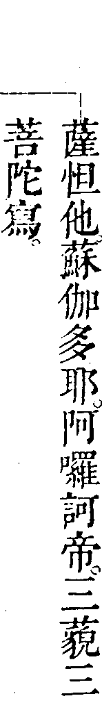



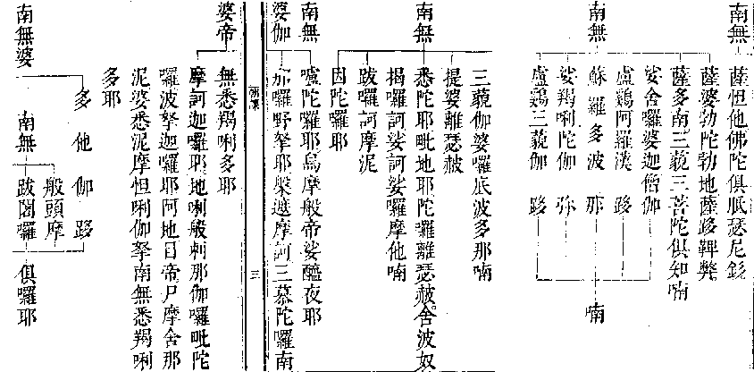



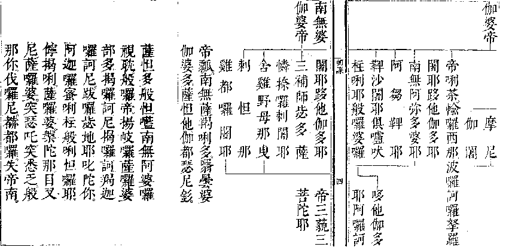



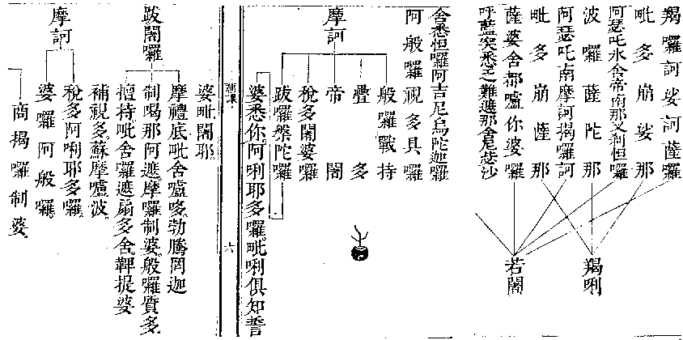



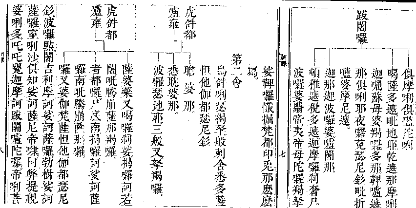



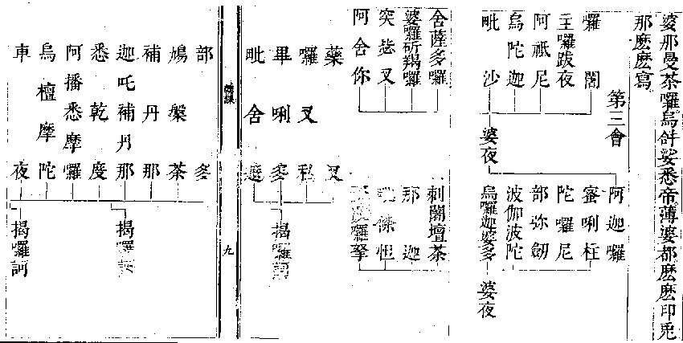



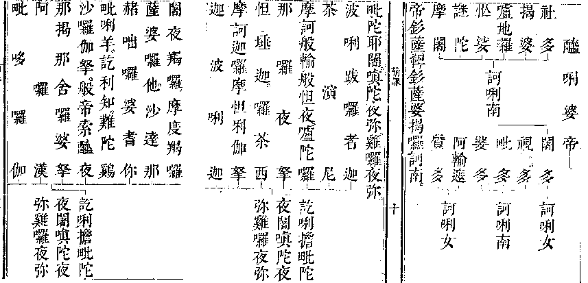



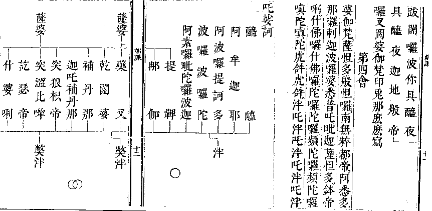



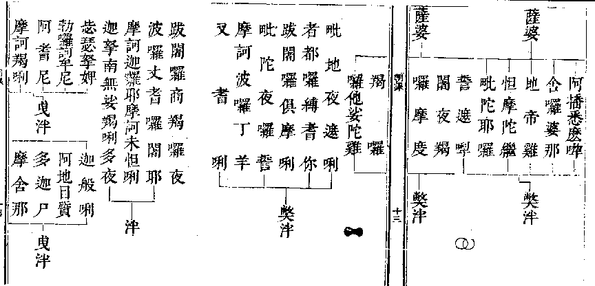



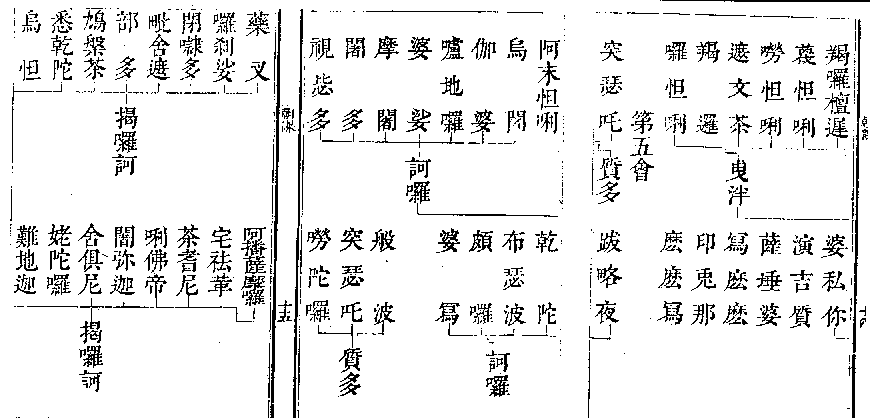



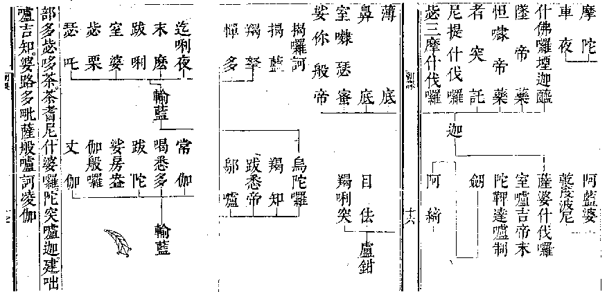



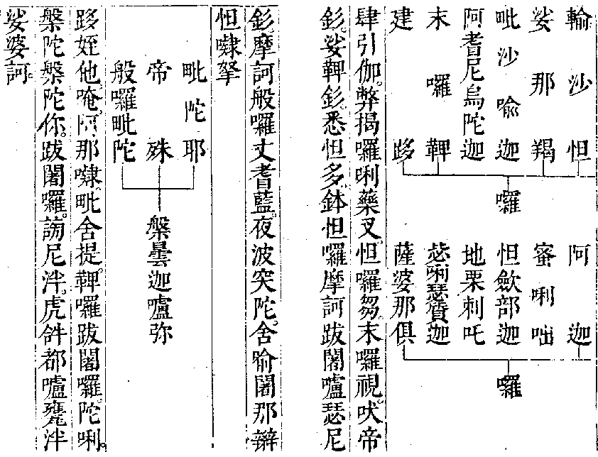



千手千眼无碍大悲陀罗尼



南无喝啰怛那哆啰夜耶　南无阿唎耶　婆卢羯帝燥钵啰耶　菩提萨埵婆耶　摩诃萨埵婆耶　摩诃迦卢尼迦耶　唵　萨皤啰罚曳　数怛那怛写　南无悉吉㗚埵伊蒙阿唎耶　婆卢吉帝室佛啰楞驮婆　南无那啰谨墀　醯唎摩诃皤哆沙咩　萨婆阿他豆输朋　阿逝孕　萨婆萨哆那摩婆伽　摩罚特豆　怛姪他　唵阿婆卢醯　卢迦帝　迦卢帝　夷醯唎　摩诃菩提萨埵　萨婆萨婆　摩啰摩啰　摩醯摩醯唎驮孕　俱卢俱卢羯蒙　度卢度卢罚阇耶帝　摩诃罚阇耶帝　陀罗陀罗　地唎尼　室佛啰耶　遮啰遮啰　麼麼罚摩啰　穆帝隶　伊醯伊醯　室那室那　阿啰嘇佛啰舍利　罚沙罚嘇　佛啰舍耶　呼卢呼卢摩啰　呼卢呼卢醯唎　娑啰娑啰　悉唎悉唎　苏𠰷苏𠰷菩提夜菩提夜　菩驮夜菩驮夜　弥帝利夜　那啰谨墀　地利瑟尼那　婆夜摩那　娑婆诃　悉陀夜　娑婆诃　摩诃悉陀夜　娑婆诃　悉陀喻艺　室皤啰耶　娑婆诃　那啰谨墀　娑婆诃　摩啰那啰娑婆诃　悉啰僧阿穆佉耶　娑婆诃　娑婆摩诃阿悉陀夜　娑婆诃　者吉啰阿悉陀夜　娑婆诃波陀摩羯悉陀夜　娑婆诃　那啰谨墀皤伽啰耶　娑婆诃　摩婆利胜羯啰夜　娑婆诃



南无喝啰怛那哆啰夜耶　南无阿利耶　婆罗吉帝　烁皤啰夜　娑婆诃　唵悉殿都　漫多啰　跋陀耶　娑婆诃



金刚胜庄严娑婆诃　摩羯胜庄严娑婆诃　唵跋阇啰室利曳娑婆诃



如意宝轮王陀罗尼



南无佛陀耶　南无达摩耶　南摩僧伽耶　南无观自在菩萨摩诃萨　具大悲心者　怛姪他唵斫揭啰伐底　震多末尼　摩诃　钵蹬谜　噜噜噜噜　底瑟咤　烁啰阿揭利　沙夜吽　癹莎诃　唵　钵蹋摩　震多末尼　烁啰吽　唵钵刺陀　钵亶迷吽



消灾吉祥神咒



曩谟三满哆　母驮喃　阿钵啰底　贺多舍　娑曩喃　怛姪他　唵　佉佉　佉呬　佉呬　吽吽　入嚩啰　入嚩啰　钵啰入嚩啰　钵啰入嚩啰　底瑟姹底瑟姹　瑟致哩瑟致哩　娑癹咤娑癹咤　扇底迦　室哩曳　娑嚩诃



功德宝山神咒



南无佛陀耶　南无达摩耶　南无僧伽耶　唵　悉帝护噜噜　悉都噜　只利波　吉利婆　悉达哩　布噜哩　娑嚩诃



佛母准提神咒



> 稽首皈依苏悉帝，头面顶礼七俱胝；  

> 我今称赞大准提，惟愿慈悲垂加护。



南无萨哆喃　三藐三菩陀　俱胝喃　怛姪他　唵折隶主隶　准提　娑婆诃



圣无量寿决定光明王陀罗尼



唵　捺摩巴葛瓦帝　阿巴啰蜜沓　阿优哩阿纳苏必你　实执沓　牒左啰宰也　怛塔哿达也　阿啰诃帝　三药三不达也　怛你也塔　唵　萨哩巴桑斯葛哩　叭哩述沓　达啰马帝　哿哿捺　桑马兀哿帝　莎巴瓦　比述帝　马喝捺也　叭哩瓦哩莎喝



药师灌顶真言



南无薄伽伐帝　鞞杀社　窭噜薜琉璃　钵刺婆喝啰阇也　怛他揭多耶　阿啰喝帝　三藐三勃陀耶　怛姪他　唵　鞞杀逝　鞞杀逝　鞞杀社　三没揭帝莎诃



观音感应真言



唵　嘛呢叭𠵸吽　麻曷倪牙纳　积都特巴达　积特些纳　微达哩葛　萨而斡而塔　卜哩悉塔葛纳补啰纳　纳卜哩　丢忒班纳　哪麻𠰷吉　说啰耶莎诃



七佛灭罪真言



离婆离婆帝　求诃求诃帝　陀罗尼帝　尼诃啰帝　毗黎你帝　摩诃伽帝　真陵乾帝　莎婆诃



> 解冤结咒



唵　齿临金咤　金咤僧金咤　吾今为汝解金咤　终不为汝结金咤　唵　强中强　吉中吉　波罗会里有殊利　一切怨家离我身　摩诃般若波罗蜜



往生净土神咒



曩谟阿弥多婆夜　哆他伽哆夜　哆地夜他　阿弥唎都婆毗　阿弥唎哆悉耽　婆毗　阿弥唎哆毗迦兰帝　阿弥唎哆毗迦兰哆　伽弥腻　伽伽那　枳多迦隶　娑婆诃



善天女咒



南无佛陀　南无达磨　南无僧伽　南无室利　摩诃提鼻耶　怛你也他　波利富楼那　遮利三曼陀　达舍尼　摩诃毗诃罗伽帝三曼陀　毗尼伽帝　摩诃迦利野　波祢波啰　波祢　萨利嚩栗他　三曼陀　修钵黎帝富隶那　阿夜那　达摩帝　摩诃毗鼓毕帝　摩诃弥勒帝　娄簸僧祗帝　醯帝簁　僧祗醯帝　三曼陀　阿他阿㝹　婆罗尼(讽心经毕称)摩诃般若波罗蜜多(三声)。



> 上来现前清净众，讽诵楞严诸品咒；  

> 回向三宝众龙天，守护(伽蓝家堂)诸圣造。  

> 三涂八难俱离苦，四恩三有尽沾恩；  

> 国界安宁兵革销，风调雨顺民安乐。  

> 一众熏修希胜进，十地顿超无难事；  

> (三门镇静道场光显)绝非虞，檀信归依增福慧。  

> 阿弥陀佛身金色，相好光明无等伦；  

> 白毫宛转五须弥，绀目澄清四大海。  

> 光中化佛无数亿，化菩萨众亦无边；  

> 四十八愿度众生，九品咸令登彼岸。



南无西方极乐世界，三十六万亿一十一万九千五百同名同号大慈大悲本师和尚阿弥陀佛、  

南无阿弥陀佛(或百声千声)，毕称南无观世音菩萨(十声)，  

南无大势至菩萨(十声)，  

南无清净大海众菩萨(十声毕)。



念佛功德，不可思议，法界普光辉，三有同摄，四恩总利，上祝皇帝圣寿万岁，法界有情，同生极乐国，普愿同生极乐国(随意诵文毕回向)。



> 我此普贤殊胜行，无边胜福皆回向；  

> 普愿沉溺诸众生，速往无量光佛刹。  

> 以上因缘三世佛，文殊普贤观自在；  

> 诸尊菩萨摩诃萨，摩诃般若波罗蜜。



清晨普愿偈



四生九有，同登华藏玄门；八难三涂，共入毘卢性海。



南无娑婆世界，三界大师，四生慈父，人天教主，千百亿化身本师和尚释迦牟尼佛



朝课(终)



暮时课诵



南无莲池海会佛菩萨(三称举)。



佛说阿弥陀经



姚秦三藏法师鸠摩罗什译



如是我闻：一时佛在舍卫国祗树给孤独园，与大比丘僧千二百五十人俱，皆是大阿罗汉，众所知识：长老舍利弗、摩诃目犍连、摩诃迦叶、摩诃迦旃延、摩诃俱𫄨罗、离婆多、周利槃陀伽、难陀、阿难陀、罗睺罗、憍梵波提、宾头卢颇罗墯、迦留陀夷、摩诃劫宾那、薄拘罗、阿㝹楼驮，如是等诸大弟子，并诸菩萨摩诃萨：文殊师利法王子、阿逸多菩萨、乾陀诃提菩萨、常精进菩萨，与如是等诸大菩萨，及释提桓因等无量诸天大众俱。



尔时，佛告长老舍利弗：「从是西方过十万亿佛土，有世界名曰极乐，其土有佛，号阿弥陀，今现在说法。舍利弗！彼土何故名为极乐？其国众生无有众苦但受诸乐，故名极乐。



「又舍利弗！极乐国土，七重栏楯、七重罗网、七重行树，皆是四宝周匝围遶，是故彼国名为极乐。



「又舍利弗！极乐国土有七宝池，八功德水充满其中，池底纯以金沙布地。四边阶道，金、银、琉璃、玻璃合成。上有楼阁，亦以金、银、琉璃、玻璃、砗磲、赤珠、玛瑙而严饰之。池中莲华大如车轮，青色青光，黄色黄光，赤色赤光，白色白光，微妙香洁。舍利弗！极乐国土成就如是功德庄严。



「又舍利弗！彼佛国土常作天乐，黄金为地，昼夜六时雨天曼陀罗华，其土众生常以清旦，各以衣裓盛众妙华，供养他方十万亿佛；即以食时，还到本国，饭食经行。舍利弗！极乐国土成就如是功德庄严。



「复次舍利弗！彼国常有种种奇妙杂色之鸟：白鹤、孔雀、鹦鹉、舍利、迦陵频伽、共命之鸟。是诸众鸟，昼夜六时出和雅音，其音演畅五根、五力、七菩提分、八圣道分如是等法。其土众生闻是音已，皆悉念佛、念法、念僧。舍利弗！汝勿谓此鸟实是罪报所生。所以者何？彼佛国土无三恶道。舍利弗！其佛国土尚无三恶道之名，何况有实？是诸众鸟皆是阿弥陀佛欲令法音宣流变化所作。



「舍利弗！彼佛国土，微风吹动，诸宝行树及宝罗网出微妙音，譬如百千种乐同时俱作，闻是音者自然皆生念佛、念法、念僧之心。舍利弗！其佛国土成就如是功德庄严。



「舍利弗！於汝意云何？彼佛何故号阿弥陀？舍利弗！彼佛光明无量，照十方国无所障碍，是故号为阿弥陀。



「又舍利弗！彼佛寿命及其人民，无量无边阿僧祗劫，故名阿弥陀。舍利弗！阿弥陀佛成佛已来，於今十劫。



「又舍利弗！彼佛有无量无边声闻弟子，皆阿罗汉，非是筭数之所能知；诸菩萨众亦复如是。舍利弗！彼佛国土成就如是功德庄严。



「又舍利弗！极乐国土众生生者，皆是阿鞞跋致。其中多有一生补处，其数甚多，非是筭数所能知之，但可以无量无边阿僧祗说。



「舍利弗！众生闻者，应当发愿，愿生彼国。所以者何？得与如是诸上善人俱会一处。舍利弗！不可以少善根福德因缘得生彼国。



「舍利弗！若有善男子善女人，闻说阿弥陀佛，执持名号，若一日、若二日、若三日、若四日、若五日、若六日、若七日一心不乱，其人临命终时，阿弥陀佛与诸圣众现在其前。是人终时心不颠倒，即得往生阿弥陀佛极乐国土。舍利弗！我见是利故说此言，若有众生闻是说者，应当发愿生彼国土。



「舍利弗！如我今者赞叹阿弥陀佛不可思议功德之利。东方亦有阿閦鞞佛、须弥相佛、大须弥佛、须弥光佛、妙音佛，如是等恒河沙数诸佛，各於其国出广长舌相，遍覆三千大千世界，说诚实言：『汝等众生当信是称赞不可思议功德，一切诸佛所护念经。』



「舍利弗！南方世界有日月灯佛、名闻光佛、大燄肩佛、须弥灯佛、无量精进佛，如是等恒河沙数诸佛，各於其国出广长舌相，遍覆三千大千世界，说诚实言：『汝等众生当信是称赞不可思议功德，一切诸佛所护念经。』



「舍利弗！西方世界有无量寿佛、无量相佛、无量幢佛、大光佛、大明佛、宝相佛、净光佛，如是等恒河沙数诸佛，各於其国出广长舌相，遍覆三千大千世界，说诚实言：『汝等众生当信是称赞不可思议功德，一切诸佛所护念经。』



「舍利弗！北方世界有燄肩佛、最胜音佛、难沮佛、日生佛、网明佛，如是等恒河沙数诸佛，各於其国出广长舌相，遍覆三千大千世界，说诚实言：『汝等众生当信是称赞不可思议功德，一切诸佛所护念经。』



「舍利弗！下方世界有师子佛、名闻佛、名光佛、达磨佛、法幢佛、持法佛，如是等恒河沙数诸佛，各於其国出广长舌相，遍覆三千大千世界，说诚实言：『汝等众生当信是称赞不可思议功德，一切诸佛所护念经。』



「舍利弗！上方世界有梵音佛、宿王佛、香上佛、香光佛、大燄肩佛、杂色宝华严身佛、娑罗树王佛、宝华德佛、见一切义佛、如须弥山佛，如是等恒河沙数诸佛，各於其国出广长舌相，遍覆三千大千世界，说诚实言：『汝等众生当信是称赞不可思议功德，一切诸佛所护念经。』



「舍利弗！於汝意云何？何故名为一切诸佛所护念经？舍利弗！若有善男子善女人闻是经受持者及闻诸佛名者，是诸善男子善女人皆为一切诸佛之所护念，皆得不退转於阿耨多罗三藐三菩提。是故舍利弗！汝等皆当信受我语及诸佛所说。



「舍利弗！若有人已发愿、今发愿、当发愿，欲生阿弥陀佛国者，是诸人等皆得不退转於阿耨多罗三藐三菩提，於彼国土若已生、若今生、若当生。是故舍利弗！诸善男子、善女人若有信者，应当发愿生彼国土。



「舍利弗！如我今者称赞诸佛不可思议功德，彼诸佛等亦称赞我不可思议功德，而作是言：『释迦牟尼佛能为甚难希有之事，能於娑婆国土五浊恶世，劫浊、见浊、烦恼浊、众生浊、命浊中，得阿耨多罗三藐三菩提，为诸众生说是一切世间难信之法。』舍利弗！当知我於五浊恶世行此难事，得阿耨多罗三藐三菩提，为一切世间说此难信之法是为甚难。」



佛说此经已，舍利弗及诸比丘，一切世间天、人、阿修罗等，闻佛所说，欢喜信受，作礼而去。



佛说阿弥陀经



拔一切业障根本得生净土陀罗尼



曩谟阿弥多婆夜　哆他伽跢夜　哆地夜他　阿弥唎都婆毘　阿弥唎哆悉耽婆毘阿弥唎哆毘迦兰帝阿弥唎哆毘迦兰哆伽弥腻　伽伽那枳多迦隶　娑婆诃



三十五佛五十三佛名忏悔经



(○佛说五十三佛名经云：尔时释迦牟尼佛告大众言：「我曾往昔无数劫时，於妙光佛末法之中出家学道，闻是五十三佛名，闻已合掌，心生欢喜，复教他人，令得闻持，他人闻已展转相教，乃至三千人，此三千人异口同音称诸佛名，一心敬礼，如是敬礼诸佛因缘功德力故，即得超越无数亿劫生死之罪。初千人者，华光佛为首，下至毘舍浮佛，於庄严劫得成为佛，过去千佛是也。其中千人者，拘留孙佛为首，下至楼至佛，於贤劫中次第成佛。后千人者，日光佛为首，下至须弥相佛，於星宿劫中当得成佛。」佛告宝积：「十方现在诸佛、善德如来等，亦曾得闻是五十三佛名故，於十方面各皆成佛。若有众生欲得除灭四重禁罪、欲得忏悔五逆十恶、欲得除灭无根谤法极重之罪，当勤礼敬五十三佛名号。」)



> 大慈大悲愍众生，大喜大舍济含识；  

> 相好光明以自严，众等志心归命礼。



南无归依金刚上师！



归依佛　归依法　归依僧



我今发心不为自求人天福报、声闻、缘觉乃至权乘诸位菩萨，唯依最上乘发菩提心，愿与法界众生，一时同得阿耨多罗三藐三菩提。



皈依十方尽虚空界一切诸佛！  

皈依十方尽虚空界一切尊法！  

皈依十方尽虚空界一切贤圣僧！



南无如来、应供、正遍知、明行足、善逝、世间解、无上士、调御丈夫、天人师、佛、世尊！  

南无普光佛！  

南无普明佛！  

南无普净佛！  

南无多摩罗跋𣒰檀香佛！  

南无栴檀光佛！  

南无摩尼幢佛！  

南无欢喜藏摩尼宝积佛！  

南无一切世间乐见上大精进佛！  

南无摩尼幢灯光佛！  

南无慧炬照佛！  

南无海德光明佛！  

南无金刚牢强普散金光佛！  

南无大强精进勇猛佛！  

南无大悲光佛！  

南无慈力王佛！  

南无慈藏佛！  

南无栴檀窟庄严胜佛！  

南无贤善首佛！  

南无善意佛！  

南无广庄严王佛！  

南无金华光佛！  

南无宝盖照空自在力王佛！  

南无虚空宝华光佛！  

南无琉璃庄严王佛！  

南无普现色身光佛！  

南无不动智光佛！  

南无降伏众魔王佛！  

南无才光明佛！  

南无智慧胜佛！  

南无弥勒仙光佛！  

南无善寂月音妙尊智王佛！  

南无世净光佛！  

南无龙种上尊王佛！  

南无日月光佛！  

南无日月珠光佛！  

南无慧幢胜王佛！  

南无师子吼自在力王佛！  

南无妙音胜佛！  

南无常光幢佛！  

南无观世灯佛！  

南无慧威灯王佛！  

南无法胜王佛！  

南无须弥光佛！  

南无须摩那华光佛！  

南无优昙钵罗华殊胜王佛！  

南无大慧力王佛！  

南无阿閦毘欢喜光佛！  

南无无量音声王佛！  

南无才光佛！  

南无金海光佛！  

南无山海会自在通王佛！  

南无大通光佛！  

南无一切法常满王佛！



三十五佛



南无释迦牟尼佛！  

南无金刚不坏佛！  

南无宝光佛！  

南无龙尊王佛！  

南无精进军佛！  

南无精进喜佛！  

南无宝火佛！  

南无宝月光佛！  

南无现无愚佛！  

南无宝月佛！  

南无无垢佛！  

南无离垢佛！  

南无勇施佛！  

南无清净佛！  

南无清净施佛！  

南无娑留那佛！  

南无水天佛！  

南无坚德佛！  

南无栴檀功德佛！  

南无无量掬光佛！  

南无光德佛！  

南无无忧德佛！  

南无那罗延佛！  

南无功德华佛！  

南无莲华光游戏神通佛！  

南无财功德佛！  

南无德念佛！  

南无善名称功德佛！  

南无红燄帝幢王佛！  

南无善游步功德佛！  

南无斗战胜佛！  

南无善游步佛！  

南无周匝庄严功德佛！  

南无宝华游步佛！  

南无宝莲华善住娑罗树王佛！  

南无法界藏身阿弥陀佛！



如是等一切世界诸佛世尊，常住在世，是诸世尊，当慈念我。若我此生、若我前生，从无始生死以来所作众罪，若自作、若教他作、见作随喜；若塔、若僧、若四方僧物，若自取、若教他取、见取随喜；五无间罪，若自作、若教他作、见作随喜、十不善道，若自作、若教他作、见作随喜。所作罪障，或有覆藏、或不覆藏，应堕地狱、饿鬼、畜生、诸餘恶趣、边地下贱及蔑戾车如是等处，所作罪障今皆忏悔。



今诸佛世尊当证知我、当忆念我。我复於诸佛世尊前作如是言：「若我此生、若我餘生，曾行布施或守净戒，乃至施与畜生一抟之食；或修净行所有善根；成就众生所有善根；修行菩提所有善根及无上智所有善根。一切合集，校计筹量，皆悉回向阿耨多罗三藐三菩提。如过去、未来、现在诸佛所作回向，我亦如是回向。」



众罪皆忏悔，诸福尽随喜；及请佛功德，愿成无上智。去来现在佛，於众生最胜；无量功德海，我今归命礼。



> 所有十方世界中，三世一切人师子；  

> 我以清净身语意，一切遍礼尽无餘。  

> 普贤行愿威神力，普现一切如来前；  

> 一身复现刹尘身，一一遍礼刹尘佛。  

> 於一尘中尘数佛，各处菩萨众会中；  

> 无尽法界尘亦然，深信诸佛皆充满。  

> 各以一切音声海，普出无尽妙言词；  

> 尽於未来一切劫，赞佛甚深功德海。  

> 以诸最胜妙华鬘，妓乐涂香及伞盖；  

> 如是最胜庄严具，我以供养诸如来。  

> 最胜衣服最胜香，末香烧香与灯烛；  

> 一一皆如妙高聚，我悉供养诸如来。  

> 我以广大胜解心，深信一切三世佛；  

> 悉以普贤行愿力，普遍供养诸如来。  

> 我昔所造诸恶业，皆由无始贪嗔痴；  

> 从身语意之所生，一切我今皆忏悔。  

> 十方一切诸众生，二乘有学及无学；  

> 一切如来与菩萨，所有功德皆随喜。  

> 十方所有世间灯，最初成就菩提者；  

> 我今一切皆劝请，转於无上妙法轮。  

> 诸佛若欲示涅槃，我悉至诚而劝请；  

> 惟愿久住刹尘劫，利乐一切诸众生。  

> 所有礼赞供养福，请佛住世转法轮；  

> 随喜忏悔诸善根，回向众生及佛道。  

> 愿将以此胜功德，回向无上真法界；  

> 性相佛法及僧伽，二谛融通三昧印。  

> 如是无量功德海，我今皆悉尽回向；  

> 所有众生身口意，见惑弹谤我法等。  

> 如是一切诸业障，悉皆消灭尽无餘；  

> 念念智周於法界，广度众生皆不退。  

> 乃至虚空世界尽，众生及业烦恼尽；  

> 如是四法广无边，愿今回向亦如是。



南无大行普贤菩萨！(三称)



蒙山施食文



> 猛火燄燄烧铁城，铁城里面热孤魂；  

> 孤魂若要生净土，听诵华严半偈经。



> 若人欲了知，三世一切佛；应观法界性，  

> 一切惟心造。(三遍)



破地狱真言



唵伽罗帝耶娑婆诃(三遍)



普召请真言



南无　部部帝唎　伽哩哆唎　怛哆誐哆耶(三遍)



解冤结真言



唵　三陀啰伽陀　娑婆诃(三遍)



南无大方广佛华严经(三遍)



南无常住十方佛  

南无常住十方法  

南无常住十方僧  

南无本师释迦牟尼佛  

南无大悲观世音菩萨  

南无冥阳救苦地藏王菩萨  

南无启教阿难陀尊者(三遍)



皈依佛┌皈依佛两足尊┌皈依佛竟  

皈依法│皈依法离欲尊│皈依法竟  

皈依僧┘皈依僧众中尊┘皈依僧竟



> (佛子、有情、孤魂)所造诸恶业，皆由无始贪瞋痴；  

> 从身语意之所生，一切(佛子、有情、孤魂)皆忏悔。  

> 众生无边誓愿度，烦恼无尽誓愿断；  

> 法门无量誓愿学，佛道无上誓愿成。  

> 自性众生誓愿度，自性烦恼誓愿断；  

> 自性法门誓愿学，自性佛道誓愿成。



地藏菩萨灭罪真言



唵钵罗末邻阤𩕳娑婆诃



观音菩萨灭业障真言



唵阿鲁勒继莎婆诃



开咽喉真言



唵步步底哩伽多哩怛哆誐多耶



三昧耶戒真言



唵三昧耶萨怛梵(三遍)



变食真言



南无萨嚩　怛他誐哆嚩　噜枳帝　唵三跋啰三跋啰　吽(三遍)



甘露水真言



南无苏噜婆耶　怛哆誐多耶　怛姪他　唵　苏噜苏噜　钵啰苏噜　钵啰苏噜　莎婆诃(三遍)



一字水轮咒



唵鍐鍐鍐鍐鍐(三遍)



念乳海真言



南无三满哆　没驮喃　唵　鍐(三遍)



南无多宝如来  

南无宝胜如来  

南无妙色身如来  

南无广博身如来  

南无离怖畏如来  

南无甘露王如来  

南无阿弥陀如来(三遍)



> 神咒加持(法施食、净法食、甘露水)，普施河沙众(有情、佛子、孤魂)；  

> 愿皆饱满舍悭贪，速脱幽冥生净土。  

> 皈依三宝发菩提，究竟得成无上道；  

> 功德无边尽未来，一切(有情、佛子、孤魂)同法食。  

> 汝等(有情、佛子、孤魂)众，我今施汝供；此食遍十方，  

> 一切(有情、佛子、孤魂)共。愿以此功德，普及於一切；  

> 施食与(有情、佛子、孤魂)，皆共成佛道。



念施无遮真言



唵穆力陵娑婆诃(三遍)



念普供养真言



唵　誐誐曩　三婆嚩　伐日啰　解(三遍)



念心经了，往生咒(三遍)。



念普回向真言



唵娑摩啰　娑摩啰　弥摩曩　萨哈啰　摩诃咱哈啰吽(三遍)



愿昼吉祥夜吉祥，　昼夜六时恒吉祥；  

一切时中吉祥者，　愿诸(上师哀摄受、三宝哀摄受、护法常拥护)。



四生登於宝地，　三有托化莲池；　河沙饿鬼证三贤，  

万类有情登十地。



蒙山施食(终)



念佛缘起



> 阿弥陀佛真金色，相好光明无等伦；  

> 白毫宛转五须弥，绀目澄清四大海。  

> 光中化佛无数亿，化菩萨众亦无边；  

> 四十八愿度众生，九品咸令登彼岸。



南无西方极乐世界，三十六万亿一十一万九千五百同名同号大慈大悲本师和尚阿弥陀佛。  

南无阿弥陀佛(或百声或千声毕称)  

南无观世音菩萨(十声)  

南无大势至菩萨(十声)  

南无清净大海众菩萨(十声)



净土文



失譔人名



仰白弥陀化主、净土圣贤，愿赐慈悲为作证明，弟子某等各为生死事大，无常迅速，代为法界众生，一心皈命顶礼。



南无西方极乐世界，毫如五须弥，目如四大海，八万四千，相好光明，四十八愿，摄受十方世界，有缘念佛众生。大慈大悲大愿大力，本师和尚阿弥陀佛。惟愿阿弥陀佛以天眼遥观、天耳遥闻、他心速见，加被我等及与众生。十二时中愿得见阿弥陀佛八万四千相；於一一相中愿得见阿弥陀佛八万四千随形好；於一一好中愿得见阿弥陀佛八万四千光明；於一一光明之中愿见十方世界。愿见十方诸佛；愿见十方诸大菩萨摩诃萨；愿见十方诸大声闻、缘觉、贤圣僧。令我一切众生无明顿破、烦恼永忘，法界之门豁然通达、一乘之路卓尔开明；十号俱彰，三身圆显，分身无量，度脱众生。愿佛慈悲，哀怜摄受。



十方三世佛，阿弥陀第一；九品度众生，威德无穷极。我今大皈依，忏悔三业罪；凡有诸福善，志心用回向。愿同念佛人，感应随时现；临终西方境，分明在目前。见闻皆精进，同生极乐国；见佛了生死，如佛度一切。无边烦恼断，无量法门修；誓愿度众生，总愿成佛道。虚空有尽，我愿无穷；虚空有尽，我愿无穷。



> 一者礼敬诸佛，二者称赞如来，  

> 三者广修供养，四者忏悔业障，  

> 五者随喜功德，六者请转法轮，  

> 七者请佛住世，八者常随佛学，  

> 九者恒顺众生，十者普皆回向。



愿我在会弟子临命终时，各愿三日已后七日已前，心不颠倒，意不散乱，无诸痛苦，不受恶缠，预知时至，身心欢喜。或吉祥而逝、或坐脱立亡。阿弥陀佛与观世音菩萨及大势至菩萨、无数化佛、百千比丘、声闻大众，无量诸天七宝宫殿及金刚台，天乐迎空，异香满室，幢幡宝盖，亲垂接引，令诸众生，见者、闻者生欢喜心，发菩提愿，改恶从善，返邪归正。惟愿阿弥陀如来大慈大悲哀怜摄受。



> 愿生西方净土中，上品莲华为父母；  

> 华开见佛悟无生，不退菩萨为伴侣。



莲池海会，弥陀如来，观音势至坐莲台，接引上金阶，大誓弘开，普愿离尘埃。



> 众等称念阿弥陀，真实功德佛名号；  

> 惟愿慈悲哀摄受，证知忏悔及所愿。  

> 往昔所造诸恶业，皆由无始贪瞋痴；  

> 从身语意之所生，一切我今皆忏悔。  

> 愿我临欲命终时，尽除一切诸障碍；  

> 面见彼佛阿弥陀，即得往生安乐刹。



愿以此功德　庄严佛净土　上报四重恩  

下济三涂苦　若有见闻者　悉发菩提心  

尽此一报身　同生极乐国　十方三世一切佛  

一切菩萨摩诃萨　摩诃般若波罗蜜



晚课　普愿警众偈：



是日已过，命亦随减，如少水鱼，斯有何乐？大众！当勤精进，如救头然，但念无常，甚勿放逸。南无西方极乐世界三十六万亿一十一万九千五百同名同号大慈大悲本师和尚阿弥陀佛(三称三礼)(又警众偈毕或称三自归亦得)



晚课(终)



杂集



祝延万寿仪文(四大节及每月朔望)



宝鼎𦶟名香，普遍十方，虔诚奉献法中王，端为皇王祝圣寿，地久天长。　香云盖云云。



持讽圣无量寿光明王咒(三遍)药师如来(三称)皇帝万岁(三和毕)祝云：



大圆满觉，应迹西乾，心包太虚，量周沙界，佛之胜德，难尽赞扬。今据　大清国某处、某府僧纲司下某寺住持某，兹遇(朔望)旦良辰，谨集阖山僧众，登临大雄宝殿，讽演神章，称扬圣号，所集洪因，端为祝延今上皇帝圣寿万岁万岁万万岁，皇后齐年，太子千秋，文武官僚高登禄位。钦愿尧风永扇，舜日长明，八方歌有道之君，四海乐无虞之化，仰凭众等同念



金刚无量寿护国仁皇菩萨摩诃萨。



持讽楞严神咒(一遍)　回向：



上来讽咒功德，庄严无上佛果菩提，然后四恩普报，三有均资，法界众生，同圆种智。



祈祷诸司仪



韦驮



持讽善天女咒(三遍)(称毕)。



南无护法韦驮尊天菩萨(三称)。白祝文：



神功叵测，密行难思。示勇健於天伦，摧邪辅正；受遗嘱於大觉，护法安僧。仰启天慈，俯垂明证。(入贯)兹遇(朔望)旦良辰，云集现前僧众，诣乎祠下，讽演咒章，称扬嘉号，所集功德，专申祈祷：



三洲感应护法韦驮尊天菩萨，侍从天等，愍念末法僧行，道力衰微，障缘遍炽。惟冀菩萨神力冥资，使法轮转处，内障外障以潜消；宾主和时，恶友恶魔皆远离。人人悟毗卢性海；各各入普贤行门。供奉檀那，均沾胜利。



赞



菩萨妙应，化现童真，三洲护法显威神，宝杵镇波旬，祈祷谆谆，惟愿福来臻。



南无普眼菩萨(三称)。



伽蓝



持讽大悲咒(一遍)。



南无伽蓝圣众菩萨(三称)。　白祝文：



神威凛凛、圣德巍巍，常为护法之神、永作伽蓝之主。仰冀圣聪，俯垂明鉴。(入贯)兹遇(朔望)旦良辰，谨集现前僧众，诣乎祠下，讽演秘章，称扬圣号，所集功德，专申祈祷：



当山土地一十八位护法、伽蓝神王菩萨、华光藏菩萨、妙吉祥如来、合堂真宰。惟冀山门镇静，僧众咸和，来有力之檀那，去无端之横扰。



赞



伽蓝圣众，护法为心，光明正大破群阴，非横总无侵，四众同钦，万古镇丛林。



南无常拥护菩萨(三称)。



祖师



持讽般若心经(一遍)、往生咒(三遍，毕称)。



南无历代祖师菩萨(三称)。　白祝文：



宝明空海，湛生死漩澓之波；大寂定门，融今古去来之相。仰启真慈，俯垂慧鉴。(入贯)兹遇(朔望)旦良辰，谨集现前僧众，云集堂上，讽经持咒，化贡金赀，所集功德，一心回向：



广大真如实际庄严无上佛果菩提，法界有情平等三处。次申祈祷：



西天东土历代祖师、菩提达磨大士、百丈大智禅师、本寺开山和尚。先亡后化，僧行觉灵，仝登彼岸，均证菩提。伏愿重持宝印，耀慧日以当空；再整颓纲，扇真风於末运。



赞



少林初祖，直指单传，一花开遍五枝联，授受绝言诠，应祷随缘，如月映江天。



南无度人菩萨(三称)



监斋



持讽准提咒(三遍毕称)。



南无监斋使者菩萨(三称)。　白祝文：天心有格，圣德无私；洁法供以精严，率龙神而拥护。仰冀天慈，俯垂明鉴。(入贯)兹遇(朔望)旦良辰，谨集现前僧众，诣乎祠下，讽演秘章，称扬圣号，化贡山楮，所集功德，专申祈祷：



九天云厨监斋使者、大圣紧那罗王菩萨部属等众。所冀厨堂清洁，斋馔丰饶，香羞广胜於酥酡，法喜咸资於监督。



赞



监斋使者，辖镇香厨，焦头烂额祸皆无，六味化醍醐，圣力匡扶，法会协中孚。



南无焰慧地菩萨(三声)



井泉



源源不竭，洛洛而来；穿山透石莫淹流，溪涧岂能留得住？深深鳌国，隐隐龙宫；江河淮济之神祗，川渊波浪之真宰。仰冀洪慈，俯赐凡情，专申回向：



南无娑竭罗龙王、大海龙王、圣众菩萨。伏愿慈风荡荡，法雨霏霏；洒滴滴之甘露，荡般般之垢浊。如斯祈祷，必蒙感应。



赞



龙王圣众，功德难量，五湖四海散琼浆，一滴洒清凉，饮者除殃，惟愿降吉祥。



南无甘露王菩萨(三声)



右祈诸司毕，念佛，至大殿或圣僧前



回向云云。



严净仪



杨枝净水，遍洒三千，性空八德利人天，饿鬼免针咽，灭罪除愆，火燄化红莲(清凉地菩萨摩诃萨三称)。持讽大悲咒、青莲等十咒、心经(各一遍毕，称)摩诃般若波罗蜜多(三称)。



唵　捺麻巴葛瓦帝　阿巴啰蜜沓　阿优哩阿纳苏必你　实执沓　牒左啰宰也　怛塔哿达也　阿啰阿帝　三药三不达也　怛你也他　唵　萨哩巴桑斯葛哩　叭哩述沓　达啰马帝　哿哿捺　桑马瓦哿帝　莎巴瓦　比述帝　马喝捺也　八哩瓦哩莎喝



愿将以此胜功德，祝赞皇帝万万岁，圣明君，诸国来朝会，南无无量寿，祝赞皇帝万万岁，祝赞皇帝万万岁。



以此经咒功德，回向护法龙天；三界岳渎灵聪，守护伽蓝真宰。祈福保安平善，庄严有位先亡；普愿法界冤亲，共入毘卢性海。



礼忏起止仪



先举香赞　次举普贤章



有一菩萨，结跏趺坐，名曰普贤。身白玉色，五十种光，光五十种色，以为项光。身诸毛孔，流出金光，其金光端，无量化佛。诸化菩萨，以为眷属，安祥徐步，雨大宝华，至行者前，其象开口。於象牙上，诸池玉女，鼓乐弦歌，其声微妙，赞叹大乘，一实之道。行者见已，欢喜敬礼，复更读诵甚深经典，遍礼十方无量诸佛，礼多宝佛塔及释迦牟尼，并礼普贤、诸大菩萨。发是誓愿：「若我宿福，应见普贤，愿尊者遍吉，示我身色(念南无普贤菩萨十声)。」



次举一切恭敬云



一心顶礼十方法界常住佛！  

一心顶礼十方法界常住法！  

一心顶礼十方法界常住僧！



是诸众等，各各胡跪，严持香华，如法供养十方法界三宝。



次举华默想云



愿此香华遍十方，以为微妙光明台；诸天音乐天宝香，诸天肴膳天宝衣。不可思议妙法尘，一一尘出一切尘，一一尘出一切法，旋转无碍互庄严，遍至十方三宝前。十方法界三宝前，悉有我身修供养；一一皆悉遍法界，彼彼无杂无障碍。尽未来际作佛事，普熏法界诸众生；蒙熏皆发菩提心，同入无生证佛智。



次散华念云



愿此香华云，遍满十方界；供养一切佛，尊法诸菩萨，无边声闻众，及一切天仙；亦起光明台，过於无边界。无边佛土中，受用作佛事；普熏诸众生，皆发菩提心。供养已，一切恭敬。



次举六根偈云



若有眼根恶，业障眼不净；但当诵大乘，思念第一义，是名忏悔眼，尽诸不善业。



耳根闻乱声，坏乱和合义；由是起狂乱，犹如痴猿猴。但当诵大乘，观法空无相；永尽一切恶，天耳闻十方。



鼻根著诸香，随染起诸触；如此狂惑鼻，随染生诸尘。若诵大乘经，观法如实际；永离诸恶业，后世不复生。



舌根起五种，恶口不善业；若欲自调顺，应勤修慈心。



思法真寂义，无诸分别相；心想如猿猴，无有暂停时。若欲折伏者，当勤诵大乘；念佛大觉身，力无畏所成。



身为机关主，如尘随风转；六贼游戏中，自在无罣碍。若欲灭此恶，永离诸尘劳；常处涅槃城，安乐心澹泊。当诵大乘经，念诸菩萨母；无量胜方便，从思实相得。



如此等六法，名为六情根；一切业障海，皆从妄想生。若欲忏悔者，端坐念实相；众罪如霜露，慧日能消除；是故应至心，忏悔六情根。　罪从心起将心忏，忏罪无如心勿起；谛观心罪本来空，是则名为真忏悔。



次举赞佛偈云



> 大慈大悲愍众生，大喜大舍济含识；  

> 相好光明以自严，众等至心归命礼。



启建慈悲道场忏法：一心皈命三世诸佛(云云)



(已上文赞偈等乃每日初起忏前称举)。



(已下逐卷忏毕时称举)。



离婆离婆帝　求诃求诃帝　陀罗尼帝　尼诃啰帝　毘黎你帝　摩诃伽帝　真陵乾帝　莎婆诃



次举十方三宝七佛诸菩萨云



南无十方佛  

南无十方法  

南无十方僧  

南无过去毘婆尸佛  

南无尸弃佛  

南无毘舍浮佛  

南无拘那含牟尼佛  

南无拘留孙佛  

南无迦叶佛  

南无本师释迦牟尼佛  

南无当来弥勒尊佛(菩萨随意称举，或举过去七佛菩萨随称)  

南无过去七佛  

南无十方十佛  

南无三十五佛  

南无五十三佛  

南无百七十佛  

南无庄严劫千佛  

南无贤劫千佛  

南无星宿劫千佛



(次举)处世界若虚空，似莲华不著水；心清净超於彼，稽首礼无上尊。自归於佛，当愿众生，体解大道，发无上心；自归於法，当愿众生，深入经藏，智慧如海；自归於僧，当愿众生，统理大众，一切无碍。和南圣众。



斋佛仪



南无常住十方佛  

南无常住十方法  

南无常住十方僧  

南无本师释迦牟尼佛  

南无大悲观世音菩萨  

南无护法诸天菩萨  

南无伽蓝圣众菩萨(三遍)



曩谟萨嚩怛嗒耶　多嚩𠰷枳谛　唵　三婆啰　三婆啰　吽



曩谟苏噜婆耶　怛他耶多誐　怛姪他　唵　苏噜苏噜　钵啰苏噜　钵啰苏噜　娑婆诃



此食色香味，上供十方佛，中奉诸贤圣，下及六道品，等施无差别，随愿皆饱满。令今施者得，无量波罗蜜。三德六味，供佛及僧；法界人天，普同供养。



唵　誐誐曩　娑婆缚　袜日啰　斛



禅悦酥酡，造出天厨供；成道当初，牧女前来送。老母曾将，托在金盘奉；献上如来，大觉金仙众。　禅悦藏菩萨摩诃萨(三声)。



二时临斋仪



念供养



供养清净法身毘卢遮那佛、圆满报身卢舍那佛、千百亿化身释迦牟尼佛、当来下生弥勒尊佛、十方三世一切诸佛、大智文殊师利菩萨、大行普贤菩萨、大悲观世音菩萨、诸尊菩萨摩诃萨、摩诃般若波罗蜜。三德六味，供佛及僧，法界人天，普同供养。若饭食时，当愿众生，禅悦为食，法喜充满。



出生(以箸挑饭五七粒，近左手掌中点念云)



法力不思议，大悲无障碍；七粒遍十方，普施周沙界。大鹏金翅鸟、鬼子母、旷野神皆得饱满　唵(度利曳沙诃)。



结斋



饭食以讫，当愿众生，所作皆办，具诸佛法。



粥



粥有十利，饶益行人；果报无边，究竟常乐。



受嚫



财法二施，等无差别；檀波罗蜜，具足圆满。



诵药师经毕咒愿解结



十二药叉大将，助佛宣弘，五色彩缕结其名，随愿悉圆成，冤业冰清，福寿永康宁。



南无薄伽伐帝　鞞杀社　窭噜薜琉璃　钵喇婆喝啰阇也　怛陀揭多耶　阿啰喝帝　三藐三勃陀耶　怛姪陀　唵　鞞杀逝　鞞杀逝　鞞杀社　三没揭帝　莎诃



> 解结解结解冤结，解了多生冤和业；  

> 洗心涤虑发虔成，今对佛前求解结。



药师佛、  

药师佛，  

消灾延寿药师佛  

南无消灾延寿药师佛



诵经略止偈



菩提妙化遍庄严，随所住处常安乐。



诵《法华经》毕回向：



一句染神，咸资彼岸；思惟修习，永用舟航；随喜见闻，恒为主伴。若取若舍，经耳成缘；或顺或违，终因斯脱。愿解脱之日，依报正报，常宣妙经；一刹一尘，无非利物。唯愿诸佛冥熏加被，一切菩萨密借威灵；在在未说皆为劝请，凡有说处亲承供养；一句一偈增进菩提，一色一香永无退转。



南无护法诸天菩萨(三称)。



华严道场字母



罏香乍𦶟，法界蒙熏，华严海会悉遥闻，随处结祥云，诚意方殷，诸佛现全身。(每日主经出班白云)遮那妙体，遍法界以为身；华藏庄严，等大虚而为量。维此法会，不异寂场，极依正以常融；在圣凡而靡间。初成正觉，现神变於菩提场中；再转法轮，震圆音於普光明殿。遍七处而恒演，历九会以同宣；敷万行之因华，严一乘之道果。谨遵教典，大启法筵，仰祝皇图巩固，帝道遐昌；佛日增辉，法轮常转。十方施主，增益福田；法界众生，同圆种智。



南无华严教主卢舍那佛(三称)(举开经偈云)：



> 无上甚深微妙法，百千万劫难遭遇；  

> 我今见闻得受持，愿解如来真实义。



其一赞佛(每卷毕举赞，共有四赞)：



华严海会，舍那如来，莲华藏海坐华台，诸佛叹奇哉！万象昭回，幽暗一时开(一卷之三卷)。



其二法赞：



华严海会，宝藏灵文，大千经卷一微尘，剖出在当人，华雨缤纷，法界普熏闻(四卷之五卷)。



其三海会众赞：



华严海会，十圣三贤，华台宝座拥诸天，法界广无边，助佛弘宣，陆地绽金莲(六卷之八卷)。



其四第一会赞：



华严海会，觉帝扬灵，菩提场内道初成，夜半睹明星，普救迷情，幽暗悉光明(九卷之十一卷)。



第二会赞：



普光明殿，大法弘宣，如来名号广无边，四谛义幽玄，法炬常然，普献法王前(十二卷之十五卷)。



第三会赞：



菩提树下，不动而升，天王帝释远相迎，敷座已圆成，觉帝扬声，万象悉皆听(十六卷之十八卷)。



第四会赞：



波腾行海，云布慈门，夜摩天上众云臻，围遶法王尊，花雨缤纷，一会俨然存(十九之二十一卷)。



第五会赞：



率陀天上，慧日舒光，十回向义广宣扬，苦海作津梁，化日舒长，华雨散天香(二十二之二十三卷)。



第六会赞：



高升他化，自在天宫，广宣十地义无穷，行布尽圆融，慧燄重重，烁破太虚空(三十四之三十九卷)。



第七会赞：



普光再会，大法重宣，高超十圣与三贤，等觉义幽玄，心月孤圆，究竟离言诠(四十之五十二卷)。



第八会赞：



普光三会，万行圆修，普贤瓶泻二千酬，苦海泛慈舟，一句全收，法义一齐周(五十三之五十九卷)。



第九会赞：



福城东际，童子南询，百城烟水渺无垠，知识异常伦，五十三人，一曲和阳春(六十之八十卷)。



经毕总赞：



普贤行愿，功德周圆，普资恩有利人天，福寿广增延，灭罪无边，同愿礼金仙(举赞)。



(每卷赞毕举唱)。



华严字母，众艺亲宣，善财童子得真传；秘蜜义幽玄，功德无边，唱诵利人天(众同唱)。



阿(上声，后同)  

佒鞥翁乌爊哀医因安音谙讴



阿



多  

当登东都刀𪒴低颠单○耽兜



多



波  

帮崩○逋褒䪹卑宾般○○○



波



左  

臧增宗租遭灾赍津篯浸簪陬  

唱  

左  

字



那  

囊能浓奴揉㾍泥年难䛘南㝹



那  

时



逻  

郎楞笼卢劳来黎嶙阑林蓝娄



逻  

普



柂  

唐腾同从陶台啼田檀○覃头



柂  

愿



婆  

傍朋蓬蒲袍牌毗频槃○𨂝裒



婆  

法



茶  

长澄重除䄻[女*(犀-牛+干)]池陈㺦沉𢜩俦



茶  

界



沙  

霜生舂疏稍[山*思]诗申山深衫搜



沙  

众



嚩  

忘○牦无○○微文𣗊○[瑢-口+夕]雺



嚩  

生



哆  

铛灯冬都啁懛堤颠殚○担侸  

唱  

哆  

入



也  

阳蝇容余遥○移寅延淫盐由



也  

般



瑟咤(二合)  

(尸尸书书尸师尸尸师尸师师张微中朱朝梩知珍㣶砧𧮪辀)



瑟咤  

若



迦  

冈搄公孤高该鸡斤千金甘钩



迦  

波



娑  

桑僧棇苏骚腮西新珊心三涑



娑  

罗



麼  

茫瞢蒙模毛埋弥民瞒○姏呣



麼  

蜜



伽  

强𣩦穷渠乔○奇勤虔琴钳求



伽  

门



他  

汤冬通㻌叨胎梯天滩舚贪偷



他



社  

常成慵蜍韶○时辰禅谌蟾酬  

唱  

社



锁  

颡僧㪌苏扫𫍰洗[占@又]伞罧糁[容-口+夕]



锁



柂  

棠滕筒途桃抬提田坛○谈投



柂



奢  

伤升春书烧筛尸伸膻琛苫收



奢



佉  

康硱空枯尻开欺[(臣*ㄆ)/(禾/(尒-小+(恭-共)))]看钦龛𫸩



佉



叉  

创琤冲初抄钗鸱嗔[彳*軍]𧡪搀搊



叉  

字



娑多(二合)  

(思思苏苏思思西西思西思思当登东都刀懛低颠单○耽兜)



娑多  

时



壤  

穰仍茸如饶○而仁然任𩓾柔



壤  

普



曷攞多(二合)  

(亢恒胡胡毫孩奚贤寒○含侯郎楞龙卢劳来黎燐阑林蓝娄当登东都刀儓低颠单○耽兜)



曷攞多  

愿



婆  

旁棚髼葡炮排皮贫柈○𨂝髻



婆  

法



车  

昌称冲枢怊差蚩瞋阐𧡪[韋*(詹-言+(工/口))]犨



车  

界



娑麼(二合)  

(斯斯苏苏思思西西思西思思茫萌蒙模毛埋迷民蛮○[葵-天+ㄆ]谋)



娑麼  

众



诃婆(二合)  

(㰠衡烘呼蒿咍希希顸希含呴旁朋蓬蒲袍排毘贫泮○踅裒)  

唱  

诃婆  

生



[糸*(前-刖+老)]  

丧僧松苏缲腮西辛珊芯糁锼



[糸*(前-刖+老)]  

入



伽  

强擎蛩劬翘○其芹乾禽针裘



伽  

般



咤  

张徵中猪朝梩知珍㣶砧𧮪辀



咤  

若



拏  

娘𡬛𬪩袽娆樨尼纫然䛘諵羺



拏  

波



娑颇(二合)  

(思思苏苏思思西西思西思思滂漰𢓱秿胞嶏披砏潘○芝桴)



娑颇  

罗



娑迦(二合)  

(思思苏苏思思西西思西思思冈搄公孤高该鸡斤千今甘勾)



娑迦  

蜜



也娑(二合)  

(亦亦亦亦亦亦亦亦亦亦亦亦桑僧蜙苏缲腮西辛珊心三[革*(容-口+ㄆ)])



也娑  

门



室左(二合)  

(室室束束室室室室瑟室瑟瑟臧增宗租遭灾赍津篯浸簪邹)



室左



侘  

䓪僜踵摅超搋𫄨[彳*(聯-丱+廾)]脠琛觇抽



侘



陀  

唐滕彤图韬骀醍田驒○昙骰



陀



字母(终)



后赞



四十二字妙陀罗，字字包含义理多(阿、多、波、左云云)。



梵韵满娑婆，功德大，法界沐恩波。



南无华严海会佛菩萨(一声)。



(或举)愿以此功德，普及於一切；我等与众生，皆共成佛道(或举)。四生九有，同登华藏玄门；八难三涂，共入毘卢性海。



礼华严文



随州大洪山遂禅师作



> 稽首华严真性海，种种光明遍照尊；  

> 普贤万行所庄严，一切真如法界藏。  

> 龙树龙宫亲诵忆，实叉于阗阐微言；  

> 一乘圆顿妙法门，见性成佛真秘典。  

> 手捧目观心口诵，当知夙有大因缘；  

> 见闻随喜发菩提，究竟圆成萨婆若。



南无毘卢教主、华藏慈尊，演宝偈之金文，布琅函之玉轴。尘尘混入，刹刹圆融，十兆九万五千四十八字，一乘圆教《大方广佛华严经》。若人欲了知，三世一切佛；应观法界性，一切惟心造。常愿供养常恭敬，七处九会佛菩萨；常愿证入常宣说，五周四分《华严经》。常愿供养无休歇，九十刹尘菩萨众；常愿悟入常宣说，《大方广佛华严经》。



伏愿(某甲)生生世世，在在处处，眼中常见如是经典；耳中常闻如是经典；口中常诵如是经典；手中常书如是经典；心中常悟如是经典。愿生生世世，在在处处，常得亲近华藏一切圣贤；常蒙华藏一切圣贤慈悲摄受。如经所说，愿悉证明。愿如善财菩萨、愿如文殊师利菩萨、愿如弥勒菩萨、愿如普贤菩萨、愿如观世音菩萨、愿如毘卢遮那佛。



以此称经功德、以此发愿功德，愿与四恩三有法界一切众生，消无始以来尽法界、虚空界无量罪垢。愿与四恩三有法界一切众生，解无始以来尽法界、虚空界无量冤业。愿与四恩三有法界一切众生，集无始以来，尽法界、虚空界无量福智，同游华藏庄严海；同入菩提大道场。南无《大方广佛华严经》。



华严海会佛菩萨(终)



小净土文



慈云忏主撰



一心皈命极乐世界阿弥陀佛，愿以净光照我，慈誓摄我。我今正念称如来名，为菩提道求生净土。佛昔本誓：「若有众生欲生我国，志心信乐乃至十念，若不生者不取正觉。」以此念佛因缘，得入如来大誓海中，承佛慈力众罪消灭、净因增长。若临命终自知时至，身无病苦、心不贪恋、意不颠倒，如入禅定。佛及圣众，手执金台来迎接我，於一念顷生极乐国。花开见佛，即闻佛乘，顿开佛慧，广度众生满菩提愿，广度众生满菩提愿。



新定西方愿文



杭云栖寺株宏撰



> 稽首西方安乐国，接引众生大导师；  

> 我今发愿愿往生，惟愿慈悲哀摄受。



弟子(某甲众等)普为四恩、三有法界众生，求於诸佛一乘无上菩提道，故专心持念阿弥陀佛万德洪名期生净土；又以业重福轻，障深慧浅，染心易炽，净德难成。今於佛前，翘勤五体，披沥一心，投诚忏悔。我及众生旷劫至今，迷本净心，纵贪瞋痴，染秽三业无量无边；从作罪垢无量无边，所结冤业愿悉消灭。从於今日立深誓愿，远离恶法誓不更造；勤修圣道誓不退惰；誓成正觉誓度众生。阿弥陀佛以慈悲愿力，当证知我、当哀悯我、当加被我。愿禅观之中、梦寐之际，得见阿弥陀佛金色之身；得历阿弥陀佛宝严之土；得蒙阿弥陀佛甘露灌顶、光明照身、手摩我头、衣覆我体，使我宿障自除、善根增长、疾空烦恼、顿破无明，圆觉妙心廓然开悟，寂光真境常得现前。至於临欲命终预知时至，身无一切病苦厄难；心无一切贪恋迷惑，诸根悦豫，正念分明，舍报安详，如入禅定。阿弥陀佛与观音势至诸圣贤众，放光接引垂手提携。楼阁幢幡，异香天乐，西方圣境，昭示目前，令诸众生，见者闻者，欢喜感叹，发菩提心。



我於尔时乘金刚台随从佛后，如弹指顷生极乐国，七宝池内胜莲华中，华开见佛，见诸菩萨，闻妙法音，获无生忍。於须臾间，承事诸佛，亲蒙授记。得授记已，三身四智，五眼六通，无量百千陀罗尼门，一切功德皆悉成就。然后不违安养，回入娑婆，分身无数，遍十方刹，以不可思议自在神力，种种方便度脱众生，咸令离染还得净心，同生西方入不退地。如是大愿，世界无尽，众生无尽，业及烦恼一切无尽，我愿无尽。愿今礼佛、发愿、修持功德回施有情，四恩总报，三有齐资，法界众生，同圆种智。



前净土文理得而义未周，后净土文义周而辞太简。义未周，则往生之意不显；辞太简，则悲恳之情不伸。予乃宗以大经、博以诸说、融以事理、贯以果因而成此文。净业诸上善人如以为可，愿广流通；如谓不然，愿承教诲。



礼佛发愿文



怡山然禅师撰



归命十方调御师，演扬清净微妙法；三乘四果解脱僧，愿赐慈悲哀摄受。但(其甲)自违真性，枉入迷流，随生死以飘沉、逐色声而贪染。十缠十使，积成有漏之因；六根六尘，妄作无边之罪。迷沦苦海，深溺邪途，著我耽人，举枉措直。累生业障，一切愆尤，仰三宝以慈悲，沥一心而忏悔。所愿能仁拯拔，善友提携，出烦恼之深渊，到菩提之彼岸。此世福基命位，各愿昌隆；来生智种灵苗，同希增秀。生逢中国，长遇明师；正信出家，童真入道。六根通利，三业纯和；不染世缘，常修梵行。执持禁戒，尘业不侵；严护威仪，蜎飞无损。不逢八难，不缺四缘；般若智以现前，菩提心而不退。修习正法，了悟大乘，开六度之行门，越三祗之劫海。建法幢於处处，破疑网於重重；降伏众魔，绍隆三宝。承事十方诸佛，无有疲劳；修学一切法门，悉皆通达。广作福慧，普利尘沙；得六种之神通，圆一生之佛果。然后不舍法界，遍入尘劳，等观音之慈心，行普贤之愿海。他方此界，逐类随形；应现色身，演扬妙法。泥犁苦趣，饿鬼道中，或放大光明、或现诸神变。其有见我相，乃至闻我名，皆发菩提心，永出轮回苦。火镬冰河之地变作香林，饮铜食铁之徒化生净土。披毛戴角，负债含怨，尽罢辛酸，咸沾利乐。疾疫世而现为药草，救疗沉疴；饥馑时而化作稻粱，济诸贫馁。但有利益，无不兴崇。次期累世冤亲、现存眷属，出四生之汩没；舍万劫之爱缠，等与含生，齐成佛道。虚空有尽，我愿无穷；情与无情，同圆种智。



此真大乘菩萨弘誓愿也。



赞观音文



南无过去正法明如来、现前观世音菩萨，成妙功德，具大慈悲。於一身心，现千手眼，照见法界，护持众生。令发广大道心，教持圆满神咒，永离恶道，得生佛前。无间重愆，缠身恶疾，莫能救济，悉使消除。三昧辩才，现生求愿，咸令果遂，决定无疑。能使速获三乘，早登佛地，威神之力，叹莫能穷，故我一心，归命顶礼。



礼观音文



大慧杲禅师撰



清净三业，一心五体投地，归依南无十方慈父广大灵感观世音菩萨！我闻菩萨从闻思修入三摩地，得二随顺、四不思议、十四无畏、十九说法、七难二求、三十二应无量功德。兴大威力，发大誓愿，同流九界，六道四生，生死趣中，兴百千万亿无量恒河沙劫数善行方便，救度拔济，一切众生，无有休息。我今哀求，必赐加被。伏念(某甲)，夙生庆幸，得遇佛乘，身虽出家，身不染道(在家者改作身苦尘缘，心多散乱)，愚痴邪见，诸根昏塞。内外经书，虽於习学，章句妙理，无所通晓。又恐福力浅薄，寿命不长，徒入空门(在家改作徒得人身)，虚生浪死。我今洗心泣血，稽颡投诚，终日竟夜，存想圣容，受持圣号，礼拜圣像。惟愿菩萨，天耳闻声，悲心救苦，怜愍加被。放大神光，照我身心，倾大甘露，灌我顶门。荡涤累世怨愆，洗洁千生罪垢，身心清净，魔障消除。昼夜之间、坐卧之中，观见菩萨，放大神光，开我慧性，使(某甲)即时，神通朗发，智慧聪明。一切经书，自然记忆；一切义理，自然通晓。得大辩才、得大智慧、得大寿命、得大安乐。参禅学道，无诸魔障，悟无生忍，世世生生，行菩萨道。四恩总报，三有齐资，法界众生，同圆种智。



祈祷观音文



闻性空时妙无比，思修顿入三摩地；无缘慈力赴群机，明月影临千涧水。弟子(某人)稽首归命　大慈悲父观世音菩萨！仰愿他心道眼，无碍见闻，动大哀怜，冥熏加被。一者愿早断漏结，速证无生，三业圆明，六根清净。二者愿一闻千悟，获大总持，具足辩才，四无碍解，凡是圣教，熏习其心，一历耳根，永无忘失，功德智慧，庄严其身，根根尘尘，周遍法界。三者愿上求佛果，下度群生，梵行早圆，三轮空寂，直至成佛，於其中间舍身受身常为男子，随佛出家，发菩提心，自利利他，行愿无尽。然后愿我临欲命终时尽除一切诸障碍，面见彼佛阿弥陀！即得往生安乐刹，生彼国土，满诸大愿，足菩萨行，与诸众生，皆成佛道。



一者礼敬诸佛。二者称赞如来。三者广修供养。四者忏悔业障。五者随喜功德。六者请转法轮。七者请佛住世。八者常随佛学。九者恒顺众生。十者普皆回向。无边烦恼断，无量法门修，誓愿度众生，皆共成佛道。十方三世一切佛，一切菩萨摩诃萨，摩诃般若波罗蜜。



南无大慈大悲广大灵感观世音菩萨(三称三拜。凡礼观音者，先须像前跪念赞观音文毕，当持大悲咒廿一遍，次当身拜口念礼观音文；再次当跪念祈祷观音文回向)。



在家诵经回向



> 上来清净身语意，持诵经文秘密咒；  

> 回向三宝众龙天，祝赞家堂诸圣造。  

> 三涂八难俱离苦，四恩三有尽资熏；  

> 国界安宁兵革消，风调雨顺民康乐。  

> 众善熏修希胜进，身位安宁无难事；  

> 家居吉庆绝非虞，此世他生增福慧。  

> 十方三世一切佛！诸尊菩萨摩诃萨！  

> 摩诃般若波罗蜜。



六根偈



> 若有眼根恶，业障眼不净；但当诵大乘，  

> 思念第一义，是名忏悔眼，尽诸不善业。  

> 耳根闻乱声，坏乱和合义，由是起狂乱，  

> 犹如痴猿猴；但当诵大乘，观法空无相，  

> 永尽一切恶，天耳闻十方。鼻根著诸香，  

> 随染起诸触，如此狂惑鼻，随染生诸尘；  

> 若诵大乘经，观法如实际，永离诸恶业，  

> 后世不复生。舌根起五种，恶口不善业；  

> 若欲自调顺，应勤修慈心，思法真寂义，  

> 无诸分别相。心想如猿猴，无有暂停时；  

> 若欲折伏者，当勤诵大乘，念佛大觉身，  

> 力无畏所成。身为机关主，如尘随风转，  

> 六贼游戏中，自在无罣碍；若欲灭此恶，  

> 永离诸尘劳，常处涅槃城，安乐心澹泊，  

> 当诵大乘经，念诸菩萨母，无量胜方便，  

> 从思实相得。如此等六法，名为六情根，  

> 一切业障海，皆从妄想生；若欲忏悔者，  

> 端坐念实相，众罪如霜露，慧日能消除，  

> 是故应志心，忏悔六情根(六根偈竟)。



法身偈



诸行无常，是生灭法；生灭灭已，寂灭为乐。



为临终人念佛式(灵前通用)



爱河千尺浪，苦海万重波；欲免轮回苦，大众念弥陀　南无阿弥陀佛(或一百声、二三百声，随意延促)。



南无观世音菩萨、南无大势至菩萨、南无清净大海众菩萨。



第一大愿，观想弥陀，四十八愿度娑婆，九品涌金波，宝纲交罗，度众生出爱河。



> 众等称念阿弥陀，真实功德佛名号；  

> 惟愿慈悲哀摄受，证知忏悔及所愿。  

> 往昔所造诸恶业，皆由无始贪瞋痴；  

> 从身语意之所生，一切罪根皆忏悔。  

> 惟愿亡灵神不乱，正念直往生安养；  

> 面奉弥陀值圣众，修行十地胜常乐。  

> 以上因缘三世佛，文殊普贤观自在；  

> 诸尊菩萨摩诃萨，摩诃般若波罗蜜。



> 愿以此功德，普及於一切；我等与众生，  

> 皆共成佛道。



十方三世一切佛，一切菩萨摩诃萨，摩诃般若波罗蜜(终)。



念佛弥陀赞



志心信礼，西方净土主，阿弥陀无量寿，因中发弘誓，唵(哑吽)，接引出娑婆。到西方，不退地，授佛记，上品莲华生，常闻说法音。七宝池，八功德水，三十六万亿，唵(哑吽)，同赴莲池会。若归依，能消灭，消灭十恶罪；佛子若归依，能消灭，消灭十恶罪。



西方净土赞



赞礼西方，极乐清凉，莲池九品华香，宝树成行，常闻天乐铿锵。弥陀佛大放慈光，化导众生，无量降吉祥，现前众等歌扬，愿生安养。



晨朝功德赞



佛功德不可量，祝延万岁君王，四恩三有尽酬偿，怨亲俱超往，现前众等增福慧，临终正念昭彰，佛垂金手放毫光，同愿往西方。



消灾赞



消灾胜会，炽盛光王，十二大愿妙难量，灭罪殄灾殃，赐福垂祥，诸佛尽称扬。



药师赞



药师海会，炽盛光王，八大菩萨降吉祥，七佛助宣扬，日月回光，福寿永安康。



佛宝赞



志心信礼佛陀耶，两足尊！三觉圆，万德具，天人调御师(唵哑吽)，凡圣大慈父。从真界，腾应质，悲化溥，竖穷三际时，弘遍十方处。震法雷，鸣法鼓，广演权实教(唵哑吽)，大开方便路。若归依，能消灭，地狱苦；若归依，能消灭，地狱苦。



法宝赞



志心信礼达摩耶，离欲尊！宝藏收，玉函轴，结集於西域(唵哑吽)，翻译传东土。祖师弘，贤哲判，成章疏，三乘分顿渐，五教定宗趣。鬼神钦，龙天护，导迷摽月指(唵哑吽)，除热真甘露。若归依，能消灭，饿鬼苦；若归依，能消灭，饿鬼苦。



僧宝赞



志心信礼僧伽耶，众中尊！五德师，六和侣，利生为事业(唵哑吽)，弘法是家务。避嚣尘，常宴坐，寂静处，遮身服毳衣，充腹采薪薇。钵降龙，锡解虎，法灯常遍照(唵哑吽)，祖印相传付。若归依，能消灭，旁生苦；若归依，能消灭，旁生苦。



释迦赞



志心信礼释迦牟尼佛！三界师，四生父，玉毫眉际现(唵哑吽)，金口谈妙语。润群生，如朽木，沾甘露，八十随形好，三十二相具。现慈悲，相救诸苦，我今香花请(唵哑吽)，惟愿垂加护。愿降临，无遮会，表施主；愿降临，今时分，表施主。



观音赞



志心信礼观世音菩萨。现慈悲相光皎洁，眉湾如翠柳(唵哑吽)，面圆似满月。随佛现，化群生，十方刹，瞻礼灾殃散，闻名罪消灭。献香花，星罗列，仙乐从空降(唵哑吽)，丝竹声和悦。愿降临，救众生，归佛刹；愿慈悲，度诸有，生极乐。



地藏赞



志心信礼地藏王菩萨！大慈尊，超十地，手持金锡杖(唵哑吽)，身挂福田衣。掌中珠，照六道，发弘誓，每往阎王殿，亲临地狱内。救诸苦，咸出离，人天生快乐(唵哑吽)，直至佛菩提。白毫光，常照耀，不思议。愿慈悲，临法会，度群迷。



炽盛赞



药师佛，炽盛玉，光临水月坛场，悲心救苦降吉祥，除难消灾障，忏悔檀那三世罪，愿祈福寿绵长。吉星高照沐恩光，如意永安康；吉星高照沐恩光，如意永安康。



求生西方十六观门赞



归依西方十六观门！日轮悬鼓暮西沉，水结琉璃，宝地一掌平，七重行树，八德凉津，宝相巍巍放光明。无量寿佛、势至、观音，五色莲华五车轮，丈六金身显法身。下品莲华托质化生，中品罗汉辟支身，上品菩萨十地门，一生补处，妙觉圆明，圆觉亦证悟修心，同圆种智法界真。西方教主，我等慈尊，九莲台畔度众生。大慈弥陀佛，大悲菩萨僧，接引众生，上品上生。



送佛赞



佛慈广大，感应无差，寂光三昧遍河沙，原不离伽耶，降福斋家，金地涌莲华。



(浙江嘉兴府楞严寺般若堂壬寅年　刻此诸经共三卷，居士严大参助银参两)



> (康熙元年四月日)



沩山大圆禅师警策



夫业系受身，未免形累，禀父母之遗体、假众缘而共成，虽乃四大扶持，常相违背，无常老病，不与人期，朝存夕亡，刹那异世。譬如春霜晓露，倏忽即无，岸树井藤，岂能长久？念念迅速，一刹那间，转息即是来生，何乃晏然空过？父母不供甘旨，六亲固以弃离；不能安国治邦，家业顿捐继嗣。缅离乡党，剃发禀师，内勤克念之功；外弘不诤之德。迥脱尘世，冀期出离，何乃才登戒品，便言我是比丘？檀越所须，吃用常住，不解忖思来处，谓言法尔合供。吃了聚头喧喧，但说人间杂话，然则一期趁乐，不知乐是苦因。曩劫徇尘，未尝返省，时光淹没，岁月蹉跎。受用殷繁，施利浓厚，动经年载，不拟弃离，积聚滋多，保持幻质。导师有敕，戒勗比丘，进道严身，三常不足。人多於此，耽味不休，日往月来，飒然白首。后学未闻旨趣，应须博问先知，将谓出家，贵求衣食。



佛先制律，启创发蒙，轨则威仪，净如冰雪。止持作犯，束敛初心，微细条章，革诸猥弊。毘尼法席，曾未叨陪，了义上乘，岂能甄别？可惜一生空过，后悔难追；教理未尝措怀，玄道无因契悟。及至年高腊长，空腹高心；不肯亲附良朋，惟知倨傲。未谙法律，戢敛全无，或大语高声，出言无度，不敬上中下座，婆罗门聚会无殊。碗钵作声，食毕先起；去就乖角，僧体全无。起坐忪诸，动他心念，不存些些轨则、小小威仪，将何束敛后昆？新学无因倣傚。才相觉察，便言我是山僧，未闻佛教行持，一向情存粗糙。如斯之见，盖为初心慵惰，饕餮因循，荏苒人间，遂成疏野，不觉𨀁踵老朽，触事面墙。后学咨询，无言接引，纵有谈说，不涉典章。或被轻言，便责后生无礼，瞋心忿起，言语该人。一朝卧疾在床，众苦萦缠逼迫，晓夕思忖，心里恛惶，前路茫茫，未知何往？从兹始知悔过，临渴掘井奚为？自恨蚤不预修，年晚多诸过咎。临行挥霍怕怖慞惶，縠穿雀飞，识心随业，如人负债，强者先牵，心绪多端，重处偏坠。无常杀鬼，念念不停，命不可延，时不可待，人天三有，应未免之。如是受身，非论劫数，感伤叹讶，哀哉切心，岂可缄言，递相警策？所恨同生像季，去圣时遥，佛法生疏，人多懈怠，略伸管见，以晓后来，若不蠲矜，诚难轮逭。



夫出家者！发足超方，心形异俗，绍隆圣种，震慑魔军，用报四恩，拔济三有。若不如此，滥厕僧伦，言行荒疏，虚沾信施。昔年行处，寸步不移，恍惚一生，将何凭恃？况乃堂堂僧相，容貌可观，皆是宿植善根，感斯异报。便拟端然拱手，不贵寸阴，事业不勤，功果无因克就，岂可一生空过？抑亦来业无裨，辞亲决志披缁，意欲等超何所？晓夕思忖，岂可迁延过时？心期佛法栋梁，用作后来龟镜，常以如此，未能少分相应。出言须涉於典章；谈说乃傍於稽古。形仪挺特，意气高闲。远行要假良朋，数数清於耳目；住止必须择伴，时时闻於未闻。故云：「生我者父母，成我者朋友。」亲附善者，如雾露中行，虽不湿衣，时时有润；狎习恶者，长恶知见，晓夕造恶，即目交报。殁后沉沦，一失人身万劫不复，忠言逆耳岂不铭心者哉？便能澡心育德，晦迹韬名，蕴素精神，喧嚣止绝。



若欲参禅学道，顿超方便之门。心契玄津，研几精要，决择深奥，启悟真源，博问先知，亲近善友。此宗难得其妙，切须子细用心，可中顿悟正因，便是出尘阶渐，此则破三界三十五有。内外诸法，尽知不实，从心变起，悉是假名。不用将心凑泊，但情不附物，物岂碍人？任他法性周流，莫断莫续，闻声见色，盖是寻常，遮边那边，应用不阙。如斯行止，实不枉披法服，亦乃酬报四恩，拔济三有。生生若能不退，佛阶决定可期；往来三界之宾，出没为他作则。此之一学最妙最玄，但办肯心，必不相赚。



若有中流之士，未能顿超，且於教法留心温存；贝叶精搜义理。传唱敷扬，接引后来，报佛恩德，时光亦不虚弃。必须以此扶持，住止威仪，便是僧中法器。岂不见倚松之葛，上耸千寻，附托胜因，方能广益。恳修斋戒，莫谩亏逾，世世生生，殊妙因果。不可等闲过日，兀兀度时，可惜光阴，不求升进，徒消十方信施，亦乃孤负四恩。积累转深，心尘易壅，触途成滞，人所轻欺。古云：「彼既丈夫我亦尔！」不应自轻而退屈。若不如此徒在缁门，荏苒一生殊无所益。



伏望兴决烈之志，开特达之怀，举措看他上流，莫擅随於庸鄙，今生便须决断，想料不由别人。息意忘缘，不与诸尘作对；心空境寂，只为久滞不通。熟览斯文，时时警策，强作主宰，莫徇人情，业果所牵，诚难逃避。声和响顺，形直影端，因果历然，岂无忧惧？故经云：「假使百千劫，所作业不亡；因缘会遇时，果报还自受。」故知三界刑罚，萦绊杀人，努力勤修，莫空过日。深知过患，方乃相劝行持，愿百劫千生，处处同为法侣。



乃为铭曰：



幻身梦宅，空中物色；前际无穷，后际宁剋。出此没彼，升沉疲极；未免三轮，何时休息？贪恋世间，阴缘成质；从生至老，一无所得。根本无明，因兹被惑；光阴可惜，刹那不测。今生空过，来世窒塞；从迷至迷，皆因六贼。六道往还，三界匍匐；早访明师，亲近高德。决择身心，去其荆棘；世自浮虚，众缘岂逼？研穷法理，以悟为则；心境俱捐，莫记莫忆。六根怡然，行住寂默；一心不生，万法俱息。



凡为僧者，宜写置坐隅，朝夕玩省；初出家人，即令熟读，毋使遗忘。



(嘉兴府𨍏轹道人严大参助银参两)



(康熙元年　月　日　倪君亮刻)

