# 瑜伽集要燄口施食仪



> **藏经**：嘉兴大藏经（新文丰版）（嘉兴藏）　**册次** 第 19 册（J19）　**编号** JB047　**部类** 瑜伽部　**卷次** 1 卷　**篇幅** 12,279 字

> **卷／品**：0 卷 · 0 品



---



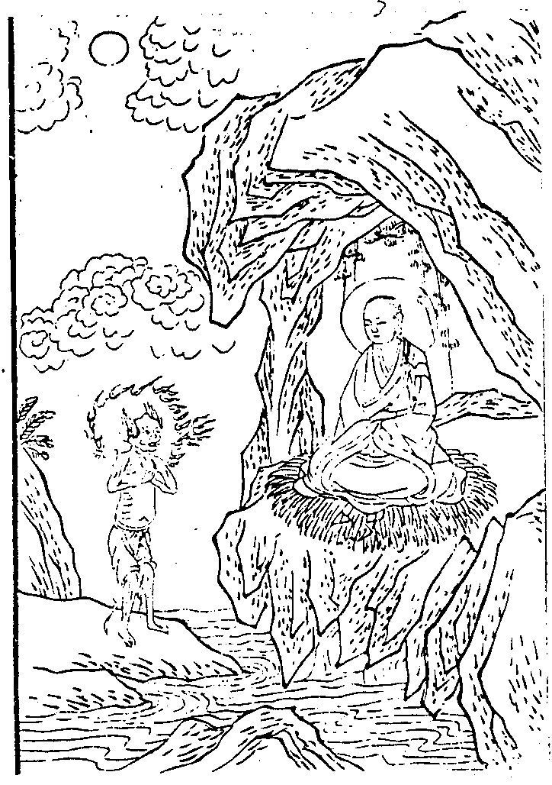



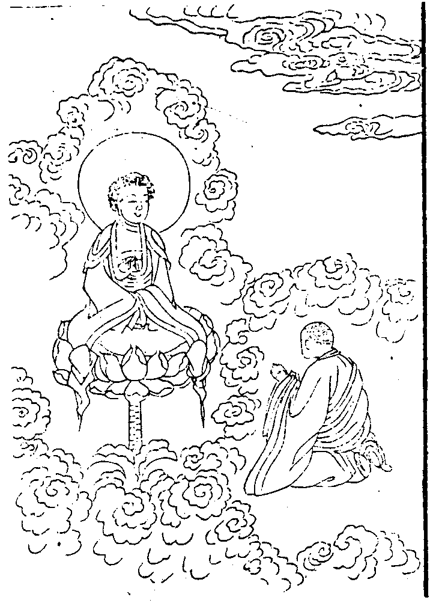



燄口施食缘起



(於《瑜伽集要救阿难陀罗尼燄口仪轨经》录出)



世尊在迦毘罗城尼拘律那僧伽蓝所，与诸比丘菩萨众会而为说法。尔时，阿难独居静处念所受法，夜三更候见一饿鬼形甚丑陋，口中火然，咽喉如针，头发髼乱，毛爪长利，住阿难前，白曰：「汝后三日寿命将尽，必当生於我类之中。」阿难闻已，问之曰：「若我死后生饿鬼者，行何方便得免斯苦？」鬼曰：「若能布施百千那由他恒河沙数饿鬼、百千婆罗门仙等，一一皆以摩竭陀国所用之斛各与七七斛饮食，更能为我供养三宝者，即得脱离饿鬼之苦，生於天上，寿算无穷。」阿难即起，往至佛所，顶礼白言：「我於静夜三更之际见燄口鬼来语我言：『汝过三日必当命尽，生於我类之中。』我却问言：『若我命尽生饿鬼者，云何令我得免斯苦？』彼荅我言：『若能施我百千那由他恒河沙饿鬼、百千婆罗门仙等种种饮食者，不堕斯类，而能生於天上。』世尊！我今云何於一时间得能备办若干饿鬼、仙人等种种饮食？」



佛告阿难：「我有方便，可能令汝於一时中施与若干饿鬼、若干婆罗门仙种种饮食。阿难！我於过去无量劫时曾作婆罗门，乃於观世音菩萨所受一陀罗尼，名曰无量威德自在光明。汝今若能依此陀罗尼法加持饮食，则此饮食一一变成无量甘露法食，如是便能充足饱满百千那由他恒河沙饿鬼及婆罗门仙、异类鬼神之众。阿难！当知此之饮食量同法界，饿鬼仙人受用无尽。若能依法修之，福寿增长，解脱苦身，皆获圣果。」



佛告阿难：「若欲修此施食之法，须学瑜伽三昧，依瑜伽阿阇黎发无上菩提心，受三昧耶戒，入大曼荼罗，得五智灌顶。绍阿阇黎位者方可受行此法，传持斯教；若不尔者，得盗法罪。



「欲作法者，先应选择闲静园林、精洁堂室，用香水泥涂抹坛场，方圆大小随施主力，周围饬以幢幡宝盖，位面陈以华香灯涂，所有供事俱须如法，庄严一毕，入中行法，是即名为三昧耶坛也。」



瑜伽集要燄口施食仪



唐兴善寺三藏法师大广智不空译



(西夏)护国仁王寺法师不动金刚重集



> 清天溪　香乳行者受登诠次



(行者先按视道场，幡幢道具次第庄严，华香供养敷陈周整已，斋主引请行香升座)



○开启法事  

○施食三昧  

○功圆解散



开启中(○警闻法界○然香达信○结界灌顶)



(表白列职，举动法音)



「南无尽虚空遍法界过现未来佛法僧，常住三宝。」



(法界三宝，一真自住，运此声称，以警觉之，不移真际，而起应现)



○然香达信



(香文信意随主者说)



「香云盖菩萨摩诃萨。」



○结界灌顶



「南无大悲观世音菩萨。」



(祝水文任主者说，大众同诵大悲咒加持净水，行者即以咒水散洒上下四方，随眼见心想可标记处为坚固清净道场大界。寻授水器与表白，於道场内外周绕三洒以为结界)



(行者是时即用咒水加持身首及五佛冠，默诵五佛毘晒迦真言，手自戴之。灌顶真言曰)



(「唵萨𭌯怛他蘖带湿䌸（二合）啰耶（二合）毘晒迦鍐（顶中）。唵𭌯日啰（二合）萨怛𭌯（二合）毘诜遮𤚥吽（顶左）唵𭌯日啰（二合）啰怛曩（二合）毘诜遮𤚥怛洛（二合）（顶前）唵𭌯日啰（二合）钵娜麼（二合）毘诜遮𤚥纥哩（二合）（顶右）唵𭌯日啰（二合）羯麼毘诜遮𤚥恶」（顶后）)



「甘露王菩萨摩诃萨。」



○施食三昧(○方便加持○正行三昧)



方便中(○观净法界○加持金刚○供散花米)



(○观净法界，先作金刚正坐，以右脚压左脚髀上，结大三昧印，二手仰掌展舒以右牒左，二大指相著安脐轮下。次观raṃ𫬠字，色体皓白，遍流光明，普照一切有情界，能破有情虚妄烦恼，而我身心及有情界同一法界，无二无别。随诵真言)



「唵　𫬠莎诃」



○加持金刚(行者安住，观一切根身器界如幻如化，本性自空，自性清净，开发菩提心，得见自心净月轮相，即於自心净月轮中思惟金刚相，善住一切如来普贤心真实金刚也。唵字为身金刚，哑字为语金刚，吽字为心金刚，自身证得如金刚萨埵。即诵真言)



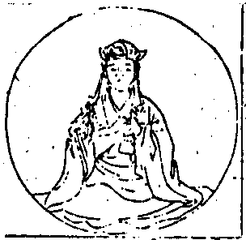



「唵(引)　底瑟咤(二合)斡资啰(二合)」



「唵(引)　哑(引)　吽(引)」



(金刚萨埵，右手持五钴金刚杵，转拳向外。左手持金刚铃，置於腰上。今我加持，即亦成就，随持杵振铃，诵二真言)



「唵　斡资啰(二合)萨荅哑吽」



「唵　斡资啰(二合)看咤哑吽」



○供散花米



「唵　斡资啰(二合)𠽾𠵸哑吽」



(诵真言时，手拈花米，即将花米散掷空中，想此所结梵界道场光网庄严如因陀罗)



○正行三昧(○自成曼荼门○成他曼荅门)



自成中(○愿归三宝○成曼荼行○结愿回向)



「我(某甲)及法界一切有情，从今为始乃至未证菩提之间，誓愿归依金刚上师三宝。」



「捺谟孤噜(二合)毘耶(二合)　捺谟勃塔耶　捺谟达而麻(二合)耶捺谟桑渴耶　唵哩哩哈哈吽吽癹怛　唵失哩麻哈歌罗哈哈吽吽癹怛莎诃」



○成曼荼行(○开无生门○建立曼荼○庆成法门)



(持杵振铃，诵十二因缘咒。因缘无主，我心自空，是佛说因缘义。今观诸法因缘皆无自性，是即曼荅妙行之门)



「唵　耶荅儿麻(二合)兮都　不啰(二合)巴斡兮敦　的山　荅塔葛荅　歇斡怛的山拶　约尼噜怛　耶[嘟-者+(看-目)]叭谛麻诃释啰(二合)麻纳耶　莎诃」



○建立曼荼(○遣发诸魔○正立曼荼)



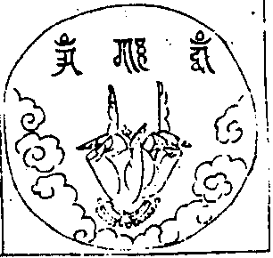



(○初遣发身中毘那夜迦难。以观羽腕置止腕上，檀慧度相钩，竖进力二度，诵军荼利真言)



「唵　斡资啰(二合)哑𠵸哩(二合)达昆咤唎　曷纳(二合)曷纳(二合)　吽吽(短呼)癹咤(半音)」



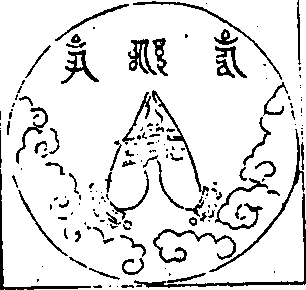



(○次遣境界诸魔。止观二羽外相叉，进力二度直竖，诵真言)



「唵　斡资啰(二合)牙恰　吽」



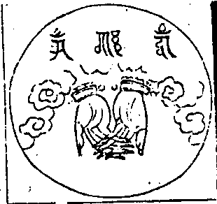



(○次遣空界诸秽，令空清净，妙香芬馥。止观二羽内相叉，十度仰上，诵真言)



「唵　斡资啰(二合)左辣哑捺辣　曷捺　荅曷巴拶　麼塔　班拶啰纳　吽(短呼)癹咤(半音)」



○正立曼荼(○颂内心曼荼○立曼荼自体○赞曼荼法门)



(○颂内心曼荼，二颂成身，三颂净地)



> 「方便自性不坏体，金刚不坏大勇识，  

> 最胜无比超出相，今此所作皆成就。  

> 胜慧自性甚深性，演说最上法轮音，  

> 以无生现方便身，今此所作愿得成。  

> 一切方隅所有地，瓦砾砂碛等皆无，  

> 琉璃宝地平如掌，柔软微妙愿安住。  

> 犹如极乐国庄严，妙宝为地众华敷，  

> 园林池沼无缺少，以大法音愿具足。  

> 从出世间复能现，种种七宝之所成，  

> 无量光明遍照处，诸佛菩萨愿安住。」



(诵铃真言以开曼荼啰门)



「唵　斡资啰(二合)看支夷(二合)啰纳啰纳　不啰(二合)啰纳不啰(二合)啰纳　三不啰(二合)啰纳三不啰(二合)啰纳　萨哩斡(二合)孛塔赤的啰(二合)不啰(二合)拶哩荅　麻曷不啰(二合)尼牙(二合)巴啰蔑荅　那达速巴微　萨哩斡(二合)塔哩麻(二合)纥哩(二合)达耶　伞多沙纳葛哩　吽吽癹咤　莎诃」



○立曼荼自体(○香水涂坛○立坛基位○宝坛出生)



(○香水涂坛，以戒度取白檀香水，三洒曼荼，以加持之，即诵真言)



「唵　斡资啰(二合)麻明　哑吽」



○立坛基位(○立金刚基○界圣住位)



(○立金刚基，行者自以胜智观心内外皆无所有、三世等同虚空，今将出生金刚界大曼荼罗五佛宝阁，先应立佛宝阁金刚地基。即以戒度取白檀香水，于曼荼上作一圆相，想kha佉字空点，渐引成大空轮界，随诵真言)



「唵　斡资啰(二合)乌怛葛哑吽」



(○次观ha唅字为黑色境，渐引持地风轮界，复想虚空为轮围山，即以花米向曼荼外围右旋散洒，诵成就真言)



「唵　斡资啰(二合)哩契哑吽」



(○次於虚空想va鍐字白色光明，为毘卢遮那佛，由具慈悲，遍身流注八功德水，便成香乳大海。以二羽内缚，仰而右旋，诵成就海真言)



「唵(引)　尾麼路(引)捺地吽」



(○次於海中想pra钵啰（二合）字形如龟背，其色如金，所谓金轮，广大无量由旬，忽然之间从金轮龟背涌出八叶莲华，金刚为茎，於华台中想凡阿字门，涌出须弥山王，其山四宝所成，七重金山周匝围绕，山间傍出四眺，四天王各住本方，日月周照四洲八渚，无量眷属围护金刚宝峰楼阁。以十度内交为拳，相合紧密，诵成就宝山真言)



「唵(引)　阿者攞吽」



○界圣住位(五佛宝阁四方四门，中八金刚柱为严饬，安住圣位。此金刚基，以五色米或粉界其方位，於五色中各著种智字：中以白色想va鍐字、东以赤色想ya岩字、南以黄色想la蓝字、西以绿色想ra览字、北以黑色想ha唅字。当诵五方真言。以色米作界方时，随所想种子字而生五如来智，谓：中鍐字想，生法界清净智；东岩字想，生大圆镜智；南蓝字想，生平等性智；西览字想，生妙观察智；北唅字想，生成所作智。手拈色米，口诵真言，各随界道而用安置)



「唵　鍐弥罗微捺麻」



「唵　鍐斯克彻(二合)麻弥罗微捺麻」



「唵　岩晡儿斡(二合)微的葛耶捺麻」



「唵　岩的葛耶捺麻」



「唵　岩微的葛耶捺麻」



「唵　蓝咱晡的癹耶捺麻」



「唵　蓝拶麻啰耶捺麻」



「唵　蓝斡啰拶麻啰耶捺麻」



「唵　览哑咓啰孤荅尼耶捺麻」



「唵　览沙茶耶捺麻」



「唵　览乌荅啰曼的哩(二合)尼耶捺麻」



「唵　唅乌荅啰孤啰尼捺麻」



「唵　唅孤啰微捺麻」



「唵　唅葛啰斡耶捺麻」



「唵　岩葛拶啰的捺(二合)耶捺麻」



「唵　蓝𠽾噜沙唽啰的捺(二合)耶捺麻」



「唵　览。斡节啰的捺(二合)耶捺麻」



「唵　唅斯的哩(二合)啰的捺(二合)耶捺麻」



「唵　岩葛咤葛(二合)啰的捺(二合)耶捺麻」



「唵　蓝咤吃啰(二合)啰的捺(二合)耶捺麻」



「唵　览麻尼啰的捺(二合)耶捺麻」



「唵　唅麻曷聂塔捺耶捺麻」



「唵　哑斯哩(二合)牙耶捺麻」



「唵　蓝昝的啰(二合)耶捺麻」



「唵　哑擦怛啰(二合)耶捺麻」



「唵　萨哩斡(二合)啰的尼(二合)毘药(二合)捺麻」



色米真言界定阁基方位之图



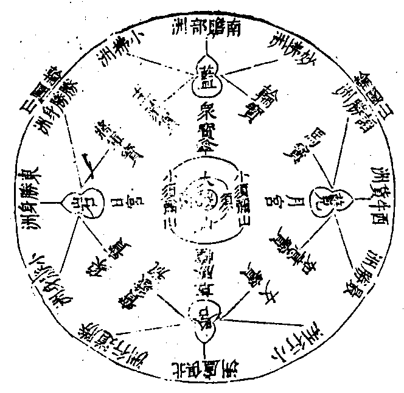



○宝坛出生(○曼荼正行○心坛现证)



正行中(○圣证现前○现住法乐)



(○圣证现前。於弥卢山顶想va鍐hūṃ吽tra怛啰（二合）hrīḥ颉哩（二合）ā恶五字，为佛宝阁。其阁四面正等，具有四门，门门左右有吉祥幢，轩楯周环，门重阶道悬杂缯彩、珠网华鬘。阁外四角诸门，皆金刚宝以为严饬，又外多有园林池沼、天衣璎珞、诸劫波树，又有诸天美妙歌咏之乐音，诸阿修罗、莫呼落伽王金刚舞之娱乐。此宝阁中以八金刚柱而为严饬，是金刚界大曼荼罗，五方如来、十六大菩萨并四波罗蜜，施设四种内供、四种外供，与守门菩萨各以本三摩地随方安住，即结宝阁印，以二羽金刚拳，进力檀慧相钩，诵成就宝阁真言)



「唵　斡资啰(二合)拶葛啰(二合)吽」



金刚宝峰五佛楼阁之图



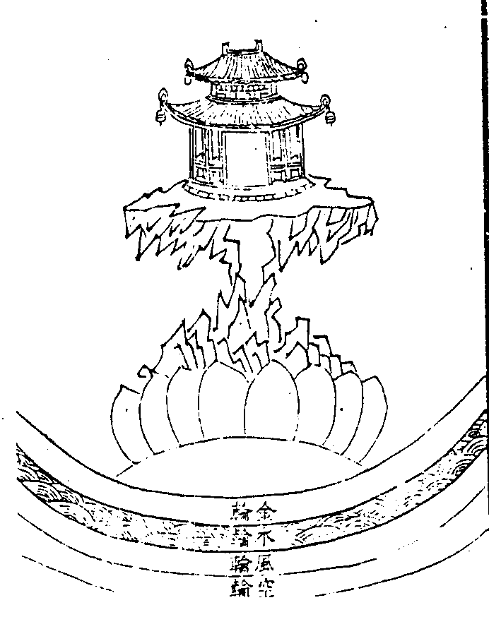



佛宝阁中曼荼圣者号位种智字之图



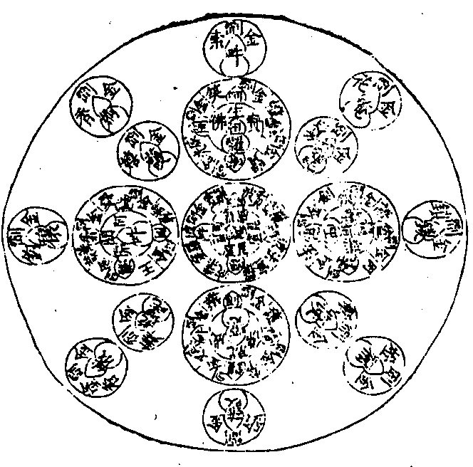



(金刚界大曼荼罗，为我毘卢性海庄严，是诸菩萨现证三昧。行者观念与之相应，普缘佛会无边刹海，谛观五智一切如来，以金刚业礼拜旋绕，以供养具恭敬奉献，因果交彻，心色互融，与佛三摩同一受用，表白鸣鱼，朗诵经法，声随观想，自在出生)



尔时本尊毘卢如来以一切如来互相涉入故，平等安住一切虚空身语心金刚，以一切如来金刚界觉悟智萨埵开发尽虚空界微尘量金刚加持所生智藏，以一切如来灌顶宝舒遍虚空真如智，为现证三菩提。以一切如来身自性清净故，即一切法自性清净。以一切如来不空事业胜所作故，一切平等无上巧智。而即是时出生贤圣，所谓：一切如来大菩提坚固萨埵、一切如来钩召三昧、一切如来随染智自在、一切如来善哉、一切如来灌顶宝、一切如来日轮圆光、一切如来思惟王摩尼幢、一切如来大笑、一切如来大清净法、一切如来般若智、一切如来大轮、一切如来秘密语、一切如来不空种种事业、一切如来大精进坚固铠、一切如来守护金刚药叉、一切如来身语心金刚印智。



(弹指一下，想见一切如来菩萨圣众一时云集须弥山顶金刚宝阁，於师子座随诸方面如理而住，随诵真言)



「唵(引)(一)　野他萨哩嚩(二合)怛他誐多(二合)　萨怛(二合)他㰠(三)」



○现住法乐(○内坛献供○宝错外坛)



内坛(○献座○陈供)



「唵　萨哩斡(二合)荅塔葛达　啰的捺(二合)麻曷曼荅啰(二合)　布拶　弥渴　萨谟的啰(二合)　斯癹啰纳三摩耶　哑吽」



○陈供(香水濯足，胜尘悦意，各随水色，作奉物势，先奉阏伽，次呈八供，后守四门)



(○奉阏伽者以净缾水注哑哩干，心想坛中沐浴圣众)



「唵　萨哩斡(二合)荅塔葛达萨叭哩(二合)咓啰　哑哩干(二合)巴丹　巴啰(二合)谛拶耶　莎诃」



(○八供者，嬉鬘歌舞为内四供，香华灯涂为外四供。其结契，内四供以止观掌竖禅智度，小低头为献戏嬉契，以二羽前伸臂为献华鬘契，以二羽屈拄从脐至口散为献歌音契，以二羽旋舞置於顶为献舞仪契。外四供，以二羽覆掌下按之为烧香契，以二羽仰掌上举之为散华契，以二羽作拳竖智定度为然灯契，以二羽开掌摩其胸向外抽散为涂香契。结此八供契时，皆前必作金刚缚，即极诸度本，互相握合者是。后必作金刚合掌，即二羽初分相交，观羽压止羽者是。凡修供养皆须此法。今内四供)



「唵　萨哩斡(二合)荅塔葛达　斡资啰(二合)逻细　布拶　弥葛萨谟的啰(二合)　斯癹啰纳三麻耶　哑　吽」



「唵　萨哩斡(二合)荅塔葛达斡资啰(二合)麼隶　布拶　弥葛　萨谟的啰(二合)　斯癹啰纳三麻耶　哑　吽」



「唵　萨哩斡(二合)荅塔葛达　斡资啰(二合)拟帝　布拶　弥葛　萨谟的啰(二合)　斯癹啰纳三麻耶　哑　吽」



「唵　萨哩斡(二合)荅塔葛达　斡资啰(二合)你哩(二合)帝　布拶　弥葛　萨谟的啰(二合)　斯癹啰纳三麻耶　哑　吽」



(次外四供)



「唵　萨哩斡(二合)荅塔葛达　斡资啰(二合)度闭　布拶　弥葛　萨谟的啰(二合)　斯癹啰纳三麻耶　哑　吽」



「唵　萨哩斡(二合)荅塔葛达　斡资啰(二合)补瑟闭(二合)　布拶　弥葛萨谟的啰(二合)　斯癹啰纳三麻耶　哑　吽」



「唵　萨哩斡(二合)荅塔葛达　斡资啰(二合)虏计　布拶　弥葛　萨谟的啰(二合)　斯癹啰纳三麻耶　哑　吽」



「唵　萨哩斡(二合)荅塔葛达　斡资啰(二合)喭提　布拶　弥葛　萨谟的啰(二合)　斯癹啰纳三麻耶　哑　吽」



(○守门菩萨，金刚钩、金刚索、金刚锁、金刚铃也。今诵铃真言，入声解脱，照般若理而为守护也)



「唵　斡资啰(二合)看支夷(二合)啰纳啰纳　不啰(二合)啰纳不啰(二合)啰纳三不啰(二合)啰纳三不啰(二合)啰纳　萨哩斡(二合)孛塔赤的啰(二合)不啰(二合)拶哩荅　麻曷不啰(二合)尼牙(二合)巴啰蔑荅　那达速巴微　萨哩斡(二合)塔哩麻(二合)纥哩(二合)达耶　伞多沙纳葛哩　吽吽和和哑龛莎诃」



○宝错外坛(左手持二金刚宝如十字著，右手仰舒下垂作施印，想心月轮中tra得浪字放黄色光，一念变成宝生佛，左手持二金刚宝，右手结施印，即诵宝生心密言)



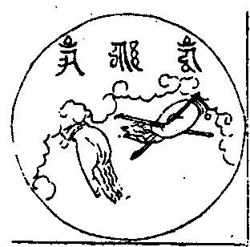



「唵　萨不荅(二合)啰的捺(二合)　吽」



(○次想二金刚宝，出生无尽诸天如意珍宝，即以二手十字相持，向曼荼外围右旋，出生珍宝，间错庄严，随诵宝错真言)



「唵　斯嘛(二合)啰　斯嘛(二合)啰　密嘛(引)曩斯(引)葛啰麻诃拶葛啰(二合)(引)　吽(长声)」



○心坛现证(○观法性空○心坛现空)



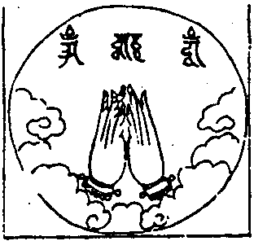



(○观法性空，止观二羽当胸虚心合掌，如未敷莲华，诵性空真言)



「唵　莎𠷑斡顺牙(二合)达　萨哩斡(二合)荅哩麻(二合)　莎𠷑斡顺牙(二合)达𤚥」



○心坛现空(於空性中想bhrūṃ𠽾𠾐（二合）字，成虚空金刚心曼荼罗，即诵佛宝阁真言与三金刚真言)



「𠽾𠾐(二合)唵哑吽」



(表白清音，朗宣观意)



> 「十方世界，所来集会，一切如来，并诸菩萨，  

> 混入本尊，毘卢心中。而彼一切，如来之心，  

> 复各出自，菩萨众会，咸共於我，本尊毘卢，  

> 金刚宝峰，五佛阁内，周匝围绕，住三摩地。  

> 一时所有，天妙微密，戏嬉宝冠，法歌仪舞，  

> 戒香慧华，智灯定涂，安禅食味，适意乐音，  

> 清彻无碍。犹如普贤，化现种种，云集供养，  

> 遍满虚空，充塞法界，尽轮回际，无有间断。」



○赞曼荼法门



> 「谛此最上广大曼荼罗，相如金刚名为金刚界，  

> 金刚摩尼宝峰五楼阁，於须弥山顶上巍然起。  

> 基陛正等四面吉祥幢，珠网华楯周环四阶道，  

> 四洲八宝日月光照间，所住眷属生来自围绕。  

> 外院垂珠悬铎映日月，诸天奏乐修罗献妙舞，  

> 内宫八金刚柱为庄严，正敷方等师子华王座。  

> 毘卢本尊光明四面照，以真实身如理住其中，  

> 阿閦宝生无量寿不空，从毘卢身四方各出现。  

> 十六菩萨并四波罗蜜，本三摩地随方而安置，  

> 施设内外八种密供养，摄智明王四门守护持。  

> 诸佛菩萨同时集会者，现成正觉大转法轮音，  

> 为令普尽无餘诸有情，悉获平等智通安乐果。  

> 金刚萨埵如来增上主，说此最胜金刚曼荅罗，  

> 大乘现证真实三昧门，悉得相应能作成就事。  

> 我今自以金刚身语意，出生一切如来大智轮，  

> 以诸如来之所加持身，净月轮中一体愿安住。」



○庆成法门(即紧振铃，诵因缘咒)



「唵　英𭊁呤麻(二合)(引)形𭇏(切身)　不啰(二合)末斡(引)形𭇏(舌齿)　碇善(引)怛达(引)遏多　缬末𭊁怛(二合)碇善(引)拶　养祢𠺘𭊁　𠸄梡(合口)斡(引)溺(引)麻诃(引)实啰(二合)麻捺英　莎贺」



○结愿回向



「唯愿上师三宝中围佛会，慈悲摄受，今辰施主福慧庄严，世、出世间吉祥如意，普及法界一切有情，速成无上佛果菩提。」



「唵　哑　吽」



自成曼荼门竟(少略静住，可进汤饮)



○成他曼荼门(○皈依发心○修施法供○回向三宝)



○皈依发心



(此去引偈表白提举)



> 「归依与佛同慈力，发心与生同悲仰，  

> 菩提以是为修因，即得圆成无上果。



「众等发广大心。



「归依金刚上师，　归依佛，　归依法，　归依僧。



「我今发心，不为自求人天福报、声闻、缘觉，乃至权乘诸位菩萨，唯依最上乘发菩提心，愿与法界众生一时同得阿耨多罗三藐三菩提心。」



○修施法供(○上奉三宝○下施六道)



上奉中(○入坛请圣○修明智行○启告本事○奉申供养)



○重入轮坛



> 「端结大轮明王契，有情同入曼荼罗，  

> 获得灌顶三昧耶，一切所作皆成就。」



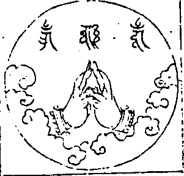



(以二羽内相叉，进力并伸直，忍愿缠进力初节前峰各相拄，禅智并伸直，当心默诵真言七遍)



「捺麻斯得哩(二合)野(一)　脱夷(二合)葛喃(二)　萨哩斡(二合)怛塔葛达喃(三)　唵(四)　微啰积(五)　微啰积(六)　麻诃拶葛啰(二合)　斡资哩(二合)斡资哩(二合)(八)　萨怛萨怛(九)　萨啰谛(十)　萨啰谛(十一)　得啰(二合)夷(十二)　得啰(二合)夷(十三)　微驮麻尼(十四)　三攀拶纳弥(十五)　得啰(二合)麻祢的(十六)　席塔讫哩(二合)得兰(二合)颜席提脱夷(二合)莎诃(十七)」



(密契真言，殊胜方便，身心备得佛刹微尘数三摩耶无作禁戒。三业既已清净，则成入一切曼荅罗，护证灌顶三摩耶，即时尽空法界六趣有情速得同入大曼荅罗，等同圣者矣。唐沙门慧日云：「当诵二十一遍，一切所作无不成就。」)



○请圣光临(○奉请三宝○印现坛仪)



> 「稽首五智三身佛，金刚秘密正法藏，  

> 胜愿菩提大心众，今当奉请愿光临。」



(主者起身，烧香散华，一一三请，斋主下拜)



「一心奉请：



「尽十方，遍法界，微尘刹土中，常住佛宝。



「尽十方，遍法界，微尘刹土中，常住法宝。



「尽十方，遍法界，微尘刹土中，常住僧宝。唯愿不违本誓，怜愍有情，光临道场，证明功德。」



(想十方三宝随感而降，不起真际，𡍫塞虚空)



「一心奉请圣者金刚密迹、忿怒十大明王、天龙八部、婆罗门仙、诸护法神、一切圣众，唯愿不违本誓，怜愍有情，赐我威神，光严法会。」



○印现坛仪



> 「缔此发心转轮印，即为教令吉祥轮，  

> 现成广大曼荅罗，一切诸佛咸遍入。」



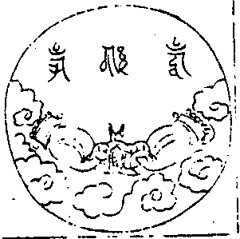



(止观二羽各作金刚拳，进力檀慧互相钓，胸前微动，诵心真言)



「唵　斡资啰(二合)拶裓啰(二合)吽(一)　拶(二)　吽(三)　[嘟-者+(看-目)](四)　斛(五)」



(以印置身前，即遍虚空界成现大曼荅罗，十方三宝顿尔明现)



○修明智行(○修普贤行○入般若智)



> 「诸佛行王五悔足，普贤愿海十门周，  

> 今令参入道场中，行愿修明唯摄受。」



(行者秉炉，恭对坛佛，诵云)



「归依十方尽虚空界一切诸佛。  

归依十方尽虚空界一切尊法。  

归依十方尽虚空界一切贤圣僧。」



「南无如来、应供、正遍知、明行足、善逝、世间解、无上士、调御丈夫、天人师、佛、世尊。  

南无释迦牟尼佛  

南无金刚不坏佛  

南无宝光佛  

南无龙尊王佛  

南无精进军佛  

南无精进喜佛  

南无宝火佛  

南无宝月光佛  

南无现无愚佛  

南无宝月佛  

南无无垢佛  

南无离垢佛  

南无勇施佛  

南无清净佛  

南无清净施佛  

南无娑留那佛  

南无水天佛  

南无坚德佛  

南无旃檀功德佛  

南无无量掬光佛  

南无光德佛  

南无无忧德佛  

南无那罗延佛  

南无功德华佛  

南无莲华光游戏神通佛  

南无财功德佛  

南无德念佛  

南无善名称功德佛  

南无红炎帝幢王佛  

南无善游步功德佛  

南无斗战胜佛  

南无善游步佛  

南无周匝庄严功德佛  

南无宝华游步佛  

南无宝莲华善住娑罗树王佛  

南无法界藏身阿弥陀佛」



「如是等一切世界诸佛世尊常住在世，是诸世尊当慈念我，若我此生、若我前生，从无始生死已来所作众罪，若自作、若教他作、见作随喜；若塔、若僧、若四方僧物，若自取、若教他取、见取随喜；五无间罪，若自作、若教他作、见作随喜；十不善道，若自作、若教他作、见作随喜；所作罪障，或有覆藏、或不覆藏，应堕地狱、饿鬼、畜生、诸餘恶趣、边地下贱及篾戾车如是等处，所作罪障今皆忏悔。今诸佛世尊当证知我、当忆念我。我复於诸佛世尊前作如是言：『若我此生、若我餘生，曾行布施、或守净戒，乃至施与畜生一抟之食，或修净行所有善根、成就众生所有善根、修行菩提所有善根，及无上智所有善根，一切合集校计筹量皆悉回向阿耨多罗三藐三菩提，如过去、未来、现在诸佛所作回向，我亦如是回向。』」



> 「众罪皆忏悔，诸福尽随喜，及请佛功德，  

> 愿成无上智。去来现在佛，於众生最胜，  

> 无量功德海，我今归命礼。  

> 所有十方世界中，三世一切人师子，  

> 我以清净身语意，一切遍礼尽无餘。  

> 普贤行愿威神力，普现一切如来前，  

> 一身复现刹尘身，一一遍礼刹尘佛。  

> 於一尘中尘数佛，各处菩萨众会中，  

> 无尽法界尘亦然，深信诸佛皆充满。  

> 各以一切音声海，普出无尽妙言词，  

> 尽於未来一切劫，赞佛甚深功德海。  

> 以诸最胜妙华鬘，伎乐涂香及伞盖，  

> 如是最胜庄严具，我以供养诸如来。  

> 最胜衣服最胜香，末香烧香与灯烛，  

> 一一皆如妙高聚，我悉供养诸如来。  

> 我以广大胜解心，深信一切三世佛，  

> 悉以普贤行愿力，普遍供养诸如来。  

> 我昔所作诸恶业，皆由无始贪瞋痴，  

> 从身语意之所生，一切我今皆忏悔。  

> 十方一切诸众生，二乘有学及无学，  

> 一切如来与菩萨，所有功德皆随喜。  

> 十方所有世间灯，最初成就菩提者，  

> 我今一切皆劝请，转於无上妙法轮。  

> 诸佛若欲示涅槃，我悉至诚而劝请，  

> 唯愿久住刹尘劫，利乐一切诸众生。  

> 所有礼赞供养福，请佛住世转法轮，  

> 随喜忏悔诸善根，回向众生及佛道，  

> 愿将以此胜功德，回向无上真法界。  

> 性相佛法及僧伽，二谛融通三昧印，  

> 如是无量功德海，我今皆悉尽回向。  

> 所有众生身口意，见惑弹谤我法等，  

> 如是一切诸业障，悉皆消灭尽无餘。  

> 念念智周於法界，广度众生皆不退，  

> 乃至虚空世界尽，众生及业烦恼尽。  

> 如是四法广无边，愿今回向亦如是。」



○入般若智



> 「如来权智不思议，照诸法相尽皆空，  

> 以无所得得菩提，是深理趣今当入。」



(默转心经)



般若波罗蜜多心经



○启告本事



> 「化道因缘原普度，悲心偏向苦众生，  

> 密教重开施食门，我今启告行斯事。」



(秉炉三白)。



「启告十方一切诸佛、般若菩萨、金刚天等及诸业道无量圣贤，我今(某甲)以大慈悲乘佛神力召请十方尽虚空界三涂地狱诸恶趣中，旷劫饥虚一切饿鬼、阎罗诸司、天曹地府、业道冥官、婆罗门仙、久远先亡、圹野冥灵、虚空诸天及诸眷属异类鬼神，唯愿诸佛、般若菩萨、金刚天等无量圣贤及诸业道愿赐威光，悲增护念，普愿十方尽虚空界天曹地府、业道冥官、无量饿鬼、多生父母、先亡久远、婆罗门仙、一切冤结负於财命、种种类族异类鬼神各及眷属，乘如来力，於此时中决定降临，得受如来上妙法味清净甘露，饮食充足，滋润身田，福德智慧，发菩提心，永离邪行，归敬三宝，行大慈心，利益有情，求无上道，不受轮回诸恶苦果，常生善家，离诸怖畏，身常清净，证无上道。」



○奉申供养(○申供○赞礼)



○申供(○运心供养○三宝施食)



> 「人天所有受用物，香华食乐及阏伽，  

> 楼阁幢幡衣服等，我今运心而供养。」



(心运世间无主所摄水陆诸华及与人天妙哑哩干、妙涂香云、烧香灯明、幢幡繖盖、鼓乐歌舞、真珠罗网、悬诸宝铃、花鬘白拂、劫树衣服、天厨妙食、楼阁庄严、头冠璎珞……如是等云普遍供养。即作雷音，一称吽字)



hūṃ(引)



(吽字周遍光明晃耀，光中化出一切如来，受教天女六人，红、黄、赤、白、杂、绿，人各一色，花、香、灯、涂、食、乐，人各一物，面如秋月，四臂纤好，上二相又下二呈供，足轮宛转，展左跪右，遍至法界海会众前，海会众前遍有供养。如是修供养已，还归心月轮中，主者澄神运想，表白随观宣偈)



> 「吽字放光照法界，同时涌出六天母，  

> 面眉明净如秋月，四臂纤长众宝严。  

> 华香灯涂与食乐，二手两叉二捧献，  

> 足轮转左而跪右，遍至海云众圣前。  

> 十方云海众圣前，皆有天身修供养，  

> 旋转无碍互庄严，尽未来际作佛事。  

> 如是光天供养已，依然复归心月轮，  

> 持明结契重呈奉，成就普贤广大愿。」



(当重持明结契句，即以二羽外相交初分，以右押左置於顶上，诵成就运心供养真言七遍)



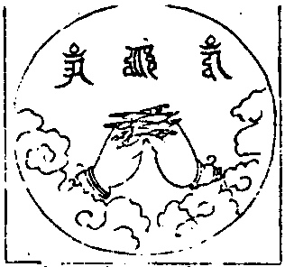



「那麻萨哩斡(二合)荅塔葛的毘牙(二合)　月说穆契毘牙(二合)　唵(引)萨哩斡(二合)(引)塔龛乌忒葛(二合)的　斯癹(二合)啰纳兮慢葛葛捺龛　莎诃」



○三宝施食(○遣魔变空○奉施饮食)



> 「三宝为施甘露食，普沾地上诸贤圣，  

> 先此遣除作障者，并诸食器变成空。」



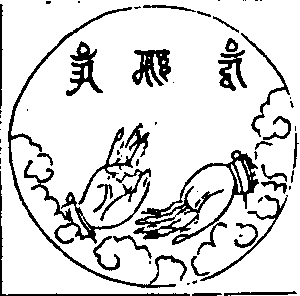



(○遣魔印咒　以禅押施度头，戒忍进疏伸)



「唵(引)　斡资啰(二合)拽屹彻(二合)吽」



(想三指尖出大火光，摇动似扇，以遣诸魔)



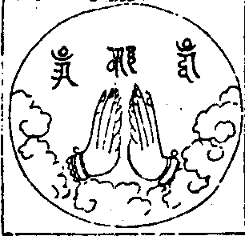



(○变空印咒　二羽虚合如莲华状，竖立胸前)



「唵(一)　莎癹斡𥝰塔(二)　萨哩斡(二合)塔哩麻(二合)(三)　莎癹斡𥝰塔　㰠(四)」



(想现前诸食及诸食器悉变成空，唯是一真空境)



○奉施饮食



> 「三密摄成智甘露，满盛宝器遍虚空，  

> 契印真言奉献之，地上圣贤欢纳受。」



(上食器变空，今於其空处想大宝器满盛甘露，诵三字总持七遍，摄受尽成智甘露味)



「唵(引)哑(引)吽(引)」



(奉食契者，仰二手掌向前侧相著，戒方二度侧相著，微屈进力二度傅著忍愿二度侧，禅智二度傅著进力侧，似掬水势，诵奉食咒)



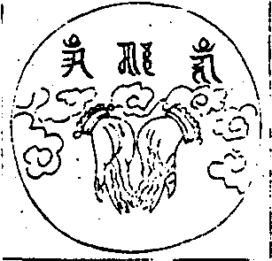



「唵(引)哑葛噜穆看萨哩斡(二合)塔哩麻(二合)喃(一)(引)　哑牒耶(二合)(引)奴忒班(二合)纳奴忒(二)(引)　唵(三)　哑(四)　吽(五)　癹咤莎诃(六)」



(以此宝器智甘露味，献於地上一切圣贤，各随本愿欢喜纳受。此诸圣众既以自他利益满愿为怀，若今斋主所有求索愿事，必蒙允许)



(宣奉食偈)



> 「我今奉献甘露食，量等须弥无过上，  

> 色香美味遍虚空，上师三宝哀纳受。  

> 次供显密护神等，后及法界诸有情，  

> 受用饱满生欢悦，屏除魔害施安宁。  

> 今辰施主眷属等，消灾集福寿延长，  

> 所求如意悉成就，一切时中愿吉祥。」



(当为斋主宣达疏意化炼，奉献三宝圣贤彩缎纸锭)



○赞礼



> 「世尊大慈妙庄严，明解圆满一切智，  

> 能施福慧如大海，於诸如来我赞礼。  

> 自性本体离诸欲，能行此行脱恶趣，  

> 以为甚深玄妙理，於诸妙法我赞礼。  

> 解脱道中胜解脱，持净戒行堪恭敬，  

> 胜妙福田生胜处，於彼大众我赞礼。」



(上奉三宝章竟)



○下施六道(○三昧行化○化圆获益)



行化中(○三昧等观○摄行三昧○密言送往)



> 「是惟等观三摩地，字轮现起大悲王，  

> 不移此定愍众生，施甘露味脱苦恼。」



(主者入定表白，倚定清音宣偈，如至结印加持句，即以手结印，默诵密言，以印加持)



> 「令入观音三摩地，澄心闭目观心中，  

> 圆满皎洁净月上，字种放光成莲华。  

> 华中有一观自在，相好圆满无比对，  

> 左手执持妙莲华，右手於叶作开势。  

> 菩萨思惟有情身，各具觉悟之莲华，  

> 清净法界无惑染，八叶各有一如来。  

> 如来入定加趺坐，各各面向观自在，  

> 顶佩圆光身金色，光明朗照极晃耀。  

> 次想其华渐舒大，其量周遍虚空界，  

> 思彼觉华照法界，如来海会供广大。  

> 心若不移於此定，怜愍一切诸众生，  

> 觉华蒙照脱苦恼，便同菩萨观自在。  

> 莲华渐收同己量，复结自在观音印，  

> 加持四处诵密言，自身亦等观自在。」



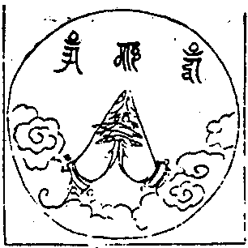



(以二手外相叉，二头指相拄如莲华叶，二大指并竖。密言曰)



「唵(引)斡资啰(二合)塔啰麻(二合)　纥哩(二合)」



○摄行三昧(○破狱请召○钩坛授法)



○破狱



> 「先自惑缠身口意，此随果报入幽关，  

> 金刚三业并舒光，诸趣狱门豁然破。」



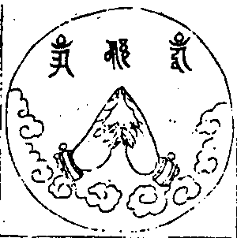



(二羽金刚拳，檀慧两相钩，进力竖侧合，诵破地狱咒)



「那麻阿瑟咤(二合)瑟咤(二合)摄谛喃　三藐三勃塔俱胝喃　唵(引)撮(引)辣(引)纳䌸婆细(引)　提哩提哩　吽」



(想印中流出火光，口诵咒，口出火光，心月轮上红色hrīḥ纥哩字放赤色火光，金刚三业三光同照，而阿毘等狱关锁自开，所有罪人悉皆得出。若诵咒至末吽字，即以檀慧相钩一掣开，表白随和声，接由此印咒下文，如是三诵、三掣、三接)。



「由此印咒威神力故，所有诸趣地狱之门随此印咒豁然自开。」



○请召(○请幽冥教主○召法界六道)



> 「愿力应为冥教主，狱空而后证菩提，  

> 导将诸趣赴斋筵，合在斯时申奉请。」



(烧香散华，殷重三请，斋主下拜)



「一心奉请众生度尽方证菩提、地狱未空誓不成佛大圣地藏王菩萨，唯愿不违本誓，怜愍有情，导引幽途，来临法会。」



(申四转轮印，诵拶吽[嘟-者+(看-目)]斛，钩入轮坛，依位安住)



○召法界六道



(烧香散华，懃恳三召)



「一心召请法界天仙道众、修罗道众、人伦道众、畜生道众、饿鬼道众、地狱道众……如是十类，孤魂面然所统薜荔多众、尘沙种类依草附木魑魅魍魉、滞魄孤魂，唯愿不迷本性，仗佛慈光，来临道场，受兹法食。」



(想诸鬼神久在幽暗，今蒙三密放光召请，身心踊跃，随乘光明，不速而至，集於净道)



一心召请(此中应召随筵受荐先亡、或施主家亲眷属等众)



○钩坛授法(○拔除苦障（七印咒）○加称圣号（七印咒）○施与法食（七印咒）)



○钩召印咒



> 「旷劫枵虚燄出口，孤栖无救亦无依，  

> 今乘三密大斋筵，随光升入曼荅上。」



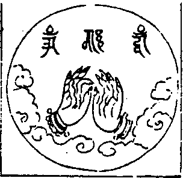



(左羽作无畏相，右羽向前竖，四度微曲，进度钩召，诵钩召真言)



「唵　即纳即葛　移希曳(二合)歇莎诃」



(想心月轮上红色hrīḥ𠶹哩放光，口诵真言出光，印上进度出光，三光齐放，至彼钩摄。其诸鬼众，从净道上随光升入曼荅罗中，先向佛前旋绕三匝，投身布礼，次至坛主位前，亦旋绕布礼竟，表白越位，对坛主问讯。启云)



「既召请已，普皆云集，以愍念心赞叹慰谕，令欢喜已，渴仰於法。」



(启已还位，坛主鸣尺，赞善安慰)



「善来诸佛子，曾结胜缘故，今遇此嘉会，勿得生忧怖。一心渴仰法，不出於此时，戒品一沾身，速令离苦趣。」



(诸鬼既得入坛，闻慰跃然生喜，寻复作礼，退居一面。诸神入坛，自应天、修、人、畜、鬼、狱，以胜劣为次。故此分列就位亦顺其次，则天、修、人左面，狱、鬼、畜右面，是通行参随之仪也。正本云：「从坛东门至南门，地狱居之；从南门至西南隅，饿鬼居之；自西南隅至西门，畜生居之；自西门至西北隅，人居之；从西北隅至北门，修罗居之；自北门至东门，天居之。」此盖西域尚东，其式乃尔。若此方尚南，未必拘是也。又云：「若无坛室，自上至下得以胜劣居之。」又云：「亦得重坐。」故知坛位自是随其处之方向、大小、宽狭，一凭主者处置而已，无定法也)



○召罪印咒



> 「无始习熏诸罪障，色如黑雾鬼之形，  

> 真言密印智光钩，所有尽入金刚掌。」



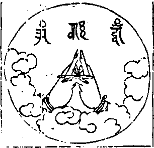



(二羽金刚缚，忍愿伸如针，进力曲如钩。召罪真言曰)



「唵(引)萨哩斡(二合)巴钵(一)　羯哩沙(二合)拏(二)　月戍驮纳(三)　斡资啰(二合)萨埵(四)　萨麻耶(五)　吽(六)　拶(七)」



(心月轮上白色hrīḥ纥哩放大火光，口诵心密言出光，进力二度端各有jaḥ拶字出光，相与钩摄诸鬼身心所结惑业苦障来入掌中。众罪入掌，黑如云雾，焦枯植发，众多鬼形)



○摧罪印咒



> 「罪钩入掌今摧碎，执金刚智力为能，  

> 怒形忿句如摧山，结业系缚尽解脱。」



(心月轮上青色hrīḥ𠶹哩放光，照前所召黑如云雾，众多如鬼罪业之相，今摧碎之。八度内相叉，忍愿如前竖，摧罪印也。今须更出印中摧法，当诵心密言时，即以二羽诸度各各相钩，头入掌内，以进力二度钩夹彼罪，令入掌中，餘度面各相捻，即伸忍愿如针，於愿端现trā怛啰（二合）字，忍端现ṭ咤字，二字出火光，至诵怛啰咤，以忍愿二指随声夹取彼罪，用力撚之，如弹指法，左上右下，咒篇三诵，摧法三作)



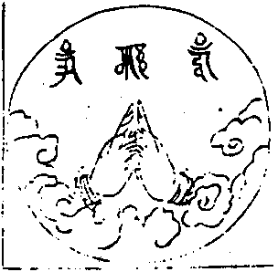



「唵斡资啰(二合)巴尼月斯普(二合)咤耶(一)　萨哩斡(二合)阿巴耶班塔拏尼(二)　不啰(二合)穆恰耶(三)　萨哩斡(二合)阿巴耶葛谛毘药(二合)(四)　萨哩斡(二合)萨埵喃(五)　萨哩斡(二合)荅塔葛达(六)　斡资啰(二合)三麻耶(七)　吽(八)　呾啰(二合)咤(九)」



○破定业印咒



> 「定业诸佛不通忏，我今心作智观音，  

> 以金刚业相照明，五逆重罪顿消灭。」



(心月轮上现出青色hrīḥ𠶹哩出光，密言手印同时出光照前鬼等，五逆重极诸佛不通忏悔之业都无自性，消灭无餘。二羽金刚掌，进力屈二节，禅智押二度，破定业真言)



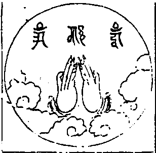



「唵　斡资啰(二合)葛哩麻(二合)(一)　月朿塔耶(二)　萨哩斡(二合)阿咓啰拏你(三)　菩塔萨底曳(二合)纳(四)　三麻耶吽(五)」



○忏悔灭罪印咒



> 「三金刚智发威光，法界有情等遍照，  

> 无始时来诸烦惑，本根枝末灭无餘。」



(心月轮上现白色hrīḥ纥哩出光，遍照法界一切有情，所有无始贪欲、瞋恚、愚痴根枝烦惑皆悉断除，净尽无餘)



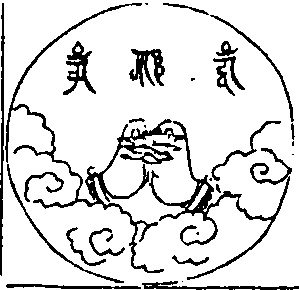



(二羽金刚缚，进力屈二节，禅智押进力，忏悔灭罪咒)



「唵萨哩斡(二合)巴钵(一)　月斯普(二合)咤(二)　怛贺纳(三)　斡资啰(二合)耶(四)　莎诃(五)」



「诸佛子等！既忏悔已，百劫积集罪，一念顿荡除，如火焚枯草，灭尽无有餘。」



○施甘露印咒



> 「妙色如来光照间，摄诸鬼神现前住，  

> 手中出施智甘露，饥火息灭得清凉。」



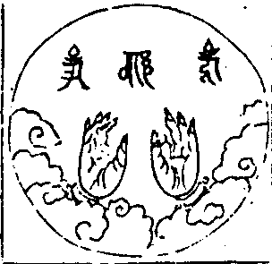



(右羽竖侧立，忍度微曲，以左羽转腕向前力智，作声诵真言)



「那麻苏噜巴耶(一)　荅塔葛达耶(二)　怛牒塔(三)　唵(四)　酥噜酥噜(五)　钵啰(二合)酥噜(六)　钵啰(二合)酥噜(七)　莎诃(八)」



(心月轮上白色hrīḥ纥哩放光，照前诸鬼神等，於忍度上现一vaṃ鍐字，流出智甘露水，力智点取弹洒空中，如微雨下，一切鬼神普得清凉，业火消灭，身田润泽，离饥渴想)



○开咽喉印咒



> 「诸神前住妙身光，左手持莲觉华想，  

> 右手开彼觉华时，咽喉通达能言语。」



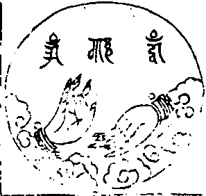



(左羽如持莲，右羽忍禅作开势，诵开咽喉真言)



「唵那谟癹葛瓦谛(一)　月补辣葛得啰▆耶(二)　荅塔葛达耶(三)」



(心月轮上白色hrīḥ纥哩放光，照前诸鬼神等，手结慈清凉印，口诵心密言，以下解开左手莲华时，想鬼神等咽喉自开，通达无碍，便得出声称佛名号)



「诸佛子等！今为汝众作印咒已，咽喉自开，通达无碍，离诸障难。」



○加称圣号(七如来号皆与表白，大众同称)



> 「已仗密言三障转，菩提道法未全生，  

> 由闻七佛吉祥名，诸苦永离证常乐。」



「诸佛子等！我今为汝称赞如来吉祥名号，能令汝等永离三途八难之苦，常为如来真净佛子。」



「南无宝胜如来」



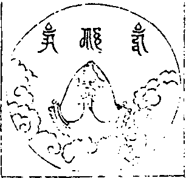



(二羽金刚掌，六度内相叉，进力头▆▆禅智▆▆▆)



「那谟啰怛纳(二合)　怛啰耶荅塔葛达耶」



「诸佛子等！若闻宝胜如来名号，能令汝等尘劳业火悉皆消灭。」



「南无离怖畏如来」



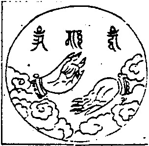



(右羽胸前竖，忍禅指相捻，掌覆指垂下，左掌向上舒)



「那谟微葛达得啰(二合)纳耶　荅塔葛达耶」



「诸佛子等！若闻离怖畏如来名号，能令汝等永离惊怖，清净快乐。」



「南无广博身如来」



(左羽曲如拳，力智对肩弹，右羽金刚拳，进禅对胸弹)



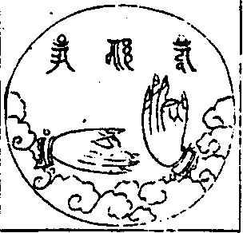



「那谟癹葛咓谛(一)　月补辣葛得啰(二合)耶　荅塔葛达耶(二)」



「诸佛子等！若闻广博身如来名号，能令汝等咽喉通达，业火清凉，所受饮食得甘露味。」



「南无妙色身如来」



(左羽竖胸前，力智指相捻，右羽曲舒展，手掌皆仰下)



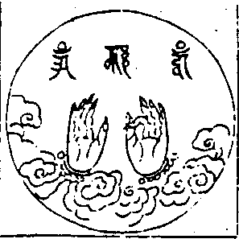



「那谟苏噜八耶　荅塔葛达耶」



「诸佛子等！若闻妙色身如来名号，能令汝等诸根具足，相好圆满，天上人间最为第一。」



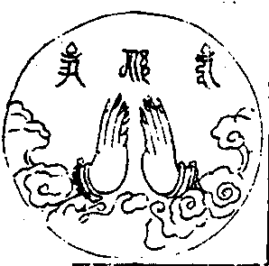



「南无多宝如来」



(双羽虚合掌，胸前莲华状)



「那谟波虎啰怛纳(二合)耶。荅塔葛达耶」



「诸佛子等！若闻多宝如来名号，能令汝等具足财宝，受用无尽。」



「南无阿弥陀如来」



(右羽压左，禅智相拄)



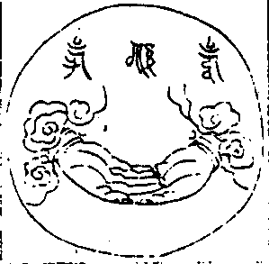



「那谟阿弥怛婆耶　荅塔葛达耶」



「诸佛子等！若闻阿弥陀如来名号，能令汝等往生西方极乐净土，莲华化生，入不退地。」



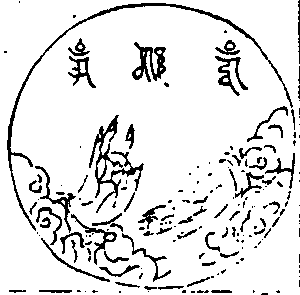



「南无世间广大威德自在光明如来」



(右羽曲仰拳，忍禅度相弹，左掌仰上，五指舒，诵密言)



「那谟卢迦委斯谛(二合)呤捺弟唧说啰不啰(二合)癹耶　荅塔葛达耶」



「诸佛子等！若闻世间广大威德自在光明如来名号，能令汝等获得五种功德：一者、於诸世间最为第一；二者、得菩萨身端严殊胜；三者、威德广大，超过一切外道天魔，如日照世，显於大海，功德巍巍；四者、得大自在，所向如意，似鸟飞空而无阻碍；五者、得大坚固智慧光明，身心明彻如琉璃珠。」



(下总劝文，应须三白)



「诸佛子等！此七如来以誓愿力拔济众生，永离烦恼，脱三途苦，安隐常乐。一称其名，千生离苦，证无上道。」



○施与法食(七印咒)



○授三皈依



> 「六道群灵咸在列，肃清三业莹无尘，  

> 今当进入大乘门，三宝归投为正处。」



「汝等归依三宝。」



(二羽虚心合掌，为其三授三结)



「归依佛，两足尊；　归依法，离欲尊；　归依僧，众中尊。



「汝等佛子！归依佛竟，　归依法竟，　归依僧竟。」



(想诸鬼神向前作礼，欢心禀受)



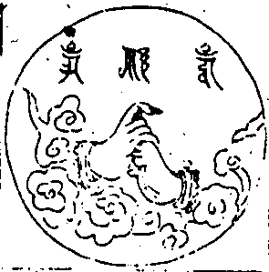



(左羽作拳竖力度，右羽握力度当胸前。三归依真言)



「唵婆(重呼引)龛」



「诸佛子等！归依三宝故，如法坚护持，终不更皈依，自利邪见道。」



○发菩提心



> 「净菩提心胜愿宝，道中正行此为先，  

> 自兹一往至成佛，誓力坚强永不退。」



「今为汝等发菩提心，汝等谛听：



「今所发觉心，远离诸性相、蕴处及界等、能取所取执。诸法悉无我，平等如虚空，自心本不生，空性圆寂故。如诸佛菩萨，发大菩提心，我亦如是发，是故至心礼。」



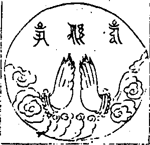



(二羽金刚掌，忍愿如莲华以印心上，发菩提心真言)



「唵补提节荅(一)　没怛巴(二合)(二)　达野弭(三)」



(想诸鬼神於心月轮坛光中，欢喜禀发，其所发心顿同月轮皎洁，净无瑕翳)



「诸佛子等！已为发菩提心竟。夫菩提心者，从大悲起，成佛正因，智慧根本，能破无明烦恼恶业，不被染坏。」



○授三昧戒



> 「妙善戒法今当受，奉行羯磨至心听，  

> 金刚萨埵放光明，流入身心绍佛职。」



「今为汝等授三昧耶戒。



「汝等受佛戒，即入诸佛位，位同大觉已，真是诸佛子。」



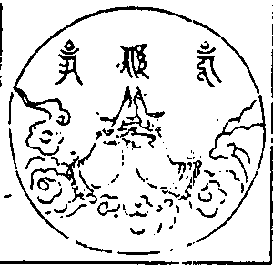



(二羽金刚缚，忍愿伸如针，诵授戒真言)



「唵　三摩耶萨埵鍐」



(想印中白色vaṃ鍐字放大光明，普照现前诸鬼神众。彼诸鬼神蒙光照及，十方世界妙善戒法於虚空中变成光明，从诸顶门流入身心，一切善法皆悉具足，三聚净戒俱时圆满，身同普贤，坐大月轮，绍诸佛职，为佛嫡子)。



「诸佛子等！已为授三昧耶戒竟。从今已去，能令汝等，入如来位，是真佛子，从法化生，得佛法分。」



○施食印咒



> 「威德自在陀罗尼，一食变为无量食，  

> 掌中一道白光流，弹洒尽成甘露味。」



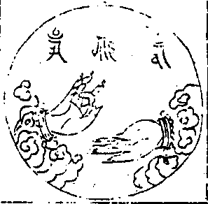



(左羽如持器，右羽弹忍禅，施食真言诵廿一遍)



「唵萨哩斡(二合)荅塔葛达(一)　阿咓卢揭谛鍐(二)　婆啰婆啰(三)　三婆啰三婆啰(四)　吽(五)」



(左掌中白色vaṃ鍐字出光，流注种种无尽甘露法食，忍禅遍空弹洒，光中鬼神一一具有摩竭陀国七宝庄严之斛，妙胜饮食充满盈溢)



「诸佛子等！今为汝众作印咒已，变此一食为无量食，大如须弥，量同法界，终无能尽。」



○乳海印咒



> 「又此光明自在王，悲增护念施无尽，  

> 手中流出香色乳，遍界盈盈如大海。」



(复结前印，即左羽如持器，右羽忍禅弹也，诵乳海真言七遍)



「那麻萨鬘荅勃塔喃鍐」



(请观音云：「手出香色乳，饥渴者饱满。」故前印中白鍐所流甘露至此增广无量，成於乳海，洋溢法界，味触胜妙，香色盈空，诸鬼神等受用不儩)



「诸佛子等！今为汝众作印咒已。由此印咒威神力故，即於印中流出甘露，成於乳海，流注法界，普济汝等，一切有情充足饱满。」



○障施鬼印咒



> 「嗟尔毘那夜迦众，凡为法事即来魔，  

> 我佛慈悲平等门，故今施汝甘露食。」



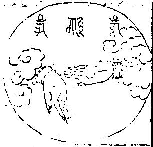



(展垂右手，五指向外，想忍度vaṃ鍐字白光，流出香乳智甘露味，遍至坛外诸障施鬼前，表白，取净缾水往坛界边向外徐徐注下，唱云：「净水。」手一弹指，师诵咒三遍，表白，三唱三弹，诸障施鬼乘光受食，欢喜饱满)



「唵哑吽。拶辣弥担萨哩斡(二合)不哩(二合)的毘牙(二合)　莎诃」



「诸佛子等！虽复方以类聚、物以群分，然我所施，一切无碍，平等普遍，不择冤亲。今日勿得以贵轻贱、以强凌弱，拣遏孤幼令不得食，施不均平，越佛慈济。必须互相爱念，犹如父母一子之想。汝诸众等各有父母、兄弟、妻子、眷属、善友知识，或有事缘来不得者，汝等慈悲爱念，各各赍持饮食、钱财、物等，递相布施，充足饱满，无有乏少，令发道意，永离恶趣，长越四流，当舍此身，速超道果。又为汝等将此净食分为三分：一、施水族，令获人空；二、施毛群，令获法寂；三、施他方禀识陶形，悉令充足，获无生忍。」



○普供养印咒



> 「一期法施事将圆，载献圣凡普遍供，  

> 以大虚空藏出生，所求行愿皆成就。」



(二羽合掌，忍愿两度相押，外相叉傅著手背，二头指相蹙如宝形，诵普供养真言)



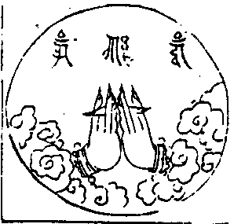



「唵(一)　葛葛纳三婆斡斡资啰(二合)斛(二)」



(想忍愿二度端有白色oṃ唵字，流出种种七宝楼阁、宫殿及诸幢幡宝盖、香华饮食、无量七宝，自己内外之财，布施一切诸佛、圣贤及六道一切有情，此是平等广大真实供养，所生善愿皆得成就也)



「诸佛子等！从来所受饮食，皆是人间贩鬻生命、酒脯钱财、血肉腥膻、荤辛臭秽，虽复受得如是饮食，譬如毒药损坏於身，但增苦本，沉沦苦海，无解脱时。我今依如来教，精诚罄舍，设此无遮广大法食。汝等今日遇兹胜事，戒品沾身，於过去世广事诸佛、亲近善友、供养三宝，由此因缘，值善知识，发菩提心，誓愿成佛，不求餘果，先得道者递相度脱。又愿汝等昼夜恒常拥护於我，满我所愿。以此施食所生功德普将回施法界有情，共诸有情同将此福尽皆回施无上菩提、一切智智，勿招餘果，愿速成佛。」



○密言送往



> 「汝等饱餐甘露味，菩提戒法益心神，  

> 更持佛顶陀罗尼，津送往生安乐刹。」



(止观合掌，屈进力二指，以禅智指压之当胸，先称曰「唵娑度娑度」然后诵咒)



佛顶尊胜陀罗尼神咒(此咒，藏有二说：一者、因善住天子七日命终，启请帝释礼佛諮度，佛放顶光为说是咒。唐时佛陀波利一译、地婆诃罗两译、杜行𫖮一译、义净一译，虽五译重沓，秪是一经。不空三藏《尊胜念诵仪》，题名称译，即五译经之咒耳。二者、因释迦世尊在极乐佛刹大善法堂时，无量寿佛为观世音菩萨说。宋时法天三藏两译之，一名《最胜佛顶陀罗尼经》，但咒无文；一名《佛说一切如来乌瑟腻沙最胜总持经》，乌瑟泥（二合）摄翻为顶，两处咒句，望唐五译较多一倍。不动上师以此修润语音长短，冠心真言於首，入此施食法中，以助往生经文咒句及说请因缘。前后往观，条然不类。当知此咒正为观音摄化生方之密因也，何后之人乃以此咒为明时仁孝皇后梦中感佛之说，斥为藏外，别於云栖流行本中增入唐义净所译之咒？一何惑哉！夫经文咒句总是佛说，唐译宋翻皆能感通，但真言行者於修法中，其所因用自有专属。盖此经观音作请，无量寿说，而咒之𠽾𠾐乃是佛顶求生乐土正句，不同善住天子请说之咒，明矣。故《瑜伽大教王经》云：「观想勃龙（二合）字变成大智，大智化成大轮佛顶，若人乐求生佛刹土，决定随愿得生。」此中已有三普𠾐（二合）字。而首又冠以心真言者，良以法食施竟必须劝助往生，而往生密言无若普𠾐佛顶，故不动师所以郑重致其意也。然则人师如▆▆等，惑此为仁孝皇后梦感佛说，斥为藏外，何说之从？曰此第未之考耳。盖胜国以迨明初，多有西僧入内供养，而西僧往往致灵此咒，仁孝皇后从西僧受得，持之专恳，梦寐不忘，忽然感得胜异之境，从而抄前著后，抄咒著中撰以为经，太子、诸王各有序述，颁入南藏。若以西僧所授之咒对今不动师施食本中，不过转写数个字样不同，声音章句无不同者。当时述施食济生佥要者，不依不动师正本字样以书，乃依西僧所授者字样书之。人师之惑，职此之由。孰知夫仁后梦感佛说咒句与施食佥要本之咒句同是西僧所授之本乎？又孰知西僧所授之本，其源出於不动师之正本乎？然斥为非藏，亦自有据。永乐十八年，北都校刻大藏，敕校藏法主一如曰：「梦感《佛说希有功德经》，荒唐之言，不可入藏。」是知仁后托於梦感，咒虽佛语，犹同伪撰。而人师不能通考，以是为非，未为无过也。若云楼宏和尚序行其书，於书初无损增，伪亦未校，而独及是咒，何欤？曰：「当依藏本。」是云栖之言也，斥宋增唐非云栖之为也，今此乃是不动上师正本)



「唵　普𠾐(二合)莎(引)诃(引)　唵　捺谟癹葛斡谛　萨哩斡(二合)的唻(二合)卢结　不啰(二合)牒月摄瑟咤(二合)耶　勃塔耶谛捺麻　答爹塔　唵普𠾐(二合)　普𠾐(二合)　普𠾐(二合)　菽塔耶菽塔耶　月菽塔耶月菽塔耶　哑萨麻　萨蛮达斡癹萨斯癹(二合)啰纳葛牒葛葛捺　莎癹斡月说提哑撇膻赞多𤚥　萨哩斡(二合)怛塔葛达莎葛达　斡啰斡拶纳美哩(二合)达撇释该　摩诃抹的啰(二合)瞒的啰(二合)巴代阿诃啰阿诃啰　摩麻犹伞塔啰聂　菽塔耶菽塔耶　月菽塔耶　月菽塔耶　葛葛捺莎癹斡月说提　乌瑟坭(二合)摄月拶耶八哩说提　萨诃斯啰(二合)啰释咩(二合)伞祖牒敌萨哩斡(二合)怛塔葛达(引)　斡哩结聂　沙翅巴(二合)啰咩达　八咧补啰聂　萨哩斡(二合)怛塔葛达麻谛　荅舍普咩不啰(二合)牒瑟咤(二合)敌　萨哩斡(二合)怛塔葛达赫啰(二合)荅牙　鉄瑟咤(二合)纳鉄瑟咤(二合)敌　摩的哩(二合)摩的哩(二合)　摩诃摩的哩(二合)　斡资哩(二合)斡资哩(二合)　摩诃斡资哩(二合)　斡资啰(二合)葛耶　三诃怛捺八咧说提　萨哩斡(二合)葛哩麻(二合)斡啰捺月说提　不啰牒尼斡哩怛(二合)耶摩麻犹哩(二合)月说提　萨哩斡(二合)怛塔葛达萨摩牙　鉄瑟咤(二合)纳　鉄瑟咤(二合)敌　唵摩𤤗摩𤤗摩诃摩𤤗　月摩𤤗月摩𤤗摩诃月摩𤤗　麻牒麻牒摩诃麻牒　摩摩牒莎麻牒怛塔达普怛　孤咤八咧说提　月斯蒲(二合)咤勃鉄说鉄　兮兮　拶耶　拶耶　月拶耶月拶耶　斯麻(二合)啰斯麻(二合)啰斯癹(二合)啰斯癹(二合)啰斯癹(二合)啰耶斯癹(二合)啰耶　萨哩斡(二合)勃塔　鉄瑟咤(二合)纳　鉄瑟咤(二合)敌　说提说提　勃提勃提　斡资哩(二合)斡资哩(二合)麻诃斡资哩(二合)　莎斡资哩(二合)斡资啰(二合)葛哩毘(二合)拶耶葛哩毘(二合)　月拶耶葛哩毘(二合)　斡资啰(二合)佐辣葛哩毘(二合)　斡卒噜(二合)忒癹(二合)微　斡资啰(二合)参癹微　斡资哩(二合)斡即哩(二合)聂　斡资𫬠(二合)癹斡多摩摩　摄哩𫬠萨哩斡(二合)萨埵喃　拶葛耶八咧说鉄　癹斡多萨埵弥萨哩斡(二合)达　萨哩斡(二合)葛爹八哩说提实哲(二合)　萨哩斡(二合)荅塔葛达实哲(二合)𤚥　萨麻刷萨颜多　勃鉄勃鉄薛鉄薛鉄　谱塔耶谱塔耶　月谱塔耶月谱塔耶　谟拶耶谟拶耶　月谟拶耶月谟拶耶　菽塔耶菽塔耶　月菽塔耶月菽塔耶　萨蛮达谟拶耶谟拶耶　萨蛮怛啰释迷(二合)八咧说提　萨哩斡(二合)怛达葛达赫啰(二合)荅牙　鉄瑟咤(二合)纳鉄瑟咤(二合)敌　摩特哩(二合)摩特哩(二合)　摩诃摩特哩(二合)摩诃摩特啰(二合)　瞒的啰(二合)芭谛　莎(引)诃(引)」



(诵咒时表白，取坛上花米向六道前旋转俵散，想诸鬼神触此花光皆得往生极乐净土)



○化圆获益(振铃诵法乐偈)



「承斯善利，地狱受苦有情者，刀山剑树变化皆成如意树，火团铁丸变成莲华而为宝吉祥，地狱解脱而能成正觉。



「承斯善利，饿鬼受苦有情者，口中烟燄烧身速愿得清凉，观音手内甘露自然长饱满吉祥，饿鬼解脱而能成正觉。



「承斯善利，畜生受苦有情者，杀害、烧煮、楚毒等苦皆远离，远离乘骑愚痴，速得大智慧吉祥，畜生解脱而能成正觉。



「承斯善利，人间受苦有情者，生时犹如摩耶右胁而降诞，愿具六根、永离八难，修福慧吉祥，人间解脱而能成正觉。



「承斯善利，修罗受苦有情者，我慢、颠狂、拙朴速疾令柔善，恶心、嫉姤、瞋恚斗战自调伏吉祥，修罗解脱而能成正觉。



「承斯善利，天中受乐有情者，欲乐策懃，速发广大菩提心，天中寿尽，忧苦自然生欢悦吉祥，天中解脱而能成正觉。



「承斯善利，十方独觉声闻者，弃舍小乘四谛十二因缘行，进趣大乘四摄六度，修万行吉祥，二乘解脱而能成正觉。



「承斯善利，初地菩萨勇识者，百福庄严，一切行愿皆圆满，顿超十地，证入一生补处位吉祥，大乘速证，究竟成正觉。」



「回向三宝：



> 「现世之中未证菩提间，愿无内外障难恶缘等，  

> 恒常遇逢最妙善知识，所修善事行愿速成就。」



「最上三宝：



> 「临命终时识性无迷惑，愿生西方净土如来前，  

> 依於慧日法光闻思修，断惑证真愍念於有情。」



「最上三宝：



> 「若乘善业即生佛会前，若无善根不生圣道中，  

> 随业轮回世世所生处，志愿犹在熏习无间断。」



「最上三宝：



> 「愿生中国勤修於正法，无病长寿受用悉具足，  

> 相好殊胜辩才智慧等，具七圣财获得丈夫身。」



「最上三宝：



> 「幼年出家亲承贤圣师，三种修学坚牢守护持，  

> 一切时中正念与正法，如日与光刹那不舍离。」



「最上三宝：



> 「功德本愿最上三宝处，从今为始归依而供养，  

> 贪欲瞋恚愚痴三种毒，寂静犹如大地原无起。」



「最上三宝：



> 「观见根尘识等有为法，如梦如幻不实而悟解，  

> 一切众生了知亦若此，恒不忘失方便菩提心。」



「最上三宝：



> 「愿以大乘秘密微妙法，如救头然精进常修学，  

> 同佛证得无上菩提时，尽未来际度脱於六道。」



「最上三宝：



「南无西方无量寿如来，诸大菩萨海会圣众，唯愿法界存亡等罪消除，同生净土，回向无上佛菩提。」



○功圆解散(○奉安嘱护○安住三摩○结愿回向)



> 「三宝慈悲弥法界，不违宿誓顺缘与，  

> 奉以金刚解脱明，化道既周还本位。」



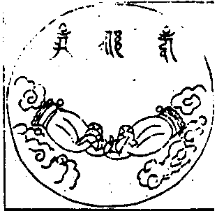



(二羽金刚拳，进力两相钩，随诵而掣开，金刚解脱咒)



「唵斡资啰(二合)穆乞叉(二合)　穆」



(想诸佛菩萨各安本位，六道众生悦乐超升，能施所施及与施物皆悉隐而不现矣)



○嘱护天龙



> 「天阿苏罗药叉等，来听法者应至心，  

> 拥护佛法使常存，各各勤行世尊教。  

> 诸有听徒来至此，或居地上或居空，  

> 每於人世起慈心，日夜自身依法住。  

> 愿诸世界常安隐，无边福智益群生，  

> 所有罪业并消除，远离众苦归圆寂。  

> 每用戒香涂莹体，常持定服以资身，  

> 菩提妙华遍庄严，随所住处常安乐。」



○安住三摩(金刚萨埵百字咒，行者常能诵持，金刚萨埵恒作护持，而令安住三昧。若修行佛事，求愿补阙，功德无量)



「唵(一)　斡资罗(二合)萨埵苏萨麻耶麻纳巴辣耶(二)　斡资啰(二合)萨埵谛奴钵谛瑟劄(二合)(三)　涅哩(二合)锄弥癹咓(四)　苏度束弥癹咓(五)　阿奴啰屹都(二合)弥癹咓(六)　苏布束弥癹咓(七)　萨哩咓(二合)些提弥不啰(二合)耶擦(八)　萨哩斡(二合)葛哩麻(二合)苏拶弥(九)　稷达释哩(二合)杨郭噜(十)　吽(十一)　诃诃诃诃斛(十二)　癹葛湾萨哩咓(二合)荅塔葛达斡资啰(二合)麻弥扪拶(十三)　斡资哩(二合)癹咓(十四)　麻诃萨麻耶萨埵阿(引)(十五)」



○结愿回向



> 「诸佛正法菩萨僧，直至菩提我归依，  

> 我以所修诸善根，为利有情愿成佛。  

> 世出世间随愿所成，世出世间随愿所成。」



(结愿竟，法师下座，表白大众伸回向)



> 「施食功德殊胜行，无边胜福皆回向，  

> 普愿沉溺诸众生，速往无量光佛刹。」



瑜伽集要燄口施食仪(终)

