# 云栖法汇（选录）(第12卷-第25卷)



> **藏经**：嘉兴大藏经（新文丰版）（嘉兴藏）　**册次** 第 33 册（J33）　**编号** JB277　**部类** 瑜伽部　**卷次** 14 卷　**篇幅** 313,277 字

> **作者（译者）**：目录

> **卷／品**：5 卷 · 54 品



---



## 目录



  - [重刻诸经日诵序](#重刻诸经日诵序)

  - [自知录序](#自知录序)

  - [戒杀放生文序](#戒杀放生文序)

  - [戒杀放生文后序](#戒杀放生文后序)

  - [竹窗三笔序](#竹窗三笔序)

  - [直道录序](#直道录序)

- [山房杂录卷一](#山房杂录卷一)

  - [序梵网经心地品菩萨戒义疏发隐序](#序梵网经心地品菩萨戒义疏发隐序)

  - [重刻诸经日诵序](#重刻诸经日诵序-1)

  - [云栖流通藏本法宝条约序](#云栖流通藏本法宝条约序)

  - [瑜伽集要施食仪轨序](#瑜伽集要施食仪轨序)

  - [瑜伽集要图像燄口施食序](#瑜伽集要图像燄口施食序)

  - [禅关策进序](#禅关策进序)

  - [高峰大师语录序](#高峰大师语录序)

  - [牧牛图序](#牧牛图序)

  - [缁门崇行录序](#缁门崇行录序)

  - [往生集序](#往生集序)

  - [重刻净土善人咏序](#重刻净土善人咏序)

  - [中峰禅师净土诗序](#中峰禅师净土诗序)

  - [答四十八问序](#答四十八问序)

  - [慈无量集序](#慈无量集序)

  - [杀生炯戒序](#杀生炯戒序)

  - [自知录序](#自知录序-1)

  - [刻冰莲居士续法喜志序](#刻冰莲居士续法喜志序)

  - [无幻禅师语录序](#无幻禅师语录序)

  - [幻有禅师闲谈晚话二编序](#幻有禅师闲谈晚话二编序)

  - [直道录序](#直道录序-1)

  - [竹窗三笔序](#竹窗三笔序-1)

  - [谚谟曲典序](#谚谟曲典序)

  - [梵网经心地品菩萨戒义疏发隐序](#梵网经心地品菩萨戒义疏发隐序)

  - [宝积二会序](#宝积二会序)

  - [重刻诸经日诵序](#重刻诸经日诵序-2)

  - [云栖流通藏本法宝条约序](#云栖流通藏本法宝条约序-1)

  - [瑜伽集要施食仪轨序](#瑜伽集要施食仪轨序-1)

  - [瑜伽集要图像燄口施食序](#瑜伽集要图像燄口施食序-1)

  - [禅关策进序](#禅关策进序-1)

  - [高峰大师语录序](#高峰大师语录序-1)

  - [牧牛图序](#牧牛图序-1)

  - [缁门崇行录序](#缁门崇行录序-1)

  - [往生集序](#往生集序-1)

  - [重刊净土善人咏序](#重刊净土善人咏序)

  - [中峰禅师净土诗序](#中峰禅师净土诗序-1)

  - [答四十八问序](#答四十八问序-1)

  - [慈无量集序](#慈无量集序-1)

  - [杀生炯戒序](#杀生炯戒序-1)

  - [自知录序](#自知录序-2)

  - [刻冰莲居士续法喜志序](#刻冰莲居士续法喜志序-1)

  - [无幻禅师语录序](#无幻禅师语录序-1)

  - [幻有禅师闲谈晚话二编序](#幻有禅师闲谈晚话二编序-1)

  - [直道录序](#直道录序-2)

  - [竹窗三笔序](#竹窗三笔序-2)

  - [谚谟曲典序](#谚谟曲典序-1)

- [山房杂录卷二](#山房杂录卷二)

- [云栖大师遗稿卷一](#云栖大师遗稿卷一)

- [云栖大师遗稿卷二](#云栖大师遗稿卷二)

- [云栖大师遗稿卷三](#云栖大师遗稿卷三)

  - [补遗净土资粮全集序](#补遗净土资粮全集序)

  - [净土资粮全集序](#净土资粮全集序)

  - [莲宗八祖杭州古云栖寺中兴尊宿莲池大师塔铭并序](#莲宗八祖杭州古云栖寺中兴尊宿莲池大师塔铭并序)



---



### 重刻诸经日诵序



嘉禾项君，向以坊本百八般经入云栖，谓是经僧尼道俗晨夕所持诵，而真伪交杂，识者诮焉。幸为我一甄别之，以式初学。予按其本，勾抹诠次，去伪而存真。复披括经律及古今人著作，取其最切近者一二增益之。甫就槁，未较也，以致项君。项君随付剞劂，而同邑许君又仍其刻刻焉。予近阅一过，见其错误颇众，乃重加订正，别为方册，梓而置之云栖山中，庶善本流布，终成二君之美。其览前之二刻者，当以是为左券云。



时万历二十八年岁次庚子十月既望云栖袾宏识



诸经日诵集要目录



卷上总集○朝时课诵第一大佛顶首楞严咒  

千手千眼无碍大悲心陀罗尼  

如意宝轮王陀罗尼  

消灾吉祥神咒  

功德宝山神咒  

佛母准提神咒  

圣无量寿决定光明王陀罗尼  

药师灌顶真言  

观音灵感真言  

七佛灭罪真言  

往生净土神咒  

善天女咒  

般若波罗蜜多心经  

念佛缘起  

回向文(具别集)



○暮时课诵第二佛说阿弥陀经  

忏悔文  

蒙山施食仪  

念佛回向(文具别集)  

三皈依  

善导和尚示临睡入观文



卷下别集○经类第一华严行愿品章  

楞严势至菩萨念佛章  

观无量寿佛经上品上生章  

无量寿经四十八愿  

观普贤菩萨经普贤观章  

金光明经空品  

梵网经菩萨戒发誓愿章



○咒类第二佛顶尊胜大陀罗尼(一二)  

受戒搭衣咒  

般若无尽藏真言  

华严补阙咒  

秽迹金刚神咒  

十二因缘咒(附杂咒)  

补阙真言



○杂录第三看经警文(保宁勇禅师作)  

礼华严文(随州大洪山遂禅师作)  

大慈菩萨发愿偈  

净土文  

又净土文(慈云忏主作)  

新定西方愿文(云栖袾宏作)  

礼佛发愿文(怡山然禅师作)  

礼观音文  

又礼观音文(大慧杲禅师作)  

沩山大圆禅师警策文  

斋佛仪  

二时临斋仪  

祝圣仪  

祝韦驮仪  

祝伽蓝仪  

祝祖师仪  

祝监斋仪  

击钟仪  

结会念佛仪  

香赞  

西方赞



诸经日诵集要卷上



古杭云栖寺沙门袾宏订辑



问：「旧刻首《心经》、《金刚》、《观音》、《弥陀》等，今胡不然？」答：「为欲以晨昏课诵经咒萃为一处，便彼初学，随众讽演，次第分明故。又《金刚》等单本独行，莫知其数，遍满世间，不必此中更烦赘故。又诸全本经，大都另刻，流布已广，今唯节要，便初学故。」



△总集



称总集者，以别集中分经文、咒文、杂文各为一类，此取便於晨昏，乃兼并间错，如织锦然，故名为总。



○朝时课诵第一



○大佛顶首楞严咒



> 妙湛总持不动尊，首楞严王世希有，  

> 销我亿劫颠倒想，不历僧祇获法身。  

> 愿今得果成宝王，还度如是恒沙众，  

> 将此深心奉尘刹，是则名为报佛恩。  

> 伏请世尊为证明，五浊恶世誓先入，  

> 如一众生未成佛，终不於此取泥洹。  

> 大雄大力大慈悲，希更审除微细惑，  

> 令我早登无上觉，於十方界坐道场，  

> 舜若多性可销亡，烁迦罗心无动转。  

> 南无常住十方佛。南无常住十方法。  

> 南无常住十方僧。南无释迦牟尼佛。  

> 南无佛顶首楞严。南无观世音菩萨。  

> 南无金刚藏菩萨。



尔时，世尊从肉髻中涌百宝光，光中涌出千叶宝莲。有化如来坐宝华中，顶放十道百宝光明，一一光明皆遍示现十恒河沙金刚密迹，擎山持杵遍虚空界。大众仰观，畏爱兼抱，求佛哀祐，一心听佛无见顶相放光如来宣说神咒：



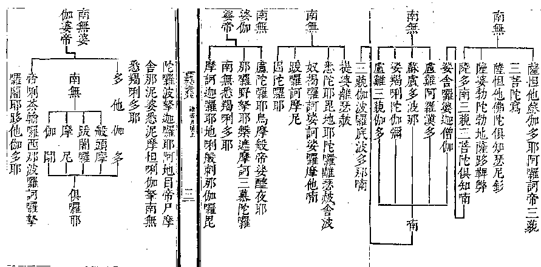



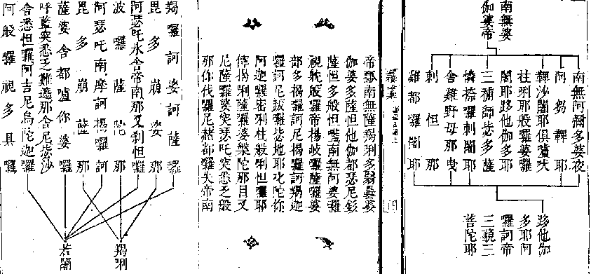



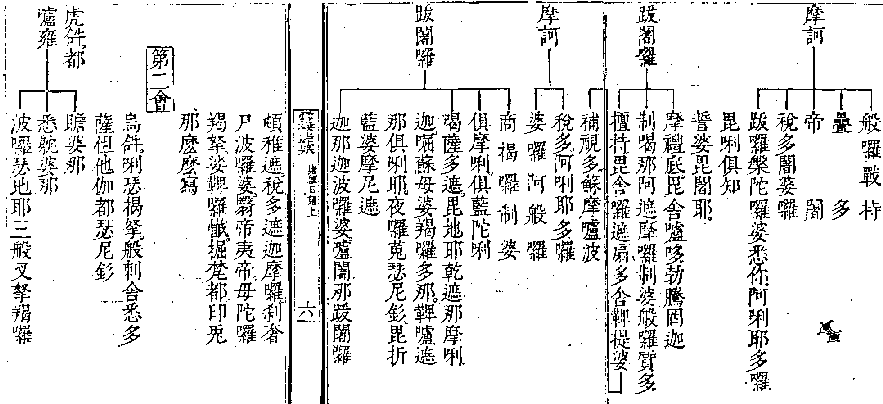



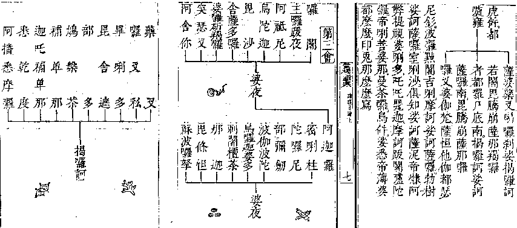



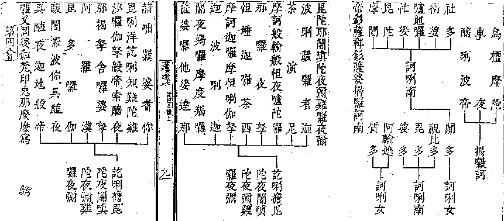



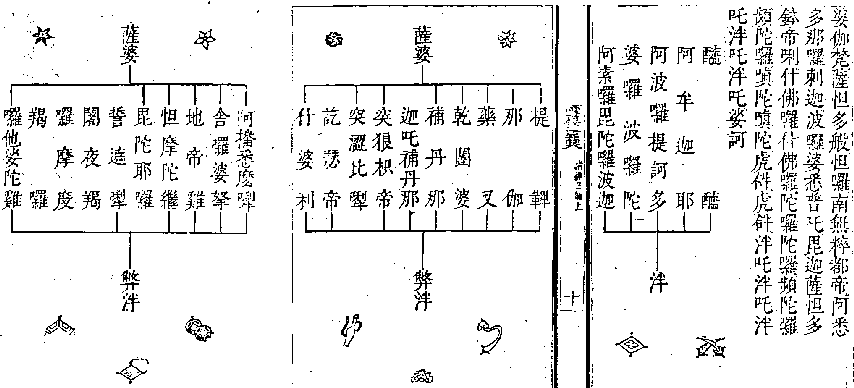



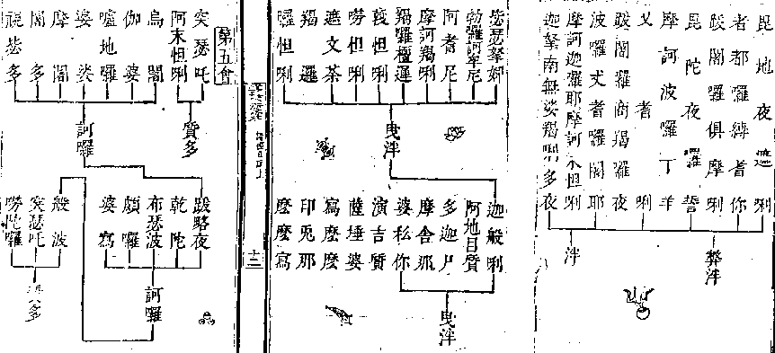



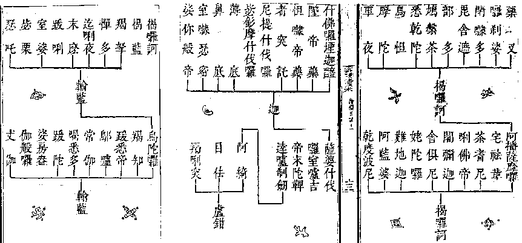



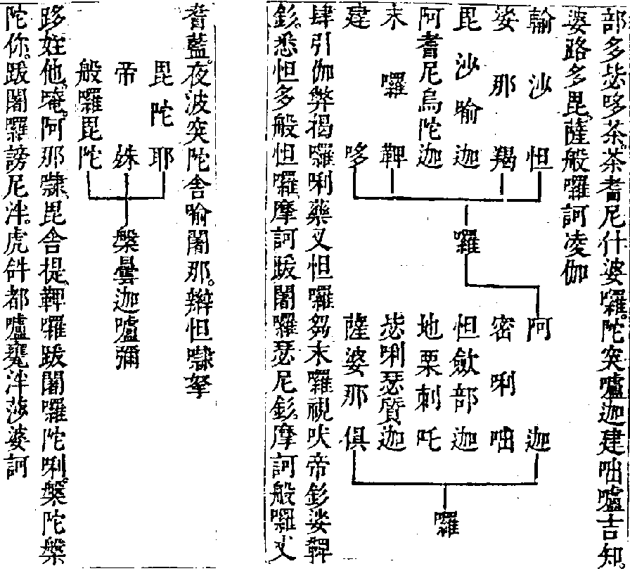



此咒排文界线，最便学习。有依经直写者，盖不解此意。



○千手千眼无碍大悲心陀罗尼



南无喝啰怛那哆啰夜耶　南无阿唎耶　婆卢羯帝　烁钵啰耶　菩提萨埵婆耶　摩诃萨埵婆耶　摩诃迦卢尼迦耶　唵　萨皤啰　罚曳数　怛那怛写　南无悉吉㗚埵　伊蒙阿唎耶　婆卢吉帝　室佛啰　楞驮婆　南无那啰谨墀醯唎摩诃　皤哆沙咩(羊鸣音)　萨婆阿他　豆输朋　阿逝孕萨婆萨哆　那摩婆萨哆(藏本有此五字)　那摩婆伽　摩罚特豆怛姪他　唵　阿婆卢醯　卢迦帝　迦罗帝　夷醯唎　摩诃菩提萨埵　萨婆萨婆　摩啰摩啰　摩醯摩醯　唎驮孕　俱卢俱卢羯蒙　度卢度卢　罚阇耶帝　摩诃罚阇耶帝　陀罗陀罗　地唎尼　室佛啰耶　遮啰遮啰　麼麼罚　摩啰穆帝隶　伊醯伊醯　室那室那　阿啰嘇　佛啰舍利　罚沙罚嘇佛啰舍耶　呼卢呼卢摩啰　呼卢呼卢醯利　娑啰娑啰悉唎悉唎　苏𠰷苏𠰷　菩提夜　菩提夜　菩驮夜　菩驮夜弥帝唎夜　那啰谨墀　地利瑟尼　那婆夜　摩那　娑婆诃悉陀夜　娑婆诃　摩诃悉陀夜　娑婆诃　悉陀喻艺　室皤啰耶　娑婆诃　那啰谨墀　娑婆诃　摩啰那啰　娑婆诃　悉啰僧　阿穆佉耶　娑婆诃　娑婆摩诃　阿悉陀夜　娑婆诃者吉啰　阿悉陀夜　娑婆诃　波陀摩　羯悉陀夜　娑婆诃那啰谨墀　皤伽啰耶　娑婆诃　摩婆利　胜羯啰夜　娑婆诃　南无喝啰怛那哆啰夜耶　南无阿利耶　婆罗吉帝烁皤啰夜　娑婆诃　唵(藏本有此一字)　悉殿都　漫多啰　跋陀耶娑婆诃



末有「金刚胜庄严　娑婆诃　摩羯胜庄严　娑婆诃　唵跋阇啰　室利曳　娑婆诃」三句，古本无之，不知何人所增，有不念者亦得。



○如意宝轮王陀罗尼



南无佛陀耶　南无达摩耶　南无僧伽耶　南无观自在菩萨摩诃萨具大悲心者　怛姪他　唵　斫揭啰伐底　震多末尼　摩诃钵蹬谜　噜噜噜噜　底瑟咤烁啰　阿揭利沙夜吽　癹莎诃　唵　钵蹋摩　震多末尼　烁啰吽　唵　钵剌陀　钵亶谜吽



○消灾吉祥神咒



曩谟三满哆　母驮喃　阿钵啰底　贺多舍　娑曩喃　怛姪他　唵　佉佉佉　呬佉呬　吽吽　入𭌯啰　入𭌯啰　钵啰入𭌯啰　钵啰入嚩啰　底瑟姹　底瑟姹　瑟致哩　瑟致哩　娑癹咤　娑癹咤　扇底迦　室哩曳　娑𭌯诃



○功德宝山神咒



南无佛陀耶　南无达磨耶　南无僧伽耶　唵　悉帝护　噜噜悉都噜　只利波吉利　婆悉达哩　布噜哩　娑嚩诃



○佛母准提神咒



> 稽首皈依苏悉帝，头面顶礼七俱胝，  

> 我今称赞大准提，惟愿慈悲垂加护。



南无萨哆喃　三藐三菩陀　俱胝喃　怛姪他　唵　折隶主隶　准提娑婆诃



○圣无量寿决定光明王陀罗尼



唵　捺摩巴葛瓦帝　阿巴啰密沓　阿优哩　阿纳苏必你实执沓牒　左啰宰也　怛塔哿达也　阿啰诃帝　三药三不达也　怛也塔　唵　萨哩巴桑斯葛哩　叭哩述沓　达啰马帝　哿哿捺桑　马兀哿帝　莎巴瓦比述帝　马喝捺也叭哩瓦哩　莎喝



○药师灌顶真言



南无薄伽伐帝　鞞杀社　窭噜薜琉璃　钵剌婆　喝啰阇也　怛他揭多耶　阿啰喝帝　三藐三勃陀耶　怛姪他　唵　鞞杀逝　鞞杀逝　鞞杀社　三没揭帝　莎诃



○观音灵感真言



唵　嘛呢叭𠵸吽　麻曷倪牙　纳积都特　巴达积特些　纳微达哩　葛萨而　斡而塔卜哩　悉塔葛　纳补啰纳　纳卜哩　丢忒班　纳哪麻𠰷　吉说啰耶　莎诃



○七佛灭罪真言



离婆离婆帝　求诃求诃帝　陀罗尼帝　尼诃啰帝　毘黎你帝　摩诃伽帝　真陵乾帝　莎婆诃



问：「此有解冤释结咒，何不录？」



荅：「华梵相杂，无此咒体，又无出处，去之。」



○往生净土神咒



曩谟　阿弥跢婆夜　哆他伽哆夜　哆地夜他　阿弥唎都婆毘　阿弥唎哆　悉耽婆毘　阿弥唎哆　毘迦兰帝　阿弥唎哆　毘迦兰哆　伽弥腻　伽伽那　枳多迦隶　娑婆诃



○善天女咒



南无佛陀　南无达摩　南无僧伽　南无室利　摩诃提鼻耶　怛你也他波利　富楼那遮利　三曼陀达舍尼　摩诃毘诃罗伽帝　三曼陀毘尼伽帝　摩诃迦利野　波祢　波啰波祢　萨利𭌯栗他　三曼陀修钵黎帝　富隶那　阿利那　达摩帝　摩诃毘鼓毕帝　摩诃弥勒帝　娄簸僧祗帝　醯帝簁　僧祗醯帝　三曼陀阿他　阿㝹婆罗尼



问：「普庵、二佛咒何不录？」



荅：「真言是佛菩萨语，普庵后代高僧，无说咒理。二佛则华梵夹杂，文辞俚俗，皆所宜去。」



○般若波罗蜜多心经



观自在菩萨行深般若波罗蜜多时，照见五蕴皆空，度一切苦厄。舍利子！色不异空，空不异色，色即是空，空即是色，受、想、行、识亦复如是。舍利子！是诸法空相，不生不灭，不垢不净，不增不减，是故空中无色，无受、想、行、识，无眼、耳、鼻、舌、身、意，无色、声、香、味、触、法，无眼界乃至无意识界，无无明亦无无明尽，乃至无老死亦无老死尽，无苦、集、灭、道，无智亦无得。以无所得故，菩提萨埵依般若波罗蜜多故心无罣碍，无罣碍故无有恐怖，远离颠倒梦想究竟涅槃。三世诸佛依般若波罗蜜多故得阿耨多罗三藐三菩提。故知般若波罗蜜多是大神咒，是大明咒，是无上咒，是无等等咒，能除一切苦真实不虚，故说般若波罗蜜多咒。即说咒曰：



揭谛　揭谛　波罗揭谛　波罗僧揭谛　菩提萨婆诃



问：「旧有摩诃二字，何以去之？」



荅：「古本原无故。八部般若中，自有《摩诃般若波罗蜜经》三十卷，号《大品般若》故。」



摩诃般若波罗蜜多(三称)(若祝圣即於此句下接起)



以此经咒功德，回向三宝龙天。三界岳渎灵聪，守护伽蓝真宰。祈福保安平善，庄严有位先亡。普愿法界众生，共入毘卢性海。



> ○阿弥陀佛身金色，相好光明无等伦，  

> 白毫宛转五须弥，绀目澄清四大海。  

> 光中化佛无数亿，化菩萨众亦无边，  

> 四十八愿度众生，九品咸令登彼岸。



南无西方极乐世界大慈大悲阿弥陀佛



问：「旧有三十六万亿等语，今何不录？」



荅：「相传此是佛教一老人念佛，令念少功多，而考之大藏无出。既念少功多，何不取恒沙僧祗等数为更多耶。又百丈为病僧亡僧念佛仪式，皆如前文，无三十六等语。」



南无观世音菩萨  

南无大势至菩萨  

南无清净大海众菩萨(各十称)



○回向文(具别集)



乐简者，用慈云小净土文。乐详者，用新定西方愿文。



○暮时课诵第二



○佛说阿弥陀经



如是我闻：一时，佛在舍卫国祗树给孤独园，与大比丘僧千二百五十人俱，皆是大阿罗汉，众所知识。长老舍利弗、摩诃目犍连、摩诃迦叶、摩诃迦旃延、摩诃俱𫄨罗、离婆多、周利槃陀、伽难陀、阿难陀、罗睺罗、憍梵波提、宾头卢颇罗、墯迦留陀夷、摩诃劫宾那、薄拘罗、阿㝹楼驮，如是等诸大弟子。并诸菩萨摩诃萨，文殊师利法王子、阿逸多菩萨、乾陀诃提菩萨、常精进菩萨，与如是等诸大菩萨，及释提桓因等无量诸天大众俱。尔时，佛告长老舍利弗：「从是西方过十万亿佛土，有世界名曰极乐，其土有佛，号阿弥陀，今见在说法。舍利弗！彼土何故名为极乐？其国众生无有众苦，但受诸乐，故名极乐。又，舍利弗！极乐国土七重栏楯、七重罗网、七重行树，皆是四宝周匝围绕，是故彼国名为极乐。又，舍利弗！极乐国土有七宝池，八功德水充满其中，池底纯以金沙布地，四边阶道金、银、琉璃、玻璃合成，上有楼阁，亦以金、银、琉璃、玻璃、车渠、赤珠、玛瑙而严饰之，池中莲华大如车轮，青色青光、黄色黄光、赤色赤光、白色白光，微妙香洁。舍利弗！极乐国土成就如是功德庄严。又，舍利弗！彼佛国土常作天乐，黄金为地，昼夜六时雨天曼陀罗华。其土众生，常以清旦，各以衣裓盛众妙华，供养他方十万亿佛，即以食时还到本国，饭食经行。舍利弗！极乐国土成就如是功德庄严。复次，舍利弗！彼国常有种种奇妙杂色之鸟，白鹤、孔雀、鹦鹉、舍利、迦陵频伽、共命之鸟。是诸众鸟昼夜六时出和雅音，其音演畅五根、五力、七菩提分、八圣道分如是等法。其土众生闻是音已，皆悉念佛、念法、念僧。舍利弗！汝勿谓此鸟实是罪报所生。所以者何？彼佛国土无三恶道。舍利弗！其佛国土尚无恶道之名，何况有实？是诸众鸟皆是阿弥陀佛欲令法音宣流变化所作。舍利弗！彼佛国土微风吹动，诸宝行树及宝罗网出微妙音，譬如百千种乐同时俱作。闻是音者，自然皆生念佛、念法、念僧之心。舍利弗！其佛国土成就如是功德庄严。舍利弗！於汝意云何？彼佛何故号阿弥陀？舍利弗！彼佛光明无量，照十方国无所障碍，是故号为阿弥陀。又，舍利弗！彼佛寿命及其人民无量无边阿僧祗劫，故名阿弥陀。舍利弗！阿弥陀佛成佛以来於今十劫。又，舍利弗！彼佛有无量无边声闻弟子，皆阿罗汉，非是筭数之所能知，诸菩萨众亦复如是。舍利弗！彼佛国土成就如是功德庄严。又，舍利弗！极乐国土众生生者，皆是阿鞞跋致，其中多有一生补处，其数甚多，非是筭数所能知之，但可以无量无边阿僧祗说。舍利弗！众生闻者，应当发愿，愿生彼国。所以者何？得与如是诸上善人俱会一处。舍利弗！不可以少善根福德因缘得生彼国。舍利弗！若有善男子、善女人闻说阿弥陀佛，执持名号，若一日、若二日、若三日、若四日、若五日、若六日、若七日，一心不乱，其人临命终时，阿弥陀佛与诸圣众现在其前，是人终时，心不颠倒，即得往生阿弥陀佛极乐国土。舍利弗！我见是利，故说此言。若有众生闻是说者，应当发愿生彼国土。舍利弗！如我今者赞叹阿弥陀佛不可思议功德之利，东方亦有阿閦鞞佛、须弥相佛、大须弥佛、须弥光佛、妙音佛，如是等恒河沙数诸佛，各於其国出广长舌相，遍覆三千大千世界，说诚实言：『汝等众生当信是称赞不可思议功德一切诸佛所护念经。』舍利弗！南方世界有日月灯佛、名闻光佛、大燄肩佛、须弥灯佛、无量精进佛，如是等恒河沙数诸佛，各於其国出广长舌相，遍覆三千大千世界，说诚实言：『汝等众生当信是称赞不可思议功德一切诸佛所护念经。』舍利弗！西方世界有无量寿佛、无量相佛、无量幢佛、大光佛、大明佛、宝相佛、净光佛，如是等恒河沙数诸佛，各於其国出广长舌相，遍覆三千大千世界，说诚实言：『汝等众生当信是称赞不可思议功德一切诸佛所护念经。』舍利弗！北方世界有燄肩佛、最胜音佛、难沮佛、日生佛、网明佛，如是等恒河沙数诸佛，各於其国出广长舌相，遍覆三千大千世界，说诚实言：『汝等众生当信是称赞不可思议功德一切诸佛所护念经。』舍利弗！下方世界有师子佛、名闻佛、名光佛、达磨佛、法幢佛、持法佛，如是等恒河沙数诸佛，各於其国出广长舌相，遍覆三千大千世界，说诚实言：『汝等众生当信是称赞不可思议功德一切诸佛所护念经。』舍利弗！上方世界有梵音佛、宿王佛、香上佛、香光佛、大燄肩佛、杂色宝华严身佛、娑罗树王佛、宝华德佛、见一切义佛、如须弥山佛，如是等恒河沙数诸佛，各於其国出广长舌相，遍覆三千大千世界，说诚实言：『汝等众生当信是称赞不可思议功德一切诸佛所护念经。』舍利弗！於汝意云何？何故名为一切诸佛所护念经？舍利弗！若有善男子、善女人闻是经受持者，及闻诸佛名者，是诸善男子、善女人皆为一切诸佛之所护念，皆得不退转於阿耨多罗三藐三菩提。是故，舍利弗！汝等皆当信受我语及诸佛所说。舍利弗！若有人已发愿、今发愿、当发愿，欲生阿弥陀佛国者，是诸人等皆得不退转於阿耨多罗三藐三菩提，於彼国土若已生、若今生、若当生。是故，舍利弗！诸善男子、善女人若有信者，应当发愿生彼国土。舍利弗！如我今者称赞诸佛不可思议功德，彼诸佛等亦称赞我不可思议功德，而作是言：『释迦牟尼佛能为甚难希有之事，能於娑婆国土五浊恶世劫浊、见浊、烦恼浊、众生浊、命浊中，得阿耨多罗三藐三菩提，为诸众生说是一切世间难信之法。』舍利弗！当知我於五浊恶世行此难事，得阿耨多罗三藐三菩提，为一切世间说此难信之法，是为甚难。」佛说此经已，舍利弗及诸比丘，一切世间天、人、阿修罗等，闻佛所说，欢喜信受，作礼而去。



佛说阿弥陀经



问：「时本有於一心不乱下增专持名号四句，今胡不用？」



荅：「相传襄阳石刻上有此，而细玩之，义理不通，前后失体，或当是解经者之言耳，除去为是。」



拔一切业障根本得生净土陀罗尼



即往生咒，文见前。



○忏悔文



> 大慈大悲愍众生，大喜大舍济含识，  

> 相好光明以自严，众等至心归命礼。



南无皈依金刚上师  

皈依佛  

皈依法  

皈依僧



我今发心，不为自求人天福报、声闻、缘觉乃至权乘诸位菩萨，唯依最上乘发菩提心，愿与法界众生一时同得阿耨多罗三藐三菩提。



南无皈依十方尽虚空界一切诸佛  

南无皈依十方尽虚空界一切尊法  

南无皈依十方尽虚空界一切贤圣僧  

南无如来、应供、正遍知、明行足、善逝、世间解、无上士、调御丈夫、天人师、佛、世尊  

南无普光佛  

南无普明佛  

南无普净佛  

南无多摩罗跋旃檀香佛  

南无旃檀光佛  

南无摩尼幢佛  

南无欢喜藏摩尼宝积佛  

南无一切世间乐见上大精进佛  

南无摩尼幢灯光佛  

南无慧炬照佛  

南无海德光明佛  

南无金刚牢强普散金光佛  

南无大强精进勇猛佛  

南无大悲光佛  

南无慈力王佛  

南无慈藏佛  

南无旃檀窟庄严胜佛  

南无贤善首佛  

南无善意佛  

南无广庄严王佛  

南无金华光佛  

南无宝盖照空自在力王佛  

南无虚空宝华光佛  

南无琉璃庄严王佛  

南无普现色身光佛  

南无不动智光佛  

南无降伏众魔王佛  

南无才光明佛  

南无智慧胜佛  

南无弥勒仙光佛  

南无善寂月音妙尊智王佛  

南无世净光佛  

南无龙种上尊王佛  

南无日月光佛  

南无日月珠光佛  

南无慧幢胜王佛  

南无师子吼自在力王佛  

南无妙音胜佛  

南无常光幢佛  

南无观世灯佛  

南无慧威灯王佛  

南无法胜王佛  

南无须弥光佛  

南无须摩那华光佛  

南无优昙钵罗华殊胜王佛  

南无大慧力王佛  

南无阿閦毘欢喜光佛  

南无无量音声王佛  

南无才光佛  

南无金海光佛  

南无山海慧自在通王佛  

南无大通光佛  

南无一切法幢满王佛  

南无释迦牟尼佛  

南无金刚不坏佛  

南无宝光佛  

南无龙尊王佛  

南无精进军佛  

南无精进喜佛  

南无宝火佛  

南无宝月光佛  

南无现无愚佛  

南无宝月佛  

南无无垢佛  

南无离垢佛  

南无勇施佛  

南无清净佛  

南无清净施佛  

南无娑留那佛  

南无水天佛  

南无坚德佛  

南无旃檀功德佛  

南无无量掬光佛  

南无光德佛  

南无无忧德佛  

南无那罗延佛  

南无功德华佛  

南无莲华光游戏神通佛  

南无财功德佛  

南无德念佛  

南无善名称功德佛  

南无红燄帝幢王佛  

南无善游步功德佛  

南无斗战胜佛  

南无善游步佛  

南无周匝庄严功德佛  

南无宝华游步佛  

南无宝莲华善住娑罗树王佛  

南无法界藏身阿弥陀佛(藏字去声)



如是等一切世界诸佛世尊常住在世，是诸世尊当慈念我。若我此生、若我前生，从无始生死以来所作众罪，若自作、若教他作、见作随喜；若塔、若僧、若四方僧物，若自取、若教他取、见取随喜；五无间罪，若自作、若教他作、见作随喜；十不善道，若自作、若教他作、见作随喜。所作罪障，或有覆藏、或不覆藏，应堕地狱、饿鬼、畜生、诸餘恶趣、边地、下贱及蔑戾车，如是等处所作罪障，今皆忏悔。今诸佛世尊当证知我、当忆念我。我复於诸佛世尊前作如是言：若我此生、若我餘生，曾行布施、或守净戒，乃至施与畜生一抟之食，或修净行所有善根、成就众生所有善根、修行菩提所有善根，及无上智所有善根，一切合集较计筹量，皆悉回向阿耨多罗三藐三菩提。如过去、未来、现在诸佛所作回向，我亦如是回向。众罪皆忏悔，诸福尽随喜，及请佛功德，愿成无上智。去来现在佛，於众生最胜，无量功德海，我今皈命礼。



> 所有十方世界中，三世一切人师子，  

> 我以清净身语意，一切遍礼尽无餘。  

> 普贤行愿威神力，普现一切如来前，  

> 一身复现刹尘身，一一遍礼刹尘佛。  

> 於一尘中尘数佛，各处菩萨众会中，  

> 无尽法界尘亦然，深信诸佛皆充满。  

> 各以一切音声海，普出无尽妙言词，  

> 尽於未来一切劫，赞佛甚深功德海。  

> 以诸最胜妙华鬘，妓乐涂香及伞盖，  

> 如是最胜庄严具，我以供养诸如来。  

> 最胜衣服最胜香，末香烧香与灯烛，  

> 一一皆如妙高聚，我悉供养诸如来。  

> 我以广大胜解心，深信一切三世佛，  

> 悉以普贤行愿力，普遍供养诸如来。  

> 我昔所造诸恶业，皆繇无始贪瞋痴，  

> 从身语意之所生，一切我今皆忏悔。  

> 十方一切诸众生，二乘有学及无学，  

> 一切如来与菩萨，所有功德皆随喜。  

> 十方所有世间灯，最初成就菩提者，  

> 我今一切皆劝请，转於无上妙法轮。  

> 诸佛若欲示涅槃，我悉至诚而劝请，  

> 惟愿久住刹尘劫，利乐一切诸众生。  

> 所有礼赞供养福，请佛住世转法轮，  

> 随喜忏悔诸善根，回向众生及佛道，  

> 愿将以此胜功德，回向无上真法界。  

> 性相佛法及僧伽，二谛融通三昧印，  

> 如是无量功德海，我今皆悉尽回向。  

> 所有众生身口意，见惑弹谤我法等，  

> 如是一切诸业障，悉皆消灭尽无餘。  

> 念念智周与法界，广度众生皆不退，  

> 乃至虚空世界尽，众生及业烦恼尽，  

> 如是四法广无边，愿今回向亦如是。



南无大行普贤菩萨(三称)



○蒙山施食仪



> 若人欲了知，三世一切佛，应观法界性，  

> 一切惟心造。(以下俱各三称)



唵　伽罗帝耶　娑婆诃(破地狱真言)



南无部部帝唎伽哩哆哩怛哆誐哆耶(普召请真言)



唵　三陀啰　伽陀　娑婆诃(解冤结真言)



南无大方广佛华严经  

南无常住十方佛  

南无常住十方法  

南无常住十方僧  

南无本师释迦牟尼佛  

南无大悲观世音菩萨  

南无冥阳救苦地藏王菩萨  

南无启教阿难陀尊者  

归依佛  

归依法  

归依僧  

归依佛两足尊  

归依法离欲尊  

归依僧众中尊  

归依佛竟  

归依法竟  

归依僧竟



> ○佛子所造诸恶业，皆繇无始贪瞋痴，  

> 从身语意之所生，一切我今皆忏悔。



> ○众生无边誓愿度，烦恼无尽誓愿断，  

> 法门无量誓愿学，佛道无上誓愿成。



> ○自性众生誓愿度，自性烦恼誓愿断，  

> 自性法门誓愿学，自性佛道誓愿成。



唵　钵罗末　邻陀𩕳　娑婆诃(灭定业真言)



唵　阿鲁勒继　莎婆诃(灭业障真言)



唵　步步底　哩伽哆哩　怛哆誐哆耶　(开咽喉真言)



唵　三昧耶　萨埵梵(三昧耶戒真言)



问：「有作三昧印者，是否？」



荅：「自有三昧耶印，此是真言。真言口念，印手结故。」



南无萨𭌯怛他誐哆　𭌯噜枳帝　唵　三跋啰　三跋啰吽(变食真言)



南无苏噜婆耶　怛他誐哆耶　怛姪他　唵　苏噜苏噜　钵啰苏噜　钵啰苏噜　莎婆诃(甘露水真言)



唵　鍐　鍐鍐鍐鍐(一字水轮真言)



南无三满哆　没驮喃　唵　鍐(乳海真言)



南无多宝如来  

南无宝胜如来  

南无妙色身如来  

南无广博身如来  

南无离怖畏如来  

南无甘露王如来  

南无阿弥陀如来



> 神咒加持净法食，普施河沙众佛子，  

> 愿皆饱满舍悭贪，速脱幽冥生净土。  

> 皈依三宝发菩提，究竟得成无上道，  

> 功德无边尽未来，一切佛子同法食。



问：「旧於净法食下分三，增法施食、甘露水；於佛子下亦分三，增有情、孤魂。今胡不用？」



荅：「古本原无故。净法则具下二句，佛子则该下二种。况瑜伽燄口施食文中，只说佛子，而众生悉在。若云佛子止属出家，必下二方足，则何云一切含灵皆有佛性。」



汝等佛子众，我今施汝供，此食遍十方，一切佛子共。愿以此功德，普及於一切，我等与众生，皆共成佛道。



唵　穆力陵　娑婆诃(施无遮食真言)



唵誐誐曩三婆嚩伐日啰斛(普供养真言毕，念《心经》一遍，往生咒三遍。)



唵　娑摩啰　娑摩啰　弥摩曩　萨哈啰　摩诃咱　哈啰吽(普回向真言)



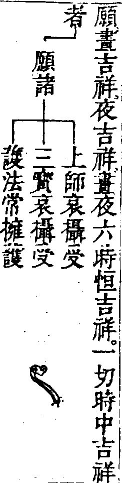



> 四生登於宝地，三有托化莲池，  

> 河沙饿鬼证三贤，万类有情登十地。



念佛回向(文具别集)



乐简乐详，随意同前。



○三皈依(晨昏课毕，礼愿竟，称)



> 自皈於佛，当愿众生，体解大道，发无上心。  

> 自皈於法，当愿众生，深入经藏，智慧如海。  

> 自皈於僧，当愿众生，统理大众，一切无碍。  

> 和南圣众。



○善导和尚示临睡入观文



修净土人，凡欲入观及临睡时，一心合掌，正面西向，若坐、若立、若跪，十声念阿弥陀佛、观音、势至、清净海众竟，发愿云：



「弟子(某甲)现是生死凡夫，罪障深重，轮回六道，苦不可言。今遇知识，得闻弥陀名号、本愿功德，一心称念，求愿往生。愿佛慈悲不舍，哀怜摄受。弟子(某甲)不识佛身相好光明，愿佛示现，令我得见。及见观音、势至诸菩萨众，彼世界中清净庄严、光明妙相等，令我了了得见。」



发愿已，正念入观，或临睡则正念而寝，不得杂语，不得杂想，或有正发愿时即得见之，或有睡梦中得见，但办专志，必如所愿。



善导大师古称阿弥陀佛化身，今此愿文，修净土人所宜深信，慎勿以暂时无验而辄废惰，务在久远行持，必於净土功不唐捐矣。



诸经日诵集要卷之上(终)



诸经日诵集要卷下



△别集



○经类第一



问：「大藏经中何故止取此之数章？」



荅：「以取要故，俾无力博览全经者，易受持故。」



○华严行愿品章



一者、礼敬诸佛；二者、称赞如来；三者、广修供养；四者、忏悔业障；五者、随喜功德；六者、请转法轮；七者、请佛住世；八者、常随佛学；九者、恒顺众生；十者、普皆回向。



> 愿我临欲命终时，尽除一切诸障碍，  

> 面见彼佛阿弥陀，即得往生安乐刹。  

> 我既往生彼国已，现前成就此大愿，  

> 一切圆满尽无餘，利乐一切众生界。  

> 彼佛众会咸清净，我时於胜莲华生，  

> 亲睹如来无量光，现前授我菩提记。  

> 蒙彼如来授记已，化身无数百俱胝，  

> 智力广大遍十方，普利一切众生界，  

> 乃至虚空世界尽，众生及业烦恼尽，  

> 如是一切无尽时，我愿究竟恒无尽。  

> 我此普贤殊胜行，无边胜福皆回向，  

> 普愿沉溺诸众生，速往无量光佛刹。



此文前后节略，断章取义为重，十大愿王导归极乐故。问：「《华严经》中何独取此？」荅：「此有二意：一者、取要如前说故；二者、正欲发明普贤乃华严长子，入不思议解脱境界，具无尽行门，而亦求生净土，况餘人故。又〈行愿品〉及〈梵行〉、〈净行〉，俱有另刻全本流通世间故。」



○楞严势至菩萨念佛章



大势至法王子，与其同伦五十二菩萨，即从座起，顶礼佛足，而白佛言：「我忆往昔恒河沙劫，有佛出世，名无量光，十二如来相继一劫，其最后佛，名超日月光，彼佛教我念佛三昧。『譬如有人，一专为忆，一人专忘，如是二人，若逢不逢，或见非见，二人相忆，二忆念深，如是乃至从生至生，同於形影，不相乖异。十方如来，怜念众生，如母忆子，若子逃逝，虽忆何为？子若忆母，如母忆时，母子历生，不相违远。若众生心，忆佛念佛，现前当来，必定见佛，去佛不远，不假方便，自得心开。如染香人，身有香气，此则名曰香光庄严。』我本因地，以念佛心，入无生忍；今於此界，摄念佛人，归於净土。佛问圆通，我无选择，都摄六根，净念相继，得三摩地，斯为第一。」



○观无量寿佛经上品上生章



佛告阿难及韦提希：「上品上生者，若有众生愿生彼国者，发三种心即便往生。何等为三？一者、至诚心；二者、深心；三者、回向发愿心。具三心者必生彼国。复有三种众生当得往生。何等为三？一者、慈心不杀具诸戒行；二者、读诵大乘方等经典；三者、修行六念，回向发愿愿生彼国。具此功德，一日乃至七日即得往生。生彼国时，此人精进勇猛故，阿弥陀如来与观世音、大势至、无数化佛、百千比丘、声闻大众、无量诸天七宝宫殿，观世音菩萨执金刚台，与大势至菩萨至行者前，阿弥陀佛放大光明照行者身，与诸菩萨授手迎接，观世音、大势至与无数菩萨赞叹行者劝进其心。行者见已欢喜踊跃，自见其身乘金刚台随从佛后，如弹指顷往生彼国。生彼国已，见佛色身众相具足，见诸菩萨色相具足，光明宝林演说妙法，闻已即悟无生法忍，经须臾间历事诸佛遍十方界，於诸佛前次第受记还至本国，得无量百千陀罗尼门，是名上品上生者。」



○无量寿经四十八愿(即古本大弥陀经)



设我得佛，国有地狱、饿鬼、畜生者，不取正觉。



(第一愿△国中无三恶道。)。



设我得佛，国中天人寿终之后，复更三恶道者，不取正觉。



(第二愿△不复更生恶道。)



设我得佛，国中天人不悉真金色者，不取正觉。



(第三愿△各得真金色身。)



设我得佛，国中天人形色不同，有好丑者，不取正觉。



(第四愿△形色无有好丑。)



设我得佛，国中天人不识宿命，下至知百千亿那由他诸劫事者，不取正觉。



(第五愿△生者皆得宿命。)



设我得佛，国中天人不得天眼，下至见百千亿那由他诸佛国者，不取正觉。



(第六愿△皆得天眼彻视。)



设我得佛，国中天人不得天耳，下至闻百千亿那由他诸佛所说不得受持者，不取正觉。



(第七愿△皆得天耳彻听。)



设我得佛，国中天人不得见他心智，下至知百千亿那由他诸佛国中众生心念者，不取正觉。



(第八愿△皆得知他心念。)



设我得佛，国中天人不得神足，於一念顷下至不能超过百千亿那由他诸佛国者，不取正觉。



(第九愿△皆得神足飞行。)



设我得佛，国中天人若起想念贪计身者，不取正觉。



(第十愿△不起贪计身见。)



设我得佛，国中天人不住定聚，必至灭度者，不取正觉。



(第十一愿△正定必至涅槃。)



设我得佛光明有限量，下至不照百千亿那由他诸佛国者，不取正觉。



(第十二愿△光明遍照十方。)



设我得佛，寿命有限量，下至百千亿那由他劫者，不取正觉。



(第十三愿△寿命同佛永久。)



设我得佛，国中声闻有能计量，乃至三千大千世界众生悉成缘觉，於百千劫悉共计较，知其数者不取正觉。



(第十四愿△声闻广多无量。)



设我得佛，国中天人寿命无能限量，除其本愿，修短自在。若不尔者，不取正觉。



(第十五愿△寿命修短随意。)



设我得佛，国中天人乃至闻有不善名者，不取正觉。



(第十六愿△国中无不善名。)



设我得佛，十方世界，无量诸佛，不悉咨嗟，称我名者，不取正觉。



(第十七愿△诸佛称名赞叹。)



设我得佛，十方众生至心信乐欲生我国，乃至十念，若不生者，不取正觉；唯除五逆、诽谤正法。



(第十八愿△十念皆生我国。)



设我得佛，十方众生发菩提心修诸功德，至心发愿欲生我国，临寿终时，假令不与大众围遶现其人前者，不取正觉。



(第十九愿△勤修我皆接引。)



设我得佛，十方众生闻我名号，系念我国植种德本，至心回向欲生我国，不果遂者不取正觉。



(第二十愿△系念必得往生。)



设我得佛，国中天人不悉成满三十二大人相者，不取正觉。



(第二十一愿△各具三十二相。)



设我得佛，他方佛土诸菩萨众来生我国，究竟必至一生补处，除其本愿自在所化，为众生故被弘誓铠，积累德本度脱一切，游诸佛国修菩萨行，供养十方诸佛如来，开化恒沙无量众生，使立无上正真之道，超出常伦诸地之行，现前修习普贤之德。若不尔者，不取正觉。



(第二十二愿△菩萨一生补处。)



设我得佛，国中菩萨承佛神力供养诸佛，一食之顷不能遍至无数无量亿那由他诸佛国者，不取正觉。



(第二十三愿△一时普供诸佛。)



设我得佛，国中菩萨在诸佛前现其德本，诸所求欲供养之具，若不如意者不取正觉。



(第二十四愿△供具自皆如意。)



设我得佛，国中菩萨不能演说一切智者，不取正觉。



(第二十五愿△菩萨演一切智。)



设我得佛，国中菩萨不得金刚那罗延身者，不取正觉。



(第二十六愿△菩萨得金刚身。)



设我得佛，国中天人一切万物，严净光丽形色殊特，穷微极妙无能称量，其诸众生乃至逮得天眼，有能明了辨其名数者，不取正觉。



(第二十七愿△万物悉皆殊特。)



设我得佛，国中菩萨乃至少功德者，不能知见其道场树无量光色高四百万里者，不取正觉。



(第二十八愿△菩萨道树普见。)



设我得佛，国中菩萨若受读经法讽诵持说，而不得辩才智慧者，不取正觉。



(第二十九愿△受经普得智辩。)



设我得佛，国中菩萨智慧辩才若可限量者，不取正觉。



(第三十愿△智辩无有限量。)



设我得佛，国土清净，皆悉照见十方一切无量无数不可思议诸佛世界，犹如明镜睹其面像。若不尔者，不取正觉。



(第三十一愿△净国照见十方。)



设我得佛，自地以上至於虚空，宫殿、楼观、池流、华树、国土所有一切万物，皆以无量杂宝、百千种香而共合成，严饰奇妙超诸天人，其香普熏十方世界，菩萨闻者皆修佛行；若不如是，不取正觉。



(第三十二愿△严饰超诸天人。)



设我得佛，十方无量不可思议诸佛世界众生之类，蒙我光明触其身者，身心柔软超过天人。若不尔者，不取正觉。



(第三十三愿△蒙光触身获益。)



设我得佛，十方无量不可思议诸佛世界众生之类，闻我名字，不得菩萨无生法忍诸深总持者，不取正觉。



(第三十四愿△皆得法忍总持。)



设我得佛，十方无量不可思议诸佛世界，其有女人闻我名字，欢喜信乐，发菩提心，厌恶女身，寿终之后复为女像者，不取正觉。



(第三十五愿△信乐永离女身。)



设我得佛，十方无量不可思议诸佛世界诸菩萨众，闻我名字，寿终之后常修梵行至成佛道。若不尔者，不取正觉。



(第三十六愿△勤修必成佛道。)



设我得佛，十方无量不可思议诸佛世界诸天人民，闻我名字，五体投地，稽首作礼，欢喜信乐，修菩萨行，诸天世人莫不致敬。若不尔者，不取正觉。



(第三十七愿△归依感动天人。)



设我得佛，国中天人欲得衣服，随念即至。如佛所赞，应法妙服自然在身，有求裁缝、捣染、浣濯者，不取正觉。



(第三十八愿△妙服自然在身。)



设我得佛，国中天人所受快乐，不如漏尽比丘者，不取正觉。



(第三十九愿△受乐同於漏尽。)



设我得佛，国中菩萨随意欲见十方无量严净佛土，应时如愿於宝树中皆悉照见，犹如明镜睹见其面像。若不尔者，不取正觉。



(第四十愿△随意见诸佛国。)



设我得佛，他方国土诸菩萨众，闻我名字至于得佛，诸根缺陋不具足者，不取正觉。



(第四十一愿△闻名诸根具足。)



设我得佛，他方国土诸菩萨众闻我名字，皆悉逮得清净解脱三昧。住是三昧一发意顷，供养无量不可思议诸佛世尊而不失定意。若不尔者，不取正觉。



(第四十二愿△悉得清净解脱。)



设我得佛，他方国土诸菩萨众闻我名字，寿终之后生尊贵家。若不尔者，不取正觉。



(第四十三愿△闻名生处尊贵。)



设我得佛，他方国土诸菩萨众，闻我名字欢喜踊跃，修菩萨行具足德本。若不尔者，不取正觉。



(第四十四愿△修行具足德本。)



设我得佛，他方国土诸菩萨众闻我名字，皆悉逮得普等三昧。住是三昧至于成佛，常见无量不可思议一切诸佛。若不尔者，不取正觉。



(第四十五愿△皆得三昧见佛。)



设我得佛，国中菩萨随其志愿，所欲闻法自然得闻。若不尔者，不取正觉。



(第四十六愿△自然得闻妙法。)



设我得佛，他方国土诸菩萨众闻我名字，不即得至不退转者，不取正觉。



(第四十七愿△即得不退转地。)



设我得佛，他方国土诸菩萨众闻我名字，不即得至第一忍、第二、第三法忍，于诸佛法不能即得不退转者，不取正觉。



(第四十八愿△即得诸忍究竟。)



世传《大弥陀经》，龙舒王居士会四译经文而成之者也。四译者，初译於汉迦娄支谶，曰《无量平等清净觉经》；次译於曹魏康僧恺，曰《无量寿经》；次译於吴支谦，曰《阿弥陀经》；次译於宋法贤，曰《无量寿庄严经》；而菩提流志附译於《宝积》，曰〈无量寿如来会〉，则居士所未及者。居士之会四译也，言简而义周，辞顺而理显，诚哉大有功於净土矣。惜其中颇有未安，如四十八愿，汉译止开二十有四。四十八者，肇始於魏译，而法贤、流志二师因之，吴译从汉亦二十四。然四十八愿，今古流通，自应宗祖魏译，奈何居士叙愿，较之魏译，或前著后、或后著前，次第紊乱，以参三译，亦各不协。夫译经必据梵本，居士凭何梵本而别为次第乎？於理虽似无妨，於译法大为不顺。又魏译三辈往生，皆曰发菩提心，居士乃惟中辈有之，下曰不发，上竟无文，全缺差殊，未审何意？用是重录魏译，以付剞劂，庶俾后人知有古文在也。居士神游净域，身入圣流，殆必成心已忘，虚怀不碍，区区效忠之恳，谅其鉴之矣。



○观普贤菩萨经普贤观章



> 有一菩萨，结跏趺坐，名曰普贤，身白玉色。  

> 五十种光，光五十种色，以为项光。身诸毛孔，  

> 流出金光，其金光端，无量化佛。诸化菩萨，  

> 以为眷属，安庠徐步，雨大宝华，至行者前。  

> 其象开口，於象牙上，诸池玉女，鼓乐弦歌，  

> 其声微妙，赞叹大乘，一实之道。行者见已，  

> 欢喜敬礼。复更读诵，甚深经典，遍礼十方，  

> 无量诸佛，礼多宝佛塔，及释迦牟尼，并礼普贤，  

> 诸大菩萨，发是誓愿：若我宿福，应见普贤，  

> 愿尊者遍吉，示我色身。



○金光明经空品



> 无量餘经，已广说空，是故此中，略而解说。  

> 众生根钝，尟於智慧，不能广知，无量空义。  

> 故此尊经，略而说之，异妙方便，种种因缘。  

> 为钝根故，起大悲心，我今演说，此妙经典。  

> 如我所解，知众生意，是身虚伪，犹如空聚。  

> 六入村落，结贼所止，一切自在，各不相知。  

> 眼根受色，耳分别声，鼻臭诸香，舌嗜於味。  

> 所有身根，贪受诸触，意根分别，一切诸法。  

> 六情诸根，各各自缘，诸尘境界，不行他缘。  

> 心如幻化，驰骋六情，而常妄想，分别诸法。  

> 犹如世人，驰走空聚，六贼所害，愚不知避。  

> 心常依止，六根境界，各各自知，所伺之处。  

> 随行色、声、香、味、触、法，心处六情，如鸟投网。  

> 其心在在，常处诸根，随逐诸尘，无有暂舍。  

> 身空虚伪，不可长养，无有诤讼，亦无正主。  

> 从诸因缘，和合而有，无有坚实，妄想故起。  

> 业力机关，假伪空聚，地水火风，合集成立。  

> 随时增减，共相残害，犹如四蛇，同处一箧。  

> 四大蚖蛇，其性各异，二上二下，诸方亦二。  

> 如是蛇大，悉灭无餘。地水二蛇，其性沉下，  

> 风火二蛇，性轻上升。心识二性，躁动不停。  

> 随业受报，人天诸趣，随所作业，而堕诸有。  

> 水火风种，散灭坏时，大小不净，盈流於外。  

> 体生诸虫，无可爱乐，捐弃冢间，如朽败木。  

> 善女当观，诸法如是，何处有人，及以众生？  

> 本性空寂，无明故有，如是诸大，一一不实。  

> 本自不有，性无和合，以是因缘，我说诸大。  

> 从本不实，和合而有，无明体相，本自不有。  

> 妄想因缘，和合而有，无所有故，假名无明。  

> 是故我说，名曰无明、行、识、名色、六入、触、受、  

> 爱、取、有、生、老死愁恼，众苦行业，不可思议。  

> 生死无际，轮转不息，本无有生，亦无和合。  

> 不善思惟，心行所造，我断一切，诸见缠等。  

> 以智慧刀，裂烦恼网，五阴舍宅，观悉空寂。  

> 证无上道，微妙功德，开甘露门，示甘露器。  

> 入甘露城，处甘露室，令诸众生，食甘露味。  

> 吹大法螺，击大法鼓，然大法炬，雨胜法雨。  

> 我今摧伏，一切怨结，竖立第一，微妙法幢。  

> 度诸众生，於生死海，永断三恶，无量苦恼。  

> 烦恼炽然，烧诸众生，无有救护，无所依止。  

> 我以甘露，清凉美味，充足是辈，令离焦热。  

> 於无量劫，遵修诸行，供养恭敬，诸佛世尊。  

> 坚固修习，菩提之道，求於如来，真实法身。  

> 舍诸所重，肢节手足，头目髓脑，所爱妻子，  

> 钱财珍宝，真珠璎珞，金银琉璃，种种异物。



○梵网经菩萨戒发誓愿章



若佛子！常应发一切愿：「孝顺父母、师僧，愿得好师、同学、善知识，常教我大乘经律，十发趣、十长养、十金刚、十地，使我开解，如法修行，坚持佛戒；宁舍身命，念念不去心。」若一切菩萨不发是愿者，犯轻垢罪。若佛子！发是十大愿已，持佛禁戒，作是愿言：「宁以此身投炽然猛火、大坑、刀山，终不毁犯三世诸佛经律，与一切女人作不净行。」复作是愿：「宁以热铁罗网千重周匝缠身，终不以此破戒之身受於信心檀越一切衣服。」复作是愿：「宁以此口吞热铁丸及大流猛火经百千劫，终不以此破戒之口食於信心檀越百味饮食。」复作是愿：「宁以此身卧大流猛火罗网热铁地上，终不以此破戒之身受於信心檀越百种床座。」复作是愿：「宁以此身受三百矛刺身经一劫、二劫，终不以此破戒之身受於信心檀越百味医药。」复作是愿：「宁以此身投热铁镬，经百千劫，终不以此破戒之身受於信心檀越千种房舍、屋宅、园林、田地。」复作是愿：「宁以铁锤打碎此身，从头至足令如微尘，终不以此破戒之身受於信心檀越恭敬礼拜。」复作是愿：「宁以百千热铁刀矛挑其两目，终不以此破戒之心视他好色。」复作是愿：「宁以百千铁锥劖刺耳根，经一劫、二劫，终不以此破戒之心听好音声。」复作是愿：「宁以百千刃刀割去其鼻，终不以此破戒之心贪嗅诸香。」复作是愿：「宁以百千刃刀割断其舌，终不以此破戒之心食人百味净食。」复作是愿：「宁以利斧斩破其身，终不以此破戒之心贪著好触。」复作是愿：「愿一切众生悉得成佛。」而菩萨若不发是愿者，犯轻垢罪。



问：「《金刚纂》称功德甚大，何不录？」



荅：「以伪造故，又大为害故。彼云：『诵此纂一遍，胜诵《金刚经》三十万遍。』脱使愚人信此，诺檀那多卷之经置之不诵，而以一纂塞责，岂不误陷其人入地狱耶？至於《分珠》、《高王》、《妙沙》、《血盆》、《受生》，种种杜撰，皆不足信。」



问：「高王诵经免难，记传有之，何以为伪？」



荅：「当是高王诵〈观音普门品〉也。后人不达，讹成伪经，别号高王耳。」



○咒类第二



○佛顶尊胜大陀罗尼(《尊胜经》有五译，咒亦大同小异，此其一也。世名此为尊胜真言，唱咏之，而咒则专持。下唵𠽾𠾐云云，护真法师尝举问　大师，大师云：「当以藏本为正。」今增入)



南谟　薄伽伐帝　咥哩卢枳也　钵剌底　毗失瑟咤(引)也勃陀(引)也　薄伽伐帝　怛姪他　唵　毗输驮(唐左反)也　飒麼三曼多　阿婆婆(引)　娑飒癹啰拏　揭底噱　喝娜琐婆(引)婆毗戍(商聿反，下同)睇　阿毗诜者睹漫(引)　苏揭多　跋啰跋者那　阿蜜栗多　鞞师计疴(引，下同)　喝啰疴　喝啰疴　愈珊陀(引)喇你　输驮也　输驮也　伽伽那　毗戍睇　乌瑟腻沙毗逝也戍睇(引)　索诃萨啰　喝𪢐湿弭　珊珠地帝　萨婆(上)怛他揭多　阿地瑟侘(引)娜　阿地瑟耻𫖰(丁可反，下同)没姪囇　跋折啰(引)迦也　僧喝旦　娜戍睇　萨婆疴　伐喇拏毗戍睇　钵喇底　你跋戴也　阿愈戍睇　三麼耶　阿地瑟耻帝　末你末你　麼末你　呾闼多　步多孤㨖　钵唎戍睇鼻窣怖咤　勃地戍睇　逝也逝也　鼻逝也　鼻逝也　三末啰　三末啰　萨婆勃陀　阿地瑟耻多戍睇　跋折囇　跋折啰(引)　揭鞞(引)　跋折蓝婆　跋睹麼麼　阿目羯写　萨婆萨埵难(引)者迦也　毗戍睇　萨婆揭底　钵唎戍睇　萨婆怛他揭哆　三摩戍和娑　阿地瑟耻帝　勃陀勃陀(停也反)菩驮也　菩驮也　三曼𫖰　钵唎戍睇　萨婆怛他揭𫖰　阿地瑟侘(引)娜　阿地瑟耻帝　莎诃



○又▆(出本朝　仁孝皇后梦感佛说第一希有功德经)



唵　𠽾𠾐(二合)莎诃　唵　捺谟癹葛斡谛　萨哩斡(二合)得啰卢迦卜啰(二合)谛　月涉瑟咤(二合)耶　勃塔耶　爹捺麻荅的牙塔　唵　𠽾𠾐(二合)𠽾𠾐(二合)𠽾𠾐(二合)杓讹(二合)塔耶　杓讹(二合)塔耶　月杓讹(二合)塔耶　月杓讹(二合)塔耶　哑萨麻萨蛮达哑斡癹萨思葩(二合)啰拿葛谛　葛葛拿　娑癹斡月述提哑撇膻𠽷(侧干切)都𦎌(谟含切)　萨哩斡(二合)荅塔葛达苏葛　荅瓦啰斡拶拿　哑密哩(二合)达哑　撇释该而(二合)马曷木得啰(二合)曼特啰(二合)叭罘(得该切)　哑曷啰　哑曷啰　马麻蔼由而(二合)伞塔啰尼　杓讹(二合)塔耶　杓讹(二合)塔耶　月杓讹(二合)塔耶　月杓讹(二合)塔耶　葛葛拿　娑癹斡月述提　乌失尼沙月拶耶　巴哩述铁　萨曷思啰(二合)啰思弥(二合)伞柤爹敌　萨哩斡(二合)荅塔葛达哑　斡鲁结尼煞咤(二合)巴啰密达　巴哩卜啰尼　萨哩斡(二合)荅塔葛达麻谛　荅摄蒲密卜啰(二合)牒瑟咤(二合)谛萨哩斡(二合)荅塔葛达赫哩(二合)达耶哑牒瑟咤(二合)拿哑牒瑟咤(二合)谛木得哩(二合)木得哩马喝木得哩(二合)斡资啰(二合)葛耶三曷达拿叭哩述铁萨哩斡(二合)葛哩麻(二合)哑斡啰拿月述铁卜啰牒聂斡而达(二合)耶马麻蔼由而(二合)月述提(二合)萨哩斡(二合)荅塔葛达萨麻耶哑牒瑟咤(二合)拿哑牒瑟咤(二合)谛唵摩尼摩尼马曷麻尼月摩尼月摩尼马曷月摩尼麻谛麻谛马曷麻谛麻麻谛莎麻谛荅塔达蒲达戈遣巴哩述提月思蒲咤卜铁述铁希希拶耶拶耶月拶耶月拶耶思麻啰思麻(同上二合)啰思葩(二合)啰思葩(二合)啰思葩(二合)啰耶思葩(二合)啰耶萨哩斡(二合)勃塔哑牒瑟咤(二合)拿哑牒瑟咤(二合)谛述铁述铁卜銕卜銕斡资哩(二合)斡资哩(二合)马曷斡资哩莎斡资哩(同上二合)斡资啰(二合)葛而(二合)毘拶耶　葛而(二合)毘月拶耶　葛而(二合)毘斡资啰(二合)左辣葛而(二合)毘斡资噜(二合)忒葩微　斡资啰(二合)三葩微　斡资啰(二合)斡资哩尼　斡资㘕(二合)癹斡都　麻麻摄哩㘕　萨哩斡(二合)萨埵喃　拶葛耶　巴哩述提　癹斡都　萨埵弥　萨哩斡(二合)葛谛　巴哩述提　释哲(二合)萨哩斡(二合)荅塔葛　达释哲(二合)𦎌　萨麻刷　萨颜都　卜銕卜銕　悉铁悉铁　勃塔耶勃塔耶　月勃塔耶　月勃塔耶　谟拶耶　谟拶耶　月谟拶耶　月谟拶耶　杓讹塔耶　杓讹(同上二合)塔耶　月杓讹(二合)塔耶　月杓讹(二合)塔耶　萨蛮荅谟拶耶　谟拶耶　萨蛮荅啰思弥(二合)巴哩述提　萨哩斡(二合)荅塔葛　达赫哩(二合)达耶哑牒瑟咤(二合)拿　哑牒瑟咤(二合)谛　木得哩(二合)木得哩(二合)马曷木得哩　马曷木得啰(同上二合)曼特啰(二合)叭谛　莎诃



○受戒搭衣咒



善哉解脱服，无上福田衣，我今顶戴受，世世不舍离。



唵　悉陀耶　娑诃(五条)



善哉解脱服，无上福田衣，我今顶戴受，世世常得披。



唵　度波度波　娑诃(七条)



善哉解脱服，无上福田衣，持奉如来命，广度诸众生。



唵　摩诃迦波波咤悉帝　娑诃(二十五条)



卧具尼师坛，长养心苗性。展开登圣地，奉持如来命。



唵　檀波檀波　莎诃



问：「居士可搭衣否？」



荅：「员顶方袍，有发搭衣，法不应故，反招愆故。详具《缁门警训．慈云忏主辩惑篇》。」



○般若无尽藏真言



纳谟薄伽伐帝钵利若波罗蜜多曳怛致他唵纥利地唎室唎戍噜(二合)知三蜜栗知佛社曳莎诃



○华严补阙咒



南无三满哆　没驮喃　阿钵啰帝　喝多折　折捺弥　唵　鸡弥鸡弥　怛塔葛塔喃　末瓦山碇　钵啰帝　乌怛摩　怛摩怛　塔葛塔喃　末瓦吽　癹莎诃



○秽迹金刚神咒



唵　𠲽咶啒㖀摩诃般罗(二合)狠那𠵨吻汁吻醯摩尼微咭微摩那栖唵斫急那乌深暮啒㖀吽吽吽泮泮泮泮泮　莎诃



○十二因缘咒(附杂咒)



唵　耶荅儿麻(二合)兮都不啰(二合)巴斡兮敦的山荅搭葛荅歇斡怛的山拶约尼噜怛耶𠳐叭谛麻曷释啰麻纳耶　莎诃



入厕咒



唵　狠噜陀耶　莎诃



洗净咒



唵　贺曩密栗帝　莎诃



去秽咒



唵　室利曳婆醯　莎诃



洗手咒



唵　主迦啰野　莎诃



净身咒



唵　跋折啰　恼迦咤　莎诃



下床咒



唵　地利日哩　莎诃



行步不伤虫咒



唵　地利日利　娑婆诃



登道场咒



唵　阿蜜栗帝吽癹咤



六字大明咒



唵嘛呢叭𠵸吽



○补阙真言



曩谟喝啰怛那　多啰夜耶　佉啰佉啰　俱住俱住　摩啰摩啰　虎啰吽贺贺　苏怛拏吽　泼沫拏　娑婆诃



○杂录第三



○看经警文



保宁勇禅师作



夫看经之法，后学须知，当净三业。若三业无亏，则百福俱集。三业者，身、口、意也。一、端身正坐，如对圣容，则身业净也；二、口无杂言，断诸嬉笑，则口业净也；三、意不散乱，屏息万缘，则意业净也。内心既寂，外境俱捐，方契悟於真源，庶研穷於法理。可谓水澄珠莹，云散月明，义海涌於胸襟，智岳凝於耳目。辄莫容易，实非小缘，心法双忘，自他俱利。若能如是，真报佛恩。



○礼华严文



随州大洪山遂禅师作



> 稽首华严真性海，种种光明遍照尊，  

> 普贤万行所庄严，一切真如法界藏。  

> 龙树龙宫亲诵忆，实叉于阗阐微言，  

> 一乘圆顿妙法门，见性成佛真秘典。  

> 手捧目观心口诵，当知夙有大因缘，  

> 见闻随喜发菩提，究竟圆成萨婆若。



南无毘卢教主华藏慈尊，演宝偈之金文，布琅𪻱之玉轴，尘尘混入，刹刹圆融，十兆九万五千四十八字一乘圆教大方广佛华严经。若人欲了知，三世一切佛，应观法界性，一切唯心造。常愿供养常恭敬，七处九会佛菩萨。常愿证入常宣说，五周四分华严经。伏愿(某甲)生生世世，在在处处，眼中常见如是经典，耳中常闻如是经典，口中常诵如是经典，手中常书如是经典，心中常悟如是经典。愿生生世世，在在处处，常得亲近华藏一切圣贤，常蒙华藏一切圣贤慈悲摄受。如经所说，愿悉证明。愿如善财菩萨，愿如文殊师利菩萨，愿如弥勒菩萨，愿如普贤菩萨，愿如观世音菩萨，愿如毘卢遮那佛。以此称经功德，以此发愿功德，愿与四恩三有法界一切众生，消无始以来尽法界虚空界无量罪垢。愿与四恩三有法界一切众生，解无始以来尽法界虚空界无量冤业。愿与四恩三有法界一切众生，集无始以来尽法界虚空界无量福智。同游华藏庄严海，同入菩提大道场。



南无大方广佛华严经华严海会佛菩萨



五周四分华严经下二句，文义似重复，不念亦得。



○大慈菩萨发愿偈



十方三世佛，阿弥陀第一，九品度众生，威德无穷极。我今大皈依，忏悔三业罪，凡有诸福善，至心用回向。愿同念佛人，感应随时现，临终西方境，分明在目前。见闻皆精进，同生极乐国，见佛了生死，如佛度一切。



○净土文



仰白弥陀化主，净土圣贤，愿赐慈悲，为作证明。弟子众等，各为生死事大，无常迅速，代为法界众生，一心皈命顶礼。



南无西方极乐世界，毫如五须弥，目如四大海，八万四千相好光明，四十八愿摄授十方世界有缘念佛众生，大慈大悲大愿大力本师和尚阿弥陀佛，惟愿阿弥陀佛以天眼遥观、天耳遥闻、他心速见，加被我等及与众生，十二时中愿得见阿弥陀佛八万四千相，於一一相中愿得见阿弥陀佛八万四千随形好，於一一好中愿得见阿弥陀佛八万四千光明，於一一光明之中愿见十方世界，愿见十方诸佛，愿见十方诸大菩萨摩诃萨，愿见十方诸大声闻、缘觉、贤圣僧，令我一切众生无明顿破、烦恼永忘，法界之门豁然通达，一乘之路卓尔开明，十号具彰、三身圆显，分身无量度脱众生，愿佛慈悲哀怜摄受。



问：「文有后段，何不录？」



荅：「文原止此，后乃凑成，义不称前，又多重复，故不录耳。惜此文缺临终往生，生后闻法二意。下小净土文，言简意周，今多用之。」



○又净土文



慈云忏主作



一心皈命极乐世界阿弥陀佛，愿以净光照我，慈誓摄我。我今正念，称如来名，为菩提道，求生净土。佛昔本誓，若有众生，欲生我国，志心信乐，乃至十念，若不生者，不取正觉。以此念佛因缘，得入如来大誓海中，承佛慈力，众罪消灭，善根增长。若临欲命终，自知时至，身无病苦，心不贪恋，亦不颠倒，如入禅定。佛及圣众，手执金台，来迎接我，於一念顷，生极乐国，华开见佛，即闻佛乘，顿开佛慧，广度众生，满菩提愿，广度众生，满菩提愿。



○新定西方愿文



云栖袾宏作



> 稽首西方安乐国，接引众生大导师，  

> 我今发愿愿往生，惟愿慈悲哀摄受。



弟子(某甲众等)，普为四恩三有法界众生，求於诸佛一乘无上菩提道故，专心持念阿弥陀佛万德洪名，期生净土。又以业重福轻，障深慧浅，染心易炽，净德难成。今於佛前，翘勤五体，披沥一心，投诚忏悔。我及众生，旷劫至今，迷本净心，纵贪瞋痴染秽三业，无量无边所作罪垢，无量无边所结冤业，愿悉消灭。从於今日，立深誓愿，远离恶法，誓不更造，勤修圣道，誓不退惰，誓成正觉，誓度众生。阿弥陀佛，以慈悲愿力，当证知我，当哀悯我，当加被我。愿禅观之中，梦寐之际，得见阿弥陀佛金色之身，得历阿弥陀佛宝严之土，得蒙阿弥陀佛甘露灌顶，光明照身，手摩我头，衣覆我体，使我宿障自除，善根增长，疾空烦恼，顿破无明，圆觉妙心，廓然开悟，寂光真境，常得现前。至於临欲命终，预知时至，身无一切病苦厄难，心无一切贪恋迷惑，诸根悦豫，正念分明，舍报安详，如入禅定。阿弥陀佛与观音、势至诸圣贤众，放光接引，垂手提携，楼阁幢幡，异香天乐，西方圣境，昭示目前，令诸众生，见者闻者，欢喜感叹，发菩提心。我於尔时，乘金刚台，随从佛后，如弹指顷，生极乐国七宝池内胜莲华中。华开见佛，见诸菩萨，闻妙法音，获无生忍，於须臾间，承事诸佛，亲蒙授记。得授记已，三身、四智、五眼、六通，无量百千陀罗尼门，一切功德，皆悉成就。然后不违安养，回入娑婆，分身无数，遍十方刹，以不可思议自在神力，种种方便，度脱众生，咸令离染，还得净心，同生西方，入不退地。如是大愿，世界无尽，众生无尽，业及烦恼，一切无尽，我愿无尽。愿今礼佛发愿，修持功德，回施有情，四恩总报，三有齐资，法界众生，同圆种智。



前净土文理得而义未周，后净土文义周而辞太简。义未周则往生之意不显，辞太简则悲恳之情不伸。余乃宗以大经，博以诸说，融以事理，贯以果因，而成此文净业。诸上善人如以为可，愿广流通；如谓不然，愿垂教诲。



○礼佛发愿文



怡山然禅师作



归命十方调御师，演扬清净微妙法，三乘四果解脱僧，愿赐慈悲哀摄受。但(某甲)自违真性，枉入迷流，随生死以飘沉，逐色声而贪染。十缠十使，积成有漏之因；六根六尘，妄作无边之罪。迷沦苦海，深溺邪途，著我耽人，举枉措直。累生业障，一切愆尤，仰三宝以慈悲，沥一心而忏悔。所愿能仁拯拔，善友提携，出烦恼之深源，到菩提之彼岸。此世福基命位，各愿昌隆；来生智种灵苗，同希增秀。生逢中国，长遇明师，正信出家，童真入道，六根通利，三业纯和。不染世缘，常修梵行，执持禁戒，尘业不侵。严护威仪，蜎飞无损，不逢八难，不缺四缘。般若智以现前，菩提心而不退，修习正法，了悟大乘。开六度之行门，越三祗之劫海。建法幢於处处，破疑网於重重。降伏众魔，绍隆三宝。承事十方诸佛，无有疲劳。修学一切法门，悉皆通达。广作福慧，普利尘沙。得六种之神通，圆一生之佛果。然后不舍法界，遍入尘劳，等观音之慈心，行普贤之愿海。他方此界，逐类随形，应现色身，演扬妙法。泥犁苦趣，饿鬼道中，或放大光明，或现诸神变。其有见我相，乃至闻我名，皆发菩提心，永出轮回苦。火镬冰河之地，变作香林，饮铜食铁之徒，化生净土。披毛戴角，负债含怨，尽罢辛酸，咸沾利乐。疾疫世而现为药草，救疗沉疴；饥馑时而化作稻粱，济诸贫馁。但有利益，无不兴崇。次期累世冤亲，现存眷属，出四生之汩没，舍万劫之爱缠，等与含生，齐成佛道。虚空有尽，我愿无穷，情与无情，同圆种智。



此真大乘菩萨弘誓愿也。余初入道，读之感叹流涕，发广大心。又此与净业，实并行不悖。何以故？此则以修心见心，得无上道，而广行悲愿。彼则以念佛见佛，证无生忍，而还来度生。夫何悖之有？



○礼观音文



南无过去正法明如来，现前观世音菩萨。成妙功德，具大慈悲。於一身心，现千手眼。照见法界，护持众生。令发广大道心，教持圆满神咒。永离恶道，得生佛前。无间重愆，缠身恶疾，莫能救济，悉使消除。三昧辩才，现生求愿，咸令果遂，决定无疑。能使速获三乘，早登佛地。威神之力，叹莫能穷。故我一心，归命顶礼。



○又礼观音文



大慧杲禅师作



清净三业，一心五体，投地归依南无十方慈父广大灵感观世音菩萨。我闻菩萨从闻思修入三摩地，得二随顺、四不思议、十四无畏、十九说法、七难二求、三十二应无量功德，兴大威力，发大誓愿，同流九界六道四生生死趣中，兴百千万亿无量恒河沙劫数善行方便，救度拔济一切众生无有休息。我今哀求，必赐加被。伏念(某甲)夙生庆幸，得遇佛乘，身虽出家，心不染道(在家者改作身苦尘缘，心多散乱)，愚痴邪见，诸根昏塞，内外经书虽於习学章句妙理无所通晓，又恐福力浅薄，寿命不长，徒入空门(在家改作徒得人身)，虚生浪死。我今洗心泣血，稽颡投诚，终日竟夜存想圣容，受持圣号，礼拜圣像。惟愿菩萨天耳闻声，悲心救苦，怜愍加被，放大神光照我身心，倾大甘露灌我顶门，荡涤累世怨愆，洗洁千生罪垢，身心清净，魔障消除，昼夜之间，坐卧之中，观见菩萨放大神光，开我慧性，使(某甲)即时神通朗发，智慧聪明，一切经书自然记忆，一切义理自然通晓，得大辩才，得大智慧，得大寿命，得大安乐，参禅学道，无诸魔障，悟无生忍，世世生生行菩萨道，四恩总报，三有齐资，法界众生同圆种智。



问：「文有三，后文何以不录？」



荅：「以发愿往生，在多生修行之后，不顺净愿，非初心所及，恐疑净土故。」



○沩山大圆禅师警策



夫业系受身，未免形累，禀父母之遗体，假众缘而共成。虽乃四大扶持，常相违背，无常老病，不与人期，朝存夕亡，刹那异世。譬如春霜晓露，倏忽即无，岸树井藤，岂能长久？念念迅速，一刹那间，转息即是来生，何乃晏然空过？父母不供甘旨，六亲固以弃离，不能安国治邦，家业顿捐继嗣。缅离乡党，剃发禀师，内勤克念之功，外弘不诤之德，迥脱尘世，冀期出离。何乃才登戒品，便言我是比丘，檀越所须，吃用常住？不解忖思来处，谓言法尔合供，吃了聚头喧喧，但说人间杂话。然则一期趁乐，不知乐是苦因。曩劫徇尘，未尝返省，时光淹没，岁月蹉跎，受用殷繁，施利浓厚，动经年载，不拟弃离，积聚滋多，保持幻质。导师有敕，戒勗比丘，进道严身，三常不足。人多於此，耽味不休，日往月来，飒然白首。后学未闻旨趣，应须博问先知，将谓出家，贵求衣食。佛先制律，启创发蒙，轨则威仪，净如冰雪。止持作犯，束敛初心，微细条章，革诸猥弊。毘尼法席，曾未叨陪，了义上乘，岂能甄别？可惜一生空过，后悔难追，教理未尝措怀，玄道无因契悟。及至年高腊长，空腹高心，不肯亲附良朋，惟知倨傲，未谙法律，戢敛全无。或大语高声，出言无度，不敬上中下座，婆罗门聚会无殊，碗钵作声，食毕先起，去就乖角，僧体全无。起坐忪诸，动他心念，不存些些轨则、小小威仪，将何束敛？后昆新学无因倣傚，才相觉察，便言我是山僧，未闻佛教行持，一向情存粗糙。如斯之见，盖为初心慵惰，饕餮因循，荏苒人间，遂成疏野。不觉𨀁踵老朽，触事面墙，后学咨询，无言接引，纵有谈说，不涉典章。或被轻言，便责后生无礼，瞋心忿起，言语骇人。一朝卧疾在床，众苦萦缠逼迫，晓夕思忖，心里恛惶，前路茫茫，未知何往。从兹始知悔过，临渴掘井奚为？自恨蚤不预修，年晚多诸过咎，临行挥霍，怕怖慞惶，縠穿雀飞，识心随业。如人负债，强者先牵，心绪多端，重处偏坠，无常杀鬼，念念不停。命不可延，时不可待，人天三有，应未免之。如是受身，非论劫数，感伤叹讶，哀哉切心，岂可缄言，递相警策？所恨同生像季，去圣时遥，佛法生疏，人多懈怠，略伸管见，以晓后来，若不蠲矜，诚难轮逭。夫出家者，发足超方，心形异俗，绍隆圣种，震慑魔军，用报四恩，拔济三有。若不如此，滥厕僧伦，言行荒疏，虚沾信施，昔年行处，寸步不移，恍惚一生，将何凭恃？况乃堂堂僧相，容貌可观，皆是宿植善根，感斯异报。便拟端然拱手，不贵寸阴，事业不勤，功果无因克就，岂可一生空过，抑亦来业无裨。辞亲决志披缁，意欲等超何所，晓夕思忖，岂可迁延过时。心期佛法栋梁，用作后来龟镜，常以如此，未能少分相应。出言须涉於典章，谈说乃傍於稽古，形仪挺特，意气高闲。远行要假良朋，数数清於耳目，住止必须择伴，时时问於未闻。故云：生我者父母，成我者朋友。亲附善者，如雾露中行，虽不湿衣，时时有润。狎习恶者，长恶知见，晓夕造恶，即日交报，殁后沉沦，一失人身，万劫不复。忠言逆耳，岂不铭心者哉！便能澡心育德，晦迹韬名，蕴素精神，喧嚣止绝。若欲参禅学道，顿超方便之门，心契玄津，研几精要，决择深奥，启悟真源，博问先知，亲近善友。此宗难得其妙，切须子细用心，可中顿悟正因，便是出尘阶渐。此则破三界二十五有，内外诸法，尽知不实，从心变起，悉是假名，不用将心凑泊。但情不附物，物岂碍人，任他法性周流，莫断莫续。闻声见色，盖是寻常，遮边那边，应用不阙。如斯行止，实不枉披法服，亦乃酬报四恩，拔济三有。生生若能不退，佛阶决定可期，往来三界之宾，出没为他作则。此之一学，最妙最玄，但办肯心，必不相赚。若有中流之士，未能顿超，且於教法留心，温寻贝叶，精搜义理，传唱敷扬，接引后来，报佛恩德，时光亦不虚弃。必须以此，扶持住止威仪，便是僧中法器。岂不见倚松之葛，上耸千寻，附托胜因，方能广益。恳修斋戒，莫谩亏逾，世世生生，殊妙因果，不可等闲过日，兀兀度时。可惜光阴，不求升进，徒消十方信施，亦乃孤负四恩。积累转深，心尘易壅，触途成滞，人所轻欺。古云：「彼既丈夫我亦尔，不应自轻而退屈。」若不如此，徒在缁门，荏苒一生，殊无所益。伏望兴决烈之志，开特达之怀，举措看他上流，莫擅随於庸鄙。今生便须决断，想料不繇别人，息意忘缘，不与诸尘作对，心空境寂，只为久滞不通。熟览斯文，时时警策，强作主宰，莫徇人情，业果所牵，诚难逃避。声和响顺，形直影端，因果历然，岂无忧惧？故经云：「假使百千劫，所作业不亡，因缘会遇时，果报还自受。」故知三界刑罚，萦绊杀人，努力勤修，莫空过日。深知过患，方乃相劝行持，愿百劫千生，处处同为法侣。乃为铭曰：



幻身梦宅，空中物色，前际无穷，后际宁剋。出此没彼，升沉疲极，未免三轮，何时休息。贪恋世间，阴缘成质，从生至老，一无所得。根本无明，因兹被惑，光阴可惜，刹那不测。今生空过，来世窒塞，从迷至迷，皆因六贼。六道往还，三界匍匐，早访明师，亲近高德。决择身心，去其荆棘，世自浮虚，众缘岂逼。研穷法理，以悟为则，心境俱捐，莫记莫忆。六根怡然，行住寂默，一心不生，万法俱息。



凡为僧者，宜写置坐隅，朝夕玩省。初出家人，即令熟读，毋使遗忘。



○斋佛仪



南无常住十方佛  

南无常住十方法  

南无常住十方僧  

南无本师释迦牟尼佛  

南无大悲观世音菩萨  

南无护法诸天菩萨



曩谟萨缚怛嗒耶　多缚卢枳帝　唵　三婆啰　三婆啰　吽曩谟苏噜婆耶　怛他耶　多誐怛姪他　唵　苏噜苏噜　钵啰苏噜　钵啰苏噜　娑婆诃



此食色香味，上供十方佛，中奉诸贤圣，下及六道品。等施无差别，随愿皆饱满，令今施者得，无量波罗蜜。三德六味供佛及僧，法界有情普同供养。



唵　誐誐曩　三婆缚袜　日啰斛



乳酪醍醐，造出天厨供成道。当初牧女前来送老母，曾将托在金盘奉献上如来、贤圣无边众。



禅悦藏菩萨摩诃萨(三称)



问：「时本作法界人天，何云有情？」



荅：「古本是有情故。有情广，人天狭。既局人天，何得名普同供养？」



○二时临斋仪



供养清净法身毘卢遮那佛、圆满报身卢舍那佛、千百亿化身释迦牟尼佛、当来下生弥勒尊佛、极乐世界阿弥陀佛、十方三世一切诸佛、大智文殊师利菩萨、大行普贤菩萨、大悲观世音菩萨、诸尊菩萨摩诃萨、摩诃般若波罗蜜。



三德六味，供佛及僧，法界有情，普同供养。若饭食时，当愿众生，禅悦为食，法喜充满。(遇粥则云：)粥有十利，饶益行人，果报无边，究竟常乐。



○食毕结斋偈



饭食已讫，当愿众生，所作皆办，具诸佛法。



问：「时本弥勒下无阿弥陀佛，今何以增入？」



荅：「古本有故，不忘西方故。又既称十方三世，举未来世之佛以该三世，举西方之佛以该十方，亦何不可。又当食粥时，亦只念饭食偈，不妨以饭食该粥故。」



○祝圣仪



唵　捺摩巴葛瓦帝　阿巴啰密沓　阿优哩　阿纳苏必你实执沓牒　左啰宰也　怛塔哿达也　阿啰诃帝　三药三不达也　怛也塔　唵　萨哩巴桑斯葛哩　叭哩述沓　达啰马帝　哿哿捺桑　马兀哿帝　莎巴瓦比述帝　马喝捺也叭哩瓦哩　娑婆诃



愿将以此胜功德，祝赞皇帝万万岁。圣明君，诸国来朝会。南无无量寿，祝赞皇帝万万岁，祝赞　皇帝万万岁。



大圆满觉，应迹西乾，心包太虚，量周沙界。仰叩洪慈，俯垂明证。大明国(某)省(某)府(某)县(某)寺比丘(某)等，於今(某)年(某)月(朔望)旦之辰，云集僧众，登临宝殿，讽演秘章，称扬嘉号。所集洪因，端为祝延今上皇帝圣寿万安。伏愿金轮永镇，玉烛常调，八纮安有道之长，四海乐无为之化。现前大众念金刚无量寿仁王菩萨摩诃萨摩诃般若波罗蜜。



○祝韦驮仪



神功叵测，密行难思。示勇健於天伦，摧邪辅正；受遗嘱於大觉，护法安僧。仰启天慈，俯垂明证。大明国(某)省(某)府(某)县(某)寺比丘(某)等，於今(某)年(某)月(朔望)旦之辰，云集僧众，恭诣祠下，讽演秘章，称扬嘉号。所集功德，专伸祈祷三洲感应护法韦驮尊天菩萨、侍从天等，伏念末法僧行，道力衰微，障缘偏炽。惟冀菩萨神力冥资，使法轮转处，内障外障以潜消；僧海和时，恶友恶魔而永离。人人悟毘卢性海，各各入普贤行门。供奉檀那，均沾胜益。



赞



韦驮天将，菩萨化身，拥护佛法誓弘深。宝杵镇魔军，功德难伦，祈祷副群心。



南无普眼菩萨(三称)



○祝伽蓝仪



神威有赫，愿力惟深。宰一寺之权衡，作众僧之保障。仰启神聪，俯垂昭鉴。大明国(某)省(某)府(某)县(某)寺比丘(某)等，於今(某)年(某)月(朔望)旦之辰，云集僧众，恭诣祠下，讽演秘章，称扬嘉号。所集功德，专伸祈祷守护伽蓝之神、当山土地、一切真宰。伏愿山门镇静，海众安和。护法化以兴隆，卫坛场而吉庆。如斯祈祷，必望冥加。



赞



伽蓝主者，合寺威灵，钦承佛敕共输诚。拥护法王城，为翰为屏，梵刹永安宁。



南无护法藏菩萨(三称)



○祝祖师仪



一花现瑞，五叶流芳。付法藏於西乾，播心宗於东震。仰启圣聪，俯垂昭鉴。大明国(某)省(某)府(某)县(某)寺比丘(某)等，於今(某)年(某)月(朔望)旦之辰，云集僧众，恭诣祠下，讽演秘章，称扬嘉号。所集功德，专伸祈祷西天东土历代祖师菩萨、本寺开山和尚、诸位觉灵。伏愿宗风永振，祖印重光。觉花香遍於禅林，法雨恩沾於学地。如斯祈祷，必望冥加。



赞



拈花悟旨，祖道初兴，绵延四七演真乘。六代远传灯，奕叶相承，正法永昌明。



南无度人师菩萨(三称)



○祝监斋仪



功司鼎鼐，职任粢盛。远承香积之风，永作云厨之主。仰启神聪，俯垂昭鉴。大明国(某)省(某)府(某)县(某)寺比丘(某)等，於今(某)年(某)月(朔望)旦之辰，云集僧众，恭诣祠下，讽演秘章，称扬嘉号。所集功德，专伸祈祷监斋使者大圣紧那罗王之神。伏愿二时无乏，六味常盈。掌水火以平安，供佛僧而丰备。如斯祈祷，必望冥加。



(赞)



监斋使者，火部威神，调和百味荐惟馨。灾耗永无侵，护命资身，清众永蒙恩。



南无燄慧地菩萨(三称)



○击钟仪



先念偈云：



愿此钟声超法界，铁围幽暗悉皆闻。闻尘清净证圆通，一切众生成正觉。



次云：闻钟声，烦恼轻，出地狱，离火坑，智慧长，菩提生，愿成佛，度众生。



唵伽啰帝耶娑婆诃。



次乃鸣钟，一鸣一称观世音菩萨。



○结会念佛仪



在家佛子，作念佛会，三时诵礼。初时诵《弥陀经》(一卷)，往生咒(三遍)，出声念佛(五百)，默想念佛(五百)，礼四十八拜，回向一次。中时亦然，后时亦然。不必念《药师》等经，不必吹打乐器，不必念真言赞灯献供。纯一念佛，不杂餘事。如是修行，必生净土。不然，则渐染世情，终归应赴。慎之！慎之！



○香赞



炉香乍𦶟，法界蒙熏，诸佛(随换)海会悉遥闻。随处结祥云，诚意方殷，诸佛现全身。



○西方赞



莲池海会，弥陀如来，观音势至坐华台。诸上善人偕，大誓弘开，普愿离尘埃。



诸经日诵集要卷之下(终)



> 　(云栖弟子陆▆禧大▆上奉  

> 　母吕太孺人，下同男福登，施资九两八钱五分。  

> 助刻  

> 　先师大板法汇辑古中诸经日诵一册，普愿上酬  

> 佛祖，下济群生者。  

> 　崇祯岁次壬午佛成道日识。)



具戒便蒙



菩萨戒弟子云栖寺沙门袾宏辑



大比丘具足戒，若《僧祇》、《根本》、《五分》、《四分》之类，各不下四十、五十餘卷，太繁难通，故译者各约之而为戒本。钝者犹以为繁，乃更约之，其辞愈约，而其义则愈明矣。便初学故，非敢减损也。



大比丘具足二百五十戒



△四波罗夷法(此云弃，又云极恶)



(一)犯不净行。



(二)不与物盗心取。



(三)故断人命、叹誉快劝人死。



(四)实无所知，自言得上人法。



比丘犯此四法，不得与诸比丘共住。



△十三僧伽婆尸沙法(此云众残)



(一)故出精，除梦中。



(二)与女人身相触。



(三)与女人麤恶婬欲语。



(四)教女人以婬欲法供养我。



(五)为男女作媒嫁。



(六)难处、妨处、无主，自作屋，不将诸比丘指授处所过量作。



(七)难处、妨处、有主，为己作大房，不将餘比丘指授处所。



(八)以无根波罗夷法，谤非波罗夷比丘。



(九)以少分无根波罗夷法，谤非波罗夷比丘。



(十)欲破和合僧，受破僧法，三谏不舍。



(十一)党助破僧者，三谏不舍。



(十二)污他家，行恶行，反谤规正僧，三谏不舍。



(十三)恶性不受人语，三谏不舍。



比丘犯此十三法，当行六夜摩那多，仍二十僧中出罪，不满二十众罪不得出。



△二不定法



(一)与女人独在覆障处、可作婬处坐、说非法语，於波罗夷、僧伽婆尸沙、波逸提三法中应何法治？



(二)与女人在露现处、不可作婬处坐，说非法语，於僧伽婆尸沙、波逸提二法中，应何法治？



比丘犯此二法，治罪轻重无定。



△三十尼萨耆波逸提法(此云舍堕，言不舍者当堕)



(一)畜长衣过十日。



(二)离三衣异处宿，除僧羯磨。



(三)畜非时衣过一月。



(四)取非亲里比丘尼衣，除贸易。



(五)使非亲里比丘尼浣染打故衣。



(六)从非亲里居士、居士妇乞衣，除夺衣、失衣、烧衣、漂衣。



(七)如上时，非亲里居士、居士妇与衣，不知足受。



(八)居士、居士妇为比丘具衣价，比丘到其家赞叹，为好故。



(九)二家为比丘办衣价，比丘到二家赞叹，为好故。



(十)施主送衣价与比丘执事人，执事人不与，往取，过五六，更往求得衣。



(十一)蚕绵作新卧具。



(十二)新纯黑羺羊毛作卧具。



(十三)不用二分纯黑羊毛，三分白，四分尨，作新卧具。



(十四)卧具未及六年，不舍更作新者，除僧羯磨。



(十五)作新卧具，不取故者纵广一磔手揲新者上。



(十六)自持羊毛行过三由旬。



(十七)使非亲里比丘尼浣染擘羊毛。



(十八)自手受金银钱，若使人受、若口可受。



(十九)种种买卖宝物。



(二十)种种贩卖。



(二十一)畜长钵过十日。



(二十二)畜钵未满五缀，更求新钵。



(二十三)自乞缕线，使非亲里织师织作衣。



(二十四)人使织师为比丘织衣，比丘到织师家嘱托好织。



(二十五)比丘与比丘衣，后悔复夺，不还彼衣。



(二十六)有病畜酥、油、生酥、蜜、石蜜，过七日。



(二十七)先春残一月，求雨浴衣，半月前早用。



(二十八)未满夏受衣畜过十日前。



(二十九)有疑畏，有缘事，离衣宿，过六夜。



(三十)知他欲与僧物，自回入己。



比丘犯此三十法，当速向僧中舍，不舍则堕地狱。



△九十波逸提(此云堕)



(一)知而妄语。



(二)种种毁訾语。



(三)两舌语。



(四)与妇人同室宿。



(五)与未受大戒人共宿至三夜。



(六)与未受大戒人同诵。



(七)向未受大戒人说比丘麤恶罪，除僧羯磨。



(八)向未受大戒人说过人法，言我知是，我见是，见知实者。



(九)与女人说法过五六语，除有智男子。



(十)自手掘地，若教人掘。



(十一)坏鬼神村。



(十二)妄作异语恼僧。



(十三)嫌骂僧知事者。



(十四)取僧卧具等露地敷，若教人敷，去时不举，不教人举。



(十五)僧房内敷僧卧具等，若教人敷舍，去不自举、不教人举。



(十六)於他比丘住处，强敷卧具，令他避我去。



(十七)於僧房内牵出他比丘、若使人牵。



(十八)重阁上坐卧脱脚绳床木床。



(十九)用有虫水浇泥、浇草。



(二十)作房舍等覆苫过二三节。



(二十一)僧不差，自往教授比丘尼。



(二十二)僧差教授比丘尼，乃至日没。



(二十三)谤教授比丘尼僧，为饮食故往教。



(二十四)与非亲里比丘尼衣，除贸易。



(二十五)为非亲里比丘尼作衣。



(二十六)与比丘尼屏覆处坐。



(二十七)与比丘尼期同道行，除有疑恐怖伴行时。



(二十八)与比丘尼同船，除直渡。



(二十九)知比丘尼赞叹因缘得食食，除施主先有意。



(三十)与妇人期同道行。



(三十一)施一食处过受。



(三十二)展转食，除病时、施衣时、作衣时。



(三十三)别众食，除病时、施衣时、作衣时、行道时、船行时、大会时、沙门施食时。



(三十四)檀越请食，无病过两三钵受，不分与餘比丘。



(三十五)足食竟，或时受请，不作餘食法更食。



(三十六)知他比丘足食竟更受请，不作餘食法，故使食令犯。



(三十七)非时食。



(三十八)食残宿食。



(三十九)不受食，若药著口中，除水及杨枝。



(四十)无病自为己索好美食。



(四十一)自手与外道男女食。



(四十二)先受请，若前食后食，行诣餘家，不嘱餘比丘，除病时、作衣时、施衣时。



(四十三)食家中有宝，强安坐。



(四十四)食家中有宝，在屏处坐。



(四十五)独与女人露地坐。



(四十六)约比丘同至聚落竟，不教与食，遣使去。



(四十七)无病四月与药过受，除常请、更请、分请、尽形请。



(四十八)往观军阵，除时因缘。



(四十九)有因缘至军中，若过二夜至三夜。



(五十)军中住二宿三宿，或观斗战游军象马等。



(五十一)饮酒。



(五十二)水中戏。



(五十三)击㧰他。



(五十四)不受谏。



(五十五)恐怖他比丘。



(五十六)无病半月沐浴过受，除热时、病时、风时、雨时、远行来时。



(五十七)无病露地然火，若教人然，除时因缘。



(五十八)藏他比丘衣、钵、坐具、针筒，若自藏，若教人藏。



(五十九)净施五众衣，不问主辄著。



(六十)得新衣，不作三种染坏色：青、黑、木兰。



(六十一)故断畜生命。



(六十二)故饮用有虫水。



(六十三)故恼他比丘，乃至少时不乐。



(六十四)知他比丘有麤恶罪覆藏。



(六十五)年未满二十，与受大戒。



(六十六)诤事如法灭已，后更发举。



(六十七)知是贼伴，故与同行。



(六十八)说婬欲非障道法，三谏不舍。



(六十九)如上邪见人故，供给所需、共同羯磨。



(七十)沙弥说婬欲非障道法被摈，比丘与同一止宿。



(七十一)不受谏，反难持律者。



(七十二)轻呵戒律。



(七十三)不一心听戒，无知无解。



(七十四)如上比丘，彼亲友以僧物与。



(七十五)僧断事，不与欲而起去。



(七十六)与欲已，后更呵。



(七十七)知他比丘斗争，听此语，向彼说。



(七十八)打比丘。



(七十九)手抟比丘。



(八十)以无根僧伽婆尸沙法谤比丘。



(八十一)王未出未藏宝，入宫门内。



(八十二)自捉宝及宝庄饰具，若使人捉，除僧伽蓝中及寄宿处。



(八十三)非时入聚落，不嘱餘比丘。



(八十四)作床过如来八指。



(八十五)以兜罗绵贮作绳床、木床、卧具、坐褥。



(八十六)以骨牙角作针筒。



(八十七)作卧具，长过佛二磔手半，广过二磔手。



(八十八)作覆疮衣，长过佛四磔手。



(八十九)作雨浴衣，长过佛六磔手，广过二磔手半。



(九十)若佛衣等量，长过佛九磔手，广过六磔手。



比丘犯此九十法，当堕。



△四波罗提提舍尼法(此云向彼悔)



(一)无病入村中，从非亲里比丘尼自手受食食。



(二)比丘尼在食家，指示与某甲羹、与某甲饭，无比丘在。



(三)无病自手受学家僧食食。



(四)阿兰若反疑怖处，不先语檀越。伽蓝外不受食，在伽蓝内无病自手受食食。



比丘犯此四法，应向众僧悔过。



△一百应当学法(梵语式叉迦罗尼，此云应当学)



(一)齐整著内衣。



(二)齐整著三衣。



(三)不得反抄衣入白衣舍。



(四)不得反抄衣白衣舍坐。



(五)不得衣缠颈入白衣舍。



(六)不得衣缠颈白衣舍坐。



(七)不得覆头入白衣舍。



(八)不得覆头白衣舍坐。



(九)不得跳行入白衣舍。



(十)不得跳行白衣舍坐。



(十一)不得蹲坐白衣舍内。



(十二)不得叉腰入白衣舍。



(十三)不得叉腰白衣舍坐。



(十四)不得摇身入白衣舍。



(十五)不得摇身白衣舍坐。



(十六)不得掉臂入白衣舍。



(十七)不得掉臂白衣舍坐。



(十八)好覆身入白衣舍。



(十九)好覆身白衣舍坐。



(二十)不得左右顾视入白衣舍。



(二十一)不得左右顾视白衣舍坐。



(二十二)静默入白衣舍。



(二十三)静默白衣舍坐。



(二十四)不得戏笑入白衣舍。



(二十五)不得戏笑白衣舍坐。



(二十六)正意受食。



(二十七)平钵受食。



(二十八)平钵受羹。



(二十九)羹饭俱食。



(三十)以次食。



(三十一)不得挑钵中央食。



(三十二)无病不得为己索羹饭。



(三十三)不得以饭覆羹更望得。



(三十四)不得视比座钵中起嫌心。



(三十五)当系钵想食。



(三十六)不得大抟饭食。



(三十七)不得张口待饭食。



(三十八)不得含食语。



(三十九)不得抟饭掷口中。



(四十)不得遗落饭食。



(四十一)不得颊饭食。



(四十二)不得嚼饭作声。



(四十三)不得歙饭食。



(四十四)不得舌舐食。



(四十五)不得振手食。



(四十六)不得手把散饭食。



(四十七)不得污手捉食器。



(四十八)不得洗钵水弃白衣舍内。



(四十九)不得生草上大小便、涕唾，除病。



(五十)不得净水中大小便、涕唾，除病。



(五十一)不得立大小便，除病。



(五十二)不得为反抄衣人说法，除病。



(五十三)不得为衣缠颈人说法，除病。



(五十四)不得为覆头人说法，除病。



(五十五)不得为裹头人说法，除病。



(五十六)不得为叉腰人说法，除病。



(五十七)不得为著革屣人说法，除病。



(五十八)不得为著木屐人说法，除病。



(五十九)不得为骑乘人说法，除病。



(六十)不得佛塔内宿，除为守护故。



(六十一)不得佛塔内藏宝物，除为坚牢故。



(六十二)不得著革屣入佛塔中。



(六十三)不得捉革屣入佛塔中。



(六十四)不得著革屣绕佛塔行。



(六十五)不得著富罗入佛塔中。



(六十六)不得捉富罗入佛塔中。



(六十七)不得塔下食、留草及食污地。



(六十八)不得担死尸从塔下过。



(六十九)不得塔下埋死尸。



(七十)不得塔下烧死尸。



(七十一)不得塔前烧死尸。



(七十二)不得绕塔四边烧死尸，使臭气来入。



(七十三)不得持死人衣及床从塔下过，除浣染香熏。



(七十四)不得塔下大小便。



(七十五)不得向塔大小便。



(七十六)不得绕塔四边大小便，使臭气来入。



(七十七)不得持佛像至大小便处。



(七十八)不得塔下嚼杨枝。



(七十九)不得向塔嚼杨枝。



(八十)不得绕塔四边嚼杨枝。



(八十一)不得塔下涕唾。



(八十二)不得向塔涕唾。



(八十三)不得绕塔四边涕唾。



(八十四)不得向塔舒脚坐。



(八十五)不得安佛在下房，己在上房住。



(八十六)人坐己立，不得为说法，除病。



(八十七)人卧己坐，不得为说法，除病。



(八十八)人在坐，己在非坐，不得为说法，除病。



(八十九)人在高坐，己在下坐，不得为说法，除病。



(九十)人在前行，己在后行，不得为说法，除病。



(九十一)人在高经行处，己在下经行处，不得为说法，除病。



(九十二)人在道，己在非道，不得为说法，除病。



(九十三)不得携手在道行。



(九十四)不得上树过人头，除时因缘。



(九十五)不得络囊盛钵贯杖头置肩上行。



(九十六)人持杖，不应为说法，除病。



(九十七)人持剑，不应为说法，除病。



(九十八)人持矛，不应为说法，除病。



(九十九)人持刀，不应为说法，除病。



(一百)人持盖，不应为说法，除病。



比丘犯此一百法，名为恶作。



△七灭诤法



(一)应与现前毗尼，当与现前毗尼。



(二)应与忆念毗尼，当与忆念毗尼。



(三)应与不痴毗尼，当与不痴毗尼。



(四)应与自言治，当与自言治。



(五)应与多觅罪相，当与多觅罪相。



(六)应与觅罪相，当与觅罪相。



(七)应与如草覆地，当与如草覆地。



比丘！有诤事起，当以七法随而除灭。



> 　(古秀州弟子大胜，孙洪基，捐资共五两六钱。  

> 助锓  

> 云栖大师法汇辑古中具戒便蒙、沙弥要略、诵戒  

> 　式三种，少报  

> 佛祖拯度之垂恩，并志  

> 大师维世之遗范，末法良猷，与愿无斁。  

> 崇祯庚辰岁孟夏八日佛诞日谨识。)



具戒便蒙(终)



沙弥律仪要略



菩萨戒弟子云栖寺沙门袾宏辑



梵语沙弥，此云息慈，谓息恶行，慈息世染，而慈济众生也。亦云勤策，亦云求寂。律仪者，十戒律诸威仪也。



上篇



戒律门



佛制出家者，五夏以前，专精戒律，五夏以后，方乃听教参禅。是故沙弥剃落，先受十戒，次则登坛受具，今名为沙弥。而本所受戒，愚者茫乎不知，狂者忽而不学，便拟躐等，罔意高远，亦可慨矣。因取十戒，略解数语，使蒙学知所向，方好心出家者，切意遵行，慎勿违犯。然后近为比丘戒之阶梯，远为菩萨戒之根本，因戒生定，因定发慧，庶几成就圣道，不负出家之志矣。若乐广览，自当阅律藏全书。



后十戒出《沙弥十戒经》，佛敕舍利弗为罗睺罗说。



一曰不杀生。解曰：上至诸佛圣人、师僧父母，下至蜎飞蝡动、微细昆虫，但有命者，不得故杀。或自杀，或教他杀，或见杀随喜。广如律中，文繁不录。○经载：冬月生虱，取放竹筒中，煖以绵絮，养以腻物，恐其饥冻而死也。乃至滤水覆灯，不畜猫狸等，皆慈悲之道也。微类尚然，大者可知矣。今人不能如是行慈，复加伤害，可乎？故经云：「施恩济乏，使其得安。若见杀者，当起慈心。」噫，可不戒欤！



二曰不盗。解曰：金银重物，以至一针一草，不得不与而取。若常住物，若信施物，若僧众物，若官物民物，一切物，或夺取，或窃取，或诈取，乃至偷税冒渡等，皆为偷盗。○经载：一沙弥盗常住果七枚，一沙弥盗众僧饼数番，一沙弥盗众僧石蜜少分，俱堕地狱。故经云：「宁就断手，不取非财。」噫，可不戒欤！



三曰不婬。解曰：在家五戒，惟制邪婬。出家十戒，全断婬欲。但干犯世间一切男女，悉名破戒。○《楞严》载：宝莲香比丘尼，私行婬欲，自言婬欲非杀非偷，无有罪报。遂感身出猛火，生陷地狱。世人因欲杀身亡家，出俗为僧，岂得更犯？生死根本，欲为第一。故经云：「婬泆而生，不如贞洁而死。」噫！可不戒欤？



四曰不妄语。解曰：妄语有四：一者妄言，谓以是为非，以非为是，见言不见，不见言见，虚妄不实等。二者绮语，谓粧饰浮言靡语，艳曲情词，导欲增悲，荡人心志等。三者恶口，谓麤恶骂詈人等。四者两舌，谓向此说彼，向彼说此，离间恩义，挑唆斗争等。乃至前誉后毁，面是背非，证入人罪，发宣人短，皆妄语之类也。若凡夫自言证圣，如言已得须陀洹果、斯陀含果等，名大妄语，其罪极重。餘妄语为救他急难，方便权巧，慈悲利济者，不犯。○古人谓行己之要，自不妄语始。况学出世之道乎？经载：沙弥轻笑一老比丘，读经声如狗吠。而老比丘者，是阿罗汉，因教沙弥急忏，仅免地狱，犹堕狗身。恶言一句，为害至此。故经云：「夫士处世，斧在口中，所以斩身，繇其恶言。」噫！可不戒欤。



五曰不饮酒。解曰：饮酒者，谓饮一切能醉人酒。西域酒有多种，甘蔗、蒲萄及与百花，皆可造酒。此方止有米造，俱不可饮。除有重病，非酒莫疗者，白众方服。无故一滴不可沾唇，乃至不得嗅酒，不得止酒舍，不得以酒饮人。○仪狄造酒，禹因痛绝。纣作酒池，国以灭亡。僧而饮酒，可耻尤甚。昔有优婆塞，因破酒戒，遂并餘戒俱破，三十六失，一饮备焉，过非小矣。贪饮之人，死堕沸屎地狱，生生愚痴，失智慧种，迷魂狂药，烈於砒酖。故经云：「宁饮洋铜，慎无犯酒。」噫，可不戒欤！



六曰不著香华鬘，不香涂身。解曰：华鬘者，西域人贯华作鬘，以严其首。此土则缯绒金宝制饰巾冠之类是也。香涂身者，西域贵人用名香为末，令青衣摩身。此土则佩香熏香脂粉之类是也。出家之人，岂宜用此？○佛制三衣，俱用麤疏麻布，兽毛蚕口，害物伤慈，非所应也。除年及七十，衰颓之甚，非绵不暖者，或可为之，餘俱不可。  

○夏禹恶衣，公孙布被，王臣之贵，宜为不为，岂得道人反贪华饰，坏色为服，粪扫蔽形，固其宜矣。古有高僧，三十年著一緉鞋，况凡辈乎。噫，可不戒欤。



七曰不歌舞倡伎，不往观听。解曰：歌者，口出歌曲。舞者，身为戏舞。倡伎者，谓琴瑟箫管之类是也。不得自作，亦不得他人作时，故往观听。○古有仙人，因听女歌，音声微妙，遽失神足。观听之害如是，况自作乎。今世愚人，因《法华》有琵琶铙钹之句，恣学音乐。然《法华》乃供养诸佛，非自娱也。应院作人间法事，道场犹可为之。今为生死，舍俗出家，岂宜不修正务，而求工技乐。乃至围棋陆博，骰掷樗蒲等事，皆乱道心，增长过恶。噫，可不戒欤。



八曰不坐高广大床。解曰：佛制绳床，高不过如来八指，过此则犯。乃至漆彩雕刻及纱绢帐褥之类，亦不宜用。○古人用草为座，宿於树下。今有床榻，亦既胜矣，何更高广纵恣幻躯？胁尊者一生胁不著席，高峰妙禅师三年立愿不沾床凳，悟达受沉香之座，尚损福而招报。噫！可不戒欤？



九曰不非时食。解曰：非时者，过日午，非僧食之时分也。诸天早食，佛午食，畜生午后食，鬼夜食。僧宜学佛，不过午食。○饿鬼闻碗钵声，则咽中火起，故午食尚宜寂静，况过午乎？昔有高僧，闻邻房僧午后举爨，不觉涕泣，悲佛法之衰残也。今人体弱多病，欲数数食者，或不能持此戒。故古人称晚食为药石，取疗病之意也。必也知违佛制，生大惭愧，念饿鬼苦，常行悲济，不多食，不美食，不安意食，庶几可耳。如或不然，得罪弥重。噫！可不戒欤？



十曰不捉持生像金银宝物。解曰：生即金也。像，似也。似金者，银也。谓金色生本自黄，银可染黄似金也。宝，七宝之类也。皆长贪心，妨废道业。故佛在世时，僧皆乞食，不立烟爨，衣服房室，悉任外缘，置金银於无用之地。捉持尚禁，清可知矣。○锄金不顾，世儒尚然。释子称贫，畜财奚用？今人不能俱行乞食，或入丛林，或住庵院，或出远方，亦未免有金银之费。必也知违佛制，生大惭愧，念他穷乏，常行布施，不营求，不畜积，不贩卖，不以七宝粧饰衣器等物，庶几可耳。如或不然，得罪弥重。噫，可不戒欤！



下篇



威仪门



佛制沙弥年满二十欲受具足戒时，若问不能具对沙弥事者，不应与具足戒。当云：「卿作沙弥，乃不知沙弥所施行，沙门事大难作。卿且去熟学，当悉闻知，乃应受具足戒。」今授卿具足戒，人谓佛法易行、沙门易作，故当先问。



以下条则於沙弥威仪诸经，及古清规，今沙弥成范中节出。又宣律师行护律仪，虽诫新学比丘，有可通用者，亦节出。良以末法人情，多诸懈怠，闻繁则厌。繇是删繁取要，仍分类以便读学。间有未备，从义补入一二。其有乐广览者，自当简阅全书。



敬大沙门第一。不得唤大沙门字。○不得盗听大沙门说戒。  

○不得转行说大沙门过。  

○不得坐见大沙门过不起，除读经时、病时、剃发时、饭时、作众事时。  

○行护云：「五夏以上即阇黎位，十夏以上即和尚位，虽比丘事，沙弥当预知之。」



事师第二当早起。○欲入户，当先三弹指。  

○若有过，和尚、阿阇黎教戒之，不得还逆语。  

○视和尚、阿阇黎当如视佛。  

○若使出不净器，不得唾，不得怒恚。  

○若礼拜，师坐禅，不应作礼。师经行，不应作礼。师食、师说经、师梳齿、师澡浴、师眠息等，俱不应作礼。师闭户，不应户外作礼。欲入户作礼，应弹指三遍。师不应，应去。  

○持师饮食，皆当两手捧，食毕敛器，当徐徐。  

○侍师不得对面立，不得高处立，不得太远立。当令师小语得闻，不费尊力。  

○若请问佛法因缘，当整衣礼拜，合掌胡跪。师有语，澄心谛听，思惟深入。  

○若问家常事，不须拜跪，但端立师侧，据实申白。  

○师若身心倦，教去应去，不得心情不喜见於颜色。  

○凡有犯戒等事，不得覆藏，速诣师哀乞忏悔。师许，则尽情发露，精诚悔改，还得清净。  

○师语未了，不得语，不得戏坐师座，及卧师床，著师衣帽等。  

○为师驰达书信，不得私自拆看，亦不得与人看。到彼有问，应答则实对，不应答则善辞却之。彼留不得便住，当一心思师望归。  

○师对宾，或立常处，或於师侧，或於师后，必使耳目相接，候师所须。  

○师疾病，一一用心调治房室、被褥、药饵、粥食等。  

○持衣授履，洗浣烘晒等，具於律中，兹不烦录。



【附】凡侍师，不命之坐不敢坐，不问不敢对，除自有事欲问。○凡侍立，不得倚壁靠卓，宜端身齐足侧立。  

○欲礼拜，若师止之，宜顺师命勿拜。  

○凡师与客谈论，涉道话有益身心者，皆当记取。  

○师有所使令，宜及时作办，不得违慢。  

○凡睡眠不得先师。  

○凡人问师讳，当云上某下某。  

○凡弟子当择明师，久久亲近，不得离师太早。如师实不明，当别求良导。  

○设离师，当忆师诲。不得纵情自用，随世俗流，行不正事。亦不得住市井闹处、不得住神庙、不得住民房、不得住近尼寺处。不得以与师各住，而行世法中一切恶事。



随师出行第三不得过历人家。○不得止住道边共人语。  

○不得左右顾视，当低头随师后。  

○到檀越家，当住一面，师教坐，应坐。  

○到他寺院，师礼佛或自礼，不得擅自鸣磬。  

○若山行，当持坐具随之。若远行，不得相离太远。若过渡，当持杖徐试浅深。  

○持瓶携锡等，具如律中，文繁不录。



【附】若偶分行，约於某处会，不得后时。○师受斋，当侍立。出生斋毕，复侍立收嚫。



入众第四。不得争坐处。○不得於坐上，遥相呼语笑。  

○众中有失仪，当隐恶扬善。  

○不得伐劳，显己之功。  

○凡在处，睡不在人前，起不在人后。  

○凡洗面，不得多使水。  

○擦牙吐水，须低头引水下，不得喷水溅人。  

○不得高声鼻涕呕吐。  

○不得於殿塔，及净室、净地、净水中涕唾，当於僻处。  

○吃茶汤时不得只手揖人。  

○不得向塔洗齿，及向和尚、阿阇黎等。  

○凡闻钟声，合掌默念：闻钟声，烦恼轻。智慧长，菩提生。离地狱，出火坑。愿成佛，度众生。唵伽罗帝耶娑诃



○不得多笑，若大笑及呵欠，当以衣袖掩口。  

○不得急行，不得将佛灯私就己用。若燃灯，当好以罩密覆，勿令飞虫投入。  

○供佛花，取开圆者，不得先嗅。除萎者，方供新者。萎者不得弃地践踏，宜置屏处。  

○不得闻呼不应。凡呼，俱宜以念佛应之。  

○凡拾遗物，即当白主事僧。



【附】不得与年少沙弥结友。○不得三衣苟简。  

○不得多作衣服，若有餘当舍。  

○不得办精致绦拂玩器等，粧点江湖，取笑识者。  

○不得著色服，及类俗人衣饰等。  

○不得不净手搭衣。  

○凡上殿，须束缚裤袜，不得放意自便。  

○不得闲走。  

○不得多言。  

○不得坐视大众劳务，避懒偷安。  

○不得私取招提竹木花果蔬菜、一切饮食，及一切器物等。  

○不得谈说朝廷公府政事得失，及白衣家长短好恶。  

○凡自称，当举二字法名，不得云我及小僧。  

○不得因小事争执。若大事难忍者，亦须心平气和，以理论辩。不可则辞而去，动气发麤，即非好僧也。



随众食第五。闻揵搥声，即当整衣服。○临食咒愿，皆当恭敬。  

○出生，饭不过七粒，面不过一寸，馒头不过指甲许，多则为贪，少则为悭，其餘蔬菜荳腐不出。  

○凡出生，安左手中，想念偈云：汝等鬼神众，我今施汝供。此食遍十方，一切鬼神共。



○凡欲食，作五观想：一、计功多少，量彼来处。二、忖己德行，全缺应供。三、防心离过，贪等为宗。四、正事良药，为疗形枯。五、为成道故，方受此食。  

○无呵食好恶。  

○不得以食私所与，若摘与狗。  

○来益食，不得言不用。若已饱，当以手让却之。  

○不得爪头使风屑落邻钵中。  

○不得含食语。  

○不得笑谈杂话。  

○不得嚼食有声。  

○如欲挑牙，以衣袖掩口。  

○食中或有虫螘，宜密掩藏之，莫令邻单见生疑心。  

○当一坐食，不得食讫离座更坐食。  

○不得食讫以手指刮碗钵食。  

○凡食不得太速，不得太迟。  

○行食未至，不得生烦恼。  

○或有所需，默然指授，不得高声大唤。  

○不得碗钵作声。  

○不得食毕先起。  

○若违僧制，闻白槌不得抗拒不服。  

○饭中有谷，去皮食之。



【附】不得见美味，生贪心，恣口食。○不得偏众食。



礼拜第六。礼拜，不得占殿中央，是住持位。○有人礼佛，不得向彼人头前径过。  

○凡合掌，不得十指参差，不得中虚，不得将指插鼻中，须平胸高低得所。  

○不得非时礼拜。如欲非时礼，须待人静时。  

○师礼佛，不得与师并礼，当随后远拜。  

○师拜人，不得与师同拜。  

○在师前，不得与同类相礼。  

○在师前，不得受人礼。  

○己手持经像，不得为人作礼。



【附】凡礼拜，须精诚作观。教列七种礼，不可不知。



听法第七。凡遇挂上堂牌，宜早上堂，莫待法鼓大擂。○整理衣服。  

○平视直进。  

○坐必端严。  

○不得乱语。  

○不得大咳唾



【附】凡听法，须闻而思，思而修。不得专记名言，以资谈柄。○不得未会称会，入耳出口。  

○年少沙弥，戒力未固，宜更学律，不得早赴讲筵。



习学经典第八。宜先学律，后学修多罗，不得违越。○凡学一经，须先白师，经完更白别学某经。  

○不得口吹经上尘。  

○不得经案上包藏茶末杂物。  

○人阅经，不得近彼案前经行。  

○凡经籍损坏，宜速修补。  

○沙弥本业未成，不得习学外书子史、治世典章。



【附】不得拣应赴道场经习学○不得习学伪造经典。  

○不得习学命书、相书、医书、兵书、卜筮书、天文书、地理书、图谶书，乃至炉火、黄白、神奇、鬼怪、符水等书。  

○不得习学宣卷打偈。  

○不得习学外道书，除智力有餘，为欲知内外教深浅者，可以涉猎，然勿生习学想。  

○不得习学诗辞。  

○不得著心学字求工，但书写端楷足矣。  

○不得污手执持经。  

○对经典如对佛，不得戏笑。  

○不得案上狼藉卷帙  

○不得高声动众。  

○不得借人经看不还，及不加爱重，以致损坏。



入寺院第九。凡入寺门，不得行中央，须缘左右边行。缘左先左足，缘右先右足。○不得无故登大殿游行。  

○不得无故登塔。  

○入殿塔，当右遶，不得左转。  

○不得殿塔中涕唾。  

○遶塔或三匝七匝，乃至十百，须知遍数。  

○不得以笠杖等倚殿壁。



入禅堂随众第十单上，不得抖衣被作声扇风，使邻单动念。○下床默念偈云：从朝寅旦直至暮，一切众生自回护。若於足下丧身形，愿汝即时生净土。



○不得大语高声。  

○轻手揭帘须垂后手。  

○不得拖鞋作声。  

○不得大咳嗽作声。  

○不得邻单交头接耳，讲说世事。  

○或有道伴亲情，相看堂中，不得久话相邀；林下水边，乃可倾心谈论。  

○若看经，须端身澄心默玩，不得出声。  

○二板鸣即宜早进堂。  

○归位默念偈云：正身端坐，当愿众生，坐菩提座，心无所著。



【附】不得穿堂直过。○上单下单，俱当细行，勿令邻单动念。  

○不得单上写文字，除众看经教时。  

○不得单上相聚摆茶夜坐杂话。  

○不得单上缝补衣被。  

○不得眠卧共邻单说话动众。



执作第十一。当惜众僧物。○当随知事者教令，不得违戾。  

○凡洗菜当三易水。  

○凡汲水，先净手。  

○凡用水，须谛视有虫无虫，以密罗滤过方用。若严冬，不得早滤水，须待日出。  

○凡烧灶不得燃腐薪。  

○凡作食，不得带爪甲垢。  

○凡弃恶水，不得当道，不得高手扬泼，当离地四五寸，徐徐弃之。  

○凡扫地，不得逆风扫，不得聚灰土安门扇后。  

○洗内衣。须拾去虮虱方洗。  

○夏月用水盆了，须覆，若仰即虫生。



【附】不得热汤泼地上。○一切米面蔬果等，不得轻弃狼藉，须加爱惜。



入浴第十二。先以汤洗面，从上至下，徐徐洗之。○不得麤躁，以汤水溅邻人。  

○不得浴堂小遗。  

○不得共人语笑。《人天宝鉴》云：「一沙弥入浴戏笑，遂感沸汤地狱之报。」  

○不得洗僻处。  

○凡有疮癣，宜在后浴。或有可畏疮，尤宜回避，免刺人眼。  

○不得恣意久洗，妨碍后人。



【附】脱衣著衣，安详自在。○浴前先洗净，须细行，不得以洗净水入浴釜。  

○汤冷热，依例击梆，不得大唤。



入厕第十三。欲大小便即当行，莫待内逼仓卒。○於竹竿上挂直掇，折令齐整，以手巾或腰绦系之，一作记认，二恐堕地。  

○须脱换鞋脚，不可净鞋入厕。  

○至当三弹指，使内人知。  

○不得迫促内人使出。  

○已上复当三弹指，默念：大小便时，当愿众生，弃贪嗔痴，蠲除罪法。  

○不得低头视下。  

○不得持草畫地。  

○不得努气作声。  

○不得隔壁共人说话。  

○不得唾壁。  

○逢人不得作礼，宜侧身避之。  

○不得沿路行系衣带。  

○便毕当净澡手，未澡不得持物。  

○洗手默念：以水盥掌，当愿众生，得清净手，受持佛法。唵主迦啰耶娑诃



【附】若小解，亦要收起衣袖，又不可著偏衫小解。



睡卧第十四。卧须右胁，名吉祥睡。不得仰卧、覆卧及左胁卧。○不得与师同室同榻。或得同室，不得同榻。  

○亦不得与同事沙弥共榻。  

○凡挂鞋履小衣等，不得过人头面。



【附】不得脱里衣卧。○不得睡上床笑语高声。  

○不得圣像及法堂前携溺器过。



围炉第十五。不得交头接耳说话。○不得弹垢腻火中。  

○不得烘焙鞋袜。  

○不得向火太久，恐妨后人，稍煖便宜归位。



在房中住第十六。更相问讯，须知大小。○欲持灯火入，预告房内知云：「火入。」欲灭灯火，预问同房人：「更用灯否？」  

○灭灯火不得口吹，念诵不得高声。  

○若有病人，当慈始终看之。  

○有人睡，不得打物作向，及高声语笑。  

○不得无故入他房院。



到尼寺第十七。有异坐方坐，无异坐不得坐。○不得为非时之说。  

○若还，不得说其好丑。  

○不得书疏往来，及假借裁割洗浣等。  

○不得手为净发。  

○不得屏处共坐。



【附】无二人不得单进。○不得彼此送礼。  

○不得嘱托尼僧，入豪贵家化缘，及求念经忏等。  

○不得与尼僧结拜父母姊妹道友。



至人家第十八。有异坐当坐，不宜杂坐。○人问经当知时，慎勿为非时之说。  

○不得多笑。  

○主人设食，虽非法会，亦勿失仪轨。  

○无犯夜行。  

○不得空室内或屏处，与女人共坐共语。  

○不得书疏往来等，同前。  

○若诣俗省亲，当先入中堂礼佛，或家堂圣像，端庄问讯。次父母眷属等，一一问讯。  

○不得向父母说师法严、出家难，寂寥淡薄、艰辛苦屈等事。宜为说佛法，令生信增福。  

○不得与亲族小儿等久坐久立，杂话戏笑。亦不得问族中是非好恶。  

○若天晚作宿，当独处一榻，多坐少卧，一心念佛，事讫即还，不得留连。



【附】不得左右邪视。○不得杂语。  

○若与女人语，不得低声密语，不得多语。  

○不得诈现威仪，假粧禅相，求彼恭敬。  

○不得诳说佛法，乱答他问，自卖多闻，求彼恭敬。  

○不得送盒礼效白衣往还。  

○不得管人家务。  

○不得杂坐酒席。  

○不得结拜白衣人作父母姊妹。  

○不得说僧中过失。



乞食第十九。当与老成人俱。若无人俱，当知所可行处。○到人门户，宜审举措，不得失威仪。  

○家无男子，不可入门。  

○若欲坐，先当瞻视座席。有刀兵，不宜坐。有宝物，不宜坐。有妇人衣被庄严等，不宜坐。  

○欲说经，当知所应说时，不应说时。  

○不得说与我食，令尔得福。



【附】凡乞食，不得哀求苦索。○不得广谈因果，望彼多施。  

○多得勿生贪著，少得勿生忧恼。  

○不得专向熟情施主家，及熟情庵院处索食。



入聚落第二十。无切缘不得入。○不得驰行。  

○不得摇臂行。  

○不得数数傍视人物行。  

○不得共沙弥小儿谈笑行。  

○不得与女人前后互随行。  

○不得与尼僧前后互随行。  

○不得与醉人狂人前后互随行。  

○不后故视女人，不得眼角傍看女人。  

○或逢尊宿亲识，俱立下傍，先意问讯。  

○或逢戏幻奇怪等，俱不宜看。  

○惟端身正道而行。  

○凡遇水坑水缺，不得跳越。有路当遶行，无路众皆跳越则得。  

○非病缘及急事，不得乘马乃至戏心鞭策驰骤。



【附】凡遇官府，不论大小，俱宜回避。○遇斗争者，亦远避之，不得住看。  

○不得回寺夸张所见城中华美之事。



市物第二十一。无争贵贱。○无坐女肆。  

○若为人所犯，方便避之，勿从求直。  

○已许甲物，虽复更贱，无舍彼取此，令主有恨。  

○慎无保任致愆负。



凡所施行不得自用第二十二。出入行来，当先白师。○作新法衣，当先白师。著新法衣，当先白师。  

○剃头当先白师。  

○疾病服药当先白师。  

○作众僧事当先白师。  

○欲有私具纸笔之辈，当先白师。  

○若讽起经呗，当先白师。  

○若人以物惠施，当先白师已，然后受。己物惠施人，当先白师，师听然后与。  

○人从己假借，当先白师，师听，然后与。己欲从人借物，当先白师，师听得去。  

○白师：听不听皆当作礼，不听不得有恨意。



【附】乃至大事，或游方，或听讲，或入众，或守山，或兴缘事，皆当白师，不得自用。



参方第二十三。远行要假良朋。○古人心地未通，不远千里求师。



【附】年幼戒浅，未许远行。如行，不得与不良之辈同行。○须为寻师访道，决择生死。不宜观山玩水，惟图游历广远，夸示於人。  

○所到之处，歇放行李，不得径入殿堂。一人看行李，一人先进问讯，取常住进止，方可安顿行李入内。



衣钵名相第二十四。【五条衣】梵语安陀会，此云中宿衣，亦云下衣，亦云杂作衣。凡寺中执劳服役，路途出入往还，当著此衣。



○搭衣偈：



善哉解脱服，无上福田衣，我今顶戴受，世世不舍离。



唵悉陀耶娑婆诃



【七条衣】梵语郁多罗僧，此云上著衣，亦云入众衣。凡礼佛修忏，诵经坐禅，赴斋听讲，布萨自恣，当著此衣。



○搭衣偈：



善哉解脱服，无上福田衣，我今顶戴受，世世常得披。



唵度波度波娑婆诃



【二十五条衣】梵语僧伽黎，此云合，亦云重，亦云杂碎衣。凡入王宫，升座说法，聚落乞食，当著此衣。又此衣九品，下品九条，十一条，十三条；中品十五条，十七条，十九条；上品二十一条，二十三条，二十五条。



○搭衣偈：



善哉解脱服，无上福田衣，我今顶戴受，广度诸群迷。



唵摩诃迦波波咤悉帝娑婆诃



【钵】梵语钵多罗，此云应量器，谓体、色、量三俱应法故。体用铁、瓦二物，色以药、烟薰治，量则分上、中、下。



【具】梵语泥师坛，此云坐具，亦云随足衣。



○开具偈：



卧具泥师坛，长养心苗性。展开登圣地，奉行如来命。



唵檀波檀波娑婆诃



沙弥律仪要略(终)



> 　(古秀州弟子大胜，孙洪基，捐资共五两六钱。  

> 助锓  

> 云栖大师法汇辑古中具戒便蒙、沙弥要略、诵戒。  

> 　式三种，少报  

> 佛祖拯度之垂恩，并志  

> 大师维世之遗范，末法良猷，与愿无斁。  

> 崇祯庚辰岁孟夏八日佛诞日谨识。)



沙弥尼比丘尼戒录要



菩萨戒弟子云栖寺沙门袾宏辑



△沙弥尼十戒



一、尽形寿不得杀生。



二、尽形寿不得偷盗。



三、尽形寿不得婬。



四、尽形寿不得嫁。



五、尽形寿不得妄语。



六、尽形寿不得歌舞弹筝。



[○@註]言筝，则箫、笛、琴、箜篌等可知。



七、尽形寿不得著香花脂粉。



八、尽形寿不得卧高好刻镂床上。



九、尽形寿不得饮酒。



十、尽形寿不得过中食。



[○@註]若不能持过午，当晚食时，须念饿鬼苦，发慈悲心，不美食，不多食，不得碗钵作声，不得杂话喧笑。



△沙弥尼威仪七十(内录出少分)



不得著缯彩衣，亦不得作缯彩衣送人。



[○@註]谓纱、罗、绫、绢及红绿色、艳丽色服。



不得坐他妇女床上，开器视衣，言此好彼恶。



不得受未及十六岁女作沙弥尼，须素无瑕秽，贞良完具，父母听许方可。



不得与比丘僧同室宿。



[○@註]非但比丘，凡沙弥、小儿年十五以上者，即不可同室宿。



不得手授男子物，当置地令自取。



不得独至僧房问义。



[○@註]问义者，问佛法也。



不得仰面卧，不得伸脚卧，不得裸卧。



不得於白衣舍独行至舍后。



不得与优婆夷共洗浴，不得与婢使共洗浴，不得与小儿共洗浴。



不得直倾洗衣水於人走路道中。



不得单己独行街市。



△比丘尼戒本



[○@註]有八波罗夷法、十七僧伽婆尸沙法、三十尼萨耆波逸提法、一百七十八波逸提法、八悔过法、一百应当学法、七灭诤法(今录出少分)。



不得作媒。



不得以无根波罗夷罪谤清净比丘尼。



不得恶性，不受人谏语。



不得相亲近共作恶行、共相覆罪。



不得畜长衣。



[○@註]长，犹多也。



不得自手捉金银钱等。



不得贩卖。



不得知物向僧，自求入己。



[○@註]知物向僧者，明知此物施主意在施僧者，而谋求入己也。



不得以檀越所施物回作餘用。



[○@註]如檀越施造经物，止可造经；施斋僧物，止可斋僧，不得改易用，如砖钱不买瓦之类。



不得多畜玩器。



[○@註]谓精致玩好等物。



不得与未受大戒人说比丘、比丘尼过。



不得与男子说法过五六语。



不得嫌骂人。



不得知水有虫，故用浇泥、浇草、浇树及饮用。



不得作大房。



不得别众食。



不得观军阵。



[○@註]非但谓出兵，如教场操练，霜降迎旗，皆军阵也。



不得故恼他比丘尼、打他比丘尼。



不得於比丘尼有重罪者为覆藏。



不得与男子屏处共立共语。



[○@註]屏处者，静处也。



不得於同住比丘尼有病不瞻视。



不得过五日不搭戒衣。



不得使比丘尼、沙弥尼摩涂身，及白衣妇女摩涂身。



[○@註]尼僧与妇女尚不可，况男子乎？虽幼童年十岁者亦不可。



不得畜妇女、严身具。



[○@註]谓金银首饰，锦绣裙袄等。



不得学世俗伎术，以自活命。



[○@註]谓相面、看命、收惊、占卜等事。



不得安佛在下房，己在上房。



△例补



[○@註]世律尚有条例，况佛戒乎？礼可义起，因例补之。



不得年少沙弥尼入白衣舍宿夜。



[○@註]非但宿夜，亦不宜单身到人家，须年近老者方可。



不得习学应院诵经、拜忏、宣疏、鼓乐等。



[○@註]如不禁，渐成赴应。女尼习赴应，大不宜也。



不得招集众妇女做会。



[○@註]如正月十五、二月十九、四月八、腊月八，做会念佛等事，俱不可作，只静守为妙。



不得容留年已长成男在庵中。



[○@註]年十五以上即宜遣。



不得畜养猫犬。



不得容留远方比丘尼宿夜。



[○@註]止可留饭，不可留宿，切宜守定此规。乃至本地尼僧，年轻不诚笃者，亦不可留宿。



不得恶骂弟子如俗人法。



不得鞭打弟子，如俗人法。



不得睡在人先，起在人后。



不得洗面多使水。



不得多笑。



不得多言。



不得急走。



不得私取常住一切物。



不得谈说白衣家长短好恶。



[○@註]不但俗人家务，即一切世间闲谈杂话，与修行人无干者，皆不宜说。



不得因小事争论。若大事，当心平气和，以理辩明。不可辩明，则辞而去。动气发麤，非佛弟子。



不得临食草草念供养，无恭敬心。



不得出生饭过七粒，面过一寸，馒头过指甲许。



不得临睡杂话。



不得碗钵作声。



不得食毕先起。



不得向礼佛人头边过。



[○@註]宜宽步向背后转。



不得与师并立礼佛。



不得手持经像，为人作礼。



不得口吹经上尘。



不得经案上包藏茶果药物。



不得向阅经人案前当案走过。



不得习学伪造经典。



[○@註]《受生经》、《血盆经》、《金刚纂》等，如《诸经日诵》中所开。



不得习学宣卷打偈。



不得用不滤过水。凡滤水，须密绢作囊滤之。



不得暑月盆盛水过夜，须倒水，仍覆盆。



[○@註]恐生虫故。



不得热汤泼地上。



不得挂鞋袜小衣，高过人头。



不得床上笑语高声。



不得口吹灯灭。



不得与男僧送礼往来。



不得与比丘、沙弥结拜姊妹。



不得与小儿结拜乾娘。



不得无故数数入街市上行。



不得街市上傍视东西行。



不得与沙弥、小儿谈笑行。



不得与醉人、狂人前后互随行。



不得伫足看唱戏者、说词话者、争闹者。



不得遇官府过不回避。



不得不白师受人物。



不得收留有夫妇人出家。



不得夜间有人敲门便开，须仔细审问，的系识熟妇女，方可开门。



不得容纳媒婆、卖婆、乌龟、筭命婆、相命、收惊、打水碗、伏阴、见神、见鬼诸婆等，有来者，莫与相见，莫与往来。



不得招接说邪法外道一切男僧、女僧，及在家斋婆等。



不得置田讨租米，不得置屋讨房钱，不得与人家络丝、褙纸、纺绩、扣绣等。



[○@註]田地房产，乃至人间杂务，悉皆累心废业，招难惹非。如其贫乏，只守佛制，托钵乞食，以支身命。



不得出缘簿募化。



[○@註]广行募化，兴大缘事，自有男僧为之，非尼僧所宜也。



不得晨昏礼诵，懒惰失时。



不得丰富饮食。



[○@註]施主及道友到庵，俱随常供养，不必过分整治肴馔，丧失道风。



不得普陀、天台等处领众烧香，及聚集妇女、湖船等处做会。



[○@註]尼僧守身，当比在家女人加倍谨慎，远出他方，恐招讥谤，成群做会，或起风波，不可不戒。



尼戒录要(终)



半月诵戒仪式



菩萨戒弟子云栖寺沙门袾宏辑



△五戒



五戒众等谛听。



一、不杀生。  

二、不偷盗。  

三，不邪婬。  

四不妄语。  

五不饮酒。



是诸众等犯根本戒，首罪起单；如有小过，出众忏悔。



△十戒



十戒众等谛听。



一曰不杀。  

二曰不盗。  

三曰不婬。  

四曰不妄语。  

五曰不饮酒。  

六曰不著香华鬘，不香涂身。  

七曰不歌舞倡伎，不往观听。  

八曰不坐高广大床。  

九曰不非时食。  

十曰不捉持生像金银宝物。



是诸众等犯根本戒，首罪起单；如有小过，出众忏悔。



△具戒



南无本师释迦牟尼佛(三称)。



> 无上甚深微妙法，百千万亿劫难遇，  

> 我今见闻得受持，愿解如来真实义。



比丘戒众等谛听。



四分戒本



> 稽首礼诸佛，及法比丘僧，今演毘尼法，  

> 令正法久住。戒如海无涯，如宝求无厌，  

> 欲护圣法财，众集听我说。欲除四弃法，  

> 及灭僧残法，障三十舍堕，众集听我说。  

> 毘婆尸式弃，毘舍拘留孙，拘那含牟尼，  

> 迦叶释迦文。诸世尊大德，为我说是事，  

> 我今欲善说，诸贤咸共听。譬如人毁足，  

> 不堪有所涉，毁戒亦如是，不得生天人。  

> 欲得生天上，若生人中者，常当护戒足，  

> 勿令有毁损。如御入险道，失辖折轴忧，  

> 毁戒亦如是，死时怀恐惧。如人自照镜，  

> 好丑生欣戚，说戒亦如是，全毁生忧喜。  

> 如两阵共战，勇怯有进退，说戒亦如是，  

> 净秽生安畏。世间王为最，众流海为最，  

> 众星月为最，众圣佛为最。一切众律中，  

> 戒经为上最，如来立禁戒，半月半月说，



僧集否？(答云：僧已集。)和合否？(答云：和合。)



未受具戒者出。(若有，即遣出。答云：未受具戒者出。若无，即云：此众无未受具戒者。)



不来诸比丘，说欲及清净。(若有人说欲，即云：说欲及清净已。若无人说欲，即云：此众无说欲及清净者。)



谁遣比丘尼来请教诫？(答云：此众无尼来请教诫。)



僧今和合，何所作为？(答云：说戒羯磨。)



大德僧听！今(白黑)月十五日(或十四日不定)众僧说戒。若僧时到，僧忍听，和合说戒。白如是。



诸大德！我今欲说波罗提木叉，诸比丘共集在一处，当应谛听，善思念之。若有犯者，应忏悔；无犯者，默然。默然故，知诸大德清净。若有他问者，即应如实答。如是，诸比丘在於众中，乃至三问，忆念有罪不发露者，得故妄语罪。佛说：故妄语是障道法。彼比丘自忆知有罪，欲求清净者，当忏悔，忏悔则安乐。



诸大德！我已说戒经序。今问诸大德，是中清净否？是中清净否？是中清净否？



诸大德！是中清净，默然故，是事如是持。



诸大德！是四波罗夷法，半月半月说，戒经中来。



若比丘，共戒、同戒、不舍戒、戒羸、不自悔、犯不净行乃至共畜生，是比丘波罗夷，不共住。



若比丘，在村落中、若闲静处，不与物，盗心取，随不与取法，若为王及大臣所捉，若缚、若驱出国，若杀：「汝是贼！汝痴！汝无所知。」是比丘波罗夷，不共住。



若比丘，故断人命，持刀与人，叹誉死、快劝死：「咄！男子！用此恶活为？宁死不生。」作如是思惟，种种方便，叹誉死、快劝死，是比丘波罗夷，不共住。



若比丘，实无所知，自称言：「我得上人法，我已入圣智胜法，我知是，我见是。」彼於异时，若问、若不问，欲自清净故，作是说：「我实不知、不见，言知、言见，虚诳妄语。」除增上慢，是比丘波罗夷，不共住。



诸大德！我已说四波罗夷法。若比丘犯一一法，不得与诸比丘共住。如前，后犯亦尔。是比丘得波罗夷罪，不应共住。今问诸大德：是中清净否？是中清净否？是中清净否？



(白)婬、盗、杀、妄四根本戒，比丘犯者，永弃佛海边外，不得与清众同居。有则首罪起单，无则默然。



诸大德！是中清净，默然故，是事如是持。



十三僧伽婆尸沙法清净否？



二不定法清净否？



三十尼萨耆波逸提法清净否？



九十波逸提法清净否？



四悔过法清净否？



一百应当学法清净否？



七灭诤法清净否？



△出罪式



大德僧听！比丘(某甲)犯僧伽婆尸沙，行礼拜，准六夜摩那埵已竟，今於二十僧中出罪。僧忍者默然，谁不忍者说。



僧忍默然故，是事如是持。



△菩萨戒



南无梵网教主卢舍那佛(三称)。



> 无上甚深微妙法，百千万亿劫难遇，  

> 我今见闻得受持，愿解如来真实义。



(诵戒师升座，白众云：)



菩萨戒众等谛听。(某甲)稽首和南，敬白大众：僧差诵戒，恐有错误，愿同诵者，慈悲指示。



诸佛子等合掌至心听，我今欲说诸佛大戒序，众集默然听。自知有罪当忏悔，忏悔即安乐，不忏悔罪益深；无罪者默然，默然故当知众清净。



诸大德！优婆塞、优婆夷等谛听！佛灭度后，於像法中，应当尊敬波罗提木叉。波罗提木叉者，即是此戒。持此戒时，如暗遇明，如贫人得宝，如病者得差，如囚系出狱，如远行者得归。当知此则是众等大师。若佛住世，无异此也。怖心难生，善心难发。故经云：「勿轻小罪，以为无殃。水滴虽微，渐盈大器。刹那造罪，殃堕无间。一失人身，万劫不复。壮色不停，犹如奔马。人命无常，过於山水。今日虽存，明亦难保。」众等各各一心，勤求精进，慎勿懈怠懒惰，睡眠纵意。夜即摄心，存念三宝，莫以空过，徒设疲劳，后代深悔。众等各各一心，谨依此戒，如法修行，应当学。



> 皈命卢舍那，十方金刚佛，亦礼前论主，  

> 当觉慈氏尊。今说三聚戒，菩萨咸共听。  

> 戒如大明灯，能消长夜暗；戒如真宝镜，  

> 照法尽无遗。戒如摩尼珠，雨物济贫穷。  

> 离世速成佛，唯此法为最。是故诸菩萨，  

> 应当勤护持。



诸大德！春分四月日为一时(此依西域，一年分三时，一时有四月。从腊月十六至四月十五为春分，四月十六至八月十五为夏分，从八月十六至腊月十五为冬分。今日标春分，应随三时改之)，半月日已过(腊月尽为半月，至正月十五为一月，正月尽为一月半，一月一五为两月，二月尽为两月半，三月十五为三月，三月尽为三月半，四月十五为四月。餘夏秋冬，准此改之)，少一夜，餘有一夜，三月半在(三月日在，两月半在；两月日在，一月半在；一月日在，半月日在)。老死至近，佛法欲灭。诸大德！优婆塞、优婆夷为得道故，一心勤求精进。所以者何？诸佛一心勤求精进故，得阿耨多罗三藐三菩提，何况餘善道法？各闻强健时，努力勤修善，如何不求道？安可须待老？欲何乐乎？是日已过，命亦随减，如少水鱼，斯有何乐？



僧集否？(答：僧已集。)和合否？(答云：和合。)



僧集和合，何所作为？(答云：说戒布萨。)



此中未受菩萨戒及不清净者，出否？(此有二类：一、未受菩萨戒人，二、是曾受而犯未忏悔者。此二类不应共作布萨，有者遣出，无者答无。)



不来嘱受菩萨，有几人说欲及清净？(谓众中或有为三宝父母疾病等缘不能来者，当嘱知事人或同伴，於上座处说欲及清净。言说欲者，受嘱者云：有某甲欲来布萨，有某事缘不能亲来，令某代说。言清净者，彼某甲如法僧事，无见闻疑罪。)



诸大德！今某月(白黑)月十五日，作布萨说菩萨戒。众当一心善听，有罪者发露，无罪者默然。默然故，当知诸大德清净，堪说菩萨戒。已说菩萨戒序竟。(向下问罪，有者忏悔，无者默然。)今问诸大德：是中清净否？是中清净否？是中清净否？(末句三问三答。)



诸大德！是中清净，默然故，是事如是持。



(白云)十重波罗提木叉，今当说。



第一、杀戒。



佛言：佛子！若自杀、教人杀、方便杀、赞叹杀、见作随喜乃至咒杀、杀因、杀缘、杀法、杀业乃至一切有命者不得故杀，是菩萨应起常住慈悲心、孝顺心，方便救护一切众生；而反自恣心快意杀生者，是菩萨波罗夷罪。



第二、盗戒。



若佛子，自盗、教人盗、方便盗、咒盗、盗因、盗缘、盗法、盗业，乃至鬼神有主劫贼物，一切财物一针一草不得故盗，而菩萨应生佛性孝顺心、慈悲心，常助一切人生福生乐，而反更盗人财物者，是菩萨波罗夷罪。



第三、婬戒。



若佛子！自婬、教人婬，乃至一切女人不得故婬，婬因、婬缘、婬法、婬业，乃至畜生女、诸天鬼神女及非道行婬。而菩萨应生孝顺心，救度一切众生，净法与人。而反更起一切人婬，不择畜生，乃至母女、姊妹、六亲行婬，无慈悲心者，是菩萨波罗夷罪。



第四、妄语戒。



若佛子！自妄语、教人妄语、方便妄语、妄语因、妄语缘、妄语法、妄语业，乃至不见言见、见言不见、身心妄语，而菩萨常生正语、正见，亦生一切众生正语、正见，而反更起一切众生邪语、邪见、邪业者，是菩萨波罗夷罪。



第五、酤酒戒。



若佛子！自酤酒、教人酤酒，酤酒因、酤酒缘、酤酒法、酤酒业，一切酒不得酤，是酒起罪因缘，而菩萨应生一切众生明达之慧，而反更生一切众生颠倒之心者，是菩萨波罗夷罪。



第六、说四众过戒。



第七、自赞毁他戒。



第八、悭惜加毁戒。



第九、嗔心不受悔戒。



第十、谤三宝戒。



白云：



诸佛子！听十重波罗夷法。若有犯者，不得与诸菩萨同居；有则首罪起单，无则默然。



(白云)四十八轻，今当说。



第一、不敬师友戒。



第二、饮酒戒。



第三、食肉戒。



第四、食五辛戒。



第五、不教悔罪戒。



第六、不供给请法戒。



第七、懈怠不听法戒。



第八、背大向小戒。



第九、不看病戒。



第十、畜杀众生具戒。



第十一、国使戒。



第十二、贩卖戒。



第十三、谤毁戒。



第十四、放火焚烧戒。



第十五、僻教戒。



第十六、为利倒说戒。



第十七、恃势乞求戒。



第十八、无解作师戒。



第十九、两舌戒。



第二十、不行放救戒。



第二十一、瞋打报仇戒。



第二十二、憍慢不请法戒。



第二十三、憍慢僻说戒。



第二十四、不习学佛戒。



第二十五、不善知众戒。



第二十六、独受利养戒。



第二十七、受别请戒。



第二十八、别请僧戒。



第二十九、邪命自活戒。



第三十、不敬好时戒。



第三十一、不行救赎戒。



第三十二、损害众生戒。



第三十三、邪业觉观戒。



第三十四、暂念小乘戒。



第三十五、不发愿戒。



第三十六、不发誓戒。



第三十七、冒难游行戒



第三十八、乖尊卑次序戒。



第三十九、不修福慧戒…。



第四十、拣择受戒戒。



第四十一、为利作师戒。



第四十二、为恶人说戒戒。



第四十三、无惭受施戒。



第四十四、不供养经典戒。



第四十五、不化众生戒。



第四十六、说法不如法戒。



第四十七、非法制限戒。



第四十八、破法戒。



(诵毕，下座，谢众云：)



敬谢大众，僧差诵戒。三业不勤，戒文生涩。坐久迟延，令众生恼。望众慈悲，布施欢喜。



> 　(古秀州弟子大胜，孙洪基，捐资共五两六钱。  

> 助锓  

> 云栖大师法汇辑古中具戒便蒙、沙弥要略、诵戒  

> 　式三种，少报  

> 佛祖拯度之垂恩，并志  

> 大师维世之遗范，末法良猷，与愿无斁。  

> 崇祯庚辰岁孟夏八日佛诞日谨识。  

> 大清雍正甲寅年比丘与川补刊。)



半月诵戒仪式(终)



僧训日纪



古杭云栖寺沙门袾宏辑



法师省己之训



《法炬陀罗尼．法师品》云：「夫法师者，常应慈悯，爱语谦下。若怀嫉妒，心存胜负，获大重罪。慈心说法，成大功德，能消世间种种供养。假以高大师子宝座、无价名衣奉上法师，未足报恩。而彼法师虽受斯事，应深惭愧，勿起贪著，不得我慢。」



为利养出家之训



《大宝积经》云：「弥楼揵驮佛灭后，诸大弟子皆亦随佛入於涅槃。诸大弟子灭度之后，多有众生皆作是念：『沙门法中安隐快乐，我等何不各共出家？』出家之后，唯行三事：一、常周旋往来白衣舍；二、唯贪著利养自活；三、长养肌肥，无有福慧。行是三事，不修餘业，头陀细行妙法多皆废舍，复不读诵。时国王子名陀摩尸利，闻天神指示，乃辞父母，剃除须发，问诸比丘：『弥楼揵驮佛云何说法教诸弟子？我得闻已，当如说修行。』诸比丘言：『我等不闻佛所说法，但随和尚诸师所行。汝今亦应行如是法。』尔时陀摩尸利比丘荅诸比丘言：『汝等必从贫贱出家，是故今者但贵衣食。所行如是，白衣无异。汝等今应与我共求佛深净法。』时诸比丘以偈荅言：『我等所为者，是事皆已得，衣食极丰足，免离王使役，安隐甚快乐，无敢轻慢者。白衣时苦恼，今皆无复有，是即名涅槃，第一快安乐。过是事以外，我皆不复用。』尔时，陀摩尸利比丘闻此偈已，心则悲恼，涕零啼泣，即便舍离此诸比丘，独入山林幽远之处，精诚一心，欲求深法。先时，弥楼揵驮佛有大弟子，名为坚牢，修空闲行，独住深山，少欲知足，心乐远离，所作已办，六通三明大阿罗汉，所住深山石窟壁上，书此偈言：『生死不断绝，贪欲嗜味故，养怨入丘冢，唐受诸辛苦。身臭如死尸，九孔流不净，如厕虫乐粪，愚贪身无异。忆想妄分别，则是五欲本，智者不分别，五欲则断灭。邪念生贪著，贪著生烦恼，正念无贪著，餘烦恼亦尽。』陀摩尸利比丘经历深山，见此偈已，读诵思惟其义，未久之间，得五神通。」



慈心功德之训



《般舟三昧经》云：「慈心比丘终不中毒，终不中兵，火不能烧，入水不死，帝王不能得其便。」



为勿忧衣食之训



《佛藏经》云：「若有一心行道比丘，千亿天神愿共供养。但能一心行道，终亦不念衣食所须。如来白毫相中百千亿分光明，其中一分供诸弟子。假使一切世间人皆出家，随顺法行，毫相百千亿分不尽其一。」



检心待女人之训



《长阿含经》第四卷云：「阿难白佛言：『佛灭度后，诸女人辈来受诲者，当如之何？』佛告阿难：『莫与相见。』阿难又白：『设相见者，当如之何？』佛言：『莫与共语。』阿难又白：『设与语者，当如之何？』佛言：『当自检心。』」



八退八进之训



《长阿含经》第九卷云：「云何八退法？懈怠比丘乞食不得，便作是念：『我於今日乞食不得，身体疲极，不能堪任坐禅、经行。』即便卧息。得食既足，复作是念：『我朝乞食，得食过足，身体沉重，不能堪任坐禅、经行。』即便卧息。设或执事，便作是念：『我今执事，身体疲极，不能堪任坐禅、经行。』即便卧息。设欲执事，便作是念：『明当执事，必有疲极，今日不得坐禅、经行。』即便卧息。设少行来，便作是念：『我朝行来，身体疲极，不能堪任坐禅、经行。』即便卧息。设欲少行，便作是念：『我明当行，必有疲极，今者不得坐禅、经行。』即便卧息。设遇小患，便作是念：『我得重病，困笃羸瘦，不能堪任坐禅、经行。』即便卧息。所患已瘥，复作是念：『我瘥未久，身体羸瘦，不能堪任坐禅、经行。』即便卧息。云何八精进？乞食不得，即作是念：『我身体轻便，少欲睡眠，宜可精进坐禅、经行。』乞食得足，便作是念：『我今食饱，气力充足，宜勤精进。』设有执事，便作是念：『我向执事，废我行道，今宜精进。』设应执事，便作是念：『明当执事，废我行道，今宜精进。』设有行来，便作是念：『我朝行来，废我行道，今宜精进。』设欲行来，便作是念：『我明当行，废我行道，今宜精进。』设遇患时，便作是念：『我得重病，或能命终，今宜精进。』患得小瘥，复作是念：『我病初瘥，或更增动，废我行道，今宜精进。』」



不舍头陀苦行之训



《增一阿含经》第九卷云：「世尊告迦叶：『汝今年高朽弊，可舍乞食，乃至诸头陀行，亦可受诸长者请，并受衣裳。』迦叶对曰：『我今不从如来教。』世尊告曰：『善哉！善哉！迦叶！多所饶益，度人无量。所以然者，此头陀行在世者，我法亦当久在於世。是故诸比丘所学，皆当如迦叶所习。』」



△十二头陀行



一、阿兰若(今居兰若，华言寂静，宜顾名思义)。  

二、常乞食(今安坐，檀越送食，宜知惭愧)。  

三、次第乞(今送食，须贫富等观)。  

四、一食(今三时粥饭，宜知惭愧)。  

五、节量食(今独饱，宜分与禽兽)。  

六、过中不饮浆(今晚食，宜知惭愧，夜分加倍精进)。  

七、粪扫衣(今好衣，宜知惭愧)。  

八、但三衣(今多衣，宜知惭愧)。  

九、冢间坐(今住好屋，宜知惭愧)。  

十、树下坐(今住好屋，宜知惭愧)。  

十一、露地坐(今住好屋，宜知惭愧)。  

十二、但坐不卧(今开夜放睡，宜知惭愧)。



不教弟子之训



《菩萨善戒经》第四卷云：「旃陀罗等及以屠儿，虽行恶业，不能破坏如来正法，不必定堕三恶道中。为师不能教呵弟子，则破佛法，必定当堕地狱之中。为名誉故，聚畜徒众，是名邪见，名魔弟子。」



供养父母之训



弥沙塞部《五分律》第二十卷云：「毕陵伽婆蹉父母贫穷，欲以衣供养而不敢，以是白佛。佛告诸比丘：『若人百年之中，右肩担父，左肩担母，极世珍奇衣食供养，犹不能报须臾之恩。从今听诸比丘尽心尽寿供养父母，若不供养得重罪。』」



互相轻毁之训



《萨婆多毘尼毘婆沙》第三卷云：「学事比丘轻毁坐禅、佐事比丘，坐禅比丘亦轻毁学问、佐事比丘，佐事比丘亦轻毁坐禅、学问比丘。是故陀罗骠以坐禅力常现光明，兼知卧具，劝佐众事，灭相轻毁胜负心故。」



摄养徒众之训



《毘尼母经》第六卷云：「养徒众：一、法事摄；二、衣食摄。常应方便教授眷属，莫令多求。摄令坐禅、诵经、修福，於此三业中应教。复应观徒众乐多言否？乐多眠否？乐在家否？乐聚集调戏否？复应观谁行如法？谁行不如法？若如法者，应加衣食乃至法味，数数教授。若不如法者，应语令去，后时改悔者，还听在众。从无腊乃至九腊，是名下座。从十腊至十九腊，是名中座。从二十腊至四十九腊，是名上座。五十腊以上，国王长者出家人所重，是名耆旧长宿。」



偷盗僧物之训



《法苑珠林》第七十四卷云：「方等经云：『菩萨言：「五逆十恶，我所能救；盗僧物者，我不能救。」』」



多得利养之训



《法苑珠林》第九十二卷云：「《杂宝藏经》云：『阿阇世王为提婆达多日送五百釜饭，多得利养。诸比丘白佛，佛言：「莫羡提婆得利养。」而说偈言：「芭蕉生实枯，芦苇亦复然。駏驴怀妊死，骡驴亦复然。愚贪利养苦，智者所嗤笑。」』」



五僧冥报之训



《洛阳伽蓝记》云：「后魏崇真寺僧慧嶷，死七日活，云与五比丘次第於阎罗王所阅过。一是宝明寺僧智聪，云：『生来苦行，坐禅为业。』得升天堂。二是般若寺僧道品，云：『诵《涅槃经》。』亦升天堂。三是融觉寺僧昙最，云：『讲《华严》、《涅槃》，领众千人。』王言：『讲经众僧，我慢贡高，心怀彼我，比丘之中第一麤行。』即言：『付司青衣十人，送入黑门。』四是禅林寺僧道弘，云：『教化四众檀越，造一切经像。』王言：『沙门之体，必须摄心道场，志念禅诵，不预世事，致化求财，贪心即起。』亦送黑门。五是灵觉寺宝真，云：『原作太守，舍家资造寺，休官入道，虽不禅诵，礼拜不缺。』王言：『卿作太守，枉法取财，假作此寺，非卿之力，何劳说此？』亦送黑门。慧嶷以错召放还，白胡太后。后遣黄门访问五寺，并云：『有此五僧，死来七日，生时业行。如嶷所论不差。』」



不修禅定之训



《无诤三昧》云：「《胜定经》言：『兹复有人不修禅定，身不证法，散心读诵十二部经，乃至恒河沙劫讲说是经，不如一念思惟入定，但使发心愿坐禅者，已胜十方一切论师，何况得禅定者。』论师白佛言：『我等多闻总持讲说无碍，十六大部敬我如佛世尊，何故不赞我等，独赞禅定？』佛告诸论师：『汝等心乱，假使多闻，何所益也？汝欲与禅定角力，如盲眼人欲睹众色，如无手足欲抱须弥，如折翅鸟欲飞虚空，如蚊子翅欲遮日月，如无舡舫欲渡大海，无有是处。汝等论师亦复如是。』复次毘婆沙中说：『若有比丘不肯坐禅，身不证法，散心读诵讲说文字辨说，为能不知诈言智，不能诈言能，高心轻坐禅人。如是论师死入地狱，吞热铁丸，出为猪羊鸡狗等身。』」



声名无益之训



《摩诃止观》云：「昔邺洛禅师道播河海，住则四方云仰，去则千百成群，隐隐轰轰，亦有何益？临终皆悔。修行至此，审自斟酌，智力强盛，须广利益。如其不然，且当安忍，深修三昧，行成力著，为化未晚。」



念思二字之训



一、《善见毘婆沙律》第四卷云：「念想者何？於观处初置心，是名念。以心置观处中，心徘徊观处，是名思。譬如鍾声，初大后微，初大声者如念，后微者如思。如鸟翔，初动如念，后定如思。如蜂采花，初至如念，后选择如思。」



菩萨精进之训



《大宝积经》云：「彼二菩萨行精进时，於千岁中未曾起念欲卧，未曾起念欲坐，未曾一返屈身蹲踞，未曾再食，未曾起念称量饮食咸淡甘苦辛酢美恶。每乞食时，未曾观彼授食人面，为丈夫耶？为妇人耶？乃至童男童女皆不瞻视。居止树下，未曾仰面观於树相。所著衣服，未曾再易。未曾一念起於欲觉、恚觉、害觉。未曾起缘亲里、若父若母、兄弟姊妹及诸眷属。未曾起念仰观虚空日月星宿云霞等色。未曾起念从阴影处至光景处，从炎热处至清凉处。於严寒时，未曾起念覆厚煖衣而取温适。未曾起念论说世间无益之语。是二菩萨行如是等坚固精进。」



评曰：於千岁中，未曾起念欲卧下，每事有於千岁中四字。此大菩萨事，非凡夫所及。特表而出之者，使人知菩萨千岁中无念，而我等一岁中、一月中、一日中，乃至一时中，尚不能行，宁不愧哉！更不勉力而行，少分亦难矣。



诫勉出家之训



慈恩法师〈出家箴〉云：「舍家出家何所以，稽首空王求出离。三师七证定初机，剃发染衣发弘誓。去贪嗔，除鄙吝，十二时中常谨慎。鍊磨真性若虚空，自然战退魔军阵。勤学习，寻师匠，说与同人堪倚仗。莫教心地乱如麻，百岁光阴等闲丧。踵前贤，学先圣，尽假闻思修得证。行住坐卧要精专，念念无差始相应。佛真经，十二部，纵横指示菩提路。不习不听不依行，问君何日心开悟。速须究，似头然，莫待明年与后年。一息不来即后世，谁人保得此身坚。不蚕衣，不田食，织女耕夫汗血力。为成道业施将来，道业未成争消得。哀哀父，哀哀母，咽苦吐甘大辛苦。就湿回乾养育成，要袭门风继先祖。一旦辞亲求剃落，八十九十无依托。若不超凡越圣流，向此因循全大错。福田衣，降龙钵，受用一生求解脱。若因小利系心怀，彼岸涅槃争得达。善男子，汝须知，遭逢难得似今时。既遇出家披缕褐，犹如浮木值盲龟。大丈夫，须猛利，紧束身心莫容易。倘能行愿力相扶，决定龙华亲授记。」



垂戒实修之训



永明寿禅师垂诫云：「学道之门，别无奇特，只要洗涤根尘下无量劫来业识种子。汝等但能消除情念，断绝妄缘，对世间一切爱欲境界，心如木石相似，直饶未明道眼，自然成就净身。若逢真正导师，切须勤心亲近，假使参而未彻，学而未成，历在耳根，永为道种，世世不落恶趣，生生不失人身，才出头来，一闻千悟，须信道真善知识为人中最大因缘，能化众生，得见佛性。深嗟末世诳说一禅，只学虚头，全无实解，步步行有，口口谈空，自不责业力所牵，更教人拨无因果，便说饮酒食肉不碍菩提，行盗行婬无妨般若，生遭王法，死陷阿鼻，受得地狱业消，又入畜生饿鬼，百劫万劫无有出期，除非一念回光，立即翻邪为正。若不自忏自悔，自度自修，诸佛出来也无救你处。若割心肝如木石相似，便可食肉；若吃酒如吃屎尿相似，便可饮酒；若见端正男女如死尸相似，便可行婬；若见己财他财如粪土相似，便可侵盗。饶你鍊得到此田地，亦未可顺汝意在，直待证无量圣身，始可行世间逆顺事。古圣施设，岂有他心？只为末法僧尼少持禁戒，恐赚他向善俗子多退道心，所以广行遮护。千经所说，万论所陈，若不去婬，断一切清净种；若不去酒，断一切智慧种；若不去盗，断一切福德种；若不去肉，断一切慈悲种。三世诸佛同口敷宣，天下禅宗一音演畅，如何后学略不听从，自毁正因，反行魔说？只为宿熏业种，生遇邪师，善力易消，恶根难拔。岂不见古圣道：『见一魔事，如万箭攒心；闻一魔声，如千锥劄耳。』速须远离，不可见闻，各自究心，慎莫容易。」



一心念道之训



赵州云：「老僧除二时粥饭，是杂用心处。」又云：「若一生不离丛林，不语十年五载，已后佛也不柰你何。」



○仰山伟禅师。律身甚严，宴坐忘夜，旦居一室，谢绝交游。有过伟者，虚己坐以延之，躬起炷香，叉手而立。南公闻之，以为太绝物，对曰：「道业未办，岁月如流，大根器如云门、赵州，犹曰『我二时粥饭是杂用心』，又曰『我岂有工夫闲处用』，伟何敢囿世情、事清谈乎？」



○蒋山元禅师云：「岑楼之木，本於毫末；滔天之水，始於滥觞。清净心中，无故动念，危乎岌哉！」



○《正法念处经》云：「一切迷惑，由多言语。是故应当空闲旷野寂静之处，独无餘人，在一处坐，一心正念，坏烦恼魔。一切亲旧、知识、兄弟，来去相见，语言皆离。」



○《佛本行集经》云：「若在少年，若在中年，或复老年，但须速求应所办者，早令得办，莫使淹迟，宜速疾作。」



○根本萨婆多部云：「假令登定，暂得无忧，不能断烦恼。若见谛理，烦恼断除。」



○盘山语录：「修行人大忌说人长短是非，乃至一切世事，非干己者，口不可说，心不可思。但口说心思，便是昧了自己。若专鍊心，常搜己过，那得工夫管他家屋里事。粉骨碎身，唯心莫动。收拾自心，如一尊木雕圣像，坐在堂中，终日无人亦如此，旛盖簇拥、香花供养亦如此。赞叹亦如此，毁谤亦如此。修行人常常心上无事，时时刻刻体究自己本命元辰端的处。」



○古德云：「真正办道人，无剪爪之工。」



○又云：「暂时不在，犹如死人。」



○中峰〈警策歌〉云：「行也做。坐也做，尺寸光阴休放过。」



○赵清献公药栏坏不修，人问之，曰：「安可以此事动吾一念乎？」



杂记解惑之训



经云：「禅有极妙内乐，众生舍之而求外，不得内心之离欲，而於色欲中求乐。」



○诸天有七宝自娱，后堕沸屎地狱。人中多闻，世智辨聪，后堕猪羊禽兽之类，无所别知。



○众生无恩於菩萨，而菩萨常欲利益众生。众生夺菩萨命，割截身体，而菩萨以第一佛乐慧命与诸众生。



○诸欲难可解，何以能释之？观身得实相，则不为所转。《智论》云：「实相者，所谓毕竟空。」



僧训日纪(终)



------



### 自知录序



予少时见太微仙君功过格而大悦，旋梓以施。已而出俗行脚，匍匐於参请。暨归隐深谷，方事禅思，遂无暇及此。今老矣，复得诸乱帙中，悦犹故也。乃稍为删定，更增其未备而重梓焉。昔仙君谓「凡人宜置籍卧榻，每向晦入息，书其一日功过，积日而月，积月而年，或以功准过，或以过准功，多寡相雠，自知罪福，不必问乎休咎。」至矣哉，言乎。先民有云：「人苦不自知，唯知其恶则惧而戢，知其善则喜而益自勉，不知则任情肆志，沦胥於禽兽，而亦莫觉其禽兽也。」兹运心举笔，灵台难欺，邪正淑慝，炯乎若明镜之鉴形，不师而严，不友而诤，不赏罚而劝惩，不蓍龟而趋避，不天堂地狱而升沉，驯而致之，其於道也何有。因易其名曰《自知录》。是录也，下士得之，行且大笑，莫之能视，奚望其能书。中士得之，必勤而书之。上士得之，但自诸恶不作，众善奉行，书可也，不书可也。何以故，善本当行，非徼福故；恶本不当作，非畏罪故。终日止恶，终日修善，外不见善恶相，内不见能止能修之心，福且不受，罪亦性空，则书将安用？矧二部童子，六斋诸天，并世所称台彭司命，日游夜游；予司夺司，元会节腊等，昭布森列，前我后我左右我，明目而瞩我，政使我不书。彼之书，固以密茧丝而析秋毫矣。虽然，天下不皆上士，即皆上士，其自知而不书，不失为君子；不自知而不书，非冥顽不灵，则刚愎自用云尔。人间顾可无是录乎？是故在儒为四端百行，在释为六度万行，在道为三千功八百行，皆积善之说也。彼罢缘灰念之辈，以自为则无论矣，如藉口乎善恶都莫思量，见有勤而书之者，漫呵曰：「恶用是矻矻尔烦心为？」则其失非细。嗟乎！世人夏畦於五欲之场，疲神殚思，终其身不惮烦，而独烦於就寝之俄顷，不一整其心虑，亦惑矣。昼勤三省，夜必告天，乃至黑荳白荳，贤智者所不废也，书之庸何伤？



时万历三十二年岁次甲辰清明日沙门袾宏识



自知录凡例



旧曰功过，今曰善过，取《周易》见善则迁，有过则改之义。善即功故。  

旧有天尊真人神君等，今摄入诸天。旧有章奏符箓斋醮等，今摄入佛事。各随所宗，无相碍故。  

该善若干，该过若干，与旧稍有增减，小异大同故。  

在家、出家一切人等，凡有所求，不必劳形役志，百计谋畫，希望成功；亦不必祷神祠天，宰杀牲牢，请乞福祐。但发心积善，或至五百，或至一千、三千、五千，乃至於万，随其所求，必满愿故。  

以上休咎，但是花报。若夫来生，即此可知果报不虚故。



目录



善门忠孝类  

仁慈类  

三宝功德类  

杂善类  

补遗



过门不忠孝类  

不仁慈类  

三宝罪业类  

杂不善类  

补遗



例目终



自知录上



善门



【忠孝类】



△事父母，致敬尽养，一日为一善。守义方之训，不违犯者，一事为一善。父母殁，如法资荐，所费百钱为一善。劝化父母以世间善道，一事为十善。劝化父母以出世间大道，一事为二十善。



○【解】凡言百钱，谓铜钱百文，正准银十分，不论钱贵钱贱。



△事继母，致敬尽养，一日为二善。敬养祖父母同论。



△事君王，竭忠效力，一日为一善。开陈善道，利益一人为一善，利益一方为十善，利益天下为五十善，利益天下后世为百善。遵时王之制，不违犯者，一事为一善。凡事真实不欺，一事为一善。



△敬奉师长，一日为一善。守师良诲，一言为一善。



△敬兄爱弟，一事为一善。敬爱异父母兄弟，一事为二善。



【仁慈类】



△救重疾一人为十善，轻疾一人为五善，施药一服为一善，路遇病人舆归调养一人为二十善，若受贿者非善。



○【解】受贿，谓得彼人金帛酬谢。



△救死刑一人为百善，免死刑一人为八十善，减死刑一人为四十善。若受贿徇情者，非善。救军刑、徒刑一人为四十善，免为三十善，减为十五善。救杖刑一人为十五善，免为十善，减为五善。救笞刑一人为五善，免为四善，减为三善。以上受贿者，非善。偏断不公者，非善。居家减免婢仆之属，同论。



○【解】救，谓非自己主事，用力扶救是也。免，谓繇自己主事，特与恕免是也。偏断者，谓非据理详审，唯任意偏断，反释真犯是也。



△见溺儿者救免收养一命为五十善。劝彼人勿溺一命为三十善。收养无主遗弃婴孩一命为二十五善。



△不杀降卒，不戮胁从，所活一人为五十善。



△救有力报人之畜一命为二十善。救无力报人之畜一命为十善。救微畜一命为一善。救极微畜十命为一善。若故谓微命善多，专救微命，不救大命者，非善。若不吝重价而救大命，与救多多极微命同论。



○【解】有力报人，如耕牛、乘马、家犬等。无力报人，如猪、羊、鹅、鸭、獐、鹿等。微命，如鱼、雀等。极微，如细鱼、虾、螺，乃至蝇、蚁、蚊、虻等。救者，或买放，或禁绝，或劝止是也。专救微命，不救大命，是惟贪己福，无慈物心，故非善。



△救害物之畜，一命为一善。



○【解】害物如蛇鼠等，蛇未咬人，无可杀罪故。鼠虽为害，罪不至死故。



△祭祀筵宴，例当杀生，不杀而市买见物，所费百钱，为一善。世业看蚕，禁不看者，为五善。



△见渔人、猎人、屠人等，好语劝其改业为三善，化转一人为五十善。



△居官禁止屠杀一日为十善。



△家犬、耕牛、乘马等死而埋藏之。大命一命为十善，小命一命为五善，复资荐之一命为五善。



△赈济鳏寡孤独瘫瞽穷民百钱为一善，零施积至百钱为一善。米麦布币之类，同上计钱数论。周给宗族中人同论。周给患难中人同论。如上穷民收归养膳者，一日为一善。



△见人有忧，善为解慰，为一善。



△荒年平价粜米，所让百钱为一善。



△济饥人一食为一善，渴人十饮为一善，济寒冻人煖室一宵为一善，绵衣一件为二善，夜暗施灯明一人为一善，天雨施雨具一人为一善。



△施禽畜二食为一善。



△饶免债负百钱为一善。利多年久，彼人哀求，度其难取而饶免者，二百钱为一善。告官，官不为理，不得已而饶免者，非善。



△救接人畜助力疲困之苦，一时为一善。



○【解】救接者，谓或停役，或代劳是也。



△死不能殓，施与棺木，所费百钱为一善。



△葬无主之骨一人为一善。施地与无坟墓家葬一人为三十善。若令办租税者非善。置义冢所费百钱为一善。



△平治道路险阻泥淖，所费百钱为一善。开掘义井，修建凉亭，造桥梁、渡船等，俱同论。若受贿者，非善。



△居上官慈抚卑职一人为一善。有过情可矜，保全其职为十善，若受贿者非善。凡在上不凌虐下人者同论。



△视民如子，唯恐伤之，一事为一善。



△善遣妾婢，一人为十善。资发所费，百钱为一善。白还人卖出男女，不取其赎者，原银百钱为一善。出财赎男女还人者，同论。



【三宝功德类】



△造三宝尊像，所费百钱为一善。诸天先圣、治世正神、贤人君子等像，所费二百钱为一善，重修者同论。



○【解】诸天，谓欲、色、无色三界梵王帝释等，及道教天尊、真人、神君等。先圣，谓尧、舜、周、孔等。正神，谓岳渎城隍等。贤人君子，谓忠臣孝子、义夫节妇等。



△刊刻大乘经律论，所费百钱为一善。二乘及人天因果，所费二百钱为一善。若受贿者非善，印施流通者同论。



○【解】贿，谓取价货卖等。人天，谓佛菩萨所说五戒十善，及世间正法，六经论孟，先圣先贤，嘉言善行等。



△建立三宝、寺院庵观及床座供器等，所费百钱为一善。施地与三宝，所值百钱为一善。护持常住，不使废坏者同论。建立诸天正神圣贤等庙宇，所费二百钱为一善。用荤血祭祀者非善。



△施香烛、灯油等物供三宝，所费百钱为一善。



△受菩萨大戒为四十善，小乘戒为三十善，十戒为二十善，五戒为十善。



△注释正法大乘经律论，一卷为五十善，卷数虽多，止千五百善。二乘及人天因果，一卷为一善，卷多止三百善。若僻任臆见者，非善。



△自己著述编辑出世正法文字，一卷为二十五善，卷多止五百善。人天因果一卷为十善，卷多止百善。若谈说无益者，非善。



△见伪造经，劝人莫学者，为一善。



△为君王、父母、亲友、知识、法界众生，诵经一卷为二善，佛号千声为二善，礼忏百拜为二善，若受贿者非善。为自己经一卷、佛千声、忏百拜，俱一善。



△为君父乃至法界众生施食一坛，所费百钱为一善。登坛施法者，一度为三善，若受贿者非善。为世灾难作保禳道场，所费百钱为一善，若受贿者非善。



△讲演大乘经律论，在席五人为一善，人数虽多，止百善。二乘及人天因果，在席十人为一善，人多止八十善。若受贿者非善，图名者非善，讲演虚玄外道无益於人者非善。



△礼拜大乘经典，五十拜为一善。



△讲演正法处，至心往听，一席为一善。



△饭僧，因其来乞而与者，三僧为一善。延请至家者，二僧为一善。送供到寺者，一僧为一善。若尽诚尽敬者，一僧为五善。再三苦求而后与者，非善。



△饭僧不拒乞人，平等与食者，二人为一善。



△护持僧众，一人为一善。所护匪人者非善。



△度大德贤弟子，一人为五十善。明义守行弟子，一人为十善。但明义、但守行弟子，一人为五善。若泛滥度者非善。



○【解】大德贤弟子，谓能续佛慧命，普利人天者是也。但者，明义、守行各止得其一也。



【杂善类】



△不义之财不取，所直百钱为一善。无害於义，可取而不取，百钱为二善。处极贫地而不取，百钱为三善。



△当欲染境，守正不染，为五十善。势不能就而止者，非善。



△借人财物，如期而还，不过时日者，为一善。



△代人完纳债负，百钱为一善。



△让地、让产，所值百钱为一善。



△义方训诲子孙，一事为一善。大家禁约家人门客者同论。



△劝人出财作种种功德者，所出百钱为一善，图名利而募化者非善。



△劝人息讼，免死刑一人为十善，军刑、徒刑一人为五善，杖刑一人为二善，笞刑一人为一善，劝和斗争为一善，若受贿者非善。



△发至德之言，一言为十善。



○【解】如宋景公三语，杨伯起四知之类是也。



△见善必行，一事为一善；知过必改，一事为一善。



△论辩虚心下贤，理长则受者，一义为一善。



△举用贤良一人为十善，驱逐奸邪一人为十善，扬人善一事为一善，隐人恶一事为一善，见传播人恶者劝而止之为五善。



△於诸贤善恭敬供养，一人为五善。见人侵毁贤善，劝而止之，为五善。



△劝化人改恶从善，一人为十善。



△成就一人家业为十善，成就一人学业为二十善，成就一人德业为三十善。



△许友，义不负然诺为十善，义不负身命为百善，义不负财物寄托百钱为一善。



○【解】然诺，如挂剑树上之类。身命，如存孤死节之类。财物，如还金幼子之类。



△有恩必报，一事为一善。报恩过分为十善。有雠不报，一事为一善。若怀公道报私恩者，非善。



△著破补衣一件为二善。麤布衣一件为一善。若原无好衣而著者，非善。矫情干誉者，非善。



△肉食人减省食，一食为一善。素食人减省食，一食为二善。若无力办好食而减者，非善。



△肉食人见杀不食为一善，闻杀不食为一善，为己杀不食为一善。



△忍受人横逆相加，一事为一善。



△拾遗还主，所值百钱为一善。



△引过归己、推善与人，一事为二善。



△名位财利等安分听天，不夤缘营谋者，一事为十善。



△处众常思为众不为己者，所处之地，一日为一善。



△宁失己财、宁失己位，使他人得财、得位者，为五十善。



△遇失利及诸患难，不怨天尤人而顺受者，一事为三善。



△祈福禳灾等，但许善愿不许牲祀者，为五善。



△传人保养身命书，一卷为五善。救病药方，五方为一善，若受贿者非善，无验妄传者非善。



△拾路遗字纸火化，百字为一善。



△有财有势，可使不使，而顺理安分者，一事为十善。



△权势可附而不附者为十善。



△人授炉火丹术，辞不受者，为三十善。人授已成丹，银弃不行使者，所值百钱为三善。



【补遗】



△凡救人一命为百善。



自知录下



过门



【不忠孝类】



△事父母失敬失养，一事为一过。违犯义方之训，一事为一过。父母责怒生嗔者为一过，抵触者为十过。父母所爱故薄之，一事为一过。父母没后，应资荐不资荐，一度为十过。父母有失，不能善巧劝化，一事为一过。



△不敬养祖父母、继母，一事为一过。



△事君王不竭忠尽力，一事为一过。当直言不直言，小事为一过，大事为十过，极大事为五十过。违犯时王之制，一事为一过。虚言欺罔，一事为一过。



△不敬奉师长，一日为一过。不依师良诲，一言为一过，反背为三十过。若师不贤而舍之者，非过。



○【解】反背，如陈相学许行之类。不贤而舍，如目连离外道师之类。



△兄弟相雠者，一事为二过。欺陵异母所出及庶出者，一事为三过。



【不仁慈类】



△重疾求救不救，一人为二过，小疾一人为一过。无财无术而不救者，非过。



△修合毒药为五过，欲害人为十过，害人一命为百过，不死而病为五十过，害禽畜一命为十过，不死而病为五过。



△咒祷厌咀害人，一命为百过；不死而病为五十过。



△错断人死刑成，为八十过；故入，为百过。错断人军刑、徒刑成，为三十过，故入，为四十过。错断人杖刑成，为八过；故入为十过。错断人笞刑成，为四过；故入，为五过。私家治责婢仆之属者，同论。



○【解】错谓无心，故谓有心。



△非法用刑，一用为十过：无罪笞人，一下为一过。



△谋人死刑成为百过，不成为五十过，举意为十过。军刑、徒刑成为四十过，不成为二十过，举意为八过。杖刑成为十过，不成为八过，举意为五过。笞刑成为五过，不成为四过，举意为三过。



△父母溺初生子女，一命为五十过，堕胎为二十过。



○【解】上帝垂训，父母无罪杀儿，是杀天下人民也，故成重过。



△杀降、屠城，一命为百过。以平民作俘虏者，一人为五十过，致死为百过。



△主事明知冤枉，或拘忌权势，或执守旧案，不与伸雪者，死刑成为八十过，军刑、徒刑为三十过，杖刑为八过，笞刑成为四过。若受贿者，死刑为百过，以下俱同前论。诸枉法断事，随轻重亦同前论。



△心中暗举恶意，欲损害人，一人为一过。事成，一人为十过。



△故杀，伤人一命为百过，伤而不死为八十过，使人杀者同论。



△故杀有力报人之畜，一命为二十过，误杀为五过。故杀无力报人之畜，一命为十过，误杀为二过。故杀微畜，一命为一过，误杀十命为一过。故杀极微畜，十命为一过，误杀二十命为一过。使人杀者，同论。赞助他人杀者，同论。逐日饮食杀者，同论。畜养卖与人杀者，同论。妄谈祸福、祭祷鬼神杀者，同论。修合药饵杀者，同论。看蚕者，与畜养杀同论。



△故杀害人之畜一命为一过，误杀十命为一过。



△见杀不救，随上所开过减半，无门可救者非过。不可救而不生慈念为二过。



○【解】减半者，如杀有力报人之畜十过，今五过是也。下以次减同上。



△耕牛、乘马、家犬等老病死而卖其肉者，大命为十过，小命为五过。



△时当禁屠，故杀者，随上所开，过加一倍。私买者，同论。居上位，反为民开杀端者，同论。



○【解】加一倍，如杀有力报人之畜二十过，今四十过是也。下以次增，同上。



△非法烹炮生物使受极苦者，一命为二十过。



○【解】如活烹鳖蟹，火逼羊羔之类是也。



△放鹰走狗钓鱼射鸟等，伤而不死，一物为五过，致死与前故杀诸畜同论。发蛰惊栖，填穴覆巢，破卵伤胎者同论。发蛰等因作善事、误伤，非过。



○【解】作善误伤，如修桥砌路，建寺造塔，种种善事，本出好心，故不为过。然须忏悔资荐。



△笼系禽畜，一日为一过。



△见人畜死，不起慈心为一过。



△见鳏寡孤独穷民饥渴寒冻等不救济，一人为一过，无财者非过。



△欺弄损害瞽人、聋人、病人、愚人、老人、小儿者，一人为十过。



△见人有忧，不行解释，为一过。反生畅快，为二过。更增其忧，为五过。见人失利失名，心生欢喜，为二过。见人富贵，愿他贫贱，为五过。



△荒年囤米不发，坐索高价者为五十过，遏籴者亦同此论。



△逼取贫民债负，使受鞭朴罪名，为五过。借人财物不还，百钱为一过。



△役使人畜，至力竭疲乏，不矜其苦而强役者，一时为十过。加之鞭笞者，一杖为一过。



△放火烧人庐舍山林，为五十过。因而害人一命，为五十过。害畜如前杀畜同论。本意欲害人命者，一命为百过。



△掘人冢、弃其骨殖者，一冢为五十过。平人冢，一冢为十过。太古无骨殖者，非过。



△倚势白占人田地房屋等，所值百钱为十过。贱价强买，百钱为一过。



△损坏道路，使人畜艰於行履，一日为五过。损坏义井、凉亭、桥梁、渡船等，俱同论。



△居上官轻坏卑职前程，一人为三十过。枉法坏之者，为五十过。凡居上凌虐下人者同论。



△幽系婢妾一人为一过。谋人妻女一人为五十过。



【三宝罪业类】



△废坏三宝尊像，所值百钱为二过。废坏诸天治世正神、贤人、君子等像，所值百钱为一过。荤血邪神惑世者非过。



△以言谤斥佛、菩萨、罗汉，一言为五过。谤斥诸天、正神、圣贤，一言为一过。斥邪救迷，出於真诚者，非过。



△礼佛失时为一过。因病、因正事非过。荤辛酒肉触欲失时，为五过。六斋日犯者，加一倍论。



△毁坏三宝殿堂床座诸供器等，所值百钱为一过，诱他人使之毁坏者同论。见毁坏，不谏劝，为五过；反助成，为十过。诸天正神圣贤等庙宇，所值二百钱为一过，荤血淫祠惑世者非过。



○【解】诱，谓他本无心，我教彼为之。助，谓他先欲毁，我从旁赞之。



△占三宝地，所值百钱为一过，占屋宇者同论。



△新立荤血祭祀神祠，一所为五十过，神像一躯为十过。重修者，祠像各减半论。



○【解】新立，谓非古原有，特地刱造。



△毁坏出世正法经典，所值百钱为二过。二乘人天因果，所值百钱为一过。



△谤讪出世正法经典，一言为十过。人天因果，一言为五过。



△吝法不教为十过。因彼不足教者，非过。阻隔善法，不使流通为十过。属邪见谬说者，非过。虽属善法，时当韬晦，顺时休止者，非过。



△诵经，差一字为一过，漏一字为一过，心中杂想为五过，想恶事为十过，外语杂事为五过，语善事为一过，起身迎待宾客为二过，王臣来者非过，不依式苟且诵为五过，诵时发嗔为十过，骂人为二十过，打人为三十过。写疏差漏者同论。



△以外道邪法授弟子者，一人为二十过。



△著撰伪经，一卷为十过。



△讲演邪法惑众，在席一人为一过。往彼听受，一席为一过。



△讲演正法，任己僻见，违经旨、背先贤者，在席五人为一过。



△著撰脂粉、词章、传记等，一篇为一过。传布一人为二过。自己记诵，一篇为一过。



○【解】一篇，谓诗一首，文一段，戏一出之类。



△传人厌魅堕胎种种恶方，一方为二十过。



△僧人乞食不与，一人为一过。非僧人乞食不与，二人为一过。无而不与者非过。不与而反加叱辱者为三过。僧不饭僧而拒绝者，一僧为二过。



○【解】上谓俗不斋僧，其过犹轻。下谓僧不斋僧，其过尤重。



△畜养恶弟子不遣去者，一人为五十过。弟子有过不训诲，小事一事为一过，大事一事为十过。



【杂不善类】



△取不义之财，所值百钱为一过。处大富地而取者，百钱为二过。



△欲染极亲为五十过，良家为十过，娼家为二过，尼僧节妇为五十过，见良家美色起心私之为二过。



○【解】此为在俗者。若出家僧，不论亲疏良贱，但犯俱五十过，起心私之俱二过。



△盗取财物，百钱为一过。零盗，积至百钱为一过。瞒官偷税者同论。威取诈取，百钱为十过。



△主事，受贿而擢人官、出人罪，百钱为一过；受贿而坏人官，入人罪，百钱为十过。



△借人财物不还，百钱为一过。负他债，愿他身死，为十过。



△斗秤等小出大入，所值百钱为一过。



△见贤不举为五过，反挤之为十过。见恶不去为五过，反助之为十过。隐人善一事为一过，扬人恶一事为一过。有言责而举恶者非过，为除害救人而举恶者非过。



△刻意搜求先贤之短，创为新说者，一言为一过。於理乖违者，一言为十过。做造野史、小说、戏文、歌曲，诬污善良者，一事为二十过。不审实传，播人阴私，及闺帏中事者，一事为十过。全无而妄自捏成者，为五十过。递送揭帖，发人恶迹，半实半虚者，为二十过。全虚者，为五十过。言言皆实，而出自公心，为民除害者，非过。



△募缘营修诸福事，而盗用所施入己者，百钱为一过。三宝物，十钱为一过。因果差移，百钱为一过。



△赞助人词讼，死刑成为三十过，军刑、徒刑成为二十过，杖刑成为十过，笞刑成为五过。赞助人斗诤为一过。若教唆取利，死刑成为百过，军刑、徒刑成为三十过，笞刑为十五过。离间人骨肉者为三十过，破人婚姻为五过，理不应婚者非过。



△出损德之言，一言为十过。



○【解】如金陵三不足，曹孟德宁我负人，毋人负我之类是也。



△虚诳妄语，一事为一过，因而害人为十过。



△见善不行，一事为一过。有过不改，一事为一过。过不认过，反争为是，对平交为二过，对父母师长为十过。



△论辩偏执己见、不服善者，一义为一过。



△不教诲子孙，任其为不善者，一事为一过，容纵家人门客者同论。



△大贤不师为五过。胜友不交为二过。反加谤毁欺侮为十过。



△恶语向所尊为十过，向平交为四过，向卑幼为一过，向圣人为百过，向贤人君子为十过。



△教人为不善，一事为二过。教人不忠不孝等大恶者，一事为五十过。见人为不善，不谏劝者为一过，大事为三十过。知彼人刚愎，决不受谏者，非过。



△造人歌谣、取人插号者，一人为五过。



△妄语不实，一言为一过。自云证圣，诳惑世人者，一言为五十过。



△许友负信，小事为一过，大事为十过。负财物寄托者，百钱为一过。



△有恩不报，一事为一过。有冤必报，一事为一过，报冤过分为十过，致死为百过。於所冤人欲其丧灭为一过，闻冤灭已心生欢喜为一过。



△肉食，一食为一过。违禁物，若龟鳖之类，一食为二过。有义物，若耕牛、乘马、家犬之类，一食为三过。



○【解】以上谓市买者，若自杀食在前，故杀中论。



△饮酒为评议恶事，饮一升为六过。与不良人饮一升为二过，无故与常人饮为一过。奉养父母，延待正宾者非过，煎送药饵者非过。



△开酒肆招人饮，一人为一过。



△五辛无故食，一食为一过，治病服者非过。食后诵经，一卷为一过。



△六斋日食肉，一食为二过，食而上殿为一过。饮酒啖五辛者同论。



△过分美衣，一衣为一过。美食，一食为一过，唯奉养父母非过。



○【解】过分者，谓富贵人分应受福，然於本等享用外，过为奢侈是也。唯除父母，不曰祀神宴宾者，《周易》「二簋可享，茅容蔬食非薄」是也。



△斋素人必求美衣美食，一衣为一过，一食为一过。



○【解】谓既知斋素，自合惜福，虽是布衣，必求精好，虽是菜食，必求甘美，亦折福故。



△轻贱五谷天物，所值百钱为一过。



△贩卖屠刀渔网等物，所费值百钱为一过。



△拾遗不还主，所值百钱为一过。



△有功归己、有罪引人，一事为二过。



△名位财利，夤缘营谋，而求必得，不顾非义者，一事为十过。



△处众唯知为己不为众者，所处之地，一日为一过。



△宁他人失财失位，而唯保全己之财位者，为五十过。



△遇失利及诸患难，动辄怨天尤人者，一事为三过。



△祈福禳灾等，不修善事而许牲牢恶愿者，为十过。所杀生命，与杀畜同论。



○【解】十过者，但许愿时，心已不良，故至后酬愿宰杀时，另与杀畜同论。



△救病药方不肯传人者，五方为一过。未验恐误人者，非过。



△遗弃字纸不顾者，十字为一过。



△离父母，出家更拜他人作乾父母者，为五十过。



△人授炉火丹术，受之为三十过。行使丹银，所值百钱为三过。实成真金，煎烧百度不变者，非过。



【补遗】



△无故殿上行、塔上登者为五过。殿塔上荤酒污秽者为十过。



○【解】故谓烧香、扫地、讽经等。



△受贿嘱托擢官出罪等，五百钱为一过。受贿嘱托坏官入罪等，五百钱为十过。



放生仪



按四明礼法师旧文，稍为参酌，使简便易行。后增代彼求愿往生，又增《华严．回向品》文结之。意取先生阿弥陀佛极乐世界，后入毘卢遮那华藏玄门也。又暑天初次生到，照此式念诵即放。后续至者续放，但念大悲咒一遍，往生咒三遍，称念阿弥陀佛放之，不必等齐久久迟延，以致损坏生命。后更有续至者，亦复如是。○於放生处，铺设香案、杨枝、净水。众等以慈眼视诸众生，念其沉沦，深生哀悯。复念三宝有大威力，能救拔之。作是观已，手执水盂，默念想云：「一心奉请　十方慈父广大灵感观世音菩萨，降临道场，加持此水。具大功勋，洒沾异类。令彼身心清净，堪闻妙法。」即诵大悲神咒一遍，再三洒之。然后执手炉白云：



仰白十方三宝，释迦本师、弥陀慈父、宝胜如来、观音菩萨、流水长者子、天台永明诸大士等，唯愿慈悲，证知护念。



今有飞空水陆诸众生等，为他网捕，将入死门。(比丘某甲，信士某甲)等於是修菩萨行，发慈悲心，作长寿因，行放生业，赎其身命，放使逍遥。仍顺大乘方等经典，授与三皈，称扬十号，复为宣说十二因缘。但以此类众生，罪障深重，神识昏迷，仰乞三宝威德，冥加哀怜摄受。



白云：



现前异类诸众生等，皈依佛、皈依法、皈依僧。(三说)



现前异类诸众生等，皈依佛竟、皈依法竟、皈依僧竟(三说)。



从今已往，称佛为师，更不皈依邪魔外道。(三说)



诸佛子等，皈依三宝已，今当为汝称扬宝胜如来十号功德，令汝得闻，如彼十千游鱼，即得生天，等无有异。



南无宝胜如来、应供、正遍知、明行足、善逝、世间解、无上士、调御丈夫、天人师、佛、世尊。(三说)。



诸佛子！我今更为说十二因缘生相、灭相，令汝了知生灭之法，悟不生灭，同於诸佛证大涅槃。所谓：无明缘行，行缘识，识缘名色，名色缘六入，六入缘触，触缘受，受缘爱，爱缘取，取缘有，有缘生，生缘老、死、忧、悲、苦、恼。



所谓无明灭则行灭，行灭则识灭，识灭则名色灭，名色灭则六入灭，六入灭则触灭，触灭则受灭，受灭则爱灭，爱灭则取灭，取灭则有灭，有灭则生灭，生灭则老、死、忧、悲、苦、恼灭。



诸佛子！我今依大乘经授汝三归、十号、十二因缘已竟，今当为汝对三宝前发露罪愆，求哀忏悔，愿汝罪业一念消除，得生善处，近佛授记，汝当至心随我忏悔。



> 我昔所造诸恶业，皆由无始贪嗔痴，  

> 从身语意之所生，一切我今皆忏悔。(三说)



清凉地菩萨摩诃萨(三说)。



唯愿放生以后，永不遭遇恶魔吞噉网捕，优游自在，获尽天年。命终之后，乘三宝力、宝胜如来本愿慈力，或生忉利，或生人间，持戒修行，不复造恶，信心念佛，随愿往生。更冀放生弟子(某甲)等，从今日后，菩提行愿，念念增明，救苦众生，当如己想。以是因缘，得生安养，见阿弥陀佛及诸圣众，证无生忍，分身尘刹，广度有情，俱成正觉。现前大众，齐声诵念华严回向妙章、往生净土神咒。



《大方广佛华严经．十回向品》随顺坚固一切善根回向。



佛子！菩萨摩诃萨作大国王，於法自在，普行教命，令除杀业；阎浮提内城邑、聚落，一切屠杀皆令禁断；无足、二足、四足、多足种种生类，普施无畏、无欲夺心；广修一切菩萨诸行，仁慈莅物，不行侵恼；发妙宝心安隐众生，於诸佛所立深志乐；常自安住三种净戒，亦令众生如是安住。菩萨摩诃萨令诸众生住於五戒，永断杀业，以此善根如是回向，所谓：愿一切众生发菩提心，具足智慧，永保寿命，无有终尽。愿一切众生住无量劫，供一切佛，恭敬勤修，更增寿命。愿一切众生具足修行离老死法，一切灾毒不害其命。愿一切众生具足成就无病恼身，寿命自在，能随意住。愿一切众生得无尽命，穷未来劫住菩萨行，教化调伏一切众生。愿一切众生为寿命门，十力善根於中增长。愿一切众生善根具足，得无尽命，成满大愿。愿一切众生悉见诸佛，供养承事，住无尽寿，修习善根。愿一切众生於如来处善学所学，得圣法喜无尽寿命。愿一切众生得不老不病，常住命根，勇猛精进，入佛智慧。是为菩萨摩诃萨住三聚净戒永断杀业善根回向，为令众生得佛十力圆满智故。



(次诵往生咒三遍，　诵毕，白言：)



上来放生功德，四恩普报，三有均资，法界众生，同圆种智。十方三世一切佛，一切菩萨摩诃萨，摩诃般若波罗蜜。



放生仪(终)



------



### 戒杀放生文序



莲池上人少通六艺，文成而纸贵洛城；长练三车，忍证而宗超葱岭。勇披毘黎之铠，莹握摩尼之珠。当经禅暇，愍切迷流，于尸罗中，特申杀戒。盖以血气之属，莫不有知；蜎蠕之伦，无非同与。充吾恶死之心，岂宜戕物？体帝好生之德，用导昏衢。夫恻隐之心，人所同具；刲𬊈之惨，世所易明。绸缪种族，古今之致常然；蹢躅丧群，禽鸟之情何异？乃蚊蚋噆肤而生烦，砧刀加物而靡恤。刳彼膏膋，充兹口腹，反之于心，予仁安在？推之于报，冤对奚辞？既随强弱而递相吞食，遂缘偿负而长历轮回。于是如来然慧炬于重幽，拯群苦于八难，令断杀因，不缠恶果。当兹末法，久昧微言，而禅师涤五欲之泥，释三有之网，于音声海，鼓智愿船，济彼胥溺，臻于一真。猗欤旨哉！法无分于顿渐，入皆不二；道靡间于圣凡，信为第一。苟能循师不杀之戒，而谛观吾起杀之因，为生于灵知之心？为发于肤骨之体？心本慈悲，何因残害？体无觉识，宁具贪瞋？心忘则声臭有所不知，是嗜味者不繇于体；体寂则爱憎无以自起，是好杀者不繇于心。二既无有，中何从来？故知身心本净，习惑妄缠。得本净之妙，则此戒不繇于外铄；解妄缠之蔽，则大悲莫遏于中心。入三摩提，成等正觉，繇于是矣。余少闻子舆远庖之训，已深爱物之慈；兹览禅师戒杀之篇，益重护生之念。遂命儿摹刻，广世持流云。



赐进士出身、光禄大夫、太子太保、吏部尚书、武英殿大学士、知制诰、国史典志总裁官海虞严讷譔



戒杀放生文



明古杭云栖寺沙门袾宏撰并注



○戒杀文



世人食肉，咸谓理所应然，乃恣意杀生，广积冤业，相习成俗，不自觉知。昔人有言，可为痛哭流涕长太息者是也。计其迷执，略有七条，开列如左，餘可例推云。



凡有知者必同体。人之食肉，大是怪事，然不以为怪者，良繇家世袭而为常，邻里比而成俗，习行既久，不觉其非，反以为是，又奚怪乎？今有杀人而食者，人必大骇而亟诛之。何也？不习行故也。使杀人无禁，行之数年，以人肉而供庖厨者遍於天下矣。故曰：举世习行而不觉其非，可为痛哭流涕长太息者是也。



一曰生日不宜杀生。哀哀父母，生我劬劳。己身始诞之辰，乃父母垂亡之日也。是日也，正宜戒杀持斋，广行善事，庶使先亡考妣早获超升，见在椿萱增延福寿。何得顿忘母难，杀害生灵，上贻累於亲，下不利於己。此举世习行而不觉其非，可为痛哭流涕长太息者一也。



唐太宗万乘之主，生日尚不为乐，田舍翁多收十斛粟，乃贺客盈门，欢宴累日，不知其可也。今世有生日饭僧诵经，修诸善事者，其贤乎哉！



二曰生子不宜杀生。凡人无子则悲，有子则喜。不思一切禽畜，亦各爱其子，庆我子生，令他子死，於心安乎？夫婴孩始生，不为积福，而反杀生造业，亦太愚矣。此举世习行而不觉其非，可为痛哭流涕长太息者二也。



一猎人暮夜大醉，视其幼子为獐，砺刃将杀之，妻泣谏不听，竟剖其腹，出其肠。已而安寝，天明，呼其子与入市鬻獐肉，妻哭曰：昨汝所杀者，子也。其人举身自掷，五内崩裂。噫！人畜虽殊，爱子之心一也，安可杀欤？



三曰祭先不宜杀生。亡者忌辰及春秋祭扫，俱当戒杀，以资冥福。杀生以祭，徒增业耳。夫八珍罗於前，安能起九泉之遗骨而使之食乎？无益而有害，智者不为矣。此举世习行而不觉其非，可为痛哭流涕长太息者三也。



或曰：梁武帝以面为牺牲，世讥其使祖宗不血食。噫！血食未必珍，蔬食未必恶。为人子者，贵乎慎修其身，而不覆先宗祀，斯善矣，奚取於祀之必用血也？禴祭胜於杀牛，易垂明训；牲养犹为不孝，圣有嘉谟。奚取於祀之必用血也？



四曰婚礼不宜杀生。世间婚礼，自问名、纳采以至成婚，杀生不知其几。夫婚者，生人之始也，生之始而行杀，理既逆矣。又婚礼，吉礼也，吉日而用凶事，不亦惨乎？此举世习行而不觉其非，可为痛哭流涕长太息者四也。



凡人结婚，必祝愿夫妻偕老。尔愿偕老，禽兽愿先亡乎？嫁女之家，三日不息烛，思相离也。尔以相离为苦，禽兽以相离为乐乎？信乎，婚之不宜杀矣。



五曰宴客不宜杀生。良辰美景，贤主佳宾，蔬食菜羹，不妨清致。何须广杀生命，穷极肥甘，笙歌餍饫於杯盘，宰割冤号於砧几。嗟乎！有人心者，能不悲乎！此举世习行而不觉其非，可为痛哭流涕长太息者五也。



若知盘中之物，从砧几冤号中来，则以彼极苦，为我极欢，虽食，食且不下咽矣，可不悲乎！



六曰祈禳不宜杀生。世人有疾，杀牲祀神，以祈福祐，不思己之祀神，欲免死而求生也。杀他命而延我命，逆天悖理，莫甚於此矣。夫正直者为神，神其有私乎？命不可延，而杀业具在，种种淫祀，亦复类是。此举世习行而不觉其非，可为痛哭流涕长太息者六也。



《药师经》云：「杀种种众生，解奏神明，呼诸魍魉，请乞福祐，欲冀延年，终不可得。」所谓命不可延，杀业具在也。种种淫祀，如杀生求子，杀生求财，杀生求官等，及其得子、得财、得官，皆本人分定，非鬼神所为也。偶尔满愿，遽谓有灵，信之弥坚，行之愈笃，邪见炽然，莫可救疗。悲夫！



七曰营生不宜杀生。世人为衣食故，或畋猎，或渔捕，或屠宰牛羊猪犬等，以资生计。而我观不作此业者，亦衣亦食，未必其冻馁而死也。杀生营生，神理所殛，以杀昌裕，百无一人。种地狱之深因，受来生之恶报，莫斯为甚矣，何苦而不别求生计乎？此举世习行而不觉其非，可为痛哭流涕长太息者七也。



亲见屠羊者垂死，而口作羊鸣；卖鳝者将亡，而头如鳝啮。此二事近在邻居，即非传说。我劝世人，若无生计，宁丐食耳。造杀而生，不如忍饥而死也。吁，可不戒哉！



如上所列，甚拂常情。达人览之，必以为确论。傥能全戒，善莫加焉。其或不然，量力除减。或去四五，或禁二三。除一事则消一业，减一杀则杜一冤。若未能断绝腥膻，且先应市买见物。不加亲杀，亦免大愆。积养慈心，渐入佳境。得斯文者，更望展转流通，递相劝化。能劝一人不杀，如救百万生灵。劝至十人百人，以及千万亿众，阴功浩大，善果无穷。但肯信行，决不相赚。○每年写十二月分，黏贴屋壁。一月不杀，则於月下书不杀二字。一月不杀，下善也。一年不杀，中善也。一生不杀，上善也。世代不杀，善之又善者也。愿人人戒杀，户户持斋。则诸佛生欢，万神加护。干戈繇是永息，刑罚可以无施。地狱为之顿空，苦海因而长别矣。



戒杀祝愿



若能一月不杀，至月尽夜，或次月朔旦，对佛像前，至心礼拜，白言：「弟子(某甲)，一心皈命西方极乐世界阿弥陀佛。我遵先佛明诲，今行不杀，已及一月。以此功德，愿我罪业消除，冤愆解释。所修善根，日益增长。命终之际，身心安隐，正念分明。蒙佛接引，生极乐国七宝池内莲华之中。花开见佛，得无生忍，具足佛慧。以大神力，凡我旷劫所杀冤命，以及十方被杀众生，悉得度脱，成无上道。愿佛慈悲，哀怜摄受。」发愿已，念佛，或百声、千声、万声，随意多少。



○放生文



盖闻世间至重者生命，天下最惨者杀伤。



至重有二：一者、世人於金宝、官爵、妻子以至己身，皆其所重，然不可得兼，则重之中必取其尤重者。是以为救己身，不吝金宝；为救己身，不惜官爵；为救己身，不顾妻子，故云至重。二者、凡厥有生，皆能作佛，则生为佛种，故云至重。最惨者，如捶打等，虽皆苦事，未至断命，惟杀最惨。



是故逢擒则奔，虮虱犹知避死；将雨而徙，蝼蚁尚且贪生。



因命至重，为全命故；因杀至惨，为逃杀故。是以虮虱蝼蚁，皆知避死贪生。微命尚然，大者可知也。



何乃网於山、罟於渊，多方掩取；曲而钩，直而矢，百计搜罗。



一切众生，既皆避死贪生，何乃昧此良心，行诸毒事，网擒山兽，罟觅渊鱼，俯水垂钩，仰空发矢，以至暗施陷阱，密设牢笼，百计多方，莫能尽举，良可叹也。



使其胆落魂飞，母离子散。



如上网罟钩矢，见之惊怖，则魂胆飞扬；中之丧亡，则母儿离散。如人遭乱世，兵火临身，一何异乎！



或囚笼槛，则如处囹圄；或被刀砧，则同临剐戮。



幽系之，则禁锢不异囹圄；宰割之，则痛苦同於剐戮。设以身处，当何如其为情也？



怜儿之鹿，舐疮痕而寸断柔肠；畏死之猿，望弓影而双垂悲泪。



怜儿之鹿者，许真君少时好畋猎，一日射中一鹿，鹿母为舐疮痕，良久不活，鹿母亦死。真君剖其腹视之，肠寸寸断，盖为怜子死，悲伤过甚，至於断肠。真君大恨悔过，折弓矢入山修道，后证仙品，拔宅飞升。此证上文母子离散意。畏死之猿者，楚王与养繇基出猎，遇猿，令射之，猿望见繇基即泪下。盖猿臂柔捷，能接飞矢，繇基神射，矢到之处，臂不及接，知其必死而悲也。此证上文魂胆飞扬意。



恃我强而陵彼弱，理恐非宜；食他肉而补己身，心将安忍？



观上二事，则知杀生甚所不应。且世人谓禽兽之肉，人所应食，不知皆是强陵弱耳。不然，猛虎食人，亦将曰人之肉，虎所应食乎？螳螂食蝉，雀食螳螂，鹰鹯食雀，弱之肉，强之食，此理甚明，当不疑也。又世人谓蔬食者瘠，肉食者肥，为肥己身，不念他苦，人心安在哉？



繇是昊天垂悯，古圣行仁。



繇世迷，故杀气动天。而天本好生，常示下民，下民不知，是以杀生太重，则雨旸不时，刀兵灾起。人修善事，则年岁丰登，海宇宁谧。世人杀生，是逆天也。古之圣人，因此上顺天心，下悲物命，行仁救济，事见下文。



解网著於成汤，畜鱼兴於子产。



解网者，商王成汤出，遇猎人，布四面网，祝曰：「从天来者，从地来者，从四方来者，皆入吾网。」汤为解三面，止留其一，改祝曰：「欲左者左，欲右者右，欲上者上，欲下者下，不用命者，乃入吾网。」畜鱼者，郑大夫子产，人有馈之生鱼者，子产不食，令校人畜之池中。观此二事，则知放生非独佛教，儒中君子，无不奉行。



圣哉流水，润枯槁以囊泉；悲矣释迦，代危亡而割肉。



囊泉者，《金光明经》流水长者子出，见十千游鱼困涸水中将欲危毙，用象囊水倾注得全，复为说法，鱼命过皆生天上。割肉者，释迦牟尼佛往昔为菩萨时，遇鹰逐鸽，鸽见菩萨投身避难，鹰语菩萨：「尔欲救鸽，奈何令我饥饿而死？」菩萨问鹰：「汝须何食？」鹰答：「食肉。」菩萨割臂肉偿之，鹰欲肉与鸽等，菩萨割肉弥割弥轻，至肉将尽不能等鸽，鹰问：「生悔恨否？」菩萨答言：「吾无一念悔恨，若此语不虚，当令吾肉生长如故。」立誓愿已身肉如故，鹰化天帝身空中礼拜赞叹。



天台智者，凿放生之池；大树仙人，护栖身之鸟。



凿池者，天台智者大师，讳智𫖮，隋炀帝号为智者，曾凿池劝人放生。又不但智者，古来多有此事，今西湖亦古放生池也。世远人亡，时更法坏，渔火星飞於水面矣，悲夫！护鸟者，古有仙人，常坐一大树下，思禅入定。有鸟栖其怀中，恐惊鸟，故跏趺不动，候鸟别栖，然后出定。慈物之心，一至於是。



赎鳞虫而得度寿，禅师之遗爱犹存；救龙子而传方孙，真人之慈风未泯。



赎鳞虫者，永明大师，讳延寿。吴越王镇杭，师为餘杭县库吏，屡以库钱买鱼虾等物放之。后坐监守自盗，法当弃市。王颇知其放生也，谕行刑者观其辞色以覆。师临死地，面无戚容。人怪之，师曰：「吾於库钱毫无私用，尽买放生命，莫知其数。今死径生西方极乐世界，不亦乐乎？」王闻而释之，乃出家为僧，修禅礼忏，得无碍辩才。师涅槃后，有僧入冥，见阎罗王时时出座，礼一僧像。问之，则阳间永明寿禅师也，已生西方上品上生。王敬其德，故时礼耳。救龙子者，孙真人未得仙时，出遇村童擒一蛇，困惫将死，真人买放水中。后默坐间，一青衣来请，随而赴之。至一公府，则世所谓水晶宫也。王者延置上座，曰：「小儿昨者出游，非先生则几死矣。」设宴毕，出种种珍宝为谢。真人辞不受，曰：「吾闻龙宫多秘方，传吾救世，贤於金玉多矣。」王遂出玉笈三十六方。真人繇此医术弥精，后证仙品。



一活蚁也，沙弥易短命为长年，书生易卑名为上第。一放龟也，毛宝以临危而脱难，孔愉以微职而封侯。



活蚁二事：一短命长年者，昔有沙弥侍一尊宿，尊宿知沙弥七日命尽，令还家省母，嘱云：「七日当返。」欲其终於家也。七日返，师怪之，入三昧勘其事。乃还家时，路见群蚁困水，作桥渡之，蚁得不死，繇此高寿。二卑名上第者，宋郊、宋祁兄弟也，俱应试。郊尝见群蚁为水所浸，编竹桥渡之。时有胡僧睹其貌，惊曰：「公似曾活数百万命者。」郊对：「贫儒何力致此？」僧云：「不然，凡有生者皆命也。」郊以活蚁对。僧云：「是已，公弟当大魁多士，然公亦不出弟下。」后唱名，祁果首选。朝廷谓不可以弟先兄，改祁第十，以郊为第一，始信僧言不妄云。放龟二事：一临危脱难者，毛宝微时，路遇人携一龟，买而放之。后为将，战败赴水，觉水中有物承足，遂得不溺。及登岸，则承足者前所放龟也。二微职封侯者，孔愉本一卑官，亦曾放龟，龟浮水中，频回首望愉，然后长逝。后愉以功当侯，铸印时，印上龟纽，其首回顾，毁而更铸，铸之数四，模直首偏，回顾如旧。铸者大怪，以告愉。愉忽忆放龟之时，龟首回顾，恍然悟封侯者放龟之报也。



屈师纵鲤於元村，寿增一纪；隋侯济蛇於齐野，珠报千金。



纵鲤者，屈师於元村遇一赤鲤，买放之。后梦龙王延至宫中，谓曰：「君本寿尽，以君救龙，增寿一纪。」济蛇者，隋侯往齐国，路见一蛇，困於沙碛，首有血出，以杖挑放水中而去。后回至蛇所，蛇衔一珠向侯，侯意不敢取。夜梦脚踏一蛇，惊觉，乃得双珠。



拯已溺之蝇，酒匠之死刑免矣；舍将烹之鳖，厨婢之笃疾瘳焉。



拯蝇者，一酒匠见苍蝇投酒瓮，即取放乾地，以灰拥其体，水从灰拔，蝇命得活。如此日久，救蝇数多。后为盗通，无能自白。狱将成，主刑者援笔欲判决，蝇辄集笔尖，挥去复集，判之莫得。因疑其冤，详问之，则诬也。呼盗一讯而服，遂得释归。噫，亦异矣哉！舍鳖者，程氏夫妇性嗜鳖。一日，偶得巨鳖，嘱婢修事。时暂出外，婢念手所杀鳖，不知其几，今此巨鳖，心欲释之，吾甘受箠挞耳。遂放池中。主回索鳖，对以走失，遂遭痛打。后感疫疾将死，家人舁至水阁，以俟尽命。夜忽有物从池中出，身负湿泥，涂於婢身，热得凉解，疾乃苏愈。主怪不死，诘之，具以实对。主不信，至夜潜窥，则向所失鳖也。阖门惊叹，永不食鳖。



贸死命於屠家，张提刑魂超天界；易餘生於钓艇，李景文毒解丹砂。



贸命屠家者，张提刑常诣屠肆，以钱赎物放之。后临终时，语家人言：「吾以放生积德深厚，今天宫来迎，当上生矣。」安然而逝。易生钓艇者，李景文常就渔人货其所获，仍放水中。景文素好服食，常火炼丹砂饵之，积热成疾，疽发於背，药莫能疗。昏寐之中，似有群鱼濡沫，其毒清凉快人，疾遂得瘥。亦鳖报厨婢之类也。



孙良嗣解矰缴之危，卜葬而羽虫交助；潘县令设江湖之禁，去任而水族悲号。



解矰缴之危者，孙良嗣遇禽鸟被获，辄买纵之。后死欲葬，贫莫能措，有鸟数百，衔泥叠叠，观者惊叹，以为慈感所致。设江湖之禁者，县令潘公禁百姓不得入江湖渔捕，犯者加罪。后去任，水中大作号呼之声，如丧考妣，人共闻之，莫不叹异。



信老免愚民之牲，祥符甘雨；曹溪守猎人之网，道播神州。



免牲者，信大师遇时亢旱，民杀牲请雨。师悯其愚，谓曰：「汝能去牲勿用，吾为汝请。」民允之。师乃精诚以祷，甘雨骤降，远近多感化者。守网者，六祖既佩黄梅心印，以俗服隐於猎人。猎人令守网，祖瞰其亡也，獐兔之类可放者，辄放之。如是一十六年。后坐曹溪道场，广度群品，灯分五宗，泽垂万世焉。



雀解衔环报恩，狐能临井授术。



雀衔环者，杨宝幼时，见黄雀为枭搏坠地，复为蝼蚁所困，取而畜诸笥中，给以黄花，痊乃放去。夜梦黄衣童子拜谢，赠玉环四枚，曰：「我王母使者，荷君济命，愿君子孙洁白，位列三公，亦如此环矣。」后四世贵显。狐临井者，一僧素无赖，闻黄精能驻年，欲试其验。置黄精於枯井，诱人入井，覆以磨盘。其人在井，遑迫无计。忽一狐临井，语其人言：「君无忧，当教汝术。我狐之通天者，穴於冢上，卧其下，目注穴中，久之则飞出，仙经所谓神能飞形者是也。君其注视磨盘之孔乎？吾昔为猎夫所获，赖君赎命，故来报恩耳，幸毋忽也。」人用其计，旬餘从井飞出。僧大喜，以为黄精之验，乃别众负黄精入井。约一月开视，至期视之，死矣。僧盖不知前人得出者，狐之力也。悲夫！



乃至残躯得命，垂白壁以闻经；难地求生，现黄衣而入梦。



白壁闻经者，予挂搭一庵，有人擒蜈蚣数条，以竹弓弓其首尾。予赎放之，餘俱半死，惟一全活，急走而去。后共一友夜坐，壁有蜈蚣焉，以木尺从傍极力敲振，驱之使去，竟不去。予曰：「昔所放得非尔耶？尔其来谢予耶？果尔，吾当为尔说法，尔谛听毋动。」乃告之曰：「一切有情，惟心所造，心狠者化为虎狼，心毒者化为蛇蝎，尔除毒心，此形可脱也。」言毕令去，则不待驱逐，徐徐出窗外。友人在坐，惊叹希有。时隆庆四年事也。黄衣入梦者，杭州湖墅干氏者，有邻家被盗，女送鳝鱼十尾，为母问安，畜瓮中，忘之矣。一夕，梦黄衣尖帽者十人，长跪乞命。觉而疑之，卜诸术人，曰：「当有生求放耳。」遍索室内，则瓮有巨鳝在焉，数之正十，大惊放之。时万历九年事也。



施皆有报，事匪无徵。



诸放生者，或增福禄，或延寿算，或免急难，或起沈疴，或生天堂，或证道果，随施获报，皆有徵据。然作善致祥，道人之心，岂望报乎。不望报而报自至，因果必然，辞之亦不可得耳。放生者宜知之。



载在简编，昭乎耳目。



明有徵也。如上所录，远则载在简编，有典有据；近则昭乎耳目，共见共闻。考古验今，定非虚谬。



普愿随所见物，发慈悲心，捐不坚财，行方便事。



此下普劝世人，随所见生命，发慈悲心，繇是捐舍世财，作斯方便。财不坚者，谓水得漂，火得焚，官得取，盗得劫，危脆无常，非坚物也。捐此作福，所谓以不坚财易坚财也。若无财者，只发慈悲心，亦是福德。或劝他人放生，或见人放生，赞叹随喜，增其善念，亦是福德。



或恩周多命，则大积阴功；若惠及一虫，亦何非善事。



有力者恩周多命，固阴功也。无力者惠及一虫，亦善事也。毋曰小善为无益而勿为也。世有不明此理者，必择身细数多之生，方肯买放。路遇大生，目视而过。此则惟贪自己之福，非悯众生之苦也。其福甚少，戒之戒之。



苟日增而月累，自行广而福崇。



善无大小，惟贵久长。日日增之，月月累之。善多则行广，行广则福崇矣。



慈满人寰，名通天府。



慈功久积，遍满寰区。人情既孚，天心必眷。或谓穹苍渺邈，何得相通？不知天王以六斋之日，巡狩人间，有善必知，无恶不察。又人行十善则天胜，人行十恶则修罗胜。故天帝时时欲人为善，一人为善，飞天神王报达天京。经有明文，非臆说也。



荡空冤障，多祉萃於今生。培渍善根，餘庆及於他世。



放而不杀，与物无冤，非惟安乐今生，以此善根，当来之世，长寿永福，乃至成佛，万类有情，倾心归附，皆餘庆也。



傥更助称佛号，加讽经文。



遇生能放，虽是善功，但济色身，未资慧命，更当称扬阿弥陀佛万德洪名，讽诵大乘诸品经典。然虽如是，但凡买生，火急须放，讽经不便，只以念佛相资。若隔宿买而来朝始放，或清晨买而午后犹存，必待陈设道场，会集男女，迁延时久，半致死亡。如是放生，虚文而已。



为其回向西方，令彼永离恶道。



念佛功德，愿诸生命，尽此报身，往生西方极乐世界，莲华化生，入不退地，永离恶道，长息苦轮。恶道者，六道之中，三道为恶，地狱、饿鬼、畜生是也。



则存心愈大，植德弥深。



见苦放生，所存者善心也，今则是大菩提心矣，故云愈大。放生得福，所植者世间之德也，今则是出世之德矣，故云弥深。



道业资之速成，莲台生其胜品矣。



心大德深，其事何验？盖利他者，菩萨之行也。以此行门，助修道业，譬如船得顺风，必能速到涅槃彼岸矣。净业三福，慈心不杀，实居其一。今能不杀，又放其生。既能放生，又以法济，令生净土。如是用心，报满之时，九品莲台，高步无疑矣。普劝世人，幸勿以我德薄人微，而不信其语也。



放生祝愿



放生已，对佛像前，至心礼拜，白言：「弟子(某甲)，一心皈命西方极乐世界阿弥陀佛。我遵先佛明诲，今行放生，已得若干。以此功德，愿我罪业消除，冤愆解释，所修善根，日益增长。命终之际，身心安隐，正念分明。蒙佛接引，生极乐国七宝池内莲华之中。华开见佛，得无生忍，具足佛慧。以大神力，凡我所放一切生命，以及十方无尽有情，尽得度脱，成无上道。愿佛慈悲，哀怜摄受。」发愿已，念佛，或百声、千声、万声，随意多少。



戒杀放生文



附



钓弋说



语云：「子钓而不纲，弋不射宿。」疑有脱文也。何也？圣人者，仁之至也。故尧之仁如天，钓矣弋矣，直不网不宿耳，是仁有未至也。或曰：舜德好生，不废四凶之诛，钓弋奚病焉？不知四凶罪人，鱼与鸟何罪？文王泽及枯骨，枯骨无知，鱼鸟有知，胡孔子不谙物情至是？人馈鱼，子产畜之池中。子产之所畜，孔子之所钓。子产惠人，孔子其忍人耶？赐生而畜共雉而不食，孔子之仁之德之泽之惠，必不减於尧、舜、文王、子产明甚。是知中和致，万物育。圣王治世，使鸟兽鱼鳖咸若；弗育弗若，何以为孔子？然则鲁人猎较，孔子亦猎较，独何与？曰：孔子当仕，有官职而从王事也，不得已也。若钓弋，则孔子自为之也，於可已而弗已也，故不足信。意者子下或有曰字。子曰：钓而不纲，弋不射宿。俗习未易挽，姑就其习而为末世，示仁术也。盖孔子之言也，非孔子事也。



书放生卷后



曩余三十有五为文，谓生日不宜杀生。既而五十为偈，谓生日不宜庆生。今兹十易暑寒，一周甲子矣。诸君子知余，又重爱余，不陈仪以放生庆生。或曰：不杀得矣，如不庆何？噫！如是庆生，庆万物之生也。余惟恐人之不庆生也。或曰：鸟未舒其翼，弋者候於林；鱼未扬其鬣，渔者盈於滨。虽曰苏之，其实枯之，恶在其能放也？噫！翔空入渊，遂厥生者，不知其几也。重罹乎钩矢，百未之能一耳。方其献俘於猎师，待烹於庖人，卜兆於馋夫之腹中，死门甘伏，倏焉解之。虽未保所终，而脱刀锯、逃鼎镬，譬之临刑遇赦，其乐为何如也？且西湖歌舞，岁无休时。假令诸君子春花秋月，朝宴而暮集，一举箸则万钱，一染指则千命。乃今易腥以素，转杀为生，较其得失，奚趐霄壤？不谓之胜举，吾不信也。於是迭咏为放生卷系之。辞曰：



上帝好生，下民伤生。舍财救生，图财捕生。繇二念生，故有众生。生无所生，亦无能生。无生不生，是名放生。



重修上方寺凿放生池记



武林自宋跸南，驻环湖山，禅讲律寺，粲然棋布星列，而郭以内称焉。迨今多半沦没，至不可考诸传志。有上方寺者，背倚城垣，左右掖涌金、钱塘二门，前通西井官道，盖肇建后梁贞明七年。而国朝景泰四年，僧以难事作，散去，寺随废，渐蚕食为民居，仅存者什一，优婆塞沈善能者庐其中。嘉靖二十三年，尚宝卿六桥徐公得请於官，佃为圃。公无子，以畀女，遗命还寺。女孝且贤，持契归王氏，遵父嘱以畀云栖，遂复为僧地如初。无何，王谢世，居士化卿宋君闻其义而高之。化卿以世禄之裔，砥德砺行，乐善不厌，迺输金赠王子，更与之契。予亦罄衣资，偕善信旁赎其故址若干，向明正位，别为回廊，旋所向，面城而门，取幽寂也，期世世承事三宝。因谂於众曰：「唯上方弹丸重兴，伶仃衰微，何修何营，而俾久远？」或议辟草莱，轮奂其殿堂，群之以僧，僧多则常住。予以为不然。时丁末法，塔寺靡坚，试屈指而计，凡三门乎阛阓者，揵椎之庭，不为樽垒之所能几？僧虽多而行寡，奚以多为？顾兹地邻城，城邻湖，湖外高而城内卑，随锄成流，亢阳所不能涸。因而池之，良便以池放生，以隙地之敝室，稍葺其莛楹，守以二三诚信衲子，蚤莫禅诵，庶几上祝皇图，下济含识，得之一举矣。或谓物如尘如沙，池一勺耳，容有限，奈何？而庸知夫凿斯池也，为之兆也、弄引也，引而伸之，而又伸之，汪然遍域中矣。昔子产之畜鱼一勺也，使郑之人若大夫若士若民皆然，郑之与国若燕赵齐楚辈皆然，则池无量，所畜无量。不然，西湖古放生池也，谓普容天壤间物，宁有是乎哉？化卿曰：「唯唯。」与其仲直卿、诸贤士夫、诸比丘净人，有呈财者、裹粮者，疏其壆而锹者、畚者、梩者，枯横泉之挠而戽者、槔者、埭者，固隄防之浸淫崩颓而埤者、𡍪者、𥗒者、䃭者，捍狸与獭而𦼼者，闲其外侮而版筑者，忧其暑寒而上为之𢊒、下为之㵠者，皇皇乎昼胼宵胝，劳不知息，兼工再阅月而池成。于时在筌而释，当釜而逸，洋焉悠焉，出而游焉，一勺之内，足其从容也。予喜且惧，稽首而告於十方如来、主池神、主伽蓝神，愿以佛力、法力、贤圣力、诸神誓愿力，慈护而威临之，从於今日，尽未来际，常为鳞介诸水族等栖止安宅。又稽首而告於见住僧后，后住僧愿以戒力、悲智力，念流水之苦躬而泽焦𣩅，天台之抗章而断簄梁，智觉之负辜成仁，蹈白刃而不悔，尚永持无斁，以风四方。敢有叛先盟，师陶朱，媒利於网罟，或倍众而售之乎白衣，是名违佛律，犯波罗夷。诸所称释子者，鸣以羯磨，遄摈绝之，勿共住。即朋比而阿神，必阴絷其魂，显僇其形，无能逃者。脱免焉，其报尽也，堕泥犁中，婴万苦无竟。所以者何？好生恶死，天道也，人情也。前人捐难舍之资，役所爱之身，创五浊世不恒见之胜，举以生必死之命，置之安全。后人忍不一深思之，而惟便其私，图於天道，逆於人情，不祥从逆凶，不祥者灾逮。鼓桴形影，感应自然，非危言怖之也。化卿及诸大众踊跃欢喜，叹未曾有，作而曰：「善哉！是缁与素之龟镜也，不可使无闻於末法也。」而碑上方。颂曰：



始举为兴灭，而兼得放生。岂唯灭不灭，生亦无生相。生灭俱灭已，寂灭何有方。以明超於方，无方中说上。无方说西方，其意亦如是。作寺作池人，愿共了斯旨。



万历二十八年普门示现日记



北门长寿庵放生池记



西湖，古放生池也。法久而敝，实亡名存。敝之久而安焉，恒产乎水族，并迷其名，若罔闻者。岁在乙未，予演《圆觉》於佛国山之南屏。南屏故有池，当其三门，一时主会诸名公，捐赀赎而出之，植莲其中，断渔业，人繇是知放生池为武林旧事。既而予复凿池上方，既而北门有园，园有池，复赎之。园距上方南北相望者半拘卢舍，而城之内有二放生池矣。顷予碑上方，谓以是为之兆，兆且引而蔓延之。顾予德微年衰，不足以风，未知继此而兴起者，更几池也？上方苦隘，仅为池，餘少丛竹，羽虫之获逭其生者，聊以依止。兹颇闲旷，池联比扩之，则濊然成浸；水涵而土出垒之，则𡾯然成山；循而界之，则幽然成径；相其宜而树之竹木，则郁然荫而成林。将使嘤嘤洋洋，乐而相忘，虽无繇拟飞泳亭之万一，而犹冀想像其遗踪，则上方所不逮也。园以东为兴福禅院，旋而南为养济院，又旋而西为得一道院。养济昔号悲田，圣主贤臣哀茕民之颠连而无告者设也。今之困矰饵，伏质於刀砧，必不可逃而待烹，其无告尤甚。贸而畜之池，纵之林，俾终保残寿，悲孰加焉？佛示三福，云慈心不杀。而五福於箕畴，亦寿为其最，濒杀而重寿之，福孰加焉？天地之大德曰生，舜之德曰好生，德一而已。上清下宁，侯王所以配两间之久长，贞万物之寿命者，恒於斯得，孰加焉？儒、道、释三圣人之伟迹，鼎峙夫三方，若环拱然，而园介乎其中，是曲阜之仁里，摩竭之慈室，西华、长生、葆真之灵宅，天合而冥邻也，岂偶然之故欤？夫救生之灭也而有生，求其生而未尝生也而无生。无生然后无不生，则生灭一；生灭一，则福兴於无相，悲济於无缘。福不可得，悲不可得，一亦不可得，唯法性常住，不断不续，同於虚空。彼《梵网》以放生为常住法，常住者，金刚身无量寿也。迺庵其园曰长寿。而园有荒庐数楹，饬治之，为供接引导师及当来慈氏尊像。盖津梁所放，一切含灵，先生安养，息轮回苦，后於龙华而得授记也。庐止是，无增多，以净戒僧守之。守之之方，具如上方记中语。时里之父老闻予言，前执予手，歔然太息曰：「园之源，吾弗知之矣，吾犹及见二禅人居焉。向稔其古为伽蓝，而业已蔬圃，莫返厥初，吾何图重睹今日也？」是役也，始其事者，予与化卿宋君，而诸上善人乐助而成斯美利者，得例书碑左云。



万历二十八年岁次庚子佛诞日记



杭州上方寺放生池碑记



云栖放生池，肇自古上方之中兴，而长寿庵继之，皆大师自为记。师既示灭，上首思监院因余渭阳广寓居士，重徵瀹宾言勒之石。余旋耳於顶，倾大师口光以灌者三，叹其悲智圆融，空假双妙，不住色声香味触法而行布施，不离文字而说解脱，无愿愿海，普擎异生。於乎！此迦楼之翅所不能消，而昆明之灰所不能浊也。瀹宾何言？言亦安所增上？然而窃闻之矣，鹾不治苦，梅不责甘，无相犹矣，而各办事，羹是以和，是刹地水之为那罗窟也。以缁誓缁，以白盟白，各於其党而已。大师申儆方袍，爰及苗裔，凛凛乎寺为歌舞舍，池为刀俎缘，是用大诫。不有求也，市何以兴？刲其一，丧其两，寐者不觉也。瀹宾班於近事，取诸皮里，以承唾餘，恶乎知继声之非继志耶？非有力人不能得师虫方便。既曰有力人矣，何之不惬所欲，而必囿众园，沼法窟，为得时而驾？兼弱嗜昧，取乱侮亡，曰莫余毒也已。恶乎！彼将以富贵为可恒，而因果为不足畏也。长夜之饮，衰于一石；震主之略，丧於欠伸。鹊无宁居，鸠不一姓，金刚六如在琴瑟绮罗，不在伽陀贝叠矣。逮其徂落，七遮之影，乃与不亡者俱。昔之釜，今之鱼，昔之日，今之劫，焦骨糜髓，如金在镕，犹复忆充耳戟首，如水投石耶？了实本虚，虚不可系；执虚成实，实不可销。悉自心生，非关人与？借曰死而无知，则保世亢宗，於无知者何有，而厚遗之为嚣嚣乎？无乃用物精多，则魂魄强，生为巨人，死为盛鬼，区区衔璧，何恶之能为？是不知渔猎之殃释种，而琉璃之珠为泰山之炬也。器世间主，具足菩提萨埵不思议力，受遗阇崛，以莅云栖之盟，岂其败如来者厚诛，而破羯磨者佚罚？必不然矣。徐尚宝不幸而圃上方，幸而无子，小宽结缚，又幸有淑孝女，克用治命，以盖前愆。然孰与宋胄子化卿兄弟，戮力刹标智果，池溉悲华，奉云栖以流水，天台智觉之业，航九品，梯三会，兴於无灭，放于无生之为罔极报乎？子不必宋，女不必徐，智者自谋，谁能几幸？休明辅之，昏乱纠之，同室援之，乡邻谢之，谨毋取麇蒙之分，而贻象焚之戚，是吾党之以波罗夷誓也。桐乡之有放生社也，大师遥垂宝手，率先四辈，度网罟之阨而浮之江，有田有庐，以永法会。方且教化增益，负郭而池，铎以阿兰，荫以修木，惟上方长寿之轨，是步是趋。一勺之多，姑为之兆，因缘熏习，富以其邻，夫亦曰尚行夫子之志云尔。司勋长孺，云栖优婆塞中慧业第一。记成，函以报监院，告窣堵已，西乡而请，长孺点头，则石点头矣。



赐进士出身翰林院国史编修桐乡优婆塞广瀹吴应宾譔文



赐进士出身朝列大夫国子监祭酒桐城龙眠居士何如宠篆丹



------



### 戒杀放生文后序



戒杀，非佛氏意也，儒先圣人意也。上古之世，民未知衣食之原，与禽兽混处，尽力以相角，幸而胜，食其肉，衣其皮，不幸不胜，糜其牙者，亦不可数矣。圣人既教耕稼以为之食，织纴以为之衣，弧矢重门宫室以为之卫，民得免於禽兽之害，而亦不复藉乎禽兽之利，圣人常不忘与之并育而不伤。故龙蛇至变悍也，虎豹犀象至猛暴也，禹与周公不过驱而放之远之而已，不尽其类而歼之也。圣人之意，盖常主於不杀，而民之习於禽兽之利害者，以为杀则利，不则害，则未可以不杀令也。於是为制礼以重之，曰：「国君无故不杀牛，大夫无故不杀羊，士无故不杀犬豕。」必有故而杀，杀者盖寡矣。曰：「天子不合围，诸侯不揜群，伐一草木非其时曰不孝，田不以礼曰暴天物。」夫子钓而不纲，弋不射宿，齐宣王不忍一牛，孟子盛称美，以为可以保民致王。以是知圣人之意，盖常主於不杀也。唯令以不杀之不得，故为礼以防其淫，而世之淫於杀者，因曰杀固儒先圣人之教。鲁人猎较，孔子亦猎较，因俗行化，导民不争，而曰猎较固出自孔子，岂不悖哉！盖吾观五代之乱，寇贼聚人为粮头会，以当升斗，老羸者并骨舂之，如破糠核，扫皮捭乳，夸为美羹，婴儿无知，贯槊为戏，至今谈者魄悸魂摇，肝肠痛楚，而当时之人恬不知怪，何罪何雠，酷毒如此！佛氏冤业报应之说，当自不诬，即不然，亦其人习於嗜杀，如世人之习於宰屠耳。今夫鸟兽失丧群匹，越日逾时，反巡故乡，翔回鸣号，踯躅踟蹰，而有人心者乃听其宛转砧几之上，跳掷汤镬之中，曾不动色。鸟兽之视今人，何异今人之视乱寇乎？呜呼！一饱何甘，众生何苦，报应果信，行遂及身，即使不然，所习如斯，恻隐安在？亦可惧矣！且夫居今之世，与古之习於鸟兽之利害者，远不相侔。今之所日事宰割者，鸡鹜鱼虾，生之既无害於人，而其所戏相践扑者，蝼螘虻蛾，杀之又无利於己。夫人唯利害切身，不可化诱耳。非利非害，习成杀机，既戕物生，又伤我性。呜呼！亦可止矣。此圣人可以不杀令民之时，佛氏应机阐教。故曰戒杀非佛氏意也，儒先圣人意也。呜呼！圣人以礼立戒，佛氏以戒维礼。今人恣餮以逾礼，又借礼以毁戒，亦残贼纵肆甚矣。夫破习莫如戒，捄杀莫如生。假如乱离被掠之民，有大力者，破其械系，出之刀鼎，还见亲戚啼笑相持，赞叹欢喜，何可胜道？应死之物，放纵天渊，复反林薮，何异於此？又有导师说法寇中，开其慈心，永不嗜杀，投戈释剑，复见太平，抑何善矣？世人戒杀，普济有情，蠢蝡蠉飞，物物得所，岂非天地大生之德，圣人一体之意乎？呜呼！有人心者，念拘执之苦，思旷荡之乐，究报应之因，通礼教之旨，戒杀如赴杀，放生如脱生，庶不负云栖老婆舌耳。呜呼！戒放至易，生死至悲，可不念哉！可不念哉！是编刻者夥矣，克靖兄梓之尤精。佛氏因果，已具云栖所陈余论，其合於吾儒者如此。



乙巳腊月海虞弟子顾云鸿和南撰



菩萨戒弟子慧闻率子性泽施资敬刊。惟愿水陆



空行，咸蒙救度，往生净土，直证菩提。光绪二十三年秋九月金陵刻经处识



小云栖放生记(附刻)



小云栖禅院者，同里诸君子结净社、广放生而建焉者也。先是，谋於西湖之六桥，以里复放生古制，吁诸今巡抚院大中丞，曰：「可。」讵格於成议，不果行。会东城有餘庵，初为余姓所舍宅，故名余后。顾涑园、孙恂士诸先生联净社其中，梁山舟前辈为书额，易名餘庵。庵固有殿、有庑、有丈室、有寮房，周回二十餘间；且有池，广长二、三亩。住僧莲印，无徒而愿舍者久之。诸君子廉得是庵，洵妙因也。顾其地鲜旷，牛栏、羊圈、豚栅、鸡栖，布置无所，而普济之心未已。於是邻有庵曰法华，其主僧静学、德怀亦乐舍以成功德。又有庵曰华严，久废供养，其僧倦而归之。当两庵之间，隔有他庵隙地，亦购而联贯其址。又旁买民舍数间，视餘庵旧规，殆已开拓过半。爰围以长垣、通以石梁、翼以水阁、莳以竹木。兽禽之不可露处也，补盖以屋；水族之不宜类居也，更辟以池。旧者因之，坏者葺之，缺者增之，经岁而落成，遂名之曰小云栖。夫云栖为莲池大师重辟道场，专事念佛放生，横超三界，复创上方、长寿二寺於城中，便放生者。尝读其自譔碑记，有云：「引而伸之，而又伸之，汪然遍域中矣。」又云：「不知继此而兴起者，更几池也？」呜呼！无愿愿海，如是种种，二百年来，绝无嗣响。兹诸君子，咸唱善来，将使濈濈湿湿，呷呷喔喔，歌鸣安宅，恍过五云山麓，瞻群友焉；将使禺禺圉圉，发发洋洋，游跃渟浤，如入上方、长寿，睹充牣焉。不穹其宇，严洁是尚；不众其侣，诚信是守。时而缁白和梵，朗澈东隅，其面北复构轩三楹，供奉师像，岂非性相常住，於以上祝皇图，下济含识之意与？



阮大中丞颜其室曰瓣莲，所以嘉现前引来兹者，至深且厚。小云栖三字，曩周忠介公书题苏州龙树庵，亦中丞跋而额诸院。然当诸君子名院之时，盖未之前知也，而适相合。其华严庵，则移龚居士募锓《华严疏钞》板，藏而宝之。然当昔人名庵之时，亦未之前知也，而适相须。推此而溯诸宋钱氏之创建云栖，不知有师之重兴也。师既重兴，亦不知诸君子复有小云栖也。无古无今，因果之现，诚不爽铢黍已。而或者曰：严杀戒，专放生，此佛门功德，非儒门事。不知颜鲁公随所守郡县，立放生池至八十一所，白乐天亦有放生仪，而《东坡集》中多载放生诗，是仁民爱物士君子之心，与慈氏何异？然则是举也，虽本莲池大师劝善之意，而实即圣贤乐善之诚，安知不绵绵延延，有继小云栖而兴者，或仍复全湖放生之制者？诸君子固不得而前知，而因包果海，果彻因源，未尝不可前知而俟之也。是为记。



嘉庆十一年，岁在丙寅，仲秋既望，佛弟子杨曰礼撰并书。



好生懿集(附刻)



嘉庆九年甲子之夏，紫阳崇文诸生张洽等，请於都转张公，日捐膏火一厘，为放生善举，详明盐院延公。越二年丙寅，敷文诸生童人杰等，仿崇紫例，请於监司岳公，详明中丞清公，绅士沈舒华等八人，总司其事。每月在城东小云栖寺买放，延僧说法讽经，上祝圣寿，祈雨旸时若，用报君恩。市物如干，会同给价登籍，开本寺验收印票，岁终造册报销，永以为例。尝考白乐天有放生仪，真西山有不杀诫，颜鲁公随所守郡县，立放生池，共八十一所，咸乞御示，以垂不朽。陋儒浅见，乃目之为释老，岂不谬乎？余乐与多士共登仁寿之域，俾知国家休养生息，如是之至也。因述其事，以为之记。



国子监祭酒钱塘吴锡麒并书



好生为儒者第一义。《易》释噬嗑上爻，谓恶积不可掩，罪大不可解。朱子作小学，终於咬菜根一语，垂诫之意深矣。下士食关难破，不曰赐生必畜，而曰不废钓弋，岂圣人现身说法微旨乎？先德云：「业杀不如丐食。」医家药肆，贤於屠猎远矣，然率多不昌。富贵之消亡，虽行义不救，其咎安在？斯会刱於沈君舒华，其族弟起潜赞之。次年暮春，崇文课士之。明日，讲堂倾圮，众无压覆之患。又明年，岁则大熟，理有固然，书之以谂同志。



钱唐江步青记



刘　墉



独对梅花笑，年来食更疏。喜闻多士举，兼得远公书。乐道真如见，观心惠物餘。钱江久不至，有愿几时摅。



朱　珪



行仁之乐，学道之资，无媿古德，兼济当时。凛乎能慎，伟然成规。众子或以为异，大人皆以为宜。是盖不止跻於寿考，进於显融，而士林时勉於斯。



梁同书



焚香咬菜思高节，被逮还将寺榜题，个愿不随沙劫坏，春风重播小云栖。



羞耽吃著误平生，间啮卜匏大可人，但得生机随处足，鹿鸣鱼跃起歌声。



汪志伊



圣狂介贵知，抚阨常坚持。不信罔者毁，此志占泰否。伟哉天真定，寸心能制胜。行之足千秋，徇人无柁舟。



秦　瀛



风韵春和赋此诗，劫餘常在一编持。好生我亦高流辈，新韭黄粱得过时。



小云栖放生会诗(用坡公岐亭韵)



吴锡麒



吾慕太常斋，鼎俎谢腥汁。断齑香自清，掐甲露犹湿。憬彼飞跃姿，所乐生趣得。物物各有情，何苦煎太急。长养东里鱼，哺饲比邻鸭。池通活水环，树积翠阴羃。痌瘝总一体，爱护如保赤。因推慈悲量，重为我佛白。贱吏每放手，居然岸儒帻。可怜一路哭，更甚过河泣。园丁昨挑菜，来补山厨缺。适逢放生期，作诗告诸客。福幸不唐捐，有约早来集。



潘世恩



数椽精舍绕菰蒲，云影天光水一隅，薝卜幽花栽净域，辘轳深井浚名区。忘机鱼鸟依人静，到眼林泉托兴孤，丛薄无尘生意满，青苔黄叶任疏芜。



苎茶居士示子作



沈舒华



忠厚由来说我家(余家世居五杭，乡人尊其庐曰忠厚忱家)，长斋课佛产灵芽(先端恪公年十三参硕祖，坐禅有得，本胎教也)，祖宗夙植菩提树，孙子还开菡萏花。裴相勤修因不昧，吕公结愿果无差(文正晨兴，祝世世食禄护法，后皆贵奉佛)，德门乐善真堪羡，清白相传绝点瑕。



循环六字总持门，粉骨难酬古佛恩，眼不识丁能味道，心如种子自生根。波澄月现祛诸妄，水到渠成觐至尊，泣语儿孙牢记取，莫耽五欲日昏昏。



修持何故有餘殃，馋口难禁物命戕，土被春风多长养，人行秋令易消亡(杀业惨报，余见不爽，虽行善不救，况无德者乎)。一脔漫比箪瓢乐，万行都缘饮食荒，痛哭向人头不点，揶揄还说我痴狂。



儒为人需世教关，如何肆意逞嘲讪，谭禅讵外明心性，爱物原非异孔颜。倔强昌黎锋早敛(如称大颠外形骸以理自胜、称马汇刺臂血书佛经及须著人间比梦间、原道一篇未足信之属，皆悟后语也)，风流茂叔砌休删，才高不幸垂彝训(伊川先生以有高才、能文章，为人三不幸)，三戒先从笔舌闲。



曾阅硕揆语录，知其成就端恪公者，虽贤父兄无以过之。兼得金玉如严宝成诸大宗匠，皆深入禅理，共相切劘，以成一代大儒，非偶然也。再传敬堂先生暨配程夫人，仁慈忍辱，世所希有。令嗣舒华，幼承庭训，与妇朱氏注心安养。妇逝之日，圣境现前，持名不辍，咸目为异事云。



嘉庆十二年岁次丁卯仲冬，上湖居士董云标并识。



小云栖之名何昉乎？嘉庆甲子，武林诸大居士，体　莲祖遗意，发菩提愿，觅地开念佛堂，刱放生院，商之东城余庵旧住莲印师。而莲公闻之，欢喜赞叹，遂舍其旧址并一切庄严，复购左侧华严、法华二庵合为一院，规模似云栖而小之，故名。其时以僧寒灰司牲所，后有疾，易人代之。司常住督课诵者，则僧宏明焉。继宏公者为怡南，往岁怡公圆寂，其徒普严权理一载餘，而以色力不支辞。诸放生居士乃谋所以继之者，以寺本承　师祖昔日宏愿，故东隅特购瓣莲室三楹供　祖像。而上年捐资兴复演法堂於水陆功德，增牲食银三两，为小云栖解牲作养牲之粮，原属一脉映贯，与上方长寿无异也。因议以小云栖归合大云栖，延山僧兼理常住，呼应捷而声气更通。商之於衲，衲承诸君子厚爱，维护种种，虽山中事繁不获辞，遂於十月十日直院。窃自揣慧浅行薄，恐不胜兼顾任而勉为承乏者，以其衍吾　祖遗派净社之结已匝十年，惟愿诸君子善缘日广、福德日宏，有小云栖以继上方、长寿，将来更多辟道场以继小云栖，则上合　师祖自譔碑记所云引而伸之而又伸之，汪然遍域中者，又与楷之所欢忻踊跃於无已也。因附为记。



甲戌冬月，兼理小云栖常住僧与楷谨记。



竹窗随笔目录



僧无为  

人命呼吸间  

古今著述  

儒释和会  

楞严(一二)  

礼忏功德  

螯蛎充口  

东门黄犬  

为父母杀生  

鹿祀求名  

心喻  

换骨  

洪州不得珠体  

坟墓  

菩萨度生  

悟后  

孚遂二座主  

实悟  

出家父母反拜  

生愚死智  

庄子(一二三)  

养老书  

心得  

祀神不用牲  

好乐  

世智当悟  

时不可蹉  

念佛鬼敬  

鬼神  

东坡(一二)  

憎爱  

静之益(一二)  

华严不如艮卦  

韩淮阴  

诵经杂话  

平心荐亡  

对境  

去障  

以苦为乐  

二客对弈  

思惟修  

诤友  

鼓乐  

道人重轻  

佛经不可不读  

萧妃  

泰首座  

睡著无梦时主人  

布施  

尚直尚理编  

戒杀  

建立丛林  

僧俗信心  

损己利人  

良知  

心之精神是谓圣  

寂感  

来生(一二)  

弃舍所长  

二种鼠  

僧习  

古今人不相及  

物不迁论駮  

碧岩集  

兜率悦张无尽  

宗门问答  

醉生梦死  

真道人难  

空所空尽  

教外别传  

发真归元  

道话  

楚失弓  

汤厄(一二三四)  

经教  

语录  

闻谤  

愚之愚  

预了  

广览  

求人过  

谋断  

禅佛相争  

武夷图  

谈宗  

念佛  

僧性空  

行脚  

妙宗钞  

出神(一二)  

闻讣  

斋素  

轮回根本  

病者众生之良药  

蛇成龙  

名利  

临终正念  

花香  

人虎传  

六道互具  

智慧  

外学  

灵裕法师  

行脚住山  

楞严房融所作  

果报(一二)  

塞翁  

神通  

大豪贵人  

天台清凉(一二)  

栯堂山居诗  

山色  

见生梦  

礼忏僧  

南岳止观  

韩昌黎  

惺寂  

道原  

菩萨不现今时  

如来不救杀业  

增减古人文字  

毒蛇喻  

食肉(一二)  

曹溪不断思想  

四知  

四大五行  

世界  

年劫  

学道莫先智  

道场放赦  

水陆仪文  

见僧过  

心不在内  

生死根本  

齐人  

至诚感人  

亲善知识  

念佛不专一  

伎乐  

身者父母遗体  

出谷喻(一二)  

丸饼诳儿  

忧乐  

根原枝叶  

想见昆仑  

禅餘空谛辩伪  

种种法门



竹窗随笔



明云栖寺沙门袾宏著



僧无为



吴江流庆庵无为能公，齿先予，德先予，出家先予。予蚤岁游苏湖间，与同堂坐禅。及予住云栖，公来受戒，求列名弟子。予谢不允，则固请曰：「昔普慧、普贤二大菩萨，尚求入匡庐莲社。我何人斯，自绝佳会？」不得已，如董萝石谒新建故事，许之。以贤下愚，有古人风，笔之以劝后进。



人命呼吸间



一僧瘵疾经年，久惫枕席，众知必死，而彼无死想，语之死，辄不怿。予使人直告，令速治后事，一心正念。彼谓男病忌生日前，过期当徐议之耳。本月十七日，乃其始生，先一日奄忽。吁！人命在呼吸间，佛为无病人言之也，况垂死而不悟，悲夫！



古今著述



予在家时，於友人钱启东家，一道者因予语及出家，渠云：「不在出家，祇贵得明师耳。」予时未以为然。又一道者云：「玄门文字，须看上古圣贤所作，近代者多出臆见，不足信。」予时亦未以为然。今思二言，皆有深意，虽未必尽然，而未必不然也。以例吾宗，亦复如是。因识之。



儒释和会



有聪明人，以禅宗与儒典和会，此不惟慧解圆融，亦引进诸浅识者，不复以儒谤释，其意固甚美矣。虽然，据麤言细语皆第一义，则诚然诚然。若按文析理，穷深极微，则翻成戏论。已入门者，又不可不知也。



楞严(一)



天如集《楞严会解》。或曰：「此天如之《楞严》，非释迦之《楞严》也。」予谓此语虽是，而新学执此，遂欲尽废古人注疏，则非也。即尽废注疏，单存白文，独不曰此释迦之《楞严》，非自己之《楞严》乎？则经可废也，何况注疏？又不曰自己之《楞严》遍一切处乎？则诸子百家，乃至樵歌牧唱，皆不可废也，何况注疏？



楞严(二)



不独《楞严》，近时於诸经大都不用注疏。夫不泥先入之言，而直究本文之旨，诚为有见。然因是成风，乃至逞其胸臆，冀胜古以为高，而曲解僻说者有矣。新学无知，反为所误。且古人胜今人处极多，其不及者什一；今人不如古人处极多，其胜者百一。则孰若姑存之喻，如学艺者必先遵师教以为绳矩，他时后日，神机妙手，超过其师，谁得而限之也？而何必汲汲於求胜也？而况乎终不出於古人之范围也。



礼忏功德



姑苏曹鲁川居士为予言：「有女在夫家，夏坐室中，一蛇从墙上逐鸽堕庭心，家人见而毙之。数日后，蛇附女作语，鲁川往视，则云：『我昔为荆州守，高欢反，追我至江浒，遂死江中，我父母妻子不知安否？』鲁川惊曰：『欢六朝时人，今历隋、唐、宋、元而至大明矣。』鬼方悟死久，并知为蛇，曰：『既作蛇，死亦无恨，但为我礼梁皇忏一部，吾行矣。』乃延泗洲寺僧定空礼忏，忏毕索斋，为施斛食一坛，明日女安隐如故。」忏之时义大矣哉！



螯蛎充口



晋何胤谓：「鳝蟹就死，犹有知而可悯，至於车螯蚶蛎，眉目内缺，唇吻外缄，不荣不瘁，草木弗若，无声无臭，瓦砾何异，固宜长充庖厨，永为口食。」噫，是何言欤！此等虽无眉目唇吻荣瘁声臭，宁无形质运动乎？有形质而能运动者，皆有知也，汝不知其有知耳。况眉目等实无不具，特至微细，非凡目所见，而欲永为口食，胤之罪上通於天矣。



东门黄犬



李斯临刑，顾其子曰：「吾欲与汝复牵黄犬，臂苍鹰，出上蔡东门逐狡兔，其可得乎？」遂父子相哭，而夷三族。斯盖悔今之富贵而死，不若昔之贫贱而生也。宁思兔逢鹰犬，不犹己之罹斧钺乎？兔灭群，汝夷族，适相当耳。不知其罪，而反羡之至死不悟者，李斯之父子欤？



为父母杀生



钱塘金某者，斋戒虔笃，以疾卒。附一童子云：「善业日浅，未得往生净土，今在阴界。然亦甚乐，去住自繇。」一日，呵其妻子云：「何故为吾坟墓事，杀鸡为黍？今有吏随我，稍不似前之自繇矣。」子妇怀妊，因问之，则曰：「当生男无恙，过此复当生男，则母子双逝。」予谨记之，以候应否。俄而生男，复妊，复生男，男随毙，母亦随毙。乃知一一语皆不谬。然则为父母杀生，孝子岂为之乎？



鹿祀求名



士人有学成而久滞黉校者，祷於文昌，设遂乡科，当杀鹿以祀。俄而中式，既酬愿，已上春官，复许双鹿，未及第而卒。噫！杀彼鹿，求己禄，於汝安乎？



心喻



心无可为喻。凡喻心者，不得已而权为彷佛，非真也。试举一二：如喻心以镜，盖谓镜能照物，而物未来时，镜无将迎；物方对时，镜无憎爱；物既去时，镜无留滞。圣人之心，常寂常照，三际空寂，故喻如镜。然取略似而已，究极而论，镜实无知。心果若是之无知乎？则冥然不灵，何以云妙明真体？或喻宝珠，或喻虚空，种种之喻，亦复如是。



换骨



陈后山云：「学诗如学仙，时至骨自换。」予亦云：「学禅如学仙，时至骨自换。」故学者不患禅之不成，但患时之不至；不患时之不至，但患学之不勤。



洪州不得珠体



洪州者，马大师也。圭峰叙如来传法迦叶而至曹溪，曹溪之道惟荷泽为正传，诸宗皆属旁出，如摩尼珠，唯荷泽独得珠体。其说析理极精，而品人不当。夫马祖亲承南岳，南岳亲承曹溪，自后百丈、黄檗、临济、南泉、赵州不可胜数，诸大尊宿皆从马祖而出，而独推荷泽，何以服天下？圭峰以荷泽表出知之一字为心，而诸宗於作用处指示，遂谓是徒得珠中之影。然古人为人解黏去缚，随时逐机，原无定法。其言知者，正说也；其言作用处者，巧说也。巧者何？欲人因影而知现影者谁也。如执知之一字，则世尊拈花曾无知字，将世尊不及荷泽耶？况诸宗直出知字处亦不少，岂专说作用耶？圭峰平日见地极高，予所深服，独此不满人意。



坟墓



予既老病，众为择地作塔，数易之。予叹曰：「世人极意营图风水，冀子孙长永富贵耳。尔辈望荫出紫衣国师耶？古人有言：『弃诸林莽，以饲禽兽。』幸不置我於鸦肠狐腹足矣。餘非道人所知也。」



菩萨度生



经言：「菩萨未能自度，先能度人。」愚夫遂谓菩萨但度众生，不复度己。不知己亦众生数也，焉有度尽众生，而独遗自己一众生乎？何得藉口菩萨，逐外忘内？



悟后



沩山和尚云：「如今初心虽从缘得，一念顿悟自理，犹有无始旷劫习气未能顿净，须教渠净除现业流识，即是修也，不道别有法教渠修行趋向。」沩山此语，非彻法源底者不能道。今稍有省觉，便谓一生参学事毕者，独何欤？



孚、遂二座主



太原孚上座於扬州孝先寺讲《涅槃经》，广谈法身妙理，有禅者失笑。孚讲罢，请禅者茶，白云：「某甲狭劣，依文解义，适蒙见笑，且望教诲。」禅者云：「不道座主所说不是，然只说得法身量边事，实未识法身在。」孚曰：「既如是，当为我说。」曰：「座主还信否？」曰：「焉敢不信？」曰：「请座主辍讲旬日，端然静坐，收心摄念，善恶诸缘一时放却。」孚一依所教，从初夜至五更，闻角声，忽大悟。又良遂座主参麻谷，谷荷锄入园不顾，便归方丈，闭却门。次日复求见，又闭却门。遂乃敲门，谷问：「是谁？」遂方称名，忽大悟。此二尊宿祇缘是虚心下贤，不存我慢故。今人自高，焉得有此？



实悟



妙喜云：「若是乾屎橛如是说得落时，如锯解称锤、麻三斤、狗子佛性等，皆可如是说得。既不可如是说，须是悟始得。你若实得悟，师家故言不是，亦招因果不小。」学者当切记妙喜此语，息却口头三昧而求实悟。



出家父母反拜



予作《正讹集》，谓：「反者，还也。在家父母不受出家子拜而还其礼，非反拜其子也。」一僧忿然曰：「《法华经》言『大通智胜如来既成佛已，其父轮王向之顶礼。』是反拜其子，佛有明训，因刻之经末。」予合掌云：「汝号甚麼如来？」僧谢不敢。又问：「汝既未是如来，垂成正觉否？」僧又谢不敢。予谓曰：「既不敢，且待汝垂成正觉，更端坐十劫，实受大通如来位，纳父母拜未晚。汝今是僧，未是佛也；佛为僧立法，不为佛立法也。且世人谤佛无父无君，吾为此惧，正其讹谬，息世讥嫌，冀正法久住。汝何为不畏口业，甘心乎师子虫也？悲夫！」



生愚死智



《洛阳伽蓝记》云：「史书皆非实录。」今人生愚死智，惑亦甚矣。盖言史多溢美，不足信也。但「皆非」二字，立言太过。古号史为直笔，则焉得非实？夫子言文胜质，则史则容有非实，当改「皆非」作「未必」耳。夫古人慎重许可，一语品题，芳播千古，而今乃视为故事，等为人情，虚谀浪褒，取笑识者，可叹也。故《洛阳记》有激而发此论，切中末世之弊，不如是道破。《传灯录》前代真善知识，与今安排名姓，插入祖图者何辨？尔后为吾弟子，毋妄干名公大人，装点吾之未到也。



庄子(一)



有俗士聚诸年少沙弥讲《庄子》，大言曰：「《南华》义胜《首楞严》。」一时缁流及居士辈无斥其非者。夫《南华》於世书诚为高妙，而谓胜《楞严》，何可笑之甚也。士固村学，究其品猥细不足较，其言亦无旨趣不足辨，独恐误诸沙弥耳。然诸沙弥稍明敏者久当自知，如言鋀胜黄金以诳小儿，小儿既长必唾其面矣。



庄子(二)



或曰：「庄子义则劣矣，其文玄旷疏逸，可喜可愕，佛经所未有也。诸为古文辞及举子业者，咸靡然宗之，则何如？」曰：「佛经者，所谓至辞无文者也，而与世人较文，是阳春与百卉争颜色也，置勿论。子欲论文，不有六经四子在乎？而大成於孔子。吾试喻之：孔子之文，正大而光明，日月也；彼南华佳者如繁星掣电，劣者如野烧也。孔子之文，渟蓄而汪洋，河海也；彼南华佳者如瀑泉惊涛，劣者如乱流也。孔子之文，融粹而温润，良玉也；彼南华佳者如水晶琉璃，劣者如玟珂碔砆也。孔子之文，切近而精实，五谷也；彼南华佳者如安南之荔、大宛之葡萄，劣者如未熟之梨与柿也。此其大较也，业文者宜何师也？而况乎为僧者之不以文为业也！」



庄子(三)



曰：「古尊宿疏经造论，有引《庄子》语者，何也？」曰：「震旦之书，周、孔、老、庄为最矣。佛经来自五天，欲借此间语而发明不是之引，而将谁引？然多用其言，不尽用其义，彷佛而已矣，盖稍似而非真是也。南人之北，北人不知舟，指其车而晓之曰：『吾舟之载物而致远，犹此方之车也。』借车明舟，而非以车为舟也。」



养老书



有集养老书，日用服食，多炮炙生物。至於曰雀、曰鴈、曰雉、曰鸳鸯、曰鹿、曰兔、曰驼、曰熊、曰貒，多豪贵少年所未及染指者。先德有言：「饶君善将息，难与死魔争。」胡为老不息心，反勤杀害，误天下老人，并其子弟俱陷地狱者，是书也。孔子曰：「老者安之。」定不教渠杀生为安。孟子曰：「七十食肉。」亦定不教渠遍食众生肉也。作俑者其思之。



心得



以耳听受而得者，不如以目看读而得者之广也；以目看读而得者，不如以心悟明而得者之极其广也。以心为君，以目为臣，以耳为佐使可也。用目当心，斯下矣；用耳当目，又下之下矣。



祀神不用牲



杭俗岁暮祀神，大则刲羊蒸豚，次则用猪首鸡鱼之属。予未出家时，持不杀戒，乃易以蔬果，家人虽三尺童子，无不愕然，以为必不可。予燃香秉烛，高声白神云：「某甲奉戒不杀，杀生以祭，不惟某甲之过，亦非神之福。然此意，某一人独断，其餘皆欲用牲，傥神不悦，凡有殃咎，宜加予身，若滥无辜，非所谓聪明正直者。」家人犹为予危之，终岁合宅无恙，遂为例。



好乐



人处世各有所好，亦各随所好以度日而终老，但清浊不同耳。至浊者好财，其次好色，其次好饮。稍清则或好古玩，或好琴棋，或好山水，或好吟咏。又进之则好读书，开卷有益。诸好之中，读书为胜矣。然此犹世间法，又进之则好读内典，又进之则好净其心。好至於净其心，而世出世间之好最胜矣。渐入佳境，如食蔗喻。



世智当悟



智有二：有世间智，有出世间智。世智又二：一者、博学宏辞，长技远略，但以多知多解而胜乎人者是也；二者、明善恶，别邪正，行其所当行而止其所当止者是也。仅得其初，是谓狂智，当堕三涂；兼得其后，是谓正智，报在人天。何以故？德胜才谓之君子，才胜德谓之小人也。出世间智亦二：一者、善能分别如来正法，四谛、六度等依而奉行者是也；二者、破无明惑，如实了了见自本心者是也。仅得其初，是出世间智也，名为渐入；兼得其后，是出世间上上智也，乃名顿超。何以故？但得本，不愁末；得末者，未必得本也。今有乍得世智初分，便谓大彻大悟者，何谬昧之甚！



时不可蹉



凡人初出家，心必猛利，当趁此时一气做工夫，使有成立。若悠悠扬扬，蹉过此时，日后或住院，或受徒，或信施繁广，多为所累，沦没初志，修行人不可不知。



念佛鬼敬



海昌村民某，有老媪死，附家人言平生事及阴府报应甚悉，家人环而听之。某在众中，忽摄心念佛，媪谓曰：「汝常如此，何患不成佛道？」问：「何故？」曰：「汝心念阿弥陀佛故。」问：「何以知之？」曰：「见汝身有光明故。」村民不识一字，瞥尔顾念，尚使鬼敬，况久修者乎？是故念佛功德，不可思议。



鬼神



或问：「有鬼神欤？无鬼神欤？」曰：「有鬼神。」「可信奉欤？不可信奉欤？」曰：「亦可亦不可。」「何谓也？」曰：「夫子不云乎：『敬鬼神而远之。』盖一言尽其曲折矣。敬之云者，有也；远之云者，信奉而不信奉也。祀之以时，交之以礼，如是而已耳。过信而谄奉焉，冀其报吉凶，降福佑，获灵通，则骎骎然入於邪矣。噫！有可敬而不可远者，诸佛诸菩萨是也，胡弗思也？」



东坡(一)



洪觉范谓东坡文章德行，炳焕千古，又深入佛法，而不能忘情於长生之术，非唯无功，反坐此病卒。予谓东坡尚尔，况其餘乎？今有口谈无生而心慕长生者，有始学无生俄而改业长生者，盖知之不真、见之不定耳。故道人不可刹那失正知见。



东坡(二)



元禅师与东坡书云：「时人忌子瞻作宰相耳，三十年功名富贵，过眼成空，何不猛与一刀割断？」又云：「子瞻胸中有万卷书，笔下无一点尘，为何於自己性命便不知下落？」以东坡之颖敏，而又有如是善友策发，何虑不日进？今之缙绅与衲子交者，宜讲此谊。



憎爱



语云：爱其人及其屋上之乌。言爱之极其至也。忽缘变而情迁，转爱为憎，憎而又憎，向之爱安在哉？转憎为爱，亦复如是。是故爱不必喜，憎不必怒，梦事空花，本非实故。



静之益(一)



日间有事，或处分不定，睡去四五更起坐，是非可否，忽自了然，日间错处，於此悉现。乃知尔来不得明见心性，皆繇忙乱覆却本体耳。古人云：「静见真如性。」又云：「性水澄清，心珠自现。」岂虚语哉？



静之益(二)



世间酽醯醇醴，藏之弥久而弥美者，皆繇封锢牢密不泄气。故古人云：「二十年不开口说话，向后佛也奈何你不得。」旨哉言乎！



华严不如艮卦



宋儒有言，读一部《华严经》，不如看一艮卦。此说高明者自知其谬，庸劣者遂信不疑。开邪见门，塞圆乘路，言不可不慎也。假令说读一部《易经》，不如看一艮卦，然且不可，况佛法耶？况佛法之《华严》耶？《华严》具无量门，诸大乘经，犹是《华严》无量门中之一门耳。《华严》，天王也。诸大乘经，侯封也。诸小乘经，侯封之附庸也。餘可知矣。



韩淮阴



淮阴佐汉灭楚，既王矣，召漂母与之千金，召辱己少年亦与之千金。夫报恩者，人情之常也，不报怨而反酬以恩，可谓有大人之量，君子长者之风矣，而卒不获以寿考终，千古而下，犹可扼腕。虽然，其故有二：一者仁有餘而智不足，二者多杀人不免於自杀。理固应然，无足怪者。



诵经杂话



总戎戚公，素持《金刚经》。其守越之三江也，有亡卒致梦云：「明当遣妻诣公，乞为诵经一卷，以资冥道。」翌日，果有妇人悲泣求见，诘之，如梦中语，公诺之。晨起诵经，夜梦卒云：「荷公大恩，然仅得半卷，以於中杂不用二字。」公思其故，乃内人使侍婢送茶饼，公遥见，挥手却之，口虽不言，心谓不用。次早，闭户诵经，是夜梦卒谢云：「已获超拔。」此予亲闻於三江僧东林，东林诚笃有道行，不妄语者。噫，诵经僧可不慎欤！



平心荐亡



杭郡多士坊有东平庙，郡之窘人死，致梦其妻云：「谅汝无力修荐，纵多方修荐，不若东平庙庙主某公施一饭斛足矣。」妻诣庙主求请，主云：「我至期有七员主行醮事，奈何？然我宁辞彼就汝。」遂为施食。妻梦夫云：「已超脱矣。此公平日卧榻上供王灵官像，像前置一瓶，凡得经嚫，目不视，即贮瓶中，随取随用，不欲较计厚薄也。一念平等，亡魂赖以津济。」噫！心平即有如是威德，况心空者乎？释子当自勉矣。



对境



人对世间财色名利境界，以喻明之。有火聚於此，五物在傍，一如乾草，才触即燃者也；其二如木，嘘之则燃者也；其三如铁，不可得燃者也，然而犹可镕也；其四如水，不惟不燃，反能灭火者也，然而隔之釜瓮，犹可沸也；其五如空，然后任其燔灼，体恒自如，亦不须灭，行将自灭也。初一凡夫，中属修学渐次，最后方名诸如来大圣人也。



去障



修行去障，亦有五等，喻如一人之身，五重缠裹，最外铁甲，次以皮裘，次以布袍，次以罗衫，又次贴肉，极以轻绡，次第解之，轻绡俱去，方是本体赤𩪸自身也。行人外去麤障，去之又去，直至根本无明极微细障，皆悉去尽，方是本体清净法身也。



以苦为乐



厕虫之在厕也，自犬羊视之，不胜其苦，而厕虫不知苦，方以为乐也。犬羊之在地也，自人视之，不胜其苦，而犬羊不知苦，方以为乐也。人之在世也，自天视之，不胜其苦，而人不知苦，方以为乐也。推而极之，天之苦乐，亦犹是也。知此而求生净土，万牛莫挽矣。



二客对弈



二客方对弈，有哂於傍者曰：「吾见二肉柱动摇耳。」客曰：「何谓也？」曰：「二君形存而神离，神在黑白子中久矣。相对峙者，非肉柱而何？」客默然。



思惟修



禅那者，此云思惟修，故称禅思比丘，是贵思也。经又言：「有思惟心，终不能入如来大涅槃海。」又言：「是法非思量分别之所能及。」是病思也。所以者何？盖思有二：一正思惟，一邪思惟。无思之思，是正思惟也；有思之思，是邪思惟也。又思有二：一从外而思内，背尘合觉者也；一从内而思外，背觉合尘者也。从内思外者思之，思之又重思之，思无尽而真弥远也；从外思内者思之，思之又重思之，思尽而还源也。繇思而入无思，即念佛者繇念而入无念也。



诤友



予初出家时，皋亭茶汤寺老僧以诞日延予斋。时大岭有立禅，北人也，戆直无谄，顾予曰：「彼延子为佛法耶？人情耶？彼以人情重子耳，何往为？」予大惭。又友古溟者，谓予言：「子以后不出世为妙。」予告以素所愿，愿终身居学地而自锻鍊。溟笑曰：「子却有出世日在，未免也。」今思如二友者，不可复得。凄然伤感者久之。



鼓乐



秋榜出，新举子有鼓乐而过上方之门者，二僧趋而往觇之。甲云：「善哉，不亦乐乎！」乙云：「善哉，不亦悲乎！」甲问故，乙曰：「子徒知今日之鼓乐，而不知有后日之鼓乐也。」甲不解，叹羡如故。



道人重轻



古所称道人，以世所重者彼轻之，世所轻者彼重之故也。世所重者何？富贵也。世所轻者何？身心也。今与世同其重轻，是得为道人乎哉？



佛经不可不读



予少时见前贤辟佛，主先入之言，作矮人之视，罔觉也。偶於戒坛经肆，请数卷经读之，始大惊曰：「不读如是书，几虚度一生矣。」今人乃有自少而壮、而老、而死，不一过目者，可谓面宝山而不入者也。又一类，虽读之，不过采其辞致，以资谈柄，助笔势；自少而壮、而老、而死，不一究其理者，可谓入宝山而不取者也。又一类，虽讨论，虽讲演，亦不过训字销文，争新竞高；自少而壮、而老、而死，不一真修而实践者，可谓取其宝，把玩之，赏鉴之，怀之袖之，而复弃之者也。虽然，一染识田，终成道种，是故佛经不可不读。



萧妃



武后效人彘杀王后等，且死，誓愿生生世世，己为猫，武为鼠，生扼其喉而噉其肉。至今猫鼠中尚有二人受生，虽报复百千万遍未已也。往时予作水陆斋，悯而荐之，祇恐冤力深，荐力浅，未能遽释耳。古来类此者颇众，今人修善事不辞，多为津济可也。



泰首座



或谓泰首座刻香坐脱，九峰不许，以不会石霜休去、歇去、寒灰枯木去等语也。而纸衣道者能去能来，将无会石霜意，而洞山亦不许者，何也？愚谓纸衣若果已出息不涉众缘，入息不居阴界，则去住自繇，当与洞山作愚痴斋，把手共行，泰何可及？如或不然，未免是弄精魂汉，古人所谓鬼神活计者是也。而泰公却有真实定力，特其耽著静境，不解转身一句，二者病则均也。然纸衣虚心就洞山理会，而泰公奋然长往，自失大利，满招损，谦受益，学禅者宜知之。



睡著无梦时主人



雪岩初问高峰：「日间浩浩，作得主麼？」次问：「夜梦中作得主麼？」三问：「正睡著无梦时，主人公在甚麼处？」今人便向第三问以情识卜度，错了也。汝且日间作主不得，又何论最后极深深处？不如就初门著紧用心，以次理会去未晚。虽然，若於第三问了悟无疑，白日间、夜梦中无不帖帖地矣。过量人前，又不可以格例拘也。



布施



庞居士以家财沈海，人谓：「奚不布施？」士云：「吾多劫为布施所累，故沈之耳。」愚人藉口，遂秘吝不施。不知居士为布施住相者解缚也，非以布施为不可也。万行有般若以为导，三轮空寂，虽终日施，奚病焉？又凡夫胶著於布施沈海之举，是并其布施而布施之也，是名大施、是名真施、是名无上施，安得谓居士不施？



尚直尚理编



国初空谷禅师著《尚直》、《尚理》二编，极谈儒释之际，其间力辨晦庵先生暗用佛法而明排之。愚意晦庵恐无此心，或是见解未到耳。何以知之？记少年曾看《朱子语类》，自云：「昔於某老先生坐中，听一僧议论，心悦之。后进场屋，便写入卷中。试官被某哄动，遂中式。及见延平先生，方知有圣贤学问。」以是知晦庵之学佛，不过如今人用资文笔而已，原不曾得佛深理。其排佛是见解未到，空谷责之，似为太过。



戒杀



天地生物以供人食，如种种谷、种种果、种种蔬菜、种种水陆珍味，而人又以智巧饼之、饵之、盐之、酢之、烹之、炮之，可谓千足万足，何苦复将同有血气、同有子母、同有知觉、觉痛觉痒、觉生觉死之物而杀食之，岂理也哉？寻常说只要心好，不在斋素。嗟乎！戮其身而啖其肉，天下之言凶心、惨心、毒心、恶心孰甚焉？好心当在何处？予昔作《戒杀放生文》劝世，而颇有翻刻此文，不下一二十本。善哉！斯世何幸，犹有如是仁人君子在也。



建立丛林



丛林为众，固是美事，然须己事已办而后为之。不然，或烦劳神志，或耽著世缘，致令未有所得者望洋而终，已有所得者中道而废。予兴复云栖，事事皆出势所自迫而后动作，曾不强为，而亦所损於己不少，况尽心力而求之乎？书此自警，并以告夫来者。



僧俗信心



末法中颇有出家比丘信心不如在家居士者，在家居士信心不如在家女人者，何惑乎学佛者多而成佛者少也？



损己利人



智者入灭曰：「吾不领众，必净六根，繇损己利人，止登五品。」南岳亦自言：「坐是止证铁轮。」二师虽是谦己诲人，然亦实语，但与我辈之损不同耳。何以故？我辈损则诚损，二师虽损而不损也。今以喻明，如一富室，一窘人，二俱捐财济众，其损不异。然窘人则窘益甚，富室则富自若也。又如沟渠江海，均用汲灌，而沟渠减涸，江海自若也。既无所损，何为限於五品铁轮？噫，天下以圣归仲尼，仲尼言圣我不能。天下以道属文王，文王顾望道未见。增上慢比丘，可弗思乎。



良知



新建创良知之说，是其识见学力深造所到，非强立标帜，以张大其门庭者也。然好同儒释者，谓即是佛说之真知，则未可。何者？良知二字，本出子舆氏，今以三支格之：良知为宗，不虑而知为因，孩提之童无不知爱亲敬长为喻。则知良者美也，自然知之，而非造作者也。而所知爱敬，涉妄已久，岂真常寂照之谓哉？真之与良，固当有辨。



心之精神是谓圣



孔丛子云：「心之精神是谓圣。杨慈湖平生学问，以是为宗，其於良知何似？得无合佛说之真知欤？」曰：「精神更浅於良知，均之水上波耳，恶得为真知乎哉？且精神二字，分言之则各有旨，合而成文，则精魂神识之谓也。昔人有言无量劫来生死本，痴人认作本来人者是也。」



寂感



慈湖，儒者也。不观仲尼之言乎？操则存，舍则亡，出入无时，莫知其乡，则进於精神矣，复进於良知矣。然则是佛说之真知乎？曰：亦未也。真无存亡，真无出入也。莫知其乡，则庶几矣，而犹未举其全也。仲尼又云：「无思也，无为也，寂然不动，感而遂通天下之故。」夫泯思为而入寂，是莫知其乡也。无最后句，则成断灭，断灭则无知矣。通天下之故，无上三句，则成乱想，乱想则妄知矣。寂而通，是之谓真知也。然斯言也，论易也，非论心也，人以属之蓍卦而已。盖时未至，机未熟，仲尼微露而寄之乎易，使人自得之也。甚矣，仲尼之善言心也！信矣，仲尼之为儒童菩萨也！然则读儒书足了生死，何以佛为？曰：佛谈如是妙理，遍於三藏，其在儒书，千百言中而偶一及也，仲尼非不知也。仲尼主世间法，释迦主出世间法也。心虽无二，而门庭施设不同，学者不得不各从其门也。



来生(一)



今生持戒修福之僧，若心地未明，愿力轻微，又不求净土，是人来生多感富贵之报，亦多为富贵所迷，或至造业堕落者。有老僧摇手不之信。予谓：「无论隔世，亲见一僧结茅北峰之阴十年，颇著清修，一时善信敬慕，为别刱庵徙居之，遂致沈溺，前所微得俱丧。见世且然，况来生耶？」问：「此为谁？」予云：「即老兄是。」其人默然。



来生(二)



僧有见贵显人而心生慕羡愿似之者，复有见贵显人而心生厌薄若不屑者，是二人皆过也。何也？尔徒知慕羡彼，而宁知彼之前生即尔苦行修福僧人乎？则何必慕羡？尔徒知厌薄彼，而宁知尔之苦行来生当作彼有名有位官人乎？则何可厌薄？既未离生死，彼此更迭，如汲井轮，互为高下，思之及此，能不寒心？但应努力前修，不舍寸阴，以期出世，安得闲工夫为他人慕羡耶？厌薄耶？



弃舍所长



凡人资性所长，必著之不能舍。如长於诗文者，长於政事者，长於货殖者，长於战阵者，乃至长於书者、畫者、琴者、棋者，皆弊精竭神，殚智尽巧以从事，而多有钩深穷玄，成一家之名，以垂世不朽。若能弃舍不用，转此一回，精神智巧抵在般若上，何患道业之无成乎？而茫茫古今，千百人中未见一二矣。



二种鼠



家鼠穿墉走梁，循床入箧，累累然与人近，而逃形避影，自古无能豢而狎之者。松鼠以山岩为国，树杪为家，若方外之士，化外之民，而人得置之襟怀，驯如慈母之抚赤子，此其故何也？意者宿习之使也。彼家鼠其昔穿窬之盗者耶？彼松鼠其昔为人之服役者耶？均之畜生，而不无彼善於此也，术不可不慎也。



僧习



末法僧有习书、习诗、习尺牍语，而是三者皆士大夫所有事，士大夫舍之不习而习禅，僧顾攻其所舍，而於己分上一大事因缘置之度外，何颠倒乃尔？



古今人不相及



本朝尊宿，自洪武至今殆不多见，无论唐、宋，只如元之中峰、天如诸老，今代唯琦楚石一人可与驰骋上下，况古之又古耶？得非世愈降障愈深耶？豪杰固无，文王犹兴，毕竟星中之月而已。然则末法中人，不可妄自尊大而轻视古德，又不可甘心暴弃而不为豪杰也。



物不迁论駮



有为《物不迁论駮》者，谓肇公不当以物各住位为不迁，当以物各无性为不迁，而不平者反駮其駮。或疑而未决，举以问予。予曰：「为駮者，固非全无据而妄谈；駮其駮者，亦非故抑今而扬古，盖各有所见也。我今平心而折衷之。子不读《真空》、《般若》、《涅槃》三论，及始之《宗本义》乎？使无此，则今之駮，吾意肇公且口挂壁上，无言可对，无理可伸矣。今三论发明性空之旨，罔不曲尽，而《宗本》中又明言缘会之与性空一也，岂不晓所谓性空者耶？盖作论本意，因世人以昔物不至今，则昔长往，名为物迁，故即其言而反之。若曰：尔之所谓迁者，正我之所谓不迁也。此名就路还家，以贼攻贼，位不转而易南成北，质不改而变鋀为金，巧心妙手，无碍之辩才也。故此论非正论物不迁也，因昔物今物二句而作耳。若无因自作，必通篇以性空立论，如三论矣。兹径以不晓性空病肇公，肇公岂得心服？是故『求向物於昔，於昔未尝无；责向物於今，於今未尝有。』此数言者，似乖乎性空之旨。然昔以缘合不无，今以缘散不有，缘会性空，既其不二，又何烦费辞以辨肇公之失哉？」或问：「何故彼论通篇不出此意？」曰：「以有缘会不异性空之语，在《宗本》中，观者自可默契耳。若知有今日，更於论尾增一二语，结明此意，则駮何繇生？」吁！肇公当必首肯，而不知为駮者之信否也。



碧岩集



圆悟作《碧岩集》，妙喜欲入闽碎其板，浅智者遂病圆悟，不知妙喜特一时遣著语耳。夫雪窦百则颂古，先德谓是颂古之圣，而圆悟始为评唱，又评唱之圣也，而不免为文字般若，愚者执之。故妙喜为此说，碎学人之情识也，非碎《碧岩集》也。其言碎者，彷佛云门一棒打杀之意也。神而明之，碧岩寸寸栴檀；执而泥之，一大藏板皆可碎也。噫！可与知者道也。



兜率悦张无尽



张无尽将见悦公，悦云：「吾当深锥痛劄此人。」或谓：「诸官人多喜承顺，恐恶发。」悦云：「我不过退院而已。」因尽力逼拶，无尽繇此了悟。愚谓悦公妙手陶铸，其贤固不必论，而无尽委身知识，穷参力究，终得发明，真士大夫学道之模范也。



宗门问答



古尊宿作家相见，其问答机缘，或无义无味，或可惊可疑，或如骂如谑，而皆自真参实悟中来，莫不水乳投、函盖合，无一字一句浪施也。后人无知效嚬，则口业不小。譬之二同邑人，千里久别，忽然邂逅相对，作乡语、隐语、谚语，傍人听之，亦复无义无味，可惊可疑，如骂如谑，而实字字句句，皆衷曲之谈，肝膈之要也。傍人固不知是何等语，而二人者，则默契如水乳、如函盖矣。今不如缄口结舌，但向本参上著力，祇愁不悟，不愁悟后无语。



醉生梦死



醉生梦死，恒言也，实至言也。世人大约贫贱、富贵二种。贫贱者，固朝忙夕忙，以营衣食；富贵者，亦朝忙夕忙，以享欲乐。受用不同，其忙一也。忙至死而后已，而心未已也。赍此心以往，而复生，而复忙，而复死，死生生死，昏昏蒙蒙，如醉如梦，经百千劫，曾无了期，朗然独醒，大丈夫当如是矣。



真道人难



凡人造业者百，而为善者一二；为善者百，而向道者一二；向道者百，而坚久者一二；坚久者百，而坚之又坚、久之又久，直至菩提心不退转者一二。如是最后名真道人，难乎哉！



空所空尽



或曰：「《老子清静经》云『观空亦空，空无所空』等语，即《楞严》空所空尽之义。」予谓：「《楞严》初云：『动静二相，了然不生。』今以清静名经，是动相不生，而静相犹生也。静且未空，尚何论空空？」



教外别传



或谓教外果有别传乎？则一代时教闲文也。教外果无别传乎？则祖师西来虚行也。曰：「教外实有别传，而亦实无别传也。《圆觉》不云乎『修多罗如标月指』，指非月也，谓指外别有月可也。而月正在所指中，谓指外别无月亦可也。执指为月，谓更无月者，愚也。违其所指，而别求所谓月者，狂也。神而明之，存乎其人而已。」



发真归元



《楞严》云：「一人发真归元，十方虚空悉皆消殒。」而《中庸》以「喜怒哀乐未发为中」，既而曰「致中则天地位」。会通儒释者，谓中即真元也。然归元则世界消，致中则世界立，胡因同果异如此？盖喜怒哀乐属乎意根第六识耳。今止意识不行，尚餘末那、赖耶，洪涛息而微波在也。曾未归元，如何得虚空消殒？



道话



古之学者，宾主相见，才入门，便以此一大事因缘，递相研究。今群居杂谈，率多世谛，漫游千里，靡涉参询，遐哉古风，不可复矣。嗟夫！



楚失弓



楚王失弓，左右欲求之。王曰：「楚人失弓，楚人得之，何必求也？」仲尼曰：「惜乎其不广也！胡不曰：『人遗弓，人得之，何必楚也？』」大矣哉！楚王固沧海之胸襟，而仲尼实乾坤之度量也。虽然，仲尼姑就楚王言之，而未尽其所欲言也。何也？尚不能忘情於弓也。进之，则王失弓，王犹故也，无失也。假令王复得弓，王犹故也，无得也。虽然，犹未也。尚不能忘情於我也。又进之，求其所谓我者不可得，安求其所谓弓也、人也、楚也？



汤厄(一)



辛丑孟春十日，予随例入浴，失足沸汤中，从踵及股。既而调治乖方，逾两月而后愈。虽备历诸苦，而於苦中照见平日过咎，生大惭愧，发菩提心。盖平日四大无恙，行坐随意，眠起随意，饮食随意，谈笑随意，不知其为人天大福也。安享此福，无复思念六道众生。且我此一饷安乐时，地狱众生挫烧舂磨者，不知经几许苦矣；饿鬼众生饮铜食血者，不知经几许苦矣；畜生众生衔铁负鞍、刀割鼎烹者，不知经几许苦矣。纵得为人，而饥寒逼迫者，服役疲劳者，疾病缠绵者，眷属分离者，刑罚责治者，牢狱监禁者，徵输困乏者，水溺火焚而死者，蛇螫虎囓而死者，含冤负枉而死者，其苦亦不知几许，而我弗知也。自今以后，得一饷安乐，即当思念六道苦恼众生，摄心正意，愿早成道果，普济含识，俾齐生净土，得不退转。刹那自肆，何以上报佛恩而下酬檀信也？励之哉！



汤厄(二)



佛言人命在呼吸间，予平日亦常举此以警策大众，而实未尝身亲经历之也。及予之罹汤厄也，方其入浴，身安心泰，洋洋自如，俄而蹈沸釜中，几死矣。其得生者幸也，龙天救之也。夫为时刹那耳，而死生系焉，命在呼吸，岂不诚然乎哉？则知为僧者，於佛所说以劝他人恒切，而以劝自己或疏通弊也。予於是大愧大骇而大自戢。



汤厄(三)



予平日论到病中做工夫处，亦知毕陵伽婆蹉所谓纯觉遗身矣，亦知马大师所谓有不病者矣，亦知永嘉所谓纵遇风刀常坦坦，假饶毒药也闲闲矣，亦知肇公所谓四大本空、五蕴非有矣。及乎足入沸汤，从头简点，痛觉在身，谁是遗身者？我今受病，谁是不病者？锋刀毒药切於肌肤，谁是坦坦闲闲者？四大五蕴实为吾身、实为吾累，谁是本空非有者？乃知平日乾慧都不济事，若无定力，甘伏死门，彼口头三昧祗自瞒耳。噫，可不勉欤！



汤厄(四)



予见屠酤之肆，生置鳖、鳝、虾、蟹之属於釜中，而以百沸汤烹之，则谕之曰：「彼众生力弗汝敌，又微劣不能作声耳。若力敌，则当如虎豹噉汝；若能作声，冤号酸楚之声，当震动大千世界。汝纵逃现报，而千万劫中，彼诸众生不放汝在。汝试以一臂纳沸汤中，少顷而出，则知之矣。」今不意此报乃我当之。因思自少至老，虽不作此业，而无量生来，既宿命未通，安保其不作也？乃不怨不尤，安意忍受，而益勤修其所未至。



经教



有自负参禅者，辄云：「达磨不立文字，见性则休。」有自负念佛者，辄云：「止贵直下有人，何必经典？」此二辈人，有真得而作是语者，且不必论；亦有实无所得而漫言之者，大都不通教理而护惜其短者也。予一生崇尚念佛，然勤勤恳恳劝人看教。何以故？念佛之说何自来乎？非金口所宣，明载简册，今日众生何繇而知十万亿刹之外有阿弥陀也？其参禅者，藉口教外别传，不知离教而参，是邪因也；离教而悟，是邪解也。饶汝参而得悟，必须以教印证，不与教合，悉邪也。是故学儒者，必以六经、四子为权衡；学佛者，必以三藏、十二部为模楷。



语录



古人道明德立，足为人天师表，然后有语录垂世。大率有二：或门人所记，如《六祖坛经》之类是也；或手自作之，如《中峰广录》之类是也。我实凡夫，自救不了，为吾徒者，慎勿笔吾一时偶尔之谈，刊为语录。不唯妄自尊大，又偶尔之谈，或有为而发，或因人而施，未是究竟了义。而况听者草草入耳，便形诸纸墨，亦恐有误人之过也。



闻谤



经言：「人之谤我也，出初一字时，后字未生；出后一字时，初字已灭。是乃风气鼓动，全无真实。若因此发瞋，则鹊噪鸦鸣，皆应发瞋矣。」其说甚妙。而或谓设彼作为谤书，则一览之下，字字具足，又永存不灭，将何法以破之？独不思白者是纸，黑者是墨，何者是谤？况一字一字，皆从篇韵凑合而成，然则置一部篇韵在案，是百千万亿谤书，无时不现前也，何惑之甚也！虽然，此犹是对治法门，若知我空，谁受谤者？



愚之愚



世人以不识字、不解事为愚，此诚愚也，非愚之愚也。读尽五车书，无字不晓，收尽万般巧，无事不能，乃至谈玄说禅，靡不通贯，而究其真实处，颠倒迷惑，反见笑於向之所谓愚者，非愚中之愚而何？



预了



无常迅速，虽老少无别，然年少人犹处未定之天，妄冀长寿，若老年人则定然光景无多矣。须把身世事处分了当，从他无常，朝到暮到，撒手便行，无所系累，此晚境大要紧处，不可忽，不可忽。



广览



看经须是周遍广博，方得融贯，不致偏执。盖经有此处建立、彼处扫荡，此处扫荡、彼处建立，随时逐机，无定法故。假使只看《楞严》，见势至不入圆通，而不广览称赞净土诸经，便谓念佛法门不足尚矣。只看达磨对梁帝语，见功德不在作福，而不广览六度万行诸经，便谓有为福德皆可废矣。反而观之，执净土非禅宗，执有为非无为，亦复如是。喻如读医书不广者，但见治寒用桂附，而斥芩连，治虚用参耆，而斥枳朴，不知芩连枳朴，亦有时当用，而桂附参耆，亦有时当斥也。是故执医之一方者，误色身，执经之一义者，误慧命。予尝谓《六祖坛经》不可使无智人观之，正虑其执此而废彼也。



求人过



见人饬躬立德，名称颇闻，便多方求觅其过，此忌心也，薄道也。或见人有所著述，其求过也亦然。不知闻一善行，览一好书，皆当随喜赞叹，而反掩之灭之，是诚何心哉？若果行系伪行、书系邪书，自应正言公论，明斥其非，又不当半褒半讥，依阿进退。



谋断



古称玄龄善谋，如晦善断，盖谋与断当兼备而不可一缺者。予於事多有见之极明，而持之不武，以此致误，常悔之恨之。故禅门贵悲智双足，而谋与断俱智所摄，谋而乏断，正能见而不能持也。此终是智浅而不深，偏而不全耳，大宜勉旃。



禅佛相争



二僧遇诸途，一参禅，一念佛。参禅者谓：「本来无佛，无可念者，佛之一字，吾不喜闻。」念佛者谓：「西方有佛，号阿弥陀，忆佛念佛，必定见佛。」执有执无，争论不已。有少年过而听焉，曰：「两君所言，皆徐六担板耳。」二僧叱曰：「尔俗士也，安知佛法？」少年曰：「吾诚俗士，然以俗士为喻而知佛法也。吾梨园子也，於戏场中，或为君，或为臣，或为男，或为女，或为善人，或为恶人，而求其所谓君臣、男女、善恶者，以为有则实无，以为无则实有。盖有是即无而有，无是即有而无，有无俱非真，而我则湛然常住也。知我常住，何以争为？」二僧无对。



武夷图



予病中有赠以武夷九曲图者，阅之忻然。因思古人沈疴不起，一友教玩辋川图，不浃旬而愈。况西方极乐世界，绘畫流布，朝夕参礼，而未闻奇验速效如辋川者，何耶？良繇辋川迹在寰中，易为描写，极乐境超世外，难以形容，则不若绘辋川者之备极工巧，耸人心目故也。彼鸡头摩之所传，《十六观经》之所说，亦略示其概而已。夫极乐世界，忉利、兜率、化乐诸天所不能及其少分，使人得而详睹，何止四百四病之俱忘，将八万四千烦恼诸病皆消灭无餘矣。昔人谓神栖安养，又谓先送心归极乐天，岂徒然哉？



谈宗



予未出家时，乍阅宗门语，便以情识模拟，与一座主书，左纵右横，座主惮焉。出家数年后，重会座主於一宿庵，劳问间，见予专志净土，语不及宗，矍然曰：「子向日见地超卓，今反卑近，何也？」予笑曰：「谚有之：初生牛犊不畏虎，识法者惧。君知之乎？」座主不答。



念佛



世人稍利根，便轻视念佛，谓是愚夫愚妇勾当。彼徒见愚夫愚妇口诵佛名，心游千里，而不知此等是名读佛，非念佛也。念从心，心思忆而不忘，故名曰念。试以儒喻，儒者念念思忆孔子，其去孔子不亦庶几乎？今念念思忆五欲，不以为非，而反以念佛为非。噫！似此一生空过，何如作愚夫愚妇耶？而惜乎智可能也，愚不可能也。



僧性空



吴泗洲寺僧性空，弃应院，闭关尧封山，尝寄予所发誓愿，及禀告十方等语，予嘉叹希有。俄而魔著，遂癫狂以死，予甚悼焉。揆其繇，盖繇乍起信心，有信无慧故也。古人心地未通，不远千里，参师访道，出一丛林，入一保社，乃至穷游遍历，曾不休息，得意之后，方於水边林下，长养圣胎耳。何得才离火宅，便入死关，有过不知，有疑莫辨，求升而反堕，又奚怪其然哉？颇有初心学人，结茅深山，孤孑独居，自谓高致，虽未必魔癫，而亦顿失利益不少，明者试一思之。



行脚



予单丁行脚时，忍饥渴，冲寒暑，备历诸苦。今幸得把茆盖头，虽不识修行，而识惭愧。云水乍到，供事唯勤，己身受用，不敢过分。盖谓曾为浪子偏怜客，穷汉起家惜土如金也。今乍入缁门，便住见成庵院，事事如意，喻似富家儿，不谙民间疾苦。纵才智兼人，无赖参访，而闭门自大，习成我慢，增长无明，亦所失多矣。



妙宗钞



曩一僧谓予曰：「佛示西方，本为普利诸根，速超生死，是易行道。而知礼法师纯以台教精深观法释之，使易反成难，失如来曲为凡夫本意。」此论亦甚有理。今思之，古人谓解佛经，宁以浅为深，毋以深为浅。则妙宗所说，利根者自悟深理，钝根者亦不失依经直观，求愿往生，似无所碍。



出神(一)



或问：「仙出神，禅者能之乎？」曰：「能之而不为也。《楞严》云『其心离身，反观其面』是也。而继之曰：『非为圣证，若作圣解，即受群邪。』是能之而不为也。」又问：「神之出也，有阴有阳，《楞严》所云阴神也。仙出阳神，禅者能之乎？」曰：「亦能之而不为也。」或者愕。曰：「毋愕也。尔不见初祖已没，只履西归乎？尔不见宝志公狱中一身，市中一身乎？尔不见沩山晏坐静室，乃於庄上吃油糍乎？然亦不名圣证，宗门呵之。昔一僧入定出神，自言：『我之出神，不论远近，皆能往来，亦能取物。』正阳神也。先德责云：『圆顶方袍，参禅学道，奈何作此鬼神活计？』是故吾宗大禁，不许出神。」



出神(二)



又问：「神有何过？」曰：「神即识也，而分麤细。有出有入者，麤也。直饶出入俱泯，尚住细识，细之又细，悉皆浑化，始得本体耳。而著於出入，以为奇妙，前所谓无量劫来生死本，痴人认作本来人也。」



闻讣



闻人讣音，必大惊讶。此虽世间常情，然生必有死，亦世间常事。自古及今，无一人得免者，何足惊讶？特其虚生浪死而不闻道，是重可惊讶，而恬不惊讶，悲夫！



斋素



富贵人不能斋素，其故有二：一者耽刍豢之悦口，二者虑藜藿之损身。不知肉食蔬食，体之肥瘠或因之，而寿夭不与也。且鹿之寿最永於诸兽，而所食者草耳。虎食肉而寿之长短，於鹿何如也？鹿不肉而寿，人何独不然？虽然，有厄於病苦，心虽欲斋而力不副者；有制於所尊，心虽欲斋而势弗克者。则姑行月斋、日斋及三净肉，但坚持不杀可也，久之宿习当自断。



轮回根本



《圆觉》谓轮回以爱欲为根本，而此爱欲百计制之，莫可除灭。盖贲、育无所施其勇，良、平无所用其智，而离娄、公输无所著其明巧者也。虽不净观正彼对治，而博地凡夫障重染深，祗见其净，不见其不净，观法精微，鲜克成就。然则竟如之何？经云：「欲生於汝意，意以思想生。」今观此想，复从何生？研之究之，又研究之，研之不休，究之不已，老鼠入牛角，当必有倒断处。



病者众生之良药



世人以病为苦，而先德云：「病者，众生之良药。」夫药与病反，奈何以病为药？盖有形之身，不能无病，此理势所必然。而无病之时，嬉怡放逸，谁觉之者？唯病苦逼身，始知四大非实，人命无常，则悔悟之一机，而修进之一助也。予出家至今，大病垂死者三，而每病发悔悟，增修进，繇是信良药之语，其真至言哉！



蛇成龙



昔人有喻，如蛇成龙，不改其皮；如人成佛，不改其面。此破愚夫著相求佛，盖彷佛为比，非的喻也；断章取义，非全喻也。又有谓蛇伏地内，繇修鍊而成龙，不知此性禀使然，非修鍊所致。是故污水中虫化而为蚊，厕圂中虫化而为蝇，蜣之为蝉，蚕之为蛾，雉之为蜃，雀之为蛤，鲨之为虎，鲲之为鹏，如是之类，种种非一，岂其有修鍊之术乎？又不见草之为萤，饭之为螺，瓦之为鸳鸯，无情而化有情，修鍊安在？吾恐不明理者，名为学道，潜作邪因，妄冀邪果，不得不辩。



名利



荣名厚利，世所同竞，而昔贤谓求之既不可得，却之亦不可免。此却之不可免一语，最极玄妙，处世者当深信熟玩。盖求不可得，人或知之，却不可免，谁知之者？如知其不可免也，何以求为？又求之未得，不胜其愠，及其得之，不胜其喜，如知其不可免也，何以喜为？又己得则喜，他人得之则忌，如知其不可免也，何以忌为？庶几达宿缘之自致，了万境之如空，而成败利钝，兴味萧然矣。故知此语玄妙。



临终正念



经言：「人欲终时，闻鍾磬声，增其正念。」而杭俗亡者气绝良久，方乃召僧击磬，已无及矣。又讹为之说曰：「磬之鸣也，促亡人行赴阎罗也。」其谬一至於是。



花香



庭中百合花开，昼虽有香，澹如也，入夜而香始烈。夫鼻非钝於昼而利於夜也，白日喧动，诸境纷杂，目视焉、耳听焉，鼻之力为耳目所分而不得专也。用志不分，乃凝於神，信夫！



人虎传



《说海》载人虎传：一僧戏披虎皮於山径间，有见而怖走，遗其橐囊者，辄取之。皮忽著身，遂成虎，不敢归寺，而心历历然人也。渐饥，不得已，食狐兔羊犬。既而捕得，人将食之，视之，僧也。大悔恨，恨极悲号，举身自掷，皮忽堕地，还复人体。因感斯异，乃破衲行乞，遍参知识，刻心办道，后竟成名德云。经云：「一切唯心造。」观於是尤信。



六道互具



六道之中，复有六道。且以人言之，有人而天者，诸国王大臣之类是也。有人而人者，诸小臣及平民，衣食饶足，处世安然之类是也。有人而修罗者，诸狱吏屠儿刽子之类是也。有人而畜生者，诸负重力役，恒受鞭挞之类是也。有人而饿鬼者，诸贫穷乞人，啼饥号寒之类是也。有人而地狱者，诸刑戮剐割之类是也。天等五道，亦复如是。所以然者，昔因持戒修福，今得人身，而所修戒福，有上中下。此三种中，复有三种，多多无尽，各随其心，感报不一。经云：「一切唯心造。」又观於是尤信。



智慧



《增一阿含经》佛言：「戒律成就是世俗常数，三昧成就亦世俗常数，神足飞行成就亦世俗常数，唯智慧成就为第一义。」则知戒定等三学，布施等六波罗密，唯智慧最重，不可轻也；唯智慧最先，不可后也；唯智慧贯彻一切法门，不可等也。经云：「因戒生定，因定发慧。」盖语其生发之次第则然，而要当知所重，知所先，知所贯彻始得。虽然，此智慧者，又非聪明才辩之谓也，如前世智当悟中说。



外学



隋梁州沙门慧全，徒众五百，中一人颇麤异，全素所不录。忽自云：「得那含果。」全有疾闭门，其人径至榻前问疾，而门闭如故。明日复然，因谓全曰：「师命过，当生婆罗门家。」全云：「我一生坐禅，何故生彼？」答云：「师信道不笃，外学未绝，虽有福业，不得超诣。」今时僧有学《老》、《庄》者，有学举子业经书者，有学《毛诗》、《楚骚》及古词赋者。彼以禅为务，但外学未绝，尚缘此累道。今恣意外学，而禅置之罔闻，不知其可也。



灵裕法师



裕法师之说经也，或一字盘桓，动经累日；或片时之顷，便销数卷；或分科已定，及至后讲更改前科，增减出没，随机显晦，学者疑焉。裕曰：「此大士之宏规也，可以恒情断乎？」裕师盖得无碍辩才，庶几乎於法自在。而拘名著相，以文害辞，以辞害意，与夫参死句之辈，何足以知之？今人不可执己见而蔑视胜流，轻谈横议；又不可昧己量而效嚬先德，妄行自用也。



行脚住山



今人见玄沙不越岭，保福不度关，便端拱安居，眼空四海。及见雪峰三登投子、九上洞山，赵州八旬行脚，便奔南走北，浪荡一生。斯二者，皆非也。心地未明，正应千里万里亲附知识，何得守愚空坐，我慢自高？既为生死参师访道，又何得观山观水，徒夸履历之广而已哉？正因行脚之士，自不如是。



《楞严》房融所作



有见《楞严》不独义深，亦复文妙，遂疑是丞相房融所作。夫译经馆番汉僧及词臣居士等，不下数十百人，而后一部之经始成。融不过润色其文，非专主其义也。设融自出己意，创为是经，则融固天中天，圣中圣矣。而考诸唐史，融之才智，尚非柳、韩、元、白之比，何其作《楞严》也，乃超孔、孟、老、庄之先耶？嗟乎！千生百劫，得遇如是至精至微至玄至极之典，不死心信受，而生此下劣乖僻之疑，可悲也夫！可悲也夫！



果报(一)



经言万法唯心，错会者谓无心则无因无果，故不患有业，唯患有心。有业无心，阎老子其奈我何？遂安意造业，无复顾忌。不知无心有二，如理思惟，用心之极，而自然入於无心三昧者，真无心也。起心造业，又起心制心，强制令无，似得无心，心恰成有。心有则业有，阎老子铁棒未放汝在。



果报(二)



又经言：「具足智慧菩萨，脱使堕落在畜生中，畜生中王。在饿鬼中，饿鬼中王。」错会者，谓有智则能转业，故不患有业，唯患无智。有业有智，阎老子其奈我何。遂安意造业，无复顾忌。不知经称智慧，非等闲世智之谓也。且汝智慧，得如文殊、身子否？纵不及此，次而下之，得如善星、调达否？善星博学十八香象所载法聚，调达得罗汉神通，而俱不免生陷地狱。况汝智慧，未必胜此二人乎。杯水不能熄车薪之火，萤光不能破幽谷之昏。今之小智，灭业几何？阎老子铁棒，未放汝在。



塞翁



得失曾无定形，祸福互为倚伏。塞翁一段因缘，人皆知之，而未必信之也。予失足沸汤，筋挛不伸，畜双拐为二侍，若将终身焉。作跛脚法师歌自嘲，有「祗愁此脚不终疾」之句。既而足伸如故，笑以为诗谶，而依然奉以为诗规也。且感且惧，愿无忘射钩。



神通



神通大约有三：一报得，一修得，一证得。报得者，福业自致，如诸天皆能彻视彻听，及鬼亦有通是也。修得者，习学而成，如提婆达多学神通於阿难尊者是也。证得者，专心学道，无心学通，道具而通自具，但迟速不同耳，如古今诸祖、诸善知识是也。较而论之，得道不患无通，得通未必有道。先德有言：「神通妙用不如阇黎，佛法还须老僧。」意有在矣，试为之喻。世间官人所有爵禄、冠服、府署、仪卫等，若神通然，而亦有三种：其报得者，如功勋荫袭，自然而有者也；其修得者，人力夤缘，古人所恶，不繇其道者是也；其证得者，道明德立，而位自随之，仲尼云：「学也，禄在其中矣。」是也。是三者，胜劣可知也。



大豪贵人



世间大豪贵人，多从修行中来，然有三等：其一，持戒修福，而般若正智念念不忘，则来生虽处高位，五欲具足，而心则时时在道，真所谓有发僧也。其二，持戒修福，而般若之念稍疏，则来生游戏法门而已。其三，持戒修福，而於般若藐不系念，则来生为顺境所迷，背善从恶，甚而谤佛、毁法、灭僧者有矣。鞫其因地，则均之修行人耳。而差别如是，来生更来生，其差别又何如也？寒心哉！



天台清凉(一)



人有恒言曰：天台、贤首。愚尝究之，南岳举其纲而万目毕张，则莫备乎天台；贤首持其衡而千星交罗，则莫备乎清凉。盖自有佛法以来，天台集其大成；自有天台以来，清凉集其大成矣。故当以二师相对而名宗也。或曰：「人於天台无议矣，於贤首或置喙焉，何也？」曰：「喙贤首者，亦百喙而一中耳。又向不云乎：『贤首之道，至清凉而始备。』是则天台、清凉二师，恩如父母，道亦如父母。且清凉可得议乎？」或未答。予笑曰：「毋劳尔思也。天台之后有清凉，犹尧、舜之后有孔子也，而又何议也？」



天台清凉(二)



或曰：「彼四教，此五教，判然二宗矣，然亦有同欤？」曰：「毋以二为也。四之与五，犹五蕴六根，开合焉耳矣。五教之小，即摄入四中之藏，而藏之为言，犹迹涉於混，故另分曰小也。五教之顿，即摄入四中之圆，而达磨直指，正属乎顿，欲其彰显，故特标曰顿也。二宗之圆教一也，而《华严》十玄之旨，四之圆犹含其意而未尽，故小始终顿之后，而独冠以一乘之圆，有深意也。以其各为一时之所依归，而均为万代之所程式，以是名之二宗。宗常二而道常一，歧而二之则非矣。」



栯堂山居诗



永明、石屋、中峰诸大老皆有山居诗，发明自性，响振千古，而兼之乎气格雄浑，句字精工，则栯堂四十咏尤为诸家绝唱。所以然者，以其皆自真参实悟，溢於中而扬於外，如微风过极乐之宝树，帝心感乾闼之瑶琴，不搏而声，不抚而鸣，是诗之极妙，而又不可以诗论也。不攻其本而拟其末，终世推敲，则何益矣？愿居山者学古人之道，毋学古人之诗。



山色



近观山色苍然，其青焉如蓝也；远观山色郁然，其翠焉如蓝之成靛也。山之色果变乎？山色如故，而目力有长短也。自近而渐远焉，青易为翠；自远而渐近焉，翠易为青。是则青以缘会而青，翠以缘会而翠，非唯翠之为幻，而青亦幻也。盖万法皆如是矣。



见生梦



夜梦中多见生事，罕梦前生，何也？盖梦以想成，想多见生，不及前生故也。且三乘贤圣，尚有隔阴出胎，乍时之昏，况具缚凡夫，脱一壳，入一壳，从母腹中颠倒而下，尚何能记忆前生耶？惟据其目前，纷纷纭纭，昼则为想，夜则为梦耳。而或时未见之物，未作之事，未历之位，现於梦中者，则无始之境，任运而然，亦莫知其所以然而然也。想阴既破，寤寐恒一，幸相与致力焉。



礼忏僧



有修净土忏法者，一僧谓曰：「经不云乎：『若欲忏悔者，端坐念实相。』胡为是仆仆尔亟拜也？」忏者问：「如何是实相？」僧云：「心不起妄，即是实相。」又问：「心是何物？妄又何物？能制心者，复是何物？」僧无对。忏者曰：「吾闻之，忏以理为正，以事为助。虽念实相，而三业翘勤，亦不相碍。何以故？初机行人，未能卒与实相相应，须藉外缘辅翼。《法华》谓『我以异方便，助显第一义』是也。《起信》亦言：『末法众生，修是法者，自惧不常。值佛如来世尊，有异方便，教令念佛，求生净土。』故知慈云大师净土忏法，酌古准今，至为精密。与《法华》、《光明》诸忏，俱事理双备，人天交钦，照末法昏衢之大宝炬也。且治生产业，不背实相，是佛说否？」僧云：「如是。」曰：「然则礼忏不及治生产业乎？」僧又无对。



南岳止观



南岳大乘止观中，引《起信论》文曰：「是故论云：『三者用大，能生世间出世间善恶因果故。』」《起信》原无恶字，读之令人骇然。且性恶虽是天台一家宗旨，然慈云谓南岳远承迦叶，次禀马鸣，而马鸣以古佛示居八地，南岳以异德名列神僧，不应先圣后圣，两相违悖。又《起信》言约义丰，辞精理极，总括大乘诸了义经，一句一字，不可得而增减者也。彼南岳自创为止观则已，今引《起信》，正出其来源，明有据也。而乃於本文所无，辄为增益，有是理乎？必后人为之耳。或谓此书刻自慈云，宜无赝杂。噫！安知非慈云之后，又后人所增耶？我虽至愚，定知南岳不改《起信》，请高明更详之。



韩昌黎



世传昌黎初辟佛，后遇大颠，顿有悟入。然考其文集，有曰：近传愈稍信释氏，此传者妄也。潮人无可与语，僧大颠颇聪明，识道理，故与之游。其归也，留衣服为别。此人之情，非崇信其道，求福田利益也。观此，则悍然不信如故，安在其悟入也？虽然，若据示现影响，逆顺赞扬，则不可测，安知昌黎非故为是引发因缘耶？不有昌黎之辟佛，何从有明教之非韩？钟因击而声始洪，烛以翦而光愈茂，是故未得宿命、未具他心，未可纵口高谈，臧否人物。



惺寂



止观之贵均等，尚矣。圣人复起，不能易矣。或有稍缓急於其间者，曰：「经言『因定发慧』，则止为要。」以是相沿成习。修行之人，多主寂静，唯永嘉既为惺惺寂寂、寂寂惺惺之说，以明均等，而后文曰：「惺惺为正，寂寂为助。」则迥然独得之见，从古至今，无道及者。自后宗门教人看话头，以期彻悟，而妙喜呵默照为邪禅，正此意也。是故佛称大觉，众生称不觉。觉者，惺也。永嘉之旨微乎！



道原



或问：「《道德经》云：『吾不知其名，字之曰道。』则道之一言，自老子始，而万代遵之。佛经之所谓道者，亦莫之能违也。则何如？」曰：「著於《易》，则云履道坦坦；纪於《书》，则云必求诸道；咏於《诗》，则云周道如砥。五千言未出，道之名已先立矣。况彼之所谓道者，乃法乎自然。如其空无来原，自然生道，则清凉判为无因；如其本於自然，方乃生道，则清凉判为邪因。无因、邪因，皆异计耳，非佛之所谓道也。佛道则万法繇乎自心，非自然、非不自然。经言阿耨多罗三藐三菩提者，是无上正觉之大道也，尚非自然，何况法自然者？」



菩萨不现今时



窃怪今时造业者多，信道者寡，菩萨既度生无已，何不分身示现，化诱群迷？且昔佛法东流，自汉魏以迄宋元，善知识出世，若鳞次然。元季国初，犹见一二，近胡寥寥无闻？如地藏愿度尽众生，观音称无刹不现，岂其忍遗未度之生，亦有不现之刹耶？久而思之，乃知菩萨随缘度生，众生无缘，则不能度。喻如月在天上，本无绝水之心，水自不清，月则不现。况今末法渐深，心垢弥甚，菩萨固时时度生，而生无受度之地，是则临浊水而求明月，奚可得乎？



如来不救杀业



复次，今时造业，惟杀尤甚。无论四海之广，即此一邑，於一日中所杀生命，牛、羊、犬、豕、鹅、鸭、鱼、鳖，动以千万，其细微者，何可胜数。而春秋二时，飨天地，祀鬼神，蒸尝於祖考，报德报功於先圣先贤，牲牷之用，不知其几。而天地不矜，鬼神不怜，祖考不知，先圣先贤不潜为禁止。至於如来，仁覆天地，慈摄鬼神，恩逾祖考，德冠於诸圣贤，何不稍示神通，或俾现受恶报，或令还著本人，则谁不战惧改悔，而漠然若罔闻者，何也？久而思之，乃知今牛羊等，因昔造杀，报在畜生。彼旃陀罗，即前所杀，转为能杀。因缘会遇，始畅本怀，定业使然，无能救者。俟其业尽，然后报息，虽天中天、圣中圣，亦末如之何也已。况宿报甫平，新殃更造，因果相循，吾不知其所终也。且往者莫谏，来者可追，则今断杀因，后无杀果。如来明训，彰如日星，为诸众生而救杀业，不已至乎？



增减古人文字



友人处，偶见野史一帙，及前辈警世诗偈，颇多增减旧文。因思古今著述，儒籍除六经论孟，梵典除佛菩萨经论，及出自名称最显赫诸大老，慎不敢动，其餘亦颇随意增减。夫流通善法，利济众生，实出美心良意，而委任他人，俾之雠校，以致如是，愿躬自主之。苟存殷重之心，必有为吹藜者。



毒蛇喻



昔佛行田间，见遗橐在地，指之曰：「毒蛇！毒蛇！」言已径去。有耕夫荷锄往击之，则遗橐也。持而归，得金数镒，大喜过望。俄而闻於王，责令输官，以为献少匿多，楚掠备至，徵索无已，并其恒产俱尽。他日遇佛，泣曰：「瞿昙诳我！瞿昙误我！」佛言：「向汝道毒蛇，是毒蛇否？」嗟乎！今之螫於毒蛇者众矣，螫而无悔而复受其螫者亦众矣，岂独一耕夫哉！



食肉(一)



有僧业《楞伽》，偶会缁素，一居士儒生也，断肉茹素，同列相与咻之。楞伽僧不唯不解众咻，反从而和之劝之。生不得已，为一举箸。噫，此僧他日读《楞伽》，至佛言有无量因缘不应食肉，不知作何面貌。



食肉(二)



世人於朋友戚属，见有断肉茹素者，不惊以为奇，则笑以为愚。夫人之与畜，同一肉聚耳。肉人不食肉兽，此天理人情之所必至也，亦何足奇，而况谓之愚乎？吁！众生之迷昧也极矣。



曹溪不断思想



有诵六祖偈云：「惠能没伎俩，不断百思想。对境心数起，菩提作麼长？」扬扬自谓得旨，便拟纵心任身，一切无碍。坐中一居士斥之曰：「大师此偈，药卧轮能断思想之病也。尔未有是病，妄服是药，是药反成病。」善哉言乎！今更为一喻：曹溪之不断百思想，明镜之不断万像也；今人之不断百思想，素缣之不断五采也。曹溪之对境心数起，空谷之遇呼而声起也；今人之对境心数起，枯木之遇火而烟起也。不揣己而自附於先圣者，试闲处一思之。



四知



天知、地知、子知、我知，杨伯起语也。议者谓人己之知异矣，天地则无二知也。愚少时亦以为然。后读内典《佛骂意经》有四知之说，正与此同。盖云天神知、地神知、彼心知、我心知也。《华严．世主品》，主天、主地、主日、主夜、主山、主海等，莫不有神，则伯起之说非谬。故知先贤语未可轻议。



四大五行



五行之在世间，春夏秋冬而中气也，东西南北而中方也，天之经也，地之纬也，自然之理，而亦必然之势也。乃佛经不曰五行，而曰四大，说者曰：「地水火有五行之三矣，金摄於地，木摄於风，则四未尝不五也。」此说良是，而未尽也。宇宙之内，则罗之五行足矣，统论乎宇宙之外，而要其成住坏空之极致，则四大始足以该之，而犹未尽也。地水火风又继之空也，识也、念也，而成七也。此何说也？地之质最为凝实，水之质不实而流衍，火之质至不可捉摸，而风则有气而无质矣，空则并气而无之矣，然后会归於识，发动於念，从麤及微，通名七大，而始尽也。彼五行者，地水火风之分布，而成天成地成人物者也，五行狭而四大广也。



世界



忆昔童子时，戏与诸童子相问难，谓天地尽处当作何状？将空然皆太虚欤？则此空者又何所止？将结实如垣壁欤？则此实者又何所止？诸童子无以应，笑而罢。而予则隐隐碍於胸中也。彼《山海经》所谓东西相去二亿里，南北相去一亿五万里，祗据一方，诚管窥而已。后阅内典，至虚空不可尽，世界不可尽，意始大豁，以为非佛不能道。嗟乎！此未易言也。



年劫



因世界以推年劫，自今而追昔，昔何所始？自今而要后，后何所终？彼《太极图》言太极而两仪、而五行、而万物，则太极为始。《经世书》约一元之数，而该之以十二万九千六百年，则元之初为始。然太极又何始？元之初又何始？纵令如岁序然，今岁之前有往岁，而往之又往，谁为最初之祖始乎？又何时为毕竟尽处，不复更始之永终乎？则冥然似醉。后读内典，至佛言无始，又言劫数不可尽，意始大豁，以为非佛不能道。嗟乎！此又未易言也。



学道莫先智



韩信，楚士也，背楚之汉，楚卒以信困，汉以信兴。夫前后一信耳，而二国之兴废因之，善用与不善用之故也。六根在人，不善用之则名六贼，善用之则种种神通妙用耳。烦恼即菩提，岂不信哉？虽然，高帝之於信，始待之犹夫人，而萧相国奇之；既而请假王不之许，几至偾事，而留侯成之。然则补偏救敝，默转而潜维者，智臣之力也。学道莫先智，亦复如是。



道场放赦



道场中放赦，僧道二门时有之。夫道崇天帝，不知此赦何人？自忉利天宫领下人世，今羽士自为之，不几於伪传圣旨耶？僧奉佛，而佛在常寂光中，毕竟王何国土？都何城邑？统何臣民？诏敕制诰出何官僚？而亦效彼道流作为赦书，此大可笑。今僧莫觉其非，斋家亦莫觉其非，何也？无已，则有一焉。奏请於天，乞其颁赦，允与否，唯天主之而已。若佛则慈悲普覆，犹如虚空，无一众生不度，而奚以赦为也？



水陆仪文



水陆斋为普度盛典。金山仪文，相传昔於大藏放光，今藏无此文，世远不可考，未知尽出梁武皇祐律师否？若夫始终条理，详而有章，凡圣交罗，约而能尽，辞理双得，则四明磐师所辑六卷之文，最为允当。况金山者费广而难举，四明者财省而易成，正应流通无尽，而举世莫之行，浙诸郡亦莫之行，唯本境仅行之，而又不直按其原本，增以闲文，杂以冘举，反於紧要处疏略，可慨也。但第五卷说法开导处，备陈三观之旨，稍似过於繁密，更得简直易晓，则幽明愚智，兼利不遗，尽美矣，复尽善矣。



见僧过



世有言：人不宜见僧过，见僧过得罪。然孔子圣人也，幸人知过；季路贤者也，喜过得闻。何僧之畏人知而不欲闻也？盖不见僧过，为白衣言耳，非为僧言也，僧赖有此，罔行而无忌，则此语者，白衣之良剂，而僧之砒酖矣。悲夫！



心不在内



《楞严》徵心，谓心不在内者，指真心也。若妄想心，则亦可云在内。此意微妙，未易与不知者道。世书曰：心藏神。神即妄想别名，其所称心，则肉团之谓耳。有义学辈闻予言，摇首不信，今请以事明之。人熟寐，戏以物压其心则魇，或自手误掩其心亦魇，又戏畫睡人面，有至魇死者，此在内之明徵也。义学曰：「如是则真妄成二物矣。」曰：「子徒知真妄不二，不知真妄一而常二，二而常一也。不观水与冰乎？水冰不二，孰不知之？而水既成冰，水流动而无定方，冰凝实而有常所。真无方，妄有所，亦犹是也。从真起妄，妄外无真，繇水结冰，冰外无水，故其体常一而用常二也。」义学曰：「此子臆见，终违《楞严》，有据则可。」曰：「有据，据在《楞严》，诸君自不察耳。经云：『一迷为心，决定惑为色身之内。虽在色身之内，不妨体遍十方，正遍十方之时，不妨现在身内。』此意妄想破尽者，方能证之。吾与子尚在妄想中，葛藤且止。」



生死根本



黄鲁直之言曰：「深求禅悦，照破生死之根，则忧畏淫怒无处著脚，但枯其根，枝叶自瘁。」此至论也，但未明言孰为生死根者。又禅悦下要紧在照破字，若得禅悦，便谓至足，则内守幽闲，正生死根耳。须是穷参力究，了了见自本性，则生死无处著脚。生死尚无处著脚，忧畏淫怒何繇而生？



齐人



子舆氏设齐人之喻，分明似一轴畫，又似一堂排场戏剧。其模写形容，备诸丑态。读此而不惕然悔悟者，木石也。虽然，名利固世情之常，在有家者未足深责。染衣而齐人，吾不知其何心也。吁乎伤哉！



至诚感人



羊祜遗敌帅以酒，众难之，帅饮不疑，曰：「岂有酖人羊叔子哉！」非真诚素孚，安能感人一至於是！今号为释子者，其取信六道众生，必如是而后可。又唐文皇纵死囚，约之来归，归不失期，虽后人作论駮难，而要之文皇此举，实千古所希有，胡可訾也！非真诚素孚，安能感人一至於是！今号为释子者，其不疑六道众生，亦必如是而后可。《易》曰：「中孚，豚鱼吉。」吾以二事观之，信然。



亲善知识



先德云：「譬如敝人执烛，不以人敝故，不取其照。」即孔子不以人废言意也。藉口者遂谓师不必择贤，但资其学识言论足矣。彼自不德，我何与焉？遂依之不违，宁知芝兰鲍鱼，渐染成性乎？《论语》曰：「不以人废言。」又曰：「因不失其亲，亦可宗也。」胡不合而观之？



念佛不专一



予昔在鍊磨场中时，方丈谓众云：「中元日当作盂兰盆斋。」予以为设供也。俄而无设，唯念佛三日而已。又闻昔有院主，为官司所勾摄，堂中第一座集众救护。众以为持诵也，亦高声念佛而已。此二事迥出常情，有大人作略，真可师法。彼今之念佛者，名为专修。至於祷寿命则《药师经》，解罪愆则梁皇忏，济厄难则消灾咒，求智慧则观音文。向所念佛，束之高阁，若无补於事者。不思彼佛寿命无量，况百年寿命乎？不思念彼佛能灭八十亿劫生死重罪，况目前罪垢厄难乎？不思彼佛言：「我以智慧光，广照无央界。」况时人所称智慧乎？阿伽陀药，万病总持，二三其心，莫肯信服，神圣工巧，独且奈之何哉！



伎乐



或曰：「不作伎乐及不往观听，此沙弥律，非菩萨道也。古有国王大臣，以百千伎乐供佛，佛不之拒，则何如？」愚谓此有三义：一者圣凡不可例论，二者邪正不可例论，三者自他不可例论。我为法王，於法自在，逆行顺行，天且不测，大圣人所作为，非凡夫可得而效嚬也，一也。编古今事而为排场，其上则香山、目连及近日昙花等，以出世间正法感悟时人；其次则忠臣、孝子、义士、贞女等，以世间正法感悟时人。如是等类，观固无害。所以者何？此不可观，则书史传记亦不可观。盖彼以言载事，此以人显事，其意一也。至於花月欢呼，干戈斗哄，诲婬启杀，导欲增悲，虽似讽谏昏迷，实则滋长放逸，在白衣犹宜戒之，况僧尼乎？二也。偶尔自观犹可，必教人使观则不可，三也。慎之哉！



身者父母遗体



梦中忽忆二尊人病且亟，悲甚。既而曰：「犹可为也。」则稍自慰。正拟极力疗治，俄而梦也，复悲甚。既而复自慰曰：「犹可为也。」吾今此身，父母遗体也。及吾尚存，以父母遗体力行善事，是吾亲灭而不灭也，况力学无生乎？失今不自淬砺，是则大可恨耳。宏乎，尔安得晏然而已乎？



出谷喻(一)



诗咏鸟，谓出自幽谷，迁於乔木，盖别是非，慎取舍之论也。昔德山作《青龙钞》，初以为三祗鍊修乃得成佛，而南方魔子谓一悟了毕，吾当往灭其种，以报佛恩。当是时，是一片真实好心，耿耿於怀，特不自知其所见之谬耳。及夫受指教於婆子，亲见龙潭，而积岁所宝所重，弃之如腐草，故能终成大器，震耀末法也。向使封滞臆见，我慢自贤，喻如窭人珍秘燕石，反谤贾胡谓嫉己宝，虽有百婆子、千龙潭，其将若之何？



出谷喻(二)



三迦叶、目犍连诸阿罗汉，先师外道已有成验，自负不浅浅矣。而一闻佛，一见佛，幡然改图，积岁所尊所崇，弃之如鸿毛，故能续佛慧命，师表万世也。向使先入之言牢主於中，硬竖刹竿，坚壁自固，喻如病者死守旧医，纵有新方，掉首不顾，虽千佛出世，其将若之何？



丸饼诳儿



忆在家时，一儿晚索汤饼，时市门已掩，家人无以应，丸米粉与之，啼不顾，其母恚甚。予曰：「易事耳。」取米丸匾之，儿入手哑然而笑。时谓儿易诳若此，因知今人轻净土重禅宗者似焉。语以丸汤饼之净土则啼，易以匾米丸之禅宗则笑，此真与儿童之见何异？嗟夫！



忧乐



贫者忧无财，慕富人之为乐，而不知富人有富人之忧也。贱者忧无官，慕贵人之为乐，而不知贵人有贵人之忧也。贫者、贱者、富者、贵者各忧其所不足，慕王天下者以为穷世人之乐，而不知王天下者有王天下之忧也，而犹不知其忧之特甚也，而犹不知其反慕乎群臣百姓之为乐也。呜呼！悉妄也。惟智人能两无忧乐，而住於无忧乐者，亦妄也。非大悟大彻无自繇分



根原枝叶



末法人业经论，其所尚多在名繁相剧而难为记持者、义幽理晦而难为剖析者、文隐句涩而难为销会者，以是骋辩博、夸新奇，而衲僧脚根下一大事因缘置之罔闻，又宁知彼名相、义理、文句皆从此中流出？是则攻枝叶而昧根原，永嘉所以浩叹也。故曰：但得本，不愁末。祗恐时人於此信不及、放不下耳。



想见昆仑



汉庄伯微每於日落时，面对西北，想昆仑山，久之，见昆仑仙人传法得度。此彷佛与西方日观相似，但彼属妄想，不修正观耳。久积妄想，以精诚之极，尚得遂其所见，况一心正观，三昧成就，而不往生者哉！



禅餘空谛辩伪



吴郡刻一书，号《禅餘空谛》，下著不肖名，曰云栖袾宏著。刻此者本为殖利，原无恶心，似不必辩。然恐新学僧信谓不肖所作，因而流荡，则为害非细，不得不辩。书中列春夏秋冬四时幽赏，凡三十三条，姑摘一二以例餘者。一条云孤山月下看梅花，中言黄昏白月，携樽吟赏。夫出家儿不於清夜坐禅，而载酒赏花，是骚人侠客耳。不肖斤斤守分僧，安得有此大解脱风味？一笑。一条云东城看桑麦，不肖住西南深山中，去东城极远，不看本山松竹，而往彼看桑麦耶？一笑。一条云三塔基看春草，平生不识三塔基在何所？一笑。一条云山满楼观柳，中言楼是不肖所搆，自来无寸地片瓦在西湖，何缘有此别业？一笑。一条云苏隄看桃花，中以桃花比美人，此等淫艳语，岂剃发染衣人所宜道？即不肖未出家时，亦不为也。一笑。一条云苏隄观柳，中引如诗不成，罚依金谷酒数。不肖从出家，不曾与人联诗，何况斗酒？一笑。一条云雪夜煨芋谈禅，中所谈皆鄙浅语，何人被伊唤醒？一笑。诸好心出家者，当知不肖定无此语。既作缁流，必须持守清规，饬躬励行，毋错认风流放旷为高僧也。袾宏谨白。



种种法门



譬如王师讨伐，临阵格斗，以杀贼为全胜。而杀贼者，或剑或槊，或锤或戟，乃至矢石，种种随用，唯贵精於一技而已。以例学人，则无明惑障如彼贼人，种种法门如剑槊等，破灭惑障，如获全胜。是知无论杀具，但取杀贼，贼既杀已，大事斯毕。所云杀具，皆过河筏耳，不务其大，而沾沾焉谓剑能杀人，槊不能杀，岂理也哉？参禅者讥念佛为著相，励行者呵修定为落空，亦犹是也。故经云：「归元无二道，方便有多门。」先德云：「如人涉远，以到为期，不取途中，强分难易。」



竹窗随笔



菩萨戒弟子刘慧闻率子性泽施资敬刊。普愿见者闻者，破除邪执，开发正见，直心念佛，往生净域。



光绪二十四年夏四月，金陵刻经处识。



竹窗二笔目录



般若咒  

儒童菩萨  

临济  

雁荡山  

悔不为僧  

佛法作人情  

黄梅衣钵  

耳根圆通  

极乐世界  

一转语  

法华要解(一二)  

朱学谕  

本身卢舍那  

衣帛食肉  

执著  

好古(一二)  

立义难  

不作佛事  

鲍勔  

门庭高峻  

魔著  

参方须具眼  

人身难得  

事怕有心人  

老成然后出世  

继祖传灯  

杀罪  

宗门语不可乱拟  

看语录须求古人用心处  

夜气  

佛印  

学贵精专  

菩萨慈胜声闻  

宗乘不与教合  

放参饭  

僧堂  

结社会  

莲社  

心胆  

太牢祀孔子  

儒佛交非  

好名  

梁武帝  

王所花  

此道  

金色身  

出家休心难  

蚕丝(一二)  

吕文正公  

学道无幸屈  

著述宜在晚年  

机缘  

般若(一二三)  

天台止观  

看忙  

辩融  

禅讲律  

古玩入吾手  

悟道难为善易  

重许可  

放生池  

崔慎求子  

无子不足忧  

后身(一二三)  

王介甫  

喜怒哀乐未发(一二)  

中峰示众  

醮事谢将杀生  

斋月戒杀  

戒杀延寿  

宋元悟道居士  

无义味语  

信施难消  

知道不能造  

远官字  

念佛镜  

参究念佛  

急参急悟  

解禅偈  

范景仁  

习俗  

厌喧求静  

除日  

净土难信之法(一二三)  

念佛不碍参禅  

医戒杀生  

勘验  

百法寺道者  

出世间大孝  

即心即佛  

世智辩聪有失  

好奇  

无常信  

参禅非人世中事  

出家(一二)  

得悟人正宜往生净土  

参禅  

印宗法师  

亲师  

华严大藏一经  

袁母  

儒佛配合  

立禅  

论疏  

净土不可言无  

随处净土  

阴阳  

出胎隔阴之迷  

刘道原不信佛法  

传佛心印  

传灯  

金丹  

四十二章经遗教经  

大悟小悟  

悯下  

菩萨  

愿力  

不起念(一二)  

九品往生  

千僧无一衲子  

惜寸阴  

万年寺  

富贵留恋人  

鹅道人  

生日  

因病食肉  

人患各执所见  

姚少师(一二)



竹窗二笔



明云栖寺沙门袾宏著



般若咒



《般若心经》曰：「般若波罗密多，是大神咒，是大明咒，是无上咒，是无等等咒。」盖指般若为咒，非指「揭谛，揭谛」四句也。今人但知咒属密部，而《般若心经》显部也，是显部亦咒也，此持咒家所忽焉而不察者也。又阿弥陀佛四字，悉皆梵语，使前人不加注释，与大明、准提、密部何别？今人但知大明、准提为咒，而弥陀佛名也，是佛名亦咒也，此持咒家所忽焉而不察者也。



儒童菩萨



相传孔子号儒童菩萨。或曰：「吾夫子万代斯文之祖而童之。童之者，幼之也；幼之者，小之也。彼且幼小，吾师何怪乎儒之辟佛也？又僧号比丘。丘，夫子讳也；比者，并也。僧，佛弟子，而与夫子并，彼且弟子，吾师何怪乎儒之辟佛也？」是不然。童者，纯一无伪之称也。文殊为七佛师，而曰文殊师利童子；善财一生得无上菩提，而曰善财童子；乃至四十二位贤圣有童真住，皆叹德之极，非幼小之谓也。故曰：「大人者，不失其赤子之心」者也。若夫比丘者，梵语也。梵语比丘，此云乞士，亦云破恶，亦云怖魔。比非比并之谓，丘非丘陵之谓。盖仅取音，不取字也。例如梵语南无，此云归命。南不取南北之南，无不取有无之无也。噫！使夫子而生竺国，必演扬佛法以度众生；使释迦而现鲁邦，必阐明儒道以教万世。盖易地则皆然。大圣人所作为，凡情固不识也。为儒者不可毁佛，为佛者独可毁儒乎哉？



临济



先德有言：「临济若不出家，必作渠魁，如孙权、曹操之属。」曷为乎以临济拟孙、曹也？盖拟智，非拟德也。袁绍谓生子当如孙仲谋，而孔明亦言曹操用兵，彷佛孙吴，智可知矣。使其不以此智外役，而以此智内旋，举平生神机妙算，尽抵在般若上，则於道何有？又古云：「悉达若不出家，必作转轮圣王。」此兼智兼德之论也，大小殊而其意一也。



雁荡山



台雁号两浙名山，而雁荡尤奇，有轻千里裹粮而往游者。予昔应太平之请，去雁荡仅一由旬。期满，院主白予为雁荡游。予欲往，而忻然从游者百餘众。因计彼山久无接待，徘徊历览，往返不下半月，费粟数石。院贫不能支，遂坚执已之。众怏怏，乃慰之曰：「雁荡之胜，在震旦中尚有过之者。即震旦最胜处，不及天宫；天宫展转最胜处，不及西方极乐世界。公等不慕极乐，而沾沾雁荡是慕，何也？」竟不去。



悔不为僧



唐宰相杜黄裳，临终自悔不得为僧，命剃染以殓。又宋名执政某，遗命亦然。此非宿世坚持正因，焉能居大位而醒然不昧？风火散时，具如是耿耿操略。然有二说：或一念之迷，至死反本；或故为示现，警悟同流。是未可知也。



佛法作人情



妙喜自言：「昔时为无眼长老胡乱印证，后见圆悟老人，始得大彻，乃立誓自要，定不以佛法作人情。」妙喜可谓大慈大悲，真万世人天眼目也。惜予生晚，不获亲承炉鞲，为可恨耳。然妙喜谓无眼长老以东瓜印子印学人，今学人多以东瓜印子印自己，妙喜见之，又当何如。



黄梅衣钵



古德示众云：「黄梅衣钵，非但时时勤拂拭者不合得，直饶何处惹尘埃亦不合得。且道毕竟作麼生合得衣钵？」一僧下九十九转语不契，最后云：「定要他衣钵作甚？」古德乃忻然肯之。噫！师可谓杀人须见血，弟子可谓直穷到底者矣。



耳根圆通



《楞严》择选圆通，独取耳根。然世尊为一期化导之主，而以见明星悟；饮光为万代传灯之祖，而以见撚花悟，皆属眼根者，何也？此有二义：一者随众生义，此方真教体，清净在音闻故；二者遣著义，众生处处著闻圆通，独尚耳根，便谓餘根不能入道故。是故豪杰之士，根根圆通，如大福德人，执石成宝。善读《楞严》者详之。



极乐世界



或疑《华严》谓极乐仅胜娑婆，而大本《弥陀经》言胜十方，何也？一说胜十方者，止是相近娑婆之十方，非华藏世界之十方也。其说亦是，而犹未尽。良繇仅胜之说，盖以昼夜相较，故云娑婆一劫为极乐一昼夜，极乐一劫为袈裟幢一昼夜，展转历恒沙世界以至胜莲华，乃专取时分短长之一节，非全体较胜劣也。不然，人间千万年为地狱一昼夜，将地狱胜人间耶？又例之，若定执身量之长短较优劣，则卢舍那佛仅高千丈，而修罗高八万四千由旬，将修罗胜舍那耶？是故谓极乐胜十方，即广远言之，亦自不碍。



一转语



先德开示学人，谓我今亦不论你禅定智慧、神通辩才，只要你下一转语谛当。学人闻此，便昼夜学转语，错了也。既一转语如是尊贵，如是奇特，则知定不是情识卜度、见解依通所可袭取，盖从真实大彻大悟中自然流出者也。如其向经教中，向古人问答机缘中，以聪明小智模倣穿凿，取办於口，非不语句尖新，其实隔靴抓痒，直饶一刹那下恒河沙数转语，与自己有何交涉？今莫管转语谛当不谛当，且抛向不可说不可说世界之外，只牢守本参，密密用心，时时不舍，但得悟彻时，岂愁无语？吾虽钝根，不敢不勉。



法华要解(一)



《法华》一经，天台之为《玄义》、《文句》也大而详，温陵之为《要解》也精而约。天台尚矣，温陵亦不可轻也。或曰：「先阅《要解》，后参之《玄义》、《文句》，其胜劣相去远甚，而云温陵不可轻者，何谓也？」夫温陵生天台后，《玄义》、《文句》等书，皆所历览，其铢铢而分、缕缕而辩，非不知之。第其解以要名，正取直捷简径，而复繁诠曲释，穷远极深，则博而非要矣。况列科多用天台旧文，其不用者，亦自有意。中间解文竖义，或得或失，学者宜虚心平气而玩之可也。



法华要解(二)



前云中有得失，试举其失。经云「五众之生灭」，《要解》谓是五趣。然五众者，五蕴之别名。《智论》反覆明之，而曰五趣者，失於考也。试举其得，如药王焚身，《要解》谓妙觉圆照，离於身见，得蕴空故，乃能如是。若不达法行，空慕其迹，徒增业苦。盖发天台之所未发，而深有益於后学者也。



朱学谕



嘉禾朱懋正言：「其曾大父学谕公既归田，以所得俸金搆小屋於郊外，读书其中，扃户谢客，虽子姪姻戚以至邑令长，罕得睹其面。独一老友，每晡时来，共弈数局，饮数行，浩歌数章，则入暮矣，乃就寝，率以为常。与世隔绝，如在穷谷深山中。年八十，九月夜登桥，失足微疾，二子迎归。将终，援笔谆谆诲以道义，不及琐细家务。书毕，瞑目逝。俄开目云：『尚欲嘱嘉定。』嘉定者，公之孙，初成进士，宰嘉定。於是复为书，教以始终清介，毋宦成渝其晚节。因掷笔长往。」噫！公未闻佛法，而临行磊落潇洒，有久修所不及者，何故？良繇心无系累，佛法已思过半，彼终日喃喃诵经说法，而心不净，末后慞惶挥霍，反俗士之不若，亦何怪其然乎？吾於是有感。向使公得闻佛法，以彼幽潜孤绝之力，尽心於般若，奚患大事之不明乎？吾於是重有感。



本身卢舍那



僧问古德：「如何是本身卢舍那？」答云：「与我过拂子来。」俄而曰：「置旧处。」僧理前问，曰：「古佛过去久矣。」又云：「未了之人听一言，只这如今谁动口？」后人繇此以举手动足，开口作声，便为真佛。是则诚是，而实不是，所谓认贼为子者也。遂将柏树子、麻三斤、翠竹黄花、鸟衔猿抱等一概认去，岂不误哉？俱胝遇问，即竖一指；鲁祖见僧，回身面壁。昔人道：「我若看见，拗折指头。」予亦云：「待渠回身，拦胸踏倒。」



衣帛食肉



晦庵先生辟佛，空谷力为辩駮矣。虽然，晦庵亦有助佛扬化处，不可不知也。其解《孟子》曰：「五十非帛不暖，未五十者不得衣也。七十非肉不饱，未七十者不得食也。」夫兽毛蚕口，害物伤慈，佛制也。必五十乃衣帛，则衣帛者鲜矣。食肉者，断大慈悲种子，佛制也。必七十乃食肉，则食肉者鲜矣。今孩提之童，固已重裘纯纩卫其形，烹肥割鲜饫其口，曾不待壮，而况老乎？使晦庵之说行，宁不为佛法少助？咎晦庵者不之察，吾故为阐之。



执著



人恒病执著，然亦不可概论。良繇学以好成，好之极名著。羿著射，辽著丸，连著琴，与夫著弈者，至屏帐垣牖，皆森然黑白成势；著书者，至山中木石尽黑；学畫马者，至马现於床榻间。夫然后以其艺鸣天下而声后世，何独於学道而疑之？是故参禅人，至於茶不知茶、饭不知饭，行不知行、坐不知坐，发箧而忘扃、出厕而忘衣；念佛人，至於开目闭目而观在前，摄心散心而念恒一，不举自举、不疑自疑，皆著也。良繇情极志专，功深力到，不觉不知，忽入三昧。亦犹钻𬭼者，钻之不已而发燄；炼铁者，炼之不已而成钢也。所恶於著者，谓其不知万法皆幻，而希果之心急；不知一切唯识，而取相之意深，是则为所障耳。概虑其著，而悠悠荡荡，如水浸石，穷历年劫，何益之有？是故执滞之著不可有，执持之著不可无。



好古(一)



数辈好古者，群居一堂，各出其古以相角。有出元、宋、五季时物者，众相与目笑之。已而唐、而晋、而汉、而秦、而三代，恨不得高辛之铛、燧人之钻、神农之琴、太昊之瑟、女娲氏所炼五色石之餘也。一人曰：「诸君所畜诚古矣，非太古也，非太古之太古也。」众曰：「然则日月乎？」曰：「未古也。有天地然后有日月。」「然则天地乎？」曰：「未古也。有虚空然后有天地。」「然则虚空乎？」曰：「未古也。吾所畜，日月未生，天地未立，空劫以前之物也。诸君不吝千金，以博一炉、一瓶、一书、一畫，而不知宝其最古，亦惑矣。」众相视无语。



好古(二)



俄而曰：「子之古，人所同也，非子所独也，奚贵焉？」曰：「同有之，同迷之，迷则不异於无。虽谓吾所独，非过也。」曰：「吾辈之古，历历可观，子之古安在？」其人展两手示之，众复相视无语。



立义难



昔刘歆初定古文《春秋》、《左氏》及《毛诗》、《尚书》等，时儒嫉之，议论蜂起。晦庵作《濂溪太极图解》，书一出而众喙交集。乃至南岳创般若之旨，初祖开直指之禅，义学不然其言，加以毒害，况今人乎？议礼之家，名为聚讼，甚哉！立义之难，不可不慎也。



不作佛事



或言父母之丧，不作佛事，此晦庵家礼也。嗟乎！世遂有生子登枢要、饶财宝，而不得其为己礼一佛，诵一四句偈，饭一沙门，复於七七日中宰牲牢致胙於宗族交游，以为崇正道、辟邪说，不知祗以增亲之业助其沈沦。死者有知，当抚膺痛哭於泉下矣。反不及贫人之子得报其亲也，岂不重可哀哉！《颜氏家训》，古今人所赞叹，而其间独曰「必作佛事」。颜、朱皆贤者也，试合而观之。



鲍勔



《真诰》云：「鲍勔未知道，但朝暮扣齿不息，鬼使不能取。」盖扣齿集身中之神，神不离，故鬼不得近。向使以扣齿之力修真，何真之不成？予谓岂独修真，以扣齿之力，念念扣己而参，何佛之不成乎？夫身中之神，祗是一精魂耳，力尚伏鬼，况经云：「受持一佛名者，有百千大力天神为之拥护。」又云：「念佛之人，佛住其顶。」今也勤为扣齿之细故，而甘舍念佛之大道，惜哉！



门庭高峻



古所称门庭高峻者，如净名示疾，诸阿罗汉俱云：「我不堪任诣彼问疾。」文殊亦云：「彼上人者，难为酬对」是也。嗣后宗门诸大老，或棒、或喝、或竖指、或张弓、或垂一则语，如木札羹不可味、如太阿剑不可触、如水中月不可执捉，非久参上士，莫敢登其门者，是之谓门庭高峻也。岂驾尊示威，厉声作色之谓哉？



魔著



魔大约有二：一曰天魔，二曰心魔。天魔易知，且置勿论。心魔者，不必发风发癫，至於亵尊慢上，无复顾忌，囚首褫衣，不避讥嫌，而后为魔也。一有所著，如耽财、耽色、耽诗、耽酒、耽书、耽畫等，亦魔也。岂唯此哉，妄意欲功盖一时，名垂百世，亦魔也。岂唯此哉，即修种种诸善法门，妄意希望成佛，亦魔也。岂惟是哉，即如上所说诸魔，皆悉无之，而曰我今独免於魔，亦魔也。微矣哉，魔事之难察也！



参方须具眼



为僧於正法之世，惟恐其分别人；为僧於末法之世，惟恐其不分别人也。何也？末世浇漓，薰莸杂处，苟藻鉴不审，决择失真，以是为非，认邪作正，宜亲而反疏之，宜远而反近之，陶染匪人，久而与之俱化，劫劫生生，常为魔侣。参方可弗具眼乎哉？



人身难得



一失人身，万劫不复。此语谁不知之？知之而漫不加意，与不知同。昔须达为佛营室，佛视地上蝼蚁，而谓达言：「此蚁毗婆尸佛以来，经今七佛，尚在蚁身。」夫一佛出世，历年甚久，矧曰七乎？释迦而后，过五百餘万岁，而慈氏下生，名第八佛，未知此蚁脱故身否？纵脱蚁身，未知何日当得人身也。今徒见举目世人，比肩相摩，而不知得之之难如是。既得人身，漠然空过，真可痛惜。予之懈怠空过，不能不深自痛惜，而并以告夫同志者。



事怕有心人



高峰自叙悟繇而曰：「不信有这般奇特事，事怕有心人故也。」此语彼所自证，真实不虚，学道人所宜谛信。且何名有心？世间一技一艺，其始学不胜其难，似万不可成者，因置不学，则终无成矣，故最初贵有决定不疑之心。虽复决定，而优游迟缓，则亦不成，故其次贵有精进勇猛之心。虽复精进，或得少而足，或时久而疲，或遇顺境而迷、或逢逆境而堕，则亦不成，故其次贵有常永贞固誓不退转之心。高峰拌一生做个痴呆汉，定要见这一著子明白，是之谓真有心丈夫也。又古云：「三昧不成，假令筋断骨枯，终不休歇。」又云：「道不过雪窦，不复登此山。」又云：「不破疑团誓不休。」如是有心，何事不办？予甚愧焉，不敢不勉。



老成然后出世



古人得意之后，於深山穷谷中煨折脚铛，潜伏保养，龙天推出，然后不得已而应世。后人渐不如古，然予犹及见作经论法师者、作瑜伽施食法师者，学成而年未盛，尚徐徐待之。比来少年登座者纷如矣，佛法下衰，不亦宜乎？



继祖传灯



世有恒言：「凡大彻大悟，继祖灯，续佛慧命者，须是三朝天子福，七代状元才始得。」斯言似过，而理实然。昔中峰老人谓：「无量劫来生死，今日要与和盘翻转。岂易事哉？」是故十善始得生天，人空方证小果。久积万行之菩萨，尚不免曝腮龙门，则三朝七代犹近言之也；主六合，魁多士，犹小喻之也。极之，盖不可思议功德智慧之所成就也。虽然，亦乌可以难自诿而付之绝望乎？但决心精进，逢魔不退，遇难转坚，研穷至理，以悟为则，不患无相应时节。何以故？以宿世善根难测故。



杀罪



孔明藤甲之捷，烧诸洞蛮，悉成煨烬。其言曰：「吾虽有功於国，损吾寿矣。」世人咸知杀人为罪矣，而於牛羊犬豕等，日就庖厨，则恬然不知怪，宁思薄乎云尔，乌得无罪？《礼》云：「君无故不杀牛，大夫无故不杀羊，士无故不杀犬豕。」世人咸知杀畜之大者为罪矣，而於虾蚬螺蛤等，一下箸以千百计，则恬然不之怪，宁思薄乎云尔，乌得无罪？噫！据含灵皆有佛性，则蚁与人一也，何厚薄之足云？如其贵欺贱，强陵弱，则人可杀而食也，亦何厚薄之足云？《梵网》称「凡有命者，不得故杀」，其旨深哉！



宗门语不可乱拟



古人大悟之后，横说竖说，正说反说，显说密说，一一契佛心印，皆真语实语，非庄生寓言比也。今人心未妙悟，而资性聪利，辞辩捷给者，窥看诸语录中问答机缘，便能模彷。只贵颠倒异常，可喜可愕，以眩俗目。如当午三更，夜半日出，山头起浪，海底生尘，种种无义味语，信口乱发。诸无识者，莫能较勘，同声赞扬。彼人久假不归，亦谓真得，甚至一棒打杀与狗子吃。这里有祖师麼？唤来与我洗脚。此等处亦复无忌惮，往往效嚬。吁！妄谈般若，罪在不原，可畏哉！



看语录须求古人用心处



凡看古人语录文字，不可专就一问一答，一拈一颂，机锋峻利，语妙言奇处，以爽我心目、资我谈柄。须穷究他因何到此大彻大悟田地，其中自叙下手工夫，刻苦用心处，遵而行之，所谓何不依他样子修也。若但剽窃模拟，直饶日久岁深，口滑舌便，俨然与古人乱真，亦只是翦彩之花、畫纸之饼，成得甚麼边事？



夜气



苏子瞻谓某公不学禅，临终自知时至，诸子求教，教以第一五更早起。诸子不悟，谓为勤家。公曰：不然，谓五更勾当，临死时将得去者是也。昔人云：「万般将不去，惟有业随身。」随身之业，将得去者也。而业有二：一者事业，二者道业。事业有善有恶，恶业且置，善业则所修之福，道业则所修之慧也。而必以五更者，孟子所谓夜气也。虽然，更有无所将来、无所将去者，此则不但五更，应念念勾当，而不可须臾离也。



佛印



东坡诗有「远公沽酒延陶令，佛印烧猪待子瞻」之句。予谓大解脱人，不妨破格相与。然沽酒犹可，烧猪不已甚乎？假令侠客藉口子瞻，狂僧效嚬佛印，初始作俑，谁当其辜？故此事未可信。古谓诗人托物比兴，不必实然，是也。脱有之，子瞻且置，佛印依律趁出院。



学贵精专



米元章谓：「学书须是专一，於是更无餘好，方能有成。」而予闻古之善琴者，亦谓专攻三二曲，始得入妙。斯言虽小，可以喻大。佛言：「制心一处，无事不办。」是故心分两路，事不归一，情专志笃，三昧速成。参禅念佛人，不可不知。



菩萨慈胜声闻



经云：「声闻人於骂者、害者，或嘿然，或远离。菩萨则不然，更加慈心，爱之如子，方便济度。故远胜声闻，不可为比。」予唯世人恒苦辱之难忍，况不唯忍辱而更慈爱之乎？经又云：「众生无恩于菩萨，而菩萨常欲利益众生。」予唯世人尚有受恩不报，况无恩於己而乃利益之乎？得斯旨者，天下无一人不可与，天下无一人不可化。



宗乘不与教合



曾宗元学士以《中庸》、《大学》参《楞严》，而和合宗门语句质之雪窦显禅师，显云：「这个尚不与教乘合，况《中庸》耶？学士须直捷理会。」乃弹指一下云：「但恁麼荐取。」宗元言下有省。夫一代时教修行人所据以为准的者，不与教合，则魔说也。而云然者，是即教外别传之旨也。传在教外，则教之所谈者何事？夫亦离指见月，而得意於语言文字之表云尔。且世尊拈花，迦叶微笑，万代宗门传法之始也。今翻案云：「这个尚不与拈花合，花外有别传也。则何如？」古人谓俱胝悟处不在指头上。今雪窦弹指，宗元有省，又翻案云：「这个尚不与弹指合，指外有别传也。则何如？」



放参饭



越地安禅，夜作斋，其名曰放参饭，竞为侈靡，胜於午斋，相沿成习久矣。昔有尊宿，闻邻房僧午后作食，不觉泣下，悲佛法之陵夷也。故僧禁过午食，况夜食耶？律言：「人间碗钵作声，饿鬼咽中起火。」乃於漏深人静，而砧几盘盂，音响彻其耳根，又煎煮烹炮，馨香发其鼻识，忘慈悲之训，恣口腹之欲，於心安乎？或曰：「中夜饥，如之何？」则代以果核饼饵之类，不烦锅铫者可也。况持过午者，午后至明，不食纤物，我等晚有药石，何不知足之甚？



僧堂



古尊宿开堂安众，或三百五百，乃至黄梅七百，雪峰盈千，径山千七百。予初慕之，自悲生晚，不得入彼龙象之聚。今老矣，始知正像末法，信非虚语。广群稠会之中，觅一二真实办道人，尚不可得。故金企罗尊者三人为朋乞食，慈明圆禅师六人结伴以参汾阳，而三人证罗汉，六人成大器。如其取数多，而证者希，成者寡，虽多奚为？予作僧堂，仅容四十八单，较古人什不及一。兹犹觉其多，仍狭而小之，非无普心，在末法中，理应如是。



结社会



结社念佛，始自庐山远师。今之人主社者，得如远师否？与社者，得如十八贤否？则宜少不宜多耳。以真实修净土者，亦如僧堂中人故也。至於男女杂而同社，此则庐山所未有。女人自宜在家念佛，勿入男群，远世讥嫌。护佛正法，莫斯为要。愿与同衣共守之。又放生社，亦宜少不宜多。以真实慈救生灵者，亦如佛会中人故也。愚意各各随目所见，随力所能，买而放之。或至季终，或至岁终，同诣一处，会计所放，考德论业，片时而散。毋侈费斋供，毋耽玩光阴可也。愿与同衣共守之。



莲社



世有无赖恶辈，假仗佛名，甚而聚众，至谋为不轨。然彼所假，皆云释迦佛衰，弥勒佛当治世，非庐山远师莲社也。远师劝人舍娑婆而求净土，其教以金银为染心之秽物，以爵禄为羁身之苦具，以女色为伐命之斧斤，以华衣、美食、田园、屋宅为堕落三界之坑阱，惟愿脱人世而胎九莲，则何歆何羡？而彼假名弥勒者，正以金银、爵禄、女色、衣食、田宅诱诸愚民，俾悦而从己，则二者冰炭相反，不可不辩也。然莲社中人，亦自宜避嫌远祸，向所谓宜少不宜多者，切语也。予曾有《在家真实修行文》劝世，其大意谓：凡实修者，不必成群作会，家有静室，闭门念佛可也；不必供奉邪师，家有父母，孝顺念佛可也；不必外驰听讲，家有经书，依教念佛可也；不必惟施空门，家有贫难、宗戚、邻里、知识，周急念佛可也。何以故？务实者不务外也。愿为僧者，幸以此普告诸居士。



心胆



古人有言：「胆欲大而心欲小。」胆大者，谓其有担当也；心小者，谓其有裁酌也。担当，故千万人吾往；裁酌，故临事而惧，好谋而成。此正论也。至於僧则反是。吾谓心欲大而胆欲小。心大，故帡包十界，荷负万灵，而弘度无尽；胆小，故三千威仪，八万细行，持之无敢慢。今初学稍明敏者，近蔑时辈，远轻昔人，藐视清规，鄙薄净土，胆则大矣；鞠其真实处，则唯知有己，不知有人，唯知保养顾爱其撮尔之血肉身，不知恢复充满其广大之法界量，心则小矣。或曰：「黄蘗号麤行沙门，非胆大之谓乎？」噫！拙於畫虎者，不成虎而类狗尔。所谓胆大者，吾恐不成麤行沙门，而成无赖僧也。可弗慎欤！



太牢祀孔子



汉高帝过鲁，以太牢祀孔子，史官书而美之。此有二意：一则暴秦焚书坑儒之后，而有此举；二则帝固安事《诗》、《书》，毁冠辱儒之主也，而有此举。故特美其事耳。据孔子之道德，则贤尧、舜，配天地，逾父母，虽烹龙炮凤，煮象炙鲸，亦何足酬恩于万一，而况骍且角之一物乎！东邻杀牛，不如西邻之禴祭，《易》之明训也。仪不及物，神将吐之，况於圣人乎！用是例之，其餘可知矣。惜乎自古及今，相沿已久，而莫可挽也。



儒佛交非



自昔儒者非佛，佛者复非儒。予以为佛法初入中国，崇佛者众，儒者为世道计，非之未为过；儒既非佛，疑佛者众，佛者为出世道计，反非之亦未为过。迨夫傅、韩非佛之后，后人又彷效而非，则过矣。何以故？云既掩日，不须更作烟霾故。迨夫明教、空谷非儒之后，后人又彷效而非，则过矣。何以故？日既破暗，不须更作灯火故。核实而论，则儒与佛不相病而相资。试举其略：凡人为恶，有逃宪典於生前，而恐堕地狱於身后，乃改恶修善，是阴助王化之所不及者，佛也；僧之不可以清规约束者，畏刑罚而弗敢肆，是显助佛法之所不及者，儒也。今僧唯虑佛法不盛，不知佛法太盛，非僧之福，稍制之抑之，佛法之得久存於世者，正在此也。知此，则不当两相非，而当交相赞也。



好名



人知好利之害，而不知好名之为害尤甚。所以不知者，利之害麤而易见，名之害细而难知也。故稍知自好者，便能轻利。至於名，非大贤大智不能免也。思立名，则故为诡异之行；思保名，则曲为遮掩之计。终身役役於名之不暇，而暇治身心乎？昔一老宿言：「举世无有不好名者。」因发长叹。坐中一人作而曰：「诚如尊谕，不好名者，惟公一人而已。」老宿欣然大悦解颐，不知已为所卖矣。名关之难破如是哉！



梁武帝



予《正讹集》中既辨明武帝饿死之诬，而犹未及其餘也。如断肉蔬食，人笑之，然田舍翁力耕致富，尚能穷口腹以为受用，帝宁不知己之玉食万方乎？面为牺牲，人笑之，然士人得一第，尚欲乞恩於祖考以为荣宠，帝宁不知己之贵为天子乎？断死刑必为流涕，人笑之，然是即下车泣罪，一民有罪我陷之之心也，帝宁不知己之生杀唯其所欲为乎？独其舍身僧寺，失君人之体，盖有信无慧，见之不明，是以轻身重法而执泥太过也。又晋、宋以来，竞以禅观相高，不知有向上事，是以遇达磨之大法而不契，为可恨耳。若因其失国而遂为诋訾，则不可。夫武帝之过，过於慈者也；武帝之慈，慈而过者也。岂得与陈后主、周天元之失国者同日而论乎？若因其奉佛而诋之，则吾不得而知之矣。



王所花



山中有花，共本同枝，而花分大小。大者如梅如李，环遶乎其外；小者如橘如桂，攒簇乎其中。外之数大约八，内之数百有餘。山氓莫之奇，亦莫知其名也。予见而奇之。夫同花而大小异，奇矣；大外围而小内聚，抑又奇矣。因名之王所。大者心王，小者心所。王数八，外花以之；所数五十有一，内花以之。外於八或有增减，而八者其常也。内恒倍於本数者，所虽五十有一，细分之则无尽也。王外而所内者，王能摄所，所不能摄王也。王五出，所亦五出，而有五须者，王单而所复也。外开先，内开晚者，王本而所末也。久沈而今显，盖时节因缘之谓也。或曰：「是花无艳色，烧之则烟气恼人，樵者弃而不薪，奚奇焉？」嗟乎！此其所以奇也。庄生贵樗木，以其不可材，然不材，人取而薪之。今不可薪，则天下之至无用者极於是。《易》曰肥遯，其此之谓乎！



此道



昔人有言：「虽有驷马以先拱璧，不如坐进此道。」予因是推之，岂惟驷马拱璧，虽王天下，亦不如坐进此道；岂惟王一天下，虽金轮圣王王四天下，亦不如坐进此道；岂惟王四天下，虽王忉利、夜摩，乃至王大千世界，亦不如坐进此道。然昔云此道，指长生久视之道也。兹员顶方袍，号称衲子，将坐进无上菩提之大道，而反羡人间之富贵者，吾不知其何心也。



金色身



赞佛身曰金色，盖取其彷佛近似，非真若人世之所谓金也。天金天银与世金世银，例美玉之於碔砆，胜劣自判。盖天金尚未足以拟佛，况世金耶？其精粹微妙，光莹明彻，自非凡眼所睹，然不可不知。如今之土木成像，而饰之以金箔，果以为佛之色相亦只如是，则失之矣。



出家休心难



人生寒思衣，饥思食，居处思安，器用思足，有男思婚，有女思嫁，读书思取爵禄，营家思致富饶，时时不得放下，其奋然出家，为无此等累也。而依然种种不忘念，则何贵於出家？佛言：「常自摩头，以舍饰好。」然岂惟饰好，常自摩头曰：「吾僧也。」顿舍万缘，一心念道。



蚕丝(一)



蚕之杀命也多而酷，世莫之禁者，谓上焉天子百官藉以为章服，下焉田夫野妇赖以为生计。然使自古无蚕，则必安於用布而已。若生计，则民之不蚕者什九，蚕者什一，未见不蚕者皆饿而死也。或曰：「夫子何为舍麻而用纯？」盖当夫子时，纯之用已久，工简於用麻，夫子姑随之，知习俗之难变也。又禹恶衣服而美黻冕，冕用纯，餘未必用也，意可知矣。



蚕丝(二)



《易》云：「伏羲作结绳而为网罟，以佃以渔。」何圣人为杀生者作俑也？自古无辩之者。近槐亭王公奋笔曰：「洪荒之世，鸟兽鱼鳖伤民之禾稼。网罟者，除物之为民害也，非取物而食之也。」此解不惟全物命，觉世迷，而亦有功於往圣矣。但史称黄帝命元妃西陵氏教民蚕，则何说以通之？予闻有野蚕者，能吐丝树之枝柯，而取之者不烦於煮茧。意者西陵之教，其野蚕之谓乎？彼家蚕或后人所自作，而非出於西陵乎？不然，成汤解三面之网，以开物之生路，而黄帝尽置之镬汤无孑遗。是成汤解网，而黄帝一网打尽也。或曰：「东坡云：『待茧出蛾而后取以为丝，则无杀蛹之业。』」不知出蛾之茧，缕缕断续，而不可以为丝也。未必坡之有是言也。



吕文正公



吕文正公既贵显入相，上所赐予，皆封识不用。上知之，问故，公对曰：「臣有私恩未报。」盖公微时受恩於僧寺也。今相传公少贫，读书寺中，候僧食时钟鸣，即往赴，僧厌之，饭讫，乃声钟。公至，大窘，题壁云：「十度投斋九度空，可耐阇黎饭后钟。」公及第，僧以纱笼其诗，公至寺，续云：「二十年前尘土面，而今始见碧纱笼。」据前说则僧何贤，据后说则僧何不肖也？傥诬枉贤者，则成口业，而世所传出野史戏场中，恐不足信。



学道无幸屈



世间求名者，有学未成而名成，是之谓幸，以不当得而得也；有学成而名不成，是之谓屈，以当得而不得也。故云我辈登科，刘蕡下第，盖幸与屈之谓也。学道则不然，未有名挂山林，身驰朝市，悠悠飏飏，一暴十寒，而成道业者；亦未有苦志力行，殚精竭神，不退不休，以悟为则，而道业无成者。盖求名在人，求道在己，学道人惟宜决心精进而已，毋怀侥幸之图，勿以枉屈为虑。



著述宜在晚年



道人著述，非世间词章传记之比也。上阐先佛之心法，下开后学之悟门，其关系非小。而使学未精，见未定，脱有谬解，不几於负先佛而误后学乎。仲尼三绝韦编，而十翼始成。晦庵临终，尚改定《大学》诚意之旨。古人慎重，往往若此。况出世语论，谈何容易。《青龙钞》未遇龙潭，将谓不刊之典，而终归一炬。妙喜初承印证，若遽自满足，焉得有后日事。少年著述，固宜徐徐云尔。



机缘



石头之於六祖，祖知彼机缘不在此，指见青原而大悟。丹霞之於马祖，亦复以机缘不在此，指见石头而大悟。乃至临济之自黄檗而大愚，惠明之自黄梅而曹溪，皆然也。又不独此，佛不能度者度於目连，亦机缘使之也。故学人得遇真善知识，直须起大信敬，今世后世繇之津梁，不可漫焉空过而已。



般若(一)



土之能朽物也，水之能烂物也，必有残质存焉，俟沈埋浸渍之久而后消灭。若火之烧物，顷刻灰烬，吾以是知般若智如大火聚，诸贪爱水逼之则涸，诸烦恼薪触之则焚，诸愚痴石临之则焦，诸邪见稠林、诸障碍蔀屋、诸妄想情识种种杂物，烈燄所灼，无复遗餘。古谓太末虫处处能泊，惟不能泊於火燄之上，以喻众生心处处能缘，惟不能缘於般若之上，故学道人不可刹那而失般若智。



般若(二)



予病足，行必肩舆。一夕天始暝，舆人醉而踬，倾盖，即有数男子攘臂攫予帽者，意谓内人或有金宝严其首故也。已而大惭，疾走去。予以是知般若智如大日轮，日轮才灭而盗贼奸宄出矣，真照才疏而无明烦恼作矣。先德谓「暂时不在，犹如死人。」故学道人不可刹那而失般若智。



般若(三)



经言：「暑月贮水在器，一宿即有虫生，但极微细，非凡目所能睹，故滤水而后用。若水在火上，火不熄，水不冷，则虫不生。」予以是知般若智如火煮水，观照炽而不休，温养密而无间，彼偷心杂惑，将何从生？故学道人不可刹那而失般若智。



天台止观



《止观》治病门中，有六字气注心下视等语。盖止观之道，广无不该，即治病之法，亦於中摄，大都与服药同意，是以止观代药也。止观之餘绪，非止观之正旨也。后人不知此意，而养生家引以为据，遂有外饰禅名，而内修道术者。诘之，则藉口於天台，故辨之。



看忙



世有家业已办者，於岁尽之日，安坐而观贫人之役役於衣食也，名曰看忙。世有科名已办者，於大比之日，安坐而观士人之役役於进取也，亦名曰看忙。独不曰世有惑破智成所作已办者，安坐而观六道众生之役役於轮回生死也，非所谓看忙乎？吁！举世在忙中，谁为看忙者？古人云：「老僧自有安闲法。」此安闲法可易言哉？虽然，世人以闲看忙，有矜己心，无怜彼心。菩萨看忙，起大慈悲心，普觉群迷，冀彼同得解脱。则二心迥异，所以为凡圣小大之别。



辩融



予入京师，与同行二十餘辈，诣辩融师参礼请益。融教以无贪利，无求名，无攀援贵要之门，唯一心办道。既出，数年少笑曰：「吾以为有异闻，恶用是宽泛语为？」予谓：「不然，此老可敬处，正在此耳。渠纵呐言，岂不能掇拾先德问答机缘一二，以遮门盖户？而不尔者，其所言是，其所实践，举自行以教人，正真实禅和，不可轻也。」



禅讲律



禅、讲、律，古号三宗。学者所居之寺，所服之衣，亦各区别。如吾郡则净慈、虎跑、铁佛等禅寺也，三天竺、灵隐、普福等讲寺也，昭庆、灵芝、菩提、六通等律寺也。衣则禅者褐色，讲者蓝色，律者黑色。予初出家，犹见三色衣，今则均成黑色矣，诸禅律寺均作讲所矣。嗟乎！吾不知其所终矣。



古玩入吾手



今人於一彝一罂，一书一畫，其远在上古者，出自名家者，平生歆慕而不能致者，一旦得之，则大喜过望，忻然慰曰：「此某某所递互珍藏者，今幸入吾手矣。」曾不思旷劫以来，无酬价之至宝，何时入吾手也？况世玩在外，求未必获，至宝在我，求则得之，亦弗思而已矣。



悟道难，为善易



当此五浊末世，兼以多生积习，而欲断无明惑，悟自本心，则千万人中，希得一二，亦无足怪。至於不为恶而为善，此亦易事，而甘为不善，吾不知其何心。又复身口意三，欲令摄意不动，而出入无时、起灭无形，定力之难成，亦无足怪。至於制身不为恶事，制口不发恶言，此亦易事，而甘为身口之恶，吾不知其何心。



重许可



古人不轻许可，必研真核实而后措之乎辞。如赞《圆觉疏》者曰：「其四依之一乎？或净土之亲闻乎？何尽其义味如此也？」乃至赞远公者曰：「东方护法菩萨。」赞南泉、赵州者曰：「古佛。」赞仰山者曰：「小释迦。」赞清凉者曰：「文殊后身。」千载而下无议之者。何也？真实语也，非今人谄寿谀墓、贺迁秩、壮行色之套子话也。夫著之简编，勒之金石，将俾信当时而传后世，而虚誉浪褒，齐佛齐祖。噫！慧日虽自难瞒，蒙学未必无误矣。



放生池



予作放生池，疑者谓鱼局於池，攒聚纡郁，而无活泼之趣，不若放之湖中，或护持官河一段，禁弗使渔，亦不放之放也。予谓此说亦佳，但池之与湖与河，较其利害，亦略相当。池虽隘，网罟不入，湖虽宽，昼夜采捕，陋巷贫而乐，金谷富而忧，故利害均也。又官河之禁约有限，而诸鱼之出入无恒，有从外入限中，有从中出限外者，出限则危矣，不若池居之永不出限也，故利害均也。又疑无活泼之趣，则有一喻：坐关僧住一室中，循环经行，随意百千里而不穷，徜徉自得，安在其不活泼也？复有一喻：今幸处平世，城中之民，以城门之启闭为碍，一旦寇兵压境，有城者安乎？无城者安乎？渔喻寇，池喻城，人以城为卫，何局也？鱼可知矣。



崔慎求子



昔崔慎无子，有僧教以盛饰内人，入寺设斋，伺欢喜迎纳者，虔奉而厚供之，冀托胎其家。夫出家者，将超三界，成道度生，而乃为此笼槛以钩致之。致彼无心出世者犹可，傥堕落一真实道人，其害可胜言哉！慎与僧俱得罪，而僧为甚。苦哉僧乎！胡不以求子之正道语人乎？



无子不足忧



世人以无子为忧，而富贵者忧弥甚。或曰：「不孝莫大於无后，得无忧乎？」予曰：「然。古人语意自明，盖谓不娶而无子者，非谓娶而无子者也。娶而无子，奚罪焉？且帝王统驭亿兆，非无力置姬妾也，非无方士奇人进药石也，而有终绝储嗣者，命也，故不足忧也。乃若所忧则有之，多行不义，夺人之有，绝人之后，离人之骨肉，陵虐他人子女为己之婢仆者，种种阴险惨毒，皆无子因也，是则可忧也。不作是因而无子者，命也，非我之咎，故不足忧也。」



后身(一)



赞西方者，记戒禅师后身为苏子瞻，青草堂后身为曾鲁公，逊长老后身为李侍郎，南庵主后身为陈忠肃，知藏某后身为张文定，严首座后身为王龟龄，其次则乘禅师为韩氏子，敬寺僧为岐王子，又其次善旻为董司户女，海印为朱防御女，又甚而鴈荡僧为秦氏子桧，居权要，造诸恶业。此数公者，向使精求净土，则焉有此？愚谓大愿大力，如灵树生生为僧，而云门三作国王，遂失神通。百世而下，如云门者能几，况灵树乎？为常人，为女人，为恶人，则展转下劣矣。即为诸名臣，亦非计之得也。甚哉！西方之不可不生也。



后身(二)



或谓诸师后身之为名臣，犹醍醐反而为酥也，犹可也。为常人则酪矣，为女人则乳矣，乃至为恶人则毒药矣。平生所修，果不足凭仗乎？则何贵於修乎？是大有说。凡修行人二力：一曰福力，坚持戒行，而作种种有为功德者是也。二曰道力，坚持正观，而念念在般若中者是也。纯乎道力如灵树者，置弗论。道力胜福力，则处富贵而不迷；福力胜道力，则迷於富贵，固未可保也。於中贪欲重而为女人，贪瞋俱重而为恶人，则但修福力，而道力转轻之故也。为僧者，究心於道力，宜何如也？虽然，傥勤修道力，而更助之以愿力，得从於诸上善人之后，岂惟恶人，将名臣亦所不为矣。甚哉！西方之不可不生也。



后身(三)



韩擒虎云：「生为上柱国，死作阎罗王，荣之也。」不知阎王虽受王乐，而亦二时受苦，盖罪福相兼者居之，非美事也。古有一僧，见鬼使至，问之，则曰：「迎取作阎王。」僧惧，乃励精正念，使遂不至。昔人谓行僧不明心地，多作水陆灵祇，虽未必尽然，容有是理。下生犹胜天宫，天且弗为，况鬼神乎？甚哉！西方之不可不生也。



王介甫



介甫拟寒山诗有云：「我曾为牛马，见草荳欢喜。又曾为女人，欢喜见男子。我若真是我，祗合常如此。区区转易间，莫认物为己。」介甫此言，信是有见。然胡不云：「我曾闻谀言，入耳则欢喜。又曾闻谠言，喜灭而瞋起。我若真是我，祗合常如此。区区转易间，莫认物为己。」而乃悦谀恶谠，依然认物为己耶？故知大聪明人说禅非难，而得禅难也。



喜怒哀乐未发(一)



予初入道，忆子思以喜怒哀乐未发为中，意此中即空劫以前自己也。既而参诸《楞严》，则云：「纵灭一切见闻觉知，内守幽闲，犹为法尘分别影事。」夫见闻泯、觉知绝，似喜怒哀乐未发，而曰法尘分别者，何也？意根也，法尘也。根与尘对，顺境感而喜与乐发，逆境感而怒与哀发，是意根分别法尘也。未发则尘未交於外，根未起於内，寂然悄然，应是本体。不知向缘动境，今缘静境，向固法尘之麤分别也，今亦法尘之细分别也，皆影事也，非真实也。谓之幽闲，特幽胜显，闲胜闹耳。空劫以前自己，尚隔远在此处，更当谛审精察，研之又研，穷之又穷，不可草草。



喜怒哀乐未发(二)



慈湖杨氏谓灼见子思、孟子病同原。然慈湖自叙静中所证，空洞寂寥，广远无际，则正子思所谓喜怒哀乐未发时气象也。子思此语，以深经微细穷究，故云犹未是空劫以前自己。若在儒宗，可谓妙得孔氏之心法。其言至精至当，何所错谬，而慈湖病之？慈湖既宗孔氏，主张道学，而乃病子思，则夫子亦不足法矣，将谁宗乎？傥慈湖於佛理妙悟，则宜直言极论儒佛同异，亦不应混作此语，似乎进退无据。



中峰示众



天目中峰和尚示众云：「汝若无大力量，不若半间草屋栖身，鹑衣丐食，亦免犯人苗稼。」至论也。今出家者多作有为功德，奔走一生，於自己脚跟下生死大事置之罔闻，不亦谬乎？或曰：「个个都是你，则像毁殿塌，僧将露居而枵腹矣。」曰：「非然也。汝力量大，任为之。古人此语，教我等无力量者急先务也。一者、大事未明，如丧考妣，则不暇为；二者、见理未彻，因果差错，所谓有为之功多诸过咎，天堂未就，地狱先成，则不敢为。」中峰又云：「一心为本，万行可以次之也。」至论也。牛头之於衔花岩、马祖之於传法院，遐哉高风，不可再见矣。噫！



醮事谢将杀生



道流作醮事竟，必谢将，大者杀羊豕，小者买，见有三牲，其说曰：「酬将之护坛场也。不尔，且得罪。」嗟乎！昨日设个斋，今朝宰六畜，一度造天堂，百度造地狱，其是之谓乎？夫将，其他吾不能知，只如云长公之大义天植，王元帅之赤心忠良，彼岂以牲牢之谢介诸怀耶？相沿今古，道流中无一高行者止之，真可悲悼。如恐得罪於将，则近日一江湖无赖，以祈雨锁械将身，而将不加祸，盖不与小人较也。而区区为口腹故，反加祸於修功德之斋家也，有是理乎？敢以告夫明理之士君子。



斋月戒杀



唐制，正、五、九月，官不莅任，以莅任必多宴飨，宴飨必多宰牲。不莅任者，戒杀也。世人讹传，以此三月为恶月，而忌诸吉事，盖迷其所自耳。今时亦戒正、五、九月及十斋日，不得行刑。爱物仁民，圣王好生之心一也。独惜夫祈晴祷雨，官必禁屠，是明知杀生之为不善矣。胡不斋月斋日，遵古戒杀，而必待难生然后禁？呜呼！难生而始禁，难未平而禁已解，可胜叹哉！



戒杀延寿



华亭赵某，诣清浦探亲，舟行次，见一人立舟上，谛视，则亡仆也。惊问之，答云：「见役冥司，今将追取三人耳。」问三人为谁，则曰：「一湖广人，一即所探亲也。」其第三人不答。又问：「得非赵某否？」曰：「然。」赵大骇，至所探亲，则已闻室中哭声矣。益骇甚，趣棹还舍，仆曰：「君且无怖，及夜吾不至，则免矣。」赵问何故，曰：「於路见有为君解者，以君合门戒杀也。」后夜果不至，赵竟无恙，今尚在，已十年矣。万历丙午七月记此。



宋元悟道居士



自宋迄元，居士有悟入者，不一而足。宋居士刘兴朝，其《悟道集》自叙悟处甚详，盖真有得者。元放牛居士於无门老人不是不是处悟入，所作《是非关》横说竖说，非具大知见者不能道。此二老踪迹不甚显，兴朝犹载《传灯》，放牛罕有知者，吾故表而出之。



无义味语



宗门答话，有所谓无义味语者，不可以道理会，不可以思惟通故也。后人以思惟心强说道理，则愈说而愈远，岂惟谬说，直饶说得极是，亦只是鹦鹉学人语而已。圆悟老人曰：「汝但情识意解，一切妄想都尽，自然於这里会去。」此先德已验之方，断非虚语，吾辈所当深信而力行者也。



信施难消



邓豁渠自讼云：「为僧者干自己事，带累十方施主，委实难消。」诚哉言乎！夫僧人为自己生死，犹士人为自己科名也。为科名故，累诸邻里亲戚供给所需，成名则足以报之，名不成则所负多矣。不解此义，而唯嫌信施不广，岂不大错？



知道不能造



五台居士谓予曰：「吾知有此道而不克尽力，终其身不乐。今士人不知有此道者，得一第快心五欲以为乐。吾既知之，不敢纵欲，而复以王事家事驱驰荏苒。今老矣，失人世之乐，又未得出世之乐，故郁然终身。」此居士实语也，而自昧者多，自觉者少，谁道及此者？居士诚贤乎哉！今出家儿无王事家事，乃亦一生空过，静焉思之，五内惊栗。



远官字



先君子虽不仕，博学而笃行，多格言。尝谓不孝曰：「带一官字者，慎勿为之。」因问：「何谓带一官字？」先君子曰：「领官钱，织官段，中官盐，作官保，乃至入官府，为吏书，交结官人，嘱托公事之类，皆是也。」予再拜服膺。后观亲识中，坐此而败者十七八。繇是推而广之，即为官亦所不愿。出家后，又推而广之，不敢妄干有官大人，并诫徒众不得乞缘出入於官家，不得倚官势与人搆讼，安贫守分，幸免於大愆。虽遵持佛敕，亦素闻於庭训也。口泽未忘，曷胜於邑？



念佛镜



道镜、善道二师作《念佛镜》，以念佛与种种法门对举，皆断之曰：「欲比念佛功德，百千万亿分不能及一。」可谓笃信明辨，大有功於净土矣。独其对禅宗一章，谓观心者，观无生者，亦比念佛功德，百千万亿分不能及一，学人疑焉。予以为正四料简，所谓有禅无净土者是也。但执观心，不信有极乐净土，但执无生，不信有净土往生，则未达即心即土，不知生即无生，偏空之见，非圆顿之禅也。反不如理性虽未大明，而念佛已成三昧者，何足怪乎？若夫观心而妙悟自心，观无生而得无生忍，此正与念佛人上品上生者同科，又谁轩轾之有？



参究念佛



国朝洪、永间，有空谷、天奇、毒峰三大老，其论念佛，天、毒二师俱教人看念佛是谁，唯空谷谓只直念去亦有悟门，此二各随机宜皆是也。而空谷但言直念亦可，不曰参究为非也。予於《疏钞》已略陈之，而犹有疑者，谓参究主於见性，单持乃切往生，遂欲废参究而事单持。言经中止云「执持名号」，曾无参究之说。此论亦甚有理，依而行之，决定往生，但欲存此废彼则不可。盖念佛人见性，正上品上生事，而反忧其不生耶？故《疏钞》两存而待择，请无疑焉。若夫以谁字逼气下行，而谓是追究念佛者，此邪谬误人，获罪无量。



急参急悟



放牛居士，古杭人，余氏子，参无门老人，得悟於宋淳祐中。其言曰：「大聪明人才闻此事，便以心意识领解，所以认影为真。到腊月三十日眼光欲落时，向阎老子道：『待我澄心摄念，却与你去。』断不可也，须是急参急悟。」放牛此语可谓吃紧为人。若真实彻悟者，他平日踏得牢牢固固、稳稳当当，不动干戈，可以八面受敌，无常到来安闲自如，不荒不忙、不怖不乱，何更待澄心摄念、勉强支吾耶？所谓急参急悟，吾辈当力图之。



解禅偈



温公作〈解禅偈〉，真学佛不明理者之龟镜也。但其以言行可法为不坏身，仁义不亏为光明藏，特一时救病语，非核实不易之论。夫谨言行、修仁义，在世间诚可贵重，然岂便是金刚不坏之身，神通大光明藏？何言之易也！又以君子坦荡荡为天堂，小人长戚戚为地狱，理则良然，而亦有执理失事之病，岂得谓愚痴即牛羊，凶暴即虎豹，此外更无真实披毛带角之牛羊，利牙锯爪之虎豹乎？吾恐世人见温公辞致警妙，必大悦而深信其流之弊，拨无因果，乃至世善自足，不复知有向上事，则此偈本以觉人，反以误人，不可不阐。



范景仁



景仁自谓吾二十年曾不起一思虑，景仁之为贤者信矣。然二十年之久，不生一念，或未易及此。颜子尚仅三月不违，则三月外容有念生；赵州尚假四十年方成一片，则未成一片时容有念生。如景仁者，得无麤念，虽无微细思虑，潜滋暗发而不自觉欤？吾非轻视景仁，盖恐得少为足而预以自警也。



习俗



先辈云：习俗移人，贤智者不免。今一衣、一帽、一器、一物、一字、一语，种种所作所为，凡唱自一人，群起而随之，谓之时尚。或尚坐关，群起而坐关；或尚礼忏，群起而礼忏；群起而背经，群起而持准提，群起而读等韵，群起而去注疏、专白文，群起而斋十万八千僧，群起而学书、学诗、学士大夫尺牍语，靡然成风，不约而合。独於刻心励志，真实参禅念佛者，则有唱而无随，谓之何哉？



厌喧求静



有习静者，独居一室，稍有人声，便以为碍。夫人声可禁也，鸦鹊噪於庭，则如之何？鸦鹊可驱也，虎豹啸於林，则如之何？虎豹犹可使猎人捕之也，风响水流，雷轰雨骤，则如之何？故曰：愚人除境不除心，智者除心不除境。欲除境而境卒不可除，则道终不可学矣。或曰：「世尊不知五百车声。」盖禅定中事，非凡夫所能。然则高凤读书，不知骤雨漂麦，当是时，凤所入何定？不咎志之不坚，而嫌境之不寂，亦谬矣哉！



除日



古人以除日当死日，盖一岁尽处犹一生尽处，故黄檗垂示云：「预先若打不彻，腊月三十日到来，管取你热乱。」然则正月初一便理会除日事不为早，初生堕地时便理会死日事不为早，那堪荏荏苒苒、悠悠扬扬，不觉少而壮、壮而老、老而死，况更有不及壮且老者，岂不重可哀哉？今晚岁除，应当惕然自誓自要，不可明年依旧蹉跎去也。虽然，此「打彻」二字不可容易看过，不是通几本经论当得彻也，不是坐几炷香不动不摇当得彻也，不是解几则古德问答机缘作几句颂古拈古当得彻也，不是酬对几句口头三昧滑溜当得彻也。古人谓：「於此事洞然如桶底骤脱，爽然如大梦得醒，更无纤毫疑处，然后可耳。」嗟乎！敢不努力。



净土难信之法(一)



浅净土者，以为愚夫愚妇所行道；天如斥之，谓非鄙愚夫愚妇，是鄙马鸣、龙树、文殊、普贤也。故予作《弥陀经疏钞》，乃发其甚深旨趣。则又以为解此经不宜太深，是毕竟愚夫愚妇所行道也。佛谓此经难信之法，不其然乎？



净土难信之法(二)



或谓不宜太深者，此经本浅，凿之使深，故不可。噫！《法华》以治世语言皆即实相，而此经横截生死，直登不退，宁不及治世语言乎？或又谓此经属方等，疏以为圆，则不可。噫！《观经》亦方等摄也，智者圆之；《圆觉》亦方等摄也，圭峰圆之。《弥陀经》，予特以为分圆，何不可之有？佛言难信之法，不其然乎？



净土难信之法(三)



《华严》第十主药神得念佛灭一切众生病解脱门，清凉《疏》谓趣称一佛，三昧易成，敬一心浓，餘尽然矣。况心凝觉路，暗蹈大方者哉！前数语弘赞专念，后二句入理深谈，谁谓净土浅也？〈行愿品〉广陈不可说世界海，不可说佛菩萨功德，临终乃不求生华藏，而求生极乐，谁谓净土浅也？圣贤垂训如是，而人自浅之，佛言难信之法，不其然乎？



念佛不碍参禅



古谓参禅不碍念佛，念佛不碍参禅。又云：「不许互相兼带。」然亦有禅兼净土者，如圆照本、真歇了、永明寿、黄龙新、慈受深等诸师，皆禅门大宗匠，而留心净土，不碍其禅。故知参禅人虽念念究自本心，而不妨发愿，愿命终时往生极乐。所以者何？参禅虽得个悟处，傥未能如诸佛住常寂光，又未能如阿罗汉不受后有，则尽此报身，必有生处。与其生人世而亲近明师，孰若生莲花而亲近弥陀之为胜乎？然则念佛不惟不碍参禅，实有益於参禅也。



医戒杀生



陶隐君取生物为药，遂淹滞其上升。夫杀生以滋口腹，诚为不可；损物命而全人命，宜若无罪焉？不知贵人贱畜，常情则然，而非诸佛菩萨平等之心也。杀一命，活一命，仁者不为，而况死生分定，未必其能活乎？则徒增冤报耳。抱病者熟思之，业医者熟思之。



勘验



参学人有悟，必经明眼宗师勘验过始得。如一僧常於神庙纸炉中宿，有师潜入纸炉，俟其来宿，拦胸把住，便问：「如何是祖师西来意？」僧云：「神前酒台盘。」又一僧人言其得悟，玄沙故与偕行，至水边忽推之落水，急问：「牛头未见四祖时如何？」僧云：「伸脚在缩脚里(云云)。」此二僧者，非胸中七穿八洞、千了百当，随呼随应如空谷发声，随来随现如明镜对物，何能於仓卒忙遽做手脚不迭时出言吐语，如是的当、如是自在？彼闲时以意识抟量卜度、酬机作颂，非不粲然可观，争奈迅雷不及掩耳处一场懡㦬，可不慎欤？



百法寺道者



嘉靖间，有道者某，寓吴山百法寺，不乞化。弟子一人，卖药以赡。日三食，每粥二盂，菜数茎，寄煮粥锅。终日坐一室，嘿如也。有作念佛会者，造之，拟发问，辄摇手云：「第静坐，毋开言。」既不得言，遂逡巡而退。以饼饵蔬果进，拒不纳，曰：「幸自有𫗴粥疗饥，没来繇著此等向腹中转一过，何为哉？」当时虽未核其所修何道，而精专脱逸，不染世缘。今时似此者极少，诚予所不及，因识之。



出世间大孝



人子於父母，服劳奉养以安之，孝也。立身行道以显之，大孝也。劝以念佛法门，俾得生净土，大孝之大孝也。予生晚，甫闻佛法，而风木之悲已至，痛极终天。虽欲追之，末繇也已。奉告诸人，父母在堂，早劝念佛。父母亡日，课佛三年。其不能者，或一周岁，或七七日，皆可也。孝子欲报劬劳之恩，不可不知此。



即心即佛



马祖谓即心即佛，大梅领旨，遂安然住山。后复闻非心非佛之说，乃云：「任伊非心非佛，我只是即心即佛。」祖印之曰：「梅子熟也。」世人赏叹梅之妙悟矣，而有二意，不可不辩。直契本原，一信永信，更不为繁名异相之所转移者，是梅子熟也。如其主先入之言，死在句下，担麻而弃金者，其为熟，是熟烂之熟，非成熟之熟也。五千退席，昔人谓之焦芽败种者是也。



世智辩聪有失



世人重聪明，夸博洽，竞辞采，然不足恃者，以其有失也。彼学穷百家，文盖一世，有来生不识一字者，其甚如淳禅师以才藻著名，一跌而起，顿成痴呆，则不待来生。又甚化为异类，则所谓但念水草，餘无所知，其可恃安在？惟般若真智蕴之八识田中，亘古今颠扑不破，纵在迷途，有触还悟。世俗中人不知此意，无足为怪，出家儿乃以本分事束之高阁，而殚力於外学，可胜叹哉！



好奇



聪明人多好奇，好奇者多受惑。盖好奇之名既彰，则所谓海上燕齐迂怪之士，竞以其术进，驾神托仙，可喜可愕，遂深入而酷信之，至於白首无成，临终不验，始怅然悔恨亦晚矣。虽然，犹愈於没世而终不返者也。今日之悔恨，当来之不受惑可知也。



无常信



谚有警世语，谓一老人死，见阎王，咎王不早与通信。王言：「吾信数矣。汝目渐昏，一信也；汝耳渐聋，二信也；汝齿渐损，三信也；汝百体日益衰，信不知其几也。」然此特为老人言耳，今更续之。一少年亦咎王云：「吾目明、耳聪、齿利、百体强健，王胡不以信及我？」王言：「亦有信及君，君自不察耳。东邻有四五十而亡者乎？西邻有三二十而亡者乎？更有不及十岁与孩提乳哺而亡者乎？非信乎？」良马见鞭影而行，必俟锥入於肤者，驽骀也。何嗟及矣！



参禅非人世中事



先德有言：「参禅不是人世中说得的事。」或疑裴丞相谓：「六道之中，可以整心虑、趋菩提者，唯人道为能耳。果如前言，禅将无地可参矣。」曰：「裴论良是。今此言为吃得肉已饱，来寻僧说禅者发也，又为僧之口般若、身阿兰而心朝市者发也。且安居五欲之场，坐证一乘之果，人世中有此大便宜事，谁不为之？得非所谓世间那有扬州鹤乎？愿毋以此言自诿。参禅定是人世中说得的事，特患无志耳，有志者事竟成。」



出家(一)



先德有言：「出家者，大丈夫之事，非将相之所能为也。」夫将以武功定祸乱，相以文学兴太平。天下大事，皆出将相之手，而曰出家非其所能，然则出家岂细故哉？今剃发染衣，便谓出家。噫！是不过出两片大门之家也，非出三界火宅之家也。出三界家，而后名为大丈夫也。犹未也，与三界众生同出三界，而后名为大丈夫也。古尊宿歌云：「最胜儿，出家好，出家两字人知少。」最胜儿者，大丈夫也。大丈夫不易得，何怪乎知出家两字者少也。



出家(二)



人初出家，虽志有大小，莫不具一段好心。久之，又为因缘名利所染，遂复营宫室，饰衣服，置田产，畜徒众，多积金帛，勤作家缘，与俗无异。经称「一人出家，波旬怖惧。」今若此，波旬可以酌酒相庆矣。好心出家者，快须著眼看破。曾见深山中苦行僧，一出山来，被数十个信心男女归依供养，遂埋没一生，况其大者乎？古谓必须重离烦恼之家，再割尘劳之网，是出家以后之出家也。出前之家易，出后之家难，予为此晓夜惶悚。



得悟人正宜往生净土



或问：「某甲向修净土，有禅者曰：『但悟自佛即已，何必外求他佛而愿往生。』此意何如？」予谓：「此实最上开示，但执之亦能有误，请以喻明。假使有人颖悟同於颜子，而百里千里之外，有圣如夫子者倡道於其间，七十子、三千贤相与周旋焉，汝闻其名，往而见之，未必不更有长处；而自恃颖悟，拒不觐谒，可乎？虽然，得悟不愿往生，敢保老兄未悟在。何者？天如有言：『汝但未悟，若悟，则汝净土之生，万牛不能挽矣。』深矣哉言乎！」



参禅



僧有恒言曰：「小疑小悟，大疑大悟，不疑不悟。疑之为言参也。然参禅二字，起於何时？」或曰：「经未之有也。」予曰：「有之。《楞严》云：『当在此中精研妙明。』又曰：『内外研究。』又曰：『研究深远。』又曰：『研究精极。』非参乎？自后尊宿教人看公案，起疑情，皆从此生也。而言之最为详明者，莫如鹅湖大义禅师。其言曰：『若人静坐不用功，何年及第悟心空？』曰：『直须提起吹毛利，要剖西来第一义。』曰：『若还默默恣如愚，知君未解做工夫。』曰：『剔起眼睛竖起眉，反覆看渠渠是谁？』如是言之，不一而足，参禅人当书诸绅。虽然，若向语句中推测穿凿，情识上卜度抟量，则又错会所谓用功，所谓剖，所谓反覆看之意矣。则与静坐默默者，事不同而其病同矣，不可不辩。」



印宗法师



六祖既受黄梅心印，隐於屠猎佣贱一十六年。后至印宗法师讲席，出风旛语，印宗闻而延入，即为剃染，礼请升座说法。人知六祖之为龙天推出矣，未知印宗之不可及也。其自言：「某甲讲经，犹如瓦砾；仁者论义，犹如真金。」夫印宗久谈经论，已居然先辈大法师矣，而使我慢之情未忘，胜负之心尚在，安能尊贤重道，舍己从人，一至於是乎？六祖固古佛之流亚，而印宗亦六祖之俦类也。圣贤聚会，岂偶然而已哉？



亲师



古人心地未通，不远千里，求师问道。既得真师，於是拗折拄杖，高挂钵囊，久久亲近太上，则阿难一生侍佛。嗣后历代诸贤，其久参知识者，未易悉举。只如慈明老人下二尊宿，一则杨岐，辅佐终世；一则清素，执侍一十三年。是以晨咨暮炙，浃耳洽心，终得其道，以成大器。而予出家时晚，又色力羸弱，气不助志。先师为度出家，便相别去。方外行脚，所到之处，或阻机会，或罹病缘，皆乍住而已。遂至今日，白首无知，抱愚守拙。嗟乎！予不能於杏坛、泗水济济多士中作将命童子，而乃於三家村里充教读师，可胜叹哉！



华严大藏一经



或问：「经无与《华严》等者，何谓也？」曰：「昔玄奘法师译《般若》六百卷成，以进御，帝云：『《般若》如是浩瀚，何不居《华严》之先？』法师谓：『《华严》具无量门，《般若》虽多，乃华严无量门中之一门也。』有僧作数格供经，《华严》供於最上。一日取诵讫，纳之中格，明晨经忽在上，僧大惊异。盖经之威神所致，亦持经者之精诚所感也。且三藏圣教，独《华严》如天王专制宇内，诸侯、公卿、大夫、百执事以至兆民，皆其所统驭也，夫孰与之等也？」



袁母



袁居士母张氏，自幼归依普门大士甚严。其嫁也，奉大士像以俱，孕居士腹中十月，无一日怠缓礼敬。故居士在孩提，即知归向三宝，盖所谓胎教也。夫内人之能倾心事佛者，世亦恒有。至於将作新妇，不汲汲以服饰为光华，而供大士於奁具，可谓迥出凡情，耳目所未闻见。昔苏子瞻绘像南行，葛大夫设像公署，不避嫌刺，识者高之。今袁母者，岂不卓然大丈夫哉！



儒佛配合



儒佛二教圣人，其设化各有所主，固不必歧而二之，亦不必强而合之。何也？儒主治世，佛主出世。治世则自应如《大学》格致诚正修齐治平足矣，而过於高深，则纲常伦理不成安立。出世则自应穷高极深，方成解脱，而於家国天下不无稍疏。盖理势自然，无足怪者。若定谓儒即是佛，则六经《论》、《孟》诸典璨然备具，何俟释迦降诞，达磨西来？定谓佛即是儒，则何不以《楞严》、《法华》理天下，而必假羲农尧舜创制於其上，孔孟诸贤明道於其下？故二之合之，其病均也。虽然，圆机之士，二之亦得，合之亦得，两无病焉，又不可不知也。



立禅



立禅出自《般舟三昧》，盖精进之极，恐坐则易昏，非以立为道也。而不达此意者，遂有用铁带束腰，以助僵直，亦可笑矣。近更有砌砖作垣，紧围其身，植立於中，如剑在匣，而复假此以为募化之资。愚人无识，敬而事之，於是渐有效其所为者。奉劝高明，遇如是人，即应开导，劝之出垣，毋令末法现此魔异，以增僧门之丑。



论疏



如来说经，而菩萨造论，后贤制疏，皆所以通经义而开示众生，使得悟入，厥功大矣。或乃谓佛所说经，本自明显，不烦注释，以诸注释反成晦滞，於是一概拨置，无论优劣，无论凡圣，尽以为不足。观此，其说似是而非。何者？不信传而信经，是亦知本，但草忽卤莽，以深经作浅解，则其失非细。是盖有心病二焉：一者懒病，二者狂病。懒则惮於博究，疲於精思，惟图省便，不劳心力故。狂则上轻古德，下藐今人，惟恣胸臆，自用自专故。新学无智，靡然乐从。予实悯之，为此苦口。



净土不可言无



有谓唯心净土，无复十万亿刹外，更有极乐净土。此唯心之说，原出经语，真实非谬。但引而据之者，错会其旨。夫即心即境，终无心外之境；即境即心，亦无境外之心。既境全是心，何须定执心而斥境？拨境言心，未为达心者矣。或又曰：「临终所见净土，皆是自心，故无净土。」不思古今念佛往生者，其临终圣众来迎，与天乐、异香、幢旛、楼阁等，惟彼一人独见，可云自心。而一时大众悉皆见之，有闻天乐隐隐向西而去者，有异香在室多日不散者。夫天乐不向他方，而西向以去，彼人已故，此香犹在，是得谓无净土乎？圆照本禅师，人见其标名莲品，岂得他人之心，作圆照之心乎？又试问：「汝临终地狱相现者，非心乎？」曰：「心也。」「其人堕地狱乎？」曰：「堕也。」夫既堕地狱，则地狱之有明矣，净土独无乎？心现地狱者，堕实有之地狱；心现净土者，不生实有之净土乎？宁说有如须弥，莫说无如芥子。戒之！戒之！



随处净土



有谓：「吾非不信净土，亦非薄净土而不往，但吾所往与人异，东方有佛吾东往，西方有佛吾西往，四维上下，天堂地狱，但有佛处，吾则随往，非如天台、永明诸求净土者，必专往西方之极乐世界也。」此说语甚高，旨甚深，义甚玄，然不可以训。经云：「譬如弱羽，止可缠枝。」则知翮翼既成，身强气茂，方可翱翔霄汉，横飞八方耳，非初发菩提心者所能也。世尊示韦提希十六观法，必先之落日悬鼓，以定志西方，而古德有坐卧不忘西向者，岂不知随方皆有佛国耶？大解脱人，任意所之，如其不然，恪遵佛敕。



阴阳



有谓万法始於阴阳，不宜阴阳前更立太极。故曰：有天地然后有万物，天阳而地阴也。夫妇为生人之本，夫阳而妇阴也。夫「有天地然后有万物」，孔子语也。「易有太极，是生两仪」，亦孔子语也。取其一，弃其一，何为哉？濂溪曰「无极而太极」，尚置无极於太极之上，况阴阳乎？圭峰原人即无极，犹未足穷其原，而《起信》真如生灭以前，名为一心，前说可谓甚浅。



出胎隔阴之迷



古云：「声闻尚昧出胎，菩萨犹昏隔阴。」予初疑声闻已具六通，菩萨双修定慧，何繇昏昧均未能免？及考之自己，稽之他人，昨宵之事，平旦忽尔茫然，况隔阴乎？乍迁一房，夜起不知南北，况出胎乎？彼诸贤圣之昏昧，盖暂昏而即明，俄昧而旋觉者也。而我等凡夫，则终於昏昧而不自知也。舍身受身，利害有如此者。为今之计，直须坚凝正心，毋使刹那失照，而复恳苦虔诚，求生净土。生净土，则昏昧不足虑矣。既放其心，复拨净土，危乎哉！



刘道原不信佛法



司马温公谓刘道原最不信浮屠法，其言曰：「人生如在逆旅，旅中所用之物，去则尽弃之矣，焉有赍之随去者乎？」可谓见之明而决之勇矣。盖人死则神灭之论也。夫旅中主人之物诚弃矣，自己囊橐亦并弃而不随乎？所谓唯有业随身是也。温公之有取於道原者何也？刘元城谓老先生於此事极通晓，元城之有取於温公者又何也？



传佛心印



天台下尊宿谓传佛心印惟属天台，而达磨一宗置之弗取。圭峰谓荷泽嗣曹溪，传佛心印惟属荷泽，而南岳、青原二宗置之弗取。於是明教嵩禅师作《传法正宗》，自迦叶至曹溪，西天四七，东土二三，以逮於南岳、青原，而天台、圭峰两家之说双泯。今犹有为天台者，而绝无为圭峰者，则天台下尚绳绳，而圭峰下寥寥也。为天台者曰：「师子遇害而传遂绝。」然至人遇害，如游园观，宁有法随身灭之理乎？传法正宗，诚哉宗正，而万世为楷矣。



传灯



自拈花悟旨，以至舂米传衣，西域此方，灯灯续照。而黄梅之记曹溪曰：「向后佛法，繇汝大行。」乃南岳青原，灿为五宗，大盛於唐，继美於宋，逮元尚多其人，而今则残辉欲烬矣。所以然者，无其种故也。祖师云：「汝学心地法门，如下种子；我说法要，譬彼天泽。」然则既无其种，天泽何施？今剃发染衣者，虽遍满域中，然皆外骛，有为缘事；其近里者，又不过守律饬躬，诵经礼忏而已。其谁发无上菩提之心，单提此事，孜孜密密，扣己而参，不舍寸阴，而必求正悟者哉？乃欲望空田之获粟，责露柱以生花，无是理也。



金丹



或问：「玄宗有云：『金丹之法，与二乘坐禅颇同。』此语然欤？」予曰：「此紫阳语也。不曰异而曰同，不直曰同而曰颇同，言之不苟发者也。虽然，禅者不可因是而生异见也。学大乘以二乘为禁，故《梵网》呵二乘曰邪曰恶，况同而未同者乎。」或问：「丹可得闻乎？」乃为之喻曰：鍊铅汞而成丹，譬之修定慧而成道也。神凝气结，乃成大丹。止极观圆，不真何待。其究虽殊，而喻可以互显也。玄宗尚以身之精气神为外药，而教人求内药之元精元气元神。彼从事於五金八石，寻草烧茆者，亦惑矣。禅宗尚以十地见性为如隔罗縠，而必曰永断无明，方名妙觉。彼止於化城，住於百尺竿头者，犹远之远也。奈何圆顶方袍，号为释子，不思绍隆佛种，而耽耽焉颂《道德》，讲《南华》，不亦颠倒乎哉。



四十二章经遗教经



汉明帝夜梦金人，遣使天竺，得佛经《四十二章》，此圣教东流入震旦之始也。今以其言近，僧不诵持，法师不升座为人讲演。夫此经言不专近，有远者，有言近而旨远者，人自不察也。又《遗教经》乃如来入灭最后之要语，喻人世所谓遗嘱也。子孙昧宗祖创始之来源，是忘本也；子孙背父母临没之遗嘱，是不孝也。为僧者胡弗思也？愚按：二经实末法救病之良药，不可忽，不可忽。



大悟小悟



相传大慧杲老大悟一十八遍，小悟不计其数。愚按：学道人时有觉触，谓之有省，乍而省未大彻也，则名小悟，容或多遍。至於大悟，则世尊夜见明星而廓然大悟，是一悟尽悟，不俟二三矣。即如诸祖，有直至如今更不疑者，有从此安邦定国天下太平者，有元来黄檗佛法无多子者，虽未至佛，亦皆大悟也。而必重重累累如是，则向之不疑者当更起疑矣，向之太平者当更变乱矣，向之无多子者当更欠少矣，云何得称大悟？若夫无明虽断，犹欲断最后穷微至细之无明，公案虽透，犹欲透最后极则淆讹之公案，则几番大悟者容有之，但不应多之至於一十八遍也。



悯下



《周氏纪言》载：唐一庵先生与众友夜话，将入寝，问：「此时还有事当料理否？」众曰：「无。」一庵谓：「今天盛寒，吾辈饮酒乐甚，诸从人尚未有寝所。」众谢不及。所以然者，以此时惟欠伸思睡而已。而一庵独体悉於众情之所弗察，真仁人之言，佛菩萨之慈悲也。因思出家儿今日在僧堂中，百事不干怀，十指不点水，其入寝，亦念诸行人有未遑安处者乎？亦念诸行人之劳役不宁者，何所为而然乎？则以众僧之办道也。古人有言：「道业不成争消得？」可不为寒心哉！



菩萨



人见如来弹斥偏小，赞叹大乘，知菩萨道所当行矣。然不审其实，而徒假其名，为害滋甚。是故未能自度，先能度人者，菩萨也。因是而己事不明，好为人师，则非矣。六度齐修，万行兼备者，菩萨也。因是而专务有为，全抛心地，则非矣。无恶名怖，乃至无大众威德怖，坦然自在者，菩萨也。因是而闻过不悛，轻世傲物，则非矣。即杀为慈，即盗为施，乃至即妄言成实语，种种权宜方便，不可以常情局者，菩萨也。因是而毒害劫夺欺诳，甚而破灭律仪，拨无因果，如古谓「饮酒食肉不碍菩提，行盗行婬无妨般若」，则非矣。此则徇名失实，不善学柳下惠，而学步於邯郸者也。大道无成，业果先就，慎之慎之。



愿力



吕文正公每晨兴礼佛，祝云：「不信三宝者，愿弗生我家，愿子孙世世食禄，护持佛法。」后吕氏所出，若公著，若好问，若用中，皆贵显而奉佛。夫文正亦祇是人世之善愿，而竟酬所期，至累世不绝，况求生净土，为出世间之大愿乎？文正之愿，取必於子孙者，得否未可知，况求生净土，取必於自己者乎？故知净土不成，良以其精诚之未至耳。昔有贵室，供养一僧，问僧云：「师百年后，肯来某家否？」僧一笑，遂为其子。近世总戎范君，亦其父所供僧也。二事正类夫一时之笑诺，即孕质於豪门，岂得积久之精诚，不托胎於莲品？因果必然，无容拟议矣。



不起念(一)



李文靖公庭前药栏坏，如不闻见，左右请葺之，公曰：「安可以此事动吾一念乎？」仰山住院，土地神欲一参觐，而久不可得。一日，师偶入香积，行人有翻坏食器者，师不觉起念云：「信施可惜。」土地神遂得展礼。则师於平日，盖一念不起者矣。故曰：「一念未起，鬼神莫知。」又曰：「离念相者，等虚空界。」而我辈从朝至暮，浮思乱想，层见叠兴，不知其几千万亿，欲超生死、证涅槃，其可得哉？



不起念(二)



昔有道者结庵於溪侧，夜闻窗外云：「明日有戴铁帽子者，当替代我。」道者知鬼也。明日将暮，大雨，溪水骤涨，一男子顶釜冒雨欲渡，道者急止之。至夜，窗外复云：「三年俟候得一人，又为这先生所救，必有以报之。」道者端坐室中，鬼遶室周遍，觅之不得，怅怏而去，良繇一念不起故也。盖人之所觅者形，而鬼神之所觅者心也，心空而形与之俱空矣，孰曰黄冠无人哉？吾辈当取以自勗。



九品往生



士人有薄净土而不修者，曰：「譬如吾辈，当以科名入仕，奈何作岁贡授官耶？」一士人云：「此喻大谬，莲台自分九品，公何不取其最上，而甘作下品乎？今进士科三百，亦可分上中下而九品之也，公何不取彼魁元，而甘作榜尾乎？上品上生，即莲科之榜首也。故颂之者曰：『三心圆发，谛理深明，金台随往，即证无生。』其在宗门，则大彻大悟，而所谓心空及第归者，此也。」向士人怃然曰：「吾疑於是冰泮。」



千僧无一衲子



龙兴靖公受知於雪峰大师，峰记靖云：「汝他日住持，座下千僧无一衲子。」后靖应钱王之请，住持龙兴，果众千餘，皆三藏诵习之徒而已，一如峰记。昔马大师得人之多，其成大器者至八十八人。靖去马师年不甚远，而衲子之难得乃千中罕见其一，况今时乎？人间无十善则天类衰，僧中无衲子则佛种断，近且不知衲子之谓何也。法道伶仃，如线欲绝，悲夫！



惜寸阴



古谓大禹圣人乃惜寸阴，至於众人当惜分阴，而佛言人命在於呼吸。夫分阴之中有多呼吸，则我辈何止当惜分阴？一刹那一弹指之阴，皆不可不惜也。昔伊庵权禅师至晚必流涕曰：「今日又只恁麼空过，未知来日工夫何如？」其励精若此。予见晨朝日出，则忆伊庵此语曰：「今又换一日矣，昨日已成空过，未知今日工夫何如？」然予但叹息，未尝流涕，以是知为道之心不及古人远甚，可不愧乎！可不勉乎！



万年寺



万年寺当天台万山之中，殿前古树十餘，一字横亘，行列整而枝叶茂，郁然为山门美观。有刻石记之者曰：「此上仙所植也，有伐之者，其人立死。」或云：「为此记者，其愚乎哉？他时后日，能保有力者不负之而趋乎？则奚以记为？」予以为不然。夫兴之必有废也，古人非不知也，法不得不如是立也。后人信斯记而戢其邪心与不信，而造业自属彼人，立法者无心焉，任之而已矣。破和合僧者堕无间，佛记也。佛未入灭，而调达诱祗园之僧若干以去，佛不能制调达之负而趋，然则佛愚乎哉？



富贵留恋人



僧之高行者，平日自分不以富贵染心，然能持之见生，未必不失之他世。一友人以文章魁海内，直史馆，声名藉甚。偶游天目，谓予言：「此山中石室有僧坐逝，其故身犹存。予欲礼觐，辄心怖不敢。」予问故，答曰：「昔有人礼石室僧者，才拜下，即仆地陨绝，而龛内僧方欠伸从定起。予虑或然，是以不敢。」因与予相视大笑。此公弘才硕德，智鉴精朗，又雅意佛乘，尚爱著其一时富贵，守在梦之身，惟恐其醒，他又何言乎？田舍翁五亩之宅，寒令史抱关击柝之官，穷和尚三二十家信心供养之檀越，已眷眷不能舍，死犹携之识田，况复掇巍科、居要地，占断世间荣耀者，亦奚怪其爱著也？富贵之留恋人，虽贤智者未免。吁，可畏哉！



鹅道人



山中老氓呼鹅曰鹅道人，问之，则曰：「鸭之入田也，蟥螟蟊蚓等，吞噉无孑遗，故鸭所游行，号大军过。鸡之在地也，蜈蚣之毒恶，蟋蟀之跳梁，无能逃其喙者，而鹅惟噬生草与糠秕耳。斋食不腥，是名道人。」予闻而汪然大戚焉。夫鸡鸭戕物，人戕鸡鸭，报施似适其平，曷为乎烹鹅而食其肉也？鹅受道人之称，人甘猛虎之行，吁乎伤哉！虽然，鹅不食腥，类驺虞之不杀，非师友训之，其性然也。性也者，宿习之使也，故学道人不可不慎其习。



生日



世人生日，设宴会，张音乐，绘图畫，竞辞赋，以之为乐。唐文皇独不为，可谓超越常情矣。或曰：「是日也，不为乐而诵经礼忏，修诸福事，则何如？」曰：「诚善矣。欲报父母劬劳生育之恩，及灭己躬平生所作之业，於此宜尽心焉。然末也，非本也。先德有言：『父母未生前，谁是汝本来面目？』是日也，有能不为乐而正念观察未生前之面目者乎？若於此廓尔洞明，则不但报此身之父母，而累劫之亲恩无不报；不但灭见生之业，而多生之夙障罔弗灭矣。罢人世之乐，得涅槃之乐，孝矣哉，若人乎！伟矣哉，若人乎！」



因病食肉



有受佛戒，断肉食，而忽罹病缘，为亲友所强劝，已而遇俗医，又怂恿之，至有久茹斋者，一旦破毁。不思肉之力，仅能肥身，不能延命，智者已必不为，又况膏粱子弟，或臞瘠如馁人，而藜藿田夫，或充腴若富贾，则肥身且未保，如命何？菜食而病，教以食肉，肉食而病，复令何食？在病者以理自持而已。若其位处卑幼，上有尊人，势分所临，不可违逆者，食三净肉可也，杀生而食不可也。



人患各执所见



析理不得不严为辩别，入道不得不务有专门。然而执己为是，概他为非，又不可也。此在昔已然，於今尤甚。执一家者，则天台而外，无一人可其意。而执简便者，又复诋天台为支离穿凿，非佛本旨。执理性者，则呵念佛为著相。而执净业者，又复但见不念佛人，便目之曰外道。乃至执方山者，病清凉分裂全经。执持咒者，疑显教出后人口。如斯之类，种种未易悉数。矛盾水火，互相角立，坚壁固守，牢不可转，吾深慨焉。奉劝诸仁者，曷若各舍其执，各虚其心，且自研穷至理，以悟为则。大悟之后，徐而议之未晚也。



姚少师(一)



佛未出世，人皆以天为师；佛既出世，始知奉佛。故佛号人天师，独王於三界而无伦者也。姚少师作《佛法不可灭论》，谓儒、道二教，法天制用，不敢违天；佛之为教，诸天奉行，不敢违佛。此虽阚泽语，非少师不能阐也。又少师位极三公，衣仅一衲，不改僧相，以终其身，岂常情所易窥测乎？特不似佛图澄示现神通。然图澄当乱世，乃假通以显化；少师值真主，无俟於通，安知非能之而不为也？又幽居诗曰：「春燕雏成辞旧垒，午鸡啼罢啄阴阶。」可谓当代之留侯矣。世未有知其深者，因发之。



姚少师(二)



或谓少师佐命，杀业甚多，奚取焉？然所取於少师者有三：一以其贵极人臣，而不改僧相；二以其功成退隐，而明哲保身；三以其赞叹佛乘，而具正知见。杀业非所论也。虽然，少师曾於靖难中启奏：「方孝儒贤者，慎勿加害。」即此一言，功过可相准矣。吾是以取之。



竹窗二笔



菩萨戒弟子刘慧闻率子性泽施资敬刊。伏愿正法昌明，三根普被，消除业障，直证菩提。



光绪二十四年夏五月，金陵刻经处识。



------



### 竹窗三笔序



古有《容斋随笔》，予效之竹窗之下，时有所感笔焉，时有所见笔焉，从初至再，成二帙矣。兹度八旬，颇知七十九年之非，而自觉其心之未悄然也。奈何久仆乐生之堂，无能勤赵老之屦，於是一榻而走千山，寸晷而游神於百世，所感所见，积之岁月，忽复成帙。虽东语西话，宾叩主酬，种种不一，要归於整饬行门，平治心地而已。餘如世谛中事，无关於法化，无补於修进者，则不暇及焉。噫！吾耄矣，胡不囊括瓶守而喋喋乃尔？噫！吾耄矣，斜阳賸月，能几何时？此而不言，更待何日？苟有利於民物，他何恤为？因以付管城子。



万历乙卯春日后学云栖袾宏谨识



竹窗三笔目录



杀生人世大恶  

昼夜弥陀十万声  

己事办方可为人  

自他二利  

杀生非人所为  

祀天牛  

伏羲氏网罟  

浴水  

僧宜节俭  

僧拜父母  

年少闭关  

八旬行脚  

讲宗  

教人参禅  

肇论  

华严论疏  

评议先贤  

游名山不愿西方  

非理募化  

妄拈古德机缘(一二)  

直言  

心迹  

僧务外学  

僧务杂术(一二)  

周柳翁  

沸汤施食  

肉刑  

心意识  

制心  

禅宗净土迟速  

六祖坛经  

居山  

佛性  

僧畜僮仆  

文文山  

出家四料简  

时光不可空过(一二)  

蔬食上宾  

李卓吾(一二)  

中庸性道教义  

赵清献  

经债  

净土寿终  

龙舒往生  

直受菩萨戒  

刑戒  

不愿西方(一二)  

平侍者  

四果  

遗教经  

四十二章经(一二)  

五条衣  

禅门口诀(一二)  

念佛不见悟人  

为僧宜孝父母  

雷霆  

真友  

学贵专精  

传灯  

刘公真菩萨人  

续原教论  

三贤女  

施食师  

讲法师  

一蹉百蹉  

禁屠  

畜鱼鹤  

今日方闲  

入胎  

护法  

儒者辟佛  

居士搭衣  

宿命  

龙眼  

烧炼  

南岳誓愿文  

天台传佛心印  

水陆仪文  

师友  

朝海  

蔑视西方  

颂古拈古(一二)  

续入藏诸贤著述  

南岳天台自言  

道讥释(一二)  

出家利益  

世俗许愿  

出世间大孝  

伪造父母恩重经  

修行不在出家  

不朽计  

人不宜食众生肉  

三难净土  

念荳佛  

真诰  

现报(一二)  

念佛人惟一心不乱  

修福  

勘试  

六群僧  

简藏鍊磨  

世梦  

性相  

大鉴大通(一二)  

斋僧钱作僧堂  

楞严圆通  

天说(一二三)  

赵定宇作阎王  

弟子为师服  

百丈清规  

刚鬣报  

天说餘



竹窗三笔



明云栖寺沙门袾宏著



杀生人世大恶



或问：「人所造恶，何者最大？」应之者曰：「劫盗也，忤逆也，教唆也。」予曰：「是则然，更有大焉。大莫大於杀生也。」或曰：「宰杀充庖，日用常事，何得名恶，而况最大？」噫！劫盗虽恶，意在得财，苟欢喜而与之，未必戕人之命，而杀生则剖腹剜心，肝脑鼎镬矣。忤逆者或弃不奉养，慢不恭敬，未必为阿阇、杨广之举，况阇、广所害一世父母，而经言有生之属，或多夙世父母，杀生者自少至老，所杀无算，则害及多生父母矣。教唆者恶积名彰，多遭察访，漏网者稀，彼杀生者谁得而诘之？则搆讼之害有分限，而杀生之害无终尽也。是故天地之大德曰生，天地间之大恶曰杀生。



昼夜弥陀十万声



世传永明大师昼夜念弥陀十万，予尝试之，自今初日分至明初日分，足十二时百刻，正得十万，而所念止是四字名号，若六字则不及满数矣；饮食抽解皆无间断，少间则不及满数矣；睡眠语言皆悉断绝，少纵则不及满数矣；而忙急迫促如赶路人，无暇细心切念，细念则不及满数矣。故知十万云者，大概极言须臾不离之意，而不必定限十万之数也。吾恐信心念佛者或执之成病，因举吾所自试者以告。或曰：「此大师禅定中事也。」则非吾所知矣。



己事办方可为人



古人大彻大悟，参学事毕，且於水边林下长养圣胎，不惜口头生醭，龙天推出，方乃为人。故辞法席者，愿生生居学地而自锻鍊。予出家时，笃奉此语，佩之胸襟。后以病入山，久久不觉渐成丛林。然至今不敢目所居为方丈，不敢开大口妄论宗乘，盖与众同修，非领众行道也。忝一日之长，互相激劝而已。诸仁者以友道待我而责善焉，幸甚！



自他二利



古云：「未能自利，先能利人者，菩萨发心。」斯言甘露也，不善用之，则翻成毒药。试反己而思之，我是菩萨否？况云发心，非实已能也。独不闻自觉已圆，复行觉他者，如来应世乎？或谓必待已圆而后利他，则利他终无时矣。然自疾不能救，而能救他人，无有是处。是故当发菩萨广大之心，而复确守如来真切之训。不然，以盲引盲，欲自附於菩萨，而人己双失，谓之何哉？



杀生非人所为



虎豹之食群兽也，鹰鹯之食群鸟也，鳢獭鹚鹭之食鱼虾等诸水族也，物类之无知则然。具人之形，禀人之性，乃杀诸众生而食其肉，可乎？是人中之虎豹鹰鹯鳢獭鹚鹭也。虽然，虎之害不及空飞，鳢之害不及陆走，人则上而天，下而渊，中而散，殊於林麓田野者，钓弋网罟，百计取之无遗餘，是人之害甚於物也。孔子曰：「仁者，人也。」孟子曰：「仁，人心也。」人而不仁，是尚得为人乎？既名为人，必无杀生食肉之理矣。



祀天牛



燔牛祀天，世传事始於上古，而历代因之。虽以梁武帝之奉佛，然面为牺牲，独行於太庙，而不行於南郊。史称正月上辛，以特牛祀於天皇大帝。夫祀天配以祖，则牛亦在焉，安所称为用面？予不知其说也。昔沛公以太牢祀孔子，予尝谓一太牢何足以报圣师之恩，则其不足以报上帝之恩亦明矣。而自古及今，为有国之大典，孰从而止之？悲矣哉牛乎！何其业之深且长也，一至是乎！



伏羲氏网罟



槐亭王先生谓：「网罟制於伏羲，盖因兽之伤稼，设为网罟者，御之也，非捕之也。故曰佃，曰渔，皆有田字隐隐在中。」槐亭此说，发千古所未发，可谓大有功於世道矣。或曰：「炎帝始为稼穑，故号神农氏。伏羲时未有稼，而网罟将奚为？」予乃用前意而广之曰：「古虽未稼，或食草木之实，犹稼也。况人畜以强弱相胜，设为网罟，使兽畏而避之，但教民远其害，非教民食其肉也。捕而食之，后世之流弊也，非圣人意也。」



浴水



京畿老辨融师尝言：「沐浴水，澄之可以渍米炊饭。」或曰戏言也，或曰有激之言也。予以为不然，盖实语耳。予昔附粮舶至丹阳，连艘十餘里，首尾相踵，而河狭水浅，浣衣者恒於斯，濯足者恒於斯，大小便利者恒於斯，秽且甚矣。然用之以煎煮炊爨者，亦恒於斯，非大富贵人，罕有登崖觅井汲泉者，河水、浴水奚别焉？耿恭被围绝水，绞马粪汁而饮之，而口外有炒米店四十里，候天雨为饮，穿井数十丈不得水。嗟乎！饿鬼之乡，积劫不闻水名。为僧者，今处清溪流泉之所，茶汤灌浣，事事如意，更复一月八浴，犹以为少，一月十五浴，犹以为少，何不知惭愧乃至於是！



僧宜节俭



张子韶自做秀才时，至状元及第，位登枢要，而麤衣菲食，无玩好器物，其笔亦用残秃者。胡克仁居官茹蔬，终身眠一纸帐。彼乃现宰官身，行比丘行，况身是比丘者乎？佛制头陀比丘，行乞为食，粪扫为衣，冢间树下为宿。今处於众中，檀越送供，衣足矣，食足矣，安居於兰若矣，更求佳丽可乎？一钵四缀一緉鞋，三十年古德之高风未坠也。吾为是惭愧自责，而并以告夫同侣。



僧拜父母



佛制出家比丘不拜父母，而王法有僧道拜父母之律。或问：「依佛制则王法有违，遵王法则佛制不顺，当如之何？」予谓：「此无难，可以并行而不悖者也。为比丘者，遇父母必拜，曰：『此吾亲也，犹佛也。』为父母者，当其拜，或引避，或答礼，曰：『此佛之弟子也，非吾子也。』宁不两尽其道乎？」



年少闭关



闭关之说，古未有也，后世乃有之，所以养道，非所以造道也。且夫已发菩提大心者，犹尚航海梯山，冒风霜於百郡；不契随他一语者，方且挑包顶笠，蹈云水於千山。八旬行脚，老更驱驰；九上三登，不厌勤苦。尔何人斯，安坐一室，人来参我，我弗求人耶？昔高峰坐死关於张公洞，依岩架屋，悬处虚空，如鸟在巢，人罕觏之者，然大悟以后事耳。如其图安逸而缄封自便，则断乎不可。



八旬行脚



古有颂云：「赵州八十犹行脚，祇为心头未悄然。及至归家无一事，始知虚费草鞋钱。」今人不思其前二句，而执其末句，谓道在目前，行脚徒劳耳，而引不越岭、不出关者为证。噫！幸自反观，已归家否？无一事否？有如尚滞半途，匆匆多事，则何但八旬，直饶百岁、千岁，乃至万岁，正好多买草鞋，遍历天涯，未许驻足在。



讲宗



宗门之坏，讲宗者坏之也。或问：「讲以明宗，曷言乎坏之也？」予曰：「经律论有义路，不讲则不明；宗门无义路，讲之则反晦。将使其参而自得之耳。故曰：『任从沧海变，终不为君通。』又曰：『我若与汝说破，汝向后骂我在。』今讲者，翻成套子话矣。西来意不明，正坐此耳。」



教人参禅



参禅人之误，教参禅者误之也。或问：「教人参禅，是欲起直指之道於残灯将烬之日，曷言乎误之也？」予曰：「道虽人人本具，而亦人人所难，苟非利根上智，卒莫边岸，奈何概以施之？譬如募士者，得孱孱懦怯，仅可执旗司鼓，而授之以朱亥之锤、云长之刀、典韦之戟，其不振掉而颠蹶者几希矣，安望其有斩将擒酋、攻城破垒之功乎？其或自亦才离上大人丘乙己，而教人以制科文字，亦舛矣。」或问：「於子何如？」答曰：「老僧正读上大人未熟在。」



肇论



空印駮肇公《物不迁论》，予昔为之解。今复思之，空印胡繇而为此駮？其繇有二：一者不察来意，二者太执常法。不察来意者，若人问：「物何故不迁？」则应答云：「以性空故。」今彼以昔物不至今为物迁，而漫然折以性空。性空虽是圣语，然施於此，则儱统之谈，非对机破的之论也。得无似作文者，辞句虽佳，而不切於本题者乎？太执常法者，僧问大珠：「如何是大涅槃？」珠云：「不造生死业。」此常法也。又问：「如何是生死业？」珠云：「求大涅槃是生死业。」在常法必答以随妄而行，是生死业矣。今乃即以求大涅槃为生死业，与肇公即以物不至今为不迁，意正同也，故无以駮为也。又空印谓圭峰不当以达磨直指之禅为六度之一，圭峰何处有此语？其所著《禅源诠》云：「达磨未到，诸家所解，皆是四禅八定之禅。南岳、天台所立教义，虽极圆妙，然其趋入门户次第，亦只是前之诸禅。唯达磨所传，顿同佛体，迥异诸门。」其说如此明显，而曰以直指禅为六度禅，则吾所未谙也。虽然，空印駮肇公之论不迁，呵圭峰之议初祖，则诚过矣。至其谓圭峰不当以荷泽为独绍，曹溪、天台门下所论，或多不出於大师之口。此二说者，确论也。



华严论疏



或问：「《肇论》已闻命矣，又一居士力诋清凉者何如？」予谓：「彼居士惟崇枣柏之论，其诋清凉者，言不当以信解行证分裂全经，大失经旨。不思经开信住行向地等，其分裂也，抑又甚矣。然则佛亦非欤。夫行布圆融，一而二，二而一者也。必去行布，则圆融何物。因该果海，果彻因源，则先后同归，首尾一贯，无缝无罅，何处觅其分裂也。况论有论体，疏有疏体，发明大意，莫尚乎论。委曲发明，穷深极微，疏钞之功，不可思议。二大士者，皆羽翼《华严》之贤圣，不可得而轩轾者也。」予尝有书达居士，居士不答，未知其允否，因记之。



评议先贤



予既叙《肇论》、《杂华》二事，或曰：「先贤不可评议乎？」予曰：「非然也。今人未必不如古人，昔有是言矣。然吾尝思之，三百篇多出於郊野闾阎之歌咏，而后人以才华鸣世者不能及。六群比丘，圣众所不齿，而贤於佛灭度后马鸣、龙树，则古人何可轻也？空印之评，其太过者，止在《物不迁》，及圭峰论达磨两处耳，非讥贬清凉者比也。吾见有叱辱温陵者，骂詈长水者，崇尚天台则尽毁诸家，无一可其意者。勘妙喜为未悟者，藐中峰为文字知识者，又其甚有谓六祖不及永嘉，而遭其挫折一上者，是安可以不辨也？」嗟乎！古人往矣，今人犹存，吾何苦为过去者争闲气，而取见存者之不悦乎？顾理有当言，不容终嘿者，餘非所恤也。



游名山不愿西方



游五台者曰文殊在，游峨嵋者曰普贤在，游普陀者曰观世音在，独不曰西方极乐世界有弥陀在乎？又不曰三大士者徒仰嘉名，阿弥陀佛见在说法，亲炙休光之为愈乎？又不曰跋涉三山，累年月而后到，信心念佛，一弹指而往生乎？大可叹也。



非理募化



云栖僧约，非理募化者出院。一僧曰：「此不足禁，禁之则缺众生福田；非理募化，虽其人自负过愆，而众生获破悭舍财之益。世僧假佛为名以营生，佛何曾为此辈出一禁约乎？」予曰：「子言则诚善矣，然知其一，未知其二。非理募化者，瞒因昧果，施者知之，因而退心，后遂不施，安在其能破悭也？佛世有诸弟子自远游归，所过聚落，望而闭户。问故，则畏僧之募化也。因以白佛，佛乃种种呵责。何言其不禁约也？慎之哉！」



妄拈古德机缘(一)



云栖僧约，妄拈古德机缘者出院。一僧云：「此不必禁，禁之则断般若缘。彼谤《法华》者，地狱罪毕，还以谤故，植缘法华，况妄拈者非谤乎？」予曰：「子言则诚善矣，然知其一，未知其二。谤《法华》者，出地狱而植善缘，孰若信敬《法华》者，不入地狱而即植善缘乎？又谓妄拈非谤，而不思无知臆谈，皆名谤大般若。是故漫述师言者，被点简云：『先师无此语，莫谤先师好。』彼尊师也，非谤也。错答一转语者，堕野狐身。彼错也，非谤也。何二人皆成罪戾？古人一问一答，皆从真实了悟中来。今人驰骋口头三昧，明眼人前，似药汞之入红炉，妖邪之遇白泽耳。若不禁止，东竖一拳，西下一喝，此作一偈，彼说一颂，如风如狂，如戏如谑，虚头炽而实践亡。子以为宗门复兴，吾以为佛法大坏也。」



妄拈古德机缘(二)



僧不悦，曰：「审如是，古德机缘更不可开口一评量乎？」曰：「止禁妄拈，未尝言不可拈也。二僧同起卷帘。古德云：『一得一失。』子试评量得失谁在？」僧无语。予曰：「昔人有言：『十回被师家问，九回答不得。』未为害。但忌无知妄谈，则终无升进耳。慎之哉！」



直言



前僧欲除募化、妄拈二禁，予不允，僧去。又一僧云：「云栖半月直言，逐日直言，适起争端耳。除直言，乃所以为直言也。」予谓：「汝非僧乎？僧宜从佛。而佛制九旬结夏，夏满之日，名僧自恣日。佛欢喜日，任僧举过，更无隐讳，故名自恣。云栖半月直言，据此也。佛喜而子独不喜，可乎？律载僧有过，傍僧白佛，佛召本僧，种种呵责，因制为律。云栖逐日直言，据此也。佛容其举过，而子独不容，可乎？且世法犹云：『君有诤臣，父有诤子，士有诤友。』故曰：『兴王赏直谏之臣，圣主立诽谤之木。』夫子以知过为幸，仲由以闻过为喜。况为僧修出世法，可不须友以成其德乎？子恶直言，则谗谄面谀之人至矣。拒谏饰非，损德败业，非小失也。慎之哉！」



心迹



包孝肃公终日正色，人以其笑比黄河清，秦会之亦罕有笑容，一破颜於溪水涸来之对，外貌虽同，而中则天壤矣。神鼎𬤇禅师门庭高峻，衲子非久参上士，无敢登其门，后之禅和亦有然者。临济、德山动辄棒喝，如风如雷，后之禅和亦有然者。黄龙、妙喜升座则诟骂诸方，后之禅和亦有然者。其同异何如哉？



僧务外学



儒者之学，以六经、《论》、《孟》等书为准的，而《老》、《庄》乃至佛经禁置不学者，业有专攻其正理也，不足怪也。为僧亦然，乃不读佛经而读儒书，读儒书犹未为不可，又至於读《庄》、《老》，稍明敏者又从而注释之，又从而学诗、学文、学字、学尺牍，种种皆法门之衰相也，弗可挽矣。



僧务杂术(一)



僧又有作地理师者，作卜筮师者，作风鉴师者，作医药师者，作女科医药师者，作符水炉火烧炼师者，末法之弊极矣。或曰：「百丈大师令司马头陀择地可作五百僧道场者而得沩山，是地理家事；既而令择沩山主人得大祐禅师，是风鉴家事，则何如？」噫！此古圣贤为传法利生之大机缘，非世人所测识者，而百丈、司马是何等人品，今之术士可以藉口也与哉！



僧务杂术(二)



或曰：「杂术固非僧务，医以全生，宜若无碍焉。」予谓：「杂术乱心，则概所当舍，如其救济为怀，则亦万行之一端。而术傥不精，虽曰全生，反以伤生，则大为不可。近有僧行灸法者，其法和药作饼，置艾炷於其上而然之，云治万病。此不知出自何书，传自何人。夫切肌而察穴，循穴而入内，灼艾之常法也。隔饼而灸，有痛苦而无功能者也。而师行焉，弟子绍焉，不自知其业之深且重也。」



周柳翁



周柳翁谓予曰：「今日释门，须是斫三人头，悬之稿街，而后佛法始振矣。」时某官在坐，问：「三人为谁？」答曰：「其一某，其二某。」问其三，直答曰：「老兄是也。」某官盖此翁平日所素厚者，问故，则曰：「公托名阿练若，而心在含元殿故也。」某官不之瞋作，而曰：「至言也。」此翁以刚直不容於时，至於僧事，亦正气凛凛若此，可畏也，可敬也。今僧实居阿练若，而有发愿愿来生作御史者，可愧死矣。



沸汤施食



有自称西域沙门，作燄口施食法师者。其洒净也，不用水，燃沸汤于瓶，以手擎而洒之，著人面不热。人异之，请施食者络绎。予以为此甚不足贵也。世之号端公太保者，尚能以红铁鍊缠束其肢体，利锋刃刺入于咽喉，况此沸汤，特其小小者耳。夫佛制施食，本为饿鬼，饮食至口，即成火炭，故作甘露水真言等，以灭其热恼，使得清凉，奈何其用沸汤也？此何佛所说？何经所载？惑世诬民，莫斯为甚矣。或谓其能化沸汤为冷泉，故不必用水。审如是，则亦能化臭腐以为沈檀，而不必用香矣；化黑暗以为光明，而不必用灯矣；化瓦砾以为枣栗，而不必用果矣；化草芥以为牡丹、芍药，而不必用花矣；化泥土以为稻、麦、黍、稷，而不必用斛食矣。今何为香、花、灯、果、斛食，一一如常法具办，而独于洒净一事，则用沸汤乎？明理者辨之。



肉刑



肉刑起於何时，其果圣人之意乎哉？或曰：「《尚书》言之矣。」然言之而未详也，抑后世欲威民者为之也。夫炮烙罪人，商纣之所以危身也；凿人目，剥人面皮，吴皓之所以覆国也；复有沸油盐于鼎俎，置人于中而烹之者，齐、楚等君所以终至于灭亡也。而谓圣人为之乎？或又曰：「其人天且劓，《周易》亦言之矣。」然《易经》也，非律也；卜筮之书也，非刑书也。所以前民用，非所以罚民罪也。天且劓，象也，非真也。且肉刑至汉文帝而始除，万世而下，其以文帝为非乎？以文帝为贤乎？如以为贤，则肉刑之非可知矣。虽然，帝则诚贤矣，而有遗恨焉，宫刑之未除也。嗟乎，痛哉难言也！业报之循环不可息也，何时得见龙华之世也！



心意识



讲者数辈，争论心意识不决。予乃为稽诸古。《文殊问经》云：「心者聚义，意者忆义，识者现知义。」《俱舍论》云：「集起名心，筹量名意，了别名识。」《密严经》云：「藏是心，执我名意，取诸境界为识。」如是等说，皆小异而大同者也。永嘉云：「损法财，灭功德，莫不繇兹心意识。」是故教乘中，须一一究审，不可混淆。宗门直指心源，则一念不生全体现，又何必琐琐分别争论为也？



制心



或问：「心念纷飞，当作何方便？」予曰：「佛言：『心者，制之一处，无事不办。』」或曰：「得无类告子之强制其心而不动乎？」是不然。告子之不动心，念起即遏，遏捺令静。今之制心，是制使归於一处。不杂用心，则彼是灰心不起，此是用心不二；彼是豁达空，此是思惟修。两不同途，未可并论。一处功成，则随其所习，百千三昧靡不具足，故曰无事不办。彼之强制，只办得一味顽定，何能有此功德？虽然，此犹是学人初做工夫方便，非为究竟。本来无一物，何处惹尘埃？安所云制？又安求所谓处也？或曰：「本来无一物，何处惹尘埃？则全是空寂境界，却正同於告子之不动心矣。」曰：「告子遏捺其心，使之不动。曹溪无心可动，不须遏捺。乌得同？」



禅宗净土迟速



一僧专修念佛法门。一僧以禅自负，谓念佛者曰：「汝念佛，必待生西方已，见阿弥陀佛，然后得悟。我参禅者，见生便得悟去，迟速较然矣。汝罢念而参可也。」僧莫能决，举以问予。予曰：「根有利钝，力有勤惰，存乎其人，则彼此互为迟速，未可是此而非彼也。喻如二人同趋宝所，一人乘马，一人乘船，同日起程，而到之迟速，未可定也，则利钝勤惰之说也。参禅念佛，亦复如是。语其迟，念佛人有累劫莲花始开，参禅人亦有多生勤苦，不能见性者矣。语其速，参禅人有当下了悟，不历僧祇获法身；念佛人亦有见生打彻，临终上上品生者矣。古云：『如人涉远，以到为期，不取途中，强分难易。』」



六祖坛经



六祖示不识字，一生靡事笔研。《坛经》皆他人记录，故多讹误。其十万八千东方西方等说，久已辩明。中又云：「但修十善，何须更愿往生？」夫十善，生天之因也。无佛出世，轮王乃以十善化度众生。六祖不教人生西方见佛，而但使生天，可乎？其不足信明矣。故知执《坛经》而非净土者，谬之甚者也。



居山



古云：「大隐居廛，小隐居山。」遂有甘心汩没於尘俗者。不知居廛者，混俗和光，闹中得静，有道之士则然，非初心所宜也。或曰：「永嘉谓未得道而先居山，但见其山，必忘其道，是不许居山也。」此各有说。予赞居山，为汩没於尘俗者诫也。而永嘉所言，自是正理。出家儿大事未明，千里万里，寻师访道，亲近知识，朝参暮请，岂得蒙昧无知，作守山鬼乎？故知行脚在前，居山在后可也，则亦不悖乎永嘉之言也。



佛性



经言：「蠢动含灵，皆有佛性。」孟子之辟告子也，曰：「然则犬之性犹牛之性，牛之性犹人之性欤？」有执经言而非孟子，予以为不然。皆有佛性者，出世尽理之言；人畜不同者，世间见在之论，两不相碍。是故极本穷源，则蝼蚁蠛蠓，直下与三世诸佛平等不二。据今见在，则人通万变，畜惟一知，何容并视？岂惟人与畜殊，彼犬以司夜，有警则吠；若夫牛，即发扃钻穴，逾墙斩关，且安然如不闻见矣。犬牛之性，果不齐也，而况於人乎？万材同一木也，而梧槚枳棘自殊；百川同一水也，而江湖沟渠各别。同而未尝不异，异而未尝不同者也。如执而不通，则世尊成正觉时，普见一切众生成正觉，今日何以尚有众生？



僧畜僮仆



僧有畜僮仆供使令者。夫出家人有弟子可服役，奚以僮仆为？或曰：「弟子为求道而来，非执役人也。」噫！夫子之适国也，一则曰冉有仆，一则曰樊迟御。渊明之赴友人召也，一门生二子舁其篮舆，后世图而绘之，以为高致。今出家为僧，乃宠爱其弟子如富贵家儿，而另以钱买僮仆，供爨负薪，张伞执刺，末法之弊，一至是乎！



文文山



文山六歌有「来生业缘在，骨肉当如故」之句，是信有三世矣。特不知宿业因缘之至也，则聚为一家；宿业因缘之毕也，则散为歧路。如鸟宿林，天明而为东西南北鸟矣，安保其如故也？文山节义才学，表表百世，而此言乃似七月七日长生殿语，则未尝留心内典之故也。惜哉！



出家四料简



有在家出家者，有出家在家者，有在家在家者，有出家出家者。处於族舍，具有父母妻子，而心恒在道，不染世尘者，在家出家者也。处於伽蓝，无父母妻子之累，而营营名利，无异俗人者，出家在家者也。处於俗舍，终身缠缚，无一念解脱者，在家在家者也。处於伽蓝，终身精进，无一念退惰者，出家出家者也。故古人有身心出家四句，意正如此。虽然，出家出家者，上士也，无论矣。与其为出家在家者，宁为在家在家者。何以故？袈裟下失人身，下之又下者也。



时光不可空过(一)



世人耽著处不舍昼夜，曰昼短苦夜长，何不秉烛游，耽赏玩也；百年三万六千日，一日须倾三百杯，耽曲糱也；野客吟残半夜灯，耽诗赋也；长夏惟消一局棋，耽博奕也。古有明训曰：「是日已过，命亦随减，当勤精进，如救头然。」今出家儿耽曲糱者固少，而前后三事或未免焉，将好光阴蓦然空过，岂不大可惜哉！



时光不可空过(二)



先德示众云：「汝等出家，未曾立脚得定，忽已过三四十年矣。」我等闻此真恳痛切之语，所当心战而毛竖者，乃有都将青春壮色，勤勤作有为事业，或奔南走北，言我参礼名山；或装塑修造，曰我兴崇三宝；或聚众起会，曰我助扬法化。此虽名色，亦皆好事，非上所云赏玩曲糱等比，而其为空过一也。一朝猛省前非，忽已龙钟衰朽，悔无及矣。故曰：「少壮不努力，老大徒伤悲。」呜呼！更有终身安然而不伤悲者。



蔬食上宾



一贵人齿高而爵尊，有上宾至，留饭。宾意其盛馔也，则粝饭及菜羹一器而已，无兼味，宾大叹服。今富家待客，烹炮煎炙、羽毛鳞介等种种众生，大非也。或难曰：「《易》言『大烹以养圣贤』者，何也？」噫！独不闻「二簋可用飨」，亦《易》之明示乎？而僧家虽不宰杀，素馔多品，亦非所宜也。或又难：「盂兰盆尽世甘美，以供贤圣僧者，何也？」噫！独不闻贫母以残汁奉辟支，而感生天之福，亦内典之明示乎？在心不在物故也。



李卓吾(一)



或问：「李卓吾弃荣削发，著述传海内，子以为何如人？」答曰：「卓吾超逸之才，豪雄之气，吾重之。然可重在此，可惜亦在此。夫人具如是才气，而不以圣言为量、常道为凭，镇之以厚德、持之以小心，则必好为惊世矫俗之论，以自媮快。试举一二：卓吾以世界人物俱肇始於阴阳，而以太极生阴阳为妄语。盖据《易传》『有天地然后有万物』，而以天阴地阳、男阴女阳为最初之元本，更无先之者。不思『易有太极，是生两仪』，同出夫子传《易》之言，而一为至论，一为妄语，何也？乃至以秦皇之暴虐为第一君，以冯道之失节为大豪杰，以荆轲、聂政之杀身为最得死所，而古称贤人君子者，往往反摘其瑕颣。甚而排场戏剧之说，亦复以琵琶、荆钗守义持节为勉强，而西厢、拜月为顺天性之常。噫！大学言：『好人所恶，恶人所好，灾必逮夫身。』卓吾之谓也。惜哉！」



李卓吾(二)



或曰：「子以成败论人物乎？」曰：「非然也。夫子记子路不得其死，非不贤子路也，非不爱子路也，行行兼人，有取死之道也。卓吾负子路之勇，又不持斋素而事宰杀，不处山林而游朝市，不潜心内典而著述外书，即正首丘，吾必以为幸而免也。虽然，其所立遗约训诲徒众者，皆教以苦行清修，深居而简出，为僧者当法也。苏子瞻讥评范增而许以人杰，予於卓吾亦云。」



中庸性道教义



妙喜以《中庸》性道教配清净法身、圆满报身、千百亿化身，体贴和合，可谓巧妙。细究之，则一时比拟之权辞，非万世不易之定论也，作实法会则不可。何也？彼以仁义礼智言性，岂不清净？然非法身纤尘不立之清净也。彼以事物当然之理言道，岂不圆满？然非报身富有万德之圆满也。彼以创制立法、化民成俗为教，岂无千百亿妙用？然一身之妙用，非分身千百亿之妙用也。大同而小异，不可以不察也。或曰：「仁义礼智，孟子之言也，《中庸》止言天命而已。」予谓：「至诚能尽其性，而继之以宽裕温柔十六字，非仁义礼智而何？故曰：孟轲受业子思之门人也。不可不察也。」



赵清献



公尝自言：「昼之所为，夜必焚香告天，不敢告者，则不为也。」吾以为如是之人，乃可学道。后得法於蒋山泉禅师，有「一声霹雳顶门开，唤起从前自家底」之句。以如是精诚之心地，而参扣自心，其得悟非偶然也。若夫身虽归佛，心不合天，止是游戏法门而已。



经债



乌镇利济寺有僧师徒二人，俱称谨厚，托以经忏者日益众，因致饶裕，而吝啬不自享用，亦不布施。后得疾，族人迎归调治，俄而谢世，平生积贮尽为族有。十年后，现梦於所亲曰：「经忏未完者，阴府考较甚急，苦不可言。」人世所传闪电光中认字读还，信不诬也。笔之以诫夫应缘者。



净土寿终



或问：「第二愿云：『国中天人寿终，更无生三恶道者』，则有生有死，特不堕落耳。何谓生彼国者，皆无量寿？」曰：「后不云乎：『国中天人，寿皆无量。除其本愿，愿出度生者。』《十疑论》亦曰：『生彼国土，得无生忍已，还来此世，救苦众生。』则悲愿行化，非此土死生比也。」



龙舒往生



或问：「居士临终立化，其往生之祥昭灼如是，而所辑《大弥陀经》不免抄前著后、抄后著前，此一失也。又宋景濂谓居士於《金刚经》不用昭明三十二分无论矣，亦不依天亲、无著所定而另为品第，此二失也。似於《观经》读诵大乘往生正因未协而立化者何？」答：「此虽有过，然其平日念佛求生，至真至切、至诚至笃，自利利他，功德非细，小疵不足掩其大善，尚有带业往生者，何疑於龙舒？或其品位不能与上上流，则未可知矣。」



直受菩萨戒



予著《戒疏发隐》中言：「必先受五戒、十戒、二百五十戒，然后受菩萨十重、四十八轻戒。」有讲师愤然不平曰：「何以不教人直受菩萨戒，而迂曲如是？佛记末法中，有魔王混入吾法而坏吾法，今其人矣。」予不答。讲师卒，其徒理前语，欲集诸僧、诸宰官、居士等，设大会而作辩难，予亦不答。有代予答者曰：「无以为也。不观彼所引《菩萨善戒经》乎？经云：『譬如重楼四级，自下而上，次第历然，不可躐等。受戒亦然。』经语也，无以为也。」其人乃止。



刑戒



大长者吕叔简作《刑戒》，邹南皋先生梓之，予跋之。兹传闻一事甚奇。某官者，素酷暴，动辄行笞数十下，酸楚之声震地，若罔闻者。有道人排闼入，直立厅事，瞋目而指之。某官大怒，呼左右极力笞之。忽后堂大叫，公子为鬼击几毙。某官张皇退堂入内，则其子自言，「若有鬼神巨箠箠我，皮破肉烂，血渍双股，痛不可忍。」急遣人至厅，被笞人已失所在，乃号咷大哭，举身自掷，头面皆损。噫！彼道人者，其天神乎？人皆有父母，人之子，己之子，均子也。奈何己子如珍，他子如草，於心安乎？又一尊官爱幼子，每日令屠者进一猪胃，胃瘦则大怒，笞责屠，伤重，调治两月乃愈。有居家严刑以待婢仆，亦复如是。愚谓《刑戒》一书，当布之四方，传之百世可也。



不愿西方(一)



或问一僧：「公愿生西方否？」曰：「吾不愿也。乃所愿来生著绿袍，一妻一妾而处室也。此即吾之极乐国也。」问者嘿然，以告予。予谓：「人各有志，志在富贵，何西方之为？虽然，富贵虽非道人美事，而亦须修顽福以得之。傥不修福，未必得为绿袍郎，而或作绿衣人也；未必配淑女於名门，而或纳六礼於齐人也。犹未也，傥有业焉，且不得为绿衣人，而或为金衣公子之流，事未可知也；且不得纳礼於齐人，而或依栖於圉人、校人、庖人，事未可知也。犹未也，傥业重焉，金衣或变而为赤鍱焉，事未可知也；圉人、校人、庖人或变而为阿旁焉，事未可知也。悲夫！」



不愿西方(二)



又问一僧：「公愿生西方否？」曰：「吾不愿，亦不不愿。东方有佛，吾往东方。西方有佛，吾往西方。南北上下，亦复如是。吾何定於西方也？」又问一僧：「公愿生西方否？」曰：「八金刚抬我过东方，吾不来。四天王抬我过西方，吾不去。吾何知所谓东西也？」合而观之，前之一人，汩没於五浊者也。此二人者，一则随生，一则无生。虽然，曰随生，未必其真能作主，而不被业牵也。曰无生，未必其真得无生法忍，而常住寂光也。如未能，则戏论而已。又未能，则大言不惭而已。难矣哉！



平侍者



平侍者，久侍太阳，称有悟入。奈何於后首创异议，徙太阳之塔，出其遗体，行破脑之惨毒，生报虎口，死入泥犁。则知其悟处，不过依稀见解，得少为足而已。何有真悟彻人，而反作此大逆不道之事乎哉？浅解当悟，祸至此极，可戒也。



四果



紫阳真人谓四果人夺舍投胎，身有败坏，不免离一舍入一舍，故其言曰：「若解降龙并伏虎，真金起屋几时枯」也。夫初果七返生死，二果名一往来，犹可以胎论，三果已名不来，而四果则见思惑尽，不受后有，三明六通，号阿罗汉，又何用夺舍为？紫阳仙学，超越伦类，悟真诸书，多谈理性，而为此言，似於内典未甚精究耳。噫，真金起屋，特不枯耳，宁思金不度火也与哉。



遗教经



世人临终，为言以示子孙，谓之遗嘱，而子孙执之以作凭据，世守而不变者也。况三界大师，四生慈父，说法四十九年，最后之遗嘱乎？为僧者，所当朝诵暮习，师授徒传，终身奉之，而不可一日废忘者。乃等之以童蒙之书，置之闲处，不复论究，岂非如来之逆子，佛法之顽民也哉？



四十二章经(一)



《四十二章经》，译於腾、兰二师，更无再译。今世传二本，大同而小异，餘不必论。但其较量设供优劣，藏本则始於凡夫，而终於化其二亲；守遂师解本，则始於恶人，而终於无修无证者。考其文义，藏本颇为未安，遂本文义俱畅。藏本又云：「饭辟支佛，不如化其二亲。」何又言：「饭善人，功德最大。」既功德为最，何又云：「饭善人，不如饭一持五戒者？」前后文义，自相矛盾。又曰：「事天地鬼神，不如孝其二亲。」夫辟支佛尚不及二亲，又何况天地鬼神也？而遂师必无自撰佛经之理，其本必有所自。故知流通藏外者，未必无善本，而不必全执藏本以为折衷也。予著《梵网发隐》，亦得一本於古寺中，与天台疏文符契，於藏本反有参差处。《发隐》凡例中已申明之，今更为专凭藏本者告云。



四十二章经(二)



昔有南都僧某者，以《四十二章经》来武林，按古例乞诸士夫各书一条勒石，予兄时以养亲居家书付之。逾年，有贩其本至杭者，则别易一显宦名矣。又数年，吾兄忽有南通政之命，於书肆得前本，则复易兄名矣。因感叹其事，为诗梓之，集中有「纱笼事非谬」之句。予为兄言：「僧则诚鄙矣陋矣，独不闻翟公榜门杜客语乎？客固不足言，而公亦失厚道矣。」兄谓予：「子之言是也。」遂铲去。噫！僧何苦不汲汲办己躬下事，奔走贵人之门，作闲家具，贻笑於时人也。嗟夫！



五条衣



予初出家时，见五条衣，皆另作简便小巧者，略按五条大意而已。盖此原名作务衣也，今悉照七条、二十五条之式，虽不失方袍古制，而大有不便。搭此衣，止可坐禅、讽经、礼佛，何堪执作运劳？则五条衣成七条用矣。夫子曰：「麻冕，礼也。今也纯俭，吾从众。」必执反古以为高，则书契既立之后，而复为结绳；桌椅既具之后，而复为席地，曰：「吾复古也。」可乎？今世有碗箸矣，而食必用钵，又匙不便，更参之以箸，尤为可笑。夫钵，存之不忘佛制可也，而不必泥之为日用也。



禅门口诀(一)



大藏有《禅门口诀》一书，中所言类多数息法门，而兼之以下视脐轮等语。外签标智者大师，而经文下既非大师，又非灌顶、章安、荆溪等诸贤所记，不可信也。且大师自有大小《止观》正文，末后略举治病一门，与此相似。盖防身之小法，非学佛之大道也。乃高题口诀，而借重大师。黄冠道流，遂据此以印证己法，乃曰此大师亲口密传之秘诀也。而浅识者，便谓佛法尽在乎是，则其害大矣。岂知禅门亦原无口诀之说乎？不得不辩。



禅门口诀(二)



或问：「禅门信无口诀乎？」曰：「佛法正大光明，一人演之，而百千万亿人天之所共闻也，何口诀之有？无已，则有一焉。夫一言二言，言简而义精者，斯之谓诀。连篇累牍，牵枝而引蔓者，非诀也。是故『应无所住而生其心』者，《金刚经》之口诀也。『惟一乘法，无二无三』者，《法华经》之口诀也。『成就慧身，不繇他悟』者，《华严经》之口诀也。『执持名号，一心不乱』者，《弥陀经》之口诀也。『是心作佛，是心是佛』者，《十六观经》之口诀也。不此诀之信，而信他诀者，舍璠玙而执碔砆者也。」



念佛不见悟人



或问：「参禅得悟者相望於册，念佛得悟者何寥寥其未闻也？」噫！盖有之矣，子未之见也。且参禅人得理之后，终不哓哓以自鸣也，龙天推出，然后声振一时而名垂后世。彼曹溪佩黄梅之心印，苟不失口於风旛，一猎人之守网夫而已；清素受慈明密记，苟非邂逅於荔枝，一丛林之闲老汉而已，子何自而知之？况实心念佛者，志出娑婆，精求净土，念念如救头然，即其悟本性之弥陀，了惟心之极乐，若终身隐而不出，子亦乌得而知之也？凡上上品生者，皆得悟人也，《往生传》不可不读。



为僧宜孝父母



有为僧不孝父母者，予深责之。或曰：「出家既已辞亲割爱，责之则反动其恩爱心矣。」曰：「恶！是何言也？大孝释迦尊，累劫报亲恩，积因成正觉。而《梵网》云：『戒虽万行，以孝为宗。』《观经》云：『孝养父母，净业正因。』古人有作堂奉母者，担母乞食者，未尝以恩爱累也，奈何於亲割爱矣？而缔交施主，不绝餽遗，畜养弟子，过於骨肉，是无亲而有亲，出一爱而复入一爱也，何颠倒乃尔？且己受十方供养，饱暖安居，而坐视父母之饥寒寥落，汝安则为之？」



雷霆



苏明允曰：「叛父母，亵神明，则雷霆下击之。雷霆固不能尽击此辈也，然有时而不测也。」明允此言，欲使为恶者惧，而漏网雷霆之击者亦众矣，终不能使之惧也。然为恶受报，盖亦多途，有生恶疾而死者，有犯刑宪而死者，有遭虎狼而死者，有死於水溺者，有死於火焚者，有死於刀斧者，有死於砒鸩者，有死於墙崩石压者，其为报一也。杀人以挺与刃之类也，岂必其尽击於雷霆乎？况复有见生受报者，有来生受报者，有身报於阳世者，有魂报於冥司者，毋曰不击於雷霆而遽称漏网也。



真友



中峰大师《警策》，有「参禅必待寻师友，敢保工夫一世休。」又曰：「纵饶达磨与释迦，拟亲早已成窠臼。」此醍醐至妙之言也，然不可闻於下士也。执此言而自用自专，不复知取友之益，则翻成毒药矣。取友非难，得真友为难。饮食财帛相徵逐者，恶友也。善相劝、恶相规者，好友也。开我以正修行路，示我以最上乘法，为我灯，为我眼，为我导师，为我医王者，真善知识友也，不可一日而远离者也。



学贵专精



古人为学，有三年不窥园者，有闭户不逾槛外者，有得家书见平安二字即投水不展视者，庶几乎专精不二者矣。而为僧者学出世法，反以世事乱其心乎？吾辈观此，当汗颜悚骨而惕于中矣。



传灯



《传灯录》所载诸师，如六代相承、五灯分燄诸大尊宿，皆天下古今第一流人物，所谓始知周孔外，别自有英豪者是也，岂易言哉！而今人或得一知半见，或得些少轻安，便自以为大悟大彻，而无眼长老又或以东瓜印子印之，一盲众盲，非徒无益而有害，可胜悼欤！



刘公真菩萨人



刘公讳宽，其治郡也，有过者以蒲鞭示辱。夫人欲试其怒也，使婢故以羹污朝衣。公但曰：「羹烂汝手乎？」终不怒。即此二事，知其真菩萨人，不可企及。且今之治民者，用格外之严刑，尚不能折狱蒲鞭，而民自化之，非大威神力，何以至此？今御下人，小不如意，动辄加刑，羹污朝衣，反恤之而不责，非大慈悲力，何以至此？临朝逼迫，而乃从容易衣，心不动摇，非大禅定力，何以至此？火宅中具如是操略，如是器量，胜出家儿蒲团上三十年工夫矣。吾辈观此，可不愧乎？可不勉乎？



续原教论



国初，翰林待诏沈士荣居士作《续原教论》，其详品名儒学佛一篇，备举唐宋诸君子，如白香山、苏内翰，以至裴丞相、杨大年等诸公，禅学浅深，最为精核。其言曰：「即裴、杨诸公，不云无悟入，而保养受持，则未可知也。岂有身居名利之场，又非果位菩萨，而能无细惑流注者哉？」游戏法门者，固不必论矣。我辈身为出家儿者，试静思之。



三贤女



内人在道称贤者，吾目击三人焉：一曰出家尼严姓者，清修苦行，终身不干谒富贵家；一在家赵姓者，手书《华严经》八十一卷；一在家朱姓者，劝其夫休罢渔业，投身水中。夫末法僧尼，多游族姓，苦行终身，谁似严者？募化书经，或昧因果，自力自书，谁似赵者？为救众生，不顾身命，终化其夫，谁似朱者？吾谓此三内人，三丈夫也，三大丈夫也。



施食师



燄口施食，启教於阿难，盖瑜伽部摄也。瑜伽大兴於唐之金刚智、广大不空二师，能役使鬼神，移易山海，威神之力，不可思议。数传之后，无能嗣之者，所存但施食一法而已。手结印，口诵咒，心作观，三业相应之谓瑜伽，其事非易易也。今印咒未必精，而况观力乎？则不相应矣。不相应，则不惟不能利生，而亦或反至害己。昨山中一方外僧病已笃，是晚，外正施食，谓看病者言：「有鬼挈我同出就食。」辞不往。俄复来云：「法师不诚，吾辈空返，必有以报之。」於是牵我臂偕行，众持挠钩套索云：「欲拽此法师下地。」我大怖，失声呼救，一时散去。越数日，僧死。盖未死前，已与诸鬼为伍矣。向非惊叫，台上师危乎哉？不惟是耳，一僧不诚，被鬼舁至河中，欲沈之；一僧失锁衣箧，心存匙钥，诸鬼见饭上皆铁片，遂不得食；一僧晒毡衣未收，值天雨，心念此衣，诸鬼见饭上皆兽毛，遂不得食，各受显报。又一人入冥，见黑房中有僧数百，肌体瘦削，颜色憔悴，似忧苦不堪之状，问之，则皆施食师也。施食非易易事也，信夫！



讲法师



或谓讲法师有化物之功，无交鬼神之责，其寡过矣乎？曰：「殆有甚焉。施食一法耳，一法犹易精，经论繁多，一一而欲精之，亦难矣。故古人业有专攻，如恭法华、善华严之类是也。今则无经不说，无论不宣，其果超越於先哲乎？遂有师承无自而臆见自用者，有好为新说而妄议前贤者，有略加销释而全无发挥者，皆未免於过也。必其精研有素，博学无方，惟以明道为怀，不图利养於己，庶几有功而无过耳。」或又谓：「智者云：『为利弘经，亦恒有菩萨之名』者，何也？」噫！此为具菩萨之大悲，而未臻菩萨之实行者言也，非为贪利者言也。不察此意，几许误哉！



一蹉百蹉



古云：「今生若不修，一蹉是百蹉。」一之至百，何蹉之多？直至於是。经言：「离恶道得人身难，得人身逢佛法难。然而逢念佛法门信受为尤难也。」如经所言，蚁子自七佛以来，未脱蚁身，安知何日得人身？又何日逢佛法？又何日逢念佛法门而信受也？何止百蹉，盖千蹉万蹉而无穷也。伤哉！



禁屠



世人广杀生命，以供朝夕，备宴赏，奉祭祀，皆谓理所当然。既其当然，则何为旱乾水溢，而官禁屠宰？然后知屠宰之为非也。虽然，旱灾而小沾，水灾而少霁，已彘肩羊肘，高悬市井矣。又杭俗祈祷观音大士，必请至海会寺，而满城宰杀，诚意何在？深可怪叹！傥其时时戒杀，户户持斋，必能感召天和，雨旸时若，田禾丰穰，海宇清宁，葛天无怀之风，再见于今日矣。奈何习俗相沿，不可救也，哀哉！



畜鱼鹤



世俗畜小金鱼者饲以虮虾，畜鹤者饲以细鱼，饲鹤则一食动以百计，饲金鱼则一食动以千计，积日而月，积月而年，杀业无边矣。夫养蚕也，孳生六畜也，为饱暖而造此杀业也，鱼与鹤供一玩视而已。嗟乎，是亦不可以已乎。



今日方闲



吾杭有鲁姓者，忘其名，人以其面痲也，称鲁痲子。中年，谓其子曰：「吾婚嫁事毕，尔曹亦能自立矣，吾将求闲。」於是备棺椁，凡魂轿、明旌、鼓乐，皆悉营办。诸子衰绖执杖引棺，己肩舆随后。至西湖之别墅，置棺中庭，遣诸子归，榜其门曰「今日方闲」，至死不入城墎。呜呼！亦达矣。夫俗士具有家缘，其忙宜也，脱忙而曰今日方闲。出家者本闲也，乃劳形苦志，奔利趋名，终日营营而不知休息者，当榜曰「今日方忙」可也。



入胎



经言入胎皆在十月之先，而世间传闻者，皆临产之时，死彼生此。有供僧山中者，忽见僧直入内室，俄报坐草生子，急往山中探之，则僧已入灭矣。与经言不合，何也？盖入胎於十月之先者其常，而临产入胎者，千万中之一二也。世人惟见一二，而不见千万故也。然早入胎不见现形者，何也？或临产入者能现，而早入不能现也。经无明文，不敢妄为之说。众生入胎，不可思议，以俟夫天眼圣人决焉。



护法



人知佛法外护，付与王臣，而未知僧之当其护者，不可以不慎也。护法有三：一曰兴崇梵刹，二曰流通大教，三曰奖掖缁流。曷言乎慎也？护刹者，梵刹果尔，原属寺产，豪强占焉，夺而复之，理也。有如考诸图籍，则疑似不明；传之久远，则张王互易。以势取之，可乎？喜舍名为吉祥地，力不敌而与者，谓之冤业薮。若僧惟劝化有力大人，以恢复旧刹为大功德主，而不思佛固等视众生，如罗睺罗殃民建刹，即广逾千顷，高凌九霄，栴檀为材，珠玉为饰，佛所悲怜而不喜者也。有过无功，不可不慎，一也。护教者，其所著述果尔，远合佛心，近得经旨，赞叹而传扬之，理也。有如外道迂谈，胸臆偏见，过为称誉，可乎？若僧惟乞诸名公作序作跋，而不思疑误后学。有过无功，不可不慎，二也。护僧者，其僧果尔，真参真悟，具大知见者，尊而礼之；实心实行，操持敦确者，信而近之，理也。有如虚头禅客，下劣庸流，亦尊之信之，可乎？若僧惟亲附贵门，冀其覆庇，而绵纩锦绣，以裹痈疽，祇益其毒。有过无功，不可不慎，三也。是则王臣护法，而僧坏法也。悲夫！



儒者辟佛



儒者辟佛，有迹相似而实不同者，不可概论也。儒有三：有诚实之儒，有偏僻之儒，有超脱之儒。诚实儒者，於佛原无恶心，但其学以纲常伦理为主，所务在於格致诚正、修齐治平，是世间正道也。即佛谈出世法，自不相合，不相合势必争，争则或至於谤者，无怪其然也，伊川、晦庵之类是也。偏僻儒者，禀狂高之性，主先入之言，逞讹谬之谈，穷毁极诋，而不知其为非，张无尽所谓闻佛似寇仇，见僧如蛇蝎者是也。超脱儒者，识精而理明，不惟不辟，而且深信，不惟深信，而且力行，是之谓真儒也。虽然，又有游戏法门而实无归敬，外为归敬而中怀异心者，非真儒也。具眼者辨之。



居士搭衣



圆顶方袍，则知三衣僧服也。发其首而僧其衣，非制矣。古人谓反有罪愆，而著为成训，世人不察，僧亦不言，可叹也。予少时见昭庆戒坛，受优婆塞、优婆夷戒者，咸著三衣，盖沿习为风，而不知其非也。此非在家者之过，出家僧不以明告，而惟顺人情，以致此也，故表而出之。



宿命



世有偶知宿命者，非必得道者之宿命通也，古今盖屡有之。总戎杨君为予言：「亡兄年十三四时，忽作北人语云：『平日只管道南方好，南方好。』展两手云：『今生此处来得好，来得好。』问之，则曰：『我山东某处红庙僧也。』老总戎以为妖，欲扑杀之，遂不敢言，逾年而卒。」昔灵树世世为僧不失通，云门三生为国王，因不知宿命，岂云门之贤不及今人乎？故曰偶尔不昧，非通也。今为僧，念念在世法中入胎出胎，安能更记忆前事？求生西方，自应汲汲矣。



龙眼



宗伯陆公，寿九十七，而嗜龙眼，龙眼遂价贵一方。又吾乡一老叟，寿逾宗伯六载，而嗜蒸豚。二老母，一嗜米饮，一嗜川椒，寿俱九十以上，旁观者复效法之。又一老人，清晨服蜜汤一杯，傥其永寿，而诸蜂乏食矣。嗟乎！摄生虽君子所不废，而死生有命，圣谟洋洋，故夫子仅登古稀，岂其养生之无物。颜渊早夭三十，将无箪食以伤生，而有耄耋期颐，负贩於道路者，曾𫗴粥之不继者也。则知宗伯以积德延寿，龙眼何与焉？又况乎金仙氏之长生也。



烧炼



或问：「烧炼之诓骗，莫不知之，而恒中之者，何也？」先圣有言：「智者不惑。」中丹客者，智不足也。虽然，世人不足责，出家僧亦有惑之者，为可叹也。夫世人以财为命，而丹砂可化为黄金，虽帝者亦惑於方士之说矣。故在俗家，宜受其惑。而出家者，不忆佛言乎？白毫相中，八万四千光明，以一分光明，周给末法弟子，尚不能尽，而奚事烧炼？苏城一老僧，为兴殿故，日诵《法华》七卷，佛号万声，祈丹事早成者，屡被诓骗而不退悔。曰：「退悔，则真仙不可致。」坐是宿志不回，初诚愈确，而卒无一成。夫为兴佛殿故，虽属好心，然此殿非一二万金不可，望丹成以举事，亦左矣。噫！以求丹之心求道，以养丹客之费供事天下善知识，以鼎新佛殿之精诚，返照旷大劫来之天真佛，以七卷《法华》、万声佛号之勤苦，回向西方，则不立一椽，建刹已竟。而乃用心於必不可成之役，尽敬於必不可信之人，惜哉！



南岳誓愿文



大藏有南岳禅师《立誓愿文》，末后言愿先得丹而后得道。盖欲留形住世，长生不死，而现世之中，便得成果，不待他生。南岳应化圣贤，若果出其口，必自有故，非凡近所测。若后人所增，则不可信。下士观此，或起异见，是愿文误之也。神鸾焚仙经而修《观经》，南岳修丹道以求佛道，何两不相合如是？彼南岳《止观》，於《起信论》增一恶字，而曰「具足一切善恶」，此必非南岳之意，而后人为之者。恶字可增，今文何可遽信？其亦禅门口诀之类也夫。



天台传佛心印



大藏又有智者大师《传佛心印》一卷。夫佛心印，曰天台传之，可也；谓天台独传，而达磨诸师皆不得与焉，不可也；谓师子遇害，其传遂止，而六代传衣俱无其事，不可也。师子之色身可害，而道不可害也；师子之说法已竟，而传法未竟也。皆后人所为尊天台，而不知所以尊也。又后人之言曰：「《法华》，根本也；《华严》，枝叶也。」天台何曾有是言也？又曰：「性具之旨，惟一家有，非诸家所能及。」一家之说，亦何示人以不广也？夫性具之理，见於诸经，发於诸祖，不知其几，而独擅一家，非天台所乐闻也。天台，圣师也，望道而未之见者也。其自处也，曰：「损己利人，止登五品。」而后人过为称扬，失天台不自圣之心矣。合前一事观之，故古云：「尽信书，则不如无书。」



水陆仪文



水陆仪文，世传起自梁武帝。昔白起以长平一坑至四十万，罪大恶极，久沈地狱，无繇出离，致梦於武帝。武帝与志公诸师议拔救之策，知大藏有水陆仪文，祷之则光明满堂。繇此举行，传之后世，而今藏并无其文。金山寺之本，亦前后错杂，不见始终头绪。时僧行者，亦复随意所作，各各稍殊。南都所绘上下堂像，随畫师所传，奉为定规，颇不的当。而启建道场者，化募资费，累月累年，始克成就。陈设繁文，以致士女老幼，纷至沓来，如俗中看旗看春，交足摩肩，男女混乱，日以千计。而不免亵渎圣贤，冲突鬼神，失多而过重，有祸而无功，多致道场不终其事，而感恶报，甚可惧也。惟四明志磐法师所辑仪文，至精至密，至简至易。精密而不伤於烦长，简易而不病於缺漏。其本止存四明，诸方皆未之见也。予为订正，重寿诸梓，以广流通。虽然，亦不可易易举，数数举也。易则必至於数，数则自生夫易。繇是疏於诚敬，多於过愆，则求福而反祸矣。幸相与慎之。



师友



越僧定公，中年出家，破衲乞食，云行鸟飞，於名利淡如也。苦志力参，天晴日出四句，忽有省。时无大知识为之钳锤，有印之者，心不服，咈然去。尝谓予曰：「今世僧谁敢印证我者？」因引释迦如来以作印证，繇是得少为足，认鋀作金。乃崇信罗道，注释其所作五部六册等书，遂为时人所呵。向使其得真师胜友，必大有成就。故知寻师访友之功，学道者之要务，而有因无果，丧失初心，良可叹悼。



朝海



僧俗进香南海，或有不繇四明正路，而别从大洋及鳖子门蹈不测之险者，飓风作，覆舟溺死数十百人。嗟乎！不远数百里、数千里，虔诚而往参谒，宁非好心？宁非善事？而至於失命，则未必其临终正念何如也。夫经称菩萨无刹不现身，则不须远涉他方，而大慈大悲者，菩萨之所以为菩萨也。但能存菩萨慈悲之心，学菩萨慈悲之行，是不出户庭而时时常觐普陀山，不面金容而刻刻亲承观自在矣。更有投入洪涛，谓之舍身，冀菩萨为接引，及其死也，必发瞋起怨，是反成堕落，岂不哀哉！不特此耳，泰山绝顶亦有舍身崖，后贤为之筑垣，大书「矜愚」二字，亦无量阴德矣。



蔑视西方



居士鲍姓者，日诵《法华》、《楞严》，久之知解通利，遂作《西方论答客问》，共三篇。初一篇犹谈正理，而稍稍带言西方不足生；次二篇则甚言愿生西方者之非。或劝予辟之，予忆空谷禅师谓谬人之言，比於樵歌牧唱，不必与辩。今鲍所论，皆援禅门正理，易以入人，则因而疑误众生，退失往生之愿，为害非细，不得终嘿矣。其初一篇分三等西方：一为文殊、普贤、马鸣、龙树诸菩萨所生之西方；二为远公、永明等诸知识，苏子瞻、杨次公等诸贤者所生之西方；三为凡庸、恶人、畜生等所生之西方。其说近似有理，但九品往生，经有明文，昭如日月之在中天，何须待尔别为三等？一王创制，万国钦崇，山野匹夫，另立科约可乎？其谬一也。佛明九品者，西方原无二土，而人机不同，故往生者自成其九。鲍之说是西方原设三等之土，以待三等之人。与经不协，其谬二也。又言永远诸知识、诸贤者往生，实非自利，纯是利他。夫求生彼国，正为亲近如来，冀求胜益。诸大菩萨且置弗论，只如苏、杨诸贤，岂皆菩萨地尽，特往极乐度生，更不自利者耶？〈行愿品〉颂云：「亲睹如来无量光，见前授我菩提记。」求授记，非自利而何？其谬三也。又曰：「圣凡同体，迷悟而优劣暂分；返照回光，反掌而圣凡迥别。」既其返照，如何翻成迥别？又曰同体可乎？自语相违，其谬四也。又曰：「毋执我相，欲生彼土。」而佛顾叮咛告诫，劝发求生，是佛教人执我相耶？其谬五也。至於第二、第三篇，弥加诋毁，其谬更甚。曰：「今主法者，惟以净土为事，惟以此事为真。」则净土是假耶？佛说净土是诳语耶？不信有金色世界，《楞严》所呵也。鲍日诵《楞严》，而作此断见，其谬六也。又云：「一心不乱，非执持名号，念念专注之谓也。若说执持者，有如云布，亲见数人，昼夜念佛，又经几位老善知识印过，后皆入魔罥，不可救拔。」夫执持名号，佛说也，是佛误此数人入魔罥耶？现见不念佛而参禅，亦有著魔者，何也？经言：「念佛往生者，得不退转，则必入圣流。」佛许入圣流，鲍以为入魔罥，其谬七也。又云：「所谓一心者，乃当人本有之心，本自灵妙，本自具足，除是之外，更无别法。」夫经文明说「执持名号，一心不乱」，何得革去上文四字，而说一心？若无经文，空口高谈，如是说心，亦无不可。此则金口所出真语、实语，是佛差说，鲍为改正耶？《法华》云：「一心称名观世音菩萨」，又如何解？其谬八也。又曰：「依此法修，必入邪道。」前曰入魔罥，今曰入邪道，念佛之为害如此乎？佛何不禁人念佛，而待鲍禁也？其谬九也。又云：「上古人先劝人得本，后劝往生。」夫念佛往生，原是下学而上达边事。先上达，后下学，於理通乎？宁有先状元及第，位登宰辅，方乃习读六经《论》、《孟》，学做举业文字者乎？其谬十也。又云：「若佛法止此，只消一卷《弥陀经》足矣。只靠此经，谁不可作人天师？谁不可称善知识？」夫《法华》、《楞严》、《华严》、《般若》等诸大乘经，无日不诵，无日不讲，有谁偏执《弥陀》一经而扫灭诸经耶？虽然，祇恐不曾真实专靠一经耳。专靠一经，得念佛三昧，称善知识，亦何忝乎？十一谬也。又云：「佛刹无尽，若专教人求生一刹，其餘佛刹岂不冷静哉？」宁知尽微尘众生皆生一刹，不见增多；尽微尘众生无一生彼刹者，亦不减少。何冷何暖，何静何喧，而作儿童之见，邪僻之说？十二谬也。千经万论，赞叹西方；千圣万贤，求生彼国。独鲍一人重加毁訾，何其不惧口业也？居士初时信心虔笃，吾甚爱之。今若此，吾甚忧之。



颂古拈古



或问：「古人皆有颂古、拈古，子独无，何也？」答曰：「不敢也。古人大彻大悟之后，吐半偈、发片言，皆从真实心地、大光明藏中自然流出，不假思惟、不烦造作。今人能如是乎？国初尊宿言：『公案有二等，如狗子佛性、万法归一之类是一等，又有最后极则淆讹，谓之脑后一槌，极为难透。』予於前狗子万法尚未能无疑，何况最后？故不敢恣其臆见，妄为拈颂也。」



颂古拈古(二)



或曰：「子其谦乎？盖能而示之以不能乎？」曰：「非谦也，是真语实语也。《楞伽》示宗说二通，而教多显义，宗多密义，故又云无义味语。予於教之深玄者，犹未能尽通也，而况於宗门中语乎？复次，宗门问答机缘，虽云无义味语，然有犹存少分义路可思议者，有绝无义路似无孔铁槌不可钻刺者，有似太虚空不可捉摸者，有似铁蒺藜不可咬嚼者，有似大火聚不可近傍者，有似赫日轮不可著眼者，有似砒霜鸩羽不可沾唇者，安得妄议？略举古人一二：世尊拈花，迦叶破颜微笑，我今已能冥会佛心如迦叶否？客诵《金刚》，六祖即时契悟，我今已能顿了深经如六祖否？临济见大愚而曰：『黄檗佛法无多子。』我今已能实见得无多子否？赵州八十行脚曰：『祇为心头未悄然。』我今已能心头悄然否？香岩击竹有声而曰：『一击忘所知。』我今已能忘所知否？灵云见桃花而曰：『直至如今更不疑。』我今已能的的到不疑之地否？高峰被雪岩问：『正睡著无梦时主人』，不能答。我今已能答斯问否？又三年而於枕子落地处大悟。我今已有此大悟否？如此类者，不可胜举。傥有一未明，其餘皆未必明也。如兜率悦公之谓张无尽是也。非惟古人，即今人所作，亦不敢轻评其是非，而漫为之贬駮也。何也？人坐於堂上，方能辨堂下人曲直，又未曾系籍圣贤故也。嗟乎！错答一转语，堕野狐身百劫；笑明眼人答话，倒屙三十年。覆辙昭然，可弗慎诸！」



续入藏诸贤著述



古来此方著述入藏者，皆依经论入藏成式。梵僧若干员，汉僧若干员，通佛法宰官若干员。群聚而共议之，有当入而未入者，则元之天目高峰禅师语录，国初之琦楚石禅师语录，皆宝所之遗珍也。近岁又入藏四十餘函，而二师语录依然见遗。有不须入者反入焉，则一二时僧与一二中贵草草自定，而高明者或不与其事故也。嗟乎！天台师种种著述，及百年然后得入藏，岂亦时节因缘使之然欤？后更有入藏者，二师之语录其最急矣，特阐而明之。



南岳天台自言



岳台二师，俱言吾以领众损己利人，一则止证铁轮，一则仅登五品。权辞欤？抑实语欤？愚谓权实非后学所能测，但在今人且莫问权，姑以实论，圣师尚尔，况凡夫乎？则转增精进矣。不特二师为然，古人之自处也，有曰：「某离师太早，未能尽其妙。」或曰：「某早住院，未克臻此。」其慎重类如是。况台师所处，尚不及信位，今人即大悟，问其造位，若果入住，应便能八相成道，否则宁可自招妄言证圣之大罪耶？孔子曰：「我非生而知之者。」又曰：「若圣与仁，则吾岂敢？」又曰：「吾有知乎哉？无知也。」即二师意也。彼嘐嘐然高据师位，大言不惭者，将超越於二师之上乎？可惧也已。



道讥释(一)



有道者告予曰：「我辈冠簪，公等剃削。夫剃削者，应离世绝俗，奈何接踵於长途，广行募化者，罕遇道流，而恒见缁辈也。有手持缘簿，如土地神前之判官者；有鱼击相应，高歌唱和，而谈说因缘，如瞽师者；有扛抬菩萨像、神像，而鼓乐喧填，赞劝舍施，如歌郎者；有持半片铜铙，而鼓以竹箸，如小儿戏者；有拖铁索重数十百斤，如罪人者；有举石自击其身，如饮恨诉冤者；有整衣执香，沿途礼拜，挨家逐户，如里甲抄排门册者。清修法门，或者有玷乎？」予无以应，徐而谓曰：「募化亦不等，有非理者，有合理者，有因正果正者，有瞒因昧果者，未可一概讥刺也。但其不务修行，而专求利养，为可恨耳。」因记此，愿相与共戒之。



道讥释(二)



道者又曰：「诸宫观道院及诸神庙，皆我等居也，奈何僧众多住其中，罕见道流住佛寺者？夫归依佛者住寺，归依道者住宫观院庙，今僧居於此，为归依三清、诸天尊、诸真、诸神耶？抑欲占夺我等产业耶？」其言有理，予无以应。徐而曰：「韬光，古灵隐也，何道流居之？」曰：「此在家修习全真者寓焉，冠簪者不与也，况剃度一僧主之矣。」其言有理，予又无以应。噫！今之为僧者，或栖止丛林，或幽居兰若，或依岩为室，或就树结茅，何所不可？而必附彼羽衣，以为居亭主人也。



出家利益



古德云：「最胜儿，出家好。」俗有恒言曰：「一子出家，九族生天。」此者赞叹出家，而未明言出家之所以为利益也。岂曰不耕不织，而有自然衣食之为利益乎？岂曰不买宅，不赁房，而有自然安居之为利益乎？岂曰王臣护法，信施恭敬，上不役於官，下不扰於民，而有自然清闲逸乐之为利益乎？古有偈曰：「施主一粒米，大似须弥山。若还不了道，披毛带角还。」又云：「他日阎老子与你打算饭钱，看你将何抵对？」此则出家乃大患所伏，而况利益乎哉？所谓出家之利益者，以其破烦恼，断无明，得无生忍，出生死苦，是则天上人间之最胜，而父母宗族被其泽也。不然，则虽富积千箱，贵师七帝，何利益之有？吾实大忧大惧，而并以告夫同业者。



世俗许愿



世人祈求子嗣者，祈延寿命者，祈消疾病者，祈解灾难者，祈取功名者，祈安家宅者，祈益资财者，如是等事，第一不可告许宰杀牲牢之愿。此名恶愿，有业无功，纵得遂心，美好一时，苦报在后。乃至许袍许旛，许造殿堂，许置供器，虽与上之荤祭不同，然大悲平等名佛，正直不偏名神，岂有因贿降福之理乎。纵得遂心，本人命所自致，非许愿力也。据理而论，惟在广作诸善耳。忠君孝亲，怜贫爱老，救灾恤苦，戒杀放生，种种阴骘，种种方便，随力所能，皆力行之。善功所感，理必降祥。傥不遂心，则应归之天命，委之宿缘，不怨不尤，弥加行善，而无退悔。



出世间大孝



世间之孝三，出世间之孝一。世间之孝：一者承欢侍彩，而甘旨以养其亲；二者登科入仕，而爵禄以荣其亲；三者修德励行，而成圣成贤以显其亲。是三则世间之所谓孝也。出世间之孝，则劝其亲斋戒奉道，一心念佛，求愿往生，永别四生，长辞六趣，莲胎托质，亲觐弥陀，得不退转。人子报亲，於是为大。予昔甫知入道，而二亲云亡，作自伤不孝文，以伸悲恨。今见在家、出家二众中，有具庆者，於是倍增感慨，而涕泗交零，稽首顿首以劝。



伪造父母恩重经



有伪造二经者，题以「父母恩重」等言，中不尽同，而假托古译师名，吾友二人各刻其一。二友者，忠孝纯正士也，见其劝孝而不察其伪也。或曰：「取其足以劝孝而已，似不必辨其真伪。」予曰：「子但知一利，而不知二害。一利者，诚如子言，劝人行孝，非美事乎？故云一利。二害者何？一者素不信佛人，见之则弥增其谤，佛言如是鄙俚，他经可知矣，遂等视大藏甚深无上法宝，重彼愆尤，一害也。二者素信佛人，徒具信心，未曾博览内典，见此鄙俚之谈，亦复起疑，因谓谤佛者未必皆非，动彼惑障，二害也。害多而利少故也。况劝孝自有《大方便报恩经》及《盂兰盆经》种种真实佛说者流通世间，奚取於伪造者？」



修行不在出家



予昔将欲出家，有黄冠语予：「不必出家，祇在得好师耳。」予时出家心急，置其语不论。出家后，思彼以延年修养色身为业，得传而留形久住足矣，何必出家？为僧者，欲破惑证智，上求佛果，下化众生，则古德皆舍家离俗而作沙门。又彼若志求金丹大道，亦须出家，则彼之言，未为当理。但观今人，有未出家前，颇具信心，剃染之后，渐涉世缘，翻成退堕，则反不如居家，奉父母，教子孙，得一好师，示导正法，依而行之，是如来在家真实弟子，何以假名阿练若为哉？如是，则彼言亦甚有理，又不可不知也。



不朽计



世人将平生所作诗文，汇为一集，乞诸名人序跋之曰：「以此为不朽计也。」噫！古之人必也名喧寰宇，昭灼於人之耳目者，乃所著述，方传之至今。其次焉者，身没之后，极之数十年间，墨之楮者或覆瓿，而劂之木者或资釜矣，安在其不朽也？必也镌之鼎彝，篆之碑碣，数百年之后，存者亦不多见矣。即孔子之文章，二帝三王之典谟训诰，传诸万世无弊，而三灾起时，大地须弥，诸天宫殿，皆悉碎为微尘，荡为太虚，安在其不朽也？真不朽者，其不生不灭之本心乎？此则先天地而无始，后天地而无终。鸾法师曰：「此吾金仙氏之长生也。」予亦曰：「此吾大雄氏之所谓不朽也。」何不舍世必朽之闲家具，而求真不朽之正知见也？不此之计，而漫劳其心，其为计也疏矣。



人不宜食众生肉



经言：「靴裘等物，皆不应著。」以其日与诸畜相亲近也。夫此特著之身外，况食肉则入於身内乎？今人以犬、豕、牛、羊、鹅、鸭、鱼、鳖为食，终世不觉其非，何也？夫饮食入胃，游溢精气，以归於脾，其渣滓败液，出大小肠而华腴，乃滋培脏腑，增长肌肉，积而久之，举身皆犬、豕、牛、羊、鹅、鸭、鱼、鳖之身也。父母所生之身，见生即异类矣，来生云乎哉？夫五谷为养，五菜为充，五果为助，《内经》语也。人之所食也，亦既足矣，而奚以肉食为？既名曰人不宜食肉。



三难净土



一人问：「释迦如来以足指按地，即成金色世界。佛具如是神力，何不即变此娑婆土石诸山秽恶充满之处，便成七宝庄严之极乐国，乃必令众生驰驱於十万亿佛土之迢迢也？」噫！佛不能度无缘，子知之乎？净缘感净土，众生心不净，虽有净土，何繇得生？喻如十善生天，即变地狱为天堂，而彼十恶众生，如来垂金色臂牵之，彼终不能一登其阈也。是故刹那金色世界，佛摄神力而依然娑婆矣。又一人问：「经言：『至心念阿弥陀佛一声，灭八十亿劫生死重罪。』斯言论事乎？论理乎？」噫！经云：「一称南无佛，皆已成佛道。」又云：「礼佛一拜，从其足跟至金刚际，一尘一转轮王位。」今正不必论其事之与理，但於至心二字上著倒，惟患心之不至，勿患罪之不灭。事如是，理亦如是，理如是，事亦如是，何足疑也？又一人问：「有人一生精勤念佛，临终一念退悔，遂不得生；有人一生积恶，临终发心念佛，遂得往生。则善者何为反受亏，而恶者何为反得利也？」噫！积恶而临终正念者，千万人中之一人耳，苟非宿世善根，临终痛苦逼迫，昏迷瞀乱，何繇而能发起正念乎？善人临终退悔，亦千万人中之一人耳，即有之，必其一生念佛悠悠之徒，非所谓精勤者。精则心无杂乱，勤则心无间歇，何繇而生退悔乎？是则为恶者急宜修省，毋妄想临终有此侥幸；真心求净土者，但益自精勤，勿忧临终之退悔也。



念荳佛



僧有募化施主黄荳，每念佛一声，过荳一粒，一人作之，餘人效之，号为荳儿佛师父。夫世尊教人念佛，制为数珠，何乃不遵佛制，省力事不作，而作此吃力事也？且百八之珠，周则复始，乃至百千万亿而无尽。今一合之荳，周则复始，亦复无尽，而何为念过之荳，置不再用，更换新者？其言曰：「念之至斗至石，送诸庵寺，作腐供众。」亦迂矣。或曰：「古之人有行之者，如《往生集》所载是也。」曰：「彼非数荳，傍人计其念佛多不可计，约之当盈两载。今粮舶大者载米千石，两载则极言其多耳，非数荳如今人也。即实数荳，其心亦不如今人也。」



真诰



《真诰》一书，他且弗论，如曹操者，乃与古圣君如尧、舜、禹、汤者同列而为天神，吾不能无疑也。或曰：「阎罗王俄登宝殿则侍卫森严，俄吞铁丸则肢体焦烂，安知操之不朝在天堂而晚在地狱也？」是不然。阎王者，其在生亦修福，亦造罪，故报如是。操之为人，有恶无善，何得罪福双报如阎王乎？或更有说，非愚所知。据理评之，若果如斯，胡以寒乱臣贼子之胆，示老猾巨奸之警乎？亦尽信书不如无书之类也已。



现报(一)



报有三：一者今生作恶，现生受报；二者今生作恶，第二生受报；三者今生作恶，第二生未报，多生以后受报。惟善亦然。报之迟速，盖各有缘因。但世人见恶者不报，或更昌隆，乃愤愤不平，未知三世之说故也。夫后之二报，人不及见，惟重现报。今姑记现报数事，目击而非传闻者。一人挝笞婢仆，动以百数。一日，将一仆系颈东柱，系足西柱，使伸缩无路，而痛责不休。其父大怒，遄往解放，而嘱曰：「汝速去，渠若告汝逃亡，我即告渠忤逆。」遂得生还。后此人亦以己子卖与他家，而自身为乡宦守门。又一人平生笞人如官府，后亦受官刑，毙囹圄中。一人中家内室也，妄费无算，后子女灭尽，老无依赖，为人缝补经络。一人贵宦子也，骄奢佚游，侈费不知惭愧，后追逐游僧丐者，趁食於诸方。一人毁訾天神，无所顾忌，后为村民所殴，得疾身殒。一人辱詈如来及诸贤圣，皆人不忍闻者，俄而客死於外，不得归。一人瞋母不悉委财帛，折其供事观音大士一臂，后走马湖塘堕落，折臂几死。又一人生七女七男，凡生一女，才堕地即溺杀之，其七男先后相继亦死。男女十四人，无一存者，惟老夫老妇相对哭泣而已。又数人出家者，我慢自贤，凡时人或有言论，一概呵以为非，乃复轻藐先哲，妄加毁訾，后俱不寿，或恶疾死。姑记之，以警狂傲。



现报(二)



或问：「如来神力不可思议，何不使恶人皆现受恶报，而日兢兢焉不敢为恶也？善人皆现受善报，而日孳孳焉倍复为善也？则无为而天下太平矣，胡虑不及此？」嗟乎！报之有迟速，众生业报自然如是，虽大圣不能转速而令迟，扭迟而为速也。惟是叮咛诏告以因果之不虚，酬偿之难逭耳。闻而不信，亦末如之何也已矣。曰：「永嘉云：『了则业障本来空。』空则何因果酬偿之有？」曰：「汝今了否？」曰：「未了也。」「未了应须偿宿债。」



念佛人惟一心不乱



或问：「妙喜云：『愚人终日掐数珠求净业。』念佛果愚人所为乎？」噫！予昔曾辩之矣。妙喜但言愚人终日掐数珠求净业，不言愚人终日一心不乱求净业也。又问：「古德偈云：『成佛人希念佛多，念来岁久却成魔。君今欲得易成佛，无念之心不较多。』无念念佛，奈何以有念念佛？」曰：「此为散心念佛而不观心者劝发语也，不曰岁久而一心不乱者成魔也。未曾念佛，先忧有念，是犹饥人欲饭，先忧饱胀而不食者矣。」又问：「六祖云：『东方人造恶，念佛求生西方。』意旨何如？」曰：「六祖言恶人念佛求生，不曰善人念佛一心不乱者求生也。且恶人必不念佛，其有念佛者，伪也，非真念也。喻如恶人修十善求天堂，恶人必不修十善，其有修十善者，伪也，非真修也。曾未有善人一心念佛而不生西方者也。」又问：「古德云：『舍秽取净是生死业。』奈何舍娑婆求极乐？」曰：「彼言舍秽取净者为生死业，不言一心不乱取净土者为生死业也。子未舍秽，先忧取净，与前之忧有念同矣。」又问：「禅宗云：『佛之一字，吾不喜闻。』又云：『佛来也杀，魔来也杀。』则何为念佛？」「噫！彼言佛之一字吾不喜闻，不言一心不乱四字吾不喜闻也；彼言佛来也杀，魔来也杀，不言一心不乱来亦杀也。夫归元无二，方便多门，是故归家是一，舟车各行，以舟笑车、以车笑舟，俱成戏论，此理自明，无烦赘语矣。」又问：「近有人言：『吾不念佛。良繇内有能念之心，外有所念之佛，能所未忘，焉得名道？』」「噫！彼盖以独守空静为道乎？内有能静之心，外有所静之境，不亦能所宛然乎？曷不曰：一心不乱，则谁能谁所、何内何外也？吾与尔既修净土，止愁不到一心不乱田地，若一心不乱，任他千种讥、万种谤，当巍巍不动如泰山耳，更何疑哉？」



修福



古有偈：「修慧不修福，罗汉应供薄；修福不修慧，象身挂璎珞。」有专执前之二句者，终日营营，惟勤募化，曰：「吾造佛也，吾建殿也，吾斋僧也。」此虽悉是万行之门，而有二说：一则因果不可不分明，二则己事不可不先办。或曰：「果如子言，则佛像湮没，谁其整之？塔寺崩颓，谁其立之？僧饿於道路而不得食，谁其济之？人人惟办己事，而三宝荒芜矣。」曰：「不然，但患一体三宝荒芜耳。世间三宝，自佛法入中国以来，造佛、建殿、斋僧者，时时不休，处处相望，何烦子之私忧而过计也？吾独慨夫僧之营事者，其瞒因昧果，不惧罪福，剋减常住，藏匿信施者无论矣。即守分僧而未谙律学，但知我不私用入己则已，遂乃移东就西，将甲补乙，或那还急债，或餽送俗家，不知砖钱买瓦，僧粮作堂，枉受辛勤，翻成恶报。是则天堂未就，地狱先成，所谓无功而有祸者也。中峰大师训众曰：『一心为本，万行可以次之。』则所谓己事先办者也。己事办而作福事，则所作自然当可矣。至哉言乎！为僧者当铭之肺腑可也。」



勘试



世传鍾离真人之於洞宾也，十试而后授以仙道，略记数事：初试以财，次试以色，次试以身命，然此犹世间实行者所能为也。又一真人需才鍊药，屡现变异，确乎坚持，至婴儿堕地而失声以败，然此犹世间忘情者所能为也。乃世尊昔为菩萨婆罗门，乞其夫妇二人以为奴仆，时世尊身为太子，即与其妃，男入男群，女入女群，效忠竭力，备诸苦辛，劳而不怨。又或割身肉以偿鹰，剜千灯以求法，则非惟世间所难，而亦非初心菩萨所及矣。是故舍利弗逢乞眼者而退大就小，菩萨道之难成如此。今日当洞宾之试，已十有五双打退，而况为奴仆乎？而况割肉剜眼诸苦行乎？呜呼，此虽得忍大士境界，非下凡可企，然独不可以是激励其凡心乎？



六群僧



六群僧，如来所呵，诸大弟子所不齿者也。而古称佛世六群，犹贤於佛灭度后马鸣、龙树诸菩萨等者，何也？嗟乎！夫子尝野，仲由攻，冉有小人，樊须具臣。由之与求矣，其在今时，则皆卓卓乎希世之贤守令，振古之良宰辅，萧、曹、龚、黄、房、杜、姚、宋、韩、范、富、欧之所未必能及者也，而何疑乎六群？故知初五百年，次五百年，次之又次，后五百年解脱，以至斗诤渐久而渐漓，愈趋而愈下，羽嘉凤凰庶鸟，非虚语矣，宁不为之三叹？虽然，子舆氏之言曰：「豪杰之士，虽无文王犹兴。」果若斯言，则众生之大幸大幸也。予日望之。



简藏鍊磨



一儒者谓予曰：「吾辈负笈从学，必具束修於师，而助馆谷之资於主人。今简藏僧览常住经典，无所助於常住，而安坐受供，又每季得嚫金五钱，此何说也？」予笑曰：「公犹未知鍊磨期中事乎？一冬之期，先致米一石於常住，而昼夜鞭逼念佛，无斯须停息，仍每日必负薪，或远在十餘里之外打七，然后暂免。何不移简藏之供，而供此苦功办道之行人乎？」时僧颠倒，一至於是，处处皆然，吾亦不知其何说也。



世梦



古云：「处世若大梦。」经云：「却来观世间，犹如梦中事。」云若云如者，不得已而喻言之也。究极而言，则真梦也，非喻也。人生自少而壮，自壮而老，自老而死，俄而入一胞胎也，俄而出一胞胎也，俄而又入又出之无穷已也。而生不知来，死不知去，蒙蒙然，冥冥然，千生万劫而不自知也。俄而沈地狱，俄而为鬼为畜，为人为天，升而沈，沈而升，皇皇然，忙忙然，千生万劫而不自知也。非真梦乎？古诗云：「枕上片时春梦中，行尽江南数千里。」今被利名牵，往返於万里者，岂必枕上为然也？故知庄生梦蝴蝶，其未梦蝴蝶时亦梦也。夫子梦周公，其未梦周公时亦梦也。旷大劫来，无一时一刻而不在梦中也。破尽无明，朗然大觉，曰：「天上天下，惟吾独尊。」夫是之谓梦醒汉。



性相



相传佛灭后，性相二宗，学者各执所见，至分河饮水，其争如是，孰是而孰非欤？曰：但执之则皆非，不执则皆是。性者何？相之性也。相者何？性之相也。非判然二也。譬之一身然，身为主，而有耳目口鼻、脏腑百骸，皆身也。是身者，耳目等之身；耳目等者，身之耳目等也。譬之一室然，室为主，而有梁栋椽柱、垣壁户牖等，皆室也。是室者，梁栋等之室；梁栋等者，是室之梁栋等也。夫岂判然为二者哉？不惟不当争，而亦无可争也。或谓：「永嘉云：『入海算沙徒自困。』又曰：『摘叶寻枝我不能。』似乎是性而非相矣。」曰：「永嘉无所是非也。性为本而相为末，故云但得本，不愁末，未尝言末为可废也。是故偏言性不可，而偏言相尤不可。偏言性者，急本而缓末，犹为不可中之可；务枝叶而失根原，不可中之不可者也。」



大鉴大通(一)



大鉴能禅师，世称南宗；大通秀禅师，世称北宗。然黄梅衣钵，不付时时勤拂拭之大通，而独付本来无一物之大鉴，何《宗镜录》谓大鉴止具一只眼，大通则双眼圆明？信如是，何以不得衣钵？夫曹溪亲接黄梅，远承达磨，又远之承迦叶，又远之承释迦，乃永明传道於天台韶国师，而为此说者，何也？抑随时救弊之说也。昔人言晋宋以来，竞以禅观相高，而不复知直指人心，见性成佛之旨。故初祖西来，至永明时，又或以为一悟即了，故《宗镜》及《万善同归》等书，力赞修持，则似乎南宗专於顿悟，而北宗顿悟渐修，智行双备，故有只眼双眼之喻。万松老人独奋笔曰：「此一只眼，是之谓尽大地是沙门一只眼也，是之谓把定乾坤眼也，是之谓顶门金刚眼也。」傥新学辈诸浅见者，执《宗镜》所云，作实法会，则大鉴止是空谛，而大通方始是中道第一义谛，可乎？或曰：「曹溪六代传衣，举世靡不知之，而当是时，何为惟见两京法主，二帝门师，北宗大著於天下，而不及曹溪者，又何也？」曰：「曹溪既承印记，秘其衣钵，为猎人守网，潜光匿彩，至於一十八年，大通之道盛行，曹溪之名未显也。迨风旛之对，而后道播万世矣。曹溪潜龙深渊，不自炫耀；大通见龙在田，不自满盈。其言曰：『彼亲传吾师衣钵者也。』盖善知识之相与以有成也如是。」



大鉴大通(二)



予又思宗门赏鉴许可，抑扬与夺，越格超情，不可以世法之是非论也。石巩之得所传也，曰：「三十年张弓，只射得半个圣人。」曹溪之一只眼，半个圣人之谓也。中峰邈高峰之真求赞，赞曰：「我相不思议，佛祖莫能视。独许不肖儿，见得半边鼻。」曹溪之一只眼，半边鼻之谓也。普化之於临济也，曰：「河阳新妇子，木塔老婆禅。临济小厮儿，却具一只眼。」曹溪之一只眼，即临济之一只眼也。



斋僧钱作僧堂



或曰：「僧粮，僧所食也；僧堂，僧所居也。居食二者，皆僧受用，奈何以斋僧钱作僧堂，而受火枷之报也？」此义有二：一者米粟蔬菜，人以济饥，梁栋墙壁，能济饥否？则物类不相应也。二者施主作斋，汝今作屋，砖钱买瓦，违信施心，则因果不相应也。或曰：「别化钱斋僧，可准过否？」「彼人斋僧，自彼人福，与前人何涉？」「然则如之何而后可？」曰：「折僧堂如数斋僧，而火枷灭，有明徵矣。」又问：「造佛钱，作佛殿，总之供佛也，可乎？」曰：「不可。畫栋雕梁，还当得如来相好光明否？」「造经钱，作经厨，总之供经也，可乎？」曰：「不可。锦囊宝匮，还当得如来金口玉音否？」「如是乃至放生钱，买池塘，总之济物利生也，可乎？」曰：「不可。空陂野泽，千顷汪洋，还当得彼时失救，垂临鼎镬，将被刀砧，百千万亿生灵否？况那移变换，舛错因果乎？又有说焉，造佛餘钱，可用作佛前供器否？则律有开许之文，餘诸福事无文。慎之慎之，毋恣己见，而反招业报也。」



楞严圆通



问曰：「《楞严》圆通独取耳根，念佛法门曾未入选，奈何后世不遵圣语，而普天之下多从念佛也？」答曰：「《弥陀疏钞》已有明辨，而此疑此问关系不小，不厌其烦渎也，更为子详言之。子诚娑婆人也，知有娑婆而已，独不思娑婆而外有无量无边不可说不可说世界乎？耳根者，透娑婆世界众生之机；念佛者，透不可说不可说世界众生之机也。耳根圆通，一方世界之圆通；念佛圆通，十方世界之圆通也。佛出娑婆，姑就娑婆之所宜者示教，故曰『此方真教体，清净在音闻』，不曰十方真教体也。喻如今日国中百千郡邑，士子所习，或在一方多习《易》者，或在一方多习《诗》者，或在一方多习《书》者，《春秋》、《礼记》亦复如是。统而论之，通国之中最多习者，则《周易》也。《周易》者，念佛法门之谓也。复次，百千郡邑土地所宜，郊野之区多植谷粟，山林之所多栽果实，江海之处多贩鱼盐，绫绵、珠玉亦复如是。统而论之，通国之中最多尚者，则稻、黍、菽、粟也。稻、黍、菽、粟者，念佛法门之谓也。子居娑婆，自修耳根，谁得而阻之？但不必是此而非彼，如其执耳根而欲扫除念佛，是犹业餘经之士子而欲扫除《周易》，货餘物之商民而欲扫除谷粟也，岂理也哉？」



天说



一老宿言：「有异域人为天主之教者，子何不辩？」予以为教人敬天，善事也，奚辩焉？老宿曰：「彼欲以此移风易俗，而兼之毁佛谤法，贤士良友多信奉者故也。」因出其书示予，乃略辩其一二。彼虽崇事天主，而天之说实所未谙。按经以证，彼所称天主者，忉利天王也，一四天下三十三天之主也。此一四天下，从一数之而至於千，名小千世界，则有千天主矣。又从一小千数之而复至於千，名中千世界，则有百万天主矣。又从一中千数之而复至於千，名大千世界，则有万亿天主矣。统此三千大千世界者，大梵天王是也。彼所称最尊无上之天主，梵天视之，略似周天子视千八百诸侯也。彼所知者，万亿天主中之一耳，餘欲界诸天皆所未知也。又上而色界诸天，又上而无色界诸天，皆所未知也。又言天主者，无形、无色、无声，则所谓天者，理而已矣，何以御臣民、施政令、行赏罚乎？彼虽聪慧，未读佛经，何怪乎立言之舛也。现前信奉士友，皆正人君子，表表一时，众所仰瞻以为向背者，予安得避逆耳之嫌，而不一罄其忠告乎？惟高明下择刍荛而电察焉。



天说(二)



又问：彼云：「《梵网》言：『一切有生，皆宿生父母，杀而食之，即杀吾父母。』如是，则人亦不得行婚娶，是妻妾吾父母也；人亦不得置婢仆，是役使吾父母也；人亦不得乘骡马，是陵跨吾父母也。士人、僧人不能答，如之何？」予曰：「《梵网》止是深戒杀生，故发此论。意谓恒沙劫来，生生受生，生生必有父母，安知彼非宿世父母乎？盖恐其或己父母，非决其必己父母也。若以辞害意，举一例百，则儒亦有之。礼禁同姓为婚，故买妾不知其姓，则卜之。彼将曰：卜而非同姓也，则婚之固无害。此亦曰：娶妻不知其为父母，为非父母，则卜之；卜而非己父母也，则娶之亦无害矣。《礼》云：『倍年以长，则父事之。』今年少居官者何限，其舁轿、引车、张盖、执戟，必儿童而后可，有长者在焉，是以父母为隶卒也。如其可通行而不碍，佛言独不可通行乎？夫男女之嫁娶，以至车马、僮仆，皆人世之常法，非杀生之惨毒比也。故经止云一切有命者不得杀，未尝云一切有命者不得嫁娶、不得使令也。如斯设难，是谓骋小巧之迂谈，而欲破大道之明训也，胡可得也？复次，彼书杜撰不根之语，未易悉举。如谓人死其魂常在，无轮回者，既魂常在，禹、汤、文、武何不一诫训於桀、纣、幽、厉乎？先秦、两汉、唐、宋诸君何不一致罚於斯、高、莽、操、李、杨、秦、蔡之流乎？既无轮回，叔子何能托前生为某家子？明道何能忆宿世之藏母钗乎？羊哀化虎，邓艾为牛，如斯之类，班班载於儒书，不一而足。彼皆未知，何怪其言之舛也。」



天说(三)



复次，南郊以祀上帝，王制也。曰钦若昊天，曰钦崇天道，曰昭事上帝，曰上帝临汝，二帝三王所以宪天而立极者也。曰知天，曰畏天，曰律天，曰则天，曰富贵在天，曰知我其天，曰天生德於予，曰获罪於天，无所祷也。是遵王制集千圣之大成者，夫子也。曰畏天，曰乐天，曰知天，曰事天，亚夫子而圣者，孟子也。天之说何所不足，而俟彼之创为新说也。以上所陈，傥谓不然，乞告闻天主。傥予怀妒忌心，立诡异说，故沮坏彼王教，则天主威灵洞照，当使猛烈天神下治之，以饬天讨。



赵定宇作阎王



少冢宰定宇赵公，与云南巡抚陈玉台同年。公以万历丙申三月望日捐馆，时玉台在任，因内人病，扶乩请神，神判以死，因恳乞救援。神云：「五殿阎君方新任，其人刚正，不可干以私，无以为也。」问：「新任何人？」曰：「常熟赵某耳。」俄而讣至，则任期与讣期吻合，陈大惊异。或曰：「阎王带福带业者为之，定宇盛德士，亦有业乎？」噫！地藏菩萨言：「我观阎浮提众生，举足动步，无非是罪。」焉得无过？昔闻一僧，有天符召作阎王者，僧惧，大起精进，一心念道，符使遂绝。嗟乎！古称韩擒虎生为上柱国，死作阎罗王；又近代传闻郑澹泉司寇死作阎王，杭太守周公死作城隍，此常事也。古德有言：「僧虽有行，不了道者多作水陆诸神。」岂徒言哉！



弟子为师服



其说有三：一、《六祖坛经》，一、《释氏要览》，一、《百丈清规》。三各差殊，今辩如左：一、《坛经》云：「吾灭度后，莫作世情悲泣雨泪，受人吊问，身著孝服，非我弟子，亦非正法。」二、《要览》云：「考《涅槃》诸经，并无服制，惟增辉记引《礼》三服，其三降服。《白虎通》云：『师恩同父母，宜降服。』释氏丧仪云：『师恩同父母，宜三年服。』五杉云：『师服皆从法服，但布稍麤，纯染黄褐。』增辉云：『但染苍皴色，稍异於常耳。』」三、《清规》云：「小师麻布掇，两序苎掇，主丧等生绢掇。众举哀三声，小师幙下哀泣。」如上所说，据《坛经》则无服无泣，据增辉等则有服无泣，而服不用麻，但用色黄苍而已。据《清规》则服泣双行，宛同世俗。夫为僧者，虽应宗法六祖，但今弟子不忍师亡多为之服，乃上钦祖训，下顺人情，委曲酌中，依增辉作青黄色服之可也。古云：「礼可以义起。」更俟高明正焉。



百丈清规



因上丧制知《清规》一书，后人增广，非百丈所作也。百丈为曹溪四世嫡孙，其丧制何繇不率乃祖攸行而变其成法乎？盖建立丛林，使一众有所约束，则自百丈始耳。至於制度之冗繁，节文之细琐，使人仆仆尔、碌碌尔，日不暇给，更何从得省缘省事而悉心穷究此道也？故曰：后人好事者为之，非百丈意也。



刚鬣报



僧某，素朴实，但愚而自用。凡见称人之善，必微哂，示不足称也。久之，反道归俗，与一老媪俱。其死也，致梦报媪曰：「吾明日归邻庵矣。」则有送一彘放生於庵者，媪知其某也，数往讯视，遂闻於人。远近异其事，观者络绎。媪丑之，转送云栖。时云栖放生所窄隘，一山寺愿收养。俄而其徒卖与屠者，杀之田中。噫！受生於畜矣，又不免於刑戮焉，何至此极也！吾辈所当痛心而镂骨者矣。



天说餘



予顷为天说矣，有客复从而难曰：「卜娶妇而非己父母也，既可娶，独不曰卜杀生而非己父母也，亦可杀乎？不娶而生人之类绝，独不曰去杀而祭祀之礼废乎？」被难者默然以告予。予曰：「古人有言：『卜以决疑，不疑何卜？』同姓不婚，天下古今之大经大法也，故疑而卜之。杀生，天下古今之大过大恶也，断不可为，何疑而待卜也？不娶而人类绝，理则然矣。不杀生而祀典废，独不闻二簋可用享，杀牛之不如禴祭乎？则祀典固安然不废也。即废焉，是废所当废，除肉刑、禁殉葬之类也，美政也。嗟乎！卜之云者，姑借目前事以权为比例，盖因明通蔽云尔。子便作实法会，真可谓杯酒助欢笑之迂谈，排场供戏谑之诨语也。然使愚夫愚妇入乎耳而存乎心，害非细也，言不可不慎也。」客又难：「杀生止断色身，行婬直断慧命。」意谓杀生犹轻，不知所杀者彼之色身，而行杀者一念惨毒之心，自己之慧命断矣，可不悲夫！



竹窗三笔



菩萨戒弟子刘慧闻率子性泽施资敬刊。伏愿真俗圆融，自他兼利，厌离忍界，直往莲邦。



光绪二十四年夏六月，金陵刻经处识。



正讹集目录



千佛衣  

五祖不养母  

出家父母反拜  

梵王侍佛  

佛法本出老庄  

毁击神像塑造神像  

末后一著  

灵照度丹霞  

坐受立破  

佛号仙人  

无人误入地狱  

佛书多出才人所作  

性命双修  

寂灭为乐  

曹溪水赵州茶  

法华三车  

金刚纂  

高王观世音经  

观音香山卷  

预修  

寄库  

西方十万八千  

乘急戒缓  

名字罗汉  

斋僧无漏功德  

无漏  

五大部经  

清斋  

鍊磨  

讲宗  

三山不受三灾  

达磨楞伽四卷  

后三卷法华  

三教一家  

高沙弥不受戒  

三宝  

道光僧得仙  

活焚  

以通为道  

巢顶灌膝  

泥洹  

天台止观  

临终预知时至  

盂兰盆  

无为卷  

般若心经  

梁武帝  

黄龙洞宾  

佛入涅槃  

能仁祖  

玉皇经  

亡僧  

三教同说一字  

疑情  

公案  

槁木死灰  

谈孔雀  

礼观音文  

佛者弗人也  

南无佛  

不生不灭  

背本崇释  

僧称  

头陀  

三衣  

剃发不剃须



正讹集



明古杭云栖寺沙门袾宏撰



千佛衣



近世袈裟上遍绣诸佛，云千佛衣，此讹也。佛像止宜顶戴在首，负荷在肩而已。悬挂胸膈，已涉亵慢，况罗缀一身，自腰膝而下皆佛也，其过可胜言哉！轮王福倾，谅非虚语，而成风久袭，不自觉知。愿高明俯察刍荛，慎勿著此。或曰：「然则千佛衣果无之乎？」曰：「有之。即今二十五条衣者，千佛相传之衣也。佛告比丘：『我此僧伽黎，过去、未来诸佛皆著此衣而得解脱。』是其证也。」



五祖不养母



世传五祖拒母不与食，至不能消一勺水，此讹也。戒虽万行，以孝为宗，犯制养亲，佛尚怜许，岂有不与食之理？且饥渴众生，至於僧寺，纵禽畜亦当哺之，况父母乎？黄梅有养母之堂，载诸方册；为此麤言，宁非谤圣？



出家父母反拜



世传子出家，父母反拜其子，此讹也。愚僧不知，遂纳父母之拜，或正座而父母趋傍，或中舲而父母操楫，远违佛旨，近逆人伦，招世讥嫌，启人傲慢，乃僧之过，非佛咎也。不知父母反拜者，子出家是为佛子，亲不复子之，故子拜而亲答拜。反也者，答也，还也，非反常之反也。



梵王侍佛



俗云：佛左右侍者，为佛父母。以此病佛。此讹也。佛凡说法，诸天毕集，梵王居左，帝释居右，听法常仪也。盖世人讹以梵为饭，遂疑是净饭国王，而云佛父。又不知帝释庄严，遂疑是女，而云佛母耳。佛虽三界独尊，决不令父母作侍者。俗士不知，须为开晓。



佛法本出老庄



宋儒云：「佛典本出老庄，世人不知，骇谓奇语，譬之被虏劫去，家珍反从虏借用。」此讹也。老庄之书具在，试展而读之，其所谈虚无自然而已。虚无自然，彼说之深深者也，尚不及佛法之浅浅，而谓佛从老庄出，何异谓父从子出耶？清凉大师以邪因无因二科，断老氏为外道，况庄又不及老，而宋儒肤见至此，可哂也。或又云：「解佛经者，多引用六经诸子，何也？」噫！此方文字，惟孔老为至极，不此之引，而将谁引？然借其语，不用其意，深造当自得之。



毁击神像塑造神像



僧有毁击天神，自谓崇正辟邪。此讹也。如来说法，必有八部鬼神。《华严》列主山、主水、主地、主树、主昼、主夜，其数无量。然则彼皆非欤？夫有人则有鬼，有阳官则有阴吏，有人主则有天王，此理也。鬼神无则天亦无，天无则佛亦无。彼毁击者，可谓自负堕处。或曰：经「何以云皈依佛，不得皈依一切天魔鬼神？」曰：「特令尔勿皈依，不令尔毁击也。譬人子依己父母，不得依他人为父母云尔，岂令毁击他人乎？经载比丘奉事天神，佛戒曰：『不可。』比丘乃侮慢天神，佛诫曰：『侮慢亦不可。』圣有谟训，万古明镜也。今人何不一览。」或问：「僧有修神祠，塑神像，对之课诵，向之礼拜，而自附於常，不轻之遍礼四众者，是否？」曰：「亦讹也。比之毁击，其失尤甚。何也？毁击者，犹知有邪正也，但分别太过耳。塑造而奉事者，不知有邪正也。毁击之失，其名曰狂；塑造之失，其名曰愚、曰邪。不侮慢，不奉事佛训也。今人何不一览。」



末后一著



有人以临终为末后一著。此讹也。末后一著，本弈棋语，谓常人著数到此，已竭尽无餘，不知更有一著出意料之外。如修行人所造，已高已深，而不知更有最后穷玄极微一段事在。透得此关，然后参学事毕，苟或未然，只具一只眼。又云：「百尺竿头一步」，亦此意也。不省此意，遂至外道指为临终，自误误人，明者勿信。



灵照度丹霞



世传丹霞天然禅师因庞居士女灵照激发，始修行悟道。此讹也。丹霞先悟道於石头，后赐号於马祖，与庞老相遇时，居然大善知识矣，焉有是事？不根之谈，诬谤贤圣，罪莫大焉，深足为戒。



坐受立破



或谓经称菩萨戒坐受立破，亦得无量功德，遂有受戒之后，肆无持守。此讹也。经意盖极言大乘戒之当受云耳，受而即破，虽今无功，而一历耳根，永为道种，何得不受？岂以破戒为可哉？以辞害意，一至於此，贻祸非小。



佛号仙人



经言佛於往昔作忍辱仙人，又佛称大觉金仙，世人遂谓佛即仙，仙佛无二。此讹也。仙者，古修行人之通称，后世乃分别释道而有专称耳。且世以儒释道为三教，而道之为言，实通三教，有道之士，皆名道人，岂专目黄冠为道人耶？今既有专称，则佛自佛，仙自仙，地位相去若霄壤然，慎无等观，失正知见。



无人误入地狱



儒者谓佛说恶人死入地狱，而佛法未至中国以前，人固有死而复生者，何故都无一人误入地狱，见所谓十王者耶？以此断地狱不足信。此讹也。凡夫经眼之事，然后能知。佛法未至以前，纵入地狱，及乎复生，恍惚猜疑，只作一场异梦理会。佛法既至，种种开谕六道报应，然后始知此是地狱耳。理固应然，何足为怪？



佛书多出才人所作



世有愚人，言佛经皆后代才人所作，非真佛说。此讹也。所云才人，不知是何等人，乃能为此等语言，说此等道理。设若能之，我说是人即名为佛。且古今才人之极，孰有逾於孔孟者乎？而佛经皆孔孟所不及道，餘可知矣。其说甚鄙，不足多辩。



性命双修



道家者流，谓己为性命双修，谓学佛为修性不修命。此讹也。彼盖以神为性，气为命，使神驭气，神凝气结而成丹，名曰性命双修。以佛单言见性，不说及气，便谓修性缺命，目为偏枯，自不知错认性字了也。佛所言性，至广至大，至深至玄，奚可对气平说？气在性中，如一波在沧海耳。见佛性者，尽虚空法界，无不具足，何况一身之气而不该摄？故曰：「但得本，不愁末。」则一修一切修，又岂止二事双修而已。学仙如张紫阳真人，其论性命极分晓，而大尊佛法，谓佛法先性，尤有胜焉，可谓灼有见处。又李清庵真人论内外药，以精气神为外药，元精元气元神为内药，而云高上之士，不炼外药，便炼内药，亦先性尤胜之说也。世人学仙者多，其知二公之微者盖寡，吾是以阐之。



寂灭为乐



世人见释氏号临终为涅槃，因为佛以死为乐，而引儒典死反吾真之言，证佛经寂灭为乐之旨。此讹也。梵语涅槃，此云寂灭。寂灭者，生灭既灭，寂灭现前。盖是无生无灭，无去无来，前古后今之所不能代谢，成劫坏劫之所不能推迁，真常独露，苦乐双亡，故名曰乐。六祖云：「无上大涅槃，圆明常寂照。」正明照之极，乃错认为死耶？若以死为乐，则宜速死以返吾真，而不可一朝生矣。是断灭、枯灭、绝灭、灰灭之灭也，安得滥语佛之寂灭？



曹溪水，赵州茶



宗门有曹溪水、赵州茶话，愚人以修养家吞津咽液、华池神水等当之。此讹也。僧问：「如何是曹溪一滴水？」古德云：「是曹溪一滴水。」赵州问僧：「曾到此间否？」到与不到，皆令吃茶去。此是最上开示心宗之极谈也，岂可作色身上吐纳会耶？乃至认夹脊为赵州桥，其类不一，明理者例斥之。



法华三车



法华喻羊鹿牛车，修养家指为尾闾、夹脊、泥丸。此讹也。车者，乘载义。羊鹿牛，喻大小乘耳。声闻、缘觉、菩萨，功德胜劣，借此为喻。错认色身，速宜悔悟。



金刚纂



俗刻诸经，有《金刚经纂》，自赞功德，谓诵纂一遍，胜经万遍。此讹也。《金刚经》所以有不思议功德者，谓其极谈空理，一法靡存，般若威神，津梁万类云尔。岂谓文中纂出佛若干，须菩提若干，何以故若干，如是等字数为功德耶？其流之弊，遂有愚僧受人嚫施，不诵全经，而以一纂当之，搆地狱无穷之苦，皆此说误之也。编辑邪书，为害如是。又世有《大乘金刚论》，亦是伪造，乃至《妙沙》、《分珠》、《血盆》等，种种邪伪，琐不足辩。



高王观世音经



又高王观世音经，世传高王诵之脱难。此讹也。其经鄙俚，不成文义，不知译自何代，以理断之，即是《法华．普门品耳》。高王仗此脱难，故以为名。后人不知，别造伪语，称高王经，因名迷义，俗所不觉。



观音香山卷



卷中称观音是妙庄王女，出家成道，而号观音。此讹也。观音，过去古佛三十二应，随类度生，或现女身耳，不是才以女身始修成道也。彼妙庄既不标何代国王，又不说何方国土，虽劝导女人，不无小补，而世僧乃有信为修行妙典者，是以发之。



预修



世人未死，先作七七、小祥、大祥经忏道场，名曰预修。此讹也。言预修者，令人趁色身尚在，早自修持，莫待临渴掘井，逼馁菑田也。且请他课诵，孰若自我修之之为胜乎？然肯破悭囊而作佛事，良愈於不为者。此理或通，高明之士，自不应尔。



寄库



世人多烧纸钱锡镪，投牒冥府，冀来生受用，谓之寄库。此讹也。纸锡可致来生之富，则富室生生富饶，而贫人终无富日，善恶报应之说虚矣。寄库云者，盖人情以财物贮之库藏，垣墙栋宇，坚固牢密，自谓水火盗贼所不能坏，而常被水火盗贼所坏。纵逃此三，或坏王难，坚牢安在？若能舍施，作诸善事，则福德无尽，无能坏者。寄库之说，寄此库也，世人何以不省？



西方十万八千



《坛经》以十恶八邪譬十万八千人，遂谓西方极乐世界去此十万八千。此讹也。十万八千者，五天竺国之西方也。极乐去此，盖十万亿佛刹。夫大千世界为一佛刹，十万亿刹非人力所到，非鬼力、神力、天力所到，惟是念佛人一心不乱，感应道交，到如弹指耳。岂震旦诣乎天竺，同为南赡部之程途耶？然则六祖不知西方欤？曰：《坛经》是大众记录，非出祖笔。如六经、四子，亦多汉儒附会，胡可尽信？不然，举近况远，理亦无碍。如在市心，以北郊喻燕京，以南郊喻白下，则借近之五天喻远之极乐，欲时人易晓耳，何碍之有？



乘急戒缓



古有乘、戒、缓、急四种料拣。解者曰：「乘急戒缓，胜戒急乘缓。」狂人遂谓戒不足持。此讹也。凡欲彰显殊胜，词必曲为抑扬，如永明「无禅有净土」之类是也，非谓禅可轻也。且彼以何为乘？以何为戒？得无以通达教理为乘，谨守律仪为戒乎？是未知乘之义也。云乘急者，盖念念全修般若真智，非不持戒，专其本根，略其支末耳。心地一彻，六度万行刹那具足。彼但执戒相，而不明心地，止人天福报而已。乘急之胜，盖胜以此。使乘未相应，则生死到来，全需戒力，而欲缓之，危哉！



名字罗汉



《法华经》云：「破戒比丘，名字罗汉。」愚人谓比丘破戒，犹名罗汉，而欲以破戒为无碍。此讹也。经意盖谓比丘破戒，不成比丘，乃名字罗汉而已。名字云者，空有名字，无真实也。循文察义，当自见得。



斋僧无漏功德



有僧开谕施主，谓种种作福，俱有败毁，是为有漏，惟斋僧为无漏功德。此讹也。达磨对武帝，以造寺写经等事，为人天小果，有漏之因，而斋僧在其中矣，孰曰斋僧独无漏耶？彼意谓造寺寺颓，则福亦颓，写经经灭，则福亦灭，惟斋僧不然。噫！独不曰斋僧僧亡，则福亦亡乎？究极而论，住相作福，皆名有漏，不住相者，悉成无漏，岂独斋僧也？



无漏



又有以保全精气，不令走失，当罗汉无漏之果。此讹也。妄想尽处，方名无漏，精气何足以当之？就令全精、全气、全神，所谓诸漏已尽，无复烦恼者安在？遂使愚人以咽纳搬运为道，匪直害其正见，兼或损其色身。悲夫！



五大部经



世人相传诵五大部，谓是《华严》、《涅槃》、《心地观》、《报恩》、《金光明》五经。此讹也。五大部者，一大藏之总名，所谓般若部、华严部、宝积部、大集部、涅槃部。部统所属诸经，如六曹为总，而统所属诸职也。若云五部中各取其一，则般若部一经不取，何名五部？



清斋



人有周时不食，名守清斋。此讹也。清斋者，清净斋素，非不食为清也。勉强绝食，饥想在怀，徒增业苦。且《易》称斋戒，解者尚云湛然纯一之谓斋，况佛所说斋，而止在不食，斋亦小矣。然则过午如何？曰：「斯正教也。」一斋何如？曰：「日中一食，亦教所有，终是过午为正。」



鍊磨



迩来鍊磨场，法久弊生，专以踯躅喊叫，炼去睡魔为事。此讹也。鍊者，镕麤杂而作精纯；磨者，去瑕垢而成莹洁。古谓炼磨真性若虚空，自然战退魔军阵者是也。非炼去睡魔，便为了当。鍊磨场中，不可不知此意。



讲宗



近时讲演万松诸老评唱，依本覆讲，便称得旨。此讹也。古德所遗问答机缘，后人即其疑处，穷参力究，以悟为期。若讲演，则何疑之有？纵讲得一一皆是，亦与自己了没交涉，到底只成戏论。是知塞众生之悟门者，讲宗误之也。有志之士，举一则公案，终身只恁参去，决不相赚。



三山不受三灾



或谓五台、峨嵋、普陀三山，劫坏不坏，游者能免三灾。此讹也。三灾起时，大千俱坏，何有於三山？若必游此免灾，则瞽目跛足之徒，不能登历者，纵修殊胜功德，终成堕落。而居近三山者，即愚夫皆成解脱耶？当知无贪乃不受水灾，无瞋乃不受火灾，无痴乃不受风灾，三山之到否何与？愿念念开文殊智，行普贤行，廓观音悲，则时时朝礼三山，亲迩大士。不达此旨，而远游是务，就令登七金，渡香水，何益之有。



达磨楞伽四卷



初祖不立文字。又云：「吾有《楞伽》四卷。」义学者遂谓达磨亦立文字，而欲废直指之传。此讹也。《楞伽》译自晋代，非初祖始出，不得云吾有。「吾」字疑误，或是「此」字。盖斯经尽断一切，可以证顿悟之妙心，亦一时借显之语耳。若谓初祖之禅尽在乎是，则所谓教外别传者，果安在哉？



后三卷法华



有邪人谓《法华》后三卷不传於世，获者如宝，秘而藏之。此讹也。《法华》一经三译，有七卷者，有八卷者，有十卷者，今所流通，什师七卷也。卷有多寡，而文义则一，犹《华严》晋本六十，唐本八十之类耳。此理明显，似不足辩。而亲见世人犹有信之者，末法昏愚，至是极矣。



三教一家



人有恒言曰：三教一家，遂至漫无分别。此讹也。三教则诚一家矣，一家之中，宁无长幼尊卑亲疏耶？佛明空劫以前最长也，而儒道言其近；佛者天中天、圣中圣最尊，而儒道位在凡；佛证一切众生本来自己最亲也，而儒道事乎外。是知理无二致，而深浅历然；深浅虽殊，而同归一理。此所以为三教一家也，非漫无分别之谓也。



高沙弥不受戒



世传高沙弥不受戒，谓是天目高峰妙禅师。此讹也。师居天目千丈庵，故号高峰，元人也。彼高沙弥者，高乃姓氏，因不受具，终身以沙弥称，与药山同时，唐人也。所谓长安虽闹，我国晏然者是也。先后异代，有何交涉？高峰特重毗尼，僧俗受戒者千餘人，何谬传如是之甚？



三宝



道家目精、气、神为三宝，而世人遂以佛、法、僧配之。此讹也。夫自性开觉名佛，自性轨则名法，自性清净和合名僧，彼精、气、神何为哉？即令以先天元精、元气、元神为说，亦岂知此元神者，犹属识阴乎？佛法深玄，未易草草。



道光僧得仙



世传僧道光者，得仙於石杏林，为紫阳真人第三代，遂谓佛法不及仙道，故道光舍佛学仙。此讹也。据《悟真篇注》，道光先参金鸡未鸣时，因缘有省，而考之《传灯》等书，不见有所谓道光者，必参禅失意之流，无所发明，故惑於外学耳。如其实悟，何无定见而致如是？为僧者宜一心求佛，毋为他歧，幸甚！



活焚



有魔人灌油叠薪，活焚其躯。观者惊叹，以为得道。此讹也。凡人念有所著，则魔从生。一念慕活，焚为奇胜。慕之不已，魔入其心而不自觉。端坐火中，似无所苦。不知魔力所加，暂得如是。气绝魔去，惨毒痛苦，不可云喻。百劫千生，常在火中号呼奔走，为横死鬼，良可悲悼。或曰：「经称药王焚身，如何？」噫！青蝇何上拟金翅耶？药王焚身，光明照耀，历多劫而周十方。彼活焚者，光及几许？圭峰之徒燃臂庆法，清凉犹切戒不可，况燃身乎？温陵谓苦因还招苦果，信夫！



以通为道



今人好奇，见有显异惑众者，便云有道。此讹也。道与通自别，眼彻视，耳彻听者，通也；入色界，眼不受色惑，入声界，耳不受声惑者，道也。如以通而已矣，神亦有通，鬼亦有通，妖亦有通，与道何涉？认通为道，遂至堕魔罗境，生外道种，可勿慎诸？



巢顶灌膝



世传佛苦行时，鹊巢顶上，芦穿膝中，修养家以为运气之术。此讹也。深入禅定，鹊巢不知，芦穿不觉，纪实而已，非谓运气之术上通下彻也。乃至九重铁鼓，谬解为夹脊双关；四门游观，妄说为眼耳鼻舌。悉邪也，不可不辟。



泥洹



泥洹出自佛经，有以顶门泥丸宫混而一之。此讹也。梵语泥洹，此云无为，即无上涅槃之大道也。彼泥丸宫者，色身之顶，纵能运气冲透，不过轻身延年之术而已，安得与无为涅槃之道同日而语？



天台止观



天台大师止观禅要有六字气等语，人遂疑是导引之术，而欲援释入道。此讹也。六字气等，自是治病门中聊备一法，不是止观正意。止乱观昏，定慧员显，直入佛境，大师本致也。而恐不善用心者，或有病生，并教以治之之法，亦止观广大，无所不摄，非同道流专以吐纳搬运为道也，临文者自当得意。



临终预知时至



邪人造《归空记》，预定死期，谓是达磨所作。此讹也。彼所以定死期者，或弹脑不响，而曰楼头鼓绝，则几日死；或竖臂试目，而曰金灯不明，则几日死。如是种种，都在色身上。察其气血精神，衰败将散，一医士之职耳。而假圣祖以神其说，诳惑愚俗，诬罔之罪，上通於天矣。夫古人预知时至，盖执尽情空，自能知之；或净土境现，自知生处，而亦不以是为奇也。先德破著，有「死时何苦欲先知」之句，旨哉言乎！



盂兰盆



世人以七月十五施鬼神食，为盂兰盆大斋之会。此讹也。兰盆缘起，目连谓七月十五，众僧解夏自恣，九旬参学，多得道者，此日修供，其福百倍，非施鬼神食也。施食自缘起阿难，不限七月十五，所用之器，是摩竭国斛，亦非兰盆。盖一则上奉圣贤，一则下济饿鬼，悲敬异田，恶可等混？



无为卷



有罗姓人造五部六册，号《无为卷》，愚者多从之。此讹也。彼所云无为者，不过将万行门悉皆废置，而不知万行即空，终日为而未尝为者，真无为也。彼口谈清虚，而心图利养，名无为而实有为耳。人见其杂引佛经，便谓亦是正道，不知假正助邪，诳吓聋瞽。凡我释子，宜力攘之。



般若心经



人言佛典惟《心经》是玄奘法师西天取至，餘皆后人所作。此讹也。是经先译於什师，奘师持之西往，非彼取至也。《西域记》载奘中途屡逢魔妖，持观音圣号不退，诵《心经》乃退。则奘师未取以前已在中国，奘师后更重译耳，安得倒说乃尔？



梁武帝



史称武帝好佛，饿死台城而佛不救，因以病佛。此讹也。武帝味道忘食，常持一斋，或遇政冗，则漱口以过，临终不食，乃其平日素守。且御宇五旬，历年八秩，功满意足，安坐待尽，正视死如归，非饿死也。侯景见帝，流汗噤口，摄於神威之不暇，岂能致之死乎？后人辩者，以饿死为宿业，此论虽是，但未知饿死二字，乃嫉佛者过为之辞，欲藉以阻人之进耳。今此发明帝不饿死，足破千载之惑。



黄龙洞宾



道流谓洞宾以飞剑伏黄龙禅师。此讹也。师一日升座，洞宾杂稠人中，师以天眼烛之，遂云：「会中有窃法者。」宾出众，自称云水道人。师云：「云尽水乾时如何？」宾不能对。师代云：「黄龙出现。」宾怒，夜飞剑胁师，师指剑插地，不得去。明至，拔剑不起，问答数语，脱然有省，因嗣黄龙。此载《传灯》，与俗传异，识者鉴之。



佛入涅槃



佛示入灭，名为涅槃，人遂谓神仙长生，佛亦有死。此讹也。极仙之寿，曰与天齐耳，天自有坏，仙将奚存？善乎白氏之言曰：「言长对短，如松柏之比槿华，特云后灭，非云不灭也。」今谓涅槃者，不生不灭之大道也，双空生死，非止不死而已。而说者谓神仙不死，佛氏无生，不知既无有生，何从有死？惟是化缘既毕，示同凡灭，警悟众生，使知万物无常，莫生贪著。而遽以佛为真死，不亦谬乎？生死河，涅槃岸，对待而言者也，请试思之。



能仁祖



世有邪师，广授邪法，问其所受，则曰：「吾祖能仁，凡释迦、老聃、仲尼，皆其弟子。」此讹也。三教圣人，不同时生，焉得同师？且梵语释迦，此云能仁，彼浅陋不学，闻有能仁之号，罔知其繇，冀取以尊大其祖，不知能仁即佛，一何可笑！



玉皇经



本经载天帝说法，十方诸佛咸至听受。此讹也。天是凡位，声闻小圣，天尚敬奉，那得天中天、圣中圣，而反听受凡法耶？齐东之语，闻者绝倒。不然，当是天演善法，诸佛欢喜，化身加被。盖至诚感佛，佛为证明，理或有之，而谓信心听受，舛伪殊甚。



亡僧



世人见僧有临终病苦者，便议其不得道。此讹也。病关往业，古圣之所不免，佛示头痛，况其餘乎？病而不为病累，是名得道。如云「老僧自有安闲法，八苦交煎总不妨」是也。至於坐立吉祥，亦不足以是评品优劣。古谓「坐脱立亡则不无，先师意未梦见在」，岂虚语哉？修行人惟务打彻生死大事，毋滞外迹而生异见。



三教同说一字



有谓释言万法归一，道言抱元守一，儒言一以贯之，通一无别。此讹也。夫不守万而惟守一，以吾一而贯彼万，是万与一犹二也。万法归一，止有一更无万，是万与一不二也。又二教止说一，今更说一归何处？是二教以一为极，而佛又超乎一之外也。呜呼玄哉！



疑情



世有念一归何处，因甚道无之类，或连声急提，或拖声长念，唤作疑情。此讹也。疑是参究体察之意，决定要见此一，竟何归著？毕竟要见此老，云何说无？因今有疑，乃后有悟。若直念则无疑，无疑则无悟矣。以直念为疑，可乎？念佛是谁？意亦如是。又愚人气逼谁字，至於丹田，冀其逆上顶门，任督相通，以为参透，名曰追究念佛。不知追者，追考追问之谓，岂追逐至丹田乎？讹而复讹，真可怜愍。达者逢人，勿惜口业，普与道破。



公案



又有邪师密付邪功，学徒得之，谓为领公案，传话头。此讹也。公案者，公府之案牍也，所以剖断是非。而诸祖问答机缘，亦只为剖断生死，故以名之。总其问答中紧要一句，则为话头，如一归何处，因甚道无，念佛是谁之类是也。千七百则，乃至多种，皆悉如是。邪师辈盗用古语而迷其实，其所付非逼气，即落空，自误误他，害也久矣，悲夫！



槁木死灰



宋儒谓释氏只要心如槁木死灰，遂斥为异端虚无寂灭之教。此讹也。为此说者，盖未曾博览佛经，止见小乘枯定，未见大乘定慧双修、中道第一义谛；止见空如来藏，未见不空如来藏，又何况中道不居空不空如来藏耶？彼以为槁木，吾以为万树方春；彼以为死灰，吾以为太阳当午。识者自应平心等量，勿以先入之言为主，而被宋儒误却大事。



谈孔雀



近时以铃鼓锣钹诵《孔雀明王经》，谓之谈孔雀。此讹也。谈者论其义，今止诵文，何名论义？若曰吹弹之弹，则铃钹非丝桐也。况以经文编入曲调，断章破句，亵慢莫甚焉。诵斯经者，宜照诵经常仪，力反古规，毋逐时尚。



礼观音文



古有礼观音文，钝根相习，用以专求聪慧。此讹也。从初发心乃至证果，悉备此文，而以之专求聪慧，何也？且聪与慧有辩，聪明之谓，不过博闻见，多才能而已；智慧则觉心不迷，正见昭灼，能制烦恼而破无明之谓也。是故聪明者，世闲之小美也，执之则每障乎真智；智慧者，出世之大因也，得之则何贵乎世聪？礼斯文者，专以聪明为事，不几乎割鸡而用牛刀乎？童行无知，不妨引进，久修之士，特宜喻此。



佛者弗人也



俗言佛字从弗从人，盖弗人也，以其弃国无君，辞亲无父，不娶无子，洁其身而乱大伦，非人之道，不可施之中国。此讹也。弗人则诚弗人，而所以弗者，非子之云也。断人所不能断之惑，证人所不能证之智，行人所不能行之行。是故尧、舜、周、孔者，人之圣；佛也者，圣之圣也。圣且不足以名之，况可谓之人乎？日月四王乃至无色者，对人而称天；佛也者，对天而称天者也。天且不足以名之，况可谓之人乎？佛为弗人，其义如是。尝统论三教：儒从需从人，不躁妄之谓需儒，盖从容乎礼法人也；仙从山从人，离市井之谓山仙，盖逍遥乎物外人也。不可之谓弗，二教虽高，犹可名人；佛者，出四生，超三界，不可以人名也。以上姑就子问，实则佛是梵语，此云觉，奚取於弗人？



南无佛



或云南属火，火灭即佛，故云南无佛。或云南方无佛，惟西方有之，故云南无佛。此讹也。南无梵语，此云皈命，作曩谟、那摩皆得，盖取音不取字耳。又其甚者，以南为性、无为命，南为天、无为地，南为父、无为母，乃至阿弥陀佛四字，字字谬为一说。如是邪解，莫可枚举。愿展转流通，正其讹误，匡邪反正，是名末世报佛恩德。



不生不灭



世人杀生，藉口佛经不生不灭，而言不生则不灭，有生则有灭，故杀生无碍。此讹也。经言：「此心本自不生，亦复不灭。」不生故寂，不灭故照，常寂常照，名常寂光，此当人妙心也。如何将至理之谈，翻成戏论，愚人谬说，一至於此，悲夫！



背本崇释



人见从儒入释者，极言赞佛，谓孔子所不及，因议其背本。此讹也。先德云：「孔子者，人中之圣人；佛者，圣人中之圣人也。」此天理人情究极之公论也，非所谓背也。今有问言：「尔父与尧、舜孰贤？」必将曰：「吾父安敢上拟大圣矣。」是即为背本乎哉？必欺天罔人，而曰：「吾父贤於尧、舜。」然后为不背本乎哉？且孔子非不知佛也，儒谈世间法，只合如是而止，过之则出世间法矣。世间、出世二法，互相维持，而门庭各别。不然，缁侣学禅，何不依《大学》、《论语》？文场试士，何不用《法华》、《楞严》耶？况孔子不言佛，而意寓言表，如曰：「朝闻道，夕死可矣。」此何道也？「西方有大圣人」，此何圣也？其尊佛明甚。而今言释深於儒，正发扬孔子微意，是谓报恩，乌得为背本？



僧称



世人泛以长老称僧，又轻称之则曰和尚。此讹也。古知识主张一方道场，表率众僧，其名曰长老，亦名堂头大和尚，而弟子称师亦曰和尚，此其名岂易当哉？世人固知名不知义，而今之僧又复以称长老、和尚为轻己，於是乃有相呼为老爷者。老爷，官府之号，非僧所宜也。夫舍利、目连、空生、迦叶诸阿罗汉，皆如来上首弟子，方受长老之称，而释迦、弥陀、十力世尊，万世而下称本师和尚，僧当此名，惭愧无地矣，而反轻之，亦异矣哉！



头陀



有既不剃落，又不簪冠，翦发齐眉，号曰头陀。此讹也。头陀梵语，华言抖擞，具足十二苦行，摆脱尘垢，清净无染，故云抖擞。佛言：「有头陀行，则我法久存；无头陀行，则我法灭。」头陀系佛法盛衰，而乃以异色人滥其称乎？若夫在死关而发长不剃，如天目高峰大师者，斯真头陀矣。



三衣



有以三衣，五条为沙弥衣，七条为比丘衣，二十五条为菩萨衣。此讹也。凡沙弥时，即当全具三衣，不可缺一，此在不通文义僧言之，固无足怪。而知教者，乃有止受七衣，其五条、二十五条，终其身不办，佛法之衰相见矣。



剃发不剃须



有剃发不剃须者，驾言削发除烦恼，留须表丈夫。此讹也。发云烦恼，则须之烦恼尤甚；须表丈夫，则孟子所称大丈夫者，乃在躬仁义、贞穷达、一死生而已。张良状貌如妇人女子，而心雄万夫，奚以须为哉？如是违佛明制、显异惑众之流，摈而斥之，毋令混迹於缁门可也。



正讹集



菩萨戒弟子刘慧闻率子性泽施资敬刊。



光绪二十四年冬十一月，金陵刻经处识



------



### 直道录序



语云：「斯民也，三代之所以直道而行也。」又曰：「人之生也直。」又曰：「古之愚也直。」生理本直，则无论知愚，而此中耿耿不昧者，三代之民心也，直道也。亦太古无怀、葛天氏之民心也，直道也。亦太古之太古劫初以来光音氏之民心也，直道也。虽欲曲而不可得也。用是上下古今，凡史传之所记录，耳目之所见闻，千百中摘其一二。或共所称誉赞奖，而不觉其非者，吾抑之。或共所排击贬駮，而不觉其是者，吾扬之。其扬也，非敢为佞也。其抑也，非敢於无过中求过，而为是刻也。民心之直道，盖振古如兹也。傥以为是，唯有道者印焉。苟为不然，幸有以教我。



万历甲寅季冬白月戒日云栖袾宏识



直道录目录



习俗  

诗韵  

毁淫祠  

医议(一二)  

关王会  

郭巨  

方逊志  

酷刑  

星命  

风水(一二)  

怒不可纵  

诳妄立誓  

苏子  

汉高帝(一二)  

徐居士  

张海二公  

岳王庙  

儒昧当务  

睢阳双忠  

冯道(一二)  

示童子三事  

古文时文  

顾厨俊及  

唐文  

烧香祷愿  

舍宅为寺  

家谱  

西伯阴行善  

诸葛武侯  

子张  

讲道学  

降仙  

信巫不信医  

孔子请讨陈恒  

讥贬语不可轻发  

假方误人  

避嫌  

烹刑  

惜福  

孟子  

茅容



直道录



明古杭云栖寺沙门袾宏著



习俗



习俗移人，贤知不免，吾尝疑於是。今以时事观之，良然。试举一二：叔姪之姪从女从至，今忽以人易女而为侄字，考之篇韵，侄虽与姪同音，而义则坚也、牢也，於叔姪之姪曾无干涉。自有书契以来，乃至圣朝《洪武正韵》、《律令》等书，并无此字，而突起於今日，远近相仍，莫觉其非，一可叹也。炮𤊞以代爆竹，一响成空，而饰以金彩，上下相仍，莫觉其非，二可叹也。燕享宾朋，水陆珍羞，多至百味，侈费无益，杀业有归，上下相仍，莫觉其非，三可叹也。童子总髻，髻有小巾，今皆去之，遂至郎之与仆，混滥无分，上下相仍，莫觉其非，四可叹也。他难悉举矣。



诗韵



沈约韵书，东、冬、送、宋之类，音同而部别，文之与元，大不同也，反为一韵，而古今用之，如奉王敕，如遵圣经，丝毫不敢逾越。其言曰：唐李、杜诸名家所为律诗，必用其韵，一有差池，遭人点简。噫！沈约非尧、舜、文、武也，李、杜辈非夫子之祖述宪章也，而遵信之若是。且夫非天子不考文，今《洪武正韵》，一东二冬，皆合并为一韵，而圣谕侍臣，有韵学坏於六朝之言，明指约矣。不从时王万世之成规，而从前代一夫之鄙见，吾不知其说也。



毁淫祠



学使某公移檄查毁淫祠。平安坊一图，有刘、李二王庙者，予本里土谷神祠也，俱宋人。刘王讳韐，金兵破城，死之，史所称报国自缢者是也。李王讳若水，史所称金人言辽国之亡，死义者甚众，南朝惟李侍郎一人是也。盖里豪於守庙僧有隙，朦胧开报，学使不知其详，毁之。时予在方外，不知也。里中有缙绅先生，不顾也。故知自古毁淫祠者，未必皆淫祠，而淫祠或反不在毁中者，何限也。今二忠臣附三圣庙中，临街以居，仅容其身，如赁房然，里人更无发心恢复之者，惜哉！



医议(一)



古云：「不得为贤宰相，则为明医。」甚哉，医之难明也！略举数事：一曰凉药治损谬。其说盛於丹溪，谓人之一身，阳常有餘，阴常不足，而用知母、黄檗等，谓之滋阴。至今治虚劳者，遵而用之。初服胃气尚强，久之则中寒而食减，阴未滋，阳已竭矣。或曰：「泻南方，补北方，经语也。」然不知经云：「东方实，西方虚。」乃不治东西，而惟泻南补北。肾为肝母，水旺则金不受熏而能制木，故曰母能令子虚也。为金木谋则然，而非概治虚劳也。以王节斋之高明，亦因仍而不觉，岂一时之误否耶？二曰炮制失宜谬。今人以童便浸参，曰肺热还伤肺也。《本草》参忌卤与溲。卤，盐也；溲，便溺也。何反用其忌也？又附子者，正取其勇悍之性，亦用童便煮之至三五日。譬如用猛将以御勍敌，取其猛也，而损伤其手足，饥饿其体肤，乃使其临阵，可乎？夫用药者，宜察其当用与否，如不当用，曷若已之？三曰认药舛错谬。青皮则以小枳实混之，其枳壳则以香圆混之，石膏则以方解石混之。又另立软石膏、软柴胡之说，犹未也。以五倍子为文蛤，以莲花须为莲花蕊，以山萝卜为沙参，皆舛也。夫青皮入足厥阴经，故陈皮治高，青皮治低。小枳实治胸中药也，何繇入厥阴也？餘可类推矣。又枸杞子、地骨皮，根之与实，一树也，王节斋分属草木二部，皆舛也。四率意处方谬。古人处方，慎重不苟，所有成方，如四君、四物、二陈、平胃等，号玉笈三十六方，孙思邈真人传自龙宫，而杂布於诸方书中，各各皆有深意。后人合宜则用，稍为增减出入，无不应者。乃今时处方，或散漫无纪，或任便自用，或惯作平淡庸柔之剂，无大益亦无大损者，将谓成则归功，败则无所归咎，而不知紧要之疾，乃成误害矣。又王氏类方，最为精密，而四君子易甘草以黄耆。夫临证处方，自无死法，而录刻古方，不宜变换，或古有之则可，古未有则仍旧为是。



医议(二)



古人有言：「服药得当为上治，失宜为下治，不服药守病为中治。」今试举伤寒一科，其难辨者一：最初发热，外伤内伤难辨；次之传经，或依次传，或越次传，或乱传，或始终只在一经不传难辨；或当汗吐下，或不当，或当急当缓难辨；或变证百出难辨。差之毫厘，生死系焉，故不服药为中治也。且仲景麻黄、桂枝二汤，后人不敢用。易老以九味羌活汤代之，中有黄连、生地，后人又疑而去之。不知麻、桂专治冬令之正伤寒，而九味者，则通治四时者也。盖冬发为伤寒，而春则为温，夏则为热也。又复大、小柴胡，大、小青龙，大、小承气等，皆有深意，不可乱用，故不服药名中治。诚哉言也！推之种种杜撰，不一而足。有作药饼置艾於上以代灸者，有作药筒烧而熨之以代针者，有作稀痘丹与小儿服之免出痘疹者，有作生子丸而曰孕妇服之则生双胎，其谬妄一至是者。有作夺命延年红铅秋石丹而分三进，一自鼻进，一自口进，一自小便进，其怪异一至是者。皆例之不服可也。惑世诬民，不得不举，惟智者辨之。



关王会



杭人好作神会，近岁有於云长公诞日，盛陈驺从，广列队仗，八轿舆神，百乐并奏，门皂马兵，旗卒刽手，皆庶人在官者，发心当役。路逢神庙，一夫充健步者，办作符官，持帖拜客，彼庙祝者跪禀云：「本神出外失候。」此犹未甚害事。或一时舁轿人自谓身不繇己，突入富家，端坐正厅，多人舁不能动，主人再拜，许施种种供养，方可举移。又一隶人许充一役，至期以病不克赴会，遂出狂言，叩首乞命，人愈神之。嗟乎！云长公草芥曹氏非常之厚赂，而其御下人也又最为有恩，宁肯以区区富室之供养而动心，一夫之失役而深责乎？即有之，则妖邪托名而为祟者也。惑世诬民，渐不可长，今上官知而禁之，宜矣。



郭巨



世传郭巨为母埋儿，天赐之金。夫婴孩之所食几何？夫妇省一匕之食，足以育儿，而何以埋为？母知儿埋，不悲咽而死者几希矣。然则非埋儿也，埋母也。巨纵极痴，应不至此。若曰夫妇穷乏，计无所出，议欲弃儿，於道路忽得金，非得之锄下也，庶几其近之。



方逊志



方公忠烈大节，塞天地，贯日月，照今古，吾爱之重之，而不愿世人效之，何也？杀宗族、亲戚、交游数十百人之命，而成此忠烈之名，仁者不忍也，智者不为也。然则忠烈可废乎？曰：「人臣大义，焉可废也！」不有古人忠烈者乎？为龚胜之不食而死可也，为张伟之饮酖可也，为李筠之投火可也。又不然，为首阳之采薇可也，为箕山之逊辞可也。况同时死节者，如曾凤韶、王叔英、周是修数公，皆不失为建文之忠臣，而何至此极也！吾是以深惜之。虽然，百世之后，犹足以愧夫为人臣而事二君者。



酷刑



曾子之告士师曰：「如得其情，则哀矜而勿喜。」今人喜得情，以为明断。然其得情，非但得之以钩距，而得之以刑威也，而又不得其情之真也。吾见为司牧之官，有置磁屑於夹棍中者，有溺渍毛竹而行笞者，有笞至四五十而不止者，有热铁烙其肤者，有沸烧酒注鼻者，苦毒不堪，势必诬服。故曰得其情，未必真也。凡此多有现世受报者，不报则果在地狱矣。呜呼！吾尝谓吕氏《刑戒》一书，布之千方，传之万世可也。



星命



徐子平氏之视人命也，日干为主，而以餘七字中五行之生剋冲合刑害参之。后人不能纯任五行之理以断，而兼之以星数，非子平本意矣。即子平之精於其术者，亦未必悉中。何以故？寰海区宇，同八字而生者，不知其几。即曰时中分刻，八刻之中，同生者又不知其几。则每科三百名进士，皆同一八字始得。不然，则无命矣。而八字皆同者，偶见一二於同年录中，於是乎星命之说穷矣。又夫子云：「死生有命。」又曰：「五十而知天命。」又曰：「不知命，无以为君子也。」此命字，非子平八字之命也。不然，则今之日者，皆君子矣，皆圣人矣。悲夫！



风水(一)



世人信风水尤甚於命，所以然者，命定於有生之初，而风水则即今可以措置者也。以故信之至切，而求之至勤，罕有能破此惑者。乃往告曰：「寒微之家，无力寻地，或崛起高科世禄之门；百计营坟，或子孙贫窘，至有狼狈不可言者，何也？」此理甚明，而惑终不解也，曰：「此必先世久远以来，风水之所致也。」又往告曰：「汉高帝、唐神尧、宋艺祖，其先世乃祖乃父，谁为择天下最胜第一希有之地，而子孙世世得为帝王也？」此理甚明，而惑终不解也，曰：「此其先世虽无帝王之想，而偶得帝王之地故也。」又往告曰：「天文易验，地理难明，且如日食一法，差之毫厘，举国悉见，彼地理者，脉从何来？穴从何结？地不能言，而但取凭於师人之口，果足信乎？又其应也，或远在多载，未见朝安厝而暮现吉凶者，则何所考验其言之得失乎？」此理甚明，而惑终不解也，曰：「彼师人者，某公所荐，其术精高，曾为某葬父、为某葬母，皆历历有徵也。」则末如之何也已矣。复次，甲所葬，乙非之，乙所改，丙复非之，遂有求地不得而累岁暴露其亲者；有兄弟繁多，曰此不利长，此不利仲，此不利季，乃潜为己谋，各赂师人，而至於争竞不和者；有地邻他宅，而或张茔在左，李茔在右，或前或后，彼曰伤我，此曰犯我，至於成讼者，皆师人为之也。虽高明贤淑之士，堕於中而不能出。嗟乎！穴在人心不在山，妇人小子无不知之而若罔闻，吾不知其何为而然也。或曰：「风水果无之乎？」曰：「古有明白真切之言矣。取其无石、无水、无风、无他日为势家侵夺之患，安稳平妥，而人子之心恔如矣。图富贵利达而过为营求以受诳於师人者，非吾所知也。」



风水(二)



如上所言，犹有未尽者。秦皇并六王，一四海，尺地寸壤，莫非其有，随所择取，谁其御之？又六经子史，皆悉煨烬，而独存卜筮种树杂术之书，宁无精於地理者为之经营，而二世遂亡者，何也？我圣祖自言昔乏葬地，感邻人舍地为茔，而御极之后，侯其子孙以报德，乃垂洪业於万万世者，又何也？复次，阳宅风水，尤为难通。夫居第可徙可更，若部院司道郡县，其衙门厅事，永久如然，而官之居此者，或升或降，或罢或安，或病或死，各各异焉，则风水之说安在？巨室之子孙，贫而卖宅，将归咎於宅之不利也，有富贵人买之，而弥增其富贵者，则风水之说安在？绝嗣之门，有居之而后裔繁衍者；孀妇之门，有居之而夫妻偕寿者；老儒之门，有居之而少年科第者，则风水之说安在？狂言逆耳，惟智者察之。



怒不可纵



学使某公才一生，越次取贡，四生在前者，据格而力争之曰：「此祖宗定制，何可变乱？」学使大怒，遂停廪饩作缺。夫四生之争，争以理也，善言以慰之可也，而反罪焉，於心安乎？又学使某公谓诸生言：「人苦不自知本道有过，诸生其直言之毋隐。」一生举十二过上之，学使大怒，下学黜逐，此生遂终身流落。夫己使之言，不见听则已，而反罪焉，於心安乎？二公乘一时之怒，而错行至是。先德有言：「人於怒时，遽忘其怒，而观理之是非。」至哉言乎！



诳妄立誓



世人受诬，往往仰天日指神明自誓，真则可，不真则毋谓天未必见，神未必知也。一某官典枢要，誓曰：「吾有私，神殛之。」而未免於私，后被逮，特逃於殛耳。一人毁前辈，誓曰：「吾有恶心，当吐血。」后溺血以卒，特免於吐耳。吁！誓何可轻发也哉？



苏子



苏子曰：「武王非圣人也。」至言也。或曰：「三王以圣君并称，夫子之所宪章也，苏子何以云然？」噫！独不曰武未尽善，亦夫子之言乎？宪章者，遵一时之王制；未尽善者，正万世之大伦。汤之於桀，放之而已。放之犹有惭德，武王以黄钺斩纣头而无惭也，其於汤何如哉？子瞻氏奋千载无人敢道之笔，而曰武王非圣人也，至言也。一云武王未尝斩纣，盖传者误也。



汉高帝(一)



汉高帝以淮阴等诛秦灭项而有天下，虑其为后世子孙忧也，用吕氏计而翦除之，其忍心甚矣。非惟不仁，亦复不智。何也？后之几危刘氏者，诸吕也，非诸将也。宋艺祖保全功臣，未闻功臣之为宋祸也。彼高帝者，何以私忧过计为哉？



汉高帝(二)



苏子曰：「高帝之不去吕氏者，为惠帝计也。家有主母，而豪奴悍婢不敢与弱子抗。」予以为不然。惠帝之贤，不必帝为之虑也，卒之以人彘之惨，伤心而早殒。然则杀惠帝者，非豪奴悍婢也，妒妇也。高帝不去吕氏者，不能去也，如世之所谓惧内也。苏子之评武王则诚然，而论高帝则未也。



徐居士



居士不入仕途，不学问，而颇有格言。年既迈，里人举於官，授耆德冠带，则借冠带著之，一日即谢去，不再著也。既寝疾，诸子问曰：「入殓用冠带乎？深衣乎？」闭目不答，徐而曰：「棺材内摇摆去乎？」斯言虽小，可以喻大。今之生前华衮者，亦戏场中之摇摆也，贤矣哉！



张海二公



数十年前，浙直指张翁，面金色，人呼张黄子。其出也，驺从不过十餘，邑簿典不若也。沿路受状，观者如堵，曰：「孤寒乡民，或豪强所阻，不能一一至吾庭也。」明断不留狱，人呼神明。又二十餘年，刚峰海公者，以乡进士宰严之属县。时梅林胡公总制浙、直、福三省，威势赫奕，县官可以军法行事者。公子入杭，所过供帐廪给甚盛。公独寻常一例待之，曰：「吾民穷，吾不能剥民脂膏以媚权要。」胡大怒，然卒无以加。公后受知世庙，赐进士，官至九卿，功德及於民甚厚。呜呼！如二公者，岂不真豪杰丈夫，国之股肱，民之父母也哉！



岳王庙



岳武穆王墓前，有铜铸秦氏夫妇及万俟等三身，反缚长跪，以示戮辱，今忽不见。夫桧逆党仇敌而主和，害忠良而误国，千载犹有遗恨，而人顾有撤其丑像者，得非冥报尽而然欤？予童年时，见有裘姓者大言曰：「当其时，势不得不和，桧无罪。」夫兀术畏武穆如天神，正谋北遁以避其锋，何谓不得不和？此实桧之流类耳。予虽年少，心大恶之。吁！若冥报已尽，则不必言，如其未尽，必有复铸其像者。



儒昧当务



宣圣，儒之宗主，青衿之士所当朝夕礼拜而供养者也，乃舍之而事文昌，则尽其恭敬焉。事文昌非不善也，而其心则在富贵也。六经、《论》、《孟》所当朝夕信受而奉持者也，乃舍之而持准提咒，则竭其虔诚焉。持准提非不善也，而其心则在富贵也。夫富贵在天，圣有谟训矣。在天也，文昌、准提何与哉？



睢阳双忠



张、许二公，力守乱城，城陷而死，万世而下，称双忠矣。独惜其杀妾杀仆以飨士，又括城中妇女食之，妇女尽，又括城中老弱食之，所餘才四十人而城陷。夫一仆一妾之肉，不足以供百夫之一餐，己受城隍之寄，城陷则举家死之可也，合城死之可也，又何至括城中之妇女老弱而杀食之？若曰不杀食，亦死於敌人之手，然杀食之餘，所存才四十人。夫项羽之屠城，白起之杀降者，未必尽尽城中之百姓。而仅存四十也，乃先杀而食之，可乎哉？嗟乎！忠有餘，智不足，盖学问之功未至也，吾是以深惜之。



冯道(一)



冯道历仕五季，其人品之卑恶陋劣，昭昭於古今人之论列久矣。今世李、曾二君为之赏赞，赏赞之太过则非也。譬之一女而更数夫，可以为贤女乎哉？而亦有可取者，其治家也俭，其事上也敬，其待下也慈，则恶虽不可掩，善亦不可没，所谓恶而知美者是也。彼二君之於道也，当曰道之失节，其大亏於人臣之义，不待论矣。亦有可取者，失节之人，必贪婪无厌而道廉；失节之人，必侈肆无度而道约；失节之人，必上媚其君，下愚其民。而道亦有良言以悟上而安下，大行虽玷，小长足称，不得为节义之臣，而亦可以为善良之士也。此则公心之谈，不易之论，而何至奖之为菩萨之等流，誉之为今古之豪杰？此忠臣义士所以扼腕而不平者也。故君子之品题人物，必合乎天理，协乎人情，不随俗以依阿，不矫枉而过正。



冯道(二)



或问：「子不取冯道矣。梁公事武后，不几与道等乎？」曰：「梁公终竟反周为唐，是其臣武氏者，权也，功足以赎其过也。道之历事五季也，甲亡则归乙，乙亡则归丙，从则顺之，以终其身。未闻其反丙为乙，反乙为甲也。」或曰：「管仲不死子纠之难而相桓公，夫子何以仁之？」曰：「仲之九合一匡，泽被当时而垂后世，亦如反唐之功，赎过而有餘也。道何功之有？纵有微功，过大功小，狄、管二公，未可并论。」



示童子三事



一者习举业，非只是望取科第、读圣贤书，须要学做圣贤。孟子云：「达则兼善天下，穷则独善其身。」不羡汝达，不瞋汝穷，惟愿汝无愧於二善字也。二者做文字，非只要哄试官、叨进取，文字即是本人精神心术。艰险怪异，小人之文也；正大光明，君子之文也。得失自有命在，不可见有艰险怪异，而得者便效之也。三者从师，非只要学文艺，要以德行为本。但教我以文艺，而不教我以德行者，非贤师也。若遇贤师，须亲如父母，敬如神明，终身依附可也。



古文时文



有颠倒为称而人莫觉者，以古文为时文，以时文为古文是也。何也？今士子所作应制举业文字，皆命题於《学》、《庸》、《论》、《孟》、《易》、《书》、《诗》、《春秋》、《礼记》，则二帝、三王、周、孔、颜、孟诸圣贤之言也。而士子作文，如畫工写真，一一若诸圣贤口中流出，岂不谓之古文？而反称之曰时。今古文者，若传、若记、若辞、若赋，种种所作，随代不同，随人各异，皆目前事，岂不谓之时文？而反称之曰古。嗟乎！文亦何古何时之有？但其不悖於理，有利於人，正大光明，庄重典雅，达之天下而无能议，传之万世而不可易者，皆古也。抽黄对白，竞巧争奇，於理不协，於人无益，艰险诡异而读之不可以句者，皆时也。惟诗亦然。岂必合选诗之格而即谓之古体，五言、七言之律而便谓之近体乎哉？此二论者，必大不惬人意，而吾无恤也。



顾厨俊及



士无乐乎其有名也。况联声接誉，号召於乡闾，而推重於天下，尤非士之所宜有也。顾厨俊及之名，时人羡之，而识者忧之矣。范滂氏之言曰：「吾欲使善善同其清，恶恶同其污。」善同其清可矣，恶同其污，何分别太甚，而示人以不广也？曷不曰善善同其清，使恶者同归於善乎？或曰：「八元、八恺，以至周有八士，古今称之，顾厨俊及何独为不可？」然彼之三八者，一门所生八子，而复八子皆贤，人以为罕见，而称之何害焉？今四八者，乃异姓殊方之士，萃聚而显名於一时，善疾恶，则恶亦疾善，朋党之所繇生，而大祸之所繇起也。是故上士无名，中士避名，下士求名。



唐文



俗有恒言唐诗、晋字、汉文章，近似而未确也。字无关於世道，古人云：「心正则笔正足矣，奚以工为？」置弗论。夫子曰：「诗可以兴。」今之诗去三百篇甚远，安望其能兴乎？王弇州之言曰：「诗真无益於世哉！」置弗论。至於文，汉最近古，其文浑厚朴茂，则诚然矣。然文贵有大议论，驰骋上下，足以抗折百家，辨駮是非，畅快心目者，则唐为胜；文贵有大理致，崇正辟邪，可以继往圣而开来学，则宋为胜。斯二者，汉所不及也，孰曰汉独擅文章乎？子瞻赞退之曰：「文起八代之衰。」确论也，通之百世而不易也。晦庵之赞《西铭》曰：「某有此意，无子厚笔力。」确论也，质之先圣而不虚者也。今之文何如？曰：「今文如示儿之晬盘中所示，有价值数文钱者，有价值百千两金者，无定也。」亦置弗论。



烧香祷愿



予未出家时，上元日随众致香於吴山之三官庙。於时士女杂沓，祝祷之声如雷，听之则求财、求官、求子、求寿者。予再拜长跪而祝曰：「此上元天官赐福之辰，愚何德而敢望福？福愿加於有德者，其贫穷我固安之也。」於是归而书古诗一律於中堂。诗云：「每日清晨一炷香，谢天谢地谢三光。为求处处田禾熟，惟愿人人福寿长。国有忠臣扶社稷，家无逆子恼爷娘。四方平定干戈息，我若贫时也不妨。」相传是邵尧夫作，而未知是否也。呜呼！人人作如是心，不必官府治之，而天下太平矣。



舍宅为寺



唐白侍郎舍所居作伽蓝，号香山寺。宋张驸马舍所居作伽蓝，号张家寺。近嵊县诸生周继实，祖居原佃某寺者，因复还为寺，而自徙他处，此尤人所难。盖二公贵宦，而周则贫儒也，彼占寺为宅者，独何心也？虽然，占寺为罪，不待论矣，有力大人，从而恢复之，夺宅为寺，是诚盛事，而有说焉。若夫昔曾占寺者，在於百年之先，而今被夺宅者，在於百年之后，是造业者幸免，而无辜者遭殃，投僧之悦，而乖佛之慈矣。然则宜何如核其实，倍增其价，而善言以慰谕之可也。



家谱



六道虽同具四生，而化生之人，自二帝、三王以来罕见也，则谁非二帝、三王时父母所生也？又推而极之，自劫初以来所从出之原一也，而何必以家谱定世家乎？尤可笑者，王姓、曹姓之家，谁肯认曰莽、曰操者以为祖乎？李姓、杨姓、蔡姓、秦姓之家，谁肯认曰林甫、曰国忠、曰京、曰桧以为祖乎？则在德不在世家亦明矣。狄将军不认梁公，孰曰武弁之士无贤人君子乎哉？



西伯阴行善



史称商纣拘文王於羑里，散宜生之属求有莘氏之美女并二奇物以献纣，文王得释。此臣下所为，於文王无与，不足论。至於云西伯阴行善，阴之一字，不几於诬圣人乎？夫子赞周曰至德，而阴行善，则阳为服事，密怀勦灭矣。文王固有是心哉？若曰西伯弥行善，则可矣。



诸葛武侯



或曰：「武侯才过淮阴，而迄无成功者，以淮阴平日名太微，而武侯平日名太著也。」是则然，而以此尽二公则未也。兴亡自有大数，无专恃智力之理。司马之才不及淮阴，而并三邦、成晋业之一统者，皆天也，非人所能为也。又昭烈将终，谓武侯曰：「嗣子可辅则辅之，不可则君宜自取，毋令他姓得之。」有谓昭烈以是激武侯，武侯不得不效力。此说非是。昭烈明知嗣子之愚，令武侯自取者，此实语也。而武侯之精忠贯於日月，其曰「臣敢不鞠躬尽力，死而后已」者，亦实语也。不可以常人之情，度古人而妄议之也。



子张



孔门诸友之论子张也，或曰难与为仁，或曰然而未仁，岂张固不仁之人乎？非然也。仁者心之德，抑子张才高志广，而简点稍疏，盖微讽之，非大贬之也。观其论交之言曰：「君子尊贤而容众，嘉善而矜不能。」我之大贤欤，於人何所不容？我之不贤欤，人将拒我，如之何其拒人也？议者病其过高，然此正仁人长者之慈悲德量也。若曰彼虽言之未必能耳则可，病其言过高则不可。又其言曰：「士见危授命，见得思义。」执德弘，信道笃，孤峭刚直，懔懔乎有子路之果，原思之廉，闵子之介。曾谓外饰容仪而中无操守者，能如是乎？故知圣门之贤者，不可轻议。



讲道学



或问：「今世道学，先生有敬信之如神明者，有非诋之如草芥者，孰是而孰非欤？」曰：「皆非也。夫子云：『学之不讲，是吾忧也。』圣人忧学之不讲，而今人非之，可乎？但宜察其真实处何如耳。口如是，心亦如是，身亦如是，是全体圣贤，日亲之犹恐其或后也。口之所说，与心之所存，身之所行，了不相似，是商贾之辈，远之惟恐其不早也。而可等视乎哉？人告晦庵先生：『正心诚意之说，上所厌闻。』先生曰：『吾平生所学，惟此四字。』又蔡季通临贬而志不少挫。又尹和靖入试，见题以正士为伪学，不对而出。又一贤者云：『自幼习读二程遗书，未委是伪非伪，如以为伪，不愿考较。讲学诚如数君子，是之谓真道学也。』吾惟恐讲堂之不宽，讲徒之不众，讲时之不久也，而可议其非哉？」



降仙



世人取桃木作乩以降仙，然多精灵不散之鬼。其能诗能文者，则在生聪慧人，滞於鬼录，而未及受生，随符请而来，非真仙也。间有真者，予少时曾闻之先君静庵胡端敏公，方儿童，值仙降，人问：「此子读得书否？」曰：「读得。」「做得官否？」曰：「做得。」「作何等官？」曰：「官至刑部尚书。」后果然。定官职於童时，而毫发不爽，其真仙矣。又予未出家时，读书於月堂庵，有周春江者降仙，其诗高逸，所言事皆验，虽未如端敏之奇中，亦非近日之孟浪矣。一友降仙园中，能诗，有同韵八律，皆媚灶语。偶问及予出家事，亦用前韵相讥刺。予还就彼韵刺之，且曰：「君真仙，当再有以见答。」卒无答。而所许人科第官爵，悉皆不应，其非仙可知矣。夫乩之用桃者，以桃为五木之精，鬼所畏也，鬼乃为桃制。既曰仙，顾如鬼之受制於桃乎？而附桃为灵者，亦必假生人之精气，则久久为之，於人有损。夫《易》，卜筮之书也，士君子何以不问休咎於易？又《易》曰：「积善餘庆，积不善餘殃。」奈何从事於桃乩也？舍圣经而崇鬼道，亦惑之甚矣。



信巫不信医



《内经》以信巫不信医，列於五不治。而杭人尚巫，乡村为尤甚。凡有疾也，或求签，或灼龟，或问筄，或占易课，或打水碗，必询审有祸祟否。彼师巫随其胸臆，或曰犯某神，或曰冲某鬼，或曰先亡亲属求食，或曰带血阴人作殃。病者思之，稍涉疑似，即便信受，一依所命而设祭祷。《药师经》言：「宰杀众生，呼诸魍魉，请乞福祐。病者无益，杀业具存。」偶尔病痊，其惑弥固。乃至产育痘疹，与鬼何与？亦复信之。予家近菜市桥，桥东失火，立桥而观者如堵。救火官至，一时驱逐，桥栏崩，水溺石压而死者数十人。横亡之魂，不散为祟。予及诸善士等，为之诵经礼忏，瑜伽施食，以超荐之，渐得平复。而丐者於夜深时，潜伏桥堍，裸体披发，俟行人孤孑者，作鬼啸声逐之。被逐者惶怖疾趋，或遗囊橐，急取以去。其人归家，因惊得病，问之师巫，曰：「桥鬼所著也。」抑何可笑？



孔子请讨陈恒



宋儒胡氏之言曰：「『乱臣贼子，人人得而诛之。』仲尼此举，先发后闻可也。」甚哉，胡氏之迂也！胡氏不足论，而今尚存其说於《集注》，为可惜也。当是时，夫子已告老，道在而权不在焉。军国大务，焉有不告於君而动干戈於邻国者？又岂有君曰告夫三子，违君命而不告者？鲁之权独擅於三子，三子不可，而夫子虽圣，亦末如之何也已矣。予少时於悟空寺见有降乩仙者，岳武穆公也。一生云：「公当时亦失策，将在军，君命有所不受，十二金牌不赴召可也。」公以乩振几三下，作字曰：「君辈真白面书生耳，吾不从君命，将士孰从吾命乎？」此天理人情之至也。甚矣，胡氏之迂也！或曰：「非迂也，胡氏录有全文，晦庵盖断章取义也。」



讥贬语不可轻发



一学使试士，有文中用「也与哉」三字者，学使大怒曰：何有此等文法？将黜之。傍一生曰：「不可黜也。《记》曰：『我吊也与哉？』《论语》曰：『鄙夫可与事君也与哉？』则古有明文矣。」学使嘿然。因思古有言孔子无兄弟者，一童子应声曰：「何得云以其兄之子妻之？」言者嘿然。又一友人园中作曲水流觞，扁其亭曰：畅叙幽情。有数生入园见之曰：何取义之俗也？或作飞觞，或作流杯可也。友人适在园，趋而谓曰：「一觞一咏，亦足以畅叙幽情，此何人语也？」数生嘿然。故知轻言讥贬，不可不慎。



假方误人



有居士患泄泻，久疗不愈。一僧云：「吾有方，但须陈年黄米一升。」居士与米，药成，乍服即愈。餘以施患者数人，亦愈。究其方，惟米一升入巴豆百粒同炒，去豆用米为丸而已，外无餘药。予未敢信。后予甥亦久泄，从居士谛问觅方。居士复询，彼僧答如前。遂依方修合，才一服，腹𤶀痛大下，几毙。此僧盖恐人得其方，故以假者示人，而不知为害一至此也。悲夫！



避嫌



注《论语》者曰：「避嫌之事，贤者且不为，况圣人乎？」贤者二字不妥，当云大贤且不为可也。瓜田不纳履，李下不整冠，乃至叔嫂授受不亲，礼也，非专为不贤者设也。故鲁男子闭门不顾邻妇，古今称其善学柳下惠，未闻病其为不贤也。是知不避嫌有二，非超情离见大人之境界，则越礼犯分小人而无忌惮者也。故曰：「有伊尹之志则可，无伊尹之志则篡也。」放君大异事，如之何可以常人为之，而曰吾贤者不应避嫌也？



烹刑



呜呼！烹刑起於何时乎？郦生说齐王下之淮阴进兵，齐王怒，烹郦生。韩生讥项王沐猴而冠，项王怒，烹韩生。夫刑至於死极矣，烹之惨毒，甚於斩首，亦甚於碎身。齐、项终於灭亡，花报也，果在地狱也，固无足论。所可惜者，悲矣哉，郦生乎！胡不栖迟山谷，苟全性命於乱世，而掉三寸之舌，以博功名乎？悲矣哉，韩生乎！胡不三缄守分，自保其身，而横为讥刺，以搆斯难乎？东门黄犬之嗟，我不为恶之叹，千载有餘恨矣。呜呼，伤哉！



惜福



万历初，道学诸君子设讲於公孤山。饭食时，阳和张公与朱孝子渐逵同席。阳和仅食猪肉数脔，朱劝请食鱼，又劝请食鸡。阳和曰：「鱼肉二味足矣，鸡决不敢奉命。」嗟呼！阳和以世家子状元及第，而惜福如是，谓志不在温饱者，非欤？有居小宦而穷奢极欲，陈十二席，则十二童子各执金壶侍侧，不免於败，宜也。可不戒乎！



孟子



或问一生：「孟子之时，周尚为共主也，其谒齐、梁诸君，或曰保民而王，或曰於王何有，或曰是心足王，或曰王犹反手，或曰然而不王者未之有也，诸君王将置周天子於何地？夫子曰吾从周，而极赞管仲之尊周，何孟子不然？」生无以对。予谓此时势使然，虽圣贤不能违时而逆势也。夫子生於周衰，而孟子又当其衰之甚矣，列国之僭称王者已几过半，周仅寄空名於一线之未绝耳。孟子之意有二：一则阐扬自古王天下之大道，一则杜绝无道求王者之狂心也。文、武、成、康之泽湮灭几尽，如灯欲烬，如日欲沈，夫子而处此，亦无如之何也已矣。以是而咎孟子，不可也。



茅容



客访茅容，坐久，闻内有割鸡者，意谓必啖己。及具饭，惟粝饭菜羹耳。杀鸡为黍，奉母非奉客也。客大感叹容之贤，加人一等矣。大与容反者，吾见二人焉：一俗士竭甘旨以供妻母，而所生母则吝心於一笋；一僧人尽绮丽以供幼徒，而所生母至寄食於他方。吾不知其何心也，悲夫！



直道录



菩萨戒弟子刘慧闻率子性泽施资敬刊。



光绪二十四年冬十一月，金陵刻经处识。



------



## 山房杂录卷一



**译者**：目录



### 序梵网经心地品菩萨戒义疏发隐序



宝积二会引  

楞严摸象记引



------



### 重刻诸经日诵序



### 云栖流通藏本法宝条约序



### 瑜伽集要施食仪轨序



### 瑜伽集要图像燄口施食序



### 禅关策进序



### 高峰大师语录序



### 牧牛图序



### 缁门崇行录序



### 往生集序



### 重刻净土善人咏序



### 中峰禅师净土诗序



### 答四十八问序



### 慈无量集序



### 杀生炯戒序



### 自知录序



### 刻冰莲居士续法喜志序



### 无幻禅师语录序



### 幻有禅师闲谈晚话二编序



### 直道录序



### 竹窗三笔序



### 谚谟曲典序



跋佛说无量寿经跋  

董玄宰书法华经跋  

绣法华经跋  

佛遗教经论疏节要跋  

唐译地藏经跋  

合刻行愿品弥陀经跋  

较正金刚般若波罗密经跋  

梵网经跋  

龙舒净土文题辞  

跋真实居士云栖兰若志  

书净土会语后  

净土疑辩跋  

书放生卷后  

题杀生炯戒(论禽　论兽　论鳞　论虫)  

刑戒跋  

题阶梯声光誉师  

跋长庆集警悟选  

重刻西崖先生拟古乐府跋  

栗斋先生遗稿跋  

读周高士行实  

为六梦居士书扇



记复古云栖寺记  

重修云栖禅院记  

重修上方寺凿放生池记  

北门长寿庵放生池记  

嘉善沈定凡放生池记  

香光室奉安弥陀圣像记  

背盟恶报记  

先考妣遗行记



附自伤不孝文  

张内人志铭



疏水陆疏  

立誓疏  

禳虎疏  

禳灾疏代余太守(二首)  

荐先疏  

重修朱桥缘疏



序(原散刻各本，今汇集增入)



------



### 梵网经心地品菩萨戒义疏发隐序



闻夫心、佛、众生，一而已矣。生本即佛，佛本即心，心自不生，戒将焉用？自迷心而起於惑海，浩尔难穷；乃因心而建以法门，茫乎无量。然而法必有纪，事斯可循。繇是无量而约以恒沙，恒沙而约以八万，又约之则从万而千，又约之则从百而十，又约之则六度张其大目，又约之则三学总其宏纲。而复融会乎三，捃束为二，双配故云定慧，单举则号毗尼。斯盖溯流及源，全归此戒；缘名觅体，惟是一心。心摄也，游念敛而湛寂生；心寂也，定力深而慧光发。三学既备，六度自修，无量法门，皆举之矣。大哉戒也，其一切法之宗欤！顾本其类也，有小乘，有大乘；而别其戒也，曰声闻，曰菩萨。一则清修外慎，而身绝非为；一则正观内勤，而心无慝念。一则守己便名无犯，泽匪旁兼；一则利他方表能持，道非有我。一则随事设匡维之制，渐就良模；一则当时陈畫一之规，顿周善法。一则精严分齐，局为僧尼；一则剖破藩篱，统该缁素。一则依制止称制止，遵故辙而明近功；一则即律仪超律仪，运神机而树伟绩。体既如是，用胡不然？其灭恶也，或如朝曦泮冰，迟久而坚凝未动；或如红炉点雪，刹那而影迹无存。其生善也，或如婴儿学语，片言而謇乞连朝；或如大造回春，万卉而萌芽一旦。其度生也，或如流萤烛地，光生跬步，而仅为蚁径之资；或如杲日丽天，晖映虚空，而普作人寰之益。霄壤不足评其胜劣，日劫何所喻其高卑？故知欲入如来乘，必应先受菩萨戒。繇此戒而发舒万行，则普贤愿王；繇此戒而廓彻孤明，则文殊智母。诸佛所同扬之标帜，千贤所共履之康庄。大哉菩萨戒也，其一切戒之宗欤！是以舍那面授，妙海亲闻。千华之上慈尊，枝枝衍秀；七佛而来译主，字字传音。惜乎虽具全经，未彰妙疏。缅惟智者，始创微言；洎我愚夫，重披隐义。旷劫波灵台之秘典，何幸躬逢；数圣人道岸之芳尘，深惭踵接。惟冀流通授受，拂古镜以维新；递互承绳，续先灯而广照。各各悟惟心之佛，而恒以戒摄心；人人了是佛之生，而竟以生成佛。若僧若俗，是人是神，不简恶道幽途，无论异形殊类。但知闻法，齐登梵网法门；凡厥有心，尽入舍那心地云尔。



------



### 宝积二会序



《宝积二会》者，《大宝积经》多会之二也。品第隔，辞致异，联而帙之者，何也？阐净土之幽旨也。盖净土一门，有事有理，而事外无理，理外无事。事理一，则心外无土，土外无心也。歧而二之，互执而不融者，皆非也。其云〈无量寿佛会〉者，舍秽取净，事也，是即理之事也。其云〈文殊般若会〉者，无净无秽，理也，是即事之理也。即理故，土一心也，众宝庄严而不滞於相也。即事故，心一土也，一真凝寂而不沦於虚也。以无净秽之心而取舍，炽然取舍而寂然无所取舍也。生净土者，生自心之净土。悟自心者，悟净土之自心也。知此之谓正解，依此而修之之谓正行。前会主行，后会主解，此其大较也。融而通之，则前以了法无我而生乐邦，后以随顺实相而住佛国，其解同也。前以系念彼佛为往生正因，后以专称名字为一行三昧，其行等也。从解起行，行起解绝，即解即行，亦二而不二也。况弥陀号无量寿，文殊称不动智。无量故，久而恒如，不动之谓也。不动故，寂而能久，无量之谓也。无智外如，无如外智，即智即如，亦二而不二也。愿诸仁者诵其文，毋低昂其间，深体味之，而得旨於言外。夫然后知净土唯心，唯心净土，兹宝积意也，兹性海居士合二会意也。



楞严摸象记引



如经所言，有诸盲人，群手摸象，其摸鼻者，云象如箕；其摸股者，云象如柱；其摸尾者，云象如帚；其摸腹者，云象如石；乃至摸眼，则云如鼓风橐；摸耳，则云如倒垂叶；摸蹄，则云如覆地杯。人执所摸，互相是非，观者捧腹。今日谭经，何以异是？佛已涅槃，咨询无繇，出情识手，为想像摸，彼此角立，如盲讥盲，予实慨焉。知己亦盲，救弊为急，因入盲侣，与众同摸。唯《首楞严》，於诸经中，更多疑义，繇是诸盲，竞共鼓噪，交臂攒指，莫可谁何。爰取是经，百有餘则，略为剖析，以例全帙，而於餘经，间附一二，不复繁举。昔佛弟子，各陈己见，佛谓众言：「汝等所说，皆非我意，然各当理，足以利物。」则彼群摸，除悖理者，以理而摸，虽不得象，未尝非象，故不患摸，唯执是患。若虚其中，不主先入，会文切理，理协文顺，厥旨自彰。象之为象，跃如卓如，不於摸外，别得一象。如执所摸，坚壁自持，摸之弥勤，失之弥远，祇增戏论，成谤法咎，则何益矣？此特教事，其谭禅者，为摸尤甚。或有摸马，谓是象者；或有摸空，谓是象者；或有俱摸，谓一切处咸是象者；或於一切摸之不得，谓无象者。种种异见，未易更仆。愿诸仁者，反摸其眼，得具眼已，象不须摸。



------



### 重刻诸经日诵序



嘉禾项君，向以坊本百八般经入云栖，谓是经僧尼道俗晨夕所持诵，而真伪交杂，识者诮焉。幸为我一甄别之，以式初学。予按其本，勾抹诠次，去伪而存真。复披括经律及古今人著作，取其最切近者一二增益之。甫就稿，未较也，以致项君。项君随付剞劂，而同邑许君又仍其刻刻焉。予近阅一过，见其错误颇众，乃重加订正，别为方册，梓而置之云栖山中，庶善本流布，终成二君之美。其览前之二刻者，当以是为左券云。



------



### 云栖流通藏本法宝条约序



流通佛法，非细事也。自夫裁梵夹为方册，以便流通，於是双径、楞严、漏泽、姑苏、新安诸胜地名刹，协心共举者，各有条例行焉，而未及致详於收支请发轨则。夫收支请发，正流通要务，苟不严为之防，久而弊生，为害滋大。是法未流通，而流通法者先已沈沦矣，安得漫然无处乎？且流通有二：一曰真实流通，二曰市贩流通。市贩流通者，聚经为货，鬻货为息，积息为富，如今之书肆然，是商贾之道也。真实流通者，其设心以为非传法无繇度生，非传法度生无繇报佛恩德，唯冀佛法展转弘扬於无量界、无量世，而外无他图，是之谓真实流通也。真实乃称功德，市贩祇益过愆，两者似同而异，可弗慎欤？乃定约六章，而独於收支请发谆谆焉。司是任者，幸勿以予言为非，尚永持无渝，以垂未来，庶几乎不负檀越造法，不负王臣护法，不负先佛世尊、今古诸贤圣师说法演法。是为序。



------



### 瑜伽集要施食仪轨序



瑜伽施食法，藏有多本，其最初唯佛示阿难陀罗尼一章而已，而教令诵之二十一遍，即今变食真言是也。嗣是则渐增，增而至坊间所称《瑜伽集要》，而详矣，尽矣，不可以复增矣。乃时师更附益以外集，繁衍丛沓，浸失古意。举其甚，如梵五供养，夫布思必、度必等，已皆梵语，何得梵而又梵？如三十五印，夫印必有所受，五十三佛，一佛一印，未委出自何经？遂使强半光阴间杂哦咏，而切要处反速过如流泉，岂不徒劳而无功哉？况板以岁久模糊，先佛字种漫不可别识，而舍刻就钞者，又於昔贤笺注删削殆尽。且字种灭则观何从生？注去则观虽存而莫知所以用。近有起而正之者，但后先犹或失次，雅俗尚未全厘，识者病焉。兹心弦居士包君发广大心，聚诸劂生，将遍刻经、律、论藏，以补前人所不及，因举此属予。予依《集要》而重加参订，以成善本，庶登坛者知三业相应之谓瑜伽。手之所结，必端必严，毋拈弄舞扬而类戏掉；口之所诵，必真必正，毋扭捏弹诧而淆密语；意之所作，必精必专，毋散心乱想而亏正观。夫然后身与口协，口与意符，意与身会，而以此度生，亦以此自度，功德不可思议。瑜伽行人愿相与谛审而力行之。



------



### 瑜伽集要图像燄口施食序



瑜伽之为教也，神变威灵，不可思议。金刚智、广大不空二师而下，无能继其躅者。以是教函龙藏，渺尔不传，惟施食一法行世。然此经初译，变食真言之外无闻焉。再译之，三译之，浸增浸广，至不动师所传而备且极矣。好事者犹为未足，仍外册附益之，遂敝精於闲文，而印咒尚或疏略，况观门乎？夫瑜伽以相应为义，谓口诵咒，手结印，心作观，三业齐修，而施作佛事，是之谓相应耳。三业主乎一心，心独无观，何取於相应？火定灼乎孤峰，铁想翳乎千粒，观之所系，诚非易易者。石机常师两工图翰，乃书其文而像之，俾临文瞩像，不登坛而观已历，然其殆有功於瑜伽矣。吾愿行法之者，专注观心，心运诸手，手协诸口，口根诸心，津济万灵，如是功德，当亦不可思议。



------



### 禅关策进序



禅曷为有关乎？道无内外，无出入，而人之为道也有迷悟。於是大知识关吏，不得不时其启闭，慎其锁钥，严其勘核，俾异言服私越度者，无所售其奸，而关之不易透，亦已久矣。予初出家，得一帙於坊间，曰《禅门佛祖纲目》。中所载，多古尊宿自叙其参学时，始之难入，中之做工夫经历劳苦次第，与终之廓尔神悟。心爱之慕之，愿学焉。既而此书於他处更不再见，乃续阅《五灯》诸语录杂传，无论缁素，但实参实悟者，并入前帙，删繁取要，汇之成编，易名曰《禅关策进》。居则置案，行则携囊，一览之，则心志激励，神采焕发，势自鞭逼前进。或曰：「是编也，为未过关者设也。已过关者，长往矣，将安用之？」虽然，关之外有重关焉，托伪於鸡声，暂离於虎口，得少为足，是为增上慢人。水未穷，山未尽，《警策》在手，疾驱而长驰，破最后之幽关，徐而作罢参斋，未晚也。



------



### 高峰大师语录序



始予乍阅内典，得经论并古今杂著共数帙，中有大师语，惊喜信受，如暗逢炬，至於今犹然。盖自来参究此事，最极精锐，无逾师者，真似纯钢铸就，一回展读，一回激发人意气，俾踊跃淬砺忘倦。虽悟处深玄，不敢以凡臆窥测，而但觉其直截根原，脱落窠臼，近有慈明、妙喜之风，远之不下德山、临济诸老。伟哉！堂堂乎！可谓照末法之光明幢也。独恨大藏未收，坊刻尚尟，怏怏於胸中者三十年。迺今以其旧本重寿诸梓，而莲社行人有相顾耳语者，谓予旋转万流，指归净土，奈何复殷勤称赞是编？意者念阿弥陀佛，不及看万法归一耶？遂汹汹摇动。嗟乎！但了念佛是谁，不必问一归何处。兹有人焉，知生我是父？又自疑身从何来，闻者宁不绝倒？古尊宿云：「如人涉远，以到为期，不取途中强分难易。」诸仁者！方便门多，归元路一，愿勿以狐疑玩愒岁时，便应直往疾趋，为到家计。既到家已，千丈岩、七宝池、有智主人，二俱不受。



------



### 牧牛图序



《遗教经》云：「譬如牧牛，执杖视之，不令纵逸，犯人苗稼。」则牧牛之说所自起也。嗣是马祖问石巩：「汝在此何务？」答曰：「牧牛。」又问：「牛作麼生牧？」答曰：「一回入草去，蓦鼻拽将来。」则善牧之人也。又大沩安公之在沩山也，曰：「吾依沩山住，不学沩山禅，但牧一头水牯牛。」又白云端公之於郭功辅也，诘之曰：「牛淳乎？」而若自牧，若教他牧，层见叠出，於古今者益彰彰矣。后乃有绘之乎图，始於未牧，终於双泯，品而列之为十。其牛则如次，初黑继白，以至於无，粲如也。而普明复一一系之以颂。普明未详何许人，图颂亦不知出一人之手否。今无论，惟是其为图也，象显而意深；其为颂也，言近而旨远。学人持为左券，因之审德稽业，俯察其已臻，仰希其所未到，免使得少为足，以堕於增上慢地，则裨益良多，遂录而重寿诸梓。外更有寻牛以至入廛，亦为图者十，与今大同小异，并及教中分别进修次第，可比例而知者，俱附末简，以便参考。若夫一超直入之士，无劳鞭挽而天然露地白牛，不落阶级而刹那能所双绝，则图成滞货、颂成賸语，览之当发一笑，吾无强焉。



------



### 缁门崇行录序



僧问：「沙门奚事？」曰：「事道。」「事道孰为本？」曰：「德行为本。」僧云：「甚矣，子之固也！利以慧入，钝以福修。沙门者，取慧焉足矣，德行奚为？」予曰：「先民有言：『德行，本也。』又云：『士之致远者，先器识。』况无上菩提之妙道，而可以受非其器乎哉？师子之乳，匪琉璃瓶贮之则裂。举万钧之鼎，而荷以一叶之舟，不颠趾而溺者几希矣。今沙门稍才敏，则攻训诂、业铅椠如儒生；又上之，则残摭古德之机缘，而逐声响、捕影迹，为明眼者笑。听其言也，超佛祖之先；稽其行也，落凡庸之后。盖末法之弊极矣。予为此惧，集古善行，录其要者，以十门罗之。何者？离俗染之谓僧，故清素居其首。清而不严，狂士之清也。摄身口意，是诸佛教，故受之以严正。严正繇师训而成，师者人之模范也，故受之以尊师。亲生而后师教遗其亲，是忘本也。戒虽万行，以孝为宗，故受之以孝亲。忠孝无二理，知有亲不知有君，私也。一人有庆，而我得优游於林泉，君恩莫大焉，故受之以忠君。忠尽於上交，而惠乏於下及，则兼济之道亏，故受之以慈。物慈近於爱，爱生著出世之碍也，故受之以高尚。高尚非洁身长往而舍众生也，欲其积厚而流光，故受之以迟重。迟重而端居无为不可也，故受之以艰苦。劳而无功，则苦难而退，因果不虚，故受之以感应终焉。十行修而德备，则任法之器也。地良矣，而后佳种投；心醇矣，而后至言入。无上菩提，庶可希冀。不然，一鄙夫耳，人道未全，焉知佛道？即使利根多慧，而慧弥多，障弥重，将安用之？」僧云：「吾法一尘不立，十行何施？」予曰：「五蕴纷纭，四大丛沓，何谓无尘？」僧云：「四大本空，五蕴非有。」予与一掌曰：「学语之流，如麻似粟，未在更道。」僧无对，艴然而起。予笑曰：「蔽面尘埃，子何不拭？慎之哉！毋升高，不自卑，无妄谈般若，自取殃咎，无醉於虚名，修其德，殚其精，诚以致力於道。力极而心通，然后知不拨万行，不受一尘，终日不空，终日不有，夫是之谓真慧。愿吾子究心焉。」予未闻道，兼薄於德，今为此书，惟务救时弊而酬佛恩耳。明达之士，苟不因人弃言，幸展转以告夫禅者。



------



### 往生集序



世尊始成正觉，为诸有情普演佛乘，既而机难尽投，繇是於一乘中示三乘法，而复於三乘中出净土一门。今去佛日远，情尘日滋，进之不能发神解、超圣阶，退之伥伥乎有沦坠之险，而匪仗此门，其何从疾脱生死？大矣哉！可谓起末世沈疴必效之灵药也。顾古之效多，今之效尟，其咎安在？则亦口净土、心娑婆，而坚勇明悟不及前辈云尔。闻昔有传往生者，岁久灭没，不可复睹，而断章遗迹，班班互载於内外百家之书。予随所见，辄附笔劄，仍摘其因果昭灼者，日积之成编，殆存十一於千百而已。今甲申，窃比中峰廛居掩关於上方，乃取而从其类后先之，又证之以诸圣同归，足之以生存感应，计百六十有六条，而间为之赞，以发其隐义，题曰《往生集》。俾缁素之流观於是书，将指而曰：某也以如是解脱而生，某也以如是纯一而生，某也以如是精诚之极感格而生，某也以如是大悲大愿而生，某也以如是改过不吝转业於将堕也而生，某如是上生，某如是中生下生，庶几乎考古验今，为净业者左券。而客有过我者，阅未数传，勃然曰：「净土唯心，心外无土。往生净土，寓言也。子以为真生乎哉？宁不乖於无生之旨？」予俟其色定，徐而谓曰：「谈何容易！如以无生而已矣，一切断灭，不应尚有唯心。果悟无生，则生亦奚碍？生既本无，故终日生而未尝生也。且尔已尽漏心否乎？」对曰：「不能。」「噫！漏心未尽，则生缘未休；生缘未休，则托质有所。茫茫三界大苦海中，不生净土而生何土？六道之匍匐，九品之逍遥，利与害天渊矣，抑未之思欤？饰虚论而争高，吾亦能之。所以弗为者，夫亦惧生於识法耳。行矣，尔诚不以予言为非，即净土而之佛乘，盖未尝间隔丝毫，而奚乖之有？」客悚然从坐而作，惘然而自失，不觉其汪然泣下而悲且咽也。整衣庄诵之终卷，亟拜亟请梓焉。梓既成，道其始末如此。



------



### 重刊净土善人咏序



予向为《往生集》，盖净土善人传也，纪事也。此书则净土善人咏也，奇其事而叹之、赏之、歌颂之之谓也。夫所称善人者，非对恶名善之善也，非十善生天之善也。心净而土净，在娑婆则莲华比德，生极乐则莲台托身，超三界、悟无生，以至成等正觉，善中之善。故经云「诸上善人」也。然必形之乎咏者，何也？此上以音声为佛事。而是咏也，约而该，质而不俚，褒而核，温厚和平，优优乎有风人之遗焉，诵之能使人兴起也。昔李济效胡曾、周昙而为咏史，所叙才二十一人，其人则太略也。又有咏而无述，览之者无所稽其实也。曩予得此於友人，破简蠹帙，瓤瓤欲尽，贮箧中二十稔而重寿诸梓者，恐其遂沦亡也。噫！神栖安养之有赋也，拟归去来之有辞也，中峰、西斋诸怀净土者之有诗也，及济之有史咏也，合而观之兼美焉，独庵之有善人咏也。



------



### 中峰禅师净土诗序



净土之为教大矣！昭揭於经，恢弘於论，穷微极深，於诸家之疏传辩议而羽翼其间者，又从而赋之、辞之、偈颂之、诗之。诗也者，又偈颂之和声协律，委婉游扬，俾人乐而玩感、慨而悲歌，不觉其情谢尘寰而神栖宝域者也。诗之为益於净土亦大矣！自古怀净土诗相望后先，而惟中峰大师百咏，事理兼带，性相圆通，息参禅念佛之哓诤，定即土即心之平准。涂毒於文鼓，倾耳则五内崩；伏砒於旨肴，染指则命根断。美哉！洋洋乎！其诸阳春一曲响穷百代者乎！大中丞省吾金公盟心净土，乃重授锲人以广流通，属予序诸首简。予老矣！沈疴枕席，久置笔研，偶斯胜缘，虽心生喜跃，然力不能作一语，爰命童子录其平日所常谈者以应。



------



### 答四十八问序



净土之教，因地於法藏，肇端於韦提，开陈於灵鹫教主之金言，流衍於匡庐大士之莲社，专一心而向往，历三界以横超，诚哉末法之要津矣。然上根即事契理，固谛信不回；下士有闻斯从，亦无因起惑。惟不上不下，位届中流，乃欲从欲违，志无定向。繇是《十疑》通於智者，《或问》启於则公，天鼓谆谆，婆心恋恋，岂曰多言？言所不容己也。而复晷沈膏继，病剧药增，后是二书，能无再述？有德园居士者，乘宿愿力，起大悲心，代为百千众生，曲申六八难问。山僧不免据款结案，随绳解纷，使彼越烦恼之河者，直决其狐疑；出死生之穴者，顿离於鼠怯。叨陪往哲，共翊先宗云尔。若夫悟心外之无土，则一真湛而万法泯，谁是西方？了土外之无心，则七宝饰而九莲开，何妨本寂？是则居士於廓尔无疑之乡，而幻出问端，似风来水面；山僧於默然无问之地，而梦酬答语，若谷和泉声。虽云兴瓶泻，未敢俦古圣之宏规；而烛照冥消，聊以抉时人之瞖目。其或阐提根心，倔强犹昔，断断乎薄净土而不修，守偏空而自足，亦末如之何也已矣。悲夫！



------



### 慈无量集序



慈悲喜舍，号菩萨四无量心，而慈实为四心之冠。《易．文言》曰：「元者，善之长也。」元於人为仁。儒之言仁，佛之言慈，一也。故世出世间莫尚乎慈。而无量云者，昭其慈之广也。今夫杀人者死，人知之，然而杀禽畜者无死刑，遂快意行杀，不知阴减其寿，冥削其禄，堕泥犁於既没，偿鼎镬於当来，其为刑殆有甚焉者矣。杀人之子者死，人知之，然而杀己始生之婴儿者无死刑，遂快意行杀，不知无罪。杀儿与杀人之罪同科，是上帝之训也。罪不可逃，刑且加甚，亦彰彰明矣。善哉，王堇甫氏之为是书乎。唯圣作则，以圣经为量，曰训慈。贤者述焉，以群贤之论为辅，曰宣慈。无徵不信，不信民弗从，以历然因果为验，曰证慈。物尚当爱，民胡弗仁，衍生生之道，以溺子堕胎为大戒，曰本慈。四录备而慈之用广矣。乃因其问名也，为安名曰《慈无量集》云。



------



### 杀生炯戒序



曩予有〈戒杀放生文〉行世，一时崇善诸君子喜传而乐就之。已而朱西宗氏持所撰《杀生炯戒》一编来谒予，乞言以弁，则历历皆今古传记，因果昭灼，可惩可劝者，系其事而绘之乎图。且予著，其文也，未及其像也。能喻知文，不能喻不知文者，今兼有之。闺人孺子，目击而心惕矣。昔郑公侠进流民图而云：「一经睿览，足可流涕。」睹斯炯戒，自非木石，其谁不发大慈悲心？是则翊予文以传，而俾就者弥众。西宗功德，殆过予哉！额手天龙，而为识诸始简。



------



### 自知录序



予少时见太微仙君功过格而大悦，旋梓以施。已而出俗行脚，匍匐於参请。暨归隐深谷，方事禅思，遂无暇及此。今老矣，复得诸乱帙中，悦犹故也。乃稍为删定，更增其未备而重梓焉。昔仙君谓凡人宜置藉卧榻，每向晦入息，书其一日功过，积日而月，积月而年，或以功准过，或以过准功，多寡相雠，自知罪福，不必问乎休咎。至矣哉言乎。先民有云：「人苦不自知，唯知其恶则惧而戢，知其善则喜而益自勉，不知则任情肆志，沦胥於禽兽，而亦莫觉其禽兽也。」兹运心举笔，灵台难欺，邪正淑慝，炯乎若明镜之鉴形，不师而严，不友而诤，不赏罚而劝惩，不蓍龟而趋避，不天堂地狱而升沈，驯而致之，其於道也何有。因易其名曰《自知录》。是录也，下士得之，行且大笑，莫之能视，奚望其能书。中士得之，必勤而书之。上士得之，但自诸恶不作，众善奉行，书可也，不书可也。何以故？善本当行，非徼福故；恶本不当作，非畏罪故。终日止恶，终日修善，外不见善恶相，内不见能止能修之心，福且不受，罪亦性空，则书将安用？矧二部童子，六斋诸天，并世所称台彭司命，日游夜游，予司夺司，元会节腊等，昭布森列，前我后我左右我，明目而瞩我，政使我不书，彼之书固已密茧丝而析秋毫矣。虽然，天下不皆上士，即皆上士，其自知而不书，不失为君子；不自知而不书，非冥顽不灵，则刚愎自用云尔，人间顾可无是录乎？是故在儒为四端百行，在释为六度万行，在道为三千功八百行，皆积善之说也。彼罢缘灰念之辈以自为，则无论矣，如藉口乎善恶都莫思量，见有勤而书之者，漫呵曰：「恶用是矻矻尔烦心为？」则其失非细。嗟乎！世人夏畦於五欲之场，疲神殚思，终其身不惮烦，而独烦於就寝之俄顷，不一整其心虑，亦惑矣。昼勤三省，夜必告天，乃至黑荳白荳，贤智者所不废也，书之庸何伤？



------



### 刻冰莲居士续法喜志序



凡夫以欲为喜，欲多而厌生，何也？世乐无常，难乎其续也。智人以法为喜，法弥广而喜弥深，何也？真常之乐，取足於性分相续，而无终穷者也。冰莲居士初志法喜四卷示予，予重寿诸梓，已而又为四卷续之，徵言於予，予随喜无倦作而曰：「斯志岂惟续於今之四卷而已，千百世之后，闻法悦心者，当代不乏人，积而为千百卷，何可量也？」唯居士寓形欲界，而怡神法窟，不为一身喜、一时喜，而为天下后世喜，其用心亦普矣。是故法无尽，喜无尽，续无尽，而居士之功德亦无尽。



------



### 无幻禅师语录序



予固非知禅者，其於古尊宿升堂入室，示众小参，乃至拈提赞颂，种种著述，类而成编者，未尝不庄诵而乐玩之也。若其奥旨微机，通玄入要，主宾互换，人境交夺，明暗相参，杀活自在，脱义路，超情量，非予劣智所能测识者，不敢妄为之说也。兹无幻古湛禅师既谢世，门人录其语为帙，将锓梓以传，徵序於予。予未识禅师之面，而幸获睹禅师之遗言，犹面也。合掌焚香，书此以弁其卷。



------



### 幻有禅师闲谈晚话二编序



予昔参笑岩和尚於京师，幻有兄侍焉。无何，予以病附饷舶南还，而幻有兄侍和尚最久，已而遍历诸方，归老於龙池。顾予衰耄，卧疾深谷，沾沾自濡不足，幻有兄方慨然以建法幢、立宗旨为己任，走使千里，遗我《闲谈》、《晚话》二编，徵言以弁。昔人谓驱除杂语言，而此编谆谆皆切要语，闲谈固如是耶？得非因慈悲故，故有落草之谈耶？又德山云：「今夜不答话，问话者三十棒。」兹乃终宵挥麈亹亹，酬应忘倦，是且与德山相去多少？即谓德山答语如雷，幻有不说一字亦可也。岩师往矣，门庭有人，予何幸乐观其盛？



------



### 直道录序



语云：「斯民也，三代之所以直道而行也。」又曰：「人之生也直。」又曰：「古之愚也直。」生理本直，则无论知愚，而此中耿耿不昧者，三代之民心也，直道也。亦太古无怀、葛天氏之民心也，直道也。亦太古之太古劫初以来光音氏之民心也，直道也。虽欲曲而不可得也。用是上下古今，凡史传之所记录，耳目之所见闻，千百中摘其一二。或共所称誉赞奖，而不觉其非者，吾抑之。或共所排击贬駮，而不觉其是者，吾扬之。其扬也，非敢为佞也。其抑也，非敢於无过中求过。而为是刻也，民心之直道，盖振古如兹也。傥以为是，唯有道者印焉。苟为不然，幸有以教我。



------



### 竹窗三笔序



古有容斋随笔，予效之竹窗之下，时有所感笔焉，时有所见笔焉，从初至再，成二帙矣。兹度八旬，颇知七十九年之非，而自觉其心之未悄然也。奈何久仆乐生之堂，无能勤赵老之屦，於是一榻而走千山，寸晷而游神於百世，所感所见，积之岁月，忽复成帙。虽东语西话，宾叩主酬，种种不一，要归於整饬行门，平治心地而已。餘如世谛中事，无关於法化，无补於修进者，则不暇及焉。噫！吾耄矣，胡不囊括瓶守而喋喋乃尔？噫！吾耄矣，斜阳賸月，能几何时？此而不言，更待何日？苟有利於民物，他何恤为？因以付管城子。



------



### 谚谟曲典序



世谛之言，符於实相；刍荛之言，择於圣人。是故禹拜昌言，而舜察迩言。拜昌言易，察迩言为尤难。人忽之，舜察之，此其所以称大知也。谋臣以牛后悟主，衲僧以饭袋得心，则不必圣经贤传，锦字瑶编，取其足以利人而已。至於排场戏曲，古诗古乐府之餘音也，盛行於元，流通於今日，慧业文人与庸夫孺子所共传唱而愉情者也。奈何淫荡猥媟之语杂於其间，人祇以侑壶觞，供笑谑，而不知反而后和。被围而援琴，是日哭而不歌，歌固宣尼平日所不废矣。乃摘其有裨风化者，约为三科：一曰忠孝节义，二曰感慨悲歌，三曰警悟解脱。庶几旁敲暗击，亦娑婆世界以音声为佛事，先以欲钩牵，后令入佛智之一端也。噫！抱七年之沈疴者，俟黄於牛喉，割胆於蚺腹，采云母於广连之阴谷，凿空青於越嶲之铜阿，不胜其得之之难，而疗病者顾昭昭乎目前。古所谓善为医者，遍地皆良药也。宝训日陈於闹市，金诰时播於梨园，孰为谚乎？孰为曲乎？吾於是谟之典之。



跋(散刻及遗稿俱增入)



佛说无量寿经跋



世传《大弥陀经》，龙舒王居士会四译经文而成之者也。四译者，初译於汉迦娄支谶，曰《无量平等清净觉经》；次译於曹魏康僧恺，曰《无量寿经》；次译於吴支谦，曰《阿弥陀经》；次译於宋法贤，曰《无量寿庄严经》；而菩提流志附译於《宝积》，曰〈无量寿如来会〉，则居士所未及者。居士之会四译也，言简而义周，辞顺而理显，诚哉大有功於净土矣。惜其中颇有未安，如四十八愿，不得不一为整顿。盖汉译止开二十四愿，四十八愿肇始於魏译，而法贤、流志二师因之，吴译从汉亦二十四。然四十八愿，今古流通，自应宗祖魏译，奈何居士叙愿，较之魏译，或前著后，或后著前，次第紊乱，以参三译，亦各不协。夫译经必据梵本，居士凭何梵本而别为次第乎？於理虽似无妨，於译法大为不顺，用是重录魏译，以付剞劂，庶俾后人知有古文在也。又魏译三辈往生，皆曰发菩提心，居士乃惟中辈有之，下曰不发，上竟无文，全缺差殊，未审何意？居士神超宝域，身入圣流，殆必成心已亡，虚怀不碍，区区效忠之恳，谅其鉴之矣。



董玄宰书法华经跋



董太史为其尊人手书《妙法莲华经》七卷，持示予。予忆劝善书云：「有人入冥，见冥府诸王及官吏等，最重《金刚般若》、《妙法莲华》二经。」夫如来一代时教，至般若乃荡空群相，然后会归於一乘法华之实相。故法华者，圣道成终也。太史先是既书《金刚般若》，今复书此经，凭斯大功德力，追厥先亡，岂惟不滞冥途，当必超登净域矣。况乎运入神之笔精，显甚深之佛智，而根本於终天罔极之孝思，是三绝也。今古秘宝。今古秘宝。



绣法华经跋(包孝廉心弦请题)



昔人谓准老金刚眼在无尽笔尖儿上，何期今日一乘实相正法眼藏，乃在闺闱中针尖儿上。而居士以是黼黻先猷，孝亦大矣。夫草木畫像，尚云作佛根因，况锦绣成文，岂非真法供养？居士其宝之。



佛遗教经论疏节要跋



佛云：「吾言如蜜，中边皆甜。」又云：「治世语言，皆即实相。」故三祖不难至道，而嫌拣择，有以也。今时人喜玄，一大藏教，凡入理深谈，竞互传诵，至平易切近处，或弁髦之，抑拣蜜於中边，而实相顾不遍耶？嗟乎！最后叮咛，言犹在人耳也。镂骨铭肌共报恩，於是乎刻《遗教》。



唐译地藏经跋(比丘性安请题)



《地藏经》译於唐实叉难陀，而时本译人为法灯、法炬，不著世代，不载里族，於藏无所考。虽小异大同，理固无伤，而核实传信，必应有据。乃比丘性安者，承先志刻唐译易之，其详具如冢宰陆公序矣。或谓是经谆谆乎众生因果、地狱名相，无复玄论，不足新世耳目，恶用是订正为？噫！布帛菽粟，平时不如明珠，凶年则为至宝。救末法之凶年，是经其可少耶？若夫众生度尽，方证菩提；地狱未空，誓不成佛。探玄上士，试终身味之。



合刻行愿品弥陀经跋



二经合刻者何？良繇〈行愿〉一品，当全部《华严》大经，而中云：「愿命终时，於安乐国莲华化生，面见弥陀，授记作佛。」故特合为一帙，普愿法界众生信受奉行者，生唯心华藏之宝莲池，见本性舍那之无量寿，修四字十玄之圆满修多罗，证九品一乘之无上等正觉。



较正金刚般若波罗密经跋



《金刚般若》，时本有三十二分，藏本原无，近刻者多去分。或曰：「三十二分沿习已久，而中峰为赵松雪略释，亦仍彼分。」或曰：「天亲、无著二菩萨有十八住、二十七疑，盍择於斯二者而用之。」愚意讲解家宜遵二菩萨所定，至於受持读诵既去分，不若并住与疑俱置不用，而单存本文之为得也。又诸本句字亦复互有参差，莫之畫一，学者病焉。蒋子茂浙、茂瀗将重刻是经，以报罔极之恩，屡叩予为一较正，因於末简识之。



梵网经跋(钱居士仰山请题)



《梵网》全帙，古称百有一十二卷，六十一品。今所存〈心地〉一品而分上下，下乃详陈戒相，先之十重，继之四十八轻，号菩萨戒。盖通缁素，均王臣，普六道，圣凡众生之所同禀也。兹开元葺古戒坛，焕然维新，将镂是经，置之坛前，以永范来学。仰山居士钱广诏等，来徵予言。予唯秘阁张君名镃者，曾疏诸经首，辞工而意甚切至，予何言哉！宜重勒彼文，而以予言识岁月於石末。



龙舒净土文题辞



海虞天池居士严公，厥冢子朴，自幼谆谨天植，敦伦乐善，戒杀放生，修种种懿行，以二十五岁卒。卒之前一日，居士谓曰：「尔於斯时毋杂思，但一心念佛。」朴应曰：「诺。」又谓曰：「尔忆三人生兜率事乎？若生安养，愿报我。」朴应曰：「诺。」又谓曰：「从今吾亦一心念佛。」朴喜曰：「审如是，儿无复虑矣。」正容合掌而逝。简其遗笥，得所刻龙舒净土文板，乃取而印施，以助往生。袾宏曰：「朴之亡世有二疑，应寿不寿一也，应报不报二也。寿夭属乎前缘，仁者寿，仁莫如回，而回且夭矣，又生矣，而不报何害？逐逐然必报，是鬼神活计耳。但信龙舒语，复奚疑焉？」



跋真实居士云栖兰若志



大司成冯公为云栖作志，未结，长子权奇书其后云：「此先君手稿也，欲了未了，可言未言，幸与海内大德酌存之。」愚以为未了未言固无害，例如《华严》仅八十卷，文未足而意已足矣。但所云或疑师不绍西来之宗，而扬西归之教，於此二句，阁笔引而不发，跃如也。今不必续貂，止请诸方此处下一转语。



书净土会语后(苏郡以答曹鲁川二书合刻，名《净土会语》)



鲁川崇尚《华严》，是其盛心，本不欲辩，但以其尊华严而抑净土，抑之又抑，痛抑之不少置，则不得不辩。夫舍那、释迦、弥陀，同而异、异而同者也。鲁川已知同异不可偏执，而复定执为异，又鄙之薄之。以华严自负，不应如是，其可疑一也。普贤为华严长子，〈行愿品〉有十大愿王，导归极乐，而曰《华严》未尝言及西方，可乎？以华严自负，不应如是，其可疑二也。入华严法界不思议解脱，则婆须无厌，悉皆参请，而乃不亲万德之弥陀；众艺童音，靡不演唱，而乃羞称四字之嘉号。以华严自负，不应如是，其可疑三也。疑者何？疑鲁川通《华严》，而似乎未大通也，故不得不辩。况佛以大慈，悯念末世，说此净土法门，鲁川尽力排之，诚恐华严不得入，净土不得生，两皆失之，误人不小，亦不得不辩。



净土疑辩跋



微休居士鸣道学於靖江，有武城弦歌之风。既致政，厉精《华严》，镂梵本为方册，以便读学。而复弘赞净土，刻予所著《疑辩》，广为流通。夫尚志十玄之门，神栖九莲之域，可谓深契普贤愿王，妙入毗卢性海者矣。惜蚤逝，不令曹鲁川见之。



书放生卷后



曩余三十有五为文，谓生日不宜杀生。既而五十为偈，谓生日不宜庆生。今兹十易暑寒，一周甲子矣。诸君子知余，又重爱余，不陈仪以放生庆生。或曰：「不杀得矣，如不庆何？」噫！如是庆生，庆万物之生也。余惟恐人之不庆生也。或曰：「鸟未舒其翼，弋者候於林；鱼未扬其鬣，渔者盈於滨。虽曰苏之，其实枯之，恶在其能放也？」噫！翔空入渊，遂厥生者，不知其几也。重罹乎钩矢，百未之能一耳。方其献俘於猎师，待烹於庖人，卜兆於馋夫之腹中，死门甘伏，倏焉解之。虽未保所终，而脱刀锯、逃鼎镬，譬之临刑遇赦，其乐为何如也？且西湖歌舞，岁无休时。假令诸君子春花秋月，朝宴而暮集，一举箸则万钱，一染指则千命。乃今易腥以素，转杀为生，较其得失，奚翅霄壤？不谓之胜举，吾不信也。於是迭咏为放生卷系之。辞曰：



上帝好生，下民伤生。舍财救生，图财捕生。繇二念生，故有众生。生无所生，亦无能生。无生不生，是名放生。



题杀生炯戒



论禽



鸡之育其雏也，鹰隼下於空，则奋翼而号呼以护其子。今人爱子亦然，乃日俟其雏之肥以腯也而杀食之，可乎？鸡特力不能敌人，而恨可知矣。况复食鸡之不足而食鹅鸭，食鹅鸭之不足而食及於飞空之雀鸽，人生食止一饱，何无厌一至於是？悲夫！



论兽



虎食群兽，人共恶而捕之戮之。然虎有经旬月而不得一兽之食者，人烹宰无虚日，牛、羊、犬、豕、麂、鹿、獐、兔之类，不知其几也。人之当捕而戮也，甚於虎矣。悲夫！



论鳞介



人自谓应食肉，不知彼此相食者，皆强陵弱也。故虎强於人则食人，然虎有时为人所食，犹迭相胜负也，谁有能食龙者？弱之肉，强之食，宁不信然？是故龙不可陵矣，鱼可陵也而食之；鳅也，鳝也，鳗也，螺、蛤、虾、蟹、龟、鳖也，可陵也而食之；盖与螳螂食蝉、雀食螳螂等耳。人也而甘心乎螳螂，悲夫！



论虫



蜂蚁之勿杀易矣，蚕则为用甚大，自古及今莫之能废也，如之何？噫，夏之衣可葛也，冬之衣可花也，冕可麻、袍可布也，蚕奈何其不可废也？罗绮严身，盖祇取其华饰耳，不罗绮固无害，而乃纳百千万亿生灵於镬汤之中，抽其肠肚以为吾严身之具，忍乎哉？或又曰：「蜂蚁之勿杀宜矣，蚊虱咂我如之何？」噫，蚊可帐而避也，虱可放也，奈何蚊虱之必不可贷也？悲夫！



刑戒跋



有大长者吕叔简氏作《筮仕要诀》，邹南皋先生刻石以广其传，中〈刑戒〉八章，尤为洞晰隐微，谆切恳苦。予三复之，合掌起敬，三赞三叹而不能已。盖予固有是心，而言非其分，兹何幸得闻仁人君子千古曾无道及之至训乎？岂独筮仕初官而历久任，一命而至三公，不可一日而不兢兢於怀也。何也？筮仕之始，刑人未惯也，乍而临之，必有惊伤惨戚之情焉。今日习之，明日习之，挞人如击土石矣；又习之，杀人如刈草菅矣。嗟乎！一芒触而肤粟，片发拔而色变，己之身、人之身，疾痛疴痒，宁有二乎？而昧昧残毒，何一至於是！人有恒谈，刑官无后，诚守是戒，我知其必后而繁且长也。昔有子为刑官，母记之曰：「天道昭昭，人不可妄杀，吾不意老见壮子被刑戮也。」已而果然，则不守是戒者之明验也。例而推之，治国治家，待人待物，皆然也。佛菩萨之慈悲，不过是也，遂忘其非分而重梓焉。



题阶梯声光誉师



创业难，善继为尤难；善继难，继而传之永远勿失也为尤难。阶梯建始於古潭老师，恢而弘之者，声光誉禅师也。予昔邂逅於京邸，已而年弥久，交弥亲，腊弥长，德弥进，既增辉於前，而复思贻谋於后，於是汇辑其山颠末，委细而类之为册，以授诸徒。后之人尚念其苦心，慎守世业而精修道业，异日徜徉於七宝阶道，进步於千仞梯头，俾潭源流衍而不穷，光明照烛而无尽也。懋之哉！



跋长庆集警悟选



香山居士《长庆集》，今所传凡七十一卷，中为诗三十有八，大都雅澹平易，不刻意而意已独至。迺予更摘取其明了解脱，足於人世间警策懦顽，悟觉迷醉者，别为一小帙，名《警悟选》。若〈琵琶〉、〈长恨〉等，虽感慨讽谕，无忝风雅，而以模情写思，备极妍巧，恐失其旨者，则翻滋欲本，姑置弗录。唯此百篇，试展卷而诵之咏之，长歌而细味之，未必非大睡梦床前，两部鼓吹，入乎耳、动乎心，恍然而寤，瞭然拭目乎明空皎日之下也，不亦快乎！居士之自道也，曰：「达哉！达哉！白乐天！」是谓真语实语。



重刻西崖先生拟古乐府跋



予少时读书月塘庵，友人周春江者，示予以西崖先生《拟古乐府》，仅半帙，且咏且叹，作而曰：「此古今绝唱也。」予后偶获全书，宝而藏之有年矣，恐遂沦没，乃重录而寿之梓。夫诗亡也，而有乐府；乐府之渐变也，而有歌曲。歌曲无论，即魏、汉、隋、唐以来所称乐府，乃至周、柳、秦、苏诸名家词调，虽各穷藻丽，擅工巧，伟哉鸣当时而声后世，然大都摹情写思，缘物缀景，可以裨世道、淑人心者，千一而已。此诸篇什，一一从先生大学问中发而为大议论，岂惟雄盻百代，盖直追风雅以前，天壤间殆不可多见者。顾自云拟古乐府，古乐府安足拟先生欤？或曰：「子禅人也，是编非经律论，非尊宿注疏、语录、文字，是世谛中言也，奚以刻为？」噫！子独不观雪窦老人颂古乎？识者品题，谓颂古之圣，今先生特未知究心禅道与否？假使参禅有悟，时而出之，一拈一评，一偈一句，其见力、笔力、断案力、擒纵杀活神奇变幻不思议力，当必与雪老驰骋上下，可无传乎哉？乃重录而寿之梓。



栗斋先生遗稿跋



张太史阳和公著《栗斋先生传》，中所纪录，率多称先生孝友廉节，以古圣贤道学为己任，而文字其绪餘也。然中所论议歌咏，又率多理性之谈，曾不驰妍竞华，亦不徒放情於山水竹木而已。如太极、春秋、河图等篇，历孔子而下，颜、曾、思、孟至濂溪、二程、横渠、晦庵诸名儒，各有赞颂，阐发幽秘，间附一二题赠，游览亦罔弗会归身心，终不为闲漫语。噫！古谓醇明笃实之君子者非耶？僧智瑞者，持先生传并杂著诗辞若干首，诣予请梓。予取其半梓之，名曰《栗斋先生遗稿》。智瑞於先生世孙，於予则法孙也，亦复赋性醇笃，有先生之风，乃能捐衣钵充剞劂之费，以光扬其上世之美。而太史与予分深，又不妄语人也，因识之末简。



读周高士行实



予往年过平湖，憩圆珠圩塔寺，时高士馆於五台。陆公闻予至，甚喜，具威仪，趋舟致敬来访。后予适越，与一时道学诸君子，剧谈止观玄义。复邂逅宿能仁堂中，先后语意颇符合，相信弥固。乃予礼清凉，历燕京，寻匡庐之旧社，自白下南还，而高士墓柏拱矣。高士以仲尼颜子之心地，雅志内典，而名且未成，寿不满半百，兼以无后，世眼观之，可谓佛法无灵验矣。夫学佛者，果志於名寿子孙也，谓之无灵验亦宜。而高士固已等成败，齐彭殇，均续断，则漫尔一期之报，真浮沤起灭於沧海耳，夫焉足重轻。噫，我观高士，岂不尊荣寿考，而蕃胤百世乎哉。梦幻界中，未必无悟之者。



为六梦居士书扇



莲之为华也，得水而生，得火而萎。今华从火生，谁复能萎之者？夫莲以水为命，而曰火生，厥旨安在？岂不以大红聚炉，即清凉沼？盖法尔如是，非神通使然。惟宜过量人，领此希有事。虽然，悟火之有莲，而幻抽幻添，调护之功不废，则此火号作阳和；恃莲之出火，而任燔任熄，上慢之心一生，则此火名为毒燄。是知火称发育，而亦解焦枯，与水本滋成，而兼能汜没，二弊等耳，可弗慎欤？居士以至诚心，索增长火莲之策於山野，山野不孤来问，寐语喋喋。若夫水火不相关一句，居士必已自道。



记(散刻及遗稿俱增入)



复古云栖寺记



予始入梵山之云栖也，父老谓予：「兹寺为洪水漂荡计，今将百年，彼时无力营葺，墟其地庐於半道，曰栖真别院。」予犹及见一僧居之，而栖真系在册籍，云栖则山氓野樵所常称也。予仍其便，以云栖名庵，盖三十餘稔矣。逮阅咸淳临安旧志，则云栖者，宋艺祖乾德五年吴越国王钱氏所建，至英宗治平二年乃易之以栖真，详见钱塘寺观类中第十五叶。予仍云栖，暗与古合，事固有适然者。曩嘉、隆之季，万历之初，修郡志者据近而不稽远，今复焉，无亦宿缘使之然欤？予既有感於无心合古，又重有感於古今沿革靡常，寥寥乎灵踪胜迹，久沦而未彰者何限也。吾郡古曰杭州，已而曰临安，后复为杭，曰古杭，今寺亦尔，因额以古云栖寺，而识其岁月云。



重修云栖禅院记



杭府治南连大江，西引明、圣二湖，万山遶湖而络绎江浒。溯江西上行二十餘里，山名五云。先是山之巅有五色瑞云盘旋其上，因以名山。已而五云飞集山西坞中，经久不散，时人异之，号为云栖坞。宋乾德五年，有僧结庵以居。坞多虎，僧至，虎辄驯伏，世称伏虎禅师者是也。吴越王钱氏为之建寺，而云栖於是创始矣。禅师一号大扇和尚，讳志逢。初筑室五云之顶，天禧中，降敕赐真济院，遂并辟云栖、天池二院，而成三刹。后治平二年，改号栖真。今曰云栖者，复古也。云栖居五云之西，径曲林幽，四山围合，苍翠枞然。东冈而上有壁观峰，峰下出泉，名青龙泉。迆逦下中峰之傍，复出一泉，名圣义泉。又下而西冈之麓，复出一泉，名金液泉。笕引涓涓，洁洌甘芳，汲灌不竭。独以荒僻寥落，人迹罕至，非忘形死心者莫能居焉。绍兴初，有余知阁者，扈跸南渡，隐於寺侧，后舍宅归寺。圣朝弘治七年，霖雨发洪，庐宇经像随水漂荡，僧稍稍散去，颓耋者僦居民庄，而故院遂蓁莽。父老过之，伤感垂涕。卫将军玉溪杨公暨子念堂君雅向三宝，时募僧重修，而频苦虎患，居无何，即引去。隆庆五年，袾宏行脚南还，爱其岑寂，孤形只钵，趺坐圮壁间。太学生陈如玉、李绣等为之搆静室三楹，而宏昼与野鹿主宾，夜与鸣泉唱和，悠然若将终身。村之民怪其能久居也，环村四十里，岁伤於虎者不下二十人，而鸡犬不与焉。宏乃发悲恳，讽经千卷，设瑜伽施食津济之，自是虎不伤人。适岁亢旱，祷於山，偶时雨澍，村之民又大悦，而庆其得安居也，相与累累然肩材木而至，曰：「兹吾祖所植也。」荷锄镢，发其尘，坌之础磉，而指之曰：「兹云栖寺之故物也。禅师福吾村，吾愿鼎新寺之遗址，以永吾一境之香火。」繇是不日而成兰若。外无崇门，中无大殿，惟禅堂处僧，法堂以奉经律而已。宏自惟迂疏陋劣，寸长无称，抱病入山，分与草木同腐。顷值幻缘，兴此废坠，恶容坐食，不思所以上报佛恩而下酬檀信乎？顾生平尚真实而贱浮夸，甘穷约而羞名利，因共一二同志相砥砺，力行古道，盟而后进，犯而必退，大都主之以净土。而冬专坐禅，餘兼讲诵，日有程，月有稽，岁有表，凛凛乎使无赖者不得参乎其间。虽於法门无大裨益，庶几救末学之弊，以俟后之知识云尔。宏，沈氏子，字佛慧，号莲池，仁和人。是为记。



重修上方寺凿放生池记



武林自宋跸南，驻环湖山，禅讲律寺粲然棋布星列，而郭以内称焉。迨今多半沦没，至不可考诸传志。有上方寺者，背倚城垣，左右掖涌金、钱塘二门，前通西井官道，盖肇建后梁贞明七年。而国朝景泰四年，僧以难事作，散去，寺随废，渐蚕食为民居，仅存者什一，优婆塞沈善能者庐其中。嘉靖二十三年，尚宝卿六桥徐公得请於官，佃为圃。公无子，以畀女，遗命还寺。女孝且贤，持契归王氏，遵父嘱以畀云栖，遂复为僧地如初。无何，王谢世，居士化卿宋君闻其义而高之。化卿以世禄之裔，砥德砺行，乐善不厌，迺输金赠二子，更与之契。予亦罄衣资，偕善信旁赎其故址若干，向明正位，别为回廊，旋所向面城，而门取幽寂也，期世世承事三宝。因谂於众曰：「唯上方弹丸重兴，伶仃衰微，何修何营，而俾久远？」或议辟草莱，轮奂其殿堂，群之以僧，僧多则常住。予以为不然。时丁末法，塔寺靡坚，试屈指而计，凡三门乎？阛阓者，揵椎之庭，不为樽罍之所能几？僧虽多而行寡，奚以多为？顾兹地邻城，城邻湖，湖外高而城内卑，随锄成流，亢阳所不能涸。因而池之良便，以池放生，以隙地之敝室，稍葺其莛楹，守以二三诚信衲子，蚤莫禅诵，庶几上祝皇图，下济含识，得之一举矣。或谓物如尘如沙，池一勺耳，容有限，奈何？而庸知夫凿斯池也，为之兆也，弄引也，引而伸之，而又伸之，汪然遍域中矣。昔子产之畜鱼一勺也，使郑之人若大夫若士若民皆然，郑之与国若燕赵齐楚辈皆然，则池无量，所畜无量。不然，西湖古放生池也，谓普容天壤间物，宁有是乎哉？化卿曰：「唯唯。」与其仲直卿、诸贤士夫、诸比丘净人，有呈财者、裹粮者，疏其壆而锹者、畚者、梩者，枯横泉之挠而戽者、槔者、埭者，固隄防之浸淫崩颓而埤者、堹者、𥗒者、䃭者，捍貍与獭而𦼼者，闲其外侮而版筑者，忧其暑寒而上为之𢊒、下为之㵠者，皇皇乎昼胼宵胝，劳不知息，兼工再阅月而池成。於时在筌而释，当釜而逸，洋焉悠焉，出而游焉，一勺之内，足其从容也。予喜且惧，稽首而告於十方如来、主池神、主伽蓝神，愿以佛力、法力、贤圣力、诸神誓愿力，慈护而威临之，从於今日，尽未来际，常为鳞介诸水族等栖止安宅。又稽首而告於见住僧、后后住僧，愿以戒力、悲智力，念流水之苦躬而泽焦𣩅，天台之抗章而断簄梁，智觉之负辜成仁，蹈白刃而不悔，尚永持无斁，以风四方。敢有叛先盟，师陶朱媒利於网罟，或倍众而售之乎白衣，是名违佛律，犯波罗夷。诸所称释子者，鸣以羯磨，遄摈绝之，勿共住。即朋比而阿神，必阴絷其魂，显僇其形，无能逃者。脱免焉，其报尽也，堕泥犁中，婴万苦无竟。所以者何？好生恶死，天道也，人情也。前人捐难舍之赀，役所爱之身，创五浊世不恒见之胜，举以生必死之命，置之安全。后人忍不一深思之，而惟便其私，图於天道，逆於人情，不祥从逆凶，不祥者灾逮。鼓桴形影，感应自然，非危言怖之也。化卿及诸大众踊跃欢喜，叹未曾有，作而曰：「善哉！」是缁与素之龟镜也，不可使无闻於末法也，而碑上方。颂曰：



始举为兴灭，而兼得放生。岂唯灭不灭，生亦无生相。生灭俱灭已，寂灭何有方。以明超於方，无方中说上。无方说西方，其意亦如是。作寺作池人，愿共了斯旨。



万历二十八年普门示现日记。



北门长寿庵放生池记



西湖，古放生池也。法久而敝，实亡名存。敝之久而安焉，恒产乎水族，并迷其名，若罔闻者。岁在乙未，予演《圆觉》於佛国山之南屏。南屏故有池，当其三门，一时主会诸名公捐赀赎而出之，植莲其中，断鱼业，人繇是知放生池为武林旧事。既而予复凿池上方，既而北门有园，园有池，复赎之。园距上方南北相望者半拘卢舍，而城之内有二放生池矣。顷予碑上方，谓以是为之兆，兆且引而蔓延之。顾予德微年衰，不足以风，未知继此而兴起者更几池也。上方苦隘，仅为池，餘少丛竹。羽虫之获逭其生者，聊以依止，兹颇闲矌。池联比扩之，则濊然成浸；水涵而土出垒之，则𡾯然成山；循而界之，则幽然成径；相其宜而树之竹木，则郁然荫而成林。将使嘤嘤洋洋，乐而相忘，虽无繇拟飞泳亭之万一，而犹冀想像其遗踪，则上方所不逮也。园以东为兴福禅院，旋而南为养济院，又旋而西为得一道院。养济昔号悲田，圣主贤臣哀茕民之颠连而无告者设也。今之困矰饵，伏质於刀砧，必不可逃而待烹，其无告尤甚。贸而畜之池、纵之林，俾终保残寿，悲孰加焉？佛示三福云：慈心不杀。而五福於箕畴，亦寿为其最。濒杀而重寿之，福孰加焉？天地之大德曰生，舜之德曰好生，德一而已。上清下宁，侯王所以配两间之久长，贞万物之寿命者，恒於斯得，孰加焉？儒、道、释三圣人之伟迹，鼎峙夫三方，若环拱然。而园介乎其中，是曲阜之仁里、摩竭之慈室，西华、长生、葆真之灵宅，天合而冥邻也，岂偶然之故欤？夫救生之灭也而有生，求其生而未尝生也而无生。无生然后无不生，则生灭一。生灭一，则福兴於无相，悲济於无缘。福不可得，悲不可得，一亦不可得。唯法性常住，不断不续，同於虚空。彼《梵网》以放生为常住法。常住者，金刚身无量寿也。迺庵其园曰长寿。而园有荒庐数楹，饬治之，为供接引导师及当来慈氏尊像。盖津梁所放，一切含灵，先生安养，息轮回苦，后於龙华而得授记也。庐止是无增，多以净戒僧守之。守之之方，具如上方记中语。时里之父老闻予言，前执予手，歔然太息曰：「园之源，吾弗知之矣。吾犹及见二禅人居焉。向稔其古为伽蓝，而业已蔬圃，莫返厥初，吾何图重睹今日也。」是役也，始其事者，予与化卿宋君，而诸上善人乐助而成斯美利者，得例书碑左云。万历二十八年岁次庚子佛诞日记。



嘉善沈定凡放生池记



予既凿放生二池於郡城矣，未有继者，而盐官、秀水、湖松、苏常诸上善人从而应和者颇众。今嘉善沈君豫昌来告予曰：「唯昌家积善，奉三宝。自宋历元，有百五府君者好施，旦至通衢，寒者衣之，饥者食之，率以为常不倦。次有南宗者，舍俗出家，结庐麟湖，感陆地生莲，遂以净莲名庵，庵至今存，即百五府君行施处也。先妣陆孺人修净土行，亦好施。昌缵祖德，奉母仪，为善唯力。壬寅长至日，请《楞严》诸经，满载以还。过芦洲，且行且诵。洲四面水，簄罟之所交会，是时群渔掉帘合围，冀截流罄取。中夜，守帘者见红光自围中起，及晨举网，遂只鳞不获，盖鱼闻经声化去。愚兄弟睹此神异，繇是环洲为放生池，筑庵其中，主之以行僧，董太史颜其额曰水月禅居云。」予闻此语，念同志之友未得於近而先得於远，远之又远，功德无量矣。为之记。



香光室奉安弥陀圣像记



云栖，供弥陀接引众生立像一躯。本如居士见其端正严好，嘱予命工肖而刻之。甫成，其仲君自桐城来迎。予以金漆未固，舁而舟，虑或有损，於是易本像以行，而新像留山中。仲君扶像至北关，将买舟，而舟人夜梦金色丈夫求载，觉而需其至，意必大贵人也。凡问者皆弗允，迺仲君问亦弗允。既而知其有圣像也，又审而知其为像之伫立者也，则大喜，谓符所梦。至京口，将易舟入江，彼舟人复梦如前。无何，像抵家，奉安於香光室。正虑无贤僧守，而僧大海者适至。海固严净毗尼，足不逾阃。居七年，预知去时，邀居士言别，以七月朔日坐逝，远近从而感化者甚众。海亡，又虑无继之者，得慧光焉。光之贤，海之侣也。夫梦於舟人，奇矣；联而入梦，不益奇乎？始得大海，难矣；继之以慧光，不益难乎？兼而有之，得未曾有。所以感之者，弥陀之威神；而所以感弥陀之威神者，居士之精诚也。《楞严》云：「忆佛念佛，现前当来，必定见佛。」又言：「如染香人，身有香气，此则名曰香光庄严。」今可谓见佛不待当来，而香光已成庄严矣。因捃摭其先后而为之记。



背盟恶报记



瑜伽之教，自金刚智不空而下无传焉。兹流通末世，止施食一法，而习久弊生，浸失古意，予为较而正之。比丘某来从予学，予曰：「子学是应三自誓：不改师承，不受嚫，不退大恭敬心。所以者何？三业相应，故名瑜伽。今闲文杂沓，宛类歌谣，唇舌翻腾，几同戏剧。杜作三十五印，考之出自何经？盖惟务悦人，不知其叛道矣。真言密意，字种玄机，作观运心，了不加察，乌在其相应也？慎之哉！」某唯唯，起向三宝立誓。无何，悉反之，游口召请，不避昏夜，行坐结印，杂以笑谈。一夕，忽昏不知人，日益炽，遂不能言，鸣叫如鸟鹊，自啮手指碎噉之，逢食奔往夺取，连咽如饿鬼。傍观者为泣下，而某自若也，浃月而逝。某背厥初心，三誓三犯，今日之报，岂徒然哉！因笔以警来者。



先考妣遗行记(有序)



不孝年二十七，先府君见背。既而男祖植殇，既而妇张氏卒，续娶汤氏。既而先妣周孺人亦见背，不孝乃出家，时年三十有二。今七十三计之，则出家四十年有奇矣。弟二人俱亡。问诸姪以先府君事，曰：「不知。」问：「志铭在乎？」曰：「未见。」盖先府君得子秋暮，不孝出家，二弟复早世故也。不孝自惟身虽出家，而二尊人懿德芳范，胡可不使子孙知之？因记如左。



记曰：先府君姓沈氏，讳德鉴，字用昭，别号明斋。世为仁和人，贯籍庆春门外之新塘。永乐间，徙入城，宅於平安一图忠清里。高祖某，妣徐氏。曾祖某，妣王氏。祖林，妣周氏。考智，以耆德授冠带，是为松轩翁，妣金氏。松轩翁二子，长曰月岩公，次为先府君。女一，适郁友梅公。不孝生晚，松轩翁不及面，惟见金孺人。然闻於先府君，而知松轩翁殆无怀、葛天之民焉。有盗者，白日入室，脱衣将裹所得。松轩翁适出，盗弃衣而逃。松轩翁追呼，还其衣，曰：「吾不忍子无得而反失也。」人笑以为痴。其淳庞类如此。松轩翁卒，先府君与月岩公商京师。未几，家被回禄。时延烧盐、菜二桥，上下计千有餘家。沈氏屋宇资具，悉煨烬无孑遗，惟基地仅存。先府君倾赀营搆一新，重垣石门，坚固周密，盖惩於火也。工毕，虚正楼以奉金孺人、月岩公及三洲公兄弟姊妹，而自处於偏房。不孝兄弟三人，始生先府君。天性孝友，不惟事父母竭力，而事兄如父，事嫂如母，视犹子厚於亲子。与月岩公同居，白首无间言，朝暮曲尽甘旨。三洲公得安心学业，成进士，举家属，官北部。先府君米盐酒脯等，以时运入惟谨。后不孝兄弟渐长，居隘不能容，乃出而买宅於菜市桥西，去祖居数百步。不孝时年十有七也。先府君虽不仕，而博闻强记，善真草书，旁涉阴阳医卜，诸裨官方技，靡不通晓。居常以谚语中格言，训不孝於儿童。如戒自足，曰：学到老，不会到老。崇宽大，曰：忍难忍事，恕不明人。教敛戢，曰：带一官字者，慎勿为。谓领官钱、织官段、作官保，乃至入官府、为吏书、交结官人、嘱托公事之类是也。不孝信受奉行，至於今日，知其所不足，力行慈忍，不敢亲近王臣，虽佛制亦庭训也。其居家自少至老，惟恭惟巽，曾不与人争一言、兴一讼。家僮为凶悍所殴，垂毙，或劝舁至彼，责以保辜，拒不允，曰：「一动不如一静，即死亦命也。」伯母王氏、嫂焦氏，咸孀居。王无子，焦有子，窘甚，皆迎归，生养死葬如礼。三洲公有弟和叔，与不孝情义笃至，月岩公随任。和叔孤，然旧宅中得瘵疾，先府君日夕奔驰，百计治疗，竟不起，哀悼无已焉。平生教不孝习学甚殷，而进取成败，一任其自致，不行贿，不寄托贵族，不投礼有司之门墙。不孝犹忆年十六时，发愤读书於黄泥阪之田舍，先府君觉其勤苦，以书来云：「功名富贵，亦有天命，不可太执。」不孝捧读流涕，报书曰：「儿负重行远，诚万不及人。至於殚精文事，殊不困，幸大人无虑。」呜呼！言犹在吾耳也。三洲公既贵，白先府君，欲援恩例授官如松轩翁，则坚辞曰：「吾齿德不逾乡人也。故布衣终其身焉。」先妣周孺人与先府君生同年同月，先府君为七月十四，先妣十七。其卒也，先府君享年七十一，为嘉靖辛酉，先妣七十五。相隔凡四载，而同为六月二十一日，亦奇矣。先妣性柔婉质实，佐先府君随顺不二，事倪恭人如事姑。倪性刚直，或不怿，发之言面，先妣怡然承之，以是妯娌成至爱。及没，齿如同胞。倪恭人有幼男女，不能兼育，三洲公育於先妣枕席。三洲公弱冠，而不孝方幼，梳栉等皆倪恭人抚之，盖交相育云。所奉孀伯妣王氏，昼不饮，惟入寝，拥衾坐床上。先妣进酒一巨觞，饮竟，乃陶然而卧，率以为常。或家冗稍迟迟，则微声呼二娘子，先妣疾趋进觞，乃喜动颜色，曰：「吾何能报二娘子也！」如是三十六年如一夕，他可知矣。平生衣敝食残，好衣岁久败於箧中，好食奉翁姑，下及诸子，己未尝噉也。婢仆或为煎煮浣濯，左右服役，称谢不绝口。不孝侍慈帏，自知人事，以至属纩，逮二十年，曾不闻叱詈下人之声。年七十二得疾，不孝劝念佛，初诿不能，后入佛室，大喜赞叹，繇是高声念佛不辍。疾久，昏昏如迷然，无诸痛苦，日起坐食饮不废。忽晨餐放匕箸，垂臂不语，急扶掖归榻，药入口，不受，吉祥而逝。乃启先府君圹，合葬仙芝岭松轩翁之傍。先府君初多男，不育，仅存不孝兄弟三人：长不孝，仲曰淞，季曰澜，二俱庶母孙出。女二：长适许孟祯，周出；次适孙文学培，孙出。不孝娶张继汤，淞娶耿继张，澜娶杨继鍾。不孝子一，即祖植，张出。淞孝友天植子，亦殇，无后。澜举己卯乡荐，未官而卒。子五：曰祖模，曰世楷，曰文彬，曰良栋，曰良枢。孙男四：曰大绶、大绮，彬出；曰贵，栋出；曰焕，文枢出。不孝妇汤氏，十九守志，今六十，亦落发为尼僧，无出。盖曾孙男现前四人而已。《易》曰：「积善餘庆」，理或绳绳未量也。不孝出家久，衰耄寝疾，伏枕命笔於侍人，往事多忘，此其大略云尔。时万历三十五年，岁次丁未，孟冬十五日。袾宏曰：予生晚，曾祖而上无考矣，祖父则稔知之。使子孙世守焉，贫可也，贱可也，贵无忝於善人后也。使乡之人愿相若焉，无保伍可也，无官府律令可也，以比屋皆善人也。予禀戒不妄语，又平生耻谀墓者，况敢诬其尊人乎？诸所纪述，真实不虚，后人其勉之。



附



自伤不孝文



禅宴之暇，偶阅《鲁论》，至「父母之年不可不知也，一则以喜、一则以惧。」不觉大愧，且骇汗浃背。追念二严君六十时，不肖茫然无喜惧心；俄而七十，有喜心、无惧心，遂三昼夜不寐。自惟平生非不孝人，夫子此言又非甚高难行之语，奚为乃尔！反覆思之，而得其说。盖二严君齐年四十有五而生不肖，先所举子皆不育，备极鍾爱无论已。五、六岁前，日事梨栗，不知所谓孝也；七岁入小学，日事数行墨，联对学书，不知所谓孝也；九岁渐通经义，知孝而不知所以行；十七为诸生，日事进取，孝悌忠信朝夕讲究，为文辞靡不辨晢，知所以行孝而不能行。二十七，先父见背。然不孝儿童时自要：年立不举於乡、年不惑不第於春官，则山林而已。於是仕心顿轻，力行孝道。读书於寝帏之傍，把笔膝下，以三年为期；得则禄养，不得则理前愿。三十，竟不成名。明年，丁母忧，因决志剃染。乃知二十年劳心焦思，惟以纡青紫荣贵其亲之谓孝。真孝，则不知不行，行且弗力；甫力行之，而无及矣。人生世间，大约类此。其有登科入仕者，又日事官职；逮解绶归田，而风木之恨亦略与不肖等。岂不大可哀哉！顾不肖何敢以一己例天下之仁人孝子！姑为此自责，使览者惕然动於中；及时行孝，毋贻后悔！不肖真诚恳苦之心，惟天地神明鉴之！惟夫子在天之灵鉴之！



张内人志铭



硕人，姓张氏，仁和人。曾祖信，祖镇，父峰泉公文赞，母凌氏。张为邑故家，世有淳行，峰泉公尤简直朴茂，以古德重乡闾间，硕人其第三女也。自幼颖异，不漫意嬉笑。年十四，罹母孺人之忧，昼夜哭，备极酸楚，闻者为伤之。已而代总家政、练事体如成人，内外斩斩，峰泉公以是特鍾爱之，曰：「是女德性才识俱不寻常，吾必以配奇俊。」十九，归莲池居士。五年，生子祖植，殇亡。又五年，以疾卒。事居士凡十年，居士追惟十年间事，恍焉一梦。顾梦中种种，大得力於硕人，今虽钟鸣漏尽，而梦境具存，乌得无述乎？思居士少褊介，颇恣无明，硕人善为周旋，大能当居士意。亦复观居士颜色，时进锥劄，有韦弦之功。居士素懒，摈世事不以过眼，硕人乃身任劳瘁，无细大百不以扰居士。居士遂以四大轻安，门生故旧宴坐清谈，参请熏修，随心自在，不识有人间内顾之虑。居士平居礼佛，硕人躬制幢旛，舍奁资为供养具不吝。居士平居斋食，硕人每膳必留心蔬品，口不及自奉。居士平居爱购内典，有持至者，不俟居士知，买而进曰：「知君所重者，此也。」呜呼！是居士不可无硕人也。至於用值空匮，则脱簪珥解衣，无几微见言面，而出纳盈缩，势得自繇，未尝畔居士私毫发於母党，尤为人所难者。所憾则居士欲忘情顺逆，照了诸幻，行忍辱行，而硕人妍媸白黑，据理折衷，不能无不平之气。居士欲勤行慈忍，刊落绳矩，而硕人家法严明，罕有所假借。以故宽急相形，人多愠之者，居士每不满焉，今乃知其为居士任怨也。怨归己、恩归居士，硕人虽道眼未明，可谓家之贤妻也已。始居士皈命觉王，硕人尚在，疑信久之，发愿施经，又发愿礼大悲，又发愿习大悲〈普门品〉，又发愿忍辱行慈，誓与居士等。不期抱愿未竟，据尔长往，悲夫！方病革，一一嘱后事，其大要怜居士孤危特甚。居士喟然曰：「子且大错，大错！」硕人悟，因泣数行下，自此遂不复言。卒前一日，无他语，惟托侍疾者诵大悲圣号。时既困极，奄奄垂绝，忽起腕合掌，口诵大悲，战掉殆不自胜，努力面西，一称名，一作礼。居士曰：「可以已乎？」曰：「我愿此，不为疲也。」礼诵不息。顷之，愦乱无所知。逮夜，礼诵如前时，复曰：「吾斋矣，慎毋以腥及我。」天明，遂奄然而逝。一时见者惊讶悲叹，有从此念西方不辍口者，有从此永断血味者。噫！硕人信心未几，能具如是操略，固知十念成功，的非虚语。惜其天年蚤终，不克了明大事，居士诚恨之痛之。然使所愿不忘，般若种子当有日发生在，况没其身而能俾人兴起，没吾宁矣！寿与夭，一期之业报耳，又何论后嗣之有无哉？硕人生之日为嘉靖丙申四月二十四日，少居士一岁有奇；卒之日为嘉靖癸亥四月六日，凡享年二十有八。今将以(某)年(某)月日葬於(某)山之原，因泣而为之铭。铭曰：



> 吾佛世尊，指归净土，金口叮咛，其实非误。  

> 猗欤大悲，开摄引路，慈誓弘深，一切普度。  

> 哀哉硕人，尘缘绊络，瞥尔回光，亦得不错。  

> 妇人之身，大人之作，胆丧魂惊，末后一著。  

> 惟此愿王，勿相舍离，百劫千生，尽未来际。  

> 寂寂青山，枯骨斯瘗，鹘臭布衫，不劳挂系。



疏(俱遗稿，今增入)



水陆疏



疏。为修设水陆胜会，以普济众生事。宏念宿承佛力，微种善根，界处人伦，生逢礼国。幸中年而出俗，闻正法以披缁，悲喜何胜，庆忧交集。而以福轻业重，智浅惑深，痛有漏之难除，叹无明之莫断。四恩罔报，三有奚资？羞称二字三衣，惭负十方诸佛。又复饥荒接岁，疾疫连城。斜日荒郊，漠漠而尸横百里；阴云古道，呜呜而鬼哭三更。拯救未能，伤嗟曷已！既护四生，而弥增恳志；因怜自己，而复悯他人。发广大无边之心，起冥阳兼利之愿。肇始於九月二旬之旦，适当甲子元辰；告成於孟冬十五之宵，正值下元解厄。况兹清众，悉展精诚；兼此信檀，乐为辅助。镕融九会，诵六十万字之雄文；授受千华，讽五十八篇之大戒。十六妙观，秘旨重披；四八愿王，金章再炳。顿空万法，阐金刚般若之威神；惟有一乘，演妙法莲华之功德。洎乎满散，爰起忏摩。罄七朝之力，五体翘勤；周十卷之文，诸愆殄灭。复次，一期之内，午夜之中，按瑜伽燄口之经，施摩竭甘露之斛。伏愿自亲而疏，以至疏之又疏，若恩若冤，咸皆解脱。从今而古，以至古之又古，无久无近，靡不超升。方沈恶道者，即越苦轮。已生善趣者，益资德本。微该蜎蠕，大及诸天。凡尽豚鱼，圣通四果。人人成等正觉，各各悟大菩提。又愿尧年永寿，舜日长明，阴阳调而风雨时，百谷有丰登之庆，寒暑均而运气协，万民无夭折之虞。又愿国产忠臣，家生孝子，奸欺息於闾里，仁义溢於寰区，户持五戒而人道昌，门修十善而天众盛。又愿恶心之辈改恶而兴善心，邪见之徒返邪而归正见，习痴禅者回痴而入那伽之大定，著狂慧者歇狂而发实相之真明，谤大乘者耻小而趣大乘，忽净土者觉苦而修净土。宏也自揣凡庸，何敢薄德而求福。不忘精进，惟祈入道以无魔。修行匪滞於半途，参学终成於大悟。现生念佛而至死，不乱一心；临终见佛而往生，高登九品。然后十身圆显，度化遍乎群生；沙界齐周，津梁彻於三世。虚空有尽，我愿无穷，情与无情，同圆种智。



立誓疏



切念世道纯真，古皇垂衣裳而致治；民风杂伪，后王假盟誓以成功。况今佛法衰微，丛林秋晚，执僧事者，但图安逸，无复精勤，误众修行，孤佛恩德。若非质之神圣，莫繇策其身心。兹某等承领本寺之职，谨以誓言自要：一誓愿发真实好心，专为丛林大众修行，不为己身贪图利养。如不然者，一任天神考治。一誓愿发至公无私心，不私喜私怒，不私厚私薄，不怕人怪，惟怕天怪，不求合於人心，惟求合於天心。如不然者，一任天神考治。一誓愿发勤劳精进心，凡修行有利益事，今废没者，必举行之；凡修行不利益事，今习成者，必革去之。十种条约，恪定遵守，不作虚文，虚应故事，苟且过日，以至败落。如不然者，一任天神考治。一誓愿发慈悲顾众心，老者逸之，幼者诲之，劳者抚之，病者恤之，死者哀之，种种爱厚，一视同仁。如不然者，一任天神考治。唯神鉴之。



禳虎疏



万历二十四年十月，本府钱塘县定北五图，乃至各乡村，虎兽为灾，伤人及畜甚众。本乡某等，来求禳解。宏思人虎本同一性，伤害繇乎宿冤。捕之则彼此相夷，遣之则自他何别。必须修斋作福，庶可默化潜消。於是云集僧伽，就於本境黄山妙净寺中，启建禳解道场五昼夜，至某日圆满。於中谨备香烛茗果之仪，命僧翘勤顶礼梁皇忏法一十二部，终宵设放瑜伽燄口，以此功德(云云)。又复祈祷自古伏虎圣贤，牒至诸方山神土地，承斯善利，伏愿前生负虎之命者，悉皆解释怨瞋，不相酬报。今日为虎所噬者，俱得早生善趣，不堕伤亡。人无害虎之心，发慈悲而永除杀业；虎绝伤人之意，尽此报而速脱苦轮。下至微类含灵，咸蒙护庇；远及多生滞魄，俱获超升。人人植菩提因，处处成安乐土。



禳灾疏代余太守



余良枢等，端肃虔恭，敢昭告於娑婆世界释迦如来，乞垂哀悯，愿赐证明情旨。於今万历某年以来，伏逢天行疫疠，百姓半於死亡；岁值饥荒，众生全遭困厄。世医难疗天灾，少谷岂周众匮。匪於上帝之乏慈，亦乃下民而罔善。莫非十恶五逆，致使八难三灾。靡凭三宝之慈悲，曷救苍生之苦恼。良枢等既职民母，当援子殃。繇是特发虔心，谨请云栖僧伽二十四员，恭就在城灵芝寺，启建祈禳灾患福国祐民燄口普利道场。一期越七昼夜，择今五月二十五日为始，备陈香供，云集僧伽，就坛看念《金刚般若波罗密经》、《梵网经．菩萨戒心地品》、《药师琉璃光如来本愿功德经》、《妙法莲华经》、〈普贤行愿品〉，加讽咒章所集功德。伏愿佛慈普被，雨旸时若，而五谷丰盈；法力冥资，气运调和，而三灾顿息。百职弘太平之治，万民庆安乐之年。积善慈以答天恩，行忠孝专祈国祚。



又



万历十几年以来，伏值天道亢旱，风雨不时。人民疫疠，谷米价增。饥色盈城，饿殍满野。痛思为民父母，焉敢坐视潸然。虑今本府，暨及他州，饥馁号呼，昼夜不息。生者瘟㾮少瘥，死者水陆横流。欲祈存殁均沾，必须修斋作福。仰投佛力，救度苍生(云云)。伏愿皇图永固，雨顺风调。佛日增辉，民康物阜。



荐先疏



一乘圆顿，荡罪障以全空。三业忏摩，解冤尤而悉殄。举菩萨十重四十八轻之大戒，宣如来九品四十八愿之弘慈。饭僧则集十方大德之威神，施食则济六道含灵之沦溺。如斯利益，使先灵瞋恨断灭，凡被瞋之辈永绝酬偿。杀业潜消，俾罹杀之徒俱蒙解脱。多生而至今世，大过以及微愆。悉凭三宝之资薰，蚤得六根之清净。往生乐土，亲觐慈尊。莲开上品之华，佛授一生之记。四恩总报，三有均资。法界众生，同圆种智。



重修朱桥缘疏



夫朱桥者，近当徽、杭、严、衢一水之要道，远连江、直、闽、广数省之通途，外涉海潮山洚两流激荡出没之枢机，内系临渊傍崖万户参差安厄之形胜。自圣禅师之始建，历多载而忽倾，洎众善信之更新，仅八年而复毁。前郡主大人余翁，慈悲普发，工役方殷，而适以巨漫滔天，惊涛撼岳，未遂舆梁之绩，姑成略彴之功，不畅本怀，曾遗后嘱，俟彼洪波甫息，续令故业重光。今父老某人等，来诣本山，具陈上事，而我病僧，片长不备，百务俱隳，宁无津济之心，实乏经营之力，辞之甚固，请则弥坚。谓行旅以径阻羊肠，荷担者、车马者，载道而兴嗟不一；居民以势伤龙口，流离者、死亡者，终岁而受祸盈千。繇是上与神谋，下佥众议，人各八分为率，积成万数而周。或一人兼出多人，大功独擅；或多分止缘一分，得福惟均。盖闻借溱洧以乘舆，古称遗爱；渡蝼蚁而编竹，后掇巍科。徐宗仁繇此延三纪之龄，程夷伯因兹致五世之贵。佛无诳语，圣有明徵，普愿诸上善人，同生无量寿国。



病僧苦辞不获，勉顺众心，今但竭诚随缘听命。其所化银本，募僧送本境为首善人眼同收贮，僧不得私藏分文，俗不得剋减毫忽，略存欺罔，果报不虚。伽蓝神鉴之，江河神鉴之，天龙八部赏善罚恶一切神明共鉴之。



------



## 山房杂录卷二



**译者**：目录



说潞安　瀋王祈男为作积善生男说(一　二)  

骷髅图说  

劝修作福念佛图说  

归戒图说  

六斋月斋图说  

念佛追荐亡灵往生图说  

戒杀生祀神说  

钓弋说  

弭盗说  

释客愠  

纪孝  

闽陈居士广缙字说  

江居士广䆜字说  

自闻说  

字张翁三子说



偈颂慈圣皇太后遣内侍问法要敬以偈对  

法华疏偈  

劝修四料简  

五十初度自咏(六偈)  

示广位  

示广照  

示大闻  

因性灵示众  

僧大文求偈字无外号含空  

示大琸  

僧自恣日  

为恶口比丘忏罪  

性祥更性常求语  

新春日示众  

宿地藏院  

还俗僧复祝发入灵隐  

答台州王敬所侍郎  

采蕨叹  

七夕  

放螺蛳有感  

走马灯  

示省吾  

示沈居士见衡  

向偈附此以戒妄言  

古语四颂(大音希声　大器晚成　大智如愚　大巧若拙)



赞铭多宝如来赞  

包氏绣法华经赞  

虚谷师像赞  

般舟心灯广传监寺像赞  

大司成真实居士冯公禅像赞  

方伯吴本如居士像赞  

许都阃元真像赞  

陈居士养源像赞  

履素吴仲虚居士像赞  

读刘母贞寿编  

江阴冯居士像赞  

兰谷居士郁公像赞  

畫像自赞(三首)  

石像自赞



诸铭具载共住规约集。



诗歌警悟四首(有序)  

斋僧  

起会  

修造  

装塑  

说戒  

讲经  

即事(十首)  

义不可背  

恩不可忘  

情不可系  

怨不可藏  

示孙居士无高  

读渊明诗有感因拟  

乞身  

有感  

示牙虫  

驱乌叹  

行脚歌  

乔村瞽  

跛脚法师歌自嘲  

自恣有感  

华亭万竹林元宵有感  

鬼子母揭钵图  

答头陀袁希贤  

观螟蛉二章  

摈僧  

直夜叹  

上方开放生池  

即事  

有感  

云栖积雪(有序)  

腐渣叹  

送吴方伯蕴庵之任太常  

沈居士广珊八十  

雪弥勒(得红字)  

万历钱  

答张居士次韵  

答詹恤部赴潼关备兵(附原唱)  

题涅槃堂(有序)  

宗乘净人落发  

山阴兴浦庵次韵酬张阳和太史  

张太史搆山房见留再用前韵奉谢  

兴浦庵夜话用前韵寄张大华  

兴浦庵夜话用前韵寄王龙溪武部  

兴浦庵夜话用前韵寄王泗源  

净慈讲圆觉经雪中送别皖城刘景孟方伯  

次韵答朱春城太守(附原唱)  

次韵答王百谷居士(附原唱)  

山居  

赠东曙上人  

拟首尾吟(四首)  

拟古四首  

赠别楚僧真愚  

宿东昌谢居士家有感  

怀古六首(陶朱　留侯　穆生　两疏　子陵　渊明)  

雪师子  

芡实  

牵牛花  

旧溪丁先生别号  

云栖六景(回耀峰　宝刀巃　壁观峰　青龙泉　圣义泉　金液泉)  

诗石(三首)  

示骑驴者  

勉智清  

赠若愚  

赠捷堂胜上人  

题牛头山庵  

九日登高自述  

兴浦庵示禅者兼寄张太史阳和  

寄钱孝廉正峰  

偶成十首  

有感二首  

王峤海居士广宣解银带为贽以铜𬬻答之  

南关罗主政索题憩石园绝句  

示智音至伏牛山  

客有造谤者怜其愚示偈三首  

除夕上堂有出多娑婆三韵索偈者口占(二首)  

雪中掩关示乞戒者  

挽心灯广传比丘  

兄三洲公佃舍无门洞黄龙庵不受还归常住小诗见意



附西湖晚渡  

次高瑞南韵(二首)  

和高瑞南咏时事  

题灵隐寺前老松  

田节妇歌  

丝桐餘响  

题三教图  

蓝田  

一字至七字与长兄三洲公分咏风花雪月  

出家别室人汤



说(散刻及遗稿俱增入)



潞安瀋王祈男，为作积善生男说



《维摩经》云：「善心诚实男。」出男体也。《法华．普门品》云：「恭敬礼拜观世音菩萨，便生福德智慧之男。」表生男之因也。然菩萨惟欲人为善，则二经一意也。惟愿广发善心，而复敬礼菩萨，则天必降祥。加以菩萨威神默佑，必有大善大福大慧吉祥之男，生於王宫矣。宜赠法名曰广善云。



又



前既为积善生男之说矣，今又闻建清净之灵坛，集德行之缁侣，诵秘密之真章，长永真固，期之以千日，展此精诚，感通於大士，麟祥抱送，岂远乎哉！更冀敬田悲田，双行千日，所谓戒杀放生，恤贫救苦，种种方便，罔弗兴崇，则悲深而敬益广，善积庆餘，功德滋培，笃生贤嗣，不惟具诸厚福，必当享有遐龄，因果不虚，无足疑者。於是再书。



骷髅图说



傅大士云：「渐渐鸡皮鹤发，看看行步龙鍾，假饶金玉满堂，难免生老病死。任汝千般快乐，无常终是到来，惟有径路修行，但念阿弥陀佛。」大士此语，正所谓万般将不去，惟有业随身者也。如何是万般将不去？人生所有官爵、金宝、屋宅、田园、饮食、衣服、玩好，乃至娇妻爱子，无常到来，那一件是将得去者？如何是惟有业随身？人生所造诸贪、瞋、痴业，非礼奸婬，恣意宰杀，为子逆父，为臣欺君，剋众成家，阴毒害物，种种恶业，无常到来，这都紧紧随著你者。既然如是，若不猛省回头，改恶从善，洗心念佛，岂非徒得人身，虚生浪死？苦哉！苦哉！我观世人，个个皆好念佛，今三等列之：一者、极闲人，应当无昼无夜，一心念佛；二者、半闲半忙人，应当营事已毕，即便念佛；三者、极忙人，应当忙里偷闲，十念念佛。又复富贵之人，衣禄丰足，正好念佛；贫穷之人，安贫守分，正好念佛；有子孙人，得人替力，正好念佛；无子孙人，心无牵挂，正好念佛；无病之人，身力康健，正好念佛；有病之人，知死不久，正好念佛；聪明之人，通经达理，正好念佛；愚钝之人，无杂知见，正好念佛。以要言之，天上人间，四生九有，皆当念佛。奉劝世人，何不趁此四大未作骷髅时，早早念佛，直待万般将不去，惟有业随身，懊悔无及了也。



劝修作福念佛图说



> 人天路上，作福为先；生死海中，念佛第一。



人间天上，快乐逍遥，皆因广作诸福，最紧最要，故曰为先。若欲高出人天，速超生死，直登不退，则有念佛往生一门，最尊最胜，故曰第一。偈曰：作福不念佛，福尽还沈沦。念佛不作福，入道多苦辛。无福不念佛，地狱鬼畜群。念佛兼作福，后证两足尊。



作福　但作一福，福下一点，不论大小多寡。



> 孝顺父母，忠报君王。装塑佛像，印造经典。  

> 斋供僧伽，敬事师长。营修寺宇，流通善法。  

> 禁绝宰杀，买放生命。饭食饥民，衣济寒冻。  

> 开掘义井，修理桥梁。平砌街道，普施茶汤。  

> 看疗病人，给散药饵。伸雪冤枉，出减刑罪。  

> 安养衰老，抚育孤孩。埋藏尸骨，给与棺木。  

> 饶免债负，义让财产。还他遗失，救济患苦。  

> 祈禳灾难，荐拔亡魂。劝和争讼，生全人命。



念佛　千声填一圈，白黄红青黑可填五次。



无事身闲者，时时勤念。有事缠身者，早晚课念。至心发愿，求生净土。平日遇福便作，作讫还念。即以所作之福，回向净土，求愿往生。　善人(某甲)受持。



归戒图说



归依佛不堕地狱，我今归依佛。



归依法不堕饿鬼，我今归依法。



归依僧不堕旁生，我今归依僧。



一、不杀生　凡有命者，不得杀害。



二、不偷盗　一针一草，不问不取。



三不邪婬　礼法持身，不犯外色。



四不妄语　妄言、绮语、恶口、两舌，悉禁不说。



五不饮酒　酒名狂药，乱性迷魂，禁不入口。



既受归戒，诸恶莫作，众善奉行，一心念佛，求生净土。诸恶，谓不忠不孝，不仁不义，如是诸恶，不能尽举，但瞒天昧心等事，便不应作。众善，谓忠孝仁义，如是众善，不能尽举，但上顺天理，下合人心等事，便应力行。念佛，谓一心持念阿弥陀佛万德洪名，每日或念一千二千，三五七千，或至於万，随意多少，凡一千念，则点一圈，先白次黄，次红次青，四遍点过，满四十八万，持此佛前，证明乃议，微细用心，参入玄境。(弟子某甲)受持。



六斋月斋图说



六斋　每月六日，初八、十四、十五、廿三、廿九、三十。如遇月小，廿八、廿九当持日斋。



月斋　每年正、五、九三个月，当持月斋。不能三月持斋，必须三月戒杀。



经云：「四天王每月六日巡行南赡部洲，初八、廿三使者巡，十四、廿九太子巡，十五、三十天王亲巡。考察人间，何人孝顺父母，何人忠报君王，何人正直公平，何人慈悲方便，何人归依三宝，戒杀持斋，广修众善，如是等人，加福增寿。何人忤逆父母，何人背叛君王，何人欺诈奸巧，何人刚很暴虐，何人不信三宝，宰杀生命，广造诸恶，如是等人，削福减寿。又正、五、九月，天王分镇南洲，考察罪福。」又玉皇天帝，正、五、九月，以大宝镜正照南洲，考察罪福。可不惧哉！可不慎哉！此六日，此三月，应当斋戒念佛，忏悔修省。其日念佛，或六百，或六千，记点一圈。每月六圈，可用二载。若不能月斋，必守六斋。傥更日日持斋，日日念佛，日日修德，大善大善。



念佛追荐亡灵往生图说



首七念佛(几)万(几)千(几)百。



二七念佛(几)万(几)千(几)百。



三七念佛(几)万(几)千(几)百。



四七念佛(几)万(几)千(几)百。



五七念佛(几)万(几)千(几)百。



六七念佛(几)万(几)千(几)百



七七念佛(几)万(几)千(几)百。



通共念佛(几)十万(几)千(几)百。



凡人於至亲亡殁，悲伤不已，然亡者无益，生者有损，不若停悲，思为荐济。经言：「人死皆於七七日内托生，当即此时作诸功德。」今劝七七请僧诵经之外，更加自己念佛，每日持念一千五百，有餘力，或至二三四千，七日总计若干，填注七下，七七日满，回向焚化，能令亡者罪障消灭，冤愆解释，早生善趣，不滞冥途。孝子思亲，慈亲忆子，兄弟姊妹，夫妇眷属，师生朋友，念恩欲报，皆可行之。傥其初丧，未及见此图说，亦可补念十万八千或更多，随意福资亡者，功德不可思议。



信(士某人，女某氏)为荐亡亲某人持念。



戒杀生祀神说



《药师经》言：「杀彼众生，呼诸魍魉，请乞福祐，终不可得。」经言如此明白，而世人惑於师巫，或保病，或禳灾，或求财，或求官，或求子，大则用猪犬牛羊，小则用鸡鸭鱼肉，祭献鬼神，希求感应，不知分定於天，鬼神不能移易。其保病，病愈者，命自不绝也。其禳灾，灾灭者，悔自当脱也。求财、求官、求子，悉亦如是，非鬼神之力也。然而杀他之命，延我之生，将他身宰割烹煮，望我身富贵康宁，天理之所不容，阴律之所不赦，现世减其寿年，死后堕於地狱，来生受其酬报，无功有祸，良可悲哉。奉劝世人，何不将此献神之费，而作善事，或兴崇三宝，或买放生命，或济贫救苦，或砌路修桥，凡诸善事，随力为之。为善延寿，为善消灾，为善万事平安，为善子孙昌盛。知音君子，明理高贤，请试思之。傥刍荛可采，伏乞俯从，幸甚幸甚。



钓弋说



语云：「子钓而不纲，弋不射宿。」疑有脱文也。何也？圣人者，仁之至也。故尧之仁如天，钓矣弋矣，直不纲不宿耳，是仁有未至也。或曰：「舜德好生，不废四凶之诛，钓弋奚病焉？不知四凶罪人，鱼与鸟何罪？文王泽及枯骨，枯骨无知，鱼鸟有知，胡孔子不谙物情至是？人馈鱼，子产畜之池中。子产之所畜，孔子之所钓。子产惠人，孔子其忍人耶？赐生而畜共雉而不食，孔子之仁之德之泽之惠，必不减於尧、舜、文王、子产明甚。是知中和致，万物育。圣王治世，使鸟兽鱼鳖咸若，弗育弗若，何以为孔子？然则鲁人猎较，孔子亦猎较，独何与？」曰：「孔子当仕，有官职而从王事也，不得已也。若钓弋，则孔子自为之也，於可已而弗已也，故不足信。意者子下或有曰字。子曰：钓而不纲，弋不射宿。俗习未易挽，姑就其习而为末世示仁术也。盖孔子之言也，非孔子事也。」



弭盗说



九月望日，众僧说戒，有出众长跪自陈其过曰：「某甲犯偷盗。」视之，则居士含虚也。予曰：「居士素循谨奉法，何以有此？」居士曰：「非然也。眼盗色，耳盗声，乃至意之盗法也，皆取非其有也，谓之非盗可乎？一针一草亟忏之，心寇炽然，终其身不知忏，是舍攻城据邑之渠魁而穿窬之察也。愿师弘慈，为我雪罪。」予曰：「天下之言盗者二：我往彼而取之者，窃盗也；物自来而取之者，攘盗也。居士试思之，眼之盗色，其诸眼至於色，取色而归之眼欤？曰：眼未尝至色也。其诸色至於眼，眼随而取之欤？」曰：「色未尝至眼也。」「如是，则非窃也，非攘也，曷为而盗？」居士曰：「眼不至色，色不至眼，而潜通其间者，识也。如青黄等遇之目，而揽之乎识田，是故识为盗。」予曰：「证盗者出其赃，是青黄等试取而出之。」居士曰：「烂然青黄，昭我心目，是赃也，是故识为盗。」予曰：「得其赃，当治其盗。色有青黄，而盗青黄者，青欤？黄欤？」居士曰：「识本自无，从缘而有，体性空寂，谁睹青黄？」予曰：「能盗之人既无，所盗之物何有？两悉虚幻，盗果安在？反覆穷之，盗不可得，而子将奚忏？」居士抚然曰：「快哉！论不忏之真忏也。上士其行之矣，中下之士如之何则可？」予曰：「盗之入人室也，必瞰其睡眠；境之入人心也，必乘其昏昧。未有室主惺惺而盗肆其志者，未有心王历历而境得其便者。」居士大悦称善。予曰：「未善也，止是而足矣。则室主无宴息之日，敌国有终身之防，暂安之计虽得，永固之图未良。必也元恶授首，乱流归降，一人无为，兆民惟康，行盗者绝，捕盗者亡，外户设而不闭，高枕卧其奚妨？」居士再拜稽首曰：「今而后知弭盗之良方。」



释客愠



客有来游云栖者，既辞而归，未半道而返，茫然曰：「吾愠矣，吾愠矣。向归也，有儒士遇诸途，问曰：『闻云栖搆禅室，众安而修净业，有诸？』吾应曰：『有之。』曰：『曩云栖谓天地吾庐矣，今胡旷天地之庐而庐栋宇欤？』吾无以对，是以愠而返。」云栖曰：「彼以言问，子以默对，何谓无对？」客固请，乃告之曰：「彼儒也，盍以儒喻？浮云富贵，仲尼之言也；乐道畎亩，伊尹之言也。不观其摄相於鲁，佐时於殷乎？夫无恒者，遇也；有主者，心也。圣人不能易时，能不易心而已。相鲁之心，佐殷之心，泗滨、莘野之心也。彼其所以大过人者以此，岂曰服章缝以终身，荷犁锄而毕世，然后为仲尼、伊尹乎哉？明於此义，则独宿孤峰，以岩穴为庐，非孑也；群居万指，以海众为庐，非混也；席不暇暖，以云水为庐，非荡也；足不逾阃，以屏榻为庐，非固也；尚友千古，以旷劫为庐，非高也；俯就今时，以目前为庐，非卑也。盖至人洞万遇之梦幻，等一心如虚空，以虚空心应梦幻遇，其去不追，其来不拒，任运焉尔矣。天地吾庐，意盖如是，岂真瓦霄汉而阶堪舆哉？且知道者，患内省之疚，而不患外论之侵；求合乎天，而不必求人之不我议。故自信者，不以称讥贰志；正己者，不以安危动心。子之愠，亦见理犹未明耶？」客意於是顿释。



纪孝



李居士至自兰溪，称其友赵伟为母刲股，母命获延，乞一言以赠。时有客从傍问曰：「为人子，亲有疾，刲股以进，孝欤？」曰：「然。」「身体发肤，受之父母，不敢毁伤，孝欤？」曰：「然。」客愕曰：「师言前后矫乱，惑且滋甚。」曰：「吾明告子，毁伤云者，谓不修其身而罹刑戮，与不慎重其身而折肢败面之谓也，非刲股之谓也。不然，爪蕃而翦，背痛而捶，疡生而针且艾也，皆名不孝矣。夫身既亲之遗，不刑之、戮之、折之、败之以为亲羞，而刲之以为亲寿，不孝者固如是欤？虽然，知刲股为孝则可，必刲股然后孝则不可，执刲股为尽孝之道亦不可。何者？四大非有，五蕴本空，故所刲者与土木等，能刲者与虚空等，母子之恩情与梦事等，毁伤不毁伤与沤之生灭等，如是则不损一毛而称大孝。彼居士既归心内教，其幸以予言思之。」



闽陈居士广缙字说



职官九品，人世之缙绅也。莲台九品，净土之缙绅也。济济多士，诸上善人，其义一也。然则生净土亦求名乎？众生执恋娑婆，如来标示净土，且令舍劣取胜，亦因其势而利导之耳。无土而土，无生而生，无品而品，夫是之谓极品。



江居士广䆜字说



䆜，空也，宜号空有居士。庞老云：「但愿空诸所有，慎勿实诸所无。」世间万事皆悉虚幻，本来是无，故愿空之，慎勿实之也。知有非有，妄想自消。诸妄既消，不真何待？



自闻说(为江右王万基广慻)



慻(音卷)，回顾也，回光反顾义也。《楞严》云：「将闻持佛，佛何不自闻闻？」故字自闻。又云：「旋汝倒闻机。」又云：「反闻闻自性。」皆此意也。因拟而为半偈曰：将念念弥陀，随应自念念。



字张翁三子说



清溪张先生有子三人，名其长以省，曰：「是子盲於眼，省者为其少目也。」名其次以劣，曰：「是子短於身，劣者为其少力也。」名其季以步，曰：「是子诸相始足，步者少，自此止也。」因见予曰：「仆三子命名如是，幸为我字之。」予乃於省也，字之汝明。夫一无所见者，斯能发天下之真见，省无目而有目矣，故受之以明。於劣也，字之汝胜。夫养勇於怯者，斯能成天下之大勇，劣无力而有力矣，故受之以胜。於步也，字之汝进。夫有目斯能照矣，有力斯能行矣，能照则进不迷，能行则进不阻，大有所为，非此子其谁与？故受之以进。清溪公博学好礼，力行古道，孝慈廉介之行，推重於乡评，我知其昌厥后也。三子虽赋形不齐也，庸何伤？於是乎为之说。



偈颂(遗稿增入)



慈圣皇太后遣内侍问法要，敬以偈对



尊荣豪贵者，繇宿植善因，因胜果必隆，今成大福聚。深达罪福相，果中更植因，喻如锦上花，重重美无尽。如是修福已，复应慎观察，修福不修慧，终非解脱因。福慧二俱修，世出世第一。众生真慧性，皆以杂念昏，修慧之要门，但一心念佛。念极心清净，心净土亦净，莲台最上品，於中而受生。见佛悟无生，究竟成佛道，三界无伦匹，是名大尊贵。



法华疏偈



惟妙法华，盛传震旦，有信比丘，欲重梓之。诣彼逃名，大居士所，求於疏文，募化四众。居士作偈，以文属我，我亦无文，而作偈曰：此法华经，板百二十，计一板直，正十二铢，积六十金，板则成就。我见巨室，服玩宴乐，少分之费，足搆全经。云何世人，为彼弗惜，为此则吝，而於其中，颠倒行事？昔佛明诲，能於末法，演说此经，尽世难事，难中之难，所不能及。我谓末法，能刻此经，亦复如是。嗟乎此经，书者名笔，模者名木，镂者名刃，成者为字。而今此经，当在何处？明星荧荧，所不能证；双林寥寥，所不能灭；丈六尺身，所不能缩；千丈遍界，所不能舒；药王焚身，所不能供；大牛之车，所不能载；火宅炽燄，所不能烧；观音千眼，所不能睹；恶魔众类，所不能伤；诸陀罗尼，所不能护；久持法达，所不能诵；亡句曹溪，所不能泯。嗟乎此经，若为刻之？是故我说，能刻此经，是为甚难。愿闻难者，共成所难。



劝修四料简



作福不念佛，福尽还沈沦。念佛不作福，入道多苦辛。无福不念佛，地狱鬼畜群。念佛兼作福，后证两足尊。



五十初度自咏(六偈)



我见世人作生日，僧道设斋俗设席。设斋我亦畏奔波，一榻萧然坐虚室。念念回光不背恩，是则名为作生日。



我见世人贺生日，酒脯金珠并绮縠。更饶锦字满华堂，衲僧分上毫无益。降魔高竖太平旗，是则名为贺生日。



我见世人避生日，裹粮潜形入山谷。怪我翻从山谷来，六街三市无人识。觅伊生处了然无，是则名为避生日。



我见世人认生日，形骸初向胞胎出。便道身心自此成，昧却明珠扪影迹。豁然父母未生前，是则名为认生日。



我见世人数生日，一二三岁乃至百。从头甲己又庚壬，却是空中论鸟迹。了知四十九年非，是则名为数生日。



我见世人怕生日，一年年老无常逼。趁时作乐何太痴，鍊形永世终无实。请君努力悟无生，是则名为怕生日。



示广位



病从身生，身从业生。不造诸业，祸消福增。娑婆念佛，极乐标名。一心不乱，上品位登。



示广照



不须索偈，偈亦性空。真照不灭，是汝己躬。



示大闻



持戒念佛，乞食支命，如是做去，法语已竟。



因性灵示众



聋哑痴僧，名曰性灵。世间好恶，何足评论。是非长短，何必强分。以此不说，即杜祸门。以此勿听，即塞谤门。以此不疑，成就信门。人能学我，万祸无侵。再或精进，圣道可成。



僧大文求偈，字无外，号含空



万象之中，唯空为大。空在我心，眇如一芥。大哉心乎，谁与对待？无对待故，是以无外。



示大琸



有生必有死，长短安足论。今得圆僧相，平生愿已满。当生大欢喜，切勿怀忧恼。万缘俱放下，但一心念佛。注想极乐国，上品莲华生。见佛悟无生，还来度一切。



僧自恣日偈



有过如病人，举过如医王，讳病而恶医，是名大愚痴。



为恶口比丘忏罪



口出秽语，如流蛆虫。尔身如厕，屎尿所丛。死在地狱，号曰烊铜。犁耕拔舌，痛彻心胸。报满为人，下贱贫穷。声哑口臭，无辜招凶。言纵有理，人不听从。呜呼哀哉，铭刻於中。



性祥更性常求语



作善致祥，善灭祥灭。有物永存，绵彼旷劫。非善非恶，非祥非殃。是故舍幻，住於真常。



新春日示众



今日贺新春，岁时重换却。昨日作麼生，十二月廿八。



宿地藏院



济宁城，地藏院，隐隐犹闻发弘愿。巧禅和空钵还家，痴道人卖衣买面。吃面人，休乱咽，照管胸中石头片。



还俗僧复祝发入灵隐



数年佛殿蔓延，一瞬魔宫震肃。即非新起规模，原是本来面目。



答台州王敬所侍郎



问：「夜来床头老鼠唧唧，说尽一部《华严经》。」师云：「猫儿突出时如何？」王无语。师自代云：「走却法师，留下讲案。」因书颂曰：



老鼠唧唧，华严历历。奇哉王侍郎，却被畜生惑。猫儿突出畫堂前，床头说法无消息。无消息，大方广佛华严经世主妙严品第一。



采蕨叹



云栖主人爱食蕨，衲子山前群采折。采归食已洗足坐，忉忉唤我谈心诀。心诀何须待我谈，蹉过山前好时节。蕨蕨，竖起拳头向汝说。



七夕



旧年今日乞巧，生铁犁头笑倒。一拳打破死生关，露出堂堂师子貌。



放螺蛳有感



盘盘曲曲，深深密密。出门则带水拖泥，闭户则泯踪绝迹。险遭玉鼎调和，几被金针挑剔。今来复入波涛，但愿永离罗织。休嫌肢体廉纤，莫怪廊房窄塞。若知圆觉作伽蓝，眼前便是金刚窟。



走马灯



因缘动煖湿坚，和合青黄赤白。灵明一点无亏，轮转千回不歇。圆融首尾交参，行布后先莫越。且道劫劫波波，谁是到家时节？(咦！)一回火灭烟消，管取安闲寂默。是则是，恐汝黑暗里坐，觑破向上机关，任取光辉洞彻。



示省吾



曾子吾省吾，庄生吾丧我。庄若犯异端，夫子亦难躲。意必固我四皆无，无我丧我同一夥。



示沈居士见衡



五十年前咏见衡，一似描形不识面。要将无见当玄修，野狐伪作金毛现。愿依夫子真实言，念念存诚心不变。一朝悟取首楞严，见见之时非是见。



向偈附此以戒妄言



跨上白牛车，尺木横当面。顶门眼圆睁，正见时时现。千程复万程，永劫何曾变。毕竟是甚麼来？黑脸胡僧坐壁边，一物不存如是见。



古语四颂



大音希声



空谷幽然也，一呼而响应十方；雷霆寂然也，一鼓而震惊百里。若夫春禽昼啼，秋虫夜鸣，繁其声者，小音而已矣。故世尊默然良久，而外道谓开我迷云；空生宴坐不言，而帝释云善说般若。大音希声，非此之谓乎？颂曰：



不音之音，名曰至音。沈沈寂寂，吼动乾坤。无叩而鸣，古人所箴。学道之士，默以养真。



大器晚成



楩梓在山，千岁而巨材成室；干将铸冶，九载而神光烛天。若夫槿花早发，而萎不终朝；蜉蝣易生，而寿不逾夕。速其成者，小器而已矣。故长庆七破蒲团，而卷帘大悟；赵州八旬行脚，而杰出丛林。大器晚成，非此之谓乎？颂曰：



不器之器，名曰上器。积厚养深，一出名世。欲速不达，古人所刺。学道之士，静以俟势。



大智如愚



连城之璧，隐顽石而藏辉；照乘之珠，孕深渊而秘彩。若夫象以齿而焚身，翠因毛而殒命，衒其智者，小智而已矣。故曹溪妙契五祖，而执劳负辛以韬光；慈明亲见汾阳，而含垢忍耻以匿迹。大智如愚，非此之谓乎？颂曰：



不智之智，名曰真智。蠢然其容，灵辉内炽。用察为明，古人所忌。学道之士，晦以混世。



大巧若拙



骐骥负千里之能，而迹滥驽骀；栴檀值大千之价，而形同枯木。若夫振螳臂於齐轮，呈驴技於黔虎，售其巧者，小巧而已矣。故马师具大机大用，而初守钝於磨砖；香岩能答十答百，而终甘心乎学圃。大巧若拙，非此之谓乎？颂曰：



不巧之巧，名曰极巧。一事无能，万法俱了。露才扬己，古人所少。学道之士，朴以自保。



赞铭(散刻遗稿俱增入)



多宝如来赞



非玉非金银，非珠犀玛瑙，猗顿失其富，海藏惭乏少，普应众生求，是名曰多宝。



包氏绣法华经赞



四十九年间，开示佛知见。得此一毫端，一切尘中现。人皆用笔墨，尔则针和线。叶叶莲华生，字字光明遍。心相本无形，即境能通变。我以笔为舌，今用斯为荐。共结菩提因，永转空王殿。



虚谷师像赞



抚松携琴，悠然自适。外仪堂堂，内心寂寂。寂而能应，是名虚谷。



般舟心灯广传监寺像赞



流动兮如舟，亮达兮如灯，老而不倦兮如舟长行、灯长明，是之谓传法度众生。



大司成真实居士冯公禅像赞



古有冯公，殚心梵夹，续庆喜风，轻财护法。今有冯公，朝市林泉，被达磨衣，跏趺入禅。先后二公，殊行一轨，似空合空，如水投水，是之谓惟有真实，复何论乎皮髓。



方伯吴本如居士像赞



其心直，其容愉，其愿广，其怀虚。恩加藩臬，功被释儒。洁心饫羊公之菜，礼贤驻文侯之车。解脱岸东坡之帻，圆明握龙舒之珠。护法也不妨政教，安禅也时亲簿书。本来面目自如如。



许都阃元真像赞



将军身，菩萨心。剑戟场，栴檀林。不离幻我，得自性之元真。



陈居士养源像赞



孝悌躬修，温良世守。请额者则曰俨太丘万石之风，议谥者则曰兼仲尼德容之有。而复归心觉路，积行檀门，尚志乎净名庞叟，是谓圣代之醇儒，乐邦之善友。



履素吴仲虚居士像赞



敏而无骄，积而能施，学优而倦於仕，生存守道而饬躬，临行以理而正志。诚哉！素不染尘，虚不留滓，夫是之谓寰中开士。



读刘母贞寿编



贞以节称，寿以仁植。誉播乡评，荣来　帝锡。孝哉令子，光扬母德。



江阴冯居士像赞



貌古而心亦古，学优而禄未优。晚荣章服，老贲园丘。非声色货利能移志，唯琴书竹石以消忧。是则敦儒道乃士林之逸品，修净业实莲土之高流。



兰谷居士郁公像赞



其心真，其行笃，其念佛惟日不足。潜德自生辉，兰香在幽谷。



畫像自赞



瘦若枯柴，衰如落叶。呆比盲龟，拙同跛鳖。无道可尊，无法可说。问渠趺坐何为，但念阿弥陀佛。



又(柳纂法幢上人请题)



依肉像，出纸像。纸像固不真，肉像还成妄。那个是云栖和尚？



又(愿禅人请题)



十畫九不像，恼杀丹青匠。庶几此近之，权留作供养。若道这便是，依然成两样。不两样，三十棒。



石像自赞



这老汉，顽如石。硉矹兮臞容，硠砊兮瘦骨。守痴呆，矻矻乎孤危没伎俩，硁硁乎固执坚以实。镌不得，打摹人，徒白黑。



诸铭具载〈共住规约集〉。



诗歌(散刻及遗稿俱增入)



警悟四首(有序)



屋可蔽风雨，慈受深禅师作也。予以衣食器三，足之成四，黏置座右，用以自警，非敢闻於贤者也。



原作



屋可蔽风雨，何苦斗华丽。尧舜古圣君，光宅天下被。茅茨未尝翦，土阶亦不砌。不知尔何人，鳞鳞居大第。



今拟



食可充饥肠，何苦尚腴靡。孔颜古圣师，悦心饱义理。一箪复一瓢，饭蔬食饮水。不知尔何人，肥甘满砧几。



又



器可足使令，何苦作淫巧。释迦三界师，万德备天藻。一持钵多罗，四缀犹未了。不知尔何人，杯箸严七宝。



又



衣可盖形体，何苦竞文饰。迦叶首传灯，闻誉千古溢。头陀百结鹑，老死终弗易。不知尔何人，遍身皆绮縠。



斋僧



斋僧本善缘，因果非细事。或侵或那移，恶报繇此致。不见火枷烧，焦槛垂后世。



起会



起会本善缘，慎勿图利己。图利而起会，会起殃亦起。宝池诸上人，此会佳无比。



修造



修造本善缘，罪福於中伏。即此造天堂，即此造地狱。暂时夸壮观，后悔不能赎。



装塑



装塑本善缘，莫以佛为货。剋取佛身钱，一过是百过。自己好佛堂，冷落无人坐。



说戒



说戒本善缘，须己戒明备。如瞽引诸盲，彼此共颠坠。况复王制严，违制先得罪。



讲经



讲经本善缘，应观年与解。年少解未精，韫匮时有待。速成不坚牢，早发还先败。



即事(十首)



为众司蓝若，掉头出三门。应募典厨局，踊跃如飙奔。昼烹兼夜炮，仆仆甘劳辛。嗟哉复嗟哉，净秽胡不分。



其二



参访乡邑间，动以路遥辞。应缘疆域外，束装疾驱驰。山水几登涉，饥渴浑忘时。嗟哉复嗟哉，轻重真弗思。



其三



东邻有家士，身恒处伽蓝。西邻出家儿，心惟恋尘寰。舍离清净众，善友呼不还。嗟哉复嗟哉，贤愚隔天潭。



其四



先时出火宅，妻子如仇雠。少时返火宅，恩爱仍绸缪。忘失最初心，黄金变成鋀。嗟哉复嗟哉，升堕谁之尤。



其五



古闻久积德，皓首犹陆沈。今见小有才，年少而自尊。堂堂据高位，如雏强凌云。嗟哉复嗟哉，止进繇人心。



其六



大圣垂金口，为度诸有情。痴僧习古教，资之以营生。所得极微尟，所失如丘陵。嗟哉复嗟哉，贵贱淆其评。



其七



习听无生法，如啮木札羹。一闻长生术，酷嗜努力行。弃彼吠琉璃，坚持沼中冰。嗟哉复嗟哉，取舍难为情。



其八



昔人悯后学，注疏通蒙求。今人背古德，笑斥同谣讴。千贤尽成非，惟己与佛俦。嗟哉复嗟哉，妍丑曾无羞。



其九



春开讲演席，挂钵声相鸣。秋结禅那期，孤存二三僧。终身披舆图，曾不举足行。嗟哉复嗟哉，真赝何时明。



其十



堂堂圆颅客，临终儿女颜。袅袅蛾眉流，坐脱如入禅。古来僧化俗，今俗为僧先。嗟哉复嗟哉，主宾诚倒颠。



义不可背



两情始相欢，结义重金石。一朝变故生，背弃已如掷。嗟哉禽兽心，鬼神瞰其侧。不见汉曾孙，故剑殷勤觅。毋以新情牵，顿令旧情失。新旧总归空，大梦何时极。愿言尽此身，同生极乐国。



恩不可忘



壮士有烈心，不忘报一饭。况复知道者，忍作瞒心汉。颠危赖扶持，过眼不相看。试於静夜思，宁不愧流汗。平生是男儿，方寸常自勘。毕竟了此恩，同登极乐岸。



情不可系



古称君子交，汪汪澹如水。非彼情独疏，见道者如此。明皇得太真，漆胶谁能比。伤心马嵬驿，一别千年矣。恩爱竟何存，空华眼前美。痛哉无始来，四海别离泪。大苦永弃捐，同归极乐会。



怨不可藏



袁盎杀晁错，遂成千古冤。脱令无盎计，错岂终长年。大命非人为，冥冥使之然。四大自生死，於我何与焉。圣哉黄面叟，谈笑锥刀前。冤亲本平等，同游极乐天。



示孙居士无高



人苦凡夫名，超之欲入圣。操此上人心，穷高不知病。我观圣与凡，无欠亦无賸。廓然平等门，高下何足竞。抑之又抑之，乃见真如性。



读渊明诗有感因拟



渊明责子诗云：「白发被双鬓，肌肤不复实。虽有五男儿，总不好纸笔。阿舒年十六，懒惰固无匹。阿宣行志学，而不爱文术。雍端年十三，不识六与七。通子垂九龄，但觅梨与栗。天运苟如此，且进杯中物。」



发肤日衰毁，所遭仍更奇。彩衣何翩翩，不殊五男儿。中年强力者，乃至旄与倪。聪明负耳目，灵林两相齐。(性灵病聋，大林病瞽。)空山乏纸笔，幸喜多栗梨。稍知六与七，傲然超等夷。一饱无复事，念此堪涕洟。达哉陶彭泽，忘忧且衔杯。我亦巧作喻，如病宁废医。膏肓不可治，强治徒劳疲。何以代杯酒，高歌聊自怡。



乞身



一日十二时，十一在床卧。半时彳亍行，半时蹲踞坐。形骸久尪羸，心神复摧挫。如春冰欲泮，如残月将堕。置我无何乡，恳祈诸上座。



有感



终日我求去，终日人求来，来者理若是，去者何为哉？去者理若是，来者真痴呆。法食四料简，详审毋张乖。



示牙虫



忆昔甫幼冲，斯齿为尔食。工如匠凿山，狡如狐处窟。觅之不可见，驱之不可出。残缺我门户，崩颓我垣壁。比邻失所侣，配偶亡其匹。几年百之半，已落三之一。或陈戟刺方，或献火攻策。客怜而教我，我笑而谢客。祇因咀嚼碍，所以讨治急。段食弃如唾，水饮甘如蜜。此乐常有餘，彼害奚足戚。殷勤报尔虫，安隐寓吾室。佛尚舍全身，吾何吝纤骨。吾骨及尔躬，二俱是幻色。



驱乌叹



万树喧啼乌，好鸟绝音响。毒啄所残害，惨酷甚罗网。身在袈裟下，能无慈悲想。嗟此浊恶林，我愿生安养。



行脚歌



路过安山驿，阻雨，宿千佛阁，闻众笑声，书此以警。



挑包顶笠辞乡曲，才出门时又愁宿。长伸两脚旅邪眠，梦醒惟思一瓯粥。粥罢抽单问路行，午斋念念生饥腹。从朝至暮只如斯，不知身是沙门属。安山风雨阻征途，千佛楼前憩劳足。饱饭嬉然百不忧，时闻笑语声相续。问渠行脚事如何，面面相看口如木。生死事大非等闲，瞎走狂游恐非福。莫道平生止自知，阎家老眼明如烛。一朝打算草鞋钱，祇恐笑声翻作哭。



乔村瞽



过乔村，斋於村民某家。众方列坐受食，有丐而瞽者，策杖徐至，从容言曰：「饭不敢望，乞少汤饮。」辞貌高古，殆隐者也。感而赋此。



乔村瞽，何其贤！百结伶仃兮，意气闲闲。辞多受少兮，心绝攀援。谁云无目兮，双眸烛天。彼持钵而登垄兮，胡不为之汗颜？洁其名而污其行者有矣，明於目而盲於心者皆然。吁嗟乎！乔村瞽，何其贤！



跛脚法师歌自嘲



跛脚法师胡以名，良繇能说不能行。我今行说两俱拙，不应无实当斯称。春王正月才过十，午间随例入浴室。失足俄沈百沸汤，不起床敷五十日。疮痍甫平筋力疲，左长右短行参差。东行夹辅二童子，西行交倚双筇枝。是故此师名跛脚，跛去跛来人笑杀。笑杀平生好放生，善因恶果理难合。颇有市肆旃陀罗，刲羊击牛烹凫鹅。鳖鳝蟹蛤杀无数，而反康豫无纤疴。放生诚有长寿理，因果无差休乱拟。我昔杀业今须偿，身痛心生大欢喜。傍人问我喜者何，我以此脚成蹉跎。趋奔无始至今日，步步趁入无明窠。或趋名兮据高位，冲寒踏遍金阶地。或趋利兮走天涯，历尽燕秦并楚魏。或趋豪势候门墙，不减立雪之游杨。或趋女色越垣阃，繇此暮夜遭伤亡。或趋檀施求无已，匍匐泥涂没其趾。或趋友朋时往来，破夏践殒诸虫蚁。或趋五岳及三山，南驰北骛芒鞋穿。所以如来苦呵责，举足动足皆冤愆。幸哉今跛损成益，思欲闲行行不得。潜形敛迹守林峦，多种狂心一朝息。客来恕我不起延，兀兀似入磨砖禅。闭门无事且高枕，欲学翠色烟岚眠。祇愁此脚不终疾，趋奔万境仍如昔。愿君不跛如跛人，胜彼长年掩关客。



自恣有感



古自恣，协金兰。今自恣，生棘刺。口谈地狱忿起争，目对毗尼盲不视。何怪乎正法衰，魔军炽，云栖主人发长叹。一则伤我心，一则慰我志。君不见，爱礼故存羊，宣尼曾告端木赐。



华亭万竹林元宵有感



庭前爆竹声初歇，又是上元灯火节。弹指流光去不停，衲衣下事何时决。细寻思，堪痛切，各各这回须猛烈。提起陈年旧话头，直教打破疑团彻。



鬼子母揭钵图



鬼母失儿情太戚，天上人间求未得。钵盂指示空睹形，尽其神力不能出。回光省过大归依，刹那母子重相识。重相识，迟八刻，自家怀里抱婴儿，何必向如来膝下殷勤觅。



答头陀袁希贤



须知有念终无念，千丈绮罗无一线。谁识无情却有情，庭前铁树发新英。无亦非，有亦非，偏南倚北莫相讥。无亦是，有亦是，东行西去随我意。君不见，虚空本自绝中边，东西南北何曾异。



观螟蛉二章



螟蛉螟蛉何其灵，得种归来兮呼謍謍，非己所生兮肖己形。巧矣乎，人不如螟蛉。



螟蛉螟蛉何其冥，不惮劬劳兮育而婴，羽翼既成兮去不停。悲矣乎！人亦如螟蛉。



摈僧



摈之出，牵之入，不解此意堪太息。本人抱恨傍人讥，讥议云栖多是非。是非两忘岂不好，摄折门中胡可少。君不见，祇园庭无长臂踪，杏坛鸣鼓犹冬冬。



直夜叹



堂内身，堂外身，薄皮裹血痛痒均。堂内蚊，堂外蚊，逢人则唼无疏亲。吁嗟兮！堂内之身帐复帐，素肤绰约如天上。堂外之身赤𩪸眠，肢体班駮珊瑚鲜。秦人歌，赵人哭，法门平等兮，何不损有餘补不足。寄语执事僧，古人曾有嘱。我愿君王心，化作光明烛。



上方开放生池



寺放生人所居，池放生鱼所庐。怀吾居，爱吾庐，僧生情不殊。奈之何，造寺不惮劳与劬，开池愀然眉不舒。安知鱼之不为人，人之不为鱼，而但知居之可怀兮，何太愚。



即事



沈疴惮应酬，颓龄倦趋步。蓬门深谷中，高车忽相顾。非敢傲王侯，不欲为妾妇。知我必见原，罪我则生怒。知我与罪我，如电亦如露。劳他介绍人，切切怀忧怖。君不见，衔花岩下老古锥，无暇抬头拭涕吐。



有感



士俗不可医，祇为居无竹；种竹若成竿，俗士应不俗。惟人号曰呆，呆毒从胎来；封结甚牢固，千圣无能开。世间傥有医呆术，何繇败家与亡国？



云栖积雪(有序)



云栖四面皆山，积雪之后，真银色世界也。有禅者谓：「今居秽土求净邦，还许出秽韵求净偈否？」予可之，因出韵云：「狗丑韭酒纽。」偈毕，禅者大悦，合掌曰：「善哉，诚然乎！不越娑婆，是名安养。」



万山无人纵鹰狗，顽石高低尽遮丑。糁遍苔痕白似毡，压翻莆叶青如韭。寒膏时煮竹炉茶，洁体不陪金帐酒。水晶城外一声梆，玉关顿地开银纽。



腐渣叹



水溺其体兮，磨碎其骨。拔其精华兮，賸其滓质。劳人力而成兮，人复厌之而不食。暴殄天物兮，是谁之责。不如炒作荳豉兮，物不损而人益。



送吴方伯蕴庵之任太常



吾翁与浙何多缘，黄堂藩臬恩绵联。浙人失翁如失母，翁独登比如登仙。仙凡路杳奚足恨，会见日月扬中天。甘棠遗爱被泉石，紫薇花共优昙鲜。



沈居士广珊八十



我适生年八十一，君逢初度齐八十。我生正月二十二，君生先我才一日。筵前罗绮粲如花，门外宾朋密如织。世间祝寿比冈陵，我祝惟期安乐国。国中教主阿弥陀，超出人天寿无极。愿君忆念似慈亲，老去光阴莫虚掷。



雪弥勒(得红字)



巧塑天花屑，逡巡出圣躬。曾闻兜率院，今见水晶宫。玉液滋蟠腹，银光溢笑容。已空凡世黑，何必太阳红。



万历钱



顽铜初出冶，大宝已成文。外示团圆相，中存方正心。见逢三九运，更祝十千春。独有林间子，无卿亦不贫。



答张居士次韵



真诚学道人，惟图道眼亲。在地离纤土，居廛绝四邻。空华非有质，明镜本无尘。但自心成佛，何妨迹是民。



答詹恤部赴潼关备兵次韵(附原唱)



忆问楞伽日，蹉跎又六年。谈将千里隔，影共一灯悬。野色通江岛，秋声入暮蝉。遥遥尘役者，几度法堂前。



心是矜刑日，身当讨贼年。慈威机迭运，文武事非悬。剑气初侵斗，琴声欲堕蝉。伫看边烧熄，重话绿萝前。



题涅槃堂(有序)



真歇了禅师有涅槃堂诗一律，凄惋警切，令人悲感兴起。予乃续成四律，置之堂中，未必非病僧药石云。



原作



访旧论怀实可伤，经年独卧涅槃堂，门无过客窗无纸，炉有寒灰席有霜。病后始知身是苦，健时多半为人忙，老僧自有安闲法，八苦交煎总不妨。



今和



幻质宁知有败伤，举头惊到涅槃堂，一生尽也残更梦，万虑灰来皎日霜。过去业多心主乱，前趋路险脚跟忙，而今欲问安闲法，临渴开池事已妨。



徒入空门最可伤，涅槃今是试僧堂，炎烧五内鱼游釜，痛切诸根草被霜。独抱痴禅成底事，旁修外术枉干忙，人人道有安闲法，争奈临行一句妨。



脱体无依绝毁伤，沈疴终日自堂堂，心灯破暗明如月，慧剑降魔凛似霜。药病两非何足辩，死生双幻不须忙，从谁更觅安闲法，才说安闲便有妨。



宗乘净人落发



年少崭然远利名，出家何幸得成僧？丹台顿断丝千缕，佛殿新除草万茎。无见顶𩕳全显露，本来面目倍分明；宗门正启罗英杰，及第须登最上乘。



山阴兴浦庵次韵酬张阳和太史



玉殿传胪第一人，杖藜今到衲僧门，剡溪兴在连宵宿，莲社情多尽日论。定水净除心地垢，慧灯高烁性天昏，一朝勘破香岩钵，双报君恩与佛恩。



张太史搆山房见留，再用前韵奉谢



七尺蘅茆百结鹑，安贫无事谒侯门，因过古寺酬先约，却荷仙舟接素论。出岫闲云难驻迹，埋尘宝镜欲磨昏，青山且辟维摩室，他日从来谢此恩。



兴浦庵夜话，用前韵寄张大华



今代衣冠太古心，慎言常锁是非门，参禅志已齐张拙，好学名堪入鲁论。莲棹两移来白社，绳床几度坐黄昏，他年定慧功成日，须念从前止观恩。



兴浦庵夜话，用前韵寄王龙溪武部



道学权衡正属君，绛帷风动马融门，三家古教随缘说，二字良知极口论。静力偏从忙里得，壮怀不为老来昏，阳明洞水今方涸，霖雨苍生莫负恩。



兴浦庵夜话，用前韵寄王泗源



早结仙游出世尘，又从庭训入黉门，扬州梦断琼花兴，海浦情牵贝叶论。摄念仅能收掉举，体心方可破迷昏，休将止观颟顸语，孤负天台教主恩。



净慈讲圆觉经，雪中送别皖城刘景孟方伯



薇垣瑞彩动南屏，佛国重开了义经，千指饱分香积界，一官清沁玉围城。现身宛是初玄度，弘道惭非旧永明，歌呗满途休恨别，行看霖雨慰苍生。



次韵答朱春城太守(附原唱)



访道东归似悟真，又辞火宅出红尘，雪鸿到地虽留迹，天女飞花不著身。面壁九年心尚炯，放生一疏物皆春，独怜盛世无知己，未必金丹误洞宾。



孔老依希未识真，千家异计等微尘，一乘堂奥迷心眼，三界囹圄锁幻身。金紫光中荒白业，椠铅丛里失青春，十年前得逢知己，早作空王幕下宾。



次韵答王百谷居士(附原唱)



六十高僧雪满颠，泥涂老叟亦齐年，可容凡侣为禅侣，已罢尘缘结净缘。施食每分香积饭，放生何惜鹤林钱，庭前一亩沧浪水，也学东林种白莲。



人世真嗟事倒颠，彭殇徒自各论年，繁华冷淡灯前戏，会合分离梦里缘。紫燕情多悲旧垒，青蚨恩重托飞钱，知君已释琵琶恨，锦字新题七宝莲。



山居



平生命坐太孤星，峭似高峰冷似冰，自主自宾还自仆，空庵空榻复空铛。藤萝入户无人翦，灯火消烟借月明，独有纤毫孤未尽，白云时至伴幽清。



赠东曙上人



乾坤大夜正茫茫，云拥金轮起震方，万里乍惊天眼豁，千山初现佛头苍。繁星丽月难呈彩，毒雾坚冰敢恃强，伫看升腾当午运，普周群有沐恩光。



拟首尾吟(四首)



莲池非是爱栽莲，莲是华中大觉仙，华发莲生因带果，莲成华落实摧权。展开千叶全机现，摄入孤房众德圆，醒尽长安红紫梦，莲池非是爱栽莲。



莲池非是爱栽莲，莲是华中混俗仙，内协鱼龙成净侣，外连萍藻结良缘。畫船箫鼓凉风夜，青笠丝纶细雨天，身在污泥浑不染，莲池非是爱栽莲。



莲池非是爱栽莲，莲是华中忍辱仙，幸自深根埋浊土，从他名卉占高原。颜开赫日烘偏艳，实坠秋霜凛倍坚，一点翠心含造化，莲池非是爱栽莲。



莲池非是爱栽莲，莲是华中解脱仙，洁体迥离红粉鬓，清香不恋绮罗筵。密通千孔除诸碍，秀出孤标绝众缠，碧水青天长自在，莲池非是爱栽莲。



拟古四首



畏寒时欲夏，苦热复思冬，妄想能消灭，安身处处同。



其二



忖得翻成失，拟东仍复西，未来杳无定，何必预劳思。



其三



蚕出桑抽叶，蜂饥树给花，有人斯有禄，贫者不须嗟。



其四



草食胜空腹，茆堂过露居，人生解知足，烦恼一时除。



赠别楚僧真愚



世人重如愚，真愚世所弃。祇恐愚不真，愚真道成易。



宿东昌谢居士家有感(憨山大师拈作悟道偈)



二十年前事可疑，三千里外遇何奇，焚香掷戟浑如梦，魔佛空争是与非。



怀古六首



陶朱



战罢潢池鬓已皤，绿蓑青箬任烟波，功成莫谓长安乐，安乐须知患更多。



留侯



魂惊博浪命如丝，谁料终成帝者师，万户满心方解组，赤松嫌我已归迟。



穆生



鲸肠鼹腹量难平，常感君王设醴情，故谷小溪春溜碧，欲烹新茗涤餘酲。



两疏



十年联袂事春宫，占𠌫经生伎已穷，今日九天云雨近，何须蝼蚓伴神龙。



子陵



不脱芒鞋入帝阍，一衾春梦眷怀深，星台祇恐章频上，未必时时念故人。



渊明



尘网依依三十春，昨非今是不须论，息交岂独忘知己，为爱吾庐夏木阴。



雪师子



扫聚成形势便雄，通身皎洁玉光浓，幻装也解惊群兽，不是寻常一色功。



芡实(俗名鸡头)



懒向人间报五更，昂藏野水足平生，不须罔象深深觅，突出明珠本见成。



牵牛花



朝著青衫午著绯，夕阳无复午时衣，荣光过眼真成梦，巢父从来不饮溪。



旧溪丁先生别号



溪水本无新与旧，久居方表旧溪名，自从认得溪边主，不趁桃花入武陵。



云栖六景(一载云栖纪事)



回耀峰



东方初出渐当阳，使得人间万事忙，转轴西来山欲暮，宝光依旧映纱窗。



宝刀巃



从来利刃号吹毛，万树松丝系独牢，莫谓钝根亏断德，此中原是活人刀。



壁观峰



九年少室坐岑崟，此地何人更效嚬，拂袖便归千嶂外，不来从尔问安心。



青龙泉



百竿青笕出流泉，飞舞东西起伏眠，玉乳不知来处远，祇疑香积有龙涎。



圣义泉



不依双岫不中峦，湛出当央第一泉，只恐老胡犹不肯，从教千里自涓涓。



金液泉



安养池中宝似绵，玉洄珠溜正潺湲，何年分得金刚种，来作云栖一派泉。



诗石(一载云栖纪事)



掘地得断碑，题曰宋随龙。余知阁宅界傍烂石隐隐有诗，盖护宋跸南来，因家此，后乃舍宅为寺，想见其人高士也。以意补葺，石上诗录如左：



几年魂遶浙城西，十里荷花漾锦陂，踏遍两峰三竺路，又随青嶂入云栖。



其二



千里旌旗拥六飞，投簪欲上钓鱼矶，无端忽被闲云引，回耀峰前掩竹扉。



其三



洛邑名园歌舞沈，乱鸦啼破几黄昏，何人学得香山老，千载精庐有梵音。



示骑驴者



双耳披风老敝驴，长途力倦步行徐，低声说与扬鞭者，一念差来尔即渠。



勉智清



病瞋艾火恩成怨，蝇入窗櫺暗作明，寄与云栖清侍者，好从闲夜自评论。



赠若愚



眼洞秋毫看更拙，耳聆斗蚁听还迟，不因米价探消息，争识王椽不是痴。



赠捷堂胜上人



擒却魔王得胜回，普天齐树纳降旗，千门万户欢声溢，正是将军报捷时。



题牛头山庵



峥嵘头角入青云，尾激东南大海浑，背上无人吹牧笛，老僧聊借作蒲茵。



九日登高自述



胸中一点云俱尽，头上千茎雪未消，老步只宜平直去，不知何意又登高。



兴浦庵示禅者兼寄张太史阳和



雪山大士轮王子，麻麦支身乐有餘，何事钵盂三度湿，更教学士解金鱼。



寄钱孝廉正峰



知君觅句为陶情，别有仙方药更灵，谁信鼻端纤点白，妙过江上数峰青。



偶成十首



孤峰千仞立江心，八面洪涛愁杀人，奈是根深自坚固，几回经古又逢今。



其二



素履难欺自反寻，死生祸福等浮尘，了知心与天心合，笑听干戈逼耳根。



其三



剑戟林中树法幢，大人境界不寻常，翻思南岳颠危日，千载恩深恨未偿。



其四



烨烨黄金瑞吐花，钳锤炉炭任交加，临机何事浑无怯，体白纯真不杂沙。



其五



昭代丛林遍幅员，百千龙象正联翩，平原蓦地生波者，却是渠侬眼未宽。



其六



沮溺当年笑仲尼，仲尼亦恐解幽栖，应怜古德淆讹处，未许傍人取次知。



其七



落魄平生倦倚攀，赤条条地任孤寒，休因萝蔓依他活，千尺乔松一例看。



其八



繇来直道世难行，枉道求容我不能，万里滔滔大江水，从教百折也东倾。



其九



木石岩居老此身，招提忽就本无心，如何水月空花境，恼得时人眼不禁。



其十



二十年来破衲衣，终朝相伴不相离，会当乞食王城也，寄与时人更莫疑。



有感二首(有序)



山中一鸲鹆，昼则飞行，饮啄自如，夜则归宿。人以其能诵佛名也，笼而致之。中使至，则缄口不语，复遣还山。适有载法师某入京师者，感之赋此。



能言好鸟陪雕辇，乐说高僧逐畫船，深谷无人问灵哑(寺有哑沙弥，字性灵)，一龛闲卧不知年。



其二



好鸟知几顿绝言，不才仍得返林泉，凭谁寄语船中客，此事劳君入讲筵。



王峤海居士广宣解银带为贽，以铜炉答之



玉带虽珍体不坚，朱提百鍊色弥鲜，头陀未舍云山衲，唯有炉分劫外烟。



南关罗主政索题憩石园绝句



重华帝子居成侣，五柳先生醉作茵，今日使君无米癖，息机聊尔寄闲身。



示智音至伏牛山



伏牛此去三千里，终日骑牛却外寻，短笛一声春正好，知音犹恐未知音。



客有造谤者，怜其愚，示偈三首



皮毛脱尽肉消磨，体露堂堂白似珂，枯槁已非尘世相，从他称誉与讥呵。



其二



枯骨群衔莫笑痴，淡中滋味少人知，一回咬彻金刚髓，何必肥甘始疗饥。



其三



王宫太子雪山僧，尊贵繇来习自成，千二百人随左右，也应都是为虚名。



除夕上堂有出多娑婆三韵索偈者口占二首



六字真经摄义多，总持一似唱也娑，自从蓦直西方去，闲杀台山指路婆。



其二



苦行无能学杜多，衲衣终岁尚娑娑，明朝又是新年也，借得婆衫却拜婆。



雪中掩关示乞戒者



六花装就玉乾坤，室有维摩示疾身，一夜毗尼谈未了，独怜孤负老婆心。



挽心灯广传比丘



六十餘年照世来，炷残膏尽梦初回，谁言入灭光沈没，灼地辉天正不埋。



兄三洲公佃舍无门洞黄龙庵不受还归常住小诗见意



莲花随水便为池，不染黄龙洞口泥，郁郁香林真种在，依然旧果发新枝(常住师号香林，名真果)。



附(此下系大师未出家时作，在家弟子陈如玉笔记)



西湖晚渡



买棹入平隍，翩翩万柳傍，乱烟迷野色，残照映湖光。骇鹿呼群切，寒鸦择树忙，诗成天欲暝，新月下前塘。



次高瑞南韵二首



肉身本传舍，迷人自难晓。障缘苦萦牵，烦恼何时了。知君起大慧，心似木已槁。跳出醉梦关，西方孰云杳。借问何能然，灯花发枯草。



其二



人生似春宵，繁华奈将晓。君从闹里逃，一笑大事了。鍊形且多奇，朱颜讵能槁。我欲传禁方，天机恐深杳。聊将愿学心，慇懃付诗草。



和高瑞南咏时事(时嘉靖乙卯)



海上妖氛万里浮，年来闾巷尽戈矛，干城武士浑无策，投笔书生竞觅侯。乐土嗟今民力惫，战场何日泪痕收，穷簷固有匡时手，姓字凭谁达帝州。



题灵隐寺前老松



北海苍龙旧有愆，谪来尘世不知年，万重云裹遗踪在，千仞溪边舞爪悬。豪气自能蟠宇宙，灵胎岂得老林泉，他朝吸取清流去，散作甘霖遍九天。



田节妇歌



旧时窗下青鸾剖，母为红颜儿襁褓。高堂今日罗绮筵，母为白头儿壮年。铁石心，四十载，虚空有尽情无改。抚遗婴，现头角，为报幽冥已如约。吁嗟乎！一生身世真辛苦，换得芳名照千古。眼中似母能几人，荻笔熊丸传里寻。



丝桐餘响



道人鼓琴不会按，平淡平淡复平淡，平平淡淡信手弹，自觉心头脱羁绊。曲终展卷写新诗，带得餘音笔端散，谩说丝桐解绕梁，却笑今朝在书案。



题三教图



胡须秀才书一卷，白头老子丹一片，碧眼胡僧袒一肩，相看相聚还相恋。不知说甚的，万古常不厌。想是同根生，血脉原无间。后代儿孙情渐离，各分门户生仇怨。但请高明玩此图，寻取当年宗祖面。



蓝田



蔼蔼平畦瑞起烟，山翁怀玉正高眠，春深莫讶犁锄静，不是人间稻黍田。



此予为父执蓝田陈先生作也。先生子名如玉者，乃於万历辛亥午日，持此诗恳予重书。追忆之，盖四十八年於兹矣。夫先生以熟仁之田，种比德之玉。诗之作也，田尚腴，玉始立。今玉已从心，而顽石之寿，复逾其七，田安在哉？时移物迁，惘然如梦中过耳。漫漫长夜，梦觉何期，因有感而识焉。



一字至七字，与长兄三洲分咏风花雪月



花。千枝，万葩。红灿锦，彩铺霞。陪罗绮席，恋王孙家。晓露新粧湿，春风舞袖斜。青帝俄归幻化，玉容已付尘沙。洛阳园上无颜色，西土池中有物华。



月。时圆，时缺。玉钩悬，银镜彻。然昏衢灯，生虚室白。斜穿鹤鹳巢，直透蛟龙穴。无端云雾盘旋，顿把本来磨灭。扫开万里黑朦胧，依旧一天光皎洁。



出家别室人汤



君不见，东家妇，健如虎，腹孕常将年月数。昨宵犹自倚门闾，今朝命已归黄土。又不见，西家子，猛如龙，黄昏饱饭睡正浓。游魂一去不复返，五更命已属阎翁。目前人，尚如此，远地他方那可指。闲将亲友细推寻，年去月来多少死。方信得，紫阳诗，语的言真不可欺。昨日街头犹走马，今朝棺里已眠尸。伶俐人，休瞌睡，别人与我同一类。狐兔相看不较多，见前放著傍州例。钻马腹，入牛胎，地狱心酸实可哀。若还要得人身复，东海捞针慢打挨。我作歌，真苦切，眼中滴滴流鲜血。一世交情数句言，从与不从君自决。



山房杂录



菩萨戒弟子刘慧闻率子性泽施资敬刊。



光绪二十五年春三月，金陵刻经处识。



------



## 云栖大师遗稿卷一



**译者**：目录



书一(附来书)答　荆王  

答　樊山王  

答龙池一心禅师(二首)  

答潞安交光法师(二首)  

答苏州曹鲁川邑令(二首)  

答四川黄慎轩太史(三首)  

答黄慎轩王墨池诸居士(附黄太史回书)  

答桐城吴观我太史广瀹(五首)  

答方伯本如吴公  

答嘉兴包心弦孝廉  

答湖广汪静峰中丞  

答绍兴王墨池京兆  

答江西郭青螺司马  

答湖广曾金简仪部  

答嘉兴郡伯槐庭蔡公  

答昆山王孟夙居士广钺  

答太仓王弱生驾部广峣(三首)



书一



答　荆王



予系樊笼，不能览名山之胜，具香敬命香火僧可性朝礼云栖，请领法名，以种来因云。



计请法名



荆王。　荆妃，李　次妃，周。　荆世子。　第四子长阳。　第五子宝阳。　第六子复阳。　三侍，长、理、珍。



法名如命奉上。处尊荣之地，不昧宿因，投诚内教，更精修净土，求愿往生，即樊笼成大解脱境界矣。



答　樊山王



窃伏江汉，稔闻夙德，欲屡通心，恐石头故事，无益悬驰，脱有浮湛，为人增业耳。大师以一人兼三藏之正权，出兹手眼，利尽人天，一切有情，次第归正，上佐皇朝沕穆之风，内合佛祖泥洹之旨，现机密行，弟子固早悉之矣。盖繇世缘未了，至道待时，迹混小王，暂栖弘应，以图不负佛祖。苟有藉手禅门，旋颜乐国，则此夺胎五浊，更起三生，实弟子之方便，亦隐俗之微指也。大师成就法界巨细功德，久具佛眼，玄识默会，必知傅大士之不诬，陈智者之有据，则弟子以所著似上，傥得目击而道存乎？偶庐山禅者定虚入浙，一念附呈。至於定虚之与弟子，夙有金针投钵之缘，弟子家居所作所为，及平素驰仰慈德者，定虚自能谭，兹不赘语，伏惟鉴念。季秋五日，弟子鉹手书。



远荷德音，兼以佳刻，捧读初赞，盖古今一息，生佛等观，虽未卒业，而卓然之见，已概得之矣。又於定虚师处，得闻高范懿行，千里如面，曷胜庆快。岂非乘夙愿力，示迹王家，而弘度末法者耶。定虚行甚促，不及致详，聊奉山刻数种，备一览。



答龙池一心禅师



弟寓京师普照，计俟瞑目矣。自戊申春被诸徒捉归还龙池，方冬底已是气衰力弱，务要强我再据胡床胡说乱说，谓之上堂、小参等，随说随记。至庚戌冬，因病顾之，已累帙分而为二：曰闲谈、曰晚话。缘小故，匍匐入城，遇吴之矩诸公索语，出示见，故勉刻与诸方共之。然弟惭无福。兹言也，诸方信否未可必，念当斯世所难遇者，具金刚正眼，兼罕得亡性命底汉子出头为我印正，作倡导语，与诸方增信是歉。忝吾兄乃同参，故走徒祈一言为引，庶曹源涸而仍流，觉树枯而再茂云。幸弗吝教之，极荷！极荷！



忆与吾兄参笑岩和尚於京师柳巷，三十年於兹矣。而兄佩单传之印，倡导东南废朽，卧疾深林，如在井底，遥闻雷霆之声而已。惭愧！惭愧！向辱手书，兼以诸刻，忻畅夙怀。缘乏便人，久疏音问，偶以贵邑人至，聊寄寸楮，以代问安。谅之！谅之！



又



老病残躯，终日床席，忽承谈话，远遗强力，略展一二，爽豁鄙怀。惜困甚，未能卒业，久禁笔砚序引，不能奉命。但佛灯久晦，几欲熄灭，而吾兄以振起先宗为己任，弟何敢辞？今实病剧，姑迟迟云尔。



答潞安交光法师



久闻吾师以鸿儒望族，科第世家，而能顿裂樊笼，高蹈方外，必卓然有见於竭生死，尽性能者，惟佛堪依。是以披剃居山，清修化世，兼闻一方缁素缙绅，靡不宗仰。然犹未详见谛何似，每欲发心参访，辄为缘业所羁，恒以祜薄障深为恨。五载前，忽於蒲之山阴殿下边，得师《弥陀疏钞》读之，见其一文一字，彻上彻下，尽其表里精麤，视昔人或偏於事，或偏於理者，皆当北面矣。且其文固随经简约，而义则汪然浩然，莫可涯涘，其於佛之法藏总持殆尽。然则我师祖关得髓，教海穷源者乎？抑或法身大士，应现指迷者乎？何尽其意味如此哉！於是率山阴南向，稽首再拜，即日命工重刻广施。第鉴之楞严疏刻，已刻成矣，为潞人所督，匆匆北行，不及叙其颠末。无何，蒲中弥陀疏板亦成，寄百部於潞，以献之瀋千岁。千岁披阅，极其尊称，随以散施缁素知音者，而王公大人，缙绅善信，莫不喜奉，亦潞所未有之胜事也。缘是鉴於我师益深，倾渴神驰，莫可为喻。仰间忽值无外师受托朝海之便，闻千岁亦有师问讯礼数，因附寸楮，代参座前，兼奉僭刻楞严著疏，计十二册，百叩乞师海印照临，是非莫隐，更祈不吝回音，遥为示教，则百城不举足，而万里如面侍矣。幸甚！幸甚！临楮不胜驰仰之至，统希愍鉴诸不尽。



重蒙佳刻远颁，乍阅一二，已觉精粹微密，如获异宝，忻感忻感。来师返旆甚促，未及遍观，尚俟虚心卒业，以扬法施。不肖年衰，况复山川迢递，虽不能亲炙，而神交万里矣。



又



前自无外师北旋，拜领手翰，如面慈颜，亲领法语，乃云：尚未卒业，故无印证。可否三叹，至人珍重，不轻臆断也如此。然日夕南悬，未聆音耗，想无风便故尔也。且於无外转付我师佳刻，开发鄙心蒙昧者极多，不胜缕谢。独於论《楞严》处，有一二可以请益，别载副启，乞师静阅后，务示回音，至祝至祝。我师《弥陀疏钞》，极为时机洪益当时极力。奖山阴元峰重刻印百部献瀋国主，凡遇学人及知音居士，极口称赞，令熟阅之，以种西升缘种。今秋八月间，一方缙绅宗室及士庶，恳请鉴於今冬立百八期升座细讲师之疏钞，独惧我师该博精深，旨趣微奥，恐不胜任，勉强领荷，业已成矣。拟於九月半间，祝香於师，乞我师遥为加被，万万诸不尽。



伏读我师刻中论楞严徵心处，有云：「若论妄心，实在身内。」愕然惊悚。斯言若是，则鉴注全差矣。重复披玩经意，最初所徵者，元是徵妄心，非徵真心也。其言不在内，不在外，不在中间等，正说妄心，非说真心。然此义人多易迷，正以真心亦有三不在义，彼则别有其义，所谓宗同而因别也。然妄心以无体为因，真心以体遍为因。试立量云：妄心是有法，不在内，不在外，不在中间为宗，因云无体故。又量云：真心是有法，不在内，不在外，不在中间为宗，因云体遍故。是则宗虽似同，而因实天渊也。故斯经破妄心，则云无处无体，名毕竟破也。他经於真心虽不立处，而实不破体，以体实有，非可毕竟破也。《圆觉》云：「诸幻灭尽，非幻不灭」是也。十家注解，差处固多，至於经初所徵之心，皆知徵破妄心而已。独或问错误，与师见乃同，虽已入藏，不可从也。至於妄心实在於内，惟人天教中独有此执，全是生死深根。小乘有学，但存此疑，而无学位中，全证我空，彻悟妄心无体而不在内也。若曰实在，则为有体，又曰於内，并其有处，体处俱有，何以谓之妄心？经云：「一迷为心，决定惑为色身之内。」夫既谓之惑者，表其元不在内，而误执在内也。若实在内，何以谓之惑哉？盖众生所执在内，我心如龟毛兔角，毕竟无体，故名我空也。此是小乘证极，大乘初门，故《涅槃》名此为半字教也。然师心或见教中有去后来先之说，而言八识为一期果报之主，结命於身中，故言实在於内耶？此是法相宗中，如来顺世间法相而谈，到般若已即破尽，何况顿圆？故般若谓寿者相，即谓此也。当知八识中有一分真、一分妄，其真即遍法界真心，其妄即身中性命主宰。既谓之妄，岂是实有耶？盖性命在於身中，如月影在於水中，脱体全似，而毕竟实无正因。诈伪如此，所以人乘、仙乘、天乘，皆沈醉於此，不达全空，虚费许多功力，三界尚不能出，敢望佛道，是诚可怜愍也。又当知众生具足真心，而亦具足无明，如金在矿，故现前无有纯真之心。盖纯真即当失众生名，极而言之，惟除如来一位，如出矿之金，等觉以下，犹在众生之数，以犹有少分无明未全尽也。故众生其心，名如来藏心，即八识别名。盖如来二字，即其具足之真，而藏之一字，即其具足之妄，故佛终实诸经皆作此说。然但泛言，显为深意，而不曾说破众生现前那个即是。惟《楞严》分明说破，即是六根中无分别见闻觉知是也。若有分别见闻觉知，即是前六识心，故愚者难分识与根也。又当知法相宗中，菩萨虽知有赖耶胜心，却全不知六根中具如来藏心，即是黎耶实体。以彼教中将六根目为色法，作所缘唯识，不作最胜唯识也。《楞严》最初徵处呵非，推明无体等文，全破前六识心。次指眼根中见性为心，十番显胜，乃至推广四科七大，皆发明如来藏心而已。此《楞严》以前从来未说之旨，故经云：「真非真恐迷，我常不开演」是也。然不是未说如来藏心，但是从来未说六根即是藏心，此正《楞严》独异诸经处也。此旨泄后，非但教中无有秘密，即宗中无复可藏隐处。诸大老所以忌《楞严笺注》，意在此也。故此经文虽十卷之多，而始终惟破识指根四字而已。故始令眼根中悟，一悟一切悟，终令耳根中入，一入一切入也。故五卷云：「汝今欲知俱生无明，生死结根，惟汝六根，更非他物。」此即因黎耶中有一分妄故也。又云：「汝复欲证菩提涅槃，安乐解脱，寂静妙常，亦汝六根，更非他物。」此即因黎耶具足全真故也。以是诸祖多言不离身中，不离当处，乃至面门出入，皆谓六根，非谓色身五脏中也。至於不容拟议，不许卜度，皆拨六识，岂复有异旨哉？此略辩别，详在疏中。不知吾师高见，以为何如？鉴尝南仰尊师同佛，非敢我慢逞辩，但念生死关系匪轻，至人难遇，不敢错过。所言是非，望师明断，不留回互，幸甚。



来谕妄心不在内、外、中间，甚为精确。又尊制《正脉疏》所论妄心，亦无不精确。但鄙见云妄亦可在内者，为正在迷时言也，非的论心体也，故云亦可。亦之一字，意自明矣。其中又引水、冰为喻，虽本自无体，然方其冰时，岂不坚凝一处，而失其流动之性乎？妄可言内，亦犹是也，非实以为内也。试以一事验之：人正熟睡，欲觉之者，必手挃其身而后觉乎？抑亦手挃虚空而能使之觉乎？必近其身呼之而后觉乎？抑亦远离其身他处呼之而能使之觉乎？此其理自明也。经云：「一迷为心，决定惑为色身之内。」虽然是惑，然正惑时，岂不明明在内？而下即云：「虽在色身之内，不妨体遍十方；正遍十方，不妨现在身内。」则意自明也。尊疏自是经之正旨，鄙见傍出，愿无疑焉。若不傍出此意，外儒相难，无以应之。来云妄心不在内为宗，因云以无体故；今云妄心亦在内为宗，因云以正迷故；冰亦坚凝为宗，因云以正结故。正结之时，明明坚凝，不妨坚凝无体，全体是水。则二意互相成，不相违也。



答苏州曹鲁川邑令



久不奉面命，歉歉。乃时时获翻刻教，迪我孔多，慰谢慰谢。南企法云，殊切瞻依。适敝郡断凡悟上人祇趋坛下，为求法故，附此候安。不佞缪迂，近守东鲁，远宗西竺，乃於儒释之书为蠹鱼者，四十年於兹矣。亦尝奉教於诸达者，有所蓄积，冀正之於大善知识，兹因断凡之来布之也。夫释尊有三藏十二部教，所谓於广大海张众多网，又所谓大囷小囷也者，祇宜谭大以该小，讵可举一而废多？比吾党中有倡为历劫成圣，必渐无顿之说者。夫渐亦圣说，未尝不是，而以渐废顿，左矣。尊者内秘顿圆，而外显净土法门，诸佛有然，无足疑者。岂近来听众不无，如《法华》所说，初闻佛法，遇便信受，思惟取证者，直欲以弥陀一圣而尽废十五王子，以净土一经而尽废三藏十二部，则不佞之所不愿闻者也。时虽末法，而斯人之机岂无巧钝？有如释尊为迦叶、为憍陈如，其说如此；为善财、为龙女，其说如彼；二十五圣各证圆通，文殊所称又如彼。正所谓昨日定，今日不定。又所谓说我是空，且不是空；说我是有，且不是有。此所以为善无常主，活泼泼地，如水上按壶卢然，非死杀法也。傥钉桩守窟，焉利人天？所愿尊者为大众衍净教，遇利根，指上乘，圆融通达，不滞方隅，俾鹏鷃并适，不亦尽美尽善乎哉？又《佛华严》乃无上一乘圆教，如来称性之极谈，非教非宗而即宗即教，不空不有而无垢无净，是在《法华》犹较一筹，若餘乘似难与之絜长比短也者。尊者乃与《弥陀经》并称，已似未妥，因此遂有著论腾之，架净土於华严之上者，朱紫递淆之谓何？鹿马互指又何说也？此而无人言之，天下后世必有秦无人焉之嗤。亦愿尊者为净土根人说净土，为华严根人说华严，毋相诮，亦毋相滥，乃为流通佛乘，乃为五教并陈，三根尽摄，奈之何必刻舟而求剑，且弹雀而走鹞也？若夫《华严》一经，有信、解、行、证四法，善说此法者，宜莫如方山，今其言具在，可覆也。爰有清凉，人号为华严菩萨，而实不会《华严》义旨，草草将全经裂为四分，以隶四法，舍那妙义委之草莽矣。亦愿尊者辨黑白，分泾渭，揭杲日於义天。嗟嗟！今之时，缁素中高流日就雕谢，不佞之所仰重於尊者，如泰嵩然，故不以赞而以规，知尊者无我，而不佞亦非为我，故谆谆言之，惟尊者亮之。



久闻居士精意《华严》，极怀敬仰，兹接手教殷勤，直欲尽法界众生而纳之一乘性海，是普贤大愿也。然不肖虽崇尚净土，而实则崇尚《华严》，不异於居士。夫华严具无量门，求生净土，华严无量门中之一门耳。就时之机，盖繇此一门而入华严，非举此一门而废华严也。又来谕谓不肖以《弥陀》与《华严》并称，因此遂有著论驾净土於华严之上者，此论谁作乎？华严如天子，谁有驾诸侯王、大臣、百官於天子之上者乎？然不肖亦未尝并称也。《疏钞》中特谓《华严》圆极，《弥陀经》得圆少分，是华严之眷属流类，非并也。古称华严之与餘经，喻如杲日丽天，夺众星之耀；须弥横海，落群峰之高。夫焉有并之者？此不待论也。又来谕谓宜随机演教，为宜净土人说净土，为宜华严人说华严。此意甚妙。然中有二义：一者、千机并育，乃如来出世事，非不肖所能。故曹溪专直指之禅，岂其不通餘教？远公擅东林之社，亦非止接钝根。至於云门、法眼、曹洞、沩仰、临济，虽五宗同出一源，而亦授受稍别。门庭施设，理自应尔，无足怪者，况不肖凡品乎。若其妄效古人，昨日定，今日不定，而漫无师承，变乱不一，名曰利人，实误人矣。何以故，我为法王，於法自在。平民自号国王，不可不慎也。二者，说华严则该净土，说净土亦通华严。是以说华严者自说华严，说净土者自说净土，固并行而不相悖。今人但知华严广於极乐，而不知弥陀即是遮那也。又来谕清凉不会《华严》义旨，而裂全经为四分，以属四法。夫信解行证，虽贯彻全经，而经文从始至终，亦有自然之次第，非清凉强为割截也。其贯彻也，所谓圆融。其次第也，所谓行布。即行布而圆融，四分何害。使无行布，圆融何物？必去行布而圆融，则不圆融矣。且信住行向地，以至等妙佛，亦自裂全经为五十二段乎？何不将五十二段一句说尽，而为此多卷之文乎。因该果海，果彻因源，因果未尝不同时，而亦未尝不因自因，果自果也。何必定执八十卷经束作一块，都卢是个无孔铁锤，而后谓之圆融乎？定执一块，不许分开，即死杀法，即钉桩，即守窟，安在其为活泼泼也。方山之论，自是千古雄谈。而论有论体，疏有疏体。统明大义，则方山专美於前。极深探赜，穷微尽玄，则方山得清凉而始为大备。岂独方山，即杜顺而至贤首诸祖，亦复得清凉而大备；岂独华严诸祖，即三藏十二部百家论疏，亦复得清凉而大备。温陵解《华严》，以方山为主，清凉为助，已为失宜，而居士顾訾之，此不肖之所未解也。又龙树於龙宫诵出《华严》，而愿生极乐；普贤为华严长子，而愿生极乐；文殊与普贤同佐遮那，号华严三圣，而愿生极乐。咸有明据，皎如日星。居士将提唱华严以风四方，而与文殊、普贤、龙树违背，此又不肖之所未解也。况方山列十种净土，极乐虽曰是权，而华严权实融通，理事无碍。事事无碍，故淫房杀地，无非清净道场，而况七宝庄严之极乐乎？婆须无厌，皆是古佛作用，而况万德具足之弥陀乎？居士游戏於华严无碍门中，而碍净土，此又不肖之所未解也。不肖与居士同为华藏莫逆良友，而居士不察，区区之心，复欲拉居士为莲胎骨肉弟兄，而望居士之不我外也。居士爱我，不赞而规，今妄有所规，亦犹居士之爱我也。病笔略申梗概，殊未尽意，惟鉴之谅之。



又



敝郡断凡上人索书上谒，附致悃素，顾承来翰规切究竟，殷殷亟也，荷荷谢谢。来翰云：「华严具无量门，求生净土。华严无量门中之一门，就时之机，繇此一门而入华严，非举一门而废华严。又谓华严圆极，无可驾於其上者。」并为确论。第《华严》是法身佛说，一乘妙义，迥异诸经，而人多与释迦经一目之。故疏此经者，贤首爰肇其端，方山深契其旨，在清凉则择焉而弗精，在温陵则语焉而未详，至有譔为纶贯者，抑末矣。温陵云：「方山为正，清凉为助。」此见最倬，而尊者以为失宜，似未知温陵，亦未知方山者。诸不了义经论，及别行〈普贤行愿品〉，与《起信》等论，皆称说净土，此岂无因？然《华严经》中未尝及之，即方山所第十净土更晰也。《法华》鳞差十六王子，内有弥陀，未尝定为一尊，其赞持经功德，旁援安乐，实说女人因果。《首楞严》二十五圣证圆通，文殊无所轩轾，但云方便有多门，又云顺逆皆方便，然继以迟速不同伦，则於无轩轾中，又未尝无所指归也者。故要极於普门，而不推诩夫势至，更加贬剥，曰无常，曰生灭。若夫释尊祇说大小弥陀，不啻足矣，胡为乎纷纷然三藏十二部为乎？贤首、清凉诸师，亟标小、始、终、顿、圆五教，佥以为允，而未尝品及净土，心宗家流，尤所荡扫。大鉴之言，且未及诠，更拈一二，如志公曰：「智者知心是佛，愚人乐往西方。」如齐己禅师曰：「惟有径路修行，依旧打之遶，但念阿弥陀佛，念得不济事。」又曰：「你诸人日夕在径路中往来，因恁麼当面蹉过阿弥陀佛。」又曰：「其或准前舍父逃去，流落他乡，东撞西磕，苦哉阿弥陀佛。」此之三言，或以为苛，然岂无谓，而彼言之，亦必有道矣。古德云：「一切众生，自己迷悟不同，迷心外见，修行觅佛，未悟自性，即是小乘。」又有云：「直下顿了此心，本来是佛，无一法可得，此是无上道，此是真如佛，学道人祇怕一念有，与道隔矣。」又有云：「目前无法，意在目前，他不是目前法，若向佛祖边学，此人未具眼在，何不向生死中定当，何处更拟佛拟祖，替汝生死，有智人笑汝在。」所以达者亟道：「祇劫辛苦修行，不如一念得无生法忍。」又道：「一念缘起无生，超出三乘权学。况毋论三乘一乘，要之无我我所。」今之往生净土也者，我为能生，土为所生，自他历然，生灭宛然，忻厌纷然，所未及悉。顾从来谭莲乘者，必曰：华开见佛悟无生。盖必待往生而见弥陀，始从观音若势至，抑或弥陀诲以无生，此时方悟，岂其上品绝少，中下滋多，滞在祇劫，似为迂迟。矧欲修净土，亦须先修有无等四四十六观门，试问所观者是何轨则，能观者还有几人，所以念佛者如牛毛，往生者如麟角，何似反而求之，自有餘佛在也。彼寒山之勖丰干，谓往五台礼文殊，不是我同流，此在通达佛道者，出词吐气自别。且也一切佛道，以《金刚般若》为入门，以《佛华严》为究竟。《金刚》则曰：「实无少法可得。」而《佛华严》所称佛地二愚：一则曰微细所知愚，一则曰极微细所知愚。所以阿难自道：「不历僧祇获法身。」识者犹且呵之，故或曰佛疮，或曰佛魔。文殊瞥起佛见，未免贬向二铁围。嗟嗟！见河能漂香象，智主不受功德，道人心无住处，踪迹不可寻，故不历权乘，独秉一乘。此则不佞之所为惓惓者也。彼诸佛诸祖，为一分执著我识下劣众生，以及小乘弟子，惟依一意识计，以现在色心等为染净依者，悯其四大既离，一灵无归，如失水鱼，踯躅就毙，故不得不将错净土而安置之。此亦化城之类也。传有之：「若能悟法性身、法性土，要归於无物，是真佛土。」若华严性海所现全身，如人身中有八万四千毛孔，东药师，西弥陀，各各在一毛孔中说法度生。人若涣毛孔，彻全身，未尝不可。傥抛撮全身入一毛孔，不但海沤倒置，而蝇投窗纸，其谓之何？昨不佞手疏所云：为宜净土人说净土，为宜华严人说华严，自谓不悖诸佛法门，亦是为尊者赤心片片。尊者乃欲携我莲胎，则昔人所云：「若捉物入迷津，与夫弃金担草之谓矣。」更稽之古人有云：「若欲究竟此事，须向高高山顶立，深深海底行。若闺合中软暖物，舍不得有恁麼用处。」又有云：「诸经所称无瞋恨行，此之瞋恨，非凡情可比。恨者，恨一切众生，皆有如来智慧福相，而不自觉。瞋者，瞋吾度脱之未至也。以故自觉觉他，有世间智，有出世间智，有世出世间上上智。举以语人，得无违拒，庶几能利益於人。」溯昔三教圣人，出兴於世，无不为一大事。且观时节因缘，偏者补之，弊者救之，微者显之，要之以心性开示於人已耳。以今天下，拘儒株守传注，旷士溺意虚玄，餘之手木患而口弥陀者，自通道大都，迨穷村僻巷，居相望而肩相摩也。尊者又从而和之，非所谓顺世情之教，波随而风偃者乎？是在不佞，不能无疑。而来翰乃称：虽崇净土，实尚华严。又云：繇此净土一门，而入华严。此如古德所云：「但为弘实，而众生不信，须为实施权，以浅助深。」又云：「用与适时，口虽说权，内不违实。」但使含生得权实诸益也者，则不佞诚契之，祇领之，且羡且慰矣。乃会下听众，自杭过苏者，时时有之，罔弗津津九品。间与之言，少涉上乘，则骇心瞠目，或更笑之。此其过在弟子耶？在师耶？大丈夫气宇冲天，而度生为急。若出世矣，开堂矣，敷座矣，不具大人作略，祇作闾巷老斋公斋婆举止，忽被伶俐人问著，或明眼人拶著，拟向北斗里潜身耶？抑铁围山里潜身耶？不见道：若是大鹏金翅鸟，奋迅百千由旬，蹑影神驹，驰骤四方八极，断不取次啗啄，亦不随便埋身，且总不依倚佛法，大事非同小可，愿尊者重厝意焉。来翰又云：弥陀不异遮那是也。第化境化仪，各各差殊。盖诸佛教义，通宗因缘。既堕因缘，岂无大小，定有深浅。故谓诸佛为异，则千佛一佛，不可谓异。谓诸佛为同，则遍照、能仁二尊，亦自不同。古人以为一切诸法，同异重重。不可一向全同，不可一向全异。不可以全同作全异，不可以全异作全同。迷此同异二门，则智不自在。如云：拟向白雪芦花处觅。则以温州橘皮作火得乎？首山念有云：「夫为宗师，须具择法眼始得。」所以古来有拈古颂古，又有别古、憋古。如云：「至道无难，唯嫌拣择。」又云：「至道最难，须要拣择。」所以《华严》第八地曰：「寂灭真境现前矣」，犹云：「应起无量差别智。」又云：「观察分别诸法门。」此非作而致其情也。我之鉴觉自性，本自圆明。如大宝镜，胡汉不分而分。如如意珠，青黄不异而异。若是於诸法中，不生二解。人何尝离却拣择，别求明白。这些道理，便是拣择不拣择。所谓善巧分别清净智非耶。方山为论，清凉为疏，皆综佛乘，共阐圆宗。虽论有论体，疏有疏体，然惟其义，不惟其文。文或殊而义则一耳。如以其义，则见地迥别。清凉演说诸经，真善知识。惟於《华严》，其句训而字释，岂无补於舍那。其挈领而引维，实弗逮夫枣柏。清凉、枣柏之区别弗明，则卢舍那经之旨要终晦。所谓信解行证四法，裂全经而瓜豆之。此其大者，自餘更多。不佞谓之择焉弗精，非无以也。傥以为未然，请更质之於枣柏大士。



辱惠书累累及二千言，玄词妙辩，汪濊层叠，诚羡之仰之，然窃以为爱我深而辞太费也。果欲扬禅宗、抑净土，不消多语，曷不曰：三世诸佛被我一口吞尽。既一佛不立，何人更是阿弥陀？又曷不曰：若人识得心，大地无寸土。既寸土皆无，何方更有极乐国？只此两语，来谕二千言摄无不尽矣。兹拟一一酬对，则恐犯斗争，不对则大道所关，不可终嘿，敢略陈之。来谕谓清凉择焉而未精，愚意不知清凉择《华严》未精耶？抑亦居士择清凉未精耶？又来谕谓不了义经乃谈说净土，而以〈行愿品〉、《起信论》当之。《起信》且止，〈行愿〉以一品而摄八十卷之全经，自古及今，谁敢议其不了义者？居士独尚《华严》而非〈行愿〉，〈行愿〉不了义，则《华严》亦不了义矣。又来谕谓《法华》记往生净土为女人因果，则龙女成佛亦只是女人因果耶？谓弥陀乃十六王子之一，则毗卢遮那亦止是二十重华藏之第十三耶？居士独尊毗卢，奈何毗卢与弥陀等也？又来谕谓《楞严》取观音遗势至，复贬为无常生灭，则憍陈如悟客尘二字，可谓达无常契不生灭矣，何不入圆通之选？诚曰观音登科，势至下第，岂不闻龙门点额之喻为齐东野人之语耶？又来谕谓：齐己禅师将古人念佛偈逐句著语，其曰惟有径路修行，则著云依旧打之遶；其曰但念阿弥陀佛，则著云念得不济事。居士达禅宗，何不知此是宗师家直下为人解黏去缚，乃作实法会而死在句下耶？果尔，古人有言：「踏毗卢顶上行」，则不但弥陀不济事，毗卢亦不济事耶？此等语言，语录传记中百千万亿，老朽四十年前亦曾用以快其唇吻、雄其笔劄，后知惭愧，不敢复然，至於今犹赧赧也。又齐己谓：「求西方者舍父逃逝，流落他乡，东撞西磕，苦哉阿弥陀佛！」往应之曰：「即今却是如子忆母，还归本乡，舍东得西，乐哉阿弥陀佛！」且道此语与齐己所说相去多少？又来谕谓：多劫修行，不如一念得无生法忍。居士已得无生法忍否？如得，则不应以我为能生、以土为所生。何则？即心是土，谁为能生？即土是心，谁为所生？不见能生、所生而往生，故终日生而未尝生也，乃所以为真无生也。必不许生而后谓之无生，是断灭空也，非无生之旨也。又来谕谓：必待花开见佛方悟无生，则为迂迟。居士达禅宗，岂不知从迷得悟，如睡梦觉、如莲华开？念佛人有现生见性者，是花开顷刻也；有生后见性者，是花开久远也。机有利钝，功有勤怠，故花开有迟速，安得概以为迂迟耶？又来谕谓：遮那与弥陀不同，而喻华藏以全身，喻西方以毛孔。生西方者，如撮全身入毛孔，为海沤倒置。夫大小之喻则然矣，第居士通华严宗，奈何止许小入大，不许大入小？且大小相入，特华严十玄门之一玄耳。举华藏不可说不可说无尽世界而入极乐国，一莲华中尚不盈华之一叶、叶之一芥子地，则何伤乎全身之入毛孔也？又来谕谓：荒山僧但问以上乘，便骇心瞠目。居士向谓宜华严者语以华严，宜净土者语以净土，今此钝根辈正宜净土，何为不与应病之药而强聒之耶？又来谕谓：老朽既出世开堂，不具大人作略，而作闾巷老斋公、斋婆举止，设被伶俐人问著、明眼人拶著，向北斗里潜身耶？铁围里潜身耶？老朽曾不敢当出世之名，自应无有大人之略，姑置弗论，而以修净土者鄙之斋公、斋婆，则古人所谓非鄙愚夫愚妇，是鄙文殊、普贤、马鸣、龙树也。岂独文殊、普贤、马鸣、龙树，凡远祖善导、天台、永明、清凉、圭峰、圆照、真歇、黄龙、慈受、中峰、天如等诸菩萨、诸善知识，悉斋公、斋婆耶？刘遗民、白少傅、柳柳州、文潞公、苏长公、杨无为、陈莹中等诸大君子悉斋公、斋婆耶？就令斋公、斋婆，但念佛往生者即得不退转地，亦安可鄙耶？且斋公、斋婆庸呆下劣而谨守规模者是也，愚也；若夫聪明才辩、妄谈般若、吃得肉已饱来寻僧说禅者，魔也。愚贵安愚，吾诚自揣矣，宁为老斋公、老斋婆，无为老魔民、老魔女也。至於所称伶俐人、明眼人者来问著、拶著，则彼斋公、斋婆不须高登北斗、远觅铁围，只就伶俐汉咽喉处安单、明眼者瞳人上敷座。何以故？且教伊暂闭口头三昧，回光返照故。抑居士尚华严而力诋净土、老朽业净土而极赞华严，居士静中试一思之，是果何为而然乎？又来谕谓劝己求生净土，喻如弃金担麻，是颠倒行事，大相屈辱也。但此喻尚未亲切，今代作一喻：如农人投刺於大富长者之门，延之入彼田舍，闻者皆笑之，农人不知进退，更扫径谋重请焉。笑之者曰：「主人向者不汝责，幸矣，欲为冯妇乎？」农人曰：「吾见诸富室，有为富而不仁者、有外富而中贫者、有未富而先骄者、有典库於富人之门而自以为富者，且金谷郿坞於今安在哉？而吾以田舍翁享太平之乐，故忘己之卑贱，怜而为此，今知过矣！今知过矣！」於是相与大笑散去。



答四川黄慎轩太史



八月一日，净土弟子黄辉稽首奉书莲池和上大导师侍者。师殆远公后身耶？抑净土菩萨乘本愿力示现摄化耶？辉向往久矣，西皈津梁，幸尔同世，恨宿业滞钝，不能仰接阿弥陀佛之愿。比岁信力稍深，始知参学捷径，唯此一著，如来金口，语语在耳。但恨冠绂为拘，未能顿弃，何繇暂到武林拈一瓣香耶？敝邑贵比丘来京，云常侍法座，承体力康甚，朝夕唱导，曾无厌倦，甚慰县县。贵有师明海，即生身父，铸有白衣大士一尊，云欲奉还吾邑。辉谓之曰：「云栖净境，即弥勒内院，何必胜之？但发心向彼，使大众顶礼，应时放无量宝光，接引海公，往生必矣。」贵立忻然，因资之令速往了愿，且贪得此便，一通积怀於吾师耳。弟子宦情冷甚，徒以蜀土绝无师友，京师知游多胜己者，时时提发，日有减省，暂纡章绂，实同寄栖。前年妻死，已不复娶，有子一人，已举一孙，留之家中，令奉养家大夫。今只身泊此，浮家泛宅，便同庵院，虽尘劳纷拏，不敢暂忘此一大事因缘。犹忆己丑秋，梦登一宝塔，同年友焦弱侯氏，手持一卷见示，乃吾师〈戒杀放生文〉也。梦中乞之，遂以见赠。是日遂断杀生，见生物即为赎放，或稍有餘力，即斥买生物放之。又重刻此文於敝邑，以施诸人。即此一事，於吾师缘自不薄，但未得见师耳。同年陶周望氏，亦与辉同发心者，闻近来愈加精进，虽参未即彻，乃其根器决可上品往生者，弟子犹尔言之惭愧。愿吾师俯垂接引，凡朝夕顶礼疏中，幸为附入黄辉名字，或称幻如，则自定法名也。更冀於无量寿如来，观音、势至二大士前，为弟子证此信心。以和上悲智，祝愿慈光加被，永断烦恼痴迷，作不退转大心众生，尽未来际，为净土眷属。弟子不能耳闻，犹能以心闻之也。海公父子，在敝邑亦自希有，师幸特为贵一加提撕。辉已语渠，尽此报命，毋出云栖。但渠以海公所造一大藏法宝，本意送归敝邑，欲了此而后可耳。欲寄薄俸，充一蔬馔，而贵孤身不便，姑俟后信以往。杭人北来相续，愿时惠法语，长养信苗。餘唯为佛为法为众生自重。弟子辉稽首和南。



正月一日，弟子黄辉顿首和南。递中承示所著数种，并於友人处见《菩萨戒义疏》，发隐真如，亲奉教音也。弟子十二时中，不敢不勉。座右书云：「心净则佛土净。不净身口意三业，方寸悉是秽恶，何繇往生？未有离心而取土者也。」参禅既未得彻，若不常常觉照，痛与一刀两断。何繇清净三业耶？此日用工夫，不知渊匠以为何如耳？便中更教之新刻《思益经》一部奉览，弟子甚欲受大戒而未能也，所谓识法者惧耳。吴本如说法候安好，良慰远怀。伏惟为法为众生自重。



手书至，知为道真恳，日倍月增，喜慰喜慰。复见座右数语，尤为警切。愿常如是用心，净之又净，净极光，通达自性，弥陀不求而自获矣，何虑参之不彻也。寄来《思益经》领入，前寄金书《弥陀经》亦领入，草草不宣。



又



徐君向京师来，寄扇二柄，有尊作怀净土诗各一章，领讫。顷者春元谢青莲言，《弥陀经》专持名号，以下数句述尊意为问，有覆青莲语，未知达否？此经藏本，罗什初译，玄奘次译，并海东疏俱无此数句，无可疑者。外新刻《禅关》、《竹窗》共二册，附览不尽。



又



正月廿五日，弟子黄辉顿首和南莲池大和上老师侍者。前承惠寄近刻种种法施，则窥福慧二严，精进无量，汤锅失足，当是重报轻受，抑亦虚空棒喝耶？吾师於此，所得不少矣。《禅关策进》一书，尤强人意。弟子每怀此念，岂知师已先之领诵，踊跃不自胜任。陶周望同年真兄弟，今复作法门畏友，数年之别，一旦倾倒，遂得闻提奖餘论，驩喜可言。所不同者，渠密迩化城，得亲宝所，受持菩萨大戒，而弟子匏系一官，莫能傅翼暂往耳。庄诵所著《发隐》，真智者大师功臣也。去圣时遥，众生根浅，不复知木叉何物。佛入灭时，固敕弟子依戒而住，况末法浇讹，习业深厚，福浅乎蝉翼，而罪高乎须弥耶？窃意佛菩萨不舍众生，示现对证之药，於今日无如戒亟者。吾师乘愿力来，以净土普摄诸根，而策之以禅，防之以戒，可谓慈悲无量，广大悉备矣。弟子业於廿八年正月十五日受居士五戒，今复欲受持菩萨大戒，而去师苦远，欲遥申禀承，不知可否？对经像前受戒，虽有明文，而相好难求，恐非微劣所能趣致。吾师虽在千里之外，而一念净信，乐邦只尺，用是特为控请，伏唯和上尊裁。如俯念翘诚，惠然垂悯，许其受持，愿便中早赐肯语，俾驰疏上闻。约疏至之期，遥礼和上，敬当尽形供奉焉。如谓戒本无此明文，难轻听许，弟子当痛忏宿障今愆，以俟时缘。虽不敢遂受，亦愿依持，务尽此心耳。今具俸银十两，备阿阇黎以下大众一斋，伏冀大慈鉴纳。弟子临书，无任皈依恳切之至。弟子辉稽首和南。



《阿弥陀经疏钞》，故居士程康伯业翻刻，与《戒疏发隐》同时工完，而康伯遂化。渠初刻时，弟子实怂臾之，欲其流通都下。今有欲赍版以南者，云出康伯本意。不知康伯诀时，固谓此版当随瑞像而住。盖渠曾倣栴檀瑞像募铸，肖甚。初意欲奉以南，今既留慈慧寺矣，即原铸处也。板留此与否，尚未定。傥不可留此间，当更图刻之，亦自不难。《发隐》闻新有更定，当依定本也。弟子护法一念，不敢不诚。前承师赐柱石法门之嘱，故喋喋及此耳。往时专意净土，期一相深入。去年春，始提话头。虽屡开解路，终是意识转换，非直下了当也。然弟子亦殊不敢少自退屈。石篑聚首，合并之益不少。但尘劳无穷，身名累缀，当繇前因杂乱，业障深厚耶！虽知不拣静闹，随处下手，终是工夫间断，未能纯一，正尔惭愧忏悔，所以持戒一念，弥觉殷重耳。师何以开之，使速出迷涂耶？此间行履，葛屺瞻居士当能言之。葛公信向，良不易得，此还更领新益，可谓多生胜缘，弟子甚羡之而不得从也。然所欲禀承者，岂在形貌口耳哉！去秋蜘蛛闻名立化，亦大奇事，业为建一小塔，作文志之，刻成当付后信寄上。范子乔出京，曾为书一戒杀手卷，为从人窃赀，弃卷於武当龙湫中，竟以神龟引路，复得之，卷殊不濡，人以为异。子乔还杭，或有顶礼因缘，必能自说其详，此皆吾师慈善力所加被也，敢忘大恩，但未知所报耳。诸唯为法为众生自爱。正月廿五日，弟子黄辉再稽首和南。



愿遥受菩萨大戒，此意甚正，无不可者。即不得好相亦无害，难在好心耳。末世好相难得，有心取相而求必得，反有发魔事者。但办好心，勿生疑二，随何月望日为期可也。又云：尘劳杂乱，但随缘且战且守。居士善根深厚，当有大如意日在，毋忧也。



与黄慎轩太史王墨池主政诸居士



杭州右卫应袭杨君名志者，入京袭职，聊附寸楮。志故父贵州都阃杨国柱，其人身虽武弁，而行出乎士君子，清廉慈惠，时辈罕及，而忠义愤激，素所自期，故不肖与之交游甚久，而敬之特深。向以讨杨应龙战没，不肖痛伤无已，而报曰被虏。若非天殄丑夷，尽空其巢穴，则国柱存亡未决，而含冤负枉何日白也？今心迹已明，公论已定，恐犹有未知其详者，不惜为一陈之。外山刻数种附上，不尽。



附黄太史回书



杨生持书至，奉教如面。忠臣孤自宜优录，在事者已为别作一目矣。襄阳本数句，查奘译及海东疏皆无之，始信师前所言非草草者，甚愧前云云之谬也。《疏钞》刻已将完，从此流通，尽法界成青莲华，岂不大满意事耶？东朝且建言去有词，旦夕大典克就，便可抗疏归养。但相去弥远，不能相闻，唯有此心往来左右耳。老父久持十斋，近闻已断荤两月，傥遂长斋，皆餘教所感动也，沾佩何已！乡人云：「屠者市一猪，明将烹之，豕人跪乞命，泪下如雨，因走入仓底，鞭不可出。」老父闻之，亟以钱赎焉，猪乃自出，随小力还，人皆叹诧。斋因如此，亦奇矣。家书尚未至，然乡人非妄语者。老父天性仁慈，得尔助发，亦不偶然。便邮中幸惠法语一二，则使辉得持归为寿，世上何物可比耶？直还，倦甚，杨生索书，亟草草怖悰，不尽千一。九月廿七日，弟子黄辉顿首和南。



答桐城吴观我太史广瀹



岁杪从舍姪用先，询知人天药树，经霜弥茂，昏衢慧日，候乃再中，敬用合十，普为横目，叹未曾有。病室中所徼和尚法施，入耳熏心，不啻九里之润，恨广瀹皮下无血，不能从千里外觌面承当耳。　皇明《护法录》，仰见我师深心慈摄，平等遍周。而杨宗伯所注三篇，又能标揭道岸，以晓缝掖之盲，於末法中，可谓救时针砭。广瀹不揣愚陋，扬厉末简，转授梓人，使此土阐提，稍为短气，或亦大师法海之一滴也。兹因家舅广寓省觐，函丈籍用四牍，敬上起居，别具放生净赀，聊与大师证第八地无功用时，作少随喜，万惟和尚纳小儿之供，而宽后夫之诛，广瀹不既瞻恋悲仰之至。



新正十日大吐，几至委顿。越数日，又夜起一跌，至今循墙而走也。神疲力倦，头眩目昏，日已衔山，殆将不久。乃蒙远寄放生银收入，谢谢。杨宗伯《护法录注》，诚如来谕，有大功於末法。而一跋撮三篇之旨趣，融贯会通，转更深妙矣。又闻置田为放生之费，旧有十金，拟作福事。偶值此良缘，谨附镜吾奉上。



复次，镜吾来道，尊意以所受戒或有缺失为忏。古有乘、戒、缓、急四料拣，乘急戒缓，大胜戒急乘缓者。窃怪尊目不能览阅，何得行文？非但识见之卓荦，而宏博典赡，高古渊邃，似手不停披於百家之编者，非人所能及也。愿回此过人一段灵照，照了自心，必有悟入，则今日大聪明转成真智慧矣，何虑戒之缺失也？



又



广瀹每从舍姪询知福履亨嘉，法润广被，则为众生合掌踊跃，叹未曾有也。广瀹未死，赤心不能用以鞭癖，更用刍狗牵引葛藤，负罪良厚。和尚不加痛棒，过矜诩之。盖慈母之育婴儿，一闻誃诃，辄为抚掌。广瀹岂敢贪於提奖，妄自以为有所得当耶？惟是慈翰尚有未尽之诺，则渴者之思甘露，又不啻日以为岁矣。兹舍弟应宠，顶谒法座，敬附寸牍，以导巾瓶。且请究清净明诲，庶几未来生死，长夜永奉智光，真旷劫中不思议事也。临楮翘诚，五体投地。



来谕更欲究竟未尽。前所著书，广大悉备，亦无不尽。所未尽者，不在此书，而在一心。良繇悬河之辩，弥天之辞，无不自妙明真心流出尔。金刚钞青龙，亹亹数万言，而得者乃在龙潭吹灭一灯之顷。故曰：所未尽者，在一心也。究竟此心，即罔弗究竟矣。或不相应，一心念佛，至要至要。



又



来书云：兢兢以未获了明此一大事为忧？为甚忧？此人情所谓不足忧者也。即此是入道正因，愿一心本参而已。又浮山册中诸名公，俱称述观棋黑白语为上妙玄谈。此语虽传诵千古，而远老深深处不在此。此等今日聪明人亦能为之，即九带等亦不须穿凿求会，但做远老安乐工夫耳。有如是工夫，方有如是证悟。古德谓：「祇愁不成佛，不愁佛不解语。」至哉言也！幸留意焉。



又



在家戒有缺杂，亦无足怪。当知戒缓乘急，古有明论。惟愿二六时中，刻刻参究此事，断尽诸缘，制心一处，必期打彻而已。



又



无业而病，病属先业，现生偿此，并多生之业偿之矣，所谓重报轻受者也。应生欢喜而勿烦恼。世事以疾而废，因废世事得修道业，又所谓因祸而得福者也，亦应生欢喜而勿烦恼。惟宜尽放万缘，一心内照。



答方伯本如吴公



癸丑冬，初离武林，犹谓入觐后尚可趋侍法筵也。不意滥叨蜀抚之命，彼时即具疏乞休弗遂，为蜀中猓夷叛乱，严旨督促，星驰赴任，拮据兵事一载，方得克敌。顷渠魁业已授首，而胁从宽其尽诛，地方已得宁息矣，此皆三宝加被之力也。俟卷甲休兵之后，再疏告归，得遂私愿，当携笻杖问讯莲座之下也。迩来道履想益清吉，惟愿常住在世，永作人天眼目耳。万里遥天，曷胜思慕，敬修寸楮怖臆。外具紫花布一端、暑袜一双，略将远念，幸炤入不尽。小儿大珹嘱笔顶礼弟子，求赐起法名示来，至恳。右启。莲池大师法座。正月十一日弟子吴用先和南。



数年恩泽，双被缁素，盖去后常见思矣。又令郎器宇豁达，自非凡品，更宜韫高明以沈潜，养刚大於慈忍，日后成就，有不可量者。



答嘉兴包心弦孝廉



日奉吾师手札，以烧舟事而示之，悲智并行，真大法施也，敢不佩服。第念前辈如永明禅师，当其取钱买生时，宁知王法？及其临刑谈笑时，宁知世法？一切葛藤尽斩，迺得宗镜高悬，至今在照摄之内。弟子生死二字，颇似勘明，况於利衰毁誉，盖众生之梦酣矣，不竭力唤醒，宁肯回头？即如放生一节，救得一命，亦祇完得一念慈悲，而渔人网利，不知业报，吾师谓其落地狱乎？不落地狱乎？与其恶趣拔之，何若人趣中以逼迫巧方便而拔之乎？焚舟一只是真，乃小价管园人物，又朽敝不堪，故借此以吓人耳目，不谓人遂相传，至入师静听中也。师谓有悲不可无智，弟子则以有智有似愚之智，不智不能运悲，不愚不能成智。若大家怕是非，只管一己，毕竟度众生心未切未大耳，吾师以为何如？



读来书，知有菩萨大心愿，大力量，可敬可羡。但所称菩萨者，不拘常法，而唯贵在利生。然亦未尝不审机宜，酌时势，故曰有悲有智，非一味果敢必行，而无复顾忌之谓也。如孔子在世，非菩萨儒乎？而伊尹放君，柳下惠不羞污君。夫敬君而无慢也，择君而后事也，常法也。尹、惠不拘常法，可谓菩萨矣。然孔子当鲁哀之暗，何不放之？而乃曰事君尽礼。问陈之君，受女乐之君，何不事之？而乃飘然远去。将孔子非菩萨耶？来书云：永明寿禅师以官钱放生。今居士能以楞严常住钱放生乎？又云：永明临刑，谈笑自若。夫生死亦大矣，谈笑临刑之事，未可易言也。菩萨舍头目髓脑，如弃敝履。今有乞头目髓脑於居士者，能任其割截斫刺，而安乐自如，一无所动於中乎？又云：人中治之，胜地狱中拔之。然众生造地狱者，不特一渔耳，即乡闾中子孙忤父母者，豪强欺压小民者，奸徒种种为恶害人者，官司所未获，刑宪所未施，居士能执而戮之，以免其地狱乎？又云：有智，有似愚之智。既曰似愚之智，则毕竟智矣，非愚也，宁无似愚而真愚者乎？今僧有拖百觔铁索而募缘者，有木鱼一向化银五千而募缘者，皆可谓似愚之智乎？又云：烧舟者，是管园人物。夫加以美名，歆动其心，安知不因而生事乎？徙木者酬金，商君所以兴，亦所以败也；告讦者锡爵，天后所以盛，亦所以衰也。何也？其渐不可长也。又云：渔舟朽敝，烧之盖借以警众。然则渔人之老疾者，亦可杀之而借以警众乎？孔子曰：「君子知微知彰，知柔知刚。」如高见，是知彰知刚，不知微与柔矣。孔子曰：「临事而惧。」如高见，是北宫之无惧为主矣。孔子无可无不可，如高见，少正卯可诛，可诛者尚众也，孔子何不一於可并诛三家乎？居士是真实心欲行菩萨道者，吾爱之重之，恐其太执，为是喋喋，幸高明详察焉。



答湖广汪静峰中丞



可受以湘潭鄙人，作簿书俗吏，不识宿世何缘，颇知皈依三宝。然少年为金华令，往来严陵江上，密迩法筵，不知就问。比思就问，而山川已隔。今逐逐风尘老矣，生与至人同此世界，奈何不一望见门墙。静夜思之，形影可惭。兹有社友元闻邢三，敬发心来参请，谨附通姓名於执事。傥辱光明之下照，斯亦千里之如面也。外具《金刚篆刻》一部，奉尘清览。《楞严依释》一部请教。遥望海云，五体投地。



《楞严依释》，有姑苏袁居士曾寄见，其阐扬经旨，融贯畅快。今更远颁，重睹奇珍，曷胜庆幸。又蒙《篆刻》，并谢不宣。



再白。宏以老疾沈困，闭户缄言，而大居士妙释远来，有不容终嘿者。愚意此且未须付梓，盖尊龄知命而已。具如是见解，稍迟迟，必更有新得矣。夫子七十从心，赵州八旬行脚故也。狂瞽之言，伏希照谅。



答绍兴王墨池京兆



五云深处，道侣骈集，已是此方极乐世界。恨鄙人业重，堕落富贵场中，无缘时时从丈席聆提诲耳。此事虽不间闲忙静闹，却应酬过烦，不知不觉，当面蹉过。业居普贤示现地，尚未能行普贤行。总之命根难断，大事未彻，种种修持，都是业因。年已五十餘矣，日复一日，钝置乃尔，不胜悲痛。大师何以策之。海内士友同志，半就雕落。里中潜修密诣，止得一石篑兄，而今又逝矣。大师座下高足，谁当首属。法雨弥天，儿孙满地，自不乏人。必欲具超师之智，担荷此事，恐亦未必能多得也。奈何。近日四方居士中，参礼师门，傥有可堪语此事者乎，乞指示，以便访参。弟子蠢劣无足数，日夕孜孜，唯有究明本地一著，与觐礼善知识一段渴怀耳。愿老师垂教。



得书，知日夕提究此事，甚慰远怀。近时颇有留心此事者，但空谈者多，实造者少，为可叹耳。古人亦多忙冗中得之者，根难测，故愿加意不退为望。



答江西郭青螺司马



仆始深信西方净土，若此妙明，亦若此简易。最后得师所著《弥陀经疏钞》读之，又知妙明处不落顽空，简易中不入浅俗，远师以来，一人而已。仆近留鬼方讨夜郎，兵戈丛中，佛力为多，竟无术脱去尘沙，归镜云栖。敬遣一介上起居，薄将不腆，以饭从者。即日三四小儿入留都，道钱塘，肃诚顶礼，幸有以教之，即所以教仆也。



万里德音，忽被枯朽，感庆可言。贤公子傥临荒坞，区区之心，欲劝以佛道人伦，不碍交尽。无论形分缁素，祇贵了明心地而已。不审当尊意否也。



答湖广曾金简仪部



数年之中，得再瞻法座，获承印可，不啻游乐邦，亲蒙导师授记，感如之何！昨不自揣，谬以《楞伽》、《楞严》、《金刚》三宗通请正大方，冀幸明眼宗师有以钳锤我也。或得一言半句，互相切劘，岂徒不肖之幸，实无量众生之幸也。不肖白衣，岂宜妄与教典？六祖有言：「佛性本无南北獦獠之别。」往见月川、憨山，每引宗语证经，有当不当，窃不以为然。自己亥坐少林四十餘日，偶闻钟声，忽有省入，始信一切世谛语言，总与实相不相违背，何独於佛语而二之？遂以权为实，以实为权，无不可者。若宗教屹然分为二途，於佛语中自分浅深，难以通矣。故宗教分则诤，通则无诤，不肖亦欲同归无诤，大师其谓之何？别具二序，为高徒绍觉结缘，冥冥之中，幸批示可否。尤感



昨春造诣门屏，冀领矩诲。适值尊足有恙，坐卧相对，已结胜缘。接谈数语，不啻游极乐、聆法音也，感如之何。夜共高足慧文论经，豁我心目，足知门下龙象踵接肩摩，未易缕指。别法席，出游净慈。适陶石梁春元以令徒绍觉所著《因明论》、《成唯识论》二解命为之序，不辞浅陋，僭题篇端，更托石梁请正门下，乃可授梓。不知曾达此意否？如有未当，幸为改正是望。如生谬为《楞严》、《楞伽》、《金刚》三宗通，麤浅简略，知为作家所笑。然欲藉是种般若因，稍备净土资粮，固不自觉其丑。唯大师具眼，知我负堕处，恳乞指示，以便改图。且愿笔之首简，指迷来学，岂但有裨生一人已也。至祷至祷。兹寄上《楞伽》、《心经》东游草呈览外，《金刚》中有未善，已改刻，续托周丈寄上，餘不多及。



周君寄至《楞伽心学》，《东游三刻》，卧疾沈困，兼复行促，才染指，已知有深味矣。荷虚怀使言，容更详览，傥有愚见，日后便中呈上。观缘、因明二序，发明二论旨趣，言简意尽，足名妙解。彼僧博览强记，亦诚可佳，序文大为得体矣。



答嘉兴郡伯槐庭蔡公



惟我大师慈悲救人，一洗狂荡，直归安养，真阿弥陀化身也。弟子信心颇切，净业难纯，毕此一生，以报师恩，如韩信背水阵，欲退不可得矣。乞赐常寂光中阴加护祐，切祷切祷。外刻经请正《千佛名经》末卷原有颠倒，藏板亦有差错，因缘会合，知在何日？



遗泽覃布，人切去思。忽接手书，不胜忻忭。承谕《千佛名经》与藏本及苏州本略有小异，然佛名并无不同，餘小异不足辨。八旬衰朽，命若风灯，未知重得睹光仪否也。



答昆山王孟夙居士广钺



弟子王广钺百稽首大师法座下：弟子服官四载，未通一启於法座，则以积疲之邑，当连灾之后，终日以救荒为事，无米难炊，拮据良苦。且以为徒事尺牍候问，不如遵行大师之教，是以请粟发赈，煮粥以活饥民，不遗餘力。间有冤狱成案难翻者，弟子焚香告天，必为洗白，上官亦往往谅而从之。四年之内，俸入不能糊家人之口，此弟子服官大略也。到任时，原不携带妻子，曾携一妾，昨岁因其悍而善遣之，觉此身轻快，得瞻礼大士，每日诵《弥陀经》一卷而出，偷闲阅《楞严》、庞居士等录。盖弟子虽有志，多生习气尚未除，是以时时提醒，惟恐退堕，常思挂冠，专心净业。而婚嫁未毕，又恐静坐时亦有未安，且挨日子过去。此生穷通，付之时命，悟道迟蚤，听之机缘，乞大师一言教之。法体康胜时，从李长蘅、王弱生处得之，欣慰欣慰。《牧牛图嘱语》，弟子已有，傥有近刻，乞惠赐以便捧诵。俸金二两奉上，为大师制禅衣，幸鉴其诚而纳之。临启不胜瞻仰之至。



如是守官，如是爱民，如是申冤救苦，足称宦途菩萨矣。中云此生穷通，付之时命，悟道迟蚤，听之机缘，可谓确论。今虽世事未了，但得一时之暇，毋令放过，即便提撕本参，久久自有入处耳。



答太仓王弱生驾部广峣



前承老师指引，提念佛是谁话？碌碌尘中，不能著实奉行。但偶一举起，旋觉有平日本子上看得、知识边听得一种相似光景来扰。若尽数扫去，则又如铜山铁壁，茫然无下手处。不知此处有何方便得有入处？望老师慈悯，指示一言，以开迷云。



既当任有官，宜以王事为急务，道念未得十分相应，此自然之理，无足怪者，但在得暇便提撕耳。来云目览耳记，悉尽扫去，又茫然无下手处，然万缘虽尽勦绝，而话头孤然独存，安得无下手处耶？至真无下手处，却正是下手处也。



又



来谕诗及制义，二俱佳妙。其语话诸篇，深究物理，切中事情，真冥途之宝炬，翳眼之金𫔇也。又所问净土事，盖入道多门，不劝修净土亦不妨。但在今时，则大有说。古之不务净土者，实用心於禅，禅成则净土亦成也。今之不务净土者，实不用心於禅，口谈禅以自高，禅与净土两无成也。然净土乃释迦如来金口亲劝，十方恒沙如来广长舌之所共劝，文殊、普贤、马鸣、龙树、天台、清凉、永明等无量大圣大贤之所共劝。惟达磨而下，创立禅宗，不劝净土，以正欲扶起单传直指之道。更说净土，则此道不显。盖门庭施设，理应如是。又时节因缘，亦应尔也。至於讲师无有不劝者，良繇教中或专说净土，或带说净土，经论语录，彰彰如日月之在中天。讲师所习者教，故演畅其义，以普告世人，正其职分所当为。讲师不劝净土者，千百中止一二耳。吾乡向有得法师，今有此师及此师之门人而已，餘不多见也。又《楞严经．势至品》念佛不入圆通，此一疑不可不辩。有旧刻二段附览。



又



来书云：世累所羁，不能一洗凡俗；然世未足称累也。世间法，如为子而事亲以孝、为臣而事君以忠，乃至人伦庶物，一一与道非碍；所贵者，任理随缘、无心顺应而已。科场近，且自一心举业。登第之日，发大誓愿：必不以富贵利达负其所学，期如古昔名臣，是谓济世；必不以富贵利达迷失正念，务了明此一段大事因缘，是谓出世。如是，则士大夫皆可即宦游而参禅、不离俗而入道者也。幸留心焉！



------



## 云栖大师遗稿卷二



**译者**：目录



书二答钱养淳州守广沾(二首)  

答翁周埜大参广霦  

答江阴尹澹如中翰广寤  

答嘉兴包仪甫邑令大燏(二首)  

答嘉定娄子柔居士广绂  

答常熟严天池郡守(二首)  

答袁沧孺治中广𣺂  

答福建陈价夫居士广缙(二首)(附回书)  

答桐城孙镜吾居士广宇(三首)  

答虞德园铨部(二首)  

答会稽陶石篑太史(六首)  

答苏州管东溟佥宪(二首)  

答江西王性海大行广揄(二首)  

答江西谢青莲孝廉广𨱅(二首)  

答福建王峤海司理广宣  

答杭严道宇所何公  

答苏州赵念莪邑令广掖  

答陈敬亭方伯  

答金省吾中丞  

答宋化卿居士(二首)  

答福建许元真都阃广靖  

答湖州董浔阳宗伯  

答苏州郑白生诸居士  

答安庆吴始光兵部  

答餘姚孙居士大珩(二首)  

答松江徐警庵郡守广沩  

答浒墅关张主政  

答湖州茅孝若居士广𠊷  

答常熟瞿元初居士广[仁-二+兗]  

答德清许廓如居士广钺  

答福建袁孝廉  

答湖广刘守复居士广曙(二首)  

答苏州袁心远居士广绶  

答餘杭王中泉居士  

答梵邦广竺  

答嘉兴朱君升孝廉  

答绍兴张居士  

答休宁吴伯阳居士广侒  

答通州孙居士广谅  

答徽州吴居士大㴋  

答吴居士大澈  

答张杏苑居士广经  

答徽州金居士广暲  

答陕西张心虞邑令  

答金居士广聚  

答檀林广玄  

答吴居士广镜  

答餘姚韩清泰居士广梵  

答湖州钱叔达居士广润  

答嘉兴孙无高居士广抑(五首)  

答餘姚蒋居士广秩  

答张百户广湉  

答吴江盛如林居士广霆  

答楚僧若无  

答徽州吴季立居士大洲  

答闻子与居士大晟  

与绍兴王龙溪进士  

与苏州刘罗阳居士  

与江阴冯筠居居士(二首)  

与江阴冯泰衢孝廉广寂(四首)  

与常惺广寂(二首)  

与嘉兴朱西宗居士广振(十一首)  

与嘉兴朱元厚居士大升  

与苏州郑白生居士广寿(二首)  

与王居士大琸  

与嘉兴许太微昆仲  

与洪清远给谏广揞  

与闻檀庵居士大晙  

与秦明中居士  

与吴江秦任南居士广俍(二首)  

与秦任南诸郎君(二首)  

与苏州蔡坦如居士大玘  

与湖州钱孺愿居士大琨  

与李景山总戎广铸  

与钱居士广云  

与徽州吴居士大瞻  

与陈春阳居士  

与汤邻初郡丞  

与查虞皋大参  

与南城吴念慈居士广翊  

与江西黄彭池司理  

与太仓王子颙孝廉智第  

与湖州顾居士广佐  

与钱居士广艺  

与谢居士广㒜  

与洪居士大懋  

与智真侍者  

与甥许东湖  

与三文学论文



书二



答钱养淳州守广沾



弟子钱广沾顿首大师法座前：弟子愚蒙，习气浓厚，清夜省念，愆过实多。如精修净业，必藉简缘，而人事牵连，割截不下，虽或阔略，后事成悔，反觉不安。意欲寻一静室，拉一道人，尽抛俗事，专心念诵，而向平之愿未毕，不惟儿女债缠，兼亦心绪萦挂，地僻心驰，远亦何益？俟婚嫁可毕，必须五六年光景，河清难俟，人寿几何？两战未降，何缘取胜？乞师指示。又为幼儿顽劣，塾师无功，今将自训之，又多一累，若失此不教，或致无成，岂不悔之大者？是为难克耳。近阅经疏，虽略依文通解，然於心地不融，如视地未明，终疑措足。偶阅天台《观心论疏》，统说止观，大纲既明，条目毕具，如饮河自足，不烦他求。上根可以圆观，中下亦可兼修，真符《楞严》，而人尤易晓，似於下手最切，意图允蹈。第如前俗缘所绊，未便自繇，著意行之，其事何若？乞师指示。又阅中峰三时系念法门，甚於知识开发，提醒有赖，恨无同志襄成。今放生会中，止念往生小咒，郑重聚集，殊无一毫著己，岂不可惜？此日即以此法行之，但湖舫不便，若就池中小庵建立此会，甚大幸也。一会染神，千劫下种，然须择戒行精洁、音吐清亮、文义通彻者一人为法师，可以起信慕，可以动听竦。如以凡庸尸之，徒增笑柄，不可为也。如只敛钱赎生，行之而善，或致人天小果，况法未必善乎？愚见如此，傥在可行，以老师命令行之，必有兴起感发者，第会首供事节目必当斟酌耳。旧例潦草，似少碍也。又见中峰广录劝人拍盲坐断，以悟为期，固知此老吃紧为人，然观其制作风雅，又非痴坐者，岂先以定动，后以慧拔乎？愚以为必先悟后修，行起解绝，始为允当。或有以禅得道，必其夙慧使然，如人於静中能忆往事，冗迫则不能也。若识田无此种子，而欲一坐成功，是贱农守一斥卤，欲嘉谷自生自获，虽勤何有哉？且善巧方便多在教中，用兵必看孙吴，作文必资经传耳。所谓记得古诗千百首，不会吟来也会吟。古禅未必尽通三藏，然亦有於公案寻求而得悟，悟不於公案，亦不外於公案，互相激发使之然也。不知是否？乞师指示。



来谕道念、家缘两战未降，今但於婚嫁等事，随力随分，一无强为，即与道念无碍，不两战也。若於《观心》契合，便即下手，必待俗缘了，则无时可了。



又



但自坚持本参，不必急求解悟。譬如行路者，行之不已，自有到家时耳。至於世务，亦势不能强断。但识破虚幻，随缘顺应，一味将就，则心自闲，功自进矣。



答翁周埜大参广霦



别师十四月，在任十一月矣。梧州古以为迁人地，传闻瘴疠不若是甚也。惟是乍寒乍热，阴雾时有，难於调摄。同来者更相警戒，幸保无恙。獠夷不惊，民风鄙陋，凡事宽平，刑罚置而不用，尽可全养慈悲之心。每念久习儒言，未明儒理。语曰：「未知生，焉知死？」今当何以知生？立身处家，居官做事，非不公明平恕，克己爱人，恐只是小小修持，答应世务而已。腊月三十夜用不著，惘惘沈沦，奈何哉！望老师慈悲指示。外具檀速二香，供佛供师，伏惟涵纳。九月十五日，翁汝进广霦顿首。



来谕生死，儒言知生，明生死也；佛言无生，出生死也。明而不出者有之矣，未有出而不明者也。经论所陈出生死法，固有多门，约而言之，参禅、念佛两种法门而已。今各奉一书，请择於斯二者。



答江阴尹澹如中翰广寤



弟子自受戒来，如失路之夫，暗中摸索，忽得长明灯，光烛前途，令不颠陨。惟是尘劳未息，业障未除，不得直趋正觉，以不负吾师大慈耳。弟子於世味元澹，视一官如敝屣，只是爱网缠缚，解脱无期。若真正上根人，便能不离当下而证真如。亦是发愿未真，故浮游生死岸头，受此恐怖烦恼。吾师幸不吝针砭，起我膏肓，无常迅速，念此五内酸裂。东望依依，伫有慈示。不宣。



人在尘中，尘劳自所不免。既世味澹然，官况萧然，加以正念了然，便是即尘劳为佛事矣。



答嘉兴包仪甫邑令大燏



既受职，当以仁民为第一事，而庶务才毕，便接本参，则案牍边无非道场也。



又



弟子才拙性迂，此土又夙号难治，朝夕冰兢，幸免渊坠，而福德凉薄，涝旱频仍，下有必不堪竭之脂膏，上有必不容宽之赋额，抚字催科到此，种种呈拙，惟是内不失己，外不负民，颇用自矢，吾师光明藏中，或垂悲摄耳。前承手示，案牍之暇，即接本参，自是直截宗旨，所媿劣根，二六时中，常多逗漏，犹望师大慈冥被，使不至堕落坑堑也。



内不失己，外不负民，只此两言，循吏之道，竭尽无遗矣。带事修禅，此平常人所难，况复宰职之冗剧者乎？然始觉其难，后证其易矣。卧疾沈困，不能及其餘，幸谅。



答嘉定娄子柔居士广绂



八月八日，戒弟子娄坚广绂顿首和南本师和尚导师法座下：广绂久切向往，幸於春暮获遂顶谒，初心止欲受伊蒲戒而已。过蒙提奖，为说大戒，临别又承法施种种，此生或不沦坠，敢忘师慈？尝悼世缘障重，既苦终鲜，复艰胤嗣，慈母悬悬，未容摆脱。两月前得举一男，今当不计后来成长，遂绝房室，一意净严，庶几不负接引。但恨禀性素慈，而偏深嫉恶，亦知颠倒分别，罣碍匪轻。虽痛自刻责，而遇有不平，辄复背觉，惭悚如何？会友人入山，附讯起居，不觉此心已驰於五云之麓矣。秋气渐高，伏惟为法为众生倍万珍重。



好善疾恶，人情也；恶而不疾，是同恶也。今谓疾恶一事而分二心，恐己亦有是恶而疾之。疾之者，以为戒也，可也；但见彼之恶而疾之，又疾之已甚，不可也。若立朝临民则小异，司黜陟之柄，操赏罚之权，宁有任其恶而不黜不罚者乎？则一以直心行之，因物付物，终日疾恶而己不与也。更详之。



答常熟严天池郡守



小儿严楞，钝根汉也，沈溺世乐，殊无自超意。天幸近罹家难，稍稍动心，澂因令之亲近有道，尚洒以甘露，醒其尘劳乎？仍希留彼旬月，重沾法香，即师不与一言，已自声如雷矣。舍亲王季和，大贤也，有为而投师，是其不幸中至幸。以肤见观此，兄似应以宰官身淑世者，不审法眼视之若何？谅迎机之训，虚往实归耳。



令郎沈厚简默，想因世缘之变，所谓动心忍性，增益其所不能矣。王季和为二兄及诸契友力挽而去。谨覆。



又



人生闲忙，亦有分定，必待极闲而后办道，终无日矣。忙里取闲，得一时空，便收拾散乱之心，摄归正念，久之自然有得。



答袁沧孺治中广𣺂



居恒思念佛法门，乃彻上彻下工夫，不碍摄心常念，亦不碍读诵研穷。弟子所深喜者，惟台宗玄义止观，其究竟亦只是念佛。故智者大师以十六观归於三观，厥旨甚深，其理甚妙。老师禅观之餘，祈以法语数行见示用功之要。如来世尊勤恳一生，只要众生开示悟入佛之知见。老师用心与佛无二，如弟子庸暗，未识可入此道否？愿以慈誓摄我，早令开悟，当生生世世为法眷弟子也。



禅宗净土，殊途同归，所谓参禅只为明生死，念佛惟图了生死，而要在一门深入。近时性敏者喜谈禅，徒取快於口吻，而守钝念佛者，又浮念不复观心，往往双失之。高见盖灼然不惑矣。今惟在守定，而时时切念勿忘耳。



答福建陈价夫居士广缙



缙向谓西生观法至简易行，及观《弥陀疏钞》，始悟百径千门，元无异证，尘棼境夺，又复苦难。回思狗骨如山，咤波不远，则又戄然发竖，眩目瞠心，荡漾无依，主宾混战。如弟子者，最可哀怜，拽鼻不回，频愁落草，入廛未得，何日忘牛？伏愿和尚慈悲，直拨病根，痛加鞭策。



来谕入廛垂手，是得道以后事，诚远矣。若古所谓「一回入草去，蓦鼻拽将来」，此正今日事，不可诿之难也。读书作文时，仰事俯育时，作主作宾时，乃至登科入仕，上事君，下治民时，其入草拽回时，时所可致力者，其力行之。



又



诸作具见旷世逸才，今回心此个门中，非夙有深根，何以至是？当时时返照此一片英华从何处流出，则不负平生矣。



附陈居士回书



参授以来，忽忽又经五载，颟顸漫浪，虚度岁时。伏读慈诲云：但看此一段英华从何处流出？只此半偈，便足徵心，反覆寻求，莫知厥绪，埋头没脑，沦溺可悲，尚冀慈恩惓惓开导。



答桐城孙镜吾居士广宇



佛说〈普门品〉，应以比丘身得度者，即现比丘身而为说法。老师，大悲菩萨再来身也。乘大愿船，泛生死海，不著此岸，不留彼岸，不住中流，惟以济度为事，使末法众生一启口而往生，随根器而摄入。师之功德，赞不可尽。迩者复疏钞《弥陀》，又於方便中作最殊胜方便，只此四字，旋乾转坤，所谓十世古今，始终不离於当念。渴欲领教，无繇先容。兹惟铸造四十八愿佛相，欲迎奉他方净土供养。商议靡定。近会三德师云：「云栖二、六时中，常礼四十八愿。若得此像，供养最妙。」翼即遍告宰官及四辈人等，莫不欢忻鼓舞，同声赞叹曰：「因果相对，三宝相称，岂善知识之感招，抑弟子於老师有夙缘耶？」不识老师肯容纳否？专候法音。傥得不弃，弟子幸甚！此土众生幸甚！



末法谈禅，便厌闻净土。居士究心祖意，而复栖神乐邦，可谓事理融通，见处圆彻矣。来谕圣像，举众欢喜。傥临敝境，幸遣使预示，以便奉迎也。



又



众生无始无终亦无尽，即世界众生成佛如雨点，而众生终不见减，诸佛终不见增，此是实说。「无始无终无尽」数字极妙，此是不可思议境界，称理则众生即佛，佛即众生。



又



三教一家不可谓不同。虽云一家，然一家之中，有祖孙父子，亦不可谓尽同。必欲约而同之，使无毫发之异，则坏世相，为害不浅矣。如一株树然，有根有枝有叶，终不可以枝叶而认作根也。



答虞德园铨部



利马窦回柬，灼然是京城一士夫代作。向实义、畸人二书，其语雷堆艰涩，今柬条达明利，推敲藻绘，与前不类，知邪说入人，有深信而力为之羽翼者。然格之以理，实浅陋可笑，而文亦太长可厌，盖信从此魔者，必非智人也。且韩、欧之辩才，程、朱之道学，无能摧佛，而况蠢尒么魔乎？此么魔不足辩，独甘心羽翼之者，可叹也！傥其说日炽，以至名公皆为所惑，废朽当不惜病躯，不避口业，起而救之。今姑等之渔歌牧唱，蚊喧蛙叫而已。



又



承慰，感感。但昔分双笻毕命，今安行数载，住亦宜矣。卧而俟天年之尽，诚甘之，虽越人能生死人，非所敢望也。池成有期，功德无量。



答会稽陶石篑太史



既看万法公案归何处，念是谁，更无二意。一透则双透，幸专心焉。本寺碑文，虚左以待名笔久矣。傥允，则山门无尽光明也，何幸如之。面悉不一。



又



闻新春放生於戈山，诸上善人云集，胜西湖之会远矣。前王云来南都之役，其心盖为佛法，本无他意。偶尔搆难，而越地物论交作，王甚病之。居士人望，或能一言为解，则其谤渐平矣。庶云来不退转融光，修造功德也。故为此恳乞留心焉，幸甚幸甚。



又



心本不在内外中间，今聊借身中摄念则可，然不须定守脐下也。又，参一句死话头甚善，非死不活，恐时人未信耳。又，念及法门，引古相慰，愧无能当。然在居士，则护法至切至恳之情为何如也。



又



令弟归，已托道意，俄得专人再覆，必不劳见顾也，不肖亦无能为世谛之饯矣。山刻数种奉上，惟检置是幸。《禅关策进》，皆古人实剥剥地把稳做工夫，与后贤作样子。今愿守定本参，以期正悟。中峰国师云：「一个死话头，悟来方庆快。」至哉言也！幸留意焉。



又



正著一僧来候，想途中蹉过矣。荒坞无物可充一赆之敬，反蒙多种佳贶，何可当也。天道多寒，千万保重。先佛王臣之托，政在居士耳。适匆匆封山，刻失《竹窗随笔》一书，今补上二帙。此书虽一时漫作，无高论玄语，然皆切於身心性命之实，时一披阅，以备药笼中物。新刻才较，未能多致也。使回附谢，不尽欲言。



又



葛水鉴寄手书，知贵体入都康平，喜慰！喜慰！参话头是古人已试成法，傥一时未得发明，幸坚持宁耐，毋以欲速之心乘之。



答苏州管东溟佥宪



浙僧归自天池讲席，道居士激发四众，情恳语到，大率以真实修证为事。既而易讲，以禅从者十一，去而不顾者十九。盖山野常时窃叹正法荒芜，祖灯欲烬，不度德，不量力，辄以蚊负山，颠蹶不振。左右顾视，复寥寥然，鲜外护者。安得承宿愿，锐然起而维之，不负灵山之嘱如居士者乎？所欲言者，反正於积弊之后，必违俗而易生怨。愿高明优容，徐而理之，则法门幸甚。



又



二曾生至，持尊翰并蠡测正附见示，略展卷一二纸，知问答必有穷玄极微之论，而疾适作，未及卒业。友人见者惊诧希有，持去未归。二生还吴期促，且致谢恳，尚容再报。不尽。



答江西王性海大行广揄



王墨池寄来书，中间备陈时事不佳，宜可内秘。知爱我之至，亦复知我之深，盖此意彼此同之也。久别时切想念，而山中众友无不依依瞻恋，何时得一至为慰。朱茂正近为魔娆，而所云魔者，非负贩辈，乃衣冠中人，可叹可叹。独幸一二当道怜而济之，是世间善人未尽无也，则又为一快。



又



别久更无音问，僧来者或云迁官京邸，或云仍使四方，未见的实，不敢致书，意念之深，则笔劄不能尽也。兹以明宗应南刘公之请，想盘桓未归，或得相遇，因一达积悃，区区真实不欺之心，必照谅无疑也。外山刻三册侑缄，不尽。



答江西谢青莲孝廉广𨱅



提话头是宗门发悟最紧切工夫，修净土人即以一声佛号做个话头，此妙法也。但心麤气浮则未能相应，须是沈潜反照，至於力极势穷，乃有㘞地一声消息。



又



来谕从前知解，一切放舍，惟嘿嘿体究话头，甚善甚善。但恐话头未彻，知解复生，须防之耳。



答福建王峤海司理广宣



闻大作佛事，化家为庵，真不愧菩萨行门。有出家所不能及者，而歉云劝化世俗，於宗门毫无所得。今亦不须另求宗门，请依天如《或问》所言，但将一句阿弥陀佛做个话头。若能专志不分，禅宗净土一举两得矣。



答杭严道宇所何公



蒙委较正《思益经》已竟，又蒙谕天竺事，谨陈白如左。唯我公祖乘宿愿力，现宰官身，以大慈悲心，悯念末法僧徒少持戒行，捕其尤者而寘之法，俾有罪者自新，无罪者加勉，是所以安僧，非所以病僧也。今兹发奸摘伏，万口称快，威行域中矣。而继承尊谕，将申明佛制，以开导而渐摩之，是则雪霜之后，煦以阳和，杀伐既张，绥以文德，义之尽，仁之至，护法之功，莫斯为甚矣。但宏衰病伶仃，偷生岩穴，兼之跛躄，步履须人，其何能励精效劳，以副委任责成之至意乎？况今处士以横议被逮，时僧以傲世取尤，以势揆之，亦所当避，因别思所以称台旨者。忆昔唐文皇以《遗教经》普施天下州郡，今此经本山重梓，加以鄙见补注，愚意不若流通此经，概南北两山城内外寺院庵堂，大者与十册，中者与五册，小者与一册，人各受持，不得违犯，或能有裨於万一也。



答苏州赵念莪邑令广掖



读来书，见为民为道，两尽厥心。即此一念，是菩萨愿行，忻慰忻慰。世出世间，理本无分，而事必微碍。若大悟之后，方乃打成一片。今但随缘顺世，不忘觉照而已。临民听讼，已知大慈深渥，不必更问。祭享大典，种种宰割，力不能救。持咒念佛，以为津济，经所开许，无不可者。　圣谕注释颇多，独此演义，至为精详。真可近利一方，远传百世矣。



答陈敬亭方伯



长者以二十二日发书，龙田公来柬亦云即日，而二十六日薄暮始至荒山，盖持书人怠缓如此。山野顷有此心，而度不易，举辄中止。昨闻命，终夕皇皇，不能成寐。复虑饥民数多，而舍粥处所不广，及无给散方略，则推排蹴蹋，甚为不便。四五处犹少，须按十门作十处，十人主之。山野止可认一处有道行无私心僧，更得八九人共成之方好。乞尊裁。雨稍止，即当入城。再请教示，草覆不宣。



答金省吾中丞



昨谕鷃巢图，此古圣师禅定中不思议境界，与如来鹊巢顶上正相似。机忘识尽，心如木石者，然后臻此，岂不肖凡夫僧所能测哉？未达其境，不敢妄谈也。



答宋化卿居士



医录中多用补中、十全、六味、八味四方，今所服者，十全大补加减也。丹溪以阴常不足，阳常有餘，而创为补阴丸，今率依之以治虚损，误人性命多矣，故曰医录见识胜丹溪也。



又



昨晚复得书，知原差及云居僧俱受责。此事但得辨明是误，俾隶惧而官悔足矣。世间错误恒有，即阴府亦有误追者，勿加反责可也。劳烦护法，则至深且切矣。纬真事正在疑信，今闻已的，不胜伤感。连年说要受菩萨戒，而卒为空言，因循之害如此，可叹可叹！



答福建许元真都阃广靖



闻在白云洞如法净住，甚喜甚慰。无论道成，即此已是人间极乐国矣。愿一志清修，更勿起丝毫宦情也。光阴有限，即封侯万里，不如坐进此道耳。张明初剃发，信是解脱高风。但先须处分家事，乃仓卒行事，以致干谒公门，虽於大理无妨，而世论则不惬矣。此事且置，为今之计，已剃发者，贵慎终如始；不剃发者，贵即俗而真。各各一志精进，务在破惑证智，明悟自心，以了此大事而已。发之有无，不必论也。



答湖州董浔阳宗伯



心本不生，缘合而生；心本不死，缘散而死。似有生死，原无去来。於斯会得，生顺死安，常寂常照。如或未能，便当全身放下，密密持念一句阿弥陀佛，求生净土。假使诸缘未尽，寿命未终，倍应念佛，有大利益。古云念佛法门，此是金仙氏之长生也。



答苏州郑白生诸居士



诸篇甚佳，但人各执所见，未易以口舌争也。争之弥切，执之逾坚，於事何益？不若付之不问，将此心力做自己分上实落工夫为妙。



答安庆吴始光兵部



辱远惠，感感。贱足以正月十日汤厄，今虽全愈，而步履无力，止可於室中行耳。新刻《竹窗》、《禅关》二书，各奉二册。《竹窗》非今时话谈之类，中皆身心性命切要语。其《禅关》则古人真实做工夫，证验因缘，谆谆然无非教人参究话头，以期正悟，幸详览焉。外又《禅海》、《山房放生文》各一册，墨刻经像七幅，以备施诸相识。又五台木箸一双，愿举手见文殊於清凉云尔。病中草草不尽。



答餘姚孙居士大珩(今出家，号死心)



若净土起信，则看教宜专本经疏钞，而他经次之。其看疏钞，莫作一气读毕，宜少看，而以多日毕之。盖细细玩味，然后深信净土为修行至要之门。古人谓生死海中，念佛第一，非虚言也。



又



既高声嘿念金刚持，皆无益而反损。今当於妄想纷飞时，只轻轻举佛一声即住了，看他是谁念佛。久之念起，又如是举，如是看。念若不起，只看著其举业文字等俱歇下，歇下亦於举业无妨。



答松江徐警庵郡守广沩



诸证既三十餘，愚意自今不宜服药太多，不宜服药太杂，宜稍稍服平和美剂，而节饮食慎起居之外，当空其心，万缘放下，勿思虑，勿忧愁，勿瞋恼，安静以养之可也。



答浒墅关张主政



来谕愧不敢当，但一一以真诚见示，又何敢辞也。所需名曰广原戒，则五戒中全持、半持、少分持，随力所及。曰广原者，良以病从身生，身从业生，业从心生，心从何生。愿酬应之暇，案牍之餘，时一回光内照，探其原本。探之不已，久久必有所得。



答湖州茅孝若居士广𠊷



尊君之变，不肖自应竭其愚诚，以佛事为吊慰。但衰病之身，兼以汤厄，伶仃艰危，几殆获免。顷作跛脚法师歌，誓禁步履，为杜门计，唯除湖社放生时间一出耳。孝子至极之怀，非不知之，实不得如命矣。然尊君苦无大过，杀生之举，亦非出其本意，请自节哀苦。无已，则有一焉。手书《金刚经》一卷，功德不可思议。不肖不至无害，至亦无益。不肖与孝若相知，贵相知心也。



答常熟瞿元初居士广阭



若时迫不及满千善之数，当至心发愿，愿登科入仕，加倍加倍广行诸善，决不为保护己官而听一不合天理之嘱托，决不为保护己官而行一不义之事，决不为保护己官而殃一无辜之民，决不为保护己官而明知冤枉不为申雪，决不为保护己官而歇了当为之大利益功德。能然者，即此是千善，即此是万善，即此是万万善。



答德清许廓如居士广钺



来问：摄心用观，坐立想像等，此俱随人无定，但常观无间，非尘缘未了者所能为。虽不能常观，亦是工夫，毋用为虑。又尘缘中观法难成，不如直以学业家业得暇之时，即便默默执持名号，只贵字字分明，句句亲切，心则自摄。若久之不退，三昧成就，即此是观。



答福建袁孝廉



婴儿曾不欠少圆明寂照之体，但迷而不发耳。何止婴儿，凡人自幼而壮，自壮而老，自老而死，无不在迷。此圆明寂照之体，有而不现，非无也。至於曹溪水、赵州茶，且不必以胸臆强解，只顾本参，以求正悟。何谓本参？若於念佛法门信得及，但参是谁念佛，所谓本参也。



答湖广刘守复居士广曙



得书，知闭关谢事，息心念道，甚慰甚慰。明春西湖之约，可谓八旬行脚，今之赵州矣。虽然，傥贵体倦游，则不须执也，惟在切切用心为要务耳。



又



凡夫放心，初学摄心，后乃得心。摄心非止一法，功高易进，念佛为先。古云：「餘门学道，如蚁子上於高山；念佛往生，似风帆行於顺水。」想起时，不须别作除灭，但举阿弥陀佛四字，尽力挨拶，便是摄心工夫。忽然悟去，名曰得心。昔一友人谓予曰：「今人见六祖道：『本来无一物，何处惹尘埃？』便将神秀『时时勤拂拭』之句，藐视如一茎草。不知时时拂拭，正学者今日事也。」予深善其说。昨聆高论，正与此合，因及之。



答苏州袁心远居士广绶



畏死者，以未悟本来无生故也。本自无生，焉得有死，何畏之有。然无生未易卒悟，今唯当专诚念佛，久久念至一心不乱，必得开悟。就令不悟，而一生念力，临终自知死去必生净土，则如流落他乡，得归故里，阿弥陀佛垂手接引往生，欢喜无量，何畏之有。



答餘杭王中泉居士



读来书，大惊大伤，嗟呀不能已。云何善人而得如是报也？思之，想贵命中止应一子，此二郎君者，必有宿因。其来也，索债负者，非绍箕裘者也。故今生为之长养成人，为之教导成业，为之姻聘成其室家，色色完备，所索已竟，则飘然而去，彼父子之情已枯竭无餘矣。此正不必苦苦追忆而悲思也。然理则明知，情犹计执，岂能豁尔顿脱？须时时得良友智人相伴开慰解释，及时时看内典说世界空花，人生一梦，眷属暂时相守，俄顷即散，以此破惑，令心放下，慎勿孤居寂寥，展转哀悼而损自身也。



答梵邦广竺



望八之人，夕阳西去，光阴几何，今一切休罢。其像赞等，若在不思议心中流出则可，傥举笔运意而后成，则为累多矣。谅之。生死事大，餘不悉。



答嘉兴朱君升孝廉



承念深感。老衰时在病中，或时稍安康耳。残阳西去，终光景无多也。世间万事，皆属前缘，如梦如幻，惟随缘顺受，勿以动心，即尘中解脱门也。



答绍兴张居士



营静室，同修净业，此世间最上事也。然室不必全美，足供佛及行坐礼拜即已。亦不必候家事俱了，日出事生，欲了固无了日也。随即下手，已迟迟矣。生死海中，念佛法门，最为第一，宜尽心焉。



答休宁吴伯阳居士(今出家，名广侒)



《楞严》分别真妄处，曾不谈及观想西方、执持名号等事，何为全没干涉，而无风起浪，贬他是妄？若言妄者，坐禅亦妄，持戒亦妄，讲经亦妄，乃至得菩提、入涅槃亦妄。可自一心念佛，莫生疑也。



答通州孙居士广谅



来问出世真谛。夫世即出世，则不须求出。真非妄外，则何用觅真。此意未会，则莫若一心念佛，念极而悟，悟则无论。纵不大悟，而离此娑婆，生彼净土，即是出世。消灭杂念，纯一正念，即是真谛。今亦不管出不出、真不真，但工夫做到一心，自然了当矣。



答徽州吴居士大㴋



见做举业，如何怪得功夫不成片。举业之暇，即摄归正念。举业歇时，方可纯一用心，不须两念交驰。且做举业而置得失於度外，视之如梦幻泡影可也。



答吴居士大澈



念佛即是持咒，念佛得力后，对境自如，作厌离想，即是解脱初门。但目前如何便得自在，久持不退，自有相应时也。



答张杏苑居士广经



所问云门语，不须究他说教外别传，只看他说须退步向自己脚跟下推寻是个甚麼道理。其推寻今亦不难，既信念佛，但内看念佛的是谁，便是脚跟下推寻也。久之，则《正讹》中所云最后穷玄极微一段事，不患其不得矣。



答徽州金居士广暲



非必宿业为障，亦是宿习使然。宿习久在多生，道念始於今日。孤军未胜勍敌，理自然也。久远不退，事必办矣。直论则无问在家出家，悟心则已。就世间论，则在家者，一切事奉天理行去，而荣枯得失尽付前缘，如梦如幻，如泡如影，勿以动念，是名真行。



答陕西张心虞邑令



读致曲一编，具见公学问直捷简要，曰诚、曰仁，全从心地下功；而又能即本体便为工夫，尤是履真践实，非空事浮言者。主持道学，何以尚焉！若所言儒、释之疑，兹以宋刘学士《三教平心论》并本朝沈待诏《续原教论》二书奉上；其论儒、释颇为明尽，幸一览！又奉《楞严经》一部；此经恐洙、泗、濂、洛所未及道，亦非老、庄所可并论。愿平心、细心、长远心观之！公虽克绍儒宗，而下询葑菲；感公真诚，故不敢隐。



答金居士广聚



来问，曰末后紧关，曰甚深之旨，曰本地相应，曰直提指斯事。紧也，深也，本也，直也，皆切问也，然只在近思而已。除此灵知炯炯外，皆缓耳，浅耳，末耳，曲耳，诚即此念佛一念所起，觑得破，管取大事了毕。又不可见如是说，便作思惟卜度，穿凿求通，则反失之矣。但念念体究，真积力久而自得之，方是证悟。



答檀林广玄



耆宿未见了了，不足恐怖，盖彼心力实不曾用尽耳。今既有疾，亦不必以勉强勇作，但依经中执持名号，一心不乱，一味省缘，可省便省，不得已者然后应之，自然工夫得力矣。



答吴居士广镜



武夷山中，信是修道之所。既信念佛，但内看念佛的是谁，便是脚跟下推寻也。又尊堂暮景，不审有贤昆仲奉事否？如无其人，不可远离膝下。然自奉亲之外，万事俱束高阁，则庭帏即泉石也。



答餘姚韩清泰居士广梵



来问一门深入之旨，彼盖为门庭各别者言。今念佛者即在念佛上参，依旧是一门，非二事也。若参究不便，则蓦直念去亦得。复设一喻，如习举业者，《易》与《诗》等二门也，则诚不可兼，以无双经入试故。只《易》一经，或读文，或解理，可云二门否？未闻解理之悖於读文而不可兼也。



答湖州钱叔达居士广润(后出家，号具蒙)



令郎书返璧，虽逢厄难，顿绝诸缘，一心念道，则因祸而致福矣。《易》曰：「鼎颠趾，利出否。」此之谓也。



答嘉兴孙无高居士广抑



得书，知留心戒学，喜慰喜慰。世路中岂能全免戏论，久之自当渐化。所问绮语，则华饰而乏情实，及淫词艳曲，荡人心虑者皆是。而经中所称妄语，正指凡夫妄号圣人。餘皆小妄，名戒不精，不名破戒。法门无量，约之不出戒定慧三。当遵《楞严》摄心为戒，因戒生定，因定发慧。此三语者，可终身行之也。



又



抱疾穷山，虽相念，无便通一音问。顷闻世缘已偶，甚慰。得书，又知在世缘中不忘信力，尤惬远怀耳。盖处世须是随缘，不必断尽世缘，然后为道。但外顺人情，中存智眼，久之自有所得。



又



蒙吊慎初，谢谢。凡称系籍本山，而黩货诸方，非缁门之良也。傥有之，愿简察焉。



又



久别正忆念，而守山以书至，始知就馆周氏，新科又在迩矣。无暇力究此道，惟存之不忘，志之不退可也。



又



日课就帖上略注，以今尚有举业，其净修惟贵简约直捷，未可繁多。如观音文、《金刚经》，无暇诵持，则一味念佛，亦自功德不少耳。



答餘姚蒋居士广秩



亡者存日，既具信根，临终不失正念，天人招之，非夙善何以及此，况更为礼忏以助之乎。不必悲伤，当生庆悦矣。其诵经十万之数，虽不补完，亦於亡者无过，为补之，则存亡两利矣。



答张百户广湉



妄念是病，念佛是药。久病非片剂所能疗，积妄非暂念所能除，其理一也。莫管他妄念纷飞，只贵在念佛精切，字字分明，句句接续，极力执持，方有趋向分。所谓真积力久而一旦豁然，喻如磨杵作针，鍊铁成钢者，定不诬也。入道多门，惟此一门最为捷径，不可忽，不可忽。



答吴江盛如林居士广霆



念佛喻医药，看教喻医书。念佛要矣，教亦须明。今当二六时中，八九分念佛，一二分看教可也。



答楚僧若无



老病沈困，不能详览。种种议论，略涉一二，大都明切畅快。虽然，不若置之，且尽心尽力做真实工夫为是。



答徽州吴季立居士大洲



不必忧罪业深，不必疑根性钝。经云：「至心念阿弥陀佛一声，灭八万亿劫生死重罪。」何疑乎业深？又古圣云：「惟有径路修行，但念阿弥陀佛。何忧乎根钝？」见方友，即以此告之。



答闻子与居士大晟



禅教如目足相资，但以修禅为主，而明教辅之可也。



与绍兴王龙溪进士



居士禹门早跃，破桃浪之千层；海藏今开，护竺坟之万轴。说法则口施甘雨，咀玄则颔孕灵珠，盖现头角於吾宗久矣。兹欲借任公之钓钓居士，恐居士鼓鬣扬威，搅浑沧海去也。昔日虎溪一笑，声震寰区；今到龙溪，重堪绝倒。然虽如是，有一溪朝游猛虎，暮隐狞龙，且道唤作甚麼溪始得？老维摩不吝辩才，示一转语。



与苏州刘罗阳居士



曩启专以念佛求生净土奉劝，然此道至玄至妙，亦复至简至易，以简易故，高明者忽焉。夫生死不离一念，乃至世出世间万法皆不离一念，今即以此念念佛，何等切近精实。若觑破此念起处，即是自性弥陀，即是祖师西来意。纵令不悟，乘此念力往生极乐，且横截生死，不受轮回，终当大悟耳。愿翁放下万缘，十二时中念念提撕，是所至望。



与江阴冯筠居居士



来谕良有理。盖衙门清冷，则不损慈悲；为民造福，则无非佛法。不肖以此意劝令郎从亲之令，渠辞以疾病不堪涉事，欲保养寿命，以久久承欢於膝下。其言亦有理，又不敢苦迫也。更愿高明裁之。



又



七十古希，百年能几？今此暮景，正宜放开怀抱，看破世间，宛如一场戏剧，何有真实？但以一声阿弥陀佛消遣光阴，但以西方极乐世界为我家舍，我今念佛，日后当生西方，何幸如之！发大欢喜，莫生烦恼，傥遇不如意事，即便拨转心头，这一声佛急急提念，却回光返照，我是阿弥陀佛世界中人，奈何与世人一般见识，回瞋作喜，一心念佛。此是智慧中人大安乐、大解脱法门也。



与江阴冯泰衢孝廉广寂(今出家，号常惺)



闻尊翁小有不安，此正宜奉侍左右。又出外静修，亦不必期定年载，或以时省觐庭闱，无不可者。古人所谓杖策不妨时往来者是也。但得心中放下，则往来如不往来，若期定则反成滞碍矣。《疏钞》、《法喜》二部，俱领，流通至教，功德无量。天王补心丸，阴药多而寒凉，若胃健人可服，胃弱者非所宜也。附覆。



又



前有柬言，不必执定远离，想已达听。经云：「内修菩萨行，外现声闻身。」今日内怀出世心，外现世间法可也。如此则家室心安，已得出入自在，不作意解脱，乃所以为解脱也。附新刻《乐邦文类》一册，《是非关》一册。



又



希古传示手书，其事无不可者，然亦不须绝口不语修行也，要议论彼此穷究耳。病答不尽。



又



闻道体轻安，道念坚固，但尊翁小有疾患，此老人之常，宜时时悦其意为要事耳。又如命奉剃刀一柄，此意亦甚佳。佛道人道两全而不失，古之人有行之者，唐杜丞相之类是也。又近时颇尚参禅，虽可喜，亦大可虞。又有执禅非净土者，唯愿笃信，不为摇动，方有成功。



与常惺广寂



来谕说戒事：一者、衰病之身，非力所堪；二者、向有古心故事，又势所必不可。无已，止应佛前礼拜自受而已。若疑菩萨戒有自受之文，比丘戒无之。今解曰：「平常不禁戒坛，坛开而故不往受，乃自受，则诚有过。今国有明禁，而佛前自受，正理所宜然，不必疑也。」此事断断不为，特此复。



又



方上传来，常惺不剃发，或将罢道。予斥以为不然，彼自有故，我知之。一者令子方十二三岁，正教育紧要之时；二者一女未嫁耳，不可据其迹而生谤也。闻此急欲达知，苦无便人，今幸大望来。愚意令爱早早毕姻，令郎及师挈之来我山中，隔两三个月回家省母一次，并自回一整家业，庶几世事既不废，而谤言亦无繇兴也。高明裁之。



与嘉兴朱西宗居士广振



人之处世，遇顺境者，其情愉以安；遇逆境者，其情忧以危。然而顺未足为幸，逆未足为不幸也。溺於意之所便，则出世之心不生，戚戚乎不得志，夫然后厌身世之桎梏而求以出世。是故万苦交於前，但以正智观察，苦从何生？从身生。身从何生？从业生。业从何生？从惑生。因惑造业，因业成身，因身受苦，但能破惑，一切空寂。敢问所以破惑之方？只须就本参话头上理会念佛的是谁，捉败此疑，诸惑皆破，思之毋忽。



又



入试不得作意奇古，亦不得作意平实，惟在据理发挥，理尽而止，据力驰骋，力尽而止。使好奇古者不能病我以为庸，尚平实者不能嫌我以为怪，读之者快於口，览之者悦於目，虽欲舍之，自不容舍，则万选青钱，必胜之策也。幸留心焉。



又



别后怀想甚殷，得书为慰。第弥加修进，困心衡虑，皆发悟之机也。勿萦勿滞，令胸次畅然，乃见学力。山中新刻甫成，未有开讲之期。附复。



又



得书，知自金陵归，喜慰喜慰！但不知旧疾已全愈否？所云谤事祸起，某学未充，德未修，急欲为法师，不肖好心曲成之，留之本山讲经，欲使且讲且习，兼修德行。彼薄视之，径与同志者谋，自於彼处忽尔开讲，击梆募缘，又扬言不肖亲在彼讲，不得已往呵之，彼发恶心云云。闻者不平，群起而寘之官，实非不肖意。方力为之救解，而彼党及不知其详者，谣言百出，此谤之所繇来也。不肖因叹平生百事，九十九回忍辱，一事不忍，便成烦恼。亦以一时执著，师当训徒，不奈顽悖，思为缁门一整清规，而五浊恶世，真不可为。如不肖者，可谓不度而无惭矣，可胜悼哉！聊为知己一白耳，诸俟面晤以悉。



又



得书怅然。不肖亦复助臂者全无，操戈者时有，艰危之势，想同之也。世间境界，大略如是，宜归之前缘，以理自遣，而倍加敬慎，不可便为远离计。



又



尊公不以财产，而以清高之节遗子孙，信是美事。但目前之急，谁则当之？陈、冯云云，此二事不知作何究竟也。人便附致薄仪五星，烦於尊公墓上奠一盂水，增一丸泥，以表清高之节云尔。万不可却，却则外我甚矣。



又



闻贵恙，甚念之忧之。夫抱此疾者，宜以保养身命为极大第一义。人间事皆将就，应得去即休。必欲事事尽礼劳伤，则疾必发矣。宜万缘放下，一心内视可也。



又



闻病今开三法：一曰对治。病既生於劳郁，当以逸治劳，以舒治郁。逸非懒惰不简之谓也，万缘尽废，如初生孩子，六识不行，是之谓逸。舒非散放无忌之谓也，知身世如幻梦，随缘顺受，不被境瞒和，即今病之愈否，身之生死，一并放下，是之谓舒。二曰调摄。调摄在节饮食，慎药饵。饮食不待论矣，药饵不宜多服知、柏、芩、连等苦寒之剂，使金寒水冷，阴未能滋，火未能降，而胃气先败，食不下咽，或洞泄危矣。宜与高明议之。三曰正念。即前所告苦从身生，身从业生等病，即苦中之一。其展转相因，亦复如是。应孜孜密密，日夕体究。究之不得，只消提一句本参念佛话头，回光自看。识得此念下落，则惑自破。惑破则展转消灭，亦复如是。只此三事，宜力行之。



又



须信万事是宿缘，不但顺逆穷通，乃至生死都抛却大海，莫起忧怖，收拾身心，返观内照。本参话头，切记切记。



又



念佛非止明心，亦无病不治。傥有劝进道术者，不必信受，恐失正知见，特预陈之。



又



尊恙至是，亦甚危矣。宜以所欲言事，尽底书付令郎及尊堂，令胸中都无牵挂，一心正念。若平日於念佛法门信得及，便可心目内照四字佛名，历历明明，无间无断。从其今日明日去亦可。设或不去，活到一百二十岁亦可。此为要紧语。朋友平生相交，正在此处。他皆小事，不暇及也。切不可贪生怕死，而误大事。



与嘉兴朱元厚居士大升



七月相会，尊翁声哑形脱，知病已笃。昨闻讣，哀悼不可言。可速於七七日内，与作好功德。不必僧多，即一僧至心诵经亦得。



与苏州郑白生居士广寿



圣初来，始知令兄之讣，诸善友得无有退心乎？夫尚山斋而夭，人将谓斋能夭人，人不可持斋矣。然则颜子仁而夭，亦将谓仁能夭人，人不可为仁乎？尚山七月半在荒山，九月而奄忽，人命无常如此，正当感叹，倍复精进耳。又肉食菜食，肥瘠或有之，寿夭不系也。传语诸友，幸甚。



又



再答曹鲁川书。在圣初处，不知曾览否？其中恐辞太峻，因鲁川深达《华严》旨趣者，必乐闻谠论故也。



与王居士大琸



贵恙，宜将身外事，并此身四肢百骸，尽情放下，使空无一物。若必不可歇者，权且歇下，待后处之。妄想炽，不能制，当念佛数声压伏之。世间荣华富贵，亦不过片时间事，厄难苦恼，亦不过片时间事，倏忽便无。且万般皆属前缘，非人力所能奈何者也。尽情放下，一心念佛，至嘱至嘱。



与嘉兴许太微昆仲



孝子於其亲之亡也，虽与之俱亡，犹未尽其无穷之心。而古人毁不灭性，勉强於极哀之中而节其哀者，何也？良繇我今此身，即父母之身也。以此身修德立行，是吾亲常存而不亡也。不爱其身，而过哀成疾，使吾亲有知，则反贻其忧，是悲有餘而智不足矣。孝子当局，我愚傍观，愿勿弃葑菲而深思之。宅上一门孝友，人世所希废朽，敬之爱之，故狂言至此。



与洪清远给谏广揞



大郎在山中，意欲相留，消遣数日，恐二尊人悬念。又闻二郎病疡，不获终试，此所谓莫之为而为者也。两郎君皆美器，幸勿为过去无益之嗟，惟期振将来必胜之策。



与闻檀庵居士大晙



古德赠人以言，此行入仕莅政已在旦夕，护法一事试略陈之。盖闻佛法外护付与王臣，但今之护法有矫枉过正、处置失宜者，遂致缁侣乐於庵居、苍生哭於原野、释子荣其鞶带、儒生褫其冠衿，岂不大可伤哉？惟我居士素仁者，今当以忠君爱民为处官之正务，次乃及於护法，护其理不溺於其迹、护其正不牵於其情、护其贤者不护其不肖者，是之谓真护法也，尚留神焉。



与秦明中居士



法门无量，要在明心。明心要门，无如念佛。读作之暇，或心烦时，静坐念佛，甚有利益。一念在佛，杂念退休，心空境寂，妙当何如？愿无易而忽之。



与吴江秦任南居士广俍



所云开幽暗，解业缚，若会，则幽暗即是光明，业缚无非解脱；如不会，但时时摄心念佛，久久静定，自能发慧。



又



修行亦不必烦劳，要紧在得自本心耳。然不可见恁麼说，便拟拱手现成。所谓摄念体究者，不可忽也。摄念体究，亦非二法。摄之不已，心将自明。正体究时，即是收摄。但肯信行，俱获大益。



与秦任南诸郎君



昔人云：德行本也，文艺末也，本端而末正，则德行又文艺之资也。三位俱素质醇良，但今时习俗浇漓，易以移人，有志之士，当砥柱中流，不为所夺，他时后日，出而有为，必作光明俊伟人物，不堕常流耳。



又



贪、瞋、痴号三毒，而瞋之为毒尤甚。一僧以勤俭力，积二十年，成千金之产。偶与邻僧小事，起争涉讼，旬日之间，废千金产都尽。二十年所畜，荡於旬日，一朝之忿，忘其身以及其亲，岂不诚然乎哉！一念瞋心起，八万障门开，故曰忍辱波罗密。



与苏州蔡坦如居士大玘



读书、当家、求子，皆人世间正事，但要不为所累。然三事非能累人，人自累耳。何也？读书虽做举业，至於得失委之前缘，不生喜戚，则何累？当家虽营生计，而随缘随分，过得即休，无求富心，无好胜心，则何累？求子虽无后为大，而不娶者乃为不孝，帝王亦有无子而藩枝入承大统者，岂无娶妾之资乎？有无不以动心，则何累？又复当知此三事者，虽曰正事，亦实虚幻，如水中月，如梦中境，即於是中忙里偷闲，时时省觉，回顾正念，一朝惑破，方始帖然矣。



与湖州钱孺愿居士大琨(时发愿行三千善)



古云：「人有善愿，天必从之。」又云：「人定亦能胜天。」还带而位至三公，渡蚁而名题首选，但决志行善而已。



与李景山总戎广铸



昨西湖送生金不遇，今有一言相劝，令孙事千万息灭哀苦，放下放下。何以故？此即前孙重来讨债，今若哀苦，彼必重来，依旧不育，飘然而去，重增悲恼。若放下息苦，彼则绝望不来，当有真子真孙至矣。千万息苦，放下放下。至嘱至嘱。但不退心，力行阴德，自获善报。



与钱居士广云



被人世之流言事小，笃天伦之至爱事大，为手足之情恋恋，致功名之路迟迟，此圣贤心地也。百口难诬方寸真，一忍能消千种障，都君之忘怀盖井，弘公之不问射牛，高出寻常万万矣。念之哉！



与徽州吴居士大瞻



积善之家，必有餘庆。人怀善愿，天必从之。必崇其福，必永其寿，必遂其名，必昌其后。但自勤修善功，不必问乎休咎。



与陈春阳居士



念佛涉於事相，此谬人臆说，不足信也。有《净土疑辩》，曾送览否？今再奉一本。又《楞严．势至圆通章》云：「不假方便，自得心开。」岂得无繇发明乎？幸更一观之。又昨论天台禅门口诀，有答宋化卿为令亲索口诀书录上。此书实非天台正旨，禅门大道，不可因口诀二字生奇特想。天台自有正修行文，禅门自有真祖师意，何乃弃黄金而宝铜铁，进士科不应而应三考也？闻放生舟中亦论及此，有劝我行持者，虽好心爱我，非我所愿也。幸转达之令亲。



与汤邻初郡丞



忆童稚交情，恍然如昨，而彼此白首矣。浮生梦幻，良可浩叹。江右二曾君来谒之便，因致旷别之感。



与查虞皋大参



曾氏伯仲，奇士也，其搆难亦奇。难作而出，百死得一生，居然正其志也，为益奇。但不自觉其奇之过，而伤於激，为时所恶，其心则可原可悯。使不终落，落后登仕籍，必当有所建明，不负昔日受知於门下也。昨日来山中，即拟晋谒，而以雨阻，迟迟至今。不肖又病体不能与之俱，歉歉。外山刻二种，附上不尽。



与南城吴念慈居士广翊



入道多门，直捷简要，无如念佛。念佛一门，上度最胜利根，下至极愚极钝，盖是彻上彻下之道，勿以俗见摇惑。古来尊宿，教人看话头，起疑情，以期大悟。或看无字，或看万法等，不一而足。今试比例，假如万法归一，一归何处，与念佛是谁极相似。若於是谁处倒断，一归何处不著问人，自豁然矣。古人谓念佛人欲参禅，不须别举话头，正此意也。念佛数声，回光自看这念佛的是谁。如此用心，勿忘勿助，久之当自有省。如或不能直念，亦可使其念不离佛，佛不离念，念极心空，感应道交，现前见佛，理必然矣。



与江西黄彭池司理



夫病从身生，身从业生，业从心生，心空则业空，业空则身空，身且空，病安从生？愿空其心，即大忤意事，亦付之如梦如幻，如泡如影，怡然坦然，不以介意，但回光内照，不惟却病，而道从此入矣。



与太仓王子颙孝廉智第



贵宅世修盛德，何为尊体搆斯剧疾，得无宿业使之然乎？疾病之繇，多从杀生中来，故偏重放生也。今更有所陈，良以外僧代忏，与内心自忏，功德悬殊。愿空其心，尽罢一切诸缘，於空心中，单念一声阿弥陀佛。所云念者，不必启口动舌，但默默以心眼返照，一字一字分明，一句一句接续，从朝至暮，从暮至朝，心心靡间。若有痛苦，忍之耐之，一心顾念。经云：「至心念佛一声，灭八十亿劫生死重罪。」故功悬殊也。



与湖州顾居士广佐



老人三事：一、佛言人命存於呼吸，为一切人言也，况八十者乎？家事当处置皆悉处置，当嘱付皆悉嘱付，常令心无一事。二、除大事外，其餘琐细诸事，亦悉屏却。三、除大小诸事外，又有过、见、未来，浮游乱想，灭之则复生，驱之则愈至，即当猛提正念，与之斗战，暂时不胜，不可退心，久久行持，自然群魔殄尽，天下太平矣。以上虽分三项，总之皆属妄想，如梦中事，如镜中影，如水中月，尽空无实，迷惑世人，须以正智破惑。



与钱居士广艺



病从身生，身从业生，业从心生。心空则业空，业空则身空，身空则病空。万缘放下，一心正念。一心正念者，但置一声佛於清净心中也。



与洪居士大懋



疏云：「观虽十六，言佛便周，但观一佛，成往生已上上品矣。」但此一时，且一意举业，待夺锦标回，重整前愿未晚耳。



与谢居士广㒜



尊翁虽逝，人子之身，即父母遗体也。以此遗体，一心念佛，是报亲恩大方便，亦即是自己超生死最上大方便也。



与智真侍者



特嘱付李二道者伴你同回，如何先打发他，自却担阁出家？当远离恩爱，唯除父母时或一看而已，此外探亲望眷，访友交朋，皆所不宜。我今年迈，在世无多，汝虽年幼，而非长寿人，亦在世无多，不及时进一步，唐丧光阴，后悔无及矣。可细思之，速回，更不可再游衍也。



与甥许东湖



近日服药何如？昨想人世无常，光阴迅速，至亲骨肉中，至诚忠厚者，东湖一人而已。宜省此意，悟人生梦幻，万事虚假，穷通得失，付之宿缘，开怀解忧，徜徉自得。付家诸子，忙里偷闲，愠中作乐，念佛消遣，以终天年。斯名智人，毋徒自苦，终何益也。



与三文学论文



三君佳作，大略俱是用意精深，而措语尚滞，未得语意圆融，使阅之者不费思量，一经眼便击节叹赏耳，得无拟时大过致然耶？愚以为不必故起心迎合时好，但贵潜心看书，使见地了了，而多读以辅之，多作以熟之，一旦豁然贯通，则落笔时横倾竖泻，滚滚不穷，自然成章，无艰难劳苦之态，不拟时而自合於时矣。隋珠和璧，真宝自然，亦何患其不售也。



------



## 云栖大师遗稿卷三



**译者**：目录



答问答闻谷广印(九条)  

答雪峤圆信  

雪峤呈偈著语  

答知希广贯  

答僧海光  

答僧爱贤  

答常惺广寂(二条)  

答周海门少参(五条)  

答杭严道弘台王公  

答何武莪给谏(三条)  

答虞德园铨部  

答郡伯袭溪余公  

答王忠铭宗伯  

答钱养淳州守广沾(七条)  

答朱西宗居士(三条)  

答王大契居士  

答江广䆜居士(十条)  

答吴广颖居士(十一条)  

答朱白民居士  

答戴志洁居士  

答孙无高居士广抑  

答沈愚公居士广硕



摘答答江山朱居士(二条)  

答王万基居士广慻(五条)  

答餘姚蒋居士(二条)  

答朱白民居士(三条)  

答龚广淇居士(三条)  

答大镜(三条)  

答姜居士(五条)  

答吴士瑾居士  

答吴广颖居士  

答董广曙居士  

答洪大慈居士(三条)



杂答(未详问人凡七条并未详问语凡二十八条)



开示普劝念佛(一　二)  

普劝念佛往生净土  

水陆会中普示持名念佛三昧(一载水陆仪文)  

普劝戒杀放生  

劝戒过为苦行显异惑众者  

示居士(戒瞋　慎酒　择友　畏天)  

示讲主(二条)  

训沙弥  

示在家二众  

示病人(一　二)  

示耄年居士  

示临终善女人  

示沈少宗伯(荐夭　求子)  

示定庵上人  

示孙大珩  

示大同(一　二)  

示徐智忆  

示沈广䢦  

示严大瞮  

示闽中李居士  

示闽县林德润等  

示楚僧真愚等  

示似空广伸(五条)  

示王智第  

示明宇大晓  

示朱大[伉-〦+(茲-卄)]  

示吴大峻  

示于广慧  

示王广第  

示广耆  

示秦佩玉  

示吴广绶  

示四川彭君  

示智真侍者  

示僧大某  

示德彰大微  

示孙大智  

示建昌黄钦  

示福建林荣  

示无隅大方  

示薛广阅  

示某居士  

示洞庭山(翁门石氏　许门石氏)二条  

示学者(二条)  

示姪孙大绶馆中六章



警策伤足自规(四条)  

自警(七条)  

老堂警策  

病堂警策  

生所警策(上三条载共住规约集)  

警众(八条)  

出家人不祥事(三十二条)  

示住持  

弃腐渣责词  

示直院等(三条)  

十可叹  

三可惜(附憨大师题)



------



### 补遗净土资粮全集序



书经史海篇直音后  

答新安汪南明司马书  

御魔说  

放生图说  

示阅藏要语  

示众(二则)  

答或问  

老病谢客帖(二)  

答一切书问帖  

八十辞贺礼帖  

刘广磐请代日祝贞母项偈  

答广𫓱书  

又(广𫓱为母堕胎求忏)  

跋嘉禾项长公石刻金刚经  

学大乘不轻二乘论  

杂问一章  

大师自责篇



答问



答闻谷广印



问：古人已禀单传直指，后修净业而欲往生者，为是悟后随愿起行耶？为是未悟二行兼修耶？若兼修者，堕偷心、歧路心，工夫那得成片耶？若已悟，则尘尘华藏、在在莲邦，十方无不可者，何独乐生西方耶？



答：真信净土，决志往生者，不论已悟未悟，其从事单传直指而未悟者，虽日以参禅为务，不妨发愿往生，以未能不受后有，毕竟有生处故，不是偷心歧路心也。其已悟者，古人云：「汝将谓一悟便可上齐诸佛乎？」故普贤为华严长子，虽尘尘华藏，在在莲邦，而〈行愿品〉必拳拳乎以往生安乐为言也。已悟尚然，未悟可知矣。



问：参禅贵一心不生，念佛贵净念相继。兹参究念佛一门，意在妙悟而得往生也。今念时虽心佛分明，参时即二俱坐断。断故参功渐胜，念力渐微，则他时焉得亦悟亦生耶？



答：一念不生，是禅非参。起念下疑，乃名曰参。《楞严》云：「又以此心反覆研究」等是也。念时参时，俱属有念，亦不相悖。



问：即心即佛，不外驰求之理。信得及，见得彻了，为便随缘消业，勿造新殃，任运腾腾，以待夫识乾自得耶？为当更起疑情，穷参力究，以求妙悟耶？



答：即心即佛，若真信得及，真见得彻，千了百当，更无疑滞者，方可任运过时。如其不然，未可放参。



问：参禅暂有诸念不生时，其话头便提不起，亦亚不落。及应缘时，若管带，又被古人斥呵，任之不能相续。只此动静两间，如何提究，疾得相应？



答：暂时念止，非为究竟话头提不起。仍要提起，水未穷、山未尽，不得舍舟楫而驻车马也。



问：永嘉云：「谁无念？谁无生？」云居齐云：「不断分别，不舍心相。」此似悟后有念想也。又涌泉不许走作，仰山鬼神不知，及石霜一念万年等，竟是悟后无想也。岂应缘有而离缘无耶？有无二义，愿垂一决。



答：大悟则有念亦可，无念亦可。所谓入息不居阴界，出息不涉众缘是也。



问：永明云：「先以闻解信入，后以无思契同。一入信门，便登祖位。」夫祖位甚深，闻解便可登乎？况云门已透法身，洞上必令尽识，是证非解也。兹解位称祖，当必有深义耶？



答：永明说先以闻解信入，却又说后以无思契同，契同则法身透矣，情识尽矣，是亦解亦证，绍祖位不亦宜乎。



问：初祖示《楞伽》以印心，黄梅令读《金刚》而见性，乃至俱胝准提、首山《法华》，似参禅不碍於持诵，而药山不许看经，赵州不喜念佛，迺至高峰曰：「话头绵密，便是一卷不断头的经。」又似禁绝诵持，而贵在单提。印从来以参话为主，兼持华严及念佛为课，今欲止其课，一其参，惟存愿力，未知得否？



答：不碍持诵，不许持诵。古人因时制宜，随机施教，迺各有见，不可相非。今欲止其课，一其参，何不可之有？



问：「但愁不作佛，莫愁佛不解语。」古训也。又「切勿断却言语，烧得舍利多，不如答我一转语。」亦古训也。今之学者，不务实修，而务机锋转语，诚过矣。然自知未悟，时切提撕，只因见地未明，恐是盲修瞎炼，故於师资道友间，问答酬唱，此亦无伤乎？傥学地不通商量，必俟悟后吐语，则见地尚亏，从谁起行耶？况陶镕理性，决择是非，如三登九上，一句千山，俱悟前耶？



答：不务实修实证，而以口头三昧，逞机锋，斗胜负，此言语不可有也。真为生死心地未明，而互相辩论，互相酬唱，此言语不可无也。三登九上，一句千山，不论未悟以前，即既悟以后，尚有最后重关，参求决择之功，未可便止。



问：见自性者，得自繇於生死；作得主者，能转业於临终。彼诸祖得自繇者弗论，其草堂青、承天印禅师等，那隔世便迷耶？岂悟有浅深，习有重轻乎？抑亦大悲增上，本高迹下，而人自不知乎？不然，学者奚取信於见性法门耶？



答：草堂辈毕竟是见性，尚未到大了当处。古人云：「识心见性，当如南泉、赵州；履实践真，当如雪峰、玄沙。」此诸大老，宁有后身堕落者乎？诚如来问，当是悟有浅深，未可作本高迹下，故为示现论。



答雪峤圆信(信时具陈行脚)



曾为浪子偏怜客，一段苦心，具见之矣。虽然，前之所得，拈向一边，百尺竿头，更须进步。



雪峤呈偈著语



> 不解西方不学禅，低声，低声。



> 偶来尘世只随缘，解也。学也。



> 三间茅屋傍溪住，溪深路滑。



> 两扇竹窗关月眠。春色满园关不住。



> 碎尽衲衣那有结，争似寸丝不挂。



> 养长头发欲成颠，成颠亦不恶。



> 自从会得吾师意，胡饼里讨汁。



> 白雪飘飘六月天。夏行冬令，寒暑不正。



见处则高矣美矣。更愿少作诗偈，以头陀行住双髻山，续祖慧命。



乞师垂语，令我可以除，可以进。



除者，除去有所得心。进者，进到不可到处。



答知希广贯



问：宗家有云：「即心即境，即境即心。」如云即心即境，则心之所及，境必从之。乃世间尽有心然而境不然者。比如习举业之人，谁不思登第？然或终身铅椠，毕力竭心，而不得一青紫，其即心即境之说何在也？如云即境即心，则一切众生之心，本无不同，乃其所见之境，尽有不同者。比如泰山日观峰，早见海中日出，其大如箕，其声如雷，祇一日耳，云何此境独现彼方？如此，则境自彼方之境，与此方众生之心，毫无交涉，乌得谓即境即心也？



答：心境不可以俗事为难。如境但以观日言，则水一也，天见是琉璃，人见是水，鬼见是脓血，皆此类也。心但以登第言，则古人谓贪财人时时想念在财，与我想出一锭金，得麼？皆此类也。心迹之判明矣。如何是即心即境？请更参，莫问人。



答僧海光



问：我今不在东，不在西，不在南，不在北，不在上，不在下，一切无在。我今亦在东，亦在西，亦在南，亦在北，亦在上，亦在下，无不周遍。特来求付衣，求授具足戒。偈曰：菩提本有树，明镜亦是台。本来有一物，原不惹尘埃。



答：汝若一切无在，何人受衣？汝若周遍一切，衣居何地？汝若一切无在，则本自无体，安用戒为？汝若周遍一切，则本自无欠，何求具足？菩提有树，明镜有台，本来有物。前三句翻破曹溪，原不惹尘埃；后一句依旧落他窠臼。何不道：本来有一物，任使惹尘埃。



答僧爱贤



问：作恶堕三涂，为善生人天，念佛生净土，参禅悟自心。敢问四俱不为，未审此人落於何处？



答：不作恶，不为善，不念佛，不参禅，不是无位真人，必作飘家浪子。且问即今是那一种？



答常惺广寂



能作梦幻泡影观者，超出梦幻泡影人也。不作梦幻泡影观者，正梦中人也。



又



若曰出梦之人，则吾岂敢？盖正在梦中，但比之恣情鼾睡少异，乃竭力抖擞，以求梦醒人耳。



答周海门少参



问：向上一则，往往宗师遇如是人，不令放过。如鸟窠大师以诸恶莫作，众善奉行为训，而或有时拈吹布毛。即此一吹，善耶？恶耶？与莫作奉行之旨，同耶？别耶？明眼者便自瞥地，不明者分为两截。不知禅师於此如何剖破？望明白示我，莫谓非如是人，难闻如是事也。



答：诸恶莫作，众善奉行，当下布毛满地，何待拈吹？那更说同说别？直饶是同，早已成两橛去也。鸟窠初不曾钝置白公、偏厚侍者。然虽如是，於前言不会玄旨，只麼止恶行善，亦不误人。若向古人道如来不断性恶及兀兀不修善等处错会，为祸不小。



问：向古人兀兀不修善处错会，为祸不小。即如向诸善奉行处，亦有错会者无？若错会，为祸大小，请一开示。



答：前错会祸在三涂，后错会祸在人天。



问：三涂果是恶道，人天亦是小果，离此二处，毕竟向甚麼处安身立命？



答：无可安立处，是安身立命处。



问：於前言不会玄旨，只麼止恶行善，亦不误人。若遇会旨人来，如何接授？



答：不须改题目，只在会行文。众善是谁奉行？诸恶是谁不作？



问：既识阿谁，何善何恶？如月在川，何分清浊？不作奉行，亦是亦错。莫漫行文，认取题目。



答：月虽皎洁，水清浊而影别昏明；心本昭灵，事善恶而迹分升堕。岂得以月体本无清浊，而故云浊水为佳？心体本无善恶，而遂云恶事不碍？既存空见，便悖圆宗。识渠善恶双亡，正好止恶行善。定禁止恶行善，犹是识渠未真。即今莅政，岂不发政施仁，革奸去弊？依旧落在止恶行善。步步行有，口口谈空，此今日聪明人参禅之大病也。



或曰：当今士夫，率多喜高玄之谈，厌平实之论，子何谆谆然不舍止恶行善之一语乎？予谓正惟喜处欲其厌，厌处欲其喜耳。近世挥麈谈禅者，率多其人，实证实悟者，希得一二。予矫此弊，不得不然。实则古人垂一则语，彻上彻下，只如诸恶不作，众善奉行，浅言之，则仅仅避恶名行善，三家村里守分良民亦如是；极言之，则纤恶净尽，万善周圆，天中天，圣中圣，如来世尊亦如是。若定执止恶行善为示钝根，拈吹布毛为示利根，则误矣。



答杭严道弘台王公



问：玄教三问主人翁(云云)，一时茫昧，未知所对。归来默默体认，益增惶惑。试反之白昼闲时颇能提醒，一遇事，便觉不得力。傥事冗，更觉不得力。试反之梦寐，白昼发一猛勇念，梦中便有照应处。白昼有一懒散念，梦中亦有照应处。总之，意至而惺，意尽而弛，昼也梦也，若合符然。此尚可发决定志，著力向上。至所云非寤非梦主人翁何在，则弟子诚大惑不解矣。若谓此时无主人翁耶，一呼即寤，亮亦不远。若谓此时有主人翁耶，主人翁毕竟何在？腊月三十日后，未审如梦中光景耶？抑如非寤非梦中光景耶？若如梦中光景，不过意想所结，亮非究竟处。若如非寤非梦中光景，则灭后全无灵通，平日之解悟修持何用？若谓灭后即往生别处，吾儒正心诚意工夫，存顺没宁，尽受用不尽，又何必西方圣人之教也。希大慈一一指教。



答：来谕雪岩室中三问，其第三非梦非寤处，直得利根如高峰者，无言可对，无理可伸，念兹在兹，六年而后大彻。盖此事不可抛弃，亦不可穿凿，不可玩愒日时，亦不可急求速效，又不可自生意见，又不可求人解说，惟是置之怀抱，孜孜而参，密密而究，真积力久，一朝狭路相逢，磕著撞著，回避不及，霍然如大寐之得醒耳。又云：若灭后即往生别处，则吾儒正心诚意，存顺没宁，尽受用不尽，何必西方？此数语甚有见，当知高峰六年疑彻处，必有出於正心诚意之外者。昔人云：「始知周孔外，别自有英豪。」定不虚也。明公既以此事体认反观，日后必有大发明在，忻慰忻慰。



答何武峨给谏



问：本来受病处作何铲除？目前下手处有何方法？



答：知病是幻，不须铲除，无下手处，正好下手。



问：法门有戒定慧，如何谓无下手？初学必求下手之方，斯可繇渐入顿。且居官者，刑杀在所不免，此皆佛家所禁。今欲皈依三宝，宜弃职归山否？



答：下学上达，则摄心为入门之要，心净而病自除矣。见机得杀，经有明文。带职悟心，古多高士。



问：带职修行，除念佛外，以何者为摄心之要？心有昏瞆、散乱二种难除，再求明教。



答：经云：「归元无二路，方便有多门。」略开为三，随意行持。



念佛门：念佛一门，止观双备。



止观门：以止止散，以观观昏。



参禅门：以悟为则，而止观亦具其中。



答虞德园铨部



淳熙呻吟间，忽忆得慧日禅师一则公案，敬问大师：昔慧日落发，不披袈裟，不受具戒，求礼神光和尚。光曰：「我非汝师，汝礼西院去。」师携一小青竹杖入西院法堂，院曰：「入涅槃堂去。」师应诺，轮竹杖而入。时有五百许僧染时疾，师以杖次第点之，随点而起。不知是病僧起，是慧日起？不知竹杖头上带得多少麻黄桂枝汤来？何不一点，使他顿起，作甚次第？自家无眼，寻师觅人指点，作麼生点得人？不受具戒，木头无异。若竹杖在木头根前起得病人，南山松稍压动竹杖，便是太医院否？有的说慧日是再来人，故西院径指他入涅槃堂起病，他与五百僧往日有缘。然则五百僧依西院而住，西院与他没缘耶？西院竹杖此时又在那里？假如今日大师受郡公之请，入城救疫，还携得竹杖来否？千万病人纵横婬房酒肆，前一条竹杖还次第点得到否？况乎大师戒光已满，师德已全，除竹杖外，更有诸神通妙用否？仰愿对众举扬，即将慧日一条竹杖轮入五蕴毒中，先把虞淳熙一点点起，然后尽虚空，遍法界，弹指声中不妨次第点到，其中那得有病人在？或者别有一路施设，连竹杖子也病起来。门前嵬鬼成窝立，地上僵尸藉草横。这个却是轻安强健境界，大师亦须为淳熙道破始得。



答：慧日自甘穷子，舍己从人；西院屈陷平民，将生就死。可惜五百僧只解点著便行，曾无一二高卧不起，令慧日显异惑众，祸及儿孙。郡主深切民瘼，我山僧急趋时难，仓卒中失带了竹杖子，不免奋空拳向居士痈肿上劈地一下，敢保沈疴溃散，毒血淋漓，万脉流通，百骸舒畅。虽然如是，云何一人能令众起？不见道：阳回片叶，春满千林。这事且止，只如终日把竹杖子东指西挥，不如一直在木头上朝持暮守，守来守去，忽然枯木重花，便是死人再活，说甚麼竹木？管取尽大地草木丛林悉皆成佛去也。何以故？青青物外虚空体，即是如今坚实心。



答郡伯袭溪余公



问：《金刚经》盛言受持读诵，为人解说，功德胜如供养百千万亿那由他佛。今因是语，而一涉於目，稍形於论，便自执为功德。然此经以无相无住为宗，专为破除一切功德相。故梁武诸人，自谓功德无量，达磨直以无功德断之矣。若谓一诵解间，功德胜佛，似非经之本旨。意者经中之言，所以欣动末世众生耶？抑经之玄旨，别有说耶？有谓《金刚经》发明心地，又谓看《金刚经》，便明艮背四言，又谓本元真实，不剥不蚀，谓之金刚。是耶？非耶？伏愿剖悉示之。



答：初疑持经功德，如是最胜，乃至过於供养诸佛。不见经中道：「一切诸佛，及诸佛阿耨多罗三藐三菩提法，皆从此经出。」则此经是诸佛之母，功德岂不最胜？又疑以无相无住为宗，不应赞叹功德，似乎住相。不知此功德，乃无功德之功德，是之谓真功德也。又疑达磨呵武帝所作功德。然达磨所呵，是福德，非功德也。福德功德有别。帝问：「朕即位以来，造寺写经等，不计其数，有功德否？」达磨云：「实无功德。此是人天小果，有漏之因。功德在法身中，不在修福。」则福德功德，自判然矣。而复有持戒修福之语者何？良繇作福不住福相，即福便成功德，不得等之事福。故经中破除事福，不破除功德也。但知此功德亦不住著，则依旧不失无相无住宗旨耳。且所谓读诵此经者，不是念得一卷两卷句字。所谓解说此经者，不是讲得一座两座文义，便唤作受持也。若真受持，其功德恶可思议？此是如理实说，非是歆动世人，亦非故立玄旨。此金刚者，不垢不净，不增不减，不去不来，不一不异，即是本元真实，即是本来心地。於此悟彻，无一不彻，岂独艮背四言而已。夫艮其背，不获其身，止是无我相。行其庭，不见其人，止是无人相。尚有众生、寿者，则知《金刚》该艮背四言，艮背得《金刚》半偈。而昔人谓看一部《华严经》，不如看一艮卦，可谓失言矣。夫《华严》具无量法门，《金刚般若》虽至精至妙，犹是《华严》无量法门中一法门耳。《华严》如天子，《金刚般若》者，文武百职中之一职也。而艮卦未尽《般若》，乃欲胜乎《华严》，是犹小臣未与卿相之列，而谓超乎天子，其失可胜言哉。葛藤且止，只今此经毕竟在甚麼处。



答王忠铭宗伯



问：喜怒哀乐未发为中。又云：中无定体，随时而在。既曰随时，岂专未发？



答：随时乃所为中也。何者？喜怒哀乐之未发，静时中也；发而皆中节，动时中也，故曰随时中也。使有定体，终无发时，则偏於枯寂，云何名中？中也者，非动非静，常动常静，不可思议之极致也。分言之则曰中和，合言之则一中尽之矣。《中庸》一书，不出此意。首云「天命之谓性」，未发故属天不属人。其曰性者，性即中也，不妨随时发为率性之道，修道之教，位天地，育万物等。末云「上天之载，无声无臭，至矣。」其曰至者，至即中也，中庸其至矣乎是也，而不妨随时发为三德、五道、九经、经纶、参赞等。此中三教至理，无不贯彻。今欲即儒即释，即俗即真，只须向这里具一只眼。



答钱养淳州守广沾



问：此心放逸来久，虽以念佛摄持，暂得还失，如何保任？



答：久反之地，非一战所可收功，惟在坚勇不退，直待心地开明，自然一得永得。



问：猿方著锁，旋即昏沈，惺惺策发，随复散乱，云何降伏？



答，寂寂治散乱，散去则生昏沈。惺惺治昏沈，昏去则生散乱。止观双持，昏散皆退。今只须精明念佛，念无一念曰精，念而返照曰明。精即止，明即观，一念佛而止观备矣。



问：行住坐卧，四威仪中，悉可参否？如涉事之时，当有方便，能系念否？



答：行住坐卧，皆可用心，而坐时为胜。然始学者，先须行多坐少。若贪坐，则昏不能退。无事有事，皆可用心，而无事为胜。先於静处做，后於动处鍊。其涉事方便，亦无别法，惟是此念精专耳。初虽难持，久则自然。



问：古以观心为目，经教为日日光明，目益远瞩。又云：「枯禅无慧。」今一意念佛，可能发慧否？



答：看教如读医书，心地用功如服药。先明医书，自是正理。学道人贵在审辨邪正大小偏圆而已。今无暇遍览，只看《楞严》一经亦可。既专修净土，其净土经论诸书，俱要一看，却放下文字，一心念佛。至於所云慧者，通晓经教善演说，而空谈诸口，无得於心者，狂慧也。真参实悟，乃名正慧。明教以后，一心念佛，当发此慧。



问：七处徵心，心不在内外中间。二祖问安心，心不可得，云安心竟，此非凡夫境界。今欲住对面念，如何？



答：莫管七处八处，亦莫管安与不安，亦莫管对面不对面，但只一心念佛。古云：「直趋无上菩提，一切是非莫管。」



问：治生产业，皆与实相不相违背。佛法誓在弘济，不爱发肤，而治生情存什一，如何圆解？



答：若一向举扬向上，不但治生产业，即杀、盗、婬、妄，何曾与实相违背？今就世间论，什一是世间常理，亦不碍道。彼欺罔取利者，乃不可耳。



问：学道在先，须有悟繇，所谓顿悟渐修也。历观古今禅宿，固有以傍教说禅为葛藤者，亦有以讨疏寻经为入海算沙者，然而五家宗旨、禅祖语录、公案，人人究心，虽云不繇他悟，岂非所称缘因者耶？若既无良导，又鲜多闻，枯坐待悟，悟可得否？今年迫日索，遍阅为难，记性不如，览即废忘，是悟繇终不可得也，云何能不堕落？此与第四问同，而积疑元只在此，所以烦渎。



答：大意具四问中。又《楞严．势至圆通章》云：「忆佛念佛，现前当来，必定见佛，不假方便，自得心开。」则念佛岂无悟繇？其二十五圣中，此不入圆通之选，自有辩在，疏钞诸刻中勿疑也。



答朱西宗居士



问：苦迫中如何念佛？



答：孔子言「终食造次颠沛不违仁」，此不违工夫，虽一时不易到，然作之不止，乃成自然。况久久行持，忽地有个省处，则苦乐逆顺，道在其中，所谓咳唾掉臂，无不是祖师西来意，亦在乎熟之而已矣。



问：观佛广大相好不能成就。



答：古德谓众生心杂，观想难成。大圣悲怜，直劝专持名号。今且持名，观想姑置勿论。



问：在家戒学难精，如何？



答：在家与出家戒，自分疏密，根本不逾，微细处稍有出入亦无害。昔人较量乘戒缓急，而以乘急戒缓者为胜，则知修行固以持戒为要，而见谛理、发明心地，又要中之至要者也。此所谓乘急也。



答王大契居士



问：弟子自看师〈戒杀文〉，遂持长斋，惟色心炽盛，不能灭除。乞师方便教诲，使观欲乐，一如杀生之惨，永拔欲障之罪。



答：杀是苦事，故言惨易；欲是乐事，故言惨难。今为一喻：明明安毒药於恶食中，是杀之惨也；暗暗安毒药於美食中，是欲之惨也。智者自思之耳。



答江广䆜居士



问：一心不乱，一日至七日，即得往生。或一日七日内一心，此后复不一心，可得生否？



答：既能一心，以后心即少散，定不至大散。如颜子三月不违仁，难道三月后便是恶人？此等人，心中纵有妄生，如红炉点雪，未至即化，焉得不生？



问：《宗镜录》所云任运，何异乎作止任灭之任？



答：胡来胡现，汉来汉现，是任运。决之东方则东流，决之西方则西流，是任病。



问：五欲深知不可，又不能断，何故？



答：人有解有悟，此只是解而未悟故。



问：辟、解义何以异？



答：解如千里马之图，辟则牵一千里马至矣。



问：在家人修行，恐终不及出家者。



答：虽是百工居肆以成其事，然在家人能於五欲中证得，如火中之莲，后遇水则愈长；若水中生者，后遇火恐焦耳。



问：在家守戒，如何及得出家人？



答：戒亦只是宝塔一层。



问：初睡醒时，此中正念便不如前？



答：古人云：「醒时十分作得主，梦里一分作不得主；生时十分作得主，死时一分作不得主。」



问：人不信净土，恐只是本来福薄。



答：此言甚是。



问：《华严经》何以菩萨说者多，佛说者少？



答：此是佛加被而说，如宰臣奉命於天子而宣敕，非宰臣所自专也。



问：紫阳终是谤法，当有何报？



答：各有其报。其为儒家贤者，自有人天之福。然既排佛，则闻法为难。



答吴广颖居士



问：持身处世之法，可以终身执守者，求挈领开示。



答：只消依《论语》一言，更出一步，观世如梦，观身如幻可也。



问：儒言知行，佛言悟修，无偏废也。禅宗一派，只云悟后便了生死，何耶？



答：悟有大小，言悟后更无修持者，得少为足之徒也，非狂即愚。



问：善恶报应，各在当人之身，六道升沈，不可诬矣。乃又有子孙代受其殃庆者，何也？



答：子孙受殃者，有恶业人，生极恶家，以受其殃，彼此正相当也，庆可例见矣。



问：经称礼拜之福，从膝下至金刚际，一尘一转轮王位，因微果大，人不能信。



答：果核虽微，能发千枝万叶。



问：修行人执劳作务，固其本分。设有色身尪弱者，袖手安坐，摄心念佛，亦可得道往生否？



答：实能一心不动则可。



问：念佛贵乎念念相续，固矣。然有时不整威仪，反似渎慢。假如脱巾亵服时，裸卧澡浴时，乃至大小便利时，俱可念佛否。



答：默念不妨。



问：菩萨戒总纲一句，乞揭示。



答：发广大心为总纲。



问：设有二人焉，一人肉食而不废念佛，一人蔬食而绝不念佛，二者孰优？



答：二者病只一般，念佛者稍胜，胜彼不知有佛故。



问：又有二人焉，一人不曾受戒而不犯，一人曾受戒而犯，罪孰重轻？



答：与前二人同，以虽犯胜，彼不知有戒故。



问：念佛或四字，或六字，稍有繁简之分。经文只云执持名号，似止四字。今丛林尽从六字，毕竟何者为是？大师自用何法？



答：四字自念，六字随众。



问：终日念佛，遇福则作，吾师明诲也。夫作福时，心在福事，即不在佛号矣。拈一放一，可谓一心不乱乎？



答：明镜本空，物来则现，於镜空何碍人？但事未至而将迎，事已过而留滞，乃为病耳。



答朱白民居士



问：参禅念佛，可用融通否？



答：若然，是两物用得融通著。



答戴志洁居士



问：所说绝念，实谓妄念。正念无生，岂有可绝？妄绝之后，智境两忘，圆妙光景，不可思议，六马可调，正念难持，盘水可捧，妄心难遏。即持之已失其初，况遏之又不能久，兼以梦想颠倒，目触空花。伏望慈悲，拨我迷云，获睹天日，假我慈航，获登彼岸，超度众生，无上功德。



答，既已智境两忘，何须更说持遏。持之不可，遏之不可，何不一心念佛，自然不持而持，不遏而遏。当念认得念人，然后智境两忘，获无生忍，始有趋向分。即此是慈航，即此是彼岸，即此是无上功德。



答孙无高居士广抑



问：近日持戒颇严，虽小德未尽莹，而大德已无犯。此外更有一二语，可为终身之铭者乎？



答：昔子贡问一言终身，夫子以恕答之。今日戒之一言，铭以终身，罄无不尽。所以者何？良以摄心即是戒故。若向心地法门中会得，便一切具足，尚何论戒之持与不持？如其不然，须一一依教奉行。经云：摄「心为戒，因戒生定，因定发慧。」定慧者，佛之全果也。即定而慧，则寂而常照。即慧而定，则照而常寂。常寂常照，名常寂光，而资始於戒。戒之时大矣哉！戒有多种，优婆塞五戒，沙弥十戒，比丘二百五十戒，菩萨十重四十八轻戒，乃至三千威仪，八万细行。而约其大纲，则五戒为根本。儒亦时言戒，戒虽未备，而默与佛制合。夫子曰君子有三戒：戒色则婬戒所摄，戒斗则杀戒所摄，戒得则盗戒所摄。婬、杀、盗，尤五戒之最要者，故举要以概其餘。而言忠信，饮不及乱，於他处见之，亦以预养此戒，而弗使之纵也。但儒之戒疏，佛之戒密。佛制杀戒，微及蜎蠕。而儒止曰无故杀牛羊犬豕等，不曰不杀。止曰钓不纲，弋不宿，不曰不钓不弋。又极之则才有忿嫉，即杀戒不净。眼取色，耳取声，即盗戒不净。隔壁闻钗钏声，即婬戒不净。至是则身心俱断，事理双尽矣。今日处家闱中，业公车行，将有社稷民人之寄，其持戒岂能一一与剃发染衣者例论。则微细条章，不能全持，未为破戒。惟贵於心学大头脑处著力，一旦脱然悟去，则咳唾掉臂，无不是清净毗尼矣。但不可未得谓得，而发狂解，便道饮酒食肉不碍菩提，行盗行婬无妨般若，而堕落魔罗境界耳。果能时时反照，刻刻提撕，向本参念佛话头上做工夫，则不惟日后有发明在，即今目前，便自得力。日用中有主宰，不随物转，纵居声色名利之场，妻子眷属，日夕相接，不妨与世推移，混俗和光，自然出污泥而不染，是谓尘中大解脱门也。以此自利，以此利他，何往不善。来问所称宜世不染世，益人复益己者，岂外是哉。愿珍重力行之，幸甚。



答沈愚公居士广硕



问：依《禅门口诀》修持如何？



答：此特方便小法门，尚不及《童蒙止观》，未可执为究竟安心法。



摘答(来问文繁不录)



答江山朱居士(二条)



读《直指》一书，可谓握道学之心宗矣，健羡健羡。虽然，若题曰儒门直指，吾何敢置喙，今曰《禅门直指》，恐未可也。废朽老疾，日甚衰惫，惛慵无力酬对，姑撮略二条以覆。



一、公只据良知门下诸君子，以有减无增，一切现成等语，便欲和会儒释，而谓达磨直指之禅，亦止是如此。宁知佛法不是这个道理，谈何容易？切勿自误误人，为害不小。公大聪明人，当再以平心、虚心、细心、沈著心、虔诚心、真实求出世心，重重徐徐看阅佛菩萨所说经论，诸尊宿所著语录文字，自有理会处，不可草草。



二、《竹窗随笔》有耳不如目语，盖为不识字人以耳当目，耳之听受有限，而目之看读无穷也。又推之，目之看读犹有限，而心之悟明更无穷也。此与《楞严》选择六根，各自一意，有何干涉？而广引耳根圆通等文，似以耳根受屈为彼不平。喻如孔门论仁，独尊颜子，而言志之日，又与曾点。今欲谓颜子受屈，而咎夫子之与点，可乎？且《竹窗》废朽凡夫语耳，公尚错会其意，况出三界大圣人语，得无错会否？况大慧杲老超格大善知识语，得无错会否？公只就儒门中做个道学宗师，启迪后人，甚妙甚妙。不必援教引宗，评长议短，恐理路玄深，言之未当，反为不美。餘良知寂感，虚空销殒，内守幽闲等，无力悉答，例此可知。昔人有言，不可以佛法当人情，亦知高明必不见责，故敢直言，谅之谅之。



答王万基居士广慻(五条)



此所谓遣之又遣之是极则语，有错会於诸妄想亦不息灭者，遂使甘露醍醐翻成砒鸩，可叹也。今且只做一切时不起妄念工夫，下文待后再理会。(一)



无分别而失照，是名无记，非智也。有分别而照体常寂，亦智也。今莫管分别不分别，一味顾正念去。(二)



悟有浅深大小，千处万处，透亦随其本所悟处而已。如主一邑，则一邑之千万人皆其统御，推而一郡一国皆然也。直至世尊见明星而大悟，方为了当。(三)



书经忏悔大好。若断源则须理忏，所谓观罪性空是也。(四)



拈颂古人公案，不无见处，有到与未到。今人颇多臆说者，此非大彻不能披拣，且置之可也。(五)



答餘姚蒋居士(二条)



欲为生人根本，断之诚难。有不净观，治其标也；反究欲念起处，治其本也。今只消究念佛者就是。(一)



持名念佛，且专一持名，但礼佛时作观可也。(二)



答朱白民居士(三条)



参禅别无方便，只贵谛信不惑，如沩山所谓「研究至理，以悟为则」而已。(一)



人谓我但求西方，我实求西方而尚未能。人谓我犹参理路，我实参理路而尚未彻。(二)



顶圣眼天之说，亦有不尽然者。尊堂临终一段因缘，自是好境界。来报殊胜可知，不必疑也。(三)



答龚广淇居士(三条)



不论在家出家，执持名号，一心不乱，即执持名号四字，是入头处。执持二字，莫草草看过。(一)



返照念佛人是谁，与参禅意同。(二)



诸大乘经可看，而以顾正念为主。(三)



答大镜(三条)



塔中二佛，是表物我不分，古今一致，不是二谛。(《法华．宝塔品》)。(一)



心以何为宗？令人自参，不许穿凿问人。(二)



以上教意宗意，不必妄求。但自精勤念佛，念到一心不乱，自当悟入。(三)



答姜居士(五条)



转身后更有转身，未得不受后有，故求生净土为贵。(一)



念观音无验者有二：一则定业难转，二则念力未精。真善人而被祸者亦有二：一则定业难转，二则心虽善，智不足。(二)



睹善境而复谤者，夙世善根轻浅常有之，不足为怪。(三)



因境动心，虽似心随境转。试问木人，遇境曾有转否？毕竟心外无境，境全是心。(四)



法虽不在藏之存亡，而众生必赖文字入理。经阐佛心，寺彰佛迹，自有缓急轻重。(五)



答吴士瑾居士



五戒杀生为首，在家不杀足矣。若不能断肉食，食三净肉可也，渐入佳境。后不食肉，则善之善矣。第二偷盗，此不必论。第三惟禁邪婬，正非所禁。第四妄语，亦易持。第五饮酒，如不能持，节省之，亦渐入佳境可也。大抵五戒，全持则为满分优婆塞，半持则为半分优婆塞，持其一则为少分优婆塞，亦随人所持无碍。



答吴广颖居士



皮为鼓而供佛，牛亦有功。角为灯而供佛，羊亦灭罪。



答董广曙居士



《易》云：「积善之家，必有餘庆；积不善之家，必有餘殃。」宅上正积善之家，而反家主有疮疡之灾，家属有疾疫之难者，何也？其故有二：一者小灾免大灾，轻难免重难。正繇积善虽见疮疡疾疫，而不伤身；若非善功，必有大灾重难。不止如此而已，正当感谢佛天，不可嗟怨。二者善虽积，犹未广大，比之全不修善者，则过之；比之万善咸备者，则不及也。正当益加为善，不可自足。



答洪大慈居士(三条)



一、我忆十六七时，自期三十不中乡科，则捐举业隐湖山间；四十不中会试，则亦归隐乡科，官决不可做。今以廿八岁为期，更早矣，何言迟也？又先父母过世，我方敢出家。先母在，即举业可舍，家不可出也。



二、目所睹，有改经改监而中者，有改经改监而依然不中者。夫子云：「死生有命，富贵在天。」得之不得曰有命。奈何读圣人之书，而漠然不信乎？「尽人事而听天命」，此至言也。



三、莫论清浓奇平，种种体格，亦不必迎合主司，趋附时尚，但只要文字好。文字好者，谓与题目相应也。作时文如写真相似，但贵肖像彼人耳。否则虽笔仗之尖耸，颜色之华丽，何益也。



杂答



问：世尊默然良久，外道谓开我迷云。空生宴坐不言。帝释云：「善说般若。」



答：良久处欲望开迷，阴霾万里；宴坐边拟闻般若，说竟多时。虽然如是，鞭头得旨，空里飞花。者毕竟见个甚麼？



问：自性西方，惟心净土。



答：若直指西方，不但过此娑婆十万亿刹者为非也，说个自性已涉程途；若实谈净土，不但宝池金地种种庄严者为非也，才道惟心翻成垢秽。离此二边，作麼生是西方净土？



问：净土与禅优劣？



答：归元性无二，方便有多门。今之执禅谤净土者，却不曾真实参究。执净土谤禅者，亦不曾真实念佛。若各各做工夫，到彻底穷源处，则知两条门路，原不差毫厘也。



问：御魔何法？



答：凡所有相，皆是虚妄。即圣境现前，切不可作圣解。若一执著，便落邪手。况魔境圣相，终有分别。纵然魔能巧现，明眼者一照，其破绽处，历历分明，则彼即饮迹矣。如未能如是，更有捷径法。只是单单坚守正念，任他是圣是魔，一切莫管。



问：病中如何用心排遣？



答：人在病中，凡有四等：为病所使，忘失正念，不知排遣者，愚夫之用心也；虽罹病缘，坚持正念，善巧排遣者，初学之用心也；病忘其病，正念自如，不须排遣者，大贤之用心也；为众生故，示现病身，排遣、不排遣，两不必论者，诸佛无所用心之用心也。昔人有言：「老僧自有安闲法，八苦交煎总不妨。」此安闲法，愚夫昧不得知，初学知不能用，正大贤分上事，但言之极易，行之极难，勿轻视也。世有狂徒，见他人病，极善开导，或云：「四大本空，何病之有？」或云：「一切放下，莫著於病。」是则固是，争奈自到病中，都忘却开导他人言语，依旧空不去、放不下，束手无措，甘伏死门而已。我辈观此，应自猛省，务臻实效，莫学虚头，趁四大康健时，讨取个本空。即今目前，就要放下，若待病生方做手脚，所谓寇至筑垣，亦复何及？尝记僧问：「古德还有不病者麼？」答云：「有。」又问：「不病者还来看和尚麼？」答云：「老僧看他有分。」前答有字，初学亦知；后答看他有分，久参禅客，犹恐未彻。在古人此处，毕竟是何道理？毕竟得何三昧？病苦之中，安闲乃尔，我辈共宜勉之。



问：做工夫必应避喧取静否？



答：工夫最怕拣择。有志於学者，只是一个正念常在胸中，逢静时也如此，逢闹时也如此，凭他静闹变迁，而我这个念头断然无有移易，如是方无间断，谓之善做工夫也。岂不见古人道：「智者除心，愚者除境。」如必嫌喧取静，则境界恐无有静之时，亦无有静之处。夫求静者，莫如居深山之中。然深山静矣，而樵斧闻於隔云，牧笛鸣於斜照，则耳畔又安能静也？然樵斧牧笛，或可屏绝之，使不交於吾耳。至於清宵而猿啼虎啸，白昼而鹊噪鸦鸣，则耳畔又安能静也？然猿啼虎啸，鹊噪鸦鸣，或可驱逐之，使不交於吾耳。至於狂风起而万窍怒号，迅雷发而千山震撼，则此时嫌喧取寂者，将屏绝之耶？驱逐之耶？以此推之，境界决无有静之时也，决无有静之处也。学人但患志不猛烈耳，存一猛烈之志，则何之而不可？



问：一心称名时，又著求生，不几二念乎？



答：求生须於早晚发愿时。若称名时，一心一念，不可夹杂。譬如举业家，读书作文，其行也。其所以读书作文者为何？要中举中进士，其愿也。



已上俱未详问人。



儒家之悟，与佛家之悟，虽则无异，然根本枝叶，自有浅深。



修行若不向般若上用功，则虽禅定亦化为福。福是有漏之因，天福亦有时尽。



通宗不通教，开口便乱道，故人先宜看教。



宗是佛心，教是佛语。



端坐念佛，恐心难摄，不若经行。



参念佛是谁，须是有真疑起。真疑未起，且默念去。



净土非无日月，但佛光大，日月为佛光所掩。



天竺语往往是倒说，如祴衣则曰衣祴，到彼岸则曰彼岸到。



《楞严》最有次第，故人宜看。



禅定人虽愿力不深，亦能往生。然修净业者，信愿行如鼎三足，缺一不可。



人心如破屋，妄想如贼，东逐则西来，南逐则北来。



今人能断百思想，已便好了。



宗门语，如世人捉呆，不可作实法会。



庞居士虽见地高於王龙舒，然龙舒实行亦自的确。《大庄严论》虽未了义，却有益於人。



古人棒喝，适逗人机，一棒一喝便令人悟，非若今人以打人为事。



此云佛法须让老僧，彼即礼拜，可见不在神通。通不是道，有道自有通，有通未必有道。只论神通，则神有通，鬼亦有通。道如官，通如车旗服饰。求通原有法，今日追忆往日，往日又追忆，则他生可知，然非是道。



抹杀一蚂蚁，复受一蚁身，彼业未尽，何能转生他道？众生都然，徒令受此杀苦。



法灭之际，人举一茎草，便成枪刃，可以杀人。此时诸法已灭，止留弥陀一句救人。人有念得一句全者，便为世间师。



朱紫阳辈都是贤者，即有异同，彼亦不瞋其人，然不可过为贬駮。



不乱之心，即是无住之心。



《观经》中说佛身广大，人多不信，如蚂蚁穴中，那知世上有水牯牛。天人已自身长无量，弥勒下生时，人亦身长数十丈。



草木都为鬼神所栖，上各有宫室，在人自不见耳，故木不可轻伐。



在家人教弟子，只是耕读，不必定要望以富贵。



人家小儿打爷骂娘，反说他乖，非是教子之法。



念佛法门，说是权则可，说是偏则不可。



如李卓吾作用，恐有害於佛法，无益於佛法。



宫刑不知起於何时，世有尧舜之君方能去。



衙门禁讲，即便撤讲，乃是守法中止，亦何害？



已上并未详问语。



开示



普劝念佛



夫学佛者，无论庄严形迹，止贵真实修行。在家居士，不必定要缁衣道巾，带发之人，自可常服念佛。不必定要敲鱼击鼓，好静之人，自可寂默念佛。不必定要成群做会，怕事之人，自可闭门念佛。不必定要入寺听经，识字之人，自可依教念佛。千里烧香，不如安坐家堂念佛。供奉邪师，不如孝顺父母念佛。广交魔友，不如独身清净念佛。寄库来生，不如见在作福念佛。许愿保禳，不如悔过自新念佛。习学外道文书，不如一字不识念佛。无知妄谈禅理，不如老实持戒念佛。希求妖鬼灵通，不如正信因果念佛。以要言之，端心灭恶，如是念佛，号曰善人。摄心除散，如是念佛，号曰贤人。悟心断惑，如是念佛，号曰圣人。



又



一劝极闲人念佛。婚嫁都毕，子孙克家，安闲无事，正好尽心尽力念佛。每日念几千声，乃至几万。



一劝半忙闲人念佛，半了不了、或忙或闲，虽不极闲亦可，忙时治事，闲时念佛。每日念几百声，乃至几千。



一劝极忙人念佛。勤劳王事，奔波家业，虽无闲时，也须忙里偷闲念佛。每日晨朝十念，乃至日间，或念几百。



普劝念佛往生净土



《弥陀经》言：「若人念佛，临命终时，必生彼国。」又《观经》言：「念佛之人，生彼国者，莲分九品。」盖此念佛法门，不论男女僧俗，不论贵贱贤愚，但一心不乱，随其功行大小，九品往生。故知世间，无有一人，不堪念佛。若人富贵，受用现成，正好念佛。若人贫穷，家小累少，正好念佛。若人有子，宗祀得托，正好念佛。若人无子，孤身自繇，正好念佛。若人子孝，安受供养，正好念佛。若人子逆，免生恩爱，正好念佛。若人无病，趁身康健，正好念佛。若人有病，切近无常，正好念佛。若人年老，光景无多，正好念佛。若人年少，精神清利，正好念佛。若人处闲，心无事扰，正好念佛。若人处忙，忙里偷闲，正好念佛。若人出家，逍遥物外，正好念佛。若人在家，知是火宅，正好念佛。若人聪明，通晓净土，正好念佛。若人愚鲁，别无所能，正好念佛。若人持律，律是佛制，正好念佛。若人看经，经是佛说，正好念佛。若人参禅，禅是佛心，正好念佛。若人悟道，悟须佛证，正好念佛。普劝诸人，火急念佛，九品往生，华开见佛。见佛闻法，究竟成佛，始知自心，本来是佛。



水陆会中普示持名念佛三昧(一载水陆仪文)



窃惟净土之为教也，肇始於释迦世尊，阐扬於历代贤圣。於是以念佛一门而分四种：曰持名念佛，曰观像念佛，曰观想念佛，曰实相念佛。虽有四种之殊，究竟归乎实相而已。又以前三约之为二：一为观想，一为持名。观想，则《十六观经》言之详矣。此论持名，则「阿弥陀经」云：「闻说阿弥陀佛，执持名号，若一日、二日乃至七日，一心不乱，其人临命终时，阿弥陀佛与诸圣众现在其前。是人终时，心不颠倒，即得往生阿弥陀佛极乐国土。」此万世持名念佛从出之大原，乃金口所亲宣之妙法也。古德云：「观法理微，众生心杂；杂心修观，观想难成。大圣悲怜，直劝专持名号，良繇称名易故，相续即生。」此阐扬持名念佛之功，最为往生净土之要。若其持名深达实相，则与妙观同功，上上品生，当不疑矣。现前诸佛子，如前忏悔门中，二乘圣人、圆心大士乃至等觉，尚须忏悔。既彼均当忏悔，岂不感应往生？而况位在凡夫，生居学地者乎？我今奉为六道现前诸佛子等，皆同一心，称佛名号，求生净土。愿佛慈悲，特垂摄济。



普劝戒杀放生(向刻单流通)



人人爱命，物物贪生，何得杀彼形躯，充己口食。或利刃剖腹，或尖刀刺心，或剥皮刮鳞，或断喉劈壳，或滚汤活煮鳖鳝，或盐酒生腌蟹虾。可怜大痛无伸，极苦难忍，造此弥天恶业，结成万世深雠。一日无常，即堕地狱，镬汤炉炭，剑树刀山。受罪毕时，仍作畜类，冤冤对报，命命填还。还毕为人，多病寿夭，或死蛇虎，或死刀兵，或死官刑，或死毒药，皆杀生所感也。我今泣血稽颡，哀告世人，不敢逼你吃斋，且先劝你戒杀。戒杀之家，善神守护，灾横消除，寿算绵长，子孙贤孝，吉祥种种，难可具陈。若更能随力放生，加持念佛，不但增崇福德，必当随愿往生，永脱轮回，入不退地。诸仁者！有缘遇此，便请回心，决志受持，莫生疑悔。如不能行，即以转施他人，亦复功德无量。



劝戒过为苦行显异惑众者



近时僧人道人，砖砌墙围，仅容其身，植立於中，如刀在鞘，如等在壳，或四面钉钉如匣床者，有斩断一手灰布胶漆示诸人者，有掘地作坑倒埋其头双脚向天者，有巨砖自捶其背至青肿者，有冬寒赤脚不穿鞋袜者，有吃水为斋不餐五谷者，有双足立桥栏上拜经人见之无不惊者，有拖铁索重百十觔者，如是种种不一。问其故，类多仗此募缘，惑世诬民，非贪即愚，真可怜悯。奉劝高明，遇见此辈，即为开谕，速即舍离如是魔事，力行正道，则佛法中大幸也。



示居士



戒瞋



佛言：「当知瞋心甚於猛火，劫功德贼无过瞋恚。」《论语》亦云：「一朝之忿，忘其身以及其亲。」噫，可不戒欤！



慎酒



佛言：「以一酒故，并破四戒。」《礼经》亦云：「终日百拜，以去酒祸。」噫，可不慎欤！



择友



佛言：「亲近善知识，远离恶知识。」先贤亦云：「与恶人居，如入鲍鱼之肆，久而不闻其臭，与之俱化矣。」噫，可不择欤！



畏天



佛言：「天以六斋日，考察人间善恶。」世书亦云：「司命灶神，每月晦日，上天白人罪福。」噫，可不畏欤！



示讲主(二条)



声名显著，守之以敛藏。利养丰饶，守之以俭朴。瞻仰众多，守之以谦下。朋侪嫉忌，守之以和忍。



辩理不得不明，而忌刚躁。折恶不得不严，而忌暴刻。持身不得不庄，而忌高傲。处友不得不和，而忌嘲谑。



训沙弥



莫贪财，学忍辱。戒游戏，勤诵读。远年轻，近耆宿。思古人，麻麦粥。思古人，粪扫服。思古人，树下宿。少苦行，老享福。享福早，寿命促。望出世，听吾嘱。



示在家二众



人生母子夫妻，一家眷属，俱是宿世虚缘，暂时会聚，终必别离，不足悲苦。可悲可苦者，乃是空过一生，不念佛耳。今但万缘放下，回光返照，念佛即是一生要紧大事，更无多语。此外只管纯一念佛，其念佛要字字心上照过，历历分明，时刻切心，不容些须妄想杂念。早晚礼佛时，恳苦发愿，求生净土。如此挨到临命终时，自然正念现前，往生阿弥陀佛极乐净土，莲华化生，永离诸苦。



示病人



古人有言：「病者，众生之良药。」则人於病中，当生大欢喜，一切不如意处，莫起烦恼。又言：「死生有命。」则人於病中，当生大解脱，任其死生，莫起恐怖。又过去如幻，现在如幻，未来如幻，尽情放下，单持正念而已。病中千万宁耐，莫怀速愈之躁心，乃所以为速愈之良方也。



又



将家事处置了，却放下万缘，空空地心上只念六字佛名，刻刻不忘，自然业障消灭。业障既消，自然夜卧安宁，身心康健矣。念佛人要发愿舍此恶世，生彼乐邦。



示耄年居士



色身固有衰羸，法性本无退灭。尽除万累，纯净一心。净心而净土斯成，往生而无生自达。



示临终善女人



男女之体虽殊，灵明之性不二。何言五漏，惟贵一心。一心称念阿弥陀，决定往生安乐国。



示沈少宗伯荐夭求子



荐夭



凡人生子夭亡，哭之则逾丧考妣，思之则痛绝肝肠，乃多为诵经礼忏，以资冥路，善矣。然诵经要体佛心，礼忏要明己过。佛心者，大慈悲是；已过者，造杀业是。不行慈悲，不断杀业，经忏虽多，功德亦少。略开二事於左，愿力行之。



一、佛制五戒，首重杀生。又云：「前世多杀生，今报夭折苦。」为父母者，当取亡儿平日所有衣服、庄饰、玩好之物，变卖作银，买放生命，以赎其杀业。庶俾今魂不堕三途，来生得获长寿。



二、凡人生子，三朝、满月、百日、周岁，往往取诸众生，宰杀烹炮，陈设宴会。此虽杀繇父母，与儿无干，而事起有因，罪亦难免。念亡儿者，永断杀业，庶俾今魂不堕三途，来生得获长寿。



复有二事当戒：



一、小儿每每有擒捉蝇蚋螟蠓之类，或投之蚁聚，或掷之蛛网。孩幼无知，以资戏乐，父母喜而不禁，乃至伤害，种种微细虫豸，难以尽言，皆夭命因，不可不戒。



二、孩子无知，或骂父母，或骂尊长，父母喜而不禁，虽属戏掉，皆夭命因，不可不戒。



求子



凡人求子，或许神福，或作佛事。神福杀生，理甚乖谬，不必言矣。佛事则如前诵经礼忏，及造佛造殿，上旛上袍，斋僧布施等事。然佛大慈悲，只是要人为善。若但作如上福德，而不为善，则虽多费钱帛，未必能满所求。略开二事於后，愿力行之。



一、慈受深禅师拟寒山诗云：「老翁死却儿，昼夜搥胸哭。痛心彻骨髓，叫云我孤独。何不返思量，恣啖猪羊肉。羊岂不思儿，猪亦有眷属。」然则杀他子求己子，於理顺乎？於心安乎？永断杀业，必生好子。



二、冯商命该无子。以还妾一事，天送三元，故知无子不必他求，但自广修阴德，积德深厚，必生好子。



复有二事当戒：



一、今人己所生子，抚摩爱惜，如护眼珠；义男女等，视同土芥，恣意鞭挞。己所生子，膏粱肥甘，百味充足；义男女等，饮啖麤恶，或至忍饥。己所生子，绫罗锦绣，备极庄严；义男女等，破衲遮身，不免寒冻。彼亦父母所生子也，奈何偏心不公，一至是乎？天地不容，鬼神怒目，理应无子；纵其得子，子必多凶，不可不戒。



二、有於老年，或取少女以为姬妾，我既管他不了，他须怨我特深。怨气所积，损德消福，理应无子。纵其得子，子必不贤，不可不戒。



评曰：荐夭、求子，虽云二事，其实相因。何也？如上为善荐夭，不但济夭而承斯善力，后生之子当必福慧长年；如上为善求子，不但得子而承斯善力，先亡之儿亦获超生胜地。一举而两得，故二事相因，宜并行也。



示定庵上人



僧人弃应院而归禅门，譬之儒人弃举业而谈道学也。二俱美事，然归而不修，谈而不行，竟有何益？今见弃应院者，一脚出门，大都投入讲席，不知讲以明教，讲明之后，正贵依教修行，而才入讲席，便学说几个旨意，抄几道标帖，写几行字，题几句诗，描几笔畫，粧点几件文具，他时后日，讲得经，上得座，便是证果了也，不复知此外更有事在。所谓弃了天罗，又入地网，岂不大可惜哉？且最初弃应院时，皆有一片好心，即此是成佛根本。今但不背初心，莫只以耳闻口说为足，而务实践，参访明师，亲近善友，念念以出世为怀，自始至终，勿为名利羁绊，然后离尔师，舍尔习，乃不虚负。不然，到头亦只是个大应院家风耳。念之。



示孙大珩



参禅人只守一则公案，如参念佛是谁，不得又参万法归一，一归何处等。若透一，则餘尽透矣。若自觉已透，於别则公案还有不尽透处，即是向所守公案还非真透，未免涉情识也。



示大同



古人教亲近明师，求善知识，而善知识实无口传心授秘密法门，只替人解黏去缚，便是秘密。今但执持名号，一心不乱，此八个字，即是解黏去缚秘密法门，即是出生死堂堂大路，朝念暮念，行念坐念，念念相续，自成三昧，莫更他求也。



又



久乱之心，一时难定。念佛心不清，不必忧，只要工夫深耳。字字句句当心念。



示徐智忆(今出家，字元彻)



《遗教》即是佛遗嘱也，但守之。如奉王敕，再加二六时中时时念佛，自然处浊乱中而不走失。



示沈广䢦



世谛中觉名利恩爱之毕竟成空，便名觑破。真体上觅生老病死而本来无有，即是修持。初机与究竟同归，因该果海；究竟与初机不二，果彻因源。祇贵明心，别无异法。



示严大㬚



大事未明，此为何时。尝胆卧薪，寸阴尺璧。暂时不在，如同死人。研穷至理，以悟为则。



示闽中李居士



参疑二字不必分解，疑则参之别名，总是体究追审之意，但看念佛是谁，以悟为则而已。又古德云：「看话头不得卜度穿凿，亦不得抛向无事甲里，但只恁麼看。」此要言也。



示闽县林德润等



作会劝缘，虽是美事，但宜静悄，不宜太盛。何以故？世道俗习，奢侈极矣，恐有难事起。智者慎之。



示楚僧真愚等



诸友志念精专，识见高卓，真西方胜侣也。兹有二言相嘱，一者毋住小悟，当期大彻。二者时际末劫，建立法门，不宜太广，当宜密修慎行，以俟龙天推出可也。



示似空广伸(五条)



末世无大法师匹休古人者，良繇好应期讲经者多，好笃志看经者少，故皆世谛法师而已。今当愈加勉励，惟以精研教理，弘法启迷，为一大事。有数语数事开后。



饮食、衣服、房屋等，若必求周备，则佛法便不周备。今所买厅，可将就住，餘屋缓缓为之。古人住居，多逐间接起，欲一时齐整，便十分吃力，有妨道业。  

住此富贵寺中，不可与众房一样行事。凡事须尚简约清淡，方有道气。  

众房杂居，须谦让温和，不可以法师自处而生我慢。  

诸相宗文字，如《因明》、《观所缘缘》等，近各有解，可虚心参古酌今，订正一番。  

处寺中众人瞩目之地，须十分谨慎，循规蹈矩，小心细行，庶免物议，念之念之。



示王智第



心空则业空、身空、病空，傥有疑心，可尽情放下。经云：「凡所有相，皆是虚妄。」既属虚妄，如空中华，如水上泡，如梦中事，何疑之有？减思虑，戒恼怒，节饮食，慎起居，但时时刻刻将念佛做个话头，勿使忘失，即是觉照常在，惺惺不昧矣。



示明宇大晓



记数太多，束心太急，故发诸疾。但孜孜密密，无间断，无夹杂，即是工夫。不须过分苦行，妄想刚强，久战自服，必无疑也。



示朱大[伉-〦+(茲-卄)]



话头不碍静，盖静碍话头耳，贪著静境为乐故也。还须用心话头始得。



示吴大峻



莫管悟与不悟，莫管有无内外中间，莫管止观，莫管与他法门同与不同。既疑情不起，亦莫管是谁不是谁，但执持名号，一心一意，无间无断，纯一不杂做去。



示于广慧



古云：「杂念是病，念佛是药。」念佛正治杂念，而不能治者，因念不亲切也。杂念起时，即用心加功念佛，字字句句，精一不二，杂念自息矣。



示王广第



不如直下执持一句阿弥陀佛，尽心尽力念去，无丝毫异念，即是无字公案。其无字等话头，不必提了。纯一念佛，念佛上透，千处万处俱透。



示广耆



庞老云：「十方同聚会，个个学无为，此是选佛场，心空及第归。」未能空心，且勤念佛，念念不已，心当自空。



示秦佩玉



亦不是身内起疑，亦不是空空起疑，以二者较量可否者，是真疑未起也。若真有疑，自不如是。真疑未起，且只正念摄心，不疑不妨。



示吴广绶



既不疑生死，不疑古德公案，何得生大怖畏？何得尚虑疑箭入心也？是所云不疑者，犹有疑也。昔二比丘犯婬杀，维摩一言之下，罪灭无餘。今若能如二比丘，则不必论，否则另有一法。经云：「至心念佛一声，灭八十亿劫生死重罪。」若虔诚念佛，十万八千无罪不灭。所罚之咒，如风卷云，如日销露，如一滴投於大海，如片雪点於红炉，净尽灭除，更无踪迹矣。



示四川彭君



应乩者十无一真，皆托名某仙，而实非也。久为之，则能窃人神气。惟佛为三界大师，一心念佛，则群邪自息矣。



示智真侍者



莫贪欲染境，地狱根本故。莫著玩好物，死不随身故。莫游族姓家，丧失清节故。莫交无益友，鲍肆渐染故。莫恃少壮年，人命呼吸故。莫纵一时瞋，后悔无及故。



示僧大某



未见性而卜度见性境界，甚为无益，惟末后一条始是切问。且既知禅坐观心，独不曰念佛观心乎？宁有二也？老实做工夫，待见性再理会。



示德彰大微



平日有实落工夫，病中方始得力，今如何强得？虽然，也只是勉强著力做去。



示孙大智



心外无境，心空则境寂。慧从定得，心静则明生。



示建昌黄钦



虚往实归，不若实往虚归更好。庞老云：「但愿空诸所有，慎勿实诸所无。」



示福建林荣(荣具陈所见异境)



经云：「凡所有相，皆是虚妄。」眼见耳闻，悉尽扫除，一心念佛。



示无隅大方



清年美质，当於自家本分事上用心，不可以五字、七字浪费光阴，贻日后之悔也。大事已明，咏吟未晚。



示薛广阅



参究不便，专持亦得。但得一心，自不随境。



示某居士



古德开示最切要语道：「随缘消旧业，更莫造新殃。」今目前种种障道者，皆宿缘所使，不必忧恼，但随缘顺受，要紧在更不再种当来业根耳。



示某居士



坚持五戒，一心念佛，孝养父母，亦劝其一心念佛，求愿母子同生净土，随缘度日，来供则受，莫行募化，莫作念佛会，守分修行，即是末法中大善人，真居士也。



示洞庭山翁门石氏(求来世为官)



为官虽好，倚官造业，后生堕落，受苦无量。应当一心念佛，求生净土，直饶位至三公，不若莲登九品。念佛求生净土，胜似为官远之远矣。



示洞庭山许门石氏(求来世为僧)



为僧虽好，僧不修行，后生堕落，受无量苦。应当一心念佛，求生净土。亲近金木雕装之假像，不若亲近见在说法之真佛也。净土为僧，胜过此世界为僧远之远矣。



示学者



愚人迷而不觉，颠倒行事，生死轮转，无有休息。圣人悲之，教以三学：曰戒，以闲其非；曰定，以摄其乱；曰慧，以破其惑。繇是障尽心空，复还觉体，朗然廓然，如大睡之得醒。盖杲日不足喻其精明，昊天不足喻其高广，此佛道大略也。向上更论。



又



今人多好说参悟，好说了生死，不知在此土了悟甚难，谓之竖超三界。斯陀含犹一往一来，况凡人乎。此土众生多是先生西方，然后了悟。生西方一门，谓之横超三界，万无一失。



示姪孙大绶馆中六章



一、习举业，非只要望取科第，读圣贤书，须要学做圣贤。孟子云「达则兼善天下」，是治国、平天下事；「穷则独善其身」，是格物、致知、诚意、正心、修身、齐家。事事不同，而同归於善也。



二、做文字非只要哄试官、叨进取，文字即是本人精神心术。艰险怪异，小人之文也；正大光明，君子之文也。得失自有命在，不可见有艰险怪异而得者便效之也。



三、从师非只要学文艺，要以德行为本。其师但教我以文艺，而不教我以德行者，非贤师也。若遇贤师，须亲如父母，敬如神明，终身奉事。



四、临文非只要入试场方始矜持，须平日会考，如试官在上，尽诚竭心，不可不完卷，不可苟完卷。



五、看书非只要求新求胜，须顺文顺理，十分中九分当依朱注。



六。在馆中，非只起五更，睡半夜，方是勤学。但清晨至暮夜，月无闲日，日无闲时，禁闲走，省闲话，绝闲事，孳孳汲汲，专精不弛，自然日进。



警策



伤足自规(四条)



自今已往，得一时觔骨轻安，行坐随意，即当思及六道众生苦恼，一心正念。  

自今已往，虽有人恶骂加我者，非言谤我者，乃至批我颊者，唾我面者，悉顺受之，一心正念。  

自今已往，虽有人忘恩背去者，恩反仇报者，悉顺受之，一心正念。  

自今已往，虽有使令不如命者，承值不如法者，或以正语，或以巽语，随宜而施，不可则已，勿起瞋恚，一心正念。



自警(七条)



> 先民有言：禹惜寸阴。至於众人，  

> 当惜分阴。我今衰残，奚啻惜分。  

> 一弹指顷，毋杂用心。



毋杂用心者，谓本参正念外，才起一念杂想，即便扫除，摄归正念，不可时刻延挨。今略开七事，真为生死出家，直欲一生了办，务力守之，时时自警。



一、不得畜资财，造房屋，买田地，置一切精致好物。即经像等，传自太古，出自名家，皆勿留恋，一心正念。  

二、不得作种种非紧要福德缘事，姑俟他日大事已明，作之未晚。今且权置万行门，一心正念。  

三、不得於好色起贪爱心，於好味等起贪爱心，於好言赞誉我者起贪爱心；不得於恶色起瞋恼心，於恶味等起瞋恼心，於恶言讥毁我者，恶口骂辱我者，恶拳捶打我者，种种拂逆我者起瞋恼心；乃至过去事或顺或违，未来事或顺或违，皆悉屏绝，坚壁固守，一心正念。  

四、不得吟作诗文，书写真草，题贴对联，修饰尺牍，泛览外书，议论他人得失长短。乃至教凭臆见而高心著述，禅未悟彻而妄意拈评。缄口结舌，一心正念。  

五、不得交结亲朋，应赴请召，游山玩景，杂话闲谈。凡种种世谛中事，除理所当为，决不可已者，餘悉休罢，一心正念。  

六、不得贪著放逸，恣纵睡眠，大事未明，捍劳忍苦，一心正念。  

七、不得与世人竞才竞能，争名争势，未得言得，未证言证，诳称知识，妄自尊高。惟应执卑守愚，终身居学地而自锻鍊，常精常进，一心正念。



袾宏初始出家，其立志甚正，其执持所志甚坚。祇因禀弱，孤孑远游，未得道而先得疾，乃弗获已，结茆以居。自谓僻坞穷林，或可绝人逃世，何期日久岁深，不觉不知，渐成丛席。虽不敢尊居方丈，我慢自贤，实亦受累不少。今忽八旬，命存风烛，大惊大愧，食寝靡宁。又思一息尚存，胡不老当益壮？纵其身力疲困，犹可心力自强，虽耄耋行脚，难齐古风，而不杂用心，何容自弃？用是再整初诚，重为誓约，一以策己，一以劝人，傥亦有始勤中累如我者乎？幸相与勉之。



老堂警策  

病堂警策  

生所警策



俱载《共住规约集》。



警众(八条)



我未出家时，於不仁、不义、无礼、无智的事，即他人导之为，而我自羞惭愧耻，纤毫必不肯为。所以者何？良繇吾前世亲近好人，八识田中领纳得好言语，所以今生自然见恶则耻，不肯去做。你们要著实亲近好人，当早晚发愿之时，当愿世世生生亲近善知识。



我出家后，到处参访，时遍融师，门庭大振。予至京师叩之，膝行再请，师曰：「你可守本分，不要去贪名逐利，不要去攀缘，只要因果分明，一心念佛。」予受教出，同行者大笑，以为这几句话那个说不出？千里远来，只道有甚高妙处，原来不值半文。予曰：「这个正见他好处。我们渴仰企慕，远来到此，他却不说玄说妙，凌驾我们，只老老实实把自家体认过切近精实的工夫叮咛开示，故此是他好处。」我至今著实遵守，不曾放失。



十方僧众贤圣出没，我见之未尝不敬。他未跪，我先跪；他未拜，我先拜。前有方上一僧人，以其丑恶蓝缕，莫不轻藐之。及见吾，迺剧论《楞严》玄旨。你们决不可轻藐人，记取记取。



入道要门，信为第一。恶事非信尚不成就，况善事乎？譬如世间盗贼，时乎败露，官府非不以极刑绳之，迨后释免，依旧不悔。所以者何？他却信得这条门路，不赍一文本钱，自获利无算，所以备受苦痛，决不退悔。今人念佛，再不肯真切加功，只是不曾深思谛信。不要说不信净土，只如世尊说人命在呼吸间这一句话，於义理不是难解说。你们眼里亲见，耳里亲闻，经过许多榜样，如今要你信得这句话，早是不能勾也。你若真实信得这句话，则念佛法门不必要我费尽力气，千叮万嘱，尔自如水赴壑，万牛不能挽矣。即如前日津送亡僧时，你们睹此榜样，当愀然不乐，痛相警策道：「大众！我与你但今日送某僧，明日送某僧，不知不觉轮到自身，此时悔恨无及，须疾忙念佛，时刻不要放过方好。」我见你们自家也说可惜，对人也说可惜，及乎堂中估唱，依然言笑自如，你只不信人命在呼吸间也。



予见新学后生，才把一句佛顿在心头，闲思妄想，越觉腾沸，便谓念佛工夫不能摄心。不知汝无量劫来，生死根繇，如何能得即断。且万念纷飞之际，正是做工夫时节，旋收旋散，旋散旋收，久后工夫纯熟，自然妄念不起。且汝之能觉妄念重者，亏这句佛耳。如不念佛之时，澜翻潮涌，刹那不停者，自己岂能觉乎。



念佛有默持，有高声持，有金刚持。然高声觉太费力，默念又易昏沈。只是绵绵密密，声在於唇齿之间，乃谓金刚持。又不可执定，或觉费力，则不妨默持；或觉昏沈，则不妨高声。如今念佛者，只是手打鱼子，随口叫喊，所以不得利益。必须句句出口入耳，声声唤醒自心。譬如一人浓睡，一人唤云某人，则彼即醒矣。所以念佛最能摄心。



今人不肯念佛，只是轻视西方。不知生西方，乃是大德大福，大智大慧，大圣大贤的勾当。转娑婆，成净土，不同小可因缘。汝但看此城中，一日一夜，死却多少人。不要说生西方，即生天，千百人中尚无一个。其有自负修行者，祇是不失人身而已。故我世尊，大慈大悲，示此法门。功过乾坤，恩逾父母。粉骨碎身，不足为报。



幼时尚不知念佛，见邻家一老妪，每日课佛数千，问云：「为何如此？」彼云：「先夫往时念佛，去得甚好，故我如此念。先夫去时，并无他病，只与人一请而别。」出家人奈何不念佛？



出家人不祥事(三十二条)



佛前安坐，受人礼拜，不祥。  

佛前骂人，不祥。  

法座上呵叱人，及轻口斥前贤错谬，不祥。  

亵衣受人礼拜，不祥。  

当食骂人，不祥。  

对食分别好恶，起憎嫌心，不祥。  

绫罗锦绮，作家常日用衣服，不祥。  

卧床用重褥、重席、绫绢被、纱罗帐，不祥。  

清晨骂詈人，不祥。  

憎嫌信施轻少，不祥。  

买奴仆供役使，如富贵家，不祥。  

人劳我独逸，不祥。  

人穷乏，我独富饶，不祥。  

年少作讲法师，作施食师，作住持师，不祥。  

少年恃小聪明，轻忽老宿，不祥。  

恃年腊高，轻忽后进，不祥。  

无故得重施，不祥。  

人以至诚待我，我以巧诈对之，不祥。  

好谈他人过失及隐微事，不祥。  

以常住公物利济俗家，不祥。  

宠厚沙弥弟子，华衣美食，不祥。  

出言动辄麤重，令人难当受，不祥。  

多诸护法，多诸信施，即便妄尊自大，不祥。  

无病，使人出溺器，不祥。  

病中瞋怒服事人，不祥。  

著褊衫小解，不祥。  

逢水旱等怨恨天地，不祥。  

欠人债负，闻其死，心生喜悦，不祥。  

未语先笑，不祥。  

麤通教理，妄议古人，藐视时人，不祥。  

具少知见，以宗师自任，不祥。



以上折福折寿，多招殃咎，故云不祥，当相与共戒之。



示住持



破僧粮而搆僧屋，善知识难逃热铁之枷；用砖钱而作瓦钱，俗禅和岂免寒冰之狱？招提公物，云何置瓶置壶？大众山银，乃尔买斧买凿？瓶壶注而镬汤沸，斧凿具而刀山成。况夫米丸与铁丸共吞，絮胎与牛胎共处，行因似小，感果良深，可不悲夫？



弃腐渣责词



暴殄天物者，必有祸生；轻贱五谷者，多遭雷击。狗彘同人饮食，孟氏繇之痛心；酒肉侈作池林，商王於是失国。且古人尚咽糟糠，今此腐渣，美非糠比；大士犹餐草果，今此腐渣，甘岂草伦？奈何放纵骄奢，类富家之败子；昏迷颠倒，似襁褓之婴儿。先须封磨以示惩，后必碎锅而永禁。



示直院等(三条)



水陆头尾相连，经忏接续不断。求经次，汲汲如选官；请经师，忙忙如报喜。库头终夜计算，不过是分派应赴钱财担运；逐日奔波，无非是买办道场货物。僧直者，但说篱穿屋漏；求住者，不为念佛参禅。况复外无当家，内无首座，多众著於名利，何人实为死生？衣食过度丰饶，费用十分繁广，起如此丛林，不知有福否？有业否？我在此丛林住得否？住不得否？此字可功课毕，悦众当堂宣读一遍，当家收了，与众管事及老成明理人速议回报。



弃讲归禅者，易讲寺为禅寺者，传美於古今。变禅作讲，非盛世所宜。兹议纯一。修禅讲事，暂止议可否。



六人代当家。既号当家，自百岁老人，以至沙弥小童，俱要管到；自财帛重物，以至一针一草，俱要管到；自堂内堂外，以至上方长寿，俱要管到；自破戒犯法，以至小小过失，俱要管到；自本山大众，以至客情外住，俱要管到。且今虽号当家，又不劳列位费力办米办柴，又不劳列位出钱纳粮纳税，又不劳列位当粮长里长，又不劳列位随班祷雨祈晴，只要用心葺理大众修行而已。如其不肯用心，糊涂过日，不思量四十五日内，止得十五日勤劳耳，犹然不采，诚恐龙天见过，伽蓝生瞋，现生折禄减寿，临终落於恶趣矣。可不勉哉！



十可叹



负罪自误，误人老疾。僧宏稽颡白言：惟宏年衰病久，力寡事繁，石火风灯，命存呼吸。向拟长寿庵养疾数月，为悟斋、梵邦、常惺三友接还，不得如愿。一可叹。



三友发心，少焉散去，不终期事。烛空继之，亦复不终。今则六人代之，三班半月，亦非常便。小庵小庙，当家各各圆满一年，整齐交代，独本山如此。二可叹。



一人妄作主宰，掘坏龙山风水，一年死十七人，众若不闻不见。一人妄作主宰，打造后山石墙，隔断来脉，徒坏钱粮，反致藏虎豹而招寇盗，众若不闻不见。三可叹。



半月半月，虽宣读僧约十条，修身十事，乃至厨库等铭，亦成虚应故事。四可叹。



受托念佛不致诚，受托拜经忏不致诚。五可叹。



佛制不应手接金银，僧不能行，姑以行施折罪。乃止行於经忏，又不是行施，反似抽分。六可叹。



凡出家，先审其原住何所，后逢期散，使有所归。今泛纳不审。七可叹。



合寺不论老少，皆要不违十戒律仪。今受菩萨戒，而行事尚不及沙弥。八可叹。



屡屡分付，不相信从，不一而足。略开数事：分付管事人，宜和合，无乖争；分付宿园，毋劳逸不均；分付挑柴、挑米等，俱要上座领众记过；分付有病，要依式挂幕；分付十戒、具戒、大戒，各要行本戒事，不可有名无实；分付放生，所要依时警策；分付老堂，未满八十者，晚课必查随众与否；分付直夜，每早须查勤惰，如式回覆平安与否；分付不得贵价买假香烧，熏坏金像；分付滤水囊用讫，须如式荡濯；分付年少学浅，不该讲经，宜查；分付僧直，所言当理者，皆当力行；分付春、夏、秋，停止经忏道场，万不得已，请外住於经板堂中行之，今即於本山，而本山僧反多於外住者；分付内楼，紧紧封锁，万不得已，暂开，今数数开；分付送化亡僧，估唱僧物，各要起大悲怜，生大警悟，今则泛泛然而送化，嘻嘻然而估唱，习为常事，全不动心。九可叹。



复次，我今命若风灯，朝不保暮，无信我者，无怜我者，此间如何住得？十可叹。



三可惜



一者、深山穷谷，清净幽闲，既无村中士女喧烦，亦无过往宾客游赏，峰峦攒簇，冬避风寒，林树阴森，夏消炎热，蹉过此时而不修行，是为一可惜。



二者、柴水方便，衣食见成，床帐整齐，医药周足，沐浴次第，灯火荧煌，蹉过此时而不修行，是为二可惜。



三者，宏虽随行逐队，一介凡僧，既不能见性明心，又不能积功累德，但其安分守己，谨慎操持，於此末法之中，亦可充佛祖普庇众生庐舍中之一小椽，亦可助佛祖普渡众生桥梁中之一卷石，亦可备佛祖普疗众生疾病药笼中之一方寸匕。嗟乎！献瓦缶於金谷，取笑傍观；进麦饭於滹沱，宁无小补？蹉过此时而不修行，是为三可惜。



虽然，凡有言说，人不听从，皆繇自己德薄福轻故也。但当责己，不敢尤人。傥天假之年，餘生未尽，尚当力疾以报佛恩，以酬大众。万历四十三年六月二十八日示。



读云栖老人十可叹、三可惜，滴滴心血也。一字一泪，可胜悲惜。悼哉，世人痴，不过母爱其子，虽死亦不瞑目。此老人诚是老婆心切於此。呜呼！世人为儿女痴，菩萨为众生痴，此视众如一子地之肝肠也。其若子若孙，亲蒙其教至此，尚劳老人如此顾复，再四叮咛，即铁石亦当堕泪。若视为寻常，是为大负恩德也。绝无惭愧，灭绝良心者，非人也，岂称佛弟子哉。能时时念诵此语，即是老人法身常住。



万历丁巳二月十六日憨山德清和南识



补遗



------



### 净土资粮全集序



庄居士集古今净土经论，择要语类编之，而间附以己意。既成帙，踵门而告予曰：「兹净土资粮全集也。说者谓净土著述，简册相望，盖箧有餘资，囊有餘粮矣，复何籍此？」予曰：「不然。今夫游万里外，未闻厌资粮之多者，是故旅途而遭困乏，则文钱斗金，粒米廪粟。况夫以百千劫未归之穷子，适十万亿难至之宝邦，何嫌乎功德法财之殷且富，披舆图问道路之频烦耶？殊乡僻邑，购一经一论，不胜其艰，使是编广布，人得而读之，一代时教，麤知其大端矣。虽然，不挟文钱，不赍粒米，如一念顷生极乐国，世宁无是人乎？如是人前，说如是编，诚为赘语。苟不尽然，是编与净土诸书并行，安知其无补云？」



书经史海篇直音后



显考明斋府君，生於弘治辛亥七月十四日，卒於嘉靖辛酉六月二十一日。此书京师携回，今七十年矣。恩天未报，口泽犹存，乃葺其破敝，入於云栖常住，以便初学。愿先灵入四十二种无相之智门，一如善知众艺童子；证四十九年不谈之妙旨，亲见毗卢舍那如来。早离七趣娑婆，高步九莲安养，四恩普报，三有齐资，法界众生，同圆种智。



万历二十七年己亥七月盂兰盆日比丘孝男袾宏谨识



答新安汪南明司马书



山野忆昔听《华严》於无门庵，惟居士以大名称，遥为作大法筵功德主。於时知居士不惟以文章名海内，而外护缁门，不忘佛嘱，殆乘悲愿而现身仕路者也。居常以未睹光仪为恨，而素性狷僻，又不欲无故而干公卿之门。兹辱枉招，敢以琐怀一白於左右。盖山野窃叹迩来若僧若俗，以言谈道者不无其人，而务亲证者实寡。禅宗一脉，如线欲绝，如风灯欲尽，非过量大人，曷繇起古格先风於已坠之日？山野独私心痛之，而解行浅昧，且不能彷佛宋元尊宿之万一，惟居士则何忝於张子韶、杨大年、赵孟𫖯诸君子？今虽乏缘松萝之会，傥有见谕，幸以手劄罄所欲言，庶千里面谈，而苟可以振禅宗於末运，则共报佛恩，功不唐捐矣。



御魔说



太虚之乡，客号无机者，泛舶入海，将拟迹菩萨，求如意珠王而行大施也。乘风顺举，泊一洲下，有少女迎而前，以窈窕之态，柔软之音，敛衽而白曰：「客来何从？妾候君久矣。」客计野旷人稀，必妖也，将扼之。女凄然曰：「妾早失怙，得人乃字。闻君行菩萨道，窃私心慕之。今相逅，天也，得侍箕帚，即死无恨。」言已，悲感泣下。客素长者，信之不疑，又哀其穷也，因与共载。女则昼操馈爨，夜事缝纴，捍劳忍苦，曾无厌倦。客大喜过望，自谓得贤妇也。一夕，女正鼾睡，觇之，则朱发靛颊，鳞其肤牙，森森出吻外。客大骇，高声觉之。女知事露不可掩，忿然曰：「吾罗刹也，力能覆若舟，啖若血肉，若宁无惧耶？」客徐应曰：「革囊之赘我久矣，尔馁与，当施一饱。夫形骸者，四大之假合；死生者，一报之虚缘。尔饮吾血，饭吾肉，吾无恙也，焉足惧？」遂安坐如故。罗刹巧尽技穷，赴海水而逝，立崖上，犹切齿詈客。客若罔闻者，飘然扬帆至宝所，得珠而归。如客者，本以至诚之心入海，其待罗刹也，始以诚临之，终以诚临之，泯然无机，卒不为魔困。是故无机则同太虚，虚则魔不能挠，乃至水不能没，火不能烬，风不能摧，一切所不能坏。佛言：「我何有心於御象哉？」请告夫御魔者。



放生图说



结社放生，信是美事。然或身忙者难於定期，财歉者苦於随众，而罔利者或反为预捕多捕以求售。今更立简易一法，佐使并行，不拘时日，见即买放。於某月下书某日放生若干，巨生以个数计，细生以觔数计，岁终总算，存以自考。为之颂曰：



人既重其生，物亦爱其命。放生合天心，放生顺佛令。放生冤结解，放生罪垢净。放生免三灾，放生离九横。放生寿命长，放生官禄盛。放生嗣胤昌，放生家门庆。放生无忧恼，放生少疾病。放生观音慈，放生普贤行。放生悟无生，放生生死竟。放生与杀生，果报明如镜。



(巨生如鸦、雀、龟、鳖及大鱼等，细生如虾、螺、蛙、蛤及小鱼等，积功累德，当知果报不可思议。)



> 　正月。　二月。　三月。　四月。　五月。　六月。　七月。　八月。　九月。　十月。　十一月。　十二月。　闰月。△一年共放(巨生若干，细生若干)



示阅藏要语



大藏经所诠者，不过戒定慧而已。然阅藏者，二种过失。一者执文字而迷理致，二者识理致而不会心。徒废光阴，祇成缘种耳。若能体达戒定慧，熏修则一。大藏经教所谓念念常住，即念百千万亿卷经者，此也。亦复识此戒定慧，即是念佛法门。何也？戒乃防非为义，若能一心念佛，诸恶不敢入，即戒也。定乃除散为义，若一心念佛，心不异缘，即定也。慧乃明照为义，若观佛声，字字分明，亦观能念所念，皆不可得，即慧也。如是念佛，即是戒定慧也。何必随文逐字，阅此藏经。光阴迅速，命不坚久。愿诸人以净业而为急务，甚勿以予言为非而弗听也。



示众



众等入此深山，本为生死大事，如何忘失初心，渐成世谛？今后应当痛加改革，颛以办道为第一要务。



又



众等初心出家时，初入山求住时，岂无一点好心？而今日久都迷失了本，不过饮食、衣服、经忏上逐日哄哄，全不觉忘了生死大事。我若不说，罪有所归；说而不从，非吾咎也。



答或问



或问：「子言多矣，好名乎？」曰：「孟氏有言：『我非好辩，不得已也。』予独喜多言哉？顾兹正法衰废，僧习浇漓，思可伤心，谈足流涕。薄德寡行，不以身率之，而徒以言救之，亦知其无益而自不能已也。况知我罪我，实双存焉。知则成名，罪则成谤。子以为好名，吾以为不避谤耳。嗟夫！」



老病谢客帖



衰病日深，渐成风痺。颓龄有限，剧事无涯。恳此陈情，万惟慈谅。



一、尊客枉顾趋陪，应对不能尽礼。  

二、安期、起会等来相呼召者，皆不能赴。  

三、序跋诗颂，一切文词，皆不能作。  

四、一切事相托者，皆不能处。  

五、诸赐翰札，或时不便，不能答书。  

六、病体事事不能简点，诸凡获罪，幸望教示，使得忏谢。



万历丁酉季春朔日，袾宏谨白。



又



顷以老疾相仍，飒然废朽，头眩足痺，目倦耳聋，兼之无力语言，终日枕席，傥辱大人先生舆从下临，或蒙知识道友缾锡来访，既不能迎送尽礼，又不能应对适宜，乃弗获已，闭门偷安，极知狂悖惰慢，罪何可言？唯冀慈悲怜悯，宽之宥之，宏无任悚栗感激之至。闭户病僧袾宏和南。



又



袾宏老衰风痺，寝疾穷庐，足不能行，耳不能听，口不能语，百事俱废，惟待天年之尽而已。傥蒙大人先达下临，不得接见，万望恕罪。又诸方师德来者、道友亲属来者、尼僧内人来者，皆不得接见，乃至送物者皆不敢受。统祈谅恕，幸感幸感。老病袾宏谨白。



(有欲枉顾者，知客僧即以此帖奉禀，免致及门而不相见，得傲慢罪。)



答一切书问帖



老病沈困，不能委细作书，幸望慈悲原宥，至感至感。袾宏谨白。



八十辞贺礼帖



唐文皇万乘之主，生日不为乐，况出家为僧者乎？既名曰僧，应与俗别，乃散生日亦行贺礼，尤为不宜。兹议即逢撞十之年，亦勿致贺为是。今宏老病伶仃，朝暮难保，虽知径山不诺明日斋期，而万一苟延，事须预禀。伏幸察我愚哀，俯从所启，瓣香支烛，寸面片糕，以及一鞋一帕，折礼一分一文，皆悉停罢。仰见至爱，万感万感。如不相谅，所赐礼物，决不敢受，决不敢受，决不敢受。老病僧袾宏和南。(又有不行礼物而潜作经忏道场者，尤为不可。)



(宏叩头百拜，万恳止之。伏乞体谅，幸甚幸甚。)



刘广磐请代日祝贞母项偈



惟愿承三宝力，哀愍加被，母氏克臻上寿，己身长侍慈帏，母子相依，修持净业，报满之日，同愿往生。



答广𫓱书



孙君至，得书并礼，谢谢。所谓心随境转，此无始宿习使然，非一刻可了。今莫管妄起不起，只一味看话头，提撕不休，久当自灭，非可袭取也。令郎法名曰大升，劝其持不杀戒，增延寿命。并覆覆启。



又(广𫓱为母堕胎求忏)



古云：「宁可九莲居下品，不来人世受胞胎。」厌患胞胎，但勤念佛。一心念佛，莲华化生。



跋嘉禾项长公石刻金刚经



贞玄居士妙书法，不书世书，而书《金刚般若经》勒之石。其言曰：「吾书是经，以庄严圆满为宗，乞一言以跋。」予老病，久谢铅椠，乃口语来使，幸为我白居士。「般若无形，若为庄严，般若无在，何处圆满？而显其无形，彰其无在者，则石上之点畫勾剔也。不离点畫勾剔而得性空，是真般若。幸为我白居士。」



学大乘不轻二乘论



空高子问於云栖曰：「大乘当学欤？」曰：「然。」「二乘不当学欤？」曰：「然。」「然则二乘可轻欤？」曰：「不可。」曰：「何谓也？」曰：「斯有二义：一则大乘无轻人之心，一则二乘无可轻之理。」曰：「某未达，愿闻其详。」曰：「常不轻菩萨，非所谓大轻者欤？而遍礼四众，言四众，则下劣凡夫皆举之矣，况二乘圣人乎？其言曰：『我不敢轻於汝等，汝等皆当作佛。』此大乘菩萨之用心也。不轻细流，所以沧海成其深；不轻土壤，所以泰华成其高；不轻凡庶，圣人所以成其德。轻世傲物，世之贤者不为，而况号为菩萨者耶？且二乘何如人哉？诸漏已尽，无复烦恼，三明、六通、十八神变，是可得而轻否耶？彼轻之者，不知尽几漏，断几烦恼，开几明，彻几通，得几神变耶？以蚊蚋而侮鸾凤，多见其不知量也，将无曰小圣不及大凡，我菩萨之俦乎？夫大乘菩萨之发心也，非为一身谋也，为法界众生求无上道，乃至经恒沙劫修六度万行，心无退怯，以无量无边功德净佛国土，教化众生；而声闻、缘觉都无是事，此其所以日劫相倍，霄壤顿殊也。今之自附於菩萨而轻二乘者，不知为几众生发心，修几度，行几行，经於几劫，具几功德，而净土利生耶？譬之里闬负舂，身无一命之寄，而自谓为公侯，傲然陵其郡邑之守令而弗顾，其不遭挫辱而取败亡者几希矣！」曰：「教中叹大褒圆，弹偏斥小，至谓声闻之人勿与同学，勿与问讯者，又何如？」曰：「甚哉！子之固也。泥於言而失意，几於负圣经矣。彼经所云，佛之大慈，劝进后学，欲墙堑二乘之径，而使普游於大乘之坦途也。非谓二乘之可轻也。犹曰业儒者直学孔子，毋学夷、惠云尔。非谓夷、惠之可轻也。不然，皈依三宝，佛之明训也，二乘非三宝之列乎哉？尤可叹者，今见孤隐独行之辈，即指而曰：『此声闻人也。』见营事聚众之流，即指而曰：『此菩萨人也。』噫！涉俗者遽称菩萨，而避喧者便作声闻，抑何待圣贤之浅也？由是生大我慢，起大邪解，自以为是，而鄙薄一切。遇持戒者，则非其执相；遇精进者，则笑其劳形；遇实行者，则谤其愚痴；遇节俭者，则讥其朴陋；遇禅寂者，则毁其枯槁；遇慎讷者，则诮其无知。遂致心日狂而弗收，言弥诞而莫检，身放逸於规矩准绳之外，而无所忌惮。人或诘之，则曰：『吾学大乘者也。解圆者不屑乎偏门，悟大者无拘於小节。』嗟夫！窃一时之虚名，而甘万劫之实祸，可胜叹哉！」「然则为今之计，宜何如？」曰：「学佛之士，当学菩萨，不可一念而发二乘之心，亦不可一念而生轻视二乘之心。」



杂问一章



问：《永嘉集》引「恰恰用心时，恰恰无心用。」解者谓学人用心之际，又要无心。师言：「此处未说工夫，且显心体，义犹未明。」望为详论。



答：凡看经教，不可先看注脚，宜先熟玩正文，十句二十句，乃至百句，务令首尾贯通，然后以注和会。今见学者，读正文毕，即便看注，致令理不圆彻，皆由於此。所问二句，今详论之。夫修行人，所以不成圣道，流入偏见者，都缘不识心之本体故耳。执心是有者，落常见；执心是无者，落断见。离此二路，虽知有无兼带，然又以为有而后无、无而后有，此亦未达心之玄妙者也。岂知恰恰用心时，恰恰无心用。恰恰，俗言恰好也。不差前后，不隔丝毫。恰恰，正好之谓也。恰好正用心时，恰好无心可用。盖正当念虑起处，你试反观谁为念虑，谁是念虑者。犹云当处出生，随处灭尽。不是用心已毕，少时却乃无心。即时用心，即时无心，不差前后，不隔丝毫，即有而无，乃见心之妙处。若是有智慧人，不执死句，便可再叠二句云：「恰恰无心时，恰恰有心用。」古人语中，自具此意，今不言者，省文耳。故曰：「无心恰恰用，常用恰恰无」也。故又曰：「今说无心处，不与有心殊也。」惟其心体本来如是，是以下面方说惺寂工夫，两不可废。偏於寂寂，是不知无心恰恰用之理也；偏於惺惺，是不知常用恰恰无之理也。故首四句，直出心体，立下文止观之张本，以见止观之法，全是本地风光，不是於心体之外别立一法，不过用止观以复其寂照之本体耳。此恰恰二字，下得极妙，分明畫出心体，非有千钧笔力，不能及此。若不精思默会，只麼随文逐句草草看过，千载而下，辜负古人之苦心矣。以后听教，切须细心，虽在讲筵，无忘禅观。庶使心光内灼，而临文之辨益精；圣教外熏，而资神之力弥固。学悟兼济，定慧交通，入理妙门，无越於此矣。



大师自责篇



不肖追惟少年未出家时，不知三宝，不信因果，从身口意造诸恶业，不待论矣。出家以后，身业之大，虽谨护持，而微细处，亦或检点未尽。至於口业，抑又甚焉，或世谛杂谈，而忘失正念；或无知臆说，而违谬圣经；或纵心极论，而触忤时贤；或恣意呵责，而恼辱卑幼。如是种种，口所造恶，何可胜数？至於意业，倍复甚焉，贪欲、瞋嫉、愚痴等念，或乍灭而倏生，或似无而实有，或任运而忘禁，或力制而弥强。如是种种，意所造恶，何可胜数？以此自知，现是具缚凡夫，去道辽远，上之何以续先佛之慧命？下之何以启后学之迷津？迩之何以酬罔极之恩天？远之何以竭群生之苦海？所以终日竟夜，惭愧忧惶，行住坐卧，如在荆棘，又安敢虚消信施，晏然空过而已乎？愿大众悯我真诚，匡我不逮，相劝相规，以共成道业，扶末运於将坠，此不肖耿耿於怀而不能已者。若曰见道已彻，无所藉於师友，则吾岂敢？



大师宗教弘通，人天皈仰，其不敢满假，谦冲自讼如此，真圣贤之用心也。今人少负一知半解，辄尔妄尊自大，试一检点，政恐颟顸不少，欺人乎？自欺乎？请各清夜思之。



余於辛丑冬日，偶游市肆，见古书舖有一小册，题曰《山房日录》，系休宁一僧讳广全者，於万历戊寅年录云栖大师所著，用家刻活字板编排成篇者也。内有〈学大乘不轻二乘论〉一首，〈杂问永嘉集〉一首，及此〈自责篇〉，皆世人对证之药，而法汇所未载者，惊喜过望。因思大师著作，尚有遗珠甚多，此板向存新安，遂至结集者失收耳，爰刻之以公同好。



武林敦仁堂净慧居士张文嘉敬跋



菩萨戒弟子刘慧闻率子性泽施资敬刊。



光绪二十五年夏四月，金陵刻经处识。



云栖共住规约目录



上集一、大堂  

二、西堂  

三、律堂  

四、法堂  

五、老堂  

六、病堂  

七、各房  

八、下院



下集一、直院事宜  

二、额定人数  

三、节省财费  

四、出应期会  

五，暂到客众  

六，外住法眷  

七、十方云水  

八、众事杂式



别集一、十种僧约  

二、修身十事  

三、直院诫言  

四、堂铭  

五库铭  

六、厨房铭  

七、浴室铭  

八、定香铭  

九、受食偈  

十、誓神偈  

十一、老堂警策  

十二、病堂警策  

十三、生所警策  

十四、诵戒仪  

十五、听讲嘱语  

十六、善罚例  

十七、免例  

十八、摈式  

十九、序礼式  

二十、年考式  

二十一、求住式  

二十二、剃发式  

二十三、学戒式



附集(各约式)一、各执事条约(当家　知库　知众　知客　书记　知山　知屋　直板　典座　饭头　菜头　茶头　柴头　火头　碗头　磨头　园头　净头　担力　化饭　铺堂　香灯　侍者　看病　看老　警策　山门　听用　印房)  

二、斋堂条示  

三、调理行人(附药方)  

四、晚餐偈  

五、僧直凡例  

六、半月誓神说  

七、赴请三约  

八、云栖流通藏本法宝条约  

九、藏经堂事宜  

十、水陆道场规约  

十一、水陆道场议  

十二、诵经礼忏不诚敬罚例  

十三学经号次  

十四、僧籍式  

十五、求戒启式  

十六、授衣式  

十七、受戒式  

十八、拾遗式  

十九、过犯忏悔式  

二十、责问帖式  

二十一、板帐清式  

二十二、津送式  

二十三、建塔式  

二十四、上方善会约  

二十五、鱼池事宜  

二十六、建塔所费议  

二十七、勿纳沈氏子孙出家议



嘱语  

再嘱



云栖共住规约上集



△(一)大堂



堂中四时止静，三时礼诵，一时入观。初五更为第一时，止静香到，诵楞严咒、上品上生章，念佛千声，小净土文回向。次晨后为第二时，止静香到，午斋毕，诵四十八愿文，念佛千声，同前回向。次午后为第三时，止静香到，晚课《弥陀经》，忏悔、出生毕，念佛千声，大净土文回向。次入夜为第四时，止静香到，念佛一百声，归单入观，吉祥寝息。如是止静、礼诵、入观，为一日净业，不繁不简，永持无斁。大暑月，其中时礼诵，可移趱午前。  

进堂，考四事合式，方可送入。(详具别集)  

堂内四十八单，本众、客众各二十四单，内除圣僧下二单虚位。  

巡香置小旛一首，旛长二寸，柄长一尺二寸，昏者以旛拄其膝，不得乱打。有坐久者，以旛试眼，非昏者即念佛一声。凡警昏三遍不醒，放签敲净板，觉之不肯下单者，罚钱二十文。多次不改者，出堂。巡香人虚应故事，不用心者，罚钱二十文。  

定香照八节加减图式。凡香，先立一寸，次坐一寸，次行坐随意。晚立坐香二寸毕，唱云：「老疾重务学经诸道友，香到欲出者出，自愿随堂者留。」次香一炷毕，唱云：「轻务，香到欲出者出，自愿随堂者留。」  

有事出堂，首座处讨牌；无牌径出，罚钱二十文。堂外直院以下一切人，皆可查举(牌写「告出」二字)。  

告假出山，春、夏、秋过限一日，罚钱十文，三日作缺。冬期告假，即作缺给假，随路远近为限。  

挑米、挑柴、教经、看病、僧直等事俱免，惟警策、巡照二事随众。  

斋佛不得在本堂，移就法堂；估唱不得在本堂，移就斋堂(估唱式具别集)。  

罚过。事涉堂内者，首座、悦众、书记出会直院等，共於斋堂中处之，事毕即归，不可久滞。其事在堂外，与堂内无涉者，不必出。  

朔望云集毕，又互拜，烦乱者罚钱十文，系师徒者不论。  

晨后止静，直堂人佛前一拜，两单各一拜，巡堂问讯圆礼，餘二时但佛前问讯即已。新戒学礼，自於法堂，此重禅思，不宜烦扰。  

剃头听梆而出，归堂止向佛前一拜，两单不必问讯。沐浴同此。  

晚报钟鸣，堂外人入堂，佛前一拜，即便经行。陆续至者，陆续经行，不必取齐。其东倚西靠，聚头杂话者，罚钱二十文。  

近两单经行路，不得纵意急走。其绕佛经行路，一任排遣。  

开静后不修正念，聚头杂话，巡香警觉不止者，罚钱二十文。屡犯，出堂。巡香人不举，同罚。  

有病挂幕，五日不愈，入病堂。不肯挂幕，及不肯入病堂者，存不立看。病人亡，不入普同塔。重病即入病堂，不论。  

有疑即宜问明，不可隐忍。  

熟情相看，堂中不得叙话，香灯寮略叙，亦不得久。久者罚钱十文，太久罚钱三十文。  

佛制冬夏坐禅，春秋头陀，则宜行乞食法。但圣世乞食，无上座阇黎尚有魔挠，况兹末法？今稍为圆便，易乞食以作行，不得已方行乞食可也。  

今以四季分为四期，冬夏九旬，秋春稍减，大约七旬之数。期满客众暂散，安期再来讨单。本众一期更班，自有定式。期满，堂中不肯出堂者，堂外强欲进堂者，俱不允。  

众中或有虽居净业堂，而不修念佛三昧，作别行者。今本堂专一念佛，恐相耽误，不敢强留。后傥发心念佛，可以再来无妨。  

新刻古《无量寿经》四十八愿，中时诵之，每诵一十六愿，三日一周；夏期天暑，免诵。  

堂中各具净土三经：一《弥陀经疏钞》，二《观经疏钞》，三新刻古本《大弥陀经》。又新刻四十八愿，《西方愿文》，数珠。以上共六事，缺一不允。进堂借用，亦不允。  

月尽日各给钱十文，诸罚中取作浆粉用。



△(二)西堂



本堂共二十四单，首座总於大堂，亦无西堂、后堂，惟堂主领众，悦众辅之。  

本堂惟客众。  

进堂考法同於大堂。或进大堂、或进本堂，若不定，阄之。  

五更，随大堂起，洗面讫，归本堂止静。开静，入大堂课诵。日间止静，夜间止静，皆於本堂。  

巡香，每轮三人，一人大堂东单，一人大堂西单，一人西堂。  

粥饭，本堂，如大堂式。  

诵四十八愿，入大堂，列坐川堂诵之。  

如上进出、剃沐、告假种种一切事等，悉皆依大堂规式，不必重赘。  

月尽给钱，如大堂式。



△(三)律堂(法堂通用，无别堂)



各具本受戒经，《沙弥律仪》，《四分戒本》，《戒疏发隐》，缺一，罚钱三十文。各具衣钵，缺一，罚钱三十文。  

剃头，惟腊尽一行(详具别集)。  

求授衣者，衣不具足，不授。  

求比丘戒、菩萨戒者，即白以　国禁，力却之。有学戒式(具别集)。  

新剃，每诵戒前一日，考《沙弥律仪》。解义差者，罚钱五文。背文差者，罚钱十文。全不记者，退寄五戒班中。比丘戒、菩萨戒，考式倣此。  

十戒者，五夏习律，未许出外听讲，不禁在山学经。轮出生、轮大堂侍者、轮行礼。无人看老，轮看老。有退戒者，诵戒夜，戒首唱云：「十戒(某人)全不习学，退寄五戒班中。」三月后，纳五十善，复。  

比丘戒者，轮祈祷，轮教课经，轮诵五戒、十戒、比丘戒，轮责问。有退戒者，诵戒日如上式，退寄十戒班中，三月后纳七十善，复。  

菩萨戒者，轮诵菩萨戒，轮说法，轮教大经，轮布施，轮责问，轮直院，轮领衣。有退戒者，诵戒日如上式，退寄比丘戒班中，三月后纳九十善，复。  

诵戒不与、不先说欲者，罚钱十文。  

半月诵戒，有举犯十种僧约及餘重过者，读约人随声接举。被举者若心无愧，出众云：「有辩。」悦众答云：「明日辩。」即嘿然退。更喧扰者，罚钱五十文。  

来诵戒者，於诵戒日至，路远或隔宿至，诵讫旋归。其来太早、去太迟，非真来诵戒者矣。  

正月朔日，法堂序戒腊。三月朔日，序法派。五月朔日，序生年。七月、九月、十一月，亦如之。每岁二序(详具别集)。  

欺官瞒众，如匿税隐粮，斗秤大小等，俱以盗论，上罚出院。  

库房及买办放生经嚫等事，半月押字焚疏，以表清白，下院附名。  

假传师命，欺诳大众及一切人者，罚钱五百文。事大，罚讫出院。  

年未六十而受妇女归依者，罚钱五百文，出院。



△(四)法堂



堂中春夏秋列《华严经》六部，择能诵者记名上牌，每日轮上诵经一卷，经完再起。冬三月止不诵。  

学经依经次，不得跳越。跳越者，大经每部罚钱一百文，小部罚钱五十文，其钱请经、施客僧。  

教经即於经上票记：(某)月(某)日(某)人教。  

《遗教》、《警策》、《崇行》等皆应熟记力行，半月抽考数人。  

印房刻经造经，俱要帐目一一分明。如无诚信人专管，择几人轮管。  

对经人，库房给与小食，较出一字与五善，待他人较出一字除五善。  

讲主轮讲净土经，一《弥陀经》，二《观经》，次及《法华》、《楞严》等诸经，周而复始。  

习教分二：钝者读文，利者讨义。讨义又二：一者依教修行，二者明教作讲。作讲者，不可泛滥，须择根性大利，持身不苟者，免致日后贻玷法门。  

不白知，私学燄口施食及燄口白文者，罚钱五百文。  

常住经典，《华严》二十四部为则，《法华经》、《梁皇忏》四十八部为则，餘供多佛阁待施。其原送永远供养本山者，不在此限。



△(五)老堂



老堂，年满七十，在寺慎修无过者，方可送入。八十者量处，九十者不论(量处者随宜，不论者径送)。  

堂内十单，除看老实则九单，外附不论。  

老人所需汤药饮食等，库头、饭头、典座执吝不与者，罚钱十文。实不该与，对众辩明。若私意厚薄不公，罚钱一百文。  

七十老人无齿者，若生硬物不能随众，宜另与软熟者(供给诸罚中取)。  

警策，半月一行。失行，罚钱二十文。  

老人衰颓，早课来否不论，晚课必须随众。不至，依例罚，八十者量处，九十者径免。其轮直日看香，八十、九十同上。  

在众屡屡斗争，及外游生事者，出堂。  

每月尽，各给钱十文(诸罚中取作浆粉用)。



△(六)病堂



堂中长单安轻病、独单安重病。紊乱，罚钱五十文。  

挂幕式，如大堂  

重病进堂者，佛前先备香烛，直院、外书记、后堂悦众等送入。读嘱讫，即写板帐。不照式写，随意增减者，罚钱十文。不欲写者，不安单。其轻病不必板帐，但佛前香烛，直院送入。  

立诚实一人为堂主作簿，记某月某日某人进堂，后记某月某日身故，或某月某日病愈出堂，俱要明白写记。其病愈出堂者，以能吃饭为则。失写，罚钱十文。  

轻病，七日一警策，重病一日一警策。失行，罚钱二十文。  

看病人，先於佛前跪请发心。三请无人，挨单轮看。不能看，求免者，纳钱(例具别集)。  

看病须发大慈悲心，莫憎嫌病人，莫违逆病人，当如孝子奉事父母。  

众中有明晓医理者，考过立为执事。未明而妄自用药，罚钱三十文。误害人者，出院。贪利者，出院。  

病人所需汤药饭食，库头、饭头、典座执吝不与者，罚钱二十文。不当与而不与者，对众辩明。若私意厚薄不公，罚钱一百文。  

重病入堂，便应嘱付后事，放下万缘，依警策语，一心正念。又看重病，须二人或三人，而常住亦要好调理看病者。  

轻病人亦宜安静念佛。其病不守病，外游多事者，罚钱十文，出堂随众。  

殡送亡僧，原曾直院、首众及有贤行者，多众送；散众及无贤行者，随便送。其在众多过，人所厌恶者，不送，惟扛抬及读祝人而已。  

普同塔，当中本山，左十方，右居士。本山不才多过者，安左或右。其居士妇，另有普同塔，中庵主，左本庵尼，右诸方尼及优婆夷。  

估唱，僧集斋堂，主估人取物在手，呼物掣签，不买再掣餘人。其买过一物者，去签，不得重买。



△(七)各房



各房非正当行务忙冗，而不入大堂晨昏课诵者，罚钱二十文。晚香止静不至者，罚钱十文。未唱老病，香到先出者，罚钱十文。中课随便。  

公事入堂，赴库领牌，无牌不得放入。放入，直堂罚钱二十文。入堂闲话搅众者，罚钱二十文。堂中与杂话者，同罚。  

各房上座一人，众中杂话者、昏睡者、争论者、外人入堂搅扰者，上座即时打鱼三下，高声念佛，众即齐声和念。闻鱼不采者，罚钱十文。上座容隐不举，同罚。  

各房直日一人，即名看单，亦与一鱼共上座相参行事。  

各房轮二人直夜，堂内一人，共三人当举事，不举罚钱二十文，失事倍罚。  

各房告假，春夏秋过限一日，罚钱五文，六日作缺。冬月过限一日，罚钱十文，三日作缺。直院不查理，同罚。



△(八)下院



上方半为担力，半为放生，守院人宜体此意。一者好安顿担力，使得宁息。二者护持生物，上防恶鸟，下防恶兽，乃至岸有崩缺，及时报知修整，不得抛入恶水恶汁，亦不得放草太多。以上，守院不行其事，退换。  

每晚定香一炷，不至者记名送入山，守院不行，罚钱五十文。来宿者不依行，记名送入山，后不留宿。  

无事闲游者，不留宿。假以医病为名避懒者，记名送入山。  

长寿专为放生而设，护持生物同於上方，不得留人宿，留宿罚钱三十文。  

二处守院人，无故出外闲游及应赴道场者，罚钱五十文。  

梵村静室，专为出入往来，安顿米粮一切等物，定立二人看守，当心照管，不得私自留人宿歇，及与人寄放行李，违者罚钱五十文。  

天池山专为柴蔬，议立守院二人、知山一人、园头二人，管顾山场，防恐小人窃取花利。失事者，罚钱五文。不得招揽熟情闲人等宿歇摆茶，混用常住物者罚赔，违者出院。例如下院每岁腊尽交代，听凭更换。  

晨昏课诵，不得失时偷懒，违者依例罚钱十文。



云栖共住规约下集



△(一)直院事宜



嘱语请解行具足人作丛林主。如无其人，姑循戒次权直。力绵者，二人共之。全无力者，纳银一两免之。力堪而求免者，纳银四两八钱免之。七十以上者，径免直。年不满者，一月纳银四钱。虽当戒次，而其人素行不端，众所厌恶者，置不用。不肯依诫言立誓愿者，令照例纳银四两八钱免之。  

直院以后所为悖理，谏劝不从者，众议退之别换。  

作一簿，前书诫文，后书逐年人名，不满年者不书，病不能满者亦书(诫文具别集)。  

众中凡事俱白直院，不白径行者，事小罚钱三十文，事大罚钱一百文，误事罚已出院。而直院亦不得因而任意独专，不与耆长众执事共议，轻则罚，失事罚已退换。  

本山诸寮，乃至十方堂，各宜巡行看视，及下院亦半月查理。自己有事，可差人代。以上安坐不理，轻则罚，失事罚已退换。  

事难独成，功在夹辅，以一人之闻见有限故也。今将合山大众，挨次轮日，各陈其所欲言，名曰僧直。又复关系丛林大事，不可迟误者，无论僧行老幼一切人等，皆得即言无隐，不必要待轮该僧直方说。而直院人不受善言，当行不行，每一事罚钱二十文，大事倍罚，失事罚已出院。  

每半月查各房上座，如法者设茶与善，懒惰不如法者与罚，不查罚钱三十文。  

每早查直夜人勤惰，不查罚同前，失事倍罚。  

直院年初一起，至十二月十五日满，十六日新旧相兼，及内外执事共议丛林正务。至年尽夜，方始新管当事，旧管退休。



△(二)额定人数



堂内外人数，俱额定如左，有缺方补。妄增一人，罚银五两。



大堂四十八单。老堂十单。



堂外：　直院(一)、库头(四)、知客(二)、书记(一)、典座(四)、饭头(二)、茶头(三)、碗头(二)、磨头(二)、火头(五)、净头(二)、香灯(二)、侍者(四)、柴头(九)、园头(六)、担力(二)、化饭(二)、铺堂(十八)、司山(二)、司屋(一)、印房(一)、山门(一)、生所(八)、重用(十)、轻用(三十)、病堂(一)、看老(一)、下院(八)、杂收(一)。



轻用定数外，餘者都入小堂，晨昏课诵，昼日止静，一依大堂行事。但晚听教学经，出堂事讫，还堂入观。



柴头，八九月请发心者助，事讫还归本执，因而添人，罚钱一千文。知客、卧具等，忙时请助，同此。



△(三)节省财费



山不得再买，买一亩罚银三两。



屋不得再造，理实应造，众议定方可。若仍前妄自兴造者，一间罚银五两。



厨楼封锁，不得已白众议处。辄开，罚钱五百文。



茶品即用山物、炒米、盐荳、白果、杨梅、油灼之类，间或市买，止可枣栗糕饼之类，故办贵细物品者，罚钱三十文。其品以三四为常，五品为极，过五每一品罚钱三十文。本山僧茶，分散各单，开桌罗列者，每桌罚钱五十文，施主特设不论。又单上摆茶杂话者，罚钱三十文。分散各单，不聚谈者不论。



设斋以四果四菜为常，五果五菜为极。过五，每一品罚钱三十文。



寻常日用，二日菜，一日腐。有斋不论，凡生菜、乾菜、乾瓜、乾茄、乾羊荳、乾刀荳、乾萝卜之类，皆可置办。乃至设斋，亦只用腐等常品，不必定买贵物，如香菌、蘑菇之类。其故为丰富者，罚钱五十文。采野菌食者，罚买菜三百斤。



轻藐黄米，必买白米者，每白米一石，罚钱三百文，凑买黄米。



过分用油、酱等，计价罚钱一陪二。



可生食物，故费柴汤煎煮者，计价罚钱一陪五，如煮栗、煮枣之类。



不得拗众粥饭。年七十以上不论，病人不论，餘罚钱十文。



故不食腐渣喂畜，及卖与养猪家者，罚荳一陪五。僧食之餘，恐成坏烂，施放生所者不论。



茶房取面汤无度，及二板后用壶取茶归单吃者，俱罚钱十文。茶头不举，同罚。身至茶房立饮者不论，七十老人并病人不论，印房不论。



夜间不得煎煮，大寒月止可作姜枣汤而已。烹炮罚钱三十文。



善人来寺设斋者，斋佛讫，即引至禅堂佛前一礼。次两单，或一礼，或问讯。次引至斋堂韦驮前一礼，两单问讯。其有许数斋僧若干员者，应为报数总记，完日回向。



烛不宜多点，夏月尤为不宜。油灯麤草单炷，细草方可用双。又不宜以贵价买木头作香，熏坏金像，反成过咎。



非期浆洗者，罚钱十文，重务不论。



穿著过分鲜好衣服者，罚钱一百文。裙幅太长者，割取作衣带，施与十方。



铜盆洗面者夺施。一切过分精巧器皿夺施。



浴铭云：一月八浴，丛林罕闻。乃日日浴，虽重务，恐亦过分。今姑从之，而须库房讨筹。无筹不放入浴，强浴罚钱十文。浴头阿容不举，同罚。餘非重务，有故欲浴者，买筹，库房审其可否。不审滥与，每一筹罚钱十文。用筹不用钱，浴头收钱，罚钱五文。夏至起至秋分，方日日大众普浴，停筹。



△(四)出应期会



本山专修净业。长期坐禅，乃法眷赴讲者多，修禅者少，专业之谓何？自今见住本山，自愿作讲师者，必其教理大明，学问该博，堪能弘法者。且在本山为新学讲明戒律，次及净土经论，或次及切要经论。诸方有来请者，须审彼会首，实为弘法利生则可，否则勿应。  

虽系法眷原在外住，而赴讲期来本山说知，须审其教理学问已全备否。如其不然，则应劝止。又年未老成而作讲师者，亦应劝止。又年未老成而作施食法师者，亦应劝止。  

以上权应末法，当知修禅为正。



△(五)暂到客众



暂到三六九日，知客同外书记请问，若系求住，宜审其不可留者，即时善言辞却，不必候缺。有当留者，记名上簿，请暂回。至诵戒日来，观缺有无，缺少人多，拈阄定之。若随喜非求住者，不论。如上三六九不依期问，仍前顽赖者，罚钱五百文退换。  

晚止静，二板鸣，巡照人请入堂。  

暂到，或僧或俗，不曾面识者，无论高下，俱要诚心请问尊姓尊号，上刹何处，贵宅何处，曾与本师相会与否，不可怠慢。或有无赖之徒，又当外敬内防，不可一例轻信，以致失事。



△(六)外住法眷



外住不守非理募化僧约，反来山中募化者，不允。  

相托干求檀越布施者，不允。相托干求宰官书柬、封条、手卷、诗文、告示、扁额等事者，皆不允。  

外住不务修行，作世法斋会者，不往设供。作世法兴造装塑等事者，不助。  

外住多年，迹不进山者，应来。诵戒而不来者，不认法眷(凡诵戒，或半月来，或一月来。远者，或三月来，或半年一年来。曾不来者，不似法眷，故不认)。  

在外有过，应责问者，往彼善言规劝；不从者，集众绝之(责问二人同行)。  

来诵戒者，唱名同本山一例。  

晚止静，俱入堂随众，直夜人催请。  

虽在外住，而确守本山规约，及精勤道业者，当使人看望慰劳，贫乏应助。若年未老成，理未通达，而遽入关房者，来请问，应劝止。



△(七)十方云水



十方堂供圣像、琉璃、香、烛、鱼、磬，安单有定位，勿乱。晚听大堂开静，轮数人出，领众课诵。课诵毕，俱至本单止静，一一随禅堂规式。乃至香毕，各於本堂入观，事讫锁门(入观文大字写贴堂前)。  

近午时到，候午斋随众；近晚时到，候晚食随众。才饭毕，到者补饭。晚到留一宿，次日早行。天雨待雨住，有病待病愈(病愈以能饭为则)。  

舆疾至者，审其来历分明方纳。即写板帐，另作一簿记之。  

若十方人看病，不可久长，计日酬劳遣发。若本山看者，记善如式。其汤药等，与本山一例给与。执吝不与，罚如前。  

众中有不守清规者，管山门人善言劝化。不听，则白众查明，跪香鸣鼓遣出；不白众，径自乱嚷乱骂者，罚钱一百文；乱打者，罚钱五百文。  

与十方彼此交易，或彼此互相送物者，罚钱三百文。  

散去时，察众中有单身老弱可虞者，方便护送。  

朝去暮来之辈，平常相待。有远方初到本山者，斋堂具茶汤果饼待之，乃送归单，毋得轻忽。  

外东净亦要灯火，及置大蒲鞋数双。散去后，管山门人打扫乾净。  

墙垣低者，不谨慎者，以时整顿，延挨失事，山门、库头罚钱一百文。



△(八)众事杂式



挑运米柴竹木等，立一人领众记过，出则贯珠，归则散步。领众不顾众，罚钱二十文。  

发梆则举众皆行，不去者纳钱，立一人记名。乱发梆者，罚钱五十文。  

经忏道场，一概辞却。或遇启建水陆则可附行。万不得已，亦可念佛代经忏。  

凡遇一切处闲谈戏语者，直院、库头、僧直、知客，皆可击板三下。三次击板不止者、不散去者，即举入堂，不举同罚。  

彼此相骂者，先各罚钱四十文，后辩曲直。相打者，先各罚钱一百文，后辩曲直。骂打忍受不回者，与善如式。  

食时，香灯读食存五观铭。杂语喧乱者，铺堂人夺碗箸。不夺者，罚钱二十文。管事人不查者，同罚(大堂、斋堂二处皆然)。  

浴室杂话喧嚷者，罚钱十文。浴头不举，罚钱二十文。  

自至锅边取菜取饭者，罚钱十文。饭头等不举，同罚。  

非病人，非七十老人，另搬粥饭入房，不随众者，罚钱三十文。  

典座不尝味，罚钱十文。  

典座等自入库房取物不问者，罚钱十文。库头不举，同罚。无事人入库房者，罚同上。  

库头、当家两不通知者，各罚钱一百文。  

库房不通众知，独自一人作帐者，罚钱二百文。  

暂到房止安僧行、善友，乱安轿人、工人等者，罚钱一百文。  

听用牌挨次差遣，填记分明。徇私不公，一事罚钱四十文。  

僧直举事合宜，而管事人不行，一事罚钱二十文，失事重罚。  

卖物人至，公府人至，非执事群聚观看，或胡乱发言，或争竞买物，俱罚钱一百文。  

冬月围炉，挨班进退，乱挤者，罚钱十文。  

常住物不问自取者，系公用，罚钱十文。若私入己者，罚钱一陪十。  

废坏常住物，一陪二。瞋心废坏者，一陪十。碗头洗碎，系麤率不仔细者，一陪一。原损欲碎者，免陪。  

乱砍竹木者，一陪五。破坏风水者，一陪百，摈出。乱掘山地者，罚钱五百文。破坏风水者，罚钱一万，摈出。  

放债取利者，每两罚钱四百文。虽应人急，不取利息者，亦须白常住可否，不白罚同。  

旧有法名求改者，必本师已故，或本师是邪魔外道，或本师远在三千里外，或本师命其来改方可。若知客糊涂开入者，罚钱五十文。失事，罚钱五百文。不得已，或为作字。  

在家单身来求法名，无人识熟者，亦不允。  

放生所半月一警策，失误罚钱三十文。  

看生人挝打生物致损者，罚钱五百文。致死者，罚已摈出。不加守护，致被恶兽伤害、恶人盗去者，罚钱三百文。放牧损人花利者，计数双分陪偿。  

土工及皮作、铁作等人，久留山中，至於四五日者，管事人计工罚钱，乃至十日者，罚工钱三倍。  

免务及诸罚银，不得仍前库房乱用。其钱悦众管匙，库房收匣，库头即令书记登簿，直院面证，待作福事支用。乱用，一陪十。  

集众不至，罚钱十文。大集众不至，罚钱三十文。  

直夜人每夜察单，当举不举，罚钱十文。凡直夜，老者免，幼者亦免(老者七十，幼者十六)。  

帖单，直院、悦众、内书记同行，不得独专，独专罚钱五十文。  

园中种菜，其多生虫豸致伤物命者，皆宜少种。可多种瓜、茄、刀荳、羊荳、豇荳、芝麻等诸物。  

黑夜入山，罚钱五十文。  

腊尽行年考(式具别集)。



云栖共住规约别集



△(一)僧约



舍俗入山，单求何事？远离尘阓，专为修行。如或不然，来此何益？今与众约，能相体悉，乃可同居；不肯遵行，毋劳共住。



第一、敦尚戒德约。



破根本大戒者，出院。诵戒无故不随众者，出院。不孝父母者，出院。欺陵师长者，出院。故违　朝廷公府禁令者，出院。习近女人者，出院。受戒经年不知戒相者，出院。亲近邪师者，出院。



第二、安贫乐道约。



饮食不甘淡薄者，出院。著艳丽衣服者，出院。泛揽经事者，出院。争嚫钱者，出院。田蚕牧养者，出院。聚集男女做世法斋会者，出院。



第三、省缘务本约。



无故数游人间，数还俗舍者，出院。习学应赴词章笙管等杂艺者，出院。习学天文地理符水炉火等外事者，出院。习学闭气坐功五部六册等邪道者，出院。好兴无益工作者，出院。



第四、奉公守正约。



非理募化者，出院。侵剋信施者，出院。擅用招提之物者，出院。废坏器用，不陪偿者，出院。偏众食者，出院。不白众，动无主僧物者，出院。临财背众苟得，临难背众苟免者，出院。



第五、柔和忍辱约。



破口相骂，交拳相打者，出院。威力欺压人者，出院。侮慢耆宿者，出院。



第六、威仪整肃约。



戏笑无度者，出院。亵渎经像者，出院。衣帽故不随众者，出院。高声争论，三谏不止者，出院。



第七、勤修行业约。



无故屡不礼诵者，出院。执事慢，不行其事者，出院。恶人警策昏沈者，出院。试经久不通利者，出院。不信净土法门者，出院。



第八、直心处众约。



挑唆彼此斗争者，出院。树立朋党者，出院。机诈不实者，出院。谤讪清规诬毁清众者，出院。情识私结不正之友者，出院。



第九、安分小心约。



大胆生事者，出院。谬说经论者，出院。妄拈古德机缘者，出院。无知著述误人者，出院。招纳非人者，出院。自立徒众者，出院。擅留童幼沙弥者，出院。己自不明好为人师者，出院。哄诱他人弟子背其本师者，出院。无大故擅入公门者，出院。妄议时政得失是非者，出院。轻心谤斥先圣先贤者，出院。以常住产业与人者，出院。侵占人产业者，出院。另为烟爨者，出院。



第十、随顺规制约。



令之不行，禁之不止者，出院。有过罚而不服者，出院。住寺名不入僧次者，出院。梗法不容知事人行事者，出院。知事人更变成规者，出院。凡事不白师友，恣意妄为者，出院。故与有过摈出人交往者，出院。



△(二)修身十事



未论学佛，先学修身。今开十端，众当谛听。



一、不欺心。



谓盗常住物，骗施主物，装佛印经，斋僧起会，造寺铸钟，修桥砌路，如是财物，私己用度，乃至瞒人瞒官，瞒天瞒神，暗昧等事，皆名欺心。



二、不贪财。



谓虽不盗骗，如前所言；但好积财帛，悭吝不施，置产收息，放债取利，皆名贪财。



三、不使奸。



谓当言之事隐忍不言，当谏之过坐视不谏，外示痴呆，内藏讥贬，皆名使奸。



四、不用谋。



谓不安天命，惟运人谋，或谋住居，或谋徒众，或谋经忏，或谋檀施，或谋作法主，或谋作戒师，乃至交结恶友，出入衙门，情识厚薄，私心好恶，策畫营为悖理等事，皆名用谋。



五、不惹祸。



谓轻人笑人，叱人谤人，妒人之能，扬人之恶，收人走失，占人产业，好兴词讼，不肯让人，皆名惹祸。



六、不侈费。



谓广造房屋不知惭愧，丰富饮食不知惭愧，华丽衣服不知惭愧，多置产业不知惭愧，精制器用不知惭愧，轻贱五谷不知惭愧，恣意佚游不知惭愧，畜养奴仆不知惭愧，贿厚狂朋不知惭愧，皆名侈费。



七、不近女。



谓年少尼僧结为道友，人间妇女拜作乾娘，数往族家探亲望眷，乃至母未七十，子与同居，不避讥嫌，皆名近女。



八、不外骛。



谓趋蹡富室，干谒贵门，或乞诗文，或求扁额，或假权势，或索钱财，终日奔波，不思静守，皆名外骛。



九、不避懒。



谓晨昏礼诵，屡至愆违，行务勤劳，慢不随众，皆名避懒。



十、不失时。



谓命存呼吸，时不待人，大事未明，寸阴可惜，漠然空过，是名失时。



如是前之九事，切宜戒之，最后一言，努力加勉。



△(三)直院诫言



直院须具四心：一者大慈悲心，恩顾大众，无刻薄故；二者大公直心，犹如明镜，无偏私故；三者大谨慎心，安分守己，无放肆故；四者大勤劳心，竭诚为众，无贪懒故。有如虚当重任，不发四心，苟且因循，耽误大众，伽蓝记过，龙天生瞋，折禄减年，悔之晚矣。慎之哉！



△(四)堂铭



东铭



一瓦一椽，一粥一饭，檀信脂膏，行人血汗。尔戒不持，尔事不办，可惧可忧，可嗟可叹。



西铭



一时一日，一月一年，流光易度，幻形匪坚。凡心未尽，圣果未圆，可惊可怖，可悲可怜。



△(五)库铭



物属招提，丝毫难犯，守在尔躬，必敬必惮。清若澄潭，正如直干，无曲无私，何忧何患。一有差池，龙天较勘，凛凛遐风，卖生姜汉。



△(六)厨房铭



雪峰饭头，沩山典座，古德芳风，於今未堕。摄尔狂心，慎尔口过，运水搬柴，毋忘这个。堂内坐禅，堂外禅坐，谁信传衣，不离碓磨。



△(七)浴堂铭



山巍路远，致其柴薪，瀹釜然火，效其劳勤。一月八浴，丛林罕闻。沙弥戏笑，沸汤交淋。洗心涤虑，日新又新，何以报德，忽悟水因。



△(八)定香铭(并式)



大众慧命，系尔一人，尔不顾众，罪归尔身。



冬至(四炷)立春(三炷半)春分(三炷)立夏(二炷半)夏至(二炷)立秋(二炷半)秋分(三炷)立冬(三炷半)



△(九)受食偈



佛制比丘，食存五观，散心杂话，信施难消。大众闻磬声，各正念。



△(十)誓神偈



暗室亏心，神目如电。善恶报应，似影随形。但有早迟，终无漏网。惟兢惟惕，戒之慎之。



半月誓神，表清白也。清白与否，惟己自知，人不及知，人虽不知，神实知之。傥有愚夫诳妄对神，自谓神是泥木，或可欺瞒，欲望侥幸逃於恶报，纵使暂时未报，终必受殃，无能逃者，可不惧哉。



△(十一)老堂警策



佛言：人命无常，促於呼吸。少年亦尔，何况老乎？我今慇勤来相警策，惟愿大德勿以人微而轻其语。当观此身，目暗耳聋，发白面皱，背伛腰曲，骨痛筋挛，步履龙鍾，精神昏塞。譬诸夕阳西照，光景无多；衰草迎秋，雕零顷刻。故知此身不久必赴死门。前路茫茫，毕竟何往？大德！诚如己事已办，非愚所知。其或未然，可不猛省无常，战兢惕励，谛思净土，决志往生，放下万缘，一心念佛。(结撮回向。)



△(十二)病堂警策



佛言：人命无常，促於呼吸。平人亦尔，何况病乎？我今慇勤来相警策，惟愿大德，勿以人微而轻其语。当观此身，四大不调，百骸欲散，饮食渐减，医药无灵，便利床敷，呻吟枕席。譬之鱼游釜内，倏忽焦糜；灯在风前，刹那熄灭。故知此身，不久必赴死门。前路茫茫，毕竟何往？大德！诚如己事已办，非愚所知。其或未然，可不猛省无常，战兢惕励，谛思净土，决志往生，放下万缘，一心念佛。(结撮回向。)



△(十三)生所警策(分畜食箴附)



佛言：情多想少，流入横生。故知汝等，昔以暗蔽愚痴，不修正念。今则羽毛鳞介，受此劣形。水陆飞空，种种不一。或投钩矢，或入网罗，命在刀砧，魂飞汤火。幸逢善士，财赎尔身。万死得生，来此胜地。今乞诸圣，假尔灵聪，汝当一心，归命三宝。归依佛，归依法，归依僧(三称)。归依三宝竟，令汝业障消灭，智慧开明。发菩提心，往生西方极乐世界，莲花化生，入不退地。现前大众，为彼畜生，一心念佛。(结撮回向。)



分畜食箴。　人上佛饭，佛济狗饥，僧宜学佛，独饱非宜。大众发慈悲心，所食之餘，施放生所。



此文作牌，挂放生所及禅堂柱上、斋堂韦陀前，普告大众知之。



△(十四)诵戒仪



每月望日、晦日晚课毕，法堂鸣鼓集众。



诵戒僧至位正立，唱云：「五戒者出班。五戒众等谛听！一不杀生(云云)。是诸众等，犯根本戒，首罪起单；如有小过，出众忏悔。」



次唱云：「十戒者出班。十戒众等谛听！一曰不杀(云云)，是诸众等(云云)。」



次唱云：「习学比丘戒者出班。比丘戒众等谛听！稽首礼诸佛(云云)。僧集否(云云)。诸大德！是四波罗夷法(至)七灭诤法(仪文详具古本，兹不录)。」



次唱云：「习学菩萨戒者出班。」诵戒人至位正立，白云：「(某甲)稽首和南，敬白大众(云云)。」白已，就座(云云)，至下座(仪文详具古本，兹不录)。



△(十五)听讲嘱语



不明教而率意修行者，愚也。何以故？无烛夜游，昧其所向故。虽明教而不务修行者，亦愚也。何以故？说食疗饥，终不能饱故。尔今听讲，无忘此言。如谓不然，古训昭昭，姑证一二。



佛制出家，五夏以前，专精戒律。五夏以后，方乃听教参禅。则知将入讲筵，预必精心学戒。既明教理，速须努力参禅。



经中种种譬喻，至谓「如聋奏音乐，悦彼不自闻，於法不修行，多闻亦如是。」则知终世空谈，不免耳聋之诮；一回实践，始成心得之功。



永嘉大师云：「吾早年来积学问，亦曾讨疏寻经论。分别名相不知休，入海算沙徒自困。」则知逐派寻枝，心日劳而功日拙；穷源达本，守弥约而得弥深。



沩山和尚云：「中流之士未能顿超，且於贝叶留心，时光亦不虚弃。」则知曲为中根，且使渐通途径；直求上果，不宜终滞筌蹄。



如上所说，非敢扬禅抑教，但劝繇教入禅，为生死则信是良言，志名利则翻兴异议。今日佩比韦弦亦繇尔，弃投水火亦繇尔矣。



△(十六)善罚例



善门



福善类　作福事，计用银二分为一善。拾遗还主，或钱或物，计银三分为一善(不依式挂牌无善)。看轻病一日为一善，重病一日为三善，极重病一日为五善。被骂不还骂为五善，被打不还打为十善。非执事自效勤劳为二善(重劳加倍)，非执事常住差出四十里为二善，一百里为五善，巡香用心为二善。



慧善类　《梵网》、《观经》、〈行愿〉成诵，每一事为八善，四十八愿成诵为三善，《沩山警策》成诵为三善。朔望祈祷成式为二善，诵五戒十戒成式为二善，诵比丘戒成式为二善，诵菩萨戒成式为三善。息争事为一善，化人改恶从善为十善，退一不肖为二善，进一贤才为四善，开陈丛林利病一事为二善(大事加倍)。讲演经论一小卷为三善，大卷为六善，极小卷为一善(以上受嚫非善)。问经解义为一善(深经加倍)，问事能处为一善(大事加倍)。施食不受嚫一坛为四善，诵经不受嚫一卷为一善。



罚门



上罚，纳钱五百文，无钱跪香一百寸，不跪除一百善，无善出院，此情轻者。若情重者必纳钱，更重者仍跪香十分之一。十分之一者，十寸香也。



中罚，纳钱五十文，无钱跪香十寸，不跪除十善，情轻重同前。



下罚，纳钱五文，无钱跪香十寸，不跪除一善，情轻重同前。



退戒人若自愿加倍纳罚，以求早复，情轻者亦可量准，情重不准。



△(十七)免例



免直夜，钱十文。免挑米，钱五文。免挑柴，随路远近，近极钱二文，远极钱八文。免轻用，钱十文。免看病，钱五文，重病钱十文，极重钱三十文。免僧直，钱五十文。免教经，钱五文。免责问，钱五十文。以上纳钱俱免一次，下次倣此。唯直夜、轻用许即以钱与代者，餘俱纳钱。常住。



△(十八)摈例



摈出者，鸣鼓三通，挂名僧约边，次诵戒毕，揭去。其在外改过迁善，忏悔求住者，十僧保之，方准。住后仍前不改，再摈。



△(十九)序礼式



正月、七月朔日序戒腊。



一、菩萨戒十年以上东立，十年以下并具戒、十戒、五戒西立，众共向东一礼，戒长向西答礼。



二、具戒十年以上东立，十年以下并十戒、五戒众等，礼答同上。



三、十戒东立，五戒等西立，礼答同上。



二月、九月朔日序法派(非本山法眷，不必来集)。



一、广字辈东立，大字辈以下西立，众共向东一礼，广辈向西答礼。



二、大字辈东立，智字辈以下西立，礼答同上。



三、智字辈东立，成字辈以下西立，礼答同上。



五月、十一月朔日序生年。



一、七十、八十以上东立，六十以下西立，礼答同上。



二、五十、六十东立，四十以下西立，礼答同上。



三、三十、四十东立，二十以下西立，礼答同上。



△(二十)年考式



合寺僧行内外众等，分上中下三列，止开上列，下列各不得过三五人，中列不必开。戒首开一纸，首座开一纸，耆年开一纸，当家开一纸，私曲不公重罚。俱腊月晦前一日开，送内外管事另考。



△(二十一)求住式



出家



一、父母亲送，如无父母，须系极亲。  

二、审是净器有八：一非忤逆不孝，二非犯罪脱逃，三非势逼贫穷，四非心图放逸，五非曾为恶事，六非身属大家，七非负债不还，八非家缘未了。  

三、读诵麤知，谓晨昏课经，如《心经》、《弥陀经》之类。  

四、颇通书字。谓书不必博学，亦曾少分读习；字不必工好，亦能随分书写。以上四事，合式方允。



进堂



进大堂，考四事：一满足五夏，二戒律严明，三晓了净土，四麤通诸教。以上四事，合式方允。  

进西堂，考六事。四事如前，更增二事：一教理精明，二志愿真切。以上六事，合式方允。



△(二十二)剃发式



重先考出家四事无碍，次考晨昏课经俱已熟练，在众无诸过失方允。  

本山惟腊尽一行：外来剃讫即去者不论时。然必考审应否详细，不可轻允。  

女人求剃，必其父母、翁姑、夫主、子孙亲送，否则坚却勿允。



△(二十三)学戒式



明旨既禁戒坛，僧众自宜遵守。然止禁聚众开坛说戒，不禁己身依戒修行也。兹议各各自办二部戒经，各各自於佛前承领，熟读坚持，即是真实戒子。他日坛开，随众往受，证明功德。傥其久竟未开，亦何忝真实戒子。  

十方有来求戒者，即送前文与看，却之。



云栖共住规约附集(各约式)



△(一)各执事条约



当家



当家是大众所倚，须发大好心，扶持丛林。弊要革，利要兴，不可糊涂过日，只图限满而已。  

大小执事，尽皆有人承受，当家管何事？须是总理一切，时时觉察，处处巡行，早晚用心，莫误大众修行大事。



知库



出纳常住钱米什物，登记明白。失记，五下罚。  

写帐须次第清朗，糊涂，二下罚。  

大众山粮银，每季进堂后三日，同监寺、知山众等称过，一并封记。取时，白众开封，擅取中罚。取毕登帐，擅取别用，一赔十。  

茶银花利等，同监寺众等称明，封记收贮。取用登帐，明白同前。  

各色器物属何务者，交付本务明白，退务时同监寺等照前一一点明交代。不点明交代者，中罚。失耗不查，一赔二。  

诸凡斋银、经银、嚫银等物，一一称收明白，同监寺酌议，照式买办，及从公给散。独擅自用中罚，事重出院。  

众中失坏常住器物，记帐催赔，不催代赔。其赔银依旧买办，本物毋混。  

粥饭小食，同知众、饭头酌量多寡，不可妄费，不可悭吝，务在适中。误事中罚，以馊恶招疾之物供众者中罚。  

担运人米面等到，一一查收明白，仍问是何施主，作何斋供，某日整办，不可苟且，失事中罚。  

诸物不时点简。熟食等不可久放，以致腐烂。酱醋等物不可失盖，以致败坏。失误下罚，重物加罚。  

衣服茶料等物，雨天霉蒸不烘焙者下罚，败坏赔偿。  

不得泛为众僧寄物。其亡僧物，尤宜谨慎，不可误用。  

匠作器用及一切来取物者，即记水板，交还勾销明白。不记下罚，失事加罚。  

篮、担、索等用毕，即收好归原处，损失罚赔。  

诣库索物者，查究明白，该与则与，不与下罚；不该与而以常住物私做人情者，中罚，仍一赔二。  

病人将钱库房买物，或菜或果，或酱醋等，不可不与，多寡从公。  

各执事该用器物，如香灯、香烛、圊头、蒲鞋之类，以时置办，违慢下罚，失事加罚。  

下院日逐支费，定为额例，不得混乱。差记失误二下罚，大事重罚。  

每季算帐一次，失算中罚。  

每年粮税串票次第黏簿上，失误中罚。  

交库之日，一一点明，付与代者。糊涂不交，中罚。  

库铭贴壁，常自观览。



知众



专司人众牌面进退，上名销名。忘误下罚，失事加罚。  

派理执事随时添补，授一执事，必具茶送单礼拜，须开说本执事宜。苟简，五下罚。  

察众中贤否勤惰，情识不公，中罚。  

置鱼板一十二处，杂话打板。  

发化主须具饭焚香礼拜，白方丈指授，迳遣者中罚。  

常住钱米、粮税、花息、斋供等事，皆与库房通共议处。  

法堂、大堂、斋堂各处桌椅凳子混乱失损，中罚。  

安禅结制，预整理铺荐席床帐等，夏取风凉，冬糊窗牖，及炉火等各要齐备。苟简，五下罚。  

病房、老房常宜点简，分付卧具、医药、灯火齐备，怠缓中罚。



知客



客至，茶汤点心，单次一一调停。若不识面，即请问名号，住某处，不得疏慢，疏慢下罚，失事加罚。  

凡人客初至时，禅堂未止静，即请进堂礼佛。若已止静，报言请安单，或暂随喜。待堂内开静时，来请进堂，即问一行几众，不得失记。  

如要各处随喜者，可引一看。  

凡遇信施办斋、散嚫等事，同当家公议行之，如库式中说。  

斋供小食等，客情本山一例，私情厚薄中罚。  

客众及外住法眷到，预打叠外单安置，混送入堂，下罚。堂中私自招揽，三下罚。本执知而不举，中罚。  

求单、求戒等事，先接待审问，次日引见监寺，如前求单式中开说，草率中罚。  

士大夫诸方书至，收好送入，回书交付来人明白，失误五下罚。  

客房床帐、枕被、席荐、桌椅、面盆、手巾、灯台、茶壶物等，俱简点照料如法，失误下罚。  

常住钱米粮税花息斋供等，同当家库头众执事议处。  

施主送来放生牛鹿猪羊等，白当家，库头登簿，某施主送来某物，交付看生某人收管。  

凡在此求住者，须先令看本寺规约，果能一一行持与否。次会众执事，察其来历，审其立心，至详至细，乃再乃三，的系稳当好人，无诸违碍，方可安单入众。如或轻易容留，以致混杂非人者，一并出院。



书记



常住正事、施主疏文，书写当尽其心，不可潦草苟且。



知山



山场地段，界限分明，不可侵混他界，以致争讼。每年尽会众观山一次。  

开垦竹园，种植茶树及杨梅等，柴山某处先伐，某处后伐，挂号挨次，不得混乱。不依指示者举罚，阿容不理中罚。  

夹笆打墙，开门塞户，及时整理，误事中罚。  

时或上山照料悄望，以杜小人侧窃。  

山粮花息等，同库司议。  

各处园地该下种者，同园头及时下种，勿得失时。



知屋



殿堂、寮舍、厨厂各处屋宇，时时看视，或漏者宜早修盖，或该修者、或该造者，白监寺及时整理，误事中罚。  

下院房屋应修不理，二下罚；失事，中罚。



直板



日夜各处巡行，见杂话戏笑者，即鸣板念佛十声为率，不随板摄心正念者举罚。  

夜间禅堂前、各寮前鸣板，睡中有人随板念佛者举善。  

虚应故事不举，罚。不举善者，查罚。



典座



凡厨下斗争者，先劝令止。不止，击木板五下。又不止，连擂一通。堂内外直日人查举，阿容不举下罚，大事中罚。  

不得造偏众饮食，与者、受者俱下罚，除病人不论。  

诸物未供佛者，不得与众先食，与者、受者俱中罚，除病不论。  

造物不先尝，致使咸淡失宜，下罚。  

油酱过分用者，下罚。若施主特送，又不可吝惜剋减者，中罚。  

斋供等造两样，私心厚薄者中罚。  

无故用胡椒、香菌者，下罚。及采野菌食者，罚同。  

三时打板。



饭头



暑月粥饭有餘，宜早调理香洁，以致馊恶供众者，下罚。  

饭食备，又添众到。若缺少，须白直堂、铺堂人，留前待后，违者下罚。  

众中有自持碗钵上灶取物，不举下罚。  

烧锅不与火头招呼照应者，锅坏共赔。  

夏月水池一日一换，水笕三日一扫。冬月水池三日一换，水笕七日一扫。失误者下罚。  

三时开梆。



菜头



生菜须净洗，三易水。其腌菜须收盖，违者下罚。  

洗菜缸，每时用接净水洗洁，不可混杂，违者下罚。  

水笕，夏月三日一扫，冬月七日一扫，违者下罚。



茶头



五更烧锅，不得便倾水下，须先赶起虫蚁，乱倾水者下罚。  

小食馊饭供众者，五下罚。  

面汤已备，俱付香灯置廊下。其洗面不次第混嚷者，下罚；不举，同罚。  

面架手巾，宜洗洁净，违者下罚。  

面盆凡取别处用者，仍即夺盆，罚买盆一个，不肯赔者出院。  

五更小食，量众勿多勿少，待众归单送入堂中。  

该剃头日，汤具击梆一长通，失误者下罚。  

天明复取汤重洗面者，不得与他，与者受者俱下罚，除老病客情不论。  

逢三、六、九，扫水笕一次；失误，二下罚。冬月逢五、逢十，扫一次。  

茶锅内不可容人煮杂物等，不举下罚。  

凡入寮取茶汤者，须径入径出，摄心念佛。其有迟延语笑者，许茶头举罚，阿容不举同罚。  

浆洗日期，春秋冬月十二、十三、廿七、廿八，唯夏月初二、初三、十二、十三、廿二、廿三，差误下罚。  

剃头日期：每月初七、十四、廿二、三十，月小廿九，差误下罚。



柴头



天晴，宜早办柴，以备阴雨，失误中罚。  

忙时白知众，入堂普请。临期擂梆三通，差者下罚。



火头



灶下不得积薪太多，每晚收拾打扫乾净，违者下罚。  

烟冲，每月扫理一次，失者罚钱十文。



碗头



各处碗碟，时时寻簇，行巡收拾。失误下罚。其取碗碟者，随时送还，淹留下罚。缺少不查，本执赔偿。  

众中有打碎碗碟等器者，一赔二。若瞋恼故碎者，一赔十。故不肯赔，出院。  

本执洗次，因而破碎者，下罚。麤糙洗破，二下罚。除系病损，免。  

水桶，夏月洗过即倾倒，久积者下罚。  

供佛碗碟混用者，中罚。



磨头



凡磨事本执为主，须用收拾洁净，违者下罚。  

不当心以致腐败者，罚赔。



园头



各处园地，以时灌溉，该下种即下，该收种即收，失误中罚，仍买赔。  

除大寒月不可烧地，冬至起，立春止，违时中罚。



净头



东净等处，每日五更开静时点灯，天明时息；至晚开静时点，入观时息。失时下罚。当扫地面洁净，厕板前放火盆，烧木屑。  

木屐不时查理，损坏白知事人备办。  

手巾，冬月三日一洗，夏月一日一洗，违者下罚。  

每月初七、十四、廿二、三十日，月小廿九日，四次普浴。初三、初十、十八、廿六，此四日小浴，餘日辛苦行人，有牌准浴。乍到客情不论。差误不严，下罚。混浴阿容，俱下罚。



担力



诸物担人，俱要交付库内明白，含糊下罚。  

宿处，就用所挑米做饭还船钱。因而泛滥混用者，查出一赔十，知而不举者罚同。



化饭



出入当径去径回，不得管人家务事，违者下罚。  

到人家不得屏处与女人说话，寄物往来等，小事中罚，大事出院。



铺堂



行饭及羹，须要致敬，不得碗钵作声，违者下罚。  

食时有杂话，闻静鱼不止者，本执夺碗收箸，容隐罚钱二十文。



香灯



各处香灯，宜各整齐供桌，时时拂拭，违者下罚。  

琉璃绳一年一换，至期白知事人办，不白下罚，致使失坏，罚赔。  

灯罩用心整治泯缝，盖时紧掩，恐伤物命，违者下罚。  

每夜灯火看视仔细，违者下罚。  

每日换水扫地，东厕木屐缺坏，白知事人买办，违者下罚。  

堂中净手水，日换一次，暑月二次。冬月热水手巾，宜洗洁净烘晒，违者下罚。  

佛前灯烛有混用乱点，一赔十，不举罚同。  

钟鼓不得迟早，失时下罚。击钟不得太重，致损法器，违者罚。  

鼓不得近涂壁，每季一换。  

剃头日，听梆声入堂看牌，请首剃者触礼一拜，以后击梆二声，则次剃者出，乱出不举者下罚。



侍者



每朝当早起，先自洗漱竟，当户开三弹指，或小欬声。  

进户先剔灯，或剔明琉璃，不得将灯炷遗地上，天明时息。  

诣师床座，当问讯：夜睡安适否？  

备师火缸，滚水面汤，及拭面手巾，必须烘燥。  

折叠衣被，拂拭床席。  

粥饭时，预缓白师，后奉师食，食时出生。  

收拾什物衣服，记得安处。  

换佛前净水，装香拭桌，打扫房地。  

客至，奉茶侍立一处，待茶后毕，接鍾。  

调和浴水，持师浴巾。  

洗浣衣服浆折如法  

晚然点琉璃，随处烧香。  

晚课随堂毕，定香已上，违者各下罚。  

自或坐禅，或学经，香到入观。  

书信往来传言，当记收明白，糊涂下罚，大事量罚。



看病



看病者，凡病略重，即普请发心。如无发心，依戒轮看，三日一换。  

须发大愿，起慈悲心，莫厌疲劳；病人言语伤触，莫起瞋心；莫贪病人衣钵，但生作福心想，是名看病。若无心顾管失调者，下罚。



看老



每早然灯进房，天明息。  

面汤小食，火缸滚水，俱要齐备。  

三时粥饭菜蔬，宜软适口。  

打扫房地、拭桌。  

佛前烧香换水。  

药食随宜。  

洗浣衣服浆折如法  

不得偷安坐视。  

三时课诵随堂。  

晚点灯烛，须要仔细，睡时息。  

应答不得发瞋，应当忍辱，敬之至也。



警策



轮警老病，每次一行二人，不行者各罚银二分。  

警策老堂，每月十五、三十，月小廿九，诵警老文毕，念佛三百声，观音、势至、清净海众各三声，回向念佛功德殊胜行(云云)。  

警策病堂，每月初八、十五、廿三、三十，月小廿九。重病，须日日警策，不论日期。诵警病文毕，如前念佛。回向云：「上来念佛功德，伏愿抱病(比丘、沙弥)某人，诸缘未尽，早遂痊安。大限难逃，径生安养十方三世一切佛(云云)。」



山门



十方云水到，引进厨房，问讯毕，待茶。茶毕，送单。安顿行李，请上单随坐，勿使放逸。放逸者，善言规之；斗争者，和言解之；甚者，白众依丛林清规断之。辄自发麤者，中罚。要各处随喜，令看勿拒。  

见任官员至，预报知客，若士夫、乡宦亦同。违者下罚，大事量罚。  

人客出门，有人送者勿拒，无送者待送，违者下罚，大事量罚。  

远方信心师德，要各处随喜者，引看勿拒。  

斋供小食等，十方本山一例，私心厚薄者中罚。



听用



常住差拨，毋得推故躲避。如其偏差不公，自应直举。  

不得因差方便自营利。



印房



各项经板，常要看视，不致坏烂紊乱。  

有私刻印记者，不举中罚。



△(二)斋堂条示



小集众，擂鼓一通，不到者二下罚。  

大集众，擂鼓三通，不到者中罚。  

知事人动气争斗者，先各罚银五分。散众先各罚银四分，次鞫曲直加罚。  

闲话喧杂者，知事人不击板，下罚。  

争斗，不击板，中罚。  

临斋杂话，铺堂人夺碗收箸。  

禅堂打过堂板毕，斋堂方铺堂，先后失次者，中罚。  

一切宾客及云水道友至时，非执事人乱言冒突者，中罚。



△(三)调理行人(附药方)



挑担者不可走到便脱衣服，乘风捉虱。做重务者同。  

风雨阴天，不可开怀。  

夜睡不可露背腹受寒。  

挑担风雨雪中回来，不可将热汤洗赤脚，即宜温水洗脚，少顷沐浴，必须洗透方好。若衣湿时，烘燥方著。  

挑担回，不可便吃面饭冷物，宜先饮滚水茶汤，少顷吃食，重务亦同。  

吃饭面食饱时，不可便睡。  

略觉四大不安，便要禁食。  

略觉恶心，头疼寒热，便可括沙，或腿腕放沙，吃五果汤，禁食。违者中罚，失事加罚。



附药方



麦芽　紫苏　陈皮　甘草　神曲　生姜　山查(各等分)，水二钟，煎至八分，热服，汗出为度。



又　略觉恶心，用盐一撮半，热汤五六七碗，和成淡盐水，大口连吃，吐出为度。若不吐，再吃数碗，尽吐出不妨。



△(四)晚餐偈



僧食二时，晚餐非理，权名药石。正念宜修，杂话散心夺碗收箸。大众闻磬声，各正念。



△(五)僧直凡例



依巡照牌以次轮流，堂内不在轮数。  

老疾、废疾、带发童幼俱免。自发心愿轮者听，餘求免者纳银五分。  

早课毕交簿，先佛前问讯，次伽蓝前证明。  

丛林大事，及众中贤否是非，傥不平心、不合理等，俱要一概至公无私，直言无隐。若欺善怕恶，畏首畏尾，明知而隐忍不言，私心而偏曲不公，上罚出院。  

三个月轮得一次，若犹然虚应故事，岂有人心者哉？  

若一事不言者，罚银五分。  

月日顶头写，所举事低一字。写不依式，罚银一分。每日早举事毕，录上簿，先送堂内点取，后送外管事再议。取当行者，登事宜簿。不依式者，罚钱十文。



△(六)半月誓神疏



> 　娑婆世界，一四天下，南赡部洲，  

> 大明国浙江杭州府钱塘县云栖寺职事僧。  

> 知库(某)押。　直院(某)押。　知客(某)押。　司山(某)押  

> 　经书(某)押。　买办(某)押。　乃至凡财帛经手一切  

> 　人等，为表白心行，以肃戒律，以式后人事，特发诚  

> 　心，真实不欺，上告於  

> 一十八位护伽蓝神，本寺  

> 华光之神，  

> 周宣灵王之神，  

> 关圣之神，合寺威灵，日游夜游掠剩使，速报司诸位  

> 　神众，以今万历　年　月　日，充当本寺库司诸  

> 　职事等，至本月　日，凡一切钱财、布帛、米面、蔬果，  

> 　种种诸物，若有侵欺苟且等情，自招见生之内，折  

> 　禄减寿，恶疾缠身；或遭恶难，示报大众；临命终时，  

> 　堕落地狱、饿鬼、畜生诸恶趣中。惟  

> 神鉴临，以警来者。  

> 万历　年　月　日，职事僧谨疏。



△(七)赴请三约



传本寺讲经，立誓不受会首请礼谢礼，及听众财物。  

传本寺二部戒法，终身不得受戒子财物。  

传本寺瑜伽施食，不得接受施主嚫礼。



△(八)云栖流通藏本法宝条约



流通佛法，非细事也。自夫裁梵夹为方册，以便流通，於是双径、楞严、漏泽、姑苏、新安诸胜地名刹，协心共举者，各有条例行焉，而未及致详於收支请发轨则。夫收支请发，正流通要务，苟不严为之防，久而弊生，为害滋大。是法未流通，而流通法者先已沈沦矣，安得漫然无处乎？且流通有二：一曰真实流通，二曰市贩流通。市贩流通者，聚经为货，鬻货为息，积息为富，如今之书肆然，是商贾之道也。真实流通者，其设心以为非传法无繇度生，非传法度生无繇报佛恩德，唯冀佛法展转弘扬於无量界、无量世，而外无他图，是之谓真实流通也。真实乃称功德，市贩祇益过愆，两者似同而异，可弗慎欤？乃定约六章，而独於收支请发谆谆焉。司是任者，幸勿以予言为非，尚永持无渝，以垂未来，庶几乎不负檀越造法，不负王臣护法，不负先佛世尊、今古诸贤圣师说法演法。



第一、慎写录



先查双径、楞严、漏泽、姑苏、新安等处未刻者，方可写录，庶免重刻。  

诸本较勘，或有差殊，以理定夺，理长则就。如不能定，姑从一本，毋以臆见，辄自更改。  

字畫俱要壮实方整，慎始如终，毋前善后略。  

字体必依洪武正韵，及士人自幼所习四书五经，毋得险僻破体，使人难识。流通法宝，要在智愚皆能通晓故。  

写时须注目专心，勿令他想，庶免差失，即与五种法师功德齐等。  

或谓经文必须句读，但恐各以臆见句读，或反有误，不若仍旧为是。  

或谓偈颂宜与长行一片写录，不宜另作段句，但恐相沿已久，皆便之，亦只仍旧为是。



第二、慎对较



写过即照原本，两人用心细细对读较勘，无差无失，方可付刻，慎勿草草。其对较人，须用通达文理者，又须一人精於教法者为主。  

刻成，更须对较一遍如前。



第三、慎刊刻



刻手既择本艺精鍊，又须信心恭敬，肯心斋素，伏心安静者方可。如其不然，虽有荐书，不敢承允。  

安板处须明暗适中，近风日则易裂，太阴闭则易烂故。



第四、慎印装



唯用太史帘一色刷墨，不得大浓，不得大淡，务在清明洁净。  

印过板，即宜上架，归其原位，不可苟且乱安。  

黄面线钉如常式，线勿太细。  

用面糊，毋得多入水。



第五、慎收支



本山素无化主，有善信自来乐助者，其经赀慎收慎支，必诚必信。除刻经外，不得妄用分毫，作种种杂费，或借办衣钵，或私厚亲族，或餽献宾客等。乃至虽亦刻经，而所刻系藏外杂集，非藏原有，及用刻僧人自己著述，皆所不应。盖信施专为刻藏，悖乱因果，罪报非细，戒之戒之。



第六、慎请发



参酌诸方经直，计纸若干，壳、面、线、糊、工食等费若干，以为其价，刊成定式，不得以私意增减。  

簿记某日某人请某，经收价银若干，每季一小算，每岁一大算，除赀本若干外，生利息若干，记簿明白，积贮封识。其赀本仍旧印装，其利息或刻或修诸敝坏，不得妄用分毫，作种种杂费。如上所云，因果赫然，报应无爽，可不惧哉！可不慎哉！



△(九)藏经堂事宜



诸方藏经，所以久而散失，以至坏灭者，其故有二：一者借出。谓借者或不能切切送还，管者又不能勤勤取讨，年月渐深，不知谁借，其故一也。二者失管。谓应晒时不晒，取出时不记帐，收入时不勾销，看阅时不细行展卷安顿，其故二也。今将合行事宜，开具於后。



计开：



经不借出，以山门为限，虽朝借暮还，亦决不借，借出罚银三两。  

六月晒经，但取晴明，不必拘定初六。每晒一百函，不得多。少近山厨。九月再晒一次。  

取看即记簿，某月某日取，某函某人取，后空一行，待收入时填写，失写罚银一钱。  

开厨取经及入经讫，即锁。失锁，罚银一钱。  

每年另题标某年某月某日藏主某人承管。



△(十)水陆道场规约



诵经人先日沐浴，次早诵经，要眼到、口到、心到，不得经中夹以闲杂言，不得经住便说闲话。  

念佛人不得回头转脑，看人看物，一心称念，字字分明。  

主法人不得散心妄想，宜一一依文，精诚作观。  

表白人不得急遽简略，宜一一依文次第宣诵。其鼓钹亦宜庄雅，不宜繁碎。  

施食要一一依文，精诚结印，诵咒作观，三处相应。不得含糊弹舌，急促了事。白文者亦然。又不得法事未周，先收器皿。  

内外作行人，俱要诚敬庄洁，小心谨慎。  

库房要用心打点，整理合用诸物，不得苟简。  

水陆堂中行人，尤宜加倍至诚。



以上须信心听受，用心行持，若不至诚，自取灾祸，悔之晚矣。



△(十一)水陆道场议



为停减水陆，以免过咎事。有言水陆道场，不宜频作。予思之，实有五过。频作则劳，劳则倦，种种当办之事或不周备，其过一也。偶一为之，生难遭想，兢兢业业；频作则视为寻常，或亏於诚敬，其过二也。春夏秋时，送圣化纸，供具繁广，烧害虫蚁，其过三也。燄口太多，或有过差，因而反致招鬼惹祟，其过四也。不惟僧众怠慢，亦或斋主不恭，其过五也。更有觉察不到处，难以悉知。兹者本山当家，忽尔病亡，彼斋主家，亦遭丧事，本以求福，乃更得祸。古书所载，水陆不诚，随感恶报，历历有徵，可不惧哉！今议止於冬三月中，一举二举，餘月断乎不可，餘日断乎不可，严恪守之，慎勿徇情顺从，以致彼此两伤，至嘱至嘱。



△(十二)诵经礼忏不诚敬罚例



严净时不至者，罚钱二十文。  

诵经忏过一叶方至者，罚钱四十文。经要少刻，加倍补诵。  

杂谈戏论当经忏中者，罚钱一百二十文。在经忏歇时者，罚钱六十文。  

斗争者，罚钱六十文。大争失威仪者，罚钱一百二十文。  

不出声者，罚重念过。



△(十三)学经号次(此篇疑他人窜改，今分注於后)



法字号　晨昏课经全。　佛祖三经(有以《四十二章》、《佛遗教》及《坛经》汇集者，有不列《坛经》易之以《沩山警策》者，未知此中用何本也)《　沙弥要略》　《四分戒本》　《梵网戒经》　《十六观经》　《大弥陀经》　《金刚经》　《圆觉经》　《维摩经》　《楞严经》(此后应添《楞伽经》)　《法华经》　《华严经》　《起信论》(此论为入大乘之初门，不应列於《华严》以后，应移置《金刚经》前)。



报字号　晨昏课经。　《沙弥要略》　《遗教经》　《四分戒本》　《梵网戒经》　《十六观经》　《大弥陀经》　《金刚经》　《圆觉经》　〈普门品〉　〈行愿品〉。



化字号　晨昏课经。　《弥陀经》(此经在晨昏课经之内，不应别标。又漏写《沙弥要略》，想系错误，并应添《遗教经》)《　梵网经》(前二号皆有戒字，此中独无，不应此号兼诵上卷)《　观经．上品上生章》　《四分戒本》(此本应列《梵网经》前)。



已上三号，俱依经次，学完一经，再进一经。跳越学者，罚银一钱。课经不完，不得剃头。要略不知，不得进具戒。具戒不知，不得受菩萨戒。年满六十，量处晨昏。课经未熟剃头者，缺一事，罚银一钱。



△(十四)僧籍式



某甲字某，年几十几岁，系某省某府某县某籍某氏第几子，以何为业，於某年月日在某处出家，礼某人名下为徒，在彼同住几年，今於某年月日特来求住，或进堂，或作务。



△(十五)求戒启式



求戒弟子某甲，年几十几岁，系某省某府某县某都人，或(军匠民灶)籍，姓某氏。於某年月日，在於某处某寺出家，礼师某人名下。今於某年月日，幸遇大慈悲父，接引苦海众生，某发大乘心，忏去无始罪愆，求授某戒故启。



计开：



　大衣全　《菩萨戒经》全　瓦钵全。



> 某年某月某日，求戒弟子某甲具启。



△(十六)授衣戒



佛制三衣，不可缺一。今衣未全，补足再授。复衣必苎，绵布非宜，后宜改作。



佛制圆顶方袍，则知戒衣乃剃发者之服。在家居士，及居士妇，俱不必受衣。必欲受衣，但宜顶戴供养，勿得披搭，披搭反有罪过，不得不明以告。



△(十七)受戒式



求受戒时，一月前，常住具威仪，俵礼香烛，同合山大众，执香诣方丈，求请授戒。  

求受大戒者，备《菩萨戒经》、《四分戒本》、《沙弥要略》，各出香烛、小食、拜席、银三分，付常住办用。  

求受具戒者，备《四分戒本》、《沙弥要略》，出香烛等，银三分。  

求受戒者，必须衣服等项，件件皆新方可。如实无办，浣洗亦可。小衣草蒲鞋等，必须要新。三衣经书，不得苟简。  

求受戒者，预於知客处报名，知客引进堂中书记处登簿，不得疏慢失记，临时有误。  

求剃头者，五戒不知，课经不熟，不得剃头进沙弥戒。沙弥戒不知，不得进具戒。具戒不知，不得进大戒。



△(十八)拾遗式



凡得一切失物，即报当家，送库房收贮，翻转拾遗二字向外，以便失物人知之。如拾物不送库房者，重罚出院。  

失物者，贴票上书某人於某日失某物。如见拾遗二字，即赴库房审对认明，然后付还。冒认者，重罚出院。



△(十九)过犯忏悔式



轻过



十戒



犯坐高广大床，　歌舞观听，　过午不精进，　金银不行施。



各纳病房银一分；无银，礼佛五十拜。



具戒



犯僧残。



纳重务银一钱二分；无银，礼佛六百拜。



犯萨耆波逸提。



纳病房银四分；无银，礼佛二百拜。



犯二不定法、　九十波逸提、　四悔过法。



各纳病房银二分；无银，礼佛一百拜。



犯一百应当学法、　七灭诤法。



各折病房银半分；无银，礼佛二十五拜。



菩萨戒



犯十重中　第六说四众过戒，　第七自赞毁他戒，　第八悭惜加毁戒，　第九瞋心不受悔戒。



情轻者，准僧残例。



犯四十八轻垢。



或五日、四、三、二、一、半日量处(此指重务日期)。



重过



犯根本戒，造大恶业，摈出。复来求住者，查审真实悔改。内外二十众保举，准容入众作重务半年，原重务者加至三年。不得依班次行立，不得著褊衫戒衣，不得称表字。每夜跪读戒文，不作重务，纳银一两八钱。每夜跪读所受戒文，夜礼佛一百拜，三月忏满入众。虽原受大戒者，重受五戒，有百善方许进戒，又百善进十戒，又百善进具戒，又百善进菩萨戒。  

过应出院，情可容者，许以善准一上罚，乃至十上罚。每一上罚，除一百善，准入众依班行立礼佛。



△(二十)责问帖式



(云云)家(云云)。尔既归依三宝，受某戒，应当谨守清规，广修善法。云何不念佛祖度脱，经典开晓，师友劝诲，父母生成，而乃昧心恣意，作此非法(云云)。　尔今非佛弟子，真世罪人，速宜生大惭愧，发大勇猛实心，悔过自新。不然，内有僧律摈罚尔，外有王法拷治尔，死后有地狱斩斫烧煮尔，乃至堕落饿鬼，复为畜生，可不惧哉。



某年某月某日，第几次遣菩萨戒某某行。



△(二十一)板帐清式



抱病(比丘、沙弥)某，字某，年几十几岁，系某府某县人，姓某氏。於某年某月某日(出家挂搭)本寺，在众办道。於某年某月某日，偶值病缘。恐风火不停，於某月某日，入涅槃堂。所有随身衣钵，请公界抄录板帐，以便后事。伏幸众悉。



计开：



某物若干　某物若干　某物若干。



> 某年某月日。首座　监院　西堂　知库  

> 悦众　知客　书记　看病(以上各要押字)



△(二十二)津送式



入龛，诵《弥陀经》一卷、往生咒三遍，回向云：「上来念诵功德，奉为新圆寂某上座，入龛之次，庄严报地，十方三世(云云)。」  

龛前念诵，每日挨单四人，诵《心经》一卷，往生咒三遍，念佛百声，观音势至清净海众各三声。举西方赞回向：亡灵所造诸恶业，　皆繇无始贪瞋痴，  

从身语意之所生，　一切罪根皆忏悔。　惟愿亡灵神不乱，  

正念直往生安养，　面奉弥陀值圣众，  

修行十地证常乐。



愿以此功德(云云)。



起龛，诵《弥陀经》一卷，往生咒三遍，变食真言、甘露真言、普供养真言各三遍。维那举云：「欲举灵龛，赴茶毗之盛礼；仰凭大众，诵诸圣之洪名。用表攀违，上资觉路。」大众执香念佛，送至化坛。  

茶毗，维那举云：「是日即有新圆寂某上座，既随缘而顺寂，乃依法以茶毗。焚百年弘道之身，入一路涅槃之境。仰凭大众，资助觉灵。」念佛百声，观音、势至、清净海众各三声。举西方赞，回向。「上来称扬圣号，资助往生。惟愿慧镜分辉，真风散彩。菩提园里，开敷觉意之花；法性海中，荡涤心尘之垢。茶倾三奠，香𦶟一炉。奉送云程，和南圣众。」  

茶毗净人。举云：「是日即有新故某净人，既随缘而有尽，乃依法以阇维。焚百年苦行之身，入一路庄严之境。仰凭尊众，资助一灵。」如前念佛毕，「上来称扬圣号，资助往生。惟愿草尽街头，花生碓觜。选僧堂里，无见顶相常圆；古佛园中，有漏尘躯永脱。茶倾三奠，香𦶟一炉。奉送云程，和南圣众。」  

估倡。举香赞毕，维那唱云：「浮云散而影不留，残烛尽而光自灭。今兹估倡，用表无常。仰凭大众，念清净法身毗卢遮那佛(云云)。」白大众：「倡衣之法，用表常规。新旧短长，各宜照顾。钱须足百，毋以新锡相兼。磬声断后，不许返悔。」倡毕，念佛回向云：「上来念诵倡衣功德，奉为圆寂某上座，庄严报地，十方三世(云云)。」



△(二十三)建塔式



《释氏要览》载《寄归传》云：「垒砖石为之，上无轮盖，凡圣有等。初果一级，二果二级，三果三级，四果四级，辟支佛十一级，佛十三级。凡夫比丘有德行者，亦得立塔，即无级。」观此，则塔不宜高大。



△(二十四)上方善会约



兹会读诵大乘戒经，兼之放生念佛，是诸上善人同会一处，故名。



一、定期



比丘半月诵戒，今居士虽不出家，而《梵网》乃王臣庶民僧尼同禀之戒。兹议每月一会，定以月晦前一日，聚於上方，愿者书名簿上。



二、读诵



人齐，即於佛前诵戒经一卷，念佛或五百声，或一千声，一僧掌鱼领众。



三、治供



诵经毕，饼果三色作茶供。念佛毕，饭菜三色作斋供。每位各出银五分，付守院僧治办。



四、议论



群居终日，言不及义，宣圣所呵。今者群居，或经论疑滞处，或修持切要处，各各平实，商量片时。



五、放生



《梵网》第二十轻戒，有放生之文。兹议各各随便具放生银，不拘多寡，不拘有无，或自买生来亦得。



六、主会



依次掌簿作主。其会既定，晦前一日不必发帖，其资亦只随众，止是五分，但具香烛茶汤，写录交代，来先去后而已。无事劳费。人可作主，庶几永久。



△(二十五)鱼池事宜



宜放鱼、虾、蚌、蛤、螃蟹、蟛𧑅等。  

池中不可放黑鱼、鲶鱼、汪剌、黄鳝、团鱼等，要害好鱼故。  

池内不放螺蛳，以内有青鱼，要食螺蛳故。  

不得以洗刮油腻及糟糠等物入池中，鱼食之多泛死故。  

不得多买草料，宜少少与之。  

防獭及恶鸟要爪鱼故。



△(二十六)建塔所费议



坟墓事，计众道友所施共三十七两有奇，据我自作，十金尽足矣。今已浪费二十九两，止存八两，但具得石料而已。以后此八两完事则可，此外不得更受在家道友分文，不得更受出家道友分文，不得募化生熟人等分文，我自衣钵亦不更出分文。何以故？我衣钵应作福，不应效世俗富贵人庄严自己坟募，取笑识者，吾决不为。预白。



史鱼暴棺，古今谓之尸谏。今我先无益於众，理应暴龛，葬亦幸矣，而复为厚葬可乎？更费八金，数穷理极，八金之外，不可增益分文。即欲开万马明堂，七层宝塔，亦凭众等。但八金之费，则断断乎一定而不易也。



△(二十七)勿纳沈氏子孙出家议



异姓及同姓而非亲者，自依出家四事定式无论矣。至於宏本宗子姪等，一概勿留。有真心学道，可别求良师，另入善会。故留者，罚银十两出院。或难曰：「罗云，佛子也；阿难，佛从弟也；难陀，佛亲弟也。佛固与其进矣，此何执焉？」予曰：「不闻鲁男子却邻妇乎？其言曰：『柳下惠则可，在我则不可。』」或又难：「坐怀处嫌疑之间，却之诚是也；出家乃盛美之事，却之似为不可。」予曰：「坐怀而乱，罪止一身；出家而非，祸延大众。其人而罗云也、阿难也、难陀也则可，苟为不然，却之为是。古人有言：『易子而教。』请借以为式。」



嘱语



袾宏以老病日增，向有预立遗嘱一纸，已而失之。其嘱尚未尽欲言，置不论，兹别嘱如左：吾以三十有二出家，一钵一衲，多载风尘。后住此山，自分孤孑终身，草木同腐，不意重兴废刹，皆诸檀信道友凑椽累瓦，补敝筑残，逐间接起，以成丛林。虽乏壮观，尽可栖息，然本意专为与众真实进修而已。今老矣，四大尪羸，两足痿痺，残阳逝水，光景须臾，当随所便安处，以终餘年。虽死期未定，死所未定，死后依吾言、不依吾言未定，丛林之或存或废未定，然理所当然，今言之固无害。爰念出家以来，虚消信施，生已多惭，岂以亡躯更为妄费？身谢入龛，内著浣过旧服，外搭常用七衣，上圆顶，下趺足，数珠挂手，坐具叠前。入已，即用灰漆封固，虽亲族至，不得更开。不得张罗孝堂，不得广陈供养，不得披麻带白，不得四出报讣，不得纠合施主眷属多作俗格道场，但照常估倡，随例念诵。衣钵之类，尽以作福。留龛一七、二七或至七七，无人火化，扶龛入塔。塔高五尺，不得过量，违背佛制。不得侈靡石工及举殡无益之事，如铭旌、冥器、彩亭、音乐、指路、挂真、题主等，俱不应为，止依常规，众僧念佛导引即得。吾平素守愚抱拙，未曾有大彻大悟，未曾作大缘大福，未曾具三明六通，但老实念佛，求生净土。众等不得装虚捏怪，设为神奇，以诳一时，欺后世，重吾不德。复次，此云栖与城内上方、长寿二放生所，其始末根因，各有碑记，不俟多赘。第此中山地屋宇、经书、什物，并吾室中所有，若巨若细，咸出十方信施，众僧勤力，属之常住，与吾私家若他家毫忽无涉。从来并无绫罗齐整衣被，亦无安居精致房舍，亦无华美床榻桌椅，亦无值钱古董玩好，亦无积畜金帛产业，亦无人借贷我一分一文，我亦不欠少人分文债负。凡此招提之物，龙天鉴临，一土、一石、一草、一木、一针、一纸，不得私与，不得私取。与者、受者，厥罪惟均，折寿招殃，死堕地狱，因果赫然，不可不慎。吾见本境出家为僧者，僧故而亲族索取亡者资物，习为常套，索而不遂，甚至兴词。亦有本僧自以恩爱牵缠，私其亲族，不顾徒众者，吾深耻之。吾祖父相传，廉洁忠信，谅不有此，而事未可知，不得不预为之说。又外住法眷，有历年不至本山，事体多所未谙，日后忽起异言，众勿凭信可也。至於相继住院者，必推行解可重之人，如无其人，则推戒次姑守，以俟后贤力绵者二人共之。素履有疚者置之，已任事而所为多过者，会众公议易之。十种僧约，始终确执；六和圣训，彼此互修。安众宜少不宜多，作事宜小不宜大。甘贫乐澹，毋恣贪求；忍辱行慈，毋好争讼。痛念生死，决志往生，力究本参，期臻妙悟。不依吾言，非吾徒也。万历三十六年重九日，老僧袾宏力疾识，时年七十四岁。



再嘱



本山与城内上方、长寿、孝义庵一切事体，俱详载预嘱。今乙卯岁七月初三日，宏老病濒危，再面嘱现前宰官居士徐裕湖等十二位，日后傥有内外魔眷紊乱僧约，侵损常住者，惟望诸护法永念三宝，合力护持。在大众只宜安分守己，老实念佛，毋得自玷清规。谆切再嘱。袾宏伏枕力疾和南。



菩萨戒弟子刘慧闻率子性泽施资敬刊。



光绪二十五年夏五月，金陵刻经处识。



云栖纪事目录



一、山图  

二、御临  

三、碑记  

四、古迹  

五、条约  

六、录贤(附宗派)  

七、题咏(附对联)  

附



孝义无碍庵录目录



一、碑记  

二、遗嘱  

三、嘱餘  

四、规约  

五、纪贤  

六、塔铭



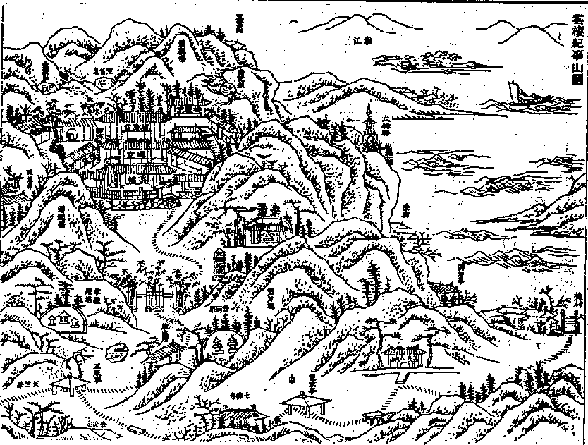



圣驾幸寺恭纪



云栖寺址，山径深幽，僧众恪守　师诫，虔修净业。何幸兹月銮驾降香，垂询本末，不敢不记。本年二月十五日，圣驾自禹陵回銮，幸寺礼佛竟，至北堂僧寮晏坐，展阅内典，见衣桁皆破衲，几皿皆麤旧。上曰：「观此便知僧皆苦修，非世法图名闻利养者。」因询僧曰：「此寺建自何年？」僧跪奏云：「寺系宋初乾德五年伏虎禅师开山，逮明季弘治七年霖雨发洪，殿宇经像随水漂没，废圮几及百载。至隆庆五年，有师祖莲池，法讳上袾下宏，结茅三楹，善信皈心，渐就开创，今已一百一十九年矣。」上曰：「自开创以来，守何宗派？」僧再奏云：「师训专修净土，昼夜六时持名念佛，惟以守戒放生为事。」上即传侍卫引僧登山，观玩竹林，撷兰数本，天颜喜悦。随问林木名色，僧一一谨对。上谕前往放生所，垂睐飞走，圣怀悯恻。又询僧众几何，僧奏云：「合寺僧行约三百餘，从不募缘，亦不种植自给，懔遵丛席规约，大众粒米同餐，幸赖天恩，亦无匮乏。」上即传谕侍卫赉白金五缄，众僧叩头谢恩，伏道送驾。随诹十七日，谨奉上赐银两，备供三宝，恭祝圣寿，普斋僧行，远近沾恩。伏念经教盛於三藏，祇闻帝陛赐衣；瑞兆现於圭峰，惟是皇宫说法。未有九重临御，翠华贲止，霁颜諮询，奖赉僧徒如今日者。恭纪始末，勒垂不朽，聿传盛事，永戴皇图。谨记。



康熙贰拾捌年贰月吉旦，寺僧(成杰等圆)恭纪。恩御云栖起居总录。



钦惟圣慈普洽，帱庇山林，恩赐优覃，仰蒙高厚。念僧徒之微末，荷天眷之隆施，帝德难名，载书恭纪。



乾隆十六年，岁次辛未，今皇帝举省方之典，特奉慈帏，临幸东南。三月抵浙，观风之暇，历览林泉。是月初五日，蒙驾幸云栖寺。寺僧三百餘众，跪迎道左。上次山门，垂问当家是方丈。(寺僧)具奏：「向遵开山祖遗约，岁易正副当家，不立方丈。」上更问宗派规模、念佛讲经一切事宜。一一跪奏讫。驾进前殿禅堂及莲祖像前，皆上香致敬。内有禅堂僧四十八员，跪诵《无量寿经》，恭祝圣祚。上亲临问，戒令勿辍。乃入内山修篁深处，进小膳。时山兰盛开，幽香盈谷。上有感於寮舍清闲，庭芳舒秀，遂御笔写兰一幅以赐，冠以诗：



本色西来意，云栖静且安。林泉徐待写，先写数丛兰。



坐云栖修篁深处，幽兰送芬，欣然有会，因命笔写生。



时辛未暮春上浣也。　乾隆并识。



更赐南无阿弥陀佛六字匾额，白金二百两。僧进山产数件，上亲捡视，谕收笋乾一匣。久之，驾旋西湖。寺僧遂诣行宫，恭请宝玺。越七日，圣驾重幸，仍三处上香礼佛。及观董华亭碑额，乃询真迹有无。寺僧遂捡《云栖碑记》一册，《金刚经》一卷以进。上大书「香光」法宝，永镇云栖。於经之面页，复识以诗。



乾隆辛未暮春中澣，重过云栖，索观「香光」真迹，因识岁月。



山寺虽多此寺幽，特教清跸重来游。洗心亭别仙凡界，万骑纷阗合著留。



绿玉参天迳几回，石门烟月锁莓苔。莲池塔院自千古，奚事花幢坐墨胎。



修篁深处小延俄，又觉簷阴几许过。山鸟啅林还太古，野花绘壁自春和。



净土香光慧业薰，弆藏法宝玩颜筋。兰亭昨过相衡较，真迹犹赢王右军。



是日即景杂咏，得四绝句，并书帙后，留施永传。



又蒙御书经签金刚般若波罗密经、董其昌真迹御鉴题签，　并赐香门净土匾额。



山深独辟清净界，　竹翠常飞妙鬘云。



对语一联。



御题五言排律



一碧万竿翠，双流百折澄，竹泉行尽处，门径得来登。磬礼悲心佛，畴咨苦行僧，钟鱼守本色，拳拂谢多能。矮屋常妨帽，明珠不断灯，莲池家法在，六字括三乘。



云栖六韵，辛未春　御笔。



又蒙赐大内三希堂法帖一部，计三十二册，御书心经塔碑文一轴。　深山萧寺，荷蒙清跸遥临，天文叠彩，诚异数也。　次日，於大关送驾回銮。



乾隆二十二年，太岁在戊，皇上复奉圣母巡狩浙江。三月初二日，载幸云栖寺，合寺僧行清尘待驾。上至，问正副当家名讳年籍，并禅堂规式，遂一一启奏讫。随驾至正殿禅堂，及莲祖静室，上香敬礼，如十六年式。即赐荷包四个，瓷瓶一对。仍诣修篁深处小憩，御书对语一联。



指挥如意天花落，　坐卧闲房春艸深。



是时，山花盛放，岚影垂青。上凭栏四眺，天颜甚霁，即於山亭进小膳。次日，差内大人赍白金二百两，赐合寺僧众。复令住持僧至行宫，领东菀香二包、荷包四个、各色文绮十六端，内有五爪团龙紫缎二端。先是，二月，迎赐御书金刚经宝塔碑文一轴。今翠华重幸，又蒙宠眷频颁，真千古未有之希遇矣。越三日，圣驾再过云栖。是日，自辰及巳，大雨如注。扈从大臣恐道路泥泞，皇上登山未果，俱於理安、开化二寺候旨。上至江皋竟，鸣鞭入寺。僧众匐伏道傍，上亲谕地湿起来者。玉音至，再进殿，上香礼佛如前。其禅堂拜祝圣忏，僧侣即於本堂跪接。蒙问首僧是何经典暨礼忏事宜，上喜。缁侣整肃，梵音高朗，徘徊观听者久之，乃入修篁深处。适大雨初晴，日华红郁，树影岚光，清碧如洗。上顾喜甚，因倣倪云林法，写竹二枝，并记以赐。



昔倪云林写竹，而人问为何树，此幅颇师其意。丁丑三月五日，再访云栖，率笔以施寺僧。



又谕侍臣，赐礼忏僧银锞一百六十二定。是日，俯仰松阴，徘徊纵眺，其眷注之深，几不知日之移也。上於路次，又书七言一律赐寺。



路入琳瑯个个青，祛人尘是洗心亭，七年幻梦谁参破，六字真言此重听。蝶舞花香自诠注，瀑飞石矗孰流停，修篁深处忘机坐，适可依然悦性灵。



乾隆二十七年壬午三月初九日



圣驾三次南巡，更幸云栖寺，僧焚香迎驾。进大殿禅堂，上香礼佛毕，垂问当家监院规式，并金刚经一切有为法四句偈言。奏以光阴箭过，日月不停，上颔之。次入莲祖像前，上香致敬。进修篁深处小憩，谕进香光金刚真迹。因纸促，乃携入行宫，续以藏纸御题。



迳入筼筜心洗尘，春山过雨霁光新。浙中僧院斯为最，不事庄严事朴淳。



静室三间对碧崚，花香鸟语处心徵。雨旸时喜宜菜麦，笑我斯之静未能。



一心念六字真言，衣钵何曾传子孙。监院岁除依例换，莲池家法喜犹存。



金刚真迹弆香光，索看重题逸兴偿。四句本来无一字，更何须辨幻和常。



壬午暮春云栖静室四绝句仍书册尾。



三月十一日，圣驾再幸云栖，上香礼佛毕，进修篁深处，御书南无阿弥陀佛匾额。



乾隆壬午暮春　御笔敬书。西方极乐世界安养道场匾额。



乾隆壬午暮春，重至云栖寺，拟苏东坡法，　御笔赐安南香二包，　文绮六端，　白金二百两，　荷包四个。　更於先日迎赐御鉴石刻唐僧义道与其妹陈燕子丁共写小字法华经一部。回銮途次，又赐律诗二章。



诸峰遥看簇莲青，路转丛篁得野亭，知是洗心契儒玩，饶他念佛著僧听。从新春景粉图展，依旧山斋翠跸停，真迹香光聊遣暇，底论前后𫖮和灵。



壬午暮春月　御题叠旧作韵。



我有乐山意，云栖山最幽，绿筼饶静趣，白足事清修。梵籁簷前落，香泉阶下流，少停便应去，课诵可妨不。



再至云栖题句。　壬午暮春月中澣　御笔。



乾隆三十年乙酉春闰二月，皇帝狩於浙江。初五日，至海宁观塘。十一日，驾幸云栖寺。由大殿至禅堂，皆上香礼佛。遂问正副监院籍贯年讳，并礼忏事。(寺僧)一一具奏。上即命礼忏。阅视良久，乃至莲祖静室，亦上香礼敬。次入内山修篁深处，书对语一联。



水向石边流出冷，　风从花里过来香。



谕进董氏华亭金刚真迹带回行宫续四绝句。



云栖本是旧栖真，无俗尘缘有净因。江岸西行才北转，引人入胜见苍筠。



石桥涧水几萦回，知是洗心亭下来。却我到亭忘所洗，本来无物惹尘埃。



塔院莲池曲径东，阇黎今尚守宗风。掌家正副轮年易，两字出家同不同。



经堂左转陟崇椒，精舍闲凭意自超。山卉当春都寂寂，修篁不雨亦潇潇。



乙酉春闰游云栖，复得四绝句，仍书册后。



是日，命普大人传正副监院诣行宫领赏，恩赐白金二百两、　锦缎八端、　安南香四觔、藏香八束、御制石刻黄龙祖师真像一幅。



十六日，圣驾复幸云栖，仍三处上香致礼竟，入后山小憩，命侍臣取兰花墨迹对核石刻。



十九日，送驾回銮，复於途次颁律诗二章。



万绿琼竿参汉青，十寻枝见下亭亭，此中寻路一时到，教外无言六字听。坐对溪声流不尽，了同山色峙常停，道场开后於菟避，借问山僧是底灵。



云栖寺再叠旧作韵。　乙酉春闰月中澣　御笔



云栖最爱幽而朴，每至西湖必雨来，依旧矮簷环曲堵，底须香阁耸雕台。举头竹密藏峰峻，扑鼻兰馨过雨才，合掌阇黎不饶舌，真言六字已云该。



再游云栖作。　乙酉春闰月中澣　御笔。



宸衷惓惓，虽去而不忘如此。



盖是云栖古刹，越水名区。山窈而深，常见流霞之照地；径纷而曲，更欣积翠之弥天。迨我祖莲池老人，灵本瞿昙，根原善慧。弃儒学佛，思卓锡於深山；养性栖真，遂结庐於空境。香云缭绕，宛笼贝叶之经；宝树纷披，时拂莲华之座。初燃法炬，禅灯独照於江皋；大发祥轮，觉路同开於鹫岭。幸遇国朝金轮御世，　佛日重光。圣祖仁皇帝五次幸山，𤦹玟著松云之刻；世宗宪皇帝三乘阐教，金泥锡封号之荣。至我皇上，礼隆诸佛，泽及栴檀。四临浙水，八度云山。天藻辉煌，与山河而并寿；宸章璀璨，同日月以常新。不惜上方之珍物，叠施内府之金钱。翠竹黄花，悉沾甘雨；长松细草，尽被和风。真百代之奇逢，洵九重之异数。(僧)等身游香国，虽参最上之乘；学散天花，愿证菩提之果。感兹盛典之频颁，窃恐涓埃之莫报。惟合鹿苑之缁流，仰诵一人之有庆；更竭鱼山之梵呗，上祈万寿於无疆。



云栖寺住持僧谨纪。



嘉庆十八年正月二十六日奉上谕：高杞奏：「杭州云栖寺於上年冬间失火，烧毁殿宇房屋六十餘间，致将乾隆年间钦颁墨笔兰花一幅及三希堂法帖四套被焚。现将该僧及扑救不力官员分别惩处。至寺屋本系僧人刱建，仍令上紧募建等语。」云栖寺系浙江名胜古刹，当日虽系僧人刱建，并非动项兴造，但屡蒙圣驾临幸，并节次钦颁墨宝，敬谨藏庋。今不戒於火，除墨笔兰花一幅业已被焚，其三希堂法帖现在内府存贮者尚多，著再颁发一部，交该寺敬谨尊藏。其被毁不全之一部，并著附便解京缴进。至该寺被毁房间，亦应早为修复，著常显於盐务内赏给银五百两，交该僧人承领兴修。其不敷者，令其募化办理可也。将此传谕高杞，并谕常显知之。钦此。



嘉庆十七年，云栖寺不戒於火，龙象灰灭。经大吏题奏，赐帑兴修。寺有法汇一书，实缁素圭臬。藏板亦被焚毁，海内惜之。十八年五月，善信丁君双湖，发愿重刊是书。并以原刊不无鱼豕之误，乃订同志数人，取旧印存本，悉心校勘，选材付梓。未蒇事，而双湖君病殁。难弟古松君暨顾君厚餘，踵仔其任。阅五寒暑心力之劳，以今年六月告竣。中间，寺僧与楷，於理安寺，恭录雍正十三年世宗宪皇帝颁赐御制净妙真修禅师像赞一通，敬谨补刊，纪事册首。山门掌故，於是略备。(廷庆)末学肤浅，叨与分校。喜兹刻复完於煨烬之餘，因叹双湖君之刱始，古松、厚餘二君之图成，与夫诸同志之法施、财施，始终集事。虽功有鉅细，而体禅师与人为善之心，皆在有劳必录之例。爰备著之，以示后之览者。



时嘉庆二十三年六月上旬，佛弟子朱廷庆谨识。



重建云栖禅院碑记



杭之山自天目来，带苕水，挟圣湖，南尽於江，折而东，是为凤皇诸山，宋之故宫在焉。溯流而西二十里，是为五云山。循山麓而西四五里，是为云栖坞，则今莲池禅师之道场也。坡陀坻平，岩谷堂密，划然野处，而不与湖山为群，境则变喧而幽，土则去秽而净，壹似遗世者。山当江之三折，海门涛头，雪涌而霆击者，至此荡为平川，洋洋弥弥，怒气消尽，壹似忍辱者。繇东冈而上，有壁观峰，青龙泉出焉。中峰之旁，复出一泉，名曰圣义泉。西冈之下，复出一泉，名曰金液泉。涓涓甘洌，汲灌不竭，壹似利生者。此非有道者莫能居，而居之者亦於道力有助。自宋伏虎禅师住山，以至国朝，虽天禧中稍辟为寺，而递兴递废，夷为蓁莽久矣。师以隆庆五年托钵此村，若有冥契，曰：「吾骨人得骨山，可以老矣。」缚茆三楹，经禅宴坐，有终焉之志。环村四十里，数有虎伥，师以慈止杀，虎不为暴。岁旱祷雨，雨泽辄应，魃不为灾。居人异之，争来作室，度材於家山，仍础於故址，民大和会焉。师曰：「毗卢宫殿，遍界遍空，草昧经营，无勤檀施，唯法堂奉经律，禅堂以处僧，兹所急也。」既落成，而百年废刹遂复旧观矣。此云栖之缘起也。师之侍者，以为古德破荒，众檀积力，不可泯没，请余记之。余何知出世事，而窃有感於法道盛衰之际也。在昔唐宋时，士唯薄将相不为者，始去而为大僧，以了百千亿劫之生死。故其戒行之严，宗风之峻，直可感鬼神、驯异类，或为道俗所皈依，或为帝王所礼敬，名蓝净刹，於是繁兴矣，盖其盛也。近世以经术收俊士，士所不收者，方自引而食於僧。是以赤县神州，列刹相望，圆顶方袍，聚庐而处者，百十为辈。即而求之，所为禅讲律师，如古尊宿者有几？假令大年削牍，寂音操笔，二百年来，可应传灯僧宝之选者又有几？则虽金碧土木之庄严，崇之至於天，而广之至於十由旬，何益？盖法道之衰相见矣。师庠校名士，始欲以禄养为孝，既以弘法报恩为孝，骐骥壮盛而龙象，超忽最初发念，固已卓然名闻利养之外矣。庞蕴罄百万而掷汉水，僧绍冒三毒以开摄山，岂足专美乎？师自主法席以来，既历三纪，行在《梵网》，志在《观经》，标净业则东林，立清规则百丈，析义疏则玉泉，辨宗乘则慧日，摧阴魔则板度空，排戏论则秀铁面。云栖虽幽迥荒率，无诸庄严，有具眼通者，必曰：先佛塔庙在矣。有具耳通者，必曰：水鸟树林，念佛法僧矣。有具宿命通者，必曰：某古德再来矣。毗岚偃岳而不波，大浸稽天而不溺，是云栖之兴法道，大有赖也夫。师所著有《弥陀经疏钞》、《缁门崇行录》、《禅关策进》等书数十种，锓行於世。师俗姓沈，名袾宏，字佛慧，仁和人。



明万历三十二年九月



太子少保九十六翁陆树声题额



史官董其昌撰文并书



杭州云栖禅院法堂记



昔世尊以五时彰教，隐显权实，顺布而不忒，若温绵凉簟，随候异设，凡以逗机宜、适根茎而已。正法东嬗，师资角立，曰讲、曰律、曰禅，并而为三。然轨辙同归，君臣递用，斯亦一代时教之遗也。天目中峰师有言：「密部如春，慈恩如夏，南山律宗如秋，教外别传之旨如冬。」自祖灯辉三家替，法久主滥，药疗权施，虽离言绝迹之涂，而言迹具焉。大智刱规则律该，圭峰诠经则教设。至永明、天衣而降，多寄指莲邦，默标心土，持名净念，殆庶几所谓密者。然则少林一宗，四序备矣。繇是以观，一气燠寒而岁成，一音开遮而化阐，莫不因宜而建之，遇变而通之，离之以提宗，合之以成务，其致一也。像季陵夷，学者文言依通，未尝有古。先生研几极深之用，在有以率情，资空以护过，而欲圆契法界，密还心源，此与儿嬉呓语何异？嗟乎！禅学盛而教律薄，禅学衰而教律亡矣。破器焦种，道所不载，犹讙於众曰：「吾宗固然。仪范弛解，观行灭裂，而菩提达磨单传之教亦扫地尽，澶漫流湎，无甚兹时者。」昏衢积晦，慧日乃升。於是云栖大师应期运，秉慈愿，挺生於冠族，飞藻於儒苑。然后辞荣捐爱，薙染登具，荷包咨叩，百城忘疲。隆庆辛未岁，始返锡武林五云山之西坞，宋伏虎遗刹在焉。础石就泐，餘堵才存，而师蒙露戴星，晏坐其下。久之，方刊灌莽，成茇舍，绳床瓦钵，独寤弗谖而已。然薰之以戒德，扇之以玄化，慈戢猛兽，诚感霖雨。於是远近甿庶，顺风争趋，输材赴工，如水投壑。无何而役竣，仍其始号曰云栖禅院。门殿不设，庖湢具体，惟禅室法堂，制稍崇敞，以奉经像，集徒侣，盖大师夙志也。大师之教，革伪正讹，贵绳简，黜戏论，一归於真履，底於妙悟。谓纲纪道俗者，莫大於行，是故有缁门崇行之录；覆护群动者，莫尚乎慈，是故有戒杀放生之文；严净尸罗，兼资物我者，莫广於《梵网》，是故有戒疏发隐之义；顿超直指，剋证靡滥者，莫要於禅，是故有禅关策进之篇。於后后世，为大津梁，於诸方便中，出胜方便，普被群机，横绝三界者，莫径於净土，是故有《弥陀经疏钞》之作。尝称曰：「阿伽已疾，如意雨宝，总群涂而一贯者，其惟持名一心乎？」其进为行，净为律，契为法，究为禅。以故师之唱演，靡所不备，而宗趣有在。缁素之徒，咸望大师为善导，云坞为极乐，交、广、庸、蜀、幽、并、冀、朔之远，莫不茧足皈礼，延颈向化，与於筹室者，不可胜数。而师尤隐解显行，㧑谦不居，痛抑狂滥，躬为之隄岸，终身退然，处於学地。虽凡衲单士，通谒而至者，咸与之均礼。於戏！非盛德何以臻此乎？而昧者谓院以禅名，宜杜塞歧径，独蹈大方，绍明从上以来单传直截之旨，若以是为师少者。夫治水者，撤𣈿而泻之，筑防而居之；乳儿者，涂苦而禁之，洗涤而养之，惟其宜适也。世降习偷，邪师谬解，如波如驰，苟务泯相毁教，等持犯，均净秽，决窦於旱秋，绝哺於饥子，岂大士匡时应会，起极弊，振将绝之道哉？俗善畫龙，见龙而惊。涂羹杂陈而笑耕稼者，不亦舛乎？是山形胜，洎创建缘起，详载大师所撰记，及董太史其昌碑中，故不具具言。师所以应化拯时，有功宗乘者，勒石讲堂，诏於无穷。



前进士国子监祭酒　予告弟子陶望龄撰文。



万历三十七年岁次己酉三月初三日甲申之吉勒石。



云栖兰若志



盖杭之诸山，最高者曰五云，登其巅，则南北两高峰如儿孙矣。山势西南行，而江东北折而会之，扶舆灵淑之气，鍾於才贤而不尽，当必有出世之杰，乘愿利生者出焉，而吾莲池师是矣。先是，山之得名，以五色瑞云盘旋山顶，已而飞集西坞，经时不散，又名坞曰云栖。其有兰若，则自宋僧志逢始。逢有道行，猛虎驯伏，人号伏虎禅师。初筑室五云顶，天禧中，赐额真际院，兼辟云栖、天池二院为三刹，而云栖最号幽绝。中峰东西冈傍近有名泉三：曰青龙、曰圣义、曰金液，而最东冈则为壁观峰，皆在寺后所名。其径自梵村入十里，溪山窈窕，草树蒙密，敻隔人境，此真阿练若正修行处。而逢公之后，居之者绝少，四百餘年而有师。师讳袾宏，号莲池，杭之沈氏子。先业儒有声，黉较间藉甚。宿缘所追，尘网遂裂，乃作辞世歌，薙发为僧，饱参诸方，息肩於此。继东林之社，辟西返之津，一时缁白翕然宗之。初至，单丁草屋，若将终身。已祝虎，虎不伤人；祷雨，雨应道风。不胫而走，肩材木、荷锄镢至者，无虚日也。曰：「师幸福吾民而止此，且遗址损础，吾先世所植香火之缘在焉，而忍弃之不以安师耶？」於是兰若不日成矣。有法堂以奉经律，有禅堂以安僧，凡丛林所宜有，日增月益。而又定为十约，若金科玉条，以绳众而守之。昼夜六时，莲漏不撤；圣凡七众，海会无虚。云栖之名，几欲与北代之清凉、南海之普陀埒矣。或有疑焉，师不绍达磨西来之宗，而扬西归之教。



袾宏曰：「大司成冯公为云栖作志，未结，长公子权奇书其后云：『此先君手稿也，欲了未了，可言未言，幸与海内大德酌存之。』愚以为未了未言固无害，例如《华严》仅八十卷，文未足而意已足矣。」但所云或疑师不绍西来之宗，而扬西归之教，於此二句阁笔引而不发，跃如也。今不必续貂，止请诸方此处下一转语。



重修云栖禅院记



杭府治南连大江，西引明、圣二湖，万山遶湖而络绎江浒。溯江西上，行二十餘里，山名五云。先是，山之巅有五色瑞云盘旋其上，因以名山。已而五云飞集山西坞中，经久不散，时人异之，号为云栖坞。宋乾德五年，有僧结庵以居。坞多虎，僧至，虎辄驯伏，世称伏虎禅师者是也。吴越王钱氏为之建寺，而云栖於是创始矣。禅师一号大扇和尚，讳志逢。初筑室五云之顶，天禧中，降敕赐真济院，遂并辟云栖、天池二院，而成三刹。后治平二年，改号栖真。今曰云栖者，复古也。云栖居五云之西，径曲林幽，四山围合，苍翠枞然。东冈而上，有壁观峰，峰下出泉，名青龙泉。迆𨓦下中峰之傍，复出一泉，名圣义泉。又下而西冈之麓，复出一泉，名金液泉。笕引涓涓，洁洌甘芳，汲灌不竭。独以荒僻寥落，人迹罕至，非忘形死心者莫能居焉。绍兴初，有余知阁者，扈跸南渡，隐於寺侧，后舍宅归寺。圣朝弘治七年，霖雨发洪，庐宇经像随水漂荡，僧稍稍散去，颓耋者僦居民庄，而故院遂蓁莽。父老过之，伤感垂涕。卫将军玉溪杨公暨子念堂君雅向三宝，时募僧重修，而频苦虎患，居无何，即引去。隆庆五年，袾宏行脚南还，爱其岑寂，孤形只钵，趺坐圮壁间。太学生陈如玉、李绣等为之搆静室三楹，而宏昼与野鹿主宾，夜与鸣泉唱和，悠然若将终身。村之民怪其能久居也，环村四十里，岁伤於虎者不下二十人，而鸡犬不与焉。宏乃发悲恳，讽经千卷，设瑜伽施食津济之，自是虎不伤人。适岁亢旱，祷於山，偶时雨澍，村之民又大悦，而庆其得安居也，相与累累然肩材木而至，曰：「兹吾祖所植也。」荷锄镢，发其尘，坌之础磉，而指之曰：「兹云栖寺之故物也。禅师福吾村，吾愿鼎新寺之遗址，以永吾一境之香火。」繇是不日而成兰若。外无崇门，中无大殿，惟禅堂处僧，法堂以奉经律而已。宏自惟迂疏陋劣，寸长无称，抱病入山，分与草木同腐。顷值幻缘，兴此废坠，恶容坐食，不思所以上报佛恩而下酬檀信乎？顾生平尚真实而贱浮夸，甘穷约而羞名利，因共一二同志相砥砺，力行古道，盟而后进，犯而必退，大都主之以净土。而冬专坐禅，餘兼讲诵，日有程，月有稽，岁有表，凛凛乎使无赖者不得参乎其间。虽於法门无大裨益，庶几救末学之弊，以俟后之知识云尔。宏，沈氏子，字佛慧，号莲池，仁和人。是为记。



万历五年孟春之望，沙门袾宏谨识。



复古云栖寺记



予始入梵山之云栖也，父老谓予：「兹寺为洪水漂荡计，今将百年，彼时无力营葺，墟其地庐於半道，曰栖真别院。」予犹及见一僧居之，而栖真系在册籍，云栖则山氓野樵所常称也。予仍其便，以云栖名庵，盖三十餘稔矣。逮阅咸淳临安旧志，则云栖者，宋艺祖乾德五年吴越国王钱氏所建，至英宗治平二年乃易之以栖真，详见钱塘寺观类中第十五叶。予仍云栖，暗与古合，事固有适然者。曩嘉、隆之季，万历之初，修郡志者据近而不稽远，今复焉，无亦宿缘使之然欤？予既有感於无心合古，又重有感於古今沿革靡常，寥寥乎灵踪胜迹，久沦而未彰者何限也。吾郡古曰杭州，已而曰临安，后复为杭，曰古杭，今寺亦尔，因额以古云栖寺，而识其岁月云。



万历三十七年正月，菩萨戒弟子比丘袾宏书。



重修上方寺凿放生池记



武林自宋跸南，驻环湖山，禅讲律寺，粲然棋布星列，而郭以内称焉。迨今多半沦没，至不可考诸传志。有上方寺者，背倚城垣，左右掖涌金、钱塘二门，前通西井官道，盖肇建后梁贞明七年。而国朝景泰四年，僧以难事作，散去，寺随废，渐蚕食为民居，仅存者什一，优婆塞沈善能者庐其中。嘉靖二十三年，尚宝卿六桥徐公得请於官，佃为圃。公无子，以畀女，遗命还寺。女孝且贤，持契归王氏，遵父嘱以畀云栖，遂复为僧地如初。无何，王谢世，居士化卿宋君闻其义而高之。化卿以世禄之裔，砥德砺行，乐善不厌，迺输金赠二子，更与之契。予亦罄衣资，偕善信旁赎其故址若干，向明正位别为回廊，旋所向，面城而门，取幽寂也，期世世承事三宝。因谂於众曰：「唯上方弹丸重兴，伶仃衰微，何修何营，而俾久远？」或议辟草莱，轮奂其殿堂，群之以僧，僧多则常住。予以为不然。时丁末法，塔寺靡坚，试屈指而计，凡三门乎阛阓者，楗椎之庭，不为樽罍之所能几？僧虽多而行寡，奚以多为？顾此地邻城，城邻湖，湖外高而城内卑，随锄成流，亢阳所不能涸。因而池之良便，以池放生，以隙地之敝室，稍葺其莛楹，守以二三诚信衲子，蚤莫禅诵，庶几上祝皇图，下济含识，得之一举矣。或谓：物如尘如沙，池一勺耳，容有限，奈何？而庸知夫凿斯池也，为之兆也，弄引也，引而伸之，而又伸之，汪然遍域中矣。昔子产之畜鱼一勺也，使郑之人若大夫若士若民皆然，郑之与国若燕赵齐楚辈皆然，则池无量，所畜无量。不然，西湖古放生池也，谓普容天壤间物，宁有是乎哉？化卿曰：「唯唯。」与其仲直卿、诸贤士夫、诸比丘、净人，有呈财者、裹粮者，疏其壆而锹者、畚者、梩者，枯横泉之桡而戽者、槔者、埭者，固隄防之浸淫崩颓而埤者、堹者、𥗒者、䃭者，捍貍与獭而𦼼者，闲其外侮而版筑者，忧其暑寒而上为之𢊒、下为之㵠者，皇皇乎昼胼宵胝，劳不知息，兼工再阅月而池成。於时在筌而释，当釜而逸，洋焉悠焉，出而游焉，一勺之内，足其从容也。予喜且惧，稽首而告於十方如来、主池神、主伽蓝神，愿以佛力、法力、贤圣力、诸神誓愿力，慈护而威临之，从於今日，尽未来际，常为鳞介诸水族等栖止安宅。又稽首而告於见住僧后，后住僧愿以戒力、悲智力，念流水之苦躬而泽焦𣩅，天台之抗章而断簄梁，智觉之负辜成仁，蹈白刃而不悔，尚永持无斁，以风四方。敢有叛先盟，师陶朱媒利於网罟，或倍众而售之乎白衣，是名违佛律，犯波罗夷。诸所称释子者，鸣以羯磨，遄摈绝之，勿共住。即朋比而阿神，必阴絷其魂，显僇其形，无能逃者。脱免焉，其报尽也，堕泥犁中，婴万苦无竟。所以者何？好生恶死，天道也，人情也。前人捐难舍之赀，役所爱之身，创五浊世不恒见之胜，举以生必死之命，置之安全。后人忍不一深思之，而惟便其私，图於天道，逆於人情，不祥从逆凶，不祥者灾逮。鼓桴形影，感应自然，非危言怖之也。化卿及诸大众踊跃欢喜，叹未曾有，作而曰：「善哉！是缁与素之龟镜也，不可使无闻於末法也。」而碑上方。颂曰：



始举为兴灭，而兼得放生，岂唯灭不灭，生亦无生相。生灭俱灭已，寂灭何有方？以明超於方，无方中说上。无方说西方，其意亦如是。作寺作池人，愿共了斯旨。



万历二十八年岁次庚子春王正月上元之吉，菩萨戒弟子云栖寺沙门袾宏撰。



北门长寿庵放生池记



西湖，古放生池也。法久而敝，实亡名存。敝之久而安焉，恒产乎水族，并迷其名，若罔闻者。岁在乙未，予演《圆觉》於佛国山之南屏。南屏故有池，当其三门，一时主会诸名公，捐赀赎而出之，植莲其中，断渔业，人繇是知放生池为武林旧事。既而予复凿池上方，既而北门有园，园有池，复赎之。园距上方南北相望者，半拘卢舍，而城之内有二放生池矣。顷予碑上方，谓以是为之兆，兆且引而蔓延之。顾予德微年衰，不足以风，未知继此而兴起者，更几池也？上方苦隘，仅为池，餘少丛竹，羽虫之获逭其生者，聊以依止。兹颇闲旷，池联比扩之，则濊然成浸；水涵而土出垒之，则𡾯然成山；循而界之，则幽然成径；相其宜而树之竹木，则郁然荫而成林。将使嘤嘤洋洋，乐而相忘，虽无繇拟飞泳亭之万一，而犹冀想像其遗踪，则上方所不逮也。园以东为兴福禅院，旋而南为养济院，又旋而西为得一道院。养济昔号悲田，圣主贤臣哀茕民之颠连而无告者设也。今之困矰饵，伏质於刀砧，必不可逃而待烹，其无告尤甚。贸而畜之池，纵之林，俾终保残寿，悲孰加焉？佛示三福云：慈心不杀。而五福於箕畴，亦寿为其最。濒杀而重寿之，福孰加焉？天地之大德曰生，舜之德曰好生，德一而已。上清下宁，侯王所以配两间之久长，贞万物之寿命者，恒於斯得，孰加焉？儒、道、释三圣人之伟迹，鼎峙夫三方，若环拱然。而园介乎其中，是曲阜之仁里，摩竭之慈室，西华、长生、葆真之灵宅，天合而冥邻也，岂偶然之故欤？夫救生之灭也而有生，求其生而未尝生也而无生。无生然后无不生，则生灭一。生灭一，则福兴於无相，悲济於无缘。福不可得，悲不可得，一亦不可得。唯法性常住，不断不续，同於虚空。彼《梵网》以放生为常住法。常住者，金刚身无量寿也。乃庵其园曰长寿。而园有荒庐数楹，饬治之，为供接引导师及当来慈氏尊像。盖津梁所放，一切含灵，先生安养，息轮回苦，后於龙华而得授记也。庐止是无增，多以净戒僧守之。守之之方，具如上方记中语。时里之父老闻予言，前执予手，歔然太息曰：「园之源，吾弗知之矣。吾犹及见二禅人居焉。向稔其古为伽蓝，而业已蔬圃，莫返厥初，吾何图重睹今日也。」是役也，始其事者，予与化卿宋君，而诸上善人乐助而成斯美利者，得例书碑左云。



万历二十八年岁次庚子佛诞日，菩萨戒弟子云栖寺沙门袾宏撰。



杭州上方寺放生池碑记



云栖放生池，肇自古上方之中兴，而长寿庵继之，皆大师自为记。师既示灭，上首思监院因余渭阳广寓居士，重徵瀹宾言勒之石。余旋耳於顶，倾大师口光以灌者三，叹其悲智圆融，空假双妙，不住色声香味触法而行布施，不离文字而说解脱，无愿愿海，普擎异生。於乎！此迦楼之翅所不能消，而昆明之灰所不能浊也。瀹宾何言？言亦安所增上？然而窃闻之矣，鹾不治苦，梅不责甘，无相犹矣，而各办事，羹是以和，是刹地水之为那罗窟也。以缁誓缁，以白盟白，各於其党而已。大师申儆方袍，爰及苗裔，凛凛乎寺为歌舞舍，池为刀俎缘，是用大诫。不有求也，市何以兴？刲其一，丧其两，寐者不觉也。瀹宾班於近事，取诸皮里，以承唾餘，恶乎知继声之非继志耶？非有力人不能得师虫方便。既曰有力人矣，何之不惬所欲，而必囿众园，沼法窟，为得时而驾？兼弱嗜昧，取乱侮亡，曰莫余毒也已。恶乎！彼将以富贵为可恒，而因果为不足畏也。长夜之饮，衰於一石；震主之略，丧於欠伸。鹊无宁居，鸠不一姓，《金刚》六如在琴瑟绮罗，不在伽陀贝叠矣。逮其徂落，七遮之影，乃与不亡者俱。昔之釜，今之鱼，昔之日，今之劫，焦骨糜髓，如金在镕，犹复忆充耳戟首，如水投石耶？了实本虚，虚不可系；执虚成实，实不可销。悉自心生，非关人与？借曰死而无知，则保世亢宗，於无知者何有，而厚遗之为嚣嚣乎？无乃用物精多，则魂魄强，生为巨人，死为盛鬼，区区衔璧，何恶之能为？是不知渔猎之殃释种，而琉璃之珠为泰山之炬也。器世间主，具足菩提萨埵不思议力，受遗阇崛，以莅云栖之盟，岂其败如来者厚诛，而破羯磨者佚罚？必不然矣。徐尚宝不幸而圃上方，幸而无子，小宽结缚，又幸有淑孝女，克用治命，以盖前愆。然孰与宋胄子化卿兄弟，戳力刹，标智果，池溉悲华，奉云栖以流水，天台智觉之业，航九品，梯三会，兴於无灭，放於无生之为罔极报乎？子不必宋，女不必徐，智者自谋，谁能几幸？休明辅之，昏乱纠之，同室援之，乡邻谢之，谨毋取麇蒙之分，而贻象焚之戚，是吾党之以波罗夷誓也。桐乡之有放生社也，大师遥垂宝手，率先四辈，度网罟之阨而浮之江，有田有庐，以永法会。方且教化增益，负郭而池，铎以阿兰，荫以修木，惟上方、长寿之轨，是步是趋。一勺之多，姑为之兆，因缘熏习，富以其邻，夫亦曰尚行夫子之志云尔。司勋长孺，云栖优婆塞中慧业第一。记成，函以报监院，告窣堵已，西乡而请，长孺点头，则石点头矣。



赐进士出身翰林院国史编修桐乡优婆塞广瀹吴应宾譔文。



赐进士出身朝列大夫国子监祭酒桐城龙眠居士何如宠篆丹。



古迹



诗石



掘地得断碑，题曰宋随龙。余知阁宅界傍烂石隐隐有诗，盖护宋跸南来，因家此，后乃舍宅为寺，想见其人高士也。以意补葺石上诗，录如左：



几年魂遶浙城西，十里荷花漾锦陂，踏遍两峰三竺路，又随青嶂入云栖。



千里旌旗拥六飞，投簪欲上钓鱼矶，无端忽被闲云引，回耀峰前掩竹扉。



洛邑名园歌舞沈，乱鸦啼破几黄昏，何人学得香山老，千载精庐有梵音。



施生台



又掘地得施生台半座，止存南无字六处，彷佛有多宝如来号，为赞一章。



非玉非金银，非珠犀玛瑙，猗顿失其富，海藏惭乏少，普应众生求，是名曰多宝。



僧约十章



第一、敦尚戒德约



破根本大戒者，出院。诵戒无故不随众者，出院。不孝父母者，出院。欺陵师长者，出院。故违　朝廷公府禁令者，出院。习近女人者，出院。受戒经年不知戒相者，出院。亲近邪师者，出院。



第二、安贫乐道约



饮食不甘淡薄者，出院。著艳丽衣服者，出院。泛揽经事者，出院。争嚫钱者，出院。田蚕牧养者，出院。聚集男女做世法斋会者，出院。



第三、省缘务本约



无故数游人间数还族舍者，出院。习学应赴词章笙管等杂艺者，出院。习学天文地理符水炉火等外事者，出院。习学闭气坐功五部六册等邪道者，出院。好兴无益工作者，出院。



第四、奉公守正约



非理募化者，出院。侵剋信施者，出院。擅用招提之物者，出院。废坏器用不陪偿者，出院。偏众食者，出院。不白众动无主僧物者，出院。临财背众苟得、临难背众苟免者，出院。



第五、柔和忍辱约



破口相骂、交拳相打者，出院。威力欺压人者，出院。侮慢耆宿者，出院。



第六、威仪整肃约



戏笑无度者，出院。亵渎经像者，出院。衣帽故不随众者，出院。高声争论，三谏不止者，出院。



第七、勤修行业约



无故屡不礼诵者，出院。执事慢不行其事者，出院。恶人警策昏沈者，出院。试经久不通利者，出院。不信净土法门者，出院。



第八、直心处众约



挑唆彼此斗争者，出院。树立朋党者，出院。机诈不实者，出院。谤讪清规、诬毁清众者，出院。情识私结不正之友者，出院。



第九、安分小心约



大胆生事者，出院。谬说经论者，出院。妄拈古德机缘者，出院。无知著述误人者，出院。招纳非人者，出院。自立徒众者，出院。擅留童幼沙弥者，出院。己自不明好为人师者，出院。哄诱他人弟子背其本师者，出院。无大故擅入公门者，出院。妄议时政得失是非者，出院。轻心谤斥先圣先贤者，出院。以常住产业与人者，出院。侵占人产业者，出院。另为烟爨者，出院。



第十、随顺规制约



令之不行，禁之不止者，出院。有过罚而不服者，出院。住寺名不入僧次者，出院。梗法不容知事人行事者，出院。知事人更变成规者，出院。凡事不白师友，恣意妄为者，出院。故与有过摈出人交往者，出院。



堂铭二章



东铭



一瓦一椽，一粥一饭，檀信脂膏，行人血汗。尔戒不持，尔事不办，可惧可忧，可嗟可叹。



西铭



一时一日，一月一年，流光易度，幻形匪坚。凡心未尽，圣果未圆，可惊可怖，可悲可怜。



录贤



伏虎而下，人亡世远，兼之典籍漂荡，莫可追录，故录自今始。中所取，皆生存实行昭著，临终正念分明，众口一称，无间然者。或二事互缺，则不得书。非刻於取人，不欲泛书，庶足传信云尔。



大贤



大贤，海宁人，姓金氏，法名如荣。幼力田，壮事屠酤，忽为豕所啮，因大感悟，出家邑之北寺。既而曰：「此非吾所宜居，闻云栖可终老。」翻然来归，时年已六十矣。乃昼作诸务，夜经行僧堂中，勤恳不自休。或止之，则曰：「吾恶能以无德受贤者之供？」家人来劝之归，则大诟不许，曰：「吾又恶能以恩爱故，离贤者之佳会？」万历九年初度，具饭饭僧，长跪佛前，厉声呼愿生西方者三。俄有疾，众环之念佛，大喜称善，合掌吉祥而逝。世寿七十，僧腊凡二十。



法源



法源，上虞人，姓阮氏，法名如清。初投龙井寺出家，未几入云栖受具，曰：「吾不归矣，吾修学於斯，老於斯，死而火於斯足矣。」锐志念佛，诵《法华》，六时礼拜，汲汲如不逮。虽入城市中，终不缺废，高声恳苦，懈怠比丘不遑安寝焉。万历十一年得疾，恹恹者数月。先是予偶出游，卒前一日，予适还山，而清疾已革，遽集众为设像助念。清闻佛声，矍然起坐，中夜合掌，注视金容，奋迅翘仰而逝。世寿五十四，僧腊凡八。



东林



东林浦江人，姓陈氏，法名广槐。少从事戎行，已而落发清水庵，慕云栖，发大誓，入山修道。既受具，进菩萨戒，信力坚劲，质直无伪。持《金刚般若》甚虔，中夜讽咏，虽隆寒溽暑不废。语及生死，必厉声切齿，愤然若不胜其惭愧，闻者为寒心。见年少出家，必劝进，其有过者，必苦口呵责，以是浅信者或不满焉。居家时，有子三人，仲得痨疾，槐往视，知不可起，劝令择良偶安置，其妻子忻然从之。舆疾来山中，使皈命三宝，植当来因，甫毕而卒。又明日，槐卒。又明日，将茶毗，而槐之季子不期而至，人以为慈孝所感。先是，槐得疾，日且弥甚，讯之，无他语，惟谆谆以及时念佛为嘱。散衣钵，尽以饭众僧，无遗餘，敛容而逝。世寿六十，僧腊凡十有二。弟子一人，曰大海。



评曰：人之情，死犹虑其妻之适人，而有欲为厉鬼以祸之者。槐导其子，俾割爱如脱敝屣，岂不超出寻常万万哉？即槐心事刚果磊落，来生事业有不可量者。吾恐大众睹奇事而不觉，用是表而出之。



本真



本真，萧山人，姓来氏，法名广如。二十九出家云栖，闻予亟赞伏牛也，锐然向往。归而受具，进菩萨戒，刻心矢志，潜自砥砺，敝衣破帽，形同於土木。众耻焉，如安之，绝弗干谒。尊师如佛，敬友如宾，视己身如工役，力作忘倦。性多昏沈，坐则频睡，语复迟蹇，期期不可了。於时恶薄年少辈多藐之，如自若也，不为动。处众中未尝戏言，临问对未尝不肃容，历丛林岁久，未尝以情识联私交，居未尝治房舍，夜未尝恋床榻。母年八旬，来视，如病不能去，予为之夹小室寺傍，俾终养之，密减膳饲母，而予不知也。母卒，殡半月而如疾作矣，度不救，召众念佛，躬和之。既而困惫，谓众曰：「趣为我取衣资来，吾欲贸时果香花供吾师，吾不得复侍巾瓶矣。」众与办竟，手自整理进予，予受之，则欣然喜动颜色，从床跃起，坐竹椅中，奄然欲绝。予急往赴，闻予声，复从坐跃起，拱而立，张目谛视予。顷之，安坐已，瞑然脱去，头挺挺直，貌耿耿如生时。呜呼！异哉！世寿三十八，僧腊凡九。存无弟子，众为义立一人曰大思。



评曰：如隐德而人不知有三：似麤而细，一也；似柔而强，二也；似愚而实有颖敏不可及处，三也。至於临死生之交，而凛凛乎明正不回，使人闻而风起，谓铁面禅和者非与？使之在家，必为孝子；使之在国，必为忠臣；使之临大节，必为义士。而复生平抱负，以悟为期，以扶扬末法为己任。惜其早死，不满所愿，悲夫！



照空



照空，嘉禾人，姓朱氏，法名大冥。幼失明，从兄某绝怜之，延日者教习星命，为资身计。冥难之曰：「天道隐，命理微，非凡庸所测。而此辈妄谈祸福，媚事魍魉，兢锥刀之利，非所愿也。乃所愿，则事空王耳。」兄为送出家。无何，来云栖，誓卒业焉。予以其盲於目也，名之曰冥；以其不盲於心也，字之曰照空。而醇雅谨饬，精勤念道。既而家人以事促归，遂留不遣。冥忽忽不乐，坐是得疾，寓大圣寺。经年，疾弥困且殆。予偶过朱泾，访船子之遗，路繇大圣。冥大喜，求附载，众不可。冥愤然曰：「吾得毙云栖足矣。」因力疾登舟，殿予后。至钱塘江浒，数问舁人：「此去云栖近远？」舁人曰：「至矣。」入寺，合掌向佛及诸比丘归涅槃堂。顷之，化去。



评曰：冥之返故室，非其本心也。向使家人不挠、众友力止，久於山中，当大有所诣；而竟违厥志，良可悲悼！虽然，寓大圣不毙舟行、不毙肩舆、中道不毙正命，而终於涅槃之堂，若素定其候者，亦奇矣哉！



附宗派



圭峰大师华严宗派



> 宗福法德义，普贤行愿深，  

> 文殊广大智，成等正觉果，



云栖续支



> 果与因交彻，心随境廓通。  

> 玄微几悉剖，理性妙咸穷。



题咏



云栖六景



山前后约景可纪者六，偶成六偈，为大雅弄引云：



○回耀峰



释袾宏



东方初出渐当阳，使得人间万事忙，转轴西来山欲暮，宝光依旧映纱窗。



宝刀巃



从来利刃号吹毛，万树松丝系独牢，莫谓钝根亏断德，此中原是活人刀。



壁观峰



九年少室坐岑崟，此地何人更效嚬，拂袖便归千嶂外，不来从尔问安心。



青龙泉



百竿青笕出流泉，飞舞东西起复眠，玉乳不知来处远，祇疑香积有龙涎。



圣义泉



不依双岫不中峦，湛出当央第一泉，只恐老胡犹不肯，从教千里自涓涓。



金液泉



安养池中宝似绵，玉洄珠溜正潺湲，何年分得金刚种，来作云栖一派泉。



和云栖六景(有叙)



莲池坐禅之暇，游戏翰墨，即景有言，无非禅理，诗成可以歌矣。闻歌而善，能无和答？载诵一记，恍若在山中与禅师晤谭也。濡笔书臆，词不加点，凡夫浪言，恐为佛前一障，诚可哂矣。诗具左方。



○回耀峰



三洲沈　淮



定中五色竞峥嵘，静里天机夜亦明，炯炯灵台无一事，可云日出事还生。



宝刀巃



切玉剸犀一玦间，匣中秋水照枯禅，锋从万欲丛中出，凛凛寒光不可扳。



壁观峰



闻说九年人面壁，而今祇见壁亲人，非人非壁从何觅，幻出如来自在身。



青龙泉



夭矫长躯变化多，为云为雨事非讹，禅师慧力能降汝，甘露津津赖尔和。



圣义泉



第一泉从北极来，泉名圣义果奇哉，涓涓似接天河下，为润枯禅老万回。



金液泉



黄金布地尽天花，金液还蒸五色霞，自是楼台先得月，有人来共饭胡麻。



○回耀峰



阳和张元忭



夕阳欲下五云西，片片飞霞映落晖，信是灵光原不昧，尘缘息处见天机。



宝刀巃



大冶千年铸宝刀，江干突兀立青霄，不须暂试屠龙技，怪鳄狂螭孽自消。



壁观峰



观心廿载坐莲台，不觉蒲团绣绿苔，独有孤峰常对面，却疑少室又飞来。



青龙泉



一钵降龙般若深，遥看飞沫注东林，时人只解争餘沥，活水源头何处寻。



圣义泉



中峰涌出自潺湲，分得曹溪入梵村，几处山泉名第一，何如此地问真源。



金液泉



闻说祇园布地金，光摇池水半浮沈，上人漱齿为清供，丹液融融满素襟。



○回耀峰



小愚柳　濲



一丸独挈出人间，放大毫光万劫闲，笑指扶桑回耀处，谁吹石火照青山。



宝刀巃



宝刀巃泻动江津，挂在菩提护法轮，要使众生无恐怖，世间谁是鼓刀人。



壁观峰



曾闻佛子渡长河，芦叶为舟总是魔，寄语山间行脚者，同来面壁意如何？



青龙泉



池上莲花玉削成，青龙活水载香清，若非山下涓涓出，泥没灵根何处生。



圣义泉



中峰云遶涌青螺，圣义分流一鉴多，欲借山中涓滴水，洒将苦海静风波。



金液泉



金液泉洄一涧深，如来吐沫总流金，山中白日原无尽，日听流澌磨绣针。



○回耀峰



瀛洲沈　澜



迟迟驹影日西流，倒入千岩紫气浮，莫向桑榆愁景暮，辉光长映碧山头。



宝刀巃



昆吾溪上跃游龙，隐伏尘寰树几重，漫向倚天同任侠，也应随地敛机锋。



壁观峰



峭壁凌霄势独雄，日观相峙海天空，眼前一任风云变，静里都忘造化工。



青龙泉



琼枝袅袅水溶溶，清沁寒漪照绿茸，掩映楚天明月夜，直疑青海出蛟龙。



圣义泉



金液青龙夹道中，分明别有一泉通，涓涓不管流年度，花自芳菲草自丛。



金液泉



一脉云根若有神，葆光灵气隔红尘，争流不费陶镕力，沛入乾坤万象春。



○回耀峰



讱斋言有时



远公日日坐经堂，又见西山照夕阳，借问夜来何处去，却将明月寄辉光。



宝刀巃



宝刀崒嵂立江皋，紫气干云北斗高，斩断六根无住相，笑他匕首利吹毛。



壁观峰



高峰壁立悬千仞，老衲安禅只一心，对尔浑忘论断臂，不烦九载面丛林。



青龙泉



灵泉谩说龙涎吐，佛子能将水脉通，竹笕引来茶灶满，涓涓不尽五云东。



圣义泉



中峰忽涌一泉开，直下云栖般若台，分给众僧归圣义，源头自此莫疑猜。



金液泉



祇园金沫自西来，试饮泠然梦眼开，应识山中趺坐者，此心原不惹尘埃。



○回耀峰



德园虞淳熙



独有须弥转太阳，观成悬鼓欲归忙，山中慧日元无劫，一任金乌度石窗。



宝刀巃



逢著仙人便伐毛，树神到此不坚牢，五台刺客过灵鹫，掷下真王武库刀。



壁观峰



流云绝壁错名崟，无影何人得效嚬，却被江头高士笑，折来一苇是偷心。



青龙泉



七宿东来照一泉，骊珠洒落五云眠，号风大扇惊飞起，不放狐龙堕冷涎。



圣义泉



义龙矫首跃云峦，好护空山第一泉，堪笑西池涌千佛，此中无圣自涓涓。



金液泉



五色兜罗云似绵，云间仙浪正潺湲，珠王不受青牛化，吐出还丹变石泉。



○回耀峰



方石陈光赞



皎日融融沧海生，西轮高度五云横，回光一照青峦遍，万象玲珑彻底明。



宝刀巃



大块鍾灵孕宝刀，山腰横带碧天高，尘氛断尽机锋敛，伏虎降龙总莫逃。



壁观峰



危峰壁立镇禅关，坐对无言境自闲，从入少林传法后，於今又得任名山。



青龙泉



清泉涌出宝山头，引入香厨不断流，正是青龙施法雨，空中幻化泽偏周。



圣义泉



八功德水满西方，圣义分流脉更长，共说禅师三昧力，真源活泼注天潢。



金液泉



宝池池底布黄金，灵液涓涓出梵林，山静云开明月下，寒光浮动见天心。



○回耀峰



洪阳张　位



西方金界涌灵霞，放出毫光照宝华，千仞孤踪停锡望，通明六合是吾家。



宝刀巃



神锋凛凛挂危岑，割断浮生利欲心，月峡龙涛寒影寂，山魑伎俩定难侵。



壁观峰



少林枯冷费商量，若个卢都向壁厢，遗履折芦堪咄咄，高山流水竟茫茫。



青龙泉



灵窟苍虬喷玉涎，湿云飘雾郁蓝天，莫夸千斛供朝汲，坐倚莲花叹逝川。



圣义泉



一歃千金变性情，何年卓锡引龙泓，有缘得入曹溪路，淘涤身心圣谛明。



金液泉



洒心琼液漱莲台，绝胜金茎露一杯，不是醍醐甘秘惜，无人寻向此中来。



○回耀峰



化卿宋守一



金光倒景碧嵯峨，路渺西天奈晚何，转得法轮回夜照，翻车不用鲁阳戈。



宝刀巃



一片雄心未可牢，迷云开处淬江涛，自从乍触机锋后，不向山前试宝刀。



壁观峰



兀坐观空是化身，孤峰遥对折芦人，欲谈圣谛无名相，石壁寒生古月轮。



青龙泉



一脉泉回落涧松，琳琅幽韵杂疏钟，推窗日射东峰晓，五色云中绕护龙。



圣义泉



卓锡甘泉喷雪飞，法流不断客来稀，可怜瑞霭盘空谷，几度逢师浣钵衣。



金液泉



粼粼波隐夜明苔，逗日迎风彩色开，莫是三生餘夙愿，宛从金粟见如来。



○回耀峰



释湛然圆澄



平原未到光先照，独占人间最上重，任是夕阳西欲去，还留餘影射孤峰。



宝刀巃



宝刀巃与五云连，逼塞江干落影寒，长剑依天魔胆丧，行人宜退不宜先。



壁观峰



峥嵘突兀势棱层，谓是当年壁观僧，趺坐虽无芦破膝，通身也挂薜萝藤。



青龙泉



神龙不职受天谴，报德无门化此泉，不是禅翁神力大，几遭血溅秽山川。



圣义泉



一滴龙涎透胆寒，曹溪分入几多年，人来掬手尝滋味，犹下夷齐饮盗泉。



金液泉



金液泉从竹笕来，不繇造作与安排，煮茗日供参玄客，入口须教梦眼开。



○回耀峰



释雪亭圆信



草径离离山影斜，寒清入骨半窗纱，数声啼鸟破幽寂，晚色不侵茅屋家。



宝刀巃



谁把顽岩作宝刀，劈开天地一秋毫，至今纵有英灵者，不若鸟窠吹布毛。



壁观峰



卓卓春山不可扪，葛藤横雪立黄昏，九年坐断无音耗，一片石头千古痕。



青龙泉



不假云雷势自豪，一喷平地尽波涛，溶溶流入浙江水，饮者如何风调高。



金液泉



细脉幽幽隐薜萝，石边春意澹香多，虽然颜色同清浅，那识林间有异波。



圣义泉



水性无繇藉假名，香山凹凸汝能平，源头不在千岩上，烹佛何劳问丙丁。



○回耀峰



芝筠董汉策



谁信苍然来暮霭，空崖返炤发天鸡，宝芳琪树皆春色，悬鼓休谈落日西。



宝刀巃



胸悬千镜笑吹毛，捷句惊人握孟劳，委土划然曾满志，谈言无义胜龙韬。



壁观峰



石笋千寻杳无路，鸟啼花笑自新陈，卷帘领得间中趣，洞口云封不见人。



青龙泉



一缕寒泷有若无，谁从水乳辨真吾，翠蛟千尺飞瑶雪，行雨江村作畫图。



圣义泉



人世炎凉似沃焦，泠然一勺自冰消，中分二水真源出，独掩松关听海潮。



金液泉



霞作帘旌石作台，蜚珠喷玉自西来，金沙池畔吞莲露，历遍庄椿我未孩。



○回耀峰(以下敬和家大人原韵)



镜园董友松



纤月峰前曾伏虎，夕阳村外忽闻鸡，凭君踏遍寻春屐，回眺灵岩日未西。



宝刀巃



带挟青霜拂鬓毛，谽谺历尽问劳劳，何如白日苍烟外，收敛寒芒秘六韬。



壁观峰



尘世迷楼空暮霭，梵宫琪树似星陈，欲知海阔天空处，借问当年面壁人。



青龙泉



幽壑潜鳞认得无，卧龙曾自比夷吾，谁将钵水兴风雨，幻出云林破壁图。



圣义泉



火溢灵泉石欲焦，间参圣义霍然消，探源记取中峰外，来看沧江八月潮。



金液泉



欲吹阳气作春台，却向金茎挹露来，八宝瓶倾杨柳韵，青童终古尚婴孩。



○回耀峰



汾园董师植



背飞青鸟长烟没，山罅光寒露碧鸡，身世荣枯谁悟得，半开花外日沈西。



宝刀巃



铸就鸣鸿纺綷毛(鸣鸿，刀名，黄帝所铸)，横披霜锷涤悁劳，千岩云卧呼不起，苍水神龙扪赤韬。



壁观峰



斜倚灵峰拈落叶，无端花雨烂然陈，窟中狮子听消息，林静江清月近人。



青龙泉



一片滢荧心欲无，涓涓碎玉浸昆吾，药镵春煖烹香液，肯向人间授绿图。



圣义泉



暖浮花乳入铜焦(铜焦，石洞名)，滴沥声清梦未消，今古不知几冬夏，秋心泻尽作冰潮。



金液泉



金莎晓溜出层台，谷口风疏香自来，分得餘甘酿春色，漱芳枕石意如孩。



○回耀峰



鸥亭汪文桢



海上晴波荡日华，才升峰顶又将斜，金轮旋转无多地，赢得西岩起暮霞。



宝刀巃



古铁坚顽霜刃新，峰头光怪起嶙峋，金刚掣手当空立，蓦地横抽许活人。



壁观峰



踏破江波一苇轻，壁间苍翠古苔生，九年枯坐缘何事，独立孤峰任意行。



青龙泉



飞流千尺下晴峰，个个筼筜接水筒，拾得波心颔珠在，当前抛出戏骊龙。



圣义泉



圣谛由来本廓然，中峰何用强名泉？涓涓不断寻常事，莫使澜翻误眼前。



金液泉



大地茫茫总布金，源头点滴到如今，爱河欲海何因见，要与针头仔细寻。



○云栖纪事二十韵



鸥亭汪文桢



净域崇三宝，诸天扈　九重，莲香传伏虎，云影驻回龙。山隔江潮转，泉当竹径冲，潺湲金液水，岝崿宝刀峰。结社来深谷，诛茅卓瘦笻，东阳腰带减，慧远足音跫。白业因兹启，红尘不敢封，六时成海会，三观契心宗。朴俭僧规肃，流传法雨浓，何妨存苦行，安用逞机锋。  

圣德怀深眷，　时巡访旧踪，吴都浮紫气，禹穴奠黄琮。道与斋心合，行由觉路逢，鸾旗萦翠筿，羽盖偃青松。十笏珠宫现，千华　黼座供，祗林周法界，兰若展慈容。解网宽生类，提筐抃老农，  

皇情方畅遂，佛力共陶镕。幸企扶轮化，惭非珥笔从，瞻　天犹咫尺，胜义警晨钟。



附对联



初住云栖



竹笕三五升野水。



蓬窗六七片闲云。



又



屋壁空疏，八面喜逢青嶂合。



溪山寂静，四时惟有白云栖。



三聚亭



翠霭封中觅路。



碧峰尽处归庵。



又



天衢有路通芳竺。



梵世无为见古村。



三门



古刹重开，五色瑞云栖止地。



禅林肇建，万年宝历太平时。



善会门



慕至道而决意精修，堪同此会。



惮清规而无心上进，莫入斯门。



净业堂



王极乐六八大愿之慈尊，绝限量寿命光明不离当处。



过娑婆万兆佛邦之净土，妙庄严楼台池沼元是吾乡。



禅悦堂



逐队二时，逢阎老打算饭钱，能无欠否？



饱参一念，对庐陵近来米价，得不难欤？



高步



楼阁将登，也须从这里过。



阶级不落，毕竟是什麼人？



演法堂



九会融镕六十万字之雄文，圆极一乘性海。



千华授受五十八篇之大戒，弘开三聚法门。



随止居(即刻经房)



迹远红尘，日近僧规成净侣。



身依白社，时亲法宝度凡情。



小云栖众信士重建演法堂记(附刻)



粤稽云栖创自宋，越数百年，有莲池大师重辟道场，为念佛放生所，而规模崇起焉。又越二百数十年，有同里诸君子，联净社，广放生，而小云栖继起焉。夫放生者，体天地好生之德，以为心诚善举，第有放而无养，则不遂其生，反以速之死，非全生之道。昔云栖创建水陆道场，其规制有放生银三两，并生食银一两，其法至今无弊。维时以寺距城远，复於西北两门，创上方、长寿二寺，凿放生池，以便放生者。自譔碑记，谓以是为之兆，兆且引而蔓延之，不知继此而兴起者，更几池也。则其愿大矣。小云栖者，同人慕云栖放生旧事，从而推广之。先是吁诸阮大中丞，请於西湖复古制，未果行。岁癸亥，廉得东城餘庵，为余姓所舍，有殿庑寮房，池之大可二三亩，即卜此为课佛放生所。嗣以牛栏、羊圈、豚栅、鸡栖不备具，旋购邻庵，兼买民舍，联络而拓其址，更盖牲厂、鱼池等，并另搆三楹，崇奉莲祖像。落成时，以小云栖名，盖法五云旧事，而规模小之也。夫同一放生，而大小云栖各异。云栖在山中，设放生所，飞走各类，充牣其中，既有生食，众僧复减口以养之，除刍茭，约费粟二百石。城内外放生二池，岁费百餘金，自来无缺乏。若小云栖，则牲粮及一切经费，统计常年捐款，并书院乐输外，不及半，餘须另募以济之。寺在城隅，地窄而牲多，故各牲以每种若干定为额，餘仍送大云栖寄养，贴生食焉。但此项须募施，多寡无常数，亦非久计。同人正拟捐赀购田，收租息作牲食，斯议未及举行。会壬申冬，寺厄於火，经高大中丞具折入告，奉有谕旨，於盐务中给银五百两，餘著僧人募建等因。遵将此项首建莲祖殿，其餘各工众商，吁於常盐政筹款修复，费尚不赀，须添募以蒇事。同人爰集而商曰：「专济云栖生粮一项，与其逐年劝捐，盈绌不定，何如乘此兴复寺工之际，我等捐建一水陆堂，重定新规，於功德内加生食银三两，以为小云栖寄养之生粮。在作功德者，既不惜此些须，而在放生者，实可行之久远，岂非两利之道？」众韪之。乃相度烬餘，唯演法堂最高广，估值需一千六百金，随如数募齐，选工料而敦请谙练者督理之。不日工竣，内坛启而生食增矣。遂将此意告常住，刊刻木榜，宣布一切，咸使闻知，并欲其经久勿替，令后人知重建斯堂之有自也。谨叙颠末而记之石。



时嘉庆十八年六月之吉，佛弟子丁焘谨识。



五云精舍。自宋初乾德五年，伏虎禅师开山。逮有明弘治七年，霖雨发洪，殿宇倾圮，经像漂没，中废者几百载。至隆庆五年，莲池师祖，结茅三楹，以念佛放生，标最胜法幢。嗣是善信皈心，渐成兰若。阅今二百餘年，称名胜古刹。屡蒙圣驾临幸，并节次钦颁墨宝，敬谨藏庋。寺素无恒产，僧众四百餘，藉水陆斋忏以度日。迺於十七年冬，不戒於火。经前抚宪高，　具折入奏。钦奉恩旨，赏银五百两兴修。其不敷者，令僧人募化办理等因，钦此。钦遵祗领，先行启建莲池祖殿三间。次经小云栖放生绅士，捐建演法堂外，自山门至前后大殿，及尊藏墨宝楼阁等，俱系紧要。勘估工料，约需银八千两。经四所鹾业，公吁盐宪常，　请由商捐项下，借拨垫给，按引输补等情。当荷批准，并公举沈云蒸居士，董理督办。不数月间，宏规重启。虽工未全竣，而有法堂以奉经律，有禅堂以安僧侣。经忏得资礼拜。(与明)等实感皇仁而颂　宪德。谨於法汇重梓，而附记及此。



云栖寺住持僧(与明)等谨识。



菩萨戒弟子刘慧闻率子性泽施资敬刊。



光绪二十五年冬十月，金陵刻经处识。



菜市桥重建孝义无碍庵记



莲池禅师少与予同业黉，较予登仕，禅师出家，为嘉靖乙丑。禅师夙志方外，以二尊人在，不敢离。既先后岁双失怙恃，将力酬所愿，而室人汤氏，年才一十有九，前儿伤亡，忆子舆之规，疑未决。已而念风灯石火，时不我延，遂疾从薙染。汤处室斋戒禅诵，与其母偕。母寻故，孑然茕居。宗人议后以三姪文彬。无何，汤亦脱簪珥为尼僧，召文彬谓曰：「兹无所事，后不后，我固无害。彼生而养，死而服，而殡，而祭，世法也。吾学佛，存资钵衲，殁归阇维耳，夫何求哉？」因举所有田庐，普给群姪，於文彬低昂之，而别以居属文彬，己从邻僦舍，绳枢蓬门，夕灯晨香，阒如也。嘉禾朱公子衷纯，追厥先大夫银台虞葑先生遗意，首事搆庵，而予与一时宰官居士比丘某某从臾焉。累百金买赵氏故宅，宅苦隘，水文学施傍屋一楹附益之。又岁久颓圮几尽，众相与施材，缁侣之能匠石杇墁畚插者，相与施工施力。中为禅堂，凿井於左庑，餘垣轩厨湢略备而已。予惟禅师无子，无留赀，无素所可凭依故旧亲戚僚友。汤以年少妇独御家政，伶仃苦辛，多历年所如一朝。及其分田割庐，皆出本怀，亦难矣。诸上善人怜而庵之，义举也。举於义，则十方常住业也。后清信女展转相续焚修於此庵，远为二尊人庄严报土，又孝思之道也。按府志，菜市桥西有古无碍庵，其后渐没，入於民，家徙而北。里之耆氓告予以此地正庵之旧址，久湮忽兴，殆天意，非人力。而义以孝不虚，孝以义不泯，若交相成而不相悖。乃沿古证今，合而颜之曰孝义无碍庵。沈氏子孙尚其念之护之，以无忘孝义，永为人天福田，流庆渊渊，后必有昌大其门闾者。汤法讳袾锦，暨禅师同师关中南五台性天和尚。溯禅师出家逾四十稔，盖行年五十九而庵成。



时万历三十四年岁次丙午上元日。赐进士出身、资善大夫、都察院右都御史、前兵部左侍郎、出征外国加一品服、邑人宋应昌撰。



遗嘱



立遗嘱。老病僧袾宏，号莲池，姓沈氏。父明斋府君，母周氏。宏年二十七，先府君见背。未几，儿祖植殇亡。二十九丧偶，续娶室人汤氏。三十一，先慈复见背，遂发心出家。汤时年一十有九，与其母俱。母寻故，中间先有继嗣之说，后落发为尼僧，乃不嗣而分其田庐，具如碑记所云，兹不赘。但念汤既散所有於姪男五人，独於文彬加厚，又独於文彬与住房一所，理已协，情已尽矣。今此孝义庵居，肇端於朱文学懋正，主宰於宋司马桐冈、洪司谏湘皋，夹辅於众宰官、居士、比丘某某等，约共五百人有奇，各捐己资以建。而　县尊吴父母特施俸金三两，帖頞存照。又傍楼一间，水文学深甫买徐九德者，并以施庵舍契存照。所以然者，汤以冲年孑身，守志不渝，今已老，诸君子义之。汤以冲年孑身，躬井臼，奉宗祀，供庶姑於堂，生事而死葬，诸君子孝之。故庵以孝义名。此庵盖秋毫皆檀越信施所成也，外无只木寸地与沈门相涉。后人不知其详，傥生异念，横相侵渔，则为欺自心，欺十方檀信，欺县父母，欺我及我考妣宗祖。况汤有徒有孙，有久伴道友，就令汤之徒伴澌灭逮尽，亦当别求老成笃行尼僧住持，以永存孝义之名。在俗家不得而有，恐岁久湮没，书而镂之梓，遗以为据。伏希高明朗鉴。



万历三十四年岁次丙午孟冬八日，沈氏出家子云栖沙门袾宏书，时年七十有二，汤时年五十有九。续记



臬司宪长吴本如公祖给扁曰古无碍庵。施金三两，刻释迦像一尊，永远供奉。有帖存照。(三十七年九月)



巡抚贵州旧藩司郭青螺公祖给扁曰超尘。



嘱餘



予既作孝义庵嘱，今万历辛亥为先府君去世五十周年，归庵修荐。因思予年七十有七，命在旦夕，而庵主汤氏寿亦逾一甲子有四，兼复多病，后事当更嘱广占等。所以者何？庵主未剃染时，有姪赘江干徐宅曰文彬者，求为嗣，予弗允，强就焉。然名在沈门，身在徐宅，未尝同居定省晨昏，代理家务也。乃剃染以后，分田庐，别僧俗，而嗣之说已尽绝乌有矣，详具宋司马碑文中。今广占在家为母子，出家为师徒，并见在徒众善友，谛听吾言，毋令后乱。一、寿具已有坐龛，不必依世俗买棺椁矣。二、寿服已有偏衫戒衣，不必依世俗办居寿衣矣。三、寿地已有普同塔，不必依世俗寻坟墓、看风水矣。四、守禅门规制，不必依世俗出斗书，称孝子某人告讣矣。五、遵六祖遗训，不必依世俗披麻衣、送麻布、结孝堂矣。六、三朝首七请僧诵经，餘七只消本庵众等念佛，不必依世俗频频建道场矣。七、举殡但用香亭一座，山民舆龛，不必依世俗顾仵作及神亭铭旌魂轿等间杂费用矣。八、众道友念佛相送，不必依世俗叫乐人打鼓吹笛等喧哗扰乱矣。九、在家所有产业，分与文彬诸姪，衣饰半与文彬收受已讫，此外更无金玉珠翠绫罗绢段值钱等物，其平日穿著布草旧衣，乃至经像炉瓶桌椅麤重家伙，孝义庵自置者，皆招提僧物，属十方常住，不必依世俗分家财起争端矣。十、庵主既已出家，自是僧类，师亡徒绍，不必依世俗亲族来处置家事矣。自今以后，众等惟宜恪守清规，小心谨慎，如其贫乏，托钵资生，莫入人家化缘，莫招女众做会，莫走远方进香，莫与男僧来往，莫做精致器皿，莫作华丽衣衫，莫轻易收人出家，莫置买田地世产，痛思生死，一心念佛，求生净土，切记切记。



时万历三十九年岁次辛亥六月二十一日，云栖老病僧宏书付孝义庵主徒众广占等收受。



众等：



大文  

大志  

智慎  

广曜  

广潭  

广悉  

广高  

广莲  

广善  

广深



孝义庵规约



大门时时关闭，无要紧事勿开，门里问答可也。不依，罚银三分。  

圆光门时时上锁，客至，击板三声，请坐。少顷，待主人出，主内客外，圆光相见。女客以正事欲进者方开，餘系紧要正事方开。不依，乱放人进者，罚银一钱。  

后门除出净外，无事不可开，乱开罚银五分。  

凡用度要减省，不可丰盛，待客亦然。茶过四品，饭过四品，斋过五品者，每品罚银三分。  

非理募化者，一罚十。  

正月半、二月十九、四月八、七月半、腊月八等，紧紧闭门，不可做会。不依，罚银五钱。  

方僧化缘，一例却之。  

远方尼僧不相熟者，无得留进圆光门。不依，罚银三钱。  

列经桌四张，每日诵经一卷，三时念佛，叫名不至，罚银二分。  

每半月诵十重八轻戒一遍，不至，罚银三分。  

置签筒，叫名早晚礼诵，不至，罚银一分。  

无事出外间行，罚银一钱。  

侵剋信施者，一罚十。  

二人同行，方可人家宿。独身宿者，罚银五钱。  

普陀、天台等远游，及湖船聚集妇女处入会，罚银五钱。  

彼此斗争者，各先罚银三分，后辩曲直。  

故留远方尼僧住者，罚银五钱。  

私取常住物者，一罚十。  

招接算命相面收惊等诸婆者，罚银一钱。  

轻易留人出家者，罚银五两，出院。  

在庵嫁送有法名女子者，罚银五两，出院。  

畜养幼男至十五六岁不发遣者，罚银三两。  

以荤腥入庵者，罚银三两。  

以酒入庵者，罚银三两，除服药。  

学吹打、摇铃杵、念真言等，罚银一两。  

擅留在家妇女，为家间口面不和而来者，不劝回久留，罚银三两。  

擅留己分上亲戚在庵混扰，罚银五钱。  

欺灭当家，不容作主行事者，出院。  

当家行事差错，阿谀不谏者，罚银三钱。



纪贤



广觉



沙弥尼广觉，直隶崇明县龚氏女。父一夔，别号梦萱，乡之硕德君子也。母施氏，生觉於万历己卯。甫年十二，不茹荤，从妹广曜者，相与习经咒，朝夕礼佛唯谨，自誓贞不字。父母诸宗人难之，多方劝喻，不能夺。二十八，剃染。明年，偕其妹随仲父至庵。先是，梦萱公语及孝义庵之胜，觉大喜跃，遂委身依止焉。曩觉之在室也，事父母如事师。逮其出家也，事孝义庵主如事父母。精持梵行，纯一不杂，远迩瞻慕，崇明之人因而感化发心者，不可数计。然禀质孱弱，刻心苦躬，劳不自惜。俄得疾，久之，却医药，一心待尽。梦萱公闻女病，偕母来省，则曰：「吾昔落发於尼师，不惬吾愿。」乃特蓄周罗而告予曰：「最后一结，惟师断之，佛制也。」予允诺，自是无他语，气恹恹不绝如线。忽起，正面趺坐，曰：「愿见庵主。」庵主至，合掌称谢言别。次为设弥陀接引尊像，则怡然现笑，凝目谛观，合掌归命。已而索水盥手，著新净衣，持数珠，端身对佛，如入禅定。侍疾者虑或倾仆，以二枕将左右掖之，挥手云：「无用此。」众环绕助念，复挥手云：「吾自有主在，毋劳众也。」跏趺不动，凡二昼夜有奇，微声念佛，声渐尽，泊然而逝。时万历辛亥二月七日，出家六夏，世寿三十有三。



袾宏曰：觉疾甚，诸因觉发心者，疑贰欲退，曰：「奈何事佛而不寿？」有解之者，直以回仁且夭关乎？昔缘觉独曰：「吾方以速脱娑婆、生净土为大幸，奚取於长年？」嗟乎！人居尘世，如困狴犴，早释而得归，与久羁而不返，其苦乐何如？智者了焉，非凡愚所知也。觉以女子身，卓然具如是知见，况临行俊伟赫奕，风动顽懦，虽耆英宿德，胡以加此？假令算获期颐，而不闻道，寿亦何补？诸发心者，当欢喜感叹，转增修进矣。因次其始末，以为纪贤首。



庵主太素师



庵主姓汤氏，父小江公，母朱氏。年十四，为母发心持血盆斋三载。时予年二十九，丧偶不欲续，而一子殇亡，奉母命再娶。议婚者以庵主言，予喜道合，即毅然诺之。逾年而先母见背，安厝已竟，遂奋志出家。俄以远游病归，结茆深山中，忽来陈将嗣姪文彬。予惟出家时已无子，想今胡为及此？亟止之，则云：「业已成，不可改。」予思己既出家，又不许守志在家者，嗣非人情，乃不获已顺之。无何，庵主亦剃落为尼僧，乃悉以得分薄产给散诸姪，而稍厚於彬。自是化家为庵，易素为缁，而嗣之说成梦幻矣。兹甲寅盖世，算六十有七，斋年五十有二，法腊二十有一。以初夏得疾，食渐减，至八月十三日，粒米不入口弥月矣，形枯骨立，一息仅存。忽云：「经称十念往生，亟扶我起。」起则正坐念佛而逝。庵主法讳袾锦，师关中南五台性天和尚。平生戒行洁白，处信施，因果明慎，丝毫无所苟，其实行可为尼众式云。



袾宏曰：予昔将出家，具启辞学道，伯兄三洲公密止其启。庵主谓予：「此事我知之，不以告，后将以我为不贤妇，误君事也。」予感泣。一夕剃染，诸昆弟亲友留予者，激庵主先导而从臾之。庵主答曰：「我熟闻渠称生死事大，乃故为沮挠，可乎？愿诸公勿复言。」后予得疾，白下垂毙，庵主闻之，急礼斗为祐。伯母倪恭人谓诸妇女曰：「汝曹见闻否？彼丈夫弃之出家，不怀冤恨而反祈禳，希有也。愿汝曹效之。」嗟乎！予得慷慨出家而无复顾虑者，庵主解脱力也。所可惜者，误信谬人有嗣子之失，又办道、主家二用其心，难乎不乱。虽往生未可必，而实行无疵，临终正念，植当来之慧基，不浅浅矣。贤乎哉！



武林孝义无碍庵主大尼太素师塔铭(有序)



赐进士出身奉直大夫左春坊左谕德兼翰林院侍读云栖优婆塞戒弟子广瀹吴应宾撰文



盖余属耳震旦哮吼之音，至孝义无碍庵主，而窃叹其与云栖法轮交参，推挽以为莲宗长也，有不思议者四焉。庵主始处云栖大师之室，欲爱如膏，佛智如火，勤勇熏铄，顿尽无餘。於是乎有异方便焉，使大师於出家缘而得自在，以为一代法檀。而大师所谓庵主董正化仪，镇抚徒众，乃至形未来波旬若干种心，若秦鉴之洞览。故孝义之有终也，犹云栖之有始也。法轮交参，不思议一矣。庵主尊重木叉，庭无比丘之迹，梵行所感，四事翕如。与共住者，量腹度形，归其羡於云栖、香积。而孝义之刹，一行以为香光，六字以为法喜，三心以为禅悦，九品以为无尽灯。出要之途，惟云栖是趋是步。故檀波罗密者，庵主之所以投；而慧波罗密者，大师之所以报也。法轮交参，不思议二矣。大师上度为孝，普度为慈，弃短取长，代衰以染。而庵主用近事女身，持冰霜之律仪，荐苹藻之明信者，几三十年。庶姑终堂，乃现比丘尼相。及其念心成就，乘愿往生，而弘范沤和，若虞渊之返乎初照，高足广占、大文、广曜辈所影赴而响随者，皆大师所龟卜而石畫也。庵主和其义，以补大师之孝於方内；而大师锡其孝，以扶庵主之义於方外。法轮交参，不思议三矣。庵主为优婆夷而勉畜嗣子，为比丘尼而亟谢嗣子，分田授庐，莫不中度，曰：「为沈氏出家儿后者，固有在矣。」而孝义精蓝，适当古无碍庵之宇，坚牢持地，檀那布金，净觉观心，如时涌没。而大师所以区别僧俗，料拣至仪，一一义中，足使招提之尘，重於郏鄏之鼎，虽其染指，能不扪心？是庵主奉云栖以出世间智，而大师摄孝义以入世间智也。法轮交参，不思议四矣。乃往古昔善慧之以欲钩牵也，瞿夷之为善知识妇也，智力所持，历二僧祇，法尔偕偶，锡黏磁吸，莫知谁为。若庵主之於大师，将无缘熏镜中分其影像耶？大师於形家言，了不措意，而两窣堵坡，从不思议解脱慧心任运拈出。大师南面於招提之左，如据座法檀；庵主东面於阿兰之右，如云来上首。周览神奇，足使白鹤丧机、青鸟杜口，愿王智导，影现重重，情器世间，不二随顺。而余广瀹宾因於云栖监院，沐二大士灌顶口光，略说如是法轮交参不思议事，於劫海中三绕四摄，必有异熏习焉。庵主姓汤氏，十四为母持斋，十六归丈室，十九而从大师於南五台性天和尚之门，为优婆夷戒弟子，法讳袾锦。四十七出家受具，僦舍焚修，以白法为流辈宗仰。五十九而孝义庵成，大司马桐冈宋公为文勒之於石。先大师涅槃一岁，示疾累月，忽谓侍人掖之起曰：「吾其乘十念往矣。」端坐念佛而寂，万历甲寅八月十三日也。距生嘉靖戊申十二月初九日，世寿六十七年，而为僧腊者二十有一，学者称太素师。大师著其慧行於纪贤之策，以为尼众楷式云。铭曰：



> 僧现非男，尼现非女，等与众生，为智度母。  

> 身相非古，塔相非今，等与众生，为慈妙云。  

> 优钵时开，芬陀交映，同事显凡，冥权秘圣。  

> 华数为劫，尘数为年，此土安隐，如那罗延。



菩萨戒弟子刘慧闻率子性泽施资敬刊。



光绪二十五年冬十月，金陵刻经处识。



云栖大师塔铭目录



云栖大师小像  

古杭云栖莲池大师塔铭　释德清  

莲宗八祖杭州古云栖寺中兴尊宿莲池大师塔铭(并序)　吴应宾  

云栖本师行略　释广润  

祭云栖大师文　释德清  

奠云栖太师翁章　释智訚  

奠云栖和尚莲池大师翁章　释大朗  

礼云栖大师塔偈　朱　鹭  

复礼莲师塔偈　贡修龄  

礼云栖大师塔偈　释弘恩  

恭述云栖大师智行悲颂(有序)　吴应宾  

云栖大师像赞(五首)　释德清  

又　吴应宾  

又　宋守一  

祝云栖大师七十偈(以下有目无文)　释真可  

又赞　释真可  

本师云栖和尚八十寿章　释广寂  

云栖本师菩萨七言二十韵　吴应宾



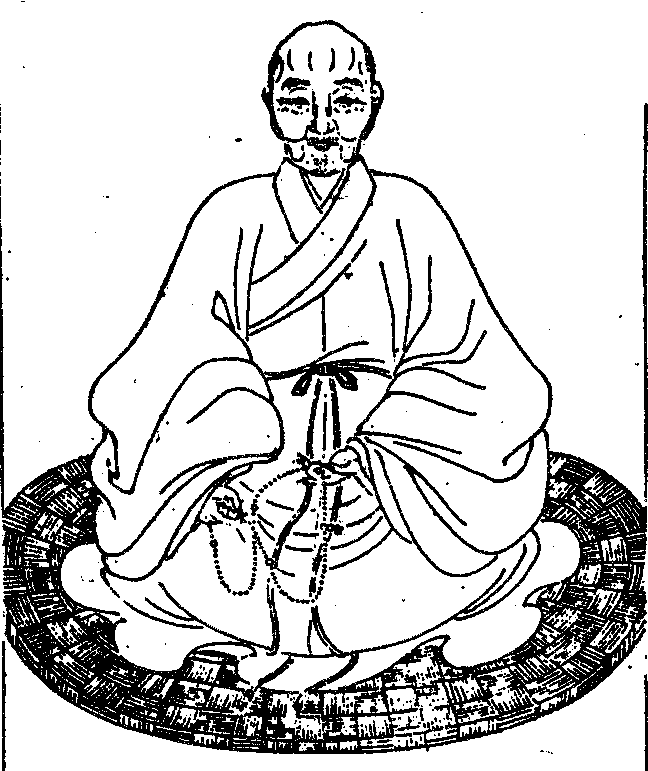



其容寂，其心密，无内外，不出入。百千三昧，眼里空华；一切行门，空中鸟迹。不信分身万像中，痴人祗向毫端视。咦！



观如敬刊。



古杭云栖莲池大师塔铭



欲海横流，三毒炽然，孰能遏狂澜以清烈燄？自非应身大士，又何能醒颠暝而朗长夜？时当后五百年，尤难其人，是於云栖大师深有感焉。师讳袾宏，字佛慧，别号莲池，志所归也。俗姓沈氏，古杭仁和人，世为名族。父德鉴，号明斋先生，母周氏。师生而颖异，世味澹如。年十七，补邑庠试，屡冠诸生，以学行重一时，於科第犹掇之也。顾师志在出世，每书生死事大四字於案头。时从游者日进，即讲艺，必折归佛理，业已栖心净土矣。家戒杀生，祭必素居，常太息曰：「人命过隙耳，浮生几何？吾三十不售，定超然长往矣，何终身事龌龊哉？」前妇张氏，生一子殇，顷妇亦亡，即不欲娶，母强之，议婚汤氏。汤贫，女斋蔬，比有富者欲得师为佳婿，阴间之，师竟纳汤，然意不欲成夫妇礼。年二十七父丧，三十一母丧，因涕泣曰：「亲恩罔极，正吾报答时也。」至是而长往之志决矣。嘉靖乙丑除日，师命汤点茶，捧至案，盏裂，师笑曰：「因缘无不散之理。」明年丙寅，诀汤曰：「恩爱不常，生死莫代，吾往矣，汝自为计。」汤亦洒然曰：「君先往，吾徐行耳。」师乃作一笔勾词，竟投西山无门洞性天理和尚祝发，乞昭庆寺无尘玉律师就坛受具。居顷，即单瓢只杖游诸方，遍参知识。北游五台，感文殊放光。至伏牛，随众炼魔。入京师，参遍融、笑岩二大老，皆有开发。过东昌，忽有悟，作偈曰：「二十年前事可疑，三千里外遇何奇。焚香掷戟浑如梦，魔佛空争是与非。」师以母服未阕，乃怀木主以游，每食必供，居必奉，其哀慕如此。至金陵瓦官寺，病几绝，时即欲以就茶毗者，师微曰：「吾一息尚存耳。」乃寝。病间归越中，多禅期，师与会者五，终不知邻单姓字。隆庆辛未，师乞食梵村，见云栖山水幽寂，遂有终焉之志。山故伏虎禅师刹也，杨国柱、陈如玉等为结茅三楹以栖之。师吊影寒岩，曾绝粮七日，倚壁危坐而已。村多虎，环山四十里，岁伤不下数十人，居民最苦之。师发悲，恳为讽经施食，虎患遂以宁。岁亢旱，村民乞师祷雨，师笑曰：「吾但知念佛，无他术也。」众坚请，师不得已出，乃击木鱼，循田念佛，时雨随注，如足所及。民异之，因相与累累然，肩材木，荷锄镢，竞发其地，得碣础而指之曰：「此云栖寺故物也。师福吾村，吾愿鼎新之，以永吾福。」不日成兰若。然外无崇门，中无大殿，惟禅堂安僧，法堂奉经像，餘取蔽风雨耳。自此道大振，海内衲子归心，遂成丛林。师悲末法教网灭裂，禅道不明，众生业深垢重，以醍醐而贮秽器，吾所惧也。且佛设三学以化群生，戒为基本，基不立，定慧何依？思行利导，必固本根。第　国制，南北戒坛久禁不行，予即愿振颓纲，亦何敢违宪令？因令众半月半月诵《梵网戒经》及比丘诸戒品，繇是远近皆归。师以精严律制为第一行，著《沙弥要略》，具戒便蒙《梵网经疏发隐》以发明之。初，师发足操方从参究念佛得力，至是遂开净土一门，普摄三根，极力主张，乃著《弥陀疏钞》十万餘言，融会事理，指归唯心。又忆昔见高峰语录，谓自来参究此事，最极精锐，无逾此师之纯钢铸就者。向怀之行脚唯时，师意并匡山、永明而一之，更录古德机缘中吃紧语，编之曰《禅关策进》，并刻之以示参究之诀。盖显禅净双修，不出一心，是知师之化权微矣。梵村旧有朱桥，屡被潮汐冲塌，行者病涉。太守余公良枢请师倡造，师云：「欲我为者，无论贫富贵贱，人施银八分而止。独用八者，意取坤土以制水也，微矣。」或言：「工大施微，恐难竣事。」师云：「心力多则功自不朽。」不日，累千金。鸠工筑基，每下一桩，持咒百遍，潮汐不至者数日，桥竟成。昔钱越王以万弩射之不回，师以一心力当之，何术哉？万历戊子岁，大疫，日毙千人，余公复请师就灵芝寺禳之，疫遂止。净慈僧性莲请师讲《圆觉经》，听者日数万指，如屏百匝，因赎寺前万工池。后师八十诞辰，又增拓之，合城中上方、长寿两池皆为放生设。侍郎王公宗沐问：「夜来老鼠唧唧，说尽一部《华严经》。」师云：「猫儿突出时如何？」王无语，师自代云：「走却法师，留下讲案。」又书颂曰：「老鼠唧唧，华严历历，奇哉王侍郎，却被畜生惑。猫儿突出畫堂前，床头说法无消息。无消息，大方广佛华严经，世主妙严品第一。」师道价日增，十方衲子如归，师一以慈接之。弟子日集，居日隘，师意不庄严屋宇，聊取安适支阁而已。其设清规，益严肃。众有通堂，若精进，若老病，若十方各别有堂，百执事各有寮，一一具锁钥，启闭以时。各有警策语，依期宣说。夜有巡警，击板念佛，声传山谷。即倦者眠不安，寝不梦。布萨羯磨，举功过，行赏罚，以进退人，凛若冰霜，威如斧钺。即佛住祇桓，尚有六群扰众，此中无一敢诤而故犯者。虽非尽百丈规绳，而适时捄弊，古今丛林，未有如今日之清肃者。具如僧规约，及诸警语，赫如也。极意戒杀生，崇放生，著文久行於世，海内多尊奉之。城内外放生池，岁费计百餘金。山中设放生所，其捄赎飞走诸生物，充牣於中，众僧减口以养之。岁除刍约费粟二百石。亦有警策，守者依期往宣白。即羽族善鸣噪者，闻木鱼声，悉寂然而听。宣罢，乃鼓翅喧鸣，非佛性哉？噫！佛说孝名为戒，儒呵有养无敬。师於物养而敬，且有礼者也，非达孝哉？师道风日播，海内贤豪，无论朝野，靡不归心。闻名而感化者，若大司马宋公应昌，太宰陆公光祖，宫谕张公元忭，大司成冯公梦祯，陶公望龄，并一时诸缙绅先生，次第及门问道者，以百计。皆扣关击节，徵究大事，精难义，靡不心折，尽入陶铸。至监司守相，下车就语，侃侃略无少屈。诸贤豪侯，参者无加礼。不设馔，皆甘粝饭。卧败席，任蜥缘蚊嘬，无改容，皆忘形屈势，至则空其所有。非精诚感物，何能至是哉？侍御左公宗郢问：「念佛得悟否？」师曰：「返闻闻自性，性成无上道。又何疑返念念自性耶？」仁和令樊公良枢问：「心杂乱，如何得静？」师曰：「置之一处，无事不办。」坐中一士曰：「专格一物，是置之一处，办得何事？」师曰：「论格物，只当依朱子。豁然贯通去，何事不办得？」或问：「师何不贵前知？」师云：「譬如两人观琵琶记，一人不曾经见，一人曾见而预道之，毕竟同观终场，能增减一出否？」　今上慈圣皇太后崇重三宝，域内名僧靡不延之。一日，偶见师放生文，甚嘉叹，遣内侍赍紫袈裟、斋资往供，问法要。师拜受，以偈答之，载别录。师极意悲幽冥苦趣，自习燄口，时亲设放。尝有见师座上现如来相者，盖观力然也。师天性朴实，简淡无缘饰，虚怀应物，貌温粹。弱不胜衣，而声若洪鍾；胸无崖岸，而守若严城，御若坚兵。善藏其用，文理密察，经济洪纤，不遗针芥。即畫丛林日用，量施利，酌厚薄，粒米茎菜无虚费；核因果，明罪福，丝无絓漏；定程规，秋毫不忽；养老病，公众僧，不渗滴水。自有丛林以来，五十年中，未尝妄用一钱。居常数千指，不设化主，听其自至，稍有盈餘，辄散施诸山，库无储畜。凡设斋外，别有果资以供师者，咸纳之，随手任施衣药，捄贫病，略无虚日。偶简私记，近七载中，实用五千餘金，不属常住，则前此岁岁可知已。师生平惜福，尝著三十二条自警。垂老，自浣濯，出溺器，亦不劳侍者。终身衣布素，一麻布帏，乃丁母艰时物，今尚存，他可知已。总师之操履，以平等大悲摄化一时，非佛言不言，非佛行不行，非佛事不作。佛嘱末世护持正法者，依四安乐行，师实以之。历观从上诸祖，单提正令，未必尽修万行。若夫即万行以彰一心，即尘劳而见佛性者，古今除永明，惟师一人而已。先儒称寂音为僧中班、马，予则谓师为法门之周、孔也，以荷法即任道也。惟师之才足以经世，悟足以传心，教足以契机，戒足以护法，操足以励世，规足以捄弊。至若慈能与乐，悲能拔苦，广运六度，何莫而非妙行耶？出世始终，无一可议者，可谓法门得佛之全体大用者也。悲兹末法，非师曷足以挽颓风、回狂澜於既倒乎？非夫应身大士朗末法之重昏者，何能至此哉？微密细行，不能殚述，别传详之，兹略掇其行事之梗概。临终时，预於半月前入城，别诸弟子，首及宋守一等，遍及故旧，但曰：「吾将他往矣。」人皆莫测。还山，连下堂，具茶汤设供，与众话别云：「此处吾不住，将他往矣。」众罔知。常规中元济孤设盂兰盆，各荐先宗，师曰：「今岁我不与会矣。」有簿记，师密题之曰：「云栖寺直院僧代为堂上莲池和尚追荐沈氏宗亲云。」过后方见，始知其别语也。七月朔晚，入堂坐，嘱大众曰：「我言众不听，我如风中烛，灯尽油乾矣。只待一撞一跌，才信我也。」明日要远行，众留之。师作三可惜、十可叹以警众。时松江居士徐琳等五人在寺，令侍者送遗嘱五本。次夜入丈室，示微疾，瞑目无语。众省觉，报城中诸弟子至，围绕师，复开目云：「大众老实念佛，毋捏怪，毋坏我规矩。」众问：「谁可主丛林？」师曰：「解行双全者。」又问目前，师曰：「姑依戒次。」言讫，面西念佛，端然而逝。是万历四十三年七月初四日午时也。师生於嘉靖乙未，世寿八十有一，僧腊五十。师自卜寺左岭下，遂全身塔於此。其先偶汤氏，亦后师祝发建孝义庵，为女丛林主。先一载而化，亦塔於寺外之右山。师得度弟子，广孝等为最初上首。其及门授戒得度者，不下数千计，而在家无与焉。缙绅士君子及门者，亦以千计，而私淑者无与焉。其所著述，除经疏，餘杂录，如《竹窗三笔》等二十餘种行於世，率皆警发语。师素诫弟子贵真修，勿显异，故多灵异，不具载。呜呼！我闻世尊深念末法众生难度，恐断慧命，灵山会上求护正法者，即亲蒙授记，亦不敢入，唯地涌之众力任之。且曰：我等末世持经，当具大忍力、大精进力。即有现身此中，亦不自言其本、泄佛密因，但临终阴有以示之耳。观师之行事，潜神密用，安忍精进之力，岂非地涌之一乎？抑自净土而来乎？不然，从凡夫地求自利尚不足，安能广行利他，护持正法，始终无缺者乎？是予有感而来者，拾师之行事以诏来世，其他具诸别传。乃为之铭曰：



> 三毒燄炽，五热周章，孰能药石，顿使清凉。  

> 欲海横流，波浪滔天，谁能济渡，驾大法船。  

> 惟我大师，实乘愿力，放身其中，随宜调适。  

> 蚤断爱根，如狮脱索，才出尘劳，便露头角。  

> 开净土门，张法界网，捞漉三根，其赴如响。  

> 以金刚𫔇，刮瞖眼膜，根本不生，枝叶自落。  

> 大冶红炉，慈悲忍力，入此陶镕，痴狂顿息。  

> 毛孔光明，通身手眼，从无用中，法轮常转。  

> 若非付嘱，定是地涌，岂属寻常，具大勇猛？  

> 师从空来，亦从空去，虽善藏身，欲隐弥露。  

> 钟鼓交参，云霞绮互，塔影高标，法身常住。



时万历四十五年二月望日



前海印沙门德清和南谨撰



------



### 莲宗八祖杭州古云栖寺中兴尊宿莲池大师塔铭并序



云栖大师，无量光如来菩提记莂之上首也。同体大悲，去乐邦，就忍土，视众生如一子，出之火宅，而载以金地白牛，漩澓圆通，行无辙迹。人知其往於无往，不知其来於无来也。夫往於无往，来於无来，又恶在不可述於无述耶？师法讳袾宏，字曰佛慧，自称莲池比丘。嘉靖乙未正月二十二日，现身杭隐君子沈德鉴家，而假智母周氏腹以诞。十七为邑弟子员，慧业第一。逾三十而袈裟著身，於是南五台性天理和尚有菩萨戒弟子矣。瞻奇五味，苦行六年，反锡一丘，枯禅三载，而云栖之刹遂为震旦不二法门。坐道场四十餘年，法化遍周，而以万历乙卯七月四日，策勋於清泰圣王之侧，数龄九九，僧腊与大衍符。此则师於调服众生三昧，善入住出之大凡也。仲尼无学以教，故学未能者四，无能者三，自好自求，自愤自乐，庸讵知不厌之非不倦耶？师示悟中迷，勤求无上，述古德利行因缘，助发禅喜，命曰《禅关策进》。抱以行寝而消归念佛一心，坐鍊伏牛，爱乐勤勇，而不释然。入辨融笑岩之室，犹之不释然。侨寓东昌，而悟中之迷若扫，乃有颂云：「二十年前事可疑，三千里外遇何奇。焚香掷戟浑如梦，魔佛空争是与非。」乘悟并消，归无所得，犹之不释然也。寓越中禅期者五，了不知邻单讳字。栖真之坞，悬釜而炊，鸣泉夜和，乃至绝粮七日，晏如也。担板禅头，方且以为忍铠，以为进幢，不知冷地婆心，与麼彻困在。方师之为誉髦首也，足蹑玉堂，手探金穴，若掇之矣。而几案间，辄以生死迅速自危，纶綍鼎茵，矢诸三十，不舍硁硁。於是乎不脱父衰，而定省於揣摩；斧鬣既封，乃不脱母衰，而𫗴粥於钵𫔁。虽匕鬯未立，扊扅孔良，师固曰：「博坚以脆，是孝慈之善物而已矣。」若乃行脚而虞主俱，饮食必祭盂兰；水陆则沈氏之鬼，别为福先子舍。禄养心长，色养日短，称引自悼，情见乎辞。若祖若考，若妣若嫔，若善知识妇，世济之诒，内助之美，同心之和，皆以文字载而行之。方外之狐，域中之马，争於不朽，未知孰贤？而终其身不借重人资，不见妄人过，不於佛法而生厌足，则大慈父之智导，与慈父之义方，无声而听一也。缁门崇行，著之於篇，永言矜式，必忠孝之为前茅，而申警缁流，弗若於宪章者，至不共住。词人韵语，功令休文，而弁髦方策，宋刘韐、李若水两忠烈祠，滥以淫毁。稽古立义之士，未或明其不然，三叹而笔之书，以俟来者。　国有大戒，不难辍讲。下座信当路革言，乞士羯磨以限制，故望昭庆地涌之坛，而不敢即五篇三聚授之像前，而三师与七证等。於乎！袭堂构而怀云仍之忧，弃须发而蔑劬劳之德，念荣肥而怠简书之畏，私妻子而弛赫濯之严，闻师之风，亦可以少愧矣。云栖者，一名栖真，宋初伏虎志逢禅师刹也。圮於巨浸，遗础独存，百年间无仔肩兴复者。师赏其幽，而总戎杨国柱、门人陈如玉等，奉以把茆练若。千峰围绕，万境空间，有终焉之志。而向之所伏，乃更咥人。一繇旬中，岁至二十餘伥。师化暴以慈，神咒加持，法食兼济，而於菟之牙若焚。恒旸请祷，佛音声云布，自辅颊雨。师奔命，疾如神巫。乡人曰：「伏虎意生也。」叔兮伯兮唱予和女。五材备，百官至，居无何，刹成，而师以骨人为千苾刍善知识。本厥子来，洎乎尸祝六和之供，自西自东，自南自北，不鸠而集，匪夷所思。岁会香积之餘，颁之诸刹，普陀、天台皆与焉。他诸福田，应量而雨至，不择阐提白衣。一籍七年，数金以镒，几若武成革车之数。师若曰：「此乃菩萨比丘所以畜生相也。」当是时，法施如麈，财施如鹿，妙楼宝楯，虑无不取办。咄嗟！而师方存乎去泰去奢，才使奉经像、处徒众而已。吴越荐绅，数欲广严其宇，而师数距之坚，曰：「此於树下居，侈矣！」檀波逆流，箧无长物，绮縠不加於身，精奇不登於器，珍异不实於盂，苦次一帷，没身不弃，乃至耋老，犹不以衵服溺器劳人。咄哉宝所，导师俭不敢先乃尔。三无漏学，首曰毗尼，而云栖布萨之严，直令汉官威仪，千秋复睹。智者菩萨戒疏，巧发其隐，开遮轻重，灿以彬彬，赏罚有章，进退维允，左衮右钺，居然素王。迨今仁政具存，较若畫一，而如来波罗提木叉，不为裨贩之虫丧其尊重，南山宣公以还，未曾有也。玄德升闻，　孝定皇太后敦使而咨出要焉。北面稽首，报以伽陀，金作海会，饭香而紫，尊以什袭，弗敢服也。　神祖御天，三藏之轮震旦，起涌几遍，弗敢请也。邦之大人，彤弓墨绶，问道侃侃若也，遵道靡靡若也。取大金汤，德威惟畏，谨毋使我众有疵，终不以豫之六三，舍颐之初九矣。而雕龙甲，绣虎角，五车八斗，合得摩诘吹篪，惠休衔璧，而未尝一搴郢上之旗。冷风小和，无之非池上之仙音，而林间之密谛也。於乎！方袍圆顶之伦，撷贝叶於枕中，掇莲华於笔上，以几遇巷，而济乘墉。高者建法幢，卑者章赂鼎，衣食好美，以望其徒。闻师之风，亦可以少愧矣。永明谓禅者净土之禅，净土者禅之净土，大师盖双照焉。楖栗头边，猛著精采，而有东昌之悟。谛观时节，无若三玄五位，浸假为孙叔衣冠，而持名往生，圣谟定保。故其出世为人，显以九品为纲，密以单传为钓，而弥陀小本疏钞，昭昭乎揭日月矣。其为书也，钩三藏十二部之玄，以庄严六字心佛。作者如酿众芳，都成一味；读者如浴大海，已用百川。如来一代时教，尽在是矣。安居之暇，时为学徒讲诸经论，冲口而道，如水得风，自成组绣。而天台、贤首，交光互影於帝网之珠，虽挟天下之美以往，窅然自丧住持轨则。刻漏以香，宛同匡阜；巡单以板，小类伏牛。庶慎之思，不令而行，不戒而备。米盐析，水乳调，老病宁，禅讲辑，缁素洽，神人和，淑慝分，会计当，檀施出入，察及秋毫。脱也以贸烛金，续销膏火，而不善知，众之谪至矣。夫非起教微眇，使共住者迁善远罪而不自知耶？以故万指之聚，阒其无人；六时之规，萧然无事。五乳老人叹其旋万法归一心，即尘劳见佛性，以为永明后一人。而又以经济妙严比於法门周孔，知言哉！法身向上事，触著磕著，偶露一班，而未尝数数。王侍郎宗沐问：「夜来老鼠唧唧，说尽一部《华严经》。」师曰：「猫儿突出时如何？」自代云：「走却法师，留下讲案。」乃有颂曰：「老鼠唧唧，华严历历。奇哉王侍郎，却被畜生惑。猫儿突出畫堂前，床头说法无消息。无消息，大方广佛华严经，世主妙严品第一。」如是作略，定从洞山《宝镜》中来，而师甚不欲增上慢人睨其影草，妄拈戏论，以为大谴大呵。周纳言汝登举鸟窠为香山说止恶行善，为侍者吹布毛以讽。师曰：「正说止行，布毛已满地矣。」左侍御宗郢问：「念佛得悟否？」师曰：「反闻闻自性，性成无上道。何独於反念念自性而疑之？」曹明府胤儒谓师执净土沤，弃华藏海。师报以书，大都谓华严无量法门，净土处一，一入一切，一摄一切。方欲因沤观海，奈何以海拒沤？曹不能难也。当知念佛一心，自是师寻常行坐处，而退藏於密，不得事相、不得理相，尽力举似诸人，禅之净土，则吾岂敢？净土之禅，为他演说，如说修行，则可谓云尔已矣。师所汇往生之流，在家二辈，寥寥空谷足音，而云栖孝义诸贤，以无同分显证，姑取临终正念分明而已。且夫天乐异香，普闻一切，良繇赖耶共相，感应道交，殆未可为往生者必。使为往生者必，则临终恶相，自讼犹希，矧曰同分？而世之堕泥犁者寡矣。然则诸根已谢，寿暖尚连，遝然而迎，翛然而往，故是正念分明者，报合境界，而以独知之契，宁阙所疑？谨厚精严，不以自宗，假借类此。於乎！受一非餘，得少为足，性相宗说，反唇而稽，无土之禅，掠虚承响，辄自谓休去歇去，闻师之风，亦可以少愧矣。师貌古神粹，双眸烂烂，音若洪钟，行平等慈，无轻重於怀抱，含醇饮和，而仰之者如高山，就之者如爱日，归之者如流水。尝讲《圆觉》於净慈寺，七众围绕其数十千，香华载涂，至不可措趾。一时硕德名流，若严阁学讷、陆大宗伯树声、汪少司马道昆、陆太宰光祖、宋大司马应昌、张宫谕元忭、汪少司马可受、董大宗伯其昌、王大司空舜鼎、黄祭酒辉、金中丞学曾、陈方伯善、黄学宪汝亨辈，皆刳心咨决，而海内称十戒、五戒弟子者，无虑千万。激扬心要，助转法轮，则虞司勋淳熙、冯司成梦祯、陶祭酒望龄、王大行尔康、葛玺卿寅亮、翁大参汝进、洪太仆瞻祖、钱臬宪养庶、罗太守大冠、王郡丞在功、谢二守於教、宋胄子守一、王文学宇春、顾文学若群，及吾家司马用先，皆栋之隆也。而盲兀小子宾，耳食於遍覆之舌，飞精𫖯囟，印广瀹名宝，手遥垂金𫔇，时有恨皮下无血耳。波光缘起，梯航而至，无论赤县，乃有越流沙而展坐具，泣涕瞻依，若亡子之遘慈母者，将无西极化人，证明东方护法耶？其拔幽也，觉观入微，助发密语，而炬口为甘露门，戒杀放生之篇，情文双妙，把卷者颡有泚焉。羽族毛群，去刀俎而园观刍粟，岁率二百石，鼠驯阶下，虱处筒中。惠人之池，则上方故墟，长寿新宇，兼云栖刹竿之外，而三法以为罗，食以为饵，木鱼方吼，而翔者息喙，泳者仰沫矣。《易》曰：「中孚，豚鱼吉。」师之谓也。香光大冶，其将磅礡十二类生，以为法檀牛耳，而自视欿然，未尝以师严道尊，慨纳沙弥投五老惫跏趺，犹合十而加颡於席曰：「弗有宁也。」於乎！义鷇禅雏，得一二有力人推挽，则横肱傲睨而朝其众，至不肯为他方尊宿暂折慢幢，闻师之风，亦可以少愧矣。师於无量劫波，成熟三摩钵提，慈善根力，幻化三昧，能之而能不为，以缘合故，差可睹记，而师不自有也。北游，感文殊光瑞於五台，泛浊河，呼拯溺者，而其人闻空中声菩萨所，急遄以往，俄而与汩俱出。余使君良枢以梵村石梁为属，师请无贵贱，人输八十钱。或少之，师曰：「多得施赀，不如多得施心之完也。」以身先之，桩一咒百，潮不至者累日，桥用速成。净慈之席，主者欲因以缮阿兰，师以意知而不欲侵诺为间，曰：「得之矣。」雪积道坏，遂有遐遗，会其出入之通，了无欠剩。疏钞成，为众普说典醯，夜告乏绝。鸡鸣，有垂罂而叩者，问其夙夜，曰：「家本货醯，而道场神呵，不时供尔。」王太史衡未第，谒师邑侯致饩，将及门，风作，腥堕涧中，仅存蔬果。虞司勋以定中独影，预为云栖备拟，诧为奇师，诋其魔解。而明年第春官，得师尺牍，悬记书达，为读状元策。时虞大骇，服曰：「夫子其以我为河伯矣。」有裒疏钞之文者，辞曰：「应好略机。」无何，睛痛几裂，诣师对首，为作忏摩而瘥。其一目宋胄子，布六镒於上方，既成贾矣，而封识金复在笥中，侦之鬻者，亦无所失。驰白师，而心念净名右掌事，得师微笑而已。冬杪侍行，睹放生池冰，梅月如畫。戊子大疫，作水陆於邻寺，而氛祲立消，湖滨之墅，殒石自空横甚。瑜伽法师受师戒以往，登坛，阴风微作，施罢寂然。于文学广慧妻梁广慈病祟，梦圣僧降云中，群鬼逃匿。父曰：「其云栖乎？」斋沐奉迎，貌如所梦，病良已。杨广文春芳为鬼所著，祛之万方，最后将走云栖，鬼乃大窘，未至数里而遁。靖安令杨万春礼瑜伽高座，而忽睹弥陀金面，谛观，乃复得师相，始与侪辈骇叹投诚。他诸神奇不具述，而师示处学地，声键色扃，无敢哗众。今兹捃拾，正惟不作圣解，而寓诸庸尚，行夫子之志云尔。於乎！斗筲梦得善境，犹喋喋向人，借曰逆知，借曰转物，无乃鼻孔高至梵天？闻师之风，亦可以少愧矣。君子曰：「德至矣哉！」勇於弃盖，以醒大愚；廉於处贤，以砭小智。引之以惭愧，满之以步趋，不思议熏，时至而变。药树之雨，芭蕉之雷，妙合以滋，不得其朕。即事即理，即土即禅，即九品，即一乘，即莲邦，即华藏，即刹那，即僧祇，惟一妙心，圆融泯绝，而嗜学之为善诱深远矣。将入灭，作十可叹、三可惜为最后鞭，嘱累宰官，惟旧章愆忘是惩是问。白月别会城弟子，黑月别共住弟子，皆言他往，且曰：「吾不与佛欢喜之供矣。」报挽以颔，布萨如故。朔旦，命核库籍，班嘱语。夜分示疾，而闭目杜口矣。大众哀请，曰：「老实念佛，莫换题目。」堂头替人，解行双拣，无则姑循戒次直院可也。诘朝卓午，掖坐面西，目开寻闭，灿若青莲华叶，而香气在洪太仆，若诸侍者鼻端，惟闻佛声，泊然而逝。面作黄金色，鼻垂双玉，暖气上冲於顶者久之。搜箧，得师手题之籍曰：「直院代为堂头荐沈氏祖祢也。」讣闻，邦人大临，如丧考妣。经七七日，奉全身塔於寺左五云山麓，师所穆卜而预待也。先后圆寂五旬之中，白色夜光自浮屠而东照，寺众咸有睹焉。涂龛如肆，而居漆者前暂死，睹冥官所供木主，曰西方大圣云栖莲池，南向；曰虎跑三空师，西向。而空师梦金甲神以云栖入灭，督其后往，亟以众来，礼甚肃。居数月，空师亦终。而他郡在家弟子某甲，为鬼使所逮，及门，闻法云菩萨降，降则师也。悲仰乍兴，而师已为解免，即苏，走数百里，崩厥角於窣堵之下，为守者言甚具也。华严之祖马鸣，逮圭峰而七；莲宗之祖匡山，逮永明而七，师皆设像供焉。至是诸大弟子因宋守一请，周爰諮谋，协於克一，定以师为莲宗八祖云。遗教三函，一曰释经，二曰辑古，三曰手著，凡三十餘种。而《发隐》、《疏钞》，称於论藏，故当狎主支那。继室汤，操行殊邈，为菩萨比丘尼，法讳袾锦，住孝义庵，别有录。出家得戒，众累百千甚多。开士扬师化者，广心弘范於鹅湖，广印开宗於真寂。而江阴广寂，解郡相组，著苾刍衣，纯一念佛，不系徒众。傥终及於绝尘之奔。博山大舣，虽亲见寿昌，而化法化仪，触目云栖意旨。祖堂牓曰法灯，鹰俊鹏耆，代行司契，长养金毛，指殆不胜屈也。往小子宾颂言：大智行悲，遥供窣堵。缁檀耆宿，更使摸索。暗中为师，留影於石。今之盲史，非昔之盲史也。数载次且，经旬却扫，如净满月，指以盆池；如浩荡春，绘以纤枝。小子无所逃罪。铭曰：



> 禅土圆修，乘戒俱急，是化导处。六度非功，  

> 万行无作，是庄严处。迷悟双销，佛魔并遣，  

> 是晏坐处。蕊含五浊，华供十方，是经行处。  

> 武林芥纳，云坞毛吞，是藏身处。千灯遍照，  

> 多宝重开，是办事处。



赐进士出身奉直大夫左春坊左谕德兼翰林院侍读皖舒菩萨戒弟子广瀹吴应宾和南谨撰



云栖本师行略



师系古杭仁和县人，居会城之忠清里，姓沈氏，世为著族。父讳德鉴，号明斋先生，母孺人周氏，均有懿德。师生而颖异，十七岁为诸生，即啧啧有声，德行文章俱极一时之选，然於名誉纷华澹如也。其所以未抛铅椠者，养亲志耳。故燕居屏几之间，辄书生死事大，无常迅速，或长坐不卧，夜以继日，繇是同学少年业已知其非功名之士矣。二十七岁父丧，三十一岁母亦丧。越明年，葬事既竣，拜之墓所，殊不胜其风木之悲，因大恸，绝而再苏，复自庆云：亲「恩罔极，此正吾报答之时也，何以拘世之服阕为哉？」意遂决。时继室汤氏年甫十九，克全妇道，师弗顾也。濒行，嘱曰：「从来恩爱不常，设大限到时，伊谁可代？汝自为之计，吾从兹逝矣。」汤亦洒然，绝无牵衣缱绻之态，对曰：「唱随之义，已熟筹之。君先往，吾徐行耳。」师出家，从南五台性天理和尚祝发受具戒，进菩萨戒，法讳上袾下宏，字佛慧，别号莲池，志西方也。后汤果践前约，为比丘尼，事具本传中。又先师一载而逝，亦大奇矣。师既得戒，遍访名山，历参知识。时辨融、笑岩两禅师宗风并振，师往诣，入室多所契合。六载，崎岖坎𡒄，行头陀行，辛苦万状，履险如夷。隆庆五年，孤锡南还，爱云栖山水幽胜，临流趺坐，居然兴在涧之思。窃自念云：「吾於此得袈裟地，建草团[厂@劑](音瓢)，投老於中足矣。」尚未知其为伏虎禅师之道场也。但见蓁莽萧萧，而断碑遗础，犹埋没於苍苔积藓间。门人陈如玉等，为薙草开林，结庐於上，延师居之。师於是面悬崖而成壁观，闻鸣濑以证圆通，伴杂麇麚，居同木石，将终身焉，不啻泌水衡门，栖迟暂适而已。先是居民多虎患，早夜咆哮，一由旬内，被其害者，岁几二十餘人，而犬豕牛羊，难以更仆。师以慈力加被，为诵经持咒，作瑜伽施食，而虎心皆善，自是不复伤人。岁大祲，祷於山灵，雨旸时若，民大悦。以师之福庇一方也，相与踊跃建寺，遂成丛林。详云栖纪事，兹不复赘。师之名言法行，散见於群集者，多从笔授，而手泽存焉。其所未闻者，则同门耆宿，皆能记之，兹亦不赘。惟是时当像季，风会愈漓，僧有饮酒食肉，驰猎於声利之场，而恬然不以为异者，良繇不谙毗尼，甘自弃於佛海边外也。所谓袈裟底下，一失人身，万劫难复。斯时也，即欲闻三聚四分之名，终不可得，虽千佛兴慈，莫能救拔，可胜悼哉！师於是删定律仪，先止其婬杀盗妄之根本，发明《梵网》；次折其轻重开遮之隐微，纲举目张，详於指掌。秉降魔之慧剑，乘渡海之慈航，悲智弘深，得未曾有。缘奉　国家明禁，虽杜摄授之门，然而行者学戒好修，元无拒理，亦必三衣具足，然后付与应持戒本，令受之於佛像之前，师为证明而已。虑操持之易怠也，则半月诵戒，复千载久废之权衡；恐瑕疵之或覆也，必弘誓当神，凛一念自欺之𫓧钺。兼之维那唱名，书记宣约，劝善惩恶，恒在於斯。纵华衮之荣，市朝之辱，不过是已。如是而有不畏神羞，仍庇其隐忒者，吾不信也。故人称云栖布萨之严，杰出诸方，上嘉千古，亶其然乎？是以学戒传衣者，往返於空山穷谷之中，趾错肩摩而无虚日者，有繇然矣。又以禅教二宗，尚多流弊，禅门恒执理而废事，讲席多歧路以亡羊，甚至窃佛语为词章，以机缘成戏论，如来慧命埒於悬丝，而法轮几於覆辙矣。滔滔皆是，此非学者之过，抑亦唱导者之过也。师实愍焉，以为欲挽颓波，必须方便，因阐净土之一门，用作狂澜之砥柱，疏钞弥陀一经，而性相双融，事理无碍，俾贤知者不沈溺於偏空，而中下之流咸知向往，庶不至如弱丧而忘归耳。於是约诸净侣，纯摄一心，单持名号，远公以莲开待漏，师以香消纪时，轮僧次以巡香，悬过牌而书罚，内外有约，东西有铭，昼夜提撕，以防昏散。果然数十年中，海内向风，其间得念佛三昧者，不知其几，而往生法眷，亦时时有之。东林千载之后，师一人而已。以故天下名公巨卿、长者居士，洎诸善信，无论百千万人，虽倾心事师，不足为异。独异夫异域缁流，有远涉流沙，险逾弱水，不计岁月之深，而惟愿俄顷之一觏者。既而瞥见慈颜，不觉五体投地，如崩厥角，涕泗潸潸下矣。非至诚之动物也，而若是乎？尝观历朝以来，诸大老门庭，其法席之盛，虽赫奕当世，然或四事未敷，不免募诸檀越。本山主伴数百餘人，曾无化主，一听其自来。尚有餘粮，以供十方贤圣，及诸净室，乃至两目天台、补陀、双径，移粟饭僧，不计其数。且岁以为常，迄今未已。此震旦丛林，前所未有者也。师谓菩萨以檀度为先，故每一受施，随即散之。不择远近亲疏，孤贫疾难，凡有所须，无不与者。岁出银钱，恒以千计。虽种种种福田，而三轮空寂，未始有福田之想。独放生一事，犹觉惓惓。所谓智不得有无，而起大悲心，师之本性然也。道风遐播，从者如云。至　两宫尊信，遣中贵人赠紫衣一袭，斋金若干，问法要。师为开陈要道，而拜登焉。使者出金归常住，衣奉高阁，终其身未敢一挂体也。师尚真实而黜虚浮，敦俭朴而薄华靡，崇戒德而励精修。实践躬行，则八十年来，俨然一日。时当道自建牙而下，以逮藩臬诸公，多有奉师一言为蓍龟者。借曰兴隆佛事，孰不遵之。而师之奉法惟谨，若将浼焉。但愿以无事为福。岩扉常锁，恍严夷夏之防。林屋深居，尚切渊冰之戒。即二时粥饭，每至食指千餘。凡圣龙蛇，最为繁杂。而一闻磬声，阒如空谷，他可知矣。故隆万以来，法门之以事波及者，亦往往闻之。独此地青山白云，依然无恙。而流风餘韵，身后犹存。诚哉百鍊金刚，足为千古模范，不特一代典刑而已。师於六月廿九日，忽下堂设茶，普请别大众，驾言他往。众以师欲谢客，居长寿庵，习以为常，但漫为劝止，竟不知其所以也。三十日，复设斋，呼首座及众居士，润亦与焉，别如初，不及他语。向晚，仍下堂羯磨，将入观，始还方丈。明发为孟秋朔，润诣关问讯，师曰：「正欲见汝。」命之坐，令侍者设茶果，邀法师四人及徐裕湖诸居士同集。茶讫，谓曰：「予将暂别，聊一叙耳。」润等犹然不解其意，恳留愈坚，师颔之而已。是日，命执事诸师清理库房，各项帐目皆井井有条，无一未了者。至晚分，嘱语於宰官居士等数人，夜分示疾，闭目偃卧，禁一切饮食，绝口不复言。初三日，大众哀慕求付嘱，则曰：「老实念佛，莫换题目。」初四日，日当午，命扶西向坐，目张端视，顷复闭，安详而逝。面作黄金色，准头双箸下垂，接唇而止，顶中煖气如生，逾时不散。数十里内闻师圆寂，无问老少男女，靡不雨泪滂沱，号泣之声振於林木。呜呼！痛哉！世寿八十有一，僧腊五十。呜呼！师主丛林者数十餘年，其因果分明，纤毫莫滥，假以贸烛之钱，偿灯油之值，勿许也。凛凛芳规，昭然具在，未尝搆一精舍，容膝及肩，聊蔽风雨而已；未尝更一新服，麤衣破衲，足御寒暑而已；未尝蓄一美器，绳床草具，瓦钵瓷瓯，可供寝食而已。至於庄严佛土，纵使黄金七宝竭其心力，犹以为歉也。噫！无间然矣。方其未估唱之先，有不谅者，逆师容有厚积，及简所蓄，止碎银六缗，寻常衣履之外，更无长物，惟断简残编数帙已耳。夫然后知师之大光明藏，炳照寰宇，岂区区情识所能测哉。师尝说法南屏，润得躬逢其盛。七众咸臻，四民同集。星驰雾合，每至万人。惟当撤讲下座之时，并执香花，罗拜於道，几无置足之地。是皆结欢喜缘於无量劫前，非一生一世之故也。师之愿海洪深，义天高朗，四心无量，六度齐修，荷担一代时教，以摄授群迷。顾退然以身居学地，虽童稚沙弥，未尝受其一拜。至耄年不能起伏，犹必跏趺合掌，稽首於席，致不安之意焉。唐沙门道宣，兼通三藏，而精於持律。序《法华弘传》，世世宗之。宣谓持律小乘之学也，不许称为大乘师。枣柏长者，誓宏佛乘，然未始一语及单传心要。洪觉范曰：「宣公甘以小乘自居，竟能为百世师者，但博观约取，知宗用妙而已。」唯师亦然。故凡所定条约，立之则极其森严，而行之必存乎慈恕。天下归仁，所繇来矣。师之爱人无已，其相接也，若甘雨条风，慈云卿月。即有跳梁强项之夫，但饮之以和，而意自消，不觉其盛气平而雄心下矣。有质疑者，师辞约而义丰，言简而意尽，纵奥旨奇文，一剖而彻。师於三藏十二部，无不再三披阅，悉诣其微。著《戒疏发隐》、《弥陀疏钞》、《禅关策进》、《缁门崇行录》、〈戒杀放生文〉、《竹窗》等书，并行於世。师居恒常诫学人曰：「盖净土一门，乃十方如来之所共赞。而天台永明诸大宗匠，咸愿往生。有不信者，非吾徒也。」又曰：「佛说无量法门，皆标月之指，独是念佛一指，尤为亲切。昧者执之为月，而怪其无照夜之清光，即《楞严》所谓并亡其指者也。悲夫！」又曰：「性相两宗，虽二谛融通，如鸟双翼，然而初学当知先后。」有僧问曰：「生死事大，如何得解脱去？」师曰：「一心念佛，便得解脱。」曰：「念佛是生死门头事，如何一心念佛，便得解脱？」师曰：「即此便非一心，如何解脱？」客有问於师曰：「和尚曷不一提正令，而顾屑屑於葛藤乎？」师诘之曰：「子以正令葛藤，为二为一？」客无以应。或讥师为义学沙门，而末后一句，未尝拈出。嗟夫！师既阐西方圣人之教，专在持名，则一心不乱，是即末后句耳。若然，则师已随顺能仁世尊，向舍利弗及释提桓因无量诸天拈出久矣，汝於何处不与闻耶？或艴然而去。师以佛法从缘起，即大通智胜，不能外因缘以为教，於今之时节，而欲提唱宗乘，犹适越而北其辕也已。故向上一途，三缄其口，有默谕而无显言，亦若宣尼之性道，有不可得而闻者也。况润之承事门庭最晚，而於群弟子之中，又最为庸劣，何敢强所不知，漫浮一事，以重诬先师哉？至於密行隐德，唯师自知，姑叙其见闻之麤迹云尔。师於嘉靖乙未年正月念二日卯时降生，万历乙卯年七月初四日午时示寂，本年八月念三日入塔於宝刀巃之阳，即五云之麓也。伏乞　明公大人，真实一言，以垂不朽，则法门幸甚。润等无任泣血稽首哀恳之至。



弟子广润力疾谨述



祭云栖大师文



释德清(憨山)



维万历四十五年，岁次丁巳，二月癸卯，朔日丙申，前海印沙门德清，谨陈瓣香之供，致祭於　云栖大师之灵曰：



呜呼！师本不生，亦无所去，以力持身，顺因缘故。欲海波腾，火宅燄炽，师展愿轮，特来捄济。示出尘劳，早归慈父，一登觉路，如白牛步。视爱如唾，观亲若冤，彼蝇聚者，孰不瞿然？法界为家，含灵是宅，物我等观，无二无别。开甘露门，指归净土，鳞甲羽毛，一齐顿赴。悲正法眼，瞖彼戒根，以金刚𫔇，刮垢剔昏。三千威仪，八万细行，於二六时，悉令清净。身为众目，心为大宅，十方来者，痴狂顿歇。四十餘年，法幢高竖，一雨普滋，药草诸树。才沾一滴，枝叶并茂，但有根者，毕竟成就。我观吾师，如狮子王，高卧窟中，群走慞惶。我又观师，如药王树，凡有亲者，必瘳沈痼。嗟哉末法，慧日久沈，师於长夜，持大智灯。佛本无心，心付在师，萨埵无行，行托师持。故师应世，一味无我，即住百劫，於何不可？



呜呼！师以缘现，缘灭即去，悲此群蒙，失所依怙。我数千里，远持瓣香，展布五体，敬礼寂光。师悲同体，以我知音，愿鉴我诚，来格来歆。呜呼！尚飨。



奠云栖太师翁章



释智訚(雪关)



维崇祯九年岁次丙子正月望越日，博山法孙智訚谨以瓣香素供，致奠於　云栖堂上先师太莲池大和尚之灵塔前而言曰：於戏！游云栖之门，如钝鸟飞汉，莫能知其空边；窥云栖之奥，纵长鲸饮川，未易吸乾见底。不肖自壬子之秋，从先师来礼足时，侧聆震吼，状洪音之发虡钟；窃被慈恩，胜枯荄之遇膏沐。继而阅太师诸所著述，如大官赐膳、医王施匕，恍令人病骨顿苏。一展卷而空腹欲果，味疏钞则莲胎有种，才念佛而佛成；披发隐而法铠严身，不摧魔而魔服。全开宝库，赈乏靡虚；濬抉香河，流润不竭。踞一乘而辟无量乘义，珠网交辉；燃一灯而朗百千灯光，暗室齐照。旁敲曲唱，禅匪专谭；善诱广苞，土皆圆净。续莲宗而宛瞻庐阜，移祖庭而不在少林。智齐极果，俨然古佛再来；风肃前规，一仍百丈旧贯。诚末代法施之主，无聋瞆而不开；只千古未有之师，垂龟镜而永赖。呜呼！道山峻极，妙高惭其嵯峨；梁木倾崩，法门孰为砥柱？绳绳到我，落落匪材，媿为脚下儿孙，无繇述其祖德。不成法中供养，此行聊表孝思。春深花坞，那禁闻啼鸟几声？月照萝龛，犹睹放慈光三昧。太虚莫绘，赞叹奚为？杯茗既陈，渊嘿何酹？望风前而洒泣，岂越河清？溯海若而朝宗，全收众派。知弗嫌於一滴，欣来鉴於微诚。尚飨！



奠云栖和尚莲池大师翁章



释大朗(悟明)



维崇祯己卯岁，峰顶法孙大朗等，谨以瓣香菲供，奠於　云栖堂上先大和尚莲池大师翁灵塔前而言曰：



稽首云栖，追忆师范。出类超群，今古无样。孝悌稚年，宗族称望。戏笑怒骂，现僧实相。儒学惊人，坦坦荡荡。妻孥道俗，出格随唱。非宜室家，人道了当。一门证道，同来震旦。宗说两通，随机演唱。辟邪知见，停波息浪。净土叮咛，婆心无上。万物一体，遇生即放。疏钞流传，醒智愚汉。无涯德泽，无物比量。古佛再来，稍可拟状。无去无来，遗容想像。朗忝宗子，独师是尚。追踪步迹，实愧不忘。法乳常觅，何恨在傍。后贤济济，追蹈遗芳。已转法轮，请看餘光。短言家丑，敢不揄扬。瓣香菲供，渴仰藉将。尚飨。



礼云栖大师塔偈



弟子朱　鹭(白民)



我昔初谒师，问参禅念佛。可用融通得，师答随口出：若然是两物，用得融通著？快哉此一语，令人心胆悦。时时举向人，诸方遍传说。顷较快雪集，滥跋云栖记。亦举此公案，转师所欲转。念佛人无尽，是指亦无尽。灵山会未散，莲池舌长活。短偈作供养，合掌无缝塔。



甲寅孟夏，参　莲师於榻前。今壬申仲春，始得复来礼塔，墓草宿矣。为题此以志感怆



弟子贡修龄(广宓)



十九年前到此来，尚逢老宿法华开，山门不改藏修竹，涧水依然长绿苔。无口漫劳贪听法，有情终是欲生哀，莫言只履西归也，无尽灯明照夜台。



礼云栖大师塔偈



释弘恩(玄锡)



稽首莲池大和尚，少小英群便超放。当知和尚不是人，偶尔弥陀生震旦。不信冠裳早度人，何况披缁现僧相。打鼓相逢一会家，妻孥道俗俱弘范。宗通说通戒律通，种种法门随演唱。百丈清规复一新，僻说邪行俱正当。更有一门净土扬，叮咛切切婆心上。非独琰魔供像尊，东土莲池犹争向。是以儿孙遍道场，成如返掷狮王样。恩亦惭叨脚下孙，未出俗时常仰望。逗到而今只杖来，实愧先贤吐舌汉。可中无可报师恩，惟冀分身水月样。回入娑婆再转轮，不违本愿称无量。此则追芳万一言，敢云家丑重申赞。五云投体窣坡前，丐鉴微诚最后养。



恭述云栖莲池大师智行悲颂



盖云栖大师之应世八十餘年矣，无生中生，无行中行，无说中说，无度中度。赴感既周，乃以法华医王善巧，敕诸穷子自受用身，虽宝楯金沙，曾不能得其一盻，况餘土乎？本不出世，亦无涅槃，但依众生成熟次第，饶益差别。如皖广瀹优婆塞者，闻师名则法身父母也，礼师影则他方佛也，入师文字三昧则婆竭宫也，熏师波罗提木叉则海此岸栴檀也。法日而既晡矣，乘急则戒弧脱，福严则智印刓，二翼具存，若斗士之坐甲，茆屋枯间，神光握固，海运长矣。夫我则不暇，若乃融一味，泯二通，证三学，扬四辩，茂五根，弘六度，润七趣，息八苦，导九品，开十玄，明行如日，寂照如水，粹白如玉，调柔如金，负趋如骏，安隐如车，普容博济如地，兼智行悲，垂手堪忍，而反清泰觉王之命，若游吕梁者之忘水也，则云栖无如矣。磁之引铁，隔碍潜通，食金刚者，还至本际，虽承事供养，后而未往。夫非大师平等共相，无作口光之所摄取邪？雪峰看经，有瞪目於窗外者，悍其无睹，不知所睹之皆雪峰也。夫知无睹而睹者，师虽示寂，安往而不得鞭影乎？爰作三颂，因上首广一比丘绕窣堵坡无量匝，长跪叉手，为瀹诵之。凡兹法供四辈弟子，谛听！谛听！西方优钵昙轮微笑，音声如大雷震也。



大智颂



> 一室千灯，师以为心，清凉宴坐，天目分身。  

> 文龙义虎，载潜载贲，五宗月印，三藏云兴。  

> 烁破虚空，碎如微尘，山流水峙，北斗南辰。  

> 圣凡同体，情器但名，杀活开遮，自在纵横。  

> 观时逗机，九品一乘，佛之知见，无生往生。  

> 六字奢摩，撮土成金，念性真常，得旨归根。  

> 叹顿褒圆，精义入神，宗镜重玄，身名句文。  

> 慧眼法眼，满字潮音，中边情尽，非去来今。  

> 欲海乾枯，鸟王翅分，魔军降伏，师子弦鸣。  

> 般若赀财，孰付孰承，齿归舌在，百草明明。



大行颂



> 艮童为目，震男为足，舍尔朱轮，推我素毂。  

> 迦文龙种，月珠分握，弘范毗尼，华光冥触。  

> 布萨千年，汉官仪复，施摄维初，生相乃畜。  

> 体妙一如，用滋百福，容膝阿兰，水乳眷属。  

> 香积餘熏，慈周异族，秘密头陀，正勤相续。  

> 平等不轻，尾闾百谷，挫锐刳心，镇雕以朴。  

> 座证法空，衣传忍辱，无量寿光，香严漩澓。  

> 散善波澄，轻安调伏，主伴重重，杂华芬郁。  

> 禅土双抛，泯真绝俗，世出世间，蘧庐一宿。  

> 师住非延，师往非促，水鸟树林，万象非独。



大悲颂



> 同体大悲，师乃出世，智不独醒，行必普济。  

> 譬如舟师，技习工备，泛宅浮家，往来不系。  

> 夫何求哉？彼利己利，觉岸慈航，亦复如是。  

> 遗荣出家，摄以同事，昔著空华，今知倒计。  

> 二共内严，三聚外卫，默摈师虫，非我族类。  

> 解脱宗通，不离文字，法乳衣珠，辩才无畏。  

> 乾慧痴狂，神方对治，事理圆融，念佛三昧。  

> 成熟滋熏，比丘居士，见面闻名，海渐沙被。  

> 悲仰净心，普门遍至，缘合东来，缘毕西逝。  

> 筹室阇维，照未来际，稽首青莲，愍兹四辈。



万历丙辰浴佛日皖舒优婆塞戒弟子广瀹吴应宾和南谨述



云栖大师像赞(五首)



释德清(憨山)



乘愿力来，居堪忍界。开净土门，了慈悲债。建光明幢，秉金刚戒。八十餘年半利生，临行落得空无碍。若识吾师住世心，是则名为观自在。



又



大师有身，不欲全现，故师之心，不能全辩。身如琉璃，心若摩尼，五色圆现，不即不离。唯身与心，内外光洁，故我赞师，实不可说。



又



观师之形，不知何因，可望而不可即，可爱而不可亲，若水底之明月，似枝上之阳春，音声色相之外，别有一段精神，唯求之於自心，方始得其真，我何得而称之哉？



又



我观大师，浑身活泼。诸毛孔中，光明透脱。不见面目，如何描摸。纵饶畫得，毕竟不著。宴坐如空，说法如风。捕风捉影，不得其踪。如空中风，见水中影。多少痴人，开眼打盹。



又



其容寂，其心密，无内外，不出入。百千三昧，眼里空华；一切行门，空中鸟迹。不信分身万像中，痴人只向毫端觅。(咦！)



又



广瀹吴应宾(观我)



师之目兮，平等一光。师之臂兮，普导群盲。师之舌兮，华开四色。师之身兮，月印千江。戒皮定肉兮，得微妙之心髓。六度四摄兮，作九品之津梁。



又



弟子宋守一(化卿)



戒德精严，霜清玉洁。内外宗乘，法海奔越。霆轰片语，秋空满月。普应当机，九品登陟。礼足三纪，心髓交彻。即始即终，阿弥陀佛。



菩萨戒弟子刘慧闻率子性泽施资敬刊



光绪二十五年冬十月金陵刻经处识

