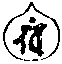
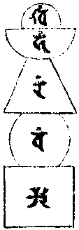
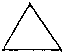

# 慈氏菩萨略修瑜伽念诵法



> **藏经**：大正新修大藏经（大正藏）　**册次** 第 20 册（T20）　**编号** No. 1141（T1141）　**部类** 瑜伽部　**卷次** 2 卷　**篇幅** 16,077 字

> **卷／品**：0 卷 · 10 品



---



## 目录



  - [慈氏菩萨略修愈誐入法界五大观门品第一(并)序](#慈氏菩萨略修愈誐入法界五大观门品第一并序)

  - [昧怛唎(二合)也菩萨修愈誐法奉献本尊香花等品第二](#昧怛唎二合也菩萨修愈誐法奉献本尊香花等品第二)

  - [慈氏菩萨修瑜誐法持诵真言品第三](#慈氏菩萨修瑜誐法持诵真言品第三)

  - [持诵本尊真言法品第四](#持诵本尊真言法品第四)

  - [慈氏菩萨修愈誐法畫像品第五](#慈氏菩萨修愈誐法畫像品第五)

  - [慈氏菩萨略修愈誐大漫拏啰品第六](#慈氏菩萨略修愈誐大漫拏啰品第六)

  - [慈氏菩萨略修愈誐法观一生补处诸佛集会灌顶漫拏攞品第七](#慈氏菩萨略修愈誐法观一生补处诸佛集会灌顶漫拏攞品第七)

  - [慈氏菩萨修愈誐护摩品第八](#慈氏菩萨修愈誐护摩品第八)

  - [慈氏菩萨修愈誐法分别悉地法品第九](#慈氏菩萨修愈誐法分别悉地法品第九)

  - [慈氏菩萨略修愈誐法大三昧耶像悉地品第十](#慈氏菩萨略修愈誐法大三昧耶像悉地品第十)



---



慈氏菩萨略修愈誐念诵法卷上



　青龙寺山林院一切经



------



### 慈氏菩萨略修愈誐入法界五大观门品第一(并)序



大兴善寺三藏沙门善无畏奉　诏译



> 稽首𡲼噜左曩佛，一生补处妹怛唎(二合)耶！  

> 四智四波罗蜜多，八大有情摩诃萨，  

> 五部诸明定慧相，诸波罗蜜男女像，  

> 十方护世天王众，我今尽皆稽首礼。  

> 为利一切修愈祇，速成慈氏大悉地，  

> 为修无生说愈誐，乐求有相兼说相，  

> 有无二相同一体，文字观照实相智，  

> 三种波罗坏无相，身口意业成三密，  

> 三密即成应化法，五轮五智是五分，  

> 五分尽摄法界轮，是故我今礼愈誐，  

> 愈誐即是慈氏尊，是故我今修愈誐，  

> 速证慈氏同一体。



若欲现世不舍色身，速证慈氏宫同会说法得大悉地者，必依此愈誐念诵，必获无上大悉地。若欲依此法念诵，先观净法界心三昧耶，顶上智火轮状如日初出，色赫奕，三角漫荼攞其形如左。



净法界心真言曰：



na　maḥ　sa　ma　nta　bu　ddhā　nāṃ　raṃ



如顶上观三角智火遍身烧尽，五蕴皆空唯有空寂。从中观金刚座，腰已下紫磨方，金刚轮其形如左。



金刚轮真言曰：



na　maḥ　sa　ma　nta　bu　ddhā　nāṃ　a



号曰金刚轮座。



从金刚轮上观水轮，色白如赏佉，其形如满月圆形如左。



水轮真言曰：



na　maḥ　sa　ma　nta　bu　ddhā　nāṃ　vaṃ



号曰水轮。



又从水轮上当心中想智火轮，三角，赤色，尖头向上，号曰一切智心。其形如左。



火轮真言曰：



na　maḥ　sa　ma　nta　bu　ddhā　nāṃ　raṃ



又於眉上观半月仰轮状，若黑风叆叇垂云。又其形如左。



风轮真言曰：



na　maḥ　sa　ma　nta　bu　ddhā　nāṃ　haṃ



又於顶上观khaṃ欠字为虚空，具一切色。其形如左。



虚空轮真言曰：



na　maḥ　sa　ma　nta　bu　ddhā　nāṃ　khaṃ



图五轮形如左。



观五轮及以法界眼图如上。以五智轮严身，普通真言、一切佛心印加持五支，即成金刚不坏无漏智清净法身。以定慧为日月，安置於眼界。以用法界眼观，眼遍照十方界。既身如是，此漫拏攞亦然。以此法界观五轮，先观智火烧除漫拏攞地一切秽恶。其形如左。



智火真言曰：



na　maḥ　sa　ma　nta　bu　ddhā　nāṃ　raṃ



烧除地秽已，下唯有虚空。於虚空中又观空轮。其轮形如左。



观虚空轮真言曰：



na　maḥ　sa　ma　nta　bu　ddhā　nāṃ　khaṃ



又从虚空轮上观风轮，形如仰月，黑色。其形如左。



观风轮真言曰：



na　maḥ　sa　ma　nta　bu　ddhā　nāṃ　haṃ



又从风轮上想火轮，三角，赤色。其形如左。



观智火轮真言曰：



na　maḥ　sa　ma　nta　bu　ddhā　nāṃ　raṃ



又从火轮上想水轮，号曰大悲水轮，白如雪乳色，形如圆月轮。其形如左。



观水轮真言曰：



na　maḥ　sa　ma　nta　bu　ddhā　nāṃ　vaṃ



又从水轮上观金刚轮，方形，黄色。其形如左。



观金刚轮真言曰：



na　maḥ　sa　ma　nta　bu　ddhā　nāṃ　a



如上观五轮了，即以普通真言及印加持於地上，即成真实金刚轮。



又观愈誐海会圣众。漫拏攞图形如左。



如上观五轮及漫拏攞海会已，便诵普通真言，以普通印加持地，便成真实金刚轮大愈誐漫拏攞海会。普通真言曰：



na　maḥ　sa　ma　nta　bu　ddhā　nāṃ　sa　rva　thā　khaṃ　u　dga　te　spha　ra　he　maṃ　ga　ga　na　kaṃ　svā　hā



此真言亦於供养中而成普通供养真言，於五部之中为普供养。其普通手印相者，以定慧二手十轮相叉齐度，即是普通印。若用此印加持身，即成金刚不坏之身也。若加持地上，便成金刚地漫拏攞。如此五轮如上。略观慈氏菩萨修愈誐漫拏攞大圆明内，更观九圆明、八金刚界道。其中圆明慈氏菩萨，白肉色，头戴五智如来冠，左手执红莲花，於莲花上畫法界塔印，右手大拇指押火轮甲上，餘指散舒微屈风幢，种种宝光，於宝莲花上半跏而坐。种种璎珞天衣、白带镮钏庄严。於八圆明中安四智三昧耶等，下漫拏攞品中一一分明。如上观以，便作三昧耶辟除护身结界等事，次第而作之。



次说三昧耶真言曰：



oṃ　va　jrā　ja　li　sa　ma　ya



其手印相，以智定二手十轮相叉合掌，诵明五遍加持五处，便成三昧耶身，此名一切佛心三昧耶印。因以此印生一切印故，先作三昧耶印。



金刚部三昧耶真言曰：



oṃ　va　jra　va　ndha　tra　ṭ



其印相，作前金刚合掌印，便成合作拳，系置心上。当系心腑时，诵明一七遍，散其合拳双下三系。此名结金刚界印。三系心已，由是真言及印力故，能净三业坚固母地心。



次於持诵处遣除秽触及为障者。凡献香花涂香末香并诸供具，辟除去垢，清净光现增威作金刚界。结诸方界护身及伴、护居住处，如上所说。有未详，临事要须一一皆诵真言作印护持，能使成就无诸障难。当用降三世尊明王真言及手印而作加持，各能成办诸事业等。



次诵降三世尊明王真言曰：



oṃ　ni　su　mbha　va　jra　hūṃ



此名降三世明王真言，成办诸事者。其印相，以智定二手各为拳，竖其风幢，掘大空轮入掌内，以地水火轮三轮押之即成。其印以定手印置在心上，以智手印用触诸物，及结地界四方四隅乃至上下等方，右转三遍，指上下便成。结十方界讫，次警觉本尊及一切诸世尊四智四波罗蜜多，从三昧耶起观瞻愈𬿠者，愍念懃苦忆昔本愿降赴道场。



警觉真言曰：



oṃ　va　jra　ti　ṣṭa



其手印相，以智定二手地轮钩锁相连，屈其大空令入掌中，以水轮及以火轮双押大空轮，风幢向前相著，以掌向上，便诵真言七遍。以印从下发起请本尊，是名发起本尊之印也。



发请本尊真言曰：



oṃ　va　jraṃ　sa　ma　jaḥ



其手印相，以智定二手相叉作金刚拳，不解此拳以智风幢拨智大空，定手亦然。如是三弹指，诵明一七遍，即成发请。凡请诸尊定法，心想本尊在覩史陀宫珊瑚殿上，普现色身三昧耶起，从珊瑚殿上白宝阶道场降临道场。其形如左。



大圆明内更有五圆明，四隅四半月轮、八宝塔、四金刚轮、四金刚杵界道。其中圆明，本尊慈氏菩萨。次四面智波罗蜜多菩萨，四隅四内供养等菩萨。其圆明外边，旋智火光焰从空而降其圣者等，皆头戴五智如来冠，各执本印契，半跏而坐。其慈氏等尊亦如上说，左手执红莲华，於华上置法界塔印，右手作说法之印，如上是也。庄严如上，想已便迎请本尊。



请本尊真言曰：



oṃ　va　jro　ku　śa　jaḥ



其手印相，以智定二手各作金刚拳，竖二风幢，以智腕置定手腕上，向外作钩形。而作此印已，诵明一七遍。三召请既蒙来赴，次请入道场。



请入道场真言曰：



oṃ　va　jra　pa　śa　hūṃ



其手印相，以智定二手作金刚拳，竖二地轮，二大空交结右押左。既奉请入已，诵明一七遍，便辟除尾曩夜迦，示三昧耶依请而住。



请住真言曰：



oṃ　va　jra　ghaṃ　ṭa　aḥ



其手印相，以智定二手作金刚拳，竖二地轮，屈二大空轮双入掌中。上来发请乃至欢喜，令坚固而住，真言一七遍。



坚固真言曰：



oṃ　va　jra　spho　ṭa　vaṃ



其手印相，智定二手相拍，便成坚固印。



次应灌沐本尊及己身。灌顶真言曰：



oṃ　va　jra　mo　ka　ṭaḥ



其手印相，以智手水轮与大空轮相捻，餘轮直竖按水器上，想沐浴本尊，以印洒尊及己身顶上。奉献遏啰伽(二合)香水，想灌本尊顶，用此印并诵真言三七遍。



------



### 昧怛唎(二合)也菩萨修愈誐法奉献本尊香花等品第二



复次所有水陆所生香花、宝灯、涂香末香、烧香散花等，各以本尊真言加持一七遍，以用奉献。先奉烧香。



奉献烧香真言曰：



oṃ　va　jra　dhu　pe　aḥ



其手印相，以智定二手作金刚拳按其香炉上，持诵真言经二七遍，即成真实香云，遍满十方一切世界无所不至，广作佛事。



次奉献妙花。奉献妙花真言曰：



oṃ　va　jra　pū　ṣpe　oṃ



其手印相，以智定二手作金刚合掌，用加持诵真言经一七遍，即成真实宝花，满十方世界，作大佛事，成宝花三昧耶身。



次奉献宝灯真言曰：



oṃ　va　jra　ni　pe　dīḥ



其手印相：以智定二手作金刚拳，竖二大空置於心上，持诵真言经一七遍，便成宝灯、香灯、莽尼宝灯、苏灯、香花灯等，遍满十方一切世界，普献智灯供养。



次奉献涂香真言曰：



oṃ　va　jra　ga　nvo　gaḥ



其手印相，以智定二手覆掌散舒八轮，以右手大空轮押左大空轮上，持诵真言经一七遍，即同涂香三昧耶菩萨，遍周法界无所不至，供养一切诸佛菩萨摩诃萨。如上诸供养香花，灯，涂香等，皆同本三莽耶身无所不至。



次当归依三宝，次当出罪忏悔，次当随喜功德，次当劝请功德常住，次当发母地心，次当赞叹佛功德，次当赞叹发殊胜上愿，次当运心供养。



其归依三宝者，云：「愿我从今身乃至当坐母地道场，归依如来无上三身，归依方广大乘法藏(礼三拜)，归依一切不退转菩萨大有情众(礼三拜)。」应当如是归依三宝。



其出罪忏悔者，云：「自从无始已来，乃至今日烦恼覆缠，又流浪生死，三种业障造罪无边。今日诚心发露忏悔。」应当广忏令使罪灭(礼三拜)。随喜功德者，云：「三世如来及诸菩萨，为众生故修无量功德。所有功德，我当随喜(礼三拜)。」



劝请常住者，云：「唯愿诸佛久住於世间，依愈誐理趣无住空啰(二合)。复请转大法轮，遍十方净土。」



发母地心者，始从今日乃至当坐正觉道场，誓发无上大母地心，誓度无量诸有情类，皆令免离生死苦海。今所发心，复当远离我法二相，我法平等无自性故。应当知是发母地心，以真言加持，令母地心坚固不退。母地心不退坚固真言曰：



oṃ　bo　dhi　ci　tta　mu　tma　da　yā　mi



其手印相，以智定二手作合掌金刚，以发母地心真言加持，诵一七遍。



次当赞叹者，云诵赞叹真言曰：



ka　ma　la　mo　kha　ka　ma　la　lā　ca　na　ka　ma　lā　sa　na　ka　ma　la　ha　sta　ka　ma　lā　bhaṃ　mo　ni　ka　ma　la　ka　ma　la　saṃ　bha　va　sa　ka　la　ma　la　kṣā　la　na　mo　stu　te



次当发胜上愿者，云：「愿诸众生多饶财宝，悲常当勇施，具足智慧，常怀大忍，作善因缘，得宿命智，悲念有情。愿诸众生所生之处，获如是种种胜事。」



次当运心供养。以心运想水陆诸花无主所摄，遍满虚空尽十方界。及以人天上妙涂香海云、烧香海云、灯明海云，幢幡宝盖、种种鼓乐、歌舞伎唱、真珠罗网、悬诸宝铃、花鬘白拂、微妙磬铎、宝绳罗网、如意宝珠、衣服之云，天诸厨膳上妙香美、宫殿楼阁宝柱庄严、天诸严身头冠璎珞。如是愈𭔈运心遍满虚空，以至诚心如是供养最为殊胜。是故行者以定心而行此法，运心供养，诵持真言及作手印，如上所想皆悉成就。



运心普通供养真言曰：



oṃ　sa　rva　thā　khaṃ　u　dga　te　spho　ra　he　maṃ　ga　ga　na　kaṃ　svā　hā



其一手印相，以智定二手作金刚合掌，置於顶上，诵此真言经一七遍，即成就诸供养具。以真言及手印护身五处，又於手印上想一宝莲花，花上想普通供养种子字捡字是也。如上所想，一一皆从此一字流出。以印置顶上，想字作黄金色，放五大色光明，名供养种子字门。



------



### 慈氏菩萨修瑜誐法持诵真言品第三



若欲求慈氏菩萨速证悉地，不变肉色身，面视慈氏，摩顶授记悟无生忍，入普现色身三昧者，以昧怛唎(二合)也菩萨法界印加持本尊及己身五支，便成悲氏真体。法界手印曰，交叉二地水轮於掌中，以二风幢各在火轮背，令头著火轮甲下，以二大空竖捻二火轮上节文，其二火轮相离一寸半许，开二空轮来去即成。又慈氏菩萨以法身印真言加持本尊及愈𭔈者，加持五支，即成清净法身。慈氏菩萨法身印曰，以地水二轮相叉屈入掌中，开二火轮，竖二风轮相背，屈二空轮双押火中文，火开一寸半许，风幢来去，即是慈氏菩萨法身印。



慈氏菩萨根本真言曰：



> na　maḥ　ra　tna　tra　yā　ya　na　maḥ　ā　ryā　va　lo　ki　te　śva　rā　ya　bo　dhi　sa　tvā　yama　hā　sa　tvā　ya　ma　hā　ka　ro　ṇi　kā　ya　ta　dya　thā　oṃ　mai　tri　maitri　mai　tra　ma　na　semai　tra　saṃ　bha　ve　mai　trū　dbha　ve　ma　hā　sa　ma　ya　svā　hā



上件真言同两印用之。以真言印加持本尊五支及愈誐者五处，即成法身。然后入大慈生心三昧耶，真言印即是本尊之体。



次观本尊慈氏菩萨住发生普遍大悲心三昧耶。真言曰：



na　maḥ　sa　ma　nta　bu　ddhā　nāṃ　a　ji　taṃ　ja　ya　sa　rva　sa　tvā　śa　ya　nu　ga　ta　svā　hā



其心手印相，以智定二手虚心合掌，以二风轮屈在二火轮下，餘如依旧。以印加持五支，即成慈氏菩萨真身。以印印本尊及愈𭔈者五处，然后执数珠合掌顶戴，两手当心执珠念诵观本尊，心上圆明中布列本尊真言字，一一分明皆放火光，逐日转之。如下图。观a遏字变成法界塔，在於圆明中，又转变塔成慈氏本尊身。即此尊身即是愈𭔈者身。是故三密转成三身，故以心置心、以心观心，如实知自心，即是母地心，初发心时便成正觉。此心发时，便成普现色身三昧耶身。如是住心安布字轮，轮转字轮了了分明，从愈𭔈者口出一一真言字，安布本尊心月轮中。从本尊心圆明中流出真言字，入愈𬿠者顶上，遍诸毛孔流出甘露乳光三昧耶。即此三昧耶变成大圆明。修愈𭔈者在其中心，如是观之为限。先观圆明中心a遏字名种子，即是本尊身，然后诵真言。或观己身即是本尊坐於大圆明中，自心上复置圆明，如上安布真言轮，转渐广大遍周法界为一体性。从愈𭔈者心圆明中流出a遏字，入本尊心圆明上；从本尊心圆明上流出a遏字，入愈誐者心中。如是渐渐澄滤即同一体，一一字皆成诸戒定慧解脱三昧耶形像。又本尊心圆明上a遏字变成本尊身，观修愈誐者顶上；又修愈誐者心圆明上a遏字变成修愈誐者身，观本尊顶上；如是展转周遍法界，成无尽法界普现色身三昧耶身。以真言轮安布轮转至於乏极，常作如是观，若念诵欲毕渐渐少。复还本身，以真言印加持五支，然后复从初供养香花遏啰伽(二合)等真言手印，一一如法次第广作，发弘誓愿、出罪、回向等，一依如初方便广作发露忏悔等，尽力而作了，然后随意。本尊依前，运想七宝阶道，从道场所出於都史陀天宫善法堂珊瑚殿上，以车辂奉送慈氏菩萨并诸眷属、无量天众围绕而去。



奉送本尊真言曰：



oṃ　va　jra　mo　kṣa　muḥ



其解界送本尊印者，以智定二手相又作金刚拳，向顶上解散，是名能所结界解之，亦能成办发遣奉送本尊等。随意送本尊已，重更结护道场兼护己身印。又略观己身为本尊身，於大圆明中而住坐。复观自心圆明中a遏字无生之义。若乏困后，任出道场作诸事业，以木印塔印沙印水等，或浴洗像接人十事，转读三乘昧怛啰(二合)也经及慈氏本愿经、大钵啰(二合)𭋵经，乃至本尊法等。每日三时，念诵作法观行等事。言三时者，从后夜至斋时、从午时至未时、从初夜至三更。常作如是不得间断即障生也。所说真言有八种义：一者真如性一体之义，所谓无生无灭、无来无去、离言离相、言语道断、心行寂灭，本来净故。二者随想流出相成义。何以故？以性净故、应化相应义故。三者加被护念义。何以故？以四种不可思议力故，所谓业力、佛力、真言力、药力等护念成熟。四者随诸众生所求不同义。何以故？本愿如神药，随服应念成就故。五者慈悲义。何以故？慈悲证此法故。六者以佛愿度有情义。何以故？随心应像故。七者以诸菩萨度有情义。八者一切诸佛不思议义。何以故？真言不思议力，亦成无上不思议果故。恒具八义，常顺真言如意法，如宝珠所求皆得，有相无相悉地皆得成就故。是故名为真。以真无言，如言如相是真言也。手印相者，谓誓教法。即如国王勅级印文验，随所行处无人敢违乖。承此如来誓教法印亦复如是，一切凡圣及诸天龙恶魔鬼神皆不能违越。又复如奉勅使一人去，虽有愆过，以奉进止，无人敢违。此如来教勅亦复如是。等诸佛教慈氏甚深法印，即以在凡夫不知不觉，虽有少分不顺法处，以此法力诸圣加被渐离烦恼，随此法印随所作处，乃至诸佛及诸佛金刚必不敢违越，何况天人诸鬼神等。复次此法如神药树，随触及取即离诸病，及身腾空飞往随意自在。此法亦然，以法力加被，同证自在如圣本尊，是故名为法教印也。复次若有善男子善女人，若依此法印行持供养，从此生已乃至成佛，永离下道所生之处，更不堕落三恶道处。以法印加被故恒为护念，令断烦恼渐证彼岸也。



　青龙寺山林院一切经



昧旦唎(二合)也菩萨略修愈誐入法界五大观门品异本卷上(上青龙等九字，此下夹注)



大中九年九月五日，於长安城右街龙兴寺净土院云居禅知房，请左街青龙寺法全阿阇梨本，抄写并勘定。日本国求法沙门圆珍记。



慈氏菩萨略修愈誐念诵法卷下



青龙寺山林院一切经



大兴善寺沙门三藏善无畏奉　诏译



------



### 持诵本尊真言法品第四



复次此法不思议力如如意宝，如意宝虽无所言，随所愿处必不违愿。此如来法印亦复如是，虽无言无相，作一切法必得成就。此是法力不可思议故也。



复次此法若奉持者，虽在凡夫未断烦恼，以法力故，随所作处等彼圣力，驱使诸贤圣及诸天龙八部一切鬼神皆不敢违，以法印力不思议故也。



复次此法随所行处，或印己身成彼本尊身，或印他身亦随他身随作而成。譬如拙人手执诸佛菩萨印，印於泥沙及皇等，皆成诸佛菩萨像，随印成诸形像。此法印力亦复如是，虽未得悉地，以执诸佛法印之力，依教而行便成本法。若执法界印印於己身，即成本尊慈氏真言体。若以𡲼噜左曩法印印於己身，亦成𡲼噜左曩之身。乃至应生诸菩萨莽贺萨埵、诸天龙八部乃至人非人等之身，随所印相即成本身，印己印他皆成本体三昧耶之身。虽凡愚不见，一切圣贤、天龙八部、诸鬼神及尾那夜迦皆见本尊真身。诸护法明王等为此亲近，俱相助成悉地速得成就。若持真言者、若见闻觉知者，乃至供养亲近承事伴侣等者，即同供养一切诸佛及诸贤圣。如是真言及契印等之法不可具陈，一劫二劫乃至无量劫说不能尽。若修愈𭔈以等，依此法印供养持诵，香华饮食随所供养处，诸佛净刹诸天龙鬼神等诸有情类，随彼运心亦顺印法必得悉地，准此供养随心顺印令成彼事。如是应知一切行，同六度万行及四无量心、七觉分、八圣道分，及诸八万四千恒河沙法门。随所作处，即顺彼印即成彼法。是故此法印义难信难解，除佛菩萨之所能知。且论不动明王刀印，左手应女相，应三昧慈悲相义；右手应男相，应智慧简择善恶雄猛想义。将右手智慧刀入彼左手三莽地门鞘令成印，随所印处令成法事诸度门等。如是真言印契穷劫说不可尽，唯佛与佛乃能说之，秘密主菩萨亦不能知之。



------



### 慈氏菩萨修愈誐法畫像品第五



复次我今略说愈誐者，欲得速成就悉地者，必须知法。畫像人与受三昧耶灌顶，出入澡浴、著新净衣，取白㲲及细布绢乃至绫帛极令清净，以龙脑香末和麝香胶水洗之，且所用彩色皆和龙脑香及香胶和之，不得用皮胶等，大小任意。取吉宿直日，鬼宿为胜。依如上造像而求悉地者必获成就，除不至心。图如左。其畫像取白㲲布绢等，随意大小，亦不得还价。中心畫大圆明。就大圆明中，更分为井。中心五圆明，四隅畫四半月。圆明中间用十二金刚界道，一如常法，每金刚头上安窣覩(二合)婆法界之印。中心置本尊慈氏菩萨，首戴五如来冠，左手持莲华，於华上置法界塔印，右手作说法印，结跏趺坐。於本尊右圆明中畫事业波罗蜜多菩萨，左圆明中畫七宝波罗蜜多菩萨，前圆明中畫法波罗蜜多菩萨，后圆明中畫金刚波罗蜜多菩萨，东北隅半月中畫花波罗蜜多菩萨，东南隅半月中畫灯波萨蜜多菩萨，西南隅半月中畫香波罗蜜多菩萨，西北隅半月中畫烧香波罗蜜多菩萨。又大圆明下右边畫降三世明王。半月轮漫拏攞中身色奥青，三眼四牙大瞋怒形，屈左脚向前，拽右脚向后，於轮中如走势，四臂，两手结三昧耶心钩印向胸心上；左一手曲向耳上把金刚钩斧，右手直向顶峻下把五股𭭯耽啰(二合)，周旋生火。首冠五智冠。闭口左边畫三角形漫荼啰，於中畫不动尊，顶有七髻，垂一发於左耳轮，咬右边唇，怒开左目，右目稍似合，头稍低向右，半跏趺坐盘石七宝金山。右手把金刚刀，周旋生三昧火焰，屈於右膝上。左手屈臂向外，执金刚索。身上周围生三昧火焰。上件二明王，以天衣朱裙、璎珞环钏、白带庄严。又两明王中间畫香炉宝子。右三世明王下畫圆明，於中置修愈誐者䠒跪，手执烧香炉。於大圆明上畫七宝伞盖，两边各畫三个首陀会童子，半身，满五色云中，以香花炉涂瓶花枝等散於佛上。畫像法如上，一一皆执本印契，形状色貌勿令相违也。



复次我今更说修愈𭔈者，速令成就大悉地故。先观一生补处菩萨最胜大三昧耶像，号曰莽贺妹怛唎(二合)耶三昧耶，亦名慈生三莽地，亦名慈生三昧耶。像端正微妙第一，色如赡部洲檀金色，畫像深赤黄色是也。首戴五佛智七宝冠，种种璎珞庄严，天衣环钏、鬘花呪索、真珠缓带白带发袋等。於大圆明中畫大百宝莲花，於莲花上结跏趺坐入三昧凝定，面貌慈软含笑，具三十臂，各执宝莲花，於莲花上皆执本印契，各表三昧耶不同。有种种身光，顶背亦尔。初左第一手执莲花，於莲花上畫法界塔印。右第一手执金刚拳，舒风幢指右颊，令不至三分许。次左第二手持莲花，於莲花上竖畫七宝金轮。次右第二手作金刚拳，亦舒风幢，横旋弄三股𭭯耽啰(二合)。次左第三手，准右手竖旋弄五股金刚杵。右第三手执金刚钩。次左第四手执莲华，於莲华上置金刚羂索。右第四手倒畫宝螺，如旋弄五股杵形。次左第五手持宝幢幡。右第五手执莲华，於莲华上畫七宝宫殿。次左第六手执数珠。右第六手执莲华，於莲华上置羯磨金刚。次左第七手持莲华，於莲华上置宝金刚。右第七手执莲华，於莲华上置法金刚。次左第八手持莲华，於莲华上畫如来毫相三昧耶。右第八手执莲华，於莲华上畫如来眉形三昧耶。次左第九手执莲华，於莲华上畫如来眼三昧耶。右第九手执莲华，於莲华上畫如来鼻三摩地形。次左第十手执持如来耳根三昧耶及三莽地印。右第十手持莲华，於莲华上畫如来舌根三昧耶。次左第十一手持如来口三莽地。右第十一手持莲华，於莲华上畫佛心三昧耶。次左第十二手持莲华，於莲华上畫如来脐三摩地。右第十二手执莲华，於莲华上畫如来马阴藏三摩地。次左第十三手持莲华，於莲华上畫如意摩尼。右第十三手持如意棒。次左第十四左执如意宝剑。右第十四手执如来宝镜。次左第十五手执莲华，於莲华上畫宝师子。右第十五手把金刚杵铎。



已上如是三十手，皆以金刚拳执宝莲华，於莲华上置印契，皆以系天带光焰绕之，及以天衣种种庄严像。左右皆畫十钵罗(二合)𭋵波罗蜜多菩萨，前后复畫内外八供养菩萨等，各执本契住於圆明，皆向慈氏本尊而恭敬相。上下诸庄严供养具，并畫持真言者皆如常法。我已略说莽贺怛唎(二合)耶三昧耶像法竟。



复次更说入三莽地。省略一尊慈氏之像，取一幅绢畫圆明，於圆明中心畫本尊慈氏如来，结跏趺坐如入三莽地形。有两臂，又从手掌持一宝莲华台，於莲华台上畫𡲼噜左曩佛塔。於佛塔上畫大日如来通身宝光，皆从光中又化出诸佛世尊，如钵罗(二合)𭋵佛母菩萨像，以诸佛为光。上下庄严，一如前同。对像持诵，速得悉地也。



------



### 慈氏菩萨略修愈誐大漫拏啰品第六



复次我今为修妹怛唎(二合)耶法速令证得大悉地，是故略说悉地漫拏攞法。先简择吉宿直日与本法相应，择取胜地已平治，取净土填实平正，以瞿莽母移及瞿莽母怛啰(二合)并和沈水、香末水加持而涂。乾讫，次取龙脑、欝金香相和，以真言加持，更涂中心，皆以真言加持。量取十肘或八肘五肘，乃至最胜四肘。若十肘者，五肘为中心圆明，五肘分为两边。若八肘者，取四肘为两边，四肘为中心圆明。若四肘，分二肘为中心，二肘分为两边。外两院，圣是也。又四面二肘分为两院。中心大圆又更分为九圆，每圆中各畫佛菩萨等。其中心更分为九圆，於中心及四面四圆畫本尊及佛为中心，各有四波罗蜜等菩萨，四隅半月轮各畫四供养菩萨。最中心本尊，四面四波罗蜜，四面四圆四方佛，各依本部四智波罗蜜菩萨。四隅，四内供养。四圆，各依四部四印母地菩萨。四隅，随四方畫本部四摄及外供养印。以八金刚界道，每金刚界道上畫法界塔印及八宝瓶等，一依如常以鲜花插之。又第二院分为三道，第三院亦如此。两院界道，从外第一安位坐圣众，第二位下食饮食等供养之位，第三院分作案行行食来往位道。第二院从外畫白黄赤三道围之，表三戒定慧之义，亦是三身之义，亦是三解脱之义。第三院最外白黄赤青黑之五道围之，表五智之义，亦是五分义，亦是五轮之义，亦是五部之义。通前成八解脱之义。中胎表十一地方便为究竟智，遏字之义也。第二院直东畫𡲼噜左曩如来，左边畫虚空眼三莽地菩萨，右边畫如来毫相三莽地菩萨。又左边畫妙吉祥童子菩萨，右边畫普贤菩萨。又左右畫八大佛顶轮王。各依位次畫之(已上十二尊位如法畫之)。



北面直北畫观自在王菩萨，左畫得大势至观自在菩萨，右畫部母白处尊观自在王菩萨。又左边畫忿怒观自在王菩萨，右畫随心观自在王菩萨。又左畫一髻观自在金刚，右畫马头观自在金刚。又左右分畫七吉祥观自在菩萨。各依次第，如法畫之(已上畫十三位如法畫之)。



南面畫执金刚藏王秘密主菩萨，左畫金刚母菩萨，右畫金刚钩菩萨。左畫金刚拳菩萨，右畫金刚甲菩萨。左畫金刚锁菩萨，右畫金刚槊菩萨。左畫金刚牙菩萨，右畫金刚忿怒月黡王菩萨。左畫金刚甘露瓶菩萨，右畫金刚铃菩萨(已上十三尊位如法畫之)。



西面开门，门左边畫降三世尊明王，右畫不动尊明王。左畫千手千眼观自在菩萨，右畫如意轮观自在菩萨。左畫虚空藏菩萨，右畫地藏菩萨。左畫除一切盖障菩萨，右畫十一面菩萨。又门左右畫难陀龙王及拔难捺愈龙王。以守护门者，各依左右次第而畫，本印作之(已上八尊，一边置四尊)。



如上四面四角空间处，畫四外供养菩萨、当部诸明王等尊，各依本部使者如法安置，次第畫之。次第三院东面从东北角畫大自在天王兼眷属；次南畫东方天，以七曜围绕之；次畫大火德天王。次正门畫能仁天王，次畫日天子，七曜围绕之，次东南角畫火仙像。以西畫那罗延天王，次畫尾噜荼迦天王。次正门畫焰魔法王，次畫大黑天，次畫鬼子母女天。次西南角畫啰讫洒(二合)莎王。次北畫尾噜博讫沙(二合)天王，七曜围绕之。次畫月天子，七曜围绕之。次门南畫水天王，次门北畫地神天。次正门畫地神天王，次畫大辩才天女，次畫阿素罗王。次西北角畫风天女。次东畫蘖单拏王，次畫药讫沙王。次正北畫多闻天王，次畫大功德天女，次畫青目天女等。如上所说十方天王众法界神众，一一布列畫之，各执本三莽地契，形状瞋怒、喜笑、慈悲、柔软等面目，天衣珠鬘甲胄环钏。形势一看临时，就四种法中。如上佛菩萨金刚天众，一一依本法相应作之。随四种漫拏攞，方圆、三角、半月等，随法作之。其漫拏攞大小，任意作之，分半为中圆，半为两边，一一次第置之。又於半取两边分为两院，又就两院中每院分为三道。从外第一分安置圣众，第二分下供养饮食香花灯涂菓子等，第三分办事者下食等往来之位开面门，三方闭。若十肘已上门，四门宝瓶二十一个。中院安立五个瓶，外两院各安八个，四每院角四方各安一个。蜡烛准此数，安置香炉亦准瓶数。用苏灯九盏中院安置，外两院各四十九盏灯，都九十八盏。菓食及三白食椀等，中院九个，外院各准香炉数同。五色彩帛，五方镇坐。𠋆施物等，中心五方、外院各四方四角安置之。本尊倍加食饮，施物皆加供养。所献之物皆辟除垢秽，今光显清净然后供养。若不办上法供养，中下亦得。若中漫拏攞畫印契。若下漫拏攞单畫莲华台，上畫种子字。若更事急不得广办漫拏攞，单畫名字亦得。其瓶不能广办，都五个亦得。若造五色粉坛亦得，供养皆和龙脑、欝金香末，加持作法然后捻用之。餘事准上法同。我已略说慈氏大漫拏攞法竟。



------



### 慈氏菩萨略修愈誐法观一生补处诸佛集会灌顶漫拏攞品第七



我今略说观一生补处菩萨，於知足天上诸佛集会。观一生补处菩萨顶上，十方一切补处菩萨诸佛集会亦复如是。且观一世界为一漫拏攞会，於弥卢山顶。上至有顶，下及金刚轮际，为一道场宫。知足宫为中心，中心三重为圆曼拏攞，外两重为方漫拏攞。中心第一圆内更分五圆，四隅四半月，皆置五尊。一一界道以宝柱，上置法界塔印。其中圆明外，佛向外礼十方本有法身佛。又大圆明内慈氏如来，礼我本有法身佛。



第二院置十方诸佛云集之像，皆执袈裟角印。第三院置诸大菩萨云集之像，其佛皆左手执袈裟角，为金刚拳置脐下，右手曲臂向嬭上，展五指飏掌。第四院方坛，十方诸佛兼菩萨及二侍者，八大菩萨各二侍者，八大明王并诸侍者，悉地仙众并侍者，八大声闻及四大缘觉等众，皆依本法畫之。第五院准上漫拏攞置二十八天，及诸三十三天十方结护天神王等。又置七曜二十八宿十二宫辰，一一依本像法。次第如法畫之，皆执本印契。图如左。



其素名噜山腰，以难陀、拔难陀龙王相绞三匝盘。腰上如天人形，头上有九头蛇头。腰已上以天形像，两手合掌仰观天上。宫中日天子妃、月天子妃，及五星、十二宫、二十八宿等，一一如法畫之。又从三十三天能仁主王乘白象王，无量诸天围绕，诸遏素啰兵马军众。又从七金山间及诸遏素啰王，各将诸鬼兵打於天众。唯此起世经论中具明，不繁更说。



又世尊从忉利天降七宝阶道，从天降阎浮提像，四洲王并妃形，皆如本方。



又七金山间甘露香水等海，其中诸圣而居。又诸金山中从皆有诸贤圣。地前四十心贤圣，十住、十信、十回向、十行等。大独觉众，并诸大阿罗汉众、四果圣人众。诸大龙王等众。遏素啰、蘖噜拏、紧捺攞、莽虎啰誐、人及非人，遍满七金刚山中，无处空间。皆是宫殿。其七金刚山外铁围山间，洲并诸小洲，各各同类眷属。铁围山中，处处地狱、饿鬼、铁鸟、毒龙，遍满山中。



若欲造次大三莽地像善成就者，如上依法畫已，作法求悉地，持诵三落叉。遍於像中心放大光明，便抱愈誐者畫像处，一时腾空住都史陀天宫，面覩慈氏如来，摩顶授记。若欲具说，穷劫不尽。我今已略说观一生补处慈氏菩萨集会灌顶坛法竟。



------



### 慈氏菩萨修愈誐护摩品第八



复次我今略说四种念诵及护摩等法、次第等略说。准前念诵本尊真言，依法一一不违法则，满三落叉遍。每至落叉数，更加如法供养。三十万遍数满已，即祈境界，即得本尊指授，作四种念诵。其四种念诵者，初夜为除灾念诵，每真言上下加萨𭭯(二合)贺二字。中夜为降伏诸魔念诵，每真言初后加虎𤙖(二合)蕟咤(半音)三字。从后夜至明日出时号曰增益念诵，每真言首末称纳莽二字。日中为摄召念诵，每真言首尾唱纥唎(二合)纳莽三字。其漫拏攞、火炉、坛形，方圆、半月、三角。图如左。



四色，黄白青赤色等，依次第等配之。一切诸供养，香花灯涂饮食等器物，皆准坛色献之。若八肘已下，坛用十四个宝瓶，香炉亦准此数。若四肘坛者，用五宝瓶香炉等。若十肘已上，坛用三十五瓶或二十一，诸物准此。其瓶及五谷、五宝、香末并花，水滤用之，插诸生花，菓谷随方五色彩。一切供养物等皆以辟除法结护加持，然后献之。其护摩柴薪，用枫香木为柴，楪木柏、诸菓木、句路草等乃至苦练木等。若作四种法中，各随本法相应而为柴薪。其火炉坛，方圆、三角、半月坛等。量取四肘，中心掘方圆一肘，深亦一肘，缘高八指，阔四指。缘外更安高二寸重缘。其诸支不可具说，准《苏悉地经》用之。其火色，与本色相应即好。其持念人，手把办事𭭯耽啰(二合)及金刚铎母地子念珠或水精珠，随四种念诵用之。其杵铎作之，用五种，一金、二银、三铅锡、四𨱎石、五好宾铁等是，并安梵字、真言种子字。如是作者，名为办事。𭭯耽啰(二合)常随其身，每念诵持执持作业。我已说四种念诵护(引)忙等法竟。



------



### 慈氏菩萨修愈誐法分别悉地法品第九



我今略说修慈氏菩萨摩诃萨速证悉地不化肉身往慈氏如来宫中，见慈氏菩萨摩顶授记，一时下阎浮提同会说法者。或若一生中从初念诵，至於越三无数劫行，即证一生补处三莽地。越一百六十种心三度，即是度三遏僧祇行，即是无相悉地。若有相悉地者，即本尊指授。求如是初作、如是悉地，即证五地。八地已来真言菩萨，或现身往知足天上见慈氏菩萨。其所成就物者，众多无数不可具陈，今省略之。𭭯耽啰(二合)者，或金、银、熟铜、宾铁、白檀木、紫檀木等五金铸，或五股、四股、三股、二股、独股等。临事取本尊授记如上等物，如法加持念诵。三相具现，即得成执金刚菩萨，往慈氏宫，得见本尊与摩顶授记。



若求事法中，或求本尊悉地者，即取金、或、银水精、马脑、颇梨、或白檀木等作法界塔印，即安七粒舍利骨，作法念诵三落叉满。其坛上放大光明，照愈𭔈者顶上，便得大悉地形若七岁，具足相貌，证慈氏身。须臾之间往至十方世界一切知足天宫上，见慈氏菩萨莽贺萨埵，得摩顶授记，作大佛事遍十方世界。分一身为无数身大作佛事，若干世界分身度众生，无尽修行、无尽成佛。处慈氏宫珊瑚法堂，广作佛事随意自在。



若求如意莽尼珠法者，取颇梨、马脑、水精等珠极明净妙者，加持念诵满三落叉，三相具现，即得如意悉地法。满十方世界雨诸七宝施与众生，供养一切诸佛菩萨，随意自在成就也。



若求如意宝瓶法者，取金银乃至瓷瓶作瓶，可受一升已来。一依畫坛法畫佛菩萨等三重，一层畫之即不著水，满盛白芥子并龙脑香，安置本尊前，诵真言三十万遍。从瓶口上所畫诸佛菩萨形像上、诸天神王等形像上放大光明，照触真言者身上，即得宝瓶上悉地。其白芥子皆变为如意莽尼珠，施与一切众生，所求如意。自在宝瓶仙中为转轮王，待慈氏如来下生，为作第一会主。待贤劫千佛时，皆作为转轮王，千佛皆与授记，与千佛为应身。如是等悉地之法，无量无数，不可具陈。著药物之数亦不可具陈，临时可知。其药物者，一朱砂、二牛黄、三雄黄、四龙脑、五水银，上件药等皆具三种悉地。若得火焰，现飞空自在者，得驮啰尼仙，证入五地菩萨之位。若得烟者，隐形仙中为王。若得煖者，得世间一切所求善事无不随意，多闻辩才，他心道眼无所不通。若求长生不死，唤神仙索仙药吃，亦得如意自在。或得伏藏悉地，或得合鍊悉地，点化无穷，所点铜铁铅锡皆成为金，贫乏众生广施利益。



若木剋作千佛印，若河海洲上印沙为佛塔，剋木像印沙成塔三十万个，每佛每塔前诵真言一百八遍，供养香花，一一如法念诵。最末后塔上放光明，照触愈𭔒者顶上，便得大悉地，证得八地已来菩萨之身。须臾之间，三千大千世界大火德天王、能仁天主等诸大威德天众，八十亿俱胝天众，将诸宝台宝盖、伎乐歌咏赞叹，迎将诸佛刹土广作佛事。现世造十恶五逆罪人，作此印沙佛像塔像，必得大悉地，勿令断绝。其印塔作法，一如西方塔形，中置法身佛像。



------



### 慈氏菩萨略修愈誐法大三昧耶像悉地品第十



如次我今略说成就慈氏大三昧耶像法。一依莽贺三莽耶像法，一一如法或畫或绣、或铸金银、或剋白檀，随取一色如法而造。其像顶上安七粒舍利骨，一依如上持诵，依法作成就。从大三昧耶顶上放大光明，照触愈誐者顶中，入体内外明彻，状如七岁童真之形，证得八地观自在三莽地，便入同一生补处尊身，常说无生三莽地。



复次有一法，取前畫像及绣像等，欲求成就大悉地者，亦得依上例如法念诵三十万遍。於像顶上放大光明，或见像动眼精睛转，便把於像中畫愈誐者处，即身腾空而往十方世界三千大千世界，一时分身皆覩一生补处慈氏菩萨摩顶授记说法。分身无量，遍至十方一切世界六趣之中，皆应度之。若干众生类无不度，不可具说。



复有一法，欲求悉地，乏少一切衣服饮食资具香华等物，若欲办求难可觅故，即妨道也。是故我今略说辟谷服药而求悉地速得成就。其药名曰、桑耳、天门冬、枣肉、豆黄、白木、桂心，又加人参。右如上药等各二两，皆作细末，以白蜜和之，空腹顿服三弹丸，明日减服两丸，后日即减但常服一丸。以枣汤及蜜人参等汤，皆须煎熟汤下之。服药一剂，神仙三十年。再服妙药两剂，得四百五十年。第三剂服，得五千五百年。第四剂服，得四万四千年。第五剂服，得五亿五千年。第六剂服，与天地齐毕。此即名为服药悉地。是故我今略说。智者勿生疑虑心，每至新服药，即须却退旧药，以蔡子汤并乾枣汤煎饮，满腹即止。更取新进以为度。我以略说。



妹怛利(二合)也慈悲忆念本愿力故，降临阎浮支那国，速证愈誐大悉地，亲覩尊颜珊瑚殿上。



> 灌顶说法悟无生，慈氏大日同一体，  

> 𡲼噜左那即慈氏，一生菩萨即愈誐。  

> 自心即是母地心，母地即是慈氏尊，  

> 三种无二元一体，是故我求如实智。  

> 中天三藏善无畏，甘露饭王释苗胤，  

> 五十五殊十三临，任持乌驮释国土。  

> 十八舍位让於兄，度那兰陀脱尘劳，  

> 多闻博学七百数，诵持一百五十藏。  

> 大乘经论皆十万，弃舍多闻修妙藏，  

> 秘密三藏及总持，并解了义一万偈，  

> 明开七种诸圣教，五明轮悉无不通。  

> 有一摩贺支那僧，法号释种喜无畏，  

> 纯陀献供最末后，许可五部阿阇梨，  

> 是故我今略教授，未得许可犹未传。  

> 但求无上大悉地，不从尊者口传授，  

> 辄与一句一偈者，不但现世不悉地，  

> 当来必获无间狱。愿诸持念速悉地，  

> 若人供养此人者，供养慈氏同千佛，  

> 是故我今尽归命，非持诵者所能传。



慈氏菩萨修愈誐法卷下(青龙寺东塔院一切经)



一本奥云：大中九年九月七日珍记。又於同时捡勘之珍记(少疑不少)。



八家录云：行运圆觉加本。然今所校刻之本，奥载智证大师捡勘之记。以之见此，则智证所请来本乎？详今以净严和上点本及异本，挑灯讐校之，锲布普天，而以期珊瑚殿上之嘉会耳时。



元文五上章涒滩十二月朔旦



> 丰山妙音轮下沙门无等

