# 修习瑜伽集要施食坛仪



> **藏经**：卍新纂大日本续藏经（新纂卍续藏）　**册次** 第 59 册（X59）　**编号** No. 1083（X1083）　**部类** 瑜伽部　**卷次** 2 卷　**篇幅** 16,912 字

> **卷／品**：0 卷 · 0 品



---



修习瑜伽集要施食坛仪



(夫欲遍供普济者，䖍恳至诚，严饰道场，随力备办香花，供养饮食净水等，已准戌亥二时施之。饿鬼得食，施主获福。如过其时，徒废精神，於事无益。斯出本教，亦非胸见。今有违者，地方不宁，即此过也。若欲深明所以，请观后注，文备彰矣。　众集定举赞。)



炉香乍𦶟，法界蒙薰。瑜伽海会悉遥闻，随处结祥云。诚意方殷，诸佛现全身。



云来集菩萨摩诃萨，(三遍)。



此一瓣香，不从天降，岂属地生。两仪未判之先，根源充塞三界。一气才分之后，枝叶徧满十方。超日月之光华，夺山川之秀丽。即戒即定即慧，非木非火非烟。收来在一微尘，散处普薰法界。𦶟向炉中，专伸供养。常住三宝，刹海万灵。历代祖师，一切圣众。河沙品类，幽显圣凡。悉仗真香，普同供养。



香云葢菩萨摩诃萨(三遍)。



> 佛面犹如净满月，亦如千日放光明，  

> 圆光普照於十方，喜舍慈悲皆具足。



南无尽虗空徧法界过现未来佛法僧三宝。



登宝座菩萨摩诃萨，(三遍)。



伏以登瑜伽显密之座，六度齐修。开济物利生之门，三坛等施。一心湛寂，全身总是大悲王。三业应兮，脱体俱成𠶹哩hrīḥ字。果然如是，则是因是果，不出自心。自利利他，岂关餘物。化滴水作长河之酥酪，变微食为大地之斛食。於倐忽际，普济大地之饥虗。在顷刻间，利益河沙之鬼趣。若也如斯会得，须当普利群机。其或未然，不免重宣妙偈。所谓道：



> 大宝华王座，人天普护持，我今登演处。  

> 触目即菩提。



南无大悲观世音菩萨(众和毕，行人祝水文)。



夫此水者，八功德水自天真，先洗众生业垢尘，徧入毗卢华藏界，个中无处不超沦。水不洗水，妙极法身；尘不染尘，返作自己。蠲除器界，荡涤坛场，洒枯木而再逢春，洁秽邦而成净土。所谓内外中间无浊秽，圣凡幽显总清凉。(教有密言，谨当持诵。)



(大众同声诵大悲神呪毕，表白举)。



甘露王菩萨摩诃萨(三遍)。



(侍者白：云何梵？)。



> 云何於此经，究竟到彼岸？愿佛开微密。  

> 广为众生说。



净法界真言



(诵真言时调伏身心，想顶脐两处具唵㘕二字，令清净故，以表福智圆满。oṃ唵raṃ㘕)。



唵囕唵㘕莎诃。



点净真言



(诵真言时，用右手无名指揾取香水，弹洒虗空并涂掌，想坛场内外悉令清净)。



唵。哑穆葛。拶啰弥。麻迎。苏噜苏噜。莎诃。



加持花米真言



(诵真言时，手拈花米三次，想成光明，种出生金银碧玉珍宝之云。)



唵。斡资啰𠽾𠵸哑吽。



加持铃杵真言



(诵真言时，手拈花米洒在铃杵上，想成智慧种。)



唵。斡资啰。萨答哑吽。



唵斡资啰看咤哑吽。



唵哑吽(持杵振铃诵)。



> 我今振铃杵，声徧十方处，礼请诸圣贤，  

> 悉皆来赴会。



> 此乃一切诸如来，手中执持金刚杵，  

> 金刚佛母大勇识，我亦恒常而执持，  

> 愿灭有情大愚痴。唵贺啰贺啰吽(三遍)。



> 左手执持微妙七宝铎，洪音振动十方及三际。  

> 梵音嘹喨惊觉魔冤心，摧碎邪妖魍魉诸鬼魅。  

> 右手执持金刚降魔杵，威势力重八万四千觔。  

> 摧坏天与非天魔眷属，普使回光返照而渴仰。  

> 内外冤魔三毒四害等，呪咀魇祷波旬及外道。  

> 三尖火轮遣魔变空力，能使颠倒梦想皆远离。  

> 八方四面忿怒诸天魔，闻我作法谛听而信受。  

> 唧𫩔叭怛秘密妙伽陀，弹指扫荡𠒋恶及祸祟。



十二因缘呪



唵，耶答儿麻(二合)兮，都不啰(二合)巴斡兮，敦的山答塔葛答，歇干怛的山拶约，尼噜怛耶，𠳐叭谛，麻曷释啰(二合)麻纳耶，莎诃



唵，萨哩斡(二合)答塔葛达啰的捺麻曷曼答啰(二合)布拶弥渴萨谟的啰(二合)斯癹啰纳三麻耶哑吽。



(置铃於案，师举五佛冠，众念准提呪三遍)。



> 五方五佛大威神，结界降魔徧刹尘。  

> 今宵毗卢冠上现，一瞻一礼总归真。



毗卢如来　慈悲灌顶(以右手取花米，诵云：)



我及法界一切有情，从今为始，乃至未证菩提之间，誓愿皈依。



金刚上师三宝。



上师三宝真言



捺谟孤噜(二合)毗耶(二合)捺谟勃塔耶。



捺谟达而麻耶？　捺谟桑渴耶



唵哩哩哈哈吽吽癹怛



唵。失哩麻。哈歌罗。哈哈吽吽。癹怛莎诃。



唵哑吽。



(将手持的花米散洒虗空，想所落宝米悉成花香供养等云)。



(抚尺云)。



> 罗列香花建宝坛，重重佛境一毫端。  

> 心融妙理虗空小，道契真如法界宽。  

> 相好慈悲秋月满，化身腾处暮云繁。  

> 香烟堆里瞻应现，万象森罗海印含。



释迦如来　证明功德，(众和)。



观世音菩萨　密垂加护，(众和)。



阿难陀尊者　兴权启教(众和振铃念)。



自性偈



> 方便自性不坏体，金刚不坏大勇识，  

> 最胜无比超出相，今此所作皆成就。  

> 胜慧自性甚深性，演说最上法轮音，  

> 以无生现方便身，今此所作愿得成。



净地偈



> 一切方隅所有地，瓦砾砂碛等皆无，  

> 琉璃宝地平如掌，柔软微妙愿安住。  

> 犹如极乐国庄严，妙宝为地众花敷，  

> 园林池沼无缺少，以大法音愿具足。  

> 从出世间复能现，种种七宝之所成，  

> 无量光明徧照处，诸佛菩萨愿安住。



音乐呪



唵，斡资啰，看支夷(二合)啰纳，啰纳不啰(二合)啰纳，不啰(二合)啰纳，三不啰(二合)啰纳，三不啰(二合)啰纳，萨哩斡(二合)孛答赤的啰(二合)不啰，拶哩答麻曷不啰(二合)尼牙(二合)巴啰，蔑答那达速巴微，萨哩斡(二合)塔哩麻(二合)𠶹哩(二合)达耶，伞多沙纳葛哩，吽，吽，癹咤，莎诃(置铃於案)。



> 六字大明王，功勋不可量，现前清净众。  

> 异口共宣扬。



唵牟尼叭𠺗吽(众同念一百八遍)。



缘起文



切以法不孤起，仗境方生；道不虗行，遇缘即应。今则罗列华坛，阐扬佛事。香焚宝篆，腾五色之云霞；烛绽金莲，灿一天之星斗。法乐奏无生之曲，梵音演最上之宗。归依五眼六通，迎请千贤万圣。由是觉王住世，以法利生。不有因缘，无由垂范。是以阿难尊者，林间习定，夜见鬼王，口吐火𦦨，顶发烟生。身形丑恶，肢节如破车之声；饥火交然，咽喉似针锋之细。见斯怪异，问是何名？答曰：面然。汝三日之中，当堕我类。阿难惊怖，归投大觉慈尊，叙说前因，启请救苦之法。佛垂方便，利济洪深。使延年而益算，诵威德之真诠；令饿鬼以充资，施甘露之法食。加持必专於神呪，严卫须假於坛仪。虽然，启请一时，法传千古。金山修建，不烛自明；摩伽斛食，施周法界。若无灵騐，今古焉传？有是功勋，方堪演说。梵音演处，上穷有顶之天；唐韵宣时，下极风轮之际。欲明圣理，故白斯文。佛事完成，同归真际。　偈云：



> 最胜光明自在王，如来宣演妙难量，  

> 昔因庆喜生惶怖，𦦨口雷音报祸殃。  

> 稽首殷勤白教主，兴慈济物利生方。  

> 如今稽古重拈出，凡圣同游解脱场。



(以右手无名指取香水，弹洒曼拏啰上)。



唵，斡资啰(二合)麻明哑吽(弹三遍)。



(以右手无名指取香水，於曼拏啰上右旋作一圆相，表福智圆满故。)



唵，斡资啰(二合)，乌怛葛，哑吽。



(就念真言一遍，作圆相一匝，次加持花米成光明种，如用之时，悉成如意珍宝供具。)



唵，斡资啰(二合)普弥，哑，吽。



(念真言时，以右手拈花米三次毕，次双手拈花米放曼拏啰上，右旋散洒，如空注雨。)



(轮围山　铁围山)



唵，斡资啰(二合)哩契哑吽(右呪俱七遍)。



金刚地胜金刚地，基吽字而作拥护，



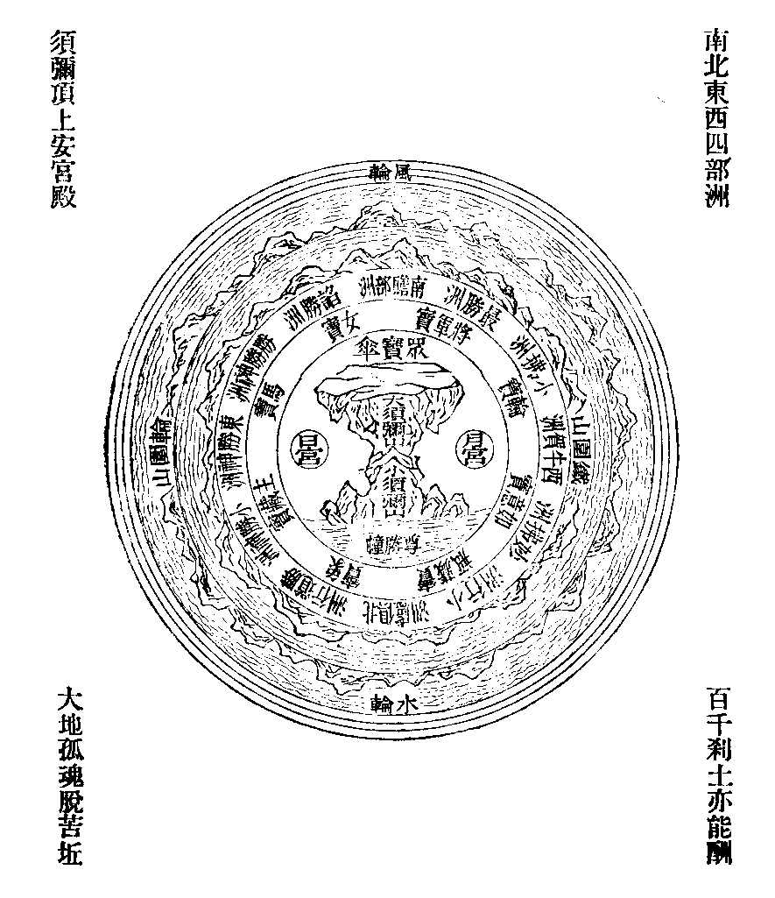



(次排列花米位，从中央起)。



唵，唅弥啰，微捺麻(大须弥山)。



唵，唅斯克彻(二合)麻弥啰，微捺麻(小须弥山)。



唵，岩晡儿斡(二合)微的葛耶捺麻(东胜神洲)。



唵岩的葛耶捺麻(小胜神洲)



唵岩微的葛耶捺麻(胜胜神洲)



唵𮓔咱晡的癹耶捺麻(南赡部洲)



唵，𮓔，沙茶耶，捺麻(谄胜洲)。



唵，𮓔，乌答啰，曼的哩(二合)尼耶捺麻(最胜洲)。



唵，蓝哑咓啰孤答(二合)尼耶捺麻(西牛贺洲)。



唵，蓝拶(二合)麻啰耶捺麻(小拂洲)。



唵，蓝斡啰拶(二合)麻罗耶捺麻(妙拂洲)。



唵，鑁，乌答啰，孤啰，尼捺麻(北俱卢洲)。



唵，鑁，孤啰，微捺麻(小行洲)。



唵，鑁，葛啰斡(二合)耶捺麻(胜道行洲)。



唵，岩葛拶啰的捺(二合)耶捺麻(象宝)



唵囕𠽾噜沙哳啰的捺(二合)耶捺麻(主藏宝)



唵，囕，斡节啰的捺(二合)耶捺麻(马宝)



唵，鑁，斯的哩(二合)啰的捺(二合)耶捺麻(女宝)。



唵，岩葛咤葛(二合)啰的捺(二合)耶捺麻(将军宝)



唵，囕咤吃啰(二合)啰的捺(二合)耶捺麻(轮宝)



唵，㘕，麻尼啰的捺(二合)耶捺麻(如意宝)。



唵鑁麻曷聂塔捺耶捺麻(宝藏瓶)。



唵，哑斯哩(二合)牙耶捺麻(日宫)。



唵㘕昝的啰耶捺麻(月宫)



唵，哑，吽，捺麻(众宝伞)。



唵，萨哩斡(二合)啰的尼(二合)毗药(二合)捺麻(尊胜幢)。



唵，室哩(二合)麻忒(二合)斡资啰孤噜拶啰捺葛麻辣耶三貌克答捺哑斡癹萨拏葛啰(二合)耶吽捺麻(念真言时，将花米临曼拏啰上及散洒虗空，想落宝米悉成种种宫殿、园林、池沼、伞葢、幢幡、衣服、缨珞、如意珠宝庄严等具，如空注雨相续不断，供养上师三宝中围，手取花米散洒虗空，念云：)



人天所有，种种供物，



唵，萨哩斡(二合)答塔葛达啰的捺麻曷曼答啰(二合)布拶弥渴萨谟的啰(二合)斯癹啰纳三麻耶哑吽(结印念呪)



唵，萨哩斡(二合)答塔葛达，萨叭哩咓啰(哑哩干巴丹)巴啰(二合)谛拶耶，莎诃



(转运，结莲花手印，念五供养)。



唵，萨哩斡(二合)答塔葛达，萨叭哩咓啰



唵，斡资啰，不思必哑吽(花淡红色)。



唵斡资啰度必哑吽(香是黄色)。



唵翰资啰哑噜吉哑吽(灯红赤色)。



唵斡资啰干底哑吽(涂是白色)



唵，斡资啰，你微的哑吽(果红黄色)。



唵，斡资啰(二合)，舍不答，布拶，弥葛，萨谟的啰(二合)，斯癹啰纳，三麻耶，哑，吽(乐青绿色)



音乐呪



唵，斡资啰(二合)看支夷，啰纳(二合)啰纳(二合)不啰(二合)啰纳，不啰(二合)啰纳，三不啰(二合)啰纳，三不啰(二合)啰纳，萨哩斡(二合)孛答，赤的啰(二合)不啰，拶哩答麻曷，不啰(二合)尼牙(二合)巴啰，蔑答那达速巴微，萨哩斡(二合)塔哩麻(二合)𠶹哩(二合)达耶，伞多沙纳葛哩，吽吽和和，哑龛莎诃。(念呪将毕，手持铃杵，於曼丹上紧摇一遍，置铃於案。次摄授宝错，左手持於宝错，右手结三尖印，遣魔徧空。於空性中，自心月轮上想成黄色，得浪tra（二合）字中放光，利益一切有情。光回，得浪tra（二合）字，一念变成黄色宝生。佛手结施印为一不二竟，一念变成宝错，如用之时而令错之。)



宝错真言



(念真言时，想宝错内出生无尽诸天，如意珍宝而奉献之。)



唵，斯嘛啰(二合)斯嘛啰(二合)密嘛，曩斯葛啰，摩诃拶葛啰，吽。



撒花米真言



(师念真时，以左手执宝错，右手拈米酒於宝错上，想落如意珍宝。)



唵，萨不答(二合)啰，的捺，吽。



遣魔真言



(以二手作金刚拳，手背相靠，二小指相钩，二头指直竖，结印当胸，想手印中出火光，遣境界魔。)



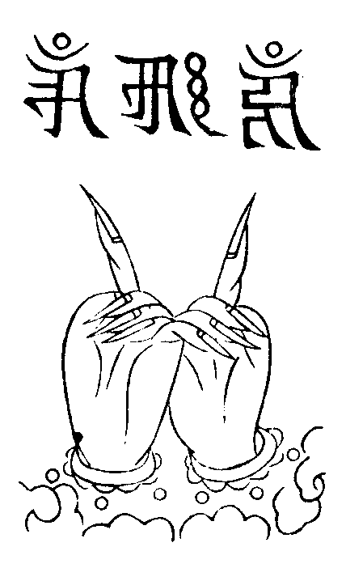



唵，斡资啰(二合)，哑弥哩达，昆咤唎，曷纳曷纳，吽吽癹咤。



遣魔真言



(二手外相义，二头指直竖，结印当胸，手动似扇，印出火光而遗诸魔。)



唵，斡资啰(二合)牙恰，吽。



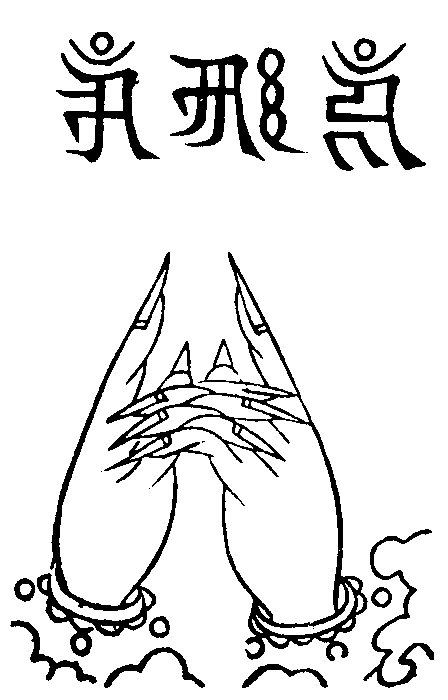



遣魔真言



(以二手内相叉，十指仰上，结印当前，想印中放出金刚燄，令魔远离。)



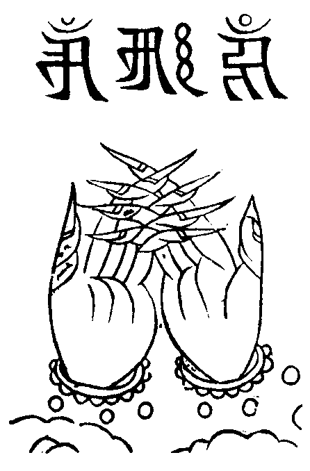



唵，斡资啰(二合)佐辣，哑捺辣，曷捺答曷，巴拶麼，塔班拶啰，纳吽癹咤。



真空印呪



(二手内相叉，进禅力智直竖，念真言：)



唵，莎𠷑斡顺牙(二合)萨哩斡(二合)答哩麻(二合)莎𠷑斡顺牙



(二合)达於空性中想。



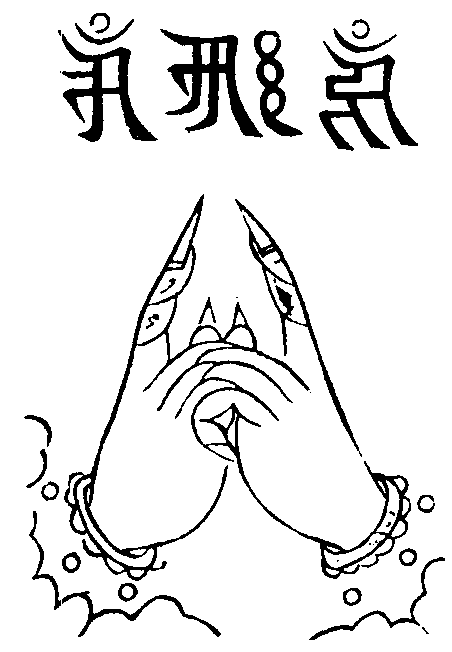



[口*(隆-一)][口*(隆-一)](二合)𠽾[口*(隆-一)]bhrūṃ(二合)𠽾[口*(隆-一)]bhrūṃ(二合)哑哑哑吽吽吽



而成十方世界所有天。妙曼！



怛哑哩干



濯足花香，灯涂食乐，清彻无碍，犹如普贤。化现种种，云集供养，徧满虗空，充塞法界，尽轮回际，无有间断。(结印念呪)



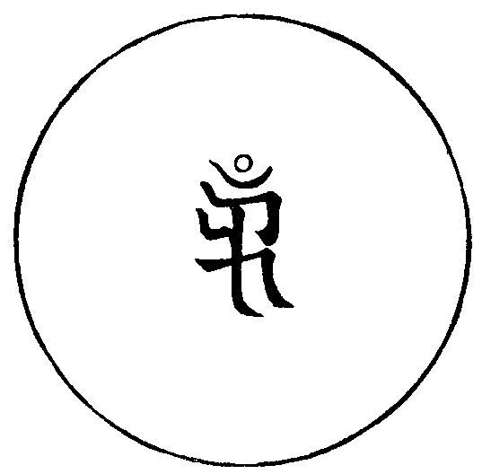



唵，萨哩斡(二合)答塔葛达，萨叭哩咓啰(哑哩干巴丹)巴啰(二合)谛拶耶，莎诃(运转结莲花手印，念五供养)



唵，萨哩斡(二合)答塔葛达，萨叭哩咓啰



唵。斡资啰。不思必。哑吽。



唵斡资啰度必哑吽。



唵。斡资啰。哑噜吉。哑吽。



唵。斡资啰。干底哑吽。



唵。斡资啰。你微的哑吽。



唵，斡资啰(二合)，舍不达，布拶弥葛，萨谟的啰斯，癹啰纳，三麻耶，哑，吽。



音乐呪



唵，斡资啰(二合)看支夷，啰纳(二合)啰纳(二合)不啰(二合)啰纳，不啰(二合)啰纳，三不啰(二合)啰纳，三不啰(二合)啰纳，萨哩斡(二合)孛塔赤，的啰(二合)不啰，拶哩答麻，曷不啰(二合)尼牙(二合)巴啰，蔑答那达，速巴微，萨哩斡(二合)塔哩麻(二合)纥哩(二合)达耶伞，多沙纳葛哩，吽，吽，和和，哑龛，莎诃。



十二因缘呪



耶，唵，答儿麻(二合)兮，都不啰(二合)巴斡兮，敦的山答塔葛达歇，斡怛的山拶约尼噜怛耶，[嘟-者+(看-目)]叭谛，麻曷释啰(二合)麻纳耶，莎诃



唵哑吽(念三遍，就撒花米毕，持铃念)



曼拏啰偈



> 谛想清净广大曼答辣，四洲充满无量珠珍宝，  

> 一一皆如妙高摩尼聚，奉献上师三宝愿安住。



曼拏啰真言



唵，萨哩斡(二合)答塔葛达啰的捺(二合)麻曷曼答辣布拶弥葛萨谟的啰(二合)斯癹啰纳三麻耶哑吽。



> 宝山宝海妙宝座，天衣缨珞如意树，  

> 宝池妙花香灯涂，周遍法界满虗空。  

> 宝珠自性广大海，七宝之中最殊胜，  

> 献如云聚妙宝供，我今虔诚而奉献。  

> 中央八峰须弥卢，四大部洲诸形相，  

> 以日月等而围遶，黄金白银与宝玉，  

> 麻萨葛斡及琉璃，赤珠乃至石心等，  

> 奉献上师三宝前，唯愿慈悲哀纳受。



唵，萨哩斡(二合)答塔葛达啰的捺(二合)麻曷曼答辣布拶弥渴萨谟的啰(二合)斯癹啰纳三麻耶哑吽。



> 我今依教建立曼拏啰，量等虗空金刚为宝地。  

> 字字密言，惟心之所成。须弥日月，七宝四天下。  

> 衣服伞葢伎乐幢旛云，宝座珍羞楼阁并宫殿，  

> 池沼园林名花普遍布，奉献上师三宝护神等。  

> 惟愿慈悲，纳受生欢悦。屏除魔碍，集福施安宁。  

> 今宵施主所求皆如意，尽未来际吉祥无间断。



唵，萨哩斡(二合)答塔葛达啰的捺(二合)麻曷曼答辣布拶弥渴萨谟的啰(二合)斯癹啰纳三麻耶哑吽。



(置铃於案，以右手持花米，念云：)



唯愿上师三宝中围佛会慈悲，摄授今辰施主福慧庄严，世出世间吉祥如意，普及法界一切有情，速成无上佛果菩提。



捺谟孤噜(二合)毗牙(二合)捺谟勃塔耶



捺谟达而麻耶？　捺谟桑渴耶



唵哑吽。(三遍毕，撒花米，抚尺一下，念)



三归依赞



佛法僧宝，体徧十方。恭敬请祈，必蒙感应。将当阐扬施食之初，先须归敬三宝。要祈法事周隆，庶使胜因成就。大众䖍诚，随声应和。



志心信礼，佛陀耶，两足尊，三觉圆，万德具。天人调御师(唵哑吽)，凡圣大慈父。从真界，腾应质，悲化普。竖穷三际时，横遍十方处。震法雷，鸣法皷，广演权实教(唵哑吽)，大开方便路。若归依，能消灭，消灭地狱苦。



志心信礼，达磨耶离欲尊。宝藏收，玉函贮，结集於西域(唵哑吽)，飜译传东土。祖师弘，贤哲判，成章疏。三乘分顿渐，五教定宗趣。鬼神钦，龙天护，道迷标月指(唵哑吽)，除热真甘露。若归依，能消灭，消灭饿鬼苦。



志心信礼，僧伽耶，众中尊，五德师，六和侣。利生为事业(唵哑吽)，弘法是家务。避嚣尘，常宴坐，寂静处。遮身服毳衣，充腹采薪薇。钵降龙，锡解虎，法灯常遍照(唵哑吽)，祖印相传付。若归依，能消灭，消灭旁生苦(古本此处宣意毕，举云)。



香云葢菩萨摩诃萨。



施食坛仪卷上



修习瑜伽集要施食坛仪卷下



众等发广大心



归依金刚上师，归依佛，归依法，归依僧。我今发心，不为自求人天福报、声闻、缘觉乃至权乘诸位菩萨，唯依最上乘发菩提心，愿与法界众生一时同得阿耨多罗三藐三菩提。



> 先结大轮明王印，加持坛场悉清净。  

> 我今依教诵密言，令我所作皆成就。



默念大轮明王呪七遍



(其呪印者，甘露军荼利菩萨念诵仪云：二手内相叉，直竖二头指，并以二中指缠二头指初节前，各头相〔抵〕二大指，并伸直结印。当心诵呪曰：)



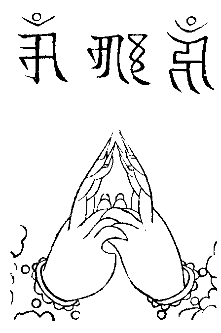



捺谟斯，得哩(三合)野脱夷(二合)葛喃，萨哩斡(二合)怛塔葛达喃，唵，微啰积，微啰积，麻曷拶，葛啰(二合)斡资哩(二合)斡资哩(二合)萨怛萨怛，萨啰谛，萨啰谛，得啰(二合)夷，得啰(二合)夷，微駄麻尼，三攀拶纳祢，得啰(二合)麻祢的席，塔𠶹哩(二合)得兰(二合)颜席提脱(二合)夷，莎诃。



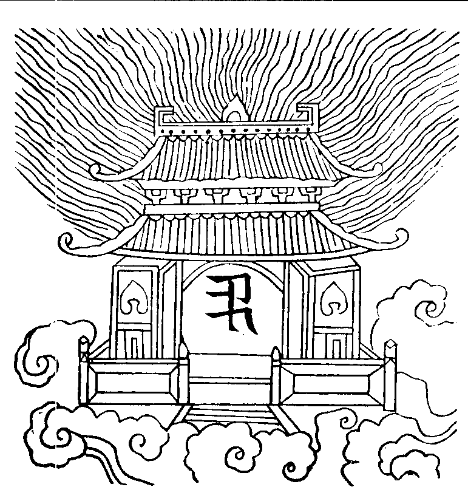



(师印呪可知。应想面前空处，离身七肘，高八肘，现一金色𠽾[口*(隆-一)]bhrūṃ（二合）字，字种变成胜妙宫殿。以大千国土合为一国土，以此国土融成一宫殿，一一庄严，皆准华严经说胜妙乐事。问：此大千国土合而为一，云何合耶？答：一切国土体自空寂，谁立疆界？若离众生见，则国土自一。问：此土众生置於何处？答：是中众生即诸佛心中之众生，同佛受用，复何用置？问：何全依心想便成宫殿？答：彼大千国土等咸是妙明真心所现，若离真心，毕竟无有。全依幻化力故，复以大千国土而为宫殿，是为万法由我者也。　待者白云：)



> 稽首十方调御师，演扬清净微妙法。  

> 三乘四果解脱僧，愿赐慈悲临法会。



奉请三宝



(表白举香花，迎香花请众和毕，首者执炉举云：)



南无一心奉请，尽十方遍法界微尘刹土中，诸佛法僧，金刚密迹，卫法神王，天龙八部，婆罗门仙，一切圣众。惟愿不违本誓，怜愍有情，此夜今时，光临法会。(三请毕，　白云：)



> 谨依瑜伽教，建置曼拏啰。惟愿三宝尊，  

> 慈悲哀纳受。



印现坛仪



(千手眼修行仪云：二手各作金刚拳，施进慧力相钩，胸前微动，诵真言)。



唵，斡资啰(二合)，拶裓啰(二合)，吽，拶，吽，𠳐斛。



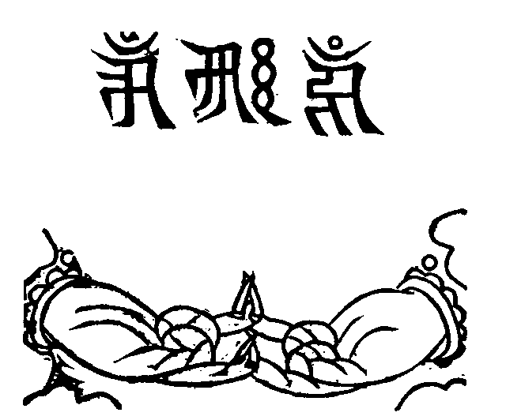



(师印呪可知。应想心间字种放光，至色究竟天上，奉请智观世音，来入道场。此智观世音，即放无量光，奉请一切三宝，及显密护神，来至道场，重重无尽。问：於此教门，但说果主因伴，今何得因为主，果为伴耶？答：此有二义：一、行者以为观音为所缘熟境，故先契此境，后契诸佛之境。然观音放光，奉请诸佛，亦犹行者奉请观音者也。今藉观音请诸佛，非为主也。二、此菩萨即是过去威德自在光明王如来，退位度生，即果位也。若或为主，亦无过也。　众念三十五佛。)



> 毗卢遮那佛，愿力周沙界，一切国土中，  

> 恒转无上轮。



大众默念心经一遍



启告十方一切诸佛、般若菩萨、金刚天等及诸业道无量圣贤：我今(某甲)以大慈悲乘佛神力，召请十方尽虗空界三途地狱诸恶趣中旷劫饥虗一切饿鬼、阎罗诸司、天曹地府业道冥官、婆罗门仙、久远先亡旷野冥灵、虗空诸天及诸眷属、异类鬼神，唯愿诸佛、般若菩萨、金刚天等无量圣贤及诸业道，愿赐威光，悲增护念。普愿十方尽虗空界天曹地府业道冥官、无量饿鬼、多生父母、先亡久远婆罗门仙、一切冤结负於财命种种类族异类鬼神各及眷属，乘如来力，於此时中决定降临，得受如来上妙法味清净甘露，饮食充足滋润身田，福德智慧发菩提心，永离邪行归敬三宝，行大慈心利益有情，求无上道不受轮回诸恶苦果，常生善家离诸怖畏，(口身意)常清净证无上道。



伸五供养



> 十方一切刹，诸佛菩萨众，无量诸圣贤，  

> 及诸业道官，唯愿大慈悲，降临於法会。  

> 摄受花香灯涂果乐微分少供养。



吽字涌出(哑　花香灯哑　涂果乐)，　天母一面四臂放光明(哑哑)。上二手印持妙(花香灯　哑涂果乐　哑)，下二手印轮相交。



吽唵哑吽唵哑吽𠶹哩(哑)



妙(花、香、灯、涂、果、乐)　天母供养佛，愿佛慈悲哀纳受。



> 因缘自性所出生，所有种种微妙(花、香、灯、涂、果、乐)。  

> 奉献上师三宝尊，惟愿慈悲哀纳受。



户，唵，萨哩嚩，怛他誐耶多(布思必，　度　必，　哑卢吉，干　的　你，尾的　沙，布答)在佐铭，遏三谟怛啰，萨嚩兰拏，三麻曳，吽。



(师印呪可知。应想心间字种，出生六个吽hūṃ字，各具一色，以六波罗蜜为体，化成六天母，窈窕之状，少年美貌，展左跪右，而作舞势，奉供诸佛。问：六色何所色也？答：花淡红色，香是黄色，灯是红赤色，涂是白色，果是红黄色，乐是青绿色，各相其色故。问曰：如何以六度为体？答：此有所表。花表布施，布施令人能生欢喜，故表花也。香表持戒，持戒则业行芬馥，故表香也。灯表忍辱，忍辱则转嗔恚火为大光明，故表灯也。涂表精进，精进则润泽法身，故表涂也。果表禅定，禅定则能成佛果，故表果也。乐表智慧，智慧则能出生种种诸法，故表乐也。问：果有此六天母耶？谓只是依行想成。答：此六天母，乃喜金刚中围内有之，皆佛母也，皆是文殊普贤之俦也。)



> 我以普贤行愿力，修设花香灯涂食，  

> 微尘刹土诸圣贤，一一徧礼皆供养。



次结运心供养印



(诵之七遍，其印以两手外相义合掌，以右压左置於顶上。凡作供养应具此法，及奉瑜伽皆以真言手印持诵，及以运心合掌置顶，方成圆满供养之法。)



那麻萨哩斡(二合)，答塔葛的毗牙(二合)，月说穆契毗牙(二合)，唵(引)，萨哩斡(二合)，哩塔乌忒葛(二合)，的斯癹(二合)，啰纳兮慢葛葛捺龛莎诃



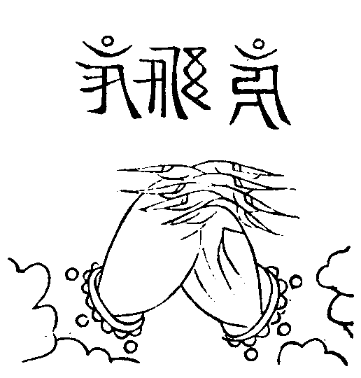



(师印呪可知。应想虗空法界，所有人天妙涂花香等，灯明幢旛伞葢，种种鼓乐歌舞咏唱，真珠罗网悬诸宝铃，花鬘白拂微妙磬铎，矜羯尼网如意珠宝树衣服之云，诸天厨食上妙花美，种种楼阁宝柱庄严，诸天严身头冠缨络如是等云，行者运心想满虗空，以志诚心如是供养最为胜妙。依法诵此真言及作手印，如上所想供养悉皆成就。)



(侍者白云：)



> 我以志诚心，奉献甘露食。惟愿三宝尊，  

> 遣魔哀纳受。



次结遣魔印



(将奉三宝施食，先结三尖印，禅押施度头，戒忍进疎伸诵。)



唵(引)，斡资啰(二合)，拽屹彻(二合)，吽。



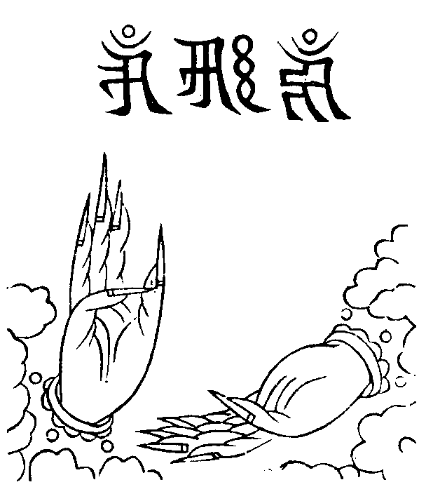



(师印呪可知。应想掌中有赤色吽字，字脚放光，从三尖出，作摇扇势，遣食器上魔。问：明食器上有何等魔？答：有寻香食、施食等魔碍，故今遣之。)



> 我以佛神力，依教诵密言，加持甘露食，  

> 徧满虗空界。



次结变空印



(两羽虗，合掌如莲花状，竖立胸前，诵。)



唵，莎癹斡秫塔萨哩斡(二合)，塔哩麻(二合)，莎癹斡秫徒㰠唵(引)，哑吽



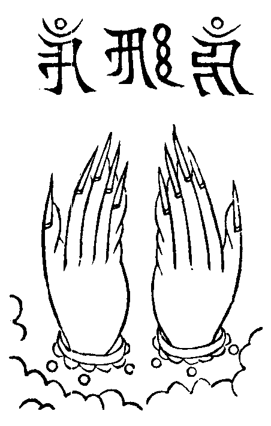



(师印呪可知。应想食器及食悉皆空寂。问：何用手？答：以分段食多染触故。故今空之，则极令清净。於其空处，应想三个𠽾[口*(隆-一)](二合)bhrūṃ，字字金色，变成食器。於食器中，想白色唵oṃ字，变成胜妙饮食，皆醍醐乳酪及𪎊蜜等味。点净念oṃāḥhūṃ二十一遍，极令广大已，复念拶吽𠳐斛而作手印，想令前来所观三宝海会分明显现。再伸五供养施宝错，念思麻啰等呪，想三宝海会诸佛菩萨而摄受之。初一分奉佛并法，次一分奉菩萨圣僧，后一分奉显密护神。)



> 以此甘露食，奉献诸圣贤，怜愍我等故。  

> 慈悲哀纳受。



次结奉食印



(两羽相合，作掬水势，念三遍，各弹指一下。)



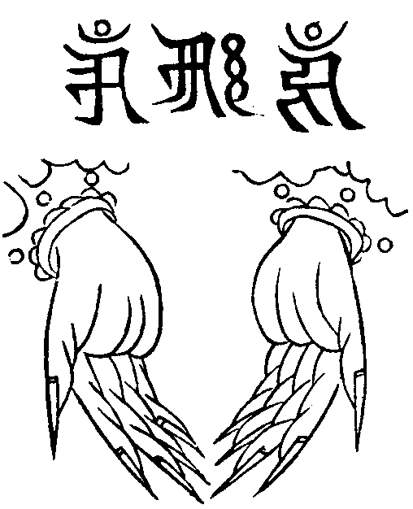



唵(引)哑葛噜穆看萨哩斡(二合)塔哩麻(二合)喃哑牒耶(二合)(引)奴忒班答奴唵哑吽癹咤莎曷



(想诸佛菩萨等，徧奉供养，生欢喜心，求索愿事，必蒙允许。或广迎圣入坛，委伸供赞已，然后施食。即以香花灯涂，种种供养。)



振铃念奉食偈



> 我今奉献甘露食，量等须弥无过上，  

> 色香美味遍虗空，上师三宝哀纳受。  

> 次供显密护神等，后及法界诸有情，  

> 受用饱满生欢悦，屏除魔碍施安宁。  

> 今辰施主眷属等，消灾集福寿延长，  

> 所求如意悉成就，一切时中愿吉祥。



三宝赞



> 世尊大慈妙庄严，明解圆满一切智，  

> 能施福慧如大海，於诸如来我赞礼。  

> 自性本体离诸欲，能依此行脱恶趣。  

> 以为甚深玄妙理，於诸妙法我赞礼。  

> 解脱道中胜解脱，持净戒行堪恭敬，  

> 胜妙福田生圣处，於彼大众我赞礼。



(侍者白云：)



> 普陀落伽常入定，随缘赴感靡不周。  

> 寻声救苦度群迷，故号名为观自在。



次入观音禅定



(以上供养三宝，是作福门。有福无智，则落人天因果，岂能利生哉。今若修习此观音禅定，则有智。既具福智，即同诸佛。然后於法界众生，为作利益。侍者白云：次入观音禅定。师作禅定维那伸偈。其声贵柔和清亮，不可雄厉，恐妨观想。又不可太近世俗儿女之声。当入定时，闭目澄心，观想自身中，圆满洁白，犹如净月。於心净月上，想𠶹哩(二合)hrīḥ字，放大光明。其字变成八叶莲花，花上有观自在菩萨，相好分明。左手持莲花，右手作开敷势。作是思惟：一切有情身中，有此觉悟之花，清净法界，不染烦恼。莲花八叶，叶上各有一如来。入定跏趺而坐，面向观自在，项佩圆光，身如金色，光明晃耀。想此八叶莲花，渐舒渐大，量等虗空。以此觉花，照触如来海会。愿成广大供养，若心不移。)



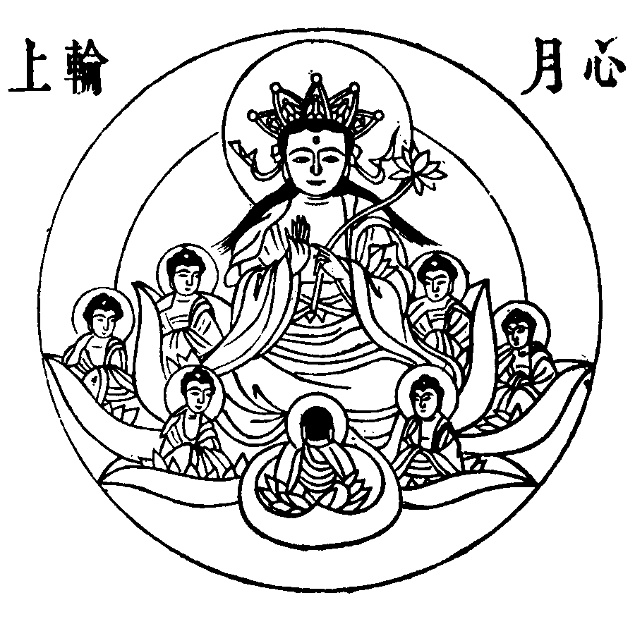



(於此定於无边有情深生悲愍，以此觉花蒙照触者，於诸苦恼悉得解脱，等同菩萨相好。即想莲花渐收量等己身，结印念呪加持四处，以此加持令身坚固，所谓心、额、喉、顶。每於印处成𠶹哩(二合)hrīḥ字，其字印以二手外相义，二头指相柱如莲花叶，二大指并竖。即诵观自在菩萨真言观音禅定偈)。



南无无尽三宝尊。  

我今誓发菩提心。  

唯愿菩萨来摄授。  

速证观音微妙身。  

次入观音三摩地。



(注曰：次入蹑前生后三摩地，即是闻尘。)



澄心闭目观心中。



(注曰：澄心则清净之时也，内不放出。闭目即观想之时也，外缘不入。问曰：心无所在，安得有中？答云：此明肉团心也。以灵知之心，栖止於肉团之心内，故师当於此作六禁反偈之略也。其说应当於心尖上，想一红色𠳐paṃ字，变成杂色八叶莲花。花上想白色阿āḥ字，变成月轮也。)



圆满皎洁净月上。



(注曰：圆满皎洁者，心之体用也。圆而满，则无德不备，体也。皎而洁，则无所不照，用也。)



字种放光成莲花。



(注曰：字种，𠶹哩(二合)hrīḥ字也。此字乃大悲菩萨取证之理，度生之妙门也。放光成莲花者，乃所进之花也。)



花中有一观自在。



(注曰：即𠶹哩心增长，自身成观，自在菩萨之称也。顺逆无碍，故名自在花，乃指所坐之花也。)



相好具足无比对。



(注曰：偈之略也。其说应云：一面二臂，其身金色，花冠缨珞严身，顶戴阿弥陀佛，无比对称赞之词。)



左手执持妙莲花。



(注曰：理能成事，故云持也。花表因果同时也。)



右手於叶作开势。



(注曰：事能显理，故能作开势也。已上并是自觉。)



菩萨思惟有情身。  

各具觉悟之莲花。



(注曰：此二句，方是觉他称菩萨行也。偈意谓一切众生，与菩萨本是同体，皆有觉悟之莲花，但由颠倒执着而不证也。故菩萨思惟而起哀救，行者於此处，更不可将菩萨与自身作两处想。前来既以字种增长作观音，此处思惟，即是指行人之言也。如是禅定，若不能念思惟，则向所作法，徒劳心力。)



清净法界无惑染。



(注曰，当与前两句作一片看，不可打成两橛。清净法界，一尘不立也。无垢染清净，若执着清净，即成垢染矣。)



八叶各有一如来。



(注曰：八叶，即指心间莲花之八叶。各有一如来者，八识元是一心也。既是一心，还同正觉而为一体。故云各有一如来者，即是观音也。不言菩萨而言如来，一超直诣也。此二句通自他说。约他，则言有情心本清净无垢，觉悟莲花中有八如来。约自，则言行人与八如来同时入定也。)



如来入定跏趺坐。  

各各面向观自在。



(注曰：问：定有多种，今如来入定，何等定耶？答：即行人所入之定也。此定名为刹那大悲禅定。又问：各各面向，前四面向可，后四面岂不背耶？答：向背岂得名为如来？正所谓妙在转处矣。若约事相而说，诸佛菩萨身，非同众生分段之身，东向则背西，南向则背北。而菩萨则不然，有随类意生身，应化无方，背向皆正，岂八如来也？或千佛万佛，向无不正。学者当作是观，更须向无向背处看。)



项佩圆光身金色。  

光明朗照及晃耀。



(注曰：上句彰殊胜身，下句彰殊胜境。)



次想其花渐舒大。  

其量周遍虗空界。



(注曰：从前来七行偈十四句，皆显法界也。今此二句，方入理事无碍法界。次想者，令之时也。以事揽理成，故能渐舒大。以理随事变，故能遍法界，则其大无外也。皆是惟心境界，非分外的事也。)



思彼觉花照法界。  

如来海会共广大。



(注曰：此二句正明事事无碍也。觉花，事也。海会，亦事也。以觉花称周时，与如来海会同时，广大而无碍。譬如一室千灯，光光无杂。法界者，十法界也，四圣六凡之谓也。意谓此花舒大时，能照此十法界，同於一真，更无殊别也。)



心若不移於此定。  

怜愍一切诸众生。



(注曰：上句自觉，下句觉他。上来思惟有情，方是起行。至此怜愍一切，方是行行。谓证此无碍广大境界，方能行行度生也。深有密焉，学者不可不慎也。)



觉花蒙照脱苦恼。



(注曰：利生之効也。)



便同菩萨观自在。



(注曰：所获之果也。初发心时，即得阿耨多罗三藐三菩提之谓也。)



莲花渐收同己量。



(注曰，前八句皆舒，此一句惟卷。约密说，即是增长究竟。准鲁餘巴现前解云，从正位而起名增长，复归正位是究竟，亦是始本不二也。上师云，有放不收同凡夫，有收无放名声闻，有收有放名为秘密境界，收放总不用名无戏论，此乃最极本续也。收之一字，不觉如此轻易流布，学者亦不可作等闲见闻也。)



复结自在观音印。  

加持四处诵密言。



(注曰：此二句，皆约行者请求智佛冥加之力也。所以密言者，皆指后面手印之密言也。)



自身亦等观自在。



(注曰：𢌞光返照者，前来既观观音，今恐迷己逐物，复回观自身，故云亦等。今以何义故？复云：最初既以字种增长，令成观音，何又云亦等？答云：初来增长，由未离觉。今则真实究竟之地，是亲证亲入也。如善财始见文殊等也。又前所想观音，望因则名因中果也。加持密言之后，则当体果中因也。谓初入坛场，即顿起观音慢。今复何故，又入此定，岂不滥耶？不也。前是根本定，亦名正位，亦名正体，如在家为人也。此后所入定，即是所作定也，如人在邦为臣也。其实一体，而约处殊也。又如人在朝则朝衣，在戎则戎服。故根本定白色，所作定金色。向下随一一作法，多有更易身色。常以此理鉴之，故勿疑诸。)



> 以此禅定胜功德，回向法界诸众生。  

> 同见西方无量光，成就普贤广大愿。



唵(引)，斡资啰(二合)，塔啰麻(二合)，𠶹哩(二合)。



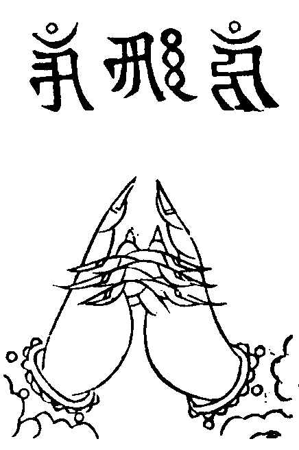



(结自在观音印，以二手外相义，二头指相拄如莲花叶，二大指并竖，即诵真言时加持四处：顶、喉、心、脐是也。师印呪可知。每处以手印按之，诵真言一次，复以唵oṃ字加持，即当以印按口上，次以吽hūṃ字加顶，得囕(二合)trāṃ字加脐，𠶹哩(二合)hrīḥ字加心，阿āḥ字加喉，以此加持令身坚固，所以一切魔碍皆不能害也)。



(侍者白云：)



> 若人欲了知，三世一切佛，应观法界性，  

> 一切惟心造。



次结破地狱印



(两羽金刚拳，施慧两相钩，进力伸相拄，三诵三击破地狱真言)。



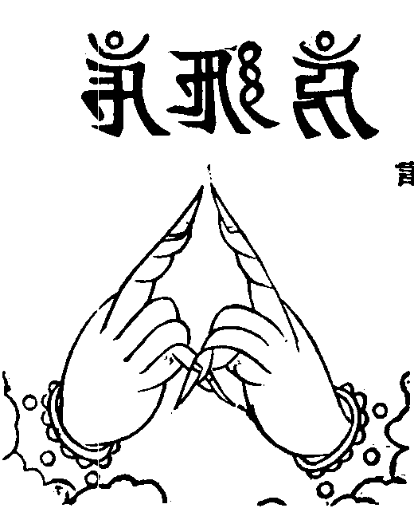



那麻，阿瑟咤(二合)，瑟咤(二合)，摄谛喃，三藐三勃塔，俱胝喃，唵，撮(引)，辣(引)，纳嚩婆细，提哩提哩，吽。



(师印呪可知。应想自身增长红色观音，一面、二臂、舌上、心间、印上三处，皆有红色𠶹哩(二合)hrīḥ字，放光红色，如日初出之光，照触地狱，悉皆破坏。问云：一处放光，足以破之，何用三乎？答曰：为彼地狱是众生三业之所造故，故今亦用三业放光以破之也。又问：地狱是众生别业而成，云何能破？答：虽云别业，同是一心，以智照之，众生亦无，岂有地狱？由迷一心故，妄造众恶，恶业成熟，妄成地狱，既堕地狱，妄见受苦。譬如梦中为虎狼狮子所噬，或为贼所缚，或遭王难，受种种苦，及至梦醒，了无所得。何以故？如梦中实无如是事故。今观地狱及苦，亦复如是。今假以智照力，必破是也。问：地狱既然本空，何须破而救之也？答云：我虽以智照力，知其本空，彼无智照，焉得不苦？故圆觉经云：梦时非无，及至於醒，了无所得。今㧞救之，正欲破此地狱及苦空也。若推原之，彼以恶业因缘而成地狱，则知非本有矣。我今以智照因缘而为之破，岂不破乎？一是禅定，二是手印，三真言，四作观，五智照。有此五种因缘，何事不办？岂唯破地狱乎？今世之学者，惟利是求，滥称阇黎为众上首，彼是音声，振铃击节，虑恐负於请主之意者多矣，可不慎欤？)。



由此印呪威神力故，所有诸趣地狱之门，随此印呪豁然自开。



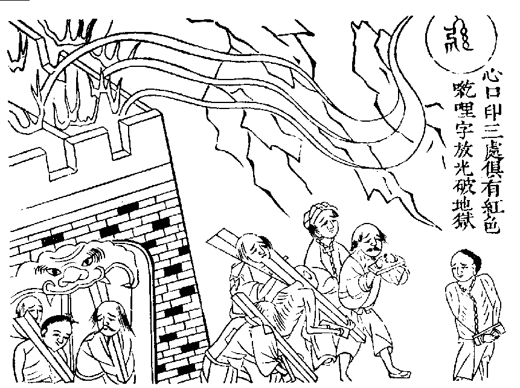



奉请地藏王菩萨



(表白举香花，迎香花请毕，首者执炉请云：)



南无一心奉请众生度尽，方证菩提，地狱未空，誓不成佛。大圣地藏王菩萨摩诃萨，　惟愿不违本誓，怜愍有情，此夜今时，光临法会。



香花请



南无一心奉请，面如蓝靛，发似丹砂，形山腹海项如针，行动破车声似吼。今请面然大士，𦦨口鬼王，惟愿作不请友，运无缘慈，此夜今时，光临法会。(香花请)



南无一心奉请。林间入定安禅座，面前鬼趣告饥虗。冥阳水陆起根源，倒却刹竿为二祖。今请启教大士阿难陀尊者，惟愿出三昧定，运六神通，此夜今时，光临法会。



(众和香花，请师置炉，伸四转轮印，念拶吽𠳐斛结印，默念伸五供养。)



一心奉请，五通有感，一性无亏，行正直於人间，布聪明於世上。今请府主城隍之神，当方土地正神，并诸部属等众，惟愿上遵佛勅，下愍凡情，此夜今时，光临法会。



一心奉请，手擎幡葢，身挂花幔，导众生归极乐之邦，引亡者来赴道场之会。今请幽冥路上引魂王菩萨摩诃萨，惟愿不违本誓，怜愍有情，此夜今时，来临法会。



一心召请。瑶池万仞，金风动而莲上生花；宝阁千层，珠帘卷而云中见佛。回奉三宝　修斋施食(庆生报恩)请灵弟子(某)，是夜虔请金刚上师，设放瑜伽𦦨口法食。将此良因，初𦶟名香，初伸召请。召请当斋亡过(某某)，惟愿承　三宝力，仗秘密言，此夜今时，来受无遮甘露法食。



一心召请。卢医谩说长生药，扃鹊休夸不死方。日月尚有薄蚀难，为人那个不无常？回奉三宝(仝前云云)。



一心召请，九江洪波浩渺，九天仙乐来迎，九重光里见如来，九祖先亡生佛界，回奉三宝(仝前云云)。



一心召请累朝帝主，历代侯王。九重殿阙高居，万里山河独据。(白)西来战舰，千年王气俄收；北去銮舆，五国冤声未断。(呜呼)杜䳌呌落桃花月，血染枝头恨正长。如是前王后伯之流，一类金灵等众。



一心召请，筑坛拜将，建节封侯。力移金鼎千钧，身作长城万里。(白)霜寒豹帐，徒勤汗马之劳；风息狼烟，空负攀龙之望。(呜呼)将军战马今何在？野草闲花满地愁。如是英雄将帅之流，一类神魂等众。



一心召请五陵才俊，百郡贤良。三年清节为官，一片丹心报主。(白)南州北县，久离桑梓之乡；海角天涯，远丧蓬莱之岛。(呜呼)官况萧萧随逝水，离魂杳杳隔阳关。如是文臣宰辅之流，一类孤魂等众。



一心召请黉门才子，白屋书生。探花足步文林，射䇿身游𣗥院。(白)萤灯飞散，三年徒用工夫；铁砚磨穿，十载谩施辛苦。(呜呼)七尺红罗书姓字，一抔黄土葢文章。如是文人才子之流，一类孤魂等众。



一心召请出尘上士、飞锡高僧、精修五戒、净人梵行比丘尼众(白)。黄花翠竹，空谈秘密真诠；白牯黧奴，徒演苦空妙偈(呜呼)。经窓冷浸三更月，禅室虗明半夜灯。如是缁衣释子之流，一类觉灵等众。



一心召请黄冠野客，羽服仙流。桃源洞里修真，阆苑洲前养性。(白)三花九炼，天曹未许标名；四大无常，地府难容转限。(呜呼)琳观霜寒丹灶冷，醮坛风惨杏花稀。如是玄门道士之流，一类遐灵等众。



一心召请江湖覊旅，南北经商。图财万里游行，积货千金贸易。(白)风霜不测，身膏鱼腹之中；途路难防，命丧羊肠之险。(呜呼)滞魄北随云黯黯，客魂东逐水悠悠。如是他乡客旅之流，一类孤魂等众。



一心召请戎衣战士，临阵徤儿。红旗影里争雄，白刃丛中敌命(白)。鼓金初振，霎时腹破肠穿；胜败才分，遍地肢伤首碎(呜呼)。漠漠黄沙闻鬼哭，茫茫白骨少人收。如是阵亡兵卒之流，一类孤魂等众。



一心召请宫帏美女，闺阁佳人。胭脂画面争妍，龙麝熏衣竞俏。(白)云收雨散，魂消金谷之园；月缺花残，肠断马嵬之驿。(呜呼)昔日风流都不见，绿杨芳草髑髅寒。如是裙钗妇女之流，一类孤魂等众。



一心召请，怀躭十月，坐草三朝。初欣鸾凤和鸣，次望熊罴叶梦。(白)奉恭欲唱，吉㐫只在片时；璋瓦未分，母子皆归长夜。(呜呼)花正开时遭急雨，月当明处覆乌云。如是血湖产难之流，一类孤魂等众。



一心召请，蛮夷戎狄，瘖痖盲聋，勤劳失命庸奴，妬忌伤身婢妾。(白)轻欺三宝，罪愆积若河沙；忤逆双亲，凶恶浮於宇宙。(呜呼)长夜漫漫何日晓，幽关隐隐不知春。如是冥顽悖逆之流，一类孤魂等众。



一心召请饥寒丐者，刑戮囚人。遇水火以亡身，逢虎狼而失命。(白)悬梁服毒，千年怨气沉沉；雷击崖崩，一点惊魂漾漾。(呜呼)暮雨青烟寒鹊噪，秋风黄叶乱鸦飞。如是伤亡横死之流，一类孤魂等众。



一心召请法界五道十类孤魂，面然所统薜茘多众、尘沙种类、依草附木、魑魅魍魉、滞魄孤魂、自他先亡家亲眷属等众，　惟愿承三宝力，仗秘密言，此夜今时来临法会，受此无遮甘露法食。



上来召请，悉已来临。大众慈悲，齐声叹悼。



稽首皈依，雄水月金容。住海岸，在阎浮。运广慈心，重发弘誓愿，度脱樊笼。弥陀宝冠缨络，顶戴花玲珑。三灾八难，寻声救苦。杻械枷锁，化作清风。散珍宝、普济贫穷。杨枝手内，时时洒滴甘露，润在亡者喉中。惟愿今宵临法会，接引亡灵，上往天宫。



南无步部帝哩伽哩哆利怛都也他耶荐往生菩萨摩诃萨。



叹孤



> 觉皇密语壮皇都，大阐宗风何处无。  

> 一天佳气弥星斗，万象腾辉耀烛炉。  

> 接引四生登九品，提携六道出三涂。  

> 此时幸遇良宵会，钟磬交如可叹孤。



近代先朝，帝主尊荣位。勋戚侯王，玉叶金枝贵。宰执中宫，彩女嫔妃类。梦断华胥，来受甘露味。



国士朝臣，经纬匡时世。牧化黎民，未遂忠良志。失宠怀忧，谪降边邦地。恋国游魂，来受甘露味。



武将戎臣，统领三军队。结阵交锋，锣鼓喧天地。北战南征，失陷沙场内。为国亡身，来受甘露味。



学古穷经，锦绣文章士。映雪偷光，苦志寒窓内。命运蹉跎，金榜无名字。郁郁幽魂，来受甘露味。



割爱辞亲，早入空门内。访道寻师，只为超生死。暑往寒来，不觉无常至。返照回光，来受甘露味。



羽服黄冠，早发修真志。炼药烧丹，养性还元气。苦行劳神，指望登仙位。莫恋遗形，来受甘露味。



孝子贤孙，义勇忠良士。列女贞妻，视死如归去。仗节亡躯，千古留英气。耿耿灵魂，来受甘露味。



女道尼流，身住黄金地。鸾凤缘空，不染人间事。未了无为，流浪虗生死。清净幽魂，来受甘露味。



地理天文，医药阴阳类。卜卦占龟，风鉴并星士。报吉谈㐫，难免无常对。舍伪归真，来受甘露味。



坐贾行商，种种经营辈。艺术多能，贸易求财利。背井离乡，死在他方地。旅梦悠悠，来受甘露味。



犯法遭刑，牢狱长幽系。负命谋财，债主冤家类。肿毒瘟㾮，冻死饥亡辈。速离黄泉，来受甘露味。



车碾伤残，马踏身形碎。墙倒崖崩，自刎悬梁缢。水火焚漂，虎咬蛇伤类。九横孤魂，来受甘露味。



饮血茹毛，生长蛮夷地。负债偿劳，婢妾并奴隶。瘖痖盲聋，残疾无依恃。受苦冤魂，来受甘露味。



忤逆爹娘，怨黩天和地。谤佛欺僧，毁像焚经偈。邪见深坑，苦报无边际。十恶狂魂，来受甘露味。



大施门开，荐拔孤魂辈。祖祢先亡，五姓冤家类。八难三途，平等俱超济。仗佛光明，来受甘露味。



阿弥陀佛宿有无边誓，观见众生苦海常漂溺。垂手慇懃特驾慈航济，普载众生同赴莲池会。南无莲池海会佛菩萨。



> 我以大悲佛神力，召请冥阳诸有情，  

> 旷劫饥虗饿鬼等，不违佛勅来降临。



次结召请饿鬼印



(左羽作无畏相，右羽向前竖，四度微曲，进禅度钩，诵真言曰：)



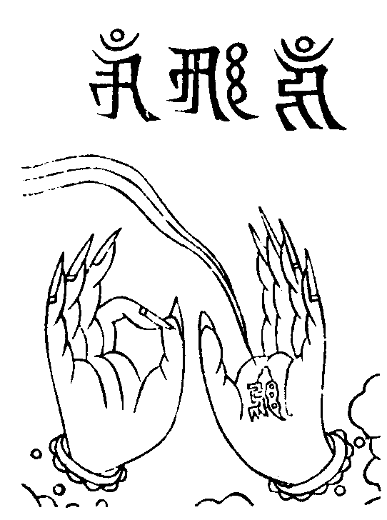



唵，即纳即葛，移希曳(二合)歇，莎诃



(师印呪可知。应想左手印上白色𠶹哩(二合)hrīḥ字放光，勾彼鬼众至於道场，遶佛三匝，礼佛而出至坛外。坛外分为四门：东门至南门，地狱众；南门至西南隅，饿鬼众；西南隅至西门，畜生众；自西门至西北隅，人众；自西北隅至北门，修罗众；自北门至东门，天众。应当如是而安住之。　侍者白云：安慰。)



既召请已，普皆云集，以愍念心，赞叹慰喻，令欢喜已，渴仰於法(鸣尺云)。



善来诸佛子，曾结胜缘故，今遇此嘉会，勿得生忧怖。



一心渴仰法，不出於此时，戒品而沾身，速令离苦趣。



> 汝等诸佛子，得遇道场中，所有一切罪，  

> 召入金刚拳。



次结召罪印



(二羽金刚缚，忍愿伸如针，进力曲如钩。召罪真言曰：)



唵，萨哩斡(二合)巴钵羯哩(二合)沙拏(二合)月戌，䭾纳，斡资啰(二合)萨埵，萨麻耶，吽，拶。



(师印呪可知。应於二中指尖上，想白色𠶹哩(二合)hrīḥ字出光，入彼身中出，其罪犹如烟雾而合。问云：罪无实体，云何今说如彼烟雾出有实体者耶？答曰：虽无。)



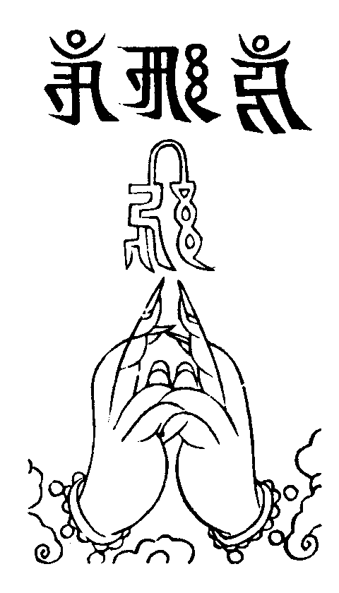



(实体能充塞天地，障蔽心目，不能得见诸佛清净境界。今借诸雾为所缘相，以召其罪，实有益於事也。)



> 摧罪诸恶业，由如劫火灭，火灭还曾有。  

> 金刚碎微尘。



次结摧罪印



(八度内相义，忍愿伸如针。次念摧罪真言曰：)



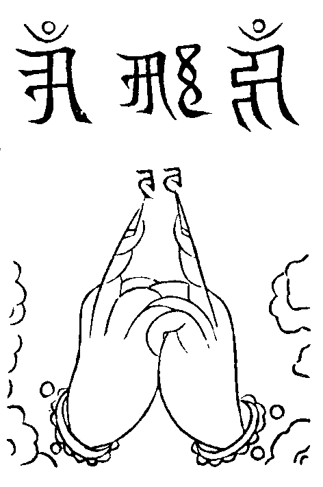



唵，斡资啰(二合)巴尼，月斯普(二合)咤耶，萨哩斡(二合)阿巴耶，班答拏尼不啰(二合)穆恰耶，萨哩斡(二合)阿巴耶，葛谛毗药(二合)萨哩斡(二合)萨埵南，萨哩斡(二合)答塔葛达，斡资啰(二合)三麻耶，吽，怛啰咤。



(师印呪可知。於二中指尖上，左想怛啰(二合)tra字，右想咤ṭa字，应当行人自身增长，作青绿色观音菩萨之身。每念呪一遍，二中指摩摇，至后一遍义过，拍手作声，想彼罪山犹如瓦榻而倒。前来所召之罪如烟雾者，应念而散。问：罪无体相，云何摧耶？答：正谓之无，故摧也。若决定有，岂能摧耶？)。



> 定业不可转，三昧加持力，无始诸障难，  

> 一切皆消灭。



次结破定业印



(二羽金刚掌，进力屈二节，禅智押二度，定业真言曰：)



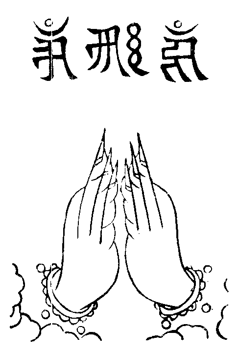



唵，斡资啰(二合)葛哩麻(二合)月束塔耶，萨哩斡(二合)阿瓦啰拏你，菩塔萨底曳(二合)纳三麻耶，吽。



(师印呪可知。心月轮上想一青色𠶹哩(二合)hrīḥ字出光，召前诸鬼众，所有诸佛不通忏悔之业，应想自性清净本无作想，观彼鬼众及佛与心三无差别，是名破决定业也。此一法正是断所知障，学者知之。　侍者白云：)



> 罪性本空由心造，心若灭时罪亦亡。  

> 罪亡心灭两俱空，此则是名真忏悔。



次结忏悔灭罪印



(二羽金刚缚六度，外相义进力屈二节，弹智押二度。次念真言曰：)



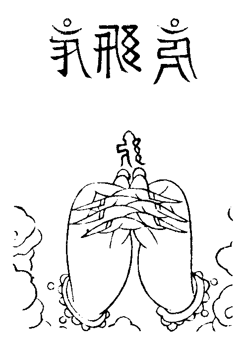



唵，萨哩斡(二合)巴钵月斯普(二合)咤怛贺纳斡资啰(二合)耶，莎诃



(师印呪可知。应想二屈指上有白色𠶹哩(二合)hrīḥ字，入彼鬼身如日烁露之状，罪垢销镕犹如墨汁，从足流下渗入地中至金刚际。问云：前来既召既摧既破，今复为忏悔何耶？答曰：前来并是理上忏悔，今者方是事之忏悔，理事无碍故不滥也。又问：云何罪犹如墨汁？答：罪者黑业也，故以墨表汁，有流注之义，故云如墨汁也。借事显理不可泥也。)



诸佛子！等既忏悔已，百劫积集罪，一念顿荡除，如火焚枯草，灭尽无有餘。



> 一滴清凉水，能除饥渴痟。弹洒灌顶门。  

> 悉令获安乐。



次结妙色身如来施甘露印



(观藏本，前后数手印，俱用右手，或戒禅度相弹，或忍禅相弹，或进禅相弹。惟妙色身如来二手印，用左手力智度相弹。故依藏本，亦云施清凉印。)



那谟苏噜癹耶答塔葛达耶怛牒塔唵酥噜酥噜钵啰(二合)酥噜钵啰(二合)酥噜莎诃



(师印呪可知。结印诵呪，想右手忍上白色鑁(二合)vaṃ字，流出甘露如水银色，是真智所成，左手力智点取)。



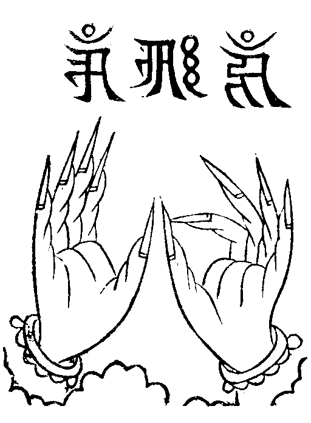



(弹洒虗空，想诸天及人鬼等类，触此甘露，悉具色相，猛火消灭，普得清凉，离饥渴想，灭心执慞。)



> 汝等自从无量劫，造诸恶业起悭贪，  

> 由此业力闭咽喉，仗此密言悉开通。



次结开咽喉印



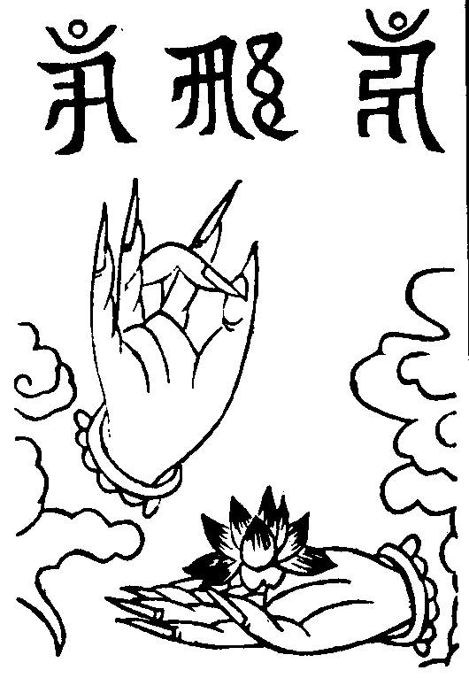



(师印呪可知。应想左手掌中一青色莲花，花上想一白色阿āḥ字，流出性水，极甚清冷。右手点取，弹洒虗空。想诸鬼众得触此水，咽喉广大，清凉润泽，无所障碍。问云：前来多用𠶹哩(二合)hrīḥ字，此独用何āḥ字，何也？答：阿字是语种，故依三本续用之也。)



唵那谟癹葛咓谛月补辣葛得啰(二合)耶答塔葛达耶



语诸佛子：今为汝等作印呪已，咽喉自开，通达无碍，离诸障难。



诸佛子等！我今为汝称赞如来吉祥名号，能令汝等永离三途八难之苦，常为如来真净佛子。



南无宝胜如来



(二羽金刚掌，六度内相义，进力头相拄，禅智侧竖立，一切有情同称圣号)。



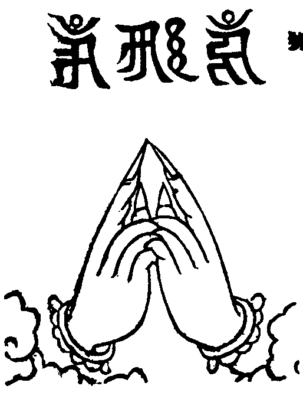



那谟啰怛纳(二合)怛啰耶答塔葛达耶。



诸佛子等！若闻宝胜如来名号，能令汝等尘劳业火悉皆消灭。



南无离怖畏如来



(右羽胸前竖，忍禅指相捻，左掌仰埀下，五指舒，诵真言曰：)



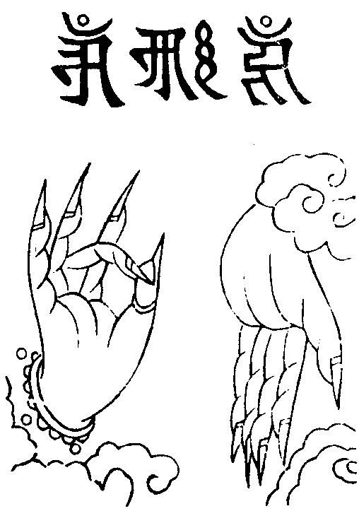



那谟微葛怛得啰(二合)纳耶答塔葛达耶。



诸佛子等！若闻离怖畏如来名号，能令汝等常得安乐，永离惊怖，清净快乐。



南无广博身如来



(左羽曲入掌，力智对肩弹，右手金刚掌，进禅对胸弹。)



那谟癹葛咓啼月补辣葛得啰(二合)耶答塔葛达耶



诸佛子等！若闻广博身如来名号，能令汝等饿鬼针咽，业火停烧，清凉通达，所受饮食得甘露味。



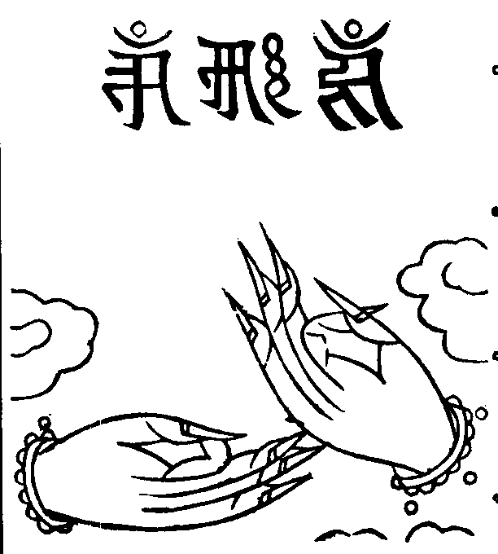



南无妙色身如来



(左羽竖胸前，力智指相弹，右羽曲舒展，手掌皆仰下。)



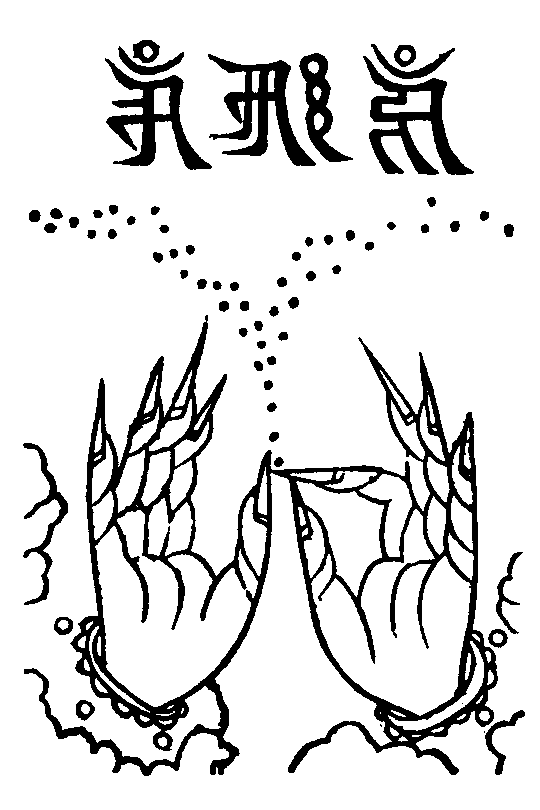



那谟苏噜叭耶。答塔葛达耶。



诸佛子等！若闻妙色身如来名号，能令汝等不受丑陋，诸根具足，相好圆满，殊胜端严，天上、人间最为第一。



南无多宝如来



(二羽虗合，如莲花状。)



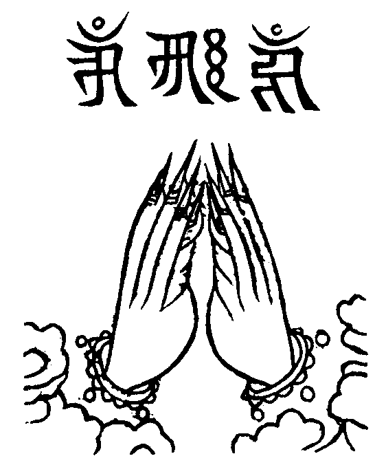



那谟波虎啰怛纳(二合)耶答塔葛达耶。



诸佛子等！若闻多宝如来名号，能令汝等具足财宝，称意所须，受用无尽。



南无阿弥陀如来



(右羽压左羽，禅智相拄。)



那谟阿弥怛婆耶答塔葛达耶。



诸佛子等！若闻阿弥陀如来名号，能令汝等往生西方极乐净土，莲花化生，入不退地。



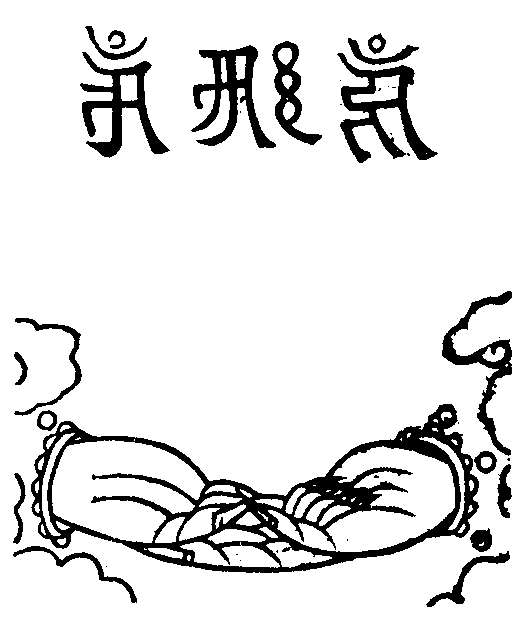



南无世间广大威德自在光明如来



(右羽曲竖拳，忍禅度相弹，左掌仰上五指舒，诵密呪)。



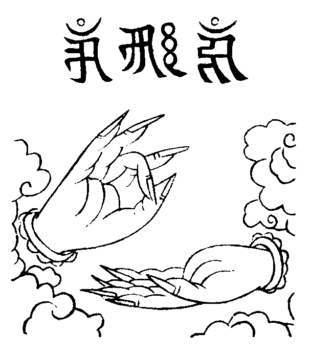



那谟卢迦委斯谛(二合)，呤捺(二合)，苐唧说啰不啰(二合)，癹耶答塔葛达耶



诸佛子等！若闻世间广大威德自在光明如来名号，能令汝等获得五种功德：一者、於诸世间最为第一；二者、得菩萨身，端严殊胜；三者、威德广大，超过一切外道、天魔，如日照世，显於大海，功德巍巍；四者、得大自在，所向如意，似鸟飞空而无阻碍；五者、得大坚固智慧光明，身心明彻，如琉璃珠。



诸佛子等！此七如来，以誓愿力，拔济众生，永离烦恼，脱三涂苦，安隐常乐，一称其名，千生离苦，证无上道。(如是三白已，主者抚尺云：)



次与汝等皈依三宝



皈依佛，两足尊。  

皈依法，离欲尊。  

皈依僧众中尊。  

皈依佛，不堕地狱。  

皈依法，不堕饿鬼。  

皈依僧，不堕傍生。



汝等，佛子！



> 皈依佛竟。皈依法竟。皈依僧竟。  

> 皈依三宝故，如法坚护持，自离邪见道。  

> 是故至心礼。



次结三宝印



(左羽作拳相竖，力度当胸竖，右手屈进度，诵三宝真言曰：)



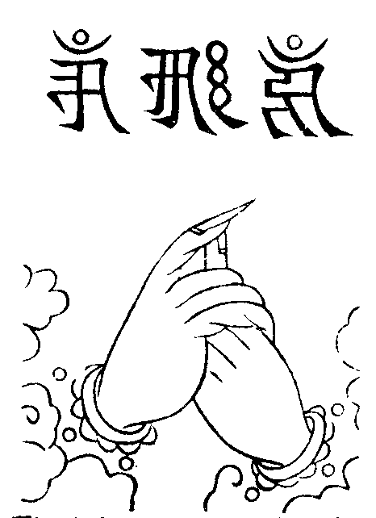



唵，婆(重呼)，龛。



南无佛！南无法！南无僧！我今发心，不为自求人天福报、声闻、缘觉乃至权乘诸位菩萨，唯依最上乘发菩提心，愿与法界众生一时同得阿耨多啰三藐三菩提。



今所发觉心，远离诸性相，蕴处及界等，能取所取执。诸法悉无我，平等如虗空，自心本不生，空性圆寂故。如诸佛菩萨，发大菩提心，我亦如是发，是故至心礼。



次与汝等发菩提心



汝等谛听！



> 假使热铁轮，於汝顶上旋，终不为此苦。  

> 退失菩提心。



次结发菩提心印



(二羽虗合，如莲花状。)



唵。补提即答。没怛巴。达野弥。



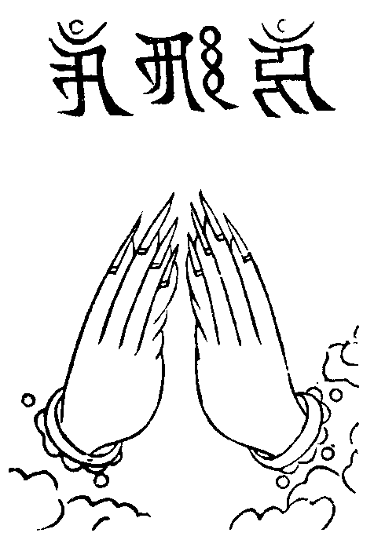



(师印呪可知。应想心佛众生，三无差别。於一念间，融成广大月轮。如八月十五日夜，中宵无云之时，极甚清净皎洁，与虚空齐等。於月轮中，想一金色阿āḥ字，如秋毫之末，非有非无。故当念之时，不得加於了知。上无佛可成，下无众生可度，中无行可修。烦恼菩提，生死涅槃净尽。此为大要妙，宜善用心焉。不惟为鬼神作利益，行人不久亦即就此中了解者矣。　师诵呪，众和三声。次白云：)



今为汝等发菩提心竟。诸佛子等！当知菩提心者，从大悲起，成佛正因，智慧根本，能破无明烦恼恶业，不被染坏。



次与汝等受三昧耶戒



> 汝等受佛戒，即入诸佛位，位同大觉已。  

> 真是诸佛子。



次结三昧耶印



(二羽金刚缚，六度外相义，忍愿伸如针，诵真言：)



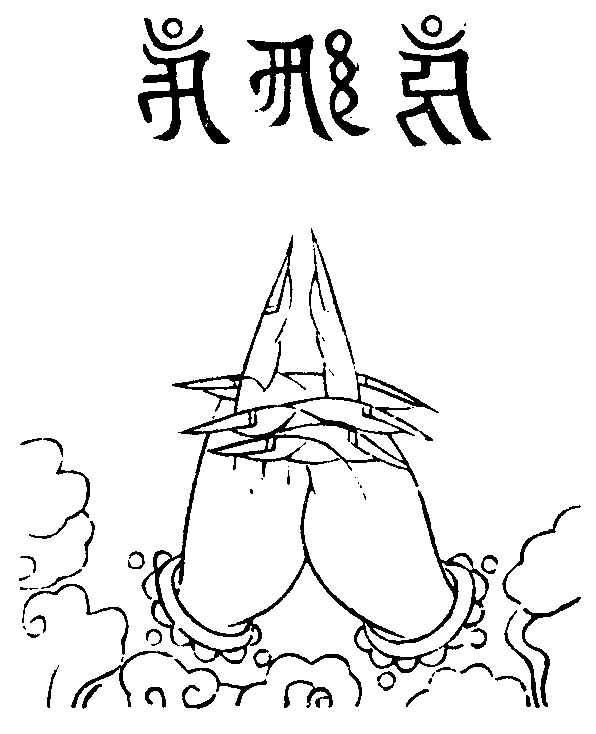



唵，三摩耶，萨埵，鑁。



(师印呪可知。应想印中有白色鑁vaṃ字，放大光明，普照所请一切有情。彼诸有情蒙光炤及，三世诸佛戒波罗蜜一时圆满。法界善法想为光明，流光灌顶，贮彼身中。身同普贤，坐大月轮，绍诸佛职，为佛嫡子。前缘启经云：佛告阿难：若欲受持施食之法，应须依瑜伽学，发菩提心，受三昧耶戒，方堪传受此法。即斯等呪也。藏本有多注文，学者当自览之，可得其详矣。)



今为汝等受三昧耶戒竟，从今已去，能令汝等入如来位，是真佛子，从法化生，得佛法分。



> 汝等冥阳诸有情，吾今施汝甘露食，  

> 法力加持遍十方，令汝一一皆饱满。



次结无量威德自在光明如来印



(右羽曲竖拳，戒禅度相弹，左掌仰上五指舒，诵密神呪)。



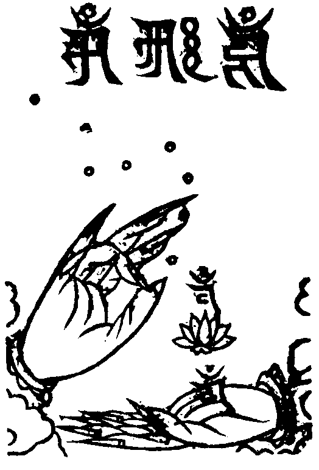



唵，萨哩斡(二合)答塔葛达，阿咓卢揭谛，鑁婆啰，鑁婆啰，三婆啰，三婆啰，吽。



(师印呪可知。侍者取水点碗中及桶中，退坐本位。师应以右手怖畏，弹指遣左手魔，即念云：吽吽癹怛。念三遍。问云：手中有何魔耶？答：为手中有诸户虫，令回护故。次变空，念云：唵㰠。或三遍。问：变空此手，其意云何？答：以此手是赤白二种不净所成，故空之，令成胜妙功德庄严手也。问：前来所入禅定，则自己是菩萨，今复何故又遣魔变空？答：此乃作定也。向上岂不言乎？今欲知者，且准法华经云：世尊说无量义已，入三昧放光，至开宝塔，又入定放光。岂不滥耶？不也。盖因一事而彰一法，是乃法之仪也。譬乎世礼祀宗庙之人，非斋戒沐浴，及至登殿醮之时，却又盥手，何也？为表敬也。今再遣魔变空，表慈之深、悲之极、用心之切也。次於一念间，顿成胜妙之手，於手掌中出一红色𠳐paṃ字，变成红色莲花，花上想一白色鑁vaṃ字，明点中流出无尽饮食，想面前水器尽成摩竭陀国之斛，或用七宝严饰，满盛胜妙食等，然后想此字种流出无尽饮食，变满法界，念唵oṃ阿āḥ𠶹哩(二合)hrīḥ吽hūṃ四字，呪一百八遍，或四十九遍，当自知时。次念变食呪，每一念於明点中取饮食，弹洒虗空)。



语诸佛子：今为汝等作印呪已，变此一食为无量食，大如须弥，量同法界，终无能尽。



> 由此真言力，变食作乳海，普施饿鬼等。  

> 身心皆饱满。



复结前印诵乳海真言



(右羽曲竖拳，戒禅度相弹，左掌仰上，五指舒)。



那麻，三鬘哆，勃塔喃，鑁。



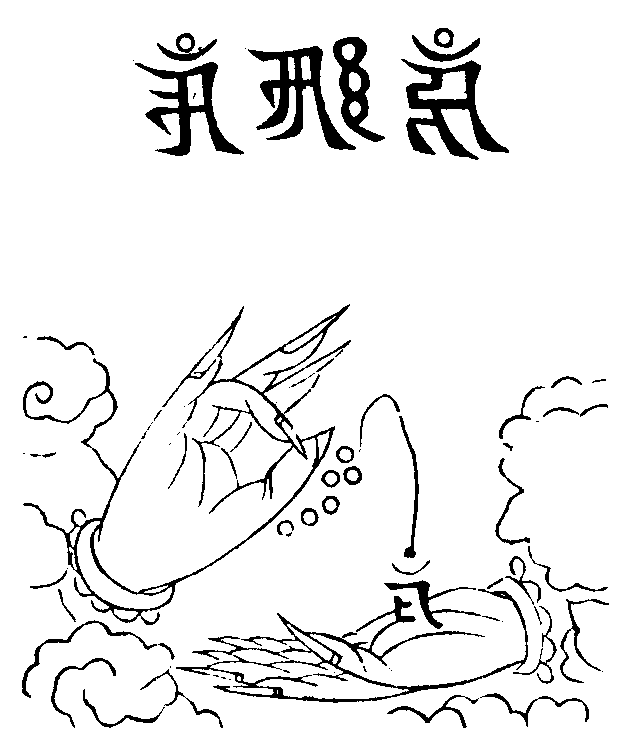



(师印呪可知。应想明点中流出甘露，以右手点取，弹洒虗空，如雨注下。凡所至处，即成长河酥酪也。问云：何以少小器水等遍满法界？答：心力难思故也。况又藉神呪及字种观想等力，乃至诸佛冥加禅定之力，岂不能变小成大，化少为多也？且又借世间往事为喻，如栾巴一巵之酒，以术力尚能化为霖雨，何况神况难思之力者乎？行者亦不可不专注用心也。又问：何故不以饮食施之，却用水也？答：彼鬼趣多为业火所烧，故今以水施之，沃灭其业火。佛云：彼鬼等百千万劫不闻浆水之名，何况得饮？又云：彼鬼在恒河边而不见水，设使得见，变成脓血。若饮之时，入腹化为猛燄，热烧心腹，难堪痛苦。悲哉！悲哉！故今以水施之，体此意也。又番本云：苏噜巴，此云水施食。则知本乎施水矣。今世俗不知，多用施食，水亦失也。况今施食亦不专用水，彼器中皆投饭七粒遍十方是也。故勿疑诸。)



语诸佛子：今为汝等作印呪已，由此印呪加持威力，想於印中流出甘露，成於乳海流注法界，普济汝等一切有情充足饱满。



> 汝等业障鬼，变火不能食，今诵秘密言，  

> 法食皆饱满。



次诵障施鬼真言



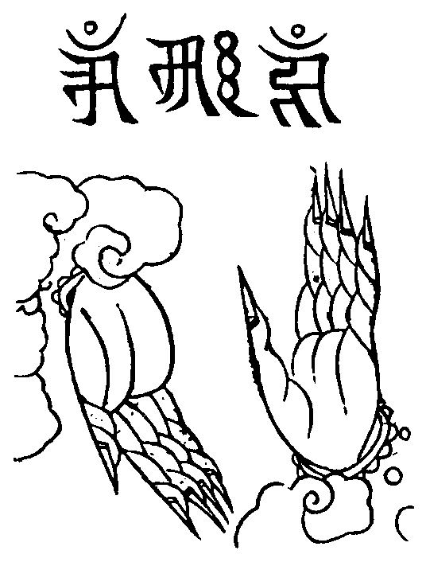



唵，哑吽，拶辣弥担，萨哩斡(二合)不哩(二合)的毗牙(二合)莎诃



(师印呪可知。应垂展右羽，想掌中有一鑁vaṃ字，明点中流出甘露，从左掌而下，念唵哑𠶹哩hrīḥ（二合）吽hūṃ字，一百八遍或三七遍皆可。侍者至师前作礼，取净瓶出坛，将净水徐徐注下。师至唱时，想彼障施鬼悉皆胡跪，师想自身观音徧至其前，而施甘露从顶上入，灭其业火而得清凉。呪三遍，弹指各一下。呪三遍或七遍，障施鬼等饱满欢喜，弹指一下。是时行者即以右羽持甘露器，面向东立，泻於坛前，或净地上，或於石上，或新净瓦盆亦名盂兰盆，生台亦得，或泉池河海长流水中，不得泻於柘榴桃树之下，鬼神惧怕不得食之。若圣众坛中明王诸天，若施饮食置生台上，是本法也。若供养诸佛圣众，於上五更晨朝日出，是供养时。若鬼神法，於人定亥时、本人定时。阿阇黎法，若於斋时尽於一日，但加持饮食水等，布施飞空鸟兽水族之类，不拣时节但用施之。若作饿鬼施食之法，当於亥时。若於斋时施饿鬼食者，徒设功劳终无効也。不是时节妄生虗诳，鬼神不得食也。不从师受，自招殃咎，成盗法罪。斯出藏本。)



诸佛子等，虽复方以类聚，物以群分，然我所施，一切无碍，无高无下，平等普遍，不择冤亲。今日勿得以贵轻贱，以强凌弱，拥遏孤幼，令不得食，使不均平，越佛慈济。必须互相爱念，犹如父母忆子之想，语诸佛子：汝等各有父母、兄弟、姊妹、妻子、眷属、善友、亲戚，或有事缘来不得者，汝等佛子，慈悲爱念，各各賷持饮食钱财物等，𮞏相布施，充足饱满，无有乏少，令发道意，永离三途，长越四流，当舍此身，速超道果。又为汝等，将此净食，分为三分：一施水族，令获人空；二施毛群，令获法寂；三施他方禀识陶形，悉令充足，获无生忍。



> 神呪加持净法食，普施河沙众鬼神。  

> 愿皆饱满舍悭贪，速脱幽冥生净土。



次结普供养印



(二羽直合掌，忍愿屈二节，诵真言曰：)



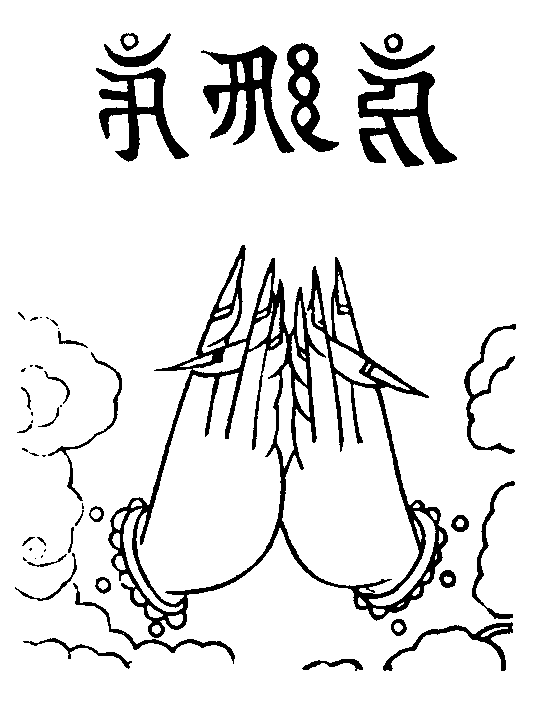



唵葛葛纳三婆斡斡资啰(二合)斛



(师印呪可知。应想屈中指处，想白色唵oṃ字明点中，流出无尽饮食，具足庄严，平等供养，同声念普供养真言，或五遍七遍。问：最初既奉献三宝，施食已竟，今复何故作此供养？答：前来所作，由拣圣凡故，所以奉献三宝，后施鬼众。今融之以平等无碍，故圣凡交彻，所以普供养也。)



诸佛子等！从来所受饮食，皆是人间贩鬻生命、酒脯钱财、血肉腥膻、荤莘臭秽，虽复受得如是饮食，譬如毒药损坏於身，但增苦本，沉沦苦海，无解脱时。我今依如来教，请诚罄舍，设此无遮广大法会，汝等今日遇兹胜事，戒品沾身，於过去世，广事诸佛，亲近善友，供养三宝，由此因缘，值善知识，发菩提心，誓愿成佛，不求餘果，先得道者，𮞏相度脱。又愿汝等，昼夜恒常拥护於我，满我所愿，以此施食所生功德，普皆回施法界有情，共诸有情，同将此福，尽皆回施无上菩提一切智智，勿招餘果，愿速成佛。



(维那白从来所受饮食文毕，师伸五供养施宝错，念斯麻啰等呪毕，大众同音讽诵尊胜呪)。



> 西域尊者往东来，却被文殊化引开。  

> 东土若无尊胜呪，孤魂难以脱尘埃。



唵，𠽾[口*(隆-一)](二合)莎诃唵，捺谟癹葛斡谛，萨哩斡(二合)得啰(二合)卢迦卜啰(二合)谛，月涉瑟咤(二合)耶，勃塔耶，爹捺麻答的牙(二合)塔唵，𠽾[口*(隆-一)](二合)𠽾[口*(隆-一)](二合)𠽾[口*(隆-一)](二合)杓讹塔耶，杓讹(二合)塔耶，月杓讹(二合)塔耶，月杓讹(二合)塔耶，哑萨麻萨蛮达哑，斡癹萨思葩(二合)啰拿葛谛，葛葛拿，娑癹斡月述提哑，撇膻[口*貲]都𦎌，萨哩斡(二合)答塔葛达，苏葛答瓦啰，斡拶拿，哑密哩(二合)达哑，撇释该而(二合)马曷木得啰(二合)曼特啰(二合)叭𦊋，哑曷啰，哑曷啰，马麻蔼由而(二合)伞塔啰尼，杓讹(二合)塔耶，杓讹(二合)塔耶，月杓讹(二合)塔耶，月杓讹(二合)塔耶，葛葛拿，娑癹斡月述提，乌失(二合)尼沙，月拶耶，巴哩述铁，萨葛思啰(二合)啰思弥(二合)伞租爹敌，萨哩斡(二合)答塔葛达哑，斡噜结尼煞咤(二合)巴啰密达巴哩卜啰尼萨哩斡(二合)答塔葛达麻谛答摄蒲密卜啰(二合)牒瑟咤(二合)谛萨哩斡(二合)答塔葛达赫哩(二合)达耶哑牒瑟咤(二合)拿哑牒瑟咤(二合)谛木得哩(二合)木得哩马曷木得哩(二合)斡资啰(二合)葛耶三曷达拿叭哩述铁萨哩斡(二合)葛哩麻(二合)哑斡啰拿月述铁卜啰牒聂斡而达(二合)耶马麻蔼由而(二合)月述提(二合)萨哩斡(二合)答塔葛达萨麻耶哑牒瑟咤(二合)拿哑牒瑟咤(二合)谛唵摩尼摩尼马曷摩尼月摩尼月摩尼马曷月摩尼麻谛麻谛马曷麻谛麻麻谛莎麻谛答塔葛达蒲达戈𨕕巴哩述提月思蒲咤卜铁述铁希希拶耶拶耶月拶耶月拶耶思麻(二合)啰思麻(二合)啰思葩(二合)啰思葩(二合)啰思葩(二合)啰耶思葩(二合)啰耶萨哩斡(二合)勃塔哑牒瑟咤(二合)拿哑牒瑟咤(二合)谛述铁述铁卜铁卜铁斡资哩(二合)斡资哩(二合)马曷斡资哩(二合)，莎斡资哩(二合)斡资啰(二合)葛而(二合)毗拶耶葛而(二合)毗月拶耶葛而(二合)毗斡资哩(二合)左辣葛而(二合)毗斡资噜(二合)忒葩微斡资啰(二合)三葩微斡资啰(二合)斡资哩尼斡资㘕(二合)，癹斡都麻麻摄哩㘕，萨哩斡(二合)萨埵喃，拶葛耶，巴啰述提，癹斡都萨埵弥，萨哩斡(二合)葛谛，巴哩述提，释哲(二合)萨哩斡(二合)答塔葛达释哲(二合)，𦎌，萨麻刷，萨颜都，卜銕卜銕，悉銕悉銕，勃塔耶，勃塔耶，月勃塔耶，月勃塔耶，谟拶耶，谟拶耶，月谟拶耶，月谟拶耶，杓讹(二合)塔耶，杓讹(二合)塔耶，月杓讹(二合)塔耶，月杓讹(二合)塔耶，萨蛮答谟拶耶，谟拶耶，萨蛮答啰思弥(二合)巴哩述提，萨哩斡(二合)答塔葛达赫哩(二合)达耶，哑牒瑟咤(二合)拿哑牒瑟咤(二合)谛，木得哩(二合)木得哩(二合)马曷木得哩(二合)马曷木得啰(二合)曼特啰(二合)，叭谛，莎诃



(举，徃生呪三遍。此圆满加持复有二种：一、神呪圆满，二、善根圆满。一、神呪圆满者，谓侍者当取花米俵已，师资同声诵尊胜呪，想彼成光明种。加持花米已，侍者以小楪取花米出外抛撒，师想鬼神等触此光者，皆得往生极乐世界上品上生也。侍者倾施食净水，师资等同念六字大明真言一百八遍毕，振铃诵法乐六趣偈)。



承斯善利地狱受苦有情者，刀山劒树变化皆成如意树，火团铁丸变成莲花而为宝，吉祥地狱解脱而能成正觉。



承斯善利饿鬼受苦有情者，口中烟燄烧身速愿得清凉，观音手内甘露自然长饱满，吉祥饿鬼解脱而能成正觉。



承斯善利，畜生受苦有情者，杀害、烧煑、楚毒等苦皆远离，远离乘骑、愚痴，速得大智慧吉祥，畜生解脱而能成正觉。



承斯善利人间受苦有情者，生时犹如摩耶右脇而降诞，愿具六根永离八难，修福慧吉祥人间解脱而能成正觉。



承斯善利修罗受苦有情者，我慢颠狂拙朴速疾令柔，善恶心疾妬嗔恚鬬战自调伏，吉祥修罗解脱而能成正觉。



承斯善利天中受乐有情者，欲乐䇿懃速发广大菩提心，天中受尽忧苦自然生欢悦，吉祥天中解脱而能成正觉。



承斯善利，十方独觉、声闻者，弃舍小乘四谛、十二因缘行，进趣大乘四摄、六度，修万行吉祥、二乘解脱，而能成正觉。



承斯善利初地菩萨勇识者，百福庄严一切行愿皆圆满，顿超十地证入一生补处位，吉祥大乘速证究竟成正觉。



发愿回向偈



> 现世之中未证菩提间，愿无内外障难恶缘等。  

> 恒常遇逢最妙善知识，所修善事行愿速成就。



最上三宝。



> 临命终时识性无迷惑，愿生西方净土如来前。  

> 依於慧日发光闻思修，断惑证真愍念於有情。



最上三宝。



> 能回施人回施回施善，所获一切一切诸功德。  

> 犹如幻化幻化似梦境；三轮体空体空悉清净。



最上三宝(吉祥偈)



愿昼吉祥夜吉祥



上师来摄授



昼夜六时恒吉祥  

愿诸  

三宝来摄授



一切时中吉祥者



护法常拥护



南无西方无量寿如来，诸大菩萨，海会圣众。惟愿法界存亡，等罪消除，同生净土，回向无上佛菩提。(鸣尺一下云)



> 见闻如幻翳。三界若空华。闻复翳根除。  

> 尘消觉圆净。



伏以真源湛寂，乃罪性之本空。苦海洪深，逐妄波而不息。由众生之业感，致长劫以沉沦。受报地狱之中，永罹苦楚。转生饿鬼之内，长忍饥虗。既无解脱之期，宁有超升之路。匪仗如来之慈愿，曷解恶趣之倒悬。呪诵真诠，施甘露之法食。灯燃宝炬，烛冥界之幽途。普使迷流，俱超极乐。今日道场，以此普施功德，回向铁围山内，面燃大士，统领三十六部，无量无边，恒河沙数，诸饿鬼众。伏愿自从旷劫，直至今生，释业障以消镕，雪罪愆而清净。镬汤涌沸，变成八德之莲池。炉𦦨交辉，化作七珍之香葢。劒树皆为玉树，刀山尽作宝山。遍界铁床，现菩提之法座。满釜铜汁，化甘露之醍醐。往昔债主以相逢，俱蒙解脱。积劫冤家而共会，各遂逍遥。狱主兴慈，冥官持善。多生父母，从兹入圣超凡。累世亲姻，自此承恩获福。天上五衰不现，人间四相皆空。修罗舍尽嗔心，地狱息诸苦恼。河沙饿鬼，化热恼而作清凉。十类含生，舍迷途而登觉岸。普愿此国土，他国土，无量诸国土，一切有情，共证真常。此世界，他世界，无量诸世界，无尽含识，齐成佛道。四恩普报，三有均资。法界众生，同圆种智。



> 诸佛正法菩萨僧，直至菩提我皈依。  

> 我以所修诸善根，为利有情愿成佛。



> 世出世间，随愿所成，随愿所成，  

> 谨依瑜伽教，建置启法筵，普施诸有情。  

> 皆共成佛道。



次结圆满奉送印



(二羽金刚拳，进力两相钩，主者於此诵真言三遍毕，然后除去五佛冠)。



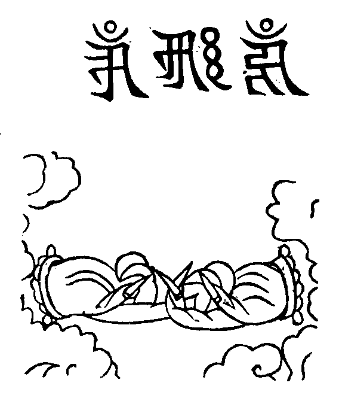



唵，斡资啰(二合)穆。



(师印呪可知。想诸佛菩萨及六道四生皆悉不现，二善根圆满。问：既是奉送已，诸佛菩萨则不现，谁为作证明？答：此显来实无来，去实无去也。三宝常住世间，且如法华经云：多宝佛塔还可如故。而妙音菩萨来，多宝佛与塔未尝不在也。若夫请之则实来，送之则实去，何异鬼神乎？学者思之。复念金刚萨埵百字呪三遍，补阙。)



金刚萨埵百字呪



唵，斡资啰(二合)萨埵苏萨麻耶，麻纳巴辣耶，斡资啰(二合)萨埵谛奴钵谛，瑟劄(二合)得哩(二合)锄弥癹咓，苏度束弥癹咓，阿奴啰屹都(二合)弥癹咓，苏布苏弥癹咓，萨哩斡(二合)戌提弥不啰(二合)耶茶，萨哩斡(二合)葛哩麻(二合)苏拶弥稷达，释哩(二合)扬骨噜吽，诃诃诃诃，斛癹葛湾，萨哩斡(二合)答塔葛达，斡资啰(二合)麻弥们拶，斡资啰(二合)癹咓麻诃，萨摩耶萨埵阿



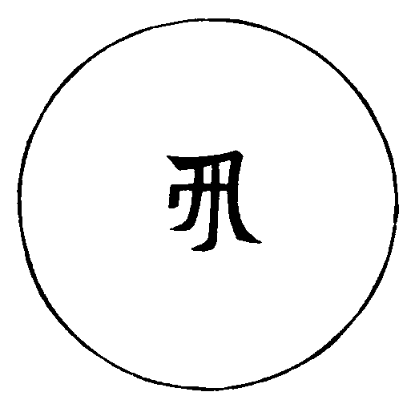



(此呪补阙行者手作印，不次第观想，不专注如是等过，悉皆清净。复念阿ā字二十一遍，则前来能想、所想，一一作法，皆不可得。若不如是，则堕於有为矣。所谓燄口，岂易言哉！)。



薜茘多文



> 五姓孤魂薜茘多，莫教平地起风波。  

> 慈航泛涨须到岸，洗脚上船会也麼。  

> 已发觉，未发觉，莫论鄷都并泰岳。  

> 罪无轻重尽蠲除，何须一一重惩悫。  

> 已结证，未结证，打破阎君台畔镜。  

> 慈风扫荡障云消，万里青天孤迥逈。



诸佛子等会也麼？休休休，更莫造罪结冤讐。钓竿已在阎君手，切莫从前再犯钩。即今施食圆满，功德周隆，汝等孤魂佛子，向甚麼处安身立命？　咦！



> 处处总成华藏界，从教何处不毗卢。



回向偈



> 施食功德殊胜行，无边胜福皆回向，  

> 普愿沉溺诸有情，速往无量光佛刹。  

> 十方三世一切佛，一切菩萨摩诃萨，  

> 摩诃般若波罗蜜。



皈依三宝。上来设放瑜伽𦦨口，平等甘露法食，功德圆满，无限良因，普沾沙界。和南圣众。



修习瑜伽集要施食坛仪(终)



No. 1083-A



藏本三昧耶戒注文，即此篇也。



既成大器，堪受宝戒。三昧耶者，准大乐金刚三昧经云：三昧名为本誓，亦名时，亦名期契，亦名曼茶啰，乃异名也。故有四种：一、大，二、三昧耶，三、法，四、羯磨。曼茶啰者，此四总摄一切曼茶啰。三昧耶亦四智印，即大智印、三昧耶智印、法智印、羯磨智印。又神变义释云：三昧耶者，是平等义，是本誓义，是除障义，是惊觉义。言平等者，谓如来现证此三昧时，一切众生种种身语意皆悉与如来等，禅定智慧与实相身亦毕竟等，初发心时与地波罗蜜满时亦毕竟等。是故出诚谛言以告众生：若我所言必定不虗者，亦令一切众生发此忱谛之言时，亦蒙三蜜加持无尽庄严与如来等。以是因缘故，能作金刚事业，故名三昧耶也。言本誓者，如来现证此三昧时，见一切众生悉有成佛义故，即将立大誓愿：我今要从普门，以无量方便令一切众生皆至无上菩提剂。众生界未尽已来，我之事业终不休息。若有众生随我本誓发此忱实言时，亦令彼所为事业皆悉成金刚性，故名三昧耶也。言除障者，如来见一切众生悉有如来法界，但由一念无明故，常在其前而不觉知，是故发诚实言：我今要当设种种方便，普为一切众生决除眼膜。若我誓愿必当成就者，令诸众生随我方便说此忱实言时，乃至於一切众生获无垢眼障葢都尽，故名三昧耶也。言惊觉义者，如来以一切众生皆在无明睡中故，於如是功德不自觉知故，以锐言感动令得醒悟，亦以此惊觉诸菩萨等，令发起禅定学师子频申三昧。若真言行人说此三昧耶者，我等诸佛亦当忆持本誓不得违越，犹如国王自制法已遂自敬顺行之，故名三昧耶也。具如是等广大甚深微妙义，故名三昧耶也。　凡行法之者，应想印中有白色鑁vaṃ字，放大光明普照所请一切有情，彼诸有情蒙光照及三世诸佛戒波罗蜜一时圆满，法界善法想为光明，流光灌顶贮彼身中，身同普贤坐大月轮，绍诸佛职为佛嫡子。　前缘启经云：佛告阿难：若欲受持施食之法，应须依瑜伽学发菩提心受三昧耶戒，方堪传受此法。即斯等呪也。



No. 1083-B 重刊瑜伽焰口跋



瑜伽义取相应，谓身口意三，精诚合一，方有利益。意即观门，身口则真言手印也。时师观门，如法与否，未易请问，而真言手印，昭然耳目，殊有异同，颇为后学所疑。鞠其源委，葢因禀受师承，不出一家，遂并流通经本，大相迳庭，纷纭彼此，莫知适从，可叹也已。兹有存心𦦨口者，以重梓为请，因与同事二三，访求善本，与藏册对校数过，始授剞劂。虽不敢自谓远胜他刻，然重法微诚，从不草草，高明展卷，自能鉴之也。



时康熈二十二年岁次癸亥腊月万峰宝书阁识

