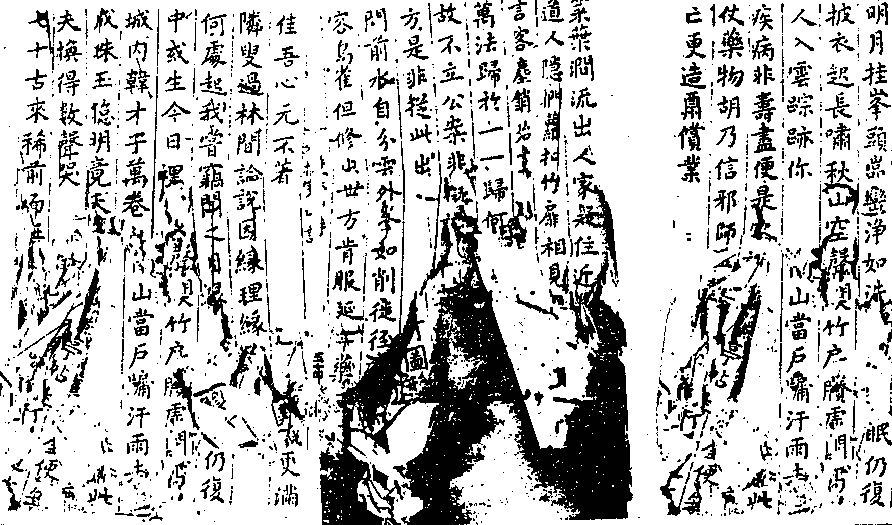
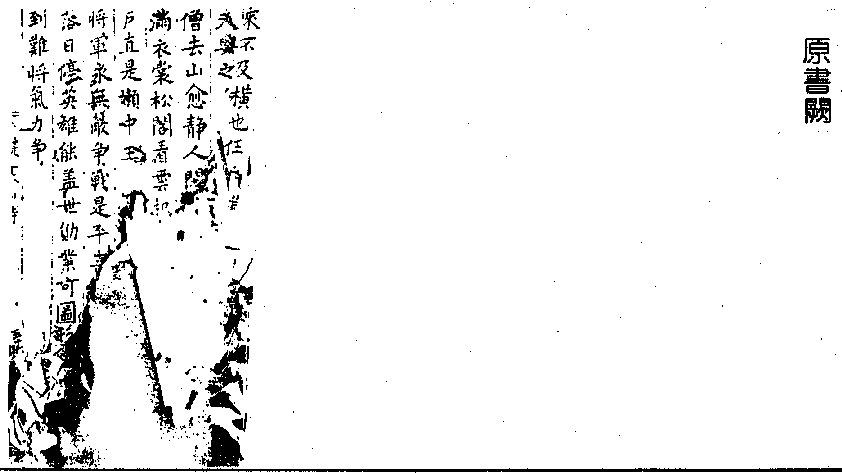

# 拟寒山诗



> **藏经**：嘉兴大藏经（新文丰版）（嘉兴藏）　**册次** 第 33 册（J33）　**编号** JB293　**部类** 论集部　**卷次** 1 卷　**篇幅** 15,401 字

> **卷／品**：0 卷 · 2 品



---



## 目录



  - [梅村先生拟寒山诗序](#梅村先生拟寒山诗序)

  - [梅村居士拟寒山诗序](#梅村居士拟寒山诗序)



---



### 梅村先生拟寒山诗序



梅村张先生，博学力行，究心佛乘，善贫而好施予，世出世间作诸利益事以百千种，缁素赖之。晚乃尽谢世味，一蔬一饭，参诵西方大觉不休，叩以宗旨，洒洒终日，激切斐亹，大有儆动，居然阐法善知识也。其所游戏翰墨，率禀於教，骤阅之即里耳可入，潜玩而深体之，即古澂言奥义不啻也。以其类寒山子诗，遂名拟寒山。吾乌知寒山之为文殊，而梅村之为寒山邪？以其言可为后学之梯航，则捕教翼圣之功不可泯灭，他日与寒山诗并传永永，末世众生其尚有大造哉！故为之序，而俾梓之以传焉。



社末镇山居士唐守礼识



------



### 梅村居士拟寒山诗序



寒山诗，非诗也，无意於诗而似诗，故谓之寒山诗。梅村居士拟寒山诗若干首，警醒世迷，发明大道，声响意为，无非似寒山者。以无意於寒山，故能似寒山也。居士素工诗，老而逾妙，笥中稿计不下数千篇，为李、为杜、为王、为孟、为陶、为谢，靡不各极其致。至所拟寒山诗，则又若歌若啸，摩写人情物态，爽豁痛快，读之令人鼓掌顿足，心神为开而毛发为竖，有味乎言之也。未寒山子示迹污秽，而独以吟咏留题岩谷，传布街衢里井之间。居士沈冥当世，箧中之藏几为韫椟，而独以是编付诸副墨之子，假剞劂以公同志，而示人之意可想而知已。嗟嗟！浊世不可庄语，故曼衍以穷年；高言不止於众人之耳，则浅言以见意。世之人以诗道求居士，是编何足以尽诗？居士之诗，则固为李、为杜、为玉孟、为陶谢，自足称雄词林，上下千古，恨世莫得而尽见之耳。乃余之知居士，则未始以诗。居士栖心禅那数十年，究竟最上一乘之旨，疑是庞老后身，即列诸高士传，彼似有所不屑。世之读居士诗，宜想见其人，并求其意焉可也。



福山同杜本明居士蔡善继



儗寒山诗自叙



寒山子诗，以及慈受诸公儗寒山诗，皆所以歌咏性灵，阐扬道妙，欲使众生去妄归真，舍凡入圣，厥旨微矣。但多提唱宗乘，罕有及乎净土，故约以为释迦文佛入灭之后，正法五百年持戒坚固，像法千年禅定坚固，末法万年念佛坚固，而而圾末法时也。予山居多暇，间为儗寒山访，要在劝人念佛往生乐国，横出三界，永断轮回。次则启人戒杀放生，长养慈心，以为生方津筏。至若山居赋事咏物等作，所以发寒山、慈受诸公之逸响，少裨寒山、慈受诸公之法施，殆所谓覆杯土於泰山、添勺水於沧海，不自谅哉！冀览者式另著眼，则狗尾蛇足之诮，庶几其少宽耳。



梅村居士张守约书



拟寒山诗



梅村居士张守约追拟



五台居士陆光祖订正



寒山三百篇，篇篇是警策。或歌廊庑间，或书院宇壁。当时国清寺，僧行如云集。有耳胡不闻，有眼胡不识。



寒山出寒山，拾得蹃拾得。丰干自丰干，三圣同混迹。闾丘太守至，当下齐言出。拍手归去来，云山高突兀。



予拟寒山诗，亦是随口出。也不期协韵，也不求谐律。但欲劝世人，偶尒盈纸笔。若徒炫耳目，视之有何益。



吾诗非蹈袭，古风三五七。但拟寒山子，积累岁月日。观者休错会，等同闲书帙。言虽似逆耳，可以愈癨疾。



佛於三界中，老婆心太切，念念度众生，念念无休歇。众生当痛心，莫更造恶业，恐负诸如来，一点菩提血。



死生亦大矣，休若梦中过。存者亲朋少，去的岁月多。菩提开觉蹃，进步莫蹉跎。这个埋尘镜，应须著力磨。



修行法门多，从何门里进。才逢善知识，霹面去诘问。或云戒定慧，或云经律论。唯有修西方，直入无渐顿。



莫谓畜生微，与人同气血。但恣我肥甘，不顾他死活。痛口说向君，畜生非是别。过去之六亲，未来之诸佛。



遁居霞雾峰，千山万山里。白云傍榻飞，草阁依嵒起。闲卧拥鹿裘，清谭挥麈尾。童子采茶归，自去汲泉水。



檐端宿白云，峰顶悬孤月。辞树叶飞飞，绕阶泉决决。静夜永如年，素衾明似雪。林僧趣颇同，磬击秋山裂。



佛是悟众生，众生是迷佛。悟似月当天，迷似云遮月。尝游杂华林，就中闻妙诀。心佛及众生，是三无差别。



百年骨肉亲，犹如逆旅客。倏聚得相逢，倏散又相隔。要死留不住，受苦替不得。慇懃劝世人，各须自努力。



菩萨度众生，应身随万类。或现蚌腹中，或处牛肾内。一物度不尽，誓不登佛位。众生太无知，恣造弥天罪。



破屋覆烟萝，石床苔藓驳，云光涧底明，泉韵嵒头落。山深忘岁年，心懒醉丘壑，木食与艸衣，自得其中乐。



傀儡共登场，呈尽千般伎。谩将笑剧看，世上总儿戏。傍观若自由，未免线索系。舞罢寂然休，与人死无异。



我爱山居好，遶屋都种竹。松风清我心，涧月明我目。有客便吃茶，无饭便吃粥。世人那得知，清闲是真福。



心为诸恶源，身为众罪薮。观心是无常，万善自谐偶。观身如实相，百福缘兹有。善恶初无根，由於能观否。



高高峰万层，小小庵一个，并无俗士来，时有高僧过。种楮补衣裳，采薇供旦暮，最爱听松风，就枕松根卧。



生死轮回理，儒家信不及。羊祜孩提时，探环邻树窟。若使无轮回，那能知往迹。此是世间事，非关佛书出。



独倚断崖石，闲看孤云飞。松风飒然来，吹我身上衣。群峰插霄汉，青天四边垂。幽怀渺难言，行行歌紫芝。



性具形气中，似人之处宅。宅成则居之，宅坏又他适。其宅有时坏，而人未尝没。形死性不灭，此喻可概得。



犯罪禁官牢，举家多痛哭。痛其遭鞭挞，哭其被桎梏。世人却不知，家家有地狱。笼鸡以待烹，圈猪以待僇。



深深藤萝谷，袅袅松筠径。涧涧水交流，山山鸟相应。低低一个庵，寂寂数声磬。皎皎青天月，团团如宝镜。



嵒泉清溜溜，林壑静悠悠，飞鸟影䎘䎘，鸣鹿声呦呦。峰头云叆叆，松顶风飕飕，一念恒寂寂，万缘总休休。



若人大梦中，自能做得主。则於死来时，亦能做得主。梦中若颠倒，死来那由你。请将生死事，卜诸梦寐里。



徒杖出风林，嵒泉飞瀑布，石上坐盘桓，忽逢胡僧过。云自天台来，此去访霞雾，竖起柱杖子，还识得这个。



访隐暮归迟，柴门半开闲，踏叶微有声，黄犬隔篱吠。屋角梅花横，寒光月在地，仰止渴心生，瓦罏汤正沸。



世有杀人刀，锋利逾金銕。晁错被其诛，孙膑被其刖。或问何物造，佞人三寸舌。杀了多少人，不见半点血。



昨夜北风狂，吹落满山雪，嵒岫见高低，蹃径难分别。欲出办勾当，犹恐有错跌，只得且耐心，少不消时节。



枕石抱白云，听泉卧空谷，豺虎不动心，荆榛皆悦目。嵒畔与溪边，处处种修竹，俨然类潇湘，况没有人哭。



人人有个佛，竟将埋没了。人人有个死，竟若忘记了。尽向外驰求，略不一返照。螃蟹落汤时，你却怎生好。



昔有师子觉，专修觐弥勒，已生迷外院，内院不得入。何似修西方，但念弥陀佛，一生不退转，且是甚省力。



虾蟆避蛇啗，急跳僧傍歇。只因恐惧深，喘慑久未绝。须臾见小虫，张威便去囓。惹得老中峰，爰作虾蟆说。



开得两坵田，种下一色稻。辛苦没人帮，稻熟儿孙要。既谓那坵堪，又谓这坵好。凭他自拣择，我只呵呵笑。



王戒生人道，十善得生天。享尽人天福，还须受业冤。若能加念佛，托生宝池莲。无常生灭苦，从此没相干。



世出世间法，都要办肯心。肯心若办得，决不赚其人。肯心若不办，枉自丧青春。工夫既到处，銕杵磨做针。



白雪易盈头，红尘难下足。卑哉杨州鹤，谬矣荆山玉。儒书散与人，梵䇲堆连屋。非是慕多闻，聊假以遮目。



小病常须有，荒年不可无。顺风船易覆，险道马无虞。死岂分衰壮，贫何别智愚。人能谙此理，胜读十车书。



嵒屋结婆娑，林扉开窈窕，泉遶灶前流，月向床头照。日日白云寻，夜夜青猿叫，笑杀一樵夫，蓦然来问道。



圣人能尽善，众人得失均。舍短取其长，个个是好人。舍长取其短，个个是匪人。唯能行一恕，大地是阳春。



修罗性多嗔，诸天心正乐。鬼神沉忧愁，鸟兽怀獝狘。惟人坦荡荡，尽堪修白业。若但因循去，世无自然佛。



有一猛丈夫，登山誓见佛，蛇虎任吞噬，向西瞻礼切。弥勒欲化度，其志竟难夺，寻感弥阤来，授衣亲记莂。



平地三尺雪，当窗一片月。清宵如白昼，梅花香不绝。童子谩煎茶，阿翁默念佛。不是世间人，烹庖醉曲糱。



富贵本在天，枯荣元有命。笑杀痴呆汉，欲以人力胜。瞒心并昧己，行险以侥幸。人虽巧作为，天更巧报应。



得人之小恩，常须怀大报。不知报恩者，多遭横死道。此是金口宣，普为诸人告。以德去报怨，老子术亦好。



有鸟八八儿，解随僧念佛。临终能立化，埋后尤奇特。口内出莲花，定生极乐国。世间阐提人，可以鸟不及。



佛说一切经，开口便称孝，天经与地义，儒家用立教。孝行故多端，顺亲为至要，无间地狱中，第一不孝道。



昨日颜如渥，今朝鬓雪生。年光若流水，东去无回声。不早著精彩，何能出火坑。改头并换面，错了定盘星。



我欲去打人，人亦来打了。我欲去骂人，人亦来骂了。却如自打骂，并不差毫眇。筭来没便宜，不如忍耐好。



青春窈窕女，年当十六七。修眉柳叶纤，晕脸桃花色。轻盈不动尘，巧笑能倾国。多少好男子，出他手不得。



苍天爱我深，许作清闲客。苕霅山水佳，其中为窟宅。清秋新雨霁，箕踞盘陀石。夕阳下岭时，支颐看山色。



举世好滋味，惯常不知过。食羊要择肥，吃蟹必拣大。不知人与畜，元是轮流做。至哉祖师言，一个还一个。



莲花中化生，人多起疑惑。不见蚊虫艸，蚊虫草荚出。十万亿佛土，恐难便到得。不见梦中行，万里在倏忽。



日日望春来，忽然秋又至。花开不多时，落叶已满地。少壮易老衰，与彼何以异。不早去修行，生死非儿戏。



窃闻无是公，惯居何有乡？逃形游鹿豕，慕古梦羲皇。穴处三冬暖，衷披五月凉。床头堆橡栗，卒岁有餘粮。



近世塑菩萨，思忆众生相，面欹于掌中，臂拄于滕上。思忆由于心，岂在做模样？菩萨名六端，胡妄造斯像？



后生见老人，心中常鄙贱。同席不交谈，闲时嬾会面。天那忍假年，与此浮薄汉。省得他老来，又被后生厌。



众生正性命，皆起于婬欲。婬欲由恩爱，生死因相续。恩爱若断时，那为生死梏。往来三界宾，菩萨别机局。



善人人人喜，恶人人人恶。明知为善好，暗造恶何故？为善由于己，善人不难做。为恶加于人，恶人未易做。



凡欲修行人，务要除习气。习气若未除，修行力正未。嗔多先戒嗔，技痒先弃技。儒家克己功，须从难处去。



竹底搆危亭，苑间开小径。策杖谩经行，闭关还取静。重违长者车，恒抱维摩病。住处近僧庐，风林闻夕磬。



桂醑金卮泛，华堂宝篆烧。妖童歌皓齿，艳妓舞纤腰。事事如心意，时时逞富豪。世间无柰尔，只是死难逃。



场畜几队鸡，池养一群鸭。待客不必言，自奉亦常杀。口里语喃喃，舌头响扎扎。原要吃还他，竟不思量著。



人若负我物，怪他不肯还。吾若少人财，置之如等闲。本是一个心，用之有两般。所以三恶道，只在方寸间。



教起韦提希，具说十六观。胜劣皆往生，仗佛弘担顾。横出三界中，工夫且昜干。别修至有顶，终未到彼岸。



悬壁洒风泉，清秋残暑退。入谷寻僧庐，垂藤牵客袂。雨餘山翠流，叶落林声碎。老衲据绳床，白头忻晤对。



昨日吊一邻，今日哭一亲。年皆少于我，地下先修文。虽然有先后，未免轮到身。不早办盘费，临期忙杀人。



郡中有市肆，广集四方物。早晚应人求，至於癈寝食。这等好念头，人何不感激。但有觅利心，枉费许多力。



尽羡张三乖，皆嫌李四愚。愚者为田夫，乖者作讼师。耕田足衣食，争讼多是非。君看愚与乖，那个得便宜。



宋氏曾渡蚁，遂获大魁福。方氏曾杀蛇，遂遭赤族戮。昆虫且如此，况乎禽与畜。杀生与救生，报应何其速。



净土妙法门，弥陀大愿力。千生万劫来，今朝始识得。当生难遭想，慎勿更错失。念佛求往生，贵在心专一。



处人若太刻，其心怀恨切。无有销化时，如服金刚屑。万劫与千生，报冤无停歇。著实劝世人，冤家不可结。



屋角放梅花，一时香扑鼻。东风蓦地来，满地花狼籍。衰荣若梦幻，生死在倏忽。吾心感物情，倚杖花边立。



种树欲成阴，教子欲成人。竟忘要紧者，自己一个心。说在腔子里，要寻无处寻。若还认得了，青山无古今。



槲叶纫为裳，兰荪储作粮。别人笑我懒，我笑别人忙。静夜闻天籁，寒潭弄月光。不教尘土梦，恼乱我心王。



世人欲自立，不敢为妄语，妄语多破赚，见绝於乡里。佛若有虚诳，龙天肯信许？唯其语真实，故号世无比。



柏子满炉烧，𩡖然香缕缕。蒲团作半趺，山室静如许。岁晚梧桐飞，夜深魍魉语。悬灯照寂寥，瑟瑟疏林雨。



一生作樵夫，总被青山弄。双鬓看看白，两肩转转痛。晨采和云湿，暮挑带月重。无钱尽取去，但不上门送。



目连持钵食，救母地狱间。母怪饿鬼觑，以手遮钵前。即变为猛火，一粒不得餐。业力胜神力，除饥要除悭。



参禅难把捉，诵经非究竟，佛开方便门，末法众生幸。至心念弥阤，观想西方境，直超生死流，修行最捷径。



渔者不能猎，猎者不能渔。唯养口腹人，以财为网罗。羽毛并鳞甲，无不被其屠。反重渔猎罪，哀哉复呜呼。



见有聪明汉，未说先会得。当在人面前，经律如口出；转在人背后，荤腥恣意吃。不是要瞒人，只是信不及。



堪怜世间人，因妄起诸病。却去杀生灵，祷神祈感应。人既欲求生，物独不爱命。正直者为神，肯玩生杀柄。



须弥大海中，半居天上面，周围四天下，日月腰间转。东晓则西昏，南午北夜半，如是之世界，不可数量算。



人生处世间，取法当如钱。里面既要方，外面又要圆。不圆行不去，不方守不住。凡我子若孙，毋忘这几句。



佛家有焚身，然臂及然指，能舍其难舍，或者起非议。人于无始来，虚浪几生死，危脆易坚固，未知斯理耳。



西天多外道，九十有六种。一切诸经书，见题便成诵。不能了自心，狂慧亦何用。妄谓证菩提，罪犯过十重。



三伏火云烈，农夫无躲藏。面上汗如雨，田中水似汤。蚂蝗叮腿痛，苗叶割体伤。粒粒皆辛苦，斯言甚勿忘。



此人不梦舟，南人不梦车。世之说梦者，由所见所思。有不因闻见，形梦却何如。曩昔藏八识，多生发现之。



或难无量众，林中齐念佛。那得许弥陀，同时俱引接？不见月在天，一轮更无别，万壑与千江，处处皆得月。



众生递相啖，决定无疑议。人吃羊不难，羊吃人亦易。相传村俗言，且自有意味。蜻蜓咬尾羓，星星自吃自。



荒年食反足，皆因去岁丰。熟年腹反饥，皆因去岁凶。情事甚明白，可以晓儿童。三世罪福因，其理将无同。



物外寄闲身，诸缘任运歇，不染半点尘，唯念一声佛。性使软如绵，心教硬似銕，肯作无益事，水底去捞月。



人生有定分，各宜安分好。凫颈与鹤颈，长短非多少。若去强安排，暗中被鬼笑。野鹿逐阳焰，辛苦徒自讨。



我爱嵒畔松，年年长一台，松花炊作饭，松枝修作柴。松声风送至，松影月移来，当时空错过，恨不买山栽。



葛繁办好心，日行利人事。念念在利人，此心与天契。生为阴司重，死踏莲花地。劝君学葛繁，利他亦自利。



若人能敛念，静坐一须臾，胜造恒沙数，七宝窣堵波。宝塔久必坏，静心功莫逾，只此这一念，究竟证真如。



庐山听经鹅，径山听经鸡。师化亦俱化，禽中也太奇。多见世间人，闻经反皱眉。於汝意云何，问取须菩提。



我有一般宝，六处常放光。无中亦无表，非圆又非方。不与万物侣，能为诸法王。虚灵离影象，堂堂复堂堂。



僧有贪婪者，恣情於味上。食稍不称意，怒骂捷影响。病卧起不能，众恶绝其养。嗔心转炽盛，生身化为蟒。



山空宿鸟鸣，涧道眠松影。凉月夜凄凄，明河秋耿耿。长歌复短吟，来往无人境。疏鬓不堪搔，𫄨衣风露冷。



世人城府深，相交匪容易。面是而背非，外亲而内忌。戎狄生同舟，风波起平地。真是苦娑婆，只宜早抛弃。



得生成家子，心意恒欢忻。或生败家子，终日起怒嗔。不知戊与败，前生造定因。还债并讨债，此语不差分。



耕田博饭吃，纺布博衣穿，未尝见官府，肯去学神僊？花外听禽语，松间看月圆，此心休休地，终日抱琴眠。



鬼神见恶人，则起嗔怒心。菩萨见恶人，则起慈悲心。慈悲思救度，嗔怒降灾祸。菩萨与鬼神，便差这地步。



绿杨掩畫桥，并立啼烟鸟。羽毛分外奇，音声亦甚好。自喜时饮啄，将谓长相保。那知轻薄儿，挟弹春风道。



藤覆石床平，霞明山阁晓，花香和暖云，芳坞啼春鸟。习嬾起常迟，遣魔醒独早，真风生性空，摠把情尘扫。



行也行方便，坐也行方便，诸圣寻常察，上天自然见。不锡之以福，即加之以算，还有好因缘，在於你后面。



昨日入莲社，口佛心亦佛。今日火宅中，事杂念亦杂。若非根器深，未免尘劳汩。是以古哲人，山中修净业。



诸佛有大戒，偶因藏中读。度酒与僧尼，百劫无手足。度者罪非轻，饮者罚尤酷。不惜苦口言，劝君宜三复。



嗜味忍心人，环火去逼羊。充馔固然美，痛苦那堪当。罪囚缚都市，刀刽遶其傍。此时囚心苦，与羊略相偿。



春光正明媚，杜宇催归急。艳杏与天桃，渐渐减颜色。长林宿雨收，芳艸连天碧。陌上绝游人，山头卧闲客。



人若富得快，贫也贫得快。人若富得迟，贫也贫得迟。眼中往往见，世上人人知。到手多顾快，如何复何如。



心若想悬崖，足跟便酸涩，耳闻谈酢梅，口中便水出。悬崖未现前，酢梅非真吃，口水与足酸，毕竟从何得？



爱杀天台山，石梁桥下水。自古以及今，潺潺流不止。人代有变迁，水声只如此。好与五百流，洗得一双耳。



鹤本是仙禽，那堪同碌碌。如何受豢养，却被世人畜。竹间敛双翼，花底缩两足。万水与千山，可无一饱腹。



有客修西方，过我问方便。眷属生厌离，弥陀起慕恋。五戒宜精专，一心常不乱。如此用工夫，截流登彼岸。



至哉至人语，冤乃生於亲。离亲即离冤，平生闻未闻。一人譬居越，一人譬居秦。从来不亲识，何处起冤嗔。



青山对白头，电景良堪惜。才过三月三，又早七月七。花开春雾香，叶落秋风急。垂老抚婴儿，何时能替力。



长见世间人，眷属如意少。初然甚疑之，既而心了了。此皆是宿生，淫欲所招报。自作还自受，不用生烦恼。



猗欤纯阳子，神仙中第一。自从见黄龙，深悔平生术。金丹不复炼，瓢囊摠抛掷。寄语道家流，休错用心力。



乌鹊哺雏时，万分心爱护。一啄十餘呼，一飞十餘顾。辛苦养长成，蓦被罟师捕。哀鸣及追逐，我不忍闻睹。



有钱父母死，子孙纯是争。无钱父母死，子孙纯是哭。此语非无稽，时常经耳目。著甚麼来由，抵死去积畜。



佛身充法界，疑信尚未定。吾有一譬喻，请君细详听。国朝洪武间，术人冷起敬。得罪遁瓦缾，缾碎片片应。



木榻眠云稳，梅花入梦香，平生雠礼法，尽▆嬾衣裳。野老遗鸠杖，邻僧助鹤粮，山居是非外，甲子亦都忘。



五百鬼啼哭，五百鬼讴吟。悲欢非孟浪，升队由子孙。子孙方作善，讴喜出离辰。子孙方造恶，哭为转沉沦。



赵姬一十八，周母四十五。尽去观赵姬，无人理周毋毋向观者言，昔我还娇妩。不彀三十年，渠亦如今我。



邻娃贵介得，众中独取怜。娇花争色艳，细柳斗偠纤。云髻教人整，罗衣不自穿。秋霜暗点鬓，明月落谁边。



秦人视越人，肥瘦不关己。人子见亲骸，其颡忽生泚。这点差别心，毕竟从何起。虚空落地时，方好说向你。



参禅与念佛，难易那推测。譬如竹中虫，其心欲求出。逐节蛀到顶，尽形未可得。若能从横蛀，出离不终食。



顺风则张帆，逆风则牵纤。但期舟必进，随宜而应变。世间出世间，亦各有方便。毋作面墙人，不知墙外面。



嵒壑绝还通，盘回千百折，洞深云住宽，溪曲水流活。白日送樵歌，青山违俗辙，闲情何处消？一卷唯心诀。



自从无始来，造罪亦造福。几番上天堂，几番入地狱。几番生鬼趣，几番为人畜。未能出三界，枉受轮回促。



城东有老母，一生不见佛。但晓东家丘，圣人即不识。二事传世间，至今为口食。当面错过者，此类常六七。



当时布袋笑，应笑世人痴。富贵有穷日，忧危无了期。不知元分定，只顾讨便宜。罪业谁能替，酬偿悔自迟。



悯念诸饥禽，索食无处讨。割少常稔田，年年种成稻。寒冬风雪中，用以济一饱。但愿我后人，奕世常相保。



三宝一文钱，昼夜七毫息。本息又相生，积算无底极。借得纸一张，还了绢一疋。劝人虽贫窘，莫负常住物。



心平休持戒，行直莫参禅，此乃到家语，浪作话柄传。平要佛样平，直要佛样直，众生心与行，果能如是不？



舍财为财施，舍法为法施，急难令无畏，是名无畏施。有心愧乏财，是名曰心施，心施财施等，忍辱真布施。



崖崩径转纡，累累横堕石。豹隐山雾黄，龙卧潭云黑。蕙帐动凉飕，苎裘便瘦骨。长吟落叶秋，虚室疏灯夕。



再贫乏衣食，再富当户俊。不富与不贫，自耕还自吃。念句阿弥陀，访个善知识。恁麼过将去，一日是十日。



牛与人耕田，犬为主防盗。田耕食有餘，盗止财可保。二者俱有功，食常不充饱。少病即杀吃，人心忒不好。



离亲为出家，出家反结拜。世上虽有缘，僧中却无赖。一顶如来衣，竟被他贩卖。出此败家儿，佛也无可柰。



客欲游匡庐，远过林间别。相送出柴门，凉风吹华发。独倚苍崖畔，正奈流泉咽。野鹤忽飞来，踏破松稍月。



佛是渡海舟，业如大小石。业重能念佛，石大仗舟力。业轻不修行，石小乏舟楫。大石竟得渡，小石翻成溺。



做官不要钱，本分何足道。间有不洁者，便谓清官好。官清性多刻，民亦受苦恼。清而复爱民，乃是国之宝。



徵心历七处，辩见穷八还。释老婆心切，阿难迷执坚。处尚不可得，心於何所缘。可还自非汝，不还为谁焉。



一女两家求，住处东西列。东富陋容貌，西贫美人物。父入谋诸女，女乃从容荅。东家去吃饭，西家去宿歇。



鹦鹉巧能言，羽族最珍贵。豪家争市之，贮诸金笼内。却顾枝头鸟，飞鸣得自遂。嗟吾独被羁，翻受能言累。



斗室天样宽，高卧寄遐想。灌木翳清阴，疏篁流逸响。名场有客争，真境无人赏。皓首出商山，傍观殊不像。



世缘染习久，粘於胶与饧，未能便出离，如法去修行。生处放教熟，熟处放教生，渐趣入佳境，方有少相应。



口是祸之门，祸常从此出。万言而万当，总不如一默。嗟哉国武子，因言褫其魄。允矣磨兜坚，缄口终无失。



心悟转法华，心迷法华转。天堂不可攀，地狱应难遣。只在一念间，苦乐自殊显。长空杳无际，白云任舒卷。



世间诸事业，但将直心做。直心是道场，成败非所睹。做事无利心，便差也有数。做事有利心，便好也有数。



阎王发愤愿，由于治冤敌，故作地狱主，亦为众苦逼。夜卧热銕床，渴饮热銕汁，地狱诸众生，受苦更无极。



生类弗身剪，即手不亲杀。君子远庖厨，即耳不闻杀。雉三嗅而作，即疑为己杀。分明三净肉，浑合佛家法。



许日不开门，落花铺满地。嬾看仙人棋，喜诵胡僧偈。谿涧月随行，石林云共憩。万缘摠去心，一事偏留意。



驾一舴艋舟，彭蠡湖中过。湖阔风又高，水深浪又大。叫苦声连天，覆了舟无数。性命呼吸间，急须牢把柂。



世事多不平，略举一两桩。赵文呆吃饭，钱武乖吃糠。丑女嫁好夫，美妇归村郎。不知是那个，其中暗主张。



从他斗蟭螟，任彼呼牛马。世界等空花，此身本虚假。事业做不了，得歇且歇罢。一曲没弦琴，可惜知音寡。



无端八识藏，古今书契事。有时提起来，未免碍心地。欲究本来人，宜须扫文字。心空及第归，花满菩提树。



昨见两秀才，讲论许道理。语孟与学庸，六经及三史。吾幼曾读书，至今在心里。上言上大人，下言丘乙己。



形朽神飘散，宋儒曾云云。及注乡人傩，恐惊先祖神。既有神可惊，鸟得言飘散。其语自矛盾，读之发三叹。



若要做好人，先须行好事；若要不怕人，休行怕人事。云何为好事？一切有益是。云何怕人事？一切非理是。



有禅有净土，永明上生去。阎王重其人，绘像曰顶礼。有僧死复苏，具言如此事。更求礼其塔，因以传后世。



百病催人死，狂风促花落。花落有时开，人死不可作。纵有千金遗，从无半日乐。罪业受轮回，皆因念头错。



涧底石齿齿，涧水清可掬。一队小鱼儿，骇避风吹竹。鱼长不寸许，解发机心速。此心即佛性，含灵皆具足。



去年梅花开，盈盈如雪白。今年梅花开，不改旧形色。更闻馥郁香，却从何处得。能识此真机，作佛非奇特。



暗昧造诸恶，唯幸天不知。小小为一善，唯恐福报迟。笑杀世间人，无如此等痴。不知心即天，毫发难自欺。



世人视妻子，以为亲眷属，至人视妻子，以其似牢狱。牢狱有时出，眷属被缠缚，相牵入爱河，何时有止泊？



祛暑则用扇，御寒则用绵。寒暑本大数，人以巧胜天。既能夺造化，亦可为圣贤。一切唯心造，我曹当勉旃。



僧投山庙宿，夜中神现形，云主此生死，地狱列友名。求神为度脱，命写法华经。归写经题时，友已天上生。



人见鸟营巢，无不开口笑。哺子羽毛成，各自分散了。不知佛视人，亦如人视鸟。辛苦做成家，儿孙受温饱。



净土远难到，下劣或生疑。那晓乘佛力，随念生莲池。譬诸无足虫，跬步不能移。得附於飞龙，可以升须弥。



四生六道中，造下许冤业。冤冤要相报，那有了时节。君莫儱侗去，及今好解结。杀父亦不报，可与知音说。



开辟成真境，风光自不群。峰高撑堕月，竹密碍行云。山色阴晴变，泉声旦暮闻。麻姑青鸟信，邀过武夷君。



曾见游荡子，废产日不足。一掷钱百万，一笑珠十斛。当其豪富时，犬也皆食肉。及其倾败后，人也都吃粥。



轮回六道转，此乃一定理。有信有不信，未之详审耳。玄鸟生商帝，彭生化为豕。宋仁赤脚僊，昭昭见经史。



客问梅村子，地狱有也不？其人业颇深，聊以片语激。在他人则有，在故人则没。复诘何以故，君却有不得。



世人忧不足，山翁乐有餘。得粮分鼠食，结屋借僧居。云光开锦绣，松籁奏笙竽。时或有新句，随处竹间书。



富人嬾布施，吝财生烦恼；贫人喜布施，无财生烦恼。烦恼虽然同，其如异果报，贫者得生天，富者堕恶道。



菩萨处世间，如人去扮戏，为官不自官，为隶不自隶。离合与悲欢，赞扬及骂詈，甚至白刃加，何尝动心地？



人于太平时，终日怀忧戚。患难一临身，求前不可得。世事如空花，得日且过日。妄想多著魔，平心便是佛。



猛虎吼一声，百兽皆骇愕。那知女妇人，比虎犹似恶。我语非荒唐，请君自忖度。妇人坐虎皮，虎毛当时落。



弥阤甚易念，西方甚易生，但虑信不切，休忧力不能。若能一念顷，十声称佛名，随念往生去，如响之应声。



狮子去搏虎，故然奋全威。师子去搏兔，亦要奋全威。搏兔若不力，被兔得便宜。损威殆不少，难免众兽嗤。



人于临终时，甚勿相爱恋，亦不宜悲哭，恐使其心乱。心乱神识迷，三途去如箭，念佛助往生，第一好方便。



道士被鬼迷，无法之可治。幸逢人救苏，感德不能置。谢以辟鬼符，其人笑倒地。世之徒法者，何异此道士。



青青一片山，矮矮三间屋，爱松兼石移，饮泉和月掬。无钱可买忙，有药堪毉俗，行云闻我歌，亦向嵒头宿。



丁亥岁大祲，饥民死多少。剥尽树上皮，糠也无处讨。及今谷稍登，就拣米堪好。这等薄福人，终须作饿殍。



牢字乃从牛，狱字却从犬。不食犬与牛，牢狱自然免。偶逢舆人语，一时良有感。古人察葛荛，言近理或远。



以缾盛虚空，至彼虚空放，彼空不增加，此空不减丧。形骸譬则缾，业识虚空况，执缾内外生，除器空无状。



贪明蛾赴火，贪饵鱼上钓。傍人冷眼看，不觉失声笑。人本灵於物，财色溺所好。杀身了不愿，与物同一调。



六贼聚为党，昼夜谋行劫。一切功德财，剽掠靡遗子。内若无贼媒，外寇何能入。家贼最难防，识得真英杰。



山居要省缘，百凡取诸豫。残山开种茶，宿火留煨芋。贫养鹤传书，闲酬僧索偈。黄茆覆屋重，风雨何须虑。



受诸苦恼者，业由前生造。今生又不修，来世还招报。说与田舍翁，不行也道好。说与读书人，不信反要笑。



我见读书人，遍读诸经史，古人邪与正，一一皆能指。及为物情蔽，无暇顾道理。那知后世人，亦能检点你。



我爱真西山，写经祈荐母。刺血以为墨，诚孝自忘苦。一时皆右袒，君独袒其左。不为习俗移，未易屈指数。



了来尊者迎，杲来盏花献。人情有两般，恩义贫处断。今我随喜时，些子也不见。涧底水淙淙，峰头云片▆。



手种数株梅，高者三尺强，倏然餘丈许，花开满树香。人若能修行，积累奚可量？终日叮叮当，鍊銕自成钢。



天地嗔恶人，万中击一二。击之况有时，使之知警惧。见恶若便击，天威无时霁。人宜扩其量，包荒如天地。



人物自相友，无有介伤心。凡有血气者，莫不相尊亲。吾详味斯旨，上古未茹荤。祸首燧人氏，肇起杀生因。



若人念佛多，上品莲花坐；若人念佛少，下品莲花坐。譬民财宝多，则称为上户；譬民财宝少，则称为下户。



却笑痴迷汉，贪心不可量。忧教头发白，筭得面皮黄。田地连千顷，金银满十仓。难教买生死，枉用一生忙。



凡人临事机，有个好法则。譬如欲左转，左转转不得。随即便右转，右转转不得。蓦地於中间，一齐都跳出。



林间僧说法，挂笠入烟霞。示我衣间宝，逢君门外车。群儿出火宅，穷子得还家。与佛因缘大，能闻妙法华。



隙地有乔椿，双鹊久栖住。吾意将筑室，鹊忽委巢去。此机未及发，彼已先御备。人为物之灵，何用使机智。



舍财不在多，贵心生悦怿，樵夫施三钱，归途喜形色。后感国王报，金钱复多获，布施若懊悔，生彼穿心国。



游戏入吟坛，有时寻二朗。斜扃隐竹松，荒径披蓁莽。石可千人容，室无十笏广。谭诗并论禅，清赏入吾党。



古来生净土，历历皆名贤。晋如刘遗民，唐如白乐天。宋如黄龙舒，以及苏子瞻。其餘难具述，愚人却可怜。



往往人生辰，杀生以庆喜。尔既欲长年，彼岂爱速死。人畜虽不同，轮回则一理。不怪你吃他，只怕他做你。



众生世谛中，识趣最颠倒，但喜指人短，不喜扬人好。闻人议论他，即便生烦恼，自己议论人，终日不可了。



人或被毁谤，宜先自反己，於心若无愧，竟须置不理。譬如有一人，遗我以币礼，我若不受纳，少不原还你。



云山高不极，结茆山之顶。不是我好奇，但取一味静。松月来昏定，海日来晨省。泉水自然盈，不必更穿井。



上品见佛速，下品见佛迟。虽有迟速异，终无退转时。参禅病著相，念佛贵断疑。实实有净土，实实有莲池。



鞭鱼作鲙时，睁目无人怜。但把尾来掉，而口不能言。负痛入鼎镬，何处去伸冤。有日因缘会，也听我烹煎。



像季开方便，东林晋远公，翻然彻讲席，肇尔启莲宗。一念存安养，三番睹圣容，斯人若可作，执鞭以相从。



定慧戒为基，功德信为毋。无痴慧自开，无嗔福乃厚。发心要明师，闻道须善友。早寻衣下珠，弗饮无明酒。



贫贱子孙多，富贵子孙少。贫贱或寿长，富贵或寿夭。非关未定天，各自受果报。种瓜止得瓜，种枣止得枣。



无事常不出，有门常不开。吟诗四五首，打顿两三回。身视如传舍，心教若死灰。秋风入茆屋，黄叶满床堆。



三个或五个，吃饱聚头坐。不逞自己能，便说他人过。快活度朝昏，佛也不要做。腊月三十到，手足无所措。



杀羊猪受怕，杀鸡鸭受惊。死者已真死，生者亦偷生。三四好儿女，一子忽命倾。不知自反本，枉哭眼睛盲。



二鬼见前尸，一鞭一礼拜。目连逆问之，各有缘故在。拜因曾作善，福报今倚赖。鞭因曾造恶，罪报为偿债。



石梁苔藓厚，闲坐看流水。涧畔谁家坟，郁然林木美。哀哀闻哭声，埋骨添新垒。一自入山来，几人化作鬼。



竹未出土时，已具棱棱节，总然势拂云，其中元无物。清风徐徐来，彷佛琅玕戛，孑立嵒壑间，何曾畏霜雪？



正人说正法，听者没几个。幻师呈幻术，观者应无数。颠倒其知见，不知是何故。所以世间人，名之为措大。



痴人烧纸钱，唤名曰寄库。若死入地狱，那放你空过。却有真预修，弥阤作功课。迳趍极乐邦，踏翻生死路。



一童嗜鸡子，每窃火烧食。被鬼诱入城，门闭不得出。遍城皆火灰，奔走痛无极。父唤城忽隐，腿烧烂盈尺。



名利谁不爱，命中倘没有，譬之镜中花，虽好难到手。或得之非分，祸患紧跟后，如吃刀上蜜，虽甜恰伤口。



故人山中来，亦羡山居好。旦暮遗家累，入山恨不早。及去逐声华，依旧猒枯槁。所以巢由后，山人直恁少。



若造种种业，轮回入诸趣，唯有修西方，与佛为伴侣。好事干两桩，弥阤念两句，预办了盘缠，凭他几时去。



咬菜君笑我，吃肉我怜君。菜澹免偿债，实自爱其身。肉肥要酬报，端自戕其身。形殊性不殊，山谷见理真。



一人山之巅，一人山之趾。初然人见之，高卑势难比。从巅下不休，从趾上不已。卑者反在顶，高者反在底。



偶经贵公墓，凄凉心惨伤。青山卧碑碣，黄土盖文章。哭无骑马客，笑有牧牛郎。意气兼功业，都归梦一场。



为善获善报，造恶受恶报，不用去占龟，何须来讨笤。智人固能知，愚者亦能晓，何造恶者多，而为善者少。



青山不负我，栖迟兴自别。林间卧紫烟，涧底弄明月。春阁送冥鸿，秋崖听落叶。地覆及天翻，与我无干涉。



人固爱妻孥，物亦恋眷属。曾见人缚鸡，惊飞共赶逐。杀害彼性命，厌饫我口腹。巡行善恶神，暗里定怒目。



佛言四事供，阎浮诸众生，或於取乳顷，能念佛数声。较量其功德，念佛妙难称，直至菩提果，皆由这念成。



一念何万年，万物何一体。或人致疑问，闻喻跃然喜。周卜得八百，万年同此理。明王斩塑像，一体差堪拟。



往岁曾瞻礼，育王舍利塔，非金亦非石，非木亦非銕。舍利隐或现，金钟动不歇，小大及形色，变幻不可说。



老大青楼妓，鬓边生白发，犹记少年时，花枝满头插。拟人似旧怜，见者反笑杀，不识进退人，缾盖颇合著。



人人对人言，唯说吃亏好。蓦然事临头，前言又忘了。讨得些便宜，欢喜呵呵笑。若被人占先，冤家直到老。



嵒头打睡餘，偶念一朋友，自负经济才，立名期不朽。空谷绝足音，风尘浪奔走，夷齐死山中，声誉且长久。



石崇在地下，饥饿去求食。范丹怪问云：君富胡亦乞？荅言我来时，一些拏不得。此虽是寓言，其理却真实。



班鱼乖性气，浪行烟波中。偶自触於物，念懑即填胸。仰覆浮水面，万斛不能容。鸢鸱得乘之，因以毙厥躬。



持斋恐寿促，乃叩善知识，命之到市中，问取卖棺客。吃素人买多，则斋固无益；吃荤人买多，死不干齐得。



东海有一鱼，其名曰乌贼。如遇网捕人，吐墨染水黑。冀以得逃形，因之被全获。拙因弄巧成，非独此微物。



修行碍心田，无如钱最恶。谓其属五家，愈多愈不乐。庞老沉之江，君休入水摸。乐邦净念生，非藉钱财博。



不念佛者死，如囚去见官，未免受刑罚，那不心胆寒。能念佛者死，如客去登筵，无非享宴乐，自然生喜懽。



春雨晓来过，山泉飞百道，落花溪涧香，玩景学行钓。路逢白头翁，背悬青笠帽，非狷亦非狂，自歌还自笑。



白首卧林丘，此心良独苦。亲友多死亡，转眼成千古。知谁登天堂，知谁游地府。我顾不得他，他顾不得我。



往见豪富家，鱼肉小百姓。横割与竖割，畏威那敢挣。冥冥善恶报，纤悉明於镜。越做势头大，越见子孙病。



昔者张善和，宰牛作活计。临终牛索命，其心大恐惧。负极念弥阤，佛即接引去。况能平时修，往生何足虑。



鱼以海为室，畜之盆池中。鸟以林为家，置之尺许笼。拂彼自然性，为汝耳目充。无罪囚汝狱，汝心从不从？



久矣卧长林，人间无梦到。门容竹籁敲，榻藉松阴扫。长日怪如年，清闲忧似宝。红尘与白云，你道差多少。



大人泽天下，立法垂万古。小人困一身，晨不谋及暮。局量天渊殊，皆由方寸做。胡乐为其小，而不为其大。



因指得见月，见月还忘指。认指以为月，斯亦愚人耳。闻教合明心，明心教可已。执教以为心，法眼生尘滓。



山径艸萧萧，林扉扃白板，春深摘茶迟，僮出炊饭晚。自分无寸长，天生得一嬾，从来不见人，何烦青白眼？



浮生如蜉蝣，促晷阳焰然。何不一返照，终日苦忧煎。使尽多伎俩，未免土中眠。一具枯髅骨，被他蝼蚁钻。



五祖戒禅师，於法已得悟。后身为东坡，如何反退堕。恒持弥陀像，西方作公据。念佛稳於禅，观此可自喻。



人皆喜长寿，长寿居八难，错过好时光，反被长寿赚。人多好好名，好名居五欲，五欲自恣者，三途所收录。



今日去牧牛，明日去牧牛。芦管吹作笛，牛背稳於舟。放之桃林野，饮以[澦-予+(上/示)]水流。不犯他苗稼，牧童自己休。



眼下见吃亏，到底不吃亏。眼下见便宜，到底失便宜。那老有记性，譬彼善射师。箭箭皆中的，但发弦线迟。



女人修西方，生者如雨点。其故果何为，一心能不乱。我劝丈夫儿，一刀须两断。少分不相应，总被鬼王筭。



醯鸡亦爱生，蜉蝣亦畏死。嗟嗟世间人，生死何异此。人之视昆虫，如天视我你。不早求出离，虚浪何日已。



昔人重写经，不独血为墨。纸剥身上皮，笔析身上骨。但生难遭想，身命那遑惜。亲见人皮经，梵书方半尺。



破衲拥寒云，短床堆乱石，但忧景逼人，不虑贫入骨。林鸟语关关，嵒泉流汩汩，风和花雨香，何处寻乐国？



梦粪则得银，银是臭秽物；梦蛇则得钱，钱是毒害物。人於银起贪，被他污名节；人于钱多畜，被他缠命杀。



作福先避罪，布施先还债。此语若鄙俚，其意却广大。念佛贵念心，持斋贵持戒。此言最亲切，往生决非下。



世缘不耐烦，甘尔遁嵒穴，烟霞一片心，霜雪数茎发。减口施饥禽，开池受明月，优哉复悠哉，吾乐不可说。



有戒杀为先，有罪酒为首。二俱是重业，彼此相前后。慈心伤於杀，佛性乱於酒。尝问酤酒人，罪十屠宰手。



事常意外生，忙向闲中讨，池涸远疏泉，台荒频刈艸。种花蝶占多，惜果猿偷早，筭到▆维婆，不若无为好。



禅床僧夜起，误伤一虾蟆。竟夕苦索命，荐广许修斋。及晨往视之，却是遗地加。疑心生暗鬼，弓影盏中蛇。



造化不能苦，形骸何足累。藜杖倚花前，石床横竹内。欲行即便行，欲睡即便睡。古人曾有言，无事以当贵。



郁翁示微疾，云逝在十五。届期道友来，屋陋天大雨。量晴更二十，坐脱观如堵。念佛如是功，生死能由我。



溪鱼披渔获，将去市上货，顾见水中鱼，回▆如泣诉。尔曹谩嬉嬉，道我独受祸，未免早此间，在他手里过。



见有多畜者，夜被群盗缚。百刑惨逼之，更加以炮烙。宁死庇其财，子孙享快乐。无不笑其痴，后又有人学。



他若来打我，我便先眠倒。他既省气力，▆▆省烦恼。此言若浅易，其理甚微妙。人生▆▆中，尽受用不了。



饭饱没些事，寒泉弄双足，红映涧边桃，青映嵒畔竹。水本是无情，辩色由于目，人死目尚存，云何不能瞩？



为大器，薄畜若厚己，倾家可立至。飘风更满帆，覆舟恐难避。









