# 龙树五明论



> **藏经**：大正新修大藏经（大正藏）　**册次** 第 21 册（T21）　**编号** No. 1420（T1420）　**部类** 论集部　**卷次** 2 卷　**篇幅** 18,333 字

> **卷／品**：1 卷 · 0 品



---



## 目录



- [五明论秘要隐法卷第二](#五明论秘要隐法卷第二)



---



龙树五明论卷上



如来灭后一百餘年，有王名阿谕伽，亦名阿育王，王阎浮提。诸国竞来问讯，问其除横之法。尔时阿育王国中人民多患贫穷困，饥寒裸露不能存立。尔时大王至鸡头末寺礼拜众僧，兼说人民贫苦之状。尔时众中有一比丘，名曰菟路知，出大众中而白王言：「当如意宝珠济益众生。」王言：「云何当得如意宝珠？」比丘言：「应作十种法。一者求佛故，名得财物施与众生；二者求法故；三者供养僧故；四者安稳国土故；五者救人民故；六者巧埋塔寺故；七者威伏隣国故；八者为求帝释供具故；九者供养佛故；十者为诸人民作大富饶益故。当於正月一日燃七灯，各各盏各一百二十盏，在处供养天像。又作释迦如来像庄严，庶有诸声闻菩萨违遶。如行，大王！当知如来功能不可思议，供养之者必得如意宝珠也，是故大王供养於佛。供养佛者，悬缯幡盖、烧上妙香。以二月八日入海采宝，去不逾月而得宝珠。又复当得如意珠。珠有二种：一者大如意、二者小如意。小如意者，求始得之。大如意者，自然雨宝於天地。大王当知求大如意者，心中求之，勿在外更觅他法。七法之中，无不有利益国土人民。所以者何？止见劫夺杀生之法、大作库藏，损害人民，不堪自然为乱；父子兄弟设入官，手赐之家更愿荒乱。乱不息，国法𭄉灭，谁共大王治南阎浮提？大王！放赦狱中囚徒；年五十免其役；贫者令与富；驱使以活性命。此是大如意以济众生，非是宝珠雨以济物。大王命终之后，国土分散，人民流死，如来正法旋於十方，城壁崩到，官为山野，王当三思民利之事。又令末世粟散诸王贪慕王法燃燃者，当燃灯法，勿燃灯如事灯。云何法灯燃？以一治法垂示后代，明不绝。」尔时大王闻说是语，慈悲忏悔，入於官中七日不出，勅出大臣令求利益。于时有南天竺国比丘，旧是外道慕法出家，如白王言：「我昔寻外法中有利益人民之法，今日出家入佛法中，亦有利益众生之法。一者符，能招财宝，随土而得。二者慕，治众生病，随治即差。三者正法，能令风雨顺时，龙王欢喜。」王闻是语，勅用其法，皆利一切众生。当如七月七日取山云竹七枚长七尺者，置畫符中，其符曰：「天帝教我利益众生，一切龙鬼随我使令。」又取章柳刻作人形，作一坛以章柳置上，以遶坛侧，然后呪曰：



「归依天帝释！风神来济众生，火神来起光明，雨神来百谷熟成，宝神来钱财集，地神来安稳众生。为某甲为某事，令使今年皆悉称。急急　如律令」



诵之□遍，取章柳令埋著庭前，四方财物悉来集聚。其竹置宅四角，若其行时随身行，是利益民事。王得是语，令教万姓，大有利益。



又於正月一日，诵乞愿呪一千八返，国中大小平吉，诸恶鬼神不来遶乱。即说呪曰：



「多跌他　其帝其帝其隶帝　其多其多遽呼卢　弥遮弥遮攘攘其多　多利多利弥帝利　佉佉其怛罗佛姡　娑婆呵」



诵一千八返，所作之事法得称意，一切恶鬼皆悉远离，护国土神见即欢喜。洁斋清净七日讫，乃书利民符。若城中若柱中若殿上、若带之，能令邪鬼不来遶逼，所往之处皆悉欢喜。以朱沙书帛上，广一寸，持以击虎，虎不能起。云何但击虎？书作虎形，以符击之。乃至入山，虎狼潜伏。取角楸广四寸长一肘，书置宅门上，七神欢喜，百恶消灭。以符书背上，旧病得差。与产妇带之，邪见走避产妇，鬼神不能忓误。书符置台园坜上，疫气不起。书符置山神所，风雨顺时。以符头上，避兵。书符置心前，来财。书符著足下，能行。此符能竭海水、能崩山岳，仙人得之能□天地。



凡人得之化作大仙药者。五月五日，取牛黄大如雀子，于姜四两、麻八两、黄芩一两、大黄五两、甘草二两，於七月七日令童子捣之，以蜜和作丸用之。若人病悉𤷡、病吐、病水、病肠、痛心、四胑肿、卒风头、霍乱、心闷方重、噎不得喘息，取上件药丸，丸如小豆，两丸与服之。须臾之间而见病鬼奔走而去，兼复吐利发汗，宿食淡阴、积血微癖、产后带下、痔不断、大小便利不通，皆悉除愈。尔皆霜雨不歇六十餘日，禾谷在地，民不牧刈。是比丘为作求天法，而歇云除日。出城当门，取绯六十尺缝为三幅，畫作一龙，有十二头，升天而上。复作金翅鸟，来食此龙。以焱烧紫檀木为火，取薰陆香一百八堁，诵上件呪，一遍烧一堁，尽即雨止。又复取虚中土门作狗形，置城四角上，得雨止。又闭市四门，亦得雨止。如是法药符术，皆能利民，世帝之法。



利民头二符，是品大仙为育王说利民符。为国土衰秏、疫病邪鬼入境、灾变侣生、饥馑争讼、妇女产难、县官口舌、飞尸有疰者，俱奉敬三宝，忏悔自㥽宿因，对现在诸佛形像前，以朱沙书素陈符，依灾时治以除之。



第一、七佛大神符。符主人身百年之中，或老或少，多病痛、注误劳冷、骨节疼痛、长病著床，喻阳病多饶温气。以素生绢一尺，真朱沙书此符佩之，百病去除，男左女右。



第二神符，能除县官口舌。以朱书符佩之，念解脱月菩萨，枷锁自得解脱。



第三符主己身百年不逢殃祸、飞尸各注、野道呪咀。以绢七寸朱书佩之，男左女右，当念婆薮大仙，烧香，诸恶远离。



第四符主厌夫妻如水火，自相呪咀，高声相讼，不见生活。以绢七寸书此符，佩之大吉，男左女右。



第五符主女儿不宜媒嫁，至年高大。以绢一尺，真朱闭气书符，佩臂上。三公大贵敬来问之。



吕后年二十五，无夫主，得此符力。昔支皇后年三十未嫁，亦得此符力，即为天下之母。千金不传。子不宜骋，使诸方为官，数失复进，当念太向大仙母，烧香礼拜。



第六符厌父母憎儿，儿不孝二亲，迳日月自相鬪讼，呪咀赤口如水火。以生绢七寸，朱书此符佩之，父子孝义毕千载。当念礼虚空大明星菩萨，烧香，五旦礼拜。



第七欲见贵人及服己者，以绢七寸，朱书此符佩之，三年自贵，男左女右。当念阿閦欢意佛，烧香礼拜。



第八男人上年欲求官进职，贵人见之欢喜爱念，及求珍宝如意玉者，以绢朱书佩之，烧香礼拜多宝佛祇菟大仙人。



第九妇怀胎，为所噉，有未成，仍落坏胎，三四月中道堕落不能得之，或年三四岁中道死已。以绢方五寸，朱书符佩之，令人大。当念耆婆大医，烧香礼拜。



第十身不遭囹圄、笼烦禁闭、罗於九横，主人身在牢狱被囚禁。以绢朱书此符佩，枷锁离身，贵人识。当念救脱菩萨，烧香礼拜。



第十一主行来入出有所施作，不逢盗贼毒虫所伤，迳官不得卜问日月者，以绢书此符佩之，往复取素，见当欢喜，称意重之。外虎狼伏匿、盗贼避除，钱财横至。当礼山海惠佛。



第十二主厌治生失利，行来不遇不逢善人。以绢一尺二寸，朱书此符，佩之大吉，治生得利，善人相值。



第十三诸有病痛，小曰𭼐、大曰颠，药如前说，以此符佩吞。当礼拜观世音菩萨。



第十四诸有病痛，闭病以迳日月不差者，以绢七寸朱书，小曰𭼐、大曰颠，药如前说，以此符佩吞，当礼观世音菩萨。



第十四家内数遭疫死，病相缠遶，无救护，及身自患。以绢七寸，朱书此符佩之，即自除也。当礼宝吉祥佛，烧香礼拜。



第十五主身有邪气，飞厌病、两肩沈重不差。以绢五寸，朱书此符佩之，即自除去。当礼虚空藏菩萨。



第十六主妇人难产，及恶鬼舐头。以生绢真朱沙，当其月佩之，令儿长命，众人爱之。当礼药师留离光佛。



第十七梦寤颠侧，有鬼执魂，厌密不觉。以楸板书之，安著床草。廗中夜以恶梦化为草，当符者死、值符者亡。



第十八兄弟不恭顺，分畑割宅，无义异居；或和合共分，或一人欲为头分者。以生绢朱书符，佩之大吉利，福禄官品自至，治生有利，亦如本不分异。当礼实声佛，烧香礼拜。



龙树菩萨秘决图经



凡欲求神仙长生不老、颜色变异、领使神鬼，皆须清净斋戒、修德行道、懃心供养，断口味、身净依，不得瞋怒骂詈。死生之处立神坛，室内先置龙树座，□角面向闭，杂菓乳糜烧香，定㯹记坛西南面。依后十二时天门地户，若有新菓食同时供养。净洁七日。行道讫，一切用印治病，皆依后十二时天门地户，依四时用印，万不失一。



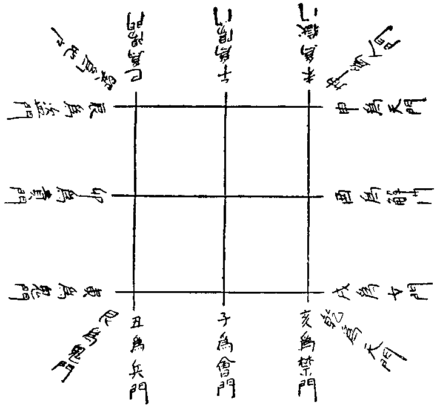



凡欲受持符术法，先须安置十二辰神门，结㯹为记。天门地户、鬼门人门出正端，不得有曲。欲修印法，各从所到之门而出，万不失一。



凡欲使之神、愿求财宝匹帛，尚出阳门。欲攻击他人、博戏鬪诤，当出兵门。至他方远涉长路，当出会门。欲见天王尊贵，出贵门。欲发燋符印使役万神，当出解门。见鬼通塞，出天门。求官职如意，出禁门。求冀女妇，出阴门。禁符印，出天门，还入地户。如法修持，必有効验。井华泉水洗浴逊口，出门六尺六步，叩齿三称大吉，慎勿返顾，万不失一。其不得妄传。



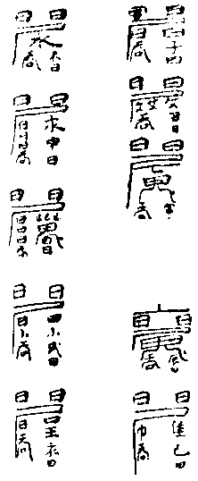



龙树十二时神符，杀鬼治病威动心神零。尚出神门，西向地户，先服七符，然后去之。子日出，先吞子符。丑日出门，先服符已，外准此法，不得人知。知印，一切无验。



呪前十二符：五神用心，彻绝音。三魂摄精，尽守母心。使我物妄五藏远寻七边。呪乃服毕，咽唾五过，叩齿五遍，勿令人知。见两妄字，谓皆应作妄字。若不用闭日，以月一日、十五日、二十七日，一月三服，一年役使验秘。



夫治病，先服前十二时符。先诵呪笔，呪熟诵，烧香，断口味，诵呪一千遍。任诵，可诵者皆得。当立道场，坛前起受持意。春三月，用朱书，口齿闭气，面东方。丙丁之日、寅卯之时，吞之罕九符。夏三月，用黄笔书。秋三月，用黑笔。冬三月，用青笔。



其一切符，皆依四时。欲服三大符，满四十九日，依十二时法出入，诵行印，诸神吉凶皆达。病根元是何神鬼作，悉决生死。取东太药，春三月丙丁日寅卯时，密取柳根皮囊盛，未使见风，舍东北角玄阴千百日，味未日丁丙寅时，向东服之。四十九日，方寸匕服之，鬼神自附，了了共语，知他病根，决定生死。



又别要并色决秘。印背上政当指下，即是印心，主病人心内有黑色，不吉大困，不差死。有赤，主周时差，日西小霓，白色大吉。印字面左上角白色，主伯叔兄弟鬼。印字面左下角黑色，灶宅神。印字面右上角白色，姊妹子鬼。印字面右下角黑色，主神仙道，急求谢之。印字面上并黑色，主死，白色差迟，赤色大吉。印背左上角赤色，外亲家宿愿；左下角白色，女鬼。印背左上角紫色，行来犯社宿愿为。右下角黑色，犯路伤亡客。印背上通有赤色大吉，黑色大恶。不问印背面黄色者，是印家定色无难色，病人大吉。前并是看病印辨色，秘之物传人。别用印时日、印符子细，后时别录。



呪火呪



无弥婆婆底　无弥俱沙底哆写



无弥𮩽婆僻　能泥漫婆　莎呵



凡欲呪火时，二七遍，以舌舐火，令灭金诸苦。诵二遍，护一切药。且人欲合药时，诸神鬼竞来取此药味，人服多不得力。由此凡欲合药，诵前呪，诸鬼神不能便，大验。



观世音呪



那谟佛陀耶　那谟达摩耶　那谟僧伽耶　那谟阿利耶　婆路吉冢　摄婆罗耶　菩提萨埵耶　摩诃萨埵耶　摩呵迦留尼迦耶　那谟萨婆多他伽[土*豕]　毘喻多地他　唵萨婆婆耶　那奢腻　多罗婆腻　多罗赐毘鸠致　多致鞞多致　鞞多致　莎婆呵



诵治此呪者，能除一切障。或欲防护自身者，呪灰七遍，或涂顶上、或复涂额、或涂咽喉上，除一切障难。或为他人身障难，取其人顶上发十茎，呪之七遍，结一结，所有去处无有障难。若逼一切恐怖，心念此呪者，是诸恐怖皆远离。若人家中为优遭诸鬼不去者，死人胫骨作一栓，称家长一人名，呪之千八遍，打著地中，诸有恶鬼皆自去散，无复遗餘。若有恐怨家恶心向人者，取人烧身灰，诣一冢间，呪其灰，一千八遍呪之，一遍撮其灰掷著中至一千八遍，乃至其诵呪人复路，刑不得著。夜诵呪讫，意此怨家永无恶心。若有国土有蝗虫食禾谷者，行呪之人入水至脐，称其处禾田呪之，即不为虫得食。若有人欲结界时，可取紫橿木，如一指大、长一把，作四栓，呪之一百八遍，打著四角，诸恶魍魉无得近者。夫欲意内造道场之法，可取净铜钵盛水，呪之二十一遍，用洒道场内并舍内形，以一切处悉洒，诸有恶物无得入者。



若人住处有蛇者，可取白芥子，呪之七遍，散著四边，蛇皆散走，无得近於住处。



此呪诵已，一切作障碍鬼皆即时远去。若有护自身者，取灰诵呪七遍，呪灰散十方。若护他身者，呪彼头发七遍作髻。令一切众生即不能动者，当阴诵呪不出声七返，即皆不能动。



呪饶舌人道人好恶事第五，诵呪曰：



婆帝咤　那利咤　婆耶帝咤　豆利豆利　留休留休　莎诃



若有一切饶舌人，妇女小儿饶舌者、健道人好恶者，以相鬪乱道人好恶事物者，於斋戒二七日，服香三七日，於一净室中，清净取章柳根长三寸，刻住人形。室中取五色𫄧，以诵呪此章柳根二百返，一呪作一结，如是二百返作二百结。若有恶人道人好恶，以呪之，称其名姓以呪，呪之二十返。彼饶舌人即以自柳𬂺舌长一尺，唇青面白，不鲜修不往。若隔远者，遥呪之亦得。法不食牛肉、五辛、芸薹。



呪一切事巧法第六，呪曰：



南无婆耶帝　哆耶罗耶咤　那提帝咤　头尼利利那帝咤　摩耶帝头摩利　莎豆苗伏豆帝咤　萨耶留帝咤　牟帝咤　豆留帝婆帝　莎呵



论曰：若世人作诸巧，作者迟钝时，於三七日，於净室中燃层七枚，取五色𫄧作灯炷，以夜里诵呪七百返。若有人解刻木者、解畫者、妇女解针缕𫄧者、可一切有微巧者，作物大迟时，以呪木七七遍，更呪刻刀四十返，以刻楼阁堂殿、以刻诸杂物，以心心相续以刻木，以夜燃灯刻之，一夜即成，莫疑，大速不可言。若解畫者，以夜燃灯，呪笔十遍，一切杂色各二十遍，以畫十丈大堂。一夜畫之，夜即成竟。一切妇人亦尔。无难大作，皆大速不可言。力都是大神之力。若人欲作时，不得食酒肉、五辛、芸薹常法。



诵呪呪酒与人食迷讹即醉法。呪曰：



婆帝咤　那那咤　婆帝咤　波萨帝　莎呵



若有恶人、心急性人、有恶诸贵人，时一室中净洁藻口，取酒一斗呪二十返。召呼诸贵，随意千万人来，以此酒与人食，闻气即大醉。作恶之人日中即作狗吠，不得餘语，不解不休。此酒以人食之即㘁，不知休法。不食牛肉、五辛。



诵呪饮食人服之得长生法。呪曰：



南无阇耆帝　婆婆萨罗帝　豆咤罗那耶　私婆诃



论曰：若有好人，心意好长生之道，或王难不能得和合诸药，或居家贫乏者，但以人不知其法，修不得长生。但以好心，第一断嗔，悉调其形体，常以清净。取杨枝洁，取汁澡口。常作好心，诵此呪绝熟。以依法莫食五辛、酒肉、芸薹，一切秽汗妇女产生、一切六畜产生，一切莫往其所。若行见产生，皆前呪水洗目，乃诵此文。以一切凡食飡饭，各呪三返以服之。若饮浆水，亦呪三返以服之，即是神药。一切五菓新食皆呪三返乃食，常作法相续，即得长生莫疑。一切之食，皆呪之服之者，终无恶神噉其精气。若十岁小儿作此法，终不能老。八十老公作此法者，得长生。取一切物食之者，即以呪，勿得一食如妄，必得长生也。万年不终，真实无疑。勿妄传非其人，但以好心直行之人乃可相与。若服诸药，餘皆呪之而服，大吉不可言。莫妄传非其人。但当呪之而食，尸虫自下，目命割去死藉，万岁不终，实是真人也。作此法年四十，自然识宿命吉凶之事，无有不解。释伽能人在因地时，曾作孔雀明王，具陈呪术，在於经文。而且略述五三，不可具学，乌用胡音。



诵呪起卒风。呪曰：



婆帝咤　那利帝咤　那耶帝　留那耶　婆耶帝　任哆罗　豆头摩耶　帝波留　黄萨婆那　耶婆咤　波咤花　莎呵



若有侵凌人者，於三七日齐、二七日服香，於一清室中芳为坐具，五色𫄧诵呪一返作一结，如是作二十结以系臂上。若陵人者以至所住家，有凡屋取一把土，呪之十返，散其屋上，即有大风卒起，即发破屋、瓦砾竞下，一切衣服恶风吹去。若其人走出，风即起之，大速不能得走，不解不住。法即牛肉、芸薹皆不得食。若食与本不异，是故不得食也。



呪盐食之得解渴法。呪曰：



婆帝咤　那利帝咤　罗耶帝波咤　莎婆呵



若人欲作此法时，於五月五日、七月七日，取五色𫄧，诸呪一返作一结，如是十返作十结。取五升盐呪十返，赍行，在道路大渴时，取一升盐食之，即不渴，食之与水不异。虽言道醎，人多不信，此都是呪力。复取盐呪二十返，一日即有千万诸贵来相唤取。欲休散，著大巷烧之即止。复取杯呪之七返，安著庭中前，以、室中前以，室中坐呼之，还即来。复取五色𫄧呪之七返，以口含之，唾即火出。复已五色𫄧呪之一百八返，以系头上，餘人见头上火燃。复取衣裳呪二十返，著入河水，水不阴两，著之行亦得。复取浆水一升，呪之三返以饮之，粪如石子，小便如石渌大青。复取一升酒，呪五返饮之，即卧十日不起。复取鸡头，呪之四十返著酒中，一日即千万人来酤酒。复取瓶呪之七返，以铁捶打不破。取鸡柯草汁一合，呪之三返，以清折一食许即长五寸。取一抱土，呪之一返，以有怨家，以散著其家门下，恶家即自相骂不知休息。取一升米，呪之三返，即化为蚁子。取手巾一枚，取市死人血涂四角头，以呪三返掷著地，即成勉子。取蒸饼，呪四返与犬食，犬死，即长四尺。取水一升，呪之七返，以洗目，毛即五寸。取睹肚，呪二十返，与产妇食之，月中一日生一头睹。取雄黄一两，呪之七返，与犬食之，犬种粪赤如火。取涂一饼，呪之三返，色如金色。若人欲作时，取五色𫄧长六尺，作一事作一结。欲放时还以解结，即得止也。法断芸薹、牛肉。若食者作法不成，是故不食之，好心无有成也。



论曰：若世人得此呪，好纸写此大呪，验好藏之，勿妄传非其人。法净澡口然后读之。勿以不净手取其文读之，体上即生恶创无疑也。此上呪大造，若其家有产者，诵前呪水洗目然后读之，大吉不可言。若不尔者，目中生刾利取得目盲报。但好求之大验。心好直行，尔乃可与。如不信者其与。其方好藏之。勿妄传非其人，好藏之，大有真验。



呪恶人法。呪曰：



萨摩罗帝咤　那耶帝咤　罗那留帝咤　波耶帝咤　罗悉　莎呵



二十二字。月十五日，室中牛粪涂地，复以香涂地。五色𫄧一呪一结，合二十一结继臂，向人弹指自缚大言：我不干汝，无事干我。取章柳根，剋作人形三寸许，呪十返，口中唾人成五𫄧，呪七返，唾咄纯。



须唤男女空来法。



取生布手巾一枚，敦著北阴下，以清酒七盛、鹿脯一段著手巾上。称彼人姓字，然后诵呪一百返，还旁称清都大神王名，令彼人来，神即取之。



呪食与人法。呪曰：



伽摩都斯　摩呵婆伽　弥多罗质多罗　南无修𧯞毘　鸟豆婆毕囊钵悉昙　伽罗蓝阿罗无伽蓝　阿罗无伽蓝　阿罗无伽蓝　阿罗无伽蓝　莎婆呵



又求水法。



人向东坐，合眼烧香，诵呪十遍，即得水。



令树有子法



向树呪千返，即有子。



治睡法



呪苏千返，安眼中，即不睡。



不饥法



呪苏千返食之，令人不饥。



令人不识自身方



取小儿一头，共入水中。齐乳汁诵呪千返，即能随意自转，人不识也。



尔许多法



前一呪，诵此呪时须烧香。有不须者，直合掌闭目，至心诵呪，无不从意。先净水漱口，称楼摩菩萨名也。



释伽文佛作慰物沙菩萨时呪文



婆多𭉐咃　𭃹坻阿𭃹坻　索哥时　比歌时　缚罗具赖泥阿加坻



三佛陀呪神力不可思议(大验也)。



南无佛陀耶　南无达摩耶　南无僧伽耶　南无阿利那哆利蛇耶　南无栴茶婆逝娑尼[口*(尤-尢+曳)]　摩呵夜叉嘶那婆帝[口*(尤-尢+曳)]　哆侄他　婆罗婆罗　嘶利嘶利　修留修留　婆罗婆罗　毘利毘利　浮留浮留　休留休留　哞留哞留　周留周留　榆留榆留　婆罗婆罗　遮罗遮罗　陀罗陀罗　呵罗呵罗　瞿留瞿留　殊留殊留　洛瞿洛瞿　呵那呵那　呵那呵那　陀呵陀呵　波遮波遮　瞿师祢瞿师弥　𪤈大𪤈大　大摩大摩　嗔大嗔大　宾大宾大　味陀味陀　波罗大波罗大　胡留胡留　妬妬𤘽留𤘽留　呵那呵那　萨婆他婆伽　那伽夜叉　阿利叉娑　萨婆悉帝利　富留婆　陀罗迦陀利迦　婆𮑯𤘽留　萨菩波陀罗　波那赊耶　阿婆提呵哆　婆罗波伽暮　波利伽路阿婆帝　萨波呵哆侄地那𭋏𤘽那𭋏　那迷波罗那迷　伽斯波罗那伽斯　休留休留　嘶那　婆逝婆尼[口*(尤-尢+曳)]　阿他娑帝　萨波呵



此呪大神验，消伏众恶，万病皆除，恶龙恶鬼众毒无敢当者。若欲验呪功能，以柳木两段遣人各使头棭下侠之，呪此木能令相合。腰中自合，即知有验。呪法逊水洁净斋戒，先诵呪唯多即有验。



金刚随心呪



南无喝逻呾那哆罗耶夜　南无室称荼利　婆折罗婆尼　摩诃药叉　拪那波多易　多侄他　婆罗娑罗　私利私利　修留修留　阿罗阿罗　奚利奚利　云留云留　婆罗婆罗　毘利毘利　浮留浮留　摩罗摩罗　祢利祢利　牟留牟留　遮罗遮罗　质利质利　周利周利　耶罗耶罗　耶罗耶罗　私利私利　榆留榆留　伽罗伽罗　岐利岐利　瞿留瞿留　迦罗迦罗　吉利吉利　鸠留鸠留　多罗多罗　坻利坻利　质留质留　罗使罗使　急嗼金刚　呵那呵那(相)　陀呵陀呵(火烧)　波遮波遮　烧使熟(此是法)　其利其利　呵那呵那(提)　摩他摩他(火烟)　陀摩陀摩(火烧)　懃地懃地(啄)　瞋坻瞋坻(切)　频造频造(切断)　阎婆阎婆浮(提莫放)　槃阇槃阇(挽住)　槃陀槃陀(球)　摩他摩他　波罗波罗　摩他摩他　曷劳只觅曷劳只觅　呵那呵那　萨波毘毘懃那　毘那耶迦婆尸迦卢弥　萨婆悉坻利富留沙　陀利迦　陀利釰　于留于留　阿利𡂺悉陀　室真荼利　波折利　波罗泥　阿利坻𡂺　阿阎罗若波夜提　莎婆呵



呪人自持不饥不渴法



多咥他　摩登娑蓝伽　阿毘祝竭多罗罢恒合罗呵　溪𭊩溪𭊩　或嗘𭊩嗘𭊩嗘𭊩　瞻歛郁伽迦(俱伽反)　𧯞漏罗婆呵　伊𭤶伊𭥇　𧯞漏婆恒伽婆罗　婆娑婆陀　私婆呵



若人在旷野饥觐无声之卿，诵持此呪，若有生水，始生草木。呪满一百二十返，食此水草，一食七日，日日不饥渴。度世禁法，皆同金人，一坐一百二十日，不觉日月移时，谓如食顷。



佛眼呪法



讷谟萨婆菩昙　菩提萨埵毘耶　哆𰈂他　唵　胡芦肆陀　芦遮𭥇　萨婆利他　萨𮂟泥　莎婆呵



五明论抄卷上



龙树五明论卷下



呪事第一龙树菩萨出二十法



论曰：一切恶人凌室人者，但诸好心，或在深山野泽孤行独自，为诸恶人、虎狼师子、山精老媚、一切恶鬼欲犯害人，但存心诵，无不伏道而去。诵：



那耶帝咤　罗那留帝咤　波罗耶帝罗　悉婆呵



论曰：若人欲作法时，於月十五日，净治一室，以牛粪涂地，复以香涂涂之。齐戒二七日，清净澡口，著净衣裳，入此室中。取五色𫄧，诵呪一返作一结，如是二十遍作二十结，以𫄧系臂。若以恶人或百人随其千万欲来相害者，以一檀指，口中但唱：小子𠱚我矣。以一弹指，彼恶人即自缚，以自鞭持。以四返弹指，时彼恶人即变作蛇头，即口中羊声叫唤。复取章柳根剋为人形，呪十返口中含之，以瞋诸恶人，以口唾之，即皆著疾，不解终不休。取五色𫄧，呪亦七返，口中含之。若有含，一吐四十步地大香不可言。若一切多食恶病，一吐气，此诸患者即愈。贼盗其物，其不能知所者，取一小儿年七岁者，呪此小儿七返，其小儿即道其所住处。若贼北葙，即北向呪之，贼即皆自缚来。东西南北一种，随意所用。法不得食芸薹、酒肉、五辛，皆不得食之。妇女产生皆不得见。但好心精进，呪人大验。勿妄传於世，世人多不信之。但呪[歹*(刃/一)]之，虽六尘寒识，即心中生信，不能不信。若不信者，勿与其法。好心用之大验。



呪土如粳米饭中食不饥法。呪曰：



波帝咤　那利帝咤　波耶帝罗帝咤　摩帝咤　唾利留摩耶罗　耶利帝咤　波耶帝咤那利帝　莎呵



论曰：若人好心山居、或饥饿世行，於道路大饥时，於月十五日净治一室，取牛粪涂地，复以香燃灯上，取柳枝二十根，燃十二层灯。取土公字作灯炷，复取一升黄土，以诵呪。复取五色，呪此黄土八百返作一结，如是乃至八千返，以复𫄧作结。以夜地燃灯，呪此令断绝，然后将黄土著大巷头道中。若饥馑时，取一升土，以呪三十返，此土色不变。取土食之，味如粳米饭大美好。食之五斗，餘长者散与神祇。一食，三日不饥。法不食牛肉、五辛、芸薹，一切恶物皆不得食之。若食者，作法不成。土公字吕万。



呪不食法



波咤那夜叉　波咤那提夜罗利　波帝咤　摩耶帝咤　莎呵



取禹餘粮二升、赤石脂一两、白石英一两、朱沙一两。於一净室中，取禹餘粮，㭤蓰作末，去中恶物。取赤石脂作末，蓰之使细好。各作未和之，以诵此呪，呪此药二十返，以方寸匕日三食，一匕服令尽，即得十年不饥，气力丁强大，犇不可言。作时不食酒肉、五辛、芸薹，皆不得食之也。



呪作人至成法。呪曰：



波帝咤耶利帝　利那耶咤　婆罗帝留咤　摩耶波所波所留　乳帝耶波帝　摩耶咤头摩　萨者罗耶　莎呵



若人欲作此法时，於七日齐戒、七日服香，於一净室中，取五色𫄧，复取章柳根切作末，取一升许，以绢罗之使绝细，以蜜半升和之作丸。以呪之二十返，呪一返结五色𫄧一结，如是二十结。取死人血涂上衣裳绝以大自然以言语。若以不作时，还以解结，此胡小儿还如故。复取一大石如斗许大者，以水澡口诵此呪，呪此名四十返，自达入虚空中一丈，还自下地。法不食牛肉并酒肉、五辛。



浮流覆浮流覆　㕲𪠻啉𪠻　㕲𪠻啉㕲𪠻　汨况流白况流白况流　无㕲无㕲无㕲无㕲　离流离流离流离流　豆豆豆豆　豆豆豆豆　豆豆豆豆　呵呵呵呵　呵呵呵呵　呵呵呵呵　吼吼吼吼　吼吼吼吼　吼吼吼吼　咤咤咤咤　咤咤咤咤　咤咤咤咤　啰啰啰啰　啰啰啰啰　啰啰啰啰　彼音耆　彼音耆　彼音耆　彼音耆　彼音耆　阿阿阿阿　阿阿阿阿　阿阿阿阿　娑娑娑娑　娑娑　沙呵沙呵　沙呵沙呵　多咥他　为耽他罗呵　叉首毘质多娑　呵沞地陀啰呵　居陆居陆　密伽罗沙　映贰映贰映贰　𭋢陀娑毕隣陀闭殿　沙呵



凡有急难，欲安隐身，当密静之处结跏趺坐，三归命毘沙门天王，然后诵呪七七返。一延头一呼气，闭目重诵七七返。如是七返，作法即成。坐满一百二十日，不为灾之所及，世人莫能见之，亦不思食。须起即去。欲坐还如前。法此呪不得食酒肉、五辛、十二属闾、芸薹菜。



龙树菩萨五明印论第五



论曰：世间一切人愚痴弊恶抱疾者，多不值良医，救疗失所。恶鬼所惚为病，增剧至死不愈。及一切修道之人，被其王难，走避无所故。以此五印，令一切有智之人习学，为一切众生疗治重病，及逊王贼水火之难。懃心习学，作之莫忘，急难之时无不得免。若作此五印法者，不得共一切妇女小儿同止眠卧，亦不得食五辛、大䒾隔、芸薹等。



佛顶印



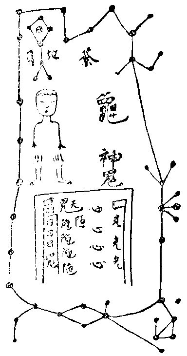



佛陀。呪曰：



娑婆罗　刹多耶　和头𬿄　陀婆多耶　娑婆诃



论曰：若有人作此印者，以桃根木方四五寸，剋畫此星宿印文，以朱沙涂之令赤，诵呪呪七百返，以绯袋盛之。若欲入国王大臣长者居士婆罗门家，用此印印两脚掌，复印胸前，以印头戴，所欲去处皆不见形影。若欲现身，取其净水呪三七返，洗手面并洗脚掌，去头上印，则自现身。若逢水难，诵呪呪印三七返，闭目取印，印水合眼而渡，则得过难。若遭恶人所逐，诵呪呪印三七返，提軰上安之，则自不见，多人追不见，亦不可见所欲去处，无诸灾障，亦无恶人横来加害。此之印法作时甚验，莫妄传。若妄传者，非其人也。有信之人乃可与之，无信之人实莫妄与。



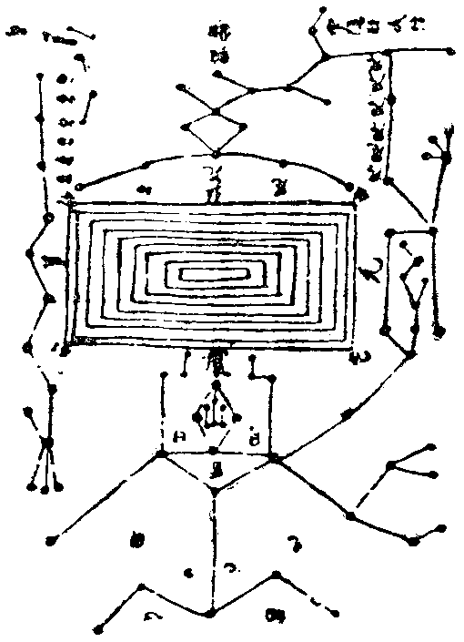



南无勤大婆咤那野多　南无三摩达多婆耶罗　南无偈那勒多陀　娑婆呵



论曰：有人欲受持读诵此呪作印法者，净治一室，牛粪涂地，烧众名香，供养三宝。取白檀木，纵七寸横五寸，用剋此星宿方印，以朱沙涂之，诵呪七百返，带之将行。欲治一切人病时，更以朱沙涂，呪三七返，随有病处，以印印之无不得差。若至空山旷野崄难恶处，诵呪呪三七返，以印向之，一切恶兽自然退散，无能为害。复若有一切畜生著其气，亦用此印印之，呪三七返，印其额上，以桃杖打之，所有病气自然除差。又以此印呪七七返，用朱沙涂之，纵使十人重立捉印，印前头一人，此印重过，无有闺碍。若不驱重过，直呪手三七返摩印面，用印前人，其十人背上皆见印文。若欲至大臣长者家隐身不现者，诵呪呪印九百返，以朱沙涂，因左手捉在於胸前，所欲至处人皆不见，亦不见其形影。若到大臣长者家，欲与作镇怪，以朱沙涂印，诵呪呪印三七返，用印净纸安堂门壁上，其家不见此印，其长者身若欲眠卧，即见种种不祥之相，及见野叉恶鸠槃荼等集在其家，终日常尔。其家处处求觅良医，阐恤厌㒹遣之，终不能得。若欲令其生信，方便到彼说法化之，令其调伏，随人受化，然后与却壁上纸印，其家所有一切魃祥自然磨灭。长者回心敬顺三宝，有无所获得。若遭王难急厄之时，闭其门户不能得出，呪印七返，以向其门，即自开辟无有障碍，自然免难。此之印法作时甚验，实莫妄传非其人也。复不食五辛、酒肉、大䒾隔，忌芸薹等。甚秘之。



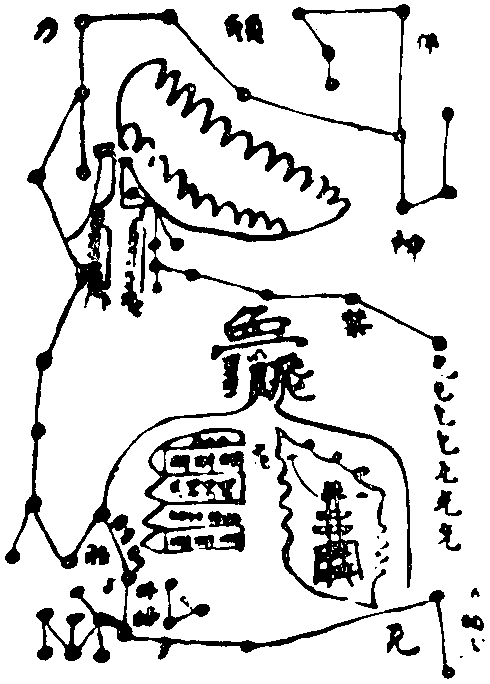



呪曰。



南无呵陁婆利耶　南无娑伽偈多婆利耶　南无须陀和沙陀利耶　娑婆诃



若有作此印法，净治一室，香涂地，烧众香供养三宝。取赤枣木，纵五寸横三寸，用剋此星宿印。以朱沙涂，诵呪呪九百返，所欲去处无不称意。若欲与一切众生除其病难者，当用此印，将病人在一室，以香水浴身，随有病处以印印之，无不得差。若入山谷，亦以此印向之，一切师子虎狼蒺䔧诸狩不能为害。若有怨家求人长拒者，诵呪呪印三返，以印向之，彼即自调伏，慈心向人不能侵近。若有妇女产生难者，以其朱沙用涂印面，捉印印净纸，与其妇女令吞，儿则易生。子捉印出体平整，不为恶鬼得其便。如是星宿印法，所用之处无不称愿。若欲作时，一切妇女小儿等不得见，亦不得同止眠宿。此法甚验，实莫妄传，传者非其人。甚秘之。



能除一切痛(左印之呪)



呪曰：



安陀沙和罗耶多　修伽婆利沙多　唵多罗那陀　娑婆呵



菩萨乘空印



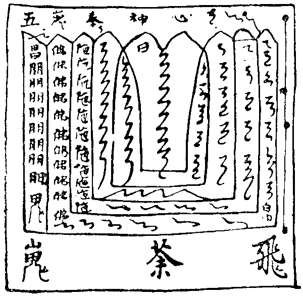



论曰：若有人欲作菩萨乘空印法者，净治一室，取枣心木方匕四寸，用剋此印。捉朱沙涂印面，诵呪呪七百返，欲治一切人病，无不得差。此印匕一切善神名字，有人常能诵持此呪并作印法者，我等圣人并诸善神皆当护助营卫，是人所欲作者无不获益。若欲至一切国王长者家，持此印呪五七返，以左手捉在於胸上，此印自隐，所欲去处，见者欢闻来迎逆，果愿皆得。我等善神恒为开道，一切所须无不获得。此法甚验，实莫妄传。甚秘之。若头戴，即能垂空。



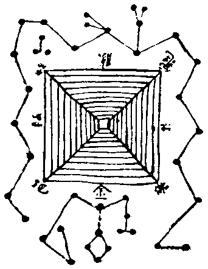



呪曰：



南无勒那利耶　南无勒那帝耶　南无三漫陀帝利那　娑婆呵



若有男子及大比丘，欲作此方星宿印法者，净治一室，牛粪涂地，作其方坛。香水浴身，著新净衣，烧薰陆、沈水、鬼甲木香，供养三宝并诸善神。取桃木根方匕四寸，以剋此印。烧五色缯作灰，以朱沙和捣，取井花水清净，诵呪呪七百返，用涂印面，恒受持将行，避一切障难，亦治一切病痛。若有人被恶鬼所持，乍寒乍热，随其痛处以药涂，呪之三七返，用印痛处，痛则除愈。若遭水难，呪印三七返，闭眼印踏而过之，不能为溺，则过度。若一切比丘、比丘尼、忧婆塞、忧婆夷，为王难、共诸外道角试道力不及於他，持此印者，一心存念，呪印七百返，在於众中外道所作以印向之，其所作者皆不成就。复以此印向其国王，则大欢喜，心意柔顺，无不调伏。作此印法时，用左手提在於胸，印即自不现。作时慎莫令人见，若见作则不成。复以此印诵呪呪印四百八返，用印头戴，身即不现，随有去处无所障碍。此印法甚验，心有求者无不获得。甚秘之。实莫向一切不信人边妄说是非，有信者唤共同知。若作印，不得食五辛、大䒾隔、芸薹等。好秘之，勿妄传。



------



## 五明论秘要隐法卷第二



如神印



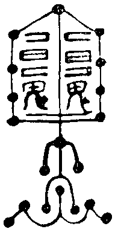



呪曰：



噎利弥　弥利噎　娑婆呵



诵呪四十九返，用白𫄧四十九结，诵呪一返作一结，口中称隐隐，印即隐。欲解时，呪一返，解一结，乃至结尽休，印即现。甚秘，勿传於世也。



论曰：若有男子及一切得信贤者欲作此法者，净山中一净室内安置道场，用黑沈水香木方一寸，宾铁刀子一枚，於净室中安置，莫令人见，供养礼拜木及刀子。龙树菩萨日夜六时行道礼拜，行者唯得菜食为甚。於道场中密剋，至四十九日剋令了。此神成已，谚四十九事为要。此神印持行，印额上，令人不见身。印两足，渡海河水如地不异。印口说法，闻者皆信。印发，尺寸。印眼，过去未来五道受



苦众生分明得见。印心，知世间生死剋时节。印耳，闻一切唅类之音。印胸手足背上，人见欢喜已。印头戴，诵呪四十九返，直见金刚身，所为如意。



又正月一日日初出时，於净泉内，取印下埿，面向东取。欲取埿时，自语泉言：「我须此埿，随我所用。」寅卯日用埿。天旱之时，取此埿以印印之。取小豆许，於人间门下土龙口中蹑作舌形，诸有龙处悉皆蹑著，畫所印埿即休。向有泉处，其人面向东立，閇目口称：「龙子！天今大旱。今是寅卯日，唯须大雨。」天即大雨。欲使雨休，却土龙口中埿舌，还至住处所，面口言止，雨即止。



又法，取朱沙涂印，左手印人，人则欢喜。右手印人，人见遂瞋。



又法，於五月五日日未出时，取东引桃枝五寸，常持齐戒，於静山中净室中面向东坐，闭气剋为人形像讫。於室中安五寸高座似坛形，四面堦道，坛上广一尺，上安木人。行者著新净衣入室，脚逾北斗至木人前，口称参儞，於前口称木术神王，礼三拜行道。白日菜食为齐。从旦至午，右转行道，脚逾依前法。从日没至尽夜，左转行道。明暗二时，继念在心。当有人来，共木人术神王语。日日如是百日行道，不得嗔，嗔法不成。一百日讫，取木术人，清衣带中盛之，将行吉。其所用处，随即得。



论曰，若有人受持此五印及如神印法者，净治一室，牛粪涂地作其道场。香水浴身，著新净衣，一上厕一洗浴。安其畫像，悬缯幡盖，烧众名香，供养三宝，及请十方一切善神并诸菩萨。以其时非时花而散佛上，恒持齐戒，诵此呪，念念无其异想，亦不得共小儿妇女同止眠卧。在道场中亦无餘念。至七七日，方可察用。在道场之内，心无恶想，里行平等，看诸众生如识子，想行无漏。傥行大慈悲，唯念苦趣，求此印法，所有言说恒论善法。实莫妄传。非言之行勿在其身，亦勿共诸小儿嘲譃论。若能如是受持读诵懃心作法行平等行者，我等圣人及诸善神大力鬼王常来营护，心有所求无不获得。何以故？此人忆念受持读诵念礼不忘故，我等神王营卫，是人所有愿求悉皆称意。此之呪法功巧印法，世间所无也。若有得者，甚令秘之，实莫妄传。若能生信恭养敬求觅者，看其行恤，然后与之。若不尔者，实莫向说。甚秘之，莫妄传非其人也。



五明论事印法　四印第四



龙树出



论曰：若有人隐於深山修集善法者，於四印中都皆有名，持此印不得长生者，无有是处。持此印者，勿往产生之处。此印一切好恶皆印知，天文星气一切星历属此印也。人若得者，持斋戒百日不食酒肉、五辛、芸薹，皆不得食。好心用之，大验。



金刚惓印



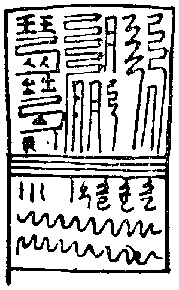



金刚卷印



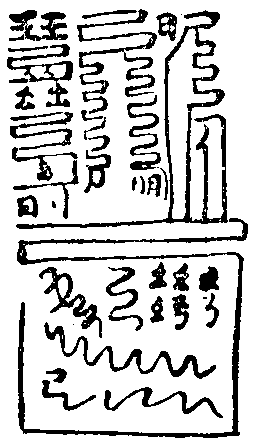



论曰：若人持此金刚卷印，主一切恶人恶贼皆此印中摄。以枣心一本根方四寸刻之，取青帛作囊子盛。若有恶人随意千万人来，若一切豪贵以相侵凌者，取朱沙作末，以印素帛上，清净澡口含之。以有凌人者，以一呼天，即自向地自扑不知息。若多饶左右者，二呼之，都自扑不知休息。若以解时，口中但唤解放，即得止。若有恶贼随意千万人来相害，取帛以印结著臂上，以来害者以手指之，即头自顿地不知休息。若贼有刀釰以来害者，以一弹指，贼即自相缚取，不解终不休。若有奴婢走者，取印印奴婢床上，至一日即自缚来取。复纸上印，以愽手上，以㧌铁㧌金银一切愽石铜锡，亦如㧌埿无异。复取印印纸上，十一日服之，力当千万人。若有一切大力不当头者，以手一俟，头即顿地。欲作时，不得食酒肉、五辛、芸薹，一切物都莫往。此印大验，莫妄传。



金刚心印



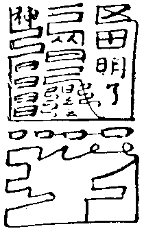



论曰：若有人好心长生者或老者，於一净室中齐戒三七日，取枣心二寸剋之。於四时八节印纸上，杯盛水服之，即可长生。若人不可化者，以此印印彼人心上，其人即生信。若有人多嗔痴疾者，以印印彼人心上，其人虫当夜即下。若有癫狂疑病，但以取印印其病者心二七返者，即愈无疑。一切鬼神名字皆此印中有，但是病疾者，但取印印其人心上二七返，无有不愈。不得十二属肉，一切五辛、芸薹皆不得食。若食者，作法不成。但以好心用之。一切六畜有病，但以印印心上二七返即愈。一切治患时，烧香用印。若五藏中患者，以印印心上。若耳聋目盲口痖鼻塞身上恶疮𤵇者，以印印雄黄，不问多少，印二七返，以涂疮𤵇上，不至一日即愈。以目盲口痖者，以印印雌黄末二七返，和水一升，於七日中不食酒肉五辛，以水洗目，日三令水尽，目盲口痖即愈。但一切微患、一切魍魉𪥲媚，但以印印之，无有不愈。若有妇人产生难者，莫往其所，欲救之者，取纸以印印之，与妇人服之，胎中小儿即手把此印来出，大速即不运。若欲与人治患者，教之预齐戒七日，然后与治，即差莫疑。若人卒得恶物欲死者，直以印印之二七返即愈。若欲召呼诸神问吉凶时，取青帛印之，与人著大门上门户口，即来，可问吉凶，竟还放使去。以印印水，和朱沙末洗目，即见千里之事、见鬼。此印大验，勿妄传非其人，好藏之。印纸上烧之，和两石水洗衣，永世无虮虱。法不食五辛、牛肉、芸薹、一切毒䖝、但以印纸掷之、无不能害。



金刚杵印



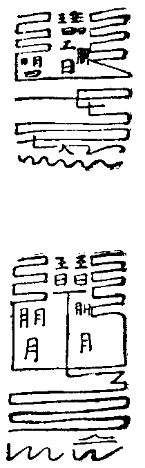



论曰、若人持金刚杵印者，洁净斋戒百日，取枣心方二寸刻之，治一切恶虫狩。若虎狼师子、象马驼驴、恶蛇恶𧎔、熊罴犲狼，一切有毒，此印录之。越海凌波者，以印印纸上，掷著水中，一切水精蛟龙，但一切有微毒者，蚊虻虮虱亦皆摄毒。以印印纸上烧之，和两石水洗衣，即永世无虮。法不食牛肉、芸薹。



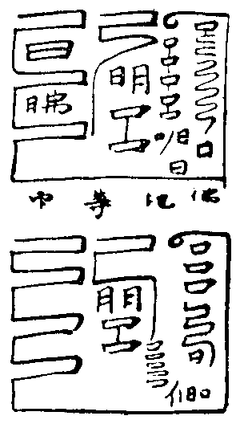



佛地印



论曰：若有人欲修善道者，斋戒百日，取枣心五寸刻之，帛囊盛之。若有人拙钝、烦恼甚多、学道难得者，取印印纸服之，日服一。以二年服之，即可飞矣，即得身通、得他心智通。若道人修大行者，取纸印纸上，三年服之，即现身得四沙门果。用此印者，不得食牛肉、芸薹。产生之处勿往其所。此印用之，修道大速。若人修持佛道者，不可言，勿妄宣传非其人。在於世间好藏之，大验。



论曰：若人欲修持此四印法，慎莫嗔恚，不嗔最是道本。此印大有神验，此略说之。若依其本四印法，绝多难可宣传。欲破此印各各用者，应有一千头印。大难工巧，甚大难得学。世人得此印者，好藏之。若凾若匮，好处举之，大验。勿妄传於世，但以心信之广博之士乃可相与耳。勿往产生之处。第一莫往不净处。好清净处，好清净用心，慎莫轻之。慎之闭口。



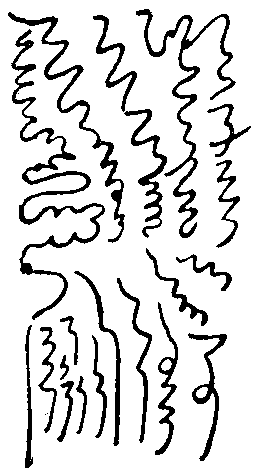



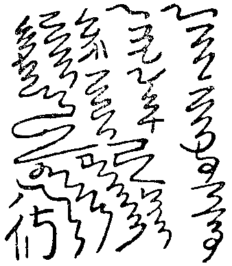



论曰：若人欲修持此印者，但好精心用之，无不成就。此符非世有，此符若得者，勿妄传神符。



呪曰：



婆帝咤　那利咤　梨婆耶　莎婆呵



论曰：持神符者，主断一切恶业不净者。以符持之，净一室中清净澡中，取帛素纸三寸书之，著衣领中，一切人见之者大喜，大不可言，爱之，与饮食好美者。若欲酒者，书此符纸上烧和酒，与彼大饮酒者饮之，即大好。一切酒肉、五辛，此人断之，大孝慎不可言。复取兵死人血书此符，口中唅之。有恶人来相凌者，以一唾之，彼恶人即著癫病，舌根自入腹中不得语。复取小儿未语冢上土七枚，有恶人或是四隣比舍者，以墨书纸上作此符，以符裹土，作帛囊子盛之，系著碓尾下，来舂者随意舂。并著恶人姓名，不至三日，彼人患著床卧不起，不解终不休。此符大验。若郡县之官人或口舌横起卒来者，书此符并著彼人姓名啮之，官事即散解耳。复取朱沙末，和酒书此符，并著其恶人姓名，随意十人百人相凌者，取著脚底，彼恶人口即不得语、鼻中痛、唇青面白如血色、唇口反张，餘人见者恶口骂之。一切口舌但以厌之，无不解，枷枝终不至身，人见者爱敬大重，诸王天子见之亦大欢喜。持此符人莫食酒肉、五辛、芸薹。勿妄传也。



论曰：若世人得此论者，当著好净处。家有此文，即有千万巧神来护之。若人当作诸工巧一切事物，好净治一室，一心诵呪作之，即成就无疑。此呪大验，勿妄说也。若有急事，直以念得力。作此法，勿往产生之处，清净用之。欲读之，取清净澡口，然后读之。此呪大神不可言，此皆略说其要。持此呪者，一贤人识之者，不见则思，人见之者心生敬念。若人得之者好藏，勿妄传非其人。若有广博之士以求人者，心意信敬，乃可相与。若有人心意不信者，慎勿与说，好藏之，大验不可言。家有此呪，一得无患，口舌消除。有此论者，或在山阻间广野之处，即有神祇卫护，不令见恶。但好心清净而用，无不得力者。持此符法者，永不得食酒肉、五辛、芸薹，一切秽恶不得食之。若凾若匮以诸净处著此文，求之必皆得力。勿妄传之，大验也。



五明论决



勿传视人，流传於世。龙树菩萨、马鸣菩萨作五明论，出万餘卷　凡人修此法者，皆取地员严丽精室，屋方侧勿令破坏，表里香汤涂，绿色涂饰。净治道场，悬宝盖、彩色神幡，以白土涂地，及屋壁上皆涂，出之以彩色畫之。一日恒以香汤蒒上著宝花，道场中安室四角，恒烧香，当安龙树菩萨、马鸣菩萨、金刚密迹、八力神王等立形像，以五色幡盖神上，事像庄严从意所著菩萨之前。以七香炉烧香，二菩萨当前两香炉，二金刚两香炉，八部神王二香炉，行者一香炉，安一板上，安供养具，三时礼拜、供养、烧香，至心归命礼拜，恒洁斋结。一百日上旬，香汤沐浴。一月三香汤自澡讫，清衣服，上下悉清净，勿令污秽，出行更觅衣服著，不得出此衣著，日中斋时，奉香、烧饼、密枣菓之属安神前，烧香至心礼讫，依时节盘。将去案之属，悉不得浪人。用此椀盘等盛食，还自用献神讫，自食之。解斋亦然。百日此室中不出，不得浪人、妇人、小儿、鸡犬、丈夫、牛驴马、五行之器悉不得人。恒清净严丽，香汤蒒上勿日烧香，夜燃灯恒不失之。二七日坐不出，三时礼拜，食盘奉献，烧香诵呪不绝。供养至心，不生异念。其菩萨遣神来，放赤光或紫光，其神满室，从人所使。欲与人疗患，烧香启语龙树菩萨、马鸣菩萨：「弟子某，甲年尔许，导患状。」启讫，以此呪呪此患人，或大重三七返，以五色𫄧，以大重三七结，下七结下七项。以金刚卷印印之二七，然后用金刚印印心所患处，印之遂轻，重印之多少。教预治斋七日，至心礼敬拜，解上盖衣服、解靴鞋，不得唾此地、不得放气、不得大语大叩唤、不得骂詈，至心闭目归命礼拜。举舌向愕，清净用之。如不尔者，及增其殃。修此者不得饮酒肉不洁五辛、不得邪婬、不得妄语、不得食芸薹、不得偷盗、不得不孝、不得共供杂人眠卧。一向治斋，不脱衣，至心恒礼拜供敬诵呪念龙树菩萨。心恒念之，菩萨自来至，其色光明耀世间，其人遂当之愿，乐仙得仙、乐道得道、乐智得智、乐声得声、乐巧得巧、乐富得富、乐贵得贵，从意所为。修之一月，财帛自聚，一切巧神来护之，遶室前后。至心念之，足衣食，免死难苦。若治病之，预结斋七日，自将香来菩萨前，至心归命之，愿礼其龙树菩萨，病自愈。道场之中取净衣一具，手巾一枚，澡灌一枚，呪钵一枚，盛净水柳枝二七枚，金刚杵一枚，五色𫄧各长六尺，香炉坐具一枚，成香宝盖一枚，金锦袋成，朱研一枚，朱笔一枚，朱沙一两，精纸百张，以启龙树菩萨、马鸣菩萨，即书天帝神符与之。复以六神王符书痛上，以柳枝清净水呪之，以阿修罗禁之讫，以五色𫄧痛处结讫，以金刚心印印之讫，烧香更礼拜乞愿。如去其夜应神往，与夜梦治，明毕愈。若七日之中治斋不断，断酒肉、五辛、芸薹、骂詈、妄语、邪婬、偷盗、杀生。如此犯之病，不逾过七日，从意所即差无疑，大验。



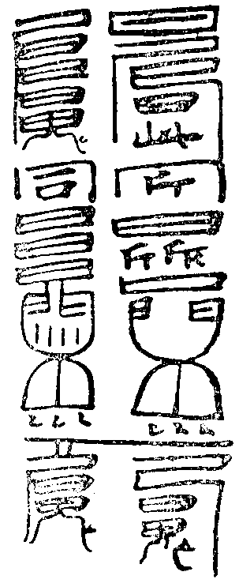



天帝神符，朱书闭无明审书之，治人万病吞之。欲破此符，南斗六星主六律，上属入人体，中主六符，莫问悉之轻，烧香清净修之益验。



太上六神王符，治万病符，烧香清净书之。若人患处书之，其病即散离身。明审书之，大有神验。



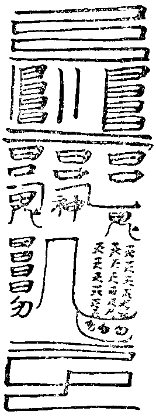



服香方法



论曰：凡修行诵呪，及以工巧声刻漏聪耳彻，以服香药为呪。呪曰：



菩陁㝹婆多罗　乌摩种陀利　勒那勒那耽捍利　阿婆阿婆鸣嘶利　莎婆呵



白真𭚳香一斤、沈水香一斤、熏六香一斤、青木香一斤、鸡舌香一斤、霍香一斤、零凌香一斤、甘松香一斤、穹穷香一斤、香附子一斤、百花香一斤(随时采阴干)、何梨勒一斤。



论曰：於一净室，於净臼中各别捣下蒒，和以蜜，器中勿令见风日。於先断酒肉、五辛及杂味、芸薹。斋戒沐浴以香汤，著鲜洁衣裳，以水澡口匕返，正坐诵呪。呪香七返，以井华水服方寸，七日三服。一呪七返服，三七日不出道场内斋戒，服满百日，諮性自在，众神奉持，目见诸佛，行即鲜香。二七日行，十步闻香。四七日，百步闻香。七七日，目有见闻，声芬香，众人敬爱，鬼神营助，任性所须。於静处烧香，众神自至。服满千日，怙物即香，逆知十二属肉气及以鱼鼈，逆知彼气是真，及以世间所有气者尽能决之。以土坟，以口三嘘，烧其土，其土香甚切利。所有污秽之地及自死之处，以水逊之，其地皆香。诸人死未经七日者，以水逊之，其尸乃至离散常有香气切利。凡所有食井水，取所服香之，以蜜和丸如弹，净澡口呪之百返，内井水中，其水皆香美，食者令人能香。若有恶人被妖邪所著，以此香如弹丸呪之百返，结安病人咽前，其鬼邪散。若有虚亭野室多有恶鬼数害人者，以此香和蜜如弹丸，以火烧之，其室中所有诸恶皆悉消灭之。



论曰：诸服香者，呪之根元，便鬼神之本。修行者慎见死尸，及产乳、六畜产生乳、血光，及妇女小儿，及鸡犬之声。常净身澡口，见污秽之时必须呪解秽之。呪水三返，以洗面目，然后入室。不尔者法不成，及被殃害，体面生疮。诸行房室，不得诵呪及入净室。非其人勿言，传之伤人，慎勿流传於世。



咃𭇅咤咤罗　咃𭇅卢楼离　摩诃卢楼离　阿罗摩罗　哆罗沙呵



若人睡，以此呪呪水千返，用洗眼洗面，即念之。

