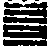

# 肇论新疏游刃



> **藏经**：卍新纂大日本续藏经（新纂卍续藏）　**册次** 第 54 册（X54）　**编号** No. 872（X0872）　**部类** 论集部　**卷次** 3 卷　**篇幅** 101,790 字

> **卷／品**：0 卷 · 0 品



---



肇论新疏游刃卷上



五台大万圣祐国寺开山住持释源大



白马寺宗主赠邽国公海印开法真觉



> 大师长讲沙门文才　述



将释兹疏，启以二门：初、叙论诠旨，后、随释疏义。初者，梵云阿毗达摩，此云无比法，谓诠慧最胜故。又翻对法，对有二义：一者对观，观于四谛；二者对向，向于涅槃。观则剋圣、向则剋灭，能对之体即无漏净慧、所对之法即四谛涅槃，是法之对，慧为主故。问：佛说三藏皆圣教摄，高僧述作何以与(去声)焉？答：从乎本故。谓此论义本亦佛说，散在方广分中，论主依经作之，至简至要以摄第一中道理智，引摄上根乐略之机。此则唯在成立佛说，与摩诃衍中甚深性理平等一乘而相应故，亦得阿毗达摩圣教摄也。如佛世迦多演尼、舍利弗等造《发智论》、《集异门足论》等，皆摄属论藏故。然论通大小，此论唯大。大通权实，唯实非权，五教之中唯一乘终教摄也，五宗之中理事无碍宗也。何者？以四论之中皆辨非有非无中道之理故，如下云「不释动以求静」，又云「即万物之自虗」等；亦兼顿说，下云「目对真而不觉」，又云「触事而真」等。此同《起信》真如门，说诸法差别唯依妄念，若离心念则法法皆真皆如矣。以贤首大师判真如门为顿教分齐故，故论之终始极一乘之窈渺、尽性理之精深，罗有包空、开权示实，出不迁之理，即流动以明宗；发不真之谈，依谛门而演䆳；说般若无见无知之旨，尽玄中之玄；明涅槃不出不在之心，极妙中之妙。故遗民以谓「浴心方等之渊、悟怀绝冥之肆」，不为过也。其文则含英综花、敲商击羽，依理而起、因质而生，非惠施之谈虗、何晏之尚无所能彷佛也。可谓彬彬彧彧、郁郁葱葱，谈之口则𮌉美梁馨、掷之地则金声玉振，如遗民叹曰「理微辞险、唱独应稀」，可谓知言矣。



后随释疏义，分三：初、释论题目。「　肇即」等者，谓论主以彻法英悟之智、逗机善巧之辨，假声名句文，示中道之理，令物获一乘平等之益，故作论也。「人法」下，准《清凉钞》，通辨诸经得名之式，或以人为目、或以法为名，约因约果、乍复乍单等。不同今以二字成题，即人法也。「以四」下，出立名所以。详《梁传》，什公出《大品》之后，师著无知论，次著不真空等二论，什公亡后始著涅槃无名论，其次如是。今不尔者，以意求之，葢论主作宗本时，大约题中之义排次也，谓初示不迁之理，次彰第一义真，依般若之神心，照涅槃之妙境。涅槃是三乘究竟之所归，故最后也。然非作者之本意，且顺次叙之。「又各宗一义」者，各随论名，是所宗也。但实教了义经论中谈诸法无生无灭之理皆不迁论所宗，乃至谈涅槃之旨亦无名论宗之。「欲合」下，合四为一，不可题中并置四名。「复作」等者，葢宗本一章最后作之，冠於论初摄四为一也。「宗释皆属」者，宗即宗本，释即四论。此四但演宗中之意，宗则略示纲要，如《起信》立义分；释则广陈理义，如彼解释分。「而言论」者，疏略《起信》疏释之，具云论者建立决了可轨文言，判说甚深法相道理，依决判义名之为论。又论者集法议论也，谓假立宾主往复徵析论量正理，故名为论。往复谓问答也。徵谓徵索，析谓分析。如逐论徵释，及无知、无名二论各九次问答是也。「示物修悟」者，作论本意故欲令众生悟理修观、息妄显真，证诸法实相，不为文字事业也。「然有二种」者，准龙树末论，说马鸣大士宗百本了义经以作《起信》，唯识亦宗六经等。释论如《智度》之释《大品》，《地论》之解《十地》等。此是宗经摄义之论也。



疏「大秦」者，即国朝之名，当东晋穆帝以来，二秦相继而出，前秦符姓、后秦姚姓。二姓皆秦，故史官以前后字别之，非自号前后也。徤，蒲洪之子，洪改姓符氏，西羗人也。洪为赵将麻秋鸠死，徤受父命，据关内即天王位。葢亟谷以西皆号关中。坚，即东海王雄之子也。徤死，太子符生继立。生残虐不道，坚杀之自立。「末年」者，即建元二十五年，坚率兵八十七万以伐晋。至寿春，为晋将谢玄所败，归长安，慕容冲、姚苌等皆叛之。冲围长安，坚力战不解，乃北走五将山。复为苌围之，遂执坚缢於新平佛寺，今豳州也。苌，即姚仲弋之子也，亦西羗人，杀坚自立。苌薨，子兴立，改元弘始，凡十九年。长安，县名也。「如来姓」者，《释迦谱》引《弥沙塞》云：「过去有王名郁摩，有庶子四人：一名昭目、二名聦目、三名调伏象、四名尼楼，聦明神武，有大威德。第一夫人有子名长生，顽薄丑陋，众人所贱。夫人恐国位为四子所有，乃以妩媚要王。王喜，遂谮四子出国。时四子之母并亲属、诸力士、人民等，见四子无罪被黜，皆乐随之，王亦听去。於是至雪山北，得遐逈旷大之地，居数年，归德如市，郁为强国。王后思见，召之四子，辞过不还。王叹曰：『我子释迦。』因名释种。」种，亦姓也。释迦，翻能也。自尼楼有子名鸟头罗，罗子名瞿头罗，子尸休罗子，即《智论》师子颊王也。王四子，一曰净飰，净飰子即佛也，得姓至佛凡六世矣。「安公」等者，即东晋武帝世人，事业如《梁传》。安公已前，出家者皆从师姓，如竺道潜弟子竺法义等是也。安以大师之本莫尊於佛，乃以释命氏，当时或从或不。及建元二十年，三藏昙摩兰提译出《增一阿含》，彼经第二十一略云：今有四大河水从阿耨达泉出，各随其方入於四海，无复本名。此亦如是，刹利、婆罗门、长者、居士种，於如来所剃除须发出家学道，无复本姓，但言沙门释迦弟子。既悬与经符，遂为永式。叶，合也。迄，至也。本传乃梁代会稽嘉祥寺慧皎法师作《高僧传》，论主居义解科。《传》略云：「京兆人，家贫，佣书为业。因缮写，遂历观经史(云云)。」「栖神」等者，栖，止栖也。神谓神妙之心也。冥犹寂也。累谓生死。「犹未尽善」者，谓未究竟也。予亦忝读庄老之书，大秪所宗虗无自然杳冥昏默之道，自此降冲和元气生天生地，神鬼神帝生物之用或似不盈。其修之之方必倣于道，内则谷神守静挫锐解纷，外则和光同尘不矜不恃。如《庄子》说广成子授黄帝之道曰：「夫至道之精杳杳冥冥，至道之极昏昏默默。」此谈道也。下明修云：「无视无听抱神以静，必清必净，无劳汝形、无摇尔精，乃可以长生。」又云：「我守其一以处其和，故我修身千二百岁，吾形未甞衰。」释曰：守一，守前道也。处和，与物不竞也。不竞则生全，守一则道成。此庄老大旨也。据此，未当吾宗择灭无为。假令得之，无知无觉，沦於太虗而已。至于般若神心、涅槃妙有，依正自在、相用圆明，寂照同源、力通无碍，彼何与焉？故论主斥其未尽善也，不为激过。故冲云：「放辞莫怪讥庄老，未入如来数仞墙。」「旧维摩」者，即汉末支谦所译。方等者，谓方正平等，即方广分也。三藏，即小乘教。诸师多凭《智论》呼小乘为三藏教。《法华》亦云不得亲近小乘三藏学者。姑臧，今西凉也。论主闻之，越二千里之远而从之受学，什亦赏其神明大器，叹之不尽。「逍遥园」者者，本国家园苑，以施什公为翻经之馆。疏辞皆本传之文，具如传。「作犹」等者，随义训也，以圣人创制名作，贤人祖之名述。《中庸》云：「父作之，子述之。」孔子亦自谓述而不作等。今法师之论，但祖述经论之义，就文亦可云作也。



疏「所崇」者，崇谓中心宗尚，崇尚亦尊也、主也，然通能所。所宗者，即此宗本一章也。「即实相之一心」者，什公以实相为宗，故不迁等法皆实相也。实相该通理事不二为一心也。吴僧净源注释此论，号「中吴集」，初解宗本义，立一心为宗。疏引全是彼文。「虽殊」等者，以一心全现诸法，法法皆心，妄心分别似有起灭；若离心念则无去来，差别之相非不迁而何？次即心所现有而非真，非真则其性自空。若此亦非有法亦非无法，真俗莫覊、空色一致，触物而一，第一真也。般若为心，不须会释。涅槃之理，均天人、同一异，总六合以镜心、一去来以成体，一心之义亦昭然无惑。故知四论皆述一心之义。且心即如来藏，恒沙佛法并蕴其中，矧四法邪？若心外谈法，便同外道。「别者」下，如不迁论以不迁为宗等。「非一心」下，一心为总相，四乃别相。揽别为总，离别无总；开总成别，离总无别，故一心摄四法而无遗，四法示一心而有在。「义谓义理」等者，如下四论之中通取其义，皆一心法上之义。别取其义，如不迁一论唯不迁之义，餘三例之。凡解义理要在彻法，法义无分，曷为精照？故圭峰云：「今时听学之人，但求文义、不寻法体，亦不原此义是何法上之义。」「据此」下，约能诠以明之。以宗本之义略与四论张本，但有统冠之功而无委示之实；四论反之可知。「以法为本」下，作释也。初二皆持业，后一依主。义为能显，法是所显。不言章者，尚义而不文也。



疏「此五名」下，《放光》有〈本无品〉，《般若钞经》亦有〈本无品〉。餘之四名，经论中标相，不须引明。「义虽」等者，如下随名略释可知。前四，理也；缘会，事也。所以相蹑而解者，以论中排名本无居初，释义本无居后，故为此释。「缘前元无」者，以下论云「未生无有」，故若约法由缘，生无自性性，虽今现有，有亦即空。因缘性殊，各亦不生、共亦不生，故诸法本无也。《钞经》略云：「如诸法本无，怛萨阿竭亦本无」等。「无相」等者，谓本无之性，远离男女、根尘、有无、一异等差别之相，以凡所有相皆是虗妄故。「即此」等者，法为事法，事法无性，唯以实相为性也。「此性真空」者，实性之中无妄染等诸相名空，非混茫断灭之空也。「复由」等者，谓依法显理，如指波谈水、依钏说金。理从於事，无理非事，事自缘生，故云缘会。依俗谛理，因缘和合共生诸法也。「或名」下，会异名可知。「杜顺」下，总证《法界观》文。



疏「义依」等者，显犹明也，谓依法显义、依义识法。今云一义，亦一体一义也。餘辞可解。「此中」下，乃依贤首大师《起信疏》解非一非异之义释也。本谓本无等理，末谓缘会之事。唯末非本，即事能隐理门，唯缘会而非实相；唯本非末，即以理夺事门，唯实相而非缘会也。「若本末」下，以理事一体不可分其际限，如全水是波、举器浑金，谁能际限？设使鵞王有择乳之能，不能择乎波水之殊也。尤，甚也。然此三义亦正要第三，非前二义亦不能成立第三之义，故具彰之。「若对等」者，会释为不迁论之宗可知。



疏「徵也」者，徵五名一义之所以也。



疏「若色若心」者，色心该於染净等一切诸法故，如是诸法皆藉因缘会合而起。因无独力能生而有共力能生之义，缘亦如此，此约俗谛说有生义也。故唐译《楞伽》第二云：「但随世俗故，而说有生灭。」依此世俗而入第一真谛，如下性空、实相等。



疏「因缘是因」等者，因缘之因，望缘为亲生之因，如谷芽从谷种生、眼识从识种子生等。因果之因，对果明因生法之因，因缘皆是其因也。「因无」下，释未生无有也。谓一切法既由缘会方生，应知未会诸法元无。未会有法故无是处，谓道理不相应也。「后句」等者，且以比智推穷，诸法既自缘会而生四相迁谢，缘离之时法当灭谢也。故马胜云：「诸法从缘生，缘离法还灭。」



疏「真谓」等者，谓法既缘生不能自起，若生若灭皆在於缘，缘起之相非真有也。法若真有，应不待缘，亦无已生亦无当灭。所引即不真空论及《中观》第四卷文。



疏「即末显本」等者，缘生现有之法，末也；性空之理，本也。「岂待」下，谓即会即离，因缘性空。第一义中无合无散，故其性本然。《楞严》经文谓：「诸法之性本来空寂。」「清凉」者，即有唐德宗赐号也。故裴公休碑云：「能以圣法清凉朕心，因赐清凉国师之号。观乎志行凛凛，拔萃离群，为帝王师，殆圣人也。」大慧杲公呼为圣师，如彼《正法眼》说之。所引即《悬谈钞》辞。



疏「真空」下，谓法无自性，唯以真空为性耳，如波以水为性。



疏「如是等」者，谓此性空之中，无色无受想行识，乃至一切世出世法因缘所起，亦非有相亦非无相。离此诸相名实相也。



疏「缘集」下，问：论中但释实相自无，疏中何以依缘生解邪？答：由一义故，如前本无中说。「如镜」等者，约喻显法也。镜中之像、谷中之响，亦待缘而起，性相元空。「推斥」者，谓推排毁斥之。「岂待」下，亦不真空文。《大论》十八云：「一切诸法性常自空，不以智慧方便观故空」等。「此拣」下，谓小乘不识体空之理，假以慧分折色法至极微边始见空理。大乘体会色心因缘所生，即有即空也。「列名」等者，原究论中列名释名之义，说有前后、法必同时，五名故非一、义故非异。



疏「诸经论」等者，《放光》第七云：「十二缘起所有，亦无作者。六波罗蜜所有，亦无作者。以是因缘，诸法亦不有亦不无。」「谓有无」下，以诸法缘起故有，性空故无，同时故亦有亦无，互夺故非有非无。而此四句，下论具有，引文恐繁。「又约破计」者，《智论》六十五云：「有人说诸法有四种相：一者说有、二者说无、三者说亦有亦无、四者说非有非无。是中邪忆念著此四法名为邪道，是中正忆念故不著此四名为正道。」「遣谤」者，谓计诸法是有，堕增益谤，故破云非有。计诸法是无，堕损减谤，故破云非无。又计诸法非有非无，堕戏论谤，故破云非非有非非无。又计诸法亦有亦无，堕相违谤，故破云非亦有亦无。由第三句转有此计，谓闻前非非有，计云：非谓是、非有言有也。闻前非非无，计云：非谓是、非无言无也。今云：为汝计非有非无，故破云非非有非非无。谁云非非有是有、非非无是无？故云非亦有亦无。此释并出句，与《起信疏》大同小异。为顺四谤故，苟理有所通则可。「所以」下，偏牒此句之所以也。为明遣二见等，至下论自知。然细详四论，皆此句中抽出，方信义句句含无边。故《金刚三昧经》云：「我所说者，义语非文。众生说者，文语非义。」诚哉是言也。



疏「初约」下，《佛性论》，天亲所造，解《如来藏经》，成立一乘佛性之义。「一切诸见」者，谓断常一异等。前之四句亦成四见，因有无起故，多在外道。所引全是论文，文亦易见，今随难释之。「一切无因」等者，不知前世修因、感今世果，今世立因、复招来报。拨，排弃也，不信之谓。此同庄老自然而然也。故庄子谈风，云「蓬蓬然起於北海而入於南海也。」孰主张是？孰吹嘘是？言自然也。「断见」等者，谓信唯有现在五蕴等法，更无来报相续。此同儒宗，计有一身不谈他世。如《舜典》曰：「帝乃殂落。」解者曰：「殂，往也。言尧之魂往天也。落者，言尧之魄落地也。」故唐李思慎论云：「死则归复天地，不续不存。」「准此」下，若以两句相对释之，因有生常、因邪生断。然邪断二见皆无见也，故依《佛性论》解之。「经中」下，会归不有不无可知。



疏「相因」者，因犹待也。疏释取《楞伽》、《密严》之义释之。《楞伽》云：「大慧！兔角亦尔。观待牛角，言彼角无。」「密严」者，彼经第二卷初偈颂中文。后引《密严》亦次前之偈，文易可了。「伟哉」下，结叹善巧也。前后三次释不有不无，各有经据，委曲穷尽圣经之妙也。



疏「约观行释」等者，意云二执既去、二见又亡，法非有无。正解现前，依解造修，实相可会。有解无行，譬有目无足，遥观宝所，无能至也。故《华严．问明品》云：「如人设美膳，自饿而不食。於法不修行，多闻亦如是。」若有行无解，如盲者适远，不免阬穽之患，故论主於此示观行也。何以知之？以论云「观法不存无、观有不取相」，非观行而何？但论旨隐微不露头面，说者麤心，相背远矣。「法即」等者，法虽通於一切，今据行说，且属三学等为法也。据疏，法通善恶，顺理之善三学六度等，逆理之恶五逆十恶等。今以善恶之法对而释之。若云诸法缘生其性本空，善恶之行应皆无果。今观法虽无，不取於无，恶虽空而须断、善虽空而须修。故《净名》云：「无我无造无受者，善恶之业亦不亡。」此则观空不取、心无所系，一切法中见实相也。「不取相」下，大意云於法心生取著，虽修三学止观等行，生灭之心不能忘相，何由契真？「由非」下，不取於有也，则终日行於有中未尝住相，建功立德举善无遗，皆与实相符合矣。故《大论》十五云：「佛法实相，非有非无，不受不著。」释云：若受若著，不合实也。靡，无也。餘辞可解。「此中」等者，今略释之，初句空观，观不存空，体真止也。「是谓」下，有观不取有相，即方便随缘止也。若双取二句中止观，观无而不存无，即无而有；观有而不取相，即有而无，是谓有无齐观离二边分别止也。广如天台止观及华严教迹等说。《涅槃》第二十卷中定慧舍三，大意配之，定如止、慧如观、定慧平等名舍。舍如此中中道止观，但此论兼於心境。止观定慧约心也。然行相尤多、理悟玄妙，修心之侣不可不学也。彼经第三十三十一中广说，今示大槩云：「善男子！十住菩萨智慧力多、三昧力少，是故不能明见佛性。声闻缘觉三昧力多、智慧力少，以是因缘不见佛性。诸佛世尊定慧等故，明见佛性了了无碍。」又云「奢摩他者名曰寂静」，即定也。「毗婆奢那名为正见」，即慧也。「优毕叉者名曰平等」，即舍也，舍即中道止观。「上三义」等者，释不有不无名也。问：前之二释俱离二过，有何别目？答：初离断常二见，此二因有无二见转生起也。故《中论》第三云：「定有则著常，定无则著断」等。第二但祛有无二种边见，所以不同。详论可了，非强穿凿。



疏「圣人」者，依《起信论》中「住已去断执取，计名少分而见法身，亦名圣人」。贤首教义中引梁《摄论》「十解已去名曰圣人」。若法相宗，登初地时得无分别之智，方名圣人。论称圣人通因及果，然地前下依《起信论》会也。准彼论，修行信心分中依未入正定聚众生说此修行信心分，彼论以十住已上入正定聚，十信位中为不定聚。彼自有五行，第五名止观门，故彼论云：「若修止者，住於静处，端坐正意，一切诸想随念皆除。乃至云久修淳熟，其心得住，渐渐猛利，随顺得入真如三昧」等。「性宗」下，学性宗修行人也。虽具足烦恼系缚之人，若曾夙生於此宗中有见闻熏习之力，此生必聦明英哲成圆解法器，於此无住行中亦可留心而修也。问：何以论举圣人也？答：今举等规模轨式也。



疏「等谓」下，谓性空是一，三乘观之，各随其器得果差别，声闻观之得声闻菩提等。「所以」下，恐不了者见三乘小大之差，谓实相亦异。此义至涅槃论中自晓，不繁预解。「而不知」下，约性宗新熏义释也。《大钞》第五云：「谓众生遇缘熏习，三乘种性及不定、无性，故有五耳。何者？若唯习近声闻成声闻定性，习近缘觉成缘觉定性，习近菩萨则成菩萨定性，若俱习近三乘则成不定性人，若都不习近三乘则成无性，卒难教化。」故知熏习成五种性，本有则无二。



疏。「正邪」等者，如修净土观，虽兼修兜率，亦为邪也，以心用杂想害往生故。今以实相为正观，则一切事相之相皆邪。「大论」者，即《智论》。彼第五云：「复次除诸法实相，餘残一切尽名为魔。」文多不引。



疏「此有二说」等者，三乘中二乘即般若等被学法空者，以二乘修无常苦空无我等观，未达性空实相之理，滞於末四倒中不能证自乘果道也，此谓小果亦要见空。二则可知。「今此」下，谓三藏教中所被者，不达法空谓之愚法。餘可解。「大疏」等者，彼疏判教中说宋朝刘虬居士及道场慧观法师，於渐教中开成五时之教，第一有相教，谓观有得道。《清凉疏》妨云：「自违《成实》。彼论云：『我今等在疏意，谓愚法亦观性空而证也。』」「以生空」等者，然性空之中无我无法，众生妄计执之为有。小乘但了蕴中无我，见一分理。若了我法俱空、性空全现，此则单双在人，非性空有异也。



疏「所趋」下，趋，向也。「器有」下，释大小之异也。通有五对。大乘器广，谓发大心行大行等；小乘器狭，心行等皆劣可知。小乘生空般若为浅，大乘双空般若为深。小乘羊鹿之车唯堪自运，大乘牛车力能兼他任重致远。若大由小起名曰迂，不由小起名曰直。小乘唯证单空之理，大乘深证双空。略释如此。若约二执二障，摭诸教理细细出之，实为烦黩。



疏「双牒」等者，此二名，诸经皆有，不必的引。「智论」下，彼云：「摩诃，秦言大。般若，秦言慧。」然慧即智慧，不同法相因中名慧、果中名智。故《大论》「问曰：『何者是智慧？』答曰：『般若波罗蜜摄一切智慧故。』」又四十三中译为智慧故。「沤和」者，《放光经》云：「沤和拘舍罗，具足梵语也。」「一念」下，释大义也。一念之中权实双流，照二谛无二之境，中道之慧方为大慧。应云大智慧，就句稳顺而言大慧也。以此推之，双空之慧尚未为大，以真俗别照不能一念兼之，况二乘生空邪？故疏云尔。颕，秀也，亦出也。餘可知。



疏「初二句」下，有本云「诸法实相」，殊失正理。实相虽通，般若详论，义目性空之理，如下云「般若之门观空」等，以实相该於理智。今以智为能见、理为所见，由见性空实相之理故成般若。下论云「万法虽实，非照不得，内外相与以成其照功」等。若以实相即般若，复欲证谁邪？亦对下方便之文，势亦差异，可细求之。「后二句」下，由一念两具，所以观空不形容於证也，非智先悲后。复引令不滞於寂也。出二乘者，以彼厌弃有餘入无餘界，永沉不起，故下疏暗引《楞伽》及〈出现〉两经，皆明二乘躭灭也。《楞伽》第三云：「三昧酒所醉，住於无漏界。彼非究竟趣，亦复不退转。以得三昧身，乃至劫不觉。譬如昏醉人，酒消然后悟。声闻亦如是，觉后当成佛。」〈出现品〉云：「佛子！如来智慧，大药王树，唯除二处不能为作生长利益，所谓二乘堕於无为广大深坑」等。「净名云」下，具释。



疏「亦初」下，细详经论之意，方便有二种：一离相、二化生，此以大悲利物为方便。「后二」下，谓处生死界广行化利，亦不为尘欲所染者，以即悲之智、无缘之慈，了生界空、度而无度，所以不见染也。若以离相为方便，亦可悲智互为方便也。「净名」下，经文颇多，略云「以爱见心庄严佛土、成就众生，於空、无相、无作法中自调而伏，是名无方便慧缚。」释曰：此以植众德本为慧，依爱见心中修之，不能妄想，故成缚也。经云：「不以爱见心庄严佛土等，名有方便慧解(云云)。又复观身无常、苦、空、无我是名为慧。虽身有疾常在生死，饶益一切而不厌倦，是名方便」等。释曰：前则离相名方便，此则化生名方便。论取化生也。「以无慧」等者，爱谓悲爱，见谓取著，谓缘众生界如己如亲，见有可化。不唯化有疲厌，翻为见网所累。没谓沉没，生死界如林故。不了法缘无缘，故成有相之悲也。欲谓贪欲，坌污净心名尘。此之五尘，是凡夫所欲之境。



疏「涅槃为空」者，为对生死为有故也。然空有多门，随宗各异，今顺论意故云尔尔。「后四句」下，前二句成前不染尘累，后二句成前能不形证也。「二智双融」者，由无二体一念具故。「空有无二」者，缘生无性即是涅槃，无性缘生即为生死，但有二义殊无二体。故《法界无差别论》云：「众生界清净，应知即法身，法身即涅槃，涅槃即如来。」「瞥然」者，《说文》曰：「暂见也。」今取一念少时之义。谓菩萨见色莫非见空，如良庖见牛目无全牛。「下句反此」者，解不厌有等之言也。如观空时空即是色，以不离色，何甞瞥然而滞空邪？符，合也。资，藉也、助也。性宗修行之人，初学是法，须悲公平等，成无住之行。苟偏一行，即没凡小。引喻可知。「由空门」下，不修理行无以剪生死之稠林、游涅槃之妙苑；不修事行，无以严清净之佛土、尽染染之众生。「然理」下，谓理量智量。生死涅槃，义释如前。



疏「念谓」等者，释念二义：一具慧之念名为慧念，非念是慧也；二者极少一念，谓瞥然心起亦名一念。事智名权，与物推移，唯宜是从，故权有逆顺隐显等殊。如《涅槃》说杀邪见婆罗门，逆也、权也。《大悲海云经》仙人不食兔儿施身之肉，赴火而死。顺也、常也。儒者以权为反经合道，如孟子男女授受不亲，礼之常也；嫂溺援之以手，义之权也。内教斋戒守信死而不犯，常也；大乘之戒成益即开，权也。今谓涉有利生，宜小宜大、宜显宜密，万变千化不可一准，故名权智。理智名实，照实相之理而无虗妄分别故。「叹其智妙」者，以一念中二智无违，齐观二谛幽深之理，非口舌能状，唯力用其功者久之自倣尔。故下勉云好思。



疏「华梵」者，华谓中华，即此界神州大夏也。灭与尽理亦相近，累尽名灭谛。谓审谛，亦实也，谓苦实苦等。



疏「结使」者，正取诸惑。「我法二执」下，所有种现俱为集谛，亦兼取诸业增长生死名集。「解理」者，理，治也。



疏「苦谛」者，有漏色心逼迫名苦，一烦恼、二业系、三生死。此三染事聚之一身，故云杂也。三障，如下释之。「今约治道」等者，治谓修治，此三治之已尽故。「若别说」下，依《起信》释也。论广，略云：「十信凡夫觉知前念起恶，故能止后念，令其不起。」是信位能灭也。「惑有」下，根本惑即迷理而起。如论云「不如实知真如法一故」。圭峰《略钞》释云：「不，无也。觉，明也。即根本无明。」「枝末」下，即迷事而起。然疏释大略，论具云：「复次依不觉故生三种相，与彼不觉相应不离。」三相，即业相、转相、现相也。不觉，即三相中无明也。此惑方是枝末不觉也。三相即名三细。「四麤」者，一智相、二相续相、三执取相、四计名字相，释义如彼。「生死亦二」者，界内生死名为分段。分谓分限，或延或促有分齐故。段谓形段，或长或短有定量故。此则六道生死皆分段也。界外生死名曰变易。变，转也，转麤身为细质故。易，改也，改短寿作长年故。此则三乘生死皆变易也。广释如别。「自地前」下，即彼论生灭相中之文。论云：「麤中之麤，凡夫境界。」彼疏云：「三贤位名内凡，能觉此染故。」染体，即执取计名字我执也。又下论云：「不了一法界义者，从信相应地观察学断」等。「自见道」等者，疏亦大略，为见道中断法执分别相续相。出见已去，乃至七地满心断法执俱生智相也。此二种惑，俱名麤中之细，亦曰事识之惑。断此惑尽，分段亡也。「自八地」等者，十地究竟名为尽地。谓八地中断现相，入九地断见相，十地穷至佛地始断业相，尔时黎邪行苦变易生死尽也。前二细中之麤，菩萨所知境界；后一细中之细，是佛境界。餘文可知。



疏「涅槃」等者，若别有处，应有边际，有际则无常也。「小乘」下，世谓三世，时世即有为诸相。间谓中间，谓三界有漏堕在其间。四相迁灭、三世流转，此释该情非情一切法也。若唯约正报说者，五蕴始行名生、五蕴散灭名死，涅槃出世可知。以二乘厌世间生死、忻出世涅槃，故大乘可了。「岂别」等者，界内、界外，方域也。「惑能」下，惑性、智性，无二性故。《仁王经》云：「菩萨未成佛，以菩提为烦恼。菩萨成佛时，以烦恼为菩提。」烦恼之相须断，其性无二即般若也，故云惑尽等。「业能」下，业能系果，不自在故，名不解脱。业谢报亡，了无系缚，名之解脱，故解脱者自在为义。「苦能」下，二种生死之苦，能障法身真乐。二死既其谢灭，则法身之乐自显。即以无苦为乐，无别乐矣。「故此」等者，言三障、三德敌体相对，翻染成净，故知三染即三德之诠门也。既依染门诠示，若无三染亦无三德自相可说，何容更有一尽处尔。「又三德」下，亦依《涅槃》释，彼经第二云：「何等名为秘密之藏？犹如



伊字。三点若并则不成伊，纵亦不成。如摩醯首罗面上三目乃得成伊。三点若别，亦不得成。我亦如是，解脱之法亦非涅槃，如来之身亦非涅槃，摩诃般若亦非涅槃，三法各异亦非涅槃。我今安住如是三法，为众生故名入涅槃，如世伊字。」释曰：《出现钞》略云：「并乃合为一体，别乃各居一处。竖明此三曰纵，谓法身本有、次修般若、后得解脱」等。「四德」者，常、乐、我、净也，至本论释之。「恒沙义备」者，不唯三德四德也。故《起信》略云：「所谓自体有大智慧光明义故。乃至具足如是过於恒沙不离不断不异不思议佛法」等。「一心融拂」者，谓上三法，一心融之，无有差别之相，等同一味。一心三相曰融，三相一心曰拂。既融既拂，相不可得，名何名焉？「尤可」下，可解。



疏「物即缘会」等者，此论亦宗诸《般若》、《智论》、《中论》等作也，如下所引可见。物谓万物，诸法之总名。染谓染分依他。如《大品》所列五阴、十二入、十八界等。净谓净分依他，亦如《大品》所列十力、四无所畏，乃至十八不共法、萨云若等。「古今」等者，亦摄一切之时也，以下论说寒暑古今等故。若唯约人事明之，则生死、去来、动静迟速、长幼、逆顺、是非、彼此、得丧、穷通、寿夭、贫富、贵贱、高低等，应世谛所摄皆物也。以内修言之，则行愿因果地位等。然前后兼，以论宗《般若》，只可依经说诸法也。「不迁」等者，依宗中指之可知。「以缘生」等者，释成不迁之理也。以一义故，即一而弗化也。故《宗镜》云：「大乘之法缘生无性，生即不生、灭即不灭，故迁即不迁也。」「今约」下，论亦兼有顿教之说也。「初终教」者，以此教说一切众生成佛之义，极尽大乘之理，故亦名实教，诠如藏性中实之道故。「随缘」下，谓随染缘则有世间诸法，随净缘则有出世诸法。「迁即不迁」者，非迁外说不迁也。初门以理在乎事中，故随事而迁也。以理有随缘义，故《起信》云：「谓如来藏不生不灭，与生灭和合，即随缘义。乃至成阿黎邪识，此识之相生灭，即藏性生灭。」以识相是真妄和合成故，具非异义。故引《楞伽》，即唐译第五卷中文，具云：「如来藏受苦乐，与因俱有生灭。」言因者，善不善也。《不增减经》，可知。第二门以事从理，从犹合也。引《仁王》，彼初卷也。烦恼、菩提，物也；第一义，理也。一义故，迁即不迁也。「楞伽」下，同前卷。眼等五识者，体义、聚义，依义名身。「非流转」者，五识性空故，亦即实相故。「三此二」下，谓前之二门随义排次，法必同时矣。故此一门双融前二，令二销镕，迁与不迁交彻一际也。此中取义正唯第三，然非前二此门不成故。初门俱迁，次门俱不迁，此门即迁不迁，方尽一题之义、总包一论之玄也。又约唯迁，则堕断见，无罪无福等。若唯不迁，则著常见，凡应定凡、圣应定圣，有无穷之过。今明不迁而迁、迁即不迁，诸过齐丧。所引《涅槃》，即第八卷，云：「善男子！鸟有二种：一名迦隣提、二名鸳鸯。游止共俱，不相舍离。」第三卷云：「云何解满字及与半字义？云何共圣行，如娑罗娑鸟、迦隣提、日月等。」清凉云：「如此方鸳鸯鸟，配偶相将。古诗云：『暂分嶋屿犹回首，只渡寒溪亦共飞。』以喻常无常二不相离也。」引《净名》，即经第一卷。「清凉」下，即《玄谈大钞》说也。然此门中连引三文，皆证迁即不迁也。「顿教」者，谓直诠真性言绝之理，名之为顿。「法法」下，如《起信》云：「所谓心性不生不灭，一切诸法唯依妄念而有差别」等。「若一念」下，即清凉答顺宗皇帝心要中文。次云此照体独立，物我皆如。「非迁」下，双遮令忘言会旨。「仍名」下，方便安立假以悟物也。《华严》，即第十九文。次此云：「亦复无有灭。若能如是解，斯人见如来。」「若依」下，彼钞第一。「今此」下，初证终教，次证顿也。



疏「将明」等者，迷悟对辨也。言倒者不迁见迁，故成迷倒。「初句」等者，如上列举生死二法互待互谢，迁变云为未尝少息。《列子．天瑞篇》亦云：「死之与生，一往一反。故死於是者，安知不生於彼哉？」《庄子．田子方篇》云：「日出东方、入於西极，万物莫不比方。乃至是出则存、是入则亡。万物亦然，有待也而死、有待也而生。」又云：「生有所乎萌、死有所乎归，始终相反乎无端，而莫知乎所穷邪。」次句「通一切时」者，大小诸劫、四序昼夜、古今延促乃至刹那一念也。「缘有」者，缘生之有也。「后句」等者，凡夫目未禀外内之教者，此辈心识麤浅，但知一期生死，不达刹那生灭。外道计冥性是常、微尘常、方常等，自冥生觉等皆无常。「亦正为」下，法相说法身是凝然常，报化之身皆有为无漏。如《大疏》具示。「以一」下，此论唯一乘之义，形对三乘唯见(云云)在疏，如《涅槃》说：「吾今此身即是常身法身。」是亦迁即不迁也。



疏「论主」等者，《法华》等经皆以一乘会破三乘，故《涅槃》第二十三卷说三种恶觉，一云实无三乘，颠倒心故言有三乘，一实之道真实不虗，颠倒心故言无一实。乃至常为诸佛菩萨之所呵责。故论主将欲引摄迁与不迁殊见之流，故於文前举其所谬以抑之也。



疏「然实教」下，《涅槃》、《华严》等经处尤多离文字也。经云：「诸法不来不去、非因非缘、不生不灭、无取无舍、不增不减，乃至非是文字之所辨说。」《法华》即第一，上句云「是法住法位(云云)。」释云：法位即真如异名，法住於理，故相常住也。



疏「然动静多体」者，浅则非情名静、有情名动，息事名静、作事名动，向夜名静、涉昼名动等。深则定静而慧动，真静而俗动，世出世等可例说之。「且约」下，依理事无碍之境、权实双彰之心释也。问：真谛与理何别邪？答：真通而理狭，以真亦通事也，如八谛对分可知。今以真俗理事合取，真且属理，动静之意在文可知。「心者」下，《起信疏》解直心云：「向理之心无别岐路，故沤和涉有。」依有境说，其动可知。餘文易了。「论中」等者，推绎约心境释之所以也。求之舍之，非心如何？



疏「动静」等者，迷夫任生灭之心，迁则一向谓迁、不迁则一向谓不迁，焉知去住元空、动静一理？若是，芳舟运而岸亦何移，轻云卷而月元无骤。「世间」下，世间动也，出世静也。而殊见者不知世间相虗，即出世间故。《智论》二十七广破此见，略云：「世间相即是出世间，更无所复。」又「依计」者，依他遍计，动也；圆成实性，静也。依计性空亦即圆成，如何异计？



疏「了义」者，拣权渐非了之教也。「保执」下，叔世浇浮、智慧偏浅，愽识会理者尠、专门党情者多，信有疑空、向权背实。真如受熏，谓《起信》之悮译；谈有为空，斥清辨之谬陈。若辈多矣，闻亦寒心。何者？《起信》本摄经之论，奘尚弘传；清辨实圣人之徒，护法见让，宁容萤火轻议日光？戒之戒之，勿招犁舌。疏意可晓，但随难释之。伸，舒也、展也。「正同」下，〈圆觉序〉也。彼说圆觉了义隐匿於龙宫海藏之中，无人弘阐，如阳春雪曲唱者稀而和者寡。权浅之典人竟传之，如下里巴歌讴者多而应者繁也。「然四论」等者，略彰四论之因起也。排，挫也。所见乖於正理云异。叙异可知。



疏「竟辨」等者，群异之中谈不异之妙，从其人则乖法、顺其法则违人，所以难言也。



疏「初二句」等者，出难言之所以也。疏颇明了，不烦再述。「宝所」者。《法华》第三云：「若有多众欲过此道至珍宝处」等。葢以一乘为珍宝处也。「老氏」者，彼执，〈大象篇〉云：「道之出口，淡乎其无味。」谓闻道清虗，少私寡欲。不美常人也耶。



疏「承前」等者，谓立功者不辞乎难，成仁者不有乎躬，党理者任逆其情，正物者弗顾其谤。「上士」下，老氏《德篇》云：「上士闻道勤而行之，中士闻道若存若亡，下士闻道则大笑之。」谓笑其道之质朴也。论拟彼书成辞，疏中避繁，故小变其文，节而释之也。



疏「初句」等者，目击耳闻之事、色声香味之相，故近也。此则事相故近，理性故远。



疏「然」者下，此中必然，有三意焉。一要能诠了义之言不滞而流行，二在所诠不迁之理明了，三欲异见迷子悟入也。「欲罢」下，解不能自已也。然出《论语》。彼〈子罕篇〉云：「欲罢不能。既竭吾才如有所立，卓尔虽欲从之，未由也已。」葢颜回叹孔子也。「依言」等者，谓真谛故无说无示，俗谛故因言显理也。故《宝性论》初云：「世谛者谓世间所用之事，名字章句言语所说故。」「真一」等者，即中道不迁之理，不居动静二边故。「谦也」者，谦虗待物，焉知来者之不如今也。故《易》曰：「劳谦君子，有终吉。」论主之谓焉。小人少有所得则语气昂昂，眼高四海傍若无人，唯怀矜恃之情，焉有逊恭之节，未得尺寸名，已落增上慢。



疏「双引」等者，然此论式，初须略示正理，次出异见，后方广陈。自引放光以下，略示正理。自缘使真言以下，出异见，为起论之由矣。然不能自已以降，方广陈正论。餘文可晓。「缘集」等者，法之去来在缘之离合，法之自性何去何来？故来之与去竟无方处也。《放光》第十七云：「诸法亦不来亦不去，亦不合亦不散」等。疏引《放光》、《大品》，全依南藏，颇异北本。「如善财」下，举事以明。《华严》七十九略云：「善财白弥勒言：『唯愿大圣开楼阁门令我得入。』弥勒弹指，其门即开，命善财入。善财入已，乃至见楼阁中广愽严事。於后弥勒菩萨即摄神力，上之严事悉不成就。善财问言：『此庄严事何处去邪？』弥勒答言：『於来处去乃至云无有去处。』」不能具引。疏中撮略经之大义释之，令人易见。「当处」等二句，《楞严》经文。《中观》即第一〈破去来品〉，亦义引之也。论偈云：「动处则有去。」如今云「观方知彼去」也。次前偈云「已去无有去，未去亦无去。离已去未去，去时亦无去。」如今云「去者不至方」。长行释意云：「已去故无有去。业若未去，未有去法。去时亦无去者，名半去半未去。」意云如一步初举未有所至，故云半去半不去。若此亦不离已去未去，故去相本空而不至方也。疏中所引是此品最后之文，示三法相待而起，其性本空，知不迁也。去法者即去业，故长行云：「随有作业处，是中应有去」等。「此论」下，会今论意。随俗言迁，顺真则不迁也。《涅槃》第二十一云：「佛问东方琉璃光菩萨言：『善男子！汝为到来？为不到来？』答言：『世尊！到亦不来，不到亦不来。乃至云若人见有众生性者，有来不来。我今不见众生定性，云何当言有来不来？有憍慢者见有去来，无憍慢者则无去来』」等。



疏「经论」下，指上所引，释舍也。



疏「初三句」等者，疏中间而释之，可见。



疏「同见」等者，物境是一，迷悟见殊。如二人同席，一醒一醉，醉者见天地反覆房宇摇荡，醒者见之无一动者。迷悟见法，其亦如是。「中吴」下，惑者逆物未达不迁，茅塞其心；悟人顺物能通，若发其覆也。



疏「净源」下，道，目理也，亦性也。



疏「无始」等者，准《起信论》，谓一切染法始於无明，更无始於无明者。遍计妄想念念生灭名之为情，以情取法法法皆转，致令昏衢劫劫苦海茫茫。论主见之，故为伤也。



疏「初句泛责」者，泛然总责。六根所对六识，所遇皆然，论中举自例诸也。耳得之而为声，目得之而为色，未达声色性空之理，故云莫觉也。「贤首」下，《还源观．序》文。次此，前云真空滞於心首，恒为缘虑之场，意谓声色性空即是实际。「次二句」下，迷者幸知往物不来，即可达其今物亦不去，如何却计今物迁往邪？故往物者唯住往者之法位，不能来今；今物者亦即今日之性空，何能至往？不迁之理申述至此，虽疑网千重亦可一时隳裂，莫嫌露布太晓。



疏「以古」等者，出意释理，亦昭著可解。尧舜，五帝之二，仁义之主，人到于今称之，故举此也。「此中」等者，古，过去也。今，现在也。以过现例准未来，未来之物亦自在乎未来，不至于今也。然三世之时，亦众生妄想分别之所显现，依物而说，元无实体。故十卷《楞伽》第一云：「佛告楞伽王：『汝言过去者，即分别相；未来、现在分别亦尔。』」



疏「以今」等者，义势不殊於前，但互望不同，但改向作今、改今作向。来应作去，但去字不应作来也。



疏「释成」等者，谓无今亦不立昔，去来亦尔。如前说凡诸二之数，如是非高下等，皆互缘互生实无自性。「常情」下，迷悟对释。常情以所见之法，不识唯心所现、因缘所生，如幻如梦如影如响，於梦幻中谓生谓灭，反为虗相转动分别之心。悟士了知缘生性空、唯心所现，去来无相，譬之同舟济壑，一见岸移、一了舟行，互不相是，谁得谁失不为所转。「予昔」下，彼《录》第七云：「惑者则为无常不住、新新生灭而谓之迁，若智者则了性空无知念念无生谓之不迁。」又曰：「若能见法是心，随缘了性，无一法从外而入、无一法从内而生、无一法和合而有、无一法自然而成，如是则尚不见一微毫住相，宁观万法有去来？斯乃彻底明宗也(云云)。」甚妙甚妙，可返照味之，不可下见论文谈物，未知物即性空之理，一向物上求之，云前尘非后尘、前步非后步等。谬之谬矣。



疏「南华」者，庄子书亦名南华经，即彼〈田子房篇〉也。文多，略云：「丘以是日徂吾终身等(云云)。」在疏徂，往也。言世态迁流日日徂也。交臂之义，诸说不同。疏用郭象等旧义可见。然具详庄子之说，孔颜谈道其理深远，亦彷佛有不迁之说。恨其人已去、其书独存，味乎糟粕不具见其真也。有心力者亦可以咀之。东坡《赤壁赋》亦云：「苏子曰：『客亦知夫水与月乎？逝者如斯而未尝往也。盈虗者如彼而卒莫消长也。葢将自其变者而观之，则天地曾不能以一瞬。自其不变者而观之，则物与我皆无尽也。』」



疏「通结」下，朕，初兆也。



疏「连引」等者，疏总示之。「亦通於物」者，时亦物也。「旋岚」者，《智论》十一云：「大劫尽时，毗蓝风起，吹须弥如烂草」等。《大疏》云：「亦云随岚，皆梵音轻重。即兴云之风，北方风也，亦是坏劫时风。」餘可知。「白驹」者，即窻隙日影中飞埃也，飘驰甚疾。古人亦喻光阴急促，如杜工部诗云：「身世白驹催游气。」即《庄子》旧解。若鬳斋解又云：「游丝即空中时有拂人之面者谓之游丝，眼力不可见之。然窻隙飞埃甚正，故鼓吹诗云『窻里日光飞野马』是也。」驶，马行疾也。「日月」等者，《俱舍颂》云：「夜半日没中，日出四洲等。」谓如此方夜半，西牛货洲则日没，北郁单越日中，东弗提婆日出等，故一昼夜周四天下。餘文旨不异前。



疏「情计」等者，诞，虗也、妄也。「达观」等者，达，悟也，亦通也。观，洞视也，亦禅家所谓具眼者。体，犹会也、究也。「文旨已备」者，上乃约文敷旨，理亦极成也。自此而下，会通内外之典，令知殊途同归也。



疏「潜妨」者，含其问意。「梵网」者，即彼经序文。「诸经」者，《涅槃》二十三云：「人命不停，过於山水。今日虽存，明亦难保。云何纵心，令住恶法？壮色不停，犹如奔马」等。



疏「初二句」等者，如《法华》第二云：「以佛教门出三界苦。」谓闻四谛之教，悟生空之理，修无常等道，证预流等果。此中正要无常等行，若广释甚繁。「缘谓」下，《智论》第十八云：「辟支佛有二种，一名独觉、二名因缘觉。独觉是今世成道，自觉不从他闻故。因缘觉者，是人先世因缘故，独出智慧不从他闻。等如一国王出，在园中游戏，清朝见林树华果蔚茂甚可爱乐。王食已而卧，王诸夫人婇女皆共取华毁折林树。王觉已见林毁坏，而自觉悟一切世间无常变坏皆亦如是。思惟是已，无漏道心生，断诸结使，得辟支佛道，具六神通等。」释曰：论中觉缘离以即真，谓觉缘起诸法无常，离诸结使，得无漏智，名即真也。与智度因缘少殊，修无常是同，广释如别。



疏「通前」等者，前亦潜妨，此亦潜通。研，穷也。复，审也。「言权旨实」者，如谈无常密显常义等，以常无常亦相待起，不相离故。偏见之士如言生解，闻东迷西；圆见之流闻一知二。「涅槃」下，经第九略云：「先陀婆，西域呼先陀婆，一名四实，如是盐器水马皆名先陀婆。」



疏「此理」等者，可以神妙之智以会其理，不可随识守名言事相之情求也。「楞伽」下，唐译第五略云：「尔时大慧菩萨摩诃萨复白佛言：『世尊！如经中说过去未来现在诸佛如恒河沙。此当云何？为如言而受？为别有义？』佛告大慧：『勿如言而受，乃至广说。』」生公即竺法汰之资，亦学於什公。初法显三藏出六卷《泥洹经》，彼第六卷除阐提不得成佛。生公讲至於此，评曰：「夫禀质二仪皆涅槃正因，阐提含生之类何独不得成佛？应此经度未尽尔。」是时智公守文、生公执理，往复移时，僧多从智，竟为宋文帝黜。生虎丘后至庐山，得新译大经。生公且讲且解，每至阐提有佛性之言，诸师俛首扼腕而慙。初生公被黜，含垢忍死以待圣经。此经既至，证白不谬。说经才了，即嘱累众曰：「生为此经未至，忍死来久(云云)，可善流布。」见麈尾纷然坠地而化。时号忍死菩萨也。「希声」者，老氏云「大音希声」，今谓生公违经谈理，千古绝唱。「准式」者，可为标准轨式也。「然唯」等者，却戒之也。世有好名之流，狂简僭儗、妄生穿凿、斐然成章者，是诚厉女效颦、枭慕鹦语。古人云：「离经一字，便同魔说。」



疏「既贵」等者，蹑前以明也。防，隄防也。「此之二说」等者，准《略钞》会《涅槃经》意。倒有二种：一、凡夫本四倒，谓凡夫於身无常计常等，故佛初成道说无常等以破之。二、二乘末四倒，二乘之人修前无常等行以出三界，然未识法身常乐之理，故此经中佛性妙有涅槃四德以破之，广如彼经说。第二卷说非迁等者，第一义谛一切叵说。



疏「双引」下，引《成具经》，乃义引之。《智论》五十一云：「一切诸法不动相故，是法无来处、无去处、无处住」等。疏中分之，各证前义太晓然也。「皆对治」等者，即《大论》彼有四种，疏略示二。若经中说中道佛性之理，名第一义谛悉檀也。



疏「若经」等者，经论但破执常非常之情，诸法之实不必随言去留也。故经论之言虽各一偏，其旨未甞不圆也。



疏「初二句」等者，此一段疏节释论文，显非重繁，各有义意，然旨不殊前。「所以」下，前举二乘禀非常之教以证小果，今此但会所禀之教含有权实，更不会人修之所以，故疏示之云尔。然以论意酌之，教含权实，二乘见权而昧实故，但住化城未及宝所，及至《法华》与开方便之门而示真实之相。



疏「此会」等者，内篇〈太宗师〉名也。彼有三藏，藏舟於壑、藏山於泽、藏天下於天下，文多不引。固，牢也。疏中直解，贵令易省。「寓言」者，谓假寓其辞，非实事也。彼书寓言者多，不能广示。四梵志，如常闻。「新新」下，亦全用朱文公熹注释。



疏「二典」等者，方便善巧引摄他宗，令信内法也。



疏「孔子」等者，顺世教说，智出人表，即名圣人。非如内宗，智与理冥为圣也。故《孟子》云：「麒麟之於走兽，凤凰之於飞鸟，泰山之於丘垤，河海之於行潦，类也。圣人之於民，亦类也。出乎其类，拔乎其萃，自生民以来未有盛於孔子者也。」庄周著书三十二篇，祖黄老，述自然，以毁仁义、蔑礼乐故，儒者斥其不经，而为诸子之冠。「人难尽之」者，圣人之所到、圣典之妙趣，而凡情未尽识也。古人云：「以小视大则不尽。」



疏「此出」下，且一年为一变尔。细而求之，如《楞严》第二，波斯匿王云：「岂唯年变亦兼月化，何直月化兼又日迁。沉思谛观，刹那刹那念念之间不得停住等。」「形亦」下，亦随年月乃至刹那新新而变。「少壮」下，且约百年为论，实亦念念异也。若此则念念体异，执之为一，故成倍迷。《楞严》云：「迷中倍迷。」谓迷相一倍之多也。「若知」下，出不迁之义。亦前后刹那随变随异，分分各住复何相到。故《法华》云：「是法住法位，世间相常住。」以诸法缘生体用俱离，即有即空，有之分位即实相性空之位也，所以即迁而不迁。〈问明品〉偈云：「诸法无作用，亦无有体性。」又云：「譬如河中水，湍流竟奔逝，各各不相知，诸法亦如是。」以体用俱空故不相知也。



疏「此以」等者。显示论文善巧也。如前引内教以声闻等内事明之。此引外典，乃以梵志外事证之。不善作者之妙奇，何能知此论之巧辩哉。餘文可知。纳婚曰娶，贵续其后也。似昔人诸法无分不善於俗也，若是昔人则异位通同不善於真也，故白首梵志特今日之新吾、朱颜梵志元在昔之故物矣。梵志一也，然朱白体殊，故似是而非真是也。《庄子．田子房》略云：「仲尼告颜回曰：『汝虽忘乎故吾，吾有不忘之者存』」等。



疏「源师」下，负，载也、荷也。无常大化之力，负天地而趋，载万法而走，实有力之大者也。



疏「初至」等者，此意谓圆器受法，览之殊文、解其同理，与夫守株待兔、执迹求象者天壤隔矣。「根行」下，根谓根器，即上中下。行谓信行，乐谓好乐，欲谓希欲。故《起信》云：「以诸众生根行不等、受解缘别。」「依一真」等者。梁《摄论》意，葢无不从此法界流。诸宗多引，此不疣赘。「八万」下，且约对治八万四千烦恼举数，其实恒沙。《俱舍》等云：「牟尼说法蕴，数有八十千。」《起信》云：「如是具足恒沙不思议佛法」等。「梵网」下，彼经略云：「时佛观诸大梵天王网罗幢，因为说无量世界犹如网孔，各各不同别异无量，佛教门亦复如是。」「其旨」下，教虽差别，皆为中道实相尔。如《法华》说：「三世诸佛种种譬喻言词演说诸法，是法皆为一佛乘故。」故人之学教不应偏解，以教望机若常非常皆防情之说。以圣人望教，唯宜舍权入实，以於凡有益故。「原佛」下，亦《法华》第一云：「如来唯以一大事因缘故出现於世。」一事谓一乘知见也，而为众生演说诸法。以此量之，说非常教本为常也。若以理推之，则一切诸法必二义兼之，如娑罗娑鸟等。若反迷之悟，则唯示不迁，故题云「物不迁」也。



疏「随声」等者，责守文滞理之士也。声，名言也。然随声取义有五过失，如《十地论》说。「圆音」者，略示云。谓如来一音之中具一切音、说种种法，徧投诸类。如〈出现〉广示。今此取义，令於一法圆解多义，多义归於一实，不可闻迁只悟无常等。



疏「古今」下，谓不可指古是今等。



疏「初有」等者，谓依不动不来各陈三句也。甚易。



疏「初二句」等者，众典万殊，故曰群籍。千门异说，故曰百家。「然上」等者，通指向上论文。「例诸」者，谓苦空无我等。或说苦下多在小乘，或说常下多在大乘。然大乘中亦有一经而双彰者，如《涅槃》说药分千品，喻教差；愈病无殊，喻旨一也。「教海」等者，以悟心为主也。封，守也。昔有江行而失劒者，刻舟以记之。随行殊方，犹指刻舟处失之。迷之甚矣。刻舟，喻守文。失劒，譬迷旨。刻舟弗获于劒，守文焉能悟真？「疮疣」者，谓不能忘言求旨，反成文字之病，役心焦思徒致功力尔。



疏「自此」等者，分科也。上论虽谈今古三世之时，仍对物明之，故成异也。



疏「谓凡」下，迷悟对辨可了。「云泥」者，儒者以高低相悬谓云泥也。



疏「言似相反」者，谓互相违反，亦老氏文。如前指去住虽殊其致一也。



疏「执迁」等者，求，推求也，谓於今日寻古日也。下但反此。



疏「文通」等者，疏以古今二相双释之。「然执者」下，迷人常情但计今去古为迁。如古诗云：「昨见春条绿，那知秋叶黄。蝉声犹未断，寒鴈已成行。」又云：「屈指千万世，过如霹𮦷忙。」皆谓世态迅速迁去也，迁之渐久以成古。且以理求之，但积时以成古，终不迁时而成於古。况时者，刹那堕灭，性亦无在，特妄想分别计有三世。故《维摩经》云「非谓菩提有去来今」。



论，智者解达也。疏中括而示之。



疏「四象即四时」下，《易．系辞》云：「易有太极，是生两仪，两仪生四象」等。解云：四象，木火金水也。今谓四时者，以论云风驰，故曰时也。葢依四象转取之，木王於春、火王於夏、金王於秋、水王於冬也。「璇玑」等者，瑶《疏》云：「一天枢、二璇、三玑、四权、五衡、六开阳、七瑶光。」辰谓辰星一点，此方观之在北，即《论语》云：「譬如北辰居其所，而众星拱之」是也。谓三台七星等皆绕此而行，一昼夜一周天，如电而卷，言疾迁也。「源师」下，以所解理正，故名而取之。远公，即庐山远法师。答什公之偈略云：「本端竟何从，起灭有无际，一毫涉动境，成此颓山势。」释曰：生死二法，穷之无本端也。如《中论》说：「生在前邪？不死何生。死在前也？不生何死。」如是推之，无端首也。起灭即生死。有无际者，谓此二法缘会而有，有非真有、缘离则无，如论初说。「一毫」等者，谓迷此性空之理。迷情一毫初起，即涉生死纷动之境。山崩曰颓，谓生死一起，势难可止，如山一颓落也。此约迷说，悟可例知。



疏「初句利他」者，且依法相宗说。二利之行，经三阿僧祇劫方满因位。论言万世百劫，且属对以举数。「修鍊」者，谓修进鍊磨也。「问」者，假问以起下文。



疏「初句」下，《论语》之义，劝人进学。具云：「譬如为山，虽覆一篑，进，吾进也。」解云：为山九仞，功始一篑。进之不已，九仞遂成。进之在我，故云吾进也。老氏亦云：「九层之台起於累土。」「积土」下，就喻以明。「运行」下，约法以明。谓果自因招，非因不果。果既昭然，知因不化。「后句」下，彼六十四篇中文。仗，亦托也。「由初」下，亦喻显也。千谓千里，就其句法但云千。「由行」下，亦就法显理不异前。「通喻二行」者，行虽有二果，法唯一故。通，证也。「但举」下，中间之行例同初因，皆不灭也。「大疏」者，即《华严大疏》，说佛身十种无碍，此即因果无碍也。彼宗以因果交彻互不相碍为玄门无碍之义，今取果中见因一分之义以证因行不化。「云云」者，经云：「一切功用犹如一念。」即不迁也。圭峰释云：「今一念备知，炳然齐现，犹琉璃瓶盛多芥子。」义甚同前。「前问」下，指疏谓三世互因互待而起，念若不生三世相泯，则一性显矣。「论约」下，若因若时皆名为事，事法体虗即同真也。



疏「真流」等者，亦《悬谈》文。彼云：「非真流之行无以契真。为此宗中先悟毗卢法界，后修普贤行海，悟理起行名为真流。此行无相无住，一一契真。以契真故所以不迁。」「若住」下，意用永嘉禅师《证道歌》。彼云：「住相布施生天福，犹如仰箭射虗空。势力尽，箭还坠，招得来生不如意」等。



疏「三灾」等者，准劫章颂，一增一减为一劫，经八十增减火灾方起，坏三千界乃至初禅。八火之后水灾乃起，七水灾后风灾乃动。如彼广说。酷，虐也。沦，灭也。餘可省。



疏「初句中」等者，《佛性论》以佛性因中名应得，果中名至得。「二位相远」者，因不至果故。因若至果，果应是因。亦因果同位，有无穷过。因因而果者，显果自因招也。果非因招，应是自然，亦无穷过。又果不俱因，显因非常；因因而果，知因不断。「虽举果」下，恐人悮解，唯依因果事上谈不迁之义，故会归性空之理。「问」者，假此以辨论旨也。「前」者，如前论云「诸法无所从来」等，当知因行诸法之一也。何劳再辨？答义可知。故知论之义脉始终有在。「唐捐」者，唐，虗也。捐，弃也。「童子」下，约喻辨因。读书喻因，至熟喻果。若云书功随灭，应不至熟。既至於熟，知前功不化。「随相」等者，如童子读书之相，意识心思与眼识等俱，前念熏后、后念引前，尚至於熟。此法相义也。但约熏引刹那相续连至后位，其实前灭后生、因化果起。不同性宗称理之行，与理终始，理不违事，因相历然；事不违理，即因不化。「所以」下，前论虽有如来之称，但举果显因。因理既明，果性自显。疏引佛果亦清凉义，报身有为也，法身无为也，由非一异即迁不迁。「吾今」下，《涅槃》文，此身即化身也，常身即法身也。



疏「无谓」等者，此中二义：一、假设之辞。假令天崩地陷，亦无谓不静等。二、据实而说。天地亦缘生之法，有成有坏，当天地倒覆之时亦变之大者，苟识性空即无变。洪流，如水灾者，至二禅是也。《列子．汤问篇》云：「然则天地亦物也。物有不足，故昔者女娲氏鍊五色石以补天，缺断鼇足以立四极。其后共工氏与颛顼争为帝，怒而触不周之山，折天柱、绝地维，故天倾西北，日月星辰就焉。地不满东南，百川水潦归焉。」此亦言有坏，未知所以大坏之理也。又〈天瑞篇〉略云：「杞人忧天地崩坠，身无所寄。人晓之曰：『天积气而成，地积块而成。终日於中行止，柰何忧崩坠乎？』长卢子闻而笑之曰：『虹霓云雾风雨四时积气以成天，山岳河海金石水火积形以成地。既积之矣，奚谓不坏？夫天地空中一细物有中之巨者，忧其坏者，诚为大远。言其不坏，亦未是也。』」然论亦潜用《庄子》意，彼〈逍遥篇〉云：「夫大䆮稽天而不溺。」稽，犹至也。旨不别前，疏词可了。「清宁」者，老氏云：「昔之得一者，天得一以清、地得一以宁」等，今以清宁目不迁也。「千门」下，以宗中会缘性空但一义尔。论词风云变化霞彩交张，百态千状乍现乍隐，但以宗义求之无不通矣。



疏「反显」等者，贤首宗中物外谈空为断、空外明有为常，即有而空、即空而有，中道见解也。「清凉」下，引证。次云言象非近，虗怀体之而目击。禅书载秦主览此论，以盏掷地而辟问法师曰：「岂非迁乎？」论主默然。是何鄙野之谈，不近理甚矣。以秦主之识法，不应有斯问；以论主之英悟，亦不应有斯默。假令问之，则必答曰：盏，缘生一物也，以生灭之心对之，有完有破；性空之智印之，无生无灭。以体用本寂、完破异位，故缘集则完、缘离则破，完破在缘不在於盏。若此，完不自於破来，破亦不从完至，两不相至，性各住於一世矣。鄙解浅浅亦可以通，况论主之高悟哉。此论亦宗诸《般若》及《中论》等而作之。



疏「一切」等者，除第一真谛，於世谛中所有世间五阴、十二入、十八界，以至出世诸法十力、四无所畏、十八不共、萨云若等，有为之法从缘所生皆不真也，不真故空。如《放光》第七云：「五阴不真故空。及五阴、菩萨等无有异。六波罗蜜、三十七品乃至佛十八法皆无端绪。诸佛法空、佛法寂、佛法不真」等。「如幻」等者，经有十喻，如梦、如光、如影、如响、如阳焰、如变化、如镜中像、如水中月、如乾闼婆城等，故自体空也。当知诸法但有名字，何有实体？於相不真、於性本空。相虽不真，缘起非无；性本自空，从缘非有，非有非无第一真也。下论云「万物果有其所以不有，有其所以不无」等。又曰「触物而一」等。广引恐繁。《放光》第七云：「须菩提告舍利弗：『诸法亦不聚亦不散。』舍利弗言：『何等不聚？何等不散？』须菩提言：『五阴乃至善法恶法、有为无为、有漏无漏法，亦不聚亦不散。何以故？自性尔故。以是诸法亦不有亦不无』」等。其文非一。



疏「初句依经标牒」者，亦义引，此辨无生之理也。诸摩诃衍中皆示此理为大乘之标相，《般若》尤多，《中论》宗而释之，今疏从之也。「约心」下，般若心也。以无生之般若，照无生之妙理，亦非有照亦非无照，故论云「玄鉴之妙趣也」。「宗体」者，此性空之理是万物所宗之体。「胜义」下，谓诸法约相名世俗谛，约性名胜义谛。此谛超出俗世，故疏云无上。广解诸谛差别之相如别。「有无」者，下论云「缘起故非无，从缘故非有」等。「一异」者，《中论》明中道离於八法，故论初云：「不生亦不灭，不常亦不断，不一亦不异，不来亦不去」等，今略云一异。论又云「若一则无缘，若异则无相续」等言。「等」者，等餘生灭断常来去也，文多不引。「非自」下，论义也。〈破因缘品〉偈云：「诸法不自生，亦不从他生，不共不无因，是故知无生。」然《中论》本颂，龙树菩萨造，长行即青目梵志所释，今略依长行以解前颂。不自生者，谓万物无有从自体生，必待众因缘而后起。亦不从他生者，谓自无故他亦无有。何者？以有自故有他，自既不生，他岂能有？释曰：此义以诸法为自，以因缘为他，故前云「万物无有从自体生，必待众因缘。」若餘宗亦以因为自，以缘为他，然义亦相有广破，如《大钞》。不共者，破自他和合共生义也。论中共生则有二过：一自生过、二他生过。不无因者，无因而有，则为常也，应善恶果报不从因招，布施持戒应堕地狱、十恶五逆应生天上。言亦非作者者，西域外道计万物生灭谓有作者，准《中论》，或计万物从自在天生、从韦纽天生、从时从世生、从变化从自然生等。然此方亦计造化有主，古人云：「造物小儿多伎俩。」又接华诗云：「可笑化工无定准，翻红弄紫只由人。」皆见万物生灭变化迁移，由化工使之。以西域计有作者，自然之计此方有之，下亦略示，尚未达因缘生法之理，况识缘生虗假、其性本空之理乎。「无生」下，会释中道第一义真。以二谛相即，故云无生而生等。餘可知。



疏「反显」者，唯圣人无生之智，照前无生之理也。



疏「果极」一句，依佛位明之。「示化」一句，同类成名。如下云「在天而天、在人而人」等。「无上士」者，会如来十号之一也。「内通」者，照理名内。出，超也，释神心。「悉觉」下，《华严》第六十卷中文。「外应」者，照事名外。「极视」下，谓权智纵目观色、极耳听声，具於五欲之境，略言声色也。了本虗故，色不能胶，声亦不制也。难陀爱孙陀罗而归家，为色胶也。迦叶听琉璃琴而起舞，为声制也。故知未了物虗，物即累其神明尔。《智论》十七说有优婆塞一，与众估客远出治生。是时寒雪，夜行失伴，在一石窟中住。时山神变为一女来，欲试之，说此偈言：「白雪覆山地，鸟兽皆隐藏。我独无所恃，惟愿见愍伤。」优婆塞两手掩耳而答偈言：「无羞弊恶人，设此不净言。水漂火烧去，不欲闻此声。有妇心不欲，何况造邪婬。乃至为之失身命，如蛾赴灯火。」山神闻此偈已，即擎此人送至伴中。著声者，如五百仙人在山中住，甄陀罗女於雪山池中浴，闻其歌声即失禅定，心醉狂逸不能自持。譬如大风吹诸林树，闻此细妙柔软清净生邪念想，是故不觉心狂，今世失诸功德，后世当堕恶道。著香者，如阿罗汉常入龙宫，食已以钵授沙弥令洗。钵中有残饭数粒，沙弥嗅之甚美，便作方便入师绳床下，两手捉绳床俱入龙宫。龙言：「此未得道，何以将来？」师言：「不觉。」沙弥得饭食。又见龙女身体端正香妙无比，心大染著，即作要愿：「我当作福，夺此龙处，居其宫殿。」龙言：「后莫将此沙弥来。」沙弥还已，一心布施持戒，专求所愿，愿早作龙。是时遶寺足下水出，自知必得作龙。径至师本入处大池边，以袈裟覆头而入即死。变为大龙，福德大故即杀彼龙，举池尽赤。未尔之前，诸师及僧呵之，沙弥言：「我心已定。心相已出。」时师将众僧就池观之。如是因缘由著香故。著味者，如一沙弥心常爱酪。檀越饷僧酪时，沙弥每得残分，心中爱著乐喜不离。命终之后，生此残酪瓶中。沙弥师得阿罗汉道，分酪时语言：「徐徐，莫伤此爱酪沙弥。」诸人言：「此是虫，何以言爱酪沙弥？」答言：「此虫本是我沙弥，但坐贪爱残酪，故生此瓶中。」师得酪分，虫在中来。师言：「爱酪人，汝何以来？」即以酪与之。著触者，如波罗柰国山中有仙人，以仲春之月於澡槃中小便。见鹿合会，婬心即动，精流槃中，鹿饮有孕。产子似人，鹿足一角，仙庵边而生，见子是人，付仙而去。仙知事己儿，养育年大，学通经书，又学坐禅，行四无量心，得五神通。上山值雨，足不便故泥滑躃地，破其军持又伤其足。便大嗔恚，以军持盛水呪令不雨，谷果不生，人民穷乏。国王忧恼，命臣集议雨事。明者议言：「我闻山中有一角仙人，以足不便躃地伤足，嗔呪此雨，令十二年不堕。」王思惟言：「若十二年不雨，无复人民矣。」王即开募：「有能令此仙失通，属我为民者，当分国半治。」时本国有婬女名曰善陀，端正无双，来应募。问诸人言：「此是人非人？」众言：「人耳。仙人所生。」女言：「若是人者，我能坏之。」语已取金槃盛好宝物语王言：「我当骑此仙人项来。」即求美女五百，将欢喜丸以药草和之，彩似杂果，及持大力美酒，色味如水，服树皮衣草衣似象仙人。既至仙庵，别庵而住。仙游见之，众女出迎，花香供养。仙人大喜，女以美言敬辞问讯仙人，将入房中坐好床褥，与清酒为水、与欢喜丸为果。食已语诸女言：「我生已来初未得此果水。」女言：「我行善故，天与我愿，得此果水。」又问：「汝何故肤色肥盛？」答：「我曹食此果水故。」女白仙言：「何不住此间？」仙曰：「亦可住耳。」女言：「可共澡洗。」即亦可之。女手柔软，触之心动。与女相洗，遂成婬事，即失神通，天为大雨七日七夜。七日后，酒果皆尽，继山水木果其味不美，更索前者。答言：「已尽矣。今当共行，有可得处。」仙言：「随意。」即便共出。去城不远，女在道中卧言：「我疲极，不能复行。」仙言：「骑我顶上。」女先遣信白王：「可观我能。」王出观之已而问言：「何由得尔？」曰：「以方便故。」令住城中供养恭敬，拜为大臣。身渐羸瘦，王问仙言：「汝何不乐？」答：「虽得五欲，常忆闲静。诸仙游处不能去得。」王自思惟：「旱患已除，当复何缘强夺其志？」即放还山中，精进不久还得五通。



疏「双出」等者，出二智不滞之所以。「此上」等者，辨二智体一，但依照成二。如《仁王经》云：「於谛常自二，於解常自一。」疏意举二谛相即为一源，真应相融为一心。疏中「应」字谓权智，非约身说。



疏「复释」等者，谓再以前文研穷审详申明其理也。此文甚隐，故疏具示之，向下随难释之。「顺法」等者，释上顺也。但顺法之自虗，不如小乘析之令空也。若依法析破，故不通於无穷之玅。「不滞寂」者，不离物故。「不滞物」者，了物虗故。「一气」下，如老氏云「一生二」，一谓气也。「意云」下，谓以性空之理而观诸法，无一法而非性空也。「凡所」下，六根所对之境，六识所生之触，触所染者色等诸欲，其性本空也。「反闻自性」者，密用《楞严经》观音圆通之义，具云「反闻闻自性，闻复翳根除」等。反闻，不循外声也。闻自性者，谓闻声之性不自声生，唯自性也。闻性既复，十方洞听，碍尘翳根自除灭矣。此根既尔，诸根皆然。故经云：「一根既返源，六用成休复。」「前文」下，拣别前后可知。



疏「触谓」等者，心染於境名触。若细说者，根境识三和合生触，触染於色等诸境。今言触物者，凡六识所遇之物也。「清凉」下，引《大钞》文。「居然」者，犹显然也，谓二谛交彻显然中也。「又只可」下，辨论旨致淳而一之意。若依二谛交彻会之，亦合云混杂而恒一、派一而恒杂，今但言致淳而一，故依此会也。



疏「云庵」下，现行本中失此二句，检唐本有之，於理甚足。



疏「将破」下，叙论旨可知。心境相收，至下当知。「生公」下，《大钞》引之。但以真为是、俗为非，皆相待起也。相待则俱生，不待则俱灭，故唯一无生谛也。四言，四谛也。《庄子．齐物篇》云：「彼亦一是非，此亦一是非。彼是不得其偶，谓之道枢。」「三家」者，《论语》文，彼云：「三家者以雍彻。」鲁桓公之后，一曰季孙、二曰仲孙、三曰孟孙。雍彻，诗名也。世执鲁政，僭天子之礼。今谓下之三师。



疏「时谬」者，谓学法之士未知缘生空有之理，谬见纷纶，如下道恒等。「由正理」下，指前物我同根等文。「七宗」者，彼疏云：「梁僧宝昌作《续法论》，述宋僧谈清作七宗论：一本无宗、二玄宗、三即色宗，乃至第七体会宗等。」然世远无行，不必屑屑。「性理随殊」者，随彼所述，诠旨成异。



疏「据梁传」等者，有云支慜度作，恐非。予按《梁传》，度师殊无他述。竺法汰传中载云：「道恒颇有才力，常执心无义，大行荆土。」既云有才力，或只此师作之，自执己说而行也。汰曰：「此是邪说，应须破之。」乃集名僧，令弟子昙壹难之，恒辨给弗屈。翌日更集慧远攻之，关责锋起，恒自觉差异，麈尾扣案未即有答，坐者皆笑。心无之义於此而息。「心无诸法」等者，瑶《疏》叙云：「谓我之本心元无诸法。诸法自有，非我心有。」



疏「由心」等者，心不生於诸法，心自无事。以当怀故心神宁静，以此为得。然大乘正说，万法无体皆唯心现，缘会而生其性本空。未达此理，乃云诸法自有、我心无法，此其所以失之远矣。又与小乘心外执法实有符同。



疏「东晋」下，即高僧支遁，字道林。据瑶《疏》林公作色不自色犹存假色宗。《疏》依《北山录》叙之，大义同也。「彼谓」下，名青名黄，乃至大小长短等，皆人之妄情计而名之，非色自谓，故林公云色不自色。「心若」下，达妄计性空，苟不执之为实，青等诸相自不成立，故云虽色非色。



疏「齐(去声)此」者，论主欲破彼说，故先示正理。正理既达，偏见自殒。「次句」下，但前之所名青等质碍之色，皆依缘生，缘生之法元无青黄长短之名，无名之法质碍即色，岂待人名青等法随起邪见。「受想」下，以诸般若破有之教，始自世间五蕴，终至出世十八不共等法，皆悉空故，不独色也。以一切法依乎妄计皆有名相，然因缘所生无实体性，故皆空也。「以青」等者，青黄之名妄计而起，青黄之相因缘所生。



疏「初句」等者，了遍计空，释论初句。「未达」下，释论后句。「然缘起」下，潜以《起信》叙之。论说黎邪有二种义：一者觉义、二者不觉义。依不觉义复生三种相：一者业相，同法相宗中自证分；二者转相，同见分；三者见相，同相分。故言亦心之相分。「能见之心」者，谓智相相续。「随相转」者，随彼黎邪心中所现根身器界五尘等法转生取著，即执取计名字相也。故论释智相等略云：「依於境界，心起分别，相续不断。缘念境界，心起著故，妄执分别假名言相」等。「名属」下，依三性释也。名是遍计，相是依他，如《密严经》义。下具引释。



疏「竺法汰」者，据传，与安公相友之人。圭峰《略钞》第四云：「本无者下至无即无，钞云：上皆是先叙所计也。」宾，客也，客皆向主。今立本无之人，言皆趣向於无。又引《尔雅》云：「宾，服也。」中情宾服於无也。寻夫立文下至即物之情哉，《略钞》释曰：「不言非有无却此有，非无无却彼无也。」



疏「初二句」下，斥谓斥破，可见。「今详」等者，以三家对而辨之，心无则实有诸法、本无则执法元空，皆著一偏故；林公则遍计空而不涉有，依他有而不即空，亦各在於一偏故也。若论主者，但依缘生诸法上明之，缘会故非无、从缘故非有，中道妙旨烂然悬解。以中破偏，故三家所以皆不立也。问：缘生之法非有非无已闻命矣。遍计之性如何？答：有无二见本自情生，故以非有非无斥之。苟祛此见，则一切诸法皆不可说，言语道断心行处灭，如《起信》真如门及《大品》等广说。然汰公之作，实与般若一十八空之理相应，但不可说於偏空也。若以五教之理隼之，恒公多入小教，支公同在法相，汰公合於空始，论主则终教之中空有无碍中道之理。然前前浅而后后深，以深破浅得俊尤易。「著空」等者，空本治有之药，病去药亡可也。服之不已返成其病，无可治也。「非特」等者，叙见恶犹甚也，谓为善恶之恶。「食盐」者，彼论第十八略云：「譬如田舍人初不识盐，见人以盐著肉菜中，问言：『何以故尔？』语言：『此盐能令诸物味美故。』此人便念：『此盐能美诸物，自味必多。』便空抄盐满口食之。醎苦伤口，而问言：『汝何以言盐能作美？』人言：『痴人！此当筹量多少和之令美，云何纯食盐？』」无智人闻空解脱门，不行诸功德，但欲得空，是为邪见、断诸善根等。「世间」下，非世世有斯人也。大意以佛法虽起东汉，行之犹尠。两晋以降，经论未广，圆解明哲如什公者诚罕有也。恐人见论主破彼，便谓二师聊尔。不可不可。请览本传，自生郑重。「自下」等者，叙论旨脉也。然此一论旨脉微隐，诸师区别亦以不同。予前后研核，渐渐得之，理似有据。可详逐节疏文，不广叙也。「初理绝」下，名谓能诠名言，相即所诠义相。「了法」等者，《华严．十忍品》文。「二寄诠」下，若不寄其言相，亦不能识。中道之性，无离文字。《净名》文三。「故我」下，《金刚经》文。文字性空，亦《净名》文。「十二分教」下，《金刚三昧经》义。餘可了。



疏「若依」等者，谓若依世俗谛说随相立名、依名取相。「凡是」等(云云)者，故般若论云「可物於物，则名相异陈」。《庄子．山木篇》云：「浮游乎万物之祖，物物而不物於物，则乌得而累也。」论文亦本诸此。



疏「以所名」等者，大意云：名依法有，法尚空寂，名尤虗假。「引密严」者，前二句证物空，后二句证名空。下论亦云「不物於物，则物而即真」。



疏「释此有二」等者，於疏易了，但逐难释之。「性各异」者，名是遍计，相是依他故。「初句」下，大意物虽即是名，名不即是物，显两异也。「见物不知名」者，谓见未识之物，虽覩其相，不知其名，是物非名也。「俗假」等者，於第一义二不相即，性本空也。「局者」下，谓一论能诠之名、所诠之义，皆方便安布建立以悟将来。



疏「第一义」者，承上名相两虗，致令第一义真独出於名相之表。名虗故离言说，相虗故离心缘。故《宝性论》第一义谛者，所谓心缘尚不能知，何况名字章句等。



疏「初引」等者，摩诃衍即《智论》也，以《大品》广说摩诃衍义，故论具说四句之义也。今但引所用一句，复引《中论》亦同言。「转释」者，即论主转以第一真谛释也。以第一真谛二论皆有，故引此为下色空真俗等诸法所依之宗。「皆云」者，指前二论。「次下」等者，谓次此以下凡六节论文，初约色空乃至后引二论，依有无之法种种开示，皆依非有非无以示第一真也。细详疏意自识论旨，若迷旨脉，何以知作者之意？予意凡解经论须善三相：一贵识其宗、二善解旨脉、三深了文义。三者不备，号亏圣教。「真俗非二」者，双是之中故。「非真俗之二」者，双非之中故。



疏「二论」等者，以拨丧释涤除也。杜，犹闭也。灭声曰寂，绝色曰寥。无色碍处名曰虗豁，目断空也。「混茫」者，谓混混茫茫，广远之相，目顽凝之空也。



疏「就物」等者，谓顺物性之自虗，不待洗除以通其性，乃即伪而真也。



疏「初四句」等者，谓蹑迹释成互存互亡句也。餘可了。



疏「密严」下，即彼下卷。二合，名相也。由名相故生起心、心所等诸识分别。次句显名空。「自下」等者，分文亦总示下文大义也。



疏「初依」等者，空色之义乃法之标相，诸般若等皆有，故首示也。即彼经〈不二品〉云：「色即是空，非色灭空，色性自空」等。



疏「空非」下，色即物也。如水非波外，即波是水；金非器外，全器为金。「非一」者，空色两分，事理二殊，如《法界观》事理相非二门也。新译《般若心经》亦有「色非是空、空非是色」之文。「析灭」者，释论文宰割也，如穿井凿穴见空之类，然即空之义远矣。「断见」者，外道以蕴灭不续为断，大乘谓小乘析灭为断，如《悬谈钞》说。「乱意」者，《一乘究竟实性论》说：「初发心菩萨於空未了，有三种疑。」如下示之。



疏「问疾品」者，释曰：病亦缘生一法也。真有则若来若去应不从缘，从缘生灭非真非有。「超日」等者，受者五蕴之一，命者不相应行中之一，皆缘生故，诸法空也。



疏「文则」等者，教逐机异，其旨元和。



疏「二依」等者，《放光》具云：「舍利弗问尊者须菩提言：『欲使从无所生逮得？欲使从有所生逮得？』须菩提言：『我亦不使从无所生逮得，亦复不使从有所生逮得。』舍利弗言：『如所言，为无所逮无所得邪？』须菩提言：『有所逮、有所得。不以二世俗之事有逮有得，但以世事故有须陀洹、斯陀含、阿那含、阿罗汉、辟支佛、有佛。欲论最第一者，无有得。无有得，从须陀洹上至佛，亦无逮亦无得。』」释曰：舍利弗问，从无生真谛有成得邪？从有生俗谛有成得邪？须菩提答，以般若无所得双遣之。舍利弗以谓於有於无俱无所得，故须菩提复答有得无得亦非有异，於世俗中有逮有得，第一真谛中逮得双绝。此义至无名论知之，故下疏指玄得。



疏「胜义」下，随论会归中道。



疏「义引」者，彼二十四云：「世尊！世谛、第一义谛有异邪？须菩提！世谛、第一义谛无异也。何以故？世谛如即是第一义谛如」等。「前虽」下，分前后各殊，可知。



疏「二谛」下，宛然殊也。故《仁王经》云：「於谛常自二，譬如牛二角。」然真以俗为相、俗以真为性，有何太异哉？



疏「初二句」等者，谓万法皆有一，非有义、非无义也。次四句，如疏可知。次四句，超断常者不绝於虗，所以出断；非真有故，所以出常。「后二句」下，若有者，谓依此而见法之有，亦不即真，亦合云若无不夷迹。疏中超文而蹑，释之尤明。



疏「古人」者，相传静法苑公，未详。齐立曰并，并则为二亦非双。真俗相违故云恒乖；未曾各，亦恒一也。



疏「连引」等者，《净名》之意。明言说即如，於真谛中亦非有说亦非无说。后句不坏言说之相，於俗谛中师资因缘会合，不生之中言说生也。「后经」者，如疏。「非转」下，此谈如来一代利生说法凡三百餘会也。「不舍」下，《智论》第二十六云：「如一长老目暗，自缝僧伽黎，针𫟃脱，语诸人言：『谁乐福德，为我针𫟃。』尔时佛现其前，语言：『我是乐欲福德无厌足人。持汝针来。』比丘知是佛，白言：『佛无量功德海，云何无厌？』佛言：『我於福德虽尽边底，然无厌足。』乃至佛为说法，肉眼即明，慧眼成就」等。「转而」下，《大般若》四百二十五云：「我从成佛已来不说一字，汝亦不闻」等。《放光》第十七云：「如来坦然而不说法。」「舌覆」下，诸经多说如来将欲说法，出广长舌相遍覆三千大千世界，表所说诚谛故。「身默」下，《净名．不二品》中事。此意净名默住亦是说法，令人了法无言入无言际。故《大疏》云：「语默视瞬皆说，见闻觉知尽听。」得法契神即是说义，如《楞伽》第四云：「有佛国土，直视不瞬，口无言说，名为说法」等。



疏「文通」等者，核，研诘也。「物虽」等者，以此但辨前之所引二经之义故。



疏「顺显」下，邪见执无，所以是惑。今云非无，以转此见。下句可得。



疏「真谛」等者，第一义谛，转与非转二义俱绝，故言非有非无。



疏「如来藏」者，广如本经。以要言之，即随缘真如中道妙有之心。然随言显示亦有二种：一者空如来藏，无二十五有故；二者不空如来藏，具足无量性功德故。以含此功德，所以名藏也。广释如《佛性论》。



疏「义引」等者，以经但云心非有无，故义引《中论》转释云物从等。物虽通名，顺前经义正且目心、亦该一切，言义引也。



疏「推寻」等者，以经具绳墨义，揩定邪正故。衡，秤衡也，亦平也。理量称而平之，义自见尔。



疏「一徵辞」者，如何者，何故。牒者，为前《中观》谓物不有不无。何以知然？故今牒云。「所以然」者，然即如是义，葢指前不有不无。下方反释云「夫有若」等。「异喻」下，喻有同异。今其异也，与前义全殊，亦相例而显。以此照彼，理极成立也。



疏「初二句」等者，此释非有也。摘句出之，更无别释。



疏「初句」等者，此中引论但合集《智论》上下之义，引之释不无也。



疏「通成」等者，初对中大旨亦不异前，但加一切尔。此乃最后引文辨法，故明诸法因缘有无及有无二法因缘有无，悉举明之。举此之外，更无一法可举也。疏释前后可知。「后对」等者，前依诸法以辨有无，有无是义。此辨有无，有无是法，此之二法亦因缘故有等。《大品》十八空中最后云「无法有法空」，论释甚广，疏略引也。涅槃亦略，具云：「一切世间有四种无：一者未生名无，如泥团时未有瓶用。二者灭已名无，如瓶坏已是名为无。三者各异互无，如牛中无马、马中无牛。」释曰：若以人事言之，如罗云无善星、善星无罗云，颜子无盗跖、盗跖无颜子等。「四者毕竟名无，如兔角龟毛。」「缘亦无数」者，各随诸法因缘差殊故。如谷种为因，必以水土等为缘；识种为因，所缘等为缘是也。



疏「初句」等者，以前引论文诸法有无及有无二法皆不出有无故。「相反」者，谓有之与无敌体相反也。「收前初三」等者，以初句明诸法因缘故应有，三句明无法因缘故应有，所以收也。不应言无，显违反也。「收前二四」等者，以前第二句明诸法因缘故不应有，第四句明有法因缘故不应有，故收之也。「后三」下，但例前说之。餘可领。



疏「初二句」等者，应有亦该前初与三也，不应有亦该前二与四也，释义如疏。「事一」等者，诸法及有无之法皆事也，同谓非有非无之中道。



疏「初有」等者，定执有无即成见取。「意言」者，举要而言，即心意分别未形於口谓之意言。「题示」者，不真空一题显示其义也。「前已通叙」者，指前破三家之后疏文也，知彼则会此。「义若」下，意谓上述不真空之义至此已周，故结之也。推，寻也。绎，细绎思审之貌。谓前后思究审玩可知。



疏「彼经」下，依世谛名相以显第一真谛名相无生，即真谛也。「已见前文」者，指前自下之疏也。二十四云：「菩萨以名相行般若波罗蜜，亦不当入名相中。」葢论主依方便道，於无名相之法用名相说，今复引经示名相本空，令不著也。故《大论》八十九云：「以方便道，以无名相说」等。「譬如」下，亦《放光经》文。「非无」下，论辞。幻，如结巾为兔、掷竹成龙，孟钦畫地作平野之沟、栾巴噀醪成蜀川之雨等。化，如莲色尼作轮王，首迎佛於宝阶；提婆达化小儿，惑阇王於内苑等。



疏「此与」等者，前云「物不即名而就实」，此云「物无当名之实」等，义实无别，但文少不同。「名自情生」者，遍计性故。「好恶」者，情识虗诳，苟美一物立以好名，苟恶一物立以恶名，故云何定。「一物立多名」者，如月亦云蟾轮、桂轮、金波、兔魄等。「一名召多物」者，如修多罗，呼井索、席、经等。「如以」下，《本草》以蚯蚓名地龙，何有龙之实乎？木贼，非盗也。「但顺」下，俗谛故有、真谛故无，诸法且自当。论名相，以从缘起故假也。



疏「一切」等者，以世俗谛中物物皆有名相，名相体空、本来不立，则一切诸法悉皆空寂。「已上」者，指《放光》以降。



疏「初句论文」者，即「物无彼此」也。「而人」下，论主释之也。「如二」等者，非约喻显，且於诸法中举此以示其空也。故《宝藏论》云：「约天地为上下，约日月为东西，约身为彼此，约情为是非」等。



疏「正举」等者，疏释可见。「元空」者，训初为元也。「亦可」等者，又训初为始也。「无暂始有」者，无萌兆之始也。「无暂始无」者，迷情念念不停，刹那相续也。餘喻况可了。



疏「初句」等者，悟无彼此之定相，则所执之法亦寂然。彼此之相托法而现，如托绳现蛇，能所皆妄者遍计，蛇所托绳谓依他，绳所依麻方为圆成。《晋书．乐广传》说：「有客至广家，广举杯酌之。璧间弓影入客杯中，客谓悮吞其蛇，寻而病生，经年弗愈。后见广，广与辨析，客豁然有得，病亦即瘳。」似此类者诚多，应识遍计生灭。如此论旨，以依他诸法即非有非空，妄计取之为有为无，彼此是非物我等殊，杂然而起不知已已。苟悟情空，则法法非有非无也。故论云「既悟」等。故唯识颂曰：「此遍计所执，自性无所有。」妄执者依性宗说枝末，不觉在六麤事识之中。法相正唯六七二识如彼(云云)。《楞伽》等经名为妄想，或云分别取体，即五见四取等惑皆遍计也。



疏「成具」下，具云：「是法无所有，法无故，强为其名。」「园林」下，准《庄子．林希逸序》云：「庄周，宋人，字子休」等。「吏」者，曾为漆园吏，故云园林。疏所引者全是彼文，释词亦彼疏义。此辨是非无定体亦空也，与此无殊。



疏「次二句」等者，名相等法生灭非常，圣人情念已亡，即化而见不变之常。「常通」下，谓凡夫妄想纷纭，见诸法定相彼此森然，未甞一念而通。圣人反之，即惑而智矣。故《大疏》开因性云：「良以众生包性德而为体、依智海以为源，但相变体殊、情生智隔。」有人问予华严宗中相容之义，指柱曰：「使此柱入彼柱，令彼柱容此柱乎？」余曰：「汝所问者，正犯圆宗太忌。彼必超情离见，汝用情见求之。情见既碍，法何相容？可去情思之。」



疏「放光」下，依般若论引用。彼经第二十九云：「不动真际为诸法立处」，谓不坏俗谛名为立处，葢真即俗也。



疏「圣即智也」者，得无分别之心名为圣人。初地已上皆名圣人。「神心也」者，《起信疏》云：「中实神解名心。」神，灵也，即灵妙觉心。圭峰序云：「冲虗妙粹，炳焕灵明」等。《仁王经》意，示惑性智性无二性故，但迷悟相翻尔。「今详」下，通会前文。前随论文亦旋发其义，文旨焕烂，确然非谬，好思历历可解。《密严》初句，因相立名，如谓彼此等。次句，依他因缘而起诸相。此之二句辨名相生起，此二者又依名相二法生妄想分别也。故《楞伽》云：「相名常相随，能生诸妄想。」故此三法但互缘而起，其性本空，空则法性如如。「於斯」下，若了此三法性空之理，即是正智。「名为」下，辨定三性。「相是依他起」者，细推经意，相含二义：一遍计所执，如依绳见蛇、依杌见鬼，此之名相皆是遍计。二依他心心所等，如绳如杌，名相也。「冥搜」者，冥犹寂也。搜，求也。谓静意求之，始可见理。「指掌」者，见理明白，如指掌中之物也。文用《论语》。



肇论新疏游刃卷上



肇论新疏游刃卷中



五台大万圣祐国寺开山住持释源



大白马寺宗主赠邽国公海印开法



> 大师长讲沙门文才　述



疏「本觉」下，依《起信》释。以般若是智慧，与觉义同故，龙树末论呼本始二觉为般若故。然此本觉即随染之名，为阿黎邪识一分之义，故论云：「此识有二义故，一者觉义、二者不觉义。」所言觉义者，谓心体离念，离念相者等虗空界，乃至说名本觉。「即众生等有」者，谓一切众生皆有阿黎邪识、皆有本觉。「大论」下，然论十八卷中翻摩诃般若为大慧，释中皆云智慧，准此具足应云大智慧也。以是有方便之慧，照于双空及与空后不空之理，故名为大。「华严」下，具云：「无一众生而不具有如来智慧，但以妄想颠倒执著而不证得。」「二始觉」下，此始觉名对不觉说，谓本不觉，今始觉故。六度是因行，故云六度之一，即般若波罗蜜。「然通浅深」者，二乘之人但学众生空，未学法空故。尽、无生智名浅。般若菩萨习行，照五蕴、十二入、十八界乃至十力、不共、一切智等皆缘生性空，无法可得，无生如实智名深般若。「此复」下，谓甚深般若。若依因果二位分之，以般若之体通因及果故。「因修」下，依《起信论》，因有三位：一者信位，能觉灭相，名初生始觉；二贤位，能觉异相，名相似始觉；三者圣位，能觉住相，名随分始觉。故疏云历位等。「二果证」等者，即果位能觉生相，名究竟始觉。「然始本」下，谓觉至心源以始合本，无复始本之异，本来平等唯一觉故。「又有三种」等者，宗诸般若释也。然《大品》、《放光》及《大论》皆说诸法实相故，《大论》第十八云：「诸法实相是般若波罗蜜」等。然诸法实相，必如智双融，所证如理亦名实相。故宗中云「见法实相」。能证之智见此无生实相之理，亦名无生，亦名实相般若也。论初引《放光》等经，云「般若无所有相、无生灭相」等，通约实相。然论之所示，但举非知非不知、非有非无、非断非常，离此诸边，名中道般若，正为实相。故《大论》六十一云：「有相是一边，无相是一边，离是二边行中道，是诸法实相」等。「二观照」下，以本智照理，后得照事。亦通因果，可以意得。「三文字」下，《胜天王经》第六云：「总持无文字，文字显总持。」亦般若也。故《放光》二十三云：「以般若波罗蜜总持诸善功德之法。」此以能诠从所诠故，故以文字为般若。《大论》五十六云：「般若波罗蜜无诸观语言相，而因语言经卷能得此般若，是故以文字经卷名为般若」等。若云文字性离即是解脱，义该实相。然以文字为门，亦文字般若。十二分教即空，文字即般若也。《仁王经》云：「十方诸佛、一切菩萨，不离文字而行实相」，乃至云：「修文字者亦不著不离，是名修诸佛智母」等。「此论」下，论初未开权实，及末后寂用同源，义该实相，亦本觉离念之般若。从然则智有穷幽之鉴以下，开成权实，即始觉观照般若；一论名句即文字般若。然般若种类尤多，略示如此。「无知」等者，释别名也。此前云般若亦通名尔，无知之名特此论有。「下云」等者，具云「将无以般若体性真净，本无惑取之知，不可以知名哉。」又云「以有所知，有所不知」等。「二显真」下，初义如前。「二始觉」下，下云「智有穷幽之鉴而无知焉，神有应会之用而无虑焉」等，如下广释。「实相」下，意以实相同本觉、观照同始觉，以体无二故。若约诠门细推，则实相宽、本觉狭也。何者？实相般若该於诸法、通乎因果，贯心境、遍染净。本觉般若唯因非果、唯心非境、唯染非净等。今约性同，故可配例大理也。「文字无知」者，据文字性空，空即实相之心，於实相中一切叵说，非约诸法其性昏钝以明之。「修文字」下，如前已引，既依文字以得般若，故文字即智母，亦因中谈果也。「应知」下，叹胜总结。据诸部般若皆有叹胜之文，义类实多，举要而言：一者出生德，《大品．舍利品》云：「般若波罗蜜中生诸佛舍利、三十二相，亦生十力、四无所畏，乃至大慈大悲、五波罗蜜」等。二总持德，经说总持一切诸法，则念处、正勤、神足、根、力、觉、道、解脱、胜处、遍处，乃至一切智、道相智、一切种智，诸三昧门、诸陀罗尼门等净法功德，靡不摄也。三破障德，破裂，分裂也。《放光》初品云：「菩萨摩诃萨欲具足萨云若，离於生死诸习者，当学般若波罗蜜。」四证入德，又云：「欲过八患、十二衰，具足佛十力、十八法等，当习行般若波罗蜜」等。又《大品．方便品》云：「欲得阿耨多罗三藐三菩提，应学般若波罗蜜」等。优，胜也。正觉，即佛也。「据梁传」下，且依传说尽理言之。如论所引《放光》、《道行》等经及《智论》等，皆宗依也。「吾解」下，谢，犹让也。如〈昙邕传〉云：「恐后不相推谢」等。揖，亦相揖让也。意云：吾於般若知解亦不让汝，而论辞典丽当让汝在前矣。「论者」下，指一论为文字般若可知。



疏「非知」等者，据论以释之。如下引经云「真般若者，清净如虗空，无知无见」等。「不有不无」者，谓非有知、非无知，智体妙存、义理幽密也。「又四句」等者，即有无等四，下自有之，《大论》亦多明中道无此诸见故。「三乘」下，诸般若通被三乘，三乘皆修此智。「各各」下，谓所修之法无异，为智不同，故成三乘也。清凉云：「声闻学无生般若者，便云一切诸法皆悉空寂无生无灭等，但於严土利地不生喜乐而趣於寂，故成声闻乘也。若闻无生，便知从缘生故无生等，成缘觉乘。若闻无生，便知诸法本自不生今则无灭，即生灭而无生灭，不碍於生灭，以此灭恶生善利自利地，成菩萨乘。」「自乘」下，谓声闻菩提等。「大品」下，具足云：「欲得须陀洹果、斯陀含果、阿那含果、阿罗汉果，当习行般若波罗蜜。欲得辟支佛乃至阿耨多罗，当习行般若波罗蜜」等。



疏「正理」下。唐明皇《孝经．序》云：「至当归一，精义无二。」葢有不知而作之者，亦有知之而不正者，随见各述，乖於同归之理，遂成异端纷纷然，乱般若之轨辙也。



疏「天竺」等者，三名之音亦相似。《汉书．张骞传》云：「骞至西域大夏国，得笻竹杖，问所从来。答：东南二千里身毒国来。」「身(音䖍)毒(音笃)五印」者，即五印土也，亦曰五天竺国。天竺，此云月，彼有千名，如赞怛啰等。此方月名极多，如丹桂、素娥、玉兔、婵娟等。《西域记》云：「五天分野周九万里，三陲大海，北背雪山。彼国四姓颇类此方四民，婆罗门德尊，国人敬之，故云婆罗门国也。」「什公」下，《晋书．艺术传》及《梁传》皆同，父炎，亦僧也。龟兹，音丘慈。传略云：「聦明有懿节，将嗣相位，乃辞避出家，东度葱岭。龟兹王闻其弃荣，甚敬慕之，自出郊迎，请为国师。王有妹，年始二十，才悟明敏，过目必能、一闻即诵。其体有赤黡，相法合生智子。诸国娉之，并不肯行。及见炎，心欲当之，乃逼以妻焉。既而怀什。什在胎时，其母慧解倍常。闻雀黎大寺名德既多，又有德道之僧，即与王族贵女、德行诸尼，弥日设供，请齐听法。什母忽自通天竺语，难问之辞必穷渊致，众咸叹异。有罗汉达摩瞿沙曰：『此必怀智子。』为说舍利弗在胎之证(云云)。及生什，七岁随母，能以日诵千偈凡三万二千言。」事具如传。「言象」下，《略例》，曹魏时王弼所著，以释《易经》彖象等义。言生等二句，全是彼文也。言谓卦爻之下所系之辞，象谓卦爻之象。此谓因象生言、因意生象，故云尔也。「希夷」下，彼书视之不见章文，具云：「视之不见名曰夷，听之不闻名曰希，搏之不得名曰微。此三者不可致诘，故混而为一。」「今喻」下，如下云「欲言其有，无状无名」，亦可言希夷也。「按什公」下，传云：「什初学毗昙。年九岁时，从旦至中手写千偈，从中至暮亦诵千偈。随母至罽宾，遇名德法师槃头达多，从受《杂藏》、中、长《阿含》凡四百万言。后又通六足等论。乃至外道经书四围五明、阴阳星筭莫不必尽，妙达吉凶，言若符契」等。「苏摩」者，具云须耶离苏摩，才伎绝伦，专以大乘为化，国人尊之，什亦师焉。《阿耨达经》，即大乘经也。自此专务方等，叹曰：「吾昔学小乘，如人以𨱎为金也。」又诵《中》、《百》、《十二门》等诸论。「实相」者，即实相般若也。



疏「异学」下，谓西域外道等异端之学。「亦通指」下，准传说，什九岁时，罽宾国王将试其能，集外道论师共相攻难。外道轻其年幼，言颇不逊。什乘隙挫之，外道折伏。又后随母至温宿国。彼国有一外道，神辩英秀，名振诸国，手击王皷求什论义。什既至，以二义相验，迷闷自失。



疏「殊方」下，传云：「母别什，谓曰：『方等深教，应大阐真丹。传之东土，汝之力也。』什忻而从之。至符坚建元十二年，有星现外国分野。太史秦云：『当有大德智人入辅中国。』坚曰：『朕闻西域有鸠摩罗什，襄阳有沙门道安，将非此邪？』至十八年，乃遣骁骑将军吕光等，帅兵七万西伐龟兹。坚谓光曰：『若得罗什，驰驿送来。』西出遂破龟兹，载什而归。至凉州，闻符坚已为姚苌所害，光乃窃号自立，改元太安。」又云：「什停凉积年，吕光父子(云云)。」与疏略同。「在凉」下，始自吕光至吕隆凡三主，继立十三年也。「浮沉」者，谓随时高下也。「苟非」下，〈系辞〉文。



疏「苌子兴」等者，兴，字子略。「星纪」下，依瑶《疏》叙之。按《智论．后序》云：「鸠摩罗耆婆以弘始三年岁在辛丑十二月二十日至长安」等。「梁传」下，亦全略传文。据《通鉴》说：「秦王兴以鸠摩罗什为国师，奉之如神，亲帅群臣及沙门听罗什讲佛经，又命罗什翻译西域经论三百餘卷。大营塔寺，沙门坐禅者常以千数。公卿已下皆奉佛，由是州郡化之，事佛者十室而九。」



疏「大品」下，《放光》及《小品般若》亦同西域呼汉国为震旦，亦曰支那，或有翻云思惟国。「东北」者，《华严．菩萨住处品》云：「东北方有山名曰清凉」等。然诸传及地里图等，皆指佛国在西南。



疏「王谦」下，故准《通鉴》亦云兴即皇帝位。然论主既当代之僧，应备识国礼，故论但言天王，不言皇帝，知秦主之谦也。准儒书称皇帝，王覇约德业轻重为言。包牺、神农、黄帝谓之三皇。皇，大也。言内外无为，行大道也。少昊、颛顼、高辛、唐尧、虞舜谓之五帝。帝，体也。内体无为，迹涉有为，行常道也。夏、殷、周三代，谓之三王，以德行仁者也。齐桓、晋文等谓之五覇，以力假仁者也。准国史，秦始皇平定六国，以为道过三皇、德兼五帝，自号曰始皇帝，后之国君亦皆傚之。然二秦初起皆即天王位，疑兴亦去皇帝号也。「春秋」下，《春秋》尊周天子为天王，如晋文公召天王於河阳之类是也。「游刃」下，《庄子．养生主篇》略云：「庖丁为文惠君解牛，手足之运合舞、奏刀之响中音。文惠君叹曰：『善哉！技葢至此乎。』庖丁对曰：『臣之所好者道也，进乎技矣。始臣之解牛之时，所见无非牛者。三年之后，未尝见全牛也。彼节者有间，而刀刃者无厚。以无厚入有间，恢恢乎其於游刃必有餘地矣，是以十九年而刀刃若新发於硎。』」文多如彼。苍苍，即万物之气色也。「亦可」下，以儒书分四时为四天，春曰苍天。亦谓物至春时苍苍然也。《庄子．逍遥篇》云：「天之苍苍，其正色也。」春天主生，故云苍苍。随俗说此，以内教但云众生，不言天生也。「所天」者，儒书说天有二：一穹天名天、二君主名天。皆以恩覆万物，百姓仰戴故也。「金河」下，即拘尸罗国之河名。如来示迹，说《涅槃经》处。彼经第三卷云：「如来今以无上正法，付嘱诸王、大臣、宰相，比丘、比丘尼、优婆塞、优婆夷。是诸国王及四部众，应当劝励诸学人等，令得增上戒、定、智慧。若有不学是三品法，懈怠破戒、毁正法者，王者大臣、四部之众应当苦治。」「依仗」者，凭托也。



疏「义学」下，〈喜祥传〉云：「一曰译经，如摩腾、竺法兰等。二曰义解，如安公、远公等。三曰神异，如杯度、史宗等。四曰习禅，如僧光、慧嵬等。五曰明律，如昙猷、僧业等。六曰遗身，如僧富、昙称等。七曰诵经，如昙䆳、道冏等。八曰兴福，如慧达、慧力等。九曰经师，如法桥、昙籥等。十曰唱道，如道照、昙颕等。」「草堂寺」者，《晋书》与《梁传》少有不同。《晋书》略云：「什与秦之君臣说法，忽下座启帝曰：『吾梦二小儿登吾肩。有欲障，须妇人。』兴遣二妓进之，一交而生二子。」《梁传》云：「姚主常谓什曰：『大士聪悟，天下莫二。若一旦后世何？可使法种有嗣。』遂以妓女十人逼令受之。自是别居廨舍，以草为之，时人呼为草堂。」世有题云：「十房美女遮俗眼，一钵金针见佛心。」又云：「什之受妓，诸僧多傚之。什引众聚针盈钵，谓曰：『能食此者，可相傚焉。』因举举进针如常食焉，诸僧乃止。」「层观」者，即今之楼阁之类。「晋书」下，所载与什公本传略同。



疏「世多」下，如《法华》、《金刚般若》等经，人多传诵，注时犹此也者。《尚书》云：「时日害丧，予及女皆亡。」彼解曰：时，是也。若转训，是，此也。「非言」下，文亦逼似《庄子》。《庄子．知北游篇》云：「知北游於玄水之上，登隐弅之丘，遇无为谓。问曰：『何思知道？何处安道？何从得道？』三问而不答。非不欲答，不知所以答也。知乃反於白水之南，登孤阕之上，见狂屈，而又问之。狂屈曰：『唉！予知之，将语若中，欲言而忘其所欲言。』知又反问於黄帝，答曰：『无思知道，无处安道，无从得道。』知曰：『我与若知之，彼与彼不知也。』黄帝曰：『无为谓真是也，狂屈似之，我与汝终不近也。』」「庄子」下，即〈天地篇〉云：「黄帝游乎赤水之北，登乎昆仑之丘而南望。还归，遗其玄珠。使知索之而不得，使离朱索之而不得，使吃诟索之而不得也。乃使象罔，得之。黄帝曰：『异哉！象罔乃以得之乎？』」一本亦作「罔象」也。「旧本」下，此诚悮写，不应承谬。「定宗」者，定无知为宗也。决，分判也，亦断也。择，拣择也。



疏「四相」下，谓般若真如无缘生缘灭之相。《圆觉．序》云：「不灭不生，岂四山之可害？」四山，即生老病死也，亦名四相。贤首云：「非生非灭，四相之所不迁。无去无来，三际莫之能易。」皆叙真心也。



疏「略标」下，谓略标二经之意。下论广释此也。「谓真心」下，通有三句，初句属体，后二句如次释前两句。



疏「举妄」者，缘生之识名为妄识，随缘起灭故。「丈夫」者，《密严》第二云：「能持世间因，所谓阿赖邪，第八丈夫识，运动於一切。」释曰：如世之丈夫，能任重事。又能与物，为其依止故。此识亦尔，能持世间色心种子，亦能与诸法作依止，故喻之。「秖临」下，潜依《圆觉疏》叙之。法相说第八识能缘根身器界种子。「常侍」等者，谓赖邪如君，常侍如侍若近臣，即第七识也。以此识有恒审思量之用，又常执第八见分为自内我，故名常侍。持，犹执也。「谋臣等」者，第六识也。此识内依末那、外缘五尘，亦遍缘三世。所缘之境，独影及性。独影体虗如兔角龟毛，性境依他，自性非有，诸经亦喻如幻梦也。此识能分别计虑，故名谋臣。「五将」等者，即眼等五识也。此之五识取外五尘，猛利先锋，故喻为将。击，攻也。嚣，扰也。「各有」下，如前八识所知之境，各有分齐，互不相通。故《楞严经》云：「见不超色，听不出声。」又皆妄心分别，故疏云「知亦何真」。「后四句」等者，明般若真心也。初释，翻前妄心也。「本觉」下，约当体明也，可知。「良以」下，出一切知之所以也。即智之体，即真如也。扩，张大也。充，遍也。无外遍之极也。「佛性论」，即彼第二〈如来藏品〉，具云：「所言藏者，一切众生悉在如来智内，故名为藏。」以如如智，称如如境，故一切众生决无有出如如境者，并为如来之所摄持，故名所藏众生谓如来藏。「况法」下，前解法居智内，法非是心。此解法依心现，无法非心也。



疏「文似」等者，如老氏云：「明白四达，能无知乎？」又云：「知其白，守其黑。」又云：「虗其心，实其腹。」又云：「绝圣弃智，民利百倍。」又云：「挫其锐，解其纷。」又云：「杳兮冥其中有精。」皆与此文相似，义实非也。疏释之义，皆依内教释之可见。「返照」等者，不存智体，即归寂也。「金光」下，彼经第一，具云：「佛果无别色声功德，唯有如如及如如智独存。」以如智无二，故言独也。目深曰窅，今取深义。「慈恩」下，即大乘法师所作《瑞应疏》序文。质，体也，即法身真理，故云正同。「自下」等者，分文属体也。二谛乃所照之境，二智即能照之心，照理照事俱名观照般若也。「以演」下，会通宗本可知。



疏「幽属」等者，明二智双照真俗，俱无知也。「真谛」下，顺下以缘求知之义释也。谓真谛非有无之相，真智非有无之知。「神谓」等者，谓达俗之智，不徐而徐、不疾而疾，恍焉而来、[惚-勿+(句-口+ㄆ)]焉而往，常情难测，故名曰神。〈系辞〉云：「神也者，妙万物而为言也。」「感之」下，明有知也。「然水」下，显无知也。「无缘之悲」者，即三缘之一也。一曰众生缘，见有众生可化也。二曰法缘，但见众生缘生之法，五蕴四大假和合尔。《庄子》亦云：「假以异物合成一体。」三曰无缘，见生界空无可化者。白乐天《八渐偈》略云：「苦既非真，悲亦是假，是故众生，实无度者。」三缘化物始名大化。「无相之愿」者，即众生无边誓愿度之愿也。以无能度所度之念，故名无相，亦三解脱门也。「观机」下，问意谓观所化之机可度不可度，审能化之法宜大宜小等，似有知也。答意如下论云「千机顿赴而不挠其神」又云「又非不应，但是不应应尔」。此义应由机感，不在於圣。《华严》偈云：「但随其自心，为说如是法。」「教合」下，释成观审之义，亦众生之心也。餘可知。



疏「神用」等者，谓权智入生死有境以化生也。「正智」下，谓此智照法各无自性，唯见实相，无得非得、非证不证，事何能碍。引，《大疏》。正唯权智亦即实智，以一念具，故非太异也。



疏「恐人」下，以虽等文势含於纵夺，恐有疑云：正智居於事外，应离有证空；事智超於世表，应非度生界。故论云尔。所引《起信》，即真如门文。



疏「初二句」等者，谓事智顺机、小大合宜，权道推移，不失抚会。「无穷」者，以生界无尽，故悲愿无穷。「随他」下，即《涅槃》文，彼三十五略云：「如我所说十二部经，或随自意说、或随他意说、或随自他意说。」然文甚广多，疏中略出一义也。大底说自所证一实之道，为随自语；随宜之谈诸乘差别，为随他语；半实半权，为随自他语也。清凉、圭山皆如此会。



疏「欲拣」等者，详前后论文非有非无之义而有二别，前约知见以辨有无，此依体性以辨有无也。「虽真照」下，炳，明也。直据正体以示之，谓即寂而照，功用炳然，亦非有如虗空；若妄计为有，乃落常见之阬也。「虽妙湛」下，谓即照而寂，心境兼亡，杳然无朕，亦非无如兔角；若情计谓无，即落断见之阬也。「妙存」者，谓般若之体不出有无亦不在有无，而妙体存焉。



疏「即心」等者，谓无师自然之智，非因所作、非缘所生，心与境而兼亡、名及相而双寂也。「诸法」下，此句显真智觉法之性。「万缘」下，此句明俗智觉法之相。由觉法性相，故名圣人。故《佛地论》第一释佛义云：「谓具一切智、一切种智，离烦恼障及所知障，於一切法、一切种相能自开觉亦能开觉一切有情，如睡梦觉、如莲华开，故名为佛力。」通者，谓十力六神通也。依心说之而名十智，能胜伏他亦名十力。寄於根境，所用无碍，名六通也。



疏「正沤」下，此亦取宗中之义释之。「义利」下，义用利生名为义利。如圭山云「作有义事」，非仁义之义。



疏「少选」者，谓顷刻、少时也。「非直」下，依《般若》等经释之，即能所兼亡、没同果海，有无不可名，故言无道处；寂用不可状，故心无行处。



疏「净名」，即彼经初卷中文。心即黎邪和合识也，意即末那识。「放光」下，义引，亦初句寂也，后句照也。「圣迹」下，《大钞》云：「古译句为迹，如寻迹得兔、寻句得义。论意总以圣教为迹也。」



疏「以所观」等者，约二谛之境明二智之心也。谓所观真谛，绝有无一异等诸相，致令能观之心亦可亡於有无等知也。苟无有无等，知又何以寄怀也，故知知自无知也。「心境」下，分论，初二句先心后境，后二句先境后心。「以心」下，二义出心境先后所以。「不以」下，《孟子》云：「说诗者不以文害辞、不以辞害志，以意逆志为得之矣。」准此，不可执其辞之前后，谓理有左右也。



疏「前二句」等者，依即寂之照云知云为。然般若之法非定有知、非定无知，皆不可取，不可说也。「般若」下，潜引《金刚经》。彼云：「是诸众生若心取相，即为著我、人、众生、寿者。」「是故」下，谓不住有得却住无得，亦不可也。故《大钞》云：「遣之又遣之以至於无遣。若以无遣遣遣，无遣亦迹。何以故？有所得故。」「逈然」下，亦《法界观》文。逈，远也。谓情尽见除，寂然亡照，心无所寄。即此无寄无得之心，成非知非见之般若。「然灯」下，亦《金刚经》。略云：「以实无有法得阿耨多罗三藐三菩提，是故然灯佛与我授记，作是言：『汝於来世当得作佛，号释迦牟尼。』」



疏「自下」等者，叙下问答之大意。粗，略也。贯网之绳名纲。餘可解。



疏「难曰」等者，疏义如次略释二智之相。「诸法之实」者，实性也，释论中物物斯照。「言尽」者，释知无所遗。「权智」下，释动与事会，事亦物也。「必有」等者，以知会当然，故云不虗也。



疏「初句」下，亦叙设救也。「此同」下，彼〈天长地久篇〉略云：「是以圣人后其身而身先，外其身而身存，非以其无私邪，故能成其私。」「不矜」下，矜，夸诞也。恃，负恃也。如人薄有技能，外则矜夸、内则负恃。君子反之，内如不有、外亦不矜，故云忘知等也。此乃宾家会主家无知之义。「若尔」下，谓若不矜恃忘知会为无知者，此则但是圣人等(云云)。「为物」等者，物亦众人也。推，让也。戴，顶戴也。如人虗心实德，忘其知会所长，人反推让，竟以知会归之，是圣人本忘其私而反得其私也。然解老氏者，亦有偎并内教之说，似非老氏本意。故依古解直消其文，令人易解尔。



疏「据上」等者，释不自有其知也。然此文势诸书皆有，如老氏云「生而不有」，《尚书．说命》云：「有其善，丧厥善。矜其能，丧厥功。」解者曰：苟有之矜之，则私己之心重等。〈大禹谟〉曰：「汝唯不矜，天下莫与汝争能。汝唯不伐，天下莫与汝争功。」皆谓有而忘其所以有，谓之不有也。故论云「不自有其知」。「非无」下，宾意谓有知而不矜，只可云不有，不可云无知。



疏「二仪」下，以形言之，苍苍而上者名天；茫茫而下者为地。以理求之，天阳也，其象圆；地阴也，其象方。以色言之，天玄也；地黄也。故《周易》云：「夫玄黄者，天地之杂也，天玄而地黄。」《说文》曰：「天，巅也，高而无上也。地，低也，又易也，谓怀任万物变易发生也。」略释如此，内教如劫章颂。「文出」下，即彼〈天地不仁章〉，具云：「圣人不仁，以百姓为𫇴狗。」𫇴，草也。缚𫇴为狗，将以为祭，祭了弃之。如《庄子》云：「𫇴狗之将进也，巾以文绣，尸祝斋戒而将之天地。」「无私」者，无生物负恃之私。林希逸云：「言与物相忘也。」餘义如疏。「论意云」下，谓圣人大悲权智普度一切，长辞生死之乡、永趣涅槃之苑，虽天地生物之功，未高於此。「然无缘」下，释不仁也。「不住化相」者，应云不住化、不化相也。「金刚」下，卵、胎、湿、化谓之四生。有色、无色、有想、无想、非有想非无想，通名九类。经具云：「如是灭度无量无数无边众生，实无众生得灭度者。」疏中摘经间而释之，义在易晓。「而无有」下，复是彼经第十七分之文。然上疏义皆约悲智相导化而无化以释不仁，若取上下论文之意释之者，感无不应，功高也；应由感起，初不在圣，不仁也。故下论云「应而不为、因而不施」又云「纭纭自彼，於我何为」等。「都无」下，以智照理，不存照相，义言昏也。餘可知。



疏「我言」下，谓木石无情之流、顽冥之物，虽曰无知，非般若之无知，所以拣也。「期」，旧作「其」，悮书。



疏「神妙」下，释神明也。然出《周易．上系》云：「神而明之，存乎其人。」餘疏可解，但矜恃互出以就句便。此谓般若有知，但是神明，亦非不矜不恃之情，所以拣也。「比无相」下，有以不矜为无知般若，未识论文简别之理，故此云尔。「颜子」下，《论语》文。曾子叹颜子曰：「以能问於不能、以多问於寡，有若无、实若虗。」谓颜渊虗心，不矜不恃也。「孟反」下，伐，矜伐也，事出《春秋》。《论语》云：「孟之反不伐奔而殿，将入门，䇿其马曰：『非敢后也，马不进也。』」解曰：之反，鲁人也。鲁与齐战，鲁师败奔之，反殿后以护鲁军。方议行赏，之反至国门，佯抽箭鞭马，以谓马困不能进行，非敢殿后以护军也。军前曰启，后曰殿。在鲁哀公十一年。此亦虗怀忘功不矜不恃之流，可为世之贤哲，岂入理之圣人乎。论意以儒老不矜不恃之理，恐滥无知无见之心，故甄别研审，假问答以拣之。柰何反取不矜即为无知，令人拂臂尔。



疏「复审」下，全举前难以审宾意也。宾意谓圣人有而不居，非无知也。



疏「无乃」下，然外书多有，疏略云尔。



疏「大品」下，〈叹净品〉亦云：「虗空清净故般若清净」等。「绝相」者，绝知见作缘之相也。《大论》六十五云：「作有二种：一人作，如布施等。二法作，如火烧等。」般若非此，故云无作。「无师」者，非缘生故。「自然」者，非因作也。意谓本觉般若，性出自古、法尔圆成，非修非作、唯寂唯照，不同始觉因熏而起、依缘而生，亦不同法相四智心品种生缘作等。



疏「岂待」等者，非如小乘灭智厌心，沦於寂灭名无知也。亦非如庄老之意，五色令人目盲、五音令人耳聋，绝圣弃智、绝仁弃义，冥冥昧昧，守朴略昏默之道为无知也。



疏「假牒」下，论亦太略。应云：若谓般若有知，但性空，故经云清净者。



疏「惑智」下，分别之心名为惑智。四倒有二：一、凡夫本四倒，谓生死之本，即以无常见常等故。二、小乘末四倒，谓生死之末故，即以常计无常等。广如《略钞》。「六麤」者，以能分别现识所现六麤等境名为智相，即事识惑也。



疏「即真谛」下，谓真谛是般若所知之境，以所知清净故，遂令般若亦清净矣。



疏「宛然」者，犹居然异也。



疏「以轨」下，谓真谛若有浅深之迹，可与般若为轨则，令知有际限。今既无之，岂有不穷之鉴哉。差，亦差遗。



疏「此但」下，以论初但总相包举略示之而已，故此问答渐渐委释，非指前四段之宗。



疏「此难」等者，以知与不知敌体相反，般若一法兼具二名，所以难也。「今且」下，依世间道理故。法尔以来，由诸有情惯习之力，依种种物，立一一名，召物以通其事。然成立圣教，方便施设，故立三界、九地、谛、缘、学、度等名，依俗谛说亦皆可名之物也。故《仁王经》第一云：「一切诸名皆假施设」乃至云「诸佛出现，为有情故，说於三界六趣染净无量名字。」「名正」下，《论语．子路章》云：「名不正则言不顺，言不顺则事不成」等。



疏「二名」下，论语略，亦应难权云圣心无为，又云无所不为。



疏「例如」下，上并举二喻相违之名以况之，亦分喻也，以寒暖等体殊，般若唯一故。「言教」下，言，名也。名诠诸法自性，尽三藏之所说理大同也。「立名」下，知者可以名有识，无知者可以名无情。水火等皆然，故疏云定体。



疏「此言」下，置，舍也。谓但可依实起名、依名索实。「双非」下，谓圣心非有知非无知，若是二名尤不可俱立也。



疏「亦义引」下，但合集《放光》等上下之文引之。「不知」下，正释论文。「令忘名」下，不可守滞互违之名以定神心，唯可假乎二名以达妙旨。谓般若性净，本无惑取之知，可名无知。名无知者，意在拣妄，岂神智之真名？谓般若灵鉴靡极可云有知。名有知者，意表灵明，亦非神智之本名。故知圣教立名本为摄机，於不可明中强名之尔。故经云「无名无说」等。《法华亦》云：「但以假名字，引导诸众生。」奈何封名之徒随名求实，守违顺之名、求同异之理，譬执迹为兔、认指为月，此得名失旨之谓也。



疏「大方便」下，此义前后频出。



疏「微妙等者」下，以前引经「真般若者无知无见」等。「用之」等者，圣智之用照理，而恒遍达事而常周。圣智苟无，孰与道游邪？「亦拟」下，彼〈谷神章〉云：「绵绵若存，用之不勤。」「大论」下，次云顺生死流者多著有，逆生死流者多著无等。



疏「谓般若」等者，谓照体妙存，岂断灭之无？虽灵鉴炳然，亦非常存之有。「非一」者，约义异故。「非异」者，约体一故。「中道」者，六十一论云：「有相是一边，无相是一边，离是二边行中道」等。



疏「无以」等者，以体一故二名得以相即，据此约二义而立二名，非体有二也。「戒止」者，戒其执名之人，令止之而弗执也。



疏「法性」等者，释论之真谛深玄。论文反明，疏意顺释。



疏「反明」者，言经辞反明也。言见真者证见明见，非能所见；疏乃引论，顺示解脱涅槃皆真谛也。



疏「意云」下，且示妄心妄境以例真也。妄心生时托境以起，故以境为所缘缘也。「真即」下，指定心境。「当证」下，彰有知也。



疏「文即」等者，《大品》亦第十六卷，云：「佛告须菩提：『若不缘色生识，是名不见色相。』」然二文皆通一切法，不独色也。当知般若见色，即是见空而不住於色。经虽言色，乃即空之色。空依色显，色空一致，举色全真。



疏「但释」等者，亦例释般若不缘色生识也。此中虽举五阴，意以清净为境，不对五阴之相。「今且」下，生知则为缘，不生知则非缘，今且顺问意云所知即缘也。「究竟」下，指后文。今真谛曰真，真则非缘；真非缘故，无物从缘而生也。「知言」者，《论语》云：「不知言，无以为君子也。」谓识中理之言，谓之知言。



疏「初句通标」者，明知能知，该真妄也。



疏「物者」下，谓心境通呼为物也。「相与」者，相因相待之谓。与，同也，亦共也。求义，无殊。谓有则同有，无则同无。「本非」下，《大钞》云：「谓清净法界，本无内外，不属一多，令人悟入义分心境。心则诸佛证之以成法身，境则诸佛证之以为净土。」疏中分文属体，寂照为一、心境为一也。「涅槃」下，第二十七云：「佛性者名第一义空，第一义空名为智慧。」「寂照湛然」者，即本论「寂用一源，理极同无，圣所不能异」之义也。「心境互现」者，谓心亦即境之心，境亦即心之境。《大疏》云：「即心了境界之佛，即境见唯心如来。以性融之，令心境互现。」



疏「真非」等者，谓真谛非缘生之法，无相无名，智对之时亦不生知。是知般若亦非缘生。「妄自」下，可知。



疏「所知者」等者，疏释生有二妄，知托境而起，可言生也。真知本知，以生训因也。「真谛」等者，此谓不唯不能生知，又由真谛轨则令不生知也。《起信》云：「摩诃衍者总说有二种：一者法、二者义。」疏解法云：法者出大乘法体，谓自体故、对智故、显义故。对智名法，盖与智为轨则也。法者，轨则为义也。



疏「真则反此」者，谓真智照理，情尽见除，无所取相。相既无相，心亦不生。



疏「自下」等者，预出后意。於中相因为缘，有知妄也；非因非缘，无知真也。真妄总问，以起下文。



疏「境未」等者，亦由相待成心境之名。未对之时，二名不立也。「起信」下，即彼释不觉中文也。谓此前说黎邪三细，今蹑第三现相以示六麤。然论有两重因缘，即无明为因生三细、境界为缘长六麤，今证境能生心也。「由心」下，因心生境也。问：心境相生，谁先谁后？谓心先邪，境无谁生？谓境先邪，心无焉起？答：非先后、非不先后。何则？非先后者，谓唯一藏识心故。即心之见分为心，即心之相分为境，虽有心境，不可先后。而行相微细，亦非下位可了。故《楞伽》云：「如是藏识，行相微细，唯除诸佛及住地菩萨」等。非不先后者，谓即此藏识显现境界而生七种转识，种种分别，此以境界在本识黎邪中，先也；依之而生末识，后也，且依本末分相示之。其实二识俱时而起，心境二法互缘而生。《楞伽》又云：「藏识海常住，境界风所动，种种诸识浪，腾跃而转生。」



疏「自无主宰」者，谓法无自性，从缘故空，缘成如幻故假。《大论》中此义尤广，疏亦义引。下文无此文义，有此义引，此通证上下。



疏「大品云」者，义引。亦如《中论》第四云：「未曾有一法，不从因缘生。」论意谓是缘则生、非缘何生。下约喻例明，理亦昭著。「中论云」下，具云：「果不从缘生，不从非缘生」等。「亦可」下，又为一解，可知。言「微妙法」者，真谛、般若皆妙法也。



疏「初二句」等者，意云取境则生知；真智不取，知自何生？「永嘉」下，讳玄觉，甞谒六祖，经宿而去，时号一宿觉。寂，境也。以能之心，知所知之寂，故托寂知起，寂为缘也。「如意」者，即搔痒如意手也。能所执宛然，失证会之同。



疏「有所」下，乃潜用《起信》。具云：「以一切法从本以来，离名字相，离言说相，离心缘相。」末论释之，远离三假相也。「谁谓」下，释论智非无知也。



疏「已上」等者，通会论意，实智可知。疏引中吴，其义甚通。



疏「设尔」下，双关。以难意云：取与不取，有何过谬？



疏「二俱」下，意谓无知则不取，知则取之。



疏「了了」等者，释知即不取也。「遍计」下，枝末不觉已亡。「无明」下，根本不觉又尽。《大论》十八云：「般若波罗蜜，譬如大火炎，四边不可取，无取亦不取。一切取已舍，是名不可取」等。「永嘉」下，谓亡所知、存有能知也。「亦非」下，以自知为缘，见有知相也。「如手」下，虽亡如意，犹存能执。因手作拳，如因心生知也。「非是」下，谓存有作拳之手，则照体未能无自也。苟未亡此，何以悟同而没於果海乎？契证之妙，理不越此。达之则省力而直诣，背之则枉工而转迂。



疏「不取」等者，以前后二难皆牒不取以难之，故疏分之可知。「谓了物」下，物通我法也。「二执」下，谓执我之见引生烦恼障，执法之见引生所知障也。圣人已断，故无惑取也。



疏「是者」等者，凭理印忍名曰忍可不谬，释是也。「印物」等者，当印物时，心为主质。质，体也。「若心」下，对而释之。「今既」下，意以印可为心之用，有当为心之体。「空空如也」，《论语》云〈子罕篇〉「有鄙夫问於我，空空如也。我叩其两端而竭焉。」



疏「有当」等者，依迷悟之怀比对而释之也。初约迷者，谓凡印物照境，知其是而不忘其当，皆惑私之取著也。由此生灭微细之心，故未得真智淳净明性。求当求是又灼然有心於是当，此则有照有觉，未能无照无觉也。《圆觉》、《起信》俱有此说。「今般若」下，约悟者谓能了此见，是见当之觉为病。「不当」下，寂灭无心，体极一念，便契佛家。如荷泽会禅师云：「妄起即觉，妄灭觉灭。」「岂云」下，反责前难也。论既云「是而无是、当而无当」，盖即是即当时无是无当，岂云一向等邪？「此亦」下，大意则同。然知则通该，是则但於知中说是，当一分之理也。



疏「义引」下，《大品．照明品》云：「般若波罗蜜能照一切法。」〈舍利品〉云：「菩萨般若波罗蜜，知一切众生心，亦不得众生，乃至知者见者亦不得」等。



疏「非不」等者，难意已达忘是忘当之理，物我萧然，无法寄怀。



疏「境空」等者，意云住是住当，犹染有病；而是於无是、当於无当可乎？此非相违之难，但问其可不之意。



疏「罪也」者，转训失也。谓住无相，不失於真谛。



疏「举圣总遣」者，宗本中「不存无以观法，可谓识法实相矣」。又云「圣人无住於无住，孰谓住无得之真乎」。



疏「无相」等者，谓有一无相当怀，即是相也。引论可知。三十八又云：「佛法不著有、不著无、有无亦不著、非有非无亦不著。」学般若者，学虽通於三乘，法则唯是一乘之般若。在乘则一致而百虑，於法则殊途而同归。「住有」下，建有为功行，弃妄求真，种种方便、一一愿门，内则未能悟心、外则未能忘相。住此之心，喻之火也。「住无」下，谓心寂境空、物我兼丧，行不涉有、心独住无，兀兀冥冥、昏昏默默。不唯一慧而不明，实乃万德沦灭。住此之心，而喻之水也。「若有无」下，示中道无住之心故。



疏「避有」等者，释喻可知。「以著有」下，著有之病，空药可治；著空之病；无药治也。且责偏空之见拨弃因果；故此痛呵。然非有无以立德、非空无以荡相，苟中道而行之，则二德齐立、二病俱瘳矣。「如火出水中」者，《中论》第二云：「如火从薪出，以水可灭。若从水出，为用何灭？」假设其譬。然《楞严》说风、金二轮相磨，海中见火。《庄子》谓水中有火乃焚大块。求其实则亦有之，今非正取也。「病因药起」者，《中论》云：「譬如有病，须服药可治。若药复为病，则不可治。」亦假设也。然世因药饵致病亦多，如唐宪宗服仙药过多，得急燥之病等是也。举此皆喻难治。



疏「处有」等者，大意取之则二见随生、舍之则二德俱弃，不取不舍始为无住之行。至下涅槃论中可以精晓。



疏「此约」等者，先大意断定老氏之意，不与物竞和混也。同尘，同物也。论言尘劳，即生死界也。疏释往来之义，一依《大钞》解往复无际之辞，及依不迁论中静动不违之理释之。「了知」下，《楞伽》第三卷云：「非於生死外有涅槃，非於涅槃外有生死。生死涅槃，无相违相。」



疏「此难」等者，以论云「圣心虽无知」，远取则通纵前也，近取则但纵无住也。今言无知，犹云无住。「机熟」等者，《遗教经》云：「应可度者，若天上人间皆已度讫。其未度者，亦已作得度之缘。」故谓宿禀修者此生度之，今生剏信之流，或闻名、或听法、礼供赞悔等，皆成当来得度之缘。设若不信邪见之俦，亦皆与作远因尔，如《华严》说。



疏「正难」等者，疑谓权智随缘生灭也。



疏「前二句」下，谓心法四缘生，缘离则灭。如眼识起必具四缘：一识种子为亲因缘、二眼根为增上缘、三色境为所缘缘、四无有间隔刹那相续为等无间缘也。餘识亦然。「圣心」下，谓圣人穷尽刹那之极际，了证生相之不生，一念绝眹、三际顿破。故《放光》十三云：「般若亦无法可生者，亦无法可灭者。」「四相」者，即生、住、异、灭也。然此四者亦相因而起、刹那循环，迷其相则分分历然，达其性则位位皆灭。故《楞伽．刹那品》云：「初生即有灭，不为凡人说。」今生相尚自不生，住异焉从而起？好思历然可解。



疏「华严」等者，即第八十。颂云：「佛智广大同虗空，普遍一切众生心」等。「金光明」，如前。「无心心」者，一无妄念生灭心之心，一是寂然无相能照之心。餘可知。「无私」者，私谓情私之私，如见亲则度、见疎则舍，化导不均不普，故成私也。准清凉释无私成故，亦云无思，如摩尼雨宝而应求、天皷出声而报贼。喻后得觉物，感之而形，应不在我，故云无思，如前论云「神无虑焉」等。然私思皆用，义方周美。



疏「是唯」者，《庄子．齐物篇》谈天籁云：「是唯无作，作则万窍俱号。」是唯，犹谚云只除也。此言不应在乎无感，感无不应，如谷响答呼、月影印清。「虗无」下，庄老谈道皆宗虗无也，谓自然之道至无。故老氏云「虗而不屈」，又云「虗其心」，又云「当其无，有车之用」，又云「复归於无物」等。疏依正教释之，亦当论之意也。「贤首」下，即《起信．序》大意。生灭在机，圣无去来。据此，无忧树下来而非生，力士城边去而非灭，但由吾心缘感之浓淡也。



疏「此辨」等者，疏意云圣智虗无，非生非灭。前有明文。惑智但云无性，未甞言无生灭。故疏会意云：约俱无之意说无生灭也。惑智之生从缘而有，无自性生、无自性灭也。



疏「亦犹」等者，举例二谛之言皆谛实名谛、审谛名谛。以真俗分之，随分成异。



疏「谓圣心」等者，《唯识》颂云：「由彼彼遍计，遍计种种物。」谓於无我无法物上周遍计度，执实我法。准此，我法二执皆名遍计也。准《起信》说，从地前三贤至第七地满心，二执方尽。「识相」下，谓本识三细之相，即八地已上至佛地破之，但灭识中一分不觉之相，不灭一分觉性学论可地。「永嘉」下，具云：「不以知知寂，亦不自知知，不可为无知，其性了然故，不同於木石。如手不执物，亦不自作拳，不可为无手，以手安然故，不同於兔角。」然此之颂，前拣有知之妄、后拣无知之非，其性了然，显体圆照而非断也。妙哉至哉，识悟如此，千载之下令人服膺也。「荷泽」下，圭峰《略钞》引之，故序云「心寂而知，目之圆觉」等。「众妙之门」，全老氏文，彼云：「玄之又玄，众妙之门。」「华严」下，谓财首等十人问文殊师利菩萨也。然智知各答一颂，答智颂曰：「诸佛智自在，三世无所碍。如是慧境界，平等如虗空。」答知云：「非识所能识，亦非心境界。其性本清净，开示诸众生。」略释如疏。「此论」下，本以无知之义显于真智，然智则知矣、知亦智矣，所以不分。非约三种般若分体用也，细示恐长。



疏「妄境」者，五尘等境名妄境也。「今以」下，妄心妄境皆缘起性空，俱为般若所照真谛之境。「一心」下，且依异门分之。「如何」下，结责前难也。



疏「此中」等者，隐，犹深峻也。见(音现)，难现於心也。「初句」下，若不标乎法体，寂用等义向何辨之？「寂用义也」者，若单云寂用，亦法也；今对心境，故云义也。「即智」下，示二法无异体也。「华严」下，即〈回向品〉。既如智不相外，二而不二也。「今论」下，寂如即真谛之境，智用即般若之心。「言用下」等者，上来通叙大理，自此按文细示。「即体」下，心境两分也。「彼此」下，以心为此、以境为彼。「双揽」下，前二句则前后异说。谓如之与用正同而异时，唯异非同等。此第三中谓正同而异时，即异而元同，非前后也。故云双揽。「是以」下，假以问曰：同则唯同、异则唯异，何言异而同、同而异邪？举论答云：是以辨於异而同者云云。「在疏」下，可例说。第四句复由第三中来，以其同而异故非异而同等。「斯则下」等者，可思得之。此中四句，非彼此对望义相料简，以寂用一源之法元具此四理。宜用心照，文理灿然。



疏「释前」等者，如一智一故言无二，谓如理智也。「实谓真实」者，即前真谛之境。「举万法」者，缘生即空，是般若所照故。如《心经》云：「行深般若，照见五蕴皆空。」不於蕴等诸法之外见空。前论云「见法实相谓之般若」等。「内外」等者，释相与之言。



疏「释前」等者，然寂用二名亦心境相待而立，依寂起用、用许异寂，二名立也。今明体外无用，摄用同寂，用亡之时寂亦不立。当知寂用虽复略标，亦随俗说；第一义中逈无所寄。餘义如疏。



疏「鶴长等」等者，等山岳太增、㵎壑太陷，鹍鹏之辈太巨、蟭螟之俦太细等也。「然性」下，以相取之则异，以性酌之则同。同则本同，岂待续之截之夷之盈之而后平等邪？即《庄子．骈拇篇》，疏引全彼文。



疏「大品」等者，文小不同。《大论》第一百云：「色等一切法，於般若中亦不一相亦不异相」等。《仁王》亦云：「般若非即五蕴、非离五蕴」等。



疏「初二句」等者，谓寂用唯一心也。如摩尼宝珠，圆体混成，寂也；清莹明彻，用也。离之则二相不同，合之则内外一贯，可反照而自求，勿循言而他覔。「语借」下，彼初篇云「此两者同出而异名」，借以成辞，寓论旨之妙。「亦非」下，遮异解也。恐人见寂用同出，复有根荄源於寂用。如下答寂照云「理极同无。既曰为同，同无不极」，又云「若称生同外，称非我也」。「亦合云」下，以义准之，理必然也，举一隅可以三隅反。苟执文以定义，义之害矣。「约体」下，体重可称为主，用轻可呼为宾。



疏「心用」等者，此中举心者，全实相之一心，性相融、心境一、权实同、物我通。而依文析理权实殊明，约旨会宗寂用一贯。



疏「尽物外」者，象谓万象，即万物也。以佛理世表，故云象外。「清谈」者，谓上论般若高出有无、深超情识，真清净无相之雅谈也。然上下通叙前文可知。初翻亦二智俱说，第二亦含有二智，第三以缘求智唯谈实智，第四答不取亦通二智，第五答是当亦通论二智，第六答住无唯实智，第七答生灭唯在事智，第八答俱无唯在实智，故疏云尔。「或境智」下，如答是当及住无等，皆含境智同异料简等可知。然论之首尾固不可以浅深酌量，然成立之妙，疏亦略示。今欲缕示，又恐厌繁，可课虗求之，自识精巧。



疏「说文」等者。诣，亦至也。诸说者，即瑶《疏》、净源《疏》等说也。「汉楚」下，即高祖弟刘交也，封於楚，谥曰元，遗民其后裔。「外善」下，谓周孔六经及诸子之书等。「内研」下，研，磨也，亦切磋之谓，又能精治佛理也。「与儒者」下，〈远公传〉云：「清信之宾并不期而至，彭城刘遗民、豫章雷次宗、鴈门周续之、新菜毕颕之、南阳宗炳、张菜民、张季硕等，并弃世遗荣，依远游止。」庐阜，山名，在江州。「十八贤」下，准遗民莲社誓辞云「同志息心真信之士百有二十三人」，据此不独十八贤也。唯谢灵运作〈庐山十八贤赞〉，即远公、生公、道敬等九人，梵僧觉贤、耶舍二人，前叙遗民等七人是也。以传多谈十八贤，故且依谢康乐标之。「精结」下，精，专也。结，约也。种莲以象净土之莲池。准宋李公叙李伯时𦘕十八贤图，东林莲池，谢康乐开也。康乐求入社，远公谓心乱而不可。甞以书招陶渊明，渊明辞醉而不应。故后世题云：「陶亮醉多招不得，谢公心乱去还来。」龙光，寺名，生公所住也。〈生公传〉云：「与慧叡、慧严同游长安，从什公受业，关中僧众咸谓神悟，时与论主相得。」「莫逆」者，谓相契顺也。「平叔」者，即魏代何晏，字平叔，与王弼等善清谈。故遗民方之，以论主为僧中何平叔也。「起予」者，《论语》云：「起予者商也，始可与言诗已矣。」大意孔子欲说诗，卜商善识其旨，能起孔子之说。今以方之。「瑶和尚」下，以理详之，实如瑶师所指。论注才同者，经史亦多通用。《智度》十六云：「裁欲求出，其门已闭。」瑶本用「才」字。



疏「遗者」下，古之高士以道德自居，忘身遗世，如子陵、戴逵之流，天子不得臣、诸候不能友，谓之处士，遗民亦斯人之徒也。「虞仲」下，《论语》说作者七人矣，谓虞仲、夷逸、朱张、柳下慧、少连等皆逸民也。柴桑，县名。「桓玄」者，即东晋司马桓温之子。「僭逆」者，谓将取晋室，事在安帝世，恐繁不叙。磐石，大石也。「累卵」者，传略云：「晋献公作九层之台，百姓嗸嗸莫敢谏者。大夫荀息入，献公逆问曰：『将谏寡人作台乎？』荀曰：『无。闻君好技，臣少进之。』公曰：『何技？』曰：『能累九卵。』公喜，令累之。至七至八其势欲倾，公曰：『危哉。』荀息曰：『此未危也。公筑九层之台，境内疲瘁、百姓离畔，此实危矣。』公喜曰：『善谏(云云)。』」辟，除授也。命，召命也。「太尉」等者，宋太祖刘裕甞为晋之太尉。「高尚人相礼」者，裕观刘志不可力屈，与司徒王谧、丞相桓玄等群公议「遗民」之号旌焉。冲，深也。邈，远也。「高尚」者，德高志洁可尊尚也。「仰字」者，仰慕也，疑「伫」字悮。「陆沉」者，陆，平陆也意。谓有德之士不登显位，在平陆。「沉隐山林」等者，指庐山也。



疏「引古」等者，今古虽远，妙契悠同，况南北数千里之遥何能隔乎。「玄悟」，〈系辞〉云：「同声相应，同气相求。」此之谓也。《毛诗．棠棣章》云：「况也，永叹。」



疏「渊对」者，谓师资深相对偶也。「已尽」下，谓过半已尽，解彻底也。「语用」下，〈系辞〉云：「智者观乎彖辞，思过半矣。」惯，懑也，音闷，心志不宁貌。



疏「一所栖」等者，谓僧具六和：一身和共住、二语和无诤、三意和无违、四戒和同修、五见和同解、六利和同均。今疏随文配之，於六或阙。



疏「诸侯盟辞」下，按《春秋传》僖公九年葵丘之会，陈牲而不杀，读书加於牲上。书谓五命，初命曰诛不孝，无易树子，无以妾为妻等。曰：凡我同盟之人，既盟之后言归于好。铭，刻也。铭，名也，谓名记其志也。如殷汤以铭辞刻于盘，云「苟日新，日日新」等是也。遗民之意，以寄托之诚刻铭于心，如日月皎然也。



疏「易初卦」者，即乾卦九三爻辞。



乾象如此，盖君象也。初九潜龙勿用，如舜渔於雷泽。九二见龙在田利见大人，谓大人之德渐显，天下之人利见。九三君子终日乾乾，夕惕若厉，无咎。〈文言〉曰：「重刚而不中，上不在天、下不在田，故乾乾因时而愓，虽危无咎。」《略解》曰：「谓此爻居上卦之下，故曰上不在天；处下封之上，故曰下不在田。乘二爻之阳，故曰重刚不中。象人君剏事，上未获九五之尊、下有重刚之崄。正行之难，故昼则乾乾而不息，夜则忧惕若有危厉，未甞去怀也。」遗民谓社主行道进德，昼讲夜禅勤用不息，故云乾乾等。「予近禀」下，上师西域乌思人，少出家，诵《五分律》并诵诸部《般若》。学《瑜伽》、《显扬》、《摄大乘》等诸论。中年遇帝师拔思巴上师，又禀密藏灌顶主戒，常课晓夕禅定三十餘次，说法施食日无少暇，亦甞再四问师所解。以经律论及密藏略出五百部，盛业不能尽述。「过顺」者，《论语．为政篇》云：「吾十有五而志于学，三十而立，四十而不惑，五十而知天命，六十而耳顺，七十而从心。」耳顺者，朱文公注云：「谓声入心通，无所违逆也。」



疏「谓论主」等者，谓方广教理深广如渊海。冥，深杳也。



疏「理非」等者，谓悟理不拘於广部略部。枢，门枢纽也；机，发弩之牙，皆取要约处。苟得枢机之要，则众理彰矣。今此论即诸部《般若》之枢机。「八部」下，古列八部，谓《放光》、《大品》、《小品》、《光赞》、《道行》、《金刚》、《胜天王》、《文殊问》等。然今之藏中般若部类尤多，未敢详定。



疏「雪曲」者，即古之阳春雪曲也。以音调极高，唱者无几。从有唱者，又无和者。古人云：「其调弥高，其和愈寡。」所喻可知。「反推」者，盖反辞以推其理，疏中顺释可知。意云若非是忘於言象之外者，作此之论不能至於如此幽微也；若存言象，其旨必乖。「婉转」者，他文用「宛」字。禹，大禹，夏王也。禹在尧世治水，亦亲力行之，股无胈、胫无毛，手足胼胝。及登位，卑宫室、菲饮食。孔子叹其德全无间然，如《论语》及邢眪《疏》。



疏「从容」者，谓举动之闲暇也。



疏「文借」下，彼〈天道篇〉略云：「齐桓公读书於堂上，轮扁斵轮於堂下。释椎凿而上问曰：『敢问公之所读者何言也？』公曰：『圣人之言也。』曰：『圣人在乎？』公曰：『已死矣。』曰：『然则公之所读者，古人之糟粕矣。』桓公曰：『寡人读书，轮人安得议乎？有说则可，无说则死。』轮扁曰：『臣也以臣之事观之。斵轮徐则甘而弗固，疾则苦而不入。不徐不疾，得之於心而应之於手，口不能言也(云云)。』」



疏「初四句」等者，知即用也。「文出」下，即彼初篇。无名者，谓天地已前混然无象，无象则无名，目道也。有名者，谓气质已形，随形名物，曰天曰地等。故无名能始天地，有名能母万物。母者，生息之义。



疏「遗民」下，不欲独任其责。



疏「餘本」等者，细详「灵」字，似涉差也。何者？灵智，灵也。今言穷灵，能穷极者智也，所穷又智，故不可晓，一也。极数谓悉觉诸法，文阙证真，二也。下就问而答云「夫无寄在乎冥寂，冥寂故虗以通之。妙尽存乎极数，极数故数以应之」，斯足良证，三也。故依瑶本。「问意」下，以文难故出意释之。寂，目真谛之境；用，属真知之心。妙尽者，谓智冥寂，智亦兼亡，符合为一邪，盖不分心境为二。「不在」下，释自然也。不对二谛说之，直就智体显示，详疏可知。



疏「若实智」等者，意云心境冥一不应存有寂照二名，以定慧二故寂照亦二。盖以定慧为寂照也，何成冥符？若许冥符，不应存乎寂用。定慧乃缘起因修，寂照即本觉性德，故以定慧合寂照为问。「文借」下，〈系辞〉云：「乾坤毁则无以见易，易不可见则乾坤」等。



疏「文总」等者，皆上句举论意、下句难也。疏释多依瑶《疏》。此亦极难，故具出之。「不合云」下，如前云「独觉冥冥」，又云「内有独鉴之明，虗不失照」等，皆是也。「意云」下，如前云「神无虑故能独王於世表」等。「详下」等者，如下云「妙尽存乎极数，极数故数以应之」，意云妙尽极数神乃淳於化表。极数故数以应之，谓极数故方能应数也。难意谓照真之智唯极数，不应於数；应数则不照於真。故两心成异。答意谓正由极数方能应数，正由应数而即穷虗，何异之有？



疏「深证」等者，一理量、二教量。注，抚，安也，亦犹接也。权智抚接於物。



疏「先可」等者，无相真也，变动俗也。楷，准也，谓则定也。覩，观也。意云若唯见其动，与之抚接，契会於机，此居有相而失无相。若应会之时但观缘生性空之理，则无生可接。「得一」下，得之理、失之事等。「若令」下，依谛以二于心。



疏「叙前」等者，谓先举可疑之文以起难。



疏「例之」者，而物无不是，宜其真是也。



疏「是当」等者，指前本论。「已是」下，即前云「物无不是」等。「后复」下，即前云「物无不是故是而无是」等。矛，槊也。盾，干盾也。昔有一人双衒二物而市之。衒矛云：「能刺十重之盾。」衒盾云：「矛刺不入。」故喻相违。「胶漆」者，虽二物似殊，而性实符。合喻不相违。是，此也。



疏「恐救」下，意云至当者非泛常之苟当，真是者非泛常之苟是。



疏「惑不等」者，潜用韩昌黎《师说》。彼云：「师者所以传道、受业、解惑也。人非生而知之，孰能无惑？惑不从师(云云)。」



疏「好相领」等者，远公赏叹，不妄许也。本传，即论主传。「恒沙」下，谓心俱恒沙性德，教义诠量亦无量差别。「远宗」下，据〈远公传〉云：「甞注《法性论》以示什公。什公叹曰：『边国之人经论未广，所述便暗与理合。岂不妙哉！』」什公传亦与秦主著《实相论》二卷，恨未见之。然法性、实相皆诸部《般若》之理，名异理同，故疏云尔。



疏「聊尔」者，犹𤨏细也。



疏「书式」等者，古人有之，今即未见。况，犹意也。



疏「初二句」下，意谓广之题端。若书首便云「服象虽殊」，无所因起，无此式也。



疏「嘉遁」下，即《易》天山遁也。



卦象如此。阴化至二为山象，如秋气盛时山乃渐长，天亦渐高而避之。故冬之天曰上天是也。以象小人道长，君子遁之。故第五爻谓之嘉遁。嘉，善也。此爻虽有应在内，然知机而作与时消息，亦遁之善者也。「何甞」下，旧读云「何甞不远」，今以句法理况推之，宜长读之。释意亦与旧说不同。旧云「喻林下之雅咏」。解者，林，竹林也。晋时嵆康、山涛、向秀、阮籍、阮咸、王戎、刘伶七子，隐居山阳竹林，并清谈道德、轻蔑仁义，放浪酒色不拘礼乐。时人谓之旷达。然大乱人伦，为名教所黜。自唐瑶禅师立此说以来，历世承之。予意以谓莲社清众不当比於竹林放浪之流，念佛之咏亦不当比尚无之作，唯闻东林宵夕之修心禅讲穆穆，未闻半月之一集歌咏纷纷。又但云「林下」，则方外之人所居之处皆可名之，非七贤之所宜专也。亦甞以此句就名儒卢翰林挚推之，句读同予。又云。言集之言亦语辞，如诗云「采采芣苡薄言采之，采采芣苡薄言有之。」诗注皆云语辞。予固末学，苟理致明白当仁不让，谁循覆辙以蔽后昆？故前后释义有异於古者，皆此意也。亦不一一较乎得失指摘瑕疵，依法不依人，圣人之良训。餘如疏。读，音逗。



疏「清承下」等者，膺，亦𮌎也。企，望也。「抱一」者，老氏〈载营魄章〉「抱一能无离乎？专气致柔能如婴儿乎？」「不独」下，《毛诗》云：「高山仰止，景行行止。」「一隅」下，如符坚云：「朕统大业，四方稍宁，唯东南一隅未宾王化。」亦以晋为一隅。



疏「但欲」下，於我则不足，於君则有餘。



疏「草堂」下，〈什公传〉云「秦主使沙门僧䂮、僧迁、法钦、道流等八百餘人」，《晋书》云「草堂坐禅者常数三千」，今云五百，从本论也。



疏「俗主」者，儒者以仁圣之君为英主，昏暴之君为虐主，庸常之君为俗主。「五胡」者，一、前赵刘元海，匈奴人，自西晋慧帝大兴四年立，凡三世，至东晋成帝咸和四年为石勒所灭。二、后赵石勒，北方羯种人，自成帝咸和三年立，凡四世，至穆帝永和八年灭。三、前秦符洪，西域氏人，自穆帝永和七年立，凡六世，至孝武太元十九年为姚苌灭。四、后秦姚仲弋，亦羗酋种，自孝武大元九年立，凡五世，至安帝义熙十三年为晋灭。五、魏拓拔珪，亦匃奴人，自武帝太元十一年立，改国号魏，年曰登国，凡一十一世。分东西二魏，东魏禅于高欢，为北齐。西魏禅位于宇文泰，号后周也。壍，城外壕壍也。「不远」下，不以万里为远也。「无出」下，译场则三藏遍翻，弘护则一人亲御，百官信奉、万姓归依。论其僧则若梵若汉八百许人，并白眉互扬、青眼相击，唇齿泻珠玑之美、𮌎怀发锦绣之鲜，行洁冰霜、志坚松栢。请对史镜，自识芳猷。



疏「领公」等者，〈远公传〉云：「初经流江东多有未备，禅法无闻、律藏残阙。远慨其道缺，乃令弟子法净、法领等远寻众经。逾越沙雪旷岁方返，皆获梵本，得以传译。」「华严」下，《大钞》略云：「初东晋有沙门支法领，志乐大乘，损躯求法，至遮拘盘国得《华严》前分三万六千偈」等。自下疏中皆略，各各本传释之，更引实多。



疏「论主」等者，秦主弘通三宝明时也，什公真正善友也。厕，次也，谓不比行也。彩，光彩容彩。列，行列也。身子，舍利弗也。郁郁，文盛之貌。「陈迹」者，谓已陈之踪迹，然出《庄子》，引之恐繁。「流芳」下，谓流传芳美也。晋桓温云：「男子不能流芳百世」等。「寥寥」者，谓法教虽盛，而龙象稀疎。



疏「传说」下，即〈慧观传〉也。生公、融公能通人疑情，肇公、观公善靖其问难。然当时人物既多，评薄随有。如〈生公传〉云：「生、叡发天真，严、观洼流得，慧义彭享进，寇渊但嘿塞」者矣。释曰：谓生公、叡公聦悟发於天性。洼，深也。严公、观公深思流连，始可继足。彭享言努力方得前进。冠，姓也，名道渊。此公对于三人，但嘿塞无言而已。然戒行高洁，为刘慧林师。骈，并也。「八俊」者，生也、肇也、融也、叡也、影也、严也、恒也、观也。有说无恒而有凭公：然凭公无传，似悮也。西河照公意谓䂮公为一。亦有云恒者，《北山录》说什门十哲，八俊之上又加道恒、道标，此等皆有正传。「同气」下，〈系辞〉文。具云：「云从龙，风从虎。」又云：「鸣鶴在阴，其子和之」等。「莫逆」者，《庄子．太宗师》略云：「子𣏌、子舆、子犁、子来四人相语曰：『与孰能以无为首、以生为脊、以死为尻。孰知死生存亡之一体者，吾与之友矣。』四人相视而笑，莫逆於心，遂相与为友。」「念佛咏」下，未见其文。远公〈咏序〉云：「夫念佛三昧者何？思专想寂之谓也」等。「比兴」者，《毛诗》多托物比兴，如〈关睢〉、〈鸱鸮〉之篇皆是。



疏「即弘始」等者，论主自作注经序。麤，音粗，略也。「成言」者，谓什公已成之言，论主注之。



疏「郢者」下，亦少变本文令易知也。彼〈徐无鬼篇〉略云：「庄子送葬，过慧子之墓，顾谓从者曰：『郢人垩漫其鼻端若蝇翼，使匠者斵之。匠乃运斤成风，听而斵之，尽垩而鼻不伤，郢人立不失容。』」释曰：垩，白土也。此亦寓言。



疏，自「疏云」下，即前论序云「般若之体非有非无，虗不失照、照不失虗」等，至后「斯理之玄固常所迷昧者矣」，论主再举以答也。



疏「出问」等者，亦再举前难，出彼所问之意。



疏「两言」下，瑶师之意，虽各四字不出权实，故亦两言也。「人情」下，遍计识情浅近迟钝，知一暗一，随自所达，谓二智两殊。圣岂然哉？



疏「答前」等者，即「穷虗极数」至后出过中「若穷虗极数乃至定慧之体耳」。「双绝」者，谓寂照兼亡，无可拟象，故寄言同无，非有无之无也。「反责」下，责其同极之体无相无名，此中不可更求定慧两殊。但圣人摄化，非开示一言，而众生无由悟入，故示其亲切处云「所言法者，谓众生心」。复由此心从本已来，清净无染离喧扰之相，故曰寂也；具灵明觉知，故曰照也。圭峰云：「心寂而知，目之圆觉。然求证此心，一悟、二修。悟则达其本来所有之真、从先所无之妄，依其悟彻之智、修其缘起之行。此行约事门修之，则不修而修万行毕备；约理门修之，则修而无修一心寂寂。此之二门亦不可先后，故始以止观统之，则止观皆通事理，久之乃成定慧。则定慧各通止观，终证此心谓之寂照。寂照者，心境不二、权实双含、体用融、空有绝。当此融绝之处、何容分个寂照之异邪？此实性理之要，故略叙之。然皆依贤首、清凉等义，非𮌎臆也。」



疏「遣妄」等者，意云同极乃定慧之源，本自同而生异。「下遣」等者，谓既有异，即乖於同。「无得」下，诸部般若之中诠法无量，若一言以蔽之，不出无所著、无所得。苟於外无著，则法法平等；於内无得，则心心寂灭。然后心无𦊱碍，般若现前，不得而得菩提，得也；不证而证涅槃，证也。虽曰证得，宁容有得证之相乎？故什公〈悟玄序〉云：「忘功者道合，虗怀者理通，冥心者真一，遗智者圣同。」



疏「答前答」者，即前云「谓将心体自然乃至群数之应或几乎息矣」等。疏初摘句以断大义，后清净已下方释文也。「非色」下，略遮亦非有非无，一切不足也。「韦提」者，即瓶沙王之后。恳，诚恳也。切，至切也。《无量寿经》略云：「尔时王舍大城有一太子名阿阇世，随顺调达恶友之教，收执父王频婆娑罗，幽闭置於七重室内，制诸群臣一不得往。国太夫人名韦提希，恭敬大王，澡浴清净以酥蜜和𪎊用涂其身，诸璎珞中盛葡萄浆蜜以上王。如是经三七日，王颜和悦。阿阇世王知之，即勅内官闭母深宫。时韦提希被幽闭已，遥向耆阇崛山为佛作礼，乃至佛於山没即於王宫出」等。「胜鬘」下，即波斯匿王女。仰，即慕也。祈，请也。《夫人经》略云：「仰惟佛世尊，普为世间出，亦应垂哀愍，必令我得见。即生此念时，佛於空中现」等。「智则」下，由智相即令身无碍，法报名真，无去来故；他化皆应，应机起故。



疏「自此」等者，谓非有非无之义，通体及用故。约用故则亦非有知亦非无知，故下云「道超名外因为之无」等，皆目体也。又云「圣智无知而无所不知」等，目用也。故疏云兼通有知。「诸心心」下，略释如前。「缘有」下，释有不自有，托缘而有。故论云「以其有有」等。《中论》云：「未曾有一法，不从因缘生」等。



疏「初句」等者，对妄释真，真非缘生。非缘生故，圣人之心不因缘有而有。既是非有之有，故有其真有，成非有句；以有其无有，故则成非无句。疏释太简。



疏「欲明」等者，前略示真妄不同，今此细明两殊就答前难。以前难云「穷虗极数」等。数，谓妄心妄境也。体其性虗，故能极数等，如下示之。今蹑妄示真，为下非有非无之义因。「初二句」下，影喻相，响喻妄。名者，质之与声皆喻妄心。「谓心」下，疏亦太略。若具释者，谓能现有无之心，即黎邪三细中现相也。此心能现一切六尘境界，一切境界不出有无也。以有此境牵起内心，内心者即事识智相等也。智相於此相续分别谓有谓无，依此影响之境而生一切名相，即论中计名字也。名相既立，依名取相种种攀缘。疏中指同《起信》，故此释之。不依此论，释义不尽。「大乘」下，亦龙树菩萨造。人喻现相，罗叉喻有无等，自畏喻智相等。四麤分别，大意云境由心起，不知即心已为迷谬，而又从之种种分别爱不爱等，又倍迷也。故《起信》云：「一切分别即分别自心」等。



疏「初句」等者，蹑前「不有有」下文也。谓妄心则随有而有、随无而无；圣心不尔，故云废也。「翻前」等者，谓圣心非相因而起。疏亦至略，今再示之。心无影响者，谓圣智清净，绝有无诸相。言象莫测者，谓圣智非名可名、非相可相，亦离攀缘妄念也。道绝群方者，道即般若也。由非名相，所以能穷其虗极其数。由穷极故，所以妙尽而冥符。无寄，如疏。



疏「初三句」等者，前则即俗成真，今乃即实名权。



疏「此论」等者，疏乃通论上下之义。「此中」下，拣断常也。论略云超名就句，故疏具云双超名相。「然般若」下，论初已释，大意无殊。「胜热」下，即善财所参一善友。经云：「见彼胜热修诸苦行，求一切智。四面火聚，犹如太山。中有刀山，高峻无极(云云)。」《大疏》略云：「胜热者，於五热中成胜行故，体烦恼热成胜德故」等。四面火聚者，四句般若烧惑薪故。中有刀山者，无分别智最居中道，无不割故。高峻下，高而无上，难可登故。又云：「四句即四边，取则烧之、离则成智。」故《大论》第十八云：「般若波罗蜜，譬如大炎，四边不可取，无取亦不取。」「列子天瑞篇云」者，赵襄子狩中山，藉芿燔林，扇赫百里。有一人从石壁中出，随烟烬上下，众谓鬼也。火过，徐行而出，人也。襄子怪而问曰：「奚道处石？奚道入火？」人曰：「何物为石？何物为火？」襄子曰：「而向之出者石也，向之涉者火也。」人曰：「不知也。」释曰：不知是火，亦有冥通於物，物无所违。而火与刀山即是法门，彼何与斯。



疏「舍利」下，即《大品》意，谓知一切众生，亦不得众生。即知而无知之义。〈照明品〉中照一切法，知也。毕竟净故，不知也。引〈三慧品〉证无为而不为，可知。



疏「初句」下，羁，系也。「此下」等者，谓答前心数既玄而孤运其照，细示如前。前后照对，方知论旨的然可解。



疏「初句」等者，以前遗民云「而今谈者欲求圣心之异」等，故今举而责之。「随声」下，《十地论》释示说分齐中文。论云：「随声取义有五过失：一不正信、二退勇猛、三者诳他、四者谤佛、五者轻法。」「雷同」者，谓春雷一发，百蛰同起。今取同义。「俱出」下，彼四十一篇云：「大方无隅，大器晚成」等，用其文不取其义。廉隅，廉棱隅角也。「前识」下，彼三十八云：「前识者，道之华而愚之始。」今谓前境所发之识谓之前识。



疏「由前」下，谓即言定旨等，通成此二见也。



疏「不合」下，《中论》云：「因有而生常，因无而生断。」



疏「初二句」下，潜用《大钞》。谓缘生恒无性、无性恒缘生，理事无碍也。



疏「初二句」下，可物，执取於物也。纷纷纭纭，广多之貌。「三假」者，《仁王经》大意云：「法假即相也，名假即一切诸名，受假者谓妄想领纳也。」陈，列也，如不真空论释之。「真空」下，即《还源观．序》。初二句，迷真智而成妄想。次二句，迷真如以成名相。「物非」下，境空也。「受取」下，心空也。名相性空即圆成性。《大论》四十一云：「取色取名故名为受」等。



疏「不取」下，依境辨心靡无也。意云名相即虗而令智照自寂，实相妙存灵知昭昭。若依《大论》释之，不取者取之成过故，不舍者舍之失益故。



论「此攀缘」等者，论出经意，谓离心缘相。



疏「初句」等者，疏示颇略，今复释之。智之生者，妄智之心依名相而生。「法本」下，法谓诸法，即指名相。名相之法无自性生，性相俱离，故云无相。境既无相，心亦寂灭。事之初现曰兆。「华严」下，本疏略云：「量智则遍入三世，理智则悉皆平等。」「四无所畏」下，《放光》、《大品》、《智论》等甚广。《圆觉．普眼章》疏云：「一、正知一切法无畏，谓佛诚言我是一切正智人等。二、说尽诸漏及习无畏，言我漏尽等。三、说一切障道法无畏。四、说出苦道无畏。佛作诚言，说此四法决定无畏。」《智论》云：「得无所疑，无所忌难。智慧不却不没，衣毛不竖」等。「汗竟弗生」者，《智论》二十六云：「萨遮尼犍子铜鍱鍱腹自誓言：『无有人得我难而不流汗破坏者，大象乃至树木瓦石闻我难声亦皆流汗。』作是誓已，来至佛所与佛论议。佛质问之，皆不能答，汗流淹地举体如渍。佛告尼犍：『汝先誓言「无有闻我难者而不流汗」，汝今流汗淹地。汝试观佛，见有汗相不？』佛时脱郁多罗僧示之，言：『汗在何处？』复次有人言：『或有头汗身不汗者。佛头虽不汗，身必有汗。』以是故，佛脱郁多罗僧示其身。因是外道大得信向，皆入佛法中。」是智慧因缘，身业随行。「十力」者，略以二门示之：一依梵行品出名、二依智度论释义。初者，一是处非处智、二过现未来业报智、三诸禅解脱三昧智、四诸根胜劣智、五种种解智、六种种界智、七一切至处道智、八宿命无碍智、九天眼无碍智、十永断习气智。然此十智唯一诸法实相智，此智约度人因缘有十种用，故为十也。二依智论释义者，然论文极广，今略示之。一是处等者，有二意：一道理相应名是处，不相应名无是处。如论云「女身作轮王无是处」。二转轮王一时出世无是处，二佛一时出世亦如是。反此，男子作轮王等有是处也。二因果相应有是处。如行善得善报、行恶得恶报，有是处；行善堕三涂、行恶生人天，无是处。二、业报智者，谓佛知一切众生所作，有过去业过去报，亦有过业招现在未来等报，现在未来等业招报亦然。此则智为能知众生业报所知也。三、诸禅解脱三昧智者，禅谓四禅，佛知是禅佐助道法。禅摄一切色界。三昧即定，定说解脱摄一切定。如是一切诸禅定解脱即三昧，佛以甚深智力悉知等。四、诸根胜劣智者，佛知众生利根钝根上根中根下根，是人如是根，今世能得初果二果等，此人得初禅二禅等。如是等一切众生，上下根相皆悉遍知等。五、种种解智者，解谓欲解，谓众生信喜好乐种种不同，如孙陀罗难陀好五欲、提婆达多好名闻、须弥刹多罗好世间财利，乃至如舍利弗好智慧等，如是佛悉遍知等。六、种种界智者，界名为性，佛知世间种种别异性故。性名积习，从性生欲。谓众生各各之性差殊无量不可数，佛知众生如是生如是欲，可度不可度、定不定、今世可度后世可度等，佛悉遍知。七、一切至处道智者，业即是道，业因缘故遍行五道，业能有所至故。如无漏思业至三乘圣道，以是故诸业是一切至道。一云一切圣道名道，以此圣道随意利益，故云一切至处道也。又云一切善道、一切恶道、一切圣道，各各知其至处，佛悉遍知。八、宿命无碍智者，宿命有三：一六通中宿命通、二三明中宿住智证明、三十力中一力也。外道凡夫有通而无明，二乘有通有明而无力，佛则具之。以此知己身及众生无量无边世中受如是报，因如是业，所更种种佛悉遍知。九、天眼无碍智者，佛用天眼见众生生死处。凡夫天眼极多见四天下；声闻傍见小千界，梵王亦然；辟支佛见百千世界；诸佛见无量无边世界。又云得天眼最第一者阿平卢豆，色界四大造色半头清净，如来天眼四大造色遍头清净，是为差别。十、永断习气智者，即漏尽智也。烦恼习气俱名漏，智能尽之，非二乘所及。诸佛自知尽漏，亦知尽他人漏等。论又问曰：是十力何者最胜？答曰：各各於自事中大，如水能渍、火能烧，各自有力。有云初力为大，能摄十力故。或漏尽力大，事办得涅槃故。已上略释名题，欲广知事义，如论。「事无不契」者，总相释云，谓说理如理、说事如事、说业如业、说果如果等。「达僧祗」下，即《华严．阿僧祇品》也。此品，佛说以此品中僧祇为大数之首，数之复至僧祇，始名僧祗僧祗。乃至不可说不可说，复数不可说不可说以至不可说不可说转等。表因位难知，故佛亲说。此乃后得智用之力也。「尘墨」者，《法华．化城喻品》云：「譬如三千大千世界，假使有人磨以为墨，过於东方千国土乃下一点。乃至如是展转尽地种墨，是人所经国土若点不点，尽磨为尘」等。如是微细，圣智悉知。「穷法界」下，法界虽通事理，且属一真法界，此一真法界与餘法界作泉源故。何者？谓此一真，举体常为万法、举体常自寂然，返流随流皆依此故。故《大经》虽列四种法界，统以一真而无源故。



疏「字悮」下，定传写之谬也。正意云：为遣有知而生无知。有知既祛，无知何立？第一义中无无知也、无有知也。故《华严》十六云：「无中无有二，无二亦复无。」意谓因一生一，元无自性。论至於此，故兼拂之，以显真照非有非无，至妙之趣在理实当。肇公复起，不易吾言矣。然自唐迄今诸家，皆随论文释义。人之常见，多守文定义、是古非今，文义乖讹强生穿凿。吾不与也。



疏「权实」下，初示中道寂照同时，故云双现；二德同寂，故云双亡。「孰能」等者，疏释略也。据论，令使二言，似属权智。感而动之，令智有也；感谢而静，使智无也。此释顺文。然实智必具，故以动为权、静为实。此之二智皆非有无，论故属对，各一边说之，亦互隐互显。



疏「且徵」等者，谓略却无起无灭等。「起信」下，即彼中说带言真如空如来藏，非有、非无、非非有、非非无、非亦有亦无五句也。此中具有四句。言非有者，谓非斥彼执有之情，般若非是非有也。餘例知。



疏「放光」下，至涅槃论具示。《净名．弟子品》亦云：「其说法者无说无示，其听法者无闻无得。」「以知」下，知谓情解知见，此是迷真之病根。事须剪伐，然后见法。古人云：「心不可传，相契名传。」此之谓也。「以前」下，遗民问后索其证据，故论主引教出理，具足示之。末段引《放光》。又示无说之理、绝言之道，心知非传，贵在玄契尔。



疏「据前」下，通辨论文。问在后而答在前，照前可知。



疏「大品」等者，然诸经多有。「有执」下，但内学之人於真空幻色之理未了，有是执也。一执青黄等色为实，异於真空，故经云「色不异空」，谓幻色不异真空。二有执真空在於色外，异色而有，故经云「空不异色」，谓真空不异於幻色故。三小乘等析破色法始空，色非即空。四有执空非即色，故经云「色即是空」等。广示如《法界观》。「宝性」下，即彼论第四，略云「散乱心失空」。「众生」者，谓初发心菩萨，起如是心：「实有法断灭，后时得涅槃。」是菩萨失空如来藏修行。又复有人以空为有物：「我应得空。」又生如是心：「离色等法别更有空，我应修行，令得彼空」等。释曰：初计色灭方空，今言色即是空，此计自遣。第二计空别为一物，今云空即是色，此见即遣。三则计空异色，今云空不异色等，此计亦遣。「今以」下，通出上下论意。此段辨二谛相即之境，后段示权实相融之心。



疏「前四句」等者，遗民谓心两异，纵而夺之。「若一」下，谓一心见色、一心见空，同时两心并照二境，何有此理？疏中以两心分经四句合而明之，从其省约。



疏「谓凡夫」下，据疏意，以依他所执之法缘生性空故，令遍计能取之情自空。凡夫不了依他性空，故起遍计，执实定相，不同法相存依他之似有，但空遍计。非色之非，斥破之辞。



疏「前二」下，论意云不於空中非斥其色，只於色中非之，故云非色。疏云「色空不异」者，以非色含空义故。



疏「承上」等者，意云以境求心，境既融而非殊，心亦即而不异。直以一心齐照，约谛分之为权为实，岂以谛二二於心乎？故《仁王经》云：「於谛常自二，於解常自一。」「会违」等者，古释但会色不异空等四句，谓四异执教亦不同。予谓经虽四句不同者，大底明色空不异，由不异故相即，皆二谛相融之意也。故今约法相会之。彼宗说二智在赖邪识中，法尔道理各有种子，登地已去别发现行。本智照真、后智了俗，二谛区分、三智别照，如此何邪？答由群情不同等也。



疏「依心」等者，疏初断定四句之中皆初示境、后辨心。初句中既实而恒权，如何前云失抚会之功？二句中既权而恒实，如何前云异乎无相？三句中可知。「四句中」下，且依句数来势释之。由非有故所以无，由非无故所以有，乃亦有亦无句，此意正双遮时而恒双表。「此中」下，辨具心境。「文理」下，《论语．公冶长篇》云：「子在陈曰：『归与归与。吾党之小了狂简，斐然成章，不知所以裁之。』」今谓文理明白，似不犯乎此责。



疏「即真」下，显非二也。义引《放光》等经。



疏「承前」等者，出论中再标谈者之意。「差谓」下，差谓差似。论主比拟遗民之意，非敢直非，但差乎空有两心等也。《辅教编》训脱忽也，亦通。



疏「玄机」下，疏取前论以释此。前云「怀前识以标玄，存所存之必当」，今云若能舍己心等。前云「即言定旨，寻大方而徵隅」，此云寻玄机於事外等，令忘言舍情可契也。「推移」下，谓随宜进止，如秤锤在衡推移不定。



疏「为即」下，依理反责。



论「又云」等者，答是当之问。「亦可」下，就而示之。



疏「心有」下，凡有所住，情念乃生，起诸惑业。



疏「有所著」者，著心只在一可字。



疏「名相」等者，名相是境，起好恶是情生。由境有违顺，令心生好恶。好恶既彰，则憎爱勃起，诸业随作，三报郁典，四生往来，皆由一著字。苟亡此著，则外亡名相、内消美恶，业华无由而开，报果何由而结？



疏「初二句」下，识以了别为义。知即妄知，识乃心识，知觉识用。「次二句」下，约相约名以辨非相非名。



疏「是当」等者，谓有住之情只住於名相。真至者，真是至当之情，非般若神心。



疏「此有」下，出意也。「一令」下，令遗民等也。「二显」下，论主本意。「异执」下，执言定理之俦，随言相而生见，由言相异故令诸见不同，不能殊途而同归。「言象本空」者，非空不能显理也。「圣心本绝」者，非言非相也。「迹可例说」者，但改言字作迹字，读之可了。



疏「拟心」等者，瞥然而起即成一念，亦刹那心也。谓念起已差，况随念生分别，依分别起言相，执言相求玄理，展转相因远之又远。「然遗民」下，出意也。遗民以远公为师，以生公等为友，英悟敏识固非浅浅，而览此论岂实有疑，但再叩玄关，令更析玄理以觉后来。而未达者苟见此论，谓实不了，殆执迹迷旨之俦也。



肇论新疏游刃卷中



肇论新疏游刃卷下



五台大万圣祐国寺开山住持释源大



白马寺宗主赠邽国公海印开法真觉



> 大师长讲沙门文才　述



疏「涅槃」者下，初、略释通名，通名有三：谓圆寂、灭度、无为；后二如下论自释。「唐译」下，即唐奘公三藏法师也。常乐我净名之四德，此四且约翻无常等四倒以显之，约治惑业苦三障以显三德，然实具恒沙无尽性德。故清凉释之「义充法界、德备尘沙曰圆，体穷真性、妙绝相累为寂。」「即第一义」下，指体也。然涅槃之体或指三德，或指真如、实际等，今依表中也。故《大经》二十七云：「佛性者名第一义空，第一义空名为智慧」等。佛性乃涅槃因中之名，如《大经》云：「是因非果如佛性，是果非因如大涅槃。」「该通」下，经云：「空者一切生死，不空者谓大涅槃。」又云：「佛性者即是无上菩提中道种子等」。「约位」下，凡圣因果皆名曰位。二十七云：「一切众生悉有十二因缘，一切众生悉有佛性。」「未证」者，二十一云：「是大涅槃，凡夫未到，以有贪欲嗔恚愚痴故。」「三乘」下，二乘涅槃但离烦恼虗妄，其实未得一切解脱。二十七云：「十住菩萨虽见佛性而不了了」等，皆显三乘证未尽也。「剋体」下，自性涅槃，体无不遍、法无不具。阐提，此云无性，依法相宗说五种种性有无道理。此一阐提，焚烧善根，谤菩萨藏，法尔永无三乘不定乘等入涅槃性。若法性宗，一阐提辈但是无有闻熏，非无本有佛性。故《大经》第九广斥阐提断善不得成佛，至二十一经以后广说阐提悉有佛性。故二十七云：「一切众生悉有佛性，乃至一阐提等亦有佛性，一阐提等无有善法。佛性亦善，以未来有故，一阐提等悉有佛性。何以故？一阐提等定当得成无上菩提故。」二十一又云：「一切众生悉有佛性，忏四重禁、除谤法心、尽五逆罪，灭一阐提，然后得成无上菩提等。」若尔，何以《善戒》等经说一阐提无种性故，虽复勤行精进，终不能得无上菩提邪？答：准清凉、生公之意，但是毁责之辞，令彼不作阐提。如世之痛骂不肖之子云：「此无人性，虽强力学之，终无所成。」彼若回心，成人可望。如来亦尔。或曰：理性等有，行性或无。此亦曲会，未尽终极之唱。何者？彼经文云：「善男子！佛性者，谓其十力、四无所畏、大悲、三念处，一切众生悉有三种，破烦恼故然后得见。阐提亦尔。」又云：「一切众生悉有一乘，无明覆故不能得见。」据此何独尔邪？「不减」者，二十二略云：「阐提断善，不断佛性」等。「极喜」者，初地也。谓此菩萨初断二障现行、证二空真如，即是少分见佛性故。「非增」者，谓性本圆成，非新增故。「出处」者，《易．系》云：「君子之道，或出或处。」儒以仕进名出，守志名处。论主以有餘名出，无餘名处。如下云「生名有餘，灭名无餘」，此亦略辨涅槃种类也。准《出现疏》，此四之外更列性净、方便净，或真或应等。然论皆有之，至文当示。彼疏又引《唯识》云：「自性涅槃，众生等有。二乘无学，容有前三。唯佛世尊，独言具四」等。「体用」者，显大般涅槃也。自性，体也、本也。餘三，用也、末也。亦可无住体用兼含。言混成者，体时恒用、末时恒本，未有非真之应非应之真也。「细求」下，论自识其玄。「四而非四」者，谓约出处之迹非四而四，约真应之源四而非四。「无名」下，初释依〈秦主答安城侯书〉释之，所引即《华严．须弥顶上偈赞品》。具云：「有诤说生死，无诤即涅槃(云云)。」「二就」下，约自性涅槃之体明也。「涅槃」下，二十七云：「十相者，谓生、老、病、死、色、声、香、味、触、无常。」远离十相者名大涅槃，亦离有无之相，如下论示。「本经」下，经说：「有有因之名，如舍利弗，母名舍利，因母立名，故云舍利弗。弗，子也。有无因之名，如萨婆车多，名为蛇盖，实非蛇盖。是名无因强立名字。如坘罗婆夷，名为食油，实不食油，强为立名名为食油。是名无因强立名字。善男子！是大涅槃亦复如是，无有因缘强为立名」等。释曰：有因、无因二种之名，此方亦多物能捕鼠名曰鼠狼。此有因也。药名蜜陀僧等，有何因乎？皆是情想取相立名，名亦何真？依相立名尚入虗假，无相立名岂非强为？「净名」下，如常所闻。「徧友」下，即《华严》七十六云：「我闻圣者善能诱诲，愿为我说。徧友答言：『善男子！此有童子，名善知众艺，学菩萨字智。汝可问之，当为汝说』」等，即徧友自不答也。首唱，先言也。发，越也。挥，散也。谓论主演释无名之旨，发越挥散。「共禀」下，谓教中已有无名之言，秦主与论主举而明之也。「述而不作」者，《论语》文。自下释论，多依本经及〈出现〉《大疏》释之。凡云「大经」，即《大涅槃经》，引他经则名之。



疏「表端」等者，端，首也。谓君臣之礼，凡上章秦，首必称臣。臣谓臣仆，男子贱称，谦礼於君也。僧则国君舍之为方外之人，是国之宾，非国之臣。如《易》之虫卦上九之辞云「不事王侯」是也。古之沙门行业高者，天子不下诏、沙门不上表，但书相往来。如晋慧远法师、唐苑律师等。亦有不免而上者，如安公之谏符坚、支遁之辞晋主，表首但名而已。流之宋世，虽三藏施护亦自称臣，况其他乎。然儒之君子亦有肥遁，高尚其事，避色避世者，如子陵不臣光武、戴逵不友晋帝等，斯人亦多。论主时方年少，以方外自处，能以道宾秦，不以礼臣秦，故称名而已，其高可知。老氏者，即三十九章文。



疏「尚书」等者，〈舜典〉曰：「若稽古帝，舜曰重华恊於帝，𤀹哲文明，温恭允塞。」东菜解云：「濬者宏深、与𤃒川之濬相近、然多见睿字。」睿与叡同。《尚书．尧典》云：「若稽古帝，尧曰放勋钦明，文思安安」等。「环中」下，彼篇次前云：「彼是莫得其偶，谓之道枢。枢始得其环中」等。大意谓是非互指，彼此无主。彼亦一是非，此亦一是非，则是非皆虗也，彼此无偶也。无偶则一，一则为道枢。故是非往来彼此相向，如环之无穷；无是无非，如环中之虗也。此亦少同吾宗法空之理，疑亦得乎吾佛之绪餘哉。「武以」下，文武乃国之治，具武可以御外难。御，止也。文可以经内邦。四大，即老氏第二十五中文。



疏「放舍」等者，《大经》第四云：「然后要於大般涅槃放舍身命，是故名曰大般涅槃」等。「水大貌」者，正取广大之义。「丛筠」下，丛，林薮也。筠，竹也。《法华》第一云：「假使满世间，皆如舍利弗，尽思共度量，不能测佛智。」又云：「无漏最后身，其数如竹林，欲思佛实智，莫能知少分」等。今云地满智云，即十地菩萨，亦最后身也。



疏「十有」等者，什公在关辅仅八年，并去姑臧，十有餘年也。



疏「论语」下，即〈里仁篇〉。「同声」下，〈系辞〉云：「同声相应，同气相求。云从龙，风从虎」等，言感而会。「庄子」者，彼〈田子方篇〉。大意云：「雪子，楚人，因使於齐而舍於鲁。所以仲尼见之。」文多如彼。「二人」下，〈系辞〉云：「二人同心，其利断金。」今谓秦主、什公相契，始能弘法利世。



论「夫众生」下，初则顺流下转门。《圆觉经》云：「欲因爱生，命因欲有」等。「若欲」下，即返流上转门。爱欲之因若灭，则生死之果自丧。「略同」者，且约无相体遍之义为喻，然无知无觉不必全同，是故经说涅槃於世法无喻。



疏「美」者，赞美也。「王者」下，谓富有四海、尊极一人，非独万姓之君，实亦三宝之主，执去留之柄、关盛衰之风。至于叹德景行，宜其过实也。



疏「谓所」等者，子夏《诗．序》云：「情动于中而形于言，言之不足故嗟叹之，嗟叹之不足故咏歌之，咏歌之不足，不知手之舞之、足之蹈之。」



论「津梁」者，津谓津渡，如津处施之桥梁也。



疏「司马」者，前汉武帝时人，撰《史记》也。「易本」下，〈系辞〉云：「古者包牺氏之王天下也，仰则观象於天、俯则观法於地，观鸟兽之文与地之宜，近取诸身、远取诸物，於是始作八卦，以通神明之德」等。「文王」下，谓文王每一卦之下繇辞以明之，大意如乾卦云「乾，元享利贞」是也。「周公」下，即文王之子。凡卦六爻，每爻各系辞以明之，如乾卦初爻云「潜龙勿用」等是也。「孔子」下，谓上彖、下彖、大象、小象、上系、下系、文言、说卦、序卦、杂卦。「岂曰」等者，亦谦也。



疏「末章」等者，谓秦主答姚嵩之书而有两端，一答无为宗极、二破空寂无圣，今则后端也。「不容有圣」者，谓绝智沦虗，似小乘无餘之说。「庄子」下，彼《逍遥篇》略云：「肩吾问於连叔曰：『吾闻言於接舆，大而无当、往而不反，太有迳庭，不近人情』」等。



疏「文借」下，二十一文，借以显理。



疏「疑盖」者，谓五盖之中疑为一也。扣，击也，宜用「叩」字，叩头也。然文法凡虗心求理皆名为叩，如《论语》云「我叩其两端而竭焉」，圭峰亦云「课虗叩寂」是也。今用「扣」字，谓扣击玄关，义亦可通，但犯麤猛，恐后人参正之讹。



疏「作意」下，传云：「什亡之后，追悼永往，翅思弥厉，乃著涅槃无名论」等。翘，举也。思谓哀思。时举未甞放也。厉，严也。「或排」下，小乘以生死为界内、涅槃为界外。如下有名云「然则众生之性顿尽於五阴之内，涅槃至道独建於三有之外」等。今大乘，众生即涅槃，体无不遍、用无不极，何有界内外之殊也？



疏「条谓」等者，谓将演论条段布列於文牒之十。缮，营也。班，布也。



疏「西来」下，谓五天竺国乡音不同，如此方燕乡越里之殊呼，楚国秦邦之异说。



疏「十演」等者，谓此论初略示名义，直谈自性清净之体以为宗极，然后折而演之。倣，法也。命，召也。彼云「开宗明义章第一」，谓於此一章亦略张孝道之宗，明其孝为至德要道之本，然后述天子诸侯等五人所行不同，同归于孝。



疏「欲明」等者，谓小乘教中唯说此二为究竟之果，未知此二应物之迹，故假有名为难。论主以一实之理破此二权，直示大方，故以无名为演。折者，如水壅塞。演者，如水决通。然九折之义或唯二乘，如初三折或通三乘，则第四难差以下皆三乘义，至文随示。而十演之义皆一乘也。「竟显」下，谓有无之迹虽殊，而自性之体无异。



疏「无为」等者，料拣二名随义殊也。言无为者，谓四相不迁、三际莫易。又性出自古，亦无作法及与作者。息障，即三障也。论略示惑苦生死大患也。「欲见」下，此四种惑名四瀑流，故本经二十七云：「一者欲瀑、二者有瀑、三者见瀑、四者无明瀑。」释曰：欲界之惑，除无明，名欲瀑。上二界惑，亦除无明，名有瀑。身等诸见，名见瀑。三界无明，名无明瀑。此四能漂有情入生死海，故云瀑流。



疏「义言宅也」者，二十七经云：「又涅槃者，名为屋宅，能遮烦恼恶风雨故」等。



疏「出现」下，经有十门，第一名体性真常门，经说真如实际等为涅槃故，广引恐繁。「初二对」下，无声故寂，离名也。无色故寥，离形也。由双离故虗，虗则无所不遍，故旷也。旷，达也、大也。非有非无，微也。不出不在，妙也。离此诸相，故曰无相，妄知有心，不能知也。「前离」下，用论即彼真如门中文。「群有」下，谓四洲、四恶趣、四空并四禅、无想与净居、梵王、六欲天，以二十五有属三界苦果。故本经第十云：「说正解脱，无二十五有」等。「量等」者，齐等也。据永久亦常义，疏欲配成四倒，故云非空。「非前」下，踵去曰随，逆来曰迎，即过未也。餘可知。「此约」下，明离四权，潜影四实，谓离苦显乐等。「亦如」下，彼二十五云：「吾不知其名，字之曰道。强为之名曰大，大曰逝」等。释曰：逝，往也。言道之大，无往而无也。往而愈极，故曰远也。非独於远，亦反於近，言无不在也。然论文亦多拟老氏，如彼第十四云：「无状之状、无象之象，是谓恍惚。迎之不见其首，随之不见其后」等。故世之浅近者谓此论杂庄老之谈，未知乎假辞以明玄理也。问：庄老谈道亦数当矣，与内教何似浅深？答：佛教宏深恢懿，非予所尽识悟，姑以所得毫芒之见而拟之。吾宗玄妙，但说我之本心。此心之体虗寂也，之用灵明也，八万尘劳本离也，恒沙性德本具也。迷是心而凡夫，悟是心而圣人。迷唯转此心，心外别无一法。庄老言道，或谓道降冲相，万物禀之以生成。或谓万物自然而然，无张无主。率皆心外谈理、有外明无。细研二家，天壤自远。「五眼」者，一肉眼，见障内之色。二天眼，见障外之色。三法眼，了诸法之相。四慧眼，了诸法之性。五佛眼，则悉彻性相。问：肉、天、法眼不见可尔，慧眼、佛眼云何不见？甚违本经「如来了了见於佛性」。答：二眼俱离见相，无能所取，故云不见。如无知论云「明逾日月而迷昏」等。「华严」下，第二十八经。



疏「庄公」下，后二句云「一质不成净秽亏盈，异质不成一理齐平」。



疏「通引」等者，须菩提无说，释梵无闻，故云兼也。「反证」者，谓引无言证前言者失真故也。「法华」下，彼第一云：「於三七日中思惟如是事」等。「大品」，即第八九卷以来，该数品经。



疏「斯皆」者下，谓唯内证圣智与之相应，言说转远也。论「不晦」等者，谓涅槃之体离昼夜寒暑之相，亦可昭昭於心目之际不晦也，寂寂於名相之外不明也。餘义如下，故疏「义引」等者。然经文皆广，不能繁叙。今取义释之，准《法华经》，小乘以离虗妄名为解脱，其实未得一切解脱。一切解脱，真解脱也。



疏「初二对」等者，谓有境寻之而五阴萧然，非有也；无乡求之而灵鉴昭然，非无也。二种生死，皆苦阴也。「与理」下，谓理智如如非二也。亦文摭老氏，彼云：「抱一为天下式」等。捐，弃也，亦本来弃离非适也。三事，即三德秘藏，如前宗中。「神而」等者，由常湛寂亡照，故不居其功，由无功故至功之用立。「无息」者下，云亭毒苍生。「疎而不漏」等，经即第四卷义用也。「若各」下，体用各示超，取其文也。「用可例说」者，灵不竭故抱一，抱一故神而无功，无功故至功存，功存故非无也。自性涅槃体用融通，《大经》二十一云：「如来涅槃非有非无」等。



疏「四无色」者，即空无边处等也。准《禅法要解》，略云：「一空无边处，谓观色是苦，若内若外分分析破，度一切色相等。二识无边处，谓知空中受想行识如病如痈，更求妙定则离空缘，知是虗空从识而有，谓之为真，但观於识等。三无所有处，行者得识处已更求妙定，观识为幻，不住情、不住缘、不住中间，如是思惟得离识处。四非想非非想处，谓一切想地皆麤可患，如病如痈，如是观已则离无所有处入非想也。谓无下地麤想名非想，有当地微细想故名非非想。故云四空。」「九地」者，谓欲界一，五趣杂居地。色界四，初禅离欲界生名离生喜乐地，二禅名定生喜乐地，三禅名离喜妙乐地，四禅已离喜乐之念名舍念清净地。兼无色四，名九地也。「治世」等者，班固《前汉．艺文》叙云：「一曰儒流，即周、孔等。二曰道流，即庄、老等。三曰阴阳流，即尧师、具茨等。四曰法流，即皐陶、甫刑等。五曰名流，即高辛氏，师赤松子，置五行之官等。六曰墨流，即墨翟、禽滑等。七曰纵横流，即苏秦、张仪等。八曰杂流，兼儒墨、合名法，议国之事。九曰农流，即神农、后稷等。」马迁则先黄老而后六经。「众圣所会」者，《智论》云：「鱼归於水，鸟归於林，圣归涅槃，法归分别。」「殊途」等，〈系辞〉文。



疏「王宫」下，托，寄托也，谓示生净饭王宫。



疏「难测」，用也。道，约喻也。



疏「三乘」等者，以有餘无餘三乘之教皆有，释义大同小异。若小教菩萨亦唯此二，大心大行则别断证位。次则同有宗云身智未尽名有餘。若大乘者，《大钞》引远公云「二死因尽名有餘」。若法相则通说四种，《唯识》云：「一有餘依涅槃，谓即真如出烦恼碍，虽有微苦所依未灭而障永寂，故名涅槃」等。此论有名者但折二种，不折所餘。「乘如」下，谓乘运三十七菩提分法来至道树而成正觉，此释如来也。「拣於」下，谓二乘菩萨虽亦名觉，觉而未极。佛果觉圆，故称大也。小乘以戒、定、慧、解脱、解脱知见为五分法身。「依报」下，《毗婆沙》第一云：「色身是法身器，法身所依故。」据此则以法身依报身也。「八解」者下，《俱舍》二十九云：「解脱有八种：一内有色想观外色解脱，二内无色想观外色解脱，三净解脱身作证具足住，四无色定为次四解脱，灭受想定为第八解脱。八中前三无贪为性，次四各以本地定善为性，第八解脱即灭尽定」等。「谓念」下，择法、精进、喜、念、定、舍、轻安为七觉支。「大小」下，《大钞》引小乘教，说菩萨别修六度各有满时，仍满在顶位。依四谛理发四弘誓，由苦谛故发度众生，集谛故断烦恼，灭谛故成佛果，道谛故修万行。至忍位中趋菩提树，世第一心已去，缘上下八谛发苦法智忍等一十六心，兼缘九地修惑起九无间九解脱，断惑证理。以菩萨根利，故五门合断。此义极多，且略示一隅。大乘教理如常释之。



疏「三明」者，《俱舍》二十七云：「一宿住智证明，二生死智证明，三漏尽智证明。」「初心」下，即众生无边誓愿度也。



疏「弱丧」者，弱，幻弱也。丧，失也。谓幻弱而丧失乡国也。《北山录》云：「使弱丧知其所归，食椹怀其好音是也。以喻群生失本性地，入生死之野尔。」凡二十已下名弱。「二空」者，谓我、法二空，天乘之理也。「八正」下，《持世经．八圣道品》略云：「一正见，离诸边邪见故。二正思，惟断诸分别故。三正语，知言虗故。四正业，灭诸邪业故。五正命，舍资生贩卖故。六正精进，离相运行故。七正念，离诸邪念故。八正定，离诸定相故。」然经文极广，义皆实相，与小乘八正乃别。今取意略引，以八正大小诸宗皆有，故引大也。「庶孽」者，庶，众也，亦凡庶也。孽，贱之称也，亦妖也。「五乘」者，三归、五戒，人乘；十善，天乘；四谛，小乘；十二因缘，中乘；六度，大乘。「化仪」者，化生仪式也。



疏「初二句」下，释如来随宜之应。「意兼」下，详下论意。如来本欲趣寂，但餘缘未了，故住有餘。据此，出生入死往来化物不在报身，在随类化身也。以化依报起，故就报身示之。「化博」者，八正之道普沾一切也。「五衍」者，谓说五乘之法，以接五种之机。「化母」者，谓造化生物名化母，依道书即气也。彼初章云「有名万物之母」，五十二又云「天下有始，以为天下母」等。若云道生之、德畜之，则亦以道为母也。「穷尽」下，依天台判小乘教，明因缘生灭四真谛理。论中但言因缘始物以摄因缘终物。如马胜比丘云：「诸法从缘生，缘离法即灭。」



疏「初句」下，所证之理，喻虗宇之穷三世时、遍十方际，故云无疆。「九止」者，古译，如《人本欲生经》。



疏「通有」等者，始自鹿苑、终至涅槃，十仙外道等皆餘缘也。然皆小智所见，执化为报、以权为实。



疏「初二句」下，法喻双明可知，意以灵觉独存通证缘迹未泯。



疏「缘迹」等者，顺论释之。若依《成实》，生死果尽名无餘。若大乘，则二死果尽也。《唯识》云：「三无餘依涅槃，谓即真如出生死苦。烦恼既尽，餘依亦灭。众苦求寂，故名涅槃。」



疏「文有」等者，初对厌身，身为大患生死本故。次对厌智，智乃勤劳之本。「故老氏」下，第十三文。然《八大人觉》亦云：「心是恶源，形为罪薮。」但欲对治我法二执，非如小乘一向厌之，以迷背之心而生恶觉，谓心为恶。



疏「欲养」等者，世之声利养形之物也，非智虑之劳不能致之，故千思百虑晓夜孜孜，越分而谋、抵死而竟。未得，起反侧之思；既得，防刼箧之患，至於神疲情困死而后已。此则为其形而劳其智，故身者智之讐也，厌其身则讐亡矣。「智既」下，谓身之劳役，由智使之，昼营夕为，春耕秋获、商胡贩越，轻风雷之千辛、航海梯山重锥，刀之薄利而形劳弗已。「日入不息」者，皆汝心智使之。而智者实身之冤也，与其存之而苦，不若寂灭为乐。「相役」者，心役身故令身口作业，身役心故令心智作业。十业既成，三报必感，故生死长途等如轮。《金刚经疏．序》云：「惑业袭习，报应纶轮，尘沙劫波莫之遏绝。」



疏「至人」等者，小乘依灭尽定化火焚身，名灰身也。「群有」者，九有、三有等。「无为益」者，以小乘涅槃是择灭无为故、究竟不退故、涅槃非无常故。



疏「灯火」等者，约法分喻以成四物。膏，油也。以灯依四缘方起，一灯、二油、三炷、四火。谓以灯之总相喻身，灯之体性喻智。又以膏喻形，明喻虑。然法喻有少不齐，智者不难。



疏「五阴」下，色蕴即身，四蕴即心、心所，心亦智也。



疏「初二句」等者，谓名随理义而生。「好灭」者，清凉云：「谓有一类厌生死苦，又闻佛道长远，心生怯弱，常欲趣寂也。」「怀德」者，即小教中六度菩萨。据此，二乘好无餘，菩萨慕有餘也。「后之」下，谓本之於教则教亦明示，求之於迹则古佛道同。



疏「五音」者，谓宫、商、角、徵、羽也。



疏「出现」下，略引。具云：「然此文中虽明现身即是三德，涅槃之中所流用大亦涅槃摄。」「有无下」等者，谓虗推涅槃出有无之外，无形无名；细求论旨不知归处，言无实也。措，投也、举也。



疏「日也」下，以喻显理，疏以法问而释之。暗室、无闻，皆喻机也。



疏「外称」等者，谓约出处之迹以名之。但谓涅槃尚亦强立，况有无迹名非外邪？



疏「由言」等者，谓依言求理之士多封名，志存义相之人多著相也。引《棱伽》，即唐译第三卷偈。



疏「初二句」下，谓名相之极尽在题目等。方圆，即相也。《易．系辞》云：「以制器者尚其象。」解云：「天象圆、地象方，故制器者唯方圆也。」「象是写字」者，写犹描貌也。貌，音邈。



疏「初句」等者，谓通许二种涅槃是化生之权用。此盖许其是权，下乃夺其非实。此中许者，非许有名执实之谓，但许有无是权。故论云「信是」等。「纵有」下，对机明权，宜约身明隐显，故成二也。



疏「夺也」下，一一对破於前可知。



疏「显超」下，谓四相之中生相为始、灭相为终。三际，过、现、未也。今已断之，混一非殊。故本经二十八云：「涅槃无因，无所作故，乃至无处所故、无始终故。」「六入」者，内六入也。根，即情根。今言已过者，无漏善色不偶尘也。「界系」下，界内惑业已除，后报不起也。「遮表」下，方谓方所。不在方，遮也。古人云：「道无方，行者莫能至。」不离方，表也。古德云：「非中非外，洞彻十方。」亦遮表无违，〈出现〉云：「佛子！如来身者无有方处，非实非虗」等。非有为等，唯是双遮，皆影显其表，非有为表即无为也。餘句例知。「皆古」下，今经亦广。〈阿閦佛品〉略云：「我观如来，前际不来、后际不去、今则不住」，乃至云「非有相非无相」等。「大疏」下，即《出现》，《涅槃》第九体离二边中疏也。



「既承前」等者，论之文势亦似《论语》。〈里仁篇〉云：「君子之於天下也，无适也、无莫也，义之与比。」「非声」下，显自性涅槃为应化之体。「身非执受」者，谓阿黎邪识总摄诸根，名持身之识，故身触违顺一一执受。今至人已破此识，非身之身何有执？「受二执」者，即我、法也。无漏净识，涅槃之性本自无故。「无诤」下，即前引《华严》「有诤说生死，无诤说涅槃。」诤者，烦恼之异名。导，引也、化也。「疾前」下，举喻，谓因疾起药。



疏「显无住」等者，谓依自性之体，显去来无住之用。疏初法喻对分。「来实非来」者，应不离真故。「往实非往」者，真即恒应。亦有无在机，二迹元虗故。「亏盈」下，潜用《出现》、《大疏》。十门涅槃第三名出没常湛门，经云：「佛子！诸佛如来为令众生生欣乐故，出现於世。欲令众生生恋慕故，示现涅槃。而实如来无有出没」等。第四名亏盈不迁门，文云：「佛子。譬如日出普照世间，於一切净水器中影无不现，普遍众处而无来往。或一器破，影便不现。」乃至云「如来智日亦复如是」等。此则亏盈在器不在於日，来去在机不在於圣。本经二十五云：「如阎浮人，日入之时，众生不见。以黑山障，而是日性实无没入。众生不见，生没入想。声闻弟子亦复如是。」



疏「生灭」等者，谓显迹息迹，示有生灭有无之名。又因生灭，故知二名外称，应生之假号也。



疏「有无」下，意云本则无名，依本示迹，迹则有名。名但名迹，不名于本。随迹立名，名有无量。又不但于有无也。故论云「于何不名」。二十七经云：「涅槃云何为字？有名称故」等。如次论文。



疏「承前」等者，涅槃之用无不应也，随应随迹有同类之名。故二十二经略云：「如来非非天、非非人、非非鬼，非非地狱、畜生、饿鬼等。言随类之，身皆遍也。」经广多，不引。「无择」下，俗智无思，感之心应。如普门一十九身、楞严三十二应等。「本经」，即上二十二。



疏「正由」下，非天非人，涅槃体也；能天能人，涅槃用也。谓体非一切，用方一切。故清凉释涅槃非虗非实云：「身若是实，有不可灭；由非实故，起灭无恒。身若是虗，何能起灭？由非虗故，能无不现。」皆此义也。



疏「现身」等者，谓十重他报、三类化身通名为应。此应万端，皆感而形，圣不为之。所以如是释应施者，以一论前后多依言相显理故。「如众生」下，〈出现品〉太用，《无涯经》略云：「佛子！如来、应、正等觉示涅槃时，入不动三昧。入此三昧已，於一一身各放无量百千亿那由他大光明，一一光明各出阿僧祇莲华，一一莲华各有不可说妙宝华蘂，一一华蘂有师子座，一一座上皆有如来结加趺坐。其佛身数正与一切众生数等。」「含具」下，初意犹云莫之与大，谓大之无二也。如《春秋》「八世之后莫之与京」。京，大也。



疏「忘乎」下，谓寄以小成，遣乎为大。假以无名，亡乎施广。显涅槃之道，用而恒体，体用一致，方曰大般涅槃。



疏「秘藏」下，谓三德秘藏是大涅槃。菩提，即摩诃般若。如〈出现品〉说涅槃为如来智日，普观法界等。准宣公《论衡》云：「菩提，天语。」则佛陀，梵言也。今举一德通证三德，以此三法不并不别故。「可思」者，假令高而有顶、深而有底，可以图思。既曰无上无下，故图度绝矣。「天地」下，《列子．天瑞篇》云：「夫天地空中之一细物，有中之最巨者」等。



疏「执迹」者，迹即二种涅槃。「且略」下，谓果分离言不容一字，但示其名以引悟入。「正位」者，《净名．菩萨品》云：「若以无生得受记者，无生即是正位」等。亦但标其位次，无名呼召。今谓自性清净涅槃，名殊体同。



疏「几(平声)微」者，迹之纤细，此尚不形，故云寂怕。



疏「初引」下，彼经云：「吾无生不生，虽生不污於生。无形不形，虽形不污於形。」疏释颇细，不烦更示。「忍辱太子」者，《报恩经》第三略云：「过去世波罗捺国有王，聪叡仁贤。第一夫人生子，性善不瞋，名曰忍辱。乃至云太子既长，为六大臣所嫉。父王婴病，六臣谋损太子，向太子言：『大王病愈，须得不瞋人眼髓为药。』太子闻之，舍己眼髓奉王为药。乃至云尔时波罗捺王者，今现我父输头檀是。时母者，摩耶是。忍辱太子者，今我身是。」「鴈王」者，〈杂诵〉第一略云：「过去世时，波罗捺城边有池。池中多鱼龟鵞。鴈中有王，名为治国，作五百鴈主。鴈王前行，右脚著猎师羂中，念言：『我若出脚，餘鴈不食而去。』食尽方现其脚，群鴈飞去。有一鴈臣名曰苏摩，不舍王去。王语臣言：『汝代我为王，在鴈前行。』以偈答曰：『我愿随王，死生不变。宁共王死，胜相离生。』猎师闻之，遂解王脚，二鴈俱去。」乃至云：「佛言：『鴈王即我身是，苏摩大臣者即阿难是。』」「鹦鹉」者，《僧伽罗叉经》上卷略云：「昔者菩萨现为鹦鹉，常处于树。风吹彼树更相切磨，便有火出。火渐炽盛，遂焚一山。鹦鹉思惟：『犹如飞鴈𨈬止于树，故当反复起报恩心。何况於我长夜处之而不能灭火？』即往诣海，以其两翅取大海水，至彼火上而洒於火。或以口洒，东西奔驰。时有善神感其勤苦，寻为灭火。」如此者其类尤多。「顶生」者，本经第十二略云：「过去有王，名为善住。其王顶上生一肉疱，足满十月疱即开剖，生一童子，其形端正。父王欢喜，字之顶生。时善住王即以国事委付顶生，七宝具足作转轮帝。乃至云转轮圣王即我身是。」「手生」者，涅槃三十三云：「我於往昔作菩萨时，为顶生王及手生王。」马鸣菩萨撰《本行赞》云：「卑偷王手生，曼陀王顶生。」当知人中亦有湿生也。「涅槃」下，具云：「菩萨摩诃萨受罴身时，常为众生演说正法。或受迦宾阇罗鸟身，为诸众生说正法故。受瞿陀身、鹿身、兔身、象身，羖羊、猕猴、白鸽、金翅鸟、龙、蛇之身。受如是等畜生身时，终不造作畜生恶业，常为其餘畜生众生演说正法，令彼闻法速得转离畜生身故。」「然但」下，释虽生不生等也。疏有二义：一由感而起，机见生形，非如来实生。二涅槃之道即真而恒应，无生而不生；即应而恒真，虽生不生。形亦例之。此则就用则能生能形，在体则非生非形。「不为有者」下，论云「处有不有」。



疏「初引」下，即五十一，略云：「善男子！我已成就不灭度际菩萨法门。住此法门故，普见十方一切世界去来今佛无涅槃者，除化众生方便灭度」等。「唐译」下，六十八，略云：「鞞瑟胝罗居士告善财言：『我得菩萨解脱名不般涅槃际。善男子！我不生心言：「如是如来已般涅槃，如是如来现般涅槃，如是如来当般涅槃。」我知十方一切世界诸佛如来毕竟无有般涅槃者，唯除为欲调伏众生而示现耳。善男子！我开旃檀座如来塔门时得三昧，名佛种无尽』」等。「正思」者，谓不思之思也。故远公云：「三昧者何？思专想寂之谓也。」正受，《圆觉疏》云：「不受诸受名为正受。」皆谓心住定中，亡思亡受，亦非泯其知照之性故。「又此」下，《大疏》十玄第九名十世隔法异成门，谓三世随一，摄三成九。九世不出，一念为十故。《华严．离世间品》云：「菩萨有十种说三世。」盖约三世互起为十耳。「是知」下，即彼经云：「善男子！我入此三昧，随其次第见此世界一切诸佛，所谓迦叶佛、拘那含牟尼佛、拘留孙佛、尸弃佛、毗婆尸佛。」胜观，即毗婆尸也。「灵鹫」下，《法华》第五云：「众生见劫尽，大火所烧时，我此土安隐，天人常充满。」又云：「常在灵鹫山，及餘诸住处」等。「莫随」下，即前引鞞瑟胝罗云：「我不生心言，如是如来已般涅槃」等。意云生心则见有去来，不生则无也。本经二十一云：「一切诸佛无有毕竟入涅槃者。」〈出现品〉云：「佛子！如来不为菩萨说诸如来究竟涅槃，亦不为彼示现其事。」乃至云：「於一念中见过去未来一切诸佛色相圆满，皆如现在」等。



疏「四法」者，有无言象也。「教明」下，法喻对示可见，皆释论中断字。谓断无移者，以教如明镜等。「喻合」下，谓同喻也。如前云「幽谷之响、明镜之像」等。符，符竹也。古者杀竹为符，剖而相合为信。如晋陆机云：「入仕帷幄，出剖符竹。」今取合义。契者，今之合同。契，券也。袭，承袭也。



疏「此非」等者，谓此前正答无餘之难，此后并破劳患之见。「此见」下，谓以如来无漏常乐之蕴，同分段有为劳患之身，狭浅之见招深过也，以谤佛故。「责非」者，先泛责违其教理，下方引教会理。



疏「万机」等者，谓遍法界中同时异处而感，涅槃业用之身亦遍法界同时异处而应。挠，乱也。「水澄」下，如前引〈出现〉文。「摩尼」下，如前释。行云由风气而运，虽行而非行；有餘因机感而生，虽动而非动；谷神由呼歇而止，虽止而非止；无餘因感谢而灭，虽静而非静。「道经」下，彼第六篇云：「谷神不死，是谓玄牝。」谓空谷中能应人呼，速疾如神。「正明」下，谓此段论文若动若静唯明无心。



疏「初句」下，以心例身也。



疏「蹑前」等者，若有象而应，应乃不普；心亦义同。



疏「机有」等者，谓众生是有身有心之感。如下云「有心者众庶是」等。如来现非身之身等应之，故如来身心因众生身心而起，自性涅槃无出无没、非身非心。如本经广说。



疏「此身」等者，谓非身之身无患，非心之心无勤劳也。「出现」下，亏盈不迁门中疏也。彼疏云：「法身无相故无器而不形，圣智无心故无感而不应。相非我有等(云云)。」「金石」下，彼说「藐姑射(音亦)山有神人焉，肌肤若冰雪，绰约若处子。不食五谷，吸风饮露。乘云气御飞龙而游乎四海之外。」乃至云「物莫之伤，大浸稽天而不溺，大旱金石流土山焦而不热。是其尘垢粃糠，将犹陶铸尧舜者也。」今借其辞以显身之无患。



疏「八极」等者，八方极远之称。意言极际非有极也。《列子．汤问篇》汤问革曰：「上下八方有极尽乎？」革曰：「无极」等。「至于」下，诸经多有。《法华．涌出品》下方菩萨至如来所，合掌问讯言：「世尊！少病少恼，安乐行不？」答云：「善男子！如来安乐，少病少恼」等。皆俯随世范，一往一来，修敬展情，盖礼之用和为贵也。「岂曰」下，《净名经．弟子品》略云：「佛遣阿难问居士疾。阿难自谓不能任彼问疾。忆念昔时世尊身有小疾，当用牛乳，持钵诣婆罗门家乞之。时维摩诘来问我言：『何为晨朝住此？』我言：『世尊身有小疾，当用牛乳，故来至此。』维摩诘言：『止止阿难，莫作是语。如来身者金刚之体，诸恶已断、众善普会，当有何疾？阿难！莫谤如来，莫使异人闻此麤言』」等。雷居士者，《略钞》第十一云：「净名居士现毗耶离城，俗姓雷氏，於提婆城取妻曰金姬，男名善思，女名月上。示迹同凡，化在家众」等。「拟系辞」者，彼云：「智周乎万物而道济天下，故不过。」



疏「长阿含」下，彼经第三卷说，在文甚多，不能烦示。小乘《涅槃经》等皆说，亦大同小异。或说於纯陀家食旃檀木耳羮患腹痛，或说下痢下血，病困覔水至树下，令弟子四叠僧伽黎而卧等。然《大经》秪言背痛。大乘皆为示现，小乘执之为实。二十五经云：「若我所有声闻弟子说言如来入涅槃者，当知是人非我弟子，是魔伴党邪见恶人」等。「岂同」下，小乘谓如来俱厌身智，弃有餘入无餘。



疏「曲见」者，二十一经云：「云何名为声闻缘觉邪曲见耶？见於菩萨从兜率下，化乘白象降神母胎，乃至於此拘尸罗城入般涅槃。如是等见是名声闻缘觉曲见。」「谬执」者，小乘谓有餘依身虽出烦恼，尚有餘苦所依，如疾时须乳、热时命扇等，故厌之而归无。无则无餘苦所依，为乐也。殊未知吾今此身即是常身法身，无为无漏、不堕诸数。执迹为实，故论主破之。「会意」下，谓因言得意，不守其言，即听表也。表，外也。「玄根」下，玄妙根源。根以生长为义，谓众生等有佛性，遇缘则悟，故始修世善、终修出世善。「事相」下，谓有无纵迹名相本虗。采，取也。拔，抽也、出也。



疏「九折」等者，《切韵》云：「徵，明也。」亦辨明之义。责谓结责，义颇相近。「苞举」者，与包含之包通用之矣。「儒老」下，〈系辞〉云：「一阴一阳之谓道。」孔颕达《义疏》云：「一者何？无之称也。称(尺证切)。」又云：「易有太极，是生两仪。」解者亦谓太极无也，两仪有也。又曰：「神无方而易无体。」老氏云：「有之以为器，无之以为利。」又云：「天下之物生於有，有生於无。」又云：「大象无形，道隐无名」等。流於庄、列甚多。儒者太极太易之无，老氏虗无自然之无，名殊而理同，皆谓自无生有、自有入无。然儒宗亦举太极为生物之端而不设教。〈系辞〉略云：「形而上者谓之道，形而下者谓之器。」道，无也。器，有也。只於有中以述三纲五常，论道洪范人伦。道家乃以虗无为宗，故弃圣智，绝仁义、蔑礼乐，见素抱朴为修。二家之源非太远，其流非太近，故互为奴主而不相入。今论中假问，皆简二家有无俗谛所摄，涅槃则出之。此折演之大理也。



疏「世典」等者，孔子不述太古之事，但自唐虞以下成书。即《尚书》〈尧典〉等也。《北山录．天地始篇》具叙之。鸿蒙，广大之象也。穹窿，谓洼而高，如穹帐者也。磅礴，亦广阔坚重之相。「一生二」者，一，气也，亦混沌也。二，即阴阳，亦二仪也。「磐古」者，即人伦之首祖也。磐古生天地之间，王万八千岁。头极东，足极西，左手极南，右手极北。开目为昼，闭目为夜。吐气成风云，吸气为雷霆。四时行焉，百物生焉。一生二，二生三，皆老氏四十二篇文。「形分物兆」者，谓磐古眼为日月、骨肉为山陵、肠胃成江河、衣毛成草木等也。「万物」下，谓三才生万物也。丛，繁也，亦杂也。三生万物，亦老氏文。「次二对」者，老氏第二篇云：「有无相生，难易相成，长短相形，高下相倾」等。倾谓倾向，亦谓诸法相待而起，若无高则亦无下也。「定数」者，谓诸法相因而生，是自然之定数。



疏「幽显两途」者，幽谓鬼神等，显谓人畜等，然皆属有境。恢，大也。内教说大身修罗身长八万四千由旬，摩竭大鱼、迦楼罗鸟背阔数十万里等。《庄子》说：「北溟有鱼，其名曰鲲。鲲之大不知其几千里。」《列子．汤问篇》说「五仙山，一曰岱舆、二曰员峤、三曰方壶、四曰灜洲、五曰蓬莱。其山高下周旋皆三万里，浮留海中，不得暂峙。仙圣毒之，诉於上帝。帝命禺疆使巨鼇十五举首而戴之，迭为三番，六万岁一交焉。」释曰：三万里之山鼇首戴之，则鼇之首又大如山也。「此海之东有大人国，名曰龙伯。有一人欲取其鼇，行数步而至五山之所，一钓而连六鼇，合负而趋归其国。」释曰：龙伯之人又不知乎大於鼇者几十万里也。恑，奇也。律中说「过去世时有三亲友，象、猕猴、鵽鸟、依一尼拘律树止。共相谓言：『同依此树，宜相恭敬。』猕猴、鵽鸟问象言：『汝忆事近远？』象言：『我忆小时行此，树齐尽我腹。』象与鵽鸟问猕猴，猕猴答言：『我忆小时，此树举手及头。』象语猕猴：『汝生年多我。』象与猕猴共问，鵽鵽言：『我忆雪山右面有大尼拘律树，我食果子来此，便转即生此树。』共相谓言：『鵽生年多。』象以猕猴置其头上，猕猴以鵽置其肩上，共游人间，从村至村从邑至邑。常说偈言：『若人能怀法，必敬诸长老，现在有名誉，将来生善道。』时鵽说如是法，人皆随从，法训流布。汝等於我法中出家，应更相恭敬，如是佛法流布。自今已去，听随长幼恭敬礼拜迎逆问讯。时诸比丘闻佛教诲，比丘长幼相次恭敬礼拜。」又外纪说伏牺蛇身人首、神农牛首人身；《史记》说中衍鸟身人言，皆恑奇之相也。憰，诈也。世之谄诈之流其类尤多，但不任真而行者皆诈也。《庄子．田子方篇》云：「温伯雪子过鲁尤，鲁人多𥷋见之。雪子每出见客，入必叹之。其仆曰：『每见之客，必入而叹之。何邪？』曰：『人之见我者，进退一成规、一成矩，从容一若龙、一若虎。其谏我也似子，其导我也似父，是以叹也。』」然进退规矩，皆形容儒者礼法，谓不任真矫激而诈怪者。《春秋传》郑杀大夫伯有，国人见伯有介甲而行。又齐襄公甞杀公子彭生，襄公出猎，见野豕人立而啼，襄公曰彭生也，襄公堕车。妍，美也，如西施、㛤姬、毛嫱之类。丑，陋也。世传无艶女者，齐人，白头深目，长指大节，昂鼻结喉，肥项少发，折腰跌胸，皮肤若漆，年四十不售嫁等。巨，大也。细，小也。《列子．汤问篇》云：「从中州以东四十万里得僬侥国人、长一尺五寸。东北极有人名曰诤人、长九寸。」又云：「江浦之间生麼虫，其名曰蟭螟，群飞而集於蚊睫，弗相触也，可为细矣。」「庄子文」者，〈齐物篇〉云：「故为是举莛与楹、厉与西施，恢恑憰恠道通为一。」莛，梁也，谓梁横楹。厉，丑女也，谓厉太丑、施太美也，亦谓物殊而道平等也。「何晏」等者，西晋纪云：「初何晏等祖述庄老立论，以为天地万物皆以无为本。无也者，开物成务，无往不存者也。阴阳恃以化生，贤者恃以成德。故无之为用，无爵而贵矣。王夷甫之徒皆爱重之。由是朝士大夫皆以浮诞为美。」裴𬱟著《崇有论》以讥之，略云：「夫利欲可损而未可绝有也，事务可节而未可全无也。盖有饰为高谈之具者，深列有形之累，盛称空无之美。形器之累有徵，空无之义离检。」又云：「处宫不亲所职，谓之雅远。奉身散其廉操，谓之旷达。」又云：「甚者至於裸形亵慢无所不至，士行又亏矣。」「论主」下，谓有名所徵之意，总括儒老有无之说，恐谓涅槃妙理亦不出此，故论主演超境一章以遣之。



疏「数名」等者，谓慧数是尽惑业之缘，所显生空之理名为灭谛。「无漏」下，见道已去名为无漏净慧。择灭者，择谓拣择，体亦是慧。无为生空之理方是涅槃，通有餘、无餘，但身智存名有餘，身智灰名无餘耳。



疏「论语文」，即〈季氏篇〉「吾闻其语矣，未见其人也。」



疏「超越也」者，以前云不出有无，今云超出有无。



疏「问以」等者，两对中皆上句问、下句属，以证涅槃是真、有无是俗。「仁王经」者，初卷云：「了知一二，非一非二，即胜义谛；取著一二，若有若无，即世俗谛。」



疏「不待皆非」者，若有无互不相待，亦互不生起。



疏「皆是缘有」者，无虽无体，以有求之必有此无，故无亦缘有之法。「岂足」下，谓有唯有边，无但无边，各偏互违，奚比乎非有非无之中哉？



疏「初句」等者，谓色声等法是识所缘，故名为境。坌污净心，故名为尘。「皆缘生」下，但俗谛所收。



疏「髣髴」等者，谓比拟其理法象之也。「相绝」者，释托情绝域。「言亡」者，释得意亡言也。「但可」下，意云谓涅槃是有是无，情计分别；非有非无，令人亡情会理，是立言之本意。若云非有非无是涅槃，亦认指是月、服药成病，俱未免其知觉之妄。



疏「纷绕」等者，谓纷纷绕绕，烦乱之貌，惑业皆然也。「三有」者，谓欲有、色有、无色有。「引出」者，《法华》第一云：「众生处处著，引之令得出。」「但假」下，意谓无为亦权指无实。故彼经第三说化城譬喻，但导师方便尔，广示如《玄谈》，故论云「借无以示虗」。设令非其有者，令非斥弃逐三有生死而入无餘，非谓非有是断灭虗无。「恐儒老」下，以二家谈有无，似内宗有为无为之名，恐彼引内经为例，谓涅槃为无。故此简别，以示小乘无餘，假借而出有，大涅槃则两不在也。「一拣」者，大涅槃也。「二拣」者，假借而非无。



疏「初句」等者，前论云「岂曰有无之外，别有一有而可称哉。」据此，不出有无也。「次句」下，前论云「良以有无之数止乎六境之内，六境之内非涅槃之宅」等。据此，不在有无。



疏「二所」等者，唯择后句。前二易，故不释。



疏「初明」等者，释前三句。以前云「不出不在」求悟无处，又不许是空廓无体。既有其道，幽妙之路可寻，故千圣万圣同其轨辙而归涅槃，非虗归也。



疏「若方」等者，谓无其体，言谁不在不出乎？其道既存，不出有无，必在有无，如何不出又不在邪？



疏「初三句」等者，名能起於言说，相能生於名字，心能现於有无。诸相若顺显，云由心现相，因相生名字，因名字起一切言说也。涅槃不尔，非有无相，故无有无之名。无名故，亦无不出不在等种种言说。主既无说，宾亦无闻，疏但略示一隅。



疏「理事善恶等」下，轨持为法，潜用《大疏》释《大经》「法非法亦然」之旨。「有无为法」者，亦各任持自性，轨则於人，令生有无之解。「无说」下，二十一经云：「不闻者名大涅槃，乃至非音声故、不可说故」等。



疏「令忘名」下，以不出不在互相违故，但寄名显妙，妙不在名。若执名求理，名违则理乖，何以取悟？故《圆觉》云：「修多罗教如标月指，了知所标毕竟非月。」予甞至此谬出偈云：「照文见心理，心非文所筹。须知钩外鱼，不是鱼外钩。」



论「虽然」者，纵成前理也。善吉，须菩提也。心不缘相，无心也。耳不循声，无听也。此中最要妙识其旨，正思正听随闻随得。



疏「偈答」下，《华严．离世间品》六十种境界无碍用第二云：「在佛境界而不舍魔境界无碍用。」亦如志公云：「魔从佛境出，佛从魔境生，二头不相辨，混杂国王城。」



疏「初句」等者，谓虽不离烦恼，亦不即烦恼。此实难言，故云在乎妙悟则即妄而真，非舍於妄尔。「齐观」者，即空色无碍，唯一真之境而已。详论齐有二意：一空有无二、二心境同如。



疏「文似」下，〈齐物篇〉云：「天地与我并生，而万物与我为一」等。



疏「同我者」下，明唯同、唯异皆失，亦同亦异不出不在也。亦应具有四句，此中但明不出不在，故唯约亦同亦异辨也。同我者，蹑上「与我同根」等，唯取同义。「事理相违」者，潜用《法界观》理事无碍义中第九第十事理相非门，相非即相违也。「不在」者，以涅槃是理，理不在於有无事中。「今若」下，出唯同之过也。过乃有二：一不立有无、二不在不成。「由同」下，亦彼第七第八事理相即门，由相即故同也。「不出」者，涅槃之理即于有无，所以不出。「今若」下，出唯异之过。过亦有二：一乖乎悟同、二不出不成。然古释皆不如此。「予详」下，结文所以不出不在等。理合前后，连贯释之，断无餘惑。《宝性论》初卷〈法宝品〉云：「非有亦非无，亦复非有无，亦非即於彼，亦复不离彼。」彼谓有无也。



疏「初二句」等者，且权实一槩而论之，由虗冥遍统所以玄也。「次二句」下，虽云照理，意显智玄，故但云灵鉴有餘。则恢恢焉犹有餘地矣。



疏「承前」者，论之初句，即本智证真。次句，即后智照俗。「玄根」下，既以根喻理，故以拔喻证。「理无始」者，绝初际故。「非照」下，用生公义。意云以相应之慧尽生相时，似有其始；生相既尽，以始同本，本来平等，同一觉故，何始何终？故曰非照今有。「起信」下，证发心中之文。具云：「又是菩萨功德成满，於色究竟处示一切世间最高大身，谓以一念相应慧无明顿尽，名一切种智。」餘文次疏。



疏「略至」下，理应有「至人」二字，或简或失。「双示不住」者，谓即住而不住也。《大疏》释无住涅槃云：「由双住故，能俱不住」等。



疏「初二句」等者，初即心境对说，后显其同。同则无相无名，廓然无寄，如无知论以缘求智中广示。



疏「通叙」等者，以前云「菩提之道不可图度」，又云「六境之内非涅槃之宅」等。「语出」下，彼〈说卦〉中文。彼谓「穷其造化之理，然后尽万物之性，能所以顺，至於天命。」今借其辞。



疏「初四句」等者，谓一则违三，三则又非究竟。意以一为究竟，三则小大差别非究竟，非究竟则属无常生灭。「升降」下，升降约人修进之说，高下约法以明，皆差别不一之义。



疏「理无」等者，直据理以明之尚无有二，何况有三？所以究竟。故本经二十二云：「声闻缘觉所得涅槃等无差别。」



疏「无有二上」者，疑「上」是「正」字，即《法华．方便品》云：「十方佛土中，唯有一乘法，无二亦无三，除佛方便说。」《正法华》偈云：「佛道有一，未曾有二」等。疏引化城喻者以对，论文可见。「火宅」者，彼第二略云：「有大长者，财富无量。其家广大，唯有一门，有五百人止住其中。堂阁朽故、梁栋倾危，周帀俱时歘然火起。长者诸子在此宅中，念言：『我虽於此安隐得出，而诸子等无求出意。』长者语言：『此舍已烧，宜时疾出。』而诸子等乐著嬉戏不肯信受。尔时长者更设方便而告之言：『汝等所可玩好希有难得。汝若不取，后必忧悔。如此种种羊车鹿车牛车，今在门外，可以游戏。』尔时诸子闻父所说珍玩之物，争出火宅」等。释曰：三车如其次第即喻三乘，火宅喻於三界。故彼经云：「而为三界火宅所烧」等。



疏「三乘」等者，如诸子差别，所乐各殊，同免火宅之患无差别也。「所乘」等者，依《大钞》释也。彼说三乘各有教理行果，今略就教行释之。「教者」下，《法华．方便品》云：「依一佛乘，分别说三。」诠示四谛之法名声闻教，诠示十二因缘之法名缘觉教，诠示六度等法名菩萨教。「行者」下，略而言之，则声闻观四谛之行，缘觉十二因缘之行，菩萨悲智双施自他等运之行，广说如彼。「统其」下，即会三归一之义，广释如《玄谈》。



疏「习结」等者，结谓结餘，即习气纤细尔。「三乘」下，声闻能尽烦恼现行，不能尽习气；缘觉分断习气；菩萨位满种习皆尽。



疏「初句」等者，谓一切众生本有之性唯一无差，夙熏之缘小大诚异。论随新熏，故云不一。谓曾於大乘法中熏习成大乘性，识心乐欲亦唯大乘；餘二例之。「双照」下，以大乘双断二障，故鉴二空之理为深。二乘唯断烦恼障，鉴我空理，故为浅也。



疏「由识根」等者，亦承前以明差别在乎识根。识根则小大不同，智虑则浅深成异。餘疏易见。「为力」下，智力有小大尔。



疏「由前」等者，即难差中所引《放光》等。《放光》三差在三乘智力之浅深，非无为有三。《智论》则如人趣理升降不同，非涅槃有差也。「今引」下，约教则法随人异，分一成三；约行则人自熏殊，会三归一也。



疏「先定」等者，乃先分定人法道理，然后从而难之。



疏「初二句」等者，以法从人，人既有三，法亦定三，以相即故。「又若」下，三乘之智有为也。无为可知。有无超然，岂不滞於冥会哉？



疏「以人」等者，释一亦无三。「异则」下，如《放光》云：「皆以无为而有差别。」今既相即，三乘从何而成差乎？



疏「无为例之」者，谓至无为之彼岸，即同无为之乐。「文拟」下，彼二十三云：「道者同於道，得者同於得，失者同於失。同於道者，道亦乐得之。同於得者，得亦乐得之。同於失者，失亦乐得之。」「然通」下，尅其能得，唯三乘之智。智依於人，故疏云人。



疏「理虽」等者，用《玄谈》分教之词。彼云：「理虽一味，诠有浅深」等。亦如三兽渡河，河虽是一，不妨三兽所渡浅深各异。



疏「初四句」等者，网喻三界，三鸟虽各出网，然力量有小大、翱翔有远近。「反责」下，责前「一亦无三」等也。



疏「三乘」等者，诸蕴不一，名众和合，兆形名生。三乘在於界内即分段，五蕴在於界外即变易。五蕴虽胜劣有殊，皆有漏生死，未能转成无漏五蕴。「相续心」者，即六麤中第二事识心也。「和合」下，即本识心也。八地已去至地满足，方破此识。如《起信论》云：「破和合识相，灭相续心相」等。「等觉已降」者，谓等觉菩萨生相未尽故、根本无明未灭故，未能证极一法界心，皆名众生也。「亦前」下，成立无为是同、三乘是异。「以人」下，以人望法，人恒三而法恒一也。以法望人，法自一而人自三。



疏「承前」等者，难中一亦无三、异亦无三。今以喻显法，但显三乘即无为一，亦有三者，在幽鉴之浅深，不在於无为。



疏「以未」下，以三乘之智胜劣有殊，所断惑障厚薄不同，所证之理渐而未深，由此阶级故成三差。「谁云」下，有名折之如此。无名之家不云异而不证，有三异也。皆约方便净涅槃有此浅深，非自性净也。



论「万累」者，惑业不一故名为万。「滋益」者，《春秋传》云：「无使滋蔓，蔓难图也。」今疏十一智者，《大品》第六云：「法智、比智、他心智、世智、苦智、集智、灭智、道智、尽智、无生智、如实智为十一也。」《大论》二十三甚广释之，今略引云法智者。谓欲界四谛下无漏智。比智者。谓上二界智。他心智者，了知欲界、色界现在他心等智。世智者，诸有漏智。苦智者，观五蕴无常、苦、空等时所得无漏之智。集、灭、道三，各观本谛所得无漏之智。尽智者，我见苦已、断集已、尽证已、修道已，如是念时，无漏智慧见明觉也。无生智者，谓我见苦已不复更见、断集已不复更断、尽证已不复更证、修道已不复更修，如是念时，无漏智见明觉。如实智者，一切法总相别相如实证知，无有𦊱碍等。准论前之十智，三乘共有；如实一智，唯佛独有。今论云尔者，以《大品》十地中，始自乾慧至辟支佛地，则三乘共履。而二乘至此为极，故以尽智在二乘无学位。第九超出三乘，名菩萨地，故说无生智在菩萨位。不尔，何故辟支佛外又立菩萨地乎？如实一智果位圆现，故论不说。请详疏中，皆依《智论》释之。「今云」下，然菩萨有二类：一直学法空者、二先小后大者。据经中十地施设，多约先小后大，故论主以尽智为二乘、无生为菩萨也。尽智则尽见尽断尽证尽修，无生则印后不起，此则二智非太异也。故《大钞》或说小乘十智，除如实智。又云尽、无生智，二乘车体等。据此，二乘亦有无生智，但望菩萨浅深有异。此中问意即大品通教中意，以此通被三乘，故菩萨亦藏教中傍化之大。如《玄谈》引天台智者《四教》云：「一三藏教，此教明因缘生灭四真谛理，正教小乘，傍化菩萨等。二者通教，即无生四谛。通者同也，三乘同禀，故此教菩萨断证行相多同二乘。故《大钞》第四云：『丈六权智是牛车体。』又辨三乘同修而有八同，谓教、理、智、断、行、位、因、果也。三者别教，即无量四谛。四者圆教，即无作四谛。」广释如彼。问曰：若尔，何异二乘？答：四弘六度自利利他，乃至登见五门合断三十四心，一座成正觉等，所以别也。



疏「放光」等者，三乘之智许有浅深，究竟智体一而无殊。如《华严》说，十地证智即佛智故。况智因惑起，惑谢智亡，空亦平等，故经云尔。「因边」下，释智体无生，显空也。



疏「是唯」等者，释不体则已，以三乘能证之智不相违背、所证之理平等无二，不证则置之而勿论，证则惑可以顿尽、理可以顿得(云云)。在疏。



疏「初二句」等者，三乘之人於见道前，修五停心、苦无常等诸观，正伏四谛分别，兼伏九地俱生，至世第一出心，见道位初方断分别。至修道位起九无间以断九地修惑，九解脱道中渐渐证理，如何顿也？此依藏教五位释之，疏中依通教地位叙之。此教亦有十地，三人同历。一、乾慧地。《大论》七十五云：「声闻人独为涅槃故精勤持戒集诸善法，虽有智慧，不得禅定水，不能得道，故名乾慧。」则煖位已下也。菩萨从初发心乃至未得顺忍亦有此名。二、性地。声闻从煖位已去，至世间第一法。菩萨得顺忍，爱著诸法实相，亦不生邪见，得禅定水。三、八忍地。声闻从苦法忍乃至道比忍是十五心。释曰：谓世第一出心，缘下界上界四谛共一十六心。初缘下界苦谛，有苦法忍、苦法智，次缘上界苦比忍、苦比智。盖以法智缘下、比智缘上也。亦云苦类忍等，是下地类故。如是至道比忍有十五心，於中有八忍七智，今从忍名，故云八忍也。菩萨则无生法忍入菩萨位。释曰：《仁王般若》说无生忍七八九三地得之，即了法无生亦无有灭。如《中论》「诸法不自生」等，如前具引。今以义准之，乃七地下品无生忍，非二乘无生智也。四、见地。即第十六心道比智见道，入离生正位，得须陀洹果。菩萨则阿鞞䟦致，此云不退。然论释阿鞞䟦致位宽，有云：初地已上乃至八地等。五、薄地。声闻或须陀洹、或斯陀含，断欲六品俱生烦恼，唯下三品在欲界之惑薄故。菩萨过阿鞞䟦致乃至未成佛，断诸烦恼餘习亦薄。六、离欲地。声闻已尽欲界三品，离欲界生，得阿那含果。菩萨离欲因缘故得五神通。七、已作地。声闻得尽智、无生智，得阿罗汉。菩萨成就佛地。八、辟支佛地。准《大论》翻为因缘觉。先世种辟支佛道因缘，今世得少因缘出家，亦观深因缘法成道，故名辟支佛。九、菩萨地。从乾慧地乃至离欲地，如上说。释曰：准《大论》，前后菩萨道种智中，徧修前之八地而不取证，故已作地、辟支地不指菩萨。论又云：「欢喜地乃至法云是菩萨地」等。十、佛地。即一切种智。上依《大论》录之，中间难者亦唯以他文释之，然皆略示而已。



疏「古译」等者，北凉三藏成八十卷，疏中引用皆前后论文。



疏「缘起」等者，二十七经云：「又未能渡十二因缘河，犹如兔马。何以故？不见佛性故。」「十二因缘」者，一无明、二行、三识、四名色、五六入、六触、七受、八爱、九取、十有、十一生、十二老死，皆前前为缘、后后生起。如是十二，三法所摄，谓无明及爱取是惑，行及有支是业，餘识等七支是苦。《十二因缘论》颂云：「烦恼初八九，业二及与十，餘七说为苦，三摄十二法。」然此十二，三法互因，三世轮转，该摄三界，通於四生。今略示三世因果之理令识大况。谓过去无明为发业支，现在爱取为润业支，招识等五支果。复由现在爱取有支，感未来生老死。小乘三际两重因果同此。大乘或唯一重，则前十支皆因，后二支为果。《涅槃经》中亦依三世明十二有支，二十七经云：「十二因缘一切众生等共有之，亦内亦外。何等十二？过去烦恼名为无明，过去业者则名为行，现在世中初始受胎是名为识，入胎五分四根未具名为名色，具足四根未名触时是名六入，未别苦乐是名为触，染习一爱是名为受，习近五欲是名为爱，内外贪求是名为取，为内外事起身口意业是名为有，现在世识名未来生，现在色名六入触受名未来世老死也，是名十二因缘。」略示如此。「津谓」下，如《易》之未济、既济之义。「四谛」者，谓三界有漏色心皆逼迫性，名苦谛，即三苦八苦等。三界分别俱生之惑，增长生死，名集谛。断障所显无餘之果寂静，名灭谛。总别念观七觉、八正乃至一切菩提分智，於三界生死能出能离，名为道谛。於此四中，前三世间因果，后二出世因果。所以果先因后者，於世间中先示其苦，令起厌心；知苦谛之果乃集因所招，令断之也；於出世中先示其灭寂静永安，无形患智劳之辛，有无为无餘之乐，令起忻心；知灭谛之理由道而证，令修之也。古人云：「厌如是苦者断如是集，忻如是灭者修如是道。」故如来始於鹿野为五俱隣等三转此法，盖此意也。「涅槃」下，亦二十七，具云：「善男子！观十二因缘智凡有四种，乃至下智观者得声闻道、中智观者得缘觉道，乃至上上智观者得无上菩提」等。「论语」，即〈八佾篇〉。



疏「智慧第一」者，谓十大弟子各居一长，如迦叶波头陀、目乾连神通、须菩提解空、迦旃延论义、迦宾罗历象、阿㝹陀天眼、罗睺罗密行等。若准《增一阿含》第三卷中说，弟子中各有其能。略云：「宽仁博识，如阿若俱邻。善能劝导，如优陀夷。恒飞虗空，如善肘比丘。威容庠序，如马胜比丘。精进苦行坐禅入定，如离日比丘。广立斋讲，如陀罗婆摩比丘。安造房屋与招提僧，如小陀罗婆摩比丘」等。故《北山录》云：「若五百无学各以其能求之，咸居其甲而非乙也。」所引涅槃尚云都不识知，况尽知乎？故《比山录》云：「罗汉不识盐义，外党诸俗深以为诮。」盖出朽宅则生死凡夫邈哉，何及语外事利？解脱圣智或不如凡夫也。然孔子域中之圣而能多知，楚王过江得物而不识，使问孔子。子曰：「萍实也，可食。」吾闻之童谣云：「楚王过江得萍实，圆如斗，赤如日，剖而食之甜如蜜。」吴治涂山得专车之骨以问孔子。子曰：「古防风氏之骨也。大禹会诸侯於此，防风后至，禹戮之。防风长四十尺也。」以孔子之多能尚有不知之事，如《中庸》云：「夫妇之愚可以与知焉。及其至也，虽圣人亦有所不知焉。」故《列子．汤问篇》云：「孔子东游，见小儿辨日远近。一儿曰：『我以日始出时去人近，而日中时去人远。何以知其然哉？』儿曰：『日初出也大如车盖，及日中则如盘盂。此不为远者小而近者大乎。』一儿曰：『我以日初出而远，日中时为近。何者？日初出则沧沧凉凉，及其日中如探汤。此不为近者热而远者凉乎。』孔子不能决，两小儿笑曰：『孰为子多知乎？』」是知虽俗谛之事，非一切种智不能尽知。「况出世」下，经意以俗谛为世间、真谛为出世间，引此兼证下文。



疏「虗无」等者，老氏云「致虗极，守静焉。」又云「天地之间其犹槖籥乎？虗而不屈，动而愈出。」又云「三十辐共(音拱)一毂，当其无，有车之用。」闚，小视也。躐，践也。等谓等级。不可越级而进。「阶升」者，《论语．子张第十九》云：「夫子之不可及也，犹天之不可阶而升也。」



疏「例引」等者，老氏四十八云：「为学日益，为道日损。损之又损，以至於无为」等。「如见前」下，即见道之前伏惑，见道已去断惑。性宗位次，广则三贤十圣等，如《华严》广说；略则信贤圣果，如《起信》、《圆觉》等说。「寄位」下，即贤首《一乘义分齐》中略云：「谓寄信等四位以断灭等四相。如《起信论》中信位断灭，贤位断异，圣位断住，果位断生。又有断惑显位，如断灭相而显成信位」等。广示如《义分齐》。



疏「阿惟」下，古译阿耨多罗三藐三菩提为此语。《净名》亦云：「无以日光等比萤火。」



疏「虽别」下，引经虽别，然意中含有前来断惑之动，如下云等是也。「所以」下，明讥动之意，但欲演其动寂无妨也。「事理」下，事，动也。理，静也。清凉教迹云：「事理双修，依本智而求佛智。」



疏「方广」等者，大乘经中此理攸同。「入地」者，初地已去至七地中，智相既亡，约本智合理，身心无相，谓言寂也。此据本智证理而说，非约分段变易而论。然细细而求，地地之中断障证真亦分分寂灭。今之论意不取如斯，但取初地已上已得寂灭之静，如何至於寂灭之静复存取舍之动乎？



疏「胜分」者，然诸位之中当位之行名为自分，进后之行名为胜分。约增胜义边，以好尚是心，心未寂灭；涉求是身，身亦未寂。



疏「以此四者」者，即取舍损益之四。「文义」下，谓寂灭与好尚等异。戾，乖也，即动静之行相违。



疏「南喻」等者，前引法身已上，经文说寂，《智论》说动也，如疏可辨。「南为朱明」者，以五色布於五方，则青为东方、赤南、白西、黑北、黄中。以五行配之，则东方甲乙木、南方丙丁火、西方庚辛金、北方壬癸水、中方戊己土，故南为朱明、北为玄冥。又离卦属南象，亦明象也。



疏「然禀」下，谓性宗修行必动静无违、止观俱进、事理双修、悲智平等。如物不迁云「不释动以求静」等是也。



疏「寂也」下，涉动名为为作也，舍动名无为。老氏亦云「无为而无不为」。若云至理无为，则非四相所迁名无为，故无为名一亦随义别。



疏「次四句」下，以寂而常动，故动与寂非一也；动而常寂，故动即是寂，非异也。「后四句」下，冥真之心，理行也。涉俗之心，事行也。真俗齐照双流也。如儒童菩萨地地之中身心寂灭不失自分，亦地地中进求后位不失胜分，岂云静而违动不复进求、动而违静不成寂灭？故二行无违，方成无住之修。



疏「承前」等者，为前文每四句中成一对，动静之义可知。



疏「据前」下，疏中会身心互举，推验前文可见，亦无餘义。



疏「义如」者，然论之上下释不有不无之名，出义各殊，今此释经又成一义。不若有心之有，非有也。不若无心之无，非无也。



疏「众庶」，如《孝经．庶人章》之庶人，即蠢蠢无知泛常之流。



疏「为斥」等者，圣无妄相，故云不有。灵照炳然，故云不无。



疏「初二句」等者，由忘绝故所以不有。次二句，由智存故所以契理而不无也。「恒沙」下，《起信》相大中文云：「所谓自体有大智慧光明义故、徧照法界义故，乃至具足如是过於恒沙不思议佛法。」随理者，又曰：「虽实有此功德义，而无差别之相，等同一味故。唯一真如，此义云何？以无分别离分别相，是故无二。」「后二句」下，意云若心想未尽自有我相，心想既灭功自无相。清凉《心要》云：「寂寂运无涯之照，此明寂而常动也，如何积德之动以乖寂灭之静乎？」



疏「答问」等者，文易不解，但出前后之意。本经二十一云：「如来涅槃，非有为非无为」等。



疏「智论」等者，亦取意引之。《智论》但云「施头目髓脑」，不云国财，盖举重摄轻、以内例外。「乃至」者，具云「持戒忍辱禅定，时在山林中，身体乾枯(云云)。」在疏。「释曰」下，以儒童在七地中见然灯佛，依《智论》释。「智相未尽」者，前文已释。「三轮」者，一不念能施、二不念受者、三不念果报。本经二十四略云：「不见施者、受者及施果报」等。「未或」下，谓七地已前已断相续执取等心，由智相未尽灭，故三轮未得全空。「住相」下，《金刚经》云：「菩萨於法应无所住行於布施，不住色布施，不住声、香、味、触、法布施。」乃至云「其福德不可思量，如南西北方四维上下虗空」等。以知住相行施则著我人等相，但为生天之福，不得无漏之果。「施既」下，例餘行也。谓凡行诸行，一一皆须忘相、三轮空寂，方成出世之因。故清凉云：「非真流之行，无以契真。」「施虽」下，儒童得无生忍，而忍心施之，方契真也。故言不贵於多寡，中理为奇；施不贵於重轻，契真成要。尠，少也。「蹄涔」下，蹄迹有水曰名蹄涔。「施华缘」者，《太子本起端应经》略云：「定光佛兴世，有圣王名制胜，治钵头摩大国。我时为菩萨，名曰儒童，居山行禅。闻世有佛，心独欢喜，披鹿皮衣行欲入国。会五百道士，论说道义，师徒皆悦，各送银钱一枚，菩萨受之。入城见民治道洒扫烧香，即问行者，答曰：『佛来入城。』菩萨大喜，今得见佛，当求我愿。王家婢名瞿夷，过水缾，密持七茎青莲华。儒童即探银尽用与之，女贪银宝，与华五茎，自留二枚。回别意疑：『此何道士？披鹿皮衣，不惜银宝。』追呼男子：『以诚告我。』菩萨云：『欲以上佛求所愿也。』瞿夷曰：『善！请寄二华，亦献於佛。』须臾佛至，国王臣民拜谒散华，华悉堕地。菩萨见佛散五茎华，皆止空中。后散二华，住佛肩上。佛知至意，因记之曰：『汝自是后九十一劫，劫号为贤，当得作佛，名释迦文。』菩萨受决，疑解望止，便逮清净，不起法忍。」「放光」下，释空行菩萨由修三空故名空行，三空无相即成寂静行，五波罗即为动也。



疏「贤劫」下，第三，具云：「一切诸法无有与者而自逮得，以是劝助救诸穷匮，是曰布施。」「成具」下，即《成具光明定意经》颂云：「不教令自行，不为而过为」等。「禅经」下，《坐禅三昧法门经》下卷，具云：「是慈三昧，略说有三种缘：生缘、法缘、无缘。诸未得道是名生缘；阿罗汉、辟支佛是名法缘；诸佛世尊是名无缘。」「思益」，即第一云：「以无所得故得，以无所知故知。所以者何？我所得法，不可见、不可闻、不可觉、不可识」等。



疏「初二句」等者，责前有名动而违静。「净名」下，〈香积佛国品〉略云：「舍利弗心念：『日时欲至，此诸菩萨当於何食？』乃至维摩诘化一菩萨，往上方界度四十二恒河沙佛土，国名众香，佛号香积，与诸菩萨方共坐食。到彼词曰：『愿得世尊所食之餘，当於娑婆世界施作佛事。』於是香积如来以众香钵盛满香饭与化菩萨。与彼九百万菩萨须臾至摩诘舍」等。至〈菩萨品〉云：「尔时众香菩萨合掌白佛：『我等初见此土，生下劣想，今自悔责。诸佛方便不可思议，度众生故现佛国异。唯然世尊，愿赐少法还於彼士。』佛告诸菩萨：『有尽无尽解脱法，汝等当学。何谓为尽？谓有为法。何谓无尽？谓无为法。如菩萨者，不尽有为、不住无为。何谓不尽有为？谓不离大慈大舍大悲，乃至教化众生终不厌倦。何谓菩萨不住无为？谓修学空不以空为证，修学无相、无作不以无相、无作为证』」等。释曰：此明菩萨具修有为事行，而无为之业修而不住。事行，动也。理行，静也。二行双修，动静何违？「彼疏」下，即四注叡公之言。「慧心不明」者，谓不修事行，寂而无照，缺一切种智。



疏「随一为源」者，谓涅槃为源，有不因修成之过；众生为源，涅槃有始成之非。如下具示。



疏「反显」等者，谓乘是车乘，故疏云「控御」，以明反流向源。众生乃三乘之本，三乘属因修，涅槃即果证。



疏「有始」等者，《大经》第二十八云：「善男子！涅槃无因而体是果。何以故？无生灭故。」乃至云「无始终故」等。岂不相违？



疏「有不因」等者，出过。细研有名之意，谓涅槃之理因修而生，即《大经》本无今有之义，权小之见也，未知此理是了因所了，非作因所作。故本经二十一云：「一者作因、二者了因。如陶师轮绳是名作因，如灯烛等照暗中物是名了因。善男子！大涅槃者不从作因而有，唯从了因。了因者，所谓三十七助道法、六波罗蜜是名了因。」是知三乘之修，但修了因之智，以尽集谛之惑，惑尽之时涅槃自显。岂涅槃之性修而后成哉？



疏「生公云」者，依《大钞》引，即《涅槃疏．序》释大涅槃之义。「称常」下，续云「常必灭累」，复曰「般泥洹尔」。「寂照」，鉴公引《涅槃心镜钞》云：「生公造涅槃疏五十餘纸，唯解磐根错节难解之处，於是经宗大开奥藏，称为关中疏。」「演此」下，谓方便净即三乘之智。智有净惑之能，为方便。涅槃智性本有，亦自性涅槃，以理智必相融摄故。



疏「圣人」等者，谓三乘圣智皆有冥契之功。今言至人唯目如来，以三乘冥理未极，未免有象；如来冥极，可谓无象。「心虽」下，释无象而成象也。谓圣人以方便净契合自性清净涅槃，此性举体为一切法也。故论云「万物无非我造」。



疏「会证」等者，谓圣人了乎万物本空即是自性，由证万法以成圣人。如《华严．梵行品》云「知一切法即心自性」等，正与此义相符。《大经》二十五云：「佛告生名婆罗门言：『我今此身即是涅槃。』」「楞严」下，第二卷文。清凉云：「一念相应一念佛，念念相应念念佛。」「石头」者，即唐代南岳石头山希迁禅师也。「无己」者，即无我也。靡，无也。然即万物而为心，故云「无所不己」。「谁云」下，言无自他之别，无非己之法身也。杜顺和尚《法身颂》云：「怀州牛吃禾，益州马腹胀。天下覔医人，灸猪左䏝上。」亦以法身体同，无自他之别故。圆鉴，智也。即寂之照，故云虗照。「体玄」者，谓即心之性，即万象而非万象，故云体玄。「自现」者，以万象本虗，法身自现尔。评曰：诸祖拈示，依禅者断，例不容更注，恐转落情识、瞎人智眼，不如忘言体会，内悟为得。今且向流通会上略犯唇吻，令人速入。准《林间录》，永明师於天台韶国师会中，负柴至门，忽一枝堕地，闻乃悟之。说偈云：「扑落非他物，纵横不是尘。山河及大地，全露法王身。」非他物者，以身非外来，发己闻性，声性、闻性无二性也。南北曰纵，东西曰横。言举声之相即我闻性，非是声尘。后二句，意云此声既尔，山河万象无非我之法身。



疏「初二句」等者，如华严宗「不证大方广，何成佛华严？若非佛华严，亦不证大方广。」人法相即，一体无外。



疏「初文」等者，《大品》第九，具云：「不应色中求般若波罗蜜多，亦不应离色求般若波罗蜜」等。《放光》第九云：「须菩提告拘翼言：『般若波罗蜜亦不於五阴中求，亦不离五阴中求』」等。「涅槃」，即二十七，次云：「佛者即是佛性。何以故？一切诸佛以此为性故。」以缘起即如故，云见法即是见佛。如智非异，皆证前云圣不异理也。



疏「前引」等者，示论文前后血脉也。此文极难，故疏细示之。「清凉」下，《玄谈》文。性宗断证之理实异他宗，如《大疏》云「照惑无本即是智体」，又云「照体无自即是证如」。《钞》云：「若以智会如，非真如矣。」「冥真」下，即教迹，叙体大也。「佛用」下，即《宋高僧传》说两种语：一苏漫多，谓泛尔平语言辞也。二底彦多，谓典正言辞。佛说多依苏漫多，意在於义不依於文。又被一切故，若底彦多，非中下所能解故。「方便」下，论主观机设教，中华之人尚文贱朴，文质彬彬始为可观。故此论文为千古希唱，高人达士宝而玩之。逗，犹通也。「封文」下，谓封滞於文、不见其义之流，谓滥同儒道之理。「赞宁」者，即宋初时僧，作《高僧传》三十卷。彼传第三译经科谓云：「若用外书，须招彼谤。今观房融润文於《楞严》，僧肇徵引而造论，宜当此诮」等。评曰：房融文士，不当用书而润经；肇公通人，何妨徵引而作论。以经是佛言，论是自语也。「慧达」者，即陈朝僧，甞序此论。彼序云：「世谚云『肇之所作，固并成实真谛、地论通宗，庄老所资，孟浪之说。』此实巨蛊之言，欺诬亡殁，街巷陋音，未之足拾。」孟浪者，孟，大也。浪，虗也。愚琐者，愚谓愚昧，琐谓细琐。「立言」下，即论主立论之本意。「不害」下，不以辞故害意也。「故今」下，谓古释见文似庄老，多以庄老之义释之。如予则多出彼意，然后依内教释之。「雅言」者，《毛诗》有〈大雅〉、〈小雅〉。雅，正也，文雅也。「令知」下，论主本假儒者之辞以示佛理，非即文而雷同於老庄也。



疏「显前」等者，此义前后多出，不复更示。「一念」下，亦《心要》文。「依圆教」者，彼经无古今之名，有三世之说。独李长者合论云：「十世古今始终不离於当念，谓古今即三世也。」「二相即入」者，乃十玄门中十世隔法异成门。依此以辨时世圆融亦有二门，相即乃诸法自在门，相入乃一多相容不同门。但十门之异通异体，相即相入，十世隔法唯同体相即相入也。「本末」下，本即涅槃之理，末即万物之事。穷本即万法而皆涅槃，极末即涅槃而恒万法。「情非情」下，杜顺和尚颂云：「情与无情共一体，处处皆同真法界。」染谓染缘起，非染可知。



疏「二文互影」者，前文但言不离诸法，不言无边。后文但言无边，不言不离，故云互影。



疏「如智」等者，心境双亡名曰玄寂。玄寂无名，故假寄无极之名以显玄寂之理，故疏云非别等。



疏「三乘」下，意谓三乘等人先证涅槃名进，后证涅槃名退，故非先后，已证则冥同故。



疏「净名」下，即第二〈观众生品〉云：「时维摩诘室有一天女，见诸大人、闻所说法，便现其身，即以天华散诸菩萨、大弟子上。华至诸菩萨即皆堕落，至大弟子便著不堕。一切弟子神力去华，不能令去。尔时天问舍利弗：『何故去华？』答曰：『此华不如法，是以去之。』天曰：『勿谓此华不如法。所以者何？是华无所分别，仁者自生分别想耳。若於佛法出家，有所分别为不如法，若无所分别是则如法。观诸菩萨华不著者，以断一切分别想故。譬如人畏时，非人得其便。如是弟子畏生死故，色声香味触得其便(云云)。』舍利弗言：『天止此室，其已久如。』答曰：『我止此室，如耆年解脱。』舍利弗言：『止此久邪？』天曰：『耆年解脱亦何如久？』舍利弗默然不答。天曰：『如何耆旧大智而默？』答曰：『解脱者无所言说，故吾於是不知所云。』天曰：『言说文字皆解脱相』」等。释曰：天女之意，以时无实体，妄心所现，久非定久、近非定近，如梦所度，何长何短？故示云「如耆年解脱」。时相本虗，即解脱故。身子又谓解脱是久远之法，以法取时而云久也。故天女(云云)。评曰：准《净名疏》，天女即居士之家神，所在皆随主人之高下。摩诘既圣人示迹，故家神亦菩萨权形。此经本抑小扬大，故身子亦示其言屈，令慕小者得速返也。



疏「九折」等者，总叙折意也。「所以」下，叙一论之始终也。谓始示涅槃之体，次乃一折一演判决简择，令人识悟有餘无餘权应假号，大般涅槃无名无相、非有非无、不出不在而妙道存焉。三乘之人同修同归，直由智力浅深乃成三异，非谓无为三於三乘。次明三乘断证之道，重惑不可顿祛、无为不可顿证，要损之又损之而方净、益之又益之以渐圆，而积德涉求不违寂、身心寂灭不违动。动静不违於妙行，则有无不系於灵台，三乘建入证之深因、一理获圆成之妙果，心境冥会，终始如如，进之弗先、退之弗后。至此究竟乃问得之之方、存阴尽阴等，故今折之也。



疏「初二句」下，谓五阴即众生之体，阴外无别众生，故论云「极於五阴之内」。



疏「顺经」等者，以前引经得涅槃者五阴都尽故也。「有内」者，谓三有之内也。



疏「存阴」等者，以阴存故有能得之人，故为顺理。又却违经，以圣教是定量故，违经谈理令谁服从？「一应」下，亦依假设也，阴外何有众生之性？以经云五阴都尽而得涅槃，故今论云果若有得则众生之性不止於五阴，此则顺理违教。「二恐违」下，顺教出理也。「尽麤」下，亦随理而释之，无别教证。谓有名之意，必要有能得之人，得所得涅槃。五阴苟尽，谁为能得？故疏云尔。「此意」下，明折演之意。折意是三乘权渐，必存能得所得。演意即一乘终实显本来，即是能所双亡也。



疏「前演」下，明承前起。「不存」者，不存能得所得之相，方为玄得。下论云「然则众生非众生，谁为得之者」等。



疏「忘得」下，以涅槃但是修显之果，故疏云从此而显。疏「法真」等者，法谓倣法，谓涅槃之真离一切相，智法倣真亦忘得相，妙契其真同於真也。「依伪」下，即妄想心也。妄想之心能所两分，智若有得即同妄想。



疏「有得者」下，亦情见未尽不能契证，故云有得。「无得者」下，谓情尽见除，全忘得相，与理契合，故云得也。二十三经云：「若使如来计有得相，是则诸佛不得涅槃；以无得故名得涅槃」等。「心经」下，具云「无智亦无得」，即能所双亡也。由双亡故，三世诸佛依无得之般若，得阿耨菩提等。



疏「言随」等者，法谓诸法之体。谓一切言说皆随所说之法而生起。「既谈」下，释论中「若即涅槃」等。「涅槃」下，释论中「谁独非涅槃」等。「起信」下，具云：「一切诸法，唯依妄念而有差别。若离心念，则无一切境界之相。是故一切法，从本已来离言说相、离名字相、离心缘相，毕竟平等、无有变异、不可破坏，唯是一心，故名真如。」又云：「言真如者，亦无有相。谓言说之极，因言遣言。此真如体无有可遣，以一切法悉皆真故。亦无可立，以一切法悉皆如故。」释曰：以真如即涅槃故，所以引证。故〈出现品〉云：「佛子！菩萨摩诃萨欲知如来大涅槃者，当须了知根本自性如真如涅槃。如来涅槃亦如是」等。此则自性清净涅槃也。



疏「融冶故」等者，疏意间而释之。由融冶二仪，所以天人一理。由荡涤万有，所以一异同源。「约见闻」下，谓色性声性即自性故。「不见不闻」者，即前云「五目不覩其容，耳听不闻其响」。



疏「如来非众生」者，真妄异故。「非非众生」者，性无二故。「如来涅槃」者，亦经正文。



疏「生死」等者，《圆觉经．金刚藏》略云：「譬如幻翳妄见空华」乃至云「生死涅槃同於起灭」等。释曰：谓生死无实随缘起灭，如翳眼见空华也。阳𦦨者，谓春月阳气发生，渴鹿认之为水。《楞伽》等经皆说。一云地中水影有时而现，实亦无水。疏取前论「大患永灭超度四流」以释之，以是自性清净涅槃故。生死如空华，四流如阳𦦨，若方便净者，空华虽虗亦须除翳，阳𦦨虽假亦须灭想。故圭山云：「佛本是而勤修，惑元无而须断。以众生处幻梦之乡、受虗妄生死。生死虽虗依然流浪，烦恼元假法尔烧然。岂其独恃天真便云了道？全忘进习即谓还源？故《起信》云：『若人虽念宝性，不以方便种种磨治，终无得净。』」



疏「此以义」等者，予遍寻《放光》，并无成段之文如论者，故知论主合集经义而引之。萨婆若，即一切智。准此经义，论云从有得邪从无得邪等四句，皆答云不。后文第五云不逮正觉，犹云都无得邪，亦答云不也。文少左右，旨中无违。



疏「无得」等者，冥，忘得也。通，同也，谓方便净同自性也，释论中「谁独不然」。若云新得，何时失之？故《楞伽》下，魏译云：「『大慧！一阐提者有二种：一者焚烧一切善根，谓谤菩萨藏；二者怜愍一切众生，即大悲菩萨。』大慧问言：『此二何者常不入涅槃？』佛告大慧：『谓大悲菩萨。何以故？以能善知一切诸法本来涅槃，是故不入涅槃。非舍一切善根阐提』」等。「如是」下，即《圆觉》如来责刚藏三问之言。



疏「此有」等者，据论意，约境说得、约心说知、约形言见、约声言闻。疏意约玄得之意以辨之，故云皆。下句辨得也。谓得知得见得闻也。「绝域」者，非世间、出世间故，如何云独建三有之外哉？故前表云「排方外之谈」是也。「非俗」者，无分别心，非缘虑也。「大象大音」，文借老氏。「不存相」下，即性而见，见见为普眼。「不循声」下，不循声而闻，闻闻则普闻。「是故」下，即《庄子．天道篇》，如前引。离朱，乃古之善视者，见秋毫於百步之外。「观音」下，即《楞严》第五说二十五圣圆通，观音菩萨於耳门得之。经略云：「返闻闻自性，闻复翳根除」等。慈觉禅师颂云：「返闻闻处不闻闻，无限劳生入普门，瀑落断崖听不尽，鸟啼猿笑又黄昏。」



疏「显涅槃」下，疏中叙论之前后血脉可知。「出现」下，谓〈出现品〉中示涅槃用大。如经云：「佛子！如来住於无量无碍究竟法界虗空界，真如法性无生无灭，及以妄际为诸众生随时示现，本愿持故。无有休息，不舍一切众生、一切刹、一切法。」《大疏》释曰：「初住实际故不住生死，后不舍众生故不住涅槃。由双住故能俱不住。前即大智，后即大悲。大悲般若常所辅翼，所以名为无住涅槃。」又云：「自性涅槃众生等有，二乘无学容有前三，唯佛世尊独言具四。」故就无住总以结之，即安住涅槃建大事也。今此论中四种二种涅槃之理，随义发明，或前或后。末后依证得之体，起广大之用。有餘无餘既皆应生之用，则无住之义亦含具也。可思。「至哉」下，美论成立之巧也。清凉谓论主宗出现之经而作此论。细揣其旨，良有所以。故今疏钞皆引《大疏》之义断之。「三语」者，即上语、中语、后语。「记录」下，《北山录．宗师议篇》云：「或说什门四圣，即生也、肇也、融也、叡也。生公十四科等玩味无斁，若骊龙之戏玄珠也。」「今古」下，谓肇公独绝，无人继者。方之《宝藏》，相去实远，断非法师所作，后世依倣而托之者也。「名德」下，准裴公休《清凉碑》述大师所好之法云「肇公四绝论」。融才解英绝，学博外内，尤能闻持，故有题之「昂昂道融师，精识不可挫，日诵十万言，经目不再过。」僧叡谦虗内敏，学与时竞，深为秦主赏识，称是四海标领也。清凉好之尚且如此，其他可知。「囊括」者，《易》坤卦六四云：「括囊，无咎无誉。」彼意谓人之慎言不出，如囊括其口也。「老书」者，七十三中文。有本云「疎而不失」，谓人之善恶，上天必以吉凶应之而无漏失。即《尚书》云「福善祸淫」是也。吾经亦云「诸天善神记人罪福，毛发无遗。」



疏「八师」下，准支谦所译，亦名邪旬。邪旬问佛：「所事何师？」佛言：「然有八师，即不杀等五戒，及老病死。」经意覩老病死，持前五戒，故通为八。与人天八戒有殊。



疏「九折」等者，通示大义，有名以三乘自宗之理折之，无名以一乘自宗之义通之。有名疑滞，通则三乘之路开、一实之理显也。论主用《法华》之意以成其辞。但言三乘之路开者，影取一实自显之义。「舍小」者，令舍小乘执有餘无餘为实、卑生死尊涅槃等之狭见。「引权」下，准《大疏》释法华略有二义：一破小显大，即是会二归一，如方便品云「唯此一事实，餘二则非真」等。二会权归实，即是会三归一，彼经云「诸求三乘人，若有疑惑者，佛当为断除」等。则昔大乘亦有权义，今论兼之，如《大疏》广说。「无名」下，谓无名所演一乘之义，契於中道一实之理，故真也。有名所折，依名取相，乃至有得，皆伪也。「分文」下，瑶《疏》释此段为总结四论。三乘之路开，指此论三乘三位开也。真伪之途辨，彼云结物不迁论及不真空论。物不迁世谛故伪，不真空第一义谛故真。贤圣之道存，彼云结无知论，以般若是贤圣所修之因。故无名之致显，彼云结涅槃也。《云庵疏》云：「三乘之路开，结难差等四章。真伪之途辨，结论初七章。贤圣之存，结诘渐等四章也。无名之致显，结穷源等四章也。」若《大钞》意，即但结此论，亦无分文之义。



肇论新疏游刃卷下(终)

