# 性善恶论



> **藏经**：卍新纂大日本续藏经（新纂卍续藏）　**册次** 第 57 册（X57）　**编号** X0970　**部类** 论集部　**卷次** 6 卷　**篇幅** 85,646 字

> **卷／品**：1 卷 · 2 品



---



## 目录



  - [No. 970-A 性善恶论序](#no-970-a-性善恶论序)

  - [No. 970-B 性善恶论序](#no-970-b-性善恶论序)

- [性善恶论卷第一](#性善恶论卷第一)



---



### No. 970-A 性善恶论序



性恶，外典所讳也。而台宗揭真性之所具，而神用之专用，是为家珍。苟非习於其教者，虽老宿沙门，闻而掩耳走矣。余读有门大师性善恶论，而叹四依菩萨慈悲良深重焉。何则？我辈众生与三毒如恶叉聚，历生浩劫，住修恶中，反而之善，艰谬良多。制伏强则醉静虑之酒，厌离极则堕无为之穽，所谓谬也。悬观清净，初心绝分，历别修证，积劫难成，所谓艰也。揆厥所由，良以恶异善故。不有性具法门，双融善恶，何由知十界之同如，悟众生之即佛？一切现成，至圆至顿，岂有过此者乎？故谈佛性者，不难言善，而难言具也。故曰：台、衡二师慈悲深重也。武津性染，翻起信惟净之旨；智者理毒，阐维摩二即之谈。虽复以具立宗，而意主於观恶融通，任运摄善，妙宗建立，揭恶缘了，谓胜他宗，此秘始显。海宝之如意，众愿之德瓶，山外诸师不得与焉。故谈台宗者，不难言具，而难言恶也。故曰：四明以来诸师慈悲深重也。西来一宗，指屎尿为法身，示荐取於声色，印合山家，宁尽鸟唧？然言前句外，专待上根。至如天台一家，文字总持，如雨普润，婆心婆舌，若惟恐其说之不详，与其解之不晰。大师此论，更旁引曲证，原始要终，设之以辨，赘之以说，示之以事，系之以图。虽以余毂之不敏，向於君子皆能蛣𧏙究竟之旨，茫若望洋卒业，此憬然有入焉。故谈性恶者，不难於言恶，而难於言之。言之必使人洞胸澈髓，如开户见其家藏而后已也。故曰：师之慈悲深重也。论成而冠，儒者颇用非孟以相徵诘。余曰：唯唯，否否。三教圣贤言性，皆同而异。孟甞言备物矣，备善而遗恶，讵可言皆？修多罗处处称本来成佛，佛弟子何必不言性善？顾世教严於防恶，出世间教妙於融善，适时逗机，各有攸当也。即儒者言性，宁渠皆善，相近不移，不隐然一性具耶？宣尼言具，驺、孟言善。然驺、孟言善，姚江又言无善无恶，而圣学愈明。如来言善，台衡言具。然台衡言具，四明诸祖以及大师又具言善恶，而佛心弥畅。姚江一派儒宗，至今研味不休。师论既出，后五百岁中，称见性津梁者，非此其谁也？三教圣贤，皆贵有贤子孙哉！贵有贤子孙哉！



天台门弟子香光居士王立毂合十书於圆伊室



------



### No. 970-B 性善恶论序



谈偏空者，治世之道乖；宗缘起者，涅槃之路隔。由是所知沙聚，见爱河深，落见爱则洄澓生死之波，障所知则汩没无为之穽。庸讵知淤泥卑湿，常生瑞世之分陀；终嘅夫陆地高原，未产应时之优钵。此妙有法门，释迦如来所以捉尘三复而谈，诸大菩萨所以击节再赓而和也。何则？盖一言其有，则万行因得以芬披，而至人之化导行；一言其妙，则真如以之而廖廓，而凡夫之生死绝。方有而妙，则妙不自妙；方妙而有，则有不自有。有不自有，则穷年行度，一道清净以忘缘；妙不自妙，则终日袪情，万法森罗而建立。夫如是，则妙有恒即而不即，恒离而不离，吾何独妙其妙，而独有其有哉？此诸佛菩萨大人作略，固不可得而思议也。第有非缘有，微性具无以建其宗；具非偏具，微十界无以尽其旨。修性繇是以分，善恶因之以辨，是故假托宾主，以性善恶而立论焉。然以道该儒释，理别偏圆，各有攸归，曷容槩与？世出世间之旨，不得不霄壤以分庭；大小顿渐之宗，不得不云泥而立壶。兼之修性骈举，法喻重伸，援事援人，证经证论。言将六万，矢笔以记，而安得乎绝妙好辞？门列八科，率意而宣，聊契乎妙觉明性。下笔於皇明天启建元之初年季夏中澣，书成于仲秋之哉！　生明阁笔故序。



天台山幽溪沙门无尽传灯和南撰于楞严坛东方之不瞬堂



往生居士弟子闻龙正愿



兰陵梦泽居士张　师绎



楚蕲沧孺居士弟子袁世振



香光居士弟子王　立毂



心城居士弟子刘　锡玄  

同校正



达月居士弟子管珑正见



僧摩居士弟子马腾正眼



圆观居士弟子余曰新正修



元叹居士弟子徐波受权



No. 970



------



## 性善恶论卷第一



天台山幽谿沙门传灯著



夫性者，理也。性之为理，本非善恶。古今之立论，以善恶言者，无乃寄修以谈性，借事以名理，犹缘响以求声，缘影以求形。性之为理，岂善恶之足言哉？客有冠儒冠以心佛心者，过余幽谿，以问之曰：闻师台教，每以性恶法门为一大旨归，有之乎？余对曰：有之。客曰：夫善善恶恶，人之常情。三教圣人建言立论，尊贤疾不肖，不啻如好好色，常恐其不及；如恶恶臭，常恐其有餘。今台宗学者，故以是而立论，囿物为善，训人之道安在哉？余对曰：至理惊人，至言恐听。苟以人间区区之训，以疑出世间深玄之理，惑耳惊心，又何足恠？矧此宗立论，但云只一具字，弥显今宗以性具善，他师亦知具恶缘了，他皆莫测，何甞定言恶而不言善？盖台宗之言性也，则善恶具；言修也，而后善恶分。乃以本具佛界为性善，本具九界为性恶；修成佛界为修善，修成九界为修恶。他宗既但知性具善，而不知性具恶，则佛界有所取，九界有所舍，不得契合净名经生死即涅槃，烦恼即菩提，平等不二之旨，故立圆理以破偏宗。且欲援九界修恶之人，不须转侧以达性恶，性恶融通，无法不趣，任运摄得佛界性善，以为直指人心，见性成佛妙门，正囿物为善，训人之大道。从事斯教者，所以立言而无畏也。客又问曰：夫性善之言，本出於孟子；性恶之言，本出於荀子；善恶混之言，本出於杨子。今台宗之言性具，而曰：其於性也，则善恶具；其言修也，则善恶分。岂非兼三家而有之，以为超胜之说乎？余对曰：三子之说，各言性之一偏，固为圣门之不取，然皆即才情以言性，非即性以言性也。况是即人道才情之间以言之，非吾教本具十法界之为性善性恶也。恐君於吾道犹有所未深，试为约世教而略言之，然后约本教详言之，委曲言之，广引证以发明之，庶几知性具法门，深有功於圆教，大有益於圆修。如食乳糜，餘无所须；如得摩尼，不事他求也。



客曰：世教何如？余曰：观夫孔圣之著书而罕言性，故门人之称其师曰：夫子之文章可得而闻也，性与天道不可得而闻也。然亦少甞言之曰：性相近也，习相远也。而未甞以善恶断。至於其孙子思之立论，然后而微言之曰：天命之谓性，率性之谓道，修道之谓教。又曰：喜怒哀乐之未发谓之中，发而皆中节谓之和。夫子思之谓中，非天命之谓性乎？和，非率性之谓道乎？至於论率性之道，但曰：夫妇之愚可以与知焉，及其至也，虽圣人亦有所不知焉。夫妇之不肖可以能行焉，及其至也，虽圣人亦有所不能焉。故夫圣人之道，造端乎夫妇之所能知，而极乎圣人之所不能知。造端乎夫妇之所能行，而极乎圣人之所不能，是以天下无不可学。而极乎圣人之所不能知，是以学者不知其所穷。夫如是，则恻隐足以为仁，而仁不止於恻隐；羞恶足以为义，而义不止於羞恶。性善之义隐而发之者如此，亦未甞以善恶断也。后世之为善恶纷纷之论者，实始於孟子。而孟子之言人之性善，皆出於其师子思之书。子思之书皆孔圣微言笃论，孟子得之而不善用，能言其道而不知其所以为言之名，举天下之大而必之以性善之论，昭昭乎自以为的於天下，使天下之过者莫不欲援弓而射之。故孟子之既言性善也，而荀子好为异论，不得不言人性恶。谓桀、纣，性也；尧、舜，伪也。又曰：乱天下者，子思、孟轲也。意其为人必刚愎不逊，自许太过，故喜为异说而不让，敢为高论而不顾。荀卿既言性恶矣，而杨雄又兼二者而有之，曰：人之性善恶混，修其善则为善人，修其恶则为恶人。夫论性至於善恶混，固已近之矣。若曰人皆可以为尧、舜，非修其善而为善人乎？独不可曰人皆可以为桀、纣，非修其恶而为恶人乎？论者谓杨子不知夫善恶者，性之所能之，而非性之所能有也。且夫言性者，安以其为善恶哉？夫杨子既以为善恶混矣，而韩愈者，又取夫三子之说，而折之於孔子之论，离性以为三，曰：中人可以上下，而上智与下愚不移。以为三子者，皆出乎其中，而遗其上下。则中人可以上，非孟子之性善耶？可以下，非荀子之性恶耶？可以上下，非杨子之性善恶混耶？而遗其上智为善之不移，下愚为恶之不迁，离性为三，以为超胜之说。不知夫子之言中人可以上下，而上智与下愚不移者，论才也，非论性也。然亦不独愈之言也，即天下举古今之人而言性，皆杂乎方以言之，是以纷纷而不能一也。韩愈之说，又不独此也，甚至於离性以为情，而合才以为性。离性以为情，则饥寒之患，牝牡之欲，皆情也，非性也。情而非性，则必以泊然而无为者为性矣。而韩愈每以辟佛、老为己任，至於言性，又不觉不知流入於吾教小乘说中，是故其论终莫能通。盖儒之言性，与吾佛教异，既言善恶矣，则所谓情者，乃儒所谓性也。惟圣人无是，无由以为圣，而小人无是，无由以为恶。圣人以其喜怒哀惧爱恶欲七者御之，而之乎善，小人以是七者御之，而之乎恶，岂非善恶者性之所能之，而非性之所能有之乎？盖甞原之世之立言，有好为私说者，则造为异论，惟务胜人，而全不顾其负处，则荀子创为性恶是也。有喜为公论者，则后之说者，理必胜前，如孟子既言性善，而荀子又言性恶矣，则杨子不得不兼二子而有之，曰人性善恶混。若夫韩子者，不过舍杨子之遗餘，而折衷乎圣人之成言，离性以为三品，虽欲胜之，不知有离性为情，合才为性之失。要知四子之说，惟杨子人性善恶混为近理。盖善恶之论，有性也，修也，於性之未形，固不当以善恶论。若以修而观乎性，孰有无体之用，异性之修乎？是故约修以论性，修既有善恶矣，而性岂得无之？但於修须论乎三义，曰才也，智也，情也。若夫子之言中人可以上下者，此论人之才能，可以为尧、舜，可以为桀、纣尔。若曰人皆可以为尧、舜，而竟为之，则贤智也，即修善也。性苟不具乎善，则何以能，而何以为？则性之具善明矣。若曰人皆可以为桀纣，而亦竟为之，此愚情也，即修恶也。性苟不具乎恶，则何以能，而何以为？则性之具恶又明矣。虽圣人未甞以善恶而明言之，若子思者，固甞发其义端於中庸矣。其曰喜怒哀乐之未发谓之中，非以言其性乎？发而皆中节谓之和，非以言其善乎？虽不言恶，独不可曰发而不中节谓之不和，非以言其恶乎？又曰：君子之中庸也，君子而时中。小人之中庸也，小人而无忌惮也。时中则善也，无忌惮则恶也。夫喜怒之和不和，莫不自性之所发，岂非性之本具善恶乎？惟圣人惜未人性之具乎善，可以为尧舜，为圣人，为贤人，为君子，是以谆谆设教以劝之勉之。圣人惧夫人性之具乎恶，可以为桀纣，为凡夫，为下愚，为小人，是以谆谆设教以惩之诫之。故夫子之於诗与春秋也，其始终本末，各有条贯，正以王化之本，始於天下之易行。何也？盖天下固知有父子也，父子不相贼而足以为孝。天下固知有兄弟也，兄弟不相夺而足以为悌。孝悌足而王道备，此固非有深远而难见，勤苦而难行。故诗之为教也，使人歌舞佚乐，无所不至，要在不失正焉而已。虽然，夫子固有所甚畏也。一失容者，礼之所由(废。一失言者，义之所由亡。君臣之相攘，上下之相残，天下大乱，未甞不始於此道。是故春秋力争於毫厘之间，而深明乎疑似之际，截然其有所必不可为也。此夫子劝善惩恶之教大略也。然则孟子深於诗与春秋者也，第发明乎祖父道统之传，而力教人以为善，可也。至於论性，则举天下之人如此之多，而必之以性善之说，则不可也。宋儒张横渠又谓：有天地之性，气质之性。天地之性，则性善而无恶；气质之性，则有善而亦有恶。意言孟子言性善者，独指天地之性也；诸子言善恶混者，杂指气质之性也。余谓性以不变为义，岂有天地之性与气质之性异哉？且人禀天地五行以成形，而天地之性亦以赋焉。是则天地者，体也；气质者，用也。有体而后有用，岂有体独而用兼乎？以此而言，则横渠之言，亦非是也。)客曰：世教论性之略，已闻命矣。出世之教，论性差别之义如何？余曰：吾教差别论者，释迦如来说法四十九年，而有五时八教：一、华严时，二、阿含时，三、方等时，四、般若时，五、法华涅槃时。八教者：一、顿教，二、渐教，三、秘密教，四、不定教。此之四教，名为化仪，如世药方。一、藏教，二、通教，三、别教，四、圆教。此之四教，名为化法，如辨药味。但化像四教，无别体相，乃以化法四教而为其相。今於化像四教，未暇辨之，惟约五时所说化法四教，以明性之善恶，具与不具。第一、华严时者，此时兼别教以明圆教。其所兼别，虽具明十界，若言性具，但言具佛界之善，不具九界之恶，以彼所明真如佛性，如云外月逈出二边，必须断除九界之恶，方显佛界之善。若彼正说圆满修多罗教，则备明十界皆是性具，本具九界名为性恶，本具佛界名为性善，修成九界名为修恶，修成佛界名为修善。故晋译华严云：能随染净缘，遂分十法界。又云：心如工画师，造种种五阴，一切世间中，无不从心造。如心佛亦尔，如佛众生然，心佛及众生，是三无差别。又云：若人欲了知，三世一切佛，应观法界性，一切惟心造。第二阿含时，即三七日，如来於华严顿后，脱舍那珍御之服，着丈六獘垢之衣，於十二年中说四阿含经，名为渐初，惟说小乘三藏之教。此教虽有佛与菩萨，观其所证惟破见思，证偏空理与二乘同，是则破去三界六凡法界，出三界外入无餘涅槃寂灭而已。界惟有八，但云搆造，岂论性具十界。第三方等时，於十二年后八年之中，说维摩、楞伽、楞严、圆觉等诸大乘经，此时弹偏斥小欤大褒圆，三根普润四教并谈，佛於此时说性具与夫性恶法门处至为周足。如净名经云：生死即涅槃，烦恼即菩提。又云：眼耳鼻舌入诸根皆是净土。又云：有增上慢者说离婬怒痴名为解脱，无增上慢者婬怒痴即是解脱。又云：六十二见为如来种。无行经云：贪欲即是道，恚痴亦复然，如是三法中，具一切佛法。楞伽经云：如来藏为善不善因。如是之义，散在方等，不一而足。至於圆觉楞严，其於性具善恶之旨，又极所发明。凡此诸经，专谈性具者，皆属圆顿之教。若不及此者，乃方等圆教中所对藏通，及所对别教而已。第四般若时，说般若经共二十二年。论此时以空慧之水，淘汰三乘执情，似不谈乎性具。若曰般若谈空，八十法门具显，是则正以真空破情，而不破法。则彼时带通别二，正说圆教，一以性具而为之主。第五法华涅槃时，此时说法华凡经八年，说涅槃才一日半夜。合此二经，为第五时法。而法华者，乃如来谈性具终圆，究竟毕萃之时也。盖如来於前四时，为实施权者，为此性具一实之道，以施不具之三权也。至法华开权显实者，开前四时三教不具之权，以显法华圆具之实也。废权立实者，废前四时三教不具之权，以立法华圆具之实也。至於本门三法，莫不皆然。是故方便品初，如来出定，叹权实二智曰：诸佛智慧，甚深无量，其智慧门，难解难入。及其下文，乃曰：惟佛与佛，乃能究尽诸法实相。所谓诸法有如是相，如是性，如是体，如是力，如是作，如是因，如是缘，如是果，如是报，如是本末究竟等。正以十法界十如是诸法，皆是实相。惟佛与佛，具足究竟权实二智，方能究尽实相之实，诸法之权。所以经中开人天之权云：一低头，一合掌，一弹指，一散华等，皆成佛道。开声闻之权云：声闻闻此法，疑网皆已除。千二百罗汉，悉亦当作佛。声闻领解云：我等今者，真是声闻。以佛道声，令一切闻。我等今者，真阿罗汉。普於其中，应受供养。至於调达受记，龙女作佛，莫非开九界之权，显佛界之实。或开修善，而究竟乎性善。或开修恶，而究竟乎性恶。惟佛与佛，乃能究尽，不在兹乎。至於涅槃，则专谈性恶。故曰：阐提、善人二人，皆有佛性，名为善恶缘因。具在彼部，不能具引。是则欲明如来出世一大事因缘者，苟不知性具善恶之旨，如无目夜游，何以为直指人心，何以为见性成佛。苟非天台一宗教观，发明此旨，则圆顿教理，几乎绝灭矣。虎谿怀则师云：只一具字，弥显今宗。以性具善，他师亦知。具恶缘了，他皆莫测。正此谓也。是故欲从事於如来圆顿法门者，则性具之道，是不可不知，而不可不学。即弘是道者，亦不可不讲，而不可不广也。故今对君，凡立八大科，以发明之。一真如不变，十界冥伏门。二真如随缘，十界差别门。三不变随缘，无差而差门。四随缘不变，差而无差门。五因心本具，毫无亏欠门。六果地融通，一无所改门。七随净圆修，全修在性门。八随净圆证，举一全收门。



客曰：云何名为真如不变十界冥伏门？余曰：此论诸佛众生，自无始劫前，未有识心时，而真如妙心，不迁不变，清净广大，常住坚凝。华严称为一真法界清净法身，法华称为诸法实相，圆觉称为有大陀罗尼门，楞严称为菩提涅槃元清净体，又称为空如来藏庵摩罗识真如佛性。大圆镜智起信论称为本觉。论云：所言觉义者，谓心体离念。离念相者，等虗空界，无所不遍，常住一相，即是如来常住法身。依此法身，说名本觉。而此本觉，性具十界，五阴实法，依报国土，十界假名，毫无亏欠。又复具足三因佛性：一、正因，即法身德；二、了因，即般若德；三、缘因，即解脱德。涅槃谓之三因佛性。正因法身，取其竖穷横遍义；了因般若，取其当体照明义；缘因解脱，取其清净无染义。但此本觉，虽具十界依正，以未随缘，故冥伏於一性之中，未曾彰显。以本具十界依报言之，则楞严所谓性色真空，性空真色，水火风空，莫不如是，清净本然，周徧法界是也。以本具十界正报言之，则楞严所谓性见觉明，觉精明见，性识明知，觉明真识，莫不清净本然，周遍法界是也。圆觉经则曰：善男子！此菩萨及末世众生，证得诸幻灭影像故，尔时便得无方清净无边虗空觉所显发。觉圆明故显心清净，心清净故见尘清净，见清净故眼根清净，根清净故眼识清净，识清净故间尘清净，间清净故耳根清净，根清净故耳识清净，识清净故觉尘清净，如是乃至鼻舌身意亦复如是。善男子！根清净故色尘清净，色清净故声尘清净，香味触法亦复如是。善男子！六尘清净故地大清净，地清净故水大清净，火大风大亦复如是。善男子！四大清净故十二处、十八界、二十五有清净，彼清净故十力、四无所畏、四无碍智、佛十八不共法、三十七助道品清净，如是乃至八万四千陀罗尼门一切清净。善男子！一切实相性清净故一身清净，一身清净故多身清净，多身清净故如是乃至十方众生圆觉清净。善男子！一世界清净故多世界清净，多世界清净故如是乃至尽於虗空圆裹三世一切平等清净不动。善男子！虗空如是平等不动，当知觉性平等不动；四大不动故，当知觉性平等不动；如是乃至八万四千陀罗尼门平等不动，当知觉性平等不动。善男子！觉性遍满清净不动圆无际故，当知六根遍满法界；根遍满故，当知六尘遍满法界；尘遍满故，当知四大遍满法界；如是乃至陀罗尼门遍满法界。善男子！由彼妙觉性遍满故，根性尘性无坏无杂；根尘无坏故，如是乃至陀罗尼门无坏无杂。如百千灯光照一室，其光遍满无坏无杂。此亦明众生本有圆觉妙性具十种法界故，至果成证得诸幻灭十界事中影像，使得性具十界莫不清净不动遍满，以复真如不变之三德也。然则十界即三因也，三因即十界也。虽然相即而有性善性恶之殊，本具九界三因名为性恶，本具佛界三因名为性善。而此十界善恶三因既居於一性之中，即之弥分派之常合，华严称为一微尘中具足大千经卷，首楞严称为捣万种香为丸，若烧一尘具足众气，净名称为入此室者惟闻诸佛功德之香，大集称为如人入海浴已用诸河之水，即此义也。恐於此义未了，复示之图，俾读此书者观像以得意焉。



真如不变十界冥伏之图



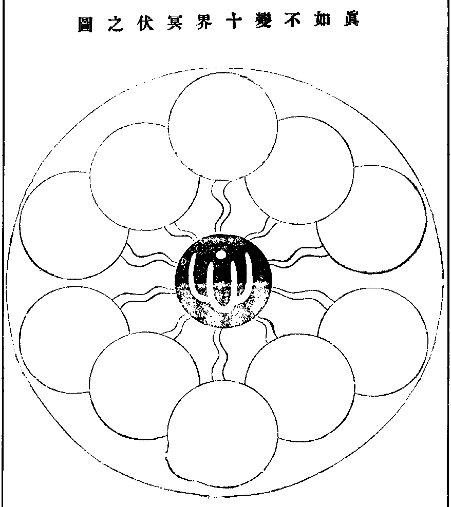



客曰：云何名为真如随缘十界差别门？余曰：前引华严能随染净缘，具造十法界者，正以法界圆融之体，真如不变之性，如君子不器，善恶皆能。圆顿教旨，无功用道，极要紧处，全在此能之一字上建立。若它别教所宗，但中佛性，惟具善而不具恶，其於文经为善之事，或者能之，若於武纬征伐之事，则不能之，何足以𫁉才无不具，艺无不就，成德之士哉？若圆顿教旨所明，真如不变之体，既具十界善恶之性，故未随缘时，则居然不变。若随缘时，而有十界染净之用，谓能随染缘造九法界，随净缘造佛法界。十种法界，既是性具，又是能事，惟彰己能，何过之有？非比淳善之人，一切恶事，本非所能，被恶人逼，强令作恶，虑其名德俱丧，则惭恧无地，斯为过矣。然此一门，宜分因果，因论方修，果论感报。方修之因，复有二种：一起念名造，二搆作名造。起念名造者，如世人日用，根尘相对，凡起一念，必属一界。一界生起名事造，九界冥伏为理具。以冥伏故不有，以现起故不无。全造而具，故不有而恒有。全具而造，故不无而恒无。不有不无，实相理显。故善观一念者，三智一心中得矣。二搆作名造者，依此真如所起一念，渐渐增长，搆造染净二因，成业性故。现起冥伏，义同上说。是故能善观一心为界者，三智亦一心中得矣。果论感报者，约三世论，方修之因，若在过去，则感报之果在现在。若方修之因在现在，则感报之果在未来。又方修之因，有转不转。感报之果，有定不定。转则不定，不转则定。如一念贪心起，为地狱因。若能改格前非，惭愧忏悔，或转为人天，或转为四圣。在其用心励行之不同，下当列图，具明其相。使阅者有所照，非成是焉。



真如随缘十界差别之图



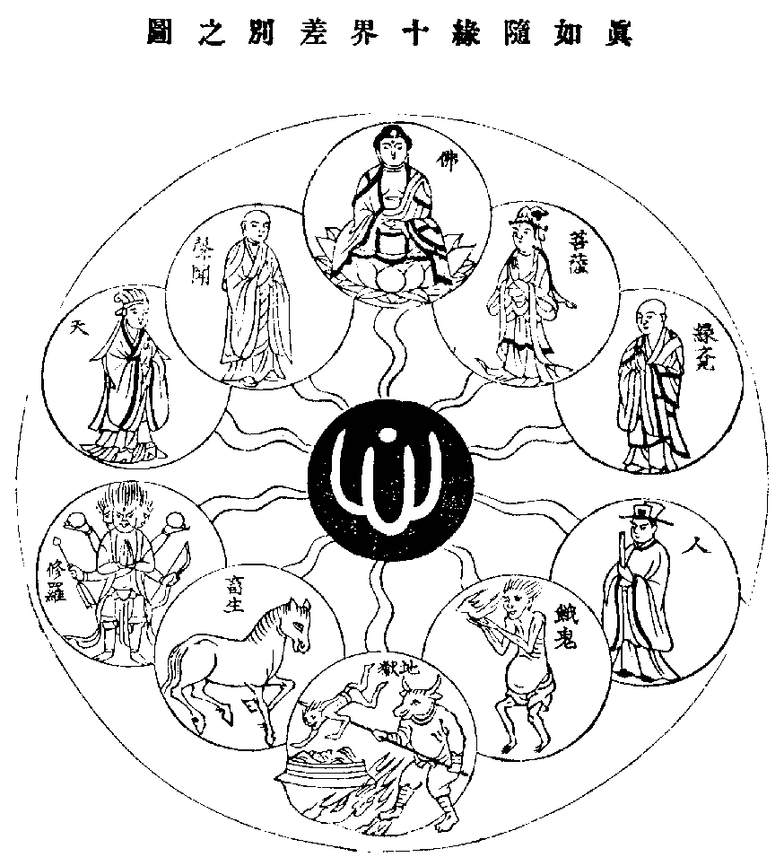



佛界现起九界冥伏之图



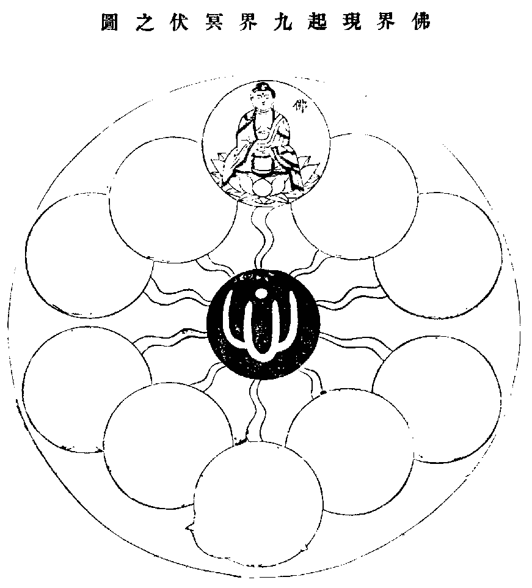



一、佛法界者



慈云大师法界图说云：若人因读圆满修多罗，及闻善知识所说，起净信心，信己一念三道之性，即三德性。苦道即法身，烦恼即般若，结业即解脱。法身究竟，般若清净，解脱自在。一究竟一切究竟，般若解脱亦究竟。一清净一切清净，法身解脱亦清净。一自在一切自在，法身般若亦自在。即一而三，即三而一，非纵非横，亦非一异。法身常住，餘亦常住，乐我净亦如是。是则常乐四德秘密之藏，遍一切处，一切诸法，悉是佛法。既信是已，以境系心，以心系境，心境念念相续不断，必见法性。设未相应，当依一实无作四谛，起四大誓。无所求中，吾故求之。依前苦道即苦谛，发一誓愿，未度者令度。烦恼及业即集谛，发一誓愿，未解者令解。苦通即法身，即是灭谛，发一誓愿，未涅槃者令得涅槃。烦恼即菩提，即是道谛，发一誓愿，未安者令安。四弘不入，当巧安心止观。如是次第具修十法，必入五品六根及分证位，名佛法界。



释曰：若约佛界论，方修之因转不转，感报之果定不定者，佛果既是究竟三身，则惟是定，无不定义。若方修之因二种中，正以佛界现起，则九界冥伏於一性之中，随外熏缘，强弱不同。如初起一念佛界之心，名造居凡夫。不定聚者，人分两品：一者、若人发佛界心已，其志坚固，念念在道，一入永入，此则更无退转。二者、是人虽始发心求佛，然而立心不固，弘誓非坚，或逢逆境而退为偏乘，或遇顺境而即兴凡念。人天善道，逐境漂流；恶道三途，逢缘堕落。起念之造既然，搆作之修亦尔。不退转者，如善财南求，常啼东请，割内贸鸽，至死而不退；投身喂虎，委骨而无移。以进例退，应亦多人，不足为训，故其录少出耳。



菩萨界现起九界冥伏之图。



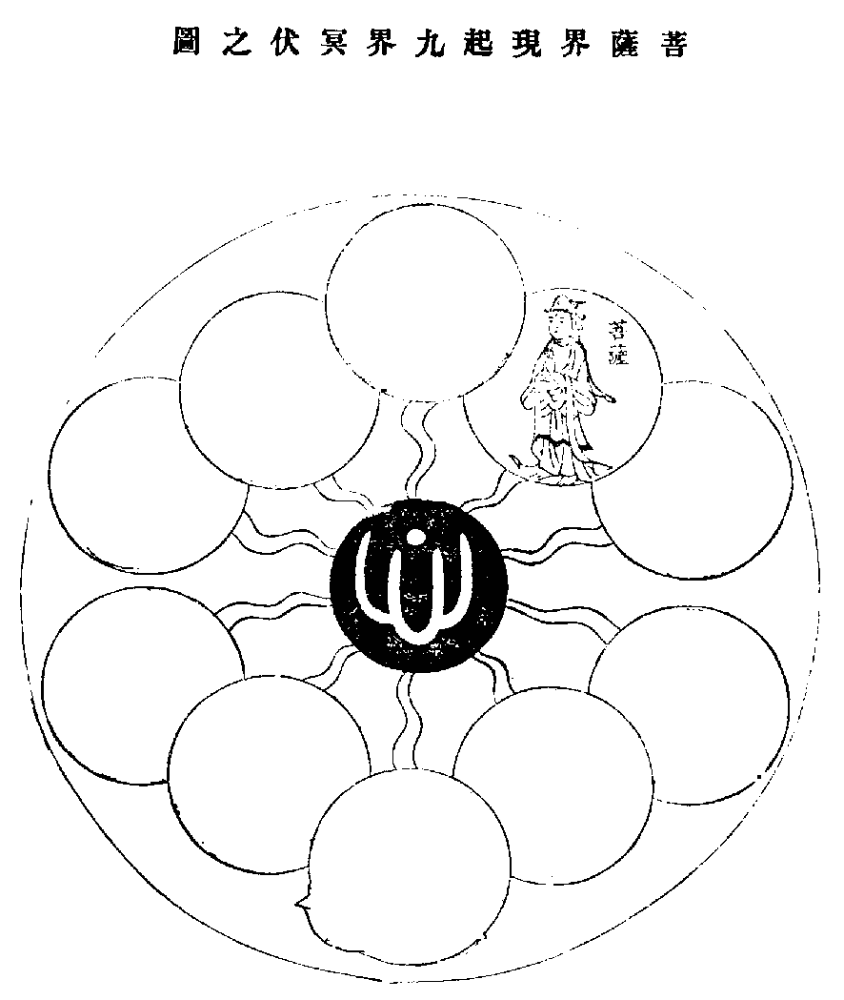



二、菩萨法界者



法界图说云：若观根尘，为迷解本。迷故则有十界苦集，悟故则有四圣灭道。缘此无量四谛，起无量誓愿，未度者令度，未解者令解，未安者令安，未得涅槃者令得涅槃。善巧度生，慈眼视物，所集福业，与众生共。如是起一念者，名菩萨法界。



释曰：若约菩萨法界论，方修有转、不转，果报有退、不退者。此中明转、不转，复有进、不进，退、不退二义。言不转者，惟修此菩萨道而已。转者复二：有转心为佛道，进而不退者；有虽转而不进者。果报中复有转、不转二义。转者，别教菩萨登初地，破无明惑；有转入圆教二住者。此即教、行二道，虽则不圆，至於证道，证与圆同是也。不转者，则始终三道皆别也。然而既登初地，则惟进无退，故无不退义也。若约人论退、转者，如舍利弗尊者，往劫之先，修菩萨道。因外道婆罗门乞施其眼，菩萨曰：眼施何用？可乞它物。外道曰：餘无所需，必欲眼尔。菩萨未具忍力，勉强剜施。外道得眼，嗔而掷地曰：我谓菩萨之眼，必香洁清美，故来乞之。若仍臭秽，与庸人何异？不须此物。以足践踏而去。菩萨曰：浊世众生，刚强乃尔。无用之物，必欲求之。得之贱辱，真难可度。不如舍菩萨道，修於声闻，自出生死。由是渐退，堕为凡夫。释论云：舍利弗修菩萨道，经六十劫，於六心中退。又如法华会上诸声闻众，於尘点劫前，大通智胜佛十六王子所，同听法华，发无上心，修菩萨行。有不退者，久已作佛。有退转者，舍大取小，退为凡夫。小乘机熟，今为二乘。直至今生，如来更以五时说法而成熟之，方得受记，当来作佛。故知修行佛道与菩萨道，俱有退、不退异也。



缘觉法界现起九界冥伏之图。



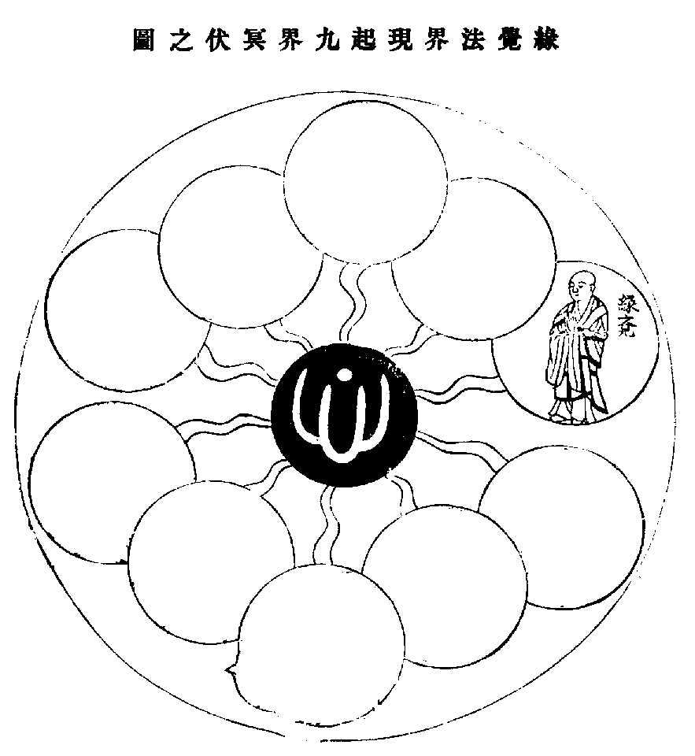



缘觉法界者



法界图说云：若根尘念起，了之从无明生，生故有行，行招名色，乃至老死，三世相续，如舞火轮。因缘本空，幻化不实，求自然慧，乐独善寂，观空心重，耽住寂定，虽得道果，不慕化人。复有观物荣落，悟世非常，闻空得道，名为独觉。如是行者，名为缘觉。法界方修之因转不转，果报退不退，於下声闻法界中共论。



声闻法界现起九界冥伏之图



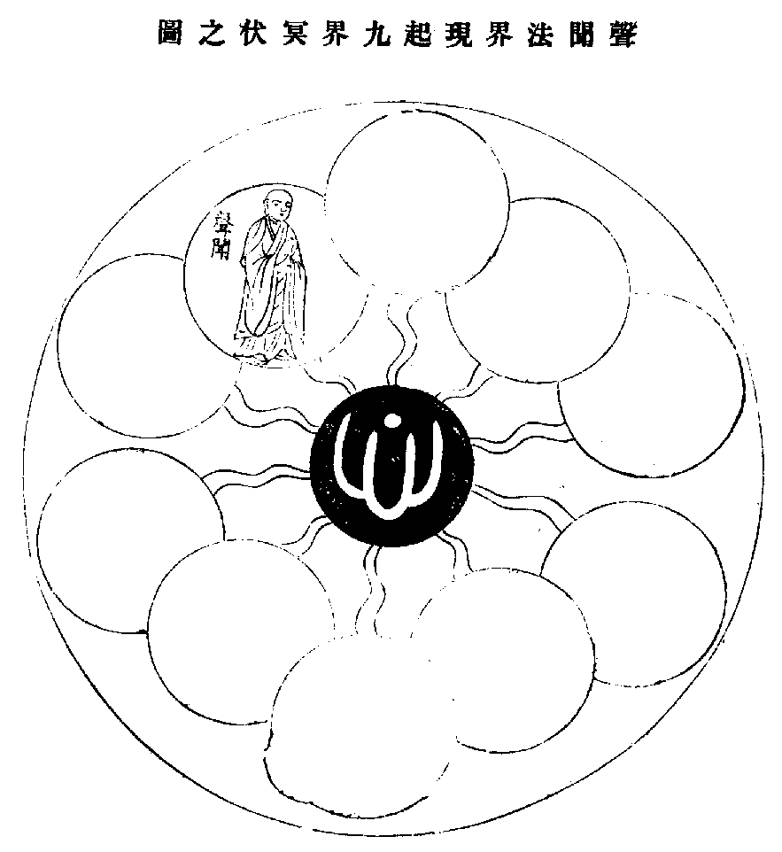



声闻法界者



法界图说云：若根尘因缘，随有一念，依色心故苦，由烦恼故集，厌苦断集，非对治如何？遂依四谛，修十六观、三十七品，如救头然，由四善根，得入无漏四沙门果，证二涅槃，会偏真理，不得佛法，不慕化人，如獐独跳，不顾后群，如此一念，名声闻法界。



释曰：若约缘觉、声闻二法界论，方修有转、不转，果报有退、不退者，亦以一界既起，九界冥伏於一性之中，随外熏缘强弱，性不可定，餘义同於菩萨。转、不转中，复有进不进、退不退二义。言不转者，惟修二乘之法而已。转则有二：一、发心转为菩萨；二、发心转为佛界。转此二界，复有二心：有一转之后，进而不退者；有虽转而不进者。果报复有转、不转二义。不转者，即定性声闻、缘觉是也。转者，即藏教二乘人为通教大乘所接，或通教为别、圆二教所接，或从空入假学菩萨法，或空入假中修行佛道是也。



天界现起九界冥伏之图



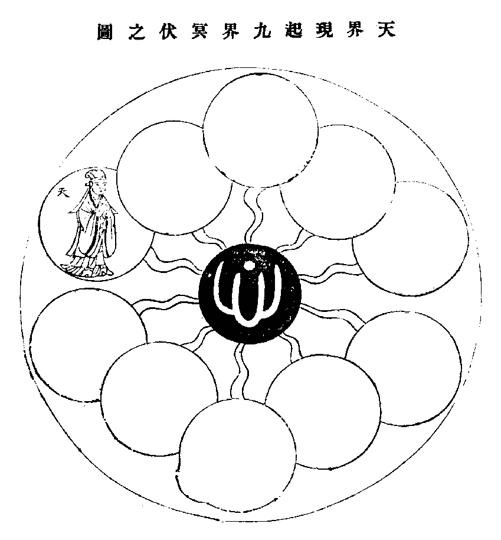



天法界者



法界图说云：若念心起，多忻天乐。笃其善心，希於来报。斋戒纯净，饭食沙门。造立塔寺，及佛形像。书写大乘，济惠贫病。於十善法，止作具修，自然成性。或关禁六根，使六情不荡，六尘不入。得欲界禅，及色无色定。身心寂静，三业调良。如此一念，名天法界。



释曰：约天法界论，方修有转不转，亦以一界现起九界，冥伏於一性之中，随外熏缘，强弱不同。或修下天之福而转为上天，或转为出世间禅，或减上天之福而转为下天，转为人界，转为修罗，与夫三途，初不可定。果报有退不退者，不退则长时受天之报，或更升上天，或因修欲定、未到地定，或得初禅、二禅、三禅、四禅等定，而进升上界，此则不独不退，兼之有进者也。若天福既尽，而为人道修罗，所谓降德贬坠是也。或天福既尽，而先世恶种正萌，而竟堕三途，如郁头蓝弗利根聪明，能伏烦恼，得无想定，八万劫天报既尽，命终之后，堕为飞貍之身。或将崩而升转，其果报免於恶趣，生於善道，如三十三天五衰相现，中阴相起，应作猪身，帝释教其修三归依法，得免畜生之报，生於舍卫国长者之家，闻法入道。故逐心生，相随心转，初无定体也。



人界现起九界冥伏之图



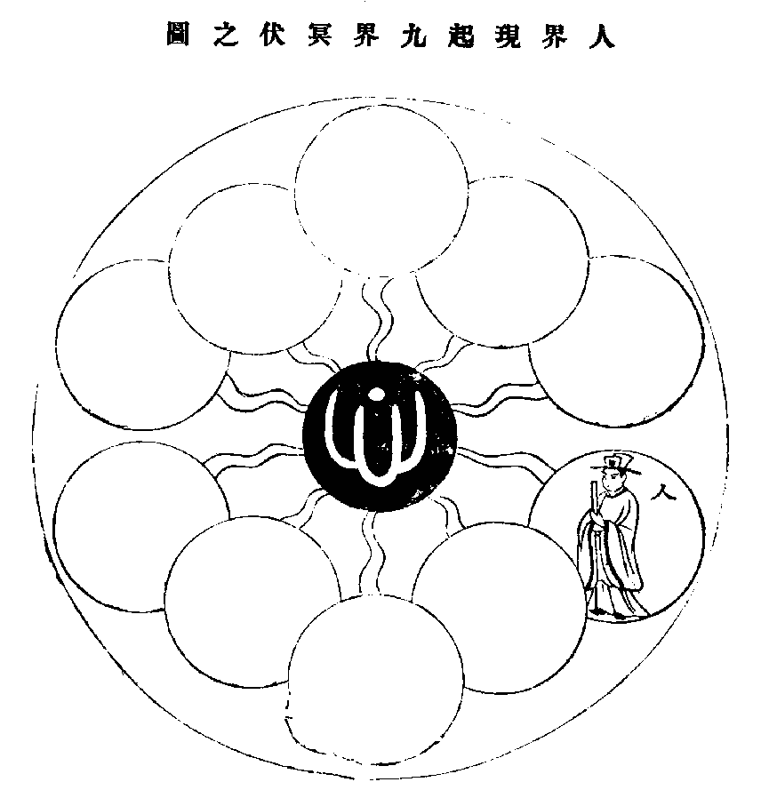



人法界者



法界图说云：若其念念以无常立德，五戒修身，於国惟忠，於家惟孝，谦损居众，中正存诚，推德於人，引咎向己，尊上恤下，给孤济贫，惭愧是坏，慈和为性，深信三宝，崇重三归，精修齐戒，建立塔寺，但希世乐，无升出心，贪惜自身，恋著眷属，如此一念，名人法界。



释曰：约人界论，方修转不转，果报退不退者，亦以一界现起，九界冥伏，於一性之中，随外熏缘，强弱不同，复不可定。四洲人道中，惟此南洲，人心黠慧，易可化度，心极易转。如论方修起念，於日用中，根尘相对，而有念生，於十界中，必落一界。未闻大道者，善亦不过於人天，恶则坠堕於三途。如曰：人皆可以为尧舜，而竟为之，生前不失为人中之大圣，死后不失为上界之天曹。人皆可以为桀纣，而亦竟为之，生前则失位而殒身，死后必三途之为报。岂非人道转而为人中之圣，天中之圣乎？故人天六道，转与不转，未始离乎方今日用之一念也。其若曾闻大道，或浅悟偏乘，或深信真如，正方修人道也，而或转为出世偏乘，或转为涅槃大道。故佛世之得度成道者，类是人王宰官，长者居士。此方之成佛作祖者，悉系人中俊杰，儒道英豪。果报定不定者，若将因验果，以果证因，贫富贵贱，业有前定。其或相逐心生，报随业转，亦不可定。如报本贫贱，苟有一德之格天，则转为富贵者有之。身当富贵，有一行之失德，则转为贫贱者有之。如裴度之还带，宋祁之度蚁，皆其事也。



阿修罗界现起九界冥伏之图。



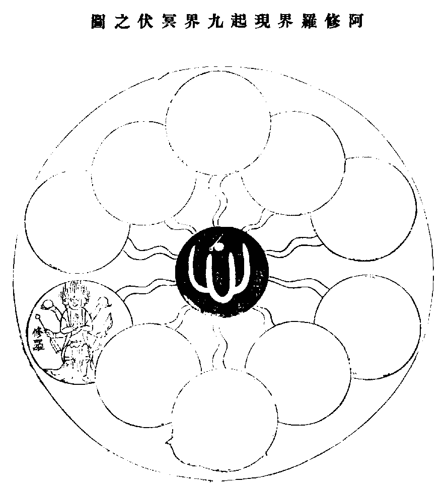



阿修罗法界者



法界图说云：若其念念虽好修善布施斋戒，而多猜嫌狐疑进退，所修福业多为胜他，见人修善情多嫉忌，贡高我慢珍己轻人，欲彼归从不耐谦损，如鸱高飞下视，外扬仁义内无实德，众前谈论引长於我，不循理正不媿贤能，如此行心是阿修罗法界。



释曰：约修罗界论，方修与搆作转不转。果报定不定者，亦以一界现起，九界冥伏，於一性之中，随外熏缘，强弱不同。若其念念如此立行，则定是修罗之因，势不可转。其或心生惭愧，改恶迁善，则转为人天善道。或闻大道，转为出世间心，即不可定。其若转为斯下，为畜、为鬼、为狱，既一失念，则无恶而不为，无趣而不堕也。果报定不定者，楞严经说四种修罗，谓胎、卵、湿、化、天趣、人趣、鬼趣、畜趣，其餘是定非不定，惟以护法力，乘道入空。此种修罗，常住如来法会之下，既闻大道，发回向改悔心，乃乘急戒缓之人也。转入菩萨道、佛道，难可测量。



饿鬼法界现起九界冥伏之图



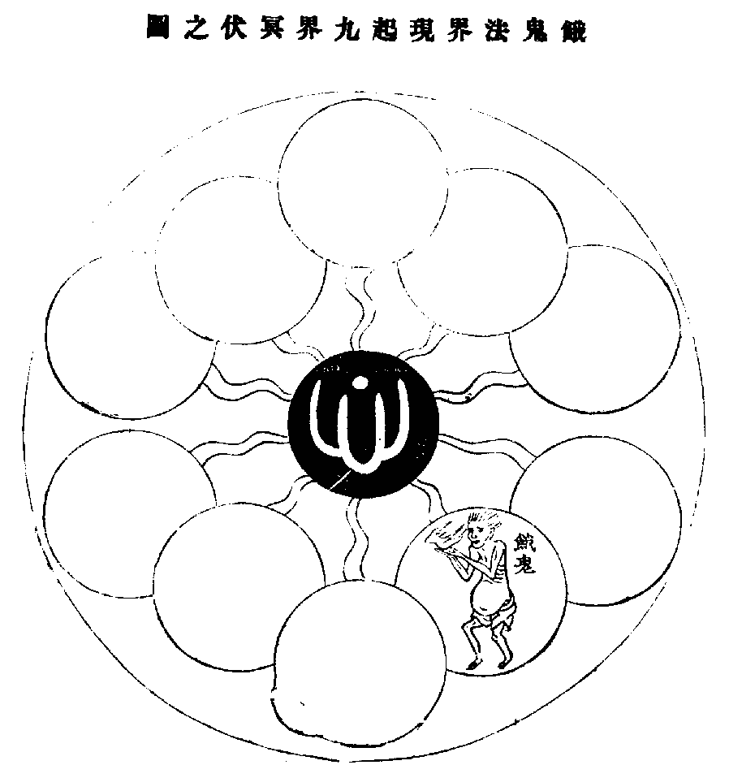



饿鬼法界者



法界图说云：若其念念无惭无愧，贪求无足，悭吝鄙惜，不施一毛，剋削於人，裒归於我，见人布施，傍起遮障，见人得利，心生热恼，性多谄曲，常起邪见，人前正容，屏处放恣，破齐犯戒，恣贪饮食，不信罪福，不信因果，不信三宝，不孝所亲，是名饿鬼法界。



释曰：约饿鬼法界论，方修与搆作转不转，果报定不定者，正以一界现起，九界冥伏，於一性之中，随其修力强弱，或起或伏，性不可定。若其念念如此，定是饿鬼法界，势不可转。其若心生惭愧，改恶迁善，则转为人天善道，或闻大道，转为出世间心，即不可定。若转为斯下，为畜为狱，既一失念，则无恶而不造，无趣而不堕也。果报定不定者，第此道有神鬼之分，神道则楞严所谓情少想多，轻举非远，即为大力鬼王，飞行罗刹，地行罗刹，游於四天，所去无碍。其中若有善愿善心，护持戒人，或护神呪，随持呪者，或护禅定，保绥法忍，是等亲住如来座下，此亦乘急戒缓之流。果报虽定，既能闻法护法，或转重报为轻报，则不可定也。若七情三想，沈下水轮，生於火际，受气猛火，身为饿鬼，常被焚烧，水能害已，无食无饮，经百千劫，此则定，非是不定。其若面然鬼王，启如来施食之教，虽是观音现示，然非实无以施权，非权无以引实，矧受如来瑜伽法食者，能免多劫之苦，而超生善道，果报岂有定乎？



畜生法界现起九界冥伏之图



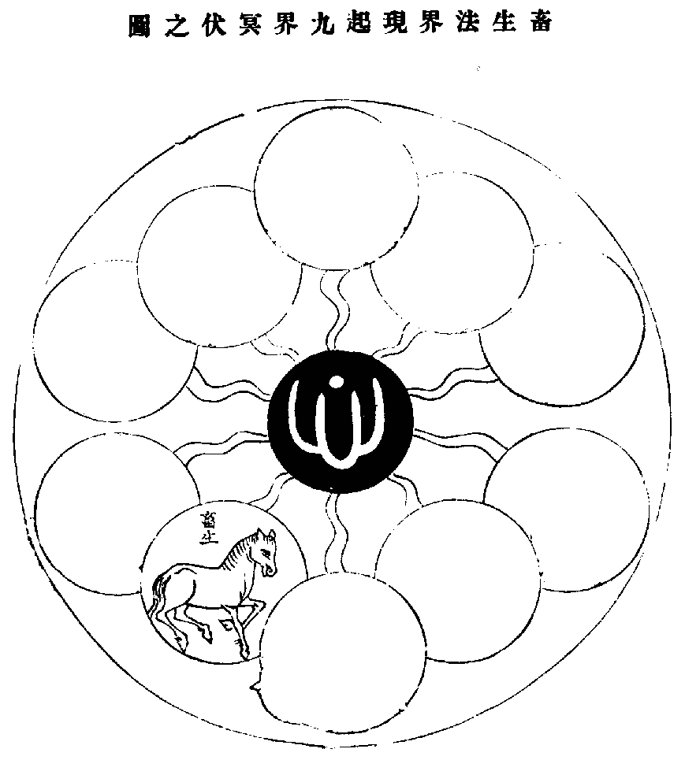



畜生法界者



法界图说云：若其念念耽湎五欲，贪多眷属，日增月甚，而无厌足，曲理枉物，断不以公，非法取财，动不由义，秪图己利，不恻孤贪，明负他财，鲁扈抵突，市易负直，公行劫夺，不忠不孝，无贤无愚，不信因果，不信三宝，痴𫘤无耻，现同畜生，是名畜生法界。



释曰：约畜生法界论，方修与搆作转不转，亦以一界现起九界，冥伏於一性之中，随其外熏缘强弱，性不可定。若其念念如此，定是畜生法界，势不可转。其若心生惭愧，改恶迁善，则转为人天道，或闻大道，转为出世间心，则不可定也。若转为斯下，为地狱趣，既一失念，则上品十恶、诽谤三宝、毁菩萨戒等，无恶而不为也。约果报论，定不定者，若相遂心生，果随因转，如畜之业报，定在屠割以供庖厨。亦有转祸为福者，如善鹿王代母鹿以趣王厨，王问所以，鹿以实对，王因自悔，向鹿说偈：汝为鹿头人，我为人头鹿，从今释汝去，随意遂水草。遂兼恶鹿王所部群鹿，俱得解脱猎狩之难，岂非报亦可转乎？又如十千游鱼，蒙流水长者放生施食，说微妙法，命终之后，生三十三天，至光明会上，以闻法因缘，得受记成佛。故六道之中，皆有佛力、法力、慈悲之力，转重为轻，化恶为善，直至解脱，俱不可定也。



地狱法界现起九界冥伏之图



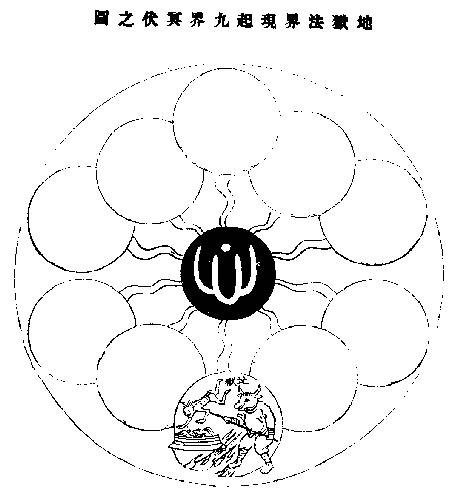



地狱法界者



法界图说云：若人亲近邪恶友，及性自作恶，起增上心，念念相续，造上品十恶，谓杀、盗、淫、妄言、绮语、两舌、恶骂、贪、嗔、邪见，及五逆罪，犯四重禁，污梵行人，沽酒醉乱，不思君父师长恩德，横生热恼，挫抑贤能，党彼不肖，破塔坏寺，烧坏经像，谤毁大乘，断学般若，谤无诸佛，破戒受施，用三宝物，偷僧祇物，起於外道断常诸见，破正因果三世之法，习十二种恶律仪法(一、屠儿，二、魁刽，三、养猪，四、养鸡，五、捕鱼，六、猎者，七、网鸟，八、捕蟒，九、呪龙，十、狱卒，十一、盗贼，十二、为王捕贼及养蚕等业)，如是等辈，入阿鼻大热大寒诸大地狱，是名地狱法界。



释曰：地狱法界，约方修与搆作二因论。转不转者，亦以一界见起九界，冥伏於一性之中，随其造力强弱，性不可定。若其念念作此地狱之因，相续不断，习以成性，则不可转。或能惭愧改革，一念回心，即是善道。或照破此地狱恶念，为四谛，为十二因缘，为六度，为空、假、中三谛三观，则转为出世间众生心行。因倒因起，转与不转，皆不可定。如阿阇世王杀父害母，身疮肿热，七日之后，当堕地狱。受耆婆大臣劝来佛所，蒙如来月爱三昧光明所照，顿获清凉，身疮痊愈。闻佛说法，忏悔心重，地狱相灭，得无根信。此已成之因，将堕之果，承佛法力，承忏悔力，承大信力，尚能转地狱界为佛法界，况不灭罪生善界乎？又如楞严经佛告阿难：诸佛如来，语无虗妄。若复有人，身具四重十波罗夷，瞬息即经此方、他方、阿鼻地狱，乃至十方，穷书无间，靡不经历。能以一念，将此法门，於末劫中，开示未学，是人罪障，应念消灭，变其所受地狱苦因，成安乐国。岂非地狱之因，因弘法力，亦可转耶？约果报论定不定者，若寻常所论因果，既入地狱，决定受报，无不定理。若不思谦力、忏悔力，亦可回其定果，得生善处。如仙豫国王，所杀五百婆罗门外道，竟堕阿鼻地狱，而兴三念：一者知是地狱，二者知为仙豫所杀，三者知因邪见之罪，故堕地狱。由此生大惭愧，忏悔往业，即灭地狱，而得生天。故知阿鼻地狱，全处极圣之自心；毗卢身土，不逾下凡之一念。转之变之，职由乎人。苟有重悔重悟，变地狱为天堂，在顷刻间也。



性善恶论卷之一



性善恶论卷之二



天台山幽谿沙门传灯著



客曰：十界随缘差别之事，已闻教矣。云何名为不变随缘无差而差门？余曰：上文所明十界随缘差别门，能随染净缘，遂分十法界。此中宜确论性善性恶，与夫修善修恶之旨。性善性恶者，真如不变之体也；修善修恶者，随缘差别之用也。正以真如不变体中，具善恶二性，故随缘时，有善恶之用。是则能随之性，名曰善恶；所随之缘，名曰染净。十界善恶之性，具足五阴实法，名为正报；具足国土实法，名为依报。天台大师於此具明十界十如，一界有十如，则十界有百如，十界各各互具，成百法界，百法界互具，则千如是。具论实法一千，国土一千，假名一千，如是三千，於真如性中，无不具足。惟其性本具足，故随染净缘时，有正报、依报三千之事，乃全真如不变之体，而为随缘之用，以无差别而为差别。如是等义，具在诸大乘圆顿经中，若显示其相，则莫过楞严。彼於七大文中，而具明性色真空等义，并随众生心应所知量随缘之义。地、水、火、风、空五大，乃十界之依报也；见、识二大，乃十界之正报也。今为具引以发明之，使深信此宗者，有所依凭，亦以知台宗所立，深契合乎佛旨也。



先明地大



不变随缘义中，如来先约现前可见易明之事而开示之，云：汝观地性，粗为大地，细为微尘。至邻虗尘，柝彼极微色边际相，七分所成。更柝邻虗，即实空性。次明随缘体虗，云：阿难，若此邻虗柝成虗空，当知虗空出生色相。汝今问言，由和合故，出生世间诸变化相。汝且观此一邻虗尘，用几虗空和合而有？不应隣虗合成邻虗。又邻虗尘柝入空者，用几色相合成虗空？若合色时，合色非空；若空合时，合空非色。色犹可柝，空云何合？三明真如性具之理，云：汝元不知如来藏中，性色真空，性空真色，清净本然，周遍法界。如来藏，即真如不变之体也。性色真空，性空真色，此指真如不变体中，所具一分地大，所对一分空大者为言。文言性者，对相而言。盖有性色，有相色，有性空，有相空。相色相空，乃十法界随染净缘造成。色之与空，即修善修恶也。今指性善性恶之色空，而此色空在一性中，体恒不二，亦无差别，与所具三德之性，体亦不二，无有差别，故曰清净本然，周遍法界。清净即地大中般若德，亦名真谛；本然即地大中解脱德，亦名俗谛；周遍法界即地大中法身德，亦名中道第一义谛。四明随缘之义，云：随众生心，应所知量，循业发现。与华严能随染净缘，具造十法界义同。所随之缘，有心有业。心即十法界染净二心，业即十法界善恶二业。佛界三智之心名净心，九界三惑之心名染心。佛界顺性之行名善业，九界逆性之行名恶业。谓真如不变佛界性善之体，能随佛界净心，造佛界修善之色。约其人，则持地菩萨是也。约正报，即法身、报身、应身、微尘相海、八万四千相好、八十种好之色是也。约依报，即常寂光实报无障碍土之色是也。又真如不变九界性恶之体，能随九界染心，造九界修恶之色。约正报，即三圣变易生死之色，六道分段生死之色是也。约依报，即寔报无障碍土、方便有餘土、凡圣同居土之色是也。至於极恶，则阿鼻地狱依报正报，莫非其相。是则今人道中所有正报六尺之躯，所禀地大之相依报山河国土，凡有质碍之色英，非从真如不变所具性恶之色，自无始随无明尘沙见思三惑染心，造人天恶业之所招报。故曰：随众生心，应所知量，循业发现。心即华严所谓染心之缘，业即人天所造五戒十善之业。此之心业，比三途恶道，名为净心善业。若望出世间四谛十二因缘，皆染心恶业，矧佛法界三智净心六度善业哉。



次明火大



不变随缘义中，如来先约现前可见易明之事而开示云：火性无我，寄於诸缘。汝观城中未食之家，欲炊爨时，手执阳燧，日前求火。次明随缘其体本虗云：阿难，名和合者，如我与汝一千二百五十比丘，今为一众。众虽为一，诘其根本，各各有身，皆有所生氏族名字。如舍利弗，婆罗门种；优楼频罗，迦叶波种；乃至阿难，瞿昙种姓。阿难，若此火性因和合有，彼手执镜於日求火，此火为从镜中而出？为从艾出？为从日来？阿难，若日来者，自能烧汝手中之艾，来处林木皆应受焚。若镜中出，自能於镜出然於艾，镜何不镕？纡汝手执，尚无热相，云何融泮？若生於艾，何藉日镜光明相接，然后火生？汝又谛观，镜因手执，日从天来，艾本地生，火从何方游历於此？日镜相远，非和非合，不应火光无从自有。三明真如性具之理云：汝犹不知如来藏中，性火真空，性空真火，清净本然，周遍法界。如来藏，即真如不变之体也。性火真空，性空真火，此指真如不变体中，所具一分火大，所对一分空大者为言。文言性者，亦对相而说。盖有性火，有相火，有性空，有相空。相大相空，乃十法界随染净缘造成。空之与火，即修善修恶也。今指性善性恶，火之与空，此火即真空，此空即真火。是则性火即真空，性空即真火。故往复言之，而曰性火真空，性空真火。而此空火，在一性中，体恒不二，亦无差别。即与所具三德，体亦不二，亦无差别。故曰清净本然，周遍法界。清净即火大中般若德，亦名真谛。本然即火大中解脱德，亦名俗谛。周遍法界，即火大中法身德，亦名中道第一义谛。既曰清净，则此火大，在一性中，本无污染者也。既曰本然，则此火大，在一性中，本非造作者也。既曰周遍法界，则此火大，在一性中，本来绝待者也。四明不变随缘之义，云随众生心，应所知量，循业发现。与华严能随染净缘，具造十法界义同。所随有心有业，心即十法界染净一心，业即十法界善恶二行。佛界三智之心名净心，九界三惑之心名染心。佛界顺性之行名善业，九界逆性之行名恶业。谓真如不变，佛界性善，能随净心善业之缘，造佛界修善之火。约其人，则乌刍瑟摩是也。约正报，则佛之慧日光明圆照法界，日月诸天戢歛重曜。约依报，则无量香云为光明台，七宝楼合常有光明，皆其事也。又真如不变，九界性恶，能随染心恶业之缘，造九界修恶之火。约正报，则身中诸冷暖气发而为烦恼火，气息如烟，为障热，为痟渴。约依报，则日月光明，林木烟燄。至於修恶之极，则火龙、火蛇、火麟、火鼠、诸饿鬼等，受气猛火常被烧然。至於八热地狱，上火彻下，下火彻上，东西交彻，历劫烧然。依报，则极至於劫火所烧，上至初禅世界，所有悉为煨烬。莫非如来藏真如不变，性善性恶，能随染净缘所造之火，故曰随众生心应所知量。单心不立，独业难成。既有染净心，必有善恶业，故曰循业发现。



三明水大



不变随缘义中，先约现前可见易明之事而开示之。云：阿难，水性不定，流息无恒，如室罗城迦毗罗仙、斫迦罗仙及钵头摩诃萨多等诸大幻师，求太阴精，用和幻药。是诸师等於白月畫，手执方诸，承月中水。二、明随缘体虗。云：阿难，此水为复从珠中出？空中自有？为从月来？阿难，若从月来，尚能远方令珠出水，所经林木皆应吐流，流则何待方诸所出？不流明水非从月降。若从珠出，则此珠中常应流水，何待中宵承白月昼？若从空生，空性无边，水当无际，从人洎天皆同滔溺，云何复有水陆空行？汝更谛观，月从天陟，珠因手执，承珠水盘，本人敷设，水自何方流注於此？月珠相远，非和非合，不应水精无从自有。三、明真如性具之理。云：汝尚不知如来藏中，性水真空，性空真水，清净本然，周遍法界。如来藏，即真如不变之体也。性水真空，性空真水，此指真如不变体中所具一分水大，所对一分空大者为言。文言性者，亦对相而说。盖有性水相水，性空相空，相水相空，乃十法界随染净缘造成。空之与水，即修善修恶也。今指性善性恶空水，此水乃真水，此空乃真空，是则性水即真空，性空即真水。故往复言之，而曰性水真空，性空真水。而此空水在一性中，体恒不二，亦无差别，即与所具三德，体亦不二，亦无差别，故曰清净本然，周遍法界。清净即水大中般若德，亦名真谛；本然即水大中解脱德，亦名俗谛；周遍法界即水大中法身德，亦名中道第一义谛。既云清净，则此水大，本无污染者也；既云本然，则此水大，本无造作者也；既云周遍法界，则此水大，本来绝待者也。四、明不变随缘之义。云随众生心，应所知量，循业发现，与华严能随染净缘，具造十法界义同。所随有心有业，心即十法界染净二心，业即十法界善恶二行。佛界三智之心名净心，九界三惑之心名染心；佛界顺性之行名善业，九界逆性之行名恶业。谓真如不变，佛界性善，能随净心善业之缘，造佛界修善之水。约其人，则水天如来、月光童子是也；约正报，则入地如水，履水如地，咽喉津液，得味中上味；约依报，则也流入德，具七宝色，皆悉柔软，澡浴清净，随意浅深，水流光明，常演妙法，凫鴈鸳鸯，和鸣哀雅，四院绕梁，宣畅大乘。又真如不变，九界性恶，能随染心恶业之缘，造九界修恶之水。约正报，则大小便利，脓血津液；约依报，则雨露霜雪，江河淮海，溪㵎沟壑，一切诸水；至於极恶，则地狱中灰河血池，八寒冻裂；又至於极恶，则世界将坏，水灾难起，浩浩漾漾，齐於二禅。孟子曰：人性之善也，犹水之就□下也。人无有不善，水无有不下。孟子此说，但知水之相也，未知水之性也；但知水之修恶也，而未知水之修善也。曷为水之性？如经所谓(〔性水〕)真空，性空真水，清净本然，周遍法界。当其水之在性也如此，则何分上下之与东西。如目为太阴之精，当月之光明，行於太空之时，则自西自东，自南自北，自上自下，无斯而不在。求水者，手执方诸，承月中水，一处执珠，一处水出，遍法界执，遍法界生，生满世间，宁有方所。然则水之为性，岂必流於下乎。曷为水之修善，如安养世界七宝池中之水，从如意珠王之所涌出，自下而上，流泪花间，寻树上下，分一四支。此岂孟子激而行之，可使在山者乎。又如弥勒内院八功德水，亦自下而上，绕於梁间，宣说甚深妙法，亦非激之而使乎上也。要知世间水之流下，修恶中所有水相也。既水之修相，可以为上，而可以为下，则水之为性，清净本然，周遍法界，性具善恶明矣。又孟子谓，吾善养吾浩然之气，此气充塞於两间，为地耶，水耶，火耶，风耶，空耶，独然耶，杂然耶。谓之为气，宜其为五大之餘𦦨也。然今经之取其易见之七大，先发明者，犹是修善修恶中之事，非所谓性善恶也。若夫性色真空，性空真色，清净本然，周遍法界者，必非直两间六合而已矣。水大如此，餘大皆然。是则依报地水火风空之性，莫不清净本然，周遍法界，而已具乎性善性恶矣。况人身之六根，与夫六识心性，而不具性善性恶乎。第性之善恶，与修不同。修之善恶，则确然有升沉苦乐之异。若夫性之善恶，体具三德，皆不二而二，二而不二，何升沈苦乐之殊哉。



四明风大



不变随缘义中，先约现前易明之事而开示之，云：风性无体，动静不常，汝常整衣入於大众僧伽黎角，动及傍人，则有微风拂彼人面。次明随缘体虗，云：此风为复出袈裟角，发於虗空，生彼人面？阿难，此风若复出袈裟角，汝乃披风，其衣飞扬，应离汝体。我今说法，会中垂衣，汝看我衣，风何所在？不应衣中有藏风地。若生虗空，汝衣不动，何因无拂？空性常住，风应常生。若无风时，虗空当灭，灭风可见，灭空何状？若有生灭，不名虗空，名为虗空，云何风出？若风自生被拂之面，从彼面生，当应拂汝，汝自整衣，云何倒拂？汝审谛观，整衣在汝，面属彼人，虗空寂然，不参流动，风自谁方鼓动来此？风空性隔，非和非合，不应风性无从自有。三明真如性具之理，云：汝宛不知如来藏中，性风真空，性空真风，清净本然，周遍法界，如来藏真如不变之体也。性风真空，性空真风，此指真如不变体中，所具一分风大，所对一分空大者为言。文言性者，亦对相而说。盖有性风相风，性空相空，相风相空，乃十界真如，随染净缘造成。空之与风，即修善修恶也。今指性善性恶之风，此风乃真空，此空乃真风。是则性风即真空，性空即真风。故往复言之，而曰性风真空，性空真风。而此风空，在一性中，体恒不二，亦无差别。即与所具三德，体亦不二，亦无差别。故曰清净本然，周遍法界。清净即风大中般若德，亦名真谛。本然即风大中解脱德，亦名俗谛。周遍法界，即风大中法身德，亦名中道第一义谛。既云清净，则此风大，本无污染者也。既云本然，则此风大，本无造作者也。既云周遍法界，则此风大，本来绝待者也。四明不变随缘之义。云随众生心，应所知量，循业发现，与华严能随染净缘，具造十法界义同。所随有心有业，心即十法界染净二心，业即十法界顺逆二行。佛界三智之心名净心，九界三惑之心名染心。佛界顺性之行名善业，九界逆性之行名恶业。谓真如不变，佛界性善，能随净心顺行之缘，造佛界修善之风。约其人，则然灯如来流□，元法王子是也。约正报，则道风德风，周流法界，去来坐立，终无疲厌。约依报，则八种清风，快悦和畅，吹诸宝网，及以宝树，出微妙音，譬如百千种乐，同时俱作。闻是音者，自然皆生念佛、念法、念僧之心。九界性恶。能随染心恶业之缘，造九界修恶之风。约正报，则觔转脉摇，血行气运，行住坐卧，相待而居。约依报，则春和夏热，秋肃冬寒，倒岳旋岚，日往月诸。又极恶者，地狱恶风，吹坏国土，亡者神识，飞坠乘空，寒风冻裂，诸罪人体成青白莲华。又极至於大恶者，则劫数尽时，毗蓝风起，大地吹之粉碎，须弥化作微尘，上至三禅天中，未免风灾所坏。须知诸力之中，风力最大。世界成住坏空，非风力而莫能主维；大地浮幢王刹，非风轮而莫能执持；日往月来，非风力而莫能运行；春夏秋冬，非风力而莫能生杀；行住坐卧，非风力而莫能折旋；语言谈笑，非风力而莫能说默；思惟拟议，非风力而莫能使然。是皆性恶之能事，修恶之发越也。若夫性善修善之风，则常住妙明，不动周圆，既无有生，而又何灭？既无所住，而亦何迁？正所谓称性而修，绝待而证者也。



五明空大



不变随缘义中，先约现前可见易明之事而开示之，云：空性无形，因色显发。如室罗城去河遥远，诸刹利种及婆罗门、毗舍、首陀，兼颇罗堕、旃陀罗等，新立安居，凿井求水，出土一尺，於中则有一尺虗空；如是乃至出土一丈，中间还得一丈虗空。虗空浅深，随出多少。次明随缘体虗，云：此空为当因土所出？因凿所有？无因自生？阿难，若复此空无因自生，未凿土前何不无碍？唯见大地逈无通达。若因土出，则土出时应见空入；若土先出无空入者，云何虗空因土而出？若无出入，则应空土元无异因，无异则同，则土出时空何不出？若因凿出，则凿出空应非出土；不因凿出，凿自出土，云何见空？汝更审谛，谛审谛观，凿从人手，随方转运，土因地移，如是虗空因何所出？凿空虗实，不相为用，非和非合，不应虗空无从自出。三、结成空大，以均前之四大，云：若此虗空性圆周遍，本不动摇，当知现前地、水、火、风，均名五大，性真圆融，皆如来藏，本无生灭。阿难，汝心昏迷，不悟四大元如来藏。当观虗空，为出为入，为非出入？四、明真如性具之理，云：汝全不知如来藏中，性觉真空，性空真觉，清净本然，周遍法界。如来藏，真如不变之体也。性觉真空，性空真觉，此指真如不变体中，所具一分空大，与所具一分觉大。以和会之觉大，约而言之，即根与识也。文言性者，亦对相为言。盖有性空相空，性觉相觉，相空相觉，乃十界真如，随染净缘，造成空之与觉。今指性善性恶之空觉，此空乃真空，此觉乃真觉。是则性觉即真空，性空即真觉。故往复言之，曰性觉真空，性空真觉。而此空觉，在於一性，体恒不二，亦无差别。即与所具三德，体亦不二，亦无差别。故曰清净本然，周遍法界。清净即空大中般若德，亦名真谛。本然即空大中解脱德，亦名俗谛。周遍法界即空大中法身德，亦名中道第一义谛。既云清净，则此虗空，本无污染者(也。本然则此空大，本无造作者也。周遍则此空大，本来绝待者也。〔立〕明〔下〕变随缘之义，云：随众生心，应所知量。阿难，)如一井空，空生一井。十方虗空，亦复如是。圆满十方，宁有方所？循业发现，即华严能随染净缘，具造十法界。所随有心有业，心即十法界染净二心，业即十法界顺逆二行。佛界三智之心名净心，九界三惑之心名染心。佛界顺性之行名善业，九界逆性之行名恶业。谓佛界真如不变善性，能随净心顺行之缘，造佛界修善之空。约其人，则空王如来、虗空藏菩萨是也。约正报，则清净法身宝觉真空。约依报，则虗空为座常寂光土。此身即土，此土即身，虽曰修成，其实全修证性，与性觉真空，性空真觉，其体冥合。又九界真如不变性恶，能随染心逆行之缘，造九界修恶之空。约菩萨，则为但中之空。约二乘，则为偏真但空。约世间禅，则非非想处之空。约外道，则为四禅无想之空。约无为教，则为晦昧之空。约阐提，则为不信三世因果，谓人死如灯灭，拨无罪福之空，以至外道六十二见之空。斯人因心，虽邪执为空，死后果报，焉能得空？三途恶道，如游园观，驼驴猪狗，是其行处也。



六明见大



不变随缘义中，先约现前可见易明之事而开云之云。阿难，见觉无知，因色空有。如汝今者在祇陀林，朝明夕昏，设居中宵，白月则光，黑月便暗，则明暗等因见分析。次明随缘体虗云：此见为复与明与暗并太虗空？为同一体？为非一体？或同非同？或异非异？阿难，此见若复与明与暗及与虗空元一体者，则明与暗二体相亡，暗时无明，明时无暗。若与暗一，明则见亡，必一於明，暗时当灭，灭则云何见明见暗？若明暗殊，见无生灭，一云何成？若此见精与暗与明非一体者，汝离明暗及与虗空，分析见元作何形相？离明离暗及离虗空，是见元同龟毛兔角。明暗虗空三事俱异，从何立见？明暗相背，云何或同？离三元无，云何或异？分空分见，本无边畔，云何非同？见暗见明，性非迁改，云何非异？汝更细审，微细审详，审谛密观，明从太阳，暗从黑月，通属虗空，壅归大地，如是见精因何所出？见觉空顽，非和非合，不应见精无从自出。三、结成见大以均前之四大云：若见闻知性圆周遍，本不动摇，当知无边不动虗空，并其动摇地水火风，均名六大。性真圆融，皆如来藏，本无生灭。阿难！汝性沈沦，不悟汝之见闻觉知本如来藏。汝当观此见闻觉知，为生为灭？为同为异？为非生灭？为非同异？四、明真如性具之理。云：汝曾不知，如来藏中，性见觉明，觉精明见，清净本然，周遍法界。如来藏，真如不变之体也。性见觉明，觉精明见，此指真如不变体中，所具一分见大，所具一分识大。以和会之文言性者，乃对相为言。盖有性见相见，性觉相觉，相见相觉，乃十界真如之性，随染净缘造成。见之与觉，今指性善性恶之见觉。此见乃真见，此觉乃真觉。是则性见即觉明，觉精即明见。故往复言之曰：性见觉明，觉精明见。而此见觉，体恒不二，亦无差别。即与所具三德，体亦不二，亦无差别。故曰：清净本然，周遍法界。清净即见大中般若德，亦名真谛。本然即见大中解脱德，亦名俗谛。周遍法界，即见大中法身德，亦名中道第一义谛。既云清净，则此六根，本无污染者也。既云本然，则此六根，本非造作者也。既云周遍法界，则此六根本来绝待者也。五、明不变随缘之义云：随众生心，应所知量。如一见根，见周法界，听齅尝触，觉触觉知，妙德莹然，周遍法界，圆满十虗，宁有方所？循业发现，与华严能随染净缘，具造十法界义同。所随有心有业，心即十法界染净二心，业即十法界逆顺二行。佛界三智之心名净心，九界三惑之心名染心。佛界顺性之行名善行，九界逆性之行名恶行。谓佛界真如不变善性，能随净心顺行之缘，造佛界修善之见。约果人，则十方如来穷尽微尘清净国土，无所不瞩。又九界真如不变，随染心逆行之缘，造九界修恶之见。诸菩萨等见百千界，而阿那律见阎浮提，如观掌中庵摩罗果。阿难尊者承佛神力，见於初禅，得无障碍。众生洞视，不过分寸。若自其善恶极者为言，则慈眼视众生，福聚海无量。如怖鸽入於佛眼，安然不怖。如入三禅，初入身子之影，犹然惊怖，战栗不安。非以声闻无明犹在，杀心未尽耶？又如龙子受经於罗汉，不令正视於师者，以其有见毒在。一视於人，毒气攻人，肌肤为之销烁故也。



七明识大



不变随缘义中，先约现前可见易明之事而开示之云：阿难，识性无源，因於六种根尘妄出。汝今观见此会圣众，用目循历，其目周视，但如镜中无别分析。汝识於中次第标指，此是文殊，此富楼那，此目犍连，此须菩提，此舍利弗。次明随缘体虗云：此识了知，为生於见，为生於相，为生虗空，为无所因突然而出？阿难，若汝识性生於见中，如无明暗及与虗空，四种必无，元无汝见，见性尚无，从何发识？若汝识性生於相中，不从见生，既不见明，亦不见暗，明暗不瞩，即无色空，彼相尚无，识从何发？若生於空，非相非见，非见无辨，自不能知明暗色空非相灭缘，见闻觉知无处安立。处此二非，空则同无，有非同物，纵发汝识，欲何分别？若无所因突然而出，何不日中别识明月？汝更审谛微细详审，见托汝睛，相推前境，可状成有，不相成无，如是识缘因何所出？识动见澄，非和非合，闻听觉知亦复如是，不应识缘无从自出。三、结成识大以均前之六大云：若此识心本无所从，当知了别见闻觉知，圆满湛然，性非从所，兼彼虗空地水火风，均名七大，性真圆融，皆如来藏。阿难，汝心麤浮，不悟见闻发明了知本如来藏，汝应观此六处识心，为同为异，为空为有，为非同异，为非空有？四、明真如性具之理云：汝元不知如来藏中，性识明知，觉明真识，妙觉湛然，遍周法界，含吐十虗，宁有方所？如来藏，真如不变之体也。性识明知，觉明真识，此指真如不变体中，所具一分识大，对明知觉明以和会之。文言性者，亦对相为言。盖有性识性，觉相识，相觉相，识相觉，乃十界真如之性，随染净缘，造成识之与觉。今指性善性恶之识觉，此识乃明知，此觉乃真觉，故往复言之曰：性识明知，觉明真识。而此识觉，体恒不二，性无差别，即与所具三德之性，体恒不二，亦无差别。故曰：妙觉湛然，遍周法界，含吐十方，宁有方所？妙觉湛然，即识大上兼有般若、解脱二德，亦名真俗二谛。遍周法界，即识大上法身德，亦名中道第一义谛。既云妙觉湛然，则此六识，本无污染造作者也。既云周遍法界，则此六识，本来绝待者也。五、明不变随缘之义云：随众生心，应所知量，循业发现，即华严能随染净缘，具造十法界。所随有心有业，心即十法界染净二心，业即十法界逆顺二行。佛界三智之心名净心，九界三惑之心名染心。佛界顺性之行名善业，九界逆性之行名恶业。谓佛界真如不变性善，能随净心善业之缘，造佛界修善之识，即庵摩罗识、大圆镜智、妙观察智、平等性智、成所作智是也。又九界真如不变性恶，能随染心恶业之缘，造九界众生之识。约菩萨，未断无明，则尚居八识。约二乘，无明全在，正在八识。约六道凡夫，则八识、七识、六识、五识，全在。



已上所引楞严经七大之文，皆名真如不变，随缘无差。而差之旨，自是如来金口诚言，非是天台故为臆说。信如来则信天台，信天台方信如来也。



客曰：不变随缘，无差而差之旨，已闻教矣。云何名为随缘不变，差而无差？余曰：君果能信无差而差，岂不能信差而无差？第肤说易晓，髓旨难明。欲深是义，先须了向所引真如一性之中，已具无差而差，差而无差之旨。盖以如来藏一性言之，尚何差别之有？然而藏性之中，既具七大之性，各各不同，能为善不善因，则无差而差之义见矣。虽复七大自性有异，其实同居一性之中，此则差而无差之旨见矣。惟其一性已具斯旨，是故能随染净缘具，造十法界时，则染净虽异，而善恶攸分。其实从真如不变体中无差，而随缘差别，以此谓之无差而差。既不变而随缘，必随缘而不变，是故随缘造十界时，谓之差而无差。今具以经中随缘之义，重论於君。如火大中明，未食之家，欲炊㸑时，手执阳燧，日前求火，一处执镜，一处火生，遍法界执，满世开起，起遍世间，宁有方所？然而六合之内，同一日光，独不得言火性之无差乎？遍世界执，满世间起，独不得言无差而差乎？然则千处万处，均此一火，独不得言差而无差乎？然而火以暖为性，冬至阳生，井泉生暖者，火也；春来大地，万彚生机者，火也；摩顶至踵，暖气周游者，火也；眼见生光，鼻腾烟𦦨者，火也。第世人著相火而迷性火，自於依正妄生差别，起染污意而分别是非，或得此而失彼，守一而忘诸。彼之性火即真空，性空即真火，清净本然，周遍法界者，当体照明，湛然清净，本来成规，毫无造作。即遮那体周遍法界者，岂受汝污染造作而有方所哉？火大如是，餘大可知。无差而差，差而无差之旨，尽於是矣。客曰：妙法之义，已领旨矣。假以譬喻，可得闻乎？余曰：不变随缘，随缘不变之喻，如来於七大文，首先总示之矣。今君欲因喻明余，当依经氷水之喻，约九喻以行之，共为十喻：一、氷水喻，二、器空喻，三、波水喻，四、沤海喻，五、月水喻，六、日火喻，七、风空喻，八、色空喻，九、金器喻，十、阳春喻。



一、氷水喻者



如来因阿难疑佛常说和合因缘，一切世间种种变化，皆因四大和合发明，云何如来因缘自然二俱排摈？佛则示以非和不和之义。初示非和合不可，云：若彼大性体非和合，则不能与诸大杂和，犹如虗空不和诸色。古人云：此约真如随缘，不同顽空之性也。次示和合不可，云：若和合者，同於变化，始终相成，生灭相续，生死死生，生生死死，如旋火轮，未有休息。古人云：此约真如不变，不同变化等相也。非不和合既不可，和合又不可，此理幽玄，卒难开示。故示之譬喻云：如水成氷，氷还成水。此喻真如不变随缘，随缘不变也。盖水之成氷，严塞使之然也；氷之成水，阳春使之然也。若非和合者，水何因而成氷？氷何因而成水？若和合者，水何和而成氷？氷何和而成水？不变随缘，随缘不变，如斯而已。此喻应取湿性喻七大真如之性，水喻佛法界随缘之相，氷喻九法界随缘之相，严寒喻染缘，阳春喻净缘。随严塞以成氷，而湿既无亏；随阳春以成水，而湿亦不改。喻随染缘以为九，而真如之性不减；随净缘以成佛，而真如之性不增。下文广明七大，无非发明此理。以喻合法，以法合喻，不变随缘，无差而差，差而无差之义成矣。



二、器空喻者



文亦出於本经，义稍殊於今义。经义因阿难疑见性有舒有卷，故如来破云：一切世间大小内外诸所事业，各属前尘，不应说言见有舒缩。譬如方器中见方空，吾复问汝：此方器中所见方空，为复定方？为不定方？若定方者，别安圆器，空不应圆；若不定者，在方器中应无方空。汝言不知斯义所在，义性如是，云何为在？阿难，若复欲令入无方圆，但除器方，空体无方，不应说言更除虗空方相所在。经义以虗空喻见性，以器喻一切世间大小诸尘事业。今则借虗空以喻真如不变无差之体，借方圆群器喻十界随缘差别之用。如虗空虽无大小方圆，不妨随器不同，以成乎大小方圆之空。在虗空固无差也，在群器故有差也。然而在虗空同此空也，在群器亦同此空也。可喻不变随缘，无差而差；随缘不变，差而无差也。是则终日不变无差，而不妨乎随缘之差；终日随缘之差，不妨乎不变无差。不变随差，体用而恒即；无差而差，一异而常同。善观喻者，性善性恶，修善修恶，无差而差，差而无差之旨得矣。



三、波水喻者



譬如世间无有不波之水，亦无不湿之波。在水自分乎动静之殊，在湿固无有波水之异。以湿喻真如不变无差之性，以水喻随缘差别之用。知水处波处之湿性无殊，可以悟修善修恶之真如不异。斯则岂惟体用之性恒同，亦以见修门之大体不异。净名之生死即涅槃，烦恼即菩提之理得矣。



四、沤海喻者



经中斥迷己为物云：譬如百千澄清大海，弃之惟认一浮沤体，目为全潮，穷尽瀛渤。然而沤果非海乎？沤果异海乎？经但斥人认物为己，以小为大，若会万物以为也。转物同如来者，知全海以为沤，沤还匝海；悟全沤以即海，海不离沤。盖以沤相而言之，持一浮泡而已。方彼大海，不啻毛刹之相悬，能观沤体者，沤相虽小，沤体则宽。故诸如来於一毛端现宝王刹，坐微尘里转大法轮，盖得乎此。是则海喻真如之体，沤喻随缘之用。全海以为沤，可喻全真如不变之体以随缘；全沤而在海，可喻全随缘之用而在体。千沤兢起，不妨无差处以为差；一海恬然，不妨随缘而不变。能了沤海之喻，则不变随缘，随缘不变，无差而差，差而无差之旨，思过半矣。



五、月水喻者



此下四喻，出於楞严。本是於法，今借之为喻，以显乎法。盖经文所说，乃是用修恶近浅之事，以明性水随缘之义。今约喻言，故无咎也。如经云：水性不定，流息无恒。如室罗城迦毗罗仙、斫迦罗仙，及钵头摩诃萨等诸大幻师，求太阴精，用和幻药。是诸师等，於白月昼，手执方诸，承月中水，一处执珠，一处水出，遍法界执，满法界生，生满世间，宁有方所？今以空中之月，以喻真如不变之体；所取之水，以喻随缘差别之用。空中月色，不妨终日不变；以随缘手中之水，不妨终日随缘而不变。是故於空水之喻，能了达者，则於真不变随缘，随缘不变之旨得矣。



六、日火喻



经云：汝观城中未食之家，欲炊㸑时，手执阳燧，日前求火。当知世人一处执镜，一处生火，遍法界执，满世间起。起遍世间，宁有方所？今以空中之日，喻真如不变之体；满世间火，喻随缘差别之用。空中之火，不异手中之火；手中之火，不异空中之火。以喻真如不变之性，无差而差；随纵变造之用，差而无差。其旨甚明。



七、风空喻者



经云：风性无体，动静不常。汝常整衣入於大众僧伽黎角，动及傍人，则有微风拂彼人面。如汝一人微动服衣，有微风出，遍法界拂，满国土生，周遍世界，宁有方所？今以虗空喻真如不变之体，风喻随缘变造之用。空中之风不异拂面之风，拂面之风不异空中之风。空中之风以喻真如不变之体，无差而差；拂面之风以喻随缘变造之用，差而无差。厥义甚明。



八、色空喻者



经云：阿难，空性无形，因色显发。如室罗城去河遥处，诸刹利等新立安居，凿井求水，出土一尺，於中则有一尺虗空。如是乃至出土一丈，中间还得一丈虗空。虗空浅深，随出多少。如一井空，空生一井。十方虗空，亦复如是。圆满十方，宁有方所？此文广辨空土，元无异因，与前性色即真空，性空即真色同旨。是则出土得空，空色元同一体。空中之空，即土中之空；土中之空，即空中之空。空中之空不变，土中之空亦不变。空中之空既不变，随缘能为土中之空，则无差而差。井中之空，虽随缘变造，其实差而无差。以喻真如不变之体，无差而差，随缘变造，差而无差，亦甚分明。



九、金器喻者



此取出鑛之金，不取在鑛之金。若取在鑛之金，此则滥同别教，但中佛性烦恼异菩提，真如随缘犹为其变。今取出鑛之金，正如君子不器，善恶皆能，但彰己能，何过之有？故金之为众器也，虽有佛像、生像、瓶、盘、钗、钏之殊，自其金体观之，则一而无二。金体不二，可喻真如不变之体；众器差别，可喻随缘变造之用。真金不碍众器，众器不失黄金，则真如不变，无差而差，随缘变造，差而无差之旨成矣。



十、阳春喻者



比阳春之发生万物，已实寂然而不动，遇有感而遂通，是以卉木丛林触之即发，如桃李梅柳感之即芳。阳春遍於万彚，不妨无差以为差；物物皆具阳春，不妨差别以无差。以喻真如不变而随缘，随缘不变，无差而差之旨了然，差而无差之义不忒矣。



客曰：真如不变，随缘无差而差；随缘不变，差而无差之旨，闻前法喻，已晓然矣。云何名为因心本具，毫无亏欠门？余曰：因心者，指今在凡夫地，慕佛果以修因之心也。发心虽然广大，约境犹居阴中，即以日用根尘相对，随起一念，或善、或恶、或无记，或世间心、出世间心，即以此念而为所观之境。如此之心属第六识，名为阴心，亦名人心。言本具者，正以此心於十界中必属一界，若起三纲五常之心，即是人界。若此一界现起，名为事造，则九界冥伏於一性之中，名为理具。而此一界具十如是，谓据外揽而可别，名为人界如是相；据内自性不改，名为人界如是性；人界主质，名为如是体；能修戒善功能，名为人界如是力；构造纲常，名为人界如是作；时习成种，名为人界如是因；助善具度，名为人界如是缘；表表威仪，丈夫可敬，名为人界如是果；招生中国，富贵王侯，名为人界如是报。初相为本，终穷为末，如此十如促居一念，了不可得，即是无谛；虽不可得，十法宛然，即是有谛；皆是佛性，一一真常，即是中谛，名为如是本末究竟等。然又具五阴十种如是，国土十种如是，假名十种如是，成三十如是。如此一界在一性中，与九法界性体融通，各各互具，是则每一界具十法界，成百法界。一界十如是，百界则千如是。历假名五阴国土，成三千如是。如此三千，但约一番互具而论。若番番互具，则万亿兆媛，不可以头数而枚举也。既性是三谛三德，则此一念三千之法，体是法身，一一周遍法界故。性是般若，一一照明，如大明在天，无幽不烛，了无烦恼故。常处解脱，萧然累表，了无生死系缚故。如是人心，而与佛性，无二无别。如是解了，名为见性。如是照见，名为成佛。天台之言，直指人心，见性成佛者，盖见乎此，成乎此也。如是说者，名为即修论性，非即性成性。若即性论性，已如前第一真如不变，十界冥伏门中说竟。虽即修论性，与前第一门，大体无二无别。但前即性论性，如即海论海。今此门中，即修论性，如指沤而即海也。良由真如不变，随缘造此一念。既无差而差，故此随缘一念，当体不变，差而无差。有界千如，三千性相，即法身，即般若，即解脱。如剖栴檀，片片皆香。如碎白璧，分分皆真。如捣万种香为丸，若烧一尘，具足众气。如人入大海浴已，用诸河之水。又合前十喻，则如水之为氷，氷还即水。如空之投器，器不异空。如水之为波，波仍是水。如海之起沤，沤体全海。乃至如月水，如日火，如风空，如空色，如金器，如阳春，悉不变随缘，随缘不变，无差而差，差而无差者也。



客又问曰：前真如不变随缘门既具论十界依正二报，是则身色依正无非性具，则随缘时无不遍造，皆可论随缘不变之旨。今但云因心本具，惟约心言，而身色依正不言，何也？余对曰：今天台家性具圆宗，正约色心依正皆性具故，则随缘时无不遍造，所造色心依正无不当体随缘不变。故四明祖师云：又应了知法界圆融不思议体作我一念之心，亦复举体作生、作佛、作依、作正、作根、作境，一心一尘至一极微，无非全体而作。既一一法全法界作，故趣举一法，即是圆融法界全分。既全法界，有何一法不具诸法？故知法界三德不大，一念三德不小，刹海三德不多，一尘三德不少。故华严云：心如工画师，造种种五阴，一切世间中，无不从心造。如心佛亦尔，如佛众生然，心佛及众生，是三无差别。今宗正约此旨以释法华经题之妙法，谓法者，心、佛、众生之三法也；妙者，三无差别也。然虽三皆无差，若约近要，又莫要於心。故天台大师云：佛法太高，众生太广，初心为难；三无差别，观心则易。今约世人近要者为言，故独指心法非身色依正而不具论，故知众生色心依正、一念一尘与真如不变之体毫无亏欠也。



性善恶论卷之二



性善恶论卷之三



天台山幽谿沙门传灯著



客曰：因心本具，毫无亏欠，既领旨矣。果地圆证，一无所改，其义云何？余对曰：前门约众生心法，在因本具，明毫无亏欠。虽与真如之体对论无亏，正欲与如来果位对论无差。今此门中，亦虽与真如不变对论不改，正欲与心生对论无差。盖众生心法，根尘念起，既具百界千如，三千性相，即真俗中。是故圆修行人之所修者，照此不思议境也。至於果位圆证者，证此不思议境也。故荆谿大师云：三千未显，同名无明。三千既显，同称常乐。四明尊者云：又复应知，六即之义，不专在佛。一切假实，三乘人天，下至蛣𧏙，地狱色心，皆须六即，辨其初后。所谓理蛣𧏙名字，乃至究竟蛣𧏙。以论十界，皆理性故，无非法界，一不可改。故名字去，不惟显佛，九亦同彰。至於果成，十皆究竟。正以十界真如不变之体，而能随缘。故使随缘，造成十界，其体不变。今论佛果，则随净缘，造成佛法界。而真如性中，所具十种法界，与夫三谛，悉皆不变。但佛界现起，九界冥伏，谓之为佛。其实所具九界冥伏者，毫无所改。今为广引经文，明证非虗。凡为五意：一证成果地圆证十界之性，二证成果地圆证三谛之体，三证成果地圆起一多之用，四证成果地圆起十界之用，五证成果地妙用之事。



一、证成果地圆证十界之性者



若广引证诸餘大乘经典，说圆证十界，其文至多，今且近引大众目前易见之经。如大佛顶经如来彰自证中云：我以不灭不生合如来藏，而如来藏元明心妙，即心即空，即地水火风，即眼耳鼻舌身意，即色声香味触法，即眼识界，如是乃至即意识界，此则如来至於果位，本具六凡法界，不失自性也。又云：即明无明，明无明尽，如是乃至即老即死，即老死尽，即苦即集，即灭即道，即智即得，此则如来至於极果，本具二乘法界，不失自性也。又云：即檀那，即尸罗，即毗黎耶，即羼提，即禅那，即般剌若，即波罗蜜多，此则如来至於果位，本具菩萨法界，不失自性也。如是乃至即怛闼阿竭，即阿罗诃三耶三菩，即大涅槃，即常即乐，即我即净，此则如来至於果位，本具佛界，方得究竟也。以此而观，岂非果地圆证十界之性乎？



二、证成果地，圆证三谛之体者



而如来藏妙明元心，十界俱非，正以非则遣情，纤尘而不立，即十法界皆空，般若德也。又云：而如来藏元明心妙，十界俱即，正以即则立法，万象森然，即十法界皆有，解脱德也。又云：而如来藏妙明心元，十界俱离即离非，是即非即，正以离即俱遣，二边不存，非即俱是，真俗宛然，法身德也。而此三谛三德，皆不离十种法界而辩，岂非因具十界三谛，修用十界三观，果证十界三德乎？



三、证成果地圆起一多之用者



经云：我以不灭不生，合如来藏。而如来藏，惟妙觉明，圆照法界。是故於中，一为无量，无量为一。小中现大，大中现小。於一毫端，现宝王刹。坐微尘里，转大法轮。此正如来藏中，性具十界。依报一尘，正报一毛，一色一心，无非真如不变之体。比随净缘，而为依正色心之时，一毛一尘，无非法界。今称性圆证，故称性圆现。一即法界，乃无量之一。无量亦法界，乃一之无量。以至小亦法界，大亦法界。一毛之正报亦法界，一尘之依报亦法界。一毛一尘，法界不小。无量刹海，法界不大。不大不小，故能毛刹相容，一多自在。正类沤海器空，波湿氷水。餘之六喻，亦复如是。故发真如妙觉明性，本地风光，了非奇特也。



四、证成果地圆起十界之用者



经叙观音修耳根圆通，生灭既灭，寂灭现前，忽然超越世、出世间，十方圆明，获二殊胜：一者、上合十方诸佛本妙觉心，与佛如来同一慈力；二者、下合十方六道众生同一悲仰。夫上合十方诸佛，下合十方六道，岂非果位圆证十界之性欤？至於从体起用，则曰：由我供养观音如来，蒙彼如来授我如幻，闻熏闻修金刚三昧，与佛如来同慈力故，令我身成三十二应，入诸国土；三十二应，不出十界。经云：若诸菩萨入三摩地，进修无漏，胜解现圆，我现佛身而为说法，令其解脱。此从所证本具佛法界而示现者也。经云：若诸有学寂静妙明，胜解现圆，我於彼前现独觉身而为说法，令其解脱；若诸有学断十二缘，缘断胜性，胜妙现圆，我於彼前现缘觉身而为说法，令其解脱。此从所证本具缘觉法界而示现者也。经云：若诸有学得四谛空，修道入灭，胜妙现圆，我於彼前现声闻身而为说法，令其解脱。此从所证本具声闻法界而示现者也。经云：若有众生欲心明悟，不犯欲尘，欲心清净，我於彼前现梵王身而为说法，令其解脱。此从所证本具梵天王法界而示现者也。经云：若诸众生，欲身自在，游行十方，我於彼前，现自在天身，而为说法，令其成就。若诸众生，欲身自在，飞行虗空，我於彼前，现大自在天身，而为说法，令其成就。若诸众生，爱统鬼神，救护国土，我於彼前，现天大将军身，而为说法，令其成就。若诸众生，爱统世界，保护众生，我於彼前，现四天王身，而为说法，令其成就。若诸众生，爱生天宫，驱使鬼神，我於彼前，现四天王国太子身，而为说法，令其成就。此皆从所证本具天法界而示现者也。经云：若诸众生，乐为人王，我於彼前，现人王身，而为说法，令其成就。此从所证人法界中至尊而示现者也。经云：若诸众生，爱主族姓，世间推让，我於彼前，现长者身，而为说法，令其成就。若诸众生，爱谈名言，清净自居，我於彼前，现居士身，而为说法，令其成就。若诸众生，爱治国土，剖断邦邑，我於彼前，现宰官身，而为说法，令其成就。若诸众生，爱诸数术，摄卫自居，我於彼前，现婆罗门身，而为说法，令其成就。若有男子，好学出家，持诸戒律，我於彼前，现比丘身，而为说法，令其成就。若有女人，好学出家，持诸禁戒，我於彼前，现比丘尼身，而为说法，令其成就。若有男子，乐持五戒，我於彼前，现优婆塞身，而为说法，令其成就。若有女子，五戒自居，我於彼前，现优婆夷身，而为说法，令其成就。若有女人，内政立身，以修家国，我於彼前，现女主身，及国夫人命妇大家，而为说法，令其成就。若有众生，不坏男根，我於彼前，现童男身，而为说法，令其成就。若有处女，爱乐处身，不求侵暴，我於彼前，现童女身，而为说法，令其成就。此皆从所证本具人界差别示现者也。经云：若有诸天，乐出天伦，我现天身，而为说法，令其成就。若有诸龙，乐出龙伦，我现龙身，而为说法，令其成就。若有药叉，乐度本伦，我於彼前，现药叉身，而为说法，令其成就。乃至若乾闼婆、阿修罗、迦楼罗、紧那罗、摩呼罗伽、人非人等，有形无形，有想无想，乐脱其伦，我於彼前，皆现其身，而为说法，令其成就。此皆从所证本具天龙八部法界，乃至三途恶道，无不示现者也。下文更明与诸十方三世六道众生，同悲仰故，令诸众生，於我身心，获十四种无畏功德，以至四不思议，莫非圆证十界从体起用之事。盖未甞有无体之用，亦未甞有无用之体。若非众生因心本具，诸佛果地圆证，全体起用，皆名有作神通，焉称无谋而应？将因验果，以果证因，性具之理，皎然明白也。



五、证成果地妙用之事者



如上所引之文，证成果上起用，具足十界，而有性善性恶两种法门。谓之法门者，法以轨则为称，门以出入为义。谓此性善性恶，皆果人度生轨则。果人则从此二门出而利生，众生则之此二门入而作佛。故称性善性恶法门。然此二门，性善则常，性恶则变。如释迦如来一代施化，无非行善顺理之道。即以四种佛身，说半满之教，皆性善也，常道也。若夫善不足以化，则不得不施乎恶。乃如来不得已而然，特千常之一变尔。性善法门，人所共晓。事涉多门，不能繁引。今但以理越常情，骇目惊心者，略引一二，以验性恶法门之不虗。



略为四科：一、究竟性恶法门；二、分真性恶法门；三、相似性恶法门；四、观行性恶法门。



一、究竟者



即释迦如来五时施化之迹，有涉此门者，具在大藏，未能具检。



今略引六缘。



第一、最初成道降魔缘



因果经云：释迦如来将成正觉，魔王宫殿自然动摇。魔王念言：瞿昙当成正觉，及未成道，往坏乱之。於是手执弓箭，与诸眷属俱往树下，语菩萨言：汝应修转轮王业，舍出家法。今若不起，我试射汝。菩萨怡然，不惊不动。魔王挽弓放箭，停於空中。其镞向下，变成莲华。魔王复遣三女白菩萨言：仁者至德，愿侍左右。答言：汝植小善，得为天身。不合无常，而作妖媚。今便可去，吾不相须。时三天女变成老姥，头白面皱。魔王即以软语诱言：汝若不乐人间，我舍天位，与五欲乐，悉将与汝。菩萨答言：汝先小修施，今得为自在天王。此福有期，要还沉溺，非我所须。魔曰：我之果报，是汝所知。汝之果报，谁复知者？菩萨答言：惟此地知。於是大地六种震动，地神涌出，而语魔言：菩萨昔以头目髓脑、国城妻子、象马珍宝而用布施，不可称计，为求无上正真之道。是故汝今不应恼乱。魔闻怖惧，即自思惟：我今当更设方便，广集军众，以力迫脇。时诸军众忽然来至，充满虗空，执戈操剑，多头多目，诸恶类形，围遶菩萨。四面烟起，四海涌沸。是诸魔众各尽威力，角目切齿，横飞竖掷。菩萨观之，如童子戏。空中有神隐身而言：菩萨历劫修习善果，欲导众生，云何汝今恼乱导师？今日决定树下成无上道。此地乃是过去诸佛金刚之座，堪受妙定，非汝所摧。汝今冥应息憍慢意而奉事之。是时魔王闻空中声，即还本宫。又杂宝藏经云：恶魔波旬将八十亿众欲来坏佛，语云：汝不急去，我掷汝海水。佛语波旬：汝今先能动此澡瓶，然后可能掷我海水。波旬不能令动，军众坏散。佛本行经云：波旬长子商主即顶礼菩萨，求乞忏悔。白言：我父无智，触忤大圣，愿得恕亮。



客问曰：魔王以恶意加佛，佛未甞以毫恶向之，何足以为性恶？余对曰：即世尊以恶向之，无非慈善根力，令彼自然溃散，虽谓之恶，实非恶也。况性之善恶，体本融通，於彼因善得益，谓之性善，於恶得益，谓之性恶。夫恶以不顺为义，如今之降魔，令其箭镞成花，变魔逆境以为顺境，化诸天女老獘，变魔顺境以为逆境，恼乱其心，皆性恶边事也。



第二、佛化婬女令生厌苦缘



观佛三昧经云：佛告阿难：我昔夏安居时，波罗捺国有一婬女，名曰妙意，於佛有缘。佛与难陀将往婬女舍，日日乞食。此女於我不曾恭敬，但共难陀偏生爱著。已经七日，女心念言：沙门瞿昙若能遣难陀、阿难从我所愿，我当种种供养。佛告阿难、难陀：汝从今日莫往彼村。世尊独至女楼，一日至三日，放金色光，化诸天人。此女不悟。后日世尊复将阿难、难陀在楼下行。婬女爱敬二比丘故，遥以众华散佛及二比丘。阿难告言：汝可礼佛。女爱阿难，应时作礼。佛化作三童子，年皆十五，面貌端正。女见欢喜，为化少年投地敬礼。白少年言：丈夫，我今此舍如功德天，富贵自在，众宝庄严。我今以身及以奴婢奉上丈夫，可备洒扫。若能顾纳，随我所愿，一切供给，无所爱惜。化人坐床，未及食顷，女前亲近言：愿遂我意。化人不违。一日一夜，心不疲厌。至二日时，爱心渐息。至三日时，白言：丈夫，可起饮食。化人即起，缠绵不已。女已生厌悔，白言：丈夫，异人乃尔。化人告言：我先世法，凡与女通，经十二日，尔乃休息。女闻此语，如人食噎，既不得吐，又不得咽，身体苦痛，如被杵捣。至四日时，如被车轹。至五日时，如铁丸入体。至六日时，肢节悉痛，如箭入心。女念言：我闻净飰王子救济苦人，今日何故不来救我？作是念已，懊恼自责：我从今日乃至寿终，不贪色欲，宁与虎狼、狮子、恶兽同处一室，不受此苦。作是语已，复起饭食，行坐共俱，无奈之何。化人亦嗔唾云：弊恶女，废我事业。我今共汝合体一处，不如早死。父母宗亲若来觅我，於何自藏？我宁自缢死，不堪受耻。女言：獘物，我不用尔，欲死随意。化人取刀刺颈，血污女身，逶迤在地。女不能胜，亦不得免。死经二日，青瘀臰黑；三日䏺胀；四日烂㱮，大小便利，及诸恶虫，迸血诸脓，涂漫女身。女极恶厌，而不得离。至五日时，皮肉渐烂；至六日时，肉落都尽；至七日时，惟有臰骨，如胶如漆，粘著女身。女发誓言：若诸天神及与仙人、净饭王子能免我苦，我持此舍一切珍宝，以用给施。作是念时，佛将阿难、难陀、帝释在前，擎宝(〔香炉〕)烧无价香；梵王在后，擎大宝盖；无量诸天，作天伎乐。佛放常光，照耀天地。一切大众，皆见如来诣此女楼。时女见佛，心怀惭愧，藏骨无处。取诸白㲲，无量众香，褁其臰骨。臰势如故，不可覆藏。女见世尊，即为作礼。以惭愧故，身映骨上，臰骨忽然在女背上。女流泪而言：如来功德，慈悲无量。若能令我离此苦者，愿为弟子，心终不退。佛神力故，臰骨不现。女大欢喜，为佛作礼，白佛言：世尊，我今所珍，一切施佛。佛为呪愿，梵音流畅。女闻欢喜，应时即得须陀洹道。



第三、降伏旷野鬼神缘



涅槃经云：善男子！如我一时游彼旷野聚落丛树，在其林下有一鬼神，即名旷野。纯食肉血，多杀众生。复於其聚日食一人。善男子！我於尔时为彼鬼神广说法要，然复暴恶，愚痴无智，不受教法。我即化身为大力鬼，动其宫殿，令不安所。彼鬼於时将其眷属出其宫殿，欲来拒逆。鬼见我时，即失心念，惶怖躃地，迷闷断绝，犹如死人。我以慈愍，手摩其身，即还起坐，作如是言：快哉！今日还得身命。是大神王具大威德，有慈愍心，赦我愆咎。即於我所生善信心。我即还复如来之身，复更为说种种法要，令彼鬼神受不杀戒。即於是日旷野村中有一长者，次应当死。村人已送付彼鬼神。鬼神得已，即以施我。我既受已，便为长者更立名字，名手长者。尔时，彼鬼即白我言：世尊！我及眷属惟仰血肉以自存活，今已受戒，当何资立？我即答言：后今当𠡠声闻弟子，随其修行佛法之处，悉当令其施汝饮食。善男子！以是因缘，为诸比丘制如是戒：汝等从今常当施彼旷野鬼食。若有住处不能施者，当知是辈非我弟子，即是天魔徒党眷属。善男子！如来为欲调伏众生故，示如是种种方便，非故令彼生怖畏也。第四、以木打护法鬼；第五、在一山上推羊头鬼令堕山下；第六、复於树头扑护猕猴鬼；第七、令护财象见五狮子；第八、使金刚神怖萨遮尼揵；第九、亦以针刺箭毛鬼身。如来复云：虽作如是，亦不令彼诸鬼等有残灭者，直欲令彼安住正法故，示如是种种方便。



第四、降护财醉象缘



涅槃经云：善男子！我说是慈有无量门，所谓神通。善男子！如提婆达教阿阇世欲害如来。是时我入王舍大城，次第乞食。阿阇世王即放护财狂醉之象，欲令害我及诸弟子。其象尔时蹹杀无量百千众生。众生死已，多有血气。是象嗅已，狂醉倍常。见我翼从，被服赤色，谓呼是血，而复见趣。我弟子中未离欲者，四散驱走，惟除阿难。尔时王舍城中一切人民同时举声，号哭流泪，作如是言：恠哉！如来今日终没，如何正觉一旦散坏？是时调达心生欢喜：瞿昙沙门殁灭甚善。从今已往，真是不现。快哉此计，我愿得遂。善男子！我於尔时为欲降伏护财象故，即入慈定，舒手示之，即於五指出五狮子。其象见已，心生怖畏，失大小便，举身投地，敬醴我足。善男子！我时手指实无狮子，乃是修行慈善根力，令彼调伏。



第五、仙豫王杀婆罗门缘



涅槃经云：我念往昔於此阎浮提作大国王，名曰仙豫，爱念敬重大乘经典。其心纯善，无有麤恶、嫉姤、悭吝，口常宣说爱语、善语，身常摄护贫穷、孤独，布施精进，无有休废。时世无佛、声闻、缘觉，我於尔时爱乐大乘方等经典，十二年中事婆罗门，供给所须。过十二年，施安已讫，即作是言：卿等今当发阿耨多罗三藐三菩提心。婆罗门言：大王！菩提之性是无所有，大乘经典亦复如是。大王！云何乃令人物同於虗空？善男子！我於尔时心重大乘，闻婆罗门诽谤方等，闻已即时断其命根。诸婆罗门命终之后，生阿鼻地狱，即有三念：一者、自念我从何处而来生此，即便自知从人道中来；二者、自念我今所生为是何处，即便自知是阿鼻狱；三者、自念：乘何业缘而来生此？即便自知乘谤方等大乘经典不信因缘，为国主所杀而来生此。念是事已，即於大乘方等经典生信敬心，寻时命终，生甘露皷如来世界，於彼寿命具足十劫。善男子！以是义故，我於往昔乃与是人十劫寿命。云何名杀？善男子！以是义故，菩萨摩诃萨於诸众生终无夺命。善男子！汝能、所问：杀婆罗门时得是地不？善男子！我时已得，以爱念故，断其命根，非恶心也。善男子！譬如父母惟有一子，爱之甚重，犯官宪制。是时，父母以怖畏故，若摈、若杀，无有恶心。菩萨摩诃萨为护正法亦复如是，若有众生谤大乘者，即以鞭挞苦加治之、或夺其命，欲令改往遵修善法。菩萨常当作是思惟：以何因缘能令众生发起信心？随其方便要当为之。



第六、如来因中救贾人缘



涅槃经云：定光佛时，有五百贾人入海求宝。有异心者念言：我今悉害贾人，独取珍宝。时阎浮提有大导师，名曰大哀。时寐梦中海神语之：贾众之中有一贼，欲杀五百伴，独取宝物。假令事遂，坠地狱中。今仁导师当行权变，令贾人不死，贼不获罪。导师思惟七日，无餘方便，惟当杀此𠒋人。若白众者，必皆兴怒，当共杀之，俱随恶趣。设我独杀，我当受罪。吾宁自忍百千劫苦，不令贾人普被危害。复令一贼坠地狱中，先为说法，令心欣然，踊跃卧寐。佛言：大哀导师，因众贾人兴於大哀，以权方便害此一贼。命终之后，生第十二光音天上。时大哀者，则吾身也。以斯方便，超千劫生死。同船五百贾人，斯贤劫中五百佛兴者是。



第二、分真即性恶法门(论文殊等诸大菩萨神通化现，事迹极多。今引一二有涉性恶法门者，以证非虗。广载大藏，实不啻於此也。)



提婆达多恶知识缘



昔於定光佛时，释迦为摩纳婆就珍宝仙人学。学习既成，念欲报思，自惟贫乏。於时耶若达欲嫁女时，有须摩提求为女婿，聦明有智而形貌丑。摩纳婆遇见论义，须摩提屈在言下。耶若达欢喜，大赐珍宝，以女妻之。摩提生忿，发誓未来世世常恼。为此因缘，常触恼也。自是以后，经历六道，常相触恼，文多不载。



调达此世因缘



调达，此云天热，亦云天授，为斛饭王子，乃是佛堂弟，阿难亲兄。调达有三十相出家，诵六万法聚，满十二韦陀。为利养故，往诣佛所，求学神通。佛不为说，令观无常，自可得道。复至舍利弗、目揵连乃至百弟子所，皆不为说神通之法。阿难亲弟未得佗心授与通法。调达入山，学得五通，心念：谁作檀越，阇世太子有大王相？或自变身作象马宝，於王子前抱持歍嗽。复至天上取天华、天食，语王子言：我作新佛，汝作新王，岂不快耶？有时变为小儿，阇王置之膝上，以唾歍其口中。后从佛索众，佛呵之曰：痴人无知，尚不以众付舍利弗及目犍连等，况汝痴人食人涕唾者！因兹结恨，别搆五法以诱佛众。言五法者：一、粪扫衣；二、常乞食；三、坐食；四、常露坐；五、不受盐及以五味。与正理论不同。正理云：一、不受五味，二、断肉，三、断盐，四、不受割截衣，五、不居聚落边寺。佛在王舍城，有因缘集僧，调达从座起，行五法筹云：忍此五法者是毗尼。时有五百新学无智捉筹，调达语言：不须佛及僧。便将往伽耶山，自共作羯磨。时诸比丘以此事白佛，佛言：痴人！消灭善心，坠於泥黎，一劫莫救。身子、目连往伽耶山，调达告身子曰：为众说法，我今背痛。便右脇卧。目连现通，身子说法，遂将五百新学还归佛所。卧起失众，而生嗔恨，推山压佛。密迹金刚以杵拟之，碎石迸来，伤佛足指。华色比丘尼呵之，拳打眼出，作三逆罪。复教阇世杀父成就，害母加行，自行教佗。五逆罪故，生身堕入阿鼻地狱。



报恩经云：尔时如来即遣阿难往到地狱，问讯提婆达多苦可忍不。尔时阿难受如来教，至地狱门外，问牛头阿旁言：为我唤提婆达多。牛头阿旁言：汝问何佛提婆达多？过去诸佛皆有提婆达多。阿难言：我唤释迦牟尼佛提婆达多。尔时阿旁即语提婆达多：阿难在外，欲得相见。提婆达多即言：善来阿难！如来犹能怜念於我耶？阿难言：如来遣我问讯，苦痛可堪忍不？提婆达多言：我处阿鼻地狱，犹如比丘入三禅乐。佛言：菩萨摩诃萨修大方便，引接众生，其受生死无量大苦，不以为患。若有人言提婆达多实是恶人，入阿鼻狱者，无有是处。如来尔时即为大众显发提婆达多微密妙行。大方便时，无量百千菩萨得无生法忍，无量百千人发阿耨多罗三藐三菩提心，无量百千人得须陀洹果乃至阿罗汉。虗空神天雨众天华，遍覆大众，作天伎乐，放大光明，赞言：善哉！如来所说未曾也。一切大众闻佛说法，头面作礼，欢喜而去。



提婆达多善知识缘



法华提婆达多品云：尔时佛告诸菩萨及天人四众：吾於过去无量劫中，求法华经，无有懈倦。於多劫中，常作国王，发愿求於无上菩提，心不退转。为欲满足六波罗蜜，勤行布施，心无恡惜。象马七珍，国城妻子，奴婢仆从，头目髓脑，身肉手足，不惜躯命。时世人民，寿命无量，为於法故，捐舍国位，委正太子，击皷宣令，四方求法。谁能为我说大乘者，吾当终身供给走使。时有仙人，来白王言：我有大乘，名妙法华经。若不违我，当为宣说。王闻仙言，欢喜踊跃，即随仙人，供给所须。采果汲水，拾薪设食，乃至以身而为床座，身心无倦。於时奉事，经於千岁，为於法故，精勤给侍，令无所乏。尔时世尊，欲重宣此义，而说偈言：



> 我念过去劫，为求大法故，虽作世国王，  

> 不贪五欲乐，推钟告四方，谁有大法者？  

> 若为我解说，身当为奴仆。时有阿私仙，  

> 来白於大王：我有微妙法，世间所希有，  

> 若能修行者，吾当为汝说。时王闻仙言：  

> 心生大欢喜，即便随仙人，供给於所须。  

> 采薪及果蓏，随时恭敬与，情存妙法故。  

> 身心无懈倦，普为诸众生，勤求於大法。  

> 亦不为己身，及以五欲乐，故为大国王。  

> 勤求获此法，遂至得成佛，今故为汝说。



佛告诸比丘：尔时王者，则我身是；时仙人者，今提婆达多是。由提婆达多善知识故，令我具足六波罗蜜、慈悲喜舍、三十二相、八十种好、紫磨金色、十力、四无所畏、四摄法、十八不共神通道力，成等正觉，广度众生，皆因提婆达多善知识故。告诸四众：提婆达多却后过无量劫，当得成佛，号曰天王如来、应供、正徧知、明行足、善逝、世间解、无上士、调御丈夫、天人师、佛、世尊，世界名天道。时天王佛住世二十中劫，广为众生说於妙法，恒河沙众生得阿罗汉果，无量众生发缘觉心，恒河沙众生发无上道心，得无生忍，至不退转。时天王佛般涅槃后，正法住世二十中劫，全身舍利起七宝塔，高六十由旬，纵广四十由旬，诸天人民悉以杂华、末香、烧香、涂香、衣服、璎珞、幢幡、宝盖、伎乐、歌颂，礼拜供养七宝妙塔，无量众生得阿罗汉果，无量众生悟辟支佛，不可思议众生发菩提心，至不退转。佛告诸比丘：未来世中，若有善男子、善女人，闻妙法华经提婆达多品，净心信敬，不生疑惑者，不堕地狱、饿鬼、畜生，生十方佛前，所生之处，常闻此经，若生人天中，受胜妙乐，若在佛前，莲华化生。



论曰：夫顺以逆成，善因恶济。譬如火能剋金，金非火不炼；石能攻玉，玉非石不礲。是则释迦如来性善法门究竟圆满，全由提婆达多性恶法门多方造就。故法华云：由提婆达多善知识故，令我具足六波罗蜜、慈悲喜舍、三十二相、八十种好、紫磨金色、十力、四无所畏、四摄法、十八不共神通道力，成等正觉，广度众生。又曰：提婆达多却后过无量劫，当得成佛，号曰天王如来，具足十号。夫提婆达多果以恶而为之，恶则永为恶知识，长沉沦三苦海，不得受记作佛矣。又释迦如来果视逆而为之，逆则不应云由提婆达多善知识故，令我具足六波罗蜜等而得作佛矣。求其深故，苟微性善恶法门，则无以阐扬。故列於分真性善恶法门之首，有以知上让释迦，下冠文殊也。然如来则全性善以起修善，以修善而臻极乎性善矣。若夫提婆达多者，岂不得云全性恶以起修恶，以修恶而臻极乎性恶？是则提婆达多本迹俱深，固不可得而思议者也。



净名居士降天魔缘



净名经云：佛告持世菩萨：汝行诣维摩诘问疾。持世白佛：世尊！我不堪任诣彼问疾。所以者何？忆念我昔住於静室，时魔波旬从万二千天女，状如帝释，皷乐弦歌，来诣我所。与其眷属稽首我足，合掌恭敬，於一面立。我意谓是帝释，而语之言：善来，憍尸迦！虽福应有，不当自恣。当观五欲无常，以求善本；於身命财，而修坚法。即语我言：正士！受是万二千天女，可备扫洒。我言：憍尸迦！无以此非法之物要我沙门释子，此非我宜。所言未讫，时维摩诘来为我言：非帝释也，是为魔来娆固汝耳。即语魔言：是诸女等可以与我，如我应受。魔即惊惧，念维摩诘将无恼我？欲隐形去，而不能隐；尽其神力，亦不得去。即闻空中声曰：波旬！以女与之，乃可得去。魔以畏故，俛仰而与。尔时维摩诘语诸女言：魔以汝等与我，今汝皆当发阿耨多罗三藐三菩提心。即随所应而为说法，令发道意。复言：汝等已发道意，有法乐可以自娱，不应复乐五欲乐也。天女即问：何谓法乐？答言：乐常信佛，乐欲听法，乐供养众，乐离五欲，乐观五阴如怨贼，乐观四大如毒蛇，乐观内入如空聚，乐随护道意，乐饶益众生，乐供养师，乐广行施，乐坚持戒，乐忍辱柔和，乐勤集善根，乐禅定不乱，乐离垢明慧，乐广菩提心，乐降伏众魔，乐断诸烦恼，乐净佛国土，乐成就相好故修诸功德，乐庄严道场，乐闻深法不畏，乐三脱门，不乐非时，乐近同学，乐於非同学中心无恚碍，乐将护恶知识，乐亲近善知识，乐心喜清净，乐修无量道品之法，是为菩萨法乐。於是波旬告诸女言：我欲与汝俱还天宫。诸女言：以我等与此居士有法乐，我等甚乐，不复乐五欲乐也。魔言：居士！可舍此女，一切所有施於彼者，是为菩萨。维摩诘言：我已舍矣，汝便将去，令一切众生得法愿具足。於是诸女问维摩诘：我等云何止於魔宫？维摩诘言：诸姊！有法门名无尽灯，汝等当学。无尽灯者，譬如一灯燃百千灯，冥者皆明，明终不尽。如是，诸姊！夫一菩萨开导百千众生，令发阿耨多罗三藐三菩提心，於其道意亦不灭尽，随所说法而自增益一切善，是名无尽灯也。汝等虽住魔宫，以此无尽灯令无数天子、天女发阿耨多罗三藐三菩提心者，为报佛恩，亦大饶益一切众生。尔时，天女头面礼维摩诘足，随魔还宫，忽然不现。



文殊师利菩萨三处度夏缘



宝箧经云：时大德迦叶语舍利弗：我亦曾见文殊师利希有神通。舍利弗！尔时世尊成佛未久，我久出家。是时文殊师利童子始初至此娑婆世界，从宝王世界宝相佛所来，欲见佛释迦牟尼，供养恭敬。尔时世尊在舍卫国祇陀林中给孤穷精舍夏坐三月。我时不见文殊师利，若如来前，若众僧中，若於食时，若说戒日，若僧行次，都不见之。过三月已，临自恣时，乃见其面。我即问言：文殊师利！何处坐夏？即答我言：大德迦叶！我住是舍卫大城波斯匿王后宫一月，复一月住童子学堂，复一月住诸婬女舍。我闻是已，心甚不悦，即作是念：云何当共是不净人而作自恣？我即出堂，便击楗椎，欲摈文殊师利童子。尔时世尊即告文殊师利童子：汝往看是摩诃迦叶，今者何故打楗椎也？白言：世尊！我已见之，欲摈於我。佛语文殊师利童子：今可现汝自在神力神通境界，令彼声闻心得清净，勿於汝所生不净心。於时文殊师利童子即入三昧，其三昧名现一切佛土。文殊师利入三昧已，十方各如恒河沙等诸佛世界，其中皆有摩诃迦叶头陀第一，悉打楗椎。於时世尊即问我言：摩诃迦叶！汝今何故打於楗椎？我言：世尊！文殊师利自说是言：夏三月中，住王后宫及婬女舍。为摈是故，打於楗椎。尔时世尊身放光明，遍照十方，而告我言：汝今遍观十方世界，为见何事？我时遍观无量无边恒河沙等十方世界，其中皆有摩诃迦叶而打楗椎欲摈文殊，是一切处亦有文殊在佛前坐。佛告我言：汝今欲摈何处文殊？为此世界？为十方界？我时即礼佛世尊足，作如是言：听我悔过。世尊！是文殊师利法王之子，成就菩萨如是不可思议功德。我从佛所成有量智，而欲度无量智慧，以不知故而打楗椎。佛告我言：摩诃迦叶！汝之所见十方世界文殊师利，亦复夏三月住王后宫及婬女舍。此间文殊师利童子，令是波斯匿王宫中五百女人不退阿耨多罗三藐三菩提，亦令五百婬女、五百童子得不退转无上正道。复有百千众生以声闻法而调伏之，无量众生得生天上。我时白言：大德世尊！文殊师利为说何法，乃能如是教化众生？佛言：迦叶！汝今可问文殊师利，自当答汝。我时即间文殊师利：汝说何法教化调伏如是众生？彼答我言：非惟说法教导众生。大德迦叶！或有众生以娱乐而调伏之，或以护持、或以威伏、或以财摄、或以贫劣、或现大庄严、或现神通、或现释身、或现梵身、或现护世身、或现转轮王身、或随各各所事诸天而为现身、或以软语、或以麤语、或二俱用、或以谪罸、或以密益、或现作子。何以故？大德迦叶！众生有於杂种之行，以杂种法而调伏之。大德迦叶！我以方便化众生界，然后说法令其究竟毕定调伏。



文殊菩萨现神变缘



宝箧经云：尔时大德阿难复语舍利弗：我亦曾见文殊师利神通变化。大德舍利弗，昔於一时，世尊在此舍卫国祇陀林中给孤穷精舍，与大比丘僧八百人俱，诸菩萨众万二千人。是时兴大悲云时雨，经七日七夜而不休止。诸大德声闻若得禅定及解脱者，若入禅定，七日不食。餘凡夫人及诸学人五日绝食，饥困羸瘦，不能往觐见佛世尊礼敬供养。我时念言：是诸比丘甚为大苦，当往白佛。我时便法佛世尊所，顶礼佛足，白佛言：世尊，诸比丘僧绝食五日，极为羸瘦，不能从床而自起止。世尊告我：阿难，汝今可以是事往语文殊师利，彼当充足比丘僧食。我承佛教，往诣彼文殊师利所住室中。到已，具说如是之事。时文殊师利为释梵护世而演说法，即答我言：阿难，汝往敷座。若时已至，便击楗椎。我从文殊师利闻是语已，即便敷座，住在一处，看文殊师利何时出房。是文殊师利普为梵释护世天王广演说法，名曰分别一切身三昧，不出於房。我作是念：文殊师利将不令诸比丘失食？时文殊师利凡作己身，为诸释梵护世说是分别一切身三昧。文殊师利亦即入此分别一切身三昧已，从房而出，入舍卫大城，次华乞食。我时不见魔王波旬，作是念言：文殊师利师子吼已，入舍卫大城而行乞食。我今当蔽舍卫城中诸婆罗门、长者、居士，无入出者不令施食。尔时，文殊师利童子随所至处，门户悉闭无往来者。文殊师利即时观知：是魔波旬隐蔽诸人，我今当作诚实言誓。尔时，即作是志诚言：我之所集一毛孔中所有福慧，设恒河沙等诸佛世界，满中诸魔之所无有。我此语实，魔蔽当去。令魔自身作居士像，於四衢道诸巷陌中唱如是言：当施文殊！当施文殊！若施是者获大果报。若施三千大千世界，其中所有一切众生，给诸乐具百千亿岁，不如施此文殊师利一指端许所生福胜。文殊师利须臾之间立此誓已，尔时诸天遍开城中一切门户，令诸人众皆趣文殊师利童子。时，魔波旬作居士像，於诸四衢街巷陌中唱如是言：当施文殊！当施文殊！若施是者获大果报。若施三千大千世界，一切众生乐供养具经百千岁，不如施此文殊师利一指端许所生福胜。时，文殊师利以神通力，令所持钵受诸种种美妙饮食及饼果等，不相和杂如别器盛，八百比丘、万二千菩萨所食之食在一钵中，不见此钵若满若减。尔时，文殊师利童子於舍卫大城乞食已足，出舍卫城以钵置地，语魔波旬：以为净人，可持此钵在前而去。时，魔波旬不能举钵，生惭耻心语文殊师利：我今不能举此地钵。文殊师利语波旬言：汝今成就大威神力，云何不能举地小钵？时魔波旬尽其神力，不能举钵如毛分许，恠未曾有，语文殊师利：我之神力举伊沙陀山，置之手掌掷虗空中，今不能举如此小钵一毛分许。文殊师利语波旬言：若大众生、大人、大力，彼所持钵非汝波旬所能擎举。是时文殊师利童子，即以一指持举地钵著波旬手，语波旬言：汝为净人持钵前行。时魔波旬尽力行钵在前而去。尔时，自在天子与万二千天子侍从围遶，来向文殊师利童子，顶礼其足右遶已毕，语波旬言：汝非使人，何故持钵在他前行？魔言：天子！我今不堪与有力者诤。天子语言：波旬！汝亦成就大威神力。尔时，波旬为文殊师利力所持故，答言：天子！愚痴之力是为魔力，慧明之力是菩萨力，憍慢之力是为魔力，大智慧力是菩萨力，诸邪见力是为魔力，空无相无作力是菩萨力，诸颠倒力是为魔力，正真谛力是菩萨力，我我所力是为魔力，大慈悲力是菩萨力，贪瞋痴力是为魔力，三解脱力是菩萨力，生死之力是为魔力，无生无灭无有诸行无生忍力是菩萨力。魔王波旬说是法时，於大众中五百天子发阿耨多罗三藐三菩提心，千二百菩萨得无生法忍。时文殊师利共魔波旬，持此钵食置迦利罗华园中已，俱出外去。我时不见文殊师利，乃至食时犹不出房。我作是念：文殊师利将不令诸比丘僧众失於日时？当往佛所具白是事。即至佛所，顶礼佛足，白言：世尊！食时已至，文殊师利犹不出房。佛告我言：阿难！汝不到此迦利罗园中而看之耶？我白佛言：大德世尊！见一小钵，其食满中。佛告我言：速打楗椎集比丘僧。我言：世尊！比丘僧多，是一钵食当与谁耶？佛语我言：汝勿虑是，设使三千大千世界所有一切诸众生等，於百千岁食此钵食犹不能尽。何以故？是文殊师利力所持钵。文殊师利有种波罗蜜无量功德，我闻佛语，便打楗椎集比丘僧。时此钵食不相和杂，香美众味取不可尽，充满大众钵食不减。时魔波旬欲恼文殊师利童子，即便化作四千比丘，衣服弊坏，威仪麤恶，执持破钵，鼻眼角睐，手拳脚跛，其形丑恶，在下行坐，以此钵食复充足之。时魔波旬令化比丘，人人各食摩伽陀国千种之食，然此钵食犹满不减，令诸守园作使之人传食疲顿。时文殊师利以神力持，令魔波旬所化比丘钵食不减，手口俱满而不能咽，气闭眼张悉皆躄地。文殊师利语波旬言：汝诸比丘何不更食？恶魔答言：文殊师利！是诸比丘在地垂死，汝将不以毒食与耶？文殊师利语波旬言：已尽毒人当有何毒？内有毒者则施人毒，内无毒者不施人毒。波旬！所谓毒者名贪瞋痴，善赞法中所调伏者，若与人毒无有是处。又，魔波旬！所谓毒者，无明有爱见、我我所见、无因缘见、於名色见、爱恚瞋见、我见、众生见，诸盖缠计著诸阴，起种性慢报著诸入，常住三界系著所依，守护取舍若来若去，爱著於身坚著寿命，不净思念爱乐染心，多起诸过违逆因缘，断见常见谄曲憍慢，妄想分别示现诈伪，执著巢窟出没卷舒惊畏於空，於无想中生堕落想，於无作中生死畏想，於无著处生起畏想，於出生死生起缚想，於驶流示生度想，助菩提生非法想，於邪见中生正见想，於恶知识生善知识想，违佛谤法轻众僧，不舍憍慢增长诤讼，实不实想不实实想，於欲乐中生功德想，於有为中心生狂惑，於生死行不见其过，涅槃中生惊怖想。波旬！如是诸法於妙法中名之为毒，佛正法中无如是事。波旬！甘露法者是名佛法，安隐法者是名佛法，无戏论法是名佛法，无过恶法是名佛法，无结使法是名佛法，出要之法是名佛法，无怖畏法是名佛法，无分别法是名佛法，不执自他法是名佛法，无讥呵法是名佛法，作舍、作归依、作洲渚、作守护法是名佛法，调伏寂法是名佛法，自净无垢照明之法是名佛法，正向正趣法是名佛法，无诸妄想善调伏法是名佛法，善教善道随宜之法是名佛法，自说说他法是名佛法，如法调伏诸外道法是名佛法，降诸魔法是名佛法，断生死流法是名佛法，正念之法是名佛法，住念处故；正断法是名佛法，断诸恶故；神足法是名佛法，观身心轻故；诸根法是名佛法，信为首故；诸力法是名佛法，无能降伏故；诸觉法是名佛法，次第觉故；正道法是名佛法，正流入故；三昧法是名佛法，究竟寂静故；智慧法是名佛法，贯穿诸圣解脱法故；真谛法是名佛法，无忿恚故；诸辨法是名佛法，法辞及义乐说无滞故；明了无常、苦、无我法是名佛法，呵毁一切诸有为故；空法是名佛法，降伏一切诸外道故；寂静法是名佛法，趣涅槃故；波罗蜜法是名佛法，至彼岸故；方便法是名佛法，善摄取故；慈法是名佛法，无过智故；悲法是名佛法，无逼切故；喜法是名佛法，灭不喜故；舍法是名佛法，所作办故；禅法是名佛法，灭憍慢故；不断三宝法是名佛法，发菩提心故；一切安乐无苦恼法是名佛法，不求诸有故。说是法时，魔王所将五百天子，发阿耨多罗三藐三菩提心。



性善恶论卷之三



性善恶论卷之四



天台山幽谿沙门传灯著



文殊师利菩萨降魔缘(此犹属分真，即性恶法门第五缘。)



魔逆经云：文殊师利菩萨与大光天子演说大法。天子闻已，报曰难及(云云)，至未曾有。文殊师利！今所说者，微妙巍巍无极之慧，超异如是。而魔波旬不来至此，欲废乱之，行於逆乎？适说是已，须臾未久。时魔波旬在於虗空兴大云雨，謦扬大音，其音普闻一切。时众各心念言：何等声流溢乃尔？尔时世尊告文殊师利：仁宁见魔所兴乱乎？答曰：唯然，天中天！文殊师利即如其像三昧思惟，令魔自然五处见缚。寻便堕地，唤呼称怨，恚恨骂詈：文殊师利！今当祖械鎻缚我身。文殊答曰：咄，魔波旬！复有系缚，坚固难解，逾过於此。今者所被，如卿不觉。何谓坚缚？吾我颠倒，恩爱邪见缚，因缘系缚。卿常为此枷鎻所缚，不自觉知。魔又启曰：惟见原赦，使得解脱。文殊答曰：汝当兴造行作佛事，我能令卿从缚得脱。魔即对曰：我於佛法无所妨废，亦无所坏。当以何因兴作佛事？文殊答曰：波旬！欲知兴作佛事，乃为菩萨智慧变化。假使如来兴作佛事，不足为难。魔作佛事，斯乃为奇。於是文殊师利即如其像三昧思惟，使魔波旬变作佛像，三十二相庄严其身，坐师子床，智慧辨才，所说如佛，而宣此言：所欲问者，一切众生诸所狐疑，自恣所启，当为发遣。时大迦叶问魔波旬：比丘修行，以何为缚？魔寻答曰：计我禅定而志寂然，则是有想。无想品第。想空为要，毁众见想；想於要想；兴於众念，御无愿想；坏诸所愿，为泥洹想；而乐无为，毁生死想。是迦叶修行比丘之系也。所以者何？迦叶当知，不当毁坏诸所独见因而行空也，所谓空者诸见皆空。不当毁念未於无相。所以者何？敢可所念悉为无相。不当毁愿而求无愿，其所愿者悉亦无愿。不当毁生死而求泥洹，晓了生死不可得处则为泥洹。迦叶当知，其行泥洹不起思想，当於众著令无所起，毁坏灭尽泥洹本净，无所起生乃为无为。说是语时，五百比丘心逮清净。如是乃至须菩提、舍利弗、目揵连，其尊弟子五百人等，各各自问己身所知，时魔波旬各各分别而发之。於是诸天天众有一天子，名曰须深，问魔波旬：文殊师利！属者讲说诸魔事业，仁岂堪任重复理议？何谓菩萨之魔事？时魔答曰：天子当知，菩萨魔事则有二十。何谓二十？恐畏生死欲得解脱，遵修玩习於佛正法，稽首归命而有望想，则为魔业。如是菩萨魔事凡有二十，具说如经。於时世尊赞魔波旬：善哉，善哉！快说於斯菩萨魔事。假使有人论此法事，听省奉行不从魔教，其人则建佛大道法，说讲经典获诸二十事。何为二十？大慈大哀。如是凡有二十条，具如经说。於是须深天子问魔波旬：怯哉，善利！巧为如来之所嗟叹。时魔报曰：吾身不用。快哉，善利！譬如男子鬼神著之，当可所说，计实不是其人所语、鬼神所言也。如是，仁者！今吾所说，文殊师利之所发动，不当宣传言是我说。天子问曰：今仁变成佛身形，不以欢乎？又复相好庄严其身，坐师子床讲说经法，不以乐耶？魔复报曰：卿等见我相好严身，我还自观枷鎻系缚。天子告曰：波旬！自归悔过伏罪。文殊师利！文殊师利威神原赦波旬。波旬答曰：不当首悔学於大乘菩萨大士。所以者何？行菩萨者，不见缺漏瑕秽之界兴嗔恚者，设坏冤恨乃当对悔稽首自归。天子又问：菩萨忍辱为何等类？其魔报曰：菩萨忍辱有十二事。何谓十二？志性忍辱而无瑕玼。如是有十二种，如经具说。於是须深天子问魔波旬：卿若寻说此二十事至十二忍，宁踊跃乎？答曰：欢喜。须深即启文殊师利：仁者！原赦魔波旬罪。文殊问魔：谁为系汝？报曰：不知。谁为缚我？答曰：波旬！卿不被缚，自想为缚。一切愚痴凡夫之士其亦若兹，心本悉净无所思念，志在想著，不知无常计有常想、苦为乐想、无身计身、不净净想、无色色想、无痛痒思想生死识而想五阴。如今，波旬！恶畏系缚，何因得脱？又曰：今我不复得解脱乎？答曰：如是，波旬！已得解脱者不复更脱。何因得脱？由缘从於虗伪之想而致系缚，蠲除此秽名曰解脱。於是文殊师利舍所建立威神感动，令魔波旬即复如故。文殊师利复与须深天子说法将毕，尔时魔波旬心怀忧戚，泣泪如雨而说此言：若此经典所流布处，诸魔波旬不得其便，脱有受持断绝魔事。魔说此语即便没去。



魔界行不污，菩萨化魔缘



首楞严三昧经云：舍利弗白佛言：世尊，未曾有也。今说首楞严三昧，而是恶魔不来娆乱。佛告舍利弗：汝欲见魔衰恼事不？唯然，已见。尔时佛放眉间白毫相光，一切众会皆见恶魔被五系缚，不能自解。佛告舍利弗：汝见恶魔被五缚不？唯然，已见。此恶魔者，为谁所缚？佛言：是首楞严三昧威神之力。尔时会中有一菩萨，名魔界行不污，白佛言：唯然，世尊。我今当现於魔界中，自在神力，令魔得住首楞严三昧。佛言：随意。时魔界行不污菩萨即於会中忽然不现，现於魔宫，语恶魔言：汝宁不闻佛说首楞严三昧，无量众生皆发阿耨多罗三藐三菩提心，出汝境界。亦复当度脱餘人，出汝境界。魔即报言：我闻佛说首楞严三昧名字，以被五缚，不能得往，所谓两手、两足及头。又问恶魔：谁系汝者？魔即答言：我适发心，欲往坏听受首楞严三昧者，即被五缚。我适复念：诸佛菩萨大有威德，难可坏乱。我若往者，或当自坏，不如自住於此宫殿。作是念已，即於五缚而得解脱。菩萨答言：如是。一切凡夫忆想分别，颠倒取相，是故有缚。动念戏论，是故有缚。见闻觉知，是故有缚。此中实无缚者、解者。所以者何？诸法无缚，本解脱；诸法无缚，本无脱故，常解脱相。世问愚痴，如来以此法门说法。若有众生得知此义，欲求解脱，勤心精进，则於诸缚而得解脱。时魔众中七百天女，以天香华、末香、涂香及诸璎珞，散魔界行不污菩萨，而作是言：我何时於魔境界而得解脱？菩萨报言：汝等若能不坏魔缚，则得解脱。云何名为魔缚？谓六十二见。若人不坏此诸见者，即於魔缚而得解脱。天女复言：云何名为不坏诸见而得解脱？答言：诸见本无所从来，去无所至。若诸知见无去来相者，即於魔缚而得解脱。诸见非有非无，若不分别有无，即於魔缚而得解脱。若无所见，是为丘见。如是正见，无正无邪。若法无正无邪，无作无受，即於魔缚而得解脱。是诸见者，非内非外，亦非中间，如是诸见亦复不念，即於魔缚而得解脱。七百天女闻说此法，即得顺忍，而作是言：我等亦当於魔界中行无所污，度脱一切魔所缚者。尔时，魔界行不污菩萨语恶魔言：汝诸眷属已发阿耨多罗三藐三菩提心，当从此缚而得解脱。时诸天女慈愍魔故，皆作是言：可发阿耨多罗三藐三菩提心，弗於安隐生怖畏想，弗於乐中而生苦想，弗於解脱而生缚想。尔时，恶魔生谄曲心而作是言：若汝舍离菩提心者，我当发心。时诸天女以方便力而谓魔言：我等皆已舍离此心，汝便可发阿耨多罗三藐三菩提心。若一菩萨发菩提心，一切菩萨亦同是心。所以者何？心无差别，於诸众生心皆平等。尔时，恶魔谓魔界行不污菩萨言：我今当发阿耨多罗三藐三菩提心，以是善根令我脱缚。说此言已，即自见身从缚解脱。时魔界行不污菩萨以神通力放大光明，现净妙身照於魔宫，魔自见身无有威光犹如墨聚。时魔众中二百天女深著婬欲，见此菩萨身色端正起染爱心，各作是言：是人若能与我从事，我等皆当随顺其教。时此菩萨知诸天女宿缘应度，即时化作二百天子，色貌端严如身无异，又作二百宝交露台胜魔宫观。是诸天女皆自见身在此宝台，各各自谓与此菩萨共相娱乐，所愿得满婬欲意息，皆生深心爱敬菩萨。菩萨即时随其所应而为说法，皆发阿耨多罗三藐三菩提心。时魔界行不污菩萨谓恶魔言：汝可诣佛。魔作是念：我缚已解，当诣佛所坏乱说法。尔时，恶魔眷属围遶行诣佛所，白言：世尊！弗复说是首楞严三昧。所以者何？说是三昧，我身即时被五系缚，惟愿如来更说餘事。时坚意菩萨谓恶魔言：谁解汝缚？答言：魔界行不污菩萨解我系缚，汝许何事而得解脱？魔言：我许发阿耨多罗三藐三菩提心。尔时，佛告坚意菩萨：今是恶魔为解缚故发菩提心，非清净意。如是，坚意！我灭度后后五百岁，多有比丘为利养故发菩提心，非清净意。坚意！汝观首楞严三昧势力、佛法威神，是诸比丘、比丘尼、优婆塞、优婆夷，以轻戏心、贪利养心、随逐它心，闻是三昧而发菩提心，我皆知此心与阿耨多罗三藐三菩提得作因缘，何况闻是首楞严三昧，能以净心发阿耨多罗三藐三菩提？当知此人於佛法中已得毕定。坚意菩萨白佛言：世尊！今此恶魔闻说首楞严三昧，为解缚故发菩提心，亦得具足佛法因缘耶？佛言：如汝所说，恶魔以闻是三昧福德因缘及发菩提心因缘故，於未来世得舍一切魔事、魔行、魔谄曲心、魔衰恼事，从今以后渐渐当得首楞严三昧力成就佛道。坚意菩萨谓恶魔言：如来今已与汝授记。魔言：善男子！我不以清净心发阿耨多罗三藐三菩提，如来何故与我授记？如佛言曰：从心有业，从业有报。我自无心求菩提道，如来何故与我授记？时佛欲断众会疑故，告坚意言：菩萨授记凡有四种。何谓为四？有未发心而与授记，有适发心而与授记，有密授记，有得无生法忍现前授记，是谓为四。惟有如来能知此事，一切声闻、辟支佛所不能知，广如经说。尔时，魔界行不污菩萨所化天女，令发阿耨多罗三藐三菩提心者，各以天华散於佛上，白佛言：世尊！我等不乐密得授记，我等愿得无生法忍现前授记。惟愿世尊！於今与我授阿耨多罗三藐三菩提记。佛时微笑，口出种种妙色光明，照诸世界，还后顶入。阿难白佛言：世尊！何因故笑？佛告阿难：汝今见二百天女合掌敬礼如来者不？已见，世尊！阿难！是诸天女已曾於昔五百佛所深种善根，从是已去当复供养无数诸佛，过七百阿僧祇劫已，皆得成佛，号曰净王。阿难！是诸天女命终之后得转女身，皆当生於兜率天上，供养奉事弥勒菩萨。尔时，恶魔闻诸天女得授记已，白佛言：世尊！我今自於所有眷属不得自在，以闻说是首楞严三昧故，况餘闻者？若人得闻首楞严三昧，即得毕定住佛法中。尔时，天女以无怯心语恶魔言：汝弗大愁，我等今者不出汝界。所以者何？魔界如即是佛界如，魔界如、佛界如不二不别，我等不离是如。魔界相即是佛界相，魔法界、佛法界不二不别，我等於此法相不出不过。魔界无有定法可示，佛界亦无定法可示，魔界、佛界不二不别，我等於此法相不出不过。是故当知，一切诸法无决定，无决定故，无有眷属，无非眷属。尔时，恶魔忧愁苦恼，欲还天上。魔界行不污菩萨谓恶魔言：汝欲何去？魔言：我今欲还所住宫殿。菩萨谓言：不离此众即是汝宫殿。尔时，恶魔即自见身处本宫殿。菩萨语言：汝见何等？恶魔答言：我自见身处本宫殿，好林园池是我所有。菩萨语言：汝今可以奉上如来。魔言：可尔。适作是语，即见如来、声闻、菩萨、一切大众皆在其中说首楞严三昧。尔时，阿难语恶魔言：汝得大利，能以宫殿施佛令住。魔言：是魔界行不污菩萨恩力所致。坚意菩萨白佛言：世尊！是魔界行不污菩萨住首楞严三昧，神力自在乃如是乎？佛言：如尔所说。今此菩萨住是三昧，能以神力随意自在，示现一切行魔界行，而能不为魔行所污，与诸天女现娱乐，而实不受婬欲恶法。是善男子住首楞严三昧，现入魔界而身不离於佛会，现行魔界游戏娱乐，而以佛法教化众生。



观世音菩萨化面然饿鬼缘



燄口经云：尔时世尊在迦毗罗城尼俱律那僧伽蓝所，与诸比丘并诸菩萨、无数众生周帀围遶，而为说法。尔时阿难独居静处，一心系念，即於其夜三更之后，见一饿鬼，名曰面然，住阿难前，白阿难：而后三日，汝命将尽，即便生此饿鬼之中。是时阿难闻此语已，心生惶怖，问饿鬼言：我此灾福，作何方计，得免斯苦？尔时饿鬼报阿难言：汝於晨朝，若能布施百千那由它恒河沙数饿鬼，并百千婆罗门及仙人等，以摩伽陀国斛各施一斗饮食，并及为我供养三宝，汝得增寿，令我离於饿鬼之苦，得生天上。阿难见此面然饿鬼身形羸瘦，枯燋极丑，面上火然，其咽如针，头发髼乱，毛爪长利，身如负重。又闻如是不顺之语，甚大惊怖，身毛皆竖。即从座起，疾至佛所，五体投地，顶礼佛足，身心战栗，而白佛言：救我世尊！救我善逝！过此三日，命将终尽。昨夜见一面然饿鬼，而语我言：汝於三日必当命尽生饿鬼中。我即问言：以何方计得免斯苦？饿鬼答言：汝若施於百千那由它恒河沙数饿鬼，及百千婆罗门并诸仙等饮食，汝得增寿。世尊！我今云何得免此苦？尔时，世尊告阿难言：汝今弗怖！有异方便令汝得施如是饿鬼、诸婆罗门及仙等食，弗生忧恼。佛告阿难：有陀罗尼名曰一切德光无量威力，若有诵此陀罗尼者，即成已施俱胝那由它百千恒河沙数饿鬼，及六十八俱胝那由它百千婆罗门并诸仙等前，各有摩伽陀斛、四斛、九斗饮食。佛告阿难：我於前世曾为婆罗门时，於观世音菩萨及世间自在德力如来所受此陀罗尼，我当以此陀罗尼力，便得具足施於无量无数饿鬼及婆罗门并仙等食，以我施诸饿鬼食故，舍离此身得生天上。阿难！汝今受持此陀罗尼，当自护身。即说呪曰：



那麼萨缚。怛它揭多。缚路枳帝。唵。三㕹啰。三[口*友]啰。虎吽。



佛言：阿难！若欲作此施食法者，先取饮食安置净盘器中，诵此陀罗尼呪呪食七遍，於门内立展臂户外，置盘净地弹指七下。作此施已，於其四方有百千俱胝那由它恒河沙数饿鬼，於一一饿鬼前各有摩伽陀斛、四斛、九斗饮食，如是鬼等遍皆饱满。是诸饿鬼吃此食已，悉舍鬼身尽得生天。复言：阿难！若比丘、比丘尼、优婆塞、优婆夷，若能常诵此陀罗尼并奉饮食，即为具足无量功德命得延长，即成供养百千俱胝如来功德，颜色鲜洁威德强记。一切非人、步多鬼等，夜叉、罗刹并诸饿鬼，皆畏是人心不忍见，是人即为成就具足大力勤进。复言：阿难！若欲施婆罗门及仙食者，当取饮食满置钵中，诵此陀罗尼呪，呪食七遍写流水中，具足奉献无量俱𦙁百千恒河沙数婆罗门并仙人等。吃此食已，诸根具足圆满吉祥，各发其愿赞叹施人。其施食人心得清净，而便疾证梵天威德常修净行，具足成就供养百千俱𦙁恒河沙数如来功德，於诸怨敌而常得胜。若比丘、比丘尼、优婆塞、优婆夷，若欲供养一切三宝，应当具办香华饮食，诵此陀罗尼呪，呪所施食及香华等二十一遍供养三宝。此善男子、善女人等，具足成就诸天妙供及无上供，尊重赞叹一切如来刹土三宝，诸佛忆念称敭赞叹诸天拥护。佛言：汝去，阿难！当自护身并及广为诸众生说，令诸众生成就具足无量功德，所生之世常值百千俱胝诸佛。



第三、相似即性恶法门



舍利弗尊者降六师缘



贤愚经云：外道六师闻如来欲来舍卫国，往白国王言：长者须达买祇陀园，欲为瞿昙兴立精舍，听我徒与共角术。沙门得胜，便听起立。若其不如，不得起也。王召须达而问之言：今此六师云卿买园，欲为瞿昙起立精舍，来共沙门弟子较其技术。若得胜者，听立精舍。苟其不如，便不得起。须达归家，著垢腻衣，愁恼不乐。时舍利弗明日时到，著衣持钵，至须达家，即问之曰：何故不乐？须达具答：此六师辈出家来久，精诚素有，所学技术无能及者。我今不知尊人技艺能与角不？舍利弗言：正使此辈六师之众满阎浮提，数如竹林，不能动吾足上一毛，欲角何等？自恣听之。须达欢喜，更著新衣，沐浴香水等，即往白王：我以问之，恣听其意。王告六师：今听汝等共沙门角术。六师宣告国人：却后七日，当於城外与沙门角术。舍卫国中十八亿人。时彼国法，击皷会众。若击铜皷，八亿人集。若打银皷，十四亿人集。若击金皷，一切皆集。七日期满，至平博处，推击金皷，一切皆集。六师徒众，有三亿人，是时人民，悉为国王及其六师，聚设高座。尔时须达，为舍利弗而施高座。时舍利弗，在一树下，入诸禅定，而作是念：此会大众，习邪来久，憍慢自高，艸芥群生，当以何德而降伏之？思惟是已，即立誓言：若我无数劫中，慈孝父母，敬尚沙门婆罗门者，我初入会，一切大众，为我作体。六师见众已集，而舍利弗独未来到，便白王言：瞿昙释子，自知无术，众会既集，怖畏不来。王告须达：角时已到，佛弟子宜来谈论。时须达至舍利弗所，长跪白言：大德！大众已集，愿来诣会。时舍利弗，从禅定起，更正衣服，以尼师坛，著左肩上，徐详而步，如师子王，往诣大众。是时大众，及其六师，忽然起立，如风靡艸，不觉作礼。时舍利弗，便升须达所敷之座。六师众中，有一弟子，名劳度荖，善知幻术，於大众前，呪作一树，自然长广，荫覆众会，枝叶郁茂，华果各异。众人咸言：此变乃是劳度荖所作。时舍利弗，便以神力，作旋岚风，吹拔树根，倒著於地，碎为微尘。众人皆言：舍利弗胜。复作一池，其池四边面皆以七宝，池水之中生种种华。舍利弗又作一大六牙白象，其一一牙上有七莲华，一一华上有七玉女。其象徐详往诣池边，并含其水，池即时灭。复作一山，七宝庄严，众池树木华果茂盛。舍利弗又化作金刚力士，以金刚杵遥用指之，山即破坏，无有遗餘。复作一龙，身有十头，於虗空中雨种种宝，雷电震地，惊动大众。舍利弗又化作一金翅鸟王，擘裂噉之。复作一牛，身体高大，肥壮多力，觕脚利角，跑地大吼，奔突来前。舍利弗又化作师子，分裂食之。复变其身作夜叉鬼，形体长大，头上火然，自赤如血，四牙长利，口目出火，腾跃奔趣。时舍利弗自化身作毗沙门王，夜叉恐怖，即欲退走，四面火起，无有去处。惟舍利弗边凉冷无火，即时屈伏，五体投地，求哀脱命。辱心已生，火即还灭。众咸唱言：舍利弗胜，劳度差不？如舍利弗身升虗空，现四威仪，作十八变。作是变已，还摄神足，坐其本座。时会大众见其神力，咸怀欢喜。时舍利弗即为说法，随其福行，各得道迹。六师徒众三亿弟子，於舍利弗所出家学道。



目连现二神足力降二龙王缘



降龙经云：佛命长者阿那邠坻当行布施，即起长跪，叉手白佛：愿佛众僧明日降神到舍，欲设麤饭。佛默然受。佛告诸比丘：明早当上天投日中，下会邠坻舍饭。佛以明旦与诸比丘如弹指顷，即升虗空。时有罗汉名曰私檀，即正衣服，於虗空中白佛言：我数上天，未曾暗冥。如今佛言：有两龙王大瞋吐雾，是故冥暗。复有罗汉名曰受波，即白佛言：余欲止之。佛言：此二龙大有威神，汝往必当兴恶吐水，没杀人民蠕动之类。目连白佛：我欲往谏。佛言：大善。目连即到龙所。龙见目连，即口出烟。须臾出火，围目连一重。目连以道意，亦化出火，围龙三重。复变身入龙目中，左入右出，右入左出，如是次第从耳鼻入。出或飞入其口，龙谓目连在其腹中矣。目连复变身遶龙十四重，以身𠡠两龙。龙大恐怖，毛扇海水，动须弥山。佛遥告目连：此龙尚能吐水，没杀天下人，汝且慎之。目连白佛：我有四禅神足，常信行之。我能取是须弥山及两龙著於掌中，挑掷它方。又能以手撮磨须弥山，令碎如尘，令诸天人无觉知者。两龙闻之，即便降伏。目连还复沙门，龙化为人，稽首作礼悔过。目连愚迷狂惑，不识尊神，触犯云雾，乞哀原罪。两龙忏悔，前受五戒，稽首佛足，作礼而去。



优波笈多出家降魔缘



阿育王经云：舍那婆私於大醍醐山起造寺，卖香商主名曰笈多。舍那婆私以方便力教化卖香商主，令其精进。时舍那婆私独入其家。笈多问言：圣人何故独无弟子？我乐在家，爱五欲乐，不欲出家。若我生儿，当随长老。乃至笈多生儿，名阿波笈多。至其长大，舍那婆私往至笈多所，语言：汝先有愿，若我生儿，当与长老。今已生儿，汝当听其随我出家。笈多言：我今惟有一儿，若第二儿生，当与长老。乃至第二儿生，名阿那笈多。复从其求，如是不与。第三优波笈多亦从其求。答言：我当作誓，令优波笈多治生。若长若退，不得出家。不长不退，乃听出家。是时魔王令摩偷罗国一切人众悉买其物，令其得利。时优波笈多正自卖香。时舍那婆私长老语言：汝心心法云何为善？云何为恶？答言：不知。长老又言：若心心法与贪瞋痴相应，是名为恶。与不贪不瞋不痴相应，是名为善。是时长老以墨土白土各各为九，而语之言：若汝黑心起，取黑丸。若白心起，取白丸。时优波笈多即依其言，心不生善，乃至不得一枚白丸。如是渐进取丸，一分黑丸，一分白丸。复更思惟半黑丸，半白丸。次第念善，遂不起恶，取白丸。时摩偷罗国有淫女，名婆婆达。其有一婢，往优波笈多处买香多得。其主问言：汝於何处得此多香？将不偷耶？俾言：有贾客名优波笈多，形色具足言语微妙，以法卖物。其主闻已起婬欲心，复令其婢至优波笈多处：汝当语彼云：我欲与汝共相娱乐。优波笈多答言：相见未是其时。如是至三犹故不听。时又召长者子往至其所，商主从北天竺来，将五百匹马及种种物至摩偷罗国。至已问摩偷罗国人：此国何处有第一端正女人？国人答言：有一女人第一端正，名婆婆达多。商主言：我今欲以五百银钱及种种物往至其处。是时婬女贪其物故杀长者子，取其身骸置不净处，与其商主共相娱乐。是长者子亲善知识，於不净处觅得身骸，往白国王语言：汝可取彼婆娑达多，截其手脚及以耳鼻散置野外。即如王教。是时优婆笈多即便思惟：我於本时不乐见之共受五欲，今者欲见观其手足及以耳鼻。便往观之为说偈颂。婆娑达多既闻其言，深畏生死闻佛功德，乃变其意乐於涅槃，即便说偈答优波笈多：优波笈多说四谛，臾观其身得厌欲。界得阿那含果，婆婆达多得须陀洹果。优波笈多去已未久，婆娑达多即便命终生於天上。时长老舍那婆私往笈多所语言：汝当听优波笈多随我出家。笈多答言：我先有誓，今其治生不利不钝乃听出家。舍那婆私乃以神力，令其治生不利不钝。是时优波笈多即自思惟，称量筭计不利钝。舍那婆私更至笈多所而语之言：今汝此儿是佛所记，我入涅槃百年后当作佛事，汝当听其随我出家。笈多即听。舍那婆私将优波笈多往那哆寺，与其出家受具足戒，至第四羯磨，除一切结得阿罗汉果。是时舍那婆私语优波笈多言：善男子！汝佛所记，我入涅槃百年后，有比丘名优波笈多，当作佛事，后当作佛名曰无相，如是说法。是时魔王於大众中雨於真珠以乱人心，众人乱故无有一人能见谛者，即自思念知是魔王。至第二日倍多人来，魔王雨金又乱众心。第三日中倍多人来，魔雨珠金及作天乐。是时众人未得离欲，见色闻声其心变动不复听法。是时魔王即以华鬘系优波笈多项，乃至优波笈多思惟：谁作此事？即知是魔。优波笈多即生此意：世尊何故不教化之？即自思惟：是我所化，佛记於我为无相佛教化人民。优波笈多取三死尸：一者死蛇，二者死狗，三者死人。以神通力变三死尸以作华鬘，往魔王处而系其项。尔时魔王往摩醯首罗及帝释等三十三天、四天王天，求为脱死尸而不得脱。复往大梵天处，大梵语言：善男子！十力弟子神力所作谁能脱之？如大海岸水不能破。魔王语言：云何教我？我於今者当归谁？大梵言：汝今速往归依优波笈多，如人於此地堕即於是起。是时魔王方知佛子神力为大，即便说偈赞佛自贵：欲界魔王，即舍慢心，自说往罪，



七岁沙弥降外道缘



阿育王经云：昔阿恕伽王深信三宝，常供养佛法僧。诸婆罗门外道等皆生嫉妬，共相聚集，拣选宿旧，取五百人，皆诵四韦陀典，天文地理，无不愽达。共集议言：阿恕伽王一切尽供养剃头发人，我等宿旧未曾被问，当设何方便，使彼意回？有一善祝婆罗门语诸婆罗门言：诸贤，但从我却后七日，我当以祝力作摩醯首罗身，飞行至王宫门。汝等皆当步从我后，我能使其大作供养，汝等都得。诸婆罗门皆共然可。到七日头，善祝婆罗门即自祝身，化作魔醯首罗，於虗空中飞到王门。诸婆罗门亦皆侍从。到王门头，遣人白王言：虗空中有魔醯首罗，将四百九十九婆罗门从空来下，今在门外。餘婆罗门在地而立，欲得见王。阿恕伽王便唤来前，坐於两厢休上。王言：小坐，共相问讯。即语之言：魔醯首罗何能屈意，故来相见。欲何所须？答言：须饮食。王即𠡠命擎五百案饮食着前。魔醯首罗等皆手推言：我从生已来，未曾食如此食。阿恕伽王答言：先不约出，不知当食何食？魔醯首罗等皆同声言：我之所食，食剃头人。阿恕伽王即勅一臣往鸡末寺，语尊者耶奢：王宫内有五百婆罗门，一自称言魔醯首罗，不知为是人？为是恶罗刹？请问所以，愿阿阇黎来，为我駈遣使去。所使之人，是邪见婆罗门弟子，到彼众中，情不称实，如王所言，以语众僧。阿恕伽王，所有五百婆罗门，貌状似人，语是罗刹，惟作是言：正欲得汝沙门作食。上座耶奢，即语维那，鸣椎集僧，起辞众僧言：我年老耄，我为众僧，当如此事，众僧安隐护持佛法，听我使去。第二上座言：上座不应去，我身无所堪能，惟我应去。如是展转，乃至沙弥，十六万八千僧中，其最下头，七岁沙弥，起至众僧中，长跪合掌，而作是言：一切大僧，不足扰动，我既幼小，不能堪任护持佛法，惟愿大众，必听我去。上座耶奢，极大欢喜，手摩沙弥头言：汝应合去。使人不待，即於先去。阿恕伽王言：颇有来者不？使人答言：更相推致，令次最下沙弥来。王作是言：大者羞耻故，使小者来，使作酧对。王闻沙弥来，即出门迎，坐此沙弥，著御座上，诸婆罗门，皆大瞋恚，阿恕伽王，大不识别(云云)。沙弥问王言：何必见唤？答言：此魔醯首罗，欲得阿阇黎为食。沙弥言：我年幼小，朝来未食。王先施我食，然后当与彼食。王即勅厨宰：擎食来与。食一案食，悉皆都尽。如是擎五百案食与，皆都未足。王复勅厨宰言：所有餘食，尽持擎来与。沙弥得食，忽尔都尽。问言：足未？答言：未足。饥渴如本。厨监白王言：库中饮食都尽，更无有食。沙弥言：撮下头婆罗门将来，我欲食之。即时噉尽。如是悉食四百九十九婆罗门，悉皆令尽。惟有魔醯首罗，极大惊怖，飞句虗空欲去。沙弥即时座上举手，从虗空中撮头，复噉使尽。王即时惊怖：见噉诸婆罗门使尽，复不噉我不？沙弥知王心念，即语王言：王是佛法檀越，终无损灭，慎莫惊怕。即语王言：王能共至鸡头末寺不？王言：阿阇黎将我上天入地，皆当随从。沙弥即时共王到寺。王见沙弥所食之食，诸众僧等皆分共食。所食五百婆罗门，皆剃除须发，被著法衣，在诸众僧下行末坐。最初食者，最在上座，魔醯首罗最在行末。五百人见王沙弥，极生惭愧：我等尚不能与此沙弥共战，何况与诸大众而共捔力？犹如鶴尾俟於𬬻炭，犹如蚊子与金翅鸟觕飞迟疾，犹如小兔共师子王觕其威力。如此之比，不自度量。五百婆罗门心生惭愧，得须陀洹道。



摩腾竺法兰二大尊者降五岳道士缘



法本内传云：永平十四年正月一日，五岳诸山道士朝正之次，自相命曰：天子弃我道法，远求胡教。今因朝集，可以表抗之。其表略曰：五岳十八山观太上三洞弟子褚信等六百九十人死罪上言：臣闻本上无形无名，无极无上，虗无自然。大道出於造化之前，上古同遵，首王不易。今陛下道迈义皇，德高尧舜。窃承陛下弃本追末，求教西域。所事乃是胡神，所说不参华夏。愿陛下恕臣等罪，听与试验。臣等诸山道士，多有彻夜远听，愽通经典。从元皇已来，太上群录、太虗符祝，无不综练，远其涯极。或筞使鬼神吞霞饮气，或入火不烧，或履水不溺，或白日升天，或隐形不测。至於方术，无所不能。愿得与其比较，一则圣上意安，二则得辨真伪，三则大道有归，四则华俗不乱。若比对不如，任听重决。如其有胜，乞除虗妄。勅遣尚书令宋庠引入长乐宫，以今月十五日可集白马寺。道士等便置三坛，坛列开二十四门。南岳道士褚善信，华岳道士刘正念，恒岳道士祖文度，岱岳道士焦得心，嵩岳道士吕惠通，霍山、天目、五台、白鹿等十八山道士祁文信等，各賷灵宝真文、太上玉诀、三元符录等五百九卷，置於西坛。第成子、许成子、黄子、老子等二十七家子书二百三十五卷，置於中坛。馔食奠祀百神，置於东坛。帝御行殿，在寺南门。佛舍利经像，置於道西。十五齐讫，道士等以柴荻和沉檀香为炬，绕经泣曰：臣等上启太极大道、元始天尊、众仙百灵，今胡神乱夏，人主信邪，正教失踪，玄风坠绪。臣等敢置经坛上，以火取验，欲使开示蒙心，得辨真伪。便纵火焚经，经从火化，悉成煨烬。道士等相顾失色，大生怖惧，将欲升天隐形，无力可能。禁效鬼神者，呼䇿不应，各怀惭恧。南岳道士费叔才，自感而死。大傅张衍语褚信曰：卿等所试无验，即是虗妄，宜就西来真法。褚信曰：茅成子云：太上者，灵宝天尊是也。造化之作，谓之太素。斯岂妄乎？衍曰：太素有贵德之名，无言教之称。今子说有言教，即为妄也。信默然。时佛舍利，光明五色，直上空中，旋环如盖，遍覆大众，映蔽日光。摩腾法师，踊身高飞，坐卧空中，广现神变。於时天雨宝华，在佛僧上。又闻天乐，感动人情。大众咸悦，叹未曾有。皆遶法兰，听说法要。并吐梵首，叹佛功德。亦令大众，称扬三宝。说善恶业，皆有果报。云道三乘，诸相不一。又说出家功德，其福最高。初五佛寺，同梵福量。司空阳城候刘峻，与诸官人士庶等千餘人出家。四岳诸山道士吕惠通等，六百三十人出家。阴夫人、王媫妤等，与诸宫人二百三十人出家。便立十所寺，七所城外安僧，三所城内安尼。传有五卷，略不备载。



南岳大师降道士缘



佛祖统纪云：大师初住南岳时，九仙观道士欧阳正则覩山有胜气，谋於众曰：此气主褐衣法王，彼盛则吾法衰矣。乃凿断岳心，钉石为诬蛊事，埋兵器於山上，因诡奏曰：北僧受齐募而为之。宣帝遣使考验，初度石桥，有两虎号吼，使者惊退。次日复进，师曰：檀越前行，贫道当续至。越七日，度使者尚未至，始飞锡而往金陵，四门皆见师入。使者既至，遂同进谒。帝坐便殿，见师乘空而下，梵相异常，惊悟其神，一无所问。以道士诬告罔上，令案治之，罪当弃市。师请曰：害人之命，非贫道意。乞放还山，给侍僧众，亦足小惩。帝可之，敕有司治钱为十四券，识道士十四名，周回其上，封以敕，即令随师还山。将行，饯以殊礼，称为太禅师。思大之名，盖得於此。初敕寓栖玄寺，甞往瓦官精舍，遇雨不湿，履泥不污。僧立慧暠遇诸涂，叹曰：此神异人，何以至此！自是举朝道俗倾心归仰。大都督吴明彻每亲道论，欲奉以犀枕，未敢言。师曰：欲与枕便可。明彻盖大惊异。师既复还山中，说法如故。道众以老病告，愿奉田数顷充香火，用赎老身。师曰：欲留田，当从汝愿。因名留田庄。所赐銕券悉收藏之，勒石记其事，名曰陈朝皇帝赐南岳思大禅师降伏道士銕券记。



智者大师华顶降魔缘



寺北别峰，呼为华顶。登眺不见群山，暄凉永异餘处。大师舍众，独往头陀。忽於后夜，大风拔木，雷震动山。魑魅十群，一形百状。或头载龙蚢，或口出星火。形如黑云，声如霹𮦷。倏忽转变，不可称计。图𦘕所写降魔等变，盖少小耳。可畏之相，复过於是。而能安心，湛然空寂。逼迫之境，自然散失。又作父母师僧之形，乍枕乍抱，悲咽流涕。但深念实相，体达本无。忧苦之相，寻复消灭。强輭二缘，所不能动。明星出时，神僧现曰：制敌胜怨，乃可为勇。能过斯难，无如汝者。既安慰已，复为说法。说法之辞，可以意得，不可以文载。当於语下，随句明了。披云饮泉，水日非喻。即便问曰：大圣是何法门？当云何学？云何弘宣？答：此名一实谛。学之以般若，宣之以大悲。从今已后，若自兼人，皆吾影响。



智者大师玉泉山降魔缘



大师初至当阳，望沮漳山色推蓝，欲卜清溪以为道场，意嫌迫隘，遂上金龙池北百餘步，有大木婆娑偃盖，中虗如庵，乃於其处趺坐入定。一日天地晦冥，风雨号怒，妖恠殊形，倐忽千变，有巨蠎长十餘丈，张口内向，阴魔列陈，砲矢如雨，经一七日，了无惧色。师悯之曰：汝所为者，生死众业，贪着餘福，不自悲悔。言讫，众妖俱灭。其夕云开月明，见二人威仪如王，长者美髯而丰厚，少者冠帽而秀发，前致敬曰：予即关羽，汉末纷乱，九州瓜裂，曹操不仁，孙权自保，予义臣蜀汉，期复帝室，时事相违，有志不遂，死有餘烈，故王此山。大德圣师，何枉神足？师曰：欲於此处建立道场，以报生身之德耳。神曰：愿哀愍我愚，特垂摄受。此去一舍，山如覆船，其土深厚，弟子当与子平建寺化供，护持佛法，愿师安禅七日，以须其成。师既出定，见湫潭千丈，化为平址，栋宇焕丽，巧夺人目，神运鬼工，其速若是。师领众入居，昼夜演法。一日神白师曰：弟子今日获闻出世闻法，愿洗心易念，求受戒法，永为菩提之本。师即秉𬬻授以五戒，於是神之威德照布千里，远迸瞻祷，莫不肃敬。



客曰：诚如师引，则吾儒黄帝之战蚩尤，成汤之放桀，伊尹之放太甲，禹王之殛防风氏，武王之伐纣，孔子之诛少正卯，独不得称性恶法门欤？予对曰：以逆犯顺，以邪干正，谓之修恶；以顺诛逆，以正袪邪，谓之修善。然则蚩尤、桀、太甲、纣、防风氏、少正卯，现世则造三途之因，以受征、放、殛、伐之华报；将来必堕三途，以受剉、烧、舂、磨之果报，皆修恶也。而圣人以大公至正(〔之道〕)征之、放之、殛之、伐之、诛之，皆人伦道中之修善也。至於历代帝王，或以王师而破逆，或杀一夫以定天下，或杀千万人以安百姓，皆修善也。其若中间容一毫私心以拂乎天理，或幸而有天下，或不幸而失天下，皆修恶也。或王道、伯道以兼行，仁义、诈力而杂用，则善恶为之混，邪正为之淆矣。若夫性恶法门，譬如转轮圣王能破一切怨敌，亦不有所破者。是故一切如来虽示现乎杀，而实未甞有所杀，不过无量劫来所修慈善根力，令一切众生见如此事，而获乎种种利益。矧此道理，在昔之世，如来之所未甞阐；方今之时，天台之所未甞弘，则此方儒圣乌足以知之？而况全性以行之乎？



性善恶论卷之四



性善恶论卷之五



天台山幽谿沙门传灯著



客曰：果地圆证，一无所改，已闻教矣。云何名为随净圆修全修在性门？余曰：前明真如随缘十界差别门中，凡分两义：一随净缘，一随染缘。慈云图说，其义尚略。今欲广明此义，故以因心本具，毫无亏欠者，重发明之。而云圆修者，对随染九界之修，不得称性圆修故也。又复应知九界之修，亦莫非全性起修，一一圆融。第迷了不同，故谓之圆不圆尔。故四明尊者妙宗钞释心分垢净，行开善恶云：心即迷了二心，行即违顺二行。六道三教，迷三德性，为三惑染，故曰垢心。身口诸业，违理有作，皆名恶行。惟圆顿教，了三德性，离三惑染，方名净心。身口诸业，顺理无作，称为善行。故知修之偏圆，行之逆顺，全在了不了上分途。盖事中九法界，乃全性恶以起修恶。事中佛法界，乃全性善以起修善。既全性起，有何一法不即佛法？犹如即波见水，即器见空，乃至即万彚以见阳春。是故诸圆顿大乘经典，即修善以观性善者少，即修恶以观性恶者多。如净名云：生死即涅槃，烦恼即菩提。生死烦恼，修恶也。菩提涅槃，性恶也。修之善恶虽分，性之善恶无分。教门所谓性恶融通，无法不趣，任运摄得佛界性善是也。又云：淫怒痴即是解脱。又云：六十二见为如来种。又云：六根皆即净土。又云：无离文字以说解脱。无行经云：贪欲即是道，瞋恚亦复然，如是三法中，具一切佛法。无非令修者不须转侧，达修恶以即性恶耳。又如圆觉楞严，教极圆顿，其中修门，亦无非令人即修恶以达性恶。文虽不言，旨极符契。今於圆觉，但举纲要，而於楞严，乃广引证以发明之。圆觉文殊章，明如来本起因地云：永断无明，方成佛道。云何无明？一切众生，从无始来，种种颠倒，妄认四大以为身相，六尘缘影为自心相。然后以奢摩他检身归於四大，达身无身相；检心归於六尘缘影，了心无心相；乃至(〔云知〕)是空华，即无轮转。身心无明幻化，修恶也；达之本空观，修恶即性恶也。故曰：知幻即离，不作方便；离幻即觉，亦非渐次。若楞严经二十五圣，各陈圆通，亦无非全修恶以即性恶。盖六根、六尘、六识、七大，皆六道凡夫修恶边事。惟三乘与偏教所观，或即修恶分入空如来藏之性恶，以融通乎性善；或即修恶分入不空如来藏之性恶，以融通乎性善；或全入三种如来藏，即修恶观性恶，以融通乎性善。其餘分入者，不能具引。今约乌刍瑟摩等七大菩萨全入者，以发明之，使从事圆顿者，有所适从。



第一、明依火大随净圆修全修在性者



经云：乌刍瑟摩於如来前，合掌顶礼佛之双足，而白佛言：我常先忆久远劫前，性多贪欲，有佛出世，名曰空王，说多淫人成猛火聚，教我徧观百骸四肢诸冷煖气，神光内凝，化多淫心成智慧火。从是诸佛皆呼召我，名为火头。我以火光三昧力故，成阿罗汉，心发大愿。诸佛成道，我为力士，亲伏魔冤。佛问圆通，我以谛观身心煖触，无碍流道。诸漏既销，生大宝燄，证无上觉，斯为第一。



释曰：性多贪欲，九界修恶中之最下者，乃地狱之因。空王如来说多淫人成猛火聚者，示其华报有虗劳痰火尫瘵之疾，果报有地狱历劫猛火烧然之苦也。教我遍观百骸四肢诸冷煖气者，正观修恶之火为性恶之火也。神光内碍，化多淫心成智慧火者，乃观之既久，化修恶之火为性恶之火。性恶融通，无法不趣，任运摄得佛界性善也。从是诸佛皆呼召我，名为火头。我以火光三昧成阿罗汉，心发大愿：诸佛成道，我为力士，亲伏魔冤。正以从火大修恶得悟，以火光三昧而作佛事，行菩萨道，为性恶法门也。良由无始从如来藏中，性火真空，性空真火，清净本然，周遍法界三德，以为业、惑、苦三道。而此三道，即是三因。故今可观修恶之火，即性恶之火。故曰：教我遍观百骸四肢诸冷煖气，神光内凝，化多淫心成智慧火。所谓随缘不变，差而无差者是也。夫观身心煖触，无碍流通，体真而止也。遍观百骸四肢，方便随缘而止也。化多淫心成智慧火，恩二边分别而止也。体真成而清净般若之德复，方便成而本然解脱之德证，息二边成而法身之德圆。岂非随净圆修，而全修在性乎？



第二、明依地大随净圆修全修在性者



经云：持地菩萨即从座起，顶礼佛足而白佛言：我念往昔普光如来出现於世，我为比丘，常於一切要路津口、田地险隘，有不如法妨损车马，我皆平填，或作桥梁，或负沙土，如是勤苦。经无量佛出现於世，或有众生於阛阓处要人擎物，我先为擎，至其所诣，放物即行，不取其直。毗舍浮佛现在世时，世多饥荒，我为负人，无问远近，惟取一钱。或有车马被於泥溺，我有神力为其推轮，拔其苦恼。时国大王延佛设齐，我於尔时平地待佛，毗舍如来摩顶谓我：当平心地，则世界地一切皆平。我即心开，见身微尘与造世界所有微尘等无差别，微尘自性不相触摩，乃至刀兵亦无所触。我於法性悟无生忍，成阿罗汉，回心今入菩萨位中，闻诸如来宣妙莲华。佛知见地，我先证明而为上首。佛问圆通，我以谛观身界二尘等无差别，本如来藏虗妄发尘，尘销智圆，成无上道，斯为第一。



释曰：我於尔时平地待佛者，此菩萨以平地为得悟之缘也。当平心地，则世界地一切皆平者，夫平地以身，平心以智。地为随缘之幻色，心为性色，即真空随缘。平地则以一念历千差不变，平心则会千差归一性。历千差则万念以纷驰，故为烦恼、为生死；归一性则一道而坦然，故为菩提、为涅槃。是以平大地则心地反致於不平，此所谓无差而差也；平心地则世界地一切以皆平，此所谓差而无差也。故观之未几，我即心开，见身微尘与造世界所有微尘等无差别。此则岂惟造世界一切皆平，即依正二报之地大，亦等无差别，一切皆平也。苟非全性恶之性色不变，随缘无差而差，以为九界依正之色，焉能身尘依色等无差别，不相触摩，乃至刀兵亦无所触，随缘不变，差而无差哉？正以能达修恶之色即性恶之色，性恶融通，无法不趣，任运摄得佛界性善，故能尘销智圆，成无上道也。以三止言之，所谓相在尘域，如器中锽，声出於外，禅那法身以为之主，双遮双照，三谛俱观者也。



第三、明依水大随净圆修全修在性者



经云：月光童子即从座起，顶礼佛足，而白佛言：我忆往昔恒河沙劫，有佛出世，名为水天。教诸菩萨修习水观，入三摩地。观於身中，水性无夺。初从涕唾，如是穷尽津液精血，大小便利。身中旋复，水性一同。见水身中与世界外浮幢王刹诸香水海等无差别。我於是时初成此观，但见其水，未得无身。当为比丘，室中安禅。我有弟子窥窓观室，惟见清水徧在室中，了无所见。童稚无知，取一瓦砾投於水内，激水作声，顾盻而去。我出定后，顿觉心痛，如舍利弗遭违害鬼。我自思惟：今我已得阿罗汉道，久离病缘，云何今日忽生心痛，将无退失？尔时童子捷来我前，说如上事。我则告言：汝更见水，可即开门，入此水中，除去瓦砾。童子奉教。后入定时，还复见水，瓦砾宛然，开门除出。我后出定，身质如初，逢无量佛。如是至於山海自在通王如来，方得己身，与十方界诸香水海性合真空，无二无别。今於如来得童真名，预菩萨会。佛问圆通，我以水性一味流通，得无生忍，圆满菩提，斯为第一。



释曰：观於身中水性无夺者，悟性恶之水不二法门也。初从涕唾，如是穷尽津液精血大小便利，身中旋复水性一同，观正报之水修恶即性恶也。见水身中与世界外浮幢王刹诸香水海等无差别者相似，证依报之水修恶即性恶也。未出分段故不得亡身，至於山海自在通王如来方得亡身，至分真变易方得与十方界诸香水海性合真空无二无别，岂非深证性水真空、性空真水清净本然周遍法界乎？夫一自如来藏中真如不变，性水真空、性空真水清净本然周遍法界，随众生心应所知量，循业发现无差而差，为九法界依正二报之水。苟非随缘不变，焉能依正二水厥性无夺，观之既久，能使性合真空无二无别乎？此以全性起修，用中道禅那，如器中锽，声出於外者为之主，故得水性一味流通，得无生忍也。



第四、明依风大随净圆修全修在性者



经云：琉璃光法王子即从座起，顶礼佛足而白佛言：我憧往昔经恒沙劫，有佛出世，名无量声，开示菩萨本觉妙明。观此世界及众生身，皆是妄缘风力所转。我於尔时观界安立，观世动时，观身动止，观心动念，诸动无二，等无差别。我时了觉此群动性，来无所从，去无所至，十方微尘颠倒众生同一虗妄。如是乃至三千大千一世界内所有众生，如一器中所有蚊蚋啾啾乱鸣，於分寸中鼓发狂閙。逢佛未几，得无生忍。尔时心开，乃见东方不动佛国，为法王子，事十方佛，身心发光，洞彻无碍。佛问圆通，我以观察风力无依，悟菩提心，入三摩地，合十方佛传一妙心，斯为第一。



释曰：无量声如来，开示菩萨本觉妙明，宜从本觉不动之性以观之。今乃观此世界及众生身，皆是妄缘风力所转，乃即修恶之风，观其随缘风力，差而无差者也。夫一自如来藏中，真如不变，性风真空，性空真风，清净本然，周遍法界，无差别体。而随九界众生心应所知量，以为世界依报之风，及为众生正报之风，而有种种差别。然而莫非全性以起修，全修而在性，故可即差别以观乎无差别。故曰：我於尔时，观界安立，观世动时，观身动止，观心动念，诸动无二，等无差别。此固会风性之无差也。若夫会性风真空，性空真风，清净本然，周遍法界者，则曰：我时觉了此群动性，来无所从，去无所至(云云)。不惟见风空性一，亦乃了动无所动。夫以不动以待乎动，了动中有不动者在，犹有所待也。即动以悟乎来无所从，去无所至，固无所待也。故能逢佛未几，得无生忍。尔时心开，乃见东方不动佛国，为法王子。非以动寂了无对，全修而在性乎？



第五、明依空大随净圆修全修在性者



经云：虗空藏菩萨即从座起，顶礼佛足，而白佛言：我与如来定光佛所，得无边身。尔时手执四大宝珠，照明十方微尘佛刹，化成虗空。又於自心现大圆镜，内放十种微妙宝光，流灌十方，尽虗空际诸幢王刹，来入镜内，涉入我身。身同虗空，不相妨碍。身能善入微尘国土，广行佛事，得大随顺。此大神力，由我谛观四大无依，妄想生灭，虗空无二，佛国本同，於同发明，得无生忍。佛问圆通，我以观察虗空无边，入三摩地，妙力圆明，斯为第一。



释曰：此菩萨所得无边身，乃观修恶晦昧之空，以为性恶之真空。此性恶空与性善空无二法界，以法界无边故身亦无边。又不独此也，即性恶空是性恶色，火风水三亦复如是。菩萨证此妙空，即此而备妙用，尔时手执四大宝珠，照明十方微尘佛刹，化成虗空以表示之。此则正显不惟证虗空之无边，亦证四大性之无边；不惟於空入性恶法门，而於四大性恶法门而等入之；不惟证五大之无边，亦证十法界五阴实法依报国土之无边。是故又於自心现大圆镜，内放十种微妙宝光，流灌十方尽虗空际诸幢王刹，来入镜内涉入我身，身同虗空不相妨碍，善能身入微尘国土，广行佛事得大随顺。非以心界融通、依正不二、一多无碍、小大相容、妙用现前、性体不隔而然乎？始从真如不变性空真觉中，随心循业应所知量，以为晦昧之空。四大之空固无差而差矣，今所证空则随净圆修，全修在性，即差别而无差别。故曰：此大神力，由我谛观四大无依、妄想生灭、虗空无二、佛国本同，於同发明得无生忍。



第六、明依识大随净圆修全修在性者



经云：弥勒菩萨即从座起，顶礼佛足，而白佛言：我忆往昔经微尘劫，有佛出世，名日月灯明。我从彼佛而得出家，心重世名，好游族姓。尔时世尊教我修习惟心识定，入三摩地。历劫以来，以此三昧事恒沙佛，求世名心，歇灭无有。至然灯佛出现於世，我乃得成无上妙圆识心三昧。乃至尽空如来国土，净秽有无，皆是我心变化所现。世尊！我了如是惟心识故，识性流出无量如来。今得授记，次补佛处。佛问圆通，我以谛观十方惟识，识心圆明，入圆成实，远离依他及遍计执，得无生忍，斯为第一。



释曰：前经明本如来藏性识，明知觉，明真识，妙德莹然，遍周法界者，真如不变之体也。随众生心，应所知量，循业发现者，随净心善业，则为第九庵摩罗白净之识；随染心恶业，则为菩萨二乘之八识，则为六道凡夫之八、七、六识。所谓不变随缘，无差而差也。即此经文所谓心重世名，好游族姓者也。尔时，世尊教我修习惟心识定，入三摩地，乃即修恶之三识，以观性恶之真如，求世名心，歇灭无有，已破六识、七识之遍计执性也。乃至得成无上妙圆识心三昧，破去八识，得证第九真常净识也。莫非悟真如不变，无差而差，故可即差别而会归无差。既当时全性以为修，故可即全修而在性。能了达乎此，是为依识大，随净圆修，全修而在性也。



第七、明依根大随净圆修全修在性者



经云：大势至法王子，与其同伦五十二菩萨，即从座起，顶礼佛足，而白佛言：我忆往昔恒河沙劫，有佛出世，名无量光。十二如来，相继一劫。其最后佛，名超日月光。彼佛教我念佛三昧。譬如有人，一专为忆，一人专忘。如是二人，若逢不逢，或见非见。二人相忆，二忆念深。如是乃至从生至生，同於形影，不相乖异。十方如来，怜念众生，如母忆子。若子逃逝，虽忆何为？子若忆母，如母忆时，母子历生，不相违远。若众生心，忆佛念佛，现前当来，必定见佛。去佛不远，不假方便，自得心开。如染香人，身有香气，此则名曰香光庄严。我本因地，以念佛心，入无生忍。今於此界，摄念佛人，归於净土。佛问圆通，我无选择。都摄六根，净念相继，得三摩地，斯为第一。



释曰：前经虽明根大，而义说则以见大而例五根，备约六根以明不变随缘、随缘不变之旨。故曰：如一见根，见周法界，听齅甞触，觉触觉知，妙德莹然，遍周法界，圆满十虗，宁有方所？今且以一见根言之，有真见，有见精，有妄见。真见即真如不变之性也，即所谓性觉妙明，本觉明妙也。见精即随缘之始，瞥然晦昧，体是无记，识精中见分也，所谓妄为明觉是也。妄见即缘尘分别，所谓因明立所，所既妄立，生汝妄能，无同异中炽然成异，自无差别而为差别者也。此与首卷菩提涅槃元清净体，则汝今者识精元明，能生诸缘，缘所遗者同，第无始与今日之不同耳。苟欲直指人心，见性成佛，正当於此会随染缘修恶，原从无差以为差，故可即今差别者，以无差体达见精修恶即是性恶。盖见精即识精也，真见即菩提涅槃元清净体也。若见见之时，见非是见，见犹离见，见不能及，则随净圆修，全修在性之旨得矣。一根如此耳，根与餘根皆然。即以此而为势至菩萨以念佛心入无生忍，亦无所而不可。盖念佛有念自佛三身者，有念它佛三身者，有合自它三身同念者。若见见之时，见非是见，能如是见，则自性三身俱念。如能见属智，则果成报身，因中即念报身，经云妙菩提路是也。所见属性，则果成法身，因中即念法身，经云清净实相是也。天台大师云：菩提智与法性相应相冥。相应者，如函盖相应；相冥者，如水乳相冥。如水银和真金，能涂诸色像，功德和法身，处处应现往。是故见见之时，见非是见，见犹离见，见所不及，成解脱德。至果能成应身，岂非见见功夫，三身具念乎？抑以此而念自佛之法身者，而念它佛之法身，泯然无迹，了罔边畔，自它俱见，不隔毫端。以此而念它佛报身应身时，靡不居吾法性之中，无能所，绝待对，所谓境为妙假观为空，境观双忘便是中，忘照何曾有前后，一心融绝了无踪是也。苟微此念，焉能以念佛心入无生忍耶？眼根如此，观音耳门三昧例然，餘人圆通鼻舌身意例然。观根皆此，观识观尘亦复例照，犹如药王执毒为药。是故能了真如性善性恶，不变以为随缘，修善修恶，随缘当体不变者，可以拈一茎艸为千丈舍那之身，举一微尘可以为西方清泰之国，尽大地拈来，无非雪山药王树也。



客曰：随净圆修全修在性门之旨，已领教矣。云何名为随净圆证举一全收门？予曰：随净圆证者，如上所引七大菩萨，各依一大以事圆修，至果亦各依一大以为圆证。略如月光童子，依水悟道，至於果证，方得亡身，与香水海性合真空，无二无别，岂非随净圆证一大乎？然而既曰性合真空，无二无别，是则性色真空，性火真空，性风真空，性觉真空，性见觉明，性识明知，此之文意，皆於第三卷一一会通者，莫不与水大性合真空，无二无别，非举一而全收乎？又此七门，皆观修恶以即性恶，不但性恶融通，无法不趣，而任运摄得佛法界性善，亦乃性善融通，无恶不具，而任运摄得九法界性恶。故圆修行人，至於果成，九皆究竟。四明尊者谓蛣𧏙等皆须六即，判其初后，正此意也。客又问曰：圆顿教旨，明真如不变随缘，随缘不变，义亦尽矣，蔑以加矣，何必定须论乎性具？予对曰：天台一家宗旨，明随缘义，有随缘变者，别教是也，有随缘不变者，圆教是也。变与不变，正在教中所论具与不具，具则随缘不变，属於圆教，随缘若变，正因不具，是故判入别教。是则随缘不变之旨，全在性具之功，那云不必论乎性具？客又问曰：随缘不变，约具以明，此固当然，何必定须性具十界乎？予对曰：性具之理，若不具明十界依正色心昧者，但云性具佛界，不具九界，是则必须破九界以证佛界。何以故？以九法界非性具故，乃但中佛性，随染缘之所搆造。如淳善人，性不具恶，忽被恶人所逼，随缘强作。诸恶既非其能，故说善人果然为恶。苟欲复其良善，必须大加翻悔，改恶迁善，故不足称为君子不器，善恶皆能。若圆教人，以知性具十界，故能随染缘造於九界，如全水为波，全水为氷。是故一切迷中，染恶二法，皆性具故，但彰己能，何过之有？以非过故，迷中二法，当体佛性。修中全九界，即是本性中九界。全修即性，名为成佛，无别他佛可成。又问曰：性具明乎十界，是则成道之时，但成佛果。修善性善，义已周足，何须更立性恶法门之称？予对曰：立此性恶法门，事非小小，凡有五大因缘：一、理体本来具足故；二、照性可以成修故；三、果地圆证，莫非妙法故；四、起妙用时，须施十界故；五、根性不同，摄机须遍故。餘之四义，前文已具。根性不同，摄机须遍，今当明之。凡为二意：一、明菩萨度生，须此法门故；二、明众生机缘，须此入道故。



菩萨度生须此法门



又有二种：一者、示现无量，不乏此门故；二者、自利因，此即用利生故。



示现无量不乏此门



已如前果地圆现，毫无亏欠门中说。



第二自利因此即用利生



今当明之，凡二义：初、引义证；二、引人证。



初义证



如净名经说：尔时，文殊师利问维摩诘言：菩萨云何通达佛道？答曰：若菩萨行五无间而无恚恼；至於地狱，无诸罪垢；至於畜生，无有无明、憍慢等过；至於饿鬼，而具足功德；行色、无色界，不以为胜；示行贪欲，离诸染著；示行瞋恚，於诸众生无有恚碍；示行愚痴，而以智慧调伏其心；示行悭贪，而舍内外所有，不惜身命；示行毁禁，而安住净戒，乃至小罪犹怀大惧；示行嗔恚，而常慈忍；示行懈怠，而勤修功德；示行乱意，而常念定；示行愚痴，而通达世间、出世间慧；示行谄伪，而善方便随诸经义；示行憍慢，而於众生犹如桥梁；示行诸烦恼，而心常清净；示入於魔，而顺佛智，不随他教；示入声闻，而为众生说未闻法；示入辟支佛智，而成就大悲，教化众生；示入贫穷，而有宝手，功德无尽；示入形残，而具相好，以自庄严；示入下贱，而生佛种中，具诸功德；示入羸劣丑陋，而得那罗延身，一切众生之所乐见；示入老病，而永断病根，超越死畏；示有资生，而恒观无常，实无所贪；示有妻子、彩女，而常乐远离五欲淤泥；现於讷钝，而成就辨才，总持无失；示入邪济，而以正济度诸众生；现遍入诸道，而断其因缘；现於涅槃，而断生死。文殊师利！菩萨能如是行於非道，通达佛道。



释曰：如此经文，可以证菩萨以性恶法门而化度众生通达佛道也。



於是维摩诘问文殊师利：何等为如来种？文殊师利言：有身为种，无明、有爱为种，贪、恚、痴为种，四、颠倒为种，五、盖为种，六、入为种，七、识为种，八、邪法为种，九、恼为种，十、不善道为种。以要言之，六十二见及一切烦恼皆是佛种。曰：何谓也？答曰：若见无为入正位者，不能复发阿耨多罗三藐三菩提心。譬如高原陆地不生莲华，卑湿淤泥乃生莲华；如是见无为法入正位者，终复不能生於佛法，烦恼泥中乃有众生起佛法耳。又如植种於空终不得生，粪壤之地乃能滋茂；如是入无为正位者，不生佛法，起於我见如须弥山，犹能发於阿耨多罗三藐三菩提心生佛法矣。是故当知，一切烦恼为如来种。譬如不下巨海，不能得无价宝珠；如是不入烦恼大海，则不能得一切智宝。



释曰：如此经文，可以证观修恶即性恶，任运摄得佛界性善，可以为如来种也。



第二、引人证者



略引三缘。



初、婆须密多女缘



华严经云：善财童子见师子嚬申已，复告之言：善男子！於此南方，有一国土，名曰：险难。此国有城，名：宝庄严。中有女人，名：婆须密多。汝诣彼问：菩萨云何学菩萨行，修菩萨道？时善财童子顶礼其足，遶无数帀，殷勤瞻仰，辞退而去。尔时，善财童子大智光明，照启其心，思惟观察，见诸法性，得了知一切言音陀罗尼门，得受持一切法轮陀罗尼门，得与一切众生作所归依大悲力，得观察一切法义理光明门，得充满法界清净愿，得普照十方一切法智光明，得遍庄严一切世界自在力，得普发起一切菩萨业圆满愿。渐次游行，至险难国宝庄严城，处处寻觅婆须密女。城中有人，不知此女功德智慧，作如是念：今此童子，诸根寂静，智慧明了，不迷不乱，谛视一寻，无有疲懈，无所取著，目视不瞬，心无所动，甚深宽广，犹如大海。不应於此婆须密女，有贪爱心，有颠倒心，生於净想，生於欲想。不应为此女色所摄。此童子者，不行魔行，不入魔境，不没欲泥，不被魔缚，不应作处，已能不作。有何等意，而求此女？其中有人，先知此女有智慧者，告善财言：善哉！善哉！善男子！汝今乃能推求寻觅婆须密女，汝已获得广大善利。善男子！汝应决定求佛果位，决定欲为一切众生作所依怙，决定欲拔一切众生贪爱毒箭，决定欲破一切众生於女色中所有净想。善男子！婆须密女於此城内市廛之北，自宅中住。时，善财闻是语已，欢喜踊跃，往诣其门。见其住宅广博严丽，宝墙、宝树及以宝壍，一一皆有十重围遶；其宝堑中，香水盈满，金沙布地，诸天宝华、优钵罗华、波头摩华、拘物头华、芬陀利华遍覆水上；宫殿、楼阁处处分布，门闼、牕牖相望间列，咸施网铎，悉置幡幢，无量珍奇以为严饰；瑠璃为地，众宝间错，烧诸沉水，涂以栴檀，悬众宝铃，风动成音，散诸天华遍布其地；种种严丽不可称说，诸珍宝藏其数百千，十大园林以为庄严。尔时，善财见此女人，颜貌端严，色相圆满，皮肤金色，目发绀青，不长、不短，不麤、不细，欲界人、天无能与比；音声美妙超诸梵世，一切众生差别言音悉皆具足，无不解了，深达字义，善巧谈说，得如幻智，入方便门；众宝璎珞及诸严具庄严其身，如意摩尼以为宝冠而冠其首；复有无量眷属围遶，皆共善财同一行愿，福德大藏具足无尽。时，婆须密多女从其身出广大光明，普照宅中一切宫殿；遇斯光者，身得清净。尔时，善财前诣其所，顶礼其足，合掌而住，白言：圣者！我已先发阿耨多罗三藐三菩提心，而未知菩萨云何学菩萨行？云何修菩萨道？我闻圣者善能教诲，愿为我说！彼即告言：善男子！我得菩萨解脱，名：离贪欲际，随其欲乐而为现身。若天见我，我为天女，形貌光明殊胜无比；如是乃至人、非人等而见我者，我即为现人、非人女，随其乐欲皆令得见。若有众生欲意所缠来诣我所，我为说法，彼闻法已，则离贪欲，得菩萨无著境界三昧；若有众生暂见於我，则离贪欲，得菩萨欢喜三昧；若有众生暂与我语，则离贪欲，得菩萨无碍音声三昧；若有众生暂执我手，则离贪欲，得菩萨遍往一切佛刹三昧；若有众生暂升我座，则离贪欲，得菩萨解脱光明三昧；若有众生暂观於我，则离贪欲，得菩萨寂静庄严三昧；若有众生见我嚬申，则离贪欲，得菩萨摧伏外道三昧；若有众生见我目瞬，则离贪欲，得菩萨佛境界光明三昧；若有众生抱持於我，则离贪欲，得菩萨摄一切众生恒不舍离三昧；若有众生唼我唇吻，则离贪欲，得菩萨增长一切众生福德藏三昧。凡有众生亲近於我，一切皆得住离贪际入菩萨一切智地现前无碍解脱。善财白言：圣者！种何善根，修何福业，而得成就如是自在？答言：善男子！我念过去，有佛出世，名为：高行；其王都城，名曰：妙门。善男子！彼高行如来哀愍众生，入於王城，蹈彼门门。其城一切悉皆震动，忽然广博，众宝庄严，无量光明递相映彻，种种宝华散布其地，诸天音乐同时俱奏，一切诸天充满虗空。善男子！我於彼时，为长者妻，名曰：善慧。见佛神力，心生觉悟，则与其夫往诣佛所，以一宝钱而为供养。是时，文殊师利童子为佛侍者，为我说法，令发阿耨多罗三藐三菩提心。善男子！我惟知此菩萨离贪际解脱。如诸菩萨摩诃萨，成就无边巧方便智，其藏广大，境界无比；而我云何能知、能说彼功德行？



第二、无厌足王缘



华严经云：善财童子参普眼长者已，复告之言：善男子！於此南方有一大城，名：多罗幢。彼中有王，名：无厌足。汝诣彼问：菩萨云何学菩萨行，修菩萨道？时善财童子礼普眼足，遶无量帀，殷勤瞻仰，辞退而去。尔时善财童子忆念思惟：善知识教，念善知藏，能摄受我，能守护我，令我於阿耨多罗三藐三菩提无有退转。如是思惟，生欢喜心、净信心、广大心、怡畅心、欣庆心、胜妙心、寂静心、庄严心、无著心、无碍心、平等心、自在心、住法心、遍往佛刹心、见佛庄严心、不舍十力心。渐次游行，经历国土、村邑、聚落，至多罗幢城，问无厌足王所在之处。诸人答言：此王今者在於正殿，坐师子座，宣布法化，调御众生，可治者治，可摄者摄，罸其罪恶，决其诤讼，抚其孤弱，皆令永断杀、盗、邪淫，亦令禁止妄言、两舌、恶口、绮语，又使远离贪、瞋、邪见。时善财奇千依众人语，寻即往诣。遥见彼王坐那罗延金刚之座，阿僧祇宝以为其足，无量宝像以为庄严，金绳为网弥覆其上，如意摩尼以为冠庄严其首，阎浮檀金以为半月庄严其额，帝青摩尼以为耳珰相对垂下，无价摩尼以为璎珞庄严其颈，天妙摩尼以为印钏庄严其臂，阎浮檀金以为其盖，众宝闻错以为轮辐，大琉璃宝以为其竿，光味摩尼以为齐，杂宝为铃，恒出妙音，放大光明，周遍十方，如是宝盖而覆其上。阿那罗王有大力势，能伏他众，无能与敌，以离垢缯而系其顶，十千大臣前后围遶，共理王事。其前复有十万猛卒，形貌丑恶，衣服褊陋，执持器杖，攘臂瞋目，众生见者无不恐怖。无量众生犯王教敕，或盗他物，或害他命，或侵他妻，或生邪见，或起瞋恨，或怀贪嫉，作如是等种种恶业，身被五缚，将诣王所，随其所犯而治罸之，或断手足，或截耳鼻，或挑其目，或斩其首，或剥其皮，或解其体，或以汤煑，或以火焚，或驱上高山推令堕落，有如是等无量楚毒，发声号呌，譬如众合大地狱中。善财见已，作如是念：我为利益一切众生，求菩萨行，修菩萨道。今者，此王灭诸善法，作大罪业，逼恼众生，乃至断命，曾不顾惧未来恶道，云何於此而欲求法，发大悲心救护众生？作是念时，空中有天而告之言：善男子！汝当忆念普眼长者善知识教。善财仰视而白之曰：我常忆念，初不敢忘。天曰：善男子！汝莫厌离善知识语，善知识者能引导汝至无险难安隐之处。善男子！菩萨善巧方便智不可思议，摄受众生智不可思议，护念众生智不可思议，成熟众生智不可思议，守护众生智不可思议，度脱众生智不可思议，调伏众生智不可思议。时，善财童子闻此语已，即诣王所，顶礼其足，白言：圣者！我已先发阿耨多罗三藐三菩提心，而未知菩萨云何学菩萨行？云何修菩萨道？我闻圣者善能教诲，愿为我说！时，阿那罗王理王事已，执善财手，将入宫中，命之同坐，告言：善男子！汝应观我所住宫殿。善财如语，即遍观察，见其宫殿广大无比，皆以妙宝之所合成，七宝为墙周帀围遶，百千众宝以为楼阁，种种庄严悉皆妙好，不思议摩尼宝网罗覆其上；十亿侍女端正殊绝，威仪进止皆悉可观，凡所施为无非巧妙，先起后卧，软意承旨。时，阿那罗王告善财言：善男子！於意云何？我若实作如是恶业，云何而得如是果报、如是色身、如是眷属、如是富赡、如是自在？善男子！我得菩萨如幻解脱。善男子！我此国土所有众生，多行杀、盗乃至邪见，作餘方便，不能令其舍离恶业。善男子！我为调伏彼众生故，化作恶人，造诸罪业，受种种苦，令其一切作恶众生见是事已，心生惶怖、心生厌离、心生怯弱，断其所作一切恶业，发阿耨多罗三藐三菩提意。善男子！我以如是巧方便故，令诸众生舍十恶业，住十善道，究竟快乐、究竟安隐、究竟住於一切智地。善男子！我身、语、意未曾恼害於一众生。善男子！如我心者，宁於未来受无间苦，终不发生一念之意与一蚊、一蚁而作苦事，况复人耶？人是□田，能生一切诸善法故。善男子！我惟得此如幻解脱。如诸菩萨摩诃萨得无生忍，知诸有趣悉皆如幻，菩萨诸行悉皆如幻，一切世间悉皆如影，一切诸法悉皆如梦，入真实相无碍法门，修行帝网一切诸行，以无碍智行於境界，普入一切平等三昧，於陀罗尼已得自在；而我云何能知、能说彼功德行？



性善恶论卷之五



性善恶论卷之六



天台山幽谿沙门传灯著



第三、胜热婆罗门缘



华严经云：善财童子参毗目瞿沙善知识已，复告之言：善男子！於此南方，有一聚落，名伊沙那；有婆罗门，名曰胜热。汝诣彼问菩萨云何学菩萨行，修菩萨道。时善财童子欢喜踊跃，顶礼其足，遶无数帀，殷勤瞻仰，辞退南行。尔时善财童子为菩萨无胜幢解脱所照故，住诸佛不思议神力，证菩萨不思议神通智，得菩萨不思议三昧智光明，得一切时熏修三昧智光明，得了知一切境界皆依想所住三昧智光明，得一切世间殊胜智光明。於一切处，悉现其身；以究竟智，说无二无别平等法；以明净智，普照境；凡所闻法，皆能忍受，清净信解；於法自性，决定明了；心恒不舍菩萨妙行，求一切智，永无退转；获得十力智慧光明，勤求妙法，常无厌足；以正修行，入佛境界；出生菩萨无量庄严，无边大愿，悉已清净；以无穷尽智，知无边世界网；以无怯弱心，度无量众生海；了无边菩萨诸行境界，见无边世界种种差别，见无边世界种种庄严，入无边世界微细境界，知无边世界种种名号，知无边世界种种言说，知无边众生种种解，见无边众生行，见无边众生成熟行，见无边众生差别想念。善知识！渐次游行，至伊沙那聚落，见彼胜热修诸苦行，求一切智。四面火聚，犹如大山；中有刀山，高峻无极；登彼山上，投身入火。时善财童子顶礼其足，合掌而立，作如是言：圣者！我已先发阿耨多罗三藐三菩提心，而未知菩萨云何学菩萨行？云何修菩萨道？我闻圣者善能诱诲，愿为我说！婆罗门言：善男子！汝今若能上此刀山，投身火聚，诸菩萨行悉得清净。时，善财童子作如是念：得人身难，离诸难难，得无难难，得净法难，得值佛难，具诸根难，闻佛法难，遇善人难，逢真善知识难，受如理正教难，得正命难，随法行难。此将非魔罗所使耶？将非是魔险恶徒党，诈现菩萨善知识相，而欲为我作善根难、作寿命难，障我修行一切智道，牵我令入诸恶道中，欲障我法门、障我佛法？作是念时，十千梵天在虗空中作如是言：善男子！莫作是念！莫作是念！今此圣者得金刚𦦨三昧光明，发大精进，度诸众生，心无退转；欲竭一切贪爱海，欲截一切邪见网，欲烧一切烦恼薪，欲照一切惑稠林，欲断一切老怖畏，欲坏一切三世障，欲放一切法光明。善男子！我诸梵天多著邪见，皆悉自谓是自在者、是能作者，於世间中我是最胜。见婆罗门五热炙身，於自宫殿心不乐著，於诸禅定不得滋味，皆共来诣婆罗门所。时，婆罗门以神通力示大苦行，为我说法，能令我等灭一切见，除一切慢，住於大慈，行於大悲，起广大心，发菩提意，常见诸佛，恒闻妙法，於一切处心无所碍。复有十千诸魔，在虗空中，以天摩尼宝散婆罗门上，告善财童子：善男子！此婆罗门五热炙身时，其火光明映夺於我所有宫殿、诸庄严具，皆如墨聚，令我於中不生乐著，我与眷属来诣其所。此婆罗门为我说法，令我及餘无量天子、诸天女等，皆於阿耨多罗三藐三菩提得不退转。复有十千自在天王，於虗空中，各散天华，作如是言：善男子！此婆罗门五热炙身时，其火光明映夺我等所有宫殿、诸庄严具，皆如聚墨，令我於中不生爱著，即与眷属来诣其所。此婆罗门为我说法，令我於心而得自在，於烦恼中而得自在，於受生中而得自在，於诸业障而得自在，於诸三昧而得自在，於诸庄严具而得自在，於寿命中而得自在，乃至能於一切佛法而得自在。复有十千化乐天王，於虗空中，作天音乐，恭敬供养，作如是言：善男子！此婆罗门五热炙身时，其火光明照我宫殿、诸庄严具及诸婇女，能令我等不爱欲乐，身心柔软，即与众俱来诣其所。时，婆罗门为我说法，能令我等心得清净，心得明洁，心得纯善，心得柔软，心生欢喜，乃至令得清净十力清净之身，生无量身，乃至令得佛身、佛语、佛声、佛心，具足成就一切智智。复有十千兜率天王、天子、天女、无量眷属，於虗空中，雨众妙华，恭敬顶礼，作如是言：善男子！此婆罗门五热炙身时，令我等诸天及其眷属，於自宫殿无有乐著，共诣其所，闻其说法；能令我等不贪境界，少欲知足，心生欢喜，心得充满，生诸善根，发菩提心，乃至圆满一切佛法。复有十千三十三天并其眷属、天子、天女，前后围遶，於虗空中，雨天曼陀罗华，恭敬供养，作如是言：善男子！此婆罗门五热炙身时，令我等诸龙，於天音乐不生乐著，共诣其所；时，婆罗门为我等说一切诸法无常败坏，令我舍离一切欲乐，令我断除憍慢放逸，令我爱乐无上菩提。又，善男子！我当见此婆罗门时，须弥山顶六种震动，我等恐怖，皆发菩提心，坚固不动。复有十千龙王，所谓：伊那罗龙王，难陀、优波难陀龙王等，於虗空中，雨黑栴檀；无量天女奏天音乐，雨天妙华及天香水，恭敬供养，作如是言：善男子！此婆罗门五热炙身时，其火光明普照一切诸龙宫殿，令诸龙众离热沙怖、金翅鸟怖，灭除瞋恚，身得清净，心无垢浊，闻法信解，厌恶龙趣，以致诚心悔除业障，乃至发阿耨多罗三藐三菩提意住一切智。复有十千夜叉王，於虗空中，以种种供具，恭敬供养此婆罗门及以善财，作如是言：善男子！此婆罗门五热炙身时，我及眷属悉於众生发慈愍心，一切罗刹、鸠槃茶等亦生慈心；以慈心故，於诸众生无所恼害而来见我。我及彼等於自宫殿不生乐著，即与共俱来诣其所。时，婆罗门即为我等如应说法，一切皆得身心安乐，又令无量夜叉、罗刹、鸠槃茶等发於无上菩提之心。复有十千乾闼婆王，於虗空中作如是言：善男子！此婆罗门五热炙身时，其火光明照我宫殿，悉令我等受不可思议无量快乐，是故我等来诣其所。此婆罗门五热炙身，能令我等於阿耨多罗三藐三菩提得不退转。复有十千阿修罗王，从大海出，住在虗空，舒右膝轮，合掌前礼，作如是言：善男子！此婆罗门五热炙身时，我阿修罗所有宫殿、大海、大地悉皆震动，令我等舍憍慢放逸，是故我等来诣其所，从其闻法，舍离谄诳，安住忍地，坚固不动，圆满十力。复有十千迦楼罗王，勇力持王而为上首，化作外道童子之形，於虗空中作如是言：善男子！此婆罗门五热炙身时，其火光明照我宫殿，一切震动皆悉恐怖，是故我等来诣其所。时，婆罗门即为我等如应说法，令修习大慈，称赞大悲，度生死海，於欲泥中拔济众生，叹菩提心，起方便智，随其所宜调伏众生。复有十千紧那罗王，於虗空中唱如是言：善男子！此婆罗门五热炙身时，我等所住宫殿诸多罗树、诸宝铃网、诸宝缯带、诸音乐树、诸妙宝树及诸乐器，自然而出佛声、法声及不退转菩萨僧声、愿求无上菩提之声，云：某方某国，有某菩萨发菩提心；某方某国，有某菩萨修行苦行，难舍能舍，乃至清净一切智行；某方某国，有某菩萨往诣道场；乃至某方某国，有某如来作佛事已而般涅槃。善男子！假使有人，以阎浮提一切艸木末为微尘，此微尘数可知边际；我宫殿中宝多罗树乃至乐器，所说菩萨名、如来名、所发大愿、所修行等，无有能得知其边际。善男子！我等以闻佛声、法声、菩萨僧声，生大欢喜，来诣其所。时，婆罗门即为我等如应说法，令我及餘无量众生於阿耨多罗三藐三菩提得不退转。复有无量欲界诸天，於虗空中以妙供具恭敬供养，唱如是言：善男子！此婆罗门五热炙身时，其火光明照阿鼻等一切地狱，诸所受苦悉令休息。我等见此火光明故，心生净信；以信心故，从彼命终生於天中；为知恩故，来诣其所，恭敬瞻仰，无有厌足。时，婆罗门为我说法，令无量众生发菩提心。尔时，善财童子闻如是法，心大欢喜，於婆罗门所发起真善知识心，头顶礼敬，唱如是言：我於大圣善知识所生不善心，惟愿圣者容我悔过！时，婆罗门即为善财而说颂曰：



> 若有诸菩萨，顺善知识教，一切无疑惧，  

> 安住心不动，当知如是人，必获广大利。  

> 坐菩提树下，成於无上觉。



尔时，善财童子即登刀山，自投火聚；未至中间，即得菩萨善住三昧；才触火𦦨，又得菩萨寂静乐神通三昧。善财白言：甚奇圣者！如是刀山及大火聚，我身触时，安隐快乐。时，婆罗门告善财言：善男子！我惟得此菩萨无尽轮解脱，如诸菩萨摩诃萨大功德𦦨，能烧一切众生惑，令无有餘，必不退转；无穷尽心，无懈怠心，无怯弱心，发如金刚藏那罗延心，疾修诸行无迟缓心，愿如风轮，普持一切精进大誓，皆无退转。而我云何能知、能说彼功德行？善男子！於此南方，有城名：师子奋迅；中有童女，名曰：慈行。汝诣彼问：菩萨云何学菩萨行、修菩萨道？时，善财童子顶礼其足，遶无数帀，辞退而去。



释曰：婆须蜜多女，以贪欲而作佛事者也；无厌足王，以嗔恚而作佛事者也；胜热婆罗门，以邪见而作佛者也。贪、恚、邪见，修恶也。婆须密多女，以是而获离贪欲际解脱；无厌足王，於是而获如幻解脱；胜热婆罗门，於是而获菩萨无尽轮解脱。正由因中达修恶即性恶，性恶融通，无法不趣，任运摄得佛界性善。既以是而自见道，复以是而度脱众生。无行经云：贪欲即是道，恚痴亦复然，如是三法中，具一切佛法。予於三大善知识而见之矣。



二、明众生机缘须此入道者



众生机缘，入道不同。有从善缘入道者，此如常途所说。有从恶缘入道者，盖由此人宿世虽有值三宝缘，而兴道念，中间被恶缘牵引，而多造恶业，由此多劫堕苦，果报将尽，而宿根成熟。以恶缘故，今生仍复有种种恶事。以根熟故，得值三宝，翻邪归正，速得悟入。今略引二缘，以证其义。



第一、央掘魔罗缘



央掘魔罗经云：舍卫城北去城不远，彼处有林，名为萨那。有一贫穷婆罗门女，名䟦陀罗。女生一子，名一切世间现。少失其父，厥年十二，色力人相具足第一，聪明辨慧，微言善说。复有异村，名颇罗呵私。有一旧住婆罗门师，名摩尼跋陀罗，善能通达四毗陀经。时世间现从其受学，谦顺恭敬，尽心供养，诸根纯熟，所受奉持。尔时彼师暂受王请，留世间现守舍而去。婆罗门妇年少端正，见世间现即生染心，忽忘仪轨，前执其衣。时世间现白彼妇言：仁今便为是我之母，如何尊处而行非法？内怀愧悚，舍衣远避。尔时彼妇欲心炽盛，泣泪念言：彼见断绝，不随我意。若不见从，要断其命，不使是人更餘婚娶。即以指爪自撄其体，淫乱弥炽，自烧成病。行女人谄，庄严其身，以绳自缢，足不离地。时摩尼䟦陀事毕还家，以刀截绳，高声大呌：谁为此事？时妇答言：是世间现欲行非法，强见陵遍，作如是事。摩尼拔陀先知其人有大德力，即思惟言：彼初生日，一切刹利所有刀劒悉皆㧞出，利剑卷屈堕落於地，时诸刹利皆大恐怖。其生之日有如此相，当知是人有大德力。思惟是已语世间现：汝是恶人毁辱所尊，汝今非复真婆罗门，当杀千人可得除罪。世间现禀性恭顺尊重师教，即白师言：呜呼和尚！杀害千人非我所应。师即谓言：汝是恶人，不乐生天作婆罗门耶？答言：和尚！善哉奉命。即杀千人还礼师足。师闻见已生希有心：汝大恶人故不死耶？复作念言：今当令死。而告之言：杀一一人取一一指。杀千人已取指作鬘冠首而还，然后得成婆罗门耳。以是因缘名央掘魔罗。即白师言：善哉和尚！受教即杀千人少一。尔时央掘魔罗母念子当饥，自持四种美食送往与之。子见母已作是思惟：当令我母得生天上。即便执剑欲前断命。去舍卫国十由延少一丈，於彼有树名阿轮迦。尔时世尊以一切智，如是知时如鴈王来。央掘魔罗见世尊来，执剑疾往作是念言：我今复当杀是沙门瞿昙。尔时世尊示现避去。时央掘魔罗而说偈言：



> 住住大沙门，白净王太子，我是央掘魔，  

> 今当税一指。住住大沙门，无贪染衣士，  

> 我是央掘魔，今当税一指。



凡说三十四偈，餘三句皆同，惟改第二句云：毁形剃发士，知足待钵士，无畏师予游，雄徤猛虎步，仪雅鹅王超，安详龙象行，明朗日初出，明净盛满月，庄严真金山，千叶莲华眼，素齿白莲华，善说真言舌，眉间白毫相，光泽绀青发，过膝𦟛长臂，离欲马王藏，膝骨密不现，手足赤铜甲，轻举蹑虗足，迦陵频伽声，憍吉罗妙音，百亿胜光耀，诸根善调伏，十力悉具足，善持四真谛，说八道饶益，三十二相具，八十种妙好，永灭诸爱欲，莫令我起嗔，未曾见奇特。乃至问云：汝是何等人，如是极疾行，及我未下刀，知时宜速住，汝善持净戒，宜速输一指，莫度我境界。尔时世尊犹如鹅王庠行七步，师子顾视，为央掘魔罗而说偈言：



> 住住央掘魔，汝当住净戒，我是等正觉，  

> 轮汝慧剑税，我住无生际，而汝不觉知。  

> 汝央掘魔罗，我是等正觉，今当轮汝税。  

> 无上善法水，汝今当速饮，永除生死渴。



乃至为说十六偈，末云：



> 我是等正觉，轮汝慧剑税，汝当弃利刀。  

> 疾来归明智，莫随恶师慧。非法谓为法，  

> 应甞至药味，然后深自觉，一切畏杖痛。  

> 莫不爱寿命，取己可为譬，勿杀勿教杀。  

> 如他己不异，如己他亦然，取己可为譬。  

> 勿杀勿教杀，莫作罗刹形，人血常涂身，  

> 人血涂利剑，不宜恒在手，速舍手指鬘，  

> 离是二生业，二生非法等，是则恶罗刹。  

> 羔羊於母所，犹尚知孝养。哀哉汝可愍！  

> 为恶师所误，挥手奋利剑，而欲害所生。  

> 汝今所造业，恶业过禽兽，杀害甚罗刹，  

> 此暴逾修罗，永入弊魔党，长与人类分。  

> 咄哉恶逆者，母恩世难报。怀妊十二月。  

> 将护尽胎养。既生常鞠育，长夜忍若秽。  

> 今且观汝母，血泪盈目流，忘身爱念汝。  

> 躬自持食来。风吹发髼乱，尘土坌污身。  

> 手足悉龟坼，众苦集朽形，久受饥渴恼，  

> 寒暑亦修经，逼切心狂乱，愁毒恒怨嗟。



尔时，彼母见佛世尊与央掘魔罗往返苦论，子心降伏，纵身垂臂，念其子故，说偈白佛：



> 久失宝藏今还得，尘秽坏眼令明净。  

> 哀哉我子心迷乱，常以人血自涂身，  

> 极利刀劒恒在手，多杀人众成尻聚，  

> 当令此子随顺我，今敬稽首等二觉。  

> 多人见骂难听闻，汝子如是切责我。



尔时世尊告央掘魔罗：此树下者是汝之母，生育之恩深重难报，云何欲害令其生天？如是乃至种种破其愚迷，复自称赞种种功德，是所归依处，令其舍剑出家饮甘露法水，乃至云：汝久游恶道迷乱疲倦，今当休息。汝是税主，我亦税主，为守道王，於一切众生常受其税，令其超度生死有海。尔时央掘魔罗即舍利劒，如一岁婴儿捉火即放振手啼泣，时央掘魔罗舍鬘振手发声号呌亦复如是。如人熟眠蛇卒啮脚，即时惊起振手远掷，央掘魔罗速舍指鬘亦复如是。尔时央掘魔罗如离非人所持，自知惭愧，血出遍身泪流如雨。譬如有人为蛇所螫，良医为呪令作蛇行，央掘魔罗宛转腹行三十九旋亦复如是。然后进前顶礼佛足，而说偈言：



> 奇哉正觉第一慈，调御人师为我来，  

> 令我得度无如海，愚痴暗冥涛波惑，  

> 奇哉正觉无上悲，调御人师为我来，  

> 度我生死旷野难，种种烦恼棘刺林，  

> 奇哉正觉第一喜，调御人师为我来，  

> 令我得度诸迷惑，邪见虎狼禽兽难，  

> 奇哉正觉第一舍，调御人师为我来，  

> 令我得度无择狱，永离炽然无量苦。  

> 无依怙者为作依，无亲厚者为作亲，  

> 集众恶业趣大苦，令为我来作归依。



尔时，世尊告央掘魔罗：汝今可起，速往母所，至诚悔过，求听出家。尔时，央掘魔罗从佛足起，往至母所，遶旋多帀，五体布地，至诚忏悔，悲感大呌，即向其母而说偈言：



> 呜呼慈母我大过，集诸恶业成罪积，  

> 随恶师教行暴害，杀人一千惟少一。  

> 我於今日归依母，亦复归依佛世尊，  

> 我今稽首礼母足，惟愿哀愍听出家。



尔时，彼母说偈答言：



> 我今已听汝，出家为后世，我亦求如来。  

> 出家受具足，奇哉难思议，如来无有譬。  

> 佛今度我子，普哀诸世间，如来妙色身，  

> 功德无伦匹，今我少称叹。最胜天中天。



尔时，世尊以偈答言：



> 善哉善女人，当得无间乐，今可听汝子。  

> 於我前出家，汝今年衰老，出家时已过。  

> 但当深信乐，以法自稣息。汝今且小待，  

> 波斯匿王至。



尔时天帝释将诸天众婇女眷属，放身光明照舍卫国，见央掘魔罗与佛相抗，力屈心变摧伏归悔，发大欢喜说偈赞佛已，向央掘魔罗言：惟愿大士受此天衣以为法服。央掘魔罗谓帝释言：汝是何等蚊蚋小虫，我岂当受此不信之施？汝是何等贪欲之驴，未度生死众苦长流，自性裸形何能施衣？乃至云：如佛所叹十二头陀沙门行法，我应当学。乃至云：如是等辈今当调伏，如治稊稗害善苗者，我之所杀作指鬘者。彼等悉是坏法众生，无有一是比丘、比丘尼、优婆塞、优婆夷者。复与帝释辨菩萨声闻害不害相不同，其说甚长。乃至梵天王、四天王、魔醯首罗树神，各以衣施悉皆不受，相与辨论莫不辞为之屈。即尊者舍利弗、目犍连、阿难、罗𬑟罗、阿那律、尼陀沙、满愿子等诸大尊者，相与辨难亦为之屈。至文殊师利大菩萨人示现，亦辨为之讷。



尔时，世尊向央掘魔罗而说偈言：



> 汝来央掘魔，出家受三归，



尔时，央掘魔罗以偈言：



> 此乘是大乘，说名无碍智。一乘一归依，  

> 佛第一义依，佛法是一义，如来妙法身，  

> 僧者说如来，如来即是僧，法及比丘僧。  

> 二是方便依，如来非方便，是第一义依。  

> 是故我今日，归依於如来。於诸归依中，  

> 如来真实依，如欲食兴蕖，应当取真实。  

> 舍真食虗伪，自它无利益。如是愚痴人，  

> 千佛莫能救。如是舍一依，修习方便依，  

> 是则群痴众，千佛不能救。



尔时，世尊告央掘魔罗：汝当受持童真净戒(沙弥别名童真)。尔时，央掘魔罗以偈问曰：



> 云何为童真？云何具足戒？云何真沙门？  

> 云何为福田？



尔时，世尊默然而住。央掘魔罗复说偈言：



> 若不知一依，是第一义依，不能知二依，  

> 方便所建立，当知如是依，是世间童真。  

> 未受具足戒。云何是沙门，不知一归依？  

> 云何净归依？若不知如来，是第一义依，  

> 不清净归依。云何为沙门，不知真实依？  

> 云何为福田？於是二归依，真实及方便，  

> 不善知差别，是则世童真。



尔时，世尊告央掘魔罗：汝当受持不杀戒。央掘魔罗以偈答言：



> 我今定不能，受持不杀戒，我当常受持。  

> 断绝众生命。所言众生者，无量诸烦恼，  

> 若能常害彼，是名持杀戒。



尔时，世尊复告之言：汝当受持不妄语戒。央掘魔罗以偈答言：



> 我今定不能，受持不妄语，当於一切法，  

> 受持妄说句，受持虗妄说，是则诸佛法。  

> 所言为妄者，一切诸法空，复有虗妄法，  

> 声闻及缘觉，菩萨之所行，随顺世间事，  

> 复有虗妄法，我出於世间，受持具足戒，  

> 得成阿罗汉。如是凡二十一偈，乃至云：  

> 是故我从今，当行虗伪事，乃至极众生，  

> 一切虗妄际，不受离虗妄，则我戒清净。



尔时，世尊告央掘魔罗：汝当受持不饮酒戒。央掘魔罗以偈答言：



> 我今亦不能，受持不饮酒，常受饮酒戒。  

> 长夜恒纵逸，由是大呌呼，宛转遍五道。  

> 一向极快乐，是则名为酒，从彼大乘生。  

> 无上佛藏酒，是酒我今饮，自足劝众生。  

> 常住不变易，欢喜叹善哉。人声大宣唱，  

> 酣醉无终极。



尔时，世尊告央掘魔罗：汝今当受不婬净戒。央掘魔罗以偈答言：



> 我今亦不能，受持不婬戒，我当常受持。  

> 贪著他所爱，与彼相娱乐，三昧乐为妻。  

> 真谛法为子，慈悲心为女，法空为舍宅，  

> 无量波罗蜜，以为高广床，侍卫诸烦恼。  

> 隐覆说为食，总持为园苑，七觉华庄严，  

> 法语为林树，解脱智为果，是等名世间。  

> 第一胜娱乐，慧者自性法，非是愚境界。



尔时，世尊告央掘魔罗：汝今当受离不与取戒。央掘魔罗以偈答言：



> 我今亦不能，受持不盗戒，常受不与取。  

> 劫盗他财物，不与者菩提，无有授与者。  

> 不与而自取，故我不与取。佛坐菩提树，  

> 不得亦不失，此是自性法，最胜无有上。



尔时，佛告央掘魔罗：汝今当受不歌舞戒。央掘魔罗以偈答言：



> 我当习舞乐，歌乾闼婆偈，宣示如来藏。  

> 嗟叹称善哉，於波诸佛所，闻如来常住。  

> 恒如妙音诵。大乘修多罗，犹如紧那罗，  

> 乾闼婆伎乐，无量众妙音，供养诸经卷，  

> 若彼诸众生，常兴是供养，诸佛悉授记，  

> 未来同一号。



尔时世尊乃以一学问之，央掘魔罗以增数从一学以至於十答之竟，复白佛言：世尊说言：我住无生际。此说有何义等？佛命同文殊俱至北方，过一恒河沙刹乃至十恒河沙刹，东南西北四维上下各过一恒河沙刹以至於十。彼十佛刹刹刹有佛，皆释迦如来异名，而告二人言：善男子！释迦牟尼如来即是我身，汝等还去语彼佛言：无量慧佛等遣我等还，云彼佛如来当为汝说。释迦如来为说其义，广如经文。



尔时世尊叹言：善哉，善哉！央掘魔罗！汝来比丘。即成沙门，威仪具足如旧比丘。尔时央掘魔罗稽首佛足，白佛言：世尊！我今已来。寻声即得阿罗汉果。佛又告言：汝来祗陀林广度众生。与文殊师利诸大尊者围遶俱往，至祇陀林升师子座，三千大千世界地平如掌，生柔软艸如安乐国，一切诸方诸大菩萨，皆欲来见央掘魔罗说於妙法，广如经文。



尔时，波斯匿王兴四种兵欲往征伐，大臣兵众莫不震慴无一应命。王领兵众往诣佛所，稽首佛足，有怖畏色为之汗流。如来知而故问：大王！今日何故流汗？王白佛言：今有罗刹名央掘魔罗，杀害人民一千少一，以指作鬘以血涂身，严此四兵欲往伐之。佛告大王：若央掘魔罗来至此者，当复云何？王白佛言：若彼来，如是为一。尔时，世尊指示王言：此即央掘魔罗。大王叹言：奇哉！世尊！真为第一调御之辕，真为无上天人之师。如是凶暴有恶业者，乃能方便安立正法。尔时，世尊说偈叹言：



> 人前放逸，后止不犯，是照世间，如月云消。



若大菩萨先现放逸后现功德，是照世间如月云消，度无量众生现如来功德。大王当知，彼非恶人，是则菩萨善方便耳。譬如龙象蹴踏，非驴所堪。南方去此六十二恒河沙刹，有国名一切宝庄严，佛名一切世间乐见上大精进如来。彼佛如来岂异人乎？央掘魔罗是也。诸佛境界不可思议，即彼之母。师及师母为欲利益，皆我所化以作佛事。尔时，王及大众天龙八部，莫不稽首央掘魔罗之足，一心同声说偈赞叹：



> 南无如来无边身，南无方便央掘魔，  

> 我今顶礼圣足下，忏悔天尊柔软足。  

> 我今忏悔如来尊，央掘魔罗二生身，  

> 为我等故来至此，现佛色像胜光𦦨。  

> 照诸众生堪能说，我数忏悔无量身。  

> 无依无依等正觉，无亲怙者为作亲，  

> 奇哉二佛出於世，未曾有法行於世，  

> 犹如火中生莲华，世间希有见二佛。



尔时，世尊说是经已，诸天、龙、神、声闻、菩萨，及波斯匿王一切众会，皆慕央掘魔行及文殊师利菩萨愿生彼国，皆发阿耨多罗三藐三菩提心，踊跃欢喜。



释曰：央掘魔罗者，一切世间乐见上大精进如来之所示现者也。若母、若师、若师母，又皆释迦如来之所变化。若其所杀九百九十九人，未闻开权应是实杀，乃於世间蠧国害民、妨道惧众，必杀而有益而然后杀之。虽曰杀之，其实度之。何也？未有具慈善根力者，视蝼蚁等於赤子而妄有所杀也。以是故，知迎其刃而截其指者，莫不杀烦恼贼而捐标月指也。若仙豫之诛五百婆罗门，因而堕狱知悔，敬信大乘，得生甘露鼓王佛国，又获延其劫寿。非将欲与其长寿而必固夺其短命，将欲反其正见而必固惩其邪见乎？至於佛示以童真之戒，则皆反其名而广其义，其於性恶法门则确然揭而言之，莫不令闻者顾名而思义，且复密示如来菩萨大人示现境界，固不可得而思议也。



第二、阿阇世王行恶重悔灭罪缘



涅槃经云：尔时王舍大城阿阇世王，其性獘恶，喜行杀戮。具口四恶：贪、瞋、愚痴。其心炽然，惟见现在，不见未来。纯以恶人而为眷属，贪著现世五欲乐故。父王无辜，横加逆害。因害父已，心生悔热，身诸璎珞妓乐不御。心悔热故，遍体生疮。其疮臭秽，不可附近。寻自念言：我今此身已受华报，地狱果报将近不远。尔时其母字韦提希，以种种药而为傅之，其疮遂增，无有降损。王即白母：如是疮者，从心而生，非四大起。若言众生有能治者，无有是处。尔时大医名曰耆婆，往至王所，白言：大王得安眠否？王即以偈答言：



> 若有能永断，一切诸烦恼，不贪染於三，  

> 乃得安隐眠。若得大涅槃，演说甚深义，  

> 名真婆罗门，乃得安隐眠，身无诸恶业。  

> 口离於四过，心无有疑网，乃得安隐眠。  

> 身心无热恼，安住寂静处，获至无上乐。  

> 乃得安隐眠。心无有取著，远离诸怨雠，  

> 常和无诤讼，乃得安隐眠。



乃至总说十六偈半以答耆婆。又曰：耆婆！我今病重，於正法王兴恶逆害，一切良医、妙药、呪术、善巧、瞻病所不能治。何以故？我父先王如法治国，实无过咎，横加逆害，如鱼处陆，当有何乐？如鹿在摾，初无欢心。乃至云：云何当得安隐眠耶？耆婆答王：善哉，善哉！王虽作罪，心生重悔而怀惭愧。大王！诸佛世尊常说是言：有二白法能救众生：一、惭，二、愧。惭者，自不作罪；愧者，不教他作。惭者，内自羞耻；愧者，发露向人。惭者，羞人；愧者，羞天。是名惭愧。无惭愧者，不名为人，名为畜生。有惭愧者，则能恭敬父母、师长。有惭愧故，说有父母、兄弟、姊妹。耆婆大臣为王说种种法，若能惭愧则能灭罪，乃至宣敭释迦如来种种功德，能生众生一切善，能灭众生一切恶。王若往者，求佛忏悔，罪即消灭。尔时大王答言：耆婆！如来世尊性已调柔，故得调柔以为眷属，如栴檀林纯以栴檀而为围遶。如来清净，所有眷属亦复清净。乃至云：吾今既是极恶之人，恶业缠褁，其身臭秽，系属地狱，云何当得至如来所？吾设往者，恐不顾念接叙言说。卿虽劝吾令往佛所，然吾今日深自鄙悼，都无去心。尔时其父频婆娑罗王虽逢子弑，因闻佛法已得道果，亦於空中劝王往至佛所求哀忏悔。王闻空语，心怀怖惧，举身战栗，五体掉动，如芭蕉叶，仰而答曰：汝为是谁？不现色像，而但有声？空声答言：吾是汝父，汝今当随耆婆所说。时王闻已，闷绝躃地，身疮增剧，臭秽倍前，虽以冷药涂治，疮蒸毒热，但增无损。尔时，世尊大悲导师为阿阇世王入月爱三昧，入三昧已，放大光明，其光清凉，往照王身，身疮即愈，热郁除灭。王觉疮愈，身体清凉，语耆婆言：会闻人说，劫将欲尽，三月并现，当此之时，一切众生患苦悉除。时既未至，此光何来？耆婆答言：大王当知！是天中天所放之光。王言：彼天中天以何因缘放斯光明？答言：大王！今是瑞相，似相为及，以王先言世无良医疗治身心，故放斯光，先治王身，然后及心。王言：耆婆！如来世尊亦念及耶？耆婆答言：譬如一人而有七子，是七子中，一子遇病，父母之心非不平等，然於病子，心则偏多。大王！如来亦尔，於诸众生非不平等，然於罪者，心则偏重；於放逸者，心则慈念；不放逸者，心则放舍(云云)。王又问言：何等名为月爱三昧？耆婆答言：譬如月光能令一切优钵。罗华开敷鲜明，月爱三昧亦复如是，能令众生善心开敷，是故名为月爱三昧。如是凡说五譬，以喻五义。王言：我闻如来不与恶人同止、坐起、语言、谈笑，犹如大海不宿死尸，如鸳鸯鸟不住圊厕，释提桓因不与鬼住，鸠[与*鳥]罗鸟不捿枯树。如来亦尔，我当云何而得往见？设其见者，我见将不陷入地耶？耆婆答言：大王！譬如渴人速赴清泉，饥夫求食，怖者求救，病求良医，热求荫凉，寒者求火。王今求佛，亦应如是。大王！如来尚为一阐提等演说法要，何况大王非一阐提！如是劝喻，其言非一。王语耆婆：若使如来审如是者，明当选择良日吉辰，然后乃往。耆婆白王：大王！如来法中无有选择良日吉辰。大王！如重病人犹不看日，惟求良医。王今病重，求佛良医，不应选择吉日凶日，若到佛所，俱得灭罪。惟愿大王今日速往！尔时，大王即命大臣速办供养，与其夫人严驾车乘一万二千，与诸眷属臣民其数无量，寻路而来。尔时，佛告大众：一切众生为无上菩提近因缘，莫先善友。何以故？阿阇世王若不随顺耆婆语者，来月七日必定命终，堕阿鼻狱。是故近因莫若善友。阿阇世王复於前路闻舍婆提毗琉璃王乘船入海，遇火而死；瞿迦离比丘生身入地，至阿鼻狱；须那刹多即种种恶到於佛所，众罪得灭。闻是语已，语耆婆言：吾今虽闻如是二言，犹未审定。汝来，耆婆！吾欲与汝同载一象，设我当入阿鼻地狱，冀汝捉持，不令我堕。何以故？我昔曾闻，得道之人不入地狱。尔时，佛告诸大众言：阿阇世王犹有疑心，我今当为作决定心。尔时，大王即到娑罗双树间，至於佛所，仰瞻如来三十二相、八十种好，犹如微妙真金之山。尔时，世尊出八种声告言：大王！时阿阇世左右顾视：此大众中，谁是大王？我既罪戾，又无福德，如来不应称为大王。尔时，如来即复唤言：阿阇世大王！时王闻已，心大欢喜，即作是言：如来今日顾命语言，真知如来於诸众生大悲怜愍，等无差别。白言：世尊！我今疑心永无遗餘，定知如来真是众生无上大师。尔时，阿阇世王即以手持旛盖、华香、妓乐供养，前礼佛足，右遶三帀，礼敬毕已，却坐一面。尔时，佛告阿阇世王言：大王！今当为汝说正法要，汝当一心谛听。凡夫常当系心观身有二十事，所谓：我此身中空无无漏(一)，无诸善根本(二)，我此生死未得调顺(三)，堕坠深坑无疑不畏(四)，以何方便得见佛性(五)，云何修定得见佛性(六)，生死常、苦、无常、我、净(七)，八难之难难得远离(八)，恒为怨家之所追逐(九)，无有一法能遮诸有(十)，於三恶趣未得解脱(十一)，具足种种诸恶邪见(十二)，亦未曾造度五恶津(十三)，生死无际未得其边(十四)，不作诸业不退果报(十五)，无有我作他人受果(十六)，不作乐因终无乐果(十七)，若有造业果终不失(十八)，因无明生亦因而死(十九)，未来、现在常行放逸(二十)。大王！凡夫之人当於此身常作如是二十种观。作是观已，不乐生死；不乐生死，则得止观(云云)。阿阇世言：如我解佛所说义者，我从昔来初未曾观是二十事，故造众恶；造众恶故，则有死畏、三恶道畏。世尊！自我招殃，造兹重恶；父王无辜，横加逆害。是二十事设观、不观，必定当堕阿鼻地狱。佛告大王：一切诸法性相无常，无有决定。王云何言必定当堕阿鼻地狱？阿阇世王白佛言：世尊！若一切法无定相者，我之杀罪亦应不定。若杀定者，一切诸法则非不定。佛言：善哉，善哉！诸佛世尊说一切法悉无定相，王复能知杀亦不定。是故，当知杀无定相。如是种种，为说色法本空，无处可杀。乃至云：大王！一切众生所有罪业凡有二种：一者、轻，二者、重。若心、口作，则名为轻；身、口、心作，则名为重。大王！心念口言：身不作者，所得报轻。大王！昔日口不敕杀，但言削足。大王！频婆娑罗往有恶心，於毗富罗山游行猎鹿，周遍旷野悉无所得，惟见一仙五通具足。见已，即生瞋恚恶心：我今游猎，所以不得正坐此仙，驱逐令去。即敕左右而令杀之。其人临终生瞋恶心，退失神通而作誓言：我实无辜，汝以心、口横加杀戮。我於来世亦当如是，还以心、口而害於汝。时王闻已，即生悔心供养死尸。先王如是尚得轻受不堕地狱，况王不尔而当地狱受果报耶？先王自作还自受之，云何令王而得杀罪(云云)？尔时阿阇世王如佛所说，观色乃至观识。作是观已，即白佛言：世尊！我今始知色是无常，乃至识是无常。我本若能如是知者，则不作罪。世尊！我见世间从伊兰子生伊兰树，不见伊兰生栴檀。我今始见从伊兰子生栴檀树。伊兰树者，我身是也。栴檀树者，即是我心无根信也。无根信者，我初不知恭敬如来、不信法僧，是名无根。世尊！我若不遇如来世尊，当於无量阿僧祇劫在大地狱受无量苦。我今见佛，以是见佛所得功德，破坏众生所有一切烦恼恶心。佛言：大王！善哉，善哉！我今知汝心能坏众生恶。世尊！若我审能破坏众生诸恶心者，使我常在地狱无量劫中，为诸众生受大苦恼，不以为苦。尔时摩伽陀国无量人民，悉发阿耨多罗三藐三菩提心。如是等无量人民发大心故，阿阇世王所有重罪即得微薄。尔时阿阇世王语耆婆言：我今未死已得天身，舍於短命而得长命，舍无常身而得常身。令诸众生发阿耨多罗三藐三菩提心即是天身，长命、常身即是诸佛弟子。说是语已，即以种种宝幢、旛盖、香华、璎珞、微妙妓乐而供养佛，复以偈颂而赞叹言：广如经说。



尔时，世尊赞阿阇世王：善哉！善哉！若有人能发菩提心，当知是人则为庄严诸佛大众。大王！汝昔已於毗婆尸佛初发阿耨多罗三藐三菩提心，从是已来至我出世，於其中间未曾堕於地狱受苦。大王当知！菩提之心乃有如是无量果报。大王！从今已往当勤修菩提之心。何以故？从是因缘当得消无量恶故。尔时，阿阇世王及摩伽陀国人民从座而起，遶佛三帀，辞退还宫。



释曰：阿阇世王顺调达恶友之教，弑父自立，复欲加害其母，亦修恶之极者也。而此修恶必堕地狱，今得免堕狱之苦者，有四因缘：一、有重悔；一、得遇善友；一、得值佛；一、得闻大乘大涅槃经。因而达修恶即性恶，性恶融通，无法不趣，任运摄得佛界性善，故发阿耨多罗三藐三菩提心，获无根之信。无根信者，所谓伊兰子上出栴檀也。伊兰，极臭之物也，子宜出伊兰极臭之树，今乃於伊兰子上而出栴檀极香之树，非悟修恶即性恶，其性融通，任运摄得佛界栴檀性善乎？以喻求法，从可知也。



客曰：弟子初然狃於常闻，悮以人间修恶而为性恶，且不知性恶乃佛性异名，故一闻台教性恶之名，骇耳惊心，生种种疑难。今蒙多方开示，方知修恶之为言，其包也广，下至地狱，上至菩萨；修善之言，其摄也愽，渐於人天，而极於佛。若夫性善之极，则惟在於佛；性具之恶，则遍该乎九。虽言善恶，实不分而分，分而不分，故得性善性恶，其理融通。是则九界性恶遍处，即佛界性善遍处，故九种法界，从性恶以起修恶。若菩萨，若声闻，若缘觉，若天、人、阿修罗、地狱、饿鬼、畜生，所有正报之身色，依报之国土，上及於天，下及於地，出河国土，艸芥人畜，皆修恶也，莫不全性恶之所起也。然则修恶遍处，即性恶遍，莫不全水以为水，氷还即水；全波以为水，水本具波；全空以投器，器器皆空；以至全阳春而发生万物，而物物皆春。是则日用之间，见闻之际，头头物物，事事心心，莫不皆修恶也，即性恶也。性恶融通，任运摄得。佛界性善，不须转侧。以明此心，而见此性。在人即人，谓之直人可也。在天即天，谓之义天可也。在声闻即声闻，以佛道声令一切闻，谓之真声闻可也。在罗汉即罗汉，普於其中应受供养，谓之真罗汉可也。在菩萨即菩萨，充櫎其六度万行之心，务使觉行圆满，谓之真菩萨可也。至於垂形恶趣，乃菩萨大权之能事。将来果成称性，施设皆非分外。今且务使其即修恶以即性恶，以为己躬履践。若天全性恶而起妙用，以神通而骇动，智辨以宣敭，谓之性恶法门者，弟子则虽有其心，而未有其𮌎。目前且发空愿，以师此论，而为人演说之，剞劂以流通之。使人人悟性，各各知归。庶几将此深心奉尘刹，是则名为报师恩也。合十槃谭，瞻仰而退。



永嘉县渔潭寺受戒弟子众等奉刻流通。



性善恶论卷之六(竟)

