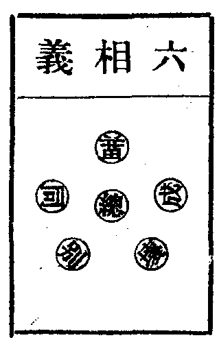
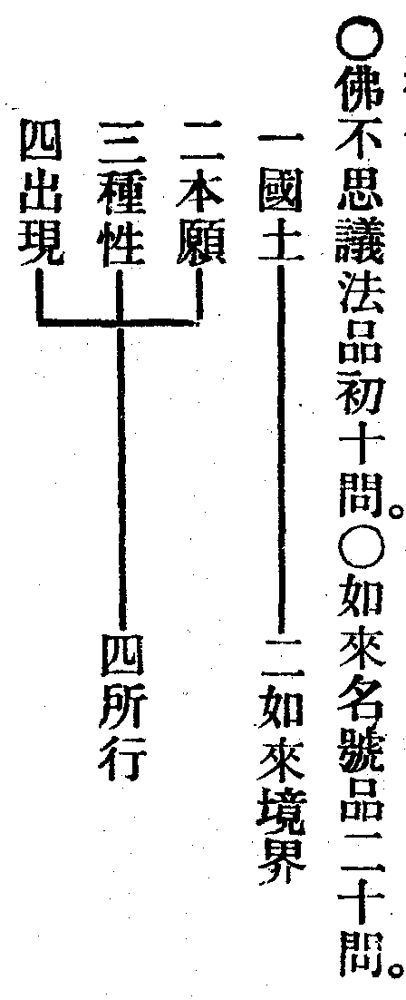
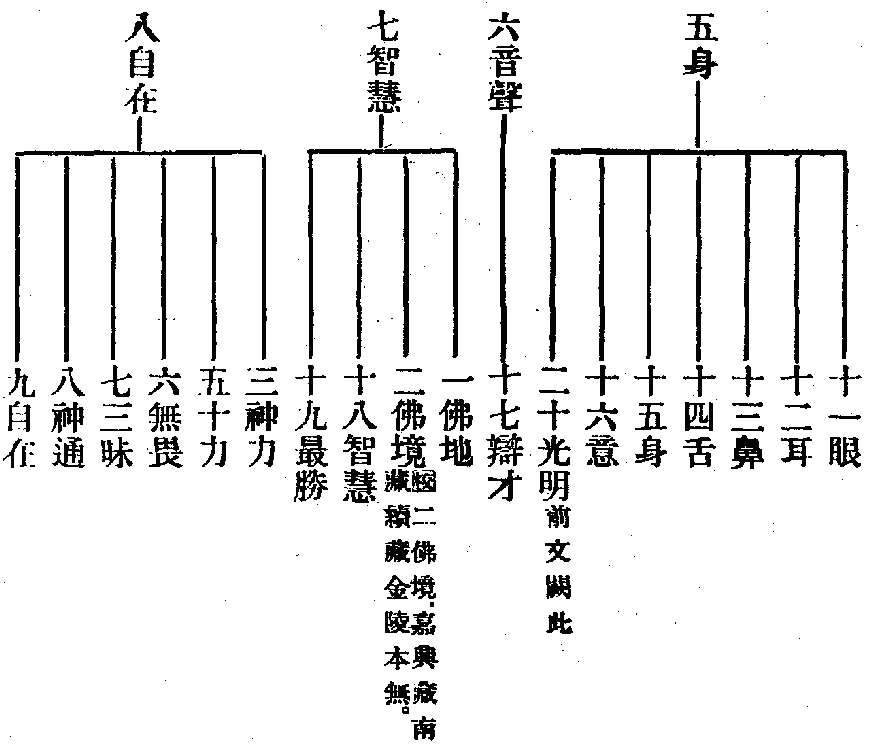
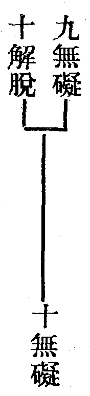

# 华严经疏论纂要(第86卷-第120卷)



> **藏经**：大藏经补编（大藏经补编）　**册次** 第 3 册（B03）　**编号** B0002　**部类** 经疏部　**卷次** 46 卷　**篇幅** 521,152 字

> **卷／品**：0 卷 · 121 品



---



## 目录



  - [华严经疏论纂要序](#华严经疏论纂要序)

  - [补刊华严经疏论纂要序](#补刊华严经疏论纂要序)

  - [浔阳熊官梅沐手谨序](#浔阳熊官梅沐手谨序)

  - [世主妙严品第一](#世主妙严品第一)

  - [世主妙严品第一(之一)](#世主妙严品第一之一)

  - [世主妙严品第一(之二)](#世主妙严品第一之二)

  - [世主妙严品第一(之三)](#世主妙严品第一之三)

  - [世主玅严品第一(之四)](#世主玅严品第一之四)

  - [世主妙严品第一(之五)](#世主妙严品第一之五)

  - [世主妙严品第一(之六)](#世主妙严品第一之六)

  - [世主妙严品第一(之七)](#世主妙严品第一之七)

  - [世主妙严品第一(之八)](#世主妙严品第一之八)

  - [世主妙严品第一(之九)](#世主妙严品第一之九)

  - [世主妙严品第一(之十)](#世主妙严品第一之十)

  - [如来现相品第二(之一)](#如来现相品第二之一)

  - [如来现相品第二(之二)](#如来现相品第二之二)

  - [普贤三昧品第三](#普贤三昧品第三)

  - [世界成就品第四](#世界成就品第四)

  - [华藏世界品第五(之一)](#华藏世界品第五之一)

  - [华藏世界品第五(之二)](#华藏世界品第五之二)

  - [华藏世界品第五(之三)](#华藏世界品第五之三)

  - [毗卢遮那品第六](#毗卢遮那品第六)

  - [如来名号品第七](#如来名号品第七)

  - [四圣谛品第八](#四圣谛品第八)

  - [光明觉品第九(之一)](#光明觉品第九之一)

  - [光明觉品第九(之二)](#光明觉品第九之二)

  - [菩萨问明品第十(之一)](#菩萨问明品第十之一)

  - [菩萨问明品第十(之二)](#菩萨问明品第十之二)

  - [净行品第十一](#净行品第十一)

  - [贤首品第十二(之一)](#贤首品第十二之一)

  - [贤首品第十二(之二)](#贤首品第十二之二)

  - [升须弥山顶品第十三](#升须弥山顶品第十三)

  - [须弥顶上偈赞品第十四](#须弥顶上偈赞品第十四)

  - [十住品第十五(之一)](#十住品第十五之一)

  - [十住品第十五(之二)](#十住品第十五之二)

  - [梵行品第十六](#梵行品第十六)

  - [初发心功德品第十七(之一)](#初发心功德品第十七之一)

  - [初发心功德品第十七(之二)](#初发心功德品第十七之二)

  - [明法品第十八](#明法品第十八)

  - [升夜摩天宫品第十九](#升夜摩天宫品第十九)

  - [夜摩宫中偈赞品第二十](#夜摩宫中偈赞品第二十)

  - [十行品第二十一(之一)](#十行品第二十一之一)

  - [十行品第二十一(之二)](#十行品第二十一之二)

  - [十行品第二十一(之三)](#十行品第二十一之三)

  - [十无尽藏品第二十二(之一)](#十无尽藏品第二十二之一)

  - [十无尽藏品第二十二(之二)](#十无尽藏品第二十二之二)

  - [升兜率天宫品第二十三(之一)](#升兜率天宫品第二十三之一)

  - [升兜率天宫品第二十三(之二)](#升兜率天宫品第二十三之二)

  - [兜率宫中偈赞品第二十四](#兜率宫中偈赞品第二十四)

  - [十回向品第二十五(之一)](#十回向品第二十五之一)

  - [十回向品第二十五(之二)](#十回向品第二十五之二)

  - [十回向品第二十五(之三)](#十回向品第二十五之三)

  - [十回向品第二十五(之四)](#十回向品第二十五之四)

  - [十回向品第二十五(之五)](#十回向品第二十五之五)

  - [十回向品第二十五(之六)](#十回向品第二十五之六)

  - [十回向品第二十五(之七)](#十回向品第二十五之七)

  - [十回向品第二十五(之八)](#十回向品第二十五之八)

  - [十回向品第二十五(之九)](#十回向品第二十五之九)

  - [十回向品第二十五(之十)](#十回向品第二十五之十)

  - [十回向品第二十五(之十一)](#十回向品第二十五之十一)

  - [十回向品第二十五(之十二)](#十回向品第二十五之十二)

  - [十回向品第二十五(之十三)](#十回向品第二十五之十三)

  - [十地品第二十六(之一)](#十地品第二十六之一)

  - [十地品第二十六(之二)](#十地品第二十六之二)

  - [十地品第二十六(之三)](#十地品第二十六之三)

  - [十地品第二十六(之四)](#十地品第二十六之四)

  - [十地品第二十六(之五)](#十地品第二十六之五)

  - [十地品第二十六(之六)](#十地品第二十六之六)

  - [十地品第二十六(之七)](#十地品第二十六之七)

  - [十地品第二十六(之八)](#十地品第二十六之八)

  - [十地品第二十六(之九)](#十地品第二十六之九)

  - [十地品第二十六(之十)](#十地品第二十六之十)

  - [十地品第二十六(之十一)](#十地品第二十六之十一)

  - [十地品第二十六(之十二)](#十地品第二十六之十二)

  - [十地品第二十六(之十三)](#十地品第二十六之十三)

  - [十地品第二十六(之十四)](#十地品第二十六之十四)

  - [十定品第二十七(之一)](#十定品第二十七之一)

  - [十定品第二十七(之二)](#十定品第二十七之二)

  - [十定品第二十七(之三)](#十定品第二十七之三)

  - [十通品第二十八](#十通品第二十八)

  - [十忍品第二十九(之一)](#十忍品第二十九之一)

  - [十忍品第二十九(之二)](#十忍品第二十九之二)

  - [阿僧祇品第三十](#阿僧祇品第三十)

  - [寿量品第三十一](#寿量品第三十一)

  - [诸菩萨住处品第三十二](#诸菩萨住处品第三十二)

  - [佛不思议法品第三十三(之一)](#佛不思议法品第三十三之一)

  - [佛不思议法品第三十三(之二)](#佛不思议法品第三十三之二)

  - [如来十身相海品第三十四](#如来十身相海品第三十四)

  - [如来随好光明功德品第三十五](#如来随好光明功德品第三十五)

  - [普贤行品第三十六](#普贤行品第三十六)

  - [如来出现品第三十七(之一)](#如来出现品第三十七之一)

  - [如来出现品第三十七(之二)](#如来出现品第三十七之二)

  - [如来出现品第三十七(之三)](#如来出现品第三十七之三)

  - [如来出现品第三十七(之四)](#如来出现品第三十七之四)

  - [离世间品第三十八(之一)](#离世间品第三十八之一)

  - [离世间品第三十八(之二)](#离世间品第三十八之二)

  - [离世间品第三十八(之三)](#离世间品第三十八之三)

  - [离世间品第三十八(之四)](#离世间品第三十八之四)

  - [离世间品第三十八(之五)](#离世间品第三十八之五)

  - [离世间品第三十八(之六)](#离世间品第三十八之六)

  - [离世间品第三十八(之七)](#离世间品第三十八之七)

  - [离世间品第三十八(之八)](#离世间品第三十八之八)

  - [入法界品第三十九(之一)](#入法界品第三十九之一)

  - [入法界品第三十九(之二)](#入法界品第三十九之二)

  - [入法界品第三十九(之三)](#入法界品第三十九之三)

  - [入法界品第三十九(之四)](#入法界品第三十九之四)

  - [入法界品第三十九(之五)](#入法界品第三十九之五)

  - [入法界品第三十九(之六)](#入法界品第三十九之六)

  - [入法界品第三十九(之七)](#入法界品第三十九之七)

  - [入法界品第三十九(之八)](#入法界品第三十九之八)

  - [入法界品第三十九(之九)](#入法界品第三十九之九)

  - [入法界品第三十九(之十)](#入法界品第三十九之十)

  - [入法界品第三十九(之十一)](#入法界品第三十九之十一)

  - [入法界品第三十九(之十二)](#入法界品第三十九之十二)

  - [入法界品第三十九(之十三)](#入法界品第三十九之十三)

  - [入法界品第三十九(之十四)](#入法界品第三十九之十四)

  - [入法界品第三十九(之十五)](#入法界品第三十九之十五)

  - [入法界品第三十九(之十六)](#入法界品第三十九之十六)

  - [入法界品第三十九(之十七)](#入法界品第三十九之十七)

  - [入法界品第三十九(之十八)](#入法界品第三十九之十八)

  - [入法界品第三十九(之十九)](#入法界品第三十九之十九)



---



### 华严经疏论纂要序



大方广佛华严经者．乃毗卢遮那世尊於菩提场始成正觉．七处九会称性顿演如来果海群生性源．及因地六位菩萨修证之轨范也。夫说既称性则是恒常之说。所谓众生说。国土说．三世一切说。处穷法界时彻三际。旨趣宏深．言诠无尽。既非海墨所能书。抑岂贝叶而可悉。但随机见闻广略有异耳。按西域记。此经有三本。上本有十个三千大千世界微尘数偈．一个四天下微尘数品。中本有四十九万八千八百偈．一千二百品。下本有十万偈．四十八品。盖摩诃衍藏是文殊师利与阿难海於铁围山间结集。此经收入龙宫。后龙树菩萨入宫．见上中二本非阎浮提人心力能持．遂记下本归於人间。今传来此方者。晋义熙十四年北天竺三藏佛度跋陀罗所译六十卷。(即支法领所请之本．三十四品八会。)唐证圣元年于阗三藏实叉难陀所译凡八十卷。皆是十万偈之略。以译未尽．故其具本言在遮拘槃国。然经虽未尽．义亦周圆。染指知味．存乎其人。其八十卷经。清凉国师有疏钞．枣栢长者有论．世所盛行。疏钞则穷源极委．章分句析。不唯是此经标准。实乃如来世尊一代时教之标准也。论则广论佛意．会归自心。不唯是此经阃奥．实乃宗门之阃奥也。禅者喜读论而不知疏钞之广大精微。讲者喜读疏钞而不知论之直捷痛快。两者皆失之也。(道霈)年二十五。始遇华严。如贫获摩尼．饥餐王饍。悲喜踊跃．无以云喻。昔人谓亡躯得其死所．竭思有其所归。斯言不我欺也。遂矢志生生依经修证。自是涵泳经文．研穷疏论．餘三十年．粗知门户次第。但疏论异旨．悟者难於和会。文言广博。读者惮於浩繁。於是不揣漫於疏论纂其精要．合注本经。窃欲令大地含生．凡厥有心者。同入斯门。启自心文殊决择妙慧。圆自性普贤恒沙功德。愿周法界．则毗卢是师。果办一生．则善财为友。於一毛端．顿周尘刹．参礼知识。於刹那际．徧穷劫海．津济群生。仰报佛恩．少尽卑愿云尔。今於经前先示大意．凡六段。使稍知梗概。然后临文．则井然有序也。其智力有餘者．自当博阅疏论全书。此但撮其旨要耳。



时康熙七年岁在戊申四月朔旦道霈书於圣箭堂



------



### 补刊华严经疏论纂要序



盖闻荫法云於真际．火宅晨凉。曜慧日於康衢．重昏夜晓。经之为功也鉅矣。余於西来大旨．茫未有知。然曩时薄宦东邦。风尘劳攘。每思息辙田园．仿远法师结社东林．刘遗民．雷次宗．服膺请教故事。手一卷经．修清净业。十有餘年．志焉未逮。自来闽峤．更溢尘氛。欢喜烦恼．一切因缘．枝梧樛葛。然而手握牟尼一串．心证如来。或偶游兰若之中．静聆梵呗。便觉心目间．有白日虚秋清风适夏景象。所谓投清珠於浊水．浊水不得不清．投佛想於凡心．凡心不得不佛者．非虚言也。鼓山了堂法师．心通正觉．力振颓纲．为今日之道林慧远。以华严经疏论纂要示余。余受而读之。知摩诃衍藏．宝出龙宫。清凉国师为之疏。枣栢长者为之论。微显阐幽．为修证之极轨。而七处九会．三十六品之同异指归．钝根者恐未尽晓。故为霖法师以其定慧著疏论纂要。直接清凉枣栢之心传．畅衍毗卢遮那之妙谛。津梁后起．一片婆心。昔龙树以此经为阎浮提人心力能持。况疏之论之．又从而阐发之。真能使身光徧照尽空法界．智光徧照真俗重重法界矣。谓非先觉之传灯．名山之镇宝欤。惟是康熙初年．锓板流传．今百有餘岁。前乎此者护持未善。故其板残缺颇多。而庋板之永通斋及经楼．又灾於风。今之维新者．余所重葺也。了堂法师锐志中兴．百废俱举。尤疚心於是经之缺而商於余。谓毗卢心印．慧命攸关。倘不补刊．心传将绝。余惟人能宏道．法假人传。师欲圆成胜果．护此宝藏。余敢不益励前修．襄兹善举。计缺页二千二百九十有五。缺字九十一万八千有奇。亟属法师敬付剞劂。始事於嘉庆丙寅孟夏。阅岁告成。宝相重圆．真光耀彩。佛力无边．余非敢多以为功也。然窃谓宅生者缘。缘离则废．缘合则成。此举微有补於佛门。虽浪里苹花．雪中鸿爪．亦不得谓之偶然事矣。其偶然者．缘也。其非偶然者．亦缘也。匪云外护．聊结小因。庶几天池露滴．味合百川。华岳尘封．高毋万仞。遂余初志．普彼众生。惺惺相惜．愿大千世界人人无九恼十缠。觉觉皆通．愿极乐国中处处少三毒八难云尔。



------



### 浔阳熊官梅沐手谨序



书刻华严经疏论纂要缘起



(大材)总丱皈依　鼓山先师老和尚座下。忝与为大师同门。而大师亲承衣钵．继主法席。一坐十餘载．大阐宗猷．震动宇内。法缘浩浩．在处建立法幢。闻名覩相．擕幼扶老．皈礼恐后．不啻古佛再世。而(大材)尚作门外汉．惭愧孰甚。然而师友琢磨之功．日渐日深。实未尝一旦敢忘所自。大师虽主持宗门．而平生游泳华严．栖心法界。观其智愿广大．乃与毗卢文殊普贤及诸圣师．声气相同．臭味相似．无间然矣。故四十餘年以来．探讨清凉疏钞．研穷枣栢合论。焚膏继晷．手不释卷。剖大千经卷於一尘之内．收普眼法门於一字之中。七处九会．六相十玄．以及信解行证诸细大法门．莫不澜翻於海口．涌现於毫端．恢恢焉有餘刃矣。然大士以利物为怀。四依以弘经是务。虑疏论部帙重叠。后学难以受持。故十载以来．躬自秉笔。删繁取要．直注本经。命名曰大方广佛华严经疏论纂要焉。一句之下．直彻根源。一字之内．包含无尽。无剩文无遗义。譬如鹅王择乳．狮子咬人。真法海之奇珍．成佛之宝券。自清凉枣栢相传以来．将千有餘载．未有精微广大直截痛快若此者也。吾师岂惟清凉枣栢之功臣．实乃毗卢文殊普贤之嫡胤也。故出现品云。此经珍宝不入一切餘众生手。唯除如来法王真子．生如来家．种如来相诸善根者。佛子．若无此等佛之真子．如是法门不久散灭。何以故。一切二乘不闻此经。何况受持．读诵．书写．分别解说。唯诸菩萨乃能如是。信然哉。由是不揣绵力。首输微赀。请先缮写成书。然后募众刊布．以广法施。蒙师不靳．慨然俞允。乃请王正先熊子伟二名士精心誊录．成兹胜举。起手於康熙戊午夏六月．告竣於庚申夏六月。是役也．皆仗诸圣师慈荫之恩。与此大经冥护之力。永离障缘。顿成巨绩。愿回兹功德．与法界凡有知识者．同游华藏之门．繁兴普贤之行。报莫报之洪恩．酬难酬之微志云尔。



时康熙十九年岁在庚申腊月如来成道日闽富沙桂林菩萨戒弟子谢旌大材盥沐焚香拜题



清凉国师传



国师讳澄观．字大休．会稽人。姓夏侯氏。生於开元戊寅。天宝七年出家。至肃宗二年丁酉受具。即以十事自励曰。体不捐沙门之表。心不违如来之制。坐不背法界之经。性不染情碍之境。足不履尼寺之尘。脇不触居士之榻。目不视非仪之彩。舌不味过午之肴。手不释圆明之珠。宿不离衣钵之侧。从牛头忠径山钦问西来宗旨。授华严圆教於京都诜禅师。至大历三年．代宗诏入内．与大辩正三藏译经．为润文大德。既而辞入五台大华严寺。覃思华严。至建中四年．下笔著疏。先求瑞应。一夕．梦金容当阳山峙．光相颙颙。因以手捧。既觉而喜。以谓获光明徧照之徵。自是落笔无停思。乃以信解行证分华严为四科。理无不包。师每慨旧疏未尽经旨。唯贤首国师颇涉渊源。遂宗承之制疏。凡历四年而文成．为四十卷。又梦身为龙．矫首南台．尾蟠北台．宛转凌虚．鳞鬣耀日。须臾於青冥变百千蜿蜒分散四方而去。识者以为流通之象也。初为众讲之。感景云凝停讲堂庭前之空中。后又为僧叡等著随疏演义四十卷。随文手镜一百卷。丙子十二年．宣河东节度使礼部尚书李诜．备礼迎法师澄观入京。师至。有旨命同罽宾三藏般若翻译乌茶国所进华严后分入不思议解脱境界普贤行愿品梵䇲。帝亲预译场。一日不至．即差僧寂光依僧说欲云。皇帝国事因缘．与欲清净。师承睿旨．翻宣既就．成四十卷。复命制疏解释。后又略其广疏．释末后普贤十大愿一卷别行．谓之别行疏。帝天纵圣明．一览玄论．廓然自得。於是敕有司备礼铸印．迁国师。统天下缁徒。号僧统清凉国师。开成三年三月六日．将示寂。谓其徒海岸等曰。吾闻偶运无功．先圣悼叹。复质无行．古人耻之。无昭穆动静。无纶绪往复。勿穿凿异端。勿顺非辩伪。勿迷陷邪心。勿固牢鬬诤。大明不能破长夜之昏。慈母不能保身后之子。当取信於佛。无取信於人。真理玄微．非言说所显。要以深心体解．朗然现前。对境无心．逢缘不动。则不孤我矣。言讫而逝。师生历九朝盛世。为七帝门师。春秋一百有二。僧腊八十有八。身长九尺四寸。垂手过膝。口四十齿。目光夜发．昼视不瞬。才供二笔。声韵如钟。文宗以祖圣崇仰．特辍朝三日。臣民缟素。奉全身塔於终南山。未几有梵僧到阙。表称於葱岭见二使者凌空而过．以咒止而问之。答曰。北印度文殊堂神也。东取华严菩萨大牙归国供养。有旨启塔。果失一牙。唯三十九存焉。遂阇维。舍利光明莹润。舌如红莲色。赐谥仍号清凉国师玅觉之塔。相国裴休奉敕撰碑。文宗皇帝敕写国师真奉安大兴唐寺供养。御制赞曰。朕观法界．旷閴无垠。应缘成事．允用虚根。清凉国师．体象启门。奄有法界．我祖聿尊。教融海岳．恩廓乾坤。首相二疏．拔擢幽昏。间气斯来．拱承佛日。四海光凝．九州庆溢。敞金仙门．夺古贤席。大手名曹．横经请益。仰师鸿休．保余遐历。爰抒颛毫．式扬茂实。真空罔尽．机就而驾。白月虚秋．清风适夏。妙有不迁．缘息而化。邈尔禹仪．焕乎精舍。



李长者传



长者讳通玄。出唐宗室。不涉世缘．清净自居．以华严为业。身长七尺二寸。疎眉秀目。修髯美茂。首冠桦皮之冠。麻衣博袖．跣足而行。开元二十七年曳杖荷笻至於太原。村名大贤。有高山奴者。尚德慕义。长者迳诣其门。山奴谛瞻神仪．罄折礼接。每旦惟食枣十颗．栢叶饼如匕大者一枚。掩室独处．栖心法界．如是者三稔。复至马氏古佛堂端居十年。一日。囊挈经书．遵道而去。行数里．路逢一虎．当涂驯伏．如有所待。长者语之曰。吾将著论释华严经．可与择一栖止处。遂将经囊挂於虎背。随其所止。於是虎望神福山原．直入三十餘里。於一土龛前．便自蹲住。长者旋收经囊．置於龛内。虎乃屡顾。妥尾而去。其龛莹洁．广袤丈餘。龛四旁旧无泉㵎。长者始来之夕．风雷暴作．拔去一古松．松根之下．涌出一泉甚深．清冽甘美．时人号为长者泉。长者著论．每夕口出白光．以代灯烛。有二天女常为长者汲水焚香供给纸笔。卯辰之际．供诸净馔．历於五年。著论已终．遂尔绝迹。忽一日出山访旧止之里。适值乡人聚族合乐。长者徧语之曰。汝等好住．吾将欲归。众乃罢乐．惊惶相顾。咸皆恻怆．坚请留止。长者曰。借满百年．亦当归去耳。於是众送长者入山。旋踵之顷．岚雾四起．景物不分．众皆惊愕。翌日结伴登山．长者已坐化龛中矣。时当春三月二十有八日。耆旧澘注．轝荷择地於大山之阴．奉藏全身．累石为坟。即今方山逝多兰若是也。至大历九年。有僧广超游兰若中。获长者所著华严论四十卷。十二缘生解迷显智成悲十明论一卷。复有论会释七卷。传写显扬．徧於并汾。广超门人道光．能继师志。肩负二论．游於燕赵．昭示淮泗。凡后代南北学人．悉得参详论文．宗承长者．优入华藏者．超光二比丘之功也。未几。闽福州开元寺沙门志寗．以经论各帙．读者难为和会。乃特稽首诸佛毗卢遮那．一切圣贤．愿垂加护。从第八卷入经．分别经文．将论合於每节之下．使读者开经见论．谓之合论。共成一百二十卷。世所盛行．皆此本也。宋觉范德洪禅师赞曰。须眉如畫颀而美。风神如秋气奇伟。平生归宿东北方。长劳动中寂而止。翛然跣足散衣行。智智用中不乖体。帝王家生得自在。寿量不书绝终始。虎受使令心境空。女为伴助憎爱弃。冠巾传心即俗真。方隅示法即事理。只将枣栢荐斋钵。我来阎浮非著味。自然光明生齿牙。我谈辞章皆实义。佛子授汝以显诀。一言便足超十地。随顺无明起诸有。若不随顺诸有离。圣贤酪生凡乳中。只由观照戒定慧。是谓大士同体悲。令我顿入一切智。作大佛事徧尘刹。华藏界中容顿辔。以空为座礼十身。以愿为舌说千偈。如以花说无边春。如以滴说大海味。稽首世间妙莲华。愿常清净出泥滓。



大方广佛华严经疏论纂要目录



第一卷　悬示(【校】此下原注云序二篇道霈序二纸谢旌缘起二纸案卷首尚有清凉国师及李长者传)  

第二卷　世主妙严品疏论纂要(之一)  

第三卷　世主妙严品疏论纂要(之二)  

第四卷　世主妙严品疏论纂要(之三)  

第五卷　世主妙严品疏论纂要(之四)  

第六卷　世主妙严品疏论纂要(之五)  

第七卷　世主妙严品疏论纂要(之六)  

第八卷　世主妙严品疏论纂要(之七)  

第九卷　世主妙严品疏论纂要(之八)  

第十卷　世主妙严品疏论纂要(之九)  

第十一卷　世主妙严品疏论纂要(之十讫)  

第十二卷　如来现相品疏论纂要(之一)  

第十三卷　如来现相品疏论纂要(之二讫)  

第十四卷　普贤三昧品疏论纂要  

第十五卷　世界成就品疏论纂要  

第十六卷　华藏世界品疏论纂要(之一)  

第十七卷　华藏世界品疏论纂要(之二)  

第十八卷　华藏世界品疏论纂要(之三讫)  

第十九卷　毗卢遮那品疏论纂要  

第二十卷　如来名号品疏论纂要  

第二十一卷　四圣谛品疏论纂要  

第二十二卷　光明觉品疏论纂要(之一)  

第二十三卷　光明觉品疏论纂要(之二讫)  

第二十四卷　菩萨问明品疏论纂要(之一)  

第二十五卷　菩萨问明品疏论纂要(之二讫)  

第二十六卷　净行品疏论纂要  

第二十七卷　贤首品疏论纂要(之一)  

第二十八卷　贤首品疏论纂要(之二讫)  

第二十九卷　升须弥山顶品疏论纂要  

第三十卷　须弥顶上偈赞品疏论纂要  

第三十一卷　十住品疏论纂要(之一)  

第三十二卷　十住品疏论纂要(之二讫)  

第三十三卷　梵行品疏论纂要  

第三十四卷　初发心功德品疏论纂要(之一)  

第三十五卷　初发心功德品疏论纂要(之二讫)  

第三十六卷　明法品疏论纂要  

第三十七卷　升夜摩天宫品疏论纂要　夜摩天宫偈赞品疏论纂要  

第三十八卷　夜摩天宫偈赞品疏论纂要(之餘讫)  

第三十九卷　十行品疏论纂要(之一)  

第四十卷　十行品疏论纂要(之二)  

第四十一卷　十行品疏论纂要(之三讫)  

第四十二卷　十无尽藏品疏论纂要(之一)  

第四十三卷　十无尽藏品疏论纂要(之二讫)  

第四十四卷　升兜率天宫品疏论纂要(之一)  

第四十五卷　升兜率天宫品疏论纂要(之二讫)  

第四十六卷　兜率宫中偈赞品疏论纂要  

第四十七卷　十回向品疏论纂要(之一)  

第四十八卷　十回向品疏论纂要(之二)  

第四十九卷　十回向品疏论纂要(之三)  

第五十卷　十回向品疏论纂要(之四)  

第五十一卷　十回向品疏论纂要(之五)  

第五十二卷　十回向品疏论纂要(之六)  

第五十三卷　十回向品疏论纂要(之七)  

第五十四卷　十回向品疏论纂要(之八)  

第五十五卷　十回向品疏论纂要(之九)  

第五十六卷　十回向品疏论纂要(之十)  

第五十七卷　十回向品疏论纂要(之十一)  

第五十八卷　十回向品疏论纂要(之十二)  

第五十九卷　十回向品疏论纂要(之十三讫)  

第六十卷　十地品疏论纂要(之一)  

第六十一卷　十地品疏论纂要(之二)  

第六十二卷　十地品疏论纂要(之三)  

第六十三卷　十地品疏论纂要(之四)  

第六十四卷　十地品疏论纂要(之五)  

第六十五卷　十地品疏论纂要(之六)  

第六十六卷　十地品疏论纂要(之七)  

第六十七卷　十地品疏论纂要(之八)  

第六十八卷　十地品疏论纂要(之九)  

第六十九卷　十地品疏论纂要(之十)  

第七十卷　十地品疏论纂要(之十一)  

第七十一卷　十地品疏论纂要(之十二)  

第七十二卷　十地品疏论纂要(之十三)  

第七十三卷　十地品疏论纂要(之四讫)  

第七十四卷　十定品疏论纂要(之一)  

第七十五卷　十定品疏论纂要(之二)  

第七十六卷　十定品疏论纂要(之三讫)  

第七十七卷　十通品疏论纂要  

第七十八卷　十忍品疏论纂要(之一)  

第七十九卷　十忍品疏论纂要(之餘讫)  

第八十卷　阿僧祇品疏论纂要　寿量品疏论纂要　诸菩萨住处品疏论纂要  

第八十一卷　佛不思议法品疏论纂要(之一)  

第八十二卷　佛不思议法品疏论纂要(之二讫)  

第八十三卷　如来十身相海品疏论纂要  

第八十四卷　如来随好光明功德品疏论纂要  

第八十五卷　普贤行品疏论纂要  

第八十六卷　如来出现品疏论纂要(之一)  

第八十七卷　如来出现品疏论纂要(之二)  

第八十八卷　如来出现品疏论纂要(之三)  

第八十九卷　如来出现品疏论纂要(之四讫)  

第九十卷　离世间品疏论纂要(之一)  

第九十一卷　离世间品疏论纂要(之二)  

第九十二卷　离世间品疏论纂要(之三)  

第九十三卷　离世间品疏论纂要(之四)  

第九十四卷　离世间品疏论纂要(之五)  

第九十五卷　离世间品疏论纂要(之六)  

第九十六卷　离世间品疏论纂要(之七)  

第九十七卷　离世间品疏论纂要(之八讫)  

第九十八卷　入法界品疏论纂要(之一)  

第九十九卷　入法界品疏论纂要(之二)  

第一百卷　入法界品疏论纂要(之三)  

第一百卷之一　入法界品疏论纂要(之四)  

第一百卷之二　入法界品疏论纂要(之五)  

第一百卷之三　入法界品疏论纂要(之六)  

第一百卷之四　入法界品疏论纂要(之七)  

第一百卷之五　入法界品疏论纂要(之八)  

第一百卷之六　入法界品疏论纂要(之九)  

第一百卷之七　入法界品疏论纂要(之十)  

第一百卷之八　入法界品疏论纂要(之十一)  

第一百卷之九　入法界品疏论纂要(之十二)  

第一百卷之十　入法界品疏论纂要(之十三)  

第一百卷之十一　入法界品疏论纂要(之十四)  

第一百卷之十二　入法界品疏论纂要(之十五)  

第一百卷之十三　入法界品疏论纂要(之十六)  

第一百卷之十四　入法界品疏论纂要(之十七)  

第一百卷之十五　入法界品疏论纂要(之十八)  

第一百卷之十六　入法界品疏论纂要(之十九讫)  

第一百卷之十七　行愿品别行疏钞纂要(之一)  

第一百卷之十八　行愿品别行疏钞纂要(之二)  

第一百卷之十九　行愿品别行疏钞纂要(之三)  

第一百卷之二十　行愿品别行疏钞纂要(之四终)



大方广佛华严经疏论纂要目录(终)



大方广佛华严经疏论纂要悬示卷第一(原本清初刊於鼓山。中经补版．别无他刻。今依补刊本重刊。但略易其行款排列。版心酌标品科。间有正讹考异之处．以【校】字识之。)



五台山清凉国师澄观疏钞　太原方山长者李通玄论　闽鼓山私淑比丘道霈纂要



○经前悬示。疏论各有十门。取其大意。略立六段。一明处会品第。二分经之大科。三显经之宗趣。四判经属圆教。五示圆义分齐。六明所被之机。今初处会品第。



此一部全经。疏分为七处九会。三十九品。论分为十处。十会。四十品。疏论稍殊。意各有在。



【疏】七处九会。三十九品者。



○初会菩提场。普贤菩萨为会主。说毗卢遮那如来依正因果法门。自第一卷至十一卷。共六品经。六品者。世主妙严品。如来现相品。普贤三昧品。世界成就品。华藏世界品。毗卢遮那品。



○第二会普光明殿。文殊师利菩萨为会主。说十信法门。自十二卷至十五卷。共六品经。六品者。如来名号品。四圣谛品。光明觉品。菩萨问明品。净行品。贤首品。



○第三会忉利天宫。法慧菩萨为会主。说十住法门。自十六卷至十八卷。共六品经。六品者。升须弥山顶品。须弥山顶偈赞品。十住品。梵行品。初发心功德品。明法品。



○第四会夜摩天宫。功德林菩萨为会主。说十行法门。自十九卷至二十一卷。共四品经。四品者。升夜摩天宫品。夜摩天宫偈赞品。十行品。十无尽藏品。



○第五会兜率天宫。金刚幢菩萨为会主。说十回向法门。自二十二卷至三十三卷。共三品经。三品者。升兜率天宫品。兜率天宫偈赞品。十回向品。



○第六会他化自在天宫。金刚藏菩萨为会主。说十地法门。自三十四卷至三十九卷。共一品经。一品者。即十地品。



○第七重会普光明殿。如来为会主。说阿僧祇数量法门。及如来随好光明功德及普贤等诸菩萨。说十大三昧等等妙法门。自四十卷。至五十二卷。共十一品经。十一品者。普贤菩萨说十定品。十通品。十忍品。佛说阿僧祇品。心王菩萨说如来寿量品。诸菩萨住处品。(上明差别因)青莲华藏菩萨说佛不思议法品。普贤菩萨说如来十身相海品。佛说如来随好光明功德品。(上明差别果。)普贤菩萨说普贤行品。(明平等因。)说如来出现品。(明平等果。)上自二会来至此。一遍明六位因果。



○第八三会普光明殿。普贤菩萨为会主。说离世间法门。自五十三卷至五十九卷。共一品经。一品者。即离世间品。此二遍明六位因果。



○第九会逝多林。如来善友为会主。有本末二会。初世尊放光现相。答诸菩萨念请。为本会。次文殊师利菩萨从善住楼阁。出往人间。开悟六千比丘。及指善财参五十三知识。为末会。通为入法界品。自六十卷至八十卷。共一品经。一品者。即入法界品。此三遍明六位因果。



【论】十处十会。四十品经者。



○第一会在菩提场。示现初成正觉。凡六品经。同上。



○第二会在普光明殿。说十信位。凡六品经。同上。



○第三会在须弥山顶帝释宫中。说十住位。凡六品经。同上。



○第四会在夜摩天宫。说十行位。凡四品经同上。



○第五会在兜率天宫。说十回向位。凡三品经。同上。



○第六会在他化自在天宫。说十地位。凡一品经同上。



○第七会在第三禅天。说等觉法门。谓之普贤佛华三昧会。此会来文未足。如缨络本业经具云。彼经是化三乘人已。后如来领至菩提树下。却说初成佛时说华严经会次第。计此一会一品。通为十处。十会。四十品经。为此经十十成法。皆圆满故。



○第八会在普光明殿。说十定法门。其定名入刹那际。为刹那是极短促。思虑不及之地。不同三乘别论生灭。如来出世．始终不离刹那际。为此定体．称法界性。更无长短始终。三世总为一际故。不同古人释此会为重会普光明殿。岂可见两度三度重叙普光明殿。即云重会三会。令他作去来之见。如经意者。但以佛自体无作大悲为母。以一切种智为佛。以法无性无所依为时日岁月。以一切众生根器为明镜。佛于一切众生心海。任物自见。各得自法。皆令向善。及得菩提。非是如来有重去重来相故。但明此普光明殿。是如来自性一切智种智之都体也。为依报所居。此刹那际定。是佛一切智种智之法性故。意在总括一切法界众海会等总体。如王宝印．一时顿印。不可作重会去来之见。



○第九会在普光明殿说离世间品者。明从此重起信心发行。修十住。十行。十回向。十地。十定。十通。十忍。乃至如来出现佛果位终。皆悉不离普贤旧行。为如来出现品前三十六品经。是自乘普贤行满。出现品后离世间一品。纯是果后利他普贤恒行。普印十方．无休息也。如善财见慈氏如来已。却令见文殊师利者。明今至果。不离初信之门。便闻普贤名。见普贤身等。普贤身者。即果后普贤之行。此品不同彼古人释此会为三会普光明殿者。以法界门。不可作世情去来之见。如上所说。



○第十会在逝多林。说法界品。明此一会。普含诸会。及十方刹海法界虚空界总之一会。重重无尽。无尽重重。以六相十玄该之。以无思之心照之。可见。



○又云以世主妙严品为一会。以普光殿三会为一会。通前世主妙严品为二会。上升须弥．夜摩．兜率．他化．第三禅为五会。通前两会为七会。法界品祇园人间为第八会。善财大塔庙处为第九会。以虚空法界一切处会为十会。古人云。九会者。为未知有十一地在第三禅说。此经总十法为准。不可说九也。



【评曰】此经处会品第。疏论所以不同者。各有其意。不必轩轾。其普光明殿重会三会之说。在圆融行布之间。疏所以分者。以圆融不碍行布也。论不分前后往来之相．一时顿说者。以行布不碍圆融也。其言似反。其意正合。故疏释升须弥品云。言尔时者。即前二会时。主伴齐徧。演前二会之法也。何须举前二会。欲明前会不散。成后会故。后必带前。合成法界无碍会故一一法会无休息故。后后诸会皆同时故。若散前会。即无后故。所以唯约觉树会者。此为本故。得佛处故。理实第二亦同此徧。若同时徧．何有九会。若有前后．何名同时。应云。即用之体．同时顿徧。即体之用．不坏前后。犹如印文。观此。则疏意尤圆。善得六相之意。不滞一边也。



○二分经之大科。此一部全经。清凉国师疏分为五周四分。而枣栢李长者论。略作十段长科。亦有五种因果徧周义。



【疏】五周四分者。



○一所信因果周。即举果劝乐生信分。谓第一会菩提场。说毗卢遮那依正因果法门。自世主妙严品。至毗卢遮那品。凡六品经。前五品。显如来依正果德。后一品。明佛本因。劝励大心众生。令生欣乐。以起净信。故名所信因果周。亦名举果劝乐生信分。



○二差别因果周。即修因契果生解分。谓第二会普光明殿起。经历忉利。夜摩。兜率。他化自在。说十信。十住。十行。十回向。十地。及重会普光明殿。说十定。至菩萨住处。共六品经。明差别因圆。后佛不思议法。如来十身相海。如来随好光明功德。共三品经。明差别果满。又十定以下六品经。明等觉。佛不思议法品以下三品经。明妙觉。



○三平等因果周。即於前会。说普贤行．如来出现．二品经。明平等因果。前普贤行．明因该果海。次如来出现．明果彻因源。因果不二．故名平等。连上差别二周。通名修因契果生解分。



○四成行因果周。即托法进修成行分。谓第八会三会普光明殿。说离世间法。即成行因果周。普慧云兴二百问。普贤瓶泻二千酬。通明六位因果。自五十三卷。至五十九卷。共一品经。初通明五位之因。后明八相之果。此托圆融法界。进修成行。位位交罗。一位具足一切位。故没其位名。但明圆融之行。故名托法进修成行分。



○五证入因果周。即依人证入成德分。谓第九会逝多林。说入法界法门。以诸菩萨念请。有三十问。具问如来果海中事。以果海离言。故如来但现相以答。复放光摄受。光中具见所问之事。令其现证。是为本会。次文殊师利从善住楼阁出。渐往人间大塔庙前。令六千比丘顿证。次指善财童子南询。参五十三知识。通名末会。及善财末后见普贤身。入普贤菩萨一毛孔中。顿圆旷劫之果。故前三十八品。但该罗六位因果。令生信．发解．依之起行造修。至此。方为证入。故云依人证入成德分。若无实证。则前解行。俱为虚设。故以证终。



【论】十段长科者。



○一明始成正觉。即世主妙严品是。



○二明举果劝修。即现相品已下。至毗卢遮那品。总五品经是。及前世主妙严品亦是。乃是举佛所成之果。劝令人修。



○三明以果成信。即从佛名号品已下。至贤首品。六品经是。亦通取前世主妙严品已来总是。便以十个智佛以为自心之果。以不动智佛为首。明自心智。随分别性。无所动故。



○四明入真实证。从升须弥山顶品已下六品经是。以十住为体。住佛智慧家故。



○五明发行修行。从夜摩天宫已下四品经是。以十行为体。行佛行故。



○六明智悲相入。从升兜率天宫品已下三品经是。以十回向为体。体圆真俗。成大悲故。



○七明蕴修成德。他化自在天中。十地一品经是。蕴修前三法。令惯习成就故。



○八明利生自在。从十定品已下。至离世间品。总十二品经是。以十地中蕴德成功。十一地利生行满。方名法行圆满佛。於始於终．无作体性．不移毫念。为以法界圆明大智之性。为十住见道之初。无时念故。三世无性故。总一时故。此非情识所知。唯智会故。



○九诸贤寄位。即已上六位诸菩萨。并佛出现品亦是。皆从性海大智境界中。方便出现其身。寄位成十信。十住。十行。十回向。十地。及等觉位十一地法门。令凡夫信入。倣学依迹。不迷其事。



○十明令凡实证者。以法界性中。安立十信等六位进修方便行。不离体用。不坏方便。其智弥高。其行弥下。逐根行满。故名进修。随力堪能。安立诸位。随位知行。令不迷因果。使学者善明总别．依位成功。不滞始故。不离初故。即如下文善财等众。优婆塞。优婆夷．童子．童女．各列有五百。具明十住。十行。十回向。十地。十一地。五位。一位有十。通为五百。如六千比丘。通信亦不退。总云六千。一万诸龙。以明万行。如是之众。并是凡夫。皆信是法界佛果智门故。而登十住十地诸位。故名令凡实证。



【评曰】疏论分经。大意皆同。论唯第九诸贤寄位一科。重收前六位。谓已上六位诸菩萨。并佛出现。是从性海大智境界中。方便出现其身。寄位成十信等。令凡夫信入。倣学依迹．不迷其事。与疏不同。愚谓六位法门。乃三世诸佛修行成道之成式。亦是毗卢遮那如来因地修证之门。前菩提场一会。既举其所成之果第二普光明殿已下诸会。明信住行向地等位。乃示其由因至果之迹。离世间一品。则明其诸位之行。而法界一品。举善财一人。经历诸位．一生顿证。令大心凡夫．见贤思齐。直下承当。依法修证也。



【论】此一部之经。总有五种因果徧周义。



○一示成正觉因果徧周。即世主妙严品是。通下五品经总是。



○二进修因果徧周。从佛名号品已下。十信。十住。十行。十回向。十地位中。共二十品经是。



○三定体徧周。即十定。十通。十忍等品是。



○四行海徧周。即普贤行品。离世间品是。



○五法界不思议大圆明智海徧周。即法界品是。以此一部之经。五品之内。品初皆有尔时世尊在摩竭提国以为品首者。明此五法。是一时．一法界．一刹那际．一体用．一切诸佛一共同之法。如是之法。不离十定之中刹那际。降神。入胎。示现成佛。入涅槃。不离一刹那际。更无移也。



【评曰】五周之义。疏论稍殊。各有所主。大旨无乖。读者详之。



○三显经之宗趣。



【疏】语之所尚曰宗。宗之所归曰趣。一切诸经。各自有宗。然楞伽云。一切法不生。不应立是宗者。斯言遣滞。若无宗之宗。宗说兼畅。今此经者。以法界理实缘起因果不思议为宗。而法界等言。诸经容有。未显特异。故以不思议贯之。则法界等皆不思议。故为经宗。所以龙树指此经为大不思议经。斯良证也。净名但明作用不思议解脱。盖是一分之义。未显法界融通等不思议。故不同也。其中释义有四门。第一别开法界以成因果。谓普贤法界为因。遮那法界为果。是故因果不离理实法界。第二会融因果以同法界。第三法界因果．分明显示。第四法界因果．双融俱离。性相混然．无碍自在。已上四门．各有十义五对。互为宗趣。具如疏明。上之四门。初一即体之用。次一即用之体。三即体用双显。四即体用镕融。又初一即因果缘起。次一即理实法界。三即双明。后一即不思议。既以第四融前。则四门一揆。



【论】此经名毗卢遮那大智法界本真自体寂用圆满果德法报性相无碍佛自所乘为宗。法华云。乘此宝乘。直至道场。此经云。有乐求佛果者。说最胜乘。上乘。无上乘。不思议乘等。是为令初心者。志乐广大。还得如来大智之果。与自智合一无二故。此经宗趣．甚深难信。若有信此经中如来大智境界佛果法门而自有之。胜过承事十佛刹微尘数诸佛．经於一劫．所有功德。贤首品颂云。一切世界诸群生。少有欲求声闻乘。求独觉者转复少。趣大乘者甚希有。趣大乘者犹为易。能信此法倍甚难。为此经宗趣。说入佛果．不逾刹那。但隔迷悟。说无量劫．不移一时。说从凡夫地创见道时。因果一时．无前后际。不见未成佛时。不见成正觉时。不见烦恼断。不见菩提证。毕竟不移毫念。修习五十位满。一切种智．悉皆成就。总别．同异．成坏．一时自在。皆非世情所见。是故难信也。其所信者。如经下文。十信之位。金色世界．不动智佛。上首菩萨名文殊师利。此云妙德。云金色者。明白净无垢。即法身之理。不动智佛者．即理中智也。一切凡圣。等共有之。故云一切处文殊师利。一切处金色世界。一切处不动智佛。今之信者。当信自心无依住性妙慧解脱．是自文殊。於心无依住中。无性妙理．有自在分别．无性可动．名不动智佛。理智无二．妙用自在。是故一切诸佛。从此信生。故号文殊为十方诸佛之母。亦号文殊为童子菩萨。为皆以信为初生故。信心成就。即以定慧观智力印之。一念相应。名十住初心。便成正觉。取能行行处。号曰普贤。取妙慧无依处．号曰妙德。取善能分别知根之智．号之为不动智佛。且能信处．号曰信心。自契相应。名为住心。为住佛所住妙慧解脱．相尽无生法故。若心外有佛．不名信心。名为邪见人也。一切诸佛皆同自心。一切众生皆同自性。性无依故．体无差别。以此同体妙慧。知诸佛心。及众生心。应如是信解。不自欺诳。是故此经宗趣。为大心众生入佛根本大智佛果。一念契真．理智同现．即名为佛。为法界道理。见则无初中后故。是故法华经。为回三乘劣解者。令龙女非器．刹那成佛。明信心广大．非权施设。所修实教．不迂滞故。言龙女年始八岁者。表今生始学。非旧学故。言畜生女者。明非过去积修。乃此生所信法门．理直无滞故。法界体性。非三世收。一念应真．三世情尽。智无出没．即佛果故。为劣解众生．兴度八相等事。娑婆世界举众遥见龙女即往南方无垢世界成佛者。解云。南方者。为明为正。以主离故。离为明。为日。为虚无。即无垢也。举众遥见者。明三乘权学。信而未自证。故言遥见。夫法界一真。自他相彻。若当自得。焉得称遥见。此经即令善财一生得佛。解云。一生者。从凡夫地起信之后。十住初心契无生也。即任法界智生。非业生也。至文广释。今且略明此经宗趣佛果法门竟。博达君子。可试思焉。



【评曰】此经宗趣。疏折衷诸家。以法界理实缘起因果不思议为宗。而论於法界之上。加毗卢大智之言。而法界下。加体用法报性相无碍等言。与疏法界缘起不思议之义．其意大同。但疏中广明法界缘起．义甚玄妙。而论令大心众生。於此经中自信如来大智境界佛果法门．本自有之。金色世界．明白净无垢法身之理。不动智佛．即理中智。自心无依住妙慧。是自文殊。凡圣共有。故云一切处文殊师利。一切处金色世界。一切处不动智佛。意尤痛切。读者毋忽。



○四判经属圆教。



【疏】。以义分教。教类有五。即贤首所立。一小乘教。二大乘始教。三终教。四顿教。五圆教。初即天台藏教。二始教者。亦名分教。以深密第二第三时教。同许定性无性．俱不成佛。故今合之。总为一教。此既未尽大乘法理。故立为初。有不成佛。故名为分。三终教者。亦名实教。定性二乘．无性阐提。悉当成佛。方尽大乘至极之说。故立为终。以称实理。故名为实。四顿教者。但一念不生．即名为佛。(达摩碑云。心有也。旷劫而滞凡夫。心无也。刹那而登正觉。下经云。法性本空寂。无取亦无见。性空即是佛。不可得思量。)不依地位渐次而说。故立为顿。如思益云。得诸法正性者。不从一地至於一地。不同於前．渐次修行。不同於后．圆融具德。故名为顿。顿诠此理。故名顿教。天台所以不立者。以四教中皆有一绝言故。今乃开者。顿显绝言。别为一类离念机故。即顺禅宗。(达摩以心传心。正是斯教。若不指一言以直说即心是佛。心要何由可传。故寄无言之言。直诠绝言之理。教亦明矣。是故禅宗。不出顿教也。)五圆教者。明一位即一切位。一切位即一位。是故十信满心。即摄五位成正觉等。依普贤法界。帝网重重。主伴具足。故名圆教。如此经说。(圆义分齐中广明。)



【论】中广引东土西天诸家立教讫。乃云。通玄自参圣教。随己管窥。以述意怀。用呈后哲。准其教旨。略立十种教。总该佛日出兴始终教意。何者为十。第一时说小乘纯有教。第二时说般若破有明空教。第三时说解深密经．和会空有．明不空不有教。第四时说楞伽经。明契假即真教。第五时说维摩经。即俗恒真教。第六时说法华经。明引权归实教。第七时说涅槃经。令诸三乘舍权向实教。第八时说华严经。於刹那际。通摄十世圆融。无始终前后通该教。第九共不共教。(谓同闻异解。)第十不共共教。(谓华严会上。十方云集。诸来菩萨。及天龙八部等。各各差殊。同得闻毗卢遮那果德法门。具同具别．圆融自在。)如是十教。总是如来於本法界．一刹那际．一时．一声．顿印如响。随诸众生自分根力渐顿不同。是故于今。以圆数故。略分十种教门。用彰进修解行差别。



【评曰】论立十种教。总依如来无三世智海．一刹那际一时顿说。由根不同．差别自生。正是华严圆顿教旨。虽别是一家之论。与诸古德所立。大旨无违。今录其条目于此。以备参考。广释如论。



○五示圆义分齐。



【疏】已知此经．总属圆教。未知圆义分齐云何。然此教海宏深．包含无外。色空交映．德用重重。语其横收．全收五教。乃至人天．总无不包。方显深广。其犹百川不摄大海。大海必摄百川。虽摄百川．同一咸味。故随一滴．逈异百川。前之四教．不摄于圆。圆必摄四。虽摄于四．圆以贯之。故十善五戒．亦圆教摄。尚非三四。况初二耶。斯则有其所通。无其所局。故此圆教。语广．明无量乘。语深．唯显一乘。一乘有二。一同教一乘。同顿同实故。二别教一乘。唯圆融具德故。以别该同．皆圆教摄。今明别教一乘。略显四门。一明所依体事。(即事法界。)二摄归真实。(即理法界。)三彰其无碍。(即事理无碍法界。)四周徧含容。(即事事无碍法界。)各有十门．以显无尽。初中十者。一教义。(教即能诠。即前五教。乃至香光等。义即所诠。即五教等一切义理。)二理事。(理．即生空所显。二空所显。无性真如等理。事．即色心身方等事。)三境智。(即五教所观之境．能观之智。总收不出二谛．二智。别即小乘四谛涅槃为境。无漏净慧为智。及他心等十智。始教亦通四谛．二谛等为境。加行根本后得等智。终教则是三谛等境。权实无碍等智。顿教则无境为境。绝智为智。圆教则无尽之境。无尽之智。)四行位。(五教修行不同。得位差别。位通因果。)五因果。(自互不通。如七方便等为因。须陀洹等为果。等觉已下皆因。妙觉为果等。)六依正。(依即国土。正即佛身等。)七体用。(体即法报等。用则应化等。)八人法。(人则觉者等。法则菩提等。)九逆顺。(逆则婆须无厌等。顺则观音正趣等。)十应感。(应即赴感佛菩萨等。感即当机菩萨众生等。各随五教以辨差别。已上十对。总相该收。为十玄所依体事。若以义取。随一事上即有十对。故下但约一尘。即具十对。上明所依体事竟)



○第二摄归真实者。即真空绝相。经云。法性本空寂。无取亦无见。性空即是佛。不可得思量。亦有十义如法界观。(杜顺和尚法界观中。总有三观。一真空绝相观。二事理无碍观。三周徧含容观。即今疏后之三门。摄归真实．即真空绝相。於中自有四句十门。一会色归空观。二明空即色观。三色空无碍观。四泯绝无寄观。此为四句。前二各四。故为十门。具如法界观。上摄归真实竟。)



○第三彰其无碍。然上十对．皆悉无碍。今且约事理．以显无碍。亦有十门。一理徧於事门。(谓无分限之理。全徧有分限事中。故一一纤尘．理皆圆足。理不全徧。则理可分。事不全摄。则事不即理。如一纤尘。事事皆尔。正徧此时。不妨餘徧故。亦非餘处无理．全此全彼。亦非二理。)二事徧於理门。(谓有分之事。全同无分之理故。一小尘．即徧法界。以事无别体。还如理故。若不全同．则不如理。然相徧二门．超情难见。何者。谓事既有分。理即无分。如何得徧。若尘徧法界。尘应非小。理徧同事。应如小尘。今明由事与理．有非一非异义故。以非异故．全同。以非一故．不坏分无分。则事理两分。如海之波。一波全徧大海。以同海故。大海全在小波。以海无二故。全在一波。亦全在诸波。同一海故。)三依理成事门。(事要因理成者。以诸缘起。皆无自性故。由无性理。事方成故。故中论云。以有空义故。一切法得成。又离真心。无别体故。)四事能显理门。(谓由事揽理成。故事虚而理实。以事虚故。能显实理。事若有实。实理则隐。以事虚故。全事中之理．挺然显露。如波相虚。令水现也。)五以理夺事门。(谓事既全理。则事尽无遗。如水夺波。波相全尽。)六事能隐理门。(谓真理随缘而成事。遂令事显理不现也。如水成波．动显静隐。)七真理即事门。(谓凡是真理．必非事外。以是法无我理故。空即色故。理即是事。方为真理。)八事法即理门。(谓缘集必无自性。举体即真故。上之二门．正明二谛不相违义。)九真理非事门。(谓即妄之真．异于妄故。如湿非动。)十事法非理门。(谓即真之妄．异于真故。如动非湿。上七八二门．明事理非异。九十二门．明事理非一。故为无为。非一非异。第四回向云。於有为界示无为法。而不灭坏有为之相。於无为界示有为法。而不分别无为之性。)上之十事。同一缘起。故云无碍。约理望事。有成(依理成事。)有坏。(以理夺事。)有即(真理即事。)有离。(真理非事。)事望于理。有显(事能显理。)有隐。(事能隐理。)有一(事法即理。)有异。(事法非理。)逆(夺事非事。)顺(成事即事。)自在。(欲成即成．欲坏即坏。)无障无碍。(成不碍坏。坏不碍成。显不碍隐。隐不碍显。故云无碍。)同时(正当成时。即是坏等。故得同时。)顿起。(四对皆无前却。故云顿起。)深思。令观明现。以成理事圆融无碍观也。



○第四周徧含容。即事事无碍。且依古德。显十玄门。於中文二。先正辨玄门。二明其所以。今初。一同时具足相应门。(如海一滴。味具百川。以是总故。冠於九门之初。经云。一切法门无尽海。同会一法道场中。又云。华藏世界所有尘。一一尘中见法界。一尘既尔。法法皆然。)二广狭自在无碍门。(别中先辨此者。是别门之由。由上事理无碍中。事理相徧故。生下诸门。且约事如理徧故广。不坏事相故狭。故为事事无碍之始。七十六经摩耶夫人云。善男子。我身形量。虽不逾本。然其实已超过世间。量同虚空。悉能容受十方菩萨受生庄严宫殿。此文即广狭自在也。如一尺之镜。现千里之影。)三一多相容不同门。(由广狭无碍．所徧有多。以己望多。故有一多相容。相容则二体俱存。但力用交彻耳。如一微尘。舒己徧入一切法中。即摄一切令入己内。舒摄同时。无障无碍。一尘既尔。尘尘互摄。亦复如是。华藏偈云。以一刹种入一切。一切入一亦无餘。体相如本无差别。无等无量悉周徧等。即其文也。如一室千灯。光光涉入。)四诸法相即自在门。(由此容彼。彼便即此。由此徧彼。此便即彼。故有相即门。如一微尘废己同他。举体全是彼一切法。而恒摄他同己。令彼一切即是己体。一多相即．混无障碍。此约有体无体。故言废己。废己。即无己体也。同他。他有体也。如金与金色。不相舍离。)五秘密隐显俱成门。(由互相摄。则互有隐显。谓摄他他可见。故有相入门。摄他他无体。故有相即门。摄他．他虽存而不可见。故有隐显门。经云。东方入正受。西方从定起等。东方入定为显。西方定起为隐。以但见入定。不见起故。然此三门．皆由相摄而有。相入．则如二镜互照。相即．则如波水相收。隐显．则如八日月。隐显同时。)六微细相容安立门。(由此摄他．一切齐摄。彼摄亦然。如琉璃瓶。盛多芥子。隔瓶顿见。故有微细相容门。十回向云。一毛孔中悉明见。不思议数无量佛。一切毛孔皆如是。普礼一切世间灯。即其文也。)七因陀罗网境界门。(由互摄重重。故有帝网无尽。如天帝殿．珠网覆上。一明珠内．万像俱现。珠珠尽然。又互相现影。影复现影。重重无尽。故千光万色。虽重重交映。而历历区分。亦如两镜互照。重重涉入。传曜相写。递出无穷。)八托事显法生解门。(由如帝网．一即一切。故有托事显法门。如见一花叶。即是见无尽法界。非是托此别有所表。下云。此花盖等．从无生法忍之所生起等。故擎拳竖指。触目皆道。)九十世隔法异成门。(由上八皆是所依。所依之法既融。次辨能依。能依之时亦尔。十世者。离世间品云。过去说过去。过去说现在。过去说未来。现在说过去。现在说平等现在说未来。未来说过去。未来说现在。未来说无尽。九世摄归一念。故云十世。三世区分。名为隔法。而互相在。即是异成。如一夕之梦。经於数世等。)十主伴圆明具德门。(由法法皆然。故随举其一。则便为主。连带缘起。便有主伴。以此圆教。理无孤起。必摄眷属。如现相品。佛眉间出胜音菩萨。与无量诸眷属俱出。即人眷属。佛放眉间光明。无量百千亿光明以为眷属。即光明眷属。又法界修多罗。以佛刹微尘数修多罗以为眷属。即法眷属。故随一一皆有眷属。眷属即伴。故证主伴。如长空明月。列宿围绕。万器百川。星月炳现。)此上十门．同一缘起。无碍圆融。随举一门．即具一切。(如一事尘具此十门。而具餘教等十门。则为百门。事法既尔。餘教义等亦然。则为千门。若重重取之。亦至无尽。如一千钱。共为缘起。一钱为首。则具一千。餘亦如是。则有千千。千千之中。随取其一。亦具千千。故至无尽。於此十门．圆明显了。则常入法界重重之境。)



○二明德用所以。问。有何因缘。令此诸法．得有如是混融无碍。答。因广难陈。略提十类。一唯心所现故。二法无定性故。三缘起相由故。(有十门。)四法性融通故。(亦具十门。)五如幻梦故。六如影像故。七因无限故。(谓诸佛菩萨因中常修缘起无性观。今所起果。具斯无碍。)八佛证穷故。(由冥真性。得如性用。)九深定用故。(海印三昧。)十神通解脱故。(由十通．及不思议解脱。)由上十因。令前教义等十对。具上同时等十门。以为别教一乘义之分齐。



十地论云。一切所说十句中。皆有六种差别相门。以显缘起圆融之法。勿以阴界入等事相执取。言六相者。总相。别相。同相。异相。成相。坏相。一总相者。谓一含多德故。二别相者。多德非一故。三同相者。多义不相违故。四异相者。多义不相似故。五成相者。由此诸义．缘起成故。六坏相者。诸缘各住自性。不动移故。亦如梁等。共成一舍。总则一舍。别则诸缘。同则互不相违。异则诸缘各别。成则诸缘办果。坏则各住自法。餘一切十句。皆应随义类知。



【评曰】缘起之法。不起则已。起则圆融。十玄六相．其义一揆。其舍喻。详如贤首教义分齐所解。见初地。



【论】教义差别．亦有十门。一佛日出兴教主别。二光明表法现相别。三问答所诠主伴别。四所示因圆果满别。五地位所行行相别。六重令善财证法别。七明六位菩萨来众别。八明所施法门理事别。九与诸三乘得果别。十所付法藏流通别。具如论广释。



【评曰】疏论发明经中圆义。最为详尽。不能具引。有志入斯广大法门者。宜博览深思焉。



○六所被之机



【疏】夫教因机显。离机无言。上说义理宏深。未委被何根器。若明能应者。十身圆音。今直彰所被。通有十类。前五拣非器。后五彰所为。前中一无信非器。以闻生诽谤。堕恶道故。二违真非器。依傍此经以求名利。不净说法。集邪善故。三乖实非器。谓如言取文。超情至理不入心故。上三皆是凡愚。故下文云。此经不入餘众生手。四狭劣非器。谓一切二乘。出现品云。一切二乘．不闻此经。何况受持。故虽在座．如聋如瞽。五守权非器。谓三乘共教诸菩萨等。随宗所修行布行位。不信圆融具德之法。故下经云。设有菩萨。无量亿那由他劫行六波罗蜜。不闻此经。或时闻已。不信不解。不顺不入。不得名为真实菩萨故。后五显所为中。一正为。谓是一乘圆机。故出现品云。此经不为餘众生说。即通指前五。唯为大乘不思议乘菩萨说。即正为之机。谓一运一切运．圆融行位．即深不思议。又能徧达诸教．即广不思议。故文云。非餘境界之所知。普贤行人方得入等。二兼为。谓即时虽未能悟入。而能信向成种。如出现品食金刚喻。故地狱天子。十地顿超。大海劫火．不能为障。约未悟人．故名为兼。(十地品偈云。虽在海水劫火中。堪受此法必得闻是也。)三引为。即前权教菩萨。不受圆融之法故。十地之中寄位显胜。借其三乘行布之名。彼谓同于我法。后因熏习。方信入圆融。以离此普法．无所归故。权教极果。无实事故。四者权为。即是二乘。谓既不闻．况于受持。故诸菩萨权示声闻。或在法会而盲聋。彰其绝分。或示在道而启悟。知可回心。五远为。谓诸凡夫．外道．阐提．悉有佛性。今虽不信。后必当人。故出现品云。如来智慧大药王树。唯除二处．不能为作生长利益。所谓二乘。堕无为坑。及坏善根非器众生。溺大邪见贪爱之水。然亦于彼．曾无厌舍。前三非器．是溺邪见。第四非器．是堕深坑。故皆拣之。今四及五．明佛无厌舍。故示而诱之。熏其成种。又彼品中。明不信毁谤。亦种善根。谓谤虽堕恶。由闻历耳。终醒悟故。又云。如日亦与生盲作利益故。又如大海潜流喻中。明无不具有如来智慧故。又破尘出经卷喻中。若除妄想。皆见佛智故。此皆明有自性住性。即是所为。况法性圆融。感应交彻。无有一法而非所被。



【论】此经法门付嘱何人者。谓付嘱大心凡夫。如来出现品云。佛子。此经珍宝。不入一切餘众生手。唯除如来法王真子。生如来家．种如来相诸善根者。佛子。若无此等佛之真子。如是法门．不久散灭。何以故。一切二乘．不闻此经。何况受持。读诵。书写。分别解说。唯诸菩萨。乃能如是。解云。生如来家者。自觉自身法身根本智。与佛真性。性相平等。同无性味。混然法界．自他情尽。唯佛智慧．明彻十方。无性无依．无生死性。名为生在佛家。以自体无作平等悲智力故。绍隆正法。统治众生。随所应作．以法调伏。令诸众生。差生死业。所有一切安乐之法。皆悉乐之。是则名为持佛家法。又云。种如来相诸善根者。解云。证佛法身．性同法界。同佛悲智。如是信修。理事不殊。性相平等。如是学者。种如来相。同佛善根。不同权教。付嘱三乘声闻菩萨。又三乘之教。多付嘱诸圣。及未生佛家诸凡夫。此经付嘱最上大心凡夫。唯求如来不思议乘生佛家者。若无大心凡夫。此经当灭。何以故。为此经难信。设有圣说。凡夫不信不证。此经当灭。若圣位菩萨。有一切佛世界微尘数。如来何虑此经散灭。当知如来意者。令诸大心凡夫而起信修。得生佛家。不念已齐佛位诸菩萨众。诸有行者。应如是知。



【评】疏明所被之机十类。前五拣非器。后五彰所为。而所为之中。其引为。权为。远为。皆前之所拣。一切收尽。更无遗餘。可见此法门．无一人而非其所被。广大无尽．不可思议。论中则谓此经不付嘱入圣位诸菩萨。唯付嘱最上大心凡夫。求如来不思议乘生佛家者。若无大心凡夫。此经当灭。此言尤为痛切。有志入圆顿法门者。应如是知。如是担荷。不然。则虽终日读诵。与在座聋瞽者。何以异乎。



○经题品目。(二)先解经题。



大方广佛华严经



【疏】释此经题．先略后广。略中此七字有六对。一经字是教。上六是义。即教义一对。二严字是总。上五是别。即总别一对。三华为能严。上四皆所严。即能所一对。四佛是所严所成之人。上三皆所严之法。即人法一对。五广者是用。上二皆体。即体用一对。六方者是相。大者是性。即性相一对。故此七字。即七大性。大者．体大。方者．相大。广者．用大。佛者．果大。华者．因大。严者．智大。经者．教大。则七字皆大。七字皆相等。今各以二义释之。一大字体大者。具常徧二义。徧者。涅槃云。所言大者。其性广博．犹如虚空。下经云。法性徧在一切处。一切众生及国土。三世悉在无有餘。亦无形相而可得。常者。涅槃云。所言大者。名之为常。下经云。法性无作无变易。犹如虚空本清净。诸佛境界亦如是。体性非性离有无。然渊府不可以拟其深妙。故寄大以目之。实则言思斯绝。故下经云。法性不在於言论。无说离说恒寂灭。诸佛境界不可量。为悟众生今略说。二方字相大者。体上恒沙性德．即是相大。具正法二义。并无偏伪．故称为正。皆可轨持．目之为法。故下经云。凡夫无觉解。佛令住正法。诸法无所住。悟此见自身。三广字用大者。用如体故．无不周徧。然亦二义。由体有二义故。一者能包。二者能徧。故下经云。譬如虚空．具含众像。於诸境界．无所分别。又如虚空．普徧一切。於诸国土．平等随入。今用称体。一称体之包．则一尘受世界之无边。二称体之遍．则刹那弥法界而无尽。上之三字。即体。相。用。无有障碍．为所证之法界也。四佛字果大者。亦有二义。一者能觉。佛陀梵言。此云觉者故。二者所觉。即大方广。若别说者。觉上用者．觉世谛也。觉上体者．觉真谛也。觉上相者．觉中道也。三谛相融．三觉无碍。为妙觉也。五华字因大者。亦有二义。一感果华。喻於万行成佛果故。或与果俱。或不与俱。俱如莲华．表因果交彻故。不俱如桃李华。不坏先因后果故。二严身华。喻於神通众相等。必与位果俱故。故下经云。若见花开。当愿众生。神通等法。如花开敷。若见树花。当愿众生。众相如华。具三十二。六严字智大者。亦二义。一以万行饰其本体．即严上大方广。如莹明镜。镜虽本净．非莹不明。二以万行功德．成佛果之人。若琢玉成像。又饰本体．如铸金成像。以行成人．如巧匠成像。七经字教大者。亦二义。谓贯与摄。贯者。贯华严之妙义。摄者。摄法界之海众也。(上略释竟。)次广释者。总有十门。今唯举第三具彰义类一门。以解题中大等七字。谓大等七字。义皆无量。并略以十义释之。然古人亦各十义释其七字。不知以七字更互相释。今明大义。则七字皆大。方则七字皆方。广则七字皆广。佛则七字皆佛等。初明大十义者。一体大。谓若相若用．皆同真性而常徧故。即是大字。涅槃云。所言大者．名之为常。此明体不变易。又云。大者。其性广博．犹如虚空。此明体徧。二相大。谓恒沙性德．无不具故。互相即入．微细重重等。具十玄门。皆其相故。即经方字。方者．法也。三者用大。谓业用普周．如体徧故。即经广字。涅槃云。又大者。能建大义。即是约用。四果大。谓智断依正。普周法界故。即经佛字。五因大。谓发菩提心。起解行愿证。精勤匪懈。成诸位故。即经华字。六智大。谓大智为主．运诸万行。徧严一切．无所遗故。即经严字。七者教大。谓一文一句．无不结通。徧於一切十方三际．重重无尽故。即是经字。八者义大。谓所诠法。尽穷法界。乃至帝网．无所遗故。即总是六字。九者境大。以上法门．普以无尽众生为化境故。十者业大。谓尽三际时。穷法界处。常将此法．利益众生．无休息故。二方十义者。方者。法也。即前十大．皆名为法。谓体法。相法等。三广十义者。广者．多也。用多繁兴。包无不尽故。则前十皆多。即明一徧一切．名之为大。一摄一切．名之为广。亦可反此。四佛十义者。即是十佛。大即法界佛。方即本性佛。广即涅槃佛。及随乐佛。佛即成正觉佛。华即愿佛。及三昧佛。严即业报佛。经即住持佛。总不离心。七字皆是心佛。释十佛义．如八地中。及离世间品辨。五释华十义者。一含实义。表於法界含性德故。二光净义。本智明显故。三微妙义。一一诸行．同法界故。四适悦义。顺物机故。五引果义。行为生因．起正觉故。六端正义。行与愿俱．无所缺故。七无染义。一一行门．三昧俱故。八巧成义。所修德业．善巧成故。九芬馥义。众德住持．流馨弥远故。十开敷义。众行敷荣。令心开觉故。然华有二种。一草木华。喻万行因。然或与果俱。或不与俱。二严身华。通金玉等。喻於神通众相等。唯与果俱。前十义中。一五九十。局於草木。餘通二华。六释严者。即上十华。同严一佛。为严不同．亦是十义。(为严不同者。如以十宝严一金佛。一真珠严。二珊瑚严等。一佛十严。历於十佛。便成百严。约圆融修故。)又上十华。如次严前十佛。即是十义。而总别无碍。(如次者。义同一度成一佛故。总别无碍者。总融上二。行布圆融。二无碍故。)更有十义。一用因严果以成人．是华严佛。由因得果故。二以果严因以显胜。成果之后。令一一因行。皆无际故。三以人严法而显用。谓佛旷劫修因。方显法之体用。故四以法严人以显圆。若不得法之体用。因果不能圆妙故。五以体严用以令周。谓用不得体。不周徧故。六以用严体而知本。若无大用。不显体本之广大故。七以体严相而知妙。谓相若有体。便即入重重故。八以相严体以明玄。体若无相．不显体深玄故。九以义严教超言念。由所诠难思。能诠言离故。十诸因互严以融摄。如禅非智．无以穷其寂。智非禅．无以深其照等。(如上十种释名之义。若约相融。皆持业释。若约当相。皆依主释也。如第一用因严果。是华严之佛故。二即佛之华严故。三即佛华严之大方广。四即大方广之佛华严。五即大之方广。六即方广之大。七即大之方。八即方之大。九即大方广佛华严之经。十即诸因互严。乃含多义。谓施之戒。戒之施。定之慧。慧之定等。前四成对。后一非对。但可大等严经。不可以经严大等。故不成对。又为欲显因互严故。如禅非智无以穷其寂者。举一为式。餘可类取。谓禅无智．但是事定。若得智慧观於心性。为上定故。智不得禅。乃为散善分别慧故。慧若有定。如密室灯。寂而能照。离动分别。成实慧故。所言等者。等餘万行。如施不得戒．非是真施。破戒行檀。非真福故。戒不得施。亦非真戒。悭贪不息。非真戒故。不舍财法。正犯戒故。餘并可知。)七释经十义。一涌泉。(义味无尽。)二出生。(出生诸义。)三显示。(显示诸义。)四绳墨。(辨诸邪正。)五结鬘。(贯穿诸法。)六摄持。(摄持所化。)七常。(常恒之说。)八法。(轨生物解。任持自性。)九径。(众生径路。)十典。(令见闻正故。)



【评】国师以十门解释经题。而具彰义类一门。大方广等七字。各以十义更互释之。倾无餘蕴矣。故余录之。以便好略之机。更前后九门。是乃纵无尽之智辨。穷法界之诠旨。至于摄归一心．泯同平等。则至矣尽矣。所谓唯证相应。名佛华严。智力有餘者。不可不博览而深究之。盖一经之玄极。尽在是也。



○次释品目。



------



### 世主妙严品第一



【疏】世者。时也。即是世间。有三。一器世间．即是化处。二众生世间．即所化机。三智正觉世间．即能化主。主者。君也。即佛及诸王。地神．水神．林神．山神．即器世间主。天王．龙王．夜叉王等．即众生世间主。如来．是智正觉世间主。亦总化上二。徧统前三。故并称世主。妙。谓法门体用．深广难思。即主之所得。严。谓严饰。乃有多义。一器世间严。谓其地坚固等。二众生世间严。谓众海各具法门威德故。三智正觉世间严。谓於一切法成最正觉。三业普周．法门无尽故。所以长行诸王之严．偈颂赞德．皆显严佛。众生不严．不感佛兴。正觉不严．不能为主。器界不严．非真佛处。复由佛严．显遇者有德。众生严．显辅佛超胜。如是互严．亦为妙严。诸经无此广严。但初名序品。今唯明序。已兼正故。广赞诸严．以为华严之由序。(已上疏释经题品目竟。)



【论】释经题品目者。何故名为大方广佛华严经。世主妙严品第一。解云。大者．无方义。方者．法则义。广者．理智徧周义。佛者．智体无依住义。智自在义。华者．徧法界无尽行义。以行能开敷自他果故。华是感果义。开敷义。严是庄饰义。明初发心住位．以十信中有作行华。开敷十住位中妙理智慧果故。复生无作十种行华。常以法行互严。用净自利利他之道故。行为严饰义。世主妙严者。以此初品。有诸神天八部之众。皆为世间主。各将十佛世界微尘数随身部从。或但云无量。来严道场。此为依众成名也。故云世主妙严。又佛及菩萨。皆为世间主故。以能主导众生．总为世间主。亦此初品．总标一部。一部都举。总有二百二十八众。形状不同．各各部类。或言一佛世界微尘。或十佛刹微尘。或言无量。以严海会。故言世主妙严。或以佛福报境界．妙严依正。亦得称为世主妙严。为如来亦为世间主。主导众生故。此为依主得名。品者。均别义。明五位及信心。同异差降。意类别叙。进修生熟。各有条贯．次第分明。令后学者。自识本行．进修不惑。故为品类均别义也。第一者。非是次第前后之第一。为法界门中。无前头在后之次第。皆是一时．无二念。同时显著诸品之第一。一多缘起同时之第一。是名同时具足相应门。一多相容不同门。以十玄门及六相义。通融品名。亦如是可知。不可如情所计。故名第一。(已上论释经题品目竟。)



五台山清凉国师澄观疏钞　太原方山长者李通玄论　闽鼓山私淑比丘道霈纂要



------



### 世主妙严品第一(之一)



○【疏】大科分二。初解经题品目。二正释经文。经题品目。具如前释。今正释经文。准常三分。谓初品为序。现相下。正宗。法界品内．尔时文殊师利从善住楼阁出下。明流通。序中就文分二。初此土序。二结通十方无尽世界序。初中复二。初证信序。后尔时如来道场下。发起序。(【钞】二结通者。文在第五卷末。彼文有三。初结此界。次结华藏内。后结华藏外。)然此二序．广如常解。今但略陈。初证信者。若原其所由．则阿难请问。如来令置。如智度论。(阿难请问者。智论第二云。佛涅槃时。於拘尸那国娑罗双树间北首而卧。一心欲入涅槃。阿难亲属。爱心未除。未离欲心。心没忧海．不能自出。尔时长老阿泥楼豆．语阿难言。汝是守佛法藏人。不应同凡人．自没忧海。一切有为法。是无常相。汝莫忧愁。又佛首付汝法。汝今愁闷。失所付事。汝当问佛。佛涅槃后。我等云何行道。谁当作师。恶性车匿．云何共住。佛经之首。作何等语。如是种种未来要事。应当问佛。阿难闻是事已。心闷少醒。得念道力助。於佛末后所卧床边。以是事问佛。佛告阿难。若今现在。若我过去。依止念处。莫依止餘。乃至广说身受心法。除世间贪爱。又云。从今日后。解脱戒经。是汝大师。如解脱戒经说。身口意业。应如是行。又车匿比丘。如梵天法治。若心软后。应教迦旃延经。即可得道。复次是我三阿僧祗劫所集法宝藏。是藏初首。应作如是说言。如是我闻。一时。佛在某方某国土。某处树林中。是我法门初首。应作如是说。何以故。三世诸佛法。经首皆称是语。今我经初。亦应称此如是我闻一时等语。)若核其所以．意有六焉。一为异外道故。外道经首皆立阿优．以为吉故。此约如是。二为息诤论故。智度论云。若不推从佛闻。言自制作。则诤论起故。今废我从闻．闻从佛来。故经传历代．妙轨不辍。此局我闻。三为离增减过故。佛地论云。应知说此如是我闻。意避增减异分过失。谓如是法。我亲从佛闻。文义决定．非谓传闻。有增减失。四为断众疑故。真谛引律云。结集法时。阿难升座。变身如佛。众起三疑。一疑大师涅槃重起。二疑他方佛来。三疑阿难转身成佛。说此如是我闻．三疑顿断。既言我闻。即非佛明矣。上二义通约信闻。五为生信故。智论云。说时方人．令生信故。此局后四。六为顺同三世佛故。此通六种。然信闻二事。文局初首．义通九会。时主二种．文义俱通。处众二事。文义俱局。随相则尔。约实互融。(然信闻二事下。料拣通局。谓如是我闻．唯经初有。而九会经如是法义．我皆得闻。时主俱通者。会会之初。皆云尔时世尊等。处众俱局者。摩竭非忉利天等。处局。十佛刹菩萨列名异故．新旧菩萨亦不同故．众局。约实互融者。一会即一切会。何有众等而不通耶。)上来略依三分二序。然此经体势少异。今为四分。初举果劝乐生信分。二修因契果生解分。三托法进修成行分。四依人证入成德分。就第一举果分中。或科为十。一教起因缘分。即初一品。二大众同请分。三面光集众分。四毫光示法分。五眉间出众分。已上在第二品内。六普贤三昧分。七诸佛同加分。八法主起定分。九大众重请分。已上在第三品内。十正陈法海分。在后三品内。若以义从文．且分为三。一教起因缘分。二现相下。说法仪式分。三世界成就下。正陈所说分。就初分中。亦分为十。一总显己闻。二一时下。标主时处。三始成正觉．别明时分。四其地下。别显处严。五尔时世尊下。教主难思。六有十佛世界下。众海云集。七从尔时如来道场下。称扬赞德。八尔时如来师子座下。座内众流。九尔时华藏下。天地徵祥。十如此世界下。结通无尽。今初。



如是我闻。



【疏】如是我闻者。谓如是一部经义。我昔亲从佛闻。故佛地论云。谓传佛教者。言如是之事。我昔曾闻。此上总合信闻。若离释者。先释如是。信成就也。智论云。佛法大海。信为能入。智为能度。信者。言是事如是。不信者。言是事不如是。故肇公云。如是者。信顺之辞也。信则所言之理顺。顺则师资之道成。经无丰约．非信不阶。故称如是。有云。圣人说法．但为显如。唯如为是。故称如是。此唯约所诠之理。次真谛三藏云。真不违俗．名之为如。俗顺於真．称之为是。真俗无二．故称如是。此约所诠理事。若华严宗。以无障碍法界曰如。唯此无非为是。二我闻者。闻成就也。将欲传之於未闻。若有言而不传。便是徒设。不在能说。贵在能传。故次明我闻。我．即阿难。闻．谓亲自听闻。云何称我。即诸蕴假者。虽因耳处。废别从总．故称我闻。法虽无我．言语便故。随顺世间．故称我闻。非邪慢心而有所说。若依无相。我既无我。闻亦无闻。从缘空故．而不坏假名。即不闻闻耳。(【钞】无相宗．含於三教。谓始教。顿教。实教。谓若但云我既无我．闻亦无闻．即大乘初门．为始教意。若云能所双寂．无闻不闻．亦无我不我．离念顿显．即顿教意。其从缘空故有二。一者向上。成前二教无我所以。二者．向下。不坏假名。即不闻之闻。为实教意。谓事理无碍故．闻即不闻．无二义故。)若约法性。此经旨趣。传法菩萨。以我无我不二之真我。根境非一异之妙耳。闻无碍法界之法门也。(约法性宗辨。而但明圆教中意。言以我无我不二之真我者。含两经意。一者净名云。於我无我而不二。是无我义。二者涅槃云。无我法中有真我。是故敬礼无上尊。正当今意。即口顺世间。心造真境。真自在我。根境非一异之妙耳者。以根与境．共为缘起。因根说境。因境说根。互相融即。故曰非异。两相历然。故曰非一。斯为妙耳。何所不闻。)然阿难所不闻经。或云展转传闻。或云如来重说。或云得深三昧。自然能通。(阿难下。释不闻难。谓有问言。阿难是佛得道夜生。年满二十。方始出家。年至三十。如来方命以为侍者。自三十年前。如来所说。阿难不闻。何以经初。皆言我闻。故为此答。)上皆就迹而说。实是大权菩萨。影响弘传。如不思议境界经。斯为良证。但随机教别。故见闻不同。(如不思议者。彼经云。尔时复有千亿菩萨。现声闻形。亦来会坐。其名曰。舍利弗。目犍连。乃至云。阿难。提婆达多。跋难陀等。而为上首。皆已久修六波罗蜜。近佛菩提。为化众生。於杂染土。现声闻形。)



○第二标主时处。



一时。佛。在摩竭提国阿兰若法菩提场中。



【疏】主时处者。即三成就。言一时者。时成就也。时者。亦随世假立时分。一者拣异餘时。如来说经。时有无量。不能别举．一言略周。故云一时。如涅槃云。一时佛在恒河岸等。即法王启运。嘉会之时也。亦可机教一时。谓上言如是。言虽当理。若不会时。亦为虚唱。今明物机感圣．圣能垂应。凡圣道交．不失良机。故云一时。佛者。主成就也。具云勃陀。此云觉者。谓自他觉满之者。虽具十号．佛义包含。故偏明之。义见题中。(【钞】佛者下。若言菩提．但称为觉。若云佛陀．此云觉者。然觉有三。一自觉。谓双觉事理。如睡梦觉。如莲华开。此拣凡夫。二者觉他。拣异二乘。三者觉满。拣异菩萨。故云自他觉满之者。若禅观说。亦云离心名自觉。离色名觉他。色心俱离为觉满。以依起信。心体离念。名本觉故。题中有此义释之。)在摩竭下。处成就也。真身无在而无不在。故次辨之。(真身无在下。总显大意。言无在者。体相寂寥。离能所故。无不在者。体圆徧故。故下经云。譬如虚空。徧至一切色非色处。非至非不至。何以故。虚空无身故。如来亦尔。徧一切法。徧一切众生。徧一切国土。非至非不至。何以故。如来身无身故。为众生故。示现其身。又无在即体。无不在即用。体用无碍。故为真身。)摩竭提国者。通举说处。此云无毒害。以国法无刑戮故。表能化法。或云徧聪慧。聪慧之人．徧其国故。表所化机。阿兰若法者。别举说场也。阿兰若者。此云无諠诤。即事静也。法者。所证真理。二障业苦。諠杂斯尽也。事理俱寂。故加法言。菩提场者。菩提云觉。即能证大智圆明究竟也。场者。证菩提之处也。然事处。即天地之中。王舍城之西二百里金刚座上。约法．则万行皆是道场。理智相会之所故。为表所说如所证。故不移其处说之。(为表所说下。释处所以。表自心中所证。非是随宜。故不移证处。)



○第三别明时分。



始成正觉。



【疏】前标一时。未知何时。故今别显。是初成佛时。亦彰大师出现时也。此教胜故。众教本故。在於初时。初言尚总。几日之初。九会之文．同此初不。略为三解。一约不坏前后相说。才成初七。说前五会。第二七日．说十地等。第九一会．乃在后时。以祗园身子。皆后时故。常恒之说．不妨后时。虽能顿说．有所表故。初五信解行愿最在初故。故皆云不离道树。第六会因地证位．居其次深。故无不起菩提树言。法界极证．最在於后故。亦显二乘绝见闻故。虽异处别时．亦不相离。为寄秽土以显净故。须前后耳。若尔。世亲那云．初七不说。但思惟行因缘行耶。世亲才见十地。即为论释。或则未穷广文。或则知见有异。未全尅定。菩提流支．意大同此。(【钞】若尔世亲下。会论文。言思惟行因缘行者。因谓自所得法。缘谓所化之器。欲将己所证法为众生说。名为行因缘行。故法华经云。我所得智慧。微妙最第一。众生诸根钝。著乐痴所盲。如斯之等类。云何而可度等是也。彼思不得一乘机。今思即得一乘机为异耳。)二顺论释。九会皆在二七日后。二七非久．亦名始成。三约实圆融释。皆在初成一念之中。一音顿演。七处九会无尽之文。海印定中．一时印现。(约实圆融。即贤首国师意。)以应机出世．机感即应。应即有说．无非时失。故祗园身子．葢是九世相收。重会之言．亦犹灯光涉入。(故祗园身子下。通妨难。谓有问言。若初成顿说。初成未度身子等众。何处得有五百罗汉。故今答云。九世相收。次有难云。祗园身子等。纵许九世相融。一念一时。何有重会。前时后时。方有重故。故今通云。重会之言。亦犹灯光涉入。如点灯盏。似有后有前。发光之后。光无前后。而相涉入。今重会义。但似灯光。一时之中．不妨两会。法则有重。时不重也。)故法界放光。亦见菩萨徧坐道场。成正觉故。(法界品内．见坐道场。初成正觉。明知法界同初会时。)约佛赴机．无时不说。望器无感．未曾有说。登地恒见常说一味之经。就佛而言。无说不说。若摄方便．皆一乘之印现差别耳。无涯之说。不应局执。(上显时分。)次释成正觉义。约教不同。小乘三十四心断结。五分法身初圆。名成正觉。是实非化。(小乘已下。别明五教。一小乘三十四心者。如婆沙八十二说。俱含根品云。传说菩萨三十四心。便成佛故。言三十四心者。见道一十六心。谓八忍。八智。离有顶贪．有十八念。谓断有顶惑．有九无间．九解脱道。如是十八．足前十六．成三十四。一切菩萨决定先於无所有处．已得离贪。方入见道。不复须断下地烦恼。唯断有顶一地之惑。但三十四心。一坐成佛。五分法身初圆者。即戒。定。慧。解脱。解脱知见。如十藏品。是实非化者。拣异大乘。)大乘之中。约化。八相示成。约报。十地行满．四智创圆．名曰始成正觉。(第二始教也。)据实。即古今情亡．心无初相．名之曰始。无念而照．目之为正。见心常住．称之曰觉。始本无二。目之为成。(第三终教。)约法身自觉圣智。无成无不成。(第四顿教意。言无成无不成者。经云。譬如世界有成坏。而其虚空不增减。一切诸佛成菩提。成与不成无差别。既无有成。何有不成。又体湛寂．故曰无成。不碍随缘．故无不成。即成顿教意。)若依此经。以十佛法界之身云。徧因陀罗网无尽之时处。念念初初．为物而现。具足主伴。摄三世间。此初即摄无量劫之初。无际之初。一成一切成．无成无不成。一觉一切觉．无觉无不觉。言穷虑寂．不坏假名。故云始成正觉。如出现品．及不思议法品广显。摄前诸说。皆一乘之所现也。(第五圆教。言以十佛法界之身云者。即成正觉等十佛。义并如前。言念念初初为物而现者。即体之应。应无尽时。生感即成。念念机感。念念成矣。成既不已。故曰初初。一成一切成者。事事无碍故。故出现品云。如来成正觉时。於其身中。普见一切众生成正觉。故如来成．即众生成矣。况佛佛平等。一切成佛。又於一处成。即一切处成。故十地中第十愿云。愿於一切世界。成阿耨多罗三藐三菩提。不离一毛端处．於一切毛端处。皆悉示现等。又云。如於此处见佛坐。一切尘中亦如是。佛身无去亦无来。所有国土皆明现等。)



【论】从如是我闻下。至如是无量功德。於中有七十一行经。长科为四分。一从如是．我闻．至始成正觉。总明断疑成信分。如是。我闻。一时。佛。在菩提场。始成正觉。总为六句。今言如是者。如。即如佛所言。是者。是佛所说。简非异说。两名相顺。契信不殊。明真是佛说。非阿难自说。亦非魔梵所说。又我闻一句。是阿难从佛所闻。非转转传闻故。亦非是非人所制故。又非如外道经书。青鸟衔来。石崖崩得故。此是断疑成信。又一切法如也。以法体如。所说法者．及法亦如。以法界智．是所闻之智。智亦如故。故言如是。心境不二．方闻佛所说经。若心境有差。不可闻佛所说。亦复不能信顺领受故。我闻者。是法界智之真我。还见法界智之真佛。还闻法界智之真经。总法界智之真人．互为主伴。还化法界之真众生。悟入法界智之真性。故言如是我闻。一时者。依诸古人说。正说法华经时。说金刚经时。非是说餘经时。名为一时。取正说当部经时．名为一时。今此说华严经时．即不尔。即是以法界体。寄言一刹那际。出世及涅槃。以一言音。一时徧周十方国土转法轮时。名为一时。非如上说一时之义。佛者。觉也。觉有二义。一始觉。二本觉。此佛者。觉无始终。三世障尽。名之为佛。不如权教。有出世涅槃。有始终故。又佛者。大智度论中有四义。一名有德。谓婆伽名德。婆名有故。二名巧分别。婆伽名分别。婆名巧故。三名有名声。婆伽名名声。婆名有故。四名能破婬怒痴。婆伽名破。婆名婬怒痴故。又佛地论说有六义。颂云。自在炽盛与端严。名称吉祥及尊贵。如是六种义差别。是故总号婆伽婆。在者。在何处所。在有二义。一指事。二举法。指事者。在摩竭提国。且指其国。二举法者。在何处。在法界。即事即法界。无二故。为法界无中边大小彼此故。又摩竭提者。此云不害国。摩者。云无。竭提者。云害。总云无害国。又云。摩者。不也。竭提者。至也。言其此国。将谋兵勇。邻国不能侵。又摩者。徧也。竭提．云聪慧。此国为多有聪慧人徧其国内故。又云。摩者。大也。竭提者。体也。谓五印土中。此国最大．统摄诸国。故云大体也。又此国王．不行刑戮。其有罪者。送置寒林中。为明佛大悲。以处表德故。阿兰若法。此云寂静处。寂静有二义。一事。二理。一事者。在摩伽陀国尼连河侧沤楼频螺聚落中。去人间五里．一牛吼地。得阿耨多罗三藐三菩提。此处有一万道场神。常在其处。一切诸佛示成正觉．总在其中。表如来万行圆满。中道无偏故。此处是阎浮提之中心故。二理者。即一切法自体静故。即动而常静故。菩提道场者。有二义故。一事。二理。一事者。如前尼连河边。二理者。徧法界也。法界无边。道场亦无边。於一切刹．皆示成佛故。如世间场简秽故。法场治惑故。示现成佛．治众生惑故。此场依主释。为佛在其中现成道故。依主得名。为觉场也。始成正觉者。古今情尽．名之为始。心无所依．名之为正。理智相应．名之为觉。得如是法．名之为成。又自觉觉他．名之为觉。(论四分中第一释。断疑成信分竟。)



○第四别显处严者。然此下处．主．及众．即三世间严。三中前二．即如来依正。众．即净土辅翼不空。(【钞】第四别显处严中。即如来依正者。别显处严是依。教主难思是正。众海云集是众。辅翼不空者。菩萨．即十八圆满中辅翼圆满。不空．即眷属圆满。谓净土中。无有四趣龙鬼等众。是佛欲示净土不空故。)今初器界严者。即广於前场之严。显成前觉之妙。异於餘经之处。於中四事。各十种严．明即染显净。即为四别。第一地严。第二树严。第三宫殿严。第四师子座严。然此诸严。各具三释。一约事。可知。二表法。谓地表心地法身。树表菩提。宫殿表无住涅槃。座表法空等。三就因行。谓一以穷心地法身之因。报得增上金刚之地。二以般若为因。三以悲智相导为因。四亦以法空为因。然或一因行成一切严。或一切行成一严。或一行成一严。或一切行成一切严。以通融别．纯杂无碍。今但明一行一严。显所表故。然各摄无尽之德。故四事皆有十句。今初地严。



其地坚固。金刚所成。



上妙宝轮。及众宝华。清净摩尼以为严饰。诸色相海无边显现。



摩尼为幢。常放光明。恒出妙音。众宝罗网．妙香华缨．周帀垂布。摩尼宝王变现自在。雨无尽宝。及众妙华。分散於地。宝树行列．枝叶光茂。



佛神力故。令此道场一切庄严．於中影现。



【疏】初心地十句分四。初一总显地体。标以坚固。释以金刚。诸教或云木树草座。多云座是金刚。今全地金刚。则权实斯显。彻华藏故。广如彼品。(【钞】彻华藏者。以华严世界大莲华地。金刚所成故。)



次上妙下。地相具德。约因释者。一宝轮者。一摄一切圆行致故。二及众宝华．开觉悦他故。三清净摩尼．圆净明彻故。以上三行．用严心地。故结云。以为严饰。上皆形色。四即显色。谓青黄等殊．名诸色相。种种重叠．深广如海。互相映发．等彼波澜。或诸色俱生。或更相摄入。含虚莹彻．现势多端．名无边显现。此由隐显自在．定散无碍．随机利行之所致也。



三摩尼下。明地上具严。一宝幢。曲有五句。一摩尼为体。二三光音明用。四五网缨辨饰。就因行者。降魔伏外为幢。智光常照。慈音外悦。愿行交罗。戒香芬馥。四摄周垂故。二摩尼雨宝．表神通如意。随机变现．雨法宝故。三妙华散地。亦多因行．徧严心故。四宝树行列者。德行建立故。



四佛神力下。举因结用。佛力者。出所因也。严具多门．别说难尽。故总云一切。影现者。或於树中现。或於上诸严具及地中现。明一一行中．皆道场故。



○第二树严。



其菩提树．高显殊特。



金刚为身。琉璃为干。众杂妙宝．以为枝条。宝叶扶疎．垂荫如云。宝华杂色．分枝布影。复以摩尼而为其果。含喗发𦦨．与华间列。



其树周圆．咸放光明。於光明中。雨摩尼宝。摩尼宝内．有诸菩萨．其众如云．俱时出现。



又以如来威神力故。其菩提树恒出妙音。说种种法．无有尽极。



【疏】觉树严者。即大智因感。有十一句。分四。初一总显高胜。长耸逈露．圆妙独出故。约因．即智超数表为高。本性不昧为显。成物具德曰殊。更无二真为特。约果．树即菩提。(【钞】按西域记。长一百尺。即毕钵罗树。)



二金刚下六句．明体摄众德。一身是金刚。金刚三昧．本智因故。正行成立．为树身也。二干是琉璃。本智发解。内外明彻故。三杂宝枝条．解随境差故。四条假叶以为严。智资定而深照。宝叶虽异．共成一荫。百千定门．同归一寂。自荫荫他也。五宝华异色。在树分枝。承光则色同。於地布影。表神通等法．依定有差。俱承智光．影现心地。(表神通等法者。即净行品。若见花开。当愿众生。神通等法。如华开敷。)六华虽不同．果皆如意。无边行海．同趣菩提。若自利果成。内则含辉．若身心湛寂。外便发𦦨．若触境斯明。若利他果立。未熟．则含辉．解生佛相。已熟．则发𦦨．还流教光。体如之行所成．果无异因之果。故与华间列。故下经云。菩萨妙法树。生於直心地等。(故下经云。菩萨妙法等者。等取下文云。信种慈悲根。智慧以为身。方便为枝干。五度为繁密。定叶神通华。一切智为果。最上力为鸟。垂阴覆三界。释曰。此五十九经。所以引者。意明表法皆有文据。非是臆说。)



三其树下三句。明妙用自在。展转成益。初依菩提智．放教智光。次依智光．雨圆明法宝。后教成悲智．即菩萨现前。无心行成。故如云出。



四又以下。一句举因结用。谓佛力为因．流音演法。以如如力．则智演法音。音还如性。故无尽极。广多故无尽。竖长故无极。无间故称恒也。



○第三宫殿严。



如来所处宫殿楼阁．广博严丽．充徧十方。



众色摩尼之所集成。种种宝华以为庄校。



诸庄严具．流光如云。从宫殿间．萃影成幢。无边菩萨道场众会．咸集其所。以能出现诸佛光明不思议音摩尼宝王而为其网。如来自在神通之力．所有境界．皆从中出。一切众生居处屋宅．皆於此中现其影像。



又以诸佛神力所加．一念之间．悉包法界。



【疏】佛宫殿严。十句分四。初一总明分量。宫可覆育．即是慈悲。殿可朝宗。所谓圆寂。悲智相导．若楼阁相依。广者无边．法无外故。博者不隘．法内空故。严者庄饰．具众相故。丽者华美．法义备故。充十方者．称法性故。



二众色下二句．体相圆备。一体是摩尼．积德镕融之所成故。二相严多种．神通等法．悲寂用故。



三诸庄严下六句．妙用自在。一众行发光．洒法如云。云更多义．至下当辨。二光幢独出。萃者聚也。即承光聚影而成。谓悲寂交际。承智起应。降魔超出故。三内容众海。无边菩萨．即道场外者。亦在其中。即依中有正。亦果中有因。即明涅槃．众圣冥会。(【钞】即明涅槃等者无有一圣．不证涅槃。犹如百川．皆归大海。故肇公云。恬焉而夷．怕焉而泰。九流於是乎交归。众圣於是乎冥会矣。)四声光宝网。网者。为防禽秽。以益殿严。犹大教网．外防恶见。内益悲寂。教皆圆妙。以宝而成。故能出佛智光．圆音妙说。言不思议音。略有四义。一音声繁广。二所说难量。三声即无声。四一具一切。五出生果用。即正报大用。在此依中。依正混融．参而不杂。明依大涅槃．能建大义．故曰出生。六无染现染。众生是正。居处是依。染违性净。不言出生。妄无自体．还依真现。



四又以下。举因显广。谓德广难陈。故今总结。由佛力故。一念顿包事理染净一切法界。况多念耶。然上充徧十方．即通局无碍。集菩萨众．出佛神通．即摄入无碍。现生舍宅．即染净无碍。悉包法界．广狭无碍。一念即能．延促无碍。又集菩萨．因果无碍。出佛神通．依正无碍。十种宫殿．此应说之。(十种宫殿者。亦约表法之宫殿耳。亦同上文妙法树矣。即五十四经。)



○第四师子座严。



其师子座．高广妙好。



摩尼为台。莲华为网。清净妙宝以为其轮。众色杂华而作璎珞。堂榭楼阁．阶砌户牖．凡诸物像．备体庄严。宝树枝果周回间列。



摩尼光云互相照耀。十方诸佛化现珠王．一切菩萨髻中妙宝．悉放光明而来莹烛。



复以诸佛威神所持．演说如来广大境界．妙音遐畅．无处不及。



【疏】师子座严。十句分四。初一总显形胜。师子座者。人中师子处之。又说无畏之法故。得法空者．何所畏哉。空乃高而无上。深不可测。广而无外。边不可穷。妙乃即事而真。好谓具德无缺。



二摩尼下六句．体德圆备。一台座摩尼．即处正中。正可依处。摩尼随映有差。法空随缘成异。中道妙理．正是可依。二周座华网。即外相无染。交映本空。三净宝为轮。轮谓台之处中。周匝轮围。即具德周徧。四华缨周垂。诸觉诸通．垂化周摄。(【钞】诸觉诸通者。净名云。觉意净妙华。净行品云。神通等法。如华开敷。)五宝严填饰。堂等略举。凡诸总包。无处不严。故云备体。显於法空．全收万像。无事非理故。六宝树间饰。间上物像也。即菩萨妙法树。随化分枝。随因感果。并依无相．义曰周回。凡圣相资．名为间列。三摩尼光下二句．妙用广大。一净宝出光．如云涉入。法空亦尔。一一智中知一切法。一一法体．显一切智。为互照也。(一一智中者。如一实智。知徧法界理。如一权智。穷事无边。法界别事。无不知也。一一法体者。如於一尘。能显实智。权智。中道智。证智。教智。无边智门。)二主伴宝用．互相发挥。为佛化摩尼．能作佛事。智论云。轮王宝珠．但随人意。能雨宝物。天宝堪能随天使令。佛宝十方能作佛事。菩萨宝珠．亦能分作。如文殊师利冠中毗楞伽宝珠。十方诸佛於中显现。今菩萨髻珠．即是其类。下文云集菩萨。髻珠亦尔。用此严座者。凡初成佛。皆一切诸佛现形灌顶。一切菩萨亲授敬养。故因果宝珠．俱来莹烛。如来从果起用．故云化现。理圆解满．义曰珠王。菩萨心顶．智照圆净。故曰髻中妙宝。寂照照寂．皆莹净照烛。(用此严座下．出严所以。言寂照照寂者。准缨络经。妙觉方称寂照。等觉照寂。今菩萨宝．义同照寂。如来宝珠．即当寂照。)



四复以下一句。佛加广演。佛境如空。故云广大。有感斯至。为无不及。显教皆从法空所流。是故所流还周法界。非智不显。故云佛力。(已上显处严竟。)



【论】二从其地坚固下。至妙音遐畅．无处不及。是庄严道场分。此一段文中。明如来本性中行四种因。感四种果报。何者为四。第一明法身因。报得金刚地果。经云其地坚固者是也。其地上有十种庄严。即以十波罗蜜以成依报。金刚地为正报。



第二明万行因果者。其如来自行普贤行为因。所招宝树行列庄严金地周徧十方为依果故。经云。令此道场一切严具树中现像者。明觉行相彻。体用彻故。此总陈树上庄严。后别举菩提树一个。用明众树亦尔。其菩提树有十种依果者。常以金刚地为正报。其上庄严为依报。又如来身为正报。金刚地及地上一切庄严为依报。今树者。以如来行为因。因行招报。树为依报。又树上其树金刚为身。金刚为正报。干枝条叶华果为依。明以行树。法华。智果。慈悲之叶。以十波罗蜜为枝干。法身以为其茎。而随十行之上。报得十种依果庄严。其十种依果庄严。如经。



第三明大悲因果者。以如来大悲为因。如来所处宫殿为依果。此中有五种德而共成之。一如来大悲含育德以成其宫。二以正智利众生德以成其殿。三以智观照利自他德能成其楼。四以大智知根设教益生德能成其阁。五以大悲弘愿周徧利生德。报得宫殿楼阁．周徧十方。以十波罗蜜行．随大悲生。复成十种依果。何者为十。以随法身。随万行。随大悲。随大智。所招依果。各自区分。不相障碍。犹如大地。生诸卉木。地唯是一．万像不同。如水资生喻。思之可见。但十波罗蜜。理唯一性。随其法身万行．大悲大智．报自差殊故。如法身。大愿。大悲。大智。十波罗蜜。废一不可。至八地已来。其功未熟。若废一．即一切不成。欲学佛菩提者。如此通融．不修一行。若偏修理．即滞寂。偏修智．即无悲。偏修悲．即染习便增。若但修大愿。即有为情起。菩萨於此众行．不去不留。以法性均融得所即得。以定慧力善观察之。不可悬情斟酌．长诸痴爱。其十种行．为十种依果庄严者如经。



第四明如来大智随万行因果者。即智通万行。出现世间．示成正觉．为正因也。师子座为依果。从其师子座一段。文中义分为三。一释座名。二陈座高广。三明座上庄严因果。一释座名师子者。依主释。如来於大众中得无畏故。非於座上有师子庄严。设有者。但名依报故。二陈座高广者。经但言高广．不言量数。今以例比之。如下十住位中帝释天宫佛座。高十千层级。十行位中夜摩天宫佛座。高百万层级。十回向位中兜率天宫佛座。高百万亿层级。高广随位．各各相称。以次类之。十地之位。他化天宫。其座高亿万亿层级。彼天宫已超化乐故。第三禅中说十一地。又超二天。倍倍更高。十地品．不言佛座层级高广之量也。但以次类之。此之四位。佛座高下层级不同者。以明随十住．十行．十回向．十地．进修阶降．随位所见．高下不同。以实而论。佛座高广．无有决定大小高下可得。为如来心量尽所系故．无有量也。所招依果．亦不可以量度故。如无边身菩萨．量佛身际．不可得故。已出情际心数量故。以此义故。住毛孔中而身不小。居法界中而身不大。为情量尽故。身若随类．及座高广。座亦随类。若以如来自报体而言。以法界为座体。因既如是。依果亦然。故亦非可量。如法界品中．等于法界座量为定。三明座上庄严因果者。略有十种。皆以如来智随万行。一切处示成正觉为因。一切处十种庄严为依果故。十种如经。(第二释庄严道场分竟。)



五台山清凉国师澄观疏钞　太原方山长者李通玄论　闽鼓山私淑比丘道霈纂要



------



### 世主妙严品第一(之二)



○第五明教主难思。



尔时世尊。处于此座。於一切法。成最正觉。



【疏】教主难思者。前但云佛。未显是何身佛。又但云始成正觉。未知成相云何。故今显之。谓具十种深广功德。即是遮那十种无尽法界身云。徧於法界。成正觉也。非权应身。文分为二。先总。后别。今初总辨。即菩提身。具无尽德．为世所尊。座相现时．身即安处。智处诸法．无前后故。於一切法．示所觉境。即二谛．三谛．无尽法也。成最正觉．示能觉智。开悟称觉。离倒为正。至极名最。获得名成。此当相解。若拣别者。凡夫倒惑．佛觉重昏。二乘虽觉．不名为正。但知法有．未知法空。但悟我空．未知我有。有厌生死。空该涅槃。颠倒未除．岂得称正。设许称正．亦未名最。菩萨虽正．有上有修．不得称最。设位极称最．亦未得名成。我佛独能。故云成最正觉。谓如量如理．了了究竟。已出微细所知障故。(【钞】如量觉俗。如理觉真。故涅槃云。十住菩萨。见不了了。唯佛世尊。名为了了。故阇王云。了了见佛性。犹如文殊等。已出微细下。释上了了究竟之言。障有三种。一现行。二种子。三习气。习气种子。名为微细。佛已尽故。)



智入三世。悉皆平等。



其身充满一切世间。



其音普顺十方国土。



【疏】后智入下。第二别中。即约十德．别显十身。文即分十。一三业普周。二威势超胜。三福德深广。四随意受生。五相好周圆。六愿身演法。七化身自在。八法身弥纶。九智身穷性相之源。十力．持身持自他依正。今初。即别显菩提身之相也。以成菩提时。得无量清净三轮故。文中分二。先法。后喻。



法中三。先意。次身。后语。(一三业普周者。十中后五。全十身名。前五无有身言。而义具之。一即菩提身。前总中已示。二即威势身。三福德身。四意生身。五相好庄严身。)今初意业．即释上成正觉。前云於一切法。此云三世。乃横竖影略耳。智入平等。是正觉成也。智．即二智。三智。四智。无障碍智。二智者．即如理如量也。此复有二。一以如量智达俗．名入三世。以如理智证真．名悉平等。言三智者。即俗智．真智．中道智也。言四智者。即圆镜等四智也。言平等者。镜智离分别故．依持平等。(论云。此智心品。离诸分别。所缘行相．微细难知。故云离诸分别。又云。纯净圆德。现种依持。故云依持平等。意云。虽言现行功德之依。种子功德之持。由无分别．故得平等。)平等性智．证平等性故。妙观察智．观察平等。成所作智．普利平等。四智圆融．无二性故。修生本有．非一异故。不失经宗。(四智圆融下。解妨。谓有难云。四智菩提。有为无漏。非我经宗。何得参杂．释此玄旨。故今通云。四智菩提。性相二宗。皆具有之。但义小异耳。用之无爽。谓圆融无二．是其一义故。彼宗说四．不得相杂。今明一智．便具四智。故下出现．以四宝珠．喻其四智。)然上能觉．即成上菩提。就其所觉．即法身也。理智无二．为真法身。(然上能觉下。总结。所以结者。欲明一菩提身。已具法报二身。况具下九。)



二其身下。身业也。通三世间．故云一切。此正觉身．以是十身之总故。此其身．通於三身十身。无不充满。法身普徧．世所同依故。智身证理．如理徧故。色身无碍．亦同理徧。并是圆徧。而非分徧。谓一切世间．一一纤尘等处。佛皆圆满。总看亦现。别看亦现。(总看亦现者。徧法界内唯一佛。佛身充满於法界故。别看亦现者。则向一一国土．一一尘中．皆见全身。故下经云。如於此处见佛坐。一切尘中亦如是。佛身无去亦无来。所有国土皆明现。是也。又总别看者。总则一身．处处皆有。别则支分。眼耳鼻等。各徧法界。故现相品云。佛眼云何无有量。耳鼻舌身亦复然。)又国土等．即是我身。土等体外．无别我故。我即土等。我之体外．无土等故。餘一一身．互望融摄。犹多灯光．各互相徧。(前明能徧三身。非所徧土。今明能徧即是所徧。能所互融故。又明一一身相．融和杂徧故。又上约佛身上十身。谓菩提愿化力庄严等。今明三世间无碍之十身。谓国土众生等。故十身相作。於何不融。故云犹如灯光。经云。譬如冥室百千灯。一一灯光徧室内。诸佛身智亦复然)。



三其音下。语业也。顺有三义。一顺异类言音。经云。一切众生语言法。一言演说尽无餘故。二顺所宜说法。如来於一语言中。演说无边契经海故。三则顺徧。佛以一妙音。周闻十方国故。



譬如虚空具含众像。於诸境界无所分别。又如虚空普徧一切。於诸国土平等随入。



【疏】二譬如下。喻显。通喻三业。然佛三业．非喻能喻。唯虚空真如。略可显示。更以餘喻。便为谤佛。(【钞】然佛三业非喻能喻者。八十卷末云。三界有无一切法。不能与佛为譬喻。譬如山林鸟兽等。无有依空而住者。虚空真如及实际。涅槃法性寂灭等。唯有如是真实法。可以显示於如来。即其文也。又佛地论第四云。如契经言。乃至所有施设譬喻。喻诸如来所有功德。一切皆是谤诸如来。唯除一喻。所谓虚空。可喻如来。戒等无量功德。同虚空故。)然虚空喻．有同不同。故下经云。解如来身．非如虚空。一切妙法所圆满等。此显不同。今分取同义。同义多种。如下十忍品。今有二喻．开成四义。一含摄喻。兼无分别义。二普徧喻。兼徧入义。以此四喻．喻意业者。下经云。佛智广大同虚空故。此总喻也。量智包含而普徧。理智无分别而证入。又大圆镜智．纯净圆德．现种依持．能现能生身土智影。即含摄义。下经云。菩提智。普现一切众生心念根欲等。而无所现。无所现言．无有分别。平等性智。观一切法．自他有情．悉皆平等。亦无分别。无分别言．显无差别。故下经云。於一切义．无所观察等。是以太虚含众像。众像不能含太虚。太虚不分别众像。众像乃差别太虚。以况我法不能容佛智。佛智乃能容我法。有我法者．分别如来。是如来者。不分别我法。二普徧喻中。妙观察智．无不徧知。即普徧义。成所作智．曲成无遗。即随入义。又下经云。佛智广大同虚空。普徧一切众生心。此即智体徧。悉了世间诸妄想。此约智用徧。又云。得一切法界量等心。此约证徧。智性全同於色性故。此约理徧。云何徧入。不坏能所。有证知故。故下经云。世间诸国土。一切皆随入。智身无有色。非彼所能见。(故下经云下。引证。即问明品．佛境甚深中．答佛境入文。然彼中意。入有二义。一者色身入。二者智身入。今取智入。身入可见。智入唯智能知。故云非彼所能见。)由随於如。即入无所入。故云平等。(由随於如下。释平等入言。此乃义引。净名目连章云。法随於如。无所随故。谓若有所随。所随则在能随之外。能随之法．乃在所随如外。所随之如．不徧能随。由无所随。当体如矣。若约观行。随如之心不生。真顺如矣。问明亦云。如来深境界。其量等虚空。一切众生入。而实无所入。即其义也。)是以虚空徧入国土。国土不徧入虚空。有国土处必有虚空。有虚空处或无国土。虚空之於国土．平等随入。国土之於虚空．自有彼此。虚空可喻佛智。国土可喻三世。三世有处．佛智必在其中。佛智知处．三世或无其体。佛智之於三世．平等随入。三世之於佛智。自有始终。此犹约不二而二说耳。若二而不二。国土虚空．三世佛智．同一性故。皆互相入．举一全收。普徧亦然。(上但佛智徧三世。今明三世亦徧佛智。)三世间圆融。则言思道断。故名佛智为不思议也。(三世间者。兼结上来包含之义。及无分别。悉皆圆融。故云不可思议。)



次以二喻喻身业者。一毛尚容法界。全分必含众像。(世界成就品云。一毛孔内难思刹。等微尘数种种住。一一皆有徧照尊。在众会中宣妙法。出现品云。如人持尺量虚空。复有随行计其数。虚空边际不可得。佛一毛孔无涯限。次下文云。一一毛端。悉能含受一切世界而无障碍。皆毛含法界义也。)出现身业第二喻云。譬如虚空．宽广非色。而能显现一切诸色。而彼虚空．无有分别。亦无戏论。合云。如来身亦复如是。一切众生诸善根业．皆得成就．即含摄义。而如来身无有分别．即第二义。佛身充满於法界．即普徧义。又云。譬如虚空．徧至一切色非色处。非至非不至。如来身亦复如是。徧一切法．一切国土等。即普徧义。亦非至非不至。即平等随入义。(亦非至非不至等者。谓无身故非至。非至即平等。非不至．即不碍至。是随入义。)



次以四义喻语业者。如来於一语言中．具一切语言故。舍支天皷．无心出故。(舍支天皷者。即证第二无分别义。此有二喻。一舍支者。即十忍品如响忍云。如帝释夫人．阿修罗女。名曰舍支。於一音中。出百千种音。亦不心念。令如是出。菩萨摩诃萨亦复如是。入无分别界。成就善巧随类之音。於无边世界中。恒转法轮。二天皷。即出现语业。第三天皷觉悟喻。结云。佛子。彼天皷音。无主无作。无起无灭。而能利益无量众生。下法合竟。结云。而如来音．不住方所．无有言说。即无心出义。又如随好品。天皷为诸地狱天子说法云。诸天子。如我说我．而不著我。不著我所。一切诸佛。亦复如是。自说是佛。不著於我。不著我所。即无心义。故诸论皆云。佛身如摩尼珠．无心现色。佛口如天皷．无心出声。皆无分别义。)如来音声．无不至故。(如来音声下。亦出现语业第一相云。应知如来音声徧至。普徧无量诸音声故。此证第三普徧义。)应知如来音声无断绝．普入法界故。又云。如来音声无邪曲。即平等义。随其信解．令欢喜故。即随入义。以空一喻。徧喻三业。故云正觉得无量清净三轮。明文昭然。非是穿凿。菩提身竟。



身恒徧坐一切道塲。菩萨众中。威光赫弈。如日轮出。照明世界。



【疏】第二身恒下。威势身超胜。谓随诸有情所乐。示现受用身土。影像差别．无不周徧。言一切道塲者。略有十种。一智身．徧坐法性道塲。二法身．非坐而坐道塲。三法门身．安坐万行道塲。四幻化身．安坐水月道塲。此四义便故来。若正约威势身。略辨六类道塲。一徧一切同类世界道塲。如名号品等说。二一切异类世界．谓树形等。如世界成就品。三一切世界种中。四一切世界海中。并如华藏品说。五一切微尘中。文云。如於此会见佛坐。一切尘中亦如是等。六刹尘帝网无尽道塲。并前十种。故云一切。言菩萨众中威光赫弈者。正显威势超胜。胜於胜者。故独言菩萨。非不超餘。如日轮出照明世界。约喻以显。映山出没．无隐显故。处处全现．无异体故。喻徧坐道塲。(【钞】言菩萨众中等者。即以此文显是威势身也。映蔽菩萨故。映山出没者。谓映山出没．如化身坐道场。无隐显者。即法身坐道场。处处全现下。即报身坐道场。以即应即真故。随处即全。皆无异体。)大明流空。餘辉掩耀。赫日之照．难究其涯。喻彼威光．超映菩萨。菩萨不能测也。既云照世．则终益生盲。先照高山．独言菩萨。



三世所行众福大海。悉已清净。



【疏】第三福德身深广。三世佛德．昔皆徧学。今三际已断．垢习斯亡。故众福皆净。



而恒示生诸佛国土。



【疏】第四随意受生。一随他意。处处受生。二随自意。能无不生。谓慈悲般若．恒共相应。感而遂通。穷未来际。(【钞】四即意生身。然意生有二义。一者是喻。犹如意去．速疾无碍故。二者是法。自有二义。一随自意。二随他意。总谓随意速疾而成故。)



无边色相。圆满光明。徧周法界。等无差别。



【疏】第五相好庄严身。色无尽故．名色无边。十莲华藏微尘数相．名相无边。而皆称真．则一一无边诸相随好．放光常光．皆称法界。故云圆满。广处狭处．皆圆现故。名无差别。



演一切法．如布大云。



【疏】第六即愿身演法。谓雨大法雨．断一切疑故。下经云。毗卢遮那佛。愿力周法界。一切国土中。恒转无上轮。然经二句。上法下喻。文含多意。一云喻於身。雨为说法。法喻影略。又先兴慈云。后霔法雨。一云一雨．所润不同。亦随物机宜．云雨各异。掩尘蔽日。普覆无心等。



一一毛端．悉能容受一切世界而无障碍。各现无量神通之力。教化调伏一切众生。



【疏】第七化身自在。谓於大众会．能现无边作用差别．皆自在故。文中二。先明广容无碍。谓於如来身一一毛头．容一切刹而无障碍。无碍有二义。一以一小毛现多大刹．则一多大小无碍。二此毛多刹．与彼毛多刹．参而不杂．则隐显无碍。(【钞】广容无碍者。谓法界如空。有其二义。一广容。二普徧。今一尘如法界之包含故．即是广容。)后各现下。普徧。以广容不碍普徧故．还於前毛内刹中神力调生。若广徧十方．示现种种变化三业．成所作事。居然易了。(以广容下。出毛内调生所以。谓广容．则收法界入於一毛。普徧．则展一毛徧於法界。今毛正容无边刹时．即普徧故．便徧所容刹内。若广徧下。二举况释。谓尚徧毛内．何况外耶。疏文即是成所作智之妙用也。)



身徧十方而无来往。



【疏】第八法身弥纶。以法为身．本来湛徧．故无来往。(【钞】弥纶。即周徧包罗之义。以法为身等者。先明法性身。徧无来往。)依法现色。还如法身。在此即是在彼．亦不待往来。(依法现色下。约应化法身。明无来往。所以用此释者。由下以三身收之。以此属化身故。)



智入诸相。了法空寂。



【疏】第九智身。穷性相之源。相别曰诸。性皆空寂。性静故寂。相无故空。



三世诸佛所有神变。於光明中靡不咸覩。一切佛土不思议劫所有庄严。悉令显现。



【疏】第十力持身。能持自他依正。於中先持正报。神谓妙智。变谓现身。转变变现．俱名为变。皆能持之。尚持於他．况於自事。后段亦然。(【钞】力持等者。疏文有二。先正释力持。后以三身收束。前中又二。初正报。二依报。今即初也。)后一切佛土下。能持依报。横尽诸土。竖穷诸劫。所有严事。常持令现。上约十身。若约三身者。则初三段皆名报身。而恒下。化身。身徧十方下。法身。就报身中。前一自受用报。后二即他受用报。故云处菩萨众。以诸教中．说三身四身成说等别。今皆圆融。於一始成．无不顿具。(出收束所以。谓有问言。何用更以三身收束十身。故今释云。以诸教三四．迢然不同。今明圆。融．一身具三。则权实有别。言三身成异者。法身无成。出障为成。报身四智创圆为成。化身八相．菩提树下为成。三身说异者。法身无说。报身佛佛相见。亦无有说。化身有说。若摄末归本。应化非真佛。亦非说法者。即报身说。报同所证．是法身说。言四身成说异者。於报身中。开自他受用。自受用徧法界成。则无所说。他受用为十地成。为十地说。)十身为正。三四义兼。又毛内调生。光中持刹。如空普徧等。亦即国土等十身。三世间圆融。岂报化之云别。(四融国土等十身。毛内调生．则有众生身。声闻身。缘觉身。菩萨身。及业报身。光中持刹．是国土身。如空普徧．是虚空身。菩萨众中．亦菩萨身。如来居然可见。三世间下。谓十身中众生业报．即众生世间。国土虚空．即器世间。餘是智正觉世间。此三情非情异。染非染异。尚得为一。岂一如来身上．而分报化之殊。明知权说隔历。难可比此圆融。)是知略以十德。叹於教主。其一一德．无不圆融。当去情思之矣。(已上教主难思竟。)



【论】第三尔时世尊处于此座已下。至所有庄严悉令显现。明叹佛成道修行果满依正报得悲智摄生自在无边分。总明如来处座成佛。身语智等．三业自在。眷属庄严．利生自在。如来所坐之座。以法界为座体。以如来一切万行报得为依果庄严。如来是大智之身。缘座上所有庄严。皆是如来大智随行任运报得。如龙游云起。虎啸风生。报感之应然。非物能与为也。成最正觉者。为简非声闻缘觉。於权教中。木树草座。厌俗出缠。令劣解众生．起三乘种。且拔分段苦。非究竟觉之正觉。简非如是觉故。故言成最正觉。此正觉者。不忻不厌。不出不没。染净情尽。以大圆镜智．称法界性．自在教化．尽一切众生世界刹海．皆非限剂。所有报境。身国相彻．圆满十方。诸佛众生．自他同处。互相参入．影现重重。不云报满三千大千之刹。不云净土在於他方。略说大相。有九十七种大人之相。随好无尽。顶著华冠。项著缨络。手著环钏。非同三乘。厌俗出家。劝诸菩萨生於他方佛国净土。简非如是。故言成最正觉。号毗卢遮那。此云光明徧照。佛以其大智教光。依根破障故。如经一一自有其文。智入三世悉皆平等者。明智能随俗。言入三世。即俗体本真。故言平等。以总别．同异．成坏．六相义该括。即总而全别。即别而全总。即同而俱异。即异而恒同。即成而俱坏。即坏而俱成。皆非情计．一异．俱不俱．有无．非有无．常无常．生灭相故。如是皆是如来理智体用依正悉自在故。以自体无念力大智照之可见。此一段十三行经。总明如来身语智三业依正．随用自在。经文自具。不烦更释。(第三明叹佛成道依正报得悲智摄生竟。)



五台山清凉国师澄观疏钞　太原方山长者李通玄论　闽鼓山私淑比丘道霈纂要



------



### 世主妙严品第一(之三)



○第六明众海云集。众虽深广难测。略启十门。一集意。二集因。三辨类。四定数。五权实。六地位。七前后。八有无。九闻不闻。十释文。今初。



【疏】初来至佛所者．何所为耶。有十义故。一为影响。为主伴故。二为作辅翼。得圆满故。如普贤等常随之众。三为守护如来。如执金刚等。诸佛住处．常勤护故。四为庄严。如道场神等。常为严净佛宫殿故。五为供养。如偈赞．即正行供养。华幢等．即财供养故。六为发起此经。诸请难者．即其事故。七为闻法获益。当机领悟．即其类故。八为表法。诸首诸林。表信行等．皆同名故。及座出菩萨等．显奇特故。亦通表万行俱成佛故。九为顺证。佛菩萨等。证说不虚故。十为翻显。即声闻不闻。显法不共故。为斯多意。所以众海云集。非唯证信而已也。(【钞】一为影响者。此集意中十意。皆暗取下经。此初义引。即诸大菩萨。及下证法如来。皆互为主伴。若影之随形。响之应声。餘可知。)



○第二集因



【疏】集因有十。一曾与毗卢遮那如来同集善根故。二蒙佛四摄曾摄受故。三往在生死闻圆法故。四曾发大心护一切故。五往发大愿．愿事佛故。六随逐如来无厌足故。七乐闻正法．心无倦故。八善能散灭我慢心故。九福智已净。身周徧故。十同一法性善根大海之所生故。为此多义．得与斯会。中有集因．亦通集意。及随诸众．各有别因。可以思准。(【钞】及随诸众各有别因者。即下经文随名叹德。)



○第三辨类



【疏】辨类．即上集意。便成十类。一影响众。二常随众。三守护众。四严会众。五供养众。六发起众。七当机众。八表法众。九证法众。十显法众。准前可知。



○第四定数



【疏】定数者．称法界众．焉能数知。即文而言。九会都数．总有一百七十五众。都序之中．有四十一众。谓同生有一。异生三十九。师子座中一。若兼取前菩提树中所流。及宫殿中无边菩萨。总四十三众。此四十三．徧於九会。第一会中有二众。谓新集十方众。佛眉间众。添成四十五。第二会。有新旧二众。第三四会。各有四众。谓新．旧．及证法众．天众。第五会一百一十一众。谓新旧众。升天品内供养众有一百七。并天众。证法众。第六会四众。谓天众。同生。异生。证法众。七八两会。各唯一众。谓普贤等旧众。第九会三众。谓菩萨。声闻。及天王等旧众。旧众虽重。随会别故。并皆取之。然此诸众。或总为一．一乘众故。或分为二．以有实众。及化众故。或可为三。人。天。神故。或为四。佛。菩萨。人。非人故。或五。非人开天神故。或六。加畜生故。或七。天分欲色故。或八。菩萨有此界他界故。或九。他方有主伴故。或十。加声闻故。或一百七十五。如前说故。或无量无边。义类多方故。一一或以刹尘数等为量故。又如新集菩萨。毛光出众。例上皆尔。故一一众．皆无分齐。此犹约相别。若融摄．一一会中皆具一百七十五众。以称法界缘起之会。互相在故。上且约一界。若通十方。及异类．刹尘帝网．无尽无尽。是为华严海会众数。



○第五权实



【疏】权实者。夫能对扬圣教．影响其迹。靡不是权。当机之流．多皆是实。诸教所明．秽土之中．杂类．菩萨声闻．皆通权实。地前是实。地上是权。法身无生。生五道故。净土菩萨唯实。实报生故。杂类声闻是权。摄论云。欲令净土不空。化作杂类众故。若依此经。同生异生．皆通权实。海印定现．实德摄故。随缘随位而示现故。第二会初云。莫不皆是一生补处故。对前十类辨权实者。影响一众．自有二类。一果德众。谓能加证法诸佛．互为主伴。非权非实。若位极菩萨．影响一向是权。故有经云。昔为释迦师。今为佛弟子。二尊不并化。故我为菩萨等。当机唯实。餘八通权实。(【钞】对前十类下。对前别辨。云互为主伴非权非实者。然权实有其二类。一本高迹下。如佛为菩萨。二本下迹高。如菩萨为佛。今既是佛。则非迹下。实是如来。又非本下。则是实非权。无权可对。故亦非实。同果海故。)



○第六地位



【疏】地位者。有说一切皆是果位。以是舍那海印现故。或说一切皆因。果海非可见闻。世尊亦是因者。识所现故。或皆通因果。果不舍因．随类现故。因位愿力．助佛化故。当机之流．正修趣故。或俱非因果。缘起大众．同真性故。将此对前权实。则果位一向权。因位通权实。若对前十类。影响证法通因果。餘八唯因。因位高下．难以准定。



○第七前后



【疏】前后者。初列菩萨。后列餘众者。表从本以起末。下赞。即后明菩萨者。表寻末归本。良以本末无二。故二文互举。又从本流末．必先小后大．故自在天为末。摄末归本．必从深至浅．故先明自在。然皆显法界缘起。逆顺自在故也。又表四十二位。一一皆彻因门。并该果海。故互举前后．令物不作优劣之解故。(【钞】又从本下。通妨。谓有难言。就前列中。既菩萨为本。杂类为末。先本后末。即合诸天之内。从自在天．次明广果。次列三禅等。何以先明欲界。后列初禅二禅等耶。是则先小后大矣。故今答云。菩萨为本。犹如一乘。杂类为末。如流三乘。三乘之中。初於鹿苑转於四谛。渐次归大。故先列欲界。后列色界。如次而上。故云先小后大。故自在为末。末即末后耳。摄末归本者。又有难言。赞德之中。表寻末归本。后明菩萨者。则合先明日月天赞。末后方明自在天赞。何以杂类之中。先明自在赞耶。故今答云。摄末归本。必从深至浅。谓菩萨是所归之本。杂类是所摄之末。摄末必从胜先摄。如海摄百川。必先摄江。次摄大河。次摄小河。次摄沟洫。故摄归一乘。先摄权大。次摄缘觉。次摄声闻。次摄天人。一毫之善。无不皆摄。故先明自在天赞。表是所摄之中先摄胜也。末明月天等。表所摄之中。后收劣也。)



○第八有无



【疏】有无者。亦有十类。一约界．无无色。二约趣．无地狱。此二非器故。若约转生．有地狱天子。若约所益．亦通无色。三界皆益故。三约洲．但列阎浮。餘三略无故。或成难故。四约乘．无二乘。不共教故。下为显法．亦不见闻故。智度论云。若小乘经初．唯列声闻。若大乘经初．俱列菩萨声闻。若一乘经初．唯列菩萨。故指此经为不共教。或大乘经唯列小者。为引摄故。如金刚经。或唯列大．亦属大乘。主伴具者．必是一乘。五约部．无四众。未说小教故。六约主．无人王。王未知故。七约三聚．无邪定。彼障隔故。生盲之流．但冥益故。八约内外．无外道。非彼测故。九约诸天．无无想。入邪定故。十约善恶．无恶魔。不为违害．天中摄故。上十且随相说。圆融应有．即无所不具。



○第九闻不闻



【疏】闻不闻者。约权。前后皆互得闻。约实。当会自闻。纵不起前而趣於后。亦各不相知。若约顿机。许一时顿领。(【钞】纵不起前下。通妨。谓有问言。若约实众不互闻者。如来说法。既不起前而趣於后。如何听众不得互闻。故今答云。约佛。前后圆融。约根。互不知觉。故法慧云。一切阎浮提。皆言佛在中。我等今见佛。住於须弥顶。则知各不相知也。)上之九门。且从显著。略为此释。中本广本。或隐或显。不可执文。



○第十释文。



【疏】释文者。第一会中。前总四十众。大分为二。初一同生。餘是异生。地论云。解脱月是同生众故。又云。同生众请。则知兼有地前。明知不约地位。餘释云云。不符论意。云何名为同异生耶。然有二义。一谓杂类。作诸异生种种形故。菩萨得法性身．同人作一类菩萨形故。二菩萨为同者。通诸位故。神等为异。法界差别德故。(【钞】四十众．以配三贤十圣。下师子座众．以配等觉。眉间出众．以配妙觉。则四十二众配四十二位。於理甚直。)其四十众．文皆有三。一标数辨类。二列名结数。三摄德周圆。今初同生众中。第一标数辨类。



有十佛世界微尘数菩萨摩诃萨。所共围绕。



【疏】初标数中。佛世界者。世界略有三类。一世界。二种。三海。今云世界．则非种非海。权实共许一三千界．一佛化境故。或名佛刹．佛土．皆准此也。微尘者。七极微量也。谓抹三千界并为微尘。一尘为一菩萨。则数已难量矣。况举十数．表无尽耶。菩萨摩诃萨者。辨类也。即拣非餘众。具云菩提萨埵．摩诃萨埵。今从略耳。然有三释。一菩提是所求佛果。萨埵是所化众生。即悲智所缘之境。从境立名。故名菩萨。二菩提是所求之果。萨埵是能求之人。能所合目．故名菩萨。三萨埵此云勇猛。谓於大菩提勇猛求故。摩诃云大。大有四义。一者愿大．求大菩提故。二行大．二利成就故。三时大．经三无数劫故。四德大．具足一乘诸功德故。前二通地前。后二或唯地上。更有诸大．亦不出此。此等并是舍那佛自眷属。动止常随。故云所共围绕。



○第二列名结数。



其名曰。普贤菩萨摩诃萨。



普德最胜灯光照菩萨摩诃萨。



普光师子幢菩萨摩诃萨。



普宝燄妙光菩萨摩诃萨。



普音功德海幢菩萨摩诃萨。



普智光照如来境菩萨摩诃萨。



普宝髻华幢菩萨摩诃萨。



普觉悦意声菩萨摩诃萨。



普清净无尽福光菩萨摩诃萨。



普光明相菩萨摩诃萨。



海月光大明菩萨摩诃萨。



云音海光无垢藏菩萨摩诃萨。



功德宝髻智生菩萨摩诃萨。



功德自在王大光菩萨摩诃萨。



善勇猛莲华髻菩萨摩诃萨。



普智云日幢菩萨摩诃萨。



大精进金刚脐菩萨摩诃萨。



香燄光幢菩萨摩诃萨。



大明德深美音菩萨摩诃萨。



大福光智生菩萨摩诃萨。



如是等而为上首。有十佛世界微尘数。



【疏】先列其名。后结略显广。今初．夫圣人无名．为物立称。虽得名千差．而多依行德。行德皆具．而随宜别标。先十同名普者。显具法界总相德故。后十异名者。显具法界别相德故。总别相融．同一法界。今初十名之普．是别之总。普下十异．显即普能别。普义方成。此是古今诸佛同行普贤之行。随於诸位．差别不同。纵成正觉．亦普行摄。故先明之。言普贤者。体性周徧曰普。随缘成德曰贤。此约自体。又曲济无遗曰普。隣极亚圣曰贤。此约诸位普贤。又德周法界曰普。至顺调善曰贤。此约当位普贤。又果无不穷曰普。不舍因门曰贤。此约佛后普贤。位中普贤．悲智双运。佛后普贤．智海已满．而运即智之悲。寂而常用．穷未来际。又一即一切曰普。一切即一曰贤。此约融摄．所以先列者。为上首故。法门主故。法界体故。一切菩萨无不乘故。无一如来非此成故。令诸闻者．见自身中如来藏性．行普行故。上虽多义离释。今从别称合释。无处不贤．名曰普贤。即体普也。此一为总。餘九为别。



二德普。谓称性之德。充於法界以为最胜。委照无遗．如灯之光。



三慧普。徧照严刹．决定高出故。



四行普。内行圆净．智𦦨外烛．故称为妙。



五音普。具一切音．演佛净土．深广高出之行故。



六智普。照佛法界无尽境故。



七心普。智宝严於心顶．通行等华。高出物表故。



八觉普。徧觉性相．声皆悦机。故无不归者。



九福普。障无不净。称真无尽故。



十相普。无光相之光相．徧益众生故。六相圆融。思之。



二海月下十异名菩萨。一海月光大明者。十德十山．皆依大海。十地十度．皆依佛智。海中看月．净而且深。依智严刹．深而且净。如海即大。如月即明。故名之。



二讲如雷震。故曰云音。辩才泛滟犹如海光。又海上有光．天涯无际。佛智起用．一念普周。净惑无穷．名无垢藏。



三修治二严。犹如净宝。秘密高显。故有髻言。



四法王出现．作用自在。二严圆满．为功德光。



五勇猛化生．不染化相。雨法玄妙．如解髻珠。



六慈云智日．互相资映。长劫普应．高出如幢。



七坚利智慧．与精进俱．故得称大。智为行本．若脐为寿因。



八戒等行发．是为香𦦨。种智高直．故曰光幢。



九智光徧照．是大明德。称真适物．名深美音。



十大智发光．徧照佛境。令福非福相．所亦称大。(【校】所亦．净源疏注及续藏作所以。嘉兴藏疏本作福亦。)



二如是等下。结略显广。



○第三摄德圆满。



此诸菩萨。往昔皆与毗卢遮那如来共集善根修菩萨行。皆从如来善根海生。



【疏】文二。初别叹胜德。后总结多门。初中亦二。初二句就缘叹。餘就行叹。今初。初句往因同行．显主伴有由。后句从德海生．明长为辅翼。言毗卢遮那者。毗即徧也。卢遮那．光明照义。回就方言。应云光明徧照。然有二义。一身光。徧照尽空法界．乃至尘道。二智光。徧照真俗重重法界。身智能所．合为一身。圆明独耀。具德无边。故立斯号。又毗者．种种义。卢遮．障义。那者．尽义。入义。即种种障尽。种种德圆。故普贤观经云。释迦牟尼．名毗卢遮那。徧一切处。即身亦徧。非唯光徧。又云。其佛住处．名常寂光。即土亦光矣。又云。常波罗蜜所摄成处。我波罗蜜所安立处。即德圆义。又云。净波罗蜜灭有相处。即障尽义。又云。乐波罗蜜不住身心相处。不见有无诸法相处。即证入义。又云。如寂解脱。乃至般若波罗蜜．是色常住法故。明皆即应即真．为本师矣。此经文证．本品当辨。(【钞】又毗者种种下。释毗卢名。以梵语多含。故有此释。下后引经具释。然彼经由普贤令行者忏悔。行人问云。我於何所忏悔。故有此教。今以疏间经。当总引经云。释迦牟尼。名毗卢遮那。徧一切处。其佛住处。名常寂光。常波罗蜜所摄成处。我波罗蜜所安立处。净波罗蜜灭有相处。乐波罗蜜不得身心相处。不见有无诸法相处。如寂解脱。乃至般若波罗蜜。是色常住法故。但观经文。自分经疏。)言共集善根．即备道资粮。修菩萨行．即作所应作。云何共集．互为主伴故。主伴有三。一回向主伴。二同行主伴。三如相主伴。皆称共集。(主伴有三者。一回向主伴。所修善根．互相回向故。今成佛递为主伴。二同行者。同修禅戒等行。三二俱称性。居然相收。)后句言善根海生者。谓佛德无边．积妙法宝。智定盈洽．故称为海。从生有四。一从自佛善根海生。谓已圆十身故。二从本师海生。佛为胜缘。曾已摄受授法．令行得成满故。三与遮那同於餘佛海生。以上云共集故。四从法性佛海生。以上德海．诸佛共同．平等一味。但称性修．即是从生．不拣自他故。梵本云。与佛同一善根海生。(从自佛者。由普贤等自圆十身。十身之中有如来身。依於佛身起菩萨用。云从彼生。)



诸波罗蜜悉已圆满。



慧眼明彻等观三世。



於诸三昧具足清净。



【疏】第二就行德以叹。夫大士必崇德广业。虚心外身。崇德故．进齐佛果。广业故。行弥法界。虚心故．智周万法而不为。外身故．功流来际而非已。故德难名矣。(【钞】崇德广业者。周易上系云。子曰。易其至矣乎。夫易。圣人所以崇德而广业也。虚心外身者。即老子意。彼云。虚其心。实其腹。弱其志。强其骨。又云。后其身而身先。外其身而身存。今借其言。谓菩萨虚旷其心。智绝能所。亡身为物。一向利他。故下经云。菩萨所修功德行。不为自己及他人。但以最上智慧心。利益众生故回向。即斯意也。)略分为三。一明自分因行德。二胜进果行德。三二行无碍德。初中亦三。一自利行圆。二利他行满。三证理位极。今初有三句。一诸度行圆。谓六度。十度。八万四千。多劫积集．究尽事理。故云圆满。



二慧眼下。十眼明彻。分别名慧。照瞩称眼。障翳斯尽．智无不瞩。故云明彻。五眼之中。慧眼观理。理无异味．故云等观。十眼之中。慧眼观事。事无不见．故名等观。是则委见其事为明。深达其性为彻。欲以一眼合诸．具通事理．但举其慧。



三於诸下。深定已满。三昧者。此云等持。远离沉掉．平等持心。趣一境故。而云诸者。其餘诸缘．亦一境故。真如三昧为其定体。随境入别．尘数多端．故云诸也。横则无定不穷。竖则深入无际。故云具足。定障永亡．故云清净。



辩才如海。广大无尽。



具佛功德。尊严可敬。



知众生根。如应化伏。



【疏】第二辩才下。利他行满。有三句。即三轮化益。一语含四辩．即正教轮。辩谓巧显深理。才谓巧应机宜。万法咸演．则广大无涯。千难殊对．则无竭尽。故如海也。又海遇风缘．则洪浪云涌。智逢机请．则口辩波腾。请者既许无边。辩亦广大无尽。



二具佛下。身业．神通轮。谓三业无失．智深叵挠。为具佛功德。故得外仪俨若。肃然可敬。



三知众生下。意业．记心轮。根义总明．文含性欲。言如应者。根有生熟。化不失时。器有大小．授法无谬。化谓教化。即应摄受者而摄受之。伏谓调伏。即应折伏者而折伏之。由此具行．入正法故。(【钞】即应摄受下。即胜鬘经文。由此具行入正法故者。即取意结之。彼云。折伏摄受。令正法久住。多分折伏刚强。摄受柔弱。)



入法界藏．智无差别。



证佛解脱。甚深广大。



能随方便入於一地。而以一切愿海所持。恒与智俱。尽未来际。



【疏】第三证理位极。亦三句。一证理法。谓以大智。证入平等真法界藏。依佛性论说。有五藏。一如来藏。谓在缠含果法故。二自性清净藏。谓在缠不染。三法身藏。谓果位为功德所依。四出世间上上藏。谓出缠．超过二乘菩萨。五法界藏。谓通因果。外持一切染净有为．故名法界。内含一切恒沙性德．故复名藏。此义宽通．故今证入。言智无差别者。所证之藏平等。要无分别智方契。此则智自无差。即由上义．能所不殊。又此能证智与所证藏．冥合一味。无有境智之异．故云无差。此复有二。一同无相故。下经云。无有少法为智所入。亦无少智而入於法。二同法界故。则能所各互摄尽。故下云。无有智外如。为智所入。智摄如尽故。亦无如外智．能证於如。如全摄故。若皆一味。岂令智同於境而无智耶。古德释云。智相尽故不有。能令智相尽故不无。不尔。岂令诸相皆尽。而智独存。(【钞】智相尽故不有。则同如一味。能令智相尽故不无。则智有功能。反照智空。不取于智。斯为真智。故不无智。不尔下。反释．反成不有一味之义。)是故於境．则不碍真而恒俗。於智．则不碍寂而恒照。即境智非一。境则不碍俗而恒真。智则不废照而恒寂。即境智非异。境则空有无二。智则寂照双融。故云无差别也。上来所释。约真理寂寥。与止寂相顺。俗谛流动。与观照相顺。起信等中。且为此释。(言起信等者。出其所据也。等取瑜伽。及别经论。言起信中者。即彼修行信心分中云。云何修行止观门。所言止者。谓止一切境界相。随顺奢摩他观义故。所言观者。谓分别因缘生灭相。随顺毗钵舍那观义故。云何随顺。以此二义．渐渐修习。不相舍离。双现前故。若修止者。住於静处。端坐正意。不依气息。不依形色。不依於空。不依地水火风。乃至不依见闻觉知。一切诸想。随念皆除。亦遣除想。以一切法．本来无想。念念不生。念念不灭。亦不得随心。外念境界。后以心除心。心若驰散．即当摄来住於正念。是正念者。当知唯心。无外境界。即复此心．亦无自相。念念不可得。若从座起。去来进止。有所施作。於一切时．常念方便。随顺观察。久习纯熟。其心得住。以心住故。渐渐猛利。随顺得入真如三昧。释曰。上皆论文。止中则知无相。不生不灭。观中常念方便。及分别因缘生灭。明是止顺於理。观顺於事。又论下文云。复次若人唯修於止。则心沉没。或起懈怠。不乐众善。远离大悲。是故修观。修习观者。当观一切世间有为之法。无得久停。须臾变坏。一切心行。念念生灭。以是故苦等．释曰。上亦多就事明观。又下论云。唯除坐时。专念於止。若餘一切。悉当观察应作不应作。止观俱行。所谓虽念诸法自性不生。而复即念因缘和合。善恶之业。苦乐等报。不失不坏。虽念因缘善恶业报。而亦即念性不可得。释曰。此之双行。亦明念自性不生是止。念因缘和合是观。故疏出论意。真理寂寥。与止寂相顺。俗谛流动。与观照相顺。而上云。等取瑜伽者。瑜伽七十七中。亦说禅定。有於三品。一奢摩他品。二毗钵舍那品。三双运品。大旨与起信多同。故致等言。)未尽其源。以令照真不得名照。照俗之时．不即寂故。(未尽其源下。次辨顺违。文虽顺论。不知诸论且约一相。便将寂照敌对真俗。故是有乖。以令照真下。出其有乖所以。由以寂对真故。单照真时无照。以照对俗故。单观俗时无寂。故统收经论中意。或以理观对於事止。谓契理止妄是也。或以事观对於理寂。谓无念知境是也。或事观对於事寂。谓观於一境。心不动摇是也。或理观对於理寂。忘心照极是也。略举其四。广如贤首品。此犹约单观。若约双融事理。如下疏文。)今正释者。谓言用则同而异。由境不能照．智有照故。言寂．则异而同。境智无异味故。同故无心於彼此．忘心契合故。异故不失於照功．智异木石故。故名真智证理。境则唯寂。智则寂而常照。(今正释者下。申正义。约证理以释境智非一异义。即肇公般若无知论中之意。而便以疏．间而释之。彼论先有难云。圣智之无。惑智之无。俱无生灭。何以异之耶。答曰。圣智之无者．无知。惑智之无者．知无。其无虽同。所以无者。异也。何者。夫圣心虚寂．无知可无．可曰无知。非谓知无。惑智有知。故有知可无。可谓知无。非曰无知也。无知．即般若之无也。知无．则真谛之无也。是以般若之与真谛。言用．则同而异。言寂．则异而同。同故．无心於彼此。异故．不失於照功。是以辨同者同於异。辨异者异於同。斯则不可得而异。不可得而同也。何者。内有独鉴之明。外有万法之实。万法虽实。然非照．不得内外相与以成其照功。此则圣所不能同．用也。内虽照而无知。外虽实而无相。内外寂然。相与俱无。此则圣所不能异．寂也。是以经云。诸法不异者。岂曰续凫截鹤。夷岳盈壑。然后无异哉。诚以不异於异。故虽异而无异耳。故经云。甚奇世尊。於无异法中。而说诸法异。又云。般若与诸法。亦不一相。亦不异相。信矣。释曰。但观上来所引论文。则疏之中。自分主客。但观疏文中间释论。则论旨趣。居然可知。)若约照俗。则以后得智．照差别之境。若约融真俗者。境则真俗不二。智则权实双行。亦为一味而不失止。以虽双行而即寂故。若约三观。及融境智。至下当辨。(若约三观下。约三观说。谓空观。假观。中道观。在心．则空假中一心。对境．无谛有谛中道第一义谛三谛之境。三观自有三止。空观有体真止。假观有随缘止。中道观有离二边分别止。三止三观。六法一时。以契一谛三谛之境。境智一味。则有九法。皆成一味。更有异门等。并如下说。)



二证佛下。明证果法。言解脱者。谓作用自在。如不思议法品说。於一念中。建立三世一切佛事等。总有十种。广如彼说。即用而真．故甚深。用无涯畔．故广大。上穷彼际。故云证也。



三能随下。明得位极。谓普贤身徧於六位。随在一位．以愿海力．持於一切。故旧经云。在於一地。普摄一切诸地功德。今此文顺西国。若顺此方。应云。能以方便。随入一地。以愿海力。摄持一切地。然有引梵本。广明此中句数开合不同。不必应尔。何者。夫译梵为唐。诚乃不易。苟文小左右。贵於旨不乖中。若理不可通。则正之以梵本。译人意近。则会之以旧经。言异意同。何必广引。(言译梵为唐诚乃不易者。按道安法师云。译梵为秦。有五失本。三种不易。即叡公摩诃般若经序所明。言五失本者。一梵语尽倒而使从秦。一失本也。二梵经尚质。此方好文。传可众心。非文不合。二失本也。三梵经委悉。至於叹咏。叮咛反覆。或三或四．不嫌其繁。而今裁斥。三失本也。四梵有义说。正似乱辞。寻说向语。文无以异。或千或百．刈而不存。四失本也。五事已全成。将更傍及。反誊前辞。已乃复说。而悉除之。此五失本也。又三种不易。何者。然般若迳三达之心。覆面所演。圣必因时。时俗有险易。而删古雅以适今时。一不易也。愚智天隔。圣人叵阶。乃欲以千载之上微言。传合百王之下末俗。二不易也。阿难出经。去佛未久。尊者大迦叶。令五百六通。迭察迭书。今虽千年。而以近意裁量。彼阿罗汉．乃竞竞若此。此生死人。而平平若此。岂将不知法者勇乎。斯三不易也。涉兹五失。逮三不易。译梵为秦。讵可不慎乎。今用此意。故云诚乃不易。苟文小左右下。示译方轨。先二句总令取意。即什公意。叡公摩诃般若波罗蜜经序云。执笔之次。三惟亡师五失三不易之诲。惕焉若厉。忧惧盈怀。虽复履薄临深。未足喻也。幸冀宗匠通鉴。文虽左右。而旨不违中。遂谨受按译。敢当此任。故会意译经。姚秦罗什为最。若敌对翻译。大唐三藏称能。若理不可通下。别示方轨。如下万字非字。虚空无形。引梵以正。斯引得矣。译人意近。则会之以晋经者。如今经云。以是发心。当得佛故。引晋经云。以是发心。即是佛故。译人意谓即佛。恐滥果佛。故云当得。若尔。上云初发心时．便成正觉。何异即佛。况下复云。即得如来一身无量身等。岂唯当成为是。是知即佛。约圆融门。当成．但是行布之意。今以行布释於圆融。故言意近。须引晋经以成正理。又如出现品菩提章云。於一切义。无所观察。但得寂义。故引晋经。解一切义。则止观具矣。如是等文。其类多矣。)言恒与智俱者。明智穷来际。文含二义。一望前。谓虽在因中一地。而愿力持一切地功德。皆与智俱．尽未来际。不离一地。如一地。餘地亦尔。是故因门尽於未来但是一一诸位菩萨。不见作佛时。二望后。以尽未来之大智。入如来之果海也。虽有二义。顺前义胜。(初自分因行德竟。)



了达诸佛希有广大秘密之境。



善知一切佛平等法。



已践如来普光明地。



入於无量三昧海门。



於一切处皆随现身。世法所行悉同其事。总持广大集众法海。辩才善巧转不退轮。



【疏】第二明胜进果行。分二。一得果法。二起果用。今初有四句。一入佛密境。此有二意。一佛即密境．以三业业具．非餘测故。谓非色现色．摩尼不能喻其多。非量现量．应持不能穷其顶。不分而徧．一多不足异其体。全法为身．一毛不可穷其际。此身秘密也。佛言声也。非近非远．目连寻之无际。身子对而不闻。非自非他．若天皷之无从。犹谷响而缘发。无边法海．卷之在一言。无内圆音．展之该万类。是谓佛口密也。意则无私成事。等觉尚不能知。密之至也。皆广大无涯。超绝奇特。故云希有。二佛之密境。谓即一乘。如来知见禅定解脱．深入无际。帝网之境。时乃说之。故云希有。久默斯要．甚为秘密。又权实隐显．唯佛方知。故云秘密。今洞见其源．故云了达。



二善知下。入平等。亦有二意。一佛佛平等。谓一切诸佛体性平等．法身无二故。智慧平等．德无增减故。内用平等．悲愿普应故。二者佛所证法平等。即第一义。此二无二。称此而了。故名善知。



三已践下。明得佛位。谓佛有十地。如大乘同性经说。一甚深难知广明智德地。乃至第十名毗卢遮那藏海智地。此十同是佛地．约德用成别。今普光明当其第一。普即广义。光明即明。甚深难知．此文虽略。义在普中。举初摄后．理实皆践。又普光明．亦十地之总。总不出於普法智光故。(【钞】如大乘等者。经云。一甚深难知广明地。二清净身分威严不思议明德地。三善明月幢实相海藏地。四精妙金光功德神通智德地。五火轮威藏明德地。六虚空内清净无垢燄光开相地。七广胜法界藏明界地。八最胜普觉智藏能净无垢徧无碍智通地。九无边亿庄严回向照明地。十毗卢遮那智海智藏地。释曰。此上十地。同是佛地。约用成别。广有其相。具如彼经。)



四入於下。证佛三昧。谓海印等定．皆深广如海。并通一实。故得称门。



第二於一切下。明起果用。文有三业。一现佛身业．徧世同事。二同佛意业．总持大法。三得佛语业．能转法轮。不退有四。一称理不退．无改说故。二应机不退．无虚发故。三利益不退．闻已必定故。四制伏不退．天魔外道不能动故。复有四种不退。谓信。位。证。念。今当第四念不退也。(不退有四等者。此有两种四不退义。前义即十地论。一向约利他大用而说。后四不退．如常所辨。信。谓十信。已满十千劫故。亦是第六不退心也。位。即十住第七不退住。不退堕声闻辟支佛地。故名位不退。证谓初地已证真如。已得不退。念。即八地已上。念念入法流。心心趣寂灭。故得不退。)(第二胜进果行德竟。)



一切如来功德大海．咸入其身。



一切诸佛所在国土．皆随愿往。



已曾供养一切诸佛．无边际劫．欢喜无倦。



一切如来得菩提处．常在其中亲近不舍。



恒以所得普贤愿海．令一切众生智身具足。



○成就如是无量功德。



【疏】第三二行无碍德。谓引摄佛德。不碍修因故。文有五句。一引摄佛德。然有二义。一则行成摄果。二则诸佛同加。



二一切下。随佛徧生。不拣净秽也。



三已曾下。供佛集福．十方无边。三世无际。此一切佛皆供养故。欢庆有遇．不住福相。故长时无厌。



四一切下。长为辅翼。义通真应。



五恒以下。悲愿调生。不以偏小利物。唯以同体普愿摄物．令证菩提。方显智体圆足。



○第二大科．总结多门。无得而称也。菩萨之德．言不可周。宜以类取。故云如是无量。(第三二行无碍德竟。)(【校】上八字．应移前智体圆足下。)(已上同生众竟。)



【论】第四从有十佛世界微尘数菩萨已下。至无量功德。於中有三十行经。(五百一十一言。)明菩萨大众围遶分。於此分中。都显初会总有四十七众。皆是围遶。皆有其意。於此四十七众之内。从初菩提树内流光众已下。至普贤等十个上名。悉同名之为普众。具分为三。



一菩提树内流光众。是明本因五位进修建行利生成报显因众。



二如来所居宫殿内众。明佛本因大悲圆满覆育含生利生之行显因成报众。



三十佛世界微尘数菩萨众中。普贤等上名悉同。同名为普十个菩萨众。明古今诸佛共行普贤行众。



已上三众。皆是古今诸佛。共行万行。大悲大智。随五位中进修自利利他十波罗蜜。四摄。四无量等之常行。普贤之道也。一切菩萨以此为体。一切凡夫以此为所乘。如大王路。法则常然。行与不行。非道之异。



从此十普贤众已下。至从三十三天王。至大自在天王众已来。随位复分为五。



第一从尔时世尊处於此座成最正觉。并十普贤众。此是现果成因生信分。何以然者。为如来是正觉之果。普贤等众．是佛行果。如来所居华藏净土。是佛报得依果。一切众生以自根性。观如来三种因果。及行佛自行普贤门而生信心故。若不如是。从何生信。是故如来以此三种因果。而令众生信乐修行。以是义故。此之初会。及普光明殿中第二会。至贤首品已来十二品经。总是举果劝修生信分。



第二从海月光大明菩萨等已下菩萨众。并取已下第二执金刚神等九众诸神。以明十住因果。何以然者。海月光大明菩萨。亦是普贤等众。分为异名。意者明还以佛果位内普贤行门。入俗利生。随行名别。既以佛果位内诸佛共行普贤法入俗利生。所堪利者。还得旧法。不移旧行。以是义故。还以普贤位内海月光异名菩萨。便为十住初心。明从凡夫地。修学十信心。信诸佛正觉之果。无异自心。本性清净。如诸佛性。所有分别本性清净。名无依住智。如诸佛根本智。以禅波罗蜜无作印印之。即法界性自然相称。所行诸行．即普贤行故。动静无二故。所转法轮。即与十方诸佛智．契同不异。如是修习。惯习使熟。正觉不移。其本一故。会同诸佛旧觉本智。同一性故。行行不移旧普贤行故。以是义故。将普贤众内十个海月光等异名菩萨众。为成十住初心。明十住初心不离旧法智故。以此下文。初发心时。便成正觉。已下通九众诸神。至主药神等。明是入十住之果行也。为入十住应真．称之为神。明入住菩萨。以自应真。法合为神。覆育含识故。以智灵通。救生自在。故称之为神。非世鬼神也。若自心达理．不与妄合。其智自神。不为不思而智通万有故。此诸神众。皆是如来以五位行摄生得益之众。还将行相法门次第。作法样式。令其后学者．一一倣之。善知因果故。



第三从主稼神已下。至主昼神。此十众诸神。明十行利生法门因果故。



第四从阿修罗王已下。至日天子中有十众。明十回向利生法则因果。



第五从三十三天王已下。至大自在天王。於中有十大天王。明十地利生因果。



已上五众。是寄位表佛果五位行门因果故。为利众生故．寄位显法。寄位入法。与众生作法样。令众生证修。



从如来座内众。至如来眉间毫相中所出众。於中有四种众。其意如何。



第一如来座内众。明是如来往昔自行。与古同因彰果众。



二十方菩萨来集兴供众。



三诸来菩萨毛孔光明众。是法界性起无碍。一多同异自在。大悲无尽不思议众。明此法界门。法尔如此。体本如是。法行依正。重重无碍。以法界智境身土。一多法尔相容故。



四如来眉间毫中众。是示果成因生信利生众。此是成佛已后。以十信心位乃至十住。十行。十回向。十地。十一地。徧法界法门众。举此自修之因果。还令学者倣之。



已上诸众。配位及来意。即通前树内流光众宫殿楼阁众。总有十一众。随位别配。即四十七众。为五位之内十个普贤。总为一众。当位不分十十部类故。海月光大明菩萨众。及已下神天。十住。十行。十回向。十地。各各有十种部从故。都为四十。通十普贤为一众。取上四十。共为四十一。并菩提树内流光众。如来所居宫殿众。如来座内众。十方诸来菩萨众。菩萨毛孔众。如来眉间毫中众。都为四十七众。且长科众意如是。菩提树内众。如来宫殿内众。前已释讫。餘至文方明。(第四明菩萨大众围绕分竟。)



五台山清凉国师澄观疏钞　太原方山长者李通玄论　闽鼓山私淑比丘道霈纂要



------



### 世主玅严品第一(之四)



【疏】第二异生众中。总三十九众。相从为三。第一杂类诸神众。第二阿修罗下。八部四王众。第三三十三天下。欲色诸天众。今初有十九众。通名神者。灵祇不测故。文皆三段。第一标数辨类。第二列名结数。第三摄德圆满。今第一金刚神众。



复有佛世界微尘数执金刚神。



所谓妙色那罗延执金刚神。日轮速疾幢执金刚神。须弥华光执金刚神。清净云音执金刚神。诸根美妙执金刚神。可爱乐光明执金刚神。大树雷音执金刚神。师子王光明执金刚神。密𦦨胜目执金刚神。莲华光摩尼髻执金刚神。如是等而为上首。有佛世界微尘数。



皆於往昔无量劫中．恒发大愿。愿常亲近供养诸佛。随愿所行。已得圆满到於彼岸。积集无边清净福业。於诸三昧所行之境．悉已明达。获神通力．随如来住。入不思议解脱境界。处於众会．威光特达。随诸众生所应现身而示调伏。一切诸佛化形所在．皆随化往。一切如来所住之处．常勤守护。



【疏】初辨类中。以执持此杵．守护佛故。然一一类。皆通有所表。如地表心地。海表德海等。观其叹德。则知通意。今此表般若坚利．导於众行．到彼岸故。



二所谓下。列名结数。先列名。然诸众立名。皆随所得法门．为物立称。一那罗延者。此云坚固。由见佛妙色．皆不可坏。故受此名。(【钞】那罗延者。取下得法．以释此名。下经云。妙色那罗延执金刚神。得见如来示现无边色相身解脱门。偈云。汝应观法王。法王法如是。色相无有边。普现於世间。)二见佛身毛。犹如日轮．现种种光。速摧障恼。故名曰幢。(见佛者。下经云。日轮速疾幢执金刚神。得佛身一一毛孔．如日轮现种种光明云解脱门。偈云。佛身一一毛。光网不思议。譬如净日轮。普照十方国。举此为例。下皆准之。欲具释者。但看下经。名义俱了。餘三十八众。例此可知。)



三见佛身光。映蔽一切。犹如须弥．显於大海。神通等法．如华开敷故。



四圆音随类．如雷震故。



五现为世主．以美妙根。令物悟故。



六智光演法。令爱乐故。



七宝饰妙相．如华严树。方便警物．如雷震音。



八福深相妙．炳著光明。如师子王。处众无畏。



九慈眼视物。为吉祥目。神通之𦦨．密现物前故。



十雨此严具．及光明故。如是等。结数。下诸众。皆类此知。至得法处．名当自显。恐厌繁文．下略不释。



第三皆於下。摄德圆满十句分二。初二句总彰愿行。由昔愿力．得预法会。常为亲侍。由今行满。故能徧侍。



后积集下。别显满相。一福积净业。二智达定境。事定之境．随事百千。理定之境．即真如实相。不思议定．则以无碍而为其境。今皆智照。故云明达。三通随佛住。四入用难思。五处众超绝。六应物调生。七随佛化形。八护法住处。文并可知。



○第二身众神。



复有佛世界微尘数身众神。



所谓华髻庄严身众神。光照十方身众神。海音调伏身众神。净华严髻身众神。无量威仪身众神。最上光严身众神。净光香云身众神。守护摄持身众神。普现摄取身众神。不动光明身众神。



如是等而为上首。有佛世界微尘数。皆於往昔成就大愿。供养承事一切诸佛。



【疏】文三同前。初辨类有二义。一身谓神之自身。众．则同生同名．及所随者。凡有其一．必更有二。共有其三。三故名众。能所合目．名身众神。二约所主。谓此类神．专以变化多身为佛事故。(【钞】众．即同生同名者。谓左右肩童子。)所谓下。二名。三德。文并可知。



○第三足行神。



复有佛世界微尘数足行神。



所谓宝印手足行神。莲华光足行神。清净华髻足行神。摄诸善见足行神。妙宝星幢足行神。乐吐妙音足行神。栴檀树光足行神。莲华光明足行神。微妙光明足行神。积集妙华足行神。如是等而为上首。有佛世界微尘数。



皆於过去无量劫中。亲近如来随逐不舍。



【疏】足行神亦有二义。一谓依止足行众生．及守护故。如下善见比丘。足行之神．持华承足。故下德中。恋仰如来。二足所行处。即道路神。通表修行．履佛所行故。



○第四道场神。



复有佛世界微尘数道场神。



所谓净庄严幢道场神。须弥宝光道场神。雷音幢相道场神。雨华妙眼道场神。华缨光髻道场神。雨宝庄严道场神。勇猛香眼道场神。金刚彩云道场神。莲华光明道场神。妙光照耀道场神。如是等而为上首。有佛世界微尘数。



皆於过去值无量佛。成就愿力广兴供养。



【疏】道场神。所依所守得名。下诸神众．类皆同此。言道场者。非唯护佛道场。但有庄严道场之处．即於中护。故下德中。愿供养佛。表护万行道场。及修行者故。



○第五主城神。



复有佛世界微尘数主城神。



所谓宝峰光耀主城神。妙严宫殿主城神。清净喜宝主城神。离忧清净主城神。华灯𦦨眼主城神。𦦨幢明现主城神。盛福光明主城神。清净光明主城神。香髻庄严主城神。妙宝光明主城神。如是等而为上首。有佛世界微尘数。



皆於无量不思议劫。严净如来所居宫殿。



【疏】主城神。表行德。防御法城心城故。如摩耶处说。



德中。以己德行．严佛宫殿者。一佛殿为所守之最。莹饰为尊佛故。二主伴善根互融摄故。三莹饰自心。佛安处故。



○第六主地神。



复有佛世界微尘数主地神。



所谓普德净华主地神坚福庄严主地神。妙华严树主地神。普散众宝主地神。净目观时主地神。妙色胜眼主地神。香毛发光主地神。悦意音声主地神。妙华旋髻主地神。金刚严体主地神。如是等而为上首。有佛世界微尘数。



皆於往昔发深重愿。愿常亲近诸佛如来同修福业。



【疏】主地神。表深重愿。荷负行德故。亦表心地。为依持故。



○第七主山神。



复有无量主山神。



所谓宝峰开华主山神。华林妙髻主山神。高幢普照主山神。离尘净髻主山神。光照十方主山神。大力光明主山神。威光普胜主山神。微密光轮主山神。普眼现见主山神。金刚密眼主山神。如是等而为上首。其数无量。



皆於诸法得清净眼。



【疏】主山神。通表万德高胜。性皆闲寂。别表智德最高。故德中云。得清净眼。名中多有光称。



○第八主林神。



复有不可思议数主林神。



所谓布华如云主林神。擢干舒光主林神。生芽发曜主林神。吉祥净叶主林神。垂布𦦨藏主林神。清净光明主林神。可意雷音主林神。光香普徧主林神。妙光逈曜主林神。华果光味主林神。如是等而为上首。不思议数。



皆有无量可爱光明。



【疏】主林神。表以无漏智．导於众行．森耸建立。故德中云。皆有可爱光明。



○第九主药神。



复有无量主药神。



所谓吉祥主药神。栴檀林主药神。清净光明主药神。名称普闻主药神。毛孔光明主药神。普治清净主药神。大发吼声主药神。蔽日光幢主药神。明见十方主药神。益气明目主药神。如是等而为上首。其数无量。



性皆离垢。仁慈祐物。



【疏】主药神。表行德伏惑．资益法身。若约利他。则三业不空。如药树王故。下德中。性皆离垢．即伏惑去病也。仁慈祐物．即进善补益也。名中总名主药。药既不同．神神各别。吉祥者。主香茅之类也。清净光明。谓乳石之流。名称普闻．如药树王。雪山忍草等。明见十方。谓眼药等。约法准之。



○第十主稼神。



复有无量主稼神。



所谓柔软胜味主稼神。时华净光主稼神。色力勇健主稼神。增长精气主稼神。普生根果主稼神。妙严环髻主稼神。润泽净华主稼神。成就妙香主稼神。见者爱乐主稼神。离垢净光主稼神。如是等而为上首。其数无量。



莫不皆得大喜成就。



【疏】主稼神。稼者。树五谷也。表万行法味．资益自他。他益称心。故德中大喜成就。



○第十一主河神。



复有无量主河神。



所谓普发迅流主河神。普洁泉涧主河神。离尘净眼主河神。十方徧吼主河神。救护众生主河神。无热净光主河神。普生欢喜主河神。广德胜幢主河神。光照普世主河神。海德光明主河神。如是等而为上首。有无量数。



皆勤作意。利益众生。



【疏】主河神。即河伯之流也。表法河流注。润益群品。又於生死瀑流．拯彼漂溺。江河淮济．清浊俱河。故生死法流。此神皆主。



德中．勤益生者。谓遇沿流．则平波息浪。逢溯泳．则微动轻风。水性之属．深止而住居。陆行之流．富生而应采。导百川而去害。灌万顷而开利。为勤作意利益众生。约所表法。随意消息。



○第十二主海神。



复有无量主海神。



所谓出现宝光主海神。成金刚幢主海神。远离尘垢主海神。(【校】离尘．准丽藏．宋思溪藏．元普宁藏．明南藏本．应作尘离。与疏合。)普水宫殿主海神。吉祥宝月主海神。妙华龙髻主海神。普持光味主海神。宝燄华光主海神。金刚妙髻主海神。海潮雷音主海神。如是等而为上首。其数无量。



悉以如来功德大海充满其身。



【疏】主海神。即海若之辈。表具含万德．一一深广也。



名中．三名远尘离垢者。瑜伽八十六云。现断烦恼故远尘。随眠离系故离垢。今约近事。尘谓尘境。垢即烦恼。六根对境．了彼性空。故曰远尘众惑不行．诚为离垢。心境相藉。离垢由於远尘。



○第十三主水神。



复有无量主水神。



所谓普兴云幢主水神。海潮云音主水神。妙色轮髻主水神。善巧漩澓主水神。离垢香积主水神。福桥光音主水神。知足自在主水神。净喜善音主水神。普现威光主水神。吼音徧海主水神。如是等而为上首。其数无量。



常勤救护一切众生而为利益。



【疏】主水神者。通上河海等水。及雨露霜雪等也。表法水含润等。多义理故。



德中．拯溺为救。济危为护。谓已溺邪见贪爱水者．救之。将沉者．护之。而为利益。即云雨等润．发生万物也。法合可知。



○第十四主火神



复有无数主火神。



所谓普光燄藏主火神。普集光幢主火神。大光普照主火神。众妙宫殿主火神。无尽光髻主火神。种种燄眼主火神。十方宫殿如须弥山主火神。威光自在主火神。光明破暗主火神。雷音电光主火神。如是等而为上首不可称数。



皆能示现种种光明。令诸众生热恼除灭。



【疏】主火神。即宋无忌之流也。以显智慧火．烧烦恼薪。成熟善品。破无明暗耳。



德中．夫火有二能。一能为益。二能为损。今用益止损。表法亦尔。示慧光以去暗。用益也。除惑苦之热恼。止损也。



○第十五主风神。



复有无量主风神。



所谓无碍光明主风神。普现勇业主风神。飘击云幢主风神。净光庄严主风神。力能竭水主风神。大声徧吼主风神。树杪垂髻主风神。所行无碍主风神。种种宫殿主风神。大光普照主风神。如是等而为上首。其数无量。



皆勤散灭我慢之心。



【疏】主风神。通表方便无住。无所不摧。别表如下。



○第十六主空神。



复有无量主空神。



所谓净光普照主空神。普游深广主空神。生吉祥风主空神。离障安住主空神。广步妙髻主空神。无碍光燄主空神。无碍胜力主空神。离垢光明主空神。深远妙音主空神。光徧十方主空神。如是等而为上首。其数无量。



心皆离垢。广大明洁。



【疏】主空神。表法性空。别即离染周徧等。亦各如名辨。



德中。若情尘乱起．翳本性空。智日高升．则情云自卷。空有日而廓尔无际。智合理而杳然无涯。故云尔耳。



○第十七主方神。



复有无量主方神。



所谓徧住一切主方神。普现光明主方神。光行庄严主方神。周行不碍主方神。永断迷惑主方神。普游净空主方神。大云幢音主方神。髻目无乱主方神。普观世业主方神。周徧游览主方神。如是等而为上首。其数无量。



能以方便普放光明。恒照十方相续不绝。



【疏】主方神。即东方青帝等类也。表显邪正方隅。使行无迷倒。(【钞】即东方者。此主五方有五帝。东方甲乙木。其色青。故东方为青帝。南方丙丁火。其色赤。为赤帝。西方庚辛金。其色白。为白帝。北方壬癸水。其色黑。为黑帝。中央戊己土。其色黄。为黄帝。若十二神。即一方有三故。故成十二。大集经说十二兽。皆是大菩萨示迹为之。如彼经说。)德中。身智教光．无不引摄．名普放也。无时不放．所以称恒。如日周天。故相续不绝。



○第十八主夜神



复有无量主夜神。



所谓普德净光主夜神。喜眼观世主夜神。护世精气主夜神。寂静海音主夜神。普现吉祥主夜神。普发树华主夜神。平等护育主夜神。游戏快乐主夜神。诸根常喜主夜神。出生净福主夜神。如是等而为上首。其数无量。



皆勤修习以法为乐。



【疏】主夜神。表於无明黑暗。生死长夜。导以慧明。令知正路。



德中。夜分忘寝。是曰勤修。翻彼长迷。故以法为乐。



○第十九主昼神。



复有无量主昼神。



所谓示现宫殿主昼神。发起慧香主昼神。乐胜庄严主昼神。香华妙光主昼神。普集妙药主昼神。乐作喜目主昼神。普现诸方主昼神。大悲光明主昼神。善根光照主昼神。妙华璎珞主昼神。如是等而为上首。其数无量。



皆於妙法能生信解。恒共精勤严饰宫殿。



【疏】主昼神。於昼摄化。显行德恒明也。



德中。先修正解。后勤正行。有信无解．增长无明。有解无信．还生邪见。信因解净。解藉信深。昼之义也。上来多主器界。故但名神。准梵本。除金刚神。餘皆女神。表慈育故。菩萨同於彼类．以摄众生。自下摄领有情。皆受王称。并是丈夫。(第一杂类诸神众竟。)



○第二八部四王众。文有八段。前四杂类。后四能统是天王。所统是八部。今初阿修罗。



复有无量阿修罗王。



所谓罗睺阿修罗王。毗摩质多罗阿修罗王。巧幻术阿修罗王。大眷属阿修罗王。大力阿修罗王。徧照阿修罗王。坚固行妙庄严阿修罗王。广大因慧阿修罗王。出现胜德阿修罗王。妙好音声阿修罗王。如是等而为上首。其数无量。



悉已精勤。摧伏我慢。及诸烦恼。



【疏】阿修罗。亦云阿素落。梵音楚夏耳。婆沙译为非天。佛地论云。天趣所摄。以多谄媚．无天实行．故曰非天。依阿毗昙。亦鬼趣摄。谄曲覆故。正法念经。鬼畜二摄。以罗睺阿修罗是师子子故。伽陀经。天鬼畜摄。具上说故。由此或开六趣。或合为五。多好鬬诤。怀胜负故。或居众相山中。或居海下。如正法念说。然有大力者。广修福故。今之修福。有怀胜负谄媚心者。多生其中。



罗睺。此云摄恼。以能将手隐摄日月。令天恼故。二毗摩。此云丝也。质多罗。种种也。谓此王能以一丝。幻作种种事故。



德中。实者因果俱慢故。权应偏摧。非不断餘。故云及也。



○第二迦楼罗王。



复有不可思议数迦楼罗王。



所谓大速疾力迦楼罗王。无能坏宝髻迦楼罗王。清净速疾迦楼罗王。心不退转迦楼罗王。大海处摄持力迦楼罗王。坚固净光迦楼罗王。巧严冠髻迦楼罗王。普捷示现迦楼罗王。普观海迦楼罗王。普音广目迦楼罗王。如是等而为上首。不思议数。



悉已成就大方便力。善能救摄一切众生。



【疏】迦楼罗。昔云金翅。正云妙翅。以翅有种种宝色庄严故。此就状翻。若敌对翻。此云大嗉项。以常著龙於嗉中故。此鸟能食龙鱼七宝。然鸟及龙。各具四生。谓卵胎湿化。后后胜前前。劣不能食胜。谓卵生鸟不能食胎等。胜能噉劣。化食四生。如增一辨。以化食化。暂得充虚。亦表菩萨摄生。故离世间品云。菩萨迦楼罗。如意为坚足。乃至搏撮人天龙。安置涅槃岸。(【钞】化食四生者。化最胜故。湿生鸟。食湿胎卵三生龙。胎生鸟。食胎卵二生龙。卵生鸟。唯食卵生龙。然劣不能食胜。若有食者。其鸟即死。而可食者。日食一龙王。五百小龙。绕四天下。周而复始。次第取食。其鸟命将尽时。至海取龙。为龙吐毒。复不能食。饥火所烧。耸翅入海。直下至风轮际。为风所吹。还复却上。如是七返。无处停足。遂至金刚山顶命终。以食龙故。其身毒气。发火自烧。难陀龙王。恐烧宝山。降雨灭火。滴如车轴。其身肉消散。唯有心在。大如人䏶。绀瑠璃色。轮王得之。用为珠宝。帝释得之。为髻中珠。亦表菩萨下。约表以释。引文云。乃至者。彼经具云。菩萨迦楼罗。如意为坚足。方便勇猛翅。慈悲明净眼。住一切智树。观三有大海。搏撮天人龙。安置涅槃岸。)大速疾力者。增一中说。此鸟食龙。从金刚山顶铁杈树下。入海取龙。水未合间。还至本树。是为速疾。



大海处摄持力者。即是摄彼命将尽者食之。而龙受三归。及袈裟一缕在身．则不可取。菩萨亦尔。如前引离世间品说。又出现云。取善根熟众生置佛法中。此为命尽。若心有邪归断见所覆。则不可取。(而龙受三归者。菩萨处胎经。佛自说。昔为金翅鸟。七宝宫殿等。时入大海。求龙为食。时彼海中有化生龙。龙子八日。十四日。十五日。受如来斋八禁戒法。时鸟衔龙出海。金翅鸟法。若食龙时。先从尾吞。求尾不得。已经日夜。明日龙出尾示金翅鸟云。化生龙者。我身是也。我若不持八关斋法者。汝可食我。我奉斋戒。汝屈灭我。金翅闻已。悔过自责云。佛之威神。甚深难量。请龙入宫。龙即随入。乃请龙受八戒。一缕在身。即观佛三昧海经。又出现下。即彼如来行中。金翅辟海喻。喻如来无碍行。经云。佛子。譬如金翅鸟王。飞行虚空。回翔不去。以清净眼。观察海内诸龙宫殿。奋勇猛力。以左右翅。鼓扬海水。悉令两辟。知龙男女命将尽者而搏取之。如来应正等觉金翅鸟王。亦复如是。住无碍行。以净佛眼。观察法界诸宫殿中一切众生。若种善根已成熟者。如来奋勇猛十力。以止观两翅。鼓扬生死大爱海水。使其两辟。而撮取之。置佛法中。令断一切妄想戏论。安住如来无分别无碍行。释曰。观前经文。自知广略。下释救摄。引出现品。亦是此文。)普观海者。即周四天下．求命尽龙。



德中大方便力。即虽了众生空．而能入有。是十力止观也。普能救摄。即鼓生死大爱海水．取善根熟者。如出现品说。



○第三紧那罗王。



复有无量紧那罗王。



所谓善慧光明天紧那罗王。妙华幢紧那罗王。种种庄严紧那罗王。悦意吼声紧那罗王。宝树光明紧那罗王。见者欣乐紧那罗王。最胜光庄严紧那罗王。微妙华幢紧那罗王。动地力紧那罗王。摄伏恶众紧那罗王。如是等而为上首。其数无量。



皆勤精进观一切法。心恒快乐自在游戏。



【疏】紧那罗者。此云疑神。谓顶有一角。形乃似人。面极端正。见者生疑。为是人耶。为非人耶。因此立称。依杂心论。畜生道摄。亦云歌神。以能歌咏。是天帝执法乐神。即四王眷属。表菩萨示众生形而非众生。常以法乐娱众生故。



德中。要勤观察．则得法乐怡神。自他兼乐．为自在游戏。



○第四摩睺罗伽王。



复有无量摩睺罗伽王。



所谓善慧摩睺罗伽王。清净威音摩睺罗伽王。胜慧庄严髻摩睺罗伽王。妙目主摩睺罗伽王。如灯幢为众所归摩睺罗伽王。最胜光明幢摩睺罗伽王。师子臆摩睺罗伽王。众妙庄严音摩睺罗伽王。须弥坚固摩睺罗伽王。可爱乐光明摩睺罗伽王。如是等而为上首。其数无量。



皆勤修习广大方便。令诸众生永割痴网。



【疏】摩睺罗伽。此云大腹行。即蟒之类。亦表菩萨徧行一切．而无行也。



德中。此类聋𫘤．故令方便舍痴。



○第五夜叉王。



复有无量夜叉王。



所谓毗沙门夜叉王。自在音夜叉王。严持器仗夜叉王。大智慧夜叉王。𦦨眼主夜叉王。金刚眼夜叉王。勇健臂夜叉王。勇敌大军夜叉王。富资财夜叉王。力坏高山夜叉王。如是等而为上首。其数无量。



皆勤守护一切众生。



【疏】夜叉王。初一是北方天王。即毗沙门是也。若从能领。是天众摄。今从所领为名。然四王各领二部。从一立称。夜叉此云轻捷。飞空速疾故。亦云苦活。此天又领一部。名罗刹。此云可畏。



名中云毗沙门者。此云多闻。以福德之名．闻四方故。此一是天。夜叉之王。餘九是夜叉。夜叉即王。虽一是天。又从所领。况九皆夜叉．故非天众。下三例然。如龙中裟竭罗王。岂是天耶。



德中。此类飞空噉人。故菩萨示为其王．翻加守护。亦令爱见罗刹．不害法身慧命。(【钞】亦令爱见者。涅槃十一浮囊喻中。罗刹乞浮囊。合以爱见罗刹。谓一切众生。或因贪爱烦恼破戒。如有人．明信因果。正见在怀。但为惑缠。遂破禁戒。名爱罗刹。二者。以见不正。拨无因果。起诸邪见。断常等见。便破禁戒。谓破无罪。名见罗刹。但彼令破戒。此害慧命。以之为异。罗刹义同。)



○第六龙王。



复有无量诸大龙王。



所谓毗楼博叉龙王。裟竭罗龙王。云音妙幢龙王。燄口海光龙王。普高云幢龙王。德叉迦龙王。无边步龙王。清净色龙王。普运大声龙王。无热恼龙王。如是等而为上首。其数无量。



莫不勤力兴云布雨。令诸众生热恼消灭。



【疏】龙王。亦初一是天。即西方天王。



毗楼博叉。唐三藏译云。丑目。毗楼．丑也。博叉．目也。日照三藏译云。毗．徧也。多也。楼者。具云噜波。此云色也。博吃叉。此云诸根也。谓眼等诸根．有种种色。故以为名。此不必丑。此王主二部。谓龙。及富单那。富单那者。此云热病鬼也。娑竭罗。此云海也。於大海中．此最尊故。独得其名。



德叉迦。旧云多舌。以嗜语故。正云能害。害於所害。德叉者。能害也。迦者。所害也。谓若瞋嘘视。人畜皆死。



无热恼者。即阿耨达池之龙也。诸龙有四热恼。今皆离故。四热至下当释。智论云。此龙是七地菩萨。须弥藏经云。是马形龙王。又一切龙。总有五种形类。一象形。善住龙王为主。二蛇形。难陀龙王为主。三马形。阿那婆达多龙王为主。四鱼形。婆楼那龙王为主。五虾蟇形。摩那斯龙王为主。(【钞】须弥藏者。经有两卷。此即下卷。功德天自叙云。我与世尊。往昔於因陀罗幢相王佛所。同时发誓愿。今愿悉满。心意满足。是故如来出现於世。我今得住功德之处。我今虽复住功德处。犹未圆满昔本誓愿。何以故。此处多有象龙。下即义引。谓恶龙恼害众生。请佛除灭。佛告须弥藏龙仙菩萨云。汝於往昔然灯佛所。为化诸龙。起大勇猛。今四生龙。有於恶毒。气毒。见毒。触毒。啮毒。贪瞋痴毒。云何当令如法除灭。彼菩萨答。我入其窟。入深三昧。彼当降伏。广说竟。云我从阿僧祗劫。勇猛精进。故能教化一切众生。此诸龙王。於大乘法。精进修行。谓此善住龙王。为一切象形龙主。此难陀龙王。为一切蛇形龙主。此阿耨达龙王。为一切马形龙主。此婆楼那龙王。为一切鱼形龙主。此摩那苏婆帝龙王。为一切虾蟇形龙主。如是等诸大龙王。能与众生。作诸衰恼。自餘诸龙。自力不堪。作上衰患。此五大龙。安住大乘。有大威德。是大龙王。各各佛前。率诸眷属。不令起作如上灾祸。於佛法僧三宝种性。久住於世。不令速灭。)德中。外则云行雨施．散去炎毒。内则慈云广被．法雨普沾。散业惑之热恼。



○第七鸠槃茶王。



复有无量鸠槃茶王。



所谓增长鸠槃茶王。龙主鸠槃茶王。善庄严幢鸠槃茶王。普饶益行鸠槃茶王。甚可怖畏鸠槃茶王。美目端严鸠槃茶王。高峰慧鸠槃茶王。勇健臂鸠槃茶王。无边净华眼鸠槃茶王。广大天面阿修罗眼鸠槃茶王。如是等而为上首。其数无量。



皆勤修学无碍法门。放大光明。



【疏】初一是南方天王。即毗楼勒叉。此云增长主。谓能令自他善根增长故。此王更领一部。谓薜茘多。薜茘多者。此云魇魅鬼。餘如音义。(【钞】餘如音义者。前后不多引音义。以鸠槃茶。此译为阴囊。其状稍偎。故指在音义耳。旧云冬苽鬼。亦以状翻。)德中。此类障碍深重。故偏明无碍。自学权实无碍法界智光以利众生。



○第八乾闼婆王。



复有无量乾闼婆王。



所谓持国乾闼婆王。树光乾闼婆王。净目乾闼婆王。华冠乾闼婆王。普音乾闼婆王。乐摇动妙目乾闼婆王。妙音师子幢乾闼婆王。普放宝光明乾闼婆王。金刚树华幢乾闼婆王。乐普现庄严乾闼婆王。如是等而为上首。其数无量。



皆於大法深生信解。欢喜爱重。勤修不倦。



【疏】乾闼婆。此云寻香。谓诸乐儿．不事生业。但寻诸家饮食香气．即往设乐。求食自活。因此世人号诸乐人为乾闼婆。彼能执乐。故以名焉。亦云食香。止十宝山间。食诸香粖。即帝释执乐神也。帝释须乐．此王身有相现。



提头赖咤。即东方天王。此云持国。谓护持国土．安众生故。此从所领为名。更领一部。名毗舍阇。此云噉精气。谓噉有情及五谷精气故。



德中。大法．即大缘起法也。信解故欢喜。深心故爱重。既欢既重。故不替修行。(二八部四王众竟。)



○第三月天子下十二段。明欲色诸天众。天者。自在义。光明义。清净义。智论云。天有三种。一人天。谓帝王。二生天。谓欲色等。三净天。谓佛菩萨第一义天。今通后二。然诸天寿之长短。身之大小。衣服轻重。宫殿胜劣。俱舍十一及瑜伽等论。起世等经．皆广辨之。文繁不叙。文中先有七段。明欲界天。后有五段明色界天。前中即分为七。今初月天子。



复有无量月天子。



所谓月天子。华王髻光明天子。众妙净光明天子。安乐世间心天子。树王眼光明天子。示现清净光天子。普游不动光天子。星宿王自在天子。净觉月天子。大威德光明天子。如是等而为上首。其数无量。



皆勤显发众生心宝。



【疏】月者。缺也。有亏缺故。下面颇胝迦宝。水精所成。能冷能照。表菩萨得清凉慈。照生死夜。如云菩萨清凉月等。



名中。初一是总。虽标总称。即受别名。下皆准此。



德中。显发众生心宝者。水珠见月．则流润发光。净心遇缘．则慈流智发。生了既发．正因显然。生由性成．则了非外入。生与不生无二。发乃发其本心。故显发双辨。



○第二日天子。



复有无量日天子。



所谓日天子。光燄眼天子。须弥光可畏敬幢天子。离垢宝庄严天子。勇猛不退转天子。妙华缨光明天子。最胜幢光明天子。宝髻普光明天子。光明眼天子。持胜德天子。普光明天子。如是等而为上首。其数无量。



皆勤修习利益众生增其善根。



【疏】日者。实也。常充实故。下面亦颇胝迦宝。火精所成。能热能照。表菩萨智照故。又日以阳德。月以阴灵。一能破暗。表根本破惑。一能清凉。表后得益物。又依宝性论。法日有四义。一破暗如慧。二照现如智。三轮净如解脱。四上三不相离．如同法界也。



名中可畏敬幢者。为恶者畏其照明。为善者敬其办业。以斯超出。故以名幢。



德中。居者办业。成就本行等利益也。生长谷稼开敷觉华等。为增长善根。如出现品。



○第三三十三天王。



复有无量三十三天王。



所谓释迦因陀罗天王。普称满音天王。慈目宝髻天王。宝光幢名称天王。发生喜乐髻天王。可爱乐正念天王。须弥胜音天王。成就念天王。可爱乐净华光天王。智日眼天王。自在光明能觉悟天王。如是等而为上首。其数无量。



皆勤发起一切世间广大之业。



【疏】三十三天者。佛地论等皆云。妙高山四面。各有八大天王。帝释居中。故有三十三也。下释天名．皆依佛地。



名中言释迦等者。释迦能也。因陀罗主也。具足。应云释迦提桓因陀罗。提桓天也。即云能天主。抚育劝善．能为天主故。更有异释．如音义说。(【钞】更有异释等者。彼云。释迦。正云铄迦罗。此云帝也。因陀罗。此云主也。古来释。同佛释种族望之称。谬之深矣。又楞伽大云疏云。天帝名有一百八。今略举三。一因陀罗。此云尊重。三十三天共尊重故。二云释迦。此云勇猛。威德勇猛胜诸天故。三名不兰陀。此云降伏。以能降伏阿修罗故。)德中言发起广大业者。令修普贤行故。以此天居地天之顶。总御四洲。虽胜事颇多．犹惧修罗之敌。若修善者众．即天侣增威。苟为恶者多．即诸天减少。故多好劝发。况受佛付嘱．大权应为。至如坚常啼之心。施雪山之偈。成尸毗大行。破卢志巨悭。谈般若於善法堂中。扬大教於如来会下等。皆是发起广大业也。(犹惧修罗者。修罗嫉天有甘露味。诸天求修罗之女色。因起争竞。广有因缘。若修善者。正法念经说。帝释知修罗欲求。遽遣天使。令观阎浮之人。为修善多。为作恶多。若修善多。知战必胜。故生欢喜。若为恶者多。不孝父母。不敬三宝。则生忧悴。知战不胜。今言减少者。兼辨餘时。为恶必堕三涂。故人天减少。况受佛付嘱者。则净名大品等。皆嘱天帝。大权应为者。小乘中说。是须陀洹。若准此经。例是大权菩萨。至如下。引事证成。坚常啼之心。大品般若。施雪山之偈。即涅槃十三。成尸毗大行。即方便报恩经。破卢志巨悭。即卢志长者经。谈般若等者。大品广说。扬大教等者。净名大品等。其类非一。恐厌文繁。不能具出。)



○第四须夜摩天王。



复有无量须夜摩天王。



所谓善时分天王。可爱乐光明天王。无尽慧功德幢天王。善变化端严天王。总持大光明天王。不思议智慧天王。轮脐天王。光燄天王。光照天王。普观察大名称天王。如是等而为上首。其数无量。



皆勤修习广大善根。心常喜足。



【疏】须夜摩天。须者。善也。妙也。夜摩。时也。具云。善时分天。论云。随时受乐．故名时分天。又大集经。此天用莲华开合。以明昼夜。又云。赤莲华开为昼。白莲华开为夜。故云时分也。随此时别．受乐亦殊。故论云。随时受乐也。



德中心恒喜足者。喜足在於第四。今慕上而修。



○第五兜率陀天王。



复有不可思议数兜率陀天王。



所谓知足天王。喜乐海髻天王。最胜功德幢天王。寂静光天王。可爱乐妙目天王。宝峰净月天王。最胜勇健力天王。金刚妙光明天王。星宿庄严幢天王。可爱乐庄严天王。如是等而为上首。不思议数。



皆勤念持一切诸佛所有名号。



【疏】兜率陀。此云喜足。论云。后身菩萨。於彼教化。多修喜足之行故。得少意悦为喜。更不求餘为足。



德中。彼天是诸佛上生之处。故令修念佛三昧也。召体曰名。响颁人天为号。通号别名。皆悉念也。不记一方。故云一切。以诸如来同一法界。体德均故。念即明记而慧逾增。持而不忘。故无间断。以佛为境。何五尘之能惑哉。



○第六化乐天王。



复有无量化乐天王。



所谓善变化天王。寂静音光明天王。变化力光明天王。庄严主天王。念光天王。最上云音天王。众妙最胜光天王。妙髻光明天王。成就喜慧天王。华光髻天王。普见十方天王。如是等而为上首。其数无量。



皆勤调伏一切众生令得解脱。



【疏】化乐。论云。乐自变化。作诸乐具以自娱乐。又但受自所化乐．不犯他故。名为善化也。变谓转变．转粗为妙。化谓化现．无而忽有。



德中以出世化。故得解脱。



○第七他化自在天王。



复有无数他化自在天王。



所谓得自在天王。妙目主天王。妙冠幢天王。勇猛慧天王。妙音句天王。妙光幢天王。寂静境界门天王。妙轮庄严幢天王。华蘂慧自在天王。因陀罗力妙庄严光明天王。如是等而为上首。其数无量。



皆勤修习自在方便广大法门。



【疏】他化自在天王。论云。令他化作乐具以自娱乐。显己自在故。



名中寂静境界门者。境为入理之处。即是门也。根无躁动。故称寂静。根即门也。根无取著。方见境空。合为门也。故央掘经云。明见来入门。具足无减修。



德中物我自在．即广大法门。(初欲界天众已竟。)



○第二色界诸天众．有五众。以第四禅有二众故。然四静虑．摄天多少。下经频列。至十藏品。当会释之。多依十八。初静虑四。二三各摄三天。皆举最上。以胜摄劣。故但列一。下文说颂．徧观诸天。第四静虑．自摄九天。上五小乘圣居。非此正被。异生位中．广果至极．故今列之。大自在天．三千界主．所以别列。今初大梵天王众。



复有不可数大梵天王。



所谓尸弃天王。慧光天王。善慧光明天王。普云音天王。观世言音自在天王。寂静光明眼天王。光徧十方天王。变化音天王。光明照耀眼天王。悦意海音天王。如是等而为上首。不可称数。皆具大慈怜愍众生。舒光普照令其快乐。



【疏】佛地论云。离欲寂静。故名为梵。具云梵摩。此云清洁寂静。谓创离欲染。故名清洁。得根本定。名为寂静。



尸弃。此云持髻。谓此梵王．顶有肉髻。似螺形故．亦名螺髻。或云火顶。以火灾至此故。貌如童子。身白银色。衣金色衣。禅悦为食。



德中本修慈心。得生梵世。等流相续。还愍众生。好请转法轮．故智光照物。不为污行．故身光发辉。若有遇之。身心悦乐。



○第二光音天。



复有无量光音天王。



所谓可爱乐光明天王。清静妙光天王。能自在音天王。最胜念智天王。可爱乐清净妙音天王。善思惟音天王。普音徧照天王。甚深光音天王。无垢称光明天王。最胜净光天王。如是等而为上首。其数无量。



皆住广大寂静喜乐无碍法门。



【疏】光音天。二禅第三天也。智论亦云。第二禅。通名光音。彼天语时．口出净光故。有云。彼无寻伺。言语亦无。用光当语。故名光音。瑜伽名极光净。谓净光徧照自他处故。



德中定生喜乐。离寻伺故．得寂静名。然凡得之。舍动求静。故非广大。味定之喜。非无碍法。今菩萨即动而静。不散不味。是为广大无碍法门也。



○第三徧净天。



复有无量徧净天王。



所谓清净名称天王。最胜见天王。寂静德天王。须弥音天王。净念眼天王。可爱乐最胜光照天王。世间自在主天王。光燄自在天王。乐思惟法变化天王。变化幢天王。星宿音妙庄严天王。如是等而为上首。其数无量。



悉已安住广大法门。於诸世间勤作利益。



【疏】徧净天。此天离喜。身心徧净故。



德中身心徧净．未为广大。物我无二．普益世间．方为广大也。



○第四广果天。



复有无量广果天王。



所谓爱乐法光明幢天王。清净庄严海天王。最胜慧光明天王。自在智慧幢天王。乐寂静天王。普智眼天王。乐旋慧天王。善种慧光明天王。无垢寂静光天王。广大清净光天王。如是等而为上首。其数无量。



莫不皆以寂静之法而为宫殿。安住其中。



【疏】广果天。即四禅第三天。於异生善果．此最广故。所有功德。胜下三故。



德中。此天离八灾患。世中最寂。今以实智．住本寂之宫。



○第五大自在天。



复有无数大自在天王。



所谓妙燄海天王。自在名称光天王。清净功德眼天王。可爱乐大慧天王。不动光自在天王。妙庄严眼天王。善思惟光明天王。可爱乐大智天王。普音庄严幢天王。极精进名称光天王。如是等而为上首。不可称数。



皆勤观察无相之法。所行平等。



【疏】大自在者。梵云摩醯首罗是也。於三千界．最自在故。智论第二云。此天有八臂三目。乘白牛。执白拂。一念之间。能知大千雨滴。下经同此。智论第一。过五净居。有十住菩萨住处。亦名净居。号大自在天王。又三乘中立此为净土。是报身所居。约实．但是第十地菩萨摄报之果。多作彼王耳。



德中．三界之顶。非无相不超。非离相求。故所行平等。



然上释名叹德。皆从义便。以顺类殊。若约实德。无不互有。皆可虚求。(众海云集竟。)



五台山清凉国师澄观疏钞　太原方山长者李通玄论　闽鼓山私淑比丘道霈纂要



------



### 世主妙严品第一(之五)



○自下大文第七称扬赞德分。亦是发起序。(【钞】称扬赞德者。一对十分之名。称扬赞咏本师功德。二云亦是发起序者。对三分科经。谓序。正。流通。一品是序。常途分二。一证信。二发起。今以前六分皆为证信。此下四分。总为发起。赞扬．发起佛德。出众．显於佛用。发起大经。不同古德。但用天地祯祥为发起也。)文中有三。第一总结威仪住。第二此诸众下。总显德行因缘。第三所谓下。别明得法赞佛。今初总结威仪住。



尔时如来道场众海。悉已云集。



无边品类．周帀徧满。形色部从．各各差别。



随所来方．亲近世尊．一心瞻仰。



【疏】文三。初结众集。数广德深．故名众海。起於自地．集空道场。多数大身．重重无碍．云之象也。又浮云无心．龙吟则起。菩萨无住．佛现爰来。



二无边下。相异也。不唯上列。故云品类无边。旋环不空。故云周帀徧满。大小等形。妍媸等色。部主徒从。各有区分。故云差别。



三随所下。意同也。随所来方．参而不杂。皆得见佛．各对目前。其犹百川．各全覩月。同无异念．故曰一心。谛瞩钦承．瞻而且仰。不唯直覩丈六。乃彻见法界身云。



○第二总显德行因缘者。以上列中。随宜别叹。今方总显德行齐均。又与下别得法门以为总故。前同生众中共集善根．亦是别故。又前共集．明主伴所由。今曾摄受．显眷属所以。影略其文。(【钞】影略者。前之共集．与佛德齐。故为主伴。今曾摄受．唯为佛摄。故为眷属。为分二义。前略摄受。此略共集。可互影取。故云影略其文。)此文多势。且分为三。初明离障见净。二受化根深。三德行圆备。今初。



此诸众会。已离一切烦恼．心垢．及其餘习。摧重障山．见佛无碍。



【疏】离障见净者。烦恼．即烦恼障也。心垢．即所知障也。此障翳心。迷所知故。言一切者。谓分别俱生．若种若现。言餘习者。二障气分。粗重粗重。如毕陵上慢。迦叶不安。今皆位极菩萨．智现情忘。证理达事。心镜莹净。故云已离。若诸位圆融。一断一切断。亦通初位。



言摧重障山者。通以喻显。以能摧道．摧二障山。障体坚厚。崇耸如山。又别则智障菩提。惑障圆寂。通则俱障。及一切佛法。故名为重。言见佛无碍者。断障果也。然有二义。一就能见以明无碍。由断二碍。智明理显。理显故．见法性身。智明故．见佛智身。理智冥一．见无碍身。无碍亦即涅槃。二约所见明无碍者。具十无碍。已如上说。(【钞】粗重粗重。非烦恼似烦恼故。)



○第二受化根深。



如是皆以毗卢遮那如来往昔之时。於劫海中修菩萨行。以四摄事而曾摄受。



一一佛所种善根时。皆已善摄。种种方便教化成熟。令其安立一切智道。



【疏】於中初总后别。初中如是者。指前断障之众。劫海者。明摄时旷远。言四摄者。即摄化之方。谓布施。爱语。利行。同事。布施是摄缘。与彼资持故。爱语是摄体。正示损益故。利行是摄处。安住善处故。同事谓释疑。令彼决定故。



后一一下。别示摄相。於中向言劫海曾摄。何所摄耶．谓一一佛所。何时摄耶．种善根时。将何法摄．谓种种方便。摄相云何．谓教化成熟。教化约始。成熟就终。摄意云何．令其安立一切智道。道者．因也。谓唯为佛果修佛因耳。



○第三德行圆备。



种无量善。获众大福。



悉已入於方便愿海。



所行之行具足清净。



於出离道已能善出。



常见於佛分明照了。



以胜解力。入於如来功德大海。



得於诸佛解脱之门。游戏神通。



【疏】谓前摄何益。令德圆故。於中先辨因圆。后入果海。今初文有五句。一种无量善。已超七地殊胜善根故。



二悉已下。已超八地。大愿满故。



三所行下。已超十地．行满障净故。



四於出离下。前明德圆。此具出道。一道。无量道。已超生死．不住涅槃。故云善出。



五常见下。结成见佛。谓德高十地．是以常见。非比量见．故曰分明。不取色相．名为照了。又尘毛刹海．佛徧重重。有德斯覩。名分明照了。(【钞】已超七地殊胜善根者。以七地有空中方便慧。有中殊胜行。功用行满。故云无量。一道无量道者。一切无碍人。一道出生死。故离世间品说。一道是菩萨道。不舍独一菩提心故。二道是菩萨道。谓方便智慧故。三道四道。乃至十道。又云。菩萨有无量道。无量助道。无量修道。无量庄严道。各列十句。则万行触目皆菩萨道。又尘毛刹海下。上是通相般若之意。此是华严一乘玄旨。)



二以胜解力下。入果海也。於中二。初乘因入果．是比智知。如见鸾翔．知太虚可冲。瞩龙跃．知宏海可泛也。谓以胜解力．印可佛言．知福慧之深远。以信解力．瞻仰佛化．知慈悲之广大。是入如来功德大海。亦是胜解印持果德。



二得於下。明分得果用。言解脱门者。佛果障寂。大用无碍。故称解脱。真解脱者。即是如来。通智游入．故号门也。众各证契．故名为得。此解脱即门。佛得其总。众海得别。又佛解脱．但名解脱。众所得法．称之为门。以能通入彼果用故。此解脱之门。又众所得法。离障自在．名为解脱。智所入处。亦名为门。以因解脱。入果解脱。亦称为门。此解脱即门。(言解脱门者。先别释三。初解脱门三字。皆属於佛。二解脱属果。门属众海。三三字皆属众海。於中有二。一就因中。自分能所。二将己解脱。望果为门。)然总别圆融。因果交彻。重重无碍。方为真解脱门。故下或叹佛果德。或叹因行。或约天等所得。欲影显故。



次游戏神通。正明入相。游戏者。出入自在。神通者。难测无壅故。约观心者。心境无碍．称为解脱。由此入理。故号为门。若以门为门．非能通矣。门即如实．何所通耶。正入双亡．为真门矣。如此入者。则本觉湛然。名穷果海。真非妄外。则因果圆融。心境无涯。则解脱无际矣。(正入已下。顺结。能所双寂。故曰双亡。门理历然。称为正入。正入则理无不契。双亡则过无不寂。)



○第三别明得法赞佛。四十众中。各先长行得法。即经家序列。后说偈赞。即当时所陈。然众集偈赞。并在一时。文不累书。故编之作次。而各得一者。显佛德无尽故。乘别入总．尽众不能及故。故海慧云。如来境界无有边。各随解脱能观见。而普贤得十者。显等佛无尽故。文中先异生众。后同生众。前中三。初诸天。次八部。后诸神。今初分二。先色天。后欲天。前中有五。今初自在天长行十法。



所谓妙燄海大自在天王。得法界虚空界寂静方便力解脱门。



【疏】第一法界等者。即法身解脱也。法界虚空界．即用所徧处。空即事空。法界之言。义兼事理。谓非但徧空。亦徧空内色心等事。及空有称真之理。又但言空．则一重徧。今云法界．则重重皆徧。何者。谓空界容一一尘处．及彼事物一一尘中．皆称真故。各有无边刹海。佛身大用。皆悉充满。故下颂云。无穷尽也。言寂静者。体也。然有二义。一明前大用．用无用相．不疑常寂。二由此智用．即寂同真。是故随一一用．徧一切处也。言方便者．用也。亦有二义。一明前寂无寂相．不碍大用。二内同真性．不碍外应群机。故云方便。寂用无碍．所以称力。(【钞】及空有称真之理者。此空是外空。若以理空对外空。外空离法。是断灭空。理空即事。名为真空。若以外空亦心现。亦由对色灭色方显。则此断空从缘无性。即性空也。故十八空明大空者。谓十方空。即十方虚空。亦性空矣。是故疏云。空有称真之理。即有之空。皆性空也。一明前大用等者。此二义中。一用同体寂。二用同体徧。方便二者。一由忘寂．故不碍用。二由依寂．故能起用。)



自在名称光天王。得普观一切法悉自在解脱门。



【疏】二普观一切法悉自在者。智身解脱也。此有三义。一以普眼．於一切法无不能观。二观一切法．不坏事而全理。三於一法中。见一切而无碍。并名自在。



清净功德眼天王。得知一切法．不生不灭．不来不去．无功用行解脱门。



【疏】三知一切法不生等者。自共相解脱也。亦有二义。一知不生等。内证真理。二无功用行．外应群机。(【钞】三自相解脱者。以一切法．各各不同。色非心等。故名自相。今皆不生。故名解脱。此明无彼生相。则法体不生。故名自相。若直遣生住灭相。亦共相耳。)然不生等。佛法之体。释有多门。略申一二。一别释。以不生灭约境。不来去约行。初不生灭。略有五义。(初不生灭略有五重者。前三别据三性不同。四即合前三而义别。五即融四句而无碍。就别约三性中。各三释者。初一通就当性说。二约当性二义说。三对三无性说。唯圆成二义小异。云何三性各二义耶。徧计二者。一情有。二理无。依他二者。一缘生。二无性。圆成二者。一性有。二相无。)一就徧计。由是妄执。无法可生灭也。又情有即是理无。故不生也。理无即是情有．故不灭也。不灭不生。是一法也。又求徧计相不可得故不生。能显无相性故不灭。不灭即不生。亦一法也。(一就徧计下。徧计三义也。一徧计无体。如绳上蛇。故无可生灭。二约二义者。情有合是生。理无体是灭。今此情有即是理无。何有生耶。正理无处。方是情有。故非灭也。下例可知。三对无性者。由无徧计。方显无相。故唯识云即依此三性。说彼三无性。是知若无徧计。安知无相。下亦例然。)二就缘起性。谓法无自体．揽缘而起。即生无生。既本不生．故无可灭也。又缘起无性故不生。无性缘起故不灭。中论云。以有空义故．一切法得成。是故不生即不灭．不灭即不生．为一物也。又推缘无起故不生。能显无生性故不灭。(二就缘起性者。一通说因缘之法。依他而起。因缘所生。无有生故。故经云。一切法无来．是故无有生。以生无有故．灭亦不可得。二明二义中。又缘起无性故者。缘生即无性也。无性缘起者。无性即缘生也。前句即因缘故空。此句即无性故有。故引中论。以有空义故．一切法得成。唯证后句。三显无性中。若无因缘。不知无性。故论四句推之。诸法不自生。亦不从他生。不共不无因。是故知无生。若不推此。安知无生。无生即是生无自性性也。)三约圆成性。谓非是有为．故无彼生灭相也。又非妄心境故不生。圣智所证故不灭。又体非迁变故不生。随缘令法起故不灭。不灭即不生。为一物也。(三约圆成．初义可知。二约二义中。小异耳。前二谓二三皆约二义。二即法相宗二义。於此二义。显无性义。谓非妄心境故。即相无义。圣智所证故。即性有义。而非妄心境故．远离我法所执．便能显得胜义无自性性。三体非迁变下。约不变随缘。法性宗中二义。既不变故不生。由此不变．方能随缘。则不生是不灭义。既以随缘为不灭。由随缘不失自性。方知不变。则不灭是不生。故云为一物也。)四通就三性混融。於一法上。就徧计故不生。就圆成故不灭。就依他故．亦不生。亦不灭。就三无性故．非不生。非不灭。(四通就三性等者。即合前三而义别。理实具合三性．三无性．以成四句。如一念心刹那瞥起。即具六义。谓一念之心。是缘起法。是依他起。情计有实．即徧计所执。体本空寂．即是圆成。三性备矣。既即依三性说三无性。故六义具矣。今於三性成其三句。三无性上共成一句。谓一念之上．既理本无。故徧计为不生。本无之理即是圆成．故不灭。依他即无性。故亦不生。而不坏相。故亦不灭。三句备矣。言就三无性非不生非不灭者。上约徧计故不生。今徧计即相无性。故无彼不生。为非不生也。上约圆成故不灭。今圆成即是胜义无自性性。故非不灭。上约依他亦不生亦不灭。今依他即生无自性性故．何有亦不生亦不灭。故上三性。不出不生不灭。今翻彼三性。以成三无性。故双非也。)五然此四句。合为一聚。圆融无碍．顿思可见。(五中融四句而无碍。以一念心上。一微尘上。即有六义。故总融合。言合四句者。非第四门中四句。合前别说总说四句耳。)二不来不去者。约行。谓正智背舍妄执而无去。向证真理而不来。又依体起用而不去。应机现前而不来。又往应群机而不去。恒归寂灭而不来。不来即是不去。无二为一味也。由此大智．无念应机。如摩尼天鼓．无思成事。故云无功用行也。(由此下。释无功用。摩尼约身。天鼓约口。无思约意。)二通释者。不生不灭。亦可约行。不来不去。亦可约境。谓妄念斯寂．犹若虚空。何生何灭。又虽起大用．见心无生。用谢归寂．了本无灭。又常称真理．寂照居怀。於此心中．有何生灭。此约行释不生灭也。约境释不来去者。犹如空华．无可去来。又缘会即来．来无所从．故无来。缘谢而去．去无所至．故无去。又诸法即如．如岂来去。三展转释。又何以不生灭．由无来去故。何以不来去．由无生灭故。(三展转释。所以为此释者。有三意。一则上来但当句释。今显互相释故。如经云。一切法无来。是故无有生等。即此亦名相因释也。)又既无来去．则非一非异。不生不灭．则无断无常。智契前理．故无功用。不碍生等．故云行也。(又既无来去则非一异者。次正是展转释。欲明不生等四。含义无尽。故略举八不。即中论宗。论云。不生亦不灭。不常亦不断。不一亦不异。不来亦不去。而青目释之。有展转相释。今取此势。故为此释。云何不来不去。则得非一非异耶。谓若有来去。则有能所。能所为异。对此为一。今无来去。故无一异。云何不生不灭。则得不常不断。谓若许有生。生即是有。定有则常。若许有灭。灭则是无。定无则断。今无生灭。何有断常。故中论问云。不生不灭。已总破一切法。何故复说此六事耶。答。为成不生不灭故。谓有人不信不生不灭。而信不常不断。欲深求不常不断。即是不生不灭。故知二义相成。从智契下。释无功用。)是则不生之生。生之不生。无功用故常寂。行故常用。寂用无二。是於功用得解脱也。斯为正法之要。义味难尽。无厌繁文。(是则不生之生下。生与不生。展转相成。上来诸不相成。总显不生之理。今则性相相成。以此不生。不同断灭故。不碍於生。若碍於生。非真不生。故不碍生。成不生也。是则缘生故无性。无性故缘生。二义相成。真不生也。)



可爱乐大慧天王。得现见一切法真实相智慧海解脱门。



【疏】四现见一切法等者。观义解脱也。现见之言。拣比知故。真实相言。略有三义。一以智观事实。事不虚故。故下经文。观有为法如实相故。二以慧观理实。所谓无相。无相不相．故为实相。三以无碍智知无二实。穷实故深。尽边故广。称智慧海。不为相缚。是解脱门。



不动光自在天王。得与众生无边安乐大方便定解脱门。



【疏】五与众生等者。慈障解脱也。离诸危怖曰安。适悦身心为乐。见佛则获二利．故安乐也。烦恼不生．故得定也。佛德难思。故乐定无边。斯为大方便也。



妙庄严眼天王。得令观寂静法．灭诸痴暗怖解脱门。



【疏】六令观等者。悲障解脱也。众生痴故造业。造业故受苦。暗故不见未来。不见未来．即颠堕故。大怖之极。莫越愚痴。令观本寂．则痴相本空。尚不造善。岂当为恶。(【钞】尚不造善等者。然邪说空。谓豁达无物。或言无碍．不妨造恶。若真知空。善顺於理．恐生动乱。尚不起心。恶背於理．以顺妄情。岂当更造。若云无碍．不碍造恶。何不无碍．不碍修善而断恶耶。厌修善法．恐有著心。恣情造恶。何不惧著。明大邪见恶众生也。)



善思惟光明天王。得善入无边境界．不起一切诸有思惟业解脱门。



【疏】七善入等者。业障解脱也。佛现十方。是无边境。了无依性．称为善入。尚不依佛。寗造业思。(【钞】尚不依佛者。意同前义。入理观佛。恐坏观心。更造业思。特违至理。)



可爱乐大智天王。得普往十方说法．而不动无所依解脱门。



【疏】八普往十方等者。即无相解脱门也。虽身应十方。寂然不动。智宣诸法．泊尔无依。不取於相．如如不动故。



普音庄严幢天王。得入佛寂静境界普现光明解脱门。



【疏】九入佛等者。即名相解脱也。佛智契如。名入寂境。寂而能应。故普徧十方。身智发光。又令物入。无相故静。无名故寂。



名称光善精进天王。得住自所悟处．而以无边广大境界为所缘解脱门。



【疏】十中此天王名。与前列中少倒。前名极精进名称光。上下诸文．多有此例。或义存名异。或广略参差。皆译者不善会耳。法门名住自等者。此离二取相．能益自他解脱门。自悟处者。即离觉所觉。自觉圣智常现前也。而以无边等者。为缘无边法界。度无边众生。得广大菩提也。(【钞】此离二取相者。唯识第八．有四二取。一相见。二名色。三王所。四本末。本即第八异熟。末即六识异熟。今当相见。所觉是相。能觉是见。远离觉所觉。名自觉圣智。故楞伽云．一切无涅槃。无有涅槃佛。无有佛涅槃。远离觉所觉。即斯义也。上是第一经。第二又云。佛告大慧。前圣所知。转相传授。妄想无性。菩萨摩诃萨。独一静处。自觉观察。不由於他。离见妄想。上上胜进。入如来地。是名自觉圣智之相。)



○二上首偈赞二。先彰说仪。



尔时妙燄海天王。承佛威力。普观一切自在天众而说颂言。



【疏】燄海是当众上首。仰承佛力。为众申心。十地论云。承佛力者。显无我慢。普观十方。示无偏心。今观己众。通局小异耳。然颂总有四种。一名阿耨窣覩婆颂。此不问长行与偈。但数字。满三十二．即为一偈。二名伽陀。此云讽颂。或名不颂颂。不颂长行故。或名直颂。谓直以偈说法故。三名祇夜。此云应颂。四名缊驮南。此云集施颂。谓以少言摄集多义。施他诵持故。今此即伽陀颂也。下皆准之。为何意故。经多立颂。略有八义。一少字摄多义故。二诸赞叹者。多以偈颂故。三为钝根重说故。四为后来之徒故。五随意乐故。六易受持故。七增明前说故。八长行未说故。今此正唯前二。义兼五六。



○二正说中。十偈次第。各一法门。结集取此以为长行。非此颂前也。然此中长行与偈．有多不同。谓偈字则定。长行多少不同。而长行则约天得法。偈中即是叹佛。此必然也。若二文互望。或因果之殊。或体用有别。或互相影略。或难易更陈。或法喻不同。或能所递举。故传授者。善消息之。二文相映。於义易了。



佛身普徧诸大会　充满法界无穷尽　寂灭无性不可取　为救世间而出现



【疏】今初天中。初二句．即前所徧法界虚空。兼明能徧佛身。则十身皆徧。无穷尽者。一出现无尽。若高山之出云。二非灭尽法。犹虚空之常住。次句．寂静也。由无性故。不可取为一异俱不俱等。后句方便。合二为力。此偈是说者自法。故不结天名。下并准知。



如来法王出世间　能然照世妙法灯　境界无边亦无尽　此自在名之所证



【疏】二中。初句．是上自在。佛为法王．於法自在故。次句．观也。第三句．普也。后句．结法属人。为他说故。然其结名．义同法门。恐繁不配。他皆倣此。



佛不思议离分别　了相十方无所有　为世广开清净道　如是净眼能观见



【疏】三中。初句．无功用也。不思议是标。离分别是释。次句即不生等。相即生等。无即不义。第三句．即行也。长行约要先知法无生．方得成无功用。偈则要无分别．方能见法无生。内证与外用同时。所以二文前后。



如来智慧无边际　一切世间莫能测　永灭众生痴暗心　大慧入此深安住



【疏】四中。初句明广。次句明深。即上智慧海也。第三句自见法实。故能令物不迷事理。



如来功德不思议　众生见者烦恼灭　普使世间获安乐　不动自在天能见



【疏】五中。初句．方便定也。次二句．与安乐也。



众生痴暗常迷覆　如来为说寂静法　是则照世智慧灯　妙眼能知此方便



【疏】六中。初句即前痴暗。谓长迷妄境．镇覆真心也。次句．即令观寂静。次句因灭无明。则炽然三菩提明。是前灭义。



如来清净妙色身　普现十方无有比　此身无性无依处　善思惟天所观察



【疏】七中。初二句．即善入无边境。无边境．即所应处也。无有比．善也。次句无性者．感而应故。无依者．思念寂故。由此能令物不造业。



如来音声无限碍　堪受化者靡不闻　而佛寂然恒不动　此乐智天之解脱



【疏】八中。初二句．即普往十方说法。次一句．即不动无依。



寂静解脱天人主　十方无处不现前　先明照耀满世间　此无碍法严幢见



【疏】九中。初句．即入寂静境。次二句．即普现光明。



佛於无边大劫海　为众生故求菩提　种种神通化一切　名称光天悟斯法



【疏】十中。初十一字．即无边境为所缘。求菩提．即自所悟处。次句既缘其境．必起通化。前文略耳。



○第二明第四禅广果天长行十法。



复次可爱乐法光明幢天王。得普观一切众生根为说法断疑解脱门。净庄严海天王。得随忆念令见佛解脱门。最胜慧光明天王。得法性平等无所依庄严身解脱门。自在智慧幢天王。得了知一切世间法一念中安立不思议庄严海解脱门。乐寂静天王。得於一毛孔现不思议佛刹无障碍解脱门。普智眼天王。得入普门观察法界解脱门。乐旋慧天王。得为一切众生种种出现无边劫常现前解脱门。善种慧光明天王。得观一切世间境界入不思议法解脱门。无垢寂静光天王。得示一切众生出要法解脱门。广大清净光天王。得观察一切应化众生令入佛法解脱门。



【疏】一普观等者。此应根授法。明於不知根说法无果障中得解脱也。断疑生信．是说法果故。谓观机识病。称根说法。药病无谬。故疑除疾愈。



二中随忆念言。略有二意。一随念何佛．如名应之。二随念有浅深。令见佛有粗妙。此於现身得解脱也。



三中法性平等者。唯一味也。无所依者．离能所也。庄严身者．证真庄严．即非庄严故。虽现世间。还如法性．不依诸有。此於有依得解脱也。



四中知世间法者。谓众生世间。心法各异。知已随宜。现通说法。故云安立。一念速安。非人天外道所能思议。以此庄严如来教海。此於安立教法迟钝障得解脱也。



五一毛等者。约偈．不思议解脱力也。无碍有二义。一唯就所现。则毛中多刹自互无碍。二双就能所。一毛不大而多刹不小。一多大小皆无碍也。又由无大小相故。此於取著障得解脱。



六普门者。一门摄一切门．名为普门。随一一门．各全收法界。故於其中观察法界。深智契达。故名为入。此於随相中得解脱。



七中。众生无边．根器各异。应形说法．种种不同。既根熟不休。故穷劫长现。此於畏苦不化生障得解脱。



八中。观一切等者。谓观事入理。理超情表．云不思议。此於诸业报得解脱。



九中。法门无边。出者为要。根器万品。故出要难思。此於著相得解脱。



十中。种种方便．但随所应。终成种智．名入佛法。以大悲出现．皆等雨故。此於不欲利生得解脱。上云出要。令离妄苦。今云入法。令得真乐也。



尔时可爱乐法光明幢天王。承佛威力。普观一切少广天．无量广天．广果天众。而说颂言。



【疏】颂中观己众内三类天者。上五净居。非所被故。十偈次第．一如长行。



诸佛境界不思议　一切众生莫能测　普令其心生信解　广大意乐无穷尽



【疏】初中。前二句即所疑境界。境界之言．通分齐。所观。普令者。观根为说故。生信解者。断疑也。信佛大用．分齐难测。故断佛上疑．生其正解。信佛所观之境．则断法上疑。亦生正解。谓如有疑云。为存因果．非真空耶。为是空故．无因果耶。今明只由真空．能立因果。因果立故．乃是真空也。第四句释一切之言。佛以利生为意乐故。既该一切．故广大无尽。(【钞】只由真空能立因果下。答上疑念。此句明其以有空义故。一切法得成。若无有空义．因果定有。便堕於常。言因果立故乃是真空者。即因缘故空义。若离因果以明空者。是断空故。)



若有众生堪受法　佛威神力开导彼　令其恒覩佛现前　严海天王如是见



【疏】二中。初句即忆念。次二句令见佛。



一切法性无所依　佛现世间亦如是　普於诸有无依处　此义胜智能观察



【疏】三中。初句．即法性平等无依。次二句．即庄严身。谓如法性为严。故无依处。



随诸众生心所欲　佛神通力皆能现　各各差别不思议　此智幢王解脱海



【疏】四中。初一句．即了一切世间。次二句．即一念安立不思议庄严海。



过去所有诸国土　一毛孔中皆示现　此是诸佛大神通　爱乐寂静能宣说



【疏】五中。初二句．即毛孔现刹。上云不思议佛刹．但以横多。今云过去．乃竖穷前际。皆云现者．如镜现像。次一句是无障碍。令应度者见．即佛神通。依佛镜智而观．乃法性恒耳。



一切法门无尽海　同会一法道场中　如是法性佛所说　智眼能明此方便



【疏】六中。初二句即普门。次一句。即法界。末句义兼於入。



十方所有诸国土　悉在其中而说法　佛身无去亦无来　爱乐慧旋之境界



【疏】七中。初二句．即为一切众生种种出现。次句．即无边劫常现前。谓约机隐显。佛无去来。故常现也。



佛观世法如光影　入彼甚深幽奥处　说诸法性常寂然　善种思惟能见此



【疏】八中。初句．即观一切世间也。次二句．即入不思议法也。若约理论深。是深非甚。今不坏事而即理。故曰甚深。全揽理以成事。名为幽奥处。兼上二法。常寂然。释上义也。以诸法即寂故。不可以理事思也。



佛善了知诸境界　随众生根雨法雨　为启难思出要门　此寂静天能悟入



【疏】九中。初二句．示一切众生。次一句．显出要法。



世尊恒以大慈悲　利益众生而出现　等雨法雨充其器　清净光天能演说



【疏】十中。初二句．即观应化众生。次句．令入佛法。



○第三明三禅长行十法。



复次清净慧名称天王。得了达一切众生解脱道方便解脱门。最胜见天王。得随一切诸天众所乐如光影普示现解脱门。寂静德天王。得普严净一切佛境界大方便解脱门。须弥音天王。得随诸众生永流转生死海解脱门。净念眼天王。得忆念如来调伏众生行解脱门。可爱乐普照天王。得普门陀罗尼海所流出解脱门。世间自在主天王。得能令众生值佛生信藏解脱门。光燄自在天王。得能令一切众生闻法信喜而出离解脱门。乐思惟法变化天王。得入一切菩萨调伏行如虚空无边无尽解脱门。变化幢天王。得观众生无量烦恼普悲智解脱门。星宿音妙庄严天王。得放光现佛三轮摄化解脱门。(【校】上二十字．疏主所见经本原阙。纂要依疏补入。故长行具十一法。)



【疏】第一门．即寂普现．名为方便。说即是道。由说入佛解脱海故。此於体用有碍得解脱也。又方便言。亦通入解脱之方便也。



第二门．随一切等者。谓不能普现得解脱也。光影之言。略有二释。一谓因光发影。影但似质而不似光。依智现形。形随众乐．不随自智。随乐即应。名普示现。二水中之月．亦名光影。谓佛月不来．影现心水。影多似月。少似於水。谓水动．则流光荡漾。水浊．则似晦魄临池。若止而且清．则圆璧皎皎。此亦随自他意也。此就天王且随天众所乐。偈就於佛。无不应也。(【钞】摄论影略有三。一映质影。二水月影。三镜像影。广如十忍品。)



第三门佛境界有二。一如如法性．是佛证境。二十方国土。是佛化境。严净亦二。离相息妄．则严如境。万行回向．则严化境。此二无碍。大方便也。此於无巧庄严得解脱也。



第四随诸众生等者。谓大悲深厚。故随入生死。众生无边。故永流转而示导也。此於无大悲舍众生障得解脱也。



第五门．佛调众生．或折或摄。或兼二行。虽悲愿多门．皆令趣无上道。若忆念此．居然受化．不滞於权。此於胜所缘有忘念障得解脱也。(或折摄等者。胜鬘云。应摄受者而摄受之。应折伏者而折伏之。摄受折伏。则正法久住。)



第六得普门等者。佛以称法性之总持．包摄一切总持．故云普门。复能流演无尽．故得称海。此於闻思有忘失障得解脱也。



第七门．谓佛出难值．引之令值。信心难生．劝之令生。信含众德．所以名藏。下经云。信为宝藏第一财故。此於嫉妒邪见障得解脱也。



第八能令等者。上令信佛。此令信法。仰依即信。领解便喜。信可趣入。喜则奉行。因得解脱．名而出离。此於迷覆众生障出离道得解脱。



第九门．谓众生界．法界．调伏界．虚空界．皆无边无尽。菩萨悲智．以方便界．开示法界。行调伏界．等虚空界。於有限碍障中得解脱故。(谓众生界等者。瑜伽有五无量界。此前列四。后言以方便界者。即调伏方便界。故五具矣。)



第十观众生等者。由悲故怜愍。由智故观察。观察烦恼．知病行已。化而度之。此於无悲无方便障得解脱也。



尔时清净慧名称天王。承佛威力。普观一切少净天．无量净天．徧净天众。而说颂言。



【疏】颂中十一颂。初十次第。如前长行。依梵本．列名中此长行阙第十一天。(【校】案纂要已补入。)彼名星宿音妙庄严天王。下言妙音者。略而未回。



了知法性无碍者　普现十方无量刹　说佛境界不思议　令众同归解脱海



【疏】第一颂中。初二句是了达方便。依法性而现故。后二句．说即是道。说不思议解脱。令众同归。



如来处世无所依　譬如光影现众国　法性究竟无生起　此胜见王所入门



【疏】二中。初二句．明光影普现。无依故如影。第三句成上二义。以无生故。如影无依。略不明随天所乐。



无量劫海修方便　普净十方诸国土　法界如如常不动　寂静德天之所悟



【疏】三中。初句标方便。无量劫修。兼显大义。次二句。正明方便。严佛境界。



众生愚痴所覆障　盲暗恒居生死中　如来示以清净道　此须弥音之解脱



【疏】四中。初二句．即众生永流转。谓无明所盲。覆本净心。造业受身．故恒居生死。次句．即随而示之。



诸佛所行无上道　一切众生莫能测　示以种种方便门　净眼谛观能悉了



【疏】五中。总相颂佛调生行。初句高。次句深。后句广。



如来恒以总持门　譬如刹海微尘数　示教众生徧一切　普照天王此能入



【疏】六中。初二句即普门陀罗尼。次一句．即所流出。示教者。示其善恶。教使修行。称性无偏。故徧而无尽。



如来出世甚难值　无量劫海时一遇　能令众生生信解　此自在天之所得



【疏】七中。初二句值佛。次句生信藏。不信．则佛难值。正信唯佛能生。既值佛生信．反覆相成。今之一遇。何得不信。



佛说法性皆无性　甚深广大不思议　普使众生生净信　光燄天王能善了



【疏】八中。初二句即所闻之法。以无性为法之真性。次句．即令众生信喜出离。净则出不信浊。成无漏故。



三世如来功德满　化众生界不思议　於彼思惟生庆悦　如是乐法能开演



【疏】九中。初句能调伏人。前因此果耳。化众生界．即调伏行。无边无尽．为不思议。思惟悦生．是名为入。



众生没在烦恼海　愚痴见浊甚可怖　大师哀愍令永离　此化幢王所观境



【疏】十中。初二句．即众生无量烦恼。谓利钝二使．爱见罗刹．皆甚可怖也。次一句．以悲愍之。以智令离。



如来恒放大光明　一一光中无量佛　各各现化众生事　此妙音天所入门



【疏】十一中。既阙长行。对名略显。初二句．星宿庄严义也。谓佛光流於法界．灿若星罗。次句即妙音庄严。化众生事．不出三轮。上云妙音。举一立称耳。若长行立名。应云得放光现佛三轮摄化解脱门。



○第四二禅长行十法。



复次可爱乐光明天王。得恒受寂静乐而能降现销灭世间苦解脱门。清净妙光天王。得大悲心相应海一切众生喜乐藏解脱门。自在音天王。得一念中普现无边劫一切众生福德力解脱门。最胜念智天王。得普使成住坏一切世间皆悉如虚空清净解脱门。可爱乐净妙音天王。得爱乐信受一切圣人法解脱门。善思惟音天王。得能经劫住演说一切地义及方便解脱门。演庄严音天王。得一切菩萨从兜率天宫没下生时大供养方便解脱门。甚深光音天王。得观察无尽神通智慧海解脱门。广大名称天王。得一切佛功德海满足出现世间方便力解脱门。最胜净光天王。得如来往昔誓愿力发生深信爱乐藏解脱门。



【疏】初中二义。一内证真乐。经论共说．乐有五种。谓一因。二果。三苦对除。四断受。五无恼害。无恼害乐。更有四种。谓出家远离乐。禅定适悦乐。菩提觉法乐。涅槃寂静乐。今当第四。若通取受字。兼禅定菩提。则含因果。言恒受者。以无所受．受诸受故。若待境界。即非恒也。二而能降下。外建大义。降神现相．除苦因果。此於涅槃体用障得解脱也。



第二门．谓无缘大悲。与性海相应。拔世忧患。故出生喜乐。无尽名藏。此於恼害心得解脱。



三一念等者。修福德因．感依正果。福之力也。虽多人多劫所感。念劫融之顿现。此於时劫得解脱也。



第四门．谓以佛力。不动成住坏三。皆如空劫常清净也。此於迁变得解脱也。



五爱乐等者。谓信乐佛菩萨法．敬奉修行。则二障得解脱也。



第六门地谓地智。义谓清净。即离念超心地也。方便者。教导及入地之由。人住出等也。以无尽辩．演无尽法。故能经劫。



七一切等者。通有二义。一．现多身。兴多供。供多佛。皆称真故．名大方便。即长行意。二．一念八相徧法界故．名大方便。即偈中意。於上自在．名为解脱。



八於定慧障得解脱。



九果满应机。是於现身化生．无堪任性得解脱。



十见佛大愿云。爱乐随学。此於自轻障得解脱。



尔时可爱乐光明天王。承佛威力。普观一切少光天．无量光天．极光天众。而说颂言。



【疏】二颂中十偈。次第依前。



我念如来昔所行　承事供养无边佛　如本信心清净业　以佛威神今悉见



【疏】今初前三句．明寂静乐。通举因乐。以显果乐。后句降现之用。



佛身无相离众垢　恒住慈悲哀愍地　世间忧患悉使除　此是妙光之解脱



【疏】二中初句即所相应海。次句即能应大悲。大悲荷物．故名为地。次句即生喜藏。忧除故喜。患除故乐。



佛法广大无涯际　一切刹海於中现　如其成坏各不同　自在音天解脱力



【疏】三中。初句能现。次二所现。



佛神通力无与等　普现十方广大刹　悉令严净常现前　胜念解脱之方便



【疏】四中。初二句即普使成住等。次一句．颂如虚空清净。以三灾弥纶．而净土不毁故。然三四二偈．似如前却。且顺文释耳。



如诸刹海微尘数　所有如来咸敬奉　闻法离染不唐捐　此妙音天法门用



【疏】五中。初二句．咸敬奉。是爱乐。餘是圣人。次一句即上法。及信受也。



佛於无量大劫海　说地方便无伦匹　所说无边无有穷　善思音天知此义



【疏】六中初句．经劫住。次二句．即地义方便。无边是一切也。



如来神变无量门　一念现於一切处　降神成道大方便　此庄严音之解脱



【疏】七中通颂八相普周。略无供养。



威力所持能演说　及现诸佛神通事　随其根欲悉令净　此光音天解脱门



【疏】八中。初句是前智慧。次句神通。次句无尽及海。以随根令净。是深广故。



如来智慧无边际　世中无等无所著　慈心应物普现前　广大名天悟斯道



【疏】九中初二句．即德海满足。次句出现世间。



佛昔修习菩提行　供养十方一切佛　一一佛所发誓心　最胜光闻大欢喜



【疏】十中三句．通明前昔誓愿力。第四句结中。便显深信爱乐藏。以文云。大欢喜故。



五台山清凉国师澄观疏钞　太原方山长者李通玄论　闽鼓山私淑比丘道霈纂要



------



### 世主妙严品第一(之六)



○第五初禅长行十法。



复次尸弃梵王。得普住十方道场中说法．而所行清净无染著解脱门。慧光梵王。得使一切众生入禅三昧住解脱门。善思慧光明梵王。得普入一切不思议法解脱门。普云音梵王。得入诸佛一切音声海解脱门。观世言音自在梵王。得能忆念菩萨教化一切众生方便解脱门。寂静光明眼梵王。得现一切世间业报相各差别解脱门。普光明梵王。得随一切众生品类差别皆现前调伏解脱门。变化音梵王。得住一切法清净相寂灭行境界解脱门。光耀眼梵王。得於一切有无所著无边际无依止常勤出现解脱门。悦意海音梵王。得常思惟观察无尽法解脱门。



【疏】一普住等者。大用应机。故普徧说法。用而常寂．故行净无染。得必无行故行净。了境无相故无染。



二佛为定境。住定．则所见深故。



三普入等者。法海难量．名不思议。一言演尽．名为普入。



四圆音随类．名音声海。要无分别．方入佛声。



五能忆等者。化生即是趣菩提行。故以宿住智明记。



六众生报异．随业有差。佛示现受．令生正信。



七於法自在。方能随类调生。



八佛身无相．等法性之清净。现而同化．为寂灭之行矣。



九不著诸有．故能常现。三业无边．更无可依。



十观性无相．犹如虚空．何有可尽。察用随宜．如击水文．随击随生。复何可尽。



尔时尸弃大梵王。承佛威力。普观一切梵身天．梵辅天．梵众天．大梵天众。而说颂言。



【疏】偈中先上首观众。开成四天。合则梵身即众。亦有经云。梵众梵身。梵辅梵眷属。身即是众。辅即眷属。



佛身清净常寂灭　光明照耀徧世间　无相无行无影像　譬如空云如是见



【疏】十偈初中。初句法身普徧道场。次句智光说法。次句行净无染。境相智行既亡。则大用影像亦寂。后句通以喻显。云不离空。空不碍云。以况寂用。



佛身如是定境界　一切众生莫能测　示彼难思方便门　此慧光王之所悟



【疏】二中。初二句入禅之境。如来法身．即是心性。若能观之。为上定故。次句示入。方便虽多。同入一寂。



佛刹微尘法门海　一言演说尽无餘　如是劫海演不穷　善思慧光之解脱



【疏】三中初句．即不思议法。次二句．明普入义。以一言说尽故。一言说尽之辩．劫海亦不能穷。显法无尽也。约能包．则一言说尽。约能久．则劫海莫穷。



诸佛圆音等世间　众生随类各得解　而於音声不分别　普音梵天如是悟



【疏】四中圆音之义．文略有三义。一广无边。二别诠表。三无分别。如次三句。餘如出现品辨。



三世所有诸如来　趣入菩提方便行　一切皆於佛身现　自在音天之解脱



【疏】五中初二句．即教化众生方便行。三世诸佛。皆以利他为向菩提。自清净业故。次句前就梵王。故云忆念。今据如来。故身现耳。一毛尚现。何况全身。



一切众生业差别　随其因感种种殊　世间如是佛皆现　寂静光天能悟入



【疏】六中初句业相差别。次句报相差别。次句现同世间。



无量法门皆自在　调伏众生徧十方　亦不於中起分别　此是普光之境界



【疏】七中前二句．即随类调生。调法自在。故能随类广徧。次句显明前义。无思成事故。



佛身如空不可尽　无相无碍徧十方　所有应现皆如化　变化音王悟斯道



【疏】八中初二句。明佛体性。即前清净寂灭。不可尽下。略显四义如空。次句佛用。应现为行。既皆如化。不失寂灭。



如来身相无有边　智慧音声亦如是　处世现形无所著　光耀天王入此门



【疏】九中。初二句所见无有边。次句勤观无依著。



法王安处妙法宫　法身光明无不照　法性无比无诸相　此海音王之解脱



【疏】十中初二句．常思大用无尽。谓安住大悲宫。能现大事故。次句常观法体无尽。



○第二欲界诸天。文有七段。第一他化天王长行十法。



复次自在天王。得现前成熟无量众生自在藏解脱门。善目主天王。得观察一切众生乐。令入圣境界乐解脱门。妙宝幢冠天王。得随诸众生种种欲解令起行解脱门。勇猛慧天王。得普摄为一切众生所说义解脱门。妙音句天王。得忆念如来广大慈增进自所行解脱门。妙光幢天王。得示现大悲门摧灭一切憍慢幢解脱门。寂静境天王。得调伏一切世间瞋害心解脱门。妙轮庄严幢天王。得十方无边佛．随忆念悉来赴解脱门。华光慧天王。得随众生心念．普现成正觉解脱门。因陀罗妙光天王。得普入一切世间大威力自在法解脱门。



【疏】一谓现众生前。自在调伏。使其成熟。化法无尽。故名为藏。



二观世乐相皆苦。故应舍。观世乐性．即入圣乐。



三随乐断疑。令起正行。



四一言普摄诸义。徧於时处。为物而说。



五倣佛修慈。



六示现等者。大悲十力。摧彼慢高。而无摧心。故云示现。



七以智慧光。照诸世间。令离三毒之暗。则无恶趣之果。瞋痴障重。故与偈互陈。



八十方等者。为念佛三昧纯熟故。随念何佛。即能得见。如休舍解脱等。



九应念现成。



十普入等者。寂用自在。现世调生。总名威力。



尔时自在天王。承佛威力。普观一切自在天众而说颂言。



佛身周徧等法界　普应众生悉现前　种种教门常化诱　於法自在能开悟



【疏】偈中亦十。初中初句体徧。次句用周。故能现前。次句教藏能成。后句所成．自在。开於法藏．悟深法门。即成熟也。



世间所有种种乐　圣寂灭乐为最胜　住於广大法性中　妙眼天王观见此



【疏】二中。初二句二乐。次句令入。



如来出现徧十方　普应群心而说法　一切疑念皆除断　此妙幢冠解脱门  

诸佛徧世演妙音　无量劫中所说法　能以一言咸说尽　勇猛慧天之解脱



【疏】三四可知。



世间所有广大慈　不及如来一毫分　佛慈如空不可尽　此妙音天之所得



【疏】五中。三句共显如来大慈。初二句。举劣显胜。次句以喻正显。谓世慈有相。若须弥之高。大海之广。终可倾尽。佛慈称性。若芥子之空。投刃之地。即不可尽。又如空有普覆。常摄。广容。无碍。难坏。无尽。略举一无尽耳。(【钞】芥子之空者。即四十一经云。佛子。譬如虚空。於虫所食芥子孔中。亦不减小。於无数世界中。亦不增广。其诸佛身。亦复如是。见大之时。亦无所增。见小之时。亦无所减。今但取能喻。投刃之地者。即庄子中庖丁为文惠君解牛。十九年。而刀刃若新发於硎。君问其故。答云。臣始见牛。为全牛也。今见非全牛。彼节者有间。而刀刃者无厚。以无厚。入有间。恢恢乎。其於游刃。必有餘地矣。故文选云。投刃皆虚。目牛无全。今借其骨间小空。以对上小空。为真俗之况耳。)



一切众生慢高山　十力摧殄悉无餘　此是如来大悲用　妙光幢王所行道  

慧光清净满世间　若有见者除痴暗　令其远离诸恶道　寂静天王悟斯法  

毛孔光明能演说　等众生数诸佛名　随其所乐悉得闻　此妙轮幢之解脱



【疏】六七与八。文亦可知。



如来自在不可量　法界虚空悉充满　一切众会皆明覩　此解脱门华慧入



【疏】九中。初二句明佛体普徧．无成不成。次句随众生心．现成正觉。



无量无边大劫海　普现十方而说法　未曾见佛有去来　此妙光天之所悟



【疏】十中普现十方。即普入一切世间。餘皆威力自在。(【钞】餘皆威力自在者。大集经云。孩子以啼为力。女人以瞋为力。外道以见为力。波旬以生死为力。菩萨以慈悲为力。佛以智慧为力。故以说法．皆为威力。)



○第二化乐天长行十一法。



复次善化天王。得开示一切业变化力解脱门。寂静音光明天王。得舍离一切攀缘解脱门。变化力光明天王。得普灭一切众生痴暗心令智慧圆满解脱门。庄严主天王。得示现无边悦意声解脱门。念光天王。得了知一切佛无尽福德相解脱门。最上云音天王。得普知过去一切劫成坏次第解脱门。胜光天王。得开悟一切众生智解脱门。妙髻天王。得舒光疾满十方虚空界解脱门。喜慧天王。得一切所作无能坏精进力解脱门。华光髻天王。得知一切众生业所受报解脱门。普见十方天王。得示现不思议众生形类差别解脱门。



【疏】一为物开示诸业如化。化虽体虚．而有作用为力。业亦从缘无性．而报不忘。



二舍离等者。攀取缘虑．是惑病之本。若心境无得．则舍攀缘。(【钞】攀取缘虑是惑病之本者。即净名问疾品经云。何谓病本。谓有攀缘。何所攀缘。谓之三界。云何断攀缘。以无所得。若无所得。即无攀缘。何谓无所得。谓离二见。何谓二见。谓内见外见。是无所得。故今疏云。心境无得。即舍攀缘。)



三暗灭智生．如月盈缺。



四示现等者。梵声微妙．故云悦意。应徧十方．故云无边。



五知一切等者。此有三义。一福德之相。有十莲华藏世界微尘数。故无有尽。二谓清净慈门等。无限因所生故。一一因果．皆称真故。一一即无有尽。皆同虚空。三大慈悲行．是福德相。使盲聋视听等。皆慈善根力。故涅槃经中。有闻赞佛为大福德。怒云。生经七日。母便命终。岂谓大福德相。赞者云。年志俱盛。而不卒暴。打之不瞋。骂之不报。是故我言大福德相。怒者闻而心伏。故慈为无尽福相。然与前义相成。(与前义相成者。第二义慈为相因。此义慈即是相果。果由因致。复能显因。故云相成。)



六三达圆智．了三世劫。此就天王。且言宿住耳。



七开悟等者。此门缺偈。上下文中．屡有开悟。即同法华开示悟入。以开摄示。以悟摄入。谓开示约能化。悟入约所化。



八称性之光。有何难徧。



九一切等者。谓契理具修。长劫无倦。故众魔外道。所不能摧。



十善恶等殊。苦乐等异。皆知性相。



十一示现等者。无边品类．一毛顿现。更无来去。尤显难思。



尔时善化天王。承佛威力。普观一切善化天众而说颂言。



【疏】偈中脱於第七。唯有十偈。



世间业性不思议　佛为群迷悉开示　巧说因缘真实理　一切众生差别业



【疏】初中初句总。次句开示。后二句．显如化力。差别业者。果不亡故。



种种观佛无所有　十方求觅不可得　法身示现无真实　此法寂音之所见



【疏】二中初句所攀缘。后二无得。然缘境有二。一真。二妄。真佛有缘。亦成妄惑。况於妄耶。种种观者。五求不得故。谓佛有耶。常见为惑。谓佛无耶。邪见深厚。四句百非．所不能加．故无所有。非唯一佛。十方亦然。应化示现．非真实故。求实无得．即见真身。真即无缘。佛尚应舍。何况餘境。(【钞】五求不得等者。即是中论观如来品偈云。非阴不离阴。此彼不相在。如来不有阴。何处有如来。即五求也。由诸外道。妄计有我。我为如来。计有五故。一谓即阴是如来。二谓离阴有如来。三谓如来中有阴。四谓阴中有如来。五谓阴能有如来。今并非之。)



佛於劫海修诸行　为灭世间痴暗惑　是故清净最照明　此是力光心所悟  

世间所有妙音声　无有能比如来音　佛以一音徧十方　入此解脱庄严主



【疏】三四可知。



世间所有众福力　不与如来一相等　如来福德同虚空　此念光天所观见



【疏】五中。初二句福德相。次句无尽相。相好者。经云。尽人中福。不及一天。乃至云尽世间福。不及如来一相等。



三世所有无量劫　如其成败种种相　佛一毛孔皆能现　最上云音所了知



【疏】六中。约天之智普知。约佛一毛能现。(七阙)



十方虚空可知量　佛毛孔量不可得　如是无碍不思议　妙髻天王已能悟



【疏】八中。初二句明毛孔过空。谓灵智证理。非如虚空。真理超事。故亦非比。无限理智．不可分析。随其少分．即融摄重重。故一毛之量．便越虚空。次句别示越相。谓毛孔不大而无涯．即广狭无碍。故杜绝思议之境。前即一光外展。今则一毛内广。文绮互耳。一毛本自徧空。十方岂得难满。(【钞】毛孔过空。疏有三段。说二种过。一如来灵智．能证真理。虚空不能证。二如来称真之理空．超过事空。事空即断灭空故。三无限理智下。双结上二。皆不可分。理无分限。智契於理。亦无分限。智结灵智。理结真理。既不可分。一毛称真．则重重融摄。此处之空．岂不能摄於餘处之空。)



佛於曩世无量劫　具修广大波罗蜜　勤行精进无厌怠　喜慧能知此法门



【疏】九中。初句长时修。次句无餘修。次句无间修。具此三修。故进力难坏。而言广大波罗蜜者．至第五经释。



业性因缘不可思　佛为世间皆演说　法性本净无诸垢　此是华光之入处



【疏】十中。初句总显业之性相。即缘生果报之不亡。便是无性之非有。故不可有无思也。次句佛如是说。天如是知。次句以法性示业性。



汝应观佛一毛孔　一切众生悉在中　彼亦不来亦不去　此普见王之所了



【疏】十一中。初二句小一现大多。为一难思。次句现时不来。不现不去。又难思也。



○第三知足天长行十法。



复次知足天王。得一切佛出兴世圆满教轮解脱门。喜乐海髻天王。得尽虚空界清净光明身解脱门．最胜功德幢天王。得消灭世间苦净愿海解脱门。寂静光天王。得普现身说法解脱门。善目天王。得普净一切众生界解脱门。宝峰月天王。得普化世间常现前无尽藏解脱门。勇健力天王。得开示一切佛正觉境界解脱门。金刚妙光天王。得坚固一切众生菩提心令不可坏解脱门。星宿幢天王。得一切佛出兴咸亲近观察调伏众生方便解脱门。妙庄严天王。得一念悉知众生心随机应现解脱门。



【疏】第一天得总相法门。诸佛将兴．皆生彼天。下生之时．普应法界．顿阐华严．为圆满相。



二尽虚空等者。光明色身．皆徧空界。了不可取．故云清净。



三以净愿力．灭惑业苦。



四五可知。



六普化等者。普即无偏。常即无间。示其真乐．即如来藏。



七自觉智境．佛已入之。故示物同悟故。



八以净福．坚菩提心。



九谓仰观下化。



十即照现速疾也。



尔时知足天王。承佛威力。普观一切知足天众而说颂言。



如来广大徧法界　於诸众生悉平等　普应群情阐妙门　令入难思清净法



【疏】偈中。初偈前半即出世义。上句体智俱徧。下句悲用皆普。后半即圆满教轮。前句即实之权为妙门。后句会权入实为圆满。



佛身普现於十方　无著无碍不可取　种种色像世咸见　此喜髻天之所入



【疏】二中可知。



如来往昔修诸行　清净大愿深如海　一切佛法皆令满　胜德能知此方便



【疏】三中。初二句以行净愿。次句杂染本空．故前令灭。佛法本具．故今令满。妄尽真显．二言相成。



如来法身不思议　如影分形等法界　处处阐明一切法　寂静光天解脱门



【疏】四中。初二句依体普现．若月入百川。寻影之月．月体不分。即体之用．用弥法界。体用交彻．故不思议。次句称根说法。(【钞】寻影之月．月体不分者。此中法喻影略。若具。更云。以月随影．万流异见。寻用之体．体本寂然。为寂静光也。)



众生业惑所缠覆　憍慢放逸心驰荡　如来为说寂静法　善目照知心喜庆



【疏】五中。前半即所净之众生。具三杂染故。於中上句标。下句略示惑相。慢是根本。憍逸随惑。憍．谓染自盛事。慢．谓恃己陵他。放逸即是纵荡。憍．为染法所依。慢．能长沦生死。放逸．众惑之本。故偏举此三。荡者。动也。谓境风鼓击．飘荡驰散。次句能净法门。谓不取於相。当体寂故。



一切世间真导师　为救为归而出现　普示众生安乐处　峰月於此能深入  

诸佛境界不思议　一切法界皆周徧　入於诸法到彼岸　勇慧见此生欢喜  

若有众生堪受化　闻佛功德趣菩提　令住福海常清净　妙光於此能观察



【疏】六七及八。文并可知。



十方刹海微尘数　一切佛所皆往集　恭敬供养听闻法　此庄严幢之所见



【疏】九中。通显上既亲近。必当敬养闻法。以闻调他。为真供养。列名中云星宿幢。今云庄严。与长行互出。



众生心海不思议　无住无动无依处　佛於一念皆明见　妙庄严天斯善了



【疏】十中。前半所知众生心。上句标深广。下句显相。念虑不住多於草。故广也。深者。有三义。一恒转如流．故不住。二本体寂然．故不动。三从缘妄起．无别所依。次句．即一念悉知。



○第四时分天长行十法。



复次时分天王。得发起一切众生善根．令永离忧恼解脱门。妙光天王。得普入一切境界解脱门。无尽慧功德幢天王。得灭除一切患大悲轮解脱门。善化端严天王。得了知三世一切众生心解脱门。总持大光明天王。得陀罗尼门光明．忆持一切法无忘失解脱门。不思议慧天王。得善入一切业自性不思议方便解脱门。轮脐天王。得转法轮成熟众生方便解脱门。光𦦨天王。得广大眼普观众生而往调伏解脱门。光照天王。得超出一切业障．不随魔所作解脱门。普观察大名称天王。得善诱诲一切诸天众．令受行心清净解脱门。



【疏】一善根若发。忧恼自除。



二以无限方便．普证法身之境。



三悲摧惑苦。故名为轮。



四以三达智．知机授法。



五陀罗尼等者。总持入理。故名为门。以慧为体。故云光明。若取助伴。则兼念定。念即明记。故能忆持。定乃心一．常无忘失。四无碍等一切诸法．皆是所持。



六可知。



七转法等者。转法示菩提之道。即是成熟众生方便。



八十眼圆见。随宜往调。



九超出等者。超出业障。使离恶因。不随魔作。舍恶缘也。



十等雨法雨。诱令进善．使彼受行。诲令断恶．得心清净。此就於天。偈通一切。



尔时时分天王。承佛威力。普观一切时分天众而说颂言。



【疏】偈中亦十。



佛於无量久远劫　已竭世间忧恼海　广辟离尘清净道　永耀众生智慧灯



【疏】初偈通显。前半彰己已离。后半开发能离善根。



如来法身甚广大　十方边际不可得　一切方便无限量　妙光明天智能入  

生老病死忧悲苦　逼迫世间无暂歇　大师哀愍誓悉除　无尽慧光能觉了  

佛如幻智无所碍　於三世法悉明达　普入众生心行中　此善化天之境界  

总持边际不可得　辩才大海亦无尽　能转清净妙法轮　此是大光之解脱



【疏】二三四五。文并可知。



业性广大无穷尽　智慧觉了善开示　一切方便不思议　如是慧天之所入



【疏】六中。初句即业性。言广大者。一念造一切故。无穷尽者。未得对治．无能止故。有多门故。次句善入。智了自入。开示令他入。次句入门多种。



转不思议妙法轮　显示修习菩提道　永灭一切众生苦　此是轮脐方便地  

如来真身本无二　应物随形满世间　众生各见在其前　此是𦦨天之境界



【疏】七八亦可知。



若有众生一见佛　必使净除诸业障　离诸魔业永无餘　光照天王所行道



【疏】九中。初句见佛为缘。次二见佛二益。一正智生。必内超业障。二佛为真导。岂外逐魔缘。既不随魔。安造魔业。十魔并离。故致诸言。(【钞】十魔并离者。即五十八经。一蕴魔。二烦恼。三业。四心。五死。六天。七善根。八三昧。九善知识。十菩提法智。下广有释。)



一切众会广大海　佛在其中最威耀　普雨法雨润众生　此解脱门名称入



【疏】十亦可知。



○第五三十三天众长行十一法。



复次释迦因陀罗天王。得忆念三世佛出兴．乃至刹成坏皆明见大欢喜解脱门。普称满音天王。得能令佛色身最清净广大世无能比解脱门。慈目宝髻天王。得慈云普覆解脱门。宝光幢名称天王。得恒见佛於一切世主前现种种形相威德身解脱门。发生喜乐髻天王。得知一切众生城邑宫殿从何福业生解脱门。端正念天王。得开示诸佛成熟众生事解脱门。高胜音天王。得知一切世间成坏劫转变相解脱门。成就念天王。得忆念当来菩萨调伏众生行解脱门。净华光天王。得了知一切诸天快乐因解脱门。智日眼天王。得开示一切诸天子受生善根俾无痴惑解脱门。自在光明天王。得开悟一切诸天众．令永断种种疑解脱门。



【疏】初中。承力故忆念。念过去佛者。曾入此天故。三世有二。一亦念未来。二过去。自互相望．亦有三世。生大喜者。境殊胜故。庆自福故。



二能令等者。然佛身无染净大小。亦无胜劣。犹若虚空。云屯即暗。日朗即明。色昏即劣。物隔言小。今妄云尽而智光照故清净。性空现故广大。妙色显故无比。皆解脱力．故曰能令。



三大慈不拣怨亲。若云无心而普覆。



四恒见等者。人天世主．多恃威德。故佛现超之。令其敬喜。



五知其因果差别。使物勤修因果。并得名福。



六开示等者。示佛调生．令菩萨倣习。



七初成后坏。住时转变。乃至毛孔细刹。皆悉知之。言转变者。福人出世．则琳琅现矣。薄福者出．则荆棘生焉。



八忆念等者。佛毛现因调行。天忆则能思齐。



九一切诸乐。以佛为因。具胜德故。就乐增胜。说诸天耳。



十开示等者。受生善根．即念佛力。开示令不迷惑．则去放逸而进修。



十一疑自。疑他。疑理。疑事。有多种种。如闻空疑断。闻有疑常。闻双是．则疑其两分。闻双非．疑无所据。又闻空疑有。闻有疑空等。互相疑也。今开之使悟。



尔时释迦因陀罗天王。承佛威力。普观一切三十三天众而说颂言。



【疏】偈中亦有十一。



我念三世一切佛　所有境界悉平等　如其国土坏与成　以佛威神皆得见



【疏】初中云平等者。化仪同故。又但以世俗文字数故．说有三世。非谓如来有去来今。



佛身广大徧十方　妙色无比利群生　光明照耀靡不及　此道普称能观见



【疏】二中。初句广大。次句无比。次句清净。然古德明通有六义。一广。谓总法界为身故。二徧。全徧一尘．至十方故。三妙。色即无色。无色之色故。四胜。无有比故。五益。利物无涯故。六用。光破暗故。



如来方便大慈海　往劫修行极清净　化导众生无有边　宝髻天王斯悟了



【疏】三中。前半即慈云。上句果大。下句因深。一切佛法依慈悲。慈悲又依方便立。俱称深广。故致海言。次句即普覆也。



我念法王功德海　世中最上无与等　发生广大欢喜心　此宝光天之解脱　佛知众生善业海  

种种胜因生大福　皆令显现无有餘　此喜髻天之所见　诸佛出现於十方　普徧一切世间中  

观众生心示调伏　正念天王悟斯道　如来智身广大眼　世界微尘无不见　如是普徧於十方  

此云音天之解脱　一切佛子菩提行　如来悉现毛孔中　如其无量皆具足　此念天王所明见  

世间所有安乐事　一切皆由佛出生　如来功德胜无等　此解脱处华王入



【疏】次六可知。



若念如来少功德　乃至一念心专仰　诸恶道怖悉永除　智眼於此能深悟



【疏】十中。初二句即前善根。少功德者。以少况多。彰因为胜。次句即人天受生。故离三恶怖。



寂灭法中大神通　普应群心靡不周　所有疑惑皆令断　此光明王之所得



【疏】十一中。初句即能开之法。是寂灭智通。次二句由普应故。疑皆断也。



○第六日天子长行十一法。



复次日天子。得净光普照十方众生尽未来劫常为利益解脱门。光𦦨眼天子。得以一切随类身开悟众生令入智慧海解脱门。须弥光欢喜幢天子。得为一切众生主令勤修无边净功德解脱门。净宝月天子。得修一切苦行深心欢喜解脱门。勇猛不退转天子。得无碍光普照令一切众生益其精爽解脱门。妙华缨光明天子。得净光普照众生身．令生欢喜信解海解脱门。最胜幢光明天子。得光明普照一切世间令成办种种妙功德解脱门。宝髻普光明天子。得大悲海现无边境界种种色相宝解脱门。光明眼天子。得净治一切众生眼．令见法界藏解脱门。持德天子。得发生清净相续心令不失坏解脱门。普运行光明天子。得普运日宫殿．照十方一切众生．令成就所作业解脱门。



【疏】既为日天．多辨光益。初一名及法门。皆是总也。谓佛身智光．犹如彼日。无私而照。是曰净光。此光体也。次辨用光。略有四义。一约心．高下齐明．故名普照。二约处．则穷十方界。三约时．尽於未来。四约功用．常无间断。如斯利益．即大智之功。



二以一切等者。众生本有佛智．如海潜流。今佛以随彼彼类身．设种种方便。务在开悟。令其证入。



三众生爱染．漂泊无依。佛德无碍．应为其主。随修绝染．名净功德。一行契理．即曰无边。况其具修耶。



四修一切等者。以智导悲。为物受苦。故深欢喜。



五谓体离障惑．用而遂通。故云无碍。若身若智．俱得称光。周而不偏。故云普照。身心明利．是益精爽。爽．明也。大集经云。国王护法．增长三种精气。一地精气。谓五谷丰熟。二众生精气。谓形貌端严．无诸疾疫。三善法精气。谓修施戒信等。今文正在第三。益其福智。义兼前二。法力远资故。



六净光等者。身智二光．净物身心。信解深广．于何不喜。



七昼则勤心。修善业故。



八大悲海等者。谓无缘大悲。坐於道树。出多奇宝故。色相宝者。应言宝色相。圆明可贵故。以宝为体。宝庄严故。具十莲华藏尘数。故云种种。一一色相．用周法界。名现无边境。如是皆从大悲海流。悲海包纳．不拣贤愚故。



九慧除痴翳．法眼则净。净见法界．法界即藏。藏如前说。



十发生等者。谓於佛所．发生清净心。曾一供养。能令其福．续至菩提故。如出现品．食金刚喻。况相续耶。



十一使物居业．莫越日光。令人进德．宁过法义。



尔时日天子。承佛威力。普观一切日天子众而说颂言。



【疏】偈中亦有十一。



如来广大智慧光　普照十方诸国土　一切众生咸见佛　种种调伏多方便



【疏】初中。前半净光普照。后半常为利益。灭恶生善。破愚为智等。为多方便。



如来色相无有边　随其所乐悉现身　普为世间开智海　𦦨眼如是观於佛  

佛身无等无有比　光明照耀徧十方　超过一切最无上　如是法门欢喜得



【疏】二三可知。



为利世间修苦行　往来诸有无量劫　光明徧净如虚空　宝月能知此方便



【疏】四中。前半即一切苦行。此有四难。一背己利世难。二行相唯苦难。三处经诸有难。四时劫无量难。於此具行．故云一切。次句明深心欢喜。亦有四义。一为物苦行．满本愿故。义在初句。二智照苦性。本空寂故。即有光明照空。三徧净无染．非杂毒故。即徧净如空。四自他有果．非无利故。即第三句全。



佛演妙音无障碍　普徧十方诸国土　以法滋味益群生　勇猛能知此方便  

放光明网不思议　普净一切诸含识　悉使发生深信解　此华缨天所入门



【疏】五六可知。光网之义．如贤首品。



世间所有诸光明　不及佛一毛孔光　佛光如是不思议　此胜幢光之解脱



【疏】七中。通明举劣显胜。以辨难思。故能成办诸妙功德。言世不及者。世虽多光．益非究竟。佛光虽少．必彻真源。不可尽故。以一况诸。



一切诸佛法如是　悉坐菩提树王下　令非道者住於道　宝髻光明如是见  

众生盲暗愚痴苦　佛欲令其生净眼　是故为然智慧灯　善目於此深观察  

解脱方便自在尊　若有曾见一供养　悉使修行至於果　此是德天方便力



【疏】八九与十。文亦可知。



一法门中无量门　无量千劫如是说　所演法门广大义　普运光天之所了



【疏】十一中。初句即能照法门。犹一日宫．千光并照。随举一法．有无量门。然有二义。一约相类。如一无常门。有生老病死。聚散合离。得失成坏。三灾四相。外器内身。刹那一期．生灭转变。染净隐显。皆无常门。餘亦如是。二就性融。不可尽也。次二句．普运照义。一日周天．则日日无尽。一门历事．则劫劫难穷。方便多门．终归一极。广者无边。大者无上。



○第七月天子长行十法。



复次月天子。得净光普照法界．摄化众生解脱门。华王髻光明天子。得观察一切众生界．令普入无边法解脱门。众妙净光天子。得了知一切众生心海种种攀缘转解脱门。安乐世间心天子。得与一切众生不可思议乐．令踊跃大欢喜解脱门。树王眼光明天子。得如田家作业．种芽茎等随时守护令成就解脱门。出现净光天子。得慈悲救护一切众生．令现见受苦受乐事解脱门。普游不动光天子。得能持清净月普现十方解脱门。星宿王自在天子。得开示一切法．如幻．如虚空．无相．无自性．解脱门。净觉月天子。得普为一切众生起大业用解脱门。大威德光明天子。得普断一切疑惑解脱门。



【疏】初名法门．亦总称也。谓光有身智二殊。法界亦事理两别。事即机之身心．及所依刹。身光照身令觉。照刹令净。智光照心破痴。照理令显。身智二光相即．则所照四法亦融。以之称普。并除惑障．俱得净名。



二观察等者。悲心普观．授以多法。令入无边法界。



三众生藏识．皆名心海。前七转识．名攀缘转。转谓转生。亦流转也。缘境非一．立种种名。故经云。藏识海常住。境界风所动。种种诸识浪。腾跃而转生。喻云。洪波鼓溟壑。无有断绝期。既知机殊。随应授法。(【钞】故经云。藏识海常住等者。此疏义引。具云。譬如巨海浪。斯由猛风起。洪波鼓溟壑。无有断绝期。藏识海常住等同。此义至问明品。当广分别。)四与一切众生等者。谓示物圣乐。令得初地。此乐本有。染而不染．为不思议。



五谓以菩提心为家。二利为作业。并以身口为牛。利智为犂。耕於心地。下闻熏种。生信解芽。起正行茎。开诸觉华。获菩提果。自利则以不放逸．随时守护。利他．则以能化大愿守护。不令魔惑．禽兽侵犯。从因至果．得成就也。



六慈悲等者。谓慈护现乐。悲救其苦。令见因果．断恶修善。名真救护。



七以佛智风．持大悲月。使明见正觉．离苦清凉。



八开示等者。一切法有二种。一是所迷。谓缘起不实故如幻。缘成故无性。二是能迷。谓徧计无物故如空。妄计故无相。又缘起法有二义。一无相如空。则荡尽无所有。是相空也。二无自性如幻。则业果恒不失。即性空也。此二不二．为一缘起。是故两喻．共显一法。既不迷能所。则悟真如。成正智火。(言此二不二者。融上性相二空也。云何融耶。谓若不达者。性相二空．俱非了义。何者。谓法若性空。相不空故。若云相空。性又不空。以性相异。犹如畫火．无有热性。而似火相。如木中火。不见其相。而有其性。如角峰垂𩑶．即是牛相。负重致远。是其性故。性主於内。相据於外。若一空者。彼一不空。若得意者。此二相成。谓由从缘无性。名为性空。故令体相．无不空寂。即相空也。此以性空成於相空。由诸相荡尽。是故空中．无色无受想行识。方显法性本自空耳。此以相空成於性空。二空相成。云不二也。又说性空总有三义。一法无定性名空。则相未空。二法之真性本空。则相亦未空。三若说从缘无性．故名为空。则一切法性自空矣。非推之使空。则悟真如成正智火者。此中具五法三自性。三性文显。五法相者。谓徧计无物。故亡名也。妄计无相．绝妄想也。缘起无相．故亡相也。悟真如即圆成。成正智火。五法具矣。)九悲愿为物．现相好形。是大业也。



十普断等者。毛光普演．何疑不断。



尔时月天子。承佛威力。普观一切月宫殿中诸天众会而说颂言。



【疏】偈中亦十。



佛放光明徧世间　照耀十方诸国土　演不思议广大法　永破众生痴惑暗  

境界无边无有尽　於无量劫常开导　种种自在化群生　华髻如是观於佛



【疏】初二可知。



众生心海念念殊　佛智宽广悉了知　普为说法令欢喜　此妙光明之解脱



【疏】三中。初句即心海攀缘转。若以生灭八识．即彼第八．亦名为转。以恒转故．云念念殊。恒故非断。转故非常。(【钞】若以生灭八识．即彼第八亦名转者。以起信中．则生灭与不生灭和合。故有藏识海常住之言。如长行辨。今取唯识宗八识。唯是业惑办生。故皆生灭。言以恒转故者。即引证也。论释第一能变。即阿赖耶。於中因果法喻间之。恒转如瀑流。论有问云。阿赖耶识。为断为常。论答云。非断非常。以恒转故．恒．谓此识无始时来。一类相续。常无间断。是界趣生施设本故。性坚持种。令不失故。转．谓此识无始时来。念念生灭。前后变异。因灭果生。非常一故。可为转识熏成种故。恒言遮断。转表非常。犹如瀑流。因果法尔。云念念殊者。即以论恒转之言．会同经文。)新新而生。念念而灭。念念殊故．体恒不即。彼如来藏．功德常具．义亦不离。如彼瀑流。离水无流。离流无水。又如海波涛。有漂溺故。多畜养故。法合思之。次句明了知。谓此识深细．唯佛智知故。次句示心海性。即是佛智。不令外求。称机故喜。(新新已下。义引上论。念念殊故下。会法性宗。与如来藏非一非异故。起信云。谓不生不灭．与生灭和合。非一非异．名阿赖耶识。由念念殊是生灭。故与藏非一。即此生灭心．恒沙性德．本来具足．故名不离。不即不离．即不一不异。如彼瀑流者。即向所引唯识后文云。如瀑流水．非断非常。相续长时．有所漂溺。此识亦尔。从无始来．生灭相续。非常非断。漂溺有情。令不出离。又如瀑流。虽因风等．击起诸波．而流不断。此识亦尔。虽遇众缘．起眼等识．而恒相续。又如瀑流。漂水上下。鱼草等物。随流不舍。此识亦尔。与内习气外触等法。恒相续转。释曰。但观上引。於疏文中。二宗合释。如瀑流水。即唯识文。离水无流。通二宗义。若成法相。离第八识无眼等识。若依法性。离如来藏无有八识。广如问明。又如海波涛。即起信云。如大海水。因风波动。水相风相。不相舍离。海即藏识．如长行说。恒常住故。是如来藏。此即成上离水无流。亦乃生下有所漂溺。即唯识。上生人天．犹如漂草。下沉三涂．犹如溺鱼。多畜养故。又兼法性。此中具有恒沙性德。一切智宝。自此而生。若取法相。阿陁那识甚微细。一切种子如瀑流。我於凡愚不开演。恐彼分别执为我。亦多畜养义。义兼二宗。言法合思之。已如上说。玄文又明。至问明品。当广分别二宗之异。谓此识微细。即如向引偈文。即唯识第三引解深密偈。次句示心海性。即是佛智者。上句佛智为能了。故八十经云。佛智广大如虚空。悉了世间诸妄想故。今此即出现品云。一切众生．无不具有如来智慧。如大海水。潜流四天下地。故云即是佛智。不令外求者。即净名云。诸佛解脱。当於众生心行中求。称彼圆机。故生欢喜。)



众生无有圣安乐　沉迷恶道受诸苦　如来示彼法性门　安乐思惟如是见



【疏】四中。初二句明失圣乐。圣安乐者。即圣智涅槃。本有今无。故沉迷妄苦。次句明与示其性有。乐非苦外名不思议。见性得乐。性即是门。(【钞】即圣智涅槃。本有今无者。约法相说。涅槃本有。圣智本无。故无菩提觉法之乐。今约法性。涅槃圣智。皆有性净。即法性门。是则真乐本有。失而不知。云无有耳。故初地云。诸佛正法。如是甚深。而诸凡夫心堕邪见。既失真乐。妄苦本空。得而不觉。是故沉迷。若觉本性。不沉迷故。故第三句示其性有。令其觉性。了彼苦性。真寂静乐。云乐非苦外。是以长行名不思议。见性得乐。性即是门者。若约解苦无苦。苦为见性之门。今约见性成佛。故性为圣乐之门。)



如来希有大慈悲　为利众生入诸有　说法劝善令成就　此目光天所了知



【疏】五中。但是法说。如来．即田主也。悲佃物田．为利入有．是所作业。为利．同於求果。入有．似於耕犂。说法．即是下种。劝善．正当守护。令熟可知。



世尊开阐法光明　分别世间诸业性　善恶所行无失坏　净光见此生欢喜



【疏】六中。前悲救护．语其本心。此明智光．彰其所用。悲智相导。能真救也。



佛为一切福所依　譬如大地持宫室　巧示离忧安隐道　不动能知此方便



【疏】七中。初句佛为福依。月为凉本。次句．应言大风持宫。而今云尔。即是转喻。大地如佛。宫室如福。次句即照现义。亦清凉义。



智火大明周法界　现形无数等众生　普为一切开真实　星宿王天悟斯道



【疏】八中可知。



佛如虚空无自性　为利众生现世间　相好庄严如影像　净觉天王如是见



【疏】九中。初句佛如虚空。大业性也。次句．大业体也。不利众生．非大业故。次句大业相。依光有影．可以知动静。依镜有像．可以辨妍媸。然彼影像．无自性相。如来相好．当知亦尔。(【钞】依光有影等者。疏开影像二字．以为两喻。影谓光影喻。像谓镜像喻。然此二喻．有通一切。今取别义。光影之喻．喻佛现多端。故云有动静。质动影动。质静影静。镜像喻现身胜劣。丈六三尺．三十二相等。随机见也。)



佛身毛孔普演音　法云覆世悉无餘　听闻莫不生欢喜　如是解脱光天悟



【疏】十亦可知。(天众竟。)



五台山清凉国师澄观疏钞　太原方山长者李通玄论　闽鼓山私淑比丘道霈纂要



------



### 世主妙严品第一(之七)



○自下第二．有八段。明八部四王众。初四段。皆初一是天。义如前释。今初乾闼婆王长行十法。



复次持国乾闼婆王。得自在方便摄一切众生解脱门。树光乾闼婆王。得普见一切功德庄严解脱门。净目乾闼婆王。得永断一切众生忧苦出生欢喜藏解脱门。华冠乾闼婆王。得永断一切众生邪见惑解脱门。喜步普音乾闼婆王。得如云广布普荫泽一切众生解脱门。乐摇动美目乾闼婆王。得现广大妙好身令一切获安乐解脱门。妙音师子幢乾闼婆王。得普散十方一切大名称宝解脱门。普放宝光明乾闼婆王。得现一切大欢喜光明清净身解脱门。金刚树华幢乾闼婆王。得普滋荣一切树令见者欢喜解脱门。普现庄严乾闼婆王。得善入一切佛境界与众生安乐解脱门。



【疏】初一即东方天王。谓摄受折伏．逆顺多端。善巧应机．故名自在。



二普见等者。谓令众生．见佛一切功德庄严。佛一毛而为利益。一一皆尔。故云普见。



三以慈愍方便。除忧则喜生。忧苦既如海广深。喜乐亦难尽名藏。然则世之忧喜生乎利害．利害存乎情伪。苦乐存乎吉凶．吉凶存乎爱恶。爱恶尽．则吉凶苦乐皆亡。情伪息．则利害忧喜永断。如此。方为永断忧苦。喜乐生焉。(【钞】爱恶尽下。彰灭吉凶忧喜所以。即知无忧无喜。方为大喜。无苦无乐。真乐耳。)



四永断等。谓得佛决定智光。则邪惑永断。



五谓慈云普荫．材与不材皆凉。慧泽广沾．三草二木咸发。(慈云普荫．材与不材皆凉等者。上句依庄子。下句依法华。材者。可为栋梁。成器之木也。不材．无所堪也。庄周行山。见伐木者。止其旁而不取。周叹曰。此木以不材。得终其天年。及还至故人家。主人将杀鴈。竖子曰。一能鸣。一不能鸣。请奚杀。主人曰。杀不能鸣者。弟子问周曰。山中之木．以不材得终天年。主人之鴈．以不材致死。先生将何处焉。周笑对曰。将处夫材与不材之间。然材不材之言．虽在庄子。意亦法华第三云。我观一切。普皆平等。乃至云。贵贱上下。持戒毁戒。威仪具足。及不具足。正见邪见。利根钝根。等雨法雨。而无懈倦。即材与不材皆凉也。言三草者。谓小草．中草．上草。二木．谓小树．大树。以人天乘为小草。经云。或处人天。转轮圣王。释梵诸王。是小药草。二乘为中草。经云。知无漏法。能得涅槃。起六神通。及得二明。独处山林。常行禅定。得缘觉证。是中药草。菩萨为上草。经云。求世尊处。我当作佛。行精进定。是上药草。此通说大乘为上。以大乘登地已上．慈荫义广。复加二树。七地已前小树。经云。又诸佛子。专心佛道。常行慈悲。自知作佛。决定无疑。是名小树。八地已上．为大树。经云。安住神通。转不退轮。度无量亿百千众生。如是菩萨。名为大树。而言咸发者。经云。佛平等说。如一味雨。随众生性。所受不同。如彼草木。所禀各异等。)



六现广等者。现身益物也。称性普应故广大。具相清净故妙好。



七佛出说法．是大名称。佛法众僧．俱称为宝。令此远闻．义云普散。



八现一切等者。身光普照．尘不能染。见者必欢。智光悦机．惑累不生．又欢喜也。故云大喜。



九法水徧滋菩提实行。行既树立。见者必欢。无复二乘。一切皆菩提树也。



十善入等者。一多无碍．名为佛境。天王智达。故云善入。



尔时持国乾闼婆王。承佛威力。普观一切乾闼婆众而说颂言。



【疏】偈中亦十。



诸佛境界无量门　一切众生莫能入　善逝如空性清净　普为世间开正道　如来一一毛孔中  

功德大海皆充满　一切世间咸利乐　此树光王所能见　世间广大忧苦海　佛能消竭悉无餘  

如来慈愍多方便　净目於此能深解　十方刹海无有边　佛以智光咸照耀　普使涤除邪恶见  

此树华王所入门　佛於往昔无量劫　修习大慈方便行　一切世间咸慰安　此道普音能悟入



【疏】前五可知。



佛身清净皆乐见　能生世间无尽乐　解脱因果次第成　美目於斯善开示



【疏】六中。初句现身。次一句．一切获安乐也。世间．即一切也。无尽乐．总显也。谓佛现於世。足履影覆。若在人天．现增快乐。若在下苦．七日之中．身心安乐。乃至终获涅槃之乐。故云无尽。(【钞】足履影覆．至身心快乐者。涅槃二十六说。如有怖鸽。至身子影中．犹自战惧。至佛影中．坦然快乐。世尊履地。去地四指。然当足下虫．皆得生天。於如来所．种少善根。如食金刚。必至涅槃。)次句别示出世因果之乐。先因。后果。先世。后出世。皆次第义。又总取偈意。佛身清净．是解脱因。生无尽乐．是解脱果。(又总取偈意等者。上别配三句竟。今总取三句。释因果次第成言。乃有五对因果。一取初句上四字为因。第三句初二字是果。由佛身净。令众解脱故。二以第三句初解脱字为因。第二句为果。此是如来作用解脱。令众生得乐故。上为一对。)世无尽乐．又解脱因。能现净身．又解脱果。



又佛身清净．是乐见因。乐见．即为清净身果。



众生乐见．是安乐因。无尽安乐．是乐见果。



无尽安乐．是净身因。能现净业．是无尽果。



如是展转因果．名次第成。



众生迷惑常流转　愚痴障盖极坚密　如来为说广大法　师子幢王能演畅



【疏】七中。初二句宝所济机。坚谓难坏。密谓无隙。间无空处．智不得生。次句正散宝也。



如来普现妙色身　无量差别等众生　种种方便照世间　普放宝光如是见



(【校】此句．疏主所见经本．作妙音如是观於佛。)



【疏】八中。结句。应云普放宝光如是见。而云妙音。译者之误。妙音属前师子幢故。(【校】偈中结句．纂要已依疏改正。)



大智方便无量门　佛为群生普开阐　入胜菩提真实行　此金刚幢善观察



【疏】九中初二句。法水普滋。次句．道树普荣也。又方便多门．是开权也。入菩提行．是显实也。种种方便。但为一乘。是普滋也。



一刹那中百千劫　佛力能现无所动　等以安乐施群生　此乐庄严之解脱



【疏】十中初二句．佛境也。次句．安乐也。佛力能现无所动者。遮妄见也。非促多劫就一刹那。非展刹那受於多劫。本相如故。名无所动。随应度者。佛力令见。



○第二鸠槃茶王长行十法。



复次增长鸠槃茶王。得灭一切怨害力解脱门。龙主鸠槃茶王。得修习无边行门海解脱门。庄严幢鸠槃茶王。得知一切众生心所乐解脱门。饶益行鸠槃茶王。得普成就清净大光明所作业解脱门。可怖畏鸠槃茶王。得开示一切众生安隐无畏道解脱门。妙庄严鸠槃茶王。得消竭一切众生爱欲海解脱门。高峰慧鸠槃茶王。得普现诸趣光明云解脱门。勇健臂鸠槃茶王。得普放光明灭如山重障解脱门。无边净华眼鸠槃茶王。得开示不退转大悲藏解脱门。广大面鸠槃茶王。得普现诸趣流转身解脱门。(【校】怨害．纂要原作冤害。下疏怨害同。)



【疏】初即南方天王。谓内惑外讐。皆名怨害。安住忍力．并能伏之。



二修习等者。二利之行．趣果曰门。深广难穷．名无边海。



三知其现欲．如应化伏。



四普成就等者。钝识者．现之以通。利智者．示之以法。徧世多劫．名普成就。并如虚空．故云清净。俱能照世．即是光明。三轮化生．是所作业。



五世间惑苦．可畏不安。菩提涅槃．安隐无畏。万行为其因道。则畏灭果成矣。



六消竭等者。爱欲漂流。深广如海。智日赫照。则妄竭真明。



七谓於诸趣普现身云。耀通明等之光也。



八普放等者。身智光明。遣除二障。



九多劫修悲。究竟灭苦。为不退转。悲多方便．故复名藏。为安众生．所以开示。



十普现等者。称性神通。无来去而流转。



尔时增长鸠槃茶王。承佛威力。普观一切鸠槃茶众而说颂言。



成就忍力世导师　为物修行无量劫　永离世间憍慢惑　是故其身最严净



【疏】偈中。初偈通显。明佛已灭怨。怨(【校】上二怨字．纂要原作冤。)之大者．莫越憍慢。有之则卑陋。灭之则端严。



佛昔普修诸行海　教化十方无量众　种种方便利群生　此解脱门龙主得  

佛以大智救众生　莫不明了知其心　种种自在而调伏　严幢见此生欢喜  

神通应现如光影　法轮真实同虚空　如是处世无央劫　此饶益王之所证  

众生痴翳常蒙惑　佛光照现安隐道　为作救护令除苦　可畏能观此法门



【疏】次四偈。可知。



欲海漂沦具众苦　智光普照灭无餘　既除苦已为说法　此妙庄严之所悟



【疏】六中。初句欲海。欲为苦本．云具众苦。次二句．消竭。既欲恶止。当说善行。(【钞】欲为苦本者。法华云。诸苦所因。贪欲为本。)



佛身普应无不见　种种方便化群生　音如雷震雨法雨　如是法门高慧入



【疏】七中。初句普现身云。次句明等电光。故云种种。次句兼明雷雨。雷有二义。一远震。二发生。谓蛰虫发动。草木发萌。圆音之雷．可以思准。(【钞】次句明等电光者。下经云。通明无畏以为电光。谓十通十明十无畏等．皆称电光。故云方便。圆音之雷可以思准者。谓雷震百里。今周法界。二发生是标。云何为发。耽著禅味。起大功用。是蛰虫发动。云何为生。令诸众生。善根萌芽。未生令生。)



清净光明不唐发　若遇必令消重障　演佛功德无有边　勇臂能明此深理  

为欲安乐诸众生　修习大悲无量劫　种种方便除众苦　如是净华之所见  

神通自在不思议　其身普现徧十方　而於一切无来去　此广面王心所了



【疏】餘三可知。



○第三龙众十一法。



复次毗楼博叉龙王。得消灭一切诸龙趣炽然苦解脱门。娑竭罗龙王。得一念中转自龙形示现无量众生身解脱门。云音幢龙王。得於一切诸有趣中以清净音说佛无边名号海解脱门。燄口龙王。得普现无边佛世界建立差别解脱门。燄龙王。得一切众生瞋痴盖缠如来慈愍令除灭解脱门。云幢龙王。得开示一切众生大喜乐福德海解脱门。德叉迦龙王。得以清净救护音灭除一切怖畏解脱门。无边步龙王。得示现一切佛色身及住劫次第解脱门。清净色速疾龙王。得出生一切众生大爱乐欢喜海解脱门。普行大音龙王。得示现一切平等悦意无碍音解脱门。无热恼龙王。得以大悲普覆云．灭一切世间苦解脱门。



【疏】准偈及梵本。皆有十。前第一卷中。长行脱第五。但有十法。今长行十一法。初一即西方天王。法门及第二。如偈当释。



三与偈文．通有六义。一诸趣是化处。二净音是化具。三佛名是化法。四神通是化本。五众生是化机。六随乐是化意。



四普现等者。谓一毛普现无边依正。以毛称性．能广容故。广容即是普徧。故能现之佛。还自住於毛孔所现刹中。能所无杂。依正区分。大小宛然。名建立差别。



五静法云。准梵本。有𦦨龙王。得一切众生瞋痴盖缠．如来慈愍。令除灭解脱门。谓大慈居怀．则三毒俱灭。



六开示等者。佛大慈悲．是福海德。二资粮满．然后得故。众生慈福．即是百川。佛毛示现．以表同体。既知同体。自然朝宗。因示悟入．故得大喜乐。(【钞】自然朝宗者。谓百川趣海。如万国归朝。礼云。春见曰朝。夏见曰宗。)



七慈音智俱．故云清净。净无贪爱．何畏何忧。



八示现等者。谓於身中现身土也。



九观佛昔行深广。故爱乐欢喜。海言通二。谓欢喜。供养。



十示现等者。谓为众演音。故云示现。音有四义。一类多．谓一切。二普徧．谓平等。三称根清雅．故云悦意。四一音随类．故云无碍。无碍即方便也。



十一谓此无热龙．住清凉池。出香美水．流注四海。导引百川。时布慈云。降澍甘泽。是故能灭诸世间苦。(【校】净源疏注及嘉兴藏疏本云．准偈及梵本皆有十一。纂要及金陵会本误改十一为十。又增入前第一卷中五字．及今长行十一法六字．与下疏释不合。应删。)



尔时毗楼博叉龙王承佛威力。普观一切诸龙众已。而说颂言。



汝观如来法常尔　一切众生咸利益　能以大慈哀愍力　拔彼畏涂沦坠者



【疏】偈有十一。初中诸龙有四热恼．名炽然苦。今并有治。一金翅所食苦。初句为治。以观佛法．同三归故。二行欲时复本身苦。三鳞甲细虫苦。并第二句为治。学佛等利故。四热砂著身苦。后二句为治。以不堪虫痒．热砂中𩨍。今大悲哀愍。故能治之。有说四苦。无鳞甲细虫。而有风吹宝衣露身之苦。亦以第二句治之。就龙。且说龙趣。末句约佛。通拔畏涂。(【钞】诸龙皆有四种热恼者。经论不同。然谤佛经说。如阿那婆达多龙王。三种过患。皆悉远离。一者热砂不堕其头。二者不以蛇身行欲。三者无迦楼罗鸟之畏。彼喻发菩提心。离三界恶。然会之亦同。无鳞甲细虫．而有风吹者。由有细虫．故𩨍热砂。此二则同。其风吹宝衣露身．即见复本身之耻。所以互有开合。)



一切众生种种别　於一毛端皆示现　神通变化满世间　娑竭如是观於佛



【疏】二中。此就佛论示现。前约龙云能转。又前一念时促。今一毛处小。二文影略。餘九可知。但第五偈。即前所脱。



佛以神通无限力　广演名号等众生　随其所乐普使闻　如是云音能悟解　无量无边国土众  

佛能令入一毛孔　如来安坐彼会中　此燄口龙之所见　一切众生瞋恚心　缠盖愚痴深若海  

如来慈愍皆除灭　燄龙观此能明见　一切众生福德力　佛毛孔中皆显现　现已令归大福海  

此高云幢之所观　佛身毛孔发智光　其光处处演妙音　众生闻者除忧畏　德叉迦龙悟斯道  

三世一切诸如来　国土庄严劫次第　如是皆於佛身现　广步见此神通力　我观如来往昔行  

供养一切诸佛海　於彼咸增喜乐心　此速疾龙之所入　佛以方便随类音　为众说法令欢喜  

其音清雅众所悦　普行闻此心欣悟　众生逼迫诸有中　业惑漂转无人救　佛以大悲令解脱  

无热大龙能悟此



○第四夜叉王众长行十法。(【钞】第四夜叉王下。前之十段．长行偈颂委释。第十一段去．即摘难释。此下多不释偈。偈有难者。悬引释於长行之中。讲者自对会之。)



复次毗沙门夜叉王。得以无边方便救护恶众生解脱门。自在音夜叉王。得普观察众生方便救护解脱门。严持器仗夜叉王。得能资益一切甚羸恶众生解脱门。大智慧夜叉王。得称扬一切圣功德海解脱门。燄眼主夜叉王。得普观察一切众生大悲智解脱门。金刚眼夜叉王。得种种方便利益安乐一切众生解脱门。勇健臂夜叉王。得普入一切诸法义解脱门。勇敌大军夜叉王。得守护一切众生令住正道无空过者解脱门。富财夜叉王。得增长一切众生福德聚令恒受快乐解脱门。力坏高山夜叉王。得随顺忆念出生佛力智光明解脱门。



【疏】初一即北方天王。得以无边等者。谓善者自乐。不待加哀。恶者必苦。心则偏重。巧救多门．故云无边。又此天能伏恶鬼．令不犯众生．是救护也。



二智观悲救。救苦护善．不滞空有。故云方便。



三恶业障重。名甚羸恶。又羸无善力。谓一阐提。恶即弊恶。谤方等经者。明示妙理．是谓资益。



四倣佛叹佛．得名闻果。



五悲智二照。合为一心。与法身俱．故恒观察。



六妙音说法．利益多端。唯应度者．声暨能益。



七教广理深．一句能演．即是普入。



八令物离邪．则能住正。为守护矣。然住正道者。则不分别是邪是正。云不思议。



九集福德因。受快乐果。由身智光．得增长也。



十念佛修因。生十力果。天未证极。故云随顺。



尔时多闻大夜叉王。承佛威力。普观一切夜叉众会而说颂言。



【疏】偈中亦十。文显可知。



众生罪恶深可怖　於百千劫不见佛　漂流生死受众苦　为救是等佛兴世　如来救护诸世间  

悉现一切众生前　息彼畏涂轮转苦　如是法门音王入　众生恶业为重障　佛示妙理令开解  

譬以明灯照世间　此法严仗能观见　佛昔劫海修诸行　称赞十方一切佛　故有高远大名闻  

此智慧王之所了　智慧如空无有边　法身广大不思议　是故十方皆出现　燄目於此能观察  

一切趣中演妙音　说法利益诸群生　其声所暨众苦灭　入此方便金刚眼　一切甚深广大义  

如来一句能演说　如是教理等世间　勇健慧王之所悟　一切众生住邪道　佛示正道不思议  

普使世间成法器　此勇敌军能悟解　世间所有众福业　一切皆由佛光照　佛智慧海难测量  

如是富财之解脱　忆念往劫无央数　佛於是中修十力　能令诸力皆圆满　此高幢王所了知



○第五摩睺罗伽王。(【校】王下应有长行十法。)



复次善慧摩睺罗伽王。得以一切神通方便令众生集功德解脱门。净威音摩睺罗伽王。得使一切众生除烦恼得清凉悦乐解脱门。胜慧庄严髻摩睺罗伽王。得普使一切善不善思觉众生入清净法解脱门。妙目主摩睺罗伽王。得了达一切无所著福德自在平等相解脱门。灯幢摩睺罗伽王。得开示一切众生令离黑暗怖畏道解脱门。最胜光明幢摩睺罗伽王。得了知一切佛功德生欢喜解脱门。师子臆摩睺罗伽王。得勇猛力为一切众生救护主解脱门。众妙庄严音摩睺罗伽王。得令一切众生随忆念生无边喜乐解脱门。须弥臆摩睺罗伽王。得於一切所缘决定不动到彼岸满足解脱门。可爱乐光明摩睺罗伽王。得为一切不平等众生开示平等道解脱门。



【疏】一普现威光．名为神通。不动性净．示涅槃因．故云方便。依因集德．必得无依涅槃。



二除惑契寂．是清净因。清凉悦乐．是涅槃果。



三善者善之。不善者佛示善之。善觉亦亡。乃入本净。



四福非福相．染不可著。非福现福．名自在相。佛佛无二．是平等相。



五无智黑因．如灯开示。怖畏苦果．如幢为归。



六以知佛德同空．齐己一性．故欢喜也。



七见理决断。闻深不怖。闻浅不疑。闻非深非浅．意而有勇。八风不倾．为勇猛力。既以自正。必能正他。为救护主。(【钞】闻深不怖等者。大分深义．所谓空也。闻说於空。谓同断灭。故令人怖。故大品云。既非先有。亦非后无。自性常空。勿生惊怖。闻浅不疑者。浅谓涉事。方便多门。则令疑惑。今知随宜。何所疑耶。闻非深非浅。谓无所据。使身心茫然。知非深为妙有。非浅为真空。离身心相．方为勇猛。可造斯境。又此三句．亦即三观。初空。次假。后中道。三句齐闻。一念皆会。)八往修喜因。故见念皆喜。



九见理智成．则缘不动。智为行本。诸度悉圆。亦犹海纳百川。更不流矣。



十开生等理。示佛等应。破情不等。令悟性等。为平等道。(【校】不善者佛示善之。示．嘉兴藏疏本作亦。案钞谓借用老子云．善者吾善之．不善者吾亦善之。)



尔时善慧威光摩睺罗伽王。承佛威力。普观一切摩睺罗伽众而说颂言。



【疏】十偈如次。文显可知。



汝观如来性清净　普现威光利群品　示甘露道使清凉　众苦永灭无所依　一切众生居有海  

诸恶业惑自缠覆　示彼所行寂静法　离尘威音能善了　佛智无等叵思议　知众生心无不尽  

为彼阐明清净法　如是严髻心能悟　无量诸佛现世间　普为众生作福田　福海广大深难测  

妙目大王能悉见　一切众生忧畏苦　佛普现前而救护　法界虚空靡不周　此是灯幢所行境  

佛一毛孔诸功德　世间共度不能了　无边无尽同虚空　如是广大光幢见　如来通达一切法  

於彼法性皆明照　如须弥山不倾动　入此法门师子臆　佛於往昔广大劫　集欢喜海深无尽  

是故见者靡不欣　此法严音之所入　了知法界无形相　波罗蜜海悉圆满　大光普救诸众生  

山臆能知此方便　汝观诸来自在力　十方降现罔不均　一切众生咸照悟　此妙光明能善入



○第六紧那罗王十法。



复次善慧光明天紧那罗王。得普生一切喜乐业解脱门。妙华幢紧那罗王。得能生无上法喜令一切受安乐解脱门。种种庄严紧那罗王。得一切功德满足广大清净信解藏解脱门。悦意吼声紧那罗王。得恒出一切悦意声令闻者离忧怖解脱门。宝树光明紧那罗王。得大悲安立一切众生令觉悟所缘解脱门。普乐见紧那罗王。得示现一切妙色身解脱门。最胜光庄严紧那罗王。得了知一切殊胜庄严果所从生业解脱门。微妙华幢紧那罗王。得善观察一切世间业所生报解脱门。动地力紧那罗王。得恒起一切利益众生事解脱门。威猛主紧那罗王。得善知一切紧那罗心巧摄御解脱门。



【疏】一世喜乐业．皆因佛生。



二闻深适神．故法喜无上。终得涅槃无尽安乐。



三佛德深广。信亦包含。



四音演真法令闻。故妄忧除而意悦。



五达境唯心而本空。则安立众生於觉悟。



六难遇益生．所以示现。相严常住．名为妙色。



七大智普慈．是二严果。一切智因．是能生业。



八业细难穷。自观示物。



九神通益物．无间称恒。



十知机巧化。谓摄心正智。御心如境。



尔时善慧光明天紧那罗王。承佛威力。普观一切紧那罗众而说颂言。



【疏】十颂次第．文并可知。



世间所有安乐事　一切皆由见佛兴　导师利益诸众生　普作救护归依处　出生一切诸喜乐  

世间咸得无有尽　能令见者不唐捐　此是华幢之所悟　佛功德海无有尽　求其边际不可得  

光明普照於十方　此庄严王之解脱　如来大音常演畅　开示离忧真实法　众生闻者咸欣悦  

如是吼声能信受　我观如来自在力　皆由往昔所修行　大悲救物令清净　此宝树王能悟入  

如来难可得见闻　众生亿劫时乃遇　众相为严悉具足　此乐见王之所覩　汝观如来大智慧  

普应群生心所欲　一切智道靡不宣　最胜庄严此能了　业海广大不思议　众生苦乐皆从起  

如是一切能开示　此华幢王所了知　诸佛神通无间歇　十方大地恒震动　一切众生莫能知  

此广大力恒明见　处於众会现神通　放大光明令觉悟　显示一切如来境　此威猛主能观察



○第七迦楼罗王。(【校】王下应有十法。)



复次大速疾力迦楼罗王。得无著无碍眼普观察众生界解脱门。不可坏宝髻迦楼罗王。得普安住法界教化众生解脱门。清净速疾迦楼罗王。得普成就波罗蜜精进力解脱门。不退心庄严迦楼罗王。得勇猛力入如来境界解脱门。大海处摄持力迦楼罗王。得能竭众生烦恼海解脱门。坚法净光迦楼罗王。得成就无边众生差别智解脱门。妙严冠髻迦楼罗王。得庄严佛法城解脱门。普捷示现迦楼罗王。得成就不可坏平等力解脱门。普观海迦楼罗王。得了知一切众生身而为现形解脱门。龙音大目精迦楼罗王。得普入一切众生殁生行智解脱门。



【疏】依贤首静法．皆云准颂．长行脱第五执持王。一智无著故见无碍。悲普观故通悉调。



二徧坐觉树．名住法界。现通说法．名为教化。



三进策诸度．往修故成。



四境界如偈文。绝思则入．方为勇猛。



五诸本多脱。遇本有文云。大海处摄持力迦楼罗王。得能竭众生烦恼海解脱门。多是古疏本脱。今依有本。然偈约能竭。说佛福智。



六众生无边。故成就智多。



七城有三义。一防外敌。二养人众。三开门引摄。今言法城。通教理行果。行契理教．则无不俱严故。各有三义。谓了心城之性空．则众惑不入。见恒沙性德．则万行爰增。道无不通．则自他引摄。(【钞】各有三义下。别释教理行果。皆有防外敌等三。而四法为三。以理行合释。非理不显行。非行不显理故。)便能契果。绝百非以成解脱。养众德以全法身。开般若而无不通矣。方显教城无非。养所诠旨。句句通神。有斯多义。故偈云。广大叵穷。重重四门．故无数量。究竟能阐。唯我世尊。(有斯多义下。二会释偈文。重重四门者。且第一重。即是四句。谓一有门。二空门。三亦空亦有门。四非空非有门。天台以斯历於四教．则有四个四门。略如前玄谈中辨。今且於一重四句中。更有四重四门。然执著成见。取成四谤。得意为门。今取门义。)



八法身无相．故不可坏。体即真如．凡圣平等。无分别智．安住证会。名成就力。



九现同类形。方便调伏。



十众生殁生．皆由行业。佛生死智．方能普入。



尔时大速疾力迦楼罗王。承佛威力。普观一切迦楼罗众而说颂言。



【疏】颂文如次配释。可知。



佛眼广大无边际　普见十方诸国土　其中众生不可量　现大神通悉调伏　佛神通力无所碍  

徧坐十方觉树下　演法如云悉充满　宝髻听闻心不逆　佛於往昔修诸行　普净广大波罗蜜  

供养一切诸如来　此速疾王深信解　如来一一毛孔中　一念普现无边行　如是难思佛境界  

不退庄严悉明覩　佛行广大不思议　一切众生莫能测　导师功德智慧海　此执持王所行处



【疏】但第五偈。或有前脱。故略释之。初二句．甚深广大。次句福智相严。行通因果。因深果远．已不思议。复有一行．是如来行。所谓大乘大般涅槃。则行为果果。皆绝言道。佛行如出现品。



如来无量智慧光　能灭众生痴惑网　一切世间咸救护　此是坚法所持说　法城广大不可穷  

其门种种无数量　如来处世大开阐　此妙冠髻能明入　一切诸佛一法身　真如平等无分别  

佛以此力常安住　普捷现王斯具演　佛昔诸有摄众生　普放光明徧世间　种种方便示调伏  

此胜法门观海悟　佛观一切诸国土　悉依业海而安住　普雨法雨於其中　龙音解脱能如是



○第八阿修罗王十法。



复次罗睺阿修罗王。得现为大会尊胜主解脱门。毗摩质多罗阿修罗王。得示现无量劫解脱门。巧幻术阿修罗王。得消灭一切众生苦令清净解脱门。大眷属阿修罗王。得修一切苦行自庄严解脱门。婆稚阿修罗王。得震动十方无边境界解脱门。徧照阿修罗王。得种种方便安立一切众生解脱门。坚固行妙庄严阿修罗王。得普集不可坏善根净诸染著解脱门。广大因慧阿修罗王。得大悲力无疑惑主解脱门。现胜德阿修罗王。得普令见佛承事供养修诸善根解脱门。善音阿修罗王。得普入一切趣决定平等行解脱门。



【疏】一修罗尊胜。等须弥之高。如来威光。蔽十方大众。众生各见。真胜主也。



二彼能以一丝作种种事。令一刹那．现於多劫调生等事。



三以多法门入佛境界。则苦灭心净。种种法门．亦如幻也。下云。苫末罗。即巧幻梵音。



四多劫多苦。为物非己。如尸毗救鸽。萨埵投崖。已是丈夫最胜严饰。况终尅寂智．万德以严。翻显无利勤苦。诚为可丑。既为物而行。故有大眷属。



五以大幻通力．动刹悟机。不怖众生。斯为大力。大力婆稚．华梵异耳。



六开种种权门．安众生於一极之乐。权为入大之本故。皆佛智因。权实不迷．斯为徧照。



七万善顺理．普不可坏。斯解脱处．何染不亡。功归正觉。故偈云佛力。如是修者。坚固妙严。



八悲用智故。普令无疑。主斯事者。广大因慧。



九供事修善。有胜德故。



十普入诸趣．明处无不徧。偈云三世．时无不均。同有佛性．名为决定。具上三义．平等行焉。不宣实义．非善音也。此上一段．及后夜神。皆结归名。上下例然。恐繁不释。



尔时罗睺阿修罗王。承佛威力。普观一切阿修罗众而说颂言。



【疏】颂文如次可知。



十方所有广大众　佛在其中最殊特　光明徧照等虚空　普现一切众生前　百千万劫诸佛土  

一刹那中悉明现　舒光化物靡不周　如是毗摩深赞喜　如来境界无与等　种种法门常利益  

众生有苦皆令灭　苫末罗王此能见　无量劫中修苦行　利益众生净世间　由是牟尼智普成  

大眷属王斯见佛　无碍无等大神通　徧动十方一切刹　不使众生有惊怖　大力於此能明了  

佛出於世救众生　一切智道咸开示　悉令舍苦得安乐　此义徧照所弘阐　世间所有众福海  

佛力能生普令净　佛能开示解脱处　坚行庄严入此门　佛大悲身无与等　周行无碍悉令见  

犹如影像现世间　因慧能宣此功德　希有无等大神通　处处现身充法界　各在菩提树下坐  

此义胜德能宣说　如来往修三世行　诸趣轮回靡不经　脱众生苦无有餘　此妙音王所称赞



(已上八部四王众竟)



○自下第三诸神众．有十九众。今初主昼神十法。



复次示现宫殿主昼神。得普入一切世间解脱门。发起慧香主昼神。得普观察一切众生皆利益令欢喜满足解脱门。乐胜庄严主昼神。得能放无边可爱乐法光明解脱门。华香妙光主昼神。得开发无边众生清净信解心解脱门。普集妙药主昼神。得积集庄严普光明力解脱门。乐作喜目主昼神。得普开悟一切苦乐众生皆令得法乐解脱门。观方普现主昼神。得十方法界差别身解脱门。大悲威力主昼神。得救护一切众生令安乐解脱门。善根光照主昼神。得普生喜足功德力解脱门。妙华璎珞主昼神。得声称普闻．众生见者皆获益解脱门。



【疏】一智了物心．如空入色。光照身器．如日合空。身徧器中．如像在镜。世间主力．能摄此身。此身之性．等世间故。皆入观机．故名普入。所入之处．即为宫殿。(【钞】智了物心如空入色者。取下偈意。偈中如空是喻。光明之言．含於法喻。餘皆是法。法喻相对。略有三入。一以初句佛智为能入。第三句众生心行为所入。入者了达义。故八十经云。佛智广大同虚空。普徧一切众生心。悉了世间诸妄想。不起种种异分别。此即智了物心。而云如空入色者。出现品云。譬如虚空。徧至一切色非色处。二言光照身器如日合空者。即以第二句光明为能入。第四句为所入。一切世间．即众生世间．及器世间。故云光照身器。即取上空喻为所入。取光明上法喻．皆为能入。光通二种。身光照事。智光双照事理。三身徧器中如像在镜者。即唯取第四句。自有能所。则无不入言．通三种入。一光入。二智入。如上已说。三身入。但言无不入。不拣身故。而言如像在镜者。将上如空普徧．喻此亦齐。今旁出一喻。以喻身入。质来对镜。镜中见像。像是质像。机感对刹。刹中见佛。佛是心佛。世间主力下。上是佛德。今摄就昼神。故云能摄此身。此身之性等世间故者。彰入所以。智身色身．皆等世间。论云。智性色性．皆相即故。皆入观机．彰入之意。并释普字。结归长行。所入之处下。结归神名。以难见故偏结。)



(○七随缘非有之法身等。至第五经当释。)



二义圆称机。故满心成益。



三身法二光．皆可爱乐。



四法雨润种。已含实者解开。善未芽者信发。



五无法不悟．名普明力。旷劫修集。成智庄严。



六方便开示．世乐亦苦。令其悟入．见理法乐。如欢喜地也。



七如来身云．就体则非有无。约机．则差别徧於十方．不可谓之无。约佛．则称真法界．不可谓之有。此则随缘非有之法身．恒不异事而显现。以化寂灭非无之众生．恒不异真而成立。即无差别之差别也。



八处危者。护之令安。有苦者。救之令乐。



九众生暗於多欲．故沉沦长夜。以法开晓．喜足为先。喜足智俱．是功德力。能令离苦．得安乐故。



十有觉德行．故名称普闻。既福广名高。故不虚其益。



尔时示现宫殿主昼神。承佛威力。普观一切主昼神众而说颂言。



【疏】偈文可知。



佛智如空无有尽　光明照曜徧十方　众生心行悉了知　一切世间无不入　知诸众生心所乐  

如应为说众法海　句义广大各不同　具足慧神能悉见　佛放光明照世间　见闻欢喜不唐捐  

示其深广寂灭处　此乐庄严心悟解　佛雨法雨无边量　能令见者大欢喜　最胜善根从此生  

如是妙光心所悟　普入法门开悟力　旷劫修治悉清净　如是皆为摄众生　此妙药神之所了  

种种方便化群生　若见若闻咸受益　皆令踊跃大欢喜　妙眼昼神如是见　十力应现徧世间  

十方法界悉无餘　体性非无亦非有　此观方神之所入　众生流转险难中　如来哀愍出世间  

悉令除灭一切苦　此解脱门悲力住　众生暗覆沦永夕　佛为说法大开晓　皆使得乐除众苦  

大善光神入此门　如来福量同虚空　世间众福悉从生　凡有所作无空过　如是解脱华缨得



○第二主夜神十法。初七夜神。是善财十地善友。见解深广。弥显众海．法门难思。



复次普德净光主夜神。得寂静禅定乐大勇健解脱门。喜眼观世主夜神。得广大清净可爱乐功德相解脱门。护世精气主夜神。得普现世间调伏众生解脱门。寂静海音主夜神。得积集广大欢喜心解脱门。普现吉祥主夜神。得甚深自在悦意言音解脱门。普发树华主夜神。得光明满足广大欢喜藏解脱门。平等护育主夜神。得开悟众生令成熟善根解脱门。游戏快乐主夜神。得救护众生无边慈解脱门。诸根常喜主夜神。得普现庄严大悲门解脱门。示现净福主夜神。得普使一切众生所乐满足解脱门。



【疏】一普德净光．即善财离垢地善友。彼名全同。法门名寂静禅定乐普游步。普游步言．即大勇健也。寂静禅定乐．即是定体。现法乐住。故名为乐。大勇健者。即是定用。健则堪能。勇则无畏。谓见佛静机。游戏神通。故名勇健。亦游步也。勇健广大．故称普德。无惑智俱．可谓净光。



二即发光地善友。彼名喜目观察众生。解脱名大势力普喜幢。谓此解脱。德无不备。化无不周。名大势力。即今广大。身惑俱净．无不乐见。故云普喜。悲为德相．即幢义也。观察普喜．名为喜目。



三即燄慧地善友。彼名普救众生妙德。护世精气．方是救生。由护生故．显德之妙也。法门全同。次第又当。谓感必现前。调令清净故。



四即难胜地善友。彼名寂静音海。法门名念念出生广大喜庄严。念念出生．即积集义。见佛利生．故生大喜。庄严二义。一见佛修欢喜因．严乐见果故。二积集此喜．神自庄严。由定发音．名寂静音．深广如海。



五即现前地善友。彼云守护一切城增长威力。偈云尸利。以梵音含於二义。一云吉祥。二翻为守。故下译跋陀室利．以为贤首。又以首字．音同义别。彼为头首。法界品中．乃为守护。皆译者方言少融耳。若以义会。增长威力．即是普现吉祥。正当次第。法门又同。彼云甚深自在妙音解脱。妙音故悦意。悦则意净。即寂能演。故名自在。



六即远行地善友。彼云开敷一切树华。一切开敷．即普发也。法门．彼云菩萨出生广大喜光明。文少倒略耳。旧经云。菩萨无量欢喜知足光明。知足满足．文相近也。谓能知如来巧智示法。大福威光。故曰光明。佛以福智满足物心。则含喜名藏。



七即不动地善友。彼名大愿精进力救护一切众生。法门名教化众生令生善根。教化开悟．文异义同。令生成熟．始终异耳。谓现通示相．皆为调化。一切善根．皆令生长。平等护育．即救护一切。精进大愿．故能为之。今文略耳。



八念念久修。恒徧救护。是无边慈也。此与善财欢喜地善友似同。而文多异。又非其次。故但直释。



九於三毒难坏众生。以大悲门．现庄严身。故石室留影。毒龙心革。况现身耶。(【钞】石室留影毒龙心革者。革变也。即观佛三昧海经。彼事极长．今当略意。即第七经佛告阿难云。如来到那乾诃罗国。古仙山薝卜华林毒龙池侧。青莲华泉北罗刹穴中。阿那斯山南。尔时彼穴．有五罗刹。化作龙女。与毒龙通。龙复降雹。罗刹乱行。饥馑疾疫。已历四年。时王惊惧。祷祀神祇。於事无益。下取意引。有一梵志。赞佛功德。彼王焚香。遥请如来。如来受那乾诃罗王弗巴浮提请。广现神变。罗刹毒龙．既受化已。尔时龙王。长跪合掌。劝请世尊。唯愿如来。常住此间。佛若不在。我发恶心。无由得成无上菩提。世尊不离龙窟。复受王请。入城教化。游行往昔行菩萨道处。诸龙皆从。闻佛欲还。复啼哭雨泪。白佛言。世尊。请佛常住。云何舍我。我不见佛。当作恶事。坠堕恶道。尔时世尊。安慰龙王。我受汝请。坐汝窟中．千五百岁。释迦文佛。踊身入石。犹如明镜。见人面像。诸龙皆见。佛在石内．影现於外。尔时诸龙。合掌欢喜。不出其池。常见佛日。尔时世尊。结跏趺坐。在石壁内。众生见时。远望则见。近则不现。诸天百千供养佛影。影亦说法。时梵天王。合掌恭敬。以偈颂曰。如来处石窟。踊身入石里。如日无障碍。金光相具足。我今头面礼。牟尼救世尊。经文甚广。复令众生观於佛座。见丈六像。坐於草座。作一石窟。高丈八尺。深二十四步。青白石相。又想此窟。成七宝窟。复见佛像。踊入石壁等。广弘明集说。远公有石影赞。说处所与经全同。云在西域那伽诃罗国南山古仙石室中。度流沙迳道。去此一万五千八百五十里。感世之应．备於别传。西域记第八。亦说。远公序云。昔遇西域沙门。辄餐游方之说。知有佛影。而传者尚未晓然。及在此山。值罽宾禅师。南国律学道士。与昔闻既同。并是其人．游历所经。因其详问。乃图之。为铭曰。廓矣大象。理玄无名。体神入化。落影离形。回辉层岩。凝映虚亭。在阴不昧。处暗逾明。婉出蝉蜕。朝宗百灵。应不同方。迹绝两冥。其一茫茫荒宇。靡劝靡奖。淡虚写容。拂空传像。相具体微。冲资自朗。白毫吐曜。昏夜中爽。感诚乃应。扣机发响。留音停岫。津悟冥赏。抚之有会。功弗由曩。（其二。）餘如广弘明集。罽宾禅师．即耶舍三藏。)



十本为众生。故成自德．令他乐满。



尔时普德净光主夜神。承佛威力。徧观一切主夜神众而说颂言。



汝等应观佛所行　广大寂静虚空相　欲海无涯悉治净　离垢端严照十方



【疏】偈中十偈如次。初中。初句解脱之力能观。次句即寂静乐。神以此定．观佛此体。故下经云。普见三世佛而无取著。以知如来无相。性相本空故。故云寂静虚空相也。次句即大勇健。准下经。则自他兼净也。次句定果也。上约佛说。若约天说。即四句皆是定用。以住此解脱。能见佛体用因果故。



一切世间咸乐见　无量劫海时一遇　大悲念物靡不周　此解脱门观世覩  

导师救护诸世间　众生悉见在其前　能令诸趣皆清净　如是护世能观察



【疏】二三可知。



佛昔修治欢喜海　广大无边不可测　是故见者咸欣乐　此是寂音之所了



【疏】四中称理徧喜。为广大无边。纵内心不摇。而外现威怒。更深难测。



如来境界不可量　寂而能演徧十方　普使众生意清净　尸利夜神闻踊悦



【疏】五以寂故能徧。



佛於无福众生中　大福庄严甚威曜　示彼离尘寂灭法　普发华神悟斯道



【疏】六以众生本来自尽．故是寂灭。是以智穷妄本．理无不显。妄彻真源．惑无不尽。喜方满足。故法门名出生广大喜也。



十方普现大神通　一切众生悉调伏　种种色相皆令见　此护育神之所观  

如来往昔念念中　悉净方便慈悲海　救护世间无不徧　此福乐神之解脱  

众生愚痴常乱浊　其心坚毒甚可畏　如来慈愍为出兴　此灭冤神能悟喜  

佛昔修行为众生　一切愿欲皆令满　由是具成功德相　此现福神之所入



【疏】七八九十偈。可知。



○第三主方神十法。



复次徧住一切主方神。得普救护力解脱门。普现光明主方神。得成办化一切众生神通业解脱门。光行庄严主方神。得破一切暗障。生喜乐大光明解脱门。周行不碍主方神。得普现一切处不唐劳解脱门。永断迷惑主方神。得示现等一切众生数名号．发生功德解脱门。徧游净空主方神。得恒发妙音．令听者皆欢喜解脱门。云幢大音主方神。得如龙普雨．令众生欢喜解脱门。髻目无乱主方神。得示现一切众生业无差别自在力解脱门。普观世业主方神。得观察一切趣生中种种业解脱门。周徧游览主方神。得所作事皆究竟．生一切众生欢喜解脱门。



【疏】一现身说法。令悟得果。皆救护力。



二神通示相．是能成办业。众生出苦．是所成办业。



三法光破暗．暗断智生。智与法喜俱生。断以寂灭为乐。



四普现说法。闻必惑灭。故不唐劳。



五圣人无名。随物立名。贵在生德。及灭惑耳。



六七可知。



八业同性空．并不失报．俱无差异。性相无碍．为自在力。说能感报．令除恶业。说业性空．善业亦亡。



九前约说业性相．令物绝业。此约知业差别．拟随机化。



十世人靡不有初。鲜克有终。今圣人有志有能．故所作究竟。世人以人随欲．不能兼亡。今有慈有愍．故令物喜。谓十波罗蜜．无不究竟。四无量心．令物欢喜。(【钞】世人以人随欲者。书云。小人以人从欲。君子以欲从人。言不能兼亡者。亡．无也。而亡字有心。即自他相忘。不恃己功也。今云兼於无道之人耳。)



尔时徧住一切主方神。承佛威力。普观一切主方神众而说颂言。



【疏】颂中次第配释。可知。



如来自在出世间　教化一切诸群生　普示法门令悟入　悉使当成无上智　神通无量等众生  

随其所乐示诸相　见者皆蒙出离苦　此现光神解脱力　佛於暗障众生海　为现法炬大光明  

其光普照无不见　此行庄严之解脱　具足世间种种音　普转法轮无不解　众生听者烦恼灭  

此徧住神之所悟　一切世间所有名　佛名等彼而出生　悉使众生离痴惑　此断迷神所行处  

若有众生至佛前　得闻如来美妙音　莫不心生大欢喜　徧游虚空悟斯法　佛於一一刹那中  

普雨无边大法雨　悉使众生烦恼灭　此云幢神所了知　一切世间诸业海　佛昔开示等无异  

普使众生除业惑　此髻目神之所了　一切智地无有边　一切众生种种心　如来照见悉明了  

此广大门观世入　佛於往昔修诸行　无量诸度悉圆满　大慈哀愍利众生　此徧游神之解脱



○第四主空神长行十法。



复次净光普照主空神。得普知诸趣一切众生心解脱门。普游深广主空神。得普入法界解脱门。生吉祥风主空神。得了达无边境界身相解脱门。离障安住主空神。得能除一切众生业惑障解脱门。广步妙髻主空神。得普观察思惟广大行海解脱门。无碍光燄主空神。得大悲光普救护一切众生厄难解脱门。无碍胜力主空神。得普入一切无所著福德力解脱门。离垢光明主空神。得能令一切众生心离诸盖清净解脱门。深远妙音主空神。得普见十方智光明解脱门。光徧十方主空神。得不动本处而普现世间解脱门。



【疏】一智慧造理．则十眼广照。日月合空．则万象历然。



二身智二光．徧入法界。



三佛身如空．是无边境。无生无染．为吉祥风。



四广说圣道．则离三障。安住二空。



五上求下化．名广大行。为安众生．如妙髻焉。



六沉生死之厄难。悲智光以济之。



七不碍福智相导。是谓胜力。



八惑由智遣。



九妙音善说。



十不坏本处．而称周十方。



尔时净光普照主空神。承佛威力。普观一切主空神众而说颂言。



【疏】偈中十颂如次。



如来广大目　清净如虚空　普见诸众生　一切悉明了　佛身大光明　徧照於十方　处处现前住  

普游观此道　佛身如虚空　无生无所取　无得无自性　吉祥风所见



【疏】三中。空有四义。含於五法。一离能取生．即绝妄想。二离所取相．无相无名。三境无自性．即是如如。四心无所得．是为正智。迷如以成名相．妄想是生。悟名相之本如．执翻成智。如外无智．智体即如。此二犹空．寂照无碍。如斯见佛．是曰吉祥。(【钞】空有四义．含於五法者。四义即无生等。五法即名等。今当先释五法。后消疏文。五法经论皆具。且依楞伽列次者。则名．相．妄想．正智．如如．以为其次。若瑜伽七十二云。一相。二名。三分别。四真如。五正智。分别。即妄想异名。相．谓言谈安足事处。名．即於相所有增语。分别．谓三界行中所有心心所。真如．谓无为法。无我所显。圣智所行。非一切言谈安足事处。正智．略有二种。一唯出世间正智。二世间出世间正智。释曰。上即根本。下即后得。已知五法名相差别。今当消疏。疏中先以五法属文。后迷如下。辨因起融摄。言迷如以成名相。则妄想是生者。此显迷时。唯有三法。一名。二相。三妄想。故此五法。通该一切。而不必同时。谓妄想正智。此必不并。故今有妄想。决无正智。其如如名相。则有隐显。此中迷故。如如则隐。名相则显。次云悟名相之本如。执翻成智者。此显悟时。但有其二。一正智。二如如。既有正智。决无妄想。了得如如。名相则隐。虽不坏相。举体即空。理夺於事。无不荡尽。是故空中无色等法。故楞伽云。谓了名相及与妄想。体不可得。名为正智。如如即是名相妄想本自不生。释云。名相不生。则境如矣。妄想不生。则心如矣。了心境如。是为正智。故唯正智及如如存。次云如外无智。智体即如者。复融上二。以为一味。如外无智。即以如摄智。智体即如。是以智摄如。合为一味。故下经云。无有智外如。为智所入。亦无如外智。能证於如。即斯义也。故疏结云。此二犹空。寂照无碍。寂即是如。照即正智。如日合空。虽有二事。一相难分。)



如来无量劫　广说诸圣道　普灭众生障　圆光悟此门



【疏】四中。长行及列。并名安住。今云圆光。圆光表智。安住表定。二事相资。前后互举。并能灭障。於理无违。



我观佛往昔　所集菩提行　悉为安世间　妙髻行斯境　一切众生界　流转生死海　佛放灭苦光  

无碍神能见



【疏】六中。生死海者。瑜伽七十云。五法相似。生死得大海名。一处无边相似故。二甚深故。三难度故。四不可饮故。五大宝所依故。释曰。由前四义．众生流转。由第五义。菩萨入之。且约分喻。第九十云。由三相故。不同水海。一自性不同分。谓水海唯色一分。二沦没不同。唯人畜故。唯没身故。三超度不同。未离欲者。亦能度故。生死海。反上可思。



○餘四偈。可知。



清净功德藏　能为世福田　随以智开觉　力神於此悟　众生痴所覆　流转於险道　佛为放光明  

离垢神能证　智慧无边际　悉现诸国土　光明照世间　妙音斯见佛　佛为度众生　修行徧十方  

如是大愿心　普现能观察



○第五主风神十法。



复次无碍光明主风神。得普入佛法及一切世间解脱门。普现勇业主风神。得无量国土佛出现咸广大供养解脱门。飘击云幢主风神。得以香风普灭一切众生病解脱门。净光庄严主风神。得普生一切众生善根。令摧灭重障山解脱门。力能竭水主风神。得能破无边恶魔众解脱门。大声徧吼主风神。得永灭一切众生怖解脱门。树杪垂髻主风神。得入一切诸法实相辩才海解脱门。普行无碍主风神。得调伏一切众生方便藏解脱门。种种宫殿主风神。得入寂静禅定门。灭极重愚痴暗解脱门。大光普照主风神。得随顺一切众生行无碍力解脱门。



【疏】一以方便风．合智日光。智入深法而无障碍。身入世间而无影像。



二菩萨以求菩提之大心。持称真之供具。等虚空之广大。不碍事之繁多。而以全法之身。一念供无边之佛。如彼风力。无不成也。



三长风忽来。浮云散灭。慈风忽起。惑苦病亡。



四福智庄严之风。摧坏如山之障。



五十力降魔。十军皆殄。独名竭水者。欲爱为初。(【钞】十力降魔．十军皆殄者。智论第六云。欲是汝初军。忧愁军第二。饥渴军第三。渴爱军第四。睡眠军第五。怖畏军第六。疑军为第七。含毒军第八。利养军第九。著虚妄名闻。自高军第十。轻慢於他人。汝等军如是。一切世间人。及诸一切天。无能破之者。我以智慧箭。修定智为弓。摧破汝魔军。如坏缾没水。今以爱欲为水。故偏语之。)



六毛孔慈音．灭除五怖。若百窍异吹。徧吼悦机。



七智入实相。故妙辩如海。如风击树。故能下垂。



八调生方便。为智所入。故名为藏。



九禅定宫殿。必定慧双游。故能灭痴暗。约佛。则动寂无二。见必灭痴。



十日月明照。非风不运。智行无碍。方便力焉。(【校】自疏一念供无边之佛至钞渴爱军第四。纂要补版。字多讹脱。兹依重编华严经疏钞会本校正。)



尔时无碍光明主风神。承佛威力。普观一切主风神众而说颂言。



【疏】十偈可知。



一切诸佛法甚深　无碍方便普能入　所有世间常出现　无相无形无影像　汝观如来於往昔  

一念供养无边佛　如是勇猛菩提行　此普现神能悟了　如来救世不思议　所有方便无空过  

悉使众生离诸苦　此云幢神之解脱　众生无福受众苦　重盖密障常迷覆　一切皆令得解脱  

此净光神所了知　如来广大神通力　克殄一切魔军众　所有调伏诸方便　勇健威力能观察  

佛於毛孔演妙音　其音普徧於世间　一切苦畏皆令息　此徧吼神之所了　佛於一切众刹海  

不思议劫常演说　此如来地妙辩才　树杪髻神能悟解　佛於一切方便门　智入其中悉无碍  

境界无边无与等　此普行神之解脱　如来境界无有边　处处方便皆令见　而身寂静无诸相  

种种宫神解脱门　如来劫海修诸行　一切诸力皆成满　能随世法应众生　此普照神之所见



五台山清凉国师澄观疏钞　太原方山长者李通玄论　闽鼓山私淑比丘道霈纂要



------



### 世主妙严品第一(之八)



○第六主火神十法。



复次普光燄藏主火神。得悉除一切世间暗解脱门。普集光幢主火神。得能息一切众生诸惑漂流热恼苦解脱门。大光徧照主火神。得无动福力大悲藏解脱门。众妙宫殿主火神。得普能除烦恼尘解脱门。无尽光髻主火神。得光明照曜无边虚空界解脱门。种种燄眼主火神。得种种福庄严寂静光解脱门。十方宫殿如须弥山主火神。得能灭一切世间诸趣炽然苦解脱门。威光自在主火神。得自在开悟一切世间解脱门。光照十方主火神。得永破一切愚痴执著见解脱门。雷音电光主火神。得成就一切愿力大震吼解脱门。



【疏】有云。准梵本。此脱第四。一以进力现世除物无明。以最初故。偏从火义。



二惑有二义。一漂。二恼。善巧回转。则能息之。



三称性之福。相惑不动。与大悲合。自利不动。俱能摄德无尽．名藏。



四有云。准梵本．神名胜上蘂光普照。法门。名普能除烦恼尘。谓劫海行满故。今能现通灭惑。偈云众妙宫神。同前列名。众妙即胜上义耳。然诸本多无。或有本则具云。众妙宫殿主火神。得大慈悲广荫众生解脱门。恐是传写脱漏耳。



五光明照曜等者。日光合空．等空无际。智符实相。称实无边。虽旷劫修成。全同本有。穷灵极数．妙尽难思。实为惑本。即是正因。智照心源。即是了因。(【钞】日光合空等者。初举喻也。智符已下。二合。以智合日。以实相合空。符者。分而合也。实相体上。本有智光。无始迷之。今方朗悟。即我始会之。非照今有。故与实相。分而合也。实相无边。智亦无边。如空无际。光亦无际。虽旷劫修成。全同本有者。以偈文会义也。偈云。亿劫修成不可思。求其边际莫能知。义乃修成。智无际耳。何得分而合之。故今答云。虽则修成。全同本有。是以经云。演法实相令欢喜。故疏结云。穷灵极数。即是修成。妙尽难思。即符本有。亦犹始觉同本觉。无复始本之异。为究竟觉。穷灵极数之言。即肇论刘遗民所难般若无知论语。谓穷其灵鉴。极其数运。妙无不尽。则合心体难思耳。)如空与日。今略申十义。以辨难思。一谓日与空．非即非离。二非住非不住。三而日善作破暗良缘。显空之要。四虽复灭暗显空。空无损益。五理实无损。事以推之。暗蔽永除。性乃无增。空界所含。万像皆现。六而此虚空。性虽清净。若无日光。则有暗起。七非以虚空空故。自能除暗。暗若除者。必假日光。八日若无空。无光无照。空若无日。暗不自除。九然此暗性。无来无去。日之体相．亦不生不灭。十但有日照空。则乾坤洞晓。以智慧日。照心性空。亦有十义。准喻思之。非唯释此一文。乃远通众经。该罗前后。



六体寂发照。名寂静光。以斯成福。庄严身相。



七八可知。



九分别法相。永离不了愚痴。悟法实性。便无执著之见。



十以行扶愿。故能现世。作师子吼。(【校】案经长行第四法。疏主所见诸本多无。纂要据他本补入众妙宫殿等十七字。)



尔时普光燄藏主火神。承佛威力。普观一切主火神众而说颂言。



【疏】颂加第四。餘并可知。



汝观如来精进力　广大亿劫不思议　为利众生现世间　所有暗障皆令灭　众生愚痴起诸见  

烦恼如流及火然　导师方便悉灭除　普集光幢於此悟　福德如空无有尽　求其边际不可得  

此佛大悲无动力　光照悟入心生喜　我观如来之所行　经於劫海无边际　如是示现神通力  

众妙宫神所了知　亿劫修成不可思　求其边际莫能知　演法实相令欢喜　无尽光神所观见  

十方所有广大众　一切现前瞻仰佛　寂静光明照世间　此妙燄神所能了　牟尼出现诸世间  

坐於一切宫殿中　普雨无边广大法　此十方神之境界　诸佛智慧最甚深　於法自在现世间  

能悉阐明真实理　威光悟此心欣庆　诸见愚痴为暗盖　众生迷惑常流转　佛为开阐妙法门  

此照方神能悟入　愿门广大不思议　力度修治已清净　如昔愿心皆出现　此震音神之所了



○第七主水神十法。



复次普兴云幢主水神。得平等利益一切众生慈解脱门。海潮云音主水神。得无边法庄严解脱门。妙色轮髻主水神。得观所应化方便普摄解脱门。善巧漩澓主水神。得普演诸佛甚深境界解脱门。离垢香积主水神。得普现清净大光明解脱门。福桥光音主水神。得清净法界无相无性解脱门。知足自在主水神。得无尽大悲海解脱门。净喜善音主水神。得於菩萨众会道场中为大欢喜藏解脱门。普现威光主水神。得以无碍广大福德力普出现解脱门。吼声徧海主水神。得观察一切众生发起如虚空调伏方便解脱门。



【疏】一无缘大慈。是曰平等。



二无边行法．庄严自他。



三寂然不动以观机。感而遂通以随摄。若冬则积雪凝白。夏则无处不流。



四妙音演佛深旨。令悟妙法漩澓。



五身智二光．徧觉开化。大充法界。清净无垢。



六证净法界．性相俱绝。德无不见。则大用不亡。



七众生不穷。故大悲无尽。满而不溢。有知足义焉。流止从缘。斯为自在。



八处处见佛。故大喜无穷。喜从佛生。即佛名藏。若聆泉流之响。无不悦也。



九性相无碍之福。故能普现神通。若空色相映之流。威光荡漾。



十调生行广．如空无边。用靡暂停。如空无尽。



尔时普兴云幢主水神。承佛威力。普观一切主水神众而说颂言。



清净慈门刹尘数　共生如来一妙相　一一诸相莫不然　是故见者无厌足



【疏】偈中。第一偈前半。辨一相因果。次句例餘。后句辨益。初言清净者。离过无缘故。门如尘数者。随宜利乐故。以慈为因。得妙相果。以相为因。得无厌果。然如来相。有纯有杂。此就纯门。若以杂门．则随一相一毛．皆收如来法界行尽。亦相相皆尔。纯杂无碍。因果相融。圆成非分成。故佛一相一毛。即同法界。无有分量。今此神从一慈门。入无尽相耳。此约十身之相。(【钞】前半辨一相因果等者。疏文有二。先消经文。辨十身相。后引经论。辨三身相。今初言纯杂无碍因果相融者。然如来相。亦具四句。一一因一相。二一因一切相。此皆纯门。三一切因一相。四一切因一切相。皆是杂门。正纯恒杂。杂而常纯。故云无碍。由因无碍。果相亦无碍。故得圆成非分成耳。以一切纯杂无碍之行。成一相故。故此一相。即同法界。况因果交彻。因中有无尽之果。果中有难思之因。)若三十二相之因。但说一相一因。如智度瑜伽等论。涅槃大集等经。至相海品当引。(若三十二相下。第二引经及论。说三身相。唯语化身。而总指在餘。智论当三十二。瑜伽当四十九。涅槃二十九经云。善男子。若菩萨摩诃萨。持戒不动。施心不移。安住实语如须弥山。以是因缘。得足下平如匳底相。若於父母所。和尚师长。乃至畜生。以如法财。供养供给。以是因缘。得足下千辐轮相。若菩萨不杀不盗。於父母师长。常生欢喜。以是因缘。得成三相。一手指纤长。二足跟修长。三其身方直。若菩萨修四摄法。摄取众生。以是因缘。得网缦指。如白鹅王。若菩萨父母师长。若病苦时。以手洗拭。捉持按摩。以是因缘。得手足柔软。若菩萨持戒闻法。惠施无厌。以是因缘。得节踝𦟛满。身毛上靡。若菩萨专心听法。演说正教。以是因缘。得鹿王腨。若菩萨於诸众生不生害心。饮食知足。常乐惠施。瞻病给药。以是因缘。其身圆满。如尼拘陀树。立手过膝。顶有肉髻。无见顶相。若菩萨见怖畏者。为作救护。见裸露者。施与衣服。以是因缘。得阴藏相。若菩萨亲近智者。远离愚人。善喜问答。扫治行路。以是因缘。皮肤细滑。身毛右旋。若菩萨常以饮食衣服卧具医药香华灯明施人。以是因缘。得身金色。常光照曜。若菩萨行施之时。所施之物。能舍不吝。不观福田及非福田。以是因缘。得七处满相。若菩萨布施之时。心不生疑。以是因缘。得柔软声相。若菩萨如法求财。以用布施。以是因缘。缺骨充满。师子上身。臂肘𦟛纤。若菩萨远离两舌。恶口恚恨。以是因缘。得四十齿。白净齐密。若菩萨於诸众生修大慈悲。以是因缘。得二牙相。若菩萨常作是愿。有来求者。随意给与。以是因缘。得师子颊。若菩萨随诸众生所须之食。悉皆与之。以是因缘。得味中上味。若菩萨自修十善。兼以化人。以是因缘。得广长舌。若菩萨不讼彼短。不谤正法。以是因缘。得梵音声。若菩萨见诸怨憎。生於慈心。以是因缘。得目睫绀色。若菩萨不隐他德。称扬其善。以是因缘。得白毫相。善男子。若菩萨修习如是三十二相业因缘时。则得不退菩提之心。)



世尊往昔修行时　普诣一切如来所　种种修治无懈倦　如是方便云音入  

佛於一切十方中　寂然不动无来去　应化众生悉令见　此是髻轮之所知  

如来境界无边量　一切众生不能了　妙音演说徧十方　此善漩神所行处  

世尊光明无有尽　充徧法界不思议　说法教化度众生　此净香神所观见



【疏】第五偈。初言无尽。以显光常。次充法界。以辨光徧。不思议者。以显光深。非色现色。非青黄而青黄故。其第三句。是显光用。餘五可知。



如来清净等虚空　无相无形徧十方　而令众会靡不见　此福光神善观察　佛昔修习大悲门  

其心广徧等众生　是故如云现於世　此解脱门知足了　十方所有诸国土　悉见如来坐於座  

朗然开悟大菩提　如是喜音之所入　如来所行无罣碍　徧往十方一切刹　处处示现大神通  

普现威光已能悟　修习无边方便行　等众生界悉充满　神通妙用靡暂停　吼声徧海斯能入



○第八主海神十法。



复次出现宝光主海神。得以等心施一切众生福德海众宝庄严身解脱门。不可坏金刚幢主海神。得巧方便守护一切众生善根解脱门。不杂尘垢主海神。得能竭一切众生烦恼海解脱门。恒住波浪主海神。得令一切众生离恶道解脱门。吉祥宝月主海神。得普灭大痴暗解脱门。妙华龙髻主海神。得灭一切诸趣苦与安乐解脱门。普持光味主海神。得净治一切众生诸见愚痴性解脱门。宝燄华光主海神。得出生一切宝种性菩提心解脱门。金刚妙髻主海神。得不动心功德海解脱门。海潮雷音主海神。得普入法界三昧门解脱门。



【疏】颂脱第三。一为物供佛。是等施福德。众宝相以庄严身。



二巧随根欲．说法护善。使其长成。



三谓演深广法．体烦恼空。梵本偈云。一切世间众导师。法云大雨不可测。消竭无穷诸苦海。此离垢尘入法门。若准此文．乃竭苦海。



四若见佛境。则惑亡苦息。准现经文。三是烦恼。四是於苦。若依梵本。前苦后惑。既译人脱漏。致使文义参差。故古德云。脱第四颂。结名既同。故知脱第三。恒住波浪者。即是普用水为宫殿。



五以智灭痴。



六为行所迁。一切皆苦。菩提因起。则生灭苦亡。便得涅槃寂灭安乐。



七将智灭痴。未免於见。了痴见性。痴见自亡。真妄等观．是佛境也。



八一切众生。有佛种性。圆明可贵。具德称宝。佛眼普观。佛智普示。正因令显。如出金藏。大心若起。如种生芽。故云出生。缘了二因。为能悟之妙道。(【钞】正因令显。如出金藏。即涅槃经。如贫女家中宝藏之喻。)



九了如不取。则心不摇动。湛如停海。万德攸归故。须弥可倾。魔岂能娆。一念降魔。如本行集。(了如不取。则心绝动摇者。金刚经云。不取於相。如如不动。须弥可倾。魔岂能娆者。即高僧传中。慧嵬禅师之事。云林修定。有一恶鬼而现其前。有身无首。令禅师惧。公安然不惧。而慰之言。喜汝无头痛之患。次现无腹之鬼。复云。喜汝无五藏之忧。如是随来随遣。竟不能惑。魔又化为天女云。天帝令我以备扫洒。公曰。我心如地。难可倾动。无以革囊见试。天女乃腾云而去。赞曰。大海可竭。须弥可倾。彼上人者。执志坚贞。今用一句。义意全同。)



十入法界定。如法界徧。(【校】疏云颂脱第三。案下离垢尘所入法门一偈。纂要已补入。)



尔时出现宝光主海神。承佛威力。普观一切主海神众而说颂言。



【疏】偈文可知。



不可思议大劫海　供养一切诸如来　普以功德施群生　是故端严最无比　一切世间皆出现  

众生根欲靡不知　普为弘宣大法海　此是坚幢所欣悟　一切世间众导师　法云大雨不可测  

消竭无穷诸苦海　此离垢尘入法门　一切众生烦恼覆　流转诸趣受众苦　为其开示如来境  

普水宫神入此门　佛於难思劫海中　修行诸行无有尽　永截众生痴惑网　宝月於此能明入  

佛见众生常恐怖　流转生死大海中　示彼如来无上道　龙髻悟解生欣悦　诸佛境界不思议  

法界虚空平等相　能净众生痴惑网　如是持味能宣说　佛眼清净不思议　一切境界悉该览  

普示众生诸妙道　此是华光心所悟　魔军广大无央数　一刹那中悉摧灭　心无倾动难测量  

金刚妙髻之方便　普於十方演妙音　其音法界靡不周　此是如来三昧境　海潮音神所行处



○第九主河神十法。



复次普发迅流主河神。得普雨无边法雨解脱门。普洁泉涧主河神。得普现一切众生前令永离烦恼解脱门。离尘净眼主河神。得以大悲方便。普涤一切众生诸惑尘垢解脱门。十方徧吼主河神。得恒出饶益众生音解脱门。普救护众生主河神。得於一切含识中。恒起无恼害慈解脱门。无热净光主河神。得普示一切清凉善根解脱门。普生欢喜主河神。得修行具足施。令一切众生永离悭著解脱门。广德胜幢主河神。得作一切欢喜福田解脱门。光照普世主河神。得能令一切众生杂染者清净。瞋毒者欢喜解脱门。海德光明主河神。得能令一切众生入解脱海。恒受具足乐解脱门。



【疏】一行成雨法。若霈然洪霔。灭惑生德。若悬河迅流。无所滞碍。



二现身息恼。若泉涧洗心。



三真实涤垢。慈智相资。若碧沼澄潭。空色交映。故名离尘净眼。



四圆音徧益。若崩浪发响。



五拯救漂溺。



六善根无惑。可谓清凉。若阿耨达池。永无热恼。



七施门无量。令彼无悭。若蕰藻菱莲。普令物喜。



八行福契实。故见无不欣。若深湖广陂。是为广德。



九方便慧力。杂染皆净。慈彼怨害。瞋反成欢。若万顷波澄。光映天下。



十总收万善。令会涅槃。若彼百川。咸会大海。由智海故。名海德光明。(【校】怨害。纂要作冤害。)



尔时普发迅流主河神。承佛威力。普观一切主河神众而说颂言。



【疏】偈亦可知。



如来往昔为众生　修治法海无边行　譬如霈泽清炎暑　普灭众生烦恼热　佛昔难宣无量劫  

以愿光明净世间　诸根熟者令悟道　此普洁神心所悟　大悲方便等众生　悉现其前常化诱  

普使净治烦恼垢　净眼见此深欢悦　佛演妙音普使闻　众生爱乐心欢喜　悉使涤除无量苦  

此徧吼神之解脱　佛昔修习菩提行　为利众生无量劫　是故光明徧世间　护神忆念生欢喜  

佛昔修行为众生　种种方便令成熟　普净福海除众苦　无热见此心欣庆　施门广大无穷尽  

一切众生咸利益　能令见者无悭著　此普喜神之所悟　佛昔修行实方便　成就无边功德海  

能令见者靡不欣　此胜幢神心悟悦　众生有垢咸净治　一切怨害等生慈　故得光照满虚空  

普世河神见欢喜　佛是福田功德海　能令一切离诸恶　乃至成就大菩提　此海光神之解脱



○第十主稼神十法。



复次柔软胜味主稼神。得与一切众生法滋味．令成就佛身解脱门。时华净光主稼神。得能令一切众生受广大喜乐解脱门。色力勇健主稼神。得以一切圆满法门净诸境界解脱门。增益精气主稼神。得见佛大悲无量神通变化力解脱门。普生根果主稼神。得普现佛福田．令下种无失坏解脱门。妙严环髻主稼神。得普发众生净信华解脱门。润泽净华主稼神。得大慈愍济诸众生．令增长福德海解脱门。成就妙香主稼神。得广开示一切行法解脱门。见者爱乐主稼神。得能令法界一切众生．舍离懈怠忧恼等诸恶普清净解脱门。离垢光明主稼神。得观察一切众生善根随应说法．令众会欢喜满足解脱门。



【疏】一功德智慧二种法味．资成佛身。



二喜乐由於苦除。



三众生为所净之境。



四悲深故通广。



五下种佛田．必至果无坏。



六智敷物信。获果称华。



七慈眼视物。故福聚无量。慈则恬和怡悦。偈云胜道。



八以行成佛。故始成即宣。



九懈於修习．忧恼是生。勤策诸根．众恶清净。



十随根为说．遂求故喜。



尔时柔软胜味主稼神。承佛威力。普观一切主稼神众而说颂言。



【疏】偈文可知。



如来无上功德海　普现明灯照世间　一切众生咸救护　悉与安乐无遗者　世尊功德无有边  

众生闻者不唐捐　悉使离苦常欢喜　此是时华之所入　善逝诸力皆圆满　功德庄严现世间  

一切众生悉调伏　此法勇力能明证　佛昔修治大悲海　其心念念等世间　是故神通无有边  

增益精气能观见　佛徧世间常现前　一切方便无空过　悉净众生诸惑恼　此普生神之解脱  

佛是世间大智海　放净光明无不徧　广大信解悉从生　如是严髻能明入　如来观世起慈心  

为利众生而出现　示彼恬怡最胜道　此净华神之解脱　善誓所修清净行　菩提树下具宣说  

如是教化满十方　此妙香神能听受　佛於一切诸世间　悉使离忧生大喜　所有根欲皆治净  

可爱乐神斯悟入　如来出现於世间　普观众生心所乐　种种方便而成熟　此净光神解脱门



○第十一主药神十法。



复次吉祥主药神。得普观一切众生心而勤摄取解脱门。栴檀林主药神。得以光明摄取众生．俾见者无空过解脱门。离尘光明主药神。得能以净方便灭一切众生烦恼解脱门。名称普闻主药神。得能以大名称增长无边善根海解脱门。毛孔现光主药神。得大悲幢速赴一切病境界解脱门。破暗清净主药神。得疗治一切盲冥众生令智眼清净解脱门。普发吼声主药神。得能演佛音说诸法差别义解脱门。蔽日光幢主药神。得能作一切众生善知识。令见者咸生善根解脱门。明见十方主药神。得清净大悲藏。能以方便令生信解解脱门。普发威光主药神。得方便令念佛灭一切众生病解脱门。



【疏】一顺情则易摄。逆意则难调。故普观之。



二三可知。



四始学者．以名为实宾。大士以名为佛事。



五以慈善根力．放月爱等光。身心两病．才念便灭。(【钞】慈善根力者。慈善根．即涅槃第十五经云。复次善男子。菩萨四无量心。能为一切诸善根本。下广说慈心行施。发起大愿竟。云善男子。一切声闻．缘觉．菩萨．诸佛如来．所有善根。慈为根本。善男子。菩萨摩诃萨修习慈心。能生如是无量善根。谓不净观等。皆从此生。结云。如是等法．慈为根本。善男子。以是义故。慈是真实。非虚妄也。若有人问。谁是一切诸善根本。当言慈是。以是义故。实非虚妄。善男子。能为善者。名实思惟。实思惟者。即名为慈。慈即如来。慈即大乘。大乘即慈。慈即如来。善男子。慈即菩提道。菩提道即是如来。如来即慈。次广说慈德．是一切善法。下广说慈德。如提婆达多．欲害如来。令阿阇世王．放护财醉象。我即入慈定。举手示之。即於指端．出五师子。即便怖畏。举身投地。敬礼我足。善男子。我时手指实无师子。乃是修慈善根力故。令彼调伏。广说缘起。皆悉结归慈善根力。放月爱等光。即涅槃二十经。尔时世尊．在双林间。见阿阇世王。闷绝躃地。尔时世尊．为阿阇世王．入月爱三昧。入三昧已。放大光明。其光清凉。往照王身。身疾即愈。郁蒸除灭。乃至云。问耆婆。何等名为月爱三昧。耆婆答言。有六义似。一譬如月光。能令一切优钵罗华。开敷鲜明。月爱三昧。亦复如是。能令众生。善心开敷。是故名为月爱三昧。二如月．能令行路欢喜。此三昧能令修习涅槃道者欢喜。三一日至十五日。光色渐明。此能令善根增长。四十六至三十日。形色渐减。此能令渐灭烦恼。五能除郁蒸。此能除贪恼热。六如月众星中王。甘露一味。人所爱乐。月爱三昧。亦复如是。诸善中王。甘露一味。一切众生之所爱乐。是故复名月爱三昧。)



六迷理迷报．二愚盲冥。起惑造业．备受众苦。佛以正法金錍．开其智眼。令明三谛．故云清净。(佛以正法金錍者。即涅槃第八。迦叶菩萨白佛言。世尊。佛性者。云何甚深。难见难入。佛言。善男子。如百盲人。为治目故。造诣良医。是时良医。即以金錍。抉其眼膜。以一指示。问言见不。盲人答言。我犹未见。复以二指．三指示之。乃言少见。善男子。是大涅槃微妙经典。如来未说。亦复如是。无量菩萨。虽已具足诸波罗蜜。乃至十住．犹未能得见於佛性。如来既说。即便少见。是菩萨既得见已。咸作是言。甚奇世尊。我等流转无量生死。常为无我之所惑乱。善男子。如是菩萨。位阶十地。尚不了了知见佛性。何况声闻缘觉之人能得见耶。泽州释云。十地菩萨。各修十度。名为百人。涅槃为金錍。经初一说。名一指示。中间重说。名二指示。经末复说．名三指示。下合中．未见佛性．并如盲人。延公云。金錍喻教。抉膜者。教能生解。喻破无明。即今疏意。故云正法金錍。而言三指。喻三僧祇。乃至十地。未了分明。故言少见。若准泽州。则涅槃为錍。三说为三指者。若俱约教。则錍指不殊。若以涅槃为所诠者。又不顺喻。宁取延公。然三僧祇为三指者。亦顺前示。及与后示。亦顺十住少见之言。今不取者。遂令佛说．一时之中．不具三指。又以时喻指。以未全同。故疏自释。以三谛为三指。指为旨趣。义甚分明。一时横观。皆观三谛。竖至十住。亦证三谛。第一指者。即示俗谛。言凡是有心。定当作佛。皆有佛性。二示真谛为第二指。云佛性者。名第一义空。三示中道为三指。经云。佛性即是无上菩提中道种子故。非有如虚空。非无如兔角。故知三谛。喻於三指。)



七八可知。



九无爱见之大悲。生物德故名藏。



十世医疗治。虽差还生。永灭生德。无先念佛。因病因光．皆是方便。谓佛有无边相。相有无边好。好放无边光。光摄无边众。言随念者。佛德齐均．随缘随乐。趣称一佛．三昧易成。敬一心浓．餘尽然矣。况心凝觉路。暗蹈大方。



尔时吉祥主药神。承佛威力。普观一切主药神众而说颂言。



【疏】颂可知。



如来智慧不思议　悉知一切众生心　能以种种方便力　灭彼群迷无量苦　大雄善巧难测量  

凡有所作无空过　必使众生诸苦灭　栴檀林神能悟此　汝观诸佛法如是　往昔勤修无量劫  

而於诸有无所著　此离尘光所入门　佛百千劫难可遇　若有得见及闻名　必令获益无空过  

此普称神之所了　如来一一毛孔中　悉放光明灭众患　世间烦恼皆令尽　此现光神所入门  

一切众生痴所盲　惑业众苦无量别　佛悉蠲除开智照　如是破暗能观见　如来一音无限量  

能开一切法门海　众生听者悉了知　此是大音之解脱　汝观佛智难思议　普现诸趣救群生  

能令见者皆从化　此蔽日幢深悟了　如来大悲方便海　为利世间而出现　广开正道示众生  

此见方神能了达　如来普放大光明　一切十方无不照　令随念佛生功德　此发威光解脱门



○第十二主林神十法。



复次布华如云主林神。得广大无边智海藏解脱门。擢干舒光主林神。得广大修治普清净解脱门。生芽发耀主林神。得增长种种净信芽解脱门。吉祥净叶主林神。得一切清净功德庄严聚解脱门。垂布燄藏主林神。得普门清净慧恒周览法界解脱门。妙庄严光主林神。得普知一切众生行海而兴布法云解脱门。可意雷声主林神。得忍受一切不可意声演清净音解脱门。香光普徧主林神。得十方普现昔所修治广大行境界解脱门。妙光逈曜主林神。得以一切功德法饶益世间解脱门。华果光味主林神。得能令一切见佛出兴．常敬念不忘庄严功德藏解脱门。



【疏】一佛德无边．皆依智海。含德流光．所以名藏。



二等众生悲。是为广大。一一离障。名普清净。



三一切胜因．皆为佛道。各各心净。则种种芽生。



四一切功德。庄严一毛。一一皆然。故佛为德聚。良以佛果揽因．皆圆成非分成。是故一因生一切果。一果收一切因。皆圆融无碍耳。



五智通万法．故曰普门。客尘不生．故曰清净。悟如日照．顿周法界。功如拂镜．说智渐明。明是本明。渐为圆渐。(【钞】悟如日照等者。楞伽经有四渐四顿。今唯用一。四渐四顿．多依地位。古今同为此释。亦顺经文。今释通於横竖。则位位之中．皆有顿义。然约横论顿．复有多义。一顿悟渐修。如见九层之台．则可顿见。要须蹑阶而后得升。今亦如是。顿了心性。即心即佛。无法不具。而须积功．徧修万行。此约解悟。二者顿修渐悟。即如磨镜。一时徧磨。明净有渐。万行顿修。悟则渐胜。此约证悟。三顿修顿悟。如利剑斩丝．千茎齐斩．一时齐断。亦如染丝．一时齐染．一时成色。万行齐修。一时朗悟。四渐修渐悟。犹如斩竹．节节不同。此非今用。今言悟如日照．即解悟证悟．皆悉顿也。即顿修顿悟。功如拂镜。亦非渐修。是顿修渐悟义。言明是本明渐为圆渐者。此融上二。恐人谓拂镜非顿。明镜本来净。何用拂尘埃。故为会之。此是六祖直显本性。破其渐修。今为顺经。明其渐证。随渐渐明。皆本明矣。故云明是本明。即无念体上．自有真知。非别有知．知心体也。言渐为圆渐者。即天台智者意。彼有言。云渐渐非圆渐。圆圆非渐圆。谓渐家亦有圆渐。圆家亦有圆渐。渐家渐者。如江出岷山。始於滥觞。渐家圆者。如大江千里。圆家渐者。如初入海。虽则渐深。一滴之水．已过大江。况滥觞耶。圆家圆者。如穷海涯底。故今云。渐是圆家渐。尚过渐家之圆。况渐家之渐。)



六知徧趣行。如应布法。



七了音声性．皆同佛音。故无不可意。能令世间．皆闻佛音。方云清净。



八昔行称周法界．是广大境。神通普令物见．倣而行之。如下喜目．即其事也。



九众生谄佞．自不修德。寗有进贤之心。今福智益他．则物我兼利。偈云譣诐．即谄佞也。(众生谄佞自不修德者。诗云。内有进贤之志。而无譣诐之心。苍颉篇曰。诐谓谄佞也。)



十敬念则佛兴。佛兴则庄严德藏。障重者．不念不见。於佛岂无常哉。故应见常见也。



尔时布华如云主林神。承佛威力。普观一切主林神众而说颂言。



佛昔修习菩提行　福德智慧悉成满　一切诸力皆具足　放大光明出世间　悲门无量等众生  

如来往昔普净治　是故於世能为益　此擢干神之所了　若有众生一见佛　必使入於深信海  

普示一切如来道　此妙芽神之解脱　一毛所集诸功德　劫海宣扬不可尽　诸佛方便难思议  

净叶能明此深义　我念如来於往昔　供养刹尘无量佛　一一佛所智渐明　此燄藏神之所了  

一切众生诸行海　世尊一念悉了知　如是广大无碍智　妙庄严神能悟入　恒演如来寂妙音  

普生无等大欢喜　随其解欲皆令悟　此是雷音所行法　如来示现大神通　十方国土皆周徧  

佛昔修行悉令见　此普香光所入门　众生譣诐不修德　迷惑沉流生死中　为彼阐明众智道  

此妙光神之所见　佛为业障诸众生　经於亿劫时乃现　其餘念念常令见　此味光神所观察



○第十三主山神十法十颂。



复次宝峰开华主山神。得入大寂定光明解脱门。华林妙髻主山神。得修习慈善根成熟不可思议数众生解脱门。高幢普照主山神。得观察一切众生心所乐严净诸根解脱门。离尘宝髻主山神。得无边劫海勤精进无厌怠解脱门。光照十方主山神。得以无边功德光普觉悟解脱门。大力光明主山神。得能自成熟．复令众生舍离愚迷行解脱门。威光普胜主山神。得拔一切苦使无有餘解脱门。微密光轮主山神。得演教法光明显示一切如来功德解脱门。普眼现见主山神。得令一切众生乃至於梦中增长善根解脱门。金刚坚固眼主山神。得出现无边大义海解脱门。



【疏】一寂而常照．故光无不阐。



二相光熟机．皆慈善根力。如涅槃广明。



三修因严根．本为顺物。故瞩莲目而欣乐。覩月面而欢心。或见诸根．一一皆周法界。喜亦深矣。



四如空不染．故长劫无怠。



五痴故长眠。唯福智之能觉。



次三可知。



九若睡若寤．皆令闻法进行。斯为佛业。如大璎珞经说。过去有佛。凡欲说法．令大众眠。梦中说法。令增善根。觉得道果。涅槃亦云。其人梦中见罗刹像等。亦表万法皆梦。大梦之夜．必有大觉之明。(【钞】涅槃亦云。其人梦中见罗刹像。即当第九如来性品。迦叶菩萨白佛言。世尊。云何未发菩提心者。得菩提因。佛告迦叶。若有闻是大涅槃经。言我不用发菩提心。诽谤正法。是人即於梦中见罗刹像。心中怖惧。罗刹语言。咄。善男子。汝今若不发菩提心。当断汝命。是人惶怖。寤已。即发菩提之心。是人命终。若在三趣。及在人天。续复忆念菩提之心。当知是人．名大菩萨摩诃萨也。)



十称性法门．无边大义．一音能演。是出现也。



尔时开华帀地主山神。承佛威力。普观一切主山神众而说颂曰。



往修胜行无有边　今获神通亦无量　法门广辟如尘数　悉使众生深悟喜　众相严身徧世间  

毛孔光明悉清净　大慈方便示一切　华林妙髻悟此门　佛身普现无有边　十方世界皆充满  

诸根严净见者喜　此法高幢能悟入　历劫勤修无懈倦　不染世法如虚空　种种方便化群生  

悟此法门名宝髻　众生盲暗入险道　佛哀愍彼舒光照　普使世间从睡觉　威光悟此心生喜  

昔在诸有广修行　供养刹尘无数佛　令众生见发大愿　此地大力能明入　见诸众生流转苦  

一切业障恒缠覆　以智慧光悉灭除　此普胜神之解脱　一一毛孔出妙音　随众生心赞诸佛  

悉徧十方无量劫　此是光轮所入门　佛徧十方普现前　种种方便说妙法　广益众生诸行海  

此现见神之所悟　法门如海无边量　一音为说悉令解　一切劫中演不穷　入此方便金刚目



○第十四主地神十法。



复次普德净华主地神。得以慈悲心．念念普观一切众生解脱门。坚福庄严主地神。得普现一切众生福德力解脱门。妙华严树主地神。得普入诸法．出生一切佛刹庄严解脱门。普散众宝主地神。得修习种种诸三昧．令众生除障垢解脱门。净目观时主地神。得令一切众生常游戏快乐解脱门。金色妙眼主地神。得示现一切清净身调伏众生解脱门。香毛发光主地神。得了知一切佛功德海大威力解脱门。寂音悦意主地神。得普摄持一切众生言音海解脱门。妙华旋髻主地神。得充满佛刹离垢性解脱门。金刚普持主地神。得一切佛法轮所摄持普出现解脱门。



【疏】一念念无间．平等普观。修慈护法．故得金刚之体。金刚即内照之实也。(【钞】修慈护法。故得金刚之体。亦涅槃意。彼第三问云。云何得长寿。金刚不坏身。故以长寿品．答长寿问。由不杀及施僧之食为因。金刚身品答金刚不坏身问。因於护法故。经初明金刚身义云。尔时世尊。复告迦叶。善男子。如来身者。是常住身。不可坏身。金刚之身。非杂食身。即是法身。下迦叶难。次如来广答金刚身相。后迦叶徵因云。唯然世尊。如来法身．金刚不坏。而未能知．所因云何。佛告迦叶。以能护持正法因缘．故得成就是金刚身。迦叶。我於往昔护法因缘．今得成就是金刚身。常住不坏。善男子。护持正法者。不受五戒。不修威仪。应持刀剑弓箭矛矟。守护持戒清净比丘。此后广说护法之相。便引往昔此拘尸城．有欢喜增益如来．末法之中．觉德比丘。能师子吼。为破戒比丘刀杖所逼。时有国王。名为有德。与破戒比丘共战。时王被锵。举身周徧。觉德赞王。王闻法已。即便命终。生阿閦佛国。为彼如来第一弟子。觉德比丘．却后寿终。亦生彼国。为第二弟子。故知能护。功高所护．生公释金刚身云。长寿之与金刚．皆共谈丈六。但内外之异。长寿与外应之迹。金刚与内照之实。实照体圆。故无方也。然则长寿金刚．并义通内外。而金色示灭．故以实照为常。实则至妙之色．亦常不变矣。然长寿对凡夫之夭促。金刚对凡身之危脆。故无长无短．方为长寿。非实非虚．始曰金刚。而推其因。由护法者。护法令法久住。护法身矣。今疏文中．言修慈护法者。护法即涅槃文。修慈即今偈意。)



二一毛福力。顿现众福。



三证入无生．不碍严刹。



四一向为他。



五观机出现．名为游戏。



六现净惑身。方调物惑。



七内具德海．现威力身。如地含海润．发生百谷。百谷苗稼．皆地香毛故。



八长行．一言尽摄无餘。偈颂．则一言普徧无极。



九燄云普徧。令物离垢为性。



十法能摄持心行．如金刚之轮。佛则不动现世．若须弥出海。(【校】上钞长寿与外应之迹．金刚与内照之实。两与字．准嘉兴藏疏本及涅槃集解引生公释．应皆作为。)



尔时普德净华主地神。承佛威力。普观一切主地神众而说颂言。



【疏】此下颂中．亦有二句．结法属人。可以意得。



如来往昔念念中　大慈悲门不可说　如是修行无有已　故得坚牢不坏身　三世众生及菩萨  

所有一切众福聚　悉现如来毛孔中　福严见已生欢喜　广大寂静三摩地　不生不灭无来去  

严净国土示众生　此树华神之解脱　佛於往昔修诸行　为令众生消重障　普散众宝主地神  

见此解脱生欢喜　如来境界无边际　念念普现於世间　净目观时主地神　见佛所行心庆悦  

妙音无限不思议　普为众生灭烦恼　金色眼神能了悟　见佛无边胜功德　一切色形皆化现  

十方法界悉充满　香毛发光常见佛　如是普化诸众生　妙音普徧於十方　无量劫中为众说  

悦意地神心了达　从佛得闻深敬喜　佛毛孔出香燄云　随众生心徧世间　一切见者皆成熟  

此是华旋所观处　坚固难坏如金刚　不可倾动逾须弥　佛身如是处世间　普持得见生欢喜



○第十五主城神十法。



复次宝峰光曜主城神。得方便利益众生解脱门。妙严宫殿主城神。得知众生根教化成熟解脱门。清净喜宝主城神。得常欢喜．令一切众生受诸福德解脱门。离忧清净主城神。得救诸怖畏大悲藏解脱门。华灯燄眼主城神。得普明了大智慧解脱门。燄幢明现主城神。得普方便示现解脱门。盛福威光主城神。得普观察一切众生令修广大福德海解脱门。净光明身主城神。得开悟一切愚暗众生解脱门。香幢庄严髻主城神。得破一切烦恼臭气．出生一切智性香气解脱门。(【校】上二十七字．疏主所见经本原无。纂要依疏补入。)宝峰光目主城神。得能以大光明破一切众生障碍山解脱门。



【疏】有云。脱第九法。十颂具足。一光等方便。成熟利益。



二应病与药。令得服行。



三护法法存。则物受福德。教理行果皆有护也。(【钞】教理行果皆有护也者。有毁谤教。不惜身命。折伏护持。为护教也。得旨契经。便为护理。修行无缺。即为护行。此三若护。正觉果圆。即为护果。)



四悲救无尽名藏。



五了佛大智。



六方便现身。



七同修佛德。



八迷真俗理。故云愚暗。佛出开示。令其悟入。本迷无始。犹若生盲。虽闻譬喻。竟不识乳。唯佛出世。方能晓之。(本迷无始等者。即涅槃经第十四。南本十三。喻诸外道。不识常乐我净。以四种喻。谓贝．稻米末．雪．鹤。经云。如生盲人。不识乳色。便问他言。乳色何似。他人答言。色如白贝。盲人复问是乳色者。如贝声耶。答言。不也。后问贝色为何似耶。答言。如稻米末。盲人复问。乳色柔软。如稻米末耶。稻米末者。复何所似。答言。如雪。盲人复问言。彼稻米末．冷如雪耶。雪复何似。答言。犹如白鹤。是生盲人虽闻如是四种譬喻。竟不能得识乳真色。释曰。贝可喻常。末可喻乐。雪可喻净。鹤可喻我。然经中前三．各误领解。而鹤一种．略无误领。应言。如鹤动耶。然其四喻．皆是眼境。彼但身触。何能知耶。非唯外道．不知四德。智眼未开。空欲暗证。如彼盲人．触四境也。言唯佛出世方能晓之者。示其出世常乐我净。开其智眼。了见分明。)



九准梵本云。香幢庄严髻主城神。得破一切烦恼臭气．出生一切智性香气解脱门。谓正使为臭物。残习为臭气。智性为香体。利物为香气。香气若高山之出云．称智性而无尽。臭气若香风之卷雾．等性空之无边。烦恼则尘习双亡。智慧则自他兼利。有本亦具云。香髻庄严主城神。得开发众生清净妙智解脱门。亦恐传写之脱漏耳。义不异前。偈云现梦中者。梦是神游。亦见闻之气分也。梦中尚调．况於觉悟。如迦旃延为弟子现梦境界等。(梦是神游。汉武故事。昔汉武帝欲试善圆梦者。乃诈为梦云。朕梦见殿上两瓦．化为鸳鸯飞去。是何徵耶。圆梦者曰。宫中必有暴死之者。帝曰。戏之耳。言未毕。监司奏云。宫人相杀。帝曰。朕实不梦。而有徵者。何耶。对曰。梦是神游。陛下欲言。即是梦也。亦见闻之气分者。即智论五梦之中．见闻多故为梦也。言五梦者。一热气多故梦火。二冷气多梦水。三风气多飞空。四见闻多入梦。五天神与梦。如下梦忍。如迦旃延为弟子现梦者。庄严论说。迦旃延有弟子为希罗王。舍王位出家。於山林中修道。有一邻国王。名阿盘地。游猎至山。其王安寝。宫人诣比丘所。比丘为其说法。王觉。谓诱我宫人。遂鞭挞比丘。比丘痛苦。心生怨恨。我不相犯非理见辱。遂欲还家为王伐彼。师劝不止。便言且留一宿。明当任去。即留一宿。夜中迦旃延示之以梦。梦见还国。国人迎之。却立为王。与大臣商议。徵兵伐怨。而战败失道。遂被彼擒。将欲刑戮。忽遇本师。本师告言。前苦相劝。何为不从。此王梦中号诉师言。大师救命。失声便觉。悲泣白师。不复还家。是为迦旃延之善巧。觉化不得。梦化便遂。)



十二障五盖．重叠如山。非智光明．莫之能破。



尔时宝峰光曜主城神。承佛威力。普观一切主城神众而说颂言。



导师如是不思议　光明徧照於十方　众生现前悉见佛　教化成熟无央数　诸众生根各差别  

佛悉了知无有餘　妙严宫殿主城神　入此法门心庆悦　如来无量劫修行　护持往昔诸佛法  

意常承奉生欢喜　妙宝城神悟此门　如来昔已能除遣　一切众生诸恐怖　而恒於彼起慈悲  

此离忧神心悟喜　佛智广大无有边　譬如虚空不可量　华目城神斯悟悦　能学如来之妙慧  

如来色相等众生　随其乐欲皆令见　燄幢明现心能悟　习此方便生欢喜　如来往修众福海  

清净广大无边际　福德幢光於此门　观察了悟心欣庆　众生愚迷诸有中　如世生盲卒无覩  

佛为利益兴於世　清净光神入此门　如来自在无有边　如云普徧於世间　乃至现梦令调伏  

此是香幢所观见　众生痴暗如盲瞽　种种障盖所缠覆　佛光照彻普令开　如是宝峰之所入



○第十六道场神十一法。



复次净庄严幢道场神。得出现供养佛广大庄严具誓愿力解脱门。须弥宝光道场神。得现一切众生前成就广大菩提行解脱门。雷音幢相道场神。得随一切众生心所乐令见佛於梦中为说法解脱门。雨华妙眼道场神。得能雨一切难舍众宝庄严具解脱门。清净燄形道场神。得能现妙庄严道场广化众生令成熟解脱门。华缨垂髻道场神。得随根说法令生正念解脱门。雨宝庄严道场神。得能以辩才普雨无边欢喜法解脱门。勇猛香眼道场神。得广称赞诸佛功德解脱门。金刚彩云道场神。得示现无边色相树庄严道场解脱门。莲华光明道场神。得菩提树下寂然不动而充徧十方解脱门。妙光照曜道场神。得显示如来种种力解脱门。



【疏】一出现字两用。谓有佛出现。即出现庄严具而为供养。佛昔如是。神以大愿倣之。



二对物成行。令物倣之。施为行先。故偈偏举。



三梦觉皆化。则时处俱徧。



四外宝内眼．重重难舍。为物舍行．故云能雨。



五清净燄形神。前列中无。谓色相道场．俱妙庄严。并为熟物。



六疑境界者。以唯心为正念。疑法性者。以无得为正念。实则无正无邪。方称曰正。无念不念。是真念矣。诸念不生。正念方生耳。故随根雨法。断疑生智。



七辩才雨法。称根故喜。



八深广赞佛。故名实双美。



九树王眷属．并如经初。



十即前．身徧十方而无来往．智入诸相了法空寂也。



十一种种力者。佛有无量力故。因行亦然。皆严具显示。既是道场之神。故得道场事中解脱。



尔时净庄严幢道场神。承佛威力。普观一切道场神众而说颂言。



我念如来往昔时　於无量劫所修行　诸佛出兴咸供养　故获如空大功德　佛昔修行无尽施  

无量刹土微尘等　须弥光照菩提神　忆念善逝心欣庆　如来色相无有穷　变化周流一切刹  

乃至梦中常示现　雷幢见此生欢喜　昔行舍行无量劫　能舍难舍眼如海　如是舍行为众生  

此妙眼神能悟悦　无边色相宝燄云　现菩提场徧世间　燄形清净道场神　见佛自在生欢喜  

众生行海无有边　佛普弥纶雨法雨　随其根解除疑惑　华缨悟此心欢喜　无量法门差别义  

辩才大海皆能入　雨宝严具道场神　於心念念恒如是　於不可说一切土　尽世言辞称赞佛  

故获名誉大功德　此勇眼神能忆念　种种色相无边树　普现菩提树王下　金刚彩云悟此门  

恒观道树生欢喜　十方边际不可得　佛坐道场智亦然　莲华步光净信心　入此解脱深生喜  

道场一切出妙音　赞佛难思清净力　及以成就诸因行　此妙光神能听受



○第十七足行神十法。



复次宝印手足行神。得普雨众宝生广大欢喜解脱门。莲华光足行神。得示现佛身．坐一切光色莲华座令见者欢喜解脱门。最胜华髻足行神。得一一心念中．建立一切如来众会道场解脱门。摄诸善见足行神。得举足发步．悉调伏无边众生解脱门。妙宝星幢足行神。得念念中化现种种莲华网光明普雨众宝出妙音声解脱门。乐吐妙音足行神。得出生无边欢喜海解脱门。栴檀树光足行神。得以香风普觉一切道场众会解脱门。莲华光明足行神。得一切毛孔放光明演微妙法音解脱门。微妙光明足行神。得其身徧出种种光明网普照曜解脱门。积集妙华足行神。得开悟一切众生．令生善根海解脱门。



【疏】初二可知。



三内则念念安於理事。外则处处建立道场。



四举足下足．海印发挥。诸有威仪．无非佛事。



五以华以光。雨宝雨法。



六众生无边。是佛化境。见佛闻法。故生欢喜。



七圆音警物．等栴檀之香风。暂一熏修．觉身心之调顺。



餘三可知。



尔时宝印手足行神。承佛威力。普观一切足行神众而说颂言。



佛昔修行无量劫　供养一切诸如来　心恒庆悦不疲厌　喜门深大犹如海　念念神通不可量  

化现莲华种种香　佛坐其上普游往　红色光神皆覩见　诸佛如来法如是　广大众会徧十方  

普现神通不可议　最胜华神悉明瞩　十方国土一切处　於中举足若下足　悉能成就诸群生  

此善见神心悟喜　如众生数普现身　此一一身充法界　悉放净光雨众宝　如是解脱星幢入  

如来境界无边际　普雨法雨皆充满　众会覩佛生欢喜　此妙音声之所见　佛音声量等虚空  

一切音声悉在中　调伏众生靡不徧　如是栴檀能听受　一切毛孔出化音　阐扬三世诸佛名  

闻此音者皆欢喜　莲花光神如是见　佛身变现不思议　步步色相犹如海　随众生心悉令见  

此妙光明之所得　十方普现大神通　一切众生悉开悟　众妙华神於此法　见已心生大欢喜



○第十八身众神十法。



复次净喜境界身众神。得忆佛往昔誓愿海解脱门。光照十方身众神。得光明普照无边世界解脱门。海音调伏身众神。得大音普觉一切众生令欢喜调伏解脱门。净华严髻身众神。得身如虚空周徧住解脱门。无量威仪身众神。得示一切众生诸佛境界解脱门。最胜光严身众神。得令一切饥乏众生色力满足解脱门。净光香云身众神。得除一切众生烦恼垢解脱门。守护摄持身众神。得转一切众生愚痴魔业解脱门。普现摄化身众神。得普於一切世主宫殿中显示庄严相解脱门。不动光明身众神。得普摄一切众生皆令生清净善根解脱门。



【疏】一净喜境界神者。初列处．名华髻庄严。或是名广。略举其半。或梵音相类。译者之误。未勘梵本。



二三可知。



四相即无相。故如空徧住。空非独虚．亦徧於色。住非分住．一尘亦周。如芥子空．即不可尽。身与法性．不可分故。(【钞】空非独虚者。意云。非谓无物处是虚空。出现品云。譬如虚空。徧至一切色非色处故。住非分住．一尘亦周者。如来在一尘中。亦全法界之广大身。皆具在故。举芥子空证。已如前引。)



五威仪施化．无心顿现。斯即佛境．难以言思。



六佛为良田．出世难遇。一兴微供．果获五常。略言色力。亦有常命．安乐．辩才。此五皆常。方云满足。受报无尽。故悉离贫穷。(果获五常者。疏文具列。即涅槃第二纯陀施食处说。下回向施食中．当广明之。受报无尽者。亦纯陀事。即三十一经。师子吼菩萨白佛言。世尊。如佛先告纯陀云。汝今已得见於佛性。得大涅槃．阿耨多罗三藐三菩提。是义云何。世尊。如佛所说。施畜生者。得百倍报。乃至云。施不退菩萨．及最后身诸大菩萨．如来世尊。所得福报。无量无边。不可称计。不可思议。纯陀大士若受如是无量报者。是报无尽。何时当得阿耨多罗三藐三菩提。此下广说施相。下佛答意云。如向难言。纯陀报无尽者。谓世间报。然业有多种。不必定受。随人所造。愚智等殊。今纯陀大智。将此施业。唯为菩提。及利众生。云何令受人天之报。不得菩提。况所造业。及受果报。皆是垂迹。若善若恶。非现生后．受是业报。下广说业有定不定。愚智轻重。一切圣人．为坏定业。得轻报故。不定之业．无果报等。则报无尽者。是约世间。今疏为顺悉离贫穷。故引世间受无尽报耳。非取彼经师子吼菩萨之难意。)



七齿光除垢。表所说净故。



八有染於五尘。无慈於六趣者。愚痴魔业也。体五欲性．虚己兼亡。彼业斯转。而名云守护摄持者。善守根门．摄散持德。则远魔矣。然魔事惑．不出三毒．及慢。魔恼众生．不出三事。谓上妙五欲。及诸苦具。为说邪法。则三毒是生。三毒内著．即为魔业。今守护觉察。魔如之何。即偈中解脱道也。



九此有三意。一身虽周於法界。多示为王。摄御自在故。二八相处於王宫．俯接物故。三法界菩提树下。法王宫故。



十迷於本空．故有妄苦。无漏本有．是净善根。



尔时净喜境界身众神。承佛威力。普观一切身众神众而说颂言。



我忆须弥尘劫前　有佛妙光出兴世　世尊於彼如来所　发心供养一切佛　如来身放大光明  

其光法界靡不充　众生遇者心调伏　此照方神之所见　如来声震十方国　一切言音悉圆满  

普觉群生无有餘　调伏闻此心欢庆　佛身清净恒寂灭　普现众色无诸相　如是徧住於世间  

此净华神之所入　导师如是不思议　随众生心悉令见　或坐或行或时住　无量威仪所悟门  

佛百千劫难逢遇　出兴利益能自在　令世悉离贫穷苦　最胜光严入斯处　如来一一齿相间  

普放香灯光燄云　灭除一切众生惑　离垢云神如是见　众生染惑为重障　随逐魔径常流转  

如来开示解脱道　守护执持能悟入　我观如来自在力　光布法界悉充满　处王宫殿化众生  

此普现神之境界　众生迷妄具众苦　佛在其中常救护　皆令灭惑生喜心　不动光神所观见



○第十九执金刚神十法。



复次妙色那罗延执金刚神。得见如来示现无边色相身解脱门。日轮速疾幢执金刚神。得佛身一一毛如日轮现种种光明云解脱门。须弥华光执金刚神。得化现无量身大神变解脱门。清净云音执金刚神。得无边随类音解脱门。妙臂天主执金刚神。得现为一切世间主开悟众生解脱门。可爱乐光明执金刚神。得普开示一切佛法差别门咸尽无遗解脱门。大树雷音执金刚神。得以可爱乐庄严具摄一切树神解脱门。师子王光明执金刚神。得如来广大福庄严聚．皆具足明了解脱门。密燄吉祥目执金刚神。得普观察险恶众生心为现威严身解脱门。莲华摩尼髻执金刚神。得普雨一切菩萨庄严具摩尼髻解脱门。



【疏】一见如来身．普现非别。岂唯凡现之处即无边相。亦随一一色相．皆无有边。



二三四可知。



第五神。初卷中名诸根美妙。今但云妙臂。文义俱阙。又加天主。以现为世主故。



六法海深奥．槃节差别。巧说令现。无有遗餘。



七约神．且说宝饰为严．巧摄己众。约佛。方便相好为严．无不摄也。



八因深故．大福为能严。果胜故．德相皆明足。



九恶谓十恶。险者。恶之因也。能陷自他。及险道故。



十若以现文．则摩尼髻是所雨。若以义取．此神名摩尼髻。亦得髻是能雨。一切菩萨严具是所雨。表菩萨智光圆满故。



尔时妙色那罗延执金刚神。承佛威力。普观一切执金刚神众而说颂言。



汝应观法王　法王法如是　色相无有边　普现於世间　佛身一一毛　光网不思议　譬如净日轮  

普照十方国　如来神通力　法界悉周徧　一切众生前　示现无尽身　如来说法音　十方莫不闻  

随诸众生类　悉令心满足　众见牟尼尊　处世宫殿中　普为诸群生　阐扬於大法　法海漩澓处  

一切差别义　种种方便门　演说无穷尽



【疏】偈中第六云。漩澓者。水之旋流洄澓之处。一甚深故。二回转故。三难渡故。法海旋澓亦然。一唯佛能究故。二真妄相循。难穷初后故。三闻空谓空．则沉於旋澓。闻有谓有等．皆类此知。故云一切差别义也。(【钞】真妄相循难穷初后故者。若言先妄后真。真则有始。若谓先真后妄。妄由何生。若妄依真起。真亦非真。若妄体即真。妄亦无始。为破始起。立无始言。始既不存。终从何立。无终无始。岂有中间。故中论云。大圣之所说。本际不可得。生死无有始。亦复无有终。若无有始终。中当云何有。是故於此中。先后共亦无。真妄两亡。方说真妄。真妄交彻．何定始终。闻空谓空则沉於旋澓者。大分深义．所谓空也。以空为空。虽深而沉矣。餘三句亦然。不取空相则无所沉。何以故。空相不可得故。若复见有空。诸佛所不化故。空即有故。有等亦然。)



无边大方便　普应十方国　遇佛净光明　悉见如来身　供养於诸佛　亿刹微尘数　功德如虚空  

一切所瞻仰　神通力平等　一切刹皆现　安坐妙道场　普现众生前　燄云普照世　种种光圆满  

法界无不及　示佛所行处



【疏】餘并可知。(上来异生众竟。)



五台山清凉国师澄观疏钞　太原方山长者李通玄论　闽鼓山私淑比丘道霈纂要



------



### 世主妙严品第一(之九)



○自下第二同生众。文分为三。初明普贤菩萨得一切法门。次十普菩萨。各得一门。后十异名菩萨。各一法门。此三各有长行及颂。就初普贤长行中二。初总标所入。二别显十门。今初。



复次普贤菩萨摩诃萨．入不思议解脱门方便海。入如来功德海。



【疏】初二句．先指陈法体。言不思议者。谓数过图度。理绝言思故。言方便海者。谓不动真而成事。巧以因门契果。故云方便。(【钞】谓不动真而成事者。即理事无碍为方便。如涉有不迷於空。巧以因契果者。即事事无碍之方便。因果交彻故。)后入如来下。辨法功能。谓证入因圆．趣入果海故。然前后但明以别入总。故各得一解脱门。犹如百川．一一入海。今明以总入总。如海入海。故得难思解脱门。复称能入为方便海。以普贤是同异二众之上首故。



○二别显十门以彰无尽。



所谓有解脱门．名严净一切佛国土．调伏众生令究竟出离。有解脱门．名普诣一切如来所修具足功德境界。有解脱门．名安立一切菩萨地诸大愿海。有解脱门。名普现法界微尘数无量身。有解脱门．名演说徧一切国土不可思议数差别名。有解脱门．名一切微尘中悉现无边诸菩萨神通境界。有解脱门．名一念中现三世劫成坏事。有解脱门．名示现一切菩萨诸根海各入自境界。有解脱门．名能以神通力化现种种身徧无边法界。有解脱门．名显示一切菩萨修行法次第门．入一切智广大方便。



【疏】一严土调生。谓随所化众生取佛土故。一切佛土者。竖通四土。横该法界。横竖相融。故一尘一刹．皆广大严净。故云一切。演最妙法．故令所调究竟出离。(【钞】竖通四土等者。并如世界成就品。略言竖者。即於一尘有四土故。以法性之土为三土体。故本徧常。自受用土．量周法界。一如法性。他受用土．及变化土．不离上二。犹如物影。不离空及日光。而他受用及变化土．随心异见。亦如两影。互相涉入。故一尘中则有四土。横徧法界．即十方一切差别国土。横竖相融者。以竖融横．则一尘之中．有十方国。以横融竖．则一尘四土．常徧十方。结成可知。)



二佛徧尘道。诣彼修德。乃了彼境。



三通辨安立菩萨六种功德。一位。二愿。餘四在偈。



四身普应机。演所证法。



五国土不同。所敬各异。故随宜立称。成益不空．如名号品。



六尘中现身．说菩萨行境。



七以时随法融。令三世劫．及劫中成坏．一念中现．无所障碍。然事通能所。能成坏事．谓火水及风。所成坏事．天地万象。



八菩萨根海．虽繁广多类。但能入自所知境界。岂能测量佛无边法。则显前来众海．未测佛德。普贤能知此理。



九明如来身．体同虚空。用周法界。



第十摄因成果。故云一切菩萨行．入一切智也。妙音宣此．故云显示。此亦别释标中第二句。



尔时普贤菩萨摩诃萨。以自功德。复承如来威神之力。普观一切众会海已。即说颂言。



【疏】颂中次第．如前十门。



佛所庄严广大刹　等於一切微尘数　清净佛子悉满中　雨不思议最妙法　如於此会见佛坐  

一切尘中悉如是　佛身无去亦无来　所有国土皆明现　显示菩萨所修行　无量趣地诸方便  

及说难思真实理　令诸佛子入法界　出生化佛如尘数　普应群生心所欲　入深法界方便门  

广大无边悉开演　如来名号等世间　十方国土悉充徧　一切方便无空过　调伏众生皆离垢  

佛於一切微尘中　示现无边大神力　悉坐道场能演说　如佛往昔菩提行　三世所有广大劫  

佛念念中皆示现　彼诸成坏一切事　不思议智无不了　佛子众会广无限　欲共测量诸佛地  

诸佛法门无有边　能悉了知甚为难　佛如虚空无分别　等真法界无所依　化现周行靡不至  

悉坐道场成正觉　佛以妙音广宣畅　一切诸地皆明了　普现一一众生前　尽与如来平等法



【疏】第一偈。前半严净佛国。后半调伏众生。兼显人法为严之义。佛子有三。一者外子。谓诸凡夫。未能绍继佛家事故。二者庶子。谓诸二乘。不从如来大法生故。三者真子。谓大菩萨。从大法喜正所生故。此言清净。意显第三。最妙法者。拣非权小。昔以妙法．净所化心。故所感土．亦有清净佛子。来生其国。还雨妙法。



二中前半明总徧别中。后半明体用无碍。亦是总徧总中。(【钞】前半明总徧别中者。然能徧所徧．不离依正。依正各二。一总。二别。全佛身为正之总。一毛孔等为正之别。一佛国土为依之总。一微尘等为依之别。今以前半佛徧尘中。故云总徧别中。言体用无碍者。上句是体。无去来故。下句是用。现诸土故。亦是总徧总者。身徧国故。)



三中四句．即前四义。一修十胜行。二起十方便。三所证十如。四正证法界．成萨婆若。地位为总。餘五为别。



四中前半普现身。后半演所证。



次四偈可知。



九中初句智身。次句智身等法身。后二句化用等法身之周徧。略举正觉。实通一切。故上云种种。



十中三句摄因。后句成果。



○第二十普菩萨各得一门。



复次净德妙光菩萨摩诃萨。得徧往十方菩萨众会庄严道场解脱门。普德最胜灯光照菩萨摩诃萨。得一念中现无尽成正觉门．教化成熟不思议众生界解脱门。普光师子幢菩萨摩诃萨。得修习菩萨福德庄严出生一切佛国土解脱门。普宝燄妙光菩萨摩诃萨。得观察佛神通境界无迷惑解脱门。普音功德海幢菩萨摩诃萨。得於一众会道场中示现一切佛土庄严解脱门。普智光照如来境菩萨摩诃萨。得随逐如来观察甚深广大法界藏解脱门。普觉悦意声菩萨摩诃萨。得亲近承事一切诸佛供养藏解脱门。普清净无尽福威光菩萨摩诃萨。得出生一切神变广大加持解脱门。普宝髻华幢菩萨摩诃萨。得普入一切世间行出生菩萨无边行门解脱门。普相最胜光菩萨摩诃萨。得能於无相法界中．出现一切诸佛境界解脱门。



【疏】第一菩萨。前列名中无。以前与普贤．共为十普。今普贤别说。故加为十。以表圆足。十中第一．严处说法。皆名为严。



二尘尘皆成正觉。已为无尽。方是正觉一门。有如是等无量成正觉门。如出现品辨。随所成正觉门。调生亦尔。故云成熟不思议众生界。



三修行福海。严出刹海。



四以深妙智。观难思境。故多处不迷。多劫不厌。



五如一逝多林会。顿现一切净土。会会皆尔。念念现殊。



六法界含摄无尽。故名为藏。观佛法界之身．一毛即无分限。



七佛昔行因．无佛不供。今成佛果．无众不归。犹如百川．驰流趣海。



八徧刹充尘．劫穷来际。皆佛加持之力。



九若无大悲。不入生死。则不能出菩萨行门。如不入海。安能得宝。此即化他成己。(【钞】如不入海安能得宝。即净名佛道品。譬如不下巨海。则不能得无价宝珠。如是不入生死大海。则不能得一切智宝故。)



十即依体起用。



尔时净德妙光菩萨摩诃萨。承佛威力。普观一切菩萨解脱门海已。即说颂言。



十方所有诸国土　一刹那中悉严净　以妙音声转法轮　普徧世间无与等　如来境界无边际  

一念法界悉充满　一一尘中建道场　悉证菩提起神变　世尊往昔修诸行　经於百千无量劫  

一切佛刹皆庄严　出现无碍如虚空　佛神通力无限量　充满无边一切劫　假使经於无量劫  

念念观察无疲厌　汝应观佛神通境　十方国土皆严净　一切於此悉现前　念念不同无量种  

观佛百千无量劫　不得一毛之分限　如来无碍方便门　此光普照难思刹　如来往劫在世间  

承事无边诸佛海　是故一切如川骛　咸来供养世所尊　如来出现徧十方　一一尘中无量土  

其中境界皆无量　悉住无边无尽劫　佛於曩劫为众生　修习无边大悲海　随诸众生入生死  

普化众会令清净　佛住真如法界藏　无相无形离诸垢　众生观见种种身　一切苦难皆消灭



【疏】颂文前已配释。欲表菩萨法门互入。故不结法属人。后段亦然。



○第三十异名菩萨亦各一法。



复次海月光大明菩萨摩诃萨。得出生菩萨诸地诸波罗蜜教化众生．及严净一切佛国土方便解脱门。云音海光离垢藏菩萨摩诃萨。得念念中普入法界种种差别处解脱门。智生宝髻菩萨摩诃萨。得不可思议劫於一切众生前现清净大功德解脱门。功德自在王净光菩萨摩诃萨。得普见十方一切菩萨初诣道场时种种庄严解脱门。善勇猛莲华髻菩萨摩诃萨。得随诸众生根解海普为显示一切佛法解脱门。普智云日幢菩萨摩诃萨。得成就如来智永住无量劫解脱门。大精进金刚脐菩萨摩诃萨。得普入一切无边法印力解脱门。香燄光幢菩萨摩诃萨。得显示现在一切佛始修菩萨行．乃至成就智慧聚解脱门。大明德深美音菩萨摩诃萨。得安住毗卢遮那一切大愿海解脱门。大福光智生菩萨摩诃萨。得显示如来徧法界甚深境界解脱门。



【疏】长行中。一得成菩萨四种方便。一地位二度行。三调生。即行位所作。四严刹。通二利因果也。或一地一度满。或地地诸度满。此一为总。下九皆别。然不出上四。多显调生。



二谓徧转法轮。



三普示灭惑。



四普严场会。



五以法随机。



六为物永存。



七法印悟物。



八顿显始终。



九同佛往修。



十光显如来难思之境。以偈对释。文并可知。



尔时海月光大明菩萨摩诃萨。承佛威力。普观一切菩萨众庄严海已。即说颂言。



诸波罗蜜及诸地　广大难思悉圆满　无量众生尽调伏　一切佛土皆严净　如佛教化众生界  

十方国土皆充满　一念心中转法轮　普应群情无不徧　佛於无量广大劫　普现一切众生前  

如其往昔广修治　示彼所行清净处　我覩十方无有餘　亦见诸佛现神通　悉坐道场成正觉  

众会闻法共围绕　广大光明佛法身　能以方便现世间　普随众生心所乐　悉称其根而雨法  

真如平等无相身　离垢光明净法身　智慧寂静身无量　普应十方而演法　法王诸力皆清净  

智慧如空无有边　悉为开示无遗隐　普使众生同悟入　如佛往昔所修治　乃至成於一切智  

今放光明徧法界　於中显现悉明了　佛以本愿现神通　一切十方无不照　如佛往昔修治行  

光明网中皆演说　十方境界无有尽　无等无边各差别　佛无碍力发大光　一切国土皆明显



【疏】唯第六偈。略须开示。初句所证性净法身。言无相者。示真如相。身即体义。在缠不染．出障非净。凡圣必同．故云平等。次句．出缠法身也。真如出烦恼障．故云离垢。出所知障．故云光明。又尘习双亡．故云离垢。真智圆满．故曰光明。净法身者。拣於在缠。后半体用无碍身。由出缠故．应用无方。约理．即是体用无碍。约用．则止观双运。故得果．则寂照为身。即用之体故寂。即体之用故智。体用既无不在。佛身何有量耶。故能普应十方。此句正显化用。故经云。水银和真金。能涂诸色像。智慧与法身。处处应现往。即斯义也。(【钞】经云。水银和真金能涂诸色像者。金如法身。水银如般若。以般若照机。真身随感。故天台智者．亦用此义。以释法华寿量应用。)



【论】普贤菩萨一人独入十法者。普贤众．明一位普周众行也。海月光众．但叹佛德。与自所入之法相似。以此颂中．更不别叹自德。如普贤众中．加净德妙光菩萨。是文殊师利别号。文殊师利．此云妙德。又法华经内．往昔号妙光。又妙德与光．其意相似。以德为光。以能破暗发明故。今在普贤众内。表法。明因果理智万行圆融故。普贤独获十种益者。明一即一切故。明一多自在．延促自由故。是总摄义也。(同生众竟。)(已上第七称扬赞德竟。)



○自下第八明座内众流分。於中长分十段。一明出处。二显众类。三列众名。四结众数。五兴云供。六供众海。七敬遶佛。八坐本方。九叹德能。十申偈赞。今初。



尔时如来师子之座。众宝妙华。轮台基陛。及诸户牖。如是一切庄严具中。



【疏】座即是总。宝等为别。如是已下。结广从略。非独轮等。故云一切。所以此能出者。良以座该法界。依正混融。一一纤尘．无不广容普徧。座所徧刹．恒在座中。故从中出．非是化也。若约法空之因。及法空之座。则万行为严。能生菩萨。



○二显众类。



一一各出佛刹微尘数菩萨摩诃萨。



【疏】显众类皆菩萨故。



○三列众名。



其名曰。海慧自在神通王菩萨摩诃萨。雷音普震菩萨摩诃萨。众宝光明髻菩萨摩诃萨。大智日勇猛慧菩萨摩诃萨。不思议功德宝智印菩萨摩诃萨。百目莲华髻菩萨摩诃萨。金燄圆满光菩萨摩诃萨。法界普音菩萨摩诃萨。云音净月菩萨摩诃萨。善勇猛光明幢菩萨摩诃萨。



【疏】出处既多。名亦多种。略举上首十名耳。即如次十方。



○四结众数。



如是等而为上首。有众多佛刹微尘数同时出现。



【疏】严具非一。故有众多刹尘。



○五兴云供。



此诸菩萨。各兴种种供养云。所谓一切摩尼宝华云。一切莲华妙香云。一切宝圆满光云。无边境界香燄云。日藏摩尼轮光明云。一切悦意乐音云。无边色相一切宝灯光燄云。众宝树枝华果云。无尽宝清净光明摩尼王云。一切庄严具摩尼王云。如是等诸供养云。有佛世界微尘数。



○六供众海。



彼诸菩萨．一一皆兴如是供养云。雨於一切道场众海。相续不绝。



【疏】众多菩萨。各兴刹尘供云。已重叠难思。况相续不绝。而诸供具．皆称云者。乃有多义。谓色相显然。智揽无性。从法性空无生法起。能现所现．逈无所依。应用而来．故来无所从。用谢而去．故去无所至。而能含慈润。霔法雨。益万物。重重无碍。有云象焉。上下诸文．云义皆尔。



○七明敬绕佛。



现是云已。右绕世尊。经无量百千帀。



【疏】顺向殷重。瞻望不足。乃至百千。



○八坐本方。



随其方面。去佛不远。化作无量种种宝莲华师子之座。各於其上．结跏趺坐。



【疏】各坐本方。参而不杂也。如师子子．亦师子故。菩萨座．亦名师子。自化自坐者。自心智现．还自安处故。诸佛菩萨坐多跏趺者。为物轨故。智论引偈云。若结跏趺坐。身安入三昧等。(【钞】若结跏趺坐等者。等取餘偈云。威德人敬仰。如日照天下。除睡懒覆心。身轻不疲倚。觉悟亦轻便。安坐如龙蟠。见畫跏趺坐。魔王亦惊怖。何况入道人。安坐不倾动。即第八论。)



○九叹德能。



是诸菩萨所行清净．广大如海。(句)得智慧光．照普门法。(句)随顺诸佛所行无碍。(句)能入一切辩才法海。(句)得不思议解脱法门。(句)住於如来普门之地。(句)已得一切陀罗尼门．悉能容受一切法海。(句)善住三世平等智地。(句)已得深信广大喜乐。(句)无边福聚．极善清净。(句)虚空法界．靡不观察。(句)十方世界一切国土所有佛兴咸勤供养。(句)



【疏】叹其德能。有十二句。初总。餘别。



别显一一各是一种清净广大。略束为三。初三明三业清净广大。一智证普法。二身随佛行。三语入辩海。中一义求．亦通三业。



次三明得法清净广大。一获自分解脱。二住胜进果位。三徧具诸持。普门地言．即同经初已践如来普光明地。



后五福智清净广大。初二正明。后三重显。今初中．一智安理事。故云善住。二福无不修。故生信喜。然三世平等．经初已明。今更略示。谓依生及佛．善住平等。且依佛说。佛佛平等。法身智身．无增减故。若依众生。生生平等。烦恼业苦．有支皆等。若生佛相望者。凡夫现在．等佛过去。进修得果．等佛现在。成佛究竟．等佛常住。(【钞】然三世平等下。重释善住三世平等智地。文三。初指前标举。二别明义相。三结释善住智地之言。初唯约佛。如问明品。十方诸如来。同一法身等。二唯约生。六道虽差。皆三杂染。)此约三世互望。烦恼．佛则本有今无。众生则本无今有。菩提．则众生本有今无。诸佛则本无今有。约迷悟异．则说本今。涅槃之性．非三世摄。故知三世有法．无有是处。(此约三世下。别示义相。便引涅槃四出偈释。今先叙彼经。后方释疏。言四出偈者。四处出故。亦名四住。一即第十经中出。二即十七经。三即二十七经。四即二十八经。谓烦恼业苦是生得。名本有。解脱圣性是修得。是今无。烦恼佛则本有今无者。以佛昔为凡夫．则有烦恼。今成正觉．故无烦恼。众生则本无今有者。约性净故。本无烦恼。约客尘故。今有烦恼。菩提则众生本有今无者。亦约性净菩提本有。今为客尘之所覆故。迷真起妄．无有证得圆净菩提。故云今无耳。诸佛则本无今有者。约圆净菩提。昔未修成。故云本无。今已修得。故云今有。)若以性净而说。则佛与众生．现今平等。而不妨迷悟之殊。是故三乘．亦有差别。亦无差别。众生寂灭．即是法身。法身随缘．即是众生。故寂灭非无之众生．恒不异真而成立。随缘非有之法身．恒不异事而显现。是故染净三世一切诸法．无不平等。况称性互收。(称性互收者。上但事理无碍。已是难思。餘经容有。此则事事无碍。唯华严意。)如是解者。名为善住一切智地。如地能生。终归於地．万法依於佛智。究竟还至一切智也。后三重显中。一净前福障．故令诸福．无边清净。二成上智慧．由观法界虚空。三近胜缘。故成前二。



【论】如来座内众。经云。如来师子之座．众宝妙华．轮台基陛．及诸户牖．如是一切庄严具中．一一各出佛刹微尘数菩萨摩诃萨。於此段中．义分为二。一述众来意。二长科经文。一述众来意者。是中其意有三。一明诸菩萨是古佛旧行。二明今佛契同。三明古今不二为门。所坐之座．合古所行菩萨行。如下颂中。诸佛所悟我已知。常以法身为座体。以普贤万行为庄严。以无作大悲之智为座上佛。前佛后佛．皆同此也。明今佛契同古迹。定众生狐疑。是故须来。是名为如来自行．与古同因众。为座体。体是法界。所行行亦是法界。以此无碍自在故。座身是正报。座上庄严．是行所招依报。今还从行报得之果内．还出本自行因菩萨众也。亦明因果不二体故。如法界品．如来师子之座。普徧法界为座体故。第二长科经文者。从尔时如来师子座已下。有二十九行经。於中其义有七。一明座上庄严出众。二列所出众名。三来众兴供。四其众遶佛致敬。五致敬已。升座而坐。六叹来众之德。七乘威说颂。从此已下。有十菩萨。各说二十行颂。叹如来成道福智依正．及往昔所修之因。任其后哲．随文随义称叹。不烦更释。此一段．明今佛合古行。古行合今佛。明座外普贤之众．是佛利他之行。座内之人．是佛自行所契普贤之众。此之大众．古今一切诸佛同道。更无二路。众生乘之。即名乘不思议乘．如来乘．最胜乘．无上乘．至於道场。此以一切法皆为道场也。以法界为场地。诸波罗蜜为人功。治一切垢本自净故。治无明成根本智故。教文弘广．略申体意。随文赞叹．任在后贤。



○十说偈赞佛。十菩萨即为十段。初海慧菩萨叹身座。



尔时海慧自在神通王菩萨摩诃萨。承佛威力。普观一切道场众海。即说颂言。



【疏】初五叹佛身具德。



诸佛所悟悉已知　如空无碍皆明照　光徧十方无量土　处於众会普严洁　如来功德不可量  

十方法界悉充满　普坐一切树王下　诸大自在共云集　佛有如是神通力　一念现於无尽相  

如来境界无有边　各随解脱能观见　如来往昔经劫海　在於诸有勤修行　种种方便化众生  

令彼受行诸佛法　毗卢遮那具严好　坐莲华藏师子座　一切众会皆清净　寂然而住同瞻仰



【疏】一赞智慧。二赞功德。三赞神通。四赞因深。五赞果胜。



摩尼宝藏放光明　普发无边香燄云　无量华缨共垂布　如是座上如来坐　种种严饰吉祥门  

恒放灯光宝燄云　广大炽然无不照　牟尼处上增严好　种种摩尼绮丽窗　妙宝莲华所垂饰  

恒出妙音闻者悦　佛坐其上特明显　宝轮承座半月形　金刚为台色燄明　持髻菩萨常围绕  

佛在其中最光耀　种种变化满十方　演说如来广大愿　一切影像於中现　如是座上佛安坐



【疏】后五叹所坐严丽。此众既从座现。故多叹座。文并可知。



○第二雷音菩萨十颂．叹座及地。



尔时雷音普震菩萨摩诃萨。承佛威力普观一切道场众海。即说颂言。



世尊往集菩提行　供养十方无量佛　善逝威力所加持　如来座中无不覩　香燄摩尼如意王  

填饰妙华师子座　种种庄严皆影现　一切众会悉明瞩　佛座普现庄严相　念念色类各差别  

随诸众生解不同　各见佛坐於其上　宝枝垂布莲华网　华开踊现诸菩萨　各出微妙悦意声  

称赞如来坐於座



【疏】文分三别。初四直叹座。可知。



佛功德量如虚空　一切庄严从此生　一一地中严饰事　一切众生不能了　金刚为地无能坏  

广博清净极夷坦　摩尼为网垂布空　菩提树下皆周徧　其地无边色相殊　真金为末布其中  

普散名华及众宝　悉以光莹如来座



【疏】次三叹於场地。即转显座严。於中初一总显因深德广。故严事难思。金刚下。别显。末后一句．结莹宝座。﹂



地神欢喜而踊跃　刹那示现无有尽　普兴一切庄严云　恒在佛前瞻仰住　宝灯广大极炽然  

香燄流光无断绝　随时示现各差别　地神以此为供养　十方一切刹土中　彼地所有诸庄严  

今此道场无不现　以佛威神故能尔



【疏】后三偈叹地上之严。於中前二。地神兴供严。后一佛力展转严。



○第三众宝光明髻菩萨十颂。独赞场地殊异德。



尔时众宝光明髻菩萨摩诃萨。承佛威力。普观一切道场众海。即说颂言。



世尊往昔修行时　见诸佛土皆圆满　如是所见地无尽　此道场中皆显现　世尊广大神通力  

舒光普雨摩尼宝　如是宝藏散道场　其地周回悉严丽　如来福德神通力　摩尼妙宝普庄严  

其地及以菩提树　递发光音而演说　宝灯无量从空雨　宝王间错为严饰　悉吐微妙演法音  

如是地神之所现　宝地普现妙光云　宝炬燄明如电发　宝纲遐张覆其上　宝枝杂布为严好



【疏】十颂分二。前五德用圆备



汝等普观於此地　种种妙宝所庄严　显示众生诸业海　令彼了知真法性　普徧十方一切佛  

所有圆满菩提树　莫不皆现道场中　演说如来清净法　随诸众生心所乐　其地普出妙音声  

如佛座上所应演　一一法门咸具说　其地恒出妙香光　光中普演清净音　若有众生堪受法  

悉使得闻烦恼灭　一一庄严悉圆满　假使亿劫无能说　如来神力靡不周　是故其地皆严净



【疏】后五法化流通。言如佛座上所应演者。九会五周之文。一化随宜之说。已具演於场地之中。(【钞】九会五周之文等者。指此上一经。一化随宜．即始从鹿苑．终至双林．一乘三乘。场地顿演．何况如来言说耶。)



○第四大智日菩萨颂。叹佛所处宫殿。



尔时大智日勇猛慧菩萨摩诃萨。承佛威力。普观一切道场众海。即说颂言。



世尊凝睟处法堂　炳然照耀宫殿中　随诸众生心所乐　其身普现十方土



【疏】十颂分二。初一总明。次段赞处彰人。故此偈标人显处。凝者。严整之貌。睟者．视也。谓肃然而视。



如来宫殿不思议　摩尼宝藏为严饰　诸庄严具咸光耀　佛坐其中特明显　摩尼为柱种种色  

真金铃铎如云布　宝阶四面列成行　门闼随方咸洞启　妙华缯绮庄严帐　宝树枝条共严饰  

摩尼璎珞四面垂　智海於中湛然坐　摩尼为纲妙香幢　光燄灯明若云布　覆以种种庄严具  

超世正知於此坐



【疏】后九别明。於中二。前四明宫殿体摄众德。即广其前半。后五明妙用自在。即广其后半。今初。初一宫殿虽耀。佛坐增明。即广前炳然照耀宫殿中也。次二颂略辨七严。结以智海。广上凝睟处法堂也。谓内持宝柱。簷垂金铃。外列门阶。上罗华帐。宝树交映。宝璎周垂。为七严也。闼．小门也。洞．达也。如云布者。重重无量。次次相承也。上云凝睟．则目视不瞬。特由内无识浪。故云智海湛然。次一颂。罗以宝纲。列以香幢。布以燄明。覆以严具。结云超世。即广上世尊处法堂也。光如云布者。若彩云向日。上下齐明也。



十方普现变化云　其云演说徧世间　一切众生悉调伏　如是皆从佛宫现



【疏】后五中。一罗身云以调生。正显前文现十方土。



摩尼为树发妙华　十方所有无能匹　三世国土庄严事　莫不於中现其影



【疏】二宝树现三世之严。



处处皆有摩尼聚　光燄炽然无量种　门牖随方相间开　栋宇庄严极殊丽



【疏】三略举多严。



如来宫殿不思议　清净光明具众相　一切宫殿於中现　一一皆有如来坐



【疏】四即上诸严。卷摄多严．重重佛坐。



如来宫殿无有边　自然觉者处其中　十方一切诸众会　莫不向佛而来集



【疏】五结叹无尽。主伴云会。



○第五不思议菩萨。通赞场树自在德。



尔时不思议功德宝智印菩萨摩诃萨。承佛威力。普观一切道场众海。即说颂言。



佛昔修治众福海　一切刹土微尘数　神通愿力所出生　道场严净无诸垢



【疏】十颂分二。初一总显。谓宿因愿力．深广难思。神通现缘．生果严净。



如意珠王作树根　金刚摩尼以为身　宝纲遐施覆其上　妙香氛氲共旋绕　树枝严饰备众宝  

摩尼为干争耸擢　枝条密布如重云　佛於其下坐道场　道场广大不思议　其树周回尽弥覆  

密叶繁华相庇映　华中悉结摩尼果　一切枝间发妙光　其光徧照道场中　清净炽然无有尽  

以佛愿力如斯现　摩尼宝藏以为华　布影腾晖若绮云　帀树垂芳无不徧　於道场中普严饰



【疏】后九别显。分三。初五叹树具德严场。於中初二身干森耸。次二枝叶荫映。后一华果芬辉。



汝观善逝道场中　莲华宝纲俱清净　光燄成轮从此现　铃音铎响云间发



【疏】二有一偈。叹场地莲纲。谓莲华布地．则下转光轮。宝纲罗空．则云间响发。



十方一切国土中　所有妙色庄严树　菩提树中无不现　佛於其下离众垢　道场广大福所成  

树枝雨宝恒无尽　宝中出现诸菩萨　悉往十方供事佛　诸佛境界不思议　普令其树出乐音  

如昔所集菩提道　众会闻音咸得见



【疏】三有三偈。叹树自在。初一收入。后二出生。



○第六百目菩萨颂中。双叹场树．备德自在。法化宣流。



尔时百目莲华髻菩萨摩诃萨。承佛威力。普观一切道场众海。即说颂言。



一切摩尼出妙音　称扬三世诸佛名　彼佛无量神通事　此道场中皆现覩　众华竞发如缨布  

光云流演徧十方　菩提树神持向佛　一心瞻仰为供养　摩尼光燄悉成幢　幢中炽然发妙香  

其香普熏一切众　是故其处皆严洁　莲华垂布金色光　其光演佛妙声云　普荫十方诸刹土  

永息众生烦恼热　菩提树王自在力　常放光明极清净　十方众会无有边　莫不影现道场中  

宝枝光燄若明灯　其光演音宣大愿　如佛往昔於诸有　本所修行皆具说　树下诸神刹尘数  

悉共依於此道场　各各如来道树前　念念宣扬解脱门　世尊往昔修诸行　供养一切诸如来  

本所修行及名闻　摩尼宝中皆悉现　道场一切出妙音　其音广大徧十方　若有众生堪受法  

莫不调伏令清净



【疏】前九偈。各一门。



如来往昔普修治　一切无量庄严事　十方一切菩提树　一一庄严无量种



【疏】后一结严周徧。并显可知。



五台山清凉国师澄观疏钞　太原方山长者李通玄论　闽鼓山私淑比丘道霈纂要



------



### 世主妙严品第一(之十)



○第七金燄菩萨颂。叹佛十力功德。一颂一力。下诸经文．屡明十力。是佛不共之德。佛佛等有。菩萨缘此发心。梵行品云。复应修习。一一力中有无量义。悉应諮问。故不可不知。然大般若五十三。显扬第四。对法第十四。广辨。今略以七门分别。一立意。二释名。三自性。四作业。五次第。六差别。七释文。今初立意者。智论意云。显佛大人有真实力。令外道心伏。二乘希向。菩萨倣之。能成办大事。终获其果。故须辨之。如来唯一诸法实相智力。此力有十种用。故说为十。谓於十境．皆委悉正知故。由时品类．相续分别．有无量力。度人因缘．故但说十。足办其事。谓以初力．知可度不可度。次业力．知有障无障。以定力．知味著不味著。以根力．知智多少。以欲力．知所乐。以性力．知深心所趣。以至处力．筹量众生解脱门。以宿命力．分别先所从来。以生死力．分别生处好丑。以漏尽力．知众生得涅槃。佛以此十．度生审谛。故但说十。第二释名。初总。后别。今初总名力者。能摧怨敌义。不可屈伏义。故说名力。瑜伽云。与一切种饶益一切有情功能具相应故。毕竟胜伏一切魔怨大威力故。说名为力。对法云。善除众魔。善记问论。故十名力。十者是数。带数释也。别名至文当释。三自性者。统其文义。应具六种。一最胜体故。决择分中慧根为性。二引生体。对法兼定。三尅实体。菩萨地云。五根为性。由慧胜故。且说十力。慧为自性。所以但言处非处等智力。不言信进等力。四相应体。对法兼取相应心法四蕴为性。五眷属体。五蕴为体。定共道共．无漏色等。助为体故。此虽无文．理必应是。遮犯戒垢。助摧怨故。六依此经。融一切法以为其性。无碍法界．理应尔故。四作业者。即是辨相。至文当显。五次第者。诸文或有前却。各有所由。此文所列次第。与十住全同。净行品．则界在解前。梵行品．禅定解脱当其第三。宿命居天眼之后。餘同此次。六差别者。为此十力．展转相望。亦有差别。亦无差别。至文当明。七释文。然此经宗．异义皆融摄故。一一力中。具摄十力。乃至包尽法界。是以宿命．乃云智包三世。天眼．则见尽法界。非唯见尽。佛眼如空．即是法界。非唯智包。亦能毛孔顿现。业力即观法性。岂惟但是有为。约门有殊。故他宗不坏。(【校】怨敌．魔怨．摧怨．纂要原作冤敌．魔冤．摧冤。)



尔时金燄圆满光菩萨摩诃萨。承佛威力。普观一切道场众海。即说颂言。



佛昔修习菩提行　於诸境界解明了　处与非处净无疑　此是如来初智力



【疏】第一偈。即处非处智力。谓善因乐果．斯有是处。善因苦果．无有是处。恶因苦果等．例上可知。处者。建立义。依义。起义。能建立果。与果为依。能起果法。故立处名。於此正知。故名智力。(【钞】第一偈下。一释名。即因果相当．名之为处。若不相当．名为非处。)其作业者。即如实知因之与果。及能降伏无因恶因种种诤论。既徧知已。可度者度。不可度者．为作因缘。文中上半往因。下半显智力。於诸境界正解明了。即辨此力．通知一切法也。



如昔等观诸法性　一切业海皆明彻　如是今於光纲中　普徧十方能具演



【疏】第二偈。即过未现在业报智力。瑜伽名自业智力。今言一切业者。谓於三世中善等三业．及顺现等．皆名自业。於自所作受用果业．如实知故。与初何别。若正了知所造善等业．感爱等果。此由初力。若了能造善恶等业．感爱等果。是自业力。文中上半往因。下半现果。(【钞】与初何别下。次辨差别也。初力约所造。自业约能造。此犹未了。云何能所。谓以人望业。已杀等竟。此杀等业。必招於果。名为所造。此人若行於杀。必堕地狱。此名能造。即上自业。各随善恶而感果故。即是作业。)



往劫修治大方便　随众生根而化诱　普使众会心清净　故佛能成根智力



【疏】第三偈。即根胜劣智力。谓信等五根。此软中上。名为胜劣。於此正知。及能於彼如应如宜。为说正法。即是作业。偈中三句往因。一句今果。



如诸众生解不同　欲乐诸行各差别　随其所应为说法　佛以智力能如是



【疏】四即种种解智力。亦名胜解。谓若从他起信以为其先。或观诸法以为其先。成软中上爱乐。名种种胜解。亦名为欲。欲为信喜好乐。如或贪财利。或好名闻。好定。好慧。种种不同。如来正知。令舍不净。增长於净。此与前根何异。根约宿成。智有多少。解约现起。好乐不同。论云。若照诸根为先。彼彼法中。种种意乐。是根智力。若正分别意乐差别。是解智力。在文可见。(【钞】此与前根下。三辨差别。此有二解。一约宿现起别故。智论云。以二种欲。作上下根因缘。故十地论．中。别叹根欲。如有根无欲。能解不乐。有欲无根。虽闻不解。二论云下。即瑜伽拣。依根起乐。即是根力。正分别欲乐。即名解力。)



普尽十方诸刹海　所有一切众生界　佛智平等如虚空　悉能显现毛孔中



【疏】五即种种界智力。界即性也。谓或一二三四五乘性等。或贪嗔痴等分行等。乃至八万四千行。名种种性。性即种子。解即现行。偈云。悉能显现毛孔中者。谓非唯佛智如空。包纳众生之性。毛孔内空。亦现众生之界耳。(【钞】谓非唯佛智者。此有二种超胜之相。寻常界力。但以佛智能知。能所不同。今云佛智平等如虚空。则众生之界。皆是如来智中之物。此为一胜。二者智能包纳。犹是智类。今毛孔顿现。则细色能收。良以色性智性。融无碍故。以性融相。为华严宗之界力也。)



一切处行佛尽知　一念三世毕无餘　十方刹劫众生时　悉能开示令现了



【疏】六即一切至处道智力。论名徧趣行智力。徧即一切。趣即至也。行即道也。谓诸众生种种所行。若出离行。不出离行。各能至果。如行有漏行。生五道中。行无漏行。至涅槃果。名徧趣行。初力处对非处。此中但明至处。又初力指因为得果之处。此约果是酬因之处。故不同也。经中初句总标。次一念。即能知迅速。下十二字。所知时处。后一句。委悉开示。



禅定解脱力无边　三昧方便亦复然　佛为示现令欢喜　普使涤除烦恼暗



【疏】七即禅定解脱三昧智力。净行品中。加於染净。通漏无漏故。佛皆善知。及知依此所得诸果。故名智力。偈中上半所知。下半善用。言佛为示现者。示其诸定。现三神变。令有情喜。使涤烦恼。即令去染而得清净。



佛智无碍包三世　刹那悉现毛孔中　佛法国土及众生　所现皆由随念力



【疏】八即宿住随念智力。谓过去境。本生本事。住宿世故。名为宿住。於此宿住而起随念。念俱行智。名宿住智力。瑜伽云。若知前际随念一切趣因。是徧趣力。若知前际名姓苦乐等事。名宿住力。(【钞】八宿住力中。初释名。兼显作业瑜伽云下。辨差别。谓有问言。宿住智中。知彼修因。则与徧趣何异。答中有三。初依瑜伽正答。谓唯知因。是徧趣行。兼能知果。即宿住摄。名姓苦乐者。瑜伽知过去所有自体。有八言说句。一如是名。二生类。三种姓。四饮食。五受苦乐。六长时。七久住。八寿量边际。今但列三。等取餘五。)文中初句。标能念。智包三世者。三世全在佛智之中。况於随念。不知三世。从门别故。但云宿住。刹那悉现。即包现之时极促。现毛孔中。即能现之处至微。第三句。即所现所念之事广。第四句。结归智力。非唯能念。亦能现也。



佛眼广大如虚空　普见法界尽无餘　无碍地中无等用　彼眼无量佛能演



【疏】九天眼智力。独此从所依以立名也。若从境者。瑜伽名生死智力。谓死此生彼。堕善恶趣。大小好丑。皆能正知。知前际生死。名为宿住。要知后际。得此力名。今文乃云佛眼者。若约五眼。餘眼在佛。皆佛眼故。此非经宗。今依十眼。佛眼能见如来十力故。故此一力。即摄十力。举一为例。餘九皆然。(【钞】五眼十眼。如离世间品。)文中初句体大。次句用广。次句用胜。以无等故。后句结其甚深。故唯佛能演。既言普见法界。非局未来。约宗别故。於未来门。普见法界也。



一切众生具诸结　所有随眠与习气　如来出现徧世间　悉以方便令除灭



【疏】十漏尽智力。於自解脱。无惑无疑。亦知众生漏尽涅槃。於此正知。名为智力。文中初二句所断。诸结即现行。随眠即种子。习气即餘习。二乘不能尽习。亦不能尽他漏。故不名力。后半显佛能灭。(【钞】文中下。一释文。以漏尽无滥。故不辨差别。餘习有四。谓贪嗔痴慢。贪习如迦留陀夷。嗔习如身子。痴习如周利槃特。慢习如毕陵伽婆蹉。曾无教说见疑习。疑见有习。不见理故。通说或有耳。)然上十力。智即是体。力即是用。然智即力。更无别性。然此十力。望於自事。各於自事中大。如水能净。如火能烧。各有自力。若约总摄。初力为大。若约办得。涅槃漏尽为大。若以无碍解脱而为根本。则平等平等。



○第八法界颂中。叹佛往修十度行满。今得果圆。



尔时法界普音菩萨摩诃萨。承佛威力。普观一切道场众会海已。即说颂言。



佛威神力徧十方　广大示现无分别　大菩提行波罗蜜　昔所满足皆令见



【疏】十一颂分二。初一总。餘十别。今初也。佛威神力略有三类。一者俱生力。谓风不动衣等。二者圣威力。谓通明等种种功德。三者法威力。谓波罗蜜圆满法力。(【钞】佛威神力者。即当瑜伽三十七中。彼有二类。初列三种云。一圣威力。二法威力。三俱生威力。次又云。复有五种。一神通威力。二法威力。三俱生威力。四共二乘威力。五不共二乘威力。彼广释相。今疏引三。不依彼次。及至释文。二处参用。风不动衣等。即五中俱生。俱生有多。谓佛菩萨。常右胁卧。如师子王。虽现安处草叶等蓐。一胁而卧．曾无动乱。一切如来应正等觉。虽现睡眠。而无转侧。大风卒起。不动身衣。行如牛王。步如师子等。今但云风不动衣等。等取餘事。)令五根中．无诸非净。四支百节．有无量力。故名坚固不可坏法身常身无边之身。言徧十方者．即无边身。广大示现．谓变化身。无分别者．平等智身。大菩提行者波罗蜜身。昔所满足者．众行先成。皆令见者．大果今出。(【钞】令五根下。辨其果相。彼法威力中。诸度各有四相。一断所对治。二资粮成就。三饶益自他。第四辨果。果各不同。施得大财宝．朋党眷属。戒生人天。忍临终之时．心无忧悔。生於天界。进得爱乐殊胜士夫功业。定得神通。生净虑天。慧果能离烦恼所知二种重障。上瑜伽中。多是近果。又是别明。今是究竟之果。又是总明。无诸非净．即离系果。百节有力．是施等果。坚固不坏．是戒度果。故普眼长者．以十度因．成十身果。徧十方下。疏以经文。会上果义。)二有十颂别显。一颂一度。皆上半往修因。下半今得果。十度之义。十行十地。一经始末．亦多辨之。须粗识其相。略启十门。一释名。二出体。三辨相。四建立。五次第。六相摄。七修证。八约教。九观心。十释文。今初又二。先通名。后别称。今初通称波罗蜜多者。唯识云。要七最胜之所摄受。方可建立波罗蜜多。一安住最胜。谓要安住菩萨种性。二依止最胜。谓要依止大菩提心。三意乐最胜。谓要慈愍一切有情。四事业最胜。谓要具行一切事业。五巧便最胜。谓要无相智之所摄受。六回向最胜。谓要回向无上菩提。七清净最胜。谓要不为二障间杂。即三时无悔。若七随阙。非到彼岸。故此十度。应各四句分别。其别称及出体。三辨相。至文当释。(三时无悔者。此乃大乘法师释论意也。悔即烦恼。由不了故。即是所知。又即此悔心。障於真智。亦所知也。四句分别者。一是施非度。不与七胜相应施故。二是度非施。随喜他施。具七胜故。三亦施亦度。具七胜故。四非施非度。随喜他施。不与七胜共相应故。)四建立者。为十地中对治十障。证十真如。故但有十。为对六蔽。渐修佛法。渐熟有情。故但说六。六中前三增上生道。感大财体及眷属故。后三决定胜道。能伏烦恼。成熟有情。及佛法故。又前三饶益有情。施财不恼。忍彼恼故。后三对治烦恼。勤修加行．永伏永灭故．又由前三故．不住涅槃。由后三故．不住生死。能为无住涅槃资粮。后唯四者。助六令满。方便助前三。愿助精进。力助静虑。智助般若。如深密说。五次第者。谓由前前．引发后后。及由后后．持净前前。又前前粗。后后细。易难修习。次第如是。(五次第门．此曲有四。谓由前前下。即初引发门。谓由行施．引发持戒。由持戒故．引发忍等。二摄持门。布施本欲益他。持戒不恼於彼。弥令施净等。故云及由后后．持净前前。三粗细门。布施则粗。持戒则细。戒望於忍。戒则为粗。忍则为细等。故云前前粗．后后细。前九并为前前。从戒至智．并名后后。一一相望。故致重言。初一唯前。后一唯后。中间八度。递为前后。四难易门。亦结通上三也。上之四门．并如瑜伽对法所辨。)六相摄者。此十．一一皆摄一切波罗蜜多。互相顺故。般若论云。檀义摄於六。资生无畏法等。(资生无畏法等者。等取下半云。此中一二三。名为修行住。谓施有三种。一财。二无畏。三法施。财即资生。正是檀度。故云此中一也。无畏摄二。谓尸不恼彼。忍受彼恼。皆无畏相。故云二也。法施摄三。谓进。定。及慧。决定胜道。渐熟佛法。是法施相。故云三也。即十八住中修行住也。今此经文。乃会释今意。是圆教故。非唯要约相顺相类。以理融故。法尔一摄一切行也。)七修证者。五位通修。佛方究竟。十约因位。总有三名。谓初无数劫。施等势力尚微。被烦恼伏。但名波罗蜜多。第二劫去。势力渐增。能伏烦恼。名近波罗蜜多。第三僧祇。势力转增。能毕竟伏一切烦恼。名大波罗蜜多。故上下文中．屡言广大波罗蜜也。八约教者。诸教可思。此教要须一一融摄。彻果该因。(八约教者。谓小乘不成波罗蜜多。无七最胜故。始教要是菩萨种性人方有故。又各有体性。或说俱空。终教一一皆从真如性功德起。顿教一一皆不可说。谓不施不悭。不戒不犯。不忍不恚。不进不怠。不定不乱。不智不愚等。一切皆绝。若十若六．皆悉亡言。圆教如文。)九观心者。可以意得。(九观心者。谓一念相应心舍。则具十度。舍而不取谓施。不为过非所污即戒。忍可非有为忍。离身心相为进。寂然不动为定。决了无生为慧。虽空不碍知相为方便。希齐佛果是愿。思择不动为力。决断分明为智。一念方等．十度顿圆。纵七最胜．亦在一念。可以思准。欲令行者。即之於心。是故结云。可以意得。)



昔於众生起大悲　修行布施波罗蜜　以是其身最殊妙　能令见者生欢喜



【疏】十释文中．第一偈明施度。辍己惠人．名之为施。即以无贪．及所起三业而为其性。此有三种。谓财。法。无畏。(【钞】十释文中．一一偈疏。多皆有四。一释名。二出体。三辨相。四释文。唯识并在一处。出体。谓施以无贪及所起三业为性。戒以受学菩萨戒时三业为性。忍以无嗔精进审慧及彼所起三业为性。精进以勤及所起三业为性。静虑但以等持为性。后五皆以择法为性。谓是根本后得智故。辨相亦并居一处。今随文配属。以相映易了耳。即以下。出体。无贪．即善十一中一法。要由无贪相应思．於自身财．方能惠舍。然三施体．大意多同。)上半因中。大悲行施。已该此三。此悲亦是七最胜中前三最胜。下半果中财能资身。无畏益心。法资法身。故得果身．身最殊妙。三皆悦物。故见者必喜。亦由具七最胜。故身殊妙也。



昔在无边大劫海　修治净戒波罗蜜　故获净身徧十方　普灭世间诸重苦



【疏】二戒度。防非止恶。名之为戒。即受学菩萨戒时三业为性。戒有三种。律仪．摄善．得净身果。摄众生戒．能除物苦。徧十方者。无作戒身．等众生故。(【钞】二戒中。初名防其未非。止已起恶故。即受学下。次出体。大论。律仪以七众别解脱戒．在家出家戒为体。即唯二业。谓表无表。不说语故。若摄善法戒者。谓诸菩萨受律仪后。一切所作。为大菩提。由身语意。积集诸善以为其体。今疏通三聚。及与受随。故云三业。摄众生戒．居然通三。戒有三种下。三释文。即当辨相。律者法律。仪者仪式。於不善法而能远离。及防护故。故摄论名为依持戒。依是能有集诸佛法．无罪益生故。)



往昔修行忍清净　信解真实无分别　是故色相皆圆满　普放光明照十方



【疏】三忍者。堪受诸法。未能忘怀．名之为忍。此约生忍。又忍即忍可。忍即是慧。双忍事理。即以无瞋精进审慧及彼所起三业为性。忍亦有三。谓耐怨害忍。安受苦忍。谛察法忍。(【钞】即以下。出体。无瞋精进．即善十一中二。审慧．即别境五中慧。所以有此三者。大论云。自无愤勃。不报他怨。亦不随眠。流注相续。是名菩萨耐怨害忍。即以无瞋及三业为性。若安受苦忍。即精进三业为性。若谛察法忍。即审慧三业为性。故此三业。通於三忍。餘三各配其一。故有三耳。)偈云。信解真实．即谛察法也。色相圆满．前二忍果。放净光明．第三忍果。



往昔勤修多劫海　能转众生深重障　故能分身徧十方　悉现菩提树王下



【疏】四精进。练心於法．名之为精。精心务达．目之为进。以勤及所起三业为性。亦有三种。一被甲。二摄善。三利乐。(【钞】被甲．即大誓愿。摄善．即方便进趣。利乐．即勤化众生。)初句通前二。以被甲精进．瑜伽释云。设千大劫为一日夜。处於地狱。为脱一众生故。次句即第三。下半通三果也。因既离身心相。故果能身徧十方。



佛久修行无量劫　禅定大海普清净　故令见者心欢喜　烦恼障垢悉除灭



【疏】五禅那。梵云禅那。此云静虑。即以等持为性。亦有三种。谓安住。引发。办事。(【钞】五禅中。初释名。静拣散心。虑拣无慧。止观均故。即以下。二出体。即三摩地。虽是别境心所之一。今约定说．不通散心。故不说三业。对法论云。起三业自在用时．所有一切种常安住。即通三业。以约用故。亦有三种下。三辨相。言安住者。安住现法乐住故。无性云。离见慢等。得清净故。言引发者。引神通故。言办事者。办利有情事故。)既引起神通。办利生事。故见者深喜。现法乐住。诸惑不行。又资慧断惑．故见者惑灭。



如来往修诸行海　具足般若波罗蜜　是故舒光普照明　克殄一切愚痴暗



【疏】六般若者。般若梵言。此翻为慧。推求谛理．名之慧也。此及后四．皆择法为体。亦有三种。一生空无分别。二法空无分别。三俱空无分别。摄论以加行．正体．后得．为三。约六度说。璎珞以照有照无及照中道而为三者。惟约法空三观之义。至下当明。(【钞】此及下。二出体。以后五体同故。故唯识云。后五皆以择法为体。说是根本后得智故。意云。以根本智为第六体。后之四体．皆后得故。此依胜说。)慧导万行．故云修诸行海。言具足者。具上三也。因如有目。故果获身智二光。能灭诸暗。(慧导万行下。四释文。谓万行不得般若．照体空寂．不成彼岸故。因如有目者。智度论云。五度如盲人。般若如有眼。故见夷途。开导万行。御心中道。至一切智城。即其义也。)



种种方便化众生　令所修治悉成就　一切十方皆徧往　无边际劫不休息



【疏】七方便者。即善巧也。方谓方法。便谓便宜。下四但各二种。今初。谓回向方便。拔济方便。(【钞】今初下。别明此度。谓由大智故．回前六度向大菩提。由大悲故．回前六度拔济有情。故无性云。不舍生死而求菩提。)文云。种种化生．则拔济善巧。所修成就．兼於回向菩提。所化无边．果得十方而横徧。为物取果．竖穷来际而不休。



佛昔修行大劫海　净治诸愿波罗蜜　是故出现徧世间　尽未来际救众生



【疏】八愿者。即希求要誓。有义。以欲．胜解．及信为性。亦有二种。谓求菩提愿。利乐他愿。(【钞】有义下。次出体。前虽总出。此一有异。故复别用此三为性。三法正是愿之性故。谓愿者希求。希求即欲。要於前境．正信印持。方希求故。其后得智．但是所依。依此起愿耳。)由初愿故．出现世间。由后愿故．救生不息。



佛无量劫广修治　一切法力波罗蜜　由是能成自然力　普现十方诸国土



【疏】九力者。不可屈伏故。随思随修．任运成就。亦有二种。谓思择。修习。今言法力。即思择诸法而修习故。摄论．由此二力．令前六度．无间现前。经云。成自然力。即无师而成。不习而无不利。何能坏哉。



佛昔修治普门智　一切智性如虚空　是故得成无碍力　舒光普照十方刹



【疏】十智度。决断名智。谓如实觉了。亦有二种。谓受用法乐智。成熟有情智。无性论云。由施等六．成此智。复由此智．成立六种．名受法乐。由此妙智．能正了知。此施戒等。饶益有情。(【钞】亦有下。次辨相。此相难见。故引论释。但引释论。本论但云。谓由前六．成立妙智。受用法乐。成熟有情。若天亲云。由般若波罗蜜无分别智故。成立后得智。复由此智。成立前六波罗蜜多。由此自为。与同法者．受用法乐。成熟有情。大意亦同也。)经云普门智。总含二智。别配．即初句．成熟有情。次句．即受用法乐。此二无二．故成无碍力。舒光普照。



○第九云音颂。述菩提树摩尼果中。叹佛往修十地行果。



尔时云音净月菩萨摩诃萨。承佛威力。普观一切道场众海。即说颂言。



神通境界等虚空　十方众生靡不见　如昔修行所成地　摩尼果中咸具说



【疏】十一颂分二。初一总举。谓佛果大用。由昔地行．及结说处。餘十次第．各述一地。地义当品广明。今皆略述而已。



清净勤修无量劫　入於初地极欢喜　出生法界广大智　普见十方无量佛



【疏】初地略述四义。一加行多劫。诸论皆说地前为一僧祇。已为无量。更有异说．恐厌繁文。二标入地名。三出生广智。谓生如来家．见法实性。得妙观察．平等性智故。四普见佛海。同下愿智果中。(【钞】恐厌繁文者。谓仁王下卷奉持品说。伏忍下中上。下忍初贤一僧祇。中忍次贤两僧祇。上忍亚圣三僧祇。初地四僧祇。乃至七地有十。八地千。九地万。十地百万僧祇。故地前已经三阿僧祇。经中多说三阿僧祇成佛者。以下中忍位．菩萨相隐。上贤之位．菩萨相显。所以特言经三僧祇。地前菩萨．二乘圣者。见初入地。皆谓究竟。故说三祇成等正觉。亦佛随宜。故宝云经云。实经无量阿僧祇劫。华藏品初。当更会释。得妙观察者。由破分别我执。第七不与四惑相应。成平等性。已证真如。於多百门．已得自在。成妙观察。未舍异熟识体。不得大圆镜智。异熟既存。眼等五根是异熟生故。亦未得成所作智。此二直至佛果方得。)



一切法中离垢地　等众生数持净戒　已於多劫广修行　供养无边诸佛海



【疏】二地四义。一举法标名。二别地行相。三修行时分。四供佛多少。



积集福德发光地　奢摩他藏坚固忍　法云广大悉已闻　摩尼果中如是说



【疏】三地四义。一举法标名。世间中极．云积福德。二修诸禅定。三忍度偏多。四闻持广博。(【钞】世间中极者。前三地寄同世间故。)



燄海慧明无等地　善了境界起慈悲　一切国土平等身　如佛所治皆演畅



【疏】四地四义。一叹慧标名。世无等故。二了道品境。异凡夫故。三起慈悲。异小乘故。四净身土。离身见故。(【钞】离身见者。寄出世初。同须陀洹故。又初地断分别身见。四地断俱生身见故。)



普藏等门难胜地　动寂相顺无违反　佛法境界悉平等　如佛所净皆能说



【疏】五地四义。一标入地。谓积集福智．故云普藏。十平等心．故曰等门。二标地名。三真俗极违．会令相顺。四谛法俗境．无不等观。(【钞】十平等心者。三十六经。入五地有十心。一於过去佛法平等清净心。二未来。三现在。四戒。五心。六除见疑悔。七道非道智。八修行智见。九於一切菩提分法上上观察。十教化一切众生。皆有平等清净心。四谛法俗境者．良以十重观四谛故。四地出世。五地却入。云观俗境。)



广大修行慧海地　一切法门咸徧了　普现国土如虚空　树中演畅此法音



【疏】六地有四。一叹行。二标名。三正显行相。即了缘起法。四明地用。得十空三昧故。(【钞】得十空三昧者。即六地末云。)



周徧法界虚空身　普照众生智慧灯　一切方便皆清净　昔所远行今具演



【疏】七地有四。一先标果用。二照达群机。三双行巧摄。四寄行标名。



一切愿行所庄严　无量刹海皆清净　所有分别无能动　此无等地咸宣说



【疏】八地四义。一别地行相。二明净土果。三略释地名。四叹地结说。



无量境界神通力　善入教法光明力　此是清净善慧地　劫海所行皆备阐



【疏】九地四义。一标地作用。二善达教法。三标示地名。四广行多劫。



法云广大第十地　含藏一切徧虚空　诸佛境界声中演　此声是佛威神力



【疏】十地有四。一标起地名。二含藏法雨。三能蔽如空粗重。四深广难测。故云佛境。诸偈多有结说。文并可知。



○第十善勇猛菩萨十颂。(【校】颂下南藏嘉兴藏疏本．续藏及金陵会本．均有叹佛体用应机自在德。)



尔时善勇猛光幢菩萨摩诃萨。承佛威神。观察十方。即说颂言。



【疏】文分为三。初一总显。次八别明。后一结叹归佛。一一颂中．各有四义。



无量众生处会中　种种信解心清净　悉能悟入如来智　了达一切庄严境



【疏】今初总叹佛。令物悟入福智。有四义者。一多众。二心异。三悟智。四了福。庄严即福也。亦通二严。皆佛令尔。故显众德．即为叹佛。



各起净愿修诸行　悉曾供养无量佛　能见如来真实体　及以一切诸神变



【疏】别中。一见佛体用。亦四义。一起愿。二具行。三见体。四见用。



或有能见佛法身　无等无碍普周徧　所有无边诸法性　悉入其身无不尽



【疏】二见法身。一胜故无等。二净故无碍。三大故周徧。四深广故包含。



或有见佛妙色身　无边色相光炽然　随诸众生解不同　种种变现十方中



【疏】三见佛色身。一色妙。谓如金等。二相具。十华藏相等。三光盛。谓常放等。四随机变。谓三尺无边等。



或见无碍智慧身　三世平等如虚空　普随众生心乐转　种种差别皆令见



【疏】四见佛智身。一无碍。真俗无碍故。二等空。称法性故。三知根。四巧现。



或有能了佛音声　普徧十方诸国土　随诸众生所应解　为出言音无障碍



【疏】五了佛音声。一音普徧。二说应器。三言同类。四应无碍。



或见如来种种光　种种照耀徧世间　或有於佛光明中　复见诸佛现神通



【疏】六见佛光明。一多种。二徧照。三见佛。四现变。



或有见佛海云光　从毛孔出色炽然　示现往昔修行道　令生深信入佛智



【疏】七见佛毛光。一显光名。二明出处。三示往因。四令信悟。



或见佛相福庄严　及见此福所从生　往昔修行诸度海　皆佛相中明了见



【疏】八见佛福相。一见福相。二了福因。三示因体。四明见处。



如来功德不可量　充满法界无边际　及以神通诸境界　以佛力故能宣说



【疏】后一结叹德广。一数多。二深广。三用普。四结说。谓推功归佛。谦己无能。(上来总明第八大段座内众流竟。)



○大科第九天地徵祥。谓动地兴供．即是显证。上来佛成正觉。众海云集。各申庆赞。显佛高深。而下称机情。上协佛愿。故世主为之兴供。天地为之呈祥。就文分二。先动地。后兴供。令初。



尔时华藏庄严世界海。以佛神力。其地一切六种十八相震动。所谓动。徧动。普徧动。起。徧起。普徧起。踊。徧踊。普徧踊。震。徧震。普徧震。吼。徧吼。普徧吼。击。徧击。普徧击。



【疏】文中三。一动处。二动因。三动相。今初。自狭之宽．且云华藏。约下结通．实周法界。(【钞】自狭之宽者。娑婆为狭。华藏为宽也。)诸天重重。并华藏之内。故云其地。何所不该。(诸天重重下。通妨难。难云。既言华藏地动。华藏之地．乃在大莲华地面。今娑婆界．当第十三重。曾何是地。设若是地。是娑婆地。即非华藏。故今通云。乃有二意。一以本该末。谓举华藏。总该刹网故。二十重皆华藏内。况第十三下。岂非地耶。)又染净融故。虽标摩竭。而地震华藏。二以佛神力一句动因中。就主显胜．但明佛力。感应道交．亦由物机。然泛明动因．总有其十。今当转法轮。亦兼成道。餘如别章。(餘如别章者。即教义分齐中明。谓智论引长阿含第二云。有八因缘。一大水动时动。二尊神试力时动。三如来入胎时动。四出胎。五成道。六转法轮。七息教。八涅槃时。九依增一二十八．更加大神足比丘心得自在．乃至观地无相．故令地动。十智论云。授菩萨记．当於此界作佛之时。地神喜故。所以动也。)三其地下动相者。震即是声。动即是形。声兼吼击。形兼起踊。故有六种。此六各三。成十八相。摇飏不安为动。自下渐高为起。忽然腾举为踊。隐隐出声为震。雄声郁遏为吼。砰磕发响为击。十八相者。唯一方动．直尔名动。四方若次第．若一时动者．名为徧动。若八方次第．或一时动．名普徧动。又四方．八方．十方．如次名三相动。又一方独动。十方次第动。十方同时动。又为三相。餘五例之。然动何所为。依胜思惟梵天经。所为有七。一令诸魔怖故。二为说法时大众心不散乱故。三令放逸者生觉知故。四令众生知法相故。五令众生观说法处故。六令成熟者得解脱故。七令随顺问正义故。此上七缘．正是今经所为。地论有四。非当此文。上约外器。若心地．圣贤地．法性地．亦有震动等义。可以虚求。



○二兴供。



此诸世主．一一皆现不思议诸供养云。雨於如来道场众海。所谓一切香华庄严云。一切摩尼妙饰云。一切宝燄华网云。无边种类摩尼宝圆光云。一切众色宝真珠藏云。一切宝栴檀香云。一切宝盖云。清净妙声摩尼王云。日光摩尼璎珞轮云。一切宝光明藏云。一切各别庄严具云。如是等诸供养云。其数无量。不可思议。此诸世主．一一皆现如是供养云。雨於如来道场众海。靡不周徧。



【疏】文三。一标数。同生之众．亦得称主。为物依故。



二所谓下。略列。



三此诸下。结徧。(已上天地徵祥竟。)



○大科第十结通无尽。



如此世界中．一一世主．心生欢喜如是供养。其华藏庄严世界海中．一切世界所有世主．悉亦如是而为供养。其一切世界中．悉有如来坐於道场。一一世主．各各信解。各各所缘。各各三昧方便门。各各修习助道法。各各成就。各各欢喜。各各趣入。各各悟解诸法门。各各入如来神通境界。各各入如来力境界。各各入如来解脱门。



如於此华藏世界海。十方尽法界虚空界一切世界海中．悉亦如是。



【疏】文分有二。一结华藏内。二结华藏外。前中亦二。先举此界。



二其华藏下。类华藏中一切世界。於中三。初类众海兴供。一切世界者。谓华藏中有十不可说佛刹微尘数世界种。一一种中．各有不可说不可说佛刹微尘数世界。彼等一切诸世界中．悉有世主而为供养。



二其一切下。类佛坐道场。然有二义．一彼诸世主．各供当处之佛。二彼诸世主．亦供此佛。此佛亦坐彼界道场。



三一一下。类结大众得法。於中有十一句。为闻法得益。得益有三。一闻益。各各信解故。谓信其言而解其义。二思益。谓於所对审缘虑故。三修益。修益有七。一修门。谓三昧方便故。二修法。谓资粮助道故。三修果。契理成就故。四修益。随有所得．成法喜故。五修转。各各趣入无量乘门。及众生界故。六修同。悟解法门．合先圣故。七修极。修极有三。一大悲极。入佛神通境。入佛神通境．但为益生故。此成恩德。二大智极。入佛力境。如来力境．悲智超绝．无能及故。成佛智德。三自在极。入如来解脱门。尽一切障。心境自在。成佛断德。亦即是前诸解脱门。



二如於此下。结华藏外。谓以华藏例於法界。各有此会。同为一大法界会。方是华严无尽说耳。(上来十段总明教起因缘分竟。)



【论】从尔时华藏庄严世界海已下。有二十一行经。明动地兴供。於此一段经文．其意有七。一明举世界之名。二推佛神力。地六震动。三世主兴供．欢喜。四明以此例同多土。五明佛徧兴於世。六明世主各随自解。七明法会兴供．普同十方。问曰。何为地动。答曰。其地动。大意有五。一此会大众得道。二智人出现。三智人去世。四世间灾变。五得道欢悦。此明大众获益欢悦故地动。推佛神力者。明师弟之敬．推德於上。问曰。何故於此段中地动兴供。答曰。为至此中一段。明初会中常随佛众。当境之内神天众。及如来座内古今诸佛同因众。菩提树内流光众。并如来宫殿内大悲众。如是当佛自众来集。复得益。及贺佛出兴。众心喜动。地亦随动故。此明初会当境之内．大集一终。然后面门放光。普集他土。亦来此会。此是无自他中他也。以明化仪主伴。此乃龙行云应。法事合然。为化众生．轨模如是。以真法性．尘刹普周。一刹那之中．三世同际。还以一多相容不同门．该括如是。放光集众。意令知佛境界。相参无二。已上是初成正觉。显示五位行门。一终因果。此一部之经．总有六重因果。一从世主妙严品。及至华藏世界品五品经。明初成正觉。显示五位行门报得。及示现入法一重因果。二毗卢遮那品．是古佛因果。引古证今。明佛佛相袭。道不虚来。三第二会普光殿。显示十信因果。四从须弥之顶。直至离世间品。显菩萨证修因果。五入法界品。明古今本法不思议因果。此是一切诸佛共所乘宗。为一切佛之本体。众生同具。只为迷之。六觉城东会。明显示菩萨利生行门。善知识摄生形状法则．进修因果。若但说其法。在行犹迷。此经前后六度。总举解行证修因果。令使启蒙易解。不滞其功。(世主妙严品竟。)



五台山清凉国师澄观疏钞　太原方山长者李通玄论　闽鼓山私淑比丘道霈纂要



------



### 如来现相品第二(之一)



○将释此品。四门分别。一来意。二释名。三宗趣。四释文。然下诸品。多用此四。若有增减．至文当辨。今初来意。



【疏】来意中二。先分来。后品来。今初三分之中．自下正宗。由致既彰．正宗宜显。故次来也。四分之中．已明教起因缘。次辨说法仪式。故次来也。二品来者。曲有二义。一前辨众集。今显疑现相。二前明旧众。今辨新集。故次来也。(【钞】四分。即举果劝乐生信等四分。以四分科。第一会名举果劝乐生信分。六品。分三。初品明教起因缘分。次二品明说法仪式分。后三品。正陈法海分。初分已竟。次有说法仪式二品经来。此是四分科中。第一分内。三分之中。第二分来。举其大科。故云四分之中。对前序正流通三故。)



○二释名。



【疏】释名者。一分名正宗者。正陈宗旨。拣序流通。若四分中．名举果劝乐生信者。举依正果。劝物信乐。是故亦名所信因果。亦名说佛依果会。以从多说故。(【钞】以从多说者。此通妨难。然有二妨。一云以文从义科中。名所信因果。经中复有遮那品因。何以问答相属科中．但名举果劝乐生信分。随其本会科中．但名说佛依果会耶。故此答云。以多说果。以因少故。如河少水．亦名无水。如乳有水．但名为乳。劝物信乐．宜举果故。第二妨云。上云举佛依正二果。劝物信乐。何故随会但云说佛依果会耶。故此答云。多说依果。少说正故。亦以本意在於依果．正报之果．第二会去．方始说故。)二品名者。如来是能现之人。相是所现之法。现通能所。能所合说。体用双陈。以立其称。然如来现相．各有五义。以成其十。如来五者。一就理显。谓法性名如。出障名来。二唯就行。瑜伽云。言无虚妄．故名如来。涅槃三十二。亦同此说。三理智合说。转法轮论云。第一义谛名如。正觉名来。正觉第一义谛。故名如来。此与成实大同。四离相说。般若云。如来者。无所从来。亦无所去。故名如来。五融摄说。谓一如无二如。若理若智。若开若合。无不皆如。故名为如。如外无法。来亦即如。如是来者。是真如来。现相五者。一现面门光相．召十方众。二现眉间光相．示说法主。三振动刹网．以警群机。四佛前现华．表说依果。五白毫出众．表教从佛流。如是等相．是如来现相。品中辨此。故以为名。



○三宗趣。



【疏】宗趣亦二。一分宗。三分正宗．已如上说。四分之宗．即以佛果无边刹海．具三世间．无尽自在。故以为宗。令诸菩萨．生净信修行涉求．以之为趣。二品宗者。以光相表示为宗。令上智玄悟为趣。(【钞】即以佛果者。然华藏品．犹自有边。有金轮山。莲华外故。此外更有别刹海故。而彼文云。法界无差别。已无边矣。况世界成就品云。十方刹海叵思议。佛无量劫皆严净。为化众生使成熟。出兴一切诸国土。又偈中云。所说无边众刹海。毗卢遮那悉严净。世尊境界不思议。智慧神通力如是。则刹无边矣。具三世间者。无边刹海．即器世间。毗卢徧兴．即智正觉。刹网所持。如来所化。即众生世间。言自在者。三种世间．互相即入。隐显重重。皆无碍故。华藏偈云。华藏世界所有尘。一一尘中见法界。宝光现佛如云集。此是如来刹自在。故无尽之义．即是无边。况三皆无尽。)



【论】释此一品。义分为三。一释品名目。二释品来意。三随文释义。释品名目者。此品何故名现相品。为诸菩萨神天众皆悉已集。嘿思心念请法。问有三十七问。如来知念。即於面门舒光现相。及集十方众。答前所问。此品之内．如来两度放光。齿光告众令集。毫光示法。令信佛境界。及所行因果行门。又诸来菩萨毛孔放光。通为三度放光故。又集十方众海佛境界相。菩萨境界相。答前众所问。故名现相品。此经表法及集众。如来放光。前后总十度放光故。一面门齿光．集他方之众。二眉间毫光．示果成因。三足下轮中放光．成十信。四帝释宫中足指端放光．集众入道．成十住位。五夜摩天宫足趺上放光．成十行门。六兜率天宫膝上放光．成十回向。七他化天宫眉间毫相放光．成十地。八如来出现品眉间放光．入文殊顶。九口中放光。入普贤口。令此二人．问答如来出现始终因果道理。十法界品中放眉间光．名普照三世法界门。是为十。如随好光明功德品．常放光明。随根普照。此光非独缘五位进修表法也。是常依根摄化光也。



二释品来意者。此品为前世间主等默念三十七问。此品放光集众．示其法相。答前众所问三十七法。此品故来。



三随文释义者。复分为二。一长科经意。二科其当品。一长科经意者。自此现相品。乃至普贤三昧品。世界成就品。华藏世界品。毗卢遮那品。此五品经。总是答前三十七问。明举果劝修分。二科其当品者。於此当品。其意有四。如文具明。



○四释文。此下二品．说法仪式．是当分方便。即分为二。初现相品为远方便。后三昧品为近方便。今初一品。大分为六。一众海同请。二光召有缘。三众召云奔。四现瑞表法。五称扬佛德。六结通无穷。今初。先以五门．料拣诸会请问之殊。次正释文。



初五门者．一问之有无。二所问法异。三能问人别。四仪式不同。五疑之权实。初中。前二后二。此四会有问。中间五会皆无。谓初会标果起因故问。第二会寻因至果故问。但因有升降。寄六会以答之。果无差别。第七当会答也。然诸会更有问者。并当会别义。以总收之。或重明於前。



非大位问。第八会明因果纯熟。故须有问。谓行修无碍。六位顿成。故当会答。第九会明称性因果。故别有



问。谓俱入法界无差别故。亦当会答。四处都有三百一十句问。谓初及第二．各四十问。第八二百。第九三十。中本广本．问则难思。



二所问异者。初两会问．果广因略。为成信解故。第八会问．因广果略。为成行故。第九会问。全同初会。而因举主佛之因。明因是果因。显唯证故。



三能问人异者。初及第九．皆同生异生二众齐问。以所问法．众同依故。第二会中．唯同生问。以所入位．同生胜故。八唯同生一人自问。以造修之行．各自成故。



四请问仪式．复有二义。一约言念。二约通别。初中请有二种。一言。二念。答亦有二。一言答。二示相。交络相望．应成九句。在文唯四。初会之中．具二问答。谓现相品．长行念请。供声言请。初光示法主。现华表义。现众表教。即示相答。三昧品中．以言重请。下之三品．亦以言答。第二会唯念请。如来示相答。菩萨言说答。佛心自在．不待兴言。佛力殊胜．现相能答。第八会．言请。言答。此显菩萨不同佛故。第九会．念请。示相答。显以心传心。唯证相应。离言说故。二通别者。初后二会．别问通答。二八两会．别问别答。又初会亦得是别问别答。次文当明。(【钞】交络相望者。一言请．言答。二言请．示相答。三念请．言答。四念请示相答。五言请．言及示相答。六念请．言及示相答。七言念请．言答。八言念请．示相答。九言念请．言说示相答。初四以单望单。次二以单问。对复答。次二以复问．对单答。后一复问复答。今会正当第九。第二会即第六句。第八会即第一句。第九会即第四句。)



第五疑之权实者。问。诸王菩萨．位皆圆极。何得有疑。有云。为众生疑故。有云。希佛果故。又显因果悬隔故。然上二解．初权后实。并皆有理。可通餘教。然此经中．若实若权。无非法界之疑。以疑为有力。与所说证为缘起故。此事旧尔。海印顿现．疑之与答。念念常疑。念念常断。其犹像模。因模之高。成像之下。因模之下。成像之高。缘起法界。理应尔故。(然此经中下。申正义。非斥权实为不当理。但成缘起。有异昔人。言此事旧尔者。法界之中．法尔有此疑与答故。海印顿现者。疑之与答．皆佛现故。由上二义．故疑答皆常。其犹像模者。假以喻显。以模喻疑。以像喻答。像因模有。答假疑成。)



○次正释文。文分二别。先长行念请。后供声偈请。今初文二。先举人标念。



尔时诸菩萨．及一切世间主．作是思惟。



【疏】谓尽於众海．皆希佛境。并欲利生。成缘起门。故标同念。(【钞】皆希佛境．即上实疑。并欲利生．即是权疑。成缘起门．即是正义。)



○二云何下。正显问端。有四十句。且分二别。前二十句．直尔疑念请。后二十句．引例举法请。准义。二文皆应具举。互有影略。不欲繁辞。故下偈中更不引例。合二处文．直尔请说。第二会中．亦有此二。而引例中问．同此直请。正欲显於诸佛道同。影略之义。(【钞】正欲显下。结成上义。既引例直问．皆具四十。明是道同。佛道既同。知文影略。所以要此二势问者。直请以尊主佛。引例为显道同故也。)又四十句中．初二十句问果。后十问因。中间十句明化用普周。通问依正染净因果。前是所求。后是所行。中是所知故。分是举果。故先问果。(分是举果下。通妨。对上言因是所行。理合在前。故今答云。分是举果。故先问果。)据斯义类。亦可分三。今以两段皆有结请。故但分二。前中亦二。先正疑念。后明结请。今初前十句．问德用圆满。后十句．问体相显著。今初十句．文唯有八。偈有神通及自在二问。世界成就品．初答中亦同此有。今文阙者。或是脱漏。或是义含无能摄取之中。摄此二故。故下法界品中阙无能摄取。及与神通。唯有自在。故此三事．合则可一。开则为三。故出没不同。



云何是诸佛地。



【疏】初佛地者。即智德分位。(【钞】即智德者。正是出体。非断德故。言分位者。便彰地义。)然此经宗．通收万德。故广则无量。略有十种。如上所引同性经说。然体不出五。谓清净法界及与四智。以斯五法．说大觉性。具如佛地经。及彼论说。然要唯有二．无所不摄。谓真理．妙智。融而无二．是诸佛地。并有生成住持功能。故名为地。(释名有三义。一能生万德。二成熟自他。三任持万德。万德依住故。如下十地中明。)此句为总。该摄诸德。下明佛果．皆答斯问。



云何是诸佛境界。



【疏】二佛境界下诸句。皆别明佛地之德。言境界者。悲智所缘故。亦分齐故。广亦无量。略有十种。如出现．及问明．不思议品。广说。



云何是诸佛加持。



【疏】三佛加持者。谓佛胜力任持。令有所作。广亦无量。略有十种。如不思议法品。及法云地说。离世间中．十种佛所摄持。亦其例也。然不出三类。一如加持化身．及舍利等。二如加耆域入火不烧等。三如加非情作佛事等。此与神通宽狭不同。谓六通中．唯神境一。有加持故。今此加持．即是神力。(【钞】一如加持等者。如此类甚多。谓化现多身。随所乐见。碎身舍利。一兴供养。千返生天。全身舍利。如多宝佛。即是如来力持身也。如出现品．医王留身喻等。二如加耆域者。即涅槃第三十。南经二十八经云。我於尔时。往瞻婆城中。时彼城中。有大长者。无有继嗣。供事六师。以求子息。於后不久。其妇怀孕。长者知已。往六师所。欢喜而言。我妇怀孕。男耶女耶。六师答言。必是其女。长者闻已。心生愁恼。长者即至佛所．问佛言。世尊。我妇怀孕。六师相言。生必是女。是事云何。佛言。长者。汝妇怀孕。是男无疑。其儿生已。福德无比。六师闻已。心生嫉妒。乃以庵罗果。和合毒药。授其长者。令其妻服。语云。若服此药。儿则端正。产者无患。服已便死。送至城外。以火焚之。如来知之。便往冢间。长者难言。所言无二．可名世尊。母已终亡。云何生子。我言。长者。汝於尔时。都不见问母命长短。但问所怀。为是男女。诸佛如来．发言无二。是故当知。定必得子。是时死尸。火焚腹裂。子从中出。端坐火中。犹如鸳鸯。处莲华台。我於尔时。寻告耆婆。汝往火中。抱是儿来。六师止之。耆婆言。如来使我入阿鼻地狱。所有猛火．尚不能烧。况世间火。尔时耆婆前入火聚。犹入清凉大河水中。抱持是儿。还诣我所．授儿与我。我受儿已。告长者言。一切众生．寿命不定。如水上泡。众生若有重业果报。火不能烧。毒不能害。是儿业报。非我所作。长者请佛立字。佛言是儿生於猛火之中。火名树提。应名树提。尔时会中．见我神化。无量众生发阿耨多罗三藐三菩提心。故云如加耆婆入火。则入火之言．兼於二事。一如向缘。二如耆婆所言。佛令入阿鼻地狱。猛火不烧。复有一缘。即令入地狱。问提婆达多事也。)



云何是诸佛所行。



【疏】四所行者。是佛所作。或说十种．如不思议品云。诸佛世尊有十种化不失时等。亦是所行之行。如出现品谓无碍行是如来行等。或大悲摄生。或大智造缘．无思成事。方便善巧．所作究竟。皆名为行。



云何是诸佛力。



【疏】五佛力者。即佛大力自在。广有无量。略说有十。即处非处等。又有十种。谓广大力等。如不思议品。



云何是诸佛无所畏。



【疏】六无畏者。无诸畏惧故。离世间品说。有十种无畏。或说四种．如常所明。昔云。前四是异二乘功德。佛力是破魔功德。无畏是伏外道功德。未必全尔。十力无畏．亦不共二乘故。然上来多明大智功德。



云何是诸佛三昧。



【疏】七佛三昧者。谓佛果等持．数过尘算。如师子嚬呻等。略说十种。如不思议品说。佛有无量不思议三昧等。



云何是诸佛神通。(【校】上七字．疏主所见经本原无。)



【疏】八准答及颂。名佛神通者。谓依定发起无碍神用。或说有十。如十通品。不思议品云。一切诸佛有无边际无碍解脱。示现无尽大神通力。十通唯局菩萨。或说有六。如常所辨。然名通大小。



云何是诸佛自在。(【校】上七字．疏主所见经本原无。)



【疏】九准答及颂．名佛自在。谓所作任意．无碍成就故。广有无量。或说百种。谓於众生自在等。各有十故。略有十种。谓命自在等。并如离世间品说。不思议品。亦说有十。谓诸佛世尊。於一切法皆悉自在等。



云何是诸佛无能摄取。



【疏】十无能摄取者。颂名无能制伏。答中名无能毁坏。谓佛所作。无有天上人中沙门魔梵及诸二乘大菩萨等神力能制。是故旧经翻为佛胜法也。略有十种．如不思议品。诸佛有十种最胜法等。若取无能毁坏。即十种大那罗延幢勇健法是。上之十问．多在不思议品。至下当知。



云何是诸佛眼。云何是诸佛耳。云何是诸佛鼻。云何是诸佛舌。云何是诸佛身。云何是诸佛意。云何是诸佛身光。云何是诸佛光明。云何是诸佛声。云何是诸佛智。



【疏】二云何是诸佛眼下十句。问体相显著。谓六根三业。於身业中．开常光为身光。放光为光明。故有十句。不思议法品．诸佛有十种法。普徧无量无边法界。谓无边际眼等。离世间品．一一各有十门辨释。又出现品．说佛三业。各具十义。然诸经论．说佛常光一寻。准不思议品。常妙光明．不可说不可说种种色相以为严好。为光明藏．出生无量圆满光明。普照十方。无有障碍。然放光．则有时不放。如诸会面门毫相所放之类。然相海品．其一一相常放光明。斯即放光亦通常光。而分别者。常即湛徧。放则见有去来故。



唯愿世尊。哀愍我等开示演说。



【疏】二唯愿下。结请。将欲引例．故且结请。



○二引例举法请。



又十方世界海一切诸佛。皆为诸菩萨说世界海。众生海。法界安立海。(【校】上五字．疏主所见经本原无。)佛海。佛波罗蜜海。佛解脱海。佛变化海。佛演说海。佛名号海。佛寿量海。



【疏】亦分为二。初引例。后结请。今初分二。前十句问化用普周。后十句问因德深广。今初文唯有九。阙安立海。一世界海者。是化用处。如华藏品。二众生海．是所化机。即刹中所持。三准答及颂．名法界安立海。如世界成就品。四佛海者。能化主也。如华藏品．广举其名。亦如不思议品等。(【钞】四佛海。指不思议等品者。等取相海随好。皆佛德相用故。是妙觉故。)五波罗蜜者。化所成行。如离世间品。六佛解脱海者。化所得果。如法界品。(六如法界品者。佛亲证入离障解脱。及大作用皆解脱故。)七佛变化海者。临机神变。化难化众生。即身业化也。如诸会不起而徧。光明觉品长行身业。阿僧祇等。皆是其文。(七指僧祇者。僧祇偈颂。广显佛德重重无尽广大用故。等即等於一经上下变化之文。)八佛演说海者。称根说法。语业化也。如四谛品。九佛名号海。随机立称。如名号品。十佛寿量海者。随器所感。住世修短。如寿量品。



及一切菩萨誓愿海。一切菩萨发趣海。一切菩萨助道海。一切菩萨乘海。一切菩萨行海。一切菩萨出离海。一切菩萨神通海。一切菩萨波罗蜜海。一切菩萨地海。一切菩萨智海。



【疏】二问因德深广中。一创於生死．立大誓愿。二胜进大心．趣求佛果。三积集菩提福智资粮。四运诸菩萨从因至果。五慈悲喜舍四菩萨行。六谓永背业惑．证契真理。餘四可知。然此十句。有通有别。别则初二寄十信。次二十住。次一十行。次一十向。以向出离故。次三登地以上。后一等觉。此约横论一切菩萨。(【钞】别则下。释别。先以竖释别。诸位浅深故。此约横论菩萨者。结上别义。约所行位。信住等异。即是竖论。约能行人．一一位中摄多菩萨。故云横论一切菩萨。)若约通说。各通始终。即竖论一切菩萨也。(通约所行法。位位同修。即是通义。随约一人遍历诸位。皆修此十。即是竖论一切菩萨。)故此十句．文通行位。然皆普摄法界。深广无边。故云海也。并如下诸会说。



愿佛世尊。亦为我等如是而说。



【疏】二结请。既是引例．故致亦言。



○此四十句。答文在何。问有通局。答亦如之。通即诸会与此相应。皆是答此。上所引者。居然当之。谓前众海既是九会常随。岂得此问．局於初会。岂复众海问不尽耶。故知初会为总。九会同答此问。而为分意别。故诸分初．皆重举诸问。则显分分之中．皆通因果等故。则从此尽光明觉。答十海问。问明已下。答十因问。不思议下。答二十句果。至下当知。(【钞】疏正明通。谓九会通答。谓前下。立理。此有三理。一众海常随。既通九会。问答合通。智深能问尽故。合总问故。以此三理．问答合通。而为下。释妨。谓前问言。若言众海问尽九会。九会同答。何以下文复有三位大问。故为此通。则显分分之中．皆通因果者。谓问虽互有广略。因果皆足。则是重问耳。四则从下。正示答文。)又就四十问。十海为总。九会同答十海。一世界成就品．答世界安立海。二华藏品．答世界海。遮那．但引因释成。现相．三昧．但是说法由致。并非别答海问。三名号品．答如来名号海。四四谛品．答演说海。五光明觉．至十忍品．别答十句因问。通答众生海。修因之人．即所化生故。六阿僧祇品．答变化海。长行举数．欲显化用难量。故偈中广明变化重重。微细难说。七寿量．住处．皆答寿量海。八不思议等五品．别答二十句果问。总明佛海。就德深广．以显佛故。九第八会．答波罗蜜海。总摄诸位．皆成行故。十第九会．答解脱海。证入法界．起大用故。问中为次．与答异者。问约本有修成．自行化他而为次第。谓先有世界众生。则有佛出。修因得果故。波罗蜜海是因。解脱是果。餘四皆大用。谓临机变化。随宜说法。称物立名。随物修短。答中先人后己。故大用四海居先。自利果因二海居后。又众生一海。亦可通在九海。皆为生故。种种随宜．显生多故。若约局言。当会答尽。此复有二。一现相答。下文当示。二者言说答。此亦有二。一经来未尽。二答二兼餘。成就品当引。(若约局言下。第二释局答问。经来未尽者。遮那品后无结束故。若来。应具答尽。二答二兼餘者。谓正答安立海及世界。兼餘三十八问故。)



○第二供声偈请。



尔时诸菩萨威神力故。於一切供养具云中。自然出音而说颂言。



【疏】文二。先明因缘。前请在念。佛虽已知。今请彰言。使大众同晓。前既为法兴供。今乃以供宣心。不因抚击．故曰自然。非无因缘．即菩萨威力。同异生众．皆菩萨也。又表身口为供具故。供具皆即法界体故。(【钞】又表身口为供具者。即解脱和尚。叹佛说偈云。合掌以为华。身为供养具。善心诚实香。赞叹香烟布。诸佛闻此香。寻声来相度。众等勤精进。终不相疑误。)



无量劫中修行满　菩提树下成正觉　为度众生普现身　如云充徧尽未来  

众生有疑皆使断　广大信解悉令发　无边际苦普使除　诸佛安乐咸令证



【疏】二正说偈中。十颂分二。初三叹德请。后七举法请。前中亦二。初二叹佛。明具说因。后一叹众．明具说缘。今初也。前偈即悲之智已满。为物现身。后偈即智之悲已圆。能断疑除苦。有悲必普。有智必能。故应说也。



菩萨无数等刹尘　俱来此会同瞻仰　愿随其意所应受　演说妙法除疑惑



【疏】后一叹众请中。前半叹众。显无异念。后半结请。明说则断疑。



云何了知诸佛地　云何观察如来境　佛所加持无有边　愿示此法令清净  

云何是佛所行处　而以智慧能明入　佛力清净广无边　为诸菩萨应开示  

云何广大诸三昧　云何净治无畏法　神通力用不可量　愿随众生心乐说  

诸佛法王如世主　所行自在无能制　及餘一切广大法　为利益故当开演



【疏】举法请中分三。初四述前初十句问。小有不次。但取文便。及餘一切广大法者。结例所餘。谓二十句外。佛无边德。亦愿说之。不思议品广说。餘门诸说果处。皆答此也。



佛眼云何无有量　耳鼻舌身亦复然　意无有量复云何　愿示能知此方便



【疏】次一颂。述前体相显著十句。略示可知。



如诸刹海众生海　法界所有安立海　及诸佛海亦无边　愿为佛子咸开畅  

永出思议众度海　普入解脱方便海　所有一切法门海　此道场中愿宣说



【疏】后二颂。述化用普周十句之问。现文唯七。以佛海中．含於神变寿量名号。以此三海．不离佛故。不问因者。长行明通诸会．故列因疑。今彰初分请。当会答。又显此会因略果广。第二会果略因广故。



【论】问曰。大众何不以言自问．而嘿念致疑。何不自以言赞劝请．而於供具云．出音请佛。答曰。明佛得法界心。与一切众生同心故。以心不异故．知彼心疑。供具说颂者。明一切法．总法界体也。法界不思议。一切法不思议故。又明圣众。心境无二故。凡夫迷法界。自见心境有二。故颠倒生也。



○第二明光召有缘。文二。初长行。



尔时世尊。知诸菩萨心之所念。即於面门众齿之间。放佛刹微尘数光明。所谓众宝华徧照光明。出种种音庄严法界光明。垂布微妙云光明。十方佛坐道场现神变光明。一切宝燄云盖光明。充满法界无碍光明。徧庄严一切佛刹光明。逈建立清净金刚宝幢光明。普庄严菩萨众会道场光明。妙音称扬一切佛名号光明。如是等佛刹微尘数。一一复有佛刹微尘数光明以为眷属。其光悉具众妙宝色。普照十方各一亿佛刹微尘数世界海。彼世界海诸菩萨众。於光明中。各得见此华藏庄严世界海。以佛神力。其光於彼一切菩萨众会之前。而说颂言。



【疏】初长行中文。共分为十。一放光意。以领念故。供声易了。故略不明。念但疑法．何以放光。现相答故。答相云何。谓佛三昧力。加持放光。令菩萨来。远远能为。此即佛地境界。是佛所行．无摄无畏故。此为总意。若别别明者。如文思之。又召来菩萨。亦是言答上之十问。至文当知。二即於下。明光依处。面门即口。言众齿者。表四十问。教道遐舒．口生真子。咀法滋味．益法身故。总处放者。此会总故。(【钞】表四十问者。有四十齿故。教道遐舒。即教智光。口生真子。唯取口义。故法华云。从佛口生。从法化生。得佛法分。故下出现．加於普贤。光明入口。咀法味下。约齿明义。言总处者。口为说法处。一切法门．总从此演故。)三放佛下。显光体。随机多演故。四所谓下。列光明。略列十名。皆从体用立称。五如是下。结光数。六一一下。彰眷属。七其光下。辨色相。众宝隐映。表教道含容。八普照下。明光应远。九彼世界下。彼众感通。十以佛下。偈声命召。即通举十号。示为所归。(即通举十号者。佛德无边。十号略尽。故法华第三云。我是如来。应供。正徧知。明行足。善逝世间解。无上士。调御丈夫。天人师。佛。世尊。未度者令度。未解者令解。未安者令安。未涅槃者令得涅槃。今世后世。如实知之。我是一切智者。一切见者。汝等天人阿修罗众。皆应到此为听法故。斯即举十号以昭然。初但云。如来亦复如是。出现於世。如大云起。徧覆三千大千世界。则通局有异。又下众集。但云天人阿修罗等。胜劣小异耳。今取彼意。故以十号释经。十号之义。法界品方辨。)



○二偈颂。



无量劫中修行海　供养十方诸佛海　化度一切众生海　今成妙觉徧照尊　毛孔之中出化云  

光明普照於十方　应受化者咸开觉　令趣菩提净无碍　佛昔往来诸趣中　教化成熟诸群生  

神通自在无边量　一念皆令得解脱　摩尼妙宝菩提树　种种庄严悉殊特　佛於其下成正觉  

放大光明普威耀　大音震吼徧十方　普为弘宣寂灭法　随诸众生心所乐　种种方便令开晓  

往修诸度皆圆满　等於千刹微尘数　一切诸力悉已成　汝等应往同瞻礼



【疏】十偈在文。且分为五。初六偈．自彰因果已圆。劝同观礼。於中初一．总明二利因满．成正徧知。次一颂毛光开觉．是明行足。次一颂往来诸趣．是世间解。一念解脱．可谓善逝。次一颂成正觉．即佛义焉。次一大音演寂．谓无上士。随心开觉．即调御丈夫。次一诸力皆圆．即天人师也。



十方佛子等刹尘　悉共欢喜而来集　已雨诸云为供养　今在佛前专觐仰



【疏】二有一颂。明众海已集。引例劝归。既云已雨诸云为供。是应供也。为对引例。故不当次。



如来一音无有量　能演契经深大海　普雨妙法应群心　彼两足尊宜往见



【疏】三一颂．圆音随机。见必蒙益。结云见两足尊。即世尊也。



三世诸佛所有愿　菩提树下皆宣说　一刹那中悉现前　汝可速诣如来所



【疏】四一颂．义海顿演．宜速及时。如三世佛大愿而来。故结云如来也。



毗卢遮那大智海　面门舒光无不见　今待众集将演音　汝可往观闻所说



【疏】五一颂．特命有缘。是光本意。



【论】第二从尔时世尊知诸菩萨心之所念已下。有一段长行。并十偈颂。是如来放齿光。十方告众。令众咸集。现法答前所问分。於此分中。大意有十。一如来知众心念有疑。二齿光普照。三其光有十名。四明光具眷属。五陈光色相。六明光照远近。七明大众蒙光．彼此相见。八明光徧他方众会。九明光能出声告众。十明十方之众．闻告咸来。问曰。何故如来面门齿间出光告众。答曰。面门及齿．明言音出於中故。於中出光。今欲答众所疑。普告十方佛土大众来集。示法答前三十七问中。云何是诸佛地。佛境界。佛加持。佛行。佛力等。故须口中齿间放光。光者。除暗义。又答前．云何是佛光明。除现在未来众心疑暗故。口齿者。吐纳言音说法。表告之所由也。故於中出光。於此光明．说十行颂。於中大意。叹如来道满利生。光明出音告众。令集闻法。



五台山清凉国师澄观疏钞　太原方山长者李通玄论　闽鼓山私淑比丘道霈纂要



------



### 如来现相品第二(之二)



○第三所召云奔。文分为三。第一同会道场。第二现自在用。第三声光自述。今初文三。初总明。



尔时十方世界海一切众会。蒙佛光明所开觉已。各共来诣毗卢遮那如来所．亲近供养。



○二所谓下别显。三如是等下总结。别中．十方即为十段。今初东方。一一方中．皆有十事。一定方。



所谓此华藏庄严世界海东。



○二土海。



次有世界海。名清净光莲华庄严。



○三世界。



彼世界种中．有国土。名摩尼璎珞金刚藏。



○四佛名。



佛号法水觉虚空无边王。



○五主菩萨。



於彼如来大众海中．有菩萨摩诃萨。名观察胜法莲华幢。



○六眷属数。



与世界海微尘数诸菩萨俱。



○七至佛所。



来诣佛所。



○八兴供云。



各现十种菩萨身相云。徧满虚空而不散灭。复现十种雨一切宝莲华光明云。复现十种须弥宝峰云。复现十种日轮光云。复现十种宝华璎珞云。复现十种一切音乐云。复现十种末香树云。复现十种涂香烧香众色相云。复现十种一切香树云。如是等世界海微尘数诸供养云。悉徧虚空而不散灭。



【疏】其东方供云．应有十种。而但九者。涂香烧香．二文合故。言各现者。主伴一一皆现也。重重无碍。各徧虚空。一一可观．名不散灭。



○九申礼献供。



现是云已。向佛作礼以为供养。



○十化座安坐。



即於东方．各化作种种华光明藏师子之座。於其座上．结跏趺坐。



【疏】十方化座．体相各异。而皆同名莲华藏师子之座者。师子之义．已见上文。莲华藏言．通有三意。一约菩萨。表含藏开敷故。二约所诠。将说依报故。三约诸会。通显华严故。上下还於本方坐者。佛圆回身．皆见面故。异於餘宗．但八方故。



○第二南方。



此华藏世界海南。次有世界海。名一切宝月光明庄严藏。彼世界种中．有国土名无边光圆满庄严。佛号普智光明德须弥王。於彼如来大众海中．有菩萨摩诃萨。名普照法海慧。与世界海微尘数诸菩萨俱。来诣佛所。各现十种一切庄严光明藏摩尼王云。徧满虚空而不散灭。复现十种雨一切宝庄严具普照耀摩尼王云。复现十种宝燄炽然称扬佛名号摩尼王云。复现十种说一切佛法摩尼王云。复现十种众妙树庄严道场摩尼王云。复现十种宝光普照现众化佛摩尼王云。复现十种普现一切道场庄严像摩尼王云。复现十种密燄灯说诸佛境界摩尼王云。复现十种不思议佛刹宫殿像摩尼王云。复现十种普现三世佛身像摩尼王云。如是等世界海微尘数摩尼王云。悉徧虚空而不散灭。现是云已。向佛作礼以为供养。即於南方．各化作帝青宝阎浮檀金莲华藏师子之座。於其座上．结跏趺坐。



○第三西方。



此华藏世界海西。次有世界海。名可爱乐宝光明。彼世界种中．有国土名出生上妙资身具。佛号香燄功德宝庄严。於彼如来大众海中．有菩萨摩诃萨。名月光香燄普庄严。与世界海微尘数诸菩萨俱。来诣佛所。各现十种一切宝香众妙华楼阁云。徧满虚空而不散灭。复现十种无边色相众宝王楼阁云。复现十种宝灯香燄楼阁云。复现十种一切真珠楼阁云。复现十种一切宝华楼阁云。复现十种宝璎珞庄严楼阁云复现十种普现十方一切庄严光明藏楼阁云。复现十种众宝末间错庄严楼阁云。复现十种众宝周徧十方一切庄严楼阁云。复现十种华门铎纲楼阁云。如是等世界海微尘数楼阁云。悉徧虚空而不散灭。现是云已。向佛作礼以为供养。即於西方．各化作真金叶大宝藏师子之座。於其座上．结跏趺坐。



○第四北方。



此华藏世界海北。次有世界海。名毗琉璃莲华光圆满藏。彼世界种中．有国土名优钵罗华庄严。佛号普智幢音王。於彼如来大众海中．有菩萨摩诃萨。名师子奋迅光明。与世界海微尘数诸菩萨俱。来诣佛所。各现十种一切香摩尼众妙树云。徧满虚空而不散灭。复现十种蜜叶妙香庄严树云。复现十种化现一切无边色相树庄严树云。复现十种一切华周布庄严树云。复现十种一切宝燄圆满光庄严树云。复现十种现一切栴檀香菩萨身庄严树云。复现十种现往昔道场处不思议庄严树云。复现十种众宝衣服藏如日光明树云。复现十种普发一切悦意音声树云。如是等世界海微尘数树云。悉徧虚空而不散灭。现是云已。向佛作礼以为供养。即於北方．各化作摩尼灯莲华藏师子之座。於其座上．结跏趺坐。



○第五东北方。



此华藏世界海东北方。次有世界海。名阎浮檀金玻瓈色幢。彼世界种中．有国土名众宝庄严。佛号一切法无畏灯。於彼如来大众海中．有菩萨摩诃萨。名最胜光明灯无尽功德藏。与世界海微尘数诸菩萨俱。来诣佛所。各现十种无边色相宝莲华藏师子座云。徧满虚空而不散灭。复现十种摩尼王光明藏师子座云。复现十种一切庄严具种种校饰师子座云。复现十种众宝鬘灯燄藏师子座云。复现十种普雨宝璎珞师子座云。复现十种一切香华宝璎珞藏师子座云。复现十种示现一切佛座庄严摩尼王藏师子座云。复现十种户牖阶砌及诸璎珞一切庄严师子座云。复现十种一切摩尼树宝枝茎藏师子座云。复现十种宝香间饰日光明藏师子座云。如是等世界海微尘数师子座云。悉徧虚空而不散灭。现是云已。向佛作礼以为供养。即於东北方．各化作宝莲华摩尼光幢师子之座。於其座上．结跏趺坐。



○第六东南方。



此华藏世界海东南方。次有世界海。名金庄严琉璃光普照。彼世界种中．有国土名清净香光明。佛号普喜深信王。於彼如来大众海中．有菩萨摩诃萨。名慧灯普明。与世界海微尘数诸菩萨俱。来诣佛所。各现十种一切如意王摩尼帐云。徧满虚空而不散灭。复现十种帝青宝一切华庄严帐云。复现十种一切香摩尼帐云。复现十种宝燄灯帐云。复现十种示现佛神通说法摩尼王帐云。复现十种现一切衣服庄严色像摩尼帐云。复现十种一切宝华丛光明帐云。复现十种宝纲铃铎音帐云。复现十种摩尼为台莲华为纲帐云。复现十种现一切不思议庄严具色像帐云。如是等世界海微尘数众宝帐云。悉徧虚空而不散灭。现是云已。向佛作礼以为供养。即於东南方．各化作宝莲华藏师子之座。於其座上．结跏趺坐。



○第七西南方。



此华藏世界海西南方。次有世界海。名日光徧照。彼世界种中．有国土名师子日光明。佛号普智光明音。於彼如来大众海中。有菩萨摩诃萨。名普华光燄髻。与世界海微尘数诸菩萨俱。来诣佛所。各现十种众妙庄严宝盖云。徧满虚空而不散灭。复现十种光明庄严华盖云。复现十种无边色真珠藏盖云。复现十种出一切菩萨悲愍音摩尼王盖云。复现十种众妙宝燄鬘盖云。复现十种妙宝严饰垂网铎盖云。复现十种摩尼树枝庄严盖云。复现十种日光普照摩尼王盖云。复现十种一切涂香烧香盖云。复现十种栴檀藏盖云。复现十种广大佛境界普光明庄严盖云。如是等世界海微尘数众宝盖云。悉徧虚空而不散灭。现是云已。向佛作礼以为供养。即於西南方．各化作帝青宝光燄庄严藏师子之座。於其座上．结跏趺坐。



○第八西北方。



此华藏世界海西北方。次有世界海。名宝光照耀。彼世界种中。有国土名众香庄严。佛号无量功德海光明。於彼如来大众海中。有菩萨摩诃萨。名无尽光摩尼王。与世界海微尘数诸菩萨俱。来诣佛所。各现十种一切宝圆满光云。徧满虚空而不散灭。复现十种一切宝燄圆满光云。复现十种一切妙华圆满光云。复现十种一切化佛圆满光云。复现十种十方佛土圆满光云。复现十种佛境界雷声宝树圆满光云。复现十种一切琉璃宝摩尼王圆满光云。复现十种一念中现无边众生相圆满光云。复现十种演一切如来大愿音圆满光云。复现十．种演化一切众生音摩尼王圆满光云。如是等世界海微尘数圆满光云。悉徧虚空而不散灭。现是云已。向佛作礼以为供养。即於西北方．各化作无尽光明威德藏师子之座。於其座上．结跏趺坐。



○第九下方。



此华藏世界海下方。次有世界海。名莲华香妙德藏。彼世界种中。有国土名宝师子光明照耀。佛号法界光明。於彼如来大众海中．有菩萨摩诃萨。名法界光燄慧。与世界海微尘数诸菩萨俱。来诣佛所。各现十种一切摩尼藏光明云。徧满虚空而不散灭。复现十种一切香光明云。复现十种一切宝燄光明云。复现十种出一切佛说法音光明云。复现十种现一切佛土庄严光明云。复现十种一切妙华楼阁光明云。复现十种现一切劫中诸佛教化众生事光明云。复现十种一切无尽宝华蘂光明云。复现十种一切庄严座光明云。如是等世界海微尘数光明云。悉徧虚空而不散灭。现是云已。向佛作礼以为供养。即於下方．各化作宝燄灯莲华藏师子之座。於其座上．结跏趺坐。



○第十上方。



此华藏世界海上方。次有世界海。名摩尼宝照耀庄严。彼世界种中．有国土名无相妙光明。佛号无碍功德光明王。於彼如来大众海中．有菩萨摩诃萨。名无碍力精进慧。与世界海微尘数诸菩萨俱。来诣佛所。各现十种无边色相宝光燄云。徧满虚空而不散灭。复现十种摩尼宝网光燄云。复现十种一切广大佛土庄严光燄云。复现十种一切妙香光燄云。复现十种一切庄严光燄云。复现十种诸佛变化光燄云。复现十种众妙树华光燄云。复现十种一切金刚光燄云。复现十种说无边菩萨行摩尼光燄云。复现十种一切真珠灯光燄云。如是等世界海微尘数光燄云。悉徧虚空而不散灭。现是云已。向佛作礼以为供养。即於上方．各化作演佛音声光明莲华藏师子之座。於其座上．结跏趺坐。



○第三总结。



如是等十亿佛刹微尘数世界海中．有十亿佛刹微尘数菩萨摩诃萨。一一各有世界海微尘数诸菩萨众。前后围绕而来集会。是诸菩萨．一一各现世界海微尘数种种庄严诸供养云。悉徧虚空而不散灭。现是云已。向佛作礼以为供养。随所来方。各化作种种宝庄严师子之座。於其座上．结跏趺坐。



【疏】文有其八。一略示前文．云如是等。二总明海数。谓十亿刹尘。以上来所列．是华藏鳞次之海。口光各照一亿。十方故有十也。上二段前别中所无。三结主。四结伴。五结来至。六结兴供。七结礼献。八结安坐。既为总结。故缺定方。已至会中。故阙初海等三事。(【钞】已至会中者。一土海。二世界海。三佛名。非别从彼来。故此不说。)



○大科第二现自在用。



如是坐已。其诸菩萨身毛孔中．一一各现十世界海微尘数一切宝种种色光明。



一一光中．悉现十世界海微尘数诸菩萨。皆坐莲华藏师子之座。



【疏】现自在用．即为叹德。谓尘尘近佛。念念益生。文有其八。一明诸菩萨毛孔现光。二光现菩萨。三菩萨入尘。四尘含广刹。五刹有如来。六菩萨往供。七助佛扬化。八所化成益。初二可知。



此诸菩萨．悉能徧入一切法界诸安立海所有微尘。



【疏】三中言安立海所有微尘者。略有二义。一一切施设依正等尘．一一称真故。二约观心。众生意识所缘．即是法界。例依名相分别而转。是谓安立。妄故为尘。体皆可依。是名大刹。皆有觉性．是曰如来。此名菩萨证入众生性海。



彼一一尘中．皆有十佛世界微尘数诸广大刹。



【疏】四中可知。



一一刹中．皆有三世诸佛世尊．



【疏】五随世俗故．说有三世。全称性故．并在尘中。



此诸菩萨．悉能徧往亲近供养。



【疏】六中供养者。通财及法。



於念念中．以梦自在示现法门．开悟世界海微尘数众生。念念中．以示现一切诸天殁生法门．开悟世界海微尘数众生。念念中．以说一切菩萨行法门．开悟世界海微尘数众生。念念中．以普震动一切刹叹佛功德神变法门．开悟世界海微尘数众生。念念中．以严净一切佛国土显示一切大愿海法门．开悟世界海微尘数众生。念念中．以普摄一切众生言词佛音声法门．开悟世界海微尘数众生。念念中．以能雨一切佛法云法门．开悟世界海微尘数众生。念念中．以光明普照十方国土周徧法界示现神变法门．开悟世界海微尘数众生。念念中．以普现佛身充徧法界一切如来解脱力法门．开悟世界海微尘数众生。念念中．以普贤菩萨建立一切众会道场海法门．开悟世界海微尘数众生。如是普徧一切法界。随众生心．悉令开悟。



【疏】七於念念下。助佛扬化。



念念中．一一国土．各令如须弥山微尘数众生堕恶道者。永离其苦。各令如须弥山微尘数众生住邪定者入正定聚。各令如须弥山微尘数众生．随其所乐．生於天上。各令如须弥山微尘数众生．安住声闻辟支佛地。各令如须弥山微尘数众生．事善知识．具众福行。各令如须弥山微尘数众生．发於无上菩提之心。各令如须弥山微尘数众生．趣於菩萨不退转地。各令如须弥山微尘数众生．得净智眼．见於如来所见一切诸平等法。各令如须弥山微尘数众生．安住诸力诸愿海中．以无尽智而为方便．净诸佛国。各令如须弥山微尘数众生．皆得安住毗卢遮那广大愿海．生如来家。



【疏】八念念中下。所化成益。於中贤首对前开悟。以三义释之。一别配释。二圆通释。三各别释。初者。谓以前十法门．对后所成十益。一门得其一益。二三前却。餘并如次。一以梦自在门．梦中警觉造恶众生．令得断恶免苦益故。二以菩萨行门．令入正定。三以现诸天殁生门．令生天受乐。以放逸则殁．尅念便生故。上三人天乘。四以动刹现无常令厌。以叹佛神变令忻。成二乘益。下皆大乘。五以严刹大愿．令修福求向。六以摄生言词．令发大心。以佛音声．即同体大悲故。七以佛云雨法。令入菩萨不退之位。已上三位．在地前三贤。八以照徧满法界土及神变。令得初地已上智眼．见平等法。九以佛普现徧法界解脱力．令得八地已上大力大愿无尽智净国土益。十以普贤建道场．令住佛果大愿海。言生如来家者。入佛果位故生。非是初地以上生佛家也。二圆通者。此上十法．於此十益．一一徧通。谓或一法成十益。或十法成一益。如是互徧．无所障碍。三各别者。谓前十法门．各自开悟世界海微尘数众生。此以法为益。后十益．但言须弥尘数。不言刹尘之国。则是己身以人为益。既各别释。则梦自在门．亦显一切皆如梦故。延促等无碍。故云自在。餘并可知。(【钞】三各别者。前之二释。一则一一别对。二则互相总对。今不对前。则七八两段．义不相关。七约法开悟。八约身成益。身法不同。故不相对。上言对前为三者。前二相由．故名为对。今与前别．亦是对前。)此上菩萨法化．始从放光。终於得益。顺数八段。逆推十二。重叠无尽。一其十须弥尘数众生得益。方在一国。餘一切土皆尔。故云一一国各令等也。二此一切土益．在一念时中。餘一切念时皆尔。故云念念中也。三如是念念之益．方一法门所开悟。一一法门皆尔。四彼多法门．方是一念所用。餘念念所用法门亦尔。五彼多念法门．方论一广刹。如一广刹如是。十刹尘数广刹皆尔。六彼多广刹．方论一尘内。如一尘．一切安立中诸尘亦然。七如上诸尘．方是一安立海。如一安立海。徧法界诸安立海亦然。八徧法界安立海中业用．方是一化菩萨所化。如一化菩萨。十世界海化菩萨．一一皆然。九诸化菩萨．方是一光所现。如一光。一一光亦然。十彼十刹尘数光明．方是一毛孔现。如一毛孔。徧身一一毛孔皆然。十一彼徧身毛孔。方是一菩萨。如一菩萨．有如是十亿佛刹微尘数个世界海微尘数菩萨。徧身毛孔皆尔。十二上来所明十一重作用．方论来此一会。如此一会。於餘佛会．亦复如是。此后一段．偈文具之。(此上菩萨下。上约顺释。今乃逆收。以彰深妙耳。)又上十二重．一一开之为二。便成二十四重。且如一念望一切念．即是二义。类例相似。合之为一。餘十一重．准此思之。如是重叠无尽。各周法界。唯智顿观。非心识境。华严海会．大用皆然。



○第三声光自述。



尔时诸菩萨光明中．同时发声。说此颂言。



诸光明中出妙音　普徧十方一切国　演说佛子诸功德　能入菩提之妙道



【疏】前既光声召命。今亦光声自述。菩萨位极．用穷深广。若非自述．时众难知。十颂分二。初一总明。兼陈说处。



劫海修行无厌倦　令苦众生得解脱　心无下劣及劳疲　佛子善入斯方便  

尽诸劫海修方便　无量无边无有餘　一切法门无不入　而恒说彼性寂灭  

三世诸佛所有愿　一切修治悉令尽　即以利益诸众生　而为自行清净业



【疏】后九别显德用殊胜。文分为三。初三通显体用自在。初偈悲智相导。度众生而不疲。(【钞】悲智相导者。悲无大智。即成爱见。爱见悲者。则於生死有疲厌心。今劫海修行而不疲厌。明有智导。智若无悲。则多趣寂。名为下劣。今脱众苦。心无下劣。即有悲导矣。悲故能度。智故无疲。)次偈空有双观。入法门而常寂。(次偈空有双观者。空有双观．即是前半。空无分量。有无边际。入法门而常寂．即是后半。由前观有．入一切法门。由前观空．而常寂灭。)后偈物我无滞。故化他而自清。(后偈三世二利．是愿皆修。斯则亦为物我无滞。便成后半．化他自净。)



一切诸佛众会中　普徧十方无不往　皆以甚深智慧海　入彼如来寂灭法　一一光明无有边  

悉入难思诸国土　清净智眼普能见　是诸菩萨所行境　菩萨能住一毛端　徧动十方诸国土  

不令众生有怖想　是其清净方便地　一一尘中无量身　复现种种庄严刹　一念殁生普令见  

获无碍慧庄严者　三世所有一切劫　一刹那中悉能现　知身如幻无体相　证明法性无碍者



【疏】次五颂．别叙前现自在。与前影略。(【钞】与前影略者。前有入尘。此中即无。此有住一毛端．徧动诸刹。尘尘多身．刹那顿现等。彼皆略无。)一身徧十方。智观寂灭。即显不唯来此会也。二身光普入。智眼徧观。三住一毛端．徧动诸刹。况乎於上．处宝莲华。四尘尘多身．门门化异。举一殁生门．可以例诸。五念劫无碍。结由证深。念劫既融。故於念念能作。法性无碍者。分与无分．皆无碍故。谓证理不唯无分故．在一切处而全在一法。一切法亦然。各有四句。身等不唯分故．常在此而无在。思之。(分与无分者。总相而言。分即是事。无分是理。理事既融。故无障碍。各有四句者。事理皆四故。理四句者。一无分限。以徧一切故。二非无分。以一法中无不具故。三具分无分。谓分无分一味。以全体在一法．而一切处恒满故。如观一尘中．见一切处法界。四俱非分无分。以自体绝待故。圆融故。二义一相。非二门故。事四句者。一有分。以随自事相有分齐故。二无分。以全体即理故。大品云。色前际不可得。后际不可得。此即无分也。三俱。以前二义无碍。是故具此二义．方是事故。四俱非。以二义融故。平等故。二相绝故。身等不唯分故者。谓由上诸义。理性不唯无分故．在一切处而全体在於一内。不唯分故．常在一中而全在一切处。事法不唯分故．常在此处．恒在他方。不唯无分故．徧一切处而不移本位。又由理性不唯无分故．不在一事外。不唯分故．不在一事内。事法不唯分故．常在此处而无在。不唯无分故．常在他处而无不在。是故无在无不在。而在此在彼。无有障碍也。然此中有两对事理。各有二四句。乃成八句。疏中但出二句。谓上云证理不唯无分故．即初对约理一句。其一切法皆尔者。举例耳。今云身等不唯分者。即是后对中约事一句。以身等即事也。餘之六句．略而不出。故上总言．各二四句。意中含取。)



普贤胜行皆能入　一切众生悉乐见　佛子能住此法门　诸光明中大音吼



【疏】后一偈结广有归。普贤胜行皆入．非独向来所陈。故能光中．演斯自在。



【论】第三从尔时十方世界海已下一段。长行并偈颂。是十方世界海蒙光所照。皆来云集示法分。於此段中。大意有十。一明佛光普照。二明十方众来。三明来已兴供。四明兴供不同。五明众海影像相参。六明大众自他同异自在。七明大众毛孔出光。八明光出菩萨。九明菩萨同事利生。十明众生发心得果。此之十事．如文可知。



○大文第四现瑞表法。上所现相．但召有缘。众集将陈。故重现斯瑞。瑞文有三。初光示法主。二现华表义。三现众表教。法藉人弘。故先明主。义为教本。故在教前。今初示主。



尔时世尊．欲令一切菩萨大众得於如来无边境界神通力故。



放眉间光。



此光名一切菩萨智光明普照耀十方藏。



其状犹如宝色灯云。



徧照十方一切佛刹。其中国土．及以众生．悉令显现。又普震动诸世界网。一一尘中现无数佛。随诸众生性欲不同。普雨三世一切诸佛妙法轮云。显示如来波罗蜜海。又雨无量诸出离云。令诸众生永度生死。复雨诸佛大愿之云。显示十方诸世界中普贤菩萨道场众会。



作是事已。右绕於佛。从足下入。



【疏】文分为六。一意。二体。三名。四相。五展。六收。今初可知。二放眉间光．即光体也。眉间者。表离二边故。於体不计有无二边。於义不著常无常等诸法相边。於行不习苦乐二边。於道不住邪正二边。於人不执因果二边。於教不说世出世二边。於谛不见真俗二边。於化不定权实二边。是故为众放眉间光。(【钞】於体不计有无者。一切法体．不出有无。於义不著常等。就一有上．自有常无常之义。谓生灭是无常义。不生灭是常义。又不生灭是无常义等。只要一有法上．即有常无常．我无我．苦之与乐．净非净等。故示诸法相徧。於行不习苦乐者。断见计乐行。常见计苦行等。住正道者。则不分别是邪是正。因果交彻故。世间性空．即是出世。随顺观察世谛．即入第一义故。於谛常自二。於解常自一。未堪实化。权为说三。大根既熟。便为说实。权是即实之权。实是即权之实故。)三此光下。辨光名。菩萨智光者。令得能知智也。普照十方藏者。令照所知境也。藏有三义。一智光。含德无尽故。二以十方刹海．各於尘内．重含诸刹故。三亦通於五藏。以言智光故。照初二藏．令菩萨证。照次二藏．令菩萨成。证则得於涅槃。成则得於菩提。照第五藏．令化令净。三中后二．如下业中。(照初二藏者。一如来藏。在缠含果法故。二自性清净藏。在缠不染故。此二本有。故令其证。照次二藏者。一法身藏。谓果位为功德所依故。二出世间上上藏。谓出缠超过二乘菩萨故。并已出缠。故致成言。照第五藏者。以第五法界藏．通因通果。外持一切染净有为．名为法界。内含一切恒沙功德．故复名藏。以有因故化之。以有染故净之。餘如前说。三中后二者。即藏有三义中后二义。下动刹网．一一尘中现无数佛．即第二义。雨三法雨．即第三义。妙法轮云．即如来藏。便是所证。二出离云．即令化令净。三大愿云．令得令成义。)四其状下。显相。谓色如灯云。犹日月洞照。周徧润泽。雨法雨故。如相海品。(谓色如灯云者。相海品云。如来眉闲．有大人相。名徧法界光明云。摩尼宝华以为庄严。放大光明。具众宝色。犹如日月。洞彻清净。其光普照十方国土。於中显现一切佛身。复出妙音。宣扬诸法。)五徧照下。展。即光业用。於中分五。一所照分齐。谓尽十方一切佛刹。二其中下。光所现。谓土及众生。三又普下。动刹网。以诸世界重叠影现。交互相当。犹如网孔。四一一下。尘现如来。五随诸下。随机雨法。略举三法。皆下所显。初法轮云。示其所行。二出离云。示其所度。三大愿云。示说法主。谓将说普法。令知法主大愿。普周刹尘内故。第六作是下。收。则示有终归。证从佛流．眉间出光。修因顺果．故须右绕。自下升高．故从足入。履佛所行．方证入故．



○第二现华表义。



尔时佛前有大莲华。忽然出现。其华具有十种庄严。一切莲华所不能及。所谓众宝间错以为其茎。摩尼宝王以为其藏。法界众宝普作其叶。诸香摩尼而作其须。阎浮檀金庄严其台。妙网覆上光色清净。於一念中示现无边诸佛神变。普能发起一切音声。摩尼宝王影现佛身。於音声中．普能演说一切菩萨所修行愿。



【疏】文有二别。一总标华现。为坐所现中方众故。通表所诠佛华严故。别表华藏佛所净故。故於佛前出此莲华。既通表华严。亦具同时具足等十门．及教义等。而其本意．正表义耳。忽然现者。依理起事。难测量故。(【钞】亦具同时者。十门可思。但法是所依体事中一华事耳。言教义等者。即是十对所依体事。由此华事．为理所融。故具十对．令同时等。而贤首约义释成云。一教义。谓见此莲华。能生解故。二事理。华即是事。举体同真故。三境智。华是所观。同智性故。四行位。是万行华。随位别故。五因果。因事之华。览成果故。六依正。全是所修。亦能依故。七体用。体同真性。用应机故。八人法。恒览於人．摄为法故。九逆顺。逆同五热。顺十度故。十感应。徧应一切。亦能感故。而其本意者。以十玄十对。凡举一事．必具十玄。凡一玄门．必收十对。泛明一法。一一圆收故。若作义者．但是傍来。然其本意．唯表义耳。忽然现者。随难牒释。)二其华下。显具德严。文亦有二。先标十种。显德无尽。后所谓下。别列十句。前六体备众德。今初．莲子住处．有含藏之义。故名为藏。表示法门．一含一切。华藏之名．由此而立。后於一念下。四句妙用自在。一念况多。摩尼宝王．即前藏体。影现佛身．即依正无碍。既发多声。声皆演法。(【校】上钞览成果故．及恒览於人．两览字．探玄记及玄谈引皆作揽。又上钞若作义者．义．嘉兴藏钞本作教。)



○第三现众表教。



此华生已。一念之间。於如来白毫相中。有菩萨摩诃萨。名一切法胜音。与世界海微尘数诸菩萨众．俱时而出。右绕如来．经无量帀。礼佛足已。时胜音菩萨坐莲华台。诸菩萨众坐莲华须。各於其上次第而坐。其一切法胜音菩萨。了深法界．生大欢喜。入佛所行．智无疑滞。入不可测佛法身海。往一切刹诸如来所。身诸毛孔悉现神通。念念普观一切法界。十方诸佛共与其力。令普安住一切三昧。尽未来劫．常见诸佛无边法界功德海身。乃至一切三昧解脱神通变化。



【疏】文略有三。一现众时。言一念者。华生无间。表教义相应。二现众处。谓白毫中。表教从所证净法界所流。为众教源。如白为色本。三有菩萨下。正明众现。亦分为三。一主属齐现。徧诠诸法。故云一切。所诠圆满。是曰胜音。圆教法门．必摄眷属。故下文云。世界海微尘数修多罗以为眷属。权实无碍．故曰俱时。二右绕下。申敬就座。主伴虽殊。并修因顺果。故右绕如来。文义相随。故依华坐。正助不等。台须有差。上义依理明．故忽然而现。今教由人立．故众从佛流。亦如涅槃。从牛出乳。(【钞】亦如涅槃等者。即第十四经。南本十三云。善男子。譬如从牛出乳。从乳出酪。从酪出生酥。从生酥出熟酥。从熟酥出醍醐。醍醐最上。若人服者。众病皆除。所有诸药．悉入其中。善男子。佛亦如是。从佛出十二部经。从十二部经出修多罗。从修多罗出方等经。从方等经出般若波罗蜜。从般若波罗蜜出大涅槃。犹如醍醐。言醍醐者。喻於佛性。佛性者。即是如来。以是义故。说言如来所有功德无量无边。不可称计。释曰。彼约讲法胜能。从微至著。今但依从佛出教。以况眉闲出众。)三其一切下。彰其德业。主教是宗。故偏叹主。文有十句．略为二解。一竖配十地。明此普摄十地功德。一句一地。初地欢喜．得智证如。二地性戒．是佛所行。三地多闻。入法身海。四行道品．善友是依。五地双行．现通利物。六观法界．般若现前。七功用已终．故佛与力。八无生无动．住三昧心。九为法师．见无边法。十具於大尽．三昧等圆。初地尚摄诸地功德。况於后后．不具前前。二横就极位释者。一理智了真。二量智入行。三证穷法身。四常观受用。五毛现神变。六念观法门。七外感佛加。八内安深定。九竖见来际。十横无不圆。故此十句．摄为五对。若横若竖。能诠必具。故为二释。(故此十句者。重收前释。一如理如量对。二法身报身对。三身毛心念对。四外感内安对。五竖见横圆对。)



○大文第五称扬佛德分。既现既至．任力称扬。自申罔极之情。显佛无涯之德。文分为二。初一眉间菩萨赞。后十十方菩萨赞。新众才集。佛便现瑞。文不累书。故编成次。以赞德相类。结集并之一处。乘现胜音之次。先举胜音之偈。后十菩萨．即如次十方。昔人不晓斯文。便将后十为胜音眷属。非唯章疏之失。亦乃翻译有违。何者。且眉间出众．即主伴皆赞。十方来众．寂无一言。主伴礼仪．一何疏索。况准法界品例．来者皆有赞词。细寻菩萨之名．与前十方．如次相似。但由译人不审。致令名小乖差。至下文中．一一对辨。(【钞】二新众才集下。明赞。亦二。先正明。亦是通妨。谓有问言。若以后十为十方菩萨赞者。十方先来。何以后赞。故今通云。现瑞与赞。二皆同时。则胜音与十方赞亦同时。自是结集．集赞一处。又应问言。既是结集排次。居然合排十方在前。何以向后。故释云。乘前赞胜音德次。是故先举胜音赞耳。)



○今初眉间胜音菩萨赞。



即於众中．承佛威神。观察十方而说颂曰。



【疏】文分二。先说偈仪。后正说偈。下十例然。偈中总相赞佛。亦含诸问。思之可知。(【钞】亦含诸问者。文含四十句。且收十海。初偈即佛海。次偈演说海。三一偈变化海。一毛示现故。四一偈众生海。五一偈世界海。六一偈法界安立海。七一偈波罗蜜海。八一偈佛寿量海。已证佛地．必有寿故。九一偈解脱海。普贤开觉．已离障故。已获神通作用解脱故。十一偈名号海。身云普徧．随物立名故。十海既尔。摄餘句问例然。故令思之。)



佛身充满於法界　普现一切众生前　随缘赴感靡不周　而恒处此菩提座



(【校】处此．纂要误作处北。)



【疏】十颂分三。初三直就佛叹。次六约众叹佛。三有一偈．双结主伴。初中三偈。皆叹如来体用无碍。於中初一不动本而周徧。则十身圆融．徧四法界。(【钞】十身圆融者。以但言佛身。故通十身。但云法界。故通四界。以体即理。用即是事。体用无碍．即事理无碍。即一即徧．即事事无碍。又初句体徧。次句明用。第三句明用徧。第四句不动本也。本有二种。一真身为本。本体自徧。以用如体。故不动本而普徧。二应用之中．自有本末。菩提座身即本。周十方即末。故下不起树王而升四天。正明不动本而周徧。今明虽徧法界而处此座。明不坏末而归本。此二不相离。故疏以不动本而周徧。释不坏徧而归本。)



如来一一毛孔中　一切刹尘诸佛坐　菩萨众会共围绕　演说普贤之胜行  

如来安处菩提座　一毛示现多刹海　一一毛现悉亦然　如是普周於法界



【疏】后二不坏小相而广容。上则事如理故。此则事含理故。於中前一偈半．一毛摄三世间。后半类餘。谓徧法界内．皆有佛身。无有一毛不含刹海。又一毛表解脱门。诸佛菩萨．智所住故。现多刹海者。门门皆是净土因故。(【钞】上则事如理故者。菩提座身是事。以如理故周徧。此则事含理者。一毛是事。无不包故。由理有二义。一无处不徧。二无法不包。犹如虚空．具包徧义。今事如理故．具上二义。即事事无碍中．事理融通门也。又一毛者。约观心释。一毛内空．能容受故。)



一一刹中悉安坐　一切刹土皆周徧　十方菩萨如云集　莫不咸来诣道场  

一切刹土微尘数　功德光明菩萨海　普在如来众会中　乃至法界咸充徧



【疏】次六偈约众叹者。圣贤辅翼。显主胜故。六偈总明主伴皆徧。於中初二总身总相徧。



法界微尘诸刹土　一切众中皆出现　如是分身智境界　普贤行中能建立  

一切诸佛众会中　胜智菩萨佥然坐　各各听法生欢喜　处处修行无量劫  

已入普贤广大愿　各各出生众佛法　毗卢遮那法海中　修行克证如来地  

普贤菩萨所开觉　一切如来同赞喜　已获诸佛大神通　法界周流无不徧



【疏】后四总身徧别中。既微细难思。故唯普智方知。普行方立。(【钞】初二总身者。然有四句。谓一总徧总中。二总徧别中。三别徧别中。四别徧总中。然所徧通依正。且约能徧为正．所徧为依。依正各有总别。正总即全身。别即眼耳。乃至一毛。依总即全一国土。别即若树若石。乃至一尘。初但云刹中安坐。故是总身总相徧。后明身徧尘中之土。总徧别中。)



一切刹土微尘数　常现身云悉充满　普为众生放大光　各雨法雨称其心



【疏】三双结可知。



○第二十方菩萨赞德。十方即为十段。今初东方莲华光菩萨。



尔时众中复有菩萨摩诃萨。名观察一切胜法莲华光慧王。承佛威神。观察十方而说颂曰。



【疏】言众中者。大众海中。前列名处。名观察胜法莲华幢。幢相高出．王是超胜。此喻相似。光慧即是所喻幢体。(【钞】言众中者。为拣昔解。以为胜音眷属赞故。则是胜音众中菩萨故。今明是新旧大众海中。)



如来甚深智　普入於法界　能随三世转　与世为明导　诸佛同法身　无依无差别  

随诸众生意　令见佛色形　具足一切智　徧知一切法　一切国土中　一切无不现



【疏】偈中。赞佛真应二身。密答佛地。如来智等摄佛地故。十颂分二。初三赞真。后七赞应。赞真必体用双美。赞应唯约用明。欲显门差。实非体外。今初也。於中初一赞智身。次一赞法身。后一双结。智含四智。法即法界。五法具矣。智中上半正体证真。下半后起随俗。又句各一智。初句大圆镜智。行相深细故。次句平等性智。自他平等。即法界故。次句妙观察智。於自共相．无碍转故。末句成所作智。成就利他导世事故。(【钞】又句各一智者。上约二智。此约四智。)二赞法身中。上半体相皆同。同有二义。一本性法身体同。言无依者。无住本故。无差别者。体无二故。二已证法身相同。力无畏等皆无异故。此则无碍慧身．不依一切。离诸分别。是无差别。(力无畏等者。即问明品文。经云。文殊法常尔。法王唯一法。一切无碍人。一道出生死。一切诸佛身。同共一法身。一心一智慧。力无畏亦然。言相同者。即相似名同。非谓共也。此则无碍者。上以无住本．释无依。无依是理故。无住即实相之异名。今以智慧释无依。故出现品云。一切佛法依慈悲。慈悲复依方便立。方便依智智依慧。无碍慧身无所依。离诸分别者。上释无差别。约理无二。今释无差。但心无分别耳。故无差别与无分别．有通有局。局则无差别是理。无分别约智。通则理亦得名无分别故。问明品云。佛刹无分别。无憎亦无爱。智亦得名无有差别。谓无差别智为能证故。今用通义。以无分别释无差别。)下半用同。能现能生身土智影。皆无二故。即法身无色。应物现形。(能现能生身土智影皆无二故者。即唯识大圆镜智之能。亦如上引。即法身者。引证此语。正是肇论。论云。法身无色。应物现形。般若无知。对缘而照。若取本据。即是经云。佛真法身。犹若虚空。应物现形。如水中月。下经亦云。佛以法为身。清净如虚空。所现众色形。令入此法中。)三双结者。上半结智。上句根本。下句后得。下半结法。但举其用。体通上下。以智契如故。金光明说。如如．及如如智．为法身故。



佛身及光明　色相不思议　众生信乐者　随应悉令见　於一佛身上　化为无量佛  

雷音徧众刹　演法深如海　一一毛孔中　光网徧十方　演佛妙音声　调彼难调者  

如来光明中　常出深妙音　赞佛功德海　及菩萨所行　佛转正法轮　无量无有边  

所说法无等　浅智不能测　一切世界中　现身成正觉　各各起神变　法界悉充满  

如来一一身　现佛等众生　一切微尘刹　普现神通力



【疏】后七赞应分三。初一随乐现应。不思议者。随缘无边故。光明觉云。亿那由劫共思量。色相威德转无边等。次四身光演法。初一化身演法。望前应身。即重化也。(【钞】望前应身者。应身对法报。应是化身。今於应身上起化。故云重化。如释迦是应身。涅槃受供。於其毛端．现多化佛。即重化也。)次二毛光演法。后一结叹难量。法轮义如别说。后二偈成道起通。上皆圆融。亦有十身。且从一义耳。



○第二南方法喜菩萨。



尔时众中．复有菩萨摩诃萨。名法喜慧光明。承佛威神。观察十方而说颂曰。



【疏】前云集中．名普照法海慧。会义亦同。光明即照法故。十颂叹佛寂用应机德。答前境界。法身显现．即分齐境。无生无体．即所观境。众生国土．皆所化境。



佛身常显现　法界悉充满　恒演广大音　普震十方国　如来普现身　徧入於世间  

随众生乐欲　显示神通力　佛随众生心　普现於其前　众生所见者　皆是佛神力  

光明无有边　说法亦无量　佛子随其智　能入能观察



【疏】於中分三。初四依真起应。於中分二。先一显真。佛身常者。第一义常。出三世故。智符於理．湛然常照。显者。离二障故。现者。常在前故。不同众生自体常也。(【钞】初一偈显真者。此约法报无碍之身为真佛也。第一义常者。本有常也。智符於理湛然常照者。修成合本有也。若依法相。后常是相续常。今依法性宗。冥符於理。同理常也。)法界悉充满者。诸根相好．一一无边。无限福智所庄严故。(诸根相好一一无边者。即自受用身果。无限福智所庄严者。即自受用因。故唯识云。二受用身。此有二种。一自受用。谓诸如来．三无数劫修集无量福慧资粮．所起无边真实功德。及极圆净常徧色身。相续湛然。尽未来际。恒自受用广大法乐。释曰。以论对疏。居然可知。)次二句。音恒用普。恒自受用广大法乐故。下三偈起用。初一普随物乐。次一感应道交。后一法光无际。(初一普随物乐下。三义皆通他受用身。及变化身。故唯识云。二他受用。谓诸如来由平等智．示现微妙净功德身。居纯净土。为住十地诸菩萨众．现大神通。转正法轮。决众疑网。令彼受用大乘法乐。)



佛身无有生　而能示出生　法性如虚空　诸佛於中住　无住亦无去　处处皆见佛  

光明靡不周　名称悉远闻　无体无住处　亦无生可得　无相亦无形　所现皆如影



【疏】二有三偈。体用无碍。於中初二句约相。无生现生。次二句约性。无住而住。次一偈约用。无去住而普周后偈体用双拂。谓无体拂上无生。无生为佛法体故。今体即非体。(【钞】无生为佛法体者。诸经论中．皆诠无生之理。故净名不二．发始明之。楞伽经说．一切不生。中论．不生为论宗体。傅大士亦云。佛法以无生为体。无著为宗。忘相为因。涅槃为果。诸文非一。)无住处者。拂约性二句。亦无生可得．拂示生句。下半拂前第二偈约用。用如影故。(无住处者拂约性二句者。以约性云。法性如虚空．诸佛於中住。似有住处。今谓法性如空．则无所住。况体无生．安有能住。不住诸法．方住法性。故上文云。诸佛於中住。金刚经云。应无所住而生其心。若心有住。则为非住。大品云。若住一切法。不住般若波罗蜜。不住一切法。方住般若波罗蜜。故大般若．会会之初．皆先明无住。)



佛随众生心　为兴大法云　种种方便门　示悟而调伏　一切世界中　见佛坐道场  

大众所围绕　照耀十方国　一切诸佛身　皆有无尽相　示现虽无量　色相终不尽



【疏】三有三偈。明真应无尽。一法云无尽。二众会无尽。三身相无尽。无尽相言。兼真身故。终不尽者。全同体故。(【钞】无尽相言。兼真身故者。一应用无尽。若镜对万形。二真体无尽。此复二种。一十莲华藏之色相故。二一一色相体无穷尽。湛然不变故。经云。如来玅色常安隐。不为时节劫数迁。大圣旷劫行慈悲。获得金刚不坏体。胜鬘云。如来色无尽。智慧亦复然。)



○第三西方香燄菩萨。



尔时众中。复有菩萨摩诃萨。名香燄光普明慧。承佛威神。觉察十方而说颂曰。



【疏】前名月光香燄普庄严。此中光。即月光。明慧．即是智慧庄严。十颂赞佛身含众海。即答加持问。由加能入故。



此会诸菩萨　入佛难思地　一一皆能见　一切佛神力　智身能徧入　一切刹微尘  

见身在彼中　普见於诸佛　如影现众刹　一切如来所　於彼一切中　悉现神通事  

普贤诸行愿　修治已明洁　能於一切刹　普见佛神变　身住一切处　一切皆平等  

智能如是行　入佛之境界　已证如来智　等照於法界　普入佛毛孔　一切诸刹海  

一切佛国土　皆现神通力　示现种种身　及种种名号　能於一念顷　普现诸神变  

道场成正觉　及转妙法轮　一切广大刹　亿劫不思议　菩萨三昧中　一念皆能现  

一切诸佛土　一一诸菩萨　普入於佛身　无边亦无尽



【疏】於中前九赞众海。则佛德可知。后一结德归佛。前中初一总。餘八别。别中二。前四平徧一切。於中初一智身入刹尘。次一色身普现用。后二释成前义。一普贤行圆故。二身心平等故。后有四偈。明微细入於毛孔刹中而作用故。后一结中。非唯一会。一切菩萨皆入佛身。方为赞佛。



○第四北方师子奋迅菩萨。



尔时众中。复有菩萨摩诃萨。名师子奋迅慧光明。承佛威神。徧观十方而说颂曰。



【疏】此同本名。但加慧字。然此十颂。叹佛依体起用。转大法轮。答前佛行。佛以转法化生为其行故。



毗卢遮那佛　能转正法轮  

法界诸国土　如云悉周徧



十方中所有　诸大世界海  

佛神通愿力　处处转法轮



一切诸刹土　广大众会中　名号各不同



随应演妙法



如来大威力　普贤愿所成　一切国土中　妙音无不至



佛身等刹尘　普雨於法雨  

无生无差别　现一切世间



无数诸亿劫　一切尘刹中　往昔所行事　妙音咸具演



十方尘国土　光网悉周徧　光中悉有佛　普化诸群生　佛身无差别　充满於法界  

能令见色身　随机善调伏



三世一切刹　所有众导师　种种名号殊　为说皆令见



过未及现在　一切诸如来　所转妙法轮　此会皆得闻



【疏】文中分三。初二句总。次半偈。并后八偈。共八偈半别。后一偈结。



别中赞佛十化。前法界诸国土二句。现受生化。处处受生．身云徧故。



今十方中所有等一偈。赞神通化。末句虽云转法。意在通用。



三有三句．赞业果化．一切诸刹名号不同者。示同趣类业报名字故。上三依身。



四随应演妙法者。即辩扬化。随应。则能断彼疑故。



五一偈．劝赞励化。妙音赞励故。



六一偈庆慰化。普雨法雨。含彼进修无生法故。上三语业。



七有一偈。领受意化。领问受取．演昔行故。



八有一偈。决择意化。决择有情心行差别．及拣诸法性相不同．方能普化故。



九一偈．发起意化。发起宿善．及三乘大行．为善调故。



十有一偈．造作意化。建立佛法事义。种种皆令见故。依实起用。即是化身。故说化身。无别心色。此之十化。与佛地经次第无违。但令相融。不违经旨。(【钞】十化者。即佛地经说。佛身有十化。初依身轮起三种化。一受生化。谓受最后身。二神通化。谓诸变等。三业果化。谓受金锵等。次依语轮起三种化。一辩扬化。谓转法轮。断疑答难。二赞励化。谓赞胜劝学。三庆慰化。谓有进修。或能断证。随喜庆慰。意化有四。一领受意化。谓领问受取等。二决择意化。谓观有情心行差别。拣择诸法性相不同。三发起意化。谓能发起宿世善根。及令二乘发大行等。四造作意化。谓能建立诸法事义。是故当知。依实起用。即是化身。故说化身。无别心色。释曰。上即论文。疏文具用。欲会释经。少有添减。但观向引。自分疏中主客之言。)末后一偈。结归斯会。可知。



○第五东北方法海菩萨。



尔时众中。复有菩萨摩诃萨。名法海慧功德藏。承佛威神。观察十方而说颂曰。



【疏】前众集中。名最胜光明灯无尽功德藏。法海。可当最胜。光明义与慧同。功德藏名。前后无别。无尽二字。前有后无。十颂赞佛摄胜眷属。答佛力问。寄赞菩萨。实由佛力。故结云。住力地中。



此会诸佛子　善修众智慧　斯人已能入　如是方便门



一一国土中　普演广大音  

说佛所行处　周闻十方刹



一一心念中　普观一切法　安住真如地　了达诸法海



一一佛身中　亿劫不思议　修习波罗蜜　及严净国土



一一微尘中　能证一切法  

如是无所碍　周行十方国



一一佛刹中　往诣悉无餘　见佛神通力　入佛所行处



诸佛广大音　法界靡不闻　菩萨能了知　善入音声海　劫海演妙音　其音等无别  

智周三世者　入彼音声地　众生所有音　及佛自在声　获得音声智　一切皆能了



从地而得地　住於力地中　亿劫勤修行　所获法如是



【疏】文中初一。智满得法。即为总相。如是方便门者。此有二意。一指前。谓具前三轮之化。故能周徧一一国土。二即下九别。为如是方便也。



餘九别相。共赞七事。一赞普演大音。有三种大。一者处大。一一国故。二者义大。说佛行故。三者体大周闻十方故。



二赞时无空过。念念观法。证真实故。



三能入胜处。诸佛身中修净国故。



四於染无碍。尘中证法而周行故。



五能入佛境。见佛神力。入行处故。行处有二。一智行处。谓十力境。二佛化处。谓器及众生。



六有三颂．善入音声。初入大音。次入妙音。后入一切音。



七一颂。善知诸地。言从地者。即出心也。而得地者。即住入也。力地中者。即佛地也。所获法者。结上方便也。



○第六东南方慧灯菩萨。



尔时众中。复有菩萨摩诃萨。名慧灯普明。承佛威神。观察十方而说颂曰。



【疏】名全同前。十颂赞诸菩萨悟入深广。由三昧力。见佛三昧。即答三昧问也。



一切诸如来　远离於众相　若能知是法　乃见世导师　菩萨三昧中　慧光普明了  

能知一切佛　自在之体性



见佛真实体　则悟甚深法　普观於法界　随愿而受身  

从於福海生　安住於智地　观察一切法　修行最胜道　一切佛刹中　一切如来所  

如是徧法界　悉见真实体　十方广大刹　亿劫勤修行　能游正徧智　一切诸法海



唯一坚密身　一切尘中见　无生亦无相　普现於诸国　随诸众生心　普现於其前  

种种示调伏　速令向佛道



以佛威神故　出现诸菩萨　佛力所加持　普见诸如来  

一切众导师　无量威神力　开悟诸菩萨　法界悉周徧



【疏】於中分四。初二叹见佛真体。一见佛离相。二见佛自在。言离众相者。般若云。离一切诸相。则名诸佛。慈氏论云。但离四相．即离一切。谓名义自性及差别也。言自在者。由菩萨定慧双运。故见佛自在也。



次四颂明悟法。一证深理法。愿力而现。二悟多行法。福智成形。三达果法。体无不徧。四了教法。深广难知。三有二颂。叹身业普应。一深。二广。云坚密者。齐佛体用。坚即金刚之身。密谓三密之一。即一而多。故徧一切。即大而小。故现尘中。无功之应。故无相而现。若约法门。此身即如来藏性也。不可破坏故坚。深而难见故密。众生尘心。无不皆具。本自有之。故曰无生。体绝百非。故曰无相。众生六根。是谓诸国。四后二颂。叹得佛加持。一此佛力。二餘佛力。



○第七西南方华燄髻菩萨。



尔时众中。复有菩萨摩诃萨。名华燄髻普明智。承佛威神。观察十方而说颂曰。



【疏】前列名处。云普华严髻。少同多异。十颂叹佛摄生自在德。答前自在问。



一切国土中　普演微妙音　称扬佛功德　法界悉充满　佛以法为身　清净如虚空  

所现众色形　令入此法中



若有深信喜　及为佛摄受　当知如是人　能生了佛智  

诸有少智者　不能知此法　慧眼清净人　於此乃能见　以佛威神力　观察一切法  

入住及出时　所见皆明了　一切诸法中　法门无有边　成就一切智　入於深法海



【疏】文分为三。初六摄生无遗。次二寂用无碍。后二大用无涯。今初文二。初二能摄。谓身语深广。前偈语。后偈身。身中上半体。客尘不染故。下半用。随物见异故。亦是释疑。为物现相．不乖如空。(【钞】亦是释疑者。疑云。既以法为佛身。清净如虚空。何缘现金色等。云何令人悟於虚空。答有三意。一体虽无相。为物现相。物宜见故。随他意耳。二若不见相。云何令人悟於无相。如不因言。岂显无言之理。上二意。即为物现相句中通之。三如虚空言。取其清净无相。非离相求。相即无相。故不乖空。故下经云。佛住甚深真法性。寂灭无相同虚空。而於第一实义中。示现种种所行事。所行利益众生事。皆因法性而得有。相与无相无差别。入於究竟皆无相。故不乖无相。相即无相耳。)后四偈所摄。初偈何人能了。内信外摄者。次偈以何眼见。唯胜非劣。次偈了见何法。谓一切法。地地三心。(地地三心者。即入住出。下当广说。)后偈何位究竟。菩萨地尽。至入佛海。



安住佛国土　出兴一切处　无去亦无来　诸佛法如是　一切众生海　佛身如影现  

随其解差别　如是见导师



【疏】次二寂用无碍中。初偈用徧出兴。体无来往。后偈即用恒寂。随解自差。



一切毛孔中　各各现神通　修行普贤愿　清净者能见　佛以一一身　处处转法轮  

法界悉周徧　思议莫能及



【疏】后二大用无涯者。初一一毛．皆普现通。后一一身．各徧转法。



○第八西北方无尽光菩萨。



尔时众中。复有菩萨摩诃萨。名威德慧无尽光。承佛威神。观察十方而说颂曰。



【疏】前名无尽光摩尼王。此云威德慧。即摩尼王。法喻异耳。十颂叹佛出现说法皆周徧德。答无畏问。说法无畏故。



一一佛刹中　处处坐道场　众会共围绕　魔军悉摧伏　佛身放光明　徧满於十方  

随应而示现　色相非一种



【疏】於中分三。初二总显身光徧应。次七辨其所作。后一结用归本。



一一微尘内　光明悉充满　普见十方土　种种各差别　十方诸刹海　种种无量刹  

悉平坦清净　帝青宝所成　或覆或傍住　或似莲华合　或圆或四方　种种众形相  

法界诸刹土　周行无所碍　一切众会中　常转妙法轮　佛身不思议　国土悉在中  

於其一切处　导世演真法　所转妙法轮　法性无差别　依於一实理　演说诸法相  

佛以圆满音　阐明真实理　随其解差别　现无尽法门



【疏】辨所作中分二。初三明光照无遗。后四演法周徧。一徧尘内外法界刹中。二徧佛身中一切刹内。三明所转性相。四即能转圆音。



一切刹土中　见佛坐道场　佛身如影现　生灭不可得



【疏】后一结用归本．不可得故。



○第九下方普明菩萨。



尔时众中。复有菩萨摩诃萨。名法界普明慧。承佛威神。观察十方而说颂曰。



【疏】前名法界光燄慧。此云普明。即前光燄。十颂赞佛境胜用。菩萨能入。答神通问。文云各各现故。



如来微妙身　色相不思议　见者生欢喜　恭敬信乐法　佛身一切相　悉现无量佛  

普入十方界　一一微尘中　十方国土海　无量无边佛　咸於念念中　各各现神通



【疏】於中二。前三显佛境胜用。先半偈标其体。谓妙身色相。后二颂半辨其用。



大智诸菩萨　深入於法海　佛力所加持　能知此方便　若有已安住　普贤诸行愿  

见彼众国土　一切佛神力　若人有信解　及以诸大愿　具足深智慧　通达一切法  

能於诸佛身　一一而观察　色声无所碍　了达於诸境　能於诸佛身　安住智所行  

速入如来地　普摄於法界　佛刹微尘数　如是诸国土　能令一念中　一一尘中现  

一切诸国土　及以神通事　悉现一刹中　菩萨力如是



【疏】后七菩萨能入。谓入佛境界。於中三。初二具德故知见。次三知见成益。后二结用速疾。并可知。



○第十上方精进力菩萨。



尔时众中。复有菩萨摩诃萨。名精进力无碍慧。承佛威神。观察十方而说颂曰。



【疏】此与前名颠倒而已。十颂赞佛圆音现身。神变自在。答无能摄取问。谓此愿力普周。无能令不取故。



佛演一妙音　周闻十方刹　众音悉具足　法雨皆充徧　一切言词海　一切随类音  

一切佛刹中　转於净法轮　一切诸国土　悉见佛神变　听佛说法音　闻已趣菩提



【疏】於中分三。初三颂叹佛圆音雨法德。然具十义。一唯一妙音。一梵音故。二徧闻一切。称法性故。三此一即多。事理融故。四彼一一音．雨多法雨。(【钞】四多法雨者。随前一音。即说四谛．十二因缘．六波罗蜜．因果等法。)五彼法各具一切文词。六各同一切众生之音。七此音各各徧一切处。八所说各显性净之理。九三句各令一切普得见闻。十一句。各各皆得究竟之益。上之十义。从一妙音．展转开之。具十无尽．方曰圆音。文处可见。(文处可见者。上之八义．句各一义．唯第九义。具於三句。十亦一句。故十一二句而有十义。)



法界诸国土　一一微尘中　如来解脱力　於彼普现身　法身同虚空　无碍无差别  

色形如影像　种种众相现　影像无方所　如空无体性　智慧广大人　了达其平等  

佛身不可取　无生无起作　应物普现前　平等如虚空



【疏】次四叹佛现身无碍德。初偈解脱力。故现处周细。次偈法身力。故现相即虚。后二偈以般若德。发挥前偈。初偈释下半。言影像者。显无方所故。谓光东则影西。光西则影东。质对像生．来无所从。质谢像亡。去无所至。故此影像．即空无体。(【钞】言影像者。此句标。下别释之。离其影像以为二喻。影取光影喻。故云光东影西等。然光影喻．自有二意。一以若身若树等．以喻物机。日月之光．以喻佛智。所见之影．喻物色形。如瞿师罗之短质。佛智对之。为三尺之影。无边身之长质。佛智对之。为穷上界而有餘之影。今不取此义。二质喻法身。无二相故。光喻机感。随其东西所感异故。影喻色形。随机感光而东西故。今取此义。云无方所。二以像一种为镜像喻。故云质对像生。无从无去．即无方所。故此影像下。双结二喻。无方所言。意明空耳。)后偈释上半。言如空者。不可取等故。故虽现形。犹如水月。平等如空。(言如空者。等取四义。谓此偈中五义如空。一不可取。无物可取。智览无性故。二无生。非从无之有故。三无起作。非新成故。四应物现前。无有一物不对空故。随器大小孔隙之异故。五平等。十方虚空皆不可量。三际虚空同一相故。如来五义者。一离相故。二真常故。三湛寂故。上三寂然不动。四即感而遂通。五体相用等。佛佛相望。平等无二故。虽现形者。经云。佛真法身．犹若虚空。应物现形．如水中月。此义佛佛平等。是故经云。平等如空。)



十方所有佛　尽入一毛孔　各各现神通　智眼能观见　毗卢遮那佛　愿力周法界  

一切国土中　恒转无上轮　一毛现神变　一切佛同说　经於无量劫　不得其边际



【疏】后三叹佛神变自在德。一则毛孔广容。二则愿能普徧。三举少况多。又上略配十句。其中具有四十句意。不能繁指。



○第六大科结通无穷。



如此四天下道场中．以佛神力．十方各有一亿世界海微尘数诸菩萨众而来集会。应知一切世界海．一一四天下诸道场中．悉亦如是。



【疏】分二。初举此。二应知下。类彼。言四天下者。意在阎浮。言总意别。既以结通菩萨云集。尤显上叹．是彼十方。远方便竟。(【钞】既以结通者。谓若是胜音眷属。何以叹后结云。如此四天下道场中．以佛神力．十方各有一亿世界海微尘数诸菩萨众而来集会耶。明知上是十方菩萨叹佛德耳。)



【论】第四从尔时世尊欲令一切菩萨大众得如来无边境界已下一段。长行有二十八行半经。(四百八十四言。)於中分为两段。一从初十行经．明光之德。第二十八行半经．明莲华出现。第一从初明光之德。大意有十。一令众除疑获益。二显光出处。三显光之名。四显光之色。五明光所照远近。六明光所照威动世界。七光照尘中现无数佛。随根与益。八光雨十种法轮云。九光明绕佛。十光入佛足轮。以成大众信心。明足下是初信入故。说十种智佛。以为自己信心。以不动智为首。第二尔时佛前已下十八行半经。明莲华出现。於此一段文中。大意有十。一明华现所由。二明华具十种严饰。三明毫光出众来坐。四明胜音菩萨为主。餘者为伴。五明上首菩萨胜音之德。六明诸佛与胜音之力。七明胜音常见诸佛。八明胜音神变自在。九明胜音观众说颂。十明正申颂意。此之一段经文．如来眉间毫出光明．名一切菩萨光明普照耀十方藏者。明是十地菩萨智满中道教行之光。又毫相中出众菩萨。有世界海微尘数。上首名曰一切法胜音。即是其十地满足中道果行。将此中道觉行悲智圆满法界行门．毫尘刹海．无障碍法。答前大众三十七问。使令现在．及以未来．信此十地法界因果法门．行满十方。使令得益。是故经云。欲令一切菩萨大众．得於如来无边境界神通力故。放眉间光。又光体是法界之理。胜音大众之海．是其法界之行用故。明从十住初心。以理智万行体用不相离也。故从十信．即与果行。令修理智体用。法合然故。从果行信进。又胜音菩萨坐莲华台。诸菩萨众坐莲华须。明主伴万行。明胜音一行徧一切行。一切万行是胜音一行。明法界理智中圆满无碍自在行故。还如前菩萨毛孔流光出菩萨行相似。体性一多。重重自在。无体可碍。诸波罗蜜．一中具十。乃至无尽故。缘起互为因果主伴自在故。以理智照之可见。大意明法界行门．一行徧一切行故。同别自在。十正申颂意。如文具明。无烦更释。大体得大纲纪即得。最下有三行经。(五十一言。)明都结十方世界同然。(如来现相品竟。)



五台山清凉国师澄观疏钞　太原方山长者李通玄论　闽鼓山私淑比丘道霈纂要



------



### 普贤三昧品第三



○将释此品。四门同前。初来意。



【疏】来意者。前众既集。光示法主。今将说法。是故法主．入定受加。为近方便。故次来也。



○二释名。



【疏】释名者。普贤明说法主。以说普法故。三昧是业用。以非证不宣故。此则人法合举。普贤之三昧。亦此三昧．是普贤所有。又三昧境界．名为普贤。一切如来藏身为普贤故。此则普贤即三昧。拣餘定也。



○三宗趣。



【疏】宗趣者。入法界定．法界佛加为宗。令法界众．成法界德为趣。望於后品。亦说世界海为趣。



【论】将释此品。略作三门分别。一释品之名。二释品来意。三随文释义。一释品名者。理智无边．名之为普。智随根益．称之曰贤。三之云正。昧之云定。亦云正受。为正定不乱．能受诸法。忆持简择．故名正受。亦云等持。为正定能发生正慧。等持诸法。是故名之等持也。为普贤为佛绍法界大智之家。诸佛万行徧周之长子。以答前所问三十七问中。云何一切菩萨行海。出离海。神通海。波罗蜜海。世界海等。故须入定。善简众法。答前所问。令众迷解。故须入定。然普贤菩萨恒无定乱。以示法则．故须如是。又以初举果劝修中．以入定为法则。后十定品中．明十地道满。起诸想念方真。二释品来意者。明普贤菩萨常在三昧。静乱总真。然教化众生．故成法则。答所问疑故。为善简择诸三昧出入同异相故。为善择众生业海果报。佛行业海果报。故须入定。从定起已。说世界成就品．华藏世界品．毗卢遮那品。答前所问故。此品须来。意明初入法。须加定业．以显真门。后十定品中明十地真智已终。智随一切众生想念。应根接物方是。修道者应如是知。三随文释义者。如下。



○四释文者。文有六分。一三昧分。二加持分。三起定分。四作证分。五毛光赞德分。六大众偈请分。初中有二。一明此界入定。二类通十方。就初分三。一承力入定。二彰定名字。三明定体用。今初。



尔时普贤菩萨摩诃萨．於如来前．坐莲华藏师子之座。承佛神力。入于三昧。



【疏】文六。一时。说偈竟时。二主。显佛普德．唯普贤故。三处。依如来者。常对佛故。四所依座。大集云。菩萨得莲华陀罗尼。故说法处．皆有莲华。表所入三昧．自性无染。含果法故。五所依因。谓所入深广．要承力故。六正入三昧。心境冥故。



○二彰定名字。



此三昧．名一切诸佛毗卢遮那如来藏身。



【疏】毗卢遮那．前已广释。复有释言。广．大．生息。具此三义。名如来藏身。身即体也。依也。此有二种。一者修成。二者本性。本性者。凡圣俱成。修成者。唯诸佛有。诸佛有者。慈悲无边．故名为广。智慧无上．故称为大。生相已尽．故云生息。涅槃云。离有常住．故名如来。万德含摄。是谓藏身。即是出缠之法身也。言本性者。谓即藏识。包含种子．建立趣生．故名为广。本觉现量．与佛等故．名之为大。新新生故．名之为生。染净苦乐所不能动．故名为息。即上法身在缠名藏。谓空不空。空为能藏。藏不空故。(【钞】复有释下。先总释中。毗．广大也。卢遮．生也。那者．息也。即安国意。诸佛下。初释修成三义。即是三德。谓恩．智．断。言生相尽者。即起信意。彼有三细。谓业．转．现。总名生相。在赖耶识。今言尽者。论云。菩萨地尽。觉心初起。心无初相。以远离微细念故。得见心性。心即常住。名究竟觉。释曰。远离细念。即生相尽也。故次引涅槃．离有常住．释如来义。即第四经。离有．即生息也。常住之义．同上起信。言本性下。释本性。本觉现量者。本觉即是所证本性。惟真现量．方能证故。与佛等者。起信论云。所言觉义者。谓心体离念。离念相者。等虚空界。无所不徧。即是如来平等法身。说名本觉。故以等佛而释大也。新新生者。释生息义。虽别明二字。意取即生而息。上约本净。今约随染。言染净苦乐所不能动者。上约随缘。此明不变。又上约生灭。此约真如故。约生灭随缘常生。约真如不变常息。即上法身下。别释藏字。兼释如来．非报身也。谓空不空．标二藏名。起信论云。复次真如．依言说分别。有二种义。一者如实空。以能究竟显实故。二者如实不空。以有自体具足无漏性功德故。释曰。上即双标。空为能藏者。即次论意。论云。所言空者。从本已来。一切染法不相应故。谓离一切法差别之相。以无虚妄心念故。当知真如自性。非有相。非无相。非非有相。非非无相。非有无俱相。非一相。非异相。非非一相。非非异相。非一异俱相。乃至总说。一切众生．以有妄心念念分别。皆不相应．故说为空。若离妄心。实无可空故。所言不空者。以显法体空无妄故。即是真心。常恒不变。清净满足。则名不空。亦无有相可取。以离念境界．唯证相应故。释曰。上引论文。即双释二藏。而疏引意释於空藏不空。意犹难见。此有二意。一者据论标中本意．自性清净心．不与妄合。则名为空。性具万德．即名不空。及至释文。乃云。若离妄心。实无可空。则显空藏．因妄而显。而不空藏．要由翻染．方显不空。故云。以显法体空无妄故．即是真心等。如本有檀德。今为悭贪。本有尸德。今随五欲。本有忍德。今为瞋恚。本有进德。今为懈怠。本有寂定。今为乱想。本有大智。今为愚痴藏於慧。是故论云。以知法性无悭贪故。随顺修行檀波罗蜜等。万行例然。故下论释本有真实识知义云。若心有动。非真识知。明妄心之动．藏其真知。是以即妄之空．藏不空之万德。故经云。知妄本自真。见佛则清净。故上论云。以能究竟显实。故名为空。故知空藏．能藏不空。能藏既空。则显不空之藏．本来具矣。二者自性心上无妄为空。随所无者。即不空德。如空无悭悋。即显有檀。空无妄动。显有性空。故是空藏藏不空也。)若以光明徧照解毗卢遮那。毗卢遮那．即是能观大智。如来藏身．即所观深理。凡虽理有。佛智方照。又毗卢遮那．亦通本有。本有真实识知．徧照法界义故。斯即本觉。迷而不知。不得其用。唯佛觉此．能无不为．故云一切诸佛。拣非凡也。亦非因也。贤首释云。诸佛徧於一切。即显诸佛无不周徧法界刹海。及彼尘中所有诸刹。诸刹尘中．复有诸刹。如是重重．不可穷尽。言如来藏身者。明即此徧刹之身。包容所徧法界刹海。无不皆在如来身中。故名藏身。是故融通。总有四句。一身徧刹海。二刹在身中。三身徧身内刹。四刹入徧刹身。即内即外。依正混融。无碍无障。是此三昧所作。故以为名。将说此法．故入兹定。(贤首云下。叙昔异同。意以身包刹海。尘容法身。得藏身名。但是下文用中一义。摄义不周。不为正释。顺经宗意。故存而不论。)



○三明定体用。



普入一切佛平等性。能於法界示众影像。



【疏】此是定相。无量无边。皆悉依於如来藏说。略举其要。句有十三。门乃有十。以后二门收五句故。摄为六对。后之二门．各一对故。文有四节。义唯有三。至下当明。言六对者。初二句明体用一对。谓无分别智．证平等性以为定体。影现法界为胜用也。佛平等性．即如来藏。是故但入如来藏身。即是已入佛平等性。此为第一契合佛性门也。言胜用者。即示众影像门。谓能现能生身土智影也。



广大无碍．同於虚空。法界海漩．靡不随入。



【疏】次二句深广一对。广者无边．不在内外故。大者无上．究竟实际故。无碍者。无所障故。同於虚空．成上三义。通为广大无碍门。后句即入法旋澓门。旋即深也。



出生一切诸三昧法。普能包纳十方法界。



【疏】三有二句．出纳一对。初出生三昧门。谓若自相若共相等一切三昧。皆从此生。此为诸定本故。后摄受法界门。终归此故。法界体性故。(【钞】谓若自相等者。谓观色等六尘入正定者。名为自相。若观无常空等入定。则名共相。并皆不离如来藏性。性即真如。故起信云。真如三昧．是诸三昧之根本。上释出生一切诸三昧法。后摄受下。即释普能包纳十方法界。终归此者．约事法界。法界体性．约理法界。)



三世诸佛智光明海．皆从此生。十方所有诸安立海．悉能示现。



【疏】四有二句．境智一对。初句能成佛智门。谓不体此理。非佛智故。后示现诸境门。然安立言．总有三种。一者世界。安立依报。二者圣教。安立妙义。三者观智。安立谛相。皆法界藏．显示现前。(【钞】四有二句。初句即三世诸佛智光明海皆从此生。谓不体此理下。体谓体达。若能证入藏身之性。即名佛智。正用起信始觉同本．名究竟觉。故生公立体理成照义云。理不待照而自了。智必资理而成照。故知理无废兴。弘之由人。智虽人用。不在人出矣。故人有照分。功由理发。失理则失照故。要见此理。方成佛耳。后句示现者。释经十方所有诸安立海悉能示现。上摄受法界。即言终归此故。今此即言此能现者。文影略耳。皆自此生。皆归於此。故知万物依地而生。终归於地。)



含藏一切佛力解脱诸菩萨智。能令一切国土微尘．普能容受无边法界。



【疏】五有二句。即依正含容门。为内外含容对。谓内含因果智力。外令尘容法界。由尘全依法界藏现．同真性故。



成就一切佛功德海。显示如来诸大愿海。一切诸佛所有法轮．流通护持。使无断绝。



【疏】六有三句。即成就摄持门。为成持人法对。谓初成果人功德大愿。后持法轮令不断绝。由斯玄理．法眼常全故。上言四节者。初四句．明无幽不入。释上毗卢遮那徧照之义。次四句．无德不生。释上一切诸佛之义。次二句．内外含容。释上藏义。后三句．成德持法。释上身义。言义唯有三者。入平等性．是定体也。广大同空．是定相也。餘皆定用。此三圆融。总为无碍普贤三昧。



○二类通十方及诸尘道。



如此世界中普贤菩萨。於世尊前入此三昧。如是尽法界。虚空界。十方。三世。微细．无碍．广大．光明．佛眼所见．佛力能到．佛身所现．一切国土。及此国土所有微尘。一一尘中有世界海微尘数佛刹。一一刹中有世界海微尘数诸佛。一一佛前有世界海微尘数普贤菩萨。皆亦入此一切诸佛毗卢遮那如来藏身三昧。



【疏】於中有二。初举此。后如是下。类彼中二。初明平徧法界。后明重叠无尽。前中十一句。初一总明。谓尽穷法界。后十别指。以彰曲尽。一尽虚空界。二於空中尽十方处。三於十方中徧三世时。四於三世中微细物处。谓毛端等。五凡诸小隙无碍之处。六或广大百千由旬等处。七人天日月光明等处。八尽佛眼见处。九尽神力到处。十佛身能现之处。此第十句有二义。一者结上。国土之言．通十一段。二者成下。以是身内之刹．为微细故。(【钞】第十句有二义者。昔人唯有后义。则是佛身中尘．有诸佛刹。遂令普贤不徧如来身外刹也。)二及此下。重叠徧中。略有四重。一尽法界尘。言及此国土者。指前十处之国也。二尘中多刹。三刹中多佛。四一一佛前．有多普贤。於上诸处．皆入此定。故普贤身不分。普徧粗细深广．平满重叠。此处入定．类通既然。法界入定．类通亦尔。故约主定。佛前唯一普贤。一切一故。若就类通。佛前各有尘数。一一切故。(三故约主定下。解妨。谓难云。别明入定。佛前唯一普贤。今此结通。何以一一佛前。各有多耶。疏含二义。一约主伴。二明即入。初主伴中。谓为主须一。为伴必多。难云。此中普贤．应不为伴。应答云。若为伴时。亦得有多。二者即由上义故。此一是即多之一。故疏云。一切之一故。彼类通中．多是全一之多。故疏云。一一切故。前是举一结多。此是即一即多。前是通辨缘起相由。今明力用交彻。一有一切等。故普贤身．不可思议。略有三类。一随类身。随人天等见不同故。二渐胜身。乘六牙象等。相庄严故。三穷尽法界身。帝网重重无有尽故。今当第三。含有前二。所由有三等。【校】所由有三等．系下明得定所由科中牒文。纂要及续藏与金陵疏钞会本均误置於此。)



○第二加分有三。初口加。次意加。后身加。今初。



尔时一一普贤菩萨。皆有十方一切诸佛而现其前。



彼诸如来同声赞言。善哉善哉。善男子。汝能入此一切诸佛毗卢遮那如来藏身菩萨三昧。



佛子。此是十方一切诸佛共加於汝。以毗卢遮那如来本愿力故。亦以汝修一切诸佛行愿力故。



所谓能转一切佛法轮故。开显一切如来智慧海故。普照十方诸安立海悉无餘故。令一切众生净治杂染得清净故。普摄一切诸大国土无所著故。深入一切诸佛境界无障碍故。普示一切佛功德故。能入一切诸法实相增智慧故。观察一切诸法门故。了知一切众生根故。能持一切诸佛如来教文海故。



【疏】文四。一诸佛现身。以此口加．后无结通。故此总举重重时处．一一普贤前也。二彼诸下。赞其得定。此虽果定。菩萨门入。故云菩萨三昧。三佛子下。明得定所由。所由有三。一伴佛同加。佛佛道同故。二主佛本愿。此二为缘。三自修行愿。是入定因。四所谓下。辨加所为。此文二势。一辨加所为。二显上行愿之相。故云所谓也。所为谓何。为转法轮故。有十一句。初总餘别。别中初一．总摄十智。餘九即有十海。一即安立海。二即众生及业海。三即世界海。四即佛海。五即名号寿量及解脱海。变化大用．皆功德故。六即波罗蜜海。到实相岸故。七转法轮海。八即根海。九即演说海。与下十智。令知此十。(【钞】餘九即是十海者。就十海名．二处具出。影带钩锁．文该五处。言二处者。一现相品众海问中十海。二成就品初。标章答中十海。然文小异。开合不次。言文该五处者。二处如前。三即此所为中。是为十海故。四者即下意加与智。即十海智故。五世界成就品答中．称叹十智。即是知此十海之智。正是此中诸佛所与十智也。此上五处。三处是海。二处是智。其所为中．虽无海言。而是海义。然其五处．决定相承。谓由问十海故。加所为中．为於十海。佛与十智．令知十海。普贤得智．将欲说之。故观察十海。知海难思。唯佛智能知。故称赞十智。亦是赞所得之智。方能遂佛所为。答前问也。而其五处开合广略者。显义无方故。)



○第二意加。



尔时十方一切诸佛。即与普贤菩萨摩诃萨能入一切智性力智。



与人法界无边量智。与成就一切佛境界智。与知一切世界海成坏智。与知一切众生界广大智。与住诸佛甚深解脱无差别诸三昧智。与入一切菩萨诸根海智。与知一切众生语言海转法轮词辩智。与普入法界一切世界海身智。与得一切佛音声智。



如此世界中如来前普贤菩萨。蒙诸佛与如是智。如是一切世界海。及彼世界海一一尘中所有普贤。悉亦如是。何以故。证彼三昧。法如是故。



【疏】文二。先加。后释。前中亦二。先此土。后类通。前中与十种智。初一总。谓与果海之智。而言与者。佛力灌注令增故。一切智性．即果海也。智性即力。无倾动故。具十力故。末后智字。即能入也。餘九为别。即是成就品中十智。由与此智．故后能说彼智．观彼十海。而文少不次。一即第三法界安立海智。安立无边量故。二即第四佛海。佛海唯佛分齐之境。三即第一。四即第二众生业海。业因微细．故云广大。五含二句。一即第八佛神变海。解脱作用．即是神变。神变依定．加三昧言。二含三世智。下文一念知三世。由佛不思议解脱力故。由加总句．故合此二。六即第五。七即第九。八即第七愿海。以愿力故．入法界中一切世界。九即第十建立演说。(【钞】二意加中二。别别对释。欲对下智。须知十智名字次第。彼云。诸佛子。诸佛世尊。知一切世界海成坏清净智不可思议。知一切众生业海智不可思议。下略不可思议而加次第。三知一切法界安立海智。四说一切无边佛海智。五入一切欲解根海智。六一念普知一切三世智。七显示一切如来无量愿海智。八示现一切佛神变海智。九转法轮智。十建立演说海不可思议。经脱智字。)然疏中易者。则但对次第。难者已为会释。并可知也。又菩萨根更有多义。修十善道．有三善根。修诸地度．精进为根。摄受正法．信慧为根。摄养众生．慈悲为根。为成佛道．悲智为根。种种差别．皆善知故。二如此下。类通可知。第二何以故下。释所因中二。先徵意云。诸佛有力能与。有慈能普。何以十智．偏加普贤。释云。普贤得此三昧。法尔应与。



○第三身加。



是时十方诸佛各舒右手。摩普贤菩萨顶。其手皆以相好庄严。妙纲光舒。香流燄发。复出诸佛种种妙音。及以自在神通之事。过现未来一切菩萨普贤愿海。一切如来清净法轮。及三世佛所有影像。皆於中现。



如此世界中普贤菩萨为十方佛所共摩顶。如是一切世界海。及彼世界海一一尘中所有普贤。悉亦如是。为十方佛之所摩顶。



【疏】文二。初此土。后如此下。类通。前中复二。先佛手摩顶。明加被摄受。又准梵本。明十方佛身皆不来此。舒臂不必长。而同时摩顶。各全触顶．互不相碍。皆是如来自在业用。二其手下．辨手相用。於中十句以显无尽。前五德相圆备。谓𦟛纤直等。故云相好庄严。(【钞】谓𦟛圆者。𦟛纤之言．言兼相好。按大般若三十二相中．第九双臂修直𦟛圆。如象王鼻。斯则𦟛直是相。手连臂故。纤者。三十二中云。五世尊手足．所有诸指．圆满纤长。甚可爱乐。言兼好者。八十好中．手足指为二十。以一指为一好。谓十指端。皆圆纤可喜故。而云等者。即妙网光舒。此言显故。三十二中云。四世尊手足．二指中间．犹如鹅王。咸有网鞔。金色交络。文同绮畫。即是相也。略举此五。广如十身相海品。)后复出下五句。明妙用自在。意明此手．亘十方而包三世。收因果而该人法。深广体用。无边自在。非言能说也。(亘十方者。一切诸言．皆横亘十方也。过现未来．即三世也。菩萨．因也。诸佛．果也。上二皆人。法轮．法也。顿具为深。横该为广。相好即体。出生等用。皆悉圆融。名无边自在。谓即横即竖。即人即法等。)后结通。可知。



○第三起定分。所作事竟故。於中二。初此界。后类通。前中亦二。初起定。后众益。今初。



尔时普贤菩萨。即从是三昧而起。



从此三昧起时。即从一切世界海微尘数三昧海门起。所谓从知三世念念无差别善巧智三昧门起。从知三世一切法界所有微尘三昧门起。从现三世一切佛刹三昧门起。从现一切众生舍宅三昧门起。从知一切众生心海三昧门起。从知一切众生各别名字三昧门起。从知十方法界处所各差别三昧门起。从知一切微尘中各有无边广大佛身云三昧门起。从演说一切法理趣海三昧门起。



【疏】初起主定。二从此三下。起眷属定。於中亦二。初总。谓一起一切起。由此妙定。即是一切三昧海故。餘定为门．皆入此故。彼全同此。亦受海名。二所谓下．别辨。尘数既多。略列其十。一即能知智三昧。谓无一念暂差。故云念念无差。而不废徧知。为善巧智。二即所知尘境。上能所一对。三现广刹。四现居处。即於世界总别一对。楞伽经云。如来藏识．顿现一切身器．及诸受用。器即广刹。受用即是舍宅。五知心念差别。六知身相名字。即众生色心一对。七知广处。八知广身。即依正一对。九从知一切法理趣者。上八约事。别别门显。此约理趣。总该诸法。故云一切。大般若经理趣分说。诸法皆空．无生无灭。无自性性。离一切相。不可愿求。然第一义．湛然常住。当知即是此如来藏。上来九句。唯第三四．从现得名。餘七皆从所知立称。如此等类．有一切世界海微尘数。合为一定。即知此定．是一切定耳。



○二大众得益。



普贤菩萨从如是等三昧门起时。其诸菩萨．一一各得世界海微尘数三昧海云。世界海微尘数陀罗尼海云。世界海微尘数诸法方便海云。世界海微尘数辩才门海云。世界海微尘数修行海云。世界海微尘数普照法界一切如来功德藏智光明海云。世界海微尘数一切如来诸力智慧无差别方便海云。世界海微尘数一切如来一一毛孔中各现众刹海云。世界海微尘数一一菩萨．示现从兜率天宫殁．下生成佛．转正法轮．般涅槃等海云。



【疏】初标益时分。亦是得益所由。后其诸下。正明得益。减数说九。初五得菩萨法门。句各一义。皆以前定．含此诸义故。又此五句。后后成前前。后四得佛果法。即如来三业。一得照藏身之实智。二得藏身力用之权智。三身毛现刹。四应垂八相。义兼口转。亦以藏身含此义故。普贤出定。他人益者。感应道交故。如春萌芽。阳气久满。东风一拂。众蕊齐敷。诸菩萨众．积善已深．久同行愿。才观胜境。万德顿圆。冥显双资．于何不可。(【钞】冥显双资者。谓宿善为冥资。以暗成故。现业为显资。事昭著故。今当俱句。亦有冥而非显。但有宿善故。复有显而非冥。现身精勤。宿无因故。其非冥非显。此非机感。设欲成机。乃是大悲通相所被。此上四句．但约於机。对机说应．亦有四句。一冥应。令所得功德．不自觉知。二显应。现形说法．光照现相等。三俱。四俱非。俱非不名为应。若取大圣无心．即应无应。亦得名应。)



○二类通。



如此世界中普贤菩萨从三昧起。诸菩萨众获如是益。如是一切世界海。及彼世界海所有微尘。一一尘中。悉亦如是。



【疏】可知。



○第四现相作证分。



尔时十方一切世界海。以诸佛威神力及普贤菩萨三昧力故。悉皆微动。一一世界众宝庄严。及出妙音演说诸法。复於一切如来众会道场海中。普雨十种大摩尼王云。何等为十。所谓妙金星幢摩尼王云。光明照曜摩尼王云。宝轮垂下摩尼王云。众宝藏现菩萨像摩尼王云。称扬佛名摩尼王云。光明炽盛普照一切佛刹道场摩尼王云。光照十方种种变化摩尼王云。称赞一切菩萨功德摩尼王云。如日光炽盛摩尼王云。悦意乐音周闻十方摩尼王云。



【疏】得益心喜。喜则地动。及有诸瑞。诸会闻竟得益。故现相居后。此会虽即未闻。已先得益。故先现瑞。以此会辨果．显殊胜故。文中有四。一世界微动。兼出瑞因。由因果二力。言微动者。是前相故。二众宝庄严。三出音说法。四复於下。佛会雨宝。略举十种。以显无尽。前三事相宝。后七法化传通宝。并是出世善根所生。



○第五毛光赞德分。



普雨如是十种大摩尼王云已。一切如来诸毛孔中．咸放光明。於光明中．而说颂言。



【疏】於中二。初结前生后。后正显偈词。



普贤徧住於诸刹　坐宝莲华众所观　一切神通靡不现　无量三昧皆能入



【疏】词中十颂分三。初一总述前定。次八别显徧相。后一结赞所由。



普贤恒以种种身　法界周流悉充满　三昧神通方便力　圆音广说皆无碍　一切刹中诸佛所  

种种三昧现神通　一一神通悉周徧　十方国土无遗者　如一切刹如来所　彼刹尘中悉亦然



【疏】别显中二。前二偈半。直述前徧。



所现三昧神通事　毗卢遮那之愿力



【疏】后五偈半。举因显徧。於中二。初半偈缘力徧。



普贤身相如虚空　依真而住非国土　随诸众生心所欲　示现普身等一切



【疏】后五因力徧。於中四。初偈即体而用故徧。前半体。后半用。身相如空。法性身也。依真而住。法性土也。随机普应。受用化也。



问。法性身土．为别不别。别则不名法性。性无二故。不别．则无能依所依。答。经论异说。统收法身．略有十种。土随身显．乃有五重。



一佛地论。唯以清净法界而为法身。亦以法性而为其土。性虽一味。随身土相而分二别。智论云。在有情数中．名为佛性。在非情数中．名为法性。假说能所。而实无差。唯识云。虽此身土．体无差别。而属佛法性相异故。谓法性属佛。为法性身。法性属法。为法性土。性随相异．故云尔也。今言如虚空者。唯识论云。此之身土．俱非色摄。虽不可说形量大小。然随事相．其量无边。譬如虚空．徧一切处。故如虚空言．通喻身土。



二或唯大智而为法身。所证真如为法性土。无性摄论云。无垢无罣碍智为法身故。若尔。云何言相如虚空。智体无碍．同虚空故。



三亦智亦如而为法身。梁摄论．及金光明。皆云唯如如．及如如智独存。名法身故。此则身含如智。土则唯如。



四境智双泯而为法身。经云。如来法身．非心非境。土亦随尔。依於此义。诸契经中．皆说如来身土无二。此则依真之言．显无能所。方曰依真。成如空义。



五此上四句。合为一无碍法身。随说皆得。土亦如之。



六此上总别五句．相融形夺。泯兹五说．逈然无寄。以为法身。土亦如也。此上单就境智以辨。



七通摄五分．及悲愿等所行恒沙功德．无不皆是此法身收。以修生功德．必证理故。融摄无碍。即此所证真如体大为法性土。依於此义。身土逈异。今言身相．即诸功德。言如虚空．即身之性。下经亦云。解如来身．非如虚空。一切功德无量妙法所圆满故。



八通收报化色相功德。无不皆是此法身收。故摄论中三十二相等．皆法身摄。然有三义。一相即如故．归理法身。二智所现故．属智法身。三当相并是功德法故．名为法身。其所依土．则通性相净秽无碍。我此土净．而汝不见。众生见烧净土不毁。色即是如。相即非相。身土事理．交互依持。通有四句。谓色身依色相土。色身依法性土。法身依法性土。及依色相故。又以单双互望。亦成五句。谓色相身．依法性色相土等。准以思之。(【钞】我此土净．而汝不见。即净名第一。众生见烧．净土不毁。即法华第五。并如下引。色即是如。相即非相。即义引大品等经。身土事理．互交彻故。结前生后。然结前三文。成上三义。谓引净名。成第三当相即是功德身土。则具妙庄严。通自他受用。二引法华。成智法身土。亦通性相。智所现身者。若大圆镜智．现自受用身。平等性智．现他受用身。成所作智．现变化身。此三身融。则三土亦融。变化则毁。自他受用．皆悉不毁。我此土安隐．即自受用。天人常充满．即他受用。三义引大品色即是如。成第一义。相即如故。如即法性土。相通诸土。即法性身与色相身无碍。依土亦性相无碍。是故结云。皆事理交互。言生后者。生后四句。文有两重四句。初四唯单相对。其色相言．通於报化。自受用报化．他受用报．皆色相故。二又以单对复成四句。唯出其一。令准思於五。上即第一。二法性身．依色相法性土。三法性色相身．依色相土。四法性色相身．依法性土。第五有一俱句。谓法性色相身．依法性色相土。则是性相无碍之身．依性相无碍之土。)此上犹通诸大乘教。



九通摄三种世间．皆为一大法身。具十身故。其三身等．并此中智正觉摄故。土亦如之。即如空身而示普身。于何不具。此唯华严。(九通摄者。如八地中十身。即三世间故。谓众生身．国土身等。已见玄文。即如空身者。会释经文。谓经但云身相如空等。何有十身之义。故今释云。如虚空言．即十身中虚空身也。八地之中。十身相作．今云示现普身。则两重十身。皆悉具矣。如下云。以虚空身作众生身。作国土身。作业报身。作声闻身。作缘觉身。作菩萨身。作如来身。是为虚空示餘九身。其如来身上．既具菩提身。愿身。化身。法身。智身等。则有百身千身。一一类身．复各摄多。故云示现普身等一切也。又如虚空言．含法身智身。即是真身。即真而现。何不具矣。)



十上分权实。唯有第九。属於此经。若据融摄。及摄同教。总前九义为一总句。是谓如来无碍身土。普贤亦尔。义随隐显。不可累安。达者寻文。无生局见。(十上分权实者。为拣浅深。以分权实故。前八非实。若不摄权。亦非真实。如说海水。异於百川。不摄百川。非海水矣。随义布列．有十不同。得意而谈．一一融摄。)



上言土有五重者。一唯法性。属前三身。二者双泯。属於第四。三具性相。五六七八所依。四融三世间。属於第九。五总前诸义．即第十依。(上言土有五重下。三别示土相。谓前三如智有离合之殊。故分三身。其所依土．唯一法性。餘可思准。)



普贤安住诸大愿　获此无量神通力　一切佛身所有刹　悉现其形而诣彼  

一切众海无有边　分身住彼亦无量



【疏】二一偈半。大愿故徧。兼显徧於正中之依也。重重皆徧。今不见者。机不应故。不见即是虚空身故。亦徧不见处故。(【钞】重重皆徧下。通其妨难。难云。如上所说。则无一处无有普贤。今何不见。释有三意。一约机不见。是盲者过。二不见是见。见虚空身。谓以虚空不可见故。若不见者。真见虚空。三亦徧不见处故者。明见则不徧。何者。以可见不可见。皆是普贤身。要令可见为身。则普贤身不周万有。如智不可见。岂非智身耶。明知由有不见之处．方知徧耳。此第三身．何人能见。慧眼方见。非肉眼所见。慧眼无见无不见故。)



所现国土皆严净　一刹那中见多劫　普贤安住一切刹　所现神通胜无比  

震动十方靡不周　令其观者悉得见



【疏】三有一偈半。明所现超胜。



一切佛智功德力　种种大法皆成满　以诸三昧方便门　示己往昔菩提行



【疏】四有一偈。果德已满。不舍因门。



如是自在不思议　十方国土皆示现　为显普入诸三昧　佛光云中赞功德



【疏】第三一偈。结赞所由者。自在难思。现无不普。标入一定。实则普游。非佛光云．安能赞述。



○第六大众赞请分。



尔时一切菩萨众。皆向普贤。合掌瞻仰。承佛神力。同声赞言。



【疏】前众问佛。佛示法主。众覩定起。故赞请普贤。前但旧众。此通新旧。故云一切。所问同前．故但略举。



从诸佛法而出生　亦因如来愿力起　真如平等虚空藏　汝已严净此法身



【疏】十颂分三。初八叹主请。彰其能说。此一举法请。正陈所疑。后一叹众请。明有堪闻之器。前中二。初五颂．叹普贤因果深广德。明有说因。后三叹能徧尘刹雨法德。明有说果。今初。偈各一义。初一赞已净法身。三句明因。一句明果。因有三义。一因修法生。义通缘了。二由大愿起。即是缘因。三依如来藏证真平等。此为正因。真如即是不空。虚空即是空藏。平等与藏．通上二义。(【钞】一因修法生等者。然准涅槃。缘因对於正因。了因对於生因。而缘亦名了。如酵煖等．为酪缘因。即能了彼乳中之酪。令得成酪。而今开异。义小殊故。了谓照了。不通於生。缘谓众缘。义通生了。今从别义。又对正因是真如。故云通缘了。如不可生。故但名了。偈云。出生者。出於二障。故曰出生。非生真如。诸佛法言．通教理行果。通於二因。义如上说。真如即是不空者。此言不空。自有二义。一空者。所谓生死。不空者。是谓真如涅槃。二对下空藏。是不空藏。妙有之中．含性德故。平等与藏者。藏通真如。是不空如来藏。藏通虚空。是空如来藏。平等通二者。一真如体性平等。二虚空无相平等。此二不二。是真平等。悟法性空．是真如故。经云。汝已严净此法身者。对上真如。即是法身出障。名净。因华行满．是已庄严。易故不释。)



一切佛刹众会中　普贤徧住於其所　功德智海光明者　等照十方无不见



【疏】二赞徧住佛刹。第三句徧因。餘皆徧相。因中具智庄严．故能等照。具功德严．令无不覩。



普贤广大功德海　徧往十方亲近佛　一切尘中所有刹　悉能诣彼而明现



【疏】三赞近佛。



佛子我曹常见汝　诸如来所悉亲近　住於三昧实境中　一切国土微尘劫



【疏】四赞常定。实境中者。不随想转故。曹者。辈也。



佛子能以普徧身　悉诣十方诸国土　众生大海咸济度　法界微尘无不入



【疏】五赞度生。曲尽微尘者。细处有多众生故。(【钞】细处有多众生者。即离世间品五十五经。十种如金刚大乘誓愿心中。第二心云。菩萨摩诃萨。又作是念。於一毛端处。有无量无边众生。何况一切法界。我当尽以无上涅槃而灭度之。是为第二如金刚大乘誓愿心。今云法界微尘无不入。与一毛端处．大意同也。)



入於法界一切尘　其身无尽无差别　譬如虚空悉周徧　演说如来广大法  

一切功德光明者　如云广大力殊胜　众生海中皆往诣　说佛所行无等法  

为度众生於劫海　普贤胜行皆修习　演一切法如大云　其音广大靡不闻



【疏】二有三颂说法果中。初一赞常演大法。如空之言．下喻广大。前喻无尽无差。(【钞】明有说果者。此有二意。一说法即果。对上说因．名为说果。二称根令喜．是说法果今具二意。谓具功德光明广大胜力等．即说法因。今能徧说．即是说果。是初意也。二由上徧说胜法。能度众生。即是后义。以称根故。)次一赞说无等法。无等有二。一能说力胜。具二严故。二所说无等。说佛所行故。后一颂．举因结果。显德有由。旷劫因圆故。故能云雨说法。



国土云何得成立　诸佛云何而出现　及以一切众生海　愿随其义如实说



【疏】二一颂举法请中。前品所问．虽有多门。统其要归．莫过三种世间。故今三句。各显其一。又前问总该诸会。此令当会答故。



此中无量大众海　悉在尊前恭敬住　为转清净妙法轮　一切诸佛皆随喜



【疏】末后一颂叹众请。亦名自述。此有二义。一恭敬一心。内堪受法。二诸佛随喜。外有胜缘。故应说也。说则上顺佛心。下随物欲。



【论】问曰。何故前世主妙严品末．其地六种十八相大动。此品何故其地微动。答曰。前明如来始成正觉。大众贺佛。及自皆得佛果之益。其益广大。明位极行终。以此其地大动。此品答世主所问之疑。为成初信故。其地微动。於中菩萨示有疑问。寄同得益。皆是成其凡夫始信之心。是故名为举果劝修生信分。仍是信他佛及菩萨得然。未是信自心得也。第二会中．金色世界．不动智佛已去。方明信自心得．亦然也。至第十二卷中．诸世间主更作二十八问。方明信自心是佛不动智等。至文方明。此经直至法界品．觉城东已来．菩萨及一切大众．皆是寄法同迷。示行修证。唯觉城人间．五百童子童女。优婆塞．优婆夷．各具五百。一万诸龙。寄位是凡。表其凡夫有得入者故。若无实得者。佛教岂是虚行者哉。圣者立样。令凡实得。终不虚施。应如是知。应如是信。不自欺诳。若有人言。此经非是凡夫境界。是菩萨所行。是人当知灭佛知见。破灭正法。令其正教．世不流通。令其世间．正见不生。断灭佛种。诸有智者。不应如是．不劝修行。设行不得。不失善种。犹成来世积习胜缘故。於此佛毛孔光明说颂中已下。有两段颂。於初二十行颂。明佛毛孔光明．赞普贤德。如文具明。毛孔光是万行光。还叹普贤万行。二尔时一切诸菩萨已下。有二十行颂。明大众叹普贤。并请说后三品之法。亦如文具明。释三昧之名者。於此三昧名中．义分为三。一释三昧名。二释三昧体用。三叹三昧之德。一释三昧之名者。名毗卢遮那如来藏身。毗卢云光。遮那云种种徧照。如来是法性之体。藏身是含容众法之智。明以理智种种教行之光。照烛众生之器。随根与益。如经叹德中具明。二释三昧之体用者。此三昧体者。以法界根本智为体。以差别智为大用。又以法界根本智为体。随众生智为用。又以入三昧为体。出定为用。又以无入无出为体。又入出俱为用。又以入出俱为体。以义准之可见。大要言之。且以为化众生法则之中．以入定明体。后从定起。显示十种定名是用。於十个定名中．总以法界无依住智性为体。此体亦名首楞严定。与不可说一切诸三昧诸智慧门为体。如叹德中具明。如经云。世界海漩无不随入者。三昧之用．彻徧一切众法之名故。海者。广大义。漩者。甚深义。明此三昧体用广大。甚深无尽。诸佛菩萨．及一切十方六道众生中行皆徧故。此一三昧．答前三十七问总尽。向前以佛神力．答前三十七问中．云何是佛地．佛海．佛眼．佛耳鼻等。今普贤三昧．答前三十七问中．云何菩萨行海．三昧海等问。为欲明佛行菩萨行体用彻故。以佛为体。普贤行海为用。以此体用．该通诸法．无法不尽故。佛眼耳鼻舌身意为体。能徧知众生事业为用。已下如来与普贤智。明普贤智契合佛根本智。二智不殊。令后信者．信自智佛根本智．一体无二无疑故。十方诸佛手摩其顶者。明接引忍可。言普贤从三昧起者。明定体随根用处．彼复依根获益．名起。其用无尽。略举其十。以表无尽故。餘义经文自具。意明佛根本智是定体。普贤是用。(普贤三昧品竟。)



五台山清凉国师澄观疏钞　太原方山长者李通玄论　闽鼓山私淑比丘道霈纂要



------



### 世界成就品第四



○四门中初来意。



【疏】来意者。前说缘既具。此下正陈所说。总明果相。答法界安立海问。故此品来。(【钞】初来意者。疏文有二。初总明分来。对前二品以为说缘。生下三品为正所说。总明果相下。二别明品来。此句对下华藏为别。别明本师之所严净。故指此品以为总。明诸佛果相。)



○二释名。



【疏】释名者。世谓三世。堕去来今故。界谓方分。有彼此故。又世谓隐覆。界亦分齐。谓诸有为可破坏世．即隐覆无为不可坏法。从真性起同无为法．即隐覆有为可破坏世。各不相杂．是其分齐。是故感娑婆者．对华藏而见娑婆。感华藏者．对娑婆而见华藏。成就者．即能成之缘。谓十缘等。能所合目。若以世界之成就．即依主释也。准梵本中云。世界海成就。下文辨海。译人略也。意云。佛果依正．闻修方起。众生业报．本自有之。故但标世界耳。(【钞】世界有其二释。一以破坏释世。二以隐覆释世。若唯前解。令华藏刹是可破坏。今为此释。令华藏刹．从无为起。同於真极．不可破坏。故感娑婆下。双出不杂隐覆之义。言成就下。二释成就二字。能成之缘．通因及果。起具因缘．此一是因。体性依住等是果故。总具十门．世界成立。意云佛果下。出无海意。以刹海庄严．是佛修起。直语世界。众生业成．无始有之。故但云世界。虽为译家出理。实则海言切要。)



○三宗趣。



【疏】宗趣者。标列无边胜德。广释所知世界海为宗。然其意趣．乃有多种。一令诸菩萨发大信解悟入为趣。谓令知佛及菩萨大悲行海．广覆无尽众生界。倣而行故。世界无边悉严净故。众生无边悉化度故。刹由心异。当净自心及他心故。世界重重。无尽无尽。以大行愿．悉充满故。佛界生界．非一非异。能正了知．成大智故。未能了者熏成种故。皆意趣也。亦为显此深意。故此品来。故下颂云。离诸谄诳心清净。常乐慈悲性欢喜。志欲广大深信人。彼闻此法生欣悦。若不闻此无边无尽无二之境．滞於权小。普贤行愿．何由可成。故普贤自说。为令众生等文。皆是此品之意趣也。



【论】今释此品．略作三门分别。一释品名目。二释品来意。三随文释义。一释品名目者。为明世界海依住形相苦乐净秽．皆是众生自业果报之所庄严。不从他有。佛菩萨世界海。依大愿力。依自体清净法性力。依诸波罗蜜诸行海等自体清净力。依为度众生大慈悲智力。以不思议变化力之所成就。故名世界成就品。二释品来意者。此品所来．大意有五。一答前世主三十七问佛海众生海波罗蜜海等。此品示业果报．示法果报．答前所问故。明向前是佛光明神力答。此品示其佛行海．眼耳鼻舌波罗蜜海．徧法界海。众生业行海故。三十七问．一时总答。令大众海悟佛所行。入普贤菩萨所行也。故号佛华严经。二令诸现在未来始发菩提心者。识佛所行．及菩萨行海．佛菩萨大慈悲海。能普徧法界海．众生行业海．而利益之。令到究竟岸故。既见是已．而倣傚之。学佛行故。令始发心者。悲智圆满．行解不错谬故。三令始发心菩萨。知众生业报同异差别．由心造故。四令始发心者。知众生界广大．等法界虚空界。如影相入．重重无尽．依住各别。佛菩萨行悉充满故。五令始发心菩萨。知诸佛菩萨境界海．众生境界．一异不可得故。随众生自业转变．刹海转变故。随自业成坏．刹海成坏故。以众因缘故．此品须来。发初蒙故。若无此品。初心菩萨．云何知其如来摄生．如来行门。及以众行业世界广狭之相。若不知者。依何发心。乘佛大悲普济．愿行广度。以是义故。如下颂云。离诸谄诳心清净。常乐慈悲性欢喜。志欲广大深信人。彼闻此法生欣悦。安住普贤诸愿地。修行菩萨清净道。观察法界如虚空。此乃能知佛行处。若不说众生界．法界．佛界．菩萨境界．虚空界．无二无尽．如影重重依住者。所有发心者。设不入二乘道。修菩萨行。但得权教菩萨。心常染净。而有限碍。不入佛境界故。有自佛他佛．及以国刹分剂．有往来所依处故。如三乘中所说。净土在於他方。菩萨愿生其中是也。说此品者。意欲令初发菩提心者。知众生境界诸佛境界广大之相．重重无碍无尽之相。佛及菩萨愿行．含覆利益．纤尘无遗故。此品须来。三随文释义者。此之一品．有十一段经文。从初一段长行．一段偈颂。是此品中序分。后十段长行．及十段偈颂。是正说。乃至华藏世界海．总通此品．为世界成就品。总为正说分。



○四释文者。三品正陈法海。於中分二。初二品明果。后一品辨因。然有二意。一约兼明。则前二品．通答前三十句果问。后一品．答前十句因问。说因为欲成果。从多而说。分名举果。二将前二品望前品末三问。通答依正。若望下广文。正明於依。旁显於正。留其正报．后分广故。於中初品．通辨诸佛及诸众生所有刹海。后品别明本师之所严净。又此品明成刹之缘。后品别辨果相故。此品答安立之问。其中虽明形等。亦是缘故。今初分二。先总标纲要．即为本分。后正陈本义．即是说分。前中亦二。先承力徧观。后牒问许说。今初。﹂



尔时普贤菩萨摩诃萨以佛神力。徧观察一切世界海。一切众生海。一切诸佛海。一切法界海。一切众生业海。一切众生根欲海。一切诸佛法轮海。一切三世海。一切如来愿力海。一切如来神变海。



【疏】上入三昧．内契其源。今云徧观．外审其相。十海之义。已如问释。但小不次耳。但观於十。已含餘三十。佛海之中．具身等故。大愿之中．含因等故。(【钞】但观於十下。通难。难云。问有四十。何唯观十。故答意云。十海为总。已含所餘三十别问。佛海之中者。是佛必有六根三业．为体相炳著之十。必有德用圆备．谓佛地等。故具二十。大愿海中．已摄因中发趣等十。故四十无遗。)



○第二牒问许说。於中分四。一牒问略叹。二许说分齐。三所说成益。四赞胜诫听。今初。



如是观察已。普告一切道场众海诸菩萨言。佛子。诸佛世尊．知一切世界海成坏清净智不可思议。知一切众生业海智不可思议。知一切法界安立海智不可思议。说一切无边佛海智不可思议。入一切欲解根海智不可思议。一念普知一切三世智不可思议。显示一切如来无量愿海智不可思议。示现一切佛神变海智不可思议。转法轮智不可思议。建立演说海不可思议。



【疏】先结前生后。后佛子下。正牒称叹。即从后向前。牒上果问三十句也。初十句．牒上世界海等十问。观乃观海。叹乃叹智者。智之与海．反覆相成。谓前自智观海．微细难知。知唯佛智．方能究尽。海难思故．佛智难思。佛智难思故．海为深广。若尔。何不说智。而但说海。智离海境．安知其相。又表唯所证知。故但说海。十智望海。与问开合小异。名或小差。谓一中。前问及观．但云世界海。今加成坏。望前与智中．亦有成坏之言。此乃广略之异耳。言清净智者。离所知障。决断分明故。初句贯下。置清净言。餘皆略也。然皆以多故。广故。深故。细故。重叠难知．逈超言念。皆云不思议也。二知众生业海者。众生即报类差别。业即善恶等殊。从此别义．观中开为二句。而因果虽殊。同是所化众生。故此及问．并与智中．并合为一。三即世界都称。或化众生法。谓安立施设．方便轨则等也。四能化诸佛。数量无边。五即所化根欲差别难知。而问中合在后之五海。五海皆须知根欲故。六即所应之时。前就所观。但云三世。今就佛智。故云一念能知。其问及与智．皆云佛解脱海者。以一念普知三世．是佛不思议解脱故。七称性大愿．为现身说法徧化之因故。前问是名号海．及寿量海。与智之中．名普入法界一切世界海智。皆由愿力故也。八应机作用．神变无方。九转称性大法轮海。若据问中．摄法轮海在演说中。若约向观．摄演说海在法轮中。今此开二。演说第十。谓随方施设言音差别．及法轮随机故。与智中．亦开。名佛音声智。



清净佛身不可思议。无边色相海普照明不可思议。相及随好皆清净不可思议。无边色相光明轮海具足清净不可思议。种种色相光明云海不可思议。殊胜宝燄海不可思议。成就言音海不可思议。示现三种自在海调伏成熟一切众生不可思议。勇猛调伏诸众生海无空过者不可思议。



【疏】第二九句。牒上六根三业十问。向十约智．明不思议。此下直就法体．为不思议。又望问．开合影略。显无尽故。以总收别．但广身光等。一应机之身．修短难测。二现金银等．色类无边。三十莲华藏刹尘数相。好过於此。四圆光大小．随机无尽。五随缘放光．色类非一。六常光如燄．具众宝色。七圆音无尽。深广难测。八三轮摄化。谓神通等。九调令成益。得果不空。然其调伏．曲有三种。一者始终软语。应将摄者而将摄故。二者始终粗语。应折伏者而折伏故。三者有时软语。有时粗语。应成熟者而成熟故。由具此三．故无空过。(【钞】以总收别者。以三业之总．摄六根之别。言但广身光等者。等取前光明及音声智慧。二光为身。音声属口。智慧是意。今文并具。故致等言。即开三业而为十耳。)



安住佛地不可思议。入如来境界不可思议。威力护持不可思议。观察一切佛智所行不可思议。诸力圆满无能摧伏不可思议。无畏功德无能过者不可思议。住无差别三昧不可思议。神通变化不可思议。清净自在智不可思议。一切佛法无能毁坏不可思议。



【疏】第三十句。牒上最初德用圆备十问。前问中略无变化及自在二句。以摄在无能摄取句中。义如前会。亦以前文十海有故。神变属身。自在属智。餘并可知。



○第二许说分齐。



如是等一切法。我当承佛神力．及一切如来威神力故。具足宣说。



【疏】谓具足说故。承佛力者。当会佛也。若言具者。何以下文．唯说安立．及世界海耶。经来不尽故。又虽说二。世界海．亦已通具三十句问。(【钞】若言具者下。问也。答有二意。一经来未尽。约显现答。遮那品末．无有结束故。若经具来。应更答餘三十八问。)谓界必有生而依住故。有佛现故。安立异故。行业感故。餘可意求。(谓界必有生下。二出所兼之相。略出三海。谓一众生。二佛。三行业。及能兼二。已有五海。言餘可意求者。即餘五海等。谓一有生。必有根欲为一。有佛必由愿力为二。必有神变普周为三。必转法益生为四。必有作用解脱为五。则十海具矣。具海既尔。具餘例然。此依别答四十问说。若约十海为总。此但答二。下别答八。已如现相品明。则十海之中。兼餘三十。)



○第三说所成益。



为令众生入佛智慧海故。为令一切菩萨於佛功德海中得安住故。为令一切世界海一切佛自在所庄严故。为令一切劫海中如来种性恒不断故。为令於一切世界海中显示诸法真实性故。为令随一切众生无量解海而演说故。为令随一切众生诸根海方便令生诸佛法故。为令随一切众生乐欲海摧破一切障碍山故。为令随一切众生心行海令净修治出要道故。为令一切菩萨安住普贤愿海中故。



【疏】十句摄为五对。一证智成福对。二严刹绍种对。亦即时处对。三显义演教对。四生善灭恶对。五净业普愿对。文并可知。此亦通为一经教起之所因也。此十亦对前十海十智。恐繁不会。



○第四赞胜劝听二。初长行辨意。后偈颂正显。今初。



是时普贤菩萨。复欲令无量道场众海生欢喜故。令於一切法增长爱乐故。令生广大真实信解海故。令净治普门法界藏身故。令安立普贤愿海故。令净治入三世平等智眼故。令增长普照一切世间藏大慧海故。令生陀罗尼力持一切法轮故。令於一切道场中尽佛境界悉开示故。令开阐一切如来法门故。令增长法界广大甚深一切智性故。即说颂言。



【疏】文十一句。初一总标。谓令闻法．必生喜故。餘十别显喜义。亦为五对。初二乐法生信对。二证性立愿对。三了真入俗对。四持法示佛对。五开法增智对。如文并显。



○二偈颂正显。



智慧甚深功德海　普现十方无量国　随诸众生所应见　光明徧照转法轮　十方刹海叵思议  

佛无量劫皆严净　为化众生使成熟　出兴一切诸国土　佛境甚深难可思　普示众生令得入  

其心乐小著诸有　不能通达佛所悟　若有净信坚固心　常得亲近善知识　一切诸佛与其力  

此乃能入如来智　离诸谄诳心清净　常乐慈悲性欢喜　志欲广大深信人　彼闻此法生欣悦  

安住普贤诸愿地　修行菩萨清净道　观察法界如虚空　此乃能知佛行处　此诸菩萨获善利  

见佛一切神通力　修餘道者莫能知　普贤行人方得悟　众生广大无有边　如来一切皆护念  

转正法轮靡不至　毗卢遮那境界力　一切刹土入我身　所住诸佛亦复然　汝应观我诸毛孔  

我今示汝佛境界　普贤行愿无边际　我已修行得具足　普眼境界广大身　是佛所行应谛听



【疏】十颂分二。初八赞。后二劝。前中亦二。初二明佛出现意。后六辨定法器。於中初一拣非器。次四示法器。后一结归佛力。及后二劝。文并可知。然通此十偈．亦是牒问以赞。前长行总显难思。此下略示难思之相。而三十句．间列不次。含义并足。欲委配释。恐厌繁文。



○第二正陈本义分中。分二。初结集生起。二普贤显说。於三十句果问中。广释世界安立海问。餘并摄之。文分为二。初标举章门。后依章别释。今初。



尔时普贤菩萨摩诃萨告诸大众言。诸佛子。世界海有十种事。过去现在未来诸佛。已说。现说。当说。何者为十。所谓世界海起具因缘。世界海所依住。世界海形状。世界海体性。世界海庄严。世界海清净。世界海佛出兴。世界海劫住。世界海劫转变差别。世界海无差别门。诸佛子。略说世界海有此十事。若广说者．与世界海微尘数等。过去现在未来诸佛．已说。现说。当说。



【疏】分三。一立数显同。先告佛子者。使时情注其耳目也。世界广深．目之为海。谓积刹成种。积种成海。海无别体。世界都名。然事类广多。略举其十。以表无尽。三世同说．彰其要胜。又显说决定．无改易也。二何者下。徵数列异。一明揽缘成立。二成已依住。三外状区分。四内体差别。五宝等庄校。六垢秽不生。七佛出差殊。八劫住修短。九随业改变。十包容必均。此十亦摄十八圆满。后品当会。三诸佛子下。结略显广。言世界海尘者。智犹难测。言岂具陈。非证法云．安受兹说。然上十事。於一一刹．多少不定。具缘一种。或一或二。或三或多。或成四句。谓一成一。一成一切等。清净一种。或一或多。或亦无之。以有纯秽刹故。其次七事。各各唯一。谓依空住者。非依光等故。餘准思之。其无差别．一切皆具。以约体性平等．佛力融摄．故说无差。所以染净皆具也。



○第二依章别释者。十事不同．则为十段。一一皆有长行与偈。长行中各三。谓标。释。结。今初起具因缘。



诸佛子。略说以十种因缘故。一切世界海已成。现成。当成。何者为十。所谓如来神力故。法应如是故。一切众生行业故。一切菩萨成一切智所得故。一切众生及诸菩萨同集善根故。一切菩萨严净国土愿力故。一切菩萨成就不退行愿故。一切菩萨清净胜解自在故。一切如来善根所流．及一切诸佛成道时自在势力故。普贤菩萨自在愿力故。诸佛子。是为略说十种因缘。若广说者。有世界海微尘数。



【疏】标中略举十种。通成三世一切佛刹。二何者下释。然佛土之义。虽有多种．不出其三。一法性土。二受用土。三变化土。若开受用。有自有他。则成四土。统唯二种。谓净及秽。或性及相。融而为一．有异餘宗。又此净土。一质不成．净秽亏盈。异质不成．一理齐平。有质不成．搜源则冥。无质不成．缘起万形。故形夺圆融．无有障碍。土既不等。因缘亦殊。今文十中。初三通显。次四别明。后三即融摄转变。言初三者。一如来神力者。谓一切净秽等土．皆是如来通慧力成。为物而取。拟将普应。佛应统之．皆称佛土。故莲华藏海．佛所严净。而内含净秽。然就佛言之。故无国而不净也。既即秽而净。故不思议。二法如是者。梵云达磨多。此云法尔。或曰法性。若是法性。即以本识如来藏身为所依持。恒顿变起外诸器界。若云法尔者。谓有问言。何以诸佛众生起於刹土。答云。法应如是。不可致诘。若会此二。谓法应如是．藏识变起。三众生业力者。业有善恶。国有净秽。故净名以万行为因。又云。众生之类．是菩萨佛土。谓法性虽一．随业成异。佛随异类．取土摄生。涅槃微善。观经三心等。其类非一。上三．初因。二缘。三因。(【钞】涅槃微善下。别引他经．成其初义。即二十一经。高贵德王菩萨品。琉瓈光菩萨．从不动世界而来。无畏菩萨问佛。此土众生．当造何业。而得生彼不动世界。佛以偈答。广列十善。一一皆生。言微善者。彼有偈云。若於佛法僧。供养一香灯。乃至献一华。则生不动国。若为怖畏故。利养及福德。书是经一偈。则生不动国。造像若佛塔。犹如大拇指。常生欢喜心。则生不动国。是也。观经三心者。有三种三心。第一佛为韦提希现净土竟。韦提希愿生求因。佛言。欲生彼国。当修三福。一者孝养父母。奉事师长。慈心不杀。修十善业。二者受持三归。具足众戒。不犯威仪。三者发菩提心。深信因果。读诵大乘。劝进行者。如是三事．名为净业。佛告阿难。及韦提希。汝今知不。此三种业．过去未来现在诸佛净业正因。)次四别明者。有因有缘。初一自受用土因。大圆镜智之所成故。二变化土因。谓众生菩萨共搆一缘。各随行业来生其国。凡圣同居。三四二种．他受用土因。然初即初地已上。如十大愿中．修净土愿是也。后即八地已上。功用不退行之所成故。八地中有净土分。后三融摄者。通於因缘。初一．即八地已上。搅大海为酥酪。变大地为黄金。以染为净。以净为染。自在摄生故。十自在中．有刹自在。穷其因者。清净胜解。胜解印持．随心变故。次一．谓成正觉时。其身充满十方世界微尘刹土。念劫圆融一时成立。由二种因。一善根所流．语因中也。二成道势力．明果用也。此一受用变化相融也。即如经初摩竭陀地坚固等。后一．无问成与不成．常能融摄。又前是妙觉。此是等觉。其法性土．通为诸土之体。穷其因者。有正有助。谓法尔为其正因。以一切智．及总以诸因而为缘因。故其后三．亦融前土。非有别体。(其法性土下。第三料拣妨难。问。上之十句．含於四土。何以特明三土因邪。故为此释。次复问云。四土之外．别说圆融。应有五土。故今答云。故其后三．但融他四。即是我宗。非别有一圆融之因。亦如上说。又说净土总有二义。一者行净业为因。感净相果。二以德业为因。感自在净果。行业始自凡夫。终至十地。德业始起不动。终至如来。故第二别明．是行业净。第三融摄．是自在净。第一总明．具斯二净。故疏为三。)又此十事．展转生起。谓诸佛土．总由佛力。何以由之。法如是故。法尔云何而有异耶。业不同故。众生由业．佛复由何。成一切智之所变故。生佛有异．何以凡圣同居。同搆一缘故。何以复有纯菩萨国。菩萨愿行力故。既由行业．何可转变。胜解自在故。云何复得融摄重重。佛及普贤自在力故。三诸佛子下。结略显广。如前已释。



○第二偈颂。



尔时普贤菩萨。欲重宣其义。承佛威力。观察十方而说颂言。



所说无边众刹海　毗卢遮那悉严净　世尊境界不思议　智慧神通力如是



【疏】偈颂多以果显因。文有九偈。束为八段。第一偈颂佛神力。据此。无边刹海．皆遮那严净。则下严华藏．犹是分明。理实而言。愿周法界。



菩萨修行诸愿海　普随众生心所欲　众生心行广无边　菩萨国土徧十方



【疏】次一超颂众生菩萨．同集善根。



菩萨趣於一切智　勤修种种自在力　无量愿海普出生　广大刹土皆成就



【疏】三一颂．颂第四成一切智自受用土因。前半因。后半果。成唯识云。大圆镜智相应净识。由昔所修自利无漏纯净佛土因缘成熟。从初成佛。尽未来际。相续变为纯净佛土。周圆无际。众宝庄严。配经可见。



修诸行海无有边　入佛境界亦无量　为净十方诸国土　一一土经无量劫



【疏】四一颂．颂第六严净愿力。及第七不退行愿。修诸行海无有边者。论云。谓平等性智大慈悲力。由昔所修利他无漏纯净佛土因缘成熟。随住十地菩萨所宜。变为净土。或小或大。或劣或胜。前后改变。上经虽云愿力。非无有行。谓分功用有无．长行成其二句。皆他受用．故偈为一。初句颂第六。次句颂第七。以八地已上．念念入法流．心心趣佛境故。后之半偈．通其二文。



众生烦恼所扰浊　分别欲乐非一相　随心造业不思议　一切刹海斯成立



【疏】五一偈．却颂第三众生行业。加造业因。烦恼所扰．造於秽刹。欲乐非一．感土有殊。前与菩萨同修。必多善业。故此明於烦恼。



佛子刹海庄严藏　离垢光明宝所成　斯由广大信解心　十方所住咸如是



【疏】六一颂．颂菩萨胜解。



菩萨能修普贤行　游行法界微尘道　尘中悉现无量刹　清净广大如虚空



【疏】七一颂．超颂普贤愿力。以普贤有三。一位前普贤。但发普贤心即是。非今所用。二位中普贤。即等觉位故。此居佛前。三位后普贤。谓得果不舍因行。故长行居后。



等虚空界现神通　悉诣道场诸佛所　莲华座上示众相　一一身包一切刹  

一念普现於三世　一切刹海皆成立　佛以方便悉入中　此是毗卢所严净



【疏】八有二偈．却颂如来自在。前偈颂果用。后偈颂善流。略不颂法尔。法尔即是法性。通故略之。又第七偈．依中有依。第八偈．正中有依。第九偈．融於三世。故三共显融摄无碍。然其无碍．通有十种。诸教说土。或谓但是无常。或云心变。理事悬隔。多一不融。故今经宗．要辨无碍。(【钞】但是无常者。通大小乘。或云心变．唯是大乘。理事悬隔．明非实教。)一理事无碍。谓全同真性．而刹相宛然。经云。华藏世界海。法界无差别。庄严悉清净故。(引经即第十经偈。末句云。安住於虚空。今但取庄严为事。法界为理。无差别言．即是无碍。)二成坏无碍。谓成即坏。坏即成等。(二成坏中．不引文者。义易了故。亦是此偈。故云一一刹种中。劫烧不思议。所现虽败恶。其处常坚固。)三广狭无碍。不坏相而普周故。经云。体相如本无差别。无等无量悉周徧等。四相入无碍。下文云。以一刹种入一切。一切入一亦无餘。及此文云。身包一切等。其文非一。亦是一多无碍。(所引即前偈前半。具云。以一刹种入一切。一切入一亦无餘。体相如本无差别。无等无量悉周徧。)五相即无碍。文云。无量世界即一界故。(五相即无碍。证文即第十七经。)六微细无碍。经云。清净珠王布若云。炳然显现诸佛影等。(六清净珠王等。即第八香水河偈。具云。清净珠王布若云。一切香河悉弥覆。其珠等佛眉闲相。炳然显现诸佛影。今但取初后二句。是显微细之义。)七隐显无碍。谓染净异类。隐显等殊。见不同故。(七隐显中。略不引经。以义多故。即此中偈。随心造业不思议。一切刹土斯成立。即其义也。以同处异见。故不思议。又形状偈云。一切尘中所现刹。皆是本愿神通力。随其心乐种种殊。於虚空中悉能作。释曰。既一尘随乐种种皆作。则隐显自在也。然疏中略出二种隐显。一染净隐显。如感娑婆者。对华藏而见娑婆。则净隐染显。感华藏者。对娑婆而见华藏。则染隐净显。故摩竭提国。其地金刚等。二明异类隐显。如须弥山形世界一类显时。江河等形即皆隐也。长刹显时。短刹则隐。餘可例知。)八重现无碍。谓於尘中见一切刹。刹内尘中见刹亦然。重重无尽。如帝网故。(八重现无碍。亦不引文。以华藏世界所有尘。一一尘中见法界。已频引故。若更引者。依住偈云。或有国土周法界。清净离垢从心现。如影如幻广无边。如因陀罗各差别等。)九主伴无碍。凡一世界。必有一切以为眷属。下经云。毗卢遮那昔所行。种种刹海皆清净。种种刹即眷属也。十时处无碍。谓或於一刹现三世劫。或於一念现无量刹。如今第九偈文。又下文云。三世所有诸庄严。摩尼果中皆显现。此十无碍。同时具足。自在难知。散在诸文。可以六相融之。(第一起具因缘竟。)



○第二段所依住。通染净也。



尔时普贤菩萨复告大众言。诸佛子。一一世界海有世界海微尘数所依住。所谓或依一切庄严住。或依虚空住。或依一切宝光明住。或依一切佛光明住。或依一切宝色光明住。或依一切佛音声住。或依如幻业生大力阿修罗形金刚手住。或依一切世主身住。或依一切菩萨身住。或依普贤菩萨愿所生一切差别庄严海住。诸佛子。世界海有如是等世界海微尘数所依住。



【疏】长行释中十事。文并可知。然依异者。由於心乐有差别故。谓一依庄严住者。乐饰好故。二乐无碍故。三乐即质光故。四怖众苦故。五爱离质光故。光作宝色。非宝发光。六奉圣教故。七求神护故。八求天护故。九菩萨愿力所任持故。十普安众生故。如何广大世界。依有情等小类而住。此有二义。一外由内感。故说依身。此复有二。一宿因力。颂云。业力之所持故。二现在转变力。即世主菩萨神力任持。摄属己故。二由无漏体事。大小无碍。得相依住。(【钞】如何广大下。随难别释。释第八九。有二义释。前通诸教。后由无漏下。即事事无碍宗。故上普贤云。一切刹土入我身。所住诸佛亦复然。汝应观我诸毛孔。我今示汝佛境界。)三诸佛子下结。



尔时普贤菩萨。欲重宣其义。承佛威力。观察十方而说颂言。



徧满十方虚空界　所有一切诸国土　如来神力之所加　处处现前皆可见



【疏】颂有二十二。文分两别。初一。总显一切世界依佛神力而住。故梵本云。一切依佛神通现。长行不列者。若列。则餘九非佛神通。故偈以此文。该於前十。皆佛神力。



或有种种诸国土　无非离垢宝所成　清净摩尼最殊妙　炽然普现光明海



【疏】后二十一偈。别颂前文。分之为九。初一颂依庄严住。举能显所。庄严之具。皆宝成故。



或有清净光明刹　依止虚空界而住



【疏】二半偈。颂依空。



或在摩尼宝海中　复有安住光明藏



【疏】三半偈。颂依宝光明。



如来处此众会海　演说法轮皆巧妙　诸佛境界广无边　众生见者心欢喜



【疏】四一偈。颂佛光。禀佛教光成世界故。



有以摩尼作严饰　状如华灯广分布　香燄光云色炽然　覆以妙宝光明网



【疏】五一偈。颂宝色光明住。以严及覆。影显依住。



或有刹土无边际　安住莲华深大海　广博清净与世殊　诸佛妙善庄严故  

或有刹海随轮转　以佛威神得安住　诸菩萨众徧在中　常见无央广大宝



【疏】六二偈。颂佛音声。谓妙善所感音声。有威神故。



或有住於金刚手　或复有住天主身　毗卢遮那无上尊　常於此处转法轮



【疏】七一偈。颂七八二住。兼显说法。



或依宝树平均住　香燄云中亦复然　或有依诸大水中　有住坚固金刚海　或有依止金刚幢  

或有住於华海中　广大神变无不周　毗卢遮那此能现　或修或短无量种　其相旋环亦非一  

妙庄严藏与世殊　清净修治乃能见　如是种种各差别　一切皆依愿海住　或有国土常在空  

诸佛如云悉充徧　或有在空悬覆住　或时而有或无有　或有国土极清净　住於菩萨宝冠中  

十方诸佛大神通　一切皆於此中见　诸佛音声咸徧满　斯由业力之所化



【疏】八有六偈。颂依菩萨身住。若树若水。皆菩萨身。菩萨现故。长行但云菩萨。此中兼依佛身。此中虽有愿力。是上宿善所持。非普贤愿。



或有国土周法界　清净离垢从心起　如影如幻广无边　如因陀网各差别  

或现种种庄严藏　依止虚空而建立　诸业境界不思议　佛力显示皆令见



【疏】九餘八颂。皆颂普贤愿所生住。於中三。初二偈。明广大国土周法界故。前偈明净识所生。心外无体。故如影像。后偈难思业起。起不离空。



一一国土微尘内　念念示现诸佛刹　数皆无量等众生　普贤所作恒如是  

为欲成熟众生故　是中修行经劫海　广大神变靡不兴　法界之中悉周徧  

法界国土一一尘　诸大刹海住其中　佛云平等悉弥覆　於一切处咸充满  

如一尘中自在用　一切尘内亦复然　诸佛菩萨大神通　毗卢遮那悉能现



【疏】次四偈。明微细国土。调生自在。然佛力现此。亦普贤愿收。故二段文。皆兼佛力。



一切广大诸刹土　如影如幻亦如燄　十方不见所从生　亦复无来无去处  

灭坏生成互循复　於虚空中无暂已　莫不皆由清净愿　广大业力之所持



【疏】末后二偈。彰刹体性。结归有在。初偈明刹依性有。有即非有。次半成坏更起。犹若循环。后半结归普愿。兼显广业。(第二所依住竟。)



○第三形相。亦通染净。



尔时普贤菩萨复告大众言。诸佛子。世界海有种种差别形相。所谓或圆。或方。或非圆方。无量差别。或如水漩形。或如山燄形。或如树形。或如华形。或如宫殿形。或如众生形。或如佛形。如是等有世界海微尘数。



【疏】长行释中。非圆方者。三维八隅。皆非圆方。故云无量差别。山燄形者。如山似燄。皆取上尖。对上方圆等故。餘并可知。三如是下。结



尔时普贤菩萨。欲重宣其义。承佛威力。观察十方而说颂言。



诸国土海种种别　种种庄严种种住　殊形共美徧十方　汝等咸应共观察



【疏】颂中十偈。初之一颂。总赞劝观。



其状或圆或有方　或复三维及八隅　摩尼轮状莲华等　一切皆由业令异  

或有清净燄庄严　真金间错多殊好　门闼竞开无壅滞　斯由业广意无杂



【疏】餘皆正颂前义。兼举因显果。於中初二。颂前十段。后七颂前无量差别。今初。摩尼轮者。即水旋之类。净燄庄严。颂上山燄。门闼竞开。义兼宫殿。



刹海无边差别藏　譬如云布在虚空　宝轮布地妙庄严　诸佛光明照耀中　一切国土心分别  

种种光明而照现　佛於如是刹海中　各各示现神通力　或有杂染或清净　受苦受乐各差别  

斯由业海不思议　诸流转法恒如是



【疏】后七中分二。前三彰刹由因异。



一毛孔内难思刹　等微尘数种种住　一一皆有徧照尊　在众会中宣妙法　於一尘中大小刹  

种种差别如尘数　平坦高下各不同　佛悉往诣转法轮　一切尘中所现刹　皆是本愿神通力  

随其心乐种种殊　於虚空中悉能作　一切国土所有尘　一一尘中佛皆入　普为众生起神变  

毗卢遮那法如是



【疏】后四明自在由佛。一毛孔内难思刹者。更有一理。谓修行者。居自报土。各各不同。佛摄众生所现国土。似彼报故。重重而现。不离一毛。(【钞】所现国土等者。如千盏灯。共照一毛。则一毛之上有千重光也。准喻思法。)(第三形状竟。)



○第四刹体。唯约净刹。



尔时普贤菩萨复告大众言。诸佛子。应知世界海有种种体。所谓或以一切宝庄严为体。或以一宝种种庄严为体。或以一切宝光明为体。或以种种色光明为体。或以一切庄严光明为体。或以不可坏金刚为体。或以佛力持为体。或以妙宝相为体。或以佛变化为体。或以日摩尼轮为体。或以极微细宝为体。或以一切宝燄为体。或以种种香为体。或以一切宝华冠为体。或以一切宝影像为体。或以一切庄严所示现为体。或以一念心普示现境界为体。或以菩萨形宝为体。或以宝华蘂为体。或以佛言音为体。



【疏】长行略辨二十种体。然其刹体。诸教不同。或以八微为体。或以唯心为体。或法性为体。或一切法为体。今皆具之。谓众宝等。即是八微。加之佛音声。即九微也。一念心现。是唯识顿变。佛变化者。或通果色。或一切法。令三世间互相作故。又融上诸说。为无碍刹体。言日摩尼轮。即日轮也。香通质气。佛言为体者。无碍体事故。又依如来说力起故。(【钞】诸教不同下。即五教出体。释有二意。一则别配。八微。是小乘。唯心。是始教法性。是终顿二教。或一切法。是圆教。二则通明。圆教具四义。顿教唯法性。小乘唯八微。始终二教。通於前三。若三各别。即三是始教。若三无碍。性相圆融。即是终教。故法相宗出体云。一法性土。以真如为体。二实报土。力无畏等一切功德无漏五蕴以为体性。若摄相归性。亦真如为体。三色相土。摄境从心。自利后得智为体。故佛地论云。最极自在净识为相。相即体相。若约相别。即四尘为体。四他受用土。摄境从心。利他后得智为体。摄相归性。亦以真如为体。若约相别。亦是四尘。五变化土。同前他受用体。是知始教具用三法。圆教则以性融相。相无碍故。通一切法。则事事无碍而为其体。是故疏云。今皆具之。次引经具收。后融无碍。)



尔时普贤菩萨。欲重宣其义。承佛威力。观察十方而说颂言。



或有诸刹海　妙宝所合成　坚固不可坏　安住宝莲华



【疏】颂中十偈。初偈颂三。谓初二。及第六不可坏金刚。



或是净光明　出生不可知　一切光庄严　依止虚空住



【疏】次一偈。颂第三第四。



或净光为体　复依光明住　光云作严饰　菩萨共游处



【疏】三有一偈。颂第五一切庄严光明。



或有诸刹海　从於愿力生　犹如影像住　取说不可得



【疏】四有一偈。颂二种体。愿力生者。颂佛力持。如影像现。颂妙宝相。若兼二事。颂佛变化。



或以摩尼成　普放日藏光　珠轮以严地　菩萨悉充满



【疏】五有一偈。颂二种体。上半颂日轮。下半颂微细宝。



有刹宝燄成　燄云覆其上　众宝光殊妙　皆由业所得



【疏】第六偈。颂宝燄。殊妙之言。亦兼香也。



或从妙相生　众相庄严地　如冠共持戴　斯由佛化起



【疏】第七偈。颂宝冠。宝冠亦佛化变。非正颂佛化也。



或从心海生　随心所解住　如幻无处所　一切是分别



【疏】第八偈。颂一念普现境界。



或以佛光明　摩尼光为体　诸佛於中现　各起神通力



【疏】第九偈。颂一切宝庄严示现。及颂后三体。摩尼光者。颂菩萨形宝。及宝华蘂。佛光明者。颂佛音声。声光成刹故。



或普贤菩萨　化现诸刹海　愿力所庄严　一切皆殊妙



【疏】第十偈。结归普贤。(第四体性竟。)



○第五段刹庄严中。唯明净刹。



尔时普贤菩萨。复告大众言。诸佛子。应知世界海有种种庄严。所谓或以一切庄严具中出上妙云庄严。或以说一切菩萨功德庄严。或以说一切众生业报庄严。或以示现一切菩萨愿海庄严。或以表示一切三世佛影像庄严。或以一念顷示现无边劫神通境界庄严。或以出现一切佛身庄严。或以出现一切宝香云庄严。或以示现一切道场中诸珍妙物光明照耀庄严。或以示现一切普贤行愿庄严。如是等有世界海微尘数。



【疏】其中或宝为严。或人或法。或说法修行。示现融摄。皆为严刹。以人法为宝故。又由说法因等。得庄严果。以果名因。为庄严也。(【钞】或宝为严者。然庄严有三。即名三净。一处所净。则众宝为严。二住处众生净。即人宝为严。三法门流布净。即以法为严。对文可知。)



尔时普贤菩萨。欲重宣其义。承佛威力。观察十方而说颂言。



广大刹海无有边　皆由清净业所成　种种庄严种种住　一切十方皆徧满



【疏】十颂分二。初一总显刹严。



无边色相宝燄云　广大庄严非一种　十方刹海常出现　普演妙音而说法　菩萨无边功德海  

种种大愿所庄严　此土俱时出妙音　普震十方诸刹网　众生业海广无量　随其感报各不同  

於一切处庄严中　皆由诸佛能演说　三世所有诸如来　神通普现诸刹海　一一事中一切佛  

如是严净汝应观　过去未来现在劫　十方一切诸国土　於彼所有大庄严　一一皆於刹中见  

一切事中无量佛　数等众生徧世间　为令调伏起神通　以此庄严国土海　一切庄严吐妙云  

种种华云香燄云　摩尼宝云常出现　刹海以此为严饰　十方所有成道处　种种庄严皆具足  

流光布逈若彩云　於此刹海咸令见　普贤愿行诸佛子　等众生劫勤修习　无边国土悉庄严  

一切处中皆显现



【疏】后九别颂上文。於中初一偈。颂初妙云。次一偈颂第二菩萨功德。及第四菩萨愿海。次一偈却颂说众生业报。后六偈如次颂后六事。(第五庄严竟。)



○第六段明刹清净方便。



尔时普贤菩萨。复告大众言。诸佛子。应知世界海。有世界海微尘数清净方便海。



【疏】清净方便者。唯约净也。若约随宜摄物。佛应统之。则净秽皆称佛土。若就行致。唯净非秽。(【钞】若就行致者。即生公意。彼净名注云。行致净土。非造之也。造於土者。众生类矣。十四科中释致义云。问。云何致而非得耶。答。夫称致者。体为物假。虽获非己。释曰。谓因他而得。故名为致。谓佛修万行。直趣真极。不取色相他受用等。因他众生。遂以大悲为物取土。故云行致。既因万行而致於土。必招净也。)然净有二种。一世间净。离欲秽故。以六行为方便。二界为净土。(言以六行为方便者。谓欣上静妙离。厌下苦粗障故。以色无色界而为净土。)二出世间净。此复二种。一者出世。所谓二乘。以缘谛为方便。权教说之。无别净土。约实言者。出三界外．别有净土．二乘所居。智论有文。二出世间上上净。此谓菩萨。即以万行而为方便。以实报七珍无量庄严而为其土。今此正明菩萨。兼显二乘。然出世上上净中。复有二种。一者真极。佛自受用。相累兼亡而为方便。二者未极。等觉已还。故仁王云。三贤十圣住果报。唯佛一人居净土。未极之中。复有二种。一八地以上。一向清净。以永绝色累。照体独立。神无方所。故其净土。色相难名。二七地已还。未出三界。无漏观智有间断故。非一向净。若依瑜伽。入初地去。方为净土。三贤所居。皆称非净。此分受用变化别故。约此经宗。十信菩萨。即有净土。故今此文。始自近友。终成佛力。皆净方便。故通万行。然净方便。即是净因。长行亦可为等流果。如云。久近善友。得生有善友之刹中故。即十事皆净相也。然望庄严有同。约门别故。望具因缘。当知亦尔。又起具因缘。通於染净。此则唯净。庄严多约其果。清净多约其因。又前多修善。此多治恶。故於世界。此如洗涤。彼如粉绘。



所谓诸菩萨亲近一切善知识同善根故。增长广大功德云徧法界故。净修广大诸胜解故。观察一切菩萨境界而安住故。修治一切诸波罗蜜悉圆满故。观察一切菩萨诸地而入住故。出生一切净愿海故。修习一切出要行故。入於一切庄严海故。成就清净方便力故。如是等有世界海微尘数。



【疏】别释中。一近友同善根者。如善财夜神处广说。二智导慈云。大弥法界。三法门胜解。皆已净治。约位地前也。四即初地证徧行如。故云观察一切境界。生如来家。故云安住。五修治等者。见道之后．修道位故。餘虽未满。一切皆修。若约圆融。亦得称满。六初地胜进。徧学十地行法。后后但是依法行故。上三皆初地。七初地发愿。顺行至第八地。一切皆成。故名出生一切愿海。而言净者。纯无漏故。八即九地。二乘出要。唯止与观。菩萨出要。唯无碍辩。令众出故。九一切庄严者。十地二严。皆成满故。十净方便力。即是普贤佛功德也。十中前三变化净因。后七受用净因。上欲总收诸土。故依次竖配。若约横修。初心即可圆具其十。(【钞】如善财者。七十三经。大愿精进力夜神。善财初见。起於善知识同己等十心。便得佛刹微尘数同行。所谓同念心。常忆念十方三世佛故。同慧心。分别决定一切法故等。广如彼说。此下数段。皆如十地经文。)



尔时普贤菩萨。欲重宣其义。承佛威力。观察十方而说颂言。



一切刹海诸庄严　无数方便愿力生　一切刹海常光耀　无量清净业力起



【疏】其十(【校】其十。嘉兴藏南藏续藏本皆无。系衍文。应删。)颂中。九偈分二。初一总明能所净。前半方便。后半清净。皆上句果。下句因。﹂



久远亲近善知识　同修善业皆清净　慈悲广大徧众生　以此庄严诸刹海　一切法门三昧等  

禅定解脱方便地　於诸佛所悉净治　以此出生诸刹海　发生无量决定解　能解如来等无异  

忍海方便已修治　故能严净无边刹　为利众生修胜行　福德广大常增长　譬如云布等虚空  

一切刹海皆成就



【疏】后八别颂前文。於中初四。如次颂上四净。初地慈悲为首。故云为生修行。徧满真如。故云广大。



诸度无量等刹尘　悉已修行令具足　愿波罗蜜无有尽　清净刹海从此生



【疏】第五偈。颂修治净。及超颂第七愿净。以愿通初地八地。此据初地。故超颂也。



净修无等一切法　生起无边出要行　种种方便化群生　如是庄严国土海



【疏】第六偈。颂前第八出要。



修习庄严方便地　入佛功德法门海　普使众生竭苦源　广大净刹皆成就



【疏】第七偈．颂第九。及却颂观菩萨地。地义通前后故。



力海广大无与等　普使众生种善根　供养一切诸如来　国土无边悉清净



【疏】第八偈颂方便力。上来且配长行。其间亦兼餘义。(第六清净竟。)



○第七段佛出差别



尔时普贤菩萨复告大众言。诸佛子。应知一一世界海。有世界海微尘数佛出现差别。所谓或现小身。或现大身。或现短寿。或现长寿。或唯严净一佛国土。或有严净无量佛土。或唯显示一乘法轮。或有显示不可思议诸乘法轮。或现调伏少分众生。或示调伏无边众生。如是等有世界海微尘数。



【疏】十事五对。於海及种。有此差别。五中初二随彼类故。次一缘广狭故。次一随机宜故。五熟未熟故。(【钞】初二随彼类者。如佛出娑婆。但可丈六。若生极乐。无量由旬。不可无边身如来。以化三尺众生。丈六之佛。化万丈之人。寿亦然矣。居於此刹。不满百年。弥陀人民。寿皆无量。然此一对。亦通化机多少。次一缘广狭者。缘广则刹广。如文殊普见之邦。缘狭则刹狭。如迦叶光德之国。三宜闻三。则秘一乘之妙宝。宜闻一。则废羊鹿之小车。根熟者化多。如释迦之化。未熟则化少。如须扇多如来。亦是因中缘广狭故。)



尔时普贤菩萨。欲重宣其义。承佛威力。观察十方而说颂言。



诸佛种种方便门　出兴一切诸刹海　皆随众生心所乐　此是如来善权力



【疏】十颂分三。初一颂总标。



诸佛法身不思议　无色无形无影像　能为众生现众相　随其心乐悉令见　或为众生现短寿  

或现住寿无量劫　法身十方普现前　随宜出现於世间　或有严净不思议　十方所有诸刹海  

或唯严净一国土　於一示现悉无餘　或随众生心所乐　示现难思种种乘　或有唯宣一乘法  

一中方便现无量　或有自然成正觉　令少众生住於道　或有能於一念中　开悟群迷无有数



【疏】次五偈别释。如次颂前五对。



或於毛孔出化云　示现无量无边佛　一切世间皆现覩　种种方便度群生  

或有言音普周徧　随其心乐而说法　不可思议大劫中　调伏无量众生海  

或有无量庄严国　众会清净俨然坐　佛如云布在其中　十方刹海靡不充  

诸佛方便不思议　随众生心悉现前　普住种种庄严刹　一切国土皆周徧



【疏】后四颂总结。既随心总徧。故刹海尘数。未足为多。(第七佛出差别竟。)



○第八段劫住不同。



尔时普贤菩萨复告大众言。诸佛子。应知世界海有世界海微尘数劫住。所谓或有阿僧祇劫住。或有无量劫住。或有无边劫住。或有无等劫住。或有不可数劫住。或有不可称劫住。或有不可思劫住。或有不可量劫住。或有不可说劫住。或有不可说不可说劫住。如是等有世界海微尘数。



【疏】谓刹住经停时分也。随能感因有长短故。长行略列有十大数。更有多少不同。如标结中。及颂所显。并通诸刹。不谓净长。如大地狱。其寿更长。人趣却促。故极恶极善。受时即多。更约异门。亦不可定也。十中唯九者。欠不可说不可说也。并如阿僧祇品。



尔时普贤菩萨欲重宣其义。承佛威力。观察十方而说颂言。



世界海中种种劫　广大方便所庄严　十方国土咸观见　数量差别悉明了  

我见十方世界海　劫数无量等众生　或长或短或无边　以佛音声今演说



【疏】偈中十颂。然劫但时分。无别义理。故此偈文．转势颂之。略分为三。初二总标许说。颂上标也。



我见十方诸刹海　或住国土微尘劫　或有一劫或无数　以愿种种各不同



【疏】次有一偈．通颂上列。兼显修短之因．以愿力故。



或有纯净或纯染　或复染净二俱杂　愿海安立种种殊　住於众生心想中



【疏】餘七颂总结。偈各一义。一明修短。通於染净。结以心想。



往昔修行刹尘劫　获大清净世界海　诸佛境界具庄严　永住无边广大劫



【疏】二净劫住久。释以因深。



有名种种宝光明　或名等音燄眼藏　离尘光明及贤劫　此清净劫摄一切



【疏】三列诸劫名。染净相摄。



有清净劫一佛兴　或一劫中无量现　无尽方便大愿力　入於一切种种劫



【疏】四佛兴愿异。故入劫不同。



或无量劫入一劫　或复一劫入多劫　一切劫海种种门　十方国土皆明现



【疏】五一多互融。齐摄双现。



或一切劫庄严事　於一劫中皆现覩　或一劫内所庄严　普入一切无边劫



【疏】六时法相摄。普入无边。



始从一念终成劫　悉依众生心想生　一切刹海劫无边　以一方便皆清净



【疏】七结由想心。示以方便。一方便者．即了唯心也。一念与劫．并由想心。心想不生．长短安在。非长非短．是谓清净。不坏於相．则劫海无边。(【钞】一念与劫下。释唯心方便之义。然一念与劫．并由想心。此有二意。一者由有想念．即有刹那。积此刹那。终竟成劫。心想若灭．生死长绝。此顺经文。二者一切境界．皆依妄念而有差别。若离心念．则无一切境界之相。此顺经意。成唯心观。是故疏云。心想不生。长短安在。无长无短．即心体清净。是以经言．以一方便皆清净也。此约真性故。第三句是不坏相义。性相无碍。刹海义也。)(第八劫住竟。)



○第九段劫转变差别。



尔时普贤菩萨。复告大众言。诸佛子。应知世界海有世界海微尘数劫转变差别。



【疏】劫转变差别者。此有二种。一者但约感成住坏劫．皆名转变。二唯约住劫之中．居人善恶．令染净转变。(【钞】二唯约住劫之中居人善恶。复有二义。一约众生引因所得。二约菩萨居中作用。心纯善故。染净交彻耳。)



所谓法如是故。世界海无量成坏劫转变。



【疏】释中具二。初一即是前义。故云无量成坏劫转变。言法尔者。法尔随业转也。若尔。何异起具因缘。因缘意在於因。转变意彰於异。



染污众生住故。世界海成染污劫转变。



【疏】餘九释后义。一遇恶缘故。净变为染。下文云。泉池皆枯涸等。(【钞】遇恶缘故变净为染。即是经中染污众生住故。七十二经云。往昔此城邑。大王未出时。一切不可乐。犹如饿鬼处。众生相杀害。窃盗纵淫佚。两舌不实语。无义粗恶言。贪爱他财物。瞋恚怀毒心。邪见不善行。命终堕恶道。以是等众生。愚痴所覆蔽。住於颠倒见。（上恶缘也。）天旱不降泽。以无时雨故。百谷悉不生。草木皆枯槁。泉流亦乾竭。大王未兴世。河池悉枯涸。园苑多骸骨。望之如旷野。（即劫变也。）)



修广大福众生住故。世界海成染净劫转变。



【疏】二修人天大福。令世界多染少净。故先云染。如下文云。粳米自然生等。(【钞】粳米自然生等。即是上经。次文云。大王升宝位。广济诸群生。油云被八方。普雨皆充洽。乃翻十恶．成其十善。其中翻偷盗云。往昔诸众生。贫穷少衣服。以草自遮蔽。饥羸如饿鬼。大王既兴世。粳米自然生。树中出妙衣。男女皆严饰。即其事也)



信解菩萨住故。世界海成染净劫转变。(【校】染净．准疏及刊定记引梵本．应作净染。)



【疏】三即地前。以未断障．故非纯净。以净多故．故先云净。经多云染净。与前何别。或译人之失。或传写之误。(【钞】即地前者。信解是地前通称。亦名胜解行住。未证真如。但依解力而修行故。)



无量众生发菩提心故。世界海纯清净劫转变。



【疏】四即证发心。居受用土。故但云纯净。



诸菩萨各各游诸世界故。世界海无边庄严劫转变。



【疏】五各各游者。即二地至十地诸菩萨。游戏神通。以多庄严而严一刹。或以一严而严多刹。所至染刹。则能庄严也。(【钞】以多庄严者。如第五回向。即愿普摄十方三世所有佛刹一切庄严而严一刹。一切亦然。至登地竟。能如愿成。如八地十地中说。或以一严而严多刹者。第二回向云。以一庄严严一切。亦不如法生分别。如是开悟诸众生。一切无性无所观。)



十方一切世界海诸菩萨云集故。世界海无量大庄严劫转变。



【疏】六大庄严者。即普贤位。严於微尘内刹。如上口光召众等是。(【钞】如上口光召众者。即第六经。其诸菩萨既至会中。现自在用。云如是坐已。其诸菩萨身毛孔中．一一各现十世界海微尘数一切宝种种色光明。一一光中．现十世界海微尘数诸菩萨。皆坐莲华藏师子之座。此诸菩萨．悉能徧入一切法界诸安立海所有微尘。彼一一尘中．皆有十佛世界微尘数诸广大刹。一一刹中．皆有三世诸佛世尊。此诸菩萨．悉能徧往亲近供养等。即严净尘中刹也。)



诸佛世尊入涅槃故。世界海庄严灭劫转变。



【疏】七庄严灭者。此明失善缘而恶现。谓如来示灭。能事随灭。佛灭百年。乳不及水。况今之世。况於减极。稗为上味。铁为上严。(【钞】佛灭百年者。育王经说。育王常供养诸圣僧。上座食乳稍多。育王白言。乳若多食。恐生疾患。上座云。此乳有何力。不及世尊在世时水。今佛灭度。一切精淳。皆沉地下。育王愿见佛在时水。上座展手。地下取水。育王尝之。实过於乳。明知福人灭矣。能事随灭。百年尚尔。况今去圣。将二千年。尤更淡薄。况於减极。铁为上严。稗为上味。如起世经说。)



诸佛出现於世故。一切世界海广博严净劫转变。



【疏】八如弥勒来也。(【钞】如弥勒来者。即弥勒下生经说。佛告舍利弗云。四大海水。以渐减少三千由旬。是时阎浮提地。长十千由旬。广八千由旬。平坦如镜。名华软草。徧覆其地。种种树木。华果茂盛。其树悉皆高三十里。城邑次比。鸡飞相及。人寿八万岁。智慧威德。色力具足。安隐快乐。有一大城。名翅头末底。长十二由旬。广七由旬。其城七宝。上有楼阁。户牖轩牕．皆是众宝。真珠网覆。街广十二里。巷陌处处皆有明珠柱。处处皆有金银之聚。便利不净。地裂受之。受已还合。亦无衰恼水火刀兵。及诸饥馑毒害之事。园林池沼。八功德水。众华异香。皆悉盈满。不生草秽。一种七获。味甚香美。增益色力等。广如彼说。)



如来神通变化故。世界海普清净劫转变。如是等有世界海微尘数。



【疏】九以佛神通。于何不净。净名足指按地。法华三变净土。即其类也。(【钞】净名足指按地者。即佛国品说随其心净则佛土净。尔时舍利弗承佛威神。作是念。若菩萨心净则佛土净者。我世尊本为菩萨时。意岂不净。而是佛土不净若此。佛知其意。即告之言。我此土净。而汝不见。尔时世尊。即以足指按地。即时三千大千世界。若干百千众宝严饰。譬如宝庄严佛。无量功德宝庄严土。一切大众。叹未曾有。而皆自见坐宝莲华等是也。法华三变净土。即见宝塔品。大乐说请开塔户。佛言须集分身。大乐说请集分身。世尊放光远召。为欲受分身佛故。一变娑婆。二於八方。各更变二百万亿那由他国土。皆令清净。坐佛不足。第三更变二百万亿那由他国土。皆令清净。故云三变。)上之十事。初总餘别。不出业故。又初二属凡次四菩萨。后三属佛。又约佛菩萨。即染令净。约於凡夫。即净成染。



尔时普贤菩萨。欲重宣其义。承佛威力。观察十方而说颂言。



一切诸国土　皆随业力生　汝等应观察　转变相如是　染污诸众生　业惑缠可怖  

彼心令刹海　一切成染污　若有清净心　修诸福德行　彼心令刹海　杂染及清净  

信解诸菩萨　於彼劫中生　随其心所有　杂染清净者　无量诸众生　悉发菩提心  

彼心令刹海　住劫恒清净　无量亿菩萨　往诣於十方　庄严无有殊　劫中差别见  

一一微尘内　佛刹如尘数　菩萨共云集　国土皆清净　世尊入涅槃　彼土庄严灭  

众生无法器　世界成杂染　若有佛兴世　一切悉珍好　随其心清净　庄严皆具足  

诸佛神通力　示现不思议　是时诸刹海　一切普清净



【疏】十颂如次颂前。可知。(第九劫转变差别竟。)



○第十无差别。



尔时普贤菩萨。复告大众言。诸佛子。应知世界海有世界海微尘数无差别。



【疏】无差别者。谓前九辨诸世界。约相不同。随业染净。由於众生有差别故。今云无差。性无二故。故偈云业性起也。(【钞】谓前九下。皆释标名。於中有三。一约性相相对。相则有差。性则无差。)又约权设。则种种差别。今约实说。则一切无差。如教法中或说三乘。即是差别。说华严时。一切无差。(又约权设下。二约权实相对。实则无差。)又皆是诸佛之所用故。一一融摄。等无异故。故前九差别。是此无差之差。今此即是前九差之无差也。故法华云。众生见烧。净土不毁。二皆相即。由依此义。说净土中十八圆满。一一称真。皆周徧故。(又皆是诸佛下。三收差与无差。皆归果用。前之二对。性相权实。二不相即。今则融即。言无差之差者。是圆融之行布也。差之无差者。是行布之圆融也。若离圆融。非圆教法。若无差别。无可圆融。如揽别成总。非离别外而有此总。故法华下。但明二不相离。由依此义下。显十八圆满。由此而成。)



所谓一一世界海中。有世界海微尘数世界无差别。一一世界海中。诸佛出现所有威力无差别。一一世界海中。一切道场徧十方法界无差别。一一世界海中。一切如来道场众会无差别。一一世界海中。一切佛光明徧法界无差别。一一世界海中．一切佛变化名号无差别。一一世界海中。一切佛音声普徧世界海无边劫住无差别。一一世界海中。法轮方便无差别。一一世界海中。一切世界海普入一尘无差别。一一世界海中。一一微尘。一切三世诸佛世尊广大境界皆於中现无差别。诸佛子。世界海无差别。略说如是。若广说者。有世界海微尘数无差别。



【疏】二释中十事。一海中包数同。则尽海之尘。一尘一刹。已是含摄之义。二佛示威力同。三道场同。同真性故。四众会同。常随众故。五光明。六名号。七音声。八法轮方便。上七。皆约不动一而普徧无差。九尘含刹海。十尘容佛境。此二．约不坏相而广容无差。



尔时普贤菩萨。欲重宣其义。承佛威力。观察十方而说颂言。



一微尘中多刹海　处所各别悉严净　如是无量入一中　一一区分无杂越　一一尘内难思佛  

随众生心普现前　一切刹海靡不周　如是方便无差别　一一尘中诸树王　种种庄严悉垂布  

十方国土皆同现　如是一切无差别　一一尘内微尘众　悉共围绕人中主　出过一切徧世间  

亦不迫隘相杂乱　一一尘中无量光　普徧十方诸国土　悉现诸佛菩提行　一切刹海无差别  

一一尘中无量身　变化如云普周徧　以佛神通导群品　十方国土亦无别　一一尘中说众法  

其法清净如轮转　种种方便自在门　一切皆演无差别　一尘普演诸佛音　充满法器诸众生  

徧住刹海无央劫　如是音声亦无异　刹海无量妙庄严　於一尘中无不入　如是诸佛神通力  

一切皆由业性起　一一尘中三世佛　随其所乐悉令见　体性无来亦无去　以愿力故徧世间



【疏】颂中。十颂如次颂上十义。但第六约身。与前名体异耳。而前但约平漫无差。今显尘内重叠．融摄无差之义。(第十无差别竟。)



【论】此之一品．答前三十七问。意令现在未来发菩提心者。识佛所行。众生业海无际。如来以普贤行普济。以法性理智无碍。从初发心。兴大愿云。悲智普覆。以波罗蜜海．无刹不现其身。无行不同其事。尘毫内刹．影现重重。平等智身．莫不随入。以法界之体而无往来。法常如是。令学者倣之。趣求不谬。此乃如大王路。法尔常然。更有异求。偏僻不当也。(世界成就品竟。)



五台山清凉国师澄观疏钞　太原方山长者李通玄论　闽鼓山私淑比丘道霈纂要



------



### 华藏世界品第五(之一)



○初来意。



【疏】来意者。前品通明诸佛刹海。今此别明本师所严依果。答世界海问。故次来也。



○第二释名。



【疏】释名者。准梵本。具云．华藏庄严严具世界海之徧清净功德海光明品。译者嫌繁。乃成太略。处中应云。莲华藏庄严世界海品。谓莲华含子之处．目之曰藏。今刹种及刹．为大莲华之所含藏．故云华藏。其中一一境界．皆有刹海尘数清净功德。故曰庄严。世界深广．故名为海。有云。世界依海．故立海名者．恐非文意。以下云。华藏庄严世界海．住在华中故。约事可尔。何因刹海．相状如斯。略举二因。一约众生。如来藏识．即是香海。亦法性海。依无住本．是谓风轮。亦妄想风。於此海中有因果相。恒沙性德．即是正因之华。世出世间未来果法．皆悉含摄．故名为藏。若以法性为海．心即是华。含藏亦尔。然此藏识相分之中。半为外器．不执受故。半为内身．执为自性。生觉受故。如来藏识．何缘如此。法如是故。行业引故。二约诸佛。谓以大愿风．持大悲海。生无边行华。含藏二利染净果法．重叠无碍。故所感刹．相状如之。是以出现品中．多将世界以喻佛德。细寻文意．乃由佛德．世界如之。(【钞】约事可尔下。核其本源。不为此释．岂委刹海之兴由。)



○第三宗趣。



【疏】宗趣者。别显本师依报．具三世间融摄无尽为宗。令诸菩萨发生信解．成就行愿为趣。餘如前品。但总别异耳。融摄之相．亦见前文。贤首立华藏观．复有十德。大同小异．如彼文说。(【钞】言有十德者。前品已引。)



【论】将释此品。略作十门分别。一释品来意。二释品名目。三释华藏世界海因何报得。四释华藏世界形状安立。五配华藏世界安立属因。六释华藏世界海纯杂无碍。七释华藏世界海圆摄三世业境。八释华藏世界本空出生所缘。九明华藏世界因何得隐现自在。十随文释义。一释品来意者。此品答前三十七问中佛世界海．众生海．波罗蜜海等。此品举如来五位中行业因果报得。答前三十七问。故此品须来。二释品名目者。为说此佛境报得之土。莲华所持。含藏一切净秽境界皆在其中。故名华藏。三释华藏世界因何报得者。以从初信心．至於八地已来。恒以大愿力持。令其不退菩提诸波罗蜜海．教化饶益一切众生。至於八地．任利无功。当知风轮是大愿波罗蜜所成报故。众生世间．妄想业风所持。如来世间．以大愿力智风能持诸境。为以智能随愿．愿能成智。还以大愿法身大智之所报．成风轮之体。若无法身．一切诸行总有为故。若无智愿。法身无性．不能自成。何况成他。以此三事为缘。方堪利生．不滞空有。进修功熟．任利无功。夫报不虚得．皆有所因。若不知因．云何修果。是故此品之初云。此华藏庄严世界海。是毗卢遮那如来．往昔於世界海微尘数佛．一一佛所．净修世界海微尘数大愿之所严净。但云愿者。为行由愿成。又下云。普贤智地行悉成。一切庄严从此出。如香水海．大慈悲业之所报得。香水河．是进修之行之所报得。如下文殊师利常随众中．总以名表法。即见名知行。如此华藏世界海．见果知因。不可别引餘经．将来证此。此经见名即知法。见果即知因。方可识此经之意趣。餘经法相门户．多不与此经相应。餘经云苦谛。此经云苦圣谛。即义有餘。餘经说四谛。此经说十种圣谛。及十十二因缘。若广说。无量差别．不可卒申。以是义故。此配因果．不可引於餘教．配此经文。此经见名知行。以果识因。四释华藏世界海形状者。以无尽大愿风轮．持大悲水。生无边行华。以法性虚空．能容万境．重叠无碍。於其水上生一大莲华。周空法界。名种种蘂香幢。明根本智．起差别智．行差别行．名蘂香幢。於莲华内日珠王宝上．有大轮围山。经云。日珠王莲华之上者。只是华内有宝．名日珠王。非别有华也。其宝所成林树香水．妙华开敷。经自有文．具陈其事。五配华藏世界海安立属因者。夫果不自生．从因而得。经云。广大愿云周法界。於一切劫化群生。普贤智地行悉成。所有庄严从此出。如经总举不可说佛刹微尘数世界种者。明普贤行．摄化之境．徧法界故。即是座内众眉间众．所行觉行报得之境。总是都举果行圆周之境。於彼但言佛世界微尘众。对不可说佛刹微尘数。於彼是略举数。此是广数。如说普贤之行．且但言万行。此是略言。意在无尽等法界行也。即此二重举果中普贤满行。即如座内众。眉间众。即此华藏庄严世界海不可说佛刹微尘世界种。如天帝网。分布在种种蘂香幢大莲华之中。是其彼果行所摄生报满果所得之境。今在经中．不举大数。但举中心十一个世界种。上下二十重。重别相去一佛刹尘。最下重世界．各有一佛刹尘世界。周帀围绕而住其中。次上第二重中．即云二佛刹世界周帀围绕。次上第三重中．即言三佛刹尘数世界周帀围绕。以次向上．一重加一。直至最上重世界中．有二十佛刹尘世界周帀围绕。此中心十一个世界种．总皆如是。此明十一地行门进修摄化境界报得。中心十一个．即十一地报得。上下二十重渐渐．增广者。明十一地行门中．一地有两重因果。为地地进修中．皆一正果。一向果。其二十重中所有佛号．皆是胜进中因果佛也。所有世界．是随位中所化之境界也。即明十一地进修摄化层降佛果故。各随位配之可见。除此十一个世界外。周围别举出一百个世界种者。即明此十一地摄化十波罗蜜行．徧轮围山法界内故。且随方次第．各有其十。都言一百。明徧不可说佛刹尘境界满故。近金刚轮围山．周围有十个世界种．上下有四重者。明十一地中四摄法徧故。餘九十个世界种不云重数者。明但是十波罗蜜十中具百所摄化境故。此是一个因果竟。六释华藏世界纯杂无碍者。为佛所行之行．徧法界众生界故。既是行徧。所得依果亦徧。但业不相应者．同居而不见。犹如灵神．及诸鬼趣。与人同处。人不能见。如经云。譬如人身。常有二天随逐。天常见人。人不见天。此经为佛行周徧。依正亦徧。不同三乘．推净土於餘方．而致去来自他之相。为彼小心根劣者．且如是设教网故。毕竟求大菩提心者。还须归此不二之门。兴徧周法界之行愿也。七明华藏世界圆摄三世业境者。此华藏世界海。明此教法．一念三世故。一念者。为无念也。无念即无三世古今等法。以明法身无念。一切众生妄念三世多劫之法．不离无念之中。以是义故。此华藏世界所有庄严境界．能现诸佛业。众生三世所行行业因果．总现其中。或过去业现未来中。或未来业现过去中。或过去未来业现现在中。或现在业现过去未来中。如百千明镜．俱悬四面。前后影像。互相彻故。为法界之体性无时故。妄计三世之业．顿现无时法中。是故经言。智入三世。而无来往。经云。佛子汝应观。刹种威神力。未来诸国土。如梦悉令见。十方诸世界。过去国土海。咸於一刹中。现像犹如化。三世一切佛。及以其国土。於一刹种中。一切悉观见。论主颂曰。三世无有时。妄计三世法。以真无妄想。一念现三世。三世无时者。亦无有一念。计著三世法。总现无时中。了达无时法。一念成正觉。八释佛国本空．何为华藏世界出生所缘者。缘何事意。缘意有四。一为明二乘虽得解脱三界粗业。无有福智。不利众生。滞於涅槃。二为三乘菩萨．有乐生净土。净相常存．障法性如理。染净当情知见不普。情存净土．不得自在。不如此法．隐现自在。为利众生．显胜福德故。即具相万差．光明显照。若令众生情．无取著。如幻云散．一物便无。无有所得．存其系故。三为怖一切法空众生。为法空无相之理．谓言断见．空无福智。不乐观空．乐取相缚。随境存业．不能解脱者。所现福德依正果故。令观空法．空却无明．成福德业。四总为一切三乘．及一切凡夫。现广大愿行福智境界量度样式。令其倣学．不偏执故。经云。诸佛国土如虚空。无等无生无有相。为利众生普严净。本愿力故住其中。九明华藏世界因何得隐现自在者。为从一切法空之理．随智现故。得隐现自在。世间龙鬼．具有三毒．犹能隐现。何况法空．空诸三毒．纯清净智．不能隐现自在。如善财入弥勒楼阁。以三昧力．具见众庄严。从三昧起。忽然不见。一相都无。善财白言。此庄严何处去。弥勒答言。从来处去。曰。从何处来。曰。从菩萨智慧神通来。依菩萨智慧神力而住。无有去处。亦无住处。非集非常。远离一切。又如幻师．作诸幻事。无所从来。无所至去。虽无来去。以幻力故．分明可见。彼庄严事．亦复如是。无所从来。亦无所去。虽无来去。然以惯习不可思议幻智力故。及往昔大愿力故。如是显现。华藏世界．亦复如是。以如来大愿智力．法性自体空无性力．隐现自在。若随法性．万相都无。随愿智力．众相随现。隐现随缘。都无作者。但以理智．法尔自具不思议功。不思议变。无能作者。自在隐现。凡夫执著．用作无明。执障既无．智用自在。顺法身．万象俱寂。随智用．万象俱生。随大悲．常居生死。随理智．生死恒真．以此三事．隐显万端。不离一真之智．化仪百变。十随文释义者。此一品经。长科为十二段。如文自具。



○第四释文。一品分三。初明华藏因果自体。二明藏海安布庄严。三明所持刹网差别。三段如次释华藏庄严世界之名。今初二。先长行。后偈颂。长行亦二。初举果属人．显因深广。二彰果体相．辨其宽容。今初。



尔时普贤菩萨。复告大众言。诸佛子。此华藏庄严世界海。是毗卢遮那如来往昔於世界海微尘数劫修菩萨行时．一一劫中．亲近世界海微尘数佛。一一佛所．净修世界海微尘数大愿之所严净。



【疏】谓指此刹海．是我本师修因所净。然因深广。有三胜相。一长时修。刹海尘劫故．不唯三祇。二於多劫．一一遇多胜缘。不唯胜观释迦等佛。三於多胜缘．一一净多大愿。愿净国等。不唯净一无生等。由上三重．故云深广。(【钞】初华藏等者。然第二安布庄严．亦是果相故。应对果分因。总为二段。谓先明刹因。后彰果相。以第一段长行具有因果。偈文双颂因果。故合於因．属自体中。不唯胜观等者。俱舍论第十八说。於三无数劫。各供养七万。又如次供养。五六七千佛。三无数劫满。逆次逢胜观。然灯宝髻佛。初释迦牟尼。释曰。此二偈中。初偈明供养佛数。谓初无数劫。供养七万五千佛。第二无数劫。供养七万六千佛。第三无数劫。供养七万七千佛。后颂明逢何佛供养。言逆次者。从第三无数劫向前以明。谓第三无数劫满．逢胜观佛。第二无数劫满．逢然灯佛。第一无数劫满．逢宝髻佛。最初发心．逢释迦佛。发誓愿言。愿我当作佛。一如今世尊。彼佛世尊．末劫出世。法住千年。今我如来．一一同彼。故今疏云。不唯胜观者。举第三阿僧祇劫满佛。言释迦者。举初发心之佛。而言等者。乃有三义。一等然灯宝髻。二等所供佛数。三等餘教所明。设言供养三十六恒．三十八恒佛等。皆未足为多也。不唯净一无生忍者。如智论说。五华供养然灯．得无生法忍故。金刚经云。若有少法可得．然灯佛则不与我授记等。无法可得．是无生相。而言等者。等餘法门。俱舍颂云。但由悲普施。被折心无忿。赞叹底沙佛。次无上菩提。六波罗蜜多。於如是四位。一二又一二。如次修圆满。释曰。初之四句．即是四位。初位一满．谓普施成檀。次位二满．谓尸及忍。被折不报．故能满尸。由内无忿．故成於忍。第三位中．但一度满。谓精进度。第四位中．定慧双满。故云一二又一二等。言底沙者。此云圆满。赞佛偈云。天地此界多闻室。逝宫天处十方无。丈夫牛王大沙门。寻地山林徧无等。七日七夜．忘下一足．叹底沙故。超於弥勒九劫先成佛。智论之中．亦同此说。故六度满．前后不多。今经一一佛所．净修世界海微尘数大愿。况於多佛。况多劫耶。故疏结云。由上三重．故云广深。)然瑜伽起信等．约三乘教．一方化仪．一类世界。定说三祇。今约一乘．该通十方．及树形等界。故云刹海尘数。是以宝云经言。我为浅识众生．说三僧祇劫修行。然我实经无量阿僧祇劫修行。又时．无别体。依法上立。法既无尽。时亦无穷。况念劫圆融．不应剋执。(时无别体下。别教一乘融摄以说。如毗目仙人执善财手。时经多劫。处历无边。故不可以长短思也。若显超胜。一生顿圆。若约甚深。多劫莫究。故云不可定执。贵在入玄。【校】上钞被折心无忿及被折不报两折字．南藏钞本续藏及金陵会本均作析。俱舍论释云。被析身支。案谓节节支解也。)



○二诸佛子下。彰果体相者。植因既深．果必繁奥。然所依刹量．诸教不同。小乘但一娑婆。三乘有大小之化。或色究竟为实。或他方别有净邦。今一乘十佛之境．大小无碍。净秽相融。且依一相．说有边表。实则一重．横寻无边。况复重重。尘含法界。(【钞】然所依下。彰其分量。言大小之化者。如梵网经。周帀千华上。复现千释迦。即大化也。一华百忆国。一国一释迦。即小化也。小化唯一四洲。大化总该百亿。且依一相者。且依一种义相．不坏边表。有莲华外．别佛刹海等。实则称性。横不可寻。故云法界无差别。若以性融相。则一尘中．法界无尽。)然准下别显。应有十事。一所依风轮。二风持香海。三海出莲华。四华持刹海。五绕台轮山。六台面宝地。七地有香海。八海间香河。九河间树等。十总结多严。今文之中．唯阙一河。文且分四。第一能持风轮。第二所持香海。第三海出莲华。第四华持刹海。(应有十事者。以文广释十事故。此中长行．略标列故。是以古德一品之中．先分土因。就果相中．即分十段。今不依者。以下六事．各有长行偈颂。而前四事．同一长行。故科十段．於文不便。先科为三。於第一华藏自体长行之内．方分为四耳。)



○今初风轮。



诸佛子。此华藏庄严世界海。有须弥山微尘数风轮所持。其最下风轮名平等住。能持其上一切宝燄炽然庄严。次上风轮名出生种种宝庄严。能持其上净光照耀摩尼王幢。次上风轮名宝威德。能持其上一切宝铃。次上风轮名平等燄。能持其上日光明相摩尼王轮。次上风轮名种种普庄严。能持其上光明轮华。次上风轮名普清净。能持其上一切华燄师子座。次上风轮名声徧十方。能持其上一切珠王幢。次上风轮名一切宝光明。能持其上一切摩尼王树华。次上风轮名速疾普持。能持其上一切香摩尼须弥云。次上风轮名种种宫殿游行。能持其上一切宝色香台云。



诸佛子。彼须弥山微尘数风轮最在上者。名殊胜威光藏。



【疏】风轮之因．即大愿等。亦如前释。於中文三。初总标数。二其最下。略列名。三诸佛子下。别举最上。列中名平等住者。一徧持诸位故。二称实性故。餘名可知。风并在下。宝在台面．以力遥持。(【钞】以力遥持者。古有二释。一云。一重风轮持一重物。疏以出现品中有十风轮。持欲色等。皆是遥持。故今案定。)三举最上者。胜力能持香海。故立其名。



○第二所持香海。



能持普光摩尼庄严香水海。



【疏】以摩尼发光普照一切严海底岸．及宝色香水。故立此名。又藏识名海。具德深广故。流注名水。刹那性故。又佛性名水。远熏名香。闻未证故。(【钞】又佛性名水下。约通生佛。佛性即是真法性故。故此品初．海表三义。今举其二．略不说悲。)



○第三所出莲华。



此香水海有大莲华。名种种光明蘂香幢。



【疏】所出莲华．蘂放异光。又发胜香。高出降伏。故立此名。又所发万行．一一觉性．故曰光明。皆能普熏．即香义也。(【钞】又所发万行下。上约事释。此约表法。但通相表行。若别说者。略示十德。表於十度。开敷鲜荣．以表施度。二自性无染．以表戒度。三香气芬馥。四宝茎坚固。五宝叶扶疎。六宝蕊光幢。七相巧成就。八含藏莲子。九宝台坚住。十普放光明。下八如次显於八度。)



○第四所持刹海。



华藏庄严世界海住在其中。四方均平。清净坚固。金刚轮山周帀围绕。地海众树各有区别。



【疏】所持刹海．四方均平。总显形相。清净坚固．彰其体性。金刚围等．别明所有。即下别显．此为其本。一山。二地。三海。四树。各别区分。即总显多严。但阙一河。以下有别显。故此略明。下亦略颂。



是时普贤菩萨。欲重宣其义。承佛神力。观察十方而说颂言。



世尊往昔於诸有　微尘佛所修净业　故获种种宝光明　华藏庄严世界海  

广大悲云徧一切　舍身无量等刹尘　以昔劫海修行力　今此世界无诸垢



【疏】第二偈中。然长行偈颂．有十例五对。谓有无。广略。离合。先后。为八。九或超间。十或颂已重颂。故释颂文。不可一例。上下准之。此文略有四例。一宿因现缘。经离颂合。(【钞】一宿因现缘者。此中名长行为经。以取长行缀葺．略说所应说义．别相修多罗故。言经离者。宿因．即显因深广。现缘．即前风持香海等。此二明离。言颂合者。初偈颂总。前半宿因。后半现缘。第二偈三句宿因。第四句是现缘故。)二所成果相。经略颂广。(二所成果相者。长行云。华藏世界海住在其中者。即所成果相。此文则略。以十偈之内．皆有果相。故云颂广。)三现缘风轮。经广颂略。(三现缘风轮者。经列十种风轮。偈中但云。风力所持无动摇耳。)四山地海树。经有颂无。(四山地海树者。长行云。金刚轮山．周帀围绕。地海众树．各有区别。此经有也。颂无可知。上言有四者。但有四例。唯广略一种。乃成一对。离合有无。但成一例耳。若成对者。应须经合颂离．经无颂有．方成三对。餘四例二对．此中则无。下颂则有。)十偈分二。初二颂上因相。即辨因招果。



放大光明徧住空　风力所持无动摇　佛藏摩尼普严饰　如来愿力令清净  

普散摩尼妙藏华　以昔愿力空中住



【疏】餘颂果相。於中分四。初一偈半。颂风轮。皆上句所持。下句能持。初半偈以果持果。后偈兼明能成之因。前半离障。愿令清净故。后半无碍。愿依空住故。



种种坚固庄严海　光云垂布满十方　诸摩尼中菩萨云　普诣十方光炽然



【疏】二有一偈颂香海。寻此了名。



光燄成轮妙华饰　法界周流靡不徧　一切宝中放净光　其光普照众生海　十方国土皆周徧  

咸令出苦向菩提　宝中佛数等众生　从其毛孔出化形　梵主帝释轮王等　一切众生及诸佛  

化现光明等法界　光中演说诸佛名　种种方便示调伏　普应群心无不尽



【疏】三有三颂半。颂莲华。初一偈半释种种光明蘂。则显此华以宝为体。次一偈释香义就法以明。宝中出佛。佛出世主。如从质发香。远熏之义。后一释幢义。演佛是高出义。调生是摧伏义。



华藏世界所有尘　一一尘中见法界　宝光现佛如云集　此是如来刹自在  

广大愿云周法界　於一切劫化群生　普贤智地行悉成　所有庄严从此出



【疏】四有二颂．明刹自在。总颂上所持刹海。初偈自在．一一称性故。即同时具足相应门也。心尘准思。宝光现佛者。依正互融故。后偈结归普因。故能含摄。(初华藏因果自体竟。)



○第二别显安布庄严。文分为六。第一四周轮山。二宝地。三香海。四香河。五树林。六总结。各别有偈。今初轮山。则清净戒德。内摄外防之所成也。



尔时普贤菩萨。复告大众言。诸佛子。此华藏庄严世界海大轮围山。住日珠王莲华之上。



栴檀摩尼以为其身。威德宝王以为其峰。妙香摩尼而作其轮。燄藏金刚所共成立。一切香水流注其间。众宝为林。妙华开敷。香草布地。明珠间饰。种种香华．处处盈满。摩尼为网．周帀垂覆。



如是等有世界海微尘数众妙庄严。



【疏】长行中三。初总举所依。山所依处．即地面四周。日珠王者。所依处地。故旧经云。依莲华日宝王地住。所以地受此名者。前华名种种光明蘂。偈中云。光燄成轮。又云。一切宝中放净光。明知此华．以宝为体。是则如日轮之珠王为莲华也。斯即总华之称。



二栴檀下。别显体相。前取坚利．且云金刚。今明具德．略有十相。前四自体圆满。后六外相庄严。一身为总形。摩尼圆明。栴檀芬郁。皆戒之德也。二山峰。谓秀出孤绝。威伏诸恶。三山轮。古有二义。一山弯曲之处。二山腹朓出。如师子座。半月为轮。准下偈文。轮居山下。为山所依。四成山之缘。上举三事．各别有体。今显金刚。内含光燄。徧成其体。如世土石杂而成山。金刚徧故。得金轮名。餘六文显。并在山间。



三如是下。结德无尽。



尔时普贤菩萨。欲重宣其义。承佛神力。观察十方而说颂言。



世界大海无有边　宝轮清净种种色　所有庄严尽奇妙　此由如来神力起



【疏】应颂有十。文分为二。前六明山体相庄严。颂前别显。后四辨山妙用自在。亦显依正无碍。即颂前结文。前中五。初一总颂围山。初句所围。次二句能围。后句出因。言无边者。有其二义。一但总相显多。故云无边。实有边表。二说有围山外者。是无边之边。不碍理而即事故。今云无边者。是边之无边。不坏相而即理故。(【钞】是无边之边者。意明理无分限．总曰无边。事有分限．故名有边。若依理成事。理性全隐。则无边即边。若会事归理。事相全尽。则边即无边。今则不尔。不失理而现事。云无边之边。不坏事而理显。云边之无边。此是事理无碍义。不是相即相作之义。思之。)



摩尼宝轮妙香轮　及以真珠灯燄轮　种种妙宝为严饰　清净轮围所安住



【疏】二有一颂。颂前山轮。



坚固摩尼以为藏　阎浮檀金作严饰　舒光发燄徧十方　内外映彻皆清净



【疏】三一颂山体。



金刚摩尼所集成　复雨摩尼诸妙宝　其宝精奇非一种　放净光明普严丽



【疏】四一颂成山之缘。



香水分流无量色　散诸华宝及栴檀　众莲竞发如衣布　珍草罗生悉芬馥  

无量宝树普庄严　开华发蘂色炽然　种种名衣在其内　光云四照常圆满



【疏】五六二偈。颂前水等诸严。及加衣等。



无量无边大菩萨　执盖焚香充法界　悉发一切妙音声　普转如来正法轮  

诸摩尼树宝末成　一一宝末现光明　毗卢遮那清净身　悉入其中普令见  

诸庄严中现佛身　无边色相无央数　悉往十方无不徧　所化众生亦无限  

一切庄严出妙音　演说如来本愿轮　十方所有净刹海　佛自在力咸令徧



【疏】后四妙用自在。并显可知。



○第二台面宝地。即体心性定之所成也。



尔时普贤菩萨。复告大众言。诸佛子。此世界海大轮围山内所有大地。



一切皆以金刚所成。坚固庄严不可沮坏。清净平坦无有高下。摩尼为轮。众宝为藏。一切众生种种形状诸摩尼宝以为间错。散众宝末。布以莲华。香藏摩尼分置其间。诸庄严具充徧如云。三世一切诸佛国土所有庄严而为校饰。摩尼妙宝以为其网．普现如来所有境界。如天帝网．於中布列。



诸佛子。此世界海地。有如是等世界海微尘数庄严。



【疏】长行文三。初标所在。二一切下。别显体相庄严。有十句。初一地体。标以金刚。释以坚固不坏。徧华藏地．尽是金刚。故上菩提场地．彻华藏也。二地相平净。餘八皆庄严。谓三饰以宝轮。四畜以宝藏。五间以异宝。六散以宝末。七布以莲华。八分置香摩尼。九充以庄严具。但云诸严。严有多少。三世佛国之严而为严者。显无尽之严具也。十覆以宝网．隐映庄严。网有何用．普现佛影。此网何相．如天帝网而布列也。又此帝网．重现无尽。成上普现如来境界。及上一一境界皆无尽也。(【钞】但云诸严下。此句稍长。故牒释之。即从诸庄严具下。是第九句。摩尼妙宝下。皆第十句。三诸佛子下。总结。)



尔时普贤菩萨。欲重宣其义。承佛神力。观察十方而说颂言．



其地平坦极清净　安住坚固无能坏　摩尼处处以为严　众宝於中相间错　金刚为地甚可悦  

宝轮宝网具庄严　莲华布上皆圆满　妙衣弥覆悉周徧　菩萨天冠宝璎珞　悉布其地为严好  

栴檀摩尼普散中　咸舒离垢妙光明　宝华发燄出妙光　光燄如云照一切　散此妙华及众宝  

普覆於地为严饰



【疏】偈有十颂。分二。前七颂前别显。后三颂总结。前中三。初四颂前八段。而小不次者。显前无优劣故。或重或广者。显义无方也。恐繁不配。可以意得。



密云兴布满十方　广大光明无有尽　普至十方一切土　演说如来甘露法  

一切佛愿摩尼内　普现无边广大劫　最胜智者昔所行　於此宝中无不见



【疏】次二颂严具如云。



其地所有摩尼宝　一切佛刹咸来入　彼诸佛刹一一尘　一切国土亦入中



【疏】后一偈颂如天帝网。谓一宝既收一切。则彼刹诸尘．复摄一切。即重重也。



妙宝庄严华藏界　菩萨游行徧十方　演说大士诸弘愿　此是道场自在力　摩尼妙宝庄严地  

放净光明备众饰　充满法界等虚空　佛力自然如是现　诸有修治普贤愿　入佛境界大智人  

能知於此刹海中　如是一切诸神变



【疏】后三偈颂总结者。结其所属。初偈结属道场。次属佛力。后结能知之人。



○第三地面香海者。上之大海既是藏识。今明心华之内．摄诸种子。一一种子．不离藏识海。故有多香海。然一一具於性德。故皆有庄严。



尔时普贤菩萨。复告大众言。诸佛子。此世界海大地中。有十(【校】十．疏主所见经本原阙。系纂要补入。)不可说佛刹微尘数香水海。



一切妙宝庄严其底。妙香摩尼庄严其岸。毗卢遮那摩尼宝王以为其网。香水映彻．具众宝色．充满其中。种种宝华旋布其上。栴檀细末澄垽其下。演佛言音。放宝光明。无边菩萨持种种盖．现神通力。一切世界所有庄严．悉於中现。十宝阶陛．行列分布。十宝栏楯．周帀围绕。四天下微尘数一切宝庄严芬陀利华．敷荣水中。不可说百千亿那由他数十宝尸罗幢。恒河沙数一切宝衣铃网幢。恒河沙数无边色相宝华楼阁。百千亿那由他数十宝莲华城。四天下微尘数众宝树林．宝燄摩尼以为其网。恒河沙数栴檀香诸佛言音光燄摩尼。不可说百千亿那由他数众宝垣墙．悉共围绕．周徧严饰。



【疏】长行分二。初总举数。准下刹种．及梵本中。皆有十不可说。今阙十字。或是译人之漏。或是传写之失。下标种处亦然。二一切下。别显庄严。准后总结。应云．一一香海．各有若干庄严。今文略无。若按文取义．一切之言．即一切海。总以妙宝而为其底等。文有二十句。前十明海体状。一底。二岸。三网。四水。五华。六垽。七声。八光。九人卫现通。十结广无尽。后十宝下十句。摄异庄严。唯白莲华当於水中。餘皆在岸。言十宝者。有云。金。银。琉璃。砗磲。玛瑙。珊瑚。琥珀。真珠。玫瑰。琴瑟为十。(【校】琴瑟．应从嘉兴藏南藏疏本作瑟瑟。案瑟瑟．宝名。)十中前七．即是七宝。芬陀利者。即白莲华。亦是正敷荣时。尸罗幢者。应云试罗。此云美玉。若言尸罗。此云清净。二义俱通。餘并可知。以法门合之．可以意得。(【钞】芬陀利即白莲华者。即唐三藏等诸师所翻。而言亦是正敷荣时者。即什公意。故叡公法华序云。华有三时之异。华而未敷。名屈摩罗。雕而将落。名迦摩罗。处中盛时。名芬陀利。生公亦云。器像之妙．莫逾莲华。莲华之美．荣在始敷。始敷之盛．则子盈於内。色香味足。谓之芬陀利。意亦同也。今存二译。各是一义。梵语多含。故两存耳。)



尔时普贤菩萨。欲重宣其义。承佛神力。观察十方而说颂言。



此世界中大地上　有香水海摩尼严　清净妙宝布其底　安住金刚不可坏　香藏摩尼积成岸  

日燄珠轮布若云　莲华妙宝为璎珞　处处庄严净无垢　香水澄渟具众色　宝华旋布放光明  

普震音声闻远近　以佛威神演妙法



【疏】颂中菩萨持盖．经有颂无。日燄珠轮．经无颂有。且分为二。初三颂初十句。一颂底。二颂岸及网。璎即网类。三颂餘七。细寻可见。



阶陛庄严具众宝　复以摩尼为间饰　周回栏楯悉宝成　莲华珠网如云布　摩尼宝树列成行  

华蘂敷荣光赫奕　种种乐音恒竞奏　佛神通力令如是　种种妙宝芬陀利　敷布庄严香水海  

香燄光明无暂停　广大圆满皆充徧　明珠宝幢恒炽盛　妙衣垂布为严饰　摩尼铃网演法音  

令其闻者趣佛智　妙宝莲华作城郭　众彩摩尼所严莹　真珠云影布四隅　如是庄严香水海  

垣墙缭绕皆周帀　楼阁相望布其上　无量光明恒炽然　种种庄严清净海　毗卢遮那於往昔  

种种刹海皆严净　如是广大无有边　悉是如来自在力



【疏】餘七偈颂后十句．而小不次。谓一颂阶陛栏楯。二颂树林。三颂华敷。四颂幢相。五颂城珠。六颂墙阁。缭者。缠也。七颂结严属佛。一昔因。二现力。



○第四海间香河。即随一一心。同时相应功德流注也。(【钞】即随一一心者。大海既喻藏识。小海复表种子二皆心王故。河表同时心所。谓善十一。徧行。别境。二千福河。流注心地。)



尔时普贤菩萨。复告大众言。诸佛子．一一香水海。各有四天下微尘数香水河右旋围绕。



一切皆以金刚为岸。净光摩尼以为严饰。常现诸佛宝色光云。及诸众生所有言音。其河所有漩澓之处．一切诸佛所修因行．种种形相。皆从中出。摩尼为网。众宝铃铎。诸世界海所有庄严．悉於中现。摩尼宝云以覆其上。其云普现华藏世界毗卢遮那十方化佛。及一切佛神通之事。复出妙音．称扬三世佛菩萨名。其香水中．常出一切宝燄光云．相续不绝。



若广说者。一一河各有世界海微尘数庄严。



【疏】长行亦三。初举数。二一切下。辨严。严事并无差别。故云一切皆以。谓并用宝体宝严。圣灵游集。光云相映．万象浮辉。十句可知。三若广下。结广中。既绕小海之小河．已有刹海尘数之严。弥显诸标结文．非唯约事。皆是一多无碍耳。



尔时普贤菩萨。欲重宣其义。承佛神力。观察十方而说颂言。



清净香流满大河　金刚妙宝为其岸



【疏】偈中初半偈。颂岸体金刚。



宝末为轮布其地　种种严饰皆珍好　宝阶行列妙庄严　栏楯周回悉殊丽  

真珠为藏众华饰　种种璎鬘共垂下



【疏】次一偈半。颂摩尼严岸。



香水宝光清净色　恒吐摩尼竞疾流　众华随浪皆摇动　悉奏乐音宣妙法



【疏】三一颂光云言音。



细末栴檀作泥垽　一切妙宝同洄澓　香藏氛氲布在中　发燄流芬普周徧　河中出生诸妙宝  

悉放光明色炽然　其光布影成台座　华盖珠璎皆具足　摩尼王中现佛身　光明普照十方刹  

以此为轮严饰地　香水映彻常盈满



【疏】次三皆颂旋澓出影。



摩尼为网金为铎　徧覆香河演佛音　克宣一切菩提道　及以普贤之妙行



【疏】七颂网铎垂覆。及总现诸严。前现事严。此说道行。



宝岸摩尼极清净　恒出如来本愿音　一切诸佛曩所行　其音普演皆令见



【疏】八颂现佛依正。



其河所有漩流处　菩萨如云常踊出　悉往广大刹土中　乃至法界咸充满



【疏】九颂浪出妙音。



清净珠王布若云　一切香河悉弥覆　其珠等佛眉间相　炳然显现诸佛影



【疏】十颂水出光云。更有影略。可以意得。



○第五河间华林。



尔时普贤菩萨。复告大众言。诸佛子。此诸香水河两间之地．悉以妙宝种种庄严。



一一各有四天下微尘数众宝庄严。芬陀利华．周帀徧满。各有四天下微尘数众宝树林．次第行列。一一树中．恒出一切诸庄严云。摩尼宝王．照耀其间。种种华香．处处盈满。其树复出微妙音声。说诸如来一切劫中所修大愿。复散种种摩尼宝王．充徧其地。所谓莲华轮摩尼宝王。香燄光云摩尼宝王。种种严饰摩尼宝王。现不可思议庄严色摩尼宝王。日光明衣藏摩尼宝王。周徧十方普垂布光网云摩尼宝王。现一切诸佛神变摩尼宝王。现一切众生业报海摩尼宝王。如是等有世界海微尘数。



其香水河两间之地．一一悉具如是庄严。



【疏】长行有三。初总标。次一一下。别显二事。谓华及树。水陆各一。实有多事。然此一段．文势少异。不列十事．以显无尽。而但举二．展转明多。谓初一白莲。后一宝树。於此一树．出五业用。一出庄严云。二宝王照耀。三华香盈满。四出音演法。五雨宝徧地。於中文有总别及结。别有八事。通三世间。初六现器。次一现正觉。后一现众生世间。如剑叶林等．现恶业报。天意树等．即善业报。男女林中．朝生暮落。皆业报海。(【钞】如剑叶林者。其林树叶．犹如刀剑。下即伤人。天意树者。涅槃四十二问中。当第二十四问云。云何观三宝。犹如天意树。言天意树者。随天意转故。至第九经．方始答之云。复次善男子。如庵罗树．及阎浮提树。一年三变。有时生华。光色敷荣。有时生叶。滋茂蓊郁。有时雕落。状若枯死。善男子。於意云何。是树实为枯死不耶。不也世尊。善男子。如来亦尔。於三界中。示三种身。有时初生。有时长大。有时涅槃。而如来身．实非无常。释曰。意明三宝随物转变。而实常存。如天意树。随天意转．而实不死。随天之意．明是善业。男女林者。即楞伽第一百六问。云何男女林。一百七问。云何诃梨勒．阿摩勒。解曰。谓令观世间．如男女林等。依立世阿毗昙论第一云。阎浮提林外有二林。一名诃梨勒。二名阿摩勒。此二林南．复有七林。中有人林。是人林中．果形如人。如阎浮提胜人王种。若男子十六岁。如女一十五岁。庄严具足。状如行嫁。是人林果。可爱如是。其子蔕形．如人头髻。未离欲者．见此果子。便生爱心。诸外道等．有离欲人。若见此果。即失禅定。欲心还生。其子熟时。唯鸟竞食。鸟食之餘．残落於地。如尸陀林。甚可厌恶。退禅定者。见是相已．深生厌离。还得本定。意表世间男女如林。所见荣饰．悉皆如幻。与此无别。徧计所执．妄谓之实。菩萨观之。都无所有。故楞伽云。观诸众生．如死尸无知。以妄想故．见有往来。若离妄想。如彼死尸．无鬼入中。云为自在。故有经说。菩萨所见世间资生．无非实相。此之谓矣。)如是等下。且结树之雨宝．已有刹海尘数。例上出云等四．一一皆然。一树之中．已有多刹海之严矣。次例芬陀利华．亦同於树。其华与树．各有四天下尘。一一皆尔。如华树等类．复应有刹海尘数之物。故为无尽之严也。其香水下。总结。



尔时普贤菩萨。欲重宣其义。承佛神力。观察十方而说颂言。



其地平坦极清净　真金摩尼共严饰　诸树行列荫其中　耸干垂条萃若云　枝条妙宝所庄严  

华燄成轮光四照　摩尼为果如云布　普使十方常现覩　摩尼布地皆充满　众华宝末共庄严  

复以摩尼作宫殿　悉现众生诸影像　诸佛影像摩尼王　普散其地靡不周　如是赫奕徧十方  

一一尘中咸见佛　妙宝庄严善分布　真珠灯网相间错　处处悉有摩尼轮　一一皆现佛神通  

众宝庄严放大光　光中普现诸化佛　一一周行靡不徧　悉以十力广开演



【疏】后应颂不次。文分为三。初六颂宝树。



摩尼妙宝芬陀利　一切水中咸徧满　其华种种各不同　悉现光明无尽歇



【疏】次一颂白莲华。



三世所有诸庄严　摩尼果中皆显现　体性无生不可取　此是如来自在力  

此地一切庄严中　悉现如来广大身　彼亦不来亦不去　佛昔愿力皆令见  

此地一一微尘中　一切佛子修行道　各见所记当来刹　随其意乐悉清净



【疏】后三结严所因。谓由佛等力。明体用无碍。现而常如。然此偈有多意趣。一者初一偈．则器世间。次一智正觉。后一众生。欲明一一事中．皆现三世间严。影略其文耳。又初明一果能现。次例一切庄严。后明尘尘皆尔。从略至广。从粗至细。又初明佛力。次彰愿力。后随乐力。又初自。后他。愿通自他。又初明即性无性．体本不生。次明即相无相．现无来去。后明不坏於相．各见不同。方显华藏之严．皆言亡虑绝。非可情求也。



○第六辨总结庄严。



尔时普贤菩萨。复告大众言。诸佛子。诸佛世尊世界海庄严．不可思议。何以故。诸佛子。此华藏庄严世界海一切境界．一一皆以世界海微尘数清净功德之所庄严。



【疏】上来诸段．虽说庄严。犹未能尽。故今总显。一一之境．若说不说。皆具刹海尘数功德庄严。是以文云。一切境界。长行文二。先标庄严难测。二何以下。徵释所由。清净功德．文含二义。一谓众多果严。即是清净功德。二谓一一果严。从多清净功德因生。以因望果．应成四句。谓多因一果．一因多果等。故随一一事．即曰难思。(【钞】应成四句者。文出二句。三一因一果。四多因多果。随修一行。无德不招。广如问明。及升兜率品。四句相融。故一一难思。)是以颂云。但由如来昔所行。神通愿力而出生。斯即因也。若语果严．略有五相。一者令多．周给一切。(一者令多者．第四偈．一切刹海咸周徧。是令周给他也。)二者令常。永无乏绝。(第二偈中．靡暂停。第三偈中．恒闻见。是令常也。)三者令妙。悦可众心。(第三偈中．其音美妙。是令妙也。)四者称性．无生无相。(第十偈中．无等无生无有相。是称性也。)五者自在。镕融无碍。偈文具之。总斯五义。故曰难思。况因果相即。(第八偈等．能於一切微尘中。普现其身净众刹。及第九偈．一刹那中悉能现。皆自在也。)



尔时普贤菩萨。欲重宣其义。承佛神力。观察十方而说颂言。



此刹海中一切处　悉以众宝为严饰　发燄腾空布若云　光明洞彻常弥覆　摩尼吐云无有尽  

十方佛影於中现　神通变化靡暂停　一切菩萨咸来集　一切摩尼演佛音　其音美妙不思议  

毗卢遮那昔所行　於此宝内恒闻见　清净光明徧照尊　庄严具中皆现影　变化分身众围绕  

一切刹海咸周徧



【疏】偈文有十。大分为二。前六果严用胜。后四对因辨果。前中分三。初四别明严用。



所有化佛皆如幻　求其来处不可得　以佛境界威神力　一切刹中如是现



【疏】次一结属现缘。



如来自在神通事　悉徧十方诸国土　以此刹海净庄严　一切皆於宝中见



【疏】后一总结多类。



十方所有诸变化　一切皆如镜中像　但由如来昔所行　神通愿力而出生



【疏】后四对因辨果中。一由行愿神通为因。故获变化如镜像果。



若有能修普贤行　入於菩萨胜智海　能於一切微尘中　普现其身净众刹



【疏】二以普行胜智为因。故得一尘净众刹果。



不可思议亿大劫　亲近一切诸如来　如其一切之所行　一刹那中悉能现



【疏】三由长时近友为因。故得刹那顿现之果。



诸佛国土如虚空　无等无生无有相　为利众生普严净　本愿力故住其中



【疏】四彰净国之意。使倣而行之。前半智境．严即无严。谓自受用土．周徧无等。法性之土．体性无生。二皆无相。后半悲应。无严之严．严徧法界。无住之住．常住刹中。上释庄严竟。(【钞】悲应已下。后半即他受用。及变化净。一偈之中．四土具矣。藏海安布庄严竟。)



○第三明所持刹网。释品目世界之言。又前明本刹。今辨末界。故兼染净。文分三别。第一告众许说。



尔时普贤菩萨。复告大众言。诸佛子。此中有何等世界住。我今当说。



○二双标二章。



诸佛子。此十不可说佛刹微尘数香水海中．有十(【校】上两十字．疏主所见经本原无。)不可说佛刹微尘数世界种安住。一一世界种．复有十(【校】十．丽藏宋藏元藏思溪藏续藏杭本及纲要本皆无。应删。)不可说佛刹微尘数世界。



【疏】二章者。谓种及刹。然刹种依刹海。诸刹依刹种。则宽狭可知。名从何得。欲明世界无边。方便显多。故立此名。谓积多世界共在一处．摄诸流类．故名为种。如是种类．复有众多．深广无边．故名为海。如积多鱼以成一种。鱼龙龟鼈．山泉岛屿．乃有多种。并悉摄在一大海中。而言世界无边者。海外有海。海海无穷也。若尔。种无别体。揽界以成。何以下文．说有形体。虽依种类．以立种名。何妨此种．别有其体。如多蜂孔．共成一窠。岂妨此窠．别有其体。上举鱼龙。盖分喻耳。即依后义。亦得名为种性。依於此种。能生世界。如依一禾。有多谷粒。旧经云性．多取此义。恐滥体性．故改为种。言有不可说者。若准下文。香海及种．皆有十不可说。梵本亦有。今脱十字。(【校】案十．纂要已补入。)多是传写之漏耳。(【钞】蜂孔如刹。一窠如种。以禾喻种。以粒喻刹。禾能生谷。故有性义。)



○三广释二章。文分为二。初通明刹种不同。释刹种章。二别明刹种香海。双释二章。二段各有长行与偈。今初长行文二。初列十门。后随门广释。今初。



诸佛子。彼诸世界种。於世界海中。各各依住。各各形状。各各体性。各各方所。各各趣入。各各庄严。各各分齐。各各行列。各各无差别。各各力加持。



【疏】然此十门刹种之异．并悉不离所依华藏。故云於世界海中。所列十事．与成就品．都望全异。彼通一切海。此明一海种故。若别别相望．互有互无。起具因缘．清净．佛出．劫住．转变．彼有此无。方所．分齐．行列．趣入．力持等五．彼无此有。依住．形．体．庄严．无别．彼此名同。前后互出。都有十五。皆显十者．俱表无尽。而或异者．彰义多端。复有同者．恐滥全别。然与前同．已如前释。不同五事．今当说之。各各方所者。若圆满方所．周满法界．无处不有。不即三界。不离三界。若随宜方所．随十方中．向背各别。(【钞】释此五句。皆十八圆满中意。次下当明。此中每句各具二义。方所二者。圆满方所。即自受用方所。如上引唯识明自受用土相。若随宜方所．即他受用。及变化净。然依佛地．十八圆满．唯约他受用说。今约圆通。故进入自受用。下该变化。)各各趣入者。依门趣入。约法门者。谓三解脱。又互相现入．而无来去等。(依门趣入者。彼有事门．即如向说。二约法为门。今但出此。又互相现入者。是约此宗．以辨门义。并如下说。)各各分齐者。约事随宜。广狭异故。约佛分齐．则十方无际。(分齐分二。随宜．即他受用等。约佛．即自受用土。)各各行列．即是道路。约事可知。约法。谓大念慧行以为游路。各各力加持者。即食能令住。约法。广大法味。喜乐所持。



○二随门广释。但释其三。谓依住。形。体。餘七虽略。义上已说。今初依住。



诸佛子。此世界种。或有依大莲华海住。或有依无边色宝华海住。或有依一切真珠藏宝璎珞海住。或有依香水海住。或有依一切华海住。或有依摩尼宝网海住。或有依漩流光海住。或有依菩萨宝庄严冠海住。或有依种种众生身海住。或有依一切佛音声摩尼王海住。如是等。若广说者。有世界海微尘数。



【疏】初列。后结。文并可知。



○二形状。



诸佛子。彼一切世界种。或有作须弥山形。或作江河形。或作回转形。或作漩流形。或作轮辋形。或作坛𫮃形。或作树林形。或作楼阁形。或作山幢形。或作普方形。或作胎藏形。或作莲华形。或作佉勒迦形。或作众生身形。或作云形。或作诸佛相好形。或作圆满光明形。或作种种珠网形。或作一切门闼形。或作诸庄严具形。



如是等。若广说者。有世界海微尘数。



【疏】初列二十种。后结尘数不同。今初回转形者。𫌇亵往来之形也。坛𫮃形者。筑土为坛。除地为𫮃。佉勒迦者。梵音。此云竹篅。(【校】𫌇亵．南藏疏本及续藏会本作摄褺。案亵．本作褺。音牒。𫌇亵．犹折叠也。亦作𫌇叠．摄亵．摄叠。瑜伽音释云。𫌇．陟叶切。与折同。一切经音义云。𫌇缝．谓𫌇叠也。广雅．𫌇．襞也。说文．褺．重衣也。)



○三明体。



诸佛子。彼一切世界种。或有以十方摩尼云为体。或有以众色燄为体。或有以诸光明为体。或有以宝香燄为体。或有以一切宝庄严多罗华为体。或有以菩萨影像为体。或有以诸佛光明为体。或有以佛色相为体。或有以一宝光为体。或有以众宝光为体。或有以一切众生福德海音声为体。或有以一切众生诸业海音声为体。或有以一切佛境界清净音声为体。或有以一切菩萨大愿海音声为体。或有以一切佛方便音声为体。或有以一切刹庄严具成坏音声为体。或有以无边佛音声为体。或有以一切佛变化音声为体。或有以一切众生善音声为体。或有以一切佛功德海清净音声为体。如是等。若广说者。有世界海微尘数。



【疏】先列。后结。列中亦二十种。前十色相。后十是声。会释如前。



尔时普贤菩萨。欲重宣其义。承佛神力。观察十方而说颂言。



刹种坚固妙庄严　广大清净光明藏　依止莲华宝海住　或有住於香海等



【疏】应颂有十。分为六段。初一颂依住。



须弥城树坛𫮃形　一切刹种徧十方　种种庄严形相别　各各布列而安住



【疏】次一形状。及布列安住。



或有体是净光明　或是华藏及宝云　或有刹种燄所成　安住摩尼不坏藏　灯云燄彩光明等  

种种无边清净色　或有言音以为体　是佛所演不思议　或是愿力所出音　神变音声为体性  

一切众生大福业　佛功德音亦如是



【疏】次三体性。



刹种一一差别门　不可思议无有尽　如是十方皆徧满　广大庄严现神力　十方所有广大刹  

悉来入此世界种　虽见十方普入中　而实无来无所入　以一刹种入一切　一切入一亦无餘  

体相如本无差别　无等无量悉周徧



【疏】次三颂於三事。谓初二句颂所入门。次句方所。第四句庄严。餘二偈中。广大．刹之本相．即是分齐广狭。此彼相入．亦颂趣入。初偈以多入一。后偈一多互入。皆入而无入。入则坏缘起。不入坏性用。(【钞】皆入而无入下。通释二偈入无入言。前偈中有义通后偈。故致皆言。总有三意。初一反释。通缘起相由。及法性融通二门。约缘起门者。凡缘起法．要有三义。一诸缘各异义。二互徧相资义。三俱存无碍义。今云入则坏缘起者。反释不入。入则失缘。则无诸缘各异义。言不入则坏性用者。反释入义。则不得不入。不入则不得力用交彻故。无互徧相资义。则坏用也。若具入不入．则俱存无碍．成缘起门。言法性融通门者。即性之一字。夫法性融通．要不坏相而即真性。入则坏缘起者。无可相入。不入则坏性用者。则性不徧一切法。由不坏相性而能普徧．方是法性融通义也。)又要由不入。方能入耳。(二又要由不入方能入者。即顺释也。亦通二门。唯就相说。若约缘起门。要由诸缘历然不入．方得相资．徧相入耳。若约法性融通门者。要由事相历然。方随理融入一切法。故说若唯约理。无可即入。)又约体本空．故无来无入。约相不坏．故如本无差。以性融相．故得互入。(三又约体本空下。亦顺明。而双约性相。上第一义．相即不入。性即能入。今此一义．独相独性．俱不能入。要二相融．方能入故。言又约体空则无来无入者。是若唯约性．无可即入。言约相不坏如本无差者。即若唯约事。不能即入。上二皆不入义。以性融相故得互入者。即释入义。是显正义。谓不异理之一事全摄法性时。令彼不异理之多事．随所依理．皆於一中现等。一事摄理既尔。多事摄理亦然。则一事随所依理．皆於多中现。故得互入。是法性融通门也。)



一切国土微尘中　普见如来在其所　愿海言音若雷震　一切众生悉调伏



【疏】次一颂无差。谓尘容佛海。等无差故。



佛身周徧一切刹　无数菩萨亦充满　如来自在无等伦　普化一切诸含识



【疏】后一颂力持主伴。皆是神力任持。普化之言．兼於法味。



○第二别明种刹香海双释二章者。谓香海依刹海。刹种依香海。诸刹依刹种。亦有长行偈颂。长行分三。初总举诸海所依。二次第别显海种及刹。第三总略结释。今初也。



尔时普贤菩萨。复告大众言。诸佛子。此十不可说佛刹微尘数香水海在华藏庄严世界海中。如天帝网．分布而住。



【疏】上来虽复但标刹种及刹二章。而释依住中．皆云依海。故列海数。此多香海．并在刹海地面．故云所依。言如帝网者。大都分布。则似车轮。其有别者。谓帝释殿网．贯天珠成。以一大珠当心。次以其次大珠贯穿匝绕。如是展转递绕．经百千匝。若上下四面四角望之。皆行伍相当。今此香海．虽在地面。分布相似。又有涉入重重之义。故云如也。



○第二次第别显诸海种刹。文分为三。初辨中间一海。次辨右旋十海。后明十海所管之海。然十海各管不可说佛刹尘数之海。总显．则有十不可说佛刹尘数。次第说者。但有一百一十一海。餘皆略指。今初中央一海。文分为二。先明香海出华以持刹种。后有不可说下。明所持世界。今初。



诸佛子。此最中央香水海。名无边妙华光。以现一切菩萨形摩尼王幢为底。出大莲华。名一切香摩尼王庄严。有世界种而住其上。名普照十方炽然宝光明。以一切庄严具为体。



【疏】文三。初香海名。以多华发光故。亦由菩萨行华而为因故。二华名。谓以香摩尼．严此华故。又从摩尼底而出生故。约法．即万行圆明之所成故。海能有华．故受华名。华依於海．取海底称。(【钞】海能有华等者。以海名无边妙华光故。如莲华池。池受华名。华依於海者。海以摩尼王幢为底故。华名摩尼王庄严。如泥中华。华受泥称。)三种名。约事．宝光远照故。约法．其世界种．正是所含种子。一一皆有大智光明徧照法界义故。性德互严故。



○第二所持世界中三。初总举大数。次其最下方下。别辨二十层大刹。后诸佛子下。类结所餘。今初。



有不可说佛刹微尘数世界．於中布列。



【疏】初文可知。



○第二别辨二十层大刹。



其最下方。有世界名最胜光徧照。以一切金刚庄严光耀轮为际。依众宝摩尼华而住。其状犹如摩尼宝形。一切宝华庄严云弥覆其上。佛刹微尘数世界周帀围绕。种种安住。种种庄严。佛号净眼离垢灯。



【疏】准标及结．皆有不可说刹尘。其别辨中。但列十九佛刹尘数为二十重。其能绕刹．但有二百一十佛刹尘数。下当会释。二十层．即分二十段。最下层中。文有七事。一举名。(【钞】但有二百一十者。第一层一佛刹微尘数世界。第二层二佛刹。一上加二为三。第三层加三为六。第四层加四为十。第五层加五成十五。第六层加六成二十一。第七层加七成二十八。第八层加八成三十六。第九层加九成四十五。第十层加十成五十五。下十层有五十五。上十层一一渐加。算数亦有五十五．而各有十。谓十一十二十三十四等。上十层更有一百。都有一百五十五。并下十层五十五。故有二百一十矣。问。既有二十层。何以但云十九佛刹为主刹耶。答以最下一层。但云一世界。非一佛刹尘数世界。故云从此一界。云此上过一佛刹微尘数世界至第二层。故二层共有一佛刹尘数刹耳。如竖二千钱为二十百。最下取一钱．如最下一刹。此上过一百。取一钱为第二层。方共一百耳。此上过一百至第三层。方是二百。乃至二十层。方是一千九百文耳。故二十层．成十九佛刹。思之。下当会释者。即第三会能绕所绕类结之中。)二辨际。谓世界所据之际。如金刚际。三依住。若准此名。大同刹种所依莲华。而旧释云。於前无边香海所出华上．更有此华。持此一界者。以例上诸层．别有依住。故为此释。何妨最下。依於总华。思之。四形如摩尼者。为摩尼状。有於八楞。似方不方。似圆不圆。故异下八隅。五上覆。六眷属。(六眷属者。即经中云。种种安布．种种庄严。是辨眷属刹之相耳。)七本界佛名。离二障垢．智眼清净。照世如灯。然佛德无边。各随一义。二层已去．或有八事。谓加去此远近故。或有九事。加纯净言故。准此。若无此言．即通染净。此上眷属．渐加刹数。中间诸事．可以准知。



此上过佛刹微尘数世界。有世界名种种香莲华妙庄严。以一切庄严具为际。依宝莲华网而住。其状犹如师子之座。一切宝色珠帐云弥覆其上。二佛刹微尘数世界周帀围绕。佛号师子光胜照。



此上过佛刹微尘数世界。有世界名一切宝庄严普照光。以香风轮为际。依种种宝华璎珞住。其形八隅。妙光摩尼日轮云而覆其上。三佛刹微尘数世界周帀围绕。佛号净光智胜幢。



此上过佛刹微尘数世界。有世界名种种光明华庄严。以一切宝王为际。依众色金刚尸罗幢海住其状犹如摩尼莲华。以金刚摩尼宝光云而覆其上。四佛刹微尘数世界周帀围绕。纯一清净。佛号金刚光明无量精进力善出现。



此上过佛刹微尘数世界。有世界名普放妙华光。以一切宝铃庄严网为际。依一切树林庄严宝轮网海住。其形普方而多有隅角。梵音摩尼王云以覆其上。五佛刹微尘数世界周帀围绕。佛号香光喜力海。



【疏】五中云普方者。都望即方。而一面之中．亦有多角。隅即是角。文体容尔。



此上过佛刹微尘数世界。有世界名净妙光明。以宝王庄严幢为际。依金刚宫殿海住。其形四方。摩尼轮髻帐云而覆其上。六佛刹微尘数世界周帀围绕。佛号普光自在幢。



此上过佛刹微尘数世界。有世界名众华燄庄严。以种种华庄严为际。依一切宝色燄海住。其状犹如楼阁之形。一切宝色衣真珠栏楯云而覆其上。七佛刹微尘数世界周帀围绕。纯一清净。佛号欢喜海功德名称自在光。



此上过佛刹微尘数世界。有世界名出生威力地。以出一切声摩尼王庄严为际。依种种宝色莲华座虚空海住。其状犹如因陀罗网。以无边色华网云而覆其上。八佛刹微尘数世界周帀围绕。佛号广大名称智海幢。



此上过佛刹微尘数世界。有世界名出妙音声。以心王摩尼庄严轮为际。依恒出一切妙音声庄严云摩尼王海住。其状犹如梵天身形。无量宝庄严师子座云而覆其上。九佛刹微尘数世界周帀围绕。佛号清净月光明相无能摧伏。



此上过佛刹微尘数世界。有世界名金刚幢。以无边庄严真珠藏宝璎珞为际。依一切庄严宝师子座摩尼海住。其状周圆。十须弥山微尘数一切香摩尼华须弥云弥覆其上。十佛刹微尘数世界周帀围绕。纯一清净。佛号一切法海最胜王。



此上过佛刹微尘数世界。有世界名恒出现帝青宝光明。以极坚牢不可坏金刚庄严为际。依种种殊异华海住。其状犹如半月之形。诸天宝帐云而覆其上。十一佛刹微尘数世界周帀围绕。佛号无量功德法。



此上过佛刹微尘数世界。有世界名光明照耀。以普光庄严为际。依华旋香水海住。状如华旋。种种衣云而覆其上。十二佛刹微尘数世界周帀围绕。佛号超释梵。



此上过佛刹微尘数世界。至此世界。名娑婆。以金刚庄严为际。依种种色风轮所持。莲华网住。状如虚空。以普圆满天宫殿庄严虚空云而覆其上。十三佛刹微尘数世界周帀围绕。其佛即是毗卢遮那如来世尊。



【疏】其第十三层主刹．即此娑婆。言形如虚空者。静法云。大小乘经．并说虚空体无形质。不可见相。今云有形者。回文者误。梵本云。三曼多。(周圆。)第嚩皤嚩曩。(天宫。)伽伽那。(虚空。)阿楞迦罗。(庄严盖覆。)僧塞怛那。(形状。)回文．应以形状置周圆之前。虚空安天宫之上。然后合缀饰云。其形周圆。以空居天宫庄严之具而覆其上。静法此正．深有理致。今依经通之。亦有理在。谓空虽无形。随俗说故。以俗典指空为天。谓天为圆穹。其形如𨫼。故说天势围平野。亦如法华云。梵王为众生之父。亦随俗说耳。(谓天为圆穹者。外典说天。或谓有形。故云天形穹隆。其形如𨫼。故天圆地方。若庄子云。天者。自然也。则无形质。如法华者。即第六经。药王本事品中云。譬如大梵天王。为一切众生之父。此经亦复如是。为一切众生之父。以梵王劫初初生。后有诸天下降。梵王凡夫．皆悉妄计梵王为父。诸经论皆破为非。是外道计。今法华经如来自引以譬法华。岂佛不知是父为妄。故是世尊随俗说耳。今亦随俗说天有形。於理何违。然今疏意。非是不许静法之见。但已著在经。小有可通。即为会释。不欲使人轻毁圣教耳。)



此上过佛刹微尘数世界。有世界名寂静离尘光。以一切宝庄严为际。依种种宝衣海住。其状犹如执金刚形。无边色金刚云而覆其上。十四佛刹微尘数世界周帀围绕。佛号徧法界胜音。



此上过佛刹微尘数世界。有世界名众妙光明灯。以一切庄严帐为际。依净华网海住。其状犹如卍字之形。摩尼树香水海云而覆其上。十五佛刹微尘数世界周帀围绕。纯一清净。佛号不可摧伏力普照幢。



此上过佛刹微尘数世界。有世界名清净光徧照。以无尽宝云摩尼王为际。依种种香燄莲华海住。其状犹如龟甲之形。圆光摩尼轮栴檀云而覆其上。十六佛刹微尘数世界周帀围绕。佛号清净日功德眼。



此上过佛刹微尘数世界。有世界名宝庄严藏。以一切众生形摩尼王为际。依光明藏摩尼王海住。其形八隅。以一切轮围山宝庄严华树网弥覆其上。十七佛刹微尘数世界周帀围绕。佛号无碍智光明徧照十方。



此上过佛刹微尘数世界。有世界名离尘。以一切殊妙相庄严为际。依众妙华师子座海住。状如珠璎。以一切宝香摩尼王圆光云而覆其上。十八佛刹微尘数世界周帀围绕。纯一清净。佛号无量方便最胜幢。



此上过佛刹微尘数世界。有世界名清净光普照。以出无尽宝云摩尼王为际。依无量色香燄须弥山海住。其状犹如宝华旋布。以无边色光明摩尼王帝青云而覆其上。十九佛刹微尘数世界周帀围绕。佛号普照法界虚空光。



此上过佛刹微尘数世界。有世界名妙宝燄。以普光明日月宝为际。依一切诸天形摩尼王海住。其状犹如宝庄严具。以一切宝衣幢云及摩尼灯藏网而覆其上。二十佛刹微尘数世界周帀围绕。纯一清净。佛号福德相光明。



○第三类结所餘。此中非唯结数。兼总显上文所依住等。文分为四。一总结都数。二各各所依下。结形类。三此一一下。结眷属。四如是所说下。彰其所在。今初。



诸佛子。此徧照十方炽然宝光明世界种。有如是等不可说佛刹微尘数广大世界。



【疏】即举本刹种。结有若干。此所结刹。定是主刹。以下文指此不可说佛刹。更有两重绕故。其直上中间。但有十九佛刹。而结有不可说者。以旁论故。不尔。岂一刹种最下．唯一主刹。故知如向所说主刹．横竖共论．有不可说。故下结其所在。云及在香水河中。思之。(【钞】此所结刹者。以昔人云。经言此一一世界者。此上二百一十佛刹尘数之刹耳。非此上不可说佛刹尘数之刹也。以二百一十尘数刹为所绕。两重绕竟。方有不可说耳。故立理云。若不将此以会大数。一即此刹种中非唯有不可说刹尘数广大世界。二即三处说数相违。释曰。此公意云。若所绕已有不可说佛刹尘数。更加两重绕刹。则有众多不可说佛刹尘刹也。言三处说数相违者。一是标中有不可说。二中间说。但有二百一十。三是结文。两重能绕。初则有不可说。后则有无量不可说。中间则不满不可说。故相违也。此释亦似有理。而经此一一言。远承於前二百一十。殊已隔越。文中既云。如是有不可说佛刹微尘数佛刹。即云。此一一世界。各有十佛刹微尘数广大世界周帀围绕。明知合绕前不可说也。又以二百一十为所绕者。前中间说刹。但超间明。有二百一十。望其文意。直上十九佛刹尘数之刹．一一各有众多佛刹围绕。应有不可说不可说也。何者。且如最下一刹。已有一佛刹微尘数佛刹围绕。向上过一佛刹微尘数世界。方至第二层一刹。有二佛刹微尘数世界围绕。此第一层向上至第二层。中间诸刹。何以无绕刹。无绕．则刹网不成。故知直上一佛刹尘数之刹。一一皆应有绕。不能具说。故有超过。举二十重耳。既最下层一刹。有一佛刹尘数刹绕。此上次第二刹。更加一刹为能绕。第三亦加一刹。如是渐上至百。加百至千。加千至万。加万至满佛刹微尘数。到第二层。还加一佛刹微尘数刹为能绕。故有二佛刹尘数刹绕。如是乃至第二十层。亦复如是。一一渐增。故但直上。至一佛刹尘数世界。并其能绕。已有众多佛刹微尘数个佛刹微尘数世界。不可知数。且就一期之数．云不可说耳。明知所绕．定是主刹。若尔。云何不与标文相违。标文但云一刹种有不可说佛刹微尘数世界故。既加两重。能绕多多故．答。此有二意。一言不可说者。就主标耳。二者其两重能绕．并不出不可说刹尘刹中。何者。观其文意。但是诸刹互为主伴．为相绕耳。如百人共聚。一人为主。则九十九人绕之。餘九十九人一一为主时。皆得九十九人绕之。若不尔者。最下一刹。已有一佛刹尘数世界围绕。此能绕刹．更有两重能绕。已有不可说不可说刹尘数刹也。思之。明知互为主伴。则本数不增。)



○二结形类。



各各所依住。各各形状。各各体性。各各方面。各各趣入。各各庄严。各各分齐。各各行列。各各无差别。各各力加持。周帀围绕。



所谓十佛刹微尘数回转形世界。十佛刹微尘数江河形世界。十佛刹微尘数旋流形世界。十佛刹微尘数轮辋形世界。十佛刹微尘数坛𫮃形世界。十佛刹微尘数树林形世界。十佛刹微尘数楼观形世界十佛刹微尘数尸罗幢形世界。十佛刹微尘数普方形世界。十佛刹微尘数胎藏形世界。十佛刹微尘数莲华形世界。十佛刹微尘数佉勒迦形世界。十佛刹微尘数种种众生形世界。十佛刹微尘数佛相形世界。十佛刹微尘数圆光形世界。十佛刹微尘数云形世界。十佛刹微尘数网形世界。十佛刹微尘数门闼形世界。



如是等有不可说佛刹微尘数。



【疏】文三。初列十门。既言周帀围绕。则知旁去。(【钞】而疏言旁去者。经中现说下狭上阔。如倒立浮图。倒安鴈齿。亦合更说。上尖下广。如正浮图。仰安鴈齿。则上下栉比．皆悉周满．间无空处。方为刹网。上下四周．皆悉相当。经欲拣别诸重。不能备举。故且增数。说绕刹殊。又欲令斜望相当。故为此说。所以梵网经云。世界不同。犹如网孔。若但取二百一十以为所绕。殊非得意。)二所谓下。广说十门形状。有十八事。望前刹种。形中．阙须弥山形。及严具形。餘皆全同。但此约刹为异耳。三如是等下。结归都数。(【校】上钞．如倒立浮图．倒安鴈齿。如正浮图．仰安鴈齿。嘉兴藏钞本续藏会本作如倒立浮图．仰安鴈齿。如正浮图．俯安鴈齿。)



○三结眷属。



此一一世界．各有十佛刹微尘数广大世界周帀围绕。此诸世界．一一复有如上所说微尘数世界而为眷属。



【疏】然有两重主伴。此一一者。指上不可说尘数也。若望前文。主刹直上．绕数渐增。今总相说。故云一一各有十刹尘也。又是欲显无尽义故。一一复有如上所说微尘数者。如上之言．文含二义。一即总指前能绕所绕之数。绕一世界。不欲繁文．故云如上。二者。如上亦用十佛刹为能绕也。依此。则似译人文繁理隐。何不言一一复有十佛刹尘数耶。若依前义．则译者之妙。(【钞】依此则似者。若言十佛刹．但有三字。今云如上所说．则有四字。故为文繁。但云如上所说．言不分明。即是理隐。若依前义者。能绕所绕．其数既多。但云如上．则言省略。故云妙耳。虽有二释。疏意存第二释。但用十佛刹尘数而为能绕。为顺经宗．明无尽故。前后体势．类皆然故。餘如疏文。细寻可见。)



○四彰所在。



如是所说一切世界。皆在此无边妙华光香水海。及围绕此海香水河中。



【疏】即最中香海。既言及在香水河。明知旁去。



五台山清凉国师澄观疏钞　太原方山长者李通玄论　闽鼓山私淑比丘道霈纂要



------



### 华藏世界品第五(之二)



○第二明右旋十海。即绕处中之海有其十也。各有种刹。十海即为十段。今初第一离垢燄藏海。



尔时普贤菩萨。复告大众言。诸佛子。此无边妙华光香水海东。



【疏】文二。先牒中海以定方。即是所绕。从东为首。



次有香水海。名离垢燄藏。出大莲华。名一切香摩尼王妙庄严。有世界种而住其上。名徧照刹旋。以菩萨行吼音为体。此中最下方有世界。名宫殿庄严幢。其形四方。依一切宝庄严海住。莲华光网云弥覆其上。佛刹微尘数世界围绕。纯一清净。佛号眉间光徧照。



【疏】二明能绕之海。於中二。先明海华刹种。后此中最下方下。明种所持刹。有二十重。下九海例然。今第一海二十重中。各有七事。一相去远近。二刹名。三形状。四所依。五上覆。六眷属。七佛号。或有说体。或说清净。即或八或九。其第一重无去远近。但有最下方言。然文并可知。有难即释。



此上过佛刹微尘数世界。有世界名德华藏。其形周圆。依一切宝华蘂海住。真珠幢师子座云弥覆其上。二佛刹微尘数世界围绕。佛号一切无边法海慧。



此上过佛刹微尘数世界。有世界名善变化妙香轮。形如金刚。依一切宝庄严铃网海住。种种庄严圆光云弥覆其上。三佛刹微尘数世界围绕。佛号功德相光明普照。



此上过佛刹微尘数世界。有世界名妙色光明。其状犹如摩尼宝轮。依无边色宝香水海住。普光明真珠楼阁云弥覆其上。四佛刹微尘数世界围绕。纯一清净。佛号善眷属出兴徧照。



此上过佛刹微尘数世界。有世界名善盖覆。状如莲华。依金刚香水海住。离尘光明香水云弥覆其上。五佛刹微尘数世界围绕。佛号法喜无尽慧。



此上过佛刹微尘数世界。有世界名尸利华光轮。其形三角。依一切坚固宝庄严海住。菩萨摩尼冠光明云弥覆其上。六佛刹微尘数世界围绕。佛号清净普光明。



此上过佛刹微尘数世界。有世界名宝莲华庄严。形如半月。依一切莲华庄严海住。一切宝华云弥覆其上。七佛刹微尘数世界围绕。纯一清净。佛号功德华清净眼。



此上过佛刹微尘数世界。有世界名无垢燄庄严。其状犹如宝灯行列。依宝燄藏海住。常雨香水种种身云弥覆其上。八佛刹微尘数世界围绕。佛号慧力无能胜。



此上过佛刹微尘数世界。有世界名妙梵音。形如卍字。依宝衣幢海住。一切华庄严帐云弥覆其上。九佛刹微尘数世界围绕。佛号广大目如空中净月。



此上过佛刹微尘数世界。有世界名微尘数音声。其状犹如因陀罗网。依一切宝水海住。一切乐音宝盖云弥覆其上。十佛刹微尘数世界围绕。纯一清净。佛号金色须弥灯。



此上过佛刹微尘数世界。有世界名宝色庄严。形如卍字。依帝释形宝王海住。日光明华云弥覆其上。十一佛刹微尘数世界围绕。佛号逈照法界光明智。



此上过佛刹微尘数世界．有世界名金色妙光。其状犹如广大城郭。依一切宝庄严海住。道场宝华云弥覆其上。十二佛刹微尘数世界围绕。佛号宝灯普照幢。



此上过佛刹微尘数世界。有世界名徧照光明轮。状如华旋。依宝衣旋海住。佛音声宝王楼阁云弥覆其上。十三佛刹微尘数世界围绕。纯一清净。佛号莲华燄徧照。



此上过佛刹微尘数世界。有世界名宝藏庄严。状如四洲。依宝璎珞须弥住。宝燄摩尼云弥覆其上。十四佛刹微尘数世界围绕。佛号无尽福开敷华。



【疏】其第十四重中云。形如四洲者。水中可居曰洲。准俱舍。东洲如半月。南洲如车。西洲如满月。北则畟方。四洲形异。而云如者。则全似此界。



此上过佛刹微尘数世界。有世界名如镜像普现。其状犹如阿修罗身。依金刚莲华海住。宝冠光影云弥覆其上。十五佛刹微尘数世界围绕。佛号甘露音。



此上过佛刹微尘数世界。有世界名栴檀月。其形八隅。依金刚栴檀宝海住。真珠华摩尼云弥覆其上。十六佛刹微尘数世界围绕。纯一清净。佛号最胜法无等智。



此上过佛刹微尘数世界。有世界名离垢光明。其状犹如香水旋流。依无边色宝光海住。妙香光明云弥覆其上。十七佛刹微尘数世界围绕。佛号徧照虚空光明音。



此上过佛刹微尘数世界。有世界名妙华庄严。其状犹如旋绕之形。依一切华海住。一切乐音摩尼云而覆其上。十八佛刹微尘数世界围绕。佛号普现胜光明。



此上过佛刹微尘数世界。有世界名胜音庄严。其状犹如师子之座。依金师子座海住。众色莲华藏师子座云弥覆其上。十九佛刹微尘数世界围绕。佛号无边功德称普光明。



此上过佛刹微尘数世界。有世界名高胜灯。状如佛掌。依宝衣服香幢海住。日轮普照宝王楼阁云弥覆其上。二十佛刹微尘数世界围绕。纯一清净。佛号普照虚空灯。



【疏】此中文无标结大数。准例可知。(【钞】准例者。如中海具第八经末。)



○第二无尽光明轮海。



诸佛子。此离垢燄藏香水海南。次有香水海。名无尽光明轮。世界种名佛幢庄严。以一切佛功德海音声为体。此中最下方。有世界名爱见华。状如宝轮。依摩尼树藏宝王海住。化现菩萨形宝藏云而覆其上。佛刹微尘数世界围绕。纯一清净。佛号莲华光欢喜面。



【疏】此下九海。文皆有二。先牒前海为所依。后有香水海下．明能依之海．皆不牒中海为所绕。故云南也。第三海去。但云右旋。又不云南者。十海如环。绕於中海。故不正南也。如以十碟绕於一盘。方所可见。又第二已去。或无莲华者。前总释种中云。或有依莲华住。或有依海。故或无也。后能依之海。文亦有二。先明海华刹种。后最．下方下已去二十重中。皆所持之刹。



此上过佛刹微尘数世界。有世界名妙音。佛号须弥宝灯。



此上过佛刹微尘数世界。有世界名众宝庄严光。佛号法界音声幢。



此上过佛刹微尘数世界。有世界名香藏金刚。佛号光明音。



此上过佛刹微尘数世界。有世界名净妙音。佛号最胜精进力。



此上过佛刹微尘数世界。有世界名宝莲华庄严。佛号法城云雷音。



此上过佛刹微尘数世界。有世界名与安乐。佛号大名称智慧灯。



此上过佛刹微尘数世界。有世界名无垢网。佛号师子光功德海。



此上过佛刹微尘数世界。有世界名华林幢徧照。佛号大智莲华光。



此上过佛刹微尘数世界。有世界名无量庄严。佛号普眼法界幢。



此上过佛刹微尘数世界。有世界名普光宝庄严。佛号胜智大商主。



此上过佛刹微尘数世界。有世界名华王。佛号月光幢。



此上过佛刹微尘数世界。有世界名离垢藏。佛号清净觉。



此上过佛刹微尘数世界。有世界名宝光明。佛号一切智虚空灯。



此上过佛刹微尘数世界。有世界名出生宝璎珞。佛号诸度福海相光明。



此上过佛刹微尘数世界。有世界名妙轮徧覆。佛号调伏一切染著心令欢喜。



此上过佛刹微尘数世界。有世界名宝华幢。佛号广博功德音大名称。



此上过佛刹微尘数世界。有世界名无量庄严。佛号平等智光明功德海。



此上过佛刹微尘数世界。有世界名无尽光庄严幢。状如莲华。依一切宝网海住。莲华光摩尼网而覆其上。二十佛刹微尘数世界围绕。纯一清净。佛号法界净光明。



【疏】二十重中。初一世界。文即有七。后一文八．加纯净故。中间唯三。谓相去数量。刹名。佛号。餘八海例然。已辨二海。



○第三金刚宝燄光明海。



诸佛子。此无尽光明轮香水海右旋。次有香水海。名金刚宝燄光。世界种名佛光庄严藏。以称说一切如来名音声为体。此中最下方。有世界名宝燄莲华。其状犹如摩尼色眉间毫相。依一切宝色水旋海住。一切庄严楼阁云弥覆其上。佛刹微尘数世界围绕。纯一清净。佛号无垢宝光明。



此上过佛刹微尘数世界。有世界名光燄藏。佛号无碍自在智慧光。



此上过佛刹微尘数世界。有世界名宝轮妙庄严。佛号一切宝光明。



此上过佛刹微尘数世界。有世界名栴檀树华幢。佛号清净智光明。



此上过佛刹微尘数世界。有世界名佛刹妙庄严。佛号广大欢喜音。



此上过佛刹微尘数世界。有世界名光妙庄严。佛号法界自在智。



此上过佛刹微尘数世界。有世界名无边相。佛号无碍智。



此上过佛刹微尘数世界。有世界名燄云幢。佛号演说不退轮。



此上过佛刹微尘数世界。有世界名众宝庄严清净轮。佛号离垢华光明。



此上过佛刹微尘数世界。有世界名广大出离。佛号无碍智日眼。



此上过佛刹微尘数世界。有世界名妙庄严金刚座。佛号法界智大光明。



此上过佛刹微尘数世界。有世界名智慧普庄严。佛号智炬光明王。



此上过佛刹微尘数世界。有世界名莲华池深妙音。佛号一切智普照。



此上过佛刹微尘数世界。有世界名种种色光明。佛号普光华王云。



此上过佛刹微尘数世界。有世界名妙宝幢。佛号功德光。



此上过佛刹微尘数世界。有世界名摩尼华毫相光。佛号普音云。



此上过佛刹微尘数世界。有世界名甚深海。佛号十方众生主。



此上过佛刹微尘数世界。有世界名须弥光。佛号法界普智音。



此上过佛刹微尘数世界。有世界名金莲华。佛号福德藏普光明。



此上过佛刹微尘数世界。有世界名宝庄严藏。形如卍字。依一切香摩尼庄严树海住。清净光明云弥覆其上。二十佛刹微尘数世界围绕。纯一清净。佛号大变化光明网。



○第四帝青宝庄严海。



诸佛子。此金刚宝燄香水海右旋。次有香水海。名帝青宝庄严。世界种名光照十方。依一切妙庄严莲华香云住。以无边佛音声为体。於此最下方。有世界名十方无尽色藏轮。其状周回．有无量角。依无边色一切宝藏海住。因陀罗网而覆其上。佛刹微尘数世界围绕。纯一清净。佛号莲华眼光明徧照。



此上过佛刹微尘数世界。有世界名净妙庄严藏。佛号无上慧大师子。



此上过佛刹微尘数世界。有世界名出现莲华座。佛号徧照法界光明王。



此上过佛刹微尘数世界。有世界名宝幢音。佛号大功德普名称。



此上过佛刹微尘数世界。有世界名金刚宝庄严藏。佛号莲华日光明。



此上过佛刹微尘数世界。有世界名因陀罗华月。佛号法自在智慧幢。



此上过佛刹微尘数世界。有世界名妙轮藏。佛号大喜清净音。



此上过佛刹微尘数世界。有世界名妙音藏。佛号大力善商主。



此上过佛刹微尘数世界。有世界名清净月。佛号须弥光智慧力。



此上过佛刹微尘数世界。有世界名无边庄严相。佛号方便愿净月光。



此上过佛刹微尘数世界。有世界名妙华音。佛号法海大愿音。



此上过佛刹微尘数世界。有世界名一切宝庄严。佛号功德宝光明相。



此上过佛刹微尘数世界。有世界名坚固地。佛号美音最胜天。



此上过佛刹微尘数世界。有世界名普光善化．佛号大精进寂静慧。



此上过佛刹微尘数世界。有世界名善守护庄严行。佛号见者生欢喜。



此上过佛刹微尘数世界。有世界名栴檀宝华藏。佛号甚深不可动智慧光徧照。



此上过佛刹微尘数世界。有世界名现种种色相海。佛号普放不思议胜义王光明。



此上过佛刹微尘数世界。有世界名化现十方大光明。佛号胜功德威光无与等。



此上过佛刹微尘数世界。有世界名须弥云幢。佛号极净光明眼。



此上过佛刹微尘数世界。有世界名莲华徧照。其状周圆。依无边色众妙香摩尼海住。一切乘庄严云而覆其上。二十佛刹微尘数世界围绕。纯一清净。佛号解脱精进日。



○第五金刚轮庄严底海。



诸佛子。此帝青宝庄严香水海右旋。次有香水海名金刚轮庄严底。世界种名妙间错因陀罗网。普贤智所生音声为体。此中最下方。有世界名莲华网。其状犹如须弥山形。依众妙华山幢海住。佛境界摩尼王帝网云而覆其上。佛刹微尘数世界围绕。纯一清净。佛号法身普觉慧。



此上过佛刹微尘数世界。有世界名无尽日光明。佛号最胜大觉慧。



此上过佛刹微尘数世界。有世界名普放妙光明。佛号大福云无尽力。



此上过佛刹微尘数世界。有世界名树华幢。佛号无边智法界音。



此上过佛刹微尘数世界。有世界名真珠盖。佛号波罗蜜师子频申。



此上过佛刹微尘数世界。有世界名无边音。佛号一切智妙觉慧。



此上过佛刹微尘数世界。有世界名普见树峰。佛号普现众生前。



此上过佛刹微尘数世界。有世界名师子帝网光。佛号无垢日金色光燄云。



此上过佛刹微尘数世界。有世界名众宝间错。佛号帝幢最胜慧。



此上过佛刹微尘数世界。有世界名无垢光明地。佛号一切力清净月。



此上过佛刹微尘数世界。有世界名恒出叹佛功德音。佛号如虚空普觉慧。



此上过佛刹微尘数世界。有世界名高燄藏。佛号化现十方大云幢。



此上过佛刹微尘数世界。有世界名光严道场。佛号无等智徧照。



此上过佛刹微尘数世界。有世界名出生一切宝庄严。佛号广度众生神通王。



此上过佛刹微尘数世界。有世界名光严妙宫殿。佛号一切义成广大慧。



此上过佛刹微尘数世界。有世界名离尘寂静。佛号不唐现。



此上过佛刹微尘数世界。有世界名摩尼华幢。佛号悦意吉祥音。



此上过佛刹微尘数世界。有世界名普云藏。其状犹如楼阁之形。依种种宫殿香水海住。一切宝灯云弥覆其上。二十佛刹微尘数世界围绕。纯一清净。佛号最胜觉神通王。



○第六莲华因陀罗网海。



诸佛子。此金刚轮庄严底香水海右旋。次有香水海。名莲华因陀罗网。世界种名普现十方影。依一切香摩尼庄严莲华住。一切佛智光音声为体。此中最下方。有世界名众生海宝光明。其状犹如真珠之藏。依一切摩尼璎珞海旋住。水光明摩尼云而覆其上。佛刹微尘数世界围绕。纯一清净。佛号不思议功德徧照月。



此上过佛刹微尘数世界。有世界名妙香轮。佛号无量力幢。



此上过佛刹微尘数世界。有世界名妙光轮。佛号法界光音觉悟慧。



此上过佛刹微尘数世界。有世界名吼声摩尼幢。佛号莲华光恒垂妙臂。



此上过佛刹微尘数世界。有世界名极坚固轮。佛号不退转功德海光明。



此上过佛刹微尘数世界。有世界名众行光庄严。佛号一切智普胜尊。



此上过佛刹微尘数世界。有世界名师子座徧照。佛号师子光无量力觉慧。



此上过佛刹微尘数世界。有世界名宝燄庄严。佛号一切法清净智。



此上过佛刹微尘数世界。有世界名无量灯。佛号无忧相。



此上过佛刹微尘数世界。有世界名常闻佛音。佛号自然胜威光。



此上过佛刹微尘数世界。有世界名清净变化。佛号金莲华光明。



此上过佛刹微尘数世界。有世界名普入十方。佛号观法界频申慧。



此上过佛刹微尘数世界。有世界名炽然燄。佛号光燄树紧那罗王。



此上过佛刹微尘数世界。有世界名香光徧照。佛号香灯善化王。



此上过佛刹微尘数世界。有世界名无量华聚轮。佛号普现佛功德。



此上过佛刹微尘数世界。有世界名众妙普清净。佛号一切法平等神通王。



此上过佛刹微尘数世界。有世界名金光海。佛号十方自在大变化。



此上过佛刹微尘数世界。有世界名真珠华藏。佛号法界宝光明不可思议慧。



此上过佛刹微尘数世界。有世界名帝释须弥师子座。佛号胜力光。



此上过佛刹微尘数世界。有世界名无边宝普照。其形四方。依华林海住。普雨无边色摩尼王帝网而覆其上。二十佛刹微尘数世界围绕。纯一清净。佛号徧照世间最胜音。



○第七积集宝香藏海。



诸佛子。此莲华因陀罗网香水海右旋。次有香水海。名积集宝香藏。世界种名一切威德庄严。以一切佛法轮音声为体。此中最下方。有世界名种种出生。形如金刚。依种种金刚山幢住。金刚宝光云而覆其上。佛刹微尘数世界围绕。纯一清净。佛号莲华眼。



此上过佛刹微尘数世界。有世界名喜见音。佛号生喜乐。



此上过佛刹微尘数世界。有世界名宝庄严幢。佛号一切智。



此上过佛刹微尘数世界。有世界名多罗华普照。佛号无垢寂妙音。



此上过佛刹微尘数世界。有世界名变化光。佛号清净空智慧月。



此上过佛刹微尘数世界。有世界名众妙间错。佛号开示福德海密云相。



此上过佛刹微尘数世界。有世界名一切庄严具妙音声。佛号欢喜云。



此上过佛刹微尘数世界。有世界名莲华池。佛号名称幢。



此上过佛刹微尘数世界。有世界名一切宝庄严。佛号频申观察眼。



此上过佛刹微尘数世界。有世界名净妙华。佛号无尽金刚智。



此上过佛刹微尘数世界。有世界名莲华庄严城。佛号日藏眼普光明。



此上过佛刹微尘数世界。有世界名无量树峰。佛号一切法雷音。



此上过佛刹微尘数世界。有世界名日光明。佛号开示无量智。



此上过佛刹微尘数世界。有世界名依止莲华叶。佛号一切福德山。



此上过佛刹微尘数世界。有世界名风普持。佛号日曜根。



此上过佛刹微尘数世界。有世界名光明显现。佛号身光普照。



此上过佛刹微尘数世界。有世界名香雷音金刚宝普照。佛号最胜华开敷相。



此上过佛刹微尘数世界。有世界名帝网庄严。形如栏楯。依一切庄严海住。光燄楼阁云弥覆其上。二十佛刹微尘数世界围绕。纯一清净。佛号示现无畏云。



○第八宝庄严海。



诸佛子。此积集宝香藏香水海右旋。次有香水海。名宝庄严。世界种名普无垢。以一切微尘中佛刹神变声为体。此中最下方。有世界名净妙平坦。形如宝身。依一切宝光轮海住。种种栴檀摩尼真珠云弥覆其上。佛刹微尘数世界围绕。纯一清净。佛号难摧伏无等幢。



此上过佛刹微尘数世界。有世界名炽然妙庄严。佛号莲华慧神通王。



此上过佛刹微尘数世界。有世界名微妙相轮幢。佛号十方大名称无尽光。



此上过佛刹微尘数世界。有世界名燄藏摩尼妙庄严。佛号大智慧见闻皆欢喜。



此上过佛刹微尘数世界。有世界名妙华庄严。佛号无量力最胜智。



此上过佛刹微尘数世界。有世界名出生净微尘。佛号超胜梵。



此上过佛刹微尘数世界。有世界名普光明变化香。佛号香象金刚大力势。



此上过佛刹微尘数世界。有世界名光明旋。佛号义成善名称。



此上过佛刹微尘数世界。有世界名宝璎珞海。佛号无比光徧照。



此上过佛刹微尘数世界。有世界名妙华灯幢。佛号究竟功德无碍慧灯。



此上过佛刹微尘数世界。有世界名善巧庄严。佛号慧日波罗蜜。



此上过佛刹微尘数世界。有世界名栴檀华普光明。佛号无边慧法界音。



此上过佛刹微尘数世界。有世界名帝网幢。佛号灯光逈照。



此上过佛刹微尘数世界。有世界名净华轮。佛号法界日光明。



此上过佛刹微尘数世界。有世界名大威曜。佛号无边功德海法轮音。



此上过佛刹微尘数世界。有世界名同安住宝莲华池。佛号开示入不可思议智。



此上过佛刹微尘数世界。有世界名平坦地。佛号功德宝光明王。



此上过佛刹微尘数世界。有世界名香摩尼聚。佛号无尽福德海妙庄严。



此上过佛刹微尘数世界。有世界名微妙光明。佛号无等力普徧音。



此上过佛刹微尘数世界。有世界名十方普坚固庄严照耀。其形八隅。依心王摩尼轮海住。一切宝庄严帐云弥覆其上。二十佛刹微尘数世界围绕。纯一清净。佛号普眼大明灯。



○第九金刚宝聚海。



诸佛子。此宝庄严香水海右旋。次有香水海。名金刚宝聚。世界种名法界行。以一切菩萨地方便法音声为体。此中最下方。有世界名净光照耀。形如珠贯。依一切宝色珠璎海住。菩萨珠髻光明摩尼云而覆其上。佛刹微尘数世界围绕。纯一清净。佛号最胜功德光。



此上过佛刹微尘数世界。有世界名妙盖。佛号法自在慧。



此上过佛刹微尘数世界。有世界名宝庄严师子座。佛号大龙渊。



此上过佛刹微尘数世界。有世界名出现金刚座。佛号升师子座莲华台。



此上过佛刹微尘数世界。有世界名莲华胜音。佛号智光普开悟。



此上过佛刹微尘数世界。有世界名善惯习。佛号持地妙光王。



此上过佛刹微尘数世界。有世界名喜乐音。佛号法灯王。



此上过佛刹微尘数世界。有世界名摩尼藏因陀罗网。佛号不空见。



此上过佛刹微尘数世界。有世界名众妙地藏。佛号燄身幢。



此上过佛刹微尘数世界。有世界名金光轮。佛号净治众生行。



此上过佛刹微尘数世界。有世界名须弥山庄严。佛号一切功德云普照。



此上过佛刹微尘数世界。有世界名众树形。佛号宝华相净月觉。



此上过佛刹微尘数世界。有世界名无怖畏。佛号最胜金光炬。



此上过佛刹微尘数世界。有世界名大名称龙王幢。佛号观等一切法。



此上过佛刹微尘数世界。有世界名示现摩尼色。佛号变化日。



此上过佛刹微尘数世界。有世界名光燄灯庄严。佛号宝盖光徧照。



此上过佛刹微尘数世界。有世界名香光云。佛号思惟慧。



此上过佛刹微尘数世界。有世界名无怨雠。佛号精进胜慧海。



此上过佛刹微尘数世界。有世界名一切庄严具光明幢。佛号普现悦意莲华自在王。



此上过佛刹微尘数世界。有世界名毫相庄严。形如半月。依须弥山摩尼华海住。一切庄严炽盛光摩尼王云而覆其上。二十佛刹微尘数世界围绕。纯一清净。佛号清净眼。



○第十天城宝堞海。



诸佛子。此金刚宝聚香水海右旋。次有香水海。名天城宝堞。世界种名灯燄光明。以普示一切平等法轮音为体。此中最下方。有世界名宝月光燄轮。形如一切庄严具。依一切宝庄严华海住。琉璃色师子座云而覆其上。佛刹微尘数世界围绕。纯一清净。佛号日月自在光。



此上过佛刹微尘数世界。有世界名须弥宝光。佛号无尽法宝幢。



此上过佛刹微尘数世界。有世界名众妙光明幢。佛号大华聚。



此上过佛刹微尘数世界。有世界名摩尼光明华。佛号人中最自在。



此上过佛刹微尘数世界。有世界名普音。佛号一切智徧照。



此上过佛刹微尘数世界。有世界名大树紧那罗音。佛号无量福德自在龙。



此上过佛刹微尘数世界。有世界名无边净光明。佛号功德宝华光。



此上过佛刹微尘数世界。有世界名最胜音。佛号一切智庄严。



此上过佛刹微尘数世界。有世界名众宝间饰。佛号宝燄须弥山。



此上过佛刹微尘数世界。有世界名清净须弥音。佛号出现一切行光明。



此上过佛刹微尘数世界。有世界名香水盖。佛号一切波罗蜜无碍海。



此上过佛刹微尘数世界。有世界名师子华网。佛号宝燄幢。



此上过佛刹微尘数世界。有世界名金刚妙华灯。佛号一切大愿光。



此上过佛刹微尘数世界。有世界名一切法光明地。佛号一切法广大真实义。



此上过佛刹微尘数世界。有世界名真珠末平坦庄严。佛号胜慧光明网。



此上过佛刹微尘数世界。有世界名琉璃华。佛号宝积幢。



此上过佛刹微尘数世界。有世界名无量妙光轮。佛号大威力智海藏。



此上过佛刹微尘数世界。有世界名明见十方。佛号净修一切功德幢。



此上过佛刹微尘数世界。有世界名可爱乐梵音。形如佛手。依宝光网海住。菩萨身一切庄严云而覆其上。二十佛刹微尘数世界围绕。纯一清净。佛号普照法界无碍光。



【疏】文并可知。有欲解释。刹中佛名．足可留思。



五台山清凉国师澄观疏钞　太原方山长者李通玄论　闽鼓山私淑比丘道霈纂要



------



### 华藏世界品第五(之三)



○第三大段。从第十经去。明十海所管之海。一海各管不可说佛刹微尘数。现文但各说十。即为百海。亦有刹种。及所持刹。十海即为十段。但记次前十海之名。此文居然易了。十段中．一一有二。谓先标能管之海以定方。



尔时普贤菩萨。复告大众言。诸佛子。彼离垢燄藏香水海东。



○后列所管之海次第。於所管海中．文各有三节。初从能管海边。隣次列九海。唯第一段。九中缺一。



次有香水海。名变化微妙身。此海中有世界种。名善布差别方。



次有香水海。名金刚眼幢。世界种名庄严法界桥。



次有香水海。名种种莲华妙庄严。世界种名恒出十方变化。



次有香水海。名无间宝王轮。世界种名宝莲华茎密云。



次有香水海。名妙香燄普庄严。世界种名毗卢遮那变化行。



次有香水海。名宝末阎浮幢。世界种名诸佛护念境界。



次有香水海。名一切色炽然光。世界种名最胜光徧照。



次有香水海。名一切庄严具境界。世界种名宝燄灯。



○二总结一海所管之大数。



如是等。不可说佛刹微尘数香水海。



○三广说最近轮围一海。於中文皆有二。初举海种名体。



其最近轮围山香水海。名玻瓈地。世界种名常放光明。以世界海清净劫音声为体。



○第二所持之刹皆二十重。於中。超间．文皆四节。一举下层。



此中最下方。有世界名可爱乐净光幢。佛刹微尘数世界围绕。纯一清净。佛号最胜三昧精进慧。



○二超至第十。



此上过十佛刹微尘数世界。与金刚幢世界齐等。有世界名香庄严幢。十佛刹微尘数世界围绕。纯一清净。佛号无障碍法界灯。



【疏】等金刚幢者。即中央香海刹种中．第十重刹。



○三更超至十三。



此上过三佛刹微尘数世界。与娑婆世界齐等。有世界名放光藏。佛号徧法界无障碍慧明。



【疏】超至十三者。以等此中央娑婆故。



○四更至第二十重。



此上过七佛刹微尘数世界。至此世界种最上方．有世界名最胜身香。二十佛刹微尘数世界围绕。纯一清净。佛号觉分华。



【疏】至第二十重者。以最上故。言最上者。刹种最上。若云二十重最上。何以得此最上之名。设不欲繁文。何以不加乃至最上耶。然超间者。意存略故。云齐等者。恐失次故。又上下横竖皆相当故。又此随所管海有不可说。皆望本能管之海方面．一道布列。故下但云此海之外。不言右旋等。



○第二海。



诸佛子。彼无尽光明轮香水海外。



次有香水海。名具足妙光。世界种名徧无垢。



次有香水海。名光耀盖。世界种名无边普庄严。



次有香水海。名妙宝庄严。世界种名香摩尼轨度形。



次有香水海。名出佛音声。世界种名善建立庄严。



次有香水海。名香幢须弥藏。世界种名光明徧满。



次有香水海。名栴檀妙光明。世界种名华燄轮。



次有香水海。名风力持。世界种名宝燄云幢。



次有香水海。名帝释身庄严。世界种名真珠藏。



次有香水海。名平坦严净。世界种名毗琉璃末种种庄严。



如是等。不可说佛刹微尘数香水海。



其最近轮围山香水海。名妙树华。世界种名出生诸方广大刹。以一切佛摧伏魔音为体。



此中最下方。有世界名燄炬幢。佛号世间功德海。



此上过十佛刹微尘数世界。与金刚幢世界齐等。有世界名出生宝。佛号师子力宝云。



此上与娑婆世界齐等。有世界名衣服幢。佛号一切智海王。



於此世界种最上方。有世界名宝璎珞师子光明。佛号善变化莲华幢。



○第三海。



诸佛子。彼金刚燄光明香水海外。



次有香水海。名一切庄严具莹饰幢。世界种名清净行庄严。



次有香水海。名一切宝华光耀海。世界种名功德相庄严。



次有香水海。名莲华开敷。世界种名菩萨摩尼冠庄严。



次有香水海。名妙宝衣服。世界种名净珠轮。



次有香水海。名可爱华徧照。世界种名百光云照耀。



次有香水海。名徧虚空大光明。世界种名宝光普照。



次有香水海。名妙华庄严幢。世界种名金月眼璎珞。



次有香水海。名真珠香海藏。世界种名佛光明。



次有香水海。名宝轮光明。世界种名善化现佛境界光明。



如是等。不可说佛刹微尘数香水海。



其最近轮围山香水海。名无边轮庄严底。世界种名无量方差别。以一切国土种种言说音为体。



此中最下方。有世界名金刚华盖。佛号无尽相光明普门音。



此上过十佛刹微尘数世界。有世界与金刚幢世界齐等。名出生宝衣幢。佛号福德云大威势。



此上与娑婆世界齐等。有世界名众宝具妙庄严。佛号胜慧海。



於此世界种最上方。有世界名日光明衣服幢。佛号智日莲华云。



○第四海。



诸佛子。彼帝青宝庄严香水海外。



次有香水海。名阿修罗宫殿。世界种名香水光所持。



次有香水海。名宝师子庄严。世界种名徧示十方一切宝。



次有香水海。名宫殿色光明云。世界种名宝轮妙庄严。



次有香水海。名出大莲华。世界种名妙庄严徧照法界。



次有香水海。名灯燄妙眼。世界种名徧观察十方变化。



次有香水海。名不思议庄严轮。世界种名十方光明普名称。



次有香水海。名宝积庄严。世界种名灯光照耀。



次有香水海。名清净宝光明。世界种名须弥无能为碍风。



次有香水海。名宝衣栏楯。世界种名如来身光明。



如是等。不可说佛刹微尘数香水海。



其最近轮围山香水海。名树庄严幢。世界种名安住帝网。以一切菩萨智地音声为体。



此中最下方。有世界名妙金色。佛号香燄胜威光。



此上过十佛刹微尘数世界。与金刚幢世界齐等。有世界名摩尼树华。佛号无碍普现。



此上与娑婆世界齐等。有世界名毗瑠璃妙庄严。佛号法自在坚固慧。



於此世界种最上方。有世界名梵音妙庄严。佛号莲华开敷光明王。



○第五海。第五金刚轮庄严底香海所管。但列九海。而结文．及最近轮围之海。九行许经。诸梵本中．皆同此阙。准前后例。此必定有。



诸佛子。彼金刚轮庄严底香水海外。



次有香水海。名化现莲华处。世界种名国土平正。



次有香水海。名摩尼光。世界种名徧法界无迷惑。



次有香水海。名众妙香日摩尼。世界种名普现十方。



次有香水海。名恒纳宝流。世界种名普行佛言音。



次有香水海。名无边深妙音。世界种名无边方差别。



次有香水海。名坚实积聚。世界种名无量处差别。



次有香水海。名清净梵音。世界种名普清净庄严。



次有香水海。名栴檀栏楯音声藏。世界种名逈出幢。



次有香水海。名妙香宝王光庄严。世界种名普现光明力。



○第六海。



诸佛子。彼莲华因陀罗网香水海外。



次有香水海。名银莲华妙庄严。世界种名普徧行。



次有香水海。名毗琉璃竹密燄云。世界种名普出十方音。



次有香水海。名十方光燄聚。世界种名恒出变化分布十方。



次有香水海。名出现真金摩尼幢。世界种名金刚幢相。



次有香水海。名平等大庄严。世界种名法界勇猛旋。



次有香水海。名宝华丛无尽光。世界种名无边净光明。



次有香水海。名妙金幢。世界种名演说微密处。



次有香水海。名光影徧照。世界种名普庄严。



次有香水海。名寂音。世界种名现前垂布。



如是等。不可说佛刹微尘数香水海。



其最近轮围山香水海。名密燄云幢。世界种名一切光庄严。以一切如来道场众会音为体。



於此最下方。有世界名净眼庄严。佛号金刚月徧照十方。



此上过十佛刹微尘数世界。与金刚幢世界齐等。有世界名莲华德。佛号大精进善觉慧。



此上与娑婆世界齐等。有世界名金刚密庄严。佛号娑罗王幢。



此上过七佛刹微尘数世界。有世界名净海庄严。佛号威德绝伦无能制伏。



○第七海。



诸佛子。彼积集宝香藏香水海外。



次有香水海。名一切宝光明徧照。世界种名无垢称庄严。



次有香水海。名众宝华开敷。世界种名虚空相。



次有香水海。名吉祥幄徧照。世界种名无碍光普庄严。



次有香水海。名栴檀树华。世界种名普现十方旋。



次有香水海。名出生妙色宝。世界种名胜幢周徧行。



次有香水海。名普生金刚华。世界种名现不思议庄严。



次有香水海。名心王摩尼轮严饰。世界种名示现无碍佛光明。



次有香水海。名积集宝璎珞。世界种名净除疑。



次有香水海。名真珠轮普庄严。世界种名诸佛愿所流。



如是等不可说佛刹微尘数香水海。



其最近轮围山香水海。名阎浮檀宝藏轮。世界种名普音幢。以入一切智门音声为体。



此中最下方。有世界名华蘂燄。佛号精进施。



此上过十佛刹微尘数世界。与金刚幢世界齐等。有世界名莲华光明幢。佛号一切功德最胜心王。



此上过三佛刹微尘数世界。与娑婆世界齐等。有世界名十力庄严。佛号善出现无量功德王。



於此世界种最上方。有世界名摩尼香山幢。佛号广大善眼净除疑。



○第八海。



诸佛子。彼宝庄严香水海外。



次有香水海。名持须弥光明藏。世界种名出生广大云。



次有香水海。名种种庄严大威力境界。世界种名无碍净庄严。



次有香水海。名密布宝莲华。世界种名最胜灯庄严。



次有香水海。名依止一切宝庄严。世界种名日光明网藏。



次有香水海。名众多严净。世界种名宝华依处。



次有香水海。名极聪慧行。世界种名最胜形庄严。



次有香水海。名持妙摩尼峰。世界种名普净虚空藏。



次有香水海。名大光徧照。世界种名帝青炬光明。



次有香水海。名可爱摩尼珠充满徧照。世界种名普吼声。



如是等。不可说佛刹微尘数香水海。



其最近轮围山香水海。名出帝青宝。世界种名周徧无差别。以一切菩萨震吼声为体。



此中最下方。有世界名妙胜藏。佛号最胜功德慧。



此上过十佛刹微尘数世界。与金刚幢世界齐等。有世界名庄严相。佛号超胜大光明。



此上与娑婆世界齐等。有世界名琉璃轮普庄严。佛号须弥灯。



於此世界种最上方。有世界名华幢海。佛号无尽变化妙慧云。



○第九海。



诸佛子。彼金刚宝聚香水海外。



次有香水海。名崇饰宝埤堄。世界种名秀出宝幢。



次有香水海。名宝幢庄严。世界种名现一切光明。



次有香水海。名妙宝云。世界种名一切宝庄严光明徧照。



次有香水海。名宝树华庄严。世界种名妙华间饰。



次有香水海。名妙宝衣庄严。世界种名光明海。



次有香水海。名宝树峰。世界种名宝燄云。



次有香水海。名示现光明。世界种名入金刚无所碍。



次有香水海。名莲华普庄严。世界种名无边岸海渊。



次有香水海。名妙宝庄严。世界种名普示现国土藏。



如是等。不可说佛刹微尘数香水海。



其最近轮围山香水海。名不可坏海。世界种名妙轮间错莲华场。以一切佛力所出音为体。



此中最下方。有世界名最妙香。佛号变化无量尘数光。



此上过十佛刹微尘数世界。与金刚幢世界齐等。有世界。名不思议差别庄严门。佛号无量智。



此上与娑婆世界齐等。有世界名十方光明妙华藏。佛号师子眼光燄云。



於此最上方。有世界名海音声。佛号水天光燄门。



○第十海。



诸佛子。彼天城宝堞香水海外。



次有香水海。名燄轮赫弈光。世界种名不可说种种庄严。



次有香水海。名宝尘路。世界种名普入无量旋。



次有香水海。名具一切庄严。世界种名宝光徧照。



次有香水海。名布众宝网。世界种名安布深密。



次有香水海。名妙宝庄严幢。世界种名世界海明了音。



次有香水海。名日宫清净影。世界种名徧入因陀罗网。



次有香水海。名一切鼓乐美妙音。世界种名圆满平正。



次有香水海。名种种妙庄严。世界种名净密光燄云。



次有香水海。名周徧宝燄灯。世界种名随佛本愿种种形。



如是等。不可说佛刹微尘数香水海。



其最近轮围山香水海。名积集璎珞衣。世界种名化现妙衣。以三世一切佛音声为体。



此中最下方。有香水海。名因陀罗华藏。世界名发生欢喜。佛刹微尘数世界围绕。纯一清净。佛号坚悟智。



【疏】有香水海名因陀罗华藏者。从香字至藏字。并长。由前已说香水海故。前诸海中．无此例故。纵依海无过。在文不便。前第一海所管中．九海阙一。今此长者。多是梵本脱漏。彼人注之。误书相似贝叶耳。餘并可知。十海次第。但观次前疏文。不俟重举。



此上过十佛刹微尘数世界。与金刚幢世界齐等。有世界名宝网庄严。十佛刹微尘数世界围绕。纯一清净。佛号无量欢喜光。



此上过三佛刹微尘数世界。与娑婆世界齐等。有世界名宝莲华师子座。十三佛刹微尘数世界围绕。佛号最清净不空闻。



此上过七佛刹微尘数世界。至此世界种最上方。有世界名宝色龙光明。二十佛刹微尘数世界围绕。纯一清净。佛号徧法界普照明。



○第三总略结释。



诸佛子。如是十不可说佛刹微尘数香水海中．有十不可说佛刹微尘数世界种。



皆依现一切菩萨形摩尼王幢庄严莲华住。



各各庄严际无有间断。各各放宝色光明。各各光明云而覆其上。各各庄严具。各各劫差别。各各佛出现。各各演法海。各各众生徧充满。各各十方普趣入。各各一切佛神力所加持。



此一一世界种中一切世界。依种种庄严住。递相接连成世界网。



於华藏庄严世界海．种种差别周徧建立。



【疏】文分为五。一总结都数。谓一海各管一不可说。十海即有十不可说。一海一种。是以数同。



二皆依下。结种海所依。谓即是前能持刹海本大莲华。彼名种种光明蘂香幢。今此乃云现菩萨形等者。是此一华。随义异名。有此用故。与前最中海底名同。以中间海底．即此大华之体。中受总称。故取大华体名。或是译者之误。



三各各下。结种异门。此与前释刹种章。及世界成就中十。相参大同。



四此一一下。结种中之刹。言成世界网者。一一世界．犹如网孔。递相接连。如以网持。横竖交络。皆悉相当。如天珠网。



五於华藏下。结归华藏。即建立之处。



上来双释二章长行竟。



○第二重颂。



尔时普贤菩萨。欲重宣其义。承佛威力而说颂言。



华藏世界海　法界等无别　庄严极清净　安住於虚空



【疏】总有一百一偈。分二。初一明华藏自体。初句标名。次句不坏分量．即同真性。次句具德庄严。末句无碍安住。



此世界海中　刹种难思议　一一皆自在　各各无杂乱



【疏】餘一百偈。颂所持刹网。於中二。初九颂能持刹种。餘颂所持诸刹。初中。初一颂。参而不进。



华藏世界海　刹种善安布　殊形异庄严　种种相不同



【疏】次一安布行列。



诸佛变化音　种种为其体　随其业力见　刹种妙严饰



【疏】次一刹种体严。



须弥山城网　水旋轮圆形　广大莲华开　彼彼互围绕  

山幢楼阁形　旋转金刚形　如是不思议　广大诸刹种



【疏】次二辨形。



大海真珠燄　光网不思议　如是诸刹种　悉在莲华住



【疏】次一依住。



一一诸刹种　光网不可说　光中现众刹　普徧十方海  

一切诸刹种　所有庄严具　国土悉入中　普见无有尽



【疏】次二方所趣入。



刹种不思议　世界无边际　种种妙严好　皆由大仙力



【疏】后一佛力加持。



一切刹种中　世界不思议



【疏】第二颂种所持刹。九十一偈。多颂结文。但一二不同。谓体及形。餘皆同也。大分十段。第一有二十八颂。明刹异由因缘。即结中各各众生徧充满。下云。种种众生居故。及各各佛力所加持。至文当见。第二有二颂。显刹微细。即结中各各普趣入。第三十颂。明世界体性。结文即无。义见前经。第四五颂。明世界各各庄严具。第五五颂。明各各庄严际无间断。此二如结名。第六有十颂。明世界形状。义见上文。第七二颂。明各各劫差别。第八有八偈。明各各佛出现。此二亦如结名。第九有十颂。光明有无。即各各放宝光明。及各各光明云覆。第十有十一颂。明音声善恶。即各各演法海。今初为二。初半偈标章。种种多端。故曰难思。



或成或有坏　或有已坏灭　譬如林中叶　有生亦有落　如是刹种中　世界有成坏  

譬如依树林　种种果差别　如是依刹种　种种众生住　譬如种子别　生果各殊异  

业力差别故　众生刹不同



【疏】餘偈广释难思之相。於中分二。前九偈半喻显。后十八偈法说。前中分三。初三偈半。明由染因．刹有成坏。初一偈半。明种则长时。刹有成坏。次一偈。刹种虽一．居刹有殊。后偈结归业种。



譬如心王宝　随心见众色　众生心净故　得见清净刹　譬如大龙王　兴云徧虚空  

如是佛愿力　出生诸国土　如幻师呪术　能现种种事　众生业力故　国土不思议



【疏】次有三偈。明由净因。一净心因。二佛愿。通因缘。后一明净业因。



譬如众缋像　畫师之所作　如是一切刹　心畫师所成　众生身各异　随心分别起  

如是刹种种　莫不皆由业　譬如见导师　种种色差别　随众生心行　见诸刹亦然



【疏】后三通结染净因。一随心染净因。二分别起业因。即以正喻依。亦是以因喻缘。心即是因。招异熟果。果之粗妙．盖由业缘。三一偈。双明心业。行即业故。亦喻众生同处异见。(【钞】以正喻依者。以众生身．喻种种刹故。亦是以因喻缘者。故下六地云。业为田。识为种。谓心即名言种。为亲因缘。名之为因。业为增上缘。名之为缘。餘如疏释。三有一偈者。标也。行即是业故。释也。以心显故不释。谓随其心净则佛土净。是由心异。见刹不同。若行十善。则见命不中夭。生於大富梵行之国。是随业异．见刹不同。此即双举因缘。亦双明王所。亦喻众生同处异见者。佛本无二。见金见银。刹本是一。见净见秽。故螺髻所见．如第六天宫。身子所见．丘陵坑坎。)



一切诸刹际　周布莲华纲　种种相不同　庄严悉清净　彼诸莲华纲　刹纲所安住  

种种庄严事　种种众生居



【疏】后十八偈法说中。分三。初六明染净。次四明成坏。后八明苦乐。今初分二。前二显净相不同。



或有刹土中　险恶不平坦　由众生烦恼　於彼如是见　杂染及清净　无量诸刹种  

随众生心起　菩萨力所持　或有刹土中　杂染及清净　斯由业力起　菩萨之所化  

有刹放光明　离垢宝所成　种种妙严饰　诸佛令清净



【疏】后四对因以辨。於中初一唯染。由烦恼故。次二通染净。心业通善恶故。属於菩萨．及众生故。后一唯净。以属佛故。



一一刹种中　劫烧不思议　所现虽败恶　其处常坚固　由众生业力　出生多刹土  

依止於风轮　及以水轮住　世界法如是　种种见不同　而实无有生　亦复无灭坏  

一一心念中　出生无量刹　以佛威神力　悉见净无垢



【疏】二有四偈显成坏中。初一粗坏细存。坏由业恶。存由二因。一约佛。二善业者。故法华云。我净土不毁。天人常充满。然灭虽不俱。而起必同处。虽曰同处。而恒相无。故难思也。(【钞】初一粗坏细存者。所现虽败恶．即粗坏也。是变化土。其处常坚固．细存也。即自他受用土。略属经文。下出所以。坏由恶业者。法华云。是诸罪众生。以恶业因缘。过阿僧祗劫。不闻三宝名。存由二因者。标也。一约佛者。即自受用土。二善业者。即他受用。兼变化净。以业不同．同处异见。故法华云。诸有修功德。柔和质直者。则皆见我身。在此而说法。故法华下。引证。我净上不毁．证自受用。成上约佛。天人常充满．证他受用等。成上善业。如次证上。故义引经文。若具引者。经云。众生见劫尽。大火所烧时。我此土安隐。天人常充满。园林诸堂阁。种种宝庄严。宝树多华果。众生所游乐。诸天击天鼓。常作众伎乐。雨曼陀罗华。散佛及大众。我净土不毁。而众见烧尽。忧怖诸苦恼。如是悉充满。即云是诸罪众生等。次云。诸有修功德等。然灭虽不俱下。释成上义。结归难思。即叡公意。一灭一存．故曰不俱。不离灭处有存。故曰．起必同处。如人於饿鬼火处见水。饿鬼於人水处见火。虽曰同处者。灭中无存。存中无灭。亦如罗刹宫殿．与人宫殿．同在一处互不相见。他受用土．亦复如是。若自受用．故是徧周。不即三界。不离三界。故法华云。不如三界。见於三界。若法性土．又起灭常如。故难思者。结释经文劫烧不思议。谓不可作存灭染净而思矣。)次偈业存处立。次偈世相不同。性无生灭。后偈结归因缘。内由心变。则染净万差。外假佛缘。於何不净。﹂



有刹泥土成　其体甚坚硬　黑暗无光照　恶业者所居　有刹金刚成　杂染大忧怖  

苦多而乐少　薄福之所处　或有用铁成　或以赤铜作　石山险可畏　罪恶者充满



【疏】三八偈明苦乐中三。初三总相。约刹论苦乐。



刹中有地狱　众生苦无救　常在黑暗中　燄海所烧然　或复有畜生　种种丑陋形



(【校】无救．纂要误作乐救。)



由其自恶业　常受诸苦恼　或见阎罗界　饥渴所煎逼　登上大火山　受诸极重苦



【疏】次三。约一刹中。有三恶趣。



或有诸刹土　七宝所合成　种种诸宫殿　斯由净业得　汝应观世间　其中人与天  

净业果成就　随时受快乐



【疏】后二．明人天乐。



一一毛孔中　亿刹不思议　种种相庄严　未曾有迫隘　众生各各业　世界无量种  

於中取著生　受苦乐不同



【疏】第二一一毛下二偈。显刹微细。初偈举果。后偈对因以辨。



有刹众宝成　常放无边光　金刚妙莲华　庄严净无垢　有刹光为体　依止光轮住  

金色栴檀香　燄云普照明　有刹月轮成　香衣悉周布　於一莲华内　菩萨皆充满  

有刹众宝成　色相无诸垢　譬如天帝网　光明恒照耀　有刹香为体　或是金刚华  

摩尼光影形　观察甚清净　或有难思刹　华旋所成就　化佛皆充满　菩萨普光明  

或有清净刹　悉是众华树　妙枝布道场　荫以摩尼云　有刹净光照　金刚华所成  

有是佛化音　无边列成纲　有刹如菩萨　摩尼妙宝冠　或有如座形　从化光明出  

或是栴檀末　或是眉间光　或佛光中音　而成斯妙刹



【疏】第三十偈明体性中。亦兼餘义。随释可知。



或见清净刹　以一光庄严　或见多庄严　种种皆奇妙　或用十国土　妙物作严饰  

或以千土中　一切为庄校　或以亿刹物　庄严於一土　种种相不同　皆如影像现  

不可说土物　庄严於一刹　各各放光明　如来愿力起　或有诸国土　愿力所净治  

一切庄严中　普见众刹海



【疏】第四五颂明庄严。



诸修普贤愿　所得清净土　三世刹庄严　一切於中现　佛子汝应观　刹种威神力  

未来诸国土　如梦悉令见　十方诸世界　过去国土海　咸於一刹中　现像犹如化  

三世一切佛　及以其国土　於一刹种中　一切悉观见　一切佛神力　尘中现众土  

种种悉明见　如影无真实



【疏】第五有五偈明庄严际中。摄三世严．故无间断。结归佛故．一尘普见。



或有众多刹　其形如大海　或如须弥山　世界不思议　有刹善安住　其形如帝网  

或如树林形　诸佛满其中　或作宝轮形　或有莲华状　八隅备众饰　种种悉清净  

或有如座形　或复有三隅　或如佉勒迦　城郭梵王身　或如天主髻　或有如半月  

或如摩尼山　或如日轮形　或有世界形　譬如香海旋　或作光明轮　佛昔所严净  

或有轮辋形　或有坛𫮃形　或如佛毫相　肉髻广长眼　或有如佛手　或如金刚杵  

或如燄山形　菩萨悉周徧　或如师子形　或如海蚌形　无量诸色相　体性各差别  

於一刹种中　刹形无有尽　皆由佛愿力　护念得安住



【疏】第六或有众多刹下十偈。明刹形差别。



有刹住一劫　或住於十劫　乃至过百千　国土微尘数　或於一劫中　见刹有成坏  

或无量无数　乃至不思议



【疏】第七二偈。明刹住时分。



或有刹有佛　或有刹无佛　或有唯一佛　或有无量佛　国土若无佛　他方世界中  

有佛变化来　为现诸佛事　殁天与降神　处胎及出生　降魔成正觉　转无上法轮  

随众生心乐　示现种种相　为转妙法轮　悉应其根欲　一一佛刹中　一佛出兴世  

经於亿千岁　演说无上法　众生非法器　不能见诸佛　若有心乐者　一切处皆见  

一一刹土中　各有佛兴世　一切刹中佛　亿数不思议　此中一一佛　现无量神变  

悉徧於法界　调伏众生海



【疏】第八有八偈。明佛出多少。文并可知。



有刹无光明　黑暗多恐惧　苦触如刀剑　见者自酸毒　或有诸天光　或有宫殿光  

或日月光明　刹网难思议　有刹自光明　或树放净光　未曾有苦恼　众生福力故  

或有山光明　或有摩尼光　或以灯光照　悉众生业力　或有佛光明　菩萨满其中  

有是莲华光　燄色甚严好　有刹华光照　有以香水照　涂香烧香照　皆由净愿力  

有以云光照　摩尼蚌光照　佛神力光照　能宣悦意声　或以宝光照　或金刚燄照  

净音能远震　所至无众苦　或有摩尼光　或是严具光　或道场光明　照耀众会中  

佛放大光明　化佛满其中　其光普照触　法界悉周徧



【疏】第九十偈。光明有无。初一无。后九有。



有刹甚可畏　嘷叫大苦声　其声极酸楚　闻者生厌怖　地狱畜生道　及以阎罗处  

是浊恶世界　恒出忧苦声



【疏】第十有十一颂．刹中音声善恶．初二恶道唯恶。



或有国土中　常出可乐音　悦意顺其教　斯由净业得　或有国土中　恒闻帝释音  

或闻梵天音　一切世主音　或有诸刹土　云中出妙声　宝海摩尼树　及乐音徧满



【疏】次三人天。通善恶。



诸佛圆光内　化声无有尽　及菩萨妙音　周闻十方刹　不可思议国　普转法轮声  

愿海所出声　修行妙音声　三世一切佛　出生诸世界　名号皆具足　音声无有尽  

或有刹中闻　一切佛力音　地度及无量　如是法皆演　普贤誓愿力　亿刹演妙音  

其音若雷震　住劫亦无尽　佛於清净国　示现自在音　十方法界中　一切无不闻



【疏】后六佛菩萨。善而非恶。正显各各演说法海也。



【论】此已上十卷经。明三度举果。一前如来始成正觉。及座内众。举佛果行果。明佛自证。二眉间众。是举佛中道行果。与一切未信者作成信之因。三华藏世界海。明是所向前座内众眉间众所行之行。报得之果。大意以佛报业之果．答前三十七问。见果知因。使后学者．如是倣之。行如是行愿。得如是果报。(华藏世界品竟。)



五台山清凉国师澄观疏钞　太原方山长者李通玄论　闽鼓山私淑比丘道霈纂要



------



### 毗卢遮那品第六



○初来意。



【疏】来意者。前明此因之果。今辨前果之因。答前因问。故次来也。因是果因。故标果称。又不以人取法．知是谁因。前品初言。毗卢遮那旷劫修因之所严净。今方显其事。



○二释名。



【疏】释名者。略云光明徧照。广如前释。



○三宗趣。



【疏】宗趣者。明因广大为宗。证成前果为趣。



【论】将释此品。约作三门分别。一释品来意。二释品名目。三随文释义。一释品来意者。前之五品．已举现世毗卢遮那佛果。恐不成信。所以然者。为古无旧迹。今何所来。以此引古证今。明道不谬故。又明古今诸佛三世法相似故。成其信者不狐疑故。二释品名毗卢遮那品者。此品依主得名。明引古佛成今信。还以佛号以为品名。毗云种种。遮那云光明。言以法身悲智设种种教行之光。破众生之业暗故。问曰。古佛今佛．为一为异。答曰。为一为异。何以然者。为法身智身。九十七大人之相大慈大悲．智慧解脱．是一。各各众生发心成佛．是异。又无量三世诸佛皆同一念成佛无前后际．是一。然亦不坏一念中见无量众生三世劫量．是异。以十玄门．六相义．该通。可解。经云。一切诸佛身。唯是一法身。一心一智慧。力无畏亦然。三随文释义者。於此一品经中．长科总有十五段经文。於此十五段文中．有四佛出世。总明毗卢遮那一号。各随世间应缘名异。非是佛名号异。此经下文佛名号品．一一佛皆具等法界众生界随缘名号。世间一切名．皆是诸佛名。为如来德徧一切法故。犹如虚空。徧含众法．无不净故。一切众生名．入佛名号．无不净故。又如有香。名为象藏。因龙鬬而生。烧之一丸。凝停七日。降金色雨。沾人身者．悉皆金色。一切名言入佛名号者．悉皆清净。亦复如是。如是佛名号．徧一切世界名字故。始名毗卢遮那。以种种教行之光．徧照一切。法眼照之。可见。



○四释文。一品分三。初总明本事之时。二有世界下。别显本事之处。三彼胜音世界最初劫中下。别显时中本事。今初。即二佛刹尘数劫也。



尔时普贤菩萨。复告大众言。诸佛子。乃往古世。过世界微尘数劫。复倍是数。



○二别显本事之处三。第一总明刹海。



有世界海。名普门净光明。



○第二别明一刹。



此世界海中有世界名胜音。依摩尼华纲海住。须弥山微尘数世界而为眷属。



其形正圆。其地具有无量庄严。三百重众宝树轮围山所共围绕。一切宝云而覆其上。清净无垢光明照曜。城邑宫殿如须弥山。衣服饮食随念而至。



其劫．名曰种种庄严。



【疏】别明一刹中。略无刹种。刹名胜音者。多佛出世．说法音故。其形下。彰其相。其劫下。说其劫名。可知。



○第三的指一方。如今娑婆中．别说一四天下也。於中亦三。初总明感应之处。第二诸佛子此林东下。别明能感居人。第三诸佛子此宝花枝下。别显道场严事。今初。



诸佛子。彼胜音世界中．有香水海。名清净光明。



其海中有大莲华须弥山出现。名华燄普庄严幢。十宝栏楯．周帀围绕。



於其山上．有一大林。名摩尼华枝轮。无量华楼阁．无量宝台观．周回布列。无量妙香幢．无量宝山幢．逈极庄严。无量宝芬陀利华．处处敷荣。无量香摩尼莲华网．周帀垂布。乐音和悦。香云照曜。数各无量．不可纪极。有百万亿那由他城．周帀围绕。种种众生．於中止住。



【疏】文三。初明香海。二其海下。海出华山。三於其山下。明山顶之林。说林．佛於中现。说居人．举所化也。



○第二别明能感居人中。亦三。初标主伴二城。二释主城。三释伴城。今初。



诸佛子。此林东有一大城。名燄光明。人王所都。百万亿那由他城周帀围绕。



【疏】虽有天城。以佛出故。人城为主。



○二广释主城。



清净妙宝所共成立。纵广各有七千由旬。七宝为郭。楼橹却敌．悉皆崇丽。七重宝壍．香水盈满。优钵罗华．波头摩华．拘物头华．芬陀利华．悉是众宝。处处分布．以为严饰。宝多罗树．七重围绕。宫殿楼阁．悉宝庄严。种种妙网．张施其上。涂香散华．芬莹其中。有百万亿那由他门．悉宝庄严。一一门前．各有四十九宝尸罗幢．次第行列。复有百万亿园林．周帀围绕。其中皆有种种杂香．摩尼树香．周流普熏。众鸟和鸣．听者欢悦。此大城中所有居人．靡不成就业报神足。乘空往来．行同诸天。心有所欲．应念皆至。



【疏】於此中先显处严。城上守御曰橹。绕城别筑土台曰却敌。优钵罗等．即青赤黄白四色莲华。后此大城下。彰其人胜。



【论】问曰。此中一种是人。非天龙神。何得业报神通。衣服饮食随念而至。又所居高胜。依报宝严。以何业故．报得如是。答曰。为因广大故。业报广大。为因高胜故。业报所居高胜。问曰。何者是因广大高胜。答曰。为於往因．於此毗卢遮那法界智体用无依住门性清净法而生信心。修信解力。常信自他凡圣一体。同如来智．无所依住。无我无我所。心境平等。无二相故。无我所故。一切凡圣．本唯法界。无造作性。无生灭性。依真而住。住无所住。与一切诸佛众生同一心智。住性真法界。所有分别．是一切诸佛本不动智。凡圣一真．共同此智。全信自心．是佛种智．及一切智故。不於心外别有信佛之心。亦不於自心之内．见自心有佛相故。信如斯法。自力未充。以此是人．获诸人中一切胜报。以是信力．还得毗卢遮那佛在国同居。而恒出现神足通力。与天同处。一切诸城所居神天龙八部等．皆是同缘．於此法中而生信解故。以此因高胜广大．获得如斯胜妙依正果报故。



○三略释伴城。



其城次南有一天城。名树华庄严。其次右旋有大龙城。名曰究竟。次有夜叉城。名金刚胜妙幢。次有乾闼婆城。名曰妙宫。次有阿修罗城。名曰宝轮。次有迦楼罗城。名妙宝庄严。次有紧那罗城。名游戏快乐。次有摩睺罗城。名金刚幢。次有梵天王城。名种种妙庄严。如是等百万亿那由他数。



此一一城．各有百万亿那由他楼阁所共围绕。一一皆有无量庄严。



【疏】於中二。先辨城名居类。后此一一下。显围绕庄严。世界不同．安立少异。不可例此也。



○第三别显道场严事。



诸佛子。此宝华枝轮大林之中．有一道场。名宝华徧照。以众大宝．分布庄严。摩尼华轮．徧满开敷。然以香灯．具众宝色。燄云弥覆。光纲普照。诸庄严具．常出妙宝。一切乐中．恒奏雅音。摩尼宝王．现菩萨身。种种妙华。周徧十方。



其道场前．有一大海。名香摩尼金刚。出大莲华。名华蘂燄轮。其华广大．百亿由旬。茎叶须台。皆是妙宝。十不可说百千亿那由他莲华所共围绕。常放光明。恒出妙音．周徧十方。



【疏】先辨场严。其道场前下。明莲华香海。为佛现故。



○大文第三别显时中本事。文分为二。先总举劫中多佛。后其第一下。一一别显。正彰本事。经来不尽。故无总结。今初。



诸佛子。彼胜音世界．最初劫中．有十须弥山微尘数如来出兴於世。



【疏】将欲说别。先举其总。言最初劫者。即种种庄严劫。既云最初。即此后更有大劫。於理无违。



○第二正显本事中。历事四佛。即为四别。第一逢一切功德山须弥胜云佛。第二波罗蜜善眼庄严佛。第三最胜功德海佛。第四名称普闻莲华眼幢佛。各有诸佛子言。就初佛中．文分为六。第一总标佛号。第二先瑞熟机。第三正显佛兴。第四毫光警召。第五当机云集。第六广演法门。今初也。



其第一佛。号一切功德山须弥胜云。



【疏】一切功德山者。福德崇竣。不可仰也。复言须弥者。定慧高妙．难倾动也。言胜云者。慈覆智润．广无边也。



○第二先瑞熟机。



诸佛子。应知彼佛将出现时。一百年前。



此摩尼华枝轮大林中．一切庄严周徧清净。所谓出不思议宝燄云。发叹佛功德音。演无数佛音声。舒光布网．弥覆十方。宫殿楼阁．互相照曜。宝华光明．腾聚成云。复出妙音。说一切众生前世所行广大善根。说三世一切诸佛名号。说诸菩萨所修愿行究竟之道。说诸如来转妙法轮种种言辞。



现如是等庄严之相。显示如来当出於世。



其世界中．一切诸王。见此相故．善根成熟。悉欲见佛而来道场。



【疏】文二。初现瑞熟机。二其世界中下。覩瑞机熟。前中三。初标现时。谓百年前。二此摩尼下。正显瑞相．有其十种。於中说前世所行者。示其种子将成熟故。说佛名号．令忆念故。说大行愿．使修发故。说转法轮．使当听习．生法眼故。后现如是下。结瑞意也。二其世界下。机熟可知。



○第三正显佛兴。



尔时一切功德山须弥胜云佛。於其道场大莲华中忽然出现。



其身周普．等真法界。



一切佛刹．皆示出生。



一切道场．悉诣其所。



无边妙色．具足清净。



一切世间．无能映夺。



具众宝相．一一分明。



一切宫殿．悉现其像。一切众生．咸得目见。



无边化佛．从其身出。



种种色光．充满法界。



如於此清净光明香水海华燄庄严幢须弥顶上摩尼华枝轮大林中出现其身．而坐於座。其胜音世界有六十八千亿须弥山顶。悉亦於彼现身而坐。



【疏】於中分二。初一处道成。二如於下。结通广徧。初中先总。后其身下。别。别显胜德。略有十相。一示身相。法无不在．本自普周。智与理冥．故等彼真界。能令色相．随彼融通。法界尘毛．重重全徧。(【钞】略有十相者。下结云。大同经初。即教主难思十身相也。初一即法身。经以身智无碍而为法身。便融色相等为一法身。以初身为总故。法无不在．本自普周。即释经其身周普。是法性身。智与理冥者。释经等真法界。此是报身。亦如智也。故金光明云。唯如如及如如智独存。为法身故。能令色相下。以真身周故。令应用亦周。吾今此身。即是常身法身故也。则以三身圆融为一真法身矣。下九别说。)二悲相。不舍因行．无所不生。(二悲相．即意生身。)三成相。理行时处．为一切道场。身智俱游．名为普诣。(三成相．即菩提身。理行时处为道场。并如经初。)四色相。湛然常住．称为妙色。色色无边．故云具足。并无质累．是谓清净。(四色相．即福德身。故上经云。三世所行众福大海。悉以清净。是故妙色为福之果。上经又云。不可思议大劫海。供养一切诸如来。普以功德施群生。是故端严最无比。)五胜相。色容蔽於大众。威德慑於群魔。力无畏圆．何能映夺。(五胜相．即威势身。)六贵相。无边宝相．圆明可贵。超过圣帝。故曰分明。(六贵相．即相好庄严身。且顺三乘。云过圣帝。俱舍颂云。相不正圆明。故与佛非等。此释轮王相。今是世尊。故云分明。实具十莲华藏微尘数相也。)七应相。不往普现。如镜中像。(七应相．即力持身。如为龙留影。力持不灭。)八无碍相。有感斯见。无隔山河。(八无碍相．即愿身。上经云。毗卢遮那佛。愿力周法界。一切国土中。常转无上轮。故咸目覩。)九者化相。化从真流。源无有异。(九化相．即化身。)十吉祥相。身智光照．普称世间。此上大同经初。(十吉祥相．即智身。正在智光。旁兼身光耳。是知此经．引昔因缘．亦皆圆妙。)二结通中。且结同类一界。餘皆略也。



○第四毫光召众。



尔时彼佛。即於眉间放大光明。



其光名发起一切善根音。



十佛刹微尘数光明而为眷属。



充满一切十方国土。若有众生应可调伏。其光照触．即自开悟。息诸惑热。裂诸盖纲。摧诸障山。净诸垢浊。发大信解。生胜善根。永离一切诸难恐怖。灭除一切身心苦恼。起见佛心。趣一切智。



【疏】文分为五。一放光处。显中道故。二主光名。发动宿种。生起新善故。善根有三。一者生福。及不动业。以施忍智三而为善根。二厌苦求灭。以信等为根。三求无上慧。以四等不放逸五法为根。(【钞】一者生福者。业有三种。一恶业。即三不善根所生。今所不明。疏列二业。即三善根所生。三善根者。即无贪。无瞋。无痴。今非但不著有境。兼能惠施．成无贪根。非唯於苦无恚。兼行忍辱。故成无瞋根。非唯於境明了。增修慧解。是无痴根。有此三根。唯生欲色无色。故为福不动根。然其三根。依唯识论。各别有性。善十一摄。无贪以於有有具无著为性。无瞋以於苦苦具无恚为性。无痴以於诸理事明解为性。通唯善慧。别各有性。今依集论第一。以慧为无痴性。唯识意会以慧为无痴之果耳。故施忍二．亦从果名。由无贪瞋．故成施忍。所以疏云。以施忍慧以为其根。二信等根．下当广说。三求无上者。涅槃经云。皆叹慈悲为菩萨根。谓有慈悲心。必须喜舍。不放逸者。即是精进无贪等三。於所断修。防非为性。假立为一。故涅槃说不放逸根．根深难拔。由不放逸．策前四等。得一切智。故为根也。)通说。善根以依圣教发心为性。故云音也。三十佛刹下。眷属数。无尽法故。四充满一句。照分齐。充满十方。通方教故。五若有下。明光胜益。文有十句。一无明重者。自觉智开。二烦恼深者。息现行惑。三勤修难出．裂五盖纲。四三障重者。摧诸障山。五未解脱者。净心垢种。六未信大者。发起入住。七阙资粮者。生其胜善。八未入地者。除五怖畏。九色累功用．灭身心苦。十滞无生者。见佛趣果。(无明重下。先别释。初四离障。五令解脱。通益三乘。六未信令信。七令入三贤。八令得初地。九令二地已上。得於八地。十已在八地。已证无生。诸佛劝起。令得九十二地。)此约差别对治以释。若约横配。生善见理。可以准思。(此约差别下。二结释。差别．结上明是竖释。对治．结上非三悉檀。若约横配下。更结异门。横对前竖。位位通用此十句故。生善见理．对上对治。生善．即是为人悉檀。谓发大信解。生胜善根。起见佛心。皆生善也。见理．即第一义悉檀。如自觉智开．趣一切智。皆见理也。亦应合有随俗令喜．世界悉檀。以益近故。此中不说。横竖无碍．是此中意。四悉檀义．问明当辨。【校】上钞云疏列二业。二．他本皆作三。案钞谓业有三种。一恶业．今所不明。故疏但列福业及不动业二业。应从纂要作二。)



○第五当机云集。(文二。)先通显诸王云集致敬。后别彰诸王云集仪式。今初。



时一切世间主。并其眷属无量百千。蒙佛光明所开觉故。悉诣佛所．头面礼足。



○后别彰诸王云集仪式。於中分二。先广明喜见。后略列诸王。今初。即正出本事之缘。文分为六。第一标名辨统。二总辨眷属。三威光得益。四偈赞如来。五父王宣诰。六俱行诣佛。今初。



诸佛子。彼燄光明大城中。有王名喜见善慧。统领百万亿那由他城。



【疏】初文可知。



○第二总辨眷属。



夫人采女三万七千人。福吉祥为上首。王子五百人．大威光为上首。大威光太子有十千夫人。妙见为上首。(【校】王子五百人下．丽藏本嘉兴藏及卍字藏合论本均有注曰。别本云二万五千人。金陵刻合论本误将此注移入校勘记。案疏牒释云。别本云二万五千者。别梵本也。知疏主所见经本．原有此注。刊定记亦有牒释。此系译经者原注．应补入。)



【疏】有德曰夫人。有色曰采女。王子．别本云二万五千者。别梵本也。按璎珞本业经上卷云。十住铜轮宝璎珞。百福子为眷属。生一佛土。受佛学行。教化二天下。银轮宝璎珞。五百子。金轮一千子。初地四天王。万子。二地忉利天王。二万子。三地已上。乃至净居天王。但云眷属亦如是。故知无过二万子者。若三界王。即当等觉。又以一切菩萨为眷属。按喜见所统．但以城言。又见佛兴．至第三佛．方云去世。五百银轮．斯为正也。或约教异。理亦可通。上首云大威光者。有大威德。其道光明故。



○第三威光得益。



尔时大威光太子见佛光明已。以昔所修善根力故。即时证得十种法门。



何谓为十。所谓证得一切诸佛功德轮三昧。



证得一切佛法普门陀罗尼。



证得广大方便藏般若波罗蜜。



证得调伏一切众生大庄严大慈。



证得普云音大悲。



证得生无边功德最胜心大喜。



证得如实觉悟一切法大舍。



证得广大方便平等藏大神通。



证得增长信解力大愿。



证得普入一切智光明辩才门。



【疏】文分为二。先举因总标。后何谓下。列益名体。皆从胜用标名。一佛德圆满．摧障称轮。定中能知。故受斯称。二此总持。能持诸佛普法。三即空涉有。名为方便。斯则权实双行．为不共般若。称体用之广大。四以二严调伏．真实慈也。五法云震音。能拔苦本。六称理法喜。故德无边。自他俱庆。心为最胜。七知离名法。法亦应舍。如实舍也。(【钞】知离名法者。即思益经第一。思益梵天问言。世尊。云何名为菩萨徧行。佛言。能净身口意业。尔时世尊而说偈云。若身净无恶。口净常实语。心净常行慈。是菩萨徧行。行慈不贪著。观不净无恚。行舍而不痴。是菩萨徧行。在聚落空野。及与处大众。威仪终不转。是菩萨徧行。知法名为佛。知离名为法。知无名为僧。是菩萨徧行。释曰。此当第四偈。因便故来。欲释此偈．令知起尽故。以此一偈．人多解释。今观经意。三个知字。皆是观行之人．若能如是知。是菩萨徧行。知法名为佛者。即是真佛。法身如来。佛即是法。法即是佛。亦犹如来者．即诸法如义．次应问言。法即是佛。於义已解。何者是法。故次句云。知离即是法。以一切法．本性离故。心体离念。即是觉故。次应问云。法本自离。则无所修。何得有僧。故次解云。知无名为僧。无为即法。法本自离。由知无为。故得成僧。故大品云。由知诸法空。分别有须菩提等。金刚经云。一切圣贤．皆以无为法而有差别。谓俱学无为。有浅有深。乃成差别。非无为法而有差别也。今疏正取知离名法。若不舍法。非知离也。故云法亦应舍。即金刚意。法尚应舍。何况非法。因法得悟。如栰渡人。若不舍法。如住舟内。要舍於舟。方至彼岸。要忘所舍。方为如实觉悟诸法。为真舍也。故大般若云。般若甚深。知一切法本性离故。又文殊释云。如佛世尊。堪受供养。以於一切法觉实性故。是故经云。如实觉一切法大舍。)八善巧起用。平等无思。通从此生。故名为藏。九尽众生界。荷负无疲。要令信解。为大愿也。十所有辩才．皆入佛智。自他俱照．是曰光明。此上十法。初三功德法。次四熏修法。后三起化法。多言大者。境界无边。称性广大。智契贯达。并受证名。



○第四偈赞如来。



尔时大威光太子。获得如是法光明已。承佛威力。普观大众而说颂言。



世尊坐道场　清净大光明　譬如千日出　普照虚空界　无量亿千劫　导师时乃现　佛今出世间  

一切所瞻奉　汝观佛光明　化佛难思议　一切宫殿中　寂然而正受　汝观佛神通　毛孔出燄云  

照耀於世间　光明无有尽　汝应观佛身　光网极清净　现形等一切　徧满於十方　妙音徧世间  

闻者皆欣乐　随诸众生语　赞叹佛功德　世尊光所照　众生悉安乐　有苦皆灭除　心生大欢喜  

观诸菩萨众　十方来萃止　悉放摩尼云　现前称赞佛　道场出妙音　其音极深远　能灭众生苦  

此是佛神力　一切咸恭敬　心生大欢喜　共在世尊前　瞻仰於法王



【疏】文分为二。先说偈之由。后正陈偈赞。十偈分三。初二示佛出现。既灭暗难遇。不可失时。次五令观佛德。有德有慈。真可归也。后三引例劝归。无远不归。固宜往见。



○第五父王宣诰。



诸佛子。彼大威光太子说此颂时。以佛神力。其声普徧胜音世界。时喜见善慧王闻此颂已。心大欢喜。观诸眷属而说颂言。



汝应速召集　一切诸王众　王子及大臣　城邑宰官等　普告诸城内　疾应击大鼓　共集所有人  

俱行往见佛　一切四衢道　悉应鸣宝铎　妻子眷属俱　共往观如来　一切诸城郭　宜令悉清净  

普建胜妙幢　摩尼以严饰　宝帐罗众网　伎乐如云布　严备在虚空　处处令充满　道路皆严净  

普雨妙衣服　巾驭汝宝乘　与我同观佛　各各随自力　普雨庄严具　一切如云布　徧满虚空中  

香燄莲华盖　半月宝璎珞　及无数妙衣　汝等皆应雨　须弥香水海　上妙摩尼轮　及清净栴檀  

悉应雨满空　众宝华璎珞　庄严净无垢　及以摩尼灯　皆令在空住　一切持向佛　心生大欢喜  

妻子眷属俱　往见世所尊



【疏】文分为二。初宣诰所因。以闻赞故。太子道深．亲承佛益。王机犹浅．转假他闻。二正以偈告。偈有十一．分之为三。初三集众劝观。次七勅令办供。郑注礼云。巾．犹衣也。谓以缯彩衣带缚於车。广雅云。驭．驾也。餘并可知。后一偈。劝赍供佛。



○第六俱行诣佛。



尔时喜见善慧王。与三万七千夫人采女俱。福吉祥为上首。五百王子俱。大威光为上首。六万大臣俱。慧力为上首。如是等七十七百千亿那由他众．前后围绕。从燄光明大城出。以王力故。一切大众．乘空而往。诸供养具．徧满虚空。至於佛所。顶礼佛足。却坐一面。



○第二略列诸王。



复有妙华城善化幢天王。与十亿那由他眷属俱。复有究竟大城净光龙王。与二十五亿眷属俱。复有金刚胜幢城猛健夜叉王。与七十七亿眷属俱。复有无垢城喜见乾闼婆王。与九十七亿眷属俱。复有妙轮城净色思惟阿修罗王。与五十八亿眷属俱。复有妙庄严城十力行迦楼罗王。与九十九千眷属俱。复有游戏快乐城金刚德紧那罗王。与十八亿眷属俱。复有金刚幢城宝称幢摩睺罗伽王。与三亿百千那由他眷属俱。复有净妙庄严城最胜梵王。与十八亿眷属俱。如是等百万亿那由他大城中所有诸王。并其眷属。悉共往诣一切功德须弥胜云如来所。顶礼佛足。却坐一面。



【疏】文易可知。



○第六大科广演法门。文分为五。一佛转法轮。二威光获益。三以偈赞述。四传化众生。五佛加赞励。今初也。



时彼如来。为欲调伏诸众生故。於众会道场海中。说普集一切三世佛自在法修多罗。世界微尘数修多罗而为眷属。随众生心．悉令获益。



【疏】佛解脱用．主教宣示。刹尘眷属．随机益殊。



○第二威光获益。



是时大威光菩萨。闻是法已。即获一切功德须弥胜云佛宿世所集法海光明。



所谓得一切法聚平等三昧智光明。



一切法悉入最初菩提心中住智光明。



十方法界普光明藏清净眼智光明。



观察一切佛法大愿海智光明。



入无边功德海清净行智光明。



趣向不退转大力速疾藏智光明。



法界中无量变化力出离轮智光明。



决定入无量功德圆满海智光明。



了知一切佛决定解庄严成就海智光明。



了知法界无边佛现一切众生前神通海智光明。



了知一切佛力无所畏法智光明。



【疏】得益中。初总。后别。总中。上说三世佛法。即佛昔所集也。既见佛得益。转受菩萨之名。所谓下。别。智即是体。光明语用。所照境殊。故疏分十一。初一深定智明。一切法聚．略有三义。一正定等三。二善恶等三。三总收一切不出有为无为二种法聚。二位相收．一味性现。故云平等。定中证此。名彼三昧。(【钞】智即是体者。智体如日。用如日光。日体虽一．能放千光。智体不殊．能照万境。又日光无二．所照物殊。智光无差．随境分照。一正定等三者。谓等取邪定不定聚故。善恶等者。等取无记。三总收为二。四二位下。融而为一。)



二大心智明。谓后后因果。皆入初心。略有三义。一后因初得。故言一切悉入。若修途至在初步。学者禄在其中。二菩提直心．正念真如。真如门内．摄一切法。三者三德开显。前后圆融。初发心时便成正觉故。(谓后后因果等者。总释也。六位相望。故成后后。五位为因。妙觉为果。又位位之中．亦有因果。如十地中调柔果等。二菩提直心等者。即起信论。法性宗中实教之意。然菩提心总有三心。今但直心中摄。以直心正念真如。真如无二。通为诸法之体。今菩提心正念真如。故能摄也。三者三德开显下。即别教一乘圆融义也。不同餘宗。言三德开者。即发心功德品。初发心时。得如来一身无量身．则法身开显。得究竟智慧。得一切智慧光明．则般若开显。不於诸法少有所得．即解脱开显。以心离妄取．寂照双流故。此心中无德不摄。因该果海。并此初心。初发心时．便成正觉。即梵行品文。言初后圆融者。以初是即后之初。后是即初之后。以缘起法．离初无后。离后无初。故举初摄后。若约法性融通。一切因果．不离心性。契同心性。无德不收。以一切法随所依性．皆於初心顿圆满故。)



三大智智明。法界者。所照之体大也。普光明者。即相大也。智慧光明徧照法界义故。蕴恒沙性德。故名为藏。妄惑本空。故云清净。明见称眼。见性肉眼．即同佛眼。(言见性肉眼即名佛眼者。即涅槃第六经云。善男子。声闻之人．虽有天眼．故名肉眼。学大乘者。虽有肉眼。乃名佛眼。何以故。是大乘经。名为佛乘。如此佛乘。最上最胜。诸佛见性故。)



四大愿智明。知诸佛法．愿为本故。



五大行智明。无边果德。此行入故。



六速疾智明。谓趣入无生．功用不退。无功大力．一行含多。受斯称也。(无功大力者。由八地得无功用。如乘船入海。故云大力速疾。言一行含多者。先以一身起行。至此八地．以无量身起行。一一行中。起一切行故。)



七神通智明。三轮干事。出离不能。



八大福智明。照福严故。



九大解智明。谓佛胜解力．成庄严海。



十佛用智明。普周法界。



十一佛德智明。降魔制外。后三佛境。故但了知。餘可证知。故得云入。(餘可证知者。智论三十一云。通彻名入。入亦证也。得者。获之在己也。)



○第三以偈赞述。



尔时大威光菩萨。得如是无量智光明已承佛威力而说颂言。



我闻佛妙法　而得智光明　以是见世尊　往昔所行事　一切所生处　名号身差别  

及供养於佛　如是我咸见　往昔诸佛所　一切皆承事　无量劫修行　严净诸刹海  

舍施於自身　广大无涯际　修治最胜行　严净诸刹海　耳鼻头手足　及以诸宫殿  

舍之无有量　严净诸刹海　能於一一刹　亿劫不思议　修习菩提行　严净诸刹海  

普贤大愿力　一切佛海中　修行无量行　严净诸刹海　如因日光照　还见於日轮  

我以佛智光　见佛所行道　我观佛刹海　清净大光明　寂静证菩提　法界悉周徧  

我当如世尊　广净诸刹海　以佛威神力　修习菩提行



【疏】文分二别。先因。后偈。偈中分三。初一标益体用。次八显用所见。於中前七见因。后一见果。三一偈发愿思齐。即前品初修治大愿也。



○第四传化众生。



诸佛子。时大威光菩萨。以见一切功德山须弥胜云佛承事供养故。於如来所．心得悟了。为一切世间显示如来往昔行海。显示往昔菩萨行方便。显示一切佛功德海。显示普入一切法界清净智。显示一切道场中成佛自在力。显示佛力无畏无差别智。显示普示现如来身。显示不可思议佛神变。显示庄严无量清净佛土。显示普贤菩萨所有行愿。令如须弥山微尘数众生发菩提心。佛刹微尘数众生成就如来清净国土。



【疏】文分为三。初明自悟。二为一切下。明转悟他。显示十法。与前自得十一．有同有异。文并可知。三令如须弥山下。利他之益。



○第五如来赞偈。



尔时一切功德山须弥胜云佛。为大威光菩萨而说颂言。



善哉大威光　福藏广名称　为利众生故　发趣菩提道　汝获智光明　法界悉充徧  

福慧咸广大　当得深智海　一刹中修行　经於刹尘劫　如汝见於我　当获如是智  

非诸劣行者　能知此方便　获大精进力　乃能净刹海　一一微尘中　无量劫修行  

彼人乃能得　庄严诸佛刹　为一一众生　轮回经劫海　其心不疲懈　当成世导师  

供养一一佛　悉尽未来际　心无暂疲厌　当成无上道　三世一切佛　当共满汝愿  

一切佛会中　汝身安住彼　一切诸如来　誓愿无有边　大智通达者　能知此方便  

大光供养我　故获大威力　令尘数众生　成熟向菩提　诸修普贤行　大名称菩萨  

庄严佛刹海　法界普周徧



【疏】偈有十一。初三赞发心得法。大果当成。次四对劣显胜。进者圆德。次二外加内智。决证无疑。后二举一例餘。行者即得。(初逢一切功德山佛已竟。)



○第二遇第二佛。文分为二。先结前生后。二正显佛兴。今初。



诸佛子。汝等应知彼大庄严劫中。有恒河沙数小劫。人寿命二小劫。诸佛子。彼一切功德须弥胜云佛。寿命五十亿岁。



【疏】谓将说后佛。故总论劫寿。明多小劫者。欲显多佛现故。说人寿佛寿者。由佛寿促而人寿长。故得威光．一生历事三佛。



○二彼佛灭下。显佛兴。文分为五。一明灭后佛兴。二覩相获益。三赞德劝诣。四眷属同归。五闻经悟入。今初也。



彼佛灭度后。有佛出世。名波罗蜜善眼庄严王。亦於彼摩尼华枝轮大林中而成正觉。



【疏】此中佛名。谓智导万行。皆到彼岸。见性了了。故名善眼。果由因饰。是曰庄严。



○二覩相获益。



尔时大威光童子。见彼如来成等正觉。现神通力。



即得念佛三昧。名无边海藏门。



即得陀罗尼。名大智力法渊。



即得大慈。名普随众生调伏度脱。



即得大悲。名徧覆一切境界云。



即得大喜。名一切佛功德海威力藏。



即得大舍。名法性虚空平等清净。



即得般若波罗蜜。名自性离垢法界清净身。



即得神通。名无碍光普随现。



即得辩才。名善入离垢渊。



即得智光。名一切佛法清净藏。



如是等十千法门。皆得通达。



【疏】先覩相。即获益之由也。



二即得下。正获益也。先列后结。



列有十种。一念佛三昧者。菩萨之父。故首明之。乃至十地。不离念佛。(【钞】菩萨之父者。即智论文。论云。菩萨以般若波罗蜜为母。般舟三昧为父。般舟即念佛。此翻为佛立三昧。良以念佛。即真涉事。与方便同。故得称父。又念佛成佛。是亲种故。言乃至十地不离念佛者。十地之中．皆云一切所作．不离念佛念法念僧等。)无边海藏门者。蕴积名藏。深广称海。然略有三义。一由此定中见多佛故。下文云。以佛为境界。专念而不舍。是人得见佛。其量与心等。由念能见。所以称门。二一一佛德。是无边海藏。由念能知。所以称门。云何无边海。劫海所修。有行愿海。成就色身。有相好海。成就智身．有辩才海。建立念处。有名号海。修诸助道。有功德海。安处众生．有净刹海。如是诸海．一一无边。各各出生。蕴积名藏。三无边胜德。由念佛生。故此一门．深广蕴积。何者。念法性身。则契如理。念功德身．成无边德。念相好身。证无边相。障无不灭。德无不生。一言蔽诸。总由念佛。从此通悟．所以称门。即此一门．说不可尽。



二总持大智。能达深法。



三无缘普应。



四等除热恼。



五佛深德海。蕴积力用。菩萨缘此。喜徧身心。



六悲则心戚。喜便浮动。深契法性．则旷若虚空。悲喜两亡。为平等清净。



七般若者。觉法实性。离分别也。有可离者。非真离也。知自性离。不复离也。无离之离。即真法界。真法界者。本来清净。法界清净。即般若清净。般若清净。则万法本净。万法净者。无净无不净。为真净也。实相般若．为万法之体。观照冥此。众德攸依。故云身也。(觉法实性离分别也者。此总释一门。亦当别释自性离垢之言。即大般若。曼殊室利分中。慈氏菩萨云。若诸菩萨。闻是甚深般若。心不沈没。已近无上正等菩提。何以故。是诸菩萨现觉法性。离一切分别。如大菩提故。今此般若。亦觉法自性。名自性离。离字两向。向上属自性离。向下属离垢。即离分别之垢也。从有可离下。别释经文。成上总释。有可离者。非真离也。反释初句。成上性离。知自性离。不复离也者。顺释初句。成上离分别言。不知性离。谓有可离。即是分别。今知性离。知相即寂。故无分别。无离之离者即蹑上。释下法界言也。正同起信。所言觉者。谓心体离念。离念相者。等虚空界。无所不徧。法界一相。即是如来平等法身。法身即真法界。本来清净者。蹑上法界。释清净言。既自性离。是真法界。则本自净。非观令净。非去垢净。是故经云。法界清净。法界清净者。即以上义。成此般若。得清净名。此有二意。一由体法界。方成般若。故此般若。受法界清净之名。二者性无二故。故大般若难信解分云。复次善现。般若波罗蜜多清净．故色清净。色清净故。一切智智清净。何以故。若般若波罗蜜多清净。若色清净。若一切智智清净。无二无二分。无别无断故。名无二性。般若清净者。亦有二义。一以般若照一切法。知本净故。二者亦是性无二故。义同上引。般若清净。则色清净。徧历诸法。略举八十餘科。谓五蕴。十二入。十八界。四谛。十二缘。六波罗蜜。乃至菩提涅槃。皆如色说。故万法本净。万法净者下。拂其净相。夫言净者。显法本无生。性寂诸相。故名为净。岂待荡荡无物．方称净耶。非但事无．非为真净。见真本净．事为非净。亦是相待。能所未忘。安得称净。故真善知识．令看净门云。性本清净。净无净相。方见我心。即斯义矣。故净名云。垢净为二。见垢实性。则无净相。离於见相。是为入不二法门也。下经云。若有见正觉。解脱离诸漏。不著一切世。彼非证道眼。若有知如来。体相无所有。修习得明了。是人疾作佛。实相般若下。释经身字。身有三义。谓体依聚义。今实相般若．则法身之体。观照般若。同报身之依。化身名聚。浅故不说。则眷属般若。亦得名身。同聚义故。)



八通用智俱。故无碍随现。



九入法之深．离说之垢。



十智照佛法。净所知障。含藏众德。



二如是下结中。明历事增进。故云十千。通达之言．释前即得。(【校】上疏念法性身．纂要及金陵会本误作念佛性身。兹据净源疏注及嘉兴藏南藏疏本续藏会本改正。)



○三赞德劝诣。



尔时大威光童子。承佛威力。为诸眷属而说颂言。



不可思议亿劫中　导世明师难一遇　此土众生多善利　而今得见第二佛　佛身普放大光明  

色相无边极清净　如云充满一切土　处处称扬佛功德　光明所照咸欢喜　众生有苦悉除灭  

各令恭敬起慈心　此是如来自在用　出不思议变化云　放无量色光明网　十方国土皆充满  

此佛神通之所现　一一毛孔现光云　普徧虚空发大音　所有幽冥靡不照　地狱众苦咸令灭  

如来妙音徧十方　一切言音咸具演　随诸众生宿善力　此是大师神变用　无量无边大众海  

佛於其中皆出现　普转无尽妙法轮　调伏一切诸众生　佛神通力无有边　一切刹中皆出现  

善逝如是智无碍　为利众生成正觉　汝等应生欢喜心　踊跃爱乐极尊重　我当与汝同诣彼  

若见如来众苦灭　发心回向趣菩提　慈念一切诸众生　悉住普贤广大愿　当如法王得自在



诸佛子。大威光童子说此颂时。以佛神力．其声无碍。一切世界．皆悉得闻。无量众生．发菩提心。



【疏】文分为二。初说偈。后偈益。偈中分三。初一偈叹希庆遇。二有七偈．叹佛胜德。於中三。初三身业。次三语业。后一意业。三有二偈．劝众同归。后诸佛子下。偈益可知。



○四眷属同归。



时大威光王子。与其父母并诸眷属。及无量百千亿那由他众生．前后围绕。宝盖如云．徧覆虚空。共诣波罗蜜善眼庄严王如来所。



○五闻经悟入。文三。初佛为说经。



其佛为说法界体性清净庄严修多罗。世界海微尘等修多罗而为眷属。



【疏】主经法界体性．大方广也。清净．佛也。庄严．即华严也。有多眷属者。显此教圆。



○二当机获益。



彼诸大众闻此经已。得清净智。名入一切净方便。



得於地。名离垢光明。



得波罗蜜轮。名示现一切世间爱乐庄严。



得增广行轮。名普入一切刹土无边光明清净见。



得趣向行轮。名离垢福德云光明幢。



得随入证轮。名一切法海广大光明。



得转深发趣行。名大智庄严。



得灌顶智慧海。名无功用修极妙见。



得显了大光明。名如来功德海相光影徧照。



得出生愿力清净智。名无量愿力信解藏。



【疏】亦有十益。既云大众。或一人得一。或二三四。或具十者。威光先证。故略不标。大众之言．亦已含矣。故下佛赞。然此十事。略为二释。一者如次配於十地十度。或取地义。或取度义。一者达一切法本来清净．名清净智。不取净相．是名方便。即初地入证之智也。二则二地离破戒垢．是所除障。照诸善品．即戒光明。三即忍度。忍为上严．一切爱乐。四无刹不入．无法不照．无见不净。是为精进。增广种行．(【校】种行．净源疏注及嘉兴藏疏本作众行。)约地义释。以诸道品．烧无尽惑。成无边光。五趣向诸行．能入俗也。禅度增故．性能离垢。涉俗化物．成福德云。不迷实理．为光明幢。六般若现前．名随入证。照深缘起．名法海光。七功用已远．将入无功．为深发趣。权实无碍．为大庄严。八见法实性．无功而修。为极妙见。由此智慧．复得灌顶。故仁王经云。后之三地．同遣无明。同无功用。故非灌顶地。是灌顶智。九显了药病．是功德海相。辩才徧应．若月影流光。十智圆离障。方於佛愿而生信解。故曰出生。



二者此上十门．随一一事以立其名。未必全将配於地位。或通配诸位。或复不次。以人无量．随诠不同。普贤巧说。故文含多义。(【校】随诠。续藏会本作随量。净源疏注及嘉兴藏疏本作随证。)



○三如来赞述。



时彼佛。为大威光菩萨而说颂言。



善哉功德智慧海　发心趣向大菩提　汝当得佛不思议　普为众生作依处　汝已出生大智海  

悉能徧了一切法　当以难思妙方便　入佛无尽所行境　已见诸佛功德云　已入无尽智慧地  

诸波罗蜜方便海　大名称者当满足　已得方便总持门　及以无尽辩才门　种种行愿皆修习  

当成无等大智慧　汝已出生诸愿海　汝已入於三昧海　当具种种大神通　不可思议诸佛法  

究竟法界不思议　广大深心已清净　普见十方一切佛　离垢庄严众刹海　汝已入我菩提行  

昔时本事方便海　如我修行所净治　如是妙行汝皆悟　我於无量一一刹　种种供养诸佛海  

如彼修行所得果　如是庄严汝咸见　广大劫海无有尽　一切刹中修净行　坚固誓愿不可思  

当得如来此神力　诸佛供养尽无餘　国土庄严悉清净　一切劫中修妙行　汝当成佛大功德



【疏】十颂分二。前六赞其已具胜德。当成极果。皆前半已获。后半当证。独第四偈。三句是因。后四偈．行齐佛因。当如佛证。皆三句举佛行。后一句齐佛德。然此中述赞。望前遇光得益。及向大众所得。多有相同。义必述上。可以意消息之。(二逢波罗蜜善眼庄严王佛竟。)



○三遇第三佛。



诸佛子。波罗蜜善眼庄严王如来．入涅槃已。喜见善慧王．寻亦去世。大威光童子．受转轮王位。



【疏】文分为六。一如来出时。前佛灭后等时也。



彼摩尼华枝轮大林中。第三如来出现於世。名最胜功德海。



【疏】二彼摩尼下。正明现世。立斯号者。功德海满。无加过也。



时大威光转轮圣王。见彼如来成佛之相。与其眷属．及四兵众．城邑聚落一切人民。并持七宝．俱往佛所。以一切香摩尼庄严大楼阁．奉上於佛。



【疏】三时大威光下。威光往供。



时彼如来。於其林中。说菩萨普眼光明行修多罗。世界微尘数修多罗而为眷属。



【疏】四时彼如来下。佛为说经。见普法故．名为普眼。以慧为性．故曰光明。况一眼即十眼。融无障碍。眼外无法．方真普眼。以诸缘发见．即缘名为根。因没果中．缘皆号眼。故全色为眼．恒见色而无缘。全眼为色．恒称见而非我矣。(【钞】见普法者。此释经名。而有三义。一约所见称普。言普法者。一具一切。一一称性。同时具足等。斯即十眼之内。一眼之能。经云。一切智眼。见普门法界故。二况一眼者。约能见称普。如五眼中佛眼。四眼入佛眼。皆名佛眼。如四河入海。无复河名。而具海味。故金刚经云。如来有肉眼不。如是世尊。如来有肉眼。乃至如来有佛眼不。如是世尊。如来有佛眼。今十眼亦尔。随一具十。而诸教唯佛眼具五。餘四则无。今因果之人．皆许一眼即具十眼。不唯后胜具於前劣。若一不具十。则非普眼。言十眼者。离世间品说。谓一肉眼。二天眼。三慧眼。四法。五佛。六智。七光明。八出生死。九无碍。十一切智。其融无碍．则有二义。一者成上。十眼无碍。二者成下。即能所无碍。三眼外无法下。约心境互收．方称普眼。此上标也。诸缘下。别释所以。如大乘法师。以九缘发识。眼根名眼。餘不名眼。今则例之。眼根能发识。眼根得名眼。空明能发识。亦得同名眼。餘六例然。以缘起之法．各有有力无力相成立故。次云因没果中缘皆号眼者。九缘并是因。见色得名眼。九缘皆见色。没果同名眼。以皆全有力故。言全色为眼恒见色者。色是所缘之境。眼是能缘之根。今即是眼。故无缘也。全眼为色者。眼是我能见。今全为色。正见之时．即非我也。此即贤首之意。下更有言。云非我离於情想。无缘绝於贪求。收万像於目前。全十方於眼际。是以缘义无尽．随见见而不穷。物性叵思．应法法而难准。法普即眼普。义通乃见通。体之自隐隐。照之遂重重。然后穷十方於眼际。镜空有而皎明。收万像以成身。显事理而通彻也。)



尔时大威光菩萨。闻此法已。得三昧。名大福德普光明。得此三昧故。悉能了知一切菩萨．一切众生．过现未来福非福海。



【疏】五尔时下。威光得益。五度皆福．定为最大。寂无不照．名普光明。得此已下。彰其定用。福非福言略有二意。一福即是善。非福是罪。二福即是相。非福即性。双了性相。故经云。福德即非福德性。此即深也。了一切者。广也。故有海言。遇於初佛。但得十者。自力未胜故。次佛十千者。道转深故。今唯一者。道已满故。(【钞】五度皆福者。然六波罗蜜．摄成二严。总有两意。一前五为福。后一为智。二者前三唯福。后一唯智。进定通二。成前为福。成后属智。今以经中云。得三昧名大福德。故用前门。福即是善者。即百论舍罪福品意。故论引金刚．福尚应舍。何况非福。以善舍恶。以无相智舍福。则善恶两忘。今云了者。一了其相。二了体空。三了无碍。二福即是相下。即以世谛说福。第一义中．福亦不存。故引金刚。如来说福德相。随俗说也。即非福德相。当体空寂。是名福德相。结正义也。若福即非福．方名真福。若以福为福．非真福也。有人以第三句亦约俗谛。非得经意。)



时彼佛为大威光菩萨。而说颂言。



善哉福德大威光　汝等今来至我所　愍念一切众生海　发胜菩提大愿心　汝为一切苦众生  

起大悲心令解脱　当作群迷所依怙　是名菩萨方便行　若有菩萨能坚固　修诸胜行无厌怠  

最胜最上无碍解　如是妙智彼当得　福德光者福幢者　福德处者福海者　普贤菩萨所有愿  

是汝大光能趣入



【疏】第六时彼佛下。如来记别。十一偈分四。初四显具菩提心。谓初有愿。次偈有悲。四有智光。三兼精进。通策三心。故菩提心圆。当成妙智。



汝能以此广大愿　入不思议诸佛海　诸佛福海无有边　汝以妙解皆能见　汝於十方国土中  

悉见无量无边佛　彼佛往昔诸行海　如是一切汝咸见　若有住此方便海　必得入於智地中  

此是随顺诸佛学　决定当成一切智　汝於一切刹海中　微尘劫海修诸行　一切如来诸行海  

汝皆学已当成佛



【疏】次四上入佛境。



如汝所见十方中　一切刹海极严净　汝刹严净亦如是　无边愿者所当得



【疏】三有一偈。示其果相。得同诸佛。



今此道场众会海　闻汝愿已生欣乐　皆入普贤广大乘　发心回向趣菩提  

无边国土一一中　悉入修行经劫海　以诸愿力能圆满　普贤菩萨一切行



【疏】四有二偈。赞其现能利他。住普贤行。(三逢最胜功德海佛竟。)



○四遇第四佛。



诸佛子。彼摩尼华枝轮大林中。复有佛出。号名称普闻莲华眼幢。



【疏】文分为四。一佛出人中。约相．目类青莲。约德．心无所染。相德高显．名称外彰。摧邪众归．故曰幢也。



是时大威光於此命终。生须弥山上．寂静宝宫天城中。为大天王。名离垢福德幢。共诸天众．俱诣佛所。雨宝华云以为供养。



【疏】二是时下。天王就供中二。先明菩萨行进。报处天宫。此城即是品初所列之一。后知佛可归。持华往供。



时彼如来。为说广大方便普门徧照修多罗。世界海微尘数修多罗而为眷属。



【疏】三时彼下。说经。方便之言．略有三种。一无实权施。曲巧方便也。二理本无言。假言而言。大方便也。三权实无滞。亦大方便。事理皆照。方曰普门。(【钞】一无实者。如无三乘。说有三乘。虚指三车。出门不获。是也。二理本无言者。亦法华云。诸法寂灭相。不可以言宣。以方便力故。为五比丘说。是也。三权实无滞者。即涉有未始迷空。观空不遗於事。即如来方便知见波罗蜜。皆已具足。)



时天王众闻此经已。得三昧。名普门欢喜藏。以三昧力。能入一切法实相海。获是益已。从道场出。还归本处。



【疏】四时天王下。得益还归中。闻上普门．正受安住。法喜无尽。故名曰藏。由此证达诸实相海。此劫之中．十须弥尘数如来。今但云四。又无结会古今．见证得益等者。经来未尽故也。若结会(【校】结会．纂要误作结舍。)者。应云。尔时威光菩萨者。毗卢遮那是等。(所信因果周竟。)



【论】来文未足。未有结终之处。此品但明引古印今。毗卢遮那出世之法。古今相袭不异。又明所信乐．道高法胜。人寿命长远。福德所居。依正果胜。见佛闻法。所获利益胜故。(毗卢遮那品竟。)



五台山清凉国师澄观疏钞　太原方山长者李通玄论　闽鼓山私淑比丘道霈纂要



------



### 如来名号品第七



○将释此品。五门分别。初来意。



【疏】来意者。先明分来。前既举果令生信乐。今明能生因果信解。故次来也。二会来者。生解之中．信为其首故。又前举所信之境。今明能信之行。故次来也。三品来者。前品举因显果．成所信之境。今举果辨因．彰能信之行。果中三业．身为其总。故先来也。又远答前名号海问故。



○二释名。



【疏】释名亦三。初分名。修因契果生解分。谓修五位之圆因。成十身之满果。令诸菩萨解此相故。即生修因契果之解。依主释也。二会名。约处．名普光明殿会。然有三释。一以殿是宝成．光普照故。二佛於其中放普光故。三佛於殿中说普法门．慧光照世。故立其名。依前一义．即依主释。后二有财。约法．则名信行之会。三品名。如来．现相品已释。召体曰名。表德为号。名别号通。一切诸佛．通具十号。名释迦等．则不同故。如来．即十之一。品中正说。随机就德以立别名。既表德之名。则亦名亦号。如来之名号。依主释也。



○三宗趣。



【疏】宗趣亦三。初分宗。谓以修生修显因果为宗。令诸菩萨修行契入为趣。二会宗者。若就总望。信解行德摄位为宗。通成佛果为趣。信能必到如来地故。近望唯信为宗。成位为趣。若以此下三品以为一分。即果用应机。周徧法界．以为其宗。依此起信为趣。故此亦名正报因果。亦是所信。信何法门。信佛身名．等於众生。则知我名如佛名也。信佛法门．随宜而立。知我妄念苦集．亦全法门。信佛意业．光明徧照。则知自心．无不知觉。故先古诸德．亦将上三品举果分收。三品宗者。显佛名号．周徧为宗。随机调化利益为趣。或上二皆宗。生信为趣。(【钞】修生修显因果为宗者。修生约差别因果。修显约平等因果。若就总望等者。亦名为远望。为成佛果故为远。具解行德故为总。解即问明。行即净行。德即贤首。近望者。唯望十住故为近。亦合名别。将前摄位．为此趣故。摄位者。十信满心．顿摄诸位。今此唯为成十住故。仁王不开十信。摄在十住。信为能成。住为所成。亦名正报因果者。毗卢遮那是因。此三品为果故。亦是所信者。贤首向前亦将此三．属所信因果中正报果故。【校】为此趣故．嘉兴藏钞本作为总故。)



○第四问答。



【疏】问。五周因果。差别平等不同。何以分名．合之为一。答。通生差别平等解故。离於修生．说何修显故。问。前会举果．本为生信。今何重举名号等三。答。凡约境生信。有其二义。一标举境法．明有所在。二摄以就心．令成信行。前会约初义。此会约后义。问。何不入定。以未入位．性不定故。若尔。十定岂散善耶。然说法之仪．通有四句。一定后说．如诸会。二说后定．如无量义经等。三定中说．如第九会。无出言故。四不入说。如此信中。及第七会。诸文非一。第九表证。唯证能说。一得永常。不碍起用故。第七为表常在定故。又入为受加。彼不须加．故不须入。说后入者。说在行故。将起后故。是知动寂唯物．圣无常规。故下文中．辨十信之用。一方入正定。餘方起出说。自在无碍也。餘会摩顶后说。此会说后摩顶。是知此经体势纵横。不可定准。



【论】第二会六品经。明菩萨信心门。於此一会之中。自有序分。正说。流通。今从第十二卷初尔时已下。有四行半经。是序分。已下至贤首品。是正说分。贤首品末有三行半经。是流通分。第七如来名号品。从此已下至贤首品。是第三长科文中．以果成信．信自己心是佛分。於此一段之中。约有六法．以成信心佛果。令信者入佛果故。一佛名号品。令信心者．信佛名号．徧一切世间名。知名性离故。二四圣谛品。令信心者．自信一切世间苦谛即圣谛．不别求故。三光明觉品。令信心者．自以自心光明．觉照一切世间无尽大千世界．总佛境界。自亦同等。以心随光．一一照之。心境合一．内外见亡。初三千大千世界已。次还以东方为首。光至东方十三千大千世界。照百三千大千世界。如是十方十重。倍倍周回。十方圆照。身心一性．无碍徧周．同佛境界。一一作意．如是观察。然后以无作方便定印之。入十住初心。生如来智慧家。为如来智慧法王之真子。一如光明所照。如经具明。不可作佛光明．自无其分。须当自以心光如佛光。开觉其心。圆照法界。四问明品。令信心者所信之法门。五净行品。令信心者．信菩萨初发心时．皆发大愿为首。又令信心者．便回无始妄念．以成智海无生灭性。六贤首品。令信心者．信佛神力．通化无边．得大自在。及信心之福。信此六法．名为贤首。以此六法．观行相应．名为信心。皆以不动智佛等十智如来．是自心之果。以不动智为体。餘智为用。至下方明。文殊师利觉首目首十首菩萨等．是修行信心者之身。此品已下。至贤首品已来六品经。是长科一部经中．第三以果成信门也。为明初会是举佛果劝修．信诸佛所得。此第二会一会．以果成信．信自心是佛．与果佛不异故。至文方明。前之已成佛果．将用劝修。此举佛名号果劝修。十方世界无有一名非佛名者。名体性自解脱故。但随众生所闻不同故。此明佛名号徧周。即明於一切名．无所著故。释此品作三门。一释品来意。二释品名目。三随文释义。一释品来意者。明前之初会．但明如来成等正觉之身．及智摄生。未明如来名号摄生广狭。今此第二会普光明殿．方明佛果名号摄生故。此品须来。又为举佛果名．令生信解故。此品须来。前会明身智徧周。此会明名身及智俱徧周故。初会世主虽问。未有其答。此品答前所问。使令生后信者之心。令使信佛名身及智．普徧法界。应机利物。照俗破迷。故成普光明殿。约德名殿。约殿明德故。此品须来。於此佛名号中．约有五缘．以成佛号。一以法界自体根本智缘．以成佛号。二约如来示成正觉．约自德缘．以成佛号。三约如来利生方便缘．约位进修．以成佛号。四明如来以一切众生随根所乐缘．以成佛号。五约法界体用平等缘．一切诸法．总名佛号。一以法界自体根本智以成佛号者。如下不动智佛．无碍智佛．灭暗智佛。如是十智佛号是也。以此法界根本智上．以施十种之名。以成十种信力。至位方明。大意令众生达自根本无明．本唯如来根本大智。令诸众生顿识本故。顿作佛故。二约如来示成正觉．自德成号者。即十方诸佛示成正觉．共同十号。所谓如来应供正徧知是。又毗卢遮那是总名。是大智光明．照耀种种诸法．及种种众生故。故毗云种种。卢遮那云徧照。三明如来利生方便．约位进修缘．以成佛号者。即如下举十个根本不动智佛．以成十信。举十个月佛下名。悉同号之为月。以成十住。明创契法身本智。心得清凉。为明此位菩萨契理惑亡．得法性智清凉故。约自得益之法以成佛号。十行位中．以十个眼佛下名。悉同号之为眼。为明十行．以智知根．利生摄益。故佛号为眼。以善知根性故。皆是约自得益．立名为佛。十回向中。以十个妙佛上名。悉同号之为妙。为明十回向位中菩萨进修渐熟。妙智现前。故佛号为妙。十地同妙。已上以明从十信中．自信自心分别之智．与一切诸佛根本不动智佛．本来是一．以成信心。心外见法。不成信心也。从此信已下。以三昧力．契理会源。名为十住。佛号为月。皆是约修行之人所得之法．以成佛号。安立五位五十个佛名。五十个因。五十个果。为当位具因果故。成一百重因果为根本。五位中本有五因五果。成一百一十重因果法门。四明如来以一切众生随根所乐．以成佛号者。即以对现色身．等众生界。为佛。为天。为神。为主。为人。为仙。徧众生界。令诸众生不作恶者总是。不可以自凡情所测也。总是佛名号徧周。五明法界体用平等．一切诸法总名佛号者。为一切诸法．及以名言．自体性离故。一切法自体．性离．即法界性。法界性．即佛号故。是故一切法及名言．皆是佛号故。为如来称此一切法自性离之法．以成佛故。如三乘中亦说根本智．后得智。今欲令三乘人回心。指此金色世界不动智佛。令使直认是自心能分别智．本无所动。文殊师利．即是自心善简择无相妙慧。觉首目首等菩萨．即是自心随信解中所见之理智。如是三乘之人未回心者．定当不信。何以故。为历三阿僧祇劫后当得佛故。为直认自身及心总是凡夫。但信佛有不动智等。不自信自心是根本不动智佛．与佛无异。以是义故。不成此教。法界乘中．以根本智为信心。此经信心。应当如是直信自心分别之性．是法界性中根本不动智佛。金色世界．是自心无染之理。文殊师利．是自心善简择妙慧。觉首目首等菩萨．是随信心中理智现前。以信因中契诸佛果法．分毫不谬。方成信心。从此信已。定慧进修。经历十住．十行．十回向．十地．十一地。日月岁劫．时分无迁。法界如本。不动智佛如旧。而成一切种智海。教化众生。因果不迁。时劫不改。方成信也。若立僧祇定实。身是凡夫。凡圣二途。时劫移改。心外有佛。不成信心。如是已上有此五种佛名号不同。三随文释义者。於此段中．义分为二。一长科三十二品经意。第三禅中说十一地一品未来。二科当品经意。一长科三十二品者。从此如来名号品．第二会世主起问二十八问已下。直至向后．如来出现品。是世主所问一终因果。所答总有三十二品经。是答二十八问故。以从普光明智法界佛果报居之殿。举佛果名号。并举佛果所行教化众生四圣谛法门。并举法界根本智体佛号不动智佛。以成信修。直至彼如来出现品三十二品经。是信进修行之一终因果之极也。明此普光明智殿佛果．至如来出现品．此信进修行因果不二故。又明此始成正觉果德之上．起信心修行。至后如来出现品中．明法界无时可隔故。明法界体中凡夫妄见．见无量劫。始起信进修行者．依真起行．以为进修。经历五位行门。无时可移故。若未起信进修行时。常谓已前诸佛．先已成佛．经无量劫。及其以正信力．便见十方无量劫已成佛者．而自身与彼先成佛者．一时成佛．无先后故。以是义故。如来始成正觉时。如今凡夫始发菩提心．起行进修。自行已满。毕竟不离如来初成正觉初出现时。为无情量。依本法界。本无时故。故经言。发心毕竟二不别者。为法界性无三世故。三世时无别。以无时故。智无别。为不异不动智佛体故．妙慧用无别。不异文殊善简择妙慧故．行无别。为从初发心不异十波罗蜜行普贤行而为修行故。大悲无别。常教化故。大愿无别。不舍众生故。四摄无别。四无量心无别故．三十七道品无别。故云。发心毕竟二不别。如是二心先心难。为明入此信解者难故。若心外信有他佛得道．我是凡夫者。即世间人情量是。此乃不论信进修行。直是生死长流。常随见网。何大苦哉。以此如今第二会。及初会明始成正觉后三十二品。又著如来出现品．明始终信进修行者。与三世佛一时出现。明法界总一时故。如持宝镜．普临众像。顿照显现．无前后时故。明於法界根本佛智境界中顿现众法。不可将情量度量．作前后解故。一依弥勒楼阁中境界。初会中始成正觉佛．是举果劝修佛。出现品中佛．是明诸菩萨进修五位因果行终佛。与信位中不动智佛相对故。自此如来名号品已去．直至如来出现品。总有三十二品经．是十信．十住．十行．十回向．十地．十一地．进修因果。以初即后．以后即初．不二之位故。如大王路．其法常尔。非故新也。如文殊师利颂云。一念普观无量劫。无去无来亦无住。如是了知三世事。超诸方便成十力。二科当品者。於当品中长科为四。(如文自具。)



○第五释文。从此终第七会。即当第二修因契果生解分。若顺诸会．应直分问答。今为顺文．一会分三。第一序分。第二请分。第三说分。(【钞】若顺诸会者。以六会共答此中问故。第一序分．唯属此会。为加序分．名为顺文。)今先序分。具如经初。但加普光．以为小异。略分为三。初标主时处。



尔时世尊。在摩竭提国．阿兰若法菩提场中。



○二别显三事。



始成正觉。



於普光明殿．坐莲华藏师子之座。



妙悟皆满。二行永绝。达无相法。住於佛住。得佛平等。到无障处。不可转法。所行无碍。立不思议。普见三世。



【疏】分三。初别显说时。



二於普光下。别显说处。处在菩提场东南．可三里许．熙连河曲。彼河之龙．为佛造此。今举总摄别．前标国名。以本收末．上举场称。故下不动觉树而徧十方。



【论】尔时已下两行经是序分。序前初得菩提处．并普光明殿。意明二处不异。为不移本处道场．而身徧坐一切处故。为菩提场体是法界体故。为普光明殿是法界报居所都故。法报二体．性相一真。本末因果．本无异故。由斯道理。故重序之。



【疏】三妙悟下。别显主德。亦即示成正觉之相也。准第八会初。及深密经等。皆说佛有二十一种功德。升兜率品．当广明之。今文有初十句。亦略释耳。十句中。初总餘别。总中妙悟皆满者。妙悟．晋经名善觉。论经名正觉。以梵音云苏。含於妙善及正等故。译者随取。悟即觉也。双照真俗。故称妙悟。备下诸句。异於因人。故复称满。别中．一二行永绝者。烦恼所知．生死涅槃．皆名二行。俱不现前．名为永绝。(【钞】烦恼所知者。亲光云。凡夫二乘．现行二障。世尊无故。凡夫现行生死．起诸杂染。即烦恼障。二乘现行涅槃。弃利乐事。世尊无彼二事。故云永绝。【校】上钞五十四字．纂要误作疏文。)二达无相法者。清净真如．名无相法。达者．了也。三如来常住大悲。任运利乐。又常安止圣天梵住。故云住於佛住。(圣天梵住者。即智论第三云。圣．谓三乘圣人。天．谓六欲天。梵．即色无色。复次三三昧名圣住。布施持戒善心三事．名天住。四无量是梵住。释曰。此虽二文。义乃是一。前举果住。后出因耳。或为四住。谓加佛住。如来常住首楞严诸三昧故。虽徧住四住。智海已满。大悲深故。特言大悲。即梵住所摄。)四所证能证．及以化用．皆等诸佛。五具能治道。解脱障故。六所说教法．外道不能转故。七行诸世间．违顺魔怨不能碍故。八安立教法．超言念故。九於三世境．若事若理．了达记别．无错谬故。具此九别．成初总句。同异成坏。准思可知。(【校】魔怨．纂要作魔冤。)



○第三辅翼圆满。



与十佛刹微尘数诸菩萨俱。莫不皆是一生补处。悉从他方而共来集。



普善观察．诸众生界。法界。世界。涅槃界。诸业果报。心行次第。一切文义。世出世间。有为无为。过现未来。



【疏】文分二别。一标数拣定。菩萨．拣非凡小。补处．明非下位。他方而来．非旧众也。言一生者。释有二义。一约化相。谓如弥勒。此复有三。一人中一生。二天上一生。三下降一生。正取天中。二约实报一生。谓於四种变易生死中．唯有末后一种。名无有生死．一位所系。此文多约化相耳。(【钞】一生者。此生之后．便成佛故。如那含人．当涅槃故。)



二普善下。叹其胜德。德虽无量。略叹一普。善观察者。能观智也。普有二义。一普众同有此德。二普观十境。善有三义。一善知相。二善知无相。三善知此二无碍。众生界下。明其所观。皆具上三义。十中初是总句。所化众生。次此生何来。由迷法界。起於世界。我当令彼住涅槃界。净诸业果。故须识心行之病。文义之药。令厌世间。欣出世间。不尽有为。不住无为。上辨横观十法。今竖达三世。观涅槃．知已现当证。观诸业．已现当造。果报．已现当受。心行．已现当发。餘可类知。亦以六相融之。(第一序分竟。)



○第二请分。分二。先举人标念。



时诸菩萨。作是思惟。



○二正显问端。然句虽五十。问但四十。以第二十句．是说意故。此四十问．望第一会。有同有异。后二十句全同。前二十句．大同小异。又复前后不同。初十句．即前第三十海。前会即总说所观深广。此则别说如来依正。以前会中为总故。此会别显信所依故。故前会皆致海言。此中但云刹等。第二十句．前名菩萨十海。此列住等行位。前通诸会。总显圆融行布因故。此约当分。欲显差别因之相故。后二十句．虽则全同。前总此别。又前即所信。今辨所成。欲显所信所成．体无异故。文句全同。若唯约义。亦可分三。谓初十句。问佛德应机无方大用。辨因所依果。次十句。问菩萨行位。即果所成因。后二十句。佛果胜德。显因所成果。是则以佛为缘而起於因。还以此因而成於果。是此分之大意也。故论云。多闻熏习。无不从此法身流。无不还证此法身。即其义也。今取文义俱便。大分为二。初十句直尔疑问。后三十句引例请问。义不异前。今初。



若世尊见愍我等。愿随所乐。



开示佛刹。佛住。佛刹庄严。佛法性。佛刹清净。佛所说法。佛刹体性。佛威德。佛刹成就。佛大菩提。



【疏】文二。先总显请意。



后开示下。别列所疑。十句依正间问者。正报应机。必依刹故。亦表依正无障碍故。五句依者。一刹类。二庄严。三清净。四体性。五成就。上五即前二海。广如四五二品。其佛住等五句。即正报大用。一佛身徧住诸刹。佛心常住大悲。二所具功德。及所证法性。三随机说法。四作用威光。五修行得证。现成菩提。然此五即前会七海。一即佛海。二即解脱海。三即演说海。四即变化海。五即名号及寿量海。波罗蜜海。其众生海．但是所化。故略不举。含诸海中。此之十句．下有言说。及现相答。至下当知。(【钞】一刹类者。即形状长短等。言即前二海．广如四五二品者。第四成就品．答世界安立海。第五华藏世界品．答世界海故。)



○第二引例请问。文分为三。初十句标彼说意。明其有悲。后三十句举彼所说。显其有智。末后一句。结以正请。彼佛既尔。此亦宜然。今初。



如十方一切世界诸佛世尊。为成就一切菩萨故。令如来种性不断故。救护一切众生故。令诸众生永离一切烦恼故。了知一切诸行故。演说一切诸法故。净除一切杂染故。永断一切疑网故。拔除一切希望故。灭坏一切爱著处故。



【疏】十句中。初句总。谓令诸菩萨行愿成就故。餘九别。一上继佛种。二云何继。以救众生故。三云何救。令离惑故。四如何救。知彼根行故。五以何救。说法药故。六成何益。一除集谛染。二决道谛疑。三拔苦希望。四证灭爱处故。



又成菩萨行。具悲智也。具此悲智。何所为耶。令佛种不断。佛种不断。有何相耶。谓成三德。救护众生。成就恩德。永断烦恼。成於断德。了知诸行。成於智德。诸行有三。一者心行。二所行行。三所了行。谓一切行无常无相。即所了也。云何救护。演说诸法。云何永断。净诸杂染。永断烦恼。种现双亡。除诸杂染。谓唯现惑。云何成智。谓永断疑网。智成何益。断诸希望。惑除何益。灭诸爱著。一切著者。著有著空。著行著果。不著诸法。正智现前。悲救众生。佛种不断。是菩萨之要。诸佛之本意也。所陈诸问．一一皆有斯益。



又释。一切菩萨是所成就。云何成就。不断佛种．即自成就。救护众生．成就於他。云何救护。谓离二障。永断烦恼．无烦恼障。了知一切．无所知障。以何方便．能断二障。谓说诸法。此烦恼障．其相云何。谓爱与见。除诸杂染．绝爱烦恼。永断疑网．绝见烦恼。此所知障．其相云何。谓於境不了。有所希望。法执未忘。一切生著。今相无不了。何所希望。达法性空。当何所著。二障既寂．二智现前。成菩提涅槃。谓不断佛种。则菩萨成就矣。



○第二举彼所说。文分为二。初十句问因。后二十句问果。今初。



说诸菩萨十住。十行。十回向。十藏。十地。十愿。十定。十通。十顶。



【疏】文有九句。昔云。欠第九十忍一句。又以十信．自不成位。是住方便。摄在住中。故不别问。(【钞】又以十信下。二出其所以。不开十信．则不合问信。下有忍品。故知脱忍。)十顶。新旧梵本．俱无忍问。答中即有。故知彼忍。即此顶也。言十顶者。因位终极。十定十通．皆等觉位。十忍居后。又得顶名。问中约位终极。故名为顶。答据法门忍受。以智印定。故云忍也。非位终极．不具十忍。非有十忍．不极因位。二文更显。故十忍品末云。通达此忍门。成就无碍智。超过一切众。转於无上轮等。既言超过。即是顶义。亦犹四善根中忍顶法门。义相类故。不尔。忍无别问。空答何为。设欲成十。应脱十信。十信虽未成位。亦随法界修广大行。德用殊胜。别一会答。应有问故。若将十忍已下四品。共答顶问。於理无失。俱是等觉之终极故。(上引但明信住不开。今明何必要开。而不妨有问。何者。十愿十藏．非是别位。得为问端。信不成位．何妨有问。又藏愿等寄他会答。尚有别问。十信法门．别一会答。解行德能．三品宏深。岂合无问。)



○第二二十句问所成果。



及说如来地。如来境界。如来神力。如来所行。如来力。如来无畏。如来三昧。如来神通。如来自在。如来无碍。



如来眼。如来耳。如来鼻。如来舌。如来身。如来意。如来辩才。如来智慧。如来最胜。



愿佛世尊。亦为我说。



【疏】全同初会。於中亦初十句明内德成满。后十句体相显著。初中如来神力。前会名佛加持。即神力加持故。神通．约外用无壅。神力．约内有干能。离世间品．各有十事。其相自别。言无碍者。谓如来所作。无能障碍也。上文名无能摄取等。义皆同也。后十中辩才是语业。智慧是意业。最胜是身业。准前会中．唯欠佛光明之一句。餘如前释。其所答文．亦如前引出现．不思议．相海品说。但前总会．故引此文。所引之文．正答今问。说者宜重引之。



三愿佛下。结请。请同彼说。故致亦言。请分竟。



【论】问曰。初会中世主所问．与此义多相似。但广略不同。何故此第二会．还复再问如上之问。答曰。前会是世主问。举佛果劝修。信佛所得。此会是自信自身自心是佛。及入位修行。故须再问。前位是普贤入定举果。此会即明文殊生起．入信之初。即明凡夫始信。为彰信心粗故。不入定说。十住已去．始明当位菩萨入定始说。以是义故。前问虽义理少同。应缘差别故异。前会信他佛得。此会自入信修行也。古人说前会是请。此会是问。其义不然。前后总是其请。当请是问故。但为劝修与自入．法事少殊。如前会举如来修行道满．及过去诸佛已成道者行满之果。此第二会举十方诸佛根本之智．凡圣共有之果。即一切处金色世界．一切处不动智佛．十智佛等是也。明一切诸佛众生．共有此不动智。金色是理。法性身也。为信心生灭。故言色也。以十色世界表之。



○第三说分。於中通下六会．答此所问。准问长科。亦为三分。此初三品。答所依果问。二问明已下。答所修因问。三从不思议品下。答所成果问。其平等因果．因乃果中之因。果乃此果之用。故属果收。初中分二。先如来现相答。由其念请故。又如来证穷故。后文殊言说答。伴助主故。假言显故。今初分二。一佛现神通。二众海云集。今初。



尔时世尊。知诸菩萨心之所念。各随其类。为现神通。



【疏】知其心念者。领念请也。现神通者。示相答也。言随类者。有其三义。一随疑者所宜异故。谓或示色令见。以声令闻。冥资令晓。皆是现通。以法界身．圆明顿现也。二随疑者流类别故。三随疑者所疑异故。谓若疑十信。即见如来足轮放光。周乎法界等。若疑十住。则见如来足指放光．百刹尘外菩萨集等。如放光一事既尔。餘相皆然。(【钞】谓若疑十信下。出随疑现通之相。於中初疑十信。即是此文。及第十三经光明觉品。言周乎法界等者。等取十方各过十佛刹微尘数世界菩萨云集。故下经云。悉以佛神力故．十方各有一大菩萨．一一各与十佛刹微尘数诸菩萨俱等。若疑十住者。即第三会十住品初。言菩萨云集等者。此一等字．等取行向地等。谓十行则足上放光。十向则膝轮放光。十地则眉间放光等。十行千刹．十向十千等。此一等字．等於一分放光中事。如放光下。例於餘相。谓动刹．雨华．香云等。皆随宜不同也。)故知初会现相．徧於九会。此会现神通。通於一分。结集随义．编之作次耳。故下三会．皆有不起觉树之言。(故知初会下。示通局。此会望初则局一分。彼通九会。谓佛前现华．通表一部所诠华严。眉间胜音．通表九会能诠教故。结集编次。非现前后。故下三会下。引文为证。既不起前二而升四天。明正当此处现通。四天齐现耳。)



○第二众海云集。



现神通已。东方过十佛刹微尘数世界。有世界。名金色。佛号不动智。彼世界中有菩萨。名文殊师利。与十佛刹微尘数诸菩萨俱。来诣佛所。到已作礼。即於东方。化作莲华藏师子之座。结跏趺坐。



南方过十佛刹微尘数世界。有世界。名妙色。佛号无碍智。彼有菩萨。名曰觉首。与十佛刹微尘数诸菩萨俱。来诣佛所。到已作礼。即於南方。化作莲华藏师子之座。结跏趺坐。



西方过十佛刹微尘数世界。有世界。名莲华色。佛号灭暗智。彼有菩萨。名曰财首。与十佛刹微尘数诸菩萨俱。来诣佛所。到已作礼。即於西方。化作莲华藏师子之座。结跏趺坐。



北方过十佛刹微尘数世界。有世界。名薝卜华色。佛号威仪智。彼有菩萨。名曰宝首。与十佛刹微尘数诸菩萨俱。来诣佛所。到已作礼。即於北方。化作莲华藏师子之座。结跏趺坐。



东北方过十佛刹微尘数世界。有世界。名优钵罗华色。佛号明相智。彼有菩萨。名功德首。与十佛刹微尘数诸菩萨俱。来诣佛所。到已作礼。即於东北方。化作莲华藏师子之座。结跏趺坐。



东南方过十佛刹微尘数世界。有世界。名金色。佛号究竟智。彼有菩萨。名目首。与十佛刹微尘数诸菩萨俱。来诣佛所。到已作礼。即於东南方。化作莲华藏师子之座。结跏趺坐。



西南方过十佛刹微尘数世界。有世界。名宝色。佛号最胜智。彼有菩萨。名精进首。与十佛刹微尘数诸菩萨俱。来诣佛所。到已作礼。即於西南方。化作莲华藏师子之座。结跏趺坐。



西北方过十佛刹微尘数世界。有世界。名金刚色。佛号自在智。彼有菩萨名法首。与十佛刹微尘数诸菩萨俱。来诣佛所。到已作礼。即於西北方。化作莲华藏师子之座。结跏趺坐。



下方过十佛刹微尘数世界。有世界。名玻瓈色。佛号梵智。彼有菩萨名智首。与十佛刹微尘数诸菩萨俱。来诣佛所。到已作礼。即於下方。化作莲华藏师子之座。结跏趺坐。



上方过十佛刹微尘数世界。有世界。名平等色。佛号观察智。彼有菩萨名贤首。与十佛刹微尘数诸菩萨俱。来诣佛所。到已作礼。即於上方。化作莲华藏师子之座。结跏趺坐。(【校】东南方菩萨名目首．纂要误作自首。)



【疏】众海云集。即现相答初十句之问。光现佛刹．答佛刹问。刹有金色等．是刹庄严。既以金成．亦答刹体。彼刹菩萨．亦刹庄严。菩萨大宝以为严故。亦刹清净。纯净佛刹．唯菩萨故。净修梵行．是刹成就。净土行故。亦刹清净。所修净故。此已上答五句依问。兼答五句正报。土各有佛．及见如来坐莲华藏．是答佛住。现通放光．是答威德。名不动智等．是答法性。见佛转法轮．是答说法。佛成正觉．是答菩提。文虽在下。义皆此具。光明觉现．即现此故。(【钞】文虽在下等者。释通妨难。谓有难云。适所引文．皆光明觉品。此中现相．言答十问。乃引下经。岂成此答。释云。六会现通．尚在一时。况光明觉．义不在此。故光明觉说．说此所现。是以此中别列十方佛刹菩萨．一一各说。光明觉品。一时总牒。明是说此所现相耳。)



十方众集。即为十段。一一方内．文各有八。一远近。二土名。三佛号。四上首。五眷属。六诣佛。七到已致敬。八化座安坐。去此远近．皆十刹尘数者。前会为说所信因果深广。故须远集华藏之外十方刹海。今为说於生解因果。渐渐增修。故但集娑婆隣次之刹。信行最劣．故复云十。后后渐增。至法界品．还集刹海。初不云一．直云十者。表无尽故。要刹尘者。比餘胜故。为有所表．故分阶级。非初信等。不是通方。故结及证成．十方齐说。(为有所表下。通难。难云。华严既是通方之教。未有一土不说此经。今举十刹．则十外不收。今说百刹．应百外不摄。岂为通方。释意可知。)又随迷名外。悟处名来。而实佛土本无远近。土皆名色者。表信粗现故。亦表显然．可生信故。佛号同智者。有信无智．增无明故。信中之智．本觉起故。主同名首者。梵云室利。一名四实。一首。二胜。三吉祥。四德。是以译者．前后不同。今通用之。以信为首．摄诸位故。次第行中．信最胜故。甚难得故。於生死中．创发信心．为吉祥故。信能增长智功德等一切德故。此十菩萨同表信门。故皆名室利。各随一门．达一切法。故复有差。次文当释。亦有传云。梵云室利。此云吉祥。室利云首。亦是一理。(亦有传云者。即兴善三藏译。余亲问三藏。有同此说。今欲会意．故前收四说。)眷属皆十刹尘者。表一一行。摄无尽德故。皆诣佛者。有归向故。餘如前会。又下菩萨名等．皆是表法。菩萨表所行之行。本刹表所证之理。佛名表所得之智。



今初东方言金色者。心性无染。与缘成器为自体故。本智如空。离觉所觉．湛然不动。动即是妄。非曰智故。又纵成佛果。不异凡故。即本觉智。住心真如。(今初东方下。别释十方。八段之中．皆释三事。一刹名。二佛名。三主菩萨名。唯初东方．按经之次。下之九方．从后倒释。以十首菩萨．表十甚深。是助化主。故先举之。餘二因此。故在后释。细寻可知。)菩萨妙德者。慧达佛境．处处文殊。由慧拣择．契於本智。故分因果。(处处文殊者。下文当释。从由慧拣择下。通难。难云。佛名不动智。文殊表慧。二相宁分。答中。然智慧二字．乃有多门。今此正用分别名慧。决断名智。以慧为因。以智为果。)



二觉首者。觉心性也。无性不碍随缘。随缘不碍无性。无碍智也。不染而染。染而不染。俱难了知。为妙色也。



三财首者。法财教化．即灭暗智。了众生空．如莲不著。



四宝首者。真俗无违．可珍贵故。善知业果．不犯威仪。性相无违。唯一乘旨。是为唯齅薝卜华矣。



五德首。了达如来应现说法之功德故。即是明於法相。又了佛德。心明白也。若有此智。如青莲华。最为第一。



六目首。福用照导。如目将身。平等福田．为究竟智。是最可重。故云金色。佛为福田．以佛为境故。同上文殊依金色界。



七精进首。正教甚深．必在精进。能策万行．为最胜智。圆明可贵．故复云宝。



八法首。法门虽多．必在正行。於法能行．方得自在。得般若之坚利．为金刚色。



九智首。佛之助道．虽无量门。智为上首。能净万行。故云梵智。智．净体净。犹若玻瓈。明彻无染。



十贤首。前佛后佛．一道清净。由自性善．故称曰贤。能知此贤．是观察力。观察本性常平等故。(又释十段。皆暗取十甚深义。一云慧达佛境。即佛境甚深故。二觉首。缘起甚深。心性是一故。三财首．教化甚深。四宝首．业果甚深。五德首．说法。六目首．福田。七精进首．正教。八法首．正行。九智首．助道。十贤首．一道故。并可思。)



又十佛相望。不动是体。餘皆是用。十菩萨相望。文殊为总。餘皆是别。以总导别。故九菩萨．不离妙德。(文殊为总者。若以法门为总。文殊主般若。统收万行。九首之德．皆是般若随缘别相。同明佛德．即是同相。缘起教化．互不相收．即是异相。统十甚深．为成佛境．即是成相。各住一甚深．即是坏相。餘如下说。若约人为总别。文殊为上首。故是总。餘九为伴是别。同名为首。异即贤等。共成十首表信之人。坏各住自。)



以前后流例．略为此释。惟虚己而求之。不信此理。甚深法门．於我何预。(以前后流例下。结释劝修。前如现华表义。现众表教。后如十慧说住。十林说行。十幢说向。十藏说地。离世间品菩萨万行。寄表甚深。斯为观心。非是臆断。不信此理。一向外求。如数他宝。故非我分。)



【论】第三尔时世尊知诸菩萨心之所念已下。四十一行经。明如来神通现法分。於此分中．义分为二。一明随类现法。二明约初信心。第一随类现法中有二。一随五位之中．菩萨之类．各现十种佛位。十住．十行．十回向．十地．十一地中．各有随位佛果名号是。二随一切国刹．一切众生之类．各现名号不同。如下文殊师利所说佛号者是。第二约信心者。即此当品。及通一部。总为信心。於此信心．总信五位中因果。心无滞碍。方可以行修行。如有教说。譬如有人．过五百由旬崄道。先知通塞。然后行往。喻如十信菩萨於信心之中先知五位进修通塞。预以愿行防之。以信自心分别之性．本是一切诸佛不动智体。用防邪见．外取他境故。以随位妄识散动．障真智故。以禅波罗蜜防之。以随位第八住．第八行．第八回向．第八地．智增滞寂。障真无作大悲故。以一百四十大愿防之。以乐生死．障真智故。以四念处观等三十七助菩提分防之。及十四谛观．及十十二缘生观防之。以十波罗蜜利益众生恐不弘广故。以四摄四无量法防之。以求自乐果．教化众生不周广故。起十回向。加以大愿大慈大悲不舍一切恶道地狱人天．徧生其处。以防自乐．违菩提心．有所得故。以是义故。十信之心．总通五位。悉皆成信。若自信彻趣求。无法不达。若也疑心不除。岂成信也。如此品举佛果门。至贤首品举佛神通．及佛所行行业。使初信心者信彻故。始名信心。今此一部之经．顿举五位因果。诸佛果门。总成信也。从总信已。入位修行。方始不迷理智。如人造食。五味一时顿熟。方始食之。从初食时。五味同食。乃至食竟。其味不离五也。明五位因果。十信总明。时亦不移本末。为信三世一际故。毕竟佛果不离初信之法。如依样畫像等喻。可知。於此神通示法门中。总有四十一行经。长科为十一段。第一尔时世尊知诸菩萨已下一行半经。明如来知众所念。以神通现法。第二东方过十佛刹尘已下三十九行半经。总明十方菩萨来集。十方自有分剂。不烦更科。於此十方菩萨来众之中。义分为十。一举佛刹方面。二举佛刹远近。三举世界名色。四举佛名号。五举上首菩萨之名。六明大众之数。七明大众来已致敬。八明随方化座。九明座之名目。十明大众升座而坐。言彼世界中有佛号不动智者。为明不动智佛．是十方凡圣共有根本之智。明於此智．能起信心。故号之为来。此不动智佛．一切众生常自有之。若取相随迷。即尘障无尽。若一念觉迷达相。即净若虚空。但为随迷称外。悟处言来。而实佛刹本无远近内外等障。亦无去来。无边佛刹．不出毛孔微尘之表。令致远近．意令初信心者．心广大故。言其从彼世界中来。又明从迷入悟．故言为来也。有佛号不动智者。明是信者自根本智故。由有此智故。一切众生而能发菩提心。以根本智体．能了迷性。超信解故。超彼迷境．称之曰来。如起信论云。不思议业相者。以依智净能作一切胜妙境界。所谓无量功德之相。常无断绝。随众生根。自然相应。种种而见。得利益故。又云。依本觉上．而起不觉故。又云。依於智故．生其苦乐。如起信论广明。意明一切众生迷根本智．而有世间苦乐法故。为智无性故．随缘不觉．苦乐业生。为智无性故．为苦所缠．方能自觉根本无性．众缘无性．万法自寂。若不觉苦时．以无性故．总不自知有性无性。如人因地而倒。因地而起。一切众生因自心根本智而倒。因自心根本智而起。以是义故。如来於此一乘之经．顿彰本法．为金色世界。明法身白净无染。顿彰本智．号不动智佛。顿彰文殊师利．是自心妙择之慧。餘九个世界．九个智佛．九个菩萨。是随自心信解修行位上．进修增胜法身智身．随行异名故。从斯自心本不动智佛自觉之上．见道入位。起十住．十行．十回向．十地．十一地。加行进修。法身智身。大愿。大慈。大悲。四摄。四无量。十波罗蜜。三十七助道分法。从初发心．根本法身本不动智体上．用资万行。悲愿参融。互为资熟。法身资行．使令无染。行资法身．使令纯熟。五位中．各各立十个佛果．十个菩萨．明随位进修中．约自行所得处佛果菩萨行果立名。非他佛号．非他菩萨．而立其名。随智佛果。随其行果。五位之上．因果各有五十。共为一百。通本五位。有五个因果。共为一百一十城之法门故。问曰。一切众生．本有不动智。何故不自应真常净。何故随染。答曰。一切众生以此智故而生三界者。为智无性．不能自知是智非智善恶苦乐等法。为智体无性．但随缘现。如空谷响．应物成音。无性之智．但应缘分别。以分别故．痴爱随起。因痴爱故．即我所病生。有我所故．自他执业便起。因执取故．号曰末那。以末那执取故．名之为识。因识种子．生死相续。以生死故．众苦无量。以苦无量．方求不苦之道。迷不知苦者．不能发心。知苦求真者．还是本智。会苦缘故．方能知苦。不会苦缘．不能知苦。知苦缘故．方能发心。求无上道。有种性菩萨。以宿世先已知苦发心。信解种强者。虽受人天乐果。亦能发心求无上道。是故因智随迷。因智随悟。如人因地而倒。因地而起。正随迷时．名之为识。正随悟时．名之为智。在缠名识。在觉名智。识之与智．本无自名。但随迷悟而立其名故。不可计常计断名也。此智之与识．但随迷悟立名。若觅始终。如空中求迹。如影中求人。如身中求我。依住所在。终不可得故新长短处所之相也。如此无明及智．无有始终。若得菩提时。无明不灭。何以故。为本无故。更无有灭。若随无明时。不动智亦不灭。为本无故。亦更无有灭。但为随色声香所取缘．名为无明。但为知苦发心缘．名之为智。但随缘名之为有故。体无本末也。如空谷响。思之可见。



○第二尔时文殊下。辨言说答。就文分四。一叹众希奇。二诸佛子下。牒问总叹。三何以故下。徵叹总释。四诸佛子如来下。广显难思。今初。



尔时文殊师利菩萨摩诃萨。承佛威力。普观一切菩萨众会而作是言。此诸菩萨甚为希有。



【疏】前众疑问。佛令文殊答者。以文殊示居此土．生有十徵。来自他方．体含万德。降魔制外．通辩难思。化满尘方．用周三际。道成先劫．已称龙种尊王。现证菩提．复曰摩尼宝积。实为三世佛母。岂独释迦之师。(【钞】以文殊者。释文殊说意。上明是主菩萨。庐山远公但云。文殊师利．是游方大士。唯见一经。但覩一迹耳。今具出之是主是客。亦果亦因。具难思也。言示生此土者。即文殊般泥洹经云。佛告跋陀婆罗。此文殊师利．有大慈悲。生此国土．多罗聚落梵德婆罗门家。其生之时．家内屋宅．化如莲华。从母右胁而生。身紫金色。堕地能言。如天童子。有七宝盖。随覆其上。释曰。言此国者。即舍卫国。佛正在此说故。此经复云。文殊师利．具三十二相。八十种好。则相好同佛。)



(复有经说。生有十徵．无非吉瑞。一光明满室。二甘露垂庭。三地涌七珍。四神开伏藏。五鸡生凤子。六猪诞龙㹠。七马产麒麟。八牛生白泽。九仓变金粟。十象具六牙。由是得立妙吉祥号。)



(来自他方者。即今经文。从东方金色世界中来。节节皆言所住世界．谓金色等。既周法界。不动而徧。各领十佛刹尘数菩萨。说佛功德。明万德斯备矣。上之二对。标其主客。下略说胜德。)



(降魔制外通辩难思者。然此二句．有通有别。通．则通用通辩降伏魔怨。制诸外道。别．明以神通怖之以威。故言降。用四辩屈之以辩．故言制。然其事颇多。略举一二。如幻三昧经云。时有善住意天子。白文殊同见佛。文殊现变三十二部交络重阁。有诸菩萨。先至佛所。身子覩变。怪问佛。佛答。是文殊令诸菩萨集会。又问。何以不见文殊。佛答。文殊住降毁诸魔三昧正受。蔽魔宫殿。兴大威变。诣如来所。於是文殊住降毁诸魔三昧。应时三千大千世界百亿魔宫。一时皆蔽。不乐其处。各各怀惧。时魔波旬．自见老耆。羸毁少气。柱杖而行。所有宫人．及采女等。亦复羸老。又见宫殿而复崩坏。暗暗冥冥．不知东西。时魔波旬．即怀恐惧。身毛为竖。心自念言。此何变怪。令吾宫殿。委顿乃尔。将死罪至。归命终尽。天地遇灾。劫被烧耶。时魔波旬．弃除贡高。舍恶思想。时文殊师利所化百亿天子在交络者。住诸魔前。谓魔波旬。莫怀恐惧。汝等之身．终无患难。有不退转菩萨大士。名文殊师利。威德殊绝。总摄十方。德过须弥。智超江海。慧越虚空。於今已入降毁魔场三昧正受。是其威神。下取意引。时魔恐惧。魔宫震动。求化菩萨。愿见救济。菩萨答言。勿惧。可诣释迦如来所。有无尽慈悲。令无所畏。言讫不现。魔即俱来。诣佛请救。我等闻文殊名。即怀恐惧。不能自安。畏亡身命。佛赞文殊。魔请归依。愿脱斯苦。佛令且待须臾。文殊当来。即脱此难。后文殊至。佛问三昧。彼广说竟。令舍诸魔。文殊问魔。汝秽恶此身耶。魔答云尔。若尔。当厌贪欲事。不住三界。魔敬从命。即令诸魔．皆复本形。五体如故等。此即降魔也。)



(制外者。即文殊般泥洹经。佛说文殊初诣诸仙。求出家法。诸婆罗门九十五种诸论义师．无能酬对。唯於我所．出家学道。餘文广博．不可具引。至如圣智怖心．开声扬而擗地。寂顺思覩．入隐身而立空。故得帝释欣喜．雨天华而至膝。蔽魔愁忧．行拄杖而垂泪。劫火烧刹．蹈水芝而上行。霖雨绝供．化钵饭而无尽。示多身以抗迦叶。放一钵而发本原。皆是通辩降魔制外也。又如度二十亿佛现说法者．持地犹存。化百千诸龙立登正觉者．王女是一。是以礼妙慧而不忘敬本。劝善财而增长发心。无言於不二法门。悉力於安乐行品。教龙吉祥之分卫．下位莫知。答琉璃光之光明．正觉称妙。谈般若之玄致．屡质本师。说权实之双行．频惊小圣。皆辩才也。)



(化满尘方者。辨德用横竖深广也。谓十方微尘刹土。皆是文殊化处。故菩萨处胎经云。我身如微尘。今在他国土。三十二相明。在在无不现。餘如众海云集中引。又般泥洹经云。住首楞严三昧。以三昧力．於十方国。或现初生。出家。灭度。入般涅槃。分布舍利。饶益众生。又宝藏陀罗尼经广说。至下菩萨住处品当更明之。即今文中．一切处一时说偈。即横周法界。)



(道成先劫者。此下别明竖穷。略示一二也。先劫．即过去名龙种上尊王。智度论十二．具引首楞严三昧经。说名龙种上尊王。经文但名龙种上佛。即译人广略耳。五十三佛名．亦名龙种上尊王。其首楞严三昧经有三卷。即当下卷。因文殊广说首楞严三昧境界竟。尔时长老摩诃迦叶白佛言。世尊。我谓文殊法王子。曾於先世已作佛事。现坐道场。转於法轮。示诸众生。入大灭度。佛言。如是如是。如汝所说。迦叶。过去久远无量无边不可思议阿僧祇劫。尔时有佛。号龙种上如来．应供．正徧知．（云云）。於此世界南方．过於千佛国土。国名平正。无有砂砾瓦石。丘陵堆阜。地平如掌。生柔软草。如迦陵伽。龙种上佛於彼世界．得阿耨多罗三藐三菩提。初转法轮。教化成就七十亿数诸菩萨众（云云。）佛寿四百四千万岁。下取意引。涅槃后．起三十六亿塔。法住十万岁。记智明菩萨．次当作佛。下结会云。尔时平等世界龙种上佛．岂异人乎。即文殊法王子是。)



(现证菩提者。即央掘摩罗经。此经有四卷。事出第四。初卷中明舍卫城北。有村名萨那。有一贫穷婆罗门女。名跋陀罗。女生一子。名一切世间现。少失其父。年将十二。聪明辩慧。有异村名颇罗诃私。有一旧住婆罗门师。名摩尼跋陀罗。下取意引。世间现从其受学。师受王请。留其守舍。师妇年少。染心逼之。世间现不受。其师少妇．自悬毁害。师归。言世间现强逼。师言。汝已为恶。当杀千人．可灭汝罪。即杀千人．还归见师。师怪其存。又令杀千人。各取一指。作鬘冠首。唯欠一人。母为送食。便欲害母。世尊现前。舍母趣佛。为佛所降。广显深妙。第四末。波斯匿王．严四兵至。欲罚央掘。来至佛所。佛示央掘。后发其迹云。大王。南方去此．过六十二恒河沙刹。有国名一切宝庄严。佛名一切世间乐见上大精进。下取意引。寿命无量。国土严净。纯说一乘。即央掘是。由前文殊广与对扬。后显文殊之迹云。大王。北方去此．过四十二恒河沙刹。有国名常喜。佛名欢喜藏摩尼宝积。纯一大乘。无餘乘名。即文殊师利是。故云现证菩提。复曰。摩尼宝积。盖言略耳。下显师．及师妇．央掘之母。三人．皆是如来化现耳。上略举过现。不说未来成佛者。未来成佛。现即是因。非殊胜故。疏略不显。若欲说者。即大宝积文殊会中。说於未来成佛。号普见如来。以恒河沙界庄严为一佛国。以安养世界庄严比之。析毛滴海．不可为喻。其中众生．具三十二相。天眼无碍。镜照十方。不闻生老病死等苦。但出佛法僧之声。若人欲见．应念便覩。不待解释．疑网皆除。闻名得最上善利．聆记为面见诸佛等。)



(实为三世佛母者。结其实德。七十九经云。文殊师利所有大愿．非餘无量百千亿那由他菩萨之所能有。善哉文殊师利。其行广大。其愿无边。出生一切菩萨功德．无有休息。善哉文殊师利。常为无量百千亿那由他诸佛母。常为无量百千亿那由他诸菩萨师。教化成就一切众生等。佛名经说。过去无量恒河沙佛．皆是文殊教令发心。然犹带数。故今显实。实为一切佛母。不可穷其始末。)



(岂独释迦之师者。即前所引处胎经云。昔为能仁师。今为佛弟子。二尊不并立。故我为菩萨。即法华九世祖师。亦带方便。住首楞严三昧．亦是迹中。故弛张乎权实之场。莹彻乎真如之际。住诸佛不思议之境。岂可语其始终。无言强言。为三世佛母耳。)影响而来。一切咸见。故其说也。何不待请。敬同佛故。何不待告。承佛神力。佛意许故。众既念请。佛方现相。非夫尊极大士。安能理契潜通。故上以光示普贤。此乃冥加妙德。若尔。普贤云何定后更请。表说所信。甚深细故。何不入定。以果从因。同於信故。餘如上说。何故无加。以无定故。又承佛神力．是冥加故。(影响而来者。结也。影响。显非实因也。何不入定者。问意云。信未入位。许不入定。说佛三业。何不入定。故为此通。以果从因。因即十信。十信不入。果亦不入。是十信中所说果故。)叹众希有者。略有五义。感应悬隔。难一遇故。德行内充．总称叹故。以名表法．甚希有故。创起信行．未曾有故。此一众会。即是等空法界会故。(【校】上钞。开声扬而擗地。开．嘉兴藏南藏钞本续藏会本作闻。擗。嘉兴藏钞本作躃。又国名平正。正．应从嘉兴藏钞本作等。与首楞严三昧经合。又析毛滴海。析。纂要及续藏误作柝。)



○二牒问总叹。



诸佛子。佛国土不可思议。佛住。佛刹庄严。佛法性。佛刹清净。佛说法。佛出现。佛刹成就。佛阿耨多罗三藐三菩提。皆不可思议。



【疏】牒问中。脱於刹体。佛出现者。即前威德也。阿云无也。耨多罗．上也。三者．正也。藐者．等也。又三．徧也。菩提．觉也。谓道不可加。曰无上也。无邪委知。为正徧也。



○三徵叹总释。



何以故。诸佛子。十方世界一切诸佛．知诸众生乐欲不同。随其所应．说法调伏。如是乃至等法界。虚空界。



【疏】徵上难思言也。下释云。能感之机。差别无边。如来普应。周於法界。广难思也。下结文具显。(【钞】结文具显者。即品末云。如世尊昔为菩萨时。以种种谈论。种种语言。种种音声。种种业。种种报。种种处。种种方便。种种根。种种信解。种种地位。而得成就。亦令众生如是知见而为说法。即其文。)又随宜说法。意趣难思。又等法界者。举一说法．等餘多门．门不可尽。量等法界。法门难思。(又随宜说法者。上指品末．广故难思。今明意趣．深故难思。亦如法华方便品说。谓称体大用．或随自意。或随他意故。又等法界下。多门难思。)



○第四广显难思。文二。先总显多端。二随门别显。今初。



诸佛子。如来於此娑婆世界诸四天下。种种身。种种名。种种色相。种种修短。种种寿量。种种处所。种种诸根。种种生处。种种语业。种种观察。令诸众生．各别知见。



【疏】举娑婆为首。略显十种。差别多端。准下结通．实通法界。十句不出三业。一身为总相。现十法界不同．故云种种。二名以召实。次下广辨。三金银等色不同。三十二相等异。(【钞】三金银等色者。如观佛三昧海经第三广说。今当义引。佛为父王说观诸相竟。佛白父王。乃敕阿难。吾今为汝。悉现具足微妙身相。说是语已。佛从座起。令众俱起。令观如来。从顶顺观．至足轮相。复从足相．逆观至顶。一一身分。分明了了。如人执镜．自见面像。若生垢恶不善心者。若有曾毁佛禁戒者。见像纯黑。犹如炭人。五百释子。但见炭人。有千比丘．见赤土色。优婆塞十六人．见黑象脚色。优婆夷二十四人．见如聚墨。比丘尼见如白银。优婆塞．优婆夷．有见如蓝染青色。四众悲泪。释子拔发碎身。自述所见。父王安慰竟。释子即起白阿难言。我宿罪故．不见佛身。佛为说因。过去毗婆尸佛时。有长者名日月德。有五百子。聪慧无双。不信父之正法。子临终时。父云。汝等邪见．不信正法。今无常刀．割汝身心。为何所怙。令称毗婆尸佛名。未及法僧而终。生四王天。后邪见因故堕地狱。铁叉刺眼。忆父所教．得生人中。六佛出现．闻名而不得见。以得闻六佛名故。与我同生。如来令称佛名。礼拜忏悔。还见相好。即得初果。求佛出家。得阿罗汉。千比丘见赤土色者。过去然灯佛时。像法中．有千弟子疑师。师见其临终。令称念然灯佛名。生忉利天。以疑师罪。堕饿鬼中。洋铜灌咽。以称佛名。今得值佛。佛示胸前卍字令读。於此字中．说八万四千功德行。即便忏悔。罪障消灭。得记作佛。比丘尼见白银色者。过去释迦佛时。五百童女在山泽中。忽遇比丘。皆脱银镮。散上发愿。愿此比丘成佛时。愿我见之。如所散镮。此后生生作银山神。今见银色。从是已来。恒值诸佛。优婆塞见黑象脚者。此等昔时皆作国王。受邪沙门．说於邪法。其说法人．堕阿鼻狱。汝等随恶友教故。堕黑暗狱。由前闻法善心力故。今得遇我。得受五戒。令其忏悔。佛放眉间白毫光照。便得初果。求佛出家。成阿罗汉。优婆夷见聚墨色者。佛说昔时宝盖灯王佛像法中。有一比丘。巡行乞食。至淫女家。其女见之。盛满钵饭。戏弄比丘言。汝颜色可恶。犹如聚墨。身所著衣。状如乞人。比丘掷钵。腾空飞去。诸女惭愧。忏悔。发愿。愿此施食所有功德。未来得如比丘自在。以施食故．千二百劫常不饥渴。恶骂因故．六十小劫堕黑暗狱。由发善心．今得值我。受其五戒。乃是供养阿罗汉故。见舍利弗。不见我身。佛为脐中出大莲华。化成光台。有百千声闻身子目连。作十八变。诸女消二十亿劫烦恼之结。得须陀洹果。后见佛身相好端严。而犹不得见白毫相。佛告大王。戏弄恶口。乃至得道。见佛不明。餘广如经。更不会说。如蓝之缘．准例可知。下十定品．见色多种。)四形有长短。三尺丈六．乃至无边。(三尺等者。三尺之身．即瞿师罗长者所见。丈六无边．即无边身菩萨．穷上界而有餘。准十定品。或见如来一由旬量。百千由旬。乃至不可说不可说佛刹微尘数世界量等。略去中间．故云乃至无边。)五寿命限量。或无量劫。或不满百年。下至朝现暮寂。(五寿命者。或无量劫．如阿弥陀。或不满百年．如今世尊。故涅槃云。我闻诸天寿命极长。云何如来是天中天．寿命短促．不满百年。下至朝见暮寂者。如月面佛。寿一日夜。故佛名经第六云。妙声佛．寿六十百千岁。智自在佛．寿十二千岁。威德自在佛．寿七十六千岁。摩醯首罗佛．寿一亿岁。梵声佛．寿十亿岁。大众自在佛．寿六十千岁。胜声佛．寿百亿岁。月面佛．寿一日夜。日面佛．寿一千八百岁。梵面佛．寿二十三千岁。又第二云。诸佛寿命长短差别．有十阿僧祇百千万亿。毗卢遮那品云。一切功德须弥胜云佛．寿五十亿岁。下经之中．说诸佛寿．长短多门。)六处。谓化处染净等殊。七根。谓眼等随感现异。八生处。有刹利等别。九依语之用。随方言音。施设非一故。十观察者。周旋顾盻．以应群机。又观存亡．安危．可不。智照诸境．示有多端。下结意云。令(【校】令．纂要及净源疏注误作今。)诸众生．各称己分而自知见。得调伏耳。



○第二随门别显。文分为三。初终此品。辨身名差别。答(【校】答．纂要误作者。)上佛住之问。近广种种身等八(【校】八．纂要误作入。)句。以色相等皆属身故。二四谛品。辨言教徧周。答佛所说法问。近广种种语业。三光明觉品。明光轮穷照。答上威德法性菩提三问。近广种种观察。其五句依报。但有现相答。广在前会故。今初广上名者。然圣人无名。为物立称。若就德以立．德无边涯。若随机立名．等众生界。虽复多种．皆为随宜。生善．灭恶．见理．而立。海印顿现．不应生著也。(【钞】虽复多种下。以义统收．不出四悉檀义。一世界悉檀。但令欢喜。如来立名．少从於此．多约后三。今言随宜。此为总句。四悉皆是随物宜故。此句亦摄世界悉檀。二生善者。即是为人。三灭恶者。即是对治。四见理者。即第一义。四悉亦名四随。问明品中．更当广说。海印顿现者。无尽之名。皆我本师海印顿见。即摄十方三世佛号．皆属一佛随宜之号。非约多佛。)文中分四。一娑婆之内．自有百亿。二娑婆邻近．即百亿之外。三类通一切．谓尽十方。四释差别所由．由随物故。初中分三。初此四洲。二四洲之隣十界。三总结娑婆。今初亦三。初标处。次列名。后结数。他皆倣此。



诸佛子。如来於此四天下中。



或名一切义成。或名圆满月。或名师子吼。或名释迦牟尼。或名第七仙。或名毗卢遮那。或名瞿昙氏。或名大沙门。或名最胜。或名导师。



如是等其数十千。令诸众生．各别知见。



【疏】举四洲者。昔云意取阎浮。言总意别。餘三天下．佛不出故。然虽不出。除北俱卢．餘容有往。下并准之。一切义成．即悉达也。无事不成就故。(【钞】一切义成者。梵名悉达多。太子时号。果收因名。恐人不知。故将梵言．以释唐语。)圆满月者。惑断智圆．恩荫清凉故。师子吼者。名决定说。释迦牟尼者。释迦云能。能仁种故。牟尼云寂默。契寂理故。第七仙者。七佛之末故。若取贤劫．当第四。仙即喻也。无欲染故。毗卢遮那．广如前释。瞿昙氏者。唯约姓也。此云地主。以从劫初．代代相承为转轮王故。然上云释迦。乃是族望。此即姓望故。智论第二云。释迦牟尼．姓瞿昙故。佛名经亦然。沙门．此云息恶。无恶不息故。复称大。最胜者。圣中极故。德无加故。导师者。引导众生离险难故。於生死海示众宝故。然名含多义。略释此十。恐文繁博。餘但随难解之。



○二此洲之隣十界。即为十段。初善护。



诸佛子。此四天下东。次有世界。名为善护。如来於彼。或名金刚。或名自在。或名有智慧。或名难胜。或名云王。或名无诤。或名能为主。或名心欢喜。或名无与等。或名断言论。如是等其数十千。令诸众生．各别知见。



【疏】其善护等．皆四洲之通称也。今初东方。断言论者。证离言故。无能说过故。(【钞】无能说过者。即大萨遮尼乾子所说经第四卷。有严炽王。请萨遮入宫供养。因问云。大师。颇有人．於众生界中。聪明大智。利根黠慧。有罪过不。答言有。下有十重问答。大意皆同。一问是谁。一云。能雨婆罗门．聪明大智。常多淫欲。喜侵他妻。二颇罗堕婆罗门多睡。三黑王子多嫉妒。四胜仙王子多杀生。五无畏王子慈心太过。六天力王子饮酒太过。七婆薮天王子行事太过。八大仙王子贪心太过。九大天王子。轻躁戏笑．放逸太过。十波斯匿王。噉食太过。第十一问。还更有不。答云有。王亦有过。谓太暴恶急卒。王闻大怒。令杀尼乾。尼乾惊怖。乞容一言。云我亦有过。实语太过。大王。黠慧之人．不应於一切时常行实语。观其可不。我於暴卒人前．出其实语。故为太过。王悟悔过。更问。颇有聪明大智利根。无有过不。答言有。问谁是。答云。沙门瞿昙．此一无过。我四围陀经中说。释种沙门．无有过失．所谓生在大家。不可讥嫌。何以故。是转轮王种故。种姓豪贵．不可讥嫌。以甘蔗种姓家生故。福德庄严不可讥嫌。三十二相八十种好庄严身故。下广说如来具大慈悲．无碍辩才．十力无畏诸不共德。广说三十二相八十种好．一切功德。云唯此一人．无有过失。则显餘皆不免。故今疏云。无能说过。王闻发心。)



○二难忍。



诸佛子。此四天下南。次有世界。名为难忍。如来於彼。或名帝释。或名宝称。或名离垢。或名实语。或名能调伏。或名具足喜。或名大名称。或名能利益。或名无边。或名最胜。如是等其数十千。令诸众生．各别知见。



【疏】南云帝释者。为天人主。能称物心故。



○三亲慧。



诸佛子。此四天下西。次有世界。名为亲慧。如来於彼。或名水天。或名喜见。或名最胜王。或名调伏天。或名真实慧。或名到究竟。或名欢喜。或名法慧。或名所作已办。或名善住。如是等其数十千。令诸众生．各别知见。



【疏】西云水天者。水善利万物。天光净故。



○四师子。



诸佛子。此四天下北。次有世界。名有师子。如来於彼。或名大牟尼。或名苦行。或名世所尊。或名最胜田。或名一切智。或名善意。或名清净。或名瑿罗跋那。或名最上施。或名苦行得。如是等其数十千。令诸众生．各别知见。



【疏】北方瑿罗跋那者。具云。瑿湿弗罗跋那。瑿湿弗．自在也。罗跋那者。声也。即圆音自在耳。



○五妙观察。



诸佛子。此四天下东北方。次有世界。名妙观察。如来於彼。或名调伏魔。或名成就。或名息灭。或名贤天。或名离贪。或名胜慧。或名心平等。或名无能胜。或名智慧音。或名难出现。如是等其数十千。令诸众生．各别知见。



○六喜乐。



诸佛子。此四天下东南方。次有世界。名为喜乐。如来於彼。或名极威严。或名光燄聚。或名徧知。或名秘密。或名解脱。或名性安住。或名如法行。或名净眼王。或名大勇健。或名精进力。如是等其数十千。令诸众生。各别知见。



○七甚坚牢。



诸佛子。此四天下西南方。次有世界。名甚坚牢。如来於彼。或名安住。或名智王。或名圆满。或名不动。或名妙眼。或名顶王。或名自在音。或名一切施。或名持众仙。或名胜须弥。如是等其数十千。令诸众生．各别知见。



○八微妙地。



诸佛子。此四天下西北方。次有世界。名为妙地。如来於彼．或名普徧。或名光燄。或名摩尼髻。或名可忆念。或名无上义。或名常喜乐。或名性清净。或名圆满光。或名修臂。或名住本。如是等其数十千。令诸众生．各别知见。



○九燄慧。



诸佛子。此四天下次下方。有世界。名为燄慧。如来於彼。或名集善根。或名师子相。或名猛利慧。或名金色燄。或名一切知识。或名究竟音。或名作利益。或名到究竟。或名真实天。或名普徧胜。如是等其数十千。令诸众生。各别知见。



○十持地。



诸佛子。此四天下次上方。有世界名曰持地。如来於彼。或名有智慧。或名清净面。或名觉慧。或名上首。或名行庄严。或名发欢喜。或名意成满。或名如盛火。或名持戒。或名一道。如是等其数十千。令诸众生。各别知见。



【疏】上云盛火者。盛火焚薪。不择材木。佛智利物。无拣贤愚。问。餘圣教说。大轮围内．平布百亿。上即诸天。下安地狱。如何此说。上下皆有四洲。答。此教所说。事随理融。随说法处。即是当中。纵极上际。旁至大轮围山。亦有十方。互为主伴。以融为眷属。本数非多。十方界融。亦准於此。因此略说娑婆融通。改非改相。略有其五。一约事常定。如小乘说。二随心见异。若身子梵王。三就佛而言。本非净秽。四随法回转。如上主伴互为。五潜入微尘．如前会说。(【钞】因此以下。二类显义理。即五教意。二通始终。三即顿教。四五皆圆。)若通论餘净土。更有五义。谓诸刹相入义。相即义。一具一切义。广狭自在义。帝网重叠义。并如前后诸文所说。



○三总结娑婆。



诸佛子。此娑婆世界．有百亿四天下。如来於中有百亿万种种名号。令诸众生．各别知见。



○二彰娑婆邻近十方。亦为十段。初密训。



诸佛子。此娑婆世界东。次有世界。名为密训。如来於彼。或名平等。或名殊胜。或名安慰。或名开晓意。或名闻慧。(【校】上四字．疏主所见经本原无。)或名真实语。或名得自在。或名最胜身。或名大勇猛。或名无等智。如是等百亿万种种名号。令诸众生．各别知见。



【疏】密训唯九者。勘晋经。开晓意下。阙一闻慧。(【校】案纂要已补入。)



○二丰溢。



诸佛子。此娑婆世界南。次有世界。名曰丰溢。如来於彼。或名本性。或名勤意。或名无上尊。或名大智炬。或名无所依。或名光明藏。或名智慧藏。或名福德藏。或名天中天。或名大自在。如是等百亿万种种名号。令诸众生．各别知见。



○三离垢。



诸佛子。此娑婆世界西。次有世界。名为离垢。如来於彼。或名意成。或名知道。或名安住本。或名能解缚。或名通达义。或名乐分别。或名最胜见。或名调伏行。或名众苦行。或名具足力。如是等百亿万种种名号。令诸众生．各别知见。



○四丰乐。



诸佛子。此娑婆世界北。次有世界。名曰丰乐。如来於彼。或名薝卜华色。或名日藏。或名善住。或名现神通。或名性超迈。或名慧日。或名无碍。或名如月现。或名迅疾风。或名清净身。如是等百亿万种种名号。令诸众生．各别知见。



○五摄取。



诸佛子。此娑婆世界东北方。次有世界。名为摄取。如来於彼。或名永离苦。或名普解脱。或名大伏藏。或名解脱智。或名过去藏。或名宝光明。或名离世间。或名无碍地。或名净信藏。或名心不动。如是等百亿万种种名号。令诸众生．各别知见。



○六饶益。



诸佛子。此娑婆世界东南方。次有世界。名为饶益。如来於彼。或名现光明。或名尽智。或名美音。或名胜根。或名庄严盖。或名精进根。或名到分别彼岸。或名胜定。或名简言辞。或名智慧海。如是等百亿万种种名号。令诸众生．各别知见。



○七鲜少。



诸佛子。此娑婆世界西南方。次有世界。名为鲜少。如来於彼。或名牟尼主。或名具众宝。或名世解脱。或名徧知根。或名胜言辞。或名明了见。或名根自在。或名大仙师。或名开导业。或名金刚师子。如是等百亿万种种名号。令诸众生．各别知见。



○八欢喜。



诸佛子。此娑婆世界西北方。次有世界。名为欢喜。如来於彼。或名妙华聚。或名栴檀盖。或名莲华藏。或名超越诸法。或名法宝。或名复出生。或名净妙盖。或名广大眼。或名有善法。或名专念法。或名网藏。如是等百亿万种种名号。令诸众生．各别知见。



【疏】西北方名有十一者。独此有餘。不成文体。此中专念法．应即是前所脱闻慧。亦是梵本之漏。注者误安贝叶耳。



○九关钥。



诸佛子。此娑婆世界次下方。有世界名为关钥。如来於彼。或名发起燄。或名调伏毒。或名帝释弓。或名无常所。或名觉悟本。或名断增长。或名大速疾。或名常乐施。或名分别道。或名摧伏幢。如是等百亿万种种名号。令诸众生．各别知见。



【疏】下方云帝释弓者。如来念定之弓。以明利箭．能射业惑阿修罗故。然旧云法命主．意取帝释以法教命为天主故。今云其弓．但一事耳。若作宫室字．以处取人。大同晋本。



○十振音。



诸佛子。此娑婆世界次上方。有世界名曰振音。如来於彼。或名勇猛幢。或名无量宝。或名乐大施。或名天光。或名吉兴。或名超境界。或名一切主。或名不退轮。或名离众恶。或名一切智。如是等百亿万种种名号。令诸众生．各别知见。



○第三类通一切。



诸佛子。如娑婆世界。如是东方百千亿．无数．无量．无边．无等．不可数．不可称．不可思．不可量。不可说．尽法界虚空界．诸世界中。如来名号．种种不同。南西北方．四维上下．亦复如是。



【疏】准四谛品。更有举此。例餘十方。亦如娑婆。互为主伴。



○第四释差别所由。



如世尊昔为菩萨时。以种种谈论。种种语言。种种音声。种种业。种种报。种种处。种种方便。种种根。种种信解。种种地位。而得成熟。亦令众生．如是知见．而为说法。



【疏】此有二意。一自既由於差别名言等而得成就。今还倣古。以差别熟他。二昔菩萨时．随机调物。今时出世．称本立名。如昔教众生令空妄境。今成正觉。为立超境界名。他皆倣此。故而得成熟之言。通自他也。



【论】此如来名号品。非但论名号徧周。但是如来身口意业。总皆徧周。文殊师利菩萨略而都举。如前文中云。诸佛子。如来於娑婆世界诸四天下。种种身。种种名。种种色相等。如经广明。即明此品总答如来身语意业一切徧周。从此品文殊师利举佛果海身语等一切徧周。令大众自信己身。同佛三业。入如来性海。等如来智。发迹进修。经过十住．十行．十回向．十地．十一地．直至如来出现品。是其一终因果。此名号品．是始初入信。名号徧周。即一切名．总是自佛之果。出现品．是己身自修行行满之果。是故如来放眉间光。灌文殊顶。使令问佛出现果法。放口中光。灌普贤口。使令说佛果德。始明自行因果彻故。明文殊普贤理智妙行。此齐体也。离世间品。法界品。虽在其后。为文字相排．似有前后。总是前后相通彻法故。总是一圆满法故。如法界品。是此一部经之大体。为一切凡圣之本源也。前初会信佛果．即以如来并普贤为首。即明已成佛果．及已行之果．生信。今以自己入信修行门。即以文殊师利．及如来名号。并四谛法门。为所信之因果。即明以妙慧法门．及名言而修学故。问曰。何故如来不自说其教。何用放光。令菩萨说。答曰。如来意令当位菩萨．说当位法门。令修学者．知分剂易解故。文殊常与一切诸佛及一切众生作信心之因。成妙慧之本母。普贤菩萨常与一切诸佛众生作修行之因。以此二人．成就菩提无作智果大悲之海。令二人自相对问．如来出现品。明是修行者因果始终圆满。前后因果．性果．智果．行果．相彻一体故。明从此品至出现品．文殊普贤二行因果。信心者．修行位满．体用彻故。令后学者易解故。如有两品经．如来自说。前已述讫。明是佛果二愚。至佛方明。(如来名号品竟。)



五台山清凉国师澄观疏钞　太原方山长者李通玄论　闽鼓山私淑比丘道霈纂要



------



### 四圣谛品第八



○释此一品。五门分别。初来意。



【疏】来意者。此品广前种种语业。即答前佛说法问。亦远答前会佛演说海之一问故。上知佛可归。次知法可仰。又名随物立。法逐机差。故次来也。



○二释名。



【疏】释名中。言四圣谛者。圣者。正也。无漏正法．得在心故。谛有二义。一者谛实。二者审谛。言谛实者。此约境辨。谓如所说相。不舍离故。真实故。决定故。谓世出世二种因果．必无虚妄。不可差失。言审谛者。此就智明。圣智观彼。审不虚故。凡夫虽有苦集而不审实。不得称谛。无倒圣智．审知境故。故名圣谛。故瑜伽九十五云。由二缘故名谛。一法性故。二胜解故。愚夫有初无后。圣二具故。偏说圣谛。四．谓苦．集．灭．道。总云四圣谛。带数释也。(【钞】瑜伽下。引证二义。法性是谛实。胜解是审谛。)性相云何。逼迫名苦。即有漏色心。增长名集。即业烦恼。寂静名灭。谓即涅槃。出离名道。谓止观等。此约相说。通大小乘。智论云。小乘三是有相。灭是无相。大乘四谛．皆是无相。(性相云何下。辨体相。谓正出体性。即说行相。故名体相。於中亦二。先辨性相。二属经结示。今初。通有天台四四谛意。四四谛者。一生灭四谛。二无生四谛。三无量四谛。四无作四谛。依常所释．但有其二。或名有作无作。或名有量无量。有作有量。即是小乘。无作无量．即是大乘。今以义开。故成四四。初即生灭四谛。文分为二。初正明。然句皆二义。如逼迫名苦．即释别名。二以当辨相。逼迫身心．是苦行相故。二即有漏色心者。正出体也。色心即五蕴。心是四故。五盛阴苦故。不摄无为故。增长名集。是释名相。积集增长故。即业烦恼者。出体。下二谛例知。而道云等者。等取八正道等。此约相说者。二结属生灭四谛也。然四谛有相有性。上所辨性．是相性也。下说无相．是真性也。智论云下。引证。通大小乘。亦是结前生后。结前是生灭四谛。大乘四谛皆无相下。生后无生四谛也。)涅槃云。解苦无苦．名苦圣谛。谓达四缘生故空。则超筌悟旨成大。



又涅槃云。凡夫有苦而无谛。二乘有苦。有苦谛。而无真实。菩萨无苦有谛而有真实。谓若苦即谛。三涂之苦．岂即谛也。二乘虽审知之。而不达法空。不见真实。(涅槃云下。二无生四谛。然疏有三。初引经正明。即十三经。略示一苦。若具。应云。解集无和合．名集圣谛。解灭无灭。解道无道等。影在次文。谓达四下．二以义释经。云何言无生四谛。从缘无性空故。名之为无。非断无也。灭虽无为。因灭惑显。亦曰从缘。则超筌悟旨成大者。苦集灭道．以为空筌。其犹筌罤．以求鱼兔。无相空理。即为鱼兔。得鱼忘筌。是悟空旨。便成大乘。非离四外别有大也。如非离筌而得鱼矣。)



(又涅槃云下。三引经证成大小别义。双证生灭及无生也。经云。善男子。以是义故。诸凡夫人．有苦无谛。声闻缘觉．有苦有苦谛。而无真实。诸菩萨等．解苦无苦。是故无苦而有真谛。诸凡夫人．有集无谛。声闻缘觉．有集有集谛。而无真实。诸菩萨等．解集无集。是故无集而有真谛。声闻缘觉．有灭非真。菩萨摩诃萨．有灭有真谛。声闻缘觉．有道非真。菩萨摩诃萨．有道有真谛。故引此经．兼释解苦无苦下之三句。言谓若苦即谛下。释经凡夫无谛之言。涅槃四谛品云。佛复告迦叶。所言苦者。不名苦圣谛。何以故。若苦是苦圣谛者。一切畜生及地狱众生．应有圣谛。亦即思益经文。此无谛言．约审谛说。不约谛实。若约谛实。三涂实苦。二乘虽审知之下。释二乘有谛无实之言。有审谛故．如实知苦。不同凡夫．妄计为乐。无实可知。)又二乘虽知苦相。不知无量相。故大经云。苦有无量相。非诸声闻缘觉所知。瑜伽说。苦有一百一十。然此经中虽彰名异。即表义殊。以名必召实故。是无量四谛义也。约一界一谛．即有十千。娑婆四谛．有四百亿十千名义。而文义包博。言含性相。(又二乘下。第三无量四谛。疏文有三。初牒上立理。前不见法空苦性。故无真实。此不知无量。不见相故。亦非见实。前即理智。故但见生空．不及菩萨。此即量智。故但知粗相．不及菩萨。故大经下。二引文证成。迦叶白佛言。世尊。昔佛一时在恒河岸尸首林中。尔时如来。取少树叶。告诸比丘。我今手中所捉叶多。一切因地草木叶多。诸比丘言。世尊。一切因地草木叶多．不可称计。如来所捉．少不足言。诸比丘。我所觉了一切诸法．如因大地生草木等。为诸众生所宣说者．如手中叶。迦叶难言。如来所了无量诸法．若入四谛．则为已说。若不入者．应有五谛。佛赞迦叶。善哉善哉。汝今所问．则能利益安隐快乐无量众生。善男子。如是诸法．悉已摄在四谛法中。迦叶复白佛言。如是等法．若在四谛。如来何故唱言不说。佛言。善男子。虽复入中。犹名不说。何以故。善男子。知圣谛有二种智。一者中。二者上。中者声闻缘觉。上者诸佛菩萨。善男子。知阴为苦。名为中智。分别诸阴有无量相。悉是诸苦。非是声闻缘觉所知。是名上智。善男子。如是等义．我於彼经竟不说之。次历入界．皆如阴说。又别历色等五阴．一一皆言有无量相。此是无量四谛意也。瑜伽说苦有一百一十。即四十四论。增数明之。)又究此四。非唯但空。便为真实。今了阴入皆如．无苦可舍。无明尘劳。即是菩提．无集可断。生死即涅槃．无灭可证。边邪皆中正．无道可修。无苦无集．即无世间。无灭无道．即无出世间。不取不舍。同一实谛。(又究下。无作四谛。亦三。初总明。言非唯但空者。拣上无生．但显空义。便为真实．正是所宗。今了下。二别示四相。阴入皆如者。前云即空。今云即如。理已别矣。又言无苦可舍。非是空故．无有可舍。今体即如。如外无苦。何所舍耶。此句言如。如尚似空。集言无明尘劳．皆即菩提。岂同前空苦。菩提体外．无别可断。不同无生．空无可断。前则空中无华。云何可摘。今则波即是水。不得除波。下二谛例然。生死即涅槃。非是体空无生灭也。边邪皆中正者。非离边外别有中道。非离邪外别有正道。亦非无边无邪。无可修也。细寻可见。勿滥无生。)故斯一品．有作无作。有量无量。皆在其中。准下第五地中。复以十重观察。至下当明。



○三宗趣。



【疏】宗趣者。以无边谛海。随根随义。立名不同。徧空世界。以此为宗。务在益物调生为趣。又上二皆宗。发生净信为趣。



○四解妨难。



【疏】问。既彰佛语业。答说法问。佛所说法多门。何以唯陈四谛。答。以名虽在小。义通大小。事理具足。谓苦集二谛．是世间因果。所知所断．无改易故。灭道两谛。出世间因果。所证所修．事决定故。知断证修．能运众生到彼岸故。世界有异．此独无改。况无量无作．何义不收。是故约此以显差别。又为破计引机故。谓演彼声闻四谛局法。令亡所执。引入一乘无边谛海。故约此辨。何以四谛．皆带苦言。谓苦灭圣谛等。然谓生苦之集．故云苦集。尽苦之灭．名为苦灭。至苦灭之道．名苦灭道。不得单言苦道。以道非生苦．不同集故。又非灭苦．不同灭故。能证苦灭．故云苦灭道。



【论】於此一品之中。义分为三。一释品名目。二释品来意。三随文释义。一释品名目者。谛者。实义也。明如来说四种实义。令诸众生起信解故。问曰。何故不说多。但云四。答曰。此四种谛义．总摄多故。为明一切世间．不离苦集。一切出世间．不离灭道。三乘四谛。厌苦集。欣灭道。名四谛法轮。此一乘经言四圣谛者。是其实义。何以故。达苦性真．无欣厌故。以是义故。一乘四圣谛．三乘四谛．各各差别。各有信解。如来依根。方便设教。皆非凡夫能立。如今修道者。但随自信解力。便处即作。不可例然。如法华经。为声闻人说四谛法。为缘觉人说十二因缘。为诸菩萨说六波罗蜜。亦是如来随时之说。如此经十地品。五地菩萨作十种谛观。以四圣谛为体。六地菩萨作十种十二缘生观。此是如来随位进修之法。大要总言。此四圣谛．十二缘生法门。但一切诸圣．一切凡夫．起信乐佛法心．道未满者。皆从初心．观自他苦故．发菩提心。乐求道法。但依大小胜劣不同。四谛十二缘各别。二释品来意者。为明前名号品。是说如来身业。随方名号不同。此品说如来随方语业。说法不离四圣谛故。此品须来。三随文释义者。於此一品经文。於中总有十二段经。如文具明。



○五正释文。一品分二。先标告。二诸佛子下。正显。於中分四。初娑婆谛名。二隣次十界。三类通一切。四主伴无穷。然此望前品。略於单说四洲。就初二中。一一方内．文各有二。一别列谛名。二结数辨意。然其立名。或有因从果称。果藉因名。约事约理。或总或别。如文当知。今初娑婆。



尔时文殊师利菩萨摩诃萨。告诸菩萨言。诸佛子。苦圣谛。此娑婆世界中。或名罪。或名逼迫。或名变异。或名攀缘。或名聚。或名刺。或名依根。或名虚诳。或名痈疮处。或名愚夫行。



诸佛子。苦集圣谛。此娑婆世界中。或名系缚。或名灭坏。或名爱著义。或名妄觉念。或名趣入。或名决定。或名网。或名戏论。或名随行。或名颠倒根。



诸佛子。苦灭圣谛。此娑婆世界中。或名无诤。或名离尘。或名寂静。或名无相。或名无没。或名无自性。或名无障碍。或名灭。或名体真实。或名住自性。



诸佛子。苦灭道圣谛。此娑婆世界中。或名一乘。或名趣寂。或名导引。或名究竟无分别。或名平等。或名舍担。或名无所趣。或名随圣意。或名仙人行。或名十藏。



诸佛子。此娑婆世界说四圣谛。有如是等四百亿十千名。随众生心。悉令调伏。



【疏】娑婆中列内．四谛即为四别。一苦云罪者。摧也。谓摧坏色心故。二逼迫者。不可意境．逼迫身心也。此二总显。三变异者。坏苦也。攀缘者。追求苦也。聚者。五盛阴苦也。刺者。从喻立名。如刺未拔。依根者。由苦能生一切恶也。虚诳者。於下苦中能生乐想也。痈疮处者。此喻二苦。有痈疮处．性自是苦。此如五阴苦。若加手等触。苦上加苦。是苦苦也。愚夫行者。行苦也。愚人所行故。如以睫毛。置掌不觉。若置目内．为苦不安。愚夫不觉行苦。如掌内之毛。而复以苦反欲舍苦。皆愚夫行也。(【钞】如一睫毛者。全是俱含颂云。如以一睫毛。置掌入不觉。若置眼睛上。为苦反不安。凡夫如手掌。不觉行苦睫。智者如眼睛。缘极生厌怖。而复以苦者。即法华经第一云。不求大势佛。及与断苦法。深入诸邪见。以苦欲舍苦。为是众生故。而起大悲心。)二集中。初二通显。谓有业惑者。系缚三界。灭坏善根。次二别显烦恼。餘多通业惑。三苦灭中。无诤者。烦恼为诤故。体真实者。非唯惑灭而已。实乃法身常住．为灭谛之义故。次云住自性者。谓本来灭故。(次云住自性者。证成上文体真实义。则体真实拣非虚妄。及非空无。住自性言。即是法住法正。位也。本来寂灭。即成上文住自性义。)四苦灭道谛。云十藏者。谓信闻等。如十藏品说。二结云四百亿十千者。望前名号。一四洲有十千。今一四天下．一谛亦有十千。四谛历於百亿。故有四百亿个十千。随众生心下。显差别之意也。



○第二隣次十界。即为十段。



诸佛子。此娑婆世界所言苦圣谛者。彼密训世界中。或名营求根。或名不出离。或名系缚本。或名作所不应作。或名普鬬诤。或名分析悉无力。或名作所依。或名极苦。或名躁动。或名形状物。



诸佛子。所言苦集圣谛者。彼密训世界中。或名顺生死。或名染著。或名烧然。或名流转。或名败坏根。或名续诸有。或名恶行。或名爱著。或名病源。或名分数。



诸佛子。所言苦灭圣谛者。彼密训世界中。或名第一义。或名出离。或名可赞叹。或名安隐。或名善入趣。或名调伏。或名一分。或名无罪。或名离贪。或名决定。



诸佛子。所言苦灭道圣谛者。彼密训世界中。或名猛将。或名上行。或名超出。或名有方便。或名平等眼。或名离边。或名了悟。或名摄取。或名最胜眼。或名观方。



诸佛子。密训世界说四圣谛。有如是等四百亿十千名。随众生心。悉令调伏。



【疏】一密训世界。即东方界也。苦名分析悉无力者。推之於缘。无实物也。形状物者。有形皆苦也。集中病源者。谓有攀缘故。(【钞】病源者。即净名第二云。何谓病本。谓有攀缘。从有攀缘．则为病本。下文云何断攀缘。以无所得。若无所得。则无攀缘。释曰。正引病本。无得因便。)灭云一分者。惑由妄起．故分数尘沙。理不可分．故称一分。道言上行者。所之在灭。(所之在灭者。灭为最上。之者．适也。道能证灭。故为上行。)言观方者。谓观四谛也。更有四方。如十定品。(更有四方者。即第四十二．阿耨达池喻中。合池四方云。佛子。何者名为菩萨四方。所谓见一切佛而得开悟．（一也。）闻一切法受持不忘．（二也。）圆满一切波罗蜜行．（三也。）大悲说法．满足众生．（四也。）释曰。若观此四。为菩萨道也。)



诸佛子。此娑婆世界所言苦圣谛者。彼最胜世界中。或名恐怖。或名分段。或名可厌恶。或名须承事。或名变异。或名招引怨。或名能欺夺。或名难共事。或名妄分别。或名有势力。



诸佛子。所言苦集圣谛者。彼最胜世界中。或名败坏。或名痴根。或名大怨。或名利刃。或名灭味。或名仇对。或名非己物。或名恶导引。或名增黑暗。或名坏善利。



诸佛子。所言苦灭圣谛者。彼最胜世界中。或名大义。或名饶益。或名义中义。或名无量。或名所应见。或名离分别。或名最上调伏。或名常平等。或名可同住。或名无为。



诸佛子。所言苦灭道圣谛者。彼最胜世界中。或名能烧然。或名最上品。或名决定。或名无能破。或名深方便。或名出离。或名不下劣。或名通达。或名解脱性。或名能度脱。



诸佛子。最胜世界说四圣谛。有如是等四百亿十千名。随众生心。悉令调伏。(【校】招引怨．大怨．纂要原作招引冤．大冤。)



【疏】二最胜世界者。即是南方。前名丰溢。丰溢是正翻。最胜乃义译耳。苦名有势力者。生老病死。犹四山临人。世虽贤豪。力无与竞。(【钞】生老病死者。涅槃二十九中。释八喻非喻云。云何非喻。如我昔告波斯匿王云。大王。有亲信人．从四方来。各作是言。大王。有四大山。从四方来。欲害人民。王若闻者。当设何计。王言。世尊。设有此来。无逃避处。唯当专心持戒布施。我即赞言。善哉大王。我说四山。即是众生生老病死。生老病死。常来切人。云何大王。不修施戒。即其事也。故贤与不肖豪强羸弱。同为四迁。一无脱者。梵王帝释。贫穷下贱。尧舜桀纣。三皇四凶。并归灰坏。皆为苦依。)集名非己物者。己本性净。妄惑何预。灭名义中义者。事善有义。灭理尤胜。义中义也。道名烧然。以智慧火．烧烦恼故。



诸佛子。此娑婆世界所言苦圣谛者。彼离垢世界中。或名悔恨。或名资待。或名展转。或名住城。或名一味。或名非法。或名居宅。或名妄著处。或名虚妄见。或名无有数。



诸佛子。所言苦集圣谛者。彼离垢世界中。或名无实物。或名但有语。或名非洁白。或名生地。或名执取。或名鄙贱。或名增长。或名重担。或名能生。或名粗犷。



诸佛子。所言苦灭圣谛者。彼离垢世界中。或名无等等。或名普除尽。或名离垢。或名最胜根。或名称会。或名无资待。或名灭惑。或名最上。或名毕竟。或名破印。



诸佛子。所言苦灭道圣谛者。彼离垢世界中。或名坚固物。或名方便分。或名解脱本。或名本性实。或名不可毁訾。或名最清净。或名诸有边。或名受寄全。或名作究竟。或名净分别。



诸佛子。离垢世界说四圣谛。有如是等四百亿十千名。随众生心。悉令调伏。



【疏】三西方离垢世界。苦名无有数。三际无涯故。集名增长者。从惑生惑业故。(【钞】从惑生惑业者。即俱舍颂。具云。从惑生惑业。从业生於事。从事事惑生。有支理唯此。此偈六地当释。今但要此句。从惑生惑者。谓从爱生取也。从惑生业者。即从取生有。及无明生行。事即是苦。今但说集。唯举惑业。)灭名称会者。以事之灭．称会理灭故。破印者。世之阴苦．若腊印印泥．印坏文成。此阴才灭。彼阴续生。今云破印。永不生也。道名诸有边者。照实．即生死可尽也。故中论云。真法及说者。听者难得故。是故即生死。非有边无边。谓三事难得．故非有边。难得者。容有得义。得则生死有边。受寄全者。业寄於集。暂受还亡。业寄於道。永不可失。(照实等者。立理。故中论下。引证。先举偈文。即邪见品。先有偈云。若世间有边。云何有后世。若世间无边。云何有后世。上反释。次云。五阴常相续。犹如灯火燄。以是於世间。不应边无边。释曰。以缘生性空。故不属边无边。复次如中百观说。真法及说者等。此约相说。不遇因缘。则生死无边。遇则有边。此有三事。一真法．如良药。二说者．如良医。三听者．如可治之病。若具此三．烦恼病愈。生死可尽。尽即是边。不具此三。烦恼浩然。生死无畔。斯则无边。故结云。非有边非无边也。谓三事下。疏释上偈。即影公意。彼疏云。难得故非有边。难得故非无边。言犹难见。故取意释。夫言难得。非全不得。若全不得。一向无边。今有得者。得则有边。以难得故。则无边耳。此亦约一人而说。若总望一切。难有其边。业寄於集者。设修善业。有漏心修。是寄於集。因尽报谢。故云还亡。无漏心修。是寄於道。道符於理。直趣菩提。)



诸佛子。此娑婆世界所言苦圣谛者。彼丰溢世界中。或名爱染处。或名险害根。或名有海分。或名积集成。或名差别根。或名增长。或名生灭。或名障碍。或名刀剑本。或名数所成。



诸佛子。所言苦集圣谛者。彼丰溢世界中。或名可恶。或名名字。或名无尽。或名分数。或名不可爱。或名能攫噬。或名粗鄙物。或名爱著。或名器。或名动。



诸佛子。所言苦灭圣谛者。彼丰溢世界中。或名相续断。或名开显。或名无文字。或名无所修。或名无所见。或名无所作。或名寂灭。或名已烧尽。或名舍重担。或名已除坏。



诸佛子。所言苦灭道圣谛者。彼丰溢世界中。或名寂灭行。或名出离行。或名勤修证。或名安隐去。或名无量寿。或名善了知。或名究竟道。或名难修习。或名至彼岸。或名无能胜。



诸佛子。丰溢世界说四圣谛。有如是等四百亿十千名。随众生心。悉令调伏。



【疏】四北方丰溢世界者。丰溢．自南方界名。前品此方名为丰乐。梵云微部地。(田夷切。)丰乐得旨。译者不审。二名相参耳。苦名有海分者。二十五有．各一分也。数所成者。数体即集。集所成故。(【钞】二十五有者。颂云。四洲四恶趣。梵王六欲天。无想五那含。四空并四禅。广如涅槃十四。数体即集者。有为之法．总名为数。亦心数也。今总中取别。云即集也。)集名分数者。无一理以贯之。则惑业万差矣。攫噬者。攫．搏也。噬．啮也。集之损害．犹恶禽兽也。(无一理者。生公云。凡顺理生心名善。乖背为恶。万善理同而相兼。恶异而域绝。即斯义矣。)灭名无所修者。修已极故。道名无量寿者。谓证灭永常。今因标果称。



诸佛子。此娑婆世界所言苦圣谛者。彼摄取世界中。或名能劫夺。或名非善友。或名多恐怖。或名种种戏论。或名地狱性。或名非实义。或名贪欲担。或名深重根。或名随心转。或名根本空。



诸佛子。所言苦集圣谛者。彼摄取世界中。或名贪著。或名恶成办。或名过恶。或名速疾。或名能执取。或名想。或名有果。或名无可说。或名无可取。或名流转。



诸佛子。所言苦灭圣谛者。彼摄取世界中。或名不退转。或名离言说。或名无相状。或名可欣乐。或名坚固。或名上妙。或名离痴。或名灭尽。或名远恶。或名出离。



诸佛子。所言苦灭道圣谛者。彼摄取世界中。或名离言。或名无诤。或名教导。或名善回向。或名大善巧。或名差别方便。或名如虚空。或名寂静行。或名胜智。或名能了义。



诸佛子。摄取世界说四圣谛。有如是等四百亿十千名。随众生心。悉令调伏。



【疏】五东北方摄取世界。苦名地狱性者。未入忍来。常有堕性。(【钞】未入忍者。俱舍云。煖必至涅槃。顶终不断善。忍不堕恶趣。第一入离生。四善根中。第三方免地狱。故知苦依之身．地狱性矣。)根本空者。约性以说。同净名五受阴洞达空故。(同净名者。即迦旃延章。谓不生不灭．是无常义。五受阴洞达空无所起．是苦义。诸法毕竟无所有．是空义。於我无我而不二．是无我义。法本不生。今则无灭。是寂灭义。今唯要一句。至第三住。当广分别耳。)集中由妄惑故。爱见罗刹．横相执取。妄体本空。故无可取。故中论云。虚诳妄取者。是中何所取。佛说如是法。欲以示空义。(爱见等者。爱见罗刹．前已释竟。二地经云。身见罗刹．於中执取。将其永入爱欲稠林。妄体本空者。由二义。前名执取。后名无所取。义似相违。故中论下。释无所取。即是行品。行即是阴。谓小乘人为菩萨立过云。若一切法空。何以佛说虚诳妄取。若有妄取。法则不空。故偈云。如佛经所说。虚诳妄取相。诸行妄取故。是名为虚诳。故论主举偈以答。即如今疏所引偈。是此答意。云由不了空。无所取中而生取著。故云妄取。若有可取。不名妄取。明知说於妄取。正为说空。如责瞖人．妄取空华。正为显华是非有故。)灭道俱名离言者。灭性离言。道令言离故。(灭性离言者。诸法寂灭相．不可以言宣故。道令言离者。亡心体极。离言契灭故。)



诸佛子。此娑婆世界所言苦圣谛者。彼饶益世界中。或名重担。或名不坚。或名如贼。或名老死。或名爱所成。或名流转。或名疲劳。或名恶相状。或名生长。或名利刃。



诸佛子。所言苦集圣谛者。彼饶益世界中。或名败坏。或名浑浊。或名退失。或名无力。或名丧失。或名乖违。或名不和合。或名所作。或名取。或名意欲。



诸佛子。所言苦灭圣谛者。彼饶益世界中。或名出狱。或名真实。或名离难。或名覆护。或名离恶。或名随顺。或名根本。或名舍因。或名无为。或名无相续。



诸佛子。所言苦灭道圣谛者。彼饶益世界中。或名达无所有。或名一切印。或名三昧藏。或名得光明。或名不退法。或名能尽有。或名广大路。或名能调伏。或名有安隐。或名不流转根。



诸佛子。饶益世界说四圣谛。有如是等四百亿十千名。随众生心。悉令调伏。



【疏】六东南饶益世界。苦名如贼者。五盛阴苦。劫害我故。集名无力者。於出生死．无有力能。善法治之。不复相拒故。灭名舍因者。无为无因．而体是果。菩提之道．望此亦因。独寂灭涅槃．得称果果。故曰舍因。(【钞】无为无因者．即涅槃师子吼品云。涅槃无因．而体是果。若涅槃有因．不得名为般涅槃也。谓涅槃之体．毕竟无因。如无我我所故。亦如俱舍。无为无因果。谓六因无五。但有能作。故名舍因。而体是果．即离系果。菩提之道．望此亦因者。要得菩提．证涅槃故。故此菩提．亦名为因。是果中因故。灭理涅槃．是因家之果。又是菩提果家之果故。)道名一切印。无不审决故。印义后说。



诸佛子。此娑婆世界所言苦圣谛者。彼鲜少世界中。或名险乐欲。或名系缚处。或名邪行。或名随受。或名无惭耻。或名贪欲根。或名恒河流。或名常破坏。或名炬火性。或名多忧恼。



诸佛子。所言苦集圣谛者。彼鲜少世界中。或名广地。或名能趣。或名远慧。或名留难。或名恐怖。或名放逸。或名摄取。或名著处。或名宅主。或名连缚。



诸佛子。所言苦灭圣谛者。彼鲜少世界中。或名充满。或名不死。或名无我。或名无自性。或名分别尽。或名安乐住。或名无限量。或名断流转。或名绝行处。或名不二。



诸佛子。所言苦灭道圣谛者。彼鲜少世界中。或名大光明。或名演说海。或名简择义。或名和合法。或名离取著。或名断相续。或名广大路。或名平等因。或名净方便。或名最胜见。



诸佛子。鲜少世界说四圣谛。有如是等四百亿十千名。随众生心。悉令调伏。



【疏】七西南鲜少世界。苦名邪行者。体非正道。是行性故。集名广地。生大苦树故。宅主．即无明也。灭名绝行处者。心路绝故。道名广大路者。先圣后贤．游之而不厌故。



诸佛子。此娑婆世界所言苦圣谛者。彼欢喜世界中。或名流转。或名出生。或名失利。或名染著。或名重担。或名差别。或名内险。或名集会。或名恶舍宅。或名苦恼性。



诸佛子。所言苦集圣谛者。彼欢喜世界中。或名地。或名方便。或名非时。或名非实法。或名无底。或名摄取。或名离戒。或名烦恼法。或名狭劣见。或名垢聚。



诸佛子。所言苦灭圣谛者。彼欢喜世界中。或名破依止。或名不放逸。或名真实。或名平等。或名善净。或名无病。或名无曲。或名无相。或名自在。或名无生。



诸佛子。所言苦灭道圣谛者。彼欢喜世界中。或名入胜界。或名断集。或名超等类。或名广大性。或名分别尽。或名神力道。或名众方便。或名正念行。或名常寂路。或名摄解脱。



诸佛子。欢喜世界说四圣谛。有如是等四百亿十千名。随众生心。悉令调伏。



【疏】八西北欢喜界中。苦谛阙一者。晋译少出生。唐译少失利。(【校】纂要已补入。)集名无底者。烦恼深故。非习道学浮。沈而不已。(【钞】非习道学浮者。亦涅槃三十二师子吼品．恒河七人之意。习道是法。学浮是喻。)灭名破依止。身与烦恼．互为依止。展转无穷。唯证灭理。方能永破。道名广大性者。无不在故。



诸佛子。此娑婆世界所言苦圣谛者。彼关钥世界中。或名败坏相。或名如坏器。或名我所成。或名诸趣身。或名数流转。或名众恶门。或名性苦。或名可弃舍。或名无味。或名来去。



诸佛子。所言苦集圣谛者。彼关钥世界中。或名行。或名愤毒。或名和合。或名受支。或名我心。或名杂毒。或名虚称。或名乖违。或名热恼。或名惊骇。



诸佛子。所言苦灭圣谛者。彼关钥世界中。或名无积集。或名不可得。或名妙药。或名不可坏。或名无著。或名无量。或名广大。或名觉分。或名离染。或名无障碍。



诸佛子。所言苦灭道圣谛者。彼关钥世界中。或名安隐行。或名离欲。或名究竟实。或名入义。或名性究竟。或名净现。或名摄念。或名趣解脱。或名救济。或名胜行。



诸佛子。关钥世界说四圣谛。有如是等四百亿十千名。随众生心。悉令调伏。



【疏】九下方关钥世界。苦名我所成者。我见有故。集名我心。即我见爱。灭名觉分者。所觉处故。道名入义者。能入灭谛第一义故。



诸佛子。此娑婆世界所言苦圣谛者。彼振音世界中。或名匿疵。或名世间。或名所依。或名傲慢。或名染著性。或名驶流。或名不可乐。或名覆藏。或名速灭。或名难调。



诸佛子。所言苦集圣谛者。彼振音世界中。或名须制伏。或名心趣。或名能缚。或名随念起。或名至后边。或名共和合。或名分别。或名门。或名飘动。或名隐覆。



诸佛子。所言苦灭圣谛者。彼振音世界中。或名无依处。或名不可取。或名转还。或名离诤。或名小。或名大。或名善净。或名无尽。或名广博。或名无等价。



诸佛子。所言苦灭道圣谛者。彼振音世界中。或名观察。或名能摧敌。或名了知印。或名能入性。或名难敌对。或名无限义。或名能入智。或名和合道。或名恒不动。或名殊胜义。



诸佛子。振音世界说四圣谛。有如是等四百亿十千名。随众生心。悉令调伏。



【疏】十上方振音世界。苦名匿疵。身为惑病所藏处故。傲慢者。慢以生苦为业。果取因名。染著性者。性令染故。如乐受坏苦。谁谓苦耶。驶流者。刹那性故。即行苦也。不可乐者。苦苦也。覆藏者。藏苦因故。乐藏坏苦故。不苦不乐．藏行苦故。速灭者。流转苦也。难调者。谁不欲舍。莫之能出。不惮疲苦。方能调之。集名至后边者。不断无穷故。门者。入苦趣故。灭名不可取。取则不灭也。小之则无内．不容一物也。大之则无外．法界性也。道名难敌对者。有惑必破。不为惑破故。犹明能灭暗。则无暗而不灭。暗不灭明。何能相敌。(第二隣次十界竟。)



○第三类通一切。



诸佛子。如此娑婆世界中说四圣谛。有四百亿十千名。如是东方百千亿．无数．无量．无边．无等．不可数．不可称．不可思．不可量．不可说．尽法界虚空界．所有世界。彼一一世界中说四圣谛。亦各有四百亿十千名。随众生心。悉令调伏。如东方。南西北方．四维上下．亦复如是。



【疏】初举娑婆以类东方。后举东方以类餘九。



○第四显主伴无尽。



诸佛子。如娑婆世界．有如上所说十方世界。彼一切世界．亦各有如是十方世界。一一世界中说苦圣谛。有百亿万种名。说集圣谛。灭圣谛。道圣谛。亦各有百亿万种名。皆随众生心之所乐。令其调伏。



【疏】文中初举此例彼。谓娑婆为主。有密训等尽空世界为伴。后彼一切下。以彼类此。则知密训等尽空世界为主。摄伴亦尔。则无尽无尽耳。此犹约娑婆同类世界而说。以结数中．同百亿故。餘树形等异类世界。彼一一类．皆徧虚空法界。是则重重无尽无尽。非此所说也。如是皆为调伏众生。(【钞】则知密训等者。此有两重。一即释迦在此为主．摄密训等为伴。则在密训为主．摄娑婆等为伴亦然。方是一佛之谛。二如此佛谛名．既主伴无尽。则密训等他佛为主．谛名亦然。)



【论】末后一段。是总都说十方世界无尽名目．皆是四圣谛为体。从此四谛上．分作种种法门。五蕴十二缘．总在其内。八万四千尘劳解脱．总在其内。如文具说。不烦更释。已上佛名号品．四圣谛品。是自己信进修行中所信之法。已下光明觉品。现佛境及所行行门徧周。如文具明。如是已上十信门．以根本普光明智为殿体。如是进修．究竟不离此智也。(四圣谛品竟。)



五台山清凉国师澄观疏钞　太原方山长者李通玄论　闽鼓山私淑比丘道霈纂要



------



### 光明觉品第九(之一)



○解此一品。略以五门。初来意。



【疏】来意中。自有其十。一为答前所依果问故。谓长行但现相答。已如前说。偈中具答三问。谓初五答菩提。次一答威德。后四答法性。二为广名号品。总标多端故。正广种种观察。是意业故。三者即说十信之体性故。如下三会。将说正位．皆有偈赞。此其类也。四显实徧故。但所说有二。一佛。二法。佛有二。一身。二名。法亦有二。一权。二实。前但佛名徧。此显身徧。四谛即实之权徧。此品显即权之实徧故。五现验故。上二云徧．众未目覩。今光示徧相故。六显总徧故。前但名谛别徧。今此一会．即徧法界。一一皆悉同时同处同众同说同徧故。七显圆徧故。谓前显差别一切．方能徧一切。今显无差别一切．即圆融徧一切故。八与下经为其则故。谓下经结通．云徧一切者．皆如此辨。以如来一乘圆教．於须弥山等一类世界．施化分齐．皆若此故。九示前神通相故。上云现通．如何现耶。一会不动．徧法界故。十为显理事俱无障碍。令舍执从法故。此意虽通。在文偏显。有上诸义。故此品来也。(【钞】前但名谛别徧等者。如名号品。如来於此名悉达等。在密训等。名则不同。十方例然。谛名亦尔。此是一重别徧。二者名徧而非是谛徧。谛徧而不是名徧。故云名谛别徧。今此一会即徧法界者。经云。如於此处．见佛世尊坐莲华藏师子之座。彼尽虚空徧法界一切世界阎浮提中．亦如是坐。此是总徧相也。对上二别。亦有二总。一总徧诸处。二主伴时处等皆徧也．言同时者。无前后也。言同处者。此有二处。一者约主。同在普光明殿。二者约伴。同居金色世界等。言同众者。亦有二众。一约主佛。十刹尘数菩萨围绕。二约伴众。谓文殊等诸来菩萨。亦各领十佛刹尘故。言同说者。一切处文殊同时发声而说颂故。法界皆同说十信故。言同徧者。结上诸同。谓主伴时处皆悉徧也。七显圆徧者。问。此与第六有何异耶。第六云名谛别徧。今亦云差别方能徧。第六云一会即徧。今此亦云无差别一切徧。二相难分。答。细寻方了。前是总别对。此是圆别对。二处别则大同。而圆总则异。前言总别者。别则此界他界名各不同。总则处处皆同此一。今圆别者。别则要有差别。方能徧故。若不差别．不能徧也。圆则不要差别而能周徧。周徧之法．一一圆融。故云无差别一切．即圆融徧一切。上一切字．是主伴处众。是能徧之一切。下一切字．但是所徧一切处耳。而言圆融者。一会即是彼一切会。亦非此会处处到也。即此即彼。即一即多。故云圆融。又第六约所徧处以论总别。东名非西名．所徧别也。此会即彼会．所徧处总也。七约能徧以论圆别。要将差别之法．方能普徧。是身名别也。今是圆融无差别之法即能徧故。名为圆也。前别如列宿徧九天。此别如一月落百川。故前云别则二处大同。大同者有小异故。前总如一云之满宇宙。此圆如和香之徧一室。故云总圆诚有异也。)



○第二释名。



【疏】释名者。一开二合。初开者。光明．体也。觉者．用也。此二各二。谓光有身智二光。觉有觉知觉悟。又光有能照所照。觉有能觉所觉。如来放身光．照事法界。令菩萨觉知。见事无碍。文殊演智光．双照事理。令众觉悟法之性相。(【钞】如来放身光下。二别示上来四对之相。谓分二光。各属文殊及佛。二觉别配身智二光。而二光中．各有两重能所。谓如来放身光．身能照也。照事法界．所照也。令菩萨觉知．即能觉也。见事无碍．是所觉也。所觉即照所成益。上即长行中事。二文殊演智光．即能照也。双照事理．即所照也。令众觉悟．即能觉也。法之性相．即所觉也。所觉亦照所成益。即偈颂中意。)二合者。良以事理俱融．唯一无碍境。故得一事即徧无边．而不坏本相。(二合者下。合上四对。义有五重。文有六节。一合二境．即前所照。若事理不融．餘皆不合。故先明之。言故得一事下。即前所觉．见事无碍。)身智无二．唯一无碍光。故涅槃经琉璃光菩萨处云。光明者。名为智慧。(身智无二者。二合二光。引涅槃证者。琉璃光菩萨放身光明。文殊乃云。光明者。名为智慧。则知二光不别。即第二十一经。)知悟不殊．唯一平等觉。悟心之知．无事非理故。(知悟不殊下。三合二觉。谓前身光照文殊等。觉知如来光照我刹。然文殊等知．是无知之知。故名悟心之知。知事即理。二觉合也。不同凡小．取事理相。)又此二光．不异觉境。(又此二光下。四合能所．二种能所．一时双合。则能照所照．能觉所觉．皆性融故。举一全收。)此三圆融．唯无碍之法界。(此三圆融者。五总融上三。上虽四对．体唯有三。谓能照之光．所照之境．所成之觉。三对六法．举一全收。为一法界。此上五重合竟。)虽平等绝相．不坏光明之觉。品中辨此．故以为名。若从开释．光明之觉．光明有觉之用．通依主有财。若从合说．光明即觉．可持业也。



○第三宗趣。



【疏】宗趣者。以身智二光无碍觉悟为宗。令物生信为趣。又释名并是品宗。来意尽为意趣。



○第四解疑妨。



【疏】问。此足轮光．何时放耶。若说名谛竟。如何佛刹．菩萨众数．并同名号。如先已放．前何不说。答。是前名号品放。但前二品明文殊此会说法。不俟光照。今辨百亿刹中．乃至徧法界说。故须光以显示。其所来菩萨。即前菩萨。故并全同。次有妨云。光照百亿。百亿何不照此。释云。此为主故。若彼为主。则说彼照。又疑。下光既穷法界。金色更在何许。当刹当刹．有本会处。皆去十刹。主伴徧故。(【钞】下光既穷法界下。唯疑不难。但疑金色等何所在故。是不决耳。疑意云。此界放光。而金色等去於此界．各十佛刹。今若主佛至东十佛刹处放光。则是文殊所从之刹。若更至东十刹。金色乃在放光之西。九方例然。故云金色更在何所。举初为例。九色例然。后当刹下。答。答意云。主刹向东放光。餘之十刹一时向东。主刹如车毂。十方金色等则如辐辋。车毂若移。辐辋皆移。故下经云。尽法界虚空界．一切世界．皆有百亿阎浮提。一切如来亦如是坐。悉以佛神力故。十方各有一大菩萨。所从来刹．谓金色世界等。如向东既尔。徧餘九方亦然。故主与伴．一时俱徧。既徧法界总是娑婆。亦徧法界皆是金色。徧法界皆是妙色。十色皆徧。且依此会。餘会徧等．已如玄中。)



【论】将释此品。约作三门分别。一释品名目。二释品来意。三随文释义。一释品名目者。此品名光明觉品。为明因如来放十信中足轮下光．照烛十方。初云一三千大千。以次十三千大千。以次增广。至不可说．法界虚空界。为明无尽。令信心者．了心境广大．无尽无碍。与法界虚空界等。明其自己法身智身愿行亦等故。以光所照．觉悟信心．令修行故。以是因缘．名光明觉品。修行者．一一随光观照十方已。能观之心亦尽。即与法身同体．入十住初心。入信心者．一一随此宝色灯云光．观内心及方所。总令心境无有内外中间。方可入方便三昧．入十住法门。若不作此宝色光明观。不成一切普贤愿海。神通道力．诸佛大用．皆悉不成。二释品来意者。为此第二会中普光明殿说十信心。明成凡夫自心所契佛果。信其前之如来名号品．举佛身眼耳鼻舌等。及名号徧周。四圣谛品．明如来口业说法行行徧周。总明佛果徧也。今此品放如来信位教行之光．觉悟一切。令信心者．自信自心智境界身行徧周。即一切处不动智佛．一切处文殊师利．一切处觉首目首财首等十首菩萨．是也。即明信心者．自己身语意业名号徧周．一如佛故。此品须来。明已上不动智佛等十个智佛．是信心中所信之果。是自己之智与佛本同。文殊师利．即是自心妙理之慧。餘九是行。十色世界．是所见之法。三释义如下。



○第五释文。大分为二。初如来放光。二光至分齐。今初。



尔时世尊。从两足轮下。放百亿光明。



【疏】足下放者。表信四义。一自下而上．信最初故。二最卑微故。三为行本故。智论第九云。足下放光者。身得住处．皆由於足。四显信该果海．已满足故。轮义亦然。圆无缺故。言百亿光者。以徧法界所照之刹．皆百亿故。



○第二光至分齐者。此中光照大数．约其现文．且有二十六节。前九别明。后十七同辨。即为十段。若据实义。应有等法界无尽之节。节节有偈。中土本经．必应广说。然非多度放光。亦非一度放光．次第照於多节。唯一放光．同时顿照尽空世界。但为言不并彰．说有前后。随机心现．节节各见。则如来光明．节节而照。金色文殊．节节而至。乃至法界。各见亦尔。在佛文殊．节节皆徧。如月普徧．百川各见。若法界机．顿见前来诸类所见。信会既尔。住行等会．同徧亦然。十段之中．文各有二。皆长行。佛以身光照现事境。令众目覩。偈颂文殊智光．赞述事理。令众悟入。十段依答。文三。初五答菩提。即分为五。初一总显菩提超情。二通显菩提因果。三显八相菩提。四显菩提体性。五显菩提之因。今初。长行中二。先照本界染净。二如此处下。现自法会普徧之相。前中三。初总标分齐。二百亿阎浮下。别显所照。三其中下。类结明显。今初。



照此三千大千世界。



【疏】言三千大千者。俱舍云。四大洲日月。苏迷卢欲天。梵世各一千。名一小千界。此小千千倍。说名一中千。此千倍大千。皆同一成坏。梵世．谓即初禅。故云同一成坏。以三度积。故曰三千。略去小中。举其末后。故云大千。(【钞】俱舍论者。此文易了。总以喻显。一小千界．如一千钱。一中千界．如千贯钱。大千世界．如千个千贯。而但取於初禅为数。已上不说。若举二禅已上．则不同一成坏。火灾所坏．唯初禅故。)长阿含十八．杂阿含十六．正理三十一．及瑜伽．智论．杂集．显扬．亦不殊此。有云。然显扬第一．明三千世界．三灾所坏。故知初禅小千。二禅中千。三禅大千。若金光明．直至非想．皆云百亿。意在徧诸天故。此经文中．但至色顶。约无色无处故。今依二经。(有云显扬者。即刊定记意。上即论文。故彼论释三千意云。如是三千。三灾所坏。谓火．水．风。故知初禅已下。即刊定取意解释。谓火灾坏初禅。水灾坏二禅。风灾坏三禅。明知说小千．但数初禅。若数中千．即数二禅。以二禅量等中千故。若数大千．即数三禅。三禅量等大千故。今依二经者。即金光明．及此经文。)



○二别显所照中。初现人中。二现八相。三现诸天。今初。



百亿阎浮提。百亿弗婆提。百亿瞿耶尼。百亿郁单越。百亿大海。百亿轮围山。



【疏】阎浮提者。新云赡部。俱舍云。阿耨达池岸．有树名赡部。因以名洲。提者。此云洲也。东弗婆提者。此云胜身。身胜餘洲故。西瞿耶尼。此云牛货。以牛货易故。北郁单越。此云胜生。以定寿千岁。衣食自然故。大海者。即外咸海也。百亿轮围者。一四天下．一小铁围故。



○二现八相。



百亿菩萨受生。百亿菩萨出家。百亿如来成正觉。百亿如来转法轮。百亿如来入涅槃。



【疏】文有五相。受生含三。佛成道后．始放光明。却现初生及后涅槃者。约微细门．融三世故。亦非能照是报。所照是化。以放光身在摩竭故。此经报化融故。大菩萨等．化处见报。下位之机．报处见化。二不并故。能照所照．唯是一佛。显佛自在．超思议故。(【钞】约微细门者。一中顿具一切诸法．炳然齐现．名微细门。故说一相之中．具餘七相。如在母胎．即具餘七。今在成正觉相中．具餘七也。言融三世。亦即十世隔法异成门。受生是过去。涅槃是未来故。亦非能照者。拣滥释也。二不并者。报处见化。见化不见报。非谓报化并现故也。)



○三现诸天。



百亿须弥山王。百亿四天王众天。百亿三十三天。百亿夜摩天。百亿兜率天。百亿化乐天。百亿他化自在天。百亿梵众天。百亿光音天。百亿徧净天。百亿广果天。百亿色究竟天。



其中所有．悉皆明现。



【疏】现诸天中。举须弥者。二天所依故。



三其中下。类结明显。可知。



○二现自法会普徧之相。二。先现本会。



如此处见佛世尊坐莲华藏师子之座．十佛刹微尘数菩萨所共围绕。其百亿阎浮提中．百亿如来．亦如是坐。



【疏】此是一会徧一切处。非是多处各别有会。乃至法界。亦如是徧。此圆融法．非思之境。(【钞】非是多处者。亦是拣滥。恐人误解。若多处有会。似如十人为会。十会在一室中。一灯照了。令人顿见十会百人。今不尔也。一会徧一切处者。如於一室．悬百面镜。中有十人．共为一会。则百镜中有百会也。)



○二现新集众。



悉以佛神力故．十方各有一大菩萨．一一各与十佛刹微尘数诸菩萨俱。来诣佛所。其名曰。文殊师利菩萨。觉首菩萨。财首菩萨。宝首菩萨。功德首菩萨。目首菩萨。精进首菩萨。法首菩萨。智首菩萨。贤首菩萨。是诸菩萨所从来国。所谓金色世界。妙色世界。莲华色世界。薝卜华色世界。优钵罗华色世界。金色世界。宝色世界。金刚色世界。玻瓈色世界。平等色世界。此诸菩萨．各於佛所．净修梵行。所谓不动智佛。无碍智佛。解脱智佛。威仪智佛。明相智佛。究竟智佛。最胜智佛。自在智佛。梵智佛。观察智佛。



【疏】言佛神力者。亦即是前各随其类现神通也。文有四段。谓总显．列名．刹号．佛名。皆同名号品中。但增百亿为异耳。



【论】从初尔时世尊已下。有二十四行半经。於中大意。义分为五。一举光出处。二举光所照境界远近。三举一切处百亿众会菩萨同集。四举一切处佛刹根本智佛。五明一切处文殊同声一时说颂。一举光出处者。经云。尔时世尊两足轮下放百亿光明。此光是初会中如来放眉间光。名一切菩萨智光明普照耀十方藏。此光是教化十方菩萨。安立十信。及五位十地法门次第。令随位进修。开敷智眼。成其无量福智之海。是故名之照耀十方藏。又藏者。有二义。一众生善根堪受此法．名之为藏。如文殊师利叹善财童子．善哉功德藏．能来至我所。二大愿大悲大智法身．总名为藏。此光明常照耀十方法界善根众生。而能成就大菩提心．大愿大悲大智．饶益众生藏者故。此如来两足轮所放光明。是彼现相品中眉间之光照十方已。其光还来入佛足下。为欲以十地果光．用成十信故。是故於此品中．还放彼第一会中所入如来足下之光．以成十信。如十住位中．於如来足指端放光。即明入圣之始．发迹应真之初故。是初生诸佛大智家故。十行位中．足趺上放光。十回向位中．膝上放光。十地位中．眉间放光。终而复始．还依旧果。初以果成因。因修果体。至功终位极．本末不移。至位更明。今此放两足轮中之光明。以果成信故。乃至修行．常修果体。使惯习成熟故。如此从眉间放光。足下轮中放光。足指端放光。足趺上放光。膝上放光。眉间放光。出现品中又於眉间放光．名如来出现光明。如此六度放光。总明成就十信十住十行十回向十地十一地因果法门进修之行相一终故。法界品又眉间放光者。明此一部之经．菩萨五位进修．及如来出现所证本法．总法界为体故。明法界一品．是过现未来一切诸佛之本末故。是恒法故。是法常道不思议故。是一切众生本末故。是一切法之本体故。二举光照远近者。初照三千大千之境界。次照十百千．乃至十亿．及不可说。问曰。何故不一时普照而有渐次耶。答。是一时中渐次。为法界中无前后故。渐次者。为十信中修胜进增胜故。三举一切处百亿众会菩萨同集者。明自己信行徧周故。四举一切处佛世界．及十智如来者。明信心者自己智德果徧周故。五一切处文殊师利同时说颂者。明信心者自己妙慧择法徧周。总明自有。非是他法。从初自信如是十色世界．十智如来．十首菩萨．总是自己果行法性大智万行徧周．以成信故。从此修行．经历五位．不离此也。是故发心毕竟二不别。如是二心先心难。自未得度先度他。是故我礼初发心。初发以为天人师。超胜声闻及缘觉。一如涅槃经说。此明从凡入信心者难故。为凡夫总自认是凡夫。不肯认自心是不动智故。是故入十信难。明十信心成就。任运至十住初发心住故。乃至究竟佛果故。如三乘中．修十信心。经十千劫。此教中为以根本智法界为教体。但以才堪见实即得。不论劫量。如觉城二千之众。善财为首者是。路上发心。六千比丘之众亦是。智慧猛利。人类精奇。一闻晓悟。谦恕仁慈。专求大道．以利含生。皆是一生信满发心入位人也。若不信自心元是不动智佛者。即永劫漂沦。何能利人济物。如经所说。若自有缚．能解彼缚．无有是处。是故发心有二种。一修信解发心。但修十信解故。即如前十智如来．十首菩萨是。二信满发心。十住位初．名初发心住故。即十慧菩萨．十个月佛。是其因果也。又就此说颂门中。义分为二。一明文殊师利说十偈颂。叹如来十种德。令信心者信解增广。二明信心者心地增广．其光渐增。其光渐增者．明信心渐胜。如文可知。一一随光所照之境．以心观之。随方令心无碍。尽十方总然。十方观徧．唯有能观心在。复观能观之心．亦无内外。即十方无碍。方入十住初心。一从文殊说颂中。叹如来十种德。令信心者渐渐增广。



○偈文分二。先彰说人。后显偈辞。今初。



尔时一切处文殊师利菩萨。各於佛所．同时发声。说此颂言。



【疏】言一切处文殊者。略申三义。一约当节。如初节中．百亿佛前．有百亿文殊。为一切也。各各说当节之偈。故文皆云．各於佛所。(【钞】一切处文殊略申三义者。第一义约文。即是以应就机。令百川中一时见月。各各皆说当节之偈者。如百亿内．同说若有见正觉偈。第二节内．同说众生无智慧偈。然有四句。一一切处文殊．同说一偈。是一切即一。二但一文殊．十节说偈。是一即一切。三各於佛所。即一唯是一。四诸处文殊各偈不同。即是一切中一切。)二一文殊从一处东来．即从一切处东来。至一法会．即至一切法会。故虽东来．而即一切处。以是法界即体之用身故。(第二约义。复语其实德。如前溪之月．即是后溪。及千江百川之月。全入前溪。所以尔者。一切处月．不离本月故。本月落溪．则千处俱落。)三约表法。文殊乃是不动智之妙用。触境斯了．六根三业．尽是文殊。实相体周．万象森罗．无非般若。何有一处非文殊哉。下九节中．皆有三段。倣此可知。(三约表者。文殊主般若门。若约观照般若。智了万境．无非般若。若白日丽天．无物不照。若实相般若。无法非实相故。无非般若。犹水徧波．无波非水。大般若云。般若波罗蜜多清净故。色清净。色清净故。一切智智清净。何以故。若般若波罗蜜多清净。若色清净。若一切智智清净。无二无二分。无别无断故．通於观照。及实相也。)



○二正显偈辞。然释此偈。有通有别。通者。此明菩提超情。别．谓显前光中所见之事。於中又二。一约境。谓融前所照。显理法故。二约观。谓令大众．泯绝诸见。於所照事．不生执取。然观资理成。理由观显。故通而释之。即明菩提超情。大分为二。初一反显。餘九顺释。今初反显违理之失。



若有见正觉　解脱离诸漏　不著一切世　彼非证道眼



【疏】谓菩提体德。超绝一切。佛地论明。佛非漏非无漏。亦应於世。非著非无著。今乃见佛内离诸漏。外不著世。则有漏可离。有世不著。取舍未亡。此见违理。故非道眼。证道眼者。无分别故。



○餘偈顺显见理之益。皆上三句观相。下句观益。



若有知如来　体相无所有　修习得明了　此人疾作佛



【疏】於中九偈。各是一义。且分为四。初六观佛。次一趣求。次一观生。后一了法。初中初偈。正显佛菩提性。本来自空。称此而知。则无上失。体．谓真性。相．谓德相。并性无所有。竟何所离。本无有著。谁为无著。如是知者。名为正解。修习明了。斯为正行。下句观益。言疾作佛者。约文殊门。情尽理现。即名作佛。约普贤门。信终圆收。约行布说。则不见此理。成佛未期。他皆倣此。(【钞】本无有著者。如黐胶黏人。则有不著之者。虚空不黏。谁为不著空中胶者。情尽理现者。此顺禅宗。即事理无碍门也。约普贤门。正是华严。即事事无碍门也。约行布说。此为千里之初步也。)



能见此世界　其心不摇动　於佛身亦然　当成胜智者



【疏】次一偈。依正等观。佛菩提性。依正无二故。亦显光所照处。以明离见。谓上半於前所见世界。令离妄动。知真法界。不应动故。次句例前八相佛身。亦同平等。不动而了。故成胜智。



若於佛及法　其心了平等　二念不现前　当践难思位



【疏】次偈佛法等观。了同体故。二念岂生。一亦不存。得难思果。



若见佛及身　平等而安住　无住无所入　当成难遇者



【疏】次偈生佛等观。言身。即众生。以梵本中云。佛及我故。我即行人之身。称理普周。云平等住。平等。则无能所。故曰无住。我即法性。更不证入。法性无性。复何所入。如是知者。旷世难逢。(【钞】我即法性下。释上平等即无能所。故曰无住。然有二意。一上二句明一性不分。故无能所。犹如一指。不能自触。二法性无性下。明性空故。无能所入。亦如虚空。不住虚空。此亦大般若曼殊室利分意。彼经云。佛告文殊。汝於佛法。岂不趣求。文殊言。世尊。我今不见有法非佛法者。何以趣求。释曰。此即一性意也。次佛问云。汝於佛法。已成就耶。文殊答言。我都不见法可名佛法。何所成就。释曰。即性空意也。次佛又言。汝岂不得无著性耶。文殊答云。我即无著。岂无著性。复得无著。释曰。即今疏云。我即法性。更不证入故。【校】即今疏云。云。纂要误作去。)



色受无有数　想行识亦然　若能如是知　当作大牟尼



【疏】次偈会通平等。谓上来主伴依正。不离五蕴。五蕴性空。即是平等。有相差别。总名为数。即同无为。故非数法。离数超世。成寂静果。



世及出世见　一切皆超越　而能善知法　当成大光耀



【疏】次偈拂上出世。谓真出世者。超越入出。不碍照知。故成光耀。



若於一切智　发生回向心　见心无所生　当获大名称



【疏】二有一偈趣求者。以上虽离见而知。犹恐滞寂。故上半劝求。次句又观性离。谓了回向心。本自不生。是离相回向也。离相求佛。得名称果。



众生无有生　亦复无有坏　若得如是智　当成无上道



【疏】三次一偈。所见众生亦皆称真。故无生坏。知无众生。是无上道。故下经云。无上摩诃萨。远离众生想。



一中解无量　无量中解一　了彼互生起　当成无所畏



【疏】末后一偈知法。即成前法会周徧所由。上半标门。即十玄门中。一多相容不同门也。次一句释所由。即十种所由中。缘起相由门也。并如圆义分齐中。谓一与多。互相生起。且一依多起。则一是所起而无力也。多是能起故有力也。以多有力能摄一。以一无力入於多。是故此一。恒在多中。多依一起。准上知之。是则此多。恒在一中也。以俱有力及俱无力各不并故。无彼不相在也。以一有力一无力不相违故。有此恒相在也。缘起法界。理数常尔。称斯而见。何所畏哉。由此缘起。成前平等。由前平等。成此缘起。文理昭然。不许事事无碍。恐未著深思。(【钞】谓一与多下。上标举二门。今正将缘起相由所以。释一多相容之门。此中大意。凡所知所起。即无有力。若能知能起。即是有力。广如玄文。由此缘起下。结破静法。)



○第二重光照十方各十佛土。



尔时光明过此世界。徧照东方十佛国土。南西北方。四维上下。亦复如是。彼一一世界中。皆有百亿阎浮提。乃至百亿色究竟天。其中所有。悉皆明现。如此处见佛世尊坐莲华藏师子之座。十佛刹微尘数菩萨所共围绕。彼一一世界中。各有百亿阎浮提。百亿如来。亦如是坐。悉以佛神力故。十方各有一大菩萨。一一各与十佛刹微尘数诸菩萨俱。来诣佛所。其大菩萨。谓文殊师利等。所从来国。谓金色世界等。本所事佛。谓不动智如来等。



【疏】各十佛土者。是娑婆隣次之十刹也。



尔时一切处文殊师利菩萨。各於佛所。同时发声。说此颂言。



众生无智慧　爱刺所伤毒　为彼求菩提　诸佛法如是



【疏】十偈通显菩提因果。分三。初偈菩提之因。次五菩提果用。后四令物思齐。今初。上半所为。谓无明造业。爱能润业。故生死无穷。如泥中刺。不觉其伤。如疮中刺。为其所毒。下半能为。即从痴有爱。菩萨悲生。非大菩提。莫之能拔。无此悲智。非佛法故。(【钞】如泥中者。爱欲所覆。犹如溺泥。不知其伤。言如疮中刺者。即是肉刺故。涅槃中名为息肉。彼十三经云。深观此爱。凡有九种。一如债有餘。二如罗刹妇女。三如妙莲华茎下有毒蛇。四如恶食。性所不便而强食之。五如淫女。六如摩楼迦子。七如疮中息肉。八如暴风。九如彗星。初一即声闻缘觉餘习。二生子便食。后食其夫。爱食善子。后食众生。令入三恶道。三五欲华下。有爱毒蛇。令其命终。四强食患下。堕三恶道。五与爱交通。夺其善法。故被驱逐．堕三恶道。六缠绕凡夫善法令死。七如人久患疮。中生息肉。其人要当勤心疗治。莫生舍心。若生舍心。息肉增长。虫疽复生。以是因缘。即便命终。凡夫愚人。五阴疮痍．亦复如是。爱於其中而为息肉。应当勤心。治爱息肉。若不治者。命终即堕三恶道中。唯除菩萨。是名疮中息肉。八暴风。能偃山移岳。拔树深根。爱於父母所而生恶心。拔菩提根。九爱之彗星．能断一切善根。令凡夫人。孤穷饥馑。今正用疮中息肉一义耳。)



普见於诸法　二边皆舍离　道成永不退　转此无等轮



【疏】次五菩提果用中。初偈悲智双满。智见诸法。悲以转授。普见通於性相。故离二边。谓真故无有。俗故无无。真故无有。则虽无而有。俗故无无。则虽有而无。虽有而无。则不累於有。虽无而有。则不滞於无。不滞於无。则断灭见息。不存於有。则常著冰消。俱不俱等。何由而有。诸边都寂。故云皆离。(【钞】普见通於性相者。此上总释一偈。此下别解上半。上半云。普见於诸法。二边皆舍离。今应问云。普见诸法。如何即能离得二边。故今答云。通性相故。唯见相者。即是有边。唯见性者。即堕无边。性相无碍。故离二边。中论云。虽空而不断。虽有而不常。即由空有相即。离二边也。)



不可思议劫　精进修诸行　为度诸众生　此是大仙力



【疏】次一美往因行。



导师降众魔　勇健无能胜　光中演妙义　慈悲故如是



【疏】次一慈力降魔。(【钞】次一慈力者。大乘方便经说．波旬兵众．满三十六由旬。围菩提树。欲作留难。菩萨住慈悲智慧。以手指地。八万四千八部大众。皆发大菩提心。故云慈力降魔。经云。导师降众魔。慈悲故如是。观佛三昧海经第二。说观白毫功德中。说慈悲降魔。今取意引。波旬召诸八部。及旷野鬼。十八地狱阎罗王神。其阿鼻等诸大地狱。全至佛所。及有无边诸怖畏事。一时逼迫菩萨。菩萨尔时徐举右臂。伸眉间毫下向。用拟阿鼻地狱。令诸罪人。见白毫中．流出众水。注如车轴。火灭苦息。心得清凉。狱卒见铁叉头如白银山。龛室千万。有白师子。蟠身为座。於其座上。生白莲华。有妙菩萨。入胜意慈心三昧。狱主发心。众多罪人。诸苦休息。称南无佛。皆得解脱。无边恶事。无由近佛。魔王憔悴懊恼。却卧床上。有三魔女。又怀惑乱。菩萨亦以白毫拟之。诸女皆见三十六物。九孔不净。背负老母。抱死小儿。皆九孔流溢。匍匐而去。魔王奋剑向前。世尊又以白毫拟之。令魔眷属。身心安乐。如得三禅。饿鬼见白毫端。皆有百千万亿诸大菩萨。入胜意慈心三昧。皆是慈力降魔。经云。光中演妙义者。即眉间光。谓时魔波旬。既不能坏佛。忽然还宫。白毫随从。直至六天。於其中间．无数天子天女。见白毫孔。通中皆空。团圆可爱。如梵王幢。於其空间。有百千万恒河沙微尘诸宝莲华。一一莲华。无量无边诸妙白毫以为其台。台上有化佛菩萨。放於白毫大人相光。亦复如是。诸菩萨顶。有妙莲华。其华金色。过去七佛在於华上。是诸化佛。自说名字。与修多罗等无差别。即光中演妙义也。然是慈心三昧之力。是故总云。慈力降魔。)



以彼智慧心　破诸烦恼障　一念见一切　此是佛神力



【疏】次一智断致用。(【钞】次一智断者。初句智。次句断。此即精义入神。故能一念顿见一切。是致用也。系辞云。尺蠖之屈。以求信也。龙蛇之蛰。以存身也。精义入神。以致用也。今借此言。以智断冥契。为精义入神耳。【校】以求信下。南藏钞本有伸音二字注。案信与伸通。)



击於正法鼓　觉悟十方刹　咸令向菩提　自在力能尔



【疏】后一法鼓警机。文相并显。



不坏无边境　而游诸亿刹　於有无所著　彼自在如佛



【疏】后四令物思齐者。斯即佛因。能如是行。得诸佛道。四偈显四种行。一游刹无著。谓不坏其相。故能普游。了刹性空。故於有无著。



诸佛如虚空　究竟常清净　忆念生欢喜　彼诸愿具足



【疏】二念佛生喜。上半所念。法身显故。如空永常。解脱累亡。如空清净。下半能念。忆持明记。故喜生愿足。



一一地狱中　经於无量劫　为度众生故　而能忍是苦



【疏】三亡苦济物。



不惜於身命　常护诸佛法　无我心调柔　能得如来道



【疏】四护法轻身。文并可知。



五台山清凉国师澄观疏钞　太原方山长者李通玄论　闽鼓山私淑比丘道霈纂要



------



### 光明觉品第九(之二)



○第三重光照百界。



尔时光明过十世界。徧照东方百世界。南西北方．四维上下．亦复如是。彼诸世界中．皆有百亿阎浮提。乃至百亿色究竟天。其中所有．悉皆明现。彼一一阎浮提中．悉见如来坐莲华藏师子之座．十佛刹微尘数菩萨所共围绕。悉以佛神力故。十方各有一大菩萨。一一各与十佛刹微尘数诸菩萨俱。来诣佛所。其大菩萨．谓文殊师利等。所从来国。谓金色世界等。本所事佛。谓不动智如来等。尔时一切处文殊师利菩萨。各於佛所。同时发声。说此颂言。



佛了法如幻　通达无障碍　心净离众著　调伏诸群生



【疏】偈中显佛八相菩提。十偈分二。初偈标德充满。后九别广调生。今初。谓了俗即真故。如幻本虚。真不碍俗故。达诸法相。性相无碍。是真通达。无二碍著。则转依心净。大悲同体故。调伏众生。则三德备矣。故能摄化。(【钞】性相无碍者。疏释通达无碍。有其二义。一所达之法。性相无碍。二能了之智。无有二碍。二碍即二障。了相故无智障。了性故无惑障。故次句云。无二碍著。则转依心净者。谓转无常杂染之依。唯以功德依常法身。故云心净。通达是智。无碍是断。调生是恩。云三德备。)



或有见初生　妙色如金山　住是最后身　永作人中月



【疏】后九中。即悲愿自在。调伏普周。虽数越尘沙。略论其九。皆言或见者。然有多义。一或多机异处各感见。二或同处各见。三或异时别见。四或同时异见。五或同时异处见。六或同处异时见。七或异时异处见。八或同时同处见。九或一人於同异交互时处。见多人所见。十或一人同异俱时处。见一切人所见。以是普眼机故。然佛不分身。无思普现也。(【钞】皆言或见者。此九别中。有九或见。在义易了。而人尚迷。今寄清凉五台求见文殊。以况法界见佛差别。总有十义。一或多机异处各感见者。如有五人。名为多机。各在一台。名为异处。一人南台见菩萨。一人西台见师子。一人中台见万圣。一人东台见化佛。一人北台见圣僧。是各感见也。二或同处各见者。五人同在中台。故云同处。一见菩萨。一见师子等。故云各见。三或异时别见者。一人朝见菩萨。暮见化佛等。四或同时异见者。上异时别见。不局一人多人。今此要是多人。谓二人同於晨朝。一见化佛。一见菩萨。五或同时异处见者。亦约多人。同於晨旦。一於东台见。一於北台见。所见之境。或同或异。或见菩萨。亦是同时异处见。或则一见菩萨。一见化佛。亦同时异处。六或同处异时见。同於中台。朝见暮亦见。而能见亦通一人多人。所见亦通一境异境。但取处同时异耳。七或异时异处见。时则朝暮不同。处则东西台别。而能见亦通一人多人。谓或一人朝於中台见菩萨。暮於北台见菩萨。异人可知。然多约一人。其所见境。亦通同异。同见菩萨。如上已明。或一人朝於中台见菩萨。暮於北台见师子。然多分且约一境。八或同时同处见。亦约多人同在中台。同於中时见菩萨。所见亦通同异。且约同说。九或一人於同异交互时处见多人所见者。言同异交互时处者。谓同时异处．异时同处。名交互时处。然同时异处。即是第五。而要是多人。异时同处。即是第六。通一人多人。今唯一人。顿见前多人所见。此机亦是不思议人。能於同时异处见故。谓有一人。於晨朝时。在於中台。见中台多人所见。亦在西台。见多人所见。又於中台。於朝於暮。皆见多人所见也。十或一人於同异俱时处见一切人所见者。谓同时同处。异时异处。名同异俱时处。既是一人。时该多时。处徧诸处。见通诸境。故是普眼机也。然佛不分身下。不分而徧。无思普现。顿应前十也。)一初生时。身如夜月。曒镜可观。智犹满月。清凉照物。故云永作。



或见经行时　具无量功德　念慧皆善巧　丈夫师子步



【疏】二行七步时。显其具德。



或见绀青目　观察於十方　有时现戏笑　为顺众生欲



【疏】三顾盻时。观方现笑。(【校】盻。嘉兴藏南藏疏本续藏会本作眄。)



或见师子吼　殊胜无比身　示现最后生　所说无非实



【疏】四师子吼时。说我独尊。



或有见出家　解脱一切缚　修治诸佛行　常乐观寂灭



【疏】五出家时。解缚修寂。



或见坐道场　觉知一切法　到功德彼岸　痴暗烦恼尽



【疏】六坐道场时。障尽德圆。



或见胜丈夫　具足大悲心　转於妙法轮　度无量众生



【疏】七转法轮时。因悲度物。



或见师子吼　威光最殊特　超一切世间　神通力无等



【疏】八现神通时。调彼难调。



或见心寂静　如世灯永灭　种种现神通　十力能如是



【疏】九示入涅槃。不妨神用。又下二句。亦总结前九。皆是神通。并有深意。如第八会。(【钞】如第八会者。即五十九经。各有十意。说者应引。)



○第四重光照千界。



尔时光明过百世界。徧照东方千世界。南西北方。四维上下。亦复如是。彼一一世界中。皆有百亿阎浮提。乃至百亿色究竟天。其中所有。悉皆明现。彼一一阎浮提中。悉见如来坐莲华藏师子之座。十佛刹微尘数菩萨所共围绕。悉以佛神力故。十方各有一大菩萨。一一各与十佛刹微尘数诸菩萨俱。来诣佛所。其大菩萨。谓文殊师利等。所从来国。谓金色世界等。本所事佛。谓不动智如来等。尔时一切处文殊师利菩萨。各於佛所．同时发声。说此颂言。



佛於甚深法　通达无与等　众生不能了　次第为开示



【疏】颂中显菩提体性。十颂分三。初偈双具悲智为菩提体。次四三德内圆。后五即体悲用。今初。上半智深。下半悲济。



我性未曾有　我所亦空寂　云何诸如来　而得有其身



【疏】次四偈中。一叹菩提永绝二我德。谓二我之见。必因於身。今观我身。若我即阴。我即生灭。若我异阴。以何相知。故但妄情。曾未暂有。既无有我。谁是我所。我我所空。身从何有。无身之身。显法身德。(【钞】今观於身者。即中论法品中意。论云。若我即五阴。我即为生灭。若我异五阴。则非五阴相。若无有我者。何得有我所。内外我我所。尽灭无有故。诸受即为灭。受灭则身灭。业烦恼灭故。名之为解脱。业烦恼非实。入空戏论灭。)



解脱明行者　无数无等伦　世间诸因量　求过不可得



【疏】二显解脱般若德。涅槃二十五云。贪瞋痴心永断灭故。心善解脱。於一切法知无障碍故。慧善解脱。涅槃略有一百八句。以显深广。言明行者。即般若德。若作明行足释。即禅慧德。瑜伽三十八云。明谓三明。行谓止观二品。涅槃十六又云。明者。三明。一菩萨明。二佛明。三无明明。菩萨明者。即是般若波罗蜜。佛明者。即是佛眼。无明明者。即毕竟空。然皆般若因果理智异耳。足有二义。一脚足义。约因。二圆足义。约果。此文略无。无数下。显其离过。非有为故无数。超下位故无等。岂是因明能求其过。因明立量。依世俗分别定有定无。故曰世间。今体绝有无。故彼莫能过也。



佛非世间蕴　界处生死法　数法不能成　故号人师子



【疏】三一偈。叹佛超绝三科德。蕴者。聚义。谓是有为生死果相。界者。种族义。谓是爱著生死因相。处者。生门义。谓诸识内外缘相。然不离色心。俱舍云。愚根乐三故。说蕴处界三。蕴等有二。一者有漏。是世数法。佛非此成。二是无漏。则佛非无。因灭无常色等。获常色等故。如来妙色常安隐故。(【钞】因灭无常色。即涅槃三十八。如下当引。如来妙色常安隐故。但要此句。具有一偈云。妙色湛然常安隐。不为时节劫数迁。大圣旷劫行慈悲。获得金刚不坏体。)



其性本空寂　内外俱解脱　离一切妄念　无等法如是



【疏】四叹佛超离根境德。境智双寂。契彼性空。根尘两忘。内外解脱。亦常照内外。脱於无知。空尚不存。妄从何起。(【钞】四叹佛者。即是初句。其性本空寂．何法不寂。独叹如来。故疏答云。境智双寂．契彼性空。故为佛德。所以无心於物．境则未忘。摄境归心。心又未寂。今佛寂照。方契性空。此以第二句．成上第一句。次言根尘两忘内外解脱．即上句释下句。由契性空。故忘根尘。心所知法．一切皆空。故忘尘也。能知之心亦不可得。故忘根也。由内忘故．根不能系。由外忘故．境岂能牵。真解脱也。斯乃解脱惑障。次云亦常照者。此智障解脱。上寂此照。寂照无二．真佛心也。空尚不存者。举况释第三句。空为所契．尚不当心。妄念空华。岂当佛意。)又上四偈。初一法身故常。二无过故乐。三数不能成故．自在称我。四解脱故净。



体性常不动　无我无来去　而能悟世间　无边悉调伏



【疏】后五即体悲用中。初偈不动普应德。上半不动。下半普应。二我永亡．称性不动。智周法界．何有去来。



常乐观寂灭　一相无有二　其心不增减　现无量神力



【疏】次偈动寂无二德。三句入寂。一句起用。一相是表。所谓无相。无二是遮。体不可分。又无二者。非对有说无也。观无始终．故心不增减。三轮之化．云无量力。



不作诸众生　业报因缘行　而能了无碍　善逝法如是



【疏】次偈无染了机。



种种诸众生　流转於十方　如来不分别　度脱无边类



【疏】次偈度心平等。



诸佛真金色　非有徧诸有　随众生心乐　为说寂灭法



【疏】后偈无生现生。智契非有．悲心徧生。随机引之．令归常寂。



○第五光照十千世界。



尔时光明过千世界。徧照东方十千世界。南西北方．四维上下．亦复如是。彼一一世界中．皆有百亿阎浮提。乃至百亿色究竟天。其中所有．悉皆明现。彼一一阎浮提中．悉见如来坐莲华藏师子之座．十佛刹微尘数菩萨所共围绕。悉以佛神力故．十方各有一大菩萨．一一各与十佛刹微尘数诸菩萨俱。来诣佛所。其大菩萨．谓文殊师利等。所从来国．谓金色世界等。本所事佛．谓不动智如来等。尔时一切处文殊师利菩萨。各於佛所．同时发声。说此颂言。



发起大悲心　救护诸众生　永出人天众　如是业应作



【疏】颂中明等菩提因行。文有十行。皆三句辨相。一句劝修。虽皆作业。而展转深细。略分为五。初一大悲下救业。不求自利。云永出人天。



意常信乐佛　其心不退转　亲近诸如来　如是业应作



【疏】次四修智上攀业。一信。二乐。三念。四学。又初一长时修。常信不转故。(【钞】次四修智下。疏有二意。前意各别一行。后意通修诸行。文虽局一。义乃兼通。如长时修。谓长时信。长时乐。长时念。长时学。下三亦然。若约所信念等．皆佛功德。)



志乐佛功德　其心永不退　住於清凉慧　如是业应作



【疏】次一殷重修。志乐不退故。清凉慧者。无惑热故。



一切威仪中　常念佛功德　昼夜无暂断　如是业应作



【疏】次偈无间修。不暂断故。



观无边三世　学彼佛功德　常无厌倦心　如是业应作



【疏】后偈无餘修。常徧学故。



观身如实相　一切皆寂灭　离我无我著　如是业应作



【疏】三有一偈内照业。观身实相者。如净名．观佛前际不来等。又如法华．不颠倒等。(【钞】如净名者。即见阿閦佛品。佛问维摩诘。汝欲见如来。为以何等观如来乎。维摩诘言。如自观身实相。观佛亦然。我观如来。前际不来。后际不去。今则不住。不观色。不观色如。不观色性。不观受想行识。不观受想行识如。不观受想行识性。非四大起。同於虚空。六入无积。眼耳鼻舌身心已过。不在三界。三垢已离。顺三脱门．三明与无明等。不一相。不异相。不自相。不他相。非无相。非取相。不此岸。不彼岸。不中流。而化众生。观於寂灭而不永灭等。彼以观身实相。用观如来。今但自观。为小异耳。真实观同。又如法华者。即安乐行品。第二亲近处经云。文殊师利。又菩萨摩诃萨。观一切法空。如实相。不颠倒。不动。不退。不转。如虚空。无所有性。一切语言道断。不生。不出。不起。无名。无相。实无所有。无量无边。无碍无障。但以因缘有。从颠倒生故说。常乐观如是法相。是名菩萨摩诃萨第二亲近处。释曰。上经皆观实相。即理实相也。云皆寂灭。)中论法品云。诸法实相者。心行言语断。无生亦无灭。寂灭如涅槃。即上半也。又云。诸佛或说我。或说於无我。诸法实相中。无我无非我。即下半也。又离我者。超凡夫。离无我者。超二乘。故能悲济。(又离我者下。上来直就体明。此下对人以显。不著无我．则不趣证。故能悲济。)然我无我．通有四句。一唯有我。二唯无我。三者双辨。即生死无我。涅槃有我。四双非。上二互形夺故。(然我无我下。复以四句会融。释此四句。略有三意。一对人以显。成前对人。谓唯我．即凡夫。无我．即二乘。双辨．对小说大。涅槃云。无我者。所谓生死。我者。谓大涅槃。二乘之人．但见无我．不见於我。双非．即泯绝大小。二者直就大乘性相说。亦有此四。初句．唯一真我。逈然独立。次句．对病显实。我法皆空。双辨句．真妄双观。不坏性相。双非句．性相融即。故互夺两亡。三者但约观照。第一句知众生妄执有我。二称理而观。离於二我。三亦双照性相。四即真妄形夺。与第二释异者。此初句有我．此是妄我。第二初我．乃无我法中有真我耳。)



等观众生心　不起诸分别　入於真实境　知是业应作



【疏】四一偈等观业。大悲同体．所以等观。见真息妄．不起分别。妄尽契如．名入真实。



悉举无边界　普饮一切海　神通大智力　如是业应作　思惟诸国土　色与非色相  

一切悉能知　如是业应作　十方国土尘　一尘为一佛　悉能知其数　如是业应作



【疏】五后三偈大用业。初偈神足通。后二法智通。於中初一知土。法性土为非色。餘皆为色。此二融即。皆悉委知。后一知佛。又十展转者。初悲欲救生。当云何救。信乐近佛。乐其何法。乐佛功德。佛以功德成其身故。空乐何益。当念念修学。学他不如自观。自观不及物我齐致。入真滞寂。当起大用。用何所为。当拟穷十方界。入诸佛海。



○第六重光照百千世界。



尔时光明过十千世界。徧照东方百千世界。南西北方。四维上下。亦复如是。彼一一世界中。皆有百亿阎浮提。乃至百亿色究竟天。其中所有。悉皆明现。彼一一阎浮提中。悉见如来坐莲华藏师子之座。十佛刹微尘数菩萨所共围绕。悉以佛神力故。十方各有一大菩萨。一一各与十佛刹微尘数诸菩萨俱。来诣佛所。其大菩萨．谓文殊师利等。所从来国．谓金色世界等。本所事佛．谓不动智如来等。



【疏】即第二答佛威德问。威德约身故。



尔时一切处文殊师利菩萨。各於佛所。同时发声。说此颂言。



若以威德色种族　而见人中调御师　是为病眼颠倒见　彼不能知最胜法



【疏】偈中前五法身。后五智身。前中分二。初一拣迷。谓以威德。则自在炽盛。色相。则端严吉祥。种族。则名称尊贵。虽是薄伽。而见从外来。取相乖於最胜。故为倒见。犹眼有病。故见外空华。执内为外。谓空为有。(【钞】初一拣迷。以初句下五字为三节。摄佛地论叹佛偈云。自在炽盛与端严。名称吉祥及尊贵。如是六种义差别。应知总名薄伽梵。今文具用。翻此六义。以显真佛最胜之法。初以自在炽盛二德释其威德。论云。自在者。永不系属诸烦恼故。炽盛者。猛燄智光所烧鍊故。此内威德。由内具此智断二德。外摄群魔。制诸外道。二以端严吉祥释於色字。色即色相。论云。端严者。三十二相所庄严故。吉祥者。一切世间亲近供养。咸称叹故。三以名称尊贵。释种族字。论云。名称者。一切殊胜功德圆满。无不知故。尊贵者。具一切德。常起方便。利益世间。安乐一切无懈废故。此上二德。前是功德。后是大悲。悲智功德。为佛种族。谓佛以功德为种性故。佛以大悲为根本故。为出生故。即内种族故。能悲现刹帝利种。虽是薄伽下。释后半。蹑上而释。谓上六义。号为薄伽。依此而取。未免颠倒。见从外来。即不了唯心。故起信文云。见从外来。取色分齐。取相二字。向上成心外取相。若就当句。设取心佛。亦为取相。不了真佛。无相相故。言颠倒者。颠者。顶也。顶合在上。向下即倒。如是合无为有。合内为外。皆名颠倒。故举空华。喻通二义。)



如来色形诸相等　一切世间莫能测　亿那由劫共思量　色相威德转无边



【疏】后四示悟。显最胜法。初偈明如来色相无边。故超情莫测。无边有二。一深故。随一一相称真无边。二广故。谓具十莲华藏尘数之相。



如来非以相为体　但是无相寂灭法　身相威仪悉具足　世间随乐皆得见



【疏】次偈释上二义。前半释深。相即无相故。后半释广。无相之相故。广复有二。一无限因成。二应机普现。谓色无定色。若金刚之合朱紫。形无定形。犹光影之任修短。相无定相。似明镜之对妍媸。故随乐皆见。(【钞】一无限因成者。此中无文。含在随乐见中。上普兴云幢主水神偈云。清净慈门刹尘数。共生如来一妙相。一一诸相莫不然。是故见者无厌足。此一慈门。已无量矣。况於诸门。出现宝光主海神云。不可思议大劫海。供养一切诸如来。普以功德施群生。是故端严最无比。即施门无量也。普发迅流主河神云。如来往昔为众生。修治法海无边行。即无限因也。如是等。或一切因共成一相。或一切因成一切相等。故云无限。二应机普现者。下举三喻。别喻色形诸相三法。【校】不可思议大劫海。议．纂要及南藏钞本作义。)



佛法微妙难可量　一切言说莫能及　非是和合非不合　体性寂灭无诸相



【疏】三一偈。明所证超情。以成前义。前半正显。谓欲言其有。体相寂灭。欲言其无。色相无边。故止言微妙。唯智方契。故心虑叵量。理圆言偏。故言说莫及。后半重释。谓因缘非不合。住体非和合。又缘起修成非不合。契真相尽非和合。又缘即非缘。故非和合。非缘即缘。故非不合。合相离故无诸相。非合亦离。体寂灭也。(【钞】后半重释者。前半云难可量。则心行处灭。言说莫及。则言语道断。今重释者。何以寂灭诸相。心言罔及耶。释意云。寂灭是不和合义。随乐皆见。是和合义。今亦不可作合与不合。而知而说。故重释之。於中寄三身说。初约法身住体徧应释。则前无相寂灭。即是住体。随乐皆见。即是徧应。故今以二义相夺。故非合不合。其住体徧应。犹如虚空。随其窍隙。方圆大小。又缘起修成下。约报身修成契实说。如铸金成像。像全同金。亦互夺叵说。又缘即非缘下。约化身应缘说。犹如影像。有而即虚。亦二相夺。不可得说。已释上句。从合相离故下。释下句。【校】上疏止言微妙。他本皆作止言显妙。)



佛身无生超戏论　非是蕴聚差别法　得自在力决定见　所行无畏离言道



【疏】四有一偈。明能证超绝。结归佛身。上来体性寂灭遣有。身相具足遣无。非合不合．遣俱有无。而复谓佛是非有非无。还成戏论。中论云。戏论破慧眼。是皆不见佛。故次遣之。谓妄惑不生。故非蕴聚。起心则生。便成戏论。决定见者。不随境相。名自在力。有无不能累其神。故无畏也。非言行处。为绝言道。(【钞】决定见下。释下半。谓决定见者。则见法身。如来法身。其相云何。论云。如来所有性。即是世间性。如来无有性。世间亦无性。真妄无性。即佛法身。如是见者。不随相转。若随相转。即不自在。不随相转。即决定见。见同无性。能所双寂。何有有无能累其神。则不畏有无等也。)



身心悉平等　内外皆解脱　永劫住正念　无著无所系



【疏】后五智身中。初知解脱智。谓外身非业系。内心无取著。为皆解脱。常契等理。故云正念。又内脱二障。外用无羁。此明自在。(【钞】初一知解脱智。此偈第四句结叹。疏总不别释。四句交络相合而释。谓初句身字。合次句外字。初句心字。合次句内字。云外身内心。平等二字。是身心理。解脱二字。通上身心内外。而解脱不同。外身脱业系苦相。即以解脱上取外身。下取第四句中无所系字。内心脱执取等相。即以解脱字上取内心。下取第四句中无著二字。心无取著。即为能证。契上平等。名为正念。是第三句。四句圆矣。)



意净光明者　所行无染著　智眼靡不周　广大利众生　一身为无量　无量复为一  

了知诸世间　现形徧一切　此身无所从　亦无所积聚　众生分别故　见佛种种身  

心分别世间　是心无所有　如来知此法　如是见佛身



【疏】下四大用自在。展转相释。初一以寂照智利生。意净。寂也。光明。照也。净故无著。明故智周。故能大作佛事。次一云何利生。谓变化智自在。上半一多无碍。下半随器普现。次偈明一多所从。以无生智。随物而感。谓一身多身。但由众生分别心起。故无积无从。其犹并安千器。数步而千月不同。一道澄江。万里而一月孤映。情隔则法身成异。心通而玄旨必均。云云自他。於佛何预。后偈复拂前迹。谓即前分别之器。亦无所有。妄见之身。岂当可得。此法是佛所知。当依此理见佛。此后二句。兼通结上。(【钞】谓即前等者。上云月之一多。由器有异。佛之一多。由感不同。今云心分别世间。是心无所有。则分别之器亦忘也。其犹梦中见器中之月。岂唯月之不实。亦器本自无。能现之器既无。所现之月安有。约法可思。此法是佛下。释下半。依此见佛。则如佛见。)



○第七重光照十方百万世界。此下四段。答法性问。佛以功德为法性故。即分为四。初一总显内外包摄德。二方便干能德。三大悲救摄德。四因果圆徧德。今初段。



尔时光明过百千世界。徧照东方百万世界。南西北方。四维上下。亦复如是。彼一一世界中．皆有百亿阎浮提。乃至百亿色究竟天。其中所有．悉皆明现。彼一一阎浮提中。悉见如来坐莲华藏师子之座。十佛刹微尘数菩萨所共围绕。悉以佛神力故。十方各有一大菩萨。一一各与十佛刹微尘数诸菩萨俱。来诣佛所。其大菩萨。谓文殊师利等。所从来国。谓金色世界等。本所事佛。谓不动智如来等。尔时一切处文殊师利菩萨。各於佛所。同时发声。说此颂言。



如来最自在　超世无所依　具一切功德　度脱於诸有　无染无所著　无想无依止  

体性不可量　见者咸称叹　光明徧清净　尘累悉蠲涤　不动离二边　此是如来智



【疏】偈中分二。前五叹佛法难思。后五示入方便。今初分三。初三直就佛明。次一对机以辨。后一约法以明。今初。初一句所缘。及一切种智清净。於所缘所知中。无碍智自在转故。次句所依清净。烦恼习气永无餘故。三一切种心清净。一切善根皆积集故。四具大悲故。(【钞】初句所缘者。契经诸论。皆说如来一百四十不共功德。今依瑜伽四十九说。论云。依如来住。及依如来到究竟地。诸佛世尊有百四十不共佛法。谓诸如来三十二大人相。八十种随形好。四一切种清净。十力。四无所畏。三念住。三不护。大悲。无忘失法。永害习气。及一切种妙智。今经略具。初三句中。具四一切种清净。言四净者。一一切种所依清净。谓烦恼粗重。并诸习气。於自所依。无餘永灭故。又於自体。如自所欲取住舍中自在而转。二一切种所缘清净。谓於种种若化若变。若所显现。一切所缘。皆自在转故。三一切种心清净。谓如前说。一切心粗重永灭离故。又於心中。一切种善根皆积集故。四一切种智清净。谓如前所说。一切无明品粗重永灭离故。又徧一切所知境中。知无障碍智自在转故。上四中除第二。皆有二释。今疏之中。皆具四净。而文少略。取顺经耳。初如来最自在句。有二清净。所缘是第二。一切种智是第四。於所缘中无碍转。释第二所缘清净。於所知中无碍智自在转。即是第四一切智清净。彼论二释。今取后释。此二皆是最自在义。次句所依清净者。即经超世无所依。是第一净。可知。三一切种心清净者。即经具一切功德。是第三心清净。亦二释中后释。对论易知。)五无忧喜之杂染。安住舍故。故无所著。六恶想都绝。不依止名闻利养故。七八二句。体虽叵量。具相好故称叹。(五无忧喜者。即无染无所著。是三念住。谓一者一心听法不忧。二者一心听法不喜。三者常住舍心。谓有忧喜即染。不住舍即著。今无染无著。故具三念住。六恶想下。即经无想无依止。是三不护。一恶想都绝。二不依止名闻。三不依止利养。今无想成初一。无依止成后二。【校】一心听法不忧。一心。续藏会本作不一心。与瑜伽合。)九智光徧觉。离倒名净。身光可知。十永害习气故。十一住正念故离边。常明记故不动。亦是成上智光所观。故结云佛智。又此一偈。即四无所畏。光明。即正觉。清净。即出苦。涤累。漏尽及与障道无畏。不动。即无畏之义。外难不能倾故。不堕胜负二边故。是无畏智。(九智光徧觉。即一切种妙智。十可知。十一即无忘失法。故常明记。又此一偈者。谓光明徧清净。属无畏。有四。一一切智无畏。二漏尽无畏。三出障道无畏。四出苦道无畏。至十藏品当释。唯十力智在第三约法以显中。则百四十功德具矣。)



若有见如来　身心离分别　则於一切法　永出诸疑滞



【疏】二一偈对机以辨中。身心离分别者。含於二意。一约佛。以三业随智慧行等故。二约机。即知上功德。而能身心无分别者。得无疑益。



一切世间中　处处转法轮　无性无所转　导师方便说



【疏】三有一偈。约法以显。虽法界徧转。无性寂灭。故无所转。假以言宣。云方便说。其能转智。即十力智。



於法无疑惑　永绝诸戏论　不生分别心　是念佛菩提



【疏】后五示入方便者。上来说佛。不离功德菩提。上所说法。不离教义。次第令入。初偈令念菩提。初句善决性相。次二句契理绝想。以生分别想。即戏论故。具斯二义。为念菩提。故大般若云。觉法自性。离诸分别。同菩提故。又心绝动摇。言忘戏论。又瑜伽九十五。有六种戏论。故名为诸。(【钞】故大般若下。即文殊分中。如前已引。又心绝动摇。亦是此经。次后那伽室利分。那伽云龙。即龙吉祥菩萨。妙吉祥菩萨欲入城乞食。龙吉祥问云。我欲入城。为有情故。巡行乞食。妙吉祥云。随汝意往。然於行时。勿得举足。勿得下足。勿屈勿伸。勿起於心。勿兴戏论。勿生路想。城邑想。大小男女想。所以者何。菩提远离诸所有想。无高无下。无卷无舒。心绝动摇。言忘戏论。无有数量。今此唯用后一对耳。又瑜伽者。一颠倒戏论。二唐捐戏论。三诤竞戏论。四於他分别胜劣戏论。五分别工巧长命戏论。六耽著世间财食戏论。动摇尚无。斯六岂有。【校】长命戏论。他本及瑜伽皆作养命戏论。)



了知差别法　不著於言说　无有一与多　是名随佛教



【疏】次偈随教。上二句了法亡言。次句得旨。方名随顺。



多中无一性　一亦无有多　如是二俱舍　普入佛功德



【疏】次偈入佛功德。上二句双存。一多相别故。次句双泯。相形夺故。一因於多有。多中应有一。多因於一有。一中应有多。今多中无一．一无从矣。一中无多。多无从矣。故二俱舍也。而性相融通。入一即是入多。名普入也。



众生及国土　一切皆寂灭　无依无分别　能入佛菩提



【疏】次偈入佛菩提。依正皆寂。故无所依。智契於斯。故无分别。



众生及国土　一异不可得　如是善观察　名知佛法义



【疏】后偈知法义。上明生土皆寂。不可言异。依正两殊。不可云一。



○第八重光照一亿界。前云百万。今十倍於前。即千万为亿也。



尔时光明过百万世界。徧照东方一亿世界。南西北方。四维上下。亦复如是。彼一一世界中。皆有百亿阎浮提。乃至百亿色究竟天。其中所有。悉皆明现。彼一一阎浮提中。各见如来坐莲华藏师子之座。十佛刹微尘数菩萨所共围绕。悉以佛神力故。十方各有一大菩萨。一一各与十佛刹微尘数诸菩萨俱。来诣佛所。其大菩萨。谓文殊师利等。所从来国。谓金色世界等。本所事佛。谓不动智如来等。尔时一切处文殊师利菩萨。各於佛所。同时发声。说此颂言。



【疏】十偈叹佛权实双行方便干能。然方便之言。略有三意。一以因中十种加行方便之力。修成佛果自在之德。二但是差别之用。皆名方便。其无碍慧无若干故。三即实之权。起用自在。故名方便。今文具三。皆三句辨相。一句结名。



智慧无等法无边　超诸有海到彼岸　寿量光明悉无比　此功德者方便力



【疏】初偈即体起用为方便。然有六义。一智超下位。二证法无边。三解脱有海。四具上三义。到涅槃岸。五寿兼真应。六身光无涯。皆佛功德。



所有佛法皆明了　常观三世无厌倦　虽缘境界不分别　此难思者方便力



【疏】二叹寂照方便。初句横照。次句竖穷。次句即寂照而无思。故难思也。



乐观众生无生想　普见诸趣无趣想　恒住禅寂不系心　此无碍慧方便力



【疏】三叹佛事理无碍方便。初二句有无无碍。次二句定散无碍。(【钞】初二句者。无即是理。有即是事。次句定散无碍者。恒住禅寂．定也。由契心性理也。禅不系心．不碍散也。即涉事也。)



善巧通达一切法　正念勤修涅槃道　乐於解脱离不平　此寂灭人方便力



【疏】四叹佛修无修方便。初句善穷性相。次句无念勤修。乐於解脱．释修涅槃。离不平者。释前正念。以不见生死为杂染．涅槃为清净。此二无差．为真寂灭。



有能劝向佛菩提　趣入法界一切智　善化众生入於谛　此住佛心方便力



【疏】五叹回向方便。初二句。趣入法界．是回向实际。餘皆回向菩提。次句回向众生。住如化物．故为方便。(【钞】初二句者。二句之中．唯取四字。是向实际。初句及一切智．皆回向菩提。)



佛所说法皆随入　广大智慧无所碍　一切处行悉已臻　此自在修方便力



【疏】六证知方便。初句随顺证入。次句知而无障。次句知徧趣行。即利生法。即知即证。为自在修也。



恒住涅槃如虚空　随心化现靡不周　此依无相而为相　到难到者方便力



【疏】七寂用方便。初句寂。次句用。次句寂用无碍．为无住涅槃。凡小难到。



昼夜日月及年劫　世界始终成坏相　如是忆念悉了知　此时数智方便力



【疏】八时数方便。可知。



一切众生有生灭　色与非色想非想　所有名字悉了知　此住难思方便力



【疏】九难思方便。初句了生灭。刹那一期．皆悉了知。次十一字了相。即众生体。不出三界九地。下二界是色。无色界非色。二界八地．皆名为想。无想天为非想。有顶．非想非非想。悉了知者。能了。兼了其性。即是无生。此是无边之境。故难思也。上二偈但了差别。即是方便。



过去现在未来世　所有言说皆能了　而知三世悉平等　此无比解方便力



【疏】十无比方便。初二句知相。上句竖穷。下句横摄。次句知性。此二不二。故无比。即为方便也。



○第九重照十亿界。叹大悲救生德。



尔时光明过一亿世界。徧照东方十亿世界。南西北方．四维上下．亦复如是。彼一一世界中．皆有百亿阎浮提。乃至百亿色究竟天。其中所有．悉皆明现。彼一一阎浮提中．悉见如来坐莲华藏师子之座．十佛刹微尘数菩萨所共围绕。悉以佛神力故．十方各有一大菩萨．一一各与十佛刹微尘数诸菩萨俱。来诣佛所。其大菩萨．谓文殊师利等。所从来国．谓金色世界等。本所事佛．谓不动智如来等。尔时一切处文殊师利菩萨。各於佛所．同时发声。说此颂言。



广大苦行皆修习　日夜精勤无厌怠　已度难度师子吼　普化众生是其行



【疏】十偈多以第四句为结。於中分三。初偈总标行海已圆。而能普化。次八别显化类不同。后一总结悲智周徧。初中初句．无餘修。广．谓徧受。大．谓极苦。次句长时无间。次句功行已圆。极恶难度．已能度故。云何能度。谓师子吼。师子吼者。名决定说。定说一切众生皆有佛性．度一阐提。定说无我．度诸外道。定说欲苦不净．以度波旬。定说如来常乐我净．度诸声闻。定说大悲．以度缘觉。定说如来无碍大智．以度菩萨。故云普化众生。(【钞】初句无餘修者。此有四修。一无餘修。以皆修故。次句有二修。一长时修。二无间修。日夜不息．即是长时。精勤无怠．故无有间。难度能度．勇猛修也。此偈是总示度相。)



众生流转爱欲海　无明网覆大忧迫　至仁勇猛悉断除　誓亦当然是其行



【疏】次八别中。云何普化。初化痴爱众生。前半所救。如人堕海。五事难出。一水深。二波迅。三迷暗。四虫执。五忧迫失力。众生欲海流转亦尔。此中爱有二义。一已得无厌．深广如海。二於未得处．无足如流。痴亦二义。一迷不见过。二妄见有德。结网自缠。五由前痴爱．招大忧苦。次句举古佛已行．忘身为物。故曰至仁。后句立誓当作。(【钞】五事难出。一水深。即爱欲海。二即流转。三即无明。四即网覆．义兼虫执。罗不得出。五即大忧迫。次众生下。约法释五。而四释虫执。云妄见有德．结网自缠。)



世间放逸著五欲　不实分别受众苦　奉行佛教常摄心　誓度於斯是其行



【疏】二度著欲众生。上半所救。放逸者．著欲缘也。著五欲．欲事也。不实分别．欲因也。受众苦．欲果也。未得已失．皆受大苦。正得亦苦。横生乐想。况当受三涂。故云众苦。次句受教自修。后句立誓转化。



众生著我入生死　求其边际不可得　普事如来获妙法　为彼宣说是其行



【疏】三救著我众生。前半所救。著我为因．受生死果。未证无我．浩无边际。次句救方。说二无我．唯佛有之。



众生无怙病所缠　常沦恶趣起三毒　大火猛燄恒烧热　净心度彼是其行



【疏】四救恶趣众生。三句所救。谓无善可恃。显唯恶业及惑病因。招三恶趣。展转复起三毒之过。因果俱烧。末句救方。但净其心。因亡果丧。



众生迷惑失正道　常行邪径入暗宅　为彼大然正法灯　永作照明是其行



【疏】五救邪见众生。前半所救。上句明因。迷四真谛。惑现境故。次句起见。邪见翳理。即为暗宅。后半能救之方。



众生漂溺诸有海　忧难无涯不可处　为彼兴造大法船　皆令得度是其行



【疏】六救著有众生。前半所救。三有深广。总喻於海。漂至人天。还溺恶趣。未遇如来。多成难处。希求不已。故名为忧。未有对治。故无涯畔。具上诸失。故不可处。后半能救。可知。



众生无知不见本　迷惑痴狂险难中　佛哀愍彼建法桥　正念令升是其行



【疏】七救无明众生。前半所救。由本住无明。故不见无住之本。迷理惑事。狂走於生死之中。后半能救。佛既授法。正念即升也。



见诸众生在险道　老病死苦常逼迫　修诸方便无限量　誓当悉度是其行



【疏】八救险道众生。前半所救。人天报危。临堕恶趣。名为险道。能救可知。



闻法信解无疑惑　了性空寂不惊怖　随形六道徧十方　普救群迷是其行



【疏】后一偈总结者。前半结有教证之智。能导无缘之悲。次句结有同体之悲。能徧十方六道。后句结於所救。不越群迷。



○第十重光照十方。总结无尽。



尔时光明过十亿世界。徧照东方百亿世界。千亿世界。百千亿世界。那由他亿世界。百那由他亿世界。千那由他亿世界。百千那由他亿世界。如是无数．无量．无边．无等．不可数．不可称．不可思．不可量．不可说．尽法界虚空界。所有世界。南西北方。四维上下。亦复如是。彼一一世界中。皆有百亿阎浮提。乃至百亿色究竟天。



【疏】长行分二。先明世界数量。略有十七。渐穷法界。



其中所有。悉皆明现。彼一一阎浮提中。悉见如来坐莲华藏师子之座。十佛刹微尘数菩萨所共围绕。悉以佛神力故．十方各有一大菩萨．一一各与十佛刹微尘数诸菩萨俱。来诣佛所。其大菩萨．谓文殊师利等。所从来国。谓金色世界等。本所事佛。谓不动智如来等。



【疏】后明彼诸世界。所有皆现。



尔时一切处文殊师利菩萨。各於佛所。同时发声。说此颂言。



一念普观无量劫　无去无来亦无住　如是了知三世事　超诸方便成十力



【疏】十颂明因果圆徧德。於中分二。前四示佛因果徧说。后六劝物顺行。今初。初一偈因圆果满。彰有说因。初三句。三达因圆。后句。十力果满。(【钞】初三句者。三达。即达三世。於中初句了相。无量劫言。通过及未。次句了性。过去心不可得。故云无去。未来心不可得。故云无来。现在心不可得。故云无住。净名云。若过去。过去心已灭。若未来。未来心未至。若现在。现在心无住。现在是住。亦生即灭。故云无住。第三句结知。佛如是知。云何如是。非唯知无去等。亦知其相。又性相无碍。又一念能知。为如是了。)



十方无比善名称　永离诸难常欢喜　普诣一切国土中　广为宣扬如是法



【疏】次一偈大用外彰。正明说法周徧。可知。



为利众生供养佛　如其意获相似果　於一切法悉顺知　徧十方中现神力  

从初供佛意柔忍　入深禅定观法性　普劝众生发道心　以此速成无上果



【疏】后二对因辨果。初一偈徧因。初句为因。三句皆果。法供养佛。故於法顺知。普为众生。故能徧用。斯即等流。名相似果。晋经云。正心供养。明是法供养也。后一偈深因。故能速证。初二句六度自利。谓供佛是檀。意柔兼戒。从初至末。是进策也。次句利他。兼方便等。二行既圆。则佛果朝夕。故云速成。(【钞】兼方便者。劝物涉有。故是方便。劝生发心。即是大愿。众生无边誓愿度。佛道无上誓愿成。故即修习力。为智决断。)



十方求法情无异　为修功德令满足　有无二相悉灭除　此人於佛为真见



【疏】后六偈劝物顺行。佛昔如是行。今得说法果。令物行之。亦得斯果。初一偈求法行。二说法行。三听法行。四有三偈破相行。今初。初句离过。胜他名利。名为异情。次二句显德。一句满福。一句圆智。又无异者。於一切法。都无所求。若此之求。见真法身



普往十方诸国土　广说妙法兴义利　住於实际不动摇　此人功德同於佛



【疏】二说法行。前半说法益物。义利者。令众生得离恶摄善故。此世他世益故。世出世益故。福德智慧益故。上四对皆先义后利。后半若无说无示。同佛说也。



如来所转妙法轮　一切皆是菩提分　若能闻已悟法性　如是之人常见佛



【疏】三听法行。兼显法轮之体。初句教法。次句即教成行。无有一文一法非菩提因。岂止三十七品。次句悟理。拣去随文。后句理无废兴。故常见佛果也。(【钞】次句悟理者。不随文故无闻。悟理故无得。)



不见十力空如幻　虽见非见如盲覩　分别取相不见佛　毕竟离著乃能见  

众生随业种种别　十方内外难尽见　佛身无碍徧十方　不可尽见亦如是  

譬如空中无量刹　无来无去徧十方　生成灭坏无所依　佛徧虚空亦如是



【疏】后三破相行。初一正明。后二转释。今初。初三句反显。金容焕目而非形。安可以相取。后句正显。法性超乎视听。唯可虚己而求。后二转释。云何不见。前偈以妄喻真。众生妄惑．尚不可穷。诸佛契真．如何见尽。后偈复转释云。虽徧十方。不可定取。如刹徧空。有其四义。一多刹满空。二体无来去。三不妨成坏。四无别所依。佛身徧空。亦具四义。一顿徧多刹。二恒不去来。三应有出没。四体用无依。是故佛身．亦不可以徧空而取耳。(上来三品答初十句所依果问竟。)



【论】已上文殊师利说此十颂。叹佛十德。令起信心者．发信进修行故。此光明觉品．举佛果法。令信心者．正自入信．信同诸佛果法。不移法身不动智．菩萨行徧周一体。自古及今．更无他法。凡圣一性。同无性味。同大愿大慈大悲大智文殊妙慧普贤万行之味。总为动寂一体用故。如是信修。从初发心。一时并进。以此十信位内．置一百四十大愿。成大悲行。法身慧身智身．一时俱进故。法身者。即十色世界是。智身者。即十智佛是。慧身者。即文殊师利是。大悲者。即一百四十大愿成之是。如是已上诸法。皆是此光明觉品。悉皆信入。如问明品．即是已入信中．问答法则。成其信力修行故。问曰。何故成十信门。皆文殊师利说法。答曰。为明文殊是十方诸佛妙慧。善简择正邪。正邪既定。方以行修。行即普贤行也。次第合然。故明文殊师利是童子菩萨。以因创发启蒙。入信之首故。因行成名也。问曰。五位法中菩萨．入定方说。何故信位．不入定说。答。信是凡夫生灭心。信未入证。故无定也。以五位是入体应真无作之理智。非无思不显。不可以有情求之。故须入定。(光明觉品竟。)



五台山清凉国师澄观疏钞　太原方山长者李通玄论　闽鼓山私淑比丘道霈纂要



------



### 菩萨问明品第十(之一)



○释此一品。亦有四门。初来意。



【疏】来意中。有通有别。通谓上来三品．已答十句生解所依。此下正答生解因果。故次来也。生解因中。先答十住。住揽信成。将答所成。先辨能成。又正答十信。故下三品来也。后别者。三品明信有解．行．德。解为二本。此品先来。(【钞】通谓下。明尽一分来意。直尽第七会来。生解因中下。惟明下三品来意。)



○二释名。



【疏】释名者。菩萨是人。问明是法。遮果表因。故云菩萨。问即是难。明即是答。然问有二种。一泛尔相问。梵云必理车。二者难问。谓以理徵诘。梵云钵罗室囊。即今品意也。答亦有二。一但依问酬报．曰答。二若俱为解释．旁兼异义．美言赞述．令理显焕．曰明。即今品意也。明亦破暗。能除问者之疑暗故。今文殊九首．互为明难。递作碪椎。研核教理．以悟群生。故以名也。又长行明起於问。偈颂明解於问。故曰问明。不云答者。欲以明兼於问故。问有二义。故得称明。一问中徵责诘难理尽。使答者亡言。此至明之问也。二以问中进退诘理令现。使答者易释。故以为明。又明即法明。以十菩萨问出十种法明。故曰问明。虽诸义不同。皆菩萨之问明。依主释也。



○三宗趣。



【疏】宗趣者。亦先通后别。通复二义。一通分宗。二通会宗。并如会初。二别明此品。有其二义。一望当品。以十甚深为宗。依成观解为趣。二望后二品。则以甚深观解为宗。成后行德为趣。



【论】约分三门。一释品名目者。为成十种信根。长十种信力。文殊师利觉首等。互为主伴。问十种法明故。故为问明品。二释品来意者。前品如来足下轮中放光开觉。所照佛境远近。令信心者．一一观之无碍。令心行广大．称法界故。又文殊师利菩萨．以十偈颂。叹佛十德。劝令信心者修行故。此问明品．即是明十信心者正修行之行．及断疑故。有此品来也。三随文释义者。於此品一段文中．有十一段经。明文殊觉首十菩萨等．互为主伴。问十种法明。各以菩萨之名．即表十信所行之行。文殊还以名下之行．以相諮问。十菩萨等．各以自行之法．以颂答之。令信心者．依而倣学。其十问十颂．其文如下。最下一段．都结十方同此。



○四释文。此下至菩萨住处．明生解之因。配十句问。如前问中。依文次第．且分为六。初此下三品．明未信令信。二第三会．已信令解。三第四会．已解令行。四第五会．已行令起愿。五第六会．已起愿令证入。六十定品．至住处品．已证入令等佛。今初三品．即为三别。此品明正解理观。次品明随缘愿行。贤首品明德用该收。就初分二。先问答显理。后示相结通。前中以十菩萨各主一门。显十甚深。即为十段。一缘起甚深。二教化甚深。三业果甚深。四说法甚深。五福田甚深。六正教甚深。七正行甚深。八正助甚深。九一道甚深。十佛境甚深。此十甚深。次第云何。缘起深理。总该诸法。观解之要。故首明之。众生迷此。故须教化。违化顺化．有善恶业。欲知此业．由说法成。然说法成善。唯佛福田。既说顺田．须持圣教。教在勤行。行须助道。助必有正。殊途同归。得一道者。当趣佛境。故为此次。又此十种。亦可配於十信。但不次耳。文殊佛境即当信心。文殊主信故。佛境即所信故。约发心次第。信居其初。约所信终极。最居其后。亦明十心。不必次故。勤首即进心。财首为念心。明四念故。德首定心。心性无念为上定故。智首即慧心。慧为上首。兼已庄严。故有十度。法首即不退心。如说修行．不得退故。宝首即戒心。三聚无缺．如宝珠故。业果甚深．戒所招故。觉首即护法心。缘起甚深．是所护故。目首即愿心。福田等一。由愿异故。目能将身。如愿导行故。贤首即回向心。以归一道。即回向真如。一身一智等。即是佛果。文云。如本趣菩提。所有回向心等。以是圆融十法。故各兼多义。又亦摄十信之十德。恐繁不叙。(【钞】然十甚深。即迁禅师所立。今古同遵。缘起深理者。若染若净。染净交彻。无不摄故。摄论云。菩萨初学。应先观诸法如实因缘。以成正信。及正解故。又此十种下。先正配释。然十信心。谓一信。二进。三念。四定。五慧。六不退。七戒。八护法。九愿。十回向。配文可知。以是圆融下。后通妨难。谓有难云。信进等相．释处易知。今十甚深．文义兼广。何得而是十信等耶。故为此答。又亦摄者。信有十德。一亲近善友。二供养诸佛。三修习善根。四志求胜法。五心常柔和。六遭苦能忍。七慈悲深厚。八深心平等。九爱乐大乘。十求佛智慧。配十甚深者。一即正教甚深。近佛善友．闻教法故。二即福田甚深。三即业果。四即缘起。五即正行。六即助道。七即教化。八即一道。九即说法。十即佛境。通说佛智为所信故。既有多含。故文义兼广。)



○且为十甚深解。然有二义。一约行。二约法。言约行者。文殊发问。九菩萨答。明妙慧通於众行。九菩萨问。文殊为答。明众行成於妙慧。言约法者。初九显差别义。后一显差别同归佛境。此二不二。成信中之观解。文中十段。皆先问后答。又先起明问。后解问明。今初缘起甚深中二。初问。二答。问中二。初彰问答之主。



尔时文殊师利菩萨。问觉首菩萨言。



【疏】问觉首者。彼得此门故。缘起深义。不觉则流转故。



○二正显问端。略起五门。初问所为者。有二义故。最初问之。一拂异见。二显深理。拂见有三。一令诸菩萨知法从缘。异外道见。二知从心现。舍二乘见。三但心性起。不同权教。二显深理者。令诸大菩萨．於此实义．发深信解。起行证真。始终皆实。故问斯义。起信论云。有法能起摩诃衍信根．是故应说。所言法者。谓众生心。依一心法。有真如门。及生灭门。彼论依此．生净信故。(【钞】二显深理者。疏文分二。先正明。令始涉者．便悟心性。超乎大方。故云始终皆实。起信论云下。第二引证。具如论所明。)



二述问意者。谓明心性是一．云何见有报类种种。若性随事异．则失真谛。若事随性一．则坏俗谛。设彼救言。报类差别．自由业等熏识变现．不关心性。故无相违者。为遮此救。故重难云。业不知心等。谓心业互依。各无自性。自性尚无。何能相知而生诸法。既离真性。各无自立。明此皆依心性而起。心性既一．事应不多。事法既多．性应非一。此是本末相违难。亦是理事相违。亦一异相违。亦真妄相违。



三拣定所问者。准此问意。离如来藏．不许八识能所熏等别有自体。能生诸法。唯如来藏．是所依生。亦不可言八识无二类．故名心性一。以能生种种．非相违故。亦非第八而为性一。熏成种种．非相违故。心性之言．非第八故。答中既言法性本无生。示现而有生。法性即是真如异名。正与报事相违。故成难耳。文殊欲显实教之理。故以心性而为难本。欲令觉首以法性示生。决定而答。海会同证。楞伽．密严．皆广说故。(三拣定所问者。意云。此是假名法相师问．欲显法性义。非是法性师问．显成法相义。故云拣定。亦不可言下。二遮救也。即法相师救云。此法性师难法相义。心性是一者。八识心王。同是心故。名为性一。破云。生於种种。即眼耳鼻舌等。故非相违。亦非第八下。遮转救云。若八识非一。第八赖耶．此是一义。故今破云。第八正是所熏心体。含多种子。熏成种种。亦非相违。心性之言下。以理正折。第八但是心相生灭。非唯识性。答中既云法性示生。不言第八无生示生。明是真如随缘义耳。)



四会相违者。问。若尔。瑜伽等中。异熟赖耶．从业惑种．办体而生。非如来藏随缘所成。如何会释。答。瑜伽等中．对於凡小。约就权教．随相假说。楞伽密严．对大菩萨。依於实教．尽理而说。既机有大小。法有浅深。教有权实。故不相违。故密严云。佛说如来藏。以为阿赖耶。恶慧不能知。藏即赖耶识。此明守权拒实。诃为恶慧。又彼经云。如来清净藏。世间阿赖耶。如金与指环。展转无差别。楞伽中。真识现识．如泥团与微尘。非异非不异。金庄严具．亦复如是。皆此义也。又彼经云。如来藏为无始恶习所熏。名为藏识。又入楞伽云。如来藏．名阿赖耶识。而与无明七识共俱。又起信论云。不生不灭与生灭和合。非一非异．名阿赖耶识。又如达磨经颂云。无始时来界。为诸法等依。摄论等就初教释云。界者。因义。即种子识。宝性论翻此颂云。此性无始时等。彼论就实教释云。性者。谓如来藏性。如圣者胜鬘经说。依如来藏故有生死。依如来藏故有涅槃。以此等文。故知两宗不同．浅深可见。又唯识等。亦说真如是识实性。但后释者．定言不变。失於随缘。过归后辈耳。(四会相违者。此门蹑前而起。谓若依上如来藏随缘成立。则违瑜伽等。故会之。先叙所违。玄谈已释。后答下。会通。先相宗意。后楞伽下。申性宗意。故密严下。引证。初引密严。次引楞伽。及入楞伽。又引起信。又引达磨经颂。及胜鬘。皆证如来藏随缘之义。具如彼文。兹不繁出。又唯识下。引唯识论文。结同法性。故论云。此诸法胜义。亦即是真如。常如其性故。即唯识实性。释曰。既用真如为识实性。明知天亲亦用如来藏而成识体。但后释论之人．唯立不变。故云过归后辈。况世亲造佛性论。广用胜鬘。)



○五释文。



佛子。心性是一。



云何见有种种差别。



所谓往善趣恶趣。诸根满缺。受生同异。端正丑陋。苦乐不同。



业不知心。心不知业。受不知报。报不知受。心不知受。受不知心。因不知缘。缘不知因。智不知境。境不知智。



【疏】文分三。初佛子下。立宗案定。谓心之性故。是如来藏也。又心即性故。是自性清净心也。又妄心之性．无性之性．空如来藏也。真心之性．实性之性．不空如来藏也。皆平等无二。故云一也。



二云何下。设难相违。初总显相违。谓心性既一．云何而有五趣诸根．总别殊报。故云种种。(【钞】五趣等者。如持五戒。招得人身。是总报业。由於因中有瞋忍等。於人总报而有妍媸。名别报业。唯识亦名为引满业。能招第八引异熟果．故名引业。能招第六满异熟果．名为满业。俱舍亦云。一业引一生。多业能圆满。犹如缋像。先图形状。后填众彩等。然其引业能造之思．要是第六意识所起。若其满业能造之思。从五识起。)二所谓下。别示相违。十事五对。初约总报。明趣有善恶。善谓人天。恶谓三涂。下四对．皆约别报。诸根下。於前善恶趣中．各根有满缺。谓眼等内根。受生下。於前满缺中．各生有同异。谓四生不同。胜劣处异。端正下。於上同异生处．各貌有妍媸。苦乐下。於上妍媸．各受有苦乐。上之五对。前前皆具后后。后后必带前前。展转异同。成多差别。故云种种不同。心性是一。其义安在。



第三结成前难。此文意稍难见。略为二解。一依古德作遮救重难。如前第二问意中辨。二直结成前难。且依此释文。有二。一先明大意。自有三意。由前难意亦有三故。一直问所以。故今结云。非但本性是一。我细推现事．各不相知。既有种种．何缘不相知。既不相知．谁教种种。若谓业令种种．业不知心。若谓心令种种．心不知业。一一观察。未知种种之所由也。二怀疑重难。故结云。既不相知。为是一性。为是种种。三作相违难。结云。一性随於种种．即失真谛。种种随於一性．即失俗谛。今见种种。又不相知。此二互乖．云何并立。二正释本文。亦有十事五对。略为二解。一通。二别。初通。谓总观前来总别二报。一业不下。就先业因．约能所依以难。然有二意。一约本识。谓业是能依。心是所依。离所无能。故云业不知心。离能无所。故云心不知业。以各无体用．不能相成。既各不相知．谁生种种。下并准之。二约第六识。业是所造。心是能造。并皆速灭。起时不言我起。灭时不言我灭。何能有体而得相生。成种种耶。(一约本识者。业是心所。故依於心。心是第八．为根本依。离所无能下。释不相知义。以相待门释。言离所无能者。既无所依心王。亦无能依之业。今依心有业。业从缘生。故无自性。不能知心。离能无所者。离能依业。则心非所依。今由业成所依。所依无性。故不能知业。以各下。结。谓各从缘成。性空无体。相依无力。故云无用。觉首亦云。无体用故。故不相知。二约第六识者。即以第六识名心。从於积集通相说故。谓第六识。人执无明。迷真实义异熟理故。以善不善相应思．造罪等三行。熏阿赖耶。能感五趣爱非爱等种种报相。但云六者。谓五识无执。不能发润。故非迷理。无推度故。不能造业。虽造满业。亦非自能。但由意引。方能作故。并皆速灭者。明不相知。通相而言。皆约无体用故。别相而言。用门不同。此用二门。一无常门。故言并皆速灭。净名弟子品云。优波离。一切法．如幻如电。诸法不相待。乃至一念不住。诸法皆妄见故。心业皆空。下经云。众报随业生。如梦不真实。念念常灭坏。如前后亦尔。故由无常。不能相知。起时不言我起下。即无我门。约法无我明不相知。故净名问疾品云。又此病起。皆由著我。是故於我．不应生著。既知病本。即除我想。及众生想。当起法想。应作是念。但以众法．合成此身。起唯法起。灭唯法灭。释曰。上以法遣我。次经云。又此法者。各不相知。起时不言我起。灭时不言我灭。释曰。此总显我空。明不相知。次经又云。彼有疾菩萨。为灭法想。当作是念。此法想者。亦是颠倒。颠倒者．即是大患。我应离之。云何为离。谓离我我所。云何离我我所。谓离二法。云何离二法。谓不念内外诸法。行於平等。云何平等。谓我等涅槃等。所以者何。我及涅槃．此二皆空。以何为空。但以名字故空。如此二法．无决定性。释曰。此破法显空。今但取我法不相知义。故略用二句。次下经云。得是平等。无有餘病。唯有空病。空病亦空。释曰。此以空空破空。非今所要。因便引来。成一段义毕耳。)二受不下。约得报果时．难能所受。谓受是报因。即名言种。为业所引．受所受报。离报无受。故云受不知报。离受无报。故云报不知受。以并无体故。准前应知。(第二对者。此释受不知报．报不知受。受是能受之因。报是所受之报。此上总明。谓受是报因下。别释。即名言种者。唯识第八云。复次生死相续。由诸习气。然诸习气．总有三种。一名言习气。二我执习气。三有支习气。名言习气者。谓有为法。各别亲种。名言有二。一表义名言。即能诠义音声差别。二显境名言。即能了境心心所法。随二名言所熏成种。作有为法各别因缘。释曰。言各别亲种者。三性种异故。能诠义声者。拣无诠声。彼非名故。名是声上屈曲。唯无记性。不能熏成色心等种。然因名起种。名名言种。显境名言。即七识见分等心。非相分心。相分心者。不能显境故。此见分等。实非名言。如言说名。显所诠义。此心心所法．能显所了境。如似彼名．能诠义故。随三名言．皆熏成种。二我执习气。三有支习气。并如六地。有支即是今文。为业所引。能引之业故。唯识云。三有支习气。谓招三界异熟业种。有支有二。一有漏善。即能招可爱果业。二诸不善。即能招非爱果业。随二有支所熏成种。令异熟果．善恶趣别。故论颂云。由诸业习气。二取习气俱。前异熟既尽。复生餘异熟。此能引业。即诸业习气。此名言种。即二取习气。言为业所引者。即彼俱义。亲办果体．即由名言。若无业种．不招苦乐。如种无田．终不生芽。故此名言．由业引起。方受当来异熟之果．苦乐之报。故六地云。业为田。识为种。离报无受下。释不相知。亦约相待空故。)三心不下。约名言因．就能所依难。谓前能受报因．依心无体。故无相知。餘义同前。(三约名言等者。标也。即将第二对中能受名言之因。对第一对中所依本识。前以业依识难。今以种依现行难。谓前能受报因下。释不相知。但释受不知心。不解心不知受。故结云。餘义同前。若具。应云。所依心体．若离能依．亦无所依。无所依故。不能相知。)四因不下。约因缘亲疎相假难。谓所引名言为因。能引业为缘。相待相夺。各无自性。如不自生等。准之。(四约因缘等者。取前第二对中所引名言．及能引业。相对以明。此即标也。谓所引下。出体。相待相夺下。释不相知。言相待者。业无识种．不亲办体。识无业种．不招苦乐。既互相待．即各无自性。言相夺者。以业夺因．唯由业招。故因如虚空。以因夺缘．即唯心为体。故业如虚空。互夺独立．亦不能相知。互夺两亡。无可相知。如不自生等者。引例以释。以缘夺因．故不自生。以因夺缘．故不他生。因缘合辨．相待无性．故不共生。互夺双亡．无因岂生。以此不生．类於不知。居然易了。即以因为自。以缘为他。合此为共。离此为无因。互有尚不相知。互无岂能相知。)五智不下。约境智相对．相见虚无难。谓境是心变．境不知心。心托境生．心不知境。以无境外心．能取心外境。是故心境虚妄．不相知也。(五约境智等者。相即相分。见即见分。诸心心所．略有二分。广说有四。如下当辨。谓境是心变下。明不相知义。先约唯识能所变释。后以无境外下。约当经互融以说。故下经云。无有智外如．为智所入。亦无如外智．能证於如。无有少法．与法同住。以举心摄境．则无心外之境。举境摄心．则无境外之心。以性无二．相即性故。相随性融。随一皆摄。上约真心。后心境虚妄下。约其妄心。真即互融。妄俱无体。故下答中云。能缘所缘力。种种法出生。速灭不暂停。念念悉如是。即显妄无性．故不相知也。然上五对。初及第四．唯约因中。第二一对．因果对辨。第三一对．心含因果。第五一对．义通因果。修因二取．即名言等。故唯识论释二取．二中总有四义。一者相见。二者名色。三者王所。四者本末。末即六识异熟。本即第八异熟。四种二取．皆能熏发。亲能生彼本识上功能。名二取习气。所变心境．即通果也。又能变之心是因。所变之境是果。心托境生．俱通因果。)



○二别观者。以初二对．结趣善恶。趣善恶者。正由业熏．受总报故。(第二别观者。上云通观。五对之中．一一通前善恶趣等．五对本难。今即以斯五对．别对前五。而前后钩锁。但有四重。细寻可见。以初二对结趣善恶者。标也。趣善恶者．正由业熏。是第一对．业不知心心不知业。此对为因。次云受总报故。即第二对．受不知报报不知受。初对为因。受第二对报。总报即是趣善恶故。)二复以第二及第三对．结受生同异。初对以名言种．对所生处。次对以名言种．对能依本识。(二复以第二等者。钩取前二对中第二对。即重明受不知报报不知受。受即名言种。故云。初对以名言种对所生处。谓亦由识种．往所生处。故初地云。於三界田中．复生苦芽。次对以名言等者。即心不知受受不知心。受即名言种。心即能依本识者。依名言种．招现行识。故识为能依。则此心言．通因及果。上约因中本识．故为所依。今约果中．故为能依。)三复以第三及第四对．结苦乐不同．及端正丑陋。初对观现受时。次对观苦乐因．及彼妍媸．皆由缘令异。谓损益因．成苦乐果。以瞋忍因．成妍媸果。(三复以第三等者。即通以此二对．双结前二对。初对观现受时者。即心不知受受不知心。谓亦由受因．受苦乐体．及妍媸故。若有识种本识．此二亦无所依。次对观苦乐因等者。即因不知缘缘不知因。谓损益下。别示二对之相。由损他业．感於苦报。由益他业．感於乐报。以瞋恚业．感於丑陋。由忍辱业．感於端正。此中言因．名缘为因。此中言果．是别报果。)四复以第四及第五对．结诸根满缺。亦由满业因缘．有损他益他之异。故成内六处满缺之果。又由内根有满缺。故於分别位．了境不同。并皆无性。各不相知。谁令种种。(四复以第四等者。此上总明。亦由满业下。别说其相。满业．即第四对因不知缘缘不知因。缘即是业。唯取满业。由损他眼耳．成盲聋等。由益他六根等．成六处满足。又由内根等者。即第五对智不知境境不知智。谓智於境．有信进念定慧之满足。则受果中．亦具五根明利胜上。若智於境．信等随阙。或非深厚。则得果时．五根随缺。或成下品。并皆无性下。上别释中。但出能对所对二种法体。今则总明不相知义。在文易了。意云。并各相依。从缘无性。何有能所熏等而能相知。既不相知者。此但约第一直问意结。亦应带疑云。为是种种。为是一性。结成难云。一性随於种种．则失真谛。种种随於一性．则失俗谛。一性即不相知。亦应结云。种种随於不相知．则失俗谛。不相知随於种种．则失真谛。)



○二答。



时觉首菩萨以颂答曰。



仁今问是义　为晓悟群蒙　我如其性答　惟仁应谛听



【疏】答中分二。初偈赞问许说。上半赞问。谓文殊自究深旨．一向为他．仁心弘益也。次句许说分齐。称性说故也。后句劝听。言同意别也。故令谛受。



诸法无作用　亦无有体性　是故彼一切　各各不相知



【疏】二正答。答势纵横。具答前来三重问意。分为二。前五答前结成之中。以何因缘而不相知。用此释成。答前难故。首而明之。后五正答前难。今初分二。先一法说。后四喻况。今初。意云。特由从缘种种。故不相知也。即此偈上半出因。下半结归本宗。后四即为同喻。量云。眼等是有法。定不相知故是宗法。因云。从缘无体用故。同喻云。如河中水。河水无体用。河水不相知。眼等无体用。眼等不相知。若以缘起相由门释者。初句因缘相假。互皆无力。次句果法含虚。故无体性。至下喻中。别当释之。是故虚妄缘起。略有三义。一由互相依。各无体用。故不相知。二由依此无知无性。方有缘起。三由此妄法．各无所有。故令无性真理．恒常显现。现文但有初后二意。言诸法者。非唯举前十事五对。亦该一切有为法也。果从因生。果无体性。因由果立。因无体性。因无体性．何有感果之用。果无体性．岂有酬因之能。又互相待．故无力也。以他为自．故无体也。下半结中。是故者。是前体用俱无故。故彼一切法．各各不相知也。(【钞】果从因生等者。上取义便。但因无力。说果无体。今欲尽理．故具举之。则上句诸法通於因果。先以因缘门．明因果俱无体。因无体性下。以上无体．释成因果无用。体尚不立。用安得存。又互相待下。以相待门明无体用。先明因果无用。故云无力。以他为自下。明因果无体。既全揽他。故无自体。)



譬如河中水　湍流竞奔逝　各各不相知　诸法亦如是



【疏】第二喻况。略有二意。一以此四喻通释诸法不相知言。二别对前文诸不相知。兼通前设难。今初。以四大为喻。然各上三句喻况。下句法合。然此四喻。各显一义。一依水有流注。二依火燄起灭。三依风有动作。四依地有任持。法中四者。一依真妄相续。二依真妄起灭。三妄用依真起。四妄为真所持。然此法喻．一一各有三义。一唯就能依。二依所依。三唯所依。今初喻中。唯就能依者。流也。然此流注有十义不相知。而成流注。一前流不自流。由后流排故流。则前流无自性。故不知后。二后流虽排前。而不到於前流。故亦不相知。三后流不自流。由前流引故流。则后流无自性。故不能知前。四前流虽引后而不至后。故亦不相知。五能排与所引无二。故不相知。六能引与所排无二。故不相知。七能排与所排亦无二。故不相知。八能引与所引亦无二。故不相知。九能排与能引不得俱。故不相知。十所排与所引亦不得俱。故不相知。是则前后互不相至。各无自性。只由如此无知无性．方有流注。则不流而流也。肇公云。江河竞注而不流。即其义也。然上云前后者。通於二义。一生灭前后。谓前灭后生。互相引排。二此彼前后。即前波后波。小乘亦说当处生灭。无容从此转至餘方。而不知无性缘起之义耳。(【钞】然此流注下。别示不相知。谓欲显不相知理。故寄前后流异。成其十门。若不说前后之流。将何不相知耶。一河之水。不出前后。则千里九曲．皆悉无性。不相知矣。然虽十义．本唯二流。成两重能所。前流望引为能。望排为所。后流望排为能。望引为所。以斯四义．相集成十。肇公下。引他证成。即物不迁论。然其相连．总有四句。论云。既无往反之微朕。有何物而可动乎。然则旋岚偃岳而常静。江河竞注而不流。野马飘鼓而不动。日月历天而不周。复何怪哉。今四喻中．但用水风。彼无火地。然上云下。别释前后二字。一生灭前后者。此即竖说。如壮与老。谓此流水刹那生灭。前刹那灭。后刹那生。二此彼前后者。犹如二人．同行狭径。后人排前。前人引后。此即横说。分分之水．皆有前后。乃至毫滴．亦有前毫后毫。故聚众多．皆成流注。则无性矣。小乘亦说下。拣定不相知理。先举小乘。而不知下。举大异小。小乘即俱舍论业品中。释身表许别形。非行动为体。以诸有为法。有刹那尽故。论文初句．论主标有宗义。下三句破正量部。以正量部谓以动身为身表体。故论破之。然正量部心心所法．则有刹那。此之动色．无有刹那。今论主明有为法．皆有刹那。何以知有。后有尽故。既后有尽。知前有灭故。论云。若此处生。即此处灭。无容从此转至餘方。释曰。此生此灭。不至餘方。同不迁义。而有法体是生是灭。故非大乘。大乘之法．缘生无性。生即不生。灭即不灭。故迁则不迁。则其理悬隔。然肇公论．则含二意。显文所明．多同前义。故云。伤夫。人情之惑久矣。目对真而莫觉。既知往物之不来。而谓今物而可往。往物既不来。今物何可往。何则。求向物於向。於向未尝无。责向物於今。於今未尝有。於今未尝有。以明物不来。於向未尝无。以明物不去。覆而求今。今亦不往。是谓昔物自在昔。不从今以至昔。今物自在今。不从昔以至今。故仲尼曰。回也见新。交臂非故。如此。则物不相往来明矣。既无往反之微朕。又何物而可动乎。即云。然则旋岚等。下文又云。若古不至今。今亦不至古。事各性住。何物而可去来。释曰。观肇公意。既以物各性住而为不迁。则滥小乘无容从此转至餘方。下论云。故谈真有不迁之称。导物有流动之说。则以真谛为不迁。而不显真谛之相。若但用於物各性住为真谛相。宁非性空无可迁也。不真空义．方显性空。义约俗谛为不迁耳。)二依所依者。谓前流后流．各皆依水。悉无自体．不能相知。然不坏流相。故说水流。三唯所依者。流既总无。但唯是水。前水后水．无二性故．无可相知。是则本无有流而说流也。二法中三义者。一流喻能依妄法。二妄依真立。三妄尽唯真。初中妄缘起法．似互相藉。各不能相到。悉无自性。故无相知。是则有而非有也。二依所依者。谓此妄法．各各自虚。含真方立。何有体用．能相知相成。即由此无知无成．含真故有。是则非有而为有也。三唯所依者。谓能依妄法．逈无体用。唯有真心。挺然显现。既无彼此．何有相知。正由此义。妄法有即非有。以非有为有。复说真性隐即非隐。以非隐为隐。(妄法有即非有．是初义。隐即非隐．是第二义。以正为事隐之时而有所依故。以非隐为隐．即第三义。理常现故。)此上三意．即三种答。答上三种问。思之。(思之者。以易见故。若具说者。第一妄法有而非有。答前直问。既有种种。何缘不相知。谓种种是妄有。体即非有。故不相知。二答怀疑。为是种种。为不相知。故今答云。能依妄法．依所依真。妄常种种。真常无知故。三答结成难者。即妄即真故。种种不乖不相知也。)何故以水喻真心者。以水十义．同真性故。一水体澄清。喻自性清净心。二得泥成浊。喻净心不染而染。三虽浊不失净性。喻净心染而不染。四若澄泥净现。喻真心惑尽性现。五遇冷成冰而有硬用。喻如来藏与无明合成本识用。六虽成硬用而不失软性。喻即事恒真。七煖融成软。喻本识还净。八随风波动．不改静性。喻如来藏随无明风．波浪起灭．而不变自不生灭性。九随地高下．排引流注．而不动自性。喻真心随缘流注．而性常湛然。十随器方圆．而不失自性。喻真如性普徧诸有为法．而不失自性。略辨十义。少分似真。故多以水为喻。此义见文虽似不具。而大通众经。



亦如大火聚　猛燄同时发　各各不相知　诸法亦如是



【疏】第二依火燄起灭喻中。三义同前。初唯燄者。谓燄起灭．有其二义。一前燄谢灭．引起后燄。后燄无体而不能知前燄。前燄已灭．复无所知。是故各各皆不相知。二前燄若未灭。亦依前引无体。故无能知。后燄未生。故无所知。是故彼亦各不相知。妄法亦尔。刹那生灭．不能自立。谓已灭未生．无物可知。生已则灭．无体可知。是故皆无所有也。斯则流金烁石而不热也。二依所依者。谓彼火燄．即由於此无体无用不相知故．而有起灭虚妄之相。是则揽非有而为有也。妄法亦尔。依此无所依之真理。方是妄法。是亦非有为有也。(【钞】二依所依者。亦先喻后合。然与水喻。释有影略。水喻以水为所依。今以燄无体用而为所依。若例前流依於水者。应以火为所依。火是热性。身所触故。燄是色动。有形显故。若依此释。应云。前燄后燄。皆依於火。以无自性。故无相知。是则依水依火．明二空所显不空真理以为所依。若无体用为所依者。则显依他无性．即是圆成。二空真理以为所依。显义无方。故有影略。下唯所依．亦准斯释。又若例后风喻。风依物动。则火依薪有。薪为可燃。火是能燃。故以燃因可燃。则燃无体。可燃因燃．则可燃无体。则以无性可燃而为所依。)三唯所依者。推起灭之燄。体用俱无。无燄之理。挺然显现。是则无妄法之有。有妄法之无。湛然显现。遂令缘起之相．相无不尽。无性之理．理无不现。上三义中。亦如次喻答前三问也。下二喻准知。(上三义中下。对问会通。唯燄无性．故不相知。答直问也。能依种种．所依无二。答怀疑也。即事同真．故不相违。答设难也。在义易了。故云准知。)



又如长风起　遇物咸鼓扇　各各不相知　诸法亦如是



【疏】第三依风有动作。喻妄用依真起。三义同前。一唯动者。离所动之物．风之动相了不可得。无可相知。妄法亦尔。离所依真．体不可得。故无相知。斯则旋岚偃岳而常静也。(【钞】斯则旋岚偃岳而常静者。即肇公言。亦云随岚。即兴云之风。北方风也。亦是劫坏时风。)二依所依者。谓风不能自动。要依物现动。动无自体可以知物。物不自动。随风无体。不能知风。法中。能依妄法．要依真立．无体知真。真随妄隐。无相知妄。三唯所依者。谓风鼓於物。动唯物动。风相皆尽．无可相知。妄法作用．自本性空。唯所依真．挺然显现。是故妄法全尽而不灭。真性全隐而恒露。能所熏等。法本自尔。思之可见。(是故妄法下。结文有两对。具上三门。妄法全尽而不灭者。单取妄法全尽是初门。将上而不灭。对下真性全隐。为第二门。以不灭为能依。全隐为所依故。下句中而恒露。即第三门。)



又如众地界　展转因依住　各各不相知　诸法亦如是



【疏】第四依地有任持者。喻妄为真所持。三义同前。初地界因依。有二种义。一约自类。二约异类。前中从金刚际上至地面。皆上依下。下持上。展转因依而得安住。然上能依．皆离所无体而能知下。然下能持。皆亦离所无体可令知上。又上上能依．彻至於下。无下可相知。下下能持．彻至於上。无上可相知。是故若依若持．相无不尽。所现妄法．当知亦尔。必粗依细。谓苦报依於业。业依无明造。无明依所造。展转无体。无物可相知。斯则厚载万物而不仁也。肇公亦云。乾坤倒覆。无谓不静也。(【钞】初唯能依。此中立名．与前小异。前云。一唯流．唯燄．唯动。今初云。地界因依。则喻势小异。一约自类者。犹如累墼。餘并可知。斯则厚载者。不恃仁德也。老子云。天地不仁。以万物为刍狗。经云。譬如大地。荷四重任而无疲厌也。次肇公下。亦不迁论末。总结云。然则乾坤倒覆。无谓不静。洪水滔天．无谓其动。苟能契神於即物。斯不远而可知矣。坤即是地。故得引之。)二约异类者。如下文。地轮依水轮。水轮依风轮。风轮依虚空。虚空无所依。准此。妄境依妄心。妄心依本识。本识依如来藏。如来藏无所依。是故若离如来藏。餘诸妄法．各互相依。无体能相知。是则妄法无不皆尽。二依所依者。地界正由各无自性而得存立。向若有体。则不相依。不相依故．不得有法。是故揽此无性．以成彼法。法合可知。三唯所依者。谓揽无性成彼法者。是则彼法无不皆尽。而未曾不灭。唯无性理而独现前。餘义同前。上通答释成前难竟。



○第二别对诸不相知。及通前难者。初水流转。喻前二对不相知。答趣善恶难。以善恶趣流转体故。(第二别对等者。上之四喻．通喻五对不相知义。今则别对。言及通前难者。即往善趣等五对难也。初水流转者。即业不知心心不知业。受不知报报不知受。答趣善恶者。上云。心性是一。云何见往善趣恶趣。答云。善趣恶趣．即是总报。由业熏心．受所受报。如水漂流。言流转体者。体即赖耶。故唯识云。恒转如瀑流。释论云。如瀑流水。非断非常。相续长时。有所漂溺。此识亦尔。从无始来．刹那刹那。果生因灭。果生故非断。因灭故非常。漂溺有情。令不出离。亦如起信云。如大海水。因风波动。楞伽云。藏识海常住。境界风所动等。二地经云。一切众生．为大瀑水波浪所没。)二大火。喻第二三对不相知。答前诸根受生。如火依薪。有生灭故。(二大火喻者。此亦钩锁第二对。前已用竟。今复喻之。谓受不知报报不知受。及心不知受受不知心。答前诸根受生者。答前二难。由前问云。心性是一。何以见有诸根满缺。及受生同异。故今答云。诸根满缺。受生同异。皆由识种．受所受报。亦依於心。如火依薪故。)次以长风喻前因缘。答前好丑。遇物鼓扇。现诸相故。(次以长风者．唯喻一对。谓因不知缘缘不知因。答前好丑者。谓前问云。心性是一。云何见有端正丑陋。故今答云。今所受报有妍媸者。由业缘异．令报好丑。如风东西。令物偃倚。相各不同。)次以地界亦喻因缘。答前苦乐。展转因依。似轻重故。又喻前境智。答前诸根随种所生。根等异故。(答前苦乐者。喻不相知。则同於风。答前苦乐．则不同风。谓上问言。心性是一。云何见有受苦受乐。故今答云。善因乐果。恶业苦报。苦乐多种。如地轻重。又喻前境智者。前以风地二喻．同喻因缘一不相知。今一地喻。喻二不相知。答前诸根者。以诸根有二义。一约眼等诸根．则火喻以答。二信等．今地喻以答。地虽是一．随种生芽。心性虽一．随报成异。故信进等．各各不同。)上来总别．并答释成中．以何因缘各不相知竟。



○第二五偈。答前设难。文分为三。初三偈正答前难。次一偈。释成前义。第三一偈。拂迹入玄。今初。先明大意。次正释文。今初。前问有三重。今此三偈．一一具答上之三问。谓第一直尔问云。既有种种．何缘不相知。前五偈答竟。既不相知．何缘种种。答有四因。一妄分别故。二诸识熏习故。三由无性不相知故。四真如随缘故。初偈具二三。餘二各一义。然此四因．但是一致。谓由妄分别为缘．令真如不守自性．随缘成有。诸识熏习．展转无穷。若达妄源．成净缘起。诸宗各取．并不离象。受一非餘．斯为偏见。(【钞】第二五偈。答前设难。今初前问有三下。即先明大意。於中有二。第一总彰偈文之意。二。初正明。然此四因下。二融会。言诸宗者。上四因中。初一通性相二宗。二即法相宗。三即无相宗。四即法性宗。据其实义．四因不阙。方成缘起甚深之趣。随情执见．则乖圣旨。如盲摸象。不全见象．然不离象。盲不识乳．则一向夺之。今盲摸象．则是分夺。取其不离。并顺圣教。)上第二疑云。为是种种。为是一性。今答云。常种种。常一性。第三难云。一性随於种种．则失真谛。种种随於一性．则坏俗谛。今答云。此二互相成立。岂当相乖。性非事外．曾何乖乎种种。种种性空．曾何乖乎一性。由无方有．一性能成种种。缘生故空．种种能成一性。是以缘起之法．总有四义。一缘生故有。即妄心分别有。及诸识熏习是也。二缘生故空。即上云。诸法无作用。亦无有体性。是故彼一切。各各不相知。是也。三无性故有。论云。以有空义故．一切法得成。经云。从无住本．立一切法。即上随缘是也。四无性故空。即一切空无性是也。(是以缘起之法下。就四义中。二义是空有之义。谓缘生故有是有义。无性故空是空义。二义是空有所以。谓无性故有．是有所以。缘生故空．是空所以。所以即因缘。谓何以无性．得成空义。释云。由从缘生。所以无性。是故缘生．是无性空之所以也。何以缘生得为有义。释云。特由无定性故。方始从缘而成幻有。是故无性．是有所以。故中论四谛品云。若人不知空。不知空因缘。及不知空义。是故自生恼。如不善呪术。不善捉毒蛇。若将四句总望空有。则皆名所以。故云。缘生故名有。缘生故名空。无性故名有。无性故名空。良以诸法起必从缘。从缘有故．必无自性。由无性故．所以从缘。缘有性无。更无二法。而约幻有。万类差殊。故名俗谛。无性一味。故名真谛。又所以四句。唯第三句引证成者。无性故有。理难显故。若具证者。一缘生故有者。法华云。但以因缘有。从颠倒生故说。净名云。以因缘故诸法生。中论云。未曾有一法．不从因缘生等。皆因缘故有义也。二缘生故空者。经云。因缘所生无有生。论云。若法从缘生。是则无自性。若无自性者。云何有自法。三中言以有空义故．一切法得成者。亦四谛品。由前诸品．以空遣有。小乘便为菩萨立过云。若一切法空．无生无灭者。如是．则无有四圣谛之法。菩萨反答云。若一切不空．无生无灭者。如是．则无有四圣谛之法。谓小乘以空故无四谛。菩萨以不空故．则无四谛。若有空义。四谛等成。故有偈云。以有空义故。一切法得成。若无空义者。一切则不成。即无性故有也。经云。从无住本．立一切法者。前已引竟。今当重引。即净名第二推善不善之本。故经云。善不善孰为本。答曰。身为本。又问。身孰为本。答曰。欲贪为本。又问。欲贪孰为本。答云。虚妄分别为本。又问。虚妄分别孰为本。答曰。颠倒想为本。又问。颠倒想孰为本。答曰。无住为本。又问。无住孰为本。答曰。无住则无本。文殊师利。从无住本．立一切法。叡公释云。无住即实相异名。实相即性空异名。故从无性．有一切法。餘如别说。四中应引净名云。以何为空。但以名字故空。如是二法．无决定性。经云。法性本空寂。无取亦无见。又云。一切法无性。是则佛真体。八地云。无性为性。中论始末．皆明无性．以显真空。)是以无性缘生故空。则非无见断见之空。为真空也。无性缘生故有。则非常见有见之有。是幻有也。幻有即是不有有。真空即是不空空。不空空故．名不真空。不有有故．名非实有。非空非有．是中道义。(会中道意。明此中空有．皆是中道。)又开此空有．各有二义。一真空必尽幻有。以若不尽幻有。非真空故。二真空必成幻有。以若碍幻有．非真空故。(又开此空有下。二开义有二。先正明。一真空必尽幻有。是相害义。亦法界观中真理夺事门。以事揽理成。遂令事相无不皆尽。唯一真理．平等显现。以离真理外．无有少事可得故。如水夺波．波无不尽。般若中云。是故空中无色．无受想行识等。二真空必成幻有者。是相作义。及无碍义。亦法界观中．依理成事门。谓事无别体。要因真理而得成立。以诸缘起．皆无自性。由无性理．事方成故．如波揽水而成立故。亦是依如来藏．得有诸法。故大品云。若诸法不空。则无道无果。又中论云。以有空义故。一切法得成。)二幻有二义者。一幻有必覆真空。以空隐有现故。二幻有必不碍真空。以幻有必自尽。令真空彻现故。(一幻有必覆真空者。即相违义。亦法界观中事能隐理门。谓真理随缘。能成事法．然此事法既违於理。遂令事显理不现也。以离事外．无有理故。如波夺水。水无不隐。是则色中无空相也。二幻有必不碍真空。是不相碍义。亦相作义。亦法界观中事能显理门。谓由事揽理故．则事虚而理实。以事虚故．全事之理挺然露现。如由波相虚。令水露现故。论云。若法从缘生。是则无自性。)文殊各以初义致难。觉首各以后义而答。以初二义．空有异故。以后二义．空有相成故。然此二不二谓有非有无二．为一幻有。空非空无二．为一真空。又非空与有无二．为一幻有。空与非有无二为一真空。又幻有与真空无二．为一味法界。即中道义。离相离性。无障无碍。无分别法门。思以准之。



○次正释文。



眼耳鼻舌身　心意诸情根　以此常流转　而无能转者



【疏】且第一偈答三问者。初答何因种种。此具二意。一以八识熏习而成故。初句五识。次句心是本识。集起义故。意通六七．七谓审思量故。六谓意之识故。了别义故。偈文窄故．不立识言。亦诸情摄。此从别义。通则八识皆得心意识名。诸情根者。通於八种。类非一故。五依色根。六依第七。七八互依。又第七识为染污根。第八又为诸根通依。云诸情根。言以此者。以上八识为能所熏。展转为因．而常流转。无别我人。故云无能转者。又识外无法．亦为无者。(【钞】通则八识皆得心意识名者。论云。圣教正理为定量故。谓薄伽梵。处处经中说。心意识三种别。集起名心。思量名意。了别名识。是三别义。述曰。此上总解。为小乘谓未来名心。过去名意。现在是识。种种分别。然无别体。今显经证论．如是三义．虽通八识。而随胜显。第八名心。集诸法种．起诸法故。第七名意。缘藏识等．恒审思量为我等故。餘六名识。於六别境．粗动间断．了别转故。)



(诸情根者。通於八识．皆有根义。已成非一。况就八中．复有二类。前五依色。后三依心。三依心中．复有单双互依之异。言第七识为染污根者。第四论云。此意任运．恒缘藏识。与四根本烦恼相应。其四者何。谓我痴．我见．我慢．我爱。是名四种。我痴者。谓即无明。愚於我相。迷无我理。故名我痴。我见者。谓我执。於非我法。妄计为我。故名我见。我慢者。谓倨傲。恃所执我。令心高举。故名我慢。我爱者。谓我贪。於所执我．深生耽著。故名我爱。并表慢爱．有见慢俱。遮餘部师不相应义。彼疏释云。餘部即萨婆多。见爱慢三．不得俱起故。论云。此四常起．扰浊内心。令外转识。恒成杂染。有情由此生死轮回．不能出离。故名烦恼。释曰。由此四惑常俱等．故名染污根。下论文中．往往皆名为染污意。)



(第八又诸识通依者。即根本依也。言诸识者。不唯第七识。心所等法．皆依此故。直就第七．名染污根。若为六依．则通染净。故名为染净依。)



(以上八识等者。释第三句。前七为能熏。第八为所熏。故通云八识为能所熏。七熏八种．七是八因。八含七种．八是七因。故云展转。又依种起现。现复熏种。故展转无穷。然此能熏所熏．通性相二宗。成唯识．起信二论中．广显其义。兹不繁引。)



(无别我下。释第四句。然有二意。一破我执者。即人也。)



(二又识外下。破於法执。即此言者．通一切法。)二明由不相知。方成种种。上半出种种。以此者。以前不相知故。举体性空。方成流转。即此八识．各无体性。故无实我法而为其主。向若有性。不可熏变。安得流转。(二明不相知方成种种者。即第二段。明前四因中第三因也。但由偈中以此二字。取义不同。故一偈文．通於二义。取文全别。前熏习义．则以此二字。全指上半为流转因。今显无性。即上半偈为流转果。上半出种种．即以此二字．指前五偈法喻所明不相知义为流转因。即此八识下。释第四句。既所流无性．何有能转者耶。其主者。通於人法。向若有性下。上来顺释。此下反释。犹如金石。各有坚性。不可令易。今此无性。犹如於水。遇冷成冰。逢火便暖。故中论云。集若有定性。先来所不断。於今云何断。道若有定性。先来所不修。於今云何修等。故知若有定性．一切诸法．皆悉不成。若无定性．一切皆成。故中论云。以有空义故。一切法得成。若无空义者。一切即不成。无性即空义也。)次遣疑者。以虚妄中．有二义故。一虚转。二无转。故常种种。常一性也。(次遣疑下。释第二番怀疑问也。由前问云。为是一性。为是种种。故今答云。常一常多。一虚转者．无性故有也。二无转者。无性故空也。虚转故常种种。无转故常一性。勿滞二途也。)次答难者。虚转故。俗不异真而俗相立。无转故。真不异俗而真体存。故互不相违也。(后答难下。即答第三番设难也。谓前难云。一性随於种种．则失真谛。种种随於一性．则失俗谛。故今意明不相违也。虚转等者。转故是俗。虚故不异真。既言虚转。则俗相立。无转等者。无转即真也。以即转言无。故不异俗。即转是空。故真体存。俗法离真而无别体。故云相立。真不可见。但云体存。上句俗不违真。下句真不违俗。故疏结云。互不相违。)



法性本无生　示现而有生　是中无能现　亦无所现物



【疏】第二偈亦答三问。初明真如随缘。故成种种者。答所以也。初句印上心性是一。是不变义。次句答上云何见有种种。是随缘义。唯心变现。全揽真性。生非实生。故云示现。下二句．印上业不知心等。以是随缘．不失自性义故。是以诸趣种种．了不可得．生即无生。无能现者。性不动故。无所现者。妄法虚故。(【钞】唯心变现者。正释真如随缘之义。谓即依前诸识熏习之缘。所熏真如．随缘成法。故云全揽真成。以离如来藏．无有实体为能所熏。故云全揽真成。正拣法相真如之外．有能所熏。真性．即如来藏性。如来藏性．即生灭门中真如。生非实生。正释示现字。亦仍上起。谓既揽真生。生相即虚。故云示现。以是随缘者。如水遇风缘而成波浪。湿性不失。如来藏性虽成种种。而不失於自清净性。此中随缘．即是前经见有种种。此中不失自性．即前业不知心等。)次遣疑者。常生常无生。上半即无生之生．业果宛然。故胜鬘云不染而染。难可了知。下半生即无生．真性湛然。故胜鬘云。染而不染。难可了知。又法性本无生．不空如来藏也。此中无能现．空如来藏也。(上半即无生之生者。由上疑云。为是种种．为是一性。故今答云。无生之生．即常种种。生即无生．故云一性。本末染净．既相交彻。安可凡情而了知耶。又法性本无生者。上约不变随缘。今约二空。即以能随缘者为不空藏。故有种种。即上半也。随缘不失自性。名为空藏。以妄法不染故。即是下半。又约二藏体．即是一性。不碍随缘．故有种种。不空即是一性。空藏即不相知。)答第三难者。此中无能现．性非性也。亦无所现物．相非相也。又示现而有生．性不违相。亦无所现物．相不违性。无二为二．二即无二。无碍圆融．岂有乖耶。(答第三难者。谓上难云。一性随於种种．则失真谛。种种随於一性．则失俗谛。亦性相相违。今答意。明性相无违。然疏有二意。一明性相双绝。故无可相违。即下半意。又示现下。第二明性相相成。故不相违。即是上半。即无生之性。不违示生之相。言亦无所现物者。虽牒第四句。连取第二句。正示现生．即无所现。故不违性。无二为二者。结也。一体而分能现所现．云无二而二。性相无违．为二即无二。故云圆融。岂得种种乖於一心．心性乖於种种。)言法性者。法．谓差别依正等法。性．谓彼法所依体性。即法之性．故名为法性。又性以不变为义。即此可轨．亦名为法。此则性即法故．名为法性。此二义并约不变释也。又即一切法各无性故。名为法性。即随缘之性。法即性也。本有二义。一约不变。本谓源本。本来不生。随缘故生。二约随缘。有此法来．本不自生。非待灭无。即示现生时．本不生故。故下云．无能现也。(本有二义者。释本无生。由於法性有其不变随缘义故．今本亦二。本即是性。末即是相。前不变．本与末不即。后随缘．本与末不离。不即不离。融无障碍。为真本也。)



眼耳鼻舌身　心意诸情根　一切空无性　妄心分别有



【疏】第三偈答三问者。初答所以者。上三句．种种即一心性。亦印前文殊不相知等。下句出因。由妄分别。故有种种。正答前问。此复二意。一上二句．依他起也。次句．圆成实也。后句．徧计性也。由徧计故．能起依他。依他无性．即圆成实。故唯识云。依他起自性。分别缘所生．圆成实於彼。常远离前性。故此与依他。非异非不异。(【钞】此复二意下。上来总明。此下别释。会性相宗。初三性释．通於二宗。疏文有三。初直属经文。是法性意。依他无性为圆成故。由徧计下。二正释偈意。由妄分别．有上眼等。既从缘生。故体即空。空即圆成。故唯识下。三引文证成。二宗三性．已见玄文。今此略引依圆二性。初之二句．是依他性。故彼释云。妄分别缘．即是徧计。然妄分别．是能徧计。眼等依他．是所徧计。计为实故．成徧计性。由此能生染分依他。故此徧计．能起依他。是彼他故。圆成实下．释圆成性。一偈分二。上半正释。下半明与依他起性非一异义。彼论释云。谓圆满成就诸法实性。显此常徧．体非虚谬。拣自共相虚空我等。此即於彼依他起上．常远离前徧计所执．二空所显真如为性。说於彼言．显圆成实与依他起．不即不离。故此与依他下。释非一异。谓由圆成於依他起．远前性故。成非一异。故云故此。彼论释云。由前理故。此圆成实．与彼依他．非异不异。异．应真如非彼所依。不异．此性应是无常。彼此俱应净非净境。则本后智．用应无别。释曰。圆成唯净智境。依他通净非净。岂得全同。)二者上二句．因缘所生法也。次句．我说即是空也。后句．亦谓是假名。此二不二．是中道义。(二者上二句下。别会法性宗三观。欲显包含。取文小异。中论偈云。因缘所生法。我说即是空。亦谓是假名。亦是中道义。配经可知。然中道言．经文所无。但含下半空有为中。若取别显。亦在前偈．法性无生。即前偈中亦具三观。初句中道。次句．假名。下半即空。由前已配真如随缘。故不显耳。又真如随缘．亦不殊三观。)又妄心分别有者。情计谓有。然有即不有。故云一切空无性。常有常空。是即万物之自虚。岂待宰割以求通哉。(又妄心下。二答怀疑问。谓上问言。为是一性。为是种种。故今答云。常空故常一性。常有故常种种也。是即万物下。肇公不真空论意也。意云。万物自虚．即常一常多矣。故彼论云。寻夫不有不无者。岂曰涤除万物。杜塞视听。寂寥虚豁然后为真谛者乎。诚以即物顺通．故物莫之逆。即伪而真。故性莫之易。性莫之易。故虽无而有。物莫之逆．故虽有而无。虽有而无．所谓非有。虽无而有．所谓非无。如此．则非无物也。物非真也。物非真故。於何而物。故经云。色性自空。非色败空。以明圣人之於物也。即万物之自虚。岂待宰割以求通哉。释曰。此明体法即空。非析法明空也。)又前偈。从本起末．末不异本。此偈。摄末归本．本不碍末。岂相乖耶。(又前偈下。释第三重结成难。谓前偈法性为本。示生为末。此偈以空无性为本。眼等为末。摄末归本．种种不乖一性。非本无末．一性岂乖种种。欲显起末摄末．逆顺具足。故引前偈。非独此偈不能答难。若独此偈答者。谓眼耳等即无性故．种种不乖一性。无性要依眼等故．一性不乖种种。又从本起末．即不动真际建立诸法。摄末归本．即不坏假名而说实相。义理无妨。)



如理而观察　一切皆无性　法眼不思议　此见非颠倒



【疏】第二一偈．释成前义。然有二义。一者云何得知无性。以法眼观。称性非倒。成净缘起。当知此理．甚为决定。二者前偈诃其见有种种。是妄分别。此不应依。此偈印前观察无性。各不相知。斯为法眼．固应依止。即依智不依识也。



若实若不实　若妄若非妄　世间出世间　但有假言说



【疏】第三一偈．拂迹入玄者。谓前法性无生．一切皆空。实也。示现有生．眼等差别。非实也。妄心分别有．妄也。如理观察．非妄也。以妄为缘生．世间流转。以如理观．成出世间．非倒法眼。皆是名言．而无真实。何者。如言取故。(【钞】第三一偈．拂迹入玄。先正释偈文。然实不实．约事理说。妄非妄者．约情智说。上即如如及相。下即妄想正智。并属於名。五法具矣。而其疏文．双牒前二偈文．细寻可知。初略标。亦约智说。故晓公云。如言而取．所说皆非。得意而谈．所说皆是。十地论云。如言取义．有五过失。若不取著．实非实等．并皆契理。故中论云。一切法真实。一切法非实。亦实亦非实。非实非非实。是名诸佛法。则真妄等．一一例然。无非当也。)又欲言其实．而复示生。欲言不实．体性即空。欲言是妄．妄不可得。欲言非妄．能令流转。欲言世间．即涅槃相。欲言出世．无世可出。则染净两亡。是以物不即名以就实。名不即物而履真。然则实理独静於言教之外。岂文言之能辨哉。故但假说。是以什公云。唯忘言者可与道合。虚怀者可与理通。冥心者可与真一。遗智者可与圣同耳。又后三偈。亦如次明三无性观。(又后三偈下。第二𫌇叠重释上之十偈。从后渐收。於中有二。先收中自有三重。第一收后三偈为三无性观者。唯识论云。即依此三性。立彼三无性。初则相无性。次无自然性。后由远离前。所执我法性。释曰。谓依徧计所执性．说相无自性性。由彼体相．毕竟非有。如虚空华．绳上蛇故。故今偈云。一切空无性。妄心分别有。次依依他起性．立生无自性性。此如幻事．托众缘生。无始妄执自然性故。故今偈云。如理而观察。一切皆无性。后依圆成实性．立胜义无自性性。谓即胜义．由远离前徧计所执我法性故。故今偈云。若实若非实。若妄若非妄。皆是假说。实即圆成。非妄即契圆成之智。成於出世。并是假名。实尚不实。何况非实。举况总结。故云非实。妄及世间．一时总遣。)又此五偈。合前四喻。初以流转．合水漂流。次颂合火。火本无生。随缘生故。次颂合风．风即空无。因见物动。妄谓有故。次颂合地。法眼见理．无分别故。后一总显。令亡言故。又前五偈．是印成答。次四出所以答。后一．夺令亡言。文殊一问．以含多意。觉首纵答．体势无方。逆顺研穷．以显深致。幸诸学者．不咎文繁。



【论】此十一行颂中。义分为三。一科颂意。二释菩萨名。三配随位因果。一科颂意者。此十一行．一行是一颂。初行叹能问及劝听。次下十行．文各自具。明初一行颂．颂法无作无性。次一行举喻。水流不相知。准意知之。不烦更科。二释菩萨名者。为明觉此随流生死业体。本性恒真．而无流转。眼耳鼻舌身意．恒如法知．非流转生死性故。亦无虚妄。亦无真实。但为无贪瞋痴爱真智慧故．名之为真。说如斯法利众生故．名为自觉觉他大道心众生。为以此当体无明．诸业因果上．自觉觉他。令知法界自性真理。真妄两亡。名为觉首。以信此法初。名之为首。此明十信初心。全信自身眼耳鼻舌身意。及以一切众生。全体真妄两亡。唯佛智海故。故以不动智佛十智如来．为十信位中自己果故。金色世界．妙色世界．莲华色世界等十色世界。是十信之中所信之理。文殊师利．觉首．财首等十菩萨众。是十信之行。以行立名。得名知行。一一菩萨．倣行解上而立名故。已下菩萨例然。世界名妙色。即是觉首菩萨所觉之理。无碍智佛．即是觉首当位所修佛果。以此信心．明诸业因果．真妄两亡。即智用无碍故。三配随位因果者。常以自心本不动智佛．为本信心之因。以进修得此无碍智佛．是随位佛果。此乃但依问答．及菩萨名号．佛名号．世界形色。取其意趣。理自分明。勿须疑也。



○第二教化甚深。先问。



尔时文殊师利菩萨。问财首菩萨言。佛子。一切众生非众生。



云何如来随其时。随其命。随其身。随其行。随其解。随其言论。随其心乐。随其方便。随其思惟。随其观察。



於如是诸众生中。为现其身。教化调伏。



【疏】文二。初标告。告财首者。彼得此法财益生门故。二正问中二。初立宗。众生即非众生．彼此同许。亦可蹑前觉首．八识皆空。二云何下．设难。谓众生既空．佛云何化。若佛不见生空．则无大智。便成谤佛。若见空而化。岂不违空。空有相违。进退何据。於中先明十随。辨所化差别。后明三轮。显能化不同。今初。一随根生熟时。如是时中。堪如是化。又此句为总。谓随何寿命时等。下九为别。各有二义。谓随其寿命修短而化。又以无命者法而教化之。身二义者。谓随其所受何等类身而受化故。又宜以观身空寂等而得度者。以彼化故。餘准此知。故下答中。多说后意。行谓三业善恶。解谓识解差别。言论者。国俗教诲。此六多约未发心前。(【钞】餘准此知者。上三各显二义。下七不欲繁文。故令例知。若具说者。行二义者。一随修何行时。二以何行化之。其能化行与所行行．未必全同。如行施行时。或以施行化。或以禅慧行化故。解二义者。一随有深浅之解。二说诸佛菩萨之解化故。言论二者。一随何国俗言说。二宜用何等言辞化故。)后四多约发趣已去。心乐者。有所欣求。方便者。随所进趣。思惟者。依法求义。观察者。如说修学。(心乐二者。一随希求何法。二称根为说诸业故。方便二者。一随何进趣时。二随用何善巧等化故。思惟二者。一随思求何义。二说云何思化故。观察二者。一如修学时。二称宜为说观察相故。)二於如是下。能化差别。先牒十随。后现三业。教化调伏．通於语意。为以十随化故．众生非空耶。为以众生空故。十随虚设耶。



○二答



时财首菩萨。以颂答曰。



【疏】答中。准诸深经。及此偈文。略有四意。一佛见众生．本来自空。非断空故．不碍随化。偈云。诸法空无我。众报随业生故。二佛知众生不能自知真空。故悲以随化。偈云。随解取众相。颠倒不如实故。三随化即空．不异众生空。故二不相乖。偈云。寂灭多闻之境故。四融上诸义。良以揽空为众生。生与非生唯一味故。不增不减。经云。即此法身．流转五道。名曰众生。法身即众生。众生即法身。法身众生．义一名异。以斯义故。佛见众生举体自尽．本是法身．不须更化。大智现前。见於法身随缘即众生故．大悲摄化。今以寂灭非无之众生．恒不异真而成立故。是不动真际．无化而化。以随缘非有之法身．恒不异事而显现故。不坏假名．化即无化。所化既空有不二。能化亦悲智不殊。不碍有而观空。方能入理。不动真而随化。方能究竟化他。众生不知此理。故流转无穷。今令众生悟如斯法。是则真实随化。非直十随不违空理。亦由此十．方契真空。故净名云。当为众生说如斯法。是即真实慈也。(【钞】不碍有而观空下。结释．於中有五。一既云不碍有而观空。方能入理。结成问意。则前以空难随化。非得意也。二既云不动真而随化。结成答意。三众生下。结成化意。四非直下。正结无违。非但无违。兼能相成。五故净名下。引证。但证为众生说如斯法。即观众生品。维摩诘问文殊师利云。云何观於众生。文殊答言。我观众生。如第五大。如第六阴。如第七情。如十三入等。意明毕竟空故。次净名问云。若尔。云何行慈。答曰。当为众生说如斯法。是即名为真实慈也。然上云。寂灭非无之众生者。体虽寂灭．不无众生之相。由寂灭故．恒不异真。由非无故。而恒成立。是故不动真际等者。即智论意。谓不动真际而建立诸法。不坏假名而说实相。)



此是乐寂灭　多闻者境界　我为仁宣说　仁今应听受



【疏】十颂分二。初一举法劝听。上半以人显法。已含答意。上句体深。下句用广。即闻之寂．则闻无所闻。故无众生。大经亦云。若知如来常不说法。是名具足多闻。即寂多闻．则善解药病．不碍随化。下二句。许说劝听。



分别观内身　此中谁是我　若能如是解　彼达我有无



【疏】后九颂．别答前问。文势多含。略为二释。一者．一一别答。谓初三答随身。次一随命。三一颂答随观察。四一颂答随行及方便。五一颂。答随心乐及解。六一颂。答随言论。七一颂。答随思惟。时通此九。二谓依前五随。答后四随。亦时通於九。今依此消文。文分为六。初三颂教依随何身时。随其心乐。修其方便。思惟观察。此四徧於五段。二有一颂。依命时。三二颂依行时。四一颂依解时。五一颂依言论时。六一颂教离二取。通结上文。今初三颂。若著我时。作界分别观。分别观身．皆无我故。若爱染身时。作念处观。观於内身．及心法故。总相而言。即二空观。初一我空。次一法空。后一类通一切。今初。上半即寻思观。观於内身．四大五蕴。若即若离。寻求主者不可得故。下半观益。如实知於假我则有。计实我无。(【钞】上半寻思观者。斯为方便。即显下半．是如实观。)



此身假安立　住处无方所　谛了是身者　於中无所著



【疏】次偈观身实相。法无我观。上半谛了身空。谓揽缘假立．来无所从．故本无住处。缘尽谢灭．去无所至．无停积处。虚假似立．实无所住。下半观益。



於身善观察　一切皆明见　知法皆虚妄　不起心分别



【疏】后偈类通。以身观身。既明见自身二我皆空。则知万法．皆是虚妄。此观亦寂。故不起心。(【钞】以身观身者。即借老子之言。彼云。以身观身。以家观家。以国观国。以天下观天下。此观亦寂者。此释不起心分别言。此句有二意。一既物我皆虚。故不分别．物我皆异。此意则浅。故略不出。今明知空之心．即是此观。二我既寂。观何由生。若观不亡。非见空矣。则空病亦空。能所双寂矣。)若作念处释者。内身拣於外器。及他身故。念处有二。一通。二别。通则身等皆无我等。别则观法无我。今是通也。复有二种。一小。二大。此中是大。观身性相．同虚空故。空无二我。谁是我言．已兼二我。次偈观受。不在内外中间。故无方所。后偈观心及法。不得善法及不善法。故云知法虚妄。心如幻故。不起分别。(内身下。然四地中．有於三身。智论瑜伽．各有解释。今即瑜伽意。一以自身为内身。二以外器瓶衣车乘等为外身。三以外有情妻子男女等为内外身故。今拣於后二。念处有二下。释此中谁是我句。谓有问言。准念处观。观身不净。观受是苦。观心无常。观法无我。今何观身为无我耶。故今答云。有通有别。上以别难。今约通说。故於观身．得作无我及苦无常不净之观。今但举无我耳。复有二种下。通释一偈。亦为通妨。谓有问言。下既别观受及心法。法应无我。何无不净苦等观耶。故今答云。约大说故。然大乘中．具有二观。谓约世谛．则观身等为不净等。约第一义．则观身等同虚空等。今约大小对辨。则不净等唯属小乘。观身性相同虚空等．唯属於大。谁是我下。上约界分别观释谁是我。但遣人空。次第二偈。方遣法我。今约大乘念处。故兼二我。谓於四大五蕴．求其主宰．了不可得。但蕴等合。则人无我。观蕴等相．缘成故空。则法无我。)又别则身受不同。通则受等皆身。是故三偈。皆致身言。(又别则身受不同下。此亦通妨。谓有问言。大小二观．皆观身受心法。今何三偈．皆有身言。故此通以身受心法．但合五蕴。五蕴皆身。亦犹净名方便品云。是身如聚沫。不可撮摩。是身如泡。不得久立。是身如燄。从渴爱生。是身如芭蕉。中无有坚。是身如幻。从颠倒起。此则如次喻於五蕴。皆名为身。若别说者。应言色如聚沫。受如水上泡。想如热时燄。诸行如芭蕉。诸识犹如幻。今皆言身。明知四处皆得称身。故云。通则受等皆身。)前问意云。众生既空。云何如来随其身化。今释意云。以彼不知身本空寂。教如是观。故说如来随众生身而教化也。下皆准之。(【校】上钞物我皆异．嘉兴藏作物我之异。)



寿命因谁起　复因谁退灭　犹如旋火轮　初后不可知



【疏】二一颂。令於寿命．思惟观察。命谓命根。能令色心连持．故名为命。寿谓寿限．即命根体。实谓由业种力．引一期报．众同分体．住时分限。假立寿命。(【钞】命谓下。先释寿命二字。先依小乘。即俱舍根品。偈云。命根体即寿。能持暖及识。论引对法云。云何命根。谓三界寿。谓有别法。能持暖识。说名命根。此有三法。寿谓能持。故名为体。疏云色心。色即是暖。暖必依色。实谓由下。约大乘释。即唯识第一。广破小乘离色心外别有命根竟。示正义云。然依亲生此识种子。由业所引功能差别。住时决定。假立命根。而疏云。引众同分体者。通大小乘。大乘是假。小乘有实。故俱舍云。依同分及命。令心等相续。又云。同分有情等。同．谓身形等同。互相似故。分者因义。谓由此分。能令有情身形等同。言有情者。同分所依。拣非情也。等者。拣於不等。正显能依同分义也。论云。别有实物。名为同分。彼言众同分者。众多同分故。唯识广破竟。示正义云。然依有情身心相似分位差别。假立同分。即大乘义。具如疏文。)从业缘起．起即无起。业尽便灭．灭无所灭。本无主者。况刹那生灭。实无自性。(从业缘起下。通显上半。先以因缘门释。后况刹那下。以生灭门释。)喻以火轮。谓旋火速转．不见始终。生灭遄流．宁知本际。又薪火不续。识钝谓轮。命实迁流。妄谓相续。又轮资火有。命假心明。待他而成。固无自体。(生公云。如杖薪之火。旋之成轮。轮必资火而成照。有情亦如之。必资心而成用也。以彼情依於心。类此命依於心。)



智者能观察　一切有无常　诸法空无我　永离一切相



【疏】三二偈。令依行时思惟观察。成四种观。一无常观。二空观。三无我观。四无相观。於中。初偈略标其四。一切有者。三有也。亦一切有为。然无常等．经论异说。今且依辨中边论。以三性释之。初约徧计．名无性无常。以性常无故。约依他起．名生灭无常。有起尽故。约圆成实．名垢净无常。位转变故。空亦有三。一无性空。性非有故。二异性空。与妄所执自性异故。三自性空。二空所显为自性故。无我亦三。一无相无我。我相无故。二异相无我。与妄所执我相异故。三自相无我。无我所显为自相故。无相亦三。一相都无故。二相无实故。三无妄相故。然皆融摄．则此宗意。而偈正意．多约前二性辨。



众报随业生　如梦不真实　念念常灭坏　如前后亦尔



【疏】后一偈略显二观。上半明空观。报从业生。如梦从思起。不实故空。下半明无常观。由上不实故。念念无常。前即过去。已灭事显。例后现未．当灭不殊。



世间所见法　但以心为主　随解取众相　颠倒不如实



【疏】四一偈。依解令入唯识量观。境即心变。故心为主。然此唯识．略有二分。一相。二见。今随其见分之解。取其相分之相。心外取故。为颠倒也。(【钞】然此唯识者。以唯识第二。四师不同。谓安惠唯立一自证分。难陀立二。谓相见二分。陈那立三．加自证分。护法立四。於前三上。加证自证分。依彼论宗．即以四分而为正义。若通作喻者。绢如所量。尺如能量。智为量果。即自证分。若尺为所使。智为能使。何物用智。即是於人。如证自证分。人能用智。智能使人。故能更证。亦如明镜。镜像为相。镜明为见。镜面如自证。镜背如证自证。面依於背。背复依面。故得互证。亦可以铜为证自证。镜依於铜。铜依於镜。此上四分．即护法之后．方有此义。论．如是四分．或摄为三。第四摄入自证分故。果体一故。论．或摄为二。后三俱是能缘性故。摄论为二。亦摄入见故。论．或摄为一。体无别故。如入楞伽伽陀中说。由自心执著。心似外境转。彼所见非有。是故说唯心。如是处处．说唯一心。此一心言．亦摄心所。故识行相．即是了别。了别即是识之见分。释曰。此上论文．释偈了字。虽开合不同。今但略举相见二分。故彼论初．便立二分。处处多说相及见故。若了相分唯心所变。此非颠倒。谓相为外。心外取故。是名颠倒。)



世间所言论　一切是分别　未曾有一法　得入於法性



【疏】五一偈。依言论时。令寻思名等。入如实观。谓了名等．唯意言分别。无别名等。意即意识分别。言即名言。名言既唯意之分别。名下之义．亦无别体。故所言论．以兼名义。(【钞】令寻思名等者。此借唯识加行位中四寻思观．四如实观．以解经文。四寻思者。一名。二义。三自性。四差别。今云名等．等取下三。谓了名等下。即以意言释寻思观。)既随分别．则妄计意流。尚未了唯心。安入法性。(尚未了唯心者．上蹑前分别之义。为不入法性之由。此下举况．释不入义。然其要观．略有二种。一唯心识观。二真如实观。唯心观浅。尚未能了。真如观妙。彼安能入。法性即是真如异名。)若能如是自觉通达。是入唯识之方便也。即复此心．无相可得。妄想不生．便入法性。上约心乖。体非不即。又不入者。妄想体虚．无可入故。(上约心乖等者。通难重释。谓有难言。如净名等。一切皆如。文字性离。即是解脱。下经亦云。一切法皆如。诸佛境亦然。三毒四倒．皆亦清净。如何言说．不入法性。今通有二。一约修人．心不入理。非约法体．不即法性。二约所观。亦无可入。故下文云。如来深境界。其量等虚空。一切众生入。而实无所入。)



能缘所缘力　种种法出生　速灭不暂停　念念悉如是



【疏】六一偈通结。亦近结次前二偈。能缘所缘．即见相也。又观一切法唯是意言。未能除遣此境。亦为能所也。以此为方便．得入唯心。种种法出生者。此相见二分．由无始数习．有种种法相似生。谓能缘心生。则种种境生。所缘境起．则种种心起。起法必灭。安得暂停。(【钞】六有一偈。通结五段。令离能所。亦可近结前二偈者。能所相显。初明前偈。又观一切下。明结后偈。以意言观．纵成如实。亦有能所．云未除遣。加行偈云。现前立少物。谓是唯识性。以有所得故。非实住唯识。故但为方便。得通达位．方入唯心。此相见二分等者。即唯识意。而言似者。显其无真。但似二相。若执有实。便成徧计。起法必灭下。释下半。然蹑上半起。上既心境相藉。则皆从缘生。生法必灭。一向绝故。刹那不住。故云安得暂停。)若了相无相。生无有生。名了种种．则了唯心。若了无性。心境两亡。则住无分别自觉智境。不动法界。名入法性。(若了相下。正显偈意。上顺释偈文．明二取之失。今令了之．则令离二取。是经之意。是则反释经文。而顺经意。则了唯心。成唯心识观。若了无性下。成真如实观。心境两亡．则住无分别。如上所引通达位偈云。若时於所缘。智都无所得。尔时住唯识。离二取相故。自觉智境。即楞伽意。不动法界。即大般若意。文殊室利分云。系缘法界。一念法界。不动法界。知真法界。不应动摇。谓若言我入法界。已动法界。能所两亡。入相斯寂。故不动法界。是入法性。)故末后偈。结上诸观。令亡观相也。佛如是化。应如是知。幻人化幻。皆无化化也。(【钞】佛如是化下。总显答意。)



【论】第二尔时文殊师利菩萨已下五行经。是文殊师利问财首菩萨如来十种方便随时之法。初举非众生。即约觉首所答业体纯真。后问如来十种随时之化。何缘而有。财首为成信心。约实而答。随时是假。如下十行颂中具明。於此十行颂中。义分为三。一科其颂意。二释菩萨名。三配随位因果。一科颂意者。此十行颂中。一行一颂。初一行颂中。初两句叹所问法非小器所堪。是多闻者之境界。次两句。今如问当说。及劝听。已下九行颂。是财首以实而答。如文具明。二释菩萨名者。为将如下颂中．善达真假法财而惠施众生。故名为财首。以十信心中法财．初始益生之行名之为首。世界名莲华色者。明此信中．以法圣财．饶益众生。令其自他性无染著。号世界名为莲华色。以法施人．破迷成智。名为灭暗智佛。明当位信中．自具法门理行智之因果故。财首是当位之行．已下例然。三配随位因果者。常以自心根本不动智佛．文殊师利．为信心之因。进修得解脱智佛。财首菩萨是随位之行果故。佛是智果。餘者例倣此。



五台山清凉国师澄观疏钞　太原方山长者李通玄论　闽鼓山私淑比丘道霈纂要



------



### 菩萨问明品第十(之二)



○第三业果甚深。初问。



尔时文殊师利菩萨。问宝首菩萨言。佛子。一切众生等有四大。无我无我所。云何而有受苦受乐。端正丑陋。内好外好。少受多受。或受现报。或受后报。然法界中．无美无恶。



【疏】文中亦二。初标能所问人。以事中显理是可贵。故问宝首也。二佛子一切下。正显问端中三。初举法案定。谓诸众生身．但四大假名。四大无主。身亦无我。安有我所。彼此同许．以为案定。二云何下。正设疑难。能造能受．是谓为我。所造所受．即是我所。以无我故．无能造受．谁令苦乐。无我所故．无所造受．何以现见而有苦等。十事五对。一苦乐者。约粗相说。三涂为苦。人天为乐。二就苦中．各有妍媸。三於其乐中。有内身外境。四通於苦乐受中．若时若事．皆有多少。此上皆约生报。前生作故。五现作现受．名现报。隔一生去受．名为后报。三然法界下。结难。谓二无我理．即真法界中。定无善恶。未知苦乐．从何而生。此问所以也。为无我故。无我所耶。为有所受。亦有我耶。此致疑也。以圣言量．及正理量．违於现量。如何可通。结成难也。(【钞】此问所以者。此中取前缘起甚深三重问意。以释今文。)第二答意云。达体业亡。迷真业起。报因业起．何须我耶。业报揽缘。虚无自体。故无我所。由法无我．非断灭故。业果不亡。斯乃正理。圣教所明。不违现事。(由法无我下。上明二我俱空。此下明不坏业果之相。空有无碍．二谛双存。是正理量。圣教所明．即圣言量。故净名云。说法不有亦不无。以因缘故诸法生。无我无造无受者。善恶之业亦不亡。中论云。虽空而不断。虽有而不常。罪福亦不失。是名佛所说。言不违现事者。即是现量。以现见苦乐等报。举体即空。不坏事也。)法若定有。不可造受。便违正理．



○二答。



时宝首菩萨以颂答曰。



随其所行业　如是果报生　作者无所有　诸佛之所说



【疏】在文分二。初一法说。餘九喻况。今初。上半约俗谛缘生。即业报相属。答前现见。次句胜义即空。印其案定。此二不二．故不相违。无所有言．该上业果。则亦无我所。后句是圣教量。智论第二云。有业亦有果。无作业果者。此第一甚深。是诸佛所说。



譬如净明镜　随其所对质　现像各不同　业性亦如是



【疏】下九喻显。通相而明。喻於业果从缘无性．不坏事相。别彰喻意。喻各不同。初三颂。喻业报无性。不坏虚相。次一偈。喻无造受者。三一偈。喻性一相殊。后四喻体无来处。初中初偈。双喻业果皆真心现。虽无实体。而相不同。次偈喻能生因缘相虚。后偈喻所生业果无实。今初。若法相宗。唯以本识为镜。今依法性宗。亦以如来藏性而为明镜。(【钞】亦以藏性为镜者。初辨定镜体。言亦以者。非拣本识。识亦喻镜。故楞伽云。譬如明镜。现众色像。现识处现。亦复如是。但法相宗不用如来藏为镜。今双用二义。故致亦言。言如来藏为镜者。起信论释本觉内体相合明中云。复次觉体相者。有四种大义。与虚空等。犹如净镜。云何为四。一者如实空镜。远离一切心境界相。无法可现。非觉照义故。二者因熏习镜。谓如实不空。一切世间境界。悉於中现。不出不入．不失不坏。常住一心。以一切法．即真实性。又一切染法所不能染。智体不动。具足无漏熏众生故。三者法出离镜。谓不空法．出烦恼碍智碍。离和合相。淳净明故。四者缘熏习镜。谓依法出离故。徧照众生之心。令修善根。随念示现故。释曰。四镜之名者。一空镜。谓离一切外物之体。二不空镜。谓体不无。能现万像故。三净镜。谓已磨治。离尘垢故。四受用镜。置之高台。须者受用。四中前二自性净。后二离垢净。又初二就因隐时说。后二就果显时说。又前二约空不空为二。后二约体用为二。又前二体。后二相。故云觉体相者。今约众生．即前二镜．合而用之。以第二为能现。以第一显本净故。后之二镜．既在果位。约佛为镜。故於福田甚深中用。)然有二义。一随境界质．现业缘影。故合云。业性亦如是。二随业缘质．现果影像。故前偈云。随其所行业。如是果报生。二文影略。共显业果．似有无体。(然有二义下。第二显喻相。喻有三事。一镜。二本质。三影像。以喻就法。镜则无二。质影各二。谓一是因影。境界为质。故合云业性。二是果影。业缘为质。故法说云果报生也。净名云。是身如影。从业缘现。是故结云。二文影略。下引中论重化之义．正显因果．俱从缘空。)合云业者。谓善恶等三。性者。通性及相。谓此业体．以无性之法而为其性。不失业果之相而为其性。(合云业者下。第三出业体。等取无记。及等不动。各成三类。言不失业果者。上是理性。此即事性。如火热性等。)由无性故．能成业果。由不坏相．方显真空。故中论云。虽空亦不断。虽有而不常。业果亦不失。是名佛所说。不失业果．方显中道。又如镜现秽像。非直不污镜净。亦乃由此．显镜愈净。如来藏现生死业果亦然。非直不损真性平等。亦乃由此．知如来藏自性恒净也。



亦如田种子　各各不相知　自然能出生　业性亦如是



【疏】二田种生芽。喻能生者。田喻业。缘也。种子喻於识种。因也。此二相待无性。故不相知。由不相知．方能生於后有苦芽。故云自然能出生也。亦本识为田。名言为种。(【钞】田喻业缘者。即六地经云。业为田。识为种。无明所覆。爱水为润。见网增长。我慢溉灌。生名色芽。谓若不造业。识不成种。如谷不入田。终不生故。亦本识为田者。上约因缘合辨。故以业为田。今约本识含於种子．能起现行。故以本识为田。若初地中亦云。於三界田中．复生苦芽。则约当果生处．亦得名田。显义无方也。成不相知．类前可解。)



又如巧幻师　在彼四衢道　示现众色相　业性亦如是



【疏】三幻师现幻喻。喻所生者。若幻色喻报。则幻师喻业。若幻色喻业。则幻师喻业因。以业亦缘生．同报无体。而幻相不亡。故中论内．以化复现化．喻业果俱空。若幻唯喻报．业则不空。四衢．以喻四识住。造业处故。(【钞】幻师现幻者。所生通因果。若幻色喻报下。别释。先明果为所生。后若幻色喻业下。辨业为所生。业亦缘生者。如受五戒为人业。必假戒师言教．三业之具。方成业故。业亦缘生。故中论下。义引论文。证业果俱空。彼论偈云。譬如幻化人。复作幻化人。如初幻化人。是则名为业。幻化人所作。则名为业果。既业果皆幻。故知并空。若幻喻报下。反成上义。四衢喻四识住者。瑜伽八十四云。谓色受想行。此之四蕴．是识蕴所住。)



如机关木人　能出种种声　彼无我非我　业性亦如是



【疏】二机关出声。喻无造受者。机关缘造。体虚无人。喻业从缘。故无造者。从机出声。尤更非实。喻报因业起。安有受人。夫无我者。因对我无。既无有我．何有非我。著无我者。亦是倒故。



亦如众鸟类　从㲉而得出　音声各不同　业性亦如是



【疏】三出㲉音别。喻性一相殊者。如鸟在㲉。含声未吐。喻业同一性。出㲉声别．犹感报无差．然鸡子之中。终无凤响。业虽无性。善恶冥熏。(【钞】如鸟在㲉者。㲉谓鸟卵。为母所附者。)



譬如胎脏中　诸根悉成就　体相无来处　业性亦如是



【疏】四有四偈。喻体无来处。皆从缘来．即无来故。然亦不同。初一喻因含於果无来处。



又如在地狱　种种诸苦事　彼悉无所从　业性亦如是



【疏】次偈果酬於因。故无所从。此二喻内异熟业果也。



譬如转轮王　成就胜七宝　来处不可得　业性亦如是



【疏】次偈转轮王七宝。喻外增上业果也。(【钞】轮王七宝者。非在身内故。言无来处者。轮王登位。从空忽来。言七宝者。一轮宝。大如一由旬。或云四俱卢舍。三轮各减一俱卢舍。二珠宝。其状八楞。大如人䏶。三象宝。即金脇山八千象中之最下者。四马宝。即帝释廐中者。五兵宝。即是夜叉。六主藏臣宝。即是地神。七女宝。上者帝释赐。下者人间或犍闼婆女。轮即北方天王令四夜叉持之。归则在门之上．一由旬住。帝释所赐。若依此说。则有来处。多是约教有殊故。小乘中说。轮王没后。收在铁围山间。又有相似七宝。谓一剑宝．二皮宝。三殿宝。四床宝。五林宝。六衣宝。七履宝。如智论及萨遮尼犍经第三说。)



又如诸世界　大火所烧然　此火无来处　业性亦如是



【疏】后偈喻无漏业果。无漏智火．焚荡有漏。智因漏发。故亦无来。业果寂然。方依幻住。



【论】第三尔时已下四行半经。是文殊师利问宝首菩萨。先总举众生同有四大．无我无我所。云何已下。有十问业因果法。已下有十行颂。是宝首菩萨答前十问。初明举体无分别。二明受业之好丑．由行所生。具如经说。大意达体业亡。迷真业起故。於此十行颂中。义分为三。一科颂意。二释菩萨名。三配随位因果。一科颂意者。初两句．是叹果报由行生。次两句．叹业体本真．本无所有。是诸佛所说。已下九行。一行一颂。举喻显法。达法无业。法业无二．由行不同。如文可知。二释菩萨名者。明此信位．达业即法体。不复有业。名之法宝。以此法宝益生．为信首故．故名宝首。明此是北方。是师位。以威仪轨则利众生．故佛号威仪智。世界名薝卜华者。此华黄色。明是利众生之福德色也。黄者。福庆之气。内应白净。外现黄相。故如来为人天之师。衣缁衣。像北方坎故。内应白净无染之理。外现黄相。即明以利生白净无染之福相。以为世界之名。以利众生．德行庠序．佛号威仪智佛。常以法宝利生．达业性真．名为宝首菩萨。总是第四信心．自所得法因果理智之号。三配随位因果者。常以自心本不动智佛为始信心之因。进修得威仪智佛。为第四精进波罗蜜中之果也。



○第四说法甚深。亦可名应现甚深。问及答中。通三业故。以说法化胜故。从此立名。先问。



尔时文殊师利菩萨。问德首菩萨言。佛子。如来所悟。唯是一法。云何乃说无量诸法。现无量刹。化无量众。演无量音。示无量身。知无量心。现无量神通。普能震动无量世界。示现无量殊胜庄严。显示无边种种境界。而法性中．此差别相．皆不可得。



【疏】初总标告。问德首者。显佛德故。二正显问端中三。初举法案定。谓佛证一味法界。彼此共许。二云何下。正设疑难。谓证悟既一。说现乃多。为一耶。多耶。偏取互妨。并立相违。就法．即体用相违。约佛．是证教相违。下辨十种违相。前九是别。后一总结。三而法性下。释成前难。谓非唯佛悟於一。我观法界．亦不有多。能证所证．既并不殊。以何因缘而现多种。将无如来乖法界耶。(【钞】能证所证等者。能证即前案定。所证即释成中法性。)答有二意。一云所证虽一．随机现多。多在物情．佛常无念。二者所悟一法．即无碍法界。即事之理．全在多中。所现乃即理之事。全居一内。以即多之一是所悟。即一之多是所说。既无障碍。何有相违。(二者所悟等者。上之一意．以法就机．许其有一有多。出多所以。是答直尔问意也。此下唯就法体常一常多。遣其第二怀疑。及第三难。上疑意云。为是一耶。为是多耶。今云。亦一亦多。上第三难云。并立相违。今云。相即故不相违。又不坏相。故有一多。)岂唯不违。亦由得一．方能广现。由多现故．方令悟一。(岂唯不违下。重成第三答难之意。尚能相成。岂相违耶。)



○二答。



时德首菩萨以颂答曰。



佛子所问义　甚深难可了　智者能知此　常乐佛功德



【疏】偈中分二。初一叹问利益。上半叹深。但言一理．深而非甚。今即多是一．故曰甚深。即一之多．尤更难了。不可但以一多知故。下半知益。知此甚深．方知爱乐。后九喻答。皆三句喻况。下句法合。喻中皆上二句．即体之用。二三两句．即用之寂。又初二句．以一成多。次句不碍常一。故不相违。然此九喻。别答九种无量。总显境界无量。(【钞】然此九喻等下。上总显偈意。此下别释偈文。古但直释。今将配问．总答境界者。下之九事．皆佛分齐之境故。境界为总句故。)



譬如地性一　众生各别住　地无一异念　诸佛法如是



亦如火性一　能烧一切物  

火燄无分别　诸佛法如是



亦如大海一　波涛千万异　水无种种殊　诸佛法如是



亦如风性一　能吹一切物　风无一异念　诸佛法如是



亦如大云雷　普雨一切地  

雨滴无差别　诸佛法如是



亦如地界一　能生种种芽　非地有殊异　诸佛法如是



如日无云曀　普照於十方　光明无异性　诸佛法如是



亦如空中月　世间靡不见  

非月往其处　诸佛法如是



譬如大梵王　应现满三千　其身无别异　诸佛法如是



【疏】刹依住胜劣。地无异故。



二火一烧多。答化无量众。物从火化．不择薪故。



三海一波异。答说无量法。义海波涛．无穷尽故。



四风一吹异。答震无量界。随物轻重。动有异故。



五云雷普雨。答无量音。圆音普震．法雨无差故。



六地一芽异。答无量庄严。芽茎华实为藻饰故。



七廓日普照。答知无量心。无私．普照．穷皂白故。



八净月徧见。答无量神通。不往而至。随器现故。



九梵王普应。答现无量身。不分而徧。弥法界故。(【钞】不分而徧等者。即出现品意。彼身业中云。譬如梵王住自宫。普现三千诸梵处。一切人天咸得见。实不分身向於彼。诸佛现身亦如是。一切十方无不徧。其身无数不可称。亦不分身不分别。略引一文。餘可例取。故将颂文．别对前问。文理分明。)



【论】第四尔时已下六行经。是文殊问德首菩萨。如来所悟是一法。云何已下。有十问。如文具明。已下有十行颂。是德首菩萨答。於此说颂中。义分为三。一科颂之意。二释菩萨名。三配随位因果。一科颂意者。此十行颂中。初一行叹所问之义甚深。唯智所知。次下九行颂．一行一颂．如文具明。大意明不异一法界。修行无量法门。无量法门．祗是一法界性。不可滞一不作多。不可滞多不是一。如十玄义思之。以无依住智照之。可见。二释菩萨名者。名德首者。为明此位．不离一法界性。以消痴爱。及一切烦恼。而常修习一切诸功德。名为德首。世界名青莲华者。明此第五信心．是禅波罗蜜。心净无染。无贪爱痴故。此是东北方。佛号明相智。明此位进修之果。得法心净故。如艮位．寅丑两间。明相现故。故佛号明相智。用此方隅．以表禅定法故。以东北方是艮。艮为山。山表安静不动义。是禅定义故。三配随位因果者。常以自心根本不动智佛为所信之因。进修得明相智佛为果也。



○第五福田甚深。先问。



尔时文殊师利菩萨。问目首菩萨言。佛子。如来福田．等一无异。云何而见众生布施果报不同。所谓种种色。种种形。种种家。种种根。种种财。种种主。种种眷属。种种官位。种种功德。种种智慧。而佛於彼．其心平等。无异思惟。



【疏】初标告。以福田是照导引生。又施为诸度之前导。故问目首。二显问端。分三。初举法案定。佛为生福之田。名为福田。田德无二．名为等一。此理共许。云何下。正显疑难。谓田既是一。植福应齐。施报有差。由何而起。前等此异．即缘果相违。别报十事。文并可知。三释成前难云。田虽齐等。心有高下。容可有殊。既心无异思。报云何异。答有数意。一约众生。由器有大小。心有轻重。故得报有差。非如来咎。二约佛。徧称差别之机．方称平等。即一之多．差不乖等。即多之一．等不碍差。由心平等无私．方能随现多果。终令解脱一昧。曾何异哉。



○二答。



时目首菩萨以颂答曰。



譬如大地一　随种各生芽　於彼无怨亲　佛福田亦然



【疏】十颂举十喻。喻上诸义。初一总喻印成。后九别显所以。前中初句．等是缘等。彼此共许。次句．异乃因异。答别之由。次句无异思惟。诚如所见。下句总合。



又如水一味　因器有差别　佛福田亦然　众生心故异



【疏】后九别中。皆上半喻。下半合。一水喻。器有大小。方圆任器故。



亦如巧幻师　能令众欢喜　佛福田如是　令众生敬悦



【疏】二幻喻。体外方便。贵且悦心。(【钞】体外方便者。无而假设。如无三说三等。)



如有才智王　能令大众喜　佛福田如是　令众悉安乐



【疏】三王喻。体内方便。终得实乐。上二喻佛巧称物机。(【钞】体内方便者。即佛权智。鉴事差别。即体上大用。为体内方便。)



譬如净明镜　随色而现像　佛福田如是　随心获众报



【疏】四镜喻。约众生。谓随妍媸而影殊。心高下而报别。与前镜喻因缘不同。餘义无异。后五皆约佛明。(【钞】与前镜喻者。前业果中喻如来藏。约其自心。故是因也。今将喻佛。是喻缘故。起信论云。真如内熏为因。善友外熏为缘。约四镜中。即后二镜。已出缠故。正取缘熏习镜。义兼法出离镜。以法出离是缘熏习镜之体故。义如前引。餘义无别者。亦有一异染净等义。则以佛为净。以生为染。自他相望而论一异。谓心．佛．众生．三无差别。)



如阿揭陀药　能疗一切毒　佛福田如是　灭诸烦恼患



【疏】五药喻。即多之一．具百味故。普去一切烦恼毒故。(【钞】普去一切者。阿伽陀。此云普去故。)



亦如日出时　照耀於世间　佛福田如是　灭除诸黑暗



【疏】六日喻。即一之多．无幽不烛。大小之暗并除。



亦如净满月　普照於大地　佛福田亦然　一切处平等



【疏】七月光普照。喻佛平等。拂上诸迹。虽随机现．要且无私。



譬如毗蓝风　普震於大地　佛福田如是　动三有众生



【疏】八大风普震。喻徧动群机。



譬如大火起　能烧一切物　佛福田如是　烧一切有为



【疏】九大火普烧。喻终归寂灭。又此五喻。喻灭惑智二障。至平等智地。普动诸有．皆证无为。前四即善巧随机。此五则终令造极。岂不等耶。(【钞】又此五喻下。覆蹑重释。於中有二。先正释五偈。阿伽陀喻。喻灭惑障。日破暗喻。喻灭智障。月光普照喻。喻至平等智地。平等智地。即法华意。故彼经云。究竟至於一切智地。风喻普动诸有。火喻皆证无为。至於智地．即是菩提。是灭智障果。证无为．是证涅槃。是灭惑障果。二因无碍．二果亦融。普动诸有者。即所化生。普令众生．灭二障之病。证菩提涅槃之果。是此意也。前四已下。总彰答意。)



【论】第五尔时已下。五行半经。是文殊问目首菩萨。如来福田．等一无异。所谓已下。有十问。具如经说。已下有十行颂。是目首所答。三门如前。一科颂意者。此十行颂。一行一颂。其颂意。答前所问佛福田是一。云何布施果报不同。其义有二。一明佛自福田不同。二明众生所施福田不同。一明佛自福田不同者。明如来身。目发绀青。身真金色。丹唇素齿。一身之上．色各不同。华藏世界．庄严万异。总明法性理智中具有。以法性理智中．本具无量功德故。有随行报得庄严者。如如来身。有九十七种大人之相。是法身智体自具故。如来有无量随好功德庄严。是随行报得故。如外边依正报中。金刚地．是法性身报得。是正报。宝树庄严世界．是法性随行报得。是依报。宫殿楼阁．是法性大智．随大慈悲含育众生业上报得。师子座．是法性随智转法轮报得。莲华藏世界．是法性随行．教化众生无染性报得。香水海．是法性随大悲心谦下饶益行报得。香河右漩是随顺法性进修教化众生报得。总不离法性大智随行报殊。一一行中．皆有无量行门．互为主伴。以此庄严依报正报。一一境界中．有无量同异。此是观因知果。以此准知。总是一性中随用不同故。二众生布施福田果报不同者。此乃由心轻重．有智无智．谦下高心．所求有异。总是一心中随用不同。二释菩萨名者。名为目首。明此位是东南方辰巳之间。像此信心进修。智日渐高。善知福田因果等报。名为目首。是故如来常取辰巳。以为斋戒之法则。如前名号品已释。准彼知之。三配因果者。还以自心本不动智佛为因。此位究竟智佛．为进修之果。



○第六正教甚深。先问。



尔时文殊师利菩萨。问勤首菩萨言。



佛子。佛教是一。



众生得见。云何不即悉断一切诸烦恼缚而得出离。



然其色蕴。受蕴。想蕴。行蕴。识蕴。欲界。色界。无色界。无明贪爱。无有差别。



是则佛教．於诸众生。或有利益。或无利益。



【疏】初标问人。以破懈怠。故问勤首。二正显问端中四。初佛教是一者。举法案定。一有二义。一谓断烦恼集。证出离灭。此义不殊。彼此共许。二谓多人同见．所见不异。二众生下。正设疑难。难亦有二。一对初义。见教之后．何以久而不脱。故云．云何不即断惑出离。(【钞】一对初义者。谓约一人竖论。教能断惑。一见即合断惑。何以久而不断。)二对后义。多人同见。何以有脱不脱。故言。云何不悉断惑而出。(二对后义。约多人横说。同见断惑之教。何以一断一不断耶。悉者。俱合断故。)三然其下。释成前难。正释后义。多人苦集皆不殊故。五蕴是正。三界通依。此苦果也。痴爱发润。为集因也。兼显初义。前后苦集亦不殊故。四是则下。结成相违。出者有益。不出无益。佛教是一．其义安在。答意云。修有勤惰。障有浅深。机有生熟。缘有具阙。智有明昧。功有厚薄。故成有迟速。答初难也。修与不修故。见同益异。答后难也。上之别义．不出勤惰二门故。



○二答。



时勤首菩萨以颂答曰。



佛子善谛听　我今如实答　或有速解脱　或有难出离



【疏】十颂分二。初一开章许说。谓上半许称实而说。下半开二章门。



若欲求除灭　无量诸过恶　当於佛法中　勇猛常精进



【疏】餘九别释。初一释速解脱。后八释难出离。今初。上半牒疑。下半为释。勤则通策万行．离身心相。故能速出。然有五相。一有势力。由被甲精进故。谓於佛法中．发大誓愿。二勇捍。谓於广大法中．无怯劣精进故。三坚猛。由寒热蚊䖟等所不能动精进故。四常不舍善轭。由於无下劣无喜足精进故。五精进。由加行精进故。由斯五相．发勤精进。速证通慧．灭障解脱。下八以喻释难出障。总相翻前。皆名懈怠。(【钞】然有五相等者。即瑜伽论八十五说。彼云。又有五相。发勤精进。速证通慧。谓有势力者。由被甲精进故。有精进者。由加行精进故。有勇捍者。由广大法中．无怯劣精进故。有坚猛者。有寒热蚤䖟等所不能动精进故。有不舍善轭者。由於无下劣无喜足精进故。今但次不同耳。)



譬如微少火　樵湿速令灭　於佛教法中　懈怠者亦然



【疏】一火微樵湿喻。喻善根生。及三障重。暂闻教。才少修行。而业惑内侵。令所闻速失。所有速废。故成懈怠。难出离也。



如钻燧求火　未热而数息　火势随止灭　懈怠者亦然



【疏】二钻火数息喻。喻修有懈退。然此下喻。多通三慧以辨懈怠。此喻约闻。即听习数息。明解不生。约思。即决择数息。真智不生。约修。即定慧数息。圣道不生。圣道如火．能烧惑薪。煖顶已前．皆名未热。已热而息。火尚不生。未热数息。虽经年劫．终无得理。故遗教对此．明水长流．则能穿石。禅宗六祖．共传斯喻。愿诸学者．铭心书绅。若直就修行以释。当以智慧钻．注於一境。以方便绳．善巧回转。心智无住。四仪无间。则圣道可生。瞥尔起心。暂时亡照。皆名息也。(【钞】若直就下。四示不息相。以智慧钻注於一境等者。心一境性．名之为定。一境之言．通於事理。故遗教经云。制之一处。无事不办。下经云。禅定持心常一缘等。如了法无生．名为般若。无生即境。此理一境。了即智慧。无住住故。名注一境。则能入理。言方便绳者。带空涉有。照事照理。喻之以绳。有动用故。善巧回转者。若了无生而入理者。或观生法。求生不得。或忘能了。入无念门。或起大悲。方能入理。如是种种．若事若理．名巧回转。言心智无住者。亦通事理。且约理者。若以心知如．是心住境。若以智了心．是智住心。若内若外．皆名为住。若住无住．亦名为住。故经云．若心有住．则为非住。应无所住而生其心。谓生无所住心。则非有无住可生。不生於心。则无住心生。即此契理．亦名方便。故大品云。以无所得而为方便。若不住事理生死涅槃。则事理无碍之方便也。四仪无间者。设尔有断。亦须知断。若不断时。亦知无断。常无念知。则无间矣。瞥然起心．即失止也。又违北宗。暂时忘照．即失观也。亦违南宗。寂照双流。即无斯过。)



如人持日珠　不以物承影　火终不可得　懈怠者亦然



【疏】三阙缘求火喻。物者。艾等也。教诠圣道。等彼火珠。要持向智日。以行承之。则圣道火生。空持文字。不能决择。心行乖越。道何由生。



譬如赫日照　孩稚闭其目　怪言何不覩　懈怠者亦然



【疏】四闭目求见喻。智微识劣。喻彼孩稚。约闻慧者。虽对明师。不肯咨决。约思修者。虽对教日。心眼不开。责圣道之不生。何其惑矣。



如人无手足　欲以芒草箭　徧射破大地　懈怠者亦然



【疏】五阙缘心广喻。喻愚人无净信手以持定弓。复无戒足以距惑地。以劣闻慧箭。欲徧射破业惑厚地。空欲难遂。



如以一毛端　而取大海水　欲令尽乾竭　懈怠者亦然



【疏】六毛滴大海喻。谓以少闻思。欲测法海。妄生希欲。懈怠尤深。



又如劫火起　欲以少水灭　於佛教法中　懈怠者亦然



【疏】七水少灭火喻。劫火徧炽。喻触境惑增。少分三慧。安能都灭。



如有见虚空　端居不摇动　而言普腾蹑　懈怠者亦然



【疏】八不动徧空喻。喻虽知性空。智未游履。而言徧证。亦增上慢人也。



【论】第六尔时文殊师利已下五行半经。是文殊问勤首。佛教是一．众生得见。云何有断烦恼。不断烦恼不同等。然其十问。已下有十行颂。是勤首菩萨所答。於中三门如前。一科颂意者。此十行颂。初一行劝听。次一行颂。劝闻法勤修。已下八行。责其懈怠。如文具明。二释菩萨名者。名为勤首。为明前目首善示福田因果。佛号究竟智。此位当须勤而行之。故名勤首。佛号最胜智。为明勤修胜进。即得最胜智为果故。三配随位因果者。还以本不动智佛为因。最胜智佛为进修之果。



○第七正行甚深。先问。



尔时文殊师利菩萨。问法首菩萨言。佛子。如佛所说。若有众生受持正法。悉能除断一切烦恼。何故复有受持正法而不断者。随贪瞋痴。随慢。随覆。随忿。随恨。随嫉。随悭。随诳。随谄。势力所转。无有离心。能受持法。何故复於心行之内起诸烦恼。



【疏】问法首者。以行法故。二正显问端中三。初出圣教。受．谓心领义理。持谓忆而不忘。二何故下。申其所疑。佛言能断。今有不断。即教行相违。先标相违。随贪已下。出所不断。势力已下。结成不断。谓有持法。非唯不灭旧惑。亦乃随解新增十一种惑。势力所转。前四根本。后七随惑。皆言随者。杂集第七说诸烦恼皆随烦恼。有随烦恼而非烦恼。由此即显根本烦恼。亦得名随。随他生故。通释贪等。如九地中。今约依法新起者说。即贪求名利。瞋所不解。迷其自行。恃法自高。覆藏己短。论难生忿。结恨拟酬。嫉彼胜己。悭自所知。不解言解。废法逐情。(【钞】杂集第七等者。解妨。既分根本随惑。何皆名随。故为此通。故彼论云。随烦恼者。谓所有诸烦恼。皆是随烦恼。有随烦恼非是烦恼。释曰。非烦恼者。所谓忿等。但随大惑。名随烦恼。而非根本。名非烦恼。而贪瞋痴名随烦恼者。心法由此随烦恼故。随恼於心。令不离染。令不解脱。令不断障。故名随烦恼。如世尊说。汝等长夜．为贪瞋痴．随所恼乱。心恒染污。释曰。谓诸行人．心随贪等。通释贪者。指广在餘。然九地中．释其别相。)三能受持下。结成难也。佛言受法能断烦恼。今受还起。其故何耶。答意云。法是法药。要在服行。服与不服。有断不断。非医咎也。故十行品云。如说能行。如行能说。智论云。能行说为正。不行何所说。若说不能行。不名为智者。故如说行．方得佛法。不以口言．而可清净。(法是法药等者。净名云。应病与药．令得服行。服与不服等者。即遗教经八大人觉后云。汝等比丘。於诸功德。常当一心。舍诸放逸．如离怨贼。大悲世尊。所说利益。皆已究竟。汝等但当勤而行之。若於山间。若空泽中。若在树下。闲处净室。念所受法．勿令忘失。常当自勉。精进修之。无为空死。后致有悔。我如良医．知病说药。服与不服．非医咎也。又如善导。导人善道。闻之不行．非导过也。此皆劝行。)



○二答。



时法首菩萨以颂答曰。



佛子善谛听　所问如实义　非但以多闻　能入如来法



【疏】十颂分二。初一劝赞略说。初句劝听。远离贡高轻慢怯弱三种杂染。方名善听。求悟解故。专一趣心。聆音属耳。扫涤其心。摄一切心。方名谛听。次句赞问。显行称理。故名如实。下半略说。言非但者。要兼修行。独用多闻．不能证入。故下诸偈。皆云於法不修行。多闻亦如是。此明不行之失。非毁多闻。若无多闻．行无依故。是以不行为失。如调达善星。行之为得。如阿难身子。故自利利他之行。并须明达。誓穷法海．为种智因。但应善义．勿著言说。(【钞】言非但等下。此下牒经广释一句。显一章大意。此明不行等下。以人多言。此章毁於多闻。令人守愚。不习教理。故为此拣。初正拣。非毁多闻。但责闻而不行。不令行而不闻。次若无多闻者。反立。无闻无解。依何而行。后是以不行为失下。三结成上义。多闻不行．调达等是。是经所诃。多闻而行．身子等是。经所不责。善星是佛之子。调达是佛之弟。并解十二部经。不依修行。生身陷入阿鼻地狱。阿难身子．多闻行故。亲得授记。故自利下。结要多闻。但应下。通伏难。谓有难言。一切经论．皆说无言。商主天子经云。无有不毁语言而得道者。涅槃二十六云。若知如来常不说法。是名具足多闻者。又涅槃二十六云。宁愿少闻。多解义理。不愿多闻。於义不了。故为此通。涅槃但令解义。不毁多闻。商主等经。但令莫著。岂当不许众生闻教。)婆沙四十二云。多闻能知法。多闻能离罪。多闻舍无义。多闻得涅槃。净名云。多闻增智慧。以为自觉音。下经推度生之方便。乃至不离善巧多闻。上单显闻。涅槃四事．为近因缘。即双美闻行故。智论云。多闻广智美言语。巧说诸法转人心。行法心正无所依。如大云雷霔洪雨。如是教理．无量无边。恐繁且止。(上单显闻下。二双引闻行。先引涅槃。即第二十五高贵德王菩萨品。第七功德云。善男子。菩萨摩诃萨修大涅槃微妙经典。作是思惟。何法能为大般涅槃而作近因。菩萨即知有四种法。为大涅槃而作近因。若言勤修一切苦行。是大涅槃近因缘者。是义不然。所以者何。若离四法得涅槃者。无有是处。何等为四。一者亲近善友。二者专心听法。三者系念思惟。四者如法修行。智论者。然彼论第六。总有四偈。此第一偈。次偈云。多闻辨慧巧言语。美说诸法转人心。自不如法行不正。譬如云雷而不雨。博学多闻有智慧。讷口拙言无巧便。不能显发法宝藏。譬如有云无雷雨。不广学问无智慧。不能说法无好行。是弊法师无惭愧。譬如不云无雷雨。此上以行为雨。以辩为云。以闻智为雷。合是以辩为雷。初偈总具。故今引之。次一阙行。次偈阙辩。后偈三俱阙。故云弊法师。恐繁且止者。即智论次前云。有智无多闻。是不知实相。譬如暗夜中。有目无所见。多闻无智慧。亦不知实相。譬如大明中。有灯而无目。多闻利智慧。是所说应受。无闻无智慧。是名人中牛。及餘诸经。其文甚广。)



如人水所漂　惧溺而渴死　於法不修行　多闻亦如是



【疏】九颂喻明。皆上半喻况。下半法合。初惧溺渴死喻。喻贪随文义失。谓义门波涛。漂荡其心。虑溺溺他。无暇修行。自绝慧命。故名渴死。



如人设美饍　自饿而不食　於法不修行　多闻亦如是



【疏】二设食自饿喻。喻随说废思失。说法施人。多求名利。不思法味。损减法身。



如人善方药　自疾不能救　於法不修行　多闻亦如是



【疏】三医不自救喻。喻善知对治。而不自治。



如人数他宝　自无半钱分　於法不修行　多闻亦如是



【疏】四贫数他宝喻。喻说佛菩萨功德。不能求诸身心。故无分也。



如有生王宫　而受馁与寒　於法不修行　多闻亦如是



【疏】五王子饥寒喻。谓王子违王法教。於内起过。故受饥寒。学人亦尔。生在法王教法宫中。行违佛教。起恶惑业。故无惭愧忍辱之衣。宁餐法喜禅悦之昧。故饥寒也。



如聋奏音乐　悦彼不自闻　於法不修行　多闻亦如是



【疏】六聋乐悦彼喻。喻不解自说失。谓夫真说闻者。必忘说闻。逐语而说。为自不闻。



如盲缋众像　示彼不自见　於法不修行　多闻亦如是



【疏】七盲畫示彼喻。喻不见自义失。



譬如海船师　而於海中死　於法不修行　多闻亦如是



【疏】八船师溺海喻。谓将导众人．游佛法海。倚自所解。不慎身行。为法所沦。



如在四衢道　广说众好事　内自无实德　不行亦如是



【疏】九巧言无德喻。谓亦说修行。或谈己德。内无实德．但有虚言。独此一偈．三句是喻。合文但云．不行亦如是。弥显不毁多闻。又此九偈。亦可别对随贪等义。如理应思。(【钞】又此九偈者。一溺水。喻随贪。爱水故。二喻随悭。不自食故。三喻随嫉。是内病故。四喻随谄。数他德故。五喻随瞋．及忿。违王之法．受饥寒故。六喻随覆。若掩耳盗铃。欲人不闻故。七喻随痴。盲无见故。八喻随慢。恃己惯故。九喻随诳。无德说德故。)



【论】第七尔时已下六行经。是文殊问法首。如佛所说。若有众生受持正法。悉能除断一切烦恼。何故有受持正法而不断者。於中有十一问。如文具明。於中有十行颂。是法首所答。三门义如前。一科颂意者。此十行颂中。初一句劝听。次一句叹能问。次两句责多闻者不修行。已下九行颂。一行一颂。责多闻而心不精专。不能断烦恼。如文具明。二释菩萨名者。名为法首。为明此是西北方。戌亥两间。明愚迷长夜中．能以正法自利利他。专求无懈。名为法首。世界名金刚者。以坚精无怠。是自世界。托西北方乾卦。乾为坚刚。佛号自在智者。以自精勤观照。达理业亡。名为自在智佛。三配随位因果者。还以自心本不动智佛为因。进修得自在智佛为果。



○第八助道甚深。先问。



尔时文殊师利菩萨。问智首菩萨言。佛子。於佛法中．智为上首。如来何故．或为众生赞叹布施。或赞持戒。或赞堪忍。或赞精进。或赞禅定。或赞智慧。或复赞叹慈悲喜舍。而终无有唯以一法而得出离。成阿耨多罗三藐三菩提者。



【疏】问智首者。以显智为正道之体。统其助故。二正显问端中三。初举法案定。谓断惑证理。导行得果。唯是大智。彼此同许。(【钞】谓断惑等者。谓以智慧剑．杀烦恼贼故。无分别智．方证如故。言导行者。智论云。五度如盲人。般若为有目。故能明见夷途。开导万行。御心中道。至一切智城故。餘行得智．皆成彼岸。般若究竟．成菩提果。)二如来下。正设疑难。谓既智为上首。应唯赞智。那亦赞餘。此是正助相违难。三而终下。结成前难。前难云。智为上首。已应不合赞餘。况非以一法成佛。固当不合偏赞。(结成前难者。此下亦有三重问意。初言前难云。智为上首。及今非唯一法成佛。不合偏赞。今有偏赞。其故何耶。此直问所以也。)为要假多。为唯用智。为随一行．皆得佛耶。(二为要假多下。带疑问也。)若随一得成。亦违智为上首。进退皆妨。(三若随一得成者。结成相违难也。)下答意中。印其初后。释其中间。谓智为上首。诚如所言。智如明王。众之御故。大品云。般若如目。五度如盲故。印后义云。终无唯以一法。实如来所叹。三世诸佛．皆具说故。以餘万行．资於智故。释其中间。别赞乃有多意。谓随心令喜故。随时生善故。所治蔽殊故。入门不同故。众生不能尽受故。下当属文。又智论云。般若必具一切行。是故赞一即是赞餘。赞餘即是赞智。(释其中间下。释中间总有五意。前四即四随。后一统摄。今初。随心令喜。即下随乐。亦世界悉檀。二随时生善。即下随宜。亦为人悉檀。三所治蔽殊故。即下随治。亦名对治悉檀。四入门不同。即下随义。亦名第一义悉檀。悉檀．此云义宗。即智论中意。诸佛说法．不离此四故。又智论下。即第五意。般若统摄诸行。今赞一般若．即是赞餘。餘是般若中餘。故但赞餘．已赞般若。)



○二答。



时智首菩萨以颂答曰。



佛子甚希有　能知众生心　如仁所问义　谛听我今说



【疏】十颂分二。初一叹问许说。



过去未来世　现在诸导师　无有说一法　而得於道者　佛知众生心　性分各不同  

随其所应度　如是而说法



【疏】餘九正答所难。略分为二。先二颂开二章门。后七双释二章。今初。初偈标众行成果章。谓正助相假。必万行齐修。故诸佛同说。言无有说一者。必具说也。后偈标随机别赞章。文具禅经四随。谓初句即随乐也。将护彼意。称悦其心故。性不同者。即随宜也。附先世习．令易受行．习以成性故。分不同者。即随治也。观病轻重．设药多少。谓贪分多者．教不净等。随其所应度者。即随义也。道机时熟。闻即悟故。(【钞】称悦其心者。谓前人乐行布施．即劝布施。乐行持戒．即劝持戒等。随顺世界．顺意乐故。附先世习者。心未必乐。但宿世曾作。劝则易成。如昔曾坐禅。今劝修禅。则易得定。乐约现欲。宜约有根。亦犹锻金之子．宜令数息等。随治可知。随义．谓随以何法得入第一义故。有人因禅悟道。有人因慧悟道。六度万行．皆为入理之门户故。)



悭者为赞施　毁禁者赞戒　多瞋为赞忍　好懈赞精进　乱意赞禅定　愚痴赞智慧  

不仁赞慈愍　怒害赞大悲　忧戚为赞喜　曲心赞叹舍



【疏】下别释中二。初三释随器别赞章。后四释众行成果章。前中二。初两偈半。别释随治。后两句。结前生后。今初。然六度成其行。四等旷其心。四等多约利他。六度多明自利。六度如初会。四等如下说。然并通四随。略举一治耳。涅槃云。悭者之前．不赞布施者。即随乐意也。(【钞】然并通四随者。会经文也。标章具四。释但有一者。盖是略耳。故引涅槃．以证有四之义。谓如一布施。有乐施者劝之。即随乐也。昔曾修行。能生度善。即随宜也。因施见理。解财如梦。心事俱舍。即随义也。涅槃云。悭者等。即三十四经．迦叶菩萨品。佛告迦叶。我於餘经中说。五种众生．不应还为说五种法。为不信者．不赞正信。为毁禁者．不赞持戒。为悭贪者．不赞布施。为懈怠者．不赞多闻。为愚痴者．不赞智慧。何以故。智者若为是五种人．说是五事。当知说者．不得名为具足知诸根力。不得名为怜愍众生。何以故。是五种人．闻是事已。生不信心．恶心．瞋心。以是因缘．於无量劫．受苦果报。今疏引之。以成今文．应具四义。言是随乐者。彼不乐故。亦是不宜赞故。)



如是次第修　渐具诸佛法



【疏】二结前生后中。上句结前。下句生后。



后四偈释众行成果中。各上半喻。下半合。然有二义。一仍前渐具之义。便得释成智为上首。二正明所用不同。故须兼具。然摄论第九。明立六度。通有三意。一为除惑故。二为生起佛法故。三为成熟众生故。前段具初意。此段通具三。谓二二合者．对治别故。先基后室等。即渐具故。皆为利他．即成熟故。(【钞】一仍前等者。即前如是次第修。渐具诸佛法。由仍此言．显智得为上首。二正明等者。行本防护。与乐别故。故须兼具。前意释印初义。此意释印后义。然摄论下。引论成经。通於前后。)



如先立基堵　而后造宫室　施戒亦复然　菩萨众行本



【疏】文中初偈二度。为治不发行因。故合云行本。谓著财不发施。著家不发戒故。基堵有二义。一基即是堵。即施为进善之首。戒为防恶之初。并称基也。二堵为环墙。即檀为万行首。基也。戒防未非。堵也。宫室者。解脱。



譬如建城郭　为护诸人众　忍进亦如是　防护诸菩萨



【疏】次偈二度。已发修行心。为治退弱心因故。谓不能忍生死苦事。长时修助善品。有疲怠故。今忍城．防外恼之敌。进郭．长内行之众。通说．则此二皆能防外养内。(【钞】通说则此二皆能防外养内者．谛察法理．养内德也。进防懈怠。众魔不入。防外敌也。)



譬如大力王　率土咸戴仰　定慧亦如是　菩萨所依赖



【疏】次偈二度．治坏失心因故。谓散乱坏静虑．邪智坏正解故。今菩萨定静惑乱。慧鉴万法。动寂自在。故菩萨依之以发通慧。赖之以证理果。其犹有力之王．澄清四海。明鉴万机。故率土戴恩。天下仰则。



亦如转轮王　能与一切乐　四等亦如是　与诸菩萨乐



【疏】后一偈四等为因。自他安乐．招果无尽故。(【钞】招果无尽．如慈一定。得十五果。三地当明。)



【论】第八尔时已下。有五行经。是文殊问智首。如来唯一法而得出离。又於佛法中以智为首。何故赞叹布施等。总有十问。大意明十波罗蜜．四无量心．毕竟无体。何须用为。已下有十行颂。是智首菩萨答。如文具明。於中三门如前。一科颂意者。此十行颂中．初一行颂。叹能问．及劝听。已下九行。一行一颂．如文具明。智首答意。明诸助道法．随根遣病。若不修学。无性菩提不成。如颂中分明。举喻况说。可知。但须依法。有病即治之。如除堆阜。道自无碍。自病已除。还与人服。故药之与方．终无舍离。二释菩萨名者。名为智首。以明智能知根。权施法药。四摄．四无量．十波罗蜜．三十七助菩提分。随病生起增多之处．而令服之。显发菩提无作之性。渐令依本。名为智首。此是下方世界。明以施戒忍进定等十波罗蜜门如地。能生发一切白净之法故。世界名颇梨。此是白色。如水精宝色。佛号梵智者。明心如大地。荷负万有。常安净故。梵者。净也。三配随位因果者。还以自心本不动智佛为因。进修得心智寂静为果。表地体安静故。



○第九一道甚深。亦名一乘。先问。



尔时文殊师利菩萨问贤首菩萨言。佛子。诸佛世尊唯以一道而得出离。云何今见一切佛土．所有众事种种不同。所谓世界。众生界。说法。调伏。寿量。光明。神通。众会。教仪。法住。各有差别。无有不具一切佛法而成阿耨多罗三藐三菩提者。



【疏】问中标问贤首者。至道柔顺故。又贤犹直善。佛佛皆同一直道故。二正显问端中三。初标宗案定。谓佛佛所乘．同观心性。万行齐修。自始至终．更无异径。故云一道。此理共许。二云何下。正设疑难。先总后别。前中谓因道既一。果应不别。云何现见佛刹等殊。为果异故．因非一耶。为因一故．无异果耶。若双存者．即因果相违。下别辨十事。一界有染净等殊。二居人善恶等异。(【钞】二居人者。等取或唯地上。或有地前。或通此二。或三乘一乘等也。)三诸乘等别．广略等殊。(三诸乘等别。或有国土说一乘。或二或三．或四五。如是乃至无有量。或广略者。如释迦如来广制戒学。迦叶即略。乃至有佛梦中说法。)四或三学调伏。或强软折伏。(四或三学调摄。即用前乘教等调摄众生。或戒调练。或定以柔伏。或慧以摄御。言强软者。即胜鬘意。已如上引。净名亦云。此土众生．刚强难化。故佛为说刚强之语以调伏之。言是地狱。是畜生。是饿鬼。是愚人行。是身邪行。是身邪行报等。譬如象马。𢘙悷不调。加诸楚毒。乃至彻骨。然后调伏。)五寿有修短。(五或寿有修短者。如佛名经第七说。梵声佛。寿十亿岁。月面佛。寿一日一夜。智度论说。须扇多佛．朝现暮寂。阿弥陀佛．寿命无量无边阿僧祇劫。释迦寿命．不满百年等。)六光明。或色相不同。或常放具阙。或照有远近。七随染净土．居人异故。现通亦殊。八众会异者。此有三种。一多少。二会数。三凡圣大小。(一多少者。或菩萨多。声闻少。或反此。或俱多俱少。故世界成就品明佛出云。或化多众生．或调伏少众生等。佛名经说。弥留胜王佛。初会声闻八十亿百千那由他等。斯即多也。二会数者。如佛名经第七云。弥留胜王佛．四会说法。华胜佛一会说法。声德佛三会说法。放燄佛十会说法。或一经多会说。如华严．般若。或一会说多经。如无量义．法华。弥勒世尊龙华三会。七佛说法．会数不同。三凡圣大小。或集声闻等。或唯菩萨。或三乘同会等。)九教仪者。如此土以音声为教。香积以众香教化等。十法住者。有久近故。各有差别者。通上十位。(十法住久近者。如法华说。华光佛正法住世三十二小劫。像法住世亦三十二小劫。若光明佛．正像各二十小劫。山海慧自在通王佛．寿无量千万亿阿僧祇劫。正法住世。复倍寿命。像法住世．复倍正法．则正法二无量千万亿阿僧祇劫。像法亦尔。)然若约一佛十事各不同者。德首已明。今问诸佛十事．互望不同耳。(然若约一佛下。二拣滥也。恐人误谓一佛一因而有多果。故为此拣。明此是多佛同修一因。何以见果种种差别。一佛证一而果异者。如前已明。谓文殊问德首云。如来所悟．唯是一法。云何乃说无量诸法。现无量刹。化无量众等。故云德首已明。)第三无有下。结成前难。谓若诸佛於因行法．有具不具。可有刹等不同。今皆同具。刹等那别。同具即是一道。第二答中意云。非唯因同。果德亦同。而见异者。随机感耳。非佛自位而有差别。何者。诸佛因果具同异故。谓同满行海．是同因也。将此同因．随所调伏种种回向应机之果。是异因也。由此异因．感差别果。由上同因．同感真应身土等果。是则约佛．即同能随异。约机．同处而见异。以生就佛．虽异而常同。以佛就生．虽同而见异。以佛望佛．能异之必同。其犹锦窠．常同常异。



○二答。



时贤首菩萨以颂答曰。



文殊法常尔　法王唯一法　一切无碍人　一道出生死　一切诸佛身　唯是一法身  

一心一智慧　力无畏亦然



【疏】偈中义理多含。故文势非一。且分为二。初二偈。印其立宗。明真身无二。餘偈答其疑难。辨应有异同。今初。初句总印。先标文殊者。警其听受。法常尔者。明因果无异。法尔常规。餘显一相。略明四一。初句法一。以法常故。诸佛亦常。次句人一。次句因一。后偈果一。略举其五。一者身一。此有二义。谓若约所证法界为身。则体同为一。若兼能证无罣碍智为身。即相似名一。下既别明心智。则正当初意。然体同义异。二心一。八识心王．俱不可知故。三智慧一。四智．三智．二智．一智．皆无别故。四十力一。五无畏一。此五亦略摄诸德。(【钞】略明四一者。上以因一．难於果异。今此且明因果一相。然体同义异者。通妨。恐有难云。既取初义．体同为一。则一佛证时．一切皆证。若约出现．实如所难。佛见众生．皆已证竟。今约现事．故为此通。以体就能．有证未证。千灯一室．所照同空。以灯就空．空体无二。以空就灯．有照未照。随灯各取．各属本灯。佛义亦尔。八识心王等者。以非佛无心。但深妙玄奥．难知相耳。故出现品云。如来心意识．俱不可得。但以智无量故．知如来心。既云知如来心。则非无心矣。彼有十相。一一皆云。是为如来心第一相等。诸菩萨摩诃萨应如是知。今取佛佛之心。皆不可知。故名一耳。)



如本趣菩提　所有回向心　得如是刹土　众会及说法　一切诸佛刹　庄严悉圆满  

随众生行异　如是见不同



【疏】二答疑难中。分二。初二偈总明随机见异。於中前偈约佛。后偈约机。前中即随本异因．为物回向．各得差别。故云如是。如是．即差别之义也。略举十中三事耳。即随所化众生而取佛土。后偈约机者。约佛．则刹等皆圆。约机．随行见别。如直心为行。则见不谄之国。故众生之类．是菩萨佛土。



佛刹与佛身　众会及言说　如是诸佛法　众生莫能见



【疏】餘六偈展转释疑。分四。初一偈有疑云。若皆圆满。何以不见。答意云。众生不见。岂得云无。然有三义。一约他受用。则地前凡小众生不见。二约自受用。则等觉众生亦皆不见。若约即应同真。权教菩萨不见。(【钞】答意云。众生不见者。即同净名经云。尔时舍利弗。承佛威神。作是念。若菩萨心净则佛土净者。我世尊本行菩萨道时。意岂不净。而是佛土不净若是。佛知其意。即告舍利弗。日月岂不净耶。而盲者不见。对曰。不也。世尊。是盲者过。非日月咎。舍利弗。众生罪故。不见如来佛．国严净。非如来咎。舍利弗。我此土净。而汝不见。即其义也。)



其心已清净　诸愿皆具足　如是明达人　於此乃能覩



【疏】次偈有疑云。若皆不见。何以知有。释云。有见者故。亦有三义。初则净意乐地已去。由愿自在力故．见他受用。二净无尘习。普贤愿满。方见自受用。三圆解之人．则名心净．即应见真。意在初后。义兼中间。



随众生心乐　及以业果力　如是见差别　此佛威神故



【疏】三有一偈。疑云。若应由物见．何名佛土。释云。佛威神故。则知生佛共成。既揽同成异。亦称体成益。(【钞】既揽同成异等者。既是如来。将其同因．以取异果。故令圆机．即应见真。故云称体成益。)



佛刹无分别　无憎无有爱　但随众生心　如是见有殊　以是於世界　所见各差别  

非一切如来　大仙之过咎　一切诸世界　所应受化者　常见人中雄　诸佛法如是



【疏】四有三偈。释疑云。上云。众生不见净刹。又云。佛(【校】佛．纂要版阙而空一格。据嘉兴藏南藏疏本续藏及金陵会本补入。)神力令异。为刹体处别。佛有分别耶。故释云。刹实同处。佛亦无心。物自见异耳。於中初半显实云。刹无分别。佛无憎爱。分别即差别义。故晋经云。佛刹无异相。如来无憎爱。若顺今经。亦可此二．通佛及刹。次半偈明异自在物。次半偈明正见刹异。次半偈彰非佛咎。次三句释佛无憎爱。有感便现。非佛有爱。无感不见。非佛有憎。末后一句总结。一切诸佛．法皆如是。随机隐显。真体常存。亦通结一段。



【论】第九尔时已下。是文殊问贤首．一切诸佛．一道而得出离。云何今见种种不同。所谓已下。有十问。下有十行颂。是贤首答。於中三门如前。一科颂意者。此十行颂中。初两行。叹法王唯一法．一身．一智。已下八行颂。於中大意有四。一叹差别佛土。因本回向心所成。为明回向心．就根益物。身土教仪．悉皆就根。二明诸佛自报之境。非是行因所见。三明众差别之事。皆由众生之心行异故．随自心见别。非佛之异。四明佛神力．能就根现法。二释菩萨名者。名为贤首。为明得此十种信心。信佛果德．与自心体一。善谙疑滞通塞。入其贤位。故名贤首。此是上方位也。意明此信位．心智及境．悉如虚空．无所不含。皆无妨碍。是贤仁之德。故名贤首。又世界名平等色。为明既是上方。明身心与空合。故世界名平等色。佛号观察智。明以其自心空智慧门。善能观察。诸法皆空。无所染著。是故名观察智佛。三配随位因果者。还以自心根本性空无分别不动智佛为因。以进修至此法空观察智佛为果。明不动智是体。观察智佛是用。至此明体用圆满。因果一性。以是义故。还说如来一身一心一智慧法门。明契果会因．始末无二。总以一为根本故。问曰。何故颂初云。文殊法常尔。答曰。为文殊是诸佛之慧。不动智是体。文殊是用。以将此一切诸佛一切众生根本智之体用门。与一切信心者作因果体用故。使依本故。迄至究竟果满。与因不异。无二性故。方名初发心．毕竟心．二种不别。明此十信心．难发。难信。难入。闻之者．皆云我是凡夫。何由可得是佛。故说少分信者。即赞神通道力。是故当知。且须如是正信。方始以正信正见．法力加行。如法进修。分分无明薄。解脱智慧明。依自得法浅深。渐当神通德用。随自己得。信犹未得。何索神通。说言渐渐者。不移一时．一法性．一智慧．无依住无所得中渐渐故。以十玄六相义圆之。法性理中．无有渐顿。但为无始无明惯习习熟。卒令契理纯熟难故。而有渐渐。其渐渐者。毕竟无始终延促长短等量。故名为渐渐。



○第十佛境界甚深。十信观圆．便造佛境。於中亦先问。



尔时诸菩萨。谓文殊师利菩萨言。佛子。我等所解．各自说已。唯愿仁者．以妙辩才．演畅如来所有境界。何等是佛境界。何等是佛境界因。何等是佛境界度。何等是佛境界入。何等是佛境界智。何等是佛境界法。何等是佛境界说。何等是佛境界知。何等是佛境界证。何等是佛境界现。何等是佛境界广。



【疏】问中分二。初标能所问人。大众同问者。摄别归总故。总别无碍。六相圆融。问文殊者。佛境甚深。除般若妙德。无能达故。始信终智。皆托佛境故。无案定结难者。表尊敬故。若人若法．难致诘故。(【钞】十信观圆等者。此明来意。亦辨在后之义。始信终智等者。文殊主二法门。一主信故。善财初见．便发信心。二主智故．善财后见．便见普贤。始入之信．亦信佛境。能度之智．亦证佛境。故文殊说。)二佛子我等下。正申请问。分为二。初结前标后。赞妙辩者。敬上首故。二何等下。别显问端。句有十一。初总餘别。初境界有二。一分齐境界。谓从十地因后果位之法。是佛所有。二所缘境界。谓佛所知之境。并非餘测。总为佛境。二请问佛境以何为因。三请佛境度生仪式。四应机普入世间。五能知之智。六所知之法。七圆音起说。八明知体相。九内证平等。十显现何法。十一量之大小。并非因位作用所及。亦非下位能知。故云佛境。若约能知能度等．即是分齐。约所知等．名曰所缘。能所双融。异即非异。言思道断。是佛境也。



○二答。



时文殊师利菩萨．以颂答曰。



【疏】答中。十颂次第而答。唯广一义．独在於初。与总合辨。欲显分量．徧於总故。即深而广故。



如来深境界　其量等虚空　一切众生入　而实无所入



【疏】初句总标体深。次句分量广大。故佛地论引经释云。诸佛境界。唯除虚空．无能为喻。次句释上广。后句释上深。然有三义。一约一切众生即如来藏。更何所入。翻迷之悟．故云证入。二约理非即非异．故云入无所入。三约心境。心冥真境．故说为入。若有所入．境智未亡。岂得称入。实无所入．方名真如。即广之深．本超言念。即深之广．安测其涯。(【校】真如．嘉兴藏南藏疏本作真入。)



如来深境界　所有胜妙因　亿劫常宣说　亦复不能尽



【疏】二答因问。谓此因无限。略示三义。一殊胜。以行超绝．无等等故。二微妙。以证理深玄．尽法源故。二广大。以多劫说少。亦不尽故。



随其心智慧　诱进咸令益　如是度众生　诸佛之境界



【疏】三答度问。谓随其心器．意乐不同。随其智力．解悟差别。诱引进修。令各获益。以徧法界．委悉无谬。差别难知。故云佛境。



世间诸国土　一切皆随入　智身无有色　非彼所能见



【疏】四答入问。谓世间．即是众生世间。国土．即器世间。一切者徧法界故。入有二义。一以智身潜入。密益众生故。二以色身现入．显益众生。智身难知。文中偏显。



诸佛智自在　三世无所碍　如是慧境界　平等如虚空



【疏】五答智问。上半权智。横无不知。故云自在。竖达三际。故无所碍。下半实智。故云慧境。平等如空。无若干也。虚空之言。亦兼喻上无罣碍也。权实无碍．方为佛境。



法界众生界　究竟无差别　一切悉了知　此是如来境



【疏】六答法问。法界是理。生界是事。揽理成事。理彻事表。故云无别。是故事则不待坏而恒真。理则不待隐而恒俗。非直广大无限。亦乃甚深无际。究尽了知。故称佛境。又法界是所证。生界是所化。了知是能证能化。究寻其本．亦无差别。是难知之佛境也。



一切世界中　所有诸音声　佛智皆随了　亦无有分别



【疏】七答说问。一切言音．随性随相。皆悉了知。未曾起念。故无分别。以一切差别言音．即是如来法轮声摄故。以斯答说。音声实相。即法轮故。(【钞】以一切下。通妨。谓有问云。上问说法。今答智了。岂得同耶。故今答云。所了之声。是佛法轮声摄故。随其类音。为说法故。出现品云。音声实相．即法轮故。贤首品亦云。能令三界所有声。闻者皆是如来音。故上疏云。随性随相。皆悉了知。了相差别．随宜之用。了性体融．一摄一切。【校】上问说法．纂要误作上间说法。)



非识所能识　亦非心境界　其性本清净　开示诸群生



【疏】八答知即心体。(【钞】知即心体者。此句标示。上智．即对所证之法．明能证之智。今直语灵知真心．异乎木石者．通能所证也。)了别即非真知。故非识所识。(了别下。双会南北宗禅。以通经意。此句即遣南宗病也。谓识以了别为义。了见心性。亦非真知。净名云。依智不依识。谓分别名识。无分别名智。今有了别之识。故非真知。真知唯无念方见。)瞥起亦非真知。故非心境界。(瞥起亦非者。此释第二句。遣北宗之病。北宗以不起心为玄妙故．以集起名心。起心看心。是即妄想。故非真知。是以真知．必忘心遗照。言思道断。故胜天王般若问云。云何菩萨修学甚深般若。通达法界。佛告胜天王言。大王。即是如实。世尊。云何如实。大王。即不变异。世尊。云何不变异。大王。所谓如如。世尊。云何如如。大王。此可智知。非言能说。离相无相。远离思量。过觉观境。是谓菩萨修行甚深般若。了达甚深法界。释曰。但以无念心．称此而知。即同佛知见。经云。如实即无念。是用无念心．见闻觉知一切事法。心常寂静。即如来藏。)心体离念。即非有念可无。故云性本清净。(心体离念者。双会二宗。释第三句。以北宗宗於离念。南宗破云。离念则有念可离。无念则本自无之。离念如拂镜。无念如本净。今为会之。起信既云。心体离念。亦本自离。非有念可离。亦同无念可无。即性净也。非看竟方净。若无看之看。亦犹无念念者．则念真如。)众生等有。惑翳不知。故佛开示。皆令悟入。(众生等有下。释第四句。即用法华开示悟入佛知见意。谓开除惑障。显示真理。令悟体空。证入心体也。)即体之用．故问之以知。即用之体．故答以性净。知之一字．众妙之门。若能虚己而会。便契佛境。(即体之用下。会违。谓前问问知。今答性净。都无知言。何以会通。故为此会。故水南知识云。即体之用名知。即用之体为寂。如即灯之时即是光。即光之时即是灯。灯为体。光为用。无二而二也。知之一字．众妙之门。亦是水南之言。若能虚己下。劝修。即可以神会。难以事求也。能如是会。非唯空识而已。於我有分也。)



非业非烦恼　无物无住处　无照无所行　平等行世间



【疏】九答证问。即证大涅槃。三德圆也。非业系故．解脱也。非烦恼者。转烦恼即菩提。是般若也。无物者。虚相尽故。法身显也。无住处者。成上法身．无所在也。无照者。成上般若．能证相寂也。无所行者。成上解脱．无业行之用也。由无用故．用弥法界。由无照故．无所不知。由无在故．无所不在。故结句云。平等行世间也。是谓三德秘藏。佛之境也。



一切众生心　普在三世中　如来於一念　一切悉明达



【疏】十答现问。上半所现。初句横尽十方。次句竖穷三际。下半能现。并於如来圆镜智中．无念顿现。故出现品云。菩萨普现诸心行。即斯义也。上来辨十甚深．即问答竟。



【论】第十尔时已下。明诸菩萨共问文殊师利十一种佛境界。已下十行颂。是文殊师利答。於中三门如前。一科颂意。此十行颂。一行一颂。其颂文答前所问。颂文自具．不烦更释。二释菩萨名者。名文殊师利。此云妙德。以妙慧善拣．正邪自在。故云妙德。此是东方卯位也。明卯主东方震卦。震为雷动。启蛰发生之始。明此妙慧。是震动发生信心之始。是故亦云妙生菩萨。为明一切诸佛从此慧生十信解故。乃至满足菩提一切愿行海故。世界名金色者。明因举果体白净无染法故。又明金胎二月．表十信为圣胎故。一切处金色世界。一切处文殊师利。明无性净慧徧故。佛号不动智。为无明本空。无体可动。名不动智故。但有应境知法。应器知根。如响应声。无有处所形体可得。名之为智。无可取舍．故名为不动。三配当位因果者。妙慧为因。不动智为果。亦互为因果。若以妙慧善拣择法显智故。即以妙慧为因。不动智为果。若以慧由智起。即不动智为因。妙慧文殊以为果故。或智之与慧．总因总果。明体用一真．无二法故。亦智之与慧．总非因非果。为体无本末依住所得故。是性法界自在知见。非如世间因果比对可得故。此文殊师利不动智佛。初起信心。亦从此起。乃至信终。亦不离之故。迄至自行圆满示成正觉。亦不离之故。此明以佛智慧。示悟众生。欲令众生入佛知见。佛知见者。文殊师利妙慧．不动智佛是。此是凡圣等共有之。佛示凡夫。使令悟入。



○自下第二现事结通。於中二。先现事。后结通。今初。



尔时此娑婆世界中一切众生。所有法差别。业差别。世间差别。身差别。根差别。受生差别。持戒果差别。犯戒果差别。国土果差别。以佛神力．悉皆明现。



【疏】因何而现。上来十首法光．开晓众生身心。故佛力暂现．示相而答。令其自验而欣厌故。所现有十。第一法。即所行之法。谓三学等殊。二业。谓正行漏无漏等。三集因苦果。四身类不同。五根机差别。六四生非一。七持戒．则人生胜劣。八犯戒．则三涂重轻。九国土．则依处染净。十说法．则近报净居。聪明利智。速具佛法。此经文阙。晋本具之。(【钞】七持戒者。如第二地中。说法者。皆智论文。论第十三。引育王经云。育王常供养众僧。有一比丘。口内馨香。育王怀疑。试而验之。方知本有。问其所因。比丘答云。迦叶佛时。说法之果。复问。说法果唯尔耶。答。此是华报。问云。果报云何。因说偈云。大名闻端正。得乐及恭敬。威光如日月。为一切所爱。辩才有大名。能尽一切结。苦灭得涅槃。如是名为十。)又此亦可配十甚深。以是示相答故。一法首．正教甚深。二宝首．业果。三勤首．懈怠难出。四财首．观内身等。五德首．佛法一味。随根异说等。六觉首．往善恶趣。七智首．六度顺行．通为持戒之果。八目首．佛田平等．但犯戒布施．得果差别。九贤首．随心世界．有差别等。十晋经既有说法。即是说佛境界法也。(又此亦可者。重会前文。不为此释。则现事无由。理必合尔。但文影略。故致亦可之言。)



○第二结通广徧。



如是东方百千亿那由他．无数．无量．无边．无等．不可数．不可称．不可思．不可量．不可说．尽法界．虚空界．一切世界中。所有众生法差别。乃至国土果差别。悉以佛神力故。分明显现。



【疏】於中二。初结东方。



南西北方．四维上下．亦复如是。



【疏】后南西下。类餘九方。亦现十事。以此处说法．则现事通於十方。餘处说法．亦应类此。总为一法界大会。思之。问明品辨信中解竟。



【论】第十一尔时已下。有八行经。是都举娑婆九种差别。并都举十方一切差别。悉皆以佛神力。无不明现。如文可知。已上但随文殊师利所问。随位菩萨答。依所说颂。取其意趣。理自分明。及以世界．佛号．菩萨名号。即知进修因果。总是前庄严法性清净佛刹。四种佛刹中。金色世界．及不动智佛．是佛住佛刹。餘九世界．及九个智佛．是庄严法性佛刹。及十地已来总是。如来出现品．是示成正觉佛刹。清净佛刹．四谛品是。此之一品．大意有六。一菩萨以名表行。二以世界之色．表所得之理。三以佛名号．表所得之智。四以方隅。表所得之法。五成其十信所行之行。六明十信进修同异。如上已述。可知。



五台山清凉国师澄观疏钞　太原方山长者李通玄论　闽鼓山私淑比丘道霈纂要



------



### 净行品第十一



○释此一品．五门分别。初来意。



【疏】来意者。夫欲阶妙位。必资胜行。有解无行．虚费多闻。故前品明解。此品辨行。又前明入理观行。今辨随事所行。又前行此愿。并义次第。故次来也。



○次释名。



【疏】释名者。梵云具折啰。此云所行。波利．此云皆也。徧也。戍(轮聿)提．(【校】轮．应从南藏及刊定记作输。)云清净也。谓三业随事缘历。名为所行。巧愿防非．离过成德。名为清净。又悲智双运。名为所行。行越凡小．故称清净。以二乘无漏。不能兼利。非真净故。得斯意者。举足下足．尽文殊心。见闻觉知．皆普贤行。文殊心故．心无浊乱．是曰清净。普贤行故．是佛往修．诸佛菩萨同所行也。所行即净。持业释也。



○三宗趣。



【疏】宗趣者。以随事巧愿．防心不散．增长菩萨悲智大行为宗。成就普贤实德为趣。



○四解妨。



【疏】解妨者。问。文中但辨一百餘愿。何有行耶。答。文中辨行．略有数重。谓就所历事中。始自出家。终於卧觉。皆是行也。触境不迷。善达事理。智行也。以愿导智。不滞自利。大悲行也。上二不二。悲智无碍行也。遇违顺境。心不驰散。止行也。智不沈没。观行也。即止观双运行也。又对於事境。善了邪正。当愿众生。皆假观也。知身空寂。心无染著。空观也。见如实理。中观也。或先空后中。或先假后空。或一或二。或一念顿具。斯为妙达三谛观之行也。又所造成行．皆施众生。不起二乘之心。安忍强软两境。或增善品。心不异缘。妙达性空。善巧回转。皆愿利物。同趣菩提。二乘天魔所不能动。善知药病。决断无差。即十度齐修之行也。又皆愿利生。皆成佛德。见恶必令其断。见善必令其具。即四弘誓愿之行也。故智首总标诸德以求其因。文殊令善用心。顿获众果。但言惟愿。岂不惑哉。复有问言。夫妙行者。统惟无念。今见善见恶。愿离愿成。疲役身心。岂当为道。答。若斯见者。离念求於无念。尚未得於真无念也。况念无念之无碍耶。又无念．但是行之一也。岂成一念顿圆。如上所明也。行学之者．愿善留心。



【论】将释此品。约作四门分别。一释品名目。二释品来意。三释品宗趣。四随文释义。一释品名目者。何故名为净行品。以无始诸见无明贪瞋痴爱。今已发菩提心。信乐正法。顿翻诸见。成其大愿。长大悲门。若但以三空无相对治。不生大慈大悲。不能成就普贤行故。欲行长路。非足不行。欲行大悲．入普贤门．充法界行者。於一切见闻觉知而无过失。便成万行庄严。皆勤修习此一百四十大愿门。便於生死海中．见闻觉知．一切诸行．悉皆清净。入普贤行故。故名净行。若无此愿。设断烦恼．即二乘行故。设是菩萨．即生净土。以此一百四十大愿门。顿能净其一切尘劳。便成普贤法界行故。故名净行。以此大愿庄严一切世间诸行．总为法界一切道场。故名净行。以此诸见．成大善根。故名净行。二释品来意者。为明前问明品。是成其十信中解故。此品成其十信之行故。此品须来。乃至果行圆满已来．不离此大愿故。三释品宗趣者。以智首是下方玻瓈色世界。佛号梵智。明是一切诸佛法。本自体白净无染之智。以为能问之人。文殊师利菩萨．即是一切诸佛善择妙慧。为说法之主。以一切诸佛根本智慧之门善自为问答之主伴。说一百四十大愿之门。以成十信十住十行十回向十地十一地等普贤法界无尽行海。又随位修道上烦恼。六位中。一位有二十。六位共有一百二十。根本十无明。皆因身见边见。二见有二十。共随位进修。染净烦恼。总有一百四十。为防此障。起一百四十愿。令进修者。从初信心。理事圆融。达其愿体。无亏自心根本净智妙择之慧。动寂俱真．不偏修故。是故华藏世界。有如须弥山微尘数风轮所持。其上一切庄严。因大愿风轮。能持万行。以行招果故。因以愿力坚持．报得风轮持刹故。又云。如是华藏庄严。皆从普贤愿力起。为无愿故。行乃不成。即庄严不现。不感无尽依果报故。由是义故。信心之上．法性悲智妙慧万行．总依佛有．而为进修。不得别有。若离佛别有自法者。不成信心。不成十种胜解。不成修行。设苦行精勤。是邪精进。勤苦累劫。生人天中。一念贪瞋．一时焚尽。是故此品下文云。住去来今诸佛之道。随众生住．恒不舍离。如诸法相．悉能通达。断一切恶。具足总善。当如普贤。色像第一。一切行愿．皆得具足。已上明宗趣竟。意明回凡小所执心境差别业。皆成愿海。具普贤门。四随文释义。如文自具。



○第五释文中二。先智首问。举德徵因。后文殊答。标德显因。今初。亦先标问答之人。后陈所疑之问。今初。



尔时智首菩萨。问文殊师利菩萨言。



【疏】此二菩萨。为显圆修。历事巧愿。必智为导故。事近旨远。唯圆行故。文殊则般若观空。智首则沤和涉事。涉事不迷於理。故虽愿而无取。观空不遗於事。故虽空而不证。是为权实双游。假兹问答。(【钞】沤和涉事者。梵语其舍罗。此云方便善巧。即肇公宗本论文。论云。沤和般若者。大慧之称也。诸法实相谓之般若。能不形证沤和功也。适化众生谓之沤和。不染尘累般若力也。然则般若之门观空。沤和之门涉有。涉有未始迷虚。故常处有而不染。不厌有而观空。故观空而不证。是为一念之力。权慧具矣。一念之力权慧具矣。好思。历然可解。)



○二陈所问中。有二十云何。总十一段。段各十句。成一百一十种德。第一段明三业离过成德。二得堪传法器。三成就众慧。四具道因缘。五於法善巧。六修涅槃因。七满菩萨行。八得十力智。九十王敬护。十能为饶益。十一超胜尊贵。此十一中。若就相显。二四与六此三唯因。八及十一此二唯果。餘通因果。或摄为四对因果。初二十句问福因福果。先因后果。次二十句问慧因慧果。先果后因。三二十句问巧解因观行果。四有五段问修行因成德果。初一为因。餘四为果。或分为二。初十云何．问净行体。是问因义。后十云何．问行所成。是问果义。以善修七觉等．亦是净行之能故。皆言云何得者。为修何行而得之耶初十望后。故说为因。望历缘巧愿。成净行体。即是於果。未是圆果．而是分果。故上总云。举果徵因。今分为二。初之一段总问其果。后十别明。今初十句。



佛子。菩萨云何得无过失身语意业。云何得不害身语意业。云何得不可毁身语意业。云何得不可坏身语意业。云何得不退转身语意业。云何得不可动身语意业。云何得殊胜身语意业。云何得清净身语意业。云何得无染身语意业。云何得智为先导身语意业。



【疏】得此十种三业。成下十果。由无过三业．故超胜尊贵。由不恚害．故常为饶益。由无餘惑．不可讥毁．故十王敬护。由恶缘不可坏．得佛十力。由修行不退转．满菩萨行。由远离诸相．如如不动成涅槃因。由德行殊胜．故於法善巧。由体清净如虚空．故成具道缘。由涉境无染．故得堪传法器。由智先导．故成就众慧。又由后十。能成就此十。以十三业永无失等．唯佛不共。分分无失．亦通於因。又此十句．初一总显无过。次八别显无过。后一总出其因。若以智慧为先导．身语意业常无失故。又於中八。前二离过。后六成德。(【钞】又由后十下。二先果后因释。以初十句为果．后之十段百句为因。故云永无失等．唯佛不共。永无失等者。等下九句不害业等。言不共者。即十八不共法。今约分分．故为后因。)



○后十段别明中。初一异熟果．次四士用果。次二离系果。次一增上果。后二等流果。今初即修道之器。以菩萨起修行时。要具此十。方成二利之行。(【钞】初一异熟果者。俱舍显相颂云。异熟无记法。有情有记生。等流似自因。离系由慧尽。若因彼力生。是果名士用。除前有为法。有为增上果。释曰。初二句．异熟果相。但是无覆无记。不通非情。从善恶感．名有记生。次句等流果相．似於同类．徧行自因。次句离系果相。由慧尽者。慧即择也。尽即灭也。谓此择灭．离系所显。故将择灭释离系果。次二句士用果相。若法因彼势力所生。如因下地加行心力．上地有漏无漏定生。及因清净静虑心力。生得变化无记心等离系。名为不生士用。为因道力证得。亦得士用果名。后二句增上果相。有为法生。餘法不障。是增上果。故唯有为。除前已生有为之法。谓果望因。或俱或后。必无前果后因．故云除也。除此前外。餘诸有为。谓之增上果。论云。增上之果。问。士用增上．二果何殊。答。士用果名．唯对作者。增上果称．通对所餘。如匠所成．对能成匠．俱得士用增上果名。对餘非匠．唯增上果。非匠不造。故非士用。瑜伽三十八云。习不善故。乐住不善等。为等流果。或似先业。后果随转。释曰。此有二义。释於等流。后义果似於因。即俱舍意。如杀生因等．得短寿果。前义即於后果之上．行因似因。如前世杀生．今亦好杀等。瑜伽又云。以道灭惑．名离系果。四人工等事．由此成办稼穑财利等果。为士用果。若眼识等．是眼根等增上果。身分不坏．是命根增上果。二十二根．各起自增上果。当知一切．名增上果。餘例可知。然上所引俱舍．即是根品。彼论以六种因．成斯五果。非今所要。)



云何得生处具足。种族具足。家具足。色具足。相具足。念具足。慧具足。行具足。无畏具足。觉悟具足。



【疏】十事。瑜伽具释。一常生中国。有佛法处。二种族尊贵。非下贱等。三生信向三宝修善之家。非外道等家。四形色端严．非丑陋等。五具丈夫相。诸根不缺。六正念不忘。亦宿念现前。七慧悟高明．善解世法。八柔和调善。离过修行。九志力坚强。故无怯弱。十性自开觉．不染世法。又无畏者。依智度论。菩萨有四种无畏。一总持无畏。於法记持．不惧忘失。二知根无畏。知根授法．不惧差失。三决疑无畏。随问能答．不惧不堪。四答难无畏。有难皆通．不惧疑滞。今并皆得。故云具足。又此十事。若约法者。生在佛家。是生处具足等。思之。又具足者。唯佛一人。云云。(【钞】又此十事下。约法生在佛家者。菩提心家故。等於餘句。谓二种族．即具佛种性。谓自性住性．习所成等。三明家．即真如为家。亦四家故。四家如七地。四明见佛性．如见色故。涅槃云。佛性有二。一色。二非色。如来所见为色故。五相．谓有悲智等．为菩萨相故。餘之五句．经自约法。可知。又具足下。重释具足之言。上约横具为具足。今约竖说之。)



○第二有四段明士用果。



云何得胜慧。第一慧。最上慧。最胜慧。无量慧。无数慧。不思议慧。无与等慧。不可量慧。不可说慧．



【疏】四段者。一慧为拣择。二力．谓修习。三善巧．谓智。四道品助修。悉以三业而得成就。今初。言慧者。即道之体。十中一胜世间故。二过二乘故。三拣权教故。四佛果超因故。上四拣劣。餘六当体。一无分量。二无若干。三超言念。四无等匹。五难比校。六唯证相应。欲言其有．无相无形。欲言其无．圣以之灵。欲言俱者．慧无二体。欲言双非．非无诠显。故不可说。



云何得因力。欲力。方便力。缘力。所缘力。根力。观察力。奢摩他力。毗钵舍那力。思惟力。



【疏】第三力者。即具道因缘。皆言力者。此十各有资道之能故。一因力者。即是种性。谓已有习种。无倒闻熏．与性种合．故名为因。梁摄论云。多闻熏习．与阿赖耶识中解性和合。一切圣人以此为因。无性摄论云。此闻熏习．虽是有漏。而是出世心种子性。(【钞】即是种性者。谓种性位。由於习种．合於性种。方名种性也。性种．即自性住性。为正因性。即是涅槃第一义空性也。习．即新熏修成之性。决为佛因。称为种性。引证可知。)二欲力者。有胜欲乐。希大菩提。及起行故。三方便者。谓造修力。依六方便。成悲智故。一慈悲顾恋。二了知诸行。三欣佛妙智。四不舍生死。五轮回不染。六炽然精进。摄论广说。四缘力。谓善友劝发。五所缘力。即所观察悲智之境。六根。谓信等。七观察者。谓於自他事理药病善拣择故。八奢摩他。此云止。九毗钵舍那。此云观也。瑜伽．起信等论。深密涅槃等经。广辨其相。具如别章。今略显其相以为十门。一心行称理．摄散名止。二止不滞寂．不碍观事。三由理事交彻而必俱遂。使止观无碍而双运。四理事形夺而俱尽。故止观两亡而绝寄。五绝理事无碍之境．与泯止观无碍之心。二而不二。故不碍心境而一味。不二而二。故不坏一昧而心境两殊。六由即理之事．收一切法。故即止之观．亦见一切。七由此事即是彼事。故令止观．见此心即是彼心。八由前中．六则一多相入而非一。七则一多相是而非异。此二不二．同一法界止观无二之智。顿见即入二门．同一法界而无散动。九由事则重重无尽。止观亦普眼齐照。十即此普门之智为主。故顿照普门法界时。必摄一切为伴。无尽无尽。是此华严所求止观。十思惟者。筹量应作不应作故。



云何得蕴善巧。界善巧。处善巧。缘起善巧。欲界善巧。色界善巧。无色界善巧。过去善巧。未来善巧。现在善巧。



【疏】第四於法善巧．皆约流转以明。前四流转之体。三界．流转之处。三世．流转之时。三科之义．略如前释。广如别章。缘起．六地广明。三界三世．如前后释。皆言善巧者。一善知彼法空无所有。二善知不坏假名分别法相。三加能摄无尽。弥善巧也。(【钞】皆约流转者。由善巧义．通还灭故。总释善巧．乃有三义。一知理。二知事。三加能摄无尽。正是事事无碍。兼於事理无碍。故大品云。一切法趣色。色尚不可得。云何当得有趣非趣。一切同归於空。诸法之空．不异色空故。即事理无碍意。今取一摄一切。即事事无碍善巧。开此为二。便有四义。瑜伽五十六七。广说三科善巧。多约相说。即第二义。)



云何善修习念觉分。择法觉分。精进觉分。喜觉分。猗觉分。定觉分。舍觉分。空。无相。无愿。



【疏】第五修涅槃因。七觉三空．十地品广说。



○第六七二段明离系果。



云何得圆满檀波罗蜜。尸波罗蜜。羼提波罗蜜。毗黎耶波罗蜜。禅那波罗蜜。般若波罗蜜。及以圆满慈悲喜舍。



【疏】第六满菩萨行。初六度四等。修即士用。满即离系。治诸蔽故。



云何得处非处智力。过未现在业报智力。根胜劣智力。种种界智力。种种解智力。一切至处道智力。禅解脱三昧染净智力。宿住念智力。无障碍天眼智力。断诸习智力。



【疏】第七具足十力。并见上文。



○第八段明增上果。



云何常得天王．龙王．夜叉王．乾闼婆王．阿修罗王．迦楼罗王．紧那罗王．摩睺罗伽王．人王．梵王．之所守护．恭敬供养。



【疏】第八十王敬护。是增上果者。即有力增上。由己具德。令彼护故。(【校】案上十八字系钞文。)



○第九十二段明等流果。



云何得与一切众生为依。为救。为归。为趣。为炬。为明。为照。为导。为胜导。为普导。



【疏】二段明等流果者。由本愿力．为依救等。由本行力．为第一等。今初。能为饶益。依等十句．如回向初。



云何於一切众生中为第一。为大。为胜。为最胜。为妙。为极妙。为上。为无上。为无等。为无等等。



【疏】第十超胜尊贵。十地论释。今就佛果略释其相。谓如来功德海满。更无所少。故称第一。此亦总句。大者。体包法界故。胜者。自利圆满故。最胜者。利他究竟故。妙者。烦恼障尽故。极妙者。所知障尽故。上者。望下无及故。无上者。望上更无故。无等者。望下无俦故。无等等者。望俦皆是无等者故。所以广举诸德者。欲显行之胜故。上来问竟。



○第二文殊答。文分为二。第一叹问成益。



尔时文殊师利菩萨。告智首菩萨言。善哉佛子。汝今为欲多所饶益。多所安隐。哀愍世间。利乐天人。问如是义。



【疏】言饶益者。利益也。言安隐者。安乐也。言利乐者。即上二也。



○第二正酬其问。於中二。先标因成德。酬其举德。后指事显因。酬其徵因。今初。



佛子。若诸菩萨善用其心。则获一切胜妙功德。於诸佛法．心无所碍。住去来今诸佛之道。随众生住．恒不舍离。如诸法相．悉能通达。断一切恶。具足众善。当如普贤．色像第一。一切行愿．皆得具足。於一切法．无不自在。而为众生第二导师。



【疏】初先标其因。谓善用其心。心者。神明之奥。心正则万德攸归。言善用者。即后历缘巧愿。触境入玄。如上所辨。二则获下。显所成德。初总。后别。总谓一切胜妙功德．皆因用心。一百一十门德．何足难就。可谓一言蔽诸。胜谓独尊。妙谓离相。又德无不备云胜。障无不尽名妙。此之总句．亦即酬上十种三业之总句也。於诸佛下九句．别显。句虽有九．义亦有十。如次酬上十段之德。一於诸佛法．心无所碍者。即初第一堪传法器德。念慧觉悟皆具足故。二住去来今诸佛之道．即上成就众慧。三世诸佛．唯以佛慧为所乘故。三随众生住．恒不舍离．即上具道因缘。成就种性欲乐方便。常以众生为所缘故。四如诸法相．悉能通达．即十善巧．义无惑也。五断一切恶。即七觉三空。拣择弃恶．无越此故。六具足众善。即六度四等。七当如普贤色像第一。由此故得十王敬护。入一切行愿．皆得具足。即是前文成就十力。得佛果位．方具足故。故晋经无此一句。而有成就如来一切种智。斯为十种智力。定无惑也。唯此一段．望前不次。以内具种智。外具色相。此二同在果圆。前后无在。或译者不回。九於一切法无不自在。故能与物为依为救。为炬为明。十而为众生第二导师。即是上文於众超胜。上求第一．唯佛一人。今才发心．则道亚至尊。故云第二。然旧经中亦云而为众生第一尊导。故知第二．译者意也。(【校】一百一十门德．纂要作一百四十门德。兹据嘉兴藏南藏疏本续藏及金陵会本改正。案上陈所问中．疏云成一百一十种德。)



○第二指事显因。於中三。初总徵。次别显。后总结成益。今初。



佛子。云何用心。能获一切胜妙功德。



○二别显中。五门分别。一总明大意。文中总有一百四十一愿。菩萨大愿．深广如海。应如回向．非止尔也。此盖示於体式。餘皆倣此。又非无表。一百者。十信圆融．一一具十也。四十一者。即四十一位也。明此诸位所有惑障．由此能净。所有胜行．由此能行故。(【钞】即四十一位者。此约行修有障等。四十二．即妙觉位。是所求故。无障非行故。)



○二通显文旨。然此诸愿．句虽有四。事但有三。义开为六。言三事者。谓初句愿所依事。次句愿所为境。后二句是愿境成益。开为六者。初事有二。一者内。谓菩萨自身根识等。经云。菩萨等故。二者外。谓他身。或依正资具等。经云。在家等故。次事亦二种。一能发愿者。二所愿众生。经云。当愿众生故。后事亦二。一者自益。由此诸愿。成前诸德故。二者益他。由此发愿．愿众生故。此后二句．或前句是因。后句是果。如云所行无逆。成一切智等。或二俱是因。如云巧事师长。习行善法等。或二俱佛果。如云永离烦恼。究竟寂灭等。或俱通因果。如云以法自娱。了伎非实等。或三四二句共成一句。如云演说种种无乖诤法等。亦可后二句中。初句所入法。如云知家性空等。后句所成益。免逼迫等。以不必具。故合为一。



○三别开义类。然上三事中。愿所依事．虽有多类。不出善恶依正内外。随义准之。二愿所为境。其一一愿．尽该法界一切有情。不同权小。谈有藏无故。又愿即行。成回向故。一一皆成所行清净善业行故。如云知家性空。则菩萨之心．必诣空矣。三愿所为境成利益中。由愿於他成种种德。自获如前所说功德。然有二义。一通。二别。通则随一一愿．成上诸德。斯为正意。二别显者。如愿於他得坚固身．心无所屈。则自必成十种三业离过成德之德也。二愿於他具足成满一切善法。则自成就堪传法器。三愿於他深入经藏智慧如海。则自成众慧。四愿於他具诸方便得最胜法。则自成就具道因缘。五愿於他语业满足巧能演说。则自成就十善巧德。六愿於他得善意欲洗除惑垢。则自成七觉三空。七愿於他所作皆办具诸佛法。则自成满菩萨行德。八愿於他舍众聚法成一切智。则自成就如来十种智力。九愿於他皆如普贤端正严好。则自成就十王敬护。十愿於他统理大众一切无碍。则自成饶益为依救德。十一愿他得第一位入不动法。则自成就超胜第一德。以斯十一．配上答中总别十一段。文并可知。通别交络。应成四句。谓一切愿成一德。一切愿成一切德等。以因愿一多相即。故成德亦一多镕融。(不同权小等者。小乘谓唯佛一人有大觉性。权即五性。谈其有者。藏其无者在有佛性中故。又云。通别类异。通即皆有。别则有有佛性。有无佛性。)



○四对辨成例。谓若以初后二事相对辨例。略有十例。一会事同理例。如菩萨在家．事也。性空．理也。二处染翻染例。如若得五欲．染也。拔除欲箭．翻染也。三相似类同例。如若有施．令一切能舍等。四世同出世例。如上升楼阁．愿升正法楼等。五以因同果例。如正出家时．愿同佛出家等。六舍伪归真例。如著璎珞．愿到真实处等。七以人同法例。如见病人．愿离乖诤等。八以境成行例。如见涌泉．愿善根无尽等。九以妄归真例。如见婆罗门．愿离恶等。十以近同远例。如受和尚教．愿到无依处等。



○五正释经文。长分为十。初有十一愿。明在家时愿。二有十五愿。出家受戒时愿。三有七愿。就坐禅观时愿。四有六愿。明将行披挂时愿。五有七愿。澡漱盥洗时愿。六有五十五愿。明乞食道行时愿。七有二十二愿。明到城乞食时愿。八有五愿。明还归洗浴时愿。九有十愿。明习诵旋礼时愿。十有三愿明寤寐安息时愿。今初在家有十一愿。



佛子。



菩萨在家　当愿众生　知家性空　免其逼迫　孝事父母　当愿众生　善事於佛　护养一切  

妻子集会　当愿众生　怨亲平等　永离贪著　若得五欲　当愿众生　拔除欲箭　究竟安隐  

伎乐聚会　当愿众生　以法自娱　了伎非实　若在宫室　当愿众生　入於圣地　永除秽欲  

著璎珞时　当愿众生　舍诸伪饰　到真实处　上升楼阁　当愿众生　升正法楼　彻见一切  

若有所施　当愿众生　一切能舍　心无爱著　众会聚集　当愿众生　舍众聚法　成一切智  

若在厄难　当愿众生　随意自在　所行无碍



(【校】怨亲．纂要原作冤亲。)



【疏】初一总举在家。以家是贪爱系缚所故。若了性空。则虽处居家．家不能迫。次一在家行孝愿。以是至德行本。故首而明之。大集经云。世若无佛。善事父母。事父母者。即是事佛。父母於我为先觉故。今翻令事佛者。生长法身故。护养一切者。一切众生皆我子。故护之。一切男女皆我父母。故养之。生生无不从之受身。故平等敬之。法身佛故。(【钞】以是至德等者。即外典意。故孝经夫子语曾子曰。先王有至德要道。民用和睦。上下无怨。汝知之乎。注云。至德者。孝悌也。要道者。礼乐也。故上至天子。下至庶人。皆当行孝。无始终也。言行本者。俗典以孝为百行之本。下引佛教证。菩萨戒亦云。孝养师僧父母。孝名为戒。亦名制止。)次四受家室等愿。然五欲射心。犹如箭中。王侯有宫。餘皆名室。次五在家所作事业等愿。在颈曰璎。在身曰珞。珞以持衣。璎以系冠。一切悉舍。亦舍心也。了聚无性。成佛智也。



○第二出家受戒时。有十五愿。



舍居家时　当愿众生　出家无碍　心得解脱　入僧伽蓝　当愿众生　演说种种　无乖诤法  

诣大小师　当愿众生　巧事师长　习行善法　求请出家　当愿众生　得不退法　心无障碍  

脱去俗服　当愿众生　勤修善根　舍诸罪轭　剃除须发　当愿众生　永离烦恼　究竟寂灭  

著袈裟衣　当愿众生　心无所染　具大仙道　正出家时　当愿众生　同佛出家　救护一切  

自归於佛　当愿众生　绍隆佛种　发无上意　自归於法　当愿众生　深入经藏　智慧如海  

自归於僧　当愿众生　统理大众　一切无碍　受学戒时　当愿众生　善学於戒　不作众恶  

受阇黎教　当愿众生　具足威仪　所行真实　受和尚教　当愿众生　入无生智　到无依处  

受具足戒　当愿众生　具诸方便　得最胜法



【疏】初一正舍俗家。次三出家方便。僧伽蓝者。此云众园。众有六和法。则事理一味。故无诤也。大师谓佛。众所宗故。小谓和尚。亲所教故。若约末世。三师为大。七证为小。靡不有初。鲜克有终。故希不退。次四正落发出家。袈裟者。不正色衣也。亦云染色。表心染於法。要无所染。方曰染也。然二乘之染．亦非真染。必心染大乘。故云具大仙道。为於正法除其结使。方为究竟寂灭。落发披衣之后．为正出家。(【钞】然二乘等者。即涅槃第二。南经哀叹品。佛诃三修比丘云。汝诸比丘勿以下心而生知足。汝等今者。虽得出家。於此大乘不生贪慕。汝诸比丘。身虽得服袈裟染衣。心犹未染大乘净法。汝诸比丘。虽行乞食。经历多处。初未曾求大乘法食。汝诸比丘。虽除须发。未为正法。除诸结使。汝诸比丘。今当真实教敕汝等。我今现在。大众和合。如来法性。真实不倒。是故汝等。应当精进。摄心勇猛。摧诸结使。释曰。此以小乘方大。尚未能除所知无明。染法空法。常住妙法。故云尔也。)餘七受学戒时。初三自归。佛在之日则五受之一。佛灭之后受五八戒必依三归。归要三者。翻彼外道邪师邪教及邪众故。犹如良医良药及看病人烦恼病愈故。为与众生为缘念故。三宝之义至下当释。受学戒者。即十戒也。亦通五戒。优婆塞戒经云。欲受菩萨戒。先应徧受五戒。十戒。二百五十戒。若尼则六事。及五百戒。受谓受戒。学即随戒。愿中即止作二持。阇黎者。此云正行。轨范教授。故云具足威仪。和尚此云亲教。亦云力生。道力自彼生故。故翻云。入无生智。依之得戒故翻无依。具足戒言义含二种。一则大比丘戒。二则菩萨戒。亦制意地。方为具足。(则五受之一者。一善来。二上法。三三归。四八敬。五羯磨。多释不同。多依此五。归要三者。前归敬序中已广说竟。言至下当释者。即明法品。前是钞广。故此指下。和尚等者。此是昔时梵语。即龟兹已来梵言。正云邬波陀耶。此云亲教。具足戒等者。依比丘戒则五八十皆为方便。五众之最为最胜法。若菩萨戒为具足。则比丘戒亦为方便。超三乘上。为最胜法。愿所成者明是佛果。)



○第三七愿。明就坐禅观时愿。



若入堂宇　当愿众生　升无上堂　安住不动　若敷床座　当愿众生　开敷善法　见真实相  

正身端坐　当愿众生　坐菩提座　心无所著　结跏趺坐　当愿众生　善根坚固　得不动地  

修行於定　当愿众生　以定伏心　究竟无餘　若修於观　当愿众生　见如实理　永无乖诤  

舍跏趺坐　当愿众生　观诸行法　悉归散灭



【疏】初四为修方便。次二正修止观。后一修行事讫。



○第四明将行披挂时六愿。



下足住时　当愿众生　心得解脱　安住不动　若举於足　当愿众生　出生死海　具众善法  

著下裙时　当愿众生　服诸善根　具足惭愧　整衣束带　当愿众生　检束善根　不令散失  

若著上衣　当愿众生　获胜善根　至法彼岸　著僧伽棃　当愿众生　入第一位　得不动法



【疏】下衣盖丑。故愿得惭愧。上衣即衫袄之辈。前已辨袈裟。故此直云僧伽黎。僧伽黎者。义云和合。新者二重。故者四重。要以重成。故云和合。即是三衣中第一衣故。



○第五澡漱盥洗时有七愿。



手执杨枝　当愿众生　皆得妙法　究竟清净　嚼杨枝时　当愿众生　其心调净　噬诸烦恼  

大小便时　当愿众生　弃贪瞋痴　蠲除罪法　事讫就水　当愿众生　出世法中　速疾而往  

洗涤形秽　当愿众生　清净调柔　毕竟无垢　以水盥掌　当愿众生　得清净手　受持佛法  

以水洗面　当愿众生　得净法门　永无垢染



【疏】杨枝五利。是曰妙法。去秽为净。西域皆朝中嚼杨枝。净秽不相杂。此为常规。凡欲习诵。别须用之。盥者。澡也。(【钞】杨枝五利者。一明目。二除痰。三除口气。四辨味。五消食。新经有十义。朝中嚼杨枝。净秽不相杂。此两句语全是无行禅师於西域寄归之书。南海寄归传亦广说之。)



○第六乞食道行时。总有五十五愿。



手执锡杖　当愿众生　设大施会　示如实道　执持应器　当愿众生　成就法器　受天人供  

发趾向道　当愿众生　趣佛所行　入无依处　若在於道　当愿众生　能行佛道　向无餘法  

涉路而去　当愿众生　履净法界　心无障碍　见升高路　当愿众生　永出三界　心无怯弱  

见趣下路　当愿众生　其心谦下　长佛善根　见斜曲路　当愿众生　舍不正道　永除恶见  

若见直路　当愿众生　其心正直　无谄无诳　见路多尘　当愿众生　远离尘坌　获清净法  

见路无尘　当愿众生　常行大悲　其心润泽　若见险道　当愿众生　住正法界　离诸罪难



【疏】更分为三。初十二愿。游涉道路。次见众会下十九愿。所覩事境。后见严饰下二十四愿。所遇人物。今初。锡者。轻也。明也。执此杖者。轻烦恼故。明佛法故。更有多义。具如经辨。今略明二用。一执为行道之仪。二振以乞食。故发相似之愿。无依之道是真道也。向无餘法真涅槃也。真净法界心所履也。险道有二。一多贼鬼毒兽。二狭径阻绝。初惑业罪苦凡夫之险道也。后自调滞寂二乘之险道也。皆为难处。不断生死而入涅槃。正法界也。(初十二愿游涉道路竟。)



若见众会　当愿众生　说甚深法　一切和合



【疏】二覩事境愿。初覩众会。谓众聚多谈无义。故愿说深法。众心易乖。故令和合。



若见大柱　当愿众生　离我诤心　无有忿恨



【疏】二大柱者。旧经云大树。梵云萨担婆。(去声轻呼。)此云树也。萨担婆。(入声重呼。)此云柱也。由兹二物呼声相滥。古今译殊。柱有荷重之能。一舍由之而立。翻此。愿离我能之诤。忿恨何由而生。



若见丛林　当愿众生　诸天及人　所应敬礼



【疏】三德犹丛林。森耸可敬。



若见高山　当愿众生　善根超出　无能至顶　见棘刺树　当愿众生　疾得翦除　三毒之刺  

见树叶茂　当愿众生　以定解脱　而为荫映　若见华开　当愿众生　神通等法　如华开敷  

若见树华　当愿众生　众相如华　具三十二　若见果实　当愿众生　获最胜法　证菩提道  

若见大河　当愿众生　得预法流　入佛智海　若见陂泽　当愿众生　疾悟诸佛　一味之法



【疏】十一陂泽者。畜水曰陂。不集诸流。故愿一味。



若见池沼　当愿众生　语业满足　巧能演说



【疏】十二。说文曰。穿地通水曰池。沼即池也。取其盈满。引法流故。亦可巧思穿凿。能有说故。



若见汲井　当愿众生　具足辩才　演一切法



【疏】十三汲者。取也。辩才演法。犹绠汲水。



若见涌泉　当愿众生　方便增长　善根无尽　若见桥道　当愿众生　广度一切　犹如桥梁  

若见流水　当愿众生　得善意欲　洗除惑垢　见修园圃　当愿众生　五欲圃中　耘除爱草  

见无忧林　当愿众生　永离贪爱　不生忧怖　若见园苑　当愿众生　勤修诸行　趣佛菩提



【疏】无忧林者。处之忘忧故。(十九愿所覩事境竟。)



见严饰人　当愿众生　三十二相　以为严好



【疏】三见严饰下。二十四愿。所遇人物。



见无严饰　当愿众生　舍诸饰好　具头陀行　见乐著人　当愿众生　以法自娱　欢爱不舍  

见无乐著　当愿众生　有为事中　心无所乐　见欢乐人　当愿众生　常得安乐　乐供养佛  

见苦恼人　当愿众生　获根本智　灭除众苦



【疏】六云获根本智灭众苦者。若得见道无分别根本智。则断恶道业无明故。三涂若灭。则三苦八苦亦皆随灭。死及取蕴．直至金刚后根本智．则能永断。(【钞】三苦八苦等者。由三涂苦灭．故生老病苦亦灭。由断此惑．不造十恶业．故无怨憎会苦。由断分别欲贪．故无求不得苦．及爱别离苦。从此唯有死及取蕴。至金刚无间道根本智．断彼二苦。虽有漏善法．此时犹在．行苦所随。由彼胜智．照同法性。於解脱道．不待择灭。任运弃舍。功归无间。上约法相说。取正体无分别智．名为根本。以望加行得名。虽通诸位。而见道金刚．二处最显。故略举之。又有约法性。以本觉为根本智．以与始觉为根本故。此唯约解脱道证理时．与根本冥合．乃名获得本觉根本。从此永无死及取蕴。虽断惑证理．立二道名。然同一刹那。获智亦尔。是故无间道断见修二障种时．即是解脱道时断也。)



见无病人　当愿众生　入真实慧　永无病恼



【疏】七愿入真实慧。永无病恼者。此有二种。一约入真见道之慧。断身病之苦恼．及烦恼病。谓一切恶趣诸烦恼品．所有粗重．是分别起。亦为身病远因。至欢喜地真见道中．一刹那断。顿证三界四谛真如。身病及惑．永不复有。二约金刚心慧。顿断一切诸烦恼病．及习气随眠。证极圆满真实胜义。诸惑永亡。依上解者。真实慧者。即根本智。但约所灭惑苦不同耳。(【钞】一约入真见道者。亦有二义。例同断苦。断身病之苦．牒前所断。及烦恼病．是此所断。谓一切下。出所断体。粗重．即是种子。分别拣於俱生。亦为身病远因者。非近因故。如房色过度．是身病近因。由贪故尔．即为远因。一刹那断者。至初地中广释。顿证三界四谛真如．至十回向中释。二约金刚心等者．即俱生也。此上所转舍。依上解下。结成前二也。)



见疾病人　当愿众生　知身空寂　离乖诤法



【疏】八四大乖违成病。知空．则永无所乖。



见端正人　当愿众生　於佛菩萨　常生净信　见丑陋人　当愿众生　於不善事　不生乐著  

见报恩人　当愿众生　於佛菩萨　能知恩德　见背恩人　当愿众生　於有恶人　不加其报



【疏】於佛菩萨能知恩德者。诸佛菩萨．始自发心。普缘众生。难行苦行。不顾自身。垂形六道。随逐众生。见其造恶．如割支体。迄成正觉．隐其胜德。以贫所乐法．诱摄拯救。见其憍恣．示迹涅槃。留餘福教．以济危苦。故自顶至足。从生至死。皆佛之荫。斯之恩德。何可报耶。得人小恩。常怀大报。不知恩者。多遭横死。故经云。假使顶戴经尘劫。身为床座徧三千。若不传法利众生。毕竟无能报恩者。故为自利利人。如说修行。为报佛恩耳。(【钞】诸佛菩萨下。文中有三。初列十恩。一发心普被恩。二难行苦行恩。犹如慈母。咽苦吐甘。舍头目髓脑。国城妻子。剜身千灯。投形饿虎。香城粉骨。雪岭亡躯。如是等事．皆为众生。三不顾自身者。一向为他恩。曾无一念。自为於己。犹如慈母。但令子乐。自杀不辞。经云。菩萨所修功德行。不为自己及他人。但以最上智慧心。利益众生故回向。四垂形六道恩。谓已证灭道。应受无为寂灭之乐。而垂形六道。徧入三涂。长劫救物。入於地狱。以身救赎一切众生。五随逐众生恩。上辨横徧六道。今约长劫不舍。如子见父．视父而已。无出离心。如来随之。如犊逐母。备将万行。随逐救摄。如须弥音徧净天王。得随诸众生永流转生死海解脱门。六见其造恶。如割支体。即大悲深重恩。故善财童子谓无忧德神云。圣者。譬如有人。唯有一子。爱念情至。忽见被人。割截支体。其心痛切。不能自安。菩萨摩诃萨亦复如是。见诸众生。造烦恼业。堕三恶趣。受种种苦。心大忧恼。若见众生．起身语意三种善业。生人天趣。受身心乐。菩萨尔时生大欢喜。今略举悲深。喜亦深故。七迄成正觉隐其胜德者。即隐胜彰劣恩。十莲华藏尘数相。海滴难称无尽之德。并隐不彰。但云百劫修成三十二相。三十四心．断见修惑。五分法身。觉树初圆。如老比丘。同五罗汉。故法华中脱珍御服。著弊垢衣。执除粪器。往到子所。八以贫所乐法．诱摄拯救。即隐实施权恩。圆顿一乘．隐而不说。乃以三乘人天小法．教化众生。此上二句。即净名经第三香积品中。彼诸菩萨问维摩诘。今世尊释迦牟尼。以何说法。维摩诘言。此土众生。刚强难化。故佛为说刚强之语．以调伏之。言是地狱。是畜生。是饿鬼。是诸难处。是愚人行。是身邪行。是身邪行报等。乃云。如是刚强难化众生．故以一切苦切之言．乃可入律。彼诸菩萨．闻说是已。皆曰。未曾有也。如世尊释迦牟尼佛。隐其无量自在之力。乃以贫所乐法．度脱众生。斯诸菩萨．亦能劳谦。以无量大悲．生是佛土。九见其憍恣．示迹涅槃者。示灭生善恩。故法华经云。若佛久住於世。薄福之人．不种善根。贫穷下贱．贪著五欲。入於忆想妄见网中。若见如来常住不灭。便起憍恣。而怀厌怠。不能生难遭之想．恭敬之心。是故如来以方便说。比丘当知。诸佛出世．难可值遇。乃至云。斯众生等．闻如是语。必当生於难遭之想。心怀恋慕。渴仰於佛。便种善根。四十七经有涅槃佛事。与此大同。十留餘福教．以济危苦者。即悲念无尽恩。谓世尊同人中寿。应寿百年。留二十年福。以庇末法弟子。大集月藏分第十卷云。悲愍众生故。舍寿第三分。令我法海满。洗浴诸天人。假使毁禁戒。悉住不退地。若有挝打彼。即为打我身。若有骂辱者。则为毁辱我。又云。留白毫之福以覆弟子。言留教者。即三藏八藏．广益众生。依之修行．皆得成佛。形像塔庙．乃至舍利．一兴供养．千返生天等。故自顶至足下。结成恩重。得人下。引经证成。共引三经。初即涅槃第二十八。二不知恩者。即此经四十八随好品。故经云下。三引他经。先一偈。具足经文。唯自利下。取意引彼。亦一偈云。唯有传持正法藏。宣扬教理施群生。修习一念契真如。即是真报如来者。会意可知。)



若见沙门　当愿众生　调柔寂静　毕竟第一



【疏】沙门．此云止息。毕竟止息。唯大涅槃。



见婆罗门　当愿众生　永持梵行　离一切恶　见苦行人　当愿众生　依於苦行　至究竟处  

见操行人　当愿众生　坚持志行　不舍佛道　见著甲胄　当愿众生　常服善铠　趣无师法



【疏】世之甲胄．随於师旅。进忍甲胄．趣於无师。



见无铠仗　当愿众生　永离一切　不善之业　见论议人　当愿众生　於诸异论　悉能摧伏  

见正命人　当愿众生　得清净命　不矫威仪



【疏】能离五邪。方为正命。谓一诈现奇特。二自说功德。三占相吉凶。四高声现威。令他敬畏。五为他说法。行此五事．若为利养．皆邪命也。第三句。通愿离五。第四句。但离初一。



若见於王　当愿众生　得为法王　恒转正法　若见王子　当愿众生　从法化生　而为佛子  

若见长者　当愿众生　善能明断　不行恶法　若见大臣　当愿众生　恒守正念　习行众善



【疏】明断．方称长者。守王正法．始曰大臣。(二十四愿所遇人物竟。)



若见城郭　当愿众生　得坚固身　心无所屈　若见王都　当愿众生　功德共聚　心恒喜乐  

见处林薮　当愿众生　应为天人　之所叹仰



【疏】第七若见城郭下。二十二愿。到城乞食时愿。初三总处。王都．则贤达辐辏。林薮．则众德攸归。



入里乞食　当愿众生　入深法界　心无障碍　到人门户　当愿众生　入於一切　佛法之门  

入其家已　当愿众生　得入佛乘　三世平等



【疏】次三入家。未入．则诸家差别。入已．唯一无多。如入佛乘．无二三也。



见不舍人　当愿众生　常不舍离　胜功德法　见能舍人　当愿众生　永得舍离　三恶道苦  

若见空钵　当愿众生　其心清净　空无烦恼　若见满钵　当愿众生　具足成满　一切善法  

若得恭敬　当愿众生　恭敬修行　一切佛法　不得恭敬　当愿众生　不行一切　不善之法  

见惭耻人　当愿众生　具惭耻行　藏护诸根　见无惭耻　当愿众生　舍离无惭　住大慈道



【疏】次八乞食得不。藏护诸根者。瑜伽名善守根门。净名云。所见色与盲等。乃至云。知诸法如幻相是也。(【钞】瑜伽名善守根门者。即第二十三论云。云何根律仪。谓如有一能善安住。密护根门。防守正念。乃至广说。云何名为密护根门。谓防守正念。常委正念。乃至防护意根。及正修行意根律仪等。净名云。所见色等者。即迦叶章。令迦叶以空聚想。入於聚落。所见色与盲等。所闻声与响等。所嗅香与风等。所食味不分别。受诸触如智证。知诸法如幻相。无自性。无他性。本自不然。今则无灭等。是故藏护诸根。则不犯尘境。成六自在王。岂为六贼所劫夺耶。)



若得美食　当愿众生　满足其愿　心无羡欲　得不美食　当愿众生　莫不获得　诸三昧味  

得柔软食　当愿众生　大悲所熏　心意柔软　得粗涩食　当愿众生　心无染著　绝世贪爱  

若饭食时　当愿众生　禅悦为食　法喜充满　若受昧时　当愿众生　得佛上昧　甘露满足  

饭食已讫　当愿众生　所作皆办　具诸佛法



【疏】次七得食正食。



若说法时　当愿众生　得无尽辩　广宣法要



【疏】后一食讫说法。亦为报施主之恩也。



从舍出时　当愿众生　深入佛智　永出三界　若入水时　当愿众生　入一切智　知三世等  

洗浴身体　当愿众生　身心无垢　内外光洁　盛暑炎毒　当愿众生　舍离众恼　一切皆尽  

暑退凉初　当愿众生　证无上法　究竟清凉



【疏】第八从舍出下。还归洗浴．时节炎凉五愿。可知。



讽诵经时　当愿众生　顺佛所说　总持不忘　若得见佛　当愿众生　得无碍眼　见一切佛  

谛观佛时　当愿众生　皆如普贤　端正严好　见佛塔时　当愿众生　尊重如塔　受天人供  

敬心观塔　当愿众生　诸天及人　所共瞻仰　顶礼於塔　当愿众生　一切天人　无能见顶  

右绕於塔　当愿众生　所行无逆　成一切智　绕塔三帀　当愿众生　勤求佛道　心无懈歇  

赞佛功德　当愿众生　众德悉具　称叹无尽　赞佛相好　当愿众生　成就佛身　证无相法



【疏】第九讽诵下。习诵旋礼时有十愿。右者。顺义。故普耀经第二亦云。菩萨降神趣右脇者。所行无逆故。佛功德者。谓如来十力等。



若洗足时　当愿众生　具神足力　所行无碍　以时寝息　当愿众生　身得安隐　心无动乱  

睡眠始寤　当愿众生　一切智觉　周顾十方



【疏】第十若洗足下。寤寐安息时三愿．一切智觉者。非唯三世齐明。抑亦十方洞晓。一日始终既尔。餘时类然。



佛子。若诸菩萨如是用心。则获一切胜妙功德。一切世间诸天魔梵沙门婆罗门乾闼婆阿修罗等。及以一切声闻缘觉。所不能动。



【疏】第三佛子若诸菩萨下。结叹因所成益。若能如上。为善用心。若此用心。则内德齐圆。外不能动。心游大智。故人天不能动。心冠大悲。故二乘不能动。不动有二。一修行时．此等不能惑乱故。二不希彼故。



【论】已上以世间有此一百四十种事法。顿翻为一百四十种大愿。用成十信内修行之心。虽是有为之心。能成十住已后五位之内理智大悲之海。已后入位万行之海。皆由此一百四十大愿胜上缘力之所能成故。若初发心菩萨．无此之愿。所修解脱．皆成声闻独觉之行。设是菩萨．但生净土。无成佛缘。为此教中发心菩萨．毕竟达此有为．成其理智如也。(净行品竟。)



五台山清凉国师澄观疏钞　太原方山长者李通玄论　闽鼓山私淑比丘道霈纂要



------



### 贤首品第十二(之一)



○释此一品。四门分别。初来意。



【疏】夫行不虚设。必有其德。既解行圆妙。必胜德难思。收前行愿。成信德用。故次来也。又前智首举果徵因。文殊广显其因。略标其果。云获一切胜妙功德。故问贤首。令广斯言。是以偈初。蹑前起后。



○二释名。



【疏】释名者。谓体性至顺调善曰贤。吉祥胜德超绝名首。即以此名菩萨。演说此法。贤即是首。贤首之品。以当贤位之初。摄诸德故。偏举贤名。



○三宗趣。



【疏】宗趣者。於信门中。成普贤行德而自在庄严。无方大用。建立众生。通贯始终。该摄诸位。以为其宗。令起圆融信行．成位德用．而为意趣。(【钞】令起圆融等者。天台智者依此一品。立圆顿止观。止观第一云。此菩萨闻圆法。起圆信。立圆行。住圆位。以圆功德而自庄严。以圆力用．建立众生。今宗即圆法。意趣有五。一信．即起圆信。二行。三位。四德。五用。皆以上圆融贯之。彼释闻法云。谓闻生死即法身。烦恼即般若。结业即解脱。虽有三名。而无三体。虽是一体。而立三名。是三即一相。其实无有异。法身究竟。般若解脱亦究竟。般若清净。餘亦清净。解脱自在。餘亦自在。闻一切法．亦复如是。是名闻圆法。云何起圆信。信一切法．即空．即假．即中。无一二三．而一二三。无一二三．是遮一二三。而一二三．是照一二三。无遮无照。直入中道。皆究竟清净自在。闻深不怖。闻广不疑。闻非深非广．意而有勇。是名圆信。云何行圆行．一向专求无上菩提。不餘趣向。三谛圆修。不为无边所寂。不为有边所动。不动不寂。直入中道。是名圆行．其位德用之圆．全引今经。若自取当经。闻圆．即闻上同时具足等十种玄门．及依正无碍等。依此起信．即是圆信。其圆行等．并广如前说。今此一品．多广圆德用耳。)



【论】将释此品。约作五门分别。一释品名目。二释品来意。三明品之宗趣。四明信心退住。五随文解义。一释品名目者。何故为贤首。为依行立菩萨之名。依菩萨所说之法及行．立品之名为贤首。以明信解如来因果．普贤五位行门。心行调柔。顺和正直。深心正念。乐集善根。常念利生。名之为贤。创从凡夫．顿彰法界。诸佛因果理智．一时明现。名之为首。此依法主解行立名。此贤首者。乃是於佛果海文殊普贤行之贤首。为信佛因果理智之首。圆满法界解行无始终之首。故为贤首品。又以佛文殊普贤之果行．成信者之初首故。二释品来意者。为第二会已来五品经。但明十信菩萨所修行法门。及一百四十愿等法。此品明十信中所忻修佛果．所行行愿．功德广大故。有此品来也。三明宗趣者。明已生十信心。得福获益为宗。四明信心退住者。有二义。一三乘。二一乘。三乘者。如起信论。有三种发心。一信成就发心。经一万劫。善根相续。方至不退。二者解行发心。以佛菩萨教令发心。或自有大悲。或以正法欲灭。护正法发心。论云。如是信心成就。得入正定聚。毕竟不退。名住如来种中。前二种是不退发心。三证发心者。若有众生．善根微少。久远已来．烦恼深厚。虽值於佛。亦得供养。然起人天种子。或二乘种子。设求大乘者。根则不定。或进或退。大意自己善根微少。依他发心。或以二乘教令发心。为解行不实。皆有得有证。有舍有取。总住退位。又起信论云。若人修行一切善法。自然归顺真如法故。略说方便有四种。一者行根本方便。谓观一切法自性无生。离於妄见。不住生死。观一切法因缘和合。业果不失。起於大悲。修诸福德。摄化众生。不住涅槃。以顺法性无住故。二者能止方便。谓惭愧悔过。能止一切恶法．不令增长。以随顺法性离诸过故。三者发起善根增长方便。谓勤供养礼拜三宝赞叹随喜。劝请诸佛。以爱敬三宝淳厚心故。信得增长。乃能志求无上之道。又因佛法僧力所护故。能消业障。善根不退。以随顺法性离痴障故。四者大愿平等方便。所谓愿尽於未来。化度一切众生。使无有餘。皆令究竟无餘涅槃。以随顺法性广大．徧一切众生．平等无二．不念彼此．究竟寂灭故。菩萨发如是心故。则得少分见於法身。以见法身故。随其愿力．能现八相成道。利益众生。然是菩萨未名法身。以其过去无量世来有漏之业未能决断。随其所生．与微苦相应。广如彼论说。计其少分得见法身。即是信满。入十住位菩萨。已上是三乘发十信满心。入十住初发心住。上以愿力故成佛。二一乘发心者。如此经十信发心。初发心时。以初会中如来始成正觉之果。普贤菩萨法界微尘毛孔重重无尽。随根本智行果而起信心。信他诸佛所得之果。以第二会中普光明殿如来报满之果．及行果。而自信入修行。金色等十色世界．即明自觉之理。不动智佛等十智如来．即明是自心所信自心佛智。文殊师利．即明自心智上分别妙慧。与古今三世诸佛同一体用。分毫不差。方名为信发心。从此信心。以佛名号品．即明所信十方示成正觉佛果之号徧周。四圣谛品．即明三世诸佛所说法门．徧众生界。随界名别。光明觉品．即明如来智慧光明境界。徧照法界。无有尽极。令发信心者．以观观之。令心广博。如佛境故。菩萨问明品．明十信心菩萨十种所行之法．是自己所修之行。净行品．一百四十大愿．即是十信心位所发大愿。成大悲门。具普贤行。此贤首品。明十信心所忻佛果功德．无有尽极。明初发十信心．诵持此品功德．胜过供养十佛刹微尘数佛．经於一劫。何况随其解行而以修治。如此经十住初心．才发心时．法尔身徧十方．示成正觉。在十住位．发心功德品中。至位方明。文繁不引。大意明此经发十信心。但以法界不思议乘．一切智乘．而发其心。不依佛．不依佛法．不依菩萨法．不依声闻法．独觉法．不依世间法．不依出世间法．而发其心。但无所依．发菩提心。但以一切智发菩提心。不如三乘．依倚物故．发菩提心。不依三祇劫后有佛果故．发菩提心。不依现在三世有佛果故．发菩提心。以是义故。入此信者．皆无有退故。设习气未淳熟者。暂时念退。信及住位．一往不退。为正信自己身心．总是法界佛。无自他性故。以十方诸佛无依住智幻住庄严门．等法界虚空界。法性恒徧十方。如影对现色身．同自身故。本不二故。体无差别故。十方诸佛智身如影．所言如响。如是信解．当得成佛。我今信者．亦如是知。如是信解。云何有退。全身全心一切境界．总是法界一真法身体用理智。住在何所。退至何处。若也身心有所依住。放却依处。即有退失。自了身心本无依住．本无所得。一切语言分别．如空中响。应无作缘。任物成声。本无依住。了如斯法而生信解．即无退转。有所依法而发心者。放却所得所依著处。即有退转。是故起信论云。证发心者。多住退位。为有所得可证故。是故乘此不思议乘．一切智无依住乘．发菩提心。一往不退。若有退者。只为信心不成故。於佛教法．及如来所乘．有所得故。有取舍故。未成信故。不入信流。又此经云。设有菩萨．经无量百千那由他劫．行六波罗蜜。具六神通。由未闻此大方广佛华严经。犹名假名菩萨．不真菩萨。设复闻时．不信不入。具如经说。如此品颂云。一切世界诸群生。少有欲求声闻乘。求独觉者转复少。趣大乘者甚难遇。趣大乘者犹为易。能信此法倍更难。又如下颂云．有以手擎十佛刹。尽於一劫空中住。彼之所作未为难。能信此法倍更难。遇此难信而能信。真信决定不退故。又如此经普贤菩萨云。但闻如来名号．及所说法门。闻而不信。亦能成金刚智种。如人食少金刚喻。若以远因．总不退。若以现成佛因．即是未信之人。五随文解义者。於此一品经义。如文具明。不烦更释。难者解之。



○四释文者。文有三分。初文殊发起。次贤首广说。三十方现证。今初分二。初经家叙述。二正明发起。今初。



尔时文殊师利菩萨。说无浊乱清净行大功德已。欲显示菩提心功德故。以偈问贤首菩萨曰。



【疏】先结前已说。顺违皆顺．客尘不能浊其心。悲智双游．万境不能乱其虑。是曰清净行矣。大功德者。即前所成之果。后欲显示下。生后。文含始终。约终．则显示信满菩提心殊胜功德．广具五位因行尽故。约始．但於生死．誓证菩提。万德攸依。故今显示。



○二正明发起。



我今已为诸菩萨　说佛往修清净行　仁亦当於此会中　演畅修行胜功德



【疏】偈中。前半结前。偈文窄故。略无所成之德。后半劝说。令说修行之德。则与长行．文有影略。(【钞】则与长行等者。长行起后．但起发心。偈中起后．但起修行。故二处起后．互为影略。就结前中。长行有大功德。无佛往修。偈有往修。复阙功德。亦是影略。)



○第二贤首广说。於中先总标举。



尔时贤首菩萨。以偈答曰。



【疏】以偈答者。此略有二。一少言摄多义故。二美辞赞说．令净信故。以始德该终．散说难尽故。显此胜妙之功德故。



○第二正显偈辞。有三百五十九颂半。大为三分。初四颂。谦赞许说分。次三百四十六偈半。正说胜德分。三九偈。校量劝持分。初中分二。初偈总明。



善哉仁者应谛听　彼诸功德不可量　我今随力说少分　犹如大海一滴水



【疏】前半赞问劝听。后半谦己少说。海喻．次下当明。



○后三偈开章。



若有菩萨初发心　誓求当证佛菩提　彼之功德无边际　不可称量无与等  

何况无量无边劫　具修地度诸功德　十方一切诸如来　悉共称扬不能尽  

如是无边大功德　我今於中说少分　譬如鸟足所履空　亦如大地一微尘



【疏】以发心之德．况出修行。巧显深广。於中初偈举发心章。次偈况出修行章。初心期於当证。德已叵量。况长时入位徧修。故多佛不能尽说。后偈许说分齐。前半法说。如是者。双指发心修行。下文具显故。前文双问故。后半喻明。然有二意。一显喻少分。谓发心行德．如太空大地。所说者狭。如足履一尘。二密喻不异。谓鸟足之空．不异太空。微细之尘．不殊大地。故此略说．义无不周。若广若略．皆无边故。出现品云。如鸟飞虚空．经於百年。已经过处．未经过处．皆不可量。何以故。虚空无边际故等。彼就果行。此就因德。然普贤行德．似同佛果。是故皆以虚空为量。上下文中．皆同此说。



此初发心．与下文十住初发心住．及发心功德品．有何别耶。此中发心．该於初后。取其成德。乃是信终。取其为本。乃在初发。虽如轻毛。功德初篑故。十住初发．即是此终。成彼初发。此终为能发。彼是所发。此正是发起之发。义兼开发。彼是开发之发。义兼发起。其发心品．正显十住初心之功德耳。以斯甄别。非无有异。故璎珞云。发心住者。是人始从具缚。未识三宝。乃至值佛菩萨教法中。起一念信。便发菩提心。既云始从凡夫最初发心。明知此中发心。该於初后。问。此既是初。何得乃具后诸行位。及普贤德耶。古德释此。略有二门。一行布次第门。谓从微至著。从浅至深。次第相乘。以阶彼岸。如璎珞．仁王．起信．瑜伽等说。二圆融通摄门。谓一位即具一切位等。如此经所说。亦如大品等中．一行具一切行。此中有二门。一缘起相由门。二法界融摄门。前中普揽一切始终诸位无边行海同一缘起。为普贤行德。良以诸缘相望。略有二义。一约用。由相待故。有有力无力义。是故得相收及相入也。二约体。由相作故。有有体无体义。是故得相即及相入是也。此经之中．依斯义故。行位相收。总有四说。一或始具终。如此门中。具一切行位普贤德海者是也。二或终具始。并在十地位后。如下文十定．十通等说。三或诸位齐收。并在十住等。一一位中．各收一切。悉至究竟。如下文十住十行等说。四或诸位皆泯。行德显然。如离世间品说。二法界融摄门者。谓此诸位．及所修行。皆不离普贤无尽法界。然此法界．圆融无限。随在一位．即具一切。今在信门．收无不尽。下诸位中．皆具一切者。并准此释。(【钞】如下文十定十通等说者。定通二品．义该始终故。等者。等取十忍。下经十忍之中．有音声顺忍等。谓约五忍明义。七八九地．得於无生。已过信顺。况於等觉。今明等觉．有音声等。故是摄初。十住十行等说者。谓位位满处．皆成佛故。一住若不收诸住。云何说得位满成佛。故十住后有灌顶住。海幢灌顶之后．便说佛故。如离世间品说者。离世间品．具二千行法。如次配於位行。而不存其位名。但有与位相应之行故。)问。下发心功德品．亦说初心具无边德。与此何别。答．此据行首信门所具。彼约行本菩提心具。问．约法相收。是则可尔。约人修行。岂十千劫修信才满．即得如此无边德海。答。以法是圆融具德法故。若诸菩萨行此法行。是彼所收。或无量劫。或无定限。十千劫言．非此所说。如下善财童子．及兜率天子等．所行所得。并是其人。不同行布次第教中之所说也。又十千劫．乃是一经。璎珞但言一劫二劫。此经纵有行布。亦皆圆融。(又十千劫．乃是一经。是即仁王经。此经纵有行布下。三通伏难。谓有难言。如上所说．既有行布。此与诸经．复云何异。故今答云。行布乃是圆融之行布耳。)亦有引此下文。证成此信．乃是舍异生性。成就圣性。出无明地。生如来家。以有则获灌顶而升位等。非是信故。若尔。初地岂得灌顶升位等耶。若云展转．进入佛地。何以不得始自於信．展转入耶。若许从信展转入者。何以要判此乃舍凡入圣。下文自有十地之会。此中尚隔住行向等。判为入地。乃孟浪之谈。下发心品．亦判为初地发心。义同此会。(亦有引此下。第二傍叙异说。即安国法师。於中有三。初正立意。明此中发心。是初地证发心．非信成就发心。以其作用殊胜。非地前故。以有则获灌顶而升位等下。引文证成。而言等者。彼有十义。以证此中非信成就。但难其一。餘九例知。谓既十地中方得灌顶。纵是初地。岂得灌顶。若云展转下。二顺设彼救。反以成立。若许从信下。三假纵彼救。结破彼立。下文自有下。四广引文证。显彼立非。下发心品下。五例破后文所立非理。以彼下文．亦判彼品为初地发心故。此既不立。彼居然非。)问。下云无量亿劫勤修学。得是无上菩提智。斯则非一生也。亦非十千以为无量。通斯难者。应有二义。一此约行布展转义故。二约圆融展促无碍故。如上所辨。故善财见仙人执手．一一佛所．经无量劫。故修短难思。特由於此。故贤首菩萨云。信大乘者犹为易。能信此法倍更难。以初心即具一切功德。故难信也。(初四颂谦赞许说竟。)



○第二菩萨发意下。正明发心修行胜德。文分为五。初五颂发心行相。二信为道元下七颂。略示胜能。三若常信奉下。所具行位。四或有刹土下。无方大用。五一切如来下。喻况玄旨。然此五段．初一显正发心。后四发心之德。第三亦兼修行。此及后二．皆修行之德。(【钞】第三亦兼修行者。以所具行位。行即修行故。位即亦是修行之德。故云此及后二．皆修行之德。)今初发心行相。



菩萨发意求菩提　非是无因无有缘　於佛法僧生净信　以是而生广大心



【疏】初偈总标。餘文别显。瑜伽菩萨地．明发心有五种相。一自性。二行相。三所缘。四功德。五最胜。今文五偈具之。谓发意即是正愿。为发心自性也。希求菩提．及下作有情义利．即行相也。菩提．三宝．有情。皆有所缘。能摄一切菩提分法。为其功德。不求五欲等。反显菩萨所求最胜。言因缘者。谓亲能发起求大菩提曰因。假之助发为缘。因即自性住性．内熏之力。缘即习所成性。又上二皆因。善友及境．外熏为缘。瑜伽云。由有四因．四缘．四力．菩萨发心。四因者。一种性具足。二赖佛菩萨善友摄受。三多起悲心。四长时猛利．难行苦行．无所怯畏。四缘者。一见闻佛神变威力。二闻法微妙。三见法欲灭。四见生受惑业苦。四力者。一自力。二他力。三因力。以宿习故。四加行力。谓於现法．亲善闻法。修善加行故。若具上因缘．及初三二力。当知不退。若因二四力。心不坚固。今经即初及三也。又起信论．智印经．有七因缘。如彼应知。下别显中。以三因四缘．摄上诸义。三因者。谓信．悲．智。四缘者。三宝众生。(【钞】初中因缘之外．更加四力。缘谓见闻境界。因谓内心发起。力谓有所干能。然即前四因。正望发心。以明力用。自力即从种性因发。他力．即是善友所摄。因力．即是多起悲心。加行力．即长时苦行。又四力成就．即名为因。亲能发故。今经即初及三者。文中无人劝故。不言因加行故。又起信下。论云。信成就发心者。依何等人．修何等行。得信成就。堪能发心。所谓依不定聚众生。有熏习善根力故。信业果报。能起十善。厌生死苦。欲求无上菩提。得值诸佛。亲承供养。修行信心。经一万劫。信心成就故。诸佛菩萨．教令发心。或大悲故．能自发心。或因正法欲灭。以护法因缘故。能自发心。如是信心成就得发心者。入正定聚。毕竟不退。名住如来种中．正因相应。若有众生善根微少等。未经万劫。於中遇缘．亦有发心。所谓或见佛色相而发其心。一。或因供养众僧而发其心。二。或因二乘之人教令发心。三。或学他发心。四。如是等发心者．悉皆不定。遇恶因缘．或便退失。堕二乘地。智印经中亦同此。)今文中后半。总以信智因．缘三宝境。信．谓於实德能．深忍乐欲．心净为性。故云净信。然实．谓一切事理。德．谓三宝净德。能．谓世出世善有其力能。今法宝中．已摄初后。亦三宝中．皆具此三。体实具德。大用救生故。大者。智心．求大菩提。广者。悲心．广济含识。翻彼二乘小狭心也。(信谓於实德等者。唯识第六云。云何为信。於实德能．深忍乐欲．心净为性。对治不信．乐善为业。此总明业。然信差别．略有三种。一信有实。谓於诸法实事理中．深信忍故。二信有德。谓於三宝真净德中．深信乐故。三信有能。谓於一切世出世善．深信有力。能得能成。起希望故。释曰．实德能三．即信依处。忍乐欲三．如次配之。言能得能成者。信己及他。今得后成。又无为得。有为成故。论云。由斯对治不信彼心。爱乐证修世出世善。释曰。．上释信业。下欲拣别。故有问答。论云。忍谓胜解。此即信因。乐欲谓欲。即是信果。确陈此信。自相是何。问也。岂不适言。心净为性。此犹未了。彼心净言．若净即心。应非心所。若令心净。惭等何别。心俱净法。为难亦然。释曰。此中三难。初持业释。次依主释。后邻近释。言为难亦然者。同前惭等何别。亦是心王俱时法故。论曰。此性澄清。能净心等。以心胜故。立心净名。如水清珠。能清浊水。惭等虽善。非净为相。此净为相无滥彼失。又诸染法各别有相。唯有不信。自相浑浊。复能混浊餘心心所。如极秽物。自秽秽他。信正翻彼。故净为相也。（正义竟。）今法宝下。以论配经。复有二意。一者别配。谓法有事理。即是初实也。法有理行。即出世善等。故是后能。故云今法宝中．已摄初后。亦三宝中皆具此三者。义以前三通於三宝。如文可知。)



不求五欲及王位　富饶自乐大名称



【疏】别显中。初半偈。拣去偏伪。谓摄眷属过所不能染故文中不求五事。求即过故。一若求人天五欲。此能长贪。多是鬼因。二求王位长瞋。多地狱因。三求富饶长痴。是畜生因。实通三涂。各从多说。四求自乐。是二乘因。五求大名称。若胜负心。是修罗因。若我慢心。是外道因。又以理求乐。是人天因。为王摄属。是魔罗因。有二乘心。目之为偏。有餘心者。名之为伪。(【钞】初半偈拣去偏伪者。即天台止观中意。然有二文。一当第五卷明十法成乘中。有真正发菩提心。故云拣去偏伪。故下疏云。有二乘心者。目之为偏等。二者第一卷中明有五略。谓发大心。修大行。感大果。裂大纲。归大处。今即第一发大心中文。然彼复分为三。初方言。次拣非。后显是。方言易了。今将不求一行．当彼拣非也。餘文即当显是。今初。彼文云。道亦有通有别。今亦拣之。略为其十。若心念念专贪瞋痴摄之不还。拔之不出。日增月甚。起上品十恶。如五扇提罗者。此发地狱心。行火途道。一。若其心念念欲多眷属。如海吞流。如火焚薪。起中品十恶。如调达诱众者。此发畜生心。行血涂道。二。若其心念念欲得名闻。四远八方。称扬叹咏。内无实德。虚比贤圣。起下品十恶。如摩揵提者。此发鬼心。行刀涂道。三。若其心念念欲胜於彼。不耐下人。轻他珍己。如鵄高飞。下视人物。而外扬仁义礼智信。起下品善心。行阿修罗道。四。若其心念念欣世间乐。安其臭身。悦其痴心。此起中品善心。行於人道。五。若其心念念知三恶苦多。人间苦乐相间。天上纯乐。为天上乐。闭六根不出。六尘不入。此起上品善心。行於天道。六。若其心念念欲大威势。身口意业才有所作。一切弭从。此发欲界主心。行魔罗道。七。若其心念念欲得利智辨聪高才勇哲。鉴达六合。十方颙颙。此发胜智心。行尼揵道。八。若其心念念五尘六欲外乐盖微。三禅之乐由如石泉其乐内熏。此发梵心。行色无色道。九。若其心念念知善恶轮环。凡夫耽湎。贤圣所诃。破恶由净慧。净慧由净禅。净禅由净戒。尚此三法。如饥如渴。此发无漏心。行二乘道。十。若心若道。其非甚多。略举十耳。结。今疏欲具此十非。故於经文委曲而取耳。文中分二。先总明。即瑜伽意。后文中不求五事下。正释经文。配成十非。然不必全尔。故致多言。以随一烦恼有三涂因故。又但取意略明。但寻上引。疏文居然易了。但人天因含其三界。一人二欲天三上二界。餘文可知。有二乘下。结成。则前九为伪。后一为偏也。【校】感大果纂要误作感大采。)



但为永灭众生苦　利益世间而发心　常欲利乐诸众生　庄严国土供养佛　受持正法修诸智  

证菩提故而发心　深心信解常清净　恭敬尊重一切佛　於法及僧亦如是　至诚供养而发心  

深信於佛及佛法　亦信佛子所行道　及信无上大菩提　菩萨以是初发心



【疏】后三偈半。直显真正。别释因缘。於中初偈悲因下救。严土供佛．亦为调生故。灭苦是悲。利乐是慈。次一偈半。大智上供。上二不二．为真正发心。后偈总结成信。兼信因行。其中对上四因四缘．可以意得。(【钞】其中对上等者。深心信解．及深信诸佛及佛法．即第一种性具足因。恭敬尊重一切佛．即第二赖佛菩萨摄受因。以恭敬故。但为永灭众生苦．即第三多起悲心也。常欲利乐诸众生．庄严国土供养佛．即第四长时猛利．难行苦行也。四因具矣。言四缘者。恭敬尊重一切佛者。以见闻神变威力故。即第一缘。受持正法修诸智者。以闻法微妙故。即第二缘。又受持正法者。见法欲灭故。即第三缘。但为永灭众生苦者。即见生受惑业苦。是第四缘。见苦即缘。长悲即因。故虽一文．因缘具足。此中四力不具。故不会之。)又文有四弘．可以意得。(四弘者。文中不求五欲等．即显烦恼无边誓愿断。但为永灭众生苦．即众生无边誓愿度。受持正法修诸智．即法门无尽誓愿学。证菩提故．即佛道无上誓愿成。)又上云。深心信解常清净者。与理相应．方曰深心。若昔染今净。净则必始。始即必终。非常信也。信烦恼即菩提。方为常净。由称本性而发心故。本来是佛．更无所进。如在虚空．退至何所。慨众生之迷此．起同体大悲。悼昔不知．誓期当证。有悲故．不为无边所寂。有智故．不为有边所动。不动不寂．直入中道。是谓真正发菩提心。(又上云等下。显真正菩提心体。有其三意。初约三心菩提。二约三观。三约四弘。今初。明大智心。次慨众生迷此下。大悲心。后悼昔不知下。大愿心。即菩提心灯。大悲为油。大愿为炷。光照法界。故上如次。即直心。大悲心。深心也。二约三观者。悲愿为假观。前大智心中．直明本性清净。即是空观。烦恼即菩提。本来是佛。即中道观。)



(三约四弘者。初通立理。以是圆教四弘．故称性明之。次信烦恼即菩提下。别显四弘。初即烦恼无边誓愿断。二由称本性而发心故下。即佛道无上誓愿成。三慨众生迷此下。众生无边誓愿度。四悼昔不知下。法门无尽誓愿学。此明四弘。即指上四弘。上但指文。今将深心之言．会通此四。令圆妙耳。有悲故下。二正结归。谓上虽多义．不出悲智。故今结之．即结上疏文．及经文耳。故止观第五。明十法成乘中。第二真正发菩提心云。既深识不思议境．一苦一切苦。自悲昔苦。起惑耽湎。乃至云。思惟彼我。鲠痛自他。即起大悲。兴两誓愿。众生无边誓愿度。烦恼无边誓愿断。众生虽如虚空。誓度如空之众生。虽知烦恼无所有。誓断无所有之烦恼。（上二空观。）虽知众生甚多。而度多多之众生。虽知烦恼无边底。而断无边底之烦恼。（假观。）虽知众生如佛。而度如佛之众生。虽知烦恼如实相。而断如实相之烦恼。（中观。）何者。若但拔苦因．拔苦果。此誓杂毒。故须观空。若偏观空。即不见众生可度。是名著空者。诸佛所不化。若偏见众生可度。即堕爱见大悲。非解脱道。今则非毒非伪。故名为真。非空边。非有边。故名为正。如鸟飞空。终不住空。虽不住空。迹不可寻。虽空而度。虽度而空。是故誓与虚空共鬬。故名真正发菩提心。释曰。此上释须三观所以。又云。又识不思议心。一乐心一切乐心。我及众生．昔虽求乐。不知乐因。如执瓦砾。谓如意珠。妄指萤光。呼为日月。今方始解。故起大悲。兴两誓愿。谓法门无尽誓愿知。无上佛道誓愿成。虽知法门．永寂如空。誓愿修行永寂。虽知菩提无所有。无所有中．吾故求之。（上即空观。）虽知法门如空无所有。而有誓愿．畫绘庄严虚空。虽知佛道非成所成。如空中种树。使得华果。（名假观也。）虽知法门及佛果．非修非不修。非证得非不证得。以无所证而证而得。（中观。）是名非伪非毒。名之为真。非空非爱见。名之为正。如是慈悲誓愿．与不思议境智．非前非后。同时俱起。慈悲即智慧。智慧即慈悲。无缘无念。普覆一切。任运拔苦．自然与乐。不同毒害。不同但空。不同爱见。是名真正发菩提心。释曰。但观上所引之文。疏文居然易了。即撮其大意而为此疏。显经深玄。然此经上下菩提心义．文理渊博。见其撮略。故取而用之。引而证之。)(初五颂发心行相竟。)



○第二信为道元下七颂。略示胜能。



信为道元功德母　长养一切诸善法　断除疑网出爱流　开示涅槃无上道



【疏】於中初一颂总标。次五颂别释。后一颂总结。今初。初句又标。道有二义。一果。所谓菩提涅槃。二因。谓三贤十圣。乘一直道。元亦二义。一本义。菩提本故。其犹滔滔之水。始於滥觞。二首义。元者善之长也。即一因之初。功德二义．通因及果。母有二义。生长。养育。下三句．共释初句。长养即母二义。亦道元义。一切善法．及第二句．即因功德。第三一句．即果功德。无上道者。即大菩提。由信长善。得此菩提。由信断疑出爱。成涅槃证。不信身心如来知见。岂能开示菩提涅槃。(【钞】不信身心下。反成上义。知见相为菩提。知见性为涅槃。故法华论释开佛知见。为无上义。谓双开菩提涅槃。)



信无垢浊心清净　灭除憍慢恭敬本　亦为法藏第一财　为清净手受众行　信能惠施心无吝  

信能欢喜入佛法　信能增长智功德　信能必到如来地　信令诸根净明利　信力坚固无能坏  

信能永灭烦恼本　信能专向佛功德　信於境界无所著　远离诸难得无难　信能超出众魔路  

示现无上解脱道　信为功德不坏种　信能生长菩提树　信能增益最胜智　信能示现一切佛



【疏】次五颂别显中。有二十句。一句辨一胜能。一心净为性。故能翻不信浊。二信理普敬。故翻憍慢。三十藏之内．信即是藏。七圣财中．信为第一。四信手受取奉行。五信财如梦。故无所吝。六智论云。佛法大海．信为能入。七增福智因。八到二严果。九十五根五力。各在初故。十一信本无惑。方断惑根。十二若向餘德。不名净信。十三信境本空。故无所著。十四正信之人．不生八难。十五非不正信。能超魔路。十六正信解脱。十七成不坏本。十八为菩提根。十九增佛胜智。二十究竟见佛。谓信自己心。自佛出现。信外诸佛。诸佛现前。经云。一切诸佛．从信心起。



是故依行说次第　信乐最胜甚难得　譬如一切世间中　而有随意妙宝珠



【疏】三一偈．总结胜能。前法后喻。信乐者。信三宝性已。於方便诸度．求欲修行。信乐二字．是菩萨正意。由此二故．於诸行有能。故名最胜。非佛不信。故云难得。喻如意珠．略有五义。一胜义。法宝中王故。二希义。非佛轮王．餘无有故。三净义。能清不信浊故。四贵义。出位行宝等．不可尽故。五蕴义。蕴众德物。无障碍故。(第二七颂略示胜能竟。)



○第三若常信奉下。五十颂半。广明信中所具行位。然有二意。一行布。二圆融。古约圆融。故名信中所具。於中三。初明所具行。次辨所具位。三结叹功德。今初。



若常信奉於诸佛　则能持戒修学处　若常持戒修学处　则能具足诸功德　戒能开发菩提本  

学是勤修功德地　於戒及学常顺行　一切如来所称美　若常信奉於诸佛　则能兴集大供养  

若能兴集大供养　彼人信佛不思议　若常信奉於尊法　则闻佛法无厌足　若闻佛法无厌足  

彼人信法不思议　若常信奉清净僧　则得信心不退转　若得信心不退转　彼人信力无能动



【疏】八颂半分二先五颂。明信三宝以成诸行。后三颂半。明信展转以成诸行。前中初三颂信佛成行。初二句标章。持戒．恶止也。修学处．善行也。瑜伽云。既发心已。应於七处修学。故名学处。谓一自利处。二利他处。三真实义处。四威力处。五成熟有情处。六成熟自佛法处。七无上正等菩提处。次一偈半。双显二德。若不持戒。尚不能得疥癞野干之身。况於菩提。戒止妄非。则性净菩提开发。因果功德皆依学处而生。故云地也。后一偈。别明成供养行。谓财法供养。故云大也。次一信法。后一偈信僧。文并可知。



若得信力无能动　则得诸根净明利　若得诸根净明利　则能远离恶知识　若能远离恶知识  

则得亲近善知识　若得亲近善知识　则能修习广大善　若能修习广大善　彼人成就大因力  

若人成就大因力　则得殊胜决定解　若得殊胜决定解　则为诸佛所护念



【疏】二有三颂半。成展转行。展转依前。功归於信。(初八颂半明所具行位竟。)



○二若为诸佛下三十九颂。明所具诸位。於中成后四位。即为四段。初三颂明十住位。



若为诸佛所护念　则能发起菩提心　若得发起菩提心　则能勤修佛功德  

若能勤修佛功德　则得生在如来家　若得生在如来家　则善修行巧方便  

若善修行巧方便　则得信乐心清净　若得信乐心清净　则得增上最胜心



【疏】有六句。初句发心住。次句治地修行二住。次句生贵住。次句方便具足住。次句正心住。后句增上．是不退住。最胜心．是后三住。准下释之。(【钞】初明十住者下。明诸位皆含义理。并如本品。后句增上等者。由前正心．但闻赞毁不动。今闻无有．利害更深．而心不退。故为增上。餘当下文寻之。然皆隐位名。存其中行。或合或开。或略或广。不全次第者。意明圆融信门。即顿具故。亦犹离世间品。六位顿成为二千行。位位顿修故。若一向次第。但得行布一分义耳。)



○二若得增上下二颂半。明十行位。



若得增上最胜心　则常修习波罗蜜　若常修习波罗蜜　则能具足摩诃衍　若能具足摩诃衍  

则能如法供养佛　若能如法供养佛　则能念佛心不动　若能念佛心不动　则常覩见无量佛



【疏】波罗蜜．是十行总名。摩诃衍．是异二乘行。初二行收。如法供养．是顺理行。次二行摄。念佛心不动．及常见佛．并是定慧行。故属后六行。释相可知。



○三若常覩见下三颂。明十回向位。



若常覩见无量佛　则见如来体常住　若见如来体常住　则能知法永不灭  

若能知法永不灭　则得辩才无障碍　若得辩才无障碍　则能开演无边法  

若能开演无边法　则能慈愍度众生　若能慈愍度众生　则得坚固大悲心



【疏】通显三种回向。佛体常住．是向菩提。法永不灭．是向实际。餘向众生。



○四若能坚固下。三十颂半。明十地位。



若能坚固大悲心　则能爱乐甚深法



【疏】初半颂是初地。谓深法是所证真如。爱乐是极喜异名。



若能爱乐甚深法　则能舍离有为过



【疏】二半颂。是离垢地。以离犯戒有为过故。



若能舍离有为过　则离憍慢及放逸　若离憍慢及放逸　则能兼利一切众



【疏】三一颂。离慢等。是三四二地。以三地於禅不著故无慢。又以求法不懈。亦名离慢。第四地得出世间道品。故云无放逸。然不舍摄生。故云兼利。



若能兼利一切众　则处生死无疲厌　若处生死无疲厌　则能勇健无能胜



【疏】四有一颂。明五地。谓虽得出世．而还处生死．故无厌。真俗互违。难合能合。餘地不过。故云勇健无能胜。此是难胜之名也。



若能勇健无能胜　则能发起大神通　若能发起大神通　则知一切众生行



【疏】五有一颂。明第六地。悲智不住。般若现前。谓神通摄物．是大悲行。知众生行．是十二缘生是大智行。



若知一切众生行　则能成就诸群生　若能成就诸群生　则得善摄众生智　若得善摄众生智  

则能成就四摄法　若能成就四摄法　则与众生无限利　若与众生无限利　则具最胜智方便



【疏】六二颂半。明七地。谓初一．明有中殊胜行。后一颂半。明空中方便智。准释可知。



若具最胜智方便　则住勇猛无上道　若住勇猛无上道　则能摧殄诸魔力  

若能摧殄诸魔力　则能超出四魔境　若能超出四魔境　则得至於不退地  

若得至於不退地　则得无生深法忍　若得无生深法忍　则为诸佛所授记



【疏】七若具最胜下三颂。明第八地。略辨六义。一道(【校】道．纂要误作通。)胜。谓无功用道。故云勇猛无上。二力胜。谓智力摧魔。三用胜。谓超四魔境。舍分段故无蕴魔。无舍命故．无死魔。惑不现行故．超烦恼魔。觉佛十力故．超天魔。四位胜。不动地故云不退也。五行胜。谓得无生忍。六因胜。谓此位中当大授记位也。



若为诸佛所授记　则一切佛现其前　若一切佛现其前　则了神通深密用  

若了神通深密用　则为诸佛所忆念　若为诸佛所忆念　则以佛德自庄严



【疏】八二颂。明第九地。作大法师。略辨四义。一诸佛加持。名佛现前。二解了诸佛深密之法。三佛忆念增其慧力。四佛德自严。为众说法。



若以佛德自庄严　则获妙福端严身　若获妙福端严身　则身晃耀如金山　若身晃耀如金山  

则相庄严三十二　若相庄严三十二　则具随好为严饰　若具随好为严饰　则身光明无限量  

若身光明无限量　则不思议光庄严　若不思议光庄严　其光则出诸莲华　其光若出诸莲华  

则无量佛坐华上　示现十方靡不徧　悉能调伏诸众生　若能如是调众生　则现无量神通力  

若现无量神通力　则住不可思议土　演说不可思议法　令不思议众欢喜　若说不可思议法  

令不思议众欢喜　则以智慧辩才力　随众生心而化诱　若以智慧辩才力　随众生心而化诱  

则以智慧为先导　身语意业恒无失



【疏】九若以佛德下十九颂。明第十地位。分五。初八颂。三业殊胜德。初五身业。於中前三颂。明身体德殊胜。后二颂明身业大用。次演说一颂。语业胜。说法益生。后二颂。意业胜。智先导故。



若以智慧为先导　身语意业恒无失　则其愿力得自在　普随诸趣而现身  

若其愿力得自在　普随诸趣而现身　则能为众说法时　音声随类难思议  

若能为众说法时　音声随类难思议　则於一切众生心　一念悉知无有餘  

若於一切众生心　一念悉知无有餘　则知烦恼无所起　永不没溺於生死



【疏】二若以智慧为先下四颂。明三业广大功。三轮摄生德。初一颂身业。次一语业。后二意业。



若知烦恼无所起　永不没溺於生死　则获功德法性身　以法威力现世间  

若获功德法性身　以法威力现世间　则获十地十自在　修行诸度胜解脱



【疏】三若知烦恼下二颂。辨得法结位。



若得十地十自在　修行诸度胜解脱　则获灌顶大神通　住於最胜诸三昧  

若获灌顶大神通　住於最胜诸三昧　则於十方诸佛所　应受灌顶而升位  

若於十方诸佛所　应受灌顶而升位　则蒙十方一切佛　手以甘露灌其顶



【疏】四若得十地下三颂。明三昧分。大尽分。受位分。并显可知。



若蒙十方一切佛　手以甘露灌其顶　则身充徧如虚空　安住不动满十方  

若身充徧如虚空　安住不动满十方　则彼所行无与等　诸天世人莫能知



【疏】五若蒙下二颂。明大用难测。亦是释名分事也。谓以法智云．含众德水．能蔽如空粗重故。又若蒙下二颂。亦是进入佛地也。(二三十九颂明所具诸位竟。)



○第三菩萨勤修下。三颂结叹其德。



菩萨勤修大悲行　愿度一切无不果　见闻听受若供养　靡不皆令获安乐  

彼诸大士威神力　法眼常全无缺减　十善妙行等诸道　无上胜宝皆令现  

譬如大海金刚聚　以彼威力生众宝　无减无增亦无尽　菩萨功德聚亦然



【疏】初二法说。后一喻况。前中贤首云。初二句悲愿内满。谓菩萨勤修等者。结前若字下义。无不果者。结前则字下义。以若有彼则有此。非是前后钩锁相因。唯是本位信中．有此则有彼。同时具有。而说有前后。是故信门．具足一切行位之相。然行虽无量。皆以悲愿为首。故就此结之。次二句．明此悲愿．益物不空。次一颂。结前所具行位。初句举人标法。威神即信。为能具之由。次句结能证智眼。证如如永常故。次句结所证道。十善．举二地行。等取餘地。及餘位餘道。谓教证等胜宝皆现。(【钞】以若有彼等者。拣滥。明此是圆融义。才得一位。即得诸位。如十味香。才烧一丸如小芥子。十气齐发。若有闻香。十味齐得。若得沈气时．则得檀气。若得苏合．则得龙脑等。十味丸药服者齐得。亦准此知。非如钩锁。由得於前。方能得后。非如涉路。若行一里。则得二里。若行二里。则进三里。故此位中．不存位名。或开或合。正在於此。思之思之。)后一颂喻况。唯喻后偈。初句及威力．喻前初句。信体坚固．以喻金刚。并居智海之内。以信威力能生。所生众宝．即喻前第三句行位。第三句。喻前法眼常全。(第三五十颂半所具行位竟。)



○第四或有刹土下。二百三颂。明无方大用分。彼能无边大用者。由普贤德．徧一切时处。法界无限故。略辨十门三昧业用。一圆明海印三昧门。二华严妙行三昧门。三因陀罗纲三昧门。四手出广供三昧门。五现诸法门三昧门。六四摄摄生三昧门。七俯同世间三昧门。八毛光照益三昧门。九主伴严丽三昧门。十寂用无涯三昧门。以无不定心故。皆云三昧。作用不同．略辨十种。又初门依体起用。末后明用不异体。中间并显妙用自在。又十三昧．皆具此三。(【钞】略辨十门等者。然还源观立。一体。二用。三徧。四德。五止。六观。亦不出此。言一体者。即自性清净圆明体。即通为十定之体。言二用者。一海印森罗常住用。即此第一三昧。二法界圆明自在用。即华严三昧。言三徧者。一一尘普周法界徧。二一尘出生无尽徧。三一尘含容空有徧。此三并是因陀罗网三昧门。言四德者。一随缘妙用无方德。二威仪住持有则德。三柔和质直摄生德。四普代众生受苦德。即次下第六三昧门。言五止者。一照法清虚离缘止。二观人寂怕绝欲止。三性起繁兴法尔止。四定光显现无念止。五事理玄通非相止。言六观者。一摄境归心真空观。二从心现境妙有观。三心境秘密圆融观。四智身影现众缘观。五多身入一镜像观。六主伴互现帝网观。上之止观．并是寂用无涯三昧门。故此十门．无不收矣。广释一体六观等．具如还源观辨。)今初六颂。明海印三昧。



或有刹土无有佛　於彼示现成正觉　或有国土不知法　於彼为说妙法藏　无有分别无功用  

於一念顷徧十方　如月光影靡不周　无量方便化群生　於彼十方世界中　念念示现成佛道  

转正法轮入寂灭　乃至舍利广分布　或现声闻独觉道　或现成佛普庄严　如是开阐三乘教  

广度众生无量劫　或现童男童女形　天龙及以阿修罗　乃至摩睺罗伽等　随其所乐悉令见  

众生形相各不同　行业音声亦无量　如是一切皆能现　海印三昧威神力



【疏】文分为二。前五别明业用周徧。后一总结大用所依。前中三。初三佛事。次一三乘。后一类餘。总显十法界之化也。前中初一．总明现佛说法。次一．体用自在。初句拣非。二义。一念无分别。二动无功用下三句显正。二义。谓无念之念．一念徧於十方。无功之功．多门摄於群品。月喻四义。准法可知。二一颂辨三乘。三有一颂类餘。后一结用所依。海印之义．昔虽略解。未尽其源。今以十义释之。以表无尽之用。下经云。如净水中四兵像。乃至莫不皆於水中现。又云。海有希奇殊特法。能为一切平等印。众生宝物及川流。普悉包容无所拒。故大集十四云。如阎浮提一切众生身．及餘外色。如是等色．海中皆有印像。以是故名大海为印。菩萨亦尔。得大海印三昧已。能分别见一切众生心行。於一切法门．皆得慧明。是为菩萨得海印三昧。见一切众生心行所趣。然此经文．多同出现。但出现现於四天下像．又约佛菩提。大集唯阎浮．约菩萨所得。然皆见心所趣等．了根器也。此文所现形类．应根器也。二文互举。皆是所现。菩萨定心．以为能现。言十义者。一无心能现义。经云。无有功用。无分别故。二现无所现义。经云。如光影故。出现品云。普现一切众生心念根性欲乐．而无所现故。三能现与所现非一义。四非异义。经云。大海能现。能所异故非一。水外求像不可得．故非异。显此定心与所现法．即性之相．能所宛然。即相之性．物我无二。五无去来义。水不上取。物不下就。而能显现。三昧之心亦尔。现万法於自心。彼亦不来。罗身云於法界。未曾暂去。上之五义．与镜喻大同。六广大义。经云。徧十方故。普悉包容。无所拒故。明三昧心同於法界。则众生色心．皆定心中物。用周法界。亦不离此心。七普现义。经云。一切皆能现故。出现云。菩提普印诸心行故。此与广大异者。此约所现．不拣巨细。彼约能现．其量普周。又此约所现．无类不现。彼约能现．无行不修。八顿现义。经云。一念现故。谓无前后．如印顿成。九常现义。非如明镜．有现不现时。十非现现义。非如明镜．对至方现。经云。现於四天下像故。四兵罗空．对而可现。四天之像．不对而现。故云非现现也。以不待对。是故常现。该三际也。具上十义。故称海印。诸佛穷究。菩萨相似。问。仁王三贤．都无八相之文。初地方云。方生百三千。一时成正觉。此之八相．岂在信门。答。即上所引大集。亦云。灌顶住菩萨。得佛神力。若菩萨成就如是等法。能於无佛世界．示现八相。乃至广说。彼说住终。若占察经。渐次作佛。略有四种。何等为四。一者信满法故作佛。所谓依种性地。决定信诸法不生不灭。清净平等。无可愿求故。二解满作佛。三证满作佛。谓净心地。四一切功德行满作佛。依究竟菩萨地。起信依此。说信成就发心。能八相作佛。文据昭然。况圆融门中．不依位次。寄终教说。信满。即能因果无碍。以因门取．常是菩萨。以果门取．即恒是佛。或双存俱泯．自在难思。又此化现．非唯一位．依一类界。而能具摄一切地位．徧於时处。故云念念徧十方也。(第一海印三昧竟。)



○第二严净下。华严三昧。



严净不可思议刹　供养一切诸如来　放大光明无有边　度脱众生亦无限　智慧自在不思议  

说法言辞无有碍　施戒忍进及禅定　智慧方便神通等　如是一切皆自在　以佛华严三昧力



【疏】文有十句。略辨七行。前六句各一行。七八是十度行。九结上自在。十总结所依。万行如华。严法身故。餘如别说。(【钞】万行等者。遗忘集说。略有十观。一摄相归真观。二相尽证实观。三相尽无碍观。四随相摄生观。五缘起相收观。六微细容摄观。七一多相即观。八帝网重重观。九主伴圆融观。十果海平等观。然此十观．融四法界。初二理法界。始终不异。三即事理无碍法界。四即事法界。次五即事事无碍法界。五即一多相容不同门。六即微细相容安立门。七即诸法相即自在门。八即因陀罗网境界门。九即主伴圆融具德门。其第十观．果海绝言。通为前四之极。则四法界。十种玄门。皆约因分。然此十观．略收万类．不异玄中。故指在餘。又释题中．广显华严义竟。又还源观释云。广修万行。称实成德。普周法界。而证菩提。如华有结实之用。行有感果之能。今则托事表彰。所以举华为喻。严者．行成尅果。契理称真．性相两亡。能所俱绝。显焕炳著。故名严也。良以非真流之行．无以契真。何有饰真之行．不从真起。斯则真该妄末．行无不修。妄彻真源．相无不寂。故曰。法界自在圆明无碍用。为华严三昧也。若更总释。总以万行．严於法界。成於法身。为华严也。行有行布圆融。成佛亦有十身总别。别如普眼长者．以十波罗蜜．严成十身。融如八地．一念之中．十度圆修。成佛之时．十身无碍。故曰华严。餘如题中。)(第二华严三昧竟。)



○第三一微尘下。四颂。明因陀罗网三昧门。



一微尘中入三昧　成就一切微尘定　而彼微尘亦不增　於一普现难思刹  

彼一尘内众多刹　或有有佛或无佛　或有杂染或清净　或有广大或狭小  

或复有成或有坏　或有正住或傍住　或如旷野热时燄　或如天上因陀网  

如一尘中所示现　一切微尘悉亦然　此大名称诸圣人　三昧解脱神通力



【疏】於中初二句标定心境。然有二意。一由一多相即。故入一定。能成多定。由成多定。令一尘内有一切尘。一一尘中现一切刹。二但令一尘现刹。一切亦尔。故云成就一切微尘定。次二句明不坏相而普现。故云不增。次二颂。明一尘中所现刹相。无碍如燄。重现如帝网。次半颂。举一例餘。亦有二意。一例上一尘之内所具之尘。二例如一尘入定示现。餘尘入定示现亦然。(【钞】次半颂者。前意对前第一意。既一尘之中有多尘。向来方说一尘摄刹。今方说尘内所具餘尘摄刹。后意对前第二意。此所例尘．非前尘内。是前尘外徧法界中尘也。)后二句结用所因。略辨三门．一三昧力。此同标中。二不思议解脱力。如不思议品云。於一尘中现三世佛刹等。三神通力。谓幻通自在。并如下说。(三因陀罗网三昧门竟。)



○第四若欲下十八颂。明手出广供三昧门。



若欲供养一切佛　入於三昧起神变　能以一手徧三千　普供一切诸如来　十方所有胜妙华  

涂香末香无价宝　如是皆从手中出　供养道树诸最胜　无价宝衣杂妙香　宝幢旛盖皆严好  

真金为华宝为帐　莫不皆从掌中雨　十方所有诸妙物　应可奉献无上尊　掌中悉雨无不备  

菩提树前持供佛　十方一切诸伎乐　钟鼓琴瑟非一类　悉奏和雅妙音声　靡不从於掌中出  

十方所有诸赞颂　称叹如来实功德　如是种种妙言辞　皆从掌内而开演　菩萨右手放净光  

光中香水从空雨　普洒十方诸佛土　供养一切照世灯　又放光明妙庄严　出生无量宝莲华  

其华色相皆殊妙　以此供养於诸佛　又放光明华庄严　种种妙华集为帐　普散十方诸国土  

供养一切大德尊　又放光明香庄严　种种妙香集为帐　普散十方诸国土　供养一切大德尊  

又放光明末香严　种种末香聚为帐　普散十方诸国土　供养一切大德尊　又放光明衣庄严  

种种名衣集为帐　普散十方诸国土　供养一切大德尊　又放光明宝庄严　种种妙宝集为帐  

普散十方诸国土　供养一切大德尊　又放光明莲庄严　种种莲华集为帐　普散十方诸国土  

供养一切大德尊　又放光明璎庄严　种种妙璎集为帐　普散十方诸国土　供养一切大德尊  

又放光明幢庄严　其幢绚焕备众色　种种无量皆殊好　以此庄严诸佛土　种种杂宝庄严盖  

众妙缯旛共垂饰　摩尼宝铎演佛音　执持供养诸如来　手出供具难思议　如是供养一导师  

一切佛所皆如是　大士三昧神通力



【疏】初一总标。后一通结。中间别显。欲显胜妙。略举一手。为供所依。由於昔时．以手持供．供佛施人。称周法界。故令真流供具。等诸佛之难思。(【钞】由於昔时等者。此出因也。供佛施人．约其施行。称周法界。约其施心。入深观故。故令真流等者。显今果也。真流供具。显出供时心。以称法界手。出供具故。等诸佛之难思者。称因境也。因虽尊胜。心不称境。非真供养。由称真之因。感称真之果。能供真佛之境。)(四手出广供三昧门竟。)



○第五菩萨住下八颂。明现诸法门三昧门。



菩萨住在三昧中　种种自在摄众生　悉以所行功德法　无量方便而开诱　或以供养如来门  

或以难思布施门　或以头陀持戒门　或以不动堪忍门　或以苦行精进门　或以寂静禅定门  

或以决了智慧门　或以所行方便门　或以梵住神通门　或以四摄利益门　或以福智庄严门  

或以因缘解脱门　或以根力正道门　或以声闻解脱门　或以独觉清净门　或以大乘自在门  

或以无常众苦门　或以无我寿者门　或以不净离欲门　或以灭尽三昧门　随诸众生病不同  

悉以法药而对治　随诸众生心所乐　悉以方便而满足　随诸众生行差别　悉以善巧而成就  

如是三昧神通相　一切天人莫能测



【疏】分四。初一总标多门。二有五颂。别显二十种门。供等即门。通入佛果故。三一颂半。结多所因。由四悉檀故。初半对治。次半世界。随行差别．即当为人。而成就言．谓第一义。四半颂。结用难测。(五现诸法门三昧门竟。)



○第六有妙下。十七颂。明四摄摄生三昧门。



有妙三昧名随乐　菩萨住此普观察　随宜示现度众生　悉使欢心从法化



【疏】文分为二。初一偈。总标名用。



劫中饥馑灾难时　悉与世间诸乐具　随其所欲皆令满　普为众生作饶益  

或以饮食上好味　宝衣严具众妙物　乃至王位皆能舍　令好施者悉从化  

或以相好庄严身　上妙衣服宝璎珞　华鬘为饰香涂体　威仪具足度众生  

一切世间所好尚　色相颜容及衣服　随应普现惬其心　俾乐色者皆从道



【疏】餘颂别显。於中分四。初四颂布施摄。初一偈半。求受用者．恣其所须。次半偈。求自在者。施以王位。又此施位即难行施。以是可爱著故。次偈身行法施。后偈妙色悦心。是无畏施。又后二偈。初身行法仪。后服世妙饰。贵悦物心。随求即与。



迦陵频伽美妙音　俱枳罗等妙音声　种种梵音皆具足　随其心乐为说法  

八万四千诸法门　诸佛以此度众生　彼亦如其差别法　随世所宜而化度



【疏】次二颂。爱语摄。一切爱语．谓慰喻．庆悦．胜益之言。(【钞】一切爱语等者下。所列。即三爱语。一慰喻爱语。二庆悦爱语。三胜益爱语。)言种种梵音者。即八种梵音。一最好声。其音清雅．如迦陵鸟。二易了声。言辞辩了。三和调。四柔软。五不误。六不女。七尊慧。八深远。言俱枳罗者。亦云都咤迦。此云众音合和．微妙最胜。皆爱语之具。随心说法．应在后偈。随世所宜．应在前偈。以瑜伽一切爱语．略有二种。一随世仪轨语。二顺正法教语。今开示佛说八万法门。即顺正教也。



众生苦乐利衰等　一切世间所作法　悉能应现同其事　以此普度诸众生  

一切世间众苦患　深广无涯如大海　与彼同事悉能忍　令其利益得安乐



【疏】三有二颂。明同事摄。物见菩萨。俯同其事。知有义利而修行故。於中初颂一切同事。八风等事．皆悉同故。后偈难行同事。忍於诸苦而同事故。



若有不识出离法　不求解脱离諠愦　菩萨为现舍国财　常乐出家心寂静  

家是贪爱系缚所　欲使众生悉免离　故示出家得解脱　於诸欲乐无所受



【疏】四有八颂明利行摄。谓说趣义利之行．以益有情。於中初二偈．一切利行。此有三种。一於现法利．劝导利行。谓令以德业．招守财位。以益近故。经文略无。二於后法利行。谓劝舍财位．清净出家。即当初偈。三於现法后法利行。谓劝离欲．即后偈也。又初一偈．即难行利行。此自有三。一不识出离。即外道异执。二不求解脱。即未种善因。三现舍国财。诱耽财位。於此利行。是谓难行。



菩萨示行十种行　亦行一切大人法　诸仙行等悉无餘　为欲利益众生故



【疏】次一偈。初句即摄二利行。一即十种清净利行也。二令离十恶。即此世他世乐利行。次三句．即善士利行。慈心劝导等故。(【钞】一即十种等者。谓一依外清净有五。二依内清净有五。依外五者。一无罪利行。二不转利行。三渐次。四徧行。五如应。论广释其相。依内五者。一谓诸菩萨．於诸有情．起广大悲。意乐现前。而行利行。二诸菩萨．於诸有情．所作义利。虽受一切大苦劬劳。而心无倦。深心欢喜。为诸有情而行利行。三安处最胜第一财位。而自谦下。如子如仆。及离憍慢而行利行。四心无爱染。无有虚伪。真实哀愍而行利行。五起毕竟无复退转慈愍之心而行利行。次三句即善士利行者。善士有五。一於真实义。劝导有情。二於应时劝导。三於能行摄胜妙义劝导。四於有情柔软劝导。五於有情慈心劝导。此之五相．皆是大人之法。慈心劝导．举后等初。)



若有众生寿无量　烦恼微细乐具足　菩萨於中得自在　示受老病死众患  

或有贪欲瞋恚痴　烦恼猛火常炽然　菩萨为现老病死　令彼众生悉调伏



【疏】次二偈．即遂求利行。谓众生为八缠所绕。开解令离。故名遂求。初偈。即化无愧缠。以恃寿长．不知进修。不知此身．但婬欲生。终竟败坏。具诸烦恼故。后偈开解无惭缠众生。餘略不具。(【钞】初为八缠者。论云。此略有八．谓诸菩萨．见诸有情．於应惭处．为无惭缠之所缠绕。方便开解。令离彼缠。一无惭缠。二无愧。三昏沈。四睡眠。五掉举。六恶作。七嫉。八悭。皆如无惭缠说。)



如来十力无所畏　及以十八不共法　所有无量诸功德　悉以示现度众生  

记心教诫及神足　悉是如来自在用　彼诸大士皆示现　能使众生尽调伏



【疏】次二偈。即一切种利行。初偈。即应摄受者而摄受之。后偈。即应调伏者而调伏等。



菩萨种种方便门　随顺世法度众生　譬如莲华不著水　如是在世令深信



【疏】后一偈。即一切门利行。谓不信令信故。亦总结诸利行也。(【钞】后一偈即一切门等者。此略有四。一不信令信。二犯戒有情．令戒圆满。三恶慧有情．令慧圆满。四悭吝有情．於舍圆满。今疏文中．略举其一。)又次下三昧。亦同事故。(六四摄摄生三昧门竟。)



○第七雅思下。十七颂。俯同世间三昧门。



雅思渊才文中王　歌舞谈说众所欣　一切世间众技术　譬如幻师无不现　或为长者邑中主  

或为贾客商人导　或为国王及大臣　或作良医善众论　或於旷野作大树　或为良药众宝藏  

或作宝珠随所求　或以正道示众生　若见世界始成立　众生未有资身具　是时菩萨为工匠  

为之示现种种业　不作逼恼众生物　但说利益世间事　呪术药草等众论　如是所有皆能说  

一切仙人殊胜行　人天等类同信仰　如是难行苦行法　菩萨随应悉能作



【疏】於中三。初六．身同世间利益众生。若依若正．无不示为。



或作外道出家人　或在山林自勤苦　或露形体无衣服　而於彼众作师长　或现邪命种种行  

习行非法以为胜　或现梵志诸威仪　於彼众中为上首　或受五热随日转　或持牛狗及鹿戒  

或著坏衣奉事火　为化是等作导师　或有示谒诸天庙　或复示入恒河水　食根果等悉示行  

於彼常思己胜法　或现蹲踞或翘足　或卧草棘及灰上　或复卧杵求出离　而於彼众作师首  

如是等类诸外道　观其意解与同事　所示苦行世靡堪　令彼见已皆调伏



【疏】次六示同外道。救彼邪党。初五别辨。后一总结。义如别说。



众生迷惑禀邪教　住於恶见受众苦　为其方便说妙法　悉令得解真实谛



【疏】三众生迷惑下。五颂明语业大用。初一总明。次三别显。后一总结。



或边呪语说四谛　或善密语说四谛　或人直语说四谛　或天密语说四谛  

分别文字说四谛　决定义理说四谛　善破於他说四谛　非外所动说四谛  

或八部语说四谛　或一切语说四谛　随彼所解语言音　为说四谛令解脱



【疏】次别中。云或边呪语者。梵云达逻鼻荼曼达逻钵底鞞。言达逻鼻荼者。是南印度中边国名也。此云消融。曼达逻者。呪也。钵底鞞者。句也。谓其国人．禀性纯质。凡所出言．皆成神呪。若隣国侵害。不用兵仗。但以言破之。彼自丧灭。故曰消融呪句也。或云。唯童男童女．方得言成呪句。餘不得也。又天密语等者。婆沙七十九说。世尊有时为四天王以圣语说四谛。二王领解。二不能解。世尊怜愍故。以南印度边国俗语说四谛。二天王中．一解一不解。世尊怜愍故。复以一种蔑戾车语说四圣谛。时四天王．皆得领解。(【钞】篾戾车者．三藏云。恶中恶。亦云奴中奴。皆义翻耳。)善破於他者。以因明比量等．真能破故。非外所动者。真能立故。不为他破。



所有一切诸佛法　皆如是说无不尽　知语境界不思议　是名说法三昧力



【疏】后一偈类结。非唯说四谛。六度万行等皆然。一心说法。得语实性。能起随类之用。名三昧力。(七俯同世间三昧门竟。)



五台山清凉国师澄观疏钞　太原方山长者李通玄论　闽鼓山私淑比丘道霈纂要



------



### 贤首品第十二(之二)



○第八有八十九颂半。(【校】上五字．准下经及疏与刊定记．应作九十颂。)明毛光照益三昧门。智契解脱之门。慈熏身语意业。故得身同法界．大用无涯。毛光触物．为益万品。徧於时处．缘者会之。是谓菩萨圆建立众生也。(【钞】智契等者。总出光明之因。具悲智故。先此上一句约智。亦约表释。谓毛孔表解脱门。光明表智慧故。二正明智慧。故云智契解脱之门。慈熏等者。约悲智释。以菩萨旷劫慈悲。熏修三业故。)文分为五。初一颂标门总辨。二所放光明下。别明一毛光明业用。三如一毛下。类显一切毛光业用。四如其本行下。释成分齐。五若有闻下。闻信光益。今初。



有胜三昧名安乐　能普救度诸群生　放大光明不思议　令其见者悉调伏



【疏】三昧名安乐者。就所益说。故名安乐。



○就第二段中二。初略辨四十四门光用。后如是等下一颂。结略显广。就四十四光中。皆有四义。一标光名。二辨光用。三出光因。四结光果。类例相从。分为十段五对。初有二光显示三宝。二有四光令发大心。上二即三宝四弘对。三有二光总圆福智。四有二光入理持法。上即二严二持对。五有六光六度行圆。六有七光四等救摄。即六度四等对。七有一光总彰三学。八有八光杂彰万行．供养为先。为三学万行对。九有六光令六根内净。动与理会。十有六光明六尘外净。触境皆道。即根清境净对。今初二光。



所放光明名善现　若有众生遇此光　必令获益不唐捐　因是得成无上智　彼先示现於诸佛  

示法示僧示正道　亦示佛塔及形像　是故得成此光明　又放光明名照曜　映蔽一切诸天光  

所有暗障靡不除　普为众生作饶益　此光觉悟一切众　令执灯明供养佛　以灯供养诸佛故  

得成世中无上灯　然诸油灯及酥灯　亦然种种诸明炬　众香妙药上宝烛　以是供佛获此光



【疏】初二光中。前一显现。於中初句标名。以近初标．但云所放。不言又放。次三句辨用。后偈辨因中。示三宝．令其正归。示正道．令其正向。上通一体．及别相三宝。亦示佛塔．令其正信。义兼住持。后一光照曜。用有七句。一偈辨因。并显可知。



又放光明名济度　此光能觉一切众　令其普发大誓心　度脱欲海诸群生  

若能普发大誓心　度脱欲海诸群生　则能越度四瀑流　示导无忧解脱城  

於诸行路大水处　造立桥梁及船筏　毁訾有为赞寂静　是故得成此光明



【疏】第二四光。令发大心中。即四弘愿也。初一令众生无边誓愿度。因中．兴有(【校】有．纂要误作无。)为而毁有为。



又放光明名灭爱　此光能觉一切众　令其舍离於五欲　专思解脱妙法味  

若能舍离於五欲　专思解脱妙法味　则能以佛甘露雨　普灭世间诸渴爱  

惠施池井及泉流　专求无上菩提道　毁訾五欲赞禅定　是故得成此光明



【疏】二一光。令烦恼无边誓愿断。因中．兴有为而赞禅定。上二皆事理兼修。



又放光明名欢喜　此光能觉一切众　令其爱慕佛菩提　发心愿证无师道  

造立如来大悲像　众相庄严坐华座　恒叹最胜诸功德　是故得成此光明



【疏】三上欣佛果。



又放光明名爱乐　此光能觉一切众　令其心乐於诸佛　及以乐法乐众僧  

若常心乐於诸佛　及以乐法乐众僧　则在如来众会中　逮成无上深法忍  

开悟众生无有量　普使念佛法僧宝　及示发心功德行　是故得成此光明



【疏】四爱乐三宝。穷尽法门。因中．四弘之终。故总云。及示发心功德。



又放光明名福聚　此光能觉一切众　令行种种无量施　以此愿求无上道  

设大施会无遮限　有来求者皆满足　不令其心有所乏　是故得成此光明  

又放光明名具智　此光能觉一切众　令於一法一念中　悉解无量诸法门  

为诸众生分别法　及以决了真实义　善说法义无亏减　是故得成此光明



【疏】第三有二光。总圆福智。智因中．分别法相。决了真理。无亏理事。不减佛法。故得一念悉解多门。



又放光明名慧灯　此光能觉一切众　令知众生性空寂　一切诸法无所有  

演说诸法空无主　如幻如燄水中月　乃至犹如梦影像　是故得成此光明  

又放光名法自在　此光能觉一切众　令得无尽陀罗尼　悉持一切诸佛法  

恭敬供养持法者　给侍守护诸贤圣　以种种法施众生　是故得成此光明



【疏】第四二光。入理持法。初一慧入二空。即义持也。后一具四总持。於法自在。(【钞】后一具四总持者。一法持。二义持。三呪持。四无生忍持。七地广说。四持并具。何不自在。)



又放光明名能舍　此光觉悟悭众生　令知财宝悉非常　恒乐惠施心无著　悭心难调而能调  

解财如梦如浮云　增长惠施清净心　是故得成此光明　又放光明名除热　此光能觉毁禁者  

普使受持清净戒　发心愿证无师道　劝引众生受持戒　十善业道悉清净　又令发大菩提心  

是故得成此光明　又放光明名忍严　此光觉悟瞋恚者　令彼除瞋离我慢　常乐忍辱柔和法  

众生暴恶难可忍　为菩提故心不动　常乐称扬忍功德　是故得成此光明　又放光明名勇猛  

此光觉悟懒惰者　令彼常於三宝中　恭敬供养无疲厌　若彼常於三宝中　恭敬供养无疲厌  

则能超出四魔境　速成无上佛菩提　劝化众生令进策　常勤供养於三宝　法欲灭时专守护  

是故得成此光明　又放光明名寂静　此光能觉乱意者　令其远离贪恚痴　心不动摇而正定  

舍离一切恶知识　无义谈说杂染行　赞叹禅定阿兰若　是故得成此光明　又放光明名慧严  

此光觉悟愚迷者　令其证谛解缘起　诸根智慧悉通达　若能证谛解缘起　诸根智慧悉通达  

则得日灯三昧法　智慧光明成佛果　国财及己皆能舍　为菩提故求正法　闻已专勤为众说  

是故得成此光明



【疏】第五六度光中。戒因中．云发大心者。谓若发二乘心。则破净戒。大心导善．不在人天。勤策万行．慧为上首。各加一偈。餘可思之。



又放光明名佛慧　此光觉悟诸含识　令见无量无边佛　各各坐宝莲华上  

赞佛威德及解脱　说佛自在无有量　显示佛力及神通　是故得成此光明



【疏】第六有七光。四等救摄中．初一慈光。与佛慧真乐。见无量佛．此有二义。一见事佛。真乐因故。二见心佛。一一心华有觉性故。



又放光明名无畏　此光照触恐怖者　非人所持诸毒害　一切皆令疾除灭  

能於众生施无畏　遇有恼害皆劝止　拯济厄难孤穷者　以是得成此光明



【疏】次三悲光拔苦。初一厄难苦。



又放光明名安隐　此光能照疾病者　令除一切诸苦痛　悉得正定三昧乐  

施以良药救众患　妙宝延命香涂体　酥油乳蜜充饮食　以是得成此光明



【疏】次一疾病苦。



又放光明名见佛　此光觉悟将殁者　令随忆念见如来　命终得生其净国  

见有临终劝念佛　又示尊像令瞻敬　俾於佛所深归仰　是故得成此光明



【疏】后一死苦。令见佛者。一舍命不恐。二恶道不畏。又要临终劝者。智论二十八云。临终少时．能胜终身行力。以猛利故．如火如毒。依西域法。有欲舍命者。令面向西。於前安一立像。亦面向西。以旛头挂像手指。令病人手捉旛脚。口称佛名。作随佛往生净土之意。兼与烧香鸣磬。助称佛名。若能行此。非直亡者得生佛前。抑亦终成见佛光也。若神游大方。去留无碍者。置之言外。不尔。勉旃斯行。



又放光明名乐法　此光能觉一切众　令於正法常欣乐　听闻演说及书写  

法欲尽时能演说　令求法者意充满　於法爱乐勤修行　是故得成此光明  

又放光明名妙音　此光开悟诸菩萨　能令三界所有声　闻者皆是如来音  

以大音声称赞佛　及施铃铎诸音乐　普使世间闻佛音　是故得成此光明



【疏】次二光。令生法喜。初则欣法听说。法喜已充。终则触境．无非佛法。成喜之极。



又放光名施甘露　此光开悟一切众　令舍一切放逸行　具足修习诸功德  

说有为法非安隐　无量苦恼悉充徧　恒乐称扬寂灭乐　是故得成此光明



【疏】后一令成大舍。舍除放逸。众惑之根。



又放光明名最胜　此光开悟一切众　令於佛所普听闻　戒定智慧增上法  

常乐称扬一切佛　胜戒胜定殊胜慧　如是为求无上道　是故得成此光明



【疏】第七一光。总彰万行。三学摄尽。故曰普闻。



又放光明名宝严　此光能觉一切众　令得宝藏无穷尽　以此供养诸如来　以诸种种上妙宝  

奉施於佛及佛塔　亦以惠施诸贫乏　是故得成此光明　又放光明名香严　此光能觉一切众  

令其闻者悦可意　决定当成佛功德　人天妙香以涂地　供养一切最胜王　亦以造塔及佛像  

是故得成此光明　又放光名杂庄严　宝幢旛盖无央数　梵香散华奏众乐　城邑内外皆充满  

本以微妙伎乐音　众香妙华幢盖等　种种庄严供养佛　是故得成此光明　又放光明名严洁  

令地平坦犹如掌　庄严佛塔及其处　是故得成此光明　又放光明名大云　能起香云雨香水  

以水洒塔及庭院　是故得成此光明



【疏】第八八光。杂明诸行．供养为先。前五供敬田。



又放光明名严具　令裸形者得上服　严身妙物而为施　是故得成此光明  

又放光明名上味　能令饥者获美食　种种珍馔而为施　是故得成此光明  

又放光明名大财　令贫乏者获宝藏　以无尽物施三宝　是故得成此光明



【疏】后三施悲田。



又放光名眼清净　能令盲者见众色　以灯施佛及佛塔　是故得成此光明　又放光名耳清净  

能令聋者悉善听　鼓乐娱佛及佛塔　是故得成此光明　又放光名鼻清净　昔未闻香皆得闻  

以香施佛及佛塔　是故得成此光明　又放光名舌清净　能以美音称赞佛　永除粗恶不善语  

是故得成此光明　又放光名身清净　诸根缺者令具足　以身礼佛及佛塔　是故得成此光明  

又放光名意清净　令失心者得正念　修行三昧悉自在　是故得成此光明



【疏】第九六光。内净六根。



又放光名色清净　令见难思诸佛色　以众妙色庄严塔　是故得成此光明　又放光名声清净  

令知声性本空寂　观声缘起如谷响　是故得成此光明　又放光名香清净　令诸臭秽悉香洁  

香水洗塔菩提树　是故得成此光明　又放光名味清净　能除一切味中毒　恒供佛僧及父母  

是故得成此光明　又放光名触清净　能令恶触皆柔软　戈鋋剑戟从空雨　皆令变作妙华鬘  

以昔曾於道路中　涂香散华布衣服　迎送如来令蹈上　是故今获光如是　又放光名法清净  

能令一切诸毛孔　悉演妙法不思议　众生听者咸欣悟　因缘所生无有生　诸佛法身非是身  

法性常住如虚空　以说其义光如是



【疏】第十六光。外清六境。文并可知。戈者。平头戟也。鋋者。小矛也。



○第二结略显广。



如是等比光明门　如恒河沙无限数　悉从大仙毛孔出　一一作业各差别



【疏】一毛之用．光有尘沙。(已上四十四门光用已竟。)



○第三类显一切毛光业用。及结用所依。谓三昧力。



如一毛孔所放光　无量无数如恒沙　一切毛孔悉亦然　此是大仙三昧力



○第四释成分齐。



如其本行所得光　随彼宿缘同行者　今放光明故如是　此是大仙智自在



【疏】第四如是等光．今何不见。谓有缘者见。如目覩光。无缘不觉。盲瞽常暗。於中分二。初偈总明。如其本行．牒前往因。所得光者。牒前果用。若有宿缘．及曾同行者。则随其所见．如是差别。



往昔同修於福业　及有爱乐能随喜　见其所作亦复然　彼於此光咸得见  

若有自修众福业　供养诸佛无央数　於佛功德常愿求　是此光明所开觉



【疏】后六偈别显。於中初二法说。后四喻说。前中初偈宿缘。宿有四缘。一昔同业。二爱其行。三能随喜。四但见所作。后偈现因。不必有缘。但功行内著。光明爰烛。有三种因。一修广福。二供多佛。三求佛果。即福智二严也。上之七类．皆蒙光照。



譬如生盲不见日　非为无日出世间　诸有目者悉明见　各随所务修其业  

大士光明亦如是　有智慧者皆悉见　凡夫邪信劣解人　於此光明莫能覩



【疏】二喻说中。双明见与不见。二喻皆有法合。初日喻。喻光为益因。合中。谓法日常明。有智慧者．心不住法。如人有目。则能得见。有三类人。则不能见。一者凡愚。二邪信外道。三劣解二乘。皆无因缘。如人无目。



摩尼宫殿及辇乘　妙宝灵香以涂蓥　有福德者自然备　非无德者所能处  

大士光明亦如是　有深智者咸照触　邪信劣解凡愚人　无有能见此光明



【疏】后宝严喻。喻光正益。明法宝常存。由福无福．有处不处。



○第五一颂。明闻信光益。



若有闻此光差别　能生清净深信解　永断一切诸疑纲　速成无上功德幢



【疏】谓信仰解了。不生疑惑。则成佛果。不以不见。疑菩萨之无光。不以极苦莫救。谓光明之无益。亦不高推果用。谓菩萨不能。故云永断诸疑。(八毛光照益三昧门竟。)



○第九有胜三昧下六颂。主伴严丽三昧门。亦是出现三昧。



有胜三昧能出现　眷属庄严皆自在　一切十方诸国土　佛子众会无伦匹



【疏】文分三别。初一标门显意。



有妙莲华光庄严　量等三千大千界　其身端坐悉充满　是此三昧神通力  

复有十刹微尘数　妙好莲华所围绕　诸佛子众於中坐　住此三昧威神力  

宿世成就善因缘　具足修行佛功德　此等众生绕菩萨　悉共合掌观无厌  

譬如明月在星中　菩萨处众亦复然　大士所行法如是　入此三昧威神力



【疏】次四明一方业用。於中前三法说。后一喻合。既言量等三千。则不坏次第。劣於十地。及等觉也。(【钞】既言量等者。此亦遮其不信十信八相成道。谓十地方能。故云不坏次第。谓十地菩萨受职。有大莲华量等百万三千大千世界。十定品辨等觉菩萨．有一莲华。量周法界。周法界唯大。百万亿中。但言三千．故劣后二。)



如於一方所示现　诸佛子众共围绕　一切方中悉如是　住此三昧威神力



【疏】三一颂。类显十方。(九主伴严丽三昧门竟。)



○第十有胜三昧下。三十四颂半。明寂用无涯三昧门。约处。名为方纲。约相。是谓寂用。亦总显上来动寂无二故。文分为三。初一标名总辨。二或於下。三十二颂半。正显业用。三是名下一颂。总结难思。今初。



有胜三昧名方纲　菩萨住此广开示　一切方中普现身　或现入定或从出



【疏】方网者。十方交络。出入纵横。故名为纲。



○二业用中分三。初二颂。於十方处交络出入．明於器世间自在。二有五颂．十方佛所．入出无碍．明於智正觉世间自在。三於眼根下二十五颂半。通显三世间自在。今初。



或於东方入正定　而於西方从定出　或於西方入正定　而於东方从定出  

或於餘方入正定　而於餘方从定出　如是入出徧十方　是名菩萨三昧力



○二明智正觉世间自在。



尽於东方诸国土　所有如来无数量　悉现其前普亲近　住於三昧寂不动　而於西方诸世界  

一切诸佛如来所　皆现从於三昧起　广修无量诸供养　尽於西方诸国土　所有如来无数量  

悉现其前普亲近　住於三昧寂不动　而於东方诸世界　一切诸佛如来所　皆现从於三昧起  

广修无量诸供养　如是十方诸世界　菩萨悉入无有餘　或现三昧寂不动　或现恭敬供养佛



【疏】菩萨於三世间自在．略有二义。一以自身作三世间。故得自在。二菩萨於三世间处．示现自在。今此三段。初二约后义。后一通二义。文或绮互。理实皆具。初二世间。略有四重无碍。一约处。谓东处即是西处。是故菩萨常在东。恒在西也。二约佛。谓东佛即西佛。是故在东佛．恒在西佛。三约菩萨身不分。谓在东之身．即是西身。四约定。谓入定即是出定。所以尔者。略显二因。一以所观之法．事随理融．相即在故。二能观之心．亦寂用无碍故。然此文中．为显菩萨秘密隐显自在德故。但说后二。若辨前二．则似菩萨无力。



○三於眼下。通显於三世间自在。文分为四。一明根境相对以辨自在。二童子下。明於他身自在。三鬼神下。微细自在。四一切尘下。器界事中以辨自在。今初。



於眼根中入正定　於色尘中从定出　示现色性不思议　一切天人莫能知　於色尘中入正定  

於眼起定心不乱　说眼无生无有起　性空寂灭无所作　於耳根中入正定　於声尘中从定出  

分别一切语言音　诸天世人莫能知　於声尘中入正定　於耳起定心不乱　说耳无生无有起  

性空寂灭无所作　於鼻根中入正定　於香尘中从定出　普得一切上妙香　诸天世人莫能知  

於香尘中入正定　於鼻起定心不乱　说鼻无生无有起　性空寂灭无所作　於舌根中入正定  

於味尘中从定出　普得一切诸上味　诸天世人莫能知　於味尘中入正定　於舌起定心不乱  

说舌无生无有起　性空寂灭无所作　於身根中入正定　於触尘中从定出　善能分别一切触  

诸天世人莫能知　於触尘中入正定　於身起定心不乱　说身无生无有起　性空寂灭无所作  

於意根中入正定　於法尘中从定出　分别一切诸法相　诸天世人莫能知　於法尘中入正定  

从意起定心不乱　说意无生无有起　性空寂灭无所作



【疏】十二颂六对。一一对中．有十义五对无碍之相。欲辨无碍。先须明识定慧。此中云三昧起者。观也。入正受者。定也。定慧虽多．不出二种。一事。二理。制之一处。无事不办．事定门也。能观心性．契理不动。理定门也。明达法相。事观也。善了无生。理观也。诸经论中．或单说事定。或但明理定。二观亦然。或敌体事理止观相对。或以事观对於理定。如起信论。止一切相。乃至心不可得为止。而观因缘生灭为观。或以理观对於事定。下经云。一心不动入诸禅。了境无生名般若。是也。或俱通二。如下云。禅定持心常一缘。智慧了境同三昧。是也。或二俱泯．非定非散。或即观之定．但名为定。如观心性名上定是也。或即定之观．但名为观。如以无分别智观名般若是也。或说双运。谓即寂之照是也。所以局见之者．随瞩一文．互相非拨。偏修之者．随入一门．皆有尅证。然非圆畅。今此经文．巧显无碍。言五对者。第一对．根境无碍。谓观根入定。应从根出。而从境出者。为显根境唯是一心。缘起无二。理性融通。是故根入境出耳。境入根出亦然。第二对理事二定无碍。谓分别事相．应入事定。而入理定。欲观性空．应入理定。而入事定。以契即事之理而不动故．入理即是入事。制心即理之事而一缘故．入事即是入理。而经文但云入正定。不言理事。及乎出观。境中．即云分别色相。斯事观也。根中．即云性空寂者。即理观也。亦合将根事对於境理．以辨无碍。(【钞】第二对者。即於入正定中作义。分别事相等者。缘从色尘中出。明知眼根中入．是其理定。欲观性空者。缘於眼起等是理起。明知於色尘中入．是事入。以契即事之理下。二明所以。唯约事理无碍明所以。於中又二。先成上分别事相．应入事定．而入理定。制心即理之事下。二成上欲观性空．应入理定．而入事定。而经文下。三出二定得名所以。显上入正定所对之文。由对观故。亦合将根事者。四结例。谓合有偈云。於眼根中入正定。於色起定心不乱。了色无生无有起。性空寂灭无所作。於色尘中入正定。於眼根中三昧起。分别眼性不思议。诸天世人莫能知。)第三对事理二观无碍。谓欲分别事相．应从事观起．而反从理观起者。以所观之境．既真俗双融。法界不二。故分别事智．即是无生之智。二观唯是一心故。亦应将境事理．对根事理．以辨无碍。(第三对者。即约经文从定起。对於后半以作义。疏文有三。初正明中。疏文但作初偈。不作后偈。若具。应云。欲了真理．应从理观起．而反从事观起。谓前偈示现色性是事。则色尘中三昧起．义当理观也。后偈说眼无生无有起．是理性。则前眼根起定心不乱．义当事观也。亦应将境者。三反例。此意稍隐。先应问言。上辨二定．但云亦合将根事对於境理。今何双言将境事理．对根理事。故应答言。以上二定．不能自别。要因起观．方知事理。如眼入定．未知何定。以见尘上了色差别．是其事观。欲令无碍．故说根定．是其理定。境入根起。既了根性空。故说境中入於事定。则经文中已辨根理对於境事。故但合例。以将根事定．对於境理。今此二观．不应定别。根上境下．各有二观。谓根入定。即於境上从理观起而分别事。於色入定。即於根上从事观起。分别於理。经文已有此二。未於境上从事观起分别於理。及与根上从理观起分别於事。若作偈者。应云。於眼根中入正定。於色尘中事观起。说色无生无有起。性空寂灭无所作。及於色尘中入正定。於眼根中理观起。分别一切上妙眼。诸天世人莫能知。斯则境上事起观理。以对根上理起观事。故云亦应以境事理．对根理事．以辨无碍也。)第四对出入无碍。以起定即是入定。故起定而心不乱。若以事理相望。应成四句。谓事入事起。事入理起等。若以根境相望。又成四句。谓根事入．境事起等。一一思之。皆有所由。(第四对者。即於经入正定．对从定起言．及起定不乱作义。若以事理相望下。句数料拣。事理四句。但出其二。等取餘二。谓三理入事起。四理入理起。上且单说．有其四句。若单复相望。应成九句。於前四上．更加五句。谓事入．事理起。理入．事理起。事理入．事起。事理入．理起。事理入．事理起。故为九句。又成四句者。即根境出入成四。但举其一。若具应云。二境事入．根事起。三根理入．境理起。四境理入．根理起。若更交络。乃成十句。谓根事入．境理起。境事入．根理起。根理入．境事起。境理入．根事起。根事理入．境事理起。境事理入．根事理起。以其事理相望。属前事理四句。故但云四耳。)第五对．二利体用无碍。谓於眼根起定心不乱。是体也。自利也。而不碍现於广境。是用也。人天不能知。利他也。良以体用无二。故自利即是利他。(第五对者。此有两重无碍。一体用无碍。二二利无碍。下双牒释。言心不乱是体者。全用根起三句．以对境起中后二句作义。则根起三句。亦为自利。谓於眼起定心不乱。说眼无生无有起。性空寂灭无所作。而言不碍现於广境者。即取前示现色性不思议．诸天世人莫能知．为广境。亦全用此二句为利他。良以下。以体用无碍．释二利无碍。然上疏但约眼色根境以为体例。后五根境可知。)此上十义．同为一聚。法界缘起．相即自在。菩萨善达。作用无碍。思之思之。又经且约根境相对。亦应境境相对。谓色尘入正受。声香三昧起等。此如下童子身中入正定等中明。复应根根相对。谓眼根入正受。耳根三昧起等。一尘入正受。多根三昧起等。并略不说。上来无碍．深妙难思。始学之流．如何趣入。今当总结。但能知事理无碍。根境一如。念虑不生。自当趣入。(上来无碍下。总示入门。先问。后今当下。正示。知事理无碍．根境一如。总观也。念虑不生。总止也。即禅门大意。)又向云。色性难思等。即色等总持。是色陀罗尼自在佛等。亦应云。分别眼性难思。有眼陀罗尼自在佛等。又眼中云性空寂灭。即眼之度门。眼等本净。亦应云色等度门。色等本净。不唯取相为染。无心为净而已也。又智论三观束之。分别色相等。是假名观也。性空寂灭。是空观也。此二不二。色性难思。中道观也。三无前后。皆是一心。对此三观。应辨三止。谓方便随缘止。体真止。离二边分别止。既止观双运。亦名一心三止也。即一而三。即三而一。双照三一。双遮三一。是无碍也。一一释文。准思可见。(十二入．约其含摄。并称总持。约其性空究竟。并称波罗蜜。约其性本清净。皆解脱门。约其觉性圆明。并得称佛。故佛名经云。眼陀罗尼自在佛。乃至意陀罗尼自在佛。色陀罗尼自在佛。乃至法陀罗尼自在佛等。不唯取相为染等者。结弹北宗禅门．但得一分之义。谓彼云。眼见色。意同知．染法界。意不同知．净法界。不同知。即眼陀罗尼自在佛。眼总持度门等。今谓亦是一义。但得不起心之一义耳。不同上来十重五对无碍自在等。)此是菩萨圆融功德而自庄严。触目对境。常所行用。希心玄趣。幸愿留神。



○二六颂半。於他身得自在。



童子身中入正定　壮年身中从定出　壮年身中入正定　老年身中从定出　老年身中入正定  

善女身中从定出　善女身中入正定　善男身中从定出　善男身中入正定　比丘尼身从定出  

比丘尼身入正定　比丘身中从定出　比丘身中入正定　学无学身从定出　学无学身入正定  

辟支佛身从定出　辟支佛身入正定　现如来身从定出　於如来身入正定　诸天身中从定出  

诸天身中入正定　大龙身中从定出　大龙身中入正定　夜叉身中从定出　夜叉身中入正定  

鬼神身中从定出



【疏】此有三义。一如前眼根入等。但约见境为出入耳。二菩萨化现彼身。作此转变速疾也。三菩萨以众生身作自身。如下十身相作等。是故於彼身入．此身出。而彼不觉知。唯应度者。知得度也。



○三二颂半微细自在。



鬼神身中入正定　一毛孔中从定出　一毛孔中入正定　一切毛孔从定出　一切毛孔入正定  

一毛端头从定出　一毛端头入正定　一微尘中从定出　一微尘中入正定　一切尘中从定出



【疏】谓毛孔约正报。即佛及众生。毛头约空处。微尘是色相。多约器界。并身在中．入定出定。为显三昧纯熟．隐显自在故。亦通观彼出入定等。即於境无碍也。若唯约身在彼。下十定中亦云。无生法中入起。安有处耶。



○四。四颂半。器界事中。周徧入出以明自在。



一切尘中入正定　金刚地中从定出　金刚地中入正定　摩尼树上从定出　摩尼树上入正定  

佛光明中从定出　佛光明中入正定　於河海中从定出　於河海中入正定　於火大中从定出  

於火大中入正定　於风起定心不乱　於风大中入正定　於地大中从定出　於地大中入正定  

於天宫殿从定出　於天宫殿入正定　於空起定心不乱



【疏】然菩萨身普徧。略有四位。一普徧一切十方刹海。二徧彼刹内树等物中。三徧一切尘毛等中。皆圆徧。非分徧。是故皆全身显现。四以是法界身故。不异不分。恒在此。常在彼。无有前后。



○第三一颂总结。



是名无量功德者　三昧自在难思议　十方一切诸如来　於无量劫说不尽



【疏】初句．以德命人。次句．依人显德。后半。明说不尽。近结第十．定用无尽。远结前十．定用无尽。以是无尽之法门故。(十寂用无涯三昧门竟。)(大科第四无方大用竟。)



【论】从有胜三昧已下。八十一行颂。明三昧自在分。如此同异无碍自在大方网三昧门。入出隐现同时自在者。随众生业异．所见差别。诸佛得道自在故。随众生业自在故。然如来心无作性故。智随影应。无去来性而可取舍。如响应声喻。如水潜流。随诸卉木各滋生喻。如春阳生草木喻。如水养鱼龙喻。如地所生草木喻。如火成食喻。如风发生所益众生长短寿生喻。以喻思之。以智照之。执计情亡。任真之智．本合如是。为执计故。设得一分出世道果。亦不能为大自在故。



○第五一切下。喻况玄旨分。亦名举劣显胜分。以上所说普贤行德穷於佛境。盖是信满之位。既越常规．乖於视听。滞情封教．取信无由。故举斯近事。以镜玄趣。令开悟也。七十九颂。分为三段。初二总标喻意。二七十六颂．别显喻相。三一颂．结说显德。今初。



一切如来咸共说　众生业报难思议　诸龙变化佛自在　菩萨神力亦难思  

欲以譬喻而显示　终无有喻能喻此　然诸智慧聪达人　因於譬故解其义



【疏】先一偈半。明非喻能喻。后半偈。借喻通玄。今初举四难思。意在菩萨神力。后半中。然取分喻。以小喻大。令闻喻者．忘象领意。故褒以智者。(【钞】然取分喻者。由上云。无可同喻。今何喻耶。故云分喻。无可喻者。下经云。三界有无一切法。不能与佛为譬喻。言分喻者。喻有八种。一顺。二逆。三现。四非。五先。六后。七者先后。八者偏喻。如涅槃说。前文已引。则有偏喻。今对偏喻。但取少分。如言佛面犹如满月。但取圆满无缺义故。今喻亦然。以小喻大者。若易中。射隼于高墉。以况天下等。其事甚多。令闻喻等者。易略例云。夫象者。出意者也。言者。明象者也。尽意莫若象。尽象莫若言。言生於象。故可寻言以观象。象生於意。故可寻象以观意。意以象尽。象以言著。言者。所以明象。得象而亡言。象者。所以存意。得意而亡象。犹罤者所以在兔。得兔而亡罤。筌者。所以在鱼。得鱼而亡筌。然则言者。象之罤也。象者。意之筌也。是故存言者。非得象者也。存象者。非得意者也。象生於意。而存象焉。则所存者。乃非其象也。言生於象而存言焉。则所存者。乃非其言也。然则亡象者。乃得意者也。亡言者。乃得象者也。得意在亡象。得象在亡言。故立象以尽意。而象可亡也。重畫以尽情。而畫可亡也。是故触类可为其象。合义可为其徵。今疏用此文。故令亡象领意。谓如水现四兵。是喻是象。但知菩萨无心顿现。则水印可亡矣。诸喻皆然。若能亡象得意．斯为智者。执象失意．乃成愚滞。故法华云。诸有智者。以譬喻得解。)



○二声闻下。别辨中。略显二十种大喻。以况菩萨之德。



声闻心住八解脱　所有变现皆自在　能以一身现多身　复以多身为一身　於虚空中入火定  

行住坐卧悉在空　身上出水身下火　身上出火身下水　如是皆於一念中　种种自在无边量  

彼不具足大慈悲　不为众生求佛道　尚能现此难思事　况大饶益自在力



【疏】初有三颂半。明声闻现通喻。况菩萨自在益生德。先明喻。末偈举劣显胜。不为众生无大悲也。不求菩提。无大智也。大饶益者。具悲智也。



譬如日月游虚空　影像普徧於十方　泉池陂泽器中水　众宝河海靡不现  

菩萨色像亦复然　十方普现不思议　此皆三昧自在法　唯有如来能证了



【疏】二有二偈。日月现影喻。况菩萨普应群机德。



如净水中四兵像　各各别异无交杂　剑戟弧矢类甚多　铠胄车舆非一种  

随其所有相差别　莫不皆於水中现　而水本自无分别　菩萨三昧亦如是



【疏】三有二颂。水现四兵喻。喻菩萨海印现像德。



海中有神名善音　其音普顺海众生　所有语言皆辨了　令彼一切悉欢悦  

彼神具有贪恚痴　犹能善解一切音　况复总持自在力　而不能令众欢喜



【疏】四有二颂。善音巧辨喻。喻菩萨总持巧说德。



有一妇人名辩才　父母求天而得生　若有离恶乐真实　入彼身中生妙辩  

彼有贪欲瞋恚痴　犹能随行与辩才　何况菩萨具智慧　而不能与众生益



【疏】五二颂。女授辩才喻。喻授法益生德。



譬如幻师知幻法　能现种种无量事　须臾示作日月岁　城邑丰饶大安乐  

幻师具有贪恚痴　犹能幻力悦世间　况复禅定解脱力　而不能令众欢喜



【疏】六二颂。幻师巧术喻。喻不思议解脱德。



天阿修罗鬬战时　修罗败衂而退走　兵仗车舆及徒旅　一时窜匿莫得见  

彼有贪欲瞋恚痴　尚能变化不思议　况住神通无畏法　云何不能现自在



【疏】七二颂。修罗隐形喻。喻胜通隐显德。



释提桓因有象王　彼知天主欲行时　自化作头三十二　一一六牙皆具足　一一牙上七池水  

清净香洁湛然满　一一清净池水中　各七莲华妙严饰　彼诸严饰莲华上　各各有七天玉女  

悉善技艺奏众乐　而与帝释相娱乐　彼象或复舍本形　自化其身同诸天　威仪进止悉齐等  

有此变现神通力　彼有贪欲瞋恚痴　尚能现此诸神通　何况具足方便智　而於诸定不自在



(【校】自化作头三十二。准丽藏宋藏及华严合论宋本．应作自化作头三十三。与下十定品诸本．及晋译贤首品丽藏本合。)



【疏】八五颂。象王随变喻。喻定用自在德。



如阿修罗变化身　蹈金刚际海中立　海水至深仅其半　首共须弥正齐等  

彼有贪欲瞋恚痴　尚能现此大神通　况伏魔怨照世灯　而无自在威神力



【疏】九二颂。修罗大身喻。喻法界身云德。同於上文。主伴严丽。



天阿修罗共战时　帝释神力难思议　随阿修罗军众数　现身等彼而与敌  

诸阿修罗发是念　释提桓因来向我　必取我身五种缚　由是彼众悉忧悴  

帝释现身有千眼　手持金刚出火燄　被甲持仗极威严　修罗望见咸退伏  

彼以微小福德力　犹能摧破大怨敌　何况救度一切者　具足功德不自在



【疏】十有四颂。帝释破怨喻。喻降伏众魔德。(【校】破怨．纂要作破冤。)



忉利天中有天鼓　从天业报而生得　知诸天众放逸时　空中自然出此音　一切五欲悉无常  

如水聚沫性虚伪　诸有如梦如阳燄　亦如浮云水中月　放逸为怨为苦恼　非甘露道生死径  

若有作诸放逸行　入於死灭大鱼口　世间所有众苦本　一切圣人皆厌患　五欲功德灭坏性  

汝应爱乐真实法　三十三天闻此音　悉共来升善法堂　帝释为说微妙法　咸令顺寂除贪爱  

彼音无形不可见　犹能利益诸天众　况随心乐现色身　而不济度诸群生



【疏】十一六颂。天鼓说法喻。况菩萨以无功用。现身说法德。



天阿修罗共鬬时　诸天福德殊胜力　天鼓出音告其众　汝等宜应勿忧怖  

诸天闻此所告音　悉除忧畏增益力　时阿修罗心震惧　所将兵众咸退走  

甘露妙定如天鼓　恒出降魔寂静音　大悲哀愍救一切　普使众生灭烦恼



【疏】十二有三颂。天鼓安慰喻。况菩萨慈音除恼德。



帝释普应诸天女　九十有二那由他　令彼各各心自谓　天王独与我娱乐  

如天女中身普应　善法堂内亦如是　能於一念现神通　悉至其前为说法  

帝释具有贪恚痴　能令眷属悉欢喜　况大方便神通力　而不能令一切悦



【疏】十三有三颂。天王普应喻。喻普应悦机德。



他化自在六天王　於欲界中得自在　以业惑苦为𦊰网　系缚一切诸凡夫  

彼有贪欲瞋恚痴　犹於众生得自在　况具十种自在力　而不能令众同行



【疏】十四二颂。魔系愚夫喻。喻摄生同行德。



三千世界大梵王　一切梵天所住处　悉能现身於彼坐　演畅微妙梵音声  

彼住世间梵道中　禅定神通尚如意　况出世间无有上　於禅解脱不自在



【疏】十五二颂。梵王殊现喻。况菩萨解脱自在德。



摩醯首罗智自在　大海龙王降雨时　悉能分别数其滴　於一念中皆辨了  

无量亿劫勤修学　得是无上菩提智　云何不於一念中　普知一切众生心



【疏】十六二颂。自在数滴喻。况菩萨一念普知德。



众生业报不思议　以大风力起世间　巨海诸山天宫殿　众宝光明万物种  

亦能兴云降大雨　亦能散灭诸云气　亦能成熟一切谷　亦能安乐诸群生  

风不能学波罗蜜　亦不学佛诸功德　犹成不可思议事　何况具足诸愿者



【疏】十七三颂。大风成事喻。喻大愿宿成德。



男子女人种种声　一切鸟兽诸音声　大海川流雷震声　皆能称悦众生意  

况复知声性如响　逮得无碍妙辩才　普应众生而说法　而不能令世间喜



【疏】十八二颂。众声悦意喻。喻四辩悦机德。



海有希奇殊特法　能为一切平等印　众生宝物及川流　普悉包容无所拒  

无尽禅定解脱者　为平等印亦如是　福德智慧诸妙行　一切普修无厌足



【疏】十九二颂。大海包含喻。喻禅慧普修德。



大海龙王游戏时　普於诸处得自在



【疏】二十大海龙王下。有二十四颂半。龙王游戏喻。喻菩萨游戏神变德。文分为二。初二十二颂半。明龙王大用不同。后二颂．正明举劣显胜。前中初半偈总标。



兴云充徧四天下　其云种种庄严色　第六他化自在天　於彼云色如真金　化乐天上赤珠色  

兜率陀天霜雪色　夜摩天上瑠璃色　三十三天码碯色　四王天上玻瓈色　大海水上金刚色  

紧那罗中妙香色　诸龙住处莲华色　夜叉住处白鹅色　阿修罗中山石色　郁单越处金燄色  

阎浮提中青宝色　餘二天下杂庄严　随众所乐而应之



【疏】餘颂别显。於中四。初四偈半。云色不同。喻菩萨身云各异。



又复他化自在天　云中电曜如日光　化乐天上如月光　兜率天上阎浮金  

夜摩天上珂雪色　三十三天金燄色　四王天上众宝色　大海之中赤珠色  

紧那罗界瑠璃色　龙王住处宝藏色　夜叉所住玻瓈色　阿修罗中码碯色  

郁单越境火珠色　阎浮提中帝青色　餘二天下杂庄严　如云色相电亦然



【疏】次有四颂。电光差别。喻菩萨光明等殊。第三偈云宝藏色者。梵云室利揭娑。此云胜藏。胜藏即宝名也。阎浮提中帝青色者。梵云天帝火燄摩尼色。亦珠宝名也。



他化雷震如梵音　化乐天中大鼓音　兜率天上歌唱音　夜摩天上天女音　於彼三十三天上  

如紧那罗种种音　护世四王诸天所　如乾闼婆所出音　海中两山相击声　紧那罗中箫笛声  

诸龙城中频伽声　夜叉住处龙女声　阿修罗中天鼓声　於人道中海潮声



【疏】三有三颂半。雷声不等。喻菩萨三昧多种。



他化自在雨妙香　种种杂华为庄严　化乐天雨多罗华　曼陀罗华及泽香　兜率天上雨摩尼  

具足种种宝庄严　髻中宝珠如月光　上妙衣服真金色　夜摩中雨幢旛盖　华鬘涂香妙严具  

赤真珠色上妙衣　及以种种众伎乐　三十三天如意珠　坚黑沈水栴檀香　郁金鸡罗多摩等  

妙华香水相杂雨　护世城中雨美饍　色香味具增长力　亦雨难思众妙宝　悉是龙王之所作  

又复於彼大海中　霔雨不断如车轴　复雨无尽大宝藏　亦雨种种庄严宝　紧那罗界雨璎珞  

众色莲华衣及宝　婆利师迦末利香　种种乐音皆具足　诸龙城中雨赤珠　夜叉城内光摩尼  

阿修罗中雨兵仗　摧伏一切诸怨敌　郁单越中雨璎珞　亦雨无量上妙华　弗婆瞿耶二天下  

悉雨种种庄严具　阎浮提雨清净水　微细悦泽常应时　长养众华及果药　成熟一切诸苗稼



【疏】四有十颂。所雨不一。喻菩萨说法多门。言曼陀罗者。此云悦意。泽香。即涂香也。鸡罗多摩者。鸡罗．此云华蘂。多摩．此云天上华。谓此香是天华蘂所作故也。婆利师迦者。此云雨时生华。末利香．即华名。其色犹黄金。



如是无量妙庄严　种种云电及雷雨　龙王自在悉能作　而身不动无分别  

彼於世界海中住　尚能现此难思力　况入法海具功德　而不能为大神变



【疏】第二二颂。正举劣显胜。谓娑竭罗龙．於六欲天等。总十五处。现斯作用。而身不动摇。心无分别。但由业报之力．现斯自在。菩萨亦尔。住无功用．不动不思。於十方界．应现多种。亦以菩萨功德之力．随机现殊。此就喻意。显胜可知。



○第三一颂结说难思。



彼诸菩萨解脱门　一切譬喻无能显　我今以此诸譬喻　略说於其自在力



【疏】前半非喻能喻。后半结上略说。引诸喻者。略有二意。一显菩萨自在不同。二贵令众生起信。且江南之人．下信千人毡帐。河北之者．多疑万斛之舟。皆耳目不暨故耳。所以或举目击．或据具缚之人．自在若斯。菩萨之用．固当无惑。今犹疑者．岂不伤哉。(大科第二．三百四十六偈半。正说胜德分竟。)



○大文第三。第一智慧下。九颂。校量劝持分。此广大用．人皆有分。见而不习。诚为自欺。故中人可劝而进也。



第一智慧广大慧　真实智慧无边慧　胜慧及以殊胜慧　如是法门今已说



【疏】於中分二。初一颂．结前所说。略就六慧结之。第一者。上无加故。二广大者。语其分量．超二乘故。三真实者。明其体性．内证无虚故。四无边者。有二义。一量智普知故。二离种种二边故。即中道慧也。五胜者。超地位故。六殊胜者。同普贤故。



此法希有甚奇特　若人闻已能忍可　能信能受能赞说　如是所作甚为难



【疏】二八颂。明信受难得。於中初一总显。餘七别明。前中希有者。佛出悬远。已难可遇。唯初成顿说。故希有也。奇．谓初能具后。特．谓逈出诸乘。此句赞也。下文劝耳。闻．谓遇经。忍可．谓信因。信则心净。受．谓领文领义。赞．乃通言通笔。说．唯约言。上皆所作。总说皆难。



世间一切诸凡夫　信是法者甚难得　若有勤修清净福　以昔因力乃能信



【疏】后别明中三。初二偈半明难信。次半偈况出餘行。后四偈举事校量。前中初一偈．明人天之器。信为甚难。若尔。今或能信何耶。由二力故。一现修净福。称所求故。二昔因闻熏。今发种故。今不信者．愿少听闻。为毒涂鼓。终成坚种。(【钞】为毒涂鼓者。即涅槃第九如来性品云。复次善男子。譬如有人以杂毒药。用涂大鼓。於众人中．击之发声。虽无心欲闻。闻之皆死。唯除一人．不横死者。鼓合涅槃。死喻灭惑。不横死者．喻一阐提。终成坚种者。即出现品。如上频引。)



一切世界诸群生　少有欲求声闻乘　求独觉者转复少　趣大乘者甚难遇  

趣大乘者犹为易　能信此法倍更难



【疏】后一偈半。举三乘之信。展转难得。况於一乘。明文昭然。权实有据。



况复持诵为人说　如法修行真实解



【疏】第二半偈。况出餘行中。信忍尚难。况具餘行。难中之难也。真实解者。亦有说行。而不信圆融之旨。非真实解也。愿诸学者。善择知见。



有以三千大千界　顶戴一劫身不动　彼之所作未为难　信是法者乃为难  

有以手擎十佛刹　尽於一刧空中住　彼之所作未为难　能信此法乃为难  

十刹尘数众生所　悉施乐具经一劫　彼之福德未为胜　信此法者为最胜



【疏】第三四颂。举事校量。初三校量难信。初二举二难以况信难。后一举福胜以彰信胜。



十刹尘数如来所　悉皆承事尽一劫　若於此品能诵持　其福最胜过於彼



【疏】后一校量餘行之难。唯明诵持。餘略不说。亦显修行真解．非可校量也。此之四事．后后过於前前。巧辨深胜。



○大段第三时贤首下。显实证成分。



时贤首菩萨。说此偈已。十方世界六反震动。魔宫隐蔽。恶道休息。十方诸佛．普现其前。各以右手而摩其顶。同声赞言。善哉善哉。快说此法。我等一切悉皆随喜。



【疏】於中有四。一动世界。大机发故。二蔽魔宫。唯佛境故。三息恶道。利乐深故。四佛现证。契佛心故。於中摩顶．赞善．随喜．即三业皆证。劝物信行。(第二会竟。)



五台山清凉国师澄观疏钞　太原方山长者李通玄论　闽鼓山私淑比丘道霈纂要



------



### 升须弥山顶品第十三



○将释此品。四门分别。初来意。



【疏】来意者。先辨会来。前信此解。义次第故。又答十住问。总有二段。前信是住之方便。此明正位。故次来也。二品来。前品说信究竟。此品趣后说住。故次来也。



○二释名。



【疏】释名者。亦先辨会名。约处。名忉利天会。约人。名法慧菩萨会。约法。名十住会。皆依主释。二品名。须弥．正云苏迷卢。此云妙高。如来以自在力．不起觉树。应机现彼。故云升也。表位渐增。不处人间。显位清净。故居天也。若天表净。何独妙高。妙有十义。如於法故。一者体妙。谓四宝所成。二者相妙。谓八方四级。三者色妙。谓四正色。北金．东银．南吠瑠璃．西颇胝迦。一切草木鸟兽等物．随所至处．则同其色。自常不变。四者德妙。谓八方猛风不能令动。五眷属妙。谓七金山。七重围绕。及七香海。海印旋流。六依持妙。唯天依住。得通者居。七作业妙。不离本处而镇四洲。映蔽日月而成昼夜。八生果妙。谓波利质多。能益天众。九为首妙。於四洲地．最在先成。十坚固妙。於轮围中．最在后坏。高者。高八万四千由旬。入水亦尔。下据金刚。上隣空界。顶上纵广。量亦如之。独出九山。故称高也。(【钞】谓波利者。波利此云徧也。亦曰周匝。质多罗．此云间错庄严。谓此树众色杂华。周匝庄严。或云圆妙庄严。即俱舍园生树也。故俱舍云。东北园生树。西南善法堂。论释云。其园生树。盘根深广五十逾𮜖那。耸干上升。枝条旁布。高广量等百逾𮜖那。挺叶开华。妙香芬馥。顺风薰满百逾𮜖那。若逆风薰。犹徧五十。是诸天众游乐之所。餘文可知。)十住之行．亦复如是。闻思修解而为妙体。四德八圣以为妙相。四辩为色。令物解同。虽同众音。自智不变。八法不动而为妙德。七支奉戒。金山围绕。七识流转而为海印。第一义天．依持而住。可以神会。非情能升。不离本处．徧应十方。映蔽佛日．及菩萨月。而成涅槃生死昼夜。生教行果而为妙树。世界初成。菩萨先出。为众生现种种资具。世界将坏。菩萨后没。为说上定。令免三灾。高者。具成八万四千诸度法门。自在障外。为众生故．入生死海。亦具八万四千诸度法门。据金刚性。隣胜义空。又智入佛慧．必穷其底。德超方便．逈出群峰。为显十住功德妙高。是故须升妙高山顶。四王处半。旁而非正。表住不退。异信轻毛。故越彼天．居妙高顶。善财童子於妙峰山顶见德云者。亦表斯位。弥显有由。然上所释．皆圆教意。故下发心品云。应知此人．即与三世诸佛同等。与三世佛功德平等。得如来一身无量身。才发心时。即为十方一切诸佛共所称叹。不可同於方便教说。若观心妙高者。谓三昧须弥。寂然不动。无思无心。不收不摄。任性而定。称本心地。入佛智海。湛然不迁。是妙法乐。触境自在。合本性净。是四德宝而自庄严。斯则本觉如来。升法须弥之顶。(【校】上疏於四洲地．纂要及金陵会本作於泗洲地。又上钞园生树．准续藏．及俱舍论颂丽藏宋藏本．与论释诸本．应作圆生树。案圆生．树名。考俱舍本颂．与正理论．显宗论．光记．宝疏．晖疏．皆作圆生树。)



○三宗趣。



【疏】宗趣者。先约会。以十住行德为宗。摄位得果为趣。二品。以严处请佛赴感为宗。根缘契合说法为趣。



【论】此十住位中有六品经。一升须弥顶品。二顶上偈赞品。三十住品。四梵行品。五发心功德品。六明法品。如是六品．共成十住法门。将释此品。义分为三。一释品来意。二以处表法。三随文释义。一释品来意者。明前於普光明殿人间地上．成十信之心已终。此妙峰之顶．明从十信入十住。入位之升进故。此品须来。二以处表法者。明此山於七重金轮围山．七重大海之内．出水高八万四千由旬。纵广亦尔。四宝所成。东面黄金。西白银。南吠琉璃。北玛瑙。上有四埵。埵有八辅天众。四八三十二。中心名妙高顶。天帝释在其上。居宝宫殿。通为帝释天。三十三天。总以帝释为主。帝释有四名。一名天帝释。二名憍尸迦。三名释提桓。四名因陁罗。大意名能主。为能为诸天作主故。此妙峰山．四宝合成。诸天宝宫殿．在上庄严。故为妙峰山。此山之外．七重金山．及七重大海。广量。金翅鸟．两翼相去三百三十六万里。迅疾能飞。一鼓翼．万万九千里。七日七夜．方至其顶。其山在大海之中。形如腰鼓。崒然高耸。非以手足攀揽之所能登。为表此十住法门。创生如来智慧之家。为真佛子。不可以有生灭寻思观察。及多闻心想攀揽所得。故以妙峰山．用况表之。令后人倣学。山者。高胜义故。像此十住。住佛所住法身妙智慧海故。是出世高胜义故。妙峰山者。不动义。诸天所居。妙乐义。庄严义。像此位菩萨．以方便三昧。寂然不动．无思无心．不收不摄．任性而定。称平等理．与法身合。忽然妙慧从此定生。无始无明．总无所得。住佛妙慧。都无所依。得法妙乐．智慧庄严。出过情见。诸佛所说解脱微妙经典．无不解了。为生在如来智慧家故。三界无明．一时顿尽。唯有习气烦恼．渐渐以法治之。如下十住品云。佛子。菩萨住处广大。与法界虚空等。佛子。菩萨住三世诸佛家故。又如初发心功德品云。应知此人．即与三世诸佛同等。即与三世诸佛如来境界平等。即与三世诸佛如来功德平等。得如来一身无量身。究竟平等真实智慧。才发心时．即为十方一切诸佛所共称叹。乃至震动一切世界。及一切世界中示现成佛等。如文广明。不可同於三乘方便教说。地前三贤菩萨．得折伏现行无明。地上见道。为此经法教门。依一切诸佛根本不动智而发心故。以乘如来一切智乘而发心故。於此十住位中．能与如来同智慧故。不同三乘．但将三空观．且折伏现行。於此经中发心之者．从佛不动智而发菩提心。设有餘习．还以无依住智治之。还是根本智。不伏不断。为本寂用自在故。无体可断故。无可伏故。设修三昧．任性净故。亦无收摄．亦不伏捺故。任自净故。设行分别．任性智慧．随事用为．亦无取舍故。如是任法调治习气。使称理智。令惯习增明。如佛愿行。而随事世间．成长大悲．不出不没故。以心境一真．无出没故。是故经中以阿修罗王等表之。处大海而不出不没等喻。问曰。何故不升四天王宫而超至帝释宫。答曰。为四天王在妙峰山半傍住。非是可表。升法顶处．至相尽．现智慧庄严．住不退故。善财童子於妙峰山．得忆念诸佛智慧光明门．同此位故。准例可知。以超情尘之迹．以山表之。非要登山也。已入如来智慧．於众中堪为主导故。非要为帝释也。三释文。如下。



○四释文者。此会六品。分为二分。初二品。方便发起。后四品。当会正说。前中初之一品。唯是由致。偈赞一品。义有两兼。一是方便。谓前品化主赴机。后品助化赞佛。主伴圆备。方演法故。二是所依。谓三天说法。各有偈赞。欲显三贤。皆依佛智。有差别故。离如来智无自体故。独为方便。甚抑赞辞。行向二会．同此科判。今初一品。长分十段。一本会齐现。二不离齐升。三各见佛来。四各严殿座。五皆来请佛。六俱时入殿。七乐音并止。八各念昔因。九同赞如来。十殿皆广博严净也。今初。(【钞】十段科中．皆有皆俱齐等言者。以约结通．周法界故。)



尔时如来威神力故。十方一切世界一一四天下阎浮提中．悉见如来坐於树下。各有菩萨承佛神力而演说法。靡不自谓恒对於佛。



【疏】言尔时者。即前二会时。主伴齐徧。演前二会之法也。何须举此。欲明前会不散。成后会故。后必带前。合成法界无碍会故。一一诸会．无休息故。后后诸会．皆同时故。若散前会．即无后故。所以唯约觉树会者。此为本故。得佛处故。理实第二．亦同此徧。若同时徧．何有九会前后。若有前后．何名同时。应云。即用之体．同时顿徧。即体之用．不坏前后。犹如印文。



○第二明不离觉树。各升释天。



尔时世尊。不离一切菩提树下而上升须弥。向帝释殿。



【疏】问。动静相违。去住悬隔。既云不离。何得言升。古有多释。一云。本释迦身．不起道树。别起应化．以升天上。一云。不起是报。升天是化。一云不起是法身。升天是化用。并非文意。以此文中．俱是毗卢遮那十身云故。(【钞】古有多释下。次叙昔顺违。昔有五义。而文三节。初并叙三师。二叙第四。三叙第五。以初三师并约三身。义类大同。欲并破故。先叙於昔。并非文意下。二辨违。通有二违。一违现文。去住皆是遮那佛故。二违经宗。十身非三身故。彼即是后二会。此即今文也。)一云。以去即非去．故名不起。非去即去．是以升天。如不来相而来等。若尔。但是升相离故。非是树下别有不起之身。故不可也。(一云以去者。二叙第四师。以不分三身。但就一身论性相故。即是事理无碍宗中之意。不违大体。不顺今文。)有云。此佛神通．同体业用。即住是去。去即是住。住是体徧。去是用应。应是体应。虽升后而不离前。体是应体。虽不离前而升后。若尔。何殊第三师。不起是法。又以住释於不起。而言住是体徧。何得独住菩提树耶。升天何得非体徧耶。菩提树下．宁非用耶。今显正义。然佛得菩提。智无不周。体无不在。无依无住。无去无来。然以自在即体之应．应随体徧。缘感前后。有住有升。阎浮有感．见在道树。天宫有感．见升天上。非移觉树之佛而升天宫。故云不离觉树而升释殿。法慧偈云。佛子汝应观。如来自在力。一切阎浮提。皆言佛在中。此不离也。我等今见佛。住於须弥顶。此而升也。文理有据。更以喻显。譬犹朗月．流影徧应。且澄江一月．三舟共观。一舟停住。二舟南北。南者．见月千里随南。北者．见月千里随北。停舟之者．见月不移。是为此月不离中流而往南北。设百千共观．八方各去。则百千月．各随其去。诸有识者．晓斯旨焉。古德释此．略有十义。一约处相入门。以一处中有一切处故。是故此天宫等．本在树下。故不须起。然是用彼。故说升也。二亦约相入门。以一处入一切处故。树徧天中。亦不须起。欲用天宫表法升进。故云升也。三由一切即一。故天在树下。四由一即一切。树在天上。不起等准前。五约佛身。谓此树下身．即满法界．徧一切处。则本来在彼．不待起也。机熟令见．故云升也。是故如来以法界身．常在此．即是在彼。六约佛自在不思议解脱。谓坐即是行住等。在此即在彼。皆非下位测量故也。七约缘起相由门。八约法性融通门。九约表示显法门。十约成法界大会门。然此十解．前五玄门。次四所以。后一总意。欲成十义．相参而立。虽似杂乱．不违经宗。并可用也。问。带前起后．事理应齐。何故三贤。独有斯旨。答。显异义故。谓初二会．相隣接故。不假带前。此三人天隔越。故须连带。又此三会．同诠贤位。六已入证。不假带前。第七即位中普贤。居然不假。第八顿彰五位。体用已融。第九唯明证入。体用一味。故并皆不假。



○第三明各见佛来。



时天帝释。在妙胜殿前。遥见佛来。



【疏】约佛。则用从体起。约机。则境从心现。隣而未即。故云遥见。



○第四各严殿座。



即以神力庄严此殿。置普光明藏师子之座。其座悉以妙宝所成。十千层级．逈极庄严。十千金纲．弥覆其上。十千种帐．十千种盖．周回间列。十千缯绮．以为垂带。十千珠璎．周徧交络。十千衣服．敷布座上。十千天子．十千梵王．前后围绕。十千光明．而为照曜。



【疏】表严根欲之殿。为法器故。置师子座。表十住之法门故。文有十句。初总餘别。总云普光明藏者。此是解位。智照法空。含众德故。从信始入．故有置言。别中初句约体。餘并显严。皆云十千者。万行因感故。言层级者。万行熏成故。金纲防护。慈悲帐盖以育以覆。四摄缯绮．以为周垂。圆融行愿．交络万善。柔忍惭愧．以覆法空。第一义天．清净梵行。绕斯法体。一一智照。故曰光明。於生死中．遣长夜暗。举斯果德。令物行因。下行向中。约位渐增。表法无异。



○第五请佛居殿。



尔时帝释。奉为如来敷置座已。曲躬合掌。恭敬向佛。而作是言。善来世尊。善来善逝。善来如来应正等觉。唯愿哀愍。处此宫殿。



【疏】於中三业崇敬．以为请仪。言善来者。应机来故。不来相而来故。带法界会来故。三称善者。喜之至故。举三号者。略叹德故。愿哀处者。希仗胜田。生大福故。



○第六俱时入殿。



尔时世尊。即受其请。入妙胜殿。十方一切诸世界中。悉亦如是。



【疏】谓根缘契合。成益不虚。十方如是。通上六段．入殿事讫。故一结通。下四段文．殿中之事。



○第七乐音止息。



尔时帝释。以佛神力。诸宫殿中所有乐音。自然止息。



【疏】谓摄散归静。得定益故。



○第八各念昔因获智益也。



即自忆念过去佛所．种诸善根。而说颂言。



【疏】散缘既止。胜德现前。寂然无思。发宿住智。种善根者。即下十佛。曾入此殿．闻法供养故。亦表见自心性。同昔佛故。



○第九同赞如来。



迦叶如来具大悲　诸吉祥中最无上　彼佛曾来入此殿　是故此处最吉祥



【疏】然三世诸佛．皆於此处说十住法。独赞十者。表说十住。及无尽故。所以赞者。义乃有四。一十佛曾处。则殿胜可居。二互举一德。例赞本师。三叙昔善根。庆遇堪受。四昔佛同说。表法常恒。文中先明此界。后辨结通。今初。十颂各上半标名赞德。上句别。下句通。下半以人结处。唯初一句．诸佛不同。然佛别名。多因德立。赞者取德．以释上名。初迦叶者。此云饮光。若从姓立．示生彼族。若就佛德。一者身光。蔽餘光故。二者悲光。饮蔽邪光故。



拘那牟尼见无碍　诸吉祥中最无上　彼佛曾来入此殿　是故此处最吉祥



【疏】拘那牟尼。旧曰金仙。亦云金寂。寂故无碍。金故明见。



迦罗鸠驮如金山　诸吉祥中最无上　彼佛曾来入此殿　是故此处最吉祥



【疏】迦罗鸠驮者。具云迦罗鸠村驮。此云所应断已断。如金已净。如山不动。亦可见无碍者。是此佛德。如金山者。是前佛德。



毗舍浮佛无三垢　诸吉祥中最无上　彼佛曾来入此殿　是故此处最吉祥



【疏】毗舍浮者。亦云毗湿婆部。毗湿婆者。此云徧一切也。部者。自在也。亦云徧胜。无三垢故．无不自在而超胜也。三垢．现．种．及习。



尸弃如来离分别　诸吉祥中最无上　彼佛曾来入此殿　是故此处最吉祥



【疏】尸弃。亦云式弃那。此云持髻。亦云有髻。无分别智。最为尊上。处心顶也。又髻中明珠。即无分别也。



毗婆尸佛如满月　诸吉祥中最无上　彼佛曾来入此殿　是故此处最吉祥



【疏】毗婆尸者。此翻有四。谓净观。胜观。胜见。徧见。如月圆智满。是徧见也。魄尽惑亡。是净观也。既圆且净。是胜观胜见也。



弗沙明达第一义　诸吉祥中最无上　彼佛曾来入此殿　是故此处最吉祥



【疏】弗沙。亦云勃沙。此云增盛。明达胜义。是增盛也。



提舍如来辩无碍　诸吉祥中最无上　彼佛曾来入此殿　是故此处最吉祥



【疏】提舍。亦云底沙。西域训字。底逻那。此云度也。沙是皤沙。此云说也。谓说法度人。或但云说。辩才无碍者。即能说也。



波头摩佛净无垢　诸吉祥中最无上　彼佛曾来入此殿　是故此处最吉祥



【疏】波头摩者。云赤莲华。身心如莲华。净无尘垢。



然灯如来大光明　诸吉祥中最无上　彼佛曾来入此殿　是故此处最吉祥



【疏】然灯者。智论云。此佛从初现生。乃至成佛。举身常光。如然灯故。身智光明．普周称大。然十中后七乃过去劫佛。如何贤劫曾入殿耶。古释有二。一约时劫相即入故。二约其处有粗细故。粗随劫坏。细者常存。如法华。天人见烧我土不毁。又梵王见净。身子见秽。今此天帝．是大菩萨。同梵王见。亦佛加故。



如此世界中．忉利天王以如来神力故。偈赞十佛所有功德。十方世界诸释天王。悉亦如是。赞佛功德。



【疏】二结通十方。可知。



○第十殿皆广博。即示如意相。



尔时世尊。入妙胜殿结跏趺坐。此殿忽然广博宽容。如其天众诸所住处。十方世界悉亦如是。



【疏】广殿同处．以遣局情。亦表廓大慈悲．等众生界。又如来入殿．即觉智现前。忽然广博．则身心无际。十方已下。通结无尽。唯结后四。前已结故。



【论】随文释义者。云不离菩提树者。明菩提体．无去来远近处所．可离可到故。又如来智身无表里。体徧周故。又法界非大小。毫刹相容故。又心境无二相．无中边方所故。又诸法无自性．一多恒圆满故。帝释遥见佛来者。有二义。一事。二表法。一事者。为如来於无去来性．示去来之相．故言遥见。二表法者。明帝释示同未悟。不见如来智身徧周．与心一体。故言遥见佛来。又信解为遥见。自心入位为佛来。帝释即以神力庄严此殿者。亦有二义。一事。二表法。其事可知。二表法者。自加行也。安置普光明师子之座者。亦有二义。一约位置座。二约帝释自德根堪。一约位置座者。约此十住位中法位也。为十住中。得一切诸佛智慧光明之藏。於一切法自在无畏。故置此座。如十行位中。於夜摩宫中化作宝莲华师子之座。此约行位．在一切生死．具大悲。行万行。以理智体得无染故。以是义故．以莲华为座体。在此十住位中．以得一切诸佛智慧光明．普照万法。故安置普光明藏师子之座。此十住中．安置其座．十千层级。十行中．化作百万层级师子之座。为十住位中．初始入位。明须弥之上．犹连地居。明心有所得．从信创会见法之报。以此义故。师子座须有安置。又方便三昧．是安置故。十行位中．约十住位中理智妙慧功成。即十行位中．以妙用而化其座。又约行．从空而立。还约位在夜摩空居之天。云座十千层级。又百万层级。及帝释天宫夜摩天。总明随位升进行相。若也正入法智慧流。不出毫尘．徧诸刹海。其座乃至十回向十地．高下严饰．各各随位不同。准例知之。其座上庄严皆十千者。明万行报得故。令发心入位菩萨。识果行因．无疑惑故。从曲躬已下。明帝释於如来致敬。请佛入宫。明行谦行也。如来受请。明从信入住。如文可知。帝释得宿念力．於过去佛所种善根．说颂叹佛者。明以三昧力．自见身心体性同古今佛智慧善根故。已下十佛。是当位之功用合古也。前之三佛．是此今贤劫中佛。后之七佛．是前劫中佛。以明创入十住之门．古今法则相会。明古佛今佛．法不异故。入此位者．会同不别故。言吉祥者．叹此山顶。是福善之处故。明升进者．以三昧力．身心不动如山王。总会古今诸佛同智慧故。如此世界中忉利天已下．有四行经。於中义分为四。一举此世界叹佛功德。二总举十方同然。三尔时已下。明如来入殿升座而坐。四明其殿忽然广博。普容诸天住处。此明约如来无自他之德合然。令大众得见。以明令大众入位同此。已上释升须弥品竟。大约此明以三昧力．正入定时。身心荡然。称法界性。无表里。光明朗彻。是忽然广博义。亦是普光明藏师子之座义。智慧现前。是佛来义。一一如是会理修行。不可但逐名言也。(升须弥山顶品竟。)



五台山清凉国师澄观疏钞　太原方山长者李通玄论　闽鼓山私淑比丘道霈纂要



------



### 须弥顶上偈赞品第十四



○释此品亦四门。初来意。



【疏】来意者。既明化主赴感。今辨助化赞扬。将演住门。先陈体性。性即佛智。先赞如来。故品来也。



○二释名。



【疏】释名者。须弥约处。赞称佛德。依处有赞。故立此名。亦顶上之赞。拣餘处也。



○三宗趣。



【疏】宗趣者。以集众放光偈赞为宗。为成正说为趣。又显佛德为宗。令知住体为趣。



【论】将释此品。约作四门分别。一释品名目。二释品来意。三都会此十住六品之经意。四随文释义。一释品名目者。以法慧等十个菩萨。各以自己当位随位进修之法。还自以偈赞赞之。令信终菩萨倣之悟入。故此品名为偈赞品。明古今诸佛。同会此智殿悲宫。俱会古今之佛。自身是未来之佛。与古佛道合故。二释品来意者。明前已创升须弥。帝释以偈叹佛。此品明十住位当位菩萨。将当位法门．以偈赞之。令信心者。得入位故。故此品须来。初叹过去佛。次叹今现在佛。未来佛者。即入此位者是也。是故经中不云未来。十佛是过去佛。卢舍那是现在佛。修行始入位者是未来佛。三都会十住之内．须弥之上．说六品经意者。一升须弥品。明信终升进。二须弥顶上偈赞品。明偈赞当位之法。劝修升进之理。三说十住品。明当位所行之行。四说梵行品。明总十住之中所持无相之性戒。五发心功德品。明於十住之中．发心所得功德之量。六明法品。即明当位之法。升进向十行之因。此六品明当位之修行因果。及向十行之因。四随文释义。如文具明。



○第四释文。总为三分。第一集众分。第二放光分。第三偈赞分。今初。



尔时佛神力故。十方各有一大菩萨。一一各与佛刹微尘数菩萨俱。从百佛刹微尘数国土外诸世界中而来集会。其名曰。法慧菩萨。一切慧菩萨。胜慧菩萨。功德慧菩萨。精进慧菩萨。善慧菩萨。智慧菩萨。真实慧菩萨。无上慧菩萨。坚固慧菩萨。所从来土。所谓因陀罗华世界。波头摩华世界。宝华世界。优钵罗华世界。金刚华世界。妙香华世界。悦意华世界。阿卢那华世界。那罗陀华世界。虚空华世界。各於佛所．净修梵行。所谓殊特月佛。无尽月佛。不动月佛。风月佛。水月佛。解脱月佛。无上月佛。星宿月佛。清净月佛。明了月佛。是诸菩萨至佛所已。顶礼佛足。随所来方。各化作毗卢遮那藏师子之座。於其座上．结跏趺坐。如此世界中须弥顶上菩萨来集。一切世界悉亦如是。彼诸菩萨所有名字．世界．佛号．悉等无别。



【疏】文有十同。义兼三异。谓五六七。一集因同。皆佛力故．亦同前会时。二十方下。主首同。三一一各下。眷属数同．四从百佛下。来处量同。前十此百。位已增故。五其名下。表法名同。慧即十解。能见法故。菩萨名异。至偈释之。六所从来下。世界名同。同名华者。位相创开．无著感果故。别即次第配於十住。亦可别明十住胜进十法。思之可知。七各於下。所事佛同。同名月者。表位中佛果。智明暗息。恩益清凉。应器周故。别名即十住自分十法之果。(【钞】智明暗息等者。月有四德。合佛三法。明是智德。暗息．断德。清凉．恩德。应器周故．亦是恩德。又具上三德．故能徧应。别名即十住者。前刹配胜进故．此配自分。具如下文。)一以十难得法。可谓殊特。二发十大心。不可穷尽。三观於空等。不可倾动。四了知业行。生死涅槃．如风不住。五饶益安乐一切众生．如水普润。六闻十种法。心定不动。故得解脱。七闻十不退．可谓无上。八三业无失．如星明净。随意受生。灿然满空。神足自在。若依空运转。九善知烦恼现起习气。故得清净。十观察无数众生根欲智慧心境。餘不能知。唯自明了。以此十因。成兹十佛。上且随要相属．以为此释。委明其相。如十住文。八是诸已下。申礼敬同。九随所来下。威仪住同。十如此下。结十方同。又上十方．从东次第。如名号品。问。准此结通。即於十方尽空世界。皆有菩萨而来集会者。且如东方过百刹尘土外。亦有众集。未知彼因陀罗华世界。为在何处。餘界亦尔。答。如名号品。(【钞】如名号品者。不欲繁文。故令寻彼。但远近而异。义理合同．若刹若人。皆徧法界。重重无尽。)



○第二如来放光分。



尔时世尊。从两足指。放百千亿妙色光明。普照十方一切世界须弥顶上帝释宫中。佛及大众靡不皆现。



【疏】文义有六。一时。二主。三处。四数。五相。六业。处．谓两足指。足指距地。得住有力。成位不退。而行有恒。数位过前。加於千也。相表解显。故云妙色。普照十方。显佛众会。一光照於一切。则一切亦尔。重叠无碍。无不互见。为一法界圆明大会。



【论】已上菩萨名．世界名．十个佛果。总是此十住之中．随位进修因果之号。约随方而表法。约入法而成名。所配可知。



○第三偈赞分中。十菩萨说．即为十段。初一是总。餘九为别。以法慧是说法主故。总叙此会本末事义。总显佛德。餘九叹佛差别之德。总别共显如来无碍之会。此十菩萨名．亦表十住。其所说法．表位胜进。胜进有二。一趣后位。二趣佛果。今约佛果。今初东方法慧菩萨。



尔时法慧菩萨。承佛威神。普观十方而说颂曰。



佛放净光明　普见世导师　须弥山王顶　妙胜殿中住



【疏】总了佛法。故胜进中云。欲令菩萨於佛法中心转增广。文中观佛现用．及与往修。皆周徧故。十颂分三。初五叙因佛光。见多盛事。初一叙此品放光。



一切释天王　请佛入宫殿　悉以十妙颂　称赞诸如来



【疏】次一叙前品请赞。



彼诸大会中　所有菩萨众　皆从十方至　化座而安坐　彼会诸菩萨　皆同我等名  

所从诸世界　名字亦如是　本国诸世尊　名号悉亦同　各於其佛所　净修无上行



【疏】餘三重叙此品。



佛子汝应观　如来自在力　一切阎浮提　皆言佛在中　我等今见佛　住於须弥顶  

十方悉亦然　如来自在力



【疏】次二劝观佛力。更发胜心。即前品不起而升。(【钞】二颂劝观下。前品成於四句。亦从此生。谓前一偈半。即指上文。是不起一切处而升一处。后十方悉亦然。单取十方须弥顶亦然。即是不（【校】不．纂要误作下。）离一切处而升一切处。取上一阎浮提对此。则是不离一处而升一切处。取上一阎浮对我等今见佛．住於须弥顶。即不离一处而升一处。如来自在力．通於四句。)



一一世界中　发心求佛道　依於如是愿　修习菩提行　佛以种种身　游行徧世间  

法界无所碍　无能测量者　慧光恒普照　世暗悉除灭　一切无等伦　云何可测知



【疏】后三举因结果。初一举因。后二结果。由因中行愿。刹刹齐修。故果位身智。徧应徧断。



○第二南方一切慧菩萨。



尔时一切慧菩萨。承佛威力。普观十方而说颂言。



假使百千劫　常见於如来　不依真实义　而观救世者　是人取诸相　增长痴惑网  

系缚生死狱　盲冥不见佛



【疏】一切慧者。了一切法真实之性。净心地故。颂意为显於诸众生增长大悲。以称实而观救世者故。十颂分六。初二违理观佛非见佛。次四了法真性真见佛。三有一偈。迷性取法不见佛。四一偈。佛即同法为真佛。五一偈。引己了法为见佛。六一偈。推功有本了真佛。初中前偈。出其妄观。假设长时以况暂见。后偈明其有损。由上不依真实．则取相乖真。但长集网。系於苦狱。盲无慧眼。冥然不见佛之法身。然此遮取相．故假设长时。无有多劫．全不了义。以见如来．增智慧故。



观察於诸法　自性无所有



如其生灭相　但是假名说



一切法无生　一切法无灭



若能如是解　诸佛常现前



法性本空寂　无取亦无见　性空即是佛　不可得思量  

若知一切法　体性皆如是　斯人则不为　烦恼所染著



【疏】第二四偈。了法真性真见佛。於中前二真观。后二真止。前中初二句空观。缘生无性故。次二句假观。随俗假名故。次二句中观。由前生灭一切诸法即无性故。相体即是不生灭也。后二句观益。诸法如即是佛。如无生灭。佛体本常。观称於如。则佛常现。况三观一心。则佛之体用．无不现矣。(【钞】初二句空观等者。约三观释。皆初牒经标观。后句取经意释成。中观疏释成中。有二义释。一云。由观前生灭一切诸法即无性故者。一切法故非无。即无性故非有。由前但观无性是空。但观假名是假。今二相即．故非空非假。是中道义。此约即缘生法以明中道。二云。相体即是不生灭也者。约三性义以辨中道。然无生多义。略有二种。一事无生。缘生之相．即无生故。二理无生。圆成实体。本不生故。今既经言该一切法。不拣相性。则相体皆无生矣。则徧计无生是空观。缘生假有是假观。缘生无生．及圆成无生．皆中道观。则性相二宗．三观皆具。然此二偈．亦可但为性空观。则初二句正辨性空。故言自性无所有。次假观。二句通妨。谓有难言。现见生灭。那言无生。故释云。随世假说。次二句中观。正示不生之理。依此释者。极顺常解三论中意。而未得於龙树玄旨。故疏取论三观释之。)后二真止中。以观观法．能所纷动。故须寂之。初句牒前法性。次句泯其能所。法性本空．非观之使空。故无所取。何有能见。次二句心冥性佛。故止绝思求。(法性本空者。此以性空门．显无所取。次云。何有能见者。即以相待门．遣其能见。此中语略。合云。若有所取。则有能取。既无所取．故无能取。能因於所而得立故。亦曰相因门。然取与见．皆通能所。今所取中．则存於取。略无能取。於能见中．略无所见。所见即所取故。)又上来空以遣有。假以遣空。如则双遣空假。形夺两亡。(又上来者。此别为一释。不分止观。四偈相蹑．总为遣病。则四偈中．初二句以空遣有。次二句以假遣空。次二句以如不生灭。双遣空假。次二句。且结观益。第三偈。即遣双非。)若谓双非．还成戏论。故起心皆妄。绝念方真。念本自无。斯绝亦灭。故中论云。如来寂灭相。分别有亦非．如是性空中．思惟亦不可。用斯文也。后一显观益。心冥体性。惑何由生。亦含三止意也。(亦含三止者。上云心冥性佛。即停止止。心安正理故。止绝思求。即止息止。今偈疏文．即心冥体性。停止止也。惑何由生。止息止也。直就经文。体性皆如。即是对不止止也。谓法性非止非不止。而冥性为止。故云对不止止。)又亦通结止观。称上而观。见惑性空．即同佛性。何能染哉。



凡夫见诸法　但随於相转　不了法无相　以是不见佛



【疏】第三一偈迷性中。上半取法。次句迷性。末句结过。



牟尼离三世　诸相悉具足　住於无所住　普徧而不动



【疏】第四一偈．佛即同法如。谓同空法故．离三世。同假法故．相具足。同双遣故．无住无著。同如体故．徧不动摇。



我观一切法　皆悉得明了　今见於如来　决定无有疑



【疏】第五一偈引己中。此亲自证。希众无惑。



法慧先已说　如来真实性　我从彼了知　菩提难思议



【疏】第六一偈推功有本者。非师心也。亦谦己推人．异乎凡情。令法钩锁。殊涂同致。下八准之。



○第三西方胜慧菩萨。



尔时胜慧菩萨。承佛威力。普观十方而说颂言。



如来大智慧　希有无等伦　一切诸世间　思惟莫能及



【疏】西方胜慧。以解佛胜智。随空心净。故以为名。颂意为显欲令菩萨智慧明了。即大智了如。及佛性故。十颂分四。初一赞智为迷悟本。次四正显迷悟。次四喻前得失。后推功有在。今初由难思故迷。难则容有思者。故有悟。(【钞】约此偈。明随空心净。即表位中义。故彼文云。所谓观一切法无常．一切法苦．一切法空等。故云随空心净。下七菩萨初释名中。皆有二意。细寻准此。)



凡夫妄观察　取相不如理　佛离一切相　非彼所能见　迷惑无知者　妄取五蕴相  

不了彼真性　是人不见佛



【疏】次四迷悟中。初二迷。后二悟。迷中初一心外取境。生想违理。故不能见无相之佛。后偈取内蕴相。不了蕴性。故不见心佛。亦是愚法小乘。故名无知者。



了知一切法　自性无所有　如是解法性　则见卢舍那　因前五蕴故　后蕴相续起  

於此性了知　见佛难思议



【疏】后二悟中。前明倒想。内外俱妄。今有了因。内外皆悟。初偈翻前外取。谓了一切法。即心自性。性亦非性。情破理现。则见舍那。称於法性。无内外也。(【钞】谓了一切法等者。即心自性。此是表诠。由一切法无性故。即我心之实性。言性亦非性者。此是遮诠。即上真性。以无性为性也。即心自性。如圆成性。性亦非性。如胜义无自性性。以偈但云。一切法自性无所有故。故复遣性。)后偈翻前内取。了蕴性相。则见自心之佛。与卢舍那。非一非异。故难思议。然此一偈。文含多意。一但是蕴缚。无有我人。则破前凡夫取我相也。二前后因依。相续无性。则破凡小取法相也。(一但是蕴缚等者。即涅槃二十九师子吼难云。如佛所说。一切法有二种因。一者正因。二者缘因。以是二因。应无缚解。是五阴者。念念生灭。如其生灭。谁缚谁解。世尊。因此五阴。生后五阴。此阴自灭。不至彼阴。虽不至彼。能生彼阴。如子生芽。子不至芽。而能生芽。众生亦尔。云何缚解。下佛牒以为答。引蜡印印泥。印坏文成喻。意云。生时诸根有具不具。具者见色。则生於贪。生於贪故。则名为爱。狂故生贪。是名无明。贪爱。无明。二因缘故。所见境界。皆悉颠倒。无常见常。无我见我。无乐见乐。无净见净。以四倒故。作善恶行。烦恼作业。业作烦恼。是名系缚。以是义故。名五阴生。此中意云。虽复生灭。不妨系缚。故今用云。但是蕴缚。无有我人。)此性即第一义空。第一义．空即是佛性。又上性无所有。正因性也。前解此了。皆了因性。(又上性下。别示诸因。先指经以明。性无所有者。即前偈自性无所有。内外虽异。皆是第一义空。故指前偈。亦即此偈於此性也。既以第一义空为正因佛性。故性无所有。即正因也。前解此了者。前偈云。如是解法性。故云前解。此偈云。於此性了知。故云此了。并是了因。明知一切众生。虽有第一义空智慧之性。若无般若等为了因者。终不成佛。上通二偈。以出正了。)



譬如暗中宝　无灯不可见　佛法无人说　虽慧莫能了　亦如目有瞖　不见净妙色  

如是不净心　不见诸佛法　又如明净日　瞽者莫能见　无有智慧心　终不见诸佛  

若能除眼瞖　舍离於色想　不见於诸法　则得见如来



【疏】第三四偈。喻前得失者。前三喻失。后一喻得。前中二。初二喻内取失。於中初一．显无缘了。不见正因。暗中宝者。正因性也。圆满可贵。所以称宝。居於无明五阴室内。如在暗中。灯喻缘了之因。下半法合。无人说者。阙於缘因。虽慧莫了。义含二意。一慧即正因。合上宝也。阙於缘因。故不能了。二佛法即宝。以阙缘因。虽内有慧。不成了因。不见真性。(【钞】初正释本文中。下半法合下。释合。然有二解。解虽慧莫能了。前义但有二法成见。谓宝与灯。以成正因缘因。后义则三法成见。应须加眼。以喻於慧。此中法喻应各四句。谓一有眼无灯不见。二无眼有灯不见。三无眼无灯不见。四有眼有灯则见。则眼为因。灯为缘。因缘合故。方得见宝。因缘随阙。则不成见。以喻善友为缘如灯。有慧为因如眼。因缘具故方见。亦有四句。一者有慧无友不见。二无慧遇友不见。三无慧无友不见。四有慧有友则见。其第四句。即是得人。因缘和合。方成了因。今喻前失。故无此句。)然则缘因即是了因。了因未必是於缘因。有亲疎故。善友是於缘因。而必是了。佛性名为了因。未必是缘。此约智慧性故。若以第一义空为佛性者。唯是正因。而非了因。但为了因所了。而非生因所生。若以智慧为佛性者。即是了因。若以五蕴为佛性者。名为正因。亦名生因。然复生必对了。正必对缘。(然则缘因下。第二拣定二因。於中有二。先标。二别。有亲疎者。总示别义。疎者是了。亦是缘因。亲者是了。非是缘因。善友是於下。出其二相。善友是疎。亦缘亦了。如酵暖等。是酪了因。亦是缘因。佛性名为下。显上了因未必是缘。以是亲因故。言智慧性故者。亦是了相。以无漏智性。本自具足。本有真实识知。徧照法界义故。当体名了。又约行性。居然是了。又上所引生了二因中云。六度阿耨多罗三藐三菩提。是名生因。佛性阿耨多罗三藐三菩提。是名了因。六度能生菩提。故为菩提生因。佛性能了菩提。明知佛性之体。即是了因。若以第一义空等者。拣异智慧性也。然涅槃云。佛性者。名第一义空。第一义空。名为智慧。此二不二。以为佛性。然第一义空。是佛性性。名为智慧。即佛性相。第一义空不在智慧。但名法性。由在智慧。故名佛性。以性从相。则唯众生得有佛性。有智慧故。墙壁瓦砾无有智慧。故无佛性。若以相从性。第一义空。无所不在。则墙壁等。皆是第一义空。云何非性。故下经云。知一切法。即心自性。论云。以色性即智性故。色体无形。说名智身。以智性即色故。说名法身徧一切处。明体本均。今分性相。故分二义。若以智慧者。结成上义。生下五蕴。是正是生。不得名了。五蕴名生者。能生诸法。故名生因。今因五蕴。能得菩提。岂非生因。如乳生酪。如谷生芽。皆生因故。然复生必对了者。以疏参用。为顺今经。依涅槃明。义有一对。并如上引。)今灯一喻。双喻缘了。暗中之宝。双喻正了。义意包含。具如涅槃二十六七所辨。今此经宗。宗於法性。故以法性而为佛性。则非内非外。随物迷悟。强说升沈。佛性要义。不可不知。广如别章。及涅槃师子吼品等说。(今此经宗下。结示正宗。於中有二。先结正义。宗於法性者。以无障碍法界为宗。则法性即佛性。知一切法即心自性。若以心性为佛性者。无法非心性。则不隔内外。而体非内外。内外属相。性不同相。何有内外。然迷一性而变成外。外既唯心。何有非佛。所变无实。故说墙壁。言无佛性。以性该相。无非性矣。如烟因火。烟即是火而烟郁火。依性起相。相翳於性而相即性。如水成波。波即是水。境因心变。境不异心。心若有性。境宁非有。况心与境。皆即真性。真性不二。心境岂乖。若以性从相。不妨内外。若以外境而例於心。令有觉知。修行作佛。即是邪见外道之法。故须常照。不即不离。不一不异。无所惑矣。故云。则非内非外。随物迷悟。强说升沈。)后偈目有翳者。此喻了因与惑俱故。见不清净。以不净故。不见佛法。佛法即是佛性。故涅槃云。佛性二种。一者是色。二者非色。色者。诸佛菩萨。非色者。一切众生。色者名为眼见。非色者。名为闻见。佛性者。非内非外。虽非内外。然非失坏。故名众生。悉有佛性。(此喻了因者。翳喻於惑。眼喻了因。但见有垢。非全不见。然见空华。无而谓有。不见於无。即不见法。故涅槃下引证。即二十八经。但初云。善男子。佛性复有二种。一者是色下。疏全是经。直至然非失坏。一段终毕。然有二意。一以非内非外。然不失坏。证强说升沈。二证可见。谓佛菩萨见之了了。如眼见色。言非色者。以未证如。闻他说故。故云闻见。)二一偈。喻上外取之失。瞽。谓全无於目。如鼓皮故。则全不见。佛无垢障。为明净日。取相是识。非智慧眼。故不见也。三一偈。喻前悟中。抉去取相之翳。舍於空华之像。绝见契如。则见如佛。(【校】三一偈。应作后一偈。案上疏云。前三喻失。后一喻得。喻失即喻前迷。喻得即喻前悟。今即喻得也。)



一切慧先说　诸佛菩提法　我从於彼闻　得见卢舍那



【疏】第四一偈。推功有在。准上可知。



○第四北方功德慧菩萨。



尔时功德慧菩萨。承佛威力。普观十方而说颂言。



诸法无真实　妄取真实相　是故诸凡夫　轮回生死狱



【疏】功德慧者。生在佛家。善解佛德故。此颂意显於三世中心得平等。了知自心。穷法空故。十颂分四。初四明凡小妄觉。次四示其真觉。三有一偈。佛觉双圆。后一偈。推功有本。今初分二。初一偈。说凡迷缘起之无性。执著相而轮回。



言辞所说法　小智妄分别　是故生障碍　不了於自心　不能了自心　云何知正道  

彼由颠倒慧　增长一切恶　不见诸法空　恒受生死苦　斯人未能有　清净法眼故



【疏】后三颂通凡小。初一辨迷执。随言作解。可谓小智。心外取法。为妄分别。餘二偈明过失。初二句曲径趣寂。迷一直道。次半有常等倒。长世间恶。有无常等。长无明恶。次半不见二空。受二死苦。后半无实谛观。何有法眼。三乘纵有。亦不名谛。(【钞】初二句等者。迷一直道。凡小俱迷。曲径趣寂。唯是小乘。若超卓大方。不历二乘。速成正觉。名为直道。若先证二乘。后方入大。名为曲径。曲径谓其迂回。趣寂明其沈滞。入无餘依。权教不回。若实教中。终竟发意。但动经八万。耽三昧酒故。次半有常等者。以上言通凡小。故此说凡恶。下说小乘之恶。三乘纵有者。二乘不见法空。居然不净。权大谓事理不融。亦未为净。)



我昔受众苦　由我不见佛　故当净法眼　观其所应见　若得见於佛　其心无所取  

此人则能见　如佛所知法　若见佛真法　则名大智者　斯人有净眼　能观察世间  

无见即是见　能见一切法　於法若有见　此则无所见



【疏】次四示其真觉中。初偈引己之损。劝物成益。次偈教其真见。谓见佛无取。即是见如。如即佛所知也。次偈教其了俗。上半蹑前证真。下半方能了俗。后偈拂前二见。以成真见。谓上半取真俗之见忘。方见真俗之正理。下半反释。谓有真俗之可见。不能见真俗之真源。故智论云。若人见般若。是则为被缚。下半意也。若不见般若。是则得解脱。上半意也。



一切诸法性　无生亦无灭　奇哉大导师　自觉能觉他



【疏】第三一偈。显佛二觉双圆。不可觉中而自觉故。是曰奇哉。知无众生而能觉他。大导师也。



胜慧先已说　如来所悟法　我等从彼闻　能知佛真性



【疏】第四可知。



○第五东北方精进慧菩萨。



尔时精进慧菩萨。承佛威力。观察十方而说颂言。



若住於分别　则坏清净眼　愚痴邪见增　永不见诸佛　若能了邪法　如实不颠倒  

知妄本自真　见佛则清净　有见则为垢　此则未为见　远离於诸见　如是乃见佛



【疏】精进慧。以勤观真理。集无量善。俱无住故。颂意为显欲令其心转复精进无所染著。文中由离分别。如实见故。十颂分二。前九观法。后一推功。前中三。初三所执无相观。於中初一举分别过。(【钞】初三所执无相观者。然此中明於三性上修三无性观。言三性者。一徧计所执性。二依他起性。三圆成实性。三无性者。一相无自性性。二生无自性性。三胜义无自性性。三性之义。已见上文。今疏科文。名中一一含二。今言所执无相观者。所执。即徧计所执。无相．即相无自性观。次三缘起无生者。缘起。即依他起性。古经论中。亦名缘起性。今疏文从简。故云缘起。言无生者。即生无自性性观。后三圆成无性者。圆成。即圆成实性。言无性者。即胜义无自性性。偏言无性者。向真性上说无性故。亦是古名。并从简耳。又皆双明者。以其三性。即三无性故。故唯识云。即依此三性。说彼三无性。初则相无性。次无自然性。后由远离前。所执我法性。故二种三性。不相去离。然法相宗。三性则有性。三无则无性。有无义殊。故彼偈云。故佛密意说。一切法无性。意云。既言密意说三无性。则不碍於三有性也。若法性宗。此二三性有无无碍。互夺双忘。皆悉自在。初举分别过者。分别即徧计所执也。古谓为分别性。今疏从简。亦欲辨起心动念。皆成分别。故并成过。故云。以心分别。一切法邪。不以心分别。一切法正。故信心铭云。大道无难。唯嫌拣择。但不憎爱。洞然明白。)后二显无相观。一离所取。上半知於情有。下半知於理无。如迷木见鬼。知鬼是迷有。名如实知鬼。知鬼本无。举体是木。名为见木。(二显无相观者。正修三无性中。初无性也。一离所取者。谓二偈中初一偈。所取。即徧计所执也。上半知於情有者。即徧计中二义。谓情有理无。今知情有。即是理无。则知此性。即无相也。如迷木者。举喻以明。如人夜行。云月朦胧。见一杌木。以无月光。情怀怖畏。而生鬼想。众生亦尔。行生死夜。妄想浮云。蔽於慧月。覩缘生法。不了性空。谓有定性。如生鬼想。鬼喻徧计。本喻依圆。若了知鬼。是因迷有。则知所执定性之法。皆由妄情。是人名为实识所执。故名悟人。如实知鬼。此释上半。知鬼本无者。释下半也。约法云。知妄所执。理本是无。但是依圆。为举体是木。则见依圆。故名见木。故知妄本自真。则鬼是木。见佛则清净。名为见木。)二离能取。以所取空故。上半举失。如若见鬼。即不见木。下半显得。离於鬼见。方为见木。(如若见鬼者。有妄执之见。如若见鬼。故则为垢。不见依圆。名不见木。执有定性。不见依圆之实。名未为见。下半离於鬼见者。谓离於定性执见。则见圆成之实。方名为见木。)



世间言语法　众生妄分别　知世皆无生　乃是见世间　若见见世间　见则世间相  

如实等无异　此名真见者　若见等无异　於物不分别　是见离诸惑　无漏得自在



【疏】次三明缘起无生观。一遣所缘。然依他二义。一者幻有。从分别生。即是上半。二者无性。即是下半。(【钞】然依他二义者。三性各二义。依他二者。一幻有。二无性。从分别生。释依他义。依他因缘而得有故。分别即他故。唯识云。依他起自性。分别缘所生。今言世间语言法。即所起之法。众生妄分别。即是能生。且顺三性义释。亦可诸世间法。各无定性。但是众生妄心分别。谓有实耳。二者无性者。知世皆无生。无生即无性也。)二泯能缘。上半牒前生过。有无生见。同世非实。下半见等无生．名真见者。(有无生见者。由上云。知世皆无生。今牒此言云。若见见世间。谓见世无生。既有此见．见即是生。故同世间。非真实也。故古人云。无生终不住。万象徒流布。若作无生解。还被无生顾。即其义也。下半见等者。以经文言。若见等无异。谓见等所见。同无生故。能所两忘。名真见者。)三辨观益。



诸佛所开示　一切分别法　是悉不可得　彼性清净故　法性本清净　如空无有相  

一切无能说　智者如是观　远离於法想　不乐一切法　此亦无所修　能见大牟尼



【疏】后三明圆成无性观。一牒前二无。谓能所分别。皆不可得者。即圆成性净故。二正显真性。初句体有。次句相无。此二融即。故无能说。(【钞】初句体有者。圆成有二义。一体有。二相无。法性本清净。故是体有。如空无相。故是相无。体有即是相无。相无即是体有。本自相融。何能说之。欲言其有。即相无故。欲言其无。即性有故。)三观成利益。



如德慧所说　此名见佛者　所有一切行　体性皆寂灭



【疏】第二推功。文并可知。



○第六东南方善慧菩萨。



尔时善慧菩萨承佛威力。普观十方而说颂言。



希有大勇健　无量诸如来　离垢心解脱　自度能度彼　我见世间灯　如实不颠倒  

如於无量劫　积智者所见



【疏】善慧菩萨。成就般若。慧鉴不动。可谓善矣。此颂为显欲令其心转复增进。得不退转无生法忍。文中离垢解脱。无体性故。十颂分四。初二见佛。次三见法。次三观成利益。后二推见有依。今初。前偈赞所见。上半标赞。下半释成。智离所知。心脱烦恼。兼二利故。二障难除。众生难度。自强不息。为希有勇健。(【钞】智离所知者。下半初句明离二障。言离垢者。离所知障。是慧解脱。故言智离所知。言心解脱者。是离烦恼障。是心解脱。故云心脱烦恼。解脱之义。通二解脱。言兼二利者。即第四句自度能度彼。以自度二障。亦令他人脱二障故。则俱度苦海也。二障难除下。总举下半。释成初句。二障难除。则难断能断。今难度能度。为自强不息。是希有勇健义也。)后偈中能见。谓我如实见。如大菩萨见。(如大菩萨见者。大菩萨。即於无量劫积智之者。)



一切凡夫行　莫不速归尽　其性如虚空　故说无有尽　智者说无尽　此亦无所说  

自性无尽故　得有难思尽　所说无尽中　无众生可得　知众生性尔　则见大名称



【疏】次三见法中。约众生说。初偈正显。尽即有为。诸行无常。速起灭故。有为之性。湛若虚空。便是无为。体常徧故。(【钞】尽即有为者。净名第三。香积世界诸菩萨欲还本土。以求少法。当念如来。佛告诸菩萨。有尽无尽法门。汝等当学。何谓有尽。谓有为法。何谓无尽。谓无为法。如菩萨者。不尽有为。不住无为。何谓不尽有为。谓不离大慈。不舍大悲等。何谓不住无为。谓修学空。不以空为证。修学无相无作。不以无相无作为证等。诸行无常者。释成尽是有为之义。故涅槃云。诸行无常。是生灭法。速起灭者。刹那不住故。有为之性者。释其性如虚空。故说无有尽。其性。即上有为性故。其性之言。略有二义。一但约无性之性。以有为法。缘生性空。缘生性空。即同无为。竖穷三际曰常。横无不周曰徧。故是无为。则上净名。但明不尽有为。不住无为。二相犹别。未能显为即无为矣。今明即性之相。是名有为。即相之性。便是无为。故是玄矣。二者其性如虚空。即如来藏性。体离断常。故如虚空。)次二偈．拂迹入玄。上半拂前无为。谓既如虚空。何有无为之相。次四句拂前有为。谓既约自性论无尽。则不坏於尽。故曰难思。尽即无尽。故无众生也。后二句观成利益。见法身也。



无见说为见　无生说众生　若见若众生　了知无体性　能见及所见　见者悉除遣  

不坏於真法　此人了知佛　若人了知佛　及佛所说法　则能照世间　如佛卢舍那



【疏】次三观成中。初偈显法空。由下半了能所见。缘成无性故。上半能所之见自忘。次二句显我空。能所之法尚空。谁为能见之者。后二句显实。但除上病。不除真法。二空之体。及所显圆成。即真佛也。三一偈。双结。知佛法益。文显可知。



正觉善开示　一法清净道　精进慧大士　演说无量法　若有若无有　彼想皆除灭  

如是能见佛　安住於实际



【疏】四有二偈。推见有依者。谓佛说一道清净。故能遣有。进慧演无量门。复能遣无。想灭理现。方知如来。乃住无有无之际也。又智论云。法性为实。证实为际。凡夫有实。未能证也。



○第七西南方智慧菩萨。



尔时智慧菩萨。承佛威力。普观十方而说颂言。



我闻最胜教　即生智慧光　普照十方界　悉见一切佛



【疏】智慧者。决断不动。所以名智。颂意为显於一切法皆能出离。文中生死涅槃。皆善离故。十颂分二。初一引己励众。



此中无少物　但有假名字　若计有我人　则为入险道



【疏】餘偈希众同己。於中亦二。前六示迷。后三启悟。前中亦二。初一人执。理实无人。横计成险。



诸取著凡夫　计身为实有　如来非所取　彼终不得见　此人无慧眼　不能得见佛  

於无量劫中　流转生死海



【疏】餘皆法执。於中初二执世法。后三双执世出世。今初。初二句明执。谓计蕴为实。不能观身实相。餘皆明过。次二句。执实乖理不见佛。次二句。无慧不见佛。后二句。但益流转。



有诤说生死　无诤即涅槃　生死及涅槃　二俱不可得　若逐假名字　取著此二法  

此人不如实　不知圣妙道



【疏】后三双执中。亦分为二。初二执法。后一执佛。前中亦二。一立理。二起执。初中上半假立。谓待前流转生死以立涅槃。烦恼名诤。触动善品。损害自他。故名为诤。此有漏法。诤随增故。名为有诤。有彼诤故。故生死者。有漏为体。无彼烦恼。故称涅槃。下半双非。谓生死涅槃．俱因烦恼．假立其名。何有真实。又二互相待故俱空。二互相夺故皆寂。后偈起执。上半执。下半损。



若生如是想　此佛此最胜　颠倒非实义　不能见正觉



【疏】后一执佛中。亦上半执。下半损。执有三义。一佛佛相望。二三身等相望。三心佛相望。(【钞】一佛佛相望者。如云。阿弥陀佛有四十八愿。能摄众生。餘则不能。礼於此佛。灭罪则多。礼於彼佛。灭罪则少。不知诸佛行愿功德。无不平等。随根随缘。说有优劣。故为颠倒。二三身等相望者。谓念化身．功德则少。乃至法身．功德则胜等。而言三身等者。等取四身．五身．十身．无量身故。以不知三身体融。十身无碍。谓有优劣。故为颠倒。三心佛相望者。谓佛已成道。功德难思。我心妄惑则名为劣。虽无叨滥。不了真源。心佛众生．三无差别．故为颠倒。)



能知此实体　寂灭真如相　则见正觉尊　超出语言道　言语说诸法　不能显实相  

平等乃能见　如法佛亦然



【疏】后三启悟中。亦二。初二顺理之得。后一举佛释成。前中亦二。半偈明顺理而知。餘显顺知之益。益中亦二。半偈标。一偈释。云何超言。若取知能知寂。未免於言。有所缘故。若自知知。亦非无缘。故须能所平等。等不失照。故无知之知．不同木石。故云能见。(【钞】若取知能知寂者。此则用於禅宗知识之偈。偈中具云。若以知知寂。此非无缘知。如手执如意。非无如意手。若以自知知。亦非无缘知。如手自作拳。非是不拳手。亦不知知寂。亦不自知知。不可谓无知。自性了然故。不同於木石。手不执如意。亦不自作拳。不可谓无手。以手安然故。不同於木石。斯为禅宗之妙。故今用之。而复小异。以彼但显无缘真智以为真道。若夺之者。但显本心不随妄心。未有智慧照了心源。故云。故须能所平等。等不失照。为无知之知。此知知於空寂无生如来藏性。方为妙耳。)



正觉过去世　未来及现在　永断分别根　是故说名佛



【疏】后偈举佛释者。上云佛然。佛云何然。释云。觉於三世．离分别故。种习斯亡。为断根也。又亦无心舍於分别。名为断根。



○第八西北方真实慧菩萨。



尔时真实慧菩萨。承佛威力。普观十方而说颂言。



宁受地狱苦　得闻诸佛名　不受无量乐　而不闻佛名　所以於往昔　无数劫受苦  

流转生死中　不闻佛名故



【疏】真实慧菩萨。心不颠倒。是真实慧。颂意为显欲令增进。於一切法。皆得善巧。文言於法不颠倒。如实觉了。是善巧义。十颂分二。前二明依实立名。名能益物。后八显名下之实。辨益所由。今初。前颂明损益。受苦闻名。速解脱故。受乐不闻。反沈沦故。后颂叙昔。以成今说。



於法不颠倒　如实而现证　离诸和合相　是名无上觉　现在非和合　去来亦复然  

一切法无相　是则佛真体　若能如是观　诸法甚深义　则见一切佛　法身真实相



【疏】后八中分三。初三觉妄证实。是觉察义。次一双觉二谛。是觉照义。后四非觉而觉。是妙觉义。(【钞】初觉妄等者。显其三觉。一觉察者。如睡梦觉。亦如人觉贼。贼无能为。妄即贼也。二觉照者。即照理事也。亦如莲华开。照见自心一真法界恒沙性德。如其胜义。觉诸法故。三妙觉者。即上二觉。离觉所觉。故为妙耳。非更别觉。故楞伽云。一切无涅槃。无有涅槃佛。无有佛涅槃。远离觉所觉。若有若无。故为妙觉。故起信云。又心起者。无有初相可知。而言知初相者。即谓无念。此明非觉而觉也。)今初也。初偈证实立名。初句拣似比量。无常计常。常计无常等。是颠倒法。名似比量。次句证真现量。如眼见故。次句拣似现量。显真现量。谓男女天地等。见一合相。名似现量。一合相相不可得故。故名为离。非唯所觉离合。亦无如外之智与如合也。下句结名。(初句拣似比量者。然准因明。总有八义。今此有四。故彼论云。能立与能破。及似唯悟他。现量与比量。及似唯自悟。谓能立。能破。现量。比量。此之四义。各有真似。故成八耳。言八义者。一对敌申量。三分圆明。开晓於宾。故名能立。二斥量非圆。弹支有谬。示悟於主。故名能破。三对敌申量。三支阙谬。非晓於敌。故名似立。四妄斥非圆。弹支有谬。不悟於主。故名似破。五於色等义。有正智生。自相处转。故名现量。六谓藉众相。而观於义。相应智起。故名比量。七有分别智。於义异转。了瓶衣等。名似现量。八以似因智。於似所比。相违解起。名似比量。广如彼说。今疏云。无常计常。即是第八。如色是无常。知从缘生。刹那灭故。故是无常。此藉因缘。相应智起。是真比量。今以相续覆故。即似因智起。计之为常。即相违解起。名似比量。故为颠倒。今云。於法不颠倒故．是拣似比量。谓男女天地者。此即第七。一合相者。众缘和合故。揽众微以成於色。合五阴等以成於人。名一合相。如是见者。是有分别智。於义异转。故名似现。一合相下。显真现量。不可得者。即金刚经云。如来说一合相。即非一合相。以从缘合。即无性故。无性之性。是所证理。如是知者。是正智生。是自相处转。名真现量。上来离於所觉和合之相。已为现量。非唯已下。又拂能所证迹。为真现量。谓若有如外之智与如合者。犹有所得。非真实证。能所两亡。方为真现。故唯识云。若时於所缘。智都无所得。尔时住唯识。离二取相故。故下经云。无有智外如。为智所入。亦无如外智。能证於如。如是方为真现量也。是故经云。离诸和合相。)次偈例去来。后偈成现观。(后偈成现观者。即前真现量也。现观有六。十地当释。今通前三。)



於实见真实　非实见不实　如是究竟解　是故名为佛



【疏】次一觉照者。真谛名实。无和合故。俗谛非实。假和合故。互融无杂。名究竟解。夫实见者。尚不见实。何况非实。见非实者。知其即实。故中论云。一切法真实。一切法非实。亦实亦非实。非实非非实。是名诸佛法。(【钞】夫见实者。即净名经。入不二法门品。乐实菩萨曰。实不实为二。实见者。尚不见实。何况非实。所以者何。非肉眼所见。慧眼乃能见。而此慧眼。无见无不见。是为入不二法门。此明实者。真实之理。非实者。缘生假合。今尚不得所证之如。岂况如外假有之法。见非实者。即诸经意。云若见非实即真。名见非实。下引中论。即是法品。前光明觉品。已广引竟。然实有二意。且就一相。理实为实。事相非实。即真俗二谛。俗则一切皆俗。佛亦随俗立名。真则一切皆真。知妄本自真故。双照为俱有。互夺即双寂。)



佛法不可觉　了此名觉法　诸佛如是修　一法不可得



【疏】后四非觉而觉者。初偈正显如智相离。名不可觉。寂无遗照。故名了此。要不可得。方是真修。



知以一故众　知以众故一　诸法无所依　但从和合起　无能作所作　唯从业想生  

云何知如是　异此无有故



【疏】次二偈展转释成。初偈释无一之义。上半相待而有。通同异体。下半缘生故空。则一多相尽矣。后偈上半。释前偈下半。无能所作。故无所依。从业想生。故是和合。下半释成上半。云何知无能所。异业想外。无我所故。



一切法无住　定处不可得　诸佛住於此　究竟不动摇



【疏】后有一偈。结成妙义。上半所住。下半能住。由无住故。无所不住。谓不住有。以即空故。故能住有。契有实故。亦不住无。无即有故。不住俱有无。无二体故。不住双非。不坏二相故。(【钞】由无住者。即般若中意。彼前更反释云。若有所住。则有所不住。谓不住有下。疏释上文。由无住故。无不住义。)能住例知。既以无住为住。则心绝动摇。方契本觉。湛然常住。



○第九下方无上慧菩萨。



尔时无上慧菩萨。承佛威力。普观十方而说颂言。



无上摩诃萨　远离众生想　无有能过者　故号为无上



【疏】无上慧。名如初颂。又从法王教生。当绍佛位。故名无上。颂意为显欲令增进。心无障碍。文云。无著无念。不住法故。十颂分三。初一释己名义。次八显佛胜德。后一推功结益。



诸佛所得处　无作无分别　粗者无所有　微细亦复然



【疏】次八中分二。前六内证德。后二外化德。前中亦二。前偈正明证入。后五照境显理。今初。即菩提涅槃。以无所得。得菩提故。处即涅槃。本觉自然。故非造作。悟亦冥符。则智无分别。三细已尽。六粗亦然。又不可以识识。故无粗者。不可以智知。故无细者。又有能所证。名之为粗。无能所证。目之为细。皆言语道。故并无之。菩提涅槃。绝心行故。



诸佛所行境　於中无有数　正觉远离数　此是佛真法



【疏】后五中。初偈正明照境。境即俗境。有能所故。即俗而真。故云无数。心同无为。故云远离。是佛真法。双结能所。



如来光普照　灭除众暗冥　是光非有照　亦复非无照



【疏】后四遣相显理。皆蹑迹遣滞。初偈双非显中。照理灭障。菩提涅槃。离有无故。



於法无所著　无念亦无染　无住无处所　不坏於法性　此中无有二　亦复无有一  

大智善见者　如理巧安住



【疏】次二偈释前双非。一偈半释非照义。初句是总。次句能照无著。故云无念。亦不染此无念。次句所照无著。以无处所为所住故。次句不坏能所。次二句双遣性相。后二句释非无照。称理照故。



无中无有二　无二亦复无　三界一切空　是则诸佛见



【疏】后偈拂前无二之迹。言无二者。但言无有二。非谓有无二。若存无二之见。则还成二。以无二必对二故。遣之又遣之。以至於无遣。故云三界一切空。空谓第一义空。诸佛同见。(【钞】遣之又遣之下。拂迹。若不得意。千重遣之。未免於二。何者。谓有人闻无二亦无。复谓无无二为是。亦有所著。故中论云。诸佛说空法。为离诸有见。若复见有空。诸佛所不化。以楔出楔。以贼逐贼。无有已时。心无所著。当法即绝故。故至於无遣。若以无遣为是。亦有著矣。)



凡夫无觉解　佛令住正法　诸法无所住　悟此见自身　非身而说身　非起而现起  

无身亦无见　是佛无上身



【疏】后二外化德中。前偈正显。令住无住之觉。后偈释成身即非身。故无可悟。悟身见起。此见如身。身见两亡。真法身也。观身实相。观佛亦然。故就佛结。



如是实慧说　诸佛妙法性　若闻此法者　当得清净眼



【疏】推功可知。



○第十上方坚固慧菩萨。



尔时坚固慧菩萨。承佛威力。普观十方而说颂言。



伟哉大光明　勇健无上士　为利群迷故　而兴於世间



【疏】坚固慧者。智力成就。不可坏故。颂意为显欲令增长一切种智。文云得净慧眼。了佛境故。十颂分四。初偈总叹为物兴世。智光徧照。大悲勇健。



佛以大悲心　普观诸众生　见在三有中　轮回受众苦　唯除正等觉　具德尊导师  

一切诸天人　无能救护者　若佛菩萨等　不出於世间　无有一众生　而能得安乐  

如来等正觉　及诸贤圣众　出现於世间　能与众生乐



【疏】次四别示悲相。初偈观机。次二反以释成。后一正明。兼显僧宝。



若见如来者　为得大善利　闻佛名生信　则是世间塔　我等见世尊　为得大利益  

闻如是妙法　悉当成佛道　诸菩萨过去　以佛威神力　得清净慧眼　了诸佛境界  

今见卢舍那　重增清净信



【疏】次三颂半。见闻利益。



佛智无边际　演说不可尽　胜慧等菩萨　及我坚固慧　无数亿劫中　说亦不能尽



【疏】后一颂半。结德无尽。此为终极。故总举前十。



【论】已上十菩萨．各说十行颂。和会入位法。令身心诸计。皆无所依。离於偏执。住佛所住。(须弥山顶偈赞品竟)



五台山清凉国师澄观疏钞　太原方山长者李通玄论　闽鼓山私淑比丘道霈纂要



------



### 十住品第十五(之一)



○释此品凡四门。初来意。



【疏】来意者。上由致既彰。正宗宜显。故次来也。又前辨所依佛德。今辨能依十住。故次来也。



○二释名。



【疏】释名者。慧住於理。得位不退。故名为住。本业下卷云。始入空界。住空性位。故名为住。然住义多种。寄圆说十。总言十住。带数释也。下诸品有十。准此可知。(【钞】二释名。然住有二义。一约能所合释。故言慧住於理。则理是所住。慧是能住。二唯约慧释。信未终极。慧未安住。得入正位。位不动摇。故云得位不退。然位不退。复有二义。一约三乘。至第七住。位方不退。二约终教。入初住位。即云不退。异轻毛故。今依后义。则通十住。位皆不退。从初受名。本业云。始入空界。即证初义。住空性位。即证后义。)



○三宗趣。



【疏】宗趣者。以十住行法为宗。摄位得果为趣。



【论】将释此品。约作五门分别。一释品名目。二释品来意。三明品之宗趣。四都会断惑次第。五随文释义。一释品名目。此品说十种住门。名为十住品。二明品来意者。为前品是偈赞劝修之门。此品明正举修行十住之行。是故此品须来。十住者。生诸佛大智慧中住。入此位永不退还。故名之为住。三明品宗趣者。明此品说十种住。二十种进修因果为正宗。又住佛所住以为正宗。明此十住位中。各有两种因果。各各当位之中。初举十法。是忻趣增上之缘。后举十法。是当位之内。修学之果。如文具明。四会当十住位中断惑次第者。如初发心住。治地住。修行住。此三种住中。明总修出世间心。破诸世间烦恼缠缚。一时顿成根本智慧。即如善财。於妙峰山上。见德云比丘。得诸佛智慧光明门。即除已上世间诸烦恼障。以成佛智慧光明故。第二海门国见海云比丘。除心境迷真。作十二缘生观。令无障故。第三海岸国。见善住比丘。除心境不明净障。得菩萨无碍解脱门。能见一切众生根器业行。死此生彼。悉皆明见。已上初发心住。治地住。修行住。明得十住中出缠心胜。是故善财初二三善知识。皆是比丘。明离缠解脱。表此三住位中行相故。第四生贵住。明对治世间法则。及生死烦阓不自在障。令自在故。即如善财於市肆之上。见弥伽长者。说轮字经。即表生死市鄽闹处常寂。第五具足方便住。对治真俗身边二见。令大智境界得自在。破不自在障故。如善财见解脱长者。即入三昧。名普摄一切佛刹无边陀罗尼。十方各现十佛刹微尘数佛国土海清净庄严。总在身中。即明一切众生身。总含无边佛刹。体相无碍。第六正心住。对治智慧寂用不自在障。即如善财见海幢比丘。於经行地侧。结跏趺坐。离出入息。无别思觉。於其身上。各随身分。皆出化身。如云广覆。周徧十方。随应所见。此明寂用无碍故。此已上总明世间出世间和会皆解脱故。如是已后四波罗蜜。入俗行悲。令自在故。第七不退住。对治大慈大悲同行摄生不圆满自在障。令圆满故。即如善财於普庄严园见休舍优婆夷。谓善财言。我有八万四千那由他同行眷属。常居此园。明大悲位中行方便波罗蜜。同於八万四千不可说一切众生烦恼。总共同事。教化利益。经云。其餘众生住此园者。亦皆普得不退转位。明能行悲智行者。悉同此也。第八童真住。对治处缠同事。世间餘习。智不清净障。令清净故。即如善财。见毗目瞿沙仙人。表大智清洁。无所染故。休舍优婆夷与仙人住处同名。俱是海潮处者。明此悲智一体。无染而不净。若随悲修智。犹有习气染境之心。即此第七第八两位。和会一终是也。若也随智行慈。无有染习。即师子幢王女。慈行童女是。可以思之。得见其意。第九法王子住。对治说法不自在障。令自在故。即如善财见胜热婆罗门。以登刀山。入火聚。行苦行时。随天龙神人及非人。来者无不获益。十灌顶住。对治悲智不自在清净障。令得清净。即如善财见师子幢王女。慈行童女。王者。智自在故。女者。表随悲同事。无染习故。明智满从悲处世间故。即同事而无习气故。已上十种对治。皆一念心上。初发心时。一行之中。一时之内．无前后际．对治此十种障法。成一法一心一智慧。一行之中。十十无尽法门。皆以自心不动智佛为体。以法事之中。合具此十种无尽法门。同别一多自在故。以此十种对治。一时令惯习自在故。不同三乘权教。约劣解众生。存世间三世之性。说佛果在三僧祇之外。以自心根本无明分别之种。便成不动智佛。以法界体用。以为信进悟入之门。从信。及入位进修。乃至经十住。十行。十回向。十地。十一地。总不离本不动智佛。不离一时一念一法一行上。而有无边无量不可说不可说法界虚空界微尘数法门。何以故。为从法界。及根本不动智上。为信进悟入故。法合如然故。如龙女刹那成佛。善财一生以取佛果。法界无性。无生为一生。非延促生故。为法界体。无情量延促长短去来今故。诸有信者。应如是知。如今成佛。与过去未来一切诸佛。一时成佛。以法界智体。无别时故。如一滴之水。入大海中。便同大海。无新旧水故。故去情方见。非识心知。以根本无明住地烦恼。便为一切诸佛不动智。一切众生。皆自有之。只为智体无性无依。不能自了。会缘方了。云何为会缘。会缘有三种。一会苦缘。遇苦方能发心。二会乐缘。久处人天。内心明慧。达世乐果。生死无常。方始求真。三见佛及一乘菩萨。而能发心求佛种智。以会三缘。近正善友。而能自觉无明本是佛智。三乘同然。为意乐浅深各别。以因本智上而生信心。约本智而为悟入。以不离本智故。於初发心住即五位齐周。虽列十住十行十回向十地十一地行位法门。进修轨度如王宝印。一印无差。以一心大智之印。印无始三世。总在一时。无边诸法。智印咸徧。以智等诸佛故。以智等众生心故。以智等诸法故。以智无中边表里三世长短远近故。为智过虚空量故。如世虚空。无所了知。如无分别智。一念而能分别过虚空等法门。是故经言。一切虚空犹可量。诸佛说法不可量。以是义故。以自心根本无明体用。而见不动智。与一切诸佛。及以一切众生。同一体性。同一境界。同一智海。以是发心之初。住佛种智家故。才发心时。即於十方现身成佛。如初发心功德品自明。以是义故。於此十住位中。入初发心住者。住一切诸佛智慧大悲海境界中住。即五位通修。以初住及十地。不离一佛智慧境界故。但明生熟惯习胜劣。安立住地之名。为智体之中。非三世情摄故。如龙女一刹那之际。已具三生。普贤行满。佛果亦就。如文殊师利菩萨颂云。一念普观无量劫。无去无来亦无住。如是了知三世事。超诸方便成十力。明知三乘三祇出世成佛。是权方便教。此教约实法。不说以愿力成佛等事。设以愿力成行。还以约实成佛。不说以愿力暂成故。是故当知。从十住中。初入位菩萨。即五位通修。为十住行相。通有十行十回向十地等法门故。如十住中七八两住。还修悲智。九住中是法师位。十住中悲智圆满。如是五位行相相似故。如善财十住中善知识。一一智慧境界。皆悉无极。但为约法身大智大悲之上。法具无尽。须当安立五位行门。总是一心一智一时智等徧满所行之道。是故起信进修行者。於大智境界。莫作三世近远延促之见。违智境界故。失本大智之境。逐情识故。随相转故。此会第四断惑次第竟。如此五位断惑次第。如空无时。如圆镜顿照。如摩尼宝。能同众色。如一滴之水。入大海中。等同无二。以大智慧之圆镜。普印诸作。莫不皆成无作用之大用故。无三世之一时故。



○四释文者。四品分二。前三当位行德。后一胜进趣后。前会无胜进者。但是趣位方便。未成位故。回向是位。无进趣者。三贤位满。总为趣地之方便故。亦显趣无分别。离趣相故。今初分三。初品辨位。次品辨行。后品明德。初亦名解。文分七分。一三昧分。二加分。三起分。四本分。五说分。六证成分。七重颂分。今初。



尔时法慧菩萨。承佛威力。入菩萨无量方便三昧。



【疏】何故入定。略辨六意。一此三昧是法体故。二非证不说故。三显此法非思量境故。四观机审法故。五为受佛加故。六成轨仪故。餘如玄说。文有三别。一入定人。法慧入者。是众首故。餘入则乱。乱起则不调伏故。显十住法慧能说故。二入定依。谓承佛力推功化主。表无慢故。三入定名。为拣果定。故云菩萨。任性能知．观解善巧．故名方便。十住各摄多门善巧．故云无量。心诣於法。故云入也。又一切三昧。皆有三相。谓入．住．出。即照之寂．故名为入。即寂之照．故名为出。入已未起．故名为住。餘三昧等．并如前释。(【钞】是众首者。此有二意。一约教相。云是众首。言餘入则乱者。此即论意。谓有问言。岂此海会。无如法慧。故应答云。众虽德齐。众人争入．众则乱故。次应问言．何不乱起。答云。众调伏故。故今疏云。乱起则不调伏。)(初三昧分竟。)



○二加分。於中三。初总辨因缘。二明加所为。三别显加相。今初。



以三昧力。十方各千佛刹微尘数世界之外。有千佛刹微尘数诸佛。皆同一号。名曰法慧。普现其前。告法慧菩萨言。善哉善哉。善男子。汝能入是菩萨无量方便三昧。善男子。十方各千佛刹微尘数诸佛。悉以神力共加於汝。又是毗卢遮那如来往昔愿力。威神之力。及汝所修善根力故。入此三昧。令汝说法。



【疏】文三。一标加所因。二加缘显现。三赞说因缘。今初加所因者。谓以三昧力故。论云。所以偏加金刚藏者。得此定故。前由佛力能入。今由定力佛现。互为增上。力相云何。谓无作三昧。显自觉智。寂不失照。冥同佛心。故感佛现三业加也。(【钞】互为增上者。前则佛力为入定缘。今则入定为佛现缘。)二十方下。加缘显现。来处佛数皆云千者。望行犹劣故。多佛加者。显於法及法师。增敬心故。又显诸佛同说故。加佛同名法慧者。得法不异故。论云。此菩萨闻同己名。增踊跃故。但诸佛於此住门中现．皆名法慧。以法力故。法应尔故。普现其前者不来而至故。(言望行犹劣者。行一万故。行向有前。望前辨过。今前未有。故望后言劣。餘义多同十地。虽贤圣位殊。仪轨相似。又圆教十住．似十地故。)三告法慧下。赞说因缘。於中二。一赞有加因。能入定故。言汝能者。希越之辞。此定难得。汝今乃能入故。举定名者。向来默入．众未知名。故举叹之。令众仰故。二善男子十方下。双说加定因缘。於中先别显四因。一伴佛神力。诸佛自说者。令众敬仰故。二主佛宿愿。三主佛现威。四法慧善根。略无大众机感。后入此三昧．令汝说法二句。结因所属。谓由上四事。前三为缘。第四是因。因缘合故．入此三昧。故前四定因。令汝说法．即是加因。故论云。何故加。为说此法故。故十行十向之中．皆云令汝入是三昧而演说法故。又此令汝说法．亦是后文之总。问。加之与定．何先后耶。若先定后加。则不应云。汝能入此三昧。此是十方诸佛共加於汝。乃至云。及汝善根力故．入此三昧。若先加后定。则不应在三昧分后。方说加分。又十地论云。何故加。为说此法故。不言为入三昧故。又云。唯加金刚藏．不加餘者。以是菩萨得此定故。既俱文证。如何会通。古人答云。加定同时。谓若未定而加。则散心不能胜受。若未加而定。则自力不堪入此深定。是故同时。此解亦违教理。现言入三昧竟．诸佛方现身称赞得定。及说加所为竟．方与三业之加。而云同时．岂不违文。若言同时。为因不成。斯则违理。若正释者。加有二种。若约内外善根威神愿力冥资．令其得定。则在定前。若约与智赞述摩顶劝说三业显加。则居定后。二文昭著。何其惑哉。



○第二辨加所为。



为增长佛智故。深入法界故。善了众生界故。所入无碍故。所行无障故。得无等方便故。入一切智性故。觉一切法故。知一切根故。能持说一切法故。所谓发起诸菩萨十种住。



【疏】且对加因．名加所为。然加所为．正在说法。此十亦即说法所为。展转相成。(【钞】言展转相成者。举佛愿等。为得加故。所以加者。为说法故。若更进释。则有四重。一诸佛愿等。为入三昧故。二入三昧者。为得加故。三所以加者。为说法故。四说法为何。为令菩萨增长佛智等故．)文分二别。初十句别明。后一结说。於十句中。初总餘别。总为说十住法。令信解诸菩萨修行．增长性习二性。生菩提智故。又此因智．即同佛智。亦得言增。增智何用。深入法界等故。九句五对。初二证真了俗对。谓入无入相。故云深入。了相了性。故云善了。次二无障无碍对。由入法界．离烦恼碍。由了众生．离所知障。次二圆因趣果对。谓巧安真俗无等故因圆。入萨婆若。故云果满。次二识法知根对。后一句虽非文对。而是义对。谓内持诸法。外说利他。所谓下。总结所说。谓若说十住。则前所为。皆得成就。



○第三正辨加相。



善男子。汝当承佛威神之力而演此法。是时诸佛即与法慧菩萨无碍智。无著智。无断智。无痴智。无异智。无失智。无量智。无胜智。无懈智。无夺智。何以故。此三昧力．法如是故。是时诸佛各伸右手。摩法慧菩萨顶。



【疏】分三。先口加。劝说以增辩。二意加。冥被以益智。三身加。摩顶以增威。二是时下。意加中。先加后释。前中与十种智。初总。谓四无碍解智。是说法所依故。餘皆乐说无碍。一无著者。论名不著辩才。於所说法．无住著故。即七辩中捷辩。须言即言。故无著也。二无断智。即无断辩。谓相续连环．终无竭故。三无痴者。即是迅辩。明於事理。心无痴暗。言则迅疾．如悬河故。四无异者。即应辩也。应时应根．无差异故。五无失者。即无错谬辩。凡说契理．无差失故。六无量者。即丰义味辩。名数事理。皆无量故。七无胜者。即一切世间最上妙辩。此有五德。一甚深如雷。二清彻远闻。三其声哀雅。如迦陵频伽。四能令众生。入心敬爱。五其有闻者。欢喜无厌。具斯五义．故云无胜。上即七辩。八无懈者。通策前七．无疲倦故。九无夺者。具前总别．无能制伏。令退屈故。何以故下。徵释。先徵意云。诸佛有力能与。有慈能普。何故十智。唯与法慧。下释云。法慧得此三昧。法合如是。得诸佛加。三是时下。身加。一令增威。二令起故。然三加同时。随义为次。承前说便。故先语加。为令起定。身最居后。准地论经。有诸佛不离本处．则去住无碍。手又不延．则延促无碍。同时触顶．一多无碍。故是奇特。要摩顶者。楞伽云。若有不为如来二种神力之所建立．而能说法。无有是处。一者身面言说神力。即前语加。二者灌顶神力。即智灌心顶。手摩身顶。顶受摩者。上禀尊力故。右手者。法慧所说。顺理机故。诸佛随顺法慧说故。(第二加分竟。)



○第三起分。



法慧菩萨。即从定起。



【疏】略由四意。一三昧事讫故。二已得胜力故。三说时至故。四定无言说故。此四后后．以释前前。(【钞】此四后后者。亦展转通难。谓有难云。云何事讫。入定为受佛加。今已得胜力。故为事讫。复应问曰。虽得胜力。何不且定。答云。说法时至故。次又问。云何不定中说。答云。定无言说故。)(第三起分竟。)



○第四本分。文分为三。初总显体相。次标以许说。后别陈其名。今初。



告诸菩萨言。佛子。菩萨住处。广大与法界虚空等。佛子。菩萨住三世诸佛家。



【疏】然十住体。略有三种。一约所依。即前三昧。依此说於十住法故。论云。三昧即法体故。二者约本。即下所辨。三剋性体。若约所缘。即真俗二境。若约能缘。即悲智二行。二境既融。悲智不别。境智冥契．同一法界也。今约本体。若直观经文。则住处二字。总示其体。广大以下。略显其相。住三世佛家。结示住处。今依地论类例以解。则住处为总。餘皆是别。总即示体。此云住处。十行名行业。十向名愿。十地名愿善决定。皆当位体也。而得名不同者．何耶。然三贤十圣．皆以菩提心而为其体。菩提心有三。一者直心。正念真如法故。二者深心。乐修一切诸善行故。三者大悲心。救护一切苦众生故。所念真如。亦即本智。本觉智故。后二显是恒沙性德。然此三心．有一必兼餘二。而三贤互有增微。十住直心增故．故名为解。解为行愿本。故首而明之。十行深心增。故名为行。依於前解．以起行故。十向大悲增。故名为愿。回前解行．愿诸众生离苦得乐故。十地三心等证．故名决定。而大悲为首。故举其愿。是以论云。愿善决定者。如初地中发菩提心。即此本分中愿。十信通信此三。等觉此三等佛。故知菩提心．是诸位通依。今此住位名住处者。若从增胜。则以深般若住於真如。即复由此而为行愿之所．住处。若从通说。俱住上三菩提心家故。住处．梵本名为俱罗。此云家也。家即家族。是以旧译名为种姓。即四种姓中习种姓也。良以此家．菩萨所居故．翻名住处。下文还就佛家以结。(【钞】直心增名解者。正念真如是智解故。三心等证名善决定者。证理无差故。而大悲为首下。通妨。妨云。若总三心。何以地体名愿善决定。通意可知。大悲为首。即下经文。)别中。句乃有二。义乃有三。一广大与法界等．是胜住处。此中广大．即是胜义。其法界言．含於四义。一正念真如。同理法界。深无际限。胜诸凡夫。亦胜二乘偏真理故。二普该菩萨无边行相。大悲深心。同事法界。无有边量。胜二乘故。三者三心无碍。同无碍法界。事理融故。四同圆融法界。一一尘中无不具故。此与第三胜权菩萨。二虚空等者。是因住处。因有二种。一无常爱果因。是因如虚空。依是生色。色不尽故。二常果因。今是地前。故阙此也。古德又云。一一位中。如空包含无边行海。又如空周徧。非至非不至。又如空无碍故。(今是地前者。且依行布。未证真如故。无常果因．尽未来际。如空包含者。此三义中．一事．次理．三即无障碍法界。)三住三世诸佛家。准论。此名不怯弱住处。谓菩萨所住．即佛所住。故名佛家。进住佛家。是不怯弱。若直释经文．即结示也。谓向言住处。何所住耶。谓住佛家。佛家即是大菩提心。诸佛住此。生菩萨故。真如悲愿究竟。唯佛方能住故。言三世者。是赞胜也。



○二牒以许说。



彼菩萨住。我今当说。



【疏】可知。



【论】五随文释义者。长科六段。第一从尔时法慧菩萨已下。至菩萨住我今当说。此一段。有十九行半经。明法慧菩萨入定。诸佛加持分。於中大意有十。一释菩萨名。二明入三昧之意。三明三昧之力。四明十方佛来现其前。与法慧同号。五明十方佛与力共加。六明毗卢遮那如来往昔愿力使然。七明法慧菩萨自善根力。能入三昧。八明入定因缘。九明十方诸佛与十智。十明法慧出定。演说十种住门。一释菩萨名者。如十信位中菩萨下名。悉同名之为首。为明信心。以信为首。此十住位中已生诸佛智慧家。故下名．悉同名之为慧。为明入圣法流中．得佛智慧。同佛知见。善简正邪。契会正法。名之法慧。若也自己不能同诸佛智慧知见者。自邪未明。焉能简邪见也。是故此位．能同一切诸佛知见．故得一切同名法慧佛而现其前．以为印信。定其诠表也。以与十方诸佛智慧同故。二明入三昧之意者。如十信位中．且以生灭心．信自心所有无始无明能分别心．即自心根本不动智佛。未有方便三昧．合其体用。是故十信位中十个世界．皆名为色。为十信未入法性之流。以生灭心而信解故。故十个世界．名之为色。如此十住位中．以方便三昧无沈掉心．能现自体无生灭智慧故。是故一切修道者．初以闻解信入。次以无思契同。依本无作用之本智慧故。故须入三昧。以净攀缘染习力故。无作真智方明现故。以是义故．须入三昧。三者云正。昧者云定。总言正定。正定者。无沈掉也。无思所缘境也。亦无摄持伏灭心也。无欣无厌。任性无思。任理不作。智自明矣。是名方便。是名无量。以净无量妄想故。不可以情量思度所知故。故名无量方便三昧。如色界无色界三昧．皆以息想虑而得之。声闻缘觉三昧．修厌患观而对治。乐观空而灭悲智．以寂灭为乐。权教菩萨乐观空而行六度。离苦本而生净国。设有住此界者。言留惑而化众生。皆非法尔合然。无出没故。以此义故。此方便三昧者。为一切众生迷法界体用．五欲情生。以不造作心．现本智故。便将根本定体．净所妄情。名为方便。非是别於真外．有假安立之定．名为方便。譬如以水清宝．能清浊水。为珠净缘。现本净水。非是珠能作得净水。方便三昧．亦复如是。为以万法无作。本自净缘。现得本自无作智慧力故。故名方便。但天人外道三乘所有因果．皆有所作。以此所生．皆有处所。皆有果报广狭净秽差别等事。於此佛华严一乘法门．以无住无作任性法门。所有其生。任无依智幻生身。称真法界。於一切众生前．对现色身。然其体相无去来。然亦不作神通变化之事。虽然普现三世一切业果．在刹那之中。然亦不住三世远近．及刹那之见。於此经所作三昧智慧．一切愿行。总是任理智之运为。非有作有修欣厌之法也。三明三昧之力者。其力有五。一定体净欲徧周力。二定能显智慧同佛力。三定能同佛身相名号现前力。四定能契佛所知见．得诸佛共所加持力。五定能生在如来家．为真佛子．住佛智慧力。一定体而能净欲徧周力者。为以此无作定体．而能净诸欲妄。身心同於虚空。无表里。徧周虚空法界故。二定能显智慧同佛力者。为无作用定。能现无作用自然慧故。为一切众生皆具足如来自然智慧。为迷境情起。缘五欲心障故。以修无作定为方便。佛智自然智便现故。三定能同佛身相名号现前力者。为以无作定．显得自法身智身无作白净无垢。与一切诸佛法身智慧合故。是故十方各千佛刹微尘数诸佛同名法慧而现其前。以智慧契会．同佛知见故。是故皆佛号与自己同名。名为法慧。云十方各千佛刹微尘为数量者。为明随位进修。智慧徧周升降之数。十行之中．云万佛刹微尘。十回向位中．云百万佛刹微尘。以彰智慧升进。为对迷时刹尘烦恼。为对悟时刹尘佛国．及佛智慧也。四定能契佛所知见．得诸佛加持力者。诸佛加持有七。一同名号加持。令不疑故。二言赞加持。令入位者心安隐故。三毗卢遮那师弟加持。彰本愿故。四神力加持。与本师会同本神力智慧故。五自善根力加持。以自修方便定．显本智慧故。六得十方同号佛皆与十种智力加持。以说法同诸如来．辩无碍故。七得十方同号诸佛手摩其顶加持。明至佛知见之顶．许可不谬故。五定能生在如来家。为真佛子。住佛智慧力者。为以无作定体。显本智慧。同诸如来解脱智慧故。餘如论具明。不烦更引。



○三别陈其名。



诸佛子。菩萨住有十种。过去未来现在诸佛已说。当说。今说。何者为十。所谓初发心住。治地住。修行住。生贵住。具足方便住。正心住。不退住。童真住。法王子住。灌顶住。是名菩萨十住。去来现在诸佛所说。



【疏】文有三别。初标数引证。谓三世佛果．无不由此十住因成。如大王路。法尔常规。故同说也。二何者下。依数列名。初发心住者。璎珞云。是上进分善根人。若一劫二劫．一恒二恒佛所．行十信心。信三宝常住。八万四千般若波罗蜜。修一切行。一切法门。乃至始入空界。住空性位。故名为住。依仁王．起信．即十千劫来。修信行满。入位不退。创起大心。发心即住。名发心住。三种发心中．即信成就发心也。二治地者。谓常随空心。净八万四千法门清净洁白故。谓练治心地。使悲智增明．名治地住。三巧观空有。增修正行故。四生佛法家．种姓尊贵故。五带真随俗。习无量善巧。化无住故。六成就般若。故闻赞毁。真正其心。念不动故。七入於无生毕竟空性。心心常行空无相愿。止观双运。缘不能坏故。八心不生倒．不起邪魔破菩提心故。九从法王教生解。当绍佛位故。十从上九住观空。得无生心。最为上故。诸佛法水灌心顶故。然此十住．得名有三。谓四八九十。从喻为名。第七离过受称。餘约功德。从其所喻。皆持业释。若从能喻。或依士释。(【钞】然此十住下。谓於释名门中。有总名别名。各有得名释名。今皆具足。从其所喻下。即是释名。会六释故。谓发心即住。为持业释。若从能喻等者。喻劣法故。此一即依主释中开出。然六释义．上下多有。今当略出。谓西方释名．有其六种。一依主。二持业。三有财。四相违。五带数。六邻近。以此六种有离合故。一一具二。若单一字名．即非六释。以不得成离合相故。初依主者。谓所依为主。如说眼识。识依眼起。即眼之识。故名眼识。举眼之主以表於识。亦名依士释。此即分取他名。如名色识。如子取父名．名为依主。父取子名．即名依士。所依劣故。言离合相者。离．谓眼．者是根。识者了别。合．谓此二合名眼识。餘五离合．准此应知。言持业者。如说藏识。识者是体。藏是业用。用能显体。体能持业。藏即识故。名为藏识。故言持业。亦名同依释。藏取含藏用。识取了别用。此二同一所依。故云同依也。言有财者。谓从所有以得其名。一如佛陀。此云觉者。即有觉之者．名为觉者。此即分取他名。二如俱舍。非对法藏。对法藏者。是本论名。为依根本对法藏造。故此亦名对法藏论。此全取他名。亦名有财释。言相违者。如说眼及耳等。各别所诠。皆自为主。不相随顺。故曰相违。为有及与二言。非前二释。义通带数有财。言带数者。以数显义。通於三释。如五蕴二谛等。五即是蕴。二即是谛。此用自为名。即持业带数。如眼等六识。取自他为名。即依主带数。如说五逆。谓五无间。无间是果。即因谈果。此全取他名。即有财带数。言邻近者。从近为名。如四念住。以慧为体。以慧近念。故名念住。既是邻近。不同自为名。无持业义。通餘二释。一依主邻近。如有人近长安住。有人问言。为何处住。答云。长安住。此人非长安。以近长安。故云长安住。以分取他名。复是依主邻近。二有财邻近。如问何处人。答云。长安。以全取他处以标人名。即是有财。以近长安。复名邻近。颂曰。用自及用他。自他用俱非。通二通三种。如是六种释。然下诸品．多用本名。但云依主持业等。可以意得。)三是名下。总结。可知。若定位者。此经说四十二位。无别资粮加行等名。然所说位。是法性立。行布圆融．二俱无碍。如玄文辨。十信开合．已见贤首品。(十信开合者。指前开成五十二。合唯四十二。开合无碍。)(第四本分竟。)



○第五说分。即是行相。释此十住。即为十段。一一段中．皆先徵．后释。释中．皆先明自分。后明胜进。又前是住位。后是起行。今初发心住。



佛子。云何为菩萨发心住。此菩萨见佛世尊。形貌端严。色相圆满。人所乐见。难可值遇。有大威力。或见神足。或闻记别。或听教诫。或见众生受诸剧苦。或闻如来广大佛法。发菩提心求一切智。



【疏】先徵可知。释自分中二。先明发心之缘。后正明缘境发心。今初文列十缘。义含四因。谓信．悲．智．及种性也。见佛世尊．是初总相。发菩提下。结前生后。中间十句．别显不同。一形貌容仪。二显色大相。三具随好故。人所乐见。上三观外相也。四时乃一出。出便利益。故为难遇。此通内外。五十力无畏。降魔制外。此明内德。六神变难思。即神足轮。此唯外用。於上六中．随见一事．发生净信。欣心上求。此若可修。我定当取。七闻授记。含於二义。一闻授记作佛。希预其数。二闻记当事。希得此知。皆记心轮。八听教诫。知恶可断。善可进修。即教诫轮。上皆信智为因。九见受苦起悲。未必闻教。以种性内具。法尔慈恕。即悲因也。十闻广大法。谓佛功德。义兼法灭。或传或护。因通悲智种性之因。义通前十。此之十缘．与贤首品所引瑜伽四缘。但开合之异耳。谓前六见佛缘。次二闻法缘。次一见生受苦缘。后即见法灭也。后结前生后者。唯证菩提。方成前事。结前也。求一切智。生后。缘难得法而发心也。



此菩萨缘十种难得法而发於心。何者为十。所谓是处非处智。善恶业报智。诸根胜劣智。种种解差别智。种种界差别智。一切至处道智。诸禅解脱三昧智。宿命无碍智。天眼无碍智。三世漏普尽智。是为十。



【疏】第二正明缘境发心。前言求一切智。十种智力。即一切智。文有标。徵。列名。结数。而义见初品。大同初地。为得十力故等。又此十力。於一实智而开为十。化生事足。义含悲智。故略举之。非不缘佛餘之功德。



佛子。此菩萨应劝学十法。



何者为十。所谓勤供养佛。乐住生死。主导世间令除恶业。以胜妙法常行教诲。叹无上法。学佛功德。生诸佛前恒蒙摄受。方便演说寂静三昧。赞叹远离生死轮回。为苦众生作归依处。



何以故。欲令菩萨．於佛法中．心转增广。有所闻法．即自开解。不由他教故。



【疏】第二胜进。文分为三。初总标。次徵列。后徵释。今初。谓欲求胜位。应自劝励。亦劝他学。列中有十。不出悲智。供佛为总。通财及法。下九为别。行下九事。真供养故。一乐住生死．大悲为首故。智了其空．无所惧故。二住为主导除恶。三即能导理教之法。四示果令欣。即教之所至。五学佛德行．以为能至。六成德依缘。故生佛前。七寂前上求下化之纷动。八寂必远离生死轮回。九不失悲故。常为物依。亦是总结前义。诸所施为．皆为众生。大悲增上故。问。八远离生死。初令乐住。此云何通。略有三意。一劝物远离。自处无厌。二要自无缚。方能摄物。三即智之悲．故乐住生死。即悲之智．远离轮回。故瑜伽云。菩萨厌离生死．过於二乘百千万倍。非不厌也。斯则不断生死而入涅槃。不动真际。常随流转。成不住道。又初既乐住生死。六复云何生诸佛前。亦有三义。一为诱物故。二求摄物之方故。三悲智无碍故。又十藏约实智契舍。闻诸佛土．不愿往生。此约权不坏事。故生诸佛土。(【钞】更有一问答。亦具三意。一自不要生。为引众生令修净土因故。二如人不善於水。见子堕水。若便入者。自他俱没。应求船筏而济渡之。三悲故乐住．智故往生。下通十藏难。约权实智说。)三何以下。徵释。何须学此。令得通别二种益故。别．谓增胜广大。此之别益．皆希后位。准下颂文．亦令不退。有所闻下。诸位通益。以解从内发。故不由他。他有三种。一他人。二者心外。三者性外。自解亦三。一者熏习成性。故能自解。二了唯心。三了唯性。故下云。知一切法．即心自性。若尔。云何复言有所闻耶。谓泛尔闻故。或自披寻。闻乃约法。开悟约义。不必假人委曲指授。故不由他。究竟则是佛无师智。下诸位中．并同此释。有云。从自种生。云不由他。但是初意．何足可尚。又引下文。虽知诸法悟不由师。然求善知识．无有厌足。亦非此意。彼据双行。此约自悟故。(自解亦三者。次第对上。谓一由内性成故。不随他人。二了唯心故．不心外取法。三由了性故．如性外一法亦无。)



○第二治地住。



佛子。云何为菩萨治地住。此菩萨於诸众生发十种心。何者为十。所谓利益心。大悲心。安乐心。安住心。怜愍心。摄受心。守护心。同己心。师心。导师心。是为十。



【疏】文中亦二。先徵可知。二释中自分内．文有四别。一标。二徵。三列。四结。下诸自分．皆倣此知。列中十心。有其二义。一於一一众生。各起十心。二为辨差别．对八种众生。一於怨众生。非直不念加报。亦乃授与利益。二於贫苦众生。欲令远离。故起悲心。三於危惧无乐众生。令得乐具不尽。四於恶行众生。令安住善行。五於得乐众生。以矜愍心．不令放逸。六於外道未发心者。摄令正信发心。七已发心同行者。守令不退。八於一切摄菩提愿众生。取如己身。於此开二。谓於乘大道。集进趣者。推之如师。集具足功德者。敬之如佛。此十大同第二地集义中释。以斯十心．治自心地。



佛子。此菩萨应劝学十法。何者为十。所谓诵习多闻。虚闲寂静。近善知识。发言和悦。语必知时。心无怯怖。了达於义。如法修行。远离愚迷。安住不动。何以故。欲令菩萨於诸众生增长大悲。有所闻法．即自开解．不由他教故。



【疏】二胜进。亦三。列中十法．有通有别。通相可知。别依展转。一总求多闻。为二利行依。二闻已闲静思修。三闻必依友。四於友求请。言必和悦。五问不非时。六不怖深法而不能受。不怯行法而不能行。七以思慧力．解达深义。非但多闻．於义不了。八如说修行。涅槃经说。亲近善知识．听闻正法。系念思惟。如说修行。是大涅槃近因缘故。今展为十。九成行伏惑。故离愚迷。十观智照理．决定究竟。故安住不动。(【钞】非但多闻者。即涅槃经。高贵德王品云。宁愿少闻。多解义理。不愿多闻。於义不了。)三何以故下。徵释所以修者。上十多约智。以智导悲。令转增也。通益可知。(【校】上钞引涅槃经．见北经卷二十八．南经卷二十六师子吼品。经云．宁当少闻．多解义味。不愿多闻．於义不了。)



五台山清凉国师澄观疏钞　太原方山长者李通玄论　闽鼓山私淑比丘道霈纂要



------



### 十住品第十五(之二)



○第三修行住。



佛子。云何为菩萨修行住。此菩萨以十种行观一切法。何等为十。所谓观一切法无常。一切法苦。一切法空。一切法无我．一切法无作。一切法无味。一切法不如名。一切法无处所。一切法离分别。一切法无坚实。是为十。



【疏】释中。先明自分。是护烦恼行。后明胜进。是护小乘行。前中。然此十无常。大同三地。彼论具释。引中边释。已见问明。既文义包含。略举一两。论云。命行不住。总名无常。此总句也。然复有二。一者念念无常。二者一期无常。於何无常。依五盛阴逼迫相。故苦也。瑜伽三十四云。由无常行作意为先。趣入苦行。由苦无所得行．趣入空行。空故不自在。由不自在．趣入无我。此四即苦下四行相也。五无作者。但缘有故。由念念无常。故无造作。由皆苦故。无有乐味。但於下苦中。横生乐想。即一切世间不可乐想。以彼空故。万法无体．物无当名之实。以无我故．无有处所。非在色中。乃至识中。无分别者。观能取也。无坚实者。观所取也。问。涅槃比丘作无常想。佛诃倒惑。云何入住。作无常观。答。彼但得名。不得其义。以无常等该涅槃故。故佛诃之。今但说生死。故无有失。(【钞】问涅槃下。第二依涅槃常无常对解。於中有二。先问答生起。哀叹品中。三修比丘。赞无常等想中文也。比丘白佛言。世尊。快说无常。苦空。无我。世尊．一切众迹中。象迹为上。是无常想。亦复如是。於诸想中。最为第一。若有精勤修习之者。能除一切欲界欲爱等。又如秋耕为胜等。又说无我．佛便赞其善修无我。比丘答言。我等不但修无我想。亦更修习其餘诸想。谓苦想。无常想。无我想。略不说空。故云三修。又醉人喻。下取意引。譬如醉人．见日月转。众生亦尔。无常计常。佛言。向引醉人．但知其文。未知其义。谓醉人见日月转。日月实不曾转。涅槃真常。而谓无常等。涅槃等实不无常等。谓依如来法门次第。初因外道。横计邪常。故说无常。诸观中最。二乘不晓。谩该佛地。双林极唱．则常等区分。)又无常者。未会法身故。苦者。未得涅槃故。空者。无善有故。无我者。未得八自在故。则前四句自说生死。次无作等四。自说涅槃。常故无作。乐故无味。我故不如名。净故无处所。然二理不偏。照与之符。犹悬镜高堂。万像斯鉴。(无常下。二依经正解。蹑前问答。故致又言。上以无常该於涅槃。今以未会涅槃。则不该矣。由生死中有无常等。则显法身是常。涅槃是乐。善有不空。自在有我。八自在我者。一能作小。二能作大。三能作轻。四能作自在。五能作主。六能远到。七者动地。八随意所欲。尽能作得。广如大论。及涅槃说。然以法身。性出自古。体无变易。偏语其常。涅槃寂灭。故为真乐。然空亦不净。是有为故。故涅槃云。净者．诸佛菩萨正法。名为善有。如来者．即是我义。然别说则尔。若如实言。涅槃即具四德。故二十七经云。所言空者．不见空与不空。智者．见空及与不空。常与无常。苦之与乐。我与无我。空者．一切生死。不空者．谓大涅槃。乃至无我者．所谓生死。我者．谓大涅槃。释曰。其乃至字。中间越二。若具说。云无常者．所谓生死。常者．谓大涅槃。苦者．所谓生死。乐者．谓大涅槃。故一经中．广说生死无常乐我净。涅槃有常乐我净。则知涅槃必具四德。则前四句下。分判经文。上第一释．十句皆无常。今第二释．具常无常。常故无作者。造作是无常因。以有所作为．故名有为。有为是无常。无所作为。故名无为。无为即是常也。有味皆苦。三界之乐．於下苦中．横生乐想。故无味为寂灭乐也。如於名字．则不自在。谓小如小名。不即成大。安名自在。若有处所．则非清净。净无净相．方真净故。然二理下。结叹前八。谓常无常等．总为二理。皆不偏也。明常无常．我无我等．皆不相离。此为所证。照与之符。即是能证。然其此上。本即生公常住义中。彼云。夫泥洹本有．不可为无。三界本无今有．已有还无。故不可为有。泥洹以不生灭为实谛。三界以生灭为真谛。二理不偏。名中道义。彼有问云。常与无常．二理相反。云何而为中道不偏之理耶。答。二理虽殊。理自相资。何者。因乖常故。有三界无常。因解无常之实性。故成常智。所以经引二鸟。义旨在此。二理不偏。照与之符。犹悬镜高堂。万像斯鉴矣。释曰。悬镜高堂．即无心虚照。万像斯鉴．则不拣妍媸。故以绝常无常之净心。照常无常之圆理。若依此释。则一切法言。前四自属有为。故涅槃云。一切法者。名为生死。非一切法者。谓佛法僧及正解脱。又云。我观诸行。悉皆无常。云何知耶。以因缘故。若一切法从缘生者。则知无常。是诸外道。无有一法不从缘生。是故无常。如来。虚空。佛性。不从因缘。是故为常。今后四句。亦云一切法者。性净涅槃。不离一切为无为故。既有区分。则翻八倒。成八行矣。)又初四句。则因缘生灭。是无常义等。次四则不生不灭是无常义。故云无作。五受阴洞达空无所起。是苦义。因起有苦。起即无起。故无味也。诸法毕竟无所有是空义。人法二空。空亦空故。故不如名。於我无我而不二．是无我义。诸佛或说我。或说於无我．诸法实相中。无我无非我。故无处所。(初四即因缘生灭等者。等取逼迫为苦义。不净为空义。不自在为无我义。次四句者此之一句。言含总别。总即该后四句。别即初句无作是无常义。既无造作。则无生灭。此即净名迦旃延章。迦旃延白佛言。忆念昔者。世尊为诸比丘。略说法要。我即於后。敷演其义。谓无常义．苦义．空义．无我义．寂灭义。时维摩诘来谓我言。唯。迦旃延。无以生灭心行。说实相法。迦旃延。诸法毕竟不生不灭．是无常义。五受阴洞达空无所起。是苦义。诸法毕竟无所有．是空义。於我无我而不二．是无我义。法本不生。今则无灭。是寂灭义。释曰。今疏文中。全已用之。但观所引。自分主客。若华严宗。一切法趣无常。无常摄法无遗．义理无尽。方真无常。总收诸义．以为一致。皆是此宗一义所收。无常既尔。餘句例然。)



佛子。此菩萨应劝学十法。何者为十。所谓观察众生界。法界。世界。观察地界。水界。火界。风界。观察欲界。色界。无色界。何以故。欲令菩萨智慧明了。有所闻法．即自开解．不由他教故。



【疏】后胜进中。是护小乘行。小乘不求种智。不欲广知故。十中初三是作佛事处。众生是所度。法界是能度。世界是度处。(【钞】二胜进者。此皆十地论立。下当广释。大意云。观无常等。烦恼不生名护烦恼行。不同凡夫。观察诸界。破邪显正。不堕小乘。名护小乘行。)次四界是起见处。外道计大为诸法本。小乘计大为诸色因。又成身之体。(次四界者。总标也。外道计大为诸法本者。外道有计地为物本。依地生故。或事於水．水能净故。或事於火．火能熟故。或事於风．风成坏故。广如别说。小乘计者。地水火风．即是能造。色香味触．以为所造。色香非一．已名为诸。况若形若显．五境五根．诸色非一。皆大所造也。如萨婆多宗。此说总造。若楞伽第二。大慧说。四大种。云何造色。谓津润妄想大种。生内外水界。堪能妄想大种。生内外火界。飘动妄想大种。生内外风界。断截色妄想大种。生内外地界。彼疏解云。谓见有津润妄想大种。熏成种子。从此种子而生内外水界。餘三例然。但加经见有字耳。然火能成熟。故曰堪能。地有形段。及体坚住。而可断截。故云断截。疏言又成身之体者。净名云。四大合故。假名为身。四大无主。身亦无我等。)后三界是系缚处。云何观耶。一观其相。委细而知。二观其性。甚深平等。二徵意云。但总观无常。何用广知。释意云。观空不碍广有知见。性相兼了。法智增明故。(【校】二徵．应从嘉兴藏疏本作三徵。案十住胜进中．概分总标徵列徵释三科。此属第三徵释。)



○第四生贵住。



佛子。云何为菩萨生贵住。此菩萨从圣教中生。成就十法。何者为十。所谓永不退转。於诸佛所深生净信。善观察法。了知众生．国土．世界．业行．果报．生死．涅槃。是为十。



【疏】自分中有五。谓释名。标。徵。列。结也。从圣教生者。谓多闻熏习。等流无漏教法。生其智故。又下偈云。佛子於法如是观。从佛亲生名佛子。此约能说人也。又偈云。了达诸有无所有。超过彼法生法界。此约理也。上三义皆能生。后一义兼显所生之处。又能说所说。能诠所诠。成此三异。从此三生。并可尊贵。(又能说下。辨三名所以。三事成於两重能所。佛为能说。教及法界皆是所说。教为能诠。法界所诠。要具此三。生义方足。故前后互出。从此三生下。结成生贵之名。)列中十事。同四地十种法智。但有开合耳。既从圣教生。成就四智教化众生。一自住处智。不退转故．亦所生也。二同敬智。於佛净信故。亦能生也。三真如智。善观察法故。亦所生处也。法即法界。四分别所说智。即餘七句。谓了众生空有。佛土权实。世界染净。行业善恶。果报苦乐。二种生死。四种涅槃。具如常释。(列中十事者。然三贤如次。似於十地。就中十住相似最多。以入初贤．如地修故。初住似初地。二住似二地。乃至十住似十地。故疏多引地文释住。)



佛子。此菩萨应劝学十法。何者为十。所谓了知过去未来现在一切佛法。修习过去未来现在一切佛法。圆满过去未来现在一切佛法。了知一切诸佛平等。何以故。欲令增进。於三世中心得平等。有所闻法．即自开解．不由他教故。



【疏】后十胜进。初三解了。通於教理行果。次三修集行法。次三誓当满果。后一别了理法。后徵释。意欲进后位。真俗平等故。徧观三世不殊。方知平等故。



○第五具足方便住。



佛子。云何为菩萨具足方便住。此菩萨所修善根。皆为救护一切众生。饶益一切众生。安乐一切众生。哀愍一切众生。度脱一切众生。令一切众生离诸灾难。令一切众生出生死苦。令一切众生发生净信。令一切众生悉得调伏。令一切众生咸证涅槃。



【疏】自分十心。亦是方便也。胜进十心。亦具足也。今自分中。即第二住发起此心。今以所修善根．正向所为。例前解释。文并可见。今别为一势。谓初是总句。救苦护善故。云何护善。一授与乐因．如经饶益故。二令得乐果。谓安乐故。三哀愍妄乐。不令著故。四云何救苦。度一切苦．得解脱故。何者是苦。苦有二种。一三灾八难。二二种生死。云何得离。一教生净信。二由净信故．授以三学。令诸根烦恼。皆得调伏。云何得乐。谓咸证涅槃。究竟灭苦。是真常乐。初句九字。流至於此。(【钞】初句九字等者。谓句句皆有此菩萨所修善根皆为字。)



佛子。此菩萨应劝学十法。何者为十。所谓知众生无边。知众生无量。知众生无数。知众生不思议。知众生无量色。知众生不可量。知众生空。知众生无所作。知众生无所有。知众生无自性。何以故。欲令其心转复增胜无所染著。有所闻法．即自开解．不由他教故。



【疏】后胜进中。前六义含深广。后四唯显甚深。云何广耶。一无涯畔。二无分限。三离算数。四言思莫俦。五色类非一。六非称量尽。所言深者。无边．谓非有非无非断非常故。无量者．常一刹那。无长短故。无数者．非一非异．不堕数故。不思议者．即妄即真。言语道断。心行处灭故。无量色者．顿现身器故。不可量者．出二量故。后四中。七为总句。人法空故。此云何空。八约能成。非是自他共所作故。九约所成。内外推寻．无所有故。十无自性。释成上义。无性故空。无性故谁能作。无性故无所有。非断无也。又七八九．是三脱门。(【钞】顿现身器者。前约广释。直语色类之多。故云非一。今约深释。藏识顿变根身器世间。故为甚深。出二量者。现量比量。不能量故。又过量无量故。非是自他者。中论苦品云。自作及他作。共作无因作。如是说诸苦。於果则不然。自他等义。下当广说。)二(【校】二．应从嘉兴藏南藏续藏本作三。)徵释意云。双明深广。性相交彻。则转复增胜。形夺两亡。皆无染著。成般若故。



○第六正心住。



佛子。云何为菩萨正心住。此菩萨闻十种法心定不动。何者为十。所谓闻赞佛毁佛。於佛法中心定不动。闻赞法毁法。於佛法中心定不动。闻赞菩萨毁菩萨。於佛法中心定不动。闻赞菩萨毁菩萨所行法。於佛法中心定不动。闻说众生有量无量。於佛法中心定不动。闻说众生有垢无垢。於佛法中心定不动。闻说众生易度难度。於佛法中心定不动。闻说法界有量无量。於佛法中心定不动。闻说法界有成有坏。於佛法中心定不动。闻说法界若有若无。於佛法中心定不动。是为十。



【疏】初自分内．由成就般若．了法性相．故皆不动。名为正心。初四约所敬三宝。由了法平等。声如谷响。故於赞毁．不生欣戚。又在执应毁。就理应赞故。故商主天子经云。无有不毁语言而能至其解脱中故。(【钞】又在执应毁者。上约不取声相而毁为非。今明合毁。毁却顺理。)次三约所愍众生。有量无量是断常边。菩萨不堕。有垢无垢是增减边。菩萨远离。易度难度是苦乐边。菩萨不住。又有垢者难。无垢者易。又亦反此。以不发心。不知垢故。名之为无。(有量无量者。略有二义。一约竖论。众生当尽。不有众生。故名为断。若常为众生．即堕於常。二者横论。众生无边。即堕於常。定有著常故。若旁有边涯．即堕於断。旁更无故。定无则断。有垢则众生界增。无垢则众生界减。难度则菩萨勤苦。易度则生安乐。又难度常受苦。易度得安乐也。以不发心者。是不知垢者难度。则显已发心者。则知有垢故易度也。如暗室中尘。若有隙光。则知有尘。无光之处。不见於尘。)后三约所知法界。有量无量。亦是断常。餘二增减。已得正心。故皆不动。(法界有量者。有量故断。无量故常。有成即增。有坏即减。若有即增。若无即减。)又约众生大悲大愿无限量故。了法界性．超量非量故。知法界相。缘成世界。说有成坏非成坏故。体有相无。体无相有。皆自在故。况并音声性离。何足动哉。(又约众生者。上量无量等。皆悉是过。但以般若。正知不动。今明有量无量等。各有所以。故皆不动。悲愿无限．成其无量耳。了法界性。双成上二。故下经云。法界非有量。亦复非无量。牟尼悉超越。有量及无量。既能超越。故心不动。知法界相下。释有成坏。缘成故有成。缘离故有坏。缘成故无成。缘坏故无坏。体有相无下。释若有若无。体有是圆成之有。相无是缘成之无。体无相有。则圆成之体。无自性故。缘成之相．不坏相故。则二体不同。实体则有。妄体则无。若约真俗二义别说。体有相无．是真如上二义。体无相有．是缘成上二义。又体有体无．皆是真如上义。相有相无．皆缘起上二义。思之可知。上皆出所以故不动。况并下。约观心故不动。)



佛子。此菩萨应劝学十法。何者为十。所谓一切法无相。一切法无体。一切法不可修。一切法无所有。一切法无真实。一切法空。一切法无性。一切法如幻。一切法如梦。一切法无分别。何以故。欲令其心转复增进。得不退转无生法忍。有所闻法．即自开解．不由他教故。



【疏】后十胜进中。然劝学者。通闻思修。偈云听闻。乃一义耳。(【钞】偈云听闻者。恐人引下文为难。下文云。一切诸法皆无相。无体无性空无实。如幻如梦离分别。常乐听闻如是义。故云听闻是一义耳。理实应须思修无相无体等法耳。)列中。一自性之相不可得故。二缘起想成故。三圆成性净故。四能成非有。五所成无实。六自性本空。七空性亦离。八喻上缘现。九喻上想生。十总离取舍出没想故。此与六地取染净法分别慢对治。文多相似。三徵释云。此如顺忍。欲进后位不退忍故。(此如顺忍者。十地配五忍。四五六地配於顺忍。七八九地配无生忍。无生忍者。即不退忍。故次疏云。然此位中。已入无生。)



○第七不退住。



佛子。云何为菩萨不退住。此菩萨闻十种法坚固不退。何者为十。所谓闻有佛无佛．於佛法中心不退转。闻有法无法．於佛法中心不退转。闻有菩萨无菩萨．於佛法中心不退转。闻有菩萨行无菩萨行．於佛法中心不退转。闻有菩萨修行出离．修行不出离．於佛法中心不退转。闻过去有佛．过去无佛．於佛法中心不退转。闻未来有佛．未来无佛．於佛法中心不退转。闻现在有佛．现在无佛．於佛法中心不退转。闻佛智有尽．佛智无尽．於佛法中心不退转。闻三世一相．三世非一相．於佛法中心不退转。是为十。



【疏】自分十中。初三三宝。次二别显前法。次三别明初佛。后二约佛境智。通佛法也。而十皆言不退转者。大同前位。然此位中。已入无生。知所闻法．毕竟空故。又前位会事入理。令心不动。今此事理双现而心不退。后位从理向事。唯随事行．转纯熟故。是故前位。於三宝等．但闻赞毁．忍之尚易。今闻有无。利害转深。成忍则难。故过前位。又前言不动。但能正心。今云不退。有进趣义。又权实方便．皆悉通达。有无等言。皆有在故。佛则色相虚无。应机为有。法则离相离性．不坏相性。菩萨同佛。次二中。约事行为有。入理行为无。出离有二。一约自行。义同前文有垢无垢。亦约事理。二就化他。悲故不出。由智故出。(【钞】出离有二者。即前正心住中。众生有垢无垢。上有二义。有垢则难度等。亦约事理者。事则有出。理则无出。)次下三句．亦论有无。何异初句。初句邪见为无。正信言有。此三亦非正见。虽许有佛．不徧三世。或言过去入灭．是故非有。未来未成．安得为有。现在生界未尽。佛愿未满。今有佛者。皆应现耳。俱有可知。今知其谬说为无。正说为有。(虽许有佛者。疏中先并出三世无。后俱有可知者。即并举三世有。既言不徧三世。则诸计不同。或言过现有。未来无。或言过现无。未来有等。故云不徧。现在生界下。辨现在无佛义。此师计云。一切如来因地发愿。度尽众生。生界不尽．不取正觉。现见众生沈沦九有。故知诸佛未合有成．成则违誓。今有佛者下。通妨难。难云。若尔今十方世界诸佛出现。何得言无。答云。皆是菩萨应成佛耳。此师之计。最为孟浪。谤无诸佛．理实难容。若尔云何通於违誓之义。古有多释。一云。本拟度生。未期成佛。积行淳著。行催自成。如拨火杖。本欲烧草。不欲烧杖。拨草既多。任运烧尽。故三论师名为不自在佛。不欲成佛而自成故。有云。成佛若不化生。可违本誓。成竟亦化。岂违本誓。难云。化生之义．虽许得存。尽竟方成。其义何在。岂得不违。如实义者。诸佛皆有悲智二门。以大悲故．穷未来际无成佛时。故菩萨阐提不成佛也。以大智故。念念速成。又欲化尽诸众生界。自须速成。方能广化。不惧违誓尽竟成言。又了众生之本如。故化而无化。是则常成．亦常不成。亦常化生．而常无化。悲智自在。何局执耶。此乃旁来。亦是人情好难问故。今许三世皆悉有佛。故下结云。谬说为无。正说为有。)后二句中。初智后境。佛智有尽等者。一竖约智体。以尽智故．名为有尽。穷未来故．名为无尽。又若入永灭．则名为尽。不永灭度．是为无尽。约从修生．则名为尽。即同无为．故名无尽。二横就所知。谓法无尽故．智亦无尽。以无尽智称无尽法。则名为尽。故法华云。唯佛与佛。乃能究尽诸法实相。智度论云。如函大盖亦大。还将无尽之智．知无尽法。是故如来。名一切智。今菩萨穷究。知依竖义半了半不了。知依横义．二俱是了。(佛智有尽下。此亦常人之所好难。就竖约智体中。自有三义。初约体相说。言尽智者。诸惑都亡。诸相皆寂。故名尽智。智体湛然。尽未来际。体不可亡。故名无尽。二约权实说。三约修生本有说。含两宗义。修生名尽。约刹那尽。即法相宗。若无尽者。即无刹那。属法性宗。并如玄中。二横就所知者。一称理无尽。二无法不穷．故名为尽。下引法华第一。智论第三。论释佛是一切智人。彼先难云。所知处无量。故无一切智人。答曰。智亦无量。如函大盖亦大。是一切智人。函喻所知。盖喻能知。今菩萨下。结成邪正。言知依竖义下。总相而言。尽皆不了。无尽皆了。若别说者。三释之中。初一皆了。二中言永尽灭。是邪是权。言不永灭。是正是实。三中依权实宗．（【校】实宗．他本皆作宗实。）则尽为不了。不尽为了。若约当宗随义（【校】义．嘉兴藏钞本作宜。）之说。二俱是了。)又相待说。有尽无尽。就理而言。并非二相。后一就境。约性一相。约相非一。知其随说。皆非徧知。



佛子。此菩萨应劝学十种广大法。何者为十。所谓说一即多。说多即一。文随於义。义随於文。非有即有。有即非有。无相即相。相即无相．无性即性。性即无性。何以故。欲令增进。於一切法善能出离．有所闻法．即自开解．不由他教故。



【疏】后胜进中。十事五对。此大同地中。乐无作行对治。发起十种殊胜行。由此知其事理无碍。至地则得权实双行。(【钞】此大同地者。即是七地由六地般若。常乐无作今起十行以为能治。法之有本。不得不知。全引彼文。恐成繁长。要自寻检。)初一多对。总舍三义。一约权实。於一佛乘．说无量故。虽有众多。皆佛因故。二约事理。理能成事。说一即多。事能显理说多即一。三约事事无碍。有同体异体。义如上说。二文义对。文随於义．转变密意故。即如初句。一言随於多义。义随於文．显了直说故。即下三对。但显事理一无碍义。若望下偈云。如是一切展转成。则文义亦通事事无碍。(转变密意者。即文同义异也。如一名四实。九义瞿声。如一无常之言。小乘则以生灭为义。大乘则以不生不灭而为其义。在徧计性．则无可常。在依他性．则说生灭。在圆成性．则以转变染净为义。故云转变。言密意者。则如前引摄论之中。以异言辞．说异法等。言即如初句下。即指初句。为文随於义。一多言同．而有三义故。义随於文下。释后句也。显了对上密意。直说对上转变。即下三对者。明下三对。唯是义随於文。但得释为事理无碍。不得通於事事无碍。及约权实。如初句故。若望下偈云下。重会前义。前中文随於义．但约所诠。有事理（【校】理．他本皆作事。）无碍。未明文望於义．相望无碍。由文成义．则文有力。全摄於义。由义成文．则义有力。全摄於文等。故成事事无碍也。以下偈云。知一即多多即一。文随於义义随文。如是一切展转成。此不退人应为说。即其文也。)三徧计。理无情有无二。四依他。幻相性空无二。五圆成。性空与不空二如不异。(三徧计者。疏有两重。第一别约三性以明事理。若法相宗。徧计依他所明二义。唯约於事。圆成二义。方是於理。今法性宗。徧计理无。依他无性．即是於理。非有即有。是理彻於事。有即非有。即事彻於理等。其圆成二义．即就理上自论无碍。第三无性对於圆成亦然。拣非事事无碍。及权实等故。上三对但显事理无碍。)又上三中。皆以三性三无性相即。准思。二(【校】二．应从嘉兴藏南藏疏本及续藏会本作三。)徵释中。善能出离者。不沈没於事理。成后位自在也。



○第八童真住。



佛子。云何为菩萨童真住。此菩萨住十种业。何者为十。所谓身行无失。语行无失。意行无失。随意受生。知众生种种欲。知众生种种解。知众生种种界。知众生种种业。知世界成坏。神足自在．所行无碍。是为十。



【疏】自分中。初三三业无失。永离习气。唯佛得之。任运无功．在於八地。此中多同八地。能行无漏。故得无失。无十不善失。亦无错谬失。此三自行。亦为化体。餘皆利他。初一能化身。顿悟菩萨．随愿受生。贵在利人．不拣净秽。渐悟地前许受变易意生身故。次四以能化智知所化境。即十力智之四智也。次一化处。后一化法正化。(【钞】永离习气者。即十八不共法中之三也。如净行品。无十不善失者。此是过失之失。下错谬者。误失之失。顿悟菩萨者。此法性宗。若法相宗。顿悟．八地方受变易。渐悟初地许受变易。意生身者。如回向说。即十力者。解与乐欲．本是一故。开则为二。)



佛子。此菩萨应劝学十种法。何者为十。所谓知一切佛刹。动一切佛刹。持一切佛刹。观一切佛刹。诣一切佛刹。游行无数世界。领受无数佛法。现变化自在身。出广大徧满音。一刹那中承事供养无数诸佛。何以故。欲令增进。於一切法能得善巧。有所闻法．即自开解不由他教故。



【疏】后明胜进。是不动行。初六於刹自在。后四三业自在。此同八地。若色若土。皆自在故。初一总知分齐。次二作用。持兼愿力。四十眼智观。五有佛便诣。六游以化生。后四中。一意。二身。三语。四通三业。(【钞】此同八地者。八地得色自在。一身多身等十自在。有净土分。)下徵释。意为得善巧．入於后位。辩才自在故。



○第九王子住。



佛子。云何为菩萨法王子住。此菩萨善知十种法。何者为十。所谓善知诸众生受生。善知诸烦恼现起。善知习气相续。善知所行方便。善知无量法。善解诸威仪。善知世界差别。善知前际后际事。善知演说世谛。善知演说第一义谛。是为十。



【疏】初自分十中。一知六趣四生受报差别。又知九种命终心受生差别故。(【钞】又知九种者。即俱舍第三。三界命终．各起三界心故。如欲界命终三者。一还起欲界心。二起色界心。三起无色界心。餘二界命终起三。类尔。)二知现行烦恼。三知种等相续。非如现行有间断故。习气有四。如九地说。(习气有四者。一因习气。二果习气。三道习气。四餘残习气。)四知诸乘作业所入法门．及善巧故。上四多同九地十种稠林。彼据入地。尤多细密。故名稠林。此但云知。五知法药。是智成就义。(知法药者。即彼经云。佛子。菩萨摩诃萨。住此善慧地。如实知善不善无记法行。有漏无漏法行。世间出世间法行。思议不思议法行。定不定法行。声闻独觉法行。菩萨法行。如来地法行。有为无为法行。故今云无量法也。)六知法师轨仪。(知法师者。即口业成就中具说之德。故经云。为大法师。具法师行成就。经云。处於法座。为潢说法。於大千界满中众生随其心乐。差别为说是也。)七知所化处。八知化时。随根生熟。不差失故。后二依二谛说。皆说成就也。(后二依二谛者。即口业得四十无碍辩才。不出二谛。故彼文云。辞无碍智。以世智差别说。乐说无碍智。以第一义智善巧说等。中论云。诸佛依二谛为众生说法。)



佛子。此菩萨应劝学十种法。何者为十。所谓法王处善巧。法王处轨度。法王处宫殿。法王处趣入。法王处观察。法王灌顶。法王力持。法王无畏。法王宴寝。法王赞叹。何以故。欲令增进心无障碍。有所闻法．即自开解．不由他教故。



【疏】后胜进十法。皆言法王者。既言王子。倣佛之仪合子法度。而言处者。即是位也。如世王子之於父王今对辨之。一善巧者。言辞安立。及诸伎艺。悦可王心。今此菩萨。学佛法王说法言辞。安立权实．善巧方便．以悦佛心。二轨度。轨谓坐立。动中规矩。容正可观。度谓升降。出入往来。进退可度。此明无亏戒行。住佛威仪也。三宫殿者。父王在宫。即行子礼。父王处殿。即行臣礼。若处涅槃正殿。即令万行归宗。若处慈悲宫室。则子爱含识。四趣入者。趣者。就也。谓泽及万人。入者。收也。谓庭来万国。菩萨则无机不就。无德不收。五观察者。入则观父王。察其声色。出则观群臣。知其贤愚。菩萨入则观佛教理。出则审机可否。六灌顶者。十地有文。出现法喻双辨。七力持者。聚人。则以财为力。慎危。则以戒为力。降怨。则以忍为力。广业。则以勤为力。定乱。则以静为力。谋安。则以智为力。固众。则以仁为力。制敌。则以众为力。菩萨六度四等。万行总持。皆力义也。持财以俭。持众以信。持安以不憍。持力以不奢。餘可类取。皆能持也。八无畏者。为上勿亢。则无忧悔之畏。节俭财色．则无病畏。居上不憍．则无亡畏。为下不乱。则无刑畏。在丑不争．则无兵畏。三不备者。永无死畏。菩萨修行。离老病死五种怖畏。得十无畏。(【钞】丑者。辈也。类也。)九宴寝者。昼无故不内宴。夜无故不外寝。宴於侧室。寝於正处。菩萨入定同佛。不过明以耽其味。不昏沈以滞於境。无幽不得其味。正定不易其心。(菩萨入定者。合上昼无故不内宴。昼宴则耽其味。明合上昼。过明者。慧增定少也。言不昏沈以滞於境者。合上夜无．故不外寝。昏沈合夜。滞境合外寝。无幽不得其味。合宴於侧室。正定不易其心。合寝於正处。)十赞叹者。乐则歌赞。苦则哀叹。赞音宜和乐。叹音宜哀思。其情切。其辞文。菩萨应仰赞佛德。哀叹众生。情诣於理。使令欣厌。三徵释。云欲令增进。得於后位无碍智故。



○第十灌顶住。



佛子。云何为菩萨灌顶住。此菩萨得成就十种智。何者为十。所谓震动无数世界。照曜无数世界。住持无数世界。往诣无数世界。严净无数世界。开示无数众生。观察无数众生。知无数众生根。令无数众生趣入。令无数众生调伏。是为十。



【疏】文亦分二。先徵。后释。释中亦二。先自分。后胜进。前中二。初有十句．所成德用。后有十句．赞胜难测。以位终故．加此一段。前中前五了世界无碍智。后五成就众生无碍智。以智度满故。多同大尽分智成就说。(【钞】多同大尽分者。大尽分．即第十地八分之中第四分。)



佛子。此菩萨身．及身业．神通．变现．过去智．未来智．现在智．成就佛土．心境界．智境界．皆不可知。乃至法王子菩萨．亦不能知。



【疏】后十赞胜。及后胜进。皆是神通有上无上分中义。今赞胜中。前四．即业自在不可知。一身。二身用。三十通。四通用。后六．心智自在不可知。初三．即三达圆明智。四知器世间自在智。五定心所现之境。六大智所知之境。并深广故。下位不知。



佛子。此菩萨应劝学诸佛十种智。何者为十．所谓三世智。佛法智。法界无碍智。法界无边智。充满一切世界智。普照一切世界智。住持一切世界智。知一切众生智。知一切法智。知无边诸佛智。何以故。欲令增长一切种智。有所闻法．即自开解．不由他教故。



【疏】后胜进中三。初标。即学佛一切智。一切种智。以当位满．灌顶成佛。以摄诸位．皆此中具故。如法界品海幢处说。玄中广明。二徵列中。一学佛三达智。此是总句。二佛法智者。觉法自性．善出现仪。三事理无碍。四事法横广。五大用周徧。六身智光照。七神力持令不坏。法力持令进善。八穷尽所化。九知化法。十了化主。三徵释。成十胜智。复更学者。为欲成佛种智位故。然上所释。大依十地。(第五说分竟。)



○第六显实证成分。



尔时佛神力故。十方各一万佛刹微尘数世界．六种震动。所谓动。徧动。等徧动。起。徧起。等徧起。踊。徧踊。等徧踊。震。徧震。等徧震。吼。徧吼。等徧吼。击。徧击。等徧击。雨天妙华。天末香。天华鬘。天杂香。天宝衣。天宝云。天庄严具。天诸音乐不鼓自鸣。放天光明及妙音声。



如此四天下须弥山顶帝释殿上．说十住法。现诸神变。十方所有一切世界。悉亦如是。又以佛神力故。十方各过一万佛刹微尘数世界。有十佛刹微尘数菩萨来诣於此。充满十方。作如是言。善哉善哉。佛子。善说此法。我等诸人同名法慧。所从来国．同名法云。彼土如来皆名妙法。我等佛所亦说十住。众会眷属。文句义理。悉亦如是无有增减。佛子。我等承佛神力。来入此会为汝作证。如於此会。十方所有一切世界。悉亦如是。



【疏】文二。先现瑞显实。后菩萨证成。前中先世界。有动地．雨供。一万佛刹．犹劣行故。后如此下。结通。二又以下。菩萨证成。於中二。初能证现前。二作如是下。发言赞述。於中四。一赞其所说。二我等下。举同显证。此有四同。一能说人。二所说处。三者会主。四所说法。初后与此同。中二但彼同者。法慧表解。不可不同。法若不同．岂名为证。中二异此者。表人异道同。处殊法一。方表通方之说。成证义也。若亦同此。将谓餘异名界佛。不同说也。若尔。何故同名法云妙法。不多举耶。为有表故。谓所说法。该於十地故。非粗浅故。就所说中。众会约人。眷属兼法。文句义理。主伴皆同也。三佛子下。举因结成。四於如此下。结通广徧。谓非唯来此为汝作证。於餘处证。亦同证此。弥显所说。是通方也。此是彼菩萨结通。不俟经家结通也。问。此经何要十方同说。答。引摄之教．随机不一．诸方有殊。圆实之教．法尔常规。故十方同说。十方如来同一道故。三贤十圣．无异路故。问。说此经处。何要徧於十方。答。能诠如所诠故。所诠义理．无不周故。表位优劣。证有多少。据其所说无处不该。有云。此上瑞应证成．应在偈后。有四因故。一未说偈．经犹未了。不应先瑞先证。二瑞证本为证经。既不证偈。则偈应非经。三证辞不应云。文句无有增减。四若许瑞证。合在颂前。颂中应颂二分。假使梵本如此。译者即合回文。此乃静法佳判。今为一救。理或可通。谓欲表说证同时故。然文不累书。编之作次。若全居末．则似说竟方证。若更居初。未说复何所证。故置於散说偈文之际。深有以焉。诸会文同。皆倣此释。(证成分竟。)



○第七重颂分中。总有一百颂。分二。初九十一颂．正显前法。后如是十住下九颂。结叹劝修。前中十住．即为十段。第一初住。



尔时法慧菩萨。承佛威力。观察十方暨於法界。而说颂曰。



见者胜智微妙身　相好端严皆具足　如是尊重甚难遇　菩萨勇猛初发心  

见无等比大神通　闻说记心及教诫　诸趣众生无量苦　菩萨以此初发心  

闻诸如来普胜尊　一切功德皆成就　譬如虚空不分别　菩萨以此初发心



【疏】初住中有四十六颂。文分为四。初三颂．颂发心缘。次三十二颂．缘境发心。次十颂．胜进所学。后一总结。今初尊重。即前众生乐见。第三偈．即广大法。



三世因果名为处　我等自性为非处　欲悉了知真实义　菩萨以此初发心　过去未来现在世  

所有一切善恶业　欲悉了知无不尽　菩萨以此初发心　诸禅解脱及三昧　杂染清净无量种  

欲悉了知入住出　菩萨以此初发心　随诸众生根利钝　如是种种精进力　欲悉了达分别知  

菩萨以此初发心　一切众生种种解　心所好乐各差别　如是无量欲悉知　菩萨以此初发心  

众生诸界各差别　一切世间无有量　欲悉了知其体性　菩萨以此初发心　一切有为诸行道  

一一皆有所至处　悉欲了知其实性　菩萨以此初发心　一切世界诸众生　随业漂流无暂息  

欲得天眼皆明见　菩萨以此初发心　过去世中曾所有　如是体性如是相　欲悉了知其宿住  

菩萨以此初发心　一切众生诸结惑　相续现起及习气　欲悉了知究竟尽　菩萨以此初发心



【疏】二中分二。初十颂缘十力发心。一颂一力。初中。谓以因感果．斯为是处。从我心冥性等生无有是处。餘文可见。



随诸众生所安立　种种谈论语言道　如其世谛悉欲知　菩萨以此初发心



【疏】二二十二颂．别显所求。长行结前生后云。求一切智。今偈畧显一切智相。此二十二颂．一颂一智。或有阙智了等言者。盖文畧耳。今以类例相从。摄为十智。初一俗谛智。



一切诸法离言说　性空寂灭无所作　欲悉明达此真义　菩萨以此初发心



【疏】次一真谛智。



欲悉震动十方国　倾覆一切诸大海　具足诸佛大神通　菩萨以此初发心



【疏】三一偈。神通智。



欲一毛孔放光明　普照十方无量土　一一光中觉一切　菩萨以此初发心　欲以难思诸佛刹  

悉置掌中而不动　了知一切如幻化　菩萨以此初发心　欲以无量刹众生　置一毛端不迫隘  

悉知无人无有我　菩萨以此初发心　欲以一毛滴海水　一切大海悉令竭　而悉分别知其数  

菩萨以此初发心　不可思议诸国土　尽抹为尘无遗者　欲悉分别知其数　菩萨以此初发心



【疏】四五颂．解脱智。



过去未来无量劫　一切世间成坏相　欲悉了达穷其际　菩萨以此初发心



【疏】五过去下一颂．劫刹智。



三世所有诸如来　一切独觉及声闻　欲知其法尽无餘　菩萨以此初发心



【疏】六一颂．三乘智。



无量无边诸世界　欲以一毛悉称举　如其体相悉了知　菩萨以此初发心  

无量无数轮围山　欲令悉入毛孔中　如其大小皆得知　菩萨以此初发心



【疏】七有七颂．三密智。谓二颂身密。



欲以寂静一妙音　普应十方随类演　如是皆令净明了　菩萨以此初发心  

一切众生语言法　一言演说无不尽　悉欲了知其自性　菩萨以此初发心  

世间言音靡不作　悉令其解证寂灭　欲得如是妙舌根　菩萨以此初发心



【疏】三颂语密。



欲使十方诸世界　有成坏相皆得见　而悉知从分别生　菩萨以此初发心  

一切十方诸世界　无量如来悉充满　欲悉了知彼佛法　菩萨以此初发心



【疏】二颂意密。



种种变化无量身　一切世界微尘等　欲悉了达从心起　菩萨以此初发心



【疏】八一颂．唯心智。



过去未来现在世　无量无数诸如来　欲於一念悉了知　菩萨以此初发心  

欲具演说一句法　阿僧祇劫无有尽　而令文义各不同　菩萨以此初发心  

十方一切诸众生　随其流转生灭相　欲於一念皆明达　菩萨以此初发心



【疏】九过去下三颂．一多无碍智。



欲以身语及意业　普诣十方无所碍　了知三世皆空寂　菩萨以此初发心



【疏】十有一颂．权实双行智。



菩萨如是发心已　应令往诣十方国　恭敬供养诸如来　以此使其无退转　菩萨勇猛求佛道  

住於生死不疲厌　为彼称叹使顺行　如是令其无退转　一方世界无量刹　悉在其中作尊主  

为诸菩萨如是说　以此令其无退转　最胜最上最第一　甚深微妙清净法　劝诸菩萨说与人  

如是教令离烦恼　一切世间无与等　不可倾动摧伏处　为彼菩萨常称赞　如是教令不退转  

佛是世间大力主　具足一切诸功德　令诸菩萨住是中　以此教为胜丈夫　无量无边诸佛所  

悉得往诣而亲近　常为诸佛所摄受　如是教令不退转　所有寂静诸三昧　悉皆演畅无有餘  

为彼菩萨如是说　以此令其不退转　摧灭诸有生死轮　转於清净妙法轮　一切世间无所著  

为诸菩萨如是说　一切众生堕恶道　无量重苦所缠迫　与作救护归依处　为诸菩萨如是说



【疏】三菩萨如是下十颂．颂胜进十法。一颂一法。皆言令其不退转者。显劝学之意也。不退有三。一位不退。七住已上。二证不退．初地已上。三念不退。八地已去。今此近希位不退故。若约圆教当位。从信入住．得位不退。初发心时．成正觉故。



此是菩萨发心住　一向志求无上道　如我所说教诲法　一切诸佛亦如是



【疏】四一颂总结。亦是引证。



○第二治地住。



第二治地住菩萨　应当发起如是心　十方一切诸众生　愿使悉顺如来教　利益大悲安乐心  

安住怜愍摄受心　守护众生同己心　师心及以导师心　已住如是胜妙心　次令诵习求多闻  

常乐寂静正思惟　亲近一切善知识　发言和悦离粗犷　言必知时无所畏　了达於义如法行  

远离愚迷心不动　此是初学菩提行　能行此行真佛子　我今说彼所应行　如是佛子应勤学



【疏】二住五颂。初二颂自分。次二颂胜进。后一颂结说。



○第三修行住。



第三菩萨修行住　当依佛教勤观察　诸法无常苦及空　无有我人无动作　一切诸法不可乐  

无如名字无处所　无所分别无真实　如是观者名菩萨　次令观察众生界　及以劝观於法界  

世界差别尽无餘　於彼咸应劝观察　十方世界及虚空　所有地水与火风　欲界色界无色界  

悉劝观察咸令尽　观察彼界各差别　及其体性咸究竟　得如是教勤修行　此则名为真佛子



【疏】三住五颂。前二颂自分。后三颂胜进。



○第四生贵住。



第四生贵住菩萨　从诸圣教而出生　了达诸有无所有　超过彼法生法界　信佛坚固不可坏  

观法寂灭心安住　随诸众生悉了知　体性虚妄无真实　世间刹土业及报　生死涅槃悉如是  

佛子於法如是观　从佛亲生名佛子　过去未来现在世　其中所有诸佛法　了知积集及圆满  

如是修学令究竟　三世一切诸如来　能随观察悉平等　种种差别不可得　如是观者达三世  

如我称扬赞叹者　此是四住诸功德　若能依法勤修行　速成无上佛菩提



【疏】四住六颂。初三自分。次二胜进。后一结叹。



○第五具足方便住。



从此第五诸菩萨　说名具足方便住　深入无量巧方便　发生究竟功德业　菩萨所修众福德  

皆为救护诸群生　专心利益与安乐　一向哀愍令度脱　为一切世除众难　引出诸有令欢喜  

一一调伏无所遗　皆令具德向涅槃　一切众生无有边　无量无数不思议　及以不可称量等  

听受如来如是法　此第五住真佛子　成就方便度众生　一切功德大智尊　以如是法而开示



【疏】第五住五颂。初三颂自分。次一颂胜进。后一结叹。



○第六正心住。



第六正心圆满住　於法自性无迷惑　正念思惟离分别　一切天人莫能动  

闻赞毁佛与佛法　菩萨及以所行行　众生有量若无量　有垢无垢难易度  

法界大小及成坏　若有若无心不动　过去未来今现在　谛念思惟恒决定  

一切诸法皆无相　无体无性空无实　如幻如梦离分别　常乐听闻如是义



【疏】六住四颂。初三自分。於中后半颂．是显不动之意。二一颂胜进。



○第七不退住。



第七不退转菩萨　於佛及法菩萨行　若有若无出不出　虽闻是说无退动  

过去未来现在世　一切诸佛有以无　佛智有尽或无尽　三世一相种种相  

一即是多多即一　文随於义义随文　如是一切展转成　此不退人应为说  

若法有相及无相　若法有性及无性　种种差别互相属　此人闻已得究竟



【疏】七住四颂。初二自分。后二胜进。



○第八童真住。



第八菩萨童真住　身语意行皆具足　一切清净无诸失　随意受生得自在　知诸众生心所乐  

种种意解各差别　及其所有一切法　十方国土成坏相　逮得速疾妙神通　一切处中随念往  

於诸佛所听闻法　赞叹修行无懈倦　了知一切诸佛国　震动加持亦观察　超过佛土不可量  

游行世界无边数　阿僧祇法悉咨问　所欲受身皆自在　言音善巧靡不充　诸佛无数咸承事



【疏】八住五颂。初三自分。后二胜进。



○第九法王子住。



第九菩萨王子住　能见众生受生别　烦恼现习靡不知　所行方便皆善了　诸法各异威仪别  

世界不同前后际　如其世俗第一义　悉善了知无有餘　法王善巧安立处　随其处所所有法  

法王宫殿若趣入　及以於中所观见　法王所有灌顶法　神力加持无怯畏　宴寝宫室及叹誉  

以此教诏法王子　如是为说靡不尽　而令其心无所著　於此了知修正念　一切诸佛现其前



【疏】九住五颂。初二自分。后三胜进。



○第十灌顶住。



第十灌顶真佛子　成满最上第一法　十方无数诸世界　悉能震动光普照　住持往诣亦无餘  

清净庄严皆具足　开示众生无有数　观察知根悉能尽　发心调伏亦无边　咸令趣向大菩提  

一切法界咸观察　十方国土皆往诣　其中身及身所作　神通变现难可测　三世佛土诸境界  

乃至王子无能了　一切见者三世智　於诸佛法明了智　法界无碍无边智　充满一切世界智  

照曜世界住持智　了知众生诸法智　及知正觉无边智　如来为说咸令尽



(【校】三世佛土．纂要误作三世佛上。)



【疏】十住六颂。初四自分。於中三颂．颂所成德用。一颂．颂赞胜难测。后二颂胜进。



○第二大段结叹劝修。



如是十住诸菩萨　皆从如来法化生　随其所有功德行　一切天人莫能测



【疏】九颂分三。初一颂总叹十住。



过去未来现在世　发心求佛无有边　十方国土皆充满　莫不当成一切智　一切国土无边际  

世界众生法亦然　惑业心乐各差别　依彼而发菩提意　始求佛道一念心　世间众生及二乘  

斯等尚亦不能知　何况所餘功德行　十方所有诸世界　能以一毛悉称举　彼人能知此佛子  

趣向如来智慧行　十方所有诸大海　悉以毛端滴令尽　彼人能知此佛子　一念所修功德行  

一切世界抹为尘　悉能分别知其数　如是之人乃能见　此诸菩萨所行道



【疏】次六．别叹发心住。



去来现在十方佛　一切独觉及声闻　悉以种种妙辩才　开示初发菩提心  

发心功德不可量　充满一切众生界　众智共说无能尽　何况所餘诸妙行



【疏】后二结叹初心。况出修行。(十住品竟。)



五台山清凉国师澄观疏钞　太原方山长者李通玄论　闽鼓山私淑比丘道霈纂要



------



### 梵行品第十六



○此品四门分别。初来意。



【疏】来意有六。一前是正位。今辨位中之行。故次来也。二前明诸位别行。今辨诸位通行。三前通道俗。今别显出家所行。四前明随相差别。今显会缘入实。(【钞】言随相者。即如前别行。行既不同。即是随相。今此观意。於身无所取。於修无所著。乃至受无相法。观无相法。知一切法即心自性等故。)五为显入住之因。谓自他二种梵行净故。则入初住也。(以说位竟。恐物寻因。故令修此。如先知灭。后示道故。)六别显初住成佛。则类前诸位。位位成佛。不由他悟之相也。具上诸意。有此品来。(谓前一一位末。皆云欲令菩萨有所闻法。即自开解。不由他教。此但总标。故今释云。与此观行相应。即得初心成佛。知一切法即心自性。成就慧身。不由他悟。)



○二释名。



【疏】释名者。梵是西域之音。具云勃嚂摩。此翻为净。拣上净行。立梵行名。离染中极。故名为梵。即梵为行。故名梵行。持业释也。亦有云。真境为梵。智契为行。或涅槃为梵。修因为行。此二依主释。梵行以何为体。体略有三。一者即戒。戒能防非。故得称梵。二者四等。三者是慧．涅槃五行中。梵行．即四无量。亦七善知。今此品中。具含三义。(【钞】涅槃五行者。即涅槃十一圣行品。谓一圣行。二梵行。三天行。四婴儿行。五病行。即四无量等者。经具此二。古德出体。亦用此二。其梵行品在十五经。四无量义次下自明。亦七善知者。经云。善男子。云何为菩萨摩诃萨梵行。善男子。菩萨摩诃萨。住於大乘大般涅槃。住七善法。得具梵行。何等为七。一者知法。二者知义。三知时。四知足。五知自。六知众。七知尊卑。彼文广释。今当略示。知法．谓知十二部经。知义．谓一切文字语言善知其义。知时．谓如是时中．堪修静虑。如是时中．堪修精进等。知足．谓饮食衣服药等。知自者。谓我有如是信戒等。知众．谓刹利婆罗门等。知尊卑．云善男子。有二种人。一者信。二者不信。菩萨当知．信者是善。不信者不名为善。信复二种。一者往诣僧坊。二者不往。往诣者善。不往诣者。不名为善。如是礼拜。听法。至心思义。如说修行。求声闻乘。回向大乘。展转皆同初二。故后结云。回向大乘。最上最善。不出尊卑之名。意云。善者为尊。不善者为卑。则后后尊於前前耳。)然此三各二。戒有二者。一随相。二离相。今文即相无相。依如来教。染衣出家．乞食正命。是随相也。於修无所著．则戒相如虚空。即离相也。四等二者。一有缘。二无缘。生缘法缘。皆名为有。今即缘无缘。观察众生而不舍离。是有缘也。了知境界如幻如梦即无缘也。慧有二者。一有分别。二无分别。今即分别是无分别。谓於十法一一推徵。是分别也。观无相法．了知平等．离念契玄．即无分别也。上三中二义．各初义通凡小．后义唯大乘。此二不二．为实教梵行。若一行具一切佛法．方是华严之梵行也。梵即是净。但以性净故．即行净。行净故．则智慧净。智慧净故．则心净。心净故．一切功德净。乃至成佛．功归於行．故云净行。然前信中之净。随事造修。悲智兼导。至此纯熟。了心自性。悲智无二。故小有不同。



○三宗趣。



【疏】宗趣者。即以悲智无二．事理双修．观行为宗。疾满一切佛法为趣。



【论】将释此品。约作三门分别。一释品名目。二释品来意。三随文释义。第一释品名目者。何故云梵行品。梵者。此云净也。云以其净行利众生故。常居世间．行一切行法．化利众生。无行可得．则无行不净。是故名为梵行也。又约能问之主．名曰正念。无念之念。名为正念。随行无念。名为正念。行念总无．以斯益物。名第一义天。以天有慈。名为天子。又约能说之人．名为法慧。随行无念。名之为法。以法简情。名之为慧。起情乖理。名无法慧。达理情亡．名为法慧。今约能问之主．所说法人．及所说法。总名净行品。品者。均分理教义。第二释品来意者。前品明住佛无所住之门故。还行无行之行。是故此品须来。无住之住．名为佛住。无行之行．利益无众生之众生。名为净行。是故此品须来。第三随文释义者。科此一品经。约作七门分别。如文具明。



○第四释文。文分为二。先问。



尔时正念天子。白法慧菩萨言。佛子。一切世界诸菩萨众。依如来教。染衣出家。云何而得梵行清净。从菩萨位。逮於无上菩提之道。



【疏】文二。先叙问答之人。正念天子问者。天．净也。表所问事理。染相绝故。梵依天行而得成故。念与无念．二而不二．为正念也。法慧答者。表巧慧穷法。(【钞】梵依天行者。涅槃天行．经文不释。指在华严。古人出体。亦有二义。一指八禅。二即净天。净天即第一义天。见第一义．梵行成矣。故依天行得成。)后佛子下。正显问端。於中先举所问境。次云何下。述所问相。问相有二。一问行净所因。谓随相持戒之梵行。云何得离相之清净。二从菩萨下。问因所得果。



○第二答。答前二问．即为二别。先答行净所因。后若诸菩萨下。答因所成果。斯即观成利益也。今初分二。先明自行清净。即离相之戒成。后复应修习下。明利他之行净。即无缘之四等。二种智慧。通在两文．为能净故。前中分四。一总示所应。二所谓下。列名略释。三若身是下。广陈修相。四如是观已下。显观成相。今初。



法慧菩萨言。佛子。菩萨摩诃萨修梵行时。应以十法而为所缘。作意观察。



【疏】作意者。不堕无记故。观察者。以慧推求故。



○第二列名略释。



所谓身．身业．语．语业．意．意业．佛．法．僧．戒。应如是观。为身是梵行耶。乃至戒是梵行耶。



【疏】初列十法。即列上所缘之境。后应如是观下。释上作意观察所以。唯令观十法者。一为成圆数。二梵行缘体．不离此十。谓身口意三。是行所依处。三业行因。三宝行缘。戒为行体。问。以善三业．归於三宝。得受随戒．何要观耶。答。若不观察。取相坚持。同权小故。见戒从缘。起心持戒。为迷倒故。云何观耶。广在下文。今略释之。意云。十中随一若是。餘九即非。明假众缘以显无性。况十中各十。一一推徵。相尽理现。名真梵行。



○第三广陈修相。即寻思观也。所观十法．即为十段。前六通染。是故但约染净相违。名非梵行。亦不析破彼法自体。后四唯净。顺於梵行。故分析体空。何有梵行。十中各先总牒观境。后以十事徵显其非。今初身具。



若身是梵行者。当知梵行。则为非善。则为非法。则为浑浊。则为臭恶。则为不净。则为可厌。则为违逆。则为杂染。则为死尸。则为虫聚。



【疏】一非善者。身通不善体非顺理。梵行善性体能顺理。二法既殊。明身非梵行。梵行何在。他皆倣此。当知梵行之言。贯通诸句。二体是无记。非可轨法。三饮食资成。四自相臭恶。五自性不净。六种子住处等皆悉可厌。七四蛇违反。八业惑所依故。九是身无知。又要当死。究竟不净故。十八万户虫。户有九亿。全以虫聚成其身故。(【钞】身通不善者。五阴成身。行阴广摄。言体非顺理者。顺理生心。名为善故。二体是无记者。色是报色。故为无记。四自相臭恶者。此中示五不净。即智论云。行者依净戒住。一心行精进。观五种不净相。一种子不净。谓揽父母精血。业因识种。以成身分故。二住处不净。於母胎中。生藏之下。熟藏之上故。三自体不净。谓三十六物以成身故。四自相不净。亦名外相不净。谓九孔常流。眼出眵泪。耳出结矃。鼻中流涕。口出唾涎。大小便道。常出不净。五究竟不净。气绝已后。膖胀臭烂。甚成可恶。今疏已暗配。种子住处等者。然五不净。皆悉可厌。以上配自性自相。下配究竟。故牒此二等取餘三。言皆可厌者。智论五皆有偈结之。一种子偈云。是身种不净。非餘妙宝物。不由白净生。但从秽道出。二住处偈云。是身为臭秽。不从华间生。亦不从薝卜。又不出宝山。三自性偈云。地水火风质。能变成不净。倾海洗此身。不能令香洁。四外相偈云。种种不净物。充满於身中。常流出不止。如漏囊盛物。五究竟偈云。审谛观此身。必归於死处。难御多反覆。背恩如小儿。结云。行人修此观成。破净倒想。故五种皆可厌也。八万户虫者。诸经多说。下十藏品自有明文。观佛三昧海经观相品云。云何菩萨降魔时。白毫相光。乃至云。魔有三女。至菩萨所。白菩萨言。我是天女。盛美无比。今以微身。奉上太子。供给左右。可备扫洒。太子寂然。身心不动。以白毫拟之。令三天女。自见身内。脓囊涕唾。九孔筋脉。一切根本。大肠小肠。生藏熟藏。於其中间。回伏宛转。踊生诸虫。其数满足有八万户。户有九亿诸小虫等。游戏之时。走入小肠。皆有四口。张口向上大虫游戏。入大肠中。从肠中出。复入胃中。复生四虫。如四蛇合。上下同时。唼食诸藏。滓尽汁出。入眼为泪。入鼻为涕。聚口成唾。放口成涎。薄皮厚皮。筋髓诸脉。悉生诸虫。细於秋毫。众数甚多不可具说。其女见此。即便呕吐。从口而出。无有穷尽。全以虫成者。即大婆沙中说人身内并是虫聚。虫头在内。食人所食。虫尾在外。辫作人皮故。)今此梵行体是可轨。性能澄净。芬馨清洁。贤圣所欣。顺法顺教。体无杂染。与智相应。众善集成。彼岂当是。於十事求。梵行叵得。当知梵行。离相离性。下九准之。



○二身业。



若身业是梵行者。梵行则是行住坐卧。左右顾视。屈申俯仰。



【疏】身业者。身之作用名为身业。语意亦然。十中。四仪无记。餘六通善恶。故非梵行。



○三语具。



若语是梵行者。梵行则是音声风息。唇舌喉吻。吐纳抑纵。高低清浊。(【校】唇丽藏宋藏元藏作胸。)



【疏】语具十事。初一语体。次五语缘。谓风触七处而出於声。此略无脐轮牙齿。后吐纳等四是辨语相。十事望业。皆是语体。此唯无记。故非梵行。(【钞】谓风触七处者。即智论第七云。如人欲语时。口中有风。名优陀那。还入至脐。即有响出。响出之时。触七处过。名生语言。如有偈说。风名优陀那。触脐而上去。是风七处触。项及龂齿唇。舌咽及以胸。是中言语生。愚人不解此。惑著起瞋痴。然楞伽第二第三。皆有其文。第二云。佛告大慧。头胸喉鼻。唇舌龂齿。和合出声。释曰此有八处。加鼻一种。鼻塞。语虽小壅。而亦得语。故论略无。第三中说。但有七事。经言云何语。谓言字妄想和合。语依咽喉。唇舌齿龂颊辅。因彼我言说。妄想习气。是名为语。释曰於前八中。略无头胸鼻。而加颊辅。言字妄想者显言空故。次经即云。大慧。云何为离一切妄想言说相。大慧。菩萨於如是义。独一静处。闻思修慧。缘自觉了。向涅槃城。习气身转变已。自觉境界。观地地中间胜进义相。是名菩萨摩诃萨善义。释曰此即下观破意。)



○四语业。



若语业是梵行者。梵行则是起居问讯。略说广说。喻说直说。赞说毁说。安立说。随俗说。显了说。



【疏】语业十事。通善恶故。亦非梵行。安立说者。谓假施设。随俗说者。随世名言。餘可思准。



○第五观意。



若意是梵行者。梵行则应是觉。是观。是分别。是种种分别。是忆念。是种种忆念。是思惟。是种种思惟。是幻术。是眠梦。



【疏】观意十事。觉是寻求。观是伺察。觉粗观细。是不定法。言分别者。以慧拣择。三分别中是自性分别。七分别中任运分别。种种分别者。三中随念计度故。七中餘六。谓有相。无相。寻求。伺察。染污。不染污故。(【钞】三分别者。即杂集第二云。有三分别。谓自性分别。随念分别。计度分别。七分别者。论云复有七种分别．谓於所缘任运分别。有相分别。无相分别。寻来分别。伺察分别。染污分别。不染污分别。)忆念者。追忆曾习。唯缘过去。思惟者。以慧筹度。通去来今。并有一多．各成二种．上六皆别境摄。(上六皆别境摄者。别境有五。一欲。二胜解。三念。四定。五慧。下当频释。)种种忆念。义兼恶作。幻术。通思通念。眠是不定。意识亦行但取境昧略。轻眠有梦。亦通善恶。觉之势故。(种种忆念者。即上引唯识偈云。不定谓悔眠。寻伺二各二是。释曰。初二字．标位总名。论云。悔眠寻伺。於善染等皆不定故。非如触等。定徧心故。非如欲等。定徧地故。立不定名。次五字。分别名字。悔谓恶作。悔所作故。追悔为性。障止为业。此即於果假立因名。先恶所作业。后方追悔故。悔先不作。亦恶作摄。如追悔言。我先不作如是事业。是名恶作。释曰。此有二意。一悔先作恶。二悔先不作善。既追善恶。即种种忆念摄。二各二之三字。释不定义。下长行释云。应言二者．显二种二。一谓悔眠。二谓寻伺。此二二种。种类各别。故一二言。显二二种．眠是不定者。即上论长行云。眠谓睡眠。令身不自在。昧略为性。障观为业。谓睡眠位。身不自在。心极暗劣。一门转故。昧拣在定。略别寤时。今显睡眠非无体用。有无心位假立此名。如餘盖缠心相应故。释曰谓睡眠位下。释上不自在言。谓令身不自在。坐亦睡眠故。他摇动时。亦不觉等故。此令心极暗昧。轻略为性。不能明利沈审故也。意识亦行。即是论中一门转故。显五识不行。定心一境。略而不昧。故云昧拣在定。寤广缘境不得称略。故云略别寤时。故眠有二。显有别体．必依於心。而五无心。一熟眠者。假立为眠。非实眠者。眠必与心而相应故。如餘盖等。言轻眠有梦者。拣异熟眠。得显此眠。是不定摄。通善恶故。梦有善恶故。)此十是心所。不离心故。同名意也。徵破准前。(此十是心所下。谓既释於意。意是心王。而说所者。所不离王故。又五蕴中．除其色蕴意业摄故。【校】上钞今显睡眠非无体用。今应从唯识论及述记作令。案令字牒上令身不自在之令。)



○第六观意业。



若意业是梵行者。当知梵行则是思想寒热饥渴苦乐忧喜。



【疏】意业十事。皆意之用。故名为业。约徧行五徵之。一思二想．次四是触。后四是受。作意一种。总徧十段。故前云作意观察。此中思等。与意何别。但思等心所不二义故。一扶持心王属前所摄。二依心起用。属此位收。故多从受境以辨。若欲破者。既约徧行通於三性。故非梵行。餘准前知。



○第七观佛。



若佛是梵行者。为色是佛耶。受是佛耶。想是佛耶。行是佛耶。识是佛耶。为相是佛耶。好是佛耶。神通是佛耶。业行是佛耶。果报是佛耶。



【疏】观佛十事。观於三身。若依小乘．初五法身。以无漏戒等。及眷属无漏五蕴为法身故。次二报身。以三祇百劫所修万行．感相等故。次一化身。神通化现故。业行通为三身之因。果报通语三身之果。若依大乘。前八皆是化身。后一报身。业行通语二身之因。涅槃是果。离系果故。菩提是报。报本愿故。(【钞】以无漏戒等者。等取定慧解脱．解脱知见。此从已转受名。广如十藏品。言及眷属无漏五蕴者。即色受等。前无漏戒．虽转五成。而各取一以为其主故。今辨定慧等同时心心所。为眷属五蕴。)今一一推徵。若一是佛。餘者应非。一一皆佛。则有多佛。和合成佛。则无自性。故中论云。非阴不离阴。此彼不相在。如来不有阴。何处有如来。阴合为如来。则无有自性。进退推求．佛体寂灭。尚非是有。岂当是无。邪见深厚者。则说无如来。诸法性空中。思惟亦不可。(尚非是有者。第三遮难。难云。若尔。应无如来。便堕断见。故今遮云。邪见有二。谓有为浅。谓无为深。破汝浅邪。何堕深壑。皆中论文。并如上引。)是知真佛。既超心境。依斯成行。行岂相耶。



○第八观法。



若法是梵行者。为寂灭是法耶。涅槃是法耶。不生是法耶。不起是法耶。不可说是法耶。无分别是法耶。无所行是法耶。不合集是法耶。不随顺是法耶。无所得是法耶。(【校】上二句．疏主所见经本原无。系纂要依流通本补足。)



【疏】然法有教理行果。今就后三。略能诠故。入中初一理法。次一果法。餘六通三。约理可知。约行者。谓不善不生。妄想不起。言语道断。智无分别。定无行处。如智两冥。此六究竟．即是果相。今推徵云。若一是法。餘则应非。一一皆尔。若谓总是。则和合不实。随得一法．即应得餘。和合而成．则无和合。若以无合而为法者。无合之法。岂当有耶。又此举法。皆举寂灭不生等者。欲明一一自虚。法即非法。梵行何从。(【钞】餘九皆十句。此独八者。应是梵本脱漏。今依流通本补足。【校】上七字．非钞文。系纂要添注。)



○第九观僧。



若僧是梵行者。为预流向是僧耶。预流果是僧耶。一来向是僧耶。一来果是僧耶。不还向是僧耶。不还果是僧耶。阿罗汉向是僧耶。阿罗汉果是僧耶。三明是僧耶。六通是僧耶。



【疏】观僧十事。前八约人。后二就德。且依小说。言预流者。始超凡地。预圣流故。一来者。修惑未尽．一度来生欲界中故。不还者。欲界惑尽。更不还来生欲界故。阿罗汉者。此有三义。一名杀贼。已断一切诸烦恼故。二名不生。三界之生永以尽故。三名为应。应受人天大供养故。有四向者。向於果故。谓断三界见惑有十六心。至第十五道类忍时。名初果向。至第十六即入修(【校】修．纂要误作见。)道。名须陀洹果。欲界修惑分为九品。断至五．二向。断六．一来果。断七．或八品。名第三果向。九品全断尽．即得不还果。次断上二界修惑。乃至有顶八品惑尽．名阿罗汉向。三界见修都尽。得阿罗汉果。今此欲明梵行．粗陈名目。若广引婆沙俱舍杂集瑜伽．则清净梵行．有累名数。力有餘者．付在说时。此中观意。谓僧名和合。而有八辈。一若是僧。餘则应非。又一一别辨。则无众义。集此无众。岂成众耶。况於入流．无所入等。以无为法而有差别。则其体自虚。后二就德。德若是僧。何须八辈。离法无人。离人无法。一一穷究。为僧者谁。僧体既虚。梵行安寄。



○第十观戒。



若戒是梵行者。为坛场是戒耶。问清净是戒耶。教威仪是戒耶。三说羯磨是戒耶。和尚是戒耶。阿阇黎是戒耶。剃发是戒耶。著袈裟衣是戒耶。乞食是戒耶。正命是戒耶。



【疏】戒为行体。亦赖众缘。从缘成戒．戒性如空。起心持者。是谓迷倒。无善无威仪。不杂二乘心。是名持净戒。此戒乃名真梵行也。(【钞】第十观戒文三。初总明。上来九门．结观於后。独今此段．先明实观。戒性如空者．即法句经。六度皆有偈文。布施云．说诸布施福。於中三事空。究竟不可得。施福如野马。戒云．若说诸持戒。无善无威仪。戒性如虚空。持者为迷倒。忍云．若见瞋恚者．以忍为覊鞅。知瞋等阳燄。忍亦无所忍。精进云．若说诸精进。为增上慢说。无增上慢者。无善无精进。若起精进心。是妄非精进。若能心不妄。精进无有涯。定云．若学诸三昧。是动非坐禅。心随境界流。云何名为定。般若云．森罗及万象。一法之所印。云何一法中。而生种种见。一亦不为一。为欲破诸数。浅智之所闻。见一以为一。结云．若有闻斯法。常修寂灭行。知行亦寂灭。是则菩提道。释曰。今疏释戒。但用戒文。而离迷倒。餘者乃义引。不杂二乘心者。即涅槃文．是名持净戒等。总结上文也。)其中十事。前八是受。后二是随。受中坛场得戒之处。问净教仪。并教授师。三说羯磨．即得戒法。和尚．得戒根本。阿阇黎者。正即二师。义兼七证。剃发著衣．是戒外相。随中乞食．四依之一。正命。谓离四邪五邪。



若依菩萨戒．类例上文。具如善戒经。及弥勒菩萨所造受菩萨戒羯磨所辨。此上十境．正约菩萨。旁兼声闻。设依小受．修观则为菩萨。即如此方。又善戒经欲受菩萨戒。皆先具受前之三戒。故所观境．通於大小。其能观智．唯实教大乘。(若依菩萨下。第三料拣。前列十事。参大小乘。此方菩萨律仪阙故。於中有四。一总引二文。彰大小异。弥勒羯磨．唯请一师．须归三宝。别有羯磨文等。此上十境下。次出对会所以。以西天大小抗行。寺居不杂。是故结云。即如此方也。谓依小乘受。行大乘行。又善戒经下。三正示大小二相不同。言先受前之三戒者。彼经第五菩萨戒品云。在家出家。戒有三种。一者戒。二者受善法戒。三者为利众生故行。释曰。此即三聚也．次云。云何名戒。所谓七众戒。比丘．比丘尼．式叉摩那．沙弥．沙弥尼．优婆塞．优婆夷。菩萨摩诃萨若欲受持菩萨戒者。先当净心。受七种戒。七种戒者。是净心趣菩萨戒。如世间人．欲请於王。先当净治所居屋宅。是七种戒．俱是在家出家菩萨所受。菩萨戒者。亦复如是。俱是在家出家菩萨所受。释曰。上语七众。通於男女等。今辨三戒．唯约比丘。谓五戒．十戒．二百五十。此三以为菩萨戒前之方便也。彼经云。若言不具优婆塞戒．得沙弥戒．无有是处。不具沙弥戒．得比丘戒．亦无是处。不具如是三种戒．得菩萨戒．亦无是处。譬如重楼四级。乃至不从三级至第四者．无有是处。释曰。以此故须先受三也。故所观境下。四结成本义。所观通大小者。依菩萨受．亦是所观。依小乘受．亦是所观。能观智唯实教大乘者。即相同性。离相戒故。上来寻思观竟。)



○第四辨观成之相。望前寻思。即为观益。望后得正觉果。此但如实观成。文分为三。初约所观十境如实观成。二此中何法下。约所成梵行如实观成。三如是观察下。结成梵行清净之相。今初。



如是观已。於身无所取。於修无所著。於法无所住。过去已灭。未来未至。现在空寂。无作业者。无受报者。此世不移动。彼世不改变。



【疏】初有十句。初六句明三轮清净观。一不取能持戒众生。言身兼口意也。二不著所修行事。三不住於戒法。亦即是事。亦通不住前法。次三句以三时门。明不住持戒时。兼释上不取等。言三世推求不可得故。已灭未至。空理易明。现在多滞。偏语空寂。以刹那不住。过未分之。故空寂也。(【钞】初六句者。具离三轮。然准瑜伽第六。六度各有三轮不同。施二轮者。一施者。二受者。三施物。今皆离之。戒离三轮者。离众生事时分别。忍离三轮者。离自他过失分别。进离三轮者。离众生高下事用分别。定离三轮者。离境界众生惑分别。般若离三轮者。离境界智众生分别。今言六句明三者。一即离众生。二三皆离事。亦通不住等者。以第三句通不住前众生及事。不住即离故。次三句三时门。通是离时耳。)次二句明二空观成。作受者人。业报是法。后二句以不迁理。释成因果空义。此世不移动。谓不从今至后。彼世不改变。谓不从后至今。是为因自昔灭．无力感果。果不俱因．无力酬因。何有报受。以物各性住。性本空故。



○二约所成梵行如实观成。



此中何法名为梵行。梵行从何处来。谁之所有。体为是谁。由谁而作。为是有为是无。为是色为非色。为是受为非受。为是想为非想。为是行为非行。为是识为非识。



【疏】有十一句。初句总显无名。十已空故。餘句为别。一不从他生。二非属身等。皆十已空故。上二句约缘以徵。次二句就体以徵。初句明离前十外．无别无作戒体。十外有体．不假前十。次句亦无有作。作之受随。前以空故。次句双非显中。无性防非故。次五句约五阴。有二意。一就戒体。有说无作戒体。体即是色。有说非色非心。五蕴之内．初一是色。后四是心。今言为是色者。显非是色。以其所立无表依表生．表色无表色。今明观意。表色尚空。何有无表。为非色者。显非非色也。从色生於戒。尚不名为色。从色生於戒。岂是非色耶。言为是识者。意显非心。若言是心者。一切皆有心。应常有梵行。是知非心也。若言非心。木石应梵行。是知非非心也。若言非色非心行蕴摄者。但是行蕴。应皆名戒。二就修行梵行之人．不离五蕴。若即蕴者。有蕴皆梵行。若离蕴者。岂是我梵行。故后结云。皆不可得。



○第三结成梵行清净之相。以无得故。



如是观察。梵行法不可得故。三世法皆空寂故。意无取著故。心无障碍故。所行无二故。方便自在故。受无相法故。观无相法故。知佛法平等故。具一切佛法故。如是名为清净梵行。



【疏】文有十一句。初句为总。次九句别显无得。一由上三世皆空故。二由於身无所取。於修无所著故。三言心无障碍者。即前於法无所住故。如风行空．无有碍故。四作受二念不现行故。五虽空不碍涉有故。六七涉有不迷於空故。受观无相。受谓忍可於心。观谓起用於境。八结归平等。大般若曼殊室利分云。我不见有一法非佛法者。故无法不等。九一收一切。方显具德圆融。末后一句。总以结酬。由上义故。名净梵行。上辨自利行净竟。(【钞】虽空不下。此释方便自在。即显虽无持犯。而七支皎净。三业无瑕。摄善利人．无不为矣。以前观空．非断灭故。我不见有一法下。前已曾引。谓不毁不持。法界平等。由此该融。故有第九。一具一切也。)



○第二大科明利他行净。文分为二。初观深智。即利他之方。后慈念众生。成无缘四等。是则自利利他。上求下化。皆具足也。今初。



复应修习十种法。何者为十。所谓处非处智。过现未来业报智。诸禅解脱三昧智。诸根胜劣智。种种解智。种种界智。一切至处道智。天眼无碍智。宿命无碍智。永断习气智。於如来十力．一一观察。一一力中有无量义。悉应咨问。



【疏】文三。初举法应修。谓梵行体也。缘体宛然．一心湛寂。梵行用也。不思不造。万行沸腾。故不但心观圆明。复应广集佛智。二何者下。徵起别列。可知。三於如来下。结劝广学。



○第二慈念众生成无缘四等。



闻已。应起大慈悲心。观察众生而不舍离。思惟诸法无有休息。行无上业。不求果报。了知境界。如幻如梦。如影如响。亦如变化。



【疏】文有四句。一双起慈悲。如犊母随子。二思惟药病．成大法喜。三即行无求．以成大舍。四智了诸境．导成无缘。此中五喻。广如十忍。然释有通别。通则可知。幻．似有不实故。似有故假。不实故空。此二不二．成中道智。如梦者。虚妄见故。如影者。从业缘现故。如响者。属诸因缘故。如变化者。须臾变灭故。若如是了境。即终日化而无化。亦为众生说如斯法。是谓利他梵行清净也。



○第二大段答因所成果问。



若诸菩萨能与如是观行相应。於诸法中．不生二解。一切佛法．疾得现前。初发心时．即得阿耨多罗三藐三菩提。知一切法即心自性。成就慧身．不由他悟。



【疏】文中分二。先标前因深。初总指前文。不生二解。别举其要。即所行无二。二一切下。酬其果满。先标后释。初由理观深玄。了性具足。万行齐修。故令大果无边德用．现证在即。一切．明其果大。疾现．语其证速。后初发心下。释。先释疾现之言。后释现前之相。今初．上言疾得。疾在何时。故云．初发心时。何法现前。谓无上菩提也。后知一切下。释现前之相。亦是出其所因。何者。夫初心为始。正觉为终。何以初心．便成正觉。故今释云。知一切法．即心自性故。觉法自性．即名为佛故。下经云．佛心岂有他。正觉觉世间。斯良证也。斯则发者。是开发之发。非发起之发也。何为现前之相。夫佛智非深。情迷谓远。情亡智现．则一体非遥。既言知一切法即心自性。则知此心．即一切法性。今理现自心．即心之性．已备无边之德矣。成就慧身者。上观法尽也．正法当兴。今诸见亡也．佛智爰起。觉心则理现。理现则智圆。若镜净明生。非前非后。非新非故。寂照湛然。不由他悟者。成上慧身。即无师自然智也。又不由他悟．是自觉也。知一切法．是觉他也。成就慧身．为觉满也。成就慧身．必资理发。见夫心性。岂更有他。若见有他。安称为悟。既曰心性．自亦不存。寂而能知．名为正觉。岂唯定之方寸。不取则於人哉。况初后圆融。不待言也。



【论】了知境界已下。可四行半经。明了法如幻．观终获益成佛分。如上观行。令身口意业．佛法僧戒．色受想行识．身边二见．三世远近总无。又无能观所观心。不沈不掉。不生不灭。任理无思。如来十种智力．因斯而现。夫佛智非深。只为迷心逐相。情亏也智隐。一体也智现。执障都亡。十方廓然自在。处尘不为小。周空不为大。穷其迹．十方无纤毫之踪。兴其用．则不出刹那之际。身行徧周．等虚空而无尽。若存其有．即一切刹海．现色象重重。若置其无．万境不可窥其体。以不思不惟而知众法。将不造不作而办大功。非生死变其志。非苦乐移其性。若非神之称理者。不可以情想知。不可以灭心得。以此如来设净行之教。观法尽也。始正法当兴。则诸见亡而佛智起。见亡智应．名初发心时便成正觉。成就慧身．不由他悟。是故后学之士．应法修行。不可以逐境沈沦．迷流永劫。更欲解其上义。虑将言丰障理．以乱后学之心。但如上所说之经．多少自然恰中。如一百四十愿名净行者。是十信位中．以愿成世间知见万法以为净行。此十住位中．以行体无为无性．名为净行。以此净行．成智用自在。此净行品．成十住中初发心之佛果。亦为已后十行十回向十地等作佛果故。从此无性之行清净故。一切诸行皆清净。诸行净则智慧净。智慧净则其心净。其心净则诸法净。诸法净名法界净。法界净即众生净。众生净则佛国土净。行此法平等者。名为净行也。(梵行品竟。)



五台山清凉国师澄观疏钞　太原方山长者李通玄论　闽鼓山私淑比丘道霈纂要



------



### 初发心功德品第十七(之一)



○释此品亦四门。初来意．



【疏】来意者。谓前二品．明位及行。今显胜德。举初况后．巧显深胜。故次来也。又前品末云。初发心时。便成正觉未知此心。有何功用。顿得尔耶。今释此义。故次来也。



○二释名。



【疏】释名者。初有二义。一三种发心之初。二十住之初。(【钞】一三种者。起信论发趣道相中。论云。略说发心有三种相。云何为三。一信成就发心。二解行发心。三证发心。今当第一。故云三种中初。二十住之初者。拣餘九住。彼名初发心住故。)发亦二义。一发起上求。二三德开发。能知三世佛智故。永断一切疑网故。得如来一身无量身等故。在於信位．久已研穷。至此位中．豁然开悟。故得功齐果位。摄德无边。受斯称矣。(发起上求者。望后论发。三德开发者。望前论发。从初信心．始入佛法。即发趣求如来果位。寂照双流。常观心性。功行既著。至此开发。如发金藏．见真金等。)



○三宗趣。



【疏】宗趣者。即初心摄德为宗。令物穷究发心为趣。



○四释文二。初料拣。二正释。今初。



【疏】然住会发心。定是信成就摄。解行及证。自在后文。(【钞】初料拣。即安国意。彼有二意。一云．此中三贤。别说十地。十地一会。总说十地。故其四会。皆是十地。二者以此品中文义深奥。同十地故。今疏一文．一时双破。而正破初意。今十住是信成就摄。后二属第五六会。何得浑和。若言别说合说。略有四失。一令此经无三贤义。二令餘经三贤虚设。三成此经文义杂乱。谓以地义名住行向故。四何不一天总别说耶。而历四天。盖有所表。是知此说。殊乖教理。故云住会发心。定是信成就等。)生如来家。自约解说。不应谓此便是证收。若谓久习无明．云何顿成大智者。岂不闻千年暗室。一灯倏忽顿除耶。若谓云何能知三世佛法者。岂不闻具缚凡夫。能知如来秘密藏耶。餘义至文当释。(生如来家下。第二遮破。彼云。据文既云初发心时．便成正觉。应是初地。况下经云。以生如来广大家。能生三世诸佛家。永断一切诸疑网。尽除一切诸障碍。若非初地．安得尔耶。岂有久习无明．才一发心．便成大智。能知前际一切诸佛成等正觉．乃至涅槃。能信后际一切诸佛所有善根。能知现在一切诸佛所有智慧。即能震动一切世界等耶。若谓不作齐限而能尔者。今何不发耶。已发何不能尔耶。以斯义理．应知证发。释曰。此中彼释。自有三段。一正立。二岂有久习下。引文反质。三若谓不作下。纵破法性。今疏文中亦有三节。但通前二。今初通其第一正立。彼以生家．故名证发心。今拣生家不同。故非证也。然彼引四句。今但通一。餘例可知。且通生家。生家有六。如法界品。前十住内．亦说生家。言虽同而义有异。岂以解生同证生也。解生生菩提心家。证生生真如家。故不同也。此义若成．其餘皆成。故云不通餘也。若通餘三者。既许解生。何得不能生三世佛家。断诸疑网。除诸障碍。又彼初云。初发心时．更成正觉。最初建立。是初地义。此义前品已曾广释。故不通耳。若谓久习下。二通引文反质。彼引四句。今为两节通之。初通久习无明。文可知也。若谓云何下。三通知三世佛法。此即涅槃第六如来性品。南经即四依品云。有四种人。能护正法。建立正法。忆念正法。能多利益。怜愍世间。为世间依。安乐人天。何等为四。有人出世具烦恼性。是名第一。须陀洹人。是名第二。阿那含人。是名第三。阿罗汉人．是名第四。云何名为具烦恼性。若有人能奉持禁戒。威仪具足。建立正法。从佛所闻。解其文义。转为他人。分别宣说。所谓少欲。多欲。非道。广说如彼八大人觉。有犯罪者。教令发露。忏悔灭除。善知菩萨方便所行秘密之法。是名凡夫。非第八人。第八人者．不名凡夫。名为菩萨。不名为佛。释曰。远公亦名为种性解行人。非是登地。此初依人．既云具缚能知秘密。何言十住不能知耶。前义若成。动刹何惑。其第三段纵破法性。文理易故。疏不通之。意云。此中非独作无齐限。便得尔也。亦久研穷。方至此位。何得为此无理难也。)夫机差教别．圣旨深玄。并未证真如．同居学地。共详圣智．诚曰才难。且以浅为深．有符理之得。以深为浅．有谤法之愆。以远为近．则有益於行人。以近为远．法非我分。诸佛说教．贵在俯就物机。后辈学人．若欲高推圣境。傥失大利。岂不伤哉。且夕钓磻谿．朝升台辅。岂与夫明经常选而语其优劣者哉。况才生王宫．贵极臣佐。宁同百战夷项．备历艰辛。况十千劫之功高。亦非聊尔人耳。是以语其智．等虚空而非类。论其德．碎尘刹而难量。极念劫之圆融。尽法门之重现。初心契於智海．岂有边涯。犹微滴入於天池．齐无终始。故经云。发心毕竟二不别．如是二心先心难。法慧仰推。良在此也。如或未喻。胜鬘有文。推佛能知．斯言无过。餘如贤首品。(百战夷项．即汉高祖。古人咏史云。百战方夷项。三章且代秦。功归萧相国。气尽戚夫人。十年征战。七十二疮。方南面称孤。在位无几。岂与上同。胜鬘有文．十地当释。胜鬘说三种智。此即第三仰推智也。【校】上钞引涅槃经．须陀洹人下．经有斯陀含人四字。)



【论】夫以初发心之士．功德难量。举等虚空．无以比其类。磨尽刹尘．无以酬其匹。虚空．但明无相之大。一切刹尘．但明形碍之广。焉能对其菩提心福智之境。其智也。於刹那之际。满十方现身如云。状因陀罗网。妙像相入．光影重重。各各以一言音。普周法界。说等众生教门。如雨洒众生心。得清凉乐尔。其福也。妙相庄严。与华藏而同其体。为初发心之际。与十方诸佛等。住无尽劫海。在刹那之中。延促相似。如一小流．入大海中．与大海等。以水体不别故。如初发心菩萨．才入诸佛大智慧流中．等佛功德故。为初入与究竟．时无延促．又智慧一故。为誓度众生．悉令成佛．志愿等故。又如十方世界．尽抹为尘。一一尘中．有无量佛刹．无量众生．如菩提心大智慧身。於一刹那际．等一切刹尘．供养诸佛．教化众生．一时等徧。但以智慧力故。法如是故。智徧周故。亦不作神通变化之想。初发心菩萨．志乐广大．与佛界众生界等．无限量故。故今此品所叹初发菩提心．以十种功德．广大难量。无比不可喻。於此佛果根本不动大智不思议法界乘而发心者。如轮王太子．初生之时．具足王相。如师子王之子．威势与父相似。体不异故。如初发菩提心菩萨．初生如来智慧种性家时．智慧所知．不异佛故。三世时劫．无延促见．不异佛故。志乐广大．教化众生．不异佛故。从初发心．乘如来一切智乘．不出刹那际．成等正觉．教化众生．不异佛故。设於三乘顺世情教．说三祇劫而成佛者．毕竟回心．入此一切智境界乘．方得成佛。如法华经．即是所回三乘．入一切智境界之教．如龙女．一刹那际．一生成佛者是也。一切众生．总须悟如此法．方得成佛。不可取如来三乘中顺世方便之言。以法如是故。如此品下文云．初发心菩萨．才发心时．即为十方一切诸佛所共称叹。即能说法．教化调伏一切世界所有众生．乃至示现成佛等。广如此品．下文所说．此品之内．长行总有四十段经意也。颂有二百四十二行。以叹初发心菩萨之功德。其文如下。



○次正释文。长分为七。一天王请说分。二叹深难说分。三约喻校量分。四就法略示分。五动地兴供分。六他方证成分。七以偈重颂分。又释．於中分二。初长行。后偈颂。前中亦二。初此界。后结通。前中亦二。初正说。后证成。前中亦二。先问。后答。今依前辨。



尔时天帝释。白法慧菩萨言。佛子。菩萨初发菩提之心．所得功德。其量几何。



【疏】初中天帝问者。在彼宫故。闻前速成．生疑念故。菩提心．是万行主故。问法慧者。是会主故。初心具后之德．唯慧境故。下正显问端。虽则正问发心功德。下法慧答功德之量。便显发心之相。是为菩萨善巧辩才。



○第二叹深难说分。



法慧菩萨言。此义甚深。难说。难知。难分别。难信解。难证。难行。难通达。难思惟。难度量。难趣入。



【疏】所以叹者。法体深广。去疑令乐故。下寄言说。显未尽其源故。於中初句总。言甚深者。谓约时．深彻后际。约德．深至佛果。约理．深同法界。约行．深包万行。并深中之极．故云甚深。又数广难量．理玄叵测．虽深非甚。今即少而多。即事而理．初心具后。是谓甚深。下十句别。由斯十义．故曰甚深。於中初四。能所对辨。各前能后所。一离言故难宣示。二无相故超心识。三非自力辩能分别。四非劣慧能信解。后六通能所。五非有所得．及一慧能证。六非起行及一行能行。七次第修慧不能通达。八九思慧不能思惟筹度。十闻慧不能信向趣入。此六后后劣於前前。巧显深也。所以广说难者。非唯成上甚深。正诫今后令信。



○第三约喻校量分。於中二。初结前生后。



虽然。我当承佛威神之力而为汝说。



【疏】谓约自力．则甚深。承力．则可说。



○二正显校量中。有十一大喻。一利乐众生喻。二速疾步刹喻。三知劫成坏喻。四善知胜解喻。五善知诸根喻。六善知欲乐喻。七善知方便喻。八善知他心喻。九善知业相喻。十善知烦恼喻。十一供佛及生喻。然此十一喻。后后过前前。故皆舍置前前。更举后后。巧显深胜。此诸喻文．皆应有四。一举喻。二徵问。三领答。四校量。初后具四。中九略无中二。又诸喻内。一一皆有十重小喻。今初喻十重中。初一广说。后九略明。初中有四。一举广事。二徵问。三答显广。四辨超过。今初。



佛子。假使有人。以一切乐具。供养东方阿僧祇世界所有众生经於一劫。然后教令净持五戒。南西北方．四维上下．亦复如是。



【疏】文三。先与现世益。文有三广。谓供具．界．时。次然后下。与后世乐。后南西下。类餘九方。



○二徵问。



佛子。於汝意云何。此人功德。宁为多否。



○三答显广。



天帝言。佛子。此人功德。唯佛能知。其餘一切．无能量者。



【疏】可知。



○四辨超过。



法慧菩萨言。佛子。此人功德。比菩萨初发心功德。百分不及一。千分不及一。百千分不及一。如是亿分。百亿分。千亿分。百千亿分。那由他亿分。百那由他亿分。千那由他亿分。百千那由他亿分。数分。歌罗分。算分。喻分。优波尼沙陀分。亦不及一。



【疏】云歌罗者。此云竖。析人身上毛为百分中之一分也。或曰。十六分中之一分。义译为校量分。优波尼沙陀者。此云近少。谓少许相近。比类之分也。百千后．即云亿分者。中等数也。(【钞】或曰．十六分之一者。如秤有十六两故。然此言出涅槃第六．如来性品云。若有众生。於四恒河沙佛所．发菩提心。然后乃能於恶世中。不谤是法。受持读诵。书写经卷。为他广说十六分中一分之义。虽复演说。亦不具足。供五恒佛。能说十六分之八分。六恒说十二分。七恒说十四分。八恒说十六分。方具。远公亦举如秤。不别解释。)



○后九略说。



佛子。且置此喻。假使有人。以一切乐具供养十方十阿僧祇世界所有众生经於百劫。然后教令修十善道。如是供养经於千劫．教住四禅。经於百千劫．教住四无量心。经於亿劫．教住四无色定。经於百亿劫．教住须陀洹果。经於千亿劫．教住斯陀含果。经於百千亿劫．教住阿那含果。经於那由他亿劫．教住阿罗汉果。经於百千那由他亿劫。教住辟支佛道。佛子。於意云何。是人功德宁为多不。天帝言。佛子。此人功德。唯佛能知。



【疏】文四同前。今初举喻中。并举九事。乐具皆同。一切所经劫数．渐渐增多。其所教法．转转增胜。据初世界。亦合渐增。以此十前。文标一故。餘无者略。若十方共十。则界不增。



二佛子下。徵问。



三天帝下。领答。



法慧菩萨言。佛子。此人功德。比菩萨初发心功德。百分不及一。千分不及一。百千分不及一。乃至优波尼沙陀分亦不及一。何以故。佛子。一切诸佛初发心时。不但为以一切乐具供养十方十阿僧祇世界所有众生经於百劫．乃至百千那由他亿劫故发菩提心。不但为教尔所众生令修五戒．十善业道．教住四禅．四无量心．四无色定．教得须陀洹果．斯陀含果．阿那含果．阿罗汉果．辟支佛道故．发菩提心。为令如来种性不断故。为充徧一切世界故。为度脱一切世界众生故。为悉知一切世界成坏故。为悉知一切世界中众生垢净故。为悉知一切世界自性清净故。为悉知一切众生心乐烦恼习气故。为悉知一切众生死此生彼故。为悉知一切众生诸根方便故。为悉知一切众生心行故。为悉知一切众生三世智故。为悉知一切佛境界平等故。发於无上菩提之心。



【疏】第四校量中三。初辨超过。二何以故者徵。徵意云。前云功德。除佛难知。何以比此。犹少非类。三释意有二。一别翻前喻。谓发心无限。前有限故。亦是反释。二为令如来种性不断下。通对前十。总显具德。亦是顺释。於中有十二句。初三总相对前辨胜。一翻前小果。二翻前限处。三翻前有限众生。下九句．即下十喻之本。一即第三知劫成坏喻本。二即第四善知胜解喻本。故下文云。乃至垢解净解等。三却是第二步刹喻本。四即第六及第十本。五即第九本。六即五七本。七八皆第八喻本。九知佛境界平等。即第十一供佛喻本。此中九句。即佛十力智。一知成坏垢净自性．即业报智。心乐．即种种解智。知烦恼．即漏尽智。生死．即天眼智。诸根．即根胜劣智。方便．即禅解脱三昧智。此及佛境．并是一切至处道智。心行．即种种界智。三世智．即宿命智。其处非处智．以是总故．亦是前三总句中摄。然此所知。皆约一切无齐限也。下文广释其相。



○第二明速疾步刹喻。



佛子。复置此喻。假使有人。於一念顷。能过东方阿僧祇世界。念念如是。尽阿僧祇劫。此诸世界无有能得知其边际。又第二人。於一念顷。能过前人阿僧祇劫所过世界。如是亦尽阿僧祇劫。次第展转。乃至第十。南西北方四维上下。亦复如是。佛子。此十方中凡有百人。一一如是过诸世界。



是诸世界可知边际。菩萨初发阿耨多罗三藐三菩提心所有善根。无有能得知其际者。



何以故。佛子。菩萨不齐限但为往尔所世界得了知故．发菩提心。为了知十方世界故．发菩提心。所谓欲了知妙世界即是粗世界。粗世界即是妙世界。仰世界即是覆世界。覆世界即是仰世界。小世界即是大世界。大世界即是小世界。广世界即是狭世界。狭世界即是广世界。一世界即是不可说世界。不可说世界即是一世界。不可说世界入一世界。一世界入不可说世界。秽世界即是净世界。净世界即是秽世界。欲知一毛端中一切世界差别性。一切世界中一毛端一体性。欲知一世界中出生一切世界。欲知一切世界无体性。欲以一念心尽知一切广大世界而无障碍故。发阿耨多罗三藐三菩提心。



【疏】然次下九喻。文皆分四。初举广喻。二辨超过。三徵。四释。释中皆先反释。后顺释。今初喻中。前三可知。四释中。先反释。彰前不及后。为了知下。顺释。辨此过前。於中十一句。初句总。所谓下．别。知世界相即相入无障碍义。前七正明即入。八一毛端下二对。释上即入所由。略举三门。初以法性融通门释。谓一切世界差别性．与一毛端体性无二故。是故事随性融．此彼相即。事揽性起．彼此相入。各有同体异体。准上思之。(【钞】事随性等者。如经一毛端中一切世界差别性者。谓一毛端性．即是一切世界差别性。今一切世界即事。随其法性．即一毛端。以性即毛端。诸界即性故。下句亦然。一切世界中性．即是一毛端性。一毛随性．即一切世界。上句多即一。下句一即多。事揽性起等者。谓一毛端之事。揽一切世界性成故。一切世界随其多性在一毛中。下句亦然。一切世界揽一毛端性成故．一毛随性．徧在一切世界中。各有同体异体者。谓一毛端及一切刹．为各有也。云何异体。一一刹等各有体故。云何同体。差别界体．同一体故。今一毛中自有体性．是为异体。而同诸刹体．故曰同体。一一诸刹．各自有体。即与毛端共同一体。今诸刹相．随其异体．即彼毛端之同体故。刹即毛端。毛端异体．随其同体．徧於诸刹之异体故。彼体即刹。故毛即诸刹。然上释理性融通中．却不广出同异体义。但有其意。如上文云。谓不异理之一事．具摄理性时。即同体义。令彼不异理之多事。随所依理．皆於一中现。即异体随同也。故云准上思之。)九一世界中出生一切世界者。此约缘起门释。谓诸缘起．更互相生．有其二义。一约体。有体无体义。是故相即。二约用。有力无力义。是故相入。亦有同体异体义。并准上思之。欲知一切世界无体性者。约无自性门。以大非定大．故能即小等。十总结。欲以一念尽知如是广无边际。重重即入无障碍事故。发菩提心。又此言知。偈中亦身往彼。(诸缘起等者。一毛之一．由刹之多。刹为能生。毛为所生。因毛之一．有刹之多．多为所生。所生无体．多即是一。能生有体．毛摄诸刹。上毛为所生．反此可知。一毛是能生．即是有力。诸刹是所生．即是无力。力摄无力．一毛有於多刹。多刹能生．一毛即无力。力摄无力．毛入诸刹。同体异体．广如玄中。以大非定大等者。等取小非定小．故能即大。及等染非定染．故能即净。净非定净．故即染等。至大有於小相。不坏於大。小入大也。反显至小有於大相。不坏小相。则芥纳须弥。)



○第三知劫成坏喻。



佛子。复置此喻。假使有人。於一念顷。能知东方阿僧祇世界成坏劫数。念念如是。尽阿僧祇劫。此诸劫数．无有能得知其边际。有第二人。於一念顷。能知前人阿僧祇劫所知劫数。如是广说。乃至第十。南西北方四维上下亦复如是。佛子。此十方阿僧祇世界成坏劫数可知边际。菩萨初发阿耨多罗三藐三菩提心功德善根。无有能得知其际者。何以故。菩萨不齐限但为知尔所世界成坏劫数故。发阿耨多罗三藐三菩提心。



【疏】文亦有四。初明喻广大。举成摄住。举坏兼空。二佛子下。对辨超过。三徵。四释。释中亦二。先反释。后顺释。



为悉知一切世界成坏劫尽无餘故。发阿耨多罗三藐三菩提心。所谓知长劫与短劫平等。短劫与长劫平等。一劫与无数劫平等。无数劫与一劫平等。有佛劫与无佛劫平等。无佛劫与有佛劫平等。一佛劫中有不可说佛。不可说佛劫中有一佛。有量劫与无量劫平等。无量劫与有量劫平等。有尽劫与无尽劫平等。无尽劫与有尽劫平等。不可说劫与一念平等。一念与不可说劫平等。一切劫入非劫。非劫入一切劫。欲於一念中．尽知前际后际及现在一切世界成坏劫故。发阿耨多罗三藐三菩提心。



是名初发心大誓庄严。了知一切劫神通智。



【疏】顺中三。初总。次所谓下。别。三是名下。结能知智。别中言平等者。通相即相入．就缘就性．唯心等殊。皆无障碍．故云平等。一长短者。如娑婆为短．安乐为长。递传相望以为长短。二三及四。文并可知。五量无量者。如胜莲华界劫．更无有上。名为无量。已下皆有量。(【钞】言平等者。总取诸句平等。而平等字．要须长短等相。方有即入故然云劫者。婆沙一百三十五云。分别时分．故名为劫。即体五蕴生灭以成於劫。大乘即以时为体。经云．长劫与短劫平等等者。意云．长劫即短劫。短劫即长劫。亦是平等。长劫入短劫。短劫入长劫。亦是平等。就缘．即缘起相由门。就性．即法性融通门。唯心．即唯心所现门。即十因中之三。等取餘梦幻等七。二三及四等者。二即一多。三即有佛无佛。如过去庄严。现在贤劫。未来是星宿。各有千佛。名为有佛劫。此后六万二千劫．空过无有佛。名为无佛劫。四即多少。如威光修因。种种庄严劫中。有十须弥山微尘数佛。大通智胜佛处东南方。梵王赞云。一百八十劫。空过无有佛。准十住婆沙第十云。如经中说。诸比丘。是贤劫前．九十一劫．毗婆尸佛出。一百三十一劫．有二佛出．一名尸弃。二名毗式婆。此贤劫中．鸠楼逊．迦那含牟尼．迦叶佛出。六万二千劫．空过无佛。如胜莲华界等。即寿量品。)六有成坏则有尽。无成坏则无尽。标中但云成坏。从多分说。亦粗尽细不尽。七念劫相望。八劫非劫。自有三义。一约未经增减。纵百千年。名为非劫。若经增减．成坏名劫。二如胜莲华刹。既不可校量。亦无劫数。故名非劫。三推妄归真．劫入非劫。依真起妄．非劫入劫。斯则前七事事无碍。此乃理事无碍。九一念速知。兼总包无尽。以斯无限．安可比前。三结能知智。即十通中．知尽未来际劫神通也。



○第四善知胜解喻。



佛子。复置此喻。假使有人。於一念顷。能知东方阿僧祇世界所有众生种种差别解。念念如是尽阿僧祇劫。有第二人。於一念顷。能知前人阿僧祇劫所知众生诸解差别。如是亦尽阿僧祇劫。次第展转．乃至第十。南西北方四维上下。亦复如是。佛子。此十方众生种种差别解．可知边际。菩萨初发阿耨多罗三藐三菩提心功德善根．无有能得知其际者。何以故。佛子。菩萨不齐限但为知尔所众生解故。发阿耨多罗三藐三菩提心。



【疏】文四同前。初举广喻。梵云阿地目多。此云胜解。谓於决定境．印持为性。不可引转为业。今译存略耳。释中二。亦先反。后顺。(【钞】谓於决定等者。谓以邪正教理证力．於所取境．审决印持。由此异缘不能引转。)



为尽知一切世界所有众生种种差别解故．发阿耨多罗三藐三菩提心。所谓欲知一切差别解无边故。一众生解无数众生解平等故。欲得不可说差别解方便智光明故。欲悉知众生海各各差别解尽无餘故。欲悉知过现未来善不善种种无量解故。欲悉知相似解不相似解故。欲悉知一切解即是一解一解即是一切解故。欲得如来解力故。



【疏】顺中初总。后所谓下别。别中总有十三句。初有八句．总相以辨。后有五句．一一别明。前中又二。初三解。为得方便解智光。此光通因通果。於中一广。二深。约理等故。三即能知。后五句．为得佛十力中胜解智力．解一切法。初一约人。语众生海解故。次一约时及性。三约境．明似不似。上来明所知广。四事事相即．显所知深。上皆所知。后一能知。即佛十力之一也。(【钞】别中总有十三句者。此是义句。以一解为一句故。)



欲悉知有上解．无上解．有餘解．无餘解．等解．不等解差别故。



【疏】第二从欲悉知有上下。一一别明。上但云多。未识差别之相。今略示之。於中五句。各是一义。初句三对。约佛菩萨相望。一妙觉无上。餘皆有上。此约竖论。二约横辨。尽未尽故。三同位互望为等。高下位相望为不等。



欲悉知有依解．无依解．共解．不共解．有边解．无边解．差别解．无差别解．善解．不善解．世间解．出世间解差别故。



【疏】第二句有六对。约五乘凡圣相望差别。有依无依．约自性差别。托於根境及称真故。二约浅深差别。甚深般若．不共小乘故。三约境差别。佛解无边。餘未尽故。四约二谛。世谛差别。胜义无差故。五巧拙差别。六漏无漏差别。



欲於一切妙解．大解．无量解．正位解中．得如来解脱无障碍智故。



【疏】第三句有四解．约佛乘说。一深。二广。三无分量。四契真如正位．得果解故。事理无碍。无二碍故。



欲以无量方便．悉知十方一切众生界．一一众生净解．染解．广解．略解．细解．粗解．尽无餘故。



【疏】第四句。唯约众生以辨差别。於中初能知方便。不碍空而知假故。后悉知下。明其所知。有三对六解。与惑相应名染。不相应名净。广略者。约境及作意差别。粗细者。约行相差别。委悉不委悉故。



欲悉知深密解．方便解．分别解．自然解．随因所起解．随缘所起解。一切解网悉无餘故。发阿耨多罗三藐三菩提心。



【疏】第五句多约知圣教解。於中文二。先正明。二一切下。通结前文。初中深密者。开则深约方广一乘。密谓密意。合则深即是密。以秘以妙．即事而真故。二方便者。略有三种。一进趣方便。谓见道前方便道是。二施为方便。即第七波罗蜜。依实起权．皆善巧故。实无此事．假施设有故。三集成方便。诸法同体．巧相集成。如六相巧成．亦名方便。今并能解。言分别者。凡於一法．多门决择故。言自然者。法尔本觉。内熏发故。随因所起者。过去闻熏之所发故。或於现在正思惟等而能知故。言随缘所起者。善友增上缘力(【校】缘力．纂要误作绝方。)所开悟故。二一切下。总结。广多交络。故如网也。为此无限而起大心。岂同前喻。



○第五善知诸根喻。



佛子。复置此喻。假使有人。於一念顷。能知东方无数世界一切众生诸根差别。念念如是。经阿僧祇劫。有第二人。於一念顷。能知前人阿僧祇劫念念所知诸根差别。如是广说。乃至第十。南西北方四维上下。亦复如是。佛子。此十方世界所有众生诸根差别．可知边际。菩萨初发阿耨多罗三藐三菩提心功德善根。无有能得知其际者。何以故。菩萨不齐限但为知尔所世界众生根故．发阿耨多罗三藐三菩提心。为尽知一切世界中一切众生根种种差别。广说乃至欲尽知一切诸根网故．发阿耨多罗三藐三菩提心。



【疏】可知。



○第六善知欲乐喻。



佛子。复置此喻。假使有人。於一念顷。能知东方无数世界所有众生种种欲乐。念念如是。尽阿僧祇劫。次第广说乃至第十。南西北方四维上下。亦复如是。此十方众生所有欲乐可知边际。菩萨初发阿耨多罗三藐三菩提心功德善根．无有能得知其际者。何以故。佛子。菩萨不齐限但为知尔所众生欲乐故。发阿耨多罗三藐三菩提心。为尽知一切世界所有众生种种欲乐。广说乃至欲尽知一切欲乐网故。发阿耨多罗三藐三菩提心。



【疏】欲谓於所乐境．希望为性。勤依为业。即胜解智所摄。会释如前。(【钞】即胜解智所摄者。约十力智。以种种解脱智．亦名乐欲。若约法相．欲与解别。皆是别境五中之一也。而在十力．合之为一．取名有差。)



○第七善知方便喻。



佛子。复置此喻。假使有人。於一念顷。能知东方无数世界所有众生种种方便。如是广说。乃至第十。南西北方四维上下。亦复如是。此十方众生种种方便可知边际。菩萨初发阿耨多罗三藐三菩提心功德善根．无有能得知其际者。何以故。佛子。菩萨不齐限但为知尔所世界众生种种方便故。发阿耨多罗三藐三菩提心。为尽知一切世界所有众生种种方便。广说乃至欲尽知一切方便网故。发阿耨多罗三藐三菩提心。



【疏】善知方便喻者。即禅善巧．及至处道智。方便三种．如向所辨。所望别故．无相滥失。(【钞】所望别故等者。前三方便属解。今属欲故。)



○第八善知他心喻。



佛子。复置此喻。假使有人於一念顷。能知东方无数世界所有众生种种差别心。广说乃至此十方世界所有众生种种差别心可知边际。菩萨初发阿耨多罗三藐三菩提心功德善根．无有能得知其际者。何以故。佛子。菩萨不齐限但为知尔所众生心故发阿耨多罗三藐三菩提心。为悉知尽法界虚空界无边众生种种心。乃至欲尽知一切心网故．发阿耨多罗三藐三菩提心。



【疏】善知他心喻。心义兼王所。即他心智。(【钞】即他心智者。若是十力。即属界摄。)



○第九善知业相喻。



佛子。复置此喻。假使有人。於一念顷．能知东方无数世界所有众生种种差别业。广说乃至此十方众生种种差别业．可知边际。菩萨初发阿耨多罗三藐三菩提心善根边际．不可得知。何以故。佛子。菩萨不齐限但为知尔所众生业故．发阿耨多罗三藐三菩提心。欲悉知三世一切众生业．乃至欲悉知一切业网故。发阿耨多罗三藐三菩提心。



【疏】善知业相喻．即业报智。上皆文四。同前可知。若辨其名体。具如初会十力章中。若广显差别．如第九地。



○第十明知烦恼差别喻。



佛子。复置此喻。假使有人。於一念顷。能知东方无数世界所有众生种种烦恼。念念如是。尽阿僧祇劫。此诸烦恼种种差别．无有能得知其边际。有第二人。於一念顷。能知前人阿僧祇劫所知众生烦恼差别。如是复尽阿僧祇劫。次第广说乃至第十。南西北方四维上下．亦复如是佛子。此十方众生烦恼差别可知边际。菩萨初发阿耨多罗三藐三菩提心善根边际不可得知。何以故。佛子。菩萨不齐限但为知尔所世界众生烦恼故．发阿耨多罗三藐三菩提心。



【疏】文亦分四。前三可知。第四释中。亦先反。后顺。



为尽知一切世界所有众生烦恼差别故。发阿耨多罗三藐三菩提心。所谓欲尽知轻烦恼．重烦恼．眠烦恼．起烦恼．一一众生无量烦恼．种种差别．种种觉观．净治一切诸杂染故。



【疏】顺中初总。后所谓下别。别有六门。各先惑后治。谓非但空知。意在断故。初门总明。后一义兼总别。中间别举其重。今初门中。轻重眠起．通下诸惑。故名为总。就中轻重．总中之总。以品言之。一切烦恼各有轻重。约起惑者．心有异故。据难易断。现行为轻。种子为重。即眠起是。又分别为轻。俱生为重。若据破坏三宝．焚烧善根。则邪见最重。餘悉名轻。若据损恼自他．障菩萨道。瞋恚最重。餘悉名轻。若据发润生死流转。无明爱取为重。若依为诸惑根。则三毒为重。若依障初圣道不受圣教。见慢为重。若据远随现行．障无学道。我爱慢为重。餘可名轻。若烦恼当体相望。十大烦恼为重。随惑为轻。随中大中小随。展转轻重。又正使为重。习气为轻。更有异门。可略言也。(【钞】一切烦恼各有轻重者。分九品故。约起惑者下。出轻重所由。如一贪惑重者．於下劣境．起猛利贪。中者．称境而起。下者．设於胜境．心亦微薄等。三品各三．故成九品。据难易下。别别相望以论轻重。言种子为重者。如俱生惑种。金刚喻定方断尽故。故下经云。金刚道灭方毕竟。又分别为轻者。真见道中．一时顿断故。唯识云。见所断惑．十俱顿断。以真见道．总缘谛故。此约大乘。若通三乘。唯识论云。烦恼障种。见所断者。三乘见道位真见道中．一时顿断。俱生为重者。於修道位中．数数修习．无分别智．方能断故。餘如十地初说。则邪见最重者。涅槃经云。一切烦恼．邪见摄尽。戒经十重。谤三宝为最重。十恶亦然。瞋恚最重者。如普贤行品。一念瞋心起。百万障门开。无明爱取为重者。净名经云。从痴有爱．则我病生。涅槃经云。生死本际．凡有二种。一者无明。二者有等。三毒为重者。本行经云。世间之毒。莫过三毒。诸随惑等．皆从此生。见慢为重者。见则偏执一理。究彻在心。安受圣教。慢既恃己。岂复他求。我爱慢为重者。略有三义。一约识。至第七故。四惑相应是也。二约行。通至诸禅故。如明法品当辨。三约果。至阿罗汉。若作是念。我得阿罗汉道。则不得故。十大烦恼为重者。唯识论云。烦恼．谓贪瞋痴慢疑恶见。即六根本。俱舍论云。六由见异十。谓开恶见为五。一身见。二边见。三邪见。四见取。五戒禁取。随烦恼中．大中小随．展转轻重者。大随为重。中小为轻。中随为重。小随为轻。名为展转。言随惑者。唯识颂云。随烦恼谓忿。恨覆恼嫉悭．诳谄与害憍。无惭与无愧。掉举及惛沈。不信并懈怠。放逸及失念。散乱不正知。长行释云。唯是烦恼分位差别等流性故。名随烦恼．依疏释云。谓忿等十．及失念不正知放逸等．假染心所．是贪等差别位。名随烦恼。无惭．无愧．掉举．昏沉．散乱．不信．懈怠．七法。虽别有体。是前根本之等流。故名随烦恼。由烦恼为因．此得有故。论云。此二十种类。别说有三。谓忿等十．各别起故．名小随烦恼。无惭等二．徧不善故．名中随烦恼。掉举等八．徧染心故．名大随烦恼。更有异门等者．上来已有十门解释。有以五住烦恼．无明为重．障大菩提故。前四为轻．障见修故。今谓以前四位．亦障菩提。无明住地．亦障见修。故不存之。又有云。等分为轻．称境起故。多分为重．过境起故。又云。暂起．间起．羸劣起者．为轻。多起。常起．猛利起者．为重。此二即前约品中收之。又云。迷事为轻．后得智断故。迷理为重．根本智断故。此则与前无明为重．障菩提故．亦小相违。故略不言耳。非无有理。故云可略。迷事迷理．至十地中．当广分别。)言眠起者。眠即种子。眠伏藏识。起即对境现行。言一一众生无量烦恼．总结多端。种种差别．如后略说。广唯佛知。种种觉观．通能所治。有染净故。染为所治．烦恼依故。如欲．恚．害觉．能生贪等无量烦恼。涅槃加五。说有八觉。一欲觉。求可意事。二瞋觉。念欲瞋他。三恼觉。念欲恼他。四亲里觉。忆念亲缘。五国土觉。念世安危。六不死觉。积财资养。七族姓觉。念族高下。八轻侮觉。侮即是慢。念自恃欺人。此等非一．故云种种。皆能引起一切烦恼。对上一一众生无量烦恼．亦名引起分别。言净治者。欲以不净观治。瞋以慈治。恼害以悲治。次四以无常观治。后一以无我我所观治。故云．种种觉观．净治一切杂染。(能生贪等者。即第二十三经。高贵德王菩萨品。经云。复次善男子。一切凡夫．虽善护身心。犹故生於三种恶觉。以是因缘。虽断烦恼．得生非想非非想处。犹故还堕三恶道中。善男子。譬如有人。渡於大海。垂至彼岸．没水而死。凡夫之人．亦复如是。垂尽三有．还堕三涂。何以故。无善觉．故。云何善觉。所谓六念。下广说恶觉之过。故云如涅槃说。【校】上钞烦恼障种见所断者。种．纂要及嘉兴藏南藏金陵本误作重。兹据续藏改正。与唯识论合。)



欲尽知依无明烦恼。爱相应烦恼。断一切诸有趣烦恼结故。



【疏】第二依流转门。於所治中．即痴爱发润。断一切下。明治。由痴爱故．诸趣流转。从痴有爱．菩萨病生故。一切众生三有五趣三结．要当断尽。一欲界诸爱．别名欲结。二上二界爱．合名有结。三三界无明．名无明结。三结亦名三漏。即上痴爱。断已．永尽生死流故。



欲尽知贪分烦恼。瞋分烦恼。痴分烦恼。等分烦恼。断一切烦恼根本故。



【疏】第三依病行门．四分分别。分是性义。各据偏多．受贪等名。名为不等。三分俱多。名为等分。然不出三。此三别名三不善根。故治中．云断根本也。



欲悉知我烦恼．我所烦恼．我慢烦恼。觉悟一切烦恼尽无餘故。



【疏】第四依通诸识门．明我我所。谓第七识恒执第八为自内我故。或谓为我所。染之起慢。故云我慢。通至第六。内执我身。外执资具。恃己陵人。又此我者。亦兼法我。若尽此惑。则诸惑皆尽。故治中云尽无餘也。



欲悉知从颠倒分别．生根本烦恼．随烦恼。因身见生六十二见。调伏一切烦恼故。



【疏】第五约相生门．以利钝分别。先钝后利。故净名推身以欲贪为本。贪欲以虚妄分别为本。虚妄分别以颠倒想为本。颠倒想以无住为本。今以无住非烦恼。故略不言耳。而顺明之。从颠倒虚妄分别．生贪等惑。依贪等惑．有诸随惑．展转相生。颠倒想者。不净计净等故。利中即身见为本。生六十二见。此有二说。一依三世五蕴。至下当明。二依异道邪见。具如瑜伽八十七说。



欲悉知盖烦恼．障烦恼。发大悲救护心。断一切烦恼网。令一切智性清净故。发阿耨多罗三藐三菩提心。



【疏】第六约出家修行者。以障盖分别。盖谓五盖。已见上文。障即二障。此亦总结前惑．不离二障。发大悲下。明能治道。谓救有障者。护修行者。此言在末。义兼总结。谓菩萨发心不自为己。但以大悲救护一切。令断上来诸惑之网。断之何为。令本智清净。然能治道．虽复众多。不出二种。一通。二别。别如上来随分开示。如不能断。应宜转治。谓如起贪。以不净观治之。不去。当起慈悲。缘於前境。应以净．法与之。云何出家。无慈悲心。反更染污。如是随便种种回转。皆以无得而为方便。所言通者。但当深观第一义谛。谓当观诸惑。即是本觉菩提。故无行云。贪欲即是道。恚痴亦复然。如是三法中。具一切佛法故。惑性智性．皆本净故。但由虚妄分别．凡夫不了。如大富盲人．动转为宝所伤。二乘热狂．谓为虫蛇．惊走远避。权菩萨辈．犹谓有之可断。今乘一切智乘。以净慧眼．观惑即真。则烦恼自虚。智性常净。是为开佛知见。使得清净。不断烦恼而入涅槃。有斯悲智．如是知断．发菩提心。岂与夫前喻同年而语哉。(【钞】皆以无得。即大般若意。至回向当释。贪欲即道．胜热处说。)



五台山清凉国师澄观疏钞　太原方山长者李通玄论　闽鼓山私淑比丘道霈纂要



------



### 初发心功德品第十七(之二)



○第十一明供佛及生喻。文二。初举喻校量。二徵释。今初分二。前广明一人。后略辨九人。今初。



佛子。复置此喻。假使有人。於一念顷。以诸种种上味饮食。香华衣服。幢旛伞盖。及僧伽蓝。上妙宫殿。宝帐网幔。种种庄严师子之座。及众妙宝。供养东方无数诸佛。及无数世界所有众生。恭敬尊重礼拜赞叹。曲躬瞻仰相续不绝。经无数劫。又劝彼众生悉令如是供养於佛。至佛灭后．各为起塔。其塔高广无数世界．众宝所成。种种庄严。一一塔中．各有无数如来形像．光明徧照无数世界。经无数劫。南西北方四维上下。亦复如是。



佛子。於汝意云何。此人功德．宁为多不。



天帝言。是人功德．唯佛乃知。餘无能测。



佛子。此人功德比菩萨初发心功德。百分不及一。千分不及一。百千分不及一。乃至优波尼沙陀分亦不及一。



【疏】初中有四。一举广喻。二问。三答。四校量显胜。初中有二。初广说东方。后南西下。略例九方。初中又二。先明佛在供养。后至佛灭下。明灭后供养。前中又二。先自行。后又劝下。化他。前中有四深胜。一供具广妙。二供田广胜。谓无数界悲敬田故。三供心胜。恭敬等故。四供时胜。相续无数劫故。此自行已胜。况於教他。况复灭后。况於餘方。餘并可知。



○后略辨九人。



佛子。复置此喻。假使复有第二人。於一念中．能作前人及无数世界所有众生无数劫中供养之事。念念如是。以无量种供养之具。供养无量诸佛如来。及无量世界所有众生。经无量劫。其第三人。乃至第十人。皆亦如是。於一念中。能作前人所有供养。念念如是。以无边．无等．不可数．不可称．不可思．不可量．不可说．不可说不可说．供养之具。供养无边乃至不可说不可说诸佛。及尔许世界所有众生。经无边乃至不可说不可说劫。至佛灭后．各为起塔。其塔高广。乃至住劫。亦复如是。佛子。此前功德。比菩萨初发心功德。百分不及一。千分不及一。百千分不及一。乃至优波尼沙陀分亦不及一。



【疏】中二。先举广喻。二佛子下。校量显胜。前中九人展转递望。念敌多劫。数量复增。此中如第一人．一念以无数供。至第二人．皆增至无量。乃至第十．增至不可说不可说。皆积当位之念。以至当位极长时也。后校量可知。



○二徵释。



何以故。佛子。菩萨摩诃萨。不齐限但为供养尔所佛故。发阿耨多罗三藐三菩提心。为供养尽法界虚空界．不可说不可说十方无量去来现在所有诸佛故。发阿耨多罗三藐三菩提心。



【疏】徵意云。其第十人供福。已至不可说不可说。全比容许不齐。何以不及少分。释中分二。先反显不为齐限。明前不及此。后为供养尽法界下。顺释。以无限故。辨此过前。略申十种。一时过。谓穷三际念劫重重时故。二处过。谓该十方相即入故。三供过。谓尽法界称理之供故。四田过。谓尽虚空界尘毛等处诸如来身．各充法界故。五心过。谓一一念中。各以无尽供．供无尽佛。经无尽劫。心犹不足故。六悲过。自作教他。以此善根。唯为众生。令先成佛。我亦供养故。七智过。了达三事。随其一一称法界故。如海一滴．则具百川之味。芥子之空。已无分限。八善巧过。能以一事为多。摄多为一。善巧成就。融摄诸位真实行故。九所求过。唯为菩提．不餘趣故。十平等过。谓生佛自他。供与不供．皆平等故。束上十义．总不出三。一无齐限故。二称法性故。三事事无碍故。无此三义。设更重重广喻。亦不及少分。(第三约喻校量十一段竟。)



○大科第四就法略示分。前喻显大心因广。此明摄德深胜。亦是赞胜劝学。文有二。一发是心已者。牒前诸喻所校量心。二能知下。明此大心所摄功德。於中有五。一解行圆满。二妙果当成。三与佛平等。四能作佛事。五大智现前。今初。



发是心已。



能知前际一切诸佛始成正觉及般涅槃。能信后际一切诸佛所有善根。能知现在一切诸佛所有智慧。彼诸佛所有功德。此菩萨能信．能受．能修．能得．能知．能证．能成就。能与诸佛平等一性。何以故。此菩萨为不断一切如来种性故发心。为充徧一切世界故发心。为度脱一切世界众生故发心。为悉知一切世界成坏故发心。为悉知一切众生垢净故发心。为悉知一切世界三有清净故发心。为悉知一切众生心乐烦恼习气故发心。为悉知一切众生死此生彼故发心。为悉知一切众生诸根方便故发心。为悉知一切众生心行故发心。为悉知一切众生三世智故发心。



【疏】初中三。一总举所知。现佛正觉．但云智慧。过佛示灭．故加涅槃。当佛在因．云善根也。过现已从缘。应可得云知。未来未有．但可云信。亦信一切．皆当佛也。二彼诸下。摄以修证。有为能得。无为能知。能证。使智身成就。法身等佛。古德判此一段。为摄位修成。谓於佛功德智慧。能信是十信。信成就故。后摄初故。能受是十住。能修是十行。能知是十向。得证是十地。谓本智证。后智得能成就是结因究竟。能与佛等是果满。平等。谓与佛能证所证。平等无二故。初心即摄诸位。乃至佛果。亦是一理。(【钞】古德判此一段以为摄位修成者。上直就初住之德。已为深胜。今明摄位．即初后圆融。不违经宗．事事无碍。亦是一理。)三徵释所以。何以初心即满因位。释意云。以等真性．所为无齐限故。有十一句。初总餘别。文并同前初喻中辨。



○第二妙果当成。



以发心故。常为三世一切诸佛之所忆念。当得三世一切诸佛无上菩提。即为三世一切诸佛与其妙法。即与三世一切诸佛体性平等。已修三世一切诸佛助道之法。成就三世一切诸佛力无所畏。庄严三世一切诸佛不共佛法。悉得法界一切诸佛说法智慧。何以故。以是发心当得佛故。



【疏】分二。初标因所得。二徵释所由。今初得於八事。一解契佛心。故为忆念。二入正定聚。故当得菩提。三真器已成．故佛授妙法。妙法者。即如来知见也。四知心性故。与佛平等。五圆修助道。六度四摄。六力等未证。亦定无疑。故云成就。七十八不共．修习庄严。八得四无碍辩．名说法智慧。上七皆言三世明其竖该。今云法界。辨其横摄。前后影略。二徵释所由中。初徵意云。何以发心即得果法。释云。以是发心为因．决定当得佛故。望圆极之果。故定当成。约见性成智身。上品云。即得故。晋经梵本。此中皆云。即是佛故者。当此义也。(【钞】力等未证者。即是偈意。偈云。菩萨於佛十力中。虽未证得亦无疑。十八不共．净行品已说。望圆极之果等者。当得佛言。且顺经文。分为二义。故引晋经梵本。则知当字．是译人之意。译人意欲不坏初后。故作此译。若此意存不坏初后。则前梵行品．初发心即得菩提。如何会释。此改为当。彼亦须改。彼成无妨。此即何违。故此即佛．正是梵行初心即成耳。且顺彼释。故云见性即成智身。若约圆融。此后更无别佛。)



○第三与佛平等者。



应知此人即与三世诸佛同等。即与三世诸佛如来境界平等。即与三世诸佛如来功德平等。得如来一身无量身．究竟平等真实智慧。



【疏】见性均故。发心毕竟二不别也。文有四句。初总餘别．总言等佛．何所等耶。有三种等。一所缘境界及分齐境界等。二大悲大定力无畏等皆等。三得知身无从。亦无积聚。随物分别．见种种身。如是智慧。与佛平等。



○第四能作佛事。



才发心时。即为十方一切诸佛所共称叹。即能说法教化调伏一切世界所有众生。即能震动一切世界。即能光照一切世界。即能息灭一切世界诸恶道苦。即能严净一切国土。即能於一切世界中示现成佛。即能令一切众生皆得欢喜。即能入一切法界性。即能持一切佛种性。即能得一切佛智慧光明。



【疏】有十一句。皆是才发即得。言即得者。有二意故。一约法圆融。初心摄诸位故。通说诸位相摄。总有三类。一以行摄位。如信中具一切位。贤首品说。二以位摄位。如十住满．即得成佛。如十住品．及法界品海幢比丘处说。其十行．十向．十地皆尔。各如自品说。三初心摄终。如十住初心．即摄诸位。如此品说。并就因位满说。如普贤作用。大分同佛。犹未是佛。此中亦尔。二约见性齐故。说与佛等。具诸佛法。竖论位次．优劣非无。若尔。此与历别何异。请以喻显。若彼虚室。置之一灯。光周室内。加二加三。乃至百千。各各重重徧於室内。虽同周徧。不妨后后益明。初心等佛．若彼一灯。妙觉等初．同第百千。若器中盛灯．虽复百千。共置一室．互不相见。历别修行．类同此也。依於此义。故初心即云振动光照一切世界。登地已上却说百刹千刹。如理思之。又即由此义。废高就下。住中即齐地故。



○第五明大智现前。



此初发心菩萨不於三世少有所得。所谓若诸佛．若诸佛法。若菩萨．若菩萨法。若独觉．若独觉法。若声闻．若声闻法。若世间．若世间法。若出世间．若出世间法。若众生．若众生法。唯求一切智。於诸法界．心无所著。



【疏】此文二意。一别是一段。谓以无著大智．求菩提故。二通释上四段。谓由於一切无所著故。称性圆融。能成能摄一切功德。文中分二。初正明无著。后释其所由。前中初总。所谓下别。谓从三世门。见佛法僧．非佛法僧．同三世摄。於中三位。初八清净。次四通染净。后二唯染。后唯求下。释不著所由。有二。一只为求一切智．故求而无著。以有所著．非真求故。故净名云。夫求法者。於一切法．应无所求。了法无求。顺一切智。二言求者．不坏相也。不著者。称法性也。性相双鉴。终日求而无所求。经云。无所求中．吾故求之矣。(【钞】今释有二。下。述正义也前意即顺般若性空。后意即明事理双现。经云无所求中。吾故求之。即方等经中．佛为雷音菩萨说於法华昔因缘已。又云。过去有佛。名栴檀华。彼佛去世甚久。我於彼时．如汝无异。彼有菩萨。名曰上首．作一乞士。入城乞食。时有比丘。名曰恒伽。谓乞士言。汝从何来。答曰。我从真实中来。又问。何谓真实。答曰。寂灭相故．名为真实。又问。寂灭相中．有所求．无所求耶。答曰。无所求。又问。无所求者。何用求耶．答曰。无所求中。吾故求之。又问。无所求中。何用求耶。答曰。有所求者。一切皆空。得者亦空。著者亦空。实者亦空。求者亦空。语者亦空。问者亦空。寂灭涅槃。一切虚空。一切世界．亦复皆空。吾为如是次第空法．而求真实。又问。菩萨於何处求。答。於六波罗蜜中求。恒伽闻已。卖身供养。释曰。然上经文。双证二意。以正说求者皆空。即般若意。故不碍求。即双行意。双行亦即不共般若之意耳。)



○第五动地兴供分。



尔时佛神力故。十方各一万佛刹微尘数世界六种震动。所谓动．徧动．等徧动。起．徧起．等徧起。踊．徧踊．等徧踊。震．徧震．等徧震。吼．徧吼．等徧吼。击．徧击．等徧击。雨众天华。天香。天末香。天华鬘。天衣。天宝。天庄严具。作天伎乐。放天光明。及天音声。



【疏】全同上文。



○第六他方证成分。望於上文．有同有异。同义可知。异有三种。即为三段。一佛现证成。异前菩萨。二显益证成。前文所无。三结通无尽。前略此广。加说因故。今初也。



是时十方各过十佛刹微尘数世界外。有万佛刹微尘数佛。同名法慧。各现其身。在法慧菩萨前。作如是言。善哉善哉。法慧。汝於今者能说此法。我等十方各万佛刹微尘数佛。亦说是法。一切诸佛。悉如是说。



【疏】先现身。次赞说。后引己同。以初心摄德深广。恐难信受。故佛自证。



○二显益证成。



汝说此法时。有万佛刹微尘数菩萨发菩提心。我等今者悉授其记。於当来世过千不可说无边劫。同一劫中而得作佛出兴於世。皆号清净心如来。所住世界各各差别。我等悉当护持此法。令未来世一切菩萨未曾闻者。皆悉得闻。



【疏】益通二世。初益现在。清净心者。以闻菩提心。见心性故。而经多劫者。然餘教说。定三僧祇。此宗所明。劫数不定。略有四类。一或展。则无量不可说不可说刹尘。如法界品说。二或千不可说。或减或增。如威光太子。及此中说。三或一生二生。如善财童子。兜率天子。四初心即得。如前所说。所乘之法．既自在圆融。能乘之人．亦迟速不定。念劫融故。故弥勒云。一切菩萨无量劫修。善财一生皆得。起信则以若迟若速皆为方便。此宗则以楷定为权。并有圣言．无烦固执。不以长时而生退怯。不以速证而起轻心。若迟若疾．誓要当剋。是佛意也。(【钞】而经多劫者。此标举。亦是问难也。应有问言。前来赞经玄妙．则言一生圆旷劫之果。今既圆妙．何以多劫方成。起信则以下。三双出二宗之意。发趣道相中。证发心后云。或示超地。速成正觉。以为怯弱众生。或说於无量阿僧祇劫当成佛道。以为懈慢众生故。能示如是无数方便不可思议。而实菩萨种性根等。发心则等。所证亦等。无有超过之法。以一切菩萨皆经三阿僧祇劫故。但随众生世界不同。所见所闻根欲性异。故示所行．亦有差别。释曰。此即以迟速皆方便也。此宗则楷定为权。以不定或迟或速为实。如前第二段明。故毗目瞿沙．暂时执手．时经多劫。则一生不定一生。无量劫即一念。多劫岂为多劫。故结劝之。勿生执也。)后我等悉当下。显益末世。令信仰故。今之闻者。皆由佛力愿。深愧信行。



○三结通无尽。



如此娑婆世界四天下须弥顶上说如是法。令诸众生闻已受化。如是十方百千亿那由他．无数．无量．无边．无等．不可数．不可称．不可思．不可量．不可说．尽法界虚空界诸世界中。亦说此法。教化众生。其说法者同名法慧。悉以佛神力故。世尊本愿力故。为欲显示佛法故。为以智光普照故。为欲开阐实义故。为令证得法性故。为令众会悉欢喜故。为欲开示佛法因故。为得一切佛平等故。为了法界无有二故。说如是法。



【疏】是证佛结通。非经家也。先明说徧。后其说法下。示所说同。文中有三。一说人同。二说因同。谓神力本愿故。三说意同。为欲下是。此文大旨．同前十住。并显可知。(【钞】此文大旨等者。同十住中．加所为也。)



○第七以偈重颂分。先辨偈意。



尔时法慧菩萨。普观尽虚空界十方国土一切众会。欲悉成就诸众生故。欲悉净治诸业果报故。欲悉开显清净法界故。欲悉拔除杂染根本故。欲悉增长广大信解故。欲悉令知无量众生根故。欲悉令知三世法平等故。欲悉令观察涅槃界故。欲增长自清净善根故。承佛威力。即说颂言。(【校】威力．纂要误作成功。)



【疏】有十一句。初一后一．是说偈仪。而离开者。欲显中九皆承佛力．该十方故。中九正明所为。初总。餘别。别中四对。一净业显理。二除惑开信。妄想分别为杂染根。三知病识药。四观果净因。即由利他。自业便净。



○第二正显偈辞。



为利世间发大心　其心普徧於十方　众生国土三世法　佛及菩萨最胜海



【疏】有一百二十一颂。文分三段。初八十二偈．超颂就法略示。二有三十四偈．却颂就喻校量。三有五偈．结德劝赞。令景慕发心。叹深难说。徧於三段。又叹为长行偈颂之本。故略不颂之。初中文亦分五。初有十七偈。颂第一解行圆满。二菩萨始发下十七颂．超颂第四能作佛事。三菩萨所住下十八偈。却颂第三得佛平等。四趣向菩提下六偈半。颂第五大智现前。五恒劝众生下二十三偈半。颂第二当成妙果。文不次者。显德无前后故。又长行明先同果体。后同果用。偈明用可在今。果明当得。大智通徧故。前后互明。初中文分为二。初一偈．颂前正明解行圆满。然初句是总举发心为因。



究竟虚空等法界　所有一切诸世间　如诸佛法皆往诣　如是发心无退转



【疏】餘十六偈．颂前徵释。於中有七。初一偈．颂充徧一切世界。



慈念众生无暂舍　离诸恼害普饶益　光明照世为所归　十力护念难思议  

十方国土悉趣入　一切色形皆示现　如佛福智广无边　随顺修因无所著



【疏】二有二偈．颂为欲度脱一切世界众生。



有刹仰住或傍覆　粗妙广大无量种　菩萨一发最上心　悉能往诣皆无碍



【疏】三有一偈。颂知世界成坏。知者。意在往化觐佛故。



菩萨胜行不可说　皆勤修习无所住　见一切佛常欣乐　普入於其深法海  

哀愍五趣诸群生　令除垢秽普清净



【疏】四一偈半。颂为悉知一切众生垢净故。及一切世界三有清净。知垢意在令净故。立趣三有。名左右耳。



绍隆佛种不断绝　摧灭魔宫无有餘　已住如来平等性　善修微妙方便道　於佛境界起信心  

得佛灌顶心无著　两足尊所念报恩　心如金刚不可沮　於佛所行能照了　自然修习菩提行



【疏】五绍隆下。两偈半。却颂为不断如来种性故。初半摧邪显正。即绍隆义。次句示佛种之体性。次二句即起佛种缘。餘是种起之相。化化不绝是报佛恩。心如金刚．是种性义。照佛所行．修菩提行。则佛种不断也。



诸趣差别想无量　业果及心亦非一　乃至根性种种殊　一发大心悉明见　其心广大等法界  

无依无变如虚空　趣向佛智无所取　谛了实际离分别　知众生心无生想　了达诸法无法想  

虽普分别无分别　亿那由刹皆往诣　无量诸佛妙法藏　随顺观察悉能入　众生根行靡不知  

到如是处如世尊　清净大愿恒相应　乐供如来不退转　人天见者无厌足　常为诸佛所护念



【疏】六五偈．颂知众生心乐烦恼习气下四种发心。於中初偈总明所知事。想是妄想。即烦恼也。业即习气。果即死此生彼。心即心行。根性即诸根。次二偈显知之体相。皆即事入玄。次偈非唯知病。亦识法药。故如世尊。后偈非唯空知。行愿相符．能为实益。



其心清净无所依　虽观深法而不取　如是思惟无量劫　於三世中无所著  

其心坚固难制沮　趣佛菩提无障碍　志求妙道除蒙惑　周行法界不告劳  

知语言法皆寂灭　但入真如绝异解　诸佛境界悉顺观　达於三世心无碍



【疏】七有三偈。颂知一切众生三世智。谓离三世障故。障有十种。一烦恼杂染障。二触境迷倒障。三长时懈怠障。四取著因果障。五邪教邪师引转障。六趣下乘障。七粗相现前障。八於徧趣行无堪能障。九随言生解障。十不亡能所障。如次十句。各一对治。末后二句。总结通达。



菩萨始发广大心　即能徧往十方刹　法门无量不可说　智光普照言明了  

大悲广度最无比　慈心普徧等虚空　而於众生不分别　如是清净游於世



【疏】第二菩萨始发下。有十七偈。颂上能作佛事。总分为十。初二偈．颂即能说法教化调伏一切众生。以悲智相导故。



十方众生悉慰安　一切所作皆真实　恒以净心不异语　常为诸佛共加护



【疏】二有一偈。颂诸佛赞叹。叹必加护。



过去所有皆忆念　未来一切悉分别　十方世界普入中　为度众生令出离



【疏】三有一偈。颂即能振动一切世界。动入互举。



菩萨具足妙智光　善了因缘无有疑　一切迷惑皆除断　如是而游於法界　魔王宫殿悉摧破  

众生翳膜咸除灭　离诸分别心不动　善了如来之境界　三世疑网悉已除　於如来所起净信  

以信得成不动智　智清净故解真实　为令众生得出离　尽於后际普饶益　长时勤苦心无厌  

乃至地狱亦安受　福智无量皆具足　众生根欲悉了知　及诸业行无不见　如其所乐为说法  

了知一切空无我　慈念众生恒不舍　以一大悲微妙音　普入世间而演说



【疏】四菩萨具足下六偈．颂即能息灭一切诸恶道苦。於中具悲智之德。故能拔因果之苦而无我人。



放大光明种种色　普照众生除黑暗　光中菩萨坐莲华　为众阐扬清净法



【疏】五有一偈。颂即能光照一切世界。照世意在照生。



於一毛端现众刹　诸大菩萨皆充满　众会智慧各不同　悉能明了众生心



【疏】六一偈。即能严净一切国土。毛孔现刹。即神通严也。



十方世界不可说　一念周行无不尽　利益众生供养佛　於诸佛所问深义  

於诸如来作父想　为利众生修觉行



【疏】七有一偈半。颂上即令一切众生欢喜。供佛问法。但为益物故。



智慧善巧通法藏　入深智处无所著　随顺思惟说法界　经无量劫不可尽  

智虽善入无处所　无有疲厌无所著



【疏】八一偈半。颂上即能入一切法界性。初半闻而通达。次半思而兼说。后半修而无著。



三世诸佛家中生　证得如来妙法身



【疏】九有半偈。依修而证。颂即能持一切佛种性也。



普为群生现众色　譬如幻师无不作　或现始修殊胜行　或现初生及出家  

或现树下成菩提　或为众生示涅槃



【疏】十有一偈半。颂即能示现成佛。



菩萨所住希有法　唯佛境界非二乘　身语意想皆已除　种种随宜悉能现　菩萨所得诸佛法  

众生思惟发狂乱　智入实际心无碍　普现如来自在力　此於世间无与等　何况复增殊胜行  

虽未具足一切智　已获如来自在力　已住究竟一乘道　深入微妙最上法



【疏】第三菩萨所住下十八偈。颂得佛平等。於中分四。初三偈半。颂佛境界平等。初偈分齐境。次偈兼所证所缘境。后一偈半。举况显胜。



善知众生时非时　为利益故现神通　分身徧满一切刹　放净光明除世暗　譬如龙王起大云  

普雨妙雨悉充洽　观察众生如幻梦　以业力故常流转　大悲哀愍咸救拔　为说无为净法性  

佛力无量此亦然　譬如虚空无有边　为令众生得解脱　亿劫勤修而不倦　种种思惟妙功德  

善修无上第一业　於诸胜行恒不舍　专念生成一切智



【疏】二善知下四偈半。颂功德平等。



一身示现无量身　一切世界悉周徧　其心清净无分别　一念难思力如是



【疏】三有一偈。颂前文得如来一身无量身平等。



於诸世间不分别　於一切法无妄想　虽观诸法而不取　恒救众生无所度　一切世间唯是想  

於中种种各差别　知想境界险且深　为现神通而救脱　譬如幻师自在力　菩萨神变亦如是  

身徧法界及虚空　随众生心靡不见　能所分别二俱离　杂染清净无所取　若缚若解智悉忘  

但愿普与众生乐



【疏】四於诸下九偈。颂真实智慧。於中有四。初四颂发离一切妄想广大心。



一切世间唯想力　以智而入心无畏　思惟诸法亦复然　三世推求不可得  

能入过去毕前际　能入未来毕后际　能入现在一切处　常勤观察无所有



【疏】二有二颂。发穷三际广大心。



随顺涅槃寂灭法　住於无诤无所依　心如实际无与等　专向菩提永不退  

修诸胜行无退怯　安住菩提不动摇　佛及菩萨与世间　尽於法界皆明了



【疏】三有二颂。发顺涅槃菩提广大心。



欲得最胜第一道　为一切智解脱王　应当速发菩提心　永尽诸漏利群生



【疏】四一偈结劝。可知。



趣向菩提心清净　功德广大不可说　为利众生故称述　汝等诸贤应善听



【疏】第四趣向菩提下六偈半。颂大智现前。於中初一结前生后。



无量世界尽为尘　一一尘中无量刹　其中诸佛皆无量　悉能明见无所取　善知众生无生想  

善知言语无语想　於诸世界心无碍　悉善了知无所著　其心广大如虚空　於三世事悉明达  

一切疑惑皆除灭　正观佛法无所取　十方无量诸国土　一念往诣心无著　了达世间众苦法  

悉住无生真实际　无量难思诸佛所　悉往彼会而觐谒　常为上首问如来　菩萨所修诸愿行  

心常忆念十方佛　而无所依无所取



【疏】餘正颂大智现前。初偈於佛无著。次偈即若众生若众生法。次偈即若佛若佛法。次偈若世间若世间法。次偈若菩萨若菩萨法。二乘文略。后半偈。颂上结文。念十方佛．即求一切智。无依无取．即於诸法界．心无所著。



恒劝众生种善根　庄严国土令清净　一切趣生三有处　以无碍眼咸观察　所有习性诸根解  

无量无边悉明见　众生心乐悉了知　如是随宜为说法　於诸染净皆通达　令彼修治入於道  

无量无数诸三昧　菩萨一念皆能入　於中想智及所缘　悉善了知得自在



【疏】第五有二十三偈半。颂前妙果当成。於中有九。初三偈半。颂常为一切诸佛护念。以具德故。



菩萨获此广大智　疾向菩提无所碍



【疏】二半偈。颂当得无上菩提。



为欲利益诸群生　处处宣扬大人法



【疏】三半偈。颂与其妙法。大人法者。八大人觉也。(【钞】八大人觉者。遗教全明。一少欲．二知足．三寂静．四精进．五正念．六正定．七正慧．八无戏论。涅槃二十七．加二为十。云。善男子。菩萨成就十法。虽见佛法。不得明了。前七同上。八即解脱。九赞叹解脱。十以涅槃教化众生。十地钞中．更当广释。)



善知世间长短劫　一月半月及昼夜　国土各别性平等　常勤观察不放逸



【疏】四有一偈。颂佛体平等。时处平等。即佛体故。



普诣十方诸世界　而於方处无所取　严净国土悉无餘　亦不曾生净分别



【疏】五有一偈。颂已修三世诸佛助道之法。



众生是处若非处　及以诸业感报别　随顺思惟入佛力　於此一切悉了知　一切世间种种性  

种种所行住三有　利根及与中下根　如是一切咸观察　净与不净种种解　胜劣及中悉明见  

一切众生至处行　三有相续皆能说　禅定解脱诸三昧　染净因起各不同　及以先世苦乐殊  

净修佛力咸能见　众生业惑续诸趣　断此诸趣得寂灭　种种漏法永不生　并其习种悉了知  

如来烦恼皆除尽　大智光明照於世　菩萨於佛十力中　虽未证得亦无疑



【疏】六有六偈。颂(【校】颂．纂要误作顾。)成就三世诸佛力无所畏。广十力之别名。略无畏之都号。於中五偈半。别明十力。后半偈．显德分齐。



菩萨於一毛孔中　普现十方无量刹　或有杂染或清净　种种业作皆能了　一微尘中无量刹  

无量诸佛及佛子　诸刹各别无杂乱　如一一切悉明见　於一毛孔见十方　尽虚空界诸世间  

无有一处空无佛　如是佛刹悉清净　於毛孔中见佛刹　复见一切诸众生　三世六趣各不同  

昼夜月时有缚解　如是大智诸菩萨　专心趣向法王位　於佛所住顺思惟　而获无边大欢喜



【疏】七有五偈。颂已庄严三世诸佛不共佛法。三世间圆融。不共权小故。



菩萨分身无量亿　供养一切诸如来　神通变现胜无比　佛所行处皆能住　无量佛所皆钻仰  

所有法藏悉耽味　见佛闻法勤修行　如饮甘露心欢喜　已获如来胜三昧　善入诸法智增长  

信心不动如须弥　普作群生功德藏　慈心广大徧众生　悉愿疾成一切智　而恒无著无依处  

离诸烦恼得自在　哀愍众生广大智　普摄一切同於己　知空无相无真实　而行其心不懈退



【疏】八五偈。颂悉得诸佛说法智慧。



菩萨发心功德量　亿劫称扬不可尽　以出一切诸如来　独觉声闻安乐故



【疏】九一偈。结德无尽。并属初心。该前诸段。



十方国土诸众生　皆悉施安无量劫　劝持五戒及十善　四禅四等诸定处　复於多劫施安乐  

令断诸惑成罗汉　彼诸福聚虽无量　不与发心功德比　又教亿众成缘觉　获无诤行微妙道  

以彼而校菩提心　算数譬喻无能及　一念能过尘数刹　如是经於无量劫　此诸刹数尚可量  

发心功德不可知　过去未来及现在　所有劫数无边量　此诸劫数犹可知　发心功德无能测  

以菩提心徧十方　所有分别靡不知　一念三世悉明达　利益无量众生故　十方世界诸众生  

欲解方便意所行　及以虚空际可测　发心功德难知量　菩萨志愿等十方　慈心普洽诸群生  

悉使修成佛功德　是故其力无边际　众生欲解心所乐　诸根方便行各别　於一念中悉了知  

一切智智心同等　一切众生诸惑业　三有相续无暂断　此诸边际尚可知　发心功德难思议  

发心能离业烦恼　供养一切诸如来　业惑既离相续断　普於三世得解脱　一念供养无边佛  

亦供无数诸众生　悉以香华及妙鬘　宝幢旛盖土衣服　美食珍座经行处　种种宫殿悉严好  

毗卢遮那妙宝珠　如意摩尼发光耀　念念如是持供养　经无量劫不可说　其人福聚虽复多  

不及发心功德大



(【校】亿众．纂要误作忆众。)



【疏】大文第二。十方国土下。三十四颂。颂前约喻校量。於中分二。先十四颂。正颂前喻。可知。



所说种种众譬喻　无有能及菩提心



【疏】后二十偈。通释诸喻不及所由。前虽略释。今此广辨。又长行中多随喻别明。今此总辨。亦总相颂前叹深难说。於中分三。初半偈．结前生后。



以诸三世人中尊　皆从发心而得生　发心无碍无齐限　欲求其量不可得



【疏】次十七偈半正释。后二偈结德无尽。就正释中分三。初偈标章。次十二偈半别释。三四偈显德圆满。今初也。谓标出生无尽。体相无限二章。



一切智智誓必成　所有众生皆永度　发心广大等虚空　生诸功德同法界　所行普徧如无异  

永离众著佛平等　一切法门无不入　一切国土悉能往　一切智境咸通达　一切功德皆成就  

一切能舍恒相续　净诸戒品无所著　具足无上大功德　常勤精进不退转　入深禅定恒思惟  

广大智慧共相应



【疏】二别释中。初四偈。释无齐限。或一句是一义。后一偈半。六度义。可以意得。



此是菩萨最胜地　出生一切普贤道　三世一切诸如来　靡不护念初发心　悉以三昧陀罗尼  

神通变化共庄严　十方众生无有量　世界虚空亦如是　发心无量过於彼　是故能生一切佛



【疏】后八偈半。释出生无尽。於中分三。初二偈半。结前生后。以体无限故．出生无尽也。



菩提心是十力本　亦为四辩无畏本　十八不共亦复然　莫不皆从发心得　诸佛色相庄严身  

及以平等妙法身　智慧无著所应供　悉以发心而得有　一切独觉声闻乘　色界诸禅三昧乐  

及无色界诸三昧　悉以发心作其本　一切人天自在乐　及以诸趣种种乐　进定根力等众乐  

靡不皆由初发心



【疏】次菩提心是下四偈。正显出生为本。出生乃一义耳。



以因发起广大心　则能修行六种度　劝诸众生行正行　於三界中受安乐  

住佛无碍实义智　所有妙业咸开阐　能令无量诸众生　悉断惑业向涅槃



【疏】后二偈略释为本所由。由修六度．为菩萨乘本。由劝正行。为人天乘本。由阐妙业。通为三乘涅槃之本。



智慧光明如净日　众行具足犹满月　功德常盈譬巨海　无垢无碍同虚空　普发无边功德愿  

悉与一切众生乐　尽未来际依愿行　常勤修习度众生　无量大愿难思议　愿令众生悉清净  

空无相愿无依处　以愿力故皆明显　了法自性如虚空　一切寂灭悉平等　法门无数不可说  

为众生说无所著



(【校】著．纂要误作菩。)



【疏】三四偈显德圆满中。初偈总显。次二偈别显愿满。后一偈别明智圆。



十方世界诸如来　悉共赞叹初发心　此心无量德所严　能到彼岸同於佛  

如众生数尔许劫　说其功德不可尽　以住如来广大家　三界诸法无能喻



【疏】第三二偈。结德无尽。可知。



欲知一切诸佛法　宜应速发菩提心



【疏】大文第三欲知下。结劝发心。於中三。初半偈正劝。



此心功德中最胜　必得如来无碍智　众生心行可数知　国土微尘亦复然　虚空边际乍可量  

发心功德无能测　出生三世一切佛　成就世间一切乐　增长一切胜功德　永断一切诸疑惑  

开示一切妙境界　尽除一切诸障碍　成就一切清净刹　出生一切如来智



【疏】次三偈半。释劝所由。总举具足一切德故。



欲见十方一切佛　欲施无尽功德藏　欲灭众生诸苦恼　宜应速发菩提心



【疏】后一偈。结劝速发。



【论】如是校量初发心功德。设使以等虚空无限一切乐具．供养无限众生。皆令得人天胜乐。又教令得四沙门果．及辟支佛．三乘出世菩提。如是虚空境界．及所度众生虽等。然未令所化众生得成佛。亦不可比於此教中初发心．乘如来大智．等佛所行．普化众生皆成佛故．发菩提心。以是义故。虽然所举境界广狭虽等。所化众生成佛不成佛不等故。不可为比。是故此品下文云。初发心菩萨。不於三世少有所得。所谓若诸佛．若诸佛法。若菩萨．若菩萨法。若独觉．若独觉法。若声闻．若声闻法。乃至广说。但为唯求一切智。於诸法界．心无所著。发菩提心。畧说菩提。其法有四。一声闻菩提。二缘觉菩提。三权教菩萨菩提。四一乘菩萨佛果菩提。前三并是出世菩提。佛果菩提．是法身大智大悲真俗万行法界圆满菩提。无出入故。三乘菩提．虽观四谛十二缘。而亦未知四谛十二缘之实体。非独二乘不知。三种意生身菩萨位登十地。犹未能悉知。唯一乘菩萨以智方知。至十地品具明。且畧而总言。三乘中观苦集灭道．及十二缘生．及行六波罗蜜菩萨。厌苦欣真。但求出世。大悲菩萨。方云留惑润生。一乘菩萨。以智观四谛十二缘生。无明即智。苦谛即圣谛。於生死涅槃．无解缚性。是故此经名苦圣谛．集圣谛。如是十圣谛．十十二因缘．总是法界自性无缚无解自在之缘。不名无明。不名苦谛。如是总观万法如是。名为一乘法界缘起。智悲自在。任性缘生。一切眼耳鼻舌身．莫不皆是法界缘起自在法门。一切诸佛知见神通道力。以此而有。但以禅定观照诸波罗蜜而显发之。是故学者．应如是修．如是悟入。已上颂文。四行一颂。如文自具。不烦更释。有智之士．随文称叹。令众发心。(发心功德品竟。)



五台山清凉国师澄观疏钞　太原方山长者李通玄论　闽鼓山私淑比丘道霈纂要



------



### 明法品第十八



○四门中初来意。



【疏】来意者。前明当位所成之德。今辨趣后胜进之行。故次来也。又前明发心之胜德。今辨所具之行相。故次来也。



○二释名。



【疏】释名者。准梵具翻。应云法光明品。统有四义。一法慧智慧。於能所诠进趣行法。分明照了故。即明所知法。二明是能诠。以能显行故。法是所诠。可轨则故。此则诠旨合目。明有法故。法之明故。通二释也。三明是智用。法是理行及果。境智合说。俱是所诠。法之明。明之法。依主名也。四所修行法。体离无明。亦唯所诠。有明之法。法即是明。通有财持业也。



○三宗趣。



【疏】宗趣者。明法不同。略有四种。谓教理行果。寻教悟理。观理起行。行成得果。皆初宗后趣。又此四皆宗。为成后位。及成胜德为趣。



【论】第一释品名目者。此品为明前之升须弥顶品。偈赞品。十住品。梵行品。初发心功德品。五品法门已。发菩提之心。得广大功德。此精进慧所问之法有二义。一令前五品之法其心更明。二令后所行之法转胜明白。故云明法品。明升进前后法故。是精进慧菩萨启请。法慧菩萨言。所有大愿。悉使满足。获诸菩萨广大之藏。此明前所得法。使令更明。后之升进。使令明白。是修十行之向。长养本位十住之法。第二释品来意。及名目。如前。



○第四释文。文有三分。一请说分。二正说分。三结说分。今初分二。先长行。后祇夜。前中亦二。初叙问答之人。



尔时精进慧菩萨。白法慧菩萨言。



【疏】胜进趣后．非勤不能。故精进慧问。



○二正申所问。亦分为二。初领前自分胜德。后请说胜进之行。今初。



佛子。菩萨摩诃萨初发求一切智心。成就如是无量功德。



具大庄严。升一切智乘。入菩萨正位。舍诸世间法。得佛出世法。去来现在诸佛摄受。决定至於无上菩提究竟之处。



【疏】前中先总。后具大庄严下别。别有七句。一领德。即领前庄严一切诸佛不共之法。二领乘。即上已住究竟一乘道。三领位。位不退故。即上已住如来平等性．三世诸佛家中生。此下晋云。离生道者。即是领道。圆教初住。离生因故。今四五二句。晋经一句。以舍世间得出世法。入住正位。即上於诸世间不分别等。六去来现在诸佛摄受。领得胜缘。即上佛护佛赞等也。七决定至於菩提。领其当果。即上云。当得三世诸佛无上菩提。德虽无量。不出於此。故略举耳。此约当住位释。



○二请后胜进行中亦二。先问所成行体。后问行成德用。以破痴等为德用故。今初。



彼诸菩萨。於佛教中云何修习。令诸如来皆生欢喜。入诸菩萨所住之处。一切大行．皆得清净。所有大愿．悉使满足。获诸菩萨广大之藏。随所应化．常为说法。而恒不舍波罗蜜行。所念众生．咸令得度。绍三宝种．使不断绝。善根方便．皆悉不虚。



佛子。彼诸菩萨以何方便．能令此法当得圆满。愿垂哀愍．为我宣说。此诸大会．靡不乐闻。



【疏】文中先正问。后结请。前中十句为三。初五自利兼他。一问云何修习．顺佛令喜。其修习言．亦总亦别。总徧诸句。别谓策勤。即下答中明不放逸。二问顺法入位。三顺行。四顺愿。五顺德。积德成藏故。次四利他兼自。束为二对。初常说法而不舍自行。后下念四生。上弘三宝。末后一句。总结二利不虚。二佛子下。结请。可知。



○第二问行成德用。文亦分二。初正问。后结请。前中分二。初问行所成因德。二问结因成果德。今初。



复次如诸菩萨摩诃萨常勤修习。灭除一切无明黑暗。降伏魔怨。制诸外道。永涤一切烦恼心垢。悉能成就一切善根。永出一切恶趣诸难。净治一切大智境界。成就一切菩萨诸地．诸波罗蜜．总持．三昧．六通．三明．四无所畏．清净功德。庄严一切诸佛国土及诸相好。身语心行成就满足。善知一切诸佛如来力无所畏不共佛法。一切智智所行境界。为欲成熟一切众生。随其心乐而取佛土。随根随时如应说法。种种无量广大佛事。



【疏】有十二事。初十一字贯下诸句。一能灭无明。未审修何行法而能灭耶。诸句皆尔。意在徵因。无明有体。黑暗为用。非明无之处．即名无明。故别有惑体。由无明故．事理皆昧。名为黑暗。二问降魔。三问制外。四问究竟断道。心垢即是所知。亦名习气。五善根以何而成。六三恶八难云何可出。七智境何由净治。八地等七种净德．云何成就。九依正三业功德．云何庄严满足。十以何观力．知佛功德。十一一切智境．复云何知。十二何法能成就众生。乃至作大佛事。



○第二结因成果德。



及餘无量诸功德法。诸行诸道及诸境界．皆悉圆满。疾与如来功德平等。



於诸如来应正等觉百千阿僧祇劫修菩萨行时．所集法藏．悉能守护．开示演说。诸魔外道．无能沮坏。摄持正法．无有穷尽。於一切世界演说法时．天王．龙王．夜叉王．乾闼婆王．阿修罗王．迦楼罗王．紧那罗王．摩睺罗伽王．人王．梵王．如来法王．皆悉守护。一切世间恭敬供养。同灌其顶。常为诸佛之所护念。一切菩萨亦皆爱敬。得善根力．增长白法。开演如来甚深法藏。摄持正法以自庄严。



【疏】於中二。先正结平等。谓结所不说。及等如来。第二於诸如来下。显等佛之用。护持正法．便等佛故。故偏明之。文有十句。初总餘别。总谓开示演说。教理行果．皆有护义。诸魔下。别。一异敌不侵。二摄持修行。三十王外助。四举世同钦。五诸佛灌顶。准梵本云。一切如来共所守护．同灌其顶。故应回文。六菩萨爱敬。七得众善根。八能演深法。九摄德自严。若得此九。方名护法。



○二结请。



一切菩萨所行次第。愿皆演说。



【疏】可知。



○后祇夜。



尔时精进慧菩萨。欲重宣其义。而说颂言。



大名称者善能演　菩萨所成功德法　深入无边广大行　具足清净无师智



【疏】偈文分二。初一赞说者。



若有菩萨初发心　成就福德智慧乘　入离生位超世间　普获正等菩提法



【疏】餘十颂上文。於中亦二。初一颂领前。



彼复云何佛教中　坚固勤修转增胜　令诸如来悉欢喜　佛所住地速当入  

所行清净愿皆满　及得广大智慧藏　常能说法度众生　而心无依无所著  

菩萨一切波罗蜜　悉善修行无缺减　所念众生咸救度　常持佛种使不绝  

所作坚固不唐捐　一切功成得出离　如诸胜者所修行　彼清净道愿宣说



【疏】餘颂请后。於中亦二。前四颂所修行体。



永破一切无明暗　降伏众魔及外道　所有垢秽悉涤除　得近如来大智慧  

永离恶趣诸险难　净治大智殊胜境　获妙道力邻上尊　一切功德皆成就  

证得如来最胜智　住於无量诸国土　随众生心而说法　及作广大诸佛事



【疏】后五颂行所成德。於中亦二。前三颂行所成因德。



云何而得诸妙道　开演如来正法藏　常能受持诸佛法　无能超胜无与等  

云何无畏如师子　所行清净如满月　云何修习佛功德　犹如莲华不著水



【疏】后二颂结因成果德。



○大文第二正说分中．分二。先长行。后偈颂。前中亦二。先赞问许说。



尔时法慧菩萨告精进慧菩萨言。善哉佛子。汝今为欲多所饶益。多所安乐。多所惠利。哀愍世间诸天及人。问於如是菩萨所修清净之行。佛子。汝住实法。发大精进。增长不退。已得解脱。能作是问。同於如来。谛听谛听。善思念之。我今承佛威神之力。为汝於中说其少分。



【疏】文中三。初赞所问利益也。二佛子下。赞能问具德。三谛听下。戒听许说。



○第二正答中二。先答所成行体。后答行成德用。前中答前十问．即为十段。今初段中有五十句。前二十句答前修习。后三十句答令佛欢喜。前修习言．亦总亦别。今不放逸．亦通总别。总则徧下十段。皆由不放逸成。别则属於修习。在文分二。先牒前标后。



佛子。菩萨摩诃萨。已发一切智心。应离痴暗。精勤守护。无令放逸。



【疏】勤智守心．不犯尘境．名不放逸。是修习相。不守根门．是名放逸。涅槃云。不放逸根．深固难拔。因不放逸．一切善根皆得增长。故首明之。即精进三根．於所断修．防非为性。对治放逸．成满一切世出世间善事为业。(【钞】即精进三根下。第三出其体业。即唯识第六。释曰。谓依精进及无贪等三种善根。此之四法．於所断恶．防令不起。於所修善．随令增长。体是四法。约别功能而假建立。名不放逸。非别有体。)



○二辨别中有二十句。前十始修。后十终成。今初。



佛子。菩萨摩诃萨住十种法名不放逸。何者为十。一者护持众戒。二者远离愚痴净菩提心。三者心乐质直离诸谄诳。四者勤修善根无有退转。五者恒善思惟自所发心。六者不乐亲近在家出家一切凡夫。七者修诸善业而不愿求世间果报。八者永离二乘行菩萨道。九者乐修众善．令不断绝。十者恒善观察自相续力。佛子。若诸菩萨行此十法。是则名为住不放逸。



【疏】文四。一总标。二徵数。三别列。四总结。他皆倣此。列中。一对治破戒放逸。三聚非一．故名为众。即三德三身之因。故首明也。宁舍身命。不犯小罪。故名护持。二离痴智显。故菩提心净。三四可知。五恐负自心。故思本发。六远离恶缘。七修善无住。八离小行大。宁起疥癞野干之心。不起二乘之心。难反复故。九积善无替。十亦爱亦策。不令过分。使不相续。若不续者。当令相续。故须观察。(【钞】宁起疥癞下。即萨遮尼犍子经。难反复故．即净名文。彼第二经云。凡夫於佛法有反复。而声闻无也。)



○二终成。



佛子。菩萨摩诃萨住不放逸．得十种清净。何者为十。一者如说而行。二者念智成就。三者住於深定．不沈不举。四者乐求佛法．无有懈息。五者随所闻法．如理观察。具足出生巧妙智慧。六者入深禅定．得佛神通。七者其心平等．无有高下。八者於诸众生上中下类．心无障碍。犹如大地．等作利益。九者若见众生．乃至一发菩提之心。尊重承事．犹如和尚。十者於授戒和尚及阿阇梨一切菩萨诸善知识法师之所。常生尊重．承事供养。佛子。是名菩萨住不放逸十种清净。



【疏】终成十中。一行清净。由不放逸．得无违教失．故名清净。二念智清净。念则明记智则决断。念有智故．念即无念。智有念故．常得现前。此二相资．故名成就。三等持清净。不沈不掉．故名为等。然此沈掉．乃含多意。如始学者．不昏沈．不恶作．亦名为等。未是深定。今称性寂然．故能不掉。智照不昧．所以不沈。如此深定．非深非浅。四勤闻清净。五思修清净。六等引清净。七妙慧清净。称理平等故。八摄受清净。等利益故。如大地者。胜鬘云。譬如大地。负四重担。一者大海。二者诸山。三者草木。四者众生。菩萨大地。荷负四种重任者。谓离善知识无闻非法众生．以人天善根而成熟之。及三乘人．随机徧摄。名等作利益。九同行清净。谓如弥伽赞敬善财。十承事清净。离轻心故。(【钞】谓离善知识下。合上四种重任。此合大海。最深重难持故。诸山喻菩萨十地。十地如十山故。草木喻缘觉。独善不从师故。众生喻声闻。有师属故。【校】上疏离轻心故．纂要及金陵会本作轻离心故。嘉兴藏疏本作离杂心故。兹据南藏疏本及续藏会本改正。)



○次答令佛喜。有三十句。初十结前生后。次十正成行相。后十纯熟究竟。今初。



佛子。菩萨摩诃萨住不放逸。发大精进。起於正念。生胜欲乐。所行不息。於一切法心无依处。於甚深法能勤修习。入无诤门。增广大心。佛法无边．能顺了知。令诸如来．皆悉欢喜。



【疏】此即牒前十种清净。如次配属。前八可知。九摄二句。以菩提心。佛法无边誓愿知故。既敬此心。及事於师。故能顺了。上九结前。第十生后。故令佛喜。



○次十正成行相。



佛子。菩萨摩诃萨复有十法。能令一切诸佛欢喜。何等为十。一者精进不退。二者不惜身命。三者於诸利养无所希求。四者知一切法皆如虚空。五者善能观察普入法界。六者知诸法印心无倚著。七者常发大愿。八者成就清净忍智光明。九者观自善法心无增减。十者依无作门修诸净行。佛子。是为菩萨住十种法。能令一切如来欢喜。



【疏】正成行相者。前明即前修习。故令佛喜。今更别明。於中一勤而不退．成上精进。二内不惜身．正念方成。三外绝异求．故唯有胜进。四加行观空．方能不息。五正证入理．故无所依。六穷得法印．方顺深法。法印多种。或五或四。或三或一。但广略之异耳。言五印者。即五非常观。谓无常．苦．空．无我．寂静。言四印者。合空入於无我。空即我所故。或名优陀那。菩萨藏经第二中。名法鄥陀南。鄥陀南者。此名标相。涅槃寂静。是无为法标相。印即决定义。如说有为。决定无常。善戒第七。地持第八。瑜伽四十六。广有分别。言三印者。四中合苦入无常。或除涅槃寂静。有为印故。今以诸印印於一切。亦无能印．故云不著。则入唯一实相印矣。(【钞】善戒第七者。经云。智有三种。一者能舍外物。二者能舍内物。三者舍内外已兼化众生。云何教化。见贫穷者。先当语言。汝能归依於三宝不。受斋戒不。若言能者。先授三归。及於斋戒。后则施物。若言不能。复应语言。若不能者。汝能随我说。一切法无常无我寂灭涅槃不。若言能者。复当教之。教已便施。乃至云。若能如是先教后施。是名大施。)后四依理起行。七愿护小心．故增广大。八智护凡见方顺佛法。九自无法爱。十无作而修。故入无诤门矣。



○后十纯熟究竟。



佛子。复有十法。能令一切诸佛欢喜。何者为十。所谓安住不放逸。安住无生忍。安住大慈。安住大悲。安住满足诸波罗蜜。安住诸行。安住大愿。安住巧方便。安住勇猛力。安住智慧。观一切法皆无所住．犹如虚空。佛子。若诸菩萨住此十法。能令一切诸佛欢喜。



【疏】纯熟究竟中。行修成熟。故云安住。初二入理行。一加行离逸。二正证舍相。次二救生行。次二随缘行。十度别修。诸行总摄。后四愿智行。即十度后四也。亦可前十如次成此十种。但生熟之异耳。思之。



○第二答入菩萨所住处问。文分为三。初有十法起入地行。次住地观修。后明地要胜。今初。



佛子。有十种法。令诸菩萨速入诸地。何等为十。一者善巧圆满福智二行。二者能大庄严波罗蜜道。三者智慧明达不随他语。四者承事善友恒不舍离。五者常行精进无有懈怠。六者善能安住如来神力。七者修诸善根不生疲倦。八者深心利智以大乘法而自庄严。九者於地地法门．心无所住。十者与三世佛善根方便．同一体性。佛子。此十种法。令诸菩萨速入诸地。



【疏】列中初三自分行。一具资粮。二成加行。一度具十。名大庄严。三智契实相。故不随他。后七起胜进行。谓四外近良缘。五内须自策。六能安果用。七不厌修因。八双游定慧。深心契寂。利智贯达。以斯二法。严於法身。故法华云。佛自住大乘．如其所得法．定慧力庄严．以此度众生也。九不住法门。住有二失．一不契地智。二不能进趣。不住反此。十善穷地体。谓依一佛智。方便多门。更无异体。



【论】佛子已下。至令诸菩萨速入诸地。有八行经。明行此十法速入诸地分。经云。有十种法。令诸菩萨速入诸地者。明虽於初发心住位。而徧知诸住．诸行．诸回向．诸地法门。为一即一切故。一切即一故。即因即果故。即如善财童子见弥勒菩萨已。弥勒还令却见文殊师利。明因果不异不离故。此亦如是。从初发心位。佛果地位。一念齐进．而亦不出一念中。修成正觉佛因果。及菩萨行悉圆满故。如善财一生。龙女不出一刹那际。一生成佛。总相似故。云一生成佛者。明今生是父母分段身。是信心。其见道修行生。舍分段身。入变易生。名为一生。亦不出刹那际。无古今性．无分段性．无变易性。万相如幻故．如化故．非生灭故．无三世故。以此初住．徧修诸位诸地故。贯通诸法．总一时一法．多少延促．自在无碍。不出一刹那际故。法如是故。去情以智观之可见。经云。与三世诸佛同一体性者。为法身智慧同也。三世广大劫。一念同三世。诸佛普贤共行。大智大悲圆满同故。



○二住地观修。



复次佛子。诸菩萨初住地时。应善观察。随其所有一切法门。随其所有甚深智慧。随所修因。随所得果。随其境界。随其力用。随其示现。随其分别。随其所得。悉善观察。知一切法皆是自心而无所著。如是知已。入菩萨地能善安住。



【疏】有十一句。初一是总。一切法门．是成地之法。次九为别。二诸地证智。三修加行因。四摄报等果。五所知分齐．及所化境。六进德修业．断障力用。七示百身等。八分别诸愿．十善等法。九所证法界。皆言随其者。诸地非一故。十悉善下。辨成观相。皆自心者。智与心相应故。因由心学。果是心成。境由心现。力用是心分位。神通是心现起。分别是心决择。所得是心造诣。并心外无得。何所著耶。十一如是下。结观成益。



○三显地要胜。



佛子。彼诸菩萨作是思惟。我等宜应速入诸地。何以故。我等若於地地中住。成就如是广大功德。具功德已。渐入佛地。住佛地已。能作无边广大佛事。是故宜应常勤修习。无有休息。无有疲厌。以大功德而自庄严。入菩萨地。



【疏】标徵释结。文并可知。



○第三答大行清净问。有二十句。初十是因。后十是果。今初。



佛子。有十种法。令诸菩萨所行清净。何等为十。一者悉舍资财．满众生意。二者持戒清净．无所毁犯。三者柔和忍辱．无有穷尽。四者勤修诸行．永不退转。五者以正念力．心无迷乱。六者分别了知无量诸法。七者修一切行而无所著。八者其心不动．犹如山王。九者广度众生．犹如桥梁。十者知一切众生与诸如来同一体性。佛子。是为十法。令诸菩萨所行清净。



【疏】行成出障。故云清净。虽数名小异．大同十行。亦通十度。十行所行．即是十度。欲胜进彼。故此前修。前七可知。八於恶众生修菩萨行．心不倾动。是难得中义。本愿誓化故。九善法行中。与众生为清凉法池。大悲坚固。普摄众生。为舍为归。是广度众生如桥梁义。有力能故。十真实行中文云。此菩萨入三世诸佛体性。与三世诸佛善根同等。智决体同故。



【论】佛子有十种法已下。至所行清净。有八行经。明净行分。经云。知一切众生与诸如来同一体性者。三乘菩萨．知一切众生同有如来佛性理性。此经知一切众生同有如来一切种智之性．如经下文。有经卷。如三千大千世界。内在小众生身中。有人成佛。破此微尘。出此经卷。言微尘许大众生。皆有佛一切种智故。菩萨成佛化之。总得如来一切种智故。达理之智。名一切智。差别智。名一切种智。



○第二明果。



菩萨既得行清净已。复获十种增胜法。何等为十。一者他方诸佛．皆悉护念。二者善根增胜．超诸等列。三者善能领受佛加持力。四者常得善人为所依怙。五者安住精进．恒不放逸。六者知一切法平等无异。七者心恒安住无上大悲。八者如实观法．出生妙慧。九者能善修行巧妙方便。十者能知如来方便之力。佛子。是为菩萨十种增胜法。



【疏】由行净因．得胜法果。一他力胜。二自善胜。三深定胜。四同行胜。五助道胜。六真智胜。七意乐胜。八观慧胜。九修行胜。十增进胜。



○第四答大愿问。有二十句。初十起胜净愿。后十励志令满。今初。



佛子。菩萨有十种清净愿。何等为十。一愿成熟众生无有疲倦。二愿具行众善．净诸世界。三愿承事如来．常生尊重。四愿护持正法．不惜躯命。五愿以智观察．入诸佛土。六愿与诸菩萨同一体性。七愿入如来门．了一切法。八愿见者生信．无不获益。九愿神力住世．尽未来劫。十愿具普贤行．净治一切种智之门。佛子。是为菩萨十种清净愿。



【疏】全同初地十愿。一成熟众生愿。二净佛国土愿。三供养。四护法。五承事。六同善根。七摄法上首。法通至佛。名如来门。八三业不空。九具修诸行。十现成正觉。但彼文广。依彼次者。五七一二六八三九四十．为今之次。(【钞】依彼次者。五七一二等。如次将今之十．以对彼十。此中第一．即彼第五。是成熟众生等。)



○二令愿成满。



佛子。菩萨住十种法。令诸大愿皆得圆满。何等为十。一者心无疲厌。二者具大庄严。三者念诸菩萨殊胜愿力。四者闻诸佛土．悉愿往生。五者深心长久．尽未来劫。六者愿悉成就一切众生。七者住一切劫．不以为劳。八者受一切苦．不生厌离。九者於一切乐．心无贪著。十者常勤守护无上法门。



【疏】令愿成满者。由斯十句．能满前十及餘多愿。於中五深心则可久。六悉成则可大。可久则菩萨之德。可大则菩萨之业。餘并可知。



○第五答获菩萨藏问。



佛子。菩萨满足如是愿时。即得十种无尽藏。何等为十。所谓普见诸佛无尽藏。总持不忘无尽藏。决了诸法无尽藏。大悲救护无尽藏。种种三昧无尽藏。满众生心广大福德无尽藏。演一切法甚深智慧无尽藏。报得神通无尽藏。住无量劫无尽藏。入无边世界无尽藏。佛子。是为菩萨十无尽藏。



【疏】文亦有四。初是结前生后。谓以前行愿。蕴积成藏。故唯十句。更无成熟等异。文有五对。并显可知。(【钞】文有五对并显可知者。一见佛持法对。二智深悲广对。三多定广福对。四辩深通胜对。五竖永横该对。【校】竖永．纂作竖末．误。)



○第六答随所应化常为说法问。三。初结前生后。



菩萨得是十种藏已。福德具足。智慧清净。於诸众生。随其所应而为说法。



【疏】谓蕴积福智。用以摄生。



○二徵以标起。



佛子。菩萨云何於诸众生随其所应而为说法。



○三正解其义。於中分二。前知器授法。二具德成益。今初。



所谓知其所作。知其因缘。知其心行。知其欲乐。贪欲多者．为说不净。瞋恚多者．为说大慈。愚痴多者．教勤观察。三毒等者．为说成就胜智法门。乐生死者．为说三苦。若著处所．说处空寂。心懈怠者．说大精进。怀我慢者．说法平等。多谄诳者．为说菩萨其心质直。乐寂静者．广为说法令其成就。菩萨如是随其所应而为说法。



【疏】初中先知器有四。一识习气所作。如金师之子。应教数息等。二知种性因缘。闻法发心为因。随因成性。遇师闻法为缘。随缘成种。三知心行之病。谓多贪等。四知希望差别。(【钞】如金师之子等者。涅槃经说。乃是身子差机。十地当引。今且引庄严论说。目连教二弟子。金师之子教不净观。浣衣之子教数息观。久无所证。舍利弗问目连。汝以何法而教之乎。答以二观。又问二人从何来。答一浣衣．一锻金。身子云。锻金之子。应教数息。浣衣之子。令修不净。於是目连如法教之。即得罗汉。即说五颂叹身子云。第二转法轮。佛法之大将。於诸声闻中。得於最上智。又云。行自境界中。获得所应得。行他境界中。如鱼堕陆地。我常在河边。习浣衣自净。安心於白骨。相类易开解。不大加功力。速疾入我意。金师常吹囊。出入息是风。以其相类故。易乐入安般。众生所玩习。各自有胜劣。释曰。上皆随宜之意。)二贪欲下。知授法。文有十句。初二可知。三痴有二种。一迷於事理。教观法相。二恶邪推求．不信业因。令其观察十二因缘。能离邪执自性等计。上三唯对治。四等分者。等谓相似。三观不可并施。若等重者。教观胜义。谓淫欲即道等。若等轻者。可以生善为人化之。释此四分。具如杂集十三。五求人天乐为乐生死。说三苦者。乃至非想。行苦所随故。十乐事寂者。令成理寂。若沈空寂。令成事用。菩萨已下。总结随宜。



○二明具德成益。



为说法时。文相连属。义无舛谬。观法先后．以智分别。是非审定不违法印。次第建立无边行门。令诸众生断一切疑。善知诸根．入如来教。证真实际．知法平等。断诸法爱．除一切执。常念诸佛．心无暂舍。了知音声体性平等。於诸言说．心无所著。巧说譬喻．无相违反。悉令得悟一切诸佛。随应普现平等智身。



【疏】有十句十对。一文连义正。二法智无差。即依法不依人．依智不依识。三审定无违。即依了义经．不依不了义经。四立法义故．能徧断疑。五了物根故．入於佛教。六寂契真际．照法性源。七断真法爱．除人法执。八念佛了音。九亡言巧说。虽无说无示。善顺宗因。十令悟随宜．终归平等。即说之益。(【钞】七断真法爱者。谓真实观智。理事无违。心生爱著。便不证实。故诸圣人。少有所念。不得圣果。)



○第七答恒不舍离诸波罗蜜问。於中二。先结前生后。



菩萨如是为诸众生而演说法。则自修习增长义利。不舍诸度。具足庄严波罗蜜道。



【疏】正说法时。便具十度。设自修此。亦为利他。一向大悲。了平等故。通至佛果。故皆名道。



○二正示不舍度相。十度即为十段。初檀。



是时菩萨。为令众生心满足故。内外悉舍而无所著。是则能净檀波罗蜜。



【疏】皆先辨相。后是则下。结名。前四辨相中。先辨施等相。后无著等。辨波罗蜜相。



○二戒。



具持众戒而无所著。永离我慢。是则能净尸波罗蜜。



【疏】可知。



○三忍。



悉能忍受一切诸恶。於诸众生．其心平等。无有动摇。譬如大地能持一切。是则能净忍波罗蜜。



【疏】忍中诸恶。通於内外。其心下。契理平等。成波罗蜜。



○四精进。



普发众业。常修靡懈。诸有所作．恒不退转。勇猛势力无能制伏。於诸功德不取不舍。而能满足一切智门。是则能净精进波罗蜜。



【疏】精进中。普发众业．是无餘修。亦利乐勤。常修靡懈。是长时修。恒不退转．是无间修。上即加行勤也。勇猛莫制．是勇捍修。亦被甲勤。於诸已下。是显度相。(【钞】四精进中等者。此中摄於四修。及三精进。故疏双配。细寻可知。)



○五禅定。



於五欲境．无所贪著。诸次第定．悉能成就。常正思惟．不住不出。而能销灭一切烦恼。出生无量诸三昧门。成就无边大神通力。逆顺次第入诸三昧。於一三昧门入无边三昧门。悉知一切三昧境界。与一切三昧三摩钵底智印不相违背。能速入於一切智地。是则能净禅波罗蜜。



【疏】禅定中。文有十一句。一诃五欲。所以诃者。夫禅定虚凝。湛犹停海。高攀圣境．尚曰妄情。驰想五尘．岂当为道。云何诃之。色如热金丸．执之则烧。声如毒涂鼓．闻之必死。香如毙龙气．齅之则病。味如沸热蜜．䑛则烂伤。触如卧师子．近之则啮。此五欲者。得之无厌。如火益薪。亡国败家．世世为害。过於怨贼。故不应著。况菩萨体此即如。复何所著。(【钞】一诃五欲者。即天台止观．依智论诸经．修正道前．立二十五方便。谓一具五缘。二诃五欲。三弃五盖。四调五事。五行五法。五五二十五。今此但明诃五欲耳。况菩萨下。三无诃相。直顺经文无贪著义。餘之方便。疏文不要。略示其名。言具五缘者。一持戒清净。二衣食具足。三闲居静处。四息诸缘务。五近善知识。言弃五盖。前已有竟。调五事者。一调食。令不饥不饱。二调眠。不节不恣。三调身。令不宽不急。四调息。令不澁不滑。五调心。令不沈不举。行五法者。一欲。二精进。三念。四巧慧。五一心。并类前后。其相可知。)二入次第定。谓四禅四空。及灭受想。为九次第定。下十地离世间品具明。即一切门禅。(即一切门禅者。瑜伽三十三说。六度四等．各有九门。谓一自性。二一切。三难行。四一切门。五善士。六一切种。七遂求。八此世他世乐。九清净。故彼颂云。自性一切难。一切门善士。一切种遂求。二世乐清净。)三安住理定。寂爱味住。智契不出。名正思惟。以见心性故。亦善士相。上二定体。即定自性。餘六定用。四消灭烦恼。通爱见慢等。故云一切。即清净相。五出生诸定。如起信云。得此真如三昧。能生无量诸三昧门。上文云。一三昧生尘等定是也。即难行相。六引发神通。谓精义入神。以致用也。亦遂求相。七逆顺自在。亦难行相。从灭定出。入非非想。乃至初禅。是名为逆。从初禅出．入第二禅。乃至灭定。是名为顺。此中逆顺。应各有超间。谓超一超二。乃至全超。文无者略。此亦名为师子游步三昧。(【钞】名为师子等者。腾跃跳踯故。即智论百八三昧中第三名也。菩萨得是三昧。於一切三昧中。入出迟速。皆得自在。譬如众兽游戏之时。若见师子。率皆怖惧。师子戏时。於诸群兽．强者则杀。伏者则放。菩萨亦如是。得是三昧。於诸外道。强者破之。信者度之。故名师子游步三昧第一。)八一多自在．摄一切定。应有四句。谓在一入一。在一入一切。在一切入一。在一切入一切。得其源故。九悉知定境。定境有三。一诸定所缘。二诸定分齐。三诸定境用。皆能知之。十者总结体用无违。言三昧者。此云等持。唯局有心而通散心。三摩钵底。此云等至。通於有心及与无心。唯诸位定体。此二功德。名为等引。上二句定体。通於此三。六句定用．即是所引。言智印者。即一实相故。智论释百八三昧中。第二名宝印三昧。谓与实相般若相应故。上二是定。此一是智。合即双运。今菩萨随在一定。即与一切三昧。此三无违。十一速入智地。亦即定果。以菩萨之定。事穷无边。理极无际。故能速至一切智地。亦难行相。亦二世乐相。又上二三四．即现法乐住禅。次五引生功德禅。五亦饶益有情禅。后二通三。(又上二三下。上按文释。今以三禅收之。以诸经论多用三故。如初会说。今当重释。瑜伽四十三云。云何菩萨一切静虑。谓此静虑。略有二种。一者世间。二者出世间。复有三种。一者现法乐住等。论释云。若诸菩萨所有静虑。远离一切分别。皆生身心轻安。最极寂静。远离掉举。离诸爱味。泯一切相。当知是名现法乐住。若诸菩萨所有静虑。能引能住种种殊胜。不可思议不可度量十方种性所摄等持。乃至若诸菩萨所有静虑。能引能住一切菩萨解脱胜处徧处无碍解无诤愿等不共功德。名能引等持功德静虑。若诸菩萨所有静虑。於诸有情。能引义利彼彼事业。与作助伴。下取意引。息苦除怖救护。赞三宝德。调伏有情。为第三静虑。【校】皆生身心轻安。皆．嘉兴藏钞本作能。与瑜伽合。)



○六般若。



於诸佛所．闻法受持。近善知识．承事不倦。常乐闻法．心无厌足。随所听受．如理思惟。入真三昧．离诸僻见。善观诸法．得实相印。了知如来无功用道。乘普门慧。入於一切智智之门。永得休息。是则能净般若波罗蜜。



【疏】般若中。句亦有十。前之三句。闻法近友。即闻所成慧。初句正明。二近友不倦。是闻慧缘。三乐闻无厌。是闻慧因。暂闻则已。慧不生故。四即思慧。学而后思。故云随所听也。内正作意。故云如理。五亦思择慧。又於无烦恼中善决择故。舍烦恼故。六善观下。皆是修慧。此句悟入於如。七宿习思量故。了无功用道。八周备悟入一中一切等。名为普门。九入二智门。十总结已圆。故云休息。后三连环。(【钞】后三连环者。以经云。一乘普门慧。二入於一切智智之门。三永得休息。此三乃似一句耳。故云连环。而义则别。故为三句。)其中虽定慧互有。互相严故。而为门不同。若全双运。故起信论合於六度。以为五门。(其中虽定慧下。二拣滥。以互有故。於中有六。一对前定门拣。如前中云。知三昧境．不违智印。入於智地。是定中慧。慧资定也。今此中有入真三昧。是定资慧也。若全下。引证成前。既合定慧。明必相资。)后之方便．义亦准此。涉有不迷於空．则名方便。不厌有而观空．便称般若。岂令般若不能知有耶。方便若不观空．何名方便．非唯此三。万行皆尔。况般若能成万行。何法而不用之。寂照尽於理极。不得一行无此君耳。所以开则万行森然。泯则一不为一。得意则无所不通耳。(言不得一行无此君者。借外典语。晋书中说。王献之好竹。到处即皆树之。人问其故。答云。人生不得一日无此君耳。意在虚心贞节。岁寒不移。今明万行不得暂时而无般若。)



○七方便。



示现一切世间作业。教化众生而不厌倦。随其心乐而为现身。一切所行皆无染著。或现凡夫．或现圣人．所行之行。或现生死．或现涅槃。善能观察一切所作。示现一切诸庄严事而不贪著。徧入诸趣。度脱众生。是则能净方便波罗蜜。



【疏】方便中亦有十种。一巧智现世为方便。二悲非爱见．故化而无厌。即悲智相导为方便。三依体起用。四非舍非受。故一切无染。五凡圣双行。由双非故。六行无住道。七观察进趣。八现相不著。九徧入诸趣．即无生现生。十度脱众生．是无化现化。初九拔济。餘皆回向。



○八愿。



尽成就一切众生。尽庄严一切世界。尽供养一切诸佛。尽通达无障碍法。尽修行徧法界行。身恒住尽未来劫。智尽知一切心念。尽觉悟流转还灭。尽示现一切国土。尽证得如来智慧。是则能净愿波罗蜜。



【疏】愿中。亦有十愿。前五后三．尽字为初。六身恒住尽劫海。七智尽心海。八尽穷有支。九尽现国土。十穷佛果智。此求菩提。前九利乐。若依三愿。二三四五为自行愿。六七为神通。初及八九为外化愿。十通二利。皆云尽者。穷彼源故。



○九力。



具深心力。无有杂染故。具深信力。无能摧伏故。具大悲力。不生疲厌故。具大慈力。所行平等故。具总持力能以方便持一切义故。具辩才力。令一切众生欢喜满足故。具波罗蜜力。庄严大乘故。具大愿力。永不断绝故。具神通力。出生无量故。具加持力。令信解领受故。是则能净力波罗蜜。(【校】总持力．纂要误作总持九。)



【疏】力中十句。各二。谓标名。释义。一契理深心。是思择力。染则无力。翻此故有。餘可准知。皆修习力。



○十智。



知贪欲行者。知瞋恚行者。知愚痴行者。知等分行者。知修学地行者。一念中知无边众生行。知无边众生心。知一切法真实。知一切如来力。普觉悟法界门。是则能净智波罗蜜。



【疏】智度中。识病．知根．顺理．授法．名为智度。亦有十句。初四知病轻重。次三知根欲乐。一位。二行。三心。后三知法药。(【校】药．嘉兴藏疏本作乐。)一知理法。二知果法。三普觉法界。前七成就有情。后三现法乐住。



○第八答前所念众生．咸令得度问。於中分三。初结前起后。二正明化度。三结如本誓。今初。



佛子。菩萨如是清净诸波罗蜜时。圆满诸波罗蜜时。不舍诸波罗蜜时。住大庄严菩萨乘中。随其所念一切众生．皆为说法。令增净业而得度脱。



【疏】初结前。清净．约离障。圆满．具事理。不舍．谓常相应。住大庄严者．总结十度为严。是大乘体。后随其所念下。生后。由具前故。



○二正明化度。



堕恶道者．教使发心。在难中者．令勤精进。多贪众生．示无贪法。多瞋众生．令行平等。著见众生．为说缘起。欲界众生．教离欲恚恶不善法。色界众生．为其宣说毗钵舍那。无色界众生．为其宣说微妙智慧。二乘之人．教寂静行。乐大乘者．为说十力广大庄严。



【疏】文有十句。约为四类。初一(【校】一．应从嘉兴藏南藏续藏作二。案疏意以三途八难属初二恶果．与次三恶因等对举。)令离恶果。三涂除无间．皆容发心。如慈童女。二令勤修．则脱八难。值佛闻法。次三令离恶因。贪有二种。上偏语色贪。教修不净。今通语贪财名等。故但云示无贪法。无贪法者。谓不净观空。少欲知足。二瞋亦二种。上偏语能为违害。故令修慈。今通瞋情非情。故观同体。不应自瞋。三痴亦二种。已如上明。此约邪痴。令观缘起。次三令离流转。三界循环．皆可厌故。初欲恚害等．义见三地。二色界。虽定慧似均。然是定地。恐其滞寂．故为说观。又无生正观。令得无漏。三无色定多。故为说妙慧。又示谛观。方得永出。后二示以三乘．随机为说。又引权归实。令知本寂。(【钞】如慈童女者。智度论说。慈行童女．入海采宝。辞白其母。母不从志。相别。误伤母一茎发。便堕火盆地狱。自省无罪。狱主具示罪相。便发大心。见诸罪人．知同此罪。便请火盆。普为戴之。狱主瞋恚。以铁叉击头。寻便命终。生於天上。贪有二种等者。略有此二。然准瑜伽二十六中。总有五种。论云。贪有五种。一於内身欲欲欲贪。二於外身淫欲．淫贪。三境欲境贪。四色欲色贪。五萨迦耶欲萨迦耶贪。释曰。慈恩解初贪有二。一云。於自内身。初起欲界微少之欲。故名欲欲。次起重贪。故名欲贪。二云内身是自所欲之法。所以言於内身欲。於内身欲上起欲故。即能欲心。此名欲贪。则初一欲字是所欲。第二是能欲。第三欲字。是结名。释曰。后解为胜。)



○三结如本誓。



如其往昔初发心时．见无量众生堕诸恶道。大师子吼。作如是言。我当以种种法门．随其所应而度脱之。菩萨具足如是智慧。广能度脱一切众生。



【疏】结如本誓。故能真度。师子吼者决定度故。



○第九答前绍三宝种使不断绝问。



佛子。菩萨具足如是智慧。令三宝种永不断绝。所以者何。



菩萨摩诃萨教诸众生发菩提心。是故能令佛种不断。常为众生开阐法藏。是故能令法种不断。善持教法无所乖违。是故能令僧种不断。



复次悉能称赞一切大愿。是故能令佛种不断。分别演说因缘之门。是故能令法种不断。常勤修习．六和敬法。是故能令僧种不断。



复次於众生田中下佛种子。是故能令佛种不断。护持正法不惜身命。是故能令法种不断。统理大众无有疲倦。是故能令僧种不断。



复次於去来今佛所说之法。所制之戒。皆悉奉持心不舍离。是故能令佛法僧种永不断绝。



【疏】文分为二。初仍前总标。二所以下。徵释所由。由化众生。入三宝海。故能绍前。令不断也。文有四番。为成十句。前九别明。后一总结。就初三番。释通总别。然皆后后转深前前。通者。通在诸位。别者。初在十信。次居三贤。后约登地。三番佛种。差别云何。初教发心。令具因性。未发唯有本住性故。次赞大愿。令成因行。令所发心。不退转故。言大愿者。谓求菩提愿。利乐有情愿。又防恶愿．如戒经说。有进善愿。如常所明。三下佛种子。令成佛智。谓证真如。成无漏故。上约别显。通者。发菩提心。总有三心。谓即大悲。大愿。大智。初番为总。已含大悲。次番是愿。后番是智。谓示妙理。令暂见心性．成金刚种。(【钞】又防恶愿等者。梵网经云。发十愿已。持佛禁戒。作是愿言。宁以此身投炽然猛火大坑。及上刀山。终不以毁犯三世诸佛经律。与一切女人作不净行。有十二愿。兼结云。愿一切众生皆得成佛。为十三愿。)三番法种差别相者。初开法藏。令教不断。次说因缘。令义不断。后具四种护。令教理行证。皆悉不断。复次初虽领教。未发真解。次具解行．未能证故。三番僧种。有何差别。初受法无乖。始堕僧数。次修六和敬。僧行已成。后统理大众。令僧清净。复次初虽奉教．解行未具。未是真和。次虽具解行．未离众怖．不能控御。言六和者。三业为三．及戒见利。谓身和同集。口和无诤。意和无违。见和同解。戒和同奉。利和同均。又约菩萨三业同慈。六皆同体真实和也。一切恭敬。令僧久住。(言六和者下。别释六和敬。先依律释。正在小乘。义通入小。又约菩萨下。后约菩萨明。则外同他善．谓之为和。内自谦卑．名之为敬。言三业同慈者大小异故。又三名行和。无有利和。一同戒和敬。菩萨通达实相。知罪不可得。为欲安立众生。於实相理。以戒方便。巧同一切。持诸戒品。无有乖诤。亦知众生同此戒善．不断不常。未来必得菩提大果。是以敬之如佛。故说同戒以为和敬。二同见和敬。菩萨通达实相。不得诸法。不知不见。为欲安立众生於实相正见。方便巧同一切种种知见。无有乖诤。亦知众生因此知见分别增进开解。必得种智圆明。是以敬之如佛。故说同见以为和敬。三同行和敬。菩萨通达实相。无念无行。为欲安立众生於实相正行。方便巧同一切．修种种行．无有乖诤。亦知众生因此诸行．渐积功德。皆当成佛。是以敬之如佛。故说同行为和敬。四身慈和敬。菩萨住於无缘大慈．以修其身。慈善根力。能不起灭定。现诸威仪。与一切乐。故身与九道和同。亦知前所得乐众生。悉有佛性。未来必定当得金刚之身。是以敬之如佛。故说身慈以为和敬。五口慈和敬。菩萨以无缘平等大慈．以修其口。慈善根力。能不起灭定。普出一切音声言辞。与一切乐。故口与九道和同。亦知前所得乐众生。悉有佛性。未来必定当得无上口业。是以敬之如佛。故说口慈为和敬。六意慈和敬。菩萨之心。常在无缘大慈三昧．以修於意。慈善根力。能不起灭定。现诸心意。与众生乐。故意与九道同和。亦知前所得乐众生。悉有佛性如来藏理。未来必定当得心如佛心。是以敬之如佛。故说意慈为和敬也。)后总句者。弘法奉戒．三学兼修。则不断三宝。化化不绝。(【校】上疏谓示妙理。纂要误作谓是妙理。上钞外同他善．纂要误作外同地善。又渐积功德．纂要误作渐积巧德。)



○第十答前善根方便皆悉不空问。先略。后广。



菩萨如是绍隆三宝。一切所行无有过失。随有所作。皆以回向一切智门。是故三业皆无瑕玷。无瑕玷故．所作众善。所行诸行。教化众生随应说法。乃至一念无有错谬。皆与方便智慧相应。悉以向於一切智智。无空过者。



【疏】略中分三。初结前生后。谓由能绍三宝故。所行无失。二随有下。由不空故．三业无瑕。谓所作回向．是不空业。三无瑕玷故下。由无瑕故．不空所作。反覆相成。玉之内病曰瑕。瑕谓体破。外病曰玷。玷谓色污。以显三业内外无失。故白圭之玷。尚可磨也。三业之玷．不可为也。初句牒前。次所作下。示无瑕相。后皆与下。显不空相。方便有慧。方便不空。慧有方便。慧亦不空。此辨所行不空。回向智智。辨趣果不空。(【钞】方便不空者。即侧用净名有慧方便解句。下句即有方便慧解。即涉有不迷於空。是方便有慧。观空不迷於事。即慧有方便也。)



○第二广明有二。初明自业不空。后辨利他不空。今初。



菩萨如是修习善法。念念具足十种庄严。



何者为十。



所谓身庄严随诸众生所应调伏而为示现故。语庄严断一切疑皆令欢喜故。心庄严於一念中入诸三昧故。佛刹庄严一切清净离诸烦恼故。光明庄严放无边光普照众生故。众会庄严普摄众会皆令欢喜故。神通庄严随众生心自在示现故。正教庄严能摄一切聪慧人故。涅槃地庄严於一处成道周徧十方悉无餘故。巧说庄严随处随时随其根器为说法故。



菩萨成就如是庄严。於念念中身语意业皆无空过。悉以回向一切智门。



【疏】初中虽明不空。义兼无失。以一切清净。离烦恼故。又此无失即自业不空顺止寂故。文有标徵释结。释中皆先标后释。初四依正庄严。次六摄化庄严。言涅槃地者。以涅槃严地也。谓随有成道入涅槃处。当知其地即是金刚。今於一切处成。则无非金刚也。标云涅槃。释云成道。文影略耳。



○二利他不空。



若有众生见此菩萨。当知亦复无空过者。以必当成阿耨多罗三藐三菩提故。若闻名。若供养。若同住。若忆念。若随出家。若闻说法。若随喜善根。若遥生钦敬。乃至称扬赞叹名字。皆当得阿耨多罗三藐三菩提。佛子。譬如有药。名为善见。众生见者众毒悉除。菩萨如是成就此法。众生若见。诸烦恼毒皆得除灭。善法增长。



【疏】於中有法喻合。文则可知。佛与菩萨。俱益不空。今不见者。不宜见故。见不益者。无行力故。亦远益故。上来并答所成行体竟。



○大科第二答行成德用。前文有二。今亦二段。第一答以行成因德。二答以因成果德。今初。



佛子。菩萨摩诃萨住此法中。勤加修习。以智慧明灭诸痴暗。以慈悲力．摧伏魔军。以大智慧及福德力．制诸外道。以金刚定．灭除一切心垢烦恼。以精进力．集诸善根。以净佛土诸善根力。远离一切恶道诸难。以无所著力．净智境界。以方便智慧力。出生一切菩萨诸地诸波罗蜜。及诸三昧。六通．三明．四无所畏．悉令清净。以一切善法力．成满一切诸佛净土．无边相好。身语及心．具足庄严。以智自在观察力．知一切如来力无所畏不共佛法悉皆平等。以广大智慧力。了知一切智智境界。以往昔誓愿力．随所应化．现佛国土．转大法轮。度脱无量无边众生。



【疏】具答十二问。各有二句。上句答下句。上云修何灭痴。今答以智。他皆倣此．二用慈降魔。夫欲害人．反招自害。苟欲安人．则物我俱安。故柔胜刚。弱胜强。以慈安一切。恶魔无以施害。慈善根力。其功叵量。三福则怖之以威。智则屈之以辨。次四后四。文并可知。八以方便智慧出生是答。一切菩萨已下。即是所问。准上文中。此有七事。今波罗蜜下。欠总持句。然方便有二。若加行方便。出生地度。若善巧方便。亦生诸度。及餘五法。智亦有二。若根本智。即成内证。若后得智。即成业用。是故此二．出生此七。言清净者。治彼障故。



○二佛子下。答以因成果德。



佛子。菩萨摩诃萨勤修此法。次第成就诸菩萨行。乃至得与诸佛平等。



【疏】於中亦二。先结因成果。谓但勤修上来诸行。则能次第从因得果。



於无边世界中．为大法师。护持正法。



【疏】二答所成之德。谓护持正法。但当勤修上来以行成因之德。自当成后护持法等诸德。故乘前结因成德明之。答上十句。文分九段。第一答初总句。如来法藏。守护开演。



一切诸佛之所护念。



【疏】二佛所护念故。则答众魔外道．无能沮坏。以佛护故。



守护受持广大法藏。获无碍辩。深入法门。



【疏】三答摄持正法。无有穷尽。



於无边世界大众之中．随类不同．普现其身。色相具足。最胜无比。以无碍辩．巧说深法。其音圆满。善巧分布故。能令闻者。入於无尽智慧之门。



【疏】四答於一切世界中演说法时。十王敬护。谓身胜音巧。令闻者入智故。



知诸众生心行烦恼而为说法。所出言音具足清净故。一音演畅。能令一切皆生欢喜。



【疏】五答举世同钦。称机令喜故。



其身端正。有大威力故。处於众会。无能过者。



【疏】六答菩萨爱敬。端正有德故。其佛灌顶。在前第二佛护之中。



善知众心故．能普现身。善巧说法故．音声无碍。得心自在故．巧说大法．无能沮坏。得无所畏故．心无怯弱。於法自在故．无能过者。於智自在故．无能胜者。般若波罗蜜自在故．所说法相不相违背。辩才自在故．随乐说法．相续不断。陀罗尼自在故．决定开示诸法实相。辩才自在故．随所演说．能开种种譬喻之门。大悲自在故．勤诲众生心无懈息。大慈自在故．放光明网悦可众心。



【疏】七答得善根力。增长白法。於中先总明三业。后得心下。别显十种自在。皆是善根。其十自在之能。并是增长白法。



菩萨如是处於高广师子之座．演说大法。唯除如来及胜愿智诸大菩萨。其餘众生无能胜者。无见顶者。无映夺者。欲以难同令其退屈。无有是处。



【疏】八答开演如来甚深法藏。



佛子。菩萨摩诃萨得如是自在力已。假使有不可说世界量广大道场满中众生。一一众生威德色相。皆如三千大千世界主。菩萨於此才现其身。悉能映蔽如是大众．以大慈悲安其怯弱。以深智慧察其欲乐。以无畏辩为其说法。能令一切皆生欢喜。



【疏】九答摄持正法以自庄严。於中初明自严。



何以故。佛子。菩萨摩诃萨成就无量智慧轮故。成就无量巧分别故。成就广大正念力故。成就无尽善巧慧故。成就决了诸法实相陀罗尼故。成就无边际菩提心故。成就无错谬妙辩才故。成就得一切佛加持深信解故。成就普入三世诸佛众会道场智慧力故。成就知三世诸佛同一体性清净心故。成就三世一切如来智．一切菩萨大愿智．能作大法师。开阐诸佛正法藏及护持故。



【疏】次徵后释。以摄正法故。有十句德。亦即是前所成之德。可思准之。



○第二重颂分。



尔时法慧菩萨。欲重宣其义。承佛神力而说颂言。



心住菩提集众福　常不放逸植坚慧　正念其意恒不忘　十方诸佛皆欢喜  

念欲坚固自勤励　於世无依无退怯　以无诤行入深法　十方诸佛皆欢喜



【疏】十颂分二。初六偈颂前十种所成行体。后四偈颂行所成德。前中初二偈颂佛喜。於中初半颂不放逸。餘颂佛喜。



佛欢喜已坚精进　修行福智助道法　入於诸地净众行　满足如来所说愿



【疏】二有一颂颂入地。及大行大愿。



如是而修获妙法　既得法已施群生　随其心乐及根性　悉顺其宜为开演



【疏】三一颂。颂菩萨藏。及所应化而为说法。



菩萨为他演说法　不舍自己诸度行　波罗蜜道既已成　常於有海济群生



【疏】四一颂。颂不舍自行诸度。及所念众生。皆令得度。



昼夜勤修无懈倦　令三宝种不断绝



【疏】五半颂。颂不断三宝。



所行一切白净法　悉以回向如来地



【疏】六半颂。颂善根方便。皆悉不空。



菩萨所修众善行　普为成就诸群生　令其破暗灭烦恼　降伏魔军成正觉



【疏】二菩萨所修下。颂行所成德。初一颂初行所成因德。(【校】因德．纂要及金陵会本误作因果。兹据嘉兴藏南藏疏本及续藏会本改正。)



如是修行得佛智　深入如来正法藏　为大法师演妙法　譬如甘露悉沾洒  

慈悲哀愍徧一切　众生心行靡不知　如其所乐为开阐　无量无边诸佛法



【疏】后有三偈。颂以因成果德。於中初二颂。通颂前之八段。



进止安徐如象王　勇猛无畏犹师子　不动如山智如海　亦如大雨除众热



【疏】后一颂。别颂第九答摄持正法以自庄严。以喻而显。一身仪安谛。颂前现身。次辩德威猛．颂前以无畏辩。三心定不动。颂安其怯弱。四智深如海。颂以深智慧。五法雨灭障。颂前而为说法。



○第三明结说分。



时法慧菩萨。说此颂已．如来欢喜。大众奉行。



【疏】谓契理合机。故佛喜众奉也。(第三会竟。)



五台山清凉国师澄观疏钞　太原方山长者李通玄论　闽鼓山私淑比丘道霈纂要



------



### 升夜摩天宫品第十九



○自下第四中贤十行会。四门中。初来意。



【疏】来意者。酬前十行问故。匪知之艰。行之惟艰。前解此行。若膏明相类。目足更资。故次来也。次品来者。此会四品。分三。初二品。当会由致。次一品。当会正宗。后一品。胜进趣后。於由致中。此品先明感应道交。后品明赞德显体。前会已终。将陈后说。故次来也。



○二释名。



【疏】释名者。会名有三。一约处。名夜摩天宫会。夜摩．此云时分。即空居之首。表十行涉有化物。宜适其时。时而后言。闻者悦伏。时而后动。见者敬从。涉有依空。即事入玄。托此而说。约人。名功德林。约法。名十行会。并如后释。三皆依主。次品名者。大同於会。然梵本中上无升字。下有神变。译者以升为神变。升为神变．略有四义。一不离前三而升此故。二升一处．即升一切处故。三升以广其处故。四前后同时．无障碍故。谓佛以圆徧之身．不起而升时分天宫。升属如来。夜摩约处。相违释也。前升须弥。后升兜率。准此可知。



○三宗趣。



【疏】宗趣者。会品之宗。并如名说。意趣可知。



【论】何故名夜摩天宫。明以处表法。此天名为时分天。为此天无日月晦明。以莲华开为昼。合为夜。故名时分。为表十行法门。知时而应物。化不可不知时。知是人天种．二乘三乘一乘种。知可以何善根而接引之。故以时分天以表所行之行．须知时故。须弥山以表十住之法门。明以从信升进。离凡夫地故。又表十住之位。初登法顶相尽处故。又表须弥处大海中．高八万四千由旬。非手足所攀缘而升上故。明初十住之位．非以有心思求。观行攀缘所及。以无思不为荡然智应。万法无依。方可升也。此十行位．处夜摩之中。明依空而住。不与人连。十行亦然。依法空而行行。知时而益俗也。故处此天而表之也。於兜率天说十回向。为明其处．居欲界天之中。又明此天乐知足。以表十回向．以回正智处俗利生。处大悲门．饶益一切。於诸境界．无所贪求。故处此天．以为所表。升他化天说十地法门者。超过化乐。明至欲界际。表十地自在。超升化乐。至欲界之顶。化心魔王．至欲尽际故。升第三禅说佛华法门。明普贤行满。表以行法悦．悦无尽众生故。又彰第四禅是佛位故。此约进修升降。表法且如是安立。然其理智．一一徧周。无去来也。以此。皆云不离菩提道场普光明殿．而升忉利夜摩兜率等。如第三禅．超初禅二禅者。明位倍倍胜故。此一会未有来文。是璎珞本业经。如来领声闻菩萨众向菩提树下。说往昔於此菩提树下．初成正觉时．说法界经。一一排次。至第三禅故。是故於此夜摩天．以表十行。



○四释文。一品长分为十。第一本会圆徧。



尔时如来威神力故。十方一切世界．一一四天下南阎浮提．及须弥顶上．皆见如来处於众会。彼诸菩萨．悉以佛神力故而演说法。莫不自谓恒对於佛。



【疏】本会圆徧。谓前会不散而说后会故。初句徧因。十方下。徧相。亦有主伴等。并如上说。但处加须弥。则而演说法．通上三会。



○第二不离而升。



尔时世尊。不离一切菩提树下．及须弥山顶。而向於彼夜摩天宫宝庄严殿。



○第三天王见佛。



时夜摩天王。遥见佛来。



【疏】并如前会。



○第四各严殿座。



即以神力．於其殿内．化作宝莲华藏师子之座。百万层级以为庄严。百万金网以为交络。百万华帐。百万鬘帐．百万香帐．百万宝帐．弥覆其上。华盖鬘盖香盖宝盖．各亦百万．周回布列。百万光明而为照曜。百万夜摩天王恭敬顶礼。百万梵王踊跃欢喜。百万菩萨称扬赞叹。百万天乐．各奏百万种法音．相续不断。百万种华云．百万种鬘云．百万种庄严具云．百万种衣云．周帀弥覆。百万种摩尼云．光明照曜。从百万种善根所生。百万诸佛之所护持。百万种福德之所增长。百万种深心．百万种誓愿之所严净。百万种行之所生起。百万种法之所建立。百万种神通之所变现。恒出百万种言音．显示诸法。



【疏】初一句。总依空起行。故云化作。无著导行．故曰莲华。一行含多．所以称藏。餘如上说。百万已下。别显严相。於中四。初明座体备德严。皆云百万。位渐增故。次百万夜摩下。明座旁围绕严。三从百万种善根下。法门行德严。文有八句。摄为四对。一因缘。二福智。深心契理故。三愿行。四体用。无生法体之所起故。四末后一句。法教流通严。



○第五请佛居殿。



时彼天王敷置座已。向佛世尊曲躬合掌。恭敬尊重而白佛言。善来世尊。善来善逝。善来如来应正等觉。唯愿哀愍。处此宫殿。



○第六如来受请。



时佛受请。即升宝殿。一切十方。悉亦如是。



○第七各念昔因。



尔时天王。即自忆念过去佛所所种善根。承佛威力(【校】力．纂要误作九。)而说颂言。



【疏】然晋经亦有乐音止息。今略无者。译人之意．谓不如十解．会事归理．不云乐音止息。不及回向．事理无碍不云炽然。退可同前。进可齐后。故并略之。



○第八偈赞十佛。



名称如来闻十方　诸吉祥中最无上　彼曾入此摩尼殿　是故此处最吉祥



【疏】此十．是前会十佛之前．如次十佛。明位渐高。念昔亦远。理实三世诸佛．皆同此说。餘如前会。文亦有二。先明此界。后辨结通。前中十偈。亦各有四。初句标名赞别德。次句通显具吉祥。三忆曾入此殿。四结处成胜极。亦初一句。诸颂不同。初二字别名。次二字通号。下三字别德。亦皆以下别德．释上别名。一以闻十方．释成名称。



宝王如来世间灯　诸吉祥中最无上　彼曾入此清净殿　是故此处最吉祥



【疏】二以世间灯．释宝王义。珠有夜光．可代灯者。为宝中王。佛有智光．照无明夜。故曰宝王。



喜目如来见无碍　诸吉祥中最无上　彼曾入此庄严殿　是故此处最吉祥　然灯如来照世间  

诸吉祥中最无上　彼曾入此殊胜殿　是故此处最吉祥　饶益如来利世间　诸吉祥中最无上  

彼曾入此无垢殿　是故此处最吉祥　善觉如来无有师　诸吉祥中最无上　彼曾入此宝香殿  

是故此处最吉祥



【疏】三四五六。义并可知。



胜天如来世中灯　诸吉祥中最无上　彼曾入此妙香殿　是故此处最吉祥



【疏】七以世灯释胜天者。身智光照。胜於天故。



无去如来论中雄　诸吉祥中最无上　彼曾入此普眼殿　是故此处最吉祥



【疏】八以论雄释无去者。具勇智辨。不可动故。



无胜如来具众德　诸吉祥中最无上　彼曾入此善严殿　是故此处最吉祥  

苦行如来利世间　诸吉祥中最无上　彼曾入此普严殿　是故此处最吉祥



【疏】九十可知。又此中殿．各举别名。初一严体。下皆宝之别德。谓此宝清净。以用庄严。殊胜。无垢。此宝发香。是香必妙。能严之宝．无所不见可谓普眼。如是严者。是善庄严。无处不严。名普严也。又善严者。善因生故。



○第九佛同升殿。



如此世界中夜摩天王。承佛神力。忆念往昔诸佛功德称扬赞叹。十方世界夜摩天王。悉亦如是叹佛功德。尔时世尊入摩尼庄严殿。於宝莲华藏师子座上．结跏趺坐。



○第十处忽宽容。



此殿忽然。广博宽容。如其天众诸所住处。十方世界悉亦如是。



【疏】并如前会。



【论】颂中叹十佛昔曾入此殿。明今所入十行理智与古无殊。此十如来．还是约行升进所成之号。前十住位升须弥顶。十如来名号．亦是随位会古之号。明所入之法．不异古今诸佛故。如十住位中．须弥顶上帝释宫中遥见佛来。即於殿中．安置普光明藏师子之座。为明初入如来智慧中生。即以方便三昧之门。名安置。普光明藏．即明智慧照曜法界藏故。今此十行位．时分天王．遥见佛来．化作宝莲华藏师子之座者。明以行华设其教网．漉诸众生．令入如来智之境界藏故。莲华．表行无著义故。化座者。明行体以依十住智慧虚无法身安立．所作如化也。末后五行经。都结十方。同时叹佛如来入殿。其殿包容。如天所住者。明入位升进。自智宽容。方知佛境故。(升夜摩天宫品竟。)



------



### 夜摩宫中偈赞品第二十



○四门中。初来意。



【疏】来意者。助化赞扬故。说行体性故。行所依故。然三天偈赞．来意宗趣．大旨是同。但解行愿以为异耳。



○二释名。三宗趣。



【疏】两者亦不异前。约处约行．少有别耳。



【论】释品名目者。明升夜摩天宫．以说十行之法。此品以功德林等十菩萨众．各各以当位之行．以偈都赞当位之法。故名偈赞品。释品来意者。明欲说十行之法。先须偈都赞十行之中因果法门故。此品须来。若不先举所行之因果。十行有何依成。



○四释文者。文亦有三。一集众。二放光。三偈赞。今初。



尔时佛神力故。



【疏】初中有十。一正明集因。亦即各随其类．为现神通也。



十方各有一大菩萨。



【疏】二辨主菩萨。



一一各与佛刹微尘数菩萨俱。



【疏】三明眷属数。



从十万佛刹微尘数国土外诸世界中．而来集会。



【疏】四来处分量。然显数随位增。信十。住百。回向是万。此合当千。而云十万。或译人之误。或是十百。则传写之误。



其名曰。功德林菩萨。慧林菩萨。胜林菩萨。无畏林菩萨。惭愧林菩萨。精进林菩萨。力林菩萨。行林菩萨。觉林菩萨。智林菩萨。



【疏】五列菩萨字。同名林者。表十行建立故。行类广多故。聚集显发故。深密无间故。扶疏庇映故。此十菩萨表行之体也。可以意消息之。



此诸菩萨所从来国。所谓亲慧世界。幢慧世界。宝慧世界。胜慧世界。灯慧世界。金刚慧世界。安乐慧世界。日慧世界。净慧世界。梵慧世界。



【疏】六来处刹名。同名慧者。十解之慧。行所依故。



此诸菩萨．各於佛所．净修梵行。所谓常住眼佛。无胜眼佛。无住眼佛。不动眼佛。天眼佛。解脱眼佛。审谛眼佛。明相眼佛。最上眼佛。绀青眼佛。



【疏】七明所事诸佛。同名眼者。以智导行．了了分明。成有目之足故。斯即十行当位之果佛。於此位显者。皆名眼故。宜以当界之佛．与当界菩萨．共相属对。思而释之。(【钞】宜以当界等者。以佛是当位之果。菩萨即当位之因。如功德林菩萨下释云。积行在躬。功德圆满。故得成於常住之果。二慧为最胜。故成无胜眼。三悟胜义谛。名为胜林。故成无住眼佛。四闻深无畏。故成不动。五崇真拒迷。成大光净。六事理无差。离身心相。故得解脱。七了相不动。得审谛眼。八照理正修。故成明相。九照心本源。果成最上。十鉴达诸佛。逈超声色。心言路绝。故名智林。故得果妙明。为绀青眼。以菩萨名下文自释。故令属对。则果号可知。)



是诸菩萨至佛所已。顶礼佛足。



【疏】八至已设敬。



随所来方。各化作摩尼藏师子之座。於其座上．结跏趺坐。



【疏】九参而不杂。



如此世界中．夜摩天上．菩萨来集。一切世界悉亦如是。其诸菩萨世界如来所有名号．悉等无别．



【疏】十结通无尽。



○第二放光足上。



尔时世尊．从两足上．放百千亿妙色光明。普照十方一切世界夜摩宫中。佛及大众．靡不皆现。



【疏】谓趺背行必动故。背依轮指．得有用故。表行依信解而成用故。餘同前会。



○第三偈赞。先明说偈仪。十菩萨说。即为十段。亦以东方为始。上方为终。各有说偈所依。谓承佛力等。今初功德林菩萨。



尔时功德林菩萨。承佛威力。普观十方而说颂言。



【疏】功德林者。且就能说。积行在躬。功德圆满。故名功德。若就所叹。叹佛胜德。故云功德林。有十二颂。以是会主．总叙此会普徧之事。



○后正说偈赞。



佛放大光明　普照於十方　悉见天人尊　通达无障碍



【疏】於中二。初八述赞奇特。后四举德释成。前中四。初一偈。叙此品放光。



佛坐夜摩宫　普徧十方界　此事甚奇特　世间所希有　须夜摩天王　偈赞十如来  

如此会所见　一切处咸尔



【疏】次二。叙前品感应。



彼诸菩萨众　皆同我等名　十方一切处　演说无上法　所从诸世界　名号亦无别  

各於其佛所　净修於梵行　彼诸如来等　名号悉亦同　国土皆丰乐　神力悉自在



【疏】次三。叙此品众集。



十方一切处　皆谓佛在此　或见在人间　或见住天宫　如来普安住　一切诸国土  

我等今见佛　处在天宫殿



【疏】后二。明自在普周。(【校】自在．纂要误作目在。)



昔发菩提愿　普及十方界　是故佛威力　充徧难思议　远离世所贪　具足无边德  

故获神通力　众生靡不见



【疏】后四举德释成中二。前二举因显用。



游行十方界　如空无所碍　一身无量身　其相不可得　佛功德无边　云何可测知  

无住亦无去　普入於法界



【疏】后二辨果用深广。於中一体用自在。上半不去徧至。下半卷舒相尽。谓一身即多．则一相不可得。多即是一．则多相不可得。是故恒一恒多。恒非一多。由此自在。一尘内身．无不周於十方。徧十方身．并潜一身之内。皆悉圆徧。非分徧。故难思议也。后一深广相成。上半牒广辨深。下半释深显广。谓不住故．无处不至。不去故．不离本位。此释深也。尘毛等处无不普入．广无边也。



○第二慧林菩萨。



尔时慧林菩萨。承佛威力。普观十方而说颂言。



【疏】上明功德。此辨智慧。悟此除冥难遇之慧。故名慧林。偈中叹此。



世间大导师　离垢无上尊　不可思议劫　难可得值遇



【疏】十颂分三。初一明佛难遇。



佛放大光明　世间靡不见　为众广开演　饶益诸群生　如来出世间　为世除痴冥  

如是世间灯　希有难可见



【疏】次六别释难遇。於中亦三。初二益广难遇。



已修施戒忍　精进及禅定　般若波罗蜜　以此照世间



【疏】次一因圆难遇。



如来无与等　求比不可得　不了法真实　无有能得见　佛身及神通　自在难思议  

无去亦无来　说法度众生　若有得见闻　清净天人师　永出诸恶趣　舍离一切苦



【疏】后三果深难遇。



无量无数劫　修习菩提行　不能知此义　不可得成佛　不可思议劫　供养无量佛  

若能知此义　功德超於彼　无量刹珍宝　满中施於佛　不能知此义　终不成菩提



【疏】三有三偈。校量显胜。於中初一长时大行校量。次一长时供佛校量。后一胜物供佛校量。



○第三胜林菩萨。



尔时胜林菩萨。承佛威力。普观十方而说颂言。



【疏】胜林。悟胜义甚深之法故。



譬如孟夏月　空净无云曀　赫日扬光晖　十方靡不充　其光无限量　无有能测知  

有目斯尚然　何况盲冥者　诸佛亦如是　功德无边际　不可思议劫　莫能分别知



【疏】偈叹深广无涯之德。十颂分二。初三明佛德广博。后七显法体甚深。横竖互显。前中初二喻况。后一法合。喻言孟夏月者。取意译也。梵本敌对。翻云后热月。西域如来圣教．一岁立为三际。谓热．雨．寒。西域记云。从正月十六日．至五月十五日为热时。则后热月言．兼得此方孟夏后半。餘之二际．各有四月。准释可知。赫日之言．但取阳光时长。难穷其际耳。彼方或为四时。与此名同。但以正月黑半为首耳。



○后七中。令於依他．修三无性观。以餘之二性．不离依他故。由於二性．成依他故。谓圆成是依他体性。徧计但横执依他。又迷真似现故。即依三性．说三无性。三性尚一．岂有三无。三无但是即有之无。三性但是即无之有。有无不二．为一实性。有无形夺．性亦非性。故於依他中．具修诸观。(【钞】谓圆成即是依他之体。故观依他．必观其体。离依他性．无可横执。故徧计性．亦约依他。又迷真似现者。此之一句．具足三性。迷即徧计。真即圆成。似即依他。前意明二不离依他。此义明二能成依他。故但观依他．已具三性。即依三性下。二明三无性不离三性。全是唯识偈文。具足应云。即依此三性。立彼三无性。初则相无性。次无自然性。后由远离前。所执我法性。则三无性依三性有。三性尚一下。三明融通。谓三性是有．尚犹是一。三无无相．岂定有三。故收三性．但是一有。三无但是一无。离有无无。故有无不二。初句约显。后有无形夺下。约遮。餘义．玄中已具其相。)



诸法无来处　亦无能作者　无有所从生　不可得分别　一切法无来　是故无有生  

以生无有故　灭亦不可得　一切法无生　亦复无有灭　若能如是解　斯人见如来



【疏】文即分三。初三作生无自性性观。次二兼修胜义无自性性观。后二修相无自性性观。(【钞】初三作生无自性性观者。即第二依他上无性也。即唯识云。次无自然性。然三无性名．须弥偈品文中已有。今复略释。谓法从缘。无自然生性故。上生自性．即是所无。下一性字．是无性性。谓无自然生之自性为其性故。胜义无自性性者。即第三无性。胜义自性．即是所无。下一性字．义同於前。显无彼胜义之性为其性故。胜义即是圆成。圆成即是真如。故唯识云。此诸法胜义。亦即是真如。常如其性故。即唯识实性。相无自性性者。即第一无性。谓徧计之相亦不可得。如绳上蛇。下一性字．是第一性。以相无自性而为其性故。)今初即分为三。初偈正观无生。初句果空。谓缘生果法．非先有体。从世性．微尘．及未来藏．因缘．心识中来。若有来处．即先已有。如鸟来栖树。何得言生。次句因空。既无有果对何说因。又世性等。亦是妄计。因缘有故。次句双遣。所从是因。所生是果。又初句不自生。次句不他生。次句不共生。又初句非先有而生。次句非先无而生。次句非半有半无。三义各以末句．息妄成观。(初句果空等者。即中论先有先无门观也。然亦名夺破。於中先夺破其所计先有。总举诸宗。世性．微尘．即是外道。及未来藏．即一切有部。因缘。通大小乘。约相。心识．即唯识唯心所现。若执定有。皆为所遗。若有来处下。纵破。鸟来栖树。即中论青目释无来文。谓先有鸟而来就树。可名为来。今从无之有曰生。曾何先有。次句因空者。即经亦无能作者。能作是因。因即我也。亦即牒辞。从既无有果下。破也。即相待门破。可知。又世性等．亦是妄计。因缘有故者。亦因缘门。因缘无性故。亦无体门。但有妄计．无实体故。又初句不自生等者。上之四句．各别门破。今通用因缘门．以四开破。略无无因。中观论云。诸法不自生。亦不从他生。不共不无因。是故知无生。而杂集论二门释之。一云不自生者。谓一切法非自所作。彼未生时．无自性故。不从他生者。谓彼法缘．非作者故。不从共生者。谓即由此二种因故非。不自作他作故。不无因生者。谓缘望众生．有功能故。二又因缘互夺释云。自种有故。不从他等。次后当释。又初句非先有下。前来唯初句用先有门。今通三句。皆用先有先无门。中论因缘品云。果先於缘中。有无俱不可。先无为谁缘。先有何用缘。影公云。因中先有。则境界在六根。因中先无。则因同非因。因同非因。则可钻水出火。境界在六根。则可汤中求冰。若亦有亦无。则具上二过。其第四句．乃非此门。故中论云。若果非有生。亦复非无生。亦非有无生。何得言有缘。)次偈以无生释无灭。略有三义。一无生可灭故。二无待对故。三例生从缘故。后偈观成利益。经云。无生即是佛。故论云。若见因缘法。则为能见佛。依他因缘。即无生故。(经云等者。正是大品。法尚答常啼云。诸法如．即是佛。诸法无生．即是佛等。下句既云。斯人见如来。即无生是佛义耳。须弥偈赞品。一切慧菩萨云。一切法无生。一切法无灭。若能如是解。诸佛常现前。故论云等者。即中论四谛品末云。是故经中说。若见因缘法。则为能见佛。)



诸法无生故　自性无所有　如是分别知　此人达深义　以法无性故　无有能了知  

如是解於法　究竟无所解



【疏】次二偈。约依他。兼修胜义无自性性观中。前偈遣所观。上半辨观。下半明益。各含二义。故致兼言。一者成前。谓非唯能相之生．生即无生。所生法体．从缘无性。即无所有。此显依他无性．是圆成性。益云深者。即事而真故。二云无生真性．亦无所有。即彼胜义无自性性。益云深者。真性不立故。(【钞】各含二义者。释上兼修之言。而云各者。正取上半观相．下半观益为各。二义．即依他圆成．如下疏列。而下遣能．亦含依圆。故此各言．兼於能所。方顺二偈兼修之言。一者成前下。别示二义之相。此即依他中义也。先明观相。由前偈遣能相。四相略举生灭。已含住异。此偈遣所相。色心法体．由四相相．成其有为。当法缘生．故无自性。观益可知。二云无生下。即兼修胜义无性义也。)后偈遣能观。然有二义。一成前所观。谓以无性故。无有能了。如无有人。能了龟毛长短大小。知无所了。是究竟了。二是正遣能了。既无所了。亦无能了。能所两亡。为究竟解。(后偈遣能观者。然此疏中二义。亦通前依圆。前义依他圆成．俱无所了。后义依圆．皆无能了。皆由即性．即无性故。故疏结云。能所双亡。即正结上二义也。亦通结上二偈能所。)



所说有生者　以现诸国土　能知国土性　其心不迷惑　世间国土性　观察悉如实  

若能於此知　善说一切义



【疏】后二偈明相无自性性观中。初偈正明。后偈总结。前中上半显执。不了国等依他。谓为现见。妄计为生。故晋经云。所言有生者。当知由所生。下半明观。若知无性。则离徧计故。后偈总结。称於事理之实．以观世等。故善说也。(【钞】不了国等者。而言等者。国即共业缘生。以后偈总结云。世间国土性。世间之言．通有情世间。故致等言。言谓为现见者。以中论内小乘被破。皆悉救云。世间现见故。意云。不合与世间相违。又佛言。世智说有。我亦说有。世智说无。我亦说无。今现见有国等诸法。岂得言无。故引晋经云。当知由所生。所生即现。故见国等。)



○第四无畏林菩萨。



尔时无畏林菩萨。承佛威力。普观十方而说颂言。



【疏】以信乐力．闻深不畏．名无畏林。偈叹信向益深德故。



如来广大身　究竟於法界　不离於此座　而徧一切处



【疏】十颂分二。初一所信之境。谓法身体即法界。智身证极法界。致令应用之身．不动而徧。



若闻如是法　恭敬信乐者　永离三恶道　一切诸苦难



【疏】后九闻信之益。分五。初一闻信离恶。



设往诸世界　无量不可数　专心欲听闻　如来自在力　如是诸佛法　是无上菩提  

假使欲暂闻　无有能得者



【疏】次二辨其难闻。



若有於过去　信如是佛法　已成两足尊　而作世间灯　若有当得闻　如来自在力  

闻已能生信　彼亦当成佛　若有於现在　能信此佛法　亦当成正觉　说法无所畏



【疏】次三明闻信成佛。将过去已成．证现未当成。



无量无数劫　此法甚难值　若有得闻者　当知本愿力



【疏】四有一偈。明闻必有由。励物起愿。



若有能受持　如是诸佛法　持已广宣说　此人当成佛　况复勤精进　坚固心不舍  

当知如是人　决定成菩提



【疏】五有二颂。显起行益。



○第五惭愧林菩萨。



尔时惭愧林菩萨。承佛威力。普观十方而说颂言。



【疏】拒妄崇真。拒迷崇智。名为惭愧。故偈赞如来大智胜益。



若人得闻是　希有自在法　能生欢喜心　疾除疑惑网



【疏】十颂分三。初三法说难思。次六以喻并决。后一结德归佛。今初。初偈明闻生胜益。令物希闻。自在法者。即佛智也。



一切知见人　自说如是言　如来无不知　是故难思议



【疏】次偈佛穷种智。故上位难思。



无有从无智　而生於智慧　世间常暗冥　是故无能生



【疏】后偈显智从生。此文反显。然有二意。一者成前。谓欲生智慧。当於佛求。佛无不知故。不应求之於凡。凡暗冥故。犹搴芙蓉．必於深水。而於木末。安可得耶。二者成后。智从熏习自种而生。不从烦恼无智所生。是故下言。二心不同时。属自愚智故。故应慎所习也。(【钞】二者成后有二。先正释。谓由本有无漏种子．与多闻熏习和合．而生无漏智故。依唯识论。本有新熏．三师异说。第一清目等师。唯立本有。故论云。有义。一切种子．皆悉性有。不从熏生。由熏习力．但可增长。第二难陀。唯立新熏。故论云。有义。种子皆熏故生。所熏能熏．俱无始有。故诸种子．无始成就。第三护法正义。论云。有义。种子各有二类。一者本有。二者始起。乃至云。由此应信凡诸有情无始时来．有无漏种。不由熏习。法尔成就。又云。其闻熏习．非唯有漏。闻正法时．亦熏本有无漏种子．令渐增盛。展转乃至生出世心。)若尔。何以经言。烦恼泥中．有佛法耶。此说在缠如来藏故。然此大智．从藏德生。非从迷起。若尔。烦恼即菩提。复云何通。约体性故。从所迷故。如波与湿。然实义者。真妄愚智．若约相成．二门峙立。若约相夺．二相寂然。双照二门．非即非离。若说一者。离之令异。如此章中。若云异者。合之令同。如后章是。善须得意。勿滞於言。(然实义者下。第二会实义。通会两章．方显中道。正通烦恼即菩提难。是显真妄交彻之义。虽说三门．义含四句。谓初二门峙立。依理成事．则唯妄非真。事能显理．则唯真非妄。故各峙立。若说一者下。明此两章．正为破病。若据菩萨。二皆会中。又此章．则二门峙立。后章．则二相寂然。故合此二。非即非离。言若说一者．则离之令异者。谓有问言。万法即真。一如无异。故妄即真．有何过耶。答。略有三过。一能依即是所依。谓依真有妄．如依水有波。今妄即是真．便无能依。以无能依．亦失所依。二则亦失真妄。以妄即真．故无妄。无妄对何说真。三者亦失真假二门．若别．则三义俱成。如金与严具．波之与水．动湿体相．二俱不同．能依所依．各有三义．皆不杂乱。若云异者．合之令同者。下章云。如金与金色。其性无差别等。)若准晋经云。非从智慧生。亦非无智生。了达一切法。灭除世间暗。则显智体．绝於愚智。不称实了．则名无智。此偈双明性相。后喻但显二相不同．



如色及非色　此二不为一　智无智亦然　其体各殊异　如相与无相　生死及涅槃  

分别各不同　智无智如是　世界始成立　无有败坏相　智无智亦然　二相非一时  

如菩萨初心　不与后心俱　智无智亦然　二心不同时　譬如诸识身　各各无和合  

智无智如是　究竟无和合



【疏】二以喻并决中二。先五明二性相违。后一辨功能不等。今初。唯第二偈．三句是喻。餘偈．喻合各有半偈。一约色非色者。非色谓心。缘虑质碍．体性不同故。二中有二喻。相无相者。理事相反。生死涅槃．真妄相反。虽同一体．分别义门．不相是故。三成之与坏．约相别故。四初心后心．时不同故。五诸识身．所用别故。缘会不同故。眼无耳用。又此眼识．不合餘根。识身同识．尚不相合。愚智性异．安得相生。



如阿伽陀药　能灭一切毒　有智亦如是　能灭於无智



【疏】二功能不等者。非唯二性各别。然智能灭愚。愚不灭智。药能去毒。毒不去药。亦犹明能灭暗。暗不灭明。



如来无有上　亦无与等者　一切无能比　是故难值遇



【疏】三一偈。结归如来。逈出世表。故难值遇。



○第六精进林菩萨。



尔时精进林菩萨。承佛威力。普观十方而说颂言。



【疏】勤观理事。同无差别。离身心相。故名精进。十颂总相显佛此德。前即无差之差。此乃差之无差。二章相接．显非即离。亦互相成。



诸法无差别　无有能知者　唯佛与佛知　智慧究竟故



【疏】十颂分二。初一约法双标。后九就喻双释。今初也。初句标其所知。五类之法．皆无有差。次句拣非餘境。下半唯佛究尽。



如金与金色　其性无差别　法非法亦然　体性无有异



【疏】后九释中。前五释所知。后四释能知。前中初四正释。后一遣疑。前中皆上半喻。下半法。无差所由．在於末句。一体色无别喻。此喻为总。喻虽是一。法合有二。该横竖故。(【钞】此喻为总者。法非法言。该通性相。及诸法故。)竖约理事交彻。法者．事也。非法．理也。色即空故。亦可法．真法也。非法．妄法也。取文虽异。义旨乃同。谓如金之黄色。与金体斤两。性无差别。随取互收。合中金是所依。喻其真法。色是能依。喻妄非法。以妄无体。揽真而起。则真无不隐。唯妄现也。以真体实。妄无不尽。唯真现也。是则无体之妄．不异体实之真。故云无有异也。亦同密严。如金与指环。展转无差别。横者。异法相望。法者。可轨之法也。非法者。不可轨之法也。又法谓有法。非法谓无。故中论释法不生非法云。有不生无故。体性无异者。谓同如故。(横者异法相望者。即一切差别法．无差别也。法即是善法。非法即恶法。故百论取般若意云。福尚舍。何况罪。以金刚云。法尚应舍。何况非法。故以非法而名为罪。又法谓有法者。亦是横论有无相对。故中论下。引论证成。无法为非法也。)然前义正顺於喻。后义乃顺标中诸法之言。要由初义．性相无差。方得显於后义．事事无差。若但用后义。未显相全同性。那得显於事事同於一性。



众生非众生　二俱无真实　如是诸法性　实义俱非有



【疏】第二偈．假名不实喻。以真夺俗。是故无差。揽缘成众生。即虚非众生。所遣既无。能遣安有。故俱无实。以喻诸法皆无实义。并从缘故。



譬如未来世　无有过去相　诸法亦如是　无有一切相



【疏】三三世互无喻。喻无相故无别。谓若未来有过去者。应名过去。何名未来。故知定无过现之相。文举一隅。应反餘二。诸法无相．如彼互无。此以差别喻无差别。(【钞】文举一隅应反餘二者。应明现在无过未。过去无现未等。)



譬如生灭相　种种皆非实　诸法亦复然　自性无所有



【疏】四四相非实喻。喻无性故无差别。生等四相离所相法．无别自性。一切诸法离所依理．无别自性。此以相无。喻於性无。



涅槃不可取　说时有二种　诸法亦复然　分别有殊异



【疏】后遣疑者。疑云。若都无别。云何见有性相等殊。故此释云。亦如涅槃。体离有无。百非斯绝。而强立名字。曰餘无餘。诸法亦然。真俗并虚。分别成异。若离分别．则无一切境界之相。(【钞】真俗并虚等者。故肇公云。涅槃盖是镜像之所归。绝称之幽宅也。岂可以有无标榜。故有餘无餘．乃出处之异号。应物之假名耳。若离分别者。即起信论。一切境界．唯依妄念而有差别。次云。若离心念。则无一切境界之相。)



如依所数物　而有於能数　彼性无所有　如是了知法



【疏】第二四偈喻能知者。皆展转遣疑。初偈疑云。既有分别．则有能知。故释云。离所数物．无能数数。既所知无性．何有能知。无知之知．是真了法。



譬如算数法　增一至无量　数法无体性　智慧故差别



【疏】次复疑云。若依向喻。能数喻能知。能知虽无。所知犹有。故复用能数法．以喻所知。智慧差别．以喻能知。反覆相遣。显无差理。谓一上加一．名之为二。乃至百千。皆是诸一。由能数智．作百千解。故晋译中第三句云。皆悉是本数。今译明一多相待．故无体性。喻彼妄想．於无性中计为有无耳。(【钞】反覆相遣者。谓以所知遣能知。复以能知遣所知耳。)



譬如诸世间　劫烧有终尽　虚空无损败　佛智亦如是



【疏】次又疑云。都无能所。何名佛智。故释云。能所双亡。佛智斯显。故所知妄法．如世成坏。能知真智．湛若虚空。尚不初成。况当有败。如出现品。又权智照俗．同世成坏。权即是实．如不离空(【钞】况当有败者。经云。譬如世界有成坏。而其虚空不增减。一切诸佛成菩提。成与不成无差别。是也。)



如十方众生　各取虚空相　诸佛亦如是　世间妄分别



【疏】末偈疑云。佛智既等。应用何殊。释云。随心妄取．佛无异相。又谓常无常。如各取空。佛智双非。如空无别。



五台山清凉国师澄观疏钞　太原方山长者李通玄论　闽鼓山私淑比丘道霈纂要



○第七力林菩萨。



尔时力林菩萨。承佛威力。普观十方而说颂言。



【疏】智了三种世间。性相诸边不动。故名力林。



一切众生界　皆在三世中　三世诸众生　悉在五蕴中　诸蕴业为本　诸业心为本  

心法犹如幻　世间亦如是



【疏】十颂显佛离相真智。於中分三。初四徧明世间。次五双遣世及出世。后一观成利益。今初略有二观。初二偈摄末归本观。显众生世间空。后二缘生无作观。兼显器世间空。今初也。初二句。推假名众生。不出三世。显是无常。次二句。推三世众生不出於蕴。显无有我。次句蕴由业生。以明果空。显非邪因。次句推业唯心。明心外无法。次句体心如幻。不离性空及与中道。如幻无性故。非有非无故。末句以本例末。则上五一如。皆展转缘生故。



世间非自作　亦复非他作　而其得有成　亦复得有坏　世间虽有成　世间虽有坏  

了达世间者　此二不应说



【疏】二缘生无作观中。初偈无作故缘成。后偈缘成即无作。(【钞】疏文有二。初总科。谓前偈上半无作．下半缘成。后偈上半缘成．下半无作。)今初言不自他作者。通遣诸非。一约外道。非自性等作。亦非梵天等他作。但以虚妄．无业报故。广如三论破。(非自性等作者。即明非自作也。外道宗计之盛．不出数论胜论。数论计自性能作。自性即冥谛能作。而我非能作者。但是知者。而疏言等．即等於我。我为能作者。即胜论师。次言亦非梵天等作者。且等取安茶论师所计。第一疏已明。自在．即涂灰外道所计。合上为共作。离上为无因。故但举自作。四句已备。但以虚妄者。即总破四句。四句之计．皆无业报。言广如三论破者。不欲繁文。指广有原。然三论皆破。百论广破二宗。今取顺非四句作苦。且依十二门论释云。然自性一计．第一疏钞已广破竟。卫世计我为自。今当更释。即观作者门．第十偈云。自作及他作。共作无因作。如是不可得。是则无有苦。长行以因缘门释。则通小乘大乘等。次约破外道说。先总叙云。如经说。有裸形迦叶问佛。苦自作耶。佛默然不答。世尊。若尔。苦不自作者。是他作耶。佛亦不答。世尊。若尔。苦自作他作耶。佛亦不答。世尊。若尔者。苦无因无缘作耶。佛亦不答。释曰。下论破有二意。一约性空。结云。如是四问．佛皆不答。当知苦则是空。第二约外道说。)二约小乘。非同类因自作。亦非异熟因他作。以皆相待。无自性故。三约因缘相待。如十地论．及对法所明。(三约因缘者。十地在下。对法云。自种有故不从他。待众缘故非自作。无作用故不共生。有功能故非无因。斯则以因为自。以缘为他。假因遣缘。假缘遣因。假无用以遣共。假有功遣无因。十地更广。)四约以因望果。中论云。自作及他作。共作无因作。如是说诸苦。於果则不然。此自他言。含於二意。一以果为自。以因为他。论云。果法不能自作己体故。二以因为自。以缘为他。此明不从因缘．无果待对故。离既不成。合亦不成。故论云。若彼此共成。应有共作苦。彼此尚无作。何况无因作。彼此即自他也。下半二意。一不碍缘成以遣无因。二非但不碍幻有。亦由有空义故．能成因果。是则不动真际。建立诸法。又非但说於苦．四种义不成。一切外万物．四义皆不成。成坏之言．显兼器界。(下半二意者。即经而其得有成。亦复得有坏。前意则上半性空．不碍下半缘成．即事理无碍义。后意由上性空．成於下半。即以有空义故．一切法得成。则是事理相成门。又非下。即是中论结例之言。成坏之言者。中论正约正报。今经意在双含耳。)后偈缘成即无作者。向约幻有．虽言成坏。幻有即空。故不应说。是则不坏假名．而说实相。



云何为世间　云何非世间　世间非世间　但是名差别　三世五蕴法　说名为世间  

彼灭非世间　如是但假名　云何说诸蕴　诸蕴有何性　蕴性不可灭　是故说无生  

分别此诸蕴　其性本空寂　空故不可灭　此是无生义　众生既如是　诸佛亦复然  

佛及诸佛法　自性无所有



【疏】第二五颂双遣中。初半偈假徵。次半标答。次偈出体释成。蕴是世间。缘成寂灭．即出世间。故净名经云。世间性空．即是出世间。一体说二。故云假名。(【钞】故净名下引证。即不二法门品。第十二那罗延菩萨曰。世间出世间为二。世间性空．即是出世间。而於其中．不入不出。不溢不散。是为入不二法门是也。又思益第一云。五阴是世间。世间所依止。依止於五阴。不脱於世间。菩萨有智慧。知世间实性。所谓五阴如。世间法不染。又云。五阴无自性。即是世间性。若人不知是。常住於世间。若见知五阴。无生亦无死。是人行世间。而不依世间。凡夫不知法。於世起诤讼。是实是不实。但是二相中。我常不与世。起於诤讼事。世间之实相。悉已了知故。与此大同。)次二句徵蕴名体。世以蕴为体。蕴以何为体。次二句标答。上句答体。下句答名。应名无生五蕴。既云性不可灭。则显前非事灭。(则显前非事灭者。然灭有二种。谓理及事故。上出世间亦有二种。一约事出。谓地前为世间。登地为出世。此约事灭。由偈但云。彼灭非世间。则通二释。以此文证。明非事灭。二者约相名世。约性为出世。即今文意。即约理灭。合於净名思益等经。)次一偈．释成空故不灭。亦非事在不灭。则知本自不生。是无生义。(则知等者。既言空故不可灭。是无灭义。而结云。此是无生义者。以无可灭故。是本自不生。即法自在菩萨曰。生灭为二。法本不生。今则无灭。得此无生法忍。是为入不二法门。)后偈例出世间。显智正觉世间．亦应缘无性。又证无性之理为自体故。(又证无性之理者。前约应身论无性。此约真身论无性。)



能知此诸法　如实不颠倒　一切知见人　常见在其前



【疏】末后一偈明观益者。佛以实为其体故。见法则常见佛也。



○第八行林菩萨。



尔时行林菩萨。承佛威力。普观十方而说颂言。



【疏】照理观佛而起正修。故名行林。



譬如十方界　一切诸地种　自性无所有　无处不周徧　佛身亦如是　普徧诸世界  

种种诸色相　无住无来处



【疏】十颂观佛体相普同德。於中分二。前七约喻显修。后三见实成益。前中复二。初二地种无性普周喻。喻佛无生徧应德。



但以诸业故　说名为众生　亦不离众生　而有业可得　业性本空寂　众生所依止  

普作众色相　亦复无来处　如是诸色相　业力难思议　了达其根本　於中无所见



【疏】后五业相无依成事喻。喻佛难思现用德。於中二。三偈喻。二偈合。前中初一明业果互依。次偈明相依无性。业不离生．故业性空。因业有生．故生无来处。后偈双结难思。显成真观。若逆推其本。业复有因。卒至无住。无住无本。故无所见。无见之见。方了业空。(【钞】若逆推等者。前偈因业有生。即是顺明。今明生依於业。业亦从缘。故云性空。已是逆推。言卒至无住．即净名经意。彼逆推云。身孰为本。答曰。欲贪为本。又问。欲贪孰为本。答。虚妄分别为本。又问。虚妄分别孰为本。答曰。颠倒想为本。又问。颠倒想孰为本。答曰。无住为本。文殊师利。从无住本。立一切法。今经中三．并摄在业。众生即身。空寂无来．即无住本。)



佛身亦如是　不可得思议　种种诸色相　普现十方刹　身亦非是佛　佛亦非是身  

但以法为身　通达一切法



【疏】二颂合中。初偈难思普应。合上业果互依。次二句以互不相是．合互依无性。身若是佛．转轮王等即是如来。佛若是身．正觉之心．应同色相。后二句结示真体。唯如唯智。合第三偈．难思达本。(【钞】身若是佛者。谓色相之身。即金刚经云。若以三十二相观如来者。转轮圣王．即是如来。后二句结示。三即如如。四即如智。)



若能见佛身　清净如法性　此人於佛法　一切无疑惑　若见一切法　本性如涅槃  

是则见如来　究竟无所住　若修习正念　明了见正觉　无相无分别　是名法王子



【疏】二有三偈明见实中。初颂见佛即了法。以见佛称性。不疑同体故。(【钞】以见佛称性者。三宝同体。佛即是法。法即是众。故经云。清净如法性者。如即称义。人信法性。难信法佛。故致如言。实则佛身即法性也。)次偈见法即见佛。了法即性净。知佛不住性相故。后偈明了正修行。照了无相。心寂分别。寂照双流．故名正念。则从佛法生．是法王子故。又上三偈。初知离名为法。次知法名为佛。后知无名为僧。穷见三宝之实。



○第九觉林菩萨。



尔时觉林菩萨。承佛威力。徧观十方而说颂言。



【疏】照心本末．名为觉林。十颂显於具分唯识。大分为二。前五约喻显法。后五法合成观。前中二。前二约事。后三约心。乍观此喻。似前喻所作。后喻能作。细寻喻意。前喻却亲。喻真妄依持。后喻心境依持。然依生灭八识．但有心境依持。而即如来藏心．故有真妄依持。以会缘入实．差别相尽．唯真如门。即前喻所显。摄境从心．不坏相故．是生灭门。即后喻所明。存坏不二．唯一缘起。二门无碍．唯是一心。故下合中．但明心造。欲分义别．喻显二门。是名具分唯识。(【钞】具分唯识者。已如上释。正取真妄合成．以为具分。乍观此喻等者。即拣刊定云。前二喻真妄心所作．以辨唯识。次二喻真妄心能作．以辨唯识。今言似者。大种异色．似畫师所作。然不离心有彩畫者。似能作也。则粗观似尔。细寻不然。细寻已下。即显正义然依生灭下．辨二所由。显法相宗．但是心境依持。而即如来藏下。辨具二所以。於中先总。后以会缘入实下。别示二相。即以起信真如生灭二门为二义耳。存坏不二．唯一缘起。结归华严。会缘入实．坏也。不坏相故．存也。二门无碍者。结归起信．依一心法．立二种门。故须具足二义．方名具分唯识。问。唯识第九。说其所转依．有其二种。一持种依。谓第八识。二迷悟依。谓即真如。何以说言。然依生灭八识．唯有心境依持。答。彼虽说迷悟依。非即心境持种。以真如不变。不随於心。变万境故。但是所迷耳。后还净时。非是摄相即真如故。但是所悟耳。今乃心境依持。即是真妄非有二体。故说一心。约义不同。分成两义。说二门别。故论云。然此二门．皆各总摄一切法故。以此二门不相离故。广如问明．及玄谈中。)



譬如工畫师　分布诸彩色　虚妄取异相　大种无差别　大种中无色　色中无大种  

亦不离大种　而有色可得



【疏】今初二偈真妄依持。即真如门摄一切法也。初偈初句。总喻一心。次句喻随缘熏变。成依他也。次句不了依他。故成徧计。第四句喻依他相尽。体即圆成。(【钞】初偈依持真妄者。含真含妄。有能有所。论云。所言法者。谓众生心。是心即摄一切世间出世间法。故下合云。心如工畫师。次句随缘等者。起信论云。自性清净心。因无明风动。有其染心。楞伽经云。藏识海常住。境界风所动。种种诸识浪。腾跃而转生。亦是不生不灭。与生灭和合。非一非异名阿赖耶识。次句不了等者。以经云。虚妄取异相故。故起信云。一切诸法。皆依妄念而有差别。若离心念。则无一切境界之相。第四句喻依他等者。以言大种无差别故。大种即喻真如。谓心体离念．即是如来平等法身。从缘无性。即真如矣。又一二两句。即不染而染。三四两句。即染而不染。故有后偈。喻不即离。)后偈喻依圆真妄．非即离义。上半不即。能所异故。大种中无色．身所触故。色中无大种．眼所见故。又能造无异．畫色差别故。喻妄依真．能所异故。性无差别．相不同故。下半不离义。谓所造青等．离能造地等．无别体故。假必依实．同聚现故。喻妄必依真．性相交彻故。然大必能造色。非色能造大。喻妄必依真起。真不依妄生。故不云。然不离於色。有大种可得。(大种中无色．身所触故者。坚湿煖动．皆是触故。言色中无大种．眼所见故者。约显色说。青黄赤白．眼之境故。直就法体。大种是触。色即是色。若就根得。谓身及眼。又能造无异者。然取增胜。地多则黄。水多则白。火多即赤。风多则青。而坚湿煖动．共造於青。亦共造於黄赤及白。在能造边．同一坚等。及所造边．即有青等。故云能造无异。畫色差别故。喻妄依真下。合。先合能所异故。亦应具言。真中无妄．圣智境故。妄中无真．凡所知故。从性无差别下。合上又能造无异等。假必依实等者。诸宗正义。坚等为实。色等为假。唯成实宗。色香味触．实也。地水火风．假也。以其是数论弟子。后入佛法。尚顺本师故。故智论云。精巧有餘。而明实未足。然大必能造色下。通妨。妨云。上非即中．既云大种中无色。色中无大种。今非离中．何不言大种不离色。色不离大种。答意可知。上明真妄依持。但取心中真如一门．对妄染说。)



心中无彩畫　彩畫中无心　然不离於心　有彩畫可得



【疏】后三约心者。喻於唯识心生灭门。於中初一．亦明心境不即离义。(【钞】初一亦明心境者。对上真妄．故有亦言。然后三偈。亦似上二偈。此偈似前第二偈。以因不即离之便。故先明之。后二偈似前初偈。至下当知。)上半不即。心中无彩畫．不可见故。彩畫中无心．无虑知故。喻能变所变．见相别故。下半不离。随心安布故。喻离心则无境界相故。(见相别者。且顺上喻．有知无知。以见分合心．有虑知义。以相分合畫．无虑知故。以器世间．即是第八之相分故。喻离心者。三世所有．皆是一心作故。)要由心变於境。非是境能变心。故云唯识。不言唯境。但云然不离於心有彩畫可得。不言然不离於畫而有心可得。(要由心变下。解妨。妨一如前。答意亦尔。)



彼心恒不住　无量难思议　示现一切色　各各不相知



【疏】次一偈。喻能所变之行相。明畫师巧思不住．变态多端。所畫非心．谁相知者。法合彼心者。真妄和合心也。恒言遮断。不住遮常。如瀑流故。含一切种．故云无量。相甚深细．名难思议。(【钞】次一偈喻等者。大同前喻心如工畫师．分布诸彩色等。先明喻中。先释上三句。所畫非心下。释第四句。法合言真妄和合心者。拣异法相宗心。即起信云。不生不灭．与生灭和合．名阿赖耶识是也。恒言遮断等．即唯识论．释第八识初能变中．第九因果譬喻门。具云。恒转如瀑流。论先问云。阿赖耶识．为断为常。答云。非断非常。以恒转故。谓此识无始时来．一类相续。常无间断。是界趣生施设本故。性坚持种．令不失故。转．谓此识无始时来．念念生灭。前后变异。因灭果生。非常一故。可为转识熏成种故。恒言遮断。转表非常。犹如瀑流。因果法尔。如瀑流水．非断非常。相续长时。有所漂溺。此识亦尔。从无始来．生灭相续。非常非断。漂溺有情．令不出离是也。含一切种者。即第三因相门。彼偈云。一切种。相甚深细．即含二门。彼偈云。不可知执受处了。其了一字．即第五行相门。其执受处．即第四所缘行相门。其不可知．即能所缘行相之内差别之义。论先问云。此识行相．所缘云何。（即合问也。）谓不可知执受处了。了．谓了别为行相故。处．谓处所。即器世间。是诸有情所依处故。执受有二。谓诸种子。及有根身。次论云。不可知者。谓此行相。极微细故。难可了知。（此明见分。）或此所缘内执受境亦微细故。外器世间量难测故。名不可知。故经偈云。阿陀那识甚深细。一切种子如瀑流。我於凡愚不开演。恐彼分别执为我。)次句顿现万境。下句喻所变境．离心无体。(次句顿现者。亦即彼果相门。云异熟。论云。此是能引诸界趣生善不善业异熟果故。即通辨此识能变之义。此是第一能变。顿现万境。故楞伽云。譬如明镜。顿现万像。现识处现。亦复如是。下句喻所变等者。以无体故。无可相知。故问明品云。诸法无作用。亦无有体性。是故彼一切。各各不相知。)又常不住者。无住为本故。无量难思。总标深广。下二句释。示现一切。广故难思。各不相知。深故难思。(又常不住下。上约法相。常不住言．是刹那生灭。今明不者即是无义。常不住者．即常无住。无住即实相异名。故从无住本。立一切法。斯法性宗真心随缘成万有。故深广难思。【校】上钞心如工畫师．分布诸彩色等。等．纂要及南藏钞本金陵会本误作第。兹从嘉兴藏钞本及续藏会本改正。)



譬如工畫师　不能知自心　而由心故畫　诸法性如是



【疏】三一偈。重喻上来不相知义。谓非唯所畫之法自不相知。喻所变之境．无有体性。能畫之心．念念生灭．自不相知。故亦不能知於所畫。双喻心境．皆无自性．各不相知。故言不能知自心．而由心故畫。又虽不知畫心。而由心能畫。喻众生虽迷心现量。而心变於境。又由不能知所畫。但畫於自心。故能成所畫。喻众生由迷境唯心。方能现妄境。又喻正由无性．方成万境。故云诸法性如是。(【钞】能畫之心者。心虽虑知。今取生灭不住。故不能知。以前念已灭。后念未生。未生无体。能知前念。前念已灭。复无可知。前念亦不知后。前念已灭。无有能知。后念未生。亦无所知。能知之心既不自知。安能知所。双喻心境下。合文可知。然释此偈。总有四意。一明性空。以性空故。不能知自心。二又虽不知下。明虽性空。不碍缘起。三又由不能下。明由迷真起似。若悟自心。不造妄境。四又正由下。即以有空义故。一切法得成耳。云诸法性如是者。通结四意。然唯识论第一能变。有两偈半。而有十门。上随用已辨。今当具出。偈云。初阿赖耶识．（即自性门。）异熟（二果相门。）一切种．（三因相门。）不可知执受．处（四所缘行相门。）了（五行相门。）常与触．作意受想思．相应（六相应门。）唯舍受．（七五受俱门。）是无覆无记．（八三性门。）触等亦如是．（同上第八。）恒转如瀑流．（九因果譬喻门。）阿罗汉位舍。（十断伏位次门。）上十门．疏中已有。随配可知。前后有此相。当例可知。)



心如工畫师　能畫诸世间　五蕴悉从生　无法而不造



【疏】第二五偈合中。分四初一偈合初二句。初句合最初句。心者。即总相之心也。下三句。合第二句。诸世间者。即诸彩色。此句为总。下出诸相。即蕴界处。故云无法不造。故晋译云。造种种五蕴。正法念云。心如畫师手。畫出五彩。黑．青．赤．黄．白．及白白。故上文云。布诸彩色。畫手譬心。六色．如次喻地狱。鬼．畜．修罗．人．天。若言种种．则十法界五蕴等法．皆心所造。(【钞】心者。如前喻中已辨。第二句者。此句有二。一从能畫。即属上因。二从诸世间之言。即属於果。则上半是因能变。下半属果能变。故唯识云。能变有二。一因能变。谓第八识中等流异熟二因习气。（即种子现行门。）此二习气．俱名因变。此总辨也。论云。等流习气．由七识中善恶无记．熏令增长。（三种子中．各生自现。除第八识．不能熏故。）异熟习气．由六识中有漏善恶．熏令增长。（除第七识．及无记者。非异熟因故。前是因缘。此增上缘也。）二果能变者。谓前二种习气力故．有第八识生。现种种相。（即前二因所生现果。谓有缘法．能变现者．名果能变。种种相者。即是第八相应心所见分等也。）等流习气为因缘故。八识体相．差别而生。名等流果。果似因故。（即现八识三性种子。各生自现。名等流果。所生之果。与能生种性是一果故。）异熟习气为增上缘。感第八识．酬引业力．恒相续故。故云异熟。感前六识酬满业者．从异熟起。名异熟生。不名异熟。有间断故。即前异熟及异熟生。名异熟果。果异因故。释曰。以五阴无法不造。皆异熟也。如次喻等者。谓黑即地狱。黑黑业报故。黄即中方。修罗非天。亦复非人。季孟间故。人白者。多善业故。天白白者。因果俱善故。九地当广。则十法界五蕴者。谓六道四圣。四圣中．佛在后偈。二乘菩萨．摄在种种之中。既言无法不造。亦不拣二乘菩萨。更云等法者。以今经无法不造。三科万类．皆心造也。)



如心佛亦尔　如佛众生然　应知佛与心　体性皆无尽　若人知心行　普造诸世间  

是人则见佛　了佛真实性



【疏】次二颂。合前初偈下半。於中二。初一举例以合。由成前诸言。谓如世五蕴．从心而起造。诸佛五蕴亦然。如佛五蕴。餘一切众生亦然。皆从心造。然心是总相。悟之名佛．成净缘起。迷作众生．成染缘起。缘起虽有染净。心体不殊。佛果契心．同真无尽。妄法有极．故不言之。(【钞】然心是总相者。法界染净万类万法．不出一心。是心即摄一切世间出世间法。故名总相。餘染净二缘．各属二类。然总说十法界中．六道为染。四圣为净。佛果契心下。释其下半。上有三法。而但说心与佛二法无尽。不言众生者。谓众生有尽故。心即总心。以真为体。本自不尽。佛果契心。始本无二。同一圆觉。故亦无尽。迷真起妄．无始有终。不言无尽。然其佛果契心。则佛亦心造。谓四智菩提．是净八识之所造故。若取根本。即净第八。若依真谛三藏。此佛净识．称为第九。名阿摩罗识。唐三藏云。此翻无垢。是第八异熟。谓成佛时．转第八成无垢识。无别第九。若依密严文具说之。经云。心有八识。或复有九。又下卷云。如来清净藏。亦名无垢智。即同真谛所立第九。以出障故。不同异熟。为九有由。又真谛所翻决定藏论九识品云。第九阿摩罗识。三藏释云。阿摩罗识．有其二种。一者所缘。即是真如。二者本觉。即真如智。能缘即不空藏。所缘即空藏。若据通论。此二并以真如为体。释曰。此二即起信一心二门。本觉在生灭门。一心即真如故。故论云。唯是一心。故名真如。无论八九．俱异凡识。即净识所造四智三身等。)若依旧译云。心佛与众生。是三无差别。则三皆无尽。无尽即是无别之相。(若依旧下。二会晋译。则三皆无尽。而二经互阙。唐阙众生。晋阙无尽。故有第三．别更立理。)应云。心佛与众生。体性皆无尽。以妄体本真。故亦无尽。是以如来不断性恶。亦犹阐提不断性善。(应云下。是第三也。若取圆足。合如是译。则三事皆具无差之相。又得显明。以妄体下。出妄无尽之由。是以如来下。引例证此。即涅槃经意。天台用之。以善恶二法．同以真如而为其性。若断恶性。即断真如。真不可断。故云性善不可断也。佛性即是真实之性。真实之性即第一义空．如何可断。性恶不断。即妄法本真。故无尽也。)又上三各有二义。总心二者。一染。二净。佛二义者。一应机随染。二平等违染。众生二者。一随流背佛。二机熟感佛。各以初义．成顺流无差。各以后义．为反流无差。则无差之言．含尽无尽。(又上三下。第四别开义门。则却收晋经以无尽理。谓唐经无尽．但得二法。又唯约净。次言三皆无尽。又遗有尽之义。今云无差。尽与无尽．俱无差也。亦显染净本无差矣。言心总二义．一染．二净者。净即自性清净。染即本来之染。染净无二。为一心耳。言各以初义成顺流无差者。众生本有染故。随流背佛。佛随其染。岂相违耶。逆流例此。)又三中二义。各全体相收。此三无差．成一缘起。上约横论。若约一人。心即总相。佛即本觉。众生即不觉。乃本觉随缘而成此二。为生灭门。下半此二体性无尽．即真如门。随缘不失自真性故。正合前文。大种无差。若谓心佛众生三有异者。即是虚妄取异色也。(若竖说者。於一人上．即有三法。即观行之人．宜用此门。)后一偈．反势合。谓妄取异色．则不知心行。若知心行．普造世间。则无虚妄．便了真实。即正合大种无差。兼明观益。(【校】上钞若断恶性．即断真如．嘉兴藏钞本作若断善性．即断真如。)



心不住於身　身亦不住心　而能作佛事　自在未曾有



【疏】三一偈有二义。一双合前真妄心境不即离义。上半合前二三偈之上半。即前互无不即之义。心即能变及心体故。身即所变。谓有根身。是识相分。及性之相故。下半双合前两偈下半不离之义。谓虽不相住。而依心现境。依体起用。作诸佛事。体用不碍。为未曾有。(【钞】上半合前二三偈之上半者。心不住於身。却是色中无大种。身亦不住心。即大种中无色。此合第二偈上半也。若合第三上半。云心不住於身．即彩畫中无心。身亦不住心．即心中无彩畫。心即能变者。心境依持中心也。及心体故者。即真妄依持中真也。)二又将合前第四偈。谓上半合前恒不住义．及各不相知。而能作佛事．合示现一切色。自在未曾有．合无量难思议。为兼此义．不以互无言之。而言不住。译之妙也。晋经但云。心亦非是身。但得前文互无之义。(为兼此义等者。美斯经也。若不合第四偈。但合第二三偈。应云。心中无有身。身中无有心。即互无之言也。则不显於彼心恒不住义。然不相住．与恒不住．义则小异。文则兼之。若将此不住同前不住者。以心念念灭故．不能住身。身念念灭．安能住心。思之可见。)



若人欲了知　三世一切佛　应观法界性　一切唯心造



【疏】末后一偈结劝。即反合前畫师不知心喻。若不知心。常畫妄境。观唯心造。则了真佛。上半有机。下半示观。然有二释。一云。若欲了佛者。应观法界性上一切差别．皆唯心作。以见法即见佛故。二观法界性是真如门。观唯心造即生灭门。是双结也。又一是真如实观。一是唯心识观。大乘观要．不出此二。观此二门．唯是一心。皆各总摄一切法尽。二谛双融．无碍一味。三世诸佛证此为体故。欲知彼者。应当观此。既为妙极。是以暂持。能破地狱。(【钞】是以暂持者。即纂灵记云。文明元年。洛京人。姓王名明干。既无戒行。曾不修善。因患致死。见彼二人。引至地狱。地狱门前见有一僧。云是地藏菩萨。乃教王氏诵一行偈。其文曰。若人欲了知。三世一切佛。应当如是观。心造诸如来。菩萨既授（【校】授纂要南藏续藏作受。嘉兴藏及金陵本作授。）经偈。谓之曰。诵得此偈。能排地狱之苦。王氏既诵。遂入见阎罗王。王问曰。有何功德。答。唯受持一四句偈。具如上说。王遂放免。当诵偈时．声所及处．受苦之人．皆得解脱。王氏三日方苏。忆持此偈。向空观寺僧定法师说之。参验偈文。方知是旧华严经第十二卷。新经当第十九。夜摩天宫无量菩萨云集说法品偈。)



○第十智林菩萨。



尔时智林菩萨。承佛威力。普观十方而说颂言。



【疏】鉴达诸佛。逈超色声。心言绝路。故云智林。颂显此德。



所取不可取　所见不可见　所闻不可闻　一心不思议



【疏】十颂分二。初一标章。后九解释。今初。若准晋本。第四句云。所思不可思。则四句皆标章。今经则上三句标章。第四句总结。谓标章遮过。令不依识。明佛三业。非凡境故。第四总结显德。示智入门。谓若了唯一真心。言思斯绝。则合菩提之体。故梵本第四句云。於不思何思。即是以一真心而成三业。三业不离一真。形夺相融。不可以一多思也。又非唯佛之三业．同一真心。亦与观者真心．非异非一。故难思议。若能离於思议。则终日见闻。亦无所见闻矣。



有量及无量　二俱不可取　若有人欲取　毕竟无所得　不应说而说　是为自欺诳  

己事不成就　不令众欢喜



【疏】后九别释中。即分三别。初二释不可取。次四释不可见。后三释不可闻。今初也。初半偈夺以正释。后一偈半。纵以生过。然有量等．实通三业。为对下二．且就智明。有如理智．不可言量。有如量智．不可言无。又一智即是一切智故。众智所用．不相杂故。后纵中。初半纵其令取．必无果利。后一偈显取之失。夫说法者。当如法说。法无所得。而欲取得。心计有说。执石为宝。是谓自欺。理无谓有．是为自诳。终不契理．故云己事不成。污他心识．故不令众喜。又以量无量取。则堕断常。自损损他。故皆不可。



有欲赞如来　无边妙色身　尽於无数劫　无能尽称述



【疏】第二有四偈。叹佛色身深奥。释不可见章。文分为二。初一法说。后三喻况。今初。非色现色．故称为妙。物感斯现．是曰无边。又色即是空故。边即无边。又净识所现．空色相融故。身分总别．乃至一毛．皆无边量。摄德无尽。具上三义．岂可以尽言。



譬如随意珠　能现一切色　无色而现色　诸佛亦如是



【疏】次三喻中分二。初一摩尼随映喻。喻佛地实无异色。随感便现。故言无色而现色。喻全似法。故但合云。佛亦如是。



又如净虚空　非色不可见　虽现一切色　无能见空者　诸佛亦如是　普现无量色  

非心所行处　一切莫能覩



【疏】后二偈净空现色喻。喻佛法身。体非是色。能现粗妙一切诸色。初偈喻。后偈合。四句对前。但二三前却。此是分喻。故委合之。以空但不可眼见。而可心知。佛所现色。心行处绝。故为分喻。心眼尚不能见。况肉眼哉。此即见中绝思议也。问。二喻岂不违经。上云有无边妙色。今云非色无色耶。亦违诸论。佛有妙色。为增上缘。古德云。若约初教大乘。义如前说。若实教大乘．佛地无此色声粗相功德。但有大智大悲大定大愿诸功德等。然诸功德等．并同证真如。若众生机感。即现色无尽。既无不应机时。故所现色．亦无断绝。此以随他为自。更无别自。约此为有。故云无边妙色。今约自说。不约随他。故云无色非色也。亦可前喻初教。后喻实教。(【钞】古德云下。贤首答。后有云。若尔下。苑公破。然上二解下。今疏会释。)有云。若尔。彼能现体．为有无耶。十莲华藏尘数之相．皆示现耶。八地七劝．言佛色声．皆无有量。宁不违耶。若执佛果．唯有如如及如如智独存者。无漏蕴界．穷未来际．徧因陀罗网．皆非实事。亦违涅槃．灭无常色．而获常色。然上二解．各是一理。并符经论。今当会之。摄末从本。唯如如智。自受用色智所现故。摄相从性。但有如如。既所现即如。何妨妙色。故有亦无失。然如外无法．何要须现。万法即如．如即法身．更何所现。故云唯如如及如如智独存．於理未失。如色相即．有无交彻。若定执有无．恐伤圣旨。故今二喻．前后相成。摩尼现色．但云无色。无即但是无他．非无自体。净空现色．既云非色。非即非其自体．不独无他。前喻自受用身。后喻法身。此二不二为佛真身。故下经云。佛以法为身。清净如虚空。所现众色形。令入此法中。



虽闻如来声　音声非如来　亦不离於声　能知正等觉　菩提无来去　离一切分别  

云何於是中　自言能得见　诸佛无有法　佛於何有说　但随具自心　谓说如是法



(【校】其自心．纂要误作具自心。)



【疏】第三三偈释所闻不可闻中。初约应声。缘感便应．离相离性．故声非如来。应不差机．非声之声．故云不离。故以声取．是行邪道。若离声取．未免断无。(【钞】故以声取者。结成上义。上句即金刚经意。若以色见我。以音声求我。是人行邪道。不能见如来。后句即兜率偈赞意。故偈云。色身非是佛。音声亦复然。亦不离色声。见佛神通力。天鼓无心．出现当辨。)次颂约体释。湛然不迁。心离分别。尚非心见。安可耳闻。犹如天鼓．无心出故。此即闻中不思议也。后偈释疑。疑云。为是有法不可闻耶。为是无法不可说耶。上半顺后句答。次疑云。若尔。何以现闻教法。下半释云。但自心变。非佛说也。若依权教。此约有影无本。然本影相望。通有四句。若依此宗。果海离言．故无有说。用随机现．谓如是说。而此本质．亦是自心。餘如悬谈中说。(若依权等者．本影四句．即如玄谈。若依此宗。四句皆用。知一切法．即心自性。故质亦自心。)



【论】初颂已下。有十段经。明十行之中．各申自行法门因果分。已下如名之义。各叹当位所行之法。达名知法。可知。(夜摩天宫偈赞品竟。)



五台山清凉国师澄观疏钞　太原方山长者李通玄论　闽鼓山私淑比丘道霈纂要



------



### 十行品第二十一(之一)



○四门中．初来意。



【疏】来意有二。一前序。此正故。二前辨所依佛智。此辨能依之行。故次来也。



○二释名。



【疏】释名者。随缘顺理造修名行。数越尘沙。寄圆辨十。仁王名为十止。就三学中．定心增故。梵网名为长养。长道五根故。若具梵本。应云功德华聚菩萨说十行品。则兼能说人。今文略耳。



○三宗趣。



【疏】宗趣可知。



【论】将释此品。约作三门分别。一释品名目。二释品来意。三随文释义。第一释品名目者。此品正说十种行门．名为十行品。第二释品来意者。此夜摩天宫．本意说十行品。为表此天莲华开为昼。合为夜。为此天．光自相照．无有日月。但看莲华开合而辨昼夜．名为时分天。夜摩者。梵语也。如此位菩萨．知众生心欲开发时。应时引接。未应度者。与作得度因缘。以此处而表之。故於此处说十种行门。前之两品．且明至此天处而称叹之。此一品．正说十行门故。此品须来。明前之十住．犹依须弥之顶。此之十行．依空所行。表行无著也。第三随文解释中。如经自有分剂。不烦科文。



○四释文。品有七分。第一三昧分。



尔时功德林菩萨。承佛神力。入菩萨善思惟三昧。



【疏】功德林入者。为众上首故。表说十行．众德建立故。承佛下。是入定因。入菩萨下。显定别名。拣因异果。故名菩萨。巧顺事理．拣择无碍。无心成事。名善思惟。



○第二加分。文中三。一总辨作加因缘。



入是三昧已。



十方各过万佛刹微尘数世界外。有万佛刹微尘数诸佛．皆号功德林．而现其前。



告功德林菩萨言。善哉佛子。乃能入此善思惟三昧。



善男子。此是十方各万佛刹微尘数同名诸佛共加於汝。亦是毗卢遮那如来往昔愿力。威神之力。及诸菩萨众善根力。



令汝入是三昧而演说法。



【疏】文中四。一入是下。总标加因。二十方下。加缘显现。三告功德下。赞有加因。四善男子下。双显加定因缘。文中二。一别显所因。二结因所属。今初亦有四因。一伴佛同加。十住文云。悉以神力。共加於汝。二主佛宿愿。三主佛现威。四大众机感。略无助化善根。或是诸字中摄。餘义具於前会。二令汝下。结因所属。(【钞】略无助化者。十住却有。经云。亦是汝胜智力。故云略无。)



○二辨加所为。



为增长佛智故。深入法界故。了知众生界故。所入无碍故。所行无障故。得无量方便故。摄取一切智性故。觉悟一切诸法故。知一切诸根故。能持说一切法故。所谓发起诸菩萨十种行。



【疏】有十一句。前十别明。后所谓下．一句总结。乃至起分。皆同前会。但住行之殊。



○三正辨加相。



善男子。汝当承佛威神之力而演此法。是时诸佛．即与功德林菩萨无碍智．无著智．无断智．无师智．无痴智．无异智．无失智．无量智．无胜智．无懈智．无夺智。何以故。此三昧力．法如是故。尔时诸佛．各申右手摩功德林菩萨顶。



【疏】文中三。一语业加。二意业加。三身业加。今初语业加。命其说。二是时下。意业加。与智慧。初总餘别。捷辩故。无断辩故。前后二会．并无此智。即是本觉之智。了因自得。悟不由师．假佛缘显。故得云与。与无师智。并是迅辩故。应辩故。无谬错辩故。丰义味辩故。一切世间最上妙辩故。总策前七故。此七无胜故。上皆别显。次下徵释。三尔时下。身业加。增威力故。(【钞】捷辩等者。七辩之义．前文已有。十地更广。)



○第三起分。



时功德林菩萨．即从定起。



○第四本分。文二。初行体。



告诸菩萨言。佛子。菩萨行不可思议。与法界．虚空界等。何以故。菩萨摩诃萨。学三世诸佛而修行故。



【疏】行体者。若约所依．即前善思惟三昧为体。若约所观．即二谛双融。若约能观．悲智无碍。今从教相．下四行为体。若约十行别体．即以十波罗蜜为体。义见初会。今就教相中。若直就经文．文分为二。一标显。二徵释。今初标行体难思。行即深心所修行海也。与法界虚空下。显难思之相。深等法界。广齐虚空。故心言罔及也。又超下位．名不思议。又即理之事行．同事法界之无量。等虚空之无边。即事之理行．同理法界之寂寥。等虚空之绝相。此二俱非言之表诠．心之显诠．(【校】诠．纂要误作论。)故难思议。况二交彻。能令一行摄一切行。一位摄一切位。纯杂无碍。故第十行云。入因陀罗网法界。成就如来无碍解脱。人中雄猛大师子吼。乃至到一切法实相源底故。又若唯遮者．则凡圣绝分故。非但遮常心言。亦应融常心言。是则於中思议不可尽也。遮融无二．则思与非思．体俱寂灭。方曰真不思议。(【钞】又若唯遮者下。融拂。恐滞绝思议故。绝但是遮绝心言故。融者。即言无言故。故云。於中思议不可尽。即用第八真如相回向偈文云。菩萨住是不思议。於中思议不可尽。入是不可思议处。思与非思俱寂灭。上即前半意。从遮融无二下。即后半意也。)二何以下。徵释。何以因人之行．便叵思耶。菩萨摩诃萨下。释云。同佛果故。佛穷事行之边。极理行之际。断一切障。证一切理。因圆果满。融无障碍。菩萨同彼。宁可思议。



○第二正辨行相。



佛子。何等是菩萨摩诃萨行。佛子。菩萨摩诃萨有十种行。三世诸佛之所宣说。何等为十。一者欢喜行。二者饶益行。三者无违逆行。四者无屈挠行。五者无痴乱行。六者善见行。七者无著行。八者难得行。九者善法行。十者真实行。是为十。



【疏】文中三。一总徵其名。二标数显胜。三徵数列名。初可知。二佛子下。标数。三世佛下。显胜也。三何等为下。徵数列名。上徵下列。然与本业．名虽小异。而义意大同。一施悦自他。故名欢喜。约三施说。在因皆悦。故下经云。为令众生生欢喜故。若就果说。财获富饶。无畏。身心安泰。法施当获法喜。皆欢喜义。此约随相。本业云。始入法空．不为外道邪论所倒。入正位故．名欢喜行。此约离相。二三聚净戒．亦益自他。故名饶益。或以后摄前。本业云。得常化一切众生法。皆利众生故。此唯据利他。三忍顺物理．名无违逆。彼云。得实法忍。无我我所．名无瞋恨。此约以后摄初。晋云无恚恨。亦是以初摄后。而实二忍顺物。法忍顺理。以后导前。皆顺事理。四勤无怠退。名无屈挠。亦通三勤。彼云。常住功德．现化众生．故名无尽。谓若有怠退。斯则有尽。而摄论三精进中三名．无弱无退无喜足．则是以后摄初。五以慧资定．离沈掉故．名无痴乱。彼云。命终之时。无明鬼不乱。不浊正念。故名离痴乱。此但从一义。故下经云。於死此生彼。心无痴乱。六慧能显发三谛之理。般若现前。故名善现。彼云。生生常在佛国中生。此但据得报。谓即空照有而能现生。七不滞事理。故名无著。彼云。於我无我．乃至一切法空故。此即涉有不迷於空。谓於我而无有我也。若於我无我皆不著者。则双不滞也。以有不舍不受方便智故。八大愿可尊故。又成大行愿．乃能得故。故名难得。彼云。三世佛法中常敬顺故．名尊重行。彼约修心。此约难胜。九善巧说法．名善法行。彼经云。说法授人。动成物则故。同於九地法师位故。十言行不虚。故名真实。又称二谛故。故彼经云。二谛非如。非相非非相。故名真实。然上约十度释名。度各有三。并见初会。



【论】第一尔时已下。至是为十。有二十五行经。明同号功德林佛。共加持功德林菩萨正说十行分。於此分中。约作四门分别。一明三昧名。二明同号佛数。三明诸佛所以共入定菩萨同号。四明同号诸佛来加。第一明三昧名者。何以名善思惟三昧。三昧者。云离沈掉。定之异名。且约禅定中。有四种禅。一愚夫所行禅。二观察义禅。三念真如禅。四如来禅。今云善思惟三昧者。是观察义禅。为审定其法。善须观察。正念思惟。安立法门。为后学者而作法则故。第二明同号佛数者。举万佛刹微尘数佛。皆号功德林。明若迷其心境．无明与无限刹尘不殊。若了达心源．智慧功德等十方而无尽。第三明所以与入定菩萨而同号者。以自一心洞晓。与法界福智无差。今此菩萨入此定门。以与一切诸佛．契同福慧。遂得同号佛来加持。明与十方诸佛智慧解行同故。福德功德同故。第四明同号佛来加者。有六种加。一言叹加。以言叹誉故。二毗卢遮那愿力加。乘往愿故。三毗卢遮那神力加。契佛神力故。四诸菩萨众善根加。同善根故。五诸佛与智加。得十种无碍智故。六诸佛以手摩顶加．安慰许说法故。已下明功德林菩萨．即从定起。正说十种行门。如下十种行中。以十波罗蜜为体。



○第五说分。十行则为十段。今初欢喜行。皆有三。一徵名。二释相。三结名。今初。



佛子。何等为菩萨摩诃萨欢喜行。



【疏】初名。已如前释。



○第二释相。分二。先略辨体相。后修此行时下。广显名相。今初。瑜伽菩萨地。菩萨六度．各有九门。一自性。谓出行体。二者一切。谓能具行。三者难行。谓就中别显。四一切门。谓行差别。五者善士。谓作饶益。六一切种。谓徧摄圣教。七者遂求。谓随所须。八者与二世乐。谓於现在作大饶益。令得未来广大安乐。九者清净。谓胜离相．成波罗蜜。今文分三．以摄於九。一总标施主。二其心下。离所不应。三但为下。彰其意乐。今初。(【钞】瑜伽等者。即三十九为首。明法品已略引之。今更具引。疏但通释六度九门之相。其列名．即论。谓字已下。即是疏释。今先具出布施九门。论嗢柁南曰。自性一切难。一切门善士。一切种遂求。二世乐清净。一自性者。谓诸菩萨．乃至身财．无所顾惜。能施一切所应施物。无贪俱生思。及因此所发能施一切施物。身语二业安住律仪阿笈摩见。定有果见。随所希求。即以此物而行惠施。当知是名菩萨自性施。二一切施。略有二法。谓内物外物。又一切施物。谓财。法。无畏。三难行施有三。一财物尠少。而自贫苦施。二可爱惜物。甚爱著物施。三艰辛所获财物施。四一切门有四。一自财物。二劝他得物。三施父母妻子奴婢作使等。四施与诸来求者。五善士施有五。一净信施。二恭敬施。三自手施。四应时施。五不恼乱他施。六一切种有六。有七。故有十三。言六者。一无依施。二广大施。三欢喜施。四数数施。五因器施。六非因器施。言有七者。一一切物施。二一切处施。三一切时施。四无罪施。五有情物施。六方土物施。七财谷物施。七遂求施有八。一匮乏饮食．施以饮食。二乏车乘。三衣服。四严具。五资生什物。六种种涂饰香鬘。七舍宅。八光明。皆如第一句。八此世他世乐施有九。谓财无畏法各有三故。财有三者。一清净如法物。二调伏悭吝垢。三调伏藏积垢。（二即舍财物执著。三即舍受用执著。）无畏三者。一济拔师子虎狼鬼魅等畏。二王贼等畏。三水火等畏。法施三者。一无倒说法。二称理说法。三劝修学处。九清净施有十。一不留滞施。二不执取施。三不积聚施。四不高举施。五无所依施。六不退转施。七不下劣施。八无向背施。九不望报施。十不希异熟施。餘广如彼论。然九门．自性皆一。一切皆二皆三。难行皆三。一切门皆四。善士皆五。一切种皆或六或七。共有十三。遂求皆八。二世乐皆九。清净皆十。而相随度异。然下文中．九门之内．或多或少。不必具全。若一一配。乃成繁碎。随显配之。知法包含。)



佛子。此菩萨为大施主。凡所有物。悉能惠施。



【疏】今初含摄前四。及与六七。谓一者施主惠施．显施自性。惠有二义。一惠即是施。二谓巧惠筹量可不。凡所有物悉能施者。摄餘五门。谓一若内若外。二若难若易。三财法无畏。四一切种门。五随求与故。(【钞】含摄前者。即示此经包含之相。下别配之。一者施主。即九门中初一也。杂集第八云。云何施圆满。谓数数施故。无偏党施故。随其所愿圆满施故。依此义故．经作是说。为大施主者。此显数数施及由惯习成性数数能故。谓一若内若外。即九门一切施中前二义也。二若难若易．即难行。三财法无畏．即一切施中后义。四摄第四一切门．第六一切种。五即遂求。故摄五门。)



○二离所不应。



其心平等。无有悔吝。不望果报。不求名称。不贪利养。



【疏】离所不应。即清净施。文有五句．以摄十义。心平等者。略有四义。一无执取。离妄见故。二不积聚施。观渐与顿．皆平等故。三不高举。但行谦下。不与他竞。离憍慢故。四无向背。不朋党故。言无有悔吝者。此有三义。一不退弱。施已无悔故。二不下劣。胜物无吝故。三不留滞。速与无吝故。言不望果报者。不求异熟果故。不求名称者。无所依故。不贪利养者。不望报恩故。



○三彰其意乐。



但为救护一切众生摄受一切众生。饶益一切众生。为学习诸佛本所修行。忆念诸佛本所修行。爱乐诸佛本所修行。清净诸佛本所修行。增长诸佛本所修行。住持诸佛本所修行。显现诸佛本所修行。演说诸佛本所修行。令诸众生离苦得乐。



【疏】彰其意乐中。有十二句。摄上二门。谓前十一句。明善士施。此有五相。一但为救护者不损恼故。二摄受者。自手授与故。三饶益者。应其时故。上三下益。次有八句．明其上攀。不出二意。一净信故。二恭敬故。八中一创起习学。二忆持不忘。三爱乐不舍。四净治其障。五更修增广。六住持不断。七令不隐没。八演以示人。后令诸众生离苦得乐。结归慈悲。即二世乐。上但为之言．流下诸句。又上救护。是无畏施。摄受是财。饶益是法。



○第二广显名相中。广前一切施也。亦具诸施。恐繁不配。文中二。先现行财施。后愿行法施。财中复二。一随相。二离相。前中亦二。一明施行。二回向行。前中亦二。初愿受胜生行施。二示异类身行施。今初。(【钞】先现行财施等者。即九门中一切施中之三相也。前六度章．虽皆略示。今更依摄论释之。本论云。施三品者。一法施。二财施。三无畏施。无性释云。言法施者。谓无染心．如实宣说契经等法。言财施者。谓无染心．施资生具。无畏施者。谓心无损害。济拔惊怖。)



佛子。菩萨摩诃萨修此行时。令一切众生欢喜爱乐。随诸方土有贫乏处。以愿力故．往生於彼。豪贵大富财宝无尽。



假使於念念中。有无量无数众生诣菩萨所。白言。仁者。我等贫乏．靡所资赡。饥羸困苦．命将不全。惟愿慈哀．施我身肉。令我得食．以活其命。



尔时菩萨即便施之。令其欢喜．心得满足。如是无量百千众生而来乞求。菩萨於彼曾无退怯。但更增长慈悲之心。以是众生咸来乞求。菩萨见之．倍复欢喜。作如是念。我得善利。此等众生．是我福田。是我善友。不求不请．而来教我入佛法中。我今应当如是修学。不违一切众生之心。



【疏】於中文四。一愿具施缘。即方便意乐。先作意故。亦即广前为大施主。二假使下。难求能求．三尔时菩萨下。明难舍能舍。举难况易。即便施者。无留滞也。四如是下。明一切无违。有三意乐。初即广大意乐。能广行故。二但更下。即欢喜意乐也。三作如是念下。恩德意乐也。我今应下。是随顺心。



○第二示异类身而行布施。



又作是念。愿我已作现作当作所有善根。令我未来．於一切世界一切众生中受广大身。以是身肉．充足一切饥苦众生。乃至若有一小众生未得饱足．愿不舍命。所割身肉．亦无有尽。



【疏】回现施善。未来受身。以悲深故。亦广大心也。



○第二回向行。



以此善根．愿得阿耨多罗三藐三菩提证大涅槃。愿诸众生食我肉者。亦得阿耨多罗三藐三菩提。获平等智。具诸佛法广作佛事。乃至入於无餘涅槃。若一众生心不满足．我终不证阿耨多罗三藐三菩提。



【疏】初自期大果。亦广大意乐也。后愿施田。亦得二果。是善好意乐。



○第二明离相施．即清净意乐也。随相离相．行必同时。言不并彰。故分前后。应将离相．别别贯前。如大般若。不欲繁文．故并居一处。前后体势．类此可知。(【钞】随相等者。即总示仪式。如大般若者。如般若清净。徧历八十餘科。递为其首。成百餘卷。如清净既尔。若以无生为首。亦徧历诸法。无性．无得．无相等。一一皆然。故贤首云。若历事备陈。言过二十万颂。今并随相．居於一处。并诸离相．居於一处。犹般若目故。束乃数纸。展则成多。)文分为三。初人空观。次法空观。后二观之益。即成彼岸智。今初。



菩萨如是利益众生。而无我想。众生想。有想。命想。种种想。补伽罗想。人想。摩纳婆想。作者想。受者想。



【疏】如是利益众生者。牒前事行。欲显正利益时．即无我想等故。所无之法．略有十句。我谓主宰。诸蕴假者也。故智论三十五云。於五蕴中．我我所心起故。瑜伽大同此说。此句为总。但是一我。随事立下别名。然由迷缘生实性。计有即蕴异蕴之我。既了性空。迷想斯寂。故云无也。若别别观无之所以。如十定品第二定辨。二众生者。智论云。五蕴和合中生故。瑜伽名为有情。谓诸贤圣．如实了知。唯有此法．更无餘故。(【钞】智度论云。五阴和合中生。故名为众生。瑜伽等者。论有二解。今是其一。言唯有此法者。有此有情法。有情即识。言无餘者。无彼识外餘我体也。)三有想者。智论瑜伽．俱名生者。谓计有我人．能起众事。如父生子故。有即所起诸趣生也。四命者。谓命根成就故。瑜伽云。寿命和合。现存活故。五种种者。智论名为众数。谓阴界入等诸因缘。是众数法故。新译名异生。能受异趣生故。(智论云。从我人．有阴界等众数之法。又取我人为阴界入诸法之数故。众多之法．是种种义。)六补伽罗者。此云数取趣。瑜伽云。计有我人．数数往取诸趣无厌故。此名依一声中呼一人。若依多声中呼多人．即云补特伽罗。七人者。有灵於土木之称。智论云。行人法故。大般若名士夫。瑜伽释云。能作一切士夫用故。八摩纳婆。此云儒童。谓计有我人为少年有学之者。此名依一声中但呼一人。若呼多人．多声中呼。应云摩纳婆嚩迦也。九作者者。作诸业故。智论云。手足能有所作故。十受者者。智论云。计后世受罪福果报故。大般若第三四。大品第二。及金刚般若中说。数有增减。名或小异。大意不殊。回向十定．准斯会释。



○二明法空观。



但观法界。众生界。无边际法。空法。无所有法。无相法。无体法。无处法。无依法。无作法。



【疏】菩萨既了法空。安有我耶。故上云。人空。非如二乘人空法有。故此直云。但观法界空等。法界众生界．总举所观法体。不出此二。菩萨了知。究竟无差。横则无边。等虚空故。竖则无际。离始终故。空法者。此二皆空也。空亦总句。何以知空。但有名字。无实所有故。无何所有。一外无自共之相状。二内无有为无为之体性。三无所住之处所。谓不在内外中间有中住故。四无二法之相依。有去不留空故。五无造作之功用．故无所有。无所有故空。空故众生界即法界也。(【钞】一外无自共之相状者。自相者。谓色碍相。受领纳等。各别所属。共相者。谓五蕴等。同无常苦空无我。此二皆外相也。二为无为诸法之体。诸法不出此二。有去不留空者。明空有无二故。有即是空。若去於有。即已去空。若有去存空。则空有为二故。)



○第三观益。



作是观时。不见自身。不见施物。不见受者。不见福田。不见业。不见报。不见果。不见大果。不见小果。



【疏】九句皆云不见者。穷於法性．到彼岸故。初三即是三轮。福田者。施所生也。业约成因招果。剋获为果。酬因曰报。习因习续於前。习果剋获於后。习因习果。通名为因。能牵后报。此报酬因。此则果通现得。又报谓有漏。果谓无漏。同是当果。漏无漏殊。小施小果。大施大果。(【钞】剋获为果者。此释果报有二义。一果通现在。报唯未来。如修初禅为习因。证得初禅为习果。故云习因习续於前。习果剋获於后．上一重因果。望其当报。总名为因。生於初禅梵众等天．方名感报。故上云。酬因为报。此则下结示。二又报谓有漏下。则果之与报．俱在未来。大施大果等者。此等有三。一以一物施等为小。多物施为大。二小心施为小。大心施为大。自利无常等为小心。利他空观等为大。二近果为小。究竟果为大。)



○第二愿行法施。



尔时菩萨。观去来今一切众生所受之身．寻即坏灭。便作是念。奇哉众生．愚痴无智。於生死内．受无数身。危脆不停．速归坏灭。若已坏灭。若今坏灭。若当坏灭。而不能以不坚固身．求坚固身。



我当尽学诸佛所学。证一切智。知一切法。为诸众生说三世平等。随顺寂静不坏法性。令其永得安隐快乐。佛子。是名菩萨摩诃萨第一欢喜行。



【疏】文分为二。初观悲境为起愿由。二我当尽学下。起愿利益。不坏法性．是坚固因。安隐快乐．是坚固果。



【论】第一欢喜行中。檀波罗蜜为体。有四十三行经。分为五段。一佛子何等为欢喜行已下。至令一切众生欢喜爱乐。有九行半经。明行檀波罗蜜．学佛所修行分。二随诸方土有贫乏处已下。至不违一切众生之心。有十行半经。明此位菩萨见贫乏之处。誓愿生彼富贵家。悉舍资财及以身命饶益分。三又作如是念已下。至三藐三菩提．有八行半经。明菩萨於饥饿劫中。作广大身舍之济乏。四菩萨如是已下。至不见大果不见小果．有六行半经。明知真无想分。补特伽罗．此曰数数取趣。摩纳婆想者。此曰少年。亦曰儒童意云。不分别善恶老少。悉皆施与。五从尔时菩萨观去来今已下。至第一欢喜行。有七行半经。明观众生不坚。自求坚固身令永安隐分



○第二饶益行。释相之中。先略。后广。皆显三聚。含於九戒。今初略中。文三。初明持相。次彰离过。后显持意。今初。



佛子。何等为菩萨摩诃萨饶益行。此菩萨护持净戒。於色声香味触．心无所著。亦为众生如是宣说。



【疏】初句为总。总该三聚。即戒自性。於色声下。别释净义。意地无著。是真律仪。亦为生说。即饶益有情戒也。



○二彰其离过。



不求威势。不求种族。不求富饶。不求色相。不求王位。如是一切．皆无所著。



【疏】亦是於果无依。显清净义。(【钞】亦是於果无依。即第九清净戒之一也。)



○三显持戒意。



但坚持净戒。作如是念。我持净戒。必当舍离一切缠缚。贪求热恼。诸难逼迫。毁谤乱浊。得佛所赞平等正法。



【疏】初句为总。尽寿坚持。作如是下。以誓自要。成上坚相。谓一切利养恭敬他论．本随烦恼．不能伏故。一切恶止。得佛正法。是真善行。(【钞】谓一切利养等者。出坚相也。四分戒云。明人能护戒。能得三种乐。名誉及利养。死得生天上。若希此三。非真坚持。本随烦恼者。下经自出。彼又具明。缠即随惑。缚即根本。言一切恶止者。即是律仪。善行．即是摄善。)缠谓八缠。即无惭．无愧．掉举．恶作．惛．睡．悭．嫉。初二障戒。正障律仪。次二障止。次二障观。后二障舍。即障善法饶益。於相修中．缠绕身心。所以偏说。或说十缠。谓加忿覆。於被举时为重障故。此即随惑。缚谓四缚。即贪欲．瞋恚．戒取．我见。贪利不遂。热恼生瞋。梵行命难．则生毁谤。谤则戒取。我则浊乱。不毁不持。方为平等。(贪利已下。会经四相。初贪利．即经贪求为一。二熟恼即瞋。三诸难逼迫毁谤。即是戒取。四浊乱。即是我见。正於持戒而说四故。然其戒取．由痴而生。不了诸难而生毁谤。亦是邪见。同三业故。故亦不出三毒．及见。我见特为诸见之主。不毁不持。释经得佛所赞平等正法。故净名第三见阿閦佛品云。不施不悭。不戒不犯。不忍不恚。不进不怠。不定不乱。不智不愚。不诚不欺。不来不去。不出不入。今取此势。但用一戒中义耳。不犯故．事相无违。不持故．了戒空寂。)



○第二广显三聚．即分为三。初摄律仪。二摄众生。三摄善法。(【钞】初摄律仪等者。梁摄论云。一摄律仪戒。谓正远离所应离法。二摄善法戒。谓正修证应修证法。三饶益有情戒。谓正利乐一切有情。)今初。



佛子。菩萨如是持净戒时。於一日中。假使无数百千亿那由他诸大恶魔诣菩萨所。一一各将无量无数百千亿那由他天女。皆於五欲善行方便。端正姝丽倾惑人心。执持种种珍玩之具。欲来惑乱菩萨道意。尔时菩萨作如是念。此五欲者是障道法。乃至障碍无上菩提。是故不生一念欲想。心净如佛。



【疏】初即坚持不犯。为第一难持。文中亦二。先显难持之境。谓多而且丽。加以惑心。日日长时。故为难他。(【钞】今初即坚持不犯者。即难行戒。准瑜伽论第四十二。有其三种。一者菩萨现在。具足大财大族。自在增上。弃舍如是大财大族自在增上。具受菩萨净戒律仪。是名第一难行戒。二者菩萨若遭急难。乃至失命。於所受戒。尚无缺减。何况全犯。三者如是徧於一切。行住作意。恒住正念。常无放逸。乃至命终。於所受戒。无有误失。尚不犯轻。何况犯重。释曰。今即第一。次二疏中具之。)后尔时菩萨下。起观对治。即能持於难持也。言乃至者。准大品云。贪著五欲。障碍生天。况复菩提。胜事皆障。故云乃至。



○第二摄众生戒。



唯除方便教化众生。而不舍於一切智心。



佛子。菩萨不以欲因缘故。恼一众生。宁舍身命。而终不作恼众生事。



菩萨自得见佛已来。未曾心生一念欲想。何况从事。若或从事。无有是处。



尔时菩萨但作是念。一切众生於长夜中。想念五欲。趣向五欲。贪著五欲。其心决定。耽染沈溺。随其流转。不得自在。我今应当令此诸魔及诸天女一切众生。住无上戒。住净戒已。於一切智．心无退转。得阿耨多罗三藐三菩提。乃至入於无餘涅槃。何以故。此是我等所应作业。应随诸佛。如是修学。



【疏】於中四。初明忘犯济物。如祇陀末利。唯酒唯戒。唯除教化。即行於非道。不舍智心。即通达佛道。(【钞】祇陀末利者。末利夫人。为救厨子。饮酒涂饰等。祇陀太子。为顺国人。亦和饮酒。而不忘戒。并如别说。)二佛子下。轻身益物。为第二难持。乃至舍命。亦无缺故。三菩萨自得下。彰持分齐。是第三难持。谓恒住正念。无误失故。即以难况易。以误况故。本性惯习故。分齐者。初发心住。了见心性。成正觉故。解法无生。常见佛故。触境皆佛。岂容佛所生欲想耶。四尔时菩萨下。明深起大悲。是善士相。在文分三。初悲物著欲。二生劝持心。三徵释所以。今初七句。初二为总。无时不起。是长夜中。想念下别。一想念未得。二趣向可得。三贪著已得。四决谓为净。五躭染无厌。六迷醉沈溺。七随境流转。八欲罢不能。(深起大悲者。论云。云何菩萨善士戒。略有五种。谓诸菩萨自具尸罗。一。劝他受戒。二。赞成功德。三。见闻法者。深心欢喜。四。设有毁犯。如法悔除。五。释曰。今正当中三。疏文自配。自具尸罗前文已有。已毁令悔。文中略无。)二我今下。生劝持心。初劝他持戒。次住净戒下。兼赞戒功德。三徵释者。大悲益他。菩萨家业故。



○第三明摄善法戒。文分为二。初明自分现摄。后辨胜进当摄。今初。善法虽多．不出悲智故。文中略举。於中分三。初双标悲智。二然知已下。双释二相。三如是解者已下。双明二果。今初。



作是学已。离诸恶行。计我无知。以智入於一切佛法。为众生说。令除颠倒。



【疏】先智后悲。智中先明离过。谓离恶行无明。后以智下。明其成德。为众生下。即是摄悲。



○二双释二相中。悲智双运。文分为二。先以智导悲。自成正观。二一切诸法下。通明入法．显彼倒因。今初。



然知不离众生有颠倒。不离颠倒有众生。



【疏】文有四对。前三二互相望。后一当体以辨。前三对中。前二不离。后一不即。即显生之与倒．非即离也。众生即能起颠倒之人。乃染分依他。颠倒．即所起之妄。是徧计所执。初对明不离者。谓依似执实故．离生无倒。依执似起．离倒无生。(【钞】谓依似执实者。众生是依他似有故。颠倒．谓执似为实。如依绳之依他。执为蛇实。依执似起者。即唯识云。依他起自性。分别缘所生。谓依徧计之执．起依之似。似即众生。)



不(【校】不．纂要讹脱。)於颠倒内有众生。不於众生内有颠倒。



【疏】第二对明不相在。重释前义。言不离者。明因果相待缘成。非先有体。二物相在。因中无果故．倒内无生。若必有者。则应徧计是依他起。果中无因故生内无倒。若要令有者。则应无有不倒众生。(【钞】初云因中无果故倒内无生者。顺说正义也。次若必下。反释拣非。非先有故。徧计是因．因中有果故．徧计中有依他起。果中无因故生内无倒者。顺说正义也若要令有下。反释拣非也。若果有因。有众生等即有颠倒。今有不倒众生。故知果中无有因也。)



亦非颠倒是众生。亦非众生是颠倒。



【疏】第三对明不即。不坏因果能所徧计之二相故。由前二对．则知生倒．非一非异。非即非离。(【钞】第三对者。因即能徧计。果即所徧计。所徧计即依他也。由前已下。结归中道。)



颠倒非内法。颠倒非外法。众生非内法。众生非外法。



【疏】第四对当体以辨。倒心托境方生。故非内法。若是内者。无境应有。境由情计。故非外法。若是外者。智者於境不应不染。既非内外。宁在中间。则当体自虚。将何对他以明即离。众生亦尔。即蕴求无。故非内法。离蕴亦无。故非外法。既非内外。亦绝中间。本性自空。何能起倒。将何对他明非即离。既如是知。则自无倒。为物说此。倒惑自除。



○二通明入法。



一切诸法虚妄不实。速起速灭无有坚固。如梦。如影。如幻。如化。诳惑愚夫。



【疏】显彼倒因。谓由不达缘成不坚。妄生徧计。故云诳惑愚夫。实则愚夫自诳。若猕猴执月。(【钞】实则愚夫自诳者。如猕猴执月。月岂有心诳猕猴耶。愚夫执虚为实。明是自诳。经云。诳愚夫者。是愚夫不了之境。义似诳耳。)



○三双明二果。即前悲智所成之果也。亦九戒中二世乐戒也。(【钞】即前悲智者。如是解者．觉了一切等。即智果也。通达生死及与涅槃．具二果也。有大悲故．通达生死。有大智故．通达涅槃。又自度等．即智果也。令他得度．即悲果也。二利皆即悲智果耳。亦九戒中者。论云。当知此戒．略有九种。谓诸菩萨为诸有情．於应遮处而正遮止。一。於应开处而正开许。二。是诸有情应摄受者正摄受之。三。应调伏者正调伏之。四。菩萨於中身语二业常清净转。是则名为四种净戒。复有所餘施．忍．精进．静虑．般若波罗蜜多．俱行净戒．则为五种。总说名为九种净戒。能令自他现法后法．皆得安乐。释曰。今但通说悲智之果。智果了一切行．即般若相应。故云亦是。若别配者。令他解脱离垢．即是遮止开许。斯即制听二戒。可以离垢解脱。其令他安隐．即是摄受。令他调伏．其名全同。皆令他得二世乐也。五度助戒．含在其中．有摄善故。)



如是解者。即能觉了一切诸行。通达生死及与涅槃。证佛菩提。自得度令他得度。自解脱令他解脱。自调伏令他调伏。自寂静令他寂静。自安隐令他安隐。自离垢令他离垢。自清净令他清净。自涅槃令他涅槃。自快乐令他快乐。



【疏】先总后别。总中由解诸法不实幻化。是觉了诸行。了行相虚．名达生死。知行体寂．是了涅槃。了之究竟．即得菩提。自得度下。别有九对。一度苦。二脱集。以了生死故。三调之以道。四寂之以灭。以了涅槃故。次四即证四谛之德。如次配上。谓由断苦．故得安隐等。九即证佛菩提之乐。



○第二胜进当摄。



佛子。此菩萨复作是念。我当随顺一切如来。离一切世间行。具一切诸佛法。住无上平等处。等观众生。明达境界。离诸过失。断诸分别。舍诸执著。善巧出离。心恒安住无上．无说．无依．无动．无量．无边．无尽．无色．甚深智慧。佛子。是名菩萨摩诃萨第二饶益行。



【疏】於中有二十句。前十具胜德。一顺佛。二离世。三行胜法。四住等理。五等慈。六明智。七离过。八忘缘。九舍执。十不断烦恼而入涅槃。后十住深智。末句为总。即是佛智。餘别显深广之义。一上无过。二言不及。三离依著。四无变动。五超数量。六无边畔。七无终尽。八绝色相。由上故深。



【论】第二饶益行中。以戒波罗蜜为体。有四十二行经。分为五段。一佛子何等为菩萨饶益行已下。至得佛所赞平等正法．有六行半经。明於五尘境界不著分。二佛子菩萨如是持净戒时已下。至一切智心。有八行经。明魔将天女不能惑乱分。三佛子已下。至无餘涅槃．有八行半经。明菩萨不以五欲恼众生分。四何以故已下。至令他快乐．有十三行半经。明善自调伏．方能说法令他得乐分。五佛子已下。至饶益行。有六行经。明得离世间行．入甚深智慧分。



○第三无违逆行。即是忍度。於释相中。文分二别。初略辨行相。后对境正修。今初。



佛子。何等为菩萨摩诃萨无违逆行。此菩萨常修忍法。谦下恭敬。不自害。不他害。不两害。不自取。不他取。不两取。不自著。不他著。不两著。



亦不贪求名闻利养。



但作是念。我当常为众生说法。令离一切恶。断贪瞋痴憍慢覆藏悭嫉谄诳。令恒安住忍辱柔和。



【疏】分三。一修忍行。二离忍过。三修忍意。今初。常修忍法．即标行所属。谦下等言．彰忍之相。文有十句。初总显自性。谦尊而光。卑而不可逾。若海之下。百川归焉。恭敬崇彼。安敢不忍。不自害下九句。别明通有三释。一约三毒。二就三业。三据三忍。初云前三治瞋行忍。瞋必害故。一无如前境而自刑害。二力及害他。三以死相敌。无论先后一时。但取两害。次三治贪成忍。故梁摄论云。取是贪爱别名。一自贪名利。二使彼令取。或随喜彼取。三兼行上二。后三治痴修忍。痴故执著。一著己德能．云何毁我。二彼人若是．云何辱我。三俱染可知。此九皆过。菩萨正观。以不不之。能治之观．下文自辨。(【钞】一无如前境者。天宫云。自害略由五缘。谓贪。瞋。邪见。愚痴。不善心。)二约三业者。害必加身。著必由意。自他赞举。名为取也。苟心赞他。尚为谄媚。况自称举。故并安忍之。(苟心赞他者。智论五十三说。舍利弗赞须菩提。善说法。好人相。不自赞。不自毁。於他外人．亦不赞毁。若自赞．非大人相。不为人赞而便自美。若自毁者。是妖谄人。若毁他者。是谗贼人。若赞他者。是谄媚人。须菩提了无生法故。舍利弗虽赞而不谄。以称实赞故。又以断法爱故。心不高。亦不爱著。但益无障碍因。所谓一切法无所依止。故无障碍。又言。取即是著。)三约三忍者。害即怨害。取即不能安受饥寒等苦。妄受取故。著则不见谛理。由见谛理．三忍皆成。故思益云。诸法念念灭。其性常不住。於中无骂辱。亦无有恭敬。若节节解身。其心常不动等。又上三即约违顺中容之境。故成三毒。餘可准思。二亦不下。离忍过也。名引中人。利诱下士。菩萨上士。故不贪求。三但作下。修忍之意也。所以修者。先自忍已。后为生说。令修忍行．离恶断惑。是内安忍。惑亡智现．则住法忍。既去烦恼鑛秽。则身心柔和．堪任法器。如彼鍊金。上来皆是清净忍也。



○第二对境修忍。广显行相。文中分二。先明修忍行。后明修忍意。前中有三。初耐怨害。次安受苦。三谛察法。(【钞】初耐怨害等者。三忍之义．略见初会。今更重依摄论释之。无性论云。耐怨害者。是诸有情成熟转因。世亲释云。能忍他人所作怨害。勤修饶益有情事时。由此忍力。化生虽苦。而不退转。言安受苦忍者。是成佛因。寒热饥渴种种苦事。皆能忍受．无退转故。言谛察法忍者。是前二忍所依止处。堪忍甚深广大法故。世亲释云。堪能审谛观察诸法。或由谛察为前二依者。世亲释云。由此忍力。建立次前所说二忍。梁摄论云。由观察法忍。菩萨能入诸法真理。此忍即是前二依处。以能除人法二执故。)今初分二。先彰难忍之境。后明能忍之行。此亦难行忍也。(此亦难行忍下。难行有三。一忍羸劣有情所不饶益。二忍自臣隶所不饶益。三忍种性卑贱所不饶益。今同第三。)今初。(【校】上疏钞中怨害．纂要皆作冤害。下同。)



佛子。菩萨成就如是忍法。假使有百千亿那由他阿僧祇众生来至其所。一一众生．化作百千亿那由他阿僧祇口。一一口．出百千亿那由他阿僧祇语。所谓不可喜语。非善法语。不悦意语。不可爱语。非仁贤语。非圣智语。非圣相应语。非圣亲近语。深可厌恶语。不堪听闻语。以是言辞．毁辱菩萨。又此众生．一一各有百千亿那由他阿僧祇手．一一手。各执百千亿那由他阿僧祇器仗。逼害菩萨。如是经於阿僧祇劫．曾无休息。



【疏】分三。初明口加毁辱故。梁摄论．以耐怨害。亦名他毁辱忍。略显十种。一触忌讳故。二恶轨则故。三令忧戚故。四无风雅故。五极庸贱故。六诠邪恶故。七不入人心故。八诠猥杂故。九极鄙恶故。十极粗犷故。以是言下。总结所作。多人多口．各多恶言。



二又此下。身加逼害。上二事广。



三如是经下。总辨长时。是谓难忍之境也。



○二明能忍之行。



菩萨遭此极大楚毒。身毛皆竖。命将欲断。作是念言。我因是苦。心若动乱。则自不调伏。自不守护。自不明了。自不修习。自不正定。自不寂静。自不爱惜。自生执著。何能令他心得清净。



【疏】先结前生后。谓遭前极苦。二作是念下。正显忍相。以失自要。文有十句。初一假设不忍。失念易志。故云动乱。餘九明失。一则不调瞋恚。二则不护根门。三迷忍法门。四不修忍行。五随风外转。六动乱内生。七不惜善根。八未忘彼此。上八自损。由此不能利他。今能忍故。以不不之。便成八行。自他俱利。自他俱调。若说此胜利．成善士行。



○二安受苦忍。



菩萨尔时复作是念。我从无始劫。住於生死受诸苦恼。如是思惟。重自劝励。令心清净而得欢喜。善自调摄。自能安住於佛法中。亦令众生同得此法。



【疏】虽仍前文．义当安受。故引往所受苦．以况今苦。而欲安受。所以引者。无始．显昔苦时长。诸苦．明其事广。虽事广时长．而空无二利。今时促苦少。能成忍度。自利利他。安不忍哉。故鍊磨颂云。汝已恶道经多劫。无益受苦尚能超。今行少善得菩提。大利不应生退屈。由斯重自劝勉诫励。令净而无乱。喜不忧戚。调其瞋蔽。摄护根门。是自住忍法。令物同忍。(【钞】故鍊磨颂者。唯识论第九．明资粮位。释於二取随眠．犹未能伏灭。云此位二障虽未伏除。修胜行时。有三退屈。而能三事鍊磨其心。於所证修．勇猛不退。一闻无上正等菩提广大深远。心便退屈。引他况己（【校】况己．唯识论作已。）证大菩提者。鍊磨自心。勇猛不退。释曰。即第一菩提广大屈。引他况己鍊。广者无边。大者无上。深者难测。远者时长。由斯故退。引他鍊之。摄论颂云。十方世界诸有情。念念速证善逝果。彼既丈夫我亦尔。不应自轻而退屈。唯识论云。二闻施等波罗蜜多．甚难可修。心便退屈。省己意乐。能修施等。鍊磨自心．勇猛不退。释曰。即第二万行难修屈。省己增修鍊。颂云。汝昔恶道经多劫。无益勤苦尚能超。今行少善得菩提。大利不应生退屈。唯识论云。三闻诸佛圆满转依．极难可证。心便退屈。引他粗善。况己善因。鍊磨自心．勇猛不退。释曰。即第三转依难证屈。引粗况妙鍊。颂云。博地一切诸凡夫。尚拟远证菩提果。汝已勤苦经多劫。不应退屈却沈沦。唯识论云。由斯三事．鍊磨其心。坚固炽然．修诸胜行。释曰。今是十行．正是其位。故疏引之。)



○第三谛察法忍。



复更思惟。此身空寂。无我我所。无有真实。性空无二。若苦若乐。皆无所有。



诸法空故。我当解了。广为人说。令诸众生灭除此见。



是故我今虽遭苦毒。应当忍受。



【疏】亦仍前起。故云复更。斯则一忍之中．便具三忍。表非全异故。一境具明。文分三别。一自成法忍。文有五句。初句总标。无我已下。释成空义。以苦．空．无常．无我．四行释之。倒为其次。又约大乘。故苦乐等双遣。一人我法我两亡。二常与无常非实。相待有故。三空有俱寂。故云无二。四苦乐皆遣。云无所有。二诸法空下。令他成忍。众生迷空。故应为说。皆清净忍也。三是故下。结行应修。然庄严论中。由三思五想．则能忍受。一思他毁辱我。是我自业。二思彼我俱是行苦。三思声闻自利．尚不以苦加人。此三文在安受忍中。思昔诸苦。自他调摄故。言五想者。一本亲想。众生无始。无非亲属故。二修法想。打骂不可得故。三修无常想。四修苦想。五修摄取想。即此文摄。对前可思。



○第二明修忍意。



为慈念众生故。饶益众生故。安乐众生故。怜愍众生故。摄受众生故。不舍众生故。自得觉悟故。念他觉悟故。心不退转故。趣向佛道故。是名菩萨摩诃萨第三无违逆行。



【疏】文有十句。义兼通别。通则三忍皆为此十。在义可知。别则为初五故。修耐怨害。慈念为总。次但欲饶益於他。不惧他不饶益。本欲安人。岂当加报。愍彼沦倒．宁怀恨心。以忍调行．摄诸恚怒。次一安受苦忍。随逐众生．无疲苦故。次二句。为觉自他。修谛察法。后二通於前三。上一为言．下流至此。斯即九中二世乐也。(【钞】愍彼沦倒者。准智论云。罗睺罗被外道打．悲泣。人问其故。答曰。我苦少时尔。奈渠长苦何。即愍其沦溺。而言倒者。亦愍其因。但由颠倒。如提婆菩萨被外道开腹。弟子欲追。菩萨广说法空。诫诸弟子云。此等颠倒．妄见我人。故生此恶。不了性空。无有真实等。斯即九中二世乐者。论云。二世乐忍有九。谓菩萨住不放逸。（一。）於诸善法．悉能堪忍。（二。）於诸寒（【校】寒．纂要南藏续藏金陵本误作业。）热．悉能堪忍。（三。）於诸饥渴。（四。）於蚊䖟触。（五。）於诸风日。六。於蛇蝎触。七。於诸劬劳所生种种若身若心疲倦忧恼。八。於堕生老病死苦等有情现前哀愍。而修忍行。九。上七皆有悉能堪忍之言。论云。如是顺忍．得二世乐。斯亦总相。愍念众生．令得二世乐也。)



【论】第三无违逆行。以忍波罗蜜为体。有三十行经。分为三段。一佛子已下。至忍辱柔和。有五行半经。明不害自他。忍辱柔和分。二佛子已下。至令他心得清净。有十三行半经。明菩萨身语加害堪忍分。三菩萨尔时已下。至无违逆行。有十行半经。明菩萨观空成忍分。



○第四无屈挠行。



佛子。何等为菩萨摩诃萨无屈挠行。



【疏】挠者。曲也。弱也。即牢强精进也。



○释相中二。先总显其相。后随难别释。前中文三。初正显精进。二性无下。明离过失。三但为下。辨进所为。此之三段．初即总举。次是释精。谓无杂．故。三是释进。趣所为故。今初。



此菩萨修诸精进。所谓第一精进。大精进。胜精进。殊胜精进。最胜精进。最妙精进。上精进。无上精进。无等精进。普徧精进。



【疏】正显中。初句标行所属。所谓已下。显胜列名。精进多名。望业用故。初第一者。亦是首义。此义有三。一大故第一。谓为大菩提故。二胜故第一。光明功德故。三殊胜故第一。谓超出故。第二大亦三义。一最胜故大。胜中极故。如世大王。二最妙故大。事理融通故。如世大德。三上故大。行体高上。如世尊长。第三胜者亦有三义。一无上故胜。不可加故。二无等故胜。不可匹故。三普徧故胜。体周法界．无可胜故。(【钞】此义有三者。此十地势。十句相释。以二三四释於初句。以五六七释第二大字。以八九十释第三胜字。文并可知。)



○二离过。



性无三毒。性无憍慢。性不覆藏。性不悭嫉。性无谄诳。性自惭愧。终不为恼一众生故而行精进。



【疏】离过中。即难行精进。性无间杂。最为难故。先离自恼之过。谓本随烦恼．任运不起．故曰性无。圆融教中。地前得尔。后终不为下。明离恼他。



○三辨进所为中。有二十句。具含三种精进。但为．是被甲。四弘愿故。而行．即是方便加行。所为之法．是所摄善。(【钞】具含三种者。唯识说三。一被甲。二摄善。三利乐。)文分为四。初三断惑。次七度生。次四知法。后六求佛。即四弘也。今初。



但为断一切烦恼故．而行精进。但为拔一切惑本故．而行精进。但为除一切习气故．而行精进。



【疏】初断现行。次断种子。后断餘习。



○次七度众生。



但为知一切众生界故．而行精进。但为知一切众生死此生彼故．而行精进。但为知一切众生烦恼故．而行精进。但为知一切众生心乐故．而行精进。但为知一切众生境界故．而行精进。但为知一切众生诸根胜劣故．而行精进。但为知一切众生心行故。而行精进。



【疏】度众生中。为成十力智故。烦恼是漏。意令其尽。境界．即徧趣行。心行．义兼於业。生死．义兼宿住。处非处力．总故不明。



○三有四句知法。



但为知一切法界故．而行精进。但为知一切佛法根本性故．而行精进。但为知一切佛法平等性故．而行精进。但为知三世平等性故．而行精进。



【疏】知法中。初总餘别。别中一事法界。若自入法。则以净信为根本。若约利他。则以慈悲为根本等。二即理法界。云平等性。三事理无碍法界。三世之事．即平等理性也。事随理融。义含事事无碍。



○四有六句求佛。



但为得一切佛法智光明故．而行精进。但为证一切佛法智故．而行精进。但为知一切佛法一实相故．而行精进。但为知一切佛法无边际故．而行精进。但为得一切佛法广大决定善巧智故．而行精进。但为得分别演说一切佛法句义智故．而行精进。



【疏】求佛中。初二即智。初句教智光明。后句证智。次二知境。先真后俗。后二皆权智。前句知机识药。后句四辩宣陈。分别演说。即是乐说。说於法义。句即是辞。上之四弘。初二知苦断集。后二修道证灭。即无作四谛之境也。



○第二随难别释。於中二。先明被甲精进。后明利乐精进。今初。



佛子。菩萨摩诃萨成就如是精进行已。设有人言。汝颇能为无数世界所有众生。以一一众生故。於阿鼻地狱经无数劫备受众苦。令彼众生一一得值无数诸佛出兴於世。以见佛故具受众乐。乃至入於无餘涅槃。汝乃当成阿耨多罗三藐三菩提。能尔不耶。答言我能。设复有人作如是言。有无量阿僧祇大海。汝当以一毛端滴之令尽。有无量阿僧祇世界。尽末为尘。彼滴及尘。一一数之。悉知其数。为众生故。经尔许劫。於念念中。受苦不断。菩萨不以闻此语故。而生一念悔恨之心。但更增上欢喜踊跃。深自庆幸。得大善利。以我力故．令彼众生永脱诸苦。



【疏】今初全同瑜伽之文。但论以被甲为初。约先心自誓故。本业三进之中。初名大誓。今居摄善之后。就假设遇缘耳。文有两番问答。初番可知。(【钞】今初全同瑜伽者。四十二云。一擐誓甲。若我脱一有情苦。以千大劫为一日夜。处於地狱。经尔所时。证大菩提。乃至过此千俱胝倍。无懈怠心。况短时苦薄耶。有能於此生少净信已。长养无量勇猛大菩提性。况成就耶。故云约先心自誓。)后设复有下。第二番中。更难於前。得大善利者。我本发心。愿代物苦。但虑不容相代。今闻苦身能遂。顺本悲心。不虑时长。但增喜庆。长劫不懈。况尽寿耶。一念不悔。即忘身无间。自庆得利。即平等通达。有深功德。为难行也。(有深功德者。瑜伽难行精进有三。若诸菩萨。无间远离诸衣服想。诸饮食想。诸卧具想。及己身想。於诸善法。无间修习。曾无懈怠。是名第一难行精进。若诸菩萨。如是精进。尽众同分。於一切时．曾无懈废。是名第二难行精进。若诸菩萨。平等通达。功德相应。不缓不急。无有颠倒。能引义利。精进成就。是名第三难行精进。今文具三。长劫不懈。况尽寿耶。即是第二。一念不悔。即亡身无间。即是第一。自庆已下。即第三。前行初离过。亦此第一。)



○第二利乐精进。



菩萨以此所行方便。於一切世界中。令一切众生乃至究竟无餘涅槃。是名菩萨摩诃萨第四无屈挠行。



【疏】即用前加行摄善。以利众生。令彼涅槃。真安乐也。



【论】第四无屈挠行。以精进波罗蜜为体。有三十七行半经。分为三段。一佛子已下。至一切佛法句义故而行精进。有二十二行半经。明菩萨不求世利。为求佛一切智故行精进分。二佛子菩萨摩诃萨已下。至答言我能。有六行经。明菩萨为众生入地狱受苦无辞劳分。三设复有人已下。至无屈挠行。有八行半经。明菩萨为饶益众生故。多劫受苦不辞劳分。



五台山清凉国师澄观疏钞　太原方山长者李通玄论　闽鼓山私淑比丘道霈纂要



------



### 十行品第二十一(之二)



○第五离痴乱行。释相中二。先总显无痴乱。后别明无痴乱。今初。



佛子。何等为菩萨摩诃萨离痴乱行。此菩萨成就正念。心无散乱。坚固。不动。最上。清净。广大。无量。无有迷惑。



【疏】句虽有六。义乃有十。初总。餘别。总云成就正念。然通三义。皆名正念。一就奢摩他品。名为正念。正念即定。以彼定心。离妄念之乱。故名为正。此从业用立名。亦隣近立称。故八正道中。正念定摄。起信论云。心若驰散。即当摄来。令住正念。二就毗钵舍那品。亦名正念。谓不偏鉴达。明了於缘。故下经云。正念诸法。未曾忘失。三双运道。名为正念。次下经云。以正念故。善解世间等。谓於缘明了。是无痴义。不异所缘。名无乱义。即双运也。又下经云。禅定持心常一缘。智慧了境同三昧。虽有毗钵舍那。及双运道。皆就心一境辨。名禅自性。别中初句复是无乱之总。谓不随境转。故无散乱。三障不能坏。名为坚固。四缘不能牵。故云不动。五超劣显胜．故云最上。六异世无染．故云清净。上五释无乱也。下四义释无痴。谓七称法界．故云广。八趣一切智．故云大。九引发难量。故云无量。十不舍大悲。名无迷惑。上九别句。摄为三禅。前六现法乐住。次二引生功德。后一饶益有情。(【钞】上九别句者。三禅。即瑜伽一切禅也。唯识但列。而不释名。瑜伽释广。今依摄论。无性释云。一安住静虑。谓得现法乐住。离慢见爱。得清净故。二引发静虑。谓能引发六神通等殊胜功德故。三成所作事静虑。谓欲饶益诸有情类。以能止息饥俭疾疫诸怖畏等苦恼事故。)



○第二别显无痴乱。如次释前十义。即为十段。亦初一为总。释前正念。第二复次下。别释上九。今初分二。初句结前生后。后善解已下。显正念之能。文曲分二。先双标。后双释。今初。



以是正念故。



善解世间一切语言。能持出世诸法言说。



【疏】正念有观。故能善解。正念有止。所以能持。世言无益。但须善解。出世有益．偏语忆持。出世不解．应不持义。世言不持．应无记忆。故文虽影略。义必两兼。解事解理。故名善解。



○二双释分二。先通就诸境明无痴乱。后此菩萨下。别约所持明无痴乱。今初。



所谓能持色法非色法言说。能持建立色自性言说。乃至能持建立受想行识自性言说。心无痴乱。於世间中。死此生彼。心无痴乱。入胎出胎。心无痴乱。发菩提意。心无痴乱。事善知识。心无痴乱。勤修佛法．心无痴乱。觉知魔事。心无痴乱。离诸魔业。心无痴乱。於不可说劫修菩萨行。心无痴乱。



【疏】据无痴乱。文但有九。开初为二。句亦有十。谓法义别故。初句即法无碍。合蕴成二。谓色与心。非色谓心。即餘四蕴。二能持建立下。义无碍也。义有二种。自性亦二。一事。二理。事即质碍为色性等。理即无性为色等性。皆无名相中。施设建立。持言及义。即文义二持。今正觉理事。离妄分别。名无痴乱。此二释上能持。下八释上善解。义必兼具。故痴乱双举。三於五蕴生灭。得无痴乱。十地品云。死有二种业。一能坏诸行。二不觉知故。相续不绝。今此菩萨於二事理。静无遗照。故无痴乱。四偏语胎生。明无痴乱。瑜伽第二说四种入胎。一正知入。而不知住出。所谓轮王。二正知入住。不正知出。所谓独觉。三俱能正知。所谓菩萨。四俱不正知。谓餘有情。前之二人。尚有痴乱也。凡夫痴乱相者。谓下者。见所生处。在於厕秽。中者。见在宅舍。上者。见处华林。若男於母生爱。於父生瞋。谓竞母故。女则反上。大集二十七。涅槃十八。二十九。俱舍第九。皆具说之。次三及十。文并可知。八九各有通别。别谓四魔十魔及业。如离世间品。及大品魔事品。起信论说。若依智论。除诸法实相．皆菩萨魔事。起心动念．悉是魔业。今以智觉察．不随其转。如人觉贼．及偷狗故。知魔界如．与佛界如．如无二故。既觉其事。即不造其业。(【钞】别有四魔者。四谓天．阴．烦恼．及死。言十魔者。一蕴魔。生取著故。二烦恼魔。恒杂染故。三业魔。能障碍故。四心魔。起高慢故。五死魔。舍生处故。六天魔。自慢纵故。七善根魔。恒执取故。八三昧魔。久耽味故。九善知识魔。起著心故。十菩提法智魔。不愿舍离故。言及业者。忘失菩提心。修诸善根。是为魔业。二恶心布施。瞋心持戒。舍恶性人。远懈怠者。轻慢乱意。讥嫌恶慧。乃至第十增长我慢。无有恭敬。於诸众生多行恼害。不求正法真实智慧。其心弊恶。难可开悟。是为魔业。如人觉贼及偷狗者。即涅槃南经邪正品。北经亦如来性品。即第七经。如人觉贼。贼无能为。又因迦叶问依四种人。难云。世尊。魔等尚能变作佛身。况当不能作罗汉等。佛言。善男子。於我所说。若生疑者。尚不应受。况如是等。是故应当善分别知。善男子。譬如偷狗。夜入人舍。其家婢使若觉知者。即应驱骂。汝疾出去。若不出者。当夺汝命。偷狗闻之。即去不还。汝等从今。不应如是降伏波旬。应作是言。波旬。汝今不应作如是像。若故作者。当以五系系缚於汝。魔闻是已。便当还去。如彼偷狗。更不复还。下广说佛说魔说之相。此文但令觉察。【校】不应如是降伏波旬。不．应从嘉兴藏钞本作亦。与涅槃经合。)



○第二别约所持法门。明无痴乱。文有二别。先正明。后徵释。今初。



此菩萨成就如是无量正念。於无量阿僧祇劫中。从诸佛菩萨善知识所．听闻正法。



所谓甚深法。广大法。庄严法。种种庄严法。演说种种名句文身法。菩萨庄严法。佛神力光明无上法。正希望决定解清净法。不著一切世间法。分别一切世间法。甚广大法。离痴翳照了一切众生法。一切世间共法不共法。菩萨智无上法。一切智自在法。



菩萨听闻如是法已。经阿僧祇劫。不忘不失。心常忆念。无有间断。



【疏】文三。初结前标后。次所谓下。正显所持。三菩萨下。结无痴乱。二正显中。有十五法。一所证理体。大分深义。所谓空故。即事真故。二即体业用之法。三具德相故。四一具一切。故云种种。上四即所诠理法。五即能诠教法。义见初卷。六行法。以因严果故。七果法。上七通明门法。下八唯约地位。亦果行收。谓八即初地大愿。已证理故。名正希望决定解。断二障故。云清净。九即根本智。十即后得。此二通至七地。十一甚深广大法。即八地法。证深法忍。如法界故。十二九地。是法师位。了物机故。十三十地。知世间集共不共等故。苦无常等通色心故。名之为共。色心类殊。名为不共。又器世间名共。共业感故。众生世间不共。自业成故。此二唯约所知。又随他意行。名共。随自意行。名不共。又静虑无色四等五通。虽共凡小。菩萨无漏大悲。故名不共。十四等觉智。十五如来智。上竖明诸位。若约横配者。初一唯因。后一唯果。中间六智。通於因果。而别义相显。三菩萨听闻下。结无痴乱者。不忘。不痴。不失。不乱。心常忆下。通结相续。



○第二徵释。



何以故。菩萨摩诃萨於无量劫修诸行时。终不恼乱一众生令失正念。不坏正法。不断善根。心常增长广大智故。



【疏】释中。以因深故。不乱众生。得无乱果。不坏正法。增广大智。得无痴果。不断善根．(【校】根。纂要误作善。)得相续果。因果影响。孱然无差。



○第二别释上九。今初释前心无散乱。



复次此菩萨摩诃萨种种音声不能惑乱。所谓高大声。粗浊声。极令人恐怖声。悦意声。不悦意声。諠乱耳识声。沮坏六根声。



此菩萨闻如是等无量无数好恶音声。假使充满阿僧祇世界。未曾一念心有散乱。所谓正念不乱。境界不乱。三昧不乱。入甚深法不乱。行菩提行不乱。发菩提心不乱。忆念诸佛不乱。观真实法不乱。化众生智不乱。净众生智不乱。决了甚深义不乱。



【疏】文二。初标。二所谓下。释。释中又二。前释种种音声。略列七种。言沮坏六根者。非唯引夺耳根。亦令餘根不能缘境。故名沮坏。根以见等而为义故。又沮坏者。如治禅病经云。因於外声。动六情根。心脉颠倒。五种恶风。从心脉入。风动心故。或歌或舞。作种种变。此即破坏之义。既坏意身。餘皆随坏。然色可冥目。触味合知。香少诠显。为禅定刺。唯在於声。故偏语之。明无痴乱。非餘四尘能乱也。故上忍中。遇身加害。心无散乱。



二释不能惑乱。文亦分二。先总明长时不乱。后所谓下。别显不乱之相。句有十一。初总餘别。别为五对。一境审心定。二教达行成。三忆因念缘。四观真起用。五外净他惑。自决义门。虽遇恶声。此皆无损。上皆一切种禅。谓通名义止观及二利故。(【钞】上皆一切种禅者。瑜伽四十三．一切种禅有六种七种。总成十三。言六种者。一善静虑。二无记变化。三奢摩他。四毗钵舍那。五於自他利正审思惟。六能引神通威力功德。言七种者。一名缘。二义缘。三止相缘。四举相缘。五舍相缘。六现法乐住。七能饶益他。今云名义．即后七中一二是也。止观．即六七中各是三四。二利．即前六中五六。及后七中五六七。【校】止相缘．纂要及南藏续藏金陵本误作心相缘。兹据嘉兴藏钞本改正。与瑜伽合。)



○第二释前坚固。



不作恶业故．无恶业障。不起烦恼故．无烦恼障。不轻慢法故．无有法障。不诽谤正法故．无有报障。



【疏】坚固。谓四障不坏。是知菩萨正念坚固。亦是出前不乱之因。言法障者。於法不了。如彼牛羊。此即所知障也。三障为言。摄在烦恼。体即无明故。斯亦清净静虑也。



○第三释前不动。



佛子。如上所说如是等声。一一充满阿僧祇世界。於无量无数劫未曾断绝。悉能坏乱众生身心一切诸根。而不能坏此菩萨心。



【疏】不动。谓恶缘不能牵故。悉能坏乱众生身心者。彰声之过。不能坏乱菩萨心者。对显难思。



○第四释前最上。



菩萨入三昧中。住於圣法。思惟观察一切音声。善知音声生住灭相。善知音声生住灭性。



【疏】最上．谓超劣显胜故。此下三段．亦即出前无痴乱缘。正示现法乐住之相。言超胜者。初标人拣禅。云菩萨入。异凡小故。住於已下。举法以拣。圣法即是无漏。拣於凡夫。思惟观察．拣於二乘。二乘入禅．不能缘境。故身子不觉刑害之手。迦叶不闻涅槃之音。(【钞】身子不觉者。准智论说。舍利弗当道坐禅。有大力鬼．名为刑害。以手搏之。从禅定起。微觉头痛。白佛。佛言。赖汝定力。此鬼之力．掴须弥山令如微尘。自今已后。莫当道坐。迦叶不闻者。如来二月十五日。晨朝出声。普告一切言。如来今日中夜。当入无餘涅槃。若有疑者。今悉可问。为最后问。然以佛神力．其声徧满三千大千世界。万类皆至。而迦叶不闻。定起。方觉世界变异。惊怪询问。方知如来入般涅槃。上之二事。一定中不能觉触。二定中不能闻声。故知劣也。今菩萨善知。故为超胜。)善知已下。正显胜相。了性相故。相则念念不住．取不可得。性则三相性空．固无所得。不得性相．违顺何依。(相则念念等者。然三相四相．一念具足。已如初卷。今性相别明。若相融为四者。揽缘名生。生即无生。空有无碍．虚相安立．名之为住。住即无住。圆融形夺．随缘转变．名之为异。异即无异。两相都尽．各无自性．名之为灭。灭即无灭。斯则即相而性．固无所得。)



○第五释前清净。



如是闻已。不生於贪。不起於瞋。不失於念。善取其相而不染著。



【疏】即清净禅。顺违中境．不生三毒。不染善取．有定慧故。了相无相．故名善取。有斯正念。大地为鼓．妙高为椎．岂能乱哉。(【钞】大地为鼓等者。如幻三昧经云。假使以大地为鼓。须弥为搥。於须菩提耳边打。不能生微念心乱。何以故。入空定故。)



○第六释广。



知一切声皆无所有。实不可得。无有作者。亦无本际。与法界等。无有差别。



【疏】广．谓称法界如虚空故。亦近释前。文(【校】文．纂要及金陵本误作又。兹据嘉兴藏南藏续藏改正。)有六句。初总餘别。别中。无得．相空。无作．人空。无际．性空。此三相尽。故法界理现。与法界等．事如理故。无有差别．理即事故。



○第七释前大义。



菩萨如是成就寂静身语意行．至一切智．永不退转。



【疏】大者。趣一切智不退转故。即难行禅也。



○第八释前无量。



善入一切诸禅定门。知诸三昧同一体性。了一切法无有边际。得一切法其实智慧。得离音声甚深三昧。得阿僧祇诸三昧门。增长无量广大悲心。是时菩萨於一念中。得无数百千三昧。闻如是声心不惑乱。令其三昧渐更增广。



【疏】无量者。谓引发难量故。文分为三。初引自利德。文有六句。初标一切门禅。次四别显。后一类结多门。则何定不摄。复云门者。三昧无量。数如虚空。今一中摄多。故名为门。如牵衣一角。如蠭王来。次增长下。引利他德。后是时下。结不为乱。非唯不乱。本定更增。如猪揩金山。风炽於火。(【钞】非唯不乱者。下出增相。猪以秽身揩於金山。非唯不污。而令山色转益明净。斯乃外境之猪。益定山之净。)



○第九释无迷惑。



作如是念。我当令一切众生安住无上清净念中。於一切智得不退转。究竟成就无餘涅槃。是名菩萨摩诃萨第五离痴乱行。



【疏】迷惑．谓耽著禅味。不起大悲。是为迷惑。今悲以导禅。故无迷也。此即饶益有情禅也。住清净念。即现世乐。得智断果。即后世乐。是谓与二世乐也。



【论】第五离痴乱行。以禅波罗蜜为体。有四十九行经。分为六段。一佛子已下。至修菩萨行心无痴乱。有十行经。明以正念随於生死生中利无乱分。二此菩萨已下。至心常忆念无有间断。有九行经。明菩萨闻持正念不乱分。三何以故已下。至未曾一念心有散乱。有七行半经。明以正念於好恶音声无散乱分。四所谓正念不乱已下。至而不能坏此菩萨心。有八行半经。明闻法及利生无餘障分。五菩萨入三昧中已下。至等无差别。有五行经。明观声无体堪忍分。六菩萨如是成就寂静身语意行已下。至离痴乱行。有九行经。明身口意净堪入诸法不离一性分。



○第六善现行。体即般若。(【钞】体即般若者。亦忘三轮而照也。般若三轮者。境智。众生分别。)就释相中。文分二别。先明行相。后显成益。前中亦二。先略。后广。今初。



佛子。何等为菩萨摩诃萨善现行。此菩萨身业清净。语业清净。意业清净。住无所得。示无所得身语意业。能知三业皆无所有。无虚妄故．无有系缚。凡所示现．无性无依。



【疏】前中又二。先总标。后能知下。解释。今初也。三业清净．是能示体。示於三业．正是现义。住无得现。现即无得。寂用无碍．斯即中道。可称善现。若异后有无而说中者。相待中也。(【钞】住无得现者。住无所得．即空观也。示无所得身等．假观也。故云住无得现。言现即无得。上二不二。中道观也。故云寂用无碍．斯为中道。从若异后下。结弹古人。以璎珞三慧．别配得中道慧．是相待中。非得中也。)二释中。能知三业皆无所有．是住无得义。不妄取有．离二边缚．是清净义。凡所示现．无性无依．释示无得义。以境无定性．心无所依．皆不可得也。三业皆示．故致凡言。



○二广辨行相中三。初如实随觉慧。二佛子此菩萨作如是下。於五明等善巧慧。三菩萨尔时下。能作有情义利慧。今初。如实觉於三业而现三业。於中先别明。后总结。前中三业．即为三段。今初意业。



住如实心。知无量心自性。知一切法自性。无得无相。甚深难入。



【疏】意业是二本。故首而明之。如实心者。用所依也。住者。心冥体也。知无量心等者。不碍用也。即所示意业。多心多法．皆有谛也。境既无相。心何所得。即无谛也。有无不二．故曰甚深。即中道义也。不可以次第三观而观。故名难入。唯圆机方能入故。何者。若偏观三谛。是常．是断．是相待故。若总观者。一则坏於三谛。异则迷於一实。故即一而三。即三而一。非三非一。双照三一。在境则三谛圆融。在心则三观俱运。住之与知．即是观也。



○二释示身业。



住於正位。真如。法性。方便出生而无业报。不生不灭。



【疏】正位等三．即示所依。方便已下。依体起用。由非惑业之生．故生灭即无生灭。此中正位．即真如异名。非约见道。以知契会．故称为住。无住住者．即住真如。



○三释示语业。



住涅槃界。住寂静性。住於真实无性之性。言语道断。超诸世间．无有所依。



【疏】前之三句．示之所依。言语道断。显示而无相。即言亡言。是断言道。故晋经云。非有说有．言语道断。(【钞】晋经云。非有说有者。今经无此。示言相隐。但有言语道断。即通身意。故引晋经。意在有说之言。)然上之所住．总有七种。体一名异。异从义别。一如实心者。即自性清净心。是为总相。次正位等三．即心之体性。正位者。法所住故。真如语其自体。是实是常。法性约为诸法之本。迷此真如．有诸法故。成诸法已．不失自性。故名法性。亦即因相。涅槃等三．即是果相。住涅槃界．即是真如。体圆寂故。出二碍故。故智论云。有菩萨发心。即观涅槃行道。恐此涅槃．滥唯在果。故云住寂静性。谓约真如．体无妄动。即是涅槃。如此之性．体为有无。故云无性。无性之性．即是实性。非谓断无．故举多名。方显所住之深奥。依此示现．方明所现之为善。



○二总结三业。



入离分别无缚著法。入最胜智真实之法。入非诸世间所能了知出世间法。此是菩萨善巧方便示现生相。



【疏】总结三业中。初句结心。故无缚著。次句结身。即所住真如等。三结前语。即超诸世间等。末句总结三业。皆寂用无碍。故名善巧。善现之名．从斯而立。



○第二辨五明处三聚中．决定善巧慧。故於文中．解世间法。於中分三。初以理会事。二菩萨如是下。事理无碍。三永不下。顺理起悲。今初。



佛子。此菩萨作如是念。一切众生．无性为性。一切诸法．无为为性。一切国土．无相为相。一切三世．唯有言说。一切言说．於诸法中．无有依处。一切诸法．於言说中．亦无依处。



【疏】文有六句。一众生缘生．故说无性。二法依真起．故会归无为。三国是心之相分故。四时依法以假言故。五名无得物之功故。若名在法中．见义应知名故。六物无当名之实故。若法在名中．闻名则应识义．召火应当烧口故。(【钞】名无得物之功者。若依世俗．名以召实。实以当名。故使命火不得於水。命水不得於火。今约真谛。故平等无依。此五六句．皆先标无依。后若名在法等．反以释成。如有一人．虽先知有。曾未相识。忽然见面。终不得知．此是某人。此为见义不知名耳。义即境义。六中有人虽闻其名。竟不识面。召火不烧口。明知名中无有义也。亦应云。言饭即应已饱等。故智论四十七云。凡有二法。一者名字。二者名字义。如火能照能烧．是其义。照是造色。烧是火用。二法和合．名为火也。今闻火名．不得照烧之义。故无得物之功等。)



○二明事理无碍。



菩萨如是解一切法皆悉甚深。一切世间皆悉寂静。一切佛法无所增益。佛法不异世间法。世间法不异佛法。佛法世间法无有杂乱。亦无差别。了知法界体性平等。普入三世。



【疏】文有七句。初一总显甚深。餘句别显深相。然世法与佛法．实无二体。假约事理以分其二。故以五句．显非一异。一世相即空。故云寂静。二佛法平等。故无增益。三以理无不事。故佛法不异世法。事无不理。故世法不异佛法。四此全理之事。与全事之理．而事理不杂。五各全收尽。互无所遗。故云亦无差别。末句。了前诸法．同法界体。故得镕融。普入三世。横竖该摄。若约漏无漏说。为世法佛法各具事理释者。一生死即涅槃。故云世间寂静。二无有一法非佛法故。更何所增。三二法染净虽殊。同一真性。故不相异。四不坏相故无有杂乱。五皆是即理之事。而各互收无遗。即无差别也。六同一法界。总显所因。



○三顺理起悲。



永不舍离大菩提心。恒不退转化众生心。转更增长大慈悲心。与一切众生作所依处。



【疏】谓无缘之悲。以导前忘机之智。入假化物。初句为总。谓虽深入智慧。不忘本心。非如八地。心欲放舍。下三句别。一不舍愿炷。二增大悲油。三兼前智光。故堪为依处。(【钞】非如八地者。八地菩萨。证无生忍。便欲放舍利众生事。诸佛劝起。令忆本愿。利益众生。是不忘本心。不舍愿炷等。即菩提灯。)



○第三作一切有情义利慧。於中二。先建摄生志。二后己先人。今初。



菩萨尔时复作是念。我不成熟众生．谁当成熟。我不调伏众生．谁当调伏。我不教化众生．谁当教化。我不觉悟众生．谁当觉悟。我不清净众生．谁当清净。此我所宜。我所应作。



【疏】文有五句。成熟是总。或因成果熟故。或始末劝奖故。餘句是别。一折伏。二摄化。三令悟本性．成大菩提。四断惑清净．得涅槃果。



○二后己先人。



复作是念。若我自解此甚深法。唯我一人於阿耨多罗三藐三菩提独得解脱。而诸众生盲冥无目。入大险道。为诸烦恼之所缠缚。如重病人．恒受苦痛。处贪爱狱．不能自出。不离地狱饿鬼畜生阎罗王界。不能灭苦。不舍恶业。常处痴暗．不见真实。轮回生死．无得出离。住於八难．众垢所著。种种烦恼．覆障其心。邪见所迷．不行正道。菩萨如是观诸众生。作是念言。若此众生未成熟。未调伏。舍而取证阿耨多罗三藐三菩提。是所不应。我当先化众生。於不可说不可说劫行菩萨行。未成熟者．先令成熟。未调伏者．先令调伏。



【疏】文分为四。一假设自度。二而诸众生下。观物轮回。具业惑苦。三菩萨如是下。结所不应。有二过故。一违本誓心。二堕悭贪失。此为不可。四我当下。决志先拔。(【钞】二堕悭贪失者。法华第一云。自证无上道。大乘平等法。若以小乘化。乃至於一人。我则堕悭贪。此事为不可。)



○第二显行成益。



是菩萨住此行时。诸天魔梵沙门婆罗门一切世间乾闼婆阿修罗等。若有得见．暂同住止。恭敬尊重．承事供养。及暂耳闻．一经心者。如是所作．悉不唐捐。必定当成阿耨多罗三藐三菩提。是名菩萨摩诃萨第六善现行。



【疏】於中三业不空．是为徧益。终至菩提．是究竟益。



【论】第六善现行。以般若波罗蜜为体。有四十行半经。分为四段。一佛子已下。至方便现生相。有十行半经。明知生之无性。示现方便现生分。二佛子已下．至与一切众生作所依处。有十行经。明菩萨达心境一切法无性无依。而教化众生与作依处分。三菩萨尔时已下。至不行正道。有十一行经。明念度众生分。四菩萨如是观诸众生已下。至善现行。有九行经。明度众生未尽。不取自证涅槃分。



五台山清凉国师澄观疏钞　太原方山长者李通玄论　闽鼓山私淑比丘道霈纂要



------



### 十行品第二十一(之三)



○第七无著行。体即方便。



佛子。何等为菩萨摩诃萨无著行。



【疏】依唯识二方便。由回向故．不住生死。由拔济故．不住涅槃。俱无住故．名为无著。本业后四。亦各有三方便。一进趣向果。二巧会有无。三一切法不舍不受。初即回向。二由巧会故．方能拔济。不舍不受．相同般若。唯识唯明后得．故不立之。本业约兼正不同．不妨此一。(【钞】不舍不受下。三双出经论有无之由。兼正之义．下文当知。)三皆善巧。故俱无住著。则不二而二之悲智。即二不二之一心。是无著也。(则不二下。初合释前二。以二同唯识故。以进趣同回向。即大智故。巧会同拔济。即大悲故。此二相即。故唯一心。二即一心。故不著二。一心即二。故不著一心。)有是幻有。无是真空。幻有是不有有．故即真空。真空是不空空．故即幻有。此二无碍．故名巧会。如是相融。故无所著。有能起用。空可观察。故皆不舍。若受有同凡夫。受无同趣证。故俱不受。



○二释相中。大分为二。前明自分无著。后明胜进无著。於自分中。已含前说二三方便。在文分三。初唯明自行无著。二何以下。徵释所由。后菩萨如是下。类显万行。今初。



佛子。此菩萨以无著心．於念念中．能入阿僧祇世界。严净阿僧祇世界。於诸世界心无所著。



往诣阿僧祇诸如来所．恭敬礼拜．承事供养。以阿僧祇华．阿僧祇香．阿僧祇鬘．阿僧祇涂香．末香．衣服．珍宝．幢旛．妙盖．诸庄严具．各阿僧祇．以用供养。如是供养．为究竟无作法故。为住不思议法故。於念念中．见无数佛。於诸佛所．心无所著。於诸佛刹．亦无所著。於佛相好．亦无所著。见佛光明．听佛说法．亦无所著。於十方世界及佛菩萨所有众会．亦无所著。听佛法已。心生欢喜．志力广大。能摄能行诸菩萨行。然於佛法．亦无所著。



此菩萨於不可说劫．见不可说佛出兴於世。一一佛所．承事供养。皆悉尽於不可说劫．心无厌足。见佛闻法．及见菩萨众会庄严．皆无所著。



见不净世界．亦无憎恶。



【疏】初中。先明净境无著。后见不净下。染境不嫌。前中三。一明严刹无著。二往诣下。於三宝无著。於中初敬事供佛。次如是下。显供所为。后於念念下。别示无著之相。义兼三宝．及自进修。皆无所著。言念念者。显速而且多。三此菩萨下。长时无著。二见不净一句。染境不嫌。唯一句者。染易舍故。



○第二徵释所由。



何以故。此菩萨如诸佛法而观察故。诸佛法中．无垢无净。无暗无明。无异无一。无实无妄。无安隐。无险难。无正道。无邪道。



【疏】徵意云。欣净恶秽．人之常情。菩萨如何不嫌不著。释意云。不依佛慧。净秽自生。顺法而观。二相安在。故云。如诸佛法而观察故。佛法．即法界佛慧也。



○第三类显万行。



菩萨如是深入法界．教化众生．而於众生不生执著。受持诸法．而於诸法不生执著。发菩提心．住於佛住．而於佛住不生执著。虽有言说．而於言说心无所著。入众生趣．於众生趣心无所著。了知三昧能入能住．而於三昧心无所著。往诣无量诸佛国土．若入若见．若於中住。而於佛土．心无所著。舍去之时．亦无顾恋。



【疏】若自若他皆无所著。於中初句．结前生后。教化已下。广列所行。言佛所住者。即圣天梵等。餘并可知。(【钞】即圣天梵等。会当广明。)



○第二胜进无著。文分为三。初明自行。二得授记已下。利他。三菩萨如是观身下。结行成满。今初。



菩萨摩诃萨．以能如是无所著故。



於佛法中．心无障碍。了佛菩提。证法毗尼。住佛正教。修菩萨行。住菩萨心。思惟菩萨解脱之法。於菩萨住处．心无所染。於菩萨所行．亦无所著。净菩萨道。受菩萨记。



【疏】分二。先牒前自分。后於佛法下。正显胜进。有十一句。初总餘别。总谓了达教理行果之法故。别中．一了果法．谓佛菩提。二了理法．谓证法毗尼。毗尼梵音。具云毗奈耶。此称为灭。若律藏受名。义兼调伏。今云法灭。通四种法．皆有灭义。谓教诠灭故。行灭惑故。果证灭故。理本寂灭故。今文上下既有餘三。故此灭者．即理灭也。又与证义相应。圆融教中。此容证故。三住佛正教．即了教法。如所教住故。四修菩萨行下。皆行法也。三旬随相行。行即万行。心谓四等。解脱．即诸解脱门。次二句．无相行。住处．即前教理及果。所行．即前万行等。皆无染著也。由此故能净菩萨道。堪受记别。



○第二大悲利他中二。先增长大悲。后要心拔济。今初。



得受记已。作如是念。凡夫愚痴。无知。无见。无信。无解。无聪敏行。顽嚚贪著。流转生死。不求见佛。不随明导。不信调御。迷误失错。入於险道。



不敬十力王。不知菩萨恩。恋著住处。闻诸法空．心大惊怖。远离正法。住於邪法。舍夷坦道。入险难道。弃背佛意。随逐魔意。於诸有中．坚执不舍。



菩萨如是观诸众生。增长大悲。生诸善根而无所著。



【疏】前中二。先观其所悲。后增悲无著。前中又二。先观迷四谛故．入於险道。后观迷胜义故．入於险道。今初也。初二句标起念时。凡夫已下。辨所念境。有十三句。初总餘别。总谓迷於四谛。皆曰愚痴。别中前五彰迷。后七显过。前中一不知苦谛。二不见集过。三不信性本寂灭。四五不能修道。一解。二行。后七显过。一不见集过。故顽嚚贪著．即痴爱也。二由贪爱故．受生死苦。次不求见下四句。释不修道。初三阙道缘。四由不信故．迷正道。失本解。以邪为正。名为错误。后一由前不修。故入险失灭。上一向是凡。(【钞】顽嚚即痴爱者。尚书尧典注云。心不则德义曰顽。言不道忠信曰嚚。故顽即痴。嚚是爱也。)二不敬下。明迷胜义故。入於险道。通於凡小。初二句离胜缘。次二句阙胜因。三有生空．皆为住处。怖法空者。谓断灭故。故大般若诸会之末。善现皆愍众生怖畏法空。而兴问言。云何令诸众生悟诸法空。佛言。非先有法。后说为无。既非先有。后亦非无。自性常空．勿生惊怖。远离已下。覆疏上义。由著处怖空。故远正住邪。舍夷入险。由离胜缘。故背佛随魔。执有不舍。魔乐生死。佛住空故。二菩萨如是下。增长悲心。结成无著。



○第二要心拔济。以大悲随逐。文分二别。先起行。后显无著。今初。



菩萨尔时复作是念。我当为一众生。於十方世界一一国土。经不可说不可说劫教化成熟。如为一众生。为一切众生皆亦如是。终不以此而生疲厌。舍而餘去。



又以毛端徧量法界。於一毛端处。尽不可说不可说劫。教化调伏一切众生。如一毛端处。一一毛端处皆亦如是。



【疏】文二。先明心无疲厌。以无著故。即大悲坚固。不以难化而厌舍之。后又以下。明其心广大。谓一毛量处。化多众生。法界皆尔。是为广大。



○二显无著。



乃至不於一弹指顷．执著於我．起我我所想。



於一一毛端处尽未来劫修菩萨行。不著身。不著法。不著念。不著愿。不著三昧。不著观察。不著寂定。不著境界。不著教化调伏众生。亦复不著入於法界。



何以故。菩萨作是念。我应观一切法界如幻。诸佛如影。菩萨行如梦。佛说法如响。一切世间如化。业报所持故。差别身如幻．行力所起故。一切众生如心．种种杂染故。一切法如实际。不可变异故。又作是念。我当尽虚空徧法界。於十方国土中行菩萨行。念念明达一切佛法。正念现前无所取著。



【疏】文三。初举少况多。次於一一下。广显无著。后何以下。徵释所以。所以不著者。后释有二意。一称深无相而兴念故。二广徧虚空起加行故。前中无相难明。寄以喻显。然此诸喻．通喻诸法。如下本品。今取义便．各举其一。则明前所见．皆无相也。初句为总。观事法界。从缘如幻。无实体故。是以不著。餘句为别。一佛随机现．如影随质故。又现心水故。二菩萨行想念生故。未大觉故。三缘成之声故。随感有说故。餘句经文自释。一切法如实际者。总结。(【钞】想念生者。此有二意。一要想念。念方能起行。如梦从想。故智论云。所闻见事。多思惟念。【校】念．纂要误作慈。故梦见也。未大觉者。大觉是佛。近而说之。七地已前。犹为梦行。八地为觉。八地之中。无明未尽。亦是梦境。永断梦妄思想念．无复诸大阴界入．唯佛一人。是故如来．独称大觉。)又前明法界如幻．即体从缘。后结一切法如实际。即事而寂。世人皆谓实际不变。而谓诸法无常。以其所知．喻所不知。故置如言。理实圆融。世间之相．即是常住。二又作下。徧周虚空起加行故。所以不著。初明处广。念念明达．彰其解广。正念现前．是不著因。



○第三结行成满。



菩萨如是观身无我。见佛无碍。



为化众生．演说诸法。令於佛法．发生无量欢喜净信。救护一切．心无疲厌。无疲厌故。於一切世界．若有众生未成就未调伏处．悉诣於彼．方便化度。其中众生种种音声。种种诸业。种种取著。种种施设。种种和合。种种流转。种种所作。种种境界。种种生。种种殁。以大誓愿．安住其中．而教化之。不令其心有动有退。亦不一念生染著想。



何以故。得无所著无所依故。自利利他．清净满足。是名菩萨摩诃萨第七无著行。



【疏】成满中分三。初结自行成。二为化下。结利他行成。三何以下。徵释双结二行成就。二利他中三。初为化下。总显教化无疲。次无疲厌故下。别示无厌之相。其中施设者。随方仪式异故。和合者。善恶缘会故。餘可知。(【钞】四施设者下。随难别释。而经云种种生者。疏以易故。不广释之。今当重释。即四生等。又缘起经说三种生。经中有一苾刍问言。世尊。如是四种生身之相。由生老死。有何差别。释曰。四种生身之相者。谓名色．六入．触．受也。经云。世尊告曰。此四种生身之相。若次第生。若属彼生。若如是生。世尊。云何次第生身之相。世尊告曰於其最初．有下种生。一也。从此无间．有渐增生。二也。从此无间．有出胎生。三也。从此无间．有渐长生。四也。既成长已。受用言说能得生。五也。即受用生。如是品类．名次第生。次明属彼生。经云。世尊。此属谁生。世尊告曰。蕴界处生．都无有我。所以者何。以诸蕴等．渐增长故。在性无常。即无性法。有此生相。三明如是生。经云。世尊云何而生。世尊告曰。由命根力．有暂时住分限法故。其性无常。即无常法．如是而生。经云。种种殁者。或延或促．三性等殊。涅槃十二云。死者。舍所受【校】受．纂要南藏续藏金陵本误作爱。身。有二种。一命尽死。此有三种。一命尽非是福尽。谓正报虽亡。依报犹在故。二福尽非命尽。谓依报灭坏。正报犹在。三福命俱尽。谓依正俱亡。二外缘死。亦有三种。一非分自害。二横为他害。三俱害。又有三种。一放逸死。谓有谤大乘方等般若波罗蜜。二者破戒死。谓有毁犯去来现在佛所制戒。三坏命根死。谓舍五阴身。今此菩萨．悉并委知。)后结成无著。三徵释双结。可知。



【论】第七无著行。以方便波罗蜜为体。有六十五行经。分为六段。一佛子已下。至然於佛法亦无所著。有十二行半经。明菩萨严净佛刹．供养诸佛．心无所著分。二此菩萨已下。至能如是无所著故．有十五行经。明菩萨供佛无厌．处事法而常行．中无所著分。三於佛法中心无障碍已下。至诸善根而无所著。有十一行经。明观众生苦。长自大悲分。四菩萨尔时已下。至何以故．有十行半经。明菩萨常住生死教化众生无著分。五菩萨作是念已下。至心无疲厌．有九行经。明教化众生观法如幻分。六无疲厌故已下。至无著行。有七行半经。明菩萨见未调伏众生而往彼生分。



○第八难得行。体即是愿。就释相中。文分二别。前明自分行。后明胜进行。然此二行．各摄上求下化之愿。略无神通。今初分四。初明自行。次辨利他。第三双结二行．动寂无碍。第四双非二行．拂迹入玄。初中分三。一明修成善根。二显善根行相。三行成利益。今初。



佛子。何等为菩萨摩诃萨难得行。此菩萨成就难得善根。难伏善根。最胜善根。不可坏善根。无能过善根。不思议善根。无尽善根。自在力善根。大威德善根。与一切佛同一性善根。



【疏】斯即起行所依。善．谓顺理益物。根．谓增上生长。获之在已．故名成就。文有十句。初总餘别。总具后九。受难得名。



○二显善根行相。



此菩萨修诸行时．於佛法中．得最胜解。於佛菩提．得广大解。於菩萨愿．未曾休息。尽一切劫．心无疲倦。於一切苦．不生厌离。一切众魔．所不能动。一切诸佛之所护念。具行一切菩萨苦行。修菩萨行．精勤匪懈。於大乘愿恒不退转。



【疏】亦有十句。如次对前。谓由得最胜解故。受难得名等。亦可由有难得根。能有胜解。又亦以后一行．行前十善。随前一善．具后十行。而别配分明。(【钞】三又亦以后下。通相释成。亦具前二意。但前别配。后徧通耳。故疏结从前义云。别配分明。)



○三行成利益。



是菩萨安住此难得行已。於念念中．能转阿僧祇劫生死．而不舍菩萨大愿。若有众生．承事供养．乃至见闻．皆於阿耨多罗三藐三菩提得不退转。



【疏】文中先结前。后於念念下。显益。於中初自益。能转生死．成大智益。不舍大愿．成大悲益。若有已下。显能益他。由前自行．成此能益。未正利他。



○第二辨利他行。文分为三。谓法。喻。合。今初。



此菩萨虽了众生非有．而不舍一切众生界。



【疏】谓有大智故．了众生非有．则不住生死。有大悲故．不舍众生界．则不住涅槃。大悲般若．互相辅翼。成无住道。



○二喻。



譬如船师。不住此岸。不住彼岸。不住中流。而能运度此岸众生至於彼岸。以往返无休息故。



【疏】喻中。初句喻能化。次三句喻悲智不住之行相。后而能下三句。喻不住之功能。初二句．正喻功能。以往返不息一句．结能度所以。



○三法合中二。先正合。后徵释。今初。



菩萨摩诃萨亦复如是。不住生死。不住涅槃。亦复不住生死中流。而能运度此岸众生．置於彼岸安隐无畏无忧恼处。亦不於众生数．而有所著。不舍一众生。著多众生。不舍多众生．著一众生。不增众生界。不减众生界。不生众生界。不灭众生界。不尽众生界。不长众生界。不分别众生界。不二众生界。



【疏】前中具含三段。生死即此岸。涅槃合彼岸。合上中流．亦言生死者。以发心之后．成佛之前。十地三贤．尚居二死。是以中流．即是生死。故云生死中流。非生死涅槃之中间．名生死中也。文旨显然。晋译失旨．不应广引。有以烦恼为中流。约其漂溺。从因说也。有以圣贤为中流。约受生死之人也。有以中道为中流。约观行说。并不应住。安隐已下。涅槃之德。常故安隐。乐故无畏。我故无忧。净则无恼。亦不已下。广明以智导悲。合前往反无休息义。谓由不住著故．所以往反．运济无休。及显法中。非有不舍之义。谓非唯悲故不舍。亦由了其非有无可舍故。则终日度而无度也。初句总明。不舍下。别有五对十句。初一多对。已化未化．俱有舍著二义。思之。二增减对。化之成道。生界不减。不从化者。生界不增。此约多人相望。三约一人。果起不生。惑尽非灭。四谓空为尽。谓有为长。五一对总结。四对不亡．并名为二。今无分别．契本不二。(【钞】亦由了其非有．无可舍者。即大智不舍生死也。已化未化者。著已化者。言属我故。未化未属．故不著也。著未化者．是所应化故。已化竟者．故不著之。)



○第二徵释中。文有两番。前番正徵不著。后番重徵前义。今初。



何以故。菩萨深入众生界如法界。众生界法界无有二。无二法中．无增无减。无生无灭。无有无无。无取无依。无著无二。



【疏】先徵意云。现化众生．有增有减。而言不著。其故何耶。释意云。以菩萨深观生界。同於法界无增等故。所以不著。文中初二句总。上句是不异义。故云如也。下句是相即义。故云无二。后无二法中下。别彰无二之相。即属对上文。无取依著．释不分别。餘文相显。此文昭著。而末学之徒．但谓一分众生不成佛．故名不减生界。深可悲哉。(【钞】此文昭著下。结弹法相师。已如玄中。而云但谓者。然其亦有此义。但非究竟耳。以生界有二义。一性义。即众生是法界义。二者是性分义。谓众生相。若依究竟．相即同性。亦理平等。但取分义．众生成佛．义则有减。但不尽故。言无减。即少分之义．非究竟理。故可悲之。)



○第二番重徵前义。



何以故。菩萨了一切法。法界无二故。



【疏】徵意云。何以生界即同法界。释云。一切诸法．皆同法界。岂独众生而不同也。



○第三双结二行．动寂无碍。亦名无尽心行。



菩萨如是。以善方便．入深法界。住於无相。以清净相．庄严其身。了法无性．而能分别一切法相。不取众生．而能了知众生之数。不著世界而现身佛刹。不分别法．而善入佛法。深达义理而广演言教。了一切法离欲真际．而不断菩萨道．不退菩萨行。常勤修习无尽之行。自在入於清净法界。譬如钻木．以出於火。火事无量．而火不灭。菩萨如是。化众生事无有穷尽．而在世间常住不灭。



【疏】有法．喻．合。法中十句。初二牒前起后。既方便深入．故性相无碍。住於下。餘有八对。正显行相。一约起行之身。二了法药。三识根缘。四游佛刹。五达佛法。六深契离言．不舍言说。七无求离欲而万行爰修。前七明即寂之用。八常勤下一对．明即用之寂。亦通显所由。由勤修故涉权。入法界故常寂。譬如下。二喻中。木喻法界。火喻所成身智。火事喻悲化无边。本火不灭．喻身智常湛。



菩萨下。三合。可知。



○第四双非二行．拂迹入玄。



非究竟．非不究竟。非取．非不取。非依．非无依。非世法．非佛法。非凡夫．非得果。



【疏】拂迹入玄者。然初自行云。能转生死而不舍大愿。谓其已有权实双行．而多明照体大智。次利他之中。既云无住运济。则悲智相导。而多似起用大悲。次复以导悲之智。遗彼著心。复似悲智二心．行有前后。故第三段．辨动寂双行．理无不尽。而犹虑物．谓二事不融。故此明形夺两亡．权实无寄。岂唯十行菩萨修行善巧。弥显功德林悲济之深。(【钞】总彰大意。云。菩萨慈悲重重。显悲智无碍。收上四段。四段别说。一自行。二化他。三双行。四双拂。今明自行。即有自他双行。双行既俱。义必不著。即是双拂。从增科之。显菩萨悲深耳。)文有五对十句。然其所非之法．即前权实二行。且如究竟即实。不究竟即权。今乃双非者。实即权故。非究竟。权即实故．非不究竟。又但言非究竟。非谓有不究竟。故亦非之。是则借权以遗实。实去而权亡。借实以破权。权亡实不立。言穷虑绝．何实何权。体本寂寥。孰非孰是。惟翛然无寄。理自玄会。故辨双非。非有双非可立。然双非是遮。双是为照。即遮而照。故双非即是双行。即照而遮。双行即为双遗。总前诸段．理极於斯。下诸句中。皆倣於此。二对所化。能所取寂．故非是取。了知心行．故非不取。三约化处。不著世界。故非是依。依刹现身．故非无依。亦约所证。智无分别而善入故。四约化法。深达义理。故非世法。随世语言．故非佛法。五证离欲际。故非凡夫。不断菩萨行．故非得果。



○第二明胜进行。文分为二。初明慧行。后辨悲行。今初分二。先牒前自分行。



菩萨成就如是难得心．修菩萨行时。



○后正辨胜进行相。皆即事入玄。分四。初总明离相无说。



不说二乘法。不说佛法。不说世间。不说世间法。不说众生。不说无众生。不说垢。不说净。



○二徵释以显双非。



何以故。菩萨知一切法．无染无取．不转不退故。菩萨於如是寂灭微妙甚深最胜法中修行时。亦不生念。我现修此行。已修此行。当修此行。不著蕴界处。内世间。外世间。内外世间。所起大愿诸波罗蜜及一切法。皆无所著。



【疏】释意云。所以不说者。一无法可说故。二菩萨於如是下。明无心说。谓不起念故。



○三转释无念所以。



何以故。法界中．无有法名向声闻乘。向独觉乘。无有法名向菩萨乘。向阿耨多罗三藐三菩提。无有法名向凡夫界。无有法名向染向净。向生死向涅槃。



【疏】无念者。称法界故。故不说声闻法等。



○四假徵以显双运。



何以故。诸法无二．无不二故。



譬如虚空。於十方中。若去来今。求不可得。然非无虚空。



菩萨如是观一切法．皆不可得。然非无一切法。如实无异．不失所作。普示修行菩萨诸行．不舍大愿．调伏众生．转正法轮。不坏因果．亦不违於平等妙法。



普与三世诸如来等。不断佛种。不坏实相。深入於法。辩才无尽。闻法不著。至法渊底。善能开演。心无所畏。不舍佛住。不违世法。普现世间。而不著世间。



【疏】徵意云。既无所著。何以复修二利之行。释意云。性相双非。故能双运。文有法．喻．合。法中。诸法无二故．无说无著。无不二故．不妨起行。二喻可知。三合中。皆显性不碍相。於中二。先正明。后普与下。辨功成德立胜进之相。故晋经此初．有此菩萨言。



○第二辨悲行。中分三。一牒智显悲。



菩萨如是成就难得智慧心．修习诸行。



【疏】悲假智深。所以先牒。



○二正显悲相。



於三恶趣．拔出众生．教化调伏。安置三世诸佛道中。令不动摇。



○三偏语化恶。显胜进相。文中三。初明恶是所悲。次明善非化境。后徵释所由。今初。



复作是念。世间众生．不知恩报。更相雠对。邪见执著。迷惑颠倒。愚痴无智。无有信心．随逐恶友。起诸恶慧。贪爱无明．种种烦恼．皆悉充满。是我所修菩萨行处。



【疏】悲中。先明有违教之惑。后贪爱下。明总具尘劳。惑病既深。方假医救。前中不知恩报者。必无敬养。更相讐对．则难以诃责。邪见执著．则不受正教。迷惑颠倒．所领不真。愚痴无智．为说不知。无有信心．绝於希向。随逐恶友．必远善人。起诸恶慧．无由正解。故难化也。



○二善非化境。



设有知恩．聪明慧解。及善知识充满世间。我不於中修菩萨行。



【疏】可知。



○三徵释所由。



何以故。我於众生无所适莫。无所冀望。乃至不求一缕一毫及以一字赞美之言。尽未来劫修菩萨行。未曾一念自为於己。但欲度脱一切众生。令其清净永得出离。何以故。於众生中为明导者。法应如是不取不求。但为众生修菩萨道。令其得至安隐彼岸。成阿耨多罗三藐三菩提。是名菩萨摩诃萨第八难得行。



【疏】徵释中。初徵次释。后转徵释。初徵意云。菩萨化生。理宜平等。偏恶弃善．其故何耶。次释意云。菩萨於物无主定於亲疎。就於惑重．偏是化境。如母矜病子．岂不等耶。又若求名利．应化知恩。本为净他．理应随恶。若弃恶从善．魔摄持故。(【钞】若弃恶从善．魔摄持故者。即五十八经。说十种魔业中云。舍恶性人。远懈怠者。轻慢乱意。讥嫌恶慧。是为魔业。又云。已得解脱。已安隐者。常乐亲近而供养之。未得解脱．未安隐者。不得亲近。亦不教化。是为魔业。即弃恶从善也。)三何以故下。转徵释。徵云。菩萨众生．本不相预。何为长劫．悲救无求。释意云。诸佛菩萨．法尔同遵。不尔。不名为明导故。



【论】第八难得行。以愿波罗蜜为体。有七十行经。分为六段。一佛子已下。至一性善根。有四行经。明此位中十善根分。二此菩萨已下。至得不退转。有八行半经。明处苦无疲厌分。三此菩萨了众生非有已下。至何以故。有十行经。明不舍不著众生界分。四菩萨深入众生界已下。至非得果。有十三行半经。明菩萨入众生界不著。而亦不废常在世间现身度众生分。五菩萨成就如是已下。至不著世间。有十九行半经。名不说而说法自在分。六菩萨如是已下。至第八难得行有十四行半经。明行菩萨行不求果报分。



○第九善法行。体即力度。就文分三。初徵名。二释相。三结叹。今初。



佛子。何等为菩萨摩诃萨善法行。



【疏】唯识有二。一思择力。二修习力。本业有三。一报通力。二修定通力。三变化通力。唯识约修。本业约用。互举一边。由前二力．为机说法。则成语意二业之善法。有本业三力。则成身意二业之善法。以修定通即意业故。依梁摄论。由思择力。能伏一切正行等所对治障。令不起故。由修习力。能令一切善行坚固决定。既言一切善行。此则二力．通三业善。此位大同九地。(【钞】依梁论者。正思诸法过失及功德。此思择若得增胜。自地惑所不能动。体性坚强。故名为力。修习力者。心缘此法作观行。令心与法和合成一。犹如水乳。亦如熏衣。)



○二释相中二。前自分。后胜进。然此二段。各具二力。至文当知。亦有三力。谓普知根缘。一音普应。成就十身。义该三通。初自分中。先总明。



此菩萨。为一切世间天人魔梵沙门婆罗门乾闼婆等。作清凉法池。摄持正法．不断佛种。



【疏】作清凉法池。标也。言含法喻。谓如无热恼池。清净无浊．下二句释。上句。如池含於德水。故云摄持正法。下句。以四辩才。出愿智等。饶益众生相续无尽。究竟入於一切智海。名不断佛种。如彼大池。流出四河．相续入海。



○二别显。文分为二。初广摄持正法。二此菩萨大悲下。广不断佛种。今初。



得清净光明陀罗尼故．说法授记辩才无尽。得具足义陀罗尼故。义辩无尽。得觉悟实法陀罗尼故．法辩无尽。得训释言辞陀罗尼故。辞辩无尽。得无边文句无尽义无碍门陀罗尼故。无碍辩无尽。得佛灌顶陀罗尼灌其顶故。欢喜辩无尽。得不由他悟陀罗尼门故。光明辩无尽。得同辩陀罗尼门故。同辩无尽。得种种义身句身文身中训释陀罗尼门故。训释辩无尽。得无边旋陀罗尼故。无边辩无尽。



【疏】具十总持．是摄持义。十持为体。十辩为用。初句为总。寂障鉴法。名净光明。餘九为别。初四即四辩才。四持．即池之德水．四辩．即池之四口。(【钞】四辩即喻者。此中四河四口等。皆依十定品。一东恒伽河。从银色象口。流出银沙。合以义辩。说一切义。二私陀河。从金刚色师子口。流出金刚沙。合以法辩。说金刚句。三信度河。从金色牛口。流出金沙。合以辞辩。说随顺世间缘起。四缚刍河。从琉璃色马口。流出琉璃沙。合菩萨摩诃萨亦复如是。以无尽辩．雨无尽百千亿那由他不可说法等。下别合云。云何菩萨四河。一愿智河。二波罗蜜河。三三昧河。四大悲河。并如彼文。)五即外力加辩。智水灌心故。称根令喜。此即得辩之缘。六即内力证辩。谓道契内心。光明外彻。此乃得辩之因也。七同类音辩。此约顺机。八训释辩。此约穷法。前四辩中。但通相文句。此明曲尽其源。义身即当名身。名所诠故。体是名境。义即境义。梵云得种种名身故。九总显深广。持辩无边。旋有入空。旋空入有等。故无有边。皆言无尽者。称法界故。



○第二广前不断佛种中。文分三别。初总明三业利生。二假使下。假设深胜。三以得一切下。总释所以。前二含於四河。今初即大悲河。



此菩萨大悲坚固。普摄众生。於三千大千世界变身金色。施作佛事。随诸众生根性欲乐。以广长舌。於一音中现无量音。应时说法。皆令欢喜。



【疏】大悲坚固．标其体也。悲绍佛种。故首明之。普摄众生。正明不断。於三千下。示其摄相。



○二假说深胜。



假使有不可说种种业报无数众生共会一处。其会广大。充满不可说世界。菩萨於彼众会中坐。是中众生．一一皆有不可说阿僧祇口。一一口能出百千亿那由他音。同时发声。各别言辞。各别所问。菩萨於一念中。定能领受。皆为酬对。令除疑惑。如一众会中。於不可说众会中。悉亦如是



复次假使一毛端处。念念出不可说不可说道场众会。一切毛端处皆亦如是。尽未来劫。彼劫可尽。众会无尽。是诸众会。於念念中以各别言辞。各别所问。菩萨於一念中悉能领受。无怖无怯。无疑无谬。



而作是念。设一切众生以如是语业俱来问我。我为说法．无断无尽。皆令欢喜住於善道。复令善解一切言辞。能为众生说种种法。而於言语无所分别。假使不可说不可说种种言辞而来问难。一念悉领。一音咸答。普使开悟。无有遗餘。



【疏】於中有三。即为三河。一大会断疑．明问答成就。处多大众。顿领顿酬。由具诸度故。即波罗蜜河。



二复次下。微细断疑。前直明大会异问能答。今乃云。於一毛端处。有不可说如前大会。多劫殊问。一念能答。不怖大众。不怯文义。决断拣择。显转超胜。是三昧力。即三昧河。故下经云。菩萨住此三昧。於自身一一毛孔中。见不可说不可说佛刹微尘数诸佛如来。亦见彼佛所有国土道场众会听法。乃至云。其诸众生．亦无迫隘。何以故。入不思议三昧境界故。彼约听法。此约答问。以之无异。餘义大同。此约圆教普贤位中。故於前地有斯自在。非三乘中得斯作用。



三而作是念下。周徧断疑。上举毛端多众。犹有量故。今明一切众。各具多言。悉能答故。即愿智河。愿智相导。悲救无休。故云作念。文中先显多众。后假使下。复显多言。



○第三总释所以。



以得一切智灌顶故。以得无碍藏故。以得一切法圆满光明故。具足一切智智故。



【疏】所以得此四河广利者。略举四因。此之四因。或以一因成前四河。或以四因成其一河。一他佛外加故。二自藏离碍故。三所照法圆故。四能照智具故。或各配属。同体悲加故。见心性故。诸度圆故。二智满故。(【钞】或各配属下。上即通释。故成一因成四河等。今此下别配。同体悲加故。即以他佛外加为大悲河因。二见心性故。即第二自藏离碍故。自藏即是如来藏性。此即心性。能观心性名为上定。故为三昧河因。三诸度圆故。即第三所照法圆故。为波罗蜜河因。四二智圆满故。即第四能照智异故。为愿智河因。一切智是根本智。重言智者．即后得智。后得智摄愿故。)



○第二明胜进行。亦即是前四河之相。文分为二。初牒自分行成。



佛子。此菩萨摩诃萨。安住善法行已。



○二正显胜进。文分为四。一辨四河清净之义。



能自清净。亦能以无所著方便而普饶益一切众生。不见有众生得出离者。



○三辨四河入海无能障义。



如於此三千大千世界如是。乃至於不可说三千大千世界。变身金色。妙音具足。於一切法无所障碍而作佛事。



【疏】於多界中。化无障故



○三辨此四河旋绕池义。



佛子。此菩萨摩诃萨成就十种身。所谓入无边法界非趣身。灭一切世间故。入无边法界诸趣身．生一切世间故。不生身。住无生平等法故。不灭身。一切灭言说不可得故。不实身．得如实故。不妄身．随应现故。不迁身．离死此生彼故。不坏身。法界性无坏故。一相身。三世语言道断故。无相身．善能观察法相故。



【疏】三旋遶中。谓成就随顺身语意业。智为先导。身语意业。四方流注入智海故。随顺．即是旋遶之义。文中二。先总标。二所谓下。列释。皆上句标名。下句释相。勒此十身以为五对。一证灭示生对。二不生不灭对。三非实非虚对。四不迁不坏对。五一相无相对。束此五对．不出体用。一一对中。体用对辨。第一对体用自体。第二对体用之相。第三对体用之力。第四对体用之性。第五对体用之德。体外无用．用即是体。用外无体．体即是用。体即法性。用即智应。二既不二．理智圆融。唯一无碍法界之身。随相显十。以表无尽。一乘圆融。地前能尔。更有餘义。如十地离世间品明。此略举成就随顺之身。言身。兼语意也。



○四显无疲厌。



菩萨成就如是十种身。为一切众生舍．长养一切善根故。为一切众生救．令其得大安隐故。为一切众生归．与其作大依处故。为一切众生导．令得无上出离故。为一切众生师．令入真实法中故。为一切众生灯．令其明见业报故。为一切众生光．令照甚深妙法故。为一切三世炬。令其晓悟实法故。为一切世间照。令入光明地中故。为一切诸趣明．示现如来自在故。



【疏】谓四河入海。累劫无疲。菩萨亦尔。以普贤行愿．尽未来劫修菩萨行．入如来海。不生疲厌。是以广显与生为归为救等。文中先牒前所成之身。为益他之本。为一切下。正显成益。句别有十。在文可见。十地又明。今略其要。俗须委示。故名为灯。真但高明．故目为炬。甚深．则能所不二。如光合空．为照为明。但约入地．示德为异。



○三结叹。



佛子。是名菩萨摩诃萨第九善法行。菩萨安住此行。为一切众生作清凉法池。能尽一切佛法源故。



【疏】分二。先结名。后菩萨安住下。叹胜。尽法源故。以清凉法池。即是行体。故标结皆举。显中是其相。



【论】第九善法行。以力波罗蜜为体。於此段中。分为五段。一佛子已下。至旋陀罗尼辩无尽。有十二行经。明十无尽辩分。二此菩萨已下。至悉亦如是。有九行半经。明大千世界现身成佛辩才无碍分。三复次已下。至而作佛事。有十六行半经。明於一毛端处道场无尽。一切毛端处。及不可说三千界示身成佛分。四佛子此菩萨已下。至善能观察法相故。有六行半经。明十种自在身分。五菩萨成就如是十种身已下。至一切佛法源故。有十行半经。明与一切众生所为依处分。



○第十真实行。文三。同前。初徵名。



佛子。何等为菩萨摩诃萨真实行。



【疏】徵名者。如本分释。体即智度。(【钞】初徵名者。即言行不虚。故名真实。)今更略释。若约二智。受用法乐。成熟有情。并如行能说。如说能行。即是真实。本业有三。一无相智。即受用法乐。二一切种智。三变化智。皆成熟有情。下文入一切三昧真实相。即受用法乐智。知众生种种想等。即成熟有情。知十力智．是一切种。不著一切世间．解众生无际．即无相智。我为善变化．及云现如来自在神通即变化智。



○就释相中。文分三别。第一总显名体。二别显行相。三结住行益。今初。



此菩萨成就第一诚谛之语。如说能行。如行能说。



【疏】初句总标。后如说下解释。谓言行相符．故名诚谛。诚实审谛．即真实义。此有二义。一约先誓．自他二利．决志具修。今如昔说。决能行之。亦如此行．以为他说。故下文云。我若先成．则违本愿等。二约现修．自他二行．如所演说．决定能行。非数他宝。故云如说能行。亦如所证．宣示於人。不昧所知。名如行能说。(【钞】二约现修者。即由实语。故所作皆成。如涅槃第三十一说。昔与调达二人．入海采宝。船破。二人不死。调达悲泣。我有二珠。分一与之。又贪一珠。遂刺我目。我时呻吟。有一女人问我。我即具答。女人问言。汝名何等。我即答言。我名实语。彼云．谁信。我即答言。我於提婆达多无恶心者。令我两目．平复如故。言讫如故。忍辱仙人。亦同此例。同在此卷。又如说能行．亦是如语。如行能说．即不异语也。)



○第二别显行相。文分二别。先标章。后依章别释。今初。



此菩萨学三世诸佛真实语。入三世诸佛种性。与三世诸佛善根同等。得三世诸佛无二语。随如来学。智慧成就。



【疏】文有五句。一称实演法．师子吼故。二深住实相。契一性故。三二利善根。等同佛故。四得如说行．同本誓故。五学佛十力。智已成故。



○第二依章别释。从后倒释。即分五段。第一释智慧成就。



此菩萨成就知众生是处非处智。去来现在业报智。诸根利钝智。种种界智。种种解智。一切至处道智。诸禅解脱三昧垢净起时非时智。一切世界宿住随念智。天眼智。漏尽智。而不舍一切菩萨行。何以故。欲教化一切众生悉令清净故。



【疏】文中三。初显所成十力。言时非时者。垢净之时不同。化不化时别故。次而不舍下。得果不舍因。后何以下。徵释所以。十力化生之智。故须得之。令物清净。故须不舍因行。



○第二释得三世诸佛无二语。



此菩萨复生如是增上心。若我不令一切众生住无上解脱道．而我先成阿耨多罗三藐三菩提者。则违我本愿。是所不应。



是故要当先令一切众生得无上菩提无餘涅槃。然后成佛。



何以故。非众生请我发心。我自为众生作不请之友。欲先令一切众生满足善根成一切智。是故我为最胜．不著一切世间故。我为最上．住无上调御地故。我为离翳．解众生无际故。我为已办．本愿成就故。我为善变化．菩萨功德庄严故。我为善依怙．三世诸佛摄受故。



【疏】文中三。初反举违誓。自诫不应。次是故下。顺释。要当先人后己。后何以下。徵释所由。徵有二意。一云。何以违誓。是所不应。二云。何以要须先人后己。释此二徵．即分二别。初释前徵云。由先许故。不与则违先誓。不请强许。今之不与．岂是所应。后是故下。释第二徵。菩萨之道。必先人后己。不尔。岂得名最胜耶。文有六句。当句自释。不俟繁文。



○第三释同佛善根。本誓智慧皆究竟故。



此菩萨摩诃萨不舍本愿故．得入无上智慧庄严。利益众生悉令满足。随本誓愿皆得究竟。



於一切法中智慧自在。令一切众生普得清净。念念徧游十方世界。念念普诣不可说不可说诸佛国土。念念悉见不可说不可说诸佛及佛庄严清净国土。示现如来自在神力。普徧法界虚空界。



【疏】文中二。先标德成满。二於一切下。别显同相。一意业智慧同。二念念下。身业神通同。



○第四释入佛种性。



此菩萨现无量身．普入世间而无所依。於其身中。现一切刹．一切众生．一切诸法．一切诸佛。此菩萨知众生种种想。种种欲。种种解。种种业报。种种善根。随其所应．为现其身而调伏之。观诸菩萨如幻。一切法如化．佛出世如影。一切世间如梦。得义身文身无尽藏。正念自在。决定了知一切诸法。智慧最胜。入一切三昧真实相。住一性无二地。



【疏】於中二。一约身明入．入世无依。又身中现刹．皆得性融故。二此菩萨知众生下。智入种性。於中二。初入悲种性．知根善化故。二观诸菩萨下。入智种性．穷实相故。故结句云。住一性无二地。以此智性．导前悲性。成无住道。是为如来无二之性。文中初会缘入实。次得义身下。依实了相。后智慧最胜下。性相无二。文有三句。初句约智．则双照性相。次句约定．动寂契真。后句释成．并由住无二性。



○第五释学三世诸佛真实语。



菩萨摩诃萨以诸众生皆著於二。安住大悲。修行如是寂灭之法。得佛十力。入因陀罗网法界。成就如来无碍解脱。人中雄猛大师子吼。得无所畏。能转无碍清净法轮。得智慧解脱。了知一切世间境界。绝生死回流。入智慧大海。为一切众生护持三世诸佛正法。到一切佛法海实相源底。



【疏】文中二。先牒前起后。众生著二．不能悲智双游。菩萨即寂修悲。故得不二。后得佛十力下。成果起用。显实语相。能师子吼转法轮故。结云知实相源。方为实语也。文中大同十地。穷佛所得。圆融教中。位位果满故。穷法实相。谓如是性相体力等。皆尽源故。餘句可知。(【钞】穷法等者。即法华经云。唯佛与佛。乃能究尽诸法实相。所谓诸法如是相．如是性。如是体。如是力。如是作。如是因。如是缘。如是果。如是报。如是本末究竟等。此之十句。天台历十法界。一一界中。复具十界。互相摄故。十界便成百界。界各十如。即有千如。更分一一界各有三界。一众生世间。二五阴世间。三器世间。便成三千世间。彼宗以此为法华经枢要最玄。后明知见。但举能知耳。思大师三种读此十如。一以如是为头。云如是相为一句。如是性为一句等。即约假观。观十别相故。二云所谓诸法如为一句。是相如为二句。以如字为空。即成空观。三以如是字为末。云谓诸法如是为一句。相如是为二句等。以如是为中道观。一家之意。理无不通。)



○第三结行成益。大科第三结名。



菩萨住此真实行已。一切世间天．人．魔．梵．沙门．婆罗门．乾闼婆．阿修罗等。有亲近者。皆令开悟。欢喜清净。是名菩萨摩诃萨第十真实行。



【疏】并如文显。(第五说分已竟。)



【论】第十真实行。以智波罗蜜为体。於此段中。分为三段。一佛子已下。至悉令清净故。有十行经。明此位菩萨学三世诸佛诚实身语智。得佛十种智分。二此菩萨复生如是增上心已下。至法界虚空界。有十六行半经。明以愿力教化众生．不取菩提分。三此菩萨已下。至第十真实行。可十七行经。明身含众刹．知根利生自在分。



○大文第六显瑞证成分。



尔时佛神力故。十方各有佛刹微尘数世界六种震动。所谓动。徧动。等徧动。起。徧起。等徧起。踊。徧踊。等徧踊。震。徧震。等徧震。吼。徧吼。等徧吼。击。徧击。等徧击。雨天妙华。天香。天末香。天鬘。天衣。天宝。天庄严具。奏天乐音。放天光明。演畅诸天微妙音声。



如此世界夜摩天宫说十行法所现神变。十方世界悉亦如是。



复以佛神力故。十方各过十万佛刹微尘数世界外。有十万佛刹微尘数菩萨俱。来诣此土。充满十方。语功德林菩萨言。佛子。善哉善哉。善能演说诸菩萨行。我等一切同名功德林。所住世界．皆名功德幢。彼土如来．同名普功德。我等佛所．亦说此法。众会眷属．言辞义理。悉亦如是．无有增减。



佛子。我等皆承佛神力。来入此会为汝作证。十方世界。悉亦如是。



【疏】文分二别。一瑞证。二人(【校】人．纂要误作大。)证。前中先此会。后如此下。结通。二人证。亦先此界。十住一万。此云十万。表位增故。前现瑞中。亦应云十方各有十万。文无者略。餘义已见十住之末。后佛子我等下。结通。



【论】已下动地兴供分中。有十五行经。义分为三段。一尔时已下。至天微妙音声。有五行半经。明动地兴供分。二如此世界已下。至悉亦如是。有一行半经。明都结十方同然分。三复以佛神力故已下。至十方世界悉亦如是。有八行经。明十方功德林菩萨来集作证分。如十方十万佛刹微尘数世界外．有十万佛刹微尘数菩萨。皆名功德林者。为明十行徧周故。佛号普功德者。为明此十行徧周．即功德徧周。即是此位之中所得之果。以行徧周所招功德。故佛号普功德。举十方各过十万佛刹微尘为数者。明智所达法。亦明行门之量广大。即佛果功德广大。已上十行。约十波罗蜜为升进。经自具分明。不须更释。如是十行。总是一时一念无前后之行门。莫作前后延促之见。皆须约法界智体用．成进修之门。



○大文第七重颂分。分二。初说偈仪意。



尔时功德林菩萨。承佛神力。普观十方一切众会。暨於法界。欲令佛种性不断故。欲令菩萨种性清净故。欲令愿种性不退转故。欲令行种性常相续故。欲令三世种性悉平等故。欲摄三世一切佛种性故。欲开演所种诸善根故。欲观察一切诸根(【校】根下纂要有故字。兹据丽藏宋藏思溪藏南藏及金陵会本删去。与疏及晋译合。案疏云七观所化性。即经观察一切诸根欲解烦恼习气等。)欲解烦恼习气心行所作故。欲照了一切佛菩提故。而说颂曰。



【疏】先彰说仪。后欲令下。说意。意有九句。初总餘别。别中一净治因性。二不退愿性。三行性续愿。四以真性导行。五上摄果性。六开己修性。即十行所习。七观所化性。八照当果性。



○二正说偈辞。



一心敬礼十力尊　离垢清净无碍见　境界深远无伦匹　住如虚空道中者



【疏】总有一百一颂。大分为三。初之一颂。总申归敬。次九十六颂．正颂前文。三有四颂．结叹深广。今初也。将申偈颂．再展敬心。初四字。申敬。上力下。显德。十力智德。次句断德。次句恩德。众生为境故。末句通喻三德。智广惑净。悲深远故。



过去人中诸最胜　功德无量无所著　勇猛第一无等伦　彼离尘者行斯道　现在十方诸国土  

善能开演第一义　离诸过恶最清净　彼无依者行斯道　未来所有人师子　周徧游行於法界  

已发诸佛大悲心　彼饶益者行斯道　三世所有无比尊　自然除灭愚痴暗　於一切法皆平等  

彼大力人行此道



【疏】第二正颂前文。大分为二。初十一偈．颂前本分。后八十五偈．颂前说分。然十住颂文．则举其次第。今没其次第。直云行斯道者。略有四意。一前则约位始终行布而说。今将融会前说。令无始终。欲显一位之中。具行诸行。一行之中。具一切故。二前约别行。今约普行。普别无碍．二文互显。三前约同教。今约别教。同别无碍．为一圆教故。四前约不杂辩才。此约任放辩才。说不待次．言辞不断故。又前多约因。此多就果。或广略绮互．体用更陈。总别递明互相影发。显菩萨行．深广难思。下文虽依次第。既没本名。一同离世间圆融之行也。今初。亦可总叹行深。不颂前文。颂亦无失。今颂本分。曲分为二。前四．颂前学三世佛而修行故。后七颂前行体不可思议。今初分二。初三别明。后一总说。各初三句辨德。后句结德。能通所行。诸文行斯道言。皆倣於此。



普见无量无边界　一切诸有及诸趣　见已其心不分别　彼无动者行斯道　法界所有皆明了  

於第一义最清净　永破瞋慢及愚痴　彼功德者行斯道　於诸众生善分别　悉入法界真实性  

自然觉悟不由他　彼等空者行斯道　尽空所有诸国土　悉往说法广开喻　所说清净无能坏  

彼胜牟尼行此道　具足坚固不退转　成就尊重最胜法　愿力无尽到彼岸　彼善修者所行道  

无量无边一切地　广大甚深妙境界　悉能知见靡有遗　彼论师子所行道　一切句义皆明了  

所有异论悉摧伏　於法决定无所疑　彼大牟尼行此道



【疏】后七颂行体中。然文旨包含。略为二解。一颂行体。二颂加之所为。然所为正为十行。义旨不殊。故得同颂。配文少异。分为二解。先配行体。文分为四。初一颂总显不可思议。故云心无分别。彼无动故。二一颂．颂前与法界等。等法界有三义。所有皆明了。等事法界。次句．等理法界。此二无二．等无碍法界。由此等故．能破惑成德。三有二偈．颂等虚空界。等空五义。初偈显二。谓空无分别．而显万像。菩萨亦尔。入实自悟．则无分别。不碍分别於诸众生。故结云等空。由入法界。故等虚空。二界相成。故举入法界。后偈显三义。一等空广大。初二句显示。二等空清净。三等空不可坏。第三句显。由等虚空是胜寂静。名曰牟尼。四有三偈．颂前菩萨行。初偈总举自分之行。后二即胜进之行。二以此文颂加所为。虽开合不同。依次不乱。初偈颂前为增长佛智。前半所观。后半能观。次偈颂深入法界。餘如前释。三中。初句颂了知众生界。次二句．颂所入无碍。四中。颂所行无障。往诸国土．则身无障。说法清净。则自行无障。异论不坏．则外无障。第五偈．颂得无量方便。以愿行等。皆善修故。六中。颂摄取一切智性。无边一切地．即智地故。十地之智．同佛智故。叹胜可知。七中。初句颂觉悟一切法。次句．知一切诸根。随宜摧伏。次句。即持说一切法也。



远离世间诸过患　普与众生安隐乐　能为无等大导师　彼胜德者行斯道　恒以无畏施众生  

普令一切皆欣庆　其心清净离染浊　彼无等者行斯道　意业清净极调善　离诸戏论无口过  

威光圆满众所钦　彼最胜者行斯道　入真实义到彼岸　住功德处心永寂　诸佛护念恒不忘  

彼灭有者行斯道　远离於我无恼害　恒以大音宣正法　十方国土靡不周　彼绝譬者行斯道  

檀波罗蜜已成满　百福相好所庄严　众生见者皆欣悦　彼最胜慧行斯道



【疏】第二颂前说分。十行即为十段。第一六偈．颂欢喜行。文分四别。初一财施。财去悭过。安隐他故。次二偈．无畏施。前偈修因。后偈得果。次二偈．法施。后一总结因圆果满。言百福者。涅槃二十四云。五品心修十善。谓下。中。上。上中。上上。各十善。成五十。始修终修。故成百福。然十善之中。不杀不瞋是无畏施。不盗不贪是财施。离口四过．不淫．不痴．是法施故。具上三施。成百福果。



智地甚深难可入　能以妙慧善安住　其心究竟不动摇　彼坚固行行斯道　法界所有悉能入  

随所入处咸究竟　神通自在靡不该　彼法光明行此道　诸无等等大牟尼　勤修三昧无二相  

心常在定乐寂静　彼普见者行斯道　微细广大诸国土　更相涉入各差别　如其境界悉了知  

彼智山王行此道　意常明洁离诸垢　於三界中无所著　护持众戒到彼岸　此净心者行斯道



【疏】第二颂饶益行。五偈分四。初偈律仪。谓有智能护。心不动故。是菩萨律仪。次二摄善。三有一偈．饶益有情。举处摄人。后偈总结三聚。



智慧无边不可说　普徧法界虚空界　善能修学住其中　彼金刚慧行斯道　三世一切佛境界  

智慧善入悉周徧　未尝暂起疲厌心　彼最胜者行斯道　善能分别十力法　了知一切至处道  

身业无碍得自在　彼功德身行此道　十方无量无边界　所有一切诸众生　我皆救护而不舍  

彼无畏者行斯道



【疏】第三无违逆行。四颂中三。初一谛察法忍。次二安受苦忍。一引他励己以策修。二引所成德以进道。后一颂．耐怨害忍。遇害无恼．但增救心。



於诸佛法勤修习　心常精进不懈倦　净治一切诸世间　彼大龙王行此道　了知众生根不同  

欲解无量各差别　种种诸界皆明达　此普入者行斯道　十方世界无量刹　悉往受生无有数  

未曾一念生疲厌　彼欢喜者行斯道　普放无量光明网　照耀一切诸世间　其光所照入法性  

此善慧者行斯道　震动十方诸国土　无量亿数那由他　不令众生有警怖　此利世者所行道



【疏】第四无屈挠行。五偈分三。初二颂前摄善精进。亦名加行。初半偈．即颂第一精进等十句。次句。即颂前离过十句。后偈．颂前所为。次一．颂被甲精进。为物受苦。心无厌等。后二偈．颂利乐精进。



善解一切语言法　问难酬对悉究竟　聪哲辩慧靡不知　此无畏者所行道  

善解覆仰诸国土　分别思惟得究竟　悉使住於无尽地　此胜慧者所行道



【疏】第五颂离痴乱行。二颂中三。初一颂现法乐住。於中前半颂能持色法言说等。后半通颂前无痴乱等七句。次半偈颂引生功德禅。了一切法无有边际。得一切法真实智慧。故云得究竟也。后半偈颂饶益有情中。我当令一切众生。乃至究竟无餘涅槃。即无尽地。



功德无量那由他　为求佛道皆修习　於其一切到彼岸　此无尽行所行道  

超出世间大论师　辩才第一师子吼　普使群生到彼岸　此净心者所行道



【疏】第六二颂．颂善现行。(【钞】六善现行二偈中。初偈颂前正辨三谛。次半颂依智起悲。后半颂行成益物。然皆有无对辨。具三谛义。)



诸佛灌顶第一法　已得此法灌其顶　心恒安住正法门　彼广大心行此道  

一切众生无量别　了达其心悉周徧　决定护持佛法藏　彼如须弥行此道  

能於一一语言中　普为示现无量音　令彼众生随类解　此无碍见行斯道  

一切文字语言法　智皆善入不分别　住於真实境界中　此见性者所行道



【疏】第七四偈．颂无著行。对前思之。(【钞】第七四偈颂无著行。初偈即二方便中回向善巧．三方便中进趣向果．已得灌顶．是向果故。次【校】次．纂要误作况。二偈即拔济善巧。次半偈即巧会有无。谓善入文字．是会有也。不分别者。是会无也。后半一切法不舍不受。若配经文。初偈颂净菩萨道受菩萨记而无所著。次偈颂悲念众生。后二偈颂前於一切世间成熟众生。前约所化种种音等。此约能化。一音随类。前令所化不著。此即能化不著。)



安住甚深大法海　善能印定一切法　了法无相真实门　此见实者所行道　一一佛土皆往诣  

尽於无量无边劫　观察思惟靡暂停　此匪懈者所行道　无量无数诸如来　种种名号各不同  

於一毛端悉明见　此净福者所行道　一毛端处见诸佛　其数无量不可说　一切法界悉亦然  

彼诸佛子行斯道　无量无边无数劫　於一念中悉明见　知其修促无定相　此解脱行所行道  

能令见者无空过　皆於佛法种因缘　而於所作心无著　彼诸最胜所行道　那由他劫常遇佛  

终不一念生疲厌　其心欢喜转更增　此不空见所行道　尽於无量无边劫　观察一切众生界  

未曾见有一众生　此坚固士所行道



【疏】第八八偈．颂难得行。分五。初一偈．即自行之愿。次四神通。次一外化。次一求菩提。后一成熟有情。若属经文。初四．颂前於佛法中得最胜解等十句。二无量下三偈。颂自行成益。第三一偈．颂前利他。不舍一众生著多众生等。



修习无边福智藏　普作清凉功德池　利益一切诸群生　彼第一人行此道　法界所有诸品类  

普徧虚空无数量　了彼皆依言说住　此师子吼所行道　能於一一三昧中　普入无数诸三昧  

悉至法门幽奥处　此论月者行斯道　忍力勤修到彼岸　能忍最胜寂灭法　其心平等不动摇  

此无边智所行道　於一世界一坐处　其身不动恒寂然　而於一切普现身　彼无边身行此道  

无量无边诸国土　悉令共入一尘中　普得包容无障碍　彼无边思行此道



【疏】第九六颂。颂善法行。初一修习力。次一思择力。次二修定通。次一报得通。后一变化通。若属经文。初偈颂释名。前半摄持正法。后半不断佛种。亦大悲河。次偈即波罗蜜河．问答成就。次偈即三昧河。前举三昧之用。此约三昧之体。次一即愿智河。次一十身体用。后一即示现如来自在。



了达是处及非处　於诸力处普能入　成就如来最上力　彼第一力所行道　过去未来现在世  

无量无边诸业报　恒以智慧悉了知　此达解者所行道　了达世间时非时　如应调伏诸众生  

悉顺其宜而不失　此善了者所行道



【疏】第十四十三偈．颂真实行。文分为六。第一三偈。颂得十力。



善守身语及意业　恒令依法而修行　离诸取著降众魔　此智心者所行道　於诸法中得善巧  

能入真如平等处　辩才宣说无有穷　此佛行者所行道　陀罗尼门已圆满　善能安住无碍藏  

於诸法界悉通达　此深入者所行道



【疏】二三偈．颂得三世诸佛无二语。初偈正明依法修行。即无二语。餘二偈．颂我为最胜等。



三世所有一切佛　悉与等心同智慧　一性一相无有殊　此无碍种所行道　已抉一切愚痴膜  

深入广大智慧海　普施众生清净眼　此有目者所行道　已具一切诸导师　平等神通无二行  

获於如来自在力　此善修者所行道　徧游一切诸世间　普雨无边妙法雨　悉令於义得决了  

此法云者所行道　能於佛智及解脱　深生净信永不退　以信而生智慧根　此善学者所行道  

能於一念悉了知　一切众生无有餘　了彼众生心自性　达无性者所行道



【疏】三六偈．颂同佛善根。(【钞】同佛善根者。初偈颂最上。同一佛性。是调御故。次偈颂离翳。次三偈颂已辨。及善变化。后偈颂为依怙。与佛化他故。)



法界一切诸国土　悉能化往无有数　其身最妙绝等伦　此无比行所行道　佛刹无边无有数  

无量诸佛在其中　菩萨於彼悉现前　亲近供养生尊重　菩萨能以独一身　入於三昧而寂定  

令见其身无有数　一一皆从三昧起　菩萨所住最深妙　所行所作超戏论　其心清净常悦乐  

能令众生悉欢喜　诸根方便各差别　能以智慧悉明见　而了诸根无所依　调难调者所行道  

能以方便巧分别　於一切法得自在　十方世界各不同　悉在其中作佛事　诸根微妙行亦然  

能为众生广说法　谁其闻者不欣庆　此等虚空所行道　智眼清净无与等　於一切法悉明见  

如是智慧巧分别　此无等者所行道　所有无尽广大福　一切修行使究竟　令诸众生悉清净  

此无比者所行道　普劝修成助道法　悉令得住方便地　度脱众生无有数　未曾暂起众生想  

一切机缘悉观察　先护彼意令无诤　普示众生安隐处　此方便者所行道



【疏】四十一偈．颂入佛种性。於中分二。初三偈．颂身入。餘颂意入。於中初四．颂入悲种性。后智眼下四颂．颂入智种性。



成就最上第一智　具足无量无边智　於诸四众无所畏　此方便智所行道　一切世界及诸法  

悉能徧入得自在　亦入一切众会中　度脱群生无有数　十方一切国土中　击大法鼓悟群生  

为法施主最无上　此不灭者所行道　一身结跏而正坐　充满十方无量刹　而令其身不迫隘  

此法身者所行道　能於一义一文中　演说无量无边法　而於边际不可得　此无边智所行道  

於佛解脱善修学　得佛智慧无障碍　成就无畏为世雄　此方便者所行道　了知十方世界海  

亦知一切佛刹海　智海法海悉了知　众生见者咸欣庆　或现入胎及初生　或现道场成正觉  

如是皆令世间见　此无边者所行道　无量亿数国土中　示现其身入涅槃　实不舍愿归寂灭  

此雄论者所行道　坚固微密一妙身　与佛平等无差别　随诸众生各异见　一实身者所行道  

法界平等无差别　具足无量无边义　乐观一相心不移　三世智者所行道　於诸众生及佛法  

建立加持悉究竟　所有持力同於佛　最上持者行斯道　神足无碍犹如佛　天眼无碍最清净  

耳根无碍善听闻　此无碍意所行道　所有神通皆具足　随其智慧悉成就　善知一切靡所俦  

此贤智者所行道　其心正定不摇动　其智广大无边际　所有境界皆明达　一切见者所行道  

已到一切功德岸　能随次第度众生　其心毕竟无厌足　此常勤者所行道　三世所有诸佛法  

於此一切咸知见　从於如来种性生　彼诸佛子行斯道　随顺言辞已成就　乖违谈论善摧伏  

常能趣向佛菩提　无边慧者所行道



【疏】五十八偈。颂学三世诸佛真实语。得佛十力等。如文思之。(【钞】颂得佛十力等。如文思之者。一偈颂得佛加。次一超颂转法轮。次二颂无碍解脱。次一偈半。颂智慧解脱。后半偈却颂雄猛无畏。次一偈。颂了知世间境界。智海法海．即智正觉世间。次或现已下四偈．绝生死回流。初二偈八相。明绝生死故方能现生。次一偈非生死身．方能现身。次一偈颂入智慧大海。乐观不移。是入义故。次於诸下三偈．颂护持正法。初偈神力加持。后二六通护持。其无碍意。即他心通。神通具足．兼宿命漏尽。次其心正定下四偈。颂到实相源底。餘并可知。)



一光照触无涯限　十方国土悉充徧　普使世间得大明　此破暗者所行道  

随其应见应供养　为现如来清净身　教化众生百千亿　庄严佛刹亦如是



【疏】六二颂．颂益物不空。



为令众生出世间　一切妙行皆修习　此行广大无边际　云何而有能知者　假使分身不可说  

而与法界虚空等　悉共称扬彼功德　百千万劫无能尽　菩萨功德无有边　一切修行皆具足  

假使无量无边佛　於无量劫说不尽　何况世间天及人　一切声闻及缘觉　能於无量无边劫  

赞叹称扬得究竟



【疏】第三大段四偈。结叹深广。文显可知。(十行品竟。)



五台山清凉国师澄观疏钞　太原方山长者李通玄论　闽鼓山私淑比丘道霈纂要



------



### 十无尽藏品第二十二(之一)



○四门中初来意。



【疏】来意者。总有五义。一为答前第二会初十藏问故。二前明正位。今依位起行故。同梵行品。三前约位别行。今辨始终通行故。四前明成位行。今辨净治彼行故。同十地中信等十行。五前自分究竟。今辨胜进趣后。同上明法。准问。应在十回向后。今此辨者。略有二义。一云藏有二义。约蕴摄义。在十行后。约出生义。在十地前。义通二处。问答互显。一云回向无别自体。但以能回前行为其自体。今十藏既为十行胜进。亦为回向胜进。故回向后．无别胜进。此即前后互举．显义方备。然明法品．及第五回向．皆有十藏。随三贤异．故不相滥。又前是胜进所成。后是一位之果。今通为胜进。故意旨不同。(【钞】准问下。释上问前却妨。二义通之。然明法下。会差别。有二义释。初以位拣。前明法即胜进所成者。是胜进家果故。故经云。菩萨满足如是愿时。即得十种无尽藏。所谓普见诸佛无尽藏。二总持不忘无尽藏。三决了诸法。四大悲救护。五种种三昧。六满众生心广大福德。七演一切法甚深智慧。八报得神通。九住无量劫。十入无边世界无尽藏。后是一位之果者。以是第五回向之果故。经云。菩萨住此回向。得十种无尽藏。所谓见佛无尽藏。於一毛孔见阿僧祇诸佛出兴於世故等。其中有同名者。亦复优劣有异。)



○二释名。



【疏】释名者。藏是出生蕴积之义。谓一藏内体含法界。故摄德出用。二无尽。寄圆显十。即带数释也。



○三宗趣。



【疏】宗趣者。十藏为宗。摄前生后．得果为趣。



【论】将释此品．三门如前。一释品名目者。为此说十种藏。依法立名。可知。第二释品来意者。此位已说十种行。以此十无尽藏．成前十行之法．使令无尽。成后十回向之法。使令进向。令使行门不滞。是故此品须来。第三长科经意者。分为二门。一长科经意。二随文释义。一长科经意者。於此一品经中。大段随十藏名目。总有十一段经。其文如下。



○四释文中。大分四别。第一唱数显同。二徵名列异。三依名广释。四总叹胜能。今初。



尔时功德林菩萨。复告诸菩萨言。佛子。菩萨摩诃萨有十种藏。过去未来现在诸佛。已说。当说。今说。



【疏】三世同说。显胜令遵。



○二徵名列异。



何等为十。所谓信藏。戒藏。惭藏。愧藏。闻藏。施藏。慧藏。念藏。持藏。辩藏。是为十。



【疏】藏如前解。信等对藏．皆持业释。心净名信。制止名戒。崇重贤善为惭。轻拒暴恶为愧。餐教广博为闻。辍己惠人为施。决择诸法名慧。令心明记为念。任持所记为持。巧宣所持为辩。各有业用。(【钞】各有业用者。如信以能除不信浊为业。戒以遮防破戒蔽为业。惭以对治无惭。止息恶行为业。愧以对治无愧。止息恶行为业。闻以能破无知为业。施以止悭为业。慧以破痴为业。念以治忘念为业。持以治忘失为业。辩以治於謇讷为业。)然念慧及戒惭愧等五。皆当体为性。餘五行用立名。此约随相。若就融通。皆顺法界之行。良以法界。性自清净。离过等故。随义说十。然约随相。前九自利。后一利他。通皆具二。信为行本．故首明之。依信离过。惭愧庄严。戒行光洁。上三离过之行。餘皆进善。进善之首。必藉多闻。如闻而行．唯福与慧。念使增明。持令经久。辩以利他故。前七即七圣财。慧为正导。故终辨之。次二守护。后一积而能散。



○第三依名广释。十藏即为十段。今初信藏。信中有四。谓徵名。释相。结名。辨益。辨益一种。唯初七十。餘之七段．文但有三。今初段中。初徵。



佛子。何等为菩萨摩诃萨信藏。



○释中分三。初明信相。次若菩萨下。明信力。三此菩萨入佛下。总结信成。今初。



此菩萨信一切法空。信一切法无相。信一切法无愿。信一切法无作。信一切法无分别。信一切法无所依。信一切法不可量。信一切法无有上。信一切法难超越。信一切法无生。



【疏】十句为四。初三三空。信所执无相。谓情有理无名空。空亦无相。空无相故．无所愿求。次三．信依他无生。一缘起无作。二不实故．无能所分别。三无体故．无所依。次三．信圆成无性。一广无边量。二胜故无上。三深不可越。(【钞】初三三空等者。意以前九别约三性。后一总融。前中即依三性。信无三性。此初信所执徧计。所执性云无相者。即相无自性性。二依他无生。无生．即生无自性性。三圆成无性。无性．即胜义无自性性。)后一总信三性无生。如初会辨。则十皆无生。并通三性。如一无生观。但信依他。无徧计人法自然之生性。则是无性圆成。餘例此知。(后一总信三性。总融前九。文中有三。一指前。即第二经。清净功德眼自在天王．得知一切法不生不灭不来不去无功用行解脱门。广如前说。则十皆无生者。一空是无生义。二无相是无生义。三无愿是无生义。四无作是无生义等。并通三性者。此有二义。一空等通三。谓徧计空。依他空。圆成空等。乃至三性难超越。二无相无生无性。亦通三性。下疏依后义作一重云。如一无生。若作无相。应云。但信依他无徧计之相。是则圆成之相。若信依他无自然之性。则悟圆成之性。是故结云。餘例此知。)



○第二明信力中二。先正显业用。后徵释所由。今初。



若菩萨能如是随顺一切法生净信已。闻诸佛法不可思议．心不怯弱。闻一切佛不可思议．心不怯弱。闻众生界不可思议．心不怯弱。闻法界不可思议．心不怯弱。闻虚空界不可思议．心不怯弱。闻涅槃界不可思议．心不怯弱。闻过去世不可思议．心不怯弱。闻未来世不可思议．心不怯弱。闻现在世不可思议．心不怯弱。闻入一切劫不可思议．心不怯弱。



【疏】文有十句．徧从前十。前十并成此十。若类例辨。初二於胜上法不怯。次四广多法不怯。一所化众生。二即化法。三是化处。四化之所归。后四宽远法不怯。若尅文取义。以后十句．逆配前十。谓由信法无生。故於佛法不怯。佛法以无生为体故。佛难超故。众生无尽故。法界无边故。虚空无依故。涅槃无分别故。过去之因不作果故。未来之法无可愿故。现在之法即无相故。入劫无障碍．以即空故。此十皆深广难思。(【钞】若尅文取义者。上但当文通释。今对前别释经。)



○二徵释中。先徵意云。何以深广难思。菩萨闻而不怯。释意云。以於深广．皆坚信故。文分为二。初总。后别。



何以故。此菩萨於诸佛所．一向坚信。知佛智慧无边无尽。



【疏】总云一向信者。无犹豫故。坚者．异说不坏故。所信谓何。即佛智慧。智慧何相．无边无尽。然通二义。一广无边涯．竖不可尽。二无二边之偏．同真性之无尽。



○二别释。



十方无量诸世界中。一一各有无量诸佛。於阿耨多罗三藐三菩提。已得。今得。当得。已出世。今出世。当出世。已入涅槃。今入涅槃。当入涅槃。



彼诸佛智慧。不增不减。不生不灭。不进不退。不近不远。无知无舍。



【疏】初释前意。十方无量．是无边义。已现当入．是无尽义。言得菩提．是自证义。出世入灭．是应现义。法无边故．佛智无边。一佛之智．尚不可尽。况横徧十方。竖该三际。菩萨於斯广远。坚信不移。宁有怯耶。二彼诸下。释第二意。闻深不怯。谓已得今得菩提而不增。当得未得而不减。已出今出而不生。已入今入而不灭。当出而不进。当入而不退。现得出入而不近。在於已当而不远。照穷万法而无知。顿寂诸相而不舍。以寂照之体如如。超戏论故。但以世俗文字数故．说有三世。非菩提涅槃有去来今。菩萨既坚信於此。宁闻深而怯耶。



○第三总结信成。



此菩萨入佛智慧。成就无边无尽信。得此信已。心不退转。心不杂乱。不可破坏。无所染著。常有根本。随顺圣人。住如来家。护持一切诸佛种性。增长一切菩萨信解。随顺一切如来善根。出生一切诸佛方便。



【疏】於中二。初一句总牒信成。谓由明达佛智无边无尽故．称此成信。二得此信下。显成信之益。亦是正显成相。有十一句。前七行体坚牢。初句为总。二内心不杂故不退。三外缘不沮故。四不染相故。五有正慧故。无慧之信．长无明故。静法云。梵云阿慕罗匿陀。此云不从根生。谓无生之信．无根生故。今本云常有根本者。译人不审阿字没在句。翻无为有。於理背也。此或应尔。今以理通。二义无违。无根语慧之体。根本约慧之用。亦犹从无住本．立一切法故。无本者。即是根本。六顺同古圣故。七安住菩提心故。后四摄德无尽。一护已成性。二复长新解。三顺如生善。四不滞有无。(【校】今本云．应从嘉兴藏南藏续藏金陵本作经本云。阿字没在句．应从嘉兴藏作阿字没在上句。)



○三结。四益。



是名菩萨摩诃萨信藏。菩萨住此信藏。则能闻持一切佛法。为众生说．皆令开悟。



【疏】是名下。结。菩萨住此下。辨益。易知。



○第二戒藏。释相中二。初列十名。后随牒释。今初。



佛子。何等为菩萨摩诃萨戒藏。此菩萨成就普饶益戒。不受戒。不住戒。无悔恨戒。无违诤戒。不损恼戒。无杂秽戒。无贪求戒。无过失戒。无毁犯戒。



【疏】初中十戒皆通三聚。取其相显。初但饶益有情。后一律仪。中八通三。约遮过罪．皆菩萨律仪。但为救护等．即是饶益摄善可知。为显此十。皆通三聚。故释后一．复显三聚。



○二牒释。



云何为普饶益戒。此菩萨受持净戒。本为利益一切众生。



【疏】牒释中。十戒为十。皆先牒后释。初饶益者。菩萨本意。故首明之。



云何为不受戒。此菩萨不受行外道诸所有戒。但性自精进。奉持三世诸佛如来平等净戒。



【疏】二不受中。文有二意。一不受邪戒。谓鸡狗等。二三聚宿成．动不逾矩。(【钞】谓鸡狗等者。涅槃二十四云。菩萨摩诃萨。受持禁戒。不为生天。不为恐怖。乃至不受狗戒。鸡戒。牛戒。雉戒。乃至是名菩萨修大涅槃。是第三戒。又十住毗婆沙论第三。明秽土中多诸外道。有持牛戒者。鹿戒者。狗戒者。鸟戒者。象戒者。释曰。此皆外道所持恶禁戒。通由二因。生此妄计。一由天眼。见有众生从鸡狗等即生天上故。二由非理寻思。妄生此计。婆沙一百一十四。有二外道。一名布剌拏憍雉迦。受持牛戒。二名頞剃剌罗栖你迦。受持狗戒。二人异时往佛所。种种爱语相慰问已。时布剌拏。先为他问。此栖你迦受持狗戒。修道已满。当生何处。世尊告曰。汝止莫问。复再三请。佛以慈心。告言谛听。受持狗戒．若无缺犯。当生狗中。若有缺犯。当堕地狱。闻佛语已。悲泣哽咽．不能自胜。世尊告曰。吾先告言。止不须问。今果怀恨。时布剌拏白言。世尊不以此人当生狗趣。故我悲泣。然我长夜受持牛戒。或恐将来。亦当尔耶。唯愿大慈。为我宣说。世尊告曰。准前狗戒。此等皆由不了真道。婆沙又问云。云何受猪戒．牛戒．狗戒。名无缺犯。答。一如牛法．狗法。名无缺犯。)



云何为不住戒。此菩萨受持戒时。心不住欲界。不住色界。不住无色界。何以故。不求生彼而持戒故。



【疏】三中。唯为菩提及众生故。非如难陀之类。(【钞】非如难陀。难陀之缘甚长。而人多闻。正明其性多欲。染著孙陀罗。佛方便诱之。至於天上。见诸天女。端正姝丽。过其本妻。见诸天男。皆有天女。独於一处。见有天女。逈异姝丽。而无天男。问佛。佛令自问。彼女答言。我夫主。即佛弟难陀。难陀答言。我身即是。女言。难陀为僧。身披袈裟。闻已。便求剃落持戒。本为贪著天女而持禁戒。故阿难讥之。如羝羊相触。将前而更却。汝为欲持戒。其事亦如是。身虽能持戒。心为欲所牵。斯业不清净。何用是戒为。意云。如羊本拟向前。如汝欲生天上受欲。而更却后。如汝持戒。故业不清净。)



云何为无悔恨戒。此菩萨恒得安住无悔恨心。何以故。不作重罪。不行谄诈。不破净戒故。



【疏】四中。涅槃云。何故持戒．为不悔故。何故不悔。为欢喜故。乃至为得大涅槃故。(【钞】涅槃等者。即第二十七。师子吼言。何因缘故。受持禁戒。佛言。为心不悔。何故不悔。为受乐故。何故受乐。为远离故。何故远离。为安隐故。何故安隐。为禅定故。何故禅定。为实知见故。何为实知见。为见生死过患故。何为见生死过患。为心不贪著故。何为心不贪著。为得解脱故。何为得解脱故。为得无上大涅槃故。何为得无上大涅槃。为得常乐我净故。何为得常乐我净。为得不生不灭故。何为得不生不灭。为见佛性故。是故菩萨。性自能持究竟净戒。疏家但至涅槃。已为究竟。故略后三。后三即涅槃中事故。)



云何为无违诤戒。此菩萨不非先制。不更造立。心常随顺．向涅槃戒。具足受持．无所毁犯。不以持戒．恼他众生．令其生苦。但愿一切．心常欢喜．而持於戒。



【疏】五中有四。非者违也。一不违制立．不同调达。二不违涅槃．不取相故。三不违律仪．具足持故。四不违利物．不恼他故。(【钞】不同调达者。佛说四依．为除比丘四恶欲故。调达比丘．加一为五。谓加不食酥盐鱼肉。复皆尽形寿。况虽有同。本意不善。不违涅槃者。非（【校】非．纂要讹脱。）涅槃经。以无相持．顺寂灭故。)



云何为不恼害戒。此菩萨不因於戒．学诸呪术．造作方药．恼害众生。但为救护一切众生而持於戒。



【疏】六有二意。一非为欲恼众生．先须持戒。二非为欲成净戒．逼恼众生。如杀马祀等。(【钞】一非为欲恼众生者。如欲禁龙。曾闻罗汉持戒而能遣龙。遂即持戒是也。如马祀等者。即百论中。外道计杀马祀天．得生梵天。即逼恼於马。谓为戒等。)



云何为不杂戒。此菩萨不著边见。不持杂戒。但观缘起．持出离戒。



【疏】七中。戒正见邪。故名为杂。定有定无．为断常杂。观缘性离。非有非无．则名为持。又无烦恼之杂。真出离矣。(【钞】定有定无者。今律学者。多计为有。禅学之者。说戒如空。定有著常。定无著断。此为邪见。杂於正戒。观缘性离者。观缘之相．不坏坚持。缘成性空．故不起迷倒。)



云何为无贪求戒。此菩萨不现异相．彰己有德。但为满足出离法故而持於戒。



【疏】八中。不现异相．彰己有德。五邪之一。已见净行。又如十住论说。一者矫异。二者自亲。三者激动。四者抑扬。五者因利求利。大同前引智度论说。今文即矫异也。(【钞】又如十住婆沙论说。一矫异者。谓有贪利养故行十二头陀。作如是念。他作是行．当得敬养。我作是行．亦或得之。为利养故。改易威仪。二自亲者。为有贪利养故。至檀越家而语之言。汝等如我父母兄弟姊妹亲戚。无有异也。若有所须。我能相与。若有所作。我能作之。不计远近。来相问讯。我住此者。正相为耳。为求利养。贪著檀越。能以巧辩。牵引人心。三激动者。谓有不计贪罪。欲得财物。现於贪相。语檀越言。此衣钵尼师坛好。若我得之。则能受用。若人能随意施者。此人难得。又有谓檀越言。汝家羹饭饼肉香美。衣服又好。若常供养我。我以亲眷。必当相与。四抑扬者。谓贪利养故。语檀越言。汝极悭惜。尚不能与父母兄弟姊妹妻子亲戚。更有谁能得汝物者。檀越愧耻。俛仰施与。又至餘家。语彼人言。汝有福德。受人身不空。阿罗汉等。常入汝家。与汝坐起语言。欲令檀越。必谓我是大阿罗汉。五因利求利者。谓以衣钵及僧伽梨尼师檀等资生之物。持示人言。此是国王及施主并餘贵人将来与我。令其檀越．心中生念。王及贵人．尚供养彼。况我不与。因以此利。更求餘利。故以名也。)



云何为无过失戒。此菩萨不自贡高．言我持戒。见破戒人．亦不轻毁．令他愧耻。但一其心而持於戒。



【疏】九中不轻毁者。无行经云。见破戒人．不说其过恶。应念彼人．久久亦当得道。问。涅槃云。见破戒人．应当摈黜．诃责举处。当知是人．得福无量。岂不违於无行此经。答。略有三义。一此经约自行。涅槃据摄众。二此经约根未熟。护恐增恶。故且摄受。涅槃约根熟者。慈心拔济。故应折伏。三彼约慈心。此约轻毁。故不同也。



云何为无毁犯戒。此菩萨永断杀。盗。邪淫。妄语。两舌。恶口。及无义语。贪。瞋。邪见。具足受持十种善业。菩萨持此无犯戒时．作是念言。一切众生毁犯净戒。皆由颠倒。唯佛世尊。能知众生以何因缘而生颠倒．毁犯净戒。我当成就无上菩提。广为众生说真实法。令离颠倒。是名菩萨摩诃萨第二戒藏。



【疏】十中。释内分二。初明律仪。十善众戒之本。故偏明之。当如二地。二菩萨持此下。双明二聚。摄菩提善。益众生故。



○第三惭藏。释相中二。先标章。二谓彼下别释。今初。



佛子。何等为菩萨摩诃萨惭藏。此菩萨忆念过去所作诸恶而生於惭。



【疏】然惭愧相别．诸说不同。涅槃云。惭者羞天。愧者羞人。惭者自不作恶。愧者不教他作。惭者内自羞耻。愧者发露向人。瑜伽四十四亦云。内生羞耻为惭。外生羞耻为愧。大同涅槃后解。成唯识云。依自法力．崇重贤善为惭。依世间力。轻拒暴恶为愧。俱舍亦同。若无惭愧．但翻上惭愧。谓不羞天．则是无惭。餘可例知。若说羞耻为惭愧者。是二通相。今经多同唯识。而以不相恭敬为二通相。



○二别释中。分二。先释过去作恶。即无惭行。二自惟下。释而生於惭。今初。



谓彼菩萨心自念言。我无始世来。与诸众生。皆悉互作父母兄弟姊妹男女。具贪瞋痴。憍慢谄诳。及餘一切诸烦恼故。更相恼害。递相陵夺。奸淫伤杀。无恶不造。一切众生悉亦如是。以诸烦恼备造众恶。是故各各不相恭敬。不相尊重。不相承顺。不相谦下。不相启导。不相护惜。更相杀害。互为怨雠。



【疏】文中初自念无惭。后一切下。悲他亦尔。



○第二正显惭相。



自惟我身。及诸众生。去来现在行无惭法。三世诸佛无不知见。今若不断此无惭行。三世诸佛亦当见我。我当云何犹行不止。甚为不可。是故我应专心断除。证阿耨多罗三藐三菩提。广为众生说真实法。是名菩萨摩诃萨第三惭藏。



【疏】显惭相中。初自念昔非。耻佛知见。现修惭相。自惟。即是内自羞耻。(【钞】自惟即是内自羞耻者。正同涅槃。兼得唯识依自法力。)二是故已下。决志断证。文言去来现在行无惭者。言总意别。菩萨自惟昔过。愍物三世常行。故专心断除。防已伏之再起。为众生说。则物我之兼亡。



○第四愧藏。释相中三。初自念无愧而修愧行。



佛子。何等为菩萨摩诃萨愧藏。此菩萨自愧昔来。於五欲中。种种贪求无有厌足。因此增长贪恚痴等一切烦恼。我今不应复行是事。



【疏】云我今不应复行是事。即愧行也。



○二伤物无愧。



又作是念。众生无智。起诸烦恼。具行恶法。不相恭敬。不相尊重。乃至展转互为怨雠。如是等恶无不备造。造已欢喜追求称叹。盲无慧眼无所知见。



【疏】不觉苦集。故云无知无见。



○三依顾世间而修愧行。



於母人腹中。入胎受生成垢秽身。毕竟至於发白面皱。有智慧者。观此但是从淫欲生不净之法。三世诸佛皆悉知见。若我於今犹行是事。则为欺诳三世诸佛。是故我当修行於愧。速成阿耨多罗三藐三菩提。广为众生说真实法。是名菩萨摩诃萨第四愧藏。



【疏】依顾世间而修愧行。誓益自他。於中初所愧境。有智慧下。顾他生愧。即外羞也。初因人。后诸佛。是故已下。决志断证。言不净之法者。从淫欲生。即种子不净。母人腹中。即住处不净。成垢秽身。即自相。自性。究竟发白。意含究竟不净。(【钞】从淫欲生者。疏中先说五种不净。一种子不净。二住处不净。三自性不净。四自相不净。五究竟不净。即智论二十一说。梵行品已广其相。但自性不净。即三十六物。今当更说。即涅槃十二圣行品云。从头至足。其中唯有发一。毛二。爪三。齿四。不净五。垢秽六。皮七。肉八。筋九。骨十。脾十一。肾十二。心十三。肺十四。肝十五。胆十六。肠十七。胃十八。生藏十九。熟藏二十。大便二十一。小便二十二。涕二十三。唾二十四。目泪二十五。脂二十六。膏二十七。脑二十八。膜二十九。骨三十。髓三十一。脓三十二。血三十三。膀三十四。胱三十五。诸脉三十六。释曰。远公不分。其中骨有二。脑有二。脑连膜。除二欠二。肠有大小。亦欠其一。餘处有胞。则具三十六。直就经文今具者。复有分垢为一。汗为一。则秽字属汗。亦具三十六。)言诳三世佛者。违本四弘誓断惑故。餘文易知。



○第五闻藏。



佛子。何等为菩萨摩诃萨闻藏。



○释相中二。初明所知之法。后菩萨摩诃萨下。显多闻之意。今初标称闻藏。释云知者。闻为本故。实则多知耳。文亦分二。先标章。后牒释。今初。



此菩萨知是事有故。是事有。是事无故。是事无。是事起故。是事起。是事灭故。是事灭。是世间法。是出世间法。是有为法。是无为法。是有记法。是无记法。



【疏】句虽有十。义束为七。初之四句。但是缘生故。谓一缘生。二有漏五蕴。三无漏五蕴。四有为。五无为。六有记。七无记。



○二牒释。即为七段。初缘起。



何等为是事有故是事有。谓无明有故行有。何等为是事无故是事无。谓识无故名色无。何等为是事起故是事起。谓爱起故苦起。何等为是事灭故是事灭。谓有灭故生灭。



【疏】缘起中。依生引二门。开为四重徵释。谓十二支。初二能引。次五所引。次三能生。后二所生。故为四也。前七许同因位。故名能引所引。后五要因果相望。云能生所生。由此能所引中。但云此有彼有。后文则云此起彼起。起即生也。故集论云。谓於因时有能引所引。於果时有能生所生。然文有染净二观。初於能引中明染观。故云无明有故行有。第二约所引。亦通能所相对。以明净观。故云识无故名色无。以识通能引。有二种业。一持诸有情所有业缚。谓与行所引习气俱生灭故。二与名色作缘。谓由识入母胎。名色得增长。今言识无者。即不为业熏。不持业缚。故不入胎增长名色。故云识无故名色无。第三能生所生相对以明染观。故云爱起故苦起。苦即当果。爱即能生。能生有三。举初摄末。下明净观。举末摄初。盖巧辨影略耳。第四亦能所生相对。以明净观。谓因亡果丧耳。(【钞】第三下能生所生相对。上爱取有是能生。生老死为所生。)



【论】初从十二缘说。无明有故行有。识无故名色无。爱起故苦起。有灭故生灭。此上四事。识之与爱。皆从无明妄计．诸有从生。今达有本无．即十二缘灭。十二缘灭。非智有生。非智有灭。但除其病。其智无依无形无为．而灵通万有。无思而现。无作而成。学之者。以止观两门．功终方会。此之一辨。后之十法总终。圣教具陈识相。对治异解。已下如文具明。



○第二有漏五蕴。



何等为世间法。所谓色受想行识。



【疏】蕴者。积聚义。杂集第一云。藏果．重担义。而标名世间者。世即隐覆义。隐覆胜义故。又可破坏义．三世所迁故。间者。堕虚伪中故。隐覆之法．即堕虚伪．故世即是间。然色等蕴．通於无漏出世之义。欲诃毁故．略举一分。(【钞】二有漏下文五。一释总名。已见光明觉。杂集藏果等者。即第二论。其藏果义。与蕴义大同。重担与阴覆义大同。然彼论云。蕴义云何。答。诸所有色。乃至若近若远。彼一切略说色蕴积聚义故。如财货蕴。如是乃至识蕴。释曰。此即藏果义。蕴藏色等果法耳。言重担者。论云。荷杂染担．故名为蕴。如肩荷担。荷杂染担者。谓烦恼等诸杂染法。皆依色等故。譬如世间身之一分。能荷於担。即此一分。名肩名蕴。色等亦尔。能荷杂染。故名之为蕴。而标名下。二释世间。世有三义。隐覆名世。通为无为。如世界成就品。下二唯有为世间。世即是间。持业释也。然色等下。三料拣。言通无漏者。谓佛五蕴。况因灭无常色。获常色等。兼通无为。今但取有漏有为蕴。不摄无为。义不相应故。留於无漏。在后段说。)云何知之。应知三种。一知其相。谓色以变碍为相。受以领纳为义。想者取像。行谓迁流。识者了别。二知其生灭。谓生无所从来。灭无所至。三知其不生不灭。谓法本不生。今则无灭。故力林菩萨云。分别此诸蕴。其性本空寂。空故不可灭。此是无生义。况知一切法趣蕴。蕴即法界无碍。方名真实多闻。然诸蕴性．性皆迁流。随胜立名。行之一种．虽标总称．即受别名。又摄法多故。(然诸蕴性下。第五解妨。此即以通为别妨。释有二义。初一可知。又摄法多者。第二释也。因此略明五蕴。摄法多少。且依大乘百法。识蕴唯摄八识心王。色蕴唯摄十一种色。想受二蕴．但摄心所徧行中二数。四蕴但摄二十一法。除六无为．蕴所不摄。餘七十三．皆行蕴摄。故云多也。百法己见第一疏抄。)



○第三无漏五蕴。



何等为出世间法。为谓戒定。慧。解脱。解脱知见。



【疏】亦名无取五蕴。然无漏蕴。亦有二类。一仍本名．亦名色等。不与漏相应故．名为无漏。二从已转立名．即五分法身。如今文是。欲显戒等．德是可欣。故从极果．标以出世。理实亦有世间戒等。(【钞】理实亦有者。上五蕴。亦有出世间。然世间戒等。自有二义。一者外道共有十善等戒。四禅等定。世智之慧。脱下地惑。於中知见。二者正教之中。亦说十善五戒。四禅八定。无见慢修欣厌之慧。脱下界缚。了见分明。而是有漏。故名世间。)戒定慧三。上来频释。解脱即是离系为名。解脱知见。由离系缚。於境自在。观求觉了。智论八十八云。戒众者。摄一切戒。和合成众。众即蕴也。餘皆准之。然即转前五蕴。成此五分。谓转色蕴成於戒身。表无表戒．皆色蕴故。转受蕴而成定名。定名正受。入四静虑。出四受故。转想成慧。凡所有想。皆是虚妄。见相非相．见法身故。转行为解脱．无贪等行．名心解脱。永断无智慧解脱故。转识成解脱知见。若与邪受妄想相应。谓识依根．了别诸境。若与正受智慧相应。即是现量。如实知故。仁王观空品云。观色识受想行。得戒忍。知见忍。定忍。慧忍。解脱忍。即斯义也。然此五分法身．不覆胜义．不为相迁．不堕虚伪．故名出世。杂集云。谓能对治三界无颠倒无戏论无分别故．是出世间义。问。无取五蕴．即有为无漏。何以言不为相迁。答。约教异故。前是权小所明。若实教定说。非为无为．同真性故。但似蕴相现。立以蕴名。故涅槃纯陀云。善覆如来有为之相。应言如来同於无为。况二融摄。若如是知。名为多闻。



○第四有为。



何等为有为法。所谓欲界。色界。无色界。众生界。



有为者。瑜伽一百云。有生灭．系属因缘。是名有为。智论云。有所得故．是名有为。二论心境为异。今略举四事。三界即所依处。众生即能依之者。然所依处．随心成异。故论云。欲所属界。名欲界等。(【钞】论云者。即俱舍第八。等字．等餘二界。云色所属界名为色界。无色所属界名为无色界。略所属二字。但名欲界等。)



○第五无为。



何等为无为法。所谓虚空。涅槃。数缘灭。非数缘灭。缘起。法性住。



【疏】为者。作也。即前生灭。今虚空等。寂寞冲虚。湛然常住．无彼造作．故名无为。瑜伽云。无生灭．不系属因缘。是名无为。智论云。无所得故．名为无为。净名云。不堕数故。然诸论总名。大旨无别。言虚空者。离诸障碍．无物所显故。(【钞】唯识有六无为。即为六段。初虚空。释语全是百法疏意。即唯识依性假施设有义。彼论先释法性云。谓空无我所显真如。有无俱非。心言路绝。与一切法非一非异等。是法真理。故名法性。离诸障碍。故名虚空。释曰。彼论明法性空。但言离诸障碍。百法兼取外空。云无物所显。故俱舍云。此中空无碍。)二涅槃者。古有二释。一云性寂灭故。此即性净涅槃。涅槃三十四。亦同此说。三数缘灭者。数谓慧数。由慧为缘。拣择诸惑。能显灭理。故唐三藏译为择灭。谓择力所得灭．名为择灭。然此灭言。有其二义。一理性寂灭。此从所显得名。二因灭惑显。名理为灭。则从能显得名。四非数缘灭者。非由慧数灭惑所得。但以性净。及於缘阙之所显故。(四非数缘灭者。故唯识云。不由择力。本性清净。及缘阙所显。名非择灭。释曰。论存二义。初义异小。故上疏文．取为楷定。言缘阙者。俱舍论云。毕竟碍当生。别得非择灭。下释中云。言当生者。当来生法。缘会则生。缘阙不生。於不生时。得非择灭。此非择灭。碍当生法。令永不起。名毕竟碍。言别得者。谓非择灭．有实体性。缘阙位中起别得故。非择灭得．不因择灭。但由缘阙．名非择灭。)五缘起者。有别有通。别谓十二因缘故。分别论者。大众。一说。鸡胤。化地。说出世部。皆立十二缘起以为无为。彼意以其次第作缘。恒无杂乱。故说为常。有佛无佛。此法自尔。名曰无为。故智论三十二云。声闻法中。亦说法性实际故。杂阿含中说。有一比丘问佛。十二因缘。为是佛作。为是餘人作。佛告比丘。我不作十二因缘。亦非餘人作。有佛无佛。诸法如法相。法位常有。所谓是事有故是事有等。涅槃亦说。即是无为。远公云。就人论法。三世流转．是其有为。废人谈法。法相常定．故曰无为。望今经意。缘起无性．故曰无为。大品云。菩萨观十二因缘。如虚空不可尽。涅槃云。十二因缘即是佛性。虽举十二因缘。即已摄阴界诸法。六法性住者。即真如也。谓非妄倒．故名真如。又真实如常。拣妄拣事。於一切位．恒如其性。而云住者。离迁变故。与法为性。是随缘义。复云住者。是不变义。即妄即真。事皆如矣。若准智论．法性法住．各是一义。云云。即为七法。(若准智论下。别释。取上法字。及下住字。自为一义。成七无为。则法字两用。)然小乘说三虚空。则就外空。复计三皆实有。若大乘说。非唯数增。义亦有异。唯识论中．二义建立。一唯心变故。二依法性假施设有。谓此诸义。但一真如．随义假设。一无相义。二所证义。三惑尽义。四性净义。五随缘义。六随缘即不变义。(然小乘下。对拣权实。初举小乘。若大乘下。举大斥小。)此中法性即是真如。然法性真如。亦假施设。遮拨为无。故说为有。遮执为有。故说为空。勿谓虚幻．故说为实。理非妄倒．故名真如。为法之性．名为法性。非离色心．别有实体。今多闻之人．不唯知名而已。应如是知。



○第六有记法。



何等为有记法。谓四圣谛。四沙门果。四辩。四无所畏。四念处。四正勤。四神足。五根。五力。七觉分。八圣道分。



【疏】有记法者。有释云。谓能招爱非爱果。故名有记。此乃通说。餘处辨记．即是善恶。今唯举善。应云顺理善法．可记录故。下出所记法体。句有十一。义摄唯五。四圣谛．如前本品已辨。四沙门果．如梵行品。四辩．如第九地。三十七品．如第四地。四无所畏．今当略明。谓外难无怯．故名无畏。瑜伽云。如来於此谤难。都不见有如实因相。由是因缘。能自了知．坦然无畏。无畏为四。一一切智无畏。二漏尽无畏。三者障道。四出苦道。此四各有难答。初外难云。若佛是一切智者。有诸比丘。从他方来。何须问言。安乐住不。言一切智．无所不知。今问於他．一何相反。佛自唱言。我是一切智人。但为摄受来者。随顺世间师弟人事故。(【钞】此之四段下。二辨相。初一切智无畏难。有二。初牒举所难。二有诸比丘下正难。於中先出难所因。谓诸部律中。多有此言。时诸比丘。至如来所。头面礼足。佛便问言。比丘。住止安乐不。乞求易得不。不以饮食为苦耶等。今云何故问者。即是难也。言一切下。结成难也。佛自唱言下。答也。於中先按定所难。明不失一切智义。若具。皆云。我於此难。正见无由。得安隐住。无怖无畏。自称我是大仙尊位。但为摄受下。出是一切智之所以。示现问耳。非己不知。言摄受者。令发胜心。闻佛慰问。发道心故。随顺世间师弟人事者。此有二意。一者成上示现之相。二者亦令餘人审谛於事。佛知尚问。况餘不知。亦为后人作轨则故。见来发心。应为引摄。故云随顺世间。)二有难云。若佛自言漏永尽者。何以爱语罗睺。诃骂调达。佛於此难。正见无由。安隐无怯。自唱德号。我实漏尽。但为随根而调伏故。(二有难云下。第二无畏。先难中。文但有二。先牒举所难。谓经中说言。我诸漏已尽。何以爱下正难。难之所因．含在其中。谓罗睺罗。被僧驱出。在於厕上。佛语诸比丘言。云何野干。驱师子子。即爱语罗睺。调达频为恶行。佛时骂言痴人。或云食唾小儿等耶。佛於此难下。亦先按定所难。不失漏尽之义。但为随根而调伏故。即出爱恚所以。谓罗睺譬之慧象。随逐人心。软言即调。调达喻之恶马。楚毒方调。非是如来有爱罗睺。有恚调达。漏未尽也。)三有难云。若佛说欲能障道者。何故预流一来．尚有妻子之爱。佛於此难。心无怯惧。谓自唱德号。我说欲能障道。但障不还罗汉。非初二果。(佛於此下答中亦二。先按所难。不失欲为障道。若具亦应云。我於此难。正见无由。安隐无怯。处大仙位。故云。自唱德号。我所说下。出不障所以。若说邪行．障诸圣道。若说畜妻．障离欲道。初二果人。性戒久成。故断邪行。既未离欲。不断妻子。斯有何失。故诸染法。非不障也。)四有难云。若佛说诸圣道能尽苦者。何故罗汉受疮溃蛇螫之苦。佛於此难。心无怯惧。自唱德号。我说圣道。实能尽苦边际。但说未来。非现在故。(我说圣道下。通前难。然有二意。一者由於前世故业感身。於此身上得阿罗汉。苦依身在。故有此苦。非得罗汉。后有此苦。即今疏意。更有意云。无学实无苦果。为现恶因。必有苦报。由此圣者。示相受苦。起后教故。亦犹世尊受金鎗等。示义非实。故疏略无。)四中。初一离所知障。次离烦恼障。三是出离道障。四即出离之道。初二自利。后二利他。所以自叹此四者。初一为菩萨。第二为声闻。后二通为。智论二十五。瑜伽五十。对法十四。广辨其相。



○第七无记中分二。先徵名。后谓世间下。辨相。今初。



何等为无记法。



【疏】无记二义。一非善非恶。不能招感爱非爱果．名为无记。可释餘文。今此正谓虚妄推度．非理问难．不可记录．故名无记。非对善恶故。俱舍第十九云。诸契经说十四无记。即其义也。亦名置记。记即答也。不应答故。所以不答者何。谓此乃无义语也。知之不免生死。不知不障涅槃。前说有记。则反於此。智论第三云。所以不答十四难者。此事无实故。诸法有常．无此理故。言断亦尔。如有人问。𣪬於牛角．得几升乳。岂曰问耶。第十七云。有一比丘。思唯十四难不能解。辞佛不为弟子。佛言。我为老病死人．说法济度。此是鬬诤法。如中毒箭。不应推寻。楞伽亦云。皆是世论。非我所说。(【钞】第十七下。引昔例今。其文稍略。具云。有一比丘。於十四难。思惟观察。不能通达。心不能忍。持衣钵至佛所。白佛言。佛能为我解此十四难。使我了者。当作弟子。若不能解。我当更求餘道。佛言。痴人。汝共我要誓。若答十四难。汝作弟子耶。比丘言。不也。佛言。汝痴人。今何以言。若不答我。不作弟子。我为老病死人．说法济度。此十四难。是鬬诤法。於法无益。但是戏论。何用问为。若为汝答。汝心不了。至死不解。不能得脱生老病死。譬如有人．身被毒箭。亲属呼医。欲为出箭涂药。便言。未可出箭。我先当知汝姓字亲里父母年岁。次欲知箭出在何山。何木何羽。作箭镞者。为是何人。是何等铁。复欲知弓何山木。何虫角。复欲知药是何处生。是何种名。如是等事。尽了知之。然后听汝出箭涂药。佛问比丘。此人可得知此众事。然后出箭不。比丘言。不可得知。若待尽知。此则已死。佛言。汝亦如是。为邪见箭。爱毒所涂。已入汝心。欲拔此箭。作我弟子。为不欲拔箭。而欲求尽世间常无常边无边等。求之未得。即失慧命。与畜生同死。自投黑暗。比丘惭愧。深识佛语。即得阿罗汉道。复次菩萨。欲作一切智人。推求一切法。知其实相。十四难中。不滞不碍。知其是心重病。能出能忍。是名法忍。)言十四者。即此中前四四句。其第四四句。但合为二。谓身与神一。身与神异。然诸经论。多说十四难。而相或同异。不繁会释。今经委论。不出我法二执。



○二辨相中。文分五段。第一有四四句。就我明无记。第二过去下。就三世横论凡圣数之多少。三何等下。约凡圣竖论初后。四世间从何下。徵三世间所从。五何者下。约生死际畔以辨无记。今初。



谓世间有边。世间无边。世间亦有边亦无边。世间非有边非无边。



世间有常。世间无常。世间亦有常亦无常。世间非有常非无常。



如来灭后有。如来灭后无。如来灭后亦有亦无。如来灭后非有非无。



我及众生有。我及众生无。我及众生亦有亦无。我及众生非有非无。



【疏】句虽十六。其过不出断常。言世间者。准大品中。通三世间。谓众生世间。五蕴世间。及器世间。今此文意。正显众生世间。兼明五蕴世间。以众生是总主假者。外道计以为我。故有边等诸见。初有边四句。约未来世。常等四句。约过去世。如来有无。依涅槃起故。中论邪见品云。我於过去世。为有为是无。世间常等见。皆依过去世。我於未来世。为作为无作。有边等诸见。皆依未来世。涅槃品云。如来灭后有无等．依涅槃起。我及众生有无四句．约现在说。既知起见之本。次随文别释。即为四段。第一四句。言有边者。即断见外道。计我於后世．更不复作。则与此身俱尽。无边者。谓我於后世。更有所作。三俱句者。身尽故有边。我不异故无边。四俱非句者。亦以我存身尽。见上有过。故立此句。谓身尽故．非无边。我存故．非有边。既皆邪见。故不答之。若欲破者。初之二句。堕无后世过。谓有边。则与阴同尽。无边则是今身。故皆无后世。无后世者。修道苦行．为何益耶。第三句亦有边无边者。若身尽我存。身我为一为异。一则不应有尽不尽。异则离蕴。何相知有我耶。若谓舍人生天。人分犹在。天分更增。则半天半人。故皆不可。第四句。非有边未免於无。非无边未免於有。云何於此强分别耶。二常等四句。约过去者。过去世我．即是今我．名之为常。若常。即有大过。破坏因果涅槃等故。若谓我今始生．名为无常。若尔。我是作法。亦堕无因。无因则亦无涅槃等。第三见上二过。便谓我常身无常。离身何处有我。又成上二过。第四谓我不异故非无常。身有异故非常。破同第三句。又中论云。一切法空故。何有边无边。及常等见。餘义广如彼论。三如来灭后四句。依中论。附涅槃起四句。如来即佛也。顺此经文。亦是外道自立己师而为如来。有谓如来灭后定有不变。或谓入无餘依。同於太虚。或谓法有应无。或谓约应非有。约法非无。以其四句。皆成戏论。不见如来寂灭相故。亦为邪见。此则权小之徒。未能免也。瑜伽八十七云。依二道理．如实随观。俱不可记．如来灭后若有若无。所以者何。且依胜义。彼不可得。况其灭后．或有或无。若依世俗。为於诸行．假立如来。为於涅槃。若於诸行．如来灭后．无有一行流转可得。尔时何处假立如来。既无如来．何有无等。若於涅槃。涅槃唯是无行所显．绝诸戏论。自内所证。绝戏论故。施设为有．不应道理。亦复不应施设非有。勿当损毁．施设妙有寂静涅槃。又此涅槃。极难知故。最微细故。说名甚深。种种非一．诸行烦恼断所显故．说名广大。现量比量及正教量所不量故．说名无量。四我及众生有无等四句。此并双立。众生即是五蕴。非约总主。有即定有．定有著常。无即定无。定无著断。三远上二过双立有无。即堕相违。四避此相违．立俱非句．又成戏论。



○第二门明三乘凡圣数之多少。



过去有几如来般涅槃．几声闻辟支佛般涅槃。未来有几如来．几声闻辟支佛．几众生。现在有几佛住．几声闻辟支佛住．几众生住。



【疏】凡圣数之多少者。以横无边故．不可记也。



○第三门竖无际故．不可记也。



何等如来最先出．何等声闻辟支佛最先出．何等众生最先出。何等如来最后出．何等声闻辟支佛最后出．何等众生最后出。何法最在初．何法最在后。



【疏】有人答问．云有初佛。言自然悟．引獭祭天。亦为应机．宁加置记。若有初佛。如来应知。则可说名。言何法者。染净等一切法也。(【钞】第三门竖明中。言有人答问者。即水南善知识。答燕国公张说。问云。法在前。佛在前。答云。法在前。诸佛所师。所谓法故。便被难云。若尔。最初成佛。前无佛说。何由悟法。答云。自然而悟。如月令中。獭乃祭天。岂有人教。燕公大伏。亦为应机者。叹其善对。宁加置记者。为顺经文。从若有初佛下。出不加置记所以。既有初佛。悉数难穷。如来具足一切种智。直举初佛．则可示矣。故虽善对。未息难源。言何法者。染净一切法者。即如真妄前后之难也。初会略明。初地当广。)



○第四门徵世间所从。



世间从何处来。去至何所。有几世界成。有几世界坏。世界从何处来。去至何所。



【疏】有六句。初二句问众生及蕴世间。次四句约器世间。以外道计众生有最初生故。或谓从冥谛中来。还至冥故。或谓世界皆微尘成。谓至妙之色。常恒不变。聚则为身器。散则成微尘故。此皆邪见之源。故不应答。



○第五约生死初后际。



何者为生死最初际。何者为生死最后际。



【疏】生死初后际。唯有二句。问。初际无始。圣教所明。生死有终。岂非正理。答。略有三义。一约一人．则可云终。通望一切．则无终极。二以彼定执．长邪见故．亦不应答。谓若许有终．必有始故。常法无始。亦无终故。三约法性．皆不可说。故中论云。大圣之所说。本际不可得。生死无有始。亦复无有终。若无有始终。中当云何有。是故於此中。先后共亦无。既言本际不可得。亦不应定谓无始无终。况有始终之见耶。又有偈云。真法及说者。听者难得故。是故则生死。非有边无边。上诸邪见。多是外道。亦参小乘。菩萨善知．则问答无滞。便举破者。令自他造中故也。(【钞】上诸邪见下。总结上意。言菩萨善知问答者。具四种答。一正是置答。二如说生死无有始终。是一向答。三如云众生器界五种不同。是分别答。四若有问云。世尊约何法说我。何法说众生。应答言。约假名说我。约因缘说众生。是名随问答。若通前七以辨多闻。问答居然可知。餘可思准。)



是名无记法。



【疏】结名可知。



○大科第二显多闻之意。



菩萨摩诃萨作如是念。一切众生。於生死中。无有多闻。不能了知此一切法。我当发意持多闻藏。证阿耨多罗三藐三菩提。为诸众生说真实法。是名菩萨摩诃萨第五多闻藏。



【疏】谓悲物无闻．长沦生死。故誓持闻藏。自证利他。



五台山清凉国师澄观疏钞　太原方山长者李通玄论　闽鼓山私淑比丘道霈纂要



------



### 十无尽藏品第二十二(之二)



○第六施藏。文三同前。释相中二。第一标列十章。



佛子。何等为菩萨摩诃萨施藏。此菩萨行十种施。所谓分减施。竭尽施。内施。外施。内外施。一切施。过去施。未来施。现在施。究竟施。



○第二依章牒释。释中十段．一一各三。谓标。释。结。然此十施。前六事舍。谓身。命。财。次三心舍。谓不取著。后一俱舍。名为究竟。第一分减施。



佛子。云何为菩萨分减施。此菩萨禀性仁慈。好行惠施。若得美味。不专自受。要与众生然后方食。凡所受物。悉亦如是。若自食时。作是念言。我身中有八万户虫．依於我住。我身充乐。彼亦充乐。我身饥苦。彼亦饥苦。我今受此所有饮食。愿令众生普得充饱。为施彼故而自食之。不贪其味。复作是念。我於长夜爱著其身。欲令充饱而受饮食。今以此食惠施众生。愿我於身永断贪著。是名分减施。



【疏】释中三。初明分减之相。二若自食下。明施善巧。外无施境．而不舍施心。三复作下。对治施障。



○第二竭尽施。



云何为菩萨竭尽施。佛子。此菩萨得种种上味饮食。香华衣服。资生之具。若自以受用．则安乐延年。若辍己施人。则穷苦夭命。时或有人来作是言。汝今所有悉当与我。菩萨自念。我无始已来。以饥饿故。丧身无数。未曾得有如毫末许饶益众生而获善利。今我亦当同於往昔而舍其命。是故应为饶益众生。随其所有。一切皆舍。乃至尽命。亦无所吝。是名竭尽施。



【疏】竭尽施者。不顾活命。倾竭所有也。然施心须成。施行须量。若彼为成大利。则身命无吝。若彼但为贪求无厌。或恶心欲行大害。应以方便。勿成人恶。如月光王施头与怨。夺万姓之安。施二人之死。怨王喜死。乞者恨死。虽有贤行。未全可准。今言竭尽者。以彰菩萨施心已成。有应施境。终无吝也。内施内外。准此可知。若不尔者。菩萨能雨七珍。充足一切。何不施耶。亦见众生所不宜故。(【钞】如月光王等者。即贤愚经第五卷说。月光王施头。二十八经中。因说如来受波旬请。却后三月。当般涅槃。舍利弗闻。便白世尊。不忍见佛涅槃。当先涅槃。佛便许之。涅槃讫。佛告阿难。舍利弗非但今日不忍见我涅槃。先取灭度。昔亦如是。阿难请说其事。佛便广引。经文浩博。今略意引。佛告阿难。过去久远无量无数不可思议阿僧祇劫。此阎浮提。有一国王。名栴陀婆罗脾。（晋言月光。）统阎浮提八万四千国。第一夫人．名须摩檀。（晋言华施。）一万大臣。其第一者。名摩诃旃陀。（晋言大月。）有五百太子。大者曰．尸罗跋陀。（晋言戒贤。）王所住城。名跋陀耆婆。（晋言贤寿。）广说庄严。王思善因。广行大施。告令国内。悉令大舍。时边远有一小国王。名曰毗摩斯那。心生嫉妬。广诏外人。乞取王头。无肯从者。后复广诏云。得月光王头。分国半治。以女妻之。有婆罗门。名劳度叉。应诏乞头。月光王国。先有变怪。大月大臣。复得恶梦。城神遮之。不令得入。时首陀天。托梦令知。月光睡觉。诏令见已。大月大臣。思以五百七宝。赎头换之。不得。心裂七分。死於王前。王许却后七日。徧告国内。国内皆至。擗地请留。王不受之。言我计死。所经地狱。一日之中。舍身无数。竟无所益。今日施头。持是功德。誓求佛道。当度汝等。言讫入园。以发系树。树神以手搏婆罗门。王语树神。我於此树下。已舍九百九十九头。今当满千。汝莫遮我无上大道。树神依之。婆罗门斩下王头。地六震动。施头之声。声徧天下。时毗摩羡王。闻此语已。喜踊惊愕。心擗裂死。时婆罗门嫌头腥臭。掷地脚踏。人又诃之。回来在道。无施给者。饥饿萎悴。闻毗摩羡王。已复命终。懊懊愤愤。心裂七分。吐血而死。王及婆罗门．堕阿鼻地狱。其餘人民。感激死者。皆得生天。月光王者。我身是也。毗摩羡王。波旬是也。劳度叉者。调达是也。其树神者。目连是也。大月大臣者。舍利弗是。释曰。此即世尊本行。故云贤行。此明世尊。无不能舍。则合施心须成。恐无巧慧。不善筹量。故云未全可准。夺万姓之安。施二人之死。向引已具。若不尔下。成上须量之义。菩萨能施而不施者。明是不宜。即善量也。)二释相中三。初明难施之物。二或时下。乞境现前。三菩萨自念下。正修施行。下之四施。皆有此三。



○第三内施。



云何为菩萨内施。佛子。此菩萨年方少盛。端正美好。香华衣服以严其身。始受灌顶转轮王位。七宝具足王四天下。时或有人来白王言。大王当知。我今衰老。身婴重疾。茕独羸顿．死将不久。若得王身手足血肉。头目骨髓。我之身命必冀存活。唯愿大王。莫更筹量有所顾惜。但见慈念以施於我。尔时菩萨作是念言。今我此身。后必当死无一利益。宜时疾舍以济众生。念已施之．心无所悔。是名内施。



【疏】内施。谓内身也。茕者。单也。玉篇云。无兄曰茕。无子曰独。顿者。损也。冀者。望也。三是名下。结名。



○第四外施。



云何为菩萨外施。佛子。此菩萨年盛色美。众相具足。名华上服而以严身。始受灌顶转轮王位。七宝具足王四天下。时或有人来白王言。我今贫窭众苦逼迫。惟愿仁慈特垂矜念。舍此王位以赡於我。我当统领受王福乐。尔时菩萨作是念言。一切荣盛必当衰歇。於衰歇时。不能复更饶益众生。我今宜应随彼所求充满其意。作是念已。即便施之而无所悔。是名外施。



【疏】外施。即王位也。窭者。无财备礼也。



○第五内外施。



云何为菩萨内外施。佛子。此菩萨如上所说。处轮王位。七宝具足。王四天下。时或有人而来白言。此转轮位．王处已久。我未曾得。唯愿大王舍之与我。并及王身为我臣仆。尔时菩萨作是念言。我身财宝。及以王位。悉是无常败坏之法。我今盛壮富有天下。乞者现前。当以不坚而求坚法。作是念已。即便施之。乃至以身．恭勤作役。心无所悔。是名内外施。



【疏】内外施者。王位为外。兼身作役为内也。



○第六一切施。



云何为菩萨一切施。佛子。此菩萨亦如上说。处轮王位。七宝具足。王四天下。时有无量贫穷之人。来诣其前而作是言。大王名称。周闻十方。我等钦风。故来至此。吾曹今者各有所求。愿普垂慈令得满足。时诸贫人从彼大王。或乞国土。或乞妻子。或乞手足。血肉心肺。头目髓脑。菩萨是时。心作是念。一切恩爱会当别离。而於众生无所饶益。我今为欲永舍贪爱。以此一切必离散物满众生愿。作是念已。悉皆施与。心无悔恨。亦不於众生而生厌贱。是名一切施。



【疏】一切施者。凡所有物也。此与竭尽及内外施异者。竭尽拣异分减。但约资生。内外合前二门。共言作役王位。今云一切。通前诸门。又是事舍之终。故总该收。举难摄易。略列数条。广则无边。如第六回向所辨。



○第七过去施。



云何为菩萨过去施。此菩萨闻过去诸佛菩萨所有功德。闻已不著。了达非有。不起分别。不贪不昧。亦不求取。无所依倚。见法如梦无有坚固。於诸善根不起有想。亦无所倚。但为教化取著众生成熟佛法。而为演说。又复观察过去诸法。十方推求都不可得。作是念已。於过去法毕竟皆舍。是名过去施。



【疏】过去施者。然三世之施。通相皆明不著。别则过去不生追恋。未来预止贪求。现在心无染著。今过去释中分二。先明於佛法无著。后又复下。於一切法无著。前中初二句总明。次不起分别下。别显。先显不著之相。不分别者．称法性故。次不贪染．不爱味．亦不方便求取。以为己德。亦不依此而起修行。次见法下。广上了达。释不著所由。次但为下。释疑。疑云。既俱无著．云何而说。释云。为化众生令无著故。二於一切法无著者。以般若智。求不可得。触目现境。尚了性空。过往法中。宁当计有。



○第八未来施。



云何为菩萨未来施。此菩萨闻未来诸佛之所修行。了达非有不取於相。不别乐往生诸佛国土。不味不著。亦不生厌。不以善根回向於彼。亦不於彼而退善根。常勤修行未曾废舍。但欲因彼境界摄取众生。为说真实。令成熟佛法。然此法者。非有处所。非无处所。非内非外。非近非远。复作是念。若法非有。不可不舍。是名未来施。



【疏】释中分二。先正显。后释疑。前中不著修行之因。不愿净土之果。不昧其好。不厌其事。不回向者。释上不味。不自安处求胜乐故。不退已下。释上不厌。修彼行故。二但欲下释疑。疑云。既於净不味．修行何为。释有二意。一者约悲。但为摄物故。二然此下。约智。智了非有故．生即非生。故不著。不碍事故。非生之生。故修行。非有处所者。与理冥故。非无处所者。事像形故。非内者。相分境故。非外者。心所净故。非近者。十万等殊故。非远者。我净土不毁故。此约净国以说。若通论未来法者。可以意知。复作已下。更约性空。结成舍义。又目击尚舍。况於未形。(【钞】非有处所者与理冥故者。即明净土四句之义。谓有质不成。无质不成等。如世界成就品。十万等殊者。十万。即阿弥陀经。从此西方十万佛土。有世界。名曰极乐故。等者。等於餘土远近之数。若约通论未来法。可以意知者。未来未至。故非有处所。缘会当成。圣智所知。故非无处所。未来故非内。由心故非外。未至何有远近。)



○第九现在施。



云何为菩萨现在施。此菩萨闻四天王众天。三十三天。夜摩天。兜率陀天。化乐天。他化自在天。梵天。梵身天。梵辅天。梵众天。大梵天。光天。少光天。无量光天。光音天。净天。少净天。无量净天。徧净天。广天。少广天。无量广天。广果天。无烦天。无热天。善见天。善现天。色究竟天。乃至闻声闻缘觉具足功德。闻已。其心不迷不没。不聚不散。但观诸行．如梦不实。无有贪著。为令众生舍离恶趣。心无分别。修菩萨道。成就佛法。而为开演。是名现在施。



【疏】释中有三。初明所舍之境。二闻已下。正明舍心。三为令下。释通外难。今初。先列净天。后列二乘功德。上二世中。举佛菩萨。今举诸天二乘者。文影略耳。言乃至二乘功德者。中间越於四空等故。二闻已下。正明舍心中。闻上世出世境已。不迷为实。不沈没於贪。不聚集其善因。不散动以分别。但观下。释其所以。可知。三为令下。释难者。疑云。既言不聚善因。何以说五乘因果。释云。拯三涂之剧苦。示人天以苏息。止劣见之妄情。说二乘以引摄。为物然耳。非自不舍也。



○第十究竟施。



云何为菩萨究竟施。佛子。此菩萨假使有无量众生。或有无眼。或有无耳。或无鼻舌。及以手足。来至其所。告菩萨言。我身薄祜诸根残缺。惟愿仁慈以善方便。舍己所有令我具足。菩萨闻之。即便施与。假使由此经阿僧祇劫诸根不具。亦不心生一念悔惜。但自观身。从初入胎．不净微形。胞段诸根。生老病死。又观此身。无有真实。无有惭愧。非贤圣物。臭秽不洁。骨节相持。血肉所涂九孔常流。人所恶贱。作是观已。不生一念爱著之心。复作是念。此身危脆无有坚固。我今云何而生恋著。应以施彼充满其愿。如我所作。以此开导一切众生。令於身心不生贪爱。悉得成就清净智身。是名究竟施。是为菩萨摩诃萨第六施藏。



【疏】文三同前。徵名者。略有五义。得究竟名。一前六舍财命。次三舍著心。今则兼上二门故。二又发大愿。令物无著故。三令物得究竟果故。四不生一念爱著。则微细无著故。五究竟能令物实益故。如无眼等而施之者。如世凡人。岂能将他之目。安之於己。今菩萨福力。令彼还得。以慈善根力故。如五百群贼。平复如故。故云究竟益。释相中三。初施境现前。二菩萨闻下。正明施行。三如我下。回向众生。二中分二。初正施无吝。二但自下。释成行之由。由入观故。此观即是念处观也。皆言身者。观有通别。别观五蕴。一一名身。故净名云。是身如泡。不得久立等。通观五阴皆无常等。故智论云。五阴即无常。无常即苦。苦即无我等。今此不净。偏语色身。餘之三观皆通五蕴。第一苦观。谓始从入胎．皆生苦摄。老等可知。二又观下。明无我观。谓无真实主宰故。无有惭愧者。虽假以澡浴衣食。一旦背恩。如小儿故。非贤圣物者。是世间故。故智论云。由无我故。令舍世间。三臭秽下。明不净观。四复作下。明无常观。观危脆故。(【钞】一旦背恩如小儿故者。即智论文。审谛观此身。终毕归死处。难御多反复。背恩如小儿。故智论云。由无我故下。亦同此卷。已前亦引。)三回向者。拣小乘故。然菩萨修此观时。以无所得而为方便故。同法界故。已不共小。况回向耶。



○第七慧藏中。分四。一徵名。二释相。三结名。四叹益。就释相中二。初明慧藏。后释无尽。前中三。初明如实知境。次云何下。释如实知义。三菩萨成就下。总结多门．以彰善巧。今初。



佛子。何等为菩萨摩诃萨慧藏。此菩萨於色．如实知。色集．如实知。色灭．如实知。色灭道．如实知。於受想行识．如实知。受想行识集。如实知。受想行识灭。如实知。受想行识灭道。如实知。



於无明。如实知。无明集。如实知。无明灭。如实知。无明灭道。如实知。於爱。如实知。爱集。如实知。爱灭。如实知。爱灭道．如实知。



於声闻．如实知。声闻法。如实知。声闻集。如实知。声闻涅槃。如实知。



於独觉．如实知。独觉法。如实知。独觉集。如实知。独觉涅槃。如实知。



於菩萨．如实知。菩萨法。如实知。菩萨集。如实知。菩萨涅槃。如实知。



【疏】以四谛慧。照十种法。摄十为五类。前五五蕴。次二有支。后三三乘故。(【钞】以四谛慧等者。即无作四谛也。故下四谛差别门中云。若约菩萨能观。皆无作也。)收此五类。不出二门。初二凡境。后三圣境。又若后三就果。则初二有作四谛。后一无作四谛。界内界外。因果异故。此就所观。若约菩萨能观。皆无作也。又初二流转。后三还灭。前有灭道。是流转始修之还灭。后有苦集。是还灭未尽之流转。又前是所知之法。后是能知之人。人中有法．即是前法。历於四谛。是声闻法。所缘有支。是缘觉法。五蕴即是三乘共法。皆如实知。是菩萨法。十中前七当相是苦。无明与爱有漏性故。行苦随故。行蕴摄故。缘成是集。无性是灭。显灭为道。从诠显故。此则总说。及就理灭。若别说者。不了无常不净等过而生爱著。名为色集。若灭痴爱。名为色灭。唯止与观是色灭道。由止离爱。由观离痴。若兼助道。即有戒学。及道品等。受想行识．例此可知。无明集者。由他言说。不如理引。由自妄想。不正思惟。灭此名灭。言爱集者。谓无明触为缘所生受故。亦灭此名灭。痴爱之道。皆同蕴说。十二支中唯举二者。发业润业唯此二故。能引能生。各举初故。从痴有爱。病之源故。涅槃三十四云。从无明生爱。当知是爱。即是无明。从爱生取。当知是取。即无明爱等。亦似斯义。又约三际。无明为本。爱取为际。此二中间。有识等五．及生老死。令悟无明。由迷过去。有识等五。现在之爱。即是无明。若不断者。轮转不息。今思断之。将来无复生死矣。(无明与爱有漏性下。释妨。谓有问言。无明与爱。此是烦恼。云何而言七皆是苦。故为此通。明三义是苦。缘生是集。七皆缘生。无性是灭。七皆无性。结是理灭。显灭为道者。显无性理。言从诠显者。释上显灭为道。谓缘生之法。是显灭之诠。若不从缘．不知无性故。亦如修行止观．显得灭理。故次结云。此则总说．及就理灭。若别说者下。历色等一一别明四谛之相。可以思准。)后三约净。声闻是人。四谛为法。所行道品为集。所成果为涅槃。十二因缘是缘觉法。无边法界是菩萨法。又知声闻．即是知苦。以声闻苦是已知故。但举其位。法即是彼所行之法。即是道谛。集即是彼惑。集未尽。是为集谛。已有断故。法后说之。涅槃即是灭谛。已证灭故。改名涅槃。缘觉菩萨。准思可见。(【校】前五五蕴．纂要及金陵本作前二五蕴。兹据嘉兴藏南藏续藏改正。)



○第二释如实知义。



云何知。知从业报诸行因缘之所造作。一切虚假。空无有实。非我。非坚固。无有少法．可得成立。



欲令众生知其实性。广为宣说。为说何等。说诸法不可坏。何等法不可坏。色不可坏。受想行识不可坏。无明不可坏。声闻法。独觉法。菩萨法。不可坏。何以故。一切法无作。无作者。无言说。无处所。不生不起。不与不取。无动转。无作用。



【疏】释如实知义。非唯能知行相。亦显所知之相也。先徵后释。徵意云。为随相知。为无相知。若随相知。宁异凡小。若无相知。无相无知。故言云何知。后释意云。知相知性。无有障碍。是菩萨所知。无知之知。是菩萨知。文分二别。先约自利。明知苦集。后约利他。彰知灭道。二文影略。应各具四。又二段中。含前五类。具显三乘。今初段中。知标业报。是五蕴相。业集报苦。是二谛相。言诸行因缘之所造作。十二支相。诸行因缘。即是集相。之所造作。是苦谛相。上辨知相。一切已下。显知无相。通於苦集。初有二句。共三乘相。非我已下。释成上文。拣二别相。由非我故。空无有实。但假五阴。是声闻相。以非坚固。空无有实。但缘成假。是缘觉相。若无少可得。空无有实。但虚假幻相。是菩萨相。非安立谛。无可成故。



二欲令已下。次约利他。彰知灭道。能知实性。是道谛相。法不可坏。及所知性。即灭谛相。广为宣说。唯菩萨相。文中二。初标说意。二为说下。展转徵释。总有三重。初徵意云。说何令知实性。释云。说不可坏。此略示其宗。次徵云。此不可坏。为性为相。此寻说处。释云。相即性故。五类等法。皆不可坏。依般若中。自色已上。种智已还。悉皆徧历。后徵云。现见诸法。犹如聚沫．泡燄．芭蕉．幻梦．不实。那言不坏。下释所由。略由三义。一色等性空。无可坏故。若坏方空。非本空故。二由空即真。同法性故。若坏方真。事在理外故。三由即空。不待坏故。坏则断灭。文中十句五对。初无我无造。故不可坏。二离能所诠故。三能生不生。所生不起故。四因不取果。果不与因故。五体无动转。用无作相故。(【钞】自色已上种智已还者。大品略引．八十餘科。大般若更广。谓色为首。是五蕴初故。次历四蕴。次历十二入。十八界。次眼等。触等。所生诸受。次四念住。四谛。四禅。八解脱。陀罗尼。十地。五眼。十力。大慈。大悲。四等。相好。无忘失法。一切种智。四果。菩萨行。无上菩提。释曰。上即所历也。现见诸法。犹如聚沫等者。举五蕴不实破坏之义。以难不坏。释意前已频有。)



○第三总结多门以彰善巧。



菩萨成就如是等无量慧藏。以少方便。了一切法。自然明达。不由他悟。



【疏】更有多门。皆以无所得等为少方便。则色空见尽。坏与不坏两亡。不随境转。名不由他悟。(【钞】皆以无得等为少方便者。疏以无得。释少方便。下经云。以无所得而为方便。若准大般若。亦以无生为方便。无住为方便。无依为方便。皆般若相也。然为方便。略有二意。一以为入有方便。令有无所得等。二为入空方便。亦不住无得故。今正取为入有方便。)



○第二释无尽义。



此慧无尽藏．有十种不可尽。故说为无尽。何等为十。所谓多闻善巧不可尽故。亲近善知识不可尽故。善分别句义不可尽故。入深法界不可尽故。以一味智庄严不可尽故。集一切福德心无疲倦不可尽故。入一切陀罗尼门不可尽故。能分别一切众生语言音声不可尽故。能断一切众生疑惑不可尽故。为一切众生现一切佛神力教化调伏令修行不断不可尽故。是为十。是为菩萨摩诃萨第七慧藏。住此藏者。得无尽智慧。普能开悟一切众生。



【疏】有标徵释结。释亦十事五对。一因缘。二教理。三福智。四持辩。五智通。福智中云一味者。百华异色共成一阴。万法虽殊。贯之一智。亦如上酥。无不入也。(【钞】亦如上酥无不入也者。解深密经叹真实智无不入也。)是为菩萨下。三结。四叹。文处可知。



○第八念藏。释相中有四。一总标念体。二所念差别。三能念胜相。四明念益相。今初。



佛子。何等为菩萨摩诃萨念藏。此菩萨舍离痴惑。得具足念。



○二所念差别。



忆念过去一生二生。乃至十生。百生。千生。百千生。无量百千生。



成劫。坏劫。成坏劫。非一成劫。非一坏劫。非一成坏劫。百劫。千劫。百千亿那由他。乃至无量。无数。无边。无等。不可数。不可称。不可思。不可量。不可说。不可说不可说劫。



念一佛名号。乃至不可说不可说佛名号。



念一佛出世说授记。乃至不可说不可说佛出世说授记。



念一佛出世说修多罗。乃至不可说不可说佛出世说修多罗。如修多罗。祇夜。授记。伽陀。尼陀那。优陀那。本事。本生。方广。未曾有。譬喻。论议。亦如是。



念一众会。乃至不可说不可说众会。



念演一法。乃至演不可说不可说法。



念一根种种性。乃至不可说不可说根种种性。念一根无量种种性。乃至不可说不可说根无量种种性。



念一烦恼种种性。乃至不可说不可说烦恼种种性。



念一三昧种种性。乃至不可说不可说三昧种种性。



【疏】唯依宿住。以辨明记。略举十事。以显无尽。一生。二劫。三佛名。四授记。五演教。六众会。七说义。八根性。九所治。十能治。文并可知。



○三明能念胜相。



此念有十种。所谓寂静念。清净念。不浊念。明彻念。离尘念。离种种尘念。离垢念。光耀念。可爱乐念。无障碍念。



【疏】於中十句。一静虑相应故。二无漏俱转故。三净信俱故。四了了知故。五不取相故。六离分别故。七离所知故。八与慧俱故。九具上诸德故。十离上诸过故。



○四明念益相。



菩萨住是念时。一切世间无能娆乱。一切异论无能变动。往世善根悉得清净。於诸世法无所染著。众魔外道所不能坏。转身受生无所忘失。过现未来说法无尽。於一切世界中与众生同住。曾无过咎。入一切诸佛众会道场。无所障碍。一切佛所悉得亲近。是名菩萨摩诃萨第八念藏。



【疏】亦有十句。既世与出世皆念。故能离过成德。并显可知。



○第九持藏。



佛子。何等为菩萨摩诃萨持藏。此菩萨持诸佛所说修多罗．文句义理无有忘失。一生持。乃至不可说不可说生持。



持一佛名号。乃至不可说不可说佛名号。持一劫数。乃至不可说不可说劫数。持一佛授记。乃至不可说不可说佛授记。持一修多罗。乃至不可说不可说修多罗。持一众会。乃至不可说不可说众会。持演一法。乃至演不可说不可说法。持一根无量种种性。乃至不可说不可说根无量种种性。持一烦恼种种性。乃至不可说不可说烦恼种种性。持一三昧种种性。乃至不可说不可说三昧种种性。



佛子。此持藏无边。难满。难至其底。难得亲近。无能制伏。无量。无尽。具大威力。是佛境界。唯佛能了。是名菩萨摩诃萨第九持藏。



【疏】释相中三。初别举文义．显长时持。二持一佛下。徧举诸法。显能广持。所持。即前所念之法。三佛子下。辨能持德量。文有十句。一大之无外。二广能虚受。三深难至底。四四边绝相。五外无能制。六体无分量。七用无穷尽。八内含众德。九因彻果源。十餘无能究。(【校】究。纂要及南藏续藏金陵本作破。兹据嘉兴藏疏本改正。案经云．唯佛能了。了谓究了。)



○第十辩藏。



佛子。何等为菩萨摩诃萨辩藏。此菩萨有深智慧。了知实相。广为众生演说诸法。不违一切诸佛经典。



【疏】文有四别。谓徵。释。结。叹。释相中四。初总举体用。双照事理二种实相。名深智慧。



说一品法。乃至不可说不可说品法。说一佛名号。乃至不可说不可说佛名号。如是说一世界。说一佛授记。说一修多罗。说一众会。说演一法。说一根无量种种性。说一烦恼无量种种性。说一三昧无量种种性。乃至说不可说不可说三昧无量种种性。



或一日说。或半月一月说。或百年千年百千年说。或一劫百劫千劫百千劫说。或百千亿那由他劫说。或无数无量乃至不可说不可说劫说。劫数可尽。一文一句义理难尽。何以故。此菩萨成就十种无尽藏故。成就此藏。得摄一切法陀罗尼门现在前。百万阿僧祇陀罗尼以为眷属。得此陀罗尼已。以法光明。广为众生演说於法。



其说法时。以广长舌出妙音声。充满十方一切世界。随其根性。悉令满足心得欢喜。灭除一切烦恼缠垢。善入一切音声言语文字辩才。令一切众生佛种不断净心相续。亦以法光明而演说法。无有穷尽不生疲倦。何以故。此菩萨成就尽虚空徧法界无边身故。



是为菩萨摩诃萨第十辩藏。



此藏无穷尽。无分段。无间。无断。无变异。无隔碍。无退转。甚深无底。难可得入。普入一切佛法之门。



【疏】二说一品下。显能广演。



三或一日下。明长时演。先正明。后徵释。以是十藏之终。故说具前十藏。近接总持。复举陀罗尼门。



四其说法下。彰辩之德。亦有正明。徵释。可知。



三结。四叹。叹中十句。义该七辩。一无穷尽。是丰义味辩。一一句中。出多事理故。二即捷辩。欲言即言．无分段故。三无疎谬辩。不以邪错间深理故。四无断辩。相续连环故。五应辩。应时应机无变异故。六迅辩。迅若悬河。无隔碍故。已下四句。即一切世间最上妙辩。此辩有五德。一甚深如雷。即第八句。二清彻远闻。故不退转。即第七句。三其声哀雅。如迦陵频伽。故能普入一切佛法。即第十句。四能令众生。入心敬爱。五其有闻者。欢喜无厌。故难可得入。上二即第九句。上来第三依章别释竟。



○第四总叹十藏胜能。



佛子。此十种无尽藏。有十种无尽法。令诸菩萨究竟成就无上菩提。何等为十。饶益一切众生故。以本愿善回向故。一切劫无断绝故。尽虚空界悉开悟心无限故。回向有为而不著故。一念境界一切法无尽故。大愿心无变异故。善摄取诸陀罗尼故。一切诸佛所护念故。了一切法皆如幻故。是为十种无尽法。能令一切世间所作。悉得究竟无尽大藏。



【疏】分三。初标叹。二徵释。释有十句。摄为五对。一下化上求。二竖穷横徧。三舍相契实。四无变善摄。五外护内明。三是为下。结叹。此后应有偈等。或是略无。多是经来未尽。(第四夜摩天宫会竟。)



五台山清凉国师澄观疏钞　太原方山长者李通玄论　闽鼓山私淑比丘道霈纂要



------



### 升兜率天宫品第二十三(之一)



○自下第五会。明上贤十向。四门同前。初来意。



【疏】来意中。先会来者。正为答前回向问故。回前解行。以向真证。广益自他。令行弥纶。无不周故。菩萨大乘藏经云。以少善根引无量果者。谓回向心。以回向心为大利故。故行后明之。又前解行既著。令悲愿弥博。后品来者。前会既终。将陈后说。先明说处。表法故来。



○二释名。



【疏】释名者。先会得名。亦有三义。同前二会。(【钞】亦有三义者。一约处。名兜率天宫会。二约人。名金刚幢菩萨会。三约法。名十回向会。)二释品名。兜率是处。佛以法界之身。不起而应。故名为升。处此说者。表位超胜。是次第故。又上下放逸。此天知足。表世间行满。故居喜足之天。又以彼有一生补处。表菩提之心．功行满故。又积功累勋。知阶未足。回勋授子。乃知有餘。菩萨亦尔。勤苦积行。未见有餘。回向众生。乃知自足。又欲界六天。此居其中。表悲智均平。处於中故。又生此天而修三福。谓施。戒。定。自餘不具。偏多不均。故处此说也。



○第三宗趣。



【疏】宗趣者。会以十向大愿为宗。得地为趣。品以升天赴感为宗。说向为趣。



【论】第五会兜率天宫。说十回向法门。於此会中。序分。正说。流通者。从此初升兜率天宫。是序分。已下两品．是正说分。两品中。至下动地兴供。是流通分。於此位中。有三品经。共成此位。第一从初升兜率天宫品。三义如前。一释品名目者。以升天所至立名也。兜率天者。此云乐知足天也。二释品来意者。明前十住十行二位以彰出世。已成如来智慧之业。今於此天。以明随见道者。成如来大悲处世利生之业。会融世间出世间。不一不二法门。是故此品须来。问。云何於此天处说回向法。答曰。如须弥顶上说十住。明初生佛家。住佛智慧之顶而无退动。夜摩天上说十行法。表行依法空。一切无著。至此兜率天宫。表虽不离欲界。处大悲门。而於欲境。常行知足。无所染著。但为饶益众生。处於世间。又此天处於欲界。自须弥已上五天之中。以会智悲。令不偏故。是故而於此天说十回向明和会真俗。成大慈悲。长处生死而不废涅槃。名为回向。从初发心住已来。如是和会位终。偏得其名。故名回向。此为以处。表法升进。亦即不曾身有上下去来。智悲恒徧故。无中边故。但明寄处。表一生菩萨处此天中果行满故。以明发心初始生如来智慧之家。以佛智慧。行大悲门。即是圆满如来果故。果复常满。行复常行。果行相严。故号佛华严也。十地。十一地。依此十住十行十回向三法成其功用。更亦无别安立。以是他化天中说十地时。更不别作法事兴供。但长养此位大智大慈大悲。令深固圆满故。



○第四释文。此会有三品经。初二当会由致。后一正说。所以无胜进者。由二义故。一以此会是三贤位终。摄前解行。总为趣地方便。回向当体。自是胜进。是故无也。二方欲入地。必离进趣相。与无分别为方便故。就初二品。前一化主赴机。后品助化赞佛。今初品中。大分十段。一本会齐现。二不离而升。三见佛严处。四迎佛兴供。五覩佛胜德。六请佛处殿。七如来受请。八天王获益。九承力偈赞。十如来就座。今初。



尔时佛神力故。十方一切世界。一一四天下阎浮提中。皆见如来坐於树下。各有菩萨承佛神力而演说法。靡不自谓。恒对於佛。



【疏】初言佛力。即是徧因。未必起神境通。但是修成心自在力。十方已下。辨所现相。於中亦有化主助化。望第四会。既加及须弥顶。此亦应云。坐於树下。及须弥夜摩天宫。文无者畧。以第二段中。带前升后。既全举前四。则影显前四。皆圆徧也。而演说者。亦通四会之所说也。



○第二明不离而升。



尔时世尊复以神力。不离於此菩提树下。及须弥顶。夜摩天宫。而往诣於兜率陀天。一切妙宝所庄严殿。



【疏】谓前十方一切处四会。皆俨然不散。而升此说。意明横徧十方。竖该九会。佛法界身。徧时处故。餘义具如第三会初。



【论】云不离菩提树而升夜摩兜率天者。为菩提智体。性无依住。徧往十方。无去来今。性无可得。无有住处。无有迁变。不动不寂。无所造作。而随根普应。於十方世界一切众生前。对现色身。如应化度。



○第三见佛严处。文二。初明感应缘会。二即於已下。正显严处。於中分二。先明一方严处。后结通十方。今初。初虽标座。下列楼帐等。皆兼处严。文分为二。初总显体德。后有百万下。别明体用。今初。



时兜率天王遥见佛来。



即於殿上。敷摩尼藏师子之座。其师子座．天诸妙宝之所集成。



过去修行善根所得。一切如来神力所现。无量百千亿那由他阿僧祇善根所生。一切如来净法所起。无边福力之所严莹。清净业报不可沮坏。



观者欣乐无有厌足。是出世法非世所染。一切众生咸来观察。无有能得究其妙好。



【疏】有十一句。初总餘别。总中无尽大愿。随意出生。悲智必俱．生死无染。名摩尼藏。展行弥布．故有敷言。别有十种圆满胜相。以斯妙座。实德成故。初一自体相。以宝成故。次六因相。一深远相。二胜妙相。三广大相。四同体相。五具德相。六坚固相。后三总显殊特。即座之德用。一端严故。二离染故。三无极故。



【论】时兜率天王遥见佛来者。明从前十行位．向十回向。为遥见佛来也。



○二别明体用中。通有三百零有二种百万亿。广上三段．即为三别。初广自体。次有百万亿初发心下。广前殊特。三百万亿善根下。广前因相。初一多明器世间严。后二显众生世间严。皆智正觉世间之力也。皆言百万亿者。位增十行之百万故。初中长分为十。前九色相严。后一音声严。其一一严事。皆即法门。可以意得。第一有十句座体严。



有百万亿层级周帀围绕。百万亿金网。百万亿华帐．百万亿宝帐．百万亿鬘帐．万百亿香帐．张施其上。华鬘垂下。香气普熏。百万亿华盖。百万亿鬘盖。百万亿宝盖。诸天执持．四面行列。百万亿宝衣．以敷其上。



【疏】於中初句辨座层级。后九覆座之严。虽四面行列。执盖亦为覆座。



○第二十句．复於殿内．建立楼阁．绕座庄严。亦是严处。



百万亿楼阁。绮焕庄严。百万亿摩尼网。百万亿宝网。弥覆其上。百万亿宝璎珞网。四面垂下。百万亿庄严具网．百万亿盖网．百万亿衣网．百万亿宝帐网．以张其上。百万亿宝莲华网。开敷光荣。百万亿宝香网。其香美妙。称悦众心。



【疏】於中初句总。下九句别显严阁。



○第三十句辨帐严。



百万亿宝铃帐。其铃微动．出和雅音。百万亿栴檀宝帐．香气普熏。百万亿宝华帐．其华敷荣。百万亿众妙色衣帐。世所希有。百万亿菩萨帐。百万亿杂色帐。百万亿真金帐。百万亿琉璃帐。百万亿种种宝帐。悉张其上。百万亿一切宝帐。大摩尼宝以为庄严。



【疏】帐严亦是绕座。前已辨覆故。若重辨者。帐上建楼。楼上覆帐。重重无尽耳。



○第四有十一句辨严座身。



百万亿妙宝华周帀莹饰。百万亿频婆帐殊妙间错。百万亿宝鬘。百万亿香鬘。四面垂下。百万亿天坚固香。其香普熏。百万亿天庄严具璎珞。百万亿宝华璎珞。百万亿胜藏宝璎珞。百万亿摩尼宝璎珞。百万亿海摩尼宝璎珞．庄严座身。百万亿妙宝缯彩以为垂带。



【疏】其频婆帐。应在宝华之前。类例稳便。亦可二句辨帐。九句严座身频婆者。此云身影质。谓帐庄严具中。现外质之影故。



○第五有十七句亦严座四周。



百万亿因陀罗金刚宝。百万亿自在摩尼宝。百万亿妙色真金藏以为间饰。百万亿毗卢遮那摩尼宝。百万亿因陀罗摩尼宝光明照耀。百万亿天坚固摩尼宝以为窗牖。百万亿清净功德摩尼宝彰施妙色。百万亿清净妙藏宝以为门闼。百万亿世中最胜半月宝。百万亿离垢藏摩尼宝。百万亿师子面摩尼宝间错庄严。百万亿心王摩尼宝所求如意。百万亿阎浮檀摩尼宝。百万亿清净藏摩尼宝。百万亿帝幢摩尼宝。咸放光明弥覆其上。百万亿白银藏摩尼宝。百万亿须弥幢摩尼宝庄严其藏。



【疏】严座四周．皆明妙宝．以为窗门及覆。亦严座体。以庄严其藏。是莲华藏故。标中表法．有异住行。不言莲华。理实应有。或是座身之龛名藏。



○第六十二句璎珞周垂严。



百万亿真珠璎珞。百万亿琉璃璎珞。百万亿赤色宝璎珞。百万亿摩尼璎珞。百万亿宝光明璎珞。百万亿种种藏摩尼璎珞。百万亿甚可乐见赤真珠璎珞。百万亿无边色相藏摩尼宝璎珞。百万亿极清净无比宝璎珞。百万亿胜光明摩尼宝璎珞。周帀垂布以为庄严。百万亿摩尼身殊妙严饰。百万亿因陀罗妙色宝。



【疏】其摩尼身下二句。文似阙畧。谓因陀罗妙色宝下。无所结属。又非下之香类。不可别为一段。



○第七有十六句以香为严。



百万亿黑栴檀香。百万亿不思议境界香。百万亿十方妙香。百万亿最胜香。百万亿甚可爱乐香。咸发香气普熏十方。百万亿频婆罗香普散十方。百万亿净光香普熏众生。百万亿无边际种种色香。普熏一切诸佛国土永不歇灭。百万亿涂香。百万亿熏香。百万亿烧香。香气发越普熏一切。百万亿莲华藏沈水香出大音声。百万亿游戏香能转众心。百万亿阿楼那香。香气普熏其味甘美。百万亿能开悟香普徧一切。令其闻者诸根寂静。复有百万亿无比香王香种种庄严。



【疏】阿楼那者。此云红赤色。



○第八二十句雨云为严。



雨百万亿天华云。雨百万亿天香云。雨百万亿天末香云。雨百万亿天拘苏摩华云。雨百万亿天波头摩华云。雨百万亿天优钵罗华云。雨百万亿天拘物头华云。雨百万亿天芬陀利华云。雨百万亿天曼陀罗华云。雨百万亿一切天华云。雨百万亿天衣云。雨百万亿摩尼宝云。雨百万亿天盖云。雨百万亿天旛云。雨百万亿天冠云。雨百万亿天庄严具云。雨百万亿天宝鬘云。雨百万亿天宝璎珞云。雨百万亿天栴檀香云。雨百万亿天沈水香云。



○第九四十八句座外四面严。



建百万亿宝幢。悬百万亿宝旛。垂百万亿宝缯带。然百万亿香𬬻。布百万亿宝鬘。持百万亿宝扇。执百万亿宝拂。悬百万亿宝铃网。微风吹动出妙音声。百万亿宝栏楯周帀围绕。百万亿宝多罗树次第行列。百万亿妙宝窗牖绮丽庄严。百万亿宝树周帀垂阴。百万亿楼阁延袤绮饰。百万亿宝门垂布璎珞。百万亿金铃出妙音声。百万亿吉祥相璎珞严净垂下。百万亿宝悉底迦能除众恶。百万亿金藏金缕织成。百万亿宝盖。众宝为竿执持行列。百万亿一切宝庄严具网间错庄严。



百万亿光明宝放种．种光。百万亿光明周徧照耀。百万亿日藏轮。百万亿月藏轮。并无量色宝之所集成。百万亿香燄光明映彻。百万亿莲华藏开敷鲜荣。百万亿宝网．百万亿华网．百万亿香网．弥覆其上。



百万亿天宝衣．百万亿天青色衣．百万亿天黄色衣．百万亿天赤色衣．百万亿天奇妙色衣．百万亿天种种宝奇妙衣．百万亿种种香熏衣．百亿亿一切宝所成衣．百万亿鲜白衣．悉善敷布．见者欢喜。



百万亿天铃幢．百万亿金网幢．出微妙音。百万亿天缯幢众彩具足。百万亿香幢垂布香网。百万亿华幢雨一切华。百万亿天衣幢悬布妙衣。百万亿天摩尼宝幢众宝庄严。百万亿天庄严具幢众具校饰。百万亿天鬘幢。种种华鬘四面行布。百万亿天盖幢。宝铃和鸣．闻皆欢喜。



【疏】於中有四。初二十句．杂杂庄严。罗列座侧。言楼阁延袤者。静法云。梵云𮑱莫迦。此云帐轝。若是楼阁。应云微麼囊。即不尔者。译之误也。此或应尔。前文已有楼阁故。若重辨者。亦无大失。宝悉底迦者。具云塞缚悉底迦。此云有乐。若见此相。必获安乐。其形如万字。具於音义。今宝形似此。二光明宝下。九句。光明严。言网覆者。若世之灯以护夕虫。成隐映故。三天宝衣下九句。宝衣敷布严。四天铃幢下十句。宝幢行列严。



○第十辨音声严。



百万亿天螺．出妙音声。百万亿天鼓．出大音声。百万亿天箜篌．出微妙音。百万亿天牟陀罗．出大妙音。百万亿天诸杂乐．同时俱奏。百万亿天自在乐．出妙音声。其声普徧一切佛刹。百万亿天变化乐．其声如响普应一切。百万亿天鼓．因於抚击而出妙音。百万亿天如意乐．自然出声音节相和。百万亿天诸杂乐。出妙音声灭诸烦恼。



百万亿悦意音赞叹供养。百万亿广大音赞叹承事。百万亿甚深音赞叹修行。百万亿众妙音叹佛业果。百万亿微细音叹如实理。百万亿无障碍真实音叹佛本行。百万亿清净音赞叹过去供养诸佛。百万亿法门音赞叹诸佛最胜无畏。百万亿无量音叹诸菩萨功德无尽。百万亿菩萨地音。赞叹开示一切菩萨地相应行。百万亿无断绝音。叹佛功德无有断绝。



百万亿随顺音赞叹称扬见佛之行。百万亿甚深法音赞叹一切法无碍智相应理。百万亿广大音。其音充满一切佛刹。百万亿无碍清净音。随其心乐悉令欢喜。百万亿不住三界音。令其闻者深入法性。百万亿欢喜音。令其闻者心无障碍深信恭敬。百万亿佛境界音。随所出声悉能开示一切法义。百万亿陀罗尼音。善宣一切法句差别决了如来秘密之藏。百万亿一切法音。其音和畅克谐众乐。



【疏】於中二。初十句乐音严。后悦意音下二十句．法音严。前中云牟陀罗者。此云锋鼓。谓天乐初奏。此鼓先作故。后法音严中。初十一句．赞叹三宝。后随顺音下九句．说法益物。(别明体用中初广自体竟。)



【论】大要言。凡随智。随行。随慈。随悲。随波罗蜜。随观照。随助道法。随大愿。所有报境。因果相似。今将此业果。将法表之。网表理智行教。楼阁表观智。殿表正智利生。宫表含育无限。座表普印法空悲智万行。帐表随根含摄众生。铃表法音和悦。华表道眼开敷。亦表行华资果。十百千万亿。都该大数无限。但随法。准而知之。可见。不烦更释。



○大文第二广前殊特者。前文畧云见者无厌。亦已畧明益相。今广显之。即座之德用。恭敬供养．复显为严。文分为二。初明获益。后申供义。前中有三十九句。曲分为四。初十约位辨益。



有百万亿初发心菩萨．才见此座。倍更增长一切智心。百万亿治地菩萨．心净欢喜。百万亿修行菩萨．悟解清净。百万亿生贵菩萨．住胜志乐。百万亿方便具足菩萨．起大乘行。百万亿正心住菩萨．勤修一切菩萨道。百万亿不退菩萨．净修一切菩萨地。百万亿童真菩萨．得一切菩萨三昧光明。百万亿法王子菩萨．入不思议诸佛境界。百万亿灌顶菩萨．能现无量如来十力。



○二有十二句杂辨得益。



百万亿菩萨得自在神通。百万亿菩萨生清净解。百万亿菩萨心生爱乐。百万亿菩萨深信不坏。百万亿菩萨势力广大。百万亿菩萨名称增长。百万亿菩萨演说法义令智决定。百万亿菩萨正念不乱。百万亿菩萨生决定智。百万亿菩萨得闻持力持一切佛法。百万亿菩萨出生无量广大觉解。百万亿菩萨安住信根。



○三十句约行辨益。



百万亿菩萨得檀波罗蜜。能一切施。百万亿菩萨得尸波罗蜜．具持众戒。百万亿菩萨得忍波罗蜜．心不妄动。悉能忍受一切佛法。百万亿菩萨得精进波罗蜜。能行无量出离精进。百万亿菩萨得禅波罗蜜．具足无量禅定光明。百万亿菩萨得般若波罗蜜．智慧光明．能普照耀。百万亿菩萨成就大愿。悉皆清净。百万亿菩萨得智慧灯明照法门。百万亿菩萨为十方诸佛法光所照。百万亿菩萨周徧十方。演离痴法。



○四七句约大用辨益。



百万亿菩萨普入一切诸佛刹土。百万亿菩萨法身随到一切佛国。百万亿菩萨得佛音声能广开悟。百万亿菩萨得出生一切智方便。百万亿菩萨得成就一切法门。百万亿菩萨成就法智。犹如宝幢能普显示一切佛法。百万亿菩萨能悉示现如来境界。



【疏】后三并通诸位。或可第二段明回向。第三段明十行。第四段明十地。或唯约十住。通别无碍。(【钞】或可第二明回向者。以初约位是十住。三明十度。全同十行故。二配回向。四配十地。则竖位具足。以第二段中神通不坏等。亦有回向意。第四段普入佛刹等。亦有十地体势。故为此配。由二三前却。二四不显。故前正释。后三通诸位。)(广殊特中初明获益曲分为四竟。)



○二明供养。(【校】义．嘉兴藏疏本作养。华严纲要作仪。)文分为五。初十七句。杂明八部人天菩萨三业设敬。



百万亿诸天王恭敬礼拜。百万亿龙王谛观无厌。百万亿夜叉王顶上合掌。百万亿乾闼婆王起净信心。百万亿阿修罗王断憍慢意。百万亿迦楼罗王口衔缯带。百万亿紧那罗王欢喜踊跃。百万亿摩睺罗伽王欢喜瞻仰。百万亿世主稽首作礼。百万亿忉利天王瞻仰不瞬。百万亿夜摩天王欢喜赞叹。百万亿兜率天王布身作礼。百万亿化乐天王头顶礼敬。百万亿他化天王恭敬合掌。百万亿梵天王一心观察。百万亿摩醯首罗天王恭敬供养。百万亿菩萨发声赞叹。



【疏】其中所作。各随类所宜。



○二二十六句唯明诸天三业敬养。



百万亿天女专心供养。百万亿同愿天踊跃欢喜。百万亿往昔同住天妙声称赞。百万亿梵身天布身敬礼。百万亿梵辅天合掌於顶。百万亿梵众天围绕侍卫。百万亿大梵天赞叹称扬无量功德。百万亿光天五体投地。百万亿少光天宣扬赞叹佛世难值。百万亿无量光天遥向佛礼。百万亿光音天赞叹如来甚难得见。百万亿净天与宫殿俱而来诣此。百万亿少净天以清净心稽首作礼。百万亿无量净天愿欲见佛投身而下。百万亿徧净天恭敬尊重亲近供养。百万亿广天念昔善根。百万亿少广天於如来所生希有想。百万亿无量广天决定尊重生诸善业。百万亿广果天曲躬恭敬。百万亿无烦天信根坚固恭敬礼拜。百万亿无热天合掌念佛情无厌足。百万亿善见天头面作体。百万亿善现天念供养佛心无懈歇。百万亿阿迦尼咤天恭敬顶礼。百万亿种种天皆大欢喜发声赞叹。百万亿诸天各善思惟而为庄严。



【疏】初之三句。即欲界天。色究竟后．复言种种天者。或通无色。或总上诸类。善思惟．亦通诸类。



○三有十二句明菩萨事供养。



百万亿菩萨天护持佛座庄严不绝。百万亿华手菩萨雨一切华。百万亿香手菩萨雨一切香。百万亿鬘手菩萨雨一切鬘。百万亿末香手菩萨雨一切末香。百万亿涂香手菩萨雨一切涂香。百万亿衣手菩萨雨一切衣。百万亿盖手菩萨雨一切盖。百万亿幢手菩萨雨一切幢。百万亿旛手菩萨雨一切旛。百万亿宝手菩萨雨一切宝。百万亿庄严手菩萨雨一切庄严具。



○四四句诸天身供养。



百万亿诸天子从天空出至於座所。百万亿诸天子以净信心并宫殿俱。百万亿生贵天子以身持座。百万亿灌顶天子举身持座。



○五菩萨修法供养亦明得益。



百万亿思惟菩萨恭敬思惟。百万亿生贵菩萨发清净心。百万亿菩萨诸根悦乐。百万亿菩萨深心清净。百万亿菩萨信解清净。百万亿菩萨诸业清净。百万亿菩萨受生自在。百万亿菩萨法光照耀。百万亿菩萨成就於地。百万亿菩萨善能教化一切众生。



【疏】菩萨多明得益。诸天但说供养者。诸天供养。是益因故。诸天得益．即菩萨故。(上申供合前获益大文广前殊特竟。)



○第三广前因深。



百万亿善根所生。百万亿诸佛护持。百万亿福德所圆满。百万亿殊胜心所清净。百万亿大愿所严洁。百万亿善行所生起。百万亿善法所坚固。百万亿神力所示现。百万亿功德所成就。百万亿赞叹法而以赞叹。



【疏】十句可知。所以此会严事偏多者。一此天多以补处为王故。二贤位已极．大悲普周故。所以十住无菩萨严。表凡入位故。夜摩即有．已入位故。然亦未广。而此胜相．皆是如来海印所现法界差别自在实德。人法无碍依正浑融之严事也。(上广因相。合前先一方严处竟。)



○第二结通十方。



如此世界兜率天王．奉为如来敷置高座。一切世界兜率天王。悉为於佛．如是敷座。如是庄严。如是仪则。如是信乐。如是心净。如是欣乐。如是喜悦。如是尊重。如是而生希有之想。如是踊跃。如是渴仰。悉皆同等。



【疏】可知。(见佛严处竟。)



【论】如此世界已下。至悉皆同等。有五行经。明都结十方同然分。已上徒众．有一百十八种百万亿众。已上庄严．有一百八十四种百万亿庄严。菩萨神天天女．色类间杂。或次或不次者。意表此十回向位。是以智从悲．成大悲海。於人天六道中。以无限徧周法界行门．一时等化。逐根与法。或次或超。或住或信。或位阶十地。或人天善根。无有一向次第安立。以此庄严。及菩萨神天。表法间杂。不依次第。或菩萨众有诸天。或诸天众中有龙神。如是准义思之。可见经意。问曰。十住但有诸天众来迎世尊。十行徒众．即有诸天及菩萨众。此会何故八部王众．大众广博庄严。色类甚多。十地中。不叙致天王及众来迎入殿庄严高座等事。何意其位高升．不陈广供。答曰。十住有天。无菩萨来迎如来所施供养者。为十住位．具明其初生佛智慧家。未有先见道者。但列诸天。未有菩萨。为初始从信位凡夫。未得入圣位故。以此初升须弥顶品．不列菩萨之众。但有诸天奉迎如来故。明从此位．方入圣流。如升夜摩天宫品。即有诸天及菩萨众称扬赞叹者。即明十住位．已有见道入位故。十行位升进中。即有诸菩萨众而迎佛。会入十行法门。以十住十行。设行众行．出世心多。处世大悲。犹未自在故。所以众不圆满。如此兜率天宫诸天菩萨。及庄严色类多者。明此回向之门。会融悲智。出世与世间一体成就。大悲普育含识。徧周利物。不弃微生。是故天王。龙王。八部诸王。菩萨法王。其众无量。庄严境界。色相无边。表明悲位含弘．济生无限。利物广大．获益无穷。是故此天．庄严广大。如十地之位．但约此十回向大悲之际。智育遐周之门。长养大悲。使令坚厚。更无餘法．别无进求。设复智有奇途。只是此位之中微细。是故佛升他化。更不别有徒众承迎。座体进修．不论别加层级。可知。



○第四迎佛兴供。於中二。先将迎兴供。二见佛兴供。今初。



尔时兜率天王。为如来敷置座已．心生尊重。与十万亿阿僧祇兜率天子奉迎如来。以清净心。雨阿僧祇色华云。雨不思议色香云。雨种种色鬘云。雨广大清净栴檀云。雨无量种种盖云。雨细妙天衣云。雨无边众妙宝云。雨天庄严具云。雨无量种种烧香云。雨一切栴檀沈水坚固末香云。诸天子众．各从其身出此诸云。时百千亿阿僧祇兜率天子。及餘在会诸天子众。心大欢喜恭敬顶礼。阿僧祇天女．踊跃欣慕谛观如来。兜率宫中不可说诸菩萨众住虚空中。精勤一心．以出过诸天诸供养具供养於佛．恭敬作礼。阿僧祇音乐．一时同奏。



【疏】前中二。初奉迎。二以清净下．兴供。於中先诸天兴供。皆从身出者。非唯显诸天福力。亦表身为供具。供自心生。后兜率宫下。菩萨兴供。可知。



【论】尔时兜率天王已下。至音乐一时同奏一段经。名兜率天王为佛敷座已。与诸天众。以净心兴供养云。及诸菩萨奉迎如来分。释义云。与十万亿阿僧祇兜率天子奉迎如来有二义。一请佛入宫殿。二表法。以解脱无依住之大智。处一切生死．饶益众生。即迎佛义。又一释。如创入圣位。以方便三昧而入真门。如此十回向．以取十住十行中无垢正智入大悲方便．为迎佛入宫殿。如三乘中。地前三十心为方便。十地见道。如此经．十信心为方便资粮。十住初心。为见道成佛。十行．十回向．十地。十一地。为资粮。资粮十住初．正见心成。令惯习自在故。为三乘教．於三僧祇劫方成佛故。设十地菩萨得三种意生身。非是得佛智生身故。以是十地向前三贤菩萨是资粮位。十地见道为加行位。十一地等觉位中。普贤行方终。十二地是妙觉佛果。此佛华严。其义先佛而后行。以先觉佛果。方以悲愿之行．用资觉体。使悲智齐均。以此义故．号佛华严也。是故今此兜率天王。以将大悲之方便．用资十住十行之中大智佛果为迎佛义故。夫法无始终．一念齐等。万行悲智。当体圆终。设教名言．不可并立。名诠叙致．似有前后义生。体名者．名无始末。达教者．境智不移。此教意明混今古之为一际。破情尘於当即也。终不可作延促解。始终见。总不出无时之理。和会一多差别之门也。凡以前位向后位为遥见。正契为佛来入宫。以清净心雨阿僧祇色华云。有二义。一供佛。二表法。明大悲万行徧周。其云具十种。明法行圆满。皆从天身出者。明智身兴万行也。大众天子天女欢喜顶礼者。明以轨度法则利生。令得乐故。明菩萨大悲。令众生得乐。是菩萨乐故。如世人母。其子乐者。其母乐也。兜率宫中。不可说诸菩萨住虚空中。精勤一心供养出过天者。明以法空成行．出胜世间有为行也。



○第二见佛兴供中二。先诸天。后百千亿那由他先住下。明菩萨。前中三。初明承力见佛。



尔时如来威神力故。往昔善根之所流故。不可思议自在力故。兜率宫中一切诸天及诸天女皆遥见佛．如对目前。



【疏】一现佛神力。二宿善力。三法门力。



○二庆遇奉迎。



同兴念言。如来出世．难可值遇。我今得见具一切智於法无碍正等觉者。如是思惟。如是观察。与诸众会。悉共同时奉迎如来。



○三正明兴供。於中三。初十句衣盛供以散佛。



各以天衣。盛一切华。盛一切香。盛一切宝。盛一切庄严具。盛一切天栴檀末香。盛一切天沈水末香。盛一切天妙宝末香。盛一切天香华。盛一切天曼陀罗华。悉以奉散供养於佛。



【疏】表修寂灭。以趣果故。



○二十句明起心雨供严空。



百千亿那由他阿僧祇兜率陀天子住虚空中。咸於佛所．起智慧境界心。烧一切香。香气成云庄严虚空。又於佛所．起欢喜心。雨一切天华云庄严虚空。又於佛所．起尊重心。雨一切天盖云庄严虚空。又於佛所．起供养心。散一切天鬘云庄严虚空。又於佛所．生信解心。布阿僧祇金纲弥覆虚空。一切宝铃常出妙音。又於佛所．生最胜福田心。以阿僧祇帐庄严虚空。雨一切璎珞云无有断绝。又於佛所．生深信心。以阿僧祇诸天宫殿庄严虚空。一切天乐出微妙音。又於佛所．生最胜难遇心。以阿僧祇种种色天衣云庄严虚空。雨於无比种种妙衣。又於佛所．生无量欢喜踊跃心。以阿僧祇诸天宝冠庄严虚空。雨无量天冠广大成云。又於佛所．起欢喜心。以阿僧祇种种色宝庄严虚空。雨一切璎珞云无有断绝。



【疏】雨供严空。显所修万行．称法性空。空有无碍。是严空义。



○三九句杂申供养。



百千亿那由他阿僧祇天子。咸於佛所．生净信心。散无数种种色天华。然无数种种色天香。供养如来。又於佛所．起大庄严变化心。持无数种种色天栴檀末香．奉散如来。又於佛所．起欢喜踊跃心。持无数种种色盖。随逐如来。又於佛所．起增上心。持无数种种色天宝衣敷布道路．供养如来。又於佛所．起清净心。持无数种种色天宝幢．奉迎如来。又於佛所．起增上欢喜心。持无数种种色天庄严具．供养如来。又於佛所．生不坏信心。持无数天宝鬘供养如来。又於佛所．生无比欢喜心。持无数种种色天宝旛．供养如来。百千亿那由他阿僧祇诸天子。以调顺寂静。无放逸心。持无数种种色天乐。出妙音声。供养如来。



【疏】杂申供养。表万行杂修故。调顺寂静。无放逸心。应分为二。则有十句。



○第二菩萨兴供中二。先明行成依报供。后其诸菩萨下．身出正报供。前中二十七句。文分为三。初十句．多因成多果之供。次八句．一因成一果供。后九句。一因成多果供。今初。



百千亿那由他不可说先住兜率宫诸菩萨众。以从超过三界法所生。离诸烦恼行所生。周徧无碍心所生。甚深方便法所生。无量广大智所生。坚固清净信所增长。不思议善根所生起。阿僧祇善巧变化所成就。供养佛心之所现。无作法门之所印。出过诸天诸供养具．供养於佛。



【疏】应有四句。由多因成一果。摄在初段。以多因能一一成故。又初段．即一切中有一．及一切中有一切。次段．即一中一。后段．即一中一切也。今初十句。一时并举多因。后通成诸供。出过诸天者。胜故。多故。餘可知。



○第二一因一果。



以从波罗蜜所生一切宝盖。於一切佛境界清净解所生一切华帐。无生法忍所生一切衣。入金刚法无碍心所生一切铃纲。解一切法如幻心所生一切坚固香。周徧一切佛境界如来座心所生一切佛众宝妙座。供养佛不懈心所生一切宝幢。解诸法如梦欢喜心所生佛所住一切宝宫殿。



【疏】一因一果中。皆因果相似。一盖以障尘．若度能除蔽。二帐以庇荫．若悲为佛境。华以开敷．如觉解清净。三法忍和悦．用严法身。四演教网．则震金刚之妙音。观教网．则不碍文而见理。五香气闻而不可见．见而不可揽。犹幻法见而不可取。取而不可得。知幻无坚．以成坚法。六周徧法空．是佛智身所依之境。座之义也。七摧懈慢幢．树法胜幢故。八诸法如梦．是佛栖托之所也。



○第三一因多果供。



无著善根．无生善根．所生一切宝莲华云。一切坚固香云。一切无边色华云。一切种种色妙衣云。一切无边清净栴檀香云。一切妙庄严宝盖云。一切烧香云。一切妙鬘云。一切清净庄严具云。皆徧法界。出过诸天供养之具．供养於佛。



【疏】无著无生．但是一义。无生约理。无著约智。此二契合。方成一因。文中九句。可知。



○第二身出正报供。



其诸菩萨．一一身．各出不可说百千亿那由他菩萨．皆充满法界虚空界。其心等於三世诸佛。以从无颠倒法所起。无量如来力所加。开示众生安隐之道。具足不可说名味句。普入无量法一切陀罗尼种中生。不可穷尽辩才之藏。心无所畏生大欢喜。以不可说无量无尽如实赞叹法．赞叹如来无有厌足。



【疏】正报供中。文有十句。初二明现身德量。谓一一量周法界。德齐佛故。次以从下三句．明胜辩之因。次具足下四句。显胜辩所依。后以不可下一句．正申辩赞。皆从总持辩藏之所流故。情动於中。故形於言。言犹不足。敬之至也。(上菩萨兴供。合前诸天迎佛兴供科竟。)



○第五覩佛胜德。分二。先明覩佛身云胜德。后尔时如来大悲下．明现胜德之意。前中分二。初覩胜德。后时彼大众咸(【校】案下经文无咸字。)见下．见佛光用。前通十眼所见。后约天眼所见。今初也。然此经文次第。具显如来二十一种殊胜功德。以文言浩瀚。致古释同迷。然离世间品．虽具二十一句。而此文义兼广。故随便引於诸论。文分为三。初总观如来。次别观德相。三结成观解。(【钞】而此文义兼广者。以离世间品初叹佛。有名无释。今文有释无名。四纸餘经。次第具释二十一德。故云文义兼广。四纸餘经文广。其中句义。该收诸论异释无遗。故云义广。由此故於此中。引於诸论。将论释经。将经证论。故云随便。古人亦引诸论在离世间。既无经文。论无凭据。由此无名。故古德同迷。贤首以下总结十句。分为十段。刊定以十六三业配之。并如下引。今并不用。离世间品叹佛有名者。谓妙悟皆满。二行永绝。达无相法。住於佛住。得佛平等。到无障处。不可转法。所行无碍。立不思议。普见三世。身恒充徧一切国土。智恒明达一切诸法。了一切行。尽一切疑。无能测身。一切菩萨等所求智。到佛无二究竟彼岸。具足如来平等解脱。证无中边佛平等地。尽於法界。等虚空界。)



尔时一切诸天．及诸菩萨众。见於如来．应．正等觉不可思议人中之雄。



【疏】今初略举三德以显一雄。一者如来。二言应者。即是应供。三正等觉．即正徧知。此一应字。亦通属下．随应觉故。此即总句。离世间品．名妙悟皆满。佛地摄论。皆名最清净觉。亲光释云。谓佛世尊。普於一切有为无为所应觉境．正开觉故。此释正义。拣异邪觉。又於一切所应觉境．净妙圆满．正开觉故。此释最清净义。亦明觉满。拣异菩萨。又於一切如所有性．尽所有性．正开觉故。此释符今等字。谓双照二谛．平等觉故。亦是徧义。故云正徧知。(【钞】摄论本论．即无著所造。世亲无性．二俱有释。唐三藏俱译。皆有十卷。其尽所有．唯是世谛。其如所有．通於二谛。则显如来自相共相。若教所说。若法本性。无不证知。如实觉故。疏中但云双照二谛。平等觉故。然二谛平等。则二性无碍．无所不收。既无不知．即是徧义。)



○第二别观德相。二十一德。分二十段。后二合故。然摄论中二十一德。通有三节。一先列经二十一句。二无著菩萨立功德名以为解释。三无性等。但释论名。以符经旨。今各句句配属。其佛地论释．有同摄论。有异摄论。异者引之。今初明不二现行．经也。即观察如来一向无障转功德。此是无著立名。他皆倣此。(【钞】今各句句配属者。以论中三节。各一时并举。谓第一列经二十一句。第二本论．一时立二十一德之名。第三释论。次第一时牒释。故今各配摘成二十段。疏中文各有二。先释名义。后释经文。今初不二现行。先释名义中。具指经论及释三段。可知。但无性释论中。先牒本论功德之名。后方指经。如此段云。谓於所知一向无障转功德者。此即开示不二现行。下皆准此。世亲则先牒经。今疏皆先牒经。后引本论立名。故释名义中。且分为二。一牒经立名。二引释论释。初中其即观察如来五字。是疏义加。顺於此经观佛德故。餘皆是彼论文。)



其身无量不可称数。现不思议种种神变。令无数众生心大欢喜。普徧一切虚空界一切法界。以佛庄严而为庄严。令一切众生安住善根。示现无量诸佛神力。超过一切诸语言道。诸大菩萨所共钦敬。随所应化皆令欢喜。



住於诸佛广大之身。功德善根悉已清净。色相第一无能映夺。



【疏】今初不二现行。先牒经立名。文中分二。初广显利乐．明离所知故。不同二乘。二住於下．结成所住。彰离烦恼．不同凡夫。前中三。初明应广．顺机令喜。二普徧下．明其徧应。定慧庄严．生物善根。三示现下．彰应用深广。虽超诸言而无遗曲济。二结成所住者。初句明智住法身．能住所住．二俱广大。下句心无烦恼。善根清净。色相超伦。具上二义．名清净觉。他皆倣此。(【钞】能住所住俱广大者。所住即法界。法身徧一切处故广大。智称法身。等彼真性．如日光含空。具上二义下。结归总句。兼例下文。)



○第二明趣无相法。即观察如来．於有无无二相真如最胜清净能入功德。无性云。为明断德。故次说之。不住生死涅槃相故。即无住涅槃。然无相法．即是清净真如。趣谓趣入。谓此真如。诸法无性以为相故．非是有相。体即圆成．自相有故．非是无相。此二不相离．名无二相。诸法中胜。故名最胜。远离客尘。故名清净。既自能入。亦令他入。为最清净。自入则不住生死。他入则不住涅槃。



智慧境界不可穷尽。无比三昧之所出生。其身无际．徧住一切众生身中。



令无量众生皆大欢喜。令一切智种性不断。



【疏】文中先明自入。后明他入。今初先明不住生死。智称如境．皆不可尽。无比三昧。令智出生。又令真如出二障故。二其身下．明不住涅槃。同体大悲。徧住物身。心真如性。物物徧故。



二令无量下。辨令他入。一则大悲冥熏。二则大智为说。令於身中。见如来性。成一切智故。种性不断．是入义也。此用常寂．名为涅槃。(【钞】徧住物身者。如有偈云。我今解了如来性。如来今在我身中．我与如来无差别。如来即是我真如。)



○第三明住於佛住。即观察如来无功用佛事不休息功德。为欲得上无住涅槃。故次明之。



住於诸佛究竟所住。生於三世诸佛之家。



令不可数众生．信解清净。令一切菩萨．智慧成就．诸根悦豫。法云普覆虚空法界。教化调伏．无有遗餘。随众生心．悉令满足。令其安住无分别智。出过一切众生之上。



【疏】文中初明所住。后彰住益。今初言佛住者。谓圣天梵等。皆佛所住。而於性空大悲。偏善安住。大悲性空．即是佛家。故能不住生死涅槃为究竟住。此即恩德。是以亲光亦名为观所化功德。常住大悲。昼夜六时观世间故。后令不可下。彰住家益。初明由住大悲。故能益物无遗。是不休息义。由住性空自无功用。故能令物．生无分别．出过众生。总显胜也．(【钞】文中下。释文为二。从多而言。前段即释经。后段即释论。在文易了。而取论意。若具引释论者。无性论云。谓不作功用。於诸佛事有情等中。能无间断。随其所应。恒正安住圣天梵住。非如声闻．要作功用。方能成办利有情事。非如外道。虽有所住。而非殊胜。天住。谓四种静虑。梵住。即是悲等无量。圣住．即是空无相等。世亲云。谓住佛所住。无所住处。性空也。谓此住中。常作佛事。无有休息。大悲故也。今用二论．以释经文。大悲性空者。大悲是利他家。性空是自利家。故法华经。明大悲为室。净名云。毕竟空寂舍。况二相导。真实家也。故双安住。故能不住下。即上大悲般若所辅翼故。【校】故双安住．纂要及南藏钞本金陵会本误作故双安位。)



○第四明逮得一切佛平等性。下云。得佛平等。即观察如来。於法身中所依意乐作事无差别功德。如上佛住。为共不共。故次明之。此一切诸佛展转和杂而同住故。一切诸佛．三事无差。非如声闻．但有所依。



获一切智放大光明。宿世善根皆令显现。



普使一切发广大心。令一切众生安住普贤不可坏智。



徧住一切众生国土。从於不退正法中生。住於一切平等法界。明了众生心之所宜。现不可说不可说种种差别如来之身。非世言辞而叹可尽。能令一切常思念佛。充满法界广度群生。随初发心所欲利益。以法惠施。令其调伏。信解清净。示现色身不可思议。



【疏】文即分三。初明所依无差别。谓一切智。以一切诸佛皆依真如清净智故。放大光下。显智之用。



二普使已下。明意乐无差。谓同有利乐胜意乐故。普使之言．即意乐也。不可坏智．即如来藏。普贤菩萨自体徧故。染而不染．名不可坏。反源照极．故名安住。三徧住下。作业无差。一切皆作受用变化利他事故。於中先明作业周徧。次从於中。作业所依。即自受用身。一受不失．名为不退。请得法性．即念不退。此后亲生佛智。此智生已。还住法界。次明了已下。正显作业。初观机。后现不可说下。作业。受用变化．各有多类．名不可说差别之身。能令已下。彰业之益。一能益他。二随初下。满本所愿。亦令於物能现色身。此上四段．明其自利。后十七段．明其利他。



○第五明到无障处。即观察如来修一切障对治功德。利他之中。先明化障对治。故次明之。谓已惯习一切烦恼及所知障对治圣道．即一切智及定自在性。故论名为修治。又已到永离一切习气所依趣处。经名到无障处。二文互显。以有治必无障。无障由有治故。



等观众生心无所著。住无碍住。得佛十力无所障碍。心常寂定未曾散乱。住一切智。



【疏】文中心无所著。是无烦恼障。住无碍住。明无所知障。得佛十力。即是种智。是所知障治。心常寂定住一切智。即烦恼障治。



五台山清凉国师澄观疏钞　太原方山长者李通玄论　闽鼓山私淑比丘道霈纂要



------



### 升兜率天宫品第二十三(之二)



○第六明不可转法。即观察如来降伏一切外道功德。由有上能治故。他不能转．利有情事．故次明之。谓教证二法。皆不为他所动转故。无有餘法胜过此故。



善能开演种种文句真实之义。能悉深入无边智海。出生无量功德慧藏。



【疏】文中初明教道。能悉已下。证道。出生已下。二道之益。



○第七明所行无碍。观察如来生在世间不为世法所碍功德。显示如来所化之中无高下碍。故次明之。谓世八风不能拘碍故。亲光名降魔功德。谓色等境不能乱故。



恒以佛日普照法界。随本愿力常现不没。恒住法界。住佛所住。无有变异。於我我所俱无所著。住出世法．世法无染。



【疏】文中。以佛身日普照法界．则横无碍。常现不没．则竖无碍。不以无信生盲等而不现故。正显八风不碍。恒住已下。显无碍因。无有变异．示无碍相。如摩尼珠．不随物变。不著我所．於内无碍。世法不染．於外无碍。由住出世．如莲华故。如有颂云。诸佛常游於世间。利乐一切有情类。八法势风邪分别。不能倾动不拘碍。(【钞】不以无信等而不现者。即第一回向中意。如有颂云。即无性论。)



○第八明其所安立不可思议。即观察如来安立正法功德。由依前方便。能作饶益之事。故次明之。谓十二分教．名所安立。由深广故．不可思议。



於一切世间建智慧幢。其智广大．超过世间无所染著。拔诸众生令出淤泥。置於最上智慧之地。所有福德饶益众生而无有尽。了知一切菩萨智慧。信向决定当成正觉。



以大慈悲。现不可说无量佛身种种庄严。以妙音声演无量法。随众生意悉令满足。



【疏】文中分二。初约所诠以辨深广。后约能诠以明深广。今初。初句总显。建即安立。其智下释。超世广大．即是幢义。拔置智地。即是建义。所有已下。福智相对。明高广义。



二以大慈下。现身说法。约能诠教以明安立。



○第九明游於三世平等法性。即观察如来授记功德。以上加行利有情事。三世诸佛皆悉平等。故次明之。谓於三世平等性中。能随解了。过去未来曾当转事。皆如现在而授记故。故下经云。普见三世。



於去来今心常清净。令诸众生不著境界。恒与一切诸菩萨记。令其皆入佛之种性。生在佛家。得佛灌顶。



【疏】文中初明三世平等之义。故云心常清净。自得平等。令物不著。使他平等。恒与以下。正明授记。授记未来。令同过去种性。亦名平等。



○第十明其身流布一切世间。即观察如来於一切世界示现受用变化身功德。显上利益．一时顿徧。非次第作。故次明之。



常游十方．未曾休息。而於一切无所乐著。法界佛刹．悉能徧往。诸众生心．靡不了知。所有福德．离世清净。不住生死。而於世间．如影普现。



【疏】文中初通辨二身。常约竖穷。徧约横广。十方法界。绮互其文。后诸众生心下。总显现相。德无不净。故不住生死。机无不鉴。故普现世间。



○第十一明於一切法智无疑滞。即观察如来断疑功德。以於上十方彼彼之处。作断疑事。故次明之。谓於诸境．善决定故。故下经云。智恒明达一切诸法。



以智慧月普照法界。了达一切悉无所得。恒以智慧．知诸世间．如幻如影．如梦如化。一切皆以心为自性。如是而住。随诸众生业报不同．心乐差别．诸根各异．而现佛身。如来恒以无数众生而为所缘。为说世间皆从缘起。知诸法相皆悉无相。唯是一相。智慧之本。欲令众生离诸相著。示现一切世间性相而行於世。为其开示无上菩提。



【疏】文中初自断疑。非不自决．能断他疑故。智月普照．总明了境。了达无得．是了真境。非不证真．能了俗故。恒以智下。明了俗境。一切皆以心为自性．义通二境。摄境为心。是世俗胜义。心之自性．即是真如。是胜义胜义。如是而住。以无所得而为方便。双照真俗．无住住故。菩萨智光月。法界以为轮。游於毕竟空。世间靡不现。亦可属上现受用身。二随诸已下。能断他疑。初明随机现身。如来已下。所断疑境。为说缘起。是断疑法。深入缘起。疑见亡故。知缘起无性故。知法无相。无相无异．故名一相。智体理成．故为其本。(【钞】深入缘起者。净名云。深入缘起。断诸邪见。有无二边。无复餘习。宝积偈云。说法不有亦不无。以因缘故诸法生。故由见因缘。能断疑故。)后欲令下。正明断疑。若离相著。开示菩提。疑方断故。(【校】上钞净名云。云．纂要误作三。)



○第十二明於一切行成就大觉。即观察如来令入种种行功德。由所化生。性有差别．故次明之。谓入种种行．皆成大觉。下经但云．了一切行。



为欲救护一切众生。出现世间开示佛道。令其得见如来身相．攀缘忆念．勤加修习。除灭世间烦恼之相。修菩提行心不散动。於大乘门皆得圆满。成就一切诸佛义利。



【疏】文中初约说法令入。开示佛道者。令悟入故。后令其下。约现身令入。攀缘修习。是进善行。除灭已下。是离恶行。修菩提行．总举万行。心不散动。即是入义。既万行齐修。则因无不满。果无不成。



○第十三明於诸法智无有疑惑。即观察如来当来法生妙智功德。由即於前所化有能无能。善巧别知。故次明之。谓圣声闻言。此人全无少分善根。如来知彼善法。当生现证。过去微少善根种子所随故。



悉能观察众生善根。而不坏灭清净业报。智慧明了．普入三世。



【疏】故文云。悉能观察。下经云。尽一切疑。如求度者。远劫采薪。兴一善念。佛便知故。观已便化。故不坏其清净业报。智慧已下。释其所以。以智普入．无不知故。故亲光名为能随所应。恒正教诲功德。谓於诸法怀疑惑者。无有堪能随应教诲。唯佛能故。名智慧明了。则第十一是自断疑。此断他疑。(【钞】如求度者。远劫采薪者。即大庄严论第九。因说供养声闻。得无量福。何况如来。便引此缘。昔有一人。因缘力故。发心出家。往至僧坊。值佛不在。诣身子所。身子观其无少善根。诣诸比丘。比丘先问．谁不度汝。云舍利弗。如是展转。皆不度之。如来大慈。至僧坊门。为说偈云。一切种智身。大悲以为体。佛於三界中。见诸受化子。犹如牛求犊。爱念无休息。以手摩顶。其人悲泣。具说不度因缘。佛说偈云。身子舍利弗者。彼非一切智。亦不解体性。不尽知中下。彼识有齐限。不能深解了。无有智能知。微细之业报。遂牵入僧坊。与度得道。身子问云。我观此人．无少善因。云何与度．便得道耶。佛言。汝智微浅。此人过去无量劫前为一贫人。入阿兰若山林取薪。为虎所逼。以怖畏故。称南无佛。种子今熟。故吾度之。得罗汉耳。故上云。微少善根种子所随。则第十一者。若准无性世亲。皆十一断他疑。今顺亲光。故为此说。【校】身子舍利弗者。者．系衍文。)



○第十四明凡所现身不可分别。下经但云。无能测身。即观察如来如其胜解示现功德。由上云善巧别知。故此次云。於前所化邪正。及俱行中。无有分别。



永离一切世间分别。放光明网。普照十方一切世界．无不充满。色身妙好．见者无厌。以大功德智慧神通．出生种种菩萨诸行。诸根境界．自在圆满。作诸佛事。作已便没。



【疏】文中初二句．明无分别义。世虚妄解。种现俱亡。故云永离。由自无分别故。餘不可以分别知。故亲光名为能正摄受无染自体殊胜功德。谓佛身功德。非是杂染分别所起。无烦恼业生之杂染。故不可分别。而无性云。随机现身。如摩尼珠。无分别者。则顺今文佛无分别。不顺彼经不可之言。次放光明下。彰所示现皆无分别。见无厌足。则显众生不能分别。如瞿波观佛毛孔。念念无厌。不能穷究故。(【钞】如彼瞿波观佛毛孔。即七十五经)以大功德下。辨能现德。出生已下。明所现益。诸根以下。辨所现相。谓诸根圆满。境界自在。作诸佛事。总彰现意。作已便没明现时分。既随胜解现。则感谢应移。



○第十五明一切菩萨等所求智。即观察如来无量所依调伏有情加行功德。为欲引发任持不定种性声闻菩萨。唯赞大乘。故次明之。言等所求者。无不求故。佛地名为正所求智。谓唯菩萨正能求故。(【钞】言等所求下。是疏释经。义在释文。)



善能开示过现未来一切智道。为诸菩萨普雨无量陀罗尼雨。令其发起广大欲乐受持修习。



【疏】文中初明所求即一切智。此所求智即是无量菩萨所依。而言道者。通因果也。为诸已下。即成所依义。谓由无量菩萨。为欲调伏诸有情故。发起加行。要以佛增上力故。闻法为先。获得妙智而为所依。令其发起广大欲乐者。即是调伏有情加行。受持修习者。即成智之因。



○第十六明得佛无二住胜彼岸。即观察如来平等法身波罗蜜多成满功德。为遮所化。於大师所疑一切智非一切智。故次明之。由满诸度。是一切智。言无二者。即平等也。平等有二。一法身平等。於法身中满诸度故。二果位诸度无增减故。名为平等。亲光则以住於法身。即是彼岸。不说诸度。故云法身无差别相。名为无二。缘彼胜定。常住其中故名为住。即无二住。名胜彼岸。佛已穷到。故明为得。



成就一切诸佛功德圆满炽盛。无边妙色庄严其身。一切世间靡不现覩。永离一切障碍之法。於一切法真实之义．已得清净。於功德法而得自在。



【疏】文中初满诸度。故云炽盛。次无边下。以度满故庄严法身。故法华云。微妙净法身。具相三十二。以八十种好。用庄严法身。以十身圆融不相离故。言一切世间者。不隔凡圣。靡不现覩。双现受用变化之身。永离已下。无二碍故。和合识破。相续心灭故。於一切下。显现法身。智纯净故。於功德下。诸度满故。(【钞】和合识破。即起信意。前文已有。下复重明。)



○第十七明不相间杂如来解脱妙智究竟。即观察如来随其胜解示现差别佛土功德。以外人闻上平等。谓同一性。故次说言．不相间杂。谓一切如来。十身体用。各各别故。犹如冥室千光。



为大法王如日普照。为世福田具大威德。於一切世间普现化身。放智慧光悉令开悟。欲令众生知佛具足无边功德。以无碍缯系顶受位。随顺世间方便开导。以智慧手安慰众生。为大医王善疗众病。一切世间无量国土悉能徧往未曾休息。清净慧眼离诸障翳悉能明见。於作不善恶业众生种种调伏令其入道。善取时宜无有休息。



若诸众生起平等心即为化现平等业报。随其心乐随其业果为现佛身种种神变而为说法。令其悟解得法智慧。心大欢喜诸根踊跃。见无量佛起深重信。生诸善根永不退转。



【疏】在文分二。初明变化身土不杂。二明受用身土不杂。无著但云差别佛土．畧举一边。亲光则双明身土。合今文意。今初变化中。先身后土。初中先总显化身超胜。次普现者。通十法界身。放智慧光合如日义。欲令已下。彰所化意。能为多化。方显佛德无边。所以名不间杂者。以於一切世间普化。一佛既尔。餘何所化。故知所属不同。重重皆徧。是不间杂义。(【钞】所以名不间杂下。随难别释。即是释经。於中先问。后故知所属不同下。释。所属不同．即无杂义。如千灯各异。重重皆徧是无间义。如光光涉入。故上总言。如冥室千光。)后以无碍下。别化因圆果满之身。初明因圆。为大医下。现果满身。二一切世下。明现化土。初明非唯能化。亦能徧往。清净慧下。明佛观机。即是如来胜解现前。於作不善下。随机现土等。随诸众生应以何国起调伏心。入佛智慧而取佛土。故云善取时宜。无适净秽。故云种种。欲该餘化。畧无土言。义必含有。又对后平等。但言不善。亦应合有有漏之善。



二若诸众生下。现受用身土不杂。先土后身。已证真如。名平等心。覩受用土。是平等报。上则心有高下。此则依於佛慧。(上则心有高下。即净名经意。螺髻语舍利弗。仁者心有高下。不依佛慧。故见此土为不净耳。今指上化土。是随心高下。今见受用。是依佛慧。)后随其心乐下。现受用身。故亲光云。於净佛土现受用身。亦不相杂。令(【校】令纂要误作今。)其已下。明现之益。亲光云。大集会中。现种种身与诸菩萨受用法乐。亦不相杂。得智心喜等皆法乐也。又心大欢喜即是初地。见诸佛故生欢喜等。以证生信故名深重。以证不退故得永言。



○第十八明证无中边佛平等地。即观察如来三种佛身方处无分限功德。由疑上如来妙智究竟。非一非异。其相云何。故次明此无中边等。常无常等。皆二边相。言方处者。谓诸世界。无分限者。释无中边。此无中边．畧有四义。一世界无中边。佛德如彼．无有分限。二世界无边。诸佛十身即於其中称世界量．平等徧满。三此法身等於佛地中平等徧满。无中无边无有分限。四此法身等徧一切处。为诸众生现作饶益。然非自性无中无边。亲光复名此为真如相殊胜功德。谓真如相无有中边。如此真如。即是佛地平等法性。证此性故徧知一切。於中不染。今此文中。总显十身皆无分限。



一切众生随业所系长眠生死。如来出世能觉悟之。安慰其心使无忧怖。若得见者。悉令证入无依义智。智慧善巧了达境界。庄严妙好无能映夺。智山法芽悉已清净。或现菩萨。或现佛身。令诸众生至无患地。无数功德之所庄严．业行所成．现於世间。一切诸佛庄严清净。莫不皆以一切智业之所成就。



【疏】文中分二。先别显四智十身。后无数下。总结因果。今初先就觉他。翻明自觉．成就法身。於中先明觉他。即妙观察智。及成所作智之所利乐。若得见下。彰其所益。无依义智。即大圆镜。是无中边佛平等地。以无碍智身。无所依故。则证真如为佛地性。转昔染依。为智所依。即是如如及如如智。既令他证。显自己证也。次智慧下二句。即妙观察智。庄严无夺。显圆镜智。所现之影。智山清净。即平等性智。平等高出．所以名山。四惑已亡。故云清净。因惑为种。生必待时。今能生自在。故种受芽称。或现已下。即平等性所现之影。兼显十身不唯此二。故复言或。令诸众生至无患地者。即成佛地。以远离微细念故．名为无患。后总结中。初总明。谓十力四智等。庄严法身。业行所成．即是报佛。现於世间。结他受用。及变化身。总上诸义．则有十身。(【钞】总上诸义者。一就觉他翻明自觉．是菩提身。二成就法身．及显如如．即法身。三四智．即智身。四庄严妙好．即相好庄严身。五无能映夺．即威势身。六无数功德．即福德身。七或现菩萨等．即意生身。八令生离惑．即是愿身。及九变化身。十业行所成现於世间．即力持身。故云具十。)一切已下。总结异因。同归一智。谓智导万行．故能证此佛平等地。若报若化．无不清净。



○第十九明极於法界。即观察如来穷生死际。常现利益安乐一切有情功德。以上言无中边相。云何无相。故次云．极於法界。谓此法界最清净故。离诸戏论。是法界相。能起等流利益之事。极此法界。无有尽期。亲光亦名此德为证得果相殊胜功德。谓此穷於清净法界。如是法界。修道得故。以斯则极法界言。有於二义。一同法界常故。二同法界清净故。



常守本愿．不舍世间。作诸众生坚固善友。清净第一．离垢光明。令一切众生皆得现见。六趣众生无量无边。佛以神力常随不舍。若有往昔同种善根。皆令清净。而於六趣一切众生．不舍本愿．无所欺诳。悉以善法方便摄取。令其修习清净之业。摧破一切诸魔鬬诤。



【疏】文中先明常利乐。二广利乐。今初常守本愿者。谓本发心。法界生界若有尽。我愿乃尽。今生界未穷。故常现利乐。作善友者。世之善友．略有七事。一遭苦不舍。二贫贱不轻。三密事相告。四递相覆藏。五难作能作。六难与能与。七难忍能忍。如来亦尔。为物随於六趣。苦而不舍。贫无法财．而不见轻。本性客尘．无不相告。善根未熟．则以权覆实。堪真实化。则以实覆虚。著弊垢衣．执除粪器。为难作能作。解髻明珠。为难与能与。生违佛化．乃至多劫。心无退动。为难忍能忍。无不究竟。方明坚固。次清净已下。明同法界清净。虽复常化。离能所相。故名第一。二六趣下。广多不舍。次若有已下。不舍昔缘。次而於下。通显不舍。若暂不随．则舍本愿。如愿能作．名不欺诳。次悉以下。彰摄巧益。令同法界清净。摧魔惑故。



○第二十显於二句。谓尽虚空性。穷未来际。即观察如来无尽等功德。谓上利乐皆无尽故。深密佛地。具斯二句。开则别中自有二十一句。下离世间．但云等虚空界。而无穷未来际。欲显圆数故。亲光亦云。次后二句．显示世尊无尽功德。初句自利。后句利他。故云谓如虚空。经成坏劫。性常无尽。如来一切真实功德。亦复如是。如未来际无有尽期。利他功德。亦复如是。而无著释。但云无尽功德等。不言开合。世亲无性。开此等字为究竟功德。故皆云。等言．等取究竟功德。则以无尽功德释初句。究竟功德释后句。而无性意。后句是究竟无尽。与前无尽异者。前则横论无尽。故云尽一切界。徧作有情诸饶益事。后句则竖显无尽。故云。显佛功德永无穷尽。所化有情永无尽故。同显无尽。故二句合。自他等异．二句则开。今文意合。欲显二利不相离故。穷未来际。通在极於法界及尽虚空故。



从无碍际。出广大力。最胜日藏．无有障碍。於净心界．而现影像。一切世间．无不覩见。以种种法．广施众生。佛是无边光明之藏。诸力智慧．皆悉圆满。恒以大光．普照众生。随其所愿．皆令满足。离诸怨敌。



为上福田。一切众生共所依怙。凡有所施．悉令清净。修少善行．受无量福。悉令得入无尽智地。为一切众生种植善根净心之主。为一切众生发生福德最上良田。智慧甚深。方便善巧。能救一切三恶道苦。



【疏】为顺二论。文分为两。初唯横论无尽。正明尽虚空性。二为上福田下。双约横竖以显无尽。兼明穷未来际。今初先二句总。言无碍际者。即法身智身。如彼虚空．无有障碍．无边无际．无尽无减．无生无灭．无有变易．名无碍际。而能现前作诸利乐。如彼虚空．容受质碍。故云出广大力。次最胜日下。别显依空无碍之用。略举一日．而有四德。一蕴藏千光。二百川现影。三有目皆覩。四生成万差。名种种施。上一段文．言含法喻。佛是已下。唯就法说。初光明藏．即上日藏。身智光明．含摄出生故。诸力已下。如日无缺。恒以大下。如日舒光。离诸魔敌．降老死怨。如日大明．众景夺耀。不独合上。故名有影略。(【钞】降老死怨者。净名云。譬如胜怨。乃可为勇。如是兼除老病死者。菩萨之谓也。今借用之。)二双约横竖论无尽者。但云一切。通於十方。及来际故。文中先明为生福智之田。上福田者。具前德故。凡所有下。释上田义。三义名上。一令清净。如无荒秽。二因少果多。如涅槃说纯陀施福。三入无尽智。如田随种随生。如谷展转无尽。成金刚种。终不销故。具斯三义．称曰上田。次为一切下。显为田主。次为一切众生发生下。明体即是田。后智慧下。明能为田义。具悲智故。初权实无二．总为一智。对下能救．悲智无碍。合为一心。则是如来最清净觉。(【钞】则是如来最清净觉者。以在最后。故复结之。句句亦皆合结也。如涅槃说者。经云．我今所供。虽复微少。佛令汝具足檀波罗蜜。为果多也。)上所引功德之名．全依无著。其所解释．多依无性。有不同者。亦已对决。与离世间品．小有同异。大旨无违。至下品中．当更显示。依上所释。文旨有据。德相可分。若列宿罗空．粲然不杂。岂得宽文．广申辞句。於佛胜德．蔑然略陈。幸诸后学．不咎其繁而不要也。(别观德相二十段竟。)



○第三结成观解。



如是信解。如是观察。



如是入於智慧之渊。如是游於功德之海。如是普至虚空智慧。如是而知众生福田。



如是正念现前观察。如是观佛诸业相好。如是观佛普现世间。如是观佛神通自在。



【疏】谓前诸德。不出内德及与外相。今初二句。总明能观。信解约於仰推。观察通於诸眼。后之八句。就所观德以辨能观。前四内德。后四外相。前中谓佛内德无量．不出福智。前二福智之体。智慧之渊．略语其深。功德之海．义兼深广。渊宜趣入。海宜游涉。次二句福智之用。智广虚空。福无不益。称此而了。名普至知。后四外相中。初一句重举能观。拣内外故。言正念者。明非散心。了佛德相。唯心无性。静而能鉴。复云观察。后三句．亦就所观以辨能观。初一句总。后二句别。身云普现．即是相好。神通自在．即前业用。前二十一德中。或一句之内．言兼福智。一德之内．体用双明。若别配属．义成偏近。(【钞】若别配属者。正弹古德。以后十结句。科上二十一德之经。彼云。然此所现佛法界身。岂有限量。今且依下结文。分为十门。於中二。先显十门之德。后如是下。正结十门之名。前中即为十段。然按后结。少不次第。从初至清净善根已来。超明第十见佛示现不可思议自在神力门。彼约晋经。与今小异。恐寻不晓。会取今经。今经即至功德善根悉已清净。为第一段神通自在。第二已去。全依今经。谓第二从色相第一下。却明第一如是信解门。第三获一切智放大光下。第二观察正觉门。第四示现色身不思议下。明入智慧渊门。第五恒以佛日普照法下。第四入功德海门。第六以大慈悲现不可说无量佛身下。明第七正念现前观察门。第七以智慧月下。明第五普至虚空智慧门。第八放光明网普照十方下。即第八观察如来诸业相好门。第九为大法王如日普照下。却明第六如是而知众生福田门。第十清净第一离垢光明下。却明第九如是观佛普现世间门。释曰。此即贤首解为十门。以其总名．收其别义。皆不尽理。故云偏近。况结中。不出内德外相。内德不出福智。如何摄得前文。又刊定记科为十六三业。而段段之中．三业多阙。亦消文不尽。故皆偏近。依今之释．一句无遗矣。)



○第二明见佛光用。前虽有用。乃观如来常所具德。今现目覩。故不同也。文中三。初覩常光。二覩放光。三显光意。今初。



时彼大众。见如来身一一毛孔。出百千亿那由他阿僧祇光明。一一光明．有阿僧祇色。阿僧祇清净。阿僧祇照明。令阿僧祇众观察。阿僧祇众欢喜。阿僧祇众快乐。阿僧祇众深信增长。阿僧祇众志乐清净。阿僧祇众诸根清凉。阿僧祇众恭敬尊重。



【疏】虽云毛出。意取常出。有十一句。初总餘别。前三光相。后七光益。



○二覩放光中。



尔时大众。咸见佛身放百千亿那由他不思议大光明。一一光明．皆有不思议色。不思议光。照不思议无边法界。



以佛神力。出大妙音。其音演畅百千亿那由他不思议赞颂。超诸世间所有言辞。出世善根之所成就。



复现百千亿那由他不思议微妙庄严。於百千亿那由他不思议劫叹不可尽。皆是如来无尽自在之所出生。



又现不可说诸佛如来出兴於世。令诸众生入智慧门．解甚深义。



又现不可说诸佛如来所有变化。尽法界虚空界。令一切世间平等清净。如是皆从如来所住无障碍一切智生。亦从如来所修行不思议胜德生。



复现百千亿那由他不思议妙宝光燄．从昔大愿善根所起。以曾供养无量如来．修清净行．无放逸故。萨婆若心．无有障碍．生善根故。



【疏】先举体相。后以佛下。辨光业用。文有五现。一说法。二现严。此二皆先现后因。三现佛．则先现后意。令成教证二甚深故。四现神变。五现宝燄光。皆先现后因。



○第三现光意。



为显如来力广徧故。为断一切众生疑故。为令咸得见如来故。令无量众生住善根故。显示如来神通之力无映夺故。欲令众生普得入於究竟海故。为令一切诸佛国土菩萨大众皆来集故。为欲开示不可思议佛法门故。



【疏】并显可知。



○第二大科明现胜德之意。文分二别。先牒前现德。



尔时如来大悲普覆。示一切智所有庄严。



【疏】悲为能现。智为所现者。影畧其文。应以依二严体。现二严德。



○二正明现意。分二。先明下益众生。二开示如来下。明上弘佛道。今初。



欲令不可说百千亿那由他阿僧祇世界中众生。



未信者信。已信者增长。已增长者令其清净。已清净者令其成熟。已成熟者令心调伏。



观甚深法。具足无量智慧光明。发生无量广大之心。萨婆若心无有退转。不违法性。不怖实际。证真实理。



满足一切波罗蜜行。出世善根皆悉清净。犹如普贤得佛自在。



离魔境界．入诸佛境。了知深法．获难思智。大乘誓愿．永不退转。



常见诸佛．未曾舍离。成就证智．证无量法。具足无边福德藏力。发欢喜心。入无疑地。离恶清净。依一切智．见法不动。得入一切菩萨众会。常生三世诸如来家。



世尊所现如是庄严．皆是过去先所积集善根所成。为欲调伏诸众生故。



【疏】分二。先彰现益。今初举所益。后未信下。辨益不同。然此益中。文含多势。且依一判。先约行布。初五句十信。始自初信。令心调伏。信位满故。



次七句皆十住益。谓初二句是住中观慧。次二句．下化上求之心。后三句．住中证入。知心自性。故曰不违。不退二乘。故不怖实际。不由他悟。是证实理。圆教十住。许入证故。



三满足下三句。十行益。初句位中之行。后二句。位中之德。



四离魔下三句。十向益。初句起行。一向利他。离二乘等魔。回向菩提。故入佛境。次句得法。随相离相无碍难思。后句行成。



五常见诸佛下。尽明十地。初四句皆欢喜地。一见受用身．故称曰常。二根本证真。后得证无量法。又证徧行真如。亦名无量。三则僧祇积福。证理出生．名福藏力。四发欢喜心。是此位名。入见道故．名无疑地。离恶清净。是第二地。依一切智。见法不动。是三四地。得入一切菩萨众会。是五六七地。常生佛家。八地已上。念无有间。故曰常生。



若约圆融。初之五句。信中摄位。句各一位。如理思之。(【钞】句各一位者。初信位。二增长是住位。三清净是行位。四成熟是向位。五调伏是地位。)从观甚深下。义通诸位。以圆教中。位位摄德故。



二世尊下。辨现因。既积善所成．故为益深大。为欲调伏诸众生故一句。文含二势。一结前．谓结因所属。二生后。生后开示。亦是为生。



○第二明上弘佛道。



开示如来大威德故。照明无碍智慧藏故。示现如来无边胜德极炽然故。显示如来不可思议大神变故。以神通力．於一切趣现佛身故。示现如来神通变化无边际故。本所志愿悉成满故。显示如来勇猛智慧能徧往故。於法自在成法王故。出生一切智慧门故。示现如来身清净故。又现其身最殊妙故。显示证得三世诸佛平等法故。开示善根清净藏故。显示世间无能为喻上妙色故。显示具足十力之相。令其见者无厌足故。为世间日照三世故。



自在法王一切功德。皆从往昔善根所现。一切菩萨於一切劫。称扬赞说不可穷尽。



【疏】文中分二。先别彰所为。有十七句。为欲显前二十一种殊胜功德。初句为总。餘皆是别。於中前五。各摄二德。餘句各一。第一照明无碍智慧藏句．显二德者。一显不二现行．故云无碍。无二碍故。二显趣无相法。故云照智慧藏。慧为能照。藏即所照。无相真如。照明趣达。眼目殊称。第二句．一显住於佛住。谓住空大悲。任运利乐。无休息时．名曰炽然。二显逮得一切佛平等住。谓依清净智．起利乐意。作二身业。皆炽然故。第三句．一显到无障处。二显不可转法。谓此二是降魔伏外功德。前由有对治．则不为他动。今由有神变．乃能转他。第四句．一为显所行无碍。今徧趣现身。即是所行。有漏尽通。八风不染。又神通力。即能徧因。二显其所安立不可思议。谓佛威神所建立故。第五句．初显游於三世平等法性。约记三世事。亦是神通。无边际言．即平等性。二显其身流布一切世间。此言甚显。下皆各摄一德。六显於一切法．智无疑滞。本愿已满故。七显於一切行．成最正觉。名智徧往。八显於诸法智无有疑惑。名於法自在。九显一切菩萨等所求智。十显凡所现身．不可分别。十一为显得佛无二．住胜彼岸。彼岸已圆。十身殊妙故。十二显不相间杂．如来解脱妙智究竟功德。又诸佛平等。皆徧而不相杂故。十三显证无中边佛平等地。平等之地．即清净藏。十四显极同法界。故云上妙。十五有十力故。能尽虚空。见者无厌。十六穷未来际。故照三世。



第二自在下。举因结叹。前举积因。后叹无尽。(五覩佛胜德竟。)



○第六天王请佛处殿。



尔时兜率陀天王。奉为如来严办如是诸供具已。与百千亿那由他阿僧祇兜率天子。向佛合掌。白佛言。善来世尊。善来善逝。善来如来应正等觉。唯见哀愍．处此宫殿。



【疏】亦称五号。并曰善来。及下文意。皆如第三会说。(【钞】亦称五号者。一世尊．二善逝．三如来．四应供．五正徧知。然寻常略举下三。今加上二。故为五德)



○第七如来受请。



尔时世尊。以佛庄严而自庄严。具大威德。为令一切众生生大欢喜故。一切菩萨发深悟解故。一切兜率陀天子增益欲乐故。兜率陀天王供养承事无厌足故。无量众生缘念於佛而发心故。无量众生种见佛善根．福德无尽故。常能发起清净信故。见佛供养无所求故。所有志愿皆清净故。勤集善根无懈息故。发大誓愿求一切智故。受天王请。入一切宝庄严殿。如此世界。十方所有一切世界．悉亦如是。



尔时一切宝庄严殿。自然而有妙好庄严。出过诸天庄严之上。一切宝网周帀弥覆。普雨一切上妙宝云。普雨一切庄严具云。普雨一切宝衣云。普雨一切栴檀香云。普雨一切坚固香云。普雨一切宝庄严盖云。普雨不可思议华聚云。普出不可思议伎乐音声。赞扬如来一切种智。悉与妙法而共相应。如是一切诸供养具。悉过诸天供养之上。



【疏】分二。先受请入殿。二尔时一切下。入已现严。前中先明此界。后辨结通。前中初一句。明能应之德。次明所为之意。三正受请。并显可知。第二现严。显是佛力。故出过诸天。



○第八天王获益。



时兜率宫中。伎乐歌赞．炽然不息。以佛神力。令兜率王心无动乱。往昔善根皆得圆满。无量善法益加坚固。增长净信。起大精进。生大欢喜。净深志乐。发菩提心。念法无断．总持不忘。



【疏】文中初得定益。往昔已下。是进善益。佛神力言．通此二益。十住位劣。摄散归静。故乐音止息。此位超胜。得动实性。故动寂无二。炽然音乐。心不动也。



○第九承力偈赞。然忆念昔因。亦是益相。取文便故。为说偈依。文中二。先明此处偈赞。后结通十方。前中先说偈依。



尔时兜率陀天王。承佛威力。即自忆念过去佛所．所种善根．而说颂言。



○后正陈偈赞。



昔有如来无碍月　诸吉祥中最殊胜　彼曾入此庄严殿　是故此处最吉祥　昔有如来名广智  

诸吉祥中最殊胜　彼曾入此金色殿　是故此处最吉祥　昔有如来名普眼　诸吉祥中最殊胜  

彼曾入此莲华殿　是故此处最吉祥　昔有如来号珊瑚　诸吉祥中最殊胜　彼曾入此宝藏殿  

是故此处最吉祥　昔有如来论师子　诸吉祥中最殊胜　彼曾入此山王殿　是故此处最吉祥  

昔有如来名日照　诸吉祥中最殊胜　彼曾入此众华殿　是故此处最吉祥　昔有佛号无边光  

诸吉祥中最殊胜　彼曾入此树严殿　是故此处最吉祥　昔有如来名法幢　诸吉祥中最殊胜  

彼曾入此宝宫殿　是故此处最吉祥　昔有如来名智灯　诸吉祥中最殊胜　彼曾入此香山殿  

是故此处最吉祥　昔有佛号功德光　诸吉祥中最殊胜　彼曾入此摩尼殿　是故此处最吉祥



【疏】十颂。颂各一佛。佛名有异。略无别德。餘同前会。此佛即前会十佛次前十佛。寄位渐深。忆念渐远耳。



【论】云吉祥者。众善所集名吉。众福所加名祥。云金色殿者。殿有金色光明。亦明法身无垢。云莲华殿者。殿有众色莲华庄严。亦表法身无染。是莲华义。山王殿者。明积德如山王。非殿有山。如经云．宝者．贵德为宝。非关宝玉。餘义可知。所以须叹往昔如来者。有三义。一兜率天王。念昔自分善根力。二明古今诸佛道迹普周。三明如来道迹。依古不异。非天魔梵所为。令众生生信入故。此十佛．亦以加行随行成名。



如此世界兜率天王．承佛神力．以颂赞叹过去诸佛。十方一切诸世界中兜率天王．悉亦如是．叹佛功德。



○第十如来就座。



尔时世尊。於一切宝庄严殿摩尼宝藏师子座上结跏趺坐。



法身清净。妙用自在。与三世佛同一境界。住一切智。与一切佛同入一性。佛眼明了。见一切法皆无障碍。有大威力。普游法界未尝休息。具大神通。随有可化众生之处．悉能徧往。以一切诸佛无碍庄严而严其身。善知其时。为众说法。



不可说诸菩萨众。各从他方种种国土而共来集。众会清净。法身无二。无所依止。而能自在起佛身行。



坐此座已。於其殿中。自然而有无量无数殊特妙好出过诸天供养之具。所谓华．鬘．衣服．涂香．末香．宝盖．幢旛．伎乐．歌赞．如是等事。一一皆悉不可称数。以广大心．恭敬尊重供养於佛。十方一切兜率陀天．悉亦如是。



【疏】文分四别。一明就座。二显德。亦大同前二十一德。恐厌繁文。不能具释。三众集。即眷属圆满。然后品众集。有所表故。但云一万。理实徧集故。此但云不可说众。未必但是后品之人。四现严。初此界。后结通。



【论】於此品末。有十三行半经。约分为二段。一尔时世尊已下。至为众说法。有六行半经。明如来处座。为众说法分。二不可说诸菩萨众已下。至悉亦如是。有七行经。明十方菩萨来集处座．殿内庄严妙好．胜出诸天．一切十方兜率．悉同此云集庄严分。座体前已释讫。师子座上结跏趺坐者。有二义。一世间威仪。二会此十回向中理事交彻。如来座体．以法界缘起不思议智无所依住大慈大悲以为座体。以无依住智．性自徧周。与虚空等不去不来而对现色身。与众生数等。任根差别．随应调伏而化度之。而无所造作。如经云。法身清净．妙用自在者。是也。与三世佛同一境界住一切智者。以智体无内外中边。诸佛同住。境界亦尔。与一切佛同入一性者。为无性之性．无出入也。诸佛同此也。佛眼明了者。觉一切法非有无。而能以智徧知一切诸法也。有大威力．普游十方．未尝休息者。以无作无依之理智。破一切邪见执著。皆悉消亡．名之为威力。以智无表里。性徧如空。应感现形。而无来去。名之为游。无俗不真．名为法界。一念三世．古今情尽。教化众生。无终无始。名未尝休息。明时不迁也。具大神通者。大智无依无形。性无生灭。名之为神。智无不达。名之为通。随有可化．悉能徧行者。智无去来中边表里。十方众生应感皆见。皆悉不同．名之为徧往。以一切诸佛无碍庄严而庄严之。有二义。一四无碍智庄严。二依正二报二福庄严。善知其时．为众说法者。了根生熟。如应化度。问曰。何为诸佛知众生心。时与非时。答曰。诸佛如来心。与一切众生心。本不异故。是一心一智慧故。以此知时与非时。诸佛悟而了。与众生共之。众生迷。自谓为隔。一切诸佛以一切众生心智慧而成正觉。一切众生迷诸佛智慧而作众生。及至成佛时．还成众生迷理之佛。所说法门．还解众生心里迷佛众生。以此不异。故知众生心。经云。不可说诸菩萨。各从他方种种国土而共来集者。约万行差别．名为他方。以法随根．应物调伏．名种种国土。不出如来大圆明智．名为而共来集。众会清净者。无情识也。法身无二者。与佛同一体性。等无性也。无所依止。无得无证也。而能自在起佛身行者。无作之智．同佛用也。坐此座已。会此十回向法界本也。殿出殊好。以智所感也。出过诸天者。以智报感。非有情为也。论主颂解云。菩萨所有报相约行所生。颂曰。菩萨以忍为垂鬘。惭愧恒为衣服饰。戒品涂香及末香。慈悲普覆为其盖。正心不动禅定幢。智慧幢破诸邪见。方便常住生死海。饶益众生为伎乐。总持演畅妙法音。闻者解脱为歌乐。已上如文可知。此会所将如是大悲。如是智慧。如是万行。但为长养初发心住。初生佛家之智慧大悲。令惯习自在故。时亦不改。法亦不异。智亦不迁。犹如竹苇。依旧而成。初生与终．无有粗细。亦如小儿．长初生而为大。无异大也。此直以十行．十回向．十地．十一地．为长养道之方便。佛果在於初发心。又十住中。一住具十住之功用故。及十住．十行．十回向．十地．十住中总具足故。犹如神龙。马王所生。其神驹生在其地。与父迟速相似。唯力用未如其父母。如初发心菩萨．以乘如来一切智乘。初生佛家。与佛同智。唯神通道力未如。以待大悲万行长养故。虽长养功终．法不异也。时不迁也。终不出初发心时。力用功毕。如龙女不出刹那际。一生成佛。如善财一生得佛果。亦尔。一生义者。得无生也。如三乘以意生身菩萨。未说乘佛一切智乘者。推佛果在十一地后．三祇之劫终也。前三贤为资粮。十地为见道。佛果在十一地三祇之劫终也。如此教。与三乘中五位行相。一倍颠倒。行相不同．后当更明。(升兜率天宫品竟。)



五台山清凉国师澄观疏钞　太原方山长者李通玄论　闽鼓山私淑比丘道霈纂要



------



### 兜率宫中偈赞品第二十四



○初来意。



【疏】来意者。前明化主赴感。今明助化赞扬。及显位体所依。故次来也。



○二释名。



【疏】释名者。谓十方菩萨。於此宫中赞佛实德。故受斯名。通二种释。如第三会。



○三宗趣。



【疏】宗趣者。集众放光偈赞为宗。为说回向为趣。



【论】第一释品名目者。明以金刚幢等十菩萨。各从异佛刹来。处兜率天宫。至如来所。各化作妙宝师子之座已。各以十回向法门因果而偈赞之。故名偈赞品。异佛刹者。从十行中来。入十回向。第二释品来意者。此品为欲成十回向中因果法门故。须此品来也。



○四释文亦三。初集众。二放光。三偈赞。今初。



尔时佛神力故。



【疏】文二。先明集因。谓佛神力。



十方各有一大菩萨。



【疏】二众集。於中文二。先明此会。后如此世界下。结通。今初长分十段。一总举上首。



一一各与万佛刹微尘数诸菩萨俱。



【疏】二眷属数。



从万佛刹微尘数国土外诸世界中。来诣佛所。



【疏】三来处远近。位增数增。故各一万。



其名曰。金刚幢菩萨。坚固幢菩萨。勇猛幢菩萨。光明幢菩萨。智幢菩萨。宝幢菩萨。精进幢菩萨。离垢幢菩萨。星宿幢菩萨。法幢菩萨。



【疏】四主菩萨名。同名幢者。略有五义。一高出义。表三贤位极故。二建立义。大悲大智建立众生及菩提故。三归向义。谓大悲摄生．智愿摄善．归向菩提及实际故。四摧殄义。如猛将幢。降伏一切诸魔军故。五灭怖畏义。如帝释幢。不怖惑业故。异名即表十向行体。至偈当明。



所从来国。谓妙宝世界。妙乐世界。妙银世界。妙金世界。妙摩尼世界。妙金刚世界。妙波头摩世界。妙优钵罗世界。妙栴檀世界。妙香世界。



【疏】五所从来刹．皆称妙者。回向之力。微善弥於法界故。其别名．即表十向所修法门。一救护众生离众生相．最可贵故。二得不坏信。常乐因故。三等佛白净故。四如金徧至诸色像故。五出用无尽．如摩尼故。六善根坚固．如金刚故。七随顺众生。不染尘故。八真如之因。如水生华。最为胜故。九如白栴檀。能去热恼之缚著故。十如彼香气。能普周故。故下文慈氏座前烧一丸香。弥满法界。即其事也。(【钞】慈氏座前等者。即六十七经。)



各於佛所．净修梵行。所谓无尽幢佛。风幢佛。解脱幢佛。威仪幢佛。明相幢佛。常幢佛。最胜幢佛。自在幢佛。梵幢佛。观察幢佛。



【疏】六本所事佛。同名幢义。不异菩萨别名。即表修十向智。亦表当位之果。谓一救护之心不可尽故。成无尽佛。二如空中风．不住不坏故。三等佛解脱故。四四威仪中无不至故。五明了功德相故。六常能随顺善根故。七随顺众生善最胜故。八同於真如。得自在故。九净无垢染。不缚著故。十观察即是入法界故。



其诸菩萨。至佛所已。顶礼佛足。



【疏】七到已修敬。



以佛神力。即化作妙宝藏师子之座。宝网弥覆．周帀徧满。诸菩萨众．随所来方．各於其上．结跏趺坐。



【疏】八善住威仪。座体云妙宝者。十住以慧光徧照．故以毗卢遮那藏为体。十行以行净离垢。故以莲华藏为体。今十向大悲。处於生死。普该万法．不拘乎一。故座体直云妙宝。不限色类。以教行徧周．笼摄众生。加以宝纲。弥覆其上。



其身悉放百千亿那由他阿僧祇清净光明。



此无量光．皆从菩萨清净心宝离众过恶大愿所起。



显示一切诸佛自在清净之法。以诸菩萨平等愿力。能普救护一切众生。一切世间之所乐见。见者不虚。悉得调伏。



【疏】九放光利物。此位多辨悲智救物。故复辨此。於中初光体。次此无量下。辨光因。即圆净回向心。后显示下。略示光业。一智敬上业。二悲救下业。



其菩萨众。悉已成就无量功德。



所谓徧游一切诸佛国土．无所障碍。



见无依止清净法身。以智慧身．现无量身。徧往十方．承事诸佛。



入於诸佛无量无边不可思议自在之法。



住於无量一切智门。以智光明．善了诸法。



於诸法中．得无所畏。随所演说．穷未来际．辩才无尽。



以大智慧．开总持门。



慧眼清净。入深法界。



智慧境界无有边际。



究竟清净．犹若虚空。



【疏】十略赞胜德。有十一句。初总餘别。别中十门。一神通门。二入证门。三以智下。依智修福。四入於下。上入果用。五住於下。住善决择。六於诸下。四辩无尽。七智开总持。八慧眼见性。九智慧徧知。十究竟离障。



如此世界兜率天宫诸菩萨众如是来集。十方一切兜率天宫。悉有如是名号菩萨而来集会。所从来国诸佛名号。亦皆同等。无有差别。



【疏】结通可知。



○第二放光。



尔时世尊。从两膝轮。



【疏】文分四别。一放光处。言膝轮者。位渐高故。又表回因向果等。有屈申进趣之相故。又悲智相导．屈申无住故。



放百千亿那由他光明。



【疏】二光数。



普照十方尽法界虚空界一切世界。



【疏】三光照分齐。



彼诸菩萨。皆见於此佛神变相。此诸菩萨．亦见於彼一切如来神变之相。



【疏】四光所作业。谓令彼此互相见故。於中分三。初正明彼此相见。二如是下。释见所由。三如是等下。结德所属。



如是菩萨。皆与毗卢遮那如来。於往昔时。同种善根。修菩萨行。



【疏】二中。由二因故见。一宿因同行故。



【论】明诸菩萨从谁发心者。皆於自心无始分别无明．为发心之始。达此无始无明．为大圆镜智故。即与十方毗卢遮那如来同善根故。若离此智。无成佛期。无见佛日。是故经云。如是菩萨。皆与毗卢遮那往昔同善根故。明达自无明．成大智体。诸佛共此智也。



悉已悟入诸佛自在甚深解脱。得无差别法界之身。



入一切土而无所住。见无量佛悉往承事。



於一念中周行法界。自在无碍。心意清净如无价宝。



无量无数诸佛如来常加护念。共与其力。到於究竟第一彼岸。



恒以净念住无上觉。念念恒入一切智处。



以小入大。以大入小。皆得自在通达无碍。已得佛身与佛同住。



获一切智。从一切智而生其身。



一切如来所行之处。悉能随入。开阐无量智慧法门。



到金刚幢大智彼岸。获金刚定．断诸疑惑。



已得诸佛自在神通。普於一切十方国土．教化调伏百千万亿无数众生。於一切数．虽无所著。善能修学成就究竟方便。安立一切诸法。



【疏】二悉已下。现德圆满故。文有二十句。束为十对。一离障成身对。二入刹近佛对。三用速心净对。四外护内证对。五能觉所觉对。谓一切智处是所觉故。六用广证深对。身即智身．同住法界及大悲故。七得智生身对。身即应身。八行深解广对。九智极定深对。此位中显名金刚幢。对金刚定．即菩提智。十得通立法对。由得通故．调化无数。由离数故．而能安立。数有二种。一数量数。二色心有为．皆名为数。今文具二。谓由不著一多。能立一切故。不著於有能安立故。即真俗镕融。谓世俗幻有之相相本自空。胜义真空之理．理常自有。有是空有非常有。斯有未曾不空。空是有空非断空。此空何尝不有。有空空有．体一名殊。名殊故．真俗互乖．迢然不杂。体一故．空有相顺．冥然不二。一与不一．不即不离。镕融无碍。菩萨智契其源。所以虽迥绝无寄。而善修安立。(【钞】一离障成身对者。以文易故。疏不指经。今当指之。二入一切土下。入刹对。三於一念中下是。四无量无数下是。五恒以净念下是。六以小入大下是。七获一切智下是。八一切如来下是。九到金刚幢下是。十已得诸佛自在下是。由离数下。释立法。谓世俗下。别示真俗镕融之相。相从缘生。举体即空。理非断灭。故常自有。然有三意。此上第一当体以明。二有是空有下。明二谛交彻成一．即有是空．即空是有。三有空空有．结成镕融。即仁王云。於谛常自二。於解常自一。通达此无二。真入第一义也。从菩萨智契下。结成能立。)



如是等百千亿那由他不可说无尽清净三世一切无量功德藏诸菩萨众。皆来集会。在於佛所。因光所见。一切佛所。悉亦如是。



【疏】三结德所属。谓无尽德。属於此会菩萨。及光中所见也。



【论】如来放光处所表法者。十信足下轮中放光。以信为初。十住足指端。明入圣位之初。十行足趺。明依圣性法身起行。十回向膝上放光。以膝者。人之坐起回旋卷舒自在之所由也。明此回向位法门。是回真处俗解脱无染之大智．以悲愿利生。处生死而恒涅槃。涅槃与生死．无碍自在。以放光处表之。十地眉间放光者。表中道果光也。



○第三偈赞。十菩萨即为十段。亦十方如次。皆先标说人．及说仪式。今初东方金刚幢菩萨。



尔时金刚幢菩萨。承佛神力。普观十方而说颂言。



【疏】金刚幢菩萨者。此是会主。名含总别。总显回向不出悲智。金刚者。坚利也。即悲之智．二乘实际不能坏．坚也。断难断惑．利也。故云智慧到彼岸。即智之悲．爱见不能动．坚也。无所不救．利也。故文中徧刹利生。七十八云。譬如金刚。唯从金刚处及金处生。非餘宝处生。菩提心金刚．亦复如是。唯从大悲救护众生金刚处．一切智智殊胜境界金处而生。非餘众生善根处生。故知金刚不独喻智。攻般若者。不得此意。但以标名。独将金刚喻於般若。不观文中。悲济九类而无所度。悲智相导。方为真实不共般若。智者应知。别名即是救护众生．悲也。离众生相．智也。义不殊总。说颂仪式．频见上文。(【钞】故知金刚下。四结弹。以今古诸师。皆唯般若喻金刚故。不观文中下。成上失意。以金刚经。具悲智为金刚故。彼经云。佛告须菩提。诸菩萨摩诃萨。应如是降伏其心。所有一切众生之类。若卵生。若胎生。若湿生。若化生。若有色。若无色。若有想。若无想。若非有想。若非无想。我皆令入无餘涅槃而灭度之。（悲济九类。）如是灭度无量无数无边众生。实无众生得灭度者等。（大智而无所度也。）故疏结云。悲智双运。)



【论】从尔时佛神力故已下。至而说颂言。五十二行经。明金刚幢等十菩萨众．十方来集．彰因示果不二分。餘如文具明。



如来不出世　亦无有涅槃　以本大愿力　示现自在法  

是法难思议　非心所行处　智慧到彼岸　乃见诸佛境



【疏】正显颂文。十颂叹佛寂用无碍德。大分为二。初八赞佛胜德。后二结劝修行。今初分三。初五偈寂而常用。次一偈用而常寂。后二无碍自在。今初分三。初二偈．无生灭而示生灭。於中前偈就法正显。后偈寄对显深。以依体起用．体用无碍．故难思议。又心有心相．动不能行．故难思议。智无智相．名到彼岸．方见佛境。



色身非是佛　音声亦复然　亦不离色声　见佛神通力  

少智不能知　诸佛实境界　久修清净业　於此乃能了



【疏】次二偈。非色声而现色声。亦前偈就法正显。后偈寄对显深。少智谓权小。久修谓圆机。素习见闻．故能了实。



正觉无来处　去亦无所从　清净妙色身　神力故显现



【疏】后一颂明无来去而示来去。觉处即现．不从方来。迷处自无．不从此去。以神力故．示有来去。然从神力中来。即无来矣。



无量世界中　示现如来身　广说微妙法　其心无所著



【疏】二用常寂中。三句用。末句寂。



智慧无边际　了达一切法　普入於法界　示现自在力  

众生及诸法　了达皆无碍　普现众色像　徧於一切刹



【疏】三无碍自在中。初偈了事理无碍。起用自在。后偈了生法无碍。起用自在。可知。



欲求一切智　速成无上觉　应以净妙心　修习菩提行  

若有见如来　如是威神力　当於最胜尊　供养勿生疑



【疏】后二偈结劝中。初偈劝修智进行。后偈劝修福断疑。



○第二南方坚固菩萨。



尔时坚固幢菩萨。承佛神力。普观十方而说颂言。



【疏】坚固者。表不坏回向故。菩提心坚故。观佛无厌故。



如来胜无比　甚深不可说　出过言语道　清净如虚空　汝观人师子　自在神通力  

已离於分别　而令分别见　导师为开演　甚深微妙法　以是因缘故　现此无比身



【疏】十颂多明如来为物所依德。於中分二。初三赞佛胜德。后七劝修辨益。前中初颂明佛体离言。次偈无相现相。后偈现相所因。



此是大智慧　诸佛所行处　若欲了知者　常应亲近佛



【疏】后七中。举修有益。即显佛德深玄。文中分三。初偈指德劝依。即结前生后。



意业常清净　供养诸如来　终无疲厌心　能入於佛道　具无尽功德　坚住菩提心  

以是疑网除　观佛无厌足　通达一切法　是乃真佛子　此人能了知　诸佛自在力



【疏】次三示能入者。令物思齐。各先举行。后彰行益。



广大智所说　欲为诸法本　应起胜希望　志求无上觉　若有尊敬佛　念报於佛恩  

彼人终不离　一切诸佛住　何有智慧人　於佛得见闻　不修清净愿　履佛所行道



【疏】后三正劝进修。然夫进修畧有五法。谓欲．精进．念．巧慧．一心。初偈明欲。次偈辨念。后偈巧慧。前二正明。后一反显。一心精进。摄在志求之中。(【钞】然夫进修等者。释此三偈。自有二重．一约五法。即智论文。天台取之为二十五方便。此第五五。止观具云。谓前二十法虽备。若无乐欲希慕。（一也。）身心苦策。（二也。）念想。（三也。）方便。（四也。）一心决志者。（五也。）止观无由现前。释曰。上即反释。下顺释云。若能欣集无厌。（一也。）晓夜匪懈。（二也。）念念相续。（三也。）善得其意。（四也。）一心无异。（五也。）此人能进前路。一心喻船柁。巧慧如点头。三种如篙橹。若少一事。则不安稳。无此五法。事禅尚难。何况理定。二约九因释。具如疏钞。)



○第三西方勇猛菩萨。



尔时勇猛幢菩萨。承佛神力。普观十方而说颂言。



【疏】净心智力。见佛尽源。等一切佛。故名勇猛。



譬如明净眼　因日覩众色　净心亦复然　佛力见如来  

如以精进力　能尽海源底　智力亦如是　得见无量佛



【疏】十颂分二。前六明感应道交。见佛闻法。后四令舍伪求真。拂见闻相。於此一段。总显如来见闻弘益之德。前中前五。各上半喻。下半合。通分为二。初二见佛。后四闻法。前中初偈双明感应。净心如净眼．为见之因。佛力如日。为见之缘。如来如色。为见之境。如人入暗．则无所见。斯则独因不见也。如明净日。瞽者莫见。独缘不见也。此辨因缘和合。方能见也。(【钞】此辨因缘者。正同金刚经云。如人有目。日光明照。见种种色。但彼以般若为日。法中明心不住法。则内心自有因缘。不同佛力为日也。)后偈偏举於感。以因夺缘。如出现品云。此非如来威神之力等。(如出现品者。谓佛光救地狱众生生天。便即念言。此是如来威神之力。佛便报言。此非如来威神之力。若一众生。於如来所不种善根。能得如来少分智慧。无有是处是也。)



譬如良沃田　所种必滋长　如是净心地　出生诸佛法　如人获宝藏　永离贫穷苦  

菩萨得佛法　离垢心清净　譬如伽陀药　能消一切毒　佛法亦如是　灭诸烦恼患  

真实善知识　如来所称赞　以彼威神故　得闻诸佛法



【疏】后闻法中。四偈分三。初偈显因能生法。次二显得法之益。前偈得权智。能离所知心垢。后偈有根本智。能除烦恼之患。三一偈显缘令闻法。故上文云。佛法无人说。虽慧莫能了。



设於无数劫　财宝施於佛　不知佛实相　此亦不名施　无量众色相　庄严於佛身  

非於色相中　而能见於佛　如来等正觉　寂然恒不动　而能普现身　徧满十方界  

譬如虚空界　不生亦不灭　诸佛法如是　毕竟无生灭



【疏】后四令舍伪求真中二。前一示伪令舍。住相施故。以色相见佛。行邪道故。后三显真令求。初二偈显真佛。前偈即相非相。故非色能见。后偈即寂而应。故不可以寂取。末偈显真法。真法无生灭故。



○第四北方光明幢菩萨。



尔时光明幢菩萨。承佛神力。普观十方而说颂言。



【疏】以大悲力。运智慧光。朗彼重昏．无所不至。名光明幢。又以智慧。令诸善根无所不至故。



人间及天上　一切诸世界　普见於如来　清净妙色身



【疏】此颂中。多显如来即体化用周普之德。十颂分三。初一化用广。亦明化处。次七化用深。亦明化依。后二双结释化。



譬如一心力　能生种种心　如是一佛身　普现一切佛　菩提无二法　亦复无诸相  

而於二法中　现相庄严身　了法性空寂　如幻而生起　所行无有尽　导师如是现  

三世一切佛　法身悉清净　随其所应化　普现妙色身



【疏】化依中分四。初四双明能所依。次一拂其能化心。次一拂其所依体。后一双融自在。今初。初偈总明一多无碍。依一总心．变多王所。於一实佛．应化多端。故无碍也。次一相二无碍。无相现相。无二现二。体绝能所。故云无二。相依身有。是即二也。然相二相对。应成四句。畧举其一。无二现二．即於一现多。乃至百千。亦名二故。次偈显依性起。起不异性。故如幻无尽。后偈从法身流。举三世佛。以显道同。



如来不念言　我作如是身　自然而示现　未尝起分别



【疏】二拂能化心中。谓如摩尼珠。无私成事故。



法界无差别　亦无所依止　而於世间中　示现无量身



【疏】三一偈拂所依。谓上无二无相法性法身。即是法界。法界本自无差．亦无定有。为化依止。由无依无别。故为依为别。故下文云。虚空虽无所依。能令三千世界。而得安住。如空无色。而能显现一切诸色。



佛身非变化　亦复非非化　於无化法中　示有变化形



【疏】四一偈。双融自在。言非非化者。此有二义。一假非化以遣化。非谓是非化。则上半约体绝待。下半依体起用。二不碍化故。然真化无二．融为一身。不坏体用。名依真起。依真起者。则报亦依真。非谓三身。独一是化。(【钞】非谓是非化者。此一向是遮。即拂迹入玄耳。故昔人云。我言非有者。但言非是有。非谓是非有。如人夜见於杌。谓之为人。智者告言。此非是人。但非其心中计人。愚人闻之．便谓此杌是於非人。非人即鬼故。人执虽无。鬼执却起。故为惑耳。故下释云。上半绝待。则化与非化两亡。二不碍化故者。即重释亦复非非化。此即以化遣於非化。则上何非变化者。即是真身故。亦复非非化者。有化用故。前释上半是体。下半是用。今此上半自具体用。依於后义广释经文。於中三。先总明。然约正（【校】正．嘉兴藏作二。）身。自有多义。一法报合为真身。应化合为化身。二法身为真身。报应皆为化身。今依此义。故云非谓三身。独一是化。)且依真起化。畧有二门。一开义。二融合。初中真应各有二义。真中一不变义。谓虽化而常湛然。初句显之。二随缘义。谓不守自性．无不现故。故云亦复非非化。二约化中。一无体即空义。谓揽缘无性。故云於无化法中。二从缘幻有义。故云示有变化形。二融合中亦二义。一真化别合。二真化融通。初中。由真中随缘即不变故。是故亦真亦非真。非真非不真。名真法身。化中。体空即幻有故。是故亦化亦非化。非化非不化。名为佛化身。二融通者。谓由真不变。显化体空。此真不无．化不有。以为法身而不无化用。以有化中空义故。又由真随缘。显化幻有。此是化不无．真不有。以为化身．而不无真理。以有真中随缘义故。又由随缘幻有．不异不变体空故。是故现化纷然。未尝不寂。真性湛然。未曾不化。真化镕融。为一无碍清净法界。宜审思之。



正觉不可量　法界虚空等　深广无涯底　言语道悉绝  

如来善通达　一切处行道　法界众国土　所往皆无碍



【疏】第三二偈。双结释中。前偈结归於体。谓智冥真境。等法界故深无底。等虚空故广无涯。皆绝言道．为不可量。后偈举因释成。所以法界无碍者。智行徧故。



○第五东北方智幢菩萨。



尔时智幢菩萨。承佛神力。普观十方而说颂言。



【疏】於佛寂用之境．决断无碍故。又智导万行．出生无尽。故名智幢。



若人能信受　一切智无碍　修习菩提行　其心不可量



【疏】颂中多叹如来应现出生无尽无碍之德。十颂分二。初一标章劝信。信有修行之益。



一切国土中　普现无量身　而身不在处　亦不住於法



【疏】后九所信胜德。於中分二。初一总。餘八别。总中上半用而无尽。下半寂而无住。不著应处。不住法体。即本末双寂也。通为寂用无碍。



一一诸如来　神力示现身　不可思议劫　算数莫能尽  

三世诸众生　悉可知其数　如来所示现　其数不可得



【疏】别中二。初二明无尽。一一众生前。能现无尽身。故众生可知。佛不可数。



或时示一二　乃至无量身　普现十方刹　其实无二种　譬如净满月　普现一切水  

影像虽无量　本月未曾二　如是无碍智　成就等正觉　普现一切刹　佛体亦无二  

非一亦非二　亦复非无量　随其所应化　示现无量身



【疏】后六明无碍。於中三。初四一异无碍。亦是本末无碍。一法。二喻。三合。四释。



佛身非过去　亦复非未来　一念现出生　成道及涅槃



【疏】次一偈．延促无碍。



如幻所作色　无生亦无起　佛身亦如是　示现无有生



【疏】后一偈．性相无碍。



○第六东南方宝幢菩萨。



尔时宝幢菩萨。承佛神力。普观十方而说颂言。



【疏】以圆净智。照平等理。不碍应现．随顺一切。如摩尼宝。故名宝幢。



佛身无有量　能示有量身　随其所应覩　导师如是现  

佛身无处所　充满一切处　如空无边际　如是难思议



【疏】颂中多显平等超世之德。十颂分二。前五总显难思。后五迥超时数。前中初二正明。前一超量现量。后一超处徧处。故出现品云。譬如虚空。徧至一切色非色处等。如是难思。双结上二。



非心所行处　心不於中起　诸佛境界中　毕竟无生灭　如翳眼所覩　非内亦非外  

世间见诸佛　应知亦如是　饶益众生故　如来出世间　众生见有出　而实无兴世



【疏】后三展转释成。初云。何以难思。若身若处．非生灭心行之境故。何以非心境。佛自不起心故。何以不起。体无生灭故。若尔。何以现见。次偈释云。病眼所覩．取色分齐。勿谓为实。次疑云。若尔。岂无如来出现世耶。次偈释云。自机见耳。上三句以应就感．众生谓出。末句既因物感。出即非出名实不出。故诸法无行经云。如来不出世。亦不度众生。众生强分别。作佛度众生。既无有出。安有没耶。上三亦初一超心行。次一超内外。后一超出没。



不可以国土　昼夜而见佛　岁月一刹那　当知悉如是



【疏】后五偈。迥超时数而现时数。於中初一偈。结前标后。国土结前处故。



众生如是说　某日佛成道　如来得菩提　实不系於日　如来离分别　非世超诸数  

三世诸导师　出现皆如是　譬如净日轮　不与昏夜合　而说某日夜　诸佛法如是  

三世一切劫　不与如来合　而说三世佛　导师法如是



【疏】后四别显超时。初偈立宗。上半牒妄情。下半正立。菩提是有法。定不系时是宗法。次偈立三因。一智无分别故。二三世不迁故。三体非有为之数故。次偈举同喻。谓日体常明故。不合昏夜。后偈合结。上半合。下半结。合中语倒。若顺应云。一切诸如来。不与三世合。又若以超时现时为宗者。则上宗中。四句皆宗。应云。菩提是有法。定不系日．随机说日是宗法。因云。体非三世等。不碍三世等故。同喻云．如日轮不合昏夜。以山映故。说有日夜。合云。佛无三世。以不应见机之所映故．而说三世。是则上三句皆合。下一句结。



○第七西南方精进幢菩萨。



尔时精进幢菩萨。承佛神力。普观十方而说颂言。



【疏】勤观如来。真应皆同。故能平等随顺一切众生。名精进幢。



一切诸导师　身同义亦然　普於十方刹　随应种种现



【疏】十颂显此同义。文分为二。初一总标。餘九别释。前中上半正标。下半畧显同相。言身同者。三身十身．皆悉同故。义亦然者。此含多意。一且约三身。体．依．聚义．无不同故。所觉．能觉．觉他．同故。又义名所以。所以得名佛者。正觉真智．力无畏等无不具故。得名为佛。佛佛皆然。故义同也。又应用利乐．无不同故。故摄论第十云。诸佛法身。应知恒时能作五业等。二十一种功德之中。名为逮得一切佛平等性。所依意乐作业无差别故。(【钞】义亦然者下。出三意。一释三身及与佛义。体即法身。依是报身。聚是化身。所觉下。所觉自法身。能觉是报身。觉他化身。又义名所以者。明成佛所以。即具众德故。问明云。十方诸如来。同共一法身。一心一智慧。力无畏亦然。诸佛法身者。即应化法身。言五业者。摄论云。第一救济有情灾横为业。於暂时见。便能救济盲聋狂等诸灾横故。二救济恶趣为业。拔诸有情出不善处。置善处故。三救济非方便为业。令诸外道。舍非方便。求解脱行。置於如来圣教中故。四救济萨遮耶见为业。授之能超三界道。五救济诸乘为业。拯拔欲趣餘乘诸菩萨。及不定性诸声闻等。安置善处。令修大乘行故。於此五业。应知诸佛业用平等。若梁摄论。当第十五。二十一下。指上品所依智等三事。佛佛平等。无性亦明是利他德。)二约十身释义同者。皆通三世间。彼此互望。无差别故。种种利乐。居然是同。此有三因。一行海齐满。二大愿齐具。三同一法性故。非唯相似。亦一即一切．互相融故。餘如问明品说。下半同相。畧举应用同。以应即真故。非应之外．别明法身是同。然普有二义。一约诸佛。谓无有佛不徧十方故。二约一佛。谓无一方而不现故。



汝观牟尼尊　所作甚奇特　充满於法界　一切悉无餘　佛身不在内　亦复不在外  

神力故显现　导师法如是　随诸众生类　先世所集业　如是种种身　示现各不同  

诸佛身如是　无量不可数　唯除大觉尊　无有能思议



【疏】后九别释中分二。先四颂正释。后五颂转释。前中初偈释前普於十方。无餘二义。一无处不徧故。二一切皆佛身故。诸佛本师二颂影畧。次偈释前现义。谓有感方现。故云非内。神力能现故云非外。次偈释前随应种种义。一随物类则十法界等。万类殊应。二於一类中。随其先业。各见不同。如金色涂灰等。后偈释前身同之义。结成难思。佛身皆同无数量故。唯除大觉者。佛佛同证故。



如以我难思　心业莫能取　佛难思亦尔　非心业所现　如刹不可思　而见净庄严  

佛难思亦尔　妙相无不现　譬如一切法　众缘故生起　见佛亦复然　必假众善业  

譬如随意珠　能满众生心　诸佛法如是　悉满一切愿　无量国土中　导师兴於世  

随其愿力故　普应於十方



【疏】后五转释中。从后向前。释上四偈。前四兼喻。后一唯法。於中初二释第四无能思义。一以我为喻。谓如妄计之我本无所有。故不可思。此以妄计情有理无。非圣智境。以况法身理有情无。非下位测。后偈以刹为喻。喻虽绝相难思。而不碍相。次一偈释第三随业异现。所以要随业者。同一切法。必假缘故。此以总喻别。次一偈释第二非内外义。如珠现物。虽非内外能满佛心。后偈释充满法界义。所以能满者。本愿普周故。



○第八西北方离垢幢菩萨。



尔时离垢幢菩萨。承佛神力。普观十方而说颂言。



【疏】真如体净。能成白法。复净世间故名离垢。(【钞】真如体净。第八回向中义。复净世间。即今偈意。)



如来大智光　普净诸世间　世间既净已　开示诸佛法  

设有人欲见　众生数等佛　靡不应其心　而实无来处



【疏】十颂多叹如来净德。前六净他。后四自净。前中前二总明。后四别释。今初。前偈智净。妄惑既寂．真智不无。开示无我知见性相。故名为法。后偈身净。谓拂应显真。(【钞】妄惑既寂等者。拣异断空。开示已下。即法华开示悟入意也。)



以佛为境界　专念而不息　此人得见佛　其数与心等　成就白净法　具足诸功德  

彼於一切智　专念心不舍　导师为众生　如应演说法　随於可化处　普现最胜身  

佛身及世间　一切皆无我　悟此成正觉　复为众生说



【疏】后别释中。前二释第二偈。后二释初偈。前中初偈。正明欲见诸佛。应专佛境。随念随现故名心等。又了心境即佛真性。迷则不知。念则便现。次偈转释专念之义。无漏具德。故能专念。(【钞】随念随现者。此有二意。一随念多少。佛亦等之。如称一口。有一化佛等。二随念浅深。佛应称之。见有优劣。又了心境下。约观心释。即心即佛之义耳。)后二中。前偈释普净世间。说法现身而能净故。后偈释开示佛法。示其所悟二无我故。



一切人师子　无量自在力　示现念等身　其身各不同　世间如是身　诸佛身亦然  

了知其自性　是则说名佛　如来普知见　明了一切法　佛法及菩提　二俱不可得  

导师无来去　亦复无所住　远离诸颠倒　是名等正觉



【疏】后四自净中。初一已净差别之用。后三内净三德。一见性成佛。自开法身。称性现应。次偈无得成佛。自开般若。佛法所觉。菩提能觉。必能所相因故俱叵得。无所得者。则得菩提。后偈离妄成佛。自开解脱。不动无住故。妄倒斯寂。名真解脱。



○第九下方星宿幢菩萨。



尔时星宿幢菩萨。承佛神力。普观十方而说颂言。



【疏】解佛徧应法界之身而不离法性。若彼星宿。粲然罗空不可缚著。故以为名。



如来无所住　普住一切刹　一切土皆往　一切处咸见　佛随众生心　普现一切身  

成道转法轮　及以般涅槃　诸佛不思议　谁能思议佛　谁能见正觉　谁能现最胜



【疏】十颂显佛此德。分为三别。初三总显即体之应。次六别释体应自在。后一拂去自在之迹。前中初偈约处显身之徧。谓法性身则无所住。约自受用则无所不住。名为普住。约他受用及变化身有感则往。故云一切土皆往。若约十身无处非佛。故云一切处咸见。(【钞】谓法性身者。此初一偈。上三句约四身说徧。第四句约十身说徧。此十身正说众生国土等十身故。则有虚空处即虚空身。有国土处。即国土身等。故无非佛身矣。)次偈约机显身之多。故云一切。及八相事。皆由物感。后偈结叹难思。初句总标。下三句显相。二句约感不能思。思唯约心。见通心眼。下句约应难思。云谁能现。



一切法皆如　诸佛境亦然　乃至无一法　如中有生灭　众生妄分别　是佛是世界  

了达法性者　无佛无世界　如来普现前　令众生信喜　佛体不可得　彼亦无所见



【疏】次六别释中。初三顺释。后三反释。今初。初偈释前谁能现义。谓现即同如。无生灭故。次偈释前谁能思义。谓起心而思。是妄分别。有依有正。法性之中。能所斯寂。后偈释前谁能见义。谓能应随缘。体本自无。能感之机。竟何所见。



若能於世间　远离一切著　无碍心欢喜　於法得开悟　神力之所现　即此说名佛  

三世一切时　求悉无所有　若能如是知　心意及诸法　一切悉知见　疾得成如来



【疏】后三反释中。谓由无思见等。方能思等。则反显前有思见等．不了佛境。於中初偈无思思。要无著无碍故。次偈无现现。神力之现．体即虚故。后偈明无见见。蹑前无所有。为见前称实之见。非唯见佛。亦得疾成。



言语中显示　一切佛自在　正觉超语言　假以语言说



【疏】三一偈拂自在之迹者。上明自在。尚假言诠。正觉超言。故拂言迹。超言亦假。应忘契之。



○第十上方法幢菩萨。



尔时法幢菩萨。承佛神力。普观十方而说颂言。



【疏】知真实之法．普入法界。则所修行．皆无分量。故名法幢。知法名佛。故先赞见佛之益。



宁可恒具受　一切世间苦　终不远如来　不覩自在力



【疏】十颂双显佛法难闻。於中分二。前四赞佛。劝人闻见。后六赞法。劝物闻求。前中初一．正令甘苦近佛。



若有诸众生　未发菩提心　一得闻佛名　决定成菩提　若有智慧人　一念发道心  

必成无上尊　慎莫生疑惑　如来自在力　无量劫难遇　若生一念信　速证无上道



【疏】后三释其所以。畧举三事。初偈闻名益。次偈发心益。后偈生信益。既受苦得闻．成斯胜益。受乐不覩．不免长沦。故应甘苦而近佛也。



设於念念中　供养无量佛　未知真实法　不名为供养　若闻如是法　诸佛从此生  

虽经无量苦　不舍菩提行　一闻大智慧　诸佛所入法　普於法界中　成三世导师  

虽尽未来际　徧游诸佛刹　不求此妙法　终不成菩提　众生无始来　生死久流转  

不了真实法　诸佛故兴世　诸法不可坏　亦无能坏者　自在大光明　普示於世间



【疏】后六中。已遇良医。复须法药。於中初二。由闻实法能成行法。前反后顺。次二由闻理智成於果法。前顺后反。后二以感应释成。前偈佛兴．由生迷实。后偈说法．示於真实。不动真际建立诸法．则性不可坏。不坏假名而说实相．则相不可坏。斯则天魔外道等皆法印。故无能坏。餘如十藏品。上十菩萨之偈。应以六相圆融。(【钞】上十菩萨下。总结言六相者。一总显佛德。二别则十种德殊。三同则同明佛德。四异则十德互望不同。五成则共成佛德。六坏则各住自性。)所以偈后无结通者。为显法界兜率赞德异故。犹彼处处文殊。偈偈各别。显佛德无尽故。



【论】已上各说一法。共成十回向心。或但说有．众生著有。或但说无．众生著无。如经星宿幢菩萨颂云。众生妄分别。是佛是世界。了达法性者。无佛无世界。法幢菩萨颂云。宁可恒具受。一切世间苦。终不远如来。不覩自在力。此二颂皆相成就有无。恐堕边见。餘例知。如观十方。何意。为观众意之同别。亦观十方世界诸佛．法同不二。(兜率天宫偈赞品竟。)



五台山清凉国师澄观疏钞　太原方山长者李通玄论　闽鼓山私淑比丘道霈纂要



------



### 十回向品第二十五(之一)



○初来意。



【疏】来意者。当会序分已彰。正宗宜显故。又已总示所依佛智。次别显能依行位。故次来也。



○二释名。



【疏】释名者。廻者。转也。向者。趣也。转自万行．趣向三处。故名回向。回向不同．有其十种。然十之别名。本分当释。回向通称。今当重明。随境所向．义有众多。以义通收．不出三处。谓众生。菩提。及以实际。上二皆随相。实际即离相。开三为十。一回自向他故。二回少向多故。三回自因行向他因行故。四回因向果故。五回劣向胜故。六回比向证故。七回事向理故。八回差别行．向圆融行故。九回世向出世故。十回顺理事行．向理所成事故。前十义中。初三皆回向众生。次三皆回向菩提。次二回向实际。后二。义通於果及与实际。若依总云十回向。即带数释。若准梵本晋经。皆云金刚幢菩萨十回向品。则人法双举。或人之法。法之人。人有法。通二释也。



○三宗趣。



【疏】宗趣者。以无边行海．顺无尽大愿为宗。成就普贤法界德用为趣。



【论】此品何故名为十回向。答曰。以十住初生诸佛智慧家。虽有第七方便波罗蜜成大悲行。然为创始应真修理智。出世心多。行悲行劣。故初发心住。於妙峰山顶见比丘。名为德云。得忆念诸佛智慧光明门。虽知已后次第十善知识。十波罗蜜互相参入。和融诸行。早以具足。然当随本位行门。胜劣全异。此明同中别。令升进故。如十行位中。为行之首。即以三眼国比丘名善见。即以林中经行。用表其十行。以智眼。慧眼。法眼。观根利生。化令出俗。故以比丘所表。为十行广大。覆荫众多。以林所表。如此十回向位中。明前二位出俗心多。大悲行劣。以将十住初心所得诸佛之智慧。十行之中出世之行门。处俗利生。故名回向。回真入俗利生。故名回向。是故此位表法善知识。即以鬻香长者名号青莲华表之。明此十回向法门。如合和香法。以将诸众香合成为一丸。互相资益。以成徧熏。十回向者。亦复如是。以戒定慧解脱解脱知见五分法身之香。和合大慈大悲诸波罗蜜四摄四无量涅槃生死诸尘劳门。共成一个法界之真香。皆从大愿为首。是故此位名为回向。长者名青莲华者。表此位行。不染垢净涅槃也。又长者。明处俗流。智长於世人。名之为长者。青莲华者。明色。诸华之中．此华色香第一。以表五位行门。此十回向法门第一。何以然者。为此十回向法门。以大愿力。会融悲智生死涅槃。成一法界之真自在法。故能资前位佛果。使具普贤行门圆满故。亦成后位十地十一地行门。使惯习自在故。明前后十住十行十地十一地。总是此十回向位中理智大愿大智大悲所圆融故。以此十回向位。通前彻后。总通收故。故表青莲华。众华之中。色香最为殊胜．出过餘华也。又以表兜率．天宫．於诸三界．此天殊胜。何以故。为世间三世诸佛。皆在此天长菩提心满。化世间故。向上化乐天。他化天．乐放逸故。又向上色界．无色界．是乐静心多故。已下夜摩．忉利．是著乐之天．非知足故。四天王天。四面而居。非正位故。是故此天处欲界之天。上下处中故。又此天修三福德人之共生处故。何者为三。一修施。二持戒。三修定。自餘诸天。不修三福令均平故。皆偏多也。修戒施二福。是故餘天或多放逸。或多乐静。是故上生经云。乐欲长菩提心者。来生此天。是故此天。说此十回向门。於此表法胜故。



○四释文者。文有十分。一三昧分。二加分。三起分。四本分。五说分。六瑞应分。七结通分。八证成分。九偈赞劝修分。十校量功德分。今初。



尔时金刚幢菩萨。承佛神力。入菩萨智光三昧。



【疏】金刚幢入者。是众首故。表归向高出等义。故不异名说。承佛神力。彰入定缘。入菩萨智光三昧者。显所入名。拣异果定。故云菩萨。智即是体。谓根本智。光有三义。一是证智前相。如明得定等。此约寄位。在贤终故。二光即根本智用。对治无明故。如大乘光明定等。三光即后得。了所缘故。二智无碍。朗照法界。此约刚幢自体释之。



○第二加分。有三。一总显能加。二辨加所为。三正显加相。今初。



入是三昧已。十方各过十万佛刹微尘数世界外。有十万佛刹微尘数诸佛。皆同一号。号金刚幢。而现其前。



咸称赞言。善哉善哉。善男子。乃能入此菩萨智光三昧。善男子。此是十方各十万佛刹微尘数诸佛神力。共加於汝。亦是毗卢遮那如来往昔愿力。威神之力。及由汝智慧清净故。诸菩萨善根增胜故。令汝入是三昧而演说法。



【疏】文二。一明佛现。二明赞善。今初有五。一标所因。谓入是三昧已故。十住中云。以三昧力。二十方下。佛来近远。三有十下。佛数多少。上二显位过行。故云十万。四皆同下。显佛名同。五而现下。正明佛至。餘如前说。二咸称赞下。明佛赞善。於中初标称善。次别叹得定。后显得定所因。先别显五因。一伴佛神力。二主佛宿愿。三主佛现威。四说者智净。五听者善根。十住无听者善根。十行阙说者自力。此则具二。理应徧具。而影畧者。表住初自悟。行则舍己利他。今则悲兼自他。俱无障碍故也。所以要此五力者。因果主伴。皆具足故。谓法因久远。愿遂将化。故主伴加威。非器不传。明因主自力。非感不应。显因伴善根。餘之差当。如第三会。后令汝下。结前生后。(【钞】因果主伴者。因主。即金刚幢力。因伴。即听者善根。果主。即遮那二．力。果伴。即十方佛加。谓法因下。出五因之由。法因久远。愿遂将化。是遮那本愿。主伴加威。即及威神力。为主加威。十方佛加。为伴加威。)



○第二辨加所为。



为令诸菩萨得清净无畏故。具无碍辩才故。入无碍智地故。住一切智大心故。成就无尽善根故。满足无碍白法故。入於普门法界故。现一切佛神力故。前际念智不断故。得一切佛护持诸根故。



【疏】有二十二句。分二。前二十一。别明所为。后一．结为所属。前中初十标所成。后十一明所作。亦犹十地。前十自利。后十利他。前中初九内德。后一外加。谓得佛护持信等根故。前中前八横具诸德。后一竖继不断。从前所成。明记决断故。前中前七法体。后一大用。佛神力言。非神境通。离世间品。神力神通。义有异故。通谓无拥。力谓干能。通多就外。力多约内。就前七中。前六别明。后一总说。谓一门之中。具於多门。总摄福智。重重无尽。名普门法界故。就前六中。前五所具。后一离过。谓所具福智。不与二碍有漏相应故。前五中前四智慧。后一福德。就智慧中。前三自分。后一胜进。住佛智故。就自分中。前二说教。后一入证。谓入缘起法界。相即自在智故。前中无畏。则於缘无惧。辩才常说不断。上来从后𫌇叠。已释所成。



以无量门。广说众法故。闻悉解了。受持不忘故。摄诸菩萨一切善根故。成办出世助道故。不断一切智智故。开发大愿故。解释实义故。了知法界故。令诸菩萨皆悉欢喜故。修一切佛平等善根故。护持一切如来种性故。



【疏】二明其所作。於中初一总。谓广说故。后十别。於中初一约法。次三约位。一摄地前。二安地上。三照佛果。次三约修。一令开发十向大愿。二令解实际。三令知回向广大．与法界等。后三约人。一称根令喜。二喜故学三世佛回向。三救护一切众生故．不断佛种。



所谓演说诸菩萨十回向。



【疏】后一总结所属者。谓若说十向。前益皆成。故加所为。即说所为。六相融摄。如理应思。



○第三正显加相。於中三。初语业劝说以增辩。二意业冥加以益智。三身业摩顶以增威。今初口加。承语便故。



佛子。汝当承佛威神之力而演此法。得佛护念故。安住佛家故。增益出世功德故。得陀罗尼光明故。入无障碍佛法故。大光普照法界故。集无过失净法故。住广大智境界故。得无障碍法光故。



【疏】文有十句。初总餘别。总云说此法者。有二种力。一者他力。如经得佛护念故。此亦名果力。亦名增上缘力。二者自力。即下八句。亦名因位力。亦是因缘力。是故此法要自他因果亲疎融合。方得有说。自力八中。初三明有作净法力。一总。谓既住佛家。理宜宣法以行家业。下二别。一长无漏功德。二入总持智慧。故在佛家。次二句无作净法力。一离所净障。谓无二障碍。三得所净智。谓事理普照。后三显身净力。即三种尽。一二乘不同尽。谓双集悲智。离於舍悲入寂过失故。二菩萨尽。谓离心意识。唯依大智法身境故。三者佛尽。无障碍智是佛法故。此是地前。有三尽者。一圆教普贤位融摄故。二约金刚幢内德位已极故。又前加所为中。住行但有十句。正口加中。唯有一句。今并过前者。表位增故。隣於地故。多同地经。



○二意加。



尔时诸佛。即与金刚幢菩萨无量智慧。与无留碍辩。与分别句义善方便。与无碍法光明。与如来平等身。与无量差别净音声。与菩萨不思议善观察三昧。与不可沮坏一切善根回向智。与观察一切法成就巧方便。与一切处说一切法无断辩。何以故。入此三昧。善根力故。



【疏】中二。先正明加相。二何以下。释偏加所以。前中十句。初总餘别。然此十句。大同地经。唯五六前却。餘如彼次。后别中。一不著辩才。说法不断。无留碍故。二堪辩才。以善净堪智有四种。谓缘．法．作．成。故云分别句义。三任放辩才。说不待次。言辞不断。处处随意。不忘名义。故云无碍法光。忘不随意。则有碍故。四即第五不杂辩才。三种同智常现在前者。慧身平等。知三相故。故彼云。与徧至一切处智。五即第四能说辩才。有净音故。六教出辩才。静鉴双流故。七不畏辩才。智不可坏。何有畏哉。或六七前却。思之。八即无量辩才。谓一切法智。随顺宣说修多罗等六种正见故。九即同化辩才。得一切佛无畏身等三种教化。随所度者。显示殊胜业三神变化故。(【钞】三种智者。即自相。共相。及不二相。自相者。色心等殊。同相者。同无我等。不二相者。即一实理也。或六七前却者。六即不畏辩才。以经云。不思议善观察三昧。同彼如来无所畏故。七是教出辩才。以不可沮坏一切善根。是教出故。大同地经成道自在力故。六种正见者。一真实智正见。二行正见。三教正见。四离二边正见。五不思议正见。六根欲正见。)次何以故下。释偏加所以。可知。



○尔时下身加。并第三金刚幢下起分。



尔时诸佛。各以右手摩金刚幢菩萨顶。



金刚幢菩萨得摩顶已。即从定起。



【疏】并如前后说。



○第四本分。分二。先总显体相。后佛子菩萨摩诃萨回向有几下。别示名相。今初。



告诸菩萨言。佛子。菩萨摩诃萨有不可思议大愿。充满法界。普能救护一切众生。所谓修学去来现在一切佛回向。



【疏】若直就经文。应分为三。初句总标愿体难思。希求名愿。即具摄普贤无尽愿海。深广难思。二充满下。显难思相。谓体充法界。故难思议。用普救护。故称为大。又约体。深不思议。约用．广不思议。又深广无碍。名不思议。又体相用三。并充法界。随所徧处无不救护。实难思议。三所谓下。释成难思。以行同佛故。(【钞】二充满下。释第二句。自有四义。一以体释不思议。以用释大。二双约体用释不思议。三体用双融释不思议。四约三大相融释不思议。)然总论品内。一一难思。别示其相畧申十种。一体深。二用广．如上已辨。三摄德无尽。四出生众行。五餘不能坏。此三充满法界中摄。六都不自为。七忍苦无倦。八背恩不转。九逆顺多端。十尽穷来际。此五普能救护中摄。此之十句。一一超於言念。皆不思议。故收前后有三种体。一所依体．即智光三昧。二约剋性．即上大愿。三约总含．通有六法。一定。二智。三愿。四悲。五所依法界。六通慧作用。即不思议解脱以为体性。而圆融无碍为回向体。



○第二别示名相。



佛子。菩萨摩诃萨回向有几种。佛子。菩萨摩诃萨回向有十种。三世诸佛咸共演说。何等为十。一者。救护一切众生离众生相回向。二者。不坏回向。三者。等一切诸佛回向。四者。至一切处回向。五者。无尽功德藏回向。六者。入一切平等善根回向。七者。等随顺一切众生回向。八者。真如相回向。九者。无缚无著解脱回向。十者。入法界无量回向。佛子。是为菩萨摩诃萨十种回向。过去未来现在诸佛。已说当说今说。



【疏】文分四别。一举名徵数。二佛子下。标数显胜。诸佛共说故。三何等下。徵数列名。四佛子是为下。结数引证。三中先徵后列。十回向义。畧以五门分别。一释名。二义相。三体性。四定位。五行法差别。初中。先总名。已见品初。后别名。今当畧释。然通相而辨。有其二意。一回向二字。皆是能回之愿。救护等名皆是所回之行。故皆依主受名。二救护等名。皆回向之别相。回向二字。皆别相之通名。当名相望。救护等即回向。若互相拣。是救护之回向。非不坏之回向。则通依主。随其义便。不可局定。第一救护等者。大悲广济。名为救护一切众生。大智无著。故云离众生相。将坠者护。已坠者救。救令脱苦。护令息恶。并以善根。愿能成此。二於三宝等得不坏信。以此善根用将回向。三学三世佛所作回向。名等诸佛。四菩萨令其善根至一切处。五由回向故。能成无尽功德之藏。六顺理修善。事理无违。入於平等。七以善根等心。顺益众生。八善根合如。以成回向。九不为相缚。不於见著。作用自在。故名解脱。如不思议解脱等。十称性起用。谓以法界善根。回向法界故。至随文中。当更开显。



第二显义相者。先别后通。别中前七随事行。后三称理行。前中初一悲智不住明行本。次四明行相。於中一者起行心坚。二约佛辨广。三约法显徧。四约德显多。下二行成。一智行成。二悲行成。后三中。一正与理合。显体深广。二明依体起无方大用。三显体用无碍。圆明自在。二通论。一一中。皆有三种回向。谓以善根。回向众生。菩提。实际。此三各有二义。故成回向。一以菩萨善根。必由众生而成。是众生之分。故还向彼。由餘二成。餘二流故。菩提分故。称实际故。法尔向彼。二凡是菩萨。必为度生。不尔。同二乘故。必求无上菩提。是家法故。不尔。同凡小故。必证实际。背无明故。照二空故。所以要须三者。义乃无边。畧申十意。谓依三法故。灭三道故。净三聚戒。显三佛性。成三宝。会三身。具三德。得三菩提。证三涅槃。安住三种秘密藏故。一依三法者。谓真性．观照．及与资成．即起信论体．相．用也。实际依体。菩提依相。众生依用。二灭三道者。见苦实际。方能灭苦。照烦恼空。即得菩提。回结缚业。为利生业。三净三聚者。谓向实际故。律仪离过。向菩提故。广摄众善。向众生者。即是摄也。四显三佛性者。实际正因。菩提了因。向众生者。即是缘因。五成三宝者。实际成法。菩提成佛。向彼众生。成同体僧。六会三身者。谓法。报。化。七具三德。谓断．智．恩。八得三菩提。谓实相菩提。实智菩提。方便菩提。菩提树下示成佛故。九证三涅槃者。谓性净涅槃。圆净涅槃。方便净涅槃。谓薪尽火灭。十安住三种秘密藏者。由向实际。则住法身。佛以法为身。清净如虚空故。由向菩提。能成般若。菩提朗鉴。居极照故。由向众生．能成解脱。自既无累。令他解脱。随机应现。亦无碍解脱也。以斯十义。立三回向。若立三种菩提之心。亦依此十。又此十内．举一为首。展转相由。又此三者。成二行故。向实自利。向生利他。菩提通二。又向实护烦恼。向生护小乘。菩提通二护。又为成悲智。智照理事。故有三也。又随举悲智。亦具此三。悲中三者。令彼众生。知其实际。同证菩提故。智中三者。照生相尽。即同实际。证菩提故。又此三者。其必相资。一即具三。方成其一。一为证实际故。回向众生。以化众生。成其自利。断障证实故。亦向菩提。速证菩提。具一切智。断於二障。方穷实故。二为救众生故。回向实际。速证实际。於惑自在。方能化故。故净名云。若自有缚。能解彼缚。无有是处。亦向菩提。速证菩提。方能广利。故地经云。欲度众生。不离无障碍解脱智。三为得菩提故。回向众生。不化众生。不证果故。亦向实际。不证实际。岂得菩提。故此三事。相资成立。非唯三事自互相资。随一一事。具摄法界德用。即入无碍。方名真实回向三事。



第三体性者。有总有别。总如前说。谓大愿等。别在说分。随位显之。



第四定位者。若约资粮等五。诸说不同。一云。此回向位。是修大乘顺解脱分资粮位终。从十信来。皆资粮故。十回向后。别立加行。有云。此十回向．是加行位。复有二说。一云。四顺决择分中。是后二摄。谓十解为煖。十行为顶。前九回向为忍。第十回向为世第一法。成唯识云。此四善根。亦胜解行摄。此文为证。虽不分明。玄奘三藏。意存此释。一云。四加行中。世第一摄故。真谛翻摄大乘云。如须陀洹道前。有四方便。菩萨亦尔。有四方便。谓四十心。若依此释。则无五位。地前四十心。皆加行故。上来多是大乘初门。接引二乘。拟议彼立四善根故。有说三贤总为趣圣方便。不分资粮加行远近。此据终说。有言一切行位。都不可说。此约顿显真性而说。若依当部。一位之中。顿摄诸位。不碍前后。而位满处。即是因圆。约圆教说。然与前教相参。应成四句。一唯约相。如前诸教。二唯约自体．如前顿说。三以体从相。四以性融相。此二即当今文。谓以性随相。性不差而位历然。以性融相。相不坏而常相即。故下一一位中．具一切位。非但融因。亦常融果。融果之因。方是真因。



第五行法差别者。行随位别。亦有圆融．及寄法差别。若对前教．亦成四句。准位应知。有以十向配於十度。随胜受名。虽位位所回．皆具诸度。以名收之。亦有理在。(【钞】第五行法差别中。先正释圆融。则一回向行．具摄诸回向行。二行布。如向所释别名义中。有以十向配於十度者。即北京李长者意。以名收之。亦有理在者。一救护众生离众生相．似施。二不坏．似戒。三等佛．似忍。四至一切处．似进。进故周徧。五无尽功德藏．似禅。禅摄德故。六随顺坚固．顺般若故。七等随顺众生．同方便故。八真如相．似大愿故。九无缚著．似力故。十法界．似智入故。欲显多途。不坏行布。四十位中。多分相似。故为此收。而一一位中．多列诸度。又如第六广说於施。故非正义。故云亦有理在。)四结数。引证可知。



【论】总有十卷经．明正说十回向。随十波罗蜜进修行门分。已上十个回向。一个是一个波罗蜜行。都共为十段科。至后随当位分中方释。



○第五说分。说十回向为十段。一一段中。皆先长行。后明偈颂。长行中各二。初位行。后位果。有不具者。至文当知。位行中各三。初牒名徵起。二依徵广释。三依释结名。文处可见。今初。



佛子。云何为菩萨摩诃萨救护一切众生离众生相回向。



【疏】初回向．文阙位果。於位行中。先牒名者。具如本分。又本业云。常以无相心中。常行六道而入果报。不受而受诸受。回易转化。故名救护等。(【钞】又本业云下。初标以空涉有。即先明离众生相。后救护众生也。言不受而受诸受者。受即五阴。及与六受。由了无相。故不受诸法。为物现在见闻觉知。故而受也。又已超五阴。现生五阴也。故净名云。以无所受而受诸受。未具佛法。亦不灭受而取证也。回易转化者。救护非一故。)



○二广释中二。先明所回善根。后正明回向。今初。



佛子。此菩萨摩诃萨。行檀波罗蜜。净尸波罗蜜。修羼提波罗蜜。起精进波罗蜜。入禅波罗蜜。住般若波罗蜜。大慈。大悲。大喜。大舍。修如是等无量善根。



【疏】古人名此以为行体。若顺前名。救护众生是悲。离众生相为智。则以悲智为其行体。以是初行。故将总体以为别体。若以为欲回向故。修诸善根。即彼善根．亦得称体。古义依此。(【钞】以是初行下。通妨。妨云。何以将总体为别体。)



○后正明回向中二。先明随相回向。后我应如日下。明离相回向。前即回向众生及与菩提。释救护众生。后即回向实际。释离众生相。前中二。先总明。



修善根时．作是念言。愿此善根．普能饶益一切众生。皆使清净。至於究竟。永离地狱饿鬼畜生阎罗王等无量苦恼。



【疏】令物离苦。至究竟菩提．即双明慈悲。及二回向。



○后别显。文分为四。一利乐救护。二佛子菩萨於非亲友下。受恼救护。三佛子菩萨见诸众生下。代苦救护。四佛子菩萨以诸善根正回向下。回拔救护。今初。



菩萨摩诃萨种善根时。以己善根如是回向。



我当为一切众生作舍。令免一切诸苦事故。为一切众生作护。悉令解脱诸烦恼故。为一切众生作归。皆令得离诸怖畏故。为一切众生作趣。令得至於一切智故。为一切众生作安。令得究竟安隐处故。为一切众生作明。令得智光灭痴暗故。为一切众生作炬。破彼一切无明暗故。为一切众生作灯。令住究竟清净处故。为一切众生作导师。引其令入真实法故。为一切众生作大导师。与其无碍大智慧故。



佛子。菩萨摩诃萨以诸善根如是回向。平等饶益一切众生。究竟皆令得一切智。



【疏】初中三。一总标。二我当下．别显。三佛子下．总结。初可知。二别显。文有十句。初离苦果。二离苦因。三通因果。五怖畏中。含三道故。上三通於深浅。后七唯约究竟。四得菩提。五得涅槃。六灭烦恼之源。根本不觉。若灭此者。如天之大明。七灭所知之暗。故云一切无明。即触事不了者。若灭於此。如人执炬。委悉而照。八令得解脱。故涅槃云。澄渟清净。即真解脱。已脱重昏．故云灯也。九令证法身。故言真法。十令成般若无二碍智。亦是权实无碍之智。(【钞】五怖畏中含三道者。恶道怖畏。苦也。恶名是烦恼。大众威德是业。若举其因。五皆烦恼。又死及不活。烦恼为因。餘少功德．即是业也。根本不觉者。即起信文。即最初无明。)三结中。以前十句有通浅深。故令究竟。得一大事。(一大事义。已如初会。)



○第二受恼救护中二。先明受恼之相。后佛子菩萨摩诃萨以诸佛法下。明回向之相。前中亦二。先法。后喻。



佛子。菩萨摩诃萨。於非亲友守护回向。与其亲友等无差别。何以故。菩萨摩诃萨入一切法平等性故。不於众生而起一念非亲友想。设有众生於菩萨所．起怨害心。菩萨亦以慈眼视之。终无恚怒。普为众生作善知识。演说正法．令其修习。



【疏】法中有标徵释。可知。



○后喻中。有二喻。先大海不变喻。喻遇恶缘。不变本心。



譬如大海。一切众毒不能变坏。菩萨亦尔。一切愚蒙无有智慧。不知恩德。瞋很顽毒。憍慢自大。其心盲瞽。不识善法。如是等类诸恶众生．种种逼恼．无能动乱。



【疏】海喻菩萨器量大故。众毒喻恶众生。不变喻菩萨不乱。



○二日轮普照喻。喻遇恶不息利益。於中三。初喻。次合。后徵释。今初。



譬如日天子．出现世间。



不以生盲不见故．隐而不现。又复不以乾闼婆城．阿修罗手．阎浮提树．崇岩邃谷．尘雾烟云．如是等物之所覆障故．隐而不现。亦复不以时节变改故。隐而不现。



【疏】喻中畧有其二。先日轮具德。后遇缘不息。有十一恶缘。



○二合中具合。



菩萨摩诃萨亦复如是。有大福德。其心深广。正念观察。无有退屈。为欲究竟功德智慧。於上胜法．心生志欲。法光普照。见一切义。於诸法门．智慧自在。常为利益一切众生而修善法。曾不误起舍众生心。



不以众生其性弊恶．邪见瞋浊．难可调伏。便即弃舍不修回向。但以菩萨大愿甲胄而自庄严。救护众生．恒无退转。不以众生不知报恩．退菩萨行．舍菩提道。不以凡愚共同一处．舍离一切如实善根。不以众生数起过恶．难可忍受。而於彼所生疲厌心。



【疏】先合具德。举其十德以合於日。影显於日亦具十德。一福德之轮已圆。二智用深广难测。三正念游空．无有高下。四慈风运用．不退不疲。五圆福智轮。显照空法。六三乘山谷。普照无私。七使目覩万像。了真俗之义。八使居自乘业。以智成办。九常为利益。昼夜无休。十无器生盲。亦不误舍。(【钞】一福德等者。每句之中。法喻具足。一如日轮圆满为喻。法合即是福德已圆。二唯智一字是法。餘通法喻。日轮广者。周铁围故。深者。不分而徧等故。难测者。通上二义。六三乘山谷者。十大山王．如菩萨乘。黑山为缘觉。高原为声闻。谷兼众生少分可生者。餘可思准。)后不以众生下。合非缘不阻。於中有四不以。具合十一事。初一不以。通合生盲。先正合后但以下。反合。故出现品云。无信无解。毁戒毁见等。皆名生盲。若别合者。弊恶合生盲。邪见合乾城。令人妄谓为实故。瞋浊合修罗手。日为帝释先锋。彼瞋故覆障。次不知恩。合阎浮树。崇岩邃谷。次不以凡愚下。合前尘雾烟云。以彼能徧空。犹彼凡愚．同一处住。后不以众生数起下。合前时节改变。谓频起过惑。乍善乍恶。如彼昼夜。阴阳失度等。



○三徵释。



何以故。譬如日天子。不但为一事故出现世间。



菩萨摩诃萨亦复如是。



不但为一众生故．修诸善根．回向阿耨多罗三藐三菩提。普为救护一切众生故而修善根．回向阿耨多罗三藐三菩提。



如是不但为净一佛刹故。不但为信一佛故。不但为见一佛故。不但为了一法故。起大智愿。回向阿耨多罗三藐三菩提。为普净一切佛刹故。普信一切诸佛故。普承事供养一切诸佛故。普解一切佛法故。发起大愿修诸善根。回向阿耨多罗三藐三菩提。



【疏】徵释中。先徵意云。何以恶不厌舍。释意云。悲智均故。文中二。初喻。后合。二合中二。初总合。后不但下。别合。於中二。初以大悲合日。恶是其境。本为一切．岂独拣於恶人。如日普益．宁复弃於槁木。二如是已下。以智合日。善恶均照故。



○第二明回向之相中二。先辨回向之心。后佛子下。辨回向之愿。前中依悲智心行回向故。



佛子。菩萨摩诃萨。以诸佛法而为所缘。起广大心。不退转心。无量劫中修集希有难得心宝。与一切诸佛悉皆平等。



菩萨如是观诸善根。信心清净。大悲坚固。以甚深心。欢喜心。清净心。最胜心。柔软心。慈悲心。怜愍心。摄护心。利益心。安乐心。普为众生真实回向。非但口言。



【疏】於中二。先缘境广大。上等佛心。即以圆觉因果之法为所缘境。圆明可贵。所以称宝。



后菩萨如是下。悲成利乐。下救物心。於中先牒前起后。生二种心。一於上等佛得净信心。二下与众生同大悲体。由依此二。成甚深等十心。一契理故。二自庆庆他故。三离过故。四超二乘故。五定乐相应故。餘五可知。普为已下。结其所用。心顺口故。名为真实。



○第二正辨回向之愿。文中二。先愿众生令成法器。



佛子。菩萨摩诃萨。以诸善根回向之时。作是念言。以我善根。愿一切趣生一切众生。皆得清净。功德圆满。不可沮坏。无有穷尽。常得尊重。正念不忘。获决定慧。具无量智。身口意业．一切功德圆满庄严。



○二令得法圆满。



又作是念。以此善根。令一切众生承事供养一切诸佛无空过者。



於诸佛所．净信不坏。听闻正法。断诸疑惑。忆持不忘。如说修行。於如来所起恭敬心。身业清净。安住无量广大善根。永离贫穷．七财满足。



於诸佛所．常随修学。成就无量胜妙善根。平等悟解．住一切智。以无碍眼等视众生。众相严身．无有玷缺。言音净妙．功德圆满。诸根调伏。十力成就。善心满足。无所依住。



令一切众生普得佛乐。得无量住．住佛所住。



【疏】於中四。一总举遇缘得法。二於诸佛下。成自分德。满七财者。即十藏前七。(【钞】上辨十藏前七者。一信。二戒。三惭。四愧。五闻。六施。七慧故。)三於诸佛所常随下。胜进德圆。四令一切下。令得果满。先标佛乐。下二句释。故第三回向。略明十种乐。谓不可思议佛所住乐等。又不思议法品。略明十种无量住。谓常住大悲等。



○第三代苦救护中。文分为三。初总明代苦回向。二复作是念我所修行下。别明回向之心。三佛子菩萨摩诃萨以诸善根。如是回向所谓随宜下。总结成益。今初分二。初明先救重苦。后菩萨尔时作是念言下。念徧救诸苦。今初。



佛子。菩萨摩诃萨。见诸众生造作恶业。受诸重苦。以是障故。不见佛。不闻法。不识僧。便作是念。我当於彼诸恶道中。代诸众生受种种苦．令其解脱。菩萨如是受苦毒时．转更精勤。不舍不避。不惊不怖。不退不怯。无有疲厌。



何以故。如其所愿。决欲荷负一切众生．令解脱故。



【疏】有二。先见苦兴悲。心坚不退。坚有七相。谓不舍所行。不避苦事。不惊忽至。不怖迷倒。不退大悲。多苦不怯。长苦无厌。



二何以下。徵以释成。徵有二意。一云。生自造苦。何干菩萨。而欲代之。二云。剧苦难堪。何为不厌。释意云。本愿荷故。逢苦若厌。焉能荷负。



○二念徧救诸苦。



菩萨尔时作是念言。一切众生．在生老病死诸苦难处．随业流转。邪见无智。丧诸善法。我应救之。令得出离。



又诸众生．爱网所缠。痴盖所覆。染著诸有。随逐不舍。入苦笼槛。作魔业行。福智都尽。常怀疑惑。不见安隐处。不知出离道。在於生死．轮转不息。诸苦淤泥．恒所没溺。



菩萨见已。起大悲心。大饶益心。欲令众生悉得解脱。以一切善根回向。以广大心回向。如三世菩萨所修回向。如大回向经所说回向。愿诸众生普得清净。究竟成就一切种智。



【疏】救诸苦中二。先救八苦八难等苦。故有诸言。随业流转。是业系苦。邪见无智。是愚痴苦。我应已下。起救之心。(【钞】先救八苦者。一生苦。二老。三病。四死。五五盛阴。六求不得。七怨憎会。八爱别离。八难。下当广释。)二又诸众生下。救迷四谛苦。文中分二。初念苦境。二菩萨见下。正兴悲救。今初。於中先不知集。谓痴爱为本。是烦恼道。染著已下。明其业道。为有造行。故名染著。随业入苦。如彼鸟兽。因食爱故。入於笼槛。作魔业行。明有恶业。福智都尽．明无善业。次常怀疑惑．无生道见灭之因。故不见安隐圆寂。不知出离道谛。在於生死苦谛。



二兴悲救中。起大悲心者。令脱苦集故。大饶益心者。令得清净灭道故。故用善根回向。大回向经者。贤首云。如圆教所说普贤回向故。然藏内有大回向经。此教最初。不应指彼。若结集从简。於理可然。



○第二别明代苦回向之心中。有五复念。前三明代苦之心。后二明回向之心。今初即分为三。初明一向普救．无自为心。次众苦备受．无懈怠心。三决志保护．无虚妄心。



复作是念。我所修行。欲令众生。皆悉得成无上智王。不为自身而求解脱。但为救济一切众生。令其咸得一切智心。度生死流。解脱众苦。



【疏】初文可知。



○二明众苦备受。



复作是念。我当普为一切众生备受众苦。令其得出无量生死众苦大壑。我当普为一切众生．於一切世界一切恶趣中．尽未来劫受一切苦。然常为众生勤修善根。何以故。我宁独受如是众苦。不令众生堕於地狱。我当於彼地狱畜生阎罗王等险难之处．以身为质．救赎一切恶道众生．令得解脱。



【疏】复二。先正明。后徵释。今初言大壑者。如尾闾壑。饮缩众生．无暂已故。后徵释中。先徵意云。何以独为众生备受众苦．复勤修耶。释云。一身之苦．令多解脱。故愿自受。显悲之深。(【钞】尾闾壑义．出现品当明。)问。众生之苦。自业所招。自心所变。云何菩萨而能代耶。答。通论代苦。有其七义。一以苦自要。增悲念故。二约菩萨．本为利生。求法苦行。已名为代。后能为物为增上缘。亦名代受。三约菩萨留惑同事。受有苦身。为生说法。令不造苦因。因亡果丧。亦名代受。四设有众生欲造无间等业。菩萨化止不从。遂断其命。菩萨自受恶趣苦报。令彼得免无间大苦。名为代受。此依梁摄论第十一说。涅槃仙预国王。亦同此义。非唯意乐而已。五由菩萨初修正愿。为生受苦。至究竟位。愿成自在。常在恶趣救代众生。如地藏菩萨。及现庄严王等。乃至饥世。身为大鱼。皆其类也。或以光明照触。或以神力冥加。其事非一。六由菩萨此愿。契同真如彼众生苦。即同如性。以同如之愿。还潜至即真之苦。依此融通。亦合代也。七由普贤以法界为身。一切众生皆是法界。即众生受苦。常是菩萨。故名为代。上来七义。初但意乐。次二但约为增上缘。四五二义．实能身代。六七二义．理观融通。(此依梁摄论者。本论云。甚深差别者。若菩萨由如此方便胜智．行杀生等十事。无染浊过失。生无量福德。速得无上菩提胜果。释论曰。如菩萨能行如所堪行方便胜智。今显此二义。若菩萨能行。知如此事。有人必应作无间等恶业。菩萨了知其心。无别方便。可令离此恶行。唯有断命方便。能使不作此恶。又知此人。舍命必生善道。若不舍命。决行此业。堕极苦处。长时受苦。菩萨知此事已。作如是念。我若行此杀业。必堕地狱。愿我为彼受此苦报。当令此人．於现在世．受少轻苦。於未来世．久受大乐。譬如良医。治有病者。先加轻苦。后除重病。菩萨所行．亦复如是。於菩萨道．无非福德。故离染浊过失。因此生长无量福德。故能疾证无上菩提。如此方便．最为甚深。行盗等行。亦复如是。涅槃仙预国王者。第十六经梵行品。因说一子地。迦叶难云。若诸菩萨住一子地者。云何如来昔为国王行菩萨行时。断绝尔所婆罗门命。下佛广答。先说慈悲竟。末云菩萨常思以何因缘．能令众生．发起信心。随其方便。要当为之。诸婆罗门命终之后。生阿鼻地狱。即有三念。一者自念。我从何处。而来生此。即便自知从人道中来。二者自念我今所生。为是何所。即便自知是阿鼻地狱。三者自念我何业缘。而来生此。即便自知。我谤方等大乘经典。不信因缘。为国王所杀。而来生此。念是事已。即於大乘方等经典。生信敬心。寻时命终。生甘露鼓如来世界。於彼寿命。具足十劫。善男子。以是义故。我昔为与是人十劫寿命。云何名杀。)问。若依四五二义。应能普代。何故犹有众生受苦。答。此有三义。一有缘无缘故。与菩萨有缘。则可代也。二业有定不定故。不定者可代。三若受苦有益。菩萨令受。方能究竟得离苦故。如父母教子。付严师令治。如是密益。非凡小所知。



○第三决志保护。



复作是念。我愿保护一切众生终不弃舍。所言诚实无有虚妄。何以故。我为救度一切众生发菩提心。不为自身求无上道。亦不为求五欲境界。及三有中种种乐故。修菩提行。何以故。世间之乐。无非是苦。众魔境界。愚人所贪。诸佛所诃。一切苦患因之而起。地狱饿鬼及以畜生阎罗王处。忿恚鬬讼．更相毁辱。如是诸恶。皆因贪著五欲所致。耽著五欲。远离诸佛。障碍生天。何况得於阿耨多罗三藐三菩提。菩萨如是观诸世间。贪少欲味。受无量苦。终不为彼五欲乐故。求无上菩提修菩萨行。但为安乐一切众生。发心修习成满大愿。断截众生诸苦𦊰索。令得解脱。



【疏】中二。先正明。后徵释。徵意云。云何不舍。何名不虚。释有二意。一异小乘。不自为故。二亦不为下。明异凡夫。著欲过故。文中三。初正明不求。二徵释所以。所以不求者。见多过故。文中体即是苦。复能生苦。近障天乐。况大菩提。惑习双亡。今言淫欲即是道者。善须得意。(【钞】近障天乐者。释曰。此即大品经意。第一经云。菩萨摩诃萨。行般若波罗蜜。增益六波罗蜜时。诸善男子。善女人。各各生欢喜意。念言。我等常为是人。作父母妻子亲族知识。尔时四天王天。乃至阿迦尼咤天。皆大欢喜。各各念言。我等常作方便。令是菩萨。离於淫欲。从初发意。常作童真。莫使与色欲苦会。若受五欲。障生梵天。何况阿耨多罗三藐三菩提。以是义故。舍利弗。菩萨摩诃萨。断淫欲出家者。应得阿耨多罗三藐三菩提。非不断欲。今言淫欲下。诫劝。得意之义。前已曾有。法界品中。更当广释。)三菩萨如是下。结成前义。



○第二有二复念。明回向之心。即分二。初念令彼得乐。后念身为保护。今初。



佛子。菩萨摩诃萨。复作是念。我当以善根如是回向。令一切众生得究竟乐。利益乐。不受乐。寂静乐。无依乐。无动乐。无量乐。不舍不退乐。不灭乐。一切智乐。



【疏】乘前欲苦。故令得乐。文有十句。初总餘别。别中前八涅槃。后一菩提。於涅槃中。一住涅槃。能建大事。名为利益。二灭心数。三证无为。四无能所。五相不能迁。六广无分量。七生死真性。即是涅槃。故无所舍。智冥真理。是以不退。八一得永常．湛然不灭。依解节经说。有五乐。一出家乐。脱家难故。二远离乐。以断欲得初禅故。三寂静乐。二禅为首。觉观息故。四菩提乐。於法如实觉故。五涅槃乐。息化入无餘故。彼通人天。今唯究竟。会释可知。



○二念身为保护。



复作是念。我当与一切众生作调御师。作主兵臣。执大智炬。示安隐道令离险难。以善方便俾知实义。又於生死海作一切智善巧船师。度诸众生使到彼岸。



【疏】保护中。初示安隐道。令得菩提．名知实义。后又於下。令度生死海。得大涅槃。名到彼岸。



○第三总结成益。



佛子。菩萨摩诃萨。以诸善根．如是回向。所谓随宜救护一切众生令出生死。承事供养一切诸佛。得无障碍一切智智。舍离众魔。远恶知识。亲近一切菩萨善友。灭诸过罪。成就净业。具足菩萨广大行愿无量善根。



【疏】成益中。初总标。所谓下别显。别中。初句救护。餘皆成益。



○第四回拔救护。谓孤标大志。普为众生而无冀望。



佛子。菩萨摩诃萨。以诸善根正回向已。作如是念。不以四天下众生多故．多日出现。但一日出。悉能普照一切众生。又诸众生。不以自身光明故。知有昼夜。游行观察。兴造诸业。皆由日天子出。成办斯事。然彼日轮。但一无二。菩萨摩诃萨亦复如是。修集(【校】集．宋合论本．纲要本．续藏及金陵疏钞会本作习。)善根回向之时。作是念言。彼诸众生不能自救。何能救他。唯我一人．志独无侣。修集(【校】集．宋合论本．续藏及金陵疏钞会本作习与疏合。)善根如是回向。所谓为欲广度一切众生故。普照一切众生故。示导一切众生故。开悟一切众生故。顾复一切众生故。摄受一切众生故。成就一切众生故。令一切众生欢喜故。令一切众生悦乐故。令一切众生断疑故。



【疏】文中二。先喻后合。喻中有二。一独照喻。二又诸下。成益喻。法合亦二。先合独照。后修习下。合前成益。即正显回向。初之一句。通其二势。一成前。二标后。所谓下。别显。文有十句。初总餘别。照谓照机。顾复之义。借用毛诗。餘文可了。(【钞】顾复之义。借用毛诗云。父兮生我。母兮鞠我。拊我畜我。长我育我。顾我复我。出入腹我。郑玄笺云。顾．视也。复．反也。言子离虽近。犹步步反顾。今菩萨於诸众生亦尔。)



○第二大段离相回向。於中二。先以忘机之智导前大悲令成无缘。后安置下。正明大智离众生相。今初。﹂



佛子。菩萨摩诃萨复作是念。我应如日。普照一切．不求恩报。众生有恶。悉能容受。终不以此而舍誓愿。不以一众生恶故．舍一切众生。但勤修习善根回向。普令众生皆得安乐。善根虽少．普摄众生。以欢喜心广大回向。若有善根．不欲饶益一切众生．不名回向。随一善根．普以众生而为所缘。乃名回向。



【疏】功高二仪而不仁。明逾日月而弥昏故。於中先正明无私。不求恩故．能容受恶。为普照故．不以一恶而舍众多。设尽背恩。尚无嫌恨。岂况一耶。(【钞】今初功高等者。即肇论中文。用老子意。老子云。天地不仁。以万物为刍狗。圣人不仁。以百姓为刍狗。即道经道冲而用之章。注云。不仁者。不为仁恩也。刍狗有二。河上公云。刍草狗畜。即二物也。御注云。结刍为狗。不恃其警吠也。大意明天地圣人。无心恃其仁德也。今菩萨亦然。菩萨功高而不恃。般若观空故。而弥昏者。若无所知也。言高二仪者。二仪覆而不载。载而不覆。菩萨兼之。又但覆身。不能覆心。及万善等。言明逾日月者。日月之明。不兼昼夜。大悲菩萨。长烛幽昏。日月照身．不能照心。菩萨智慧反此。无法不照。故下文云。不求恩报。即不仁等义也。)后善根虽少下。显成广大。大智导悲。能普缘故。如声入角．小亦远闻。



○第二正明离相回向。谓向实际。然一一随相皆具如下诸句离相。说有前后。行在一心。(【钞】然一一随相等者。且如上向一众生。即安置众生无所著法性回向等诸句。又如大般若。随一离相。徧历八十餘科之相。如一清净。徧历色等。今不欲繁文。故各并一处。)文分为二。先正明离相。后菩萨如是下。总结成益。前中义虽总通。且取文便。畧分为二。先会前回向众生明入实际。后以如是等下。会前回向菩提．明入实际。然入实际。即事理无碍故。前段亦明不离蕴等。后段亦明离我我所。前中二。先广明离善根回向之相。二解一切下。双结二相。前中有二十一回向分四。初十四句．离所取相。次二句．离能取相。(【校】相．嘉兴藏南藏疏本作想。)三一句．离能诠名言。四有四句．显如如理。由离妄想．成正智故。令前名相．皆即如如。(初十四句等者。此中即具五法。一相。二妄想。三名。四如如。其正智含在离妄之中。)今初。



安置众生於无所著法性回向。见众生自性不动不转回向。於回向无所依无所取回向。不取善根相回向。不分别业报体性回向。不著五蕴相回向。不坏五蕴相回向。不取业回向。不求报回向。不染著因缘回向。不分别因缘所起回向。不著名称回向。不著处所回向。不著虚妄法回向。



【疏】初总餘别。总谓令所向众生。契同所向实际。故名安置。实际即法性。性自无著。(【钞】性自无著者。拣非修成无著。修成文在安置之中。)别中二。前十入理。后三离过。今初。初句遣所向众生。了自性故不著。凝然不动。随缘不变。二遣能回悲愿。不依於悲。不取愿相。三遣所回善根。四遣所获果报。五六二句．双明起行之身．及所向众生之相。即真故不著。即俗故不坏。七遣所成业行。八遣所得报相。上四遣体。九总显诸事能成因缘。十总明前事从缘所起。明上回向．不出前十。由后二句故无性．无性故即法性。故无所著。后三离过。一不著虚名。二不著报处。三不著敬养等。名虚妄法。



○二离能取相。



不著众生相世界相心意相回向。不起心颠倒想颠倒见颠倒回向。



【疏】能取相中初句对所说能。后句别无三倒。谓於前诸事。起心分别。常无常等。名为心倒。於常等境．取分齐相．名为想倒。於相执实．名为见倒。翻背正信。立以倒名。翻上名为不起三倒。故大品十七。弥勒语须菩提言。新发意菩萨。随喜诸佛。及佛弟子善根已。回向菩提。云何不堕想心见倒。须菩提言。於彼善根。心不生想。用此心回向菩提。於此回向心。亦不生心想。如是回向。则非想倒心倒见倒。若取相回向。为想心见倒。光明觉品云。若於一切智。发生回向心。见心无有生。当获大名称。此亦无三倒也。若依大般若第二会随喜回向品意。则上诸事。皆尽灭离变。此中何者是诸事耶。若菩萨知此一切。乃至菩提。皆无所有。而复能行随喜回向。则非想心见倒。以无所得为方便故。



○三一句离能诠名言。



不著语言道回向。



○四有四句显如如。



观一切法真实性回向。观一切众生平等相回向。以法界印印诸善根回向。观诸法离贪欲回向。



【疏】以前明妄空。一切皆空。此彰实有．一切妙有。又即前之空。是此之实。二义不二为真法印。是即妄取回向．菩萨不有。真实回向．菩萨不无。文有四句。初总显实性。次别约众生。三印诸事善。四心绝贪求。(【钞】四有四句下。先彰大意。以诸宗或说妄空真有。二真空妄有。三真妄俱有。四真妄俱空。此具四意。前明名相妄想皆空。即妄空也。此显如如理有。即真有也。而疏云。一切皆空者。则涅槃菩提亦空。计有为妄情故。又言一切妙有者。则众生善根亦皆妙有。万法即真故。次云。又即前之空。是此之实者。上明前空此有。今即前之空。是此之实。则空即有．则空非空。此有即空．则有非有矣。由此则妄空真有。即是妄有真空。何者。谓虚妄之法。缘生无性。名为妄空。真性湛然。名为真有。今即上妄法缘生。故名妄有。即无性性。名为真谛。故说真空。此无性空．体即是实。故名真有。是故言语则别。理无二致。是则妄取回向下。结成本义。此即妄空真有意。然但除其病。而不除法。故前相历然。而无取著耳。)



○第二双结。



解一切法无．种植善根亦如是。观诸法无二．无生无灭．回向亦如是。



【疏】双结者．一句结所回善根。善根可以独修。但云种植。一句结回向行。回向必有能所。故观无二。如此。则德本不生。惑本不灭。又惑累寂然不生。真德湛然不灭。(【钞】如此则德本不生者。此是真有本有。湛然不生。妄惑本空。空无可灭。又惑累寂然不生。翻上惑不灭为不生。真德湛然不灭。翻上真不生为不灭。前惑空无可灭。今空则寂然故不生。前以真无初故不生。今以真无后故不灭。)



○第二会前回向菩提入实际者。又前明随相。次辨离相。欲显此二同时。故双非即离。文中三。初结前生后。二非即下。法喻释成。三离我下。结成回向。今初。



以如是等善根回向。修行清净对治之法。所有善根．皆悉随顺出世间法。不作二相。



【疏】由前离相。所行清净。故顺出世无上菩提。而言二者。善根回向。世与出世。若有若无。若即若离。皆名为二。今并无之。



○二释成。



非即业修习一切智。非离业回向一切智。一切智非即是业。然不离业得一切智。



以业如光影清净故。报亦如光影清净。报如光影清净故。一切智智亦如光影清净。



【疏】释成中。先法。后喻。法中二对。初以所回善根。对能回行愿。辨非即离。明因中无二。初句业非回向。能所别故。次句不离。离业无可回故。亦同净名。布施回向一切智为二。布施性即是回向一切智性。故不离．斯为不二。非即．故无不二也。后对因果相望。初句果不即因。后句离因无果。文影略耳。理应因果各有非即离义。(【钞】文影略者。亦合云。业非一切智。然不离一切智而别有业。故云。理应因果。各有非即非离之义。)后喻中。乘光发影。及水月之影。皆缘生无性。非即非离。故云清净。初二句以因对报。报通十地故。后二句以报对果。



○三结成回向。



离我我所一切动乱思惟分别。如是了知。以诸善根方便回向。



【疏】结成回向者。能回之我。所回之所。若随若离。并称动乱。今照而常寂．故离斯分别。而不坏相．故名方便。



○第二总结成益。



菩萨如是回向之时。度脱众生常无休息。不住法相。虽知诸法无业无报。善能出生一切业报而无违诤。如是方便善修回向。菩萨摩诃萨如是回向时。离一切过。诸佛所赞。佛子。是为菩萨摩诃萨第一救护一切众生离众生相回向。



【疏】成益者。由随离不二。故成无碍离过之益。及第三结名。文并可知。



○第二重颂分。文二。先叙仪意。



尔时金刚幢菩萨。观察十方一切众会。暨於法界。入深句义。以无量心修习胜行。大悲普覆一切众生。不断三世诸如来种。入一切佛功德法藏。出生一切诸佛法身。善能分别诸众生心。知其所种善根成熟。住於法身而为示现清净色身。承佛神力。即说颂言。



【疏】於中初后二句说仪。入深句义者。说依。以无量下。亦是说依。依此说故。亦说所为。为此说故。



○后正陈偈词。



不思议劫修行道　精进坚固心无碍　为欲饶益群生类　常求诸佛功德法　调御世间无等人  

修治其意甚明洁　发心普救诸含识　彼能善入回向藏　勇猛精进力具足　智慧聪达意清净  

普救一切诸群生　其心堪忍不倾动　心善安住无与等　意常清净大欢悦　如是为物勤修行  

譬如大地普容受　不为自身求快乐　但欲救护诸众生　如是发起大悲心　疾得入於无碍地  

十方一切诸世界　所有众生皆摄受　为救彼故善住心　如是修学诸回向



【疏】二十八偈分二。前八偈半。颂所回善根。前六四等。一慈。二悲。一偈半喜。一偈半舍。如地无心故。一偈结其普徧。



修行布施大欣悦　护持净戒无所犯　勇猛精进心不动　回向如来一切智　其心广大无边际  

忍力安住不倾动　禅定甚深恒照了　智慧微妙难思议　十方一切世界中　具足修治清净行



【疏】后二偈半。明六度。



如是功德皆回向　为欲安乐诸含识　大士勤修诸善业　无量无边不可数　如是悉以益众生  

令住难思无上智



【疏】后如是下。十九偈半。颂回向行。分二。前七偈半。颂随相。初一偈半。颂利乐回向。



普为一切众生故　不思议劫处地狱　如是曾无厌退心　勇猛决定常回向　不求色声香与味  

亦不希求诸妙触　但为救度诸群生　常求无上最胜智　智慧清净如虚空　修习无边大士行  

如佛所行诸行法　彼人如是常修学　大士游行诸世界　悉能安隐诸群生　普使一切皆欢喜  

修菩萨行无厌足　除灭一切诸心毒　思惟修习最上智　不为自己求安乐　但愿众生得离苦  

此人回向得究竟　心常清净离众毒　三世如来所付嘱　住於无上大法城



【疏】后六颂。代苦回向。餘略不颂。(【钞】餘略不颂．即不颂受恼回拔二救护也。)



未曾染著於诸色　受想行识亦如是　其心永出於三有　所有功德尽回向　佛所知见诸众生  

尽皆摄取无有餘　誓愿皆令得解脱　为彼修行大欢喜　其心念念恒安住　智慧广大无与等  

离痴正念常寂然　一切诸业皆清净　彼诸菩萨处於世　不著内外一切法　如风无碍行於空  

大士用心亦复然　所有身业皆清净　一切语言无过失　心常归向於如来　能令诸佛悉欢喜



【疏】未曾下十二偈。颂前离相。於中二。前五颂正明离相。



十方无量诸国土　所有佛处皆往诣　於中覩见大悲尊　靡不恭敬而瞻奉　心常清净离诸失  

普入世间无所畏　已住如来无上道　复为三有大法池　精勤观察一切法　随顺思惟有非有  

如是趣於真实理　得入甚深无诤处　以此修成坚固道　一切众生莫能坏　善能了达诸法性  

普於三世无所著　如是回向到彼岸　普使群生离众垢　永离一切诸所依　得入究竟无依处  

一切众生语言道　随其种类各差别　菩萨悉能分别说　而心无著无所碍　菩萨如是修回向  

功德方便不可说　能令十方世界中　一切诸佛皆称叹



【疏】后十方下七偈。颂前成益。文并可知。



【论】已下颂中。有五十六行颂。颂此救护众生离众生相回向。此一段中。明菩萨所行之行．均调得所。两行一颂。如文自具。得意以行行之。第二随文解释者。何故名为救护一切众生离众生相回向。释此名目。有二义。一明随位修行次第之法。二明本位名号。一明随位修行次第之法者。如十住中。於初发心住。求一切智。此菩萨所缘十种难得法而发於心。所谓处非处等十种如来智力而发於心。生佛家。为佛真子。如十行之中。行欢喜行。为大施主。凡所有物。悉能惠施。无有悔吝。行菩萨行．以为所缘。如此十回向中初回向．名救护众生离众生相者。即以六波罗蜜四无量心以为所缘。明即以十住十行所得大智法身无著净行。起广大愿行。处於生死。以六波罗蜜以为行首。慈悲喜舍以为处生死利物之缘。是故即名为救护众生离众生相回向。即以慈悲喜舍为救护。以六波罗蜜出世间法为离众生相故。为六度行门是出世行故。是故如是安立次第。总在十住初发心位．一时总具。只为纸素竹帛名言次第。遂生分段。非是法有前后义故。如十住位中．善财童子表法之中。海门国观大海。具有阿修罗等十王供养等。是回向义。然教门次第升进。不可不存。若不如斯。使后学之流。行沈沦而不进。二明本位之名者。又以大智法身以为离体。十波罗蜜四无量心以为处生死救护众生所缘。是故名救护众生离众生相回向。以智体无依。所救护者无性。众生无相。正为救护而无作者故。众生自真．无出没故。名救护众生离众生相回向。成此初回向法门。具足五缘。一具自了法身本自清净解脱缘。二得大智慧解脱缘。三具大愿力奉事诸佛利众生缘。四十波罗蜜具足胜行缘。五慈悲喜舍一切众生缘。具此五法。方能成就。此初回向。此之一段。以檀波罗蜜为主。九波罗蜜为伴。善财以鬻香长者号青莲华。表所行行之人。以名下义。思之可解。於中所行法则。鬻香长者卖香人也。能辨诸香。和合诸香。卖鬻与人。用表此位之行。前已释竟。(第一回向竟。)



五台山清凉国师澄观疏钞　太原方山长者李通玄论　闽鼓山私淑比丘道霈纂要



------



### 十回向品第二十五(之二)



○第二不坏回向。长行中二。先位行。后位果。位行中三。谓标。释。结。今初标名徵起。



佛子。云何为菩萨摩诃萨不坏回向。



【疏】谓於谛宝等十种胜境．深信坚固．得不坏名。然十表无尽。信通事理。故本业云。观一切法。但有用。但有名。念念不住。故名不坏。是知善根回向皆通事事无碍。方真不坏耳。(【钞】故本业云下。证通事理。但有名用。事也。念念不住故名不坏者。单取不住。即是刹那无常。合是坏义。以无所住。故名不住。则是理不坏义耳。准下供具等。皆通事事无碍。)



【论】第二不坏回向。以戒波罗蜜为体。餘九为伴。善财以船师号婆施罗。为表行行之人。此云自在。住楼阁城城门外海岸上。修大悲幢行法门。明此回向位中。以大悲为戒体。视一切生死之海。令得一切大智之海。居生死海而得自在。故名自在。广说如经。又表戒体如海。性净不宿死尸。明法身本净。不宿烦恼染净死尸也。广义如文。



○第二依徵广释中三。初举所回善根。二辨回向之行。三明回向所为。今初分二。先明起不坏信。后佛子下。依信种善。今初。



佛子。此菩萨摩诃萨於去来今诸如来所．得不坏信。悉能承事一切佛故。於诸菩萨．乃至初发一念之心．求一切智得不坏信。誓修一切菩萨善根无疲厌故。於一切佛法得不坏信。发深志乐故。於一切佛教得不坏信。守护住持故。於一切众生得不坏信。慈眼等观善根回向普利益故。於一切白净法得不坏信。普集无边诸善根故。於一切菩萨回向道得不坏信。满足殊胜诸欲解故。於一切菩萨法师得不坏信。於诸菩萨起佛想故。於一切佛自在神通得不坏信。深信诸佛难思议故。於一切菩萨善巧方便行得不坏信．摄取种种无量无数行境界故。



【疏】初十句。不出三宝四信。初句佛宝。次句僧宝。餘皆法宝。於中初句是总。兼含理法。餘七句别。别中初一教法。次四行法。一大悲行。二恶止善行行。亦摄於戒。三回向行。四近友行。次一果法。后一重举行法。意欲总包其中理法。即信真如。(【钞】不出三宝四信者。四信即三宝外加一。然二文不同。若起信论。即是真如。故彼论修行信心分云。略说信有四种。一者信根本。所谓乐念真如法故。二者信佛有无量功德。常乐亲近供养恭敬。发起善根。愿求一切智故。三者信法有大利益。常念修行诸波罗蜜故。四者信僧能正修行自利利他。常乐亲近诸菩萨众。求学如实行故。故下疏云。其中理法。即信真如。二若准璎珞下卷．四不坏信。前三是三宝。四是正戒。云从今时尽未来际。归依佛。归依法。归依贤圣僧。归依戒法。如是言说。故疏云。二恶止善行行。亦摄於戒。意取戒为第四信故。四既不定。为十何爽。)



○第二依信种善根。



佛子。菩萨摩诃萨。如是安住不坏信时。於佛菩萨声闻独觉。若诸佛教。若诸众生。如是等种种境界中。种诸善根无量无边。令菩提心转更增长。慈悲广大。平等观察。随顺修学诸佛所作。摄取一切清净善根。入真实义。集福德行。行大惠施。修诸功德。等观三世。



【疏】先种善根。后令菩提下。长菩萨道。有十句。初总餘别。可知。(初举所回善根竟。)



○第二明回向行中二。先将善根回向。后将胜报回向。前中即双向众生菩提。



菩萨摩诃萨。以如是等善根功德。回向一切智。



愿常见诸佛。亲近善友。与诸菩萨同共止住。念一切智心无暂舍。受持佛教勤加守护。教化成熟一切众生。心常回向出世之道。供养瞻侍一切法师。解了诸法忆持不忘。修行大愿悉使满足。



菩萨如是积集善根。成就善根。增长善根。思惟善根。系念善根。分别善根。爱乐善根。修习善根。安住善根。



【疏】文二。初正明回向。二结成。先总明回向菩提之果。愿常下。别明回向成得果之因。文有十句。初三行缘。次二行因。后五所成之行。初成利他行．即回向众生意。次三自利。后一通二利。(【钞】前中即双向等者。以初云。回向一切智。故是菩提。次下教化调伏一切众生等。即向众生。故下疏云。即回向众生意。)二如是积集下。结成中九句。前三通显收摄。亦是闻慧。一积一至多。二令至究竟。三随一使增。次四皆思慧。后二修慧。起行为修习。相应为安住。



○二将胜报回向。谓依回向得报。复将回向．通向三处。文中二。先明所回善根。二如是修集无量功德下。显回向行。今初又二。先结前生后。



菩萨摩诃萨．如是积集诸善根已。以此善根所得依果修菩萨行。



○二正明供佛善根。於中又二。先总标。后以阿僧祇下。广显。今初。



於念念中。见无量佛。如其所应。承事供养。



【疏】言如其所应者。有二义。一随何所要。如应即供。二称佛境界所应之供。谓不以称法界之供。不能供称法界之佛故。



○二广显中四。一广列供事。二明供佛。三显供意。四结分齐。今初。广列供事有六十七句。为六。初二十句杂门。明内外之供。下皆纯门。



以阿僧祇宝。阿僧祇华。阿僧祇鬘。阿僧祇衣。阿僧祇盖。阿僧祇幢。阿僧祇旛。阿僧祇庄严具。阿僧祇给侍。阿僧祇涂饰地。阿僧祇涂香。阿僧祇末香。阿僧祇和香。阿僧祇烧香。阿僧祇深信。阿僧祇爱乐。阿僧祇净心。阿僧祇尊重。阿僧祇赞叹。阿僧祇礼敬。



【疏】可知。



○二座。



阿僧祇宝座。阿僧祇华座。阿僧祇香座。阿僧祇鬘座。阿僧祇栴檀座。阿僧祇衣座。阿僧祇金刚座。阿僧祇摩尼座。阿僧祇宝缯座。阿僧祇宝色座。



○三经行处。



阿僧祇宝经行处。阿僧祇华经行处。阿僧祇香经行处。阿僧祇鬘经行处。阿僧祇衣经行处。阿僧祇宝间错经行处。阿僧祇一切宝缯彩经行处。阿僧祇一切宝多罗树经行处。阿僧祇一切宝栏楯经行处。阿僧祇一切宝铃网弥覆经行处。



○四宫殿。



阿僧祇一切宝宫殿。阿僧祇一切华宫殿。阿僧祇一切香宫殿。阿僧祇一切鬘宫殿。阿僧祇一切栴檀宫殿。阿僧祇一切坚固妙香藏宫殿。阿僧祇一切金刚宫殿。阿僧祇一切摩尼宫殿。皆悉殊妙。出过诸天。



○五树。



阿僧祇诸杂宝树。阿僧祇种种香树。阿僧祇诸宝衣树。阿僧祇诸音乐树。阿僧祇宝庄严具树。阿僧祇妙音声树。阿僧祇无厌宝树。阿僧祇宝缯彩树。阿僧祇宝珰树。阿僧祇一切华香幢旛鬘盖所严饰树。如是等树。扶疏荫映。庄严宫殿。



○六严宫殿。亦纯杂无碍。



其诸宫殿。复有阿僧祇轩槛庄严。阿僧祇窗牖庄严。阿僧祇门闼庄严。阿僧祇楼阁庄严。阿僧祇半月庄严。阿僧祇帐庄严。阿僧祇金网弥覆其上。阿僧祇香周帀普熏。阿僧祇衣敷布其地。



【疏】可知。(上来广列供事竟。)



【论】三菩萨如是已下。至阿僧祇衣敷布其地。有三十三行经。明举依果报严分。释义云。如是阿僧祇宝。是本行中以法利生依果也。阿僧祇华者。是以行能利自他开敷众善之依果。阿僧祇鬘。是忍所报也。阿僧祇衣。从惭愧生也。阿僧祇盖。大慈悲所生也。阿僧祇旛。回向心所生也。阿僧祇幢。是随行不退力所生也。阿僧祇庄严具。诸助道法所生也。阿僧祇侍从。谦敬离慢所生也。阿僧祇涂饰地。从戒品生也。阿僧祇涂香。以戒徧诸法生也。阿僧祇末香。以往昔散华香报所生。大纲以行知果。如影随形。一一相似。准物类以义解之可解。亦以昔曾以如是物供养佛法僧。获得斯果故。餘准此知之。



○二明供佛。



佛子。菩萨摩诃萨。以如是等诸供养具。於无量无数不可说不可说劫。净心尊重恭敬供养一切诸佛。恒不退转无有休息。一一如来灭度之后所有舍利。悉亦如是恭敬供养。



【疏】先供现佛。后一一下。明供舍利。



○三明供意。



为令一切众生生净信故。一切众生摄善根故。一切众生离诸苦故。一切众生广大解故。一切众生以大庄严而庄严故。无量庄严而庄严故。诸有所作得究竟故。知诸佛兴难可值故。满足如来无量力故。庄严供养佛塔庙故。住持一切诸佛法故。



【疏】有十一句。可知。



○四结供分齐。



如是供养现在诸佛。及灭度后所有舍利。其诸供养。於阿僧祇劫说不可尽。



【疏】谓非唯如上所列。故云不可尽。



○第二显回向行中三。初回向之心。二回向之相。三回向行成。今初。



如是修集无量功德。皆为成熟一切众生。无有退转。无有休息。无有疲厌。



无有执著。离诸心想。无有依止。永绝所依。远离於我及以我所。如实法印印诸业门。得法无生。住佛所住。观无生性。印诸境界。



诸佛护念发心回向。



【疏】文中有三。初不离大悲。兼回向众生之意。次无有执著下。离妄契真。即离相之意。后诸佛下。结前生后。



○二回向之相。



与诸法性相应回向。入无作法成就所作方便回向。舍离一切诸事想著方便回向。住於无量善巧回向。永出一切诸有回向。修行诸行不住於相善巧回向。普摄一切善根回向。普净一切菩萨诸行广大回向。发无上菩提心回向。与一切善根同住回向。满足最上信解心回向。



【疏】兼显回向菩提。於中有十一句。前六离相。后五随相。



○三回向行成。於中三。初随相行成。二以清净下。离相行成。三菩萨如是善巧下。双结二行无碍。今初。



佛子。菩萨摩诃萨。以诸善根如是回向时。



虽随生死而不改变。求一切智未曾退转。在於诸有心无动乱。悉能度脱一切众生。不染有为法。不失无碍智。菩萨行位因缘无尽。世间诸法无能变动。具足清净诸波罗蜜。悉能成就一切智力。



菩萨如是离诸痴暗。成菩提心。开示光明。增长净法。回向胜道。具足众行。



【疏】有三。初牒前。由前离相。非唯不碍随相。亦能成此随相。(【钞】非唯不碍等者。不碍者。如空不碍万象。能成者。如无水即无可为波。亦如无空。不能生起云霞烟雾。不碍即相徧门。能成即相成门。即理成事。以有空义故。一切法得成也。)次虽随下正显。文有十句。一由前法性相应故。随生死而不变。二以入无作成所作故。求一切智未曾退转。三由舍离想著故。诸有不动。四住多善巧。能度众生。五永出诸有故。不染有为。六修行不住相故。不失无碍智。七普摄善根故。因缘无尽。八普净大愿故。世法不动。九发菩提心故。具修诸度。十由善根同住故。具足十力。如次配土。(由前法性等者。正辨离相成随相也。此句犹与法性相应故。是离相故。法性即是真如。真如随缘。故能成事。不失不变．故而不改。下九例然。细寻前十。一一相对可知。)后菩萨如是下。结前生后。即由前最上信解心生。



○二明离相行成．



以清净意善能分别。



了一切法悉随心现。



知业如幻。业报如像。诸行如化。因缘生法悉皆如响。菩萨诸行一切如影。



出生无著清净法眼。见於无作广大境界。证寂灭性．了法无二．得法实相。



具菩萨行。



於一切相皆无所著。



善能修行同事诸业。



於白净法恒无废舍。



离一切著。



住无著行。



【疏】由前事不碍理。故触境了如。(【钞】由前等者。前之十句离相成於随相者。由理不碍事故。今成离相。由前事不碍理。上总释意。)於中初一句总。了一切下别。别中初唯心观成。次知业下。缘生无性观成。次出生下。法眼了真。具菩萨下。妙行无著。亦如次配前一了心性故。(亦如次配前者。从头别释。即配前与诸法性相应回向。入无作法成就所作回向等十句。而前随相行成．举前回向离相为能成。随相为所成。故前云。由前法性相应。故随生死流而不变等。今此则举前随相不碍。成此离相。若事碍理．不即离故。近蹑前事。亦远蹑前离相。谓由前回向．与法性相应故。今成了心性之行。)二业无作故。(二由前入无所作法。成就所作。故成此知业如幻等。)三不起想故。(三由前舍离一切诸事想著故．成此中出生无著清净法眼等。)四行善巧故。(四由住於无量善巧故。成此具菩萨行。)五诸有缘生故。(五由前永出一切诸有故。成此於一切相皆无所著。)六行无住故。(六由前修行诸行．不住於相故。成此善能修行．同事诸业。)七普摄无著故。(七由前普摄一切善根故。成此於白净法．恒无废舍。)八诸行广大故。(八由前普净一切菩萨诸行广大回向故。成此离一切著。)九了菩提性无有二。唯一实故。(九由前发无上菩提心故。成此离一切著。此句难解。故疏云。了菩提性无有二。唯一实故。)十由与善根同住故。能具菩萨行。(十由前与一切善根同住故。住无著行。)十一由最上信解故。於无漏白法．无有废舍。若通由前。则易可知。(十一由最上信解等。即前第十一句。此中对前文小不次。而白净法．两重用之。第七已用故。)



○三双结二行无碍以成回向。



菩萨如是善巧思惟无有迷惑。不违诸法。不坏业因。明见真实。善巧回向。知法自性。以方便力成就业报。到於彼岸。智慧观察一切诸法。获神通智。诸业善根。无作而行。随心自在。



【疏】初总明不迷理惑事。故名善巧思惟。后不违下别。皆事理无碍。可知。(第二辨回向之行竟。)



○第三回向所为。



菩萨摩诃萨。以诸善根如是回向。为欲度脱一切众生。



不断佛种。永离魔业。见一切智无有边际信乐不舍。离世境界断诸杂染。亦愿众生得清净智。入深方便。出生死法。获佛善根。永断一切诸魔事业。以平等印普印诸业。发心趣入一切种智。成就一切出世间法。



佛子。是为菩萨摩诃萨第二不坏回向。



【疏】初句总明。后不断下别显。於中前离魔业。通一切恶。后魔事业。通一切相。但违法印。皆魔事故。故下释云。以平等印。普印诸业。则离魔也。餘句可知。



○第二位果。



菩萨摩诃萨住此回向时。得见一切无数诸佛。成就无量清净妙法。普於众生得平等心。於一切法无有疑惑。一切诸佛神力所加。降伏众魔永离其业。成就生贵。满菩提心。得无碍智。不由他解。善能开阐一切法义。能随想力入一切刹。普照众生悉使清净。



菩萨摩诃萨以此不坏回向之力。摄诸善根．如是回向。



【疏】亦如十地调柔等果。文中初牒得时。次得见下。正辩果相。后菩萨下总结所属。



○第二偈颂。



尔时金刚幢菩萨。承佛神力。普观十方即说颂言。



菩萨已得不坏意　修行一切诸善业　是故能令佛欢喜　智者以此而回向  

供养无量无边佛　布施持戒伏诸根　为欲利益诸众生　普使一切皆清净



【疏】二十五偈分三。初二颂所回善根。及第一节回向。次十八偈颂所成供行．复将回向。后五偈颂回向所为。



一切上妙诸香华　无量差别胜衣服　宝盖及以庄严具　供养一切诸如来　如是供养於诸佛  

无量无数难思劫　恭敬尊重常欢喜　未曾一念生疲厌　专心想念於诸佛　一切世间大明灯  

十方所有诸如来　靡不现前如目覩　不可思议无量劫　种种布施心无厌　百千万亿众劫中  

修诸善法悉如是　彼诸如来灭度已　供养舍利无厌足　悉以种种妙庄严　建立难思众塔庙  

造立无等最胜形　宝藏净金为庄严　巍巍高大如山王　其数无量百千亿　净心尊重供养已  

复生欢喜利益意　不思议劫处世间　救护众生令解脱　了知众生皆妄想　於彼一切无分别  

而能善别众生根　普为群生作饶益



【疏】二中亦二。前八颂所回善根。



菩萨修集诸功德　广大最胜无与比　了达体性悉非有　如是决定皆回向　以最胜智观诸法  

其中无有一法生　如是方便修回向　功德无量不可尽　以是方便令心净　悉与一切如来等  

此方便力不可尽　是故福报无尽极　发起无上菩提心　一切世间无所依　普至十方诸世界  

而於一切无所碍



【疏】后十颂回向之行。文中三。初四颂回向之心。



一切如来出世间　为欲启导众生心　如其心性而观察　毕竟推求不可得  

一切诸法无有餘　悉入於如无体性　以是净眼而回向　开彼世间生死狱



【疏】次二颂回向之相。(〔补注曰〕此偈八句。首二句明诸佛出世之意。谓佛出不为别事。唯为启发开导众生之心。众生者。凡夫二乘也。凡夫心住生死。旷劫沈沦。二乘心住涅槃。弃利乐事。佛乃出世。以大法而启导之。令其究竟出离耳。中间四句。正示所以启导之法。初二句於心性上启导。如其心性而观察者。随缘名心。即第八赖耶。令依赖耶正理量而观察之。是唯心识观。即起信生灭门也。不变名性。即如来藏性。依如来藏性正理量而观察之。是真如实观。即真如门也。夜摩偈云。应观法界性。一切唯心造。是也。毕竟推求不可得者。谓究竟穷极。复还一心。则能观之智。所观之理。当体寂灭皆不可得。上句信解。下句证入。所谓离念境界。唯证相应也。次二句於诸法上启导。梵行品云。知一切法。即心自性。谓世出世间凡圣染净一切诸法。皆是真性缘起。无自体性。即是真如。若真如上见有一法可得。即是有餘。若有一法不是真如。则真如有不徧之处。即是欠也。故信心铭云。圆同太虚。无欠无餘。又以五教言之。依心观察。是大乘始教。依如来藏性观察。终教。毕竟推求不可得。顿教。知一切法无体性。即是真如。具十玄六相。乃圆教义也。后二句结归回向之义。如是净眼。即上四句。谓能依此法门观察证入。是清净智眼也。回向有三。实际佛果。具上四句内。此但回向众生。谓凡小众生。无量劫来。关闭二种生死牢狱。无由得出。诸佛出世。示大法门。直下即开也。噫。死生大矣。智者可不於此求出路哉。)



虽令诸有悉清净　亦不分别於诸有　知诸有性无所有　而令欢喜意清净　於一佛土无所依  

一切佛土悉如是　亦不染著有为法　知彼法性无依处　以是修成一切智　以是无上智庄严  

以是诸佛皆欢喜　是为菩萨回向业　菩萨专心念诸佛　无上智慧巧方便　如佛一切无所依  

愿我修成此功德



【疏】后四颂回向行成。



专心救护於一切　令其远离众恶业　如是饶益诸群生　系念思惟未曾舍　住於智地守护法  

不以餘乘取涅槃　唯愿得佛无上道　菩萨如是善回向　不取众生所言说　一切有为虚妄事  

虽复不依言语道　亦复不著无言说　十方所有诸如来　了达诸法无有餘　虽知一切皆空寂  

而不於空起心念　以一庄严严一切　亦不於法生分别　如是开悟诸群生　一切无性无所观



【疏】颂回向所为。可知。



【论】已上颂有五十行。两行一颂。皆颂当位之中回向所行之行。如文自具。不烦更释。如文行之。第二随文解义者。云何为不坏回向。虽随生死海不坏法身。虽随分别而不坏无作。虽随诸见而不坏法眼。虽随顺诸行而不坏菩提心。虽教化成熟众生皆至佛果．不坏身心无依住门。虽随一切众生知根同事。而不坏戒体。恒自白净。是故名为不坏回向。又一切世间出世间法。无成坏体。此回向体。如经云。如实法印。印诸业门。得法无生．住佛所住。观无生性．印诸境界。诸佛护念。发心回向。与诸法性相应回向。入无作法成就所作方便回向。此是不坏回向之大体也。智不坏。生死不坏。大愿不坏。大悲不坏。皆如实故。如十住位。以离染大悲为戒体。即以海门国海云比丘为所表。十行位中。即以工巧算术以为戒体。即以释天童子於河渚中算印法以为所表。为明行为河．流归海故。十回向中。以处俗大悲为戒体。即以海师自在为所表。



(第二回向竟。)



○第三等一切佛回向。长行亦二。先位行。后位果。前中亦三。初标名。



佛子。云何为菩萨摩诃萨等一切佛回向。



【疏】标名者。若准次文。但等三世诸佛回向之道。准上亦等善根。故文云。如过去佛所行一切善根。我亦如是故。本业亦云。三世诸佛善．一切时行。兼显无间。故下文云。与妻子俱。未曾暂舍菩提之心。此从所等立名。即等一切佛之回向。以深入法性。行普门善而为其性。(【钞】兼显无间者。上引本业。但证等善根。以云一切时行。故云无间。此从所等下。结得名。从以深入下。出体性。)



【论】第三等一切佛回向。以忍波罗蜜为体。餘九为伴。表法中。以善财童子所见可乐城东大庄严幢无忧林中无上胜长者是也。为城名可乐。依主所行之行立其名故。为明得法成忍。人见可乐。住城东者。为明忍为觉行之首。为表东方角亢氐房之位。主众善之首。房为青龙。主吉庆位故。以东方为阳。为生万物之首。明忍为万行之首。生众福故。故居城东也。大庄严幢者。忍随违境不动。是幢义。无忧林者。明忍成行满。如林广荫也。无上胜者。众行之中。不胜忍也。以无忍不成行故。餘广如经说。



○二依徵广释中二。先总标举。



佛子。此菩萨摩诃萨。随顺修学去来现在诸佛世尊回向之道。



【疏】即释名也。



○后广释亦二。先显回向。后明成益。前中又二。先等随相。后等离相。前中复二。先明对境善根以将回向。后总摄万善以将回向。前中又二。初所回善根。后正显回向。今初。



如是修学回向道时。见一切色。乃至触法。若美若恶。不生爱憎。心得自在。无诸过失。广大清净。欢喜悦乐。离诸忧恼。心意柔软。诸根清凉。



【疏】谓学佛修时。於六境违顺。成四净心。一於顺违成就行舍。不为境牵。名心自在。二异於凡小。以悲智广大。净诸惑故。三离忧过故。有喜乐舍。无忧苦恼。四禅定轻安故。心意柔软。不妄取境。故诸根清凉。



○第二正回向中。回向五乘之境。文分五段。一佛。二菩萨。三有善众生。四二乘。五有恶众生。今初。



佛子。菩萨摩诃萨获得如是安乐之时。复更发心回向诸佛。作如是念。愿以我今所种善根。令诸佛乐转更增胜。所谓不可思议佛所住乐。无有等比佛三昧乐。不可限量大慈悲乐。一切诸佛解脱之乐。无有边际大神通乐。最极尊重大自在乐。广大究竟无量力乐。离诸知觉寂静之乐。住无碍住恒正定乐。行无二行不变异乐。



【疏】文二。先牒前起后。后愿以我下．正显所愿。初总愿乐增。然佛德已圆。今愿增者。尊重荷恩。展诚敬故。亦犹献芹於上。香华奉佛。非彼须待。(【钞】然佛德已圆下。显文意。亦是通难。先出难。从尊重荷恩下。释。亦犹献芹者。即外典中事。野老美之而献於君。君岂美之。)所谓下别。文有十句。初句望九。亦是总句。具下诸住故。由此名不思议。二即天住。谓海印等。三即梵住。四即圣住。谓无边解脱等。五种类俱生。无作行通。(即天住等者。智论云。天住谓四禅。圣住谓三解脱。梵住谓四无量。皆通三乘。今皆约一乘果位。故皆无量。五种类等者。即三种意生身中第三。从十地得。至佛亦同。但增胜耳。而非生死。但取变化身耳。三种之义。第六回向当辨。)六十自在乐。或八自在我。(或八自在我者。即涅槃二十三经云。一能示一身以为多身等。二示一尘身满三千界。三能以满三千界身。飞举过二十恒河沙等世界而无障碍。四心自在故。而得自在。云何自在。如来一心安住不动。身化无量类形等五根自在。一根见色闻声等。六以自在故。得一切法。谓无得而得等。)七智用无边。(七说自在故。谓说一偈义。经无量劫等。)八离觉圆寂。(八如来徧满一切诸处。犹如虚空之性。不可得见。广释如彼。皆明无得无作而有所成。故云自在。今但略列而已。)九大用恒湛。十二行永亡。(二行永亡者。即上二十一种功德第一。已如前辨。)



○二回向菩萨。



佛子。菩萨摩诃萨以诸善根回向佛已。复以此善根回向菩萨。所谓愿未满者令得圆满。心未净者令得清净。诸波罗蜜未满足者令得满足。安住金刚菩提之心。於一切智得不退转。不舍大精进。守护菩提门一切善根。能令众生舍离我慢．发菩提心所愿成满。安住一切菩萨所住。获得菩萨明利诸根。修习善根证萨婆若。



【疏】亦二。初结前生后。后所谓下。正显有十。前六自行。后四利他。前中通有三义。一通相辨。随愿行等而满故。二究竟满故。三从次满。(【钞】从次满者。此义该下诸句。即次第满义。)初信中。随缘之愿。如净行品。二净十住解心。故晋经云。未净直心者。三成十行。四成十向。故菩萨戒。名十金刚。五得初地已上证不退故。六得八地已上无功用行．名大精进。任运了一切法。名护菩提门善根。(初句信满。二十住满。故晋经云。未净直心。证成此句是住义。十住直心增故。故云心未得净者。令得清净。)后能令众生下。四利他中。初令证发心离二我故。二徧安诸地。三通得地中之德。四令证佛果。



○三回向有善众生。



佛子。菩萨摩诃萨以诸善根如是回向菩萨已。复以回向一切众生。愿一切众生所有善根。乃至极少。一弹指顷。见佛闻法。恭敬圣僧。彼诸善根皆离障碍。



念佛圆满。念法方便。念僧尊重。不离见佛。心得清净。获诸佛法。集无量德。



净诸神通。舍法疑念。依教而住。



【疏】亦是迷真实义愚众生。有於少善。但为求有。处人天乘。今令住佛乘。以成十益。初三令念三宝。次三念已成德。后三由德成益。各如次配佛法僧宝。念佛三昧。能发通故。(【钞】各如次配者。如云不离见佛。即由前念佛圆满所成等。净诸神通。即是常见佛益。由此句似隐。故疏释云。念佛三昧。能发通故。)



○四回向二乘。



如为众生如是回向。为声闻辟支佛回向亦复如是。



【疏】然众生於佛法易反复。故先回向之。二乘终竟回心。故亦不舍。例前成益。(【钞】於佛法易反复者。即净名第二。凡夫於佛法有反复。而声闻无也。以声闻断结。故下云终竟回心。拣异定性。下当广引。)



○五为於有恶。



又愿一切众生。永离地狱饿鬼畜生阎罗王等一切恶处。增长无上菩提之心。专意勤求一切种智。



永不毁谤诸佛正法。得佛安乐。身心清净。证一切智。



【疏】谓不遗阐提。亦是迷异熟愚众生。不见苦果故。初令离苦果。成因善。后永不下。令离恶因。成当果。(【钞】亦是迷异熟愚众生者。对前迷胜义愚。亦如前释。)上来五段。初一回向菩提。餘四回向众生。



○第二总摄万善回向中二。先总显其相。后历事别陈。今初。



佛子。菩萨摩诃萨所有善根。皆以大愿。发起正发起。积集正积集。增长正增长。悉令广大具足充满。



【疏】所有善根．即所发起等也。皆以大愿．即能发起等也。别有三句。一未生善根。以大愿方便发起令生。故晋经以发起为行。二亦以大愿积集令多。三随已生善。一一增胜。令充佛地。而皆有重句。云正发起等者。谓随发起积集增进。必向三处。不餘趣求。离诸过失．名之为正。悉令已下。总结成益。由正发等故。令称悲智。故名广大。由发起积集故。诸善具足。由增长故．一一充满法界。等於如来。无善不尔。故云悉令。



○第二历事别陈。诸善非一．畧举一两。以显随缘摄善。皆成回向。文中二。初显增长回向。后佛子菩萨尔时下。明积集回向。其发起回向．通在二处。前段亦是大悲随顺。后段以明大悲深重。此约善根。若据回向。前明回向菩提。为众生故。后回向众生。令得菩提。皆是绮互。欲显一时回向三处耳。今初增长中分二。先别明。后菩萨如是下。总结。前中三。初明随染无污回向。



佛子。菩萨摩诃萨在家宅中与妻子俱。未曾暂舍菩提之心。正念思惟萨婆若境。自度度彼令得究竟。以善方便化己眷属。令入菩萨智。令成熟解脱。虽与同止心无所著。以本大悲处於居家。以慈心故随顺妻子。於菩萨清净道无所障碍。



【疏】以慈故随染。以智故居清净道。念萨婆若。



○二动与道合回向。徧而无间。



菩萨摩诃萨。虽在居家作诸事业。未曾暂舍一切智心。所谓若著衣裳。若噉滋味。若服汤药。澡漱涂摩。回旋顾视。行住坐卧。身语意业。若睡若寤。如是一切诸有所作。心常回向萨婆若道。系念思惟。无时舍离。



○三总显回向之相。正显前文大愿发起增长之义。



为欲饶益一切众生。安住菩提无量大愿。摄取无数广大善根。勤修诸善。普救一切。



永离一切憍慢放逸。决定趣於一切智地。终不发意向於餘道。常观一切诸佛菩提。永舍一切诸杂染法。修行一切菩萨所学。於一切智道．无所障碍。住於智地。爱乐诵习。以无量智．集诸善根。心不恋乐一切世间．亦不染著所行之行．专心受持诸佛教法。



【疏】文中二。先总明。初句标意。安住下。即能发起愿。摄取下。所起所增善根。普救一切．即结成正义。二永离下。别显。文有十句。一离惑故。二正趣向故。三不取餘道故。四正观故。五舍离染故。六具修因故。七於菩提因舍二障故。八持诵智地。九以智习善。十不染世行。受出世法。十皆自德．能向菩提。若以上普救一切贯之。则十皆为生。令得此善。(【钞】谓离惑故者。即永离一切憍慢放逸。放逸众惑之根。憍为染法所依。慢能长沦生死。故离此二。诸惑皆离。餘可思准。)



○二总结。



菩萨如是处在居家。普摄善根令其增长。回向诸佛无上菩提。



【疏】结中。以此文证。释增长义。理甚分明。



○第二明积集回向中二。初别明。后总结。前中二。初明微细积集。后长时积集。今初。



佛子。菩萨尔时乃至施与畜生之食。一抟一粒．咸作是愿。当令此等舍畜生道。利益安乐。究竟解脱。永度苦海。永灭苦受。永除苦蕴。永断苦觉。苦聚。苦行。苦因。苦本。及诸苦处。愿彼众生皆得舍离。菩萨如是专心系念一切众生。以彼善根而为上首。为其回向一切种智。



【疏】前中亦二。先明所积善根。下至一抟一粒。其福至微。施与畜生。其田至劣。积此微善。亦以大愿。令正发起。成回向行。二明回向行。先总明离苦得乐。次永度已下。别彰离苦。文有九句。初总显深广。次八别明苦相。受．即苦之自性。蕴．即苦依。谓五盛阴。苦觉．谓苦相。亦摄怨会爱离等觉。聚．谓生老病死三苦八苦。行．即罪业。因．即诸惑。本．即贪欲。处．即三涂。乃至变易所依。皆得舍离。通后五句。后菩萨如是下总结。令得菩提。(【钞】初总显深广者。为苦海故。餘可思准。本即贪欲者。法华第二云。诸苦所因。贪欲为本。)



○第二长时积集。



菩萨初发菩提之心。普摄众生修诸善根。悉以回向。欲令永离生死旷野。得诸如来无碍快乐。出烦恼海。修佛法道。慈心徧满。悲力广大。普使一切得清净乐。守护善根。亲近佛法。出魔境界。入佛境界。断世间种。植如来种。住於三世平等法中。



【疏】长时积集者。从初发心。即积集故。文中二。先总标善根回向。后欲令下。明回向意。即此回向之相。以欲令之言。是心愿故。文有十三句。前十二为六对。得随相益。后一句。入平等理益。前中一离苦果．得灭乐。二出集因．修正道。三具悲智．成上修道。四护善近佛．则出烦恼海。餘二对．共成初对。



○第二总结。



菩萨摩诃萨．如是所有已集当集现集善根。悉以回向。



【疏】结中．一抟一粒等。即现集也。初发心来．即已集也。当集之善．虽则未起。愿力逆要．起必任运。注向三处。况依此教．九世圆融。(先等随相回向竟。)



○第二等佛离相回向。即向实际。统於前二。说有前后。行在一心。文二。初等过去。后佛子下。等现未。前中二。先举所等。后显於能等。今初。



复作是念。如过去诸佛菩萨所行恭敬供养一切诸佛。度诸众生令永出离。勤加修习一切善根。悉以回向而无所著。



所谓不依色。不著受。无倒想。不作行。不取识。舍离六处。不住世法。乐出世间。知一切法皆如虚空。无所从来。不生不灭。无有真实。无所染著。远离一切诸分别见。不动不转。不失不坏。住於实际。无相离相。唯是一相。



如是深入一切法性。常乐习行普门善根。悉见一切诸佛众会。



【疏】前中三。初标随相。即有离相。故末句云。而无所著。



次所谓下。别显离相之相。



三如是深入下。结其无碍。二中先离妄契止。初蕴。次处。不住世法．即十八界。有根境识．是世间故。不依不著．即是出世。后知一切下。释前不著。所以不著者。由见实成观故。初句是喻。无所从下。文含法喻。但观所喻。能喻可知。皆由从缘无性故。无来等五句。展转相释。故上文云。一切法无来。是故无有生等。远离已下。结其成观。心无分别故．寂然不动。外缘不转。不失於照。不坏於止。故与实际相应。实际谓何。即是无相。何名无相。体离十相．唯是一相。一相谓何。即是无相。又无相约理。本自无故。离相约智．离取相故。唯是一相。心境冥故。(【钞】一切法无来等者。此上半以无来释无生。而言等者。等取下半云。以生无有故。灭亦不可得。此以无生释无灭也。不灭故无有真实。有实则有可灭故。无实故无染。譬如云雾。不能染空。故云五句展转相释。何名无相等者。涅槃三十一云。大般涅槃。名为无相。师子吼问。何名无相。善男子。无十相故。何等为十。所谓色相。声相。香相。味相。触相。生．住．坏相。男相。女相。是名十相。无如是相。故名无相。又无相约理下。上之四义。展转相承。唯明一体。此下分能所证。以为无相离相。能所契合以为一相。则实际为总。下三别明。)三如是深入下。结无碍者。既称法性。修随相故。一摄一切。名普门善。悉见诸佛。略辨成益。



○二显能等。



如彼过去一切如来善根回向。我亦如是而为回向。



解如是法。证如是法。依如是法。发心修习。不违法相。知所修行．如幻如影。如水中月。如镜中像。因缘和合之所显现。乃至如来究竟之地。



【疏】此显能等中二。先牒所等。总显能等。



二解如是下。别显等相。初二句。愿等佛解证。次二句。依之修行。不违已下。显修行相。至究竟地．即是修果。



○第二等现未。



佛子。菩萨摩诃萨复作是念。如过去诸佛修菩萨行时。以诸善根如是回向。未来现在。悉亦如是。



我今亦应如彼诸佛如是发心。以诸善根而为回向。



第一回向。胜回向。最胜回向。上回向。无上回向。无等回向。无等等回向。无比回向。无对回向。尊回向。妙回向。平等回向。正直回向。大功德回向。广大回向。善回向。清净回向。离恶回向。不随恶回向。



【疏】分三。初牒所等。即举过去。例於现未。次我今下。总显能等。三第一下。别明等相。通能所等。前过去章中已广显离相。今此文内。直叹殊胜。义存影畧。不欲繁文。有十九句。晋经具二十句。谓广大下。有明净回向。今译谓同清净。故阙此一。於中初九形对辨胜。初总明首出。故名第一。二越凡小故。三超因位故。四独出故。五无加过故。六无与齐故。七唯至极无二者．可齐等故。八无匹故。九无敌故。后十约自体显胜。一尊。可贵重故。二妙者。言思不及故。三称理无差故。四不餘趣向故。五摄德故。六周法界故。旧云大愿。七离无记故。八离垢染故。九自无恶行故。十不随恶缘故。(上来正显回向竟。)



○第二明回向成益。



菩萨如是以诸善根正回向已。成就清净身语意业。住菩萨住。无诸过失。修习善业。离身语恶。心无瑕秽。修一切智。住广大心。知一切法无有所作。住出世法。世法不染。分别了知无量诸业。成就回向善巧方便。永拔一切取著根本。



佛子。是为菩萨摩诃萨第三等一切佛回向。



【疏】文显可知。



○第二位果。



菩萨摩诃萨住此回向。深入一切诸如来业。趣向如来胜妙功德。入深清净智慧境界。不离一切诸菩萨业。善能分别巧妙方便。入深法界。善知菩萨修行次第。入佛种性。以巧方便．分别了知无量无边一切诸法。虽复现身於世中生．而於世法心无所著。



【疏】畧辨十种胜德。一因修佛业。以等佛回向故。回向众生是佛业故。又如离世间品十种佛业。二趣佛果德。向菩提故。三智入深理。向实际故。餘可知。(【钞】又如离世者。即五十八经云。所谓随时开导是佛业。令正修行故。梦中令见是佛业．觉昔善根故。为他演说所未闻经是佛业．令生智断疑故等。恐繁且止。)



○第二偈颂。



尔时金刚幢菩萨。承佛神力。普观十方即说颂言。



彼诸菩萨摩诃萨　修过去佛回向法　亦学未来现在世　一切导师之所行



【疏】二十四偈分三。初二十一颂。颂前位行。次二位果。后一结叹。前中二。初一颂总标释名。



於诸境界得安乐　诸佛如来所称赞　广大光明清净眼　悉以回向大聪哲  

菩萨身根种种乐　眼耳鼻舌亦复然　如是无量上妙乐　悉以回向诸最胜



【疏】后二十偈。颂上广释。亦二。先十九颂正明回向。后一颂成益。前中随相离相双颂。文中亦二。初六颂对境所生善根回向。於中初二偈。颂所回善根。兼回向佛乐。



一切世间众善法　及诸如来所成就　於彼悉摄无有餘　尽以随喜益众生　世间随喜无量种  

令此回向为众生　人中师子所有乐　愿使群萌悉圆满　一切国土诸如来　凡所知见种种乐  

愿令众生皆悉得　而为照世大明灯　菩萨所得胜妙乐　悉以回向诸群生　虽为群生故回向  

而於回向无所著



【疏】后四颂回向众生。令得佛安乐。



菩萨修行此回向　兴起无量大悲心　如佛所修回向德　愿我修行悉成满　如诸最胜所成就  

一切智乘微妙乐　及我在世之所行　诸菩萨行无量乐　示入总趣安隐乐　恒守诸根寂静乐  

悉以回向诸群生　普使修成无上智　非身语意即是业　亦不离此而别有　但以方便灭痴冥  

如是修成无上智



【疏】二有十三偈。颂总摄万善回向。分三。初四颂增长回向。



菩萨所修诸行业　积集无量胜功德　随顺如来生佛家　寂然不乱正回向　十方一切诸世界  

所有众生咸摄受　悉以善根回向彼　愿令具足安隐乐　不为自身求利益　欲令一切悉安乐  

未曾暂起戏论心　但观诸法空无我



【疏】二有三偈。颂积集回向。



十方无量诸最胜　所见一切真佛子　悉以善根回向彼　愿使速成无上觉　一切世间含识类  

等心摄取无有餘　以我所行诸善业　令彼众生速成佛　无量无边诸大愿　无上导师所演说  

愿诸佛子皆清净　随其心乐悉成满　普观十方诸世界　悉以功德施於彼　愿令皆具妙庄严  

菩萨如是学回向　心不称量诸二法　但恒了达法无二　诸法若二若不二　於中毕竟无所著  

十方一切诸世间　悉是众生想分别　於想非想无所得　如是了达於诸想



【疏】三六偈。却颂上对境善根．回向菩萨。回文前却。初四随相。后二离相。於中初偈达法际。二与不二。相待皆寂。后偈了妄源。以想遣境．境尽想亡。非想遣想。相待俱寂。寂而常照方名了想。



彼诸菩萨身净已　则意清净无瑕秽　语业已净无诸过　当知意净无所著　一心正念过去佛  

亦忆未来诸导师　及以现在天人尊　悉学於其所说法　三世一切诸如来　智慧明达心无碍  

为欲利益众生故　回向菩提集众业　彼第一慧广大慧　不虚妄慧无倒慧　平等实慧清净慧  

最胜慧者如是说



【疏】此四偈。一偈颂成益。两偈颂位果。后颂结叹。可知。



【论】已上有四十八行颂。两行一颂。所颂前法。如文具明。不烦更解。第二随文释义者。何故名为等一切佛回向。为此第三回向。成其忍门。明无贪瞋痴。三业如佛。佛所行愿。皆悉愿为。故云等一切佛回向。令愿行一如佛故。又前云不坏回向。以次等一切诸佛回向。明次第合然。(第三回向竟。)



○第四至一切处回向。长行亦二。先位行。后位果。前中亦三。谓牒。释。结。今初牒名徵起。



佛子。云何为菩萨摩诃萨至一切处回向。



【疏】至。是能至善根。及其供具。一切处。即所至供境。谓以大愿。令此善根供具。徧至一切时处。随所应供．供诸福田。本业云。以大愿力。入一切佛国中。供养一切佛故。然准下文。若因若果。皆至一切。略举十事。一法身至一切处。如来藏身普周徧故。二法身至故智身至。三智身至故大愿至。四大愿至故供具善根至。五则见佛听闻至。六则现身开悟至。七则无来无去至。八则不出一毛孔而能至。九则一身一毛等一切身毛至。十则一念等一切劫至。若剋陈别体。则以供佛善根。及胜解心为体。通则该於法界。



【论】第四至一切处回向者。以精进波罗蜜为体。餘九为伴。以善财所见比丘尼名师子嚬申。住输那国。此曰勇猛。城名迦陵迦林。此云鬬诤时也。明此比丘尼。能和断鬬诤。此表第四回向行精进业利物之相。表比丘者。明离染清净。尼者。慈音。明此精进行门。离染慈悲以为行体。号师子嚬申者。明已得四无碍智。已得四种无畏故。师子者。明智无畏也。嚬申者。卷舒自在也。明以清净大智勇猛．自在卷舒。说法利生。善和断鬬诤。皆悉从伏。无量诸众生见闻不同。广如经说。意表此第四回向中行精进之行。表智悲之相故。无染慈悲。说法自在。表悲常随苦流。智常无染。是摩尼义。四无碍智者。一义无碍智。二法无碍智。三辞无碍智。四乐说无碍智。四无畏者。一一切智无畏。二漏尽无畏。三说障道无畏。四说尽苦道无畏。



○第二依徵广释中三。初回向众生菩提。二回向实际。三结叹成益。前中二。初畧明。后广显。今初。



佛子。此菩萨摩诃萨修习一切诸善根时。作是念言。愿此善根功德之力。至一切处。



譬如实际。无处不至。至一切物。至一切世间。至一切众生。至一切国土。至一切法。至一切虚空。至一切三世。至一切有为无为。至一切语言音声。



愿此善根亦复如是。徧至一切诸如来所。供养三世一切诸佛。过去诸佛所愿悉满。未来诸佛具足庄严。现在诸佛及其国土道场众会。徧满一切虚空法界。愿以信解大威力故。广大智慧无障碍故。一切善根悉回向故。以如诸天诸供养具而为供养。充满无量无边世界。



【疏】前中三。谓法。喻。合。法中。谓以愿力及善根力。此二相资。故能徧至。



次譬如下。喻况中。实际者。即一切法真实之际。故无不在。一切物者。谓凡是有形。故晋经中名一切有。餘并可知。此与如相及法界回向．有差别者。此据善根回向．成供具至一切处。第八约善根回向．同如体相业用。第十约所回向行广多无量。故无滥也。



第三以法合中。先总。后过去下别明。於中二。先举三世。合所至处。能事已毕。过云愿满。修因已圆。未云具足。现成正化。故云国土道场。后愿以信下。明能至供。於中先成供因。因有三种。一以胜解．则随心转变。二以大智。了无障碍。三以善根回向．称愿而成。以如诸下。辨所成供。可知。



○第二广明。於中二。先约十方佛明其徧至。后约常住佛明其徧至。前中分三。初总明供处。二别明供养。三通显回向之心。今初。



佛子。菩萨摩诃萨复作是念。诸佛世尊。普徧一切虚空法界。种种业所起。十方不可说一切世界种世界。不可说佛国土佛境界。种种世界。无量世界。无分齐世界。转世界。侧世界。仰世界。覆世界。



【疏】先约处显多。次种种业所起。约因显多。十方已下。约数显多。种种世界。约形类显多。义通受用及变化土。



○二别明供养。



如是一切诸世界中。现住於寿。示现种种神通变化。彼有菩萨。以胜解力。为诸众生堪受化者。於彼一切诸世界中。现为如来出兴於世。以至一切处智。普徧开示如来无量自在神力。法身徧往。无有差别。平等普入一切法界。如来藏身．不生不灭．善巧方便．普现世间。证法实性超一切故。得不退转无碍力故。生於如来无障碍见广大威德种性中故。



佛子。菩萨摩诃萨。以其所种一切善根。愿於如是诸如来所。以众妙华．及众妙香．鬘盖幢旛．衣服灯烛．及餘一切诸庄严具．以为供养。



若佛形像。若佛塔庙。悉亦如是。



【疏】文二。初供现在佛。后若佛形像下。供住持佛。前中二。先所供田。后佛子下。明能供行。前中二。初实报田。二彼有下。辨权应田。於中三。初现身。次说法。言以至一切处智者。意明今此位菩萨。亦能尔也。此即本下迹高。若佛为菩萨。则本高迹下。或俱高俱下。因果交彻。思之。(【钞】或俱高俱下者。略成四句。佛化为佛．本迹俱高。菩萨化为菩萨．本迹俱下。就菩萨中以位相望．亦有高下。可知。)三法身下。释权佛所由。初之三句。显与果佛平等。同性起故。一得法性身。同徧往故。二等有智身。入法界故。三普贤自体。如来藏身不生灭故。由上三义。故能善巧．普现世间。若尔。众生岂无如来藏身。故下三句。复释成前义。一证法实故．得同法身。二有无碍智力故．普入法界。三佛种中生故．得如来藏身之用。谓绝二障。权实无碍。是如来见。广大威德。是如来用。菩萨随顺悟入．是生彼种性之中。故出现品云。若得闻此如来无量不思议无障碍智慧法门。闻已信解。随顺悟入。当知此人．生如来家。广如彼说。得斯后三。因位尚即为果。况应现耶。上亦供行所因。(上亦供行所因者。即上释权化所由。以如来藏等力故。令供行至。故为所因。)二明供行。及供住持佛等。文并可知。



○三通显回向之心。



以此善根如是回向。所谓不乱回向。一心回向。自意回向。尊敬回向。不动回向。无住回向。无依回向。无众生心回向。无躁竞心回向。寂静心回向。



【疏】初句总牒善根回向。后所谓下。别显行相。谓前以善根回向成供。供诸田时．如是用心。文有十句。一不生妄念。二专注正境。三不由他悟。四於田殷重。五违顺不动。六不住於法。七不依於境。八知我空。九心行安审。十正顺涅槃。



○第二约常住佛明徧至者。谓三世住寿。尽未来际。应亦常也。三身十身．融无碍故。不同前文有塔庙等。文中有三。初以善根回向供佛。二愿令一切下。以供佛善回向众生。三譬如下。总愿善根普摄回向。初中二。先所供境。后显能供行。今初。(【钞】三身十身融故者。出应亦常所以。若法相说。应虽名常。是不断常。今法性宗。同是一常。若别说者。法身无始无终。报身有始无终。化身有始有终。今化即法。故无始终。况报同法亦无有始。十身融义。居然可知。)



复作是念。尽法界虚空界。去来现在一切劫中。诸佛世尊。得一切智。成菩提道。无量名字各各差别。於种种时现成正觉。悉皆住寿尽未来际。一一各以法界庄严而严其身。道场众会周徧法界。一切国土随时出兴．而作佛事。



【疏】尽空法界。明处无不徧。去来现劫。时无不穷。诸佛世尊。总该真应。得一切下。明真极之成。於种种时下。明应现成。成即有始。应乃无终。故皆住寿尽未来际。真应无二。故一一各以法界庄严。主伴圆通。故道场众会皆周法界。出非在我．故曰随时。兴必利生．名作佛事。



○二显能供行。



如是一切诸佛如来。我以善根。普皆回向。



愿以无数香盖。无数香幢。无数香旛。无数香帐。无数香网。无数香像。无数香光。无数香燄。无数香云。无数香座。无数香经行地。无数香所住处。无数香世界。无数香山。无数香海。无数香河。无数香树。无数香衣服。无数香莲华。无数香宫殿。



无量华盖。广说乃至无量华宫殿。无边鬘盖。广说乃至无边鬘宫殿。无等涂香盖。广说乃至无等涂香宫殿。不可数末香盖。广说乃至不可数末香宫殿。不可称衣盖。广说乃至不可称衣宫殿。不可思宝盖。广说乃至不可思宝宫殿。不可量灯光明盖。广说乃至不可量灯光明宫殿。不可说庄严具盖。广说乃至不可说庄严具宫殿。不可说不可说摩尼宝盖。不可说不可说摩尼宝幢。如是摩尼宝旛。摩尼宝帐。摩尼宝网。摩尼宝像。摩尼宝光。摩尼宝燄。摩尼宝云。摩尼宝座。摩尼宝经行地。摩尼宝所住处。摩尼宝刹。摩尼宝山。摩尼宝海。摩尼宝河。摩尼宝树。摩尼宝衣服。摩尼宝莲华。摩尼宝宫殿。皆不可说不可说。



如是一一诸境界中。各有无数栏楯。无数宫殿。无数楼阁。无数门闼。无数半月。无数却敌。无数窗牖。无数清净宝。无数庄严具。



以如是等诸供养物。恭敬供养如上所说诸佛世尊。



【疏】能供行中三。初结前生后。二愿以下。所成供具。三以如是下。结成供行。二中三。初以香为盖等二十事。次无量华盖下。以华鬘等九例於前香。各具二十。香等离盖等更无别体。故有二百。(【钞】香等离盖等者。如初以香等为二十事。但有二十。无二十一．以香徧二十故。如刻栴檀为二十事。岂别有栴檀后华等九事。各为二十亦然。)后如是一一下。随彼盖幢等中。若总相说。皆有楯等九事。成一千八百。并前本门。总有二千。是则香等成盖等。盖等有楯等。从无数无量。如是渐增且至不可说。理实皆等法界。难可称也。然一一诸言。定通香等。不全通於盖等。以衣及光明何有门闼楼阁等耶。是则都数未必二千。但通相言。一一诸境界也。三结成供行。可知。



○第二以供佛善根回向众生者。正愿回向之愿。



愿令一切世间皆得清净。一切众生咸得出离。住十力地。於一切法中得无碍法明。



令一切众生具足善根．悉得调伏。其心无量．等虚空界。往一切刹而无所至。入一切土．施诸善法。常得见佛．植诸善根。



成就大乘不著诸法。具足众善．立无量行。普入无边一切法界。成就诸佛神通之力。得於如来一切智智。



【疏】然前段供后有不乱等心。今此供后．明清净等愿者。文有影略。义实相通。文分为二。初总显所为。谓令得果．惑净智明。后令一切下。别显。愿得因圆果满。初明二利因圆。成就已下。智用果满。



○第三总愿善根普摄回向。



譬如无我。普摄诸法。我诸善根。亦复如是。普摄一切诸佛如来．咸悉供养无有餘故。普摄一切无量诸法．悉能悟入无障碍故。普摄一切诸菩萨众．究竟皆与同善根故。普摄一切诸菩萨行．以本愿力皆圆满故。普摄一切菩萨法明．了达诸法皆无碍故。普摄诸佛大神通力．成就无量诸善根故。普摄诸佛力无所畏．发无量心满一切故。普摄菩萨三昧辩才陀罗尼门．善能照了无二法故。普摄诸佛善巧方便．示现如来大神力故。普摄三世一切诸佛降生成道转正法轮调伏众生入般涅槃．恭敬供养悉周徧故。普摄十方一切世界．严净佛刹咸究竟故。普摄一切诸广大劫．於中出现修菩萨行无断绝故。普摄一切所有趣生．悉於其中现受生故。普摄一切诸众生界．具足普贤菩萨行故。普摄一切诸惑习气．悉以方便令清净故。普摄一切众生诸根．无量差别咸了知故。普摄一切众生解欲．令离杂染得清净故。普摄一切化众生行．随其所应为现身故。普摄一切应众生道．悉入一切众生界故。普摄一切如来智性．护持一切诸佛教故。



【疏】普摄回向者。以上来三段别明善根。但说成供供佛。今欲显此善根无所不成。故复明此。於中二。初喻。谓二无我理．普摄理事。无不周故。二法合。有二十句。前十二句摄成自利德。后八成利他。并显可知。(初回向众生菩提竟。)



○第二实际回向中二。初总标。二不於下。别显。今初。



佛子。菩萨摩诃萨。以诸善根如是回向时。用无所得而为方便。



【疏】用无所得为方便者。畧有二义。一以无所得导前随相。则涉有不迷於空。为入有之方便。二假无得以入有．不存无得。即此无得．亦是方便。此为入空之方便也。今文正用前意。义兼於后。欲显随相离相无前后故。然略云无得。准大般若。亦以无生无灭无住等。皆为涉有之方便也。



○二别显中三。初正显观心。二菩萨如是了达下。明观成之相。三菩萨如是观一切下。明观成益。今初。



不於业中分别报。不於报中分别业。



【疏】初中十句。义有四节。初一会事归理。谓事法既虚。相无不尽。理无不现。故业果皆空。业空故无体可能招报。况谓因中而有果耶。报空故无体可以酬因。况谓果中而有因耶。若约观心。名会用归寂。(【钞】业空下别释。此有二意。一正以缘生即空。破权小见。显业不能为因招果。果亦不能为果酬因。二兼破外。道因中有果等。彼计因中有果者。如乳是酪因。乳中有酪。成酪之后。亦有於乳。故曰果中有因。若约观心者。上约法理．通境及智。今约观心。但一是非。即名为寂。亦无心於事理方称为寂。不失於照。故名为用。不取用相。即用常寂。)



虽无分别而普入法界。虽无所作而恒住善根。虽无所起而勤修胜法。不信诸法而能深入。不有於法而悉知见。



【疏】次五句明理不碍事。约心则寂不碍用。於中初句理无能所分别。而不碍有能入之智。所入法界。次句无作而造作。次句无起而修起。次句无能所信。而能即事入玄。此与初句。但事理之异。大般若云。若信一切法．则不信一切法。以不信一切法．名信一切法。此约不信是真信。今约不信不碍信。末句不有能所见。而不碍能所见。(【钞】此与初句者。初句约理。无入而入。今约事上无能入。以诸法即事而能深入。故云即事入玄。大般若下。引此文者。拣义不同。谓般若意却是即用而寂。同上须弥山顶偈云。无见即是见。能见一切法。於法若有见。是则无所见。此偈则先正后反。大般若则先反后正。今此中意。明理不碍事。故意别也。末句不有能所见者。以文言不有於法。法通能所见也。何以得知法是能所见。以下句云。悉知见故。即同金刚如来悉知悉见。)



若作不作皆不可得。知诸法性恒不自在。



【疏】三有二句。事理双绝。约心则止观两亡。初句正释。作．事也。不作．理也。待对假言。故皆不可得。下句释成。法从缘起．不能不生。诸缘离散．不能不灭。从缘生灭．不能不有。缘生无性．不能不空。故诸法性无暂自在。何有性相而可得耶。(【钞】待对者。出绝事理之意。一相待门。谓待事说理。待理说事。知因长有短。短不可得等。二云假言者。诸法寂灭。本绝名言。今云事理。皆假名耳。故皆双绝。上是疏家释成。下句经自释成。)



虽悉见诸法而无所见。普知一切而无所知。



【疏】四有二句明事理无碍。约心则寂照双流。良以事虚揽理。无不理之事。理实应缘。无不事之理。所以寂而常照。照而常寂。故终日知见而无知见也。上四句。初则会有归空．有未曾损。次依空立有。有未始存。次空有两亡．无隐无显。后空有无碍．存没同时。四句镕融。方名离相实际观。(【钞】上四句下。总融前四。言有未曾损者。法即是空。非法灭空。有未始存者。即空之有。有相虚故。无隐无显者。有存则空隐。空存则有隐。今由两亡。故非隐显。存没同时者。空不碍有故存。有不碍空故没。然隐显皆就理明。存没并约事说。亦影略耳。四句镕融下总结。此则非唯离於随相。亦离离相。真无碍也。真实际也。)



○二观成之相。



菩萨如是了达境界。知一切法因缘为本。见於一切诸佛法身。至一切法离染实际。解了世间皆如变化。明达众生唯是一法．无有二性。不舍业境善巧方便。於有为界示无为法．而不灭坏有为之相。於无为界示有为法．而不分别无为之相。



【疏】然此段文．更有二意。一前是即观之止。后明即止之观。前虽云知。意明无知。二以后段释成前文。由知因缘等故．不於业中分别报等。虽有此二。观成相显。於中分二。初句结前生后。由依如前了达心境。故能成下如是知见。后知一切下。正显其相。文有八句。初总餘别。总中由上观故．能知因缘。何等因缘。谓一切法。若漏无漏。为无为等。皆以因缘而为其本。云何谓本。谓因缘故有。因缘故空。因缘故不有。因缘故不空。因缘故流转。因缘故还灭。乃至一切皆由因缘。故中论云。未曾有一法。不从因缘生。有为缘生。无为缘显。因有有为．则有无为。又形夺相尽。是真无为。下别有七句释成上义。由观因缘得见佛等。是故因缘为诸法本。一见法身．因缘无住。无住之本。即是法身。经云。佛以法为身。故中论云。若见因缘法。则为能见佛。二见法实际。因缘性离。为法实故。三无性缘生。故如化似有。四理外无事。故唯一法．皆如来藏。事事皆虚。故无二性。尚无有二。何况有五。五缘性无碍。故於业境皆得善巧。以业摄报。境必对心。则内外因果皆善巧也。六即事显理而不坏事。故云於有为等。七即理成事而不隐理。故云於无为等。若灭坏有为．则失有为本空。若分别无为．即坏无为之性。是以若约相即。为即无为．无可灭坏。无为即为．亦无可分别。若约无碍。则事能显理而非理。理能成事而非事。事理相即。性相历然。故为无为．体非一异。示谓显示。有为界分。无为界性。



○三观成之益。



菩萨如是观一切法毕竟寂灭。成就一切清净善根．而起救护众生之心。智慧明达一切法海。常乐修行。离愚痴法。已具成就出世功德。不更修学世间之法。得净智眼离诸痴翳。以善方便修回向道。



【疏】文显可知。(二回向实际竟。)



○第三结叹成益。



佛子。菩萨摩诃萨以诸善根。如是回向。称可一切诸佛之心。严净一切诸佛国土。教化成就一切众生。具足受持一切佛法。作一切众生最上福田。为一切商人智慧导师。作一切世间清净日轮。一一善根充徧法界。悉能救护一切众生。皆令清净具足功德。



佛子。菩萨摩诃萨如是回向时。能护持一切佛种。能成熟一切众生。能严净一切国土。能不坏一切诸业。能了知一切诸法。能等观诸法无二。能徧往十方世界。能了达离欲实际。能成就清净信解。能具足明利诸根。



佛子。是为菩萨摩诃萨第四至一切处回向。



【疏】上来近明离相之益。今则通辨一回向益。文中二。先明自分二利益。初句上称佛心。餘句自成二利。二佛子下。胜进二利益。文兼体用。并显可知。



○第二大段位果。



菩萨摩诃萨住此回向时。



得至一切处身业。普能应现一切世界故。得至一切处语业。於一切世界中演说法故。得至一切处意业。受持一切佛所说法故。得至一切处神足通。随众生心悉往应故。得至一切处随证智。普能了达一切法故。得至一切处总持辩才。随众生心令欢喜故。得至一切处入法界。於一毛孔中普入一切世界故。得至一切处徧入身。於一众生身普入一切众生身故。得至一切处普见劫。一一劫中常见一切诸如来故。得至一切处普见念。一一念中一切诸佛悉现前故。佛子。菩萨摩诃萨得至一切处回向。能以善根如是回向。



【疏】位果中三。初牒得时。二得至下。正显所得。文有十句。初三三业体徧。次三三业用徧。后四显用自在。三佛子下总结。



○第二重颂。



尔时金刚幢菩萨。承佛威力。普观十方而说颂言。



内外一切诸世间　菩萨悉皆无所著　不舍饶益众生业　大士修行如是智



【疏】有十一偈。分三。初七颂回向众生及菩提。次三偈半。颂回向实际。后半颂成益。前中二。初一偈颂前畧明至一切处。但颂法说所修善根。



十方所有诸国土　一切无依无所住



【疏】后六颂前广明。於中初半偈。通颂前所至处。



不取活命等众法　亦不妄起诸分别　普摄十方世界中　一切众生无有餘  

观其体性无所有　至一切处善回向



【疏】次一偈半。颂前回向众生。



普摄有为无为法　不於其中起妄念　如於世间法亦然　照世灯明如是觉  

菩萨所修诸业行　上中下品各差别　悉以善根回向彼　十方一切诸如来  

菩萨回向到彼岸　随如来学悉成就　恒以妙智善思惟　具足人中最胜法  

清净善根普回向　利益群迷恒不舍　悉令一切诸众生　得成无上照世灯



【疏】后四颂前普摄回向。餘可知。



未曾分别取众生　亦不妄想念诸法　虽於世间无染著　亦复不舍诸含识  

菩萨常乐寂灭法　随顺得至涅槃境　亦不舍离众生道　获如是等微妙智  

菩萨未曾分别业　亦不取著诸果报　一切世间从缘生　不离因缘见诸法  

深入如是诸境界　不於其中起分别　一切众生调御师　於此明了善回向



【论】已上有二十二行颂。两行一颂。如文自具。第二随文释义者。云何至一切处回向。约位有十一．一法身至一切处。二智身至一切处。三大愿至一切处。四供养诸佛至一切处。五见闻听受诸法至一切处。六徧现色身至一切处。七开悟众生至一切处。八不出毛孔至一切处。九徧满十方等於法界而无去来至一切处。十入一众生身心等一切众生身心至一切处。十一入一佛身毛孔等一切佛身毛孔至一切处回向。又回向者有十法。一以无作法回向有作法。二以有作法回向无作法。三以一法回向多法。四以多法回向一法。五於诸有法回向无法。六於无法回向有法。七以世间法回向出世间法。八以出世间法回向世间法。九以一切自性无回向以为方便有回向法。十以一切有回向法。以为自性无回向法。为令滞有无者。得自在故。生死涅槃无障碍故。得大神通无法拘留故。供养诸佛教化众生一多同别皆得自在故。以诚实心．起大愿云．周覆法界虚空界兴种种供具．供养三世一切诸佛．皆愿自他福德圆满故。是故名为至一切处回向。大意以修得十住十行之中法身理智。即依此法．起大愿大悲。依无作理智起神通行。使不滞染净。不为染净二法心所拘留。入神通自在门。不著神通。不著自在。为神通诸法．性自离故。(第四回向竟。)



五台山清凉国师澄观疏钞　太原方山长者李通玄论　闽鼓山私淑比丘道霈纂要



------



### 十回向品第二十五(之三)



○第五无尽功德藏回向。长行中亦二。先明位行中亦三。今初牒名徵起。



佛子。云何为菩萨摩诃萨无尽功德藏回向。



【疏】由缘无尽境行回向故。成无尽善根功德之行。得十无尽藏之果。从能回及果行受名。或无尽功德之藏。或即藏。通二释。以回向望行。回向为能藏。无尽功德是所藏。以因望果亦然。并有财释。本业云。常以三宝授於前人。故名无尽功德藏。此义亦通所回善根。即以五门善根回向而为其性。



【论】第五无尽功德藏回向者。以禅波罗蜜为体。以善财童子所见婆须密女以为所行行之人。所住国土．名为险难。城名宝庄严。以叹德中。心无分别。普知诸法。一身端坐．充满法界。於自身现一切刹。所明禅体。徧周自在。为明禅与智悲会无二。体用自在故。以国名险难者。以真智会俗。城名宝庄严者。会俗体自真。明定乱两融。智悲不碍。随尘不染。故号城名宝庄严。婆须密女者。此云世友。能与世人为师友故。亦曰天友。能与诸天作师友。或曰易宝。或以此女善巧方便。易取众生一切智宝。此女身金色。目发绀青。若闻说法。若暂见。若执手。若坐其座。总得三昧。为明禅体徧周。与智会故。道合见者。总皆是禅体智悲相会之流。若也别见之流。常对面不覩其容也。但为定与智会。智与悲冥。随根接俗。号之为女。非即但为女也。十住中第五主禅门。即俗士长者号为解脱。明俗体本真。众生身本来佛国故。长者身含佛国。明众生身亦然。但禅观相应即见。十行中即以宝髻长者以明禅门。以本自居宅十层之阁。宅有八门。市上接俗。引来宅内。即明以智为禅体。就俗引生。故云市上。引入智境。名归宅内。今十回向之内。以婆须密女明禅门。即明十回向以智悲为禅体。以女表之。以致其像。用之表法。即以所行俗事。用彰智随悲行。处世染而不污。若也未悟俗尘。为业所留。要须戒定慧。志求出世之智。若也达智业亡。要须处缠不污。方便利生。皆令解脱。切须知根接引。不得惑乱众生。要须依根受药。



○第二依徵广释中三。初明所回善根。二明回向之行。三结行成德。今初。文有八句。初三可知。四闻法修证。属於劝请。以对佛亲请。必闻法故。后四皆随喜。然依离垢慧所问礼佛法经。总有八重。一供养佛。二赞佛德。三礼佛。餘即五悔。或合礼赞。或畧供养。或但为五。以发愿回向。但总别之异。如十住婆沙。今文依此。回向在於下文。故此有四。或但为三。故智论云。菩萨昼夜三时。各行三事。谓忏悔。劝请。随喜。行此三事。功德无量。转得近佛。若依善戒经。但有二事。谓忏悔。回向。皆随时广畧。(【钞】初三可知者。即经列五也。一忏悔。二礼敬。三劝请。四随喜。五回向。回向在后。又随时者。看临期时。应用广略。然昼夜三时。不宜阙也。)



佛子。此菩萨摩诃萨。以忏除一切诸业重障所起善根。



【疏】一忏悔。然忏名陈露先罪。悔名改往修来。除恶业障。故须忏也。然忏有二种。若犯遮罪。先当依教作法悔之。若犯性罪。应须起行。此复二种。一事行。如方等经。及礼佛名等。二依理观。谓观诸法空。如净名说。当直除灭。勿扰其心等。若依普贤观。及下随好品。皆具事理无碍之忏。至下广明。(【钞】然忏名下。第二释文。即释名辨相。四事即为四段。今初释忏悔。先释名。忏悔二字。古有二释。今疏即天台释。亦通汉梵。二者。今释即半梵半汉。忏者。梵云忏磨。此云请忍。悔即此方。体是恶作。厌先过失。求请三宝。忍受悔过。单云悔者非是。六释合二。即是依主。除恶业者。此辨忏益。亦忏意也。然忏有二下。即辨相也。如方等者。经中令先严净道场。香泥涂地。及室内外。作圆坛。彩畫。悬五色旛。烧海岸香。然灯。敷高座。请二十四尊像。多亦无妨。设肴饍。尽心力。须新净衣鞋履。无新洗故。出入脱著。令无参杂。七日长斋。日三时洗浴。初日供养僧。随意多少。别请一明了内外律者为师。受二十四戒。及陀罗尼咒。对师说罪。要月八日。十五日。当以七日为一期。此不可减。若能更进。随意堪任。十人已还。不得出此。俗人亦得。须办单缝三衣。备佛法式。旋绕一百二十帀。却坐思惟等。广如经说。佛名经。常所见闻。如净名。即优波离章。波离白佛。忆念昔者有二比丘犯律行以为耻。不敢问佛。来谓我言。我等犯律。诚以为耻。不敢问佛。愿解疑悔。得免斯咎。我即为其如法解说。时维摩诘来谓我言。唯。优波离。无重增此二比丘罪。当直除灭。勿扰其心。彼罪性不在内。不在外。不在中间。心垢故众生垢。心净故众生净。心亦不在内。不在外。不在中间。如其心然。罪垢亦然。诸法亦然。不出於如。如优波离以心相得解脱时。宁有垢不。我言不也。维摩诘言。一切众生心相无垢。亦复如是。唯。优波离。妄想是垢。无妄想是净。取我是垢。不取我是净。颠倒是垢。不颠倒是净。一切法亦如是。如梦。如燄。如水中月。如镜中像。以妄想生。其知此者。是名奉律。其知此者。是名善解等。即一向理观以诃事也。若普贤观者。初令昼夜六时。对十方佛。普贤菩萨。徧忏六根。即事忏也。复令观心。令此空慧。与心相应。即是理忏。如前释毗卢遮那。已引经竟。今时常用。一切业障海。皆从妄想生等。即彼经后总偈。皆事理双明。随好品意。至下当知。)



礼敬三世一切诸佛所起善根。



【疏】三言礼敬者。除我慢障。起信敬善。故勒那三藏说七种礼。今加后三。以成圆十。一我慢礼。谓依次位立。无敬心故。二唱和礼。高声喧杂故。此二非仪。三恭敬礼。五轮著地。捧足殷重故。四无相礼。入深法性。离能所故。五起用礼。虽无能所．而礼不可礼之三宝。一一佛前。皆影现故。六内观礼。但礼身中法身佛故。七实相礼。无内无外．同一实故。八大悲礼。前虽有观。未显为生。今一一礼。普代众生故。九总摄礼。总摄前六为一观故。十无尽礼。入帝网境。若佛若礼。重重无尽故。(【钞】言礼敬者。此牒第二行经。五轮著地者。离垢慧经云。一一发愿。初总愿云。我今五轮。於佛作礼。为断五道。离於五盖。愿诸众生。常得安住。不坏五通。具足五愿。愿我右膝著地之时。令诸众生。得正觉道。愿我左膝著地之时。令诸众生。於外道法。不起邪见。悉得安立正觉道中。愿我右手著地之时。犹如世尊。坐金刚座。右手指地。震动现瑞。证大菩提。我今亦尔。共诸众生。同证觉道。愿我左手著地之时。令诸众生。离诸外道。难调伏者。以四摄法而摄取之。令入正道。愿我首顶著地之时。令诸众生。离憍慢心。悉得成就无见顶相。餘义可思。)



劝请一切诸佛说法所起善根。闻佛说法。精勤修习。悟不思议广大境界所起善根。



【疏】三言劝请者。名为祈求。除谤法障。起慈善根故。声闻自度．但忏己罪。菩萨愍众。故须劝请。但劝如来普雨法雨。则自必沾洽。此文畧云。劝佛说法。智论复加请佛住世。占察经中。亦请菩萨速成正觉。次句因闻法故。起悟入善。言修习者。瑜伽八十三云。修者了相作意。习者。胜解作意故。又修者。於所知事而发趣故。习者。无间殷重修加行故。(【钞】言劝请者。此牒第三行也。了相作意等。即七作意。义如三地释。)



於去来今一切诸佛．一切众生．所有善根．皆生随喜所起善根。



去来今世一切诸佛善根无尽。诸菩萨众精勤修习所得善根。三世诸佛成等正觉转正法轮调伏众生。菩萨悉知发随喜心所生善根。



三世诸佛从初发心修菩萨行成最正觉。乃至示现入般涅槃。般涅槃已。正法住世乃至灭尽。於如是等皆生随喜所有善根。



【疏】四言随喜者。为庆悦彼故。除嫉妬障。起平等善。然十住智论。皆有三位。一诸佛善。二二乘善。三人天善。今文四句。初一总明。具於三善。二乘正是所诃。故不别举。而含在一切众生之中。次三句别。其第二句。别明三善。结一随喜。后一随喜诸佛因果。(【钞】言随喜者。此明第四行也。)大品随喜品。明大千海水。一毛破为百分。滴取海水。可知其数。随喜之福。不可知数。法华展转第五十人。尚难校量。况初随喜。此据随喜如来权实功德。其福更多。(大品随喜下。重示随喜成益。即上平等功德。初引大品。即第十七。法华展转．即第六经随喜功德品第十八。尔时弥勒菩萨白佛言。世尊。若有闻是法华经随喜者。为得几所福。经答文广。今当略引。谓有人於会中闻是法华经。随喜已。从法会出。至於餘处。转为人说。是第二人闻已。复转为第三人说。如是展转至第五十。其第五十善男子善女人所得功德。今当说之。若四百万亿阿僧祇世界六趣四生充满其中。有人求福。一一众生。与满阎浮提金银瑠璃𤥭璖玛瑙珊瑚琥珀。乃至象马车乘。奴婢人民。七宝楼阁等。比第五十人闻法华经随喜功德。百分不及一。乃至算数譬喻所不能知。下结云。何况最初於会中闻而随喜者。释曰。此显功德多。此据等者。疏出德多所以。大品但通明随喜之福。今就所随喜中分其胜劣。胜境随喜。其福更多。言权实功德者。即是法华经。故经云。此法华经。开方便门。（权也）。示真实相。（实也。）如来智慧甚深无量。（实也。）其智慧门．难解难入。（权也。）於一佛乘．分别说三。（从实开权也。）会三归一。（会权归实也。）世尊法久后。要当说真实。（实也。）佛以方便力。示以三乘教。（权也。）故二十八品三周之文。但显如来权实知见。昔人云。此华不有则已。有则华实双含。此经不说则已。说则权实双辨。明知法华不出权实功德耳。既穷终极唱。难信难解。今能随喜。故德难量。最初闻人．近获六根清净。远则速成佛果。故云其福更多。)然佛是除罪胜缘。故与忏悔。前后无在。既净身器。次希法雨。后摄他同己。回向三处。不堕三界。及与二乘。然礼等五果。通得菩提。别则忏得依正具足。礼则尊贵身器具足。劝请得慧。随喜得大眷属。并大财福。回向离邪。常遇佛世。常能修行。约教不同。可以思准。(然佛是下。第三料拣。於中曲有三门。一明次第。然礼等五果下。二辨果报。约教下。三约教拣定。言可思者。如前礼佛十重。初二非仪。令其知非。故辨之耳。三通权小。四是始教。顺空义故。五是终教。通事理故。六七顿教。但礼心佛。无礼礼故。八通终教。同教一乘故。后三合成圆教。八是能礼。一具一切故。九融深浅。事随理融。事事无碍故。而言摄前六者。二非仪故。十重重无尽故。下经云。一毛孔中悉明见。不思议数无量佛。一切毛孔皆如是。普礼一切世间灯。举身次第恭敬礼。如是无边诸最胜。亦以言辞普称赞。穷尽未来一切劫。一如来所供养具。其数无量等众生。又普贤行云。於一微尘中。见一切诸佛。菩萨众围绕。法界尘亦然。一一如来所。一切刹尘礼等。若依此礼。一礼则无有尽。功德岂可量哉。餘之七门。可以思准。不入斯观。徒自疲劳。)(初明所回善根竟。)



○第二明回向行中二。先结前善根。后悉以下。正明回向。今初。



菩萨如是念不可说诸佛境界。及自境界。乃至菩提无障碍境。如是广大无量差别一切善根。



凡所积集。凡所信解。凡所随喜。凡所圆满。凡所成就。凡所修行。凡所获得。凡所知觉。凡所摄持。凡所增长。



【疏】前中二。初横结上来及不可说者。后凡所下。竖结前善。谓随前一善。皆有积集等故。具足为圆满。学成为成就。证入为获得。了性为觉知。餘文并显。



○二正明回向。於中二。先回向菩提。后回向众生。前中二。先明随相。后明离相。前中亦二。先正起行愿。后结行成益。前中又二。先回向净土。后总摄回向。前中亦二。先明众宝庄严。后明人宝为严。泛论严净。有其三种。一处所净。二住处众生净。即前二段。三法门流布净。亦名受用净。徧上二段。又此二段之中。具足十八圆满。今初有二。初总标所成。(【钞】又此二段等者。此十八法。华藏品中。已具列释。今经文具。疏但随文配属。难则释之。今钞重依彼经论。牒经配属。论云。经曰。薄伽梵。住最胜光曜七宝庄严。放大光明。普照一切无边世界。（此上显色圆满。）无量方所。妙饰间列。（形色圆满。）周圆无际。其量难测。（分量圆满。）超过三界所行之处。（方所圆满。）胜出世间善根所起。（因圆满也。）最极自在净识为相。（果圆满也。）如来所都。（主圆满也。）诸大菩萨众。所共云集。（辅异圆满。）无量天龙人非人等常所翼从。（眷属圆满。）广大法味。喜乐所持。（住持圆满。）作诸众生一切义利。（事业圆满。）灭诸烦恼灾横缠垢。（摄益圆满。）远离众魔。（无畏圆满。）过诸庄严。如来庄严之所依处。（住处圆满。）大念慧行以为游路。（即路圆满。）大止妙观以为一乘。（乘圆满也。）大空无相无愿解脱为所入门。（门圆满也。）无量功德众所庄严。大宝华王众所建立。（依持圆满。）大宫殿中。论曰。此显如来住处圆满。谓佛净土。由十八圆满净事。故说名圆满。次列十八圆满竟。下结云。如是十八圆满所庄严宫殿．名佛净土。佛住如是大宫殿中．说此契经。释曰。下随疏释。依今经次。释义即彼论广文。)



悉以回向庄严一切诸佛国土。



【疏】可知。



○二别显严相。於中亦二。先举三世土严。二愿成彼严。今初亦二。先别明。二总结。前中三世。即为三别。谓过未现在而为其次。今初分二。先总明。后别显。今初。



如过去世无边际劫。一切世界一切如来所行之处。所谓无量无数佛世界种。佛智所知菩萨所识。大心所受。庄严佛刹。



【疏】先举时辨处。次所谓下。总标。世界种者。即方处间列。如初会说。无量者。无分量故。无数者。数多故。佛智所知者。净识所现．唯佛穷故。菩萨所识者。登地分见故。大心所受者。地前能受故。庄严佛刹者。即正显示。此虽义当形色。意是总该。(【钞】今初下。於总中．数多者。佛所庄严广大刹。等於一切微尘数故。其中已有圆满之相。如方处间列．即方处圆满。无分量．即分量圆满。净识所现者。谓赖耶净识．现自受用土。第七净识．现他受用土。餘五净识．现变化土。唯佛穷者。八识转智．唯佛穷故。登地分见．见他受用故。虽含有别。意皆是总。)



○二别明。有二圆满。初辨因圆满。谓出过三界净土。亦有出过之因。然上世界成就品中。起具因缘。总有十种。生佛兼说有净秽故。今此唯五。欲同佛净。故畧众生。



清净业行所流所引。应众生起。如来神力之所示现。诸佛出世净业所成。普贤菩萨妙行所兴。



【疏】初句亦总亦别。总明三土之因。皆无漏业。故云清净。自受用土．净行所流。万行生故。他受用土。及变化土。净业所引．随业现故。别则唯约受用。因缘所流。增上缘所引故。下四唯别。初二变化土因。初句约为缘义。后句约为因义。次句是自受用因。故云出世净业。后句义兼自他受用土因。登地已上．皆修普贤之妙行故。又此妙行．即圆融因。融上诸土无障碍故。(【钞】因缘亲生曰流。增上缘疎为引。)



○二事业圆满。



一切诸佛於中成道。示现种种自在神力。



【疏】事业圆满。自能现作一切有情一切义利故。如来虽即是主。意取义利。(【钞】自能现作者。即佛地论。但略其要。具足论云。如其净土住持圆满。作何事业。（问也。）作诸众生一切义利。（引经文总答也。）)(过去土严竟。)



○第二举未来土严。文中二。初总标。二尽法界下。别显。有九圆满。文分为五。一分量圆满。



尽未来际。所有如来应正等觉徧法界住。当成佛道。当得一切清净庄严功德佛土。



尽法界。虚空界。无边无际。无断无尽。



【疏】此通二土。谓约自受用。从初得佛。尽未来际。相续无变。横周法界。故无边际。约他受用。为於地上．随宜而现。胜劣大小。改变不定。但地前不测。言无边际。登地常见．亦无断尽。此文兼明方所圆满。以方所有二。一自受用周徧法界。於三界处不即不离故。二他受用处。下文当辨。



○二即果圆满。



皆从如来智慧所生。



【疏】自受用土。圆镜智生。他受用土。平等智生。



○三依持圆满。故佛地经云。无量功德众所庄严。大宝华王．是为依持。



无量妙宝之所庄严。所谓一切香庄严。一切华庄严。一切衣庄严。一切功德藏庄严。一切诸佛力庄严。一切佛国土庄严。



【疏】今文中。先总标妙宝。所谓下。别列。初三事严中有莲华。次二德严。初即无量功德。佛力即是能持。后一即是所持之国。佛地唯据於事。但云莲华。今通事理。故云佛力。功德庄严。亦通事理。



○四明主圆满。



如来所都。



(【钞】如来所都者。全同佛地经。论释曰。谓大宫殿。诸佛世尊为主非餘。以殊胜故。唯属世尊。或唯属世尊住持摄受。非餘所能故。)



○五辅翼圆满。



不可思议同行宿缘诸清净众於中止住。未来世中当成正觉。一切诸佛之所成就。非世所覩。菩萨净眼乃能照见。此诸菩萨具大威德。宿植善根。知一切法如幻如化。普行菩萨诸清净业。入不思议自在三昧。善巧方便能作佛事。放佛光明．普照世间无有限极。



【疏】复兼四种。文中分二。初总显。则兼眷属圆满。眷属谓人天八部。然皆菩萨化作。示净土不空故。今但云诸清净众。则兼之矣。(【钞】辅翼圆满。佛地论云。如是净土。主既圆满。应有辅翼。主必摄受辅翼者故。彼经云。诸大菩萨众所云集。论云。谓大宫殿。有无数大菩萨僧所共云集。诸来朝者。名为辅翼。既有如是大菩萨僧。常来辅翼。故无怨敌。能为违害。诸声闻等。无如是事。眷属圆满。佛地经云。无量天龙人非人等常所翼从。今文无此。故以诸众摄之。然皆菩萨化作。示净土不空。即彼论释妨。妨云。云何净土超过三界所行之处。而有天等以为眷属。天等皆是三界摄故。答云净识如是摄受变现为严净土。故不相违。（第一释也。）或为成熟所化有情。示现如是变化种类。（第二释也。）即阿弥陀经云。是诸众鸟。皆是阿弥陀佛。欲令法音宣流。变化所作。论云。或诸菩萨。化作无量天龙等身。住净土中。供养佛故。（第三释也。）或自化身为天龙等翼从如来。是故无过。（第四释也。）四义皆示不空耳。)后未来下。别显胜德。兼三圆满。初明方所圆满。佛地经云。超过三界所行之处。今云一切诸佛之所成就。通於自他受用。非世所覩。即是超过。菩萨能见。是他受用。受用方所。或说净居。或说西方等是。(初明方所圆满。此即标名。论云。如是净土分量圆满。为同三界。为不尔耶。（论假问也。）超过三界所行之处。（引经答也。）乃至云。如是净土。为与三界。同一处所。为各别耶。（问也。）有义别。有处说在净居天。亦有处说在西方等。有义同处。净土周圆无际。徧法界故。如实义者。实受用土。周徧法界。无处不有。不可说言离三界处。亦不可说即三界处。若随菩萨所宜现者。或在色界净居天上。或西方等。处所不定。释曰。今疏直用其要。兼取如实义耳。)二此诸菩萨具大威下。皆门圆满。以三三昧为所入门。此中初句．显门之因。知一切下。是空门相。行菩萨业。是无相门相．善巧方便下。是无作门相。入不思议三昧。通该前后。三又此净业。即摄益圆满。以离烦恼缠垢等为摄益故。名为清净。(三又此净业下。辨摄益相。彼经云。灭诸烦恼灾横缠垢。故论云。谓於此中远离一切烦恼缠垢。及诸灾横。即诸烦恼名为缠垢。如是即名诸灾横因。烦恼缠垢。此中无故。所作灾横。此中亦无。释曰。离此烦恼等。即名摄益。又现证得解脱烦恼灾横缠垢殊胜福智故名摄益。故疏指上净业。名为摄益。)(未来土严竟。)



○第三举现在严。



现在一切诸佛世尊。悉亦如是庄严世界。



无量形相。



无量光色。



悉是功德之所成就。



无量香。无量宝。无量树。无数庄严。无数宫殿。无数音声。



随顺宿缘诸善知识。示现一切功德庄严无有穷尽。所谓一切香庄严．一切鬘庄严。一切末香庄严。一切宝庄严。一切旛庄严。一切宝缯彩庄严。一切宝栏楯庄严。阿僧祇金网庄严。阿僧祇河庄严。阿僧祇云雨庄严。阿僧祇音乐奏微妙音。



【疏】现在严中亦二。初总标。类同过未。云亦如是。二无量下别显。有三圆满。一者形相。即形色圆满。二无量光色。即显色圆满。悉是以下。总以因结。三无量香下。住处圆满。於中有三。初总明住处。次随顺下。别显处因。即他受用因。故云示现。后所谓下。广显处严。以超过一切菩萨。及餘住处。名处圆满。(现在土严竟。)



○第二总结三世严具及土。



如是等无量无数庄严之具。庄严一切尽法界虚空界。十方无量种种业起．佛所了知。佛所宣说．一切世界。其中所有一切佛土。



所谓庄严佛土。清净佛土。平等佛土。妙好佛土。威德佛土。广大佛土。安乐佛土。不可坏佛土。无尽佛土。无量佛土。无动佛土。无畏佛土。光明佛土。无违逆佛土。可爱乐佛土。普照明佛土。严好佛土。精丽佛土。妙巧佛土。第一佛土。胜佛土。殊胜佛土。最胜佛土。极胜佛土。上佛土。无上佛土。无等佛土。无比佛土。无譬喻佛土。



【疏】於中二。初总结能所严。后所谓下。别显所严。有二十九种。随体德用。立名不同。亦可并前总标。通结上来十八圆满。随胜立土．如理应思。(【钞】亦可并前等者。上来过去有二。未来有九。现在有三。但有十四。下人宝中有五。事业．分佛菩萨。遂即重出。除重。十八云何摄耶。今总标文。为主圆满。以言佛土故。别中二十九句。有十七圆满。一庄严。二清净。为因圆满。佛地经云。超出世界善根所生。今以清净。故为出世。以其庄严为所起严。万善严故。三四事业。平等妙好故。五即是路。大念慧行为威德故。六七住处广大安乐。八即辅翼叵坏。九眷属无尽。十分量无量。十一依持不动。十二无畏名同。十三显色光明。十四无违．十五可爱．皆摄益圆满。无烦恼灾横之违。故可爱也。十六照明．十七严好．皆果。最极清净为其相故。十八精丽．十九妙巧．二十第一．皆依持。无量功德众所庄严．大宝华王众所建立故。二十一二三四皆门圆满．三解脱门为最胜等故。二十五六皆乘．大止妙观为无上等故。二十七无等．二十八无比．二十九无譬喻．皆方所。以徧法界．性不并真．无比对故。经旨多含。略为此配。未必要尔。故疏略示。令如理思。)(先举三世土严竟。)



○第二愿成彼严。



如是过去未来现在一切佛土所有庄严。菩萨摩诃萨以己善根发心回向。愿以如是去来现在一切诸佛所有国土清净庄严。悉以庄严於一世界。如彼一切诸佛国土所有庄严。皆悉成就。皆悉清净。皆悉聚集。皆悉显现。皆悉严好。皆悉住持。



如一世界如是。尽法界虚空界一切世界。悉亦如是。三世一切诸佛国土种种庄严。皆悉具足。



【疏】於中二。先严一界。后如一世界下。例严普周。显严分齐。令法界土。皆具三世一切庄严。既一佛土即具无尽庄严。则一严一切严。亦显一圆满即一切圆满。重重无尽。方是华严净土圆满。(二愿成彼严竟。)



○第二人宝为严。同十大愿中第七愿也。亦即是前辅翼圆满。文中三。初总愿所成。二别显严相。三愿令如是下。结以严刹。今初。



佛子。菩萨摩诃萨。复以善根．如是回向。愿我所修一切佛刹。诸大菩萨皆悉充满。



○二中文二。先愿德齐。后愿业广。前中亦二。先正显德。后结德严土。



其诸菩萨。体性真实。智慧通达。善能分别一切世界及众生界。深入法界及虚空界。舍离愚痴。成就念佛。念法真实不可思议。念僧无量普皆周徧。亦念於舍。法日圆满智光普照。见无所碍。从无得生。生诸佛法。为众胜上善根之主。发生无上菩提之心。住如来力。趣萨婆若。破诸魔业。净众生界。深入法性永离颠倒。善根大愿皆悉不空。



【疏】前中有二十句。初二总明体实智圆。后善能下十八句。别显。於中先明智慧。即路圆满。大念慧行为所游路。路即道之异名。文中初明大慧分别是权。深入是实。此是慧体。离痴慧业。成就念下。即大念也。七念之中。略举前四。七念如离世间品。后法日下。即是大行。行即修慧故。(【钞】大念慧行为所游路。即佛地经文。言路即道之异名者。是彼论释。彼论具云。谓此中大念大慧及以大行为所游履。故名游路。是道异名。闻所成慧．名为大念。闻已记持．无离义故。思所成慧．名为大慧。依理审思．得决定故。修所成慧．名为大行。由修习力．缘真理故。大者。念等缘大乘法而生起故。彼所摄故。履三妙慧。净土往还。故名游路。此说菩萨因三妙慧。得入净土。故名游路。七念等者。等常六念。加念众生。)后深入下。释体实。亦是行摄。



○二结德严土。



如是菩萨充满其土。生如是处。有如是德。



【疏】初句总。次生如是处。指前净土。有如是德。即指向文。



○第二愿业广中分四。即四圆满。初明事业圆满。



常作佛事得佛菩提。清净光明。具法界智。现神通力。一身充满一切法界。



【疏】上辨佛业。今菩萨业。



○二即乘圆满。



得大智慧。入一切智所行之境。善能分别无量无边法界句义。於一切刹皆无所著。而能普现一切佛土。心如虚空无有所依。而能分别一切法界。善能入出不可思议甚深三昧。



【疏】大止妙观以为乘故。(【钞】大止妙观者。即佛地经文。论释云。止谓奢摩他。观谓般若。大义如前大念中缘大乘故。此二等运。故名所乘。乘止与观。随其所应。行前道路。)



○三无畏圆满。



趣萨婆若。住诸佛刹。得诸佛力。开示演说阿僧祇法而无所畏。



【疏】内无灾患。外无畏故。(【钞】无畏圆满。彼经云。远离众魔。论云。谓以此中远离一切烦恼蕴．死．及以天魔。或令他人远离四魔。如是四种．是怖畏因。由是能生诸怖畏故。此中无彼故名无畏。)



○四即任持圆满。



随顺三世诸佛善根。普照一切如来法界。悉能受持一切佛法。



知阿僧祇诸语言法。善能演出不可思议差别音声。入於无上佛自在地。普游十方一切世界而无障碍。行於无诤无所依法。无所分别。修习增广菩提之心。得善巧智善知句义。能随次第开示演说。



【疏】论云。诸佛菩萨。后得无漏。能说能受大乘法味。生喜乐故。文中二。前明能受。后知阿僧祇下。能说。



○第三结以严刹。



愿令如是诸大菩萨庄严其国。充满分布．随顺安住。



熏修．极熏修。纯净．极纯净。恬然宴寂。



於一佛刹。随一方所。皆有如是无数。无量。无边。无等。不可数。不可称。不可思。不可量。不可说。不可说不可说诸大菩萨。周徧充满。如一方所。一切方所亦复如是。如一佛刹。尽虚空徧法界一切佛刹。悉亦如是。



【疏】结以严刹中三。初总彰人徧。



次熏修下。结行德深。谓以止以观。唯智唯悲。熏修身心．无有间断。名极熏修。现惑不生故云纯净。种习不起。名极纯净。恬．和也。宴．安也。恬和安寂．即照寂之相也。亦一乘也。(【钞】亦一乘者。以大止妙观为熏修故。)



后於一佛刹下。别示徧相。兼显数多。於中三节。一刹中一方有多数量。次以方例刹。后以刹例法界。一方所言。义兼大小。准下僧祇品。於一微细毛端处。则有不可说诸普贤也。言如是者。如前具德也。(回向净土竟。)



○第二总摄回向。非唯但向佛净土故。



佛子。菩萨摩诃萨以诸善根．方便回向一切佛刹。方便回向一切菩萨。方便回向一切如来。方便回向一切佛菩提。方便回向一切广大愿。方便回向一切出要道。方便回向净一切众生界。方便回向於一切世界。常见诸佛出兴於世。方便回向常见如来寿命无量。方便回向常见诸佛徧周法界。转无障碍不退法轮。



【疏】文有十句。初三结前已说。后七辨所未明。言出要者。小乘出要．唯有四种。谓进念定慧。三十七品。不离此故。今亦兼有。大乘出要。唯有三科。谓四摄。四等。及与十度。三乘切要．唯止与观。一乘切要．唯智与悲。故十地皆云。大悲为首。智慧增上。餘并可知。



○第二结行成益。总收三种世间。



佛子。菩萨摩诃萨。以诸善根如是回向时。普入一切佛国土故．一切佛刹皆悉清净。普至一切众生界故。一切菩萨皆悉清净。普愿一切诸佛国土佛出兴故。一切法界一切佛土诸如来身．超然出现。(已上大科随相回向竟。)



○第二离相回向。即向实际。文中二。先明见实。智冥实际。后彰离妄。德合实际。此之二段。反覆相成。今初。(【钞】此之二段反覆相成者。由见实故离妄。如见杌则不见鬼。由离妄故见实。若无鬼见。是见木故。)



佛子。菩萨摩诃萨。以如是等无比回向．趣萨婆若。其心广大．犹如虚空．无有限量。入不思议。知一切业及以果报。皆悉寂灭。心常平等无有边际。普能徧入一切法界。



【疏】初句牒前回向菩提。其心已下。正显离相。寂然无涯。为入不思议。即事契真。故常平等。由此故能徧入若事若理无碍法界。名为一切。



○二彰其离妄。



佛子。菩萨摩诃萨如是回向时。不分别我。及以我所。不分别佛。及以佛法。不分别刹。及以严净。不分别众生。及以调伏。不分别业。及业果报。不著於思。及思所起。不坏因。不坏果。不取事。不取法。不谓生死有分别。不谓涅槃恒寂静。不谓如来证佛境界。无有少法与法同止。



【疏】文有十对。初六遮妄执有。以缘成无性故。皆前回向之法。思所起者。谓身语业。餘文可知。次一对遮妄执空。以即真故。不碍存故。不坏假名说实相故。不坏因果。(【钞】以即真故下。此有三义。释不坏因果。初同净名。色即是空。非色灭空故．此约空观。二不碍存故。即假观。三不坏假名。说实相故。二义双照。为中道观。)后三对双遮空有。初遮事理。法即理法．互相即故．不可定取。次遮生死涅槃。离向背相。通有二义。一约离相。谓生死涅槃相待而有。俱空叵得。二约体融。以缘就实。生死即涅槃。故无妄分别。以实从缘。涅槃即生死。故非真寂静。故中论云。涅槃之实际。及与世间际。如是二际者。无毫厘差别。而晋经云。生死非杂乱。涅槃非寂静。言异义同。(俱空叵得。即上云。有诤说生死．无诤说涅槃。生死及涅槃。二俱不可得。此约性空。下约显实。)后对即遮能所证。既二际无差。唯佛能证。故复拂之。上句标。下句释。亦通二意。一约离相。能证相离。不能证於佛境。所证体空．故无少法与能证智同止相契。故楞迦云。远离觉所觉。二约体融。佛即法界。不应以法界更证法界故。文殊问经云。若以法界证法界。则是诤竞。如智一体。如外无少智为能证。智外无少如为所证。故无可同止。次下文云。无有少法为智所入。亦无少智而入於法。影公云。法性不并真。圣贤无异道。即斯意也。上来三节．皆约遮边。前来契实．已辨双照。则四门备矣。(回向菩提竟。)



○第二回向众生。



佛子。菩萨摩诃萨如是回向时。以诸善根普施众生。



决定成熟。平等教化。无相。无缘。无称量。无虚妄。远离一切分别取著。



【疏】初总明。谓即前回向菩提时。便以善根回向众生。故云如是回向时也。次决定下。别显行相。有七句。二句随相。一无放舍心。二无怨亲相。五句离相。一不见众生相。二不取化缘。三不称量根性。四无能度我人。末句总结。(二明回向之行竟。)



○第三结行成德。有四佛子。兼此为五。一成无尽善根德。二成二空智慧德。三成境界清净德。四成福智无尽德。五成福智广大德。就此五中。初一双明。次二离相。后二随相。今初。由随一一行．发无尽心。故成无尽德。



菩萨摩诃萨如是回向已。得无尽善根。所谓念三世一切诸佛故。得无尽善根。念一切菩萨故．得无尽善根。净诸佛刹故．得无尽善根。净一切众生界故．得无尽善根。深入法界故．得无尽善根。修无量心等虚空界故。得无尽善根。深解一切佛境界故．得无尽善根。於菩萨业勤修习故．得无尽善根。了达三世故．得无尽善根。



【疏】文有十句。初总。所谓下别。於中前四随相所成。初二因果。后二依正。次二离相所成。显其深广。次二解行。通於随相。及与离相。后一通显上来回向同三世故。



○第二成二空智慧德。



佛子。菩萨摩诃萨以一切善根如是回向时。了一切众生界无有众生。解一切法无有寿命。知一切法无有作者。悟一切法无补伽罗。了一切法无有忿诤。观一切法皆从缘起。无有住处。知一切物皆无所依。了一切刹悉无所住。观一切菩萨行亦无处所。见一切境界悉无所有。



【疏】十句。初四我空。一无众生。离众生垢故。二无寿命。离生死故。三无作者。亦名无我。离我垢故。四无数取趣。前后际断故。餘如十行说。后六法空。文亦可知。(【钞】一无众生垢故者。多同净名。即目连章中。净名云。夫说法者。当如法说。法无众生。离众生垢故。法无有我。离我垢故。法无寿命。离生死故。法无有人。前后际断故。释曰。上四句我空。故疏取之。此四即金刚无我无人无众生无寿者。今经辨次．不同二经。皆明无定前后也。名亦小异。以作者当我。以补特伽罗当人。)



○第三佛子成境界清净德。



佛子。菩萨摩诃萨如是回向时。眼终不见不净佛刹。亦复不见异相众生。无有少法为智所入。亦无少智而入於法。解如来身非如虚空。一切功德无量妙法所圆满故。於一切处。令诸众生积集善根悉充足故。



【疏】一刹净者。略有三义。一了秽即空故。二如螺髻等。秽处见净故。三虽覩净秽．无见相故。二众生净。同一空故。同如来藏故。无见相故。三法净。对法辨智。义便故来。此亦二义。一空无能所故。二同一如故．举一全收。智外无如为智所入。如外无智而入於如。法性寂然。故名为如。寂而常照。故名为智。何有异耶。亦同上来无法同住。后一佛净。为破执有。说佛如空。若同空无。此见非净。今明二利德圆。非如虚空一向无也。



○第四佛子福智无尽德。



佛子。此菩萨摩诃萨。於念念中得不可说不可说十力地。具足一切福德。成就清净善根。为一切众生福田。此菩萨摩诃萨成就如意摩尼功德藏。随有所须。一切乐具．悉皆得故。随所游方。悉能严净一切国土。随所行处。令不可说不可说众生皆悉清净。摄取福德．修治诸行故。



【疏】初上摄佛智。谓十力智地。有不可说用。故念念得。多福具足下。自为福田。此菩萨下。福智无尽。



○第五佛子福智超胜德。



佛子。菩萨摩诃萨如是回向时。修一切菩萨行。



福德殊胜。色相无比。威力光明超诸世间。魔及魔民莫能瞻对。善根具足。大愿成就。



其心弥广．等一切智。於一念中．悉能周徧无量佛刹。智力无量。了达一切诸佛境界。於一切佛得深信解。住无边智菩提心力。广大如法界。究竟如虚空。



佛子。是名菩萨摩诃萨第五无尽功德藏回向。



【疏】初句总显福智之因。次福德下。正显胜相。初明福胜。其心已下。显智超胜。



○第二辨位果。



菩萨摩诃萨。住此回向。得十种无尽藏。



何等为十。



所谓得见佛无尽藏。於一毛孔见阿僧祇诸佛出兴世故。得入法无尽藏。以佛智力观一切法悉入一法故。得忆持无尽藏。受持一切佛所说法无忘失故。得决定慧无尽藏。善知一切佛所说法秘密方便故。得解义趣无尽藏。善知诸法理趣分齐故。得无边悟解无尽藏。以如虚空智通达三世一切法故。得福德无尽藏。充满一切诸众生意不可尽故。得勇猛智觉无尽藏。悉能除灭一切众生愚痴翳故。得决定辩才无尽藏。演说一切佛平等法。令诸众生悉解了故。得十力无畏无尽藏。具足一切菩萨所行．以离垢缯而系其顶．至无障碍一切智故。



是为十。



佛子。菩萨摩诃萨以一切善根回向时。得此十种无尽藏。



【疏】文四。谓标。徵。释。结。三中有十句。皆先标名。后释义。於中初六自利。初一见佛。约微细门。一毛之义．前文频释。今重发挥。谓心性本无大小。悟之成智。身土皆为智影。智净影明。故大小无碍。一多即入。次五见法。即相入门。一证理法。二持教法。三慧知密意。谓以实覆权等。四义穷意趣。谓四意趣等。亦是穷於性相。五闻藏。义兼修证。次三利他。一福满他意。二智灭他惑。三辩教平等。后一摄行成果。此上多有同十藏品。可以意得。四结。可知。



○第二应颂。



尔时金刚幢菩萨。普观十方而说颂言。



菩萨成就深心力　普於诸法得自在　以其劝请随喜福　无碍方便善回向



【疏】二十五偈。分二。初一颂所回善根。文并具含。



三世所有诸如来　严净佛刹徧世间　所有功德靡不具　回向净刹亦如是  

三世所有诸佛法　菩萨皆悉谛思惟　以心摄取无有餘　如是庄严诸佛刹  

尽於三世所有劫　赞一佛刹诸功德　三世诸劫犹可尽　佛刹功德无穷尽  

如是一切诸佛刹　菩萨悉见无有餘　总以庄严一佛土　一切佛土悉如是



【疏】餘二十四偈。双颂前回向善根。及结行成益。於中二。先有十一偈。颂二段随相。后十三偈。颂二段离相。今初分三。初八颂向菩提。於中亦三。初四颂上严刹。



有诸佛子心清净　悉从如来法化生　一切功德庄严心　一切佛刹皆充满　彼诸菩萨悉具足  

无量相好庄严身　辩才演说徧世间　譬如大海无穷尽　菩萨安住诸三昧　一切所行皆具足  

其心清净无与等　光明普照十方界　如是无餘诸佛刹　此诸菩萨皆充满



【疏】次三偈半。颂人宝庄严。



未曾忆念声闻乘　亦复不求缘觉道



【疏】后半偈。颂总摄回向。



菩萨如是心清净　善根回向诸群生　普欲令其成正道　具足了知诸佛法



【疏】二菩萨如是下一偈。颂回向众生。



十方所有众魔怨　菩萨威力悉摧破　勇猛智慧无能胜　决定修行究竟法  

菩萨以此大愿力　所有回向无留碍　入於无尽功德藏　去来现在常无尽



【疏】三十方下二偈。颂结行成德。五段通颂。



菩萨善观诸行法　了达其性不自在　既知诸法性如是　不妄取业及果报　无有色法无色法  

亦无有想无无想　有法无法皆悉无　了知一切无所得　一切诸法因缘生　体性非有亦非无  

而於因缘及所起　毕竟於中无取著　一切众生语言处　於中毕竟无所得　了知名相皆分别  

明解诸法悉无我　如众生性本寂灭　如是了知一切法　三世所摄无有餘　刹及诸业皆平等  

以如是智而回向　随其悟解福业生　此诸福相亦如解　岂复於中有可得　如是回向心无垢  

永不称量诸法性　了达其性皆非性　不住世间亦不出



【疏】第二颂二段离相中三。初七颂前菩提离相。与前见实及离妄。相参而颂。显此二相成故。



一切所行众善业　悉以回向诸群生　莫不了达其真性　所有分别皆除遣  

所有一切虚妄见　悉皆弃舍无有餘　离诸热恼恒清凉　住於解脱无碍地



【疏】次二颂众生离相。



菩萨不坏一切法　亦不灭坏诸法性　解了诸法犹如响　悉於一切无所著  

了知三世诸众生　悉从因缘和合起　亦知心乐及习气　未曾灭坏一切法



【疏】后四颂结行成德离相中。初二颂境界清净德。



了达业性非是业　而亦不违诸法相　又亦不坏业果报　说诸法性从缘起  

了知众生无有生　亦无众生可流转　无实众生而可说　但依世俗假宣示



【疏】后二颂二空智慧德。



【论】已上有五十行颂。两行一颂。如文自具。但如说修行。第二随文释义者。云何名无尽功德藏回向。此位明禅与智冥。智与悲会。以无尽虚空为一道场。以无尽众生无明行相而为佛事。身恒承事无尽诸佛。而徧周法界化无尽众生总成佛身。表里相亡。始终都尽。徧知诸法．不坏无心。故名无尽功德藏。(第五回向竟。)



五台山清凉国师澄观疏钞　太原方山长者李通玄论　闽鼓山私淑比丘道霈纂要



------



### 十回向品第二十五(之四)



○第六随顺坚固一切善根回向。长行中亦二。谓位行。位果。行中亦三。谓牒．释．结。今初牒名徵起。



佛子。云何为菩萨摩诃萨随顺坚固一切善根回向。



【疏】谓所修事善。皆悉顺入坚固法性故。下文云．则为随顺真实住。本分名入一切平等善根。入即随顺。平等即坚固。平等之理．不可坏故。若顺等理。则顺诸善根。故下文云。则为随顺佛住等。又本业云。习行相善无漏善而不二。故名随顺平等一切善根。此则不唯事顺於理。理事相顺。受平等名。如此平等．方名坚固。此约所回善根．及所向实际。以立斯名。亦可名为坚固之善根。坚固即善根。若以随顺望坚固善根．亦通二义。即以无碍善根而为其性。



【论】第六随顺坚固一切善根回向。此明般若波罗蜜为体。以善财知识。名鞞瑟胝罗。住善度城。常供养栴檀座佛塔以为表法。鞞瑟胝罗。此云包摄。以身含佛刹为名。住善度国者。约化行为名故。以此主智慧。善度众生故。供养栴檀座佛塔者。明戒定慧解脱解脱法身为座体。得佛不涅槃际者。明戒定慧体无灭没也。广如经说。其座不安形象者。明无相理会。是佛义故。见座入法故。城名善度。身与空合。名为佛国。亦名包摄也。以明无相智慧。是佛不灭度法门。以智无生灭故。



○第二依徵广释中二。先明行所依身。二具足下。依身起行。前中复二。先明得位。



佛子。此菩萨摩诃萨。或为帝王。临御大国。



【疏】今初菩萨行檀之身。随宜万类。故置或言。而偏语王者。一则在家是施位故。二难舍能舍．举胜策劣故。三者菩萨多为王故。以菩萨位．唯有二种。一者法王。二者人王。法王教化。人王摄化。具菩萨戒．处处为王故。发号施令。无敢违故。具能施物．遂所求故。帝者．主也。王者．王也。临者．治也。御亦主领。千乘之国．即称为大。下言为转轮王。则以一洲已去。可称为大。(【钞】千乘之国者。古以一城。出革车一乘。千乘之国．其地千城也。乘即车乘．谓以皮裹车。革即皮也。生曰革。熟曰韦。每乘管卒七十二人。一洲已去者。轮王有四。铁轮即王一洲故。)



○二显具德。



威德广被。名震天下。凡诸怨敌．靡不归顺。发号施令．悉依正法。执持一盖．溥荫万方。周行率土．所向无碍。以离垢缯而系其顶。於法自在。见者咸伏。不刑不罚．感德从化。以四摄法．摄诸众生。为转轮王。一切周给。菩萨摩诃萨安住如是自在功德。有大眷属．不可沮坏。离众过失．见者无厌。福德庄严．相好圆满。形体支分．均调具足。获那罗延坚固之身。大力成就．无能屈伏。得清净业。离诸业障。



【疏】具德中二。先统领自在德。有十二句。初二句总。有威则下必畏之。有德则下必怀之。故令名振。次凡诸下十句别。初句释威。祖父之雠曰怨。四夷有土曰敌。由威被故．敌归怨顺。次发号下。释下有德。依正施令。物可则也。执持一盖等。兼释临御。一盖有三。一则无私万物故。二等教十善故。下施盖中云。为令众生得自在盖。能持一切诸善法故。三慈悲盖。大光王云。如诸菩萨为高盖。慈心普荫诸众生故。以离垢缯．释为帝义。於法自在．释为王义。不刑已下。双显威德。谓不以刑戮惩罚之威。但令感德从化。则威而不猛也。又加苦曰刑削夺为罚。导之以德义．莫敢不服．则庶人无刑。齐之以礼乐．莫敢不敬。则大夫无罚。次以四摄下。显是菩萨。拣异世王。为转轮王．结成有位。一切周给．有大财。即财位果。(【钞】二等教者。夫轮王十善化世故。)



二菩萨安住下。正报殊伦德。初句结前。义兼生后。有大眷属下。具七种果也。一宗族果。二离众过失．不亢不骄．发言诚实。见者无厌．有慈有慧。人所信顺。即信言果。三福德已下。显大色果。四获那罗延坚固之身。显寿命果。五大力成就等。显大力果。六得清净业。谓得大念慧。成就总持。曾事不忘。未萌先觉。由斯有土(【校】土．嘉兴藏及南藏疏本续藏及金陵会本均作上。)名振天下。即声誉果。七离诸业障．显人性果。有业报障．非丈夫故。兼上财位。具八异熟。是增上生。如是自在．是大势生。(具八异熟者。即瑜伽论三十六．净行品已辨。)



○第二依身起行中三。一明随相回向。二明离相回向。三释回向名。初即回向菩提。及向众生。次即回向实际。后段通二。又初是广大回向。次甚深回向。后兼深广。今随相中分三。初总相标列善根回向。二佛子菩萨摩诃萨随所施下。依标广显善根回向。三佛子菩萨摩诃萨随诸众生下。总结多门善根回向。今初亦三。一列所施物。二其中下。辨所施田。三佛子下。显行所依心。今初。



具足修行一切布施。或施饮食。及诸上味。或施车乘。或施衣服。或施华鬘。杂香涂香。床座房舍．及所住处。上妙灯烛。病缘汤药。宝器宝车。调良象马。悉皆严饰。欢喜布施。或有来乞王所处座。若盖．



若伞．幢旛宝物．诸庄严具。顶上宝冠。髻中明珠。乃至王位。皆无所吝。若见众生在牢狱中。舍诸财宝。妻子眷属。乃至以身救彼令脱。若见狱囚将欲被戮。即舍其身。以代彼命。或见来乞连肤顶发。欢喜施与。亦无所吝。



眼耳鼻舌．及以牙齿．头顶手足．



血肉骨髓．心肾肝肺．大肠小肠．



厚皮薄皮．手足诸指．连肉爪甲。以欢喜心．尽皆施与。或为求请未曾有法．投身而下深大火坑。或为护持如来正法．以身忍受一切苦毒。或为求法．乃至一字．悉能徧舍四海之内一切所有。恒以正法．化导群生。令修善行．舍离诸恶。若见众生损败他形。慈心救之。令舍罪业。



若见如来成最正觉。称扬赞叹．普使闻知。或施於地．造立僧坊．房舍殿堂．以为住处。及施僮仆．供承作役。或以自身施来乞者。或施於佛。为求法故。欢喜踊跃。为众生故．承事供养。或舍王位。城邑。



聚落。宫殿园林。妻子眷属。随所乞求．悉满其愿。或舍一切资生之物。普设无遮大施之会。



【疏】初句总。或施下别。别中若望下回向应为六十。若直就文数。都八十事。初从饮食至床座为一十．以床座但通是一床。下文别施座故。



次房舍至盖为二十。



伞至顶发为三十。以王位为重。为明外财施竟。故结云．乃至王位。下文自有王位。后回向中。此次后无故。



次眼至足为四十。



血至肠为五十。



厚皮至救损他形为六十。



示佛兴至邑为七十。



从聚落至终为八十。



救狱囚中。虽有妻等四事。但为一救囚之行耳。於中前二十七事。是外财施。次救狱囚一．兼於内外。代囚命下二十九事。唯明内财。下诸门中。或兼内外。或但是外。可以意得。又前二十七施无乐者是为慈行。救囚代命等．为大悲行。餘或通二行。若通相辨．皆兼二行。又代命．救残害男形．是无畏施。断杀有二。若望所杀．是无畏施。若望能杀．令持五戒．是为法施。告示佛兴．即是法施。财施可知。又此等既并是法门。俱通三施。



○二所施田。



其中众生种种福田。或从远来。或从近来。或贤或愚。或好或丑。若男若女。人与非人。心行不同。所求各异。等皆施与。悉令满足。



【疏】施田中等皆施与者。不拣贤愚等故。悉令满足者。随所求故。



○三显能施回向之心。



佛子。菩萨摩诃萨如是施时。发善摄心。悉以回向。所谓善摄色．随顺坚固一切善根。善摄受想行识．随顺坚固一切善根。善摄王位．随顺坚固一切善根。善摄眷属．随顺坚固一切善根。善摄资具．随顺坚固一切善根。善摄惠施．随顺坚固一切善根。



【疏】能施回向之心者。望前是能施之心。故云如是施时．发善摄心。望后是能回向心。故云发善摄心．悉以回向。故下诸门回向之内．皆以此心贯之。文中二。先总明。后所谓下。别显。於中所摄有五。总收上来能施所施及以施物。言善摄者。释随顺义。谓此菩萨若行於施回向之时。於自他五蕴等．心无住著．不令驰散。故云善摄。如此则与实际相应。便能随顺坚固善根。谓舍住著故．随顺施善。无异求故．随顺戒善。忍深理故．随顺忍善。离色相故。随顺进善。不驰散故．随顺定善。了无生故．随顺慧善。如是乃至一切由顺实际。任运顺於一切称性之善。



○第二依标广显中。粗相望前。畧有五异。一伞．二顶．前有后无。舍宅一种．前无后有。即有无异也。二前以法导化。即后禁杀令住五戒。即名字异也。三承事供养．前合后开。象马等事．前开后合。即开合异也。四后文舌居牙齿之后。眷属居妻子之前。骨居肠下。饮於食后。即前后异。五前畧后广。其文非一也。餘皆大同。然其都门但有六十。由开合故。谓十二段．二二相合。一象马。二幢旛。三宝冠明珠。四耳鼻。五牙齿。六手足。七髓肉。八厚薄皮。九手足指。十僮仆。十一园林。十二妻子。复有二段．各五事合。谓一肠肾肝肺四事．及大小肠．合一回向。二王位邑聚落宫殿合一回向。故下文云。国土一切诸物。即斯五事。都十四门．合二十事。虽阙二事。而加二事。谓宅舍。及开承事。与供侍别故。有六十门。昔光统师以后都门束前标中．亦唯六十。成一百二十门。皆有十善。成千二百。以七施乘之．成八千四百。一一具十回向。成八万四千。言七施者。随相有六。谓心有三种．即三时喜。事有三种．即是三轮。入理有一．即照三轮空。又以七圣财乘之亦得。如一施行．有八万四千。餘一一行．皆亦如是。此上且约法门。非无有理。若散说者。行相无量。如施资具及大会等。不可言一。故次标云．无量无边。后都结云。阿僧祇物。实则皆是法界大缘起门。普贤无碍自在之行。故以一切所有施於一田。一切皆尔。一微尘处．即施一切众生。徧法界皆尔。一刹那中顿成此行。尽前后际亦尔。此一菩萨。满法界身．备起此行。仍有纯杂。若以纯门．於一施眼．徧上时处．唯见施眼。十方无边．初后无际。餘门如虚空。杂则随一施眼．具足诸门。餘亦如是。纯杂无碍。重重无尽。故知六十八十。乃举其大纲耳。(【钞】然其都门下。正出八十六十所以。开合有无故。二出其本意。以皆成事事无碍重重之行。)文中二。初总标施行成回向行。



佛子。菩萨摩诃萨．随所施物．无量无边．以彼善根如是回向。



【疏】无量之义。已如上辨。



○第二一一别显。六十门内．一一皆四。一施行。二回向行。三双结二行。四回向所为。若阙所为．则但有三。亦可合后二段为双结所为。此科宜记。下有广畧．至文当知。若具四段．门前多不科判。今第一施食。以食为世命。贵贱同依。故首明之。



所谓以上妙食施众生时。其心清净。於所施物．无贪无著．无所顾吝。具足行施。



愿一切众生得智慧食。心无障碍。了知食性无所贪著。但乐法喜出离之食。智慧充满。以法坚住。摄取善根。法身智身。清净游行。哀愍众生。为作福田。现受抟食。



是为菩萨摩诃萨布施食时善根回向。



【疏】文但有三。先明施行。言其心清净者。离施过故。谓不求名利果报。及怖畏等而行施故。不贪著者。是无贪思。无顾吝者。是无悭思。又施时无贪著。施已无顾吝。随所施行。与众生共。兼於事理．名为具足。此心在初。亦贯下诸段。



二愿一切下。回向行。然其所愿．正为众生。令得成佛．即向菩提也。下皆准之。然阿含唯识等。说世间食．总有四种。一触。二思。三识。四段。说出世食．有其五种。一禅悦。二愿。三念。四解脱。五法喜。今翻四成五。一翻思食成智慧食。即是念食。念慧隣故。二无所贪下。翻於触食以成法喜。触以摄受喜等能为食事。故但愿法喜。其出离食．即解脱食。总离四故。三智慧充下。翻於识食以成禅悦。禅则不动故。以法坚住．引生功德故。摄取善根．能除烦恼故。二身清净．并如识食。能执持故。四哀愍下。大悲愿力。现受段食。今云搏者。尚依古译。



三是为下。双结二行。



○第二施饮。



佛子。菩萨摩诃萨若施饮时。以此善根如是回向。所谓愿一切众生饮法味水。精勤修习。具菩萨道。断世渴爱。常求佛智。离欲境界。得法喜乐。从清净法而生其身。常以三昧．调摄其心。入智慧海．兴大法云．霔大法雨。是为菩萨摩诃萨布施饮时善根回向。



【疏】施饮中亦三。初施行。二以此下。回向行。於中先牒前起后。后所谓愿一切下。别显愿相。下皆倣此。然望食虽异．不离五食。望水虽异．多同水用。故所愿事．或翻或顺。或敌体相似。或流类以明。不全剋定。文中一如饮无间。易得充足。饮法精勤．速具大道。餘并可知。(【钞】一如饮无间．此即敌体相似。断世渴爱．常求佛智．即或翻也。得法喜乐等．即顺也。入海霔雨．即同水义也。下诸门中．体势亦尔。随时解释。)三是为下。双结。



○第三施味。



佛子。菩萨摩诃萨布施种种清净上味。所谓辛酸咸淡．及以甘苦．种种诸味．润泽具足。能令四大安隐调和。肌体盈满。气力强壮。其心清净。常得欢喜。咽咀之时．不欬不逆。诸根明利。内藏充实。毒不能侵。病不能伤。始终无患。永得安乐。以此善根如是回向。所谓愿一切众生得最上味．甘露充满。愿一切众生得法智味．了知一切诸味业用。愿一切众生得无量法味．了达法界。安住实际大法城中。愿一切众生作大法云．周徧法界．普雨法雨。教化调伏一切众生。愿一切众生得胜智味．无上法喜充满身心。愿一切众生得无贪著一切上味．不染世间一切诸味．常勤修习一切佛法。愿一切众生得一法味．了诸佛法悉无差别。愿一切众生得最胜味．乘一切智终无退转。愿一切众生得入诸佛无异法味．悉能分别一切诸根。愿一切众生法味增益。常得满足无碍佛法。是为菩萨摩诃萨布施味时善根回向。为令一切众生勤修福德。皆悉具足无碍智身故。



【疏】文四。加所为故。初施行可知。二以此下。回向行中十愿。初愿．晋经得上味相。则是三十二相之一。经说佛大牙后有甘露泉。但食入口。悉为甘露。约法．亦即涅槃为甘露不死之味。餘文并显。三是为下。双结。四为令下。所为。



○第四施车乘。



佛子。菩萨摩诃萨施车乘时。以诸善根如是回向。所谓愿一切众生皆得具足一切智乘。乘於大乘。不可坏乘。最胜乘。最上乘。速疾乘。大力乘。福德具足乘。出世间乘。出生无量诸菩萨乘。是为菩萨摩诃萨施车乘时善根回向。



【疏】分三。初施行者。义通马等。以第十六别施车故。回向十愿．皆约代步。初一唯果。餘兼通因。然乘体性．通於理智。随义立名。一体性包含。二不可废立。三超劣。四无过。五不历三祇。六十力普运。七兼五度万行。八无漏相应。九发心趣者．即名菩萨。(【钞】义通马者。以梵语通呼车乘云野（余我反。）囊。若别呼车．云奢羯咤。若呼车辂．云曷罗他。此云野囊．明是车乘。故通马等。下第十六．即单是车。以梵云奢羯咤故。)



○第五施衣。



佛子。菩萨摩诃萨布施衣时。以诸善根如是回向。所谓愿一切众生得惭愧衣．以覆其身。舍离邪道露形恶法。颜色润泽。皮肤细软。成就诸佛第一之乐。得最清净一切种智。是为菩萨摩诃萨布施衣时善根回向。



【疏】施衣中。瑜伽．施衣能感妙色。以衣御寒。令颜色润泽故。又新衣成。暂持献佛。得无量福。若要期日数。未满而取。成取佛物。



○第六施华。



佛子。菩萨摩诃萨常以种种名华布施。所谓微妙香华。种种色华。无量奇妙华。善见华。可喜乐华。一切时华。天华。人华。世所珍爱华。甚芬馥悦意华。以如是等无量妙华。供养一切现在诸佛。及佛灭后所有塔庙。或以供养说法之人。或以供养比丘僧宝。一切菩萨。诸善知识。声闻独觉。父母宗亲。下至自身。及餘一切贫穷孤露。布施之时。以诸善根如是回向。所谓愿一切众生．皆得诸佛三昧之华。悉能开敷一切诸法。愿一切众生皆得如佛．见者欢喜．心无厌足。愿一切众生所见顺惬．心无动乱。愿一切众生具行广大清净之业。愿一切众生常念善友心无变异。愿一切众生如阿伽陀药．能除一切烦恼众毒。愿一切众生成满大愿．皆悉得为无上智王。愿一切众生智慧日光．破愚痴暗。愿一切众生菩提净月增长满足。愿一切众生入大宝洲见善知识．具足成就一切善根。是为菩萨摩诃萨布施华时善根回向。为令众生皆得清净无碍智故。



【疏】文四。初施行中。先列施物。后供养下。明所施田。下至自身者。身为福田。是法器故。依之进道故。故施自身．胜施外道无量。所谓下。回向十愿。前七可知。八赤莲华等。不遇日光。翳死无疑。菩萨之行．必资乎智。涅槃第九云。譬如莲华。为日所照．无不开敷。九月开青莲。佛智照行。涅槃第二十云。譬如月光．能令一切优钵罗华。开敷鲜明。十约宝华。(【钞】九月开青莲者。即梵行品。耆婆为阇王说。因世尊入月爱三昧．放光照王。王问其故。耆婆答云。此是如来入月爱三昧放光。问云。何等名为月爱三昧。耆婆答言。譬如月光。能令一切优钵罗华．开敷鲜荣。月爱三昧．亦复如是。能令众生．善心开敷。下即广说。今但取月开青莲耳。合以佛智为月。行为莲开。)后二段可知。



○第七施鬘。



佛子。菩萨摩诃萨布施鬘时。以诸善根如是回向。所谓愿一切众生人所乐见。见者钦叹。见者亲善。见者爱乐。见者渴仰。见者除忧。见者生喜。见者离恶。见者常得亲近於佛。见者清净。获一切智。是为菩萨摩诃萨布施鬘时善根回向。



【疏】施鬘者。贯华如环而为首饰。或以缨身。故未见则乐见。正见则爱乐。(【钞】或以缨身者。在身曰缨。在首曰鬘。缨乃鬘类。皆结华成。因便故来。)



○第八施香。



佛子。菩萨摩诃萨布施香时。以诸善根如是回向。愿一切众生具足戒香。得不缺戒。不杂戒。不污戒。无悔戒。离缠戒。无热戒。无犯戒。无边戒。出世戒。菩萨波罗蜜戒。愿一切众生以是戒故。皆得成就诸佛戒身。是为菩萨摩诃萨布施香时善根回向。为令众生悉得圆满无碍戒蕴故。



【疏】施香中。准下涂香。十度万行皆香。此偏语戒者。翻破戒之秽故。愿有十二。初一总标。次十别显。少同十藏。多同智论。随宜不同。但按文释。一具持三聚。二不杂外道。三无染心。涅槃经中。乃至染环钏声。亦名污菩萨戒。四不犯重故。犯重之人．多生悔恨。五设有误犯．深惭愧故。如其故犯．数犯．不生惭愧．深爱著犯．见犯是福．名之为缠。六七定共相应。故无惑热．常持如初。八九道共相应．离断常边．成出世行。十远离二乘．圆修十度．方名不犯菩萨律仪。是智所赞戒。末句结因成果。谓五分之一。



○第九施涂香。



佛子。菩萨摩诃萨施涂香时。以诸善根如是回向。所谓愿一切众生施香普熏．悉能惠舍一切所有。愿一切众生戒香普熏．得於如来究竟净戒。愿一切众生忍香普熏．离於一切险害之心。愿一切众生精进香普熏。常服大乘精进甲胄。愿一切众生定香普熏．安住诸佛现前三昧。愿一切众生慧香普熏．一念得成无上智王。愿一切众生法香普熏。於无上法得无所畏。愿一切众生德香普熏。成就一切大功德智。愿一切众生菩提香普熏．得佛十力到於彼岸。愿一切众生清净白法妙香普熏．永灭一切不善之法。是为菩萨摩诃萨施涂香时善根回向。



【疏】十度皆有熏发资长菩提心义。辟除蔽障。俱得称香。



○第十施床座。



佛子。菩萨摩诃萨施床座时．以诸善根如是回向。所谓愿一切众生得诸天床座．证大智慧。愿一切众生得贤圣床座．舍凡夫意．住菩提心。愿一切众生得安乐床座．永离一切生死苦恼。愿一切众生得究竟床座．得见诸佛自在神通。愿一切众生得平等床座．恒普熏修一切善法。愿一切众生得最胜床座．具清净业．世无与等。愿一切众生得安隐床座．证真实法．具足究竟。愿一切众生得清净床座．修习如来净智境界。愿一切众生得安住床座．得善知识常随覆护。愿一切众生得师子床座．常如如来右脇而卧。是为菩萨摩诃萨施床座时善根回向。为令众生修习正念善护诸根故。



【疏】施床座中。初举施行。下第十八别明施座。故晋译此以为床敷。深允当也。回向行中十愿。一即第一义天．大智证故。二菩提心．是贤圣依。三涅槃解脱。四首楞严定．名为究竟。如四禅座。能发神通。餘六可知。



○十一施房舍。



佛子。菩萨摩诃萨施房舍时。以诸善根如是回向。所谓愿一切众生皆得安住清净佛刹。精勤修习一切功德。安住甚深三昧境界。舍离一切住处执著。了诸住处皆无所有。离诸世间住一切智。摄取一切诸佛所住。住究竟道安乐住处。恒住第一清净善根。终不舍离佛无上住处。是为菩萨摩诃萨施房舍时善根回向。为欲利益一切众生。随其所应．思惟救护故。



【疏】施房舍中。摄取一切诸佛所住。谓圣天梵等。后言不舍佛最上住者。住大寂室。餘取事类例。可以虚求。



○十二施住处。



佛子。菩萨摩诃萨施住处时。以诸善根如是回向。所谓愿一切众生常获善利．其心安乐。愿一切众生依如来住。依大智住。依善知识住。依尊胜住。依善行住。依大慈住。依大悲住。依六波罗蜜住。依大菩提心住。依一切菩萨道住。是为菩萨摩诃萨施住处时善根回向。为令一切福德清净故。究竟清净故。智清净故。道清净故。法清净故。戒清净故。志乐清净故。信解清净故。愿清净故。一切神通功德清净故。



【疏】住处。谓僧坊等。



○十三施灯。



佛子。菩萨摩诃萨施诸灯明。所谓酥灯．油灯．宝灯．摩尼灯．漆灯．火灯．沈水灯．栴檀灯．一切香灯．无量色光灯．施如是等无量灯时。为欲利益一切众生。为欲摄受一切众生。以此善根如是回向。所谓愿一切众生得无量光．普照一切诸佛正法。愿一切众生得清净光．照见世间极微细色。愿一切众生得离翳光．了众生界空无所有。愿一切众生得无边光．身出妙光普照一切。愿一切众生得普照光．於诸佛法．心无退转。愿一切众生得佛净光．一切刹中悉皆显现。愿一切众生得无碍光．一光徧照一切法界。愿一切众生得无断光．照诸佛刹．光明不断。愿一切众生得智幢光．普照世间．愿一切众生得无量色光．照一切刹。示现神力。菩萨如是施灯明时。为欲利益一切众生。安乐一切众生故。以此善根随逐众生。以此善根摄受众生。以此善根分布众生。以此善根慈愍众生。以此善根覆育众生。以此善根救护众生。以此善根充满众生。以此善根缘念众生。以此善根等益众生。以此善根观察众生。是为菩萨摩诃萨施灯明时善根回向。如是回向无有障碍。普令众生住善根中。



【疏】一明施行。於中列其施物。宝灯者。如夜光之类。沈水栴檀．用和酥油。无量色者．然膏色白。然漆色赤。然油色黄。然檀色绿。如是种种。如是等下。明其施意。二以此下。回向行。於中先正显回向愿。后辨回向意。前中十愿。然准瑜伽贤首．皆明施灯得净眼报。然灯功德经。烧灯供养。大能灭罪生福。令发愿言。当以大海为油。须弥为炷。然大灯明。徧佛刹海。供养无休。又愿法门之灯。大愿为炷等。今文愿中。具身智光。并可思准。后菩萨如是下。显回向意。三是为下。双结。四如是下。回向所为。其回向意。诸文应具。大同所为。故略不明。



○十四施汤药。



佛子。菩萨摩诃萨施汤药时。以诸善根如是回向。所谓愿一切众生於诸盖缠究竟得出。愿一切众生永离病身．得如来身。愿一切众生作大良药．灭除一切不善之病。愿一切众生成阿伽陀药．安住菩萨不退转地。愿一切众生成如来药．能拔一切烦恼毒箭。愿一切众生亲近贤圣．灭除烦恼．修清净行。愿一切众生作大药王．永除众病不令重发。愿一切众生作不坏药树．悉能救疗一切众生。愿一切众生得一切智光．出众病箭。愿一切众生善解世间方药之法。所有疾病为其救疗。菩萨摩诃萨施汤药时。为令一切众生永离众病故。究竟安隐故。究竟清净故。如佛无病故。拔除一切病箭故。得无尽坚固身故。得金刚围山所不坏身故。得坚固满足力故。得圆满不可夺佛乐故。得一切佛自在坚固身故。以诸善根如是回向。



【疏】汤药中三。一施行。施药近果．得无病报。如薄俱罗．远得药王树身等。如十大愿中辨。二回向行。言不重发者。经云。世医所疗治。虽差还复生。如来所治者。毕竟不复发。餘可知。三菩萨下。双辨二行所为。言金刚围山所不能坏者。如不思议法品。十种大那罗延幢勇健法中第一．说坚固满足力。亦是彼品中十力第七。名坚固力。不可夺乐者。是常乐故。自在坚固身者。即金刚身。金刚为内照之实。非唯金色。故云自在。(【钞】即金刚身者。湼槃第三有金刚身品。金刚为内照之实。即生公释。言非唯金色。亦不全遮。意通内外耳。前已引竟。)



○十五施器。



佛子。菩萨摩诃萨悉能惠施一切器物。所谓黄金器盛满杂宝。白银器盛众妙宝。琉璃器盛种种宝。玻瓈器盛满无量宝庄严具。砗磲器盛赤真珠。玛瑙器盛满珊瑚摩尼珠宝。白玉器盛众美食。栴檀器盛天衣服。金刚器盛众妙香。无量无数种种宝器盛无量无数种种众宝。或施诸佛。信佛福田不思议故。或施菩萨。知善知识难值遇故。或施圣僧。为令佛法久住世故。或施声闻及辟支佛。於诸圣人生净信故。或施父母。为尊重故。或施师长。为恒诱诲。令依圣教修功德故。或施下劣贫穷孤露。大慈大悲。爱眼等视诸众生故。专意满足去来今世一切菩萨檀波罗蜜故。以一切物普施一切。终不厌舍诸众生故。如是施时。於其施物。及以受者。皆无所著。菩萨摩诃萨以如是等种种宝器盛无量宝而布施时。以诸善根如是回向。所谓愿一切众生成等虚空无边藏器。念力广大。悉能受持世出世间一切经书无有忘失。愿一切众生成清净器。能悟诸佛甚深正法。愿一切众生成无上宝器。悉能受持三世佛法。愿一切众生成就如来广大法器。以不坏信。摄受三世佛菩提法。愿一切众生成就最胜宝庄严器。住大威德菩提之心。愿一切众生成就功德所依处器。於诸如来无量智慧生净信解。愿一切众生成就趣入一切智器。究竟如来无碍解脱。愿一切众生得尽未来劫菩萨行器。能令众生普皆安住一切智力。愿一切众生成就三世诸佛种性胜功德器。一切诸佛妙音所说悉能受持。愿一切众生成就容纳尽法界虚空界一切世界一切如来众会道场器。为大丈夫赞说之首。劝请诸佛转正法轮。是为菩萨摩诃萨布施器时善根回向。为欲普令一切众生。皆得圆满普贤菩萨行愿器故。



【疏】施器中文四。初施行中三。一所施物。二或施下。对田显施。圣僧通三乘。三如是下。成波罗蜜。二菩萨下。明回向行十愿。一广。二深。三高。四坚。五胜。六净。七果。八悲。九闻熏纳教。十摄法上首。然随施一器。即发多愿。未必一器以对一愿。三是为下结。四所为可知。



五台山清凉国师澄观疏钞　太原方山长者李通玄论　闽鼓山私淑比丘道霈纂要



------



### 十回向品第二十五(之五)



○十六施车中二。先标列财田。后佛子菩萨摩诃萨以如是等下。随田别显。今初。



佛子。菩萨摩诃萨以种种车众宝严饰。



奉施诸佛。及诸菩萨。师长善友。声闻缘觉。如是无量种种福田。乃至贫穷孤露之者。



此诸人众。或从远来。或从近来。或承菩萨名闻故来。或是菩萨因缘故来。或闻菩萨往昔所发施愿故来。或是菩萨心愿请来。



菩萨是时。或施宝车。或施金车。悉妙庄严。铃网覆上。宝带垂下。或施上妙瑠璃之车。无量珍奇以为严饰。或复施与白银之车。覆以金网。驾以骏马。或复施与无量杂宝所庄严车。覆以宝网。驾以香象。或复施与栴檀之车。妙宝为轮。杂宝为盖。宝师子座敷置严好。百千采女列坐其上。十万丈夫牵御而行。或复施与玻瓈宝车。众杂妙宝以为严饰。端正女人充满其中。宝帐覆上。幢旛侍侧。或复施与码碯藏车。饰以众宝。熏诸杂香。种种妙华散布庄严。百千采女持宝璎珞。驾驭均调。涉险能安。或复施与坚固香车。众宝为轮庄严巨丽。宝帐覆上。宝网垂下。种种宝衣敷布其中。清净好香流芬外彻。其香美妙称悦人心。无量诸天翼从而行。载以众宝随时给施。或复施与光明宝车。种种诸宝妙色映彻。众妙宝网罗覆其上。杂宝璎珞周帀垂下。散以末香内外芬洁。所爱男女悉载其上。



【疏】文三。一总标所施。二奉施下。别举福田。於中先辨类。后此诸人下。彰其来意。因缘故来者。往昔有缘。应受施故。三菩萨是时下。别列所施。以明施行。问。瑜伽三十九云。若有众生来求种种能引戏乐。能引无义。所施之物。不应施与。今施美色。岂不相违。又云。施妻子时。不应施与怨家恶人。药叉罗刹凶暴业者。今云。种种福田。岂皆施与。答。能施有二。谓必知能为损恼。不施无咎。若不委知。但作利安之心。施亦无咎。况菩萨能知无染。又同行之女。必不生物染。又女能以法而化彼故。故摄论中。有利有染。无利无染。有染无利。此三菩萨不行。有利无染。菩萨乃行。



○第二随田别显。约五类田。则分为五。一一段中。文皆具四。今初施佛。



佛子。菩萨摩诃萨。以如是等众妙宝车奉施佛时。



【疏】先施行。可知。



○二回向行。



以此善根如是回向。所谓愿一切众生悉解供养最上福田。深信施佛得无量报。愿一切众生一心向佛。常遇无量清净福田。愿一切众生於诸如来无所吝惜。具足成就大舍之心。愿一切众生於诸佛所修行施行离二乘愿。逮得如来无碍解脱一切智智。愿一切众生於诸佛所行无尽施。入佛无量功德智慧。愿一切众生入佛胜智。得成清净无上智王。愿一切众生得佛徧至无碍神通。随所欲往靡不自在。愿一切众生深入大乘。获无量智安住不动。愿一切众生皆能出生一切智法。为诸天人最上福田。愿一切众生於诸佛所无嫌恨心。勤种善根乐求佛智。愿一切众生任运能往一切佛刹。一刹那中普周法界而无懈倦。愿一切众生逮得菩萨自在神通。分身徧满等虚空界一切佛所。亲近供养。愿一切众生得无比身。徧往十方而无厌倦。愿一切众生得广大身。飞行迅疾随意所往终无懈退。愿一切众生得佛究竟自在威力。一刹那中尽虚空界悉现诸佛神通变化。愿一切众生修安乐行。随顺一切诸菩萨道。愿一切众生得速疾行．究竟十力智慧神通。愿一切众生普入法界十方国土。悉尽边际等无差别。愿一切众生行普贤行无有退转。到於彼岸成一切智。愿一切众生升於无比智慧之乘。随顺法性见如实理。



【疏】回向行中有二十愿。初十约所施佛田立愿。后十约所施车立愿。并显可知。但云修安乐行者。法华安乐行品说四安乐行。一毕竟空行。经名行处近处。已入於理而履行之。名为行处。故经云。又复於法无所行。而观诸法如实相等。虽未入理。能远诸恶。亲而近之。名亲近处。故经云。不亲近国王及外道等。为远恶也。观一切法空。为近理也。二名身口无过失行。三者心无嫉妬行。四大慈悲行。广如彼说。(【钞】法华等者。今疏所列。初一会诸师义。后三全同生公。生公初一但名行处近处。意是总明远恶近理。下三别耳。宝林基公第一名空行。二名离憍慢。三四同生公。南岳云。一名无著正慧。二明口不说过。三敬上接下。四同生公。大乘法师。一正身行。二正语行。三心离诸恶。自利行。四心修善法利他行。天台云。止观慈悲。导三业及誓愿。初身有止故．离身粗业。有观故。不得身业。不得能离。无所得故。不堕凡夫。有慈悲故。勤修身业。广利一切。不堕二乘。有止行故。著忍辱衣。有观行故。坐如来座。有慈悲故。入如来室。止行离过。即成断德。观行无著。即成智德。慈悲利他。即成恩德。恩德资成智德。智德能通达断德。名身安乐行。餘口意誓愿。亦如是。释曰。此即通辨三法为能导。其所导即初一是身。二是口。三是意。四是誓愿。大乘法师傍以立名。然诸师立。皆从多分增胜以分。通用三法。理则玄妙。不彰四别。今取生公之意。合身口在第二。取行处近处。及南岳宝林。共立一名。名毕竟空行。宝林但语一空似约於境。南岳云。无著慧。但语於心。今云毕竟空。心境两亡。空有双会。故生公云。近处明远恶近理。行处而为履行之宗。在毕竟空耳。此为大智。四为大悲。悲智相导。於中二三业。天台之意。亦不失也。又初后成德。中二离过。离过即断德。初智。后悲。三德备矣。虽义俱通。从多故别。是以第一。经中但名行处近处。意在近理行理耳。已入於下。即生公释。下疏引经证。既云无行而观。即寂照双流。为行理也。而言等者。等取下文。亦不行不分别。释此自有二意。一谓上无行而观。皆是不分别。今又不行。则寂照两亡也。二但对上。而观诸法如实相。恐滥从行起观。今明正观时。亦不行此观。不分别此观。就行。约心诣於理。观约照达於理。今心行不行。观无分别。即观无观。是寂照双流。故下偈云。又复不行。上中下法。有为无为。实不实法。即不行也。亦不分别是男是女。不得诸法。不知不见。正是入理。即亦不分别也。问。若以入理为行。住忍辱地等。岂入理行耶。答。正是入理。谓无生地寂灭之忍。为所住处。柔和善顺。即柔顺忍。而不卒暴。心亦不惊。即音声忍。三忍顿具。故为入理。住忍辱地．即如来衣。观如实相。即如来座。以此导悲。即如来室。虽未入理下。亦生公之意。远诸恶下。引经证。先证远诸恶。言及外道等。等取餘八。总离十缘。一远豪势。谓国王等。为损害缘。二不近邪人法。谓外道梵志等。为恶见缘。三亦不亲近诸有凶戏者。是坏乱缘。四又不亲近栴陀罗等。即恶业缘。五不亲近求声闻等。即离劣友缘。六又文殊师利等。不应於女人身取能生欲想相。而为说法等。即长染缘。七亦复不近五种不男之人。即非器缘。八不独入他家。即讥诃缘。九若为女人说法下。离非轨缘。天台云。八离冤害。九离讥嫌。十不乐畜年少弟子沙弥小儿等。即散乱缘。上明不应亲近。下云常好坐禅下。明所应亲近。上为亲近之始。为初亲近处。次云复次菩萨摩诃萨观一切法空。如实相等。即第二亲近处。为亲近之终。正明近理。以观想未除。故名亲近。二身口无过失者。经云。若口宣说。若读经时。不乐说人及经典过。长行多唯辨口。偈中则说於身。以油涂身。澡浴尘秽。亦兼身矣。三心无嫉妬者。经云。於后末世。法欲灭时。受持读诵斯经典者。无怀嫉妬谄诳之心等。四云。於在家出家人中生大慈心。於非菩萨人中生大悲心等。广如彼经。)然安乐者。畧有二意。一涅槃之果。名为安乐。此行能趣。即安乐之行。二住此四行。则身静神定。身静神定。则外苦不干。故称安乐。又常见外道。因果俱苦。断见外道。因乐果苦。析法二乘。因苦果乐。唯有菩萨．因果俱乐。故涅槃云。定苦行者。谓诸凡夫。苦乐行者。谓声闻缘觉。定乐行者。谓诸佛菩萨。因果俱乐。名安乐行。(然安乐下。释安乐行名。初释以果名因。二因即安乐。亦生公意。又常见等。即天台意。常见外道因果俱苦者。计我常故。修於苦行。以期妙果。所修是邪。还招苦果。断见外道不信当报。恣意行恶。受五欲乐。当受苦果。析法二乘。无常拙度。加功苦到。此名因苦。得入涅槃。故云果乐。菩萨如实巧度。故为因乐。证大菩提。常涅槃乐。故涅槃下。引证。即二十七经。经云。善男子。不见中道者。凡有三种。一定乐行。二定苦行。三苦乐行。一定乐行者。所谓菩萨怜愍一切诸众生故。虽复处在阿鼻地狱。如三禅乐。二定苦行者。所谓凡夫。三苦乐行者。所谓声闻缘觉。声闻缘觉行於苦乐。作中道想。以是义故。虽有佛性。而不能见。)



○三结文。



是为菩萨摩诃萨。以众宝车。奉施现在一切诸佛。及佛灭后所有塔庙善根回向。为令众生。得於如来究竟出离无碍乘故。



【疏】结文中。加及佛灭后所有塔庙。塔安舍利。庙置佛像。塔者。正云窣堵波。此云高显。亦曰归宗之所。言所有者。不局佛塔。故长阿含说。四种人应可起塔。一佛。二辟支佛。三阿罗汉。四轮王。十二因缘经云。八种人应起塔。一佛。其露盘八层已上。餘七。谓菩萨。缘觉。四果。轮王。次第减一层。轮王唯一层。见一层塔。不应礼拜。非圣人故。僧祇律说。凡僧亦许起塔。然不得安露盘。令在屏处。谓一持律。二法师。三营事。四德望。今造塔者。宜审此文。泛论起塔。总有六意。一为表人胜。二为令生净信。三令标心有在。四令供养生福。五为报恩行毕。六生福灭罪。若造佛塔。近招梵福。远脱生死。故无上依经。供佛舍利如芥子许。悉得究竟脱生死苦。(【钞】长阿含十二因缘经。僧祇律造塔事未检。故无上依经者。经有两卷。今当第一。因阿难随佛乞食。见一新成楼阁。心念有人以此胜阁。布施四方僧。并具四事。若如来灭后。取佛舍利如芥子大。安立塔中。起塔如阿摩罗子大。戴刹如针大。露盘如枣叶大。造佛如麦子大。此二功德。何者为胜。问佛。佛赞。广为引喻校量。初举满阎浮提如稻麻竹苇。四果及辟支佛。有人尽形四事供养。灭后起大塔供养。佛问功德多不。阿难答多。次举西瞿陀尼。次举东弗婆提。次举北郁单越。皆量渐广。供事如前。比所造阁。如帝释所处。问於阿难。阿难皆答甚多。佛告阿难。若有善男子。善女人。佛涅槃后。取舍利如芥子大。造塔如阿摩罗子大。载刹如针大。露盘如枣叶大。造佛如麦子大。此功德比前所说百分不及一。千分不及一。亿分不及一。乃至算数譬喻所不能及。阿难。若此功德。不回向阿耨多罗三藐三菩提。此功德聚。所获福报。尽娑婆世界微尘数。作他化自在天王。化乐天王。兜率天王。夜摩天王。三十三天王。况复转轮圣王。释曰。据此。但云福多。若加回向。必至究竟。)



○二施菩萨。



佛子。菩萨摩诃萨以众宝车施菩萨等善知识时。以诸善根如是回向。所谓愿一切众生心常忆持善知识教。专勤守护令不忘失。愿一切众生与善知识同一义利．普摄一切与共善根。愿一切众生近善知识尊重供养。悉舍所有顺可其心。愿一切众生得善志欲。随逐善友未尝舍离。愿一切众生常得值遇诸善知识．专意承奉不违其教。愿一切众生乐善知识常不舍离。无间无杂亦无误失。愿一切众生能以其身施善知识。随其教命靡有违逆。愿一切众生为善知识之所摄受．修习大慈远离诸恶。愿一切众生随善知识。听闻诸佛所说正法。愿一切众生与善知识同一善根。清净业果．与诸菩萨同一行愿究竟十力。愿一切众生悉能受持善知识法。逮得一切三昧境界智慧神通。愿一切众生悉能受持一切正法。修习诸行到於彼岸。愿一切众生乘於大乘无所障碍。究竟成就一切智道。愿一切众生悉得上於一切智乘。至安隐处无有退转。愿一切众生知如实行随其所闻一切佛法。皆得究竟永无忘失。愿一切众生普为诸佛之所摄受。得无碍智究竟诸法。愿一切众生得无退失自在神通。所欲往诣。一念皆到。愿一切众生往来自在。广行化导令住大乘。愿一切众生所行不空。载以智乘到究竟位。愿一切众生得无碍乘．以无碍智至一切处。是为菩萨摩诃萨施善知识种种车时善根回向。为令众生功德具足。与佛菩萨等无异故。



【疏】施菩萨中。有二十愿。前十约所施田。发相似愿。后十约所施车发相似愿。并显可知。



○三施僧。



佛子。菩萨摩诃萨以众宝车布施僧时。起学一切施心。智善了心。净功德心。随顺舍心。僧宝难遇心。深信僧宝心。摄持正教心。住胜志乐得未曾有。为大施会出生无量广大功德。深信佛教不可沮坏。以诸善根如是回向。所谓愿一切众生普入佛法忆持不忘。愿一切众生离凡愚法入贤圣处。愿一切众生速入圣位。能以佛法次第开诱。愿一切众生举世宗重言必信用。愿一切众生善入一切诸法平等。了知法界自在无二。愿一切众生从於如来智境而生。诸调顺人所共围绕。愿一切众生住离染法。灭除一切烦恼尘垢。愿一切众生皆得成就无上僧宝。离凡夫地入贤圣众。愿一切众生勤修善法。得无碍智具圣功德。愿一切众生得智慧心不著三世。於诸众中自在如王。愿一切众生乘智慧乘转正法轮。愿一切众生具足神通。一念能往不可说不可说世界。愿一切众生乘虚空身。於诸世间智慧无碍。愿一切众生普入一切虚空法界诸佛众会。成就第一波罗蜜行。愿一切众生得轻举身。殊胜智慧悉能徧入一切佛刹。愿一切众生获无边际善巧神足。於一切刹普现其身。愿一切众生得於一切无所依身。以神通力如影普现。愿一切众生得不思议自在神力。随应可化即现其前教化调伏。愿一切众生得入法界无碍方便。一念徧游十方国土。是为菩萨摩诃萨施僧宝车善根回向。为令众生普乘清净无上智乘。於一切世间转无碍法智慧轮故。(【校】住离染法。染．纂要误作深。)



【疏】初施行中。显十施心。一财无不舍。田无所拣。二了事可否。受畜不净。不应施故。三净三轮故。四顺檀行故。五因佛有僧。僧难遇故。六依僧知佛故。七依僧知教故。八应景慕。九不局一僧。十由教说僧故。二回向行中有二十愿。亦前十约田。后十约车。其十三云乘虚空身者。当其无有车之用故。



○四施二乘。



佛子。菩萨摩诃萨。以众宝车布施声闻独觉之时。起如是心。所谓福田心。尊敬心。功德海心。能出生功德智慧心。从如来功德势力所生心。百千亿那由他劫修习心。能於不可说劫修菩萨行心。解脱一切魔系缚心。摧灭一切魔军众心。慧光照了无上法心。以此施车所有善根。如是回向。所谓愿一切众生为世所信第一福田。具足无上檀波罗蜜。愿一切众生离无益语。常乐独处心无二念。愿一切众生成最第一清净福田。摄诸众生令修福业。愿一切众生成智慧渊．能与众生无量无数善根果报。愿一切众生住无碍行。满足清净第一福田。愿一切众生住无诤法。了一切法皆无所作无性为性。愿一切众生常得亲近最上福田。具足修成无量福德。愿一切众生能现无量自在神通。以净福田摄诸含识。愿一切众生具足无尽功德福田。能与众生如来十力第一乘果。愿一切众生为能办果真实福田。成一切智无尽福聚。愿一切众生得灭罪法。悉能受持所未曾闻佛法句义。愿一切众生常勤听受一切佛法。闻悉解悟无空过者。愿一切众生听闻佛法通达究竟。如其所闻随顺演说。愿一切众生於如来教信解修行。舍离一切九十六种外道邪见。愿一切众生常见贤圣。增长一切最胜善根。愿一切众生心常信乐智行之士．与诸圣哲同止共欢。愿一切众生听闻佛名悉不唐捐。随其所闻咸得目见。愿一切众生善分别知诸佛正教．悉能守护持佛法者。愿一切众生常乐听闻一切佛法。受持读诵开示照了。愿一切众生信解佛教如实功德。悉舍所有恭敬供养。是为菩萨摩诃萨施声闻独觉种种车时善根回向。为令众生皆得成就清净第一智慧神通。精进修行无有懈怠。获一切智力无畏故。



【疏】施二乘中亦四。初施行中。言如来势力生者。设是独觉。亦由过去曾习佛法。后道成无佛世故。六七翻彼三生百劫故。(【钞】翻三生百劫者。罗汉三生修福。缘觉百劫。今令百千亿那由他劫修等故。)二回向行中。亦二十愿。多翻劣显胜。前十多翻缘觉。乐独善寂等故。无诤有二。一人嫌我行。我则长立等。二观缘无性。无乖违故。后十翻声闻。一翻彼小乘非究竟灭罪之法。彼犯律仪。容可忏灭。犯四重禁。为不可救。大乘至教。无所不灭。佛名经说。一闻佛名。灭无量劫生死重罪。涅槃第十云。若犯四禁及五逆罪。若为邪鬼毒恶所持。闻是经典。所有诸恶。悉皆消灭。又云。犯四重禁不还生者。无有是处。如是等文。处处皆有。犯重得佛闻大经力故。二声闻虽从佛闻。未悟深理故。三不能广传故。四望於大乘。犹是邪故。所以诸处多说九十五种。别有九十五种外道邪论经。今言九十六者。自有二义。一依萨婆多律。说外道六师。各有十六种所学法。一法自学。餘十五种。各教十五弟子。师徒合论。有九十六。二者外道有二。一外外道。即佛法外。二内外道。此复三种。一附佛法外道。起自犊子方广。自以聪明读佛经书。而生一见。附佛法起。故得此名。犊子读舍利弗毗昙。自别制义。言我在四句外。第五不可说藏中。佛说此人。不异外道。诸论皆推不受。名外道也。又方广道人。自以聪明读佛十喻。自作义云。不生不灭。如幻如化。空幻为宗。龙树斥言。此非佛法。方广所作。亦邪人法也。二学佛法成外道。谓执佛教门而生烦恼。不得入理故。智论云。若不得般若意。入阿毗昙。即坠有中等。三以大斥小故。七卷楞伽第一云。大慧。云何为外道恶见。谓不知境界自心分别现。於第一义。见有见无而起言说。又第二云。复有说言。见一切法。因作者有。此是涅槃。大慧。彼无解脱。以未能见法无我故。此是声闻。及外道种性。於未出中。生出离想。应勤修习。舍此恶见。故诸大乘。诃彼二乘。同於外道。非夺方便之意。今合后三。总为一类。成九十六。依此义故。发愿永离。七中得目见者。非闻见故。餘可例知。



○五施诸田。



佛子。菩萨摩诃萨以众宝车施诸福田。乃至贫穷孤独者时。随其所求一切悉舍。心生欢喜无有厌倦。仍向彼人自悔责言。我应往就供养供给。不应劳汝远来疲顿。言已拜跪．问讯起居。凡有所须．一切施与。或时施彼摩尼宝车。以阎浮提第一女宝．充满其上。或复施与金庄严车。人间女宝．充满其上。或复施与妙瑠璃车。内宫伎女．充满其上。或施种种奇妙宝车。童女充满．如天采女。或施无数宝庄严车。宝女满中．柔明辩慧。或施所乘妙栴檀车。或复施与玻瓈宝车。悉载宝女．充满其上。颜容端正．色相无比。袨服庄严．见者欣悦。或复施与码碯宝车。灌顶王子．身载其上。或时施与坚固香车。所有男女．悉载其中。或施一切宝庄严车。载以难舍亲善眷属。佛子。菩萨摩诃萨以如是等无量宝车。随其所求．恭敬施与。皆令遂愿．欢喜满足。以此善根如是回向。所谓愿一切众生乘不退转无障碍轮广大之乘．诣不可思议菩提树下。愿一切众生乘清净因大法智乘．尽未来劫修菩萨行永不退转。愿一切众生乘一切法无所有乘．永离一切分别执著。而常修习一切智道。愿一切众生乘无谄诳正直之乘．往诸佛刹自在无碍。愿一切众生随顺安住一切智乘．以诸佛法共相娱乐。愿一切众生皆乘菩萨清净行乘．具足菩萨十出离道及三昧乐。愿一切众生乘四轮乘．所谓住好国土。依止善人。集胜福德。发大誓愿。以此成满一切菩萨清净梵行。愿一切众生得普照十方法光明乘．修学一切如来智力。愿一切众生乘佛法乘．到一切法究竟彼岸。愿一切众生载众福善难思法乘．普示十方安隐正道。愿一切众生乘大施乘．舍悭吝垢。愿一切众生乘净戒乘．持等法界无边净戒。愿一切众生乘忍辱乘．常於众生离瞋浊心。愿一切众生乘大精进不退转乘．坚修胜行趣菩提道。愿一切众生乘禅定乘．速至道场证菩提智。愿一切众生乘於智慧巧方便乘．化身充满一切法界诸佛境界。愿一切众生乘法王乘．成就无畏恒普惠施一切智法。愿一切众生乘无所著智慧之乘。悉能徧入一切十方。於真法性而无所动。愿一切众生乘於一切诸佛法乘．示现受生徧十方刹。而不失坏大乘之道。愿一切众生乘一切智最上宝乘．满足普贤菩萨行愿而无厌倦。



是为菩萨摩诃萨以众宝车施诸福田乃至贫穷孤露之人善根回向。为令众生具无量智．欢喜踊跃．究竟皆得一切智乘故。



【疏】初施行中。有悲境故。加以拜跪等言。以有劣田。重举妙物。最下乞人．等如来故。言袨服者。大盛玄黄之服也。二以此下。回向行。亦二十愿。施田非一。故但就车发相似愿。其中亦兼所施女等。可以意得。六云十出离道者。即是十地。以十度行．出十重障。离十粗故。七乘四轮乘者。文中自列。(十六施车竟。)



○十七施象马二事。



佛子。菩萨摩诃萨布施象宝。其性调顺。七支具足。年齿盛壮。六牙清净。口色红赤．犹如莲华。形体鲜白．譬如雪山。金幢为饰。宝网罗覆。种种妙宝庄严其鼻。见者欣玩．无有厌足。超步万里．曾不疲倦。或复施与调良马宝。诸相具足．犹如天马。妙宝月轮．以为光饰。真金铃网．罗覆其上。行步平正．乘者安隐。随意所往．迅疾如风。游历四洲．自在无碍。菩萨以此象宝马宝。或奉养父母及善知识。或给施贫乏苦恼众生。其心旷然．不生悔吝。但倍增欣庆。益加悲愍。修菩萨德。净菩萨心。以此善根如是回向。所谓愿一切众生住调顺乘．增长一切菩萨功德。愿一切众生得善巧乘．能随出生一切佛法。愿一切众生得信解乘．普照如来无碍智力。愿一切众生得发趣乘．能普发兴一切大愿。愿一切众生具足平等波罗蜜乘．成满一切平等善根。愿一切众生成就宝乘．生诸佛法无上智宝。愿一切众生成就菩萨行庄严乘．开敷菩萨诸三昧华。愿一切众生得无边速疾乘．於无数劫净菩萨心。精勤思惟了达诸法。愿一切众生成就最胜调顺大乘．以善方便具菩萨地。愿一切众生成最高广坚固大乘．普能运载一切众生。皆得至於一切智位。是为菩萨摩诃萨施象马时善根回向。为令众生皆得乘於无碍智乘。圆满究竟至佛乘故。



【疏】合有十愿。一如性调顺。二如随意所住。三似彼盛壮。四如超步万里。五犹行步平正。六如彼象宝。七似彼如华。八即迅疾如风。九上云调顺。通显增於功德。今云具菩萨地。名最胜调。象马各有调义。故分二愿。十似彼上立金幢。



○十八施座。



佛子。菩萨摩诃萨布施座时。或施所处师子之座。其座高广．殊特妙好。瑠璃为足。金缕所成。柔软衣服．以敷其上。建以宝幢。熏诸妙香。无量杂宝庄严之具．以为庄校。金网覆上。宝铎风摇．出妙音声。奇珍万计．周帀填饰。一切臣民所共瞻仰。灌顶大王独居其上。宣布法化。万邦遵奉。其王复以妙宝严身。所谓普光明宝。帝青宝。大帝青宝。胜藏摩尼宝。明净如日。清凉犹月。周帀繁布．譬如众星。上妙庄严．第一无比。海殊妙宝。海坚固幢宝。奇文异表。种种庄严。於大众中．最尊最胜。阎浮檀金．离垢宝缯．以冠其首。享灌顶位。王阎浮提。具足无量大威德力。以慈为主．伏诸怨敌。教令所行．靡不承顺。时转轮王以如是等百千万亿无量无数宝庄严座。施於如来第一福田。及诸菩萨真善知识。贤圣僧宝。说法之师。父母宗亲。声闻独觉。及以发趣菩萨乘者。或如来塔。乃至一切贫穷孤露。随其所须．悉皆施与。



以此善根如是回向。所谓愿一切众生坐菩提座．悉能觉悟诸佛正法。愿一切众生处自在座．得法自在．诸金刚山所不能坏。能悉摧伏一切魔军。愿一切众生得佛自在师子之座．一切众生之所瞻仰。愿一切众生得不可说不可说种种殊妙宝庄严座．於法自在．化导众生。愿一切众生得三种世间最殊胜座．广大善根之所严饰。愿一切众生得周徧不可说不可说世界座．阿僧祇劫．叹之无尽。愿一切众生得大深密福德之座．其身充满一切法界。愿一切众生得不思议种种宝座．随其本愿所念众生广开法施。愿一切众生得善妙座．现不可说诸佛神通。愿一切众生得一切宝座．一切香座．一切华座．一切衣座．一切鬘座．一切摩尼座．一切瑠璃等不思议种种宝座．无量不可说世界座．一切世间庄严清净座．一切金刚座．示现如来威德自在成最正觉。



是为菩萨摩诃萨施宝座时善根回向。为令众生获离世间大菩提座．自然觉悟一切佛法故。



【疏】回向中。言三种世间。义如常释。辨法师云。地前为愿乐世间。初地至七地．名功用世间。八至等觉名无功用世间。有云西域相传。众生界中。有三世间。一地下世间。龙修罗等。二人中世间。三天上世间。若依智论。三世间者。即众生。五蕴。及器为三。於彼显胜。义皆无失。餘并可知。



○十九施盖。



佛子。菩萨摩诃萨施诸宝盖。此盖殊特。尊贵所用。种种大宝而为庄严。百千亿那由他上妙盖中．最为第一。众宝为竿。妙网覆上。宝绳金铃．周帀垂下。摩尼璎珞．次第悬布。微风吹动．妙音克谐。珠玉宝藏．种种充满。无量奇珍．悉以严饰。栴檀沈水．妙香普熏。阎浮檀金．光明清净。如是无量百千亿那由他阿僧祇众妙宝物具足庄严。以清净心．奉施於佛。及佛灭后所有塔庙。或为法故。施诸菩萨。及善知识。名闻法师。或施父母。或施僧宝。或复奉施一切佛法。或施种种众生福田。或施师僧及诸尊宿。或施初发菩提之心。乃至一切贫穷孤露。随有求者悉皆施与。



【疏】施盖中。本行经说。编草为盖。七宝盖随。况众宝严。功报何极。(【钞】本行经者。贤愚经第八说。过去有王。名为金刚。夫人有胎。身上恒有七宝大盖．及生太子。身紫金色。相好具足。盖在其上。名盖事王。七宝自至。王四天下。即是佛身。佛言。阿难。因过去久远仙人山。有辟支佛涅槃后。有长者起塔。以盖盖其上。故获斯报。)



以此善根如是回向。所谓愿一切众生勤修善根以覆其身。常为诸佛之所庇荫。愿一切众生功德智慧以为其盖．永离世间一切烦恼。愿一切众生覆以善法．除灭世间尘垢热恼。愿一切众生得智慧藏．令众乐见心无厌足。愿一切众生以寂静白法而自覆荫．皆得究竟不坏佛法。愿一切众生善覆其身．究竟如来清净法身。愿一切众生作周徧盖．十力智慧徧覆世间。愿一切众生得妙智慧．出过三世无所染著。愿一切众生得应供盖．成胜福田受一切供。愿一切众生得最上盖．获无上智自然觉悟。



是为菩萨摩诃萨布施盖时善根回向。为令一切众生得自在盖．能持一切诸善法故。为令一切众生能以一盖普覆一切虚空法界一切刹土．示现诸佛自在神通无退转故。为令一切众生能以一盖庄严十方一切世界．供养佛故。为令一切众生以妙幢旛及诸宝盖．供养一切诸如来故。为令一切众生得普庄严盖．徧覆一切诸佛国土尽无餘故。为令一切众生得广大盖．普盖众生皆令於佛生信解故。为令一切众生以不可说众妙宝盖供养一佛．於不可说一一佛所皆如是故。为令一切众生得佛菩提高广之盖．普覆一切诸如来故。为令一切众生得一切摩尼宝庄严盖．一切宝璎珞庄严盖．一切坚固香庄严盖．种种宝清净庄严盖．无量宝清净庄严盖．广大宝清净庄严盖．宝网弥覆．宝铃垂下．随风摇动．出微妙音。普覆法界虚空界一切世界诸佛身故。为令一切众生得无障无碍智庄严盖。普覆一切诸如来故。又欲令一切众生得第一智慧故。又欲令一切众生得佛功德庄严故。又欲令一切众生於佛功德生清净欲愿心故。又欲令一切众生得无量无边自在心宝故。又欲令一切众生满足诸法自在智故。又欲令一切众生以诸善根普覆一切故。又欲令一切众生成就最胜智慧盖故。又欲令一切众生成就十力普徧盖故。又欲令一切众生能以一盖弥覆法界诸佛刹故。又欲令一切众生於法自在为法王故。又欲令一切众生得大威德自在心故。又欲令一切众生得广大智恒无绝故。又欲令一切众生得无量功德。普覆一切皆究竟故。又欲令一切众生以诸功德盖其心故。又欲令一切众生以平等心覆众生故。又欲令一切众生得大智慧平等盖故。又欲令一切众生具大回向巧方便故。又欲令一切众生获胜欲乐清净心故。又欲令一切众生得善欲乐清净意故。又欲令一切众生得大回向。普覆一切诸众生故。



【疏】四所为中。有十为令。二十又欲。皆令众生因圆果满。触理皆盖。方显菩萨悲智深妙。可谓随顺一切善根。并可虚求。法门浩大。不可具释。



○二十施幢旛二事合一回向。



佛子。菩萨摩诃萨或施种种上妙幢旛。众宝为竿。宝缯为旛。种种杂彩。以为其幢。宝网垂覆。光色徧满。宝铎微摇。音节相和。奇特妙宝。形如半月。阎浮檀金。光逾曒日。悉置幢上。随诸世界业果所现种种妙物以为严饰。如是无数千万亿那由他诸妙幢旛。接影连辉。递相间发。光明严洁。周徧大地。充满十方虚空法界。一切佛刹菩萨摩诃萨净心信解。以如是等无量幢旛。或施现在一切诸佛。及佛灭后所有塔庙。或施法宝。或施僧宝。或施菩萨诸善知识。或施声闻及辟支佛。或施大众。或施别人。诸来求者。普皆施与。



以此善根如是回向。所谓愿一切众生皆能建立一切善根福德幢旛。不可毁坏。愿一切众生建一切法自在幢旛。尊重爱乐勤加守护。愿一切众生常以宝缯。书写正法。护持诸佛菩萨法藏。愿一切众生建高显幢。然智慧灯。普照世间。愿一切众生立坚固幢。悉能摧殄一切魔业。愿一切众生建智力幢．一切诸魔所不能坏。愿一切众生得大智慧那罗延幢。摧灭一切世间慢幢。愿一切众生得智慧日大光明幢。以智日光普照法界。愿一切众生具足无量宝庄严幢。充满十方一切世界。供养诸佛。愿一切众生得如来幢．摧灭一切九十六种外道邪见。



是为菩萨摩诃萨施幢旛时善根回向。为令一切众生得甚深高广菩萨行幢。及诸菩萨神通行幢清净道故。



【疏】十中。初二幢旛合愿。一建善翻恶。二重法翻慢。次一唯就旛。旛书字故。后七皆就幢辨。



○二十一开藏施宝。



佛子。菩萨摩诃萨开众宝藏。以百千亿那由他诸妙珍宝。给施无数一切众生。随意与之。心无吝惜。



以诸善根如是回向。所谓愿一切众生常见佛宝。舍离愚痴修行正念。愿一切众生皆得具足法宝光明。护持一切诸佛法藏。愿一切众生能悉摄受一切僧宝。周给供养。恒无厌足。愿一切众生得一切智无上心宝。净菩提心．无有退转。愿一切众生得智慧宝。普入诸法。心无疑惑。愿一切众生具足菩萨诸功德宝。开示演说无量智慧。愿一切众生得於无量妙功德宝。修成正觉十力智慧。愿一切众生得妙三昧十六智宝。究竟成满广大智慧。愿一切众生成就第一福田之宝。悟入如来无上智慧。愿一切众生得成第一无上宝王．以无尽辩。开演诸法。



是为菩萨摩诃萨施众宝时善根回向。为令一切众生皆得成满第一智宝。如来无碍净眼宝故。



【疏】回向行中。言十六智宝者。今依贤首。即是八忍八智。然此有二。一依观能所取以立十六。一苦法智忍。观三界苦真如。正断三界见苦所断分别随眠。二苦法智。谓忍无间。观前真如。证前所断烦恼解脱。三苦类智忍。谓智无(【校】无下纂要及金陵会本有无字。误。)间无漏慧生。於法忍智。各别内证。言后圣法皆是此类。四苦类智。谓此无间无漏智生。审定印可苦类智忍。前二观如。后二观智。苦下有四。三谛亦然。为十六智。(【钞】今依贤首者。且依唯识释之。即论释相见道中。缘安立谛。有十六心见道。一苦法智忍者．苦即苦谛。法者即彼能诠之教。智者所谓加行道中。缘苦法智。忍者无漏忍。忍前苦法智也。此苦法智忍。观苦下如。能断三界见道二十八种分别随眠。谓欲苦有十。上二界苦各九。以除瞋故。三界合有二十八也。二苦法智者。法谓苦如。能缘苦如之智。名苦法智。三苦类智忍者。谓苦法智无间。无漏慧生等。意云。此第三心。於一刹那。各别内证。法忍法智。谓二心后。乃至无学。一切圣法。从此二心。彼得生故。故云皆是此类。四苦类智者。此智但缘第三苦类智忍故。杂集云。於苦类智忍。内证印可。故名苦类智。前二等者。谓法忍法智观如。类忍类智观智。)二者依观上下谛境别立。谓观欲苦。有法忍法智。初即无间道。后即解脱道。次观上二界苦。为类忍类智。类同欲故。如苦既然。餘三亦尔。为十六智。广如唯识杂集第九所明。第十愿言无上宝王者。佛为法宝之主故。



○二十二施庄严具。



佛子。菩萨摩诃萨。或以种种妙庄严。具而为布施。所谓一切身庄严具。令身净妙靡不称可。菩萨摩诃萨。等观一切世间众生犹如一子。欲令皆得身净庄严。成就世间最上安乐。佛智慧乐。安住佛法。利益众生。以如是等百千亿那由他种种殊妙宝庄严具勤行布施。



行布施时。以诸善根如是回向。所谓愿一切众生成就无上妙庄严具。以诸清净功德智慧庄严人天。愿一切众生得清净庄严相。以净福德庄严其身。愿一切众生得上妙庄严相．以百福相庄严其身。愿一切众生得不杂乱庄严相．以一切相庄严其身。愿一切众生得善净语言庄严相．具足种种无尽辩才。愿一切众生得一切功德声庄严相．其音清净闻者喜悦。愿一切众生得可爱乐诸佛语言庄严相．令诸众生闻法欢喜修清净行。愿一切众生得心庄严相．入深禅定．普见诸佛。愿一切众生得总持庄严相．照明一切诸佛正法。愿一切众生得智慧庄严相．以佛智慧庄严其心。



是为菩萨摩诃萨惠施一切庄严具时善根回向。为令众生具足一切无量佛法功德智慧圆满庄严。永离一切憍慢放逸故。



【疏】施庄严具中十愿。初一利他。后九自利。於中初三约身。次三约语。后三约意。其中言百福相。前文已引涅槃二十四说。依瑜伽五十三．名百福行。故论云。复由百行所摄律仪。谓少分离杀。乃至邪见为一十。二多分离杀等。三全分离。四少时离。五多时离。六尽寿离。七自离。八教人离。九以无量门称扬赞述离。十见离杀等．深心庆悦。生大欢喜。十门各十。总说为百行。所生福量亦尔。此且就同教三十二相化身而说。若依此经十身相海。随一一相．无尽因成故。上普兴云幢主水神偈云。清净慈门刹尘数。共生如来一妙相等故。餘可知。



○二十三施宝冠及髻珠二事。合一回向。



佛子。菩萨摩诃萨以受灌顶自在王位摩尼宝冠．及髻中珠．普施众生．心无吝惜。常勤修习．为大施主。修学施慧．增长舍根。智慧善巧．其心广大。给施一切。以彼善根如是回向。所谓愿一切众生得诸佛法之所灌顶．成一切智。愿一切众生具足顶髻．得第一智．到於彼岸。愿一切众生以妙智宝普摄众生．皆令究竟功德之顶。愿一切众生皆得成就智慧宝顶．堪受世间之所礼敬。愿一切众生以智慧冠庄严其首．为一切法自在之王。愿一切众生智慧明珠系其顶上．一切世间无能见者。愿一切众生皆悉堪受世间顶礼．成就慧顶．照明佛法。愿一切众生首冠十力庄严之冠．智慧宝海清净具足。愿一切众生至大地顶．得一切智究竟十力。破欲界顶诸魔眷属。愿诸众生得成第一无上顶王．获一切智光明之顶．无能映夺。



是为菩萨摩诃萨施宝冠时善根回向。为令众生得第一智最清净处．智慧摩尼妙宝冠故。



【疏】六智慧明珠等者。体圆德备．鉴彻惑亡。为智明珠。极果所宗．故名顶上。是秘是妙．无能见者。亦以权隐实．名在髻中。开权显实。故名解髻。文无解义。因便故来。若不明解。佛有秘藏。前后可知。



○二十四施妻子等救狱囚。



佛子。菩萨摩诃萨见有众生处在牢狱黑暗之处。杻械枷锁．检系其身。起坐不安．众苦竞集。无有亲识。无归无救。裸露饥羸．酸剧难忍。菩萨见已。舍其所有一切财宝．妻子眷属及以自身。於牢狱中救彼众生。如大悲菩萨。妙眼王菩萨。既救度已。随其所须．普皆给施。除其苦患．令得安隐。然后施以无上法宝。令舍放逸安住善根。於佛教中．心无退转。



佛子。菩萨摩诃萨於牢狱中救众生时。以诸善根如是回向。所谓愿一切众生究竟解脱贪爱缠缚。愿一切众生断生死流．升智慧岸。愿一切众生除灭愚痴生长智慧．解脱一切烦恼缠缚。愿一切众生灭三界缚得一切智．究竟出离。愿一切众生永断一切烦恼结缚．到无烦恼无障碍地智慧彼岸。愿一切众生离诸动念思惟分别．入於平等不动智地。愿一切众生脱诸欲缚．永离世间一切贪欲．於三界中无所染著。愿一切众生得胜志乐．常蒙诸佛为说法门。愿一切众生得无著无缚解脱心．广大如法界．究竟如虚空。愿一切众生得菩萨神通。一切世界调伏众生．令离世间．住於大乘。



是为菩萨摩诃萨救度牢狱苦众生时善根回向。为令众生普入如来智慧地故。



【疏】上来皆明外施。此下二段．明无畏施。初一兼於内外之财。内财为难。故佛本行经说。昔五百长者子。各舍珍宝等施。有一贫人。问求何愿。云欲求佛道。自念贫无。以蜜涂身．冢间而舍。天帝试之。心安不动。知求佛果。而称赞之。汝此勇猛。过彼五百菩萨所施百千亿倍。当先作佛。彼贫人者。即我身是。故知难中之难。施行有三。初覩境兴悲。二如大悲下。指同先例。大悲即观自在也。以其偏主此门故。下文引例．皆准此知。后既救度下。施以财法。回向行十愿。准思易了。



○二十五舍身代死囚。



佛子。菩萨摩诃萨见有狱囚。五处被缚．受诸苦毒。防卫驱逼．将之死地。欲断其命。舍阎浮提一切乐具。亲戚朋友悉将永诀。置高碪上以刀屠割。或用木枪竖贯其体。衣缠油沃．以火焚烧。如是等苦．种种逼迫。菩萨见已。自舍其身而代受之。如阿逸多菩萨。殊胜行王菩萨。及餘无量诸大菩萨。为众生故。自舍身命受诸苦毒。菩萨尔时语主者言。我愿舍身以代彼命。如此等苦可以与我。如治彼人．随意皆作。设过彼苦阿僧祇倍。我亦当受．令其解脱。我若见彼将被杀害。不舍身命救赎其苦。则不名为住菩萨心。何以故。我为救护一切众生发一切智菩提心故。佛子。菩萨摩诃萨自舍身命救众生时。以诸善根如是回向。所谓愿一切众生得无断尽究竟身命．永离一切灾横逼恼。愿一切众生依诸佛住．受一切智具足十力菩提记别。愿一切众生普救含识．令无怖畏永出恶道。愿一切众生得一切命．入於不死智慧境界。愿一切众生永离怨敌．无诸厄难．常为诸佛善友所摄。愿一切众生舍离一切刀剑兵杖诸恶苦具．修行种种清净善业。愿一切众生离诸怖畏．菩提树下摧伏魔军。愿一切众生离大众怖．於无上法．心净无畏．能为最上大师子吼。愿一切众生得无障碍师子智慧．於诸世间修行正业。愿一切众生到无畏处．常念救护诸苦众生。是为菩萨摩诃萨自舍身命救彼临刑诸狱囚时善根回向。为令众生离生死苦．得於如来上妙乐故。



【疏】舍身代死囚．一向内财。文四可知。



五台山清凉国师澄观疏钞　太原方山长者李通玄论　闽鼓山私淑比丘道霈纂要



------



### 十回向品第二十五(之六)



○二十六施连肤顶髻。即肉髻也。



佛子。菩萨摩诃萨布施乞者连肤顶髻。如宝髻王菩萨。胜妙身菩萨。及餘无量诸菩萨等。菩萨是时见乞者来。心生欢喜。而语之言。汝今若须连肤顶髻。可就我取。我此顶髻。阎浮提中最为第一。作是语时．心无动乱。不念餘业．舍离世间。志求寂静究竟清净。精勤质直．向一切智。便执利刀割其顶上连肤顶髻。右膝著地．合十指掌．一心施与。正念三世一切诸佛菩萨所行。发大欢喜增上志乐。於诸法中．意善开解。不取於苦。了知苦受．无相无生。诸受互起．无有常住。是故我应同去来今一切菩萨修行大舍。发深信乐。求一切智无有退转。不由他教善知识力。



菩萨摩诃萨作是施时。以诸善根如是回向。所谓愿一切众生得无见顶．成就菩萨如塔之髻。愿一切众生得绀青发．金刚发．细软发．能灭众生一切烦恼。愿一切众生得润泽发．密致发．不侵鬓额发。愿一切众生得柔软发．尽於鬓额而生发。愿一切众生得如卍字发．螺文右旋发。愿一切众生得佛相发．永离一切烦恼结习。愿一切众生得光明发．其光普照十方世界。愿一切众生得无乱发．如如来发净妙无杂。愿一切众生得成应供顶塔之发．令其见者如见佛发。愿一切众生皆得如来无染著发．永离一切暗翳尘垢。是为菩萨摩诃萨施连肤髻时善根回向。为令众生其心寂静。皆得圆满诸陀罗尼。究竟如来一切种智十种力故。



【疏】施行中三。初总标施行。二如宝髻下。指物同修。三菩萨是时下。正明施行。於中六。一覩乞生欣。住种性故。二而语下。语意清净。离二障故。三便执下。身业正舍。事业胜故。四正念下。欣慕上流。意乐胜故。五於诸法下。巧安谛理。无相摄故。六是故下。决志思齐。依止胜故。此及回向．有七最胜。成波罗蜜。前后诸施。文多畧无。



二菩萨下。回向行中十愿。一无见顶者。纵穷上界。亦有餘故。言如塔者。菩萨敬故。二坚无中断故。五中静法云。准梵本。令得二相发。谓室利靺蹉塞缚悉底迦相发。义如前说。六云得佛相发。准梵本。却是右旋。餘可知。回向所为中。总绾诸发。成髻圆满。故云尔也。



○二十七施眼。



佛子。菩萨摩诃萨以眼布施诸来乞者。如欢喜行菩萨。月光王菩萨。及餘无量诸菩萨等所行惠施。菩萨摩诃萨布施眼时。起清净施眼心。起清净智眼心。起依止法光明心。起现观无上佛道心。发回向广大智慧心。发与三世菩萨平等舍施心。发於无碍眼．起不坏净信心。於其乞者起欢喜摄受心。为究竟一切神通故。为生佛眼故。为增广大菩提心故。为修习大慈悲故。为制伏六根故。於如是法而生其心。佛子。菩萨摩诃萨布施眼时。於其乞者心生爱乐。为设施会．增长法力。舍离世间爱见放逸。除断欲缚。修习菩提。随彼所求心安不动。不违其意．皆令满足。而常随顺无二舍行。



【疏】智论十四说。施有三种。饮食为下。珍宝为中。头目五藏为上。广如彼说。文中施行内有四。一标章引例。(【钞】经云。及餘无量菩萨者。贤愚经第六。快目王施眼。说过去阿僧祇劫．有王名为快目。其目彻过墙壁。见四十里。王八万四千国。性善好施。有边国王名波罗陀拔弥。不宾王化。治政失度。快目王举兵往伏。彼王有臣云。快目王好施。令一盲婆罗门从其乞眼。快目便许之．七日后施。臣佐悲谏。太子请以眼代。快目王广为说法。令剜一眼。置於掌中。广发大愿。后置婆罗门眼中。彼即得视。复剜一眼置彼匡中。亦即得视。大地震动。诸天下赞。帝释问王。施眼何求。答。唯求佛道。问有悔心不。答言无悔。若不悔者。令我如故。寻便平复。婆罗门回。奏报彼王。彼王闻已。心裂而死。)二菩萨摩诃萨下。发起胜心。三为究竟下。明行心所为。可知。四佛子下。彰施仪式。



以此善根如是回向。所谓愿一切众生得最胜眼．示导一切。愿一切众生得无碍眼．开广智藏。愿一切众生得净肉眼．光明鉴彻．无能蔽者。愿一切众生得净天眼．悉见众生生死业果。愿一切众生得净法眼．能随顺入如来境界。愿一切众生得智慧眼．舍离一切分别取著。愿一切众生具足佛眼．悉能觉悟一切诸法。愿一切众生成就普眼．尽诸境界．无所障碍。愿一切众生成就清净离痴翳眼．了众生界空无所有。愿一切众生具足清净无障碍眼．皆得究竟如来十力。是为菩萨摩诃萨布施眼时善根回向。为令众生得一切智清净眼故。



【疏】二回向行．愿成十眼。与离世间。大同小异。



○二十八施耳鼻中。二事合明施行。别显回向。



佛子。菩萨摩诃萨能以耳鼻施诸乞者。如胜行王菩萨。无怨胜菩萨。及餘无量诸菩萨等。布施之时亲附乞者。专心修习诸菩萨行。具佛种性生如来家。念诸菩萨所修施行。常勤发起诸佛菩提。清净诸根功德智慧。观察三有无一坚固。愿常得见诸佛菩萨。随顺忆念一切佛法。知身虚妄空无所有无所贪惜。菩萨如是施耳鼻时。心常寂静调伏诸根。勉济众生险恶诸难。生长一切智慧功德。入大施海．了达法义。具修诸道．依智慧行。得法自在。以不坚身易坚固身。



【疏】文但有三。今初施行有二。一标章行例。二布施之时下。安住胜心。一具佛种性。即安住最胜。二念诸下。事业最胜。三常勤下。依止最胜。四随顺下。清净最胜。五勉济下。意乐最胜。六生长下。巧便最胜。(【钞】具佛种性者。谓具七最胜。成波罗蜜。如第一会。)



○二回向行中。先耳十愿。



佛子。菩萨摩诃萨布施耳时．以诸善根如是回向。所谓愿一切众生得无碍耳．普闻一切说法之音。愿一切众生得无障耳．悉能解了一切音声。愿一切众生得如来耳．一切聪达无所壅滞。愿一切众生得清净耳．不因耳处生分别心。愿一切众生得无聋聩耳．令蒙昧识毕竟不生。愿一切众生得徧法界耳．悉知一切诸佛法音。愿一切众生得无碍耳．开悟一切无障碍法。愿一切众生得无坏耳．善知诸论无能坏者。愿一切众生得普闻耳．广大清净为诸耳王。愿一切众生具足天耳．及以佛耳。是为菩萨摩诃萨布施耳时善根回向。为令众生。皆悉获得清净耳故。



【疏】初及第七。俱名无碍者。准梵本。初名无著。聩者。从生即聋故。为耳王者。闻与不闻．皆自在故。



○后施鼻回向。



佛子。菩萨摩诃萨布施鼻时如是回向。所谓愿一切众生得隆直鼻．得随好鼻．得善相鼻．得可爱乐鼻．得净妙鼻．得随顺鼻．得高显鼻．得伏怨鼻．得善见鼻．得如来鼻。愿一切众生得离恚怒面．得一切法面．得无障碍面．得善见面．得随顺面．得清净面．得离过失面．得如来圆满面．得徧一切处面．得无量美好面。是为菩萨摩诃萨布施鼻时善根回向。为令众生究竟得入诸佛法故。为令众生究竟摄受诸佛法故。为令众生究竟了知诸佛法故。为令众生究竟住持诸佛法故。为令众生究竟常见诸如来故。为令众生皆悉证得佛法门故。为令众生究竟成就无能坏心故。为令众生皆能照了诸佛正法故。为令众生普悉严净诸佛国土故。为令众生皆得如来大威力身故。是为菩萨摩诃萨施耳鼻时善根回向。



【疏】文四。初牒起。二正显中有二愿。前一愿得十鼻。言随好者。两孔不现故。善相者。相海品云。如来鼻有大人相。名一切神通智慧云故。随顺鼻者。随宜所现故。后一愿得十面。鼻居面中。好丑由起。故相从立愿。一切法者。正向诸法故。三是为下。结。四为令下。回向所为有十。以鼻香气所入故。摄受香故。了知故。住於觉故。如眼见色故。合中知故。不坏鼻根故。不邪分别故。香气严洁故。五分法身香故。



○二十九施牙齿。



佛子。菩萨摩诃萨安住坚固自在地中。能以牙齿施诸众生。犹如往昔华齿王菩萨。六牙象王菩萨。及餘无量诸菩萨等。菩萨摩诃萨施牙齿时．其心清净。希有难得．如优昙华。所谓无尽心施．大信心施．步步成就无量舍心施．调伏诸根心施．一切悉舍心施．一切智愿心施．安乐众生心施．大施．极施．胜施．最胜施．辍身要用无所嫌恨心施。



【疏】初施行中。安住坚固自在位者。登地已上故。智论十四云。象王施牙．是法身菩萨。事广如彼。及十轮第四。(【钞】论云。如释迦文佛。曾为六牙白象。猎者伺便．以毒箭射之。诸象竞至．欲来踏杀猎者。白象以身捍之。拥护其人．愍之如子。晓喻慇勤。遮止群象。徐问猎人．何故射我。答曰。我须汝牙。即以六牙内石孔中．血肉俱出。以鼻举牙。授与猎者。虽曰象身。用心如是。当知此象。非畜生行报。阿罗汉法中。都无此心。当知此为法身菩萨。及十轮者。经云。若有苾𫇴。於诸根本性重罪中。随犯一罪。虽名破戒恶行苾𫇴。犹胜一切在家白衣。犯性罪者。尚应如是。况犯其餘诸小遮罪。是故不许国王大臣诸在家者。轻慢讁罚。所以者何。善男子。乃至过去有迦奢国王。名曰梵授。敕五旃陀罗。有大象王。名青莲华。六牙具足。住雪山边。汝可往彼。拔取牙来。若不得者。汝等五人．定无活义。时旃陀罗为护身命。执持弓箭。被赤袈裟．现於沙门威仪形相。往雪山边．至象王所。彼母象遥见人来。执持弓箭。惊怖驰走。诣象王所。白言。大天。今见有人．张弓挟箭．徐行觇视。来趣我等。将非我等命欲尽耶。象王闻已。举目观见．剃除须发．著袈裟人。即为母象而说偈言。被殑伽沙等。诸佛法幢相。观此离恶心。必不害众生。时彼母象以颂答曰。虽知被法服。而执於弓箭。是恶旃陀罗。乐恶无悲愍。时大象王。复说颂言。见袈裟一相。知是慈悲本。此必归佛者。愍念诸众生。汝勿怀疑虑。宜应速摄心。被此法衣人。欲度生死海。时旃陀罗。即以毒箭弯弓审射。中象王心。母象见之。悲号叫．哭声哀哽咽。以颂白曰。被此法衣人。宜应定归佛。威仪虽寂静。而怀毒恶心。应速踏彼身。令其命根断。灭此怨令尽。以射天身故。时大象王。以颂答曰。宁速舍身命。不应生恶心。彼虽怀诈心。犹似佛弟子。智者非为命。而坏清净心。为度诸有情。当习菩萨行。时大象王。心生悲愍。徐问人言。汝何所须。彼人答言。欲须汝牙。象王欢喜。即自拔牙。施旃陀罗。而说颂曰。我以白牙今施汝。无忿无恨无贪惜。愿以施福当成佛。灭除众生烦恼病。善男子。当观如是过去象王。虽受如是傍生趣身。为求阿耨多罗三藐三菩提故。而能弃舍身命无吝。恭敬尊重著袈裟人。虽彼为怨。而不加报。然未来世。有刹帝利。旃陀罗王。宰官居士。长者沙门。婆罗门等。归於我法而出家者。若是法器。若非法器。诸弟子所。恼乱诃骂。或以鞭杖。楚挞其身。或闭牢狱。乃至断命。此於一切过去未来现在诸佛。犯诸大罪。决定当趣无间地狱。断灭善根。焚烧相续。一切智者之所远离。)



菩萨尔时以诸善根如是回向。所谓愿一切众生得铦白牙齿．成最胜塔受天人供。愿一切众生得齐平牙齿．如佛相好．无有疏缺。愿一切众生得调伏心．善趣菩萨波罗蜜行。愿一切众生口善清净．牙齿鲜白．分明显现。愿一切众生得可忆念庄严牙齿．其口清净．无可恶相。愿一切众生牙齿成就具满四十．常出种种希有妙香。愿一切众生意善调伏．牙齿鲜洁．如白莲华．文理回旋．卍字成就。愿一切众生口唇鲜净．牙齿洁白．放无量光．周徧照耀。愿一切众生牙齿坚利．食无完粒．无所味著．为上福田。愿一切众生於牙齿间常放光明．授诸菩萨第一记别。是为菩萨摩诃萨施牙齿时善根回向。为令众生具一切智．於诸法中智慧清净故。



【疏】二回向行十愿。唯第三单约心说。谓智能调惑．趣於彼岸。如牙调食．以资法身。餘皆约牙齿说。万字成就者。若梵本。但云右旋．及有乐耳。放无量光者。即如相海品说。



○三十施舌。



佛子。菩萨摩诃萨若有人来从乞舌时。於乞者所。以慈悲心．软语爱语。犹如往昔端正面王菩萨。不退转菩萨。及餘无量诸菩萨等。佛子。菩萨摩诃萨於诸趣中而受生时。有无量百千亿那由他众生而来乞舌。菩萨尔时安置其人在师子座。以无恚心．无害心．无恨心．大威德心．从佛种性所生心．住於菩萨所住心．常不浊乱心．住大势力心．於身无著心．於语无著心。两膝著地。开口出舌．以示乞者。慈心软语．而告之言。我今此身．普皆属汝。可取我舌．随意所用。令汝所愿．皆得满足。



菩萨尔时以诸善根如是回向。所谓愿一切众生得周普舌．悉能宣示诸语言法。愿一切众生得覆面舌．所言无二．皆悉真实。愿一切众生得普覆一切佛国土舌．示现诸佛自在神通。愿一切众生得软薄舌．恒受美妙清净上味。愿一切众生得辩才舌．能断一切世间疑网。愿一切众生得光明舌．能放无数万亿光。(【校】光．纂要误作九。)明。愿一切众生得决定舌．辩说诸法．无有穷尽。愿一切众生得普调伏舌．善能开示一切秘要。所有言说皆令信受。愿一切众生得普通达舌．善入一切语言大海。愿一切众生得善说一切诸法门舌．於言语智．悉到彼岸。是为菩萨摩诃萨布施舌时善根回向。为令众生皆得圆满无碍智故。



【疏】施舌愿中。初即相海品广长舌相。餘可知。



○三十一施头。



佛子。菩萨摩诃萨以头布施诸来乞者。如最胜智菩萨。及大丈夫迦尸国王等诸大菩萨所行布施。为欲成就入一切法最胜智首。为欲成就证大菩提救众生首。为欲具足见一切法最第一首。为得正见清净智首。为欲成就无障碍首。为欲证得第一地首。为求世间最胜智首。欲成三界无能见顶净智慧首。为得示现普到十方智慧王首。为欲满足一切诸法无能破坏自在之首。佛子。菩萨摩诃萨。安住是法精勤修习。则为已入诸佛种性。学佛行施。於诸佛所生清净信。增长善根。令诸乞者皆得喜足。其心清净．庆悦无量。心净信解．照明佛法。发菩提意．安住舍心。诸根悦豫．功德增长。生善乐欲。常好修行广大施行。



菩萨尔时以诸善根如是回向。所谓愿一切众生得如来头。得无见顶。於一切处．无能映蔽。於诸佛刹．最为上首。其发右旋。光净润泽。卍字严饰。世所希有。具足佛首。成就智首。一切世间最第一首。为具足首。为清净首。为坐道场圆满智首。是为菩萨摩诃萨布施头时善根回向。为令众生得最胜法．成於无上大智慧故。



【疏】初施行中三。初标章引证。引迦尸国王者。又本行经。说月光王。报恩第五．名大光王。施头与婆罗门。具说如彼。(【钞】迦尸国王．未见名。同月光王缘。十藏品已引。菩萨本缘经亦有。大同小异。)次为欲下。显施所为。为有十种。皆约佛智。随义不同。一入理。二导悲。三见事。四离障。五融事理。六为所依。七超劣。八见无初相。九现用自在。十即事而真。故不可坏后佛子下。正显施行。亦具最胜。可以意得。二菩萨下。回向行等。可知。



○三十二施手足。二事合愿。



佛子。菩萨摩诃萨以其手足施诸众生。如常精进菩萨。无忧王菩萨。及餘无量诸菩萨等。於诸趣中种种生处布施手足。以信为手．起饶益行。往反周旋．勤修正法。愿得宝手．以手为施。所行不空．具菩萨道。常舒其手．拟将广惠。安步游行．勇猛无怯。以净信力．具精进行。除灭恶道．成就菩提。佛子。菩萨摩诃萨如是施时。以无量无边广大之心。开净法门．入诸佛海。成就施手．周给十方。愿力任持一切智道。住於究竟离垢之心。法身智身．无断无坏。一切魔业．不能倾动。依善知识。坚固其心。同诸菩萨．修行施度。



【疏】文但有三。初施行亦三。初标章引证。次以信下。标因祈果。信为手因．果能雨宝。行为足因．果普游步等。后佛子下。净心正施。於中初施手心。愿力已下。明施足心。如足住地．能持身故。愿住智地．能成智身。离心垢故．能显法身。法身湛然．故不可坏。智证永续．故无有断。



佛子。菩萨摩诃萨为诸众生求一切智施手足时。以诸善根如是回向。所谓愿一切众生具神通力．皆得宝手。得宝手已。各相尊敬．生福田想。以种种宝．更相供养。又以众宝．供养诸佛。兴妙宝云．徧诸佛土。令诸众生．互起慈心．不相恼害。游诸佛刹．安住无畏。自然具足究竟神通。又令皆得宝手．华手．香手．衣手．盖手．华鬘手．末香手．庄严具手．无边手．无量手．普手。得是手已。以神通力．常勤往诣一切佛土。能以一手徧摩一切诸佛世界。以自在手．持诸众生。得妙相手．放无量光。能以一手普覆众生。成於如来手指网缦赤铜爪相。菩萨尔时以大愿於普覆众生。愿一切众生志常(【校】常．纂要误作当。)乐求无上菩提。出生一切功德大海。见来乞者．欢喜无厌。入佛法海。同佛善根。是为菩萨摩诃萨施手足时善根回向。



【疏】二明回向行。文二。初广辨一用。手能雨宝。足能游刹。次又令下。略举诸手之用。



○三十三坏身出血施。



佛子。菩萨摩诃萨坏身出血．布施众生。如法业菩萨。善意王菩萨。及餘无量诸菩萨等。於诸趣中施身血时。起成就一切智心。起欣仰大菩提心。起乐修菩萨行心。起不取苦受心。起乐见乞者心。起不嫌来乞心。起趣向一切菩萨道心。起守护一切菩萨舍心。起增广菩萨善施心。起不退转心。不休息心。无恋己心。



以诸善根如是回向。所谓愿一切众生皆得成就法身智身。愿一切众生得无劳倦身．犹如金刚。愿一切众生得不可坏身．无能伤害。愿一切众生得如变化身．普现世间．无有尽极。愿一切众生得可爱乐身．净妙坚固。愿一切众生得法界生身．同於如来无所依止。愿一切众生得如妙宝光明之身．一切世人无能映蔽。愿一切众生得智藏身．於不死界而得自在。愿一切众生得宝海身．见皆获益．无空过者。愿一切众生得虚空身．世间恼患．无能染著。是为菩萨摩诃萨施身血时。以大乘心．清净心．广大心．欣悦心．庆幸心．欢喜心．增上心．安乐心．无浊心．善根回向。



【疏】文亦唯三。施行引例。及下施髓。并如智论十四中说。(【钞】及下施髓并在智论者。论云。月光太子。出行游观。癞人见之。要车白言。我身重病。辛苦懊恼。太子嬉游。独自欢耶。大慈愍念。愿见救疗。太子闻之。以问诸医。医言。当须从生长大无瞋之人血髓。涂而饮之。如是可愈。太子念言。设有此人。贪生惜寿。云何可得。自除我身。无可得处。即命旃陀罗。令除身肉。破骨出髓。以涂病人．以血饮之。)



○三十四施身髓肉中。二事合愿。



佛子。菩萨摩诃萨见有乞求其身髓肉。欢喜软语。谓乞者言。我身髓肉．随意取用。如饶益菩萨。一切施王菩萨。及餘无量诸菩萨等。於诸趣中种种生处。以其髓肉施乞者时。欢喜广大．施心增长。同诸菩萨修习善根。离世尘垢．得深志乐。以身普施．心无有尽。具足无量广大善根。摄受一切妙功德宝。如菩萨法．受行无厌。心常爱乐布施功德。一切周给．心无有悔。审观诸法．从缘无体。不贪施业及业果报。随所会遇．平等施与。佛子。菩萨摩诃萨如是施时。一切诸佛皆悉现前．想之如父得护念故。一切众生皆悉现前．普令安住清净法故。一切世界皆悉现前．严净一切佛国土故。一切众生皆悉现前．以大悲心普救护故。一切佛道皆悉现前．乐观如来十种力故。去来现在一切菩萨皆悉现前．同共圆满诸善根故。一切无畏皆悉现前．能作最上师子吼故。一切三世皆悉现前．得平等智普观察故。一切世间皆悉现前．发广大愿尽未来劫修菩提故。一切菩萨无疲厌行皆悉现前．发无数量广大心故。



【疏】初施行中三。初标章引证。次於诸趣下。正显行相。后佛子下。彰施现益。



佛子。菩萨摩诃萨施髓肉时。以此善根如是回向。所谓愿一切众生得金刚身．不可沮坏。愿一切众生得坚密身．恒无缺减。愿一切众生得意生身．犹如佛身庄严清净。



【疏】二回向十愿。三云意生身者。七卷楞伽第二云。譬如意去。速疾无碍。名意生身。此乃意是举喻。然此身类。有其三种。一三昧乐。二觉法自性。三种类俱生无作行。初者。楞伽第四云。谓入於三昧。离种种心。寂然不动。心海不起转识波浪。了境心现。皆无所有。云何觉法自性。谓了法如幻。皆无有相。心转所依。依如幻定。及餘三昧。能现无量自在神通。如华开敷。速疾如意。如幻如梦。如影如像。非四大造。与造相似。一切色相具足庄严。普入佛刹。了诸法性故。云何种类俱生无作行。谓了达诸佛自证法相。释曰。初身从所依定为名。次身从所依智立称。三自证法相。义兼定慧。及法性相。故名种类。由此故能随众生类种种．一时现生。任运而成。云无作行。若依地位。初即五地前。次即八地前。后即八地后。若成唯识第八。名为意成。随意愿成故。意明但转变成。非新生故。故论又云。亦名变化身。无漏定力。转令异本。如变化故。



愿一切众生得百福相身．三十二相而自庄严。



【疏】四云百福相身。此举三十二相之通因。若别因者。如涅槃师子吼品。(【钞】百福相等者。百福．十行品中已辨。三十二相．至法界品瞿波处广说．)



愿一切众生得八十种好妙庄严身．具足十力．不可断坏。



【疏】五八十种好者。谓皆殊妙。立随好名。具如瑜伽四十九。大般若三百八十一说。餘文可知。(【钞】八十种好。今当略示。大般若三百八十一。今当具引。经云。善现。云何如来应正等觉八十随好。善现。一．世尊指爪狭长。薄润光洁。鲜净如花。作赤铜色。二．世尊手足指圆纤长。𦟛直柔软。节骨不现。三．世尊手足。各等无差。於诸指间。悉皆充密。四．世尊手足。圆满如意。软净光泽。色如莲华。五．世尊筋脉。槃结坚固。深隐不现。六．世尊两踝。俱隐不现。七．世尊行步。直进庠审。如龙象王。八．世尊行步。威容齐肃。如师子王。九．世尊行步。安平庠序。不过不减。犹如牛王。十．世尊行步。进止仪雅。犹如鹅王。十一。世尊回顾。必皆右旋。如龙象王。举身随转。十二．世尊支节。渐次𦟛圆。妙善安布。十三．世尊骨节。交结无隙。犹如龙盘。十四．世尊膝轮。妙善安布。坚固圆满。十五．世尊隐处。其文妙好。威势具足。圆满清净。十六．世尊身支润滑柔软。光悦鲜净。尘垢不著。十七．世尊身容。敦肃无畏。常不怯弱。十八．世尊身支。坚固稠密。善相属著。十九．世尊身支。安定敦重。常不掉动。圆满无坏。二十．世尊身相。犹如仙王。周帀端严。光净离翳。二十一．世尊身有周帀圆光。於行等持。常自照耀。二十二．世尊腹形。方正无欠。柔软不现。众相庄严。二十三．世尊脐深。右旋圆妙。清净光泽。二十四．世尊脐厚。不窊不凸。周帀妙好。二十五．世尊身皮。远离疥癣。亦无黭点疣赘等过。二十六．世尊手掌。充满柔软。足下安平。二十七．世尊手文。深长明直。润泽不断。二十八．世尊唇色。光润丹辉。如频婆果。上下相称。二十九．世尊面门。不长不短。不大不小。如量端严。三十．世尊舌相。软薄广长。如赤铜色。三十一．世尊发声。威震深远。如象王吼。明朗清彻。三十二．世尊音韵。美妙具足。如深谷响。三十三．世尊鼻高。修而且直。两孔不现。三十四．世尊诸齿。方整鲜白。三十五．世尊诸牙。圆光白洁。渐次锋利。三十六．世尊眼净。青白分明。三十七．世尊眼相修广。譬如青莲华叶。甚可爱乐。三十八．世尊眼睫。上下齐整。稠密不白。三十九．世尊双眉。长而不白。致而细软。四十．世尊双眉。绮靡顺次。绀瑠璃色。四十一．世尊双眉。高显光润。形如初月。四十二．世尊耳厚。广大修长。轮埵成就。四十三．世尊两耳。绮丽齐平。离众过失。四十四．世尊容仪。能令见者。无舍无染。皆生爱敬。四十五．世尊额广。圆满平正。形相殊妙。四十六．世尊身分。上半圆满。如师子王。威严无对。四十七．世尊首发。修长绀青。稠密不白。四十八．世尊首发。香洁细软。润泽旋转。四十九．世尊首发。齐整无乱。亦不交杂。五十．世尊首发。坚固不断。永无折落。五十一．世尊首发。光滑殊妙。尘垢不著。五十二．世尊身分。坚固充实。逾那罗延。五十三．世尊身体。长大端直。五十四．世尊诸窍。清净圆好。五十五．世尊身支。势力殊胜。无与等者。五十六．世尊身相。众所乐观。常无厌足。五十七．世尊面轮。修广得所。皎洁光净。如秋满月。五十八．世尊颜貌。舒泰光显。含笑先言。唯向不背。五十九．世尊面貌。光泽熙怡。远离颦蹙青赤等过。六十．世尊身支。清净无垢。常无臭秽。六十一．世尊所有诸毛孔中。常出如意微妙之香。六十二．世尊面门。常出最上殊胜之香。六十三．世尊首相。周圆妙好。如末达那。亦如天盖。六十四．世尊身毛。绀青光泽。如孔雀项。红辉绮饰。色类赤铜。六十五．世尊法音。随众大小。不增不减。应现无差。六十六．世尊顶相。无能见者。六十七．世尊手足指约分明。庄严妙好。如赤铜色。六十八．世尊行时。其足去地。如四指量。而现印文。六十九．世尊自持。不待他卫。身无倾动。亦不逶迤。七十．世尊威德。远震一切。恶心见喜。恐怖见安。七十一．世尊音声。不高不下。随众生意。和悦与言。七十二．世尊能随诸有情类。言音意乐。而为说法。七十三．世尊一音演说正法。随有情类。各令得解。七十四．世尊说法。咸依次第。必有因缘。言无不善。七十五．世尊等观诸有情类。赞善毁恶。而不爱憎。七十六．世尊所为。先观后作。轨范具足。令识善净。七十七．世尊相好。一切有情。无能观尽。七十八．世尊顶骨。坚实圆满。七十九．世尊颜容。常少不老。好巡旧处。八十．世尊手足。及胸臆前。俱有吉祥喜旋德相。文同绮畫。色类丹珠。善现。是名八十随好．)



愿一切众生得如来身．究竟清净不可限量。愿一切众生得坚固身．一切魔怨所不能坏。愿一切众生得一相身．与三世佛同一身相。愿一切众生得无碍身．以净法身徧虚空界。愿一切众生得菩提藏身．普能容纳一切世间。是为菩萨摩诃萨求一切智施髓肉时善根回向。为令众生皆得如来究竟清净无量身故。



【疏】十云菩提藏身者。如出现品。如来成正觉时。於其身中。普见一切众生成觉等故。(【钞】普见一切等者。等有二义。一等下文云。乃至普见一切众生入涅槃。皆同一性。所谓无性。无何等性。所谓是无相性。无尽性。无生性。无灭性等。二等取次下经云。佛子。菩萨应知如来身．一毛孔中．有一切众生．数等诸佛身。亦即身藏之义。上则普含众生。此则但含诸佛。上全身含。今一毛含。徧法界毛。当知亦尔。故身为藏。)



○三十五施心。



佛子。菩萨摩诃萨。以心布施诸来乞者。如无悔厌菩萨。无碍王菩萨。及餘无量诸大菩萨。以其自心施乞者时。学自在施心。修一切施心。习行檀波罗蜜心。成就檀波罗蜜心。学一切菩萨布施心。一切悉舍无尽心。一切悉施惯习心。荷负一切菩萨施行心。正念一切诸佛现前心。供养一切诸来乞者无断绝心。菩萨摩诃萨如是施时。其心清净。为度一切诸众生故。为得十力菩提处故。为依大愿而修行故。为欲安住菩萨道故。为欲成就一切智故。为不舍离本誓愿故。



以诸善根如是回向。所谓愿一切众生得金刚藏心．一切金刚围山等所不能坏。愿一切众生得卍相庄严金刚界心．得无能动摇心。得不可恐怖心。得利益世间常无尽心。得大勇猛幢智慧藏心。得如那罗延坚固幢心。得如众生海不可尽心。得那罗延藏无能坏心。得灭诸魔业魔军众心。得无所畏心。得大威德心。得常精进心。得大勇猛心。得不惊惧心。得被金刚甲胄心。得诸菩萨最上心。得成就佛法菩提光明心。得菩提树下坐。安住一切诸佛正法离诸迷惑成一切智心。得成就十力心。是为菩萨摩诃萨布施心时善根回向。为令众生不染世间．具足如来十力心故。



【疏】初施行。二回向行中。先辨意。后显愿。有二十心。初云金刚藏者。藏即名坚。其犹树藏。金刚亦坚。即佛地智。世法莫坏。如不思议品。十种勇健法中第一法说。(【钞】藏即名坚者。此即十地初释金刚藏论文。如不思议品者。经云。谓一切诸佛身不可坏。命不可断。乃至云。八部天龙。尽其势力。雨大金刚山。如须弥山及铁围山。徧於三千大千世界。一时俱下。不能令佛心有惊怖。乃至一毛。亦不摇动。)二中。外标卍相。表万德吉祥。内智契如。名金刚界。界者。性也。由契性故。坚如金刚。不可损坏。由成智故。利如金刚。坏难坏惑。故十地受职分内．名金刚庄严臆德相。不思议法品及离世间。皆有此心。名大同也。第九回向及离世间。又名金刚界根。金刚燄根。亦即此名。以清净心王。於无分别智。有所依增上义故。立以根称。其大勇猛幢。取降伏义。言坚固幢．取不为他坏义。被金刚甲。是大誓义。餘并可知。



○三十六施肠肾肝肺四事。合一回向。前有大小二肠。今合为一肠。



佛子。菩萨摩诃萨若有乞求肠肾肝肺。悉皆施与。如善施菩萨。降魔自在王菩萨。及餘无量诸大菩萨。行此施时。见乞者来其心欢喜。以爱眼观。为求菩提。随其所须。悉皆施与。心不中悔。观察此身无有坚固。我应施彼．取坚固身。复念此身．寻即败坏．见者生厌。狐狼饿狗之所噉食。此身无常．会当弃舍。为他所食。无所觉知。佛子。菩萨摩诃萨作是观时。知身无常秽污之极。於法解悟．生大欢喜。敬心谛视彼来乞者。如善知识而来护想。随所乞求．无不惠施。以不坚身．易坚固身。



【疏】可知。



佛子。菩萨摩诃萨如是施时。所有善根悉以回向。愿一切众生得智藏身．内外清净。愿一切众生得福藏身．能普任持一切智愿。愿一切众生得上妙身．内蕴妙香．外发光明。愿一切众生得腹不现身．上下端直．支节相称。愿一切众生得智慧身．以佛法味．充悦滋长。愿一切众生得无尽身．修习安住甚深法性。愿一切众生得陀罗尼清净藏身。以妙辩才．显示诸法。愿一切众生得清净身．若身若心．内外俱净。愿一切众生得如来智深观行身．智慧充满．雨大法雨。愿一切众生得内寂身．外为众生作智幢王．放大光明．普照一切。是为菩萨摩诃萨施肠肾肝肺善根回向。为令众生内外清净．皆得安住无碍智故。



【疏】言智藏身者。身为智依故。餘可知。



五台山清凉国师澄观疏钞　太原方山长者李通玄论　闽鼓山私淑比丘道霈纂要



------



### 十回向品第二十五(之七)



○三十七支节诸骨。



佛子。菩萨摩诃萨布施乞者支节诸骨。如法藏菩萨。光明王菩萨。及餘无量诸大菩萨。施其身分支节骨时见乞者来。生爱乐心．欢喜心．净信心．安乐心．勇猛心．慈心．无碍心．清净心．随所乞求皆施与心。



【疏】前云骨髓。髓已前明。而加支节诸骨。若合者。但是一事。谓支节之骨。若开支节。自是一事。如节节支解等。即前列所无。



菩萨摩诃萨施身骨时。以诸善根如是回向。所谓愿一切众生得如化身．不复更受骨肉血身。愿一切众生得金刚身．不可破坏无能胜者。愿一切众生得一切智圆满法身．於无缚无著无系界生。



【疏】回向行中。言无系界者。即涅槃界。



愿一切众生得智力身．诸根圆满．不断不坏。愿一切众生得法力身．智力自在．到於彼岸。愿一切众生得坚固身．其身贞实．常无散坏。愿一切众生得随应身．教化调伏一切众生。愿一切众生得智熏身．具那罗延支节大力。



【疏】言具那罗延支节大力者。如涅槃校量。(【钞】言具那罗延者。即涅槃北经第十一．南本第十现病品。因佛现卧。迦叶怪问。如来已离病恼。何故倚卧。便校量佛力云。十小牛力。不如一大牛力。十大牛力。不如一青牛力。十青牛力。不如一凡象力。十凡象力。不如一野象力。次四牙象。次雪山白象。次香山象。次青象。次黄象。次赤象。次白象。次山象。次优钵罗象。次芬陀利象。次一力士。次钵健提。次八臂那罗延。次十住菩萨一节之力。皆前前之十。不及后后之一。如前六重。故知佛力不可思议。)



愿一切众生得坚固相续不断绝身．永离一切疲极劳倦。愿一切众生得大力安住身．悉能具足精进大力。愿一切众生得徧世间平等法身．住於无量最上智处。愿一切众生得福德力身．见者蒙益．远离众恶。愿一切众生得无依处身．皆得具足无依著智。愿一切众生得佛摄受身．常为一切诸佛加护。愿一切众生得普饶益诸众生身．悉能徧入一切诸道。愿一切众生得普现身．普能照现一切佛法。



【疏】言普照现身者。如净明镜。无不现故。餘可知。



愿一切众生得具足精进身．专念勤修大乘智行。愿一切众生得离我慢贡高清净身．智常安住无所动乱。愿一切众生得坚固行身．成就大乘一切智业。愿一切众生得佛家身．永离世间一切生死。是为菩萨摩诃萨施身骨时善根回向。为令众生得一切智永清净故。



【疏】所为中。言得智者。智为万德之骨故。



○三十八施身皮。



佛子。菩萨摩诃萨见有人来。手执利刀．乞其身皮。心生欢喜．诸根悦豫。譬如有人．惠以重恩。逢迎引纳．敷座令坐。曲躬恭敬而作是念。此来乞者甚为难遇。斯欲满我一切智愿。故来求索饶益於我。欢喜和颜而语之言。我今此身．一切皆舍。所须皮者随意取用。犹如往昔清净藏菩萨。金脇鹿王菩萨。及餘无量诸大菩萨。等无有异。



【疏】引例中。清净藏菩萨。未见同名。智论十六中。如毒龙受一日戒。被剥五色皮。忍而施之。云云。言金脇鹿王者。智论。及菩萨本缘集经第三说。金脇鹿救於溺者。彼人背恩。告王取鹿。大例名同。而非施皮。(【钞】智论者。论云。问曰。已知尸罗相。云何波罗蜜。答曰。有人言菩萨持戒。宁自失身。不毁小戒。是为尸罗波罗蜜。如上苏陀摩王经中所说。不惜身命。以全禁戒。如菩萨本身。曾作大力毒龙。若众生在前。身力弱者。眼视便死。身力强者。气往而死。是龙曾受一日禁戒。出家求静。入林树间。思惟坐久。疲懈而睡。龙法睡时。复形如蛇。身有文彩。七宝杂色。猎者见之。惊喜言曰。此乃希有难得之皮。献上国王以为服饰。不亦宜乎。便以杖按其头。以刀剥其皮。龙自念言．我力如意。倾覆此国。其如反掌。此人小物。岂能困我。今以持戒故．不计此身。当从佛语。於是自忍。眠目不视。闭气不息。怜愍此人．为持戒故。一心受剥。不生悔意。既以失皮。赤肉在地．时日大热。蜿转土中。欲趣大水。见诸小虫。来食其身。为持戒故。不复敢动。自思惟言。我今此身。以施诸虫。为佛道故。今以肉施．以充其身。后成佛时。当以法施。以益其心。如是誓已。身乾命终。即生第二忉利天上。尔时毒龙。即今我身释迦佛是。是时猎者提婆达多等六师是。诸小虫辈。释迦佛初转法轮八万诸天得道者是。菩萨护戒。不惜身命。决定不悔。其事如是。名尸罗波罗蜜。释曰。虽本明戒．正是施皮耳。菩萨本缘经。亦有此缘。其事更广。先为大龙。有大势力。或化身为人．与诸龙女。共相娱乐。至毗陀山幽邃之处。金翅欲食。欲来诸山碎坏．泉池令其枯涸。诸龙龙女。化为女人。来附此龙。龙为金翅说慈心法。令反本宫。后为诸龙说慈心法。亦令行慈。后舍諠就静。山间斋戒。多日困乏。暂卧止息。遂遇恶人。餘同上智论。及菩萨本缘经者。经云。菩萨过去堕畜生中而为鹿身。两脇金色。脊似瑠璃。餘处杂厕。种种难名。髀如砗磲。角如金精。其身庄严如七宝藏。身色光燄。如日初出。诸天敬重。为立名字。名金色鹿。善解人言。为诸群鹿。宣说正法。为大利益。下取意略引。至一河边。暴水泛溢。损坏树岸。见一溺人。投水救之。其人得济。白鹿王言。君即是我再生父母。何以报德。鹿王言。我无所须。以身皮妙。常恐人见。当默汝言。知恩之人．具多功德。不知恩者。多受苦报。此人背恩。还白王知。王即命驾。令此溺人。引至鹿所。鹿王正睡。有乌啄耳。觉已瞻望。见王兵已近。乃安抚群鹿云。王为我来。汝勿惊怖。寻至王所。溺者指言。此是鹿王。两手坠落。王见是事。下马诣鹿。鹿却慰王。令勿惊怖。我施一切众生无畏。王遂赞言。汝虽兽身。非实畜也。王语鹿言。既施一切众生无畏。为何令此溺人．两手堕落。鹿王答言。如人犯官重法。自招其咎。此人自作自受。非我使然。王便长跪。叉手白鹿。我从今日。长相归依。鹿白王言。若能尔者。愿赐此人无畏。如赤子想。此人必堕地狱。故可怜愍。王益称敬。愿长为弟子。普施诸鹿。令得无畏．敕令国内．不得游猎杀害众生。广如彼说。更有九色鹿经。事缘一同。但云九色。又王夫人夜梦托病。王为求之。许分半国。贪利见王。言知鹿处。当即面癞。后结会云。鹿即我身是。王即父王。夫人即先陀利。乌即阿难。溺人即调达。餘皆同也。释曰。金色义同。非正舍皮．云大例相似。)



菩萨尔时以诸善根如是回向。所谓愿一切众生得微细皮．犹如如来．色相清净．见者无厌。愿一切众生得不坏皮．犹如金刚无能坏者。愿一切众生得金色皮．如阎浮檀上妙真金．清净明洁。愿一切众生得无量色皮．随其心乐．现清净色。愿一切众生得净妙色皮．具足沙门善软清净如来色相。愿一切众生得第一色皮．自性清净色相无比。愿一切众生成就如来清净色皮．以诸相好而自庄严。愿一切众生得妙色皮．放大光明．普照一切。愿一切众生得明网皮．如世高幢．放不可说圆满光明。愿一切众生得润泽色皮．一切色相悉皆清净。是为菩萨摩诃萨施身皮时善根回向。为令众生皆得一切严净佛刹。具足如来大功德故。



【疏】愿中。云相好皮者。谓金色等。(【钞】相好者。相谓三十二相中第十五．身皮金色。好者。八十种好中第十六。世尊身皮。润滑柔软。光悦鲜净。尘垢不著。故疏云等。)所为云净佛刹者。皮为外相故。



○三十九施手足指。



佛子。菩萨摩诃萨以手足指施诸乞者。如坚精进菩萨。阎浮提自在王菩萨。及餘无量诸大菩萨。菩萨尔时颜貌和悦。其心安善．无有颠倒。乘於大乘。不求美欲。不尚名闻。但发菩萨广大之意。远离悭嫉一切诸垢。专向如来无上妙法。佛子。菩萨摩诃萨如是施时．摄诸善根．悉以回向。愿一切众生得纤长指．与佛无异。愿一切众生得𦟛圆指．上下相称。愿一切众生得赤铜甲指．其甲隆起．清净鉴彻。愿一切众生得一切智胜丈夫指．悉能摄持一切诸法。愿一切众生得随好指．具足十力。愿一切众生得大人指。纤𦟛齐等。愿一切众生得轮相指．指节圆满文相右旋。愿一切众生得如莲华卍字旋指．十力业报相好庄严。愿一切众生得光藏指．放大光明照不可说诸佛世界。愿一切众生得善安布指．善巧分布网缦具(【校】具．纂要误作其。)足。是为菩萨摩诃萨布施指时善根回向。为令众生一切皆得心清净故。



【疏】回向十愿。纤长者量。(【钞】纤长者。直就事说。若约相好．纤长是相。即三十二中第三相。)𦟛圆者形。(𦟛圆是第二好。)赤铜者色。(赤铜是第一好。)能摄者力。此以智为指。(能摄者。持法界故。亦第五十三好。)随好者妙。言十力者。随一一指。能持一切世界等。(随好者。总指。由此一句。故别名云为力为色等。亦瑜伽二十指皆殊妙。为二十随好也。)齐等者。不参差。(齐等者不参差。即第三随好。云各等无差。)轮相等者。梵本云。愿一切众生。得十指端里面皆有千辐轮相。所餘节中。里面皆有本那伽咤。及以塞缚悉底迦相。相间庄严。准此则圆满之言．应云满瓶。右旋之言．应云有乐。若准观佛三昧海经。一一指节端．有十二轮相现。八中准梵本。愿得大莲华难提迦物多相指。却是右旋。十力业报者。亦十种大那罗延幢勇健法也。相即纤等。好即殊妙。有云万字旋者。约中文也。准三昧海经。指端．各有万字相。万字点间有千辐轮相。网缦者。经云。敛指不现。张时即现。如真珠网。分明可爱。餘可知。所为云得清净心者。得指由心故。



○四十施连肉爪。



佛子。菩萨摩诃萨请求法时。若有人言。汝能施我连肉爪甲。当与汝法。菩萨答言。但与我法。连肉爪甲随意取用。如求法自在王菩萨。无尽菩萨。及餘无量诸大菩萨。为求法故。欲以正法开示演说饶益众生。一切皆令得满足故。舍连肉爪甲与诸乞者。



菩萨尔时以此善根如是回向。所谓愿一切众生皆得诸佛赤铜相爪．愿一切众生得润泽爪．随好庄严。愿一切众生得光净爪．鉴彻第一。愿一切众生得一切智爪．具大人相。愿一切众生得无比爪．於诸世间无所染著。愿一切众生得妙庄严爪．光明普照一切世间。愿一切众生得不坏爪．清净无缺。愿一切众生得入一切佛法方便相爪．广大智慧皆悉清净。愿一切众生得善生爪．菩萨业果无不净妙。愿一切众生得一切智大导师爪．放无量色妙光明藏。是为菩萨摩诃萨为求法故。施连肉爪甲时善根回向。为令众生具足诸佛一切智爪无碍力故。



【疏】言赤铜相者。即是小相。五无比者。事爪则不染尘垢。智爪则不染境相。言善生者。善业生故。有云西域方言。谓善生为端正。餘可知。所以求法偏语施爪者。一则以引例中有现事故。下入火求法。亦准此通。二有所表。以爪能𤔩取。顺求义故。下入火求者。表难取故。故智论云。般若波罗蜜。犹如大火聚。四边不可取。无取亦不取故。



○四十一求法入火。



佛子。菩萨摩诃萨求佛法藏。恭敬尊重生难得想。有能说者来语之言。若能投身七仞火坑．当施汝法。菩萨闻已．欢喜踊跃。作是思惟。我为法故。尚应久住阿鼻狱等一切恶趣受无量苦。何况才入人间火坑．即得闻法。奇哉正法。甚为易得。不受地狱无量楚毒。但入火坑即便得闻。但为我说。我入火坑。如求善法王菩萨。金刚思惟菩萨。为求法故。入火坑中。



【疏】施行中言七仞者。一仞七尺也。(【钞】求法入火者。三地有文。又贤愚经云。又复世尊。过去久远无量阿僧祇劫。此阎浮提。有大国王。名曰梵天。王有太子．字昙摩钳。好乐正法。四方求法。周徧不获。愁闷懊恼。帝释化为婆罗门。来诣王所。王请就座。为说妙法。婆罗门言．学之甚难。云何便说。太子审问。答言。若能作大火坑。令深十丈。满中炽火。自投於中。为供养者。吾乃与法。太子如教。群臣谏喻。令愍我等。婆罗门言。吾不相逼。若不尔者。吾不说法。王知意定。令使乘八千里象。宣告一切。太子却后七日。求法入火。诸小王等。远近皆集。悲哀劝喻。太子告言。我於久远生死之中。丧身无数。人中为贪。更相残害。天上寿尽。失欲忧苦。地狱之中。火烧汤煑等。受无量苦。未曾为法。吾今以此臭秽之身。为法供养。云何止我。将欲投火。先请说法。时婆罗门为说偈云。常行於慈心。除去恚害想。大悲愍众生。矜伤为雨泪。修行大喜心。同己所得法。救护以道意。乃应菩萨行。闻说法已。便投火坑。帝释梵王。各执一手而叹之言。一切生类．赖太子安。何为投火．丧他父母。太子答言。为无上道。不惜身命。才投於火。火变华池。太子安然．坐莲华台。诸天雨华。没至於膝。尔时梵天王者。净梵王是。)



菩萨尔时以此善根如是回向。所谓愿一切众生住佛所住一切智法．永不退转无上菩提。愿一切众生离诸险难．受佛安乐。愿一切众生得无畏心．离诸恐怖。愿一切众生常乐求法．具足喜乐众法庄严。愿一切众生离诸恶趣．灭除一切三毒炽火。愿一切众生常得安乐．具足如来胜妙乐事。愿一切众生得菩萨心．永离一切贪恚痴火。愿一切众生悉得菩萨诸三昧乐．普见诸佛心大欢喜。愿一切众生善说正法．於法究竟常无忘失。愿一切众生具足菩萨神通妙乐．究竟安住一切种智。是为菩萨摩诃萨为求正法投火坑时善根回向。为令众生离障碍业。皆得具足智慧火故。



【疏】回向行中。初及第九。约求法为愿。餘约入火为愿。



○四十二为求法护法。



佛子。菩萨摩诃萨为求正法分别演说。开菩萨道。示菩提路。趣无上智。勤修十力。广示一切智心。获无碍智法。令众生清净。住菩萨境界。勤修大智。护佛菩提时。以身具受无量苦恼。如求善法菩萨。勇猛王菩萨。及餘无量诸大菩萨。为求法故．受无量苦。乃至摄取诽谤正法恶业所覆魔业所持极大恶人。彼所应受一切苦恼。以求法故。悉皆为受。



【疏】受众苦者。如香城粉骨。雪岭忘躯。其类非一。(【钞】如香城粉骨等。下句即涅槃。上句即大般若。般若文广。今依大品二十七略引。经云。佛告须菩提。菩萨摩诃萨求般若者。当如萨陀波仑。（此云常啼。）欲求般若。不惜身命。闻空中声。汝但东行。莫惮劳苦。即当得闻。菩萨闻已。作是念言。令我东行。何时何处．当闻般若。即住立啼泣。经於七日。空中有佛。即语之言。从此东行。五百由旬。有城名众香。彼有菩萨。名昙无竭。（此云法尚。）日中三时。宣说般若波罗蜜。心念欲往。即得无量三时法门。诸佛慰喻。忽然不现。欲见法尚。自念贫无。何以供养。遂欲卖身。中路有城。以魔蔽故。并无人闻卖身之声。唯有城中长者女闻。帝释化为婆罗门云。我不要人。唯要人血髓。用祀天神。菩萨遂刺左臂出血。割右髀肉。复当破骨出髓。时长者女楼上遥见。下问其故。答云。我欲供养法尚。求闻般若。女遂止之。许供所须。与其同往。帝释即时复天身云。我相试耳。欲求何愿。答云。与我无上菩提。帝释言。是佛境界。非我所能。更何所求。答云。无所求。帝释乞令其身如故。菩萨许之。平复如故。释曰。此即粉骨。言香城者。彼众香城七重。欲往彼故。又至彼城。刺血洒地故。言雪岭亡躯者。即涅槃第十四圣行品。明世尊昔在雪山修行。为求菩提。帝释化为罗刹。去其不远。遂说半偈云。诸行无常。是生灭法。菩萨忽闻。竖发举视。遂见罗刹。初疑其人．若闻此偈。不合受此可畏之身。又思或於过去佛所曾闻。寻往问言。汝於何处得是过去离怖畏者所说半偈。半如意珠耶。罗刹言曰。我饥讇言。菩萨请言。汝所说者。义味不尽。为我说终。我当终身为汝弟子。供给所须。又言。我今饥苦。终不能说。菩萨问言。汝须何食。罗刹答言。我所饮者。唯人热血。我所食者。唯人暖肉。我飞行处处而不能得。菩萨请言。但为我说。我闻偈已。以身奉施。罗刹又言。谁当信汝。菩萨答言。释提桓因。大梵天王。得他心者。诸佛菩萨。以为证明。次脱衣服。以敷高座。罗刹坐已。说餘半偈云。生灭灭已。寂灭为乐。罗刹又言。偈已说竟。当施我身。菩萨是时。深思此义。若石若壁。若树若道。书写此偈。后升树上。投身而下。未至於地。虚空之中。发种种声。称叹菩萨。上至阿迦腻咤天。释复本身。接之安置平地。称赞善哉。真是菩萨。必成正觉。愿见济度。礼足而去。因此乃超弥勒菩萨十二劫。在先成佛。言其类非一者。如菩萨本缘经说。虔阇那梨王。爱乐正法．广召贤达。有婆罗门应诏而至。令王剜身千灯。经停七日。广集眷属。遂剜千灯。灯如钱大。添满油竟。请说偈法。婆罗门说偈言。常者皆尽。高者亦堕。合会有离。生必有死。闻竟然灯。又发愿言。愿成菩提。然大法灯。照於一切。帝释问云。得无悔耶。答言不悔。若不虚者。平复如故。言毕平复。贤愚经第一。亦有此缘。名虔阇婆梨。又有钉身千道。涅槃二十二。亦有卖身重法之缘。恐繁不引。八十经中。普贤自说求法因缘。第三地中。亦说求法内外无吝。)



以此善根如是回向。所谓愿一切众生永离一切苦恼逼迫．成就安乐自在神通。愿一切众生永离诸苦．得一切乐。愿一切众生永灭苦蕴．得照现身恒受安乐。愿一切众生超出苦狱．成就智行。愿一切众生见安隐道．离诸恶趣。愿一切众生得法喜乐．永断众苦。愿一切众生永拔众苦．互相慈爱无损害心。愿一切众生得诸佛乐．离生死苦。愿一切众生成就清净无比安乐．一切苦恼无能损害。愿一切众生得一切胜乐．究竟具足佛无碍乐。是为菩萨摩诃萨为求法故．受众苦时善根回向。为欲救护一切众生令离险难．住一切智无所障碍解脱处故。



○四十三求法。舍海内所有。即舍王位所统也。



佛子。菩萨摩诃萨处於王位求正法时。乃至但为一文一字一句一义。生难得想。能悉罄舍海内所有。若近若远国土城邑。人民库藏。园池屋宅。树林华果。乃至一切珍奇妙物。宫殿楼阁。妻子眷属。及以王位。悉能舍之。於不坚中求坚固法。为欲利益一切众生。勤求诸佛无碍解脱。究竟清净一切智道。如太势德菩萨。胜德王菩萨。及餘无量诸大菩萨。勤求正法。乃至极少为於一字。五体投地。正念三世一切佛法爱乐修习。永不贪著名闻利养。舍诸世间自在王位。求佛自在法王之位。於世间乐心无所著。以出世法长养其心。永离世间一切戏论。住於诸佛无戏论法。



【疏】可知。



菩萨尔时以诸善根如是回向。所谓愿一切众生常乐惠施．一切悉舍。愿一切众生能舍所有．心无中悔。愿一切众生常求正法．不惜身命资生之具。愿一切众生悉得法利．能断一切众生疑惑。愿一切众生得善法欲．心常喜乐诸佛正法。愿一切众生为求佛法．能舍身命及以王位。大心修习无上菩提。愿一切众生尊重正法．常深爱乐不惜身命。愿一切众生护持诸佛甚难得法．常勤修习。愿一切众生皆得诸佛菩提光明．成菩提行不由他悟。愿一切众生常能观察一切佛法．拔除疑箭心得安隐。是为菩萨摩诃萨为求正法舍国城时善根回向。为令众生知见圆满。常得住於安隐道故。



【疏】回向行中言疑箭者。如涅槃说。人中毒箭。应速拔之。若妄分别。未究而终故。



○四十四为王断杀等。



佛子。菩萨摩诃萨作大国王。於法自在。普行教命令除杀业。阎浮提内城邑聚落。一切屠杀皆令禁断。无足二足．四足多足．种种生类。普施无畏。无欺夺心。广修一切菩萨诸行。仁慈莅物．不行侵恼。发妙宝心．安隐众生。於诸佛所．立深智乐。常自安住三种净戒。亦令众生如是安住。菩萨摩诃萨令诸众生住於五戒永断杀业。



【疏】施行中。自住三聚净戒。令他住於五戒。是为法施。五戒杀初．故此偏语。若望所杀．是无畏施。



以此善根如是回向。所谓愿一切众生发菩萨心．具足智慧．永保寿命．无有终尽。愿一切众生住无量劫供一切佛．恭敬勤修．更增寿命。愿一切众生具足修行离老死法一切灾毒不害其命。愿一切众生具足成就无病恼身．寿命自在能随意住。愿一切众生得无尽命．穷未来劫住菩萨行。教化调伏一切众生。愿一切众生为寿命门．十力善根於中增长。愿一切众生善根具足．得无尽命．成满大愿。愿一切众生悉见诸佛供养承事．住无尽寿修习善根。愿一切众生於如来处善学所学．得圣法喜无尽寿命。愿一切众生得不老不病常住命根．勇猛精进．入佛智慧。是为菩萨摩诃萨住三聚净戒．永断杀业善根回向。为令众生得佛十力圆满智故。



○四十五救於形残。



佛子。菩萨摩诃萨见有众生心怀残忍。损诸人畜所有男形。令身缺减。受诸楚毒。见是事已。起大慈悲而哀救之。令阎浮提一切人民皆舍此业。菩萨尔时语其人言。汝何所为．作是恶业。我有库藏百千万亿。一切乐具悉皆充满。随汝所须．尽当相给。汝之所作．众罪由生。我今劝汝莫作是事。汝所作业不如道理。设有所获．於何可用。损他益己．终无是处。如此恶行诸不善法。一切如来所不称叹。作是语已。即以所有一切乐具尽皆施与。复以善语为说妙法令其欢悦。所谓示寂静法．令其信受。灭除不善．修行净业。互起慈心．不相损害。彼人闻已．永舍罪恶。



【疏】初施行中。具足三施。於中三。初覩境兴悲。次菩萨尔时下。以法谏喻。后作是语下。财法双救。财救所害之现苦。法救能害之当苦。示寂静灭。修净业道。灭集因故。俱舍论说。昔有黄门。救五百牛毁形之事。善根力故。男形具足。(【钞】俱舍论说等者。与西域记第一全同。彼云。是屈支国。旧曰龟兹国。城西门外。路之左右。各立佛像。高九十餘尺。五年修设一大会。西北渡河。至阿奢里贰伽蓝。（唐言奇特。）相传云。昔此国先王。崇敬三宝。将欲游方。观礼圣迹。乃命母弟。摄知留事。其弟受命。窃自割势。防未萌也。封之金函。持以上王。王曰。斯何谓也。对曰。驾回之日。乃可开发。即付执事。随军掌护。王之还也。果有搆祸者白王。王命监国。婬乱中宫。王闻震怒。欲置严刑。弟曰。不敢逃责。愿开金函。王遂发而观之。乃断势也。曰。斯何异物。欲何发明。对曰。王昔游方。命知留事。惧有谗祸．割势自明。今果有徵。愿垂照鉴。王深敬异。情爱弥隆。出入后庭。无所禁碍。王弟於后。行遇一夫。拥五百牛。欲视刑腐。见而怀念。引类增怀。我今形亏。岂非宿业。即以财宝。赎此群牛。以慈善力。男形渐具。以形具故。遂不入宫。王怪而问之。乃陈其始末。王以为奇特。遂建伽蓝。式旌美迹。传芳后叶。从此立名。【校】五百牛．纂要误作一百牛。)



菩萨尔时以此善根如是回向。所谓愿一切众生具丈夫形．成就如来马阴藏相。愿一切众生具男子形．发勇猛心．修诸梵行。愿一切众生具勇猛力．恒为主导．住无碍智．永不退转。愿一切众生皆得具足大丈夫身．永离欲心．无有染著。愿一切众生悉得成就善男子法．智慧增长．诸佛所叹。愿一切众生普得具於大人之力．常能修习十力善根。愿一切众生永不失坏男子之形．常修福智未曾有法。愿一切众生於五欲中．无著无缚．心得解脱．厌离三有．住菩萨行。愿一切众生成就第一智慧丈夫．一切宗信．伏从其化。愿一切众生具足菩萨丈夫智慧．不久当成无上大雄。



【疏】二回向行中。修诸梵行．未必制心。后离欲心．必无身过。具男子形．但异女身。具大丈夫．必心怀道德。



是为菩萨摩诃萨禁绝一切毁败男形善根回向。为令众生具丈夫形。皆能守护诸善丈夫。生贤圣家．智慧具足。常勤修习丈夫胜行。有丈夫用。巧能显示七丈夫道。具足诸佛善丈夫种。丈夫正教。丈夫勇猛。丈夫精进。丈夫智慧。丈夫清净。普令众生究竟皆得。



【疏】四所为中。初令得果。后常勤下。令得起行。丈夫行者。涅槃十八云。一切男女。若具四法．即名丈夫。一近善知识。二听闻正法。三思惟其义。四如说修行。又四相品。具四相故。名为丈夫。(【钞】四如说修行者。此下餘经云。善男子。若男若女。具足四法。谓名丈夫。若有男子无此四法。即不得名为丈夫也。何以故。身虽丈夫。行同畜生。如来调伏若男若女。是故佛号调御丈夫也。又四相品。即南经。北经即如来性品。卷当第四。言四相者。一者自正。二者正他。三者能随问答。四者善解因缘义。前亦已引。意云。自正者。明信三宝。常住不移。宁以利刀割断其舌。终不说言如来法僧是无常也。二正他者。意云。随机授法。智小未堪。说无常等。智大堪化。乃可具说常无常等。三能随问答者。意云。善知如来制听之意。随问而说。如有问言。云何不施一钱得大施名。佛言。不食酒肉．施以酒肉。不饰香华．施以香华。无费一毫．施名流布。迦叶因言。食肉之人．不应受施。便为广说断肉之制。昔开三种。乃为渐损其贪耳。四善解因缘义者。意云。知佛有何因缘。初不说深。不广制戒。后方说之。知未堪闻．故先未说。未有过失．故不广制。随过补之。然此四相．将为众生．开大涅槃为能开德。通是利他。若别说者。初一自利。自行非邪．故名为正。后三利他。令离邪过．故名正他。此一正是利他行体。后二化德。能随问答。明知法药自在．随问巧答。四达根性。善知随机授化因缘。上就能开以说。若就所开四者。经云。复次自正者。所谓得是大般涅槃。正他者。我为比丘说言。如来常存不变。随问答者。迦叶。因汝问故．得广为菩萨摩诃萨比丘比丘尼优婆塞优婆夷．说是甚深微妙义理。因缘义者。声闻缘觉不解如是甚深之义。不闻伊字三点．而成解脱涅槃摩诃般若．成秘密藏。我今於此阐扬分别。为诸声闻．开发慧眼等。餘广如彼经。此中但取知其四事．名丈夫耳。)又云。虽是女人。能信自身有佛性者。即是丈夫故。男子不信。即是女人。显示七丈夫道。即丈夫用。道字梵本名为揭底。此云事业。晋本云丈夫趣。与道相近。然七丈夫。总有多说。一约世间。瑜伽丈夫有其七义。一长寿久住。二妙色端严。三无病少恼。四非仆非女。非半择迦。五智慧猛利。六发言威肃。七有大宗叶。具此七法．名为丈夫道。即是彼之因也。即下所列六句。小有开合。可以思准。前令具丈夫形。即非女等也。二依小乘。有七丈夫。即七贤圣。一随信行。二随法行。三信解。四见至。五身证。六慧解脱。七俱解脱。离世间品当说。此应不愿成彼小乘。三依大乘瑜伽。七地即七贤圣。如十住品初说。四依璎珞。六位及信。即上生贤圣家。复有说言。即七善知。谓知法。知义。知时。知足。知自。知众。知尊卑故。佛丈夫种。所谓大悲。成十力等。为佛丈夫。丈夫正教．即内三藏。及外五明。餘文易了。(虽是女人下。亦即涅槃第九经末。前广说女人之过竟。便云。善男子。以是义故。诸善男子善女人等。听是大乘般涅槃经。常应诃责女人之相。求於男子。何以故。是大乘经典。有丈夫相。所谓佛性。若人不知是佛性者。我说是等名为女人。若能自知有佛性者。我说是人为丈夫相。若有女人。能知自身定有佛性。当知是等即是男子。释曰。以此文证。宗五性者。都非丈夫。若具四德。不拣男女。即丈夫矣。)



五台山清凉国师澄观疏钞　太原方山长者李通玄论　闽鼓山私淑比丘道霈纂要



------



### 十回向品第二十五(之八)



○四十六叹佛出世。如上大威光童子。偈声普告等。



佛子。菩萨摩诃萨。若见如来出兴於世。开演正法。



【疏】初施行者。即法施行。於中三。一见佛兴世。二法施益生。三结所成益。



以大音声普告一切。如来出世。如来出世。令诸众生得闻佛名。舍离一切我慢戏论。



复更劝导令速见佛。令忆念佛。令归向佛。令攀缘佛。令观察佛。令赞叹佛。



复为广说佛难值遇。千万亿劫时乃一出。众生由此得见於佛。生清净信。踊跃欢喜尊重供养。



复於佛所闻诸佛名．转更值遇无数诸佛。植诸善本修习增长。



【疏】二中四。初令闻名离惑益。二复更下。见身起行益。三复为下。赞希增敬益。四复於下。展转增长益。



尔时无数百千万亿那由他众生。因见佛故。皆得清净。究竟调伏。彼诸众生於菩萨所．皆生最上善知识想。因菩萨故成就佛法。以无数劫所种善根。普於世间施作佛事。



【疏】三结益。可知。



佛子。菩萨摩诃萨开示众生令见佛时。以诸善根如是回向。所谓愿一切众生不待劝诱自往见佛．承事供养．皆令欢喜。愿一切众生常乐见佛．心无废舍。愿一切众生常勤修习广大智慧．受持一切诸佛法藏。愿一切众生随所闻声皆悟佛法．於无量劫修菩萨行。愿一切众生安住正念．恒以智眼见佛出兴。愿一切众生不念异业．常忆见佛．勤修十力。愿一切众生於一切处常见诸佛．了达如来徧虚空界。愿一切众生皆得具足佛自在身．普於十方成道说法。愿一切众生遇善知识常闻佛法．於诸如来得不坏信。愿一切众生悉能称叹诸佛出兴．令其见者普得清净。是为菩萨摩诃萨叹佛出世善根回向。为令众生见一切佛供养承事。於无上法究竟清净故。



【疏】二回向。可知。



○四十七施大地。



佛子。菩萨摩诃萨舍於大地。或施诸佛造立精舍。或施菩萨及善知识随意所用。或施众僧以为住处。或施父母。或施别人。声闻独觉种种福田。乃至一切贫穷孤露及餘四众。随意悉与．令无所乏。或施造立如来塔庙。於如是等诸处之中。悉为办具资生什物。令随意用．无所恐惧。



【疏】施大地中。但通相言也。初施行中。畧列诸田。实通一切。言别人者。谓有资财人。非敬非悲故。菩萨通於一切。善知识．要在益我。(【钞】言别人者。即不思议境界经普贤云。又复菩萨为护三昧。随法施时。不拣福田。怨亲善恶。持戒破戒。富贵贫贱。又复思惟。施於富者。虽无所用。然我自应修习施行。释曰。即有财为别人也。)於中佛塔菩萨知识父母是恩田．亦敬田。众僧二乘是德田．亦敬田。贫孤是悲田．亦苦田。此等皆能生福。如世之田。若敬田有病．即亦敬亦悲。乃成四句。故智论十四云。一怜愍施。谓於贫穷下贱及畜生。二恭敬施。谓於佛及法身菩萨等。三怜愍恭敬施。谓於老病贫穷阿罗汉辟支佛等。(释曰。论唯此三句。今有非恭敬。非怜愍即别人。)总收为二。谓悲与敬。其非敬非悲。亦悲田摄。无德可恭敬故。然此二田。此理御心。则等无优劣。故净名云。最下乞人。犹如如来福田无异。无所分别。等於大悲。若直就境论。则敬强悲劣。以恩深德厚故。如校量功德经说。若就於心。即悲田为胜。亲引悲故。故敬则田强而悲心弱。悲则田弱而悲心强。各有其美。俱为良田。若等是敬田。恩则胜德。故校量经云。供百罗汉。不及一生身父母。阿含中说。供养父母。共一生补处功德齐等。若同是恩田。在家人则父母恩胜。出家则师僧恩胜。如舍利弗请问经说。或约生色身。及生法身。则优劣可知矣。等是德田。别不如普。故梵网经说。别请五百罗汉菩萨僧。不如僧次一凡夫僧。又由主财田异。感报胜劣。种种不同。恐繁不载。(又由主财田等者。俱舍论云。由主财田异故。施果差别。此即约分别门。就於三轮。皆具优劣。主谓重心轻心等。财谓好物恶物等。田谓若敬若悲等。)然今此中菩萨施心。悲智齐於虚空。事物穷乎法界。施田凡圣尽於十方。故三事性空深无底。三事殊特胜无比。三事广大徧无涯。三事相融俱无碍。(然今此中下。第三结示经旨。三事即三轮。广即约事。深即约理。融有二义。一融於上事理。二以理融事。重重无尽。)



菩萨摩诃萨随何方所布施地时。以诸善根如是回向。所谓愿一切众生具足清净一切智地．悉到普贤众行彼岸。愿一切众生得总持地．正念受持一切佛法。愿一切众生得住持力．常能守护一切佛教。愿一切众生得如地心．於诸众生意常清净无有恶念。愿一切众生持诸佛种．成就菩萨诸地次第无有断绝。愿一切众生普为一切作安隐处．悉令调伏住清净道。愿一切众生同诸如来利益世间．普使勤修安住佛力。愿一切众生普为世间之所爱乐．悉令安住无上佛乐。愿一切众生获善方便．住佛诸力无畏法中。愿一切众生得如地智．自在修行一切佛法。是为菩萨摩诃萨施大地时善根回向。为令众生皆得究竟一切如来清净地故。



【疏】二回向行中。初一果地。餘九因地。各相似义。如理应思。



○四十八施僮仆。



佛子。菩萨摩诃萨布施僮仆。供养一切诸佛菩萨真善知识。或施僧宝。或奉父母尊胜福田。或复给施病苦众生。令无阙乏以存其命。或复施与贫穷孤露。及餘一切无瞻侍者。或为守护如来塔庙。或为书持诸佛正法。以百千亿那由他仆使随时给施。其诸仆使．皆聪慧善巧性自调顺。常勤精进无有懈惰。具质直心。安乐心。利益心。仁慈心。恭恪心。无怨恨心。无雠敌心。能随受者方俗所宜。於彼彼中作诸利益。又皆从菩萨净业所感。才能技艺．工巧算数．靡不通达。善能供侍．悦可其心。



菩萨尔时以诸善根如是回向。所谓愿一切众生得调顺心．一切佛所．修习善根。愿一切众生随顺供养一切诸佛．於佛所说．悉能听受。愿一切众生得佛摄受．常观如来更无餘念。愿一切众生不坏佛种．勤修一切顺佛善根。愿一切众生常勤供养一切诸佛．无空过时。愿一切众生摄持一切诸佛妙义．言辞清净．游行无畏。愿一切众生常乐见佛．心无厌足．於诸佛所．不惜身命。愿一切众生得见诸佛．心无染著．离世所依。愿一切众生但归於佛．永离一切邪归依处。愿一切众生随顺佛道．心常乐观无上佛法。是为菩萨摩诃萨施仆使时善根回向。为令众生远离尘垢净治佛地。能现如来自在身故。



【疏】少美曰僮。以拟瞻侍。执守曰仆。以备劳役。然不放之从良。而施与人还令成仆者。以菩萨行海。无善不修。若唯放从良。有三义阙。一行海不具。二彼仆本愿不满。三佛果阙此应机之德。餘可知。



○四十九施自身为给侍。



佛子。菩萨摩诃萨以身布施诸来乞者。布施之时。生谦下心。生如地心。生忍受众苦无变动心。生给侍众生不疲厌心。生於诸众生犹如慈母。所有众善悉回与心。生於诸愚险极恶众生种种侵陵皆宽宥心。安住善根．精勤给事。



菩萨尔时悉以善根如是回向。所谓愿一切众生随其所须．常无阙乏．修菩萨行．恒不间断。不舍一切菩萨义利。善住菩萨所行之道。了达菩萨平等法性。得在如来种族之数。住真实语。持菩萨行。令诸世间得净佛法。深心信解．证法究竟。令诸众生出生清净增上善根。住大功德．具一切智。又以此善根．令一切众生常得供养一切诸佛。解一切法。受持读诵。不忘不失。不坏不散。心善调伏。不调令调。以寂静法而调习之。令彼众生．於诸佛所．住如是事。又以此善根．令一切众生作第一塔．应受世间种种供养。令一切众生成最上福田．得佛智慧．开悟一切。令一切众生作最上受者．普能饶益一切众生。令一切众生成最上福利．能使具足一切善根。令一切众生成第一好施处．能使获得无量福报。令一切众生於三界中．皆得出离。令．一切众生作第一导师．能为世间示如实道。令一切众生得妙总持．具持一切诸佛正法。令一切众生证得无量第一法界．具足虚空无碍正道。是为菩萨摩诃萨施自己身善根回向。为令众生皆得应供无量智身故。



【疏】二回向行中。有二十愿。前十进善。后十住持。



○五十闻法喜悦舍身供佛。



佛子。菩萨摩诃萨。闻法喜悦．生净信心。能以其身供养诸佛。



欣乐信解无上法宝。於诸佛所．生父母想。读诵受持无碍道法。普入无数那由他法大智慧宝诸善根门。心常忆念无量诸佛。入佛境界．深远义理。能以如来微密梵音。兴佛法云。雨佛法雨。勇猛自在。能分别说一切智人第一之地。具足成就萨婆若乘。以无量百千亿那由他大法成满诸根。



佛子。菩萨摩诃萨於诸佛所闻如是法。欢喜无量。安住正法。自断疑惑。亦令他断。心恒怡畅。功德成满。善根具足意恒相续。利益众生。心常不匮。获最胜智。成金刚藏。亲近诸佛。净诸佛刹。常勤供养一切如来。(【校】深远义理．丽藏及唐合论本北平纲要本均作深达义理。)



【疏】初施行者。即财法二供。文中三。初标行体。二欣乐下。别显行相。初自利行。后能以如下。利他行。三佛子下。结行成益。



菩萨尔时以诸善根如是回向。所谓愿一切众生皆得圆满最胜之身．一切诸佛之所摄受。愿一切众生常近诸佛依诸佛住．恒得觐仰未曾远离。愿一切众生皆得清净不坏之身．具足一切功德智慧。愿一切众生常勤供养一切诸佛．行无所得究竟梵行。愿一切众生得无我身．离我我所。愿一切众生悉能分身徧十方刹．犹如影现而无来往。愿一切众生得自在身．普往十方无我无受。愿一切众生从佛身生．处在如来无上身家。愿一切众生得法力身．忍辱大力无能坏者。愿一切众生得无比身．成就如来清净法身。愿一切众生成就出世功德之身．生无所得清净法界。是为菩萨摩诃萨以身供佛善根回向。为令众生永住三世诸佛家故。



○五十一以身普施一切众生。



佛子。菩萨摩诃萨以身布施一切众生。为欲普令成就善根。忆念善根。菩萨摩诃萨自愿其身为大明灯．普能照耀一切众生。为众乐具．普能摄受一切众生。为妙法藏．普能任持一切众生。为净光明．普能开晓一切众生。为世光影．普令众生常得覩见。为善根因缘．普令众生常得值遇。为真善知识．令一切众生悉蒙教诱。为平坦道．令一切众生皆得履践。为无有上具足安乐。令一切众生离苦清净。为明净日．普作世间平等利益。



【疏】施行中亦具事法二施。初总标。后菩萨下。别显。若约事。则身为日月光明．河池井泉．以施於物。以三种世间身得自在故。若约法施．则法灯照耀。法日利益等。文中或法或事。而义实两兼。



菩萨尔时以诸善根如是回向。所谓愿一切众生常亲近佛．入佛智地。愿一切众生得随顺智．住无上觉。愿一切众生常处佛会．意善调伏。愿一切众生所行有则．具佛威仪。愿一切众生悉得涅槃．深解法义。愿一切众生具知足行．生如来家。愿一切众生舍无明欲．住佛志乐。愿一切众生生胜善根．坐菩提树。愿一切众生杀烦恼贼．离怨害心。愿一切众生具足护持一切佛法。是为菩萨摩诃萨以身布施一切众生善根回向。为欲利益一切众生．令得无上安隐处故。



【疏】二回向行中。上之施行．以身就生等。翻愿众生以身近佛等。随义思之。



○五十二施身给侍诸佛。



佛子。菩萨摩诃萨自以其身给侍诸佛。於诸佛所．念报重恩．如父母想。於诸如来．起深信乐。以清净心．护佛菩提．住诸佛法。离世间想。生如来家。随顺诸佛。离魔境界。了达一切诸佛所行。成就一切诸佛法器。



【疏】初施行。亦有身侍心侍。



菩萨尔时以此善根如是回向。所谓愿一切众生得清净心．一切智宝而自庄严。愿一切众生住善调伏．远离一切诸不善业。愿一切众生得不可坏坚固眷属．普能摄受诸佛正法。愿一切众生为佛弟子．到於菩萨灌顶之地。愿一切众生常为诸佛之所摄受．永离一切不善之法。愿一切众生随顺诸佛．修行菩萨最胜之法。愿一切众生入佛境界．悉皆得授一切智记。愿一切众生与诸如来皆悉平等．一切佛法无不自在。愿一切众生悉为诸佛之所摄受．常能修行无取著业。愿一切众生常为诸佛第一侍者．一切佛所修智慧行。



【疏】二回向行。亦依二侍立愿。



是为菩萨摩诃萨给侍诸佛善根回向。为欲证得诸佛菩提。为欲救护一切众生。为欲出离一切三界。为欲成就无损恼心。为得无量广大菩提。为欲成就照佛法智。为欲常蒙诸佛摄受。为得诸佛之所护持。为欲信解一切佛法。为欲成就与三世佛平等善根。为欲圆满无悔恨心。证得一切诸佛法故。



○五十三施国所有乃至王位。



佛子。菩萨摩诃萨布施国土一切诸物。乃至王位悉亦能舍。於诸世事．心得自在。无系无缚．无所恋著。远离恶业．饶益众生。不著业果。不乐世法。不复贪染诸有生处。虽住世间．非此处生。心不执著蕴界处法。於内外法．心无依住。常不忘失诸菩萨行。未曾远离诸善知识。持诸菩萨广大行愿。常乐承事一切善友。



【疏】初施行中。先明事舍。后於诸下。明其心舍。自在是总。下十句别。现弃万乘犹如脱屣。何系缚哉。餘义见十藏品。



菩萨尔时以此善根如是回向。所谓愿一切众生为大法王．於法自在到於彼岸。愿一切众生成佛法王．摧灭一切烦恼怨贼。愿一切众生住佛王位．得如来智．开演佛法。愿一切众生住佛境界．能转无上自在法轮。愿一切众生生如来家於法自在．护持佛种．永使不绝。愿一切众生开示无量法王正法．成就无边诸大菩萨。愿一切众生住净法界．为大法王．现佛出兴．相继不断。愿一切众生於诸世界作智慧王．化导群生．无时暂舍。愿一切众生普为法界虚空界等诸世界中一切众生作法施主．使其咸得住於大乘。愿一切众生得成具足众善之王．与三世佛善根齐等。是为菩萨摩诃萨布施王位善根回向。为欲令彼一切众生究竟住於安隐处故。



○五十四施王都城。



佛子。菩萨摩诃萨。见有人来乞王京都严丽大城。及以关防所有输税。尽皆施与．心无吝惜。专向菩提．发大誓愿。住於大慈。行於大悲。志意欢悦．利益众生。以广大智．解了深法。安住诸佛平等法性。发心为求一切智故．於自在法起深乐故．於自在智求证得故．净修一切诸功德故．住於坚固广大智故．广集一切诸善根故．修行一切佛法愿故．自然觉悟大智法故．安住菩提心无退故．修习一切菩萨行愿一切种智尽究竟故．而行布施。



以此善根如是回向。所谓愿一切众生悉能严净无量刹土．奉施诸佛以为住处。愿一切众生常乐居止阿兰若处．寂静不动。愿一切众生永不依止王都聚落．心乐寂静．永得究竟。愿一切众生永不乐著一切世间．於世语言常乐远离。愿一切众生得离贪心．施诸所有．心无中悔。愿一切众生得出离心．舍诸家业。愿一切众生得无吝心．常行惠施。愿一切众生得不著心．离居家法。愿一切众生得离众苦．除灭一切灾(【校】灾．纂要误作火。)横怖畏。愿一切众生严净十方一切世界．奉施诸佛。是为菩萨摩诃萨布施王都善根回向。为令众生悉能严净诸佛刹故。



【疏】可知。



○五十五施内宫眷属。



佛子。菩萨摩诃萨。所有一切内宫眷属伎侍众女。皆颜貌端正．才能具足。谈笑歌舞．悉皆巧妙。种种衣服种种华香而以严身。见者欢喜．情无厌足。如是宝女百千万亿那由他数。皆由菩萨善业所生。随意自在。敬顺无失。尽以布施诸来乞者。



而於其中无爱乐心。无顾恋心。无耽著心。无系缚心。无执取心。无贪染心。无分别心。无随逐心。无取相心。无乐欲心。



【疏】初施行中二。一女丽具德。二而於下。明施心清净。



菩萨尔时观诸善根。为欲令一切众生咸得出离故回向。得佛法喜故回向。於不坚固中而得坚固故回向。得金刚智不可坏心故回向。入佛道场故回向。到於彼岸故回向。得无上菩提心故回向。能以智慧了达诸法故回向。出生一切善根故回向。入三世诸佛家故回向。



【疏】二明回向行。文分为二。初回向意。二正显回向。今初。以历事将终。文势稍展。此一段文．贯於前后。然晋经回向二字皆在句初。则是回向菩提意也。今经在於句末。则是回向之意。然回向意与回向所为．大同小异。小异云何。谓有此意故．所以回向。今回向者．为成此故。又意则多通诸行。所为别约施行。言大同者。意为此故。就文又二。初正显回向之意。文有十句。



佛子。菩萨摩诃萨住如是法生如来家。增长诸佛清净胜因。出生最胜一切智道。深入菩萨广大智业。灭除一切世间垢恼。常能供施功德福田。为诸众生宣说妙法。善巧安立。令其修习。诸清净行。常勤摄取一切善根。



【疏】后重牒前意。欲将回向。初句总指上意。故云住如是法。生如来家下。从后倒牒。亦有十句。一牒入佛家。二胜因即出世善。次五可知。八善巧者。谓不坚易坚。九修习者。是得法喜。十常摄善根。为令出离。西域文势。义多如此。反腾前辞。



菩萨尔时以诸善根如是回向。所谓愿一切众生常得无量三昧眷属．菩萨胜定相续不断。愿一切众生常乐见佛悉入诸佛庄严三昧。愿一切众生成就菩萨不思议定．自在游戏无量神通。愿一切众生入如实定．得不坏心。愿一切众生尽获菩萨甚深三昧．於诸禅定而得自在。愿一切众生得解脱心．成就一切三昧眷属。愿一切众生种种三昧皆得善巧。悉能摄取诸三昧相。愿一切众生得胜智三昧．普能学习诸三昧门。愿一切众生得无碍三昧．入深禅定终不退失。愿一切众生得无著三昧．心恒正受不取二法。



【疏】二正明回向。文有十愿。随一一愿。具前十意。十愿皆云三昧者。禅定轻安。身心柔软。犹彼女故。故善财偈云。定女常供侍。



是为菩萨摩诃萨布施一切内宫眷属时善根回向。为欲令一切众生皆得不坏清净眷属故。为欲令一切众生皆得菩萨眷属故。为欲令一切众生悉得满足佛法故。为欲令一切众生满足一切智力故。为欲令一切众生证於无上智慧故。为欲令一切众生得於随顺眷属故。为欲令一切众生得同志行人共居故。为欲令一切众生具足一切福智故。为欲令一切众生成就清净善根故。为欲令一切众生得善和眷属故。为欲令一切众生成就如来清净法身故。为欲令一切众生成就次第如理辩才．善说诸佛无尽法藏故。为欲令一切众生永舍一切世俗善根．同修出世清净善根故。为欲令一切众生净业圆满。成就一切清净法故。为欲令一切众生一切佛法皆悉现前。以法光明普严净故。



【疏】三结。四所为。并可知。



○五十六施妻子二事合愿。



佛子。菩萨摩诃萨能以所爱妻子布施。犹如往昔须达拏太子。现庄严王菩萨。及餘无量诸菩萨等。



【疏】初施行中二。先标章引例。须达拏者。此云善爱。或云好爱。事如彼经。现庄严王．如大庄严经说。又如菩萨本缘经说。一切持王子施二子等。(【钞】须达拏者．此云善爱。或云好爱。经唯一卷。说事甚广。今当略引。阿难请问。佛说过去不可说劫。有一大国。名为叶波。王号湿波。无子祷神。后乃有子。内外欢喜。号须大拏。年十五六。无艺不通。纳妃名曼垣。生一男一女。太子广行惠施。施王敌国。行莲华白象与其怨国。大臣瞋惧白王。摈太子於檀特山。太子出门．一切皆施。无拣车马。亦为他乞。太子负男。其妃抱女。至其山所。山有道人．名阿兰陀。太子遂问道人云。何可居止。答云。山是福地。无处不可。乃造草庵而居。有拘留国十二丑婆罗门。年四十方娶妻。妻令求奴婢。闻太子好施。去山六千里。而来求乞。初遇猎师欲杀之。云王遣迎太子。猎遂放之。见太子乞子。太子自缚以施之。其母不在。母目𥆧动。左手复痒．恐太子不安。遽归。三问太子。不应。复问。方答云。我以施讫。其妻闷绝。良久乃苏。放声大哭。太子言。汝忆过去提和竭佛时。我为婆罗门子。汝为女卖华。我以五百金钱。买汝五华。汝寄二华以上於佛。愿为我妻。我时要汝莫违我意。汝答可尔。今何乱我善施心耶。帝释知其心坚。复化为婆罗门。亦十二丑。就其乞妻。太子即施。却来寄太子所。太子怪问。方答云。我是天帝。故来相试。遂复天身。令其求愿。妻有三愿。一愿卖我子还至本国。二愿我子不至饥苦。三愿我及太子早还本国。帝释曰。如汝所愿。太子发愿言。愿一切众生．皆得度脱生老病死之苦。帝释叹言。大哉是愿。非我所能。更求何愿。又愿言。今且愿大富。常行布施。又愿国王大臣。皆思见我。帝释言如意。婆罗门将子归。妇瞋何用王种。别求奴婢。遂外国卖子。帝释谤无买者。遂至本国。国人识之。白王。王欲抱之。啼不肯就。问卖男子。先言。男银钱一千。特牛百头。女银钱二千。特牛二百。王问．何以女贵男贱。答言。王之后宫。与王无亲。出自微贱。而受荣宠。王唯一子。逐之深山．曾不眷念。明知女贵男贱。王遂令人追太子还。付以宝藏恣其布施。遂致得佛。父即净饭。母即摩耶。妃即瞿夷。男即罗睺。女即现罗复成利母。婆罗门即调达。妻即旃遮那摩。山上道人即目连。猎师即阿难。又如菩萨本缘者。经有三卷。今当第一。一半向后。至第二卷。一半向前。然其缘起。全似须大拏。但彼施一男一女。此施二子皆男。又加乞眼。略无王请归。餘多同也。更复略引。一切持王好施。施王白象行莲华上。力能敌国。国人大臣。皆悉恐惧。又虑敌国来侵。遂令摈王子於雪山。山中施二子与丑婆罗门。婆罗门卖之。至本国。祖王惊叹。后帝释化为婆罗门乞妻。王子施之。便云。汝妻端正。恐为贼劫。且寄於汝。我要当取。王子闻已。默然受之。复化婆罗门从之乞眼。王子欲挑。复止之云。我今未用。且寄汝处。我要当取。王子云。我云何受二种寄附。释知心坚还复天身云。妻及目二物。是我所有。今且寄汝。勿复施人。飞空而去。雨华称赞。必证菩提。)



菩萨尔时乘萨婆若心。行一切施。净修菩萨布施之道。其心清净．无有中悔。罄舍所珍．求一切智。令诸众生净深志乐。成菩提行。观菩萨道。念佛菩提。住佛种性。



【疏】二明能施心。於中初自分所依。



菩萨摩诃萨成办如是布施心已。决定志求如来之身。自观己身。系属一切．不得自在。又以其身普摄众生。犹如宝洲给施一切。未满足者令其满足。菩萨如是护念众生。欲令自身作第一塔。普使一切皆生欢喜。欲於世间生平等心。欲为众生作清凉池。欲与众生一切安乐。欲为众生作大施主。智慧自在．了知菩萨所行之行。而能如是大誓庄严。趣一切智。愿成无上智慧福田。普念众生常随守护。而能成办自身利益。智慧光明普照於世。常勤忆念菩萨施心。恒乐观察如来境界。



【疏】后胜进所为。初结前生后。次自观下。观身不坚。况於妻子。后又以下。而修坚固二利之法。



佛子。菩萨摩诃萨以无缚无著解脱心。布施妻子所集善根．如是回向。所谓愿一切众生住佛菩提．起变化身．周徧法界．转不退轮。愿一切众生得无著身．愿力周行一切佛刹。愿一切众生舍爱憎心．断贪恚结。愿一切众生为诸佛子．随佛所行。愿一切众生於诸佛所．生自己心．不可沮坏。愿一切众生常为佛子．从法化生。愿一切众生得究竟处。成就如来自在智慧。愿一切众生证佛菩提．永离烦恼。愿一切众生能具演说佛菩提道．常乐修行无上法施。愿一切众生得正定心．不为一切诸缘所坏。愿一切众生坐菩提树．成最正觉。开示无量从法化生诸善男女。



是为菩萨摩诃萨布施妻子善根回向。为令众生皆悉证得无碍解脱无著智故。



【疏】二佛子下。明回向行。有十一愿。初一依於施心。欲令普徧故。次二依妻立愿。次三及后一．依子立愿。生自己心。如己骨肉等故。餘通依上三立愿。然所施化实。应成四句。一乞者是化。所施为实。如贤愚经说。毗沙门化作夜叉。从王乞子等。此破菩萨执故。(【钞】然所施下。第二料拣。言如贤愚经毗沙门等者即第一经。因梵王请佛说法。佛辞众生垢蔽。不如速灭。梵王遂引昔缘劝佛。昔无数劫。为生求法。乃至一偈。以身心妻子而用施与。何不念昔而欲弃生。过去久远。於阎浮提。有大国王。号修楼婆。领此世界八万四千小国。初以财施。后思以坚实法施。遂慕说者。毗沙门王。见欲往试。变作夜叉。色貌青黑。眼赤如血。钩牙外出。头发悉竖。诣王宫门云。我能说法。王请入宫。欲请说法。彼云。先以所爱夫人及所爱子。与我食者。乃与汝法。王即以所爱夫人及儿中胜者与之。夜叉食竟。为王说偈云。一切行无常。生者皆有苦。五阴空无相。无有我我所。王闻欢喜。书写流布。无有悔恨。毗沙门遂复本身。赞云奇特。夫人及子。犹存如故。王者是佛。昔为法尚尔。今何速灭。释曰。此则妻子是实。乞者是化。此破菩萨执者。如净名云。十方世界中作魔王者。多是住不思议解脱菩萨。以方便力。现作魔王。故云破菩萨执。)二乞者是实。所施是化。如摄论说。毗荀陀王。舍子与婆罗门是化无恼。以菩萨方便。满乞意故。(二乞者是实者。引第十一梁摄论云。或现种种本生。由逼恼他。及逼恼怨对。令他相爱利益安乐心。释论曰。为化邪见众生。不信因果。令得正法。离恶修善故。化现种种本生。如毗荀陀王。舍儿与婆罗门。非是逼恼他。此儿是化作。何以故。菩萨无逼恼此人。生彼人安乐故．又如药藏菩萨。令眉𫄨王。与毗提诃王相逼恼。此亦是化作。后悉令相爱利益安乐心。菩萨行如是事。有何利益。论曰。生他信心为先。后於三乘圣道中。彼善根成熟。是名菩萨甚深制差别。)三者俱化。旁警众生。四者俱实。复有二种。一始行者。欲将施时。再三本问故。瑜伽三十九说。施妻子时。先当晓喻令喜。终不强逼。令其忧恼。於来乞者。虽以正言晓喻。不施怨家等。二根熟者。其所施人。多与菩萨同结志愿。互为主伴。今将为施。遂本所祈故。下经云。生生行施处。愿常以我施。(四俱实者。如一切施王。施儿与婆罗门。鞭打而持去。至一树下。更欲打之。树神手拟婆罗门即倒。神欲断彼命。夺王子送还。王子告神。请勿害之。我若再还。令我父王。檀行不足。即为不孝之子。神遂放之。此即妻子同行也。尚须自舍身命。岂有辞苦而退。言生生行施处者。即七十五。释迦女瞿波昔缘中事。当时妙德童女。欲事太子。太子要云。恐为其障修菩萨道。彼女意云。我无染心。请为主者。偈白太子。中有偈云。无量劫顶载。广大金刚山。若能眷纳我。甘心受此苦。无量生死海。以我身肉施。汝得法王处。愿令我亦然。若能眷纳我。与我为主者。生生行施处。愿常以我施。释曰。斯皆根熟之者。)



○五十七施宅舍。



佛子。菩萨摩诃萨庄严舍宅及诸资具。随有乞求一切施与。行布施法於家无著。远离一切居家觉观。厌恶家业资生之具。不贪不味心无系著。知家易坏心恒厌舍。都於其中无所爱乐。但欲出家修菩萨行。以诸佛法而自庄严。一切悉舍心无中悔。常为诸佛之所赞叹。舍宅财物随处所有．悉以惠施。心无恋著。见有乞求心生喜庆。菩萨尔时以此善根如是回向。所谓愿一切众生舍离妻子．成就出家第一之乐。愿一切众生解脱家缚入於非家．诸佛法中修行梵行。愿一切众生舍离悭垢．乐一切施心无退转。愿一切众生永离家法．少欲知足无所藏积。愿一切众生出世俗家．住如来家。愿一切众生得无碍法．灭除一切障碍之道。愿一切众生离家属爱．虽现居家心无所著。愿一切众生善能化诱．不离家法说佛智慧。愿一切众生身现在家．心常随顺佛智而住。愿一切众生在居家地住於佛地．普令无量无边众生发欢喜心。是为菩萨摩诃萨布施舍宅时善根回向。为令众生成就菩萨种种行愿神通智故。



○五十八施园林等。



佛子。菩萨摩诃萨。布施种种园林台榭游戏快乐庄严之处。作是念言。我当为一切众生作好园林。我当为一切众生示现法乐。我当施一切众生欢喜之意。我当示一切众生无边喜乐。我当为一切众生开净法门。我当令一切众生发欢喜心。我当令一切众生得佛菩提。我当令一切众生成满大愿。我当於一切众生犹如慈父。我当令一切众生智慧观察。我当施一切众生资生之具。我当於一切众生犹如慈母。生长一切善根大愿。



【疏】施行中二。先标起念。



佛子。菩萨摩诃萨如是修行诸善根时。於恶众生不生疲厌。亦不误起弃舍之心。设满世间一切众生悉不知恩。菩萨於彼初无嫌恨。不生一念求反报心。但欲灭其无量苦恼。於诸世间心如虚空无所染著。普观诸法真实之相。发大誓愿灭众生苦。永不厌舍大乘志愿。灭一切见。修诸菩萨平等行愿。



【疏】后佛子下。离过成德。餘可知。



佛子。菩萨摩诃萨如是观察已。摄诸善根悉以回向。所谓愿一切众生念念滋生无量善法。成就无上园林之心。愿一切众生得不动法．见一切佛皆令欢喜。愿一切众生乐法园苑．得诸佛刹园苑妙乐。愿一切众生得净妙心．常见如来神足园林。愿一切众生得佛戏乐．常善游戏智慧境界。愿一切众生得游戏乐．普诣佛刹道场众会。愿一切众生成就菩萨解脱游戏．尽未来劫．行菩萨行．心无疲倦。愿一切众生见一切佛充满法界．发广大心．住佛园林。愿一切众生悉能徧往一切佛刹．一一刹中供养诸佛。愿一切众生得善欲心．清净庄严一切佛刹。是为菩萨摩诃萨布施一切园林台榭善根回向。为令众生见一切佛．游戏一切佛园林故。



○五十九设大施会。



佛子。菩萨摩诃萨作百千亿那由他无量无数广大施会。一切清净诸佛印可。终不损恼於一众生。普令众生远离众恶。净三业道成就智慧。开置无量百千亿那由他阿僧祇清净境界。积集无量百千亿那由他阿僧祇资生妙物。发甚难得菩提之心。行无限施。令诸众生住清净道。初中后善。生净信解。随百千亿无量众生心之所乐悉令欢喜。以大慈悲救护一切。承事供养三世诸佛。为欲成就一切佛种。修行布施心无中悔。增长信根。成满胜行。念念增进檀波罗蜜。



【疏】初施行中。初总标。次一切下。离过成德。择薪而爨。滤水而用。不强乞求。名不恼众生。今多反此。岂成大益。次开置下。略显仪式。次发甚难得下。显施所依心。成波罗蜜。



菩萨尔时以诸善根如是回向。所谓愿一切众生发大乘心．悉得成就摩诃衍施。愿一切众生皆悉能行大会施．尽施．善施．最胜施．无上施．最无上施．无等等施．超诸世间施．一切诸佛所称叹施。愿一切众生作第一施主．於诸恶趣勉济众生。皆令得入无碍智道。修平等愿如实善根。得无差别证自境智。愿一切众生安住寂静诸禅定智．入不死道。究竟一切神通智慧。勇猛精进具足诸地庄严佛法。到於彼岸永不退转。愿一切众生设大施会终不疲厌．给济众生无有休息。究竟无上一切种智。愿一切众生恒勤种植一切善根．到於无量功德彼岸。愿一切众生常蒙诸佛之所称叹普为世间作大施主．功德具足充满法界。徧照十方施无上乐。愿一切众生设大施会广集善根．等摄众生到於彼岸。愿一切众生成最胜施．普令众生住第一乘。愿一切众生为应时施．永离非时大施究竟。愿一切众生成就善施．到佛丈夫大施彼岸。愿一切众生究竟常行大庄严施．尽以一切诸佛为师。悉皆亲近兴大供养。愿一切众生住清净施。集等法界无量福德到於彼岸。愿一切众生於诸世间为大施主．誓度群品住如来地。是为菩萨摩诃萨设大施会善根回向。为令众生行无上施。究竟佛施。成就善施。不可坏施。供诸佛施。无恚恨施。救众生施。成一切智施。常见诸佛施。善精进施。成就一切菩萨功德诸佛智慧广大施故。



○六十施资具者。以别说诸门．不可尽故。末后总说一切资具。



佛子。菩萨摩诃萨布施一切资生之物。心无贪惜．不求果报。於世富乐．无所希望。离妄想心。



善思惟法。为欲利益一切众生。审观一切诸法实性。



随诸众生种种不同。所用所求各各差别。成办无量资生之具。所有严饰悉皆妙好。行无边施。行一切施。尽内外施。



行此施时。增志乐力。获大功德成就心宝。常能守护一切众生。皆令发生殊胜志愿。初未曾有求反报心。所有善根等三世佛。悉以圆满一切种智。



【疏】文但有二。一施行。二回向行。以隣后都结。故阙后二。今初有四。一施时离过。二辨施所依。三正明施行。四显所成德。



佛子。菩萨摩诃萨以此布施所有善根回向众生。



愿一切众生清净调伏。愿一切众生灭除烦恼．严净一切诸佛刹土。愿一切众生以清净心．於一念中周徧法界。愿一切众生智慧充满虚空法界。愿一切众生得一切智．普入三世．调伏众生．於一切时．常转清净不退法轮。愿一切众生具一切智．善能示现神通方便．饶益众生。愿一切众生悉能悟入诸佛菩提．尽未来劫．於十方世界．常说正法．曾无休息。令诸众生普得闻知。愿一切众生於无量劫修菩萨行．悉得圆满。愿一切众生於一切世界．若染若净．若小若大．若粗若细．若覆若仰．或一庄严．或种种庄严．所可演说．在世界数诸世界中．修菩萨行．靡不周徧。愿一切众生於念念中常作三世一切佛事．教化众生向一切智。



【疏】回向中二。先牒前起后。后正显。显中十愿。资生多种。愿亦类别。一施洗涤资具愿。二施扫拭资具愿。餘可准思。又资具总明。愿亦总发。未必别配。



○第三总结多门善根回向。别不可尽。故此总明。文分二别。先结善根．即前施行。后佛子下。结前回向。今初。



佛子。菩萨摩诃萨。随诸众生一切所须。以如是等阿僧祇物而为给施。



【疏】分三。一结所施物。谓菩萨所施。非止六十。故等以僧祇。



为令佛法相续不断。大悲普救一切众生。安住大慈．修菩萨行。於佛教诲．终无违犯。以巧方便．修行众善。不断一切诸佛种性。随求悉与而无患厌。一切悉舍．未曾中悔。常勤回向一切智道。



【疏】二结施所为。文含二意。以初贯后．即是所为。若依大悲等而行布施。是施所依。所为即通为自他。所依则自心所住。瑜伽三十九云。又诸菩萨於诸有怨。以慈意乐而行惠施。於诸有苦．以悲意乐。於诸有德。以喜意乐。於诸有恩。亲善同意．以舍意乐而行惠施。当知亦名菩萨巧慧而行布施。文中初句总。后大悲下。别显不断之相。谓以四等心而行万行．为相续不断。初悲。次慈。不断一切下。明其大舍。后段广明大喜。又下离相。亦是起舍。



时十方国土种种形类。种种趣生。种种福田。皆来集会。至菩萨所．种种求索。菩萨见已．普皆摄受。心生欢喜．如见善友。大悲哀愍．思满其愿。舍心增长．无有休息。亦不疲厌。随其所求．悉令满足。离贫穷苦。时诸乞者心大欣庆。转更称传．赞扬其德。美声遐布．悉来归往。菩萨见已．欢喜无量。假使百千亿那由他劫受帝释乐。无数劫受夜摩天乐。无量劫受兜率陀天乐。无边劫受善变化天乐。无等劫受他化自在天乐。不可数劫受梵王乐。不可称劫受转轮王王三千乐。不可思劫受徧净天乐。不可说劫受净居天乐。悉不能及。菩萨摩诃萨见乞者来。欢喜爱乐。欣庆踊跃。信心增长。志乐清净。诸根调顺。信解成满。乃至增进诸佛菩提。



【疏】三结能施心中四。初对多田生喜离过。二时诸乞下。明其田弥多。其喜弥广。三假使下。校量显广。畧举十王所受之乐。不及菩萨喜乐之心。四菩萨摩诃萨下。结喜广深。何等菩萨见乞生喜。谓施行熟故。施障尽故。言施障者。瑜伽三十九云。又诸菩萨。於施障及对治。如实了知。施障有四。一先未惯习。二施物鲜阙。三耽著上妙物。四欣乐当来具足财果。云何对治。若现有施物。乞者现前。而施心不发。应观此心。由往习故。今若不施。后世之中。定背施行。故应励力思择而行惠施。二观宿业过。今受饥渴乏少之苦。尚应亡躯。况有少活命而不行施。三应观妄乐。能生当苦。四应观当果。是邪果报。速灭离散。求大菩提。



○第二结前回向。



佛子。菩萨摩诃萨以此善根。为欲利益一切众生故回向。为欲安乐一切众生故回向。为令一切众生得大义利故回向。为令一切众生悉得清净故回向。为令一切众生悉求菩提故回向。为令一切众生悉得平等故回向。为令一切众生悉得贤善心故回向。为令一切众生悉入摩诃衍故回向。为令一切众生悉得贤善智慧故回向。为令一切众生悉具普贤菩萨行愿。满十力乘现成正觉故回向。



【疏】回向随义。已具上文。今但结其回向所为。则显前来别别回向．不出於此。可知。



○大文第二离相回向。即向实际。行称涅槃。此彰行深。前彰行广。深广同时。言不并耳。文分为二。先正明离相。后菩萨如是观察下。不碍随相。前中三。初略标。二别显。三徵释。今初。



佛子。菩萨摩诃萨以诸善根如是回向时。身口意业皆悉解脱。无著无系。



【疏】初三句。解脱是总。不著於解。不系於缚。是真解脱。



○二别显中分二。一内绝想念。故无缚解。二佛子下。触境离染。故无缚解。今初分二。先明绝想。后彰其行成。今初。



无众生想。无命者想。无补伽罗想。无人想。无童子想。无生者想。无作者想。无受者想。无有想。无无想。无今世后世想。无死此生彼想。无常想。无无常想。无三有想。无无三有想。非想非非想。



【疏】前中又二。先绝我想。但法上妄执故。具如前释。(【钞】先绝我者。即欢喜行中。)后无有想下。绝其法想。前段以法夺我。今则以我除法。既无有我。则无我所。故法我无碍。文有六对。一不於法体起增减想。二於法时离三世想。三於分位离流转想。四於法义离断常想。五於影像离依处想。六於法本遣心非心想。(一不於法体者。一切法体．不出有无。定有则增益．定无则损减。四於诸法者。就一有上．即有常无常义。从缘而有．即是无常。不从缘有．即名为常。五三有器界．唯识顿变。名为影像。为生所依。想即是心。非想非心。六於法本遣心非心想。以上诸句．皆有想言。一切诸法皆想所持。通是有心之义。心为法本。故忘心即为非想。今并遣之。故云。六於法本．遣心非心想耳。)无之所以。下经自释。今且畧明。初对为总。言无有想者。有即空故。二空一昧。等无差故。言无无想。乃有五意。一以事例无。有法触目尚不生想。无法无物。安可念耶。二者相无来去故。谓有本自无。非有去无来。即以此义。则无可无也。故无无想。三者有即非有．不可谓之为有。况得言无。则言思道断。四者假非有以遣有。非谓有於非有。故复遣之。五者以是法无我理。非是断无。必不碍有。故无无也。故下释云。非有非非有矣。有无既寂。俱及俱非。岂当有寄。餘对例知。末对总结前有无等想。总名为想。一切都绝。是曰无想。假非想以遣想。非有非想。故云非非想。餘义例知。



○二显行成。



如是非缚回向。非缚解回向。非业回向。非业报回向。非分别回向。非无分别回向。非思回向。非思已回向。非心回向。非无心回向。



【疏】文有五对。初对为总。由绝如是我法想故。无有缚解。谓非想故非缚。非非想故非解。下四对别。初对唯语於缚。但因果之异。由无作者及受者故。次对双显缚解。由无有无等想故。即显上来有分别业。无分别业。二皆绝故。次双显二业。行俱为思。行后为思已。后对亦双明缚解。即思所依王。有心则生死波浪。无心则同乎外道。又以无心为是。则未免於有。故皆非之。(【钞】次对双显者。以分别为缚。无分别为解也。次对双显二业者。即思及思已而为二也。后对亦双明者。有心则生死波浪。故非心回向。无心则同乎外道。故非无心回向。此则无不碍有义。又以无心下。拂迹以明。)



○第二触境离染无缚解者。文分为三。初明无著。次辨不缚。后明不解。心染於境。故名为著。由境缠心。故名为缚。楞伽云。心缚於境界。觉相智随转。此之谓也。离於心境。故名为解。今初无著。



佛子。菩萨摩诃萨如是回向时。不著内。不著外。不著能缘。不著所缘。不著因。不著果。不著法。不著非法。不著思。不著非思。不著色。不著色生。不著色灭。不著受想行识。不著受想行识生。不著受想行识灭。



【疏】无著中。初牒前起后。谓内无想念回向之时。则於诸境。心无所著。文有十六句。初十句五对。显界处空。故不染著。内谓六入。外谓六尘。次对兼前。即十八界。能缘是识。所缘通於内外。因果一对．即界处为缘所生之法。法与非法总显诸法。通其三义。一则有无。二则善恶。三则性相。已如上辨。末后一对。别语业体性相。后之六句。显不著蕴。大般若中。观色等有三。一相。二生灭。三无生灭。今不著前二。即契无生灭。不著色者。即是色相。知色缘成。如聚沫故。不著生灭者。生无所来。灭无所至故。由此则入无生灭理。后之四蕴。但相有异。餘二并同。已遣三科。则无所遗矣。



○二明其不缚。



佛子。菩萨摩诃萨若能於此诸法不著。则不缚色。不缚色生。不缚色灭。不缚受想行识。不缚受想行识生。不缚受想行识灭。



【疏】缚著虽异。义不出前。



○三明其不解。



若能於此诸法不缚。则亦於诸法不解。



【疏】若本无缚。其谁求解。离缚取解。未免於缚。故复遣之。遣之又遣。以至无遣。傥然无寄。理自玄会矣。



○三徵释。



何以故。无有少法若现生。若已生。若当生。无法可取无法可著。一切诸法自相如是。无有自性。自性相离。非一非二。非多非无量。非小非大。非狭非广。非深非浅。非寂静非戏论。非处非非处。非法非非法。非体非非体。非有非非有。



【疏】徵释中。先徵意云。设我假立。法体不无。今无念著。其故何耶。后释意云。法性尔故。文分为二。初总显法体离相。后非一下。别彰所离。今初先显法体无生。故不可取著。即般若中第三义也。三世求生。不可得故。从无而有。故名为生．已生已有。不可名生。如母已有。不名生故。未生未有。亦不名生。若未生名生。众生菩提。应名为生。诸未生法。悉应名生。现在之法．刹那不住．恒属已未。离於已未．无别现故。为生之理．不出三世。三世既无。生将安寄。既无有生．则亦无灭。无生无灭．则无境可取。於何执著。次应问云。生是能生之相。可许推无。所相法体。岂应非有。故复释云。一切诸法。自相如是。离生灭外。有为法体不可得故。从缘而生。相即无相故。生即无生故。此显相空。次应问云。法从缘生。相可触目云何言无。故复释云。从缘而生。无自性故。此显性空。自性相离。双结上二。又显法本自离。非推之使离。二别彰所离者。上但云离。为离何相。谓一二等。文有十对。初二约数。次二约量。外望论大小。内望论广狭。次二约理智。浅深约事理。静论语识智。次二约教法。处非处者。邪正教相对。法非法者。善恶相对．后二约体相。初对约体。色心之体不可得故。离色心外。非体之法。亦叵得故。后对约相。为法之相。不出有无。设非有非无。若有此者。亦不出有。若无此句。亦不出无。但遣有无。万法斯寂。由离性相。故触法斯非。(【钞】静论语识智者。然依智不依识。识是戏论。智是寂静。今并双非。则不可以智知。不可以识识矣。即法四依。四依之义。下文当释。)



○第二不碍随相。



菩萨如是观察诸法．则为非法。於言语中。随世建立。非法为法。不断诸业道。不舍菩萨行。求一切智终无退转。了知一切业缘如梦。音声如响。众生如影。诸法如幻。而亦不坏因缘业力。了知诸业其用广大。解一切法皆无所作。行无作道未尝暂废。



【疏】不碍随相者。凡情封执．触言生滞。闻於离相。则谓乖前随相之言。失於业果菩提之行。故此畧为双会二文。言随相者。约随俗说。言离相者。约胜义说。诸佛依二谛为众生说法。此之谓也。(【钞】诸佛依二谛者。即中论四谛品。下更偈云。一以世俗谛。二第一义谛。若人不能知。分别於二谛。则於深佛法。不知真实义。前已引竟。)然俗是真俗。则不坏假名而说实相。故云观察诸法．则为非法。真是俗真。故不动真际建立诸法。故云於言语中。随世建立。非法为法。由建立故。不断诸业道。则不坏世间。不舍下。不坏出世因果。次了知下。却释观察诸法则为非法。初了俗即真而不坏俗。谓依他业缘等。皆如梦幻．无真实故。俗即为真。由即俗而真故。不坏因果。本来自真。不假坏故。不妨了业。其用广大。谓业虽如幻。一念幻恶。长劫沈沦。一念幻善。远阶佛果。故云广大。次解一切下。明了俗即真．不碍修真。无作真道。尚须修行。若不修行。不契真故。况不坏俗。宁无修证。随相离相。准此应知。此二无碍。异於凡小。



○大文第三释回向名。文分为二。初总释。后别释。今初。



佛子。此菩萨摩诃萨住一切智。若处非处。普皆回向一切智性。於一切处。皆悉回向无有退转。



【疏】住一切智。是自善根。由此能成下诸义故。若处已下。释平等随顺义。若约对境。处即是善。非处为恶。若约自行。处即随相。非处离相。处非处殊。皆向智性。於一切处。悉皆回向。是随顺一切善根义。回向智性。是回向义。无有退转。是坚固义。又向智性。亦坚固义。



○二别释中三。初假徵起释回向义。二释随顺义。三释坚固一切善根义。今初。



以何义故。说名回向。永度世间。至於彼岸。故名回向。永出诸蕴。至於彼岸。故名回向。度言语道。至於彼岸。故名回向。离种种想。至於彼岸。故名回向。永断身见。至於彼岸。故名回向。永离依处。至於彼岸。故名回向。永绝所作。至於彼岸。故名回向。永出诸有。至於彼岸。故名回向。永舍诸取。至於彼岸。故名回向。永出世法。至於彼岸。故名回向。



【疏】然随相之名。以坚固心修诸善行。皆愿众生向菩提果。不言自显。而离相受称。非释不知。所以偏明。故徵起云。离相之中。无能所殊。以何义故。说名回向。下随顺等。例此可知。畧显十义。虽一离相。得成回向。谓但能离相顺一切智。则自度世等。至於彼岸。岂非回向义耶。一过世八法。至不动岸。(【钞】后一过世八法下。别。各随所趣。立彼岸别。今利衰毁誉称讥苦乐。此之八法。即世间法。八法不动。名不动岸。)二度我我所。至解脱岸。(二依蕴计我。故有二我．若离二我。名为解脱。)三离寻伺．至实际岸。(三寻伺即言语道。道是因故。实际绝言故。)四灭尽诸想．至实智岸。(四念想观除。为实智故。)五离烦恼本．至有餘岸。(五身见以为烦恼障本。故但能断。便是有餘。)六离苦依身．至无餘岸。(六苦依身。即为依处。智所依身。身智俱亡。为无餘也。)七出一切业．至施等岸。(七施等即是所作善法故。)八出三界．至无住涅槃岸。(八菩萨出有入无。而无染故。为无住岸。)九尽有漏．至法身岸。(九证於法身。是无漏界故。)十出生住灭见．至自觉圣智岸。(十生住异灭。即是有为世间之法。觉心现量。生灭流注无有自性故。成自觉圣智岸也。)



○二释随顺。



佛子。菩萨摩诃萨如是回向时。则为随顺佛住。随顺法住。随顺智住。随顺菩提住。随顺义住。随顺回向住。随顺境界住。随顺行住。随顺真实住。随顺清净住。



【疏】然下二段。兼显益相。正为释名。亦应徵云。实际之内。谁是能随。谁是所随。故此释云。但能如是离相回向。自然随顺佛法智等。以佛法等实为体故。



○三释坚固一切善根。



佛子。菩萨摩诃萨如是回向。则为了达一切诸法。则为承事一切诸佛。无有一佛而不承事。无有一法而不供养。无有一法而可灭坏。无有一法而可乖违。无有一物而可贪著。无有一法而可厌离。不见内外一切诸法有少灭坏。违因缘道。法力具足。无有休息。



【疏】亦合徵云。实际非相。何名坚固。实际无差。何名一切。此释意云。如是离相回向。方名坚固。凡是有相可破坏故。但能离相。自成诸善。诸善皆以实际而为体故。於中一不了法无相。不名为了故。二佛以法为身．心诣於法。为事佛故。三若身承事．则有事不事。若事於理。则一事一切事。佛无二体故。四如理修行．真供养故。五相即无相．不须灭坏。六无非无相．不可乖违。七八染净皆空．无贪无厌。九世间常住．故无少灭坏。随缘起灭．故不违因缘。十究此根源．法力方具。又由无碍。故名具足。



○第三依释结名。



佛子。是为菩萨摩诃萨第六随顺坚固一切善根回向。



【疏】可知。



○大文第二明位果。



菩萨摩诃萨住此回向时。常为诸佛之所护念。坚固不退。入深法性。修一切智。随顺法义。随顺法性。随顺一切坚固善根。随顺一切圆满大愿。具足随顺坚固之法。一切金刚所不能坏。於诸法中而得自在。



【疏】随离无二。招斯十果。



○第二应颂。先说因缘。



尔时金刚幢菩萨观察十方。观察众会。观察法界已。入於字句甚深之义。修习无量广大之心。以大悲心普覆世间。长去来今佛种性心。入於一切诸佛功德。成就诸佛自在力身。观诸众生心之所乐。随其善根所可成熟。依法性身为现色身。承佛神力而说颂言。



【疏】有十二句。初一总辨仪式。后一总明所依。前文屡释。中间十句。别释二义。初二仪式。一观所被。二彻事理。上观察言。通心及眼。下辨所依。一依教智。次下三句。依广大心。初句为总。大悲普覆。即上广心。长佛种性。即前大心。次二句上依果德。一依说德。二依说身。次二依权智。观乐观宜。后句依体起用。



○后正显偈。



菩萨现身作国王　於世位中最无等　福德威光胜一切　普为群萌兴利益　其心清净无染著  

於世自在咸遵敬　弘宣正法以训人　普使众生获安隐　现在贵族升王位　常依正教转法轮  

禀性仁慈无毒虐　十方敬仰皆从化　智慧分别常明了　色相才能皆具足　临驭率土靡不从  

摧伏魔军悉令尽　坚持净戒无违犯　决志堪忍不动摇　永愿蠲除忿恚心　常乐修行诸佛法



【疏】四十一颂。长分为三。初五偈颂行所依身。次饮食下三十偈半。颂依身起行。后随顺下。有五偈半。颂释名中随顺等义。兼颂位果。



饮食香鬘及衣服　车骑床褥座与灯　菩萨悉以给济人　并及所餘无量种　为利益故而行施  

令其开发广大心　於尊胜处及所餘　意皆清净生欢喜　菩萨一切皆周给　内外所有悉能舍  

必使其心永清净　不令暂尔生狭劣　或施於头或施眼　或施於手或施足　皮肉骨髓及餘物  

一切皆舍心无吝　菩萨身居大王位　种族豪贵人中尊　开口出舌施群生　其心欢喜无忧恋  

以彼施舌诸功德　回向一切诸众生　普愿藉此胜因缘　悉得如来广长舌　或施妻子及王位  

或施其身作僮仆　其心清净常欢喜　如是一切无忧悔　随所乐求咸施与　应时给济无疲厌  

一切所有皆能散　诸来求者普满足　为闻法故施其身　修诸苦行求菩提　复为众生舍一切  

求无上智不退转　以於佛所闻正法　自舍其身充给侍　为欲普救诸群生　发生无量欢喜心  

彼见世尊大导师　能以慈心广饶益　是时踊跃生欢喜　听受如来深法味　菩萨所有诸善根  

悉以回向诸众生　普皆救护无有餘　永使解脱常安乐　菩萨所有诸眷属　色相端严能辩慧  

华鬘衣服及涂香　种种庄严皆具足　此诸眷属甚希有　菩萨一切皆能施　专求正觉度群生  

如是之心无暂舍　菩萨如是谛思惟　备行种种广大业　悉以回向诸含识　而不生於取著心  

菩萨舍彼大王位　及以国土诸城邑　宫殿楼阁与园林　僮仆侍卫皆无吝　彼於无量百千劫  

处处周行而施与　因以教导诸群生　悉使超升无上岸　无量品类各差别　十方世界来萃止  

菩萨见已心欣庆　随其所乏令满足　如三世佛所回向　菩萨亦修如是业　调御人尊之所行  

悉皆随学到彼岸



【疏】二中分两。先十九偈。颂随相回向。於中初一颂标。后三颂结。中间皆颂广显。标显二文。影畧不具。



菩萨观察一切法　谁为能入此法者　云何为入何所入　如是布施心无住　菩萨回向善巧智  

菩萨回向方便法　菩萨回向真实义　於其法中无所著　心不分别一切业　亦不染著於业果  

知菩提性从缘起　入深法界无违逆　不於身中而有业　亦不依止於心住　智慧了知无业性  

以因缘故业不失　心不妄取过去法　亦不贪著未来事　不於现在有所住　了达三世悉空寂



【疏】后十一偈半。颂离相回向。文分四别。第一五偈。颂内绝想念。於中初句．总显观力。次句人空。餘皆法空。知菩提等者。菩提性净。不碍从缘。净法为缘。有菩提起。起即无性．不违法界。是性起菩提。(【钞】菩提性净下。有二菩提。一性净。二圆净。从缘起者。即是圆净。圆净复二。一明缘起。万行为缘故。二明性起。全是真如性净功德之所显故。又缘起无性。即性净故。广如出现。此亦法华云。诸佛两足尊。知法常无性。佛种从缘起。是故说一乘义耳。前已广引。)若业依身有。则不由心。若住心中。则有心皆业。既许有心无业。则业假缘生。其性安有。



菩萨已到色彼岸　受想行识亦如是　超出世间生死流　其心谦下常清净  

谛观五蕴十八界　十二种处及己身　於此一一求菩提　体性毕竟不可得



【疏】二二偈颂触境离染。由到不可得岸。故无所著。



不取诸法常住相　於断灭相亦不著　法性非有亦非无　业理次第终无尽  

不於诸法有所住　不见众生及菩提　十方国土三世中　毕竟求之无可得



【疏】三有二偈。颂前徵释。



若能如是观诸法　则如诸佛之所解　虽求其性不可得　菩萨所行亦不虚　菩萨了法从缘有  

不违一切所行道　开示解说诸业迹　欲使众生悉清净　是为智者所行道　一切如来之所说



【疏】四二偈半。颂不碍随相。餘并可知。



随顺思惟入正义　自然觉悟成菩提　诸法无生亦无灭　亦复无来无有去　不於此死而生彼  

是人悟解诸佛法　了达诸法真实性　而於法性无分别　知法无性无分别　此人善入诸佛智  

法性徧在一切处　一切众生及国土　三世悉在无有餘　亦无形相而可得　一切诸佛所觉了  

悉皆摄取无有餘　虽说三世一切法　如是等法悉非有　如诸法性徧一切　菩萨回向亦复然  

如是回向诸众生　常於世间无退转



【论】今上下长行．及八十二行颂。於中文义自具．不烦更释。且略释回向名目。云何随顺坚固一切善根回向。经云。佛子。如是回向时。即为随顺佛住。随顺法住。随顺智住。随顺菩提住。总明行檀波罗蜜。周徧刹海。不坏法身智身。成就通化。长大慈悲等佛所行。故为名也。又释。以理顺行。以行顺理。以智顺悲。以悲顺智。以方便愿力引生智海。成就悲门。均调自在。名为随顺坚固善根回向。论主颂曰。法身理智无体性。平等清净无造作。方便以愿力庄严。神通变化行充满。法无自性从缘生。缘生不失无作性。说兴回向大愿云。周徧无边一切行。不离缘体性无生。智如影响充法界。智体如愿如普贤。回向大愿皆无实。虽复无实不废缘。虽复从缘性无作。菩萨所兴诸行云。智无来去如影现。假使教化诸群生。犹如化人度幻众。大约如世造立宫室。要以功成。论其现自施功。功体各无自性。及至成功事毕。还以无功而益人。设宫室有覆养之功。亦复不云养育。此回向大愿．亦复如是。为理智虽有净烦恼之功。不兴回向大愿。无覆育饶益大慈悲之功。此之回向．从初发心住．具足有之。但约升进胜劣言之。亦约说文广狭言尔。亦以时不迁论也。总五位一时说也。古今无前后义也。(第六回向竟。)



五台山清凉国师澄观疏钞　太原方山长者李通玄论　闽鼓山私淑比丘道霈纂要



------



### 十回向品第二十五(之九)



○第七等随顺一切众生回向。长行中亦二先位行。后位果。初中亦三．今初牒名徵起。



佛子。云何为菩萨摩诃萨等随顺一切众生回向。



【疏】谓以善根。等心顺益故。等即平等。通於能所。所顺众生．无相平等。能随顺心智照平等。此从回向受名。等即随顺。故本业云。以观善恶父母．无二相。(【校】相．嘉兴藏作一相。属下句。与本业及刊定记引合。)一合相故。名随顺观一切众生回向。名无等字。释有等义。有云。善恶即怨亲。此二平等。俱生法身。皆名父母。应云善父母者。方便般若也。恶父母者。无明贪爱也。不灭痴爱。起於明脱。故无二相。智契无二。名一合相。即以无贪等善根而为其性。



【论】第七等随顺一切众生回向。以方便波罗蜜为体。主大悲门。前六波罗蜜是修出生死心。此第七已后四波罗蜜。是方便智。入生死中教化众生。是故表法中。善财知识观世音菩萨。以为此第七随顺一切众生大悲回向中行故。此新经翻为观自在菩萨。旧经名观世音菩萨。观世音。文殊。普贤。此三法是古今三世一切佛之共行。文殊主法身妙慧之理。普贤明智身。知根成万行之门。观世音明大慈悲处生死。三人之法。成一人之德。号毗卢遮那。一切众生。总依此三法。号之为佛。少一不成。又依梵云。光世音菩萨。明以教光．行光．大慈悲之光．等众生而利物。即一切处文殊。一切处普贤。亦得名一切处光世音。今观世音者。取正念心成。依心应现而立名也。



○第二依徵广释中二。先明回向。后佛子菩萨摩诃萨修行如是回向之时下。辨所成益。初中亦二。先辨所回善根。后佛子菩萨摩诃萨以净志下。摄将回向。前中复二。先正修善根。后佛子菩萨於此善下。因修成德。亦可初是行体。后明行用。前中有三十一句。分为三段。初十一句。明善根分齐。次十善所依缘。后十善根体性。然其前十．一一徧从中十。中十一一能生后十。后十一一容具前十。前十一一该后二十。思之自显也。(【钞】然其前十下。料拣。言前十一一徧从中十者。从佛境生小等。从法境生小等。从餘八亦然。二中十一一能生后十者。从一佛境．能生檀等十度。从法生十度。餘八亦然。三后十一一容具前十者。谓布施等有小有大。或一或二。或三或四。或具足十。不必皆具。故云容具。戒等九度。於前十亦然。四前十一一该后二十者。谓从佛境起小施。或从佛境起大施等。或於佛境起小戒。或从佛境起大戒等。理即昭然。云思之自显。)今初十一句。即增数十也。



佛子。此菩萨摩诃萨随所积集一切善根。所谓小善根。大善根。广善根。多善根。无量善根。种种善根。微尘数善根。阿僧祇善根。无边际善根。不可思善根。不可量善根。



【疏】於中初三约分量。如小心施．名为小善。为菩提施．名之为大。为利他施．名之为广。餘之九度．例此可知。又从佛境所生之施有此小等。从九境生亦有小等。如施既尔。餘九亦然。此三既尔。下八例知。次三约类。谓有多色类。乃至无量种种不同。未至无量。但可名多。三五相望。亦名种种。餘五约数明多。於中后二。亦显甚深难思。旁无分量。



○二中十句。



佛境界善根。法境界善根。僧境界善根。善知识境界善根。一切众生境界善根。方便善巧境界善根。修诸善心境界善根。内境界善根。外境界善根。无边助道法境界善根。



【疏】十句内。前五为缘境。前四智境。后一悲境。后五造修境。初一能修智。次一能修心。次二所观境。后一所修法。因覩此法．能起十度等。



○三后十句。



勤修一切舍善根。立胜志究竟持净戒善根。一初舍无不受堪忍善根。常精进心无退善根。以大方便入无量三昧善根。以智慧善观察善根。知一切众生心行差别善根。集无边功德善根。勤修习菩萨业行善根。普覆育一切世间善根。



【疏】前七可知。八愿心积德．九念力习行．辩力说法．以为业行。十由智自在。故能覆育。



○二因修成德中二。先牒已修。后显成德。初有十句。



佛子。菩萨摩诃萨。於此善根．修行．安住．趣入．摄受．积集．办具．悟解．心净．开示．发起时。



【疏】初总餘别。一住作意。二加行趣入。三摄行属己。四渐集成多。五假缘资助。六照其事理。七惑障不生。此上自修．后二转教。八开显指示。九劝如说行。随修一善。则有斯十。



○后正显成德。



得堪忍心。闭恶趣门。善摄诸根。威仪具足。远离颠倒。正行圆满。堪为一切诸佛法器。能作众生福德良田。为佛所念。长佛善根。住诸佛愿。行诸佛业。心得自在。等三世佛。趣佛道场。入如来力。具佛色相。超诸世间。不乐生天。不贪富乐。不著诸行。一切善根悉以回向。为诸众生功德之藏。住究竟道。普覆一切。於虚妄道中拔出众生。令其安住一切善法。徧诸境界无断无尽。开一切智菩提之门。建立智幢。严净大道。普能示现一切世间。令除垢染。心善调伏。生如来家。净佛种性。功德具足。作大福田。为世所依。安立众生咸令清净。常勤修习一切善根。



【疏】文分为二。初成自利德。后为诸众生下。成利他德。前中十对。皆含因果。一得忍息恶。二摄根具戒。三离倒行正。四上受下资。五佛护善增。六住愿起业。七心等诸佛。行诣道场。八内入佛力．外相超世。九不乐当报．不贪现乐。十不著诸行而修回向。此虽有回向之言。意取所回之善。十中前八成德。后二离过。九离凡十离小。后利他中。先总明。悲智双运为究竟道。於虚妄下。别显。文并易知。常勤修下一句。总结。(先辨所回善根竟。)



○第二摄将回向中二。初念修善根本因。法应回向。后正将回向。今初。



佛子。菩萨摩诃萨。以净志愿菩提心力修诸善根时。作是念言。此诸善根．是菩提心之所积集。是菩提心之所思惟。是菩提心之所发起。是菩提心之所志乐。是菩提心之所增益。皆为怜愍一切众生。皆为趣求一切种智。皆为成就如来十力。作是念时。善根增进永不退转。



【疏】先经叙念时。次此诸下。正陈所念。初之五句。总显诸善。由菩提心。多闻积集。思惟义理。发起修行。志乐无厌。唯深唯广。皆为下三句。显菩提心三回向义。种智证於实际。即是菩提三心。回向三处也。后作是下。结。



○第二正将回向中。文为三别。初向众生及向菩提。二佛子菩萨摩诃萨如是回向时不著业下。明向实际。三佛子菩萨摩诃萨以此善根普施世间下。总结三种回向。今初分二。初回己修善。愿成资具以施众生。二佛子菩萨摩诃萨以所集善根於念念下。复回此施。愿令众生具足财法。今初亦二。先总显要期。二别彰施行。今初。



佛子。菩萨摩诃萨复作是念。愿我以此善根果报。尽未来劫修菩萨行。悉以惠施一切众生。悉以回向一切众生。普徧无餘。



【疏】所以偏愿成施行者。一则自具行缘。故云修菩萨行。二则众生现益。故云惠施一切。三则檀为行首。举一例餘。四则此一施行．具一切行。



○二别彰中。先愿成外施。后愿成内施。以情非情而为内外。今初。



愿令阿僧祇世界珍宝充满。阿僧祇世界衣服充满。阿僧祇世界妙香充满。阿僧祇世界庄严具充满。阿僧祇世界无量摩尼宝充满。阿僧祇世界妙华充满。阿僧祇世界上味充满。阿僧祇世界财货充满。阿僧祇世界床座充满。盖以宝帐。敷以妙衣。阿僧祇世界种种庄严宝冠充满。



假使一人尽未来劫常来求索。以此等物而惠施之。未曾厌倦而有休息。如於一人。於一切众生悉亦如是。



佛子。菩萨摩诃萨如是施时。无虚伪心。无希望心。无名誉心。无中悔心。无热恼心。但发专求一切智道心。一切悉舍心。哀愍众生心。教化成熟心。皆令安住一切智智心。



佛子。菩萨摩诃萨以诸善根如是回向。尽未来劫常行惠施。住一切智智心。



【疏】分四。一显施广大。各僧祇故。二假使下。辨施无限。长时多田。随求无厌故。三佛子下。明施殊胜。离过顺理故。文有十句。前五离过。追悔不已。则生热恼。后五顺理。前二大智。后三大悲。四又佛子下。结成二行。谓由回向行。以成施行。



○第二内施。文四。初对一田显施广大。



佛子。菩萨摩诃萨复作是念。我为一众生故。欲令阿僧祇世界宝象充满。七支具足性极调顺。上立金幢金纲弥覆。种种妙宝而为庄严。以用布施。愿令阿僧祇世界宝马充满。如龙马王。种种众宝庄严之具而严饰之。持用布施。愿令阿僧祇世界伎女充满。悉能敷奏种种妙音。持用布施。愿令阿僧祇世界男女充满。持用布施。愿令阿僧祇世界己身充满。发菩提心而用布施。愿令阿僧祇世界己头充满。起不放逸心而用布施。愿令阿僧祇世界己眼充满。而用布施。愿令阿僧祇世界己身血肉及以骨髓充满其中。心无顾恋。持用布施。愿令阿僧祇世界自在王位充满其中持用布施。愿令阿僧祇世界奴仆作使充满其中持用布施。



【疏】谓一众生。即施多事。各僧祇故。



○二以一例餘彰施无限。



菩萨摩诃萨。以如是等种种诸物。尽未来劫安住广大一切施心。施一众生。如一众生。尽众生界一切众生皆如是施。



佛子。菩萨摩诃萨於一世界尽未来劫修菩萨行。以是等物施一众生。如是给施一切众生皆令满足。如於一世界。於尽虚空徧法界一切世界中悉亦如是。



【疏】先举人例人。佛子下。举处例处。总收其义。有六无限。一物。二时。三心。四田。五施。六处。



○三结成所作。



大悲普覆。终无间息。普加哀愍。随其所须供给供养。不令施行遇缘而息。乃至不於一弹指顷生疲倦心。



【疏】结成所作。该六无限。一处徧法界故普覆。二时尽未来故无息。三田尽生界而加哀。四施随所求而满足。五物该种种行不息。六心住大施而无疲。



○四显施殊胜离过成德。



佛子。菩萨摩诃萨。如是施时生於此心。所谓无著心。无缚心。解脱心。大力心。甚深心。善摄心。无执心。无寿者心。善调伏心。不散乱心。不妄计心。具种种宝性心。不求果报心。了达一切法心。住大回向心。善决诸义心。令一切众生住无上智心。生大法光明心。入一切智智心。



【疏】有二十心。初一牒前起后。后所谓下。正显一十九心。一不染施行。二不为施缚。三由遮前二故得解脱。四违缘不倾。五诣甚深理。六无相善摄。上六皆巧便殊胜。次五清净殊胜。初句总。总无二执故。下四别。初句无我执。餘三无法执。一不取法相故。二了唯心性故。三见性空故。次有三心。即安住殊胜。初句为总。菩萨种性。万行齐修。皆可贵故。二心为别。无瑕而明故。次有二心即回向殊胜。善决诸义。具三回向故。次有一心。即意乐殊胜。悲愍一切故。后之二心。依止殊胜。依菩提心故。初句因。后句果。上显施中广大无限。即事业殊胜。具上七胜。檀度行成。(【钞】故唯识云。要七最胜之所摄受。方可建立波罗蜜多。以上释经。文同符契。)



○第二回上施行．愿令众生具足财法中。文分为三。第一慈悲回向。二又劝众生下。劝物回向。三又以诸善如是回向下。究竟回向。今初分三。初正明回向。二明回向所为。三佛子菩萨摩诃萨如是悲愍下。结其成益。今初。



佛子。菩萨摩诃萨以所集善根。於念念中如是回向。所谓愿一切众生财宝丰足．无所乏少。愿一切众生成就无尽大功德藏。愿一切众生具足一切安隐快乐。愿一切众生增长菩萨摩诃萨业。愿一切众生成满无量第一胜法。愿一切众生得不退转一切智乘。愿一切众生普见十方一切诸佛。愿一切众生永离世间诸惑尘垢。愿一切众生皆得清净平等之心。愿一切众生离诸难处．得一切智。



【疏】先总标。后所谓下。别显十愿。初一丰财。以财施故。餘皆具法。积善本故。文意总显。



○第二回向所为中二。先牒前起后。后为令下。随义别显。总有一百一十句。文分为二。前七十二句。令成行布。修因至果。后三十八句。令成圆融。因圆果满。此二无碍为回向意。亦是前自分。后胜进。



佛子。菩萨摩诃萨如是回向时．发欢喜心。



为令一切众生得利益安乐故。为令一切众生得平等心故。为令一切众生住能舍心故。为令一切众生住一切施心故。为令一切众生住欢喜施心故。为令一切众生住永离贫穷施心故。为令一切众生住一切财宝施心故。为令一切众生住无数财宝施心故。为令一切众生住普施无量施一切施心故。为令一切众生住尽未来劫无断施心故。为令一切众生住一切悉舍无悔无恼施心故。为令一切众生住悉舍一切资生之物施心故。为令一切众生住随顺施心故。为令一切众生住摄取施心故。为令一切众生住广大施心故。为令一切众生住舍无量庄严具供养施心故。为令一切众生住无著施心故。为令一切众生住平等施心故。为令一切众生住如金刚极大力施心故。为令一切众生住如日光明施心故。为令一切众生住摄如来智施心故。



【疏】前中六。初二十一句。为令修善趣贤首位之行。然纯明施行。末云。摄如来智施行者。照三轮空。离诸分别。同菩提故。(【钞】善趣贤首位之行者。圆融十信位也。)



为令一切众生善根眷属具足故。为令一切众生善根智慧常现在前故。为令一切众生得不可坏净心圆满故。为令一切众生成就最胜清净善根故。为令一切众生於烦恼睡眠中得觉悟故。为令一切众生灭除一切诸疑惑故。为令一切众生得平等智慧净功德故。为令一切众生功德圆满无能坏者故。为令一切众生具足清净不动三昧故。为令一切众生住不可坏一切智智故。



【疏】二十句。成种性位中修行。(【钞】种性即十住。)



为令一切众生成满菩萨无量清净神通行故。为令一切众生修集无著善根故。为令一切众生念去来今一切诸佛心清净故。为令一切众生出生清净胜善根故。为令一切众生灭除一切魔所作业障道法故。为令一切众生具足无碍清净平等功德法故。为令一切众生以广大心常念诸佛无懈废故。为令一切众生常近诸佛勤供养故。为令一切众生广开一切诸善根门普能圆满白净法故。为令一切众生无量心广大心最胜心悉清净故。



【疏】三有十句。令成解行位中修行。第十云无量者。四等也。(【钞】解行虽通三贤。今正取行向二位故。故解行发心。在於十行。方发回向心故。)



为令一切众生成就清净等施心故。为令一切众生奉持诸佛尸波罗蜜等清净故。为令一切众生得大堪忍波罗蜜故。为令一切众生住精进波罗蜜常无懈故。为令一切众生住无量定能起种种神通智故。为令一切众生得知一切法无体性般若波罗蜜故。为令一切众生圆满无边净法界故。为令一切众生成满一切神通清净善根故。为令一切众生住平等行。积集善法悉圆满故。为令一切众生善入一切诸佛境界悉周徧故。



【疏】四令成十地位中修十度行。七云满无边净法界。此通事理。故曰无边。是方便度也。八成满神通。即是大愿。九住平等。方可名力。十入佛境。是谓智圆。



为令一切众生身口意业普清净故。为令一切众生善业果报普清净故。为令一切众生了达诸法普清净故。为令一切众生了达实义普清净故。为令一切众生修诸胜行普清净故。为令一切众生成就一切菩萨大愿普清净故。为令一切众生证得一切功德智慧普清净故。为令一切众生成就一切同体善根．回向出生一切智乘普圆满故。为令一切众生严净一切诸佛国土普圆满故。为令一切众生见一切佛而无所著普圆满故。



【疏】五有十句。令成等觉位中修行。故皆有普言。



为令一切众生具诸相好功德庄严普圆满故。为令一切众生得六十种音声。发言诚谛皆可信受。百千种法而以庄严。如来无碍功德妙音悉圆满故。为令一切众生成就十力庄严无碍平等心故。为令一切众生得一切佛无尽法明．一切辩才普圆满故。为令一切众生得无上无畏人中之雄师子吼故。为令一切众生得一切智．转不退转无尽法轮故。为令一切众生了一切法．开示演说普圆满故。为令一切众生以时修习清净善法普圆满故。为令一切众生成就导师无上法宝等清净故。为令一切众生於一庄严无量庄严大庄严诸佛庄严普圆满故。为令一切众生等入三世所有境界悉周徧故。



【疏】六有十一句。令成佛果位中行。言六十种音者。第十回向。有而不具。至文当知。密迹力士经第二具说。庄严论亦引此经。而云百千种法而以庄严者。不思议法品云。如来具足六十种音声。一一音有五百分。一一分有无量百千清净之音以为严好。即其事也。复有处说六十四音。以声有八转。谓体．业．具．为．从．属．於．呼。是八转声。各具八德。所谓调和声。柔软声。谛了声。易解声。无错谬声。无雌小声。广大声。深远声。八八则有六十四种。(【钞】复有处说者。瑜伽等说。八转者。疏文但举唐言之名。今兼显梵音。西域国法若欲寻读内外典籍。要解声论。此八转声。方知文义分齐。一补卢沙。此是直指陈声。如人斫树。指说其人。即今体声。二补卢衫。是所作业声。如所作斫树。故云业也。三补卢崽拏。是能作具声。如由斧破。故云具也。四补卢沙耶。是所为声。如为人斫。故云为也。五补卢沙𫖰。（丁可反。）是所从声。如因人造舍等。故云从也。从即所因故。六补卢杀婆。是所属声。如奴属主。故云属也。七补卢铩。（所戒反。）是所於声。如客依主。故云於也。於即依义。瑜伽第二．名上七种为七例句。以是起解大例。故唯有梵语。声论八转。更加醯补卢沙。是呼召之声。故云呼也。然此八声各有三种。一男声。二女声。三非男非女声。此上且约男声说之。以梵名丈夫为卢沙也。是八转声者。即八梵音。贤首品已明。今当重说。一调和者。谓大小得中故。二柔软者。言无粗犷故。三谛了者。亦云最好。如迦陵频伽等故。四易解者。亦云易了。言辞辩了故。五无错谬者。亦云不误。言无错误故。六无雌小者。亦云不女。其声雄朗故。七广大者。亦云尊慧。言无战惧故。八深远者。脐轮发生故。如来具此八八之音。)四云无尽法明者。第八地云。如来法明有无量转等。第十云。一庄严者。无二相故。以一庄严严一切故。无量庄严者。众多差别故。大庄严者。称法界故。若依若正。皆具此严。(【校】上钞即今体声。今．纂要误作令。兹据嘉兴藏续藏改正。)



○第二三十八句。明圆融行。因圆果满。明位位中有佛义故。若将此下属前佛果。则令果中有修菩萨行。遇善知识。便违正理。(【钞】若将此下。结弹异释。)



为令一切众生悉能往诣一切佛刹．听受正法无不徧故。为令一切众生智慧利益．为世所宗与佛等故。为令一切众生以一切智．知一切法普圆满故。为令一切众生行不动业．得无碍果普圆满故。为令一切众生所有诸根．咸得神通。能知一切众生根故。为令一切众生得无差别平等智慧．於一相法普清净故。为令一切众生与理无违．一切善根悉具足故。为令一切众生於一切菩萨自在神通．悉明达故。为令一切众生得一切佛无尽功德．若福若智悉平等故。为令一切众生发菩提心．解一切法平等一相无遗缺故。



【疏】文分为四。初十句。令众生於种性位因行圆满。四云行不动业得无碍果者。毁誉不动．则触境无碍。有云。其因有四。一就机法施。二无障碍愿。三悲心亡己．为物受生。四修法性镕融行。感三业皆无功用。尽众生界。同时普应。无所障碍。



为令一切众生了达正法．为世最上福德田故。为令一切众生成就平等清净大悲．为诸施者大力田故。为令一切众生坚固第一．无能沮坏故。为令一切众生见必蒙益．无能摧伏故。为令一切众生．成满最胜平等心故。为令一切众生善能了达一切诸法．得大无畏故。为令一切众生放一光明．普照十方一切世界故。为令一切众生普修一切菩萨精进行无懈退故。为令一切众生以一行愿．普满一切诸行愿故。为令一切众生以一妙音．普使闻者皆得解故。



【疏】二十句。令解行位中。因圆果满。二云大力田者。谓於其中。种少善根。能坏大惑故。三云坚固第一者。悲智大愿。无能坏故。



为令一切众生悉能具足一切菩萨清净心故。为令一切众生普得值遇诸善知识．咸承事故。为令一切众生修菩萨行．调伏众生不休息故。为令一切众生以妙辩才．具一切音．随机广演无断尽故。为令一切众生能以一心知一切心．以一切善根等回向故。为令一切众生常乐积集一切善根．安立众生於净智故。为令一切众生得一切智福德智慧清净身故。为令一切众生善知一切众生善根．观察回向普成就故。



【疏】三。八句。令十地位中。因行圆满。晋经第一。名直心平等。即初证真如。此约离障。故云清净。二云见善知识生大欢喜。正顺初地。得见多佛。故云咸事。



为令一切众生得一切智．成等正觉普圆满故。为令一切众生得具足神通智．於一处出兴．一切诸处皆出兴故。为令一切众生得普庄严智严净一众会．一切众会皆严净故。为令一切众生於一佛国土普见一切佛国土故。为令一切众生以一切庄严具．不可说庄严具．无量庄严具．无尽庄严具．庄严一切诸佛国土普周徧故。为令一切众生於一切法．悉能决了甚深义故。为令一切众生得诸如来最上第一自在神通故。为令一切众生得非一非异一切功德自在神通故。为令一切众生具足一切平等善根．普为诸佛灌其顶故。为令一切众生悉得成满清净智身．於诸有中最尊胜故。



【疏】四十句。令成佛果圆满。八云非一非异等者。即十通中。无体性无作神通。以了一切为无为等非一异故。於一切染净自他等境。转变自在。相即相作而非一异。业用无碍。又非一异。应成四句。如十忍品说。(【钞】又非一异者。一非一。二非异。三非非一非非异。四非亦一亦异。十忍当说。)然上诸义。望一一位。各有所由。恐厌繁文。举其大略耳。又行布圆融无碍。不可定执。



○第三结其成益。



佛子。菩萨摩诃萨。如是悲愍利益安乐一切众生。咸令清净。



远离悭嫉。



受胜妙乐．具大威德。



生大信解。



永离瞋恚及诸翳浊。



其心清净。质直柔软。无有谄曲．迷惑愚痴。



行出离行．坚固不坏。



平等之心．永无退转。



白净法力．具足成就。



无恼无失．善巧回向。



常修正行．调伏众生。



灭除一切诸不善业。



修行苦行一切善根。(【校】坚固不坏．永无退转．具足成就．纂要各各连下为句．误。案晋译云。所行坚实．不可沮坏。得不退转平等之心。白净法力．皆悉成就。)



【疏】成益中二。先结前生后。后咸令下。别显益相。文有十三句。显二种生。摄一切德。初之三句。显胜妙生。二句为因。一句为果。清净者戒．受人天身。离悭者施．有大财位。人天财位。即胜妙生。有大威德。后之十句。显功德生。功德生者。即决定胜道。有人天中具大财位。无信解等。非功德生。一生大信解。拣异邪小。二永离三毒障。翳即痴。浊即是贪。亦兼餘障。故致诸言。三其心下。即离毒之德。初句为总。质直下别。由离瞋故．质直柔软。由离贪故．无有谄曲。由离痴翳故。无有迷惑愚痴。四修真定慧为出离道。五运同体悲为平等心。六入无漏因为白净法。七由离前过．不恼众生。自行无失．兼能回向。八自他兼利。九灭除恶因。十修行善本。(【钞】初之三句者。即前十度章中。引唯识释。前三为增上生道。感大财体及眷属故。其胜妙生．即增上生。名异义同。后三决定胜道。)



○第二劝物回向。



又劝众生令其修集。普为含识具受众苦。以大智眼观诸善根。知其悉以智慧为性。方便回向一切众生。为令一切众生悉得安住一切清净功德处故。为令一切众生悉能摄受一切善根．知诸功德性及义故。为令一切众生普净一切诸善根故。为令一切众生於福田境界中．种诸善法．心无悔故。为令一切众生普能摄受一切众生．一一皆令趣一切智故。为令一切众生普摄一切所有善根．一一皆与平等回向而相应故。



【疏】中二。先令悲智双行而成回向。后为令下。明回向意。意通能所。约能。菩萨为此故教。约所。教其当如是为。文有六句。二中。性即体性。义即所以。通於理事。



○第三究竟回向。



又以诸善根如是回向。所谓愿一切众生究竟安隐。愿一切众生究竟清净。愿一切众生究竟安乐。愿一切众生究竟解脱。愿一切众生究竟平等。愿一切众生究竟了达。愿一切众生究竟安住诸白净法。愿一切众生得无碍眼。愿一切众生善调其心。愿一切众生具足十力调伏众生。



【疏】上来展转回向。以随宜故。或通因果。世及出世。今回向既终。惟愿得成究竟之果。安隐者。无障恼故。安乐者。唯寂灭故。



○第二回向实际。



佛子。菩萨摩诃萨如是回向时。不著业。不著报。不著身。不著物。不著刹。不著方。不著众生。不著无众生。不著一切法。不著无一切法。



【疏】先牒前随相。后不著下。正显离相。十句五对。一己业因果。二自己身财。三起行方处。四所化众生。五所回行法。亦通一切。不著一切法者。了法空故。不著无一切者。空亦空故。



○第三总结三种回向。



佛子。菩萨摩诃萨如是回向时。以此善根普施世间。愿一切众生成满佛智。得清净心。智慧明了。内心寂静。外缘不动。增长成就三世佛种。



【疏】近仍前起。谓即上离相不碍随相。远结上文。普施世间．即向众生。愿生成佛。即向菩提。得清净心下。即向实际。成就三世佛种．即总结三种回向之能。(二摄将回向竟。)



○大文第二回向成益。即此行所成广大之德。有四佛子。即为四段。第一佛子。成因位广大德。第二佛子。果位清净德。三会违自在德。四相尽平等德。前之二段．即随相益。后之二段．即离相益。又初一现成德。次一当成德。此二因果一对。三是会相德。四是得实德。此二会违摄法对。今初。



佛子。菩萨摩诃萨修行如是回向之时。超出一切．无能过者。一切世间所有言辞．悉共称赞．亦不可尽。普修一切菩萨诸行。悉能往诣一切佛土。普见诸佛．无所障碍。又能普见一切世界菩萨所行。以善方便为诸众生分别诸法甚深句义。得陀罗尼．演说妙法．尽未来劫．无有断绝。为众生故．念念於不可说不可说世界．犹如影像．普现其身．供养诸佛。念念严净不可说不可说诸佛国土．悉令周徧。修行严净佛刹智慧而无厌足。念念令不可说不可说百千亿那由他众生．清净成就．平等满足。於彼一切诸国土中．勤修一切诸波罗蜜．摄取众生．成就净业。得无碍耳．於不可说不可说诸佛世界．一一如来所转法轮．听闻受持．精勤修习．不生一念舍离之心。住无所得无依止无作无著菩萨神通．於一刹那一弹指顷．分身普诣不可说诸佛世界．与诸菩萨等同一见。



【疏】先牒成益之时。显正修时。即成此益。后超出下。正显。显有十二句。初二为总。初句显深。无能过故。后句显广。叹不尽故。后十句别。摄为五对。初二所行所见对。行中。初行行。后诣刹。所见中。初见果。后见因。二说法深广对。事理善巧．故法义甚深。总持广包．辞辩无断。三为众生下。现身严刹对。於严刹中。先果后因。四念念令下。成就摄生对。初成就。后於彼下。摄取。五得无碍下。远听速往对。初明远听。听必修行。后住无得下。速往。往皆无得。不假静虑．故曰无依。不起加行．故云无作。不染通境．故云无著。依此无依。故能刹那顿现。等同一见者。诣刹虽多。道风无异。



○第二果德清净。



佛子。菩萨摩诃萨如是修习菩萨行时。尚能成满无量不可说不可说清净功德。忆念称赞所不能尽。况复得成无上菩提。一切佛刹平等清净。一切众生平等清净。一切身平等清净。一切根平等清净。一切业果平等清净。一切众会道场平等清净。一切圆满行平等清净。一切法方便智平等清净。一切如来诸愿回向平等清净。一切诸佛神通境界平等清净。



【疏】文分为二。一牒现况当。谓结前因德。尚尔无尽。况当成果德。岂可量耶。二悬解当相。谓成果之状．畧举此十。前六果相圆备。后四举因显果。谓此果满。由因圆故。皆言清净者。无染不尽。云平等者。无理不证。染净皆虚。故云平等。净符乎理。但云清净。此上因果德用。若非圆教诸位相摄。何容地前得斯无碍。



○第三会违自在德。



佛子。菩萨摩诃萨如是回向时。得一切功德清净欢喜法门。无量功德圆满庄严。



如是回向时。众生不违一切刹。刹不违一切众生。刹众生不违业。业不违刹众生。思不违心。心不违思。思心不违境界。境界不违思心。业不违报。报不违业。业不违业道。业道不违业。



【疏】自在德中二。初结前生后。此结有二。一近结上果德。果德无边。上言不尽。故云一切功德清净。二通结因果。以随相益竟。欲明得随相益。即有离相。故总结云。得一切功德。乃至圆满庄严。由此故有不违等也。二如是回向时下。正显会违之益。有十五对。大分为四。初十一对。法法相望无违。次二对世世无违。次一对世法无违。后一因果无违。即是总结。前中分三。初六对事事无违。次法性下二对。事理无违。三刹平等下三对。理理无违。今初。一依正。二业果。三王所。四心境。五业报。二是引业。此是满业。六正助无违。行前之思。方便造业。但名为业。思之所起身口意行．名为业道。以是思之所游履故。晋经名业迹。迹即道也。此之事事所以无违者。随性融故。缘起相由故。同一缘起义故。亦由后二段。令此无违。



法性不违相。法相不违性。法生不违性。法性不违生。



【疏】次二对理事无违者。初对约所相之法。论性相无违。后对约能相四相。辨性相无违。畧举一生耳。性不违相者。理能成事故。相不违性者。事能显理故。不动真际建立诸法故。不坏假名说实相故。



刹平等不违众生平等。众生平等不违刹平等。一切众生平等不违一切法平等。一切法平等不违一切众生平等。离欲际平等不违一切众生安住平等。一切众生安住平等不违离欲际平等。



【疏】三理理无违三对。一依正。二人法。三能所。证离欲际。即所证理。众生安住．即能证智。智冥於理。故二无违。



过去不违未来。未来不违过去。过去未来不违现在。现在不违过去未来。



【疏】二约世世。



世平等不违佛平等。佛平等不违世平等。



【疏】三约世法。



菩萨行不违一切智。一切智不违菩萨行。



【疏】四约因果。文并可知。



○第四相尽平等德。



佛子。菩萨摩诃萨如是回向时。得业平等。得报平等。得身平等。得方便平等。得愿平等。得一切众生平等。得一切刹平等。得一切行平等。得一切智平等。得三世诸佛平等。得承事一切诸佛。得供养一切菩萨。得种一切善根。得满一切大愿。得教化一切众生。得了知一切业。得承事供养一切善知识。得入一切清净众会道场。得通达一切正教。得成满一切白法。佛子。是为菩萨摩诃萨第七等随顺一切众生回向。



【疏】文分为二。初得平等离相益。二得承事一切佛下。明得不坏诸相益。第三依释结名。可知。



○大文第二辨位果。



菩萨摩诃萨成就此回向。



则能摧灭一切魔怨。拔诸欲刺。



得出离乐。住无二性。



具大威德。救护众生。



为功德王。神足无碍。



往一切刹。入寂灭处。



具一切身成菩萨行。於诸行愿心得自在。



分别了知一切诸法。悉能徧生一切佛刹。



得无碍耳。闻一切刹所有音声。得净慧眼。见一切佛未尝暂舍。



於一切境界成就善根心无高下。於一切法得无所得。



菩萨摩诃萨。以一切善根等随顺一切众生如是回向。



【疏】与益异者。成益约於位中。得果就其位满。有二十一句。初一牒前。后一总结。中间十九。摄为九果。一断染果。降魔怨．谓止恶缘。拔欲刺．断恶因也。二入证果。得出离乐．正证。住无二性．证因。三益生果。具大威德。即护生之因。四内外超胜果。谓内德外用。五往一切下．寂用无碍果。六具一切下．行愿广大果。七分别下．智通殊胜果。八得无碍下．见闻自在果。九於一切境下．修行具足果。初成就。后无得。



○第二重颂。



尔时金刚幢菩萨。承佛神力普观十方。而说颂言。



菩萨所作诸功德　微妙广大甚深远



【疏】二十一偈。分三。初十一偈颂回向。次九偈颂成益。后一偈结赞。今初分二。初半偈颂所回善根。



乃至一念而修行　悉能回向无边际　菩萨所有资生具　种种丰盈无限亿　香象宝马以驾车  

衣服珍财悉殊妙　或以头目并手足　或持身肉及骨髓　悉徧十方无量刹　普施一切令充徧  

无量劫中所修习　一切功德尽回向　为欲救度诸群生　其心毕竟不退转



【疏】餘颂摄将回向。於中三。初三偈半。颂回己修善。愿成资具以施众生。



菩萨为度众生故　常修最胜回向业　普令三界得安乐　悉使当成无上果　菩萨普兴平等愿  

随其所集清净业　悉以回施诸群生　如是大誓终无舍　菩萨愿力无限碍　一切世间咸摄受  

如是回向诸群生　未曾暂起分别心　普愿众生智明了　布施持戒悉清净　精进修行不懈废  

如是大誓无休息　菩萨回向到彼岸　普开清净妙法门　智慧同於两足尊　分别实义得究竟



【疏】次五偈。颂复回此施。愿令众生具足财法。



菩萨言辞已通达　种种智慧亦如是　说法如理无障碍　而於其中心不著  

常於诸法不作二　亦复不作於不二　於二不二并皆离　知其悉是语言道



【疏】三二偈。颂回向实际。



知诸世间悉平等　莫非心语一切业　众生幻化无有实　所有果报从兹起  

一切世间之所有　种种果报各不同　莫不皆由业力成　若灭於业彼皆尽



【疏】二颂成益中三。初二颂因德广大。



菩萨观察诸世间　身口意业悉平等　亦令众生住平等　犹如无等大圣尊　菩萨善业悉回向  

普令众生色清净　福德方便皆具足　同於无上调御士　菩萨利益诸群生　功德大海尽回向  

愿使威光特超世　得成勇猛大力身　凡所修习诸功德　愿使世间普清净　诸佛清净无伦匹  

众生清净亦如是　菩萨於义得善巧　能知诸佛最胜法　以众善业等回向　愿令庶品同如来



【疏】次五颂。果德清净。



菩萨了知诸法空　一切世间无所有　无有造作及作者　众生业报亦不失  

诸法寂灭非寂灭　远离此二分别心　知诸分别是世见　入於正位分别尽



【疏】后二颂相尽平等。畧不颂会违。上已委具。然颂三段。势少异前。前直语益。今兼显回向之因。



如是真实诸佛子　从於如来法化生　彼能如是善回向　世间疑惑悉除灭



【疏】三结赞。可知。



【论】其颂总有四十二行。文义自具。不烦更释。随文释义者。何故名为等随顺一切众生回向。为明此第七方便波罗蜜。主太悲门。以六波罗蜜中所修智慧之力。入於生死海。随一切众生根品。同行利生故。故名等随顺。即如十住中。第七住大悲位。休舍优婆夷云。我有同行眷属。八万四千那由他。常居此园者是。大意云。同一切众生八万四千。及不可说烦恼。悉同行故。是此义也。亦是此位第七回向。与善财所见观音。是此位也。可知。如此一段回向。总有二十段经文。餘十九段。文义自显。不烦更释。表法中。如善财知识。十住第七。以优婆夷休舍表慈悲位。十行第七位。表慈悲门。以满足王自化其身。作诸罪逆。捉来杀罚。以息众生恶逆。此十回向第七。即以观世音表慈悲位也。夫大教玄悠。文芳义广。法门名句．明白宛然。十十之数相从万万千千次第。不可以将小池而添巨海。未足以致其深。炷微灯而益日光。焉能资其远照。此经义弘言备。理具辞丰。且畧释大意。密智幽潜。聊申少趣。不可加餘经之法相。滞此妙章。若得意修行者。理由定发。智以理明。悲藉愿兴。行成愿发。理弘智博。愿广悲宽。佛种因此而生。法界以斯缘济。都结如此。餘义如文。(第七等随顺一切众生回向竟。)



五台山清凉国师澄观疏钞　太原方山长者李通玄论　闽鼓山私淑比丘道霈纂要



------



### 十回向品第二十五(之十)



○第八真如相回向。长行中二。先广明。后结示。前中亦二。先明位行。后辨位果。前中亦三。今初标名。



佛子。何者是菩萨摩诃萨真如相回向。



【疏】善根合如．以成回向。从所依立名。义通能所故。本业云。常照有无二谛。一切法一合相故。(【钞】从所依立名者。但言真如相．即是所依。善根合如。故义通能所。常照者。以有能所．况一合相。复有二义。一有无不二．即一合相。以同如故。二智与境冥．绝能所故。即通能所为如相矣。)



【论】第八真如相回向。以愿波罗蜜为体。明此位同第八地智增胜。以愿引生智业成大悲故。以愿防智。为智体净故．利化不弘。表法中。如善财童子见东方正趣菩萨。是其行也。从空中来．至娑婆世界者。明法空智现普周。亦无来去。观世音指东方正趣。及见时。与观世音同会而见。表以愿会悲。至智明圆。悲令满故。东方表智。西方表悲。日出照明。春阳发生。青龙吉祥。表智日入昏迷。秋霜白虎杀害。明智入悲。处苦流济众生故。第八愿波罗蜜。明防智体性净。以愿会悲。成普贤行升进。随其行位。和会如之。



○第二依徵广释中三。初明随相回向。二佛子菩萨摩诃萨以此善根下。离相回向。三佛子此菩萨摩诃萨如是回向时得一切下。回向成益。初中分二。先积善回向。后佛子菩萨摩诃萨若见下。触境回向。前中亦二。先明所回行体。后菩萨尔时慧眼下。摄将回向。前中亦二。先积集资粮。后结德成就。今初。



佛子。此菩萨摩诃萨。正念明了。其心坚住。



远离迷惑。专意修行。深心不动。成不坏业。趣一切智．终不退转。志求大乘．勇猛无畏。植诸德本．普安世间。生胜善根．修白净法。大悲增长．心宝成就。



常念诸佛。护持正法。於菩萨道．信乐坚固。



【疏】文有十句。初一为总。谓正念坚明。下九为别。文有三节。初三正念菩提。一远离迷惑是明了义。专意修行即为正念。正念是定。明了是慧。定慧双运．为道之源。二契理不动．故曰深心。缘不能沮。成不坏业。即自分坚住。三求佛不退．即胜进坚住。次四句．正念化生。初句为总。勇求兼济．为大法故。下三句别。一悲智双运为明了。般若为众德之本故。二进善去漏为正念。三悲增智圆为坚住。后三正念三宝。一念佛。二护法。三信僧。上有正念。下句坚固。影畧该摄。



○二结德成就。



成就无量净妙善根。勤修一切功德智慧。为调御师生众善法。以智方便而为回向。



【疏】文有四句。前三结前。一非止上十。故云无量。二三统而收之．不出福智大悲。末句生后回向。



○第二摄将回向中二。先观察善根．本期回向。二正明回向。今初。



菩萨尔时慧眼普观。所有善根无量无边。



其诸善根修习之时。若求缘。若办具。若治净。若趣入。若专励。若起行。若明达。若精审。若开示。



如是一切有种种门。种种境。种种相。种种事。种种分。种种行。种种名字。种种分别。种种出生。种种修习。



其中所有一切善根。悉是趣向十力乘心之所建立。皆悉回向一切种智。唯一无二。



【疏】文有三。初总标。次其诸善下。别显。三如是下。总结。於中二。先结种类多门。有十句。谓随前求缘等有多差别。一通游非一故。如一趣入。为用有门。为用空门。乃至无量。故慈行童女云。诸佛各以异门．令我入此普庄严门。二随其一门．缘何为境。为佛为法等。三随一境上．相貌不同。四相所依事。谓色心等。五随一事上．有多分位。六施等万行。七能诠名字。八分别决择。九生多知见。十若定若慧。上中下修。后其中下。结修本意。本意既然。宁不回向。



○第二正明回向。分二。初向菩提。二佛子菩萨摩诃萨如为己身下。回向众生。今初。



以诸善根如是回向。所谓愿得圆满无碍身业．修菩萨行。愿得清净无碍口业．修菩萨行。愿得成就无碍意业．安住大乘。愿得圆满无障碍心．净修一切诸菩萨行。愿起无量广大施心．周给无边一切众生。愿於诸法心得自在．演大法明．无能障蔽。愿得明达一切智处．发菩提心．普照世间。愿常正念三世诸佛．谛想如来常现在前。愿住圆满增上志乐．远离一切诸魔怨敌。愿得安住佛十力智．普摄众生无有休息。



【疏】前中有二十愿。分三。初十愿．愿成智行。即菩提因果。



愿得三昧游诸世界．而於世间无所染著。愿住诸世界无有疲厌．教化众生恒不休息。愿起无量思慧方便．成就菩萨不思议道。愿得诸方不迷惑智．悉能分别一切世间。



【疏】二四愿周徧利生。即化用因果。一化所依。二化时处。三知药治。四识病宜。



愿得自在神通智力．於一念中．悉能严净一切国土。愿得普入诸法自性．见一切世间悉皆清净。愿得生起无差别智。於一刹中入一切刹。愿以一切刹庄严之事．显示一切教化无量无边众生。愿於一佛刹中示无边法界．一切佛刹悉亦如是。愿得自在大神通智．普能往诣一切佛土。



【疏】三六愿普严佛刹。即净土因果。一神通智．严净事土。二入理智．严法性土。亦非严严故。三事理无碍智．严帝网土。四以前三严．用化众生。上四因圆。后二果满。



○第二回向众生。



佛子。菩萨摩诃萨以诸善根。愿得庄严一切佛国。愿得周徧一切世界。愿得成就智慧观察。如为己身如是回向。如是而为一切众生。



所谓愿一切众生永离一切地狱畜生阎罗王趣。愿一切众生除灭一切障碍之业。愿一切众生得周普心．平等智慧。愿一切众生於怨於亲．等心摄受．皆令安乐智慧清净。愿一切众生智慧圆满．净光普照。愿一切众生思慧成满．了真实义。愿一切众生以净志乐．趣求菩提．获无量智。愿一切众生普能显示安隐住处。



佛子。菩萨摩诃萨恒以善心如是回向。为令一切众生遇清凉云．霔法雨故。为令一切众生常值福田胜境界故。为令一切众生皆能善入菩提心藏．自护持故。为令一切众生离诸盖缠．善安住故。为令一切众生皆获无碍神通智故。为令一切众生得自在身．普示现故。为令一切众生成就最胜一切种智．普兴利益．无空过故。为令一切众生普摄群品．令清净故。为令一切众生皆能究竟一切智故。为令一切众生心不动摇．无障碍故。



【疏】文三。初牒前起后。即从后倒牒前之三段。二所谓下。正显回向。文有八句。初二愿离三障。障碍之言．义兼烦恼。次四成四智。后二结二果。谓菩提涅槃。菩提不唯四智。故云无量。三佛子下。总结所为。



○第二触境回向。



佛子。菩萨摩诃萨见可爱乐国土园林。草木华果。名香上服。珍宝财物诸庄严具。或见可乐村邑聚落。或见帝王威德自在。或见住处离诸諠杂。



见是事已。以方便智．精勤修习。出生无量胜妙功德。为诸众生勤求善法．心无放逸。广集众善．犹如大海。以无尽善．普覆一切。为众善法所依之处。



以诸善根方便回向而无分别。开示无量种种善根。智常观察一切众生。心恒忆念善根境界。以等真如平等善根。回向众生无有休息。



【疏】大同净行．对境发愿。於中五。一列所见境。二见是事下。覩境成德。谓增悲智。三以诸善根下。总明回向。亦是回向之德。四菩萨尔时下。别明回向。五佛子下。回向成益。前三如上。可知。



菩萨尔时以诸善根如是回向。所谓愿一切众生得诸如来可爱乐见．见法真性平等平等．无所取著．圆满清净。愿一切众生见诸如来甚可爱乐圆满供养。愿一切众生往生一切无诸烦恼甚可爱乐清净佛刹。愿一切众生得见诸佛可爱乐法。愿一切众生常乐护持一切菩萨可爱乐行。愿一切众生得善知识可爱乐眼．见无所碍。愿一切众生常见一切可爱乐物．无有违逆。愿一切众生证得一切可爱乐法而勤护持。愿一切众生於一切佛可乐法中得净光明。愿一切众生修诸菩萨一切能舍可爱乐心。



○愿一切众生得无所畏．能说一切可爱乐法。愿一切众生得诸菩萨极可爱乐甚深三昧。愿一切众生得诸菩萨甚可爱乐陀罗尼门。



○愿一切众生得诸菩萨甚可爱乐善观察智。



○愿一切众生能现菩萨甚可爱乐自在神通。愿一切众生能於诸佛大众会中。说可爱乐甚深妙法。愿一切众生能以方便开示演说甚可爱乐差别之句。



○愿一切众生常能发起甚可爱乐平等大悲。愿一切众生念念发起甚可爱乐大菩提心常令诸根欢喜悦豫。愿一切众生能入一切甚可爱乐诸如来家。愿一切众生得可爱乐能调伏行。调伏众生。无有休息。愿一切众生得诸菩萨甚可爱乐无尽辩才。演说诸法。愿一切众生於不可说不可说劫。住於一切可乐世界。教化众生。心无厌倦。愿一切众生以无量方便。普能悟入甚可爱乐诸佛法门。愿一切众生得可爱乐无碍方便。知一切法无有根本。愿一切众生得可爱乐离贪欲际。知一切法毕竟无二。断一切障。愿一切众生得可爱乐离贪欲际。知一切法平等真实。愿一切众生具足成满一切菩萨甚可爱乐无戏论法。愿一切众生得金刚藏精进之心。成可爱乐一切智道。愿一切众生具可爱乐无碍善根。摧伏一切烦恼怨敌。愿一切众生得可爱乐一切智门。普於世间。现成正觉。



【疏】四别明回向中。初句总标。标将说别。上起行中云。以诸善根。方便回向。未知回向。其相云何。故云尔时如是回向。



○后所谓下。别显。显如是言。三十一愿。皆言令得可爱乐者。由见可爱乐境。起可爱乐善。故愿成可爱乐德。释此诸愿。横对上境。发等流愿。言横对者。初之十愿。对上国土。一若见国土。当愿众生。见法性土。二土之供具。三通受用变化净土。餘皆土中之事。可以意得。对此一境发十愿者。以一例诸。皆应有多。不欲繁文。下渐从畧。(【钞】餘皆是土中之事者。四法即法门流布。五行即菩萨修行。六即天眼。常喜世界。生者天眼彻见十方。七则水鸟树林。华池宝阁。八护法。九证法。十心无著。)



○次得无畏下三愿。对上园林。无漏法林。无所畏故。总持三昧。为园苑故。(无漏法林等。即净名佛道品。无漏法林树。总持之园苑。下经三昧为园苑故。)



○次一愿。对上草木。善观五乘。三草二木智差别故。(对上草木者。三草二木。即法华药草喻品。初会已引。五乘差别．但由智异。故将善观察智。以对草木。)



○次三对华。神通等法．如华开敷。处众开演．皆华敷故。果之一种．留在后明。



○从发大悲下．一愿以对一境。谓大悲熏心。以对上香。令根喜悦如彼上服。生如来家．得珍宝分。以调伏行．为圣财物。无碍辩说．为庄严具。可乐世界．犹如於村。悟入多门．等彼城邑。无碍无本．如彼聚落。毕竟无二．若国无二王。证离欲际。方得自在。无戏论法．为离諠杂。后三句．即对前果。



佛子。菩萨摩诃萨修习如是诸善根时。得智慧明。为善知识之所摄受。



如来慧日明照其心。永灭痴冥。



勤修正法。入诸智业。



善学智地。流布善根充满法界。



以智回向．尽诸菩萨善根源底。以智深入大方便海。成就无量广大善根。



【疏】第五回向成益中。先明得时。后得智下。正显。十句摄为五对。一以因感缘。由智内明．外为友摄。二以缘感因．外蒙慧照。内灭痴冥。此除障益。三由勤修入三慧业。此明学益。四上学证智。自善普充。此证入益。五尽善福源。入实智海。此成二严益。即为向实际之本。以智穷入故。



○第二离相回向。即向实际。此与前诸回向小异。前多摄相归性。少有依性起相。今此多显性相无碍以为如相。故上诸标文．皆蹑前随相之时。今不要对前以成无碍。故无时字。文分为二。初直明回向。后譬如下。对如广辨。今初分二。初顺如之行。二顺如之益。今初。



佛子。菩萨摩诃萨以此善根如是回向。所谓不著世间。不取众生。其心清净无所依止。正念诸法离分别见。不舍一切佛自在慧。不违三世一切诸佛正回向门。随顺一切平等正法。不坏如来真实之相。



等观三世无众生相。善顺佛道．善说於法。深了其义。入最胜地。悟真实法。智慧圆满。信乐坚固。



虽善修正业而知业性空。了一切法皆如幻化。知一切法无有自性。观一切义及种种行。随世言说而无所著。除灭一切执著因缘。知如实理。观诸法性皆悉寂灭。了一切法同一实相。知诸法相不相违背。与诸菩萨而共同止。修行其道。善摄众生。入去来今一切菩萨回向之门。



【疏】文二。先约心明．则止观双运．不著有无。后别约行明．则权实双行．不违性相。今初复二。一止寂妄取．不违体用。二等观下。观达空有．信智双圆。前中初二句标。次其心下二句释。上句无所取故。下句离能取故。不舍下。明其不违。一不违因。二不违法。三不违果。所以不违者。不著无故。观中。初观真空。善顺下。观其妙有。



二虽善下。权实双行中。初句立宗。以无碍为宗。次句同喻。如幻相有．体即虚故。后知一切下合。及出所因。一法无性故。二观一切下。观无著故。上二顺於空如。三知如实下。知一实故．则顺不空如。四知诸法下。结成无违。五与诸下。结成所作。谓能横入一道。竖入一门。(【钞】初句立宗者。即虽善修正业而知业性空．量云。正业是有法。空有无碍是宗法。因云。缘成即无性故。同喻云如幻。幻法从缘生。空有不相碍。正业从缘生。同彼幻法不相碍。)



○二顺如益。



於诸佛法．心无惊怖。以无量心．令诸众生普得清净。



於十方世界．不起执取我我所心。於诸世间．无所分别。



於一切境界．不生染著。勤修一切出世间法。



於诸世间．无取无依。於深妙道．正见牢固。



离诸妄见。了真实法。



【疏】益中十句五对。令四心弥固。一上安深法．下净众生。即广大心。二二我不生。世见斯绝．即不颠倒心。三於境无染。出世勤修。四不依世间．正道唯固。上二即第一心。无住涅槃为第一故。五妄见斯寂．了实体同．即常心。常不舍离同体悲故。(【钞】十句五对者。即天亲般若论中答住问也。若依无著。即当第一发心住处。然无著十八住处。住住皆答三问。三问即应云何住。应云何修行。应云何降伏。秦经阙修行问。合在二中。言发心住处者。经。佛告须菩提。菩萨应如是降伏其心。所有一切众生之类。若卵生。若胎生。若湿生。若化生。若有色。若无色。若有想。若无想。若非有想非无想。（即广大心。）我皆令入无餘涅槃而灭度之。（第一心也。）如是灭度无量无数无边众生。实无众生得灭度者。（常心也。）何以故。须菩提。若菩萨有我相。人相。众生相。寿者相。即非菩萨。（不颠倒心也。）论偈云。广大第一常。其心不颠倒。利益深心住。此乘功德满。此偈上半标四心。下半说住义。四心利益。具自他行故。此深心菩萨。应住大乘。功德尽圆满矣。四心者。三界九类皆尽度之。是广大心。令入无餘涅槃是第一心。二乘尚有三餘。非曰无餘。不名第一．今二种涅槃。无餘第一。四涅槃中。无住涅槃。方为第一。今言无餘。即佛无住。往昔但有三涅槃。故不言无餘耳。彼疏科上二心。名加行住。言常心者。论云。如是取众生如我身。常不舍离。是名常心。偈中利益。解其常义。谓度众生。常不离大悲同体如我之心。故名常矣。疏科此心。为修行定。言不颠倒心者。疏科为折散心。言不颠倒者。论云。此示现离依止身见众生等相故。依身执我．名为身见。有我等四．即非菩萨。是名颠倒。今离此四即是菩萨。非颠倒心。大云言。此文即根本智。前文大悲是后得智。由根本智离我见故。前大智悲观无众生相。始得成就。又大云解实无众生得灭度者。总有五义。一众生性空。故无可灭。二菩萨后得智同体大悲。离自身外。无别众生。即无他体。於根本智必先自离我见之相。即自无体。既无自他。实无众生得灭度矣。三一切众生本来寂灭。不更灭故。四顺法性。法性无念。心若起念。即违法性故。五解法界不度众生。天亲解云。平等真法界。佛不度众生。以众生名。名即法界。众生阴身。阴即法界。众生与佛。同一法界。岂於此理度众生哉。故净名云。众圣贤亦如也。至於弥勒亦如也。若弥勒得授记者。一切众生亦应授记。以同一如。不应别故。斯理特深。天亲下文有此解者。谓教地上诸大菩萨。以初地上尽证真如。令地上学佛平等法界观矣。而今天亲即解此文。大悲同体。是教地前。学地上观。故为此释。天亲妙意。今日晓矣。释曰。上皆晖公之意。今谓不然。且问寂灭与空。为一为异。若言一者。则初三不别。若言异者。异相云何。岂不诠言法性本空寂耶。又寂灭言。但是尽相。为显实耶。若是显实。即同第五同一法界。又同体悲。宁殊同一法界。又五法界与顺法性。复何差别。非无念智。不名真解。是知论明法界。生佛相望。论明同体。菩萨望生。故不应二。则上五解。唯应为二。其无念义。应合在於不颠倒心。经唯举我为颠倒。法执不亡。岂非颠倒。故不颠倒。约止绝妄想。同体常心。观冥真理。是故经文．以不颠倒．释上常心。云何以故。由无妄故。方能契实。由契理故。方得无妄。二义相成．故无众生得灭度者。一契空如性空寂灭。故无可度。二契不空。同一法性。法性平等。故无可度。足显玄妙。皆就诸佛菩萨观心。非独约理。故今疏文。直取论意。便为正解。复顺今经。以今经证天亲解经。妙符圣旨。)



○第二对如广辨如相回向。生此段文．畧以五门分别。一释名。真谓真实．显非虚妄。如谓如常。表无变易。此法相宗。若法性宗云。不变为真。顺缘曰如。由不变故．与有为法．有非一义。由顺缘故．与有为法．有非异义。而起信云。无遣曰真。无立曰如。唯就遮诠．顿彰真理。(【钞】顺缘曰如者。即随缘义。净名云。法随於如。无所随故。今谓如随於法．无能随故。以如性空。方能随缘成一切故。而起信下。此论解释分中。初释真如门。正举法体有二。一正显如体。二会执释名。初门论云。心真如者。即是一法界大总相法门体。所谓心性不生不灭。一切诸法。唯依妄念而有差别。若离心念。则无一切境界之相。是故一切法从本以来。离言说相。离名字相。离心缘相。毕竟平等。无有变异。不可破坏。唯是一心。故名真如。释曰。此上论文．自有三段．一就实略标。二一切诸法下。会妄显真。三是故下。结真离妄。此三皆是正显如体。即离妄伪为真。离异相为如。今疏所引。即会执释名具足。)二明种类。或唯一味。无有差别。或分为二。即生空真如。法空真如。又安立非安立二。又空不空二。并如常释。或分为三。约三性辨。如瑜伽等。或分为七。谓一流转真如。即诸行流转实性。二实相真如。谓思惟诸法无二我性。三唯识真如。即唯识性。四安立。五邪行。六清净。七正行。上四．即如次四谛体性。如显扬说。或分为十。十地当明。或有百门。十十无尽。如今经辨。则上来所列。皆是其中一义。设言通一切法。亦一义耳。(二明种类。总有六门。谓一．二．三．七．十．及百．为六类。)三辨德用。一成依持用。与一切法而为所依。此能持故。二成观境。谓为贤圣证观境故。亦是百门之一德耳。起信说有三大。一者体大。谓真如平等不增减故。二相大。谓具足无量性功德故。三用大。能成一切世间出世间善因果故。然彼依心。说於三大。真如乃是其一。以一统二．二皆属如。然违真名恶．契如则灭。顺真为善．称如则大。约善顺义．故说如为善因。然违顺虽殊。离如则无可违。故恶亦以如为体。若会此经百门之内。或体。或相。或用。或兼。实则一一皆通体等。故为百门．融通理事。使重重无尽。犹如帝网。(然彼依心下。对会今经。亦是解妨。妨云。彼论於依一心法而立三大。真如乃是其一。何得真如具三大耶。故彼立义分中云。摩诃衍者。总说有二种。一者法。二者义。所言法者。谓众生心。是心则摄一切世间出世间法。依於此心。显示摩诃衍义。所言义者。则有三种。一者体大等。通局既异．何得引耶。故下通云。以一统二．二皆属如。故下解释分中。分为二门。真如即是一法界大总相法门体。又此二门．不相离故。故如必有相用二也。然违真下。三释用大。义似太局。亦名解妨。妨云。真如既为一切法体。随流成法。何得不言能生恶因果耶。故为此通。是以璎珞经云。始起一想住於缘。顺第一义谛．名之为善。背第一义谛．名之为恶。约违义边。不言生恶。於中先明不言生恶所以。然违顺虽殊下。释为恶体。藏和尚云。以违真故．不得离真。以违真故。非其用也。故今疏云。离如则无可违。故不离也。如波违水。离水无波。若会此经下。第四会释经文具阙。至下当知。)四约教不同。可以思准。(四约教不同者。小乘但有生空。始教即立二空。及六七等。不即於事。终教则即事即如。顿教多用非安立义。圆教即是百门．重重无尽。)五释文者。然此百门．古释非一。今且十十科之．以配十地十如。初徧一切．及无相为相等。即徧满真如之义。(谓此真如二空所显。无有一法而不在故。世亲释云。谓此法界徧一切行。以无少法非无我故。今言二空。无有一法非二空故。)二中无能测量。无有比对。即最胜义。(二中等者。唯识释最胜真如云。谓此真如。具无边德。於一切法最为胜故。注云。由能离犯戒垢。证此真如德庄严故。今无测无对。即最胜义。)三中於法无碍。为众法眼．即胜流义。(三中下。论释胜流真如云。谓此真如所流教法。於餘教法最为胜故。注。由得三慧。照大乘法。观此法教根本真如。名胜流真如．或证此如。说法胜故。今云於法无碍．即教法等。为众法眼．亦胜流矣。)四中无著无住等。即无摄受义。(四中等者。论云。四无摄受真如。谓此真如。无所系属。非我执等所依取故。世亲解云。於此如中。无计我所。无摄我所。如北洲人．无系属故。应说此如。非我执我慢我爱无明边见我所见等所依取故。今无著无住。即无摄受。)五中毕竟无尽．无有变易。即类无别义。(五中下。论云。五类无别真如。谓此真如。类无差别。非如眼等。类有异故。注。谓生死涅槃．二皆平等。故无差别。今竟无尽变．岂有别耶。)六中无有分别．体性无生．即无染净义。(六中下。论云。六无染净真如。谓此真如。本性无染。亦不可说后方净故。中边释云。由六地观十二因缘。知缘起法．无染无净。非谓如也。由真如故。法无染净。名此真如为无染净。今无分别。何有染净。)七中无所不在．住有无法。即法无别义。(七中下。论云。七法无别真如。谓此真如。虽多教法种种安立．而无异故。注。虽诸教法依如建立。如无异故。今无所不在。何有别耶。有无同如。法岂别耶。)八中体性清净。体性平等。即不增减义。(八中下。论云。八不增减真如。谓此真如。离增减执。不随染净。有增减故。即此亦名相土自在所依真如。谓若证得此真如已。现相现土。俱自在故。注。谓凡位不减。圣位不增故。今清净平等。岂有增减。)九中徧一切法．是佛境界。即智自在义。(九中下。论云。九智自在真如。谓若证得此真如已。於无碍解。得自在故。注。谓此地中。得无碍解．名智自在。今徧一切。智何不知。是佛境界。真自在也。)十中住一切地。成就一切诸佛菩萨等。即业自在义。其中餘义。可以类取。(十中下。论云。十业自在真如。谓若证得此真如已。普於一切神通作业。总持定门。皆自在故。今住一切地成佛。菩萨业自在矣。然此十如。约诠辨体。若不尔者。且如非先不徧。今者方徧。若不约诠。说徧何法。上来略取文中各有二义以成其名。餘各八义。取类本名。可以意得。)随地别显。唯说十如。一具一切。十十成百。欲显如德。无量无边。地前通修。等觉徧等。如来穷证。(地前通修者。第二通前后无如妨。妨云。将百门如。配十地如。地前等妙。应无如矣。故为通云。地前通修十如。等觉徧等十如。妙觉穷证十如。但同地如。无不同矣。)然异从义别．体本常融。但契一如。自含众德。非由作意。顺差别如。能同回向。亦融摄无碍。(然异从下。第三通如观难成妨。妨云。十地菩萨．一地之内．唯观一如。加行既成．方证其一。今罗百数。成观何由。况一味之如。何由契合。故今答云。约行布说。别证十如。就圆融修．一含众妙。加行有异．说十不同。正证相应。本唯一味。随门入理．略有百门。若契一门．自含众妙。如海一滴．味具百川。牵衣一角．全体来矣。故唯识云。虽真如性体无差别。而随胜德．假立十种。十既假立．百门亦然。德用多门．非体不一。言能同回向者。由如融摄。行顺於如。亦融摄矣。故初地中。徧达十如。随能证行．后后建立。)称如起行．体即是如。但人信如德。尚迷回向。故以如德。喻回向德。若取文义便者。应云。真如体相徧一切处。善根回向．以同如故。亦徧一切无边际等。又徧一切．方得同如。(称如起行下。第四通回向非如妨。妨云。夫如普徧。无法非如。何有如外别有回向。以为所喻。通意有二。一以其所信。喻所不信。二若取文义下。立为体式。则无前难。)百门之内。各有二句。上即所同之如德。下善根下。能同回向之德。



譬如真如。徧一切处无有边际。善根回向。亦复如是。徧一切处无有边际。譬如真如。真实为性。善根回向。亦复如是。了一切法真实为性。譬如真如。恒守本性无有改变。善根回向．亦复如是。守其本性．始终不改。譬如真如．以一切法无性为性。善根回向．亦复如是。了一切法无性为性。譬如真如。无相为相。善根回向．亦复如是。了一切法无相为相。譬如真如。若有得者终无退转。善根回向．亦复如是。若有得者．於诸佛法永不退转。譬如真如。一切诸佛之所行处。善根回向．亦复如是。一切如来所行之处。譬如真如。离境界相而为境界。善根回向．亦复如是。离境界相而为三世一切诸佛圆满境界。譬如真如。能有安立。善根回向．亦复如是。悉能安立一切众生。譬如真如。性常随顺。善根回向．亦复如是。尽未来劫随顺不断。



【疏】最初十中。初门显在缘中。故无不徧。二明不变．故云真实。三明随缘即不变．云恒守本性。四示其性。五示其相。此五一向就如以辨。次二对智以说。故为智境。八显真如非境为境。谓要忘境。方契如境故。如之本性。非安立故。九即安立如。十即如常之义。餘可思准。逐难当解。



譬如真如。无能测量。善根回向．亦复如是。等虚空界。尽众生心无能测量。譬如真如。充满一切。善根回向．亦复如是。一刹那中普周法界。



【疏】十二云。充满一切者。谓若色若心。若大若小等。极微刹那。亦皆圆满。非分满故。如不可分。分则多过。即由此义。及下四十。不离诸法故。诸法随如徧一尘中。故下果中。得此门故。一毛容纳一切刹等。



譬如真如。常住无尽。善根回向．亦复如是。究竟无尽。譬如真如。无有比对。善根回向．亦复如是。普能圆满一切佛法。无有比对。



【疏】十四无比对者。法性不并真故。



譬如真如。体性坚固。善根回向．亦复如是。体性坚固．非诸惑恼之所能沮。譬如真如。不可破坏。善根回向．亦复如是。一切众生不能损坏。



【疏】十五惑不能坏。十六人不能坏。



譬如真如。照明为体。善根回向．亦复如是。以普照明而为其性。



【疏】十七寂而常照。智即如用故。



譬如真如。无所不在。善根回向．亦复如是。於一切处悉无不在。譬如真如。徧一切时。善根回向．亦复如是。徧一切时。譬如真如。性常清净。善根回向．亦复如是。住於世间而体清净。譬如真如。於法无碍。善根回向．亦复如是。周行一切而无所碍。譬如真如。如众法眼。善根回向．亦复如是。能为一切众生作眼。



【疏】二十二．既以照明为体。何无照瞩之眼。又由见如。成法眼故。大般若云。三世诸佛。皆以性空而为佛眼。(【钞】大般若者。见性为佛眼故。)



譬如真如。性无劳倦。善根回向．亦复如是。修行一切菩萨诸行恒无劳倦。譬如真如。体性甚深。善根回向．亦复如是。其性甚深。譬如真如。无有一物。善根回向．亦复如是。了知其性无有一物。譬如真如。性非出现。善根回向．亦复如是。其体微妙难可得见。譬如真如。离众垢翳。善根回向．亦复如是。慧眼清净。离诸痴翳。譬如真如。性无与等。善根回向．亦复如是。成就一切诸菩萨行最上无等。譬如真如。体性寂静。善根回向．亦复如是。善能随顺寂静之法。譬如真如。无有根本。善根回向．亦复如是。能入一切无根本法。



【疏】三十云。无根本者。前无所依故．即无住本故。



譬如真如。体性无边。善根回向．亦复如是。净诸众生其数无边。譬如真如。体性无著。善根回向．亦复如是。毕竟远离一切诸著。譬如真如。无有障碍。善根回向．亦复如是。除灭一切世间障碍。譬如真如。非世所行。善根回向．亦复如是。非诸世间之所能行。譬如真如。体性无住。善根回向．亦复如是。一切生死皆非所住。譬如真如。性无所作。善根回向．亦复如是。一切所作悉皆舍离。譬如真如。体性安住。善根回向．亦复如是。安住真实。



【疏】三十七云。安住者。由无所住。安住真实故。



譬如真如。与一切法而共相应。善根回向．亦复如是。与诸菩萨听闻修习而共相应。譬如真如。一切法中性常平等。善根回向．亦复如是。於诸世间修平等行。譬如真如。不离诸法。善根回向．亦复如是。尽未来际不舍世间。譬如真如。一切法中毕竟无尽。善根回向．亦复如是。於诸众生回向无尽。



【疏】四十一。毕竟无尽者。虽在诸法。诸法尽而体常。又正在法中。取不可尽。如芥子之空故。



譬如真如。与一切法无有相违。善根回向．亦复如是。不违三世一切佛法。譬如真如。普摄诸法。善根回向．亦复如是。尽摄一切众生善根。譬如真如。与一切法同其体性。善根回向．亦复如是。与三世佛同一体性。譬如真如。与一切法不相舍离。善根回向．亦复如是。摄持一切世出世法。譬如真如。无能映蔽。善根回向．亦复如是。一切世间无能映蔽。譬如真如。不可动摇。善根回向．亦复如是。一切魔业无能动摇。譬如真如。性无垢浊。善根回向．亦复如是。修菩萨行无有垢浊。譬如真如。无有变易。善根回向．亦复如是。愍念众生心无变易。譬如真如。不可穷尽。善根回向．亦复如是。非诸世法所能穷尽。譬如真如。性常觉悟。善根回向．亦复如是。普能觉悟一切诸法。



【疏】五十一性常觉悟者。能内熏发。起厌求故。



譬如真如。不可失坏。善根回向．亦复如是。於诸众生起胜志愿永不失坏。



【疏】五十二不可失坏者。在於生死．染而不染故。



譬如真如。能大照明。善根回向．亦复如是。以大智光照诸世间。



【疏】五十三。即大智光明徧照法界义故。



譬如真如。不可言说。善根回向．亦复如是。一切言语所不可说。



【疏】五十四．离言真如。



譬如真如。持诸世间。善根回向．亦复如是。能持一切菩萨诸行。譬如真如。随世言说。善根回向．亦复如是。随顺一切智慧言说。譬如真如。徧一切法。善根回向．亦复如是。徧於十方一切佛刹。现大神通成等正觉。譬如真如。无有分别。善根回向．亦复如是。於诸世间无所分别。譬如真如。徧一切身。善根回向．亦复如是。徧十方刹无量身中。譬如真如。体性无生。善根回向．亦复如是。方便示生而无所生。譬如真如。无所不在。善根回向．亦复如是。十方三世诸佛土中。普现神通而无不在。



【疏】六十一．无所不在者。上徧一切．即无边际。今随一一法。皆全在中。



譬如真如。徧在於夜。善根回向．亦复如是。於一切夜．放大光明施作佛事。



【疏】六十二．在昼夜。乃至尽未来者。一念长劫．各各收如。各各依如。故得念劫．互收互入。



譬如真如。徧在於昼。善根回向．亦复如是。悉令一切在昼众生。见佛神变演不退轮。离垢清净无空过者。譬如真如。徧在半月及以一月。善根回向．亦复如是。於诸世间．次第时节得善方便。於一念中知一切时。譬如真如。徧在年岁。善根回向．亦复如是。住无量劫明了成熟．一切诸根皆令圆满。譬如真如。徧成坏劫。善根回向．亦复如是。住一切劫清净无染。教化众生咸令清净。譬如真如。尽未来际。善根回向．亦复如是。尽未来际修诸菩萨清净妙行。成满大愿无有退转。譬如真如。徧住三世。善根回向．亦复如是。令诸众生於一刹那见三世佛。未曾一念而有舍离。譬如真如。徧一切处。善根回向．亦复如是。超出三界周徧一切悉得自在。譬如真如。住有无法。善根回向．亦复如是。了达一切有无之法毕竟清净。



【疏】七十．住有无者。理无惑计。有无常实故。(【钞】理无惑计者。即生公十四科实相义中。具云。夫惑情所封．则两端斯失。失理背宗．所计皆虚。理无惑计．则有无并实。实则说空．可以祛滞有者之惑。明有．可以释守空者之迷。斯则空有二教。旨俱得实。释曰。此中有三。初约情非。二约理是。三约教真。今当其中。但用理是。)



譬如真如。体性清净。善根回向．亦复如是。能以方便集助道法。净治一切诸菩萨行。譬如真如。体性明洁。善根回向．亦复如是。令诸菩萨。悉得三昧明洁之心。



【疏】七十二．性觉为明。离念为洁。



譬如真如。体性无垢。善根回向．亦复如是。远离诸垢．满足一切诸清净意。譬如真如。无我我所。善根回向．亦复如是。以无我我所清净之心．充满十方诸佛国土。譬如真如。体性平等。善根回向．亦复如是。获得平等一切智智。照了诸法。离诸痴翳。譬如真如。超诸数量。善根回向．亦复如是。与超数量一切智乘大力法藏．而同止住。兴徧十方一切世界广大法云。譬如真如。平等安住。善根回向．亦复如是。发生一切诸菩萨行．平等住於一切智道。譬如真如。徧住一切诸众生界。善根回向．亦复如是。满足无碍一切种智。於众生界悉现在前。譬如真如。无有分别。普住一切音声智中。善根回向．亦复如是。具足一切诸言音智。能普示现种种言音开示众生。譬如真如。永离世间。善根回向．亦复如是。普使众生永出世间。譬如真如。体性广大。善根回向．亦复如是。悉能受持。去来今世广大佛法恒不忘失。勤修一切菩萨诸行。譬如真如。无有间息。善根回向。亦复如是。为欲安处一切众生於大智地。於一切劫修菩萨行无有间息。譬如真如。体性宽广徧一切法。善根回向．亦复如是。净念无碍普摄一切宽广法门。譬如真如。徧摄群品。善根回向．亦复如是。证得无量品类之智。修诸菩萨真实妙行。譬如真如。无所取著。善根回向．亦复如是。於一切法皆无所取。除灭一切世间取著普令清净。譬如真如。体性不动。善根回向．亦复如是。安住普贤圆满行愿毕竟不动。譬如真如。是佛境界。善根回向。亦复如是。令诸众生满足一切大智境界。灭烦恼境悉令清净。譬如真如。无能制伏。善根回向。亦复如是。不为一切众魔事业外道邪论之所制伏。譬如真如。非是可修。非不可修。善根回向。亦复如是。舍离一切妄想取著。於修不修。无所分别。(【校】而同止住。同。纂要误作向。)



【疏】八十九．非可修者．无所得故。非不可修者．为圣境故。



譬如真如。无有退舍。善根回向。亦复如是。常见诸佛发菩提心。大誓庄严永无退舍。譬如真如。普摄一切世间言音。善根回向。亦复如是。能得一切差别言音神通智慧。普发一切种种言辞。譬如真如。於一切法无所希求。善根回向．亦复如是。令诸众生乘普贤乘而得出离。於一切法无所贪求。譬如真如。住一切地。善根回向。亦复如是。令一切众生舍世间地住智慧地。以普贤行而自庄严。譬如真如。无有断绝。善根回向。亦复如是。於一切法得无所畏。随其类音．处处演说无有断绝。譬如真如。舍离诸漏。善根回向。亦复如是。令一切众生成就法智了达於法。圆满菩提无漏功德。



【疏】九十五．舍离诸漏者。准梵本云。阿那萨攞嚩。此云无漏。今言舍者。性本舍故。犹心体离念。



譬如真如。无有少法而能坏乱。令其少分非是觉悟。善根回向．亦复如是。普令开悟一切诸法。其心无量徧周法界。



【疏】九十六云。无有少法而能坏乱令其少分非觉悟者。如徧非情．则有少分非是觉悟。况经云。佛性除於瓦石。论云。在非情数中。名为法性。在有情数中。名为佛性。明知非情．非有觉性。故应释言。以性从缘。则情非情异。为性亦殊。如涅槃等。以缘从性．则非觉不觉。本绝百非。言亡四句。若二性互融．则无非觉悟。起信云。以色性即智性故．说名智身。以智性即色性故．说名法身徧一切处。论云。菩提菩提断．俱名为菩提。说智及智处．俱名为般若。亦可证此。既二性相即．缘复即性。故无少分非觉悟者。况心为总相。又融摄重重哉。(【钞】无有少下。文中三意。初牒经。二如徧非情下。设难。三故应释云下。会通。然此段疏。为遮妄执一切无情有佛性义。就计此义．自有浅深。一谓精神化为土木金石。枭獍负块以成於子。情变非情。非情变情。斯为邪见。不异外道众生。计生草木有命。故不可也。若说无情同一性故．则稍近宗。亦须得意。彼本立意。约於真如自体徧故。真实之性无有二故。涅槃经说。第一义空为佛性故。一切法中有安乐性。摄境从心．无非心故。色性智性体无二故。如是等文．诸经具有。今谓此释。太即太过。失情无情。坏於性相。若以涅槃第一义空该通心境。涅槃何以拣於瓦砾。言无性耶。广如别破。今直显正义。谓性与相。非一非异。情与非情。亦非一非异。故应释言。以性从缘等。一如涅槃者。拣去墙壁瓦砾等故。二无觉不觉者。真性之中．无心境故。三无非觉悟。以无情性．融觉性故。故引起信．文略一句。然其此义．前已引竟。今此复要彼论通问。问云。若诸佛法身．离於色相者。云何能现种种色相。答。即此法身。是色体故。能现於色。所谓从本已来。色心不二。以色性即智性故。色体无形。说名智身。以智性即色性故。说名法身徧一切处。今取二性相即互融之义说耳。论云等者。引证。非正证前。故云亦可证此。可为证者。智及智处．同般若故。既二性下。结释经文。况心为总相下。举况以释。前结一性义。今结唯心义。总相则无所不摄。又融摄重重．即本经意。随举一尘．即含法界。何令色境非一性耶。)



譬如真如。过去非始。未来非末。现在非异。善根回向．亦复如是。为一切众生新新恒起菩提心愿。普使清净永离生死。



【疏】九十七云。过去非始等者。过去初际。所以名始。未来为终。故称为末。现在似有。已未分之．无暂住时。故名为异。今明真如虽徧三世之中。体绝三世初中后相。故并言非。回向亦尔。虽为众生新新起愿。同彼真如徧三世中。而令永离三世生死之相。方名清净。



譬如真如。於三世中无所分别。善根回向．亦复如是。现在念念。心常觉悟。过去未来。皆悉清净。



【疏】九十八．言三世无分别者。前约遮诠。不同三世。今约显诠。常无分别。意旨相似。故晋本合之耳。又上不同三世．总显非新。今无分别．亦明非故。而性相互融。能新能故．新故双绝矣。



譬如真如。成就一切诸佛菩萨。善根回向．亦复如是。发起一切大愿方便。成就诸佛广大智慧。譬如真如。究竟清净。不与一切诸烦恼俱。善根回向．亦复如是。能灭一切众生烦恼。圆满一切清净智慧。



○第三回向成益。及结名。



佛子。菩萨摩诃萨如是回向时。得一切佛刹平等。普严净一切世界故。得一切众生平等。普为转无碍法轮故。得一切菩萨平等。普出生一切智愿故。得一切诸佛平等。观察诸佛体无二故。得一切法平等。普知诸法性无易故。得一切世间平等。以方便智善解一切语言道故。得一切菩萨行平等。随种种善根尽回向故。得一切时平等。勤修佛事。於一切时无断绝故。得一切业果平等。於世出世所有善根皆无染著咸究竟故。得一切佛自在神通平等。随顺世间现佛事故。佛子。是为菩萨摩诃萨第八真如相回向。



【疏】并显可知。



【论】以如上回向。皆以无性无著真如为回向分。明以真如为回向体。以真如徧世间出世间一切法。回向还徧世间出世间一切法。何以然者。为以回向为方便。兴起无作真如中大智大悲大陀罗尼门大神通道力。令称真如无作大自在作用恒寂故。若不如是。以大愿大悲大智慧无限回向。但依无作真如。用净烦恼。即同二乘乐寂。及三乘六通菩萨。但生一方净国。不入法界之真门。居门外之权乘。且止草庵之位。当知满十方之差别种智．皆由大愿力而发生。圆法界之行门．藉回向而兴起。故立斯教网．用接有缘。明知轨度而践其踪。使学者省功而不错谬者也。



○大文第二明位果。



菩萨摩诃萨住此回向。证得无量清净法门。能为如来大师子吼自在无畏。以善方便．教化成就无量菩萨。於一切时未曾休息。得佛无量圆满之身．一身充徧一切世界。得佛无量圆满音声．一音开悟一切众生。得佛无量圆满之力．一毛孔中普能容纳一切国土。得佛无量圆满神通．置诸众生於一尘中。得佛无量圆满解脱．於一众生身示现一切诸佛境界成等正觉。得佛无量圆满三昧．一三昧中普能示现一切三昧。得佛无量圆满辩才．说一句法穷未来际而不可尽。悉除一切众生疑惑。得佛无量圆满众生具佛十力。尽众生界示成正觉。



佛子．是为菩萨摩诃萨以一切善根顺真如相回向。



【疏】初牒得因。后证得下。正显所得。文有十句。初总餘别。皆云无量者。同如广大无尽故。皆云得佛者。同佛所证故。作佛事故。大文第二佛子下。总以结示。



○第二应颂。



尔时金刚幢菩萨。承佛威力。普观十方而说颂言。



【疏】二十九偈分四。



菩萨志乐常安住　正念坚固离痴惑　其心善软恒清凉　积集无边功德行  

菩萨谦顺无违逆　所有志愿悉清净　已得智慧大光明　善能照了一切业



【疏】初六颂随相。於中先二。所回行体。



菩萨思惟业广大　种种差别甚希有　决意修行无退转　以此饶益诸群生  

诸业差别无量种　菩萨一切勤修习　随顺众生不违意　普令心净生欢喜  

已升调御人尊地　离诸热恼心无碍　於法於义悉善知　为利群生转勤习  

菩萨所修众善行　无量无数种种别　於彼一切分别知　为利群生故回向



【疏】后四回向之行。



以妙智慧恒观察　究竟广大真实理　断诸有处悉无餘　如彼真如善回向　譬如真如徧一切  

如是普摄诸世间　菩萨以此心回向　悉令众生无所著　菩萨愿力徧一切　譬如真如无不在  

若见不见念悉周　悉以功德而回向　夜中随住昼亦住　半月一月亦随住　若年若劫悉住中  

真如如是行亦然　所有三世及刹土　一切众生与诸法　悉住其中无所住　以如是行而回向  

譬如真如本自性　菩萨如是发大心　真如所在无不在　以如是行而回向　譬如真如本自性  

其中未曾有一法　不得自性是真性　以如是业而回向　如真如相业亦尔　如真如性业亦尔  

如真如性本真实　业亦如是同真如　譬如真如无边际　业亦如是无有边　而於其中无缚著  

是故此业得清净



【疏】二有十六偈。颂离相回向。於中先九颂。对如广辨。



如是聪慧真佛子　志愿坚固不动摇　以其智力善通达　入於诸佛方便藏　觉悟法王真实法  

於中无著亦无缚　如是自在心无碍　未曾见有一法起　如来法身所作业　一切世间如彼相  

说诸法相皆无相　知如是相是知法　菩萨住是不思议　於中思议不可尽　入此不可思议处  

思与非思皆寂灭　如是思惟诸法性　了达一切业差别　所有我执皆除灭　住於功德无能动  

菩萨一切业果报　悉为无尽智所印　如是无尽自性尽　是故无尽方便灭　菩萨观心不在外  

亦复不得在於内　知其心性无所有　我法皆离永寂灭



【疏】后七却颂约法直明。菩萨住是不思议等。宜善思之。



彼诸佛子如是知　一切法性常空寂　无有一法能造作　同於诸佛悟无我　了知一切诸世间  

悉与真如性相等　见是不可思议相　是则能知无相法　若能住是甚深法　常乐修行菩萨行  

为欲利益诸群生　大誓庄严无退转　是则超过於世间　不起生死妄分别　了达其心如幻化  

勤修众行度群生　菩萨正念观世间　一切皆从业缘得　为欲救度修诸行　普摄三界无遗者  

了知众生种种异　悉是想行所分别　於此观察悉明了　而不坏於诸法性



【疏】三六偈。颂回向成益。



智者了知诸佛法　以如是行而回向　哀愍一切诸众生　令於实法正思惟



【疏】四一偈结回向意。并可知。



【论】有五十八行颂。明以颂重颂前法分。经文自具。经云。得佛无量圆满之身。一身充徧一切世间。得佛无量圆满之力。一毛孔中。普能容纳一切国土。得佛无量神通。置诸众生於一毛孔。此约十住初心见道之后。能入如实知见。然为凡夫有信之士。畧释少分。以开心目。须入禅定。观智会融。方亲见尔。论主以颂说曰。了知毛孔大小性。十方国土无表里。智境含容十方刹。刹土体相本皆幻。智身体净相无碍。毛孔微尘亦复然。国土因心虚妄生。无妄智境恒相纳。众生心净无表里。乃了自身毛亦然。心无分别自他情。一切尘毛含佛刹。是故如来说回向。广兴愿行融自他。愿他得乐与己同。心净佛国恒相入。以广大愿兴大智。同．体智悲充法界。无功理智起身云。随类现形声亦尔。能以自他同体智。众生身中现佛国。以众生智转法轮。众生心迷不知觉。以众生智是佛智。佛智本是众生智。迷者佛智作众生。悟者众生是佛智。如是了达体同别。堪与众生作依止。(约释第八真如相回向竟。)



五台山清凉国师澄观疏钞　太原方山长者李通玄论　闽鼓山私淑比丘道霈纂要



------



### 十回向品第二十五(之十一)



○第九无著无缚解脱回向。长行中亦先明位行。后显位果。前中亦三。今初牒名徵起。



佛子。云何为菩萨摩诃萨无著无缚解脱回向。



【疏】谓理智无依。不为能所见著。相惑所缚。由此即名解脱。此约行体释之。故本业云。以诸法无二。般若无生。二谛平等。三世一合相故。又解脱者。亦作用自在。如不思议等。此约行用。由摄善根。皆用回向普贤三业无边自在德用故。於何无缚著耶。谓心等十。以自身有心身口业果。及所作佛事。有世界佛刹众生法智等故。不为何等所缚著耶。畧如上说。别有十事五对。一由离凡故。不缚生死。以出小乘。不著二乘。二离六识取。不缚外境。离第七执。不著於内。三离现行缚。无种子著。四不取有缚。不执空著。五无惑障缚。无智障著。皆缚粗著细。若约一事。由著故缚。义如总中。或缚著一义。此约无碍大用受名。通能所回向。约脱惑障。无缚无著．即是解脱。约用解脱．乃无缚著之解脱。若望心等．亦是无缚著之心。即上体用。并为其性。



【论】第九无著无缚解脱回向。以力波罗蜜为体。以善财所见天神。为所表此位之行也。所居之城．名堕罗钵底。神号大天。城名堕罗钵底者。此曰有门城。此是此界乾坤。以乾为天门。已后次第见地神。以此二位。明和会此十回向位之智极悲终。天神表法空智之极。地神表大慈悲至极。厚载万物。育含生故。像如父母位也。天神现无量种众宝。积聚如山。地神放光地震严宝。种种宝物。处处庄严。地为净刹。众多宝藏。自然踊现。明天神地神。随业养育。济物之德广大。至文方明。略举会通表法之意。令后学者易见其意。不迷教行。不迂修行。表法中。明智净称天之性。即法财充满。功德宝出现如山。若纯净大悲。育载万物。如地无劳故。地体本唯净土。此唯智悲之净极故。即佛国庄严净也。此明神智应真。德会天地。济育万物也。亦是天地之神灵。是菩萨约位所堪。治真俗之行。此位天神表之。明升进理智幽微。像天灵而不测。神功万有。以不作而为之。



○第二广释中分三。一明所回善根。二佛子下。能回向行。三菩萨摩诃萨如是回向时如三世下。明回向成益。今初。



佛子。是菩萨摩诃萨於一切善根。心生尊重。所谓於出生死。心生尊重。於摄取一切善根。心生尊重。於希求一切善根。心生尊重。於悔诸过业。心生尊重。於随喜善根。心生尊重。於礼敬诸佛。心生尊重。於合掌恭敬。心生尊重。於顶礼塔庙。心生尊重。於劝佛说法。心生尊重。於如是等种种善根。皆生尊重随顺忍可。



【疏】先总标尊重。以一毫之善。皆佛因故。无非佛所流故。次所谓下。别显。后於如是下。总结。并可知。(【钞】以一毫下。即生公解法华一毫之善。发迹显佛。举手低头。皆已成佛。言无非佛流。即涅槃意。乃至外道典籍。亦佛法流。况内法耶。大小等教。皆从如来大悲所流故。)



○第二回向行中二。先仍前进修。拟将回向。二正明行愿。今初。



佛子。菩萨摩诃萨。於彼善根皆生尊重随顺忍可时。



究竟欣乐。坚固信解。自得安住。令他安住。勤修无著。自在积集。成胜志乐。住如来境。势力增长。悉得知见。



【疏】亦二。先总牒前。后究竟下。别显修相。文有十句。前五修前。即释尊重等言。谓一欣乐故尊重。二信解故忍可。三自随顺。四令他顺。五总显无著以该上四。后五进修。一积集胜进。二志乐普贤无方德用。三上入佛境。四善根增势。五知见逾明。



○第二正明愿行中。义有十门。文分为二。第一广显其相。二佛子菩萨摩诃萨以彼善根如是回向所谓心无缚下。总结多门。前中分二。先明众生及菩提回向。后佛子菩萨摩诃萨以无著无缚解脱心回向不分别下。实际回向。前明广大。后显甚深。广大回向。有六十一门。甚深之内．有二十门。并前尊重进修。复二十门。总有百一门。显圆融无尽深广无碍。为大回向。就广大六十一门．广显普贤自在德用。大分为二。初之四门总显。餘皆别明。今初。



以诸善根。如是回向。所谓以无著无缚解脱心。成就普贤身业。以无著无缚解脱心。清净普贤语业。以无著无缚解脱心．圆满普贤意业。以无著无缚解脱心．发起普贤广大精进。



【疏】前三成三业。以下诸门．不出三业故。后一精进。通策万行故。於中无著无缚解脱心．是能回之心。成就普贤身业．正是所向。他皆倣此。前诸善根．即是所回故。以诸善根之言。下流八十门内。此一回向．不愿成佛。愿成普贤者。以普贤通於位前。及以位后。得道不舍因行。穷尽生界．利乐有情。故愿成普贤兼二回向。下别显中．一一门内．皆摄法界自在德用。或理或行。或智或境。或自行。或化生。或体或用。或因或果。或人或法。皆各总摄一切法故。不可相从。



○别科略分为二。初二十三门．显普贤自分究竟。即位中普贤。后三十四门．显普贤胜进究竟。即位后普贤。二分无碍。是普贤德。前即因圆果满。后即得道不舍因行。故二段中。皆含因果。今初分三。初四成普贤总持德。二有十二愿．成普贤自在力用。三有七愿．愿成普贤行。然诸门德．多约三业。今初总持。



以无著无缚解脱心．具足普贤无碍音声陀罗尼门。其声广大普徧十方。以无著无缚解脱心．具足普贤见一切佛陀罗尼门。恒见十方一切诸佛。以无著无缚解脱心．成就解了一切音声陀罗尼门。同一切音说无量法。以无著无缚解脱心．成就普贤一切劫住陀罗尼门。普於十方．修菩萨行。



【疏】总持亦具三业。初一语业总持。二身业见佛。三意业解了。后一三业用之时处。标名约时。辨用就处。文互显耳。



○第二力用。



以无著无缚解脱心．成就普贤自在力。於一众生身中示修一切菩萨行。尽未来劫常无间断。如一众生身。一切众生身悉亦如是。以无著无缚解脱心．成就普贤自在力。普入一切众道场。普现一切诸佛前修菩萨行。以无著无缚解脱心．成就普贤佛自在力。於一门中。示现经不可说不可说劫无有穷尽。令一切众生皆得悟入。以无著无缚解脱心．成就普贤佛自在力。於种种门中。示现经不可说不可说劫无有穷尽。令一切众生皆得悟入其身普现一切佛前。以无著无缚解脱心．成就普贤自在力。念念中令不可说不可说众生住十力智心无疲倦。以无著无缚解脱心．成就普贤自在力。於一切众生身中现一切佛自在神通。令一切众生住普贤行。以无著无缚解脱心．成就普贤自在力。於一切众生语言中作一切众生语言。令一切众生一一皆住一切智地。以无著无缚解脱心．成就普贤自在力。於一一众生身中普容纳一切众生身。令皆自谓成就佛身。以无著无缚解脱心．成就普贤自在力。能以一华．庄严一切十方世界。



【疏】力用中复二。初九愿．一多摄入自在。文有三业化时处等。可知。



以无著无缚解脱心．成就普贤自在力。出大音声普徧法界。周闻一切诸佛国土。摄受调伏一切众生。以无著无缚解脱心．成就普贤自在力。尽未来际不可说不可说劫。於念念中悉能徧入一切世界。以佛神力随念庄严。以无著无缚解脱心．成就普贤自在力。尽未来际所住之劫。常能徧入一切世界。示现成佛出兴於世。



【疏】后三广大自在。可知。



○第三成普贤行。



以无著无缚解脱心．成普贤行。一光普照尽虚空界一切世界。以无著无缚解脱心．成普贤行。得无量智慧。具一切神通。说种种法。以无著无缚解脱心．成普贤行。入於如来尽一切劫不可测量神通智慧。以无著无缚解脱心．成普贤行。住尽法界诸如来所。以佛神力修习一切诸菩萨行。身口意业曾无懈倦。



【疏】行中分二。初四愿成神通。



以无著无缚解脱心．成普贤行。不违於义。不坏於法。言辞清净。乐说无尽。教化调伏一切众生。令其当得一切诸佛无上菩提。以无著无缚解脱心．修普贤行。入一法门时。放无量光照不思议一切法门。如一法门。一切法门皆亦如是。通达无碍。究竟当得一切智地。以无著无缚解脱心．住菩萨行。於法自在到於普贤庄严彼岸。於一一境界皆以一切智观察悟入。而一切智亦不穷尽。



【疏】二有三愿。愿成四辩。初一总具四辩。次二别显法义。初法后义。即显果满究竟。



○第二明胜进究竟。而言因者。乃果中之因。於中分三。初有九门．摄法广大自在德。次有十五门．相即相入重重德。后有十门．明微细容持甚深德。今初。



以无著无缚解脱心．始从此生尽未来际。住普贤行．常不休息。得一切智。悟不可说不可说真实法。於法究竟无有迷惑。以无著无缚解脱心．修普贤业。方便自在得法光明。於诸菩萨所行之行照了无碍。以无著无缚解脱心．修普贤行。得一切方便智．知一切方便。所谓无量方便。不思议方便。菩萨方便。一切智方便。一切菩萨调伏方便。转无量法轮方便。不可说时方便。说种种法方便。无边际无畏藏方便。说一切法无餘方便。



【疏】初中分六。初三愿成智。前一实智。后二方便智。初是照行方便。后一照方便之方便。



以无著无缚解脱心．住普贤行成就身业。令一切众生见者欢喜。不生诽谤。发菩提心。永不退转究竟清净。以无著无缚解脱心．修普贤行。得了一切众生语言清净智。一切言辞具足庄严。普应众生皆令欢喜。



【疏】二有二愿。成利益不空三业。



以无著无缚解脱心．住普贤行。立殊胜志。具清净心。得广大神通。广大智慧。普诣一切广大世间。广大国土。广大众生所。说一切如来不可说广大法。广大庄严圆满藏。



【疏】三有一愿。广大三业。广大众生者。具大心故。



以无著无缚解脱心．成满普贤回向行愿。得一切佛清净身。清净心。清净解。摄佛功德。住佛境界。智印普照。示现菩萨清净之业。善入一切差别句义。示诸佛菩萨广大自在。为一切众生现成正觉。



【疏】四一愿。成清净三业。



以无著无缚解脱心．勤修普贤诸根行愿。得聪利根。调顺根。一切法自在根。无尽根。勤修一切善根根。一切佛境界平等根。受一切菩萨不退转记大精进根．了知一切佛法金刚界根。一切如来智慧光照金刚燄根。分别一切诸根自在根。安立无量众生於一切智根。无边广大根。一切圆满根。清净无碍根。



【疏】五一愿．诸根三业。别有十四根。皆以胜用增上光显义故。立以根名。初聪利等三根．约眼等六。兼五受根。聪利者．领览敏疾故。调顺者。内无刚强故。自在者。外境不牵故。餘约信等五根。初一信根。信心无尽故。亦兼命根。次一进。次一念。唯念佛平等故。次一定及精进。以不退转是定义故。餘七皆慧。(【钞】别有十四根者。按经文数．有十四。义合二十二根。如俱舍第十一明。皆以胜用者。彼论解根有二义。此依萨婆多宗。故彼论云。最胜自在光显名根。由此总成根增上义。解云。根体胜故．为最胜。根用胜故．名为自在。体用双彰．名为光显。由有最胜自在光显．名为增上。将增上义以释根也。论云。此增上义．谁望於谁。释曰。谓二十二根。望谁增上。颂曰。传说五於四。四根於二种。五八染净中。各别为增上。释曰。传说五於四者。眼等五根．於其四事．能为增上。一庄严身。二导养身。三生识等。四不共事。释曰。初盲聋等。非庄严故。二眼见耳闻。避险难故。香味触三．是段食性．能受用故。三生识等。等取心所。四不共事。眼唯见等。言四根於二种者。谓男女命意。名为四根。各於二种而得增上。男女於二得增上者。一有情异。谓男女类别。二分别异。谓形相言音乳房等别。命根二者。一能续过去众同分。二能持现在众同分。意根二者。一能续后有。二自在随行。谓经云。心能导世间．即自在义。心能徧摄受．即随行义。如是一心法。皆自在随行。言五八染净中者。五．谓乐等五受。八．谓信等五根．三无漏根。谓五受顺三毒染。信等八根顺清净法。随生长故。颂云。未知当知根。具知根亦尔。於得后后道。涅槃等增上。释曰。言亦尔者。类显一一。各能为根。未知根是见道。已知根是修道。具知根是无学道。未知於已知根道有增上用。见道引修道故。已知於具知道有增上用。引无学故。具知於涅槃有增上用。由具知根心得解脱。心若解脱。方证涅槃故。已知是未知之后。具知是已知之后。故言后后。兼五受根者。颂云。身不悦名苦。（损恼义故。）即此悦名乐。（摄养义故。）及三定心悦。（谓第三禅。五识无故。无有身乐。心悦名乐。）餘处悦名喜。（餘处。谓初二禅。及欲界处。心悦名喜。）心不悦名忧。中舍二无别。（中谓非苦非乐。此处中故。名为舍根。舍在身心。同无分别。任运面生。故虽通二。身心二舍。同一舍根耳。）见修无学道．依九立三根者。释曰。九谓意．喜．乐．舍．信等五根。若在见道．依此九立未知当知根。修道及无学．亦依九立已知具知。论云。如是三名．因何而立。谓在见道。有未曾知。当知行转。故说彼名未知当知根。)金刚界根者。义兼定慧。金刚三昧．即是定故。金刚正智．即是慧故。界即是性。智了心性．名上定故。亦即未知当知根。现观位中得不坏故。金刚燄者。燄通事理．及能所故。即已知根。已成智故。离世间品云。如金刚根。证知一切诸法性故。即此界根。又云。金刚光燄根。普照一切佛境界故。佛境有二。一所观境．通於事理。二分齐境．即能观智。亦得称境。(金刚燄下。文中有二。一正释。金刚发燄。金刚如灯。发燄如教。故双了事理。言及能所者。照境为所。亦兼照於能观智也。即已知根者。通照事理．如修道中故。二离世间下。引证。)次三调化。后二果圆惑净。即具知根也。



以无著无缚解脱心．修普贤行。得一切菩萨神力。所谓无量广大力神力。无量自在智神力。不动其身普现一切佛刹神力。无碍不断自在神力。普摄一切佛刹置於一处神力。一身徧满一切佛刹神力。无碍解脱游戏神力。无所作一念自在神力。住无性无依神力。一毛孔中次第安立不可说世界。徧游法界诸佛道场。示诸众生．皆令得入大智慧门神力。



【疏】六一愿神力三业。文虽阙语。义亦兼具。



○第二即入重重德。



以无著无缚解脱心．入普贤门．生菩萨行。以自在智．於一念顷．普入无量诸佛国土。一身容受无量佛刹。获能严净佛国土智。恒以智慧观见无边诸佛国土。永不发起二乘之心。



以无著无缚解脱心。修普贤方便行。入智慧境界。生如来家。住菩萨道。具足不可说不可说无量不思议殊胜心。行无量愿未曾休息。了知三世一切法界。



以无著无缚解脱心．成就普贤清净法门。於一毛端量处．悉包容尽虚空徧法界不可说不可说一切国土。皆使明见。如一毛端量处。徧法界虚空界一一毛端量处．悉亦如是。



【疏】分六。初三入普贤门。一行门。二智门。三法门。



以无著无缚解脱心．成就普贤深心方便。於一念心中．现一众生不可说不可说劫念心。如是乃至现一切众生尔许劫念心。



以无著无缚解脱心．入普贤回向行方便地。於一身中悉能包纳尽法界不可说不可说身。而众生界无所增减。如一身。乃至周徧法界一切身悉亦如是。



以无著无缚解脱心．成就普贤大愿方便舍。离一切想倒心倒见倒。普入一切诸佛境界。常见诸佛虚空界等清净法身。相好庄严神力自在。常以妙音开示演说无碍无断。令其闻者如说受持。於如来身了无所得。



【疏】二有三愿．成普贤方便。一深心方便。以契理深心。故於一心。能现多心。二回向方便。一身悉包一切。但向一身．已向一切．故云方便。三大愿方便。以无得心。入佛境故。



以无著无缚解脱心．修普贤行．住菩萨地。於一念中．入一切世界。所谓入仰世界。覆世界。不可说不可说十方网一切处广大世界。以因陀罗网分别方便。普分别一切法界。以种种世界入一世界。以不可说不可说无量世界入一世界。以一切法界所安立无量世界入一世界。以一切虚空界所安立无量世界入一世界。而亦不坏安立之相。悉令明见。



【疏】三有二愿。入普贤位。初一始入於地。故能入刹无碍。



以无著无缚解脱心．修习普贤菩萨行愿．得佛灌顶。於一念中．入方便地。成满安住众行智宝。悉能了知一切诸想。所谓众生想。法想。刹想。方想。佛想。世想。业想。行想。界想。解想。根想。时想。持想。烦恼想。清净想。成熟想。见佛想。转法轮想。闻法解了想。调伏想。无量想。出离想。种种地想。无量地想。菩萨了知想。菩萨修习想。菩萨三昧想。菩萨三昧起想。菩萨成想。菩萨坏想。菩萨殁想。菩萨生想。菩萨解脱想。菩萨自在想。菩萨住持想。菩萨境界想。劫成坏想。明想。暗想。昼想。夜想。半月一月一时一岁变异想。去想。来想。住想。坐想。睡想。觉想。如是等想。於一念中悉能了知。而离一切想。无所分别。断一切障．无所执著。一切佛智充满其心。一切佛法长其善根。与诸如来等同一身。一切诸佛之所摄取。离垢清净。一切佛法皆随修学到於彼岸。



【疏】后一终成。故得灌顶成智。於中三。初标能所知。次所谓下。列所知想。有五十二。其业行界解根等。皆十力智所知。如初会释。餘亦摄在其内。持谓执持善恶。地谓断证分齐。菩萨成者．解行正命。菩萨坏者．戒见邪命。餘皆可知。后如是等想下。结能知德。谓离四过失。具五功德。(【钞】谓离四过等者。从一切佛智下。即具五功德。)



以无著无缚解脱心．为一切众生修普贤行．生大智宝。於一一心中．知无量心。随其依止。随其分别。随其种性。随其所作。随其业用。随其相状。随其思觉。种种不同靡不明见。



以无著无缚解脱心．成就普贤大愿智宝。於一处中。知於无量不可说处。如於一处。於一切处悉亦如是。



以无著无缚解脱心．修习普贤行业智地。於一业中．能知无量不可说不可说业。其业各以种种缘造．明了知见。如於一业。於一切业悉亦如是。



以无著无缚解脱心．修习普贤知诸法智。於一法中．知不可说不可说法。於一切法中而知一法。如是诸法各各差别。无有障碍无违无著。



【疏】四有四愿成普贤智。一成行智。无机不知。以化众生为其行故。二大愿智。无处不知。愿徧化故。三穷业智。了因缘故。四知法智．知化法故。



以无著无缚解脱心．住菩萨行。得具普贤无碍耳根。於一言音中。知不可说不可说言音。无量无边种种差别而无所著。如於一言音。於一切言音悉亦如是。



以无著无缚解脱心。修普贤智。起普贤行。住普贤地。於一一法中。演说不可说不可说法。其法广大种种差别。教化摄受不可思议方便相应。於无量时。於一切时。随诸众生所有欲解。随根随时。以佛音声而为说法。以一妙音．令不可说道场众会无量众生皆悉欢喜。一切如来所．无量菩萨充满法界。立殊胜志。生广大见。究竟了知一切诸行。住普贤地。随所说法．於念念中悉能证入。一刹那顷．增长无量不可说不可说大智慧聚。尽未来劫如是演说。於一切刹．修习广大虚空等行．成就圆满。



【疏】五有二愿。愿成普贤听说。初耳无不听。次舌无不演。



以无著无缚解脱心．修习普贤诸根行门。成大行王。於一一根中．悉能了知无量诸根．无量心乐．不思议境界所生妙行。



【疏】六有一愿．成知根德。一摄一切。於中言大行王者。以徧知根。於化行自在故。一根知一切根者。有二义。一约理融。二约事别。谓如一人．有多乘根性。一一乘中。有无量品。如声闻中。有信行法行等。此二通有退思护住等上中下根。随於一品。复有信等种种善根之异。(【钞】如声闻等。此二通有退思护住者。俱舍二十五云。阿罗汉有六。谓退至不动。前五信解生。总名时解脱。后不时解脱。从前见至生。释曰。契经说有六阿罗汉。一者退法。谓遇少缘。便退所得。二者思法。谓惧退失．恒思自害。三者护法。谓於所得。喜自防护。四安住法。无胜退缘。虽不自护。亦能不退。无胜加行亦不增进。五堪达法。谓性堪能。好修练根．速达不动。六不动法。不为烦恼所退动故。前五种性。从无学位。信解性生。此五总名时解脱也。以要待时。方能入定。及心解脱。言待时者。此有六种。一得好衣。二得好食。三得好卧具。四得好处。五得好说法师。六得好同学。后不动性。名不时解脱。谓是利根。以不待时．便能入定。及心解脱故。从无学位。见至性生。释曰。论云。从无学位信解生等者。二十三论云。第十六心。随三向住果。名信解见至。亦由钝利别。释曰。随三向住果者。随三向人。至住三果。随钝利根．得名不同。若钝根人．名为信解。若利根者。名为见至。前随信行。今名胜解。谓由信故。胜解相显。名为信解。前随法行。今名见至。谓由向见。得至果见。故名见至。此二圣者。信慧互增。故标信解。见至名别。言谓由向见得至果见者。以法行人。见理情多故。)



○第三得色甚微细下十门。明愿得普贤微细知法。以所知之事幽微。故能知之智微细。微细有二。一准无性摄论。以难知故。二就经宗。於一法中．有一切法。炳然齐现故。如文云。众生业报微细等。即约初义。如在母胎等。通於二义。十门即为十段．第一明世间法微细。



以无著无缚解脱心．住普贤行大回向心。得色甚微细智。身甚微细智。刹甚微细智。劫甚微细智。世甚微细智。方甚微细智。时甚微细智。数甚微细智。业报甚微细智。清净甚微细智。如是等一切甚微细。於一念中悉能了知。而心不恐怖。心不迷惑。不乱不散。不浊不劣。其心一缘。心善寂定。心善分别。心善安住。



【疏】瑜伽云。色微细性有三。一损减微细性。即析至极微。二种类微细性。谓如风等。色中有色。三心自在转微细性。即色无色界色。如经说。有天住一毛端量地处．展转无碍。此三即难知微细也。餘之难知．类此各有异义。文中分三。初标德所依。次得色下。列所得法。后如是等下。结能知之德。不怖甚深。不迷理事。乱谓错谬。散谓不专。浊谓垢染。劣无堪任。今皆反此。上明离过。下显成德。一缘．谓专注一境故不散。善寂．谓心境两亡故不乱。即定而知．名善分别．故不迷。即照而止．名善住．故不怖。此能知之德。以在初门．义通下九。皆应尔知。(【钞】一缘谓专注者。释曰。此下成德。翻上诸过。而小不次。一缘成上不散。以善寂成上不乱。以善分别成上不迷。以善住成上不怯怖。)



○第二知众生趣微细智。



以无著无缚解脱心．住菩萨智。修普贤行无有懈倦。能知一切众生趣甚微细。众生死甚微细。众生生甚微细。众生住甚微细。众生处甚微细。众生品类甚微细。众生境界甚微细。众生行甚微细。众生取甚微细。众生攀缘甚微细。如是等一切甚微细。於一念中悉能了知。



【疏】住谓住寿。餘并可知。



○第三知菩萨行德微细智。



以无著无缚解脱心．立深志乐修普贤行。能知一切菩萨从初发心为一切众生修菩萨行甚微细。菩萨住处甚微细。菩萨神通甚微细。菩萨游行无量佛刹甚微细。菩萨法光明甚微细。菩萨清净眼甚微细。菩萨成就殊胜心甚微细。菩萨往诣一切如来道场众会甚微细。菩萨陀罗尼门智甚微细。菩萨无量无畏地一切辩才藏演说甚微细。菩萨无量三昧相甚微细。



菩萨见一切佛三昧智甚微细。菩萨甚深三昧智甚微细。菩萨大庄严三昧智甚微细。菩萨法界三昧智甚微细。菩萨大自在神通三昧智甚微细。菩萨尽未来际广大行住持三昧智甚微细。菩萨出生无量差别三昧智甚微细。菩萨出生一切诸佛前勤修供养恒不舍离三昧智甚微细。菩萨修行一切甚深广博无障无碍三昧智甚微细。菩萨究竟一切智地住持行智地．大神通地。决定义地。离翳三昧智甚微细。如是等一切甚微细。悉能了知。



【疏】列所得中。有二十句。前十别类。后十同明三昧。



○第四知菩萨位德大用智。



以无著无缚解脱心．修普贤行。悉知一切菩萨安立智甚微细。菩萨地甚微细。菩萨无量行甚微细。菩萨出生回向甚微细。菩萨得一切佛藏甚微细。菩萨观察智甚微细。菩萨神通愿力甚微细。菩萨演说三昧甚微细。菩萨自在方便甚微细。菩萨印甚微细。菩萨一生补处甚微细。



【疏】於中三。初标所修。次悉知下。列所得。有四十一种。初十一事。位行成满。



菩萨生兜率天甚微细。菩萨住止天宫甚微细。菩萨严净佛国甚微细。菩萨观察人中甚微细。菩萨放大光明甚微细。菩萨种族殊胜甚微细。菩萨道场众会甚微细。菩萨徧一切世界受生甚微细。菩萨於一身示现一切身命终甚微细。菩萨入母胎甚微细。菩萨住母胎甚微细。菩萨在母胎中自在示现一切法界道场众会甚微细。菩萨在母胎中示现一切佛神力甚微细。菩萨示现诞生事甚微细。菩萨师子游行七步智甚微细。菩萨示处王宫巧方便智甚微细。菩萨出家修调伏行甚微细。菩萨菩提树下坐道场甚微细。菩萨破魔军众成阿耨多罗三藐三菩提甚微细。如来坐菩提座放大光明照十方界甚微细。如来示现无量神变甚微细。如来师子吼大涅槃甚微细。如来调伏一切众生而无所碍甚微细。如来不思议自在力如金刚菩提心甚微细。如来普护念一切世间境界甚微细。如来普於一切世界施作佛事尽未来劫而无休息甚微细。如来无碍神力周徧法界甚微细。如来於尽虚空界一切世界普现成佛调伏众生甚微细。如来於一佛身现无量佛身甚微细。如来於去来今三世中皆处道场自在智甚微细。



【疏】后生兜率下三十事。明位满大用．现八相等。其中有菩萨佛名因果之异。皆是用中之事耳。其微细之事。离世间品。及不思议法品广明。



如是等一切微细悉能了知。成就清净。普能示现一切世间。於念念中增长智慧圆满不退。善巧方便修菩萨行无有休息。成就普贤回向之地。具足一切如来功德．永不厌舍菩萨所行。出生菩萨现前境界。无量方便皆悉清净。普欲安隐一切众生。修菩萨行。成就菩萨大威德地。得诸菩萨心之乐欲。获金刚幢回向之门。出生法界诸功德藏。常为诸佛之所护念。入诸菩萨深妙法门。演说一切真实之义。於法善巧无所违失。起大誓愿不舍众生。於一念中尽知一切心非心地境界之藏。於非心处示生於心。远离语言安住智慧。同诸菩萨所行之行。以自在力示成佛道。尽未来际常无休息。一切世间众生劫数妄想言说之所建立。神通愿力悉能示现。



【疏】三如是下。结能知德。谓成普贤自在行德。德亦名益。此德通从诸智而生。亦可别配。恐厌繁文。於中云心非心等者。以识缘境。名为心地。以智了境。名非心地。识所了境。通於善恶。善唯有漏。智所了境。唯无漏善。漏无漏境。心能含之。心即名藏。故晋经云。究竟了知思议不思议地诸功德藏。言於非心处示生於心者。即非心量之心量也。由此故能离言语道。安住智等。故晋经云。於不思议出生思议。示诸法门离言语道。上经云。菩萨住是不思议。於中思议不可尽。入此不可思议处。思与非思俱寂灭。即斯义也。以心与非心。生灭真如。非即离故。不为此释。令入误解。谓使无情有心。设令无情有心。既云示生。於理无失。餘文可知。(【钞】不为此释下。第二拣滥。人多误解。情作非情。非情作情。故下又纵云。设言於非心处示生於心。是非情为情者。既言示生。非真无情为有情矣。)



○第五知众生界智。



以无著无缚解脱心．修普贤行。得一切众生界甚微细智。所谓众生界分别甚微细智。众生界言说甚微细智。众生界执著甚微细智。众生界异类甚微细智。众生界同类甚微细智。众生界无量趣甚微细智。众生界不思议种种分别所作甚微细智。众生界无量杂染甚微细智。众生界无量清净甚微细智。如是等一切众生界境界甚微细。於一念中。能以智慧皆如实知。广摄众生而为说法。开示种种清净法门。令修菩萨广大智慧。化身无量见者欢喜。以智日光照菩萨心。令其开悟智慧自在。



【疏】其第二知众生趣．即十力中自业智境。此知生界即是性。异十力之中。种种界智境。故晋经云。入众生性微细也。文中三。初标得所依。次得一切下。列所得智。於中十句。初总。所谓下别。别言众生界分别等者。亦可言众生分别界等。一分别者。自性强思。起邪见等。二言说界者。依邪师教．名言熏习等。三谓戒见等。四五可知。六欲求趣(【校】上三字．纂要作求趣欲。)天。有求趣静虑。邪梵行求趣无色无想。各谓为涅槃故。七谓诸行界。诸求众生．行各异故。随一邪求。有裸形等种种殊故。八多贪瞋等杂染异故。九闻一乘三乘无量乘等皆清净故。又染净二句．通前七句。谓有染分别．净分别等。又通有四义．故甚深微细。一颠倒即空故。二理有真实故。三缘成离念故。四相入无覊故。三如是下。结能知德业。初结德。后广摄下。明作业．亦有通别。思以配之。



○第六知世界智。



以无著无缚解脱心。为一切众生於一切世界修普贤行。得尽虚空界法界一切世界甚微细智。所谓小世界甚微细智。大世界甚微细智。杂染世界甚微细智。清净世界甚微细智。无比世界甚微细智。种种世界甚微细智。广世界甚微细智。狭世界甚微细智。无碍庄严世界甚微细智。徧一切世界佛出现甚微细智。徧一切世界说正法甚微细智。徧一切世界普现身甚微细智。徧一切世界放大光明甚微细智。尽一切世界示现诸佛自在神通甚微细智。尽一切世界以一音声示一切音甚微细智。入一切世界一切佛刹道场众会甚微细智。以一切法界佛刹作一切佛刹甚微细智。以一佛刹作一切法界佛刹甚微细智。知一切世界如梦甚微细智。知一切世界如像甚微细智。知一切世界如幻甚微细智。如是了知出生一切菩萨之道。入普贤行智慧神通。具普贤观。修菩萨行。常无休息。得一切佛自在神变。具无碍身。住无依智。於诸善法无所取著。心之所行悉无所得。於一切处起远离想。於菩萨行起净修想。於一切智无取著想。以诸三昧而自庄严。智慧随顺一切法界。



【疏】文三。初总标。次所谓下．别显。有二十一智。初九直语器界。次九明其受用。其一多相作。亦是菩萨受用。后三正知无取著故。三如是下。显能知德。於中亦有通别。别可思之。



○第七知法界智。



以无著无缚解脱心．入普贤菩萨行门。得无量法界甚微细智。演说一切法界甚微细智。入广大法界甚微细智。分别不思议法界甚微细智。分别一切法界甚微细智。一念徧一切法界甚微细智。普入一切法界甚微细智。知一切法界无所得甚微细智。观一切法界无所碍甚微细智。知一切法界无有生甚微细智。於一切法界现神变甚微细智。



【疏】此显即理之事法界。故云一切法界。即事之理．复云不生等。亦初标所修。次得无量下。辨所得。初句总。餘十别。



如是等一切法界甚微细。以广大智皆如实知。於法自在示普贤行。令诸众生皆悉满足。不舍於义。不著於法。出生平等无碍之智。知无碍本。不住一切法。不坏诸法性。如实无染犹若虚空。随顺世间起於言说。开真实义。示寂灭性。於一切境．无依无住．无有分别。明见法界广大安立。了诸世间及一切法．平等无二．离一切著。



【疏】后结能知之德。唯就通说。於中初标二利满足。后不舍下。释成满义。普贤行满．不出二种。一证道。二化道。初离二边。显证道满。不舍於义．此离空边。不著於法．此离有边。故得平等无碍之智。言知无碍本．即是所证。次不住下。双照二谛。明化道满。可知。



○第八知入劫智。



以无著无缚解脱心．修普贤行。生诸劫甚微细智。所谓以不可说劫为一念甚微细智。以一念为不可说劫甚微细智。以阿僧祇劫入一劫甚微细智。以一劫入阿僧祇劫甚微细智。以长劫入短劫甚微细智。以短劫入长劫甚微细智。入有佛劫无佛劫甚微细智。知一切劫数甚微细智。知一切劫非劫甚微细智。一念中见三世一切劫甚微细智。



【疏】初标。次所谓下列。



如是等一切诸劫甚微细。以如来智於一念中皆如实知。得诸菩萨圆满行王心。入普贤行心。离一切分别异道戏论心。发大愿无懈息心。普见无量世界网无量诸佛充满心。於诸佛善根诸菩萨行能闻持心。於安慰一切众生广大行闻已不忘心。能於一切劫现佛出世心。於一一世界尽未来际行不动行无休息心。於一切世界中．以如来身业充满菩萨身心。



【疏】后结能知德。亦是益相。先结后益。可知。



○第九知法智。



以无著无缚解脱心．修普贤行。成不退转。得一切法甚微细智。所谓甚深法甚微细智。广大法甚微细智。种种法甚微细智。庄严法甚微细智。一切法无有量甚微细智。一切法入一法甚微细智。一法入一切法甚微细智。一切法入非法甚微细智。无法中安立一切法而不相违甚微细智。入一切佛法方便无有餘甚微细智。



【疏】初标。次所谓下列。文有十句。义有四重。一法体具德。二一切入一等。明法用即入。三入非法等。明理事相即。亦有无相即。以非法有三义。一非善法故。二非即是无．如兔角等。三非即是理。今是后二。次云无法．亦即非法。晋本名非。今译以非通二义。故互明之。依第二义。则法本自无因缘生诸。故云安立。若依第三。则从无住本．立一切法。故不相违。四入方便无餘。是体用善巧。



如是等．一切世界一切言说所安立法诸微细智。与彼同等．其智无碍。皆如实知。得入无边法界心。於一一法界．深心坚住成无碍行。以一切智充满诸根。入诸佛智正念方便。成就诸佛广大功德徧满法界。普入一切诸如来身。现诸菩萨所有身业。随顺一切世界言辞。演说於法。得一切佛神力所加智慧意业。出生无量善巧方便。分别诸法萨婆若智。



【疏】后结德。可知。



○第十得总知一切尽无餘微细智。故晋经十句．皆有无餘之言。



以无著无缚解脱心．修普贤行。出生一切甚微细智。所谓知一切刹甚微细智。知一切众生甚微细智。知一切法果报甚微细智。知一切众生心甚微细智。知一切说法时甚微细智。知一切法界甚微细智。知一切尽虚空界三世甚微细智。知一切语言道甚微细智。知一切世间行甚微细智。知一切出世行甚微细智。乃至知一切如来道一切菩萨道一切众生道甚微细智。修菩萨行．住普贤道。若文若义皆如实知。生如影智。生如梦智。生如幻智。生如响智。生如化智。生如空智。生寂灭智。生一切法界智。生无所依智。生一切佛法智。



【疏】文中分四。初总标。二所谓下．别列。即牒前十门。名或小变。次或不等。会意皆同。(【钞】名或小异者。今当会之。一刹．即第六世界。二众生．即第二众生趣。三一切法果报．即第九法。四众生心．即第五众生界。五一切说法时．即第八入劫。六法界．即第七法界。七尽虚空界一切三世．亦属第八入劫。八语言道．即第四菩萨位德。位但假名故。九世间行．即第一世间法。十出世间行．即第三菩萨行德甚微细。十句结於九门。故一重明。而劫即长时。三世即短时矣。)三乃至下．结所不说。四生如影下．显知之德。亦有通别。通从前生。别则次第。对前十句。一外刹是心之影像故。今能知刹．则知影像。二众生想现．故云如梦。三者果报缘生。故如幻。四心性寂然。缘感成异．故云如响。五说时如化。六即空界。七言语本寂。八即法界。九世间无依。十出世间行即是佛法。



○第二回向实际。



佛子。菩萨摩诃萨以无著无缚解脱心回向。不分别若世间若世间法。不分别若菩提若菩提萨埵．不分别若菩萨行若出离道。不分别若佛若一切佛法。不分别若调伏众生若不调伏众生。不分别若善根若回向。不分别若自若他。不分别若施物若受施者。不分别若菩萨行若等正觉。不分别若法若智。



【疏】文有十对。初假实对。二即人法。求菩提故．名菩提萨埵。三即体用．亦名能所。梁摄论云。於分别依他起性。不见所行行．及能行道。即此义也。谓证智能行．则出离故。第九因果。等正觉者。约人契法。异前菩提。三中虽有菩萨行．意取所行。此约为因。故不重也。十法即教法。教智相对。餘并可知。



○第二大科总结多门。



佛子。菩萨摩诃萨以彼善根如是回向。所谓心无著无缚解脱。身无著无缚解脱。口无著无缚解脱。业无著无缚解脱。报无著无缚解脱。世间无著无缚解脱。佛刹无著无缚解脱。众生无著无缚解脱。法无著无缚解脱。智无著无缚解脱。



【疏】由心无缚。令身等皆无缚著也。



○大科第三行成利益。



菩萨摩诃萨如是回向时。如三世诸佛为菩萨时所修回向而行回向。学过去诸佛回向。成未来诸佛回向。住现在诸佛回向。安住过去诸佛回向道。不舍未来诸佛回向道。随顺现在诸佛回向道。勤修过去诸佛教。成就未来诸佛教。了知现在诸佛教。满足过去诸佛平等。成就未来诸佛平等。安住现在诸佛平等。行过去诸佛境界。住未来诸佛境界。等现在诸佛境界。得三世一切诸佛善根。具三世一切诸佛种性。住三世一切诸佛所行。顺三世一切诸佛境界。



【疏】初牒后显。显有十句。初总餘别。别中一回向者。正起修行。二道者。常游法径。三回向教。四平等智。五所缘境。六功行绝修。是佛善根。七了见本源。成如来性。八无碍悲智．是佛所行。如出现品。九无尽体用．是分齐境。



○第三结名。



佛子。是为菩萨摩诃萨第九无著无缚解脱心回向。



【疏】从初广说。故有心言。



○第二位果。



菩萨摩诃萨住此回向时。一切金刚轮围山所不能坏。於一切众生中色相第一。无能及者。悉能摧破诸魔邪业。普现十方一切世界修菩萨行。为欲开悟一切众生．以善方便．说诸佛法．得大智慧。於诸佛法．心无迷惑。在在生处．若行若住．常得值遇不坏眷属。三世诸佛所说正法．以清净念．悉能受持。尽未来劫修菩萨行。常不休息．无所依著。普贤行愿．增长具足。得一切智．施作佛事。成就菩萨自在神通。



【疏】成三种果。一现成果。於中先自利。后为欲下利他。二在在下．成当得果。初自利。后尽未来下。兼於自他。三普贤下。明终成果。因果无碍。



○第二应颂。



尔时金刚幢菩萨。承佛神力。普观十方而说颂言。



普於十方无等尊　未曾一起轻慢心　随其所修功德业　亦复恭敬生尊重  

所修一切诸功德　不为自己及他人　恒以最上信解心　利益众生故回向  

未尝暂起高慢心　亦复不生下劣意　如来所有身等业　彼悉请问勤修习



【疏】五十一偈分二。先颂位行。后二位果。前中三。初三颂所回善根。二所修下．四十四颂．颂回向行。三过去下二颂。颂行成利益。今初。云不为自己等者。照理大智．无私自他。同体大悲．利益回向。



所修种种诸善根　悉为利益诸含识　安住深心广大解　回向人尊功德位



【疏】二颂回向中．但颂广大。略不颂甚深。以徧在广大中故。文二。初一偈．颂普贤自分究竟。



世间所有无量别　种种善巧奇特事　粗细广大及甚深　靡不修行皆了达  

世间所有种种身　以身平等入其中　於此修行得了悟　慧门成就无退转  

世间国土无量种　微细广大仰覆别　菩萨能以智慧门　一毛孔中无不见



【疏】餘颂胜进究竟。於中前长行有三。一摄法广大德。二即入重重德。三微细容持德。今通颂之。但显微细。於中分十。第一有三偈。颂世间微细智。



众生心行无有量　能令平等入一心　以智慧门悉开悟　於所修行不退转



【疏】二一偈颂众生趣。趣由行别故。



众生诸根及欲乐　上中下品各不同　一切甚深难可知　随其本性悉能了  

众生所有种种业　上中下品各差别　菩萨深入如来力　以智慧门普明见



【疏】三有二偈．超颂第五众生界。界即根性故。



不可思议无量劫　能令平等入一念　如是见已徧十方　修行一切清净业  

过去未来及现在　了知其相各不同　而亦不违平等理　是则大心明达行  

世间众生行不同　或显或隐无量种　菩萨悉知差别相　亦知其相皆无相



【疏】四有三偈．颂第三菩萨行德。菩萨亦受众生之称。神通等行名显。三昧等行名隐。餘义细详。



十方世界一切佛　所现自在神通力　广大难可得思议　菩萨悉能分别知



【疏】五十方下。二十七偈。颂第四位德大用。於中三。初一总。



一切世界兜率中　自然觉悟人师子　功德广大净无等　如其体相悉能见　或现降神处母胎  

无量自在大神变　成佛说法示灭度　普徧世间无暂已　人中师子初生时　一切胜智悉承奉  

诸天帝释梵王等　靡不恭敬而瞻侍　十方一切无有餘　无量无边法界中　无始无末无遐迩  

示现如来自在力　人中尊导现生已　游行诸方各七步　欲以妙法悟群生　是故如来普观察  

见诸众生沈欲海　盲暗愚痴之所覆　人中自在现微笑　念当救彼三有苦　大师子吼出妙音  

我为世间第一尊　应然明净智慧灯　灭彼生死愚痴暗　人师子王出世时　普放无量大光明  

令诸恶道皆休息　永灭世间众苦难　或时示现处王宫　或现舍家修学道　为欲饶益众生故  

示其如是自在力　如来始坐道场时　一切大地皆动摇　十方世界悉蒙光　六趣众生咸离苦  

震动一切魔宫殿　开悟十方众生心　昔曾受化及修行　皆使了知真实义　十方所有诸国土  

悉入毛孔无有餘　一切毛孔刹无边　於彼普现神通力　一切诸佛所开演　无量方便皆随悟  

设诸如来所不说　亦能解了勤修习　徧满三千大千界　一切魔军兴鬬诤　所作无量种种恶  

无碍智门能悉灭　如来或在诸佛刹　或复现处诸天宫　或在梵宫而现身　菩萨悉见无障碍  

佛现无量种种身　转於清净妙法轮　乃至三世一切劫　求其边际不可得　宝座高广最无等  

徧满十方无量界　种种妙相而庄严　佛处其上难思议　诸佛子众共围绕　尽於法界悉周徧  

开示菩提无量行　一切最胜所由道　诸佛随宜所作业　无量无边等法界　智者能以一方便  

一切了知无不尽　诸佛自在神通力　示现一切种种身　或现诸趣无量生　或现采女众围绕  

或於无量诸世界　示现出家成佛道　乃至最后般涅槃　分布其身起塔庙　如是种种无边行  

导师演说佛所住　世尊所有大功德　誓愿修行悉令尽　以彼善根回向时　住於如是方便法  

如是修习菩提行　其心毕竟无厌怠



【疏】次二十三．别颂因果八相等。



如来所有大神通　及以无边胜功德　乃至世间诸智行　一切悉知无不尽  

如是一切人中主　随其所有诸境界　於一念中皆了悟　而亦不舍菩提行  

诸佛所有微细行　及一切刹种种法　於彼悉能随顺知　究竟回向到彼岸



【疏】后三．颂能知之德。



有数无数一切劫　菩萨了知即一念　於此善入菩提行　常勤修习不退转



【疏】六一偈．颂第八知劫智。



十方所有无量刹　或有杂染或清净　及彼一切诸如来　菩萨悉能分别知



【疏】七一偈．颂第六世界智。



於念念中悉明见　不可思议无量劫　如是三世无有餘　具足修治菩萨行  

於一切心平等入　入一切法亦平等　尽空佛刹斯亦然　彼最胜行悉了知



【疏】八二偈．颂第七法界智。



出生众生及诸法　所有种种诸智慧　菩萨神力亦复然　如是一切无穷尽



【疏】九一偈．颂第九知法智。以法与法界。性相互举。前分二门．义必相通。偈居一处。



诸微细智各差别　菩萨尽摄无有餘　同相异相悉善知　如是修行广大行  

十方无量诸佛刹　其中众生各无量　趣生族类种种殊　住行力已悉能知



【疏】十有二偈．颂一切法智。



过去未来现在世　所有一切诸导师　若人知此而回向　则与彼佛行平等  

若人能修此回向　则为学佛所行道　当得一切佛功德　及以一切佛智慧  

一切世间莫能坏　一切所学皆成就　常能忆念一切佛　常见一切世间灯  

菩萨胜行不可量　诸功德法亦如是　已住如来无上行　悉知诸佛自在力



【疏】成益位果二段。可知。



【论】第七已下。有一百二行颂。文义自具。两行一颂。第二随文释义者。云何为无著无缚解脱回向。为无性理智无依．即一切无著。一切无缚。是故经云。甚深微细智。修菩萨行．住普贤道。若文若义。皆如实知。生如影智。生如梦。如幻。如响。如化。如空。乃至无所依等智生也。(第九无著无缚解脱回向竟。)



五台山清凉国师澄观疏钞　太原方山长者李通玄论　闽鼓山私淑比丘道霈纂要



------



### 十回向品第二十五(之十二)



○第十等法界无量回向。於长行中。先位行。后位果。前中亦三。初牒名徵起。次依徵广释。后依释结名。今初。



佛子。云何为菩萨摩诃萨等法界无量回向。



【疏】谓称法界起大用故。然等者。入义。故本分中。名入法界。法界无量。即是所入。何法能入。畧有其四。一所回行法。谓法施之行。称法界施故。二所行行体。广大无边故。三能回之智。四所向之德。谓以称法界之大智。回等法界之善根。向同法界之大用。成法界之行体。此则位满至极。故标法界之名。当法受称。等何法界。此通四义。一等理法界。故经云。如法界一性。如法界自性清净。善根回向．亦复如是。其文非一。二等事法界。经云。欲见等法界无量诸佛。调伏等法界无量众生。或愿起等法界无量行。或愿成等法界无量德。或愿得等法界无量果。皆即理之事也。三等理事无碍法界。经云。愿一切众生作修行无相道法师。以诸妙相而自庄严。则相无相无碍．皆其类也。四等事事无碍法界。故经云。一佛刹中。现一切佛刹等。然其四事。全等四种法界。融而无二。故此能等。即是所等。非有二物而可依之。故上称入．入无所入。本业但云法界。无等入言．即斯意也。彼释云。觉一切法第一义谛中道无相。一切法皆一相照故。第一中道．即是所入。皆一相照．即是能入。此二无二．即是法界。故不可但以事法界为名。(【钞】故不可下。结弹古人。)言无量者。亦有二义。一无分量．即理法界。二无数量．即事法界。前回向明依体起用。此明体用无碍。圆极自在。即以法施及诸相应普贤自在大善巧德为其位体。



【论】第十等法界无量回向。以智波罗蜜为体。表法以善财童子所见安住地神。此是女神。表智悲成满。可以说教利生。须当其智如神。其心如地。载育万物。不以为劳。如地能生能养能载。终始不移焉。



○第二依徵广释。文分为三。初明所回善根。二以此善根下。摄将回向。三佛子菩萨摩诃萨如是回向时安住下。回向成德。初中二。先明行依身位。第二依位起行。今初。



佛子。此菩萨摩诃萨。以离垢缯而系其顶。住法师位。



【疏】如第十地。得离垢三昧。受智职位。内得此定．灌心首故。外示表彰．白缯系顶。法从喻称．名离垢缯。但有此相．知得彼定。表位成满．方能云雨说法．以益群生。名法师位。然斯位满．总有五重。一约信满。如贤首品说。便得灌顶而升位等。二约解满。如灌顶住及海幢处说。三约行满。如第十行入因陀罗网法界等。四善巧愿满。如此位辨。五约证满。如十地说。此五重内．随一成处。必具理行。内相应故．皆名位满。然信解等殊。故不相滥。若约圆融。但一位满．即因究竟．更不待餘。又若得一即得餘位。总一法界受职之位。随门差别．五位不同。法体融通．全摄无碍。不同餘教。



○二依位起行中二。先明起行。后显其行成。又前即利他。后明自利。又前明自分。后显胜进。今初起行。



广行法施。起大慈悲。安立众生於菩提心。常行饶益．无有休息。以菩提心长养善根。为诸众生作调御师。示诸众生一切智道。为诸众生作法藏日。善根光明．普照一切。於诸众生．其心平等。修诸善行．无有休息。心净无染．智慧自在。不舍一切善根道业。作诸众生大智商主。普令得入安隐正道。为诸众生而作导首。令修一切善根法行。为诸众生作不可坏坚固善友。令其善根增长成就。



【疏】十一句。初总餘别。别谓慈等。皆是法施。夫法施者。生解之妙方。起行之根本。入圣道之阶渐。越苦海之津梁。古德云。此经中托人以弘道．多叹法师之胜德。寄行以表法．每引普贤为末篇。故知法施之功．过财施之难喻。於中十句。一慈悲安物於菩提心。二益物无息。上二即广大心。三大心长善。拣非餘为。四究竟调御。御以佛道。上二即第一心。五法日普照。六等劝修善。晋经云。欲使众生修诸善根。上二即常心。常爱众生同於己故。名为平等。七心净无碍．即不颠倒心。颠倒有二。一心染能所之化。今不生於化。其化大焉。名智自在。二见无能所．便趣寂灭。今不舍善业．无滞事理。八示果宝渚。故云商主。安隐正道．俱通因果。果即涅槃菩提。因即八正万行。九导以万行之因。上二即作义利。亦第一心也。十增长不坏。为护念也。初令发心。终令成就。有始有卒。其唯圣人。然广等四心。般若虽当发心住中。位位皆用。(初明所回善根竟。)



○第二行成。



佛子。此菩萨摩诃萨。以法施为首。发生一切清净白法。摄受趣向一切智心。殊胜愿力。究竟坚固。成就增益具大威德。依善知识。心无谄诳。思惟观察一切智门无边境界。



【疏】行成中二。初牒前。晋经云。菩萨行法施等一切善法。后摄受下。正显成相。文显可知。



○第二摄将回向。文小异前诸段。通下总有二十一门。若通将上十句法施善根。共成诸段。理无间然。今且分三。初九门．别对十一句善根以明回向。即自分回向。次四门．通显回向之意。三有八门．更以异门．别明回向。即胜进回向。今初即为九段。第一愿闻法见佛修二利行。对前二句。於中二。初一愿总明。餘皆别显。今初。



以此善根如是回向。愿得修习成就增长广大无碍一切境界。



【疏】初句牒前起后。愿得已下。正显愿辞。一切境者。文局初段。义总该於二十一段回向．皆一切境。此一切境。广大如法界。理事事事。皆无障碍。如此之境。皆得增长成就。



○后别显中二。初愿闻法受持。



愿得於佛正教之中。乃至听闻一句一偈。受持演说。



【疏】愿闻法受持。即成上文广行法施之义。



○二愿念佛修行。成上饶益无休。於中亦二。初正明念佛之行。



愿得忆念与法界等无量无边一切世界去来现在一切诸佛。既忆念已。修菩萨行。



○次回念佛善。成二利行。於中亦二。先总为一切徧於时处修菩萨行。



又愿以此念佛善根。为一众生於一世界。尽未来劫修菩萨行。如於一世界。尽法界虚空界一切世界。皆亦如是。如为一众生。为一切众生亦复如是。以善方便。一一皆为尽未来劫大誓庄严。终无离佛善知识想。常见诸佛现在其前。无有一佛出兴於世不得亲近。



○后别明修行。梵行为万行之本。故偏明之。於中三。初总举所愿。



一切诸佛及诸菩萨所赞所说清净梵行。誓愿修行悉令圆满。



○二列所修之行。



所谓不破梵行。不缺梵行。不杂梵行。无玷梵行。无失梵行。无能蔽梵行。佛所赞梵行。无所依梵行。无所得梵行。增益菩萨清净梵行。三世诸佛所行梵行。无碍梵行。无著梵行。无诤梵行。无灭梵行。安住梵行。无比梵行。无动梵行。无乱梵行。无恚梵行。



【疏】二中。有二十梵行。与智论所列十戒多同。所谓不缺。不破。不穿。不杂。随道。无著。智所赞。自在。随定。具足。通用性戒而为根本。今开为二十。一不破在初者。谓持四重十重。若犯此者。犹破器无用故。二不缺者。谓持僧残。残如器缺。犹可修补。三持方便。若念破戒事。染心共语。闻环钏声。皆名为杂。四持波逸提。如白圭之玷。虽则可磨。亦不为也。五定心相应。乃至吉罗。亦不误失。六缘不能坏。上三皆不穿戒。穿如漏器．不堪受道。前六皆律仪。七即智所赞。谓事理无违。契圣心故。八不依名利果报。九不得能持所持。由有此二。虽秉御自他。於世间中。得自在也。次三皆随道戒。十拣小道。十一显是佛行。十二兼能通达非道。故云无碍。皆随中道也。十三无著。即见真成圣。次四即具足戒。谓观中道。具事理故。一事理无违。二顺理而行。则常不灭。三心能诣理。四对餘超胜。无动已下。皆随定戒。谓随首楞严定。不起灭定。现诸威仪。虽示十法界像。无戒不行。而寂然不动。顺境不能乱。违境而无恚。又安住无比。即住大慈悲。无动无乱。即舍心常现。无恚即喜。是四等心。亦名梵行。



○第三通难释成者。有伏难云。菩萨期心。先人后己。今先自行。岂不相违。故下释云。但自修行。便能益物。此亦成上安立众生於菩提心。及以菩提心长养善根。文中分二。初正明。二重徵释。今初。



佛子。菩萨摩诃萨。若能为己修行如是清净梵行。则能普为一切众生。令一切众生皆得安住。令一切众生皆得开晓。令一切众生皆得成就。令一切众生皆得清净。令一切众生皆得无垢。令一切众生皆得照明。令一切众生离诸尘染。令一切众生无诸障翳。令一切众生离诸热恼。令一切众生离诸缠缚。令一切众生永离诸恶。令一切众生无诸恼害毕竟清净。



【疏】先总明。后令一切下。别显。有十二句。总显持犯。前六明有持德。一安住者。通住诸戒。二开晓者。明闲持犯。三善行。四恶止。五心无垢。六智能照。后六明无犯过。一不起心过。故无尘染。二不犯身口。故无业报障。照明开晓。不翳於理。三由不犯。则二世清凉。四离无惭及悔缠所缚。五离恶因恶果。六不自恼恼他。成波罗蜜。



○二重徵释中二。初正徵反释。后重徵顺释。今初。



何以故。菩萨摩诃萨自於梵行不能清净。不能令他而得清净。自於梵行而有退转。不能令他无有退转。自於梵行而有失坏。不能令他无有失坏。自於梵行而有远离。不能令他常不远离。自於梵行而有懈怠。不能令他不生懈怠。自於梵行不生信解。不能令他心生信解。自於梵行而不安住。不能令他而得安住。自於梵行而不证入。不能令他心得证入。自於梵行而为放舍。不能令他恒不放舍。自於梵行而有散动。不能令他心不散动。



【疏】徵意云。自他行异。如何自行．便是为他。释意云。自身不正。其令不从。故上自行．便为为物。净名云。若自有缚．能解彼缚．无有是处。摄论云。若自住邪行。设欲正他非。是人终不能。制止他过失。文有十句。例上可知。(【钞】摄论云等。即梁论第七引契经说。若无性摄论当第五。句小异。云。如契经言。若自住邪行．便受他讥谤。是人终不能。制止他过失。又云。若怀瞋忿。诲他所犯。以非利益。非方便故。言不威肃。他转违背。起诸邪行。如有颂云。慈怜如一子。诲举他所犯。决定令受持。后不复当犯。)



○二重徵顺释。



何以故。菩萨摩诃萨住无倒行。说无倒法。所言诚实。如说修行。净身口意。离诸杂染。住无碍行。灭一切障。菩萨摩诃萨自得净心．为他演说清净心法。自修和忍．以诸善根调伏其心。令他和忍．以诸善根调伏其心。自离疑悔。亦令他人永离疑悔。自得净信。亦令他得不坏净信。自住正法．亦令众生安住正法。



【疏】意云。石虽不利．而能利刀。自虽不行．何妨化物。今云不能益者。其故何耶。释意云。若自犯教他．便成颠倒。菩萨无倒．必言行相符。故要如说而行。方能如行而说。文中先总明。后菩萨下。别显。初门竟。



○第二复次．愿得法广演以益自他。亦成上文为调御师．示一切智道。文分为三。初牒前起后。次正明。三总结。今初。



佛子。菩萨摩诃萨复以法施所生善根。如是回向。



○二正明。



所谓愿我获得一切诸佛无尽法门。普为众生分别解说。皆令欢喜心得满足。摧灭一切外道异论。



愿我能为一切众生演说三世诸佛法海。



於一一法生起。一一法义理。一一法名言。一一法安立。一一法解说。一一法显示。一一法门户。一一法悟入。一一法观察。一一法分位。悉得无边无尽法藏。



获无所畏。具四辩才。广为众生分别解说。穷未来际而无有尽。



为欲令一切众生立胜志愿。出生无碍无谬失辩。为欲令一切众生皆生欢喜。为欲令一切众生成就一切净法光明。随其类音演说无断。为欲令一切众生深信欢喜住一切智。辩了诸法俾无迷惑。



作是念言。我当普於一切世界为诸众生精勤修习。得徧法界无量自在身。得徧法界无量广大心。具等法界无量清净音声。现等法界无量众会道场。修等法界无量菩萨业。得等法界无量菩萨住。证等法界无量菩萨平等。学等法界无量菩萨法。住等法界无量菩萨行。入等法界无量菩萨回向。



【疏】二中二愿。初一愿总明得法。文有四节。一得法。二解说。三益机。四摧灭下。成自德。



二愿我下一愿。别明演法。释前四段。故晋经异论之下。无愿我之言。文分为五。初总明。二於一一下。明得法。三获无所畏下。能演。四为欲令下。明所为机。并可知。五作是念言下。自修成德。即为物勤修。自成己德。成十种德。初二云徧。徧於事理。餘八云等。兼等无碍。影畧其文。其中云住者。即圣天梵等。



○第三总结。



是为菩萨摩诃萨以诸善根而为回向。为令众生悉得成就一切智故。



【疏】结中。上成自德。亦为摄生。故复重云。为令众生成一切智。



○第三复次．愿得二利行圆。成上作法藏日获智见佛等。皆普照故。



佛子。菩萨摩诃萨。复以善根如是回向。所谓为欲见等法界无量诸佛。调伏等法界无量众生。住持等法界无量佛刹。证等法界无量菩萨智。获等法界无量无所畏。成等法界无量诸菩萨陀罗尼。得等法界无量诸菩萨不思议住。具等法界无量功德。满等法界无量利益众生善根。



又愿以此善根故。令我得福德平等。智慧平等。力平等。无畏平等。清净平等。自在平等。正觉平等。说法平等。义平等。决定平等。一切神通平等。如是等法皆悉圆满。如我所得。愿一切众生亦如是得。如我无异。



【疏】文中二。先通明二利。后又愿下。别明二利。即成上文於诸众生其心平等。初以自等於理。后如我所得下。令物等自。



○第四复次愿行称法界。



佛子。菩萨摩诃萨。复以善根如是回向。所谓如法界无量。善根回向亦复如是。所得智慧终无有量。如法界无边。善根回向亦复如是。见一切佛无有其边。如法界无限。善根回向亦复如是。诣诸佛刹无有齐限。如法界无际。善根回向亦复如是。於一切世界修菩萨行无有涯际。如法界无断。善根回向亦复如是。住一切智永不断绝。如法界一性。善根回向亦复如是。与一切众生同一智性。如法界自性清净。善根回向亦复如是。令一切众生究竟清净。如法界随顺。善根回向亦复如是。令一切众生悉皆随顺普贤行愿。如法界庄严。善根回向亦复如是。令一切众生以普贤行而为庄严。如法界不可失坏。善根回向亦复如是。令诸菩萨永不失坏诸清净行。



【疏】行称法界。成上心净无染．及智慧自在。以动合法界。故无所染。是以末云。永不失坏诸清净行。此章多同理法界也。如智因理发。故同法界。餘皆准之。即向实际意也。



○第五复次有十四愿。愿得见佛解法。



佛子。菩萨摩诃萨。复以此善根如是回向。所谓愿以此善根．承事一切诸佛菩萨．皆令欢喜。愿以此善根．速得趣入一切智性。愿以此善根．徧一切处修一切智。愿以此善根．令一切众生常得往觐一切诸佛。愿以此善根．令一切众生常见诸佛．能作佛事。愿以此善根．令一切众生恒得见佛．不於佛事生怠慢心。愿以此善根．令一切众生常得见佛．心喜清净．无有退转。愿以此善根．令一切众生常得见佛．心善解了。愿以此善根．令一切众生常得见佛．不生执著。愿以此善根．令一切众生常得见佛．了达无碍。愿以此善根．令一切众生常得见佛．成普贤行。愿以此善根．令一切众生常见诸佛现在其前．无时暂舍。愿以此善根．令一切众生常见诸佛．出生菩萨无量诸力。愿以此善根．令一切众生常见诸佛．於一切法永不忘失。



【疏】见佛解法．成上大智商主。初三自成智性。是商主德。餘为众生。是商主事。



○第六复次愿解法界。



佛子。菩萨摩诃萨。又以诸善根如是回向。所谓如法界无起性回向。如法界根本性回向。如法界自体性回向。如法界无依性回向。如法界无忘失性回向。如法界空无性回向。如法界寂静性回向。如法界无处所性回向。如法界无迁动性回向。如法界无差别性回向。



【疏】愿解法界。即理法界。岂以此文而名随相。然此中云如。晋经云解。解契於理。故名为如。即是成前安隐正道。文有十句。一不随缘变。二不守自性。故为法本。三如亦复如。是其自体。故晋经中名为如如。四非是能依。五不暂离如。六随缘无性．即是如性。七无性亦无。本来寂静。八无二性。离能所故。九不随三世。十一味平等。



○第七复次愿众生成法师。



佛子。菩萨摩诃萨。复以法施所有宣示．所有开悟．及因此起一切善根．如是回向。所谓愿一切众生成菩萨法师．常为诸佛之所护念。愿一切众生作无上法师．方便安立一切众生於一切智。愿一切众生作无屈法师．一切问难莫能穷尽。愿一切众生作无碍法师．得一切法无碍光明。愿一切众生作智藏法师．能善巧说一切佛法。愿一切众生成诸如来自在法师。善能分别如来智慧。愿一切众生作如眼法师．说如实法．不由他教。愿一切众生作忆持一切佛法法师．如理演说．不违句义。愿一切众生作修行无相道法师．以诸妙相而自庄严．放无量光．善入诸法。愿一切众生作大身法师．其身普徧一切国土．兴大法云．雨诸佛法。愿一切众生作护法藏法师．建无胜幢．护诸佛法．令正法海无所缺减。愿一切众生作一切法日法师．得佛辩才巧说诸法。愿一切众生作妙音方便法师．善说无边法界之藏。愿一切众生作到法彼岸法师．以智神通开正法藏。愿一切众生作安住正法法师．演说如来究竟智慧。愿一切众生作了达诸法法师．能说无量无尽功德。愿一切众生作不诳世间法师．能以方便令入实际。愿一切众生作破诸魔众法师．善能觉知一切魔业。愿一切众生作诸佛所摄受法师．离我我所摄受之心。愿一切众生作安隐一切世间法师．成就菩萨说法愿力。



【疏】愿众生成法师。即成上而作导首。导首即是法师。上为他作。今令他作。仁王经说十三法师。如来灭后。流化不绝。亦名法师。如法华菩萨藏经各有其品。今此多就极胜而说。於中有二十法师。七云如眼者。现证非闻见故。九无相之相。是妙相故。二十唯有说法。能安世间。



○第八复次不取著回向。即向实际。



佛子。菩萨摩诃萨。复以诸善根如是回向。所谓不以取著业故回向。不以取著报故回向。不以取著心故回向。不以取著法故回向。不以取著事故回向。不以取著因故回向。不以取著语言音声故回向。不以取著名句文身故回向。不以取著回向故回向。不以取著利益众生故回向。



【疏】此及第九．成上作不可坏坚固善友。此之一段．明坚固缘。文显可知。



○第九离过成德回向。先十七句离过。即离可坏缘。后但为下成德。明其所为。为不可坏坚固善友。今初。



佛子。菩萨摩诃萨。复以善根如是回向。所谓不为耽著色境界故回向。不为耽著声香味触法境界故回向。不为求生天故回向。不为求欲乐故回向。不为著欲境界故回向。不为求眷属故回向。不为求自在故回向。不为求生死乐故回向。不为著生死故回向。不为乐诸有故回向。不为求和合乐故回向。不为求可乐著处故回向。不为怀毒害心故回向。不坏善根故回向。不依三界故回向。不著诸禅解脱三昧故回向。不住声闻辟支佛乘故回向。



【疏】前十五事护烦恼行．於中初二．不耽现境。次一不求当报。餘通二世。后一护小乘行。其第十六。若解脱三昧．唯小乘因。诸禅三昧．通生死因。未得不求。已得不著。谁复求死。所谓求生。生必死故。求和合者。除涅槃乐．皆有合故。沙弥求龙．是怀毒回向。愿为魔王．即坏善回向。(【钞】沙弥求龙者。智论云。昔有罗汉．居近龙池。每至食时．皆请罗汉入池供养。罗汉神通。安坐绳床。忽然而去。有一沙弥。於一日中。临至食时。密在床下。攀绳床辕。罗汉不知。如常运通。至龙池中。从床下出。龙王怪问。此未离欲．何以将来。以天甘露以供养罗汉。以人间味而膳沙弥。沙弥涤钵。骇其香味。恨师忿龙。兼贪龙女。兴心欲夺。龙得他心。知沙弥意。复兼头痛。求其谢过。沙弥心志。毒愿不息。加切精诚。复足下水出。寻至池边。以衣覆头。便化为龙。遂入池内。咬杀其龙。夺其宫殿．妻子眷属。报龙已毕。即兴风云。震雷降雹。拔倒寺宇。净无所有。国王知之。复为立寺。复被毁灭。国王大怒。遂要其龙。若更为害。当填此池。龙遂谢过。谓其师曰。自今已后。不敢为恶。然是龙身。性多瞋毒。恐后还发。若见池上有黑云生。即是弟子起於恶心。当令鸣钟。念摩诃般若。恶心则息。后如其言。每有云起。即念般若。鸣钟击磬。云则散灭。释曰。此沙弥为龙。具有二意。一为贪色味。二为瞋恚。而皆是毒。)



○后显成德。



但为教化调伏一切众生故回向。但为成满一切智智故回向。但为得无碍智故回向。但为得无障碍清净善根故回向。但为令一切众生超出生死证大智慧故回向。但为令大菩提心如金刚不可坏故回向。但为成就究竟不死法故回向。但为以无量庄严庄严佛种性．示现一切智自在故回向。但为求菩萨一切法明大神通智故回向。但为於尽法界虚空界一切佛刹．行普贤行圆满不退．被坚固大愿铠。令一切众生住普贤地故回向。但为尽未来劫度脱众生常无休息．示现一切智地无碍光明恒不断故回向。



【疏】亦是所求。在文易了。



○大文第二四门．总显回向之意。故初不云复以善根。但云以彼善根回向时。居然拣别。四门即为四别。初一门．明应向实际。及向众生。第二门．明应向菩提。第三门．明应离过。第四门．明有成益。初门为二。初明应向实际。后又为令下。明应向众生。今初。



佛子。菩萨摩诃萨以彼善根回向时。以如是心回向。所谓以本性平等心回向。以法性平等心回向。以一切众生无量平等心回向。以无诤平等心回向。以自性无所起平等心回向。以知诸法无乱心回向。以入三世平等心回向。以出生三世诸佛种性心回向。以得不退失神通心回向。以生成一切智行心回向。



【疏】本性．即不变性。法性即随缘性。众生是人．即无分量。无诤是法．理事不乖。自性．则起无所起。诸法．则横该本寂。三世．则竖入无差。以知法性为缘．则生起佛种。依性依用．无退失时。照斯实际。实智行立。



○后应向众生。



又为令一切众生永离一切地狱故回向。为令一切众生不入畜生趣故回向。为令一切众生不往阎罗王处故回向。为令一切众生除灭一切障道法故回向。为令一切众生满足一切善根故回向。为令一切众生能应时转法轮令一切欢喜故回向。为令一切众生入十力轮故回向。为令一切众生满足菩萨无边清净法愿故回向。为令一切众生随顺一切善知识教。菩提心器得满足故回向。为令一切众生受持修行甚深佛法．得一切佛智光明故回向。为令一切众生修诸菩萨无障碍行常现前故回向。为令一切众生常见诸佛现其前故回向。为令一切众生清净法光明常现前故回向。为令一切众生无畏大菩提心常现前故回向。为令一切众生菩萨不思议智常现前故回向。为令一切众生普救护众生令清净大悲心常现前故回向。为令一切众生以不可说不可说胜妙庄严具．庄严一切诸佛刹故回向。为令一切众生摧灭一切众魔鬬诤罗网业故回向。为令一切众生於一切佛刹皆无所依．修菩萨行故回向。为令一切众生发一切种智心．入一切佛法广大门故回向。



【疏】向众生中。有二十所为。七云十力轮者。圆满摧伏故。十四云无畏菩提心者．不畏生死长远．众生难度。转依难证．万行难修．菩提旷远故。(【钞】不畏等者。即三种练磨心。唯识第九资粮位中偈云。乃至未起识。求住唯识性。於二取随眠。犹未能伏灭。长行释未能伏灭中云。此位二障虽未能灭。修胜行时。有三退屈。而能三事练磨其心。於所证修。勇猛不退。一闻无上正等菩提广大深远。心便退屈。引他已证大菩提者。练磨自心。勇猛不退。注云。第一菩提广大屈。引他况己练。广者无边。大者无上。深者难测。远者长时。由此退屈。引他已证。我同彼类。何故退耶。摄论颂云。十方世界诸有情。念念速成善逝果。彼既丈夫我亦尔。不应自轻而退屈。二闻施等波罗蜜多甚难可修。心便退屈。省己意乐。能修施等。练磨自心。勇猛不退。注云。第二万行难修屈。省己增修练。偈云。汝已恶道经多劫。无益受苦尚能超。今修少善得菩提。大利不应生退屈。三闻诸佛圆满转依极难可证。心便退屈。引他粗善。况己妙因。练磨其心。勇猛不退。即第三转依难证屈。引粗况妙练。如行施等。尚感贵乐。况我所修清净妙善而无果耶。论偈云。博地凡夫初发心。尚拟远趣菩提果。我已精进经多劫。不应退屈却沈沦。论云。由斯三事。练磨其心。坚固炽然。修诸胜行。今疏初不畏生死长远。众生难度。即通说也。转依难证下。即例牒三种练磨之心。故总说云。不畏。无性摄论。当其第六。)



○第二应向菩提。



佛子。菩萨摩诃萨。又以此善根正念清净回向。智慧决定回向。尽知一切佛法方便回向。为成就无量无碍智故回向。为欲满足清净殊胜心故回向。为一切众生住大慈故回向。为一切众生住大悲故回向。为一切众生住大喜故回向。为一切众生住大舍故回向。为永离二著住胜善根故回向。为思惟观察分别演说一切缘起法故回向。为立大勇猛幢心故回向。为立无能胜幢藏故回向。为破诸魔众故回向。为得一切法清净无碍心故回向。为修一切菩萨行不退转故回向。为得乐求第一胜法心故回向。为得乐求诸功德法自在清净一切智智心故回向。为满一切愿。除一切诤。得佛自在无碍清净法．为一切众生转不退法轮故回向。为得如来最上殊胜法智慧日。百千光明之所庄严．普照一切法界众生故回向。为欲调伏一切众生．随其所乐．常令满足．不舍本愿．尽未来际．听闻正法．修习大行．得净智慧离垢光明．断除一切憍慢．消灭一切烦恼．裂爱欲网．破愚痴暗．具足无垢无障碍法故回向。为一切众生於阿僧祇劫常勤修习一切智行无有退转．一一令得无碍妙慧．示现诸佛自在神通无有休息故回向。



【疏】向菩提者。有二十二回向。前三无为字。欲成二十故。於中前二十回向．明因圆果满。后二明得果不舍因。穷未来际以化物。



○第三明应离过。及第四成益。



佛子。菩萨摩诃萨。以诸善根如是回向时。不应贪著三有五欲境界。何以故。菩萨摩诃萨应以无贪善根回向。应以无瞋善根回向。应以无痴善根回向。应以不害善根回向。应以离慢善根回向。应以不谄善根回向。应以质直善根回向。应以精勤善根回向。应以修习善根回向。佛子。菩萨摩诃萨如是回向时。得净信心。於菩萨行．欢喜忍受。修习清净大菩萨道。具佛种性。得佛智慧。舍一切恶。离众魔业。亲近善友。成己大愿。请诸众生．设大施会。



【疏】文并易知。



○大文第三。有八门。更以异门。别明回向。即是胜进。文分四别。第一二门。回向众生。二有三门。回向菩提。三有二门。总显所为。四有一门。回向实际。今初分二。前门愿得圆音。后门总令具德。今初。



佛子。菩萨摩诃萨。复以此法施所生善根．如是回向。所谓令一切众生得净妙音。得柔软音。得天鼓音。得无量无数不思议音。得可爱乐音。得清净音。得周徧一切佛刹音。得百千那由他不可说功德庄严音。得高远音。得广大音。得灭一切散乱音。得充满法界音。得摄取一切众生语言音。得一切众生无边音声智。得一切清净语言音声智。得无量语言音声智。得最自在音入一切音声智。得一切清净庄严音。得一切世间无厌足音。得究竟不系属一切世间音。得欢喜音。得佛清净语言音。得说一切佛法远离痴翳名称普闻音。得令一切众生得一切法陀罗尼庄严音。得说一切无量种法音。得普至法界无量众会道场音。得普摄持不可思议法金刚句音。得开示一切法音。得能说不可说字句差别智藏音。得演说一切法无所著不断音。得一切法光明照曜音。得能令一切世间清净究竟至於一切智音。得普摄一切法句义音。得神力护持自在无碍音。得到一切世间彼岸智音。又以此善根．令一切众生得不下劣音。得无怖畏音。得无染著音。得一切众会道场欢喜音。得随顺美妙音。得善说一切佛法音得断一切众生疑念皆令觉悟音。得具足辩才音。得普觉悟一切众生长夜睡眠音。



【疏】以法师位故。欲令物同得圆音。演法要故。有四十五种音声。即密迹经中六十种音。但数不足。次多不同。名或小异。(【钞】密迹经。即大宝积经中。金刚力士会。第三之三。卷当第十。尔时寂意菩萨。复问金刚力士。如来有几事秘要。答有三种。一曰身密。二曰意密。三曰口密。口中说六十种音。广赞如来无思无想无言之言竟。即云如来从口敷演。如一言辞。出六十品各异音声。)又此所明．显德广大。如彼但云．普入众会音。此则云普至法界无量众会道场等。法有所本．不可不知。名言不同．无俟全会。中间云音声智者。在心为智。宣吐称音。皆应具二．影略而说。第八云不可说功德庄严者。大悲芬陀利经说。以三千界众生功德为一聚。更增十倍。不及如来一毛功德。展转乃至无见顶。前一切功德总为一聚。更增百千万亿那由他阿僧祇倍。不及如来胸中大种所发音声一声功德。彼约总说。即此别明。然六十种中。不出有二。一约具德。如柔软等。二约无失．如不下劣等。故不下劣初。有又以此善之言。通言音声者。声谓四声为音之依。音谓五音。依五行别。木声壅．其音角。火声炽．其音徵。土声宽．其音宫。金声清．其音商。水声浊．其音羽。若一音之义．广在下文。



○第二总令众生具德。



佛子。菩萨摩诃萨。复以诸善根如是回向。所谓愿一切众生得离众过恶清净法身。愿一切众生得离众过恶净妙功德。愿一切众生得离众过恶清净妙相。愿一切众生得离众过恶清净业果。愿一切众生得离众过恶清净一切智心。愿一切众生得离众过恶无量清净菩提心。愿一切众生得离众过恶了知诸根清净方便。愿一切众生得离众过恶清净信解。愿一切众生得离众过恶清净勤修无碍行愿。愿一切众生得离众过恶清净正念智慧辩才。



【疏】具德中十句。前五果满。后五因圆。



○第二三门．回向菩提。分三。初一门得正果。次一二果因圆。后一依报果满。今初。



佛子。菩萨摩诃萨复以诸善根为一切众生如是回向。愿得种种清净妙身。所谓光明身。离浊身。无染身。清净身。极清净身。离尘身。极离尘身。离垢身。可爱乐身。无障碍身。於一切世界现诸业像。於一切世间现言说像。於一切宫殿现安立像。如净明镜种种色像自然显现。示诸众生大菩提行。示诸众生甚深妙法。示诸众生种种功德。示诸众生修行之道。示诸众生成就之行。示诸众生菩萨行愿。示诸众生於一世界一切世界佛兴於世。示诸众生一切诸佛神通变化。示诸众生一切菩萨不可思议解脱威力。示诸众生成满普贤菩萨行愿一切智性。菩萨摩诃萨以如是等微妙净身。方便摄取一切众生。悉令成就清净功德一切智身。



【疏】然上众生得果。有其十句。各应有多。今但广初一身。则餘可例取。文中三。初明得身。次显身用。后结所成。前中初总相。所谓下。别相。身是同相。餘是异相。成坏可知。然此十身．通法通智。一光明者。身光智光．无不照故。二体无暗障。能鉴彻故。三体不受染。若彼涧玉．涅而不缁。四净德内充。如玉无瑕翳。五非暂时净。拣异下流。上三就体辨。次三对境以明。六不为尘坌。对上清净。七极微不著。对极清净。八垢秽无污。对上不染。若就内德．即烦恼障尽。名为离尘。习气亦亡．名极离尘。所知不住．名离心垢。九具相具德。十形充法界。智徧十方。山河事理．不能障碍。(【钞】若彼等者。涅者。水中黑泥。缁者。黑色。谓若玉在泥中。千载不黑。)二於一切下。依身起用。前四色身用。前三罗一身於法界。后一收万像於一身。次示诸下五句。智身用。后示菩萨行愿下。通二身用。后菩萨下。总结所成。



○第二门．愿二果因圆中二。初即理起用行。



佛子。菩萨摩诃萨。复以法施所生善根．如是回向。愿身随住一切世界修菩萨行。众生见者皆悉不虚。发菩提心永无退转。顺真实义不可倾动。於一切世界尽未来劫住菩萨道而无疲厌。大悲均普量同法界。知众生根．应时说法常不休息。於善知识心常正念。乃至不舍一刹那顷。一切诸佛常现在前。心常正念未曾暂懈。修诸善根无有虚伪。置诸众生於一切智。令不退转。具足一切佛法光明。持大法云。受大法雨。修菩萨行。



【疏】初成行缘。身随住故。次众生见下。利他不空。后於善知识下。兼通二利。



○后即事入玄。



入一切众生。入一切佛刹。入一切诸法。入一切三世。入一切众生业报智。入一切菩萨善巧方便智。入一切菩萨出生智。入一切菩萨清净境界智。入一切佛自在神通。入一切无边法界。於此安住修菩萨行。



五台山清凉国师澄观疏钞　太原方山长者李通玄论　闽鼓山私淑比丘道霈纂要



------



### 十回向品第二十五(之十三)



○第三门愿成依果。文分为二。先总明。后其一一下。别显。今初。



佛子。菩萨摩诃萨。复以法施所修善根如是回向。愿一切佛刹皆悉清净。以不可说不可说庄严具而庄严之。一一佛刹。其量广大。同於法界。纯善。无碍。清净光明。诸佛於中现成正觉。一佛刹中清净境界。悉能显现一切佛刹。如一佛刹。一切佛刹亦复如是。



【疏】文十句。一牒前起后。后正显愿相。一愿清净。二愿庄严。三分量普周。四纯善。五无障碍。六具净光。七有佛现。八融摄。九举一例餘。一刹之展。量同法界。一刹之卷。显现无餘。展卷无碍。是一佛刹。如一佛刹。刹刹皆然。准上华藏。及后人严。尘尘尚然。况复刹刹。



○第二别显中分二。先显宝严。后如宝庄严下。类显餘严。今初分三。初总标。次所谓下。别显。三是为菩萨下。总结。今初。



其一一刹。悉以等法界无量无边清净妙宝庄严之具而为严饰。



○二别显中复二。先通显宝严。后佛子下。别明人宝严。前中以阿僧祇数。但有九十四数。以晋经皆云无量阿僧祇。初有数事。但云无量。则阿僧祇言。非是数中之一。但是无数之言。若定是数。便为限局。今就九十四内。宝树之中。有无量妙宝以为华果为一。宫殿中有无量菩萨为二。初段显因之后。有无数宝藏为三。一一璎珞中有(【校】有．嘉兴藏南藏疏本作百。与下经合。)千菩萨上妙庄严为四。下宝枝中有不思议鸟为五。宝华中有无量菩萨为六。足满百数。文中分二。初十八事畧明显胜。



所谓阿僧祇清净宝座。敷众宝衣。阿僧祇宝帐。宝网垂布。阿僧祇宝盖。一切妙宝互相映彻。阿僧祇宝云。普雨众宝。阿僧祇宝华。周徧清净。阿僧祇众宝所成栏楯轩槛。清净庄严。阿僧祇宝铃。常演诸佛微妙音声。周流法界。阿僧祇宝莲华．种种宝色．开敷荣曜。阿僧祇宝树．周帀行列．无量妙宝以为华果。阿僧祇宝宫殿。无量菩萨止住其中。阿僧祇宝楼阁。广博崇丽延袤远近。阿僧祇宝却敌。大宝所成。庄严妙好。阿僧祇宝门闼。妙宝璎珞周帀垂布。阿僧祇宝窗牖。不思议宝清净庄严。阿僧祇宝多罗。形如半月众宝集成。如是一切。悉以众宝而为严饰。离垢清净不可思议。无非如来善根所起。具足无数宝藏庄严。



【疏】初畧明。如是一切下。举因显胜。



○后复有下。八十二事广显。



复有阿僧祇宝河。流出一切清净善法。阿僧祇宝海．法水盈满。阿僧祇宝芬陀利华．常出妙法芬陀利声。阿僧祇宝须弥山。智慧山王。秀出清净。阿僧祇八楞妙宝。宝线贯穿。严净无比。阿僧祇净光宝。常放无碍大智光明普照法界。阿僧祇宝铃铎。更相扣击。出妙音声。阿僧祇清净宝。诸菩萨宝具足充满。阿僧祇宝缯彩。处处垂下。色相光洁。阿僧祇妙宝幢。以宝半月而为严饰。阿僧祇宝旛。悉能普雨无量宝旛。阿僧祇宝带。垂布空中。庄严殊妙。阿僧祇宝敷具。能生种种微细乐触。阿僧祇妙宝旋。示现菩萨一切智眼。阿僧祇宝璎珞。一一璎珞百千菩萨上妙庄严。阿僧祇宝宫殿。超过一切。妙绝无比。阿僧祇宝庄严具。金刚摩尼以为严饰。阿僧祇种种妙宝庄严具。常现一切清净妙色。阿僧祇清净宝。殊形异彩。光鉴映彻。阿僧祇宝山以为垣墙。周帀围绕。清净无碍。阿僧祇宝香。其香普熏一切世界。阿僧祇宝化事。一一化事周徧法界。阿僧祇宝光明。一一光明现一切光。



【疏】於中分五。第一二十四事。唯以外宝为严。其间三两。亦标以事名。释以法门。且从多判。



复有阿僧祇宝光明。清净智光。照了诸法。复有阿僧祇无碍宝光明。一一光明周徧法界。有阿僧祇宝处。一切诸宝皆悉具足。阿僧祇宝藏。开示一切正法藏宝。阿僧祇宝幢。如来幢相迥然高出。阿僧祇宝贤。大智贤像具足清净。阿僧祇宝园。生诸菩萨三昧快乐。阿僧祇宝音。如来妙音普示世间。阿僧祇宝形。其一一形。皆放无量妙法光明。阿僧祇宝相。其一一相悉超众相。阿僧祇宝威仪。见者皆生菩萨喜乐。阿僧祇宝聚。见者皆生智慧宝聚。阿僧祇宝安住。见者皆生善住宝心。阿僧祇宝衣服。其有著者。生诸菩萨无比三昧。阿僧祇宝袈裟。其有著者。才始发心。则得善见陀罗尼门。



【疏】二有十五事。标以事名。释以法门。欲显即事成法门故。



阿僧祇宝修习。其有见者。知一切宝皆是业果。决定清净。阿僧祇宝无碍知见。其有见者。得了一切清净法眼。阿僧祇宝光藏。其有见者。则得成就大智慧藏。



【疏】三有三事。唯约法门。显即法可贵。非要托事。



阿僧祇宝座。佛坐其上。大师子吼。阿僧祇宝灯。常放清净智慧光明。阿僧祇宝多罗树。次第行列。缭以宝绳。庄严清净。其树复有阿僧祇宝干。从身耸擢。端直圆洁。阿僧祇宝枝。种种众宝庄严稠密。不思议鸟翔集其中。常吐妙音．宣扬正法。阿僧祇宝叶．放大智光．徧一切处。阿僧祇宝华．一一华上无量菩萨结跏趺坐。徧游法界。阿僧祇宝果。见者当得一切智智不退转果。阿僧祇宝聚落。见者舍离世聚落法。阿僧祇宝都邑。无碍众生於中盈满。阿僧祇宝宫殿。王处其中。具足菩萨那罗延身。勇猛坚固．被法甲胄．心无退转。阿僧祇宝舍．入者能除恋舍宅心。阿僧祇宝衣。著者能令解了无著。阿僧祇宝宫殿。出家菩萨充满其中。阿僧祇宝珍玩。见者咸生无量欢喜。阿僧祇宝轮。放不思议智慧光明。转不退轮。阿僧祇宝跋陀树。因陀罗网庄严清净。阿僧祇宝地。不思议宝间错庄严。阿僧祇宝吹。其音清亮。充满法界。阿僧祇宝鼓。妙音克谐。穷劫不绝。



【疏】四有二十二事。约於事宝。能成法门。或显依中有正。明杂庄严。



阿僧祇宝众生。尽能摄持无上法宝。阿僧祇宝身。具足无量功德妙宝。阿僧祇宝口。常演一切妙法宝音。阿僧祇宝心。具清净意大智愿宝。阿僧祇宝念。断诸愚惑。究竟坚固一切智宝。阿僧祇宝明。诵持一切诸佛法宝。阿僧祇宝慧。决了一切诸佛法藏。阿僧祇宝智。得大圆满一切智宝。阿僧祇宝眼。鉴十力宝无所障碍。阿僧祇宝耳。听闻无量尽法界声。清净无碍。阿僧祇宝鼻。常齅随顺清净宝香。阿僧祇宝舌。能说无量诸语言法。阿僧祇宝身。徧游十方而无罣碍。阿僧祇宝意。常勤修习普贤行愿。阿僧祇宝音．净妙音声徧十方界。阿僧祇宝身业。一切所作以智为首。阿僧祇宝语业。常说修行无碍智宝。阿僧祇宝意业。得无障碍广大智宝究竟圆满。



【疏】五十八事。显於内身六根三业。皆名为宝。并圆明可贵故。此上诸事。或纯或杂。或依正无碍。皆以事事无碍法门因所感故。若将一因各对一事。如以寂忍为因。所感宝衣等。恐繁不显。观者思之。复将一因成一切果。四句融通。义如常说。



○二人宝严。



佛子。菩萨摩诃萨。於彼一切诸佛刹中。於一佛刹。一方。一处。一毛端量。有无量无边不可说数诸大菩萨。皆悉成就清净智慧。充满而住。如一佛刹。一方。一处。一毛端量如是。尽虚空．徧法界．一一佛刹．一一方．一一处．一一毛端量。悉亦如是。



【疏】人宝严者。法华云。彼国何故名曰大宝庄严。其国中以菩萨为大宝故。所以楚魏之朝。亦不以金玉为珍。而以贤臣为宝。徧法界微尘之处。有多菩萨。可谓大心严刹也。



○三结成宝严。



是为菩萨摩诃萨以诸善根而为回向。普愿一切诸佛国土。悉具种种妙宝庄严。



【疏】可知。



○二类显餘严。



如宝庄严如是。广说。如是香庄严。华庄严。鬘庄严。涂香庄严。烧香庄严。末香庄严。衣庄严。盖庄严。幢庄严。旛庄严。摩尼宝庄严。次第乃至过此百倍。皆如宝庄严。如是广说。



【疏】有十一事。一一皆有上之百事。并前一百。则一千二百。言次第乃至过此百倍者。若言严事过者。则不应言。皆如宝严。若准晋经云。衣盖幢旛。乃至百事庄严。即以香等为百。过此倍之三字。译者不妙。若别理通者。以前宝严但列百事。非止唯百。应过百倍。则百百为万。表圆融万行。则应回文云。摩尼宝严。皆如宝庄严。如是广说。次第乃至过此百倍。理则无违。



○第三二门。回向所为中。初一门应为众生。后门应为菩提。今初。



佛子。菩萨摩诃萨以法施等所集善根。为长养一切善根故回向。为严净一切佛刹故回向。为成就一切众生故回向。为令一切众生皆心净不动故回向。为令一切众生皆入甚深佛法故回向。为令一切众生皆得无能过清净功德故回向。为令一切众生皆得不可坏清净福力故回向。为令一切众生皆得无尽智力度诸众生令入佛法故回向。为令一切众生皆得平等无量清净言音故回向。为令一切众生皆得平等无碍眼。成就尽虚空徧法界等智慧故回向。为令一切众生皆得清净念。知前际劫一切世界故回向。为令一切众生皆得无碍大智慧。悉能决了一切法藏故回向。为令一切众生皆得无限量大菩提。周徧法界无所障碍故回向。为令一切众生皆得平等无分别同体善根故回向。为令一切众生皆得一切功德。具足庄严清净身语意业故回向。为令一切众生皆得同於普贤行故回向。为令一切众生皆得入一切同体清净佛刹故回向。为令一切众生悉观察一切智皆趣入圆满故回向。为令一切众生皆得远离不平等善根故回向。为令一切众生皆得平等无异相深心次第圆满一切智故回向。为令一切众生皆得安住一切白法故回向。为令一切众生皆於一念中证一切智得究竟故回向。为令一切众生皆得成满清净一切智道故回向。



【疏】有二十三句。初之二句．文虽在初。义通二处。第三成就众生．是为总句。下皆是别。始自信心。终成种智。其文并显。



○二应向菩提。



佛子。菩萨摩诃萨以诸善根。普为一切众生如是回向已。复以此善根．欲普圆满演说一切清净行法力故回向。欲成就清净行威力得不可说不可说法海故回向。欲於一一法海。具足无量等法界清净智光明故回向。欲开示演说一切法差别句义故回向。欲成就无边广大一切法光明三昧故回向。欲随顺三世诸佛辩才故回向。欲成就去来现在一切佛自在身故回向。为尊重一切佛可爱乐无障碍法故回向。为满足大悲心。救护一切众生常无退转故回向。欲成就不思议差别法。无障碍智。心无垢染。诸根清净。普入一切众会道场故回向。欲於一切若覆若仰。若粗若细。若广若狭。小大染净。如是等诸佛国土。常转平等不退法轮故回向。欲於念念中得无所畏。无有穷尽种种辩才。妙法光明。开示演说故回向。为乐求众善。发心修习。诸根转胜。获一切法大神通智。尽能了知一切诸法故回向。欲於一切众会道场亲近供养。为一切众生演一切法咸令欢喜故回向。



【疏】向菩提中。明因圆果满。大用无尽。亦显可知。



○第四回向实际。



佛子。菩萨摩诃萨又以此善根如是回向。所谓以住法界无量住回向。以住法界无量身业回向。以住法界无量语业回向。以住法界无量意业回向。以住法界无量色平等回向。以住法界无量受想行识平等回向。以住法界无量蕴平等回向。以住法界无量界平等回向。以住法界无量处平等回向。以住法界无量内平等回向。以住法界无量外平等回向。以住法界无量发起平等回向。以住法界无量深心平等回向。以住法界无量方便平等回向。以住法界无量信解平等回向。以住法界无量诸根平等回向。以住法界无量初中后际平等回向。以住法界无量业报平等回向。以住法界无量染净平等回向。以住法界无量众生平等回向。以住法界无量佛刹平等回向。以住法界无量法平等回向。以住法界无量世间光明平等回向。以住法界无量诸佛菩萨平等回向。以住法界无量菩萨行愿平等回向。以住法界无量菩萨出离平等回向。以住法界无量菩萨教化调伏平等回向。以住法界无量法界无二平等回向。以住法界无量如来众会道场平等回向。



【疏】有二十九句。皆云法界者。理事无碍法界也。皆云住者。智契即事之理。无所住故。住即入义。以安住故。法界无二．即是等义。初云无量住者。一切善根。皆是所住。今以无住之住。便同法界无量。他皆倣此。(第二摄将回向竟。)



○第三回向成德。



佛子。菩萨摩诃萨如是回向时。安住法界无量平等清净身。安住法界无量平等清净语。安住法界无量平等清净心。安住法界无量平等诸菩萨清净行愿。安住法界无量平等清净众会道场。安住法界无量平等为一切菩萨广说诸法清净智。安住法界无量平等能入尽法界一切世界身。安住法界无量平等一切法光明清净无畏。能以一音尽断一切众生疑网。随其根欲。皆令欢喜。住於无上一切种智。力无所畏。自在神通。广大功德出离法中。



佛子。是为菩萨摩诃萨第十住等法界无量回向。



【疏】文有十句。皆言安住者。由上智契。故能得安也。身等。即差别事法。今即平等清净。平等清净。即是法界。无尽法界清净。即所成德。智能安住。全同法界。由八安住。成后二用。一一音普断物疑。二上住佛德。佛德虽多。略举其四。谓十力。四无畏。十自在。六神通。名广大德。对上种智。为佛二严。是出离法。三佛子下。大科依释结名。(第三回向成德竟。)(【校】案上七字．应在上是出离法后。依释结名下。应注云。第一位行竟。)



○大文第二菩萨下。位果。分三。初标得因。次列其所得。三结得之相。今初。



菩萨摩诃萨。以法施等一切善根。如是回向时。



○二列其所得。



成满普贤无量无边菩萨行愿。悉能严净尽虚空等法界一切佛刹。令一切众生亦得如是。具足成就无边智慧。了一切法。



於念念中见一切佛出兴於世。於念念中见一切佛无量无边自在力。所谓广大自在力。无著自在力。无碍自在力。不思议自在力。净一切众生自在力。立一切世界自在力。现不可说语言自在力。随时应现自在力。住不退转神通智自在力。演说一切无边法界俾无有餘自在力。出生普贤菩萨无边际眼自在力。以无碍耳识闻持无量诸佛正法自在力。一身结跏趺坐。周徧十方无量法界。於诸众生无所迫隘自在力。以圆满智普入三世无量法自在力。



又得无量清净。所谓一切众生清净。一切佛刹清净。一切法清净。一切处徧知智清净。徧虚空界无边智清净。得一切差别言音智。以种种言音普应众生清净。放无量圆满光普照一切无边世界清净。出生一切三世菩萨行智清净。一念中普入三世一切诸佛众会道场智清净。入无边一切世间。令一切众生皆作所应作清净。



【疏】二中畧显三种果满。一因果利益满。二於念念下。见佛自在满。又二。初总标。后所谓下。别显。皆以体用理量。俱无障碍。是佛自在。(【钞】皆以体用等者。理量。即如理智。如量智。佛性论第三。亦名二修。一如理修。二如量修。世间所知。唯有二种。一人。二法。若能通达此二空者。则永证得真如实际。是故名为理量。（总释二修。）如理修者。不坏人法。如此人法。本来妙极。寂静为性。故无增无减。离有离无。寂静者。性清净法。本来无生。净心不执。名为灭谛。是心有自性清净。及烦恼惑障。如此两法。无漏界中。善心恶心。独自行故。於一念中。两心不相应故。乃至如此而知。名如理智。（别释初修。会归理智。）如量修者。究竟穷达一切境界。名如量智。若见一切众生。乖如境智。则成生死。若符境智。则得涅槃。以是义故。名为如量。（别释量智。即第二修。）至初地菩萨。得此二智。以通达徧满法界理故。生死涅槃。二法俱知。（二智起种也。）又此两智。是自证知见。由自得解。不由他得。但自得证知。名自证知见。（明自证非他也。）又此二智。有二种相。一者无著。二者无碍。言无著者。见众生界自性清净。名为无著。是如理智相。言无碍者。能通达观无量无边界。是如量智相。（二智相别。）又此二智。复有二义。如理智为因。如量智为果。言如理为因者。能作生死及涅槃因。如量智为果者。由此智故。知於如来真俗等法。具足成就。（因果义别。）又如理智。是清净因。如量智。是圆满因。清净因者。由如理智。三惑寂灭。圆满因者。由如量智。三德圆满。（二因不同。）释曰。前文频有理量二智。此方广释。【校】案上引佛性论第三。纂要等均误作佛地论。)三又得下。清净果满。由净惑障。见性净故。亦先标。所谓下。列。文显可知。



○三结能得之相。



如是等皆得具足。皆得成就。皆已修治。皆得平等。皆悉现前。皆悉知见。皆悉悟入。皆已观察。皆得清净到於彼岸。



【疏】平等者。离能所知故。餘并易了。



○大文第六瑞应分。



尔时佛神力故。十方各百万佛刹微尘数世界。六种震动。所谓动。徧动。等徧动。起。徧起。等徧起。踊。徧踊。等徧踊。震。徧震。等徧震。吼。徧吼。等徧吼。击。徧击。等徧击。佛神力故。法如是故。雨众天华。天鬘。天末香。天诸杂香。天衣服。天珍宝。天庄严具。天摩尼宝。天沈水香。天栴檀香。天上妙盖。天种种幢。天杂色旛。阿僧祇诸天身。无量百千亿不可说天妙法音。不可思议天赞佛音。阿僧祇天欢喜音。咸称善哉。无量阿僧祇百千那由他诸天恭敬礼拜。无数天子常念诸佛。希求如来无量功德心不舍离。无数天子作众伎乐。歌咏赞叹供养如来。百千阿僧祇诸天放大光明。普照尽虚空徧法界一切佛刹。现无量阿僧祇诸佛境界。如来化身．出过诸天。



【疏】於中二。先动地生信。后佛神力故下。兴供表行。於中三。一供因。二外事供。三阿僧祇下。内事三业供。



○大文第七结通十方。



如於此世界兜率陀天宫说如是法。周徧十方一切世界兜率天宫。悉亦如是。



【疏】以是通方之说故。准上诸会。或结瑞应。今此结说。故别开章。



○大文第八证成分。



尔时复以佛神力故。十方各过百万佛刹微尘数世界外。各有百万佛刹微尘数诸菩萨而来集会。周徧十方。咸作是言。善哉善哉。佛子。乃能说此诸大回向。佛子。我等皆同一号。名金刚幢。悉从金刚光世界金刚幢佛所。来诣此土。彼诸世界。悉以佛神力故而说是法。众会眷属。文辞句义。皆亦如是。不增不减。我等皆承佛神力。从彼土来。为汝作证。如我来此众会为汝作证。十方所有一切世界兜率天宫宝庄严殿诸菩萨众来为作证。亦复如是。



【疏】云百万者。位过前故。



○大文第九偈赞劝修分。於中二。先序意。



尔时金刚幢菩萨。承佛神力。观察十方一切众会。暨於法界已。善知文义。增广大心。大悲普覆一切众生。系心安住三世佛种。善入一切佛功德法。成就诸佛自在之身。观诸众生心之所乐．及其所种一切善根。悉分别知。随顺法身。为现清净妙色之身。即於是时．而说颂曰。



【疏】可知。



○后正说偈。於中亦二。先明第十回向偈。后叹胜劝修。



菩萨成就法智慧　悟解无边正法门　为法光明调御师　了知无碍真实法　菩萨为法大导师  

开示甚深难得法　引导十方无量众　悉令安住正法中　菩萨已饮佛法海　法云普雨十方界  

法日出现於世间　阐扬妙法利群生　常为难遇法施主　了知入法巧方便　法光清净照其心  

於世说法恒无畏　善修於法自在心　悉能悟入诸法门　成就甚深妙法海　普为众生击法鼓  

宣说甚深希有法　以法长养诸功德　具足清净法喜心　示现世间佛法藏　诸佛法王所灌顶  

成就法性智藏身　悉能解了法实相　安住一切众善法　菩萨修行第一施　一切如来所赞喜  

所作皆蒙佛忍可　以此成就人中尊　菩萨成就妙法身　亲从诸佛法化生　为利众生作法灯  

演说无量最胜法



【疏】前中三十六偈分三。初九偈．颂所回善根。



随所修行妙法施　则亦观察彼善根　所作众善为众生　悉以智慧而回向  

所有成佛功德法　悉以回施诸群生　愿令一切皆清净　到佛庄严之彼岸



【疏】次七偈颂回向行。后二十偈颂位果。二中分三。初二偈．总颂前文九段回向。



十方佛刹无有量　悉具无量大庄严　如是庄严不可思　尽以庄严一国土



【疏】次一偈．颂回向严刹。



如来所有清净智　愿令众生皆具足　犹如普贤真佛子　一切功德自庄严  

成就广大神通力　往诣世界悉周徧　一切众生无有餘　皆使修行菩萨道  

诸佛如来所开悟　十方无量诸众生　一切皆令如普贤　具足修行最上行  

诸佛菩萨所成就　种种差别诸功德　如是功德无有边　愿使众生悉圆满



【疏】后四偈．颂二段中回向所为。



菩萨具足自在力　所应学处皆往学　示现一切大神通　普诣十方无量土



【疏】三菩萨具足下。颂位果中三。初一偈．颂见佛自在。由己自在。方见佛自在。



菩萨能於一念顷　觐等众生无数佛　又复於一毛端中　尽摄诸法皆明见　世间众生无有量  

菩萨悉能分别知　诸佛无量等众生　大心供养咸令尽　种种名香上妙华　众宝衣裳及旛盖  

分布法界咸充满　发心普供十方佛　一毛孔中悉明见　不思议数无量佛　一切毛孔皆如是  

普礼一切世间灯　举身次第恭敬礼　如是无边诸最胜　亦以言辞普称赞　穷尽未来一切劫  

一如来所供养具　其数无量等众生　如是供养一如来　一切如来亦复然　供养赞叹诸如来  

尽彼世间一切劫　世间劫数可终尽　菩萨供养无休懈　一切世间种种劫　於尔所劫修诸行  

恭敬供养一如来　尽一切劫无厌足　如无量劫供一佛　供一切佛皆如是　亦不分别是劫数  

於所供养生疲厌　法界广大无边际　菩萨观察悉明了　以大莲华徧布中　施等众生无量佛  

宝华香色皆圆满　清净庄严甚微妙　一切世间无可喻　持以供养人中尊　众生数等无量刹  

诸妙宝盖满其中　悉以供养一如来　供一切佛皆如是　涂香无比最殊胜　一切世间未曾有  

以此供养天人师　穷尽众生数等劫　末香烧香上妙华　众宝衣服庄严具　如是供养诸最胜  

欢喜奉事无厌足　等众生数照世灯　念念成就大菩提　亦以无边偈称述　供养人中调御者  

如众生数佛世尊　皆修无上妙供养　如众生数无量劫　如是赞叹无穷尽　如是供养诸佛时  

以佛神力皆周徧　悉见十方无量佛　安住普贤菩萨行



【疏】次十七偈颂得清净中。一念中普入三世一切诸佛众会道场智清净。上云入者。必在供养。故此广显。此是力能。亦可颂前愿成所为。



过去未来及现在　所有一切诸善根　令我常修普贤行　速得安住普贤地  

一切如来所知见　世间无量诸众生　悉愿具足如普贤　为聪慧者所称赞



【疏】后二偈。总结第十回向。然上且依粗相而分。菩萨纵任辨才。体势包摄。大旨无异。故不委论。



○第二叹胜劝修。通於十向。



此是十方诸大士　共所修治回向行　诸佛如来为我说　此回向行最无上　十方世界无有餘  

其中一切诸众生　莫不咸令得开觉　悉使常如普贤行　如其回向行布施　亦复坚持於禁戒  

精进长时无退怯　忍辱柔和心不动　禅定持心常一缘　智慧了境同三昧　去来现在皆通达  

世间无有得其边　菩萨身心及语业　如是所作皆清净　一切修行无有餘　悉与普贤菩萨等  

譬如法界无分别　戏论染著皆永尽　亦如涅槃无障碍　心常如是离诸取



【疏】於中九偈分二。先六偈。举人就行以叹胜。谓是菩萨所行。如来所说。六度随相等行。法界离相等行。故是超胜。



智者所有回向法　诸佛如来已开示　种种善根悉回向　是故能成菩萨道　佛子善学此回向  

无量行愿悉成满　摄取法界尽无餘　是故能成善逝力　若欲成就佛所说　菩萨广大殊胜行  

宜应善住此回向　是诸佛子号普贤



【疏】后三偈。结叹劝修。



○大文第十末后二偈。校量功德。



一切众生犹可数　三世心量亦可知　如是普贤诸佛子　功德边际无能测  

一毛度空可得边　众刹为尘可知数　如是大仙诸佛子　所住行愿无能量



【疏】德既无限。宜可修行。然此显德深胜高远者。一圆融教故。二约殊胜愿力故。登地已上寄位阶差。故每结云。若以殊胜愿力。复过於此。不可数知。勿谓此深。便言地劣。



【论】云何为等法界无量回向。释曰。如法界无中边。回向心无中边。如法界无作者。回向心无作者。法界无来去远近．回向心无来去远近。法界如虚空．回向智如虚空。法界不思议．回向智不思议。法界无所依．回向智无所依。法界一切诸佛之所共住。如无依智．一切佛之所共住。法界非三世．及一切生灭时分所摄。回向之智．非三世时分所摄。法界圆满．三世事业在於现前。回向之智圆满．三世事业在於现前。法界有无自在。回向之智有无自在。为令自他．皆如法界．无碍自在．如诸佛故。以是名为等法界无量回向。大意令一切发菩提心者．一如法界诸德用自在圆满广大无限离大小性。不属一二三百千万等有限量故。等无限量法。世间出世间大智大悲喜舍．等法界众生界故。若不如是回向。设求菩提。但得二乘住寂菩提。菩萨乐生净土。皆住门外三车。露地白牛．不当其分。此十回向。令诸三乘得出世心者．令达世间生死之性。自性法界。令起大悲．与一切众生．皆得令见众生性是法界智故。得平等悲门．入普光明圆智之宅故。不令久住草庵化城。即如维摩居士所说一期法门。是令三乘回向之少分。法华露地白牛之乘。略陈一分之宝所。总与法界门普光明大智佛果普贤行海。是普终毕也。如此当部经中十回向门。为回十住十行中．大悲大智法身万行．功德庄严。自他滞障。悲敬不真。知见不广。悲心不普。心不广大。不称无限法界。将此回向．均治令等。称法界无碍无限自在性故。若不如是。以无限回向发愿．普为无限法界众生。即自住真门．偏生净土。不依法界无碍垢净平等无限同体大悲．不成佛果故。如是十回向．均十信十住十行及十地十一地行门．总在其中。此义十地位．更不别配佛果。但取此位十个佛果．上名总同．同名为妙。菩萨名号。十地位中菩萨上名．与此十回向位菩萨．总名金刚。但幢与藏别。明妙用之佛果．及所行之法。与此无殊。但蕴积功终．大悲功满．名之为藏。非是异此回向位外别法也。(第五会竟。)



五台山清凉国师澄观疏钞　太原方山长者李通玄论　闽鼓山私淑比丘道霈纂要



------



### 十地品第二十六(之一)



○四门中初来意。



【疏】来意者。为答普光十地问故。夫功不虚设．终必有归。前明解导行愿．贤位因终。今明智冥真如．圣位果立。故有此会来也。前是教道。此是证道。教为证因。证即证前三心之教。故无性摄论云。此闻熏习．虽是有漏。而是出世心种子性。即斯义也。然会来即是品来。一会之中。唯一品故。故释名宗趣。亦品会无差。(【钞】言证前三心者。谓直．深．大悲。三菩提心。三贤别增。此中齐证故。)



○次释名。



【疏】释名者。会名有三。一约人．名金刚藏会。二约处．名他化自在天会。谓他化作乐具．自得受用。表所入地．证如无心。不碍后得而起用故。不处化乐者。表凡圣隔绝故。三约法．名十地会。即同品名。所以得此名者。本业云。地名为持。持百万阿僧祇功德。亦名生成一切因果。故名为地。本论云。生成佛智住持故。即斯义也。



【论】何故名为十地品。释曰．以明如来普光明智以成地体。如经．如是菩萨．已践如来普光明地。即大圆镜智是。所说四智．及一切种一切智之差别．以此为智体。以诸菩萨．虽登十住．十行．十回向．不离此体。道力未充。更以十波罗蜜．十重进修。令其道力圆满。名为十地。又以一波罗蜜中而自具十法。名为十地。十十之中具百。百不移十。故名为十地。乃至十百．十千．十万．十十万．十亿．乃至十不可说。明十数该含．一多无尽。故云十地。此十地之法．通因十。即通十信。所信十个佛果．即以普光明殿所说十个佛果．不动智佛为初信故。乃至无碍智佛．解脱智佛。通十个智佛为所信之果。进修之中．经十住．十行．十回向。还将十信之中十个智果以成此十地之体。十个智佛．以不动智佛为本。不动智佛．以普光明智为本。普光明智．以无依住智为本。又无依住智．以一切众生为本。如善财见弥勒菩萨。弥勒菩萨还令善财却见初善知识文殊师利。是其义也。乃至於五位满。不离初信之佛果也。以此十地之法．通初彻末．一际法门。是故号名十地品。品者。均分义。一多次第。升进同别．阶级义故。此乃是无升进中进修。无层级中层级。且略言之。十地之体．若无十信能信自心初佛果者．十地亦不成故。十信之初心．无十地十一地之佛果．亦无成信心故。始终总是不动智之果故。能信自心者．亦佛果故。如是信心．方得成信。其所修因果终始．不异不动智佛故。是故此经．十住．十行．十回向．皆有随位进修因果十佛号故。十地十一地．以取十回向中佛果通号．更不别立佛名号故。为此后十地十一地．但取十回向中．理智大悲妙用蕴积．使德行功熟．更无异法。以此义故。十回向中十个佛果．总号之为妙。为明十回向．已和会理事悲智妙用法成故。以此．如来亦不云升天。他化天王．亦不云遥见。亦无迎佛．及以兴供。古人云．十地无迎佛及敷座者．以经来文未足者。此非为得经之意也。但为法则．如十回向中大愿及智悲．修令圆满如彼。故无敷座等事。为明法则．依地前旧法．不更别有加行进修。以十地法门．但依十信十住中法则．以不动智为体。以十住中十个月佛．十行中十个眼佛．十回向中十个妙佛．以为十信中不动智佛上加行进修。十地同此准知。不移初法。



○三宗趣。



【疏】宗趣者。先总后别。总有二义。一以地智断证寄位修行为宗。以显圆融无碍行相为趣。二前二皆宗。为成佛果为趣。后别者。别於上总。略有十义。一约本。唯是果海不可说性。以离能所证故。虽通一部。此品正明。二约所证。是离垢真如。三者约智。谓根本后得。亦通方便。(【钞】三约智中。亦通方便者。正唯二智。以后九方便。即后得故。初地方便。未是地故。如欲入二地。起於十心。是住初地后得智中。进修此十。所谓正直。柔软。堪能。调伏。寂静。纯善。不杂。无顾恋。广心。大心。此十若满。即入二地。二地入三等。皆准此知。初地加行。若未圆满。正属地前四加行位。今言亦通者。后九方便。望於本地。虽是后得。望起后地为方便故。初地加行。在十地会明。非回向位。故属初地。则此会中。亦有未入地行之方便也。)四约所断。谓离二障种现。五约所修。初地修愿行。二地戒行。三禅行。四道品行。五四谛行。六缘生行。七菩提分行。八净土行。九说法行。十受位行。六约修成。有四行。谓初地信乐行。二戒行。三定行。四地已上皆慧行。於中四五六地是寄二乘慧。七地已去是菩萨慧。七约寄位行。十地各寄一度。八者约法。有三德。谓证德。阿含德。及不住道。是十地之德故。九约寄乘法。谓初二三地．寄世间人天乘。四五六七．寄出世三乘。八地已上．世出世间。是一乘法。故以诸乘为此地法。(九约寄乘者。谓初地明施．复显人王。即是人乘。二地十善生天．是欲天乘。三地八定．是色无色乘。故以初三为人天乘。四地初断俱生身见．观於道品。同须陀洹。五地四谛理终．寄阿罗汉。六地观缘．寄於缘觉。七地一切菩提分法．方便涉有。故寄三乘之中大乘菩萨。八地已上。既是一乘。故不云寄。)十者撮要。为六决定。宗辨此故。(十撮要者。本分当明。)於此十中。二三四八十。通於圆融行布。初一双非。餘皆行布。多约寄法显浅深故。若以圆融．融彼行布。则无不圆融。故以别从总。皆十地宗。若别中之别。则地地别宗。别论其趣．不异总趣。问。何为地前显圆融德。地上行布。彰浅劣耶。答。显一乘故。云何显耶。三乘之位。地前行布。地上圆融。今一乘位。地前地上俱有行布圆融。若俱双辨．则前后不异。若地前行布。地上圆融。则全同三乘。前浅后深。又似行布圆融。各别教行。不知法性教行．非即非离。故於地前．但显圆融。已过三乘。地上多明行布。以显超胜。胜相云何。谓贤位始终．已圆融自在。登地已去．则甚深甚深。言所不至。若不寄位．何以显深。不包三乘。何以显广。故虚空鸟迹．迹迹合空。大海十德。德德皆海。地地之中。具摄一切诸地功德。文文之内．皆云若以殊胜愿力。复过於此．不可数知。故刚藏俟五请而方说。世亲以六相而圆融。意在於斯矣。又此一会。文唯一品。阙於方便及胜进者。正表斯义。所以阙方便者。有二义故。一表证法无二．离方便故。二总摄三贤．皆为入地之方便故。阙进趣者。亦有二义。一十地如佛．更无趣故。二以十定等品．即此胜进故。若尔。何以别会说耶。含二义故。一开此胜进．成等觉故。二胜进趣佛．行深远故。若别立方便胜进。即不得包摄前后．显地圆融。十地甚深．良在於此。地前乃我地之前。安得云深．异於地上。此解尤妙。学者应思。



○第四释文。一品分二。初长行散说。后偈颂总摄。偈中虽有第十地偈。以后有总摄之偈。前隔结通等文。故从文便科之。中间诸颂．摄在当地。初长行中二。先正说十地。后尔时复以下。菩萨证成。前中亦二。先显此界所说。后如此世界下。结通十方齐说。(【钞】然下用论。小异於古。谓论先具牒经文。后以论释。远公先委释经。后复释论。后人多取远公释论之文。不观前文释经之处。故多缺略。今皆对会二处释文。为一异也。二昔人或释经竟。后牒论释。或复牒论而后释论。今则经中易者。则直用论为疏释之。或令义显。加一两字。若经文难。则先释经。后引论释。若论难者。先牒论文。后方疏释。或先取论意以解经文。后引论证。为二异也。三晋经。论经。及今唐本。三经不同。贤首释晋。远公释论。后人但取以释今经。若不善会。时有差失。今同则不明。异则通会。为三异也。)前中大科．总有十分。一序分。起说由致故。二三昧分。显证能说故。三加分。示说不虚故。四起分。定无言说故。五本分。起先略陈故。六请分。闻名渴仰故。七说分。正为广陈故。(上七依论次第。)八影像分。别说难晓．。以喻总明故。九利益分．为说既竟。显胜劝修故。十偈颂分。散说难知故。若依十地．即为十段。初欢喜地。文有八分。七如前明。第八名为校量胜分。文之分齐。至下明显。今初序分。论经别行。具六成就。今摄在大部。故阙信闻。但有餘四。谓一时。二主。三处。四众。虽有四事。而论但云时处等。校量显示胜故。此法胜故。在於初时。及胜处说。而不言主众胜者。意明主众。餘经容有故。若以相从。主既十身。众不可说。亦得名胜。故论有等言。四段分二。一时主处胜。二明众胜。今初。



尔时世尊。在他化自在天王宫摩尼宝藏殿。



【疏】尔时者。时胜。以是初时。得名为胜。故论云。婆伽婆成道未久。第二七日故。论经别行。故标二七。今经摄在大部。但云尔时。即是初会始成正觉时也。且依论明。若依初表胜。初七最初。何故不说。论云。思惟行因缘行故。因者能说之智。缘者所化之机。欲将所得妙法以逗物机。故云思惟行行。故法华云。我所得智慧。微妙最第一。思惟因也。众生诸根钝等。思惟缘也。论云。本为利他成道。何故七日思惟不说。显示自乐大法乐故。此问意云。在法身地。见机堪化。方应成佛。何用更思。今答意云。非是思而后知。自为受法乐故。大法乐者。即所得智慧寂静乐也。论云。何故显己法乐。为令众生於如来所。增长爱敬心故。复舍如是妙乐。悲愍众生。为说法故。何故唯行因缘行耶。显示不共法故。谓穷智究竟。照机无遗。除佛一人。无能及者。名不共法。又因缘亦即所证深理。唯佛穷故。二世尊者。主胜。义如前释。三在他化下。处胜。论云。此处宫殿胜故。宫即自在天宫。胜下五天故。殿即摩尼宝藏。纯宝所成。胜宝严故。他化天宫．既表地智无心而成化事。摩尼宝殿。亦表慈覆无心。出用无尽。若以欲顶为表胜者。色界尤胜．何不彼说。论云。此处感果故。谓机感在此故。又色界为长寿天难。不能感果。能感胜果。必是欲界之身。故密严中明此处十地菩萨常所游履。大乘同性经云。此处有报佛净土。故於此处说。若唯约机感。失所表义。



○二明众胜。文分为五。一拣定众类。二叹其胜德。三依德列名。四结数难测。五金刚藏下。标说法主。今初。



与大菩萨众俱。其诸菩萨．皆於阿耨多罗三藐三菩提不退转。悉从他方世界来集。



【疏】文三。一拣大异小。同菩萨故。二其诸下。拣尊异卑。谓八地已上。念不退转故。弥勒问经云。自分坚固名不退。胜进不坏名不转。若准论经。又云。皆一生得无上菩提。则皆等觉。等觉亦通念不退故。又仁王经。一生正得下寂灭忍。言不退者。不复退入无生忍故。显文虽尔。本迹难量。多是诸佛之所化故。三悉从下。拣新异旧。他方集故。



【论】悉从他方世界来集者。以从十回向法．来成十地．名为他方。法界性中．无别他方。以未至位处。名他方故。乃至诸位例然。



○二叹其胜德。



住一切菩萨智所住境。



入一切如来智所入处。勤行不息。



【疏】叹德中。有二十句。初二畧明。后二总结。中间广叹。今初畧中。初句自分行满。谓权实无碍智。住真俗双融境。境智一如。无住住故。后句胜进行满。证佛所证。则是如来。勤行不息。故名菩萨。



善能示现种种神通诸所作事。



教化调伏一切众生而不失时。



为成菩萨一切大愿。於一切世。一切劫。一切刹。勤修诸行无暂懈息。



【疏】二广叹有十六句。分二。前十三句广自分。后三广胜进。前中亦二。初三明行修具足。一神用善巧。二调化应时。三行愿徧於时处。



具足菩萨福智助道。普益众生而恒不匮。



到一切菩萨智慧方便究竟彼岸。



示入生死及以涅槃．而不废舍修菩萨行。



善入一切菩萨禅定解脱三昧三摩钵底神通明智。



诸所施为．皆得自在。



获一切菩萨自在神力。



於一念顷无所动作。悉能往诣一切如来道场众会。为众上首．请佛说法。



护持诸佛正法之轮。



以广大心供养承事一切诸佛。



常勤修习一切菩萨所行事业。



【疏】餘十句。德用圆备。四福智益而不竭。五权实智慧皆已究竟。六以无住道不舍修行。七内证定智通明。八外用施为自在。九内获自在干能。十外能一念周徧请法。十一护法。十二供养。十三二利勤修。



其身普现一切世间。



其音普及十方法界。



心智无碍。普见三世一切菩萨所有功德。



悉已修行而得圆满。於不可说劫说不能尽。



【疏】后三广胜进。即三业广大。及悉已下。结文。并显可知。



○三依德列名。



其名曰。金刚藏菩萨。宝藏菩萨。莲华藏菩萨。德藏菩萨。莲华德藏菩萨。日藏菩萨。苏利耶藏菩萨。无垢月藏菩萨。於一切国土普现庄严藏菩萨。毗卢遮那智藏菩萨。妙德藏菩萨。栴檀德藏菩萨。华德藏菩萨。俱苏摩德藏菩萨。优钵罗德藏菩萨。天德藏菩萨。福德藏菩萨。无碍清净智德藏菩萨。功德藏菩萨。那罗延德藏菩萨。无垢藏菩萨。离垢藏菩萨。种种辩才庄严藏菩萨。大光明网藏菩萨。净威德光明王藏菩萨。金庄严大功德光明王藏菩萨。一切相庄严净德藏菩萨。金刚燄德相庄严藏菩萨。光明燄藏菩萨。星宿王光照藏菩萨。虚空无碍智藏菩萨。妙音无碍藏菩萨。陀罗尼功德持一切众生愿藏菩萨。海庄严藏菩萨。须弥德藏菩萨。净一切功德藏菩萨。如来藏菩萨。佛德藏菩萨。解脱月菩萨。



【疏】名中。前三十八同名藏者。表地法有含摄众德。出生果用故。后一名解脱月者。即请法上首。脱众疑暗。使得清凉。如夜月故。又藏表根本智．包含出生。月表后得．清凉益物。苏利耶者。此云月也。俱苏摩者。悦意也。即是华名。餘之别名．可随义释。



○四结数。



如是等．无数．无量．无边．无等．不可数．不可称．不可思．不可量．不可说．诸菩萨摩诃萨众。



【疏】可知。



○五标法主。



金刚藏菩萨而为上首。



【疏】论云。何故菩萨说此法门。为令增长诸菩萨力故。谓彼同类而能尔故。菩萨众多。何故唯金刚藏说。论答云。一切烦恼难坏。此法能破。善根坚实．犹如金刚。故不异名说。此释金刚。谓表地智有坚利二义．如金刚故。能坏烦恼．即是利义。(第一序分竟。)



○第二明三昧分。



尔时金刚藏菩萨。承佛神力。入菩萨大智慧光明三昧。



【疏】尔时者．众已集时。金刚藏菩萨者．标入定人。为众首故。承佛神力者．辨入所依。显定深玄。唯佛穷究故。推功有在．无我慢故。菩萨大智慧光明三昧者．显所入定名。三昧通称。餘皆别名。智慧是体。光明就用。照二无我。证如名慧。照事名智。此二无碍．能破见惑及无明故。名曰光明。大有二义。一拣异凡小。二能断大惑。能证大理。成大果故。彰非果定．故云菩萨。即照之寂。故云三昧。智与理冥．故称为入。所以入者。意畧有六。论但有二。一谓表深。论云。显示此法。非思量境界故。二即以此义．显非证不说故。餘四．如十住品。(【钞】言餘四如十住者。三是法体故。四观机审法故。五上受佛加故。六下为物轨故。)



【论】菩萨大智慧光明。即是如来眉间所放十地智慧中道之光明．名菩萨力燄明。亦是初会中如来放眉间光．名一切菩萨力智．光明。总是十地道终．佛智慧光明。今入三昧．还是此之智慧三昧。说十地道之智慧。名菩萨大智慧光明。以根本智．成菩萨大悲行故。(第二三昧分竟。)



○第三加分有六。一辨加所因。二能加佛现。三赞其得定。四双辨加定因缘。五辨加所为。六别显加相。今初。



入是三昧已。



【疏】入是三昧已者。若未入定。佛不加故。故下论云。所以偏加金刚藏者。得此三昧故。十住会云。以三昧力故。



○二能加佛现。



即时十方各过十亿佛刹微尘数世界外。各有十亿佛刹微尘数诸佛。同名金刚藏而现其前。



【疏】佛现中有五。一佛现时。谓正入定时。二十方下。来处远近。三各有下。能加佛数。四同名金刚藏。显名同所加。五而现其前．现身生信。上二三中。意明多数。胜前位故。若尔何以不言无量世界。而云十亿刹尘界耶。论云。方便显多佛故。谓无量虽多。其言犹漫。人不谓多。今假以刹尘。一尘一刹。一刹一佛。便谓细而叵测。若尔。但趣举刹尘．即已显多。何要定言十亿。有二意故。一为说十地故。二此经如是。多说十数。显无尽故。即由此义．不云无量。无量不得显无尽故。何要显此多佛加耶。论云。显於法及法师。增长恭敬心故。又表诸佛皆同说故。何要同名加。论有二意。一云。本愿力故。论意云。诸佛因中得定．名金刚藏。遂发愿言。我成佛时。亦同其名。所以同者。为显菩萨所得法体。同於多佛。明人异道同故。论意正尔。若以义取。亦通遮那本愿。以佛因中得定说法。能加所加同名。法尔亦发斯愿。以显道同。故下经云。亦是毗卢遮那如来本愿力故。第二意论云。又是菩萨闻诸如来同己名已。增勇悦故。前就法理。此就化仪。



○第三同赞得定。



作如是言。善哉善哉。金刚藏。乃能入是菩萨大智慧光明三昧。



【疏】同赞得定。显有加因。



○第四双辨加定因缘。



善男子。此是十方各十亿佛刹微尘数诸佛共加於汝。以毗卢遮那如来应正等觉本愿力故。威神力故。亦是汝胜智力故。



【疏】有四因缘。一伴佛同加故。二主佛本愿故。三主佛现威故。四定者智力故。



○第五明加所为。论云。何故加。然直就经文。则应分二。初总明。后所谓下。别显。论无所谓二字。故取别中入智地句．入初总句。总别合明．但有二十。前十依自利行。后十依利他行。义虽兼通。从多分判。欲显二利差别相故。今依论释初十句。



欲令汝为一切菩萨说不思议诸佛法光明故。



所谓令入智地故。摄一切善根故。善简择一切佛法故。广知诸法故。善能说法故。无分别智清净故。一切世法不染故。出世善根清净故。得不思议智境界故。得一切智入智境界故。



【疏】初十句中。论以二门解释。一直释经文。二会通本末。初门先释总句。彼经云。又一切菩萨不可思议诸佛法明说。令入智慧地故。既将别句入总。即经论开合不同。论经云明。即今经光明。但广畧有异。彼云明说。此云说不思议。彼未回文。即经论方言有异。既知二经同异。次正释文。初欲令汝为者。标举章门．总显加意。意为何事。为一切菩萨说等。此中三义。一一切菩萨．是所被机。二不思议诸佛法光明。是所说法。三令入智地。是说之益。被何等机。论云。是中一切菩萨者。谓住信行地。此通二类。一谓地前。未证真如。但依信心而起行故。无著论中亦同此名。二通地上。如初地加行位中．名信行地。即地地加行．皆名信行。以摄论中．意言无分别观．通於四位。故知地上亦有信行。下释所入智地．及别入中．皆通十地。明知所被．不唯地前。况下请分中．论云。未入地者．令得净心。已入地者．令得十力。必通被也。二中说何法被。此有二种。一所证法。论云。不可思议诸佛法者。是出世间道品。此明十地法。体是无漏。故名出世间。生佛果故名道。十位行法类别名品。既是佛因．是佛所证．故云佛法。心言路绝．名不思议。二说能证。论云。光明者。见智得证。此谓后得观事差别名见。根本观理一相名智。见达於事名得。智契於理名证。直语智体．故言见智。以智合境。故言得证。地法虽多。不出此二。见智虽广。此释正宜。三中说此何益。令入智地。论云。入者信乐得证。此中信乐。即所被机。得证。即上二智契合。入何法耶。所谓智地。论云。智慧地者。谓十地智。如本分中说。即上不思议佛法也。上说能所证者。意令菩萨以能证智。入佛所证法。是此总意。已说总句入地之相。次下九句。依本开末。显入差别。论云。此修多罗中。依根本入。有九种入。此九种入．寄於四位。初四愿乐位。次一见位。次三修位。后一究竟位。近地方便．亦属地故。地后胜进。趣究竟故。皆十地摄。言九入者。一者摄入。谓闻慧中。摄一切善根故。二者思义入。思慧於一切道品中智方便故。智方便者．即善拣择。道品．即是佛法。三法相入。彼彼义中。无量种种知故。彼彼即是诸法。种种知即广知。此即所思法成。四教化入。随所思义．名字具足。故能善说。此知修慧。修通二利。菩萨利他。即是自成佛法。故入自利中收。五证入。於一切法中平等智。见道时中善清净故。言平等者。即无分别。无分别智．正证真如．离二取相．故云平等。二我分别．随眠不生。名善清净。最初照理。立见道名。六不放逸入。於修道时中。远离一切烦恼障故。故世法不染。七地地转入。出世间道品．无贪等善根净故。此明修道位中．离障证理．智行转进。於地地中双断二愚。是无漏善。能净所知。以此无漏。净三善根。名净烦恼。论复云。复有善根．能为出世间道品因。此明诸地中。加行善根净也。(【钞】言於地地中双断二愚者。谓开上十障。一各成二。故有二十愚。若兼等觉。有二十二愚。今约十地。故说二十。下说分中。亦皆别说。今当略示。初地断二愚者。一执著我法愚。是惑。二恶趣杂染愚。是业。二地二者。一微细误犯愚。二种种业趣愚。三地二者。一欲贪愚。二圆满闻持陀罗尼愚。四地二者。一等至爱愚。二法爱愚。五地二者。一纯作意背生死愚。二纯作意向涅槃愚。六地二者。一现观察行流转愚。二相多现行愚。七地二者。一细相现行愚。二纯作意求无相愚。八地二者。一於无相作加行愚。二於相自在愚。九地二者。一於无量所说法无量名句字后后慧辨陀罗尼自在愚。二辩才自在愚。十地二者。一大神通愚。二悟入微细秘密愚。至说分中。地地之初。各辨其相。然准唯识。此后更有二愚。障於佛地。谓一於一切所知境极微细著愚。即是此中第二智障。二极微细碍愚。即是此中一切任运烦恼障种。)八菩萨尽入。於第十地中。入一切如来秘密智故。即下大尽分中．入如来十种秘密之智是也。如来秘密。下地不测．名不思议。若入彼所入．是智之境。入彼能入．即智是境。得即是入。故叹净名云。诸佛秘藏。无不得入。九佛尽入。於一切智入智故。上一切智。释一切智人。下智字。即智境界。入即得也。上直释竟。自下论文。融会本末。初会末归本。谓上九种入。为欲校量地智差别转胜之相。非根本入。有此行布。后明本末无碍。欲显前从本起末。则无别之别。次摄末归本。别而无别。故以六相。融而无碍。论云。一切所说十句中。皆有六种差别相门者。此标举显通。故云一切皆有。此言说解释。应知除事者。此显立意。谓此六相。为显缘起圆融之法。勿以阴界入等事相执取。(此言说解释下。彰其立意。先举论。此显下。疏释。即贤首意。为显一乘圆教。法界缘起．无尽圆融。自在相即。无碍容持。乃至因陀罗网无穷理事等。此义现前。一断一切断。一证一切证。乃至即具普贤圆因十佛境界故。此言说者。约教道解释故。后勿以下。释除事之言。论中但云。谓阴界入等。今疏加执取之言。以释论意。意不令人随事执取。非阴界体。不具六相。)言六相者。谓总相。别相。同相。异相。成相。坏相。(一总相者。一含多德故。二别相者。多德非一故。三同相者。多义不相违故。四异相者。多义不相似故。五成相者。由此诸义。缘起成故。六坏相者。诸缘各住自性。不移动故。)亦如梁等。共成一舍。总则一舍。别则诸缘。同则互不相违。异则诸缘各别。成则诸缘办果。坏即各住自法。餘一切十句。皆应随义类知。别章广显。(别章广显者。即贤首教义分齐。彼唯三门。一教兴意。二别名略释。三问答料拣。前之二门。上已具竟。今但明问答。寄就一舍之上。辨其六相。例法可知。问。何等是总相。答。舍是总相。问。此但椽等。何者是舍。答。椽等即是舍。独能作舍故。离即不成。若尔。未有瓦等。应即是舍。答。未有瓦等。不是椽故。以无瓦等。对何说椽。若诸缘共出少力共作。不全作者。有断常过。但诸少力。不成一全舍故。舍则断也。不成执有。是无因常。今去一椽。即非全舍。明椽全成。椽即舍也。由此全成。便令此椽。即栿瓦等。以去於椽。即舍便坏。则瓦栿等。亦皆坏故。故此诸缘。皆即是椽。舍方善成。一缘既尔。餘缘亦然。故缘起法。不成则已。成则圆融。第二别相者。椽等诸缘。别於总故。若不别者。总义不成。由无别时。则无总故。是故即以总为别也。问。若总即别。应不成总。答。由即别故。故得成总。如椽即舍。故名总相。舍即是椽。故名别相。若别不即舍。不是椽故。若舍不即椽。不是舍故。若不相即。总在别外。即非总也。别在总外。即非别也。问。若不别者。复有何过。答。有断常过。谓若无别。即无椽等。舍不成故。无而执有。无因常故。下之四相。各有断常。可以意得。第三同相者。椽等诸缘。和合作舍。不相违故。皆名舍缘。非作餘物故。若不同者。诸缘相背。则不同作。舍则不成。与总何别。答。总相唯望一舍。同则众缘互望。成力义齐。第四异相者。椽等诸缘．随自形类．相差别故。问。异应不同。答。由相各异．长短等殊。方为舍缘。同力成舍。此与别何异。别相诸缘．别於一舍。异则诸缘自互相望。第五成相者。由此诸缘．舍义得成故。由成舍故．椽等名缘。不尔。二俱不成。问。现见诸缘。各住自性。何因得成。答。由不作舍。舍方得成。以若作舍。失本缘故。舍不得成。今由不作。诸缘现在。故舍得成。又若不作舍。椽不名缘。今既名缘。明知作舍。第六坏相者。椽等诸缘。各住自法。本不作故。若作舍者。即失本法。舍则不成。由不作故．舍得成也。又总即一舍。别即诸缘。同则互不相违。异则诸缘各别。成则诸缘办果。坏则各住自法。乃为颂曰。一则是多为总相。多则非一是别相。多类自同成於异。（【校】异．教义章作总。）各体别异显於同。一多缘起理妙成。坏住自法恒不作。唯知境界非事识。以此方便会一乘。六相之义．略已终矣。)



○第二十句依利他行。



又令得菩萨十地始终故。如实说菩萨十地差别相故。缘念一切佛法故。修习分别无漏法故。善选择观察大智光明巧庄严故。善入决定智门故。随所住处次第显说无所畏故。得无碍辩才光明故。住大辩才地善决定故。忆念菩萨心不忘失故。成熟一切众生界故。能徧至一切处决定开悟故。



【疏】是增数十。经有十二句。论经合七八二句。故唯十一。(【钞】言增数十者。依大智度论。数法有二。一小．二大。以十为十。数狭名小。少减名狭。数宽少增．名宽名大。七八等名少减。十一二等名为少增。今据大数。名增数十。以十二为十故。)初句为总。餘十为别。总中始者。内起信欲。外近善友听闻。终者。忆念任持．所闻地法。地地皆尔。故云十地始终。此约教行。复有阿含为始。以证为终。则前皆是教。(阿含者。梵言。此云净教。既唯以证为终。而行非是证。故前教始行终。并名为始。故疏结云。则前皆是教。)又依根本始终。有十始终。(有十始终下。释别句义。)前三地前思修利物。次一见道。餘六修道。一摄始终。经云。如实说菩萨十地差别相故。谓以思慧智摄持所闻。称思宣说。故云如实。二欲始终。缘念佛法。意欲令物证故。此即思慧上品求心。(论云欲言上品求心者。有二义故。一令物证。二唯缘佛法故。)三行始终。以是修慧。故名修习。言分别无漏法者。於地上无漏道品。起意言分别观行故。以未证故。但是观分之时。带相观心。未觉无相。故云分别。四证始终。即见道位。大智者．即真见道。根本法无我智。过小乘故名大。治无明故云光明。此智亲证真如．平等平等。离二取相．名善观察。实断二障分别随眠。名善选择。巧庄严者。即相见道。是后得智。故论名方便。方便即巧。法真见道种种建立．名为庄严。又庄严者．即二智成德。由得此二。善达法界。於多百门．已得自在。故云庄严。五修道始终。论云。出世间智智力得入法义故者。以后得了俗．由於证真．名出世间智智。由证真达俗．故名善入。智能入法．即名为门。上寄从二地至七地竟。次下五句。有五始终。寄入八地．至於佛地。治菩萨於菩提五障。五障在於七地．至於等觉。经文但有能治。障在文外。今初二句。即能破邪论障始终。不能破邪论障．即是所治。随所住处者．即邪论心住著之处。言次第显说者。以宗因喻．现比教量显己正义。随病治之。上皆论所据。言无所畏者。即论庄严。后句辩才。即是论体。亦论庄严。谓语具圆满．顺言敦肃。故名辩才。又上皆论多所作法。所作有三。一善自他宗。二勇猛无畏。三辩才不竭。配文可知。言光明者。性不暗故．即论出离。谓善观察得失等故。由具上诸义。故不堕负。由破此障。得入八地。(颂云。论体论处所。论据论庄严。论负论出离。论多所作法。)二能善答难始终。上明能破。此显能立。第九善慧是辩才地。住即证也。(言上明能破。此显能立者。总释也。因明论云。能立与能破。及似唯悟他。现量与比量。及似唯自悟。此之一偈。总有八义。一真能立。二似能立。三真能破。四似能破。五真现量。六似现量。七真比量。八似比量。今此辨於利他。故但明能立能破。而菩萨离过。但有真能立破。无似能立破。)三乐著小乘对治始终。不忘菩提。上求下化故。四化众生懈怠对治始终。成就不疲故。五无方便对治始终。善达五明。为一切处开悟。故能巧化。又上五障。一不能破邪。二虽能破而不能立。三虽能破立。情乐小乘。四虽不乐小乘。而不勤化他。五虽化不疲。而无化方便。治於此五。行化畧周。(【校】上钞论云欲言上品求心者。案钞云。经明缘念。非是自念。欲令物证所念法。故论云欲。纂要及金陵会本皆将论云欲三字。连下言上品求心者为句。则以疏上品求心释论欲字。)



○第六正显加相。论云．已说何故加。复云何加。加相有三。谓口．意．身。约别相说。口加以益辩。意加以与智。身加以增威。如实说者。能加则局。所加皆通。乘前语便。故先口加。得智堪说。事须起定。使身触令觉。故为此次。此就十方佛辨。若约舍那。先意令得定．当有所说。次身光照触增威。后云台说偈令演。亦义次第。非有优劣。今初口加。(【钞】言约别说者。谓以身加身。以口加口等。如实说者。谓能加随举一业。即加所加三业故。)



善男子。汝当辩说此法门差别善巧法。所谓承佛神力。如来智明所加故。净自善根故。普净法界故。普摄众生故。深入法身智身故。受一切佛灌顶故。得一切世间最高大身故。超一切世间道故。清净出世善根故。满足一切智智故。



【疏】口加中有十一句。初总餘别。总中令以乐说辩。说十地法门名相差别。不违事理。善巧成故。故云汝当辩说等。所谓下十句别中。依根本辩才有二种辩才。一他力辩。即是初句。谓承佛力。承何力耶。如来智明故。二自力辩。即后九句。自他因缘。方有说故。一净自善根者。有作善法净。即是教行。亦约相故。名为有作。(【钞】释此一净。文有四节。初句牒经。二有作善法净。依论立名。三即是教行．出其行体。四亦约相故．名为有作。依体释名。谓由约相约教。故有修作。修作即是教行。)二普净法界者。无作法净。此约证行。亦约体故。名为无作。依此性相而有说故。上二皆自利。(释此一净。文有五段。一牒经。二无作法净。依论立名。三此约证行。出其行体。四亦约体故．名为无作。依体释名。由约体故。无有修作。但出妄染。故称为净。如拂云雾．显出晴空故。此但约显体名净。不同前门对治名净。五依此性相下。双结上二。先结二净。性即体证。相即相教。后上二皆自利者。结上自利。生下第三利他故也。)三普摄众生者。教化众生净。即是利他。餘六句经。皆名身净。摄为三种尽。皆显二利．满故成德。成德有二义。一当位显益。有菩萨尽。二寄对辨胜。有后二尽。初菩萨尽者。因位穷终故。摄经三句。初句位满。谓十地胜进。破和合识．显现法身。非心意识之所能得。唯如智所依。成於智身。菩萨照寂。故云深入。后二句成益。一成现报益。得佛灌顶。受佛位故。(后二句等者。此句总标．一成现报。才证十地。得离垢三昧。末后有一三昧。名受一切智胜职。此三昧现前时。有大宝莲花。忽然出现。身坐其上。十方诸佛现身灌顶。名为受位。故是现报。广如第十地说。然泛明受位。略有三种。一唯就相。如弥勒等。示居长子．已穷圣位。授记当来．次补佛处。二就相显实。如回向所引．名为得位。三唯就实。十地行满．众累．永寂。法身之相．显自心源。虽有三义。今取第二。故云现报。)二成后报益。十地摄报。生大自在。云高大身。高大二义。一色形中极。量最大故。居有顶故。二约三乘。此成报身。位极普周．故云高大。论云。摩醯首罗智处生故者。智处亦二义。一摩醯首罗．智自在故。二摄报智满．成种智故。(论云已下。引论释。从智处二义。即疏释论二义。亦顺上。高大二义。一即就摄报之身。智便自在故。贤首品云。摩醯首罗智自在。大海龙王降雨时。悉能分别数其滴。於一念中皆辨了。即其文也。然此天何以为智处耶。以下天定少。四空定多。以四禅中．定慧均等。色界中极故。文约二乘之人。多无漏之智。熏习禅定故。二摄报智者。此有二意。一约未成佛。但是十地。摄报居彼．智度已圆。故云摄报智满。二就彼天上得成菩提。具足种智。名为智处。然论成佛。通说有三。一寄化显实。在阎浮提．即周法界。二寄报显实。在色究竟成。便徧法界。三就实显实。妙出三世。不可定其时处身相。今就中义。)二寄对显胜中。一对下彰出．有二乘不同尽。摄经二句。一超一切世间道者。度五道故。道即因义。二清净出世善根者。论云。复涅槃道净故。以二乘虽度五道。有三餘故．不净涅槃。今无三餘。故云复净也。由具此二故。不同二乘。(言三餘者。一无明住地惑为烦恼餘。二无漏有分别对业为业餘。三变易生死为苦餘。问。此句不同二乘。义则可尔。上句度於五道。则不同凡夫。何名不同二乘。有人答云。但约超胜。略无凡夫。此义不然。今谓凡夫此不足论。今明正度五道。有滥小乘。故净涅槃。显不同彼。故合二句方成此尽。又二句皆滥二乘。今皆不同。由净善根故．不住涅槃。由度五道故．不住生死。合二无住．故不同二乘．度於五道．入涅槃矣。)后一望上显同．名为佛尽。等觉菩萨同满种智故。(后一望上下。明第三尽。此句显意标名。言满种智者。释一切智智字。此有二意。一上一切智。是根本智。重言智者。是后得智。此二无碍。名一切种智。二依论经意。上一切智是佛。下智字。是佛智慧。故论云。得一切智人智满足故。二义皆是智。)



○第二意加中二。初正显。后徵释偏加所以。今初。



尔时十方诸佛。与金刚藏菩萨无能映夺身。与无碍乐说辩。与善分别清净智。与善忆念不忘力。与善决定明了慧。与至一切处开悟智。与成道自在力。与如来无所畏。与一切智人观察分别诸法门辩才智。与一切如来上妙身语意具足庄严。



【疏】前中十句。初总。餘别。总中身有二种。一与无上胜威德身。如王处众．无能映夺。二与辩才无能映夺身。前色身胜。后名身胜。(【钞】第二意加者。当时如来。但意地冥被。与其智力。都无言说。皆集经者言。总中者。论经总句云。与金刚藏菩萨真实无畏身。无畏．即无能胜义。上力被下。故名为与。虽己之智．即不可他用。约为缘助。故得言与。如鬼入身。尚增智辩。况於如来。问。此与为暂为永。答。有三义。一就实相。金刚藏上契佛心。佛力下被。相应为与。此与则常。二就化体。既金刚藏化周法界。无时不说。随说即与．无有暂废。亦得名永。三就化相。有说不说。说时即与。此则非永。然此总句．亦总亦别。总谓总摄十句。为无能胜身故。别谓此句．即当色身。后九句别．唯属名故。二名已去．即得名身。身者聚义。)后与无碍下别。别开名身。成九种身。所加通三。故增其色身。在心名智。在口称辩。经云与智。论判为名。二文影畧．显义方备。一与不著辩才。说法不断．无滞碍故。谓无偏住著故．不滞事理．云无碍乐说。二与堪辩。分别法相．能正说故．名为清净。三即任放辩才。说不待次．言辞不断。处处随意．不忘名义。故云善忆念不忘力。谓随门异说．不忘本宗故。四能说辩。随所应度．种种譬喻．能断疑故。谓应机断疑．故名决定。能随所应．是谓明了。五不杂辩。三种同智常现前故。三同智者。即自相。同相。及不二相。自相者。色心等殊故。同相者。同无常苦无我故。不二相者。即一实理。又自相即俗谛。同相即真谛。不二即中道第一义谛。金刚仙等诸论．皆明此三。无法不尔．故云徧至一切。菩萨所了．故云开悟。六教出辩。以十力智．自在化物．断惑得果。故云自在成道。(为令众生。断惑出离。故名教出。)七不畏辩。於他言说．不怯弱故。八无量辩。於一切智．随顺宣说修多罗等法六种正见故。六正见者。即是法门。金刚仙论云。一真实智正见。能知理法。二行正见。能知行法。此二教旨。三教正见。能知教法。四离二边正见。知前理法．不同情取。五不思议正见。知前行法。成德出情。六根欲性正见。知前教法。说随物心。瑜伽六十四．名六种理门。大旨无异。九同化辩。一切如来．同以三轮化故。三业殊胜。故曰庄严。上十已辨他力。



○第二释偏加所以。



何以故。得此三昧。法如是故。本愿所起故。善净深心故。善净智轮故。善积集助道故。善修治所作故。念其无量法器故。知其清净信解故。得无错谬总持故。法界智印善印故。



【疏】以显自力堪加。偏就意业释者。意为本故。初徵意云。诸佛慈力。若随阙者．可许偏加。既有力能与。有慈能普。何以上十偏加刚藏而不加餘。下释十句。初总。餘别。总明得此三昧。法合偏加。刚藏得此．餘不得故。何以得此三昧。下别显中有二因故。一本愿所致故。即初句显示。二善净下。三昧身摄功德故。(【钞】何以得此者。疏徵得三昧之由。上总句中。由得三昧。故得偏加。今徵意云。三昧殊胜。何以能得。下别显下。答有二因。一宿愿深重。谓因中发愿。欲证十地智光三昧。故今得之。二是现缘。即三昧身摄功德也。现身无德。虽有宿愿。亦不能入。然诸菩萨。皆具此德。随门显法。在金刚藏。故偏言有。又标佛力能加草木。何要有德。欲令菩萨进修具德。上契佛心。方得加故。表此地法。证方说故。)此复八种净。依自利利他故。谓前四自利。后四利他。一善净深心是因净。信乐至极。能趣菩萨地尽。皆清净故。故云善净。此一为众行本。故名为因。次三．明自利行德。谓二即智净。趣菩萨地尽。修道真如观。如日轮圆满。普照法界故。此即智德。三身转净。谓生生转胜。集助道福德故。四心调伏净。善断烦恼习．故云修治。此即断德。后四利他中。五闻摄净。能闻持佛法。故为法器。此利他方便。餘三利他行体。即身语意。谓六者通净。以胜神通．生物信解故。七辩才净。由总持力．於一字中．摄一切字句。前后无违。故无错谬。八离慢净。谓虽化众生。以实智印印之。不违法界。故无化慢。



○第三身加。



尔时十方诸佛。各申右手。摩金刚藏菩萨顶。



【疏】身加增威令起故。言各申者。不离本处而申。即延促无碍。诸佛皆摩。故云各申。即一多无碍。(第三加分竟。)



○第四起分。



摩顶已。金刚藏菩萨从三昧起。



【疏】所以起者．三昧事讫故。云何讫．已得胜力故。虽已得力。何不且定。说时至故。何不定中说。定无言说故。



○第五本分。畧示纲要。为广本故。亦与下请为其本故。不请而说者。不自说本。众则不知为说不说。又复不知欲说何法故。文分为三。初明六决定以为地体。次佛子何等下。标列十名．以显地相。三佛子我不见下。举十方同说．彰地要胜。今初。



普告一切菩萨众言。诸佛子。诸菩萨愿善决定。无杂。不可见。广大如法界。究竟如虚空尽未来际。徧一切佛刹救护一切众生。为一切诸佛所护。入过去未来现在诸佛智地。



【疏】地体已如前辨。文中初句标告。诸佛子下。正显。於中初句总明。后无杂下。别显。总中言菩萨愿善决定者。标人列法。故云菩萨。於大菩提．立誓趣求。故名为愿。即下初地中发菩提心也。此愿所以名善决定者。以真实智摄故。谓摄导此愿．皆令顺理．决择楷定故。真智即善。善即决定。持业受名。故论云。善决定者。即是善决定。此拣依他受名也。此已入初地。是证决定。非是地前信地所摄之愿。受决定名。若通论决定。有其六义。一约行体。决定坚固。二望所证。决定须证。三定能断惑。四决信不疑。五决能度生。六决成佛果。后别中。此善决定有六种。即经六句。一无杂者．即观相善决定。真如观一昧相故。谓正体缘如。境智一味。为观之相。则无带相之杂。(【钞】真如下。即论释也。)二不可见者。是真实善决定。非一切世间境界。出世间故。谓此真智．超出世间可坏之法。故名真实。真实故非世智所见。三广大如法界者。胜善决定。论总释云。大法界故。一切诸佛根本故。此中上句出所如法界。亦释大义。下句显能如地智。亦释广义。法界所以名界者。一是因义。迷悟根故。二是性义。法本性故。今能如地智为佛根本。故得如之。况体合如。无所如矣。四究竟如虚空尽未来际。是因善决定。此有二种。一成无常爱果因。是因如虚空。依是生诸色。色不尽故。二常果因。得涅槃道故。故经云。尽未来际。有释云。一为生因。生菩提有为果故。二为了因。了涅槃无为果故。此顺法相。不顺经宗。以经宗常与无常。非一异故。今更直释论文。明此地智．有其二能。一寂而常用故。为无常因。用虽亏盈。而智无起灭。如所依空．非无常故。经明此智．究竟如空。二用而常寂故。为常果因。虽涅槃永寂．而智体不无。不尔。将何穷未来际。若会三身者。用为化身。寂为法身。智为报身。非无常矣。设智为了因。亦双了菩提涅槃。故论云涅槃道。道亦菩提故。五徧一切佛刹救护一切众生者。大善决定。随顺作利益他行故。即普覆名大。六为一切下。是不怯弱善。上入智地．不怯弱故。论经阙於一切诸佛所护一句。但云入智地不怯。若准此经。由佛护故。入智无怯。言佛护者。智造佛境．佛智照故。故佛所护．与入智地．反覆相成。论下六相圆融。类前可见。(论下六相圆融者。论云。善决定者．总相。餘者是别相。同相者．善决定。谓六种同名善决定故。异相者．别相故。一观相。二真实。三胜。四因。五大。六不怯弱。相别不同故。不同前别分一总句为六决定以为别相。成相者．略说故。坏相者．一一广说故。如世界成坏。前文已有。故云类前可见。)



○第二地相。



佛子。何等为菩萨摩诃萨智地。



佛子。菩萨摩诃萨智地有十种。过去未来现在诸佛．已说。当说。今说。我亦如是说。



何等为十。一者欢喜地。二者离垢地。三者发光地。四者燄慧地。五者难胜地。六者现前地。七者远行地。八者不动地。九者善慧地。十者法云地。



佛子。此菩萨十地。三世诸佛．已说。当说。今说。



【疏】文四。一寄问徵起。二佛子下。举数显同。三何等下。徵数列名。四佛子此菩萨下。结名显胜。初一可知。二中以生成住持故．三世同说。同说之言．文在地相。义兼地体。(【钞】二中以生成住持故者。出同说所以。然生之与成．望於佛果。始起为生。终满为成。亦可生为因。成为缘。因有二种。一证。二教。果亦有二。一是性净。二方便净。望性净果。证道为因。教道为缘。望方便净果。教道为因。证道为缘。因果功德．皆因地智而住。地智能持。有斯胜能。故三世同说。同说之言者。地体最为要胜故。)三列名中。为对治十障。证十真如。成十胜行。说於十地。及引诸论。并如下广释中辨。(论问云。何故定说菩萨十地。对治十障故。何者十障。一凡夫我相障。二邪行障。三暗钝障。四解法慢障。五身净慢障。六微细烦恼习障。七细相习障。八於无相有加行障。九不能善利益众生障。十於诸法中不得自在障。义如下说。)今依本论。畧释地名。论云。成就无上自利利他行。初证圣处．多生欢喜。故名欢喜地。此有二义。一二利创成故。二圣位新得故。遂本期心。故生欢喜。二离能起误心犯戒烦恼垢等。清净戒具足。故名离垢地。此有三义。一即因离。谓离能起误犯烦恼。二果行离。谓离犯戒恶业。故云等也。三对治离。谓清净戒具足。三随闻思修等。照法显现．故名明地。此唯一义。谓三慧照当地所闻之法。然唯识此经皆名发光。谓成就胜定大法总持。能发无边妙慧光故。此则三义。一定为能发。一持为能持。三后地慧光为所发所持。然三慧就初。发光约后。故受名不同。四不忘烦恼薪。智火能烧。故名燄地。燄即慧燄。故此名燄慧地。五得出世间智。方便善巧．能度难度。故名难胜。此唯一义。谓真俗无违．极难胜故。以三地同世。未能得出。四地虽出而不能随。多滞二边．难以越度。今得出世。又能随俗．巧达五明。真俗无违。能度偏滞。实为难胜。此初得故．偏受其名。六般若波罗蜜行．有间大智现前。故名现前地。谓妙达缘生．引无分别．名般若行。亲如目覩。名曰现前。对后彰劣。名为有间。以第七地常在观故。七善修无相行．功用究竟。能过世间二乘出世间道。故名远行。此或三义。一善修无相．到无相边。故名远行。二功用至极。故名远行。三望前超过。故名远行。合唯一义。善修无相行．释行字。功用下。皆释远字。八报行纯熟．无相无间．故名不动地。此亦三义。一舍三界行生．受变易果。故云报行。依此起行．任运而成。故功用不动。二得无生忍无相妙慧。则有相不动。三此二无间．烦恼不动。合唯一义。谓前地无相。已得无间。相及烦恼。亦不能动。而为功用所动．无不动名。今由无功用故。令无相观．任运无间故。三不能动。下轮王梵王之喻。可以证此。(下轮王喻者。七地菩萨。烦恼及相。已不动故。而非报行不动。梵王舍欲。生於梵天。即功用不动。)九得无碍力。说法成就。利他行故。名善慧地。得无碍慧。尚未称善。徧说徧益。方名为善。十得大法身．具足自在。故名法云。此有二义。一得大法身．语法云体。具足自在．释法云义。谓能云雨说法．自在用故。此约能说为名。二得大法身．此明法义。是大法器故。具足自在。此释云义。能受如来云雨说故。下释名分。自当广释。此十得名．畧有四对。一约法喻。燄慧法云．法喻合目。餘皆就法。二约体用。欢喜善慧。约体为名。餘皆就用。三约自他。离垢不动。就他受称。餘皆自义立名。四约当位相形。难胜远行．形他受称。餘皆当位受名。此十圆融。地地皆具。若约行布。则前前之名．应该后后。后后之称．不该前前。如欢喜之名．义该十地。法云之称．不预前九。今为显别相。各从初得受名。下文重显。四结名显胜。可知。



○第三彰地要胜。



佛子。我不见有诸佛国土。其中如来不说此十地者。何以故。此是菩萨摩诃萨向菩提最上道。亦是清净法光明门。所谓分别演说菩萨诸地。佛子。此处不可思议。所谓诸菩萨随证智。



【疏】彰地要胜者。为欲令物生渴仰故。文中二。初明不见不说。反显十方报化皆说。二徵释所由。徵云。佛国不同．化仪亦异。如何十地要皆说耶。释意云。此最胜故。谓万法皆如．体如成圣。离斯证智．皆是随宜。故为要胜。文有四句。初二句总标显胜。初句证行。谓诸佛证此为因．成菩提故。餘皆助道。故此最上最胜。次句阿含。法门者。名为法体。光明者。显照一切餘法门故。后二句别显其相。初句释前阿含。云分别说。即明前法光明是教体用。此句是教所照法门。故论云。分别十地事者。显示世间智所知法故。后句显上证道。非地前世智所知。名不可思议。故论云。显示出世间智故。说证将默。故呼佛子。(第五已说本分竟。)



五台山清凉国师澄观疏钞　太原方山长者李通玄论　闽鼓山私淑比丘道霈纂要



------



### 十地品第二十六(之二)



○第六请分中三。初说已默住。二是时下。三家五请。三尔时金刚藏观察下。许说分齐。所以默者。将欲演之。必固默之。欲令大众渴仰请说故。所以俟请者。畧有二意。一增诸菩萨尊敬法故。二前本分中举地叹胜。为增乐欲。令此请中生正解故。云何生解。谓由请故。得说默之由。显地体甚深．离於言念。令众先解。后闻说分。不随声取。离谬解故。即复由此．故有第三示说分齐。今初。



尔时金刚藏菩萨。说此菩萨十地名已。默然而住。不复分别。



【疏】初默可知。



○第二请中。三家请殊。即分三段。谓初解脱月请。二大众请。三如来请。所以要三家者。显法深妙。令闻解故。众首显扬。当机渴仰。化主加劝。事方周故。道大兼亡。法应请故。为顺请主。此众堪闻。言不虚故。为成请者。如来护念而生信受。言有徵故。此约因请生请。亦是次第。又佛请者。即名为加。谓众虽已请。要假主佛威光．方堪说故。亦名为教。如来教说。显刚藏说。传佛教故。又前二家请。显此地法．因人修故。后一家请。显此法佛所证故。前之二请．餘经容有。后之一请．餘经所无。法华三请．但是一家。良以地法甚深。寄位难说故。(【钞】道大兼亡。道微则自济。道大则兼亡。亡字无心。此训无。下若加於心。兼忘两字．出於庄子。意於自他两忘。若人相忘於道术。鱼相忘於江湖。虽有深意。非此所用。为顺请主者。此第二家因第一家起也。谓初刚藏云。法深难受．故止不说。次解脱月叹众堪闻请云。此众无诸垢。志解悉明洁等。众若不请。则非堪闻。令解脱月．此言虚谬。故大众请．则言不虚。为成请者。即第三请。亦蹑第一家生。谓解脱月末后双叹人法请云。佛子。愿承佛神力。分别说此不思议法。此人当得如来护念而生信受．何以故。说十地时。法应如是。得佛护念。得护念故。於此智地。能生勇猛。即其文也。为成此言。故有第三如来加请。文云。若为善逝力所加。当得法宝入其心。即护念生信有徵也。此言因於天台而生。谓法华疏叹身子三请云。餘经无此殷勤之请。唯华严解脱月请金刚藏。可为连类。而彼因人请於因法。此请佛慧。故亦不同。今此翻明法华劣此。略言但是一家。细分乃有多异。且列四门。彼是一家。此有三家。一不同也。彼之一家。但是声闻。此有三家。是佛菩萨。二不同也。彼唯三请。此有五请。三不同也。彼唯因人请。此有佛请。四不同也。但彼云。法华请果。华严请因者。然此请因．乃是佛因。说分等中．因果兼说。是故经云。此是菩萨向菩提最上道。亦是清净法光明门。又云。如来大仙道。智起佛境界。第十地后校量佛德。地影像分。十山依地。十德依海。皆明因果相顺。又有因果二分。令於因门．彻见果海。所入智地．亦通果故。法华虽然请说佛智。及下广说。但示因门。故说众生皆有知见。诸佛智慧。即此证道。其智慧门．即此教道。教证二门．该因彻果。非此独因。各随所弘。自扬圣教耳。)又三请次第者。初解脱月者。彼众上首故。餘问则乱。何缘大众不乱问耶。众调伏故。由前二止三请。抑扬时众。故次众请以表虔诚。然非争起。依前请仪．同声齐请。故亦不乱。后听说理穷。故如来劝说。今初众首请中。总有三请。所以三者。顺世仪式。少不殷重。多则繁乱。正得中故。以止有三。抑扬当时。调伏机故。二家助成。各唯一请。(抑扬当时者。三止皆抑。三请皆扬。)然依三请。应分三段。若兼三止。应分为六。以前默住之止．通为五请之本。不可唯属於初。故止请相乘。且为五段。一怪默腾疑请。二法深难受止。三叹众堪闻请。四不堪有损止。谓虽有堪者。亦有不堪故。五双叹人法请。谓不堪闻者。以法深故。亦得佛护．固应为说。於是刚藏理穷。更无违请。就初请中分二。初明大众覩默生疑。二解脱月下。腾疑为请。今初。



是时一切菩萨众。闻菩萨十地名。不闻解释。咸生渴仰。作如是念。何因何缘。金刚藏菩萨唯说菩萨十地名。而不解释。



【疏】言何因何缘者。疑怪之辞。为因说者不能说耶。为缘听者不堪闻耶。金刚藏下。出所疑事。



○二腾疑为请中二。初序请因。



解脱月菩萨。知诸大众心之所念。以颂问金刚藏菩萨曰。



【疏】序请因。谓领众疑故。



○二以颂正请。



何故净觉人　念智功德具　说诸上妙地　有力不解释



一切咸决定　勇猛无怯弱  

何故说地名　而不为开演　诸地妙义趣　此众皆欲闻　其心无怯弱　愿为分别说  

众会悉清净　离懈怠严洁　能坚固不动　具功德智慧　相视咸恭敬　一切悉专仰  

如蜂念好蜜　如渴思甘露



【疏】文有五偈。显说听无过．是以应说。即分为二。初偈说者无过。亦遣大众何因之疑。后四听者无过。亦遣大众何缘之疑。虽似初二徵默所由．为拂众疑。后三请说．为遂众欲。文影畧耳。非不互通。故依前判。今初叹说者净觉无过。偈初二字。偈末三字。合为徵问之辞。谓有中间净觉无过。何故不解释耶。圣德虽多。偏叹净觉者。是说因故。觉即觉观。由此得为口加行故。具能所治．无思发言．故云净觉。净觉之人．名净觉人。三字为总。餘皆是别。别叹净觉．有二胜能。一摄对治。谓念智具。念谓四念。智谓如智。三离诸过。谓餘十字。具字两用。初中由有能治。所治不生。所治有二。一者杂觉。谓凡夫寻伺．与四倒相应。即迷事倒。以四念为治。二杂觉因。忆想分别。谓随名相转。即迷理倒。以真如智为治。前唯凡夫。后通凡小。言离过者。离三种过。一由无瞋等功德具故．离悭嫉过。谓无瞋治嫉。等取无贪。无贪治悭。不等无痴。无痴即前念智摄故。二由前已说上妙地。故无说法懈怠过。三由有乐说辩力．无不乐说过。



第二叹听者无过中。四偈分三。初二叹同生众。论云。同法决定故。有乐闻故。次一偈．叹异生众。论云。复示餘者心净故。后一偈双叹。论云。又显此众。皆堪闻法故。今初二偈。前偈叹根。故云决定。后偈叹欲。故云欲闻。若有欲无根．虽闻不解。有根无欲．设闻不受。故须双叹。今初同法．即是同生。拣后异生。决定即是根器。拣后乐欲。初句为总。论云。决定者。黠慧明了故。黠慧即根。黠能知教。慧入证故。次二句别。论云。决定有三。一上决定。愿大菩提。故云勇猛。二名闻决定。他善敬重。故云无怯弱。由内无怯弱．外著大名。三摄受决定。谓彼说者善知故。即经说地名。由堪摄受。方为说耳。下句徵默。可知。后偈叹欲中。初句所欲之法。次二句正明有欲。后句结请。其心无怯弱者。论经云。佛子智无畏。无畏即无怯弱。契理之心．即名为智。然智有二种。一证法故。此属前根。二现受故。此属今欲。欲亦须智。故於乐闻。心无怯弱。总前二偈．根欲双具。诸地妙义．愿为说之。第二一偈。叹异生众。但云众会故。双叹根欲。初句为总。心无浊故．名为清净。三句为别。别离六浊。一不欲浊。谓无心餐采故。离懈怠治之。二威仪浊。不恭肃故。严整治之。三五盖浊。贪名等故。洁净治之。四异想浊。谓贡高杂染．轻慢杂染等。皆名异想。今说行坚固不动治之。五不足功德浊。善根微少故。於彼说中．心不乐住。具功德治之。六愚痴浊。谓愚暗不了故。智慧治之。第三一偈．双叹二众。云一切故。相视为总。论云。迭共相瞻者。示无杂染故。餘皆是别。咸恭敬等。无轻慢杂染。下半喻显。敬法转深．何有杂染。然蜂之念蜜。渴之思浆。喻希法喜解脱之味。更言好蜜。复思甘露。显法之妙。思渴情深。



○第二法深难受止。



尔时大智无所畏金刚藏菩萨。闻说是已。欲令众会心欢喜故。为诸佛子而说颂言。



【疏】文中二。先序意。后偈酬。前中令众欢喜。是总酬答相。谓说偈本为除前疑恼。得心喜故。酬答有二。一堪酬答。自有大智故。二不怯弱酬答。不畏大众之不堪故。论云。此二示现自他无过故。故后偈意明法难说。非己无智而不能说。但言难闻。非斥大众全不堪闻。



菩萨行地事　最上诸佛本　显示分别说　第一希有难  

微细难可见　离念超心地　出生佛境界　闻者悉迷惑



【疏】偈中。五偈分四。初二颂明法难说。遣上何因之疑。成上有智。次颂显法难闻。遣上何缘之疑。成前无畏。三一偈。喻难说闻。后一偈。举难结默。初中分二。前偈显难说之法。后偈彰难说所以。今初。偈末难字。即是总相。谓难得故。难得所以。后偈明之。此难有二种。一最难。体出名相。故经云第一。二未曾有难。在相所无。故经云希有。上二明难相。何者是难法体。即偈初二句。菩萨行者。是出世间智。谓即是证道。证心涉境。故名为行。地事者。谓十地事行。即是教道。相差别故。最上者。通说上二胜故。诸佛本者。释上证智得菩萨行名所以。行是因义。觉於佛智。所以名佛。今此证智。亦觉佛智。故为彼本。本即因也。此之教证．於何处成难。谓显示分别说。证道亡心。故难显示。教道依证。亦难分别。第二释难所以者。彼前菩萨行事所以难者。由住微妙深义故。难得有四。一微细难得。显非闻慧境故。二难见难得。亦非思慧心眼见故。三离念难得。亦非世间修慧境故。以地智是於真修。故非地前心数分别缘修之境。四超心地难得。非唯非地前之境。亦非登地已上报生善得修道智境。谓变易所起异熟心识．名为报生。生便能知无常等故。名善得修道智。以非照实之智．故亦不测地智。知无常等．未忘心境．名为心地。以七地已还．皆容出观故。又此善得修道智．即加行后得智。非根本故。所以拣之。(【钞】名善得者。生而即得。不假修习。故名善得。其由生而知之者上也。言无常等。等取苦空无我及常乐我净。以昔久修无漏因故。变易酬彼．名为报生。言以非照实者。释不能知。夫照实者。忘心体极。今报生识。虽知无常等。不契合故。不能知此。未忘心境者。心地之言。通有二义。一就体性。如梵网经说。卢舍那佛心地法门。谓心体包含。生成住持。亦如法华一切智地。斯为妙也。今言心地是所拣者。即是心量法门。故楞伽说。觉自心现量。非心之心量。我为说心量。心量即心地故。)既非四心之境。是谁境耶。即佛智境。何者是智。见实义故。出生有二义。一生彼佛智故。二出离於生。是无漏故。末句云。所以难说者。恐闻者随闻取著。悉迷惑故。



持心如金刚　深信佛胜智　知心地无我　能闻此胜法



【疏】第二一偈显难闻者。论云。已辨难说。复显难闻。然偈中举具德能闻。反显难闻。兼欲使人学能闻故。於中三句举德。末句结成能闻。初中初句为总。谓持听法心。坚如金刚。则能得闻。下二句别。坚有二种。一决定信坚。即第二句。若无此坚。於他分法。不能入故。二证得坚。即第三句。若无证坚。於自分法。不能入故。深信之相云何。谓於佛智。设心智不及。仰推佛智。非我境界。是深信相。即胜鬘三种正智中。仰推智也。所信是何。谓佛智慧。以此地智。上同佛智故。佛智有二。一菩提智。是自行证法。称性无边。二化生权智。是利他教法。随机隐显。种种差别。即是法华诸佛智慧。及智慧门。於此二深。皆能信故。(【钞】即是法华下。证成胜义。即方便品初云。尔时世尊。从三昧安详而起。告舍利弗。诸佛智慧。甚深无量。其智慧门。难解难入。论释云。诸佛智慧。即证甚深。其智慧门。即阿含甚深。故此二句。即佛教证二道。故古人云。二深先唱。警察群座之心．是也。彼经自释。如来知见。广大深远。即实智也。如来方便知见波罗蜜。皆已具足。即权智也。所以难解者。一当体深故。二权实隐显故。故云唯有诸佛。乃能知之。下广文云。诸佛随宜说法。意趣难解。即智慧门难入也。唯以一大事因缘故。出现於世。即智慧甚深也。昔不言三是方便。故方便门闭。今云三乘。是方便门开。开则见实。故彼经云。此经开方便门。示真实相。故方便门。如莲之华。真实相者。如华之莲。此华不有则已。有则华实双含。此经不说则已。说则权实双辨。一经唯为说佛智慧故。彼文云。说佛智慧故。诸佛出於世。以佛智慧。不离教证。权之与实。故说二深。即以略示法华经宗。此二亦即净名经中智度菩萨母。方便以为父。一切众导师。无不由是生。故地智二道。彻果海之二深。是所信也。於此二深。皆能信故。结成信义。)云何证坚。此亦有二。一知是能证。二心地是所证。言无我者。通能所证。心地即二空真理。下句结成。既知难闻之义如是。具上二坚。方闻上来微细胜智。



如空中彩畫　如空中风相　牟尼智如是　分别甚难见



【疏】第三一偈。喻显说闻中。上半喻。下半合。此中喻意。不单取虚空。以无畫处空。不为喻故。亦不单取畫。以壁上畫。不将喻故。正取空中之畫。风喻亦然。於中能依风畫。以喻阿含。所依之空。以喻证智。然空中风畫。不可言无。谓若依树壁。则可见故。亦不可言有。依空不住故。非有非无。故不可说。文意正尔。下合可知。



我念佛智慧　最胜难思议　世间无能受　默然而不说



【疏】第四一偈。举难结默者。若准上义。以二事说。以二事闻。则可说可闻。但是难见。如何不说。故有此偈。意云。说闻本在证见。难见说之何益。况复加以难信。故我默然。初句所证见法。次句难证。难中之难。故云最胜。次句难信。非地前证信。故曰世间。上三句举难。后一句结默。



○第三叹众堪闻请。前已叹竟。此复叹者。由闻上言。证信难得。显示此众。有信有证。有堪能故。先长行。后偈颂。今初。



尔时解脱月菩萨闻是说已。白金刚藏菩萨言。



佛子。今此众会。皆悉已集。



善净深心。善洁思念。善修诸行。善集助道。善能亲近百千亿佛。成就无量功德善根。舍离痴惑。无有垢染。深心信解。於佛法中。不随他教。



善哉佛子。当承佛神力而为演说。此诸菩萨。於如是等甚深之处。皆能证知。



【疏】前中分二。先叙请。后佛子下。发言正请。於中三。初陈众集。二善净下。叹众德。三善哉下。结请。二中十句。初总。餘别。总谓善净深心。离教证过。故名善净。深心有二。一具修一切诸善行故。即下教净。二与理相应故。即下证净。下九别中。前五阿含净。后四证净。谓顺教修行。名阿含净。证理起行。名为证净。教通地前。证唯地上。今初五中。一善洁思念。即欲净。随所念阿含。得方便念觉净。谓得方便。即不取念相。名为善洁。二善修诸行者。求净。三业敬顺。起求法行故。三善集助道。即生得净。愿得益众生。处上上胜生。生而便得悲智胜念。以助正道故。四善能等。即受持净。亲近多佛。意在多闻忆持故。五成就善根。即行净。为求地上真证法故。习少欲头陀等离著善根。(【钞】离著善根者。欲入证时。先须修行离著之行。十二头陀。皆为舍著故。)后证净四中。一舍离痴惑者。得净。现智善决定故。谓真见道中。得无分别智。非比知故。名为现智。相见道中。以后得智。审观理智。故决定无惑。亦可俱通。相见道中。亦名现观。真见道中。决理无惑。皆破无明。故云舍离痴惑。二无有垢染。即不行净。修道中一切烦恼不行故。相见道后。至金刚无间道中。皆是修道。复数修习无分别智。故名修道。灭二粗重。皆使不行。对见道中初断所知。故云垢染。三深心信解。即无厌足净。不乐小乘。但於上胜佛德。深心希欲。信解决定故。四於佛法下。不随他教净。趣菩萨地尽道中。自正行故。（上叹德竟。）第三善哉佛子下。结请可知。



○二偈颂。



尔时解脱月菩萨。欲重宣其义而说颂曰。



愿说最安隐　菩萨无上行　分别於诸地　智净成正觉  

此众无诸垢　志解悉明洁　承事无量佛　能知此地义



【疏】偈颂中。初偈直举法请。不颂前文。上半举法请说。下半彰说有益。后偈颂前请。可知。



○第四不堪有损止中二。先长行。



尔时金刚藏菩萨言。佛子。虽此众集。善净思念。舍离愚痴及以疑惑。於甚深法。不随他教。



【疏】长行中亦二。先领前所叹。对下有损。所以言虽。



然有其餘劣解众生。闻此甚深难思议事。多生疑惑。於长夜中。受诸衰恼。



我愍此等。是故默然。



【疏】后然有下。举损违请。於中二。先举损。劣解之人。通凡小等。皆是迷法之器故。多生疑者。正行相违。犹豫义故。惑者。心迷於理。能破坏善法。远离善法故。此明现损。於长夜下。明其当损。后我愍下。结默违请。



○二偈颂。



尔时金刚藏菩萨。欲重宣其义而说颂曰。



虽此众净广智慧　甚深明利能决择　其心不动如山王　不可倾覆犹大海  

有行未久解未得　随识而行不随智　闻此生疑堕恶道　我愍是等故不说



【疏】偈中亦二。初偈颂前段。净明有信。餘皆有证。如山如海。双喻教证。(【钞】如山海者。动谓动摇。覆谓翻覆．今於教决信不动。更无翻覆。於证亦然。)后偈颂后段。以取相故。但依於识。不能依智。



○第五双叹人法请中。复重请者。示彼疑惑。应须断之。岂可避之。避之不说。有多过咎。何等过咎。不得成就一切佛法。文中。先长行。后偈颂。



尔时解脱月菩萨。重白金刚藏菩萨言。佛子。愿承佛神力。分别说此不思议法。此人当得如来护念而生信受。



【疏】长行中三。初标请。次何以故下。释请。后是故佛子下。结请。



○释中二。先直徵释。后转徵释。今初。



何以故。说十地时。一切菩萨。法应如是得佛护念。得护念故。於此智地．能生勇猛。



【疏】前中。先徵意云。何以当得佛护而能信耶。释云。法应得护。由得护故。必能信受。



○二转徵释。



何以故。此是菩萨最初所行。成就一切诸佛法故。譬如书字数说。一切皆以字母为本。字母究竟。无有少分离字母者。佛子。一切佛法．皆以十地为本。十地究竟。修行成就．得一切智。



【疏】转徵释中。先徵后释。徵意云。何以说十地时。法应得佛护耶。下释意云。如来说法．不离教证。最所要故。文中三。谓法．喻．合。法中最初所行者。依阿含行故。成就一切诸佛法者。是证智故。二喻中。以字母喻於地智为诸法本。论云。书者。是字相。如嘶字。师子形相等者。以书记字。非正字体。言师子形者。谓[夙-夕+几](【校】[夙-夕+几]．准钞应作◇。)字。如蹲踞形。(【钞】以书记字下。疏释论。书即色法。字即是文。不相应行故。言非正字体。言师子形者。牒论解释。然嘶字。本从◇娑（上）字流出。即十二音中第四字。谓娑（上）．娑（平）．枲．嘶．苏（上）．．苏（引）．洗．鳃．苏．骚．毵．索。今嘶字。即第四字。梵语轻重。今古小殊。大旨无异。若作十二梵字者。◇娑（上）．◇娑．◇枲．◇嘶．◇苏（上）．◇苏（引）．◇洗．◇鳃．◇苏．◇骚．◇毵．◇索。)字者。论云恶阿等者。即十四音。正是字体。字即文也。等餘十二。然有十四音。二音不入字母。谓里黎二字。数者。名句。此二是数义者。谓有二字多字名。必以多字成句。故皆数也。说者是语言。(即十四音者。此下疏释论。此译带古。然恶字。合是第十四字。若准兴善三藏译金刚顶瑜伽字母云。一阿（上）。二阿（长）。三伊（上）。四伊（长）。五坞。六污。七𠴊𠴊。（引去）。八力𠰷引。九曀。十爱。十一污。十二奥（引）。十三暗。十四恶。其里黎字。即金刚顶中𠴊𠴊力𠰷字。各是二合。故成十四。谓有二字者。若一字名．不名为数。二字名．三字名等．皆名为数。如色．即一字名。末那．即二字名。阿赖耶．即三字名。言必以多字成句者。终无一字句故。说者语言。义当色法。)皆以字母为本者。明末依本。喻果依因。字母究竟者。明本能摄末。喻因无不摄。上二顺明。无有少分离字母者。反成上二。(是则上书字数说．总是声名句文．共为教体。故此四事．总摄一切能诠教法。皆用字母而为其本。)言字母者。即迦佉等三十四字。以前十二音．入此三十四字。则一一字中．成十二字。复有二合三合。乃至六合。展转相从。出一切字。故名为母。论经名为初章者。以梵章之中．悉谈字母．最在初故。然五天口呼．则轻重有异。书之贝叶．字体不殊。梵天之书．千古无易。不同此土．篆隶随时。故此为母。亦常楷定。(即迦佉等者。若古三藏说。谓牙齿舌喉唇。各有五音。及会音有九。牙音五者。即迦（上）．佉（上）．誐（上）．伽（去引）。仰。（鼻声呼．去）。齿音五者。左．蹉（上）．惹酂（才可）．娘（上）。舌音五者。谓咤（上）．姹（上）．孥（上）．荼（去）．拏（旄爽反．仍鼻声呼）。喉音五者。多（上）．他．娜．驮．囊。唇音五者。谓跛．颇．麼．婆（去重）．莽。（鼻声呼之）。会音九者。野．啰．逻（上）．嚩．（无可反）．舍．洒．娑（上）．贺．乞洒。（二合）。已上三十四字足。若般若三藏云。前五句中。一句之内．即有五音。如迦齿音。佉气从喉出。誐字喉音。伽字胸藏音。仰字鼻音。其餘四句。准例皆然。则一一字者。谓将上阿（上）阿等十二字．徧入三十四。如初迦字十二音入。便成迦（上）．迦．鸡（上）．鸡．俱（上）．俱．计（上）．改．姑．哠．甘．伽。（去）。入迦字既尔。入佉字三十三字亦然。复有二合等者。如以啰字半体入迦字时。便成舸罗（二合）字。成十二字。言啰字半体者。啰字具足梵字者。◇字是也。半体者。◇一半是也。若入迦字者。迦字梵书◇。若入半体。谓◇此字是也。◇（即迦逻字）。即云迦罗。（二合．理下反．一）。何罗。（里迦反．二）。吉里。（三）。吉梨。四。古鲁。（五）。姑卢。（六）。吉礼。（七）。吉梨。（八）。古路。（九）。古涝。（十）。吉滥。（十一）。吉逻。（来下反．十二）。若以迦佉字合沙字。为遏塞迦。即三合字成十二字。梵字样若此◇。言四合者。遏悉怛逻。五合者。遏悉怛梨（上）也。言六合者。谓遏谶（上）弥（上）雉持也。但至六合。字已无边。如一字王。但有二合云部林。有三合云唵部林。此等诸义．故非正要。经有论有。故须略知耳。梵天之书者。谓大梵天王劫初之时。作此书字。以教众生。不同此方者。古书随时。有多名目。史籀是大篆。李斯为小篆。蔡邕八分。程邈为隶书等。皆随时有别。)三合中。初合末依於本。后十地究竟。合因无不摄。所以须此二者。若但言为本。容非是末。如以百钱为本。成多财货等。今明如水为海本．无海非水。故云究竟无有离者。又为本者。非但因为果本。亦乃后为前本。地前望证。修阿含故。初心即以智观如故。(【校】上钞舌音五中．孥（上）应从嘉兴藏南藏钞本及续藏会本作拏（上）。又旄爽应从嘉兴藏钞本作旎爽。)



○第三结请。



是故佛子愿为演说。此人必为如来所护。令其信受。



【疏】结请可知。问。若依上义。诸佛有力能令信者。何故今后众生。於彼法中。亦有谤意。答。有二种定。则不可加。一感报定。以先世今世。造定业故。二作业定。宿恶熏心。猛利缠起。难晓喻故。上如释种。下如瑠璃。(【钞】上如释种等者。并如观佛三昧经。及智度论等说。释种报定。是故必为瑠璃王杀。瑠璃王作业定。故佛不能谏。)



○二偈颂。



尔时解脱月菩萨。欲重宣其义而说颂曰。



善哉佛子愿演说　趣入菩提诸地行　十方一切自在尊　莫不护念智根本  

此安住智亦究竟　一切佛法所从生　譬如书数字母摄　如是佛法依於地



【疏】颂中。初偈颂标请。后偈颂释请。略不颂结。颂释中。长行法中无究竟之言。而喻中有。今此反前。欲显具有。又法中。明本能生末。合中明末依於本。皆影略耳。



○第二大众同请。



尔时诸大菩萨众。一时同声。向金刚藏菩萨而说颂言。



【疏】同请者。上来众首请说。显众堪闻乐闻。今大众展诚。自陈有根有欲。文中先叙请。(【钞】有根有欲者。有根故堪闻。有欲故乐闻。)



上妙无垢智　无边分别辩　宣畅深美言　第一义相应  

念持清净行　十力集功德　辩才分别义　说此最胜地



【疏】后正偈请。於中二。前四偈半。叹人堪能请。后一偈。叹法成益请。今初亦二。前二颂叹说者。餘叹听者。前中初五句。叹说者自成教证。后三句。叹能令他入。今初。初四句叹证。一句叹教。此中叹证辩才有三。一真实智。为辩所依。即经初句。无漏故无垢。过小故云妙。二辩体性。即第二句。谓堪能分别无边法义故。三者辩果。即下二句。依前起辞乐说。故名为果。一诠表深旨。字义成就。即下句。二滑利胜上。字义成就。即宣畅句。二有一句叹阿含。谓念持於教。得净慧无疑。名清净行。三句叹能令他入者。初句令入证。谓已入地者。令得佛十力。未入地者。令得入地。故云集功德。集功德．即论经净心。净心即初地。由集德成故。后二句。令入阿含。辩才分别说者。意令受持十地法故。说主既内具二力。外令他入。何故不说。



定戒集正心　离我慢邪见　此众无疑念　惟愿闻善说



【疏】二有二颂半叹听者中二。初偈叹众有根。后一偈半。叹众有欲。今初。由有根故。堪受教证。初句有治。次二句离所治。下句结请。结请惟愿是总。惟愿有二。一求阿含。二求正证。有二妄想。不堪闻教。一我。二慢。以我慢故。於法法师。不生恭敬。以定戒为治。谓若有定。则心调伏。故内无我慢。戒则善住威仪。外相不彰。有二妄想。不堪得证。一邪见。颠倒见故。二疑念。於不思议处不生信故。有二对治。则能得证。一正见。善思义故。即经集正。谓积集深思故。二者正心。信心欢喜故。



如渴思冷水　如饥念美食　如病忆良药　如蜂贪好蜜　我等亦如是　愿闻甘露法



【疏】二叹有欲者。显示大众求法转深。於中一偈喻明。半偈法合。前有四喻。喻四种义门。示现正受彼所说义。一受持。谓求闻慧。初闻即受。随闻受持。如水不嚼。随得而饮。二助力。谓求思慧。嚼所闻法。助成智力。如食咀嚼。以资身力。三远离。谓求修慧。依闻思行。能去惑习。如服良药。药行除病。上三三慧。四安乐行。谓求证智。即三慧果。圣所依处。现法受乐行故。如蜜众蜂所依。故云贪也。后法合中。能求一向是法。所求犹通法喻。以一甘露。总合四喻。甘露有四能故。一除渴。二去饥。三愈病。四安乐故。



善哉广大智　愿说入诸地　成十力无碍　善逝一切行



【疏】二有一偈。叹法利益请。直观经文。似当结请。今依论判。故云叹法。善哉是总。所说法中善具足故。善哉有三。一所依。即广大智。说地必依此慧故。二体性。即第二句。正说入诸地。则地地转胜故。三者地果。即后二句。谓具十力无障碍佛菩提故。行亦果行。如出现品说。



○自下第三如来加请。前虽二家四请。为显法胜。复待佛加。前来为分主伴。主佛唯明意加。今欲具於身口。故复重加。又前默与威神。令有加请。今加为说．不与前同。若尔。诸佛前已具於三业。何得复加。前但是加。未是请故。今以加为请。并异於前。上力被下。说以为加。因加劝说．目之为请。加即是请。故云加请。长行则以加为请。偈颂则以请为加。不以常口求请。而以云台发言。不以常身展敬。而以光业代者。为不轻尊位故。要复请者。为重法故。前加分中．不加大众。今此加者。前若即加。说主无由三止。此若不加。请主前言得佛护念．便为无验。文中通有八业二身。且分为二。先长行有二身七业。后偈颂．但明请业。前中二。先此佛光照十方。后十方佛放光照此。二光互照。必互相见。二段皆有二身七业。今初。



尔时世尊。从眉间出清净光明。名菩萨力燄明。百千阿僧祇光明以为眷属。普照十方一切世界．靡不周徧。三恶道苦．皆得休息。又照一切如来众会。显现诸佛不思议力。又照十方一切世界一切诸佛所加说法菩萨之身。



作是事已。於上虚空中。成大光明云纲台而住。



【疏】分二。先明光体业用。后作是事已下。正明所作。今初。先明光本。上加於下。多用眉间之光。亦表将说中正之道。出清净下。正明体用。於中文有六业。一觉业。即光明体。谓是光照菩萨身已．自觉如来力加故。觉照光用．故曰燄明。二百千下。因业。能生眷属义故。三普照下。卷舒业。舒则普照十方。卷则还入常光。今文畧无卷业。若兼取下文如日身中於空中住。义则通有。四三恶下。止业。五降伏业。论经云。一切魔宫．隐蔽不现。今经阙此。六又照一切下。敬业。显现佛会．令物敬故。七又照十方下。示现业。正为令众见说听者皆得佛加．堪说听故。长行受身加之名．偏从此立。二正显所作。即二身之一。言二身者。一流星身。往他方世界故。论不指经。古德共指卷舒敬示三业当之。以是往来光体．如星流故。二如日身。谓如日处空。即此所作。於上空中为台是也。故以身业相对．应成四句。一业而非身。谓八中除三。二身而非业。即如日身。三亦身亦业。即流星身。四非身非业。此经所无。即论经彼此相见。以身约有体。业约有用。三则双具。四则非正所为故。



○二十方佛放光照此。



时十方诸佛悉亦如是。从眉间出清净光明。其光名号眷属作业．悉同於此。又亦照此娑婆世界佛及大众。并金刚藏菩萨身师子座已。於上虚空中成大光明云纲台。



【疏】放光照此者。正为照此。然其作业．亦周十方。七业二身．不殊此佛而加。又亦照此娑婆。经文以主佛普照。此不待言。伴佛普照。正意为此加被相故。



○第二偈颂。



时光台中。以诸佛威神力故。而说颂言。



【疏】偈颂明请业中二。初偈所依。望前犹属於身。



佛无等等如虚空　十力无量胜功德　人间最胜世中上　释师子法加於彼



【疏】后正偈请。五偈分二。前四加请所说。后一教说分齐。前中亦二。初二偈举法请。后二偈举益请。前中亦二。初偈正显作加。后偈显加所为。今初加於彼三字是总。此偈正为加故。其世中上．亦总亦别。望加於彼是别。以二种加中．是具果加故。望四胜义是总。以上即胜义。具四种胜。为世中上故。言四胜者。亦如世王。一自在胜。所作无碍故。即经初句。言佛无等者。由离二障。解脱自在．不染如空。十地已还。皆无等故。重言等者。唯与佛等。欲显佛佛等正觉故。二力胜。经即十力。能伏邪智之怨敌故。三眷属胜。即无量胜功德。及人间最胜。四种姓胜。谓家姓胜故。即释师子法。於中又二。一释师子。是生家胜。谓应生释姓轮王贵胄故。诸佛同加。偏语释者。以现见故。是主佛故。二法之一字。是法家胜。谓非但生家胜。诸佛皆同真如法中住故。由上四义．故称法王。名世中上。上云二种加者。一具身加。依法身故。谓释师子。是有法所依之身故。二具果加。证佛果故。即是世中上。及别明四果胜。异未成佛之色身故。今此具德之人。加金刚藏。



佛子当承诸佛力　开此法王最胜藏　诸地广智胜妙行　以佛威神分别说



【疏】第二偈加所为者。欲令开现法藏义故。文中初句。及下句。以佛威神．是说所依。餘文正辨所为。开胜藏一句是总。下十字是别别叹胜藏。有其二种。一义藏成就。二字藏成就。义藏即胜妙行。行者。诸菩萨行。所谓助道法故。妙者。真实智故．即是证道。胜者。神力胜故。是不住道。染净无碍。故云神力。如是显示深妙胜上之义。二字藏者。即诸地广智及分别说。谓说十地差别相故。(上举法请竟。)



若为善逝力所加　当得法宝入其心



【疏】第二举益请者。显所说法利他。有三时益故。二偈分三。初半偈闻时益。若得上加。则法宝入心。成闻持故。



诸地无垢次第满　亦具如来十种力



【疏】次半颂修时益。上句修时因圆。下句所修果满。



虽住海水劫火中　堪受此法必得闻　其有生疑不信者　永不得闻如是义



【疏】后一偈转生时益。即具坚种人。上半顺明．明有信之益。下半反显．举无信之损。(【钞】即具坚种人。谓具金刚种。虽在八难。而得闻经。以彰闻经益之深远。种子无上。故地狱天子。三重顿圆。)论经但有顺明。偈云。虽在於大海。及劫尽火中。决定信无疑。必得闻此经。今经堪受．即决定信义。此中大意云。若有信有机为堪受者。无问恶道善道难处生者。皆得闻经。以难不障闻。故言虽也。海水劫火．即是转生难处。大海即是恶道。畜生趣故。故论云。龙世界长寿。亦得闻此经。偈言虽在於大海故。而言长寿者。如有经说。右脇著地。未动之间。已经贤劫千佛出世。更一转亦尔。但暂卧息尚尔。况其一生。劫火中者。即是善趣。论云。虽在色界光音天等。亦得闻此经。偈言。及劫尽火中故。此即指二禅已上为长寿天难。然论无长寿之言。而前龙趣却有长寿。且三恶为难。不必长寿。恐是译人误将此中长寿。入於前文。然二经中。文皆巧略。若具。应言劫尽火起时。在光音天中。故论为此释。以火起时。初禅无人。二禅不为其坏。於中得闻故。等言。等取三禅四禅。免水风灾。长寿天难。乃至无色。亦皆得闻。今举初摄后。及对水成文。故云劫火。按智论等。通上二界。除五净居。皆长寿难。今不取初禅者。以彼有梵王。多好说法。有觉有观。闻法障轻。又正已烧。故不说之。上顺论释。八难之中。善恶二趣。各举其一。理实八难。皆容得闻。又劫火之言。兼佛前后。劫坏之时．无佛出故。修罗地狱。容在海中。则兼数难矣。今经但云劫火。则正在火中。亦容得闻。以众生见烧。烧处有不烧故。(火中之言。即法华意。华藏品已引。故华藏云。劫烧不思议。所现虽败恶。其处常坚固。即明火中闻也。火浣之布。火中之鼠。炎铁团内而有虫生。众生业殊。岂妨火中闻法。方对海水之内．正在其中。)问。若依前义。云何堪受法人．复生难处。答。此约乘戒缓急。应成四句。一乘缓戒急。生长寿北洲．不闻法要。(一乘缓戒急者。事戒严峻．纤毫不犯。三种观心．了不开解。以戒急故．人天受生。或随禅梵世．躭湎定乐。世虽有佛．说法度人。而於此类．全无利益。设得值遇．不能开解。震旦一国．不觉不知。舍卫三亿．不闻不见。著乐诸天．及生难处．不来听受。是此类也。譬如禁系之人。或以财物。求诸大力。申延日月。冀逢恩赦。在人天中．亦复如是。冀善知识。化导修乘。即能得解脱。若於人天不修乘者。报尽还堕三恶道中。百千佛出。终不得道。)二者乘急戒缓。生三涂中。不碍闻法。故佛会中．多列龙鬼等类。(二乘急戒缓者。是人德薄垢重。烦恼所使。是诸事戒。皆为罗刹之所噉食。专守理戒。观行相续。以事戒缓。命终即堕三恶道中。受於罪报。於诸乘中。随何乘强．强者先牵。若一乘强。即闻华严等。)三者乘戒俱急。则人天闻法。(三乘戒俱急者。谓具持众戒．理事无瑕。於诸妙乘．观念相续。即於今生．便应得道。若未得道。此业最强。强者先牵。必升善处。随戒优劣．欲色等殊。随乘胜劣．运出亦异。若一乘急．即於人天等身中．闻华严等。)四乘戒俱缓。则处三涂。诸根不具。又不闻法。(四乘戒俱缓者。谓具犯众戒。又复无乘。永坠泥犂。失人天报。神明暗塞．无得道期。展转沈沦。不可度脱。)今海水劫火．是二三两句．餘二无乘。故经论不明。即后半意。勉旃学徒。愿留心法要。故涅槃云。於戒缓者．不名为缓。於乘缓者．乃名为缓。(涅槃第六。当四依品。因明菩萨忘犯获法。迦叶菩萨白佛言。世尊。如是菩萨摩诃萨。於戒纵缓。本所受戒。为具在不。佛言。善男子。汝今不应作如是说。何以故。本所受戒。如本不失。设有所犯。即应忏悔。悔已清净。乃至云。善男子。於乘缓者。乃名为缓。於戒缓者。不名为缓。菩萨摩诃萨。於此大乘。不作懈慢。是名奉戒。为护正法。以大乘水而自澡浴。是故菩萨。虽见破戒。不名为缓。释曰。此意唯以大乘为乘。今疏文意。亦取大乘正法为乘耳。故结劝云。留心法要。旃．犹之也)



应说诸地胜智道　入住展转次修习　从行境界法智生　利益一切众生故



【疏】第二一偈。教说分齐中。应说诸地者。总劝说也。说地何义。谓应说前字藏之中。诸地广智三渐次相故。次修习言．即为总相。言渐次者。渐明非顿。次辨不乱。云何为三。一观渐次。二证渐次。三修行渐次。此即十地之中。加行．根本．后得．三智。为地地中初中后相也。胜智道者。即观渐次。道者因也。以加行智为正证胜智之渐次。故名胜智道。次入住展转者。是证渐次。入者。入地心。住．即住地心。未转向餘地故。展转．即出地心。地地转所住处故。即此三心证智。自为渐次。第三句．即修行渐次。以后得智．要由证真修行．方能了俗。故名修行渐次。言法智者。正辨后得智体。缘法别故．名为法智。此智从二境生。一由证真。故云从行生。故论云。行者入住。展转成就故。二外能了俗。故云从境界生。故论云。境界者。此行种种异境界故。谓以正证之行．行於俗境。是后得也。利益众生一句．结说之益。亦是后得智境。问。地地正证者。如初地中正智。亲证真如。则后九地中。不应更证。以如无二无异故。古德释云。如虽一味。约智明昧。有十亲证。此亦顺理。



○自下第三许说分齐。谓所说不过义说二大。是地分齐。於中二。先叙说仪意。后正显偈辞。今初。



尔时金刚藏菩萨。观察十方。欲令大众增净信故而说颂曰。



【疏】观察十方。是叙说仪。论云。示无我慢．无偏心故。观十方佛。将欲承力。故无我慢。观十方机．拟将普被。故无偏心。故上下文皆云。承佛神力。普观十方也。亦可普观物机．不慢旁人。普观诸佛．不偏一佛。欲令大众增净信者。是叙说意。谓众先有信．深渴所闻。今更示说正地二大．增益闻者．堪受正义。不如言取．名增净信。若准论经。更有增喜。彼经云。欲令大众重增踊悦。生正信故。以踊悦即是净信。故今畧无。论云。踊悦有二种。一义大踊悦。为得义故。二说大踊悦。因此说大．能得义故。(【钞】示说正地。该通二大。远公以示说为说大。正地为义大。乃成穿凿。)义名所以。深广称大。即是当法受名。说名诠表。因於此说．得彼义故。依所得义．故名为大。大之说故。依他受称。闻於二大皆踊悦者。因诠得旨。湛净无疑。法喜内充。故增踊悦。大意如此。然二大体相。贤首释云。此经宗要有六。一所依果海。如太虚空。二地智所证十重法界。如空所畫之处。三根本智能证法界。如能依畫相。四此地后得。随事起行。悲智不住。五诸地加行所起行解。为趣地方便。六寄法显成诸地差别。如第二地中．十善为正。三地禅支等。於此六中．前三合为义大。后三合为说大。古德因此。复辨可说不可说义。然下论自明因果二分．说不说义。非无眉目。故今叙之。於中先就义大。次约说大。后辨双融。义中有三。一约果海。可以总标．令人知有．名为可说。不可指斥示人．名不可说。二约证处。既此所证．离相离名。还云此法不可说闻。以此遣言之言．当彼法故．名为可说。有言斯遣．名不可说。三约本智。谓以遮诠易解．故名可说。直诠不逮．故不可说。(谓以空中鸟迹．喻於证智。说有空中之迹．即是可说。不可示其长短大小．即不可说。)摄论云。无分别智。离五相故。谓睡眠昏醉等。以直诠不到。故约遮诠以示彼法。二就说大中亦三。一约后得智。随事行相．可以言分别．是则可说。是出世间．故不可说。二约加行智。谓是意言观故．是则可说。观中行相．言不至故．名不可说。三约所寄法。可以寄此表示令人解十地．故名为可说。不可以此即为十地．名不可说。三约双融中。此上六中．各说即是无说。无说即说。无二俱融。准思可知。又果海离缘。故不可说。所证就缘．是则可说。二所证非修．故不可说。能证修起．是则可说。三正证离相．故不可说。后得带相．是则可说。四后得无分别．故不可说。加行有意言．是则可说。五加行观无分别．故不可说。寄法表地．是则可说。此上不可说．皆各不异於可说。以真理普徧故。可说不异不可说。以缘修无性故。是故下文．虽说一分。义亦不少。故论云。如实满足摄取故。意在於此。涅槃亦云不生生等．皆不可说。有因缘故．亦可得说。故说不说．不可局执。餘至下明。(上来叙意竟。)



○第二正显偈辞。有十二偈。大分为二。前七显义大。后五明说大。今初分四。初四偈。总显地智微妙。二有一偈。类地行微。三有一颂。寄对彰微。四有一颂．喻显地微。今初分二。初二总显地微。后二别显微相。今初。



如来大仙道　微妙难可知　非念离诸念　求见不可得  

无生亦无灭　性净恒寂然　离垢聪慧人　彼智所行处



【疏】初正显地智微妙之相。故论云。此偈依何义说。依智地故。依者据也。云何知依智地。上来本分请分。皆依智地。后说分中。亦说智地。即今此中第六偈云。智起佛境界。亦依智地。明知此显地智微妙。非别明佛果。言微妙者．二偈总相。即前地智超言念故。餘皆是别。别中初句是微体。餘皆是微所以。於中难可知。总显所以。下六句别显所以。云何难知。此有二义。一说时难知。口欲辩而辞丧故。二证时难知。心将缘而虑息故。上大仙道．是所证说。大仙是佛。故言微妙。道者是因。修行证智之因。得大仙果故。六句别显微所以中。初句即说时难知。言非念者。非有念虑分别心者之境界故。何以非是念虑境耶。以此地智自体无念故。故云离诸念也。由上二义．如是圣道．名为甚微。下之五句．明证时甚微。於中复有总别。初句为总。求欲证见。难证得故。以无见无得。方能证故。下四句别。有四甚微。第一观行。第二依止。第三清净。第四功德。初句即功德甚微。不生者．契理出世故。不灭者．非一往灭。不舍利益众生事故。即无住涅槃。寂用无碍功德。次句即清净甚微。性离烦恼。非先有染。后时离故。名为性净。如此。则无不离之时。故恒寂然。即性净涅槃。言离垢者。即观行甚微。谓观智中离无明垢故。不同世间八禅为无明杂故。聪慧人下。即依止甚微。聪慧人者。登地以上有智之者。彼人之智．能行地智。(【钞】言依止者。为行依故。)何智能行。若就总就实．唯一实智。见一实谛故。若就别兼权．则通三智。一加行智。增上善胜解故。二根本智。增上善寂灭故。谓灭诸惑．证寂灭理故。三后得智。随闻明了故。云何行处。此之地智．是彼证智自证知故。依彼地智．说证智生。故说行为。非正证时有能所行也。上四微中。功德异小。观行异凡。依止清净．拣异外道自尊之者。以智断异故。前清净微是断德。不同彼有见惑及灭心想为清净故。依止即是智德。不同彼以六行而伏惑故。上依增胜。若通说者。并异凡小。



○第二两颂别显微相。



自性本空寂　无二亦无尽　解脱於诸趣　涅槃平等住  

非初非中后　非言辞所说　出过於三世　其相如虚空



【疏】论云。此甚微智．复有何相。此徵体相也。是智有二相。初二句明同相。智体空寂故。后六句不同相。智位差别故。今初同中。上句总。下句别。总中．此是谁相。彼智相故。故言自体。此智自体．以何为相。谓本空寂。何以言同。此即性净涅槃。上同诸佛。下同众生。一切众生皆有此故。横同诸法。诸法皆如故。此如即是自体空故。一切皆以空为自性。智性色性．本无差别。一切皆有安乐性故。(【钞】安乐性者。即涅槃性。)下句别者。论经加一有字。云有不二不尽。释云。此智空寂．其相云何。谓离三种空摄。是真空相。三种空者。即地前空乱意菩萨。一疑空灭色。取断灭空。此失空如来藏。即损减也。二疑空异色。取色外空。三疑空是物。取空为有。今云有者。即初离谤摄。不谓断灭如兔角故。言不二者。即离异摄。不谓异此空智．更有异空。言不尽者。离尽灭摄。不谓有彼此自体。彼此转灭故。此明非灭有体之智．成有体之空。亦非空有物可转灭也。离此三空．即见自性本空。空如来藏。今阙有字。如何会通。以不尽摄之。谓有体故不尽无。则异於断灭。若无可尽灭。则非有物。义如前说。三种空义．如宝性论第四所明。二有六句明不同相者。即方便净涅槃。涅槃是果。此云何是。约分证故。又是所依果海。如下十山十德．不离海故。此当义大不可说故。今明地智。应是菩提。那言涅槃。若分相门。则所证为涅槃。今显相融。即智之性．为性净涅槃。智出惑障．为方便净涅槃。二而不二。难说甚深．良在於此。文中解脱是总。餘皆是别。总谓净相解脱。故异前也。宝性论第四云。清净有二种。一自性清净。谓性解脱。即前同相。二离垢清净。谓得解脱。即此净相解脱。别中以别显总。别有二种。一何处得解脱。即经於诸趣也。此显所脱。谓烦恼为趣缘。业为趣因。生为趣果。故三杂染．皆诸趣摄。若脱因缘．则无生果。二云何解脱。即下五句。此明解脱之体。五句即显五种解脱之相。一等二际．是观智相。二断烦恼．是离碍相。后三体德圆备．即是涅槃之相。(五句即显五种解脱之相者。标也。下唯列三。后三合故。若具。应云三明般若。是观行相。四明法身。是转依相。五明解脱。是无碍相。今以后三合为涅槃。前之二义．亦三德开出。般若约决理边．即名观智。约契合边．即名观行。无间道断即断惑相。解脱道证．即证无碍相。故虽五句。但是三德。)言平等者。谓世间涅槃．平等摄取。非如声闻。一向背世间故。以世间之性．即涅槃故。中观云。世间之实际。即是涅槃际。无毫末差故。二断惑相者。谓三时无断。方说断故。故云非初非中后。(杂集第七云。从何而说烦恼断耶。不从过去。已灭无故。不从未来。以未生故。不从现在。道不俱故。此即三时无断义也。中观广说。即以三时门明无断义。无断即是性空。以有性空义故。一切法得成。故成断义。)(第二断烦恼竟。)非言辞下三句明三德者。初句即般若。是观行相。谓无分别观．体绝名言．真智内发．不同声闻依声而悟。前云观智．约其决了。此云观行．约行契极。次句法身．是转依相。谓转无常依．云出过三世。故此微智．依常法身。论云。非如无常意识智。依止无常因缘者。此拣未转依时。今为所转依也。无常意识智．是彼能依。无常因缘．即是所依。持种本识．是无常因。所持染净诸种子等．是无常缘。依此因缘．起无常意识。今转无常识成妙观察智。转无常意成平等性智。以为能依。依彼本识如来藏性．真如法身．以为所依。论云。如修多罗中决定说者。是了义故。涅槃经说。转无常识．获常识故。诸大乘经．其文非一。问。所依本有．可得是常。能依修起．宁无生灭。若依唯识．所依常故．能依亦说为常。非自性常。是有为故。若起信等．始觉同本．亦皆是常。胜鬘经云。一切法常住故。(胜鬘经者。若别说三身。如来妙色身。世间无与等。无比不思议。是故今敬礼。则说化身。如来色无尽。智慧亦复然。即叹报身。一切法常住。即叹法身。是故我归依。总归三身。既云一切法常住。则上二身．岂非常住。亦同法华世间相常住。世间尚犹常住。三身岂得无常。)三其相如虚空．即解脱相。不同声闻．犹有智障。二障双亡．故如空无碍。三德之义．已见上文。然圆满在佛。圆教十住．即许开发。此中约因．即言分得。所依果海．等佛无差。(见上文者。即问明品。然下出现品．复当广明。然圆满在佛下。约位分别。即天台智者意。约圆教六即以明。一理即三德。谓一切众生平等共有。即三杂染。烦恼即般若。结业即解脱。苦报即法身。迷成三杂染。体即三德。二名字三德．谓於圆理。若因若果．解了分明。三观行三德。三德圆修。障无不寂。理无不照。寂照双流。彻见心性。又一空一切空．即是般若。一假一切假．即是解脱。一中一切中．即是法身。四相似三德。谓六根清净。身如琉璃。照法实相。业系不覉。五分真三德。如初发心住。得如来一身无量身。说法智慧。所作自在。六究竟三德。即是如来。今此即当分真三德。今云圆满在佛。即究竟三德。十住开发。即是分真。此中约因．即言分得。亦分真也。从十住初心．直至十地．皆名分真故。所依果海．即等究竟。)此不同相。由得前同。成斯不同。能显前同。令离障清净。无别不同。如融金成像。像非金外。



○第二一偈类地行微。



寂灭佛所行　言说莫能及　地行亦如是　难说难可受



【疏】於中上半。牒前地智离言．以为能类。下半正举地行．以为所类。初中。谓彼前地智。显二涅槃．皆言不及。寂即同相．性净涅槃．自性寂故。灭即不同相．方便净涅槃．要智缘灭．非约性灭故。此二涅槃．是佛所行。故言不及。行者。证也。言不及者。说听皆难也。何不直说无言。而云言所不及。若一向无言．何由悟解。令寻言求理。而知理圆言偏。故但云不及。下半所类者。谓非唯证智如是深玄。而令智眷属行．亦难说受。论云。地者境界观。行者智眷属。智眷属者。谓同行。同行者。谓檀等诸波罗蜜。言境界观者。如为境界。照达名观。此即加行。设地是地体。意在举地取行。故云地行。将此地智．修行檀等。故名同行。同彼事而行故。斯即后得。为证智眷属也。



○第三一偈寄对彰微。



智起佛境界　非念离心道　非蕴界处门　智知意不及



【疏】寄对彰微者。对闻思等以显微故。初句举法体。智是所起地智。即前五偈所明根本之智。起者。即加行后得。二皆观如。如即佛境。并为能起。次二句明难说。於中初句。非心数故难说。非念者。非思慧境故。离心道者。非报生识智境故。报生识者。如上违请中辨。后句明不同三科．有色心根境。故不可说。论经云。非阴界入说。论释非说云。离文字故。今经畧无说字。门即是说。故法华中以说为智门。下句明不可闻。智知者。唯证智知故。意不及者。如闻取故。即依智不依识也。



○第四一偈喻显地微。



如空中鸟迹　难说难可示　如是十地义　心意不能了



【疏】上半喻。下半合。此中喻者。不唯取空。餘处虚空．不为喻故。不唯取迹。砂土上迹．不为喻故。正取空中鸟迹。论云。鸟行空中．迹处不可说．相亦不可见者。总显喻相也。处即迹处之空。相即空处之迹。不可示其长短大小令见。不可说为有无等。此中迹处之空．以喻证智。空处之迹．以喻阿含。故论合云。如是鸟迹住处．名句字身住处也。何以不可说。论云。虚空处鸟迹相不可分别故。意云。鸟足履砂．则有迹及处。由履空故．处迹难分。名句字身亦尔。菩萨证智所摄．故不可说闻。若说若听．心意不能了也。故以证摄教。如空摄迹。令名句等。非如声性也。以是证智之名等故。上明粗相非有。顺喻不可说闻。后明细相不无。以喻可证。论云。非无虚空行迹故。谓迹处之空．异於餘空。喻非无地智。空处之迹．异於无迹。喻非无名句字身。以有鸟行．必有迹故。故论云。非无地智名句字身。即双合也。谓有诸圣亲证如故。证尚不无。况於言教。又以空摄迹．迹不可示。以迹摄空．空亦非无。喻以证摄教．教不可示。以教摄证．证可寄言。喻意正尔。若欲开鸟异迹。则鸟喻言诠。迹喻差别地相。则有三事。而迹处中。以迹随於鸟．迹相非无。以迹随於空．迹相非有。喻以差别随於诠．差别非无。地相随於证．差别非有。若更开迹处之空异太空者。则迹空喻证智。太空喻果海。迹空随於迹．地智可说。迹空随太空．则地智离言。虽通此义。在论无文。若以迹喻证智。如前风畫中辨。(【钞】言如风畫中辨者。以上空中风畫．例同今迹故。然彼处本论。但以风畫喻阿含。所依之空喻证智。然其阿含．约言教说。次下疏云。若将二喻喻所诠者。仍有两重。一以风畫喻地相。所依空喻证智。二以风畫喻地智。所依空喻果海。今取例第二意。然其风畫三徧用之。方成四事。一喻言教。二喻地相。三喻证智。兼所依空．喻所证十如。四太空喻果海。然其风畫．离於空中风畫．无别风畫。如鸟异迹故。无空处之畫。以喻地相。畫喻能诠。)以斯鸟迹之喻。映下十地之文。则寄位浅深之言。施戒禅支之类。一文一句．莫不深玄。岂谓地前为深地上为浅。故论总结云。此中深故．示义大踊悦。此中鸟迹．亦双喻教证．难说难闻。何异请中风畫之喻。故论云。云何复说。论答云。汝等不应如声取义。此意云。上喻及法．是显默不说之意。此中喻及难说．诫众舍著．许为宣说。意不同也。若以著心．随声取义。有五过失。一不正信。以随言解．不称实故。二退勇猛。不能忘相趣实理故。三者诳他。以己谬解为人说故。四者谤佛。指己谬解是佛说故。五者轻法。以浅近解．解深旨故。谓法如言．不殷重故。意令大众自知。无此五过。所以酷明难说难闻。今人以地上为浅者。并陷斯五失。故叹难说闻。则翻斯五失．以成五德。已说深义。令生正信。



○自下第二复显说大。令生正信。五偈分三。初一偈半。正显说大三成就义。二有三偈．彰己无过．诫众除失。三有半偈．示说分齐。但是说因。今初。



慈悲及愿力　出生入地行　次第圆满心　智行非虑境　是境界难见　可知不可说



【疏】言三成就者。一因成就大。谓慈悲愿力为起行本。故名为因。二因渐成就大。谓闻思慧等为出世智因。起之不顿。故名为渐。三教说修成就大。谓即修慧。真修契实．如於正证。可寄言诠。故名教说。教说二字．正拣义大。非如果分不可说故。因成就大．即初二句。慈悲是利他。愿通二利。力通上三。以二利熏修。不同二乘。故名为力。下句即二利之功。出生地行．正是因义。二因渐成就大．即此第二字。论云。说闻思慧等次第。乃至能成出世间智因故。此云等者。通有二义。一者等上。以其修慧是第三大。故不等之。二者等修。修有二种。一者缘修。属此门摄。二者真修。属第三摄。由等义有包含。故但云等。不尔。何不但言闻思修。而以等替修。三圆满下。明教说修成就大。此有二种。一满足修。即初八字。二者观修。即后两句。真修位极．世虑都寂．能满地智．名满足修。真智内发．寂照分明．名为观修。初即称性寂然。后即寂而能照。犹莹明镜．垢无不净．如满足修。鉴无不彻．如彼观修。此二种修．望於真证。犹彼等妙。等觉等於妙觉．而但是因圆。妙觉舍行．方称果满。此亦然也。二修如於出世．但是因分之终。正证舍修．方名果分。诸有智者。请鉴斯旨。文中虑即闻思。智即真修之智。心即真修心体。谓若无闻思缘虑之心。方名真修之心圆满。故唯真修之智所能行耳。次观修中是境界者。即真修之境。难见者。非闻思能见。可知者。唯真修自心寂照方知。知即见也。既难可见。亦难可说。而随修以显．说大中收。不同果分．但是深义。(【钞】既难可见下。通妨。妨云。既难见闻。何不义大中收。后而随修下。会释。)



○第二彰己无过．诫众除失。



佛力故开演　汝等应敬受　如是智入行　亿劫说不尽　我今但畧说　真实义无餘  

一心恭敬待　我承佛力说　胜法微妙音　譬喻字相应　无量佛神力　咸来入我身



【疏】分二。初半偈总明。后二颂半别显。今初。由说听者各有二过。不能得证。故并彰离。说二过者。一佛不随喜说。今云佛力开演。则知佛已随喜。二不平等说。今云汝等应受。则情无彼此。听二过者。一见诤过。言我法是。彼法非。如是执著种种诸见。二於说法者不生恭敬。今令敬受．双离二过。谓敬法故．无见诤过。以敬人故．无第二过。第二别显中。上虽离四过。事但有三。一承力。二开演。三敬受。今三段广之。初一偈广开演。次一偈显敬受。后半偈显承力。今初。上但云开演。未知广畧。今显略而非广。上半显智入之行深玄。广说不尽。言智入行者。地法为所入。证智为能入。行此智行．则入地法。又智入是证智。行是事行。下半今虽畧说．摄广无遗。真实者．即智入行也。无餘者．若事若理．无不具故。第二显敬受者。即示恭敬相。初句正明。三句出因。恭敬有二。一身正恭敬待。如威仪住。堪受说法故。二心正恭敬待。如心决定．堪能忆持故。心敬则身必恭敬。偈但云心也。下释恭敬所因。谓由善说故。初句对人彰己善说。说之一字．论经名善说。善说者。对於当机．无谄无憍慢故。承佛力者。示己无增上慢。不言齐佛故。次二句对法彰己善说。胜法二字．即是所诠。次六字是能诠。其相应二字．通能所诠。文虽三节。义乃四重。一今之所诠．示现何事。所谓胜上地法。故云胜法。二复徵云。所诠是地。能诠多种。或以色香威仪进止．皆为能诠。为用何法为能诠耶。故论云。以何事。答云。我用八种梵响微妙音声以为能诠。不用香等。故经云微妙音。三复徵云。用此音声。复有多种。为直尔用。为喻类显。故论云。云何事。答云。非直尔显。寄喻类明。故云譬喻。然喻有二种。一是譬事为喻。如下节节引金庄严具大海珠宝等。二借法相事．况出於理。晓喻时听。亦名为喻。今通此二。四复徵云。虽知喻显。喻亦多种。为依世间不善文字而为喻耶。为依出世善字喻耶。故论云。依止何事。答云。依於善字。经阙善言。论经具有。云何相应。通能所诠。一以妙音声与喻相应．是约能诠。二约善字与理相应．是通所诠。故论云。善字有二种。一随方言音．善随顺故。二字句圆满．不增不减．与理相应故。又与能诠三事相应．则与理相应也。(【钞】三事．即声字譬喻。)第三广承力者。论云。前言承佛神力。未说云何力。故说此也。无量佛者。畧有三类。一是主佛。二十方金刚藏佛。三十方一切佛也。



○第三示说分齐。



此处难宣示　我今说少分



【疏】於中上句牒前所请。兼结上来义说二大．为此处也。难宣示义。广如上辨。下句许说少分。论上解云。前言十地如是。不可得说闻。今言我但说一分。此言有何义。是地所摄．有二种。一因分。二果分。说者。谓解释。一分者。是因分。以於果分为一分故。然因果二分．古有多释。全乖文旨者．今所不论。有可通者。正而用之。直望论意。即指义大为果分．故不可说。说大为因分．是则可说。更以义取．畧有二种。一唯就十地以明。以证智为果分。方便寄法等并为因分。此复二义。一以修证相对。则方便造修为因分。息修契实为果分。二以诠表相对。则以寄法显地差别为因分。真实证智为果分。如初三地寄同世间。次三寄二乘及禅支道品等。令众因此表解地义为因。所表证智。是此因之果。斯皆证智．言所不及．故不可说。如彼鸟迹．同於虚空。方便寄法．可以言显．故云可说。如空中鸟迹。约鸟说异。是以一迹通有二分。即可说不可说也。二约究竟佛果。对普贤因说。义通一部。谓即此证智．冥同究竟果海为果分。如迹处之空．不异太空。地相之因．同普贤因。以广说．则有无量差别事．殊胜愿力．复过於此故。是则迹处之空．随於空处之迹．亦有说义。地智亦可寄言标举故。问。上论云。是地所摄有二。如何说为究竟果耶。答。岂不向言冥同果海。故上论云。此智是谁证。偈言佛所行故。又上加分云。不思议佛法。又地影像分云。彼十大山．因大海得名。大海亦因十山得名。菩萨十地亦尔。同在一切智。因一切智得名。彼因果相顺故。是知论主亦用究竟之果为十地摄。



【论】此中大意有十。文自具足。不须更释。其十事者。一诸佛摩顶．明印可许说。二总举十种地名。三默止待请方宣。明法可贵．不轻授物。四解脱月知时而三请。五金刚藏菩萨恐器劣而三止。六大众咸同请。七明堪闻者．诸佛所加。不堪者．元自不闻。八明光台出音劝说。九明佛光灌顶。十明金刚藏菩萨辞退。法深难说。畧说少分。大意明此十地体。与十信．十住．十行．十回向．十一地．互作依止故。是故从十信十住十行十回向．总有十地行门次第。为以一个如来自在无碍大智。同行一个十波罗蜜以为方便进修故。总是初会十普贤法故。是故解脱月菩萨．以字母等．喻一切书字及数说．无离字母。一切佛法皆以十地为本。明此十地法．通因彻果。不离如来根本智。依十普贤行．修差别智故。满萨婆若海故。是故从初举果劝修中。放眉间光。名菩萨力智光明。入佛足下轮中。用成十信。今还於如来眉间放光。名菩萨力燄明。灌金刚藏菩萨顶。用说十地。足下光明．以果成因生信。此光明说十地。是所信之果终。是故今还放初所信之十地智果之光。用灌加持金刚藏菩萨顶。令说此十地之行。从顶入者。明十地是一切菩萨中道智果顶故。至一切智之尽处故。是故如来出现品．法界品．总於如来眉间放光。总明果体智光圆满处故。又光从顶入者。明以从智顶处世行悲．称十回向中所发大愿．令行满故。明此十地．长养大慈悲门．赴所愿满足故。是以善财知识．以十女天表之。十一地明悲满从智．徧利众生。以佛母摩耶生佛表之。须妙得其意。方可成信解之门．升进之路。不穷大教．无可指南。



○自下大文第七明说分中。三门分别。一来意。谓请仪既终。已示分齐．彰其地实。地实难明。寄显在相。相即因分。从此已下。广明地相。令寻相得实。故有此来。又请分生其正解。此后显其行修。故次来也。



○二释名。演畅宣陈十地差别。故名说分。以上请分．通请十地。对请辨说．理必宜通。为欢喜在初．受斯总称。故论云。自此以后。正说初地。既有初地说分。即知十地皆有说分。



○三释文者。十地即为十段。就初地中。七门分别。一来意。二释名。三断障。四证理。五成行。六得果。七释文。



○初来意者。十地之中．最初断障证理。得圣性故。



○二释名者。此论所释．已见本分。当经有释．备於下文。今引他部．成立正义。唯识第九云。初获圣性．具证二空．能益自他．生大喜故。此有三义。一得位。二证理。三成行。由此三故．名极欢喜。



○三所断障者。唯识第九中．异生性障．是此所断．谓二障中分别起者。依彼种立异生性故。二乘见道现在前时．唯断一种．名得圣性。菩萨见道现在前时．具断二种．名得圣性。此言异性．即是凡夫。梁摄论中．名凡夫性。此论本分中．名凡夫我相障。此障障於初地。上来就能起烦恼是根本故．说断二障。若具说者。亦断恶趣诸业果等。由斯初地．说断二愚．及彼粗重。一执著我法愚。即异生障。二恶趣杂染愚。即恶趣诸业果等。此业果等．虽非是愚。愚品类故。下九地中．愚皆准此。



○四所证理者。由断前障．证徧行真如。谓此真如．二空所显。无有一法而不在故。梁摄论中．名为徧满。徧满一切有为行故。意明无有一法非二空故。此地最初。偏证徧满。



○五所成行．畧有四种。一约增胜．修成施行。二约所成．起十大愿。三约修成．谓信等十行。四约实行．谓十度等行．无不皆修。餘所修行．释文自显。(【钞】二约所成者。大愿昔发。至於初地．能如愿作。故称所成。复名为行。谓信等者。即净治地法。文在行校量中。一信。二悲。三慈。四舍。五无有疲厌。六知诸经论。七善解世法。八惭愧庄严。九具坚固力。十供养诸佛。依教修行。)



○六所得果。畧有四种。一得当地满时调柔等四果。二得檀行成大财果。三依摄论通达障空。得一切障灭果。四通论得唯识三性三无性理智及奢摩他毗钵舍那等果。然上诸门．多依行布。若约圆融．一断一切断。一证一切证。一行一切行。一得一切得也。



○第七释文。分二。先长行。后偈颂。前中．若直就经文．应分为二。初明地法。后佛子菩萨住此地多作阎浮提王下。地果。前中先广明。后佛子是名下。总结。前中有三。初明入心。次佛子此菩萨以大悲为首下。明住地心。后佛子菩萨住此欢喜地已．以大愿力得见多佛下。明其出心。十地之文．大体皆尔。故依慈氏论．於十地内．皆有三心。仁王上卷亦云。地地上中下三十忍。地地中．始生．住生．终生．不可得等。理必然也。而论以出心为调柔果所以。至下当明。今且依论判。长行中二。先明初地说分。后佛子菩萨住此下。校量胜分。前中依论总有百句。分为三分。初四十句明住分。二佛子菩萨住欢喜地下三十句。释名分。三佛子此菩萨以大悲下三十句。安住地分。若通取校量胜。即为初地四分。初云住者。出世菩提心生。坚守初地。更不退失。故称为住。即始住入心。初虽住地。未得名善。更起信等。地中善住。故名安住。即地中正住。及后一分。并是住心。其释名分。十地应齐。但从义显．偏释三地。谓初．及八．十。餘畧不论。以初地是得圣之始。释名故用初。八地无功用初。法云菩萨地尽。名无数劫满。故偏释也。然十地中．既三心齐证。则地地之中．皆摄前之三位。此中住分．摄发心住。其释名分．摄欢喜行。后之二分．摄救护众生离众生相回向。皆文义相顺。如文思之。今初住分。文分为二。初别显住法。后菩萨住如是下。结住入位。前中四十句。分四。初十依何身。次十为何义。三有十句以何因。四有十句有何相。初谓深种善根为所依身。次为得佛果为所缘境义。上二皆发心缘。三以大悲为发心之因。四以过凡得圣为发心福利之相。瑜伽四十七。亦有四相。论依经造。故同於此。又此四事．即三种菩提心。深种善根是深心。次为求菩提是直心。三即大悲心。具此三心。成后入地之相。又此四段．各具含三心。可以思准。今初依何身十句。



佛子。若有众生深种善根。善修诸行。善集助道。善供养诸佛。善集白净法。为善知识善摄。善清净深心。立广大志。生广大解。慈悲现前。



【疏】初总。餘别。总云若有众生者。是具行之人。依地持论。是解行人。有如是心。则入初地。入已。此心常现在前。下诸地中．初之十心．类此可知。言深种善根者。正是总句。论经名厚集。集即种也。若约圆融。则不定时数。若依行布。谓一僧祇。已积资粮。故云深种。别有九种集。前六护烦恼行。后三护二乘行。前中即增上三学。初戒．次定．餘四是慧。慧中．前三如次．是闻思修。后一所成出世之智。后三中．初二护二乘心。谓大志护狭心。大解护小心。后一护二乘行。已知其意．云何九集。一行集。即经善修诸行。善作眷属持戒故。三聚非一．故名为诸。不净尸罗．不生三昧。故首明矣。二定集。即经善集助道。善作眷属三昧故。即明得等。及四静虑。以定亲资慧．故名助道。皆云眷属者。慧为主故。三亲近集。即经善供养诸佛。供佛为欲集闻慧故。四聚集。即经善集白净法。聚思慧善思量波罗蜜等诸善法故。谓依闻思彼若名若义．自性差别．有上下故．成煖顶位。治诸蔽漏．故云白净。五护集。即为善知识善摄。由内修行实证．得外教授故。修行实证．即如实智。亦分上下．立於忍位．及世第一。上五皆同加行。下四皆已入地。(【钞】谓依闻思等者。以前之五集．明四善根。古来诸德．皆云权教似小．拟议立四。华严即无。然华严正约四十二位。文无彰灼四善根名。论无释文。义旨含有。是约五位收摄之义。且十地皆有十句加行。起十种心。此心未满。犹属初地。满成二地。二地加行。十心未满。属於二地。满属三地。下七皆然。未知初地。亦起十心。十心已满。即入初地。未满属何。例於下九。即在地前。回向会竟。既非回向。当属何人。为加行位．理极成矣。又上深种善根之人．地持判属胜解行人。有如是心。即入初地。明知未具是地前也。今约五位。初地加行．属加行摄。况论释十句。前五约闻思修等。第六方名净心集者。前为加行。文理更明。虽局初地。而以地前望於地上。即为十地之加行也。故於十地．总有三处总集方便。谓初地。八地。及与十地。然初地方便．复有二种。一收三贤．皆为趣地之远方便。二者取加行为近方便。三贤别会．已广说竟。今为加行．於理无违。复有人言。此中十句．唯属初地。四加行位．总属十地。斯人不晓。唯识论文云。为入见道．复修加行。明知即是初地加行。故四加行义．通於总别。勿复粗心。言四加行者。唯识第九偈云。现前立少物。谓是唯识性。以有所得故。非实住唯识。论曰。菩萨於初无数劫．善备福德智慧资粮。顺解脱分．既圆满已。为入见道．住唯识性。复起加行。伏除二取。谓煖．顶．忍．世第一法。此四总名顺决择分。顺取真实决择分故。近见道故。立加行名。非前资粮．无加行义。)六净心集。即善清净深心。以得出世间正智。於所缘境．无分别智．都无所得。不取种种戏论相故．名为善净。智能契理．故曰深心。七广集。即立广大志。深心广利故。八信心集。即生广大解。以求一切智智故。九现集。即慈悲现前。谓多行慈悲。无时暂舍。故云现前。然小乘无求佛意。故於护小心中。明自利心。求一切智。小乘亦有自利三学之行。故今护行之中。但举利他慈悲。於中慈依苦苦．坏苦。以正在苦．思愿乐故。悲依行苦。拔彼妄乐．不知行苦之所迁故。三界不离三苦。故为慈悲之境。又明与乐即能拔苦。故慈依二苦。拔苦即与真乐。故悲依行苦。已知总别。集为同相。戒等异相。畧说为成。广说为坏。如上具明。



○第二为何义者。为求佛果。先别显求果之相。后佛子下。总结发心。



为求佛智故。为得十力故。为得大无畏故。为得佛平等法故。为救一切世间故。为净大慈悲故。为得十方无餘智故。为净一切佛刹无障碍故。为一念知一切三世故。为转大法轮无所畏故。



佛子。菩萨起如是心。



【疏】十句。初总。餘别。总云佛智。谓无上智．知断证修故。约无作四谛。说此四别。修究竟故．亦得名修。(【钞】总云佛智等者。上句举经。谓无上智．即论总指其体。知断证修故。论别显其相。谓知苦。断集。证灭。修道。苦是报法．不可言断。但可言知。以令生厌。集则可断。灭是理法．但可云证。道是心法．可以进修。约无作者。此疏释论。拣非权小。如四谛品。言修究竟故者。释妨。恐有问言。既是佛智．何得有修。通意可知。)此智差别有九种。皆悉求之。一力佛智。问记为业。以十种力．随机答故。(一问记业。记即答也。)二无畏佛智。破邪见业。拣异菩萨。复称为大。三平等佛智。得人法无我．教授众生证入之业。(三中平等有其二义。一二无我理。生佛平等。二令众生平等皆证。)四救佛智。以四摄法化众生业。五净佛智。能为救摄因业。慈悲净瞋恚故。(五中救摄因者。由慈净瞋。能用四摄。广利乐故。)六无餘智佛智。常以佛眼观世间众生业。十方徧观。故云无餘。七无染佛智。若顺今经。以无障碍智．严其依报。自然应化。令其信乐为业。论经阙於净刹。八觉佛智。一念知三世众生心心数法为业。九转法轮佛智。解脱方便善巧业故。言善巧者。於百亿阎浮提同时转大法轮故。法轮即是能令众生解脱方便。然上九句．皆先标智体。后显其业。初三自利。后六利他。利他之中．四摄是利他之行。慈悲是利他之心。后四利他之智。二总结发心中。言起如是心者。若直望经文。即指前十心。而论云。即是本分中愿善决定者。上求佛智．即是愿故。前本分中。指此文云。愿善决定者。如初地中发菩提心。即此本分中愿者。即指此文。前指於此．即摄上之十句佛智。此指於前．即摄前文六决定义。彼是总句中指。此是总结中指。总摄别故。(【校】疏释经十方无餘智云。十方徧观．故云无餘。案今经除丽藏及北平刻纲要本外．皆误作十力无餘智。纂要亦同。兹据丽藏改正。与晋经论经探玄记及疏释合。)



○第三明以何因。生如是心。意云。何因求大菩提。谓以大悲为众生故。



以大悲为首。智慧增上。善巧方便所摄。最上深心所持。如来力无量。善观察分别．勇猛力．智力．无碍智现前。随顺自然智。能受一切佛法．以智慧教化。广大如法界。究竟如虚空．尽未来际。



【疏】十句．初总。餘别。别有九种大。一增上大。细行苦智慧增上生故。谓若了苦苦坏苦．智非增上。论又云。智者。因果逆顺染净观故。此约了事名智。论云。慧者自相同相差别观故。此约了二谛通理为慧。复是一门别义。言自相者。因缘之有．是法自体故。同相者。二空真如．等一味故。念生迷此．故起悲心。同六地中大悲增上观。其逆顺等．亦如六地广明。二善巧等。即摄大。四摄曲巧．随宜摄故。三最上下。淳至大。淳至即最上义。谓向发大心。许尽生界。无尽利益。故曰深心。缘此悲增。淳厚至到。故云最上。常以此二．持此菩萨。四如来力无量者。无量大。摄取如来无量神力。生物信故。五善观等。即决定大。於上妙法．决定信解．令善观分别。於诸众生．决定能度．为勇猛力。於所治障．决能对治．为智力。无碍智现前．通结上句。六随顺自然智．即随顺大。七能受等．即受持大。能取大胜法．授与众生故。大包一切。胜即佛法。授与即教化。智慧故能授。八广大如法界．即最妙大。摄受胜妙功德故。九究竟下。住尽大。无量爱果因．尽涅槃际故。为成十句。合於此二。后之二大．如本分说。但前云无常爱。此云无量者。胜用非一故。上九大中．前七悲体。次一悲德。后一悲能。七中前三自分。一拔苦智。二拔苦行。三拔苦心。后四胜进。



○第四有何相。正显得位福利之相。



佛子。菩萨始发如是心．即得超凡夫地。入菩萨位。生如来家。无能说其种族过失。离世间趣．入出世道。得菩萨法。住菩萨处。入三世平等。於如来种中．决定当得无上菩提。



【疏】文有九句。初总。餘别。总云始发如是心者。指前二段。即得超凡夫地者。以得出世间圣道故。超即过义。二入菩萨位下。别。有八种过。论皆先法后喻。此入圣位。生如来家。如世王子。生王家故。故句句皆有相似法言。一入位过。初成出世间心。如始住胎相似法故。瑜伽住品．名入菩萨正性离生。二生如来家者。即家过。生家相似法。谓如世人．虽受胎报。若在凡家．不足为胜。要在王家．方为显胜。菩萨亦尔。若在外道法中出家．不足为胜。今得佛所证法。方为尊胜。梁摄论云。生法王家。具足尊胜。下诸句例．皆蹑前拣胜。三无能下。种性过。子相似法。大乘行生故。谓大行成立。如得王体分。堪绍佛种。是子义也。非贱非客故。梁摄论云。以过二乘．及世间种姓故。四离世下。道过。以非有漏故．离世间趣。如非鬼畜等王之体。成无漏故。入出世道。如要人王之体分故。梁摄论云。永不作杀生等邪行故。五得菩萨法．即法体过。以同体大悲为菩萨体故。以化他事．即是自事。若无大悲。法身不具。如拣异残缺。瑜伽云。设有问言。菩萨以何为体。应答。以大悲为体。六住菩萨处者。处过。谓不住道。是其住处。不同凡小。染世舍世．以滞二边。如世王子。不处鄙陋。七入三世平等者。业过。谓证平等真如以资慧命。拣无滋味。则寿命夭促。不任绍继故。是命相似法。八於如来下。毕定过。佛种不断．显因毕定。得无上道．显果毕定。如世王子。虽依正精胜。志气不立．所作不成。今志气成立。决定绍位。名成就相似法。



○第二结住入位。



菩萨住如是法。名住菩萨欢喜地。以不动相应故。



【疏】住如是法者。指上四段。名住欢喜地者。是初住地义。以不动相应故者。释成住义。一证真理不复失故。二乘异道不能动故。然不动有五。一种子不坏名不动。即种性地已上。二起行不退名不动。即此初地已上。地持云。初地已上．如明分月。日夜增长。善法不退。亦复如是。三空有无间不动。即七地。四无功用不动。即八地已上。五究竟不动。即佛地也。(初四十句明住分竟。)



【论】从佛子菩萨始发如是心已下。有五行经。都结菩萨能发此三十种广大志乐。始发如是心。即超凡夫地。入菩萨位。生如来家。此一段通收前十住中初发心住。同此十地中初欢喜地。生如来家。为佛真子。为明同乘一如来智慧为体故。明五位中差别行．及差别智。无前后始终．一时同进故。非同三乘逐情法故。法行虽广。是一佛智．印诸法非前后故。故此十地法．返成前十住十行十回向法。非是此十地别有法来。犹如萝菔。从根生叶。复以叶滋根。亦如种谷。以果生苗。苗熟果成。还初果也。如善财见慈氏如来。慈氏如来还令却见文殊。明果不离因中果也。又如人初生。至三十而长终。但以长初生为大故。非别有大来。又初生至老大时无先后也。以智为先导。非情所收。无先后异也。此一乘五位法门．智为先导．无前后故。五位之行教．辨升进同异差别。虽立升降差殊。但明一法界智中阶级。非如情见阶级故。以智照之可见。亦如龙女。一刹那际三生。具行成佛是也。三乘之种．不体会法华经会权就实之意。返云是化。要经三祇劫。方得成佛。此是法界大智宅外门前之见也。犹住草庵。且免三界粗苦之乐。得三种意生身。住火宅门外。权设三车。是以几案有凭据之乘。以净土秽土有二别故。未入法界大智。生死涅槃无依住故。若智悲无限。佛本报居华藏海宅故。以众生海即佛海故。众生智是如来智故。於一毛孔．以智所观．一切刹海凡圣同在其中。於一刹那中．普见无限三世劫海．无有始终。不同权教。定时劫净秽。全作差别法故。此经十地之法门。莫以三乘留惑．或以愿力．不取净土．留身秽境．以悲化众生等解。皆不称此之法界普光明大智本宅之门。须改三乘之见网眇目者。令圆灭存留惑及净秽土之漏身。始可称智身之广大。入此不动广大智身。方名欢喜地．不动相应也。亦是十信中不动智佛为体。十住十行十回向随升进立名。至此位．归本名故。论主乃为颂曰。无限智悲成佛德。佛以智悲成十地。还将十地成诸位。前后五位加行门。不离十地智悲起。是故十住初发心。发心即入十地智。虽然五位方便殊。只为成熟十地智。犹如迅鸟飞虚空。不废游行无所至。亦如鱼龙游水中。不废常游不离水。如是五位行差别。不废差别不离智。所有日月岁差别。以智法印无别异。体智不成亦不坏。以明诸位除习气。了习无习悲行成。万行常兴无作智。如无碍智是观达。无碍因观行所成。



○大文第二释名分中二。一总标。(【钞】释名分者。此中论有生起云。已说住义。次说释名。云何多欢喜。示名欢喜。（此问得名。）以何欢喜。（此问喜相。）此地中菩萨欢喜。复以何念。（此问喜因。）初说十句。（此答喜相。）后说二十句。（此答喜因。）释曰。上论疏已摘用。故不并举。恐寻论者。怪不见文。故此具出。)



佛子。菩萨住欢喜地。



○二别显。於中分二。初正明喜相。后佛子下。出喜所因。然喜相对依何身。以深种善根．得此位故。后喜因中。有念当得喜。对为何义。以所求果．定当得故。有念现得喜。对有何相。以现离凡得圣故。其第三以何因。悲心恻怆。喜义不显。故不对之。今初正明喜相。



成就多欢喜。多净信。多爱乐。多适悦。多欣庆。多踊跃。多勇猛。多无鬬诤。多无恼害。多无瞋恨。



【疏】喜相中十句．初总餘别。总有三喜．云多欢喜。一心喜。谓入观之心适悦。二体喜。出观喜受相应。三根喜。由前心体。欢喜内充。外及五根．轻安调畅。故此喜者。亦名为乐。又内及观心．即无喜之喜。不同二禅浮动之喜。故梵本他经．多名极喜。喜之极故。别中九。一敬喜。证三宝体。得不坏信．增恭敬故。二爱喜。乐观真如法故。上二即喜行之心。即是心喜。次三正是喜之体相。三调柔喜。身心徧益。皆适悦故。即六根喜。四庆喜。自觉所证。胜地前故。此句论当第三。前觉后悦．义甚次第。五踊跃喜。身心徧益。增上满足故。增上过前。是踊跃义。六勇猛喜。自知堪受菩提。去果不遥。故云勇猛。此一喜能。上六皆自行喜。下三化他。离於喜障。(【钞】此一喜能者。喜行成就。能摄菩萨。故名为能。此与念当得喜有何异耶。答。念当逆念当果。此念念之自能。故不同也。)七无鬬诤喜。自心调伏故。论义解说时．不令自他心扰动故。八无恼喜。化摄众生时．但以慈柔。不恼他故。九不瞋恨喜。见不如说行。当时不瞋。后无恨故。



○第二彰喜所因中二。先念当得故喜。后念现得故喜。各有十句。今初。



佛子。菩萨住此欢喜地。念诸佛故生欢喜。念诸佛法故生欢喜。念诸菩萨故生欢喜。念诸菩萨行故生欢喜。念清净诸波罗蜜故生欢喜。念诸菩萨地殊胜故生欢喜。念菩萨不可坏故生欢喜。念如来教化众生故生欢喜。念能令众生得利益故生欢喜。念入一切如来智方便故生欢喜。



【疏】初总餘别。总云念诸佛者。论云。如佛所得。我亦当得故者。文中虽皆念他。并是以他类已。故判为念当得也。若别显义相。统收十句．不出因果人法．一佛。二法。是果中人法。后八皆因。初一是人。谓二地已上。乃至普贤之位。餘七是法。於中更有总别。菩萨行为总。别中六句。次第显前菩萨行。一以何法为所显。谓波罗蜜净。以是行体故。二彼之行体。显相云何。谓一地去一垢。净一度。即菩萨地殊胜故。三何谓此行全显。谓第十菩萨地尽。去障尽故。则行不可坏。上三自利。餘三利他。皆法云之行。一能受诸佛法明．为教化法。二能云雨说法．则众生得利益。三受佛智职。入大尽等。是一切智行。亦可后三通於诸地。又上十句．初佛。次法。餘皆是僧。僧中有人有德。可知。



○第二念现得中二。初正明所念。二何以故下。随难徵释。今初。



复作是念。我转离一切世间境界故生欢喜。亲近一切佛故生欢喜。远离凡夫地故生欢喜。近智慧地故生欢喜。永断一切恶趣故生欢喜。与一切众生作依止处故生欢喜。见一切如来故生欢喜。生佛境界中故生欢喜。入一切菩萨平等性中故生欢喜。远离一切怖畏毛竖等事故生欢喜。



【疏】前中十句。初总。餘别。总云我转离一切世间境界者。转离一切凡夫取著事故。然事有粗细。粗则外六尘境。通是一切凡夫取著境故。细谓现前立少物。谓是唯识性。亦为地前凡夫取著境故。别有九种转离。然此九种。对前有何相中总别九句。文虽不次。法体全同。以是念前福利相故。故论二段之中。皆以相似不相似拣。谓与地前不相似故。(【钞】总别九句者。初即第二生如来家过。二即总句超凡夫地。三即第一入菩萨位入位过。四即第四离世间趣得道过。五即第五得菩萨法法体过。六即第三无能说其种族过失种姓过。七即第六住菩萨处处过。八即第七入三世平等是业过。九即第八於如来种中决定当得无上菩提名毕定过。餘八全同。唯第九舍转离相。文小不同。故疏会释。)九中一入转离。经云。亲近一切佛。以了法如。常见佛故。此显事不相似。谓即前生如来家．以佛法为事。不似凡夫六尘事故。二远转离。三近至转离。此二示自身不相似。谓初即过凡夫地。识为身故。后即入菩萨位．智为身故。四断转离。即行不相似。谓离世间趣行。行出世净行故。五依止转离。即迭相依止不相似。谓得菩萨法。大悲为体。依众生起。还与众生为依。不同凡夫不起悲心。不为他依故。六近见转离。是他力不相似。谓以大乘行成种性无过。见佛得助道力。不似凡夫。非器不得故。七生转离。即处不相似。谓不住道是佛境界。亦菩萨住处。依之起行．名生其中。八平等转离。即生业不相似。谓证三世平等之性。以资慧命而生智业。不同凡夫杂染业也。九舍转离。即成就不相似。谓成就离障毕定胜位。舍约离障。成约得位。即前第八毕定过。成就相似法故。由离怖畏。决得无上菩提。前就行位。此就断位。言怖畏者。论云。不爱疑虑忧想。共心相应故。不爱是所畏事不活等五。令心憎恶故。疑虑忧想．正是畏体。所畏不定．便生疑虑。所畏决定．便生忧想。由心畏故．相现在身。名毛竖等。(即前第八下。会通前文。此断前行。故须会释。谓前明者。志气成立。决成菩提。於如来种中。即是行义。行断虽殊。决成菩提。义则同矣。)然此九句。与有何相．文同符契。皆已义引．不得异解。由上诸义不相似故．名为转离。非唯离障．名转离也。



○第二随难徵释。由舍转离。文义广故。重徵释之。



何以故。此菩萨得欢喜地已。所有怖畏悉得远离。所谓不活畏。恶名畏。死畏。恶道畏。大众威德畏。如是怖畏皆得永离。何以故。此菩萨离我想故。尚不爱自身。何况资财。是故无有不活畏。不於他所希求供养。唯专给施一切众生。是故无有恶名畏。远离我见无有我想。是故无有死畏。自知死已。决定不离诸佛菩萨。是故无有恶道畏。我所志乐。一切世间无与等者。何况有胜。是故无有大众威德畏。菩萨如是远离惊怖毛竖等事。



【疏】义有四重。谓怖畏与离。各有因果。而文分五节。一总徵。二列名总答。三转徵。四举因显相。五菩萨如是下。结酬初徵。今初。徵意云。何以此中说离畏耶。二答意云。以五怖畏是初地障。得初地时。法尔离故。又离此即是此地利益。翻畏名喜。此相最显。故於释名分中辨之。三转徵者。此之一徵．文含四意。一云．何以名为不活等畏耶。二云．何因而有此五畏耶。此二是怖畏因果。故论上生起云。何者是怖畏。云何怖畏因。三何以名为得永离耶。四因何令此得永离耶。此二离畏因果。若得离因。自然无果。故论上云。远离此因．无怖畏故。四举．因显相者。谓正举离因。显离果相。反显畏因．及畏果相。故通有四意。酬前四徵。如不爱自身。何况资财。是离不活因。则反显爱身资财。是不活畏因。若不畏不活。即是离畏果。则反显畏於不活。是此畏果。餘四例然。又此离因．即是能治。其怖畏因．即是所治。五怖畏果．不活与死．二相何别。惧无资缘。身不存於朝夕。名不活畏。惧其因尽。正舍报时．名为死畏。大怖之极．无过死故。又不活通於三业。死唯约身。故论云。第一第二第五依身口意。第三第四依身。死约爱於善道。惧舍身故。恶道畏者。憎於恶道。惧得彼身故。但说五者。打缚等畏。皆五摄故。此怖畏因．畧有二种。一邪智妄取．想见爱著故。二善根微少故。然此二因。通五怖畏。善根少者。亦乏资财。惧不活等故。有爱著者。未能忘怀。畏大众等故。若取相显。初一为前三畏因。后一为后二畏因。邪智即是分别身见。取我乖理。目之为邪。邪心决断。名之为智。由有此智．妄取於我．及我所想。以成执见而起爱著故。我见为主。我所随生。爱著於我．则有死畏。见有我身．惧舍命故。爱著我所．有前二畏。但著财利．有不活畏。著利兼名．有恶名畏。但无我我所。则三畏因亡。然不活因．举我况所。意但取所。后二因者。功德善少．畏堕恶道。智慧善少．畏於大众。又过去善少．今畏大众。现在善少．当畏恶道。今具福智。兼二世善以为对治。故初三离因．即二空智。后二离因．即二庄严。五菩萨如是下。结酬初徵。前云何以能离。今酬由上三段如是义故。所以能离。意正如此。(第二三十句释名分竟。)



五台山清凉国师澄观疏钞　太原方山长者李通玄论　闽鼓山私淑比丘道霈纂要



------



### 十地品第二十六(之三)



○自下大文第三安住地分中三。初总明安住。二所谓下。别显安住。三佛子菩萨以成就下。总结安住。今初。



佛子。此菩萨以大悲为首。广大志乐无能沮坏。转更勤修一切善根而得成就。



【疏】文有三句。一大悲为首是安住因。菩萨所行．皆为众生。悲为行本．故言为首。二广大志乐无能沮坏．是安住观。论云。烦恼小乘．不能坏此观故。谓契理深心为大．故烦恼不能坏。悲化兼物为广．故小乘不能坏也。三转更勤修一切善根而得成就．是安住行。此望初句．是智导悲。望第二句．是行填愿。此所修善．即下三十句显示。



○第二别显安住。即显前第三勤修善根。云何勤修。此有三十句。显三种成就。一信心成就。二修行成就。三回向成就。信为行始。次依信起行。后回行成德。以为行修次第。今初信心十句。



所谓信增上故。多净信故。解清净故。信决定故。发生悲愍故。成就大慈故。心无疲懈故。惭愧庄严故。成就柔和故。敬顺尊重诸佛教法故。



【疏】初总。餘别。总云信增上者。随所有事。谓下所列谛宝等境。深信决定．名为增上。别中有九。初六始起信心。后三信增成欲。前中初二自利。后四利他。自利中一敬信增上。谓徧信三宝．名多净信。二净信增上。自证真净智解故。上二皆云清净。是信之性。三决定信增上。分别令他证净智故。即利他之行。四悲。五慈。六无疲厌。此三增上。皆利他心。慈悲明心大。无厌明心常。后三中。七惭愧信增上。是所成行体。谓有惭愧故．治悭等蔽。不著世间．成檀等度故。八柔和信增上。是得等侣。於同法者不恼乱故。九敬法信增上。於所入法．益敬信故。(【钞】惭愧者。论云。乐修何等行。波罗蜜行故。以崇重贤善为惭。故成檀等诸度。轻拒暴恶为愧。故治於悭等诸蔽。轻拒暴恶。即不著世间。无恶有善。故曰庄严。故遗教经云。以惭愧服而自庄严。是得等侣。亦即行缘。论云。僧为等侣。同事安乐。九敬法者。即行所依。论云。入何法中。谓诸佛教。则亦行所诣。是所入故。)



○第二修行成就中九句。



日夜修习善根无厌足故。亲近善知识故。常爱乐法故。求多闻无厌足故。如所闻法正观察故。心无依著故。不耽著利养名闻恭敬故。不求一切资生之物故。生如宝心无厌足故。



【疏】初总。餘别。总云无厌足者。即无间修。别有八集。前七教行。后一证行。前中初二摄法方便。一亲近集。近善友。意在不忘诸法故。二乐法集。於问答中。论义解释。心喜乐故。后五句．次第修行。於中前三内观顺理之行。一多闻集．斯即闻慧。二正观集．即是思慧。三不著集．即是修慧。於三昧中。无依著故。后二随缘离著行。谓六不贪集。是知足行。已得不贪故。七不求集。是少欲行。未得不求故。八如宝心集。即证行圆明．常现前故。又难得．无垢．势力．庄严．殊胜．不改．证心同此。具六义故。上依论释竟。(【钞】又难得下。举世宝六义。显证法六义。)其第六七集．更有一理。谓第六心是远离修。修对治心离三过故。诸说法者。有三种过。一著利养求四事故。少欲知足．则能治之。二取名闻．为胜他故。正念定慧．则能治之。三谓他属．过爱敬事故。远离精进．则能治之。此中能治．即大人觉．其第七句．是观过修。八种不净。是谓资生。一切不求．见不净故。(言八觉者。一少欲。二知足。三寂静。四精进。五正意。即正念是。六正定。七正慧。八无戏论。八种不净者。一畜田宅。二种植根栽。三贮聚谷粟。居店求利。四畜奴婢人民。五畜眷属群畜。六畜金银财宝。七畜象牙金银。刻镂诸宝大床。绵褥氍氀。八畜铜铁釜镬。)



○第三回向成就。谓求一切智。是回向菩提。有十二句。



求一切智地故。求如来力无畏不共佛法故。求诸波罗蜜助道法故。离诸谄诳故。如说能行故。常护实语故。不污如来家故。不舍菩萨戒故。生一切智心如山王不动故。不舍一切世间事成就出世间道故。集助菩提分法无厌足故。常求上上殊胜道故。



【疏】初总。餘别。总即所求之事。名之为家。一切智地是求处故。(【钞】从一切智地是求处者。以经释论为家之言。处即家故。)别即能求之因。有十一求。初一显能求之观。名为依家。於前家中。分别观察。具足十力无畏等故。餘十能求之行。并总都有三求。於求行中又分总别。总名无障求。谓求诸度无著法故．能除蔽障。下九句别。别治诸障故。初二对治檀中二垢。一者离求。治於谄曲。见乞求者。诈现方便。一向无心与故。二如说能行求。治不随先言。许而不与。或许多胜。与少劣故。又前是谄。后则是妄。三者护求。治戒一垢。谓不护实语违本所受。犯已覆藏故。四不污求。治忍一垢。谓恼乱他业。是污如来利益家故。五不舍求。治进一垢。谓菩萨戒法无量．不可具持。劫数长远．不可常持。戒法精妙．难持难行。不可善持。生退转心。今不舍菩萨戒．具能持之。不舍律仪．故能持难持。不舍三聚．能行难行也。进策万行．而偏就戒辨者。有三义故。一戒为三学之首故。二戒具三聚故。三戒通事理．难行易败故。寄以策之。(戒法无量者。戒有三聚。三千威仪。八万细行故。劫数长远者。一受不舍。至成佛故。戒法精妙者。防於意地。起心动念。即毁犯律仪。论於止作。故说为持。三聚进善利生。故云行也。后进策下。释通妨难。难行易败者。不同定慧证法之乐。坚固难失。)六不动求。治禅二垢。一者乱心外攀．如山治之。二者不能调伏忆想分别．一切智心治之。下之三句．治般若三垢。即三道障。谓七不舍成就求．治障不住道垢。谓无善巧方便．一向涅槃。现不舍世间治之。一向世间．现成就出世治之。异於凡小．成不住道。八者集求。治障助道垢。九者常求求。治障证道垢。於上胜妙证法之中．愿欲心薄故。



○第三总结。



佛子。菩萨成就如是净治地法。名为安住菩萨欢喜地。



【疏】总结者。上三十句．广勤行具足成就。此勤行有四。一信。二欲。三精进。四方便。信谓忍受决定。欲谓希求趣彼行故。初十句中。前七是信。后三是欲。次十是精进。对行造修。后十是方便。行成巧求故。是名此地说分中安住。故云成就如是净治地法．名为安住。上依论辨。更有别理。上多净信。已能永断阐提不信障。发生悲愍。尊重教法等。亦能永断凡夫著我障。日夜勤修．无有疲倦。又能永断声闻畏苦障。求一切智。乃至常求上上胜道。亦能永断缘觉舍悲心障。故云净治地法。(第三安住地分竟。)



○大文第四校量胜分。谓住此地中。胜二乘故。论主既云。住此地中胜者。明知愿等。初住地分已有。但文不累安。故居安住之后。非是地满。方有愿也。问。经云。初发已为天人师。胜出声闻及缘觉。故沙弥发心。罗汉推敬。如何至此。方辨胜耶。然其胜义。乃有众多。统而收之．不出三种。谓愿．行．智。此三历位。故有众多。略明十位。一初发心胜。通於一切凡夫。如沙弥等。此通三心。二信胜。亦通三心。三解胜。四行胜。五愿胜。此三即三贤．别历三心。六证入胜。齐证三心。双证二空．是为智胜。起十大愿。即是愿胜。备修诸行．即是行胜。下辨果胜。亦三心果。此中行智．由愿导故。所以最胜。依行布说。七地已上．智方自胜。故下经云。从初地来．彼悉超过。但以愿求诸佛法故。非是自智观察之力。今此七地．自智力故。一切二乘所不能及。论主立愿为校量胜。凭此明文。虽历诸地戒定道品等．地地超胜．亦不出三心故。七从第七地去。名权实自智胜。八无功起行胜。九上等诸佛胜。十究竟胜。所谓诸佛．三心果满。(【钞】问经云下。先问。引涅槃三十八迦叶菩萨赞佛云。怜愍世间大医王。身及智慧俱寂静。无我法中有真我。是故敬礼无上尊。发心毕竟二不别。如是二心先心难。自未得度先度他。是故我礼初发心。初发已为天人师。胜出声闻及缘觉。如是发心过三界。是故得名为最上。故沙弥发心者。即智论文。昔有罗汉领一沙弥。携持衣钵。沙弥忽发大菩提心。罗汉心知。便取衣钵。令其前行。前行之次。见诸细虫。思众生多。难可化度。便退大心。罗汉即令却持衣钵。令在后行。沙弥问师。师具答云。汝发大心。即是罗汉所归敬处。故推於前。汝后既退菩提之心。故是凡夫。不合居我圣人之前。如何下。结难。)今此正明愿行胜也。文分为三。一愿胜。谓标志遐广。二修行胜。依愿造修。三果利益胜。即位行成就。今初二义．故胜二乘。一常勤修习无量行故。二与一切众生同行故。同行即是十无尽句。释此愿胜。先以五门分别。一名体。二修证。三行位。四因果。五立意圆融。五各二义。则有十门。初中先名后体。名中先总后别。总云愿者。是希求义。故下论云。发诸大愿者。随心求义故。而言大者。下论云。光明善根．转胜增广故。谓教证二光。与行愿善根。转胜地前。广弥法界。故十愿中．皆云广大如法界也。后显别名。瑜伽三十五。及诸摄论。皆有明文。并如下文当愿自释。今且依梁论畧列。一供养愿。二受持愿。三转法轮愿。四修行二利愿。五成熟众生愿。六承事愿。七净土愿。八不离愿。九利益愿。十成正觉愿。后体性者。剋性。即以欲胜解信三为自性。若取所依悲智相导．即后得智以为愿体。若并眷属．一一皆以一切俱行功德为性故。论云。光明善根者。光明．即后得智。善根．即信等及行。二修证者。先约修行。初七修始。次二修熟。后一修成得果。后约证者。地前已发。今此十愿齐证。三行位者。先约於行．十皆二利。故论云。校量胜有二。一行无量行．即是自利。二与众生同．即是利他。后约位者。通则十皆初地所得。别则一得地校量胜。初地至九地。二得菩萨地尽校量胜。即第十地。三得一切地尽究竟故．即如来地。四约因果者。若就言显。前九求因。后一求果。若约具摄．七亦求果。是依果故。十是正果。餘皆是因。五立意圆融者。先立意。所以但说十者。已摄二严．二利．因果．行位．无不周故。又为表此无尽愿故。故下云。一一皆摄阿僧祇愿而为眷属。言圆融者。以称性故．一愿之中具一切愿。即入重重。如常所辨。六相圆融。正在此文。已知大意。次正释文。文分为二。初正显十愿．彰自勤行。后明十尽句．与众生共。今初分四。一总标。二所谓下。别列。三佛子菩萨住欢喜地下。总结。四以此十愿门为首下。明摄眷属。今初。



佛子。菩萨住此欢喜地。能成就如是大誓愿。如是大勇猛。如是大作用。



【疏】初句明成愿之位。是欢喜地。次能成就下。正明总愿。能成就言。该下三句。一始起要期。云如是大誓愿。随心求义故。二方便起行。云如是大勇猛。谓成彼一一愿中所作方便皆勇猛故。三愿遂行成。云如是大作用。谓如供佛愿。便能供故。餘例此知。论云。菩萨住此地。渐次久习。起此三行。非一时故。是知此愿。亦即是行。称愿行故。非如凡夫。空有要期。是以总言能成就也。以总该别。十愿皆有此三。



○二别列中。十愿不同．即为十段。一一愿中。文各有四。皆初四字。总标起愿。次显愿行相。三广大下。彰愿德能。四一切劫数下。明愿分齐。今初供养愿。



所谓生广大清净决定解。以一切供养之具。恭敬供养一切诸佛。令无有餘。广大如法界。究竟如虚空。尽未来际。一切劫数．无有休息。



【疏】准论。愿供养胜田。师及法主。此则通供。经从胜故。但云供佛。文中阙於总标。以近前总如是大愿故。二三两段。各有三义。通成六大。显初供养大愿之义。今初行相之中。三大义者。一心大。即经生广大清净决定解。谓增上敬重。深称佛境。故云广大。回向菩提决定信故。名清净决定解。清净解言。信因果故。此上论意。局在初愿。若以义求。通於九愿。皆为菩提广大无限无疑净信而起愿故。二以一切供养之具。即供具大。此是行缘。三恭敬下。福田大。於中令无有餘．是总相。无餘有三。一一切佛无餘。即是行境。二一切供养无餘。三一切恭敬无餘。此二行体。由上二义。成上敬田。上三皆云一切者。佛即三身。亦兼十身。供养有三。一衣等利养。二香等敬养。三戒等行供养。恭敬亦三。一给侍恭敬。一迎送恭敬。三修行恭敬。即敬顺佛故。上三各三。竖论一切。若横论一切。则佛该十方无尽等。餘二准思。二广大下。彰愿德能。言三大者。一摄功德大。如经广大如法界。一切餘善根中胜故。二因大。即究竟如虚空。无常爱果无量因故。三时大。即尽未来际。此因得涅槃常果故。(【钞】一摄功德大者。此下三大。即是初地六决定中之二。初一即胜善决定中义云。一切餘善根中胜故。意取胜等。不取决定。二三即因善决定。开之为二。)三一切下。明愿分齐。十愿文同。所作各异。此应尽未来际行供养故。



○第二受持愿。亦名护法愿。瑜伽双云。摄受防护愿。



又发大愿。愿受一切佛法轮。愿摄一切佛菩提。愿护一切诸佛教。愿持一切诸佛法。广大如法界。究竟如虚空。尽未来际。一切劫数。无有休息。



【疏】行相之中。文有四句。皆通二利。然若约能受等说。受谓受领。摄谓摄属。故胜鬘云。摄受正法。护谓防护。持即任持。故胜鬘云。护持正法。若约所受。初教。次果。三行。四理。而受等言。文虽各举。义实互通。亦初教。次证。三云护教。而判为行者。论经云。一切诸佛所教化法。皆悉守护。论云。谓修行法。於修行时。有诸障难。摄护救济故。即摄护自行。救济於他。上约始修愿。名受摄等。若约终成。名四成就。故上总云。成就如是大誓愿也。一者法轮不断成就。二者证智成就。三修行成就。四入理成就。



○第三转法轮愿。亦名摄法上首愿。先摄后转故。



又发大愿。愿一切世界佛兴於世。从兜率天宫没。入胎．住胎．初生．出家．成道．说法．示现涅槃。皆悉往诣亲近供养。为众上首。受行正法。於一切处一时而转。广大如法界。究竟如虚空。尽未来际。一切劫数。无有休息。



【疏】行相中四。一转法处。即一切世界佛应处故。二从兜率下。转法时。谓现八相时。八相之义。离世间品广释。(【钞】离世间者。今经具列。彼各有十。然亦有佛不具八者。如天王佛。白衣成道故。若以离俗为出家。则亦具矣。须扇多佛。无生可化。则不具转法轮。留一化佛半劫化人。是则亦具。然论释一切处云。顺众生见故。下料拣。何故不处色无色界。恐众生云。此难处来。不为成故。二何故不处他化等而生兜率。令众生知舍彼胜乐。念众生故。三何故下生人中。舍於天乐。为愍我故。四何故处胎。示现同生。增长力故。五何故自成正觉。示非餘佛教化。显丈夫力成就。非因他得菩提故。六何故入涅槃。为令懈怠众生勤心修道故。此等略举示八相中一义而已。下离世间。各具十义。故疏全指。)三皆悉下。摄法方便。於中初集功德方便。后为众上首下。集智慧方便。以此二种助菩提法。故云方便。四於一切下。明转法顿周。(【校】上钞舍於天乐。纂要误作於於天乐。)



○第四修行二利愿。若约成益。名心增长。论从此义。故先标云。第四大愿。心得增长。以何等行。令心增长。一切菩萨所行。教化一切。令其受行。心增长故。



又发大愿。愿一切菩萨行。广大无量。不坏不杂。摄诸波罗蜜。净治诸地。总相．别相．同相．异相．成相．坏相。所有菩萨行。皆如实说。教化一切。令其受行。心得增长。广大如法界。究竟如虚空。尽未来际。一切劫数。无有休息。



【疏】文中亦四。第二行相中分二。初能增长行。后明所增长心。前中分四。一明行相。论名种种。二行体。三行业。四行方便。以此四种教化令其受行。初行相者。世出世间。各有多异。故云种种。於中广大无量。是世间行。意明俗智之行。广从初地。乃至六地。大者。七地。无量者。八地已上。不坏不杂。是出世行。法无我平等观。出世间智故。谓不杂世间有漏法故。不坏者。冥同真性故。二摄诸波罗蜜。即是行体。广大等相．但辨此故。三净治诸地。即是行业。以十度行。净十地蔽。助真如观。净十障故。四总相已下。明行方便。然有二种。一自行方便。谓以六相圆融。巧相集成。一具一切。仍不坏相。故名方便。六相之义。广如别章。畧如前释。二皆如实下。即化他方便。不违实道而化物故。二心得增长者。即所增长心。化他受行。他心增长。化他成自。自心增长。



【论】又发大愿已下。至无有休息。可四行半经。明菩萨广大行。不离诸波罗蜜。净治诸地。有总别同异成坏等相。皆如实说。教化众生。无有休息分。此一段如五位升进。随位安立十波罗蜜。十菩萨行。十世界。十佛名号。总是一波罗蜜中随行成名。於五位中。具有五百。为一波罗蜜中具十。十中具百。随五位上。加行同异上有五百。即如初会中菩萨神天等众。一众有十。十众有百。五十众上。有五百。各各位中。随当位菩萨神天名下义。是波罗蜜行。又善财四众。各具五百者是。为一中具足十义。名之为总。其行殊途。名之为别。一智无二。名之为同。随行报殊。名之为异。能成别报。名之为成。因果本虚。名之为坏。为行行无体故。且如波罗蜜。一中有此六门。一能破悭贪等十烦恼结．名之为坏。二能成善果。名之为成。三众惑虽多。舍通多法。名之为总。四殊招别果。名之为别。五终归一智。名之为同。六随惑对治。名之为异。此六相之法。於一切法中。总具此六门。一一入法行门中。以智观之可见。若一一法中无此六义。皆偏见也。又一波罗蜜上。具十波罗蜜。即舍义通该。无法不徧。餘准例知。



○第五成熟众生愿。成熟亦名教化。



又发大愿。愿一切众生界。有色无色。有想无想。非有想非．无想。卵生。胎生。湿生。化生。三界所系。入於六趣。一切生处。名色所摄。如是等类。我皆教化。令入佛法。令永断一切世间趣。令安住一切智智道。广大如法界。究竟如虚空。尽未来际。一切劫数。无有休息。



【疏】就行相中。文分二别。初明所化众生。后如是等下。彰化所为。今初。初句为总。有色下别。别有六种差别。一粗细差别。此明报相。下二界有色为粗。无色界为细。於有色中有想天为粗。无想天为细。就无色中。非有想为细。谓第四空。非无想为粗。谓下三天。此经文畧。论经云。非无想。非想非非想。谓非无想是粗。餘即是细。(【钞】彰化所为者。论云。何义故化。无想天为细者。色界十八天。唯除无想。皆名有想。无想天与广果天同处。外道取为究竟涅槃。修无想定。生於彼天。得五百劫无心果报。佛之弟子。不生彼中。)二卵生下。生依止差别。谓报之所依托故。餘三可依。化生依何。依业染生故。然四生摄尽六趣。而通局有异。化生通六趣。胎生不通地狱诸天。湿卵唯局人畜。又以六趣不摄中有化生。故宽狭有异。餘如别章。(化生依何者。论但云业生。依於因故。染字即俱舍世间品意。偈云。倒心趣欲境。湿化染香处。湿生染香。化生染处。然四生等者。亦俱舍意。彼偈云。人傍生具四。地狱及诸天。中有唯化生。鬼通胎化二。今疏说势小别。义理皆同。人具四者。卵生。如毗舍佉夫人。生三十二卵。卵各出一儿。般遮罗王有妃。生五百卵。卵各一子。胎生如今人是。湿生如顶生王。从顶疱而生故。化生唯劫初起。傍生具四。此类可知。化生如龙迦楼罗等。鬼通胎化二者。如饿鬼白目连言。我夜生五百子。随生皆自食。昼．生五百亦然。虽尽而无饱。即胎生也。鬼化可知。无而忽有故。又以六趣等者。即宽狭门。故杂心论云。为生摄趣。为趣摄生。论自释云。谓生摄趣。非趣摄生。何者。中阴是其化生。趣不摄故。)三三界所系。名净不净处差别。欲界不净。上二界净。就果以明。故名为处。就因以说。故名为系。四入於六趣。是苦乐差别。受种种身故。亦名受生差别。粗相而说。三涂为苦。上天为乐。人及修罗兼於苦乐。五一切生处。是自业差别。此以因释果。由业异故。生处不同。谓於一趣中。有多不同。如於人中。有中有边。贵贱家异等故。六名色所摄。是自体差别。有体唯名。谓无色界。彼处有色。非业果故。有体唯色．谓无想天。彼所有想。不可知故。有体具二。谓除前二。二化所为中。初句结前生后。令入已下。别明所为。所为有三。一为未信入者。令信入佛法。二已信入者．令其离恶．为涅槃因。世间趣者．谓业惑苦。三令修菩提道。道通因果。(【校】别明所为。明．纂要南藏续藏金陵本误作名。)



【论】又发大愿已下。至无有休息。有五行半经。明愿化一切三界四生众生。皆安住一切智智。广大无休息分。此一段明教化三界四生法。欲界心多者。劝令观诸法苦空无常。对治欲恶。修诸善法。乐清净定。净治心垢。离贪瞋痴慢。破欲界业。得寂静乐。色界心多者。住息想禅。生有漏善界。方便劝修十波罗蜜。慈悲喜舍。令方便成就自体无作大寂定门。离息伏想。现一切智。成就无量巧方便智。教化众生。若无色界心多者。方便教化修广多闻慧。分别世间一切事业。令无迷滞。无定乱体。起大愿力。成就神通。供佛法僧。修一切种一切智智。教化一切无尽众生皆成佛故。如是依根。发起调伏。使令皆至一切智智。智智者。根本智中。修差别智也。如根本智。依无作定显。差别智。依根本智加行起观方成。或自力不修。依佛菩萨先达之者。学而方得。



○第六承事愿。愿往诸佛土。常见诸佛。恒敬事听受故。瑜伽云。愿於一切世界中示现。意明化生。今经但云知见者。知生佛住处故。



又发大愿。愿一切世界。广大无量。粗细。乱住。倒住。正住。若入。若行。若去。如帝网差别。十方无量种种不同。智皆明了现前知见。广大如法界。究竟如虚空。尽未来际。一切劫数。无有休息。



【疏】就行相中分二。初明所知。后辨能知。前中初句为总。广大下别。别有三种相。一一切相。二真实义相。三无量相。今初。界相不同。故云一切。於中又三。初明分量。谓小中大千。如次为广。大。无量。二粗细者。明体质粗妙。谓应报等殊。三乱住下。安立不同。乱则不依行伍。倒则覆刹。正则仰刹。若入。若行。若去。论无此文。文含二意。一成前安立。谓前三类世界。道路往来。二者顺后。入即摄他入己。去即为他所摄。行即往来不住。故如帝网。正喻於此。二如帝网差别。即真实义相。土土同体。不守自性。互相涉入。如彼帝珠。故名真实。论云如业幻作故者。转以喻显。如世幻者．火处见水．大处见小等。业所作土。亦同於幻。故得涉入。重重无尽。三十方下。无量相。谓前二相。周徧十方。又上说不尽。故结云无量。大菩萨藏经说。虚空中世界重数。多於大千所有微尘。但由业异。不相障碍。一处重重尚尔。况复横周。第二智皆明了下。辨其能知。若真实义相。唯智能知。餘一切相。可现眼见。



【论】又发大愿已下。至无有休息。有四行经。明愿以智明了粗细世界广多无限分。有形世界名粗。无形世界名细。乱住者。多类杂居。如此阎浮提。诸杂居世界是也。侧住。如四天王居处是。倒住者。如胡蜂窠等是。正住可知。若入者。如土居众生。只欲入不欲出。若行者。如人等身中。八万四千户虫居。而人或行住坐立者是也。若去者。如流水居众生。其一向流去是也。帝网差别者。如天帝网。重重光影。互相容也。如是世界。重重共住。即华藏庄严世界是。与诸众生世界海共住。业不相妨。犹如帝网。互相容而住。各依自业相见。



○第七净土愿。愿清净自土。安立正法。及能修行众生故。(【钞】愿清净下。疏文有三。初总显立意。略具三净。摄於净土。一清净自土。即是相净。如第三净。二安立正法。即法门流布净。如第七净。三及修行众生。即住处众生净。如第五净。显斯二净．即净土意。自他受用。及变化土。皆悉具矣。)



又发大愿。愿一切国土入一国土。一国土入一切国土。无量佛土普皆清净。光明众具以为庄严。离一切烦恼。成就清净道。无量智慧众生充满其中。普入广大诸佛境界。随众生心而为示现皆令欢喜。广大如法界。究竟如虚空。尽未来际。一切劫数。无有休息。



【疏】於行相中。总有七净。一同体净。以同法性故。令一多互相即入。二无量佛土普皆清净者。即自在净。如摩尼珠。美恶斯现。净秽圆通。故云普皆清净。三光明众具以为庄严者。名庄严净。即相净也。四离一切下。明受用净。谓受用此土。离过成德故。初句成断德。后句成行德。如受用香饭。身诸惑灭。入正位等。五无量智慧下。住处众生净。谓具德人居。今畧语智慧。(【钞】谓具德人居者。亦名人宝庄严。亦同净名。不谄众生来生其国等。)六普入下。因净。净因有二。一者生因。谓施戒等。如净名说。二者依因。此复有二。一镜智净识为土所依。二后智通慧为依。如下第十地。入佛国土体性三昧。现净土等。此二皆是诸佛境界。七随众生下。果净。因既有二。果亦二种。一所生果。即前相净。二所示现果。即临机示现。今依此义。上七净中。前四当相明土。次一就人显胜。后二举因显果。就前四中。初二土体。第三土相。后一土用。就土体中。初彰体同。后明体净。故有七净。净土义周。



○第八不离愿。愿於一切生处．恒不离佛菩萨。得同意行故。亦名心行愿。愿不离一乘故。故论云。第八大愿。不念餘乘故。



又发大愿。愿与一切菩萨同一志行。无有怨嫉集诸善根。一切菩萨平等一缘。常共集会不相舍离。随意能现种种佛身。任其自心能知一切如来境界威力智慧。得不退如意神通。游行一切世界。现形一切众会。普入一切生处。成就不思议大乘。修菩萨行。广大如法界。究竟如虚空。尽未来际。一切劫数。无有休息。



【疏】行相中有十二句。初总。后结。中十别明菩萨行。今初。同志一乘。同修万行故。次无有怨嫉下别。於中前五修行同。后五德用同。前中初二．自分二严。一福善同集。二智观齐均。后常共下三句。胜进。於中初一摄法方便。谓聚集解说。论佛法故。后二依法起行。初一利他。故随意现身也。后一自利。谓忘缘照境。不由他教。云任自心。智契法身。名知佛境。威力外用。智慧内明。则兼报化分齐境也。(【钞】一福善同集者。善根是福。无有怨嫉。即心同相。二智观齐均。一如故。同三谛故。)后五德用中。一明通体。如意所成。无能退屈。餘四通业。於中前三如意通业。一本身往餘世界。二现多异身於一切佛会。三示同类生。名一切生处。后一法智通业。三修菩萨行一句。总结上十。



○第九利益愿。愿於一切时。恒作利益众生事。无有空过故。亦名三业不空。瑜伽云。愿所有一切无倒加行。皆不唐捐。



又发大愿。愿乘不退轮行菩萨行。身语意业悉不唐捐。若暂见者。则必定佛法。暂闻音声。则得实智慧。才生净信。则永断烦恼。得如大药王树身。得如如意宝身。修行一切菩萨行。广大如法界。究竟如虚空。尽未来际。一切劫数。无有休息。



【疏】行相中二。先总明。谓乘念不退圆满教轮。三业皆益。又三业皆不唐捐。即是不退。摧障圆德。所以名轮。后若暂下。别显。有二不空。一作业必定不空。三业能安乐故。谓见身行行。知佛法真实。故云必定。闻口说法。能生智慧。念意实德。诸惑不生。此从增胜。故说三业成益不同。实则互有。二得如大药下。利益不空。二喻皆喻拔苦故。一切众生有二种苦。一种种诸苦。谓逼迫等。药树王身以为能治。二贫穷苦。如意宝身以为能拔。种种义兼身心。若粗若细。贫穷通於世财法财。论主对前安乐。此为利益。故作此释。实则前喻。喻三业舍恶离苦。后喻。喻三业进善得乐也。(【钞】种种苦者。药王树。枝叶花果。各除病故。)



○第十成正觉愿。愿与一切众生同时得无上菩提。恒作佛事故。文四同前。而论总显愿相。云第十大愿。起大乘行者。是果乘故。虽得佛道。不舍菩萨利益。名起大行故。



又发大愿。



愿於一切世界成阿耨多罗三藐三菩提。



不离一毛端处。於一切毛端处皆悉示现。初生。出家．诣道场．成正觉．转法轮．入涅槃。



得佛境界大智慧力。於念念中。随一切众生心。示现成佛。令得寂灭。



以一三菩提。知一切法界即涅槃相。



以一音说法。令一切众生心皆欢喜。



示入大涅槃而不断菩萨行。



示大智慧地安立一切法。



以法智通。神足通。幻通。自在变化。充满一切法界。



广大如法界。究竟如虚空尽未来际。



一切劫数。无有休息。



【疏】就行相中。分为二别。初成菩提体。即自运已圆。



后不离下。菩提作业。即运他不息。今初。菩提亦是总相。一切世界。即得菩提处。谓徧於十方同类异类一切诸刹。真则称性。应则随机。故无不在。



后菩提作业中。有七种业。一从不离至入涅槃。是示正觉业。一切毛端。是成佛处。上来平漫。徧於十方。云一切世界。今明徧法界中一一毛端极小量处。皆於其中。八相成道。以彼皆有可化众生故。故离世间品云。於一毛端量处有多众生。况於法界。然复不离一毛端处。而於一切毛端处示现。则不动而徧。一多自在。



二得佛境界下。说实谛业。谓说四真谛。令悟实故。初明能说。谓智慧力。力兼二义。谓神通力。论经具之。此二力用。唯是佛境。后显力用。以神通力。念念成佛。以智慧力。随乐为说。令得寂灭。是说之益。谓能断集修道。则得苦灭。证於灭理。



三以一三菩提下。证教化业。以一极无二之菩提。契差别之性净涅槃。则不复更灭。说此证法。令物生信。名教化业。(【钞】则不复更灭者。暗引净名弥勒章中证成上义。故彼经云。一切众生即涅槃相。不复更灭。在义可知。)四以一音下。种种说法业。一音称机故。



五示入下。不断佛种业。涅槃常住。动寂无二。双林应尽。增物恋情。故云示入。既非永灭。常作佛事。故佛种不断。此亦得果不舍因也。



六示大智下。明法轮复住业。大智慧地。唯一事实。即是佛智。能生万物。终归於此。故名为地。示物同归。而智慧门。随机万差。名安立一切。前即涅槃能建大事。此即於一佛乘分别说三。



七以法智下。自在业。於中初显自在所依。所谓三通。法智通者。观一切法无性相故。神足通者。自身现生住灭修短随心自在故。幻通者。转变外事。无不随意。此后二通。但内外为异。由法智通。见理舍相故。不住世间。由后二通。有自在事用故。不住涅槃。成无住道。又依智论。说有四通。前三同前。四以圣自在种种变化通。谓十八变三轮化等。取此则自在下。当第四通。(上来别显十愿竟。)



○第三总结十愿。不异前标。



佛子。菩萨住欢喜地。发如是大誓愿。如是大勇猛。如是大作用。



○第四明摄眷属。



以此十愿门为首。满足百万阿僧祇大愿。



【疏】若观经文。似此十之类。有於百万等。依论释云。此十大愿。一一愿中。有百千万阿僧祇大愿以为眷属。则此十愿。摄无不尽。如成正觉。则摄药师十二上愿。如净土愿。则摄弥陀四十八愿等。故此经他经所有诸愿。不出此十。非唯摄愿。亦摄一切菩提分法。如第七地辨。(上明十愿彰自勤行竟。)



○第二以十尽句与众生共。谓前十愿。皆为众生。由十无尽。成前大愿。皆无尽也。文分为二。初总标举。后徵以别显。今初。



佛子。此大愿以十尽句而得成就。



【疏】晋经名为不可尽法。下释亦云。皆不可尽。今言十尽句者。穷彼无尽。皆无有餘。故名为尽。斯则尽无尽之众生等也。故下论云。尽者。示现不断尽。非念念尽。由此故令前之十愿。得大愿名。故云此大誓愿而得成就。(【钞】故下论云。尽者。示现不断尽者。不断是无尽。统摄无尽之法。令无有餘。名为尽耳。)



○二徵显。



何等为十。所谓众生界尽。世界尽。虚空界尽。法界尽。涅槃界尽。佛出现界尽。如来智界尽。心所缘界尽。佛智所入境界界尽。世间转。法转。智转界尽。若众生界尽。我愿乃尽。若世界乃至世间转。法转。智转界尽。我愿乃尽。而众生界不可尽。乃至世间转。法转。智转界不可尽故。我此大愿善根。无有穷尽。



【疏】徵显中。先显上十尽。后若众生界下。显前大愿成就。今初。先徵后显。显中十句。初句为总。十愿皆是为众生故。餘九句别。别皆集成度众生义故。一众生於何处住。所谓世界故。二世界依何。谓尽虚空界故。三说何法化。谓法界故。四随所化生安置何处。谓涅槃故。五涅槃何用。谓佛出现故。六以何方便巧化。如来智故。七此智何知。谓知心所缘故。八此心所缘。令随何境。谓佛智所入境故。即是真性。后三转尽。畧摄前九。义含总别。云何摄九。谓世间转．摄前众生界．世界．虚空界。其法转．摄前法界．涅槃界．佛出现界。其智转者。摄前如来智下三界。而言转者。世法及智。展转摄前。无穷尽故。转亦是无尽义耳。第二显大愿成就中。先反显。后而众生界下。顺明无尽所以。十愿同此十者。前之十愿。不出此十尽句增上力故。诸佛以此力。常为众生作利益事。我愿同然。(上来愿校量竟。第一愿胜竟。)



○第二修行胜。即行校量。有十种行。就文分三。初明行所依心。二成净信下。显所成行相。三佛子菩萨如是下。结十名体。今初。



佛子。菩萨发如是大愿已。则得利益心。柔软心。随顺心。寂静心。调伏心。寂灭心。谦下心。润泽心。不动心。不浊心。



【疏】由先大愿熏心故。则得利益等十心。为起行依。於后十行．起作自在。然有二意。一以十心通为十行之依。随释易了。二以十心别对十行．以治十障。文皆次第。唯信行最初。而不浊居末者。以与释文相接故也。一利益心者。利益拔苦．即是悲心所依。治损害障。能成悲行。二与乐柔软．即是慈心。治瞋恚犷强障。三随顺所求．即是施心。治於身命财生顾恋障。四寂静无求．方能求而无厌故。是无疲厌心。治希求报恩．贪著利养．不寂静障。五三学调伏。是知经论心。以经诠於定。论诠於慧。经兼於律。复是调伏。治无善巧求加行障。有则调伏故。六虽行世间。妄惑不生。故云寂灭。是解世法心。以治性不柔和．不於他心随顺而转．不寂灭障。七高崇贤善。拒恶不增。故名谦下。是惭愧心。治於放逸之高举障。八能修出离．以法润泽。即坚固庄严。治於种种猛利无间无断生死大苦．生怯弱障。九能如说行．故心不动。即供养佛行。治於大师所犹豫疑惑障。十不浊心。即第一信行。信以心净为性。离不信浊故。此治全未发心．全未受持菩萨学处障。由治十障故。经名净治地法。地法通於教证。此所治障．具如瑜伽四十九说。



○第二别显所成十种行相。一信行。二悲。三慈。四施。五无疲厌。六知经论。七了世法。八惭愧庄严。九坚固力。十供养佛。十行分九。慈悲合故。今初信行。



成净信者。有信功用。



【疏】分二。一摄德成人。



能信如来本行所入。



【疏】二正显信相。有十一句。文分三别。初句总信因果。次九别明因果。后一结畧显广。今初。如来是果。本行是因。所入通因果。因果皆有证入义故。



信成就诸波罗蜜。信入诸胜地。信成就力。信具足无所畏。信生长不可坏不共佛法。信不思议佛法。信出生无中边佛境界。信随入如来无量境界。信成就果。



【疏】二别明因果中。前二句因。初句行体。后句行能。餘七是果。句虽有七．摄为五胜。合初三故。并结有六。五皆佛德。故名为胜。五中前四智德。后一断德。智中一对治胜。即寄对显胜。谓十力降魔。无畏制外。不共过小。故云对治。而经云不坏者。为对二乘非究竟故。次三当相显胜。二即不思议神通力上胜。所现绝图度故。三不杂染胜。谓证真生智．无中边杂．是佛之境故。以即边而中．故无有边。二边既无．中云何有。四一切种智胜。证真了俗．故云随入。无量差别．是种智境。五离胜。一切烦恼习常远离故。经但云果。而论判为断德。以前四皆果。今复云果。明是果果。故当涅槃。



举要言之。信一切菩萨行。乃至如来智地说力故。



【疏】三举畧显广。故总信一切因果。智地是证。说即是教。力通上二。或谓威力。亦是三轮化益。(【钞】亦是三轮化益者。智地意业。说即口业。力即身业。身威力故。)



五台山清凉国师澄观疏钞　太原方山长者李通玄论　闽鼓山私淑比丘道霈纂要



------



### 十地品第二十六(之四)



○第二双辨慈悲二行中二。先明三观为方便。后菩萨见诸众生下。明所起之行相。前中三观．即为三段。第一远离最上第一义乐观。第二而诸凡夫下。具足诸苦观。三然诸众生下。彼二颠倒观。但失真乐。已为可愍。况加妄苦．况复双迷。反本何日。由初观故起慈。由次起悲。由后双起。今初。



佛子。此菩萨复作是念。诸佛正法．如是甚深。如是寂静。如是寂灭．如是空。如是无相。如是无愿。如是无染。如是无量。如是广大。



【疏】初观者。性净深寂．名第一义。不动为乐。随妄则离。文中先总标起念。(【钞】三观。即是唯识真乐本有。失而不知。妄苦本空。得而不觉。於三段中。初即真乐本有。二即妄苦本空。三即不觉不知。然其初一即性净涅槃。下释云。三祇方得者。方始契故。故得宜言证。涅槃之乐。乐中精极。故云最上。殊胜无加。故曰第一。有大义利。故名为义。)后诸佛下。显所离乐。於中九句。初总。餘别。总云佛法者。唯佛教证所能显故。具下诸义．所以甚深。别有九种甚深。今经阙论第九难得。一寂静甚深。谓法体离於妄计实有。故名寂静。自是妄计於中正取。非本不寂。中论云。虚诳妄取者。是中何所取。此一约遮诠。二寂灭甚深。此约表诠。论云。法义定故。谓一心体寂．故云法定。二门亦寂．即是义定。次三甚深．对治三障。成三解脱门观。谓三治妄分别障。四治有相障。五治取真舍妄障。六明离杂染观。谓真方便道。七不可算数思量生善根观故．即是助道。八依自利利他增上智观。故云广大。即不住道。(即不住道者。自利大心．不住生死。利他广心．不住涅槃。)九论云难得甚深。三僧祇劫．证智观故．即是证道。证性净信故。今广大摄之。大称体故．与证义同。前二直就法体。后七约智显深。故皆云观。



【论】此三行。是举诸佛正法．如是甚深．如是寂静。如是寂灭．如是无相等。愍念凡夫不悟。邪见无明．长夜覆翳。轮转苦流。问曰。一切众生。体自真理。智等如来。何故从迷．成诸业苦。答曰。为真如理智。体皆无性。无性理智．不能自知。若也自知．不名无性。但众生缘随境流转．不知善恶。为随境变。业有差殊。或因佛菩萨为说苦因。或自因苦生厌。方求正见不苦之道。若也未厌苦果。终不信圣言。未可自知是真是假。是苦是乐。但受得其生．都无厌患。惊怖热恼．都不觉知。若不深自勤修。责躬匪懈。作诸定观。入法界之真门者。终未可尽其苦源也。



○第二具足诸苦观。约十二缘明之。然十二缘。具业惑苦。但云苦观者。业惑苦因故。又二流动。当相即苦。动即有苦故。文分为二。先别明缘相。后如是众生下。结成妄苦。前中分二。初明前际三支。后於三界田下。显中后九支。故论主分前三支．一处解释。后十及结．一处解释。欲显前三是因。因是倒惑。邪见义同故。识支约种。是因义故。亦显前二前三．与次七次八．许异世故。约果结苦。苦义显故。今初三支中初总。



而诸凡夫。心堕邪见。



【疏】文有十句。初总。餘别。总云邪见者。前明正法。理本无偏。今迷彼实义。理外谬取．皆名邪见。通於业惑。非独拨无因果。涅槃亦云。一切烦恼邪见摄尽。本在其中。云何言堕。此有二义。一约始起一分。名之为堕。二约迷真随妄．义说为堕。非有始也。真虽本有。迷亦无初。相依无性。故名为真。若定有真。真还成妄。若尔。真应同妄．互相依故。妄必可断。真必可显。斯则不同。不空之真．非由妄故。但空妄执。自见真源。(【钞】本在其中下。释心堕言。亦通妨难。上即难辞。烦恼无始。何有初堕。若有初堕。则有未堕邪见之时。此有二义下。答有二义。初义易了。谓於一身。身心澄静。念虑瞥生．即名为堕。二约迷真下。正通无烦恼之难。真是所迷。妄是能迷。既有能迷。义如堕耳。故妄与真。皆无始也。言相依无性者。双遣真妄。言相依者。依真起妄。因妄说真。若无能迷。所迷不立。安得有真。依真有妄。故妄无性。依妄说真。真岂定有。故云相依无性。则能所俱空。若定有真下。反成真义。离妄说真。定性有故。事外真故。若尔已下。蹑迹起难。难上相依无性之义。同妄无性。应可断故。妄必可断下答。上约不异。难令可断。今约不一。若真叵断。如波与湿。虽互相依。波则可灭。而其湿性。不一不异。真妄俱成。此是一意。不空之真下。复是一意。上依空真．则同於妄。不空真性。非对妄论。即此空有。非一非异。方为微妙之真。恐难无穷。故下结云。但空妄执．自见真源。分别不亡。皆成妄惑。谓如复礼法师有遣问云。真法性本净。妄念何由起。许妄从真生。此妄安可止。无初则无末。有终应有始。无始而有终。长怀懵斯理。愿为开秘密。析之出生死。今疏末句。正示秘密。故应总酬其问云。迷真妄念生。悟真妄则止。能迷非所迷。安得全相似。从来未曾悟。故说妄无始。知妄本自真。方是恒常理。分别心未亡。何由出生死。然疏文中理已具矣。但云无始而有终。长怀懵斯理者。则法相事而例难之。今云有妄即真。则同无终始。若分别说。应有四句。真理则无终无始。妄念则无始有终。真智则无终有始。瞥起妄念。有终有始。若约圆融。同无终始。既无终始。亦复无有无始无终。唯亡言绝想。可会斯玄。)



○后别有九种邪见。初五无明。次三是行。后一识支。业及识种．亦名邪见者。义如前说。又邪见俱故。邪见引故。所以无明具多句者。一切烦恼谢往过去。(【校】去．纂要及金陵会本误作故。据嘉兴藏南藏疏本及续藏会本改正。)总名无明。故今委说。又显一切烦恼皆能发润。而发业位．无明力增。故名无明。今初。



无明覆翳。



立憍慢高幢。



入渴爱网中。



行谄诳稠林．不能自出。



心与悭嫉．相应不舍。恒造诸趣受生因缘。



【疏】初五中有二。初三根本。迷法义过。后二为末。追求时过。今初前一迷法。后二迷义。故论总云。此三依法义妄计。如是次第。斯则妄计之言。通上法义。亦可妄计。别对第三爱念邪见。初一句是蔽意邪见。此依迷法。谓无明住地。迷覆法体。所言法者。谓众生心。名为蔽意。故此无明．迷真之初。妄惑之本。次二迷义者。通四住惑。由前痴故。迷覆因缘无我之义。妄立诸法。所迷诸法．有内有外。谓第二憍慢邪见。此依迷内．妄立我法。自高陵物。故经云。立憍慢高幢。三入渴爱网中。即爱念邪见。此依迷外。妄谓我所。及外境界而生贪爱。如渴鹿驰燄。鱼为网缠。如今爱支。四行谄诳下二种邪见。追求时过。如今之取支。故俱舍云。徧驰求名取。由上内计有我。外见我所。以我对所．便生三过。一初句於可得处。起谄诳邪见。谄诳屈曲．虚而似实。故喻稠林。不能自出。二於不可得处．则生忌嫉。三於已得处．则生悭吝。上二即第五悭嫉邪见。经云。心与悭嫉．相应不舍。由嫉他身故．生卑贱中．形貌鄙陋。由悭财故．资生不足。故云恒造诸趣受生因缘。



【论】此段中所受生苦。有十八种烦恼。皆依二种烦恼起故。云何为二。一根本无明。为长夜所覆。二邪见逐境。常流转不息。此二种无明。若达得根本智。方成智用。非三乘空观能断得故。是故胜鬘经。声闻缘觉。及净土菩萨。但能折伏现行烦恼。不名为断烦恼。为折伏故。得变易生死。菩萨得随意乐生身。皆有忻厌自他佛刹。皆未得法界普光明智。未得与十方诸佛同一智海。永绝邪见自他取舍一切见流。为迷前二种无明。妄生厌舍。别证真如及空相。迷大智故。是故净名经云。一切烦恼诸尘劳门以为佛种。此无明邪见．一乘菩萨达而成智。三乘折伏现行。亦云留惑润生。此乃皆非称智而说。不同一乘。依不动智上。自有无边大自在用门．如十信位中。十个智佛是。以不动智佛为首。如此无明．及邪见。与一切烦恼而作根本。自餘已下一切诸烦恼。皆从此生。总名随烦恼。为依根本而有故。



○次三明行。



贪恚愚痴．积集诸业。日夜增长。



以忿恨风．吹心识火。炽然不息。



凡所作业．皆颠倒相应。



【疏】行中。初贪恚下。集业邪见。由前追求．增长烦恼。起业行过。此句总明。由惑造业。故六地云。不正思惟。起於妄行。亦是行俱无明。正发业故。诸业非一．是为横集。日夜增长．复显竖集。然集业因。由於三毒。故云贪恚愚痴。三毒缘於三受。故论云。受诸受时。爱憎彼二颠倒境界故。谓乐受生爱。苦受生瞋。痴从中容。故云彼二。颠倒之言。通於上三。皆由无违顺中。妄谓有故。然愚痴无明．行相何别。愚即迟钝．多所封著。痴者迷暗。不别是非。皆对现境．不缘三世。缘三世境而不了达。乃名无明。不见未来．发现业故。通义可知。次二别明行支中。初句明吹心识火炽然邪见。即内心思业。为烦恼风动。谓於怨恨时．互相追念．名为忿恨。此思之始。欲起报恶业．故云炽然不息。此思之终。思通诸恶。而杀业在初。故偏云忿恨。下加害亦然。八起业邪见。即兼动身口。故云凡所作业。论云。於作恶时。迭相加害故。由倒造业。业不离倒。故曰相应。



○三第九心意识邪见。明所引识支。以其识支通因果故。经欲具明．故具显因果。论欲分析．故先明识种。



欲流。有流。无明流。见流。相续起心意识种子。



【疏】心意识三．名有通别。已如前释。今此文中。义含通别。别谓心是识种。意识通餘四种。种子之言。拣异现行。谓五果种。(【钞】言如前释者。即问明品。言意识通餘四种者。识即前六识。是六处种。六识必含於触受。是触受种。除上四外。皆名色种。故云通四。)谁能起此。谓善恶业。无记非因。故此不论。善业云何复生苦种。以与欲等四流相应。令施戒等。皆是有漏。非无念智。无有断期。若尔。何不名为起业种子。理实俱通。望苦乐报。业为正种。望生心体。识为正种。以就本性。一切生死皆心起故。如芽肥瘦．由於水土。而生芽者．正在谷子。故诸经论．互说二种。(诸经论者。总指唯识论具二。以业种为增上缘。识种为亲因缘。)(上明前际三支竟。)



○第二明中后九支。(【钞】明中后九支者。亦可言十。义如前说。隐现行识．即言九耳。下当广明。)然论兼结文．总分三段。初明自相。二有生故下。同相。三是中皆空下。颠倒相。言自相者。现在名色等支．体状别故。言同相者。释有二义。一未来二支。亦同现在有名色等故。二约果相。显缘起过患。通徧果位。故名为同。犹如色等。碍等为自相。苦等为共相。共即同也。是则现在亦有同相。未来非无自相。但隐显耳。此释顺论。论云。二同相。谓生老病死等过故。三颠倒者。缘体是空。执有是倒。今初自相。



於三界田中。复生苦芽。所谓名色共生．不离。此名色增长．生六处聚落。於中相对生触。触故生受。因受生爱。爱增长故生取。取增长故生有。



【疏】自相复有三种。一者报相。二不离二字是因相。三此名色下。彼果次第相。言报相者。即初受生异熟识体。共名色生。故论云。报相者。名色共阿赖耶识生。此含识支一半。名色支全。故摄论云。本识有三相。一自相。谓本识自体。二因相。谓种子识。三果相。谓异熟识。此意明为因义边．名种子识。即前约因识支。为果义边．名异熟识。即此报相．名色所依。若不望因果．直语自体．名为自相。经云。於三界田中者。是所生处。下六地中约因位说。业为田．以识为种。今约果位。故以三界为田．生前识种。复生苦芽者。标所生报。前三支因．必依苦果而起。今更生苦．所以称复。此显展转无穷义。所谓已下。出苦芽体相。论云。名色共生者。名色共彼生故。谓名色共彼本识生也。恐人谬取名与色共。故有此言。名谓非色四蕴。色谓羯逻蓝等。此二与识相依而住。如二束芦．更互为缘。恒时而转．不相舍离。二不离是因相者。即显本识为名色因。谓是名色不离彼本识。依彼本识故。既依此释。定知此段．具於二支。谓识及名色。三彼果相者。是彼报相名色之果。由名色增长．成餘八支。非别有体。初成六处者。名增成意处。色增成餘五。次六处增长成触。言於中者。於六处中。有根境故。餘因缘义。广如六地。(【钞】上言次第者。名色生六处。六处生触等。次第不乱故。恐繁指后。)



○二同相。



有生故。有生老死忧悲苦恼。



【疏】同相中。生及老死。正显同相。(别明缘相竟。)



○二总结成妄苦。



如是众生。生长苦聚。



【疏】何处是苦。此有三重。一论将入同相中。则以生老忧悲苦恼明於苦聚。文义显故。二近结於果。名色共生。此明苦生。餘八苦长。三远结十二。前二支半为能生长。后九支半为所生长。(【钞】文义显者。文即此中有忧悲苦等。唯识论云。老死位中．多无乐故。此是他文。言义显者。生死是苦。忧悲之苦．最明显故。故为同相。)



【论】如是十二有支。互为主伴。则一支上有十二有支。总一百四十四有支。以成无边生死。已上十八种烦恼无明。皆依十二有支以为根本。十二有支依名色邪见为本。若以无作定门印之。八万四千尘劳．总为法流智海。



○三颠倒相。



是中皆空。



离我我所。



无知。无觉。无作。无受。



如草木石壁。亦如影像。



【疏】颠倒相中。言是中者。是前十二缘中。皆空已下。明倒所以。由空谓有。所以名倒。此有四重。一缘成无性．所以言空。二离我我所．释成空义。离我．人空。离所．法空。三无知下。释无我所以。四以外事．释无知觉。三中四句．通外及小。初约外道。外道虽众。不出僧佉及与卫世。僧佉说觉以为神相。卫世说知以为神相。今无知觉。成上自体．本无有我。作受二句．通於能所。能作能受．故是於我。所作所受．即是我所。在因名作。在果名受。今但缘成。故无作受．若约小乘．就五蕴说。受蕴名觉。三蕴名知。约六根说。身识名觉。餘五名知。五阴造业。故名作者。当阴招报．名为受者。今并遣之。现有知觉。云何言无．随俗故有。约真故无。又心法有四。一事．二法．三理．四实。谓随境分别见闻觉知。名之为事。论体唯是生灭法数。故名为法。穷之空寂．说以为理。论其本性．唯是真实如来藏法。故名为实。此四重中。说初即说知觉等名。若就后三．即无知等。四如草下。以彼外事．喻释无知觉等。以诸众生．现见有於动止语言。云何说言。无知觉等。故以外物动不动事．示无知觉。草木则动。石壁不动。皆无知觉。故内动止．岂当有之。净名云。是身无知。如草木瓦砾。言亦如影像者。显从缘有。似而非真。即双喻二谛。若准论经．无影像喻．而有如响。可喻言声．而无知觉。(【钞】可喻言声者。此喻亦是遮救无知。谓无情之物．动与不动．固无知觉。众生是有。安无知觉。故引响喻。因心发声。扣谷发响。响无知觉。情发亦然。【校】众生是有．嘉兴藏钞本作众生有心。)



○第三彼二颠倒观。



然诸众生．不觉不知。



【疏】妄苦本空．得而不觉。真乐本有。失而不知。而远乐就苦。名彼二颠倒。(【钞】彼二等者。有三意。一迷真随妄．即是颠倒。二由迷真故．於乐计苦。由随妄故．於苦计乐。三不识真故远之。不知妄故随之。故论经云。不觉不知而受苦恼。虽有三重。其旨一也。故疏文中。前后互出。)(上来三观为方便竟。)



○第二正起慈悲之行相。



菩萨见诸众生．於如是苦聚不得出离。是故即生大悲智慧。复作是念。此诸众生我应救拔。置於究竟安乐之处。是故即生大慈光明智。



【疏】初明兴悲。谓见苦应拔。后复作下。兴慈。谓无乐应与。既言具苦。必知无乐故。



【论】从是中皆空离我我所．至大慈光明智。五行经。明如是十二有支．一切众生．从此而起前十八种烦恼。而流转生死．无苦不受。声闻．缘觉．净土菩萨．厌而伏之。现行不起。一乘菩萨．以此十二有支而成根本智．起差别智。教化众生．住持善法。及成菩提心。意明迷悟不同。非十二有支与智异故。如胜鬘经。亦同此说。如上十八种烦恼。如邪见无明。十住初发心住上．初生如来智慧家时。正使能作恶道邪见已除。习气微薄。未尽憍慢等十八种。以十行十回向法中。有十法加行治之。渐渐微薄。至十地以正智增明。方成随愿智用。只可名为达烦恼而成智用。不可名为断烦恼故。法执现行．至七地故。法执习气．十地方无。如算数广大愚。随好功德愚。此二愚。至佛果行终方见尽。如阿僧祇品。随好光明功德品是。是故如来自说二品经。明佛果二愚故。明十二有支微习。直至佛果方尽。以此安立五位十度。十十治之。皆十住．十行．十回向．十地．十一地法则。皆体相似。以明治习阶级不同。畧叙五位升进。大意有六。一十住明创生佛家。且除正使烦恼。二明十行。治随世现行习惑。三明十回向。起大愿力。和融智悲。使世间出世间无碍利物。四明十地。长养蕴习。悲智功圆。五明十一地普贤行满。即普贤行品。及十定品已后是。六明成佛位终。即如来出现品是。如离世间品。明进修佛果已后普贤恒行。法界品．即明前后一部之经。皆是以法界为体。如是以法界大智圆通。总无一法一时有前后差别。以智照之可见。如是五位中差别行位。总在初发心住中。以愿行智悲普印。令圆满故。教虽前后。愿行悲智。法是一时。时亦不异。法亦不差。是故发心之士。应如是修。如是圆满。不离如来不动智之体圆满故。於一佛果智悲。始终彻故。普见一切众生是佛国土。无出入故。教化迷如来智中众生。令依本故。令诸众生於自智中。普见诸佛同一智故。不於自智生别有佛想故。令一切众生不於自身起内外远近见故。以一智印印之。破情有大小长短量故。如是修行。即是令诸众生佛种不断故。为诸众生说如斯法。是故能令法种不断。普令一切众生普见自身同佛智海。入佛知见。是故能令僧种不断。一一如是观察。而令心境。如是相应。



○第四施行。文三。初总明施行。二别显施物。三总结行成。今初。



佛子。菩萨摩诃萨。随顺如是大悲大慈。以深重心住初地时。於一切物无所吝惜。求佛大智。修行大舍。



【疏】文有五句。一明施所依。以见有苦无乐故。二以深重下。彰其施位。此地檀度得圆满故。契理曰深。不舍悲愿为重。此心住地。故能满檀。三於一切下。明施体相。四求佛大智。显施所为。五修行大舍。结施行名。



○二别明施物。偏显上文一切无吝。



凡是所有．一切能施。所谓财谷仓库。金银摩尼。真珠瑠璃。珂贝璧玉。珊瑚等物。珍宝璎珞严身之具。象马车乘。奴婢人民。城邑聚落。园林台观。妻妾男女。内外眷属。及餘所有珍玩之具。头目手足。血肉骨髓．一切身分。皆无所惜。



【疏】於中初总。后所谓下别。别显一切．略有二种。一者外财。二者内财。谓头目等。文显可知。



○三总结行成。



为求诸佛广大智慧。是名菩萨住於初地．大舍成就。



【疏】初结所为。后是名下。正结行成。然初地中应具三施。从增胜说。但举於财。故般若论二三地中。方行无畏。四地已上。乃行法施。



○第五无疲厌行。



佛子。菩萨以此慈悲大施心。为欲救护一切众生。转更推求世出世间诸利益事无疲厌故。即得成就无疲厌心。



【疏】分三。初牒前起后。二转更下。正显行相。三即得下。结其行成。下五行中。唯除第十。显相即是结名。餘皆具三。文处可见。



○第六成经论智。



得无疲厌心已。於一切经论．心无怯弱。无怯弱故。即得成就一切经论智。



○第七成世智行。



获是智已。善能筹量应作不应作。於上中下一切众生．随应．随力．随其所习．如是而行。是故菩萨得成世智。



【疏】言随应者。随机所应。宜以何法。随力者。随己智力所能。随他智力所堪。随其所习者。约机现作。(【钞】现作者。如浣衣之子。应令修习不净观等。)



○第八明惭愧行。



成世智已。知时知量。以惭愧庄严。勤修自利利他之道。是故成就惭愧庄严。



【疏】知时已下。正显行相。时有三种。一者念时。如是时中。宜修定等。刹那不间故。二日夜时。昼则存心。初中后夜。皆勿废故。三所作得必不断时。此即知量。谓量力所能。亦爱亦策。勿令过分。后休废故。以此三时。修前八科二利之行。烦恼睡蛇。昼夜不杂。为惭愧服而自庄严。(【钞】昼则存心等者。即遗教经。经云。汝等比丘。昼则勤心修习善法。无令失时。初夜后夜。亦勿有废。中夜诵经以自消息。无以睡眠因缘。令一生空过。无所得也。当念无常之火。烧诸世间。早求自度。勿睡眠也。诸烦恼贼。常伺杀人。甚於怨家。安可睡眠。不自警悟。烦恼毒蛇。睡在汝心。譬如黑蚖。在汝室睡。当以持戒之钩。早并除之。睡蛇既出。乃可安眠。不出而眠。是无惭人。惭耻之服。於诸庄严。最为第一。惭如铁钩。能制人非法。是故比丘。常当惭愧。无得暂替。若离惭耻。则失诸功德。有愧之人。则有善法。若无愧者。与诸禽兽．无相异也。释曰。但观所引。疏文易了。)



○第九成坚固力。



於此行中。勤修出离。不退不转。成坚固力。



【疏】谓此即前惭愧二利行中。欲早求度。应当精勤。不退自分。不转胜进。



○第十明供养行。



得坚固力已。勤供诸佛。於佛教法。能如说行。



【疏】利养正行。具二供养。(【钞】利养正行下。上愿校量中。有三供养。一利养供养。二恭敬供养。三正行供养。今以恭敬通上二故。但分财法。)



○第三结十名体用。



佛子。菩萨如是成就十种净诸地法。所谓信。悲。慈。舍。无有疲厌。知诸经论。善解世法。惭愧。坚固力。供养诸佛。依教修行。



【疏】先结体用。所谓下。结名。言体用者。此十即是净诸地法。以治十障故。障如前说。然安住地分。有三十句。亦明信慈悲等。与此何异。论云。前是清净地法。今尽是障地净法者。前句文畧。若具。应云。前是清净此地法。以局初地故。今尽是障地净法者。谓不局初地。故云尽是。尽净诸地障故。故经云。净诸地法。瑜伽亦云。此十种法。於一切地能净修治。故下诸地中。皆云信等。皆转净等。(二修行胜竟。)



○第三佛子菩萨住此欢喜下。果利益校量胜。有四种果。一调柔果。二发趣果。三摄报果。四愿智果。通释果者。地中满足故。别言调柔者。谓调鍊柔熟。以供养摄化等为能调鍊。信等十行为所调鍊。由行供等。令信等调柔。随意堪用。故名调柔。下鍊金喻。其义甚显。二发谓发进。趣谓趣向。於地满中。更求明解为能发趣。发自此地。趣向后后。为所发趣。下商人喻。义甚相似。三王位之身。酬因名报。因成纳果。故名为摄。四内证愿力教智自在。又以愿力助智．令业用无边。故称愿智。初二是其行修方便。后二是其报行纯熟。行修唯在地满。报行该於始终。从初住地。乃至地满。所受王身。说为摄报。所有作用。说为愿智。又初二后一。此地定有。摄报一果。有无不定。容有不作。故云多作。而定能作。故亦定有。又初二果。亦是地法。初行次解。是所修故。后之二果。唯果非法。初体后用。非所修故。是以经於二果之后。更有结文云。畧说初地法门。不得此意。则似论家谬取法门。滥为果称。(【钞】又初二果下。通妨。谓安国法师。以见二果之后有结文故。便以前二果唯是地法。后二方果法。即出心故。今为通前二。通法通果。为法易见。后有结故。为果难见。故论判属果。不得此意下。结弹安国。)发趣文局初地。以最在初故。义通十地。通解十地故。餘三义局初地。报等殊故。文通十地。地地皆有故。四果即为四别。今初调柔分三。谓法．喻．合。法中分四。一见佛为鍊行缘。二所鍊行体。三别地行相。四鍊行成熟。今初。



佛子。菩萨住此欢喜地已。以大愿力。得见多佛。所谓见多百佛。多千佛。多百千佛。多亿佛。多百亿佛。多千亿佛。多百千亿佛。多亿那由他佛。多百亿那由他佛。多千亿那由他佛。多百千亿那由他佛。



【疏】先总明。后所谓下别显。总中以大愿力是见佛因。力兼神力。故瑜伽住品。有二因见佛。一愿二力。论经具二。论云。以胜通力。见色身佛。以正愿力。见法身佛。别中云。见多百佛等者。论云。方便善巧。示现多佛故。此善巧有二。一不直云无量。而巧历百千等数。为方便显多。二言多百者。是多个百。多千等亦然。是为一数之中。已摄於多。故名善巧。理实入华藏刹海。见法界身云也。



【论】见多百佛者。即是华藏智境。一佛刹海。融十方诸佛刹海。互参徧彻之多百。非如三千大千世界佛境。限之百佛故。乃至身尘毛孔。等周法界虚空界之百也。不可如情所知之百佛故。此是智境无限中多百。但以安立随位升进之法。明其升进。然其一一佛境。不可存其中边量见。但得自观身智境无中边见。何得论佛境有边量见。此初地。中间十地。及如来地法。为一地。通修十地及佛地法故。此中因果。依十回向中佛果名妙。以十地但成就十回向中大愿海。令满彼大愿行故。亦不离初信心中金色世界不动智佛。文殊师利普贤等行。如经颂云。佛子始发生。如是妙宝心。则超凡夫位。入佛所行处。



○二所鍊行体。



悉以大心。深心。恭敬尊重。承事供养。衣服饮食。卧具医药。一切资生悉以奉施。亦以供养一切众僧。以此善根。皆悉回向无上菩提。佛子。此菩萨因供养诸佛故。得成就众生法。



【疏】以行入行。故名为鍊。如金入火。然有三种入。即分为三。一入功德。即供佛行。去薄福垢。亦兼供僧。二以此善下。入无上果。即回向行。去下劣垢。论当第三。意明通回二行。三佛子此菩萨下。入大悲心。即利生行。去懈怠故。(【钞】论云。供养者。有其三种。一恭敬供养。谓赞叹等。显佛功德。二尊重供养。谓礼拜等。三奉施供养。谓华香等。即衣服下文。其大心深心。即能供养心。谓为求佛。故云大心。心殷重故。名为深心。)



○三别地行相。



以前二摄。摄取众生。谓布施爱语。后二摄法。但以信解力故行。未善通达。是菩萨十波罗蜜中。檀波罗蜜增上。餘波罗蜜非不修行。但随力随分。



【疏】先约四摄。然四摄望前。犹是利众生法。望后为别地行相。以因利生之便。故於此明。下二地中。乃在鍊行成后。四摄虽不足全别十地。为是化生之法。故用之耳。爱语是法施。初地檀满。故说二增。二约十度。然证相难分。寄十度等以显差别。各说一增。若不尔者。何不二地言二度增。檀度初地先已增故。乃至九地。应言九增。九地尚云。餘非不修。随力随分。显寄明矣。是以具论诸地所行。略有五义。一为别地各说一增。如今文是。二辨胜过前。初地檀胜。二地二度胜。故二地文云。远离悭嫉破戒垢故。乃至十地十度皆胜。是则后后皆胜前前。三论其实行。地地具修。四证理平等。非多非一。五约圆融。一具一切。



○四所鍊行成。



是菩萨随所勤修。供养诸佛。教化众生。皆以修行清净地法。所有善根。悉以回向一切智地。转转明净。调柔成就。随意堪用。



【疏】鍊行成中。总收三入。初牒供佛化生以为能鍊。信等净法以为所鍊。后举前回向能鍊。令信等净也。言转转者。此之信等。於初地中。有三节净。谓初住地时。证前缘修。令成真修。已是一净。二行校量中。对除障法。复一度净。今此地后。更历三修。故云转转。



○第二喻。



佛子。譬如金师。善巧鍊金。数数入火。转转明净。调柔成就。随意堪用。



【疏】喻中。金师喻菩萨。金喻信等。火喻供等三行。三行非一。名数数入。调柔成就。喻鍊行成。金性本有。从缘始显。信等修生．云何同喻。信等有二。一未证真前。但约缘修为对治行。妄识为体。二证真之后。乃知信等非是今有。即如来藏中恒沙佛法。真心为体。真心为体。即是理性。信等相殊。说为行性。此二不二。并可喻金。虽假供等缘修。以成真德。德由真起。后成严具。亦不异金。既了於真。真非妄外。故全妄识。即是真心。寄相显真。故分能所。



○第三法合。



菩萨亦复如是。供养诸佛。教化众生。皆为修行清净地法。所有善根。悉以回向一切智地。转转明净。调柔成就。随意堪用。



【疏】准喻可知。



○第二发趣果中二。初正明发趣果。后佛子是名下。总结地相。前中有四。一法。二喻。三合。四结。法中亦四。一问。二知。三行。四到。知是明解。正能发趣。然由问故知。所以先问。知意在行。行必能到。今初问。



佛子。菩萨摩诃萨住於初地。应从诸佛菩萨善知识所。推求请问。於此地中。相及得果。无有厌足。为欲成就此地法故。亦应从诸佛菩萨善知识所。推求请问第二地中。相及得果．无有厌足。为欲成就彼地法故。亦应如是推求请问。第三第四第五第六第七第八第九第十地中。相及得果。无有厌足。为欲成就彼地法故。



【疏】问中。具问诸地。初地已满。而更问者。一问胜进。非问自分。二者一地之中。具摄一切诸地功德。故问所摄。容许未知。於中云相及得果者。相即随诸地中所有诸障。及对治相故。谓诸地能所观相。皆别十地故。得者。即正证出世间智故。果者。因证智力。得世间出世间智故。相即方便智。得是根本。果即后得。后得缘俗。故名世间。无分别故。复名出世。又此三者。即是三道。初是无间。与惑相翻。二是解脱。正证无为。三是胜进。后智进修。不说加行者。地前加行。非地摄故。地上加行。胜进收故。言为欲成就此地法者。当地法也。后云彼地法者。后地法也。若准论意。成就地法。即是信等。



○第二明知。



是菩萨善知诸地障对治。善知地成坏。善知地相果。善知地得修。善知地法清净。善知地地转行。善知地地处非处。善知地地殊胜智。善知地地不退转。善知净治一切菩萨地。乃至转入如来地。



【疏】由问故知。知不异问。经展问中相及得果以为十句。论摄十句为五方便。言方便者。行修善巧也。第一观方便。观。谓观解。摄初二句。一诸地障对治者。以能治观解。治十种障。立十地别。本文具之。此约所断明观。二地成坏者。揽行成位。集故名成。诸行各住。散故名坏。此约所知明观。第二得方便。得谓证入。摄次三句。曲有三种方便。一相果者。即欲入方便。是方便智。带相观终。故名相果。二得修者。已入方便。即根本智。显是证修。非缘修故。三胜进方便。即后得智。谓信等成地之法。离障清净故。第三增上方便。进修后位。故名增上。亦摄三句。一地地转行者。依前起后地。背相舍故。二二执名非处。二空为住处。亦是相应不相应也。三以后胜前．增长善巧。名殊胜智。第四不退转方便。唯第九句。前三方便无退息故。第五尽至方便。即第十句。净治菩萨地尽。转至佛智地故。若以相等摄五方便。初一是相。二具於三。如次三句。配相。得。果。第三唯果。第四总明三事不退。五通明三因穷入果。若摄十句。初三为相。第四是得。次四是果。后二具三。



○第三行。第四由此下。到。



佛子。菩萨如是善知地相。始於初地。起行不断。如是乃至入第十地。无有断绝。



由此诸地智光明故。成於如来智慧光明。



【疏】并可知。



○第二喻。



佛子。譬如商主善知方便。欲将诸商人。往诣大城。未发之时。先问道中功德过失。及住止之处。安危可不。然后具道资粮。作所应作。佛子。彼大商主虽未发足。能知道中所有一切安危之事。善以智慧筹量观察。备其所须令无乏少。将诸商众。乃至安隐到彼大城。身及众人悉免忧患。



【疏】喻中。初喻前问。有二方便。一不迷方便。道中喻行因。住止喻得地。各有障治。故曰安危。二资具方便。具资粮故。不迷多约利他。资具多明自利。次佛子彼大下。喻知。三善以下。喻行。四乃至下喻到。行中语畧。故云乃至。



○第三合。



佛子。菩萨商主亦复如是。住於初地。善知诸地障对治。乃至善知一切菩萨地清净。转入如来地。然后乃具福智资粮。将一切众生经生死旷野险难之处。安隐得至萨婆若城。身及众生不经患难。



【疏】合中。初合知。然后下。合行。安隐下合到。喻中畧行。此中畧问。欲影显耳。



○第四结劝。



是故菩萨常应匪懈。勤修诸地殊胜净业。乃至趣入如来智地。



【疏】可知。



○第二总结地相。



佛子。是名畧说菩萨摩诃萨入菩萨．初地门。广说则有无量无边百千阿僧祇差别事。



【疏】行修已竟。故於此结。前说分齐深故。说其一分。此中广故。说所不尽。



○第三摄报果利益胜中分二。先明在家果。后出家果。前中复二。初上胜身。显其报胜。后明上胜果。显其行胜。今初。



佛子。菩萨摩诃萨住此初地。多作阎浮提王。豪贵自在。常护正法。



【疏】阎浮提王者。即铁轮王。然璎珞仁王。地前四位。已配四轮。今在初地。方作铁轮。正明皆寄。不可定执。常护正法。应是行胜。如何论主将属身胜。护法有二。一护国正法．则赏罚以宜。二护佛正法教理等。兴建摈斥。论依初义。



○二上胜果。



能以大施摄取众生。善除众生悭贪之垢。常行大施无有穷尽。布施。爱语。利行。同事。如是一切诸所作业。皆不离念佛。不离念法。不离念僧。不离念同行菩萨。不离念菩萨行。不离念诸波罗蜜。不离念诸地。不离念力。不离念无畏。不离念不共佛法。乃至不离念具足一切种一切智智。复作是念。我当於一切众生中为首为胜。为殊胜。为妙。为微妙。为上。为无上。为导。为将。为帅。乃至为一切智智依止者。



【疏】上胜果者。依前王报。起於胜行。是身之果。於中二。初行。后愿。前中亦二。一大悲利他。谓若施若摄。二如是一切下。不失自利。正作利他业时。即不离念佛等故。谓利他事中。回向菩提故。成大恭敬事。不生分别故。除诸妄想。顺理合体。故云不离。所念有十一。论分为四。一初三是上念。三宝在己上故。不离三轮故。次一是同法念。次三功德念。一自身他身菩萨行。二度行自体。三诸地转胜故。后四求义念佛。以力等是真实究竟义故。己所求故。二复作下。明愿。有十一句。前七自德。后四摄化。前中此云殊胜。论经名大。餘名并同。首唯是总。谓大菩提位尊高故。妙等唯别。胜大亦总亦别故。首有二种。一胜首。光明功德故。二殊胜首。独无二故。胜亦二种。一妙。智自在胜故。二微妙。离一切烦恼自在胜故。殊胜亦二。一上。无与等故。二无上。无能过故。后四中初一约教。谓导者於阿含中。分别法义正说故。餘三显证。将者。令他得证义。灭诸烦恼故。此约断德。后二约智。前因后果。帅者。教令入正道故．后句以大菩提而教化故。(【钞】光明功德者。行体清净离垢障故。分别法义者。以辞及辩。分别法义二无碍也。)



○第二出家果。



是菩萨若欲舍家。於佛法中勤行精进。便能舍家妻子五欲。依如来教出家学道。既出家已。勤行精进。於一念顷。得百三昧。得见百佛。知百佛神力。能动百佛世界。能过百佛世界。能照百佛世界。能教化百世界众生。能住寿百劫。能知前后际各百劫事。能入百法门。能示现百身。於一一身。能示百菩萨以为眷属。



【疏】出家果中二。初舍俗出家。后既出家下。修行剋证。禅定胜业。胜业有二。一者三昧胜。即胜定体。二三昧所作胜。谓因三昧。得见佛等。有十一句。明其二利。分为三对。初六句横论二利。初二自利。一见百佛者。十方各十。他受用身。瑜伽住品。能於种种国见百如来。寄位显百。理实如前见多佛也。二知神力。论意取神力所加说法菩萨。於上二处。修习智慧。次四利他。初一有信机者。动刹现通。次三有悟机者。往刹光照。正授以法。次有二句。竖论二利。一自摄胜生。瑜伽云。若欲留命。能住百劫。二三明穷照。示物善恶。后三句一对。明二利速疾。一为增长自智。思惟种种法门。二分身速疾。作多利益故。



○第四愿智果。



若以菩萨殊胜愿力。自在示现。过於是数。百劫。千劫。百千劫。乃至百千亿那由他劫。不能数知。



【疏】正愿久积。以智内证。故其自在示现。难可穷究。则显上来百数。彰地阶差。非定尔也。今行合法界。是圆融实德。故云过此。论后结云。畧说诸地。各有因体果相者。以此地中。相及得果。类后九地也。因即是相。体即是得。果名不殊。应知此三。通於下九。所以於此结者。显上广说。不出此故。



○第二应颂。



尔时金刚藏菩萨。欲重宣其义而说颂曰。



若人集众善　具足白净法　供养天人尊　随顺慈悲道  

信解极广大　志乐亦清净　为求佛智慧　发此无上心



【疏】四十六偈半。分为二别。初正颂前。后二结说。前中分四。初十一偈。颂初住分。於中四。初二颂依何身。



净一切智力　及以无所畏　成就诸佛法　救摄群生众　为得大慈悲　及转胜法轮  

严净佛国土　发此最胜心　一念知三世　而无有分别　种种时不同　以示於世间  

畧说求诸佛　一切胜功德　发生广大心　量等虚空界



【疏】次四颂为何义。



悲先慧为主　方便共相应　信解清净心　如来无量力　无碍智现前　自悟不由他  

具足同如来　发此最胜心



【疏】次二颂以何因。



佛子始发生　如是妙宝心　则超凡夫位　入佛所行处　生在如来家　种族无瑕玷  

与佛共平等　决成无上觉　才生如是心　即得入初地　志乐不可动　譬如大山王



【疏】后三颂有何相。



多喜多爱乐　亦复多净信　极大勇猛心　及以庆跃心　远离於鬬诤　恼害及瞋恚  

惭敬而质直　善守护诸根　救世无等者　所有众智慧



【疏】第二五偈。颂释名分。初二偈半。颂喜相。



此处我当得　忆念生欢喜



【疏】餘颂喜因。於中先半偈。颂念当得。



始得入初地　即超五怖畏　不活死恶名　恶趣众威德  

以不贪著我　及以於我所　是诸佛子等　远离诸怖畏



【疏】后二颂念现得。



常行大慈愍　恒有信恭敬　惭愧功德备　日夜增善法　乐法真实利　不爱受诸欲



【疏】第三有六颂。颂安住地分。初一颂半。颂信心成就。



思惟所闻法　远离取著行　不贪於利养　唯乐佛菩提　一心求佛智　专精无异念



【疏】次一颂半。修行成就。



修行波罗蜜　远离谄虚诳　如说而修行　安住实语中　不污诸佛家　不舍菩萨戒  

不乐於世事　常利益世间　修善无厌足　转求增胜道　如是好乐法　功德义相应



【疏】后三颂回向成就。



恒起大愿心　愿见於诸佛　护持诸佛法　摄取大仙道　常生如是愿　修行最胜行  

成熟诸群生　严净佛国土　一切诸佛刹　佛子悉充满　平等共一心　所作皆不空  

一切毛端处　一时成正觉　如是等大愿　无量无边际　虚空与众生　法界及涅槃  

世间佛出兴　佛智心境界　如来智所入　及以三转尽　彼诸若有尽　我愿方始尽  

如彼无尽期　我愿亦复然



【疏】第四二十二偈半。颂校量胜分。於中三。初六颂半。颂愿校量。



如是发大愿　心柔软调顺　能信佛功德　观察於众生　知从因缘起　则兴慈念心  

如是苦众生　我今应救脱　为是众生故　而行种种施　王位及珍宝　乃至象马车  

头目与手足　乃至身血肉　一切皆能舍　心得无忧悔　求种种经书　其心无厌倦  

善解其义趣　能随世所行　惭愧自庄严　修行转坚固　供养无量佛　恭敬而尊重



【疏】次六颂行校量。



如是常修习　日夜无懈倦　善根转明净　如火鍊真金  

菩萨住於此　净修於十地　所作无障碍　具足不断绝



【疏】后十颂果校量。於中初二调柔果。



譬如大商主　为利诸商众　问知道险易　安隐至大城  

菩萨住初地　应知亦如是　勇猛无障碍　到於第十地



【疏】次二发趣果。



住此初地中　作大功德王　以法化众生　慈心无损害　统领阎浮地　化行靡不及  

皆令住大舍　成就佛智慧　欲求最胜道　舍己国王位　能於佛教中　勇猛勤修习  

则得百三昧　及见百诸佛　震动百世界　光照行亦尔　化百土众生　入於百法门  

能知百劫事　示现於百身　及现百菩萨　以为其眷属



【疏】次五颂半摄报果。(【校】摄报果。纂要误作摄果报。)



若自在愿力　过是数无量



【疏】后半偈。颂愿智果。



我於地义中　畧述其少分　若欲广分别　亿劫不能尽  

菩萨最胜道　利益诸群生　如是初地法　我今已说竟



【疏】结说可知。



【论】夫验经所说。入此初地法。乃是创始具足凡夫。能发广大愿行。能趣入故。非是由因地前行解而来者。意明设教。备明修行滞障。节级安危。然发心者。一时总顿修。居一时一行之内。非是要从节级次第来修。以总别同异成坏六相法圆融可见。於此六字三对法中。一字有六。且如人类之。餘可准知。如一人身。具足是六相。头身手足眼耳鼻舌等用各别。是别相。全是一身。一四大。是总相。一空无体。是名同相。不废如是同无异性。头身手足眼耳鼻舌等用有殊。是为异相。头身手足眼耳鼻舌等共成一身。名为成相。但随无作缘有。各无自性。无体无相。无生无灭。无成无坏。名为坏相。又明一字中有六相义。互为主伴。十玄义。亦在此通。一同时具足相应门。二广狭自在无碍门。三一多相容不同门。四诸法相即自在门。五秘密隐显俱成门。六微细相容安立门。七因陀罗网境界门。八托事表法生解门。九十世圆融异成门。十主伴圆明具德门。是其义也。



六相义



此一字中有六相。一切字。一切法。皆有此六相。若善见者。得智无碍总持门。於诸法不滞有无断常等障。



可以离情照之可见。此六字义阙一。即理智不圆。是此初地中观。通世间一切法门故。(初地竟。)



五台山清凉国师澄观疏钞　太原方山长者李通玄论　闽鼓山私淑比丘道霈纂要



------



### 十地品第二十六(之五)



○第二离垢地。初大意。



【疏】所以来者。论云。如是已证正位。依出世间道。因清净戒说第二菩萨离垢地。言正位者。即初地见道。是出世间。依此修於三学。戒最在初。故先来也。前地虽证真有戒。未能无误。又以十度明义。前施此戒。故次明之。下之八地。依十度次以辨来意。准此可知。



○言离垢者。慈氏云。由极远离犯戒垢故。谓性戒成就。非如初地思择护戒。唯识亦云。具净尸罗。远离微细毁犯烦恼垢故。十住毗婆沙。虽云行十善道。离诸垢故。亦不异戒。瑜伽亦名增上戒住故。此地中断邪行障。证最胜真如。皆约戒明



○言邪行障者。谓所知障中俱生一分。及彼所起误犯三业。能障二地。由斯二地说断二愚。及彼粗重。一微细误犯愚。即上俱生一分。此能起业。二种种业趣愚。即彼所起误犯三业。



○言最胜者。谓此真如。具无边德。於一切法。最为胜故。此亦由翻破戒之失为无边德。(【钞】此亦由下。是疏释意。弥显戒胜。故智度论第十五云。大恶病中。戒为良药。大怖畏中。戒为守护。死愚暗中。戒为明灯。於恶道中。戒为猛将。死海水中。戒为大船。故云最胜。餘如戒经。)是以成於戒行。得於最胜无等菩提之果。并寄於戒。显地相别。虽经论文异。大旨不殊。



【论】何故名为离垢地。为此位治上上十善戒。上上十善戒。即法身性戒。能自体无垢故。故名离垢地也。



○次正释文。文分三分。初赞请分。二正说分。三重颂分。今初。



诸菩萨闻此　最胜微妙地　其心尽清净　一切皆欢喜　皆从於座起　踊住虚空中  

普散上妙华　同时共称赞　善哉金刚藏　大智无畏者　善说於此地　菩萨所行法



【疏】五颂分二。初三庆闻初地。后二请说二地。今初。前二经家叙其三业庆喜。后一发言申赞。然此庆闻。亦属前地。以领前请后故。皆判属后。



解脱月菩萨　知众心清净　乐闻第二地　所有诸行相  

即请金刚藏　大慧愿演说　佛子皆乐闻　所住第二地



【疏】后二中。亦初序后请。



○第二正说分中。先明地相。后彰地果。前中分二。一发起净。即是入地心。二自体净。即住地心。三聚无误。地中正行。名自体净。直心起彼。名发起净。今初发起中三。初结前标后。次徵列十名。后结行入位。今初。



尔时金刚藏菩萨。告解脱月菩萨言。佛子。菩萨摩诃萨已修初地．欲入第二地。当起十种深心。



【疏】标云深心者。深契理事故。论经云直心。而下列中总句。同名直心。明知深直。义一名异。(【钞】而下列者。谓今经标云深心。下列中总句即名直心。论经标云直心。总句亦云直心。则知义一。而疏释深心。云深契事理者。若以深心同论直心。直心即是正念真如。故深契理。若顺起信深心乐．修一切善行。即是契事。显义包含。双存事理。)



○二徵列十心。



何等为十。所谓正直心。柔软心。堪能心。调伏心。寂静心。纯善心。不杂心。无顾恋心。广心。大心。



【疏】列中有十句。初总。餘别。总云直心者。瑜伽云。於一切师长尊重福田。不行虚诳意乐。此约随相别释。今论主为顺一乘缘起义故。分为总别。别皆成总。则令总中具於别义。故不别释总句。别中初四律仪。次三摄善。后二饶益。一者柔软直心。共喜乐意持戒故。故瑜伽云。於同法菩萨。忍辱柔和。易可共住。(【钞】柔软直心者。引瑜伽意。於他柔软。直就论意。是自柔软。柔软即喜乐。则持戒之人。心无恼悔。故生喜乐。)二堪能者。有自在力。性善持戒。烦恼魔事不能动转。难持能持故。所以鹅珠草系。尽命无违。(鹅珠。即阿閦佛经。大庄严论第十。广有其缘。今当略示。谓有一比丘。至金师家。其师正为王家穿珠。由比丘著赤色衣。映珠似肉。有鹅吞之。金师失珠。傍更无人。决谓比丘。盗其宝珠。询问言无。遂加拷楚。比丘了知珠为鹅吞。为惜鹅命。甘苦而默。殴击血流。鹅来唼血。杖误杀鹅。比丘见已．便言珠在。金师问言。何不早陈。受斯楚毒。比丘答言。我为持戒。惜鹅命故。默受斯苦。鹅若不死。设断我命。我亦不言。金师白王。具陈上事。王加敬重。言草系者。亦此论第三。有诸比丘。行於旷野。为贼剥掠衣服罄尽。群盗共议。恐报王知。咸欲杀之。中有一贼。语同伴言。不须杀之。比丘之法。不伤草木。可以草系。必不驰告。群贼从之。既无衣服。风吹日炙。蚊蛭䖟蝇之所唼食。夜闻恶兽恶鸟之声。长老比丘。劝诸少年。而作是言。人命无常。要必当死。今莫毁戒。说偈劝之。中有偈云。伊罗钵龙王。以其毁禁戒。伤盗於树叶。命终堕龙中。诸佛悉不记。彼得出龙时。能坚持禁戒。斯事为甚难。时诸比丘。既闻偈已。自相劝诫。引昔作恶。为他杀害。丧身无数。今护圣戒。分舍微躯。至於明旦。国王出猎。初疑禽兽。复谓尼乾。及至询问。具说护戒。王心欢喜。解缚称赞。)三守护根门不误犯戒。如良慧马。性自调伏。以於诸行深见过故。四寂静者。论云。调伏柔软。不生高心故。则似不恃前三所持。是事寂静。瑜伽云。於大涅槃。深见胜利者。斯即称理寂静。(不见能持所持戒等。了戒如空。顺涅槃矣。)五纯善者。谓纯修妙善菩提分法。能忍诸恼。如真金故。六不杂者。论云。所得功德。不生厌足。依清净戒。更求胜戒。乐寂静故。谓虽得前句妙善而不厌。则不杂懈怠。乐於寂静。则不杂事乱。身心俱寂。即是胜戒。七诸有势力。弃而不顾。不似难陀。为欲持戒。八大悲为物。不断有愿为广。九大智。随有而无染故。能作有情一切义利。(【校】七诸有势力。力．纂要误作九。)



○第三结行入位。



菩萨以此十心。得入第二离垢地。



【疏】由上十心。成於上品极圆满故．入斯戒住。



○第二自体净中。明三聚净戒。即分为三。初律仪。论云。离净。谓净离杀等故。此约随戒。亦名正受净。此约初受。二摄善法戒。三摄众生戒。此三聚戒．摄前三位。初摄治地住。次摄饶益行。思彼众生堕恶等故。后摄不坏回向。谓有智愿等。於法宝等。皆不坏故。律仪通於止作。摄善唯约善行。前二通於自利。后一唯约益物。又初律仪中。虽有善行。而施忍等不行非过。故摄善中。无所不行。若尔。今经前二．同离杀等。二相宁分。古释有二义。一同体义分。约离过义边说为律仪。顺理能益．判为摄善。二者隐显相成。律仪中有止作。因离果离。是其止行。对治离者。是其作行。举作助止。说为律仪。摄善戒中。亦有止作。以止助作。说为摄善。(【钞】谓有问言。律仪之中。既有止作。止即恶止。作即善行。作同摄善。何言律仪．但明恶止。故有此答。皆百论意。谓论初外道问云。佛说何法。答云。恶止善行法。释曰。杀等诸恶。止息不作。名为恶止。三业正行。信受修习。名为善行。外道便为立后重过云。外曰。已说恶止不应复说善行。内曰。布施等是善行故。谓布施是善。非恶止故。复次大菩萨。恶已先止。行四无量。怜愍众生。复止何恶。外曰。布施是止悭法。是故布施。应是恶止。内曰不然。若布施便是恶止者。诸不布施。悉应有罪。释曰。此是反难。明施非恶止。今翻顺用。明不施忍而无有罪。又律仪中。作谓持衣说净等。不作有罪。非施忍等。故不同也。若尔下。展转通难。释成前义。先难。亦是百论中意。外曰。已说善行。不应复说恶止。内曰。止相息。行相作。二相违故。是故说善行。不摄恶止。外曰。是事实尔。我不言恶止善行是一相。但应恶止。则是善行。故言善行。不应复说恶止。释曰。此正同今经。杀即是恶。离杀名善（【校】善．纂要作说。）故律仪中．亦离杀等。摄善戒中．亦不杀等。故二（【校】二．纂要作三。）难分。古释有二下。答。先叙昔解。其第二解。亦是百论中意。前所引布施是止悭法。答中后决云（【校】云。纂要作子。）复次诸漏尽人．悭贪已尽。布（【校】布。纂要作带。）施之时。复止何恶。或有人虽行布施。悭心不止。纵复能止。然以善行为本。是故布施是善行。释曰。此论意明布施虽有止恶。以善行为宗。律仪虽有作持。以止恶为宗。斯就正助。分成二聚。)今更一释。此中唯约自修正行。下摄善中．亦令他修。则摄二利之善。及悲智之善。又此唯己分之善。下摄善中．上修佛善。岂得同耶。今初律仪分三。初标所依。谓离垢地。戒增上故。二正显戒相。三结成增上。今初。



佛子。菩萨住离垢地。



○二正显戒相中。有十善业道。即为十段．今初离杀。



性自远离一切杀生．不畜刀杖。不怀怨恨。有惭有愧。仁恕具足。於一切众生有命之者。常生利益慈念之心。是菩萨尚不恶心恼诸众生。何况於他起众生想。故以重意而行杀害。



【疏】分二。初总明。后不畜下别显。今初。性自远离。文属杀生。义该下九。谓自性成就十善业道。即自性戒。然离有三种。一要期离．谓诸凡夫。二方便离。所谓二乘。三自体离。谓诸菩萨。契穷实性．自体无染。然诸菩萨同修自体而复有四。一离现行。所谓地前。二除种子。即是初地。三除误犯。四显性净。此二当於此地。然性净难彰。寄除杀等以显彼净。此通餘教。若依此经。地体悬绝。寄显地胜。岂可地前位位皆深。今居地上。方行十善。(【钞】先离杀者。然小乘四重。淫戒最初。初有三义。一者。此戒人之喜犯。二者劫初起过。此最为先。餘之三戒。亦皆次第。三者淫爱惑业。招润生死。二乘厌离。故制在先。今十善。十恶。菩萨十重。皆杀在初。杀罪过重。善恶皆初。菩萨大慈。居十重首。又智度论十五中说。杀有十恶。一心常怀毒。世世不绝。二众生憎恶。眼不喜见。三常怀恶念。思惟恶事。四众生见者。如见蛇虎。五睡时心怖。觉亦不安。六常为恶梦。七命终之时。狂怖恶死。八种短命恶业因缘。九身坏命终。堕泥犂中。十若得为人．常短寿命。释曰。今但离杀。十恶顿亡。故大论云。远离一切杀生者。示现远离利益胜故。)二别显中。有三种离。一因离。谓离杀因缘。二於一切下。对治离。谓离杀法。三是菩萨下。果行离。即离杀业。今初因离。复有二种。一离受畜因。谓不畜刀杖。此虽是缘。从通名因。略举此二。餘呪药等。皆是此因。二不怀下。明离起因。此正是因。因即三毒。不怀怨恨。明离瞋因。杀父害母。亦不加报。次有惭下。明离贪因。贪有二种。一为财利故。造诸恶业。乃至没命。心无耻悔。今有惭愧。故能离之。二为贪众生。捕养笼系。令生苦恼。今有愍伤之仁．恕己为喻。便能离之。然起杀之痴．必是邪见。邪见难遣。非对治不离。是故论主就对治中。明离於痴。此略不说。(俗典云。愍伤不杀曰仁。释经仁字。恕己为喻此释恕字。即涅槃经第十云。一切畏刀杖。无不爱寿命。恕己可为喻。勿杀勿行杖。)二对治离中。亦有二种。一生利益心。是与众生世出世间二种乐因。二生慈念心。谓令众生得人天涅槃之果。既於如是因果．不颠倒求。则离愚痴心．起於杀因．杀生祭祠等。此中慈益。约能对治．即名为离。不同前后杀因杀果而为所离。若尔。前有仁恕故．离起贪因。仁恕之心．岂非能治。前约本有仁等．不起贪等。非是发起仁恕之心。今约於物发生慈益之心以为能治。故不同也。三果行离者。揽因成杀．名业为果。今不正杀。故名果离。於中亦二。一微细。谓心念害。二粗重。谓身行害。今经以细况粗。粗中成杀。有五因缘。一身。谓於他故。他是所杀之体。故名为身。此拣自身。二事。谓众生故。此拣非情。三想。谓起众生想。拣作瓦木等想。四行。谓故以重意。重意是思。故名为行。此拣错误。五体。谓身行加害。断命落究竟。正是杀业。故名为体。则拣前四以为方便。(五体。谓身行加害者。然诸众生揽五阴成。假名众生．念念生灭。前灭后续。非断非常。假立命根。令其色心。而得相续。亦刹那灭。前念既灭。后念当生。断令不续。名为杀生．亦名断命。对前未断。名落究竟。故次疏云。即拣前四以为方便。)



○第二离盗。



性不偷盗。菩萨於自资财．常知止足。於他慈恕．不欲侵损。若物属他．起他物想。终不於此而生盗心。乃至草叶．不与不取。何况其餘资生之具。



【疏】亦初句总。非理损财不与而取。故名为盗。别中亦三。一因离。二於他下。对治离。三若物下。果行离。因中。止谓少欲。足谓知足。自之所有。尚生止足。故无盗因。然止足有二义。一内心止足。即离起因。若廉贞之士。渴死不饮盗泉。二此地具无尽财故。离受畜因。然杀中杀具。畜则为因。淫盗妻财。以不足为因。(【钞】此地具无尽财者．从初地来。檀度满故。即具无尽财故。此地亦具。)二对治离中。由发起慈心。恕己为喻。则於自资财。尚舍而安彼。岂侵损他。然他有二。一他人。二他世。不盗。则不损当来资生。三果行离中。亦有粗细。不取草叶为细。餘资生为粗。而文通为五缘。一者身。谓若物属他。此拣於自。是他物体。故名为身。二事。经阙此句。论经云。他所用事。三想。谓起他物想。四行。谓翻终不盗心。五体。谓举离本处。乃至下。是以细况粗。(言翻终不盗心者。应言盗心取也。若无盗心。虽知他物或暂用取。或同意取。或拟令他知。皆非盗也。五体谓举离本处者。此是盗业究竟。则显前四方便．亦是成业时分。杀要断命不续。淫与境合。盗要举离。如於床上。手执其物。虽与境合。未名为盗。要须举离才离於床。纵更不取。亦已成盗。)杀淫於他正报成业。故以身心而分粗细。盗戒虽通依正。但约损财。故唯就外物以论粗细。又杀有多类。唯人成重。故就粗中。方说具缘。盗易成犯。故总明具缘。若粗若细。皆成盗体。



○第三离邪淫。



性不邪淫。菩萨於自妻知足．不求他妻。於他妻妾。他所护女。亲族媒定。及为法所护尚不生於贪染之心．何况从事。况於非道。



【疏】乖礼曰邪。深爱曰淫。别中亦三．一因离。谓自妻知足。此亦二意。一内心知足。离於起因。二自足妻色。离受畜因。故晋译。论经．皆云。自足妻色。足妻。乃由寄报轮王。相同世间。故得示有。知足约心亦不妨梵行。(【钞】一内心知足者。起因即贪。贪心难满。故行邪淫。二自足妻色者。不足於妻。方有邪故。自足故无。则足字两用。一唯取知足属心。二连上自妻足故。离受畜因。晋译论经下。通会三经。自足乃由等者。成彼二经。明登地已上无非梵行。但由寄报示有而已。无有从事。则显自妻知足之言。似不惬当。但拣淫伙过度。故云知足。不妨从事．知足约心者。显今经意。以有知足之言。则有离起因义。无贪心故。但云自足。唯离受畜因耳。亦不妨梵行者。但明心中知足。非於事上知足。正同净名。示有妻子．常修梵行。则知足之言妙矣。翻显自足之言。未有梵行之相。)二对治离。谓不求他妻。现在梵行净故。不求未来妻色。他人之妻盖不在言。(现在梵行净故者。经说之天五欲。修梵行者。名污梵行故。)三於他妻下。明果行离。亦有粗细。细约起心。粗约从事．而文分二。初举邪境。后尚不下。以细况粗。初中邪境有三。一不正。二非时。三非处。非处一种．在后况中．初不正中。他守护女。此为总句。护有二种。一不共护。谓他妻妾。唯夫护故。二者共护。谓亲族媒定。亲谓父母。族谓宗族。谓二亲亡殁。六亲所护。夫亡。子等所护。媒定谓已受礼聘。二非时者。即为法所护。然法有二．一王法。二佛法。佛法谓修梵行时。此复有二。一分。谓八戒。二全。谓具足等。然此非时。准智论十五。及诸论中。广有其相。今之所列．意在不起染心。故於自妻不委其事。二以细况粗中。有二重况。一以染心。况於正道从事。二以染心及正道。以况非道。非道即前非处．亦应以人况於餘类。以后后粗鄙於前前故。



○第四离妄语。



性不妄语。菩萨常作实语。真语。时语。乃至梦中亦不忍作覆藏之语。无心欲作。何况故犯。



【疏】违想背心。名之为妄。别中分二。初对治离。后乃至下。果行离．今初对治．即是因离。不别明因．何者。有二义故。一无外事故。谓无刀杖妻财之外事故。无受畜因。二无异因故谓但用诳他思心。即妄语因。无别贪等以为异因。异因即起因故。离彼诳心。即诚实语．实语即是诳心对治。故对治离．即是因离。不同身三。故身三各具三离。口四唯二。意三唯一。文中言实语者．随心想故。谓纵实不见而心谓见。而言见者。亦名实语。真语者。审善思量。如事真故。谓由心思与事相似。称此而言。若唯称事而不称心。亦名妄语。故加善思量言。时语者。论云。知时语。不起自身他身衰恼事故。谓心事虽实。而回改见时。或令自他而有衰恼。今菩萨朝见言朝。暮见言暮。故曰知时。晋经名随。亦顺时义。二果行离中。亦以细况粗。梦中是细。故犯是粗。此言覆藏之语者。论经云。不起覆见忍见。婆沙云。覆相妄语。名为覆见。覆心妄语．名为忍见。谓实见事。心谓见言不见。此为覆己所见事相。此翻真语。若实不见。心生见想。诳言不见。於事虽实。於见有违。名为忍见。忍却己所见故。此翻实语。梦中眼见。但是智见。(【钞】亦以细况粗者。细属於心。声闻不制。今菩萨无心。梦亦不妄。此言覆藏之语者。细寻可知。)



○第五言不乖离．名离两舌。



性不两舌。菩萨於诸众生无离间心。无恼害心。不将此语为破彼故而向彼说。不将彼语为破此故而向此说。未破者不令破。已破者不增长。不喜离间。不乐离间。不作离间语。不说离间语。若实若不实。



【疏】两舌事成．能令离间。别中亦二。初对治离。后未破下。果行离。对治离者．即不破坏行。此唯约心。果行离者。通心及事。即是差别。今初心者。谓传说者。必於心中忆持恶言。欲将破坏．方成离间。故文云。无离间心。论经云。无破坏心。及为破彼故等。而论云。二种朋(【校】朋．纂要及嘉兴藏疏本金陵会本作明。兹据南藏续藏改正。与论及探玄记释合。)心受忆持者。谓诈现亲朋。如野干诈亲师子等。又狎密成疎曰离间。亲旧成怨曰恼害。(【钞】即不坏行者。谓若有离间之心。发言则成离间。今无此心。故无离间之过。无离间心。即是离间对治。如野干等者。即四分律。有善膊虎。与善牙师子为友。为野干所破。广如彼说。)二果行离。差别有三。谓身心业各有二义。身坏二义者。谓已破未破。是离间体。故名为身。二不喜下。明心坏二义。一随喜他。二自心乐。三不作下。业坏二义。谓若细若粗。细则实有恶言。粗则不实虚构。正传离间之言。故名为业。今菩萨并离。故皆云不。



○第六言不粗鄙。名离恶口。



性不恶口。所谓毒害语。粗犷语。苦他语。令他瞋恨语。现前语。不现前语。鄙恶语。庸贱语。不可乐闻语。闻者不悦语。瞋忿语。如火烧心语。怨结语。热恼语。不可爱语。不可乐语。能坏自身他身语。如是等语皆悉舍离。常作润泽语。柔软语。悦意语。可乐闻语。闻者喜悦语。善入人心语。风雅典则语。多人爱乐语。多人悦乐语。身心踊悦语。



【疏】别中分二。初果行离。后常作下。对治离。前后诸业。治望果行．非全次第。故先显治。后能离果。今此历别相对。先举果行。一时彰离。后说能治。次第翻前。文义便故。先明果行。今果行中。先列所离。后明能离。今初有十七语。句各一义。而其论意。展转相释。於中有二。前四一重。总显恶言体用。后十三语。重显前四。今初四语。次第相释。初一总明语体。次云何毒害。以粗恶犷戾故。云何粗犷。苦他故。如何苦他。令他瞋恨故。此之四语。义一名异。后重显中。初有四语。总释前四。於中初二明其语时。谓前四有对面不对面故。后二明前语体。不出二类。一鄙恶。谓不逊故。二庸贱。常无教训故。后九别释上苦他令瞋为损之相。於中复二。初二明说前粗鄙之言。自违於戒。何以违戒。以能苦他。令他瞋故。云何苦他。不喜闻故。云何令瞋。闻不悦故。餘七语。明自瞋忿心中发言。令他违戒起瞋生苦。初瞋忿语。是自瞋语体。下能令他瞋。他瞋有二无饶益事。一初五语。翻喜生瞋。谓闻时不爱．如火烧心。忆时不乐故生怨结热恼。热恼者。令心胸闭塞。二末后句．违乐致苦。谓己有同意乐事。自身失坏。令他失坏。失坏相知之乐故。后如是下。明能离。可知。(【钞】自违於戒者。既能苦他。又令瞋恚。恼彼深故。违恶口戒。亦违自赞毁他之戒。令他违戒者令犯瞋戒。以忆持不乐。遂生怨结。前人求悔。善言忏谢。犹瞋不解。便犯重戒。)第二对治中。有十种语。翻前诸语而小不次。谓润泽。翻苦他令瞋二语。柔软．翻毒害粗犷。其现前不现前．无别体故不翻。悦意语。翻上瞋忿。谓和悦意中而发言故。乐闻喜悦．翻不乐不悦。上说粗鄙。故不悦乐。今说顺人天．故生悦乐。又悦意下三语。展转相释。善入人心。翻如火烧心热恼怨结。上以忿心发言。故如火烧等。今以言顺涅槃。故令善入人心。风雅典则。却翻上鄙恶庸贱。前则街巷陋音。今则言含经史故。爱乐悦乐．翻不可爱乐。生三昧故。身心踊悦。翻坏自身他身。生亲善故。(谓润泽者。语必益他。名为润泽故。翻苦他令瞋二语。谓柔软者。柔谓柔和。软谓善软。言为戒摄故为柔软。柔和即无毒害。善软即无粗犷。犷谓犷戾。易伤折故。害谓损害。如剑戟故。今柔软故。无损无害。论释不犷云。受行不断。远公云。常说非暂。故云不犷。故上释犷。云易伤折。是故菩萨言必顺道。尽未来际。常行善言。斯亦天下之至柔。驰骋天下之至坚也。谓和悦意者。易系辞云。安其身而后动。易其心而后言。注释云。易。和易也。翻上瞋忿。理必然也。今说顺人天者。世报适情。故云悦乐。又悦意下三语。展转相释者。重释此三。上各别配故。故令（【校】令。嘉兴藏钞本作今。）展转。谓云何悦意可乐闻故。云何乐闻。闻者喜悦故。善入人心者。此以一语。翻於三语。言今说顺涅槃。故令善入人心等者。等取餘二。谓说涅槃。则如甘露。入於身心。岂如火烧。闻清凉乐。岂当热恼。内外冥寂。怨结岂生。生三昧故者。总出所以。前则闻时不喜。忆时不乐。今闻顺三昧。法喜适神。忆其正受。轻安怡畅。而言多人爱乐者。论云。怨亲中人。无不爱乐。以言顺三昧。何厚何薄。论又云。此语能作二种利益。一他未生瞋恨。令其不生。故闻爱乐。复生三昧。即是悦乐。二者未生亲友令生故。即下身心踊悦。由自身心。欢喜敬信。亦令他闻欢喜敬信。欢喜敬信。即是踊悦。故疏云。自身他身。生亲善故。翻前失於相知之乐。)



○第七言辞不正。故云绮语。其犹绮文。



性不绮语。菩萨常乐思审语。时语。实语。义语。法语。顺道理语。巧调伏语。随时筹量决定语。是菩萨乃至戏笑尚恒思审。何况故出散乱之言。



【疏】总离可知。别中亦二。先对治。后果行。前中八语。初一为总。故下结云。戏笑尚恒思审。是以菩萨常乐三思而后言。则无散乱矣。下七语别。时之一字。亦总亦别。总者。上言思审者。谓思合其时。语默得中也。云何为时。谓彼此无损。自他成益时故。论云。善知言说时。依彼此语故。时语有几。略说有三。一教化时语。谓见非善众生。劝发生信。令舍恶就善。即时字别义。次三教授时语。令其忆念。实语者。不颠倒故。谓学承有本。转相教诲。后二释上。云何不倒。以言含於义故。称行法故。后三教诫时语。令其修行。地持教诫差别有五。一制。二听。三举。四折伏。五令喜。今三句摄之。一谓有罪者制。无罪者听。为顺道理。二於制听有缺。如法举之。数数毁犯。折伏与念。云巧调伏。三有实德者。称扬令喜。故云决定。又此一句。总结上四。谓若制若听。若举若折。皆须适时。(【钞】略说有三者。一教化生信。二教授生解。二教诫成行。即时字别义者。时即教化体也。以言含於义者。即经义语。义即义理。亦云义利。一谓有罪者制。如杀盗等。无罪者听。如畜长等。举者。律云不见不忏。恶邪不舍。举弃众外者。为除恶人。今此举者。为除其罪。此是彰举。非摈举也。如法举者。具举德故。谓一慈心。不以瞋恚。二利益。不以损减。三柔和。不以粗犷。四真实。不以虚妄。五知时。不以非时。具此五德。名为如法。此云巧调伏。论云毗尼。释以灭诤。毗尼云灭。亦调伏义。又此一句下。上释文决定。下释随时筹量。一则筹量有罪无罪。故律云。知有罪无罪。是名律师。二则通皆筹量制听举折等。故疏总举。皆须筹量得所。)二是菩萨下。果行离中。亦以轻况重。



○第八离贪。



性不贪欲。菩萨於他财物。他所资用。不生贪心。不愿不求。



【疏】此下意三。但有对治者。以贪等是业有之本。更无所依。故非果行。以非果故。不可对之。更立异因。故但有其一。今初离贪。谓离求欲心。(【钞】以贪是业等者。有即是业。亦是三有。故十二缘中。过去名业。现在名有而贪若未决。但名烦恼。决即名业。故为业本耳。不似杀等。依贪等心。方显身口行杀等事。故云更无所依。所依既非揽因。所成杀等。故无果行。既无因果。安有二离。)别中有三。一事。二体。三差别。於他财物是事。他所摄故。此拣於己。他摄有二。一己现摄用。二己虽不在．作摄护想。二他所资用是体。谓所贪物体。然用含二义。一所用事。谓金等。二资用事。谓饮食等。三不生贪下。明差别。正显能治。一始欲名求。即他物想。二希得属己为愿。即是乐欲。三终起夺想为贪。此即方便。及究竟。并前他物。即是五缘。故意三中。要具五缘。若阙究竟。但名烦恼。今皆性离。故以不不之。(故意三中下。拣业异惑。即瑜伽意。本论亦云。前二为细。后一为粗。粗即成业。显今菩萨。细亦不起。故并不之。)



○第九离於忿怒含毒。故名离瞋。



性离瞋恚。菩萨於一切众生恒起慈心。利益心。哀愍心。欢喜心。和润心。摄受心。永舍瞋恨。怨害热恼。常思顺行。仁慈祐益。



【疏】别中有三。一别显能治。二永舍下。总显所治。三常思下。类通治益。今初。为六种众生。起六种治。论摄为五。一於怨生慈。治於怨者。欲加苦故。二於恶行者生利益心。治当危苦故。三於贫及苦。生哀愍欢喜二心。以此二心。有通有别。通则可知。故论合此。别则贫穷者愍之。忧苦者令其喜乐。四於乐众生生和润心。论名利润。治彼染著。无利润故。五於发菩提心人起摄受心。摄令成故。(【钞】治彼染著者。以善法益。令离放逸。则名利润。五於发菩提心等者。论云。於发菩提心众生。恐於无量利益行中。勤劳疲懈。今摄令起造。治彼疲懈。令不退转。)二总离障中。亦有六障。通障前六。非一一别对。故云总也。於此六中。摄为三对。初二以己对他。用辨怨亲。生怨故瞋。败亲故恨。怨则未生已生。令其生长。亲则未生已生。令不生长。次二唯约於己善不善法。以明生长。障善名怨。增恶名害。皆有已生未生。后二唯就於他爱不爱事明其生长。忌胜名热。谓见他爱事。苦他名恼。谓见他不爱事。皆有已生未生等。瑜伽云。瞋恚方便究竟者。谓於损害事。期心决定。正能成业。今并不行。故上云永离。(若依论中具委说者。自身善法。未生令不生。已生令灭。即障善法名怨。自不善法。未生者能生。已生令增长。即增恶名害。后二於他亦然。於他身中不爱事。未生令生。已生者令增长。即苦他名恼他身爱事。未生者令不生。已生者令不随顺。即是忌胜名热。)三类通治益者。谓前所不说者。亦常思慈祐。(谓前所不说者。上来略说六类之人。起慈等六心。实则无生不化。无益不起。)



○第十离於乖理推求。故云邪见。不言性离者。盖文略耳。



又离邪见。菩萨住於正道。不行占卜。不取恶戒。心见正直。无诳。无谄。於佛法僧起决定信。



【疏】别中。治七种邪见。一住正道者。治异乘见。小乘对大。非正道故。二不行占卜。治虚妄分别见。即是邪见。夫吉凶悔吝。由爱恶生。故云虚妄。三不取恶戒。治於戒取。四心见正直。治於见取。五无诳者。治覆藏见。六无谄。治诈现不实见。七於佛下。治非清净见。此所治七见。释有二门。一约行。二约人。约行中。初一愿邪。愿小乘故。次三解邪。颠倒见故。然邪见恶戒．唯是外邪。见取一种．通於内邪。谓学大乘者．执语成见故。次二行邪。藏非诈善故。后一信邪。信世间故。又於三宝决不信故。故瑜伽邪见方便究竟者。诽谤决定故。二约人者。初四是邪梵行求众生。於中初一同法小乘。后三外道。次二是欲求。后一有求。今性不求。名离邪见。



○第三结成增上。



佛子。菩萨摩诃萨．如是护持十善业道。常无间断。



【疏】增上者。此有三义。一徧护十善．即不阙义。二常无间即清净义。误犯之垢．不起间故。三常无断．即常护义。具斯三义．得增上戒名。



○第二摄善法戒。谓非唯律仪．不阙不断。常摄善法。亦无断阙。文中分三。初略观不善．起摄善行。次佛子下。广观障治．起摄善行。三如是方便下总结劝修。今初。



复作是念。一切众生堕恶趣者。莫不皆以十不善业。是故我当自修正行。亦劝於他令修正行。何以故。若(【校】若．纂要误作者。)自不能修行正行。令他修者。无有是处。



【疏】分二。先明观智。后是故下。明起愿行。今初堕恶道者。有三种义。一者乘恶行往故。此即集因。经云。皆以十不善业。二者依止自身．能生苦恼。此即能堕一切众生。三常堕种种苦相处。斯即所堕恶趣。上二皆苦果。业者因义。道者通到义。既要用不善。方堕恶道。则非无因。所用唯是不善。故非邪因。后起愿行者。由念众生恶因果故．便起大悲。要心二利。於中先正修二利。后何以下。徵以反释。



○第二广观障治。明摄善法中。谓观五重善法。於上上清净佛善．起增上心。求学修行摄善法戒清净行故。且分为二。先观不善．唯是所治。后十善业下。观於善法．通能所治。今初具有苦集。



佛子。此菩萨摩诃萨。复作是念。十不善业道。是地狱畜生饿鬼受生因。



【疏】此中为明摄善。故略示其恶。既果举三涂。则显因亦三品。如后摄众生戒。经文自具。



○后摄观十善。具诸法门。然通相而辨。善皆能治。以顺理益物．正反恶故。若随相分。人天之善．犹为所治。是苦集故。文分五重。今初人天十善。



十善业道。是人天乃至有顶处受生因。



【疏】以人天是世间之善。故不分之。实则亦具三品。谓人善为下。欲天为中。色无色界为上。言三品者。或由三时之心。或约境有胜劣。或心有轻重。或自作教他等。细论其义．多品不同。略言三五耳。为不善者反此可知。瑜伽六十。广显差别。(【钞】或由三时等者。略举四重。一约时。如欲行善时。正行善时。行善已时。三时俱重．名为上善。随一二轻为中。俱轻为下。二约境者．如一不杀。不杀蚊蚋为上。不杀畜生为中。不杀人为下。杀即反此。三约心轻重者。随於一境。如杀一畜。猛利重心。处中心。不获已而杀。为上中下三品之恶。三种不杀。即三品之善。四约自作教他者。具自他为上。唯自非他为中。自虽不作而教他作为下。细论其义者。将上四事。交络相望。则成多品。如约杀境。境是一重。更以重心．则为二重。复三时重．即为三重。更教人杀。为其四重。餘可例思。)



○第二辨声闻善。



又此上品十善业道。以智慧修习。心狭劣故。怖三界故。阙大悲故。从他闻声而解了故。成声闻乘。



【疏】下三乘中。各有三段。初标所修善同。次显所用功异。后结成自乘。(【钞】次显所用者。此语即借庄子第一逍遥篇言也。惠子谓庄子曰。魏王贻我大瓠之种。我树之成。而实五石。以盛水浆。其坚不能自举也。剖之以为瓢。则瓠落无所容。非不呺然大也。吾为其无用而掊之。庄子曰。夫子固拙於用大矣。宋人有善为不龟手之药者。世世以洴澼絖为事。（其药令人手不龟拆。故常漂絮於水中也。）客闻之。请买其方百金。聚族而谋曰。我世世洴澼絖。不过数金。今一朝而鬻技百金请与之。客得之。以说吴王。越有难。吴王使之将。冬与越人水战。大败越人。裂地而封之。能不龟手一也。或以封。或不免於洴澼絖。则所用之异也。今子有五石之瓠。何不虑以为大樽。而浮乎江湖。而忧其瓠落无所容。则夫子犹有蓬之心也夫。（蓬非直达者也。此章言物各有宜。苟得其宜。安往而不逍遥哉。）今借此言。一种十善。犹不龟手之药也。凡夫用之处乎生死。二乘用之。才能自免。则犹漂絮也。菩萨用之。兼济无外。则裂地而封矣。)今声闻中以智慧下。明所用异。於中初句对前彰胜。以实相智修。不同人天无智善故。通观上来善恶因果。皆是苦集所观境故。次心狭劣下。对后显劣。有五种相。一因集。由集小因。故心狭劣。狭谓修行少善。劣谓但能自利。二畏苦。即怖三界故。三舍心。即阙大悲舍众生故。上三唯劣菩萨。下二兼劣缘觉。四依止。即经从他。谓必藉师教故。五观。即闻声解了。谓闻人无我法声。心通达故。三成声闻乘。结成自乘。然能治十善。及与智慧。即是道谛。恶因果灭。善因果中使灭．名为灭谛。成声闻乘。义含道灭。(然能治下。结成四谛。为声闻乘。恶因恶果．二体俱亡。善体不亡。故上为道。迷胜义愚等起於十善。此便顺灭。灭此异於人天。成声闻乘者。道即因乘。灭即果乘。)



○第三缘觉善。



又此上品十善业道。修治清净。不从他教自觉悟故。大悲方便不具足故。悟解甚深因缘法故。成独觉乘。



【疏】所用异中。初句总明。以能修习。名修清净。未能圆修。不名具足。(【钞】第三缘觉善者。然缘觉声闻。各有二类。总相而说。声闻观谛。缘觉观缘。声闻依声。缘觉依现事。而各成二者．一声闻声闻。谓本求声闻。亦观四谛。於最后身。值佛成果。二缘觉声闻。谓昔求缘觉。观十二缘。於最后身。值佛为说十二因缘教。依声悟故。名缘觉声闻。言缘觉二者。一缘觉缘觉。谓本求缘觉。於最后身不值佛世。自藉现事因缘得道。二声闻缘觉。谓先求声闻。悟得初果。未现涅槃。人天七返。七返满已。值无佛世。藉现事缘而得道果。今此就其缘觉以明善法。此人胜故。)次不从下。别显。有三种相。一自觉。谓异声闻。不从他闻。显依止胜。二大悲下。不能说法。大悲不具．无心起说。方便不具。力不堪说。若有利物。多但现通。此劣菩萨。(方便不具者。缘觉出世。无九部经故。此无所依。故不能说。非是智慧劣於声闻。餘可准知。)三悟解已下。即观少境界。少有二义。一对前显胜。以是利根。但观苦集。便悟甚深之观胜於声闻。二对后彰劣。但观人无我法。不同菩萨求佛大智等故。上之二乘。广如瑜伽本地中说。(广如瑜伽者。有十七地。声闻地。当第十三。从二十一论至三十四。即此卷中。明缘觉地。此卷建立缘觉。有五种相。一种性。二道。三习。四住。五行。言种性者。谓由三相。应正了知。一本性独觉。先未证得彼菩提时。有薄尘性。由此不乐愦闹。深乐寂静。二有薄悲性。於利生事不乐。三有中根性。是慢行。希愿无师无敌而证。二道。亦有三。一百劫亲承佛。修蕴善巧等。二值佛世。近善士闻法。未得煖等。三已得沙门果未究竟。三习者。依其三种习菩提分。四住者。初名麟角。乐寂静处。后二名部行亦乐部众等。五行。谓依村落等。守根正念。神通化物。不言说法。又云。一切本来。一向趣寂。释曰。今经论中。通三种性。总句修习。显己有习。亦有道。初自觉者。即是麟角。二不能说。即是彼行。亦是前明薄悲种性。三观少境界。有二意。前意由有道故。后意通相而明。餘多大同。)



○第四菩萨十善。



又此上品十善业道。修治清净。心广无量故。具足悲愍故。方便所摄故。发生大愿故。不舍众生故。希求诸佛大智故。净治菩萨诸地故。净修一切诸度故。成菩萨广大行。



【疏】所用异中。有四种相。一因集。二用。三彼力。四地。四中初一行因。次二行相。后一行位。因集者。宿习善根。依之起行。此又三义。一依一切善根起行故。即修治清净具足。具足即一切善义。今经阙此二字。则不能异上辟支。此明自利。二心广者。即利他心。三无量者。即大乘心。是二利行体。二具足悲愍是菩萨用。三方便所摄。即以四摄摄生。是彼悲力。四发生下。皆显地义。地虽有十。就三祇满处。略举三地以摄餘七。一发生大愿。即净深心初地。二不舍众生。即不退转地。虽得寂灭。不舍众生。即八地。三希求佛智等。即受大位地。是第十地。此有三句。一观求行证智度满故。二尽净诸地障故。三尽净诸度蔽故。三成菩萨广大行结成自乘。



○第五佛善。



又此上上十善业道。一切种清净故。乃至证十力四无畏故。一切佛法皆得成就。是故我今等行十善。应令一切具足清净。如是方便菩萨当学。



【疏】上上是总。一切下别。有四种义。显上上事。前三属佛。后一菩萨思齐。一者灭。谓不善业道共习气灭故。种智清净。二者舍。谓乃至证十力无畏不共之法。舍二乘故。三者方便。谓於菩萨乘一切佛法。皆善巧成就故。四菩萨求无厌足。故云是故我今等行十善。上虽列五重十善。凡小但将化物。非己所行。菩萨十善。先已安住。故唯要心等行佛善。佛善望己。是餘残未修。一切智中自在纯熟。方为具足。亦灭习气。故云清净。结劝可知。



【论】上上十善者。明依智发心。自餘三品。虽皆离三界业。得出三界果。皆依空发心。渐求佛智。方入普贤愿行。为三乘中菩萨愿行虽广。为未至佛智故。皆有限量。如立三千大千国土为佛报境者是。以是义故。与佛智中行普贤行者全别。三乘以观空及五位行门．欣理至理。方欣如来种智之门。然更须入普贤愿行。即佛果在十信五位后。云满三祇方至。若不回心者。元且在门外草庵。上上十善一乘之门。即以如来一切处不动智佛以为信心。十住位中。即入如来智慧之果。十信五位。皆以佛果大智以成行门。即以如来普光明智。以成十住。十行。十回向。十地。十一地为体。即佛果与普贤行同资。以智体圆明。出情见故。非三世摄。是以法华经为回三乘。令归智海。即以龙女表之。此经顿示佛门即如善财所表。善财虽徧巡诸友。然不动足於觉母之前。慈氏虽授一生成佛之功。然不离一念。无前后无生智海。此是乘一切智乘。古今见尽。若情存前后。不入佛智之门。且住草庵。止於门外。论主颂曰。一切众生金色界。白净无垢智无坏。智珠自在内衣中。只欲长贫住门外。广大宝乘住四衢。文殊引导普贤扶。肥壮白牛甚多力。一念徧游无卷舒。如是宝乘不能入。但乐勤苦门前立。不觉自身常住中。遣上恒言我不及。



○第三利益众生戒。文分为二。初广明摄生。后佛子菩萨如是护持於戒下。结成益生之戒。前中显此戒增上。有五种义。一者智。二者愿。三行。四集。五集果。今初。谓善知众生苦因果故。文分为三。初总明知因。二别显知果。三结成苦因。今初。



佛子。此菩萨摩诃萨。又作是念。十不善业道。上者地狱因。中者畜生因。下者饿鬼因。



【疏】初总中。果有三涂不同。因有三时阶降。论名时差别。三时复二。一者约心。谓如杀生。欲杀。正杀。杀已。三时俱重。名为上者。随一时轻为中者。三时俱轻为下者。二约时。谓少时。多时。尽寿作等。餘有三品。如上十善中说。复应於一一涂中。各有三(【校】三．纂要误作二。)品等。然依正法念经。三涂各有边正。正者为重。边者为轻。正鬼望边畜。则饿鬼罪重。故杂集等。鬼次於狱。若正畜望边鬼。则畜生罪重。故今云。下者饿鬼因。



○二别显知果中。十不善中。各有二果差别。一报果差别。所谓三涂异熟。二习气果差别。即人中残报。是正报之餘。经中若生人中。得二种是。然杂集瑜伽等论。开习气果以之为二。一约内报。名等流果。即如经辨。二约外报。感增上果。今经阙此。下依彼显。异熟报果。十恶攸同。今但解释等流增上。然二等流。多是前重后轻。轻即方便等流。重即正恶等流。



於中杀生之罪。能令众生堕於地狱畜生饿鬼。若生人中。得二种果报。一者短命。二者多病。



【疏】十恶即分为十。初杀生中。杀令夭折。不终天年。故得短命。即正恶等流。二未死受苦。故获多病。即方便等流。怖无精光。感外增上。资具等物。乏少光泽。



偷盗之罪。亦令众生堕三恶道。若生人中。得二种果报。一者贫穷。二者共财不得自在。



【疏】二盗损彼财。故获贫穷。令其不得。称意受用。故共财不得自在。感外田苗。霜雹损耗。



邪淫之罪。亦令众生堕三恶道。若生人中。得二种果报。一者妻不贞良。二者不得随意眷属。



【疏】三淫中。令其妻不贞故。方便詃诱故。淫之秽污。感外臭恶尘坌。



妄语之罪。亦令众生堕三恶道。若生人中。得二种果报。一者多被诽谤。二者为他所诳。



【疏】四妄语等流。又诽谤约违境。被诳约违心。言无实故。外感农作事业。多不谐偶。



两舌之罪。亦令众生堕三恶道。若生人中。得二种果报。一者眷属乖离。二者亲族弊恶。



【疏】五两舌中。令他离间故。亲友成怨故。由出不平之言。外多险阻。



恶口之罪。亦令众生堕三恶道。若生人中。得二种果报。一者常闻恶声。二者言多诤讼。



【疏】六恶口中。语体恶故。语用恶故。言恒有诤。违恼他人。外感荆棘砂卤等事。



绮语之罪。亦令众生堕三恶道。若生人中。得二种果报。一者言无人受。二者语不明了。



【疏】七绮语。言无人受。机不领故。语不明了。自绮错故。以言绮故。外感果物。不应其时。



贪欲之罪。亦令众生堕三恶道。若生人中。得二种果报。一者心不知足。二者多欲无厌。



【疏】八贪欲中。已得不足故。未得欲求故。贪则念念欲多。感外增上。日日减少。



瞋恚之罪。亦令众生堕三恶道。若生人中。得二种果报。一者常被他人求其长短。二者恒被於他之所恼害。



【疏】九瞋恚中．二种等流似前轻后重。见其不可意故。求彼长短。二恼害彼故。瞋不顺物之情。外感增上。其味辛苦。又多恶兽毒虫。



邪见之罪。亦令众生堕三恶道。若生人中。得二种果报。一者生邪见家。二者其心谄曲。



【疏】十邪见。还生邪见之家。若水之流湿．心见不正。故多谄曲。总由不正故。外感上妙华果．悉皆隐没。似净不净。似安不安。是以观果知因。应当除断。



○三结成苦因。



佛子。十不善业道。能生此等无量无边众大苦聚。



【疏】无边苦聚。由此生故。



○第二明愿。



是故菩萨作如是念。我当远离十不善道。以十善道为法园苑。爱乐安住。



【疏】依智起愿。愿为众生自修善故。但离恶因。恶果自亡。愿修善因。善果自至。问。恶名杀等。离即不杀。不杀即善。离恶住善。二相宁分。答。此有二意。一离杀。谓离作犯。住善。谓住止持。体则不殊。约持犯分二。作持止犯。反此可知。二离恶但是恶止。住善兼於善行。具有止作二持。止如前释。作义云何。前三聚初。已略指陈。今当重释。谓非唯不杀。护众生命如护己命。是第一善。守他财物。如自己有。他妻亦然。实语。软语。和合。饶益。是语四善。非直无贪。更能惠施。非唯不瞋。慈悲和悦。何但无於邪见。乃成就正见。智慧深广。斯即作也。



○第三明行。



自住其中。亦劝他人令住其中。



【疏】依愿起行。如誓修故。於中初依前愿以起自行。后亦劝下。依於自行。正摄众生。



○第四明集。



佛子。此菩萨摩诃萨复於一切众生。生利益心。安乐心。慈心。悲心。怜愍心。摄受心。守护心。自己心。师心。大师心。



【疏】明集者。依增上悲。念众生故。生十种心。此十亦可俱通一切。论就别相。为八种众生。一於恶行众生。令住善行。故名利益。二为苦众生。令得安乐。三於怨憎众生。慈不加报。四於贫苦者。悲欲拔之。五於乐众生。愍其放逸。六於外道。摄令正信。七於同行者。护令不退。八於摄一切菩提愿众生。取如自己。以愿同故。(【钞】八者。后三通为菩提。有下中上。下劣於己者。摄如己心。等於己者。推如师心。胜於己者。同於佛也。)后之二心。亦约此类。但后胜於前。九观彼众生乘大乘道进趣之者。敬之如师。十观集具足功德者。敬如大师。



○第五集果。依前悲心。起胜上欲。欲拔济故。文中救摄十类众生。皆言又作。文各有二。先观所化。后我当下。兴济拔心。前即所治。后即能治。前集之中。欲显差别。以其十心。对八众生。今十类中。一一生所。容有如前十心救拔。十中初一解邪。故论云。依增上颠倒为首。餘九行邪。论开为三。初五化欲求众生。求外五欲故。次二化有求众生。求三有中正报之果故。后二化梵行求众生。求出道故。通上为四。然此所化。但摄集中前六。而阙后二者。以集者。益物之心。起心义宽。乃至缘於具德。生师仰故。今此正论救拔故。后二并非所救。纵其同行退转须化。亦无大乘之外。别有安处。可云拔出。今第一化颠倒众生。



作是念言。众生可愍。堕於邪见．恶慧．恶欲．恶道稠林。我应令彼住於正见。行真实道。



【疏】先所化中。邪见为总。谓四颠倒。理外推求。故名邪见。次恶慧。恶欲。此二是别。常乐二倒。名为恶慧。专心(【校】心．嘉兴藏南藏疏本续藏会本作念。)分别．方得行故。我净二倒．名为恶欲。不假专念．即能行故。以性成故。由计我净。便欲名等。如涅槃说。后恶道稠林者。结其邪见。为诸过因。恶道者。非正道故。显前颠倒为现行烦恼行处。稠林者。亦为随眠之因。(【钞】次恶慧者。论云。恶意。恶心。梵云末那。此翻为意。梵云末底。此云慧也。声势相近。译者之误。今经为正。我净等者。然其四倒。因计五阴。依法计我．谓想行蕴。依身计净．谓於色蕴。取像思虑．任运计我。薄皮所覆。任运计净。故不假专念。若计心为当．多由思度。计受为乐．要对境妄念。则我净如俱生。常乐如分别。故有难易。由计等者。计我多欲名。计净多欲色。如涅槃者。发心品已引。【校】妄念．嘉兴藏南藏钞本续藏及金陵会本作忘念。)后结能治中。住於正见．通翻上邪。行於实道．翻恶道稠林。(行於实道者。论释正念。正念即四念。治四倒故。)



【论】如是身边二见。见取戒取。总依邪见起。故标在其首。六道三界无明。总依名色邪见恶慧恶欲生。生死稠林。故标之为首。若明此诸见无体。诸见即是法界缘生。起唯法起。见唯法见。随智而转。所缘三界六道诸不善道。总由此五种生。若了即是入佛知见。已后诸烦恼。总无有生。



○餘九行邪三中。初五化欲求。五段分二。初三化现得五欲受用生过。后二化未得五欲追求时过。今初。



又作是念。一切众生。分别彼我．互相破坏。鬬诤瞋恨炽然不息。我当令彼住於无上大慈之中。



又作是念。一切众生贪取无厌。唯求财利。邪命自活。我当令彼住於清净身语意业正命法中。



又作是念。一切众生常随三毒。种种烦恼因之炽然。不解志求出要方便。我当令彼除灭一切烦恼大火。安置清凉涅槃之处。



【疏】前中即分为三。一受不共财。二受无厌足财。三受贮积财。今初。已得之物。不与他共。於费用时生瞋过也。先明所治。互相破坏以为总句。破坏有二。一鬬诤於言中。二对怨於心中。即分别彼我。瞋恨已下。结其增长。由瞋恨故。思念作报。身心恶行。炽然不息。能治之中。慈能治瞋。如来之慈。乃名无上。



二又作下。化受无厌财众生。求时无厌以生贪过。初所治中有二。一贪取无厌。明内心难满。二唯求财利者。形於身口。邪命自活。结上三业。(【钞】结上三业者。邪语邪业。皆属邪命故。)后三业正命以为能治。



三又作下。化受贮积财。积而不散。顺生三毒。增烦恼过。初所治中。染著生贪。散用生瞋。若积而能散。何有贪瞋。痴迷上二。言种种烦恼因之炽然者。直观经意。因上三毒。更生烦恼。若准论意。因贮积财。积财即是烦恼因体。云何炽然。谓宝玩受用。数为烦恼之所烧故。然痴有二过。一迷前二。亦复不知何者是火。云何为失。二无求出意。故云不解出要。谓既迷火宅之为乐。宁有出心。后能治中。涅槃清凉。烦恼火灭故。上三即起烦恼众生。



○第二有二愿。化未得五欲追求时过。即造业众生。



又作是念。一切众生为愚痴。重暗妄见厚膜之所覆故。入阴翳稠林。失智慧光明。行旷野险道。起诸恶见。我当令彼得无障碍清净智眼。知一切法如实相。不随他教。



【疏】分二。初一明追求现报。造诸恶行。后一明追求后报。造有漏善业。今初。先所治中有四种过。一愚痴覆心过。於中愚痴是痴体。重暗是痴相。亦是痴过。餘皆痴过。一重暗者。迷现在苦。不知是苦。二妄见者。於现下苦。妄见乐故。如见空华。三厚膜者。不见未来当受苦报。如厚眼膜。都无所见也。二入阴翳下。增恶远善过。初句增恶。由迷异熟愚顺不善行。增长结使．名入阴翳稠林。后失智慧光明者。此明远善也。痴为善行障故。三行旷野险道。明受苦报过。生死长广．逈无所依。喻之旷野。多难障碍．复名险道。流转称行。四起诸恶见者。即无正对治过。论云。谓多作罪因。於临终时。见恶报相。心生悔见者。或悔先所修。或起恶见。故名悔见。而不能集正对治。所以名过。(【钞】或悔先所修者。谓解追悔。不能修习观行对治。但生追悔以扰於心。故净名令慰喻有疾菩萨云。说悔先罪。而不说入於过去。二或起恶见者。谓或平生曾修少善。造罪至多。临终恶报。拨善无益。名为恶见。)后能治中。先得净慧眼是体。此眼有二能。一见如实相。二由见实相。即不随他。具斯二义。名真慧眼。以此二句．总翻前过。见前皆实故。(一见如实相者。通於事理。事实明信因果。理实不取诸相。)



又作是念。一切众生在於生死险道之中。将堕地狱畜生饿鬼。入恶见网中。为愚痴稠林所迷。随逐邪道行颠倒行。譬如盲人。无有导师。非出要道谓为出要。入魔境界．恶贼所摄。随顺魔心．远离佛意。



我当拔出．如是险难。令住无畏一切智城。



【疏】二住追求后报习善行者。随顺险道过。谓以迷出世胜义愚。造福不动业。求未来报。则常在险道。前所治中。十句分三。初句自体。谓即生死故。二将坠下。障碍。在之难出故。三随顺下。明失。谓住之失於出离善故。今初自体。谓由世间少善为根本故。则人天报危。故名险道。二障碍者。皆险道中事。文有八句。迷於苦集道灭。如次各二。一明有苦。谓心虽求出。而行顺三涂。如临深渊。故云将坠。二入恶见网中。此明迷苦。於苦果中。妄生乐想。为恶见网萦。如世险道。葛藟交加。三为愚下。迷於集因。谓为愚痴所覆。不知烦恼。不觉业空。若加深林。不见危险。四随逐下。明其造集。世寡正道。学即随邪。复起邪业。为行颠倒行。如险路多歧。动入豺狼之径。虽疲行不已。欲进反回。五譬如盲人．显无道体。无正慧眼。但得果贪著。爱欲所盲。故法华云。著乐痴所盲。即斯义也。如无目涉险．茫无所之。六无有导师者。明阙道缘。导师者。谓佛菩萨。既离明导。有二种失。一当生恶道。二今世后世．虽处人天．放逸障见。故佛虽出世。有不见闻。如盲无导师。若不陷深坑。则坐而不进。七非出要道。谓为出要者。正迷於灭。希求涅槃而趣异处。谓於梵天．乃至自在依正(【校】正。纂要及金陵会本误作止。)之所．以为涅槃。推斯邪解。以为正见。如在险道。以塞为通。八入魔等者。显有灭障。五种妙欲。是魔境界。贪著为入。六尘劫善。谓之恶贼。被牵为摄。三随顺下二句。明失。初句依止怨故．失离恶法。后句远善友故．失进善法。人法俱失。后能治中。拔出险道．总离前恶。住无畏城．是离之处。若旷野遇城．众难何畏。近对上文。若无知动念．则顺魔心而远佛意。寂照双运．即出险难而入智城。(上来化欲求竟。)



○第二有两段化有求众生．文二。初一道差别。谓五趣流转。后一界差别。三界系闭。今初。



又作是念。一切众生为大瀑水波浪所没。入欲流．有流．无明流．见流。生死洄澓。爱河漂转。湍驰奔激．不暇观察。为欲觉．恚觉．害觉．随逐不舍。身见罗刹於中执取。将其永入爱欲稠林。於所贪爱深生染著。住我慢原阜。安六处聚落。无善救者。无能度者。我当於彼起大悲心。以诸善根．而为救济。令无灾患。离染寂静。住於一切智慧宝洲。



【疏】先过后治。过中初句为总。入欲下别。总即没在大河过。六道漂溺。如彼大河。求有没中。所以是过。然总中含下别义。亦是赖耶瀑流。七识波浪。(【钞】初一道差别者。然道约轮转。故喻河流。界约难出。故比牢狱。皆增苦过。)别中。彼大瀑水波浪。有三种相。一自体漂流。谓五趣因果。二为因起难。谓处之多害。三便成大失。失出离道。今初自体有五种相．一深。二流。三名。四漂。五广。但有其一．已为难度。况具斯五．漂没何疑。一深者。即具足四流无量水故。为烦恼河。二生死洄澓者。流也。上总四流。烦恼因深。故此苦果．常流无竭。上二即漂溺处。於此生死而漂溺故。三爱河漂转者。名也。前明四流。虽无惑不摄。爱润生死．由此漂溺．偏受河名。如愚堕河。爱即难出。四湍驰等者。漂也。此有二义。一显河急。故云湍驰奔激。谓虽宝爱身．欲令长久。而念念不住。是漂溺时。二由急故。不能如实知其过失。亦复不见涅槃彼岸。故云不暇观察。是为如此漂溺。五为欲觉等随逐者。广也。谓随欲等觉．徧觉五尘．故名为广。依此漂溺。涅槃则以欲等以为毒虫。(随欲等者。五尘之境．皆有顺违。故生三觉。亦兼八觉。如发心品。此即约因。故云依此漂溺。若无恶觉。即无漂故。即瑜伽论五中第二。涅槃则以欲等者。即第二经。纯陀反教文殊。令显佛无为。喻云。譬如贫女。止他客舍。寄生一子。是客舍主。驱逐令去。携抱是儿。欲至他国。於其中路。遇恶风雨。寒苦并至。为诸蚊蝱蜂螫毒虫之所唼食。僧宗曰。为其邪学之所抗折。譬之风雨。未免烦恼。吞噬善根。譬如毒蛇虫。今疏意云。经以六道喻河流等。即是果河。应以欲等。譬於毒虫。例如宗释。论无别释。故引异释耳。)第二身见下。起难有四。一者执。执著我我所窟宅不能动发。故云身见罗刹．於中执取。言於中者。於阴窟之中。执取之言．亦含戒取。(第二起难有四者。初一见。次二爱。后一慢。由身见执者。亦即俱舍。由二不超欲。由三复还下。释曰。此即五顺下分结。由二不超欲者。即欲贪及瞋。由三复还下者。即身见．戒禁取．疑。经唯身见。故前行疏云。执取之言。亦含戒取。是同还欲界之惑。略无疑耳。故贪瞋二．如守狱卒。身见等三．如防逻人。)二转还。谓先舍欲已。得生上界。由身见执。还生下界欲念之中。若准涅槃。爱见皆为罗刹。三於所贪下。中著。谓於受用时。求欲等乐著故。四住我慢原阜者。增慢。谓於受用事时中。我慢。大慢。憍慢。自高轻彼故慢。令心高故。喻原阜。上不停法雨。下不见性水。广平曰原。原自是高。原上加阜．则慢上过慢。对涅槃岸。以水为患。对佛性水．则原阜为非。贤首云。四中初一见。次二爱。后一慢。爱中一种子不灭故还来。二现行深著故泥溺。如人在河．四事难出。一被执住。二被回流。三为泥溺。四滞枯洲。不到彼岸。合喻思之。(四滞枯洲者。论经云。我慢陆地之所焦枯。论云。一执。二转还。三中著。四者洲。)三安六处下。明失中有三。一善道无出意失。安六处聚落故。此无善因。二恶道无救失。此无救缘。三无能度者异处去失。谓离自善行．生诸难处。不值佛故。此双阙因缘。通善恶道。后我当下。能治中。初起化心。后以诸下。成化行。化行有六。一与善因。谓六度万行以为船筏。二作救缘。三令无苦患。四令离集染。五证涅槃寂静。六令得菩提大智。皆翻上三段。思之。云何能得此益。论云。以如实法。云何如实。了生死实性本如。即苦患而证涅槃。见烦恼本原性离．即集染而成大智。如斯教者。真与善因。真能救也。(皆翻上三段者。谓一自体。二起难。三明失。六中如一与善因。即离自体。既无自体。即无难及失。餘五亦然。故云皆翻也。)



○第二明界差别。



又作是念。一切众生处世牢狱。多诸苦恼。常怀爱憎。自生忧怖。贪欲重械之所系缚。无明稠林以为覆障。於三界内莫能自出。我当令彼永离三有。住无障碍大涅槃中。



【疏】先过后治。过中初句为总。三界系缚．犹如牢狱。求有处之．所以为过。次多诸下。别。别明世狱．有五过随逐。一苦事。二财尽。三爱离。四有缚。五障碍。三界之狱亦然。此五示五种难差别。一无病难。无病是乐。病则有苦。与彼为难。下难义准之。苦．谓身诸病苦。恼．谓心病愁恼。二常怀爱憎是资生难。爱彼资生。求而不得。憎彼贫穷．远之强会。三亲难。亲爱别离。故生忧怖。四戒难。虽生上界．暂离犯戒。不免戒行相违。还为贪械所缚。谓报尽起於欲恶。明上二界．非欲永灭。故此贪欲．通系三界。五见难。虽得世间八禅定智。亦为无明所覆。与正见相违。(【钞】一苦事等者。一鞭杖楚挞故。二费用资财。三亲属分张。四枷锁著体。五垣墙防逻。法说五中．前三苦者．一病苦。二求不得苦。三爱别离苦。四戒难者。谓后二是业。一犯戒业。上二界离无惭愧故。不起犯戒。五见难。当邪见业。痴为本故。)后能治中。若如实了知．三界之相无有生死．非实非虚。则自无障碍。果证圆寂。



○后二化梵行求众生分二。初段化邪梵行求。令舍邪归正。后段化同法小乘。令舍权归实。今初。



又作是念。一切众生执著於我。



於诸蕴窟宅。不求出离。



依六处空聚。



起四颠倒行。



为四大毒蛇之所侵恼。



五蕴怨贼之所杀害。受无量苦。



我当令彼住於最胜无所著处。所谓灭一切障碍无上涅槃。



【疏】先明过中。初句为总。谓执著於我过。然诸外道．执见虽多。以我为本。断常等见．皆因此生。次於诸蕴下。别。别有六句。前三失道故．远第一义乐。后三失灭故．具足诸苦。今初。一於诸蕴窟宅不求出离者。无始发方便。谓彼外道众生欲趣涅槃。以有我故。於五阴舍．不能动发。二所趣不真。内入无我．故名空聚。我想妄计．徧於六根。故名为依。三造行不正。既求涅槃。应行八正。翻行邪道四颠倒行。以彼计蕴．身受心法为净等故。后三中。一四大乖违苦。谓老病死苦．人皆欲远。由计我故．四毒常侵。二五阴随逐苦。五蕴具诸结过。常能害人善法。故云怨贼。三受无量苦者。上不说者。皆在其中。亦总结前五也。(【钞】无始发方便者。则显二是中间．所趣不真。三是终造。即行不真。此三失道．翻有妄集。后三失灭．翻有妄苦。前二内苦。一四大．即老病苦。后五盛阴苦。三总餘五苦。人皆厌苦由著我故。不能得出。)后能治中。上由计我．处处生著。唯大涅槃．是无著处。云何能得。谓如实法。如实法者。略有三义。一上怨贼等。外道不知。计我处之。今菩萨教之观过。了无有人。二假以世喻。喻所不及。则五阴等。过於怨等。三知其实性。人法俱空。皆是最胜无所著处。餘如涅槃二十一说。(唯大涅槃者．翻前失灭。得如实法。翻前失道。三种如实。前二事实。后一理实。餘如涅槃者。即南经也。北经当二十三。皆高贵德王品。经中广说三恶觉过。令起六念善觉。后有此喻。经云。善男子。譬如有王。以四毒蛇。盛之一箧。令人瞻养𫗪饲。起卧摩洗其身。若令一蛇生瞋恚者。我当准法。戮之都市。尔时其人．闻王切令。心生惶怖。舍箧逃走。王时复遣五旃陀罗。拔刀随后。其人回顾。见后五人。遂疾舍去。是时五人。以恶方便。藏所持刀。密遣一人。诈为亲善。而语之言。汝可还来。其人不住。投一聚落。欲自隐匿。既至聚中。观看诸舍。都不见人。执捉坯器。悉空无物。既不见人。求物不得。而便坐地。闻空中声。咄哉男子。此聚空旷。无有居人。今夜当有六大贼来。汝设遇者。命将不全。汝当云何而得免之。尔时其人。恐怖遂增。复舍而去。路值一河。其河漂急。无有船筏。以怖畏故。即取种种草木为筏．复更思惟。我设住此。当为四大毒蛇。五旃陀罗。一诈亲者。及六大贼之所危害。若渡此河。筏不可依。当投水死。宁投水死。终不为彼蛇贼所害。即推草筏。置之水中。身倚其上。手把脚蹋。截流而去。即达彼岸。安隐无患。心意泰然。恐怖消除。释曰。上具引经。在文可知。下合文广。今当撮略。云菩萨受大涅槃经。观身如箧。四大如蛇。蛇有四毒。见毒。触毒。气毒。啮毒。常思人便。性各别异。敬养无益。四大亦尔。又蛇以呪药可治。四大亦尔。应远离之。趣八圣道。五旃陀罗。即是五阴。彼旃陀罗。令人恩爱别离怨憎集会。又严器仗则能害人。常有害意。徧害一切。人无手足。刀仗侍从。则为其害。五阴亦尔。令人远善。近恶烦恼。自严器仗。常害一切。若无戒足慧刀。善知识侍。则为其害。阴又过彼。彼害不能令堕地狱。但害有罪。亦不自害。财货可脱。不必常害。唯在一处。杀已不堕。五阴反此。有智之人应当远离。依八正道。六度万行。令心如虚空。身如金刚。一诈亲善以喻於爱。常伺人便。令人轮转。但见身口。不见其心。爱但虚妄。无有真实。爱又过彼。无始终故。难知故。难远故。若有智慧。不为其害。空聚落者。即是六入。无人人空。器等空者。以明法空。凡夫远望。生不空想。菩萨知空。六大贼者。即是六尘。劫人善法。不择好恶。令贫孤露。作一阐提。无善防卫。则为其劫。又遇大贼。贼劫见在。唯劫欲界。尘劫三世。亦劫三界。唯菩萨勇健。有善仆从。不为其劫。直去不回。河喻烦恼。犹如驶流。深难得底。堕未至底。即便命终。众生亦尔。未至空底。即便轮回二十五有。河唯没身。不没善法。烦恼反此。故应勤修。六度万行以为船筏。至涅槃岸。餘如彼经。【校】北经。纂要南藏续藏金陵本误作此经。)



○第二化同法小乘。



又作是念。一切众生其心狭劣。不行最上一切智道。虽欲出离。但乐声闻辟支佛乘。我当令住广大佛法。广大智慧。



【疏】初起过(【校】过。纂要误作通。)中有三。初不求大因过。利生懈怠为狭。佛法无量。退没不证为劣。二不行下。不愿大果过。三虽欲下。明修行过。不定聚众生。实有大乘出离之法。而修行小乘。(【钞】不定聚者。然三聚皆有。且约长时。入正定聚。动经多劫。故唯不定。则可回也。)后能治中。广大佛法。即诸度万行。登地已上。名为广大。皆佛因法。广大智慧。通於因果。翻前狭劣。总名广大。(广大佛法者。亦是教道。智慧即是证道。)(上来广明摄众生竟。)



○第二结成摄生之戒。



佛子菩萨如是护持於戒。善能增长慈悲之心。



【疏】护持於戒。即前律仪。及摄善法。善(【校】善。嘉兴藏南藏疏本续藏及金陵会本作故。)能增长慈悲之心。即益生戒。



○第二位果。唯无发趣。三果同前。故论云。有同者无者。亦名果校量胜者。三果皆胜初地故。初调柔中三。一调柔相。二佛子此菩萨下。别地行相。三佛子是名下。总结地名。今初文三。谓法。喻。合。初法。



佛子。菩萨住此离垢地。以愿力故。得见多佛。所谓见多百佛。多千佛。多百千佛。多亿佛。多百亿佛。多千亿佛。多百千亿佛。如是乃至见多百千亿那由他佛。



於诸佛所。以广大心。深心。恭敬尊重。承事供养。衣服饮食。卧具医药。一切资生。悉以奉施。亦以供养一切众僧。以此善根。回向阿耨多罗三藐三菩提。於诸佛所。以尊重心。复更受行十善道法。随其所受。乃至菩提。终不忘失。



是菩萨於无量百千亿那由他劫。远离悭嫉破戒垢故。布施持戒。清净满足。



【疏】法中三。初见诸佛为练行缘。二於诸佛下。明能练行。於中先供养。后於诸佛下。受法。更受十善。即学佛善也。是戒地故。三是菩萨下。所练净中。对前胜者。以离悭嫉破戒二种垢故。



○二喻三合。



譬如真金置矾石中。如法鍊已。离一切垢．转复明净。



菩萨住此离垢地。亦复如是。於无量百千亿那由他劫。远离悭嫉破戒垢故。布施持戒。清净满足。



【疏】喻中。初地菩萨。戒未净故。施亦未净。前就初地。说檀度满。令更转净。以离二垢。说名离垢故。故喻初地金。但火鍊以除外垢。今此置矾石中。兼内净体明。云一切净。三菩萨住此下。法合可知。



○二别地行。三总结地名。



佛子。此菩萨四摄法中。爱语偏多。十波罗蜜中。持戒偏多。餘非不行。但随力随分。佛子。是名略说菩萨摩诃萨第二离垢地。



【疏】地行中。以离语四过。说爱语偏多。结名可知。



○二摄报果。



菩萨住此地。多作转轮圣王。为大法主。具足七宝。有自在力。能除一切众生悭贪破戒垢。以善方便。令其安住十善道中。为大施主．周给无尽。布施．爱语．利行．同事。如是一切诸所作业。皆不离念佛。不离念法。不离念僧。乃至不离念具足一切种一切智智。又作是念。我当於一切众生中。为首．为胜．为殊胜．为妙．为微妙．为上．为无上．乃至为一切智智依止者。



是菩萨若欲舍家．於佛法中．勤行精进。便能舍家妻子五欲。既出家已．勤行精进。於一念顷．得千三昧。得见千佛。知千佛神力。能动千世界。乃至能示现千身。於一一身．能示现千菩萨以为眷属。



【疏】先明在家中二。先上胜身。即金轮王。后能除下。明上胜果。二若欲下。出家。显摄报果。



○三愿智果。



若以菩萨殊胜愿力．自在示现．过於是数。百劫千劫．乃至百千亿那由他劫．不能数知。



【疏】并如初地。



○第三重颂。



尔时金刚藏菩萨。欲重宣其义而说颂曰。



质直柔软及堪能　调伏寂静与纯善　速出生死广大意　以此十心入二地



【疏】有十五颂。分三。初十颂位行。於中有四。初一颂。颂十种直心。



住此成就戒功德　远离杀生不恼害　亦离偷盗及邪淫　妄恶乖离无义语  

不贪财物常慈愍　正道直心无谄伪　离险舍慢极调柔　依教而行不放逸



【疏】二有二颂。颂律仪戒。



地狱畜生受众苦　饿鬼烧然出猛燄　一切皆由罪所致　我当离彼住实法　人中随意得受生  

乃至顶天禅定乐　独觉声闻佛乘道　皆因十善而成就　如是思惟不放逸　自持净戒教他护



【疏】三二颂半。颂摄善戒。



复见群生受众苦　转更增益大悲心　凡愚邪智不正解　常怀忿恨多诤讼　贪求境界无足期  

我应令彼除三毒　愚痴大暗所缠覆　入大险道邪见网　生死笼槛怨所拘　我应令彼摧魔贼  

四流漂荡心没溺　三界焚如苦无量　计蕴为宅我在中　为欲度彼勤行道　设求出离心下劣  

舍於最上佛智慧　我欲令彼住大乘　发勤精进无厌足



【疏】四有四颂半。颂摄众生戒。



菩萨住此集功德　见无量佛咸供养　亿劫修治善更明　如以好药鍊真金  

佛子住此作轮王　普化众生行十善　所有善法皆修习　为成十力救於世  

欲舍王位及财宝　即弃居家依佛教　勇猛精勤一念中　获千三昧见千佛  

所有种种神通力　此地菩萨皆能现　愿力所作复过此　无量自在度群生



【疏】二有四颂．颂位果。



一切世间利益者　所修菩萨最胜行　如是第二地功德　为诸佛子已开演



【疏】三有一颂．结叹所说。(二地竟。)



五台山清凉国师澄观疏钞　太原方山长者李通玄论　闽鼓山私淑比丘道霈纂要



------



### 十地品第二十六(之六)



○第三发光地。初明大意。



【疏】所以来者。前戒此定．义次第故。又前三地。寄同世间施戒修法。前二施戒竟。今此显修。故深密云。前位能持微细戒品。未得圆满世间等持等至。及圆满闻法总持。为令得此。因说此地。令勤修学。此则具前二意。(【钞】所以来者。来意中三。初正明。有二意。一就三学。二地是戒。三地是定。四地已上。皆属於慧。故为次第。则令初地亦属戒收。又前三下。二约寄位。谓初地为施。二地为戒。三地为修。此三所以名世间者。世间有情。多分行故。故俱舍云。契经说有三福业事。一施类福业事。二戒类福业事。三修类福业事。此云何立福业事名。颂云。施戒修三类。各随其所应。受福业事名。差别如业道。释曰。类谓性类。此三各别一类性故。定名修者。颂云。等引善名修。极能熏心故。谓离沈掉。名之为等。引生功德。名之为引。此定地善。极能熏心。令所德类。故独名修。此则具前下。三会释也。谓一前位持戒。未得等持。即三学意。二既言未得世间等持。即寄位意。在文可知。)



○言发光者。智论四十九。名为光地。本论。及金光明。十住婆沙等。皆名明地。光之与明．眼目殊称。皆略无发字。仁王名明慧。慧亦是明。义旨皆同。今统收下经。及诸经论。总有三义。立发光名。一以初住地十种净心为能发。胜定闻持为所发光。以安住地竟。方始闻法。修得定故。二以闻持为能发。胜定为所发。以闻法竟。静处修行．方发定故。三以胜定总持并为能发。彼四地证光明相以为所发。故下论云。彼无生慧。此名光明。依此光明．故名明地。此约地满心释。唯识亦云成就胜定大法总持。能发无边妙慧光故。谓由得胜定发修慧光。由得总持教法．发闻思光。彼无边慧即是三慧。故上本分论云。随闻思修照法显现。谓就此慧中。四地证法为所照。三慧光明为能照。三慧是彼证智光明之相。餘诸经论．言虽少异。并不出此。故十净心．唯是能发。证光明相．唯是所发。胜定一种．通能所发。是以此地偏得增上心名。



○若所离障。通约三慧。故本分论云。暗相於闻思修诸法忘障。唯识名暗钝障。谓所知障中俱生一分。令闻思修法忘失。彼障三地胜定总持。及彼所发殊胜三慧。入三地时．便能永断。由斯三地。说断二愚。及彼粗重。一欲贪愚。此障胜定。及彼修慧。二圆满陀罗尼愚。此障闻思慧。及障彼圆满陀罗尼故。(由斯已下。释断二愚。一欲贪愚。但略举愚。应有问云。上标所知。今何得举欲贪烦恼。答。彼次论云。彼昔多与欲贪俱。故名欲贪愚。今得胜定。及修所成。彼既永断。欲贪随伏。此无始来依彼转故。释曰。以欲贪故。多住散乱。故障定修慧。以此欲贪依障而转。障尽欲亡。二圆满下。此持通四。一法持。二义持。三呪持。四能得忍持。以闻思与彼闻持极相近故。所以偏说。非不障修。)



○若约所证。唯就总持．名证胜流真如。唯识云。谓此真如所流教法。於餘教法。极为胜故。梁摄论云。从真如流出正体智。正体智流出后得智。后得智流出大悲。大悲流出十二部经。名为胜流法界。故下经中。能舍身命。求此善说。



○其所成行。亦唯禅及求法。



○其所得果。亦法及禅。梁摄论云。通达胜流法界。得无边法音果。金光明云。三地发心。得难动三昧果。下文四无量五神通等。皆定所摄。(【校】上疏故深密云。云．纂要误作二。上钞则令初地亦属戒收。戒．纂要误作成。)



【论】何故名为发光地。明此地修色无色界八禅定。善达色无色界世间禅体。识相对治。明达三界障惑分明。益令智慧明净故。故名发光地。为从初地二地以善达欲界中随缠法。於三地善达色无色界四禅八定法门。得出三界智慧光明现前故。故名发光地。若但修治欲界烦恼。不修八定。达色无色界。犹有上二界障在．不名发光。为此地修三界业障尽故。故名发光地。以定能发慧光故。



○次正释文。总分三分。初赞请分。二正说分。三重颂分。今初。



佛子得闻此地行　菩萨境界难思议　靡不恭敬心欢喜　散华空中为供养



【疏】六偈分二。前三庆前。后三请后。前中初偈集经者序。



赞言善哉大山王　慈心愍念诸众生　善说智者律仪法　第二地中之行相  

是诸菩萨微妙行　真实无异无差别　为欲利益诸群生　如是演说最清净



【疏】后二偈发言。赞能所说。於中善哉是总。第八句是结。别明能说有二。前偈有慈。后偈有悲。故云利益。所说亦二。前偈教相。故云律仪。后偈证相。故云微妙。真实者。契理故。无异者。千圣同辙故。无差别者。理贯事故。



一切人天供养者　愿为演说第三地　与法相应诸智业　如其境界希具阐  

大仙所有施戒法　忍辱精进禅智慧　及以方便慈悲道　佛清净行愿皆说



【疏】后三请后中二。初二偈大众请。前偈总请三地之法。谓如彼教法相应三智之业。后偈别请十度行法。以地地通有故。慈悲是愿。道谓道力。佛清净行．即无漏智。



时解脱月复请言　无畏大士金刚藏　愿说趣入第三地　柔和心者诸功德



【疏】末后一偈。上首请。



○第二正说分中。先明地行。后辨地果。前中四分。一起厌行分。二厌行分。三厌分。四厌果分。此地修禅。厌伏烦恼。亦厌於禅。故名厌地。设忻大法。亦为厌故。正住地心。住於八禅。故但名厌。初入地心．观修彼行．名厌行分。趣地方便。起彼厌行。地满心中．得无量等。是厌之果。亦可初一是入心。餘三是住心。今初分中有三。初结前起后。二徵列十心。三结行入位。今初。



尔时金刚藏菩萨。告解脱月菩萨言。佛子。菩萨摩诃萨已净第二地。欲入第三地。当起十种深心。



【疏】初中标起。云十种深心。论经云。深念心。则异前二地。单云深心。谓更以十心。念前十深心故。瑜伽云。若菩萨先於增上戒住。已得十种清净意乐。复由餘十净心意乐。作意思惟。成上品故。入增上心住。(【钞】三地即是增上心住。)



○二徵列十心。



何等为十。所谓清净心。安住心。厌舍心。离贪心。不退心。坚固心。明盛心。勇猛心。广心。大心。



【疏】十心义分四对。初二一对。根本建立。次三一对。方便发修。次三一对。修已成就。后二一对。德用自在。此四对中。皆前离过。后明成善。初言净心者。离过也。论云。依彼净深念心。谓依二地净心。起此趣地净心故。瑜伽云。一者作意思惟。我於十种净心意乐。已得清净故。二安住心者。依不舍自乘。及前十故。此二依前。故云根本建立。后八依前起后。(【钞】初言清净心者。然十皆清净。初句兼总。偏得净名。依不舍自乘者。谓所住大乘之法。坚心不动。此句是论总。下及前十者即前地十。不舍净戒。方得定故。)次第二对方便发修者。论云。志求胜法。起善方便。三地胜定总持。名为胜法。於中前二句离过。一悬厌当欲。二离於现贪。后一造行进善。若不胜进则名为退。故异第二。若准瑜伽。所修对治。不复退失。故下颂云不害。若失对治。则有害故。第三对中。初一离过。谓自地烦恼不能坏。故名坚固心。自地即第二。以初十心未增。未入三地故。后二成善。初句体成。依等至八禅。出入自在。故云明盛。后句用成。即依前句禅定自在力。虽生下地。而不退失。故云勇猛。故下经云。於禅能出能入者。即明盛也。又云。不随禅解脱力生者。是勇猛也。地满方成。今此作是思惟。即得入地。故瑜伽十心。皆有作意思惟之言。第四对中。初句自行离过。依欲界生。烦恼不能染。故论名快心。晋经名胜心。皆以有智故。不染烦恼。今言广者。兼不乐狭小故。后句利他自在。依利众生。不断诸有。故云大心。此广大二心与前后有异。(皆以有智故者。以有智故。庆快殊胜。处染不染。此广大者。诸处有智上求为大。有悲兼物为广。前地亦以不染为大。利他名胜。今以利他非小乘故。亦得名大。智不求狭。亦得称广。)



○三结行入地。



菩萨以是十心。得入第三地。



【疏】谓於前十心。作意思惟。便入增上心住。(一起厌分竟。)



○第二厌行分中有三。一修行护烦恼行。以观有为可厌患故。二见如是下。修行护小乘行。求一切智。深念众生。舍狭劣心故。三菩萨如是厌离下。修行方便摄行。欲摄众生。不离无障碍智究竟方便等故。又此三段。摄前三位。初及第二一半。摄修行住。次护小乘狭心下。摄无恚恨行。以慈悲故。后段摄等一切佛回向思惟佛智度众生故。(【钞】又此下。摄位。前二自分。后一胜进。自分护小乘之过。胜进依前进修。)今初二十句分二。初十观无常。即知有为体性。后十观无救者。即就人彰过。今初。



佛子。菩萨摩诃萨住第三地已。观一切有为法。如实相。所谓无常。苦。不净。不安隐。败坏。不久住。刹那生灭。非从前际生。非向后际去。非於现在住。



【疏】分三。初显观时。谓住地已。拣前趣入。次观一切下。总辨所观。言如实相者。此有二义。一事实。谓无常等。二理实。谓即不生等。今文具二。后所谓下。别示其相。文有十句。初总。餘别。总云无常者。论云。是中命行不住故。谓命行二字。是所无常法。不住二字。是无常义。相续名命。迁流名行。命举於内。行通内外。故下别中。分出依正。(【钞】谓命行者。即经有为字。此同涅槃。我观诸行。悉皆无常。)别中九句。初五句。云何此无常。即前命行。后四句。何者是无常。即前不住。初中有二义。一随事。前三内报以显无常。后二外报以显无常。二据义五句。以苦等四观。共显无常。初句即苦。论云。依身转时力。生三种苦故。谓三苦依三受。三受依触生。故依身转。方能生苦。即是无常。二即不净。依饮食力。形色增损故。三不安隐者。依不护诸恶力。横夭寿等。四败坏者。依世界成力。成必灭故。五不久住者。此句依无我。谓资生依主。无有定力。属於五家。非一处住。不定我所。反显我无。(故论云。依身者。内报迁移。名身转时。从触生受。从受生苦。已是无常。况三苦更起。故是无常。由转生苦。故转为力。形色增损者。食为便利。资内污秽。垢污不净。显现於外。故云不净。以增损故。即是无常。第五句正无我所。故彼疏云。不定我所。反显我无。)后四何者是无常。然无常有二种。一者少时无常。即刹那生灭。二自性不成实无常。谓三世缘生。俱无自性故。不成实体。即下三句。一非从前际生者。过去已灭故。二非向后际去者。现在即灭。无容从现转至未来故。三非於现取住者。念念迁谢求其住相不可得故。约三世迁灭。永生等相皆不可得。即入不生不灭是无常义。此中三世。约相续门。如因前身有今身等。若依生灭门。则应从未来藏。流入现在。迁至过去。二门不同也。



○第二明其无救。



又观此法．无救。无依。与忧。与悲。苦恼同住。爱憎所系。愁戚转多。无有停积。贪恚痴火炽然不息。众患所缠．日夜增长。如幻不实。



【疏】初句总显。言此法者。即前无常。今又观之。不出生老病死。如四方山来。无逃避处。无能救者。别有九句。约生老病死。初四约死以显无救。此相显故。所以先明。一无依者。於无常未至中。无所依告。救令不至。二与忧者。无常既至。无能救者。意地惧死。所以怀忧。三与悲者。生阴转坏。死相现前。於此中间。弥增涕泗。四苦恼同住者。正舍寿时。四大分散。在於五根苦恼事中。其力虚弱。更以忧悲随逐。则忧苦转增。心生热恼。(【钞】未至者。自少及长。皆归死门。一息尚还。假言未至。临风微烛。何所依凭。故文殊云。生死有畏。菩萨当何所依。净名答云。菩萨於生死畏中。当依如来功德之力。凡夫无此。故无所依。二死时将临。名为既至。无常经云。云何保形命。不觉死来侵。三死相现前者。诸识昏昧。六腑空虚。餘息奄奄。心魂悄悄。或随业报。中阴现前。内识外身。皆有死相。阴转死相。即曰中间。难向死门。故多涕泗。四正舍命时。风刀解体。故曰分散。气绝神逝。名舍命时。无常经云。命根气欲尽。支节悉分离。众苦与死俱。此时徒叹恨。两目俱翻上。死刀随业下。意想并慞惶。无能相救济。五根已苦。不能安排。将前忧悲。随逐於苦。增心热恼。言同住者。即是相应义也。明此死人。但与忧悲苦恼同住。故六地云。死时别离愚迷贪恋。心胸烦闷为愁。涕泗咨嗟为叹。在五根为苦。在意地为忧。忧苦转多为恼。若准涅槃。直观於死。自有十义。云夫死者。於险难处。无有资粮。去处悬远。无有伴侣。昼夜常行。不知边际。深邃幽暗。无有灯明。入无门户。而有处所。虽无痛处。不可疗治。往无遮止。到不得脱。无所破坏。见者愁毒。虽非恶色。而令人怖。致在身边。不可觉知。)次二约资生事。不知是苦。妄生乐想。对治不入。故无救也。谓五追求资生。境有顺违。故爱憎所系。六於受用时。苦多乐少。云愁戚转多。谓受而不散。众祸皆集。用而毁损．如损身命。故曰苦多。七於身老时。盛年壮色。不可救令停集。后二约病。初一病因。谓八於少壮时。具乐等三受。故贪等常烧。不容法水。炽然难救。九於年衰时。众患所缠。如树将朽。日夜增长。无能令免。然病通始终。老时多故。论偏说老。老即病缘。(后二约病者。初一少时病。后一老时病。言病因者。乐受生贪。则房色竭其骨髓。滋味煎其肠藏。安得不病。苦受生瞋。则愤恚填於心胸。不思危难。安不病哉。痴则愚暗。不识是非。动皆颠坠。安不病哉。九中。然老亦病因。而不云因者。老亦即病。谓年耆根熟。形变色衰。饮食不能。气力虚乏。坐起苦极。餘命无几。岂非病哉。况加客病。难复再康。枯柳遭霜。生茂无日。随风坠叶。归树何期。)故论云。后三句。皆明身患事也。何故不在初说。示身数数患事。可卒加故。如幻不实。总结前九。(故论云者。问意云何。谓前四后三是老病死。同身患事。何不一处并而说之。而於中间间以追求。答云。示身数数患事者。为欲彰身患事非一。徧於老少。故分两处。言可卒加者。病之与死。皆可卒至故。复应问言。既云患事非一。何不前明老病相耶。则应答云。死过重故。故前疏云。此相显故。)



○第二护小乘行。有三十句。前十句护小心。后二十句护狭心。今初。



见如是已。於一切有为倍增厌离。趣佛智慧。



见佛智慧不可思议。无等。无量。难得。无杂。



无恼。无忧。至无畏城。不复退还。能救无量苦难众生。



【疏】先总。后见佛下别。总中初结前。谓先观无常。已厌有为。次观无救。故倍增厌。趣佛智慧。明其生后。正护小心。求佛大智故。别中十句分二。前五摄功德大。即求佛菩提。后五清净大。即求涅槃果。菩提是德修成名摄。涅槃本有。离障称净。此二无碍。菩提菩提断。俱名菩提。智相智性。皆名佛智。(【钞】菩提菩提断者。如前已引。智相智性。即法华意。)今初。一神力摄功德大。智用不测故。二无比德。学地无等故。上二妙用自在。三大义德。利他无量故。四无讥嫌德。自行难得故。五不同德。外道无杂故。显上二利。不同外道无利勤苦。上三德行圆满。(此五句。皆有摄功德大。疏文从略。下清净亦然。)后五中。义摄有三。谓离惑苦。得涅槃故。一无恼者。即离惑习。无明不杂故。二无忧者。离苦。苦依根本亡故。忧悲随尽。三得涅槃。有二义。一得体。谓无忧畏城。亦是无餘涅槃。二得用。谓能建大事。亦无住涅槃。即后二句。不住生死。故云不复退还。不住涅槃。故能救无量苦难。由俱不住。方是世出世间涅槃胜事。以斯为业。则翻有为之业矣。(一无恼者。四住之结。名之为惑。四住种子。名之为习。及无明住地。三类皆惑。故并不杂。杂即恼故。苦依根本者。身受名苦。心受曰忧。先由身苦。后起心忧。是故说苦以为根本。忧为涅槃巨害。故偏言之。若据根本。应言无苦。一得体者。无忧。即无上苦。无畏於惑。惑苦双亡。名为无餘。二得用者。对上体言。无住涅槃。即体用双具。即具大智故。不住生死。具大悲故。不住涅槃。由俱不住下。疏释论也。论云。菩萨至涅槃城。不复退还。而能利益众生。得世间出世间胜事。疏释意云。由不住涅槃。能入世间。不住生死。能入出世间。此二无碍。即是胜事。胜事即无住涅槃。故无住涅槃。唯佛方得。名为胜事。以斯为业者。以前菩提涅槃。但无惑苦。不言无业者。以为利乐之业。不与惑苦共俱。故翻有为之业耳。上来亦即净乐我常。)



○第二护狭心。有二十句。前十悲其沦溺。后十决志慈济。今初。



菩萨如是。见如来智慧无量利益。见一切有为无量过患。则於一切众生。生十种哀愍心。何等为十。所谓见诸众生孤独无依．生哀愍心。见诸众生贫穷困乏。生哀愍心。见诸众生三毒火然。生哀愍心。见诸众生诸有牢狱之所禁闭。生哀愍心。见诸众生烦恼稠林恒所覆障。生哀愍心。见诸众生不善观察。生哀愍心。见诸众生无善法欲。生哀愍心。见诸众生失诸佛法。生哀愍心。见诸众生随生死流。生哀愍心。见诸众生失解脱方便。生哀愍心。是为十。



【疏】前中二。先牒前标后。谓见佛智胜利。伤物不得。有为过患。愍物处之。此是牒前。则起悲心。是为生后。二何等下。正显悲行。文有十句。初总。餘别。总由孤独无依。故生哀愍。少而无父曰孤。老而无子曰独。今众生上远慈尊。下不利物。又无方便。又阙善心。故云孤独。既孤且独。何所依救。(【钞】今众生下。此有两重父子。一约人。上远慈尊是孤。不化众生是独。二约法。又无方便为孤。方便以为父故。又阙善心为独。善心诚实男故。)别有九种孤独无依。初二依欲求众生。一已得。心无厌足。故贫穷无依。经云。知足之人。虽贫而富。不知足者。虽富而贫。未必无财。方曰贫也。二未得他财。求无休息。故三毒火然。此即多欲。多欲之人。多求利故。烦恼亦多。初求生贪。不遂生瞋。非理为痴。次三依有求众生。一闭苦果狱。二集因覆障。三无观察道。由生八难．不闻法故。由上三故。安能得灭。(次三依有求。由迷四谛故。前二有障。后一无治。故不证灭。)后四依梵行求众生。前三小乘。一行小因。不求大因胜善之法。二保执小果。不求菩提．为失佛法。当知此辈。皆是增上慢人。三不得大般涅槃。长随变易生死。后一外道。虽求解脱。以行邪故。失於方便。又上总别十句。亦可通为五对。一无亲无财。二有惑有苦。三有障无治。四阙因失缘。五顺流背灭。(上依论文。此直就经耳。)



○第二决志救度。



菩萨如是见众生界无量苦恼。发大精进。作是念言。此等众生。我应救。我应脱。我应净。我应度。应著善处。应令安住。应令欢喜。应令知见。应令调伏。应令涅槃。



【疏】救度中。初结前生后。作是念下。正显救心。文有十句。初总。餘别。别分为三。初三何处救度。谓三道中。一脱业结。二净惑染。三度苦果。次五以何行度。谓授三学。初二正授。一著戒善处。二劝住定慧。三昧地故．定慧合说。谓四地已去．方是慧地。此地定增故。慧是定中之慧耳。后三明授法利益。初二戒益。一将受戒者。令除疑生信。众生受佛戒。便同大觉。固应欢喜。二已受者。令知持犯。见其胜益。安固不动。后一定慧益。灭除沈掉。故云调伏。后一度果。云何救度成。令得餘无餘涅槃故。上皆论意。若直就经文。对前十类．生此十心。一救孤独故。二脱贫穷故。三净三毒故。四度有狱故。五著无覆障处露地坐故。六住善观察故。七得善法欲．生欢喜故。八知见性相同佛法故。九调伏诸根不随流故。十应令涅槃．得解脱方便故。论非无理。未若此顺经文。



○第三修行方便摄行。谓修摄生方便之行故。下经云。以何方便而能拔济。即知不离佛智等故。佛智等。即是摄生之方便也。文分为四。一发起摄行之因。二作是思惟下。思求方便摄行。三便作是念下。思得摄生方便。四菩萨如是下。依思修行。今初。



菩萨如是厌离一切有为。如是愍念一切众生。知一切智智有胜利益。欲依如来智慧救度众生。



【疏】分二。先牒前二行以为三因。后依前三因以明发起。今初。一如是厌离一切有为。是牒护烦恼行。为离妄想因。二如是愍念一切众生。是牒护狭心。为不舍一切世间因。三知一切智智有胜利益。是牒护小心。为发精进因。谓既知佛智胜益。则修行彼道以趣入故。然三因之中。初后是智。中一是悲。悲智为因。能求方便。后欲依下。发起者。既思三因。欲将有益之智。救可愍之众生。故说经者。为此发起。故论云。此言示现发起方便摄行故。



○第二思求方便。



作是思惟。此诸众生。堕在烦恼大苦之中。以何方便而能拔济。令住究竟涅槃之乐。



【疏】思求方便者。亦只思前众生堕有为惑业苦中。欲令永灭。得大涅槃。未知方便。故思求之。今经阙一业字。论经具有。问。前决志救中。知授三学。灭业惑苦。今何故言。以何方便。答。今但思其能授智慧耳。若尔。前护小中。已知如来智慧有大势力。及上因中云。知一切智有胜利益。今何更思。答。前知智胜。欲令物得。今亦思其令得方便。下乃知之。要自得佛智。方令他得。



○第三思得方便。



便作是念。欲度众生令住涅槃。不离无障碍解脱智。无障碍解脱智．不离一切法如实觉。一切法如实觉．不离无行无生行慧光。无行无生行慧光．不离禅善巧决定观察智。禅善巧决定观察智．不离善巧多闻。



【疏】方便有五。自古皆将配位。论虽无文。於理无失。言有五者。一．佛无碍智。二．八地如实觉。三．四地无行慧。四．三地禅定。五．亦三地多闻。然此五中。从微至著。则后后起於前前。故今观求．逆寻其本。展转相因。并云不离。此五之中。多闻唯能起。佛智唯所起。中间三种．通能所起。论依此义．摄五为三。一佛智穷尽果海。名证毕竟尽。二以中三。皆有下从他起。上能起他。渐增至佛。故摄为一。名起上上证毕竟尽。三以闻慧为彼中间起行所依。名彼起依止行。以其闻慧。未是证行。不得名起。而忘躯求闻。亦得称行。已知大旨。次略释文。一佛智名无障碍解脱者。无二障故。是离障解脱。具十智力．权实无碍故。是作用解脱。此是究竟摄生方便。二此智要依如实觉者。八地得无生忍。觉一切法如实性故。若觉实性。方能尽惑。於事理无碍。故佛智由起。论释一切法云。如来所说一切法者。因音声忍。方得无生。寻於能诠．悟所诠故。释如实觉云。随顺如实觉者。因於顺忍。得无生故。三此觉不离无生慧者。欲觉一切法。一切法不出二种。一者自相。谓色心等殊。是有为法体。故名为行。二者同相。色心虽殊。同皆生住异灭所迁。举初摄后。故但名生。今四地菩萨了自及同．皆缘生无性。成无分别慧。故云无行无生。下一行字。是慧行相。以无行无生为慧行相。若如是行。则得八地觉法自性也。四此慧不离禅等者。谓此无生慧。非定不发。言禅善巧者。得三地满胜进分禅。故出入自在。亦不染禅。故名善巧。决定者。於他四地。决能发也。观察智者。论云。自智慧观故。谓即三地禅中之智。非前所发四地无生之慧。彼四地之慧。此中名光明。依此光明故名明地。故四地证慧。由三地禅中修慧而发。五此禅不离善巧多闻者。此中修慧。由后闻慧故。三节皆慧。而慧不同。言善巧多闻者。不取闻相故。然佛智之因．乃通十地。而偏举三者。此地闻修。近所行故。四地是慧增之首故。八地无功用之初故。(【校】此五之中．纂要误作此至之中。)



○第四依思修行。上既逆推。本由多闻。今则顺行。先求闻慧而起闻行。文中二。初结前标后。



菩萨如是观察了知已。倍於正法．勤求修习。



○后正起求行。於中分二。先明求法行。后明求行因。今初。



日夜唯愿闻法。喜法。乐法。依法。随法。解法。顺法。到法。住法。行法。



【疏】文有十句。闻法者。无慢心故。二喜法者。无妒心故。三乐法者。无折伏他心问义故。此三约听闻时。(【钞】无慢心者。有慢则不求。二不妒他解。故生喜悦。乐法故问。无折伏他心。好心好法．名之为喜。终时爱味．说以为乐。)四依大乘教。自见正取。不忘失故。此拣求小不名善故。自见正取者。不由他悟故。五随自读诵故。六为他解说故。七顺所闻法．静处思义故。此三约已得法自他利时。八到法者。依定修行．到究竟故。九住出世间智故。十顺佛解脱行故。上之后三。皆约修行。然后二拣不同世间之行。若望后厌分正修。此十皆是闻慧。若望依思而行。此十皆名为行。於中初日夜常闻．以显勤行。喜法等九．显正修行。又此十句。若约所受．唯教与义。闻约教成。修依於义。思通教义。



○第二求行因中二。初常勤求因。二正修行因。以前十句。有此二故。今初。



菩萨如是勤求佛法。所有珍财皆无吝惜。不见有物难得可重。但於能说佛法之人．生难遭想。是故菩萨於内外财。为求佛法．悉能舍施。无有恭敬而不能行。无有憍慢而不能舍。无有承事而不能作。无有勤苦而不能受。若闻一句未曾闻法。生大欢喜。胜得三千大千世界满中珍宝。若闻一偈未闻正法。生大欢喜。胜得转轮圣王位。若得一偈未曾闻法。能净菩萨行。胜得帝释梵王位。住无量百千劫。若有人言。我有一句佛所说法。能净菩萨行。汝今若能入大火坑受极大苦。当以相与。菩萨尔时作如是念。我以一句佛所说法净菩萨行故。假使三千大千世界大火满中。尚欲从於梵天之上。投身而下。亲自受取。况小火坑而不能入。然我今者为求佛法。应受一切地狱众苦。何况人中诸小苦恼。



【疏】论云。彼常勤行。以何为因。示现恭敬重法。毕竟尽故。於中分六。一总明轻财重法。二是故菩萨下。双舍内外。三无有恭敬下。内财敬事。谓心则恭敬舍慢。身则承事忘苦。四若闻一句下。况舍外财。五若闻一偈下。轻位重法。人天王位。终是无常。句偈教义．法王为果。一句一偈．约闻教法。净菩萨行。约闻义法。六若有人言下。甘苦重法。以一句之法。能尽苦源。地狱多劫．诚可甘也。



○二正修行因。



菩萨如是发勤精进。求於佛法。如其所闻．观察修行。



【疏】初结前。后如其下。正显因相。谓静处思惟正观。为修行之因也。然论经但云正观。无修行字。故是思慧。为修行因。若顺今经。此一段文。乃是后文标举耳。(二厌行分竟。)



【论】欲度众生．令住涅槃乐．不离无障解脱智。此是根本智。乃至如实觉．无行无生慧光。禅善巧决定观察智．善巧多闻。如此五法．总是一根本智之随用。修行者．修方便定显之。可见。如倍於正法勤求修习．日夜唯愿闻法者喜法者。明智现无忧故。乐法者。无生死故。依法者。依如来智故。随法者。随顺正解脱故。解法者。解第一义故。顺法者。顺正智故。到法者。自到涅槃。能到生死度众生故。亦令到涅槃故。住法者。住如来智慧中住故。如得一偈法。胜得大千世界宝及轮王位者。明世法不免生死故。已下准知。



○大文第三明厌分者。前明闻思。今显修慧。即五种方便中第四禅善巧决定观察智也。论云。云何厌分。是菩萨闻诸法已。知如说行。乃得佛法。入禅无色无量神通。彼非乐处。於中不染．必定应作故。谓不乐不染．即是厌义。其无量神通是厌之果。皆修行力。乘便举来。经文七相。一依何修。二云何修。三何处修。四何故修。五何时修。六何所修。七何为修。束此七相．大为三段。初四修行。次二证入。后一入意。今初。



此菩萨得闻法已。摄心安住。於空闲处。作是思惟。如说修行．乃得佛法。非但口言而可清净。



【疏】此菩萨得闻法已。即依何修。以依正法故。即了相作意。(【钞】以依正法故者。即释成上义。即了相作意者。以论义收。下瑜伽中为顺世禅。了欣厌相。即厌下苦粗障．欣上净妙离。今云正法。其义通深。若约寄位。全同瑜伽。若约勤求净菩萨行。则所闻法。必当深妙。如下夜神所得四禅。)次摄心安住．即云何修。摄散住法。是修相故。即摄乐作意。(言即摄乐作意者。下瑜伽释。少分触证。是加行益相。)次於空闲处．即何处修。空闲通於事理。则无处非修。即远离作意。(言即远离作意者。下释远离云。与断道俱。今空闲处。何名断道。故疏云。空闲通事理。理之空闲。即是道断。)次作是思下。即何故修。要必修行．方证行故。即胜解作意。然口言者。通於说听。故瑜伽云。非但听闻文字音声而得清净也。(言胜解作意者。下释正是修行。谓胜解於境。印持为性。不可引转为业。是故修行。非此不成。瑜伽云。从此后。超过闻思。惟用修行。於所起缘相。发起胜解。修奢摩他毗钵舍那。修习已。如所寻伺粗相静相。数起胜解。如是名为胜解作意。)瑜伽三十三．明修行八定．皆有七种作意。一了相作意。谓了欣厌相故。二胜解作意。正是修行。三远离作意。谓与断道俱。四摄乐作意。谓少分触证喜乐。五观察作意。谓重观试练。六加行究竟作意。谓心得离系。十加行究竟果作意。谓无间证入。上修行中。已摄其四。前修行因中。有观察作意。后二作意在证入中。七中前五。通贯八定。下八定中。各有后二。故此总修。下亦总发。(下八定者。谓即离欲恶不善法等。是加行究竟作意。住初禅等。即加行究竟果作意也。故此总修者。然有四句。一总修总发。谓总相修行。不偏修一。八定俱起．名为总发。二别修别发。谓偏修初禅。发於初禅。修二发二。修空发空等。三总修别发。总相修行。唯发一定等。四别修总发。谓唯修一定。发得多定。前二如修。后二不如。其故何耶。宿世偏修。今虽总修。唯发一定。如地有一种。雨虽普润。唯一芽生。四则昔修多门。今虽修一。诸定齐发。如多种子。共在一处。少分沃润。诸芽齐生。望定现前。名之为发。望人修得。称之为入。然此即是天台之意。今菩萨总修。下皆总发。若别修相。具如瑜伽智论等说。)然皆即妄即真。圆融自在。又任运而发。不同欣厌。故下论云。三昧地故得不退禅。不退即无漏定也。又释内净云。修无漏不断三昧故。故知一一．皆同鸟迹。(以经意总相圆融。所以融者。以文历别。更引瑜伽欣厌等言。恐谓全是。故此拣云。以寄位故。引法相宗。证成经文。据鸟迹意。理须会融。)



○第二证入中分二。初结前。



佛子。是菩萨住此发光地时。



【疏】即何时修证。谓在三昧时．是修行时。正修行竟．是证入时。论经云。住此明地。因如说行故。今经阙如说行言。若但云住地。岂初安住．即得此禅。但前已有修行之言。故今略耳。



○后即离下。即何所修。修何所证。谓证八定。八定之义．广如别章。略以四门分别。一入意。二释名。三体性。四释文。即当辨相。今初。下经云。但随顺法故行。而无所染著。论云。以何义故。入禅无色无量神通。为五种众生故。一为禅乐憍慢众生．故入诸禅。谓得世禅。恃以生慢。二为无色解脱憍慢众生故。入无色定。谓外道证此．以为涅槃。恃以生慢。菩萨示入八禅。一一过彼。故摄伏之。三为苦恼众生。入慈悲无量。令安善处．永与乐故。入慈无量。应解彼苦。令不受故。入悲无量。四为得解脱众生故。入喜舍无量。谓喜其所得．自离动乱故。五为邪归依众生故．入胜神通力。令正信故。又示入禅定．示定寂静。超欲等过。令物倣故。善自调练。知纯熟故。寄位次第。法应尔故。尚不同二乘自为。岂与凡外同年。然无量神通．即．是厌果。论主并举者。欲显皆为顺法故。云何顺法。为顺菩萨大悲化生法故。(【钞】五为邪归者。邪归之人。智慧微薄。取信耳目。故为现通。方可信受。)



○二释名者。先通。后别。通中先释四禅。禅那西音。此云静虑。静谓寂静。虑谓审虑。故瑜伽三十三云。於一所缘。系念寂静而审思虑。故名静虑。是以静能断结。虑能正观。诸无色定。有静无虑。虽能断结．不能正观。欲界等持。有虑无静。虽能正观．不能断结。故唯色界．独受斯称。次无色定者。婆沙百四十一云。此四地中超过一切有色法故。违害一切有色法故。色法於彼无容生故。俱舍云。无色谓无色。若大众部。及化地部。亦许有色。细故名无。俱舍论中。广破有色。次别名者。初四禅者。一有寻有伺静虑。二无寻无伺静虑。三离喜静虑。四离乐静虑。俱舍定品云。初具伺喜乐。后渐离前支。即斯义也。无色别名。至文当释。(次其超过．违害．及无容生。三相云何。超过者。地法增胜故。言违害者。害有色故。言无容生者。如火中华故。)



○三体性者。婆沙云。四静虑有二种。一修得。俱舍论云。是善性摄。心一境性。以善等持为自性故。若兼助伴。五蕴为性。二生得。随地所系五蕴为性。皆有色者。定共戒故。无色体性。但除於色。餘义同前。故俱舍云。无色亦如是。四蕴离下地。大乘宗中。亦无异辙。若会相归性。则八定支林．一切皆空。若事尽理现。皆如来藏。泯绝无寄。则定乱两亡。若事理圆融．一即一切。(大乘宗下。二就诸教料拣。无异辙者。即通诸教。若会相下。正明始教。若事尽理现下。辨终教。从泯绝已下。即是顿教。若事理圆融下。辨圆教。)



○第四释文。初明四禅。后说四空。四禅之中。虽支有多少。论主并勒为四。一离障。二对治。三利益。四彼二依止三昧。四中后三是支。初一非支。虽后后所离。是前前支。望於当地。并皆非支。然四禅通说有十八支。谓初三各五。二四皆四。为初禅欲恶难除。第二禅喜深难拔。故初三各五。初三不然。故二四唯四。此等皆为顺益於禅。故立支名。故瑜伽十一云。诸静虑中。虽有餘法。然此胜故。於修定者。为恩重故。偏立为支。(俱舍颂云。初禅具五支。寻伺喜乐定。二禅具四支。内净喜乐定。三禅具五支。舍念慧乐定。四禅具四支。舍念中受定。故今疏云。初三各五。二四皆四。为欲恶下。二出彼立支多少所以。病深药多。贼微兵少。)今初初禅。(【校】上疏第二禅喜深。二．纂要作三。又初三不然。初三．纂要作二四。兹据俱舍论圆晖疏及嘉兴藏南藏续藏金陵本改正。)



即离欲恶不善法。



有觉有观。



离生喜乐。



住初禅。



【疏】一即离欲恶不善法者。此明离障。以一即离。贯於下三。然诸论说。大同小异。若毗昙。离五欲故．名为离欲。断十恶故．名为离恶。除五盖故．名离不善法。若智论八十八云。离欲者。谓离五欲。恶不善法。谓离五盖。五盖将人入恶道。故名恶。障善法。故名不善法。辨盖欲之相。广如智论十九。及瑜伽十一。瑜伽三十三。亦合恶不善法。彼论云。离欲者。欲有二种。一烦恼欲。二事欲。离亦有二。一相应离。二境界离。言离恶不善法者。烦恼欲因所生种种恶不善法。即身口恶行。此意则总辨欲界诸恶不善。已明离障。(【钞】一烦恼下。烦恼约内。事欲为外。内心不与欲贪相应。名相应离。不染外境。名境界离。)



二有觉有观者。此有二支。是修行对治。新译名寻伺。皆初粗后细。俱舍云。寻伺心粗细。智论云。譬如振铃。粗声喻觉。细声喻观。瑜伽十一。以寻求伺察不净慈悲。治欲界欲恚害障。又五盖中。有欲恚害不死亲里国土等觉。今对恶觉。起善觉察。又智论四十四云。小乘以欲恚恼觉为粗。亲里国土觉为细。又唯善觉为细。於摩诃衍皆粗。则觉空为细。



三离生喜乐者。是修行利益。庆离欲恶等。是故生喜。身心猗息。及得解脱之乐。故名为乐。由此名利益支。瑜伽三十三云。离者。已得加行究竟作意故。所言生者。由此为因为缘．无间生故。已获加行究竟果作意故。喜乐者。谓已获得所希义故。得大轻安。身心调畅。有堪能故。(言身心猗息者。猗者。美也。此轻安乐。异解脱乐。得大轻安下。释轻安义。唯识第六云。轻安者。谓远离粗重。调畅身心。堪任为性。对治昏沈。转依为业。释曰。谓离烦恼粗重为轻。身心调畅为安。令所依身．轻安适悦。名有堪能。)四住初禅者。是彼二依止三昧。谓於所缘。审正观察。心一境性。为彼对治及利益支之所依止。依止定力寻等转故。其所离障。以无行体。非是支故。不为彼依。而言初者。欲界上进。此最初故。而言住者。即安住义．瑜伽云。安住者。谓於后时。由所修习．多成办故。得随所乐。得无艰难。乃至七日七夜。能正安住。四禅此句。大旨不殊。



○第二二禅。



灭觉观。



内净一心．无觉无观。



定生喜乐。



住第二禅。



【疏】二禅中。一灭觉观。是所离障。觉观粗动。发生三识。乱於二禅。如净水波动．则无所见故。初禅能治。为此所治。则病尽药亡。(【钞】觉观粗动．发生三识者。谓眼耳身。远公云。初禅之中。觉观有三。一定心。二出定时。三识身力粗动觉观。此三并是动乱之心。二禅胜静。皆尽遣之。)二内净一心．无觉无观者。是修行对治。言内净者。小乘是信。能净心相。离外散动。定等内流。大乘即揽三禅三支以成。故显扬十九。瑜伽六十三。皆云。内净以舍念正知为体。以此三法尚为喜覆。力用未胜。但能离外寻伺。故合名内净。言一心者。释於内义。唯缘法尘。不同初禅有三识故。故身子阿毗昙云。欲界地中．心行六处。初禅地中。心行四处。谓无鼻舌识。二禅已上。心行一处。唯意识身。缘法尘故。无觉无观。释於净义。不同初禅有觉观故。前灭觉观．显於所治。此复言无．显能治无。故非重也。本论释一心云。修无漏不断三昧。行一境故。欲异世间是如实修故。不断者。相续一心。行一境者。对缘一心。由此即名三昧无漏。



三定生喜乐。此二支是修行利益。初禅庆背欲恶。故名离生。今庆觉观心息。故名定生。如净鉴止水。故身心适悦。



四住第二禅。即彼二依止三昧。



○第三三禅。



离喜。



住舍。有念。正知。



身受乐。诸圣所说．能舍有念受乐。



住第三禅。



【疏】三禅中。一离喜者。是所离障。谓二禅利益支。喜心分别．想生动乱。三禅转寂。故须除遣。如贫人得宝生喜。失则深忧。莫若双绝喜忧．方为快乐。二住舍．有念．正知．三支。是修行对治。一住舍者。即是舍数。拣非舍受。故诸经论。皆名行舍。行心调停。舍彼喜过故。显扬云。住舍者。於已生喜．不忍可故。平等正直．无动安住。二有念者。於喜不行中。不忘明记故。三正知者。或时失念喜行。於此分别．正知而住。谓住於舍。瑜伽三十三。大同於此。上三即前内净。渐修转胜。至此别开深细寂静。故能治下地喜踊浮动。(【钞】二住舍者。即是舍数者。谓是善十一中。一心数法。善十一者。唯识颂云。善谓信惭愧。无贪等三根。勤安不放逸。行舍及不害。今明行舍。即是其一。彼论释云。言行舍者。即精进三根。令心平等正直无功用住为性。对治掉举不寂静住为业。释曰。此即四法为体。故云精进三根。三根．即无贪无瞋无痴故。次疏云。拣非舍受。舍受唯是无记。非是善性故。行舍善性。故今拣之。行心调停者。行舍通舍贪等三不善根。今对二禅之喜。云舍喜过故。显扬下。引论显於舍相。唯识通说行舍。显扬正释三禅中舍。故云住舍。於已生喜不忍可者。不忍可言。即是舍义。言平等正直无动安住者。三品舍相。一同唯识。平等为初。离沈掉故。正直为次。於染不怯故。无动安住为后。即寂静住。即上唯识云。无功用住。不忘明记为念义故。远公释云。念前喜过。守心一境。三正知者。正知即慧。远公云。分别喜过。而言正者。论名安慧。远公云。慧静名安。安即正义。静鉴双流。故名为正。正故得安。上三下。结成胜义。)三身受乐下。是利益支。於中初身受乐．正显支体。正对二禅。喜心浮动。是故但言身受於乐。设心受乐。亦名身受。故瑜伽云。由舍念正知数修习故。令心踊跃。俱行喜受．便得除灭。离喜寂静。最极寂静。与喜相违。心受生起。彼於尔时。色身意身．领纳受乐。及轻安乐。是故说言。有身受乐。又初禅喜乐。如土石山顶有水。二禅喜乐。如纯土山顶而有池水。三禅之乐。如纯土山在大池内。乐徧身外。身在乐中。是故心乐。亦名身受。次诸圣所说能舍有念受乐者。释成胜义。谓下诸地．无如是乐。及无间舍。上地有舍而复无乐。故诸佛及佛弟子。说第三禅。具有能舍。及念正知。而复受乐。故诸乐中。三禅乐胜。此瑜伽意。不应别解。文中略牒。尚阙正知。但有舍念。已殊上下。(土喻於心。石喻於身。水总喻乐。初禅心乐故．如水不入石中。二禅已徧身心。如水徧山．无石碍故。然为喜覆。如土覆水。但是潜润。三禅身乐偏增。如池水在外。水徧山内。居然可知。此瑜伽下。结弹异解。谓远公将能舍两字属於上句云。诸圣所说能舍。释云。唯圣弟子。能说为过。堪能舍离。非凡所能。彰此乐深。今将能舍两字属下云。能舍有念受乐。故乐为胜。故诸圣者。共说此乐。最为胜耳。远公但云乐胜。不知何以得胜。思之。是故结云。有文有理。不应别解。)四住第三禅。即彼二依止三昧。



○第四四禅。



断乐。先除苦。喜忧灭。



不苦不乐。



舍念清净。



住第四禅。



【疏】四禅中。一断乐。先除苦喜忧灭者。即是离障。三禅胜乐。於此为害。如重病人。观妙音乐。为障四禅。故须除遣。故云断乐。得此定者。即於尔时所有苦乐．皆得超越。故总集说。先除苦等。先之一字。总贯下三。二禅先除苦受。三禅先灭喜受。初禅先灭忧受。并今断乐。则已灭四受。依禅次第。应先明忧。为对前乐。先言除苦。



二不苦不乐者。是利益支。餘禅皆先明治。今此先明益者。乘前总无四受。便举不苦不乐。明五受内．唯有於舍。是不动故。若尔。前来亦灭忧喜。此何不言不忧不喜。答。五受明义。无别不忧不喜。三受明义。苦乐摄於忧喜。故但对之。又此正断於乐。故宜对之。



三舍念清净。此二是对治支。三禅舍念。与乐受俱。此断乐受。故云清净。然其能治。大同三禅。但所治喜乐。故分二别。喜心浮动．常须正知。乐受深细．但须舍念。若远显清净者。瑜伽云。从初静虑。一切下地灾患已断。谓寻．伺．喜．乐．出息．入息。是故此中。舍念清净鲜白。由是此禅。心住无动。此论略举六事。应兼无苦及忧。故俱舍等。明此禅中。离八灾患。然四禅虽曰不动。而犹有舍受。未名无受。瑜伽十一云。又无相者。经中说为无相心定。於此定中。舍根永灭。若非无相。乃至有顶．皆有舍受。(【钞】俱舍下。论云。第四名不动。离八灾患故。八者。谓寻。伺。苦。乐。忧。喜。出息。入息。)



四住第四禅。即彼二依止三昧。然入上色定。其身相状．如处室中。入下四空．如处虚空。(【校】上疏与乐受俱．此断乐受．两受字．纂要及南藏续藏金陵本皆误作爱。据嘉兴藏疏本改正。)



○第二四空。空处等名。同心一境性。有何差别。俱舍定品。显此差别。由离下地染。故立四名。谓离第四禅。立空无边处。离空无边处。立识无边处等。差别既尔。从何得名。彼次颂云。空无边等三。名从加行立。非想非非想。昧劣故立名。谓修定前起加行位。厌坏色故。作胜解想。思无边空。加行成时。名空无边处。厌空想识。厌识想无所有。准此可知。其第四空。由想昧劣。谓无下地明慧胜想。得非想名。有昧劣想。名非非想。故前三无色。加行受名。第四无色。当体受称。然此四空。亦各有四。谓离障等。而经文中。但各三句。义含於四。谓初段离障。具对治义。问。若有治等。为有支不。答。准杂集等论。诸无色奢摩他一味相故。无有支分建立。若依璎珞本业。四无色定。各有五支。谓想。护。止。观。一心。经论相违。云何会通。论依相似。不同四禅觉观等异。又慧用劣。名无支分。经就相似。同皆有五。如初空定。厌下色相。起於空想。即今对治。护彼色相。令不现前。若超色相即名为止。是今离障。空无边行。照了分明。即是观义。是今利益。一心即是彼二所依。故五支显然。岂得判无。违经依论。今初空处。



超一切色想。灭有对想。不念种种想。入无边虚空。住虚空无边处。



【疏】空处。谓观虚空。作无边行相。能灭色想。心安空定。名空无边处。(【钞】言处者。顺正理云。四空名处者。谓有情生长处故。)文中三句。初句含二义。一明离障。二明对治。言离障者。曲有三句。谓离三有对色。论云。超一切色想者。过眼识相。此明超可见有对。二灭有对想者。耳鼻舌身识和合想灭故。此灭不可见有对。三不念种种想者。不念意识和合想故。意识分别一切法故。说名种种。此灭不可见无对。意识虽缘非色之境。今但取缘色。自有种种。皆云想者。小乘以在色欲。修起此定。未舍色形。故不言灭色。但言灭想。想取色相。故偏灭之。大乘之中。决唯灭想。若超色想。说无色者。后灭空识。应无识空。(大乘下。约大乘。谓纵生无色。亦唯灭想。若超色想下。以例反成。谓生识处。不灭於空。生无所有。不灭於识。何生空处而灭色耶。斯理善成。)已明离障。云何对治。前三句中不念之言。含於对治。谓不分别色等境故。何以不念。见无我故。约菩萨实治。故云无我。若依有漏。但厌苦粗以为加行。顺正理云。谓若有法虽与色俱。而其自体不依属色。诸有於色求出离者。必应最初思惟彼法。谓虚空体虽与色俱。而待色无。方得显了。外法所摄。其相无边。思惟彼时。而能离色。此即加行之相也。(顺正理下。引论。释成加行之相。然云有法虽与色俱者。有法即空。空徧一切色非色处。今明色中之空。故云虽与色俱。而其自体者。空是无碍。色是变碍。故下经云。譬如虚空。徧至一切色非色处。非至非不至。何以故。虚空无身故。此约事空。若约理空。义亦同此。故经颂云。譬如法界徧一切。不可见取为一切。是也。上辨虚空之体。诸有於色下。辨观行之相。而待色无者。然显空相。略有二义。一灭色明空。谓先有色。今此已无故。二对色明空。此处是色。无色处是空。今待色无。义含二意。故婆沙论八十云。但由加行。名空无边处。谓初业者。先应思惟墙上。树上。岸上。舍上等诸空之相。取此相已。假想胜解。观察照了。无边空相。以先思惟无边空相而修加行。展转引起。初无色定。故说此名虚空无边处。曾闻苾𫇴。出此定已。便举两手。扪摸虚空。有见问言。汝何所觅。苾𫇴答言。我不见自身。彼言。汝身即在床上。如何餘处更觅自身。故知入此定已。亦不见身。起定犹尔。今疏但明加行之相。)二入无边虚空者。是修行利益。谓三色想绝。则入空理。廓尔无边故。三住虚空无边处者。是彼二依止三昧。瑜伽云。由已超过近分加行究竟作意。入上根本加行究竟果作意定。是故说言。空无边处。具足安住。准瑜伽意。四义之中。离障是超下地。对治是加行究竟作意。利益是胜解作意。彼二依止。是加行究竟果作意。前三为近分。后一是根本。后之三定。一同於此。又此四义。初何所超。次云何能超。三超前何缘。四超何所证。(何所超者。谓色。云何超。谓无分别。何所缘者。谓缘虚空无边。尤显此句是修行相。何所证者。即是空处心一境性。)



○二识无边处。



超一切虚空无边处。入无边识。住识无边处。



【疏】心缘内识。作无边行相。故以为名。初超虚空无边处．是明离障。彼何所障。外念为粗故。二入无边识。是修行利益。前明舍外。今辨缘内。正理云。谓於纯净六识身．能了知中。善取相已。安住胜解。由假想力．思惟观察．无边识相。由此加行为先。得入根本。(【钞】正理论下。引论证成加行之相。言得入根本。即彼二依止三昧。)后依止可知。



○三无所有处。



超一切识无边处。入无少所有。住无所有处。



【疏】无所有处者。即内外皆无也。初超无边识。是明离障。何过须超。(【校】超。纂要误作起。)事念粗故。云何对治。见粗念事分别过患。次入无少所有者。修行利益。前以舍外缘内。故为粗念。既无所取。能取亦无。故内外俱无。斯为利益。正理云。见前无边行相粗动。起此加行。是故此处名最胜舍。以於此中。不复乐作无边行相。心於所缘。舍诸所有。寂然(【校】然。纂要及金陵会本作照。准正理论应从嘉兴藏南藏续藏作然。)而住。瑜伽云。从识处上进时。离其识外。更求餘境。都无所得。此意明识既为粗。识外复无。故无所有。后住无所有处。是彼二依止。(【校】依止。纂要误作根止。)



○四非想。



超一切无所有处。住非有想非无想处。



【疏】非想中。无下七地明了之想。有昧劣想。故以为名。超一切无所有处。是所离障。云何对治。无彼无所有。以见粗念分别过患。故为能治。既寂无所有。云何名粗。犹有无所有想故。经阙一句。论经则具。彼云。知非有想非无想安隐。则修行利益。即入非有想非无想处行。是二依止。瑜伽云。先入无所有处定。超过一切有所有想。今复超过无所有想。故言非想。又言非无想者。非如无想。及灭尽定。一切诸想。皆悉灭尽。唯有微细想。缘无想境转故。即於此处起胜解。则超近分而入根本。此中所以不出三界者。由缘无想境。即是细想。外道不了。谓为涅槃。未能无缘。岂离心境。况计此为我。复生爱味。故法华喻头上火然。若知此患。更求上进。求上进时。求上所缘。竟无所得。无所得故。灭而不转。则得灭受想定也。若未得此定。厌想为先。后想不行。即入无想定。然婆沙百四十一。显扬第三。及诸论皆明。而文言浩博。上引二论。文略义显。



今更约第一义修。略示四空。谓观色即空。心安於空。是空处定。次知空色不出於心。是识处定。次心境两亡。为无所有。次亦亡无所有想。缘无想住。名非想非非想。若不缘此无想。则诸漏永寂。(【钞】今更约下。约观心释。兼通禅门。)



○第三入意。



但随顺法故行。而无所乐著。



【疏】但顺化众生法．不同凡小有爱味等。如前已释。



【论】明此发光地。得出三界心。入法界自体无作大三昧门。虽修四禅八定。恒随法性而无所依。但为鍊磨三界习气。令智明净。应如是进修故。如善鍊金。不失铢两。喻如是重重以戒定慧鍊磨。不失法界大圆明智铢两。以此八种禅定鍊磨。令智慧转更明净。以法身智体。本无增减。故名发光地。权教菩萨。得出八禅。超三界苦。生於净土。有慈悲者。留惑润生．住於世间。声闻罗汉出八禅定后。入第九定。依空智灭。身智总无。如一乘菩萨修习八禅。善知世法无有体性。成一切智之妙用故。达三界体自无生灭故。发起大智．知世．法故。故名发光地。明初地修檀．住世间。第二地修戒．明能净世间。第三地修八定．明得出世间。四五六地．明修出世间中世间之智。七八九地。明修入世间．成悲智圆融。第十地．明修智悲圆满。成佛位故。计其理智。无有地体层级。为治惯习。及会融悲智生熟。及修世间出世间差别智有浅深。安立诸地。设其轨度。令使倣之。(第三厌分竟。)



○大文第四明其厌果。即前八定之所等引。故名为果。文分为三。初四无量．即行方便果。次五神通。即行功用果。三此菩萨於诸禅下。总结自在。今初。所以先明者。凡夫味定．三界轮回。二乘上升。多皆趣灭。菩萨因定。发生慈悲。广利有情。成菩萨性。然入之所以。前论已辨。为对生死涅槃。分四为二。准瑜伽等。四种无量。为四有情。谓缘求乐众生兴慈。有苦兴悲。有喜随喜。有惑不染。复应此四。通缘一切。以智导之。则无所著。此四皆缘无量境。故名四无量。若总相说。皆以定慧而为其体。若别明之。慈即与乐。无瞋为尽。拔苦不害。庆他不嫉。自他舍惑。即是善舍。(【钞】此四皆缘下。结总名。疏通始终之教。准大集第九云。知诸众生心性本净。是名为慈。观於一切等如虚空。是名为悲。断一切喜。是名为喜。远一切行。是名为舍。此通终顿。若圆教明。如离世间品。各有十义。及圆融等。)



佛子。此菩萨心随於慈。



广．大．无量．不二．无怨．无对．无障．无恼。



徧至一切处。



尽法界。虚空界。



徧一切世间。



住悲喜舍。亦复如是。



【疏】文中二。初别显慈行。后住悲下。类显餘三。初中有十二句。心随於慈。此句为总。随有二义。一心不趣寂。动皆含慈。二以此慈心随逐於物．如犊逐母。次十句别。慈之种类。总有其三。初有七句八义。众生缘慈。次一法缘。后二无缘。缘谓缘念。初缘假者。欲与其乐。次缘人空。但有蕴等善恶行法以用教化。后缘众生体空。欲令悟入。初一通凡。次一通小。后一唯大。(【钞】慈之种类者。疏依常义。经论大同。涅槃十五。更有一义云。众生缘者。缘於五蕴。愿与乐故。法缘者。缘诸众生所须之物。无缘者。缘於如来。是名无缘。慈者。多缘於贫穷众生。如来大师。永离贫穷。受第一乐。若缘众生。则不缘佛。法亦如是。以是义故。缘如来者。名曰无缘。次更有义。即是今疏所明。)今初八义。曲复有四。初四与乐。正显行相。广者。与欲界乐。欲境广多故。大者。与同喜乐。谓初二禅。喜受俱故。高出名大。无量者。与不同喜乐。三禅已上．离苦离喜故。深故名无量。不二者。三乐平等与故。上皆论意。更有一理。广则无乐。不与。大谓菩提涅槃。无量谓穷来际。不二者。无一不与故。次二治障。不爱之怨。亦与其乐。故无怨障。是爱之亲。亦与其乐。非是偏情。故无对碍。中人无爱不爱。故非障也。次一清净。谓无身心不调五盖等障。是行清净慈。(次一清净。即经无障。然经云无障。论为清净。由前治障。得此无障。无障即净。又前是慈用。用平等慈。治於怨亲。此据慈体。体是禅果所依。依禅治下欲恶等染。故名清净。身心不调。造十恶业。调故无之。)后一摄果。慈定起於色界正果。慈之餘势。起欲界习果。皆无苦恼之事。(后一摄果。即经无恼。)故修慈经说。修慈有十五利。谓卧安。觉安。天护。人护。眠无恶梦。寤常欢喜。水不能漂。火不能烧。刀不能伤。毒不能害。常生善处。镇受快乐。正报梵世。残报人王。远果作佛。皆慈之果。然此中有多种果。初现报果。常生下。后报果。正报梵世。望上生报。望下正报。残报人王。即是习果。又初士用果。水不漂等。是增上果。常生下。异熟果。残报。等流果。作佛。是离系果。修一慈心。三报不断。五果俱圆。无费一毫而功报无极。幸诸后学。思而修之。



次徧至一切处。即法缘慈。横徧十方。竖通三界。彼中所有一切诸法。皆能缘念。然法有二种。一缘圣凡五蕴之法。二者众生所有分别作业之法。此即所化差别。故涅槃云。缘利众生法。名为法缘。



后二句无缘者。无缘有二。一自体无缘。竖穷法空。云尽法界。二徧至无缘。显空无分齐。横尽虚空。



末句云。徧一切世间者。总结上慈。成无量义也。(经徧至一切世间者。正约有情世间。义兼餘二。正觉器界。是所与故。)



类三可知。



○第二得五神通。明行功用果。前内怀慈济之心。此外现救生之用。从多分说。但为邪归。妙用难测曰神。自在无拥曰通。文中有五。一神境。二天耳。三他心。四宿住。五天眼。寄同世间。故但得五。外色内身．皆神之境。转变多种。偏受神名。亦名神足。依欲勤心观之所成故。亦名如意。随意成故。餘名易了。若语其体。通是慧数。别则前四是智。后一是见。见亦是智。照了分明。顺眼义故。偏立见名。餘处天眼居神境次者。显自修者。先成自根胜用。次知他心。后知往业故。今约利他三业。故大眼居末。初一身业到机所。次二口业。天耳闻佛说法。闻众方言。以他心智。随种种言音。皆尽知已。将前所闻之法。随其方言之异。复宜用何言之异而授与之。后二意业。宿住知其过去是何界种。天眼见其未来。远近成益。随应化之。餘如十通品辨。今初身通。



佛子。此菩萨得无量神通力。



能动大地。



以一身为多身。多身为一身。或隐或显。



石壁山障所往无碍。犹如虚空。



於虚空中。跏趺而去。同於飞鸟。



入地如水。



履水如地。



身出烟燄。如大火聚。复雨於水．犹如大云。日月在空有大威力．而能以手扪摸摩触。其身自在。乃至梵世。



【疏】文二。初总明。后能动下。别显。总中云得者。总修总得。若准瑜伽三十三。得四静虑竟。各各别修。皆有假想。则别修别得。既寄位次第。别亦无违。然通依四禅。多依第四。后别中得三种自在。一世间自在。动大地故。二以一身下。身自在。三石壁下。作业自在。(【钞】作业自在中有八。一旁行无碍。如经石壁山障。所往无碍。犹如虚空故。二者上行。如经於虚空中。跏趺而去。同於飞鸟故。三者上下行。如经入地如水故。四者涉水不没。如经履水如地故。五者其身炽然。如经身出烟燄。如大火聚故。六者身能注水。如经复雨於水。犹如大云故。七者身能扪摸。如经日月在空。有大威力。而能以手扪摸摩触故。八者自在。乃至梵世间。器世间。随意转变。得自在故。如经其身自在。乃至梵世故。【校】上下行。上．纂要作土。嘉兴藏无。南藏续藏金陵本作上。与论合。案论经云。入出於地。与水无异。故论云上下行。)



○第二天耳通。



此菩萨天耳清净。过於人耳。悉闻人天若近若远所有音声。乃至蚊蚋䖟蝇等声。亦悉能闻。



【疏】初总标其体。谓天耳清净。清净有二义。一离欲界法。得静虑引生清净大种所造故。二离於障碍。审谛闻故。由此故云过於人耳。悉闻下。显用。释过人义。远细皆知故。



○第三他心通。



此菩萨以他心智。如实而知他众生心。



所谓有贪心。如实知有贪心。离贪心。如实知离贪心。有瞋心。离瞋心。有痴心。离痴心。



有烦恼心。无烦恼心。



小心。广心。大心。无量心。



略心。非略心。散心。非散心。



定心。非定心。



解脱心。非解脱心。



有上心。无上心。



杂染心。非杂染心。



广心。非广心。皆如实知。



菩萨如是。以他心智．知众生心。



【疏】文三。初总。知他心者。通於王所。次所谓下别。后菩萨如是下结。别中二十六心。行相名异。然除小等四心。餘皆障治间明。善恶对显。总摄为九。一以初六心明随烦恼。谓随缘现起。烦恼相应。故名为随。非约小惑名随。言有贪者。於可爱所缘。贪缠所缠故。离贪者。远离如是贪缠故。下四例知。即三不善根。及三善根以为能治。(【钞】言有贪下。次别释初对。贪是心所。心王之体。与贪相应。名贪缠所缠。餘亦如是。)二有烦恼等二心明使。即是随眠。(二心明使者。论中名使。随眠性成。犹如公使。随逐捉缚故。)三小等四心名生。约无记报心。人心小。欲天广。色天大。无色二解脱无量。以作空识无边行相故。上二不尔。故非无量。而论不明上二空处。意明无所有。及昧劣故。或是略非略摄之。四有四心学三昧行。略者。谓由止行．於内所缘。系缚其心故。非略者。太沈昧故。或不一所缘故。散者太举。於五妙欲境．随顺流散故。非散者。於妙所缘。明了显现故。前二约定。后二约慧。定等均者．则名等持。(四有四心者。异后得定。以略释止者故唯识释睡眠云。昧略为性。略拣寤时。昧拣定中。定中是略而不昧故。系缘一境。即是略义。略非略中。略心为得。非略为失。散非散中。散则为失。非散为得。)五有二心．明得三昧。定者。正入根本定故。不定者。未入及起时故。六有二心．明得解脱。有缚无缚故。七有二心。餘凡夫增上慢。即前类之餘。以得四禅。谓为四果。即粗习行名上。无此。即细习行名无上。(以得四禅者。得初禅。谓得初果。餘三如次。)八有二心。妄行正行。论经名求不求心。希求名闻。即是杂染。反此非染。九有二心。大乘得失。悲智兼济为广。随阙非广。上之九类。不出三种。初二烦恼。次一是苦。餘皆是业。业有善恶耳。亦即四谛。开解脱为灭。善业为道故。皆如实知者。审於事实。见理实故。亦非心外见法。亦非无境可知。若自他相绝。则与众生心同一体故。无心外也。不坏能所。故能知也。又他心是总。餘皆是别。六相圆融。一乘之实知也。(上之九类下。通相料拣。有三。一三杂染料拣。二亦即下。四谛料拣。三皆如实下。总释如实知义。有五教意。初通小乘初教。理实通人法二空故。二亦非心外下。通始终二教。唯识之义。通二教故。三若自他下。通於终顿两教。但同一体。但是顿教。兼取不坏能所知义。即是终义。又总取双绝双存。亦圆教中同教义故。四又他心下。六相圆融。唯属圆教一乘之别教义。)



○第四宿住智通。



此菩萨念知无量宿命差别。



所谓念知一生。念知二生。三生。四生。乃至十生。二十。三十。乃至百生。无量百生。无量千生。无量百千生。成劫。坏劫。成坏劫。无量成坏劫。我曾在某处如是名。如是姓。如是种族。如是饮食。如是寿命。如是久住。如是苦乐。我於彼死。生於某处。从某处死。生於此处。如是形状。如是相貌。如是言音。



如是过去无量差别。皆能忆念。



【疏】初总标。谁能念。即宿住之智。次所谓下。别显。后如是过去下。总结。别中。初念何等事。谓一生乃至多劫中事。此显念时分。次我曾下云何念。即念相差别也。念彼因中名字不同。姓．谓父母家姓。如迦叶等。种族．即刹利等贵贱。餘可知。



○第五天眼通。



此菩萨天眼清净。过於人眼。见诸众生生时死时。好色恶色。善趣恶趣。随业而去。若彼众生成就身恶行。成就语恶行。成就意恶行。诽谤贤圣。具足邪见。及邪见业因缘。身坏命终。必堕恶趣。生地狱中。若彼众生成就身善行。成就语善行。成就意善行。不谤贤圣。具足正见．正见业因缘。身坏命终．必生善趣诸天之中。菩萨天眼。皆如实知。



【疏】论名生死智通。约根约境异故。初总显能见。谁能见。天眼故。清净者。审见故。过人者。远见故。次见诸下。别显所见。初见生死本有之果。随业之因。若彼众生下。云何见。别见因果不同。如二地摄善戒中辨。菩萨下结。



【论】已上明菩萨五通自在。为智悲未满本愿故。具普贤行故。异净土菩萨故。异二乘故。不证漏尽通。以智於生死。随行自在故。如净名经云。虽行六通。而不尽漏者。是也。



○第三总结自在。近结厌果。远结前厌。於何自在。即前禅等。



此菩萨於诸禅三昧三摩钵底。能入能出。然不随其力受生。但随能满菩提分处。以意愿力而生其中。



【疏】禅谓四禅。三昧者。四无量慈等三昧故。三摩钵底者。论云。五神通。此应译者之误。合云。三摩呬多。以此云等引。五通即所引故。三摩钵底。此云等至。非神通故。云何自在。智能入出。则散动不能缚。即生心时．随心用现在前故。大悲方便不随受生。则定不能缚。若不随禅生。当何所生。不拣净秽。但能满菩提分处。即生其中。论主从胜及自利说。谓诸佛菩萨共生一处。是能满处。以愿力者。非业系生故。



○第二位果。三果即为三别。初调柔果中三。初调柔行体。二别地行相。三结说地相。今初。



佛子。是菩萨住此发光地。以愿力故。得见多佛。所谓见多百佛。见多千佛。见多百千佛。乃至见多百千亿那由他佛。



悉以广大心。深心。恭敬尊重。承事供养。衣服饮食。卧具汤药。一切资生悉以奉施。亦以供养一切众僧。以此善根．回向阿耨多罗三藐三菩提。於其佛所．恭敬听法。闻已受持。随力修行。此菩萨观一切法。不生不灭。因缘而有。



见缚先灭。一切欲缚。色缚。有缚。无明缚。皆转微薄。於无量百千亿那由他劫不积集故。邪贪邪瞋．及以邪痴。悉得除断。所有善根转更明净。



佛子。譬如真金善巧鍊治。秤两不减。转更明净。



菩萨亦复如是。住此发光地．不积集故。邪贪．邪瞋．及以邪痴。皆得除断。所有善根转更明净。此菩萨忍辱心。柔和心。谐顺心。悦美心。不瞋心。不动心。不浊心。无高下心。不望报心。报恩心。不谄心。不诳心。无险诐心。皆转清净。



【疏】前中有法．喻．合。法中三。初练行缘。



二悉以下明能练行。於中先福行。次回向行。后修智行。言观一切法不生不灭者。即法性观。於清净法中不见增．故不生。烦恼妄想中不见减．故不灭。(【钞】即法性观者。亦约真谛。则显因缘而有。是因缘观。是俗谛观。不见增减者。以法性中。无净秽故。体无增减。性无二故。)因缘而有。此二有义。一者成上。由净法从缘生。故无可增。妄法从缘灭．故无可减。二约不坏相故。虽体不生灭。不碍生灭。依对治因缘离烦恼妄想故灭。转胜清净。般若现前故生．以一切法不生．般若生故。知一切法不灭。妄想灭故。以此该后。则见缚等灭。是不灭之灭也。又以此三地世间满故。於禅定中为此实观。生起后地无生行慧。亦即善巧决定观察智也。



三见缚下。所练净。於中先明断惑。后拣细异粗。前中五缚。即五住烦恼。若合色有。即是四缚。缚众生故。亦名四流。见缚先灭者。初地见道。已断分别惑故。一切欲等者。论云。一切修道中。三缚及彼因。同无明习气。皆悉微薄。谓烦恼障。三缚现行及种。故云彼因。与当地所知障种同灭。故云同无明习气。习气即种义。瑜伽四十八云。舍欲贪故无欲缚。弃舍静虑等持故。断有缚。(若合色有者。有当无色。今合为一。即上二界。总名有缚。故为四缚。四流义。如初二地说。上辨开合。二见缚先灭下。释经。则五中。初一见道所断。已隔二地。故云先也。论云下。先举论。谓烦恼下。释论。言与当地所知障种同灭者。以地地各别断所知障。而种现双断。故此地初云。此地断暗钝障。谓所知障中俱生一分。开成二愚。及彼粗重。粗重即是种子。所知种现。体即无明。故云无明习气。习气即是粗重。其俱生烦恼。若约现行。亦地地别断。故与所知障种现俱灭。烦恼种子。直至金刚。方永断尽。今约现行。故得云灭。若约种子。但言微薄。以现断故。种随微薄。又断现故。亦得薄名。)后於无量下。拣细异粗。谓是断细。以多劫不积三不善根故。细种渐断。善根转净。言多劫者。仁王经说。初地经四阿僧祇劫。二地五。三地六。细障难断。经劫转多。多劫不积。故邪贪等断。然但断细习。非是断粗。粗障见道。初地已断。粗障修者．二地已断。故善根转净。即前信等。(拣细异粗者。望於二地。故得名细。非望后地而得细名。粗障见道者。即分别起。粗障修者。二地已断者。然烦恼有三。一正起。初地断。二误心起者。二地已断。三不善根使。任运性成。三地已上。渐次断之。又贪等惑。略有二种。一者不善。凡夫所起。二者是善。爱佛名贪．憎厌世间。说之为瞋。分别有无．说以为痴。上三处断。是不善烦恼。善烦恼断。亦有三处。一者正起。地上渐断。八地时尽。二者习起。八地已上。渐次除断。十地时尽。三者使性。至佛乃尽。今此但断不善之性。不说现断。至七地。方说断於求佛贪等。)二喻中。秤两不减者。厌离世间。胜於前地。信等入於厌火。故自在不失减也。



三合中二。先正合前行净。后此菩萨下。别显忍净。此地忍增。故偏明之有十三心。初二句为总。一他加恶辱。能忍受故。二善护他心。谓他人陵我以刚强。我则骋之以柔和故。下诸句别释此二。(【钞】他人陵我者。即借老子之言。彼云。柔弱胜刚强。又云天下之至柔。驰骋天下之至坚。例而用之。)初有二心分别。善护他心。一谐顺心者。以他於菩萨作恶。疑菩萨瞋恨。菩萨现同伴侣。与之谐和。二悦美者。爱语诲诱。次以三心分别．加恶忍受。谓身加恶而不瞋。口毁辱而不动。心嫉害而忧恼不能浊。以万顷之波。方其量故。次有三心。出上二因。无高下者。过去久离憍慢故。不日高举。轻下於彼。由此能柔和护他。后二即加恶不改之因。一不望报恩。故益他被辱而忍受。二受恩常念。小恩大报故。众生於我有恩。法尔应忍。(二受恩者。即涅槃文。十行已引。众生於我有恩者。若无众生。不能成我普贤行故。)后三心。显上二心离障。虽柔顺护他而非谄。实为利益故不诳。心无隐覆谄佞故无险诐。险诐者。谄佞也。



○二别地行相。三佛子是名下。结说地相。



此菩萨於四摄中。利行偏多。十波罗蜜中。忍波罗蜜偏多。餘非不修。但随力随分。



佛子。是名菩萨第三发光地。



【疏】可知。



○二摄报果。三若以菩萨下。愿智果。



菩萨住此地。多作三十三天王。能以方便。令诸众生舍离贪欲。布施．爱语．利行．同事。如是一切诸所作业。皆不离念佛。不离念法。不离念僧。乃至不离念具足一切种一切智智。复作是念。我当於一切众生中。为首为胜。为殊胜。为妙为微妙。为上为无上。乃至为一切智智依止者。若勤行精进。於一念顷。得百千三昧。得见百千佛。知百千佛神力。能动百千佛世界。乃至示现百千身。一一身。百千菩萨以为眷属。



若以菩萨殊胜愿力。自在示现。过於此数。百劫千劫。乃至百千亿那由他劫。不能数知。



【疏】此下诸地摄报。文皆分二。初上胜身。后能以下。上胜果。果中一自分行。二复作是念下。胜进行。(【钞】胜进果中。经云。得百千三昧者。初地百。二地千。此为十倍。三地百千。即已百倍。四地亿数。然其百千。已用中等数法。百百变之。方是一万。若百万为亿。四地望三。亦是百倍。五地千亿。已是千倍。六地百千亿。若云百个千亿。亦是百倍。若总云百千亿。则数难分。七地百千亿那由他。则已有那由他倍。由有百千亿个那由他故。准僧祇品云。一百洛叉为一俱胝。此中等数。洛叉为亿。俱胝为兆。次云俱胝俱胝为一阿庾多。阿庾多阿庾多为一那由他。自此已上。皆用上等之数。倍倍变之。故百千亿个那由他。已非心识思量之境。况八地云。百万三千大千世界微尘数。九地云。百万阿僧祇国土微尘数。十地云。不可说百千亿那由他佛刹微尘数三昧等。此上三地。皆以刹尘当前一数。故难思中难思也。况一一地中。皆悉结云。若以殊胜愿力。复过於此。百劫千劫。百千亿那由他劫。不能数知。此约行布。况圆融耶。以登地难量。故略寄数以拣深浅。空中鸟迹。难可宣示。璎珞亦云。初地一念无相法身。成就百万阿僧祇功德。双照二谛。心心寂灭。法流水中。不可以凡心识思量二种法身。况二地三地。乃至等觉地。但就应化道中。可以初地有百身千身万身。乃至无量身等。释曰。据此等文。寄其数量。非尽理说。)



○第三重颂。



尔时金刚藏菩萨。欲重宣其义而说颂曰。



清净安住明盛心　厌离无贪无害心　坚固勇猛广大心　智者以此入三地



【疏】十八颂分五。初一颂起厌行分。



菩萨住此发光地　观诸行法苦无常　不净败坏速归灭　无坚无住无来往  

观诸有为如重病　忧悲苦恼惑所缠　三毒猛火恒炽然　无始时来不休息



【疏】二有十二颂。颂厌行分。於中初二护烦恼行。



厌离三有不贪著　专求佛智无异念　难测难思无等伦　无量无边无逼恼  

见佛智已愍众生　孤独无依无救护　三毒炽然常困乏　住诸有狱恒受苦  

烦恼缠覆盲无目　志乐下劣丧法宝　随顺生死怖涅槃　我应救彼勤精进



【疏】次三护小乘行。



将求智慧益众生　思何方便令解脱　不离如来无碍智　彼复无生慧所起　心念此慧从闻得  

如是思惟自勤励　日夜听习无间然　唯以正法为尊重　国城财贝诸珍宝　妻子眷属及王位  

菩萨为法起敬心　如是一切皆能舍　头自耳鼻舌牙齿　手足骨髓心血肉　此等皆舍未为难  

但以闻法为最难　设有人来语菩萨　孰能投身大火聚　我当与汝佛法宝　闻已投之无怯惧  

假使火满三千界　身从梵世而投入　为求法故不为难　况复人间诸小苦　从初发意至得佛  

其间所有阿鼻苦　为闻法故皆能受　何况人中诸苦事



【疏】后七方便摄行。



闻已如理正思惟　获得四禅无色定　四等五通次第起　不随其力而受生



【疏】三一颂．厌分及果。



菩萨住此见多佛　供养听闻心决定　断诸邪惑转清净　如鍊真金体无减  

住此多作忉利王　化导无量诸天众　令舍贪心住善道　一向专求佛功德  

佛子住此勤精进　百千三昧皆具足　见百千佛相严身　若以愿力复过是



【疏】四三颂．颂位果。



一切众生普利益　彼诸菩萨最上行　如是所有第三地　我依其义已解释



【疏】五一颂。结说。(三地竟。)



五台山清凉国师澄观疏钞　太原方山长者李通玄论　闽鼓山私淑比丘道霈纂要



------



### 十地品第二十六(之七)



○第四燄慧地。初大意。



【疏】所以来者。若依本论。前三寄世间。今此出世。次第故来。若近望前地。因前定闻。发此证智。故次来也。故论云。依彼净三昧闻持。如实智净显示故



○言燄慧者。法喻双举。亦有三义。一约初入地释。初入证智。能烧前地解法慢薪故。本分云。不忘烦恼薪。智火能烧故。二约地中释。成唯识云。安住最胜菩提分法。烧烦恼薪。慧燄增故。由住第四地竟。方修菩提分法。明是地中。若唯取此而为慧者。未修道品。应非燄地。以此地正明菩提分法。中该初后。诸论多依此释。摄论云。由诸菩提分法。焚烧一切障故。障即二障。庄严论云。以菩提分慧为燄自性。以惑智二障为薪自性。此地菩萨能起燄慧。烧二障薪。名燄慧地。三约地满。从证智摩尼。放阿含光。故名为燄。下论具之。



○然所烧烦恼。即所离微细烦恼现行障。谓所知障中俱生一分。亦摄定爱法爱。菩提分法。特违於彼。故能烧之。由斯四地。说断二愚。及彼粗重。一等至爱愚。味八定故。二法爱愚。即解法慢。今得无漏定。及无漏教。故违於彼。



○由此证得无摄受真如。谓此真如．无所系属。非我执等所依取故。(【钞】世亲释云。於此如中。无计我所。如北洲人。无系属故。应说此如。非我执我慢我爱无明边见我所见等所依取故。)得此真如。宁有定法之爱。便能成菩提分行．及不住道行．精进不退。由达无摄受真如。便得摄生之果。(不为我摄。方能摄生。)



【论】何故名为燄慧地。前地修上界八禅。得出三界智慧。故名发光地。此修三十七助道观门。观身受心法。转加明净。故名为燄慧地。前地因定发。故名发光地。此地以三十七助道观门。观身受心法。自性无依。慧加明净。故名燄慧。



○次正释文。亦三分．一赞请。二正说。三重颂。今初。



佛子闻此广大行　可乐深妙殊胜法　心皆勇悦大欢喜　普散众华供养佛　演说如是妙法时  

大地海水皆震动　一切天女咸欢喜　悉吐妙音同赞叹　自在天王大欣庆　雨摩尼宝供养佛



(【校】勇悦．丽藏及北平刻华严纲要本均作踊悦。案前请分许说分齐初．论经论释及疏引皆作踊悦。远公义记云。悦盛名踊。)



【疏】六偈分二。初二偈半。集经者序述。地海动者。表无明厚地。大爱海水．可倾竭故。



赞言佛为我出兴　演说第一功德行　如是智者诸地义　於百千劫甚难得　我今忽然而得闻  

菩萨胜行妙法音　愿更演说聪慧者　后地决定无餘道　利益一切诸天人　此诸佛子皆乐闻  

勇猛大心解脱月　请金刚藏言佛子　从此转入第四地　所有行相愿宣说



【疏】后三偈半。正明赞请。於中初二偈半。天王请。后一众首请。



○第二正说分中二。初明地相。后明地果。前中论为四分。一清净对治修行增长因分。谓清净等。是次二分。今趣地方便．为彼之因。二佛子菩萨住此燄慧下。清净分。是初入地出障行故。三佛子菩萨住此第四下。对治修行增长分。即正住地行。道品等行。能有所除。故云对治。进习上上。名修行增长。四佛子至所有身见下。彼果分。此即地满。是中二分之果。又此四分。即加行。无间。解脱。胜进。四道。又四中初一人心。后三住心。出心在调柔果。住心中三分。摄前三位。初清净分。即摄生贵住。次摄至一切处回向。后摄无尽行。至文当知。今初。



尔时金刚藏菩萨。告解脱月菩萨言。佛子。菩萨摩诃萨第三地善清净已。欲入第四燄慧地。当修行十法明门。



何等为十。所谓观察众生界。观察法界。观察世界。观察虚空界。观察识界。观察欲界。观察色界。观察无色界。观察广心信解界。观察大心信解界。



菩萨以此十法明门。得入第四燄慧地。



【疏】文三。初结前标后。次何等下。徵列别名。三菩萨以此下。结行入位。今初。十法明门者。门即通入之义。故论经名入。明为能入之门。法为所入之处。故论云。得证地智光明。依彼智明。入如来所说法中。言证地智者。即四地证智也。光明者。即三地慧光。谓三地中。得此四地证智前相。故并举二处之智以释於明。亦犹地前明得定也。故前地论云。彼慧此中名光明。即其义也。言所说法者。前求多闻。从佛闻说众生法界等十种之法。便以智光。数数游入。游入即是修行。修行即下观察。观察增上极圆满故。方得证入四地。二徵列中。有十种差别。观察此十。略以三重释之。一初句为总。本为众生故。餘九为别。皆众生事故。二前八为染。后二为净。三前五推能依至所依。后五依所依立能依。前中一观众生假名差别。假有三种。一因成假。二相续假。三相待假。假为空诠。故先观之。因成有二。一五蕴和合．假名某甲。则人众生空。二阴亦因缘而有。则入法空。二空所显．即是真如。不坏假名．空有不二．即是中道。言相续者。由前阴灭。后阴续生。念念相续。假而非实。亦入二空真实。言相待者。待非众生以说众生。入实亦然。此一推假入实。餘九例知。故论但显差别之相。二法界者。论当第三。是依正之因。即染法界。此从别义。若净法界。通为十依。则十与法界。究竟无别。三世界者。彼假名众生所住依报。四依正所依虚空。瑜伽名为平等胜义。即是理空．皆无尽故。(【钞】因成有二者。谓人法二空。二空所显下。会其三观。言即是真如。自有二意。一者顺法相宗。二空非真如故。二成三谛。假名为有谛。二空为无谛。真如为中道第一义谛。已有三谛三观矣。又空有不二．总为真空。不坏假名．即是假观。合上空假以为中道。下观二假．例此成观。故相续后结云。亦入二空真实。真实即是真如异名。相待假后。结例可知。)五染净所依。是本识界。后五依此所依．立后能依。故此识界。前后两向。向前为依正依。向后为染净依。(此识亦通二宗。若生灭识．生染净依他。亦依心有。即法相宗。若真妄和合识。亦生染净。即法性宗。并如前说。)初三句由烦恼使染。成染分依他。有三界差别。著欲。著受。及著想故。三界唯心故。后二广大信解．成净分依他。论经前是胜心信解依。烦恼不染。与声闻同。后大心信解依。不舍众生。不同声闻。(著欲等者。由著欲故。有於欲界。由著受故。有於色界。谓四禅天不出四受。又著正受故。由著想故。有无色界。空想。识想。无所有想。非想非非想。虽欲绝想。亦不出想。三界唯心。总结上文。如下六地。)今经即前云。广则明护狭。兼济之心。后是大心。即是护小。求大菩提。则二心俱异二乘。前观众生同体大悲。后观众生具佛知见。誓令同得。又皆言界者。通事理也。事则曲尽差别。理则一一入实。即净法界故。皆为明门。三结行入位。观察圆满．与十理冥。则入四地。故瑜伽四十八云。先於增上心住。以求多闻增上力故。已得十法明入。由此十法明入．成上品故。极圆满故。入初增上慧住。



○大文第二清净分。即摄生贵住。故前文云。於诸佛圣教中生。云何清净。於如来家。转有势力故。



佛子。菩萨住此燄慧地。则能以十种智成熟法故。得彼内法。生如来家。



何等为十。所谓深心不退故。於三宝中生净信毕竟不坏故。观诸行生灭故。观诸法自性无生故。观世间成坏故。观因业有生故。观生死涅槃故。观众生国土业故。观前际后际故。观无所有尽故。



是为十。



【疏】文中三。初总明。次何等下。徵释。三是为十者。总结。初中文有三句。末句生家。是总相。初句十智为能生因。次句内法为所生家。由以十智。观察下诸行等十法得成熟故。成熟则除灭三地解法智。障摄四地出世胜智．契於法体。故云得彼内法。内法者．显非外相。此法即如来所说教化之法．名如来家。此地寄出世之首。故名为生。然如来家。略有三种。一菩提心家。初住即生。二大教家。四住即生。三法界家。初地证故生。今此摄四住故。以智契教法。合於法界。具下十义．故名为生。(【钞】准下林神。八地亦生。生无生忍家故。如来亦名究竟生家。故云略耳。)若瑜伽。但云长如来家。论经亦但云。於如来家转有势力。意明初地已生家。二三地起修方便。早有势力。今依三地之闻。成出世智。故云转有。此中智契。即无行无生行慧光。二徵列中。列有十句。论摄为四。初句自住处毕竟智。谓大乘是菩萨自所住处。深心相应为住。毕竟即是不退。二同敬三宝毕竟智。谓证三宝同体。成不坏信故。上二约行德差别。初自分。后胜进故。下有二智约智解差别。初证。后教。谓三有二句明真如智。谓见第一义。证二无我故。一但有蕴等诸行而生灭流转。故无人我。二即此蕴等诸法本来不生。故无法我。四餘六句．明分别说智。谓是教智故名为说。知世谛故．名为分别。分别染净故。谓初二句是染。后三句是净。第三句具染净。各有因果。即是四谛故。谓初二句名随烦恼染。即是苦谛。依正二报随烦恼集因所生故。谓初句依报。次句正报。故云有生。同因於业。业与烦恼．二俱集因。故论与经。影略而说。(故论与经者。经云。因业有生。论云。初二句随烦恼染故。)第三句中。初观生死。论经名世间。即烦恼染。上句以因显果．云因业有生。此句以果显因。故云生死。生死以烦恼为体故．即是集谛。此顺论意。次观涅槃。是所有净。即是灭谛。若直就经文。亦可因业有生是集谛。生死涅槃。复双观苦灭耳。后三句随所净。即是道谛。随顺前灭故。三中初一利他行。论云。诸佛世界中教化众生。自业成熟故。准此论意。译此初句。应言观诸国土化众生业。则不滥前因业有生。后二句自利行。谓观烦恼染。及涅槃净。为顺灭之道。初句约事。观烦恼无始。故为前际。涅槃无终。故为后际。后句顺理。观烦恼本空．无有损减。故无可尽。涅槃性净。非新增益。自性尽故。皆名无所有尽。烦恼影取生死。涅槃影取菩提。菩提之智。亦符理故。然是世谛中观故。异前如智。(菩提之智下。通影取菩提难。恐有难云。涅槃性尽．云无所有尽。菩提非性．何言无所有尽。故以符理。全同涅槃。然是世谛下。通约顺理解。以约理释。滥前如智。故通云异。异相云何。犹相见道中。亦观非安立谛。而是后得。此亦如是。虽观於如。而是教智。)又后二句．即本有今无偈意。亦是观缘起法。无明行为前际。生老死为后际。无明灭行灭。自性灭故。名无所有尽如六地中。(又后二句下。更显别理。自有两意。一即四出偈。谓观前际后际故。即本有今无。本无今有。观无所有尽故。三世有法。无有是处。第五经疏。已广分别。亦是下。观缘生观。然上十智。正观如来教化之智。智之别相。必由所观。不观所观。安识佛智。佛智证彼内法。四地菩萨。亦如是证。思之。)



【论】生如来家者。如十住中初发心住。亦名生如来家。至初地中亦名生如来智慧家。至此四地。亦名生如来家。有何差别。答。计其总相。生如来智慧家。即一体无二。若论别相升进．即有浅深．如十住之中。於妙峰之顶。明创启凡情。始开佛智慧。但启迷解。得一分烦恼清凉。故佛果名月。如十住位中十个月佛是。如善财表法中。妙峰山上见德云比丘。且彰佛慧解脱。未明智德神通。如初地生如来家。虽有智德神通。但且得出三界之神智。所教化众生。亦以如己所知。未得达世间智慧。与出世间智慧自在无碍。此第四地生在佛家。明达世间中出世间智慧故。与初地中虽入神性共同。然出世间世间智慧浅深差别。明前三位．但修上二界禅。得出三界一单之理。此位观身受心法。故经云。得彼内法。生如来家。内法者。明智慧返观。达俗智。无俗不真故。於三宝中生净信毕竟不坏故者。此三宝是通三界。及三世一切法。总三宝摄。非如世情三宝。故云深心也。观三界法。性自无性。是名佛宝。了三界法．同异总别成坏。是名法宝。以自行门．和众生心意。方便引接。令得应真。及人天乐。是名僧宝。



○自下大文第三对治修行增长分。中二。初护烦恼行。后菩萨修行如是下。明护小乘行。前是大智。自利异凡。后是大悲。利他异小。此二相导。成不住道。无所不至故。摄至一切处回向也。今初。即修菩提分法。论主别有道品论。故此不释。今略为四门。一释名。菩提是觉。分是因义。此三十七。为诸乘觉因故。亦云道品。品即是类。因为果类故。别名至文自显。二显同异。瑜伽四十四。大乘菩提分。乃有多种。三十七品。乃是其中别义。通於大小。涅槃亦说三十七品为涅槃因。非大涅槃因。无量阿僧祇道品为大涅槃因。故下五地中。说无量道品。及离世间品。说道及助道。皆各无量。今约寄位。故但三十七耳。若准智论。但三十七．无所不摄。即无量道品。亦在其中。如分别四谛有无量相。但心行大小不同。净名云。道品是道场。是法身因。大集名菩萨宝炬陀罗尼。涅槃云。若人能观八正道。即见佛性。名得醍醐。皆约大说。三明体性。虽三十七品。但以十法而为根本。谓信．戒．念．精进．定．慧．除．喜．舍．思惟。由信二。戒三。念开为四。精进定慧此三各八。餘四各一。故成三十七品。复束此十。以三蕴为体。谓戒是无表色。喜支是受。餘皆行蕴。五类法中。但二为体。谓色及心所。若取助伴。则通五蕴。若取所缘。通一切法。广显差别。如智论二十一二．(【校】今本卷十九。)及五十三。(【校】今本卷四十八。)瑜伽二十八九．及四十五。杂集第十。下所解释。依此诸论。(【钞】三明体性下。初标列。俱舍贤圣品亦云。此实事唯十。谓慧．勤．定．信．念．喜．舍．轻安。及戒。寻。为体。释曰。寻即此中思惟。轻安即除。除是智论之名。即经猗觉分。猗者。美也。即轻安义。由信二下。二辨义。言信二者。即一信根。二信力。言戒三者。即八正中。正语。正业。正命。言念开为四者。一念根。二念力。三七觉中念觉。四八正中正念。言精进为八者。即四正勤为四。五精进根。六精进力。七精进觉分。八正精进。言定有八者。谓四神足为四。五定根。六定力。七定觉分。八正定。言慧有八者。四念处为四。四念慧为体。邻近名念故。五慧根。六慧力。七择法觉分。择法即慧故。言（【校】言。应从嘉兴藏钞本作八。）正见。见即慧故。言餘四各一者。即除．喜．舍．思惟也。二五蕴出体。曲有三义。初剋实出体。唯有三蕴。二五类出体。由摄受行以为心所。故於五类。唯有二类。则无心王。及不相应。并无为故。三相应出体。所依心王。必依於想。取心（【校】心。嘉兴藏钞本作身。）等相故。杂集云。助伴者。谓彼相应心心法等。二总指宗源。不欲繁文。令知本故。)四正释文。即是行相。三十七品。总有七类。一对治颠倒道。即四念处。二断诸懈怠道。谓四正勤。三引发神通道。谓四神足。四现观方便道。所谓五根。五亲近现观道。即是五力。六现观自体道。谓七觉分。七现观后起道。谓八正道。此七次者。若闻法已。先当念持。次即勤修。勤故摄心调柔．调柔故信等成根。根增为力。次七觉分别。八正正行。有时八正在前。则未办名道。已办名觉。然上犹寄位。若约行者。初心通修。况入地菩萨。今初对治颠倒道．名四念处。四．谓身．受．心．法。念．谓念慧。身等为其念慧所安住处故．亦名念住。体实是慧。以慧观守境。由念得住。与念相近。邻近名念。(要须明记。慧方住故。故具以慧。由念而住。)然此四处．皆容各起四倒。从多计说．各语其一。(明倒通局。容各起四。即是通义。如一身上。计其相续。但住为常。有身为乐。身即是我。红辉练色。如莲如玉。故名为净。餘三准思。从多计下。辨其局义。身多计净。受多计乐等。)然观不净等。通於大小。瑜伽四十五云。菩萨於声闻道品。如实了知。如声闻地。云何大乘如实了知。谓胜义修。及世俗修。世俗修者．即观不净等。然不计实。胜义修者。谓离相性。(瑜伽释。小乘略指。大乘具二谛修。其世俗修。多同小乘。但知缘假。不计为实。则异小耳。)大集般若等。皆性相双观。智论亦尔。乃至不念身受心法。无行经云。观身毕竟空。观受内外空。观心无所有。观法但有名。此约如实。然有二意。一则法性湛然。常乐我净。即遣无常等倒。二此入法空。俱遣八倒。(初正证修相。先引二经一论。明具二修。后引无行。有如实修。而智论云。乃至不念身受心法者。越於世谛。故云乃至。观身空等。亦不取空。真如实也。文中二意。通前经论。但以法性。唯破四倒。多约性相双修而说。后意法空寂寥。约唯真实说。故中论云。诸佛或说我。或说於非我。诸法实相中。无我无非我。亦应云。诸佛或说常。或说於无常。诸法实相中。无常无无常。乐净亦尔。)胜鬘亦说。四念能除八倒。(颠倒众生。於五阴中。无常常想。苦生乐想。无我我想。不净净想。一切罗汉及辟支佛清净智者。於一切智境界。及如来法身。本所不见。或有众生。信佛语故。起常想。乐想。我想。净想。非颠倒见。是名正见。何以故。如来法身。是常波罗蜜。於佛法身。作是见者。是名正见。正见者。是佛真子。从佛口生。从正法生。从法化生。得法餘财。从或有众生下。明其正见。谓破生死无常常想等。为二乘净智。见如来法身常乐我净。为菩萨正见。破常等倒。广病而略药。不言修无常行以破常等。故显如来常。但举其药而略其病。不言二乘。谓法身等亦无常等故。故云胜鬘亦说四念能除八倒。)既除八倒。则成八行。涅槃双树．四双八只．四枯四荣．正表於此。(言涅槃双树四双八只者。引事证成。如来涅槃之处。四面各有一双娑罗之树。名娑罗林。娑罗。此云坚固。法瑶云。风霜不能改。四时莫能迁。以况法身金刚之质。老死不能变。念念不能易。常乐之相也。言四双者。第三十经云。善男子。东方双者。破於无常。以成於常。乃至北方双者。破於不净。以得於净。释曰。既云乃至者。应言南方双者。破苦得乐。西方双者。破於无我。以得於我。按僧亮云。树高五丈许。上合下离。其花甚白．其实如瓶。香味具足。今以二树鲜荣。二树枯瘁。明法不偏。释曰。然未知所据。理甚昭彰。故以一枯表世间无常。一荣表涅槃常等。人不究之。但见於事。不知如来示此徵祥。以表八行。遣此八倒。)大品明以一切种修四念处。云何一切种修。应观此身之色。法性缘生故。一色一切色。缘生即空故．一切色一色。法性中故。非一非一切。双照一一切。亦非色非不色。双照色不色。身念既尔。餘三亦然。(法性缘生者。谓观此身色。非唯但是虚妄颠倒所生之色。或谓不净。或谓为空。乃是迷於法性。令於法性随缘而生。名为性起。以性融相故。一多自在。然即中论四谛品偈意。因缘所生法。我说即是空。亦为是假名。亦是中道义。此偈四句。初句总显所依。下三句皆带此句。谓二因缘故空．三因缘故有。四因缘故中。今法性缘生故。一色一切色。即因缘故有也。若三乘缘生。但各各缘生。今是法性缘生。法性融故。令一色一切色。大品云。一切法趣色。则一切皆色。况十一色．举一全收。次句云。缘生即空故。一切色一色者。即论释缘生故空。则差别万殊。但一性空之色。次法性中故。非一非一切。双照一一切者。即论因缘故中。双非即是双遮辨中。以一与一切。互即夺故。下双照辨中。性相历然。不可坏故。亦非色等者。二约性相以明三观。则一多相并。上之数释。皆属相摄。非色为性。文但显中。略无空假。若具。应言法性缘生故色。缘生即空故非色。法性即中故。非色非不色等。亦具遮照中道之义。)云何枯荣。表此念处。谓法性之色。实非是净。凡夫计净。是名颠倒。实非不净。二乘计不净。是名颠倒。今观色种即空。一切即空。空中无净。云何染著。则凡净倒破。枯念处成。色种不坏假名。则一切皆假。分别名相．不可尽极。假智常净。云何滞空而取灰断。言色不净。是名二乘不净倒破。荣念处成。是以八倒俱破。枯荣双立。观色本际。非空非假。则一切非空非假。非空故．非不净倒。非假故．非净倒。既非二边。乃名中道。佛证此理故於中间而般涅槃。餘三类此。是则对治法药．其数有四。法性观智。名之为念。一谛三谛。名之为处。一切即空．诸倒枯荣．无不空寂。一切即假．二边双树．无不成立。一切即中。无非法界。(初正结四念。如常所明。身等但是所缘。观无常等。但破常等。今是法性之四。一一皆破八倒。故云法药。称性观智。方称为念。四念之处。皆具三谛。一切圆融。)只一念心。广远若此。故深观念处．即坐道场。更不须餘。机宜不同。故说餘品。一科既尔深奥。餘六倣此可知。下文之中。但略释相。说者有力．一一开示。今经但云观身。不言净不净等。从通相说。显包含故。文中二。初别观身念。后如是下。类显餘三。今初观身。



佛子。菩萨住此第四地。观内身．循身观．勤勇念知．除世间贪忧。观外身．循身观．勤勇念知．除世间贪忧。观内外身．循身观．勤勇念知．除世间贪忧。



【疏】观身自有内等三观。此三。智论瑜伽。广显其相。今略举一两。瑜伽云。内自有情色为内身。外非情色为外身。他有情数为内外身。初即自身．我爱爱故。次即资具等．我所爱故。后即眷属妻子。彼我我爱．我所爱故。智论二十八．亦广明此。(【校】今本智论卷十九．释三十七品中．广明四念处。)五十三又云。(【校】案下所引．见今本智论卷四十八释四念处品。)自身名内。他身名外。而不明内外。取下释意。但合前二故。所以有此三者。破三种邪行故。有人著内情多。舍妻财以全身。有著外情多。贪财丧躯。为妻舍命。有二俱著。破此三邪。成三正行。此约三人．对治各别。若约一人起观始终。谓先观自身。求净等不可得。或当外有。次便观外。或不可得。便生疑云。我观内时．於外或错。观外之时。於内或错。次内外俱观。亦不可得。初二是别。后一是总。以斯二释。明知但合前二为内外身。今初观内身。初标别所缘。次循身观者。总显修相。智论云。寻随观察。知其不净等。然循有二义。一寻义。五种不净。徧寻求故。二随义。谓虽冥目。了见身之影像。随顺本质相似性故。前标内身．即是本质。今云循身．即是影像。此杂集意。(【钞】此杂集意者。论文语隐。故取意释。论云。云何修循身观。由随观分别影像身。与本质身平等。随观於身境。随观身相似性。故名於身循身观。由随观察分别影像身门。审谛观察本质身故。)次勤勇念知。显修之仪。以贪等世事。无始恶习。离之甚难。过於世间慈父。离於孝子。故须精进。方能除遗。(准杂集云。修习者．谓欲勤策励。勇猛不息。正念正知．及不放逸。修习差别故。)勤。即欲勤策励。勇。谓勇猛不息。念。则明记不忘。知。则决断无悔。又心若驰散。当念老病死苦。三恶道苦。身命无常。佛法欲灭。名为念知。则能鞭心。令复本观。便生勤勇。具上诸义。则不放逸。(准西域法。维那秉众。於晨朝时。常诵此言。以策懈怠。)次言除世间贪忧者。即观之果。有所离故。观身不净。本为治贪。行者既离五欲世乐。未得定乐。或时生爱。(【校】爱．准智论及探玄记．应从嘉兴藏疏本及金陵会本作忧。)如鱼乐水。常求乐事。还念本欲。多生此二。故偏遣之。又贪为五葢之首。贪除则五葢尽去。如破竹初节。忧於五受之中。偏能障定。如灭恶贼．先除巨害。故偏说之。其不净等。广如二论。如实观相。已如上说。次观及身。及内外身。所观小异。观相大同。



○后例餘三念处。



如是观内受．外受．内外受．循受观。观内心．外心．内外心．循心观。观内法．外法．内外法．循法观。勤勇念知。除世间贪忧。



【疏】餘三念处者。准瑜伽意。依前内等三身。生受心法。故受心法。随所依生。亦有内等。(【钞】释后三念处内等三观。引二论明。初瑜伽意云。如观上内身。以自身五根为境对之成触。触故生受领不净等。是名内受观。上外身及内外身。生受例然。如受既尔。心法亦然。)智论之意。大同於此。论问云。於四念中。心唯是内。受法唯外。身通内外。云何於四．皆有内等。答．受有二种。一身。二心。心受名内。身受名外。又意识相应受名内。五识相应受名外等。心虽是内。缘外法故名外。五识一向是外。又定心为内。散心为外。法虽是外。缘内法心数法．名内。缘外法心数法．及无为．心不相应行．是外。后三念处．亦合前二以为内外。餘如二论。其循历观相．如先总说。



【论】四念处观者。一身念处观者。循者。顺也。明善顺观内身．肠．胃．肝．胆．心．肺．脾．肾．五脏．六腑．都无我人主宰体相。勤勇者。明勤观不倦。念知者。不忘念也。除世贪忧者。勤观内身。善知无主。除世贪欲烦恼故。观外身循身观。循者。巡身。(亦云顺。亦云善。)周巡观察外身。皮肉筋骨。发毛爪齿。眼耳鼻舌。手足腰𣎑。都无主宰我人体相。皆从虚妄系著业生。无有实法。有业即有。无业即无。当观业体。本无依止。大智圆明。都无我人。内外无依。勤勇念知。如前除世贪忧者。除身见。边见。见取。戒取。邪见上贪忧。观内外身。周巡徧观。内外身见。如前。前劝别观。此令总观其身。内外无主。犹如虚空。无有一法而可得者。此是身念处观。已下观内外受。周巡内外。观能受所受内外中间。性无依止。已下观内心外心能知所知。都无住处。已下观内法外法。无有我人。此已上是四念处观。



○第二正勤。



复次此菩萨。未生诸恶不善法。为不生故。欲生。勤精进。发心正断。已生诸恶不善法。为断故。欲生。勤精进。发心正断。未生诸善法。为生故。欲生。勤精进。发心正行。已生诸善法。为住不失故。修令增广故。欲生。勤精进。发心正行。



【疏】正勤者。四念智火。若得勤风。则无所不烧。故次辨之。精进为其自体。故总名勤。拣非九十五种相违之勤。故名为正。虽是一勤。随义分四。前二勤断二恶。是止恶行。后二勤修二善。是作善行。二善二恶。皆所缘境。前中未生之恶。遏令不生。已生之恶。断令不续。后二未生善令生。已生令广。(【钞】未生之恶。遏令不生者。遏者。止也。经云。为不生故。瑜伽云。若未和合。未现前。名未生。为令不生。发起希愿。我当令彼一切皆不复生。言已生之恶。断令不续者。经云。为断故。瑜伽云。已和合。已现前。名已生。先已和合。为断故。发起希愿。我当於彼一切。皆不忍受。断灭除遣。释曰。只令不续。即断灭除遣。故远公云。已起谢往。云何可除。此乃断於已生种类在未来者。令不相续。非谓断於起已灭者。后二未生者。经云。为生故。瑜伽云。谓於未得未现前所有善法。为欲令得令现在前。发心希愿。发起猛利。希求获得。欲求现前。言已生令广者。经云。为令增广。瑜伽云。谓已获得已现在前所有善法。於此善法。已得不失。已得不退。依是说言。为欲令住。於此善法。明了现前。无暗钝性。依是说言。令不忘失。於此善法。已得现前。数数修习。成满究竟。依是说言。令修圆满。今经文略。但云增广。亦摄瑜伽。令住明了。及圆满言。远公亦云。已生谢往。云何可崇。曰。此亦崇彼已生种类在未来者。令其续起。上云圆满。已是种类。)亦名四正断。后二是修。而言断者。善是断处正修。断者。断懈怠故。然其善恶。有通有别。别正取前念处观中懈怠五盖等以为不善。其能对治为所生善。约大乘说。勤观法性。除实相之外。皆名为恶。(约大乘下。此言辨通。此应有二．一通一切事恶。二约理说。如今疏文。唯实相为善。餘皆为恶。则取善相。亦名为恶。斯则实教修正断意。亦应言。若有可断。不名真断。无断断者。则无所断。无勤之勤。方名为勤。故法句经云。若起诸精进。是妄非精进。若能无有妄。精进无有涯。)就一一勤中。文皆有四。今初。一未生不善法。此举所缘。二为不生故。明修观意。三欲生者。起希愿心。是修习依止。即增上意乐圆满。四勤精进下。正显修习。即加行圆满。勤精进者。常自策励。发心正断者。谓策心持心。餘三文．例此可知。(杂集云。正勤者。谓策励等。於止举舍相作意等中。若由止等相作意。不顾恋所缘境。纯修对治。尔时名策励。即勤精进字。发心正断者。谓若沈没。随烦恼生时。为欲损减彼故。以净妙等作意。策练其心。若掉举随烦恼生时。即以内证略摄门。制持其心。尔时名为发起正勤。而疏增上意乐加行圆满。即瑜伽文。彼论结云。当知此中由欲故。增上意乐圆满。由自策励。发勤精进。策心持心。故加行圆满。)若二恶不生弃舍二善得生增广。是正勤果。



○第三四神足者。以勤过散乱。智火微弱。故须定制。则所欲自在。神即神通。足即是定。瑜伽云。如有足者。能往能还。以腾跃勇健。能得能证。世间胜法。世殊胜法。说名为神。彼能到此。故名神足。此举喻也。由出世法最胜自在。是最胜神。欲等四定。能证此故。名为神足。亦名如意足。所欲如心故。神足所缘。即种种变事。神足自体．即三摩地。欲勤心观。皆是助伴。欲．谓猛利乐欲。勤．谓精进无间。心．即是定。谓专心守境。观．即是慧。由闻教法。内自拣择。由欲增上力。证心一境性。名为欲定。餘三亦然。勤观心性。名为上定。皆从加行受名。此四加行。即前正勤中欲生勤精进．发心正断等。以发心中持心能生心定。持太举故。策心能生观定。策太沈故。是以随一念处。有四正勤。随一正勤。有四神足。(【钞】此四加行下。彰其所因。因前正勤生故。前云欲生。此名欲定。前云勤精进。此为勤定。前发心中开出策心持心。故有心观二定。)



复次此菩萨。修行欲定。断行。成就神足。依止厌。依止离。依止灭。回向於舍。修行精进定．心定．观定。断行。成就神足。依止厌。依止离。依止灭。回向於舍。



【疏】文中先别明欲定。后修行精进下。通显餘三。今初。言修行欲定者。标举所修助伴自体。断行二字。总显修相。亦修之果。(【钞】标举所修者。欲为助伴。定为自体。断行等者。对下依止厌等。别明修相。故云总明。对下成就神足。正明於果。故云亦修之果。)云何修相。此复二种。一修习欲定。能断现行诸惑缠故。二为欲永害所有随眠．修八断行。谓欲．勤．信．安．念．正知．思．及舍。云何亦果。若将断行属下成就。则断行成就亦神足果。次成就神足。唯是彼果。(修八断行者。疏文具足。瑜伽二十九。释欲勤心观竟云。如是修习时。有八断行。为欲永害诸随眠故。为令三摩地得圆满故。差别而转。二欲．二策励．三信．四安．五念．六正知．七思．八舍。瑜伽意云。欲．希望乐欲。我於何时修定圆满。灭恶随眠。二策励．不舍加行。三於上所证。深生信解。四心生欢喜。渐除粗重。五安住其心於奢摩他。六住毗钵舍那慧品。七心造所作。能顺止观。八三世之中。心无染污。结云。由二因缘。於随眠断分别了知。谓由境界不现见思。及由境界现见舍故。对文可知。)后依止厌下。复显修相。兼辨所缘。准杂集论。五根已下。方缘四谛为境。七觉已下。方有依止厌等以为修相。今经神足。即缘四谛而修。谓缘苦修。必依厌苦。若缘集修。必依离欲。若缘灭修。必求证灭。若缘道修。必趣灭苦之行。能舍於苦。缘此境时。必求修习。故云回向。



【论】修欲定断行者。明勤观前四念处不乱。是欲定。为有觉有观故。断行者。勤观前四念法。断身见边见邪见等行。及色受想行识等行。此位重治练欲界惑。上二界惑。以五地禅波罗蜜。重更治之。前二地以戒体治粗。此四地以四念观治细。成就神足者。以欲界诸天等神足。是下品十善业报。此约一分法性智通殊胜。即不可比於三界。及二乘三乘有限之通。且望后位。即此位不如。虽作观行。皆以理智为体。为成差别智。更令微细故。观众生法。起满本愿。成大慈悲故。依止厌者。对治不取世恶法故。依止离者。性自无著故。依止灭者。灭诸恶法。令不生故。回向於舍者。至无依处故。此名是非总舍。至露地智故。修行精进。普救一切众生故。心定。观定断行者。一心专作。无错失故。



○第四五根。现观方便道。增上名根。五根自体。即信等五。此五通於生起出世间法而为增上。前四复能起后。得增上名。而信为上首。能起餘四。(【钞】先明五根。通望出世以得根名。前四复能下。后明前四复望於后以得根名。谓信起后四。进起后三。念起后二。定起后一。其最后慧根。唯望出世而有增上。即瑜伽意。)



复次此菩萨。修行信根。依止厌。依止离。依止灭。回向於舍。修行精进根。念根。定根。慧根。依止厌。依止离。依止灭。回向於舍。



【疏】文中先别明信根。后通显餘四。二段中。各先标举所修。后依止等。别显修相。下之三科。例此可知。今此所修。即於谛实。深忍乐欲。餘四。即於前所信策勤而行。明记不忘。系缘一境。拣择是非。餘如前说。(【钞】杂集论中。皆相蹑云。精进根者。既於诸谛生忍可已。为觉悟故。起精进行。修习念根。於诸谛实发精进已。起不忘失行。修习定根。於诸谛实既系念已。起心一性行。修习慧根。已於诸谛心既得定。起拣择行。修习斯慧。疏文虽略。义已备矣。)然始入佛法．即有信心。未有定慧不得名根。今由前三科。则信不可拔。(然始入下。通妨。难云。佛法大海。初信能入。何以至此。方立信耶。通意可知。)此中念。即念处中念。进即正勤。定则神足。慧即缘四谛慧。前三至此。总得名根。若依位者。在於见道之前。则以速发现观而为其果。今在四地。即应以发后地为果。



○第五五力。



复次此菩萨。修行信力。依止厌。依止离。依止灭。回向於舍。修行精进力。念力。定力。慧力。依止厌。依止离。依止灭。回向於舍。



【疏】即前五根增长。魔梵惑等不能屈伏。故名为力。又能损减不信等障。故复名力。智论云。能破烦恼。得无生忍。故名为力。



○第六七觉。觉谓觉了。若依位说。即现观自性如实觉慧。觉法自性。觉支自体。即念等七。



复次此菩萨。修行念觉分。依止厌。依止离。依止灭。回向於舍。修行择法觉分。精进觉分。喜觉分。猗觉分。定觉分。舍觉分。依止厌。依止离。依止灭。回向於舍。



【疏】文中亦二。先别明念觉。后通显餘六。然七觉分。七皆自体。而差别者。觉为自体。餘六皆觉之分。谓念是所依支。由系念故。令诸善法皆不忘失。择法是自体支。觉自相故。精进是出离支。由此势力。能到所到故。喜是利益支。由心勇悦。身调适故。猗定舍三。是不染污支。猗即轻安。由此不染污故。谓由安故。能除粗重。定者。依此不染污故。谓依止定。得转依故。舍者。体是不染污故。谓行舍平等。永除贪忧。不染污位为自性故。(【钞】然七觉分下。辨相。兼显分义。於中有二。先总明。谓七於心所各别有体。以觉统餘故。择法一支以为觉体。餘六皆分。顺成觉义。谓念是下。二别示其相。全是杂集论文。)依位所明。能断见惑以为其果。(瑜伽云。最初获得七觉支故。名初有学。见圣迹已。则永断灭见道所断一切烦恼。唯餘修道所断烦恼。)又虽一刹那。七法俱起。而随行相。各说功能。念除妄念。择除不正知。餘除懈怠。昏沈。粗重。散乱。掉举。上约通说。(谓虽见道迅速。有十六心。义则一刹那中。七法俱起。功能不同。不可言一。如七味香。捣筛和合。焚如麻子。七香齐发。念除妄念下。别示异相。)大乘七觉。不念诸法故。决择不可得故。离进怠相故。绝忧喜故。除安心缘。皆叵得故。性定之中。无定乱故。亦不见於能所舍故。(大乘七觉下。明理观。即顿门禅意。不念诸法。即是念觉。故昔人云。真如无念。非念法能阶。实相无生。岂生心能到。无念念者。则念真如。无生生者。生乎实相。故起信云。若知离念。无有能念所念。是名随顺。若离於念。名为得入。净名亦云。常求无念实相智慧故。般若云。若念一切法。则不念般若波罗蜜。不念一切法。则念般若波罗蜜等。餘可虚求。)



○第七八正。若依位说。即现观后起道。为断修道诸烦恼故。(【钞】论云。八正所缘境者。谓即后时四圣谛如实性。由见道后所缘境界。即先所见诸谛如实性为体。释曰。即疏文中现观后起意也。)离八邪故。名为八正。开通涅槃。故名为道。亦云八圣道。圣者道故。八正自体．即正见等。



复次此菩萨修行正见。依止厌。依止离。依止灭。回向於舍。修行正思惟。正语。正业。正命。正精进。正念。正定。依止厌。依止离。依止灭。回向於舍。



【疏】文中亦先别明正见。后通显餘七。言正见者。是分别支。依前所证真实拣择故。正思惟者。是诲示他支。如其所证。方便安立。思惟名义。发语言故。次三是令他信支。谓正语者。善依所证问答决择。令他信有见清净故。正业者。身业进止。正行具足。令他信有戒清净故。正命者。如法乞求依圣种住。离五邪命。令他信有命清净故。正精进者。是净烦恼障支。由此永断一切结故。正念者。是净随烦恼支。由不忘失正止举相。永不容受沈掉等故。正定者。是能净最胜功德障支。由此引发神通等无量胜功德故。若能如上分别诲示等。即是道支之果。然其八中。语业命三。是戒蕴摄。念定是定。餘三是慧。定慧大同诸品。但增胜耳。戒则前来未有觉支。虽有定共律仪。无表相微。此中正行。故新建立。此寄位说。(【钞】即瑜伽意。以戒定慧三流类摄之。於中有二。先正摄为三学。定慧大同下。二对同拣异。异唯在戒故。瑜伽问云。何故此名圣所爱戒。以诸圣者。贤善正了。长时爱乐。欣慕悦意。我於何时。当正获得。诸语恶行。诸身恶行。诸邪命等。不作律仪。由彼长时。於此尸罗。深心爱乐。欣慕悦意。故获得时。名圣所爱戒。既获得已。终不正知而说妄语等。释曰。即新建立意也。)若依此经。离世间品。八正是菩萨道。一者正见。远离邪见。乃至第八正定。善巧方便。於一三昧。出生菩萨不可思议法一切三昧。则与前说。旨趣悬殊。(若依此下。显权实。由上所明。皆约寄位。故示本经真实之义。今文略举。具云。随顺菩提。修八圣道。是菩萨道。所谓正见道。远离一切诸邪见故。起正思惟。舍妄分别。心常随顺一切智故。常行正语。离语四过。顺圣言故。恒修正业。教化众生。令调伏故。安住正命．头陀知足．威仪审正．随顺菩提．行四圣种．一切过失皆永离故。起正精进．勤修一切菩萨苦行．入佛十力无罣碍故。心常正念．悉能忆持一切言音．除灭世间散动心故。心常正定．善入菩萨不思议解脱门。於一三昧中。出入一切诸三昧故。释曰。据此文证。岂不深玄。)上之七类。总以喻显。法性如大地。念处如种子。正勤为种植。神足如抽芽。五根如生根。五力如茎叶增长。开七觉华。结八正果。(婆沙智论。皆有此文。并皆以树。况於道品。故名道树。【校】上钞诸身恶行。身．纂要及南藏续藏金陵本误作法。据嘉兴藏改正。又故获得时。时．纂要及南藏续藏金陵本作此。兹从嘉兴藏及瑜伽作时。)



○第二护小乘行。



菩萨修行如是功德。为不舍一切众生故。本愿所持故。大悲为首故。大慈成就故。思念一切智智故。成就庄严佛土故。成就如来力无所畏。不共佛法。相好音声。悉具足故。求於上上殊胜道故。随顺所闻甚深佛解脱故。思惟大智善巧方便故。



【疏】小乘行中十句。初总。餘别。总中如是功德。指前道品。为不舍众生。正明护义。不同二乘之独善故。别中具有悲智。已出於小。况以此导前。九句为四。一始。二益。三希。四行。前三护小心。后一护小行。一始者。大愿为起行之本故。二慈悲益物。上二护狭心。三思念种智为希。此护小也。四行中有五句。前四自利。初二求果。一修净土行。求佛依报。二修起佛法行。求佛十力等正报之法。后二求因。三求彼地方便无厌足行。谓五六七地。故云上上胜道。四修入不退转地行。即八地已上。觉法自性。顺佛解脱也。后一利他。即教化众生行。必须善巧。



○大文第四彼果分中。即摄无尽行。离障成德。穷尽生界。为利乐故。果有二种。一离障果。从护烦恼生。二成德果。从护小乘生。前中又二。一烦恼染生远离果。此离惑障。二业染生远离果。此离业障。皆言生者。烦恼染等。犹如生食。今是寄位出世之首。能离彼生。今初离惑。



佛子。菩萨住此燄慧地。所有身见为首。我．人．众生．寿命．蕴．界．处．所起执著出没。思惟．观察．治故．我所故．财物故。著处故。



於如是等一切皆离。



【疏】先举所离。后於如是下。结成能离。就所离中。所起执著出没。是此总相。餘皆是别。总中执著。是前地中解法慢也。论云。我知大知者。我知。谓执我能知。大知。谓执所知大法。出没者。是前地中正受慢也。出者。三昧起义故。谓修起彼定。没者。三昧灭义故。谓定所除。今计我能修此定。此定即我所修故。论云。我修我所修。已释总句。别有五种。一本。二起。三行。四护。五过。本即所有身见。至蕴界处。於中身见为总。我等为别。别中我人等四为人我慢。蕴界处三是法我慢。而云本者。有二义故。一以此我为解法正受二慢之本。二者身见。复为二我及六十二见之本。有此差别。此中身见。若约实位。准唯识论。此地断第六识中俱生身见。及所起过。由得出世道品治故。以分别起者。初地断故。是以瑜伽名为微细萨迦耶见。若约寄位。准仁王经。四地名须陀洹位。以寄出世之首故。则亦得断分别身见。二思惟者。明起。谓不正思惟而起慢故。三观察者。明行。谓心行缘中。多观所得。若法若定。求觅胜相。令他知故。四治故下三句。明护。治者。数数观察。修治所见。我所者。起於我想。取彼胜相。属我己故。财物者。如畜财者。受用护持故。以上三事。防护自己所得。(【钞】以上三事者。三事。即一治故。二我所故。三财物故。自己有所得。即前执著出没法定两慢。此为所护。总用三句释论护字。)五著处者。明过。谓心坚安处法定二事故。五中前三起慢方便。后二随助慢心。上总及显相。正是所起。后结离中。由得道品正助方便。无不离也。



○第二明离业染。



此菩萨。若见业是如来所诃。烦恼所染。皆悉舍离。若见业是顺菩萨道。如来所赞。皆悉修行。



【疏】上修道品。正离烦恼。烦恼既去。业已随亡。亡不善业而修善业。文中先亡恶。后进善。恶有二义。故不应作。一佛所不赞者。尊敬佛故不为。二烦恼染者。畏恶名故不作。恶名则违利生道故。进善有二义。反此可知。又不作烦恼所染。异凡夫业。作顺菩萨道业。则异二乘。



○第二成德果中有四。一於胜功德生增上心欲果。二彼说法尊中起报恩心果。三彼方便行中发勤精进果。四彼增上欲本心界满足果。此之四果。前三从前生。后一复从此三果生。前中初二护小心果。后一护小行果。前中初果者。由本欲上求下救。今更为物。转转上求。故云增上。今初。



佛子。此菩萨随所起方便慧。修习於道。及助道分。如是而得润泽心。柔软心。调顺心。利益安乐心。无杂染心。求上上胜法心。求殊胜智慧心。救一切世间心。恭敬尊德无违教命心。随所闻法。皆善修行心。



【疏】文中二。初牒前修因。后如是而得下。显所得果。今初。即牒前护小乘中总句也。随所起方便慧者。牒前不舍一切众生故。不舍众生而修道品。是有方便。则道品慧解。修习於道及助道者。即前修习如是功德也。道即四地证智。助道即菩提分法。(【钞】今初牒前者。总句经云。菩萨修行如是功德。为不舍一切众生故。疏文具引。经文配释。)二显所得果有十句。初总。餘别。总云润泽者。深欲爱敬故。谓由修二道。自有所润。深欲敬上。由为物修。润及含生。深欲爱下。别中九句。释彼润泽。有三种胜。一柔软心者。明乐行胜。谓证法适神故。二调顺者。调和善顺。缘中无碍。是三昧自在胜。上二是行体。三利益下七句。明离过对治胜。此是行用。於中初句总。利他无过故利益。自利无过故安乐。下六句。随过别显。若不寄对。难显性净之德．六句即离六过。经中皆是能治。一无杂染心。治为利於贪(【校】贪．准地论及探玄记．应从嘉兴藏南藏疏本及续藏会本作食。)过。及为名妒心过。二治少欲功德过。三治不求胜智过。上三皆自利。四治懈怠不摄众生过。上四皆离於行生过。后二离於教生过。谓五治自见取不遵胜教过。六治舍为首。不随说行过。如说修行。於闻思中最为其首。今舍彼首。所以为过。又上救生．即前悲果。求殊胜智．即上求果。(二治少欲者．谓不欲布施头陀等。今求上上胜法治之。三治不求者。上不求功德。此不求智慧。此二治不摄善。初一治不离恶。则恶止善行。总为自利。四即利他。则离自利利他二行之过。亦是自分。后二亦胜进。前解后行。五治自见取者。执取自见以为胜故。)



○第二说法尊中。起报恩心果。谓前地中从佛闻法。是说法尊。今起传法修行之心。则为以报诸佛恩也。上希求种智。由知佛有恩。故今思报。亦上求果。



此菩萨知恩。知报恩。心极和善。同住安乐。质直。柔软。无稠林行。无有我慢。善受教诲。得说者意。



此菩萨如是忍成就。如是调柔成就。如是寂灭成就。



【疏】文中先别明。后总结。今初十句。初总。餘别。总云知恩者。谓若随顺师教．行报恩行。方是知恩故。别中彼行有九种。类摄为七。一知报恩者。依尊起报恩心。尊即是佛。此为恩主。故偏名报恩。二有二句依同法起报恩心。此明顺同行善友意。(【钞】二有二句者。即心极和善。同住安乐。和善自行。同住不扰於人。故共为同法。起报恩。此明随顺者。以为同行起和顺故。同行即受善友之教。故於善友。成报恩行。)三质直柔软二句。依法起行。谓随顺受教不违师命。故云质直。发修行事。逢苦能忍。故云柔软。(依法起行者。依师受法。造缘修行名依法行。顺师受教。知之言知。不知言不知。故名为直。以石投水。水能受石．心能受境。如水柔软。)四无稠林行者。依受用衣食。於施主所。自过不覆故。(无稠林一句。云无谄曲心。论释云。不妄说己德。经以稠林含於谄曲。疏以不覆亦含自詃。)五虽实有德。而不高慢。六善受教诲。得师言诠。七於教不倒。得师意旨。上七品中。初二依人。次三依行。后二依教。所依虽异。皆同报恩。(初二依人下。通相收束。约经初有三句。一句於师。二句於友。次三依行。经有四句。前二成德。后二离过。后二依教。一领教。二得旨。)二总结。谓十句不出此三。忍．即心极和善。同住安乐。调柔．即质直柔软。寂灭．即通结餘句。(寂灭等者。无覆无慢。受教得旨。皆寂灭义。此依古释。直顺经文．若准论经。三句小异。)



○第三发勤精进果。谓行二利行。勤无怠故。於前不舍众生护小行中修勤故。名方便行中。正是无尽行相。(【钞】谓行二利下。释此果名。於前不舍下。辨所生处。正是无尽行相者。以今经文。释成第四无尽行相。)



如是忍调柔寂灭成就。净治后地业．作意修行时。得不休息精进。不杂染精进。不退转精进。广大精进。无边精进。炽然精进。无等等精进。无能坏精进。成熟一切众生精进。善分别道非道精进。



【疏】文中二。先牒其得时。后得不休下。正显。於中十句。初总。餘别。别有九种不休息义。一不杂染者。彼精进行平等流注故。杂染者。共懈怠。共染故。染则著而太过。懈则堕而不及。若琴弦之急缓。若不过不怠。为平等流。二不退自乘。上二自利。三起广念利他之心。四为无边众生作利益愿。起摄取行。上．二利他。上皆自分。(【钞】若琴弦者。此是如来教富楼那。彼是大富长者之子。足不履地。出家之后。精勤修道。足下血流。佛问汝曾鼓琴耶。答云。曾鼓。弦缓如何。答云不鸣。弦急如何。答云则绝。当如何可。答云。不缓不急。佛诲之言。修道亦尔。)下四胜进。谓五炽然者。常志顺行．犹如炽火．上进叵灭。论经名光明。兼照他地。六修习过餘。七魔惑莫坏。上三自利。八摄取众生．即是利他。上八皆行。后一是解。谓九自断疑惑。决是非故。能伏他言。如无畏故。若能具此。为正修习。(九自断疑者。即善分别道非道。言如无畏者。谓如四无畏言。是出苦道。若有难言。若言圣道能出苦者。何故阿罗汉有疮疾等。佛於此难。正见无由。心无怯畏。善为决断。【校】上疏不过不怠．嘉兴藏南藏续藏金陵本作不进不怠。)



○第四彼增上欲本心界满足果。菩提分心是本心界。正念真如。修上道品。故云满足。由精进故。瑜伽四十八蹑前精进后。即云。由此因缘。所有意乐。增上意乐。胜解界性。皆得圆满。故知此果。从前二果生。谓意乐即第一果。增上意乐即第二果。胜解界性．即此心界。谓第三精进。令前二果增长。故云满足。



是菩萨心界清净。深心不失。悟解明利。善根增长。离世垢浊。断诸疑惑。明断具足。喜乐充满。佛亲护念。无量志乐。皆悉成就



【疏】文中十句。初总。餘别。别有九种。一深心不失者。彼道品心修行增益故。此一自分。下皆胜进。二於五地已上胜上证中。明鉴决断故。三即彼上证因。谓对治善根。治行过前。故云增长。四除灭所治烦恼障垢。五断除此地中秘密疑事。即是智障微细法慢。为秘密疑事。由无摄受。则能除之。上二除内障。六触境明断。七依胜乐行．三昧适神。八上依佛力。化众生故。九论云。依现无量三昧心智障清净故。此除定中智障。若直就经文。总显本愿。皆得成就。



○第二位果中亦三。初调柔。



佛子。菩萨住此燄慧地。以愿力故。得见多佛。所谓见多百佛。见多千佛。见多百千佛。乃至见多百千亿那由他佛。



【疏】调柔中四。一调柔行。二如摩尼下。明教智净。三此菩萨下。别地行相。四佛子下。总结地相。初中三。一练行缘。以见多佛为练行之缘也。



皆恭敬尊重．承事供养。衣服卧具饮食汤药．一切资生．悉以奉施。亦以供养一切众僧。



以此善根．皆悉回向阿耨多罗三藐三菩提。



於彼佛所．恭敬听法。闻已受持．具足修行。复於彼诸佛法中．出家修道。



又更修治深心信解。经无量百千亿那由他劫。令诸善根．转更明净。



佛子。譬如金师。鍊治真金．作庄严具。餘所有金．皆不能及。菩萨摩诃萨亦复如是。住於此地所有善根。下地善根所不能及。



【疏】二明能练行。一供佛行。二以此下。回向行。三於彼下。听法行。於中先在家。后复於下。出家。然登地已上。具十法界身。若出若在．何适不可。然随义隐显。有无前却。以前三地寄同世间。还依世法。初二人王故有。三地天王故无。四地已上。寄出世之首。故重明有。表心出家。故於调柔行中明之。欲顺天无出家。不於摄报中辨。六地已上。表证法平等。无出无在。故皆无出家。(【钞】四地已上者。既为出世。不依世间法也。言已上者。兼五地故。上明有无。表心出家前却。何以前二在摄报中。此在调柔之中。故云表心出家。於行中说。)三又更修下。明所鍊净中。有法喻合。金庄严具者。以三地阿含金。现作此四地证智严具故。餘所有金者。即未作严具之金。



如摩尼宝。清净光轮。能放光明。非诸餘宝之所能及。风雨等缘悉不能坏。菩萨摩诃萨亦复如是。住於此地。下地菩萨所不能及。众魔烦恼悉不能坏。



【疏】二教智净者。以此地成就证净。从体起用故。偏有此文。前以教成证。故喻金为严具。今从证起教．故喻摩尼放光。摩尼宝珠。即证智体。无垢名净。寂照名光。圆满名轮。具上三义。故称证智。言能放光明．即放阿含光也。谓以此证智。证入无量教法门义故。故能照光明．即是证智。所照教法．以为智处。证能普照。示现於教。得教光名。依证起燄。故地名燄慧。(【钞】即放阿含光者。此地之中。道品行德。从教修起。故名阿含。又道品智能知教法。亦名阿含。又此道品差别行德。可以言显。亦名阿含。即证体上有阿含起。名示现也。)非餘宝下。对前显胜。风等不坏。对他彰坚。(风等不坏者。经云。风雨等缘所不能坏。不似火光。风飘雨湿．皆能灭无。今风吹不断。雨洗还明。而云等者。餘光不夺。不似星月。日光映故。合中。下地不及。即合上餘宝不及。魔合上风。烦恼合雨。)



此菩萨於四摄中．同事偏多。十波罗蜜中．精进偏多。餘非不修。但随力随分。



佛子。是名略说菩萨摩诃萨第四燄慧地。



【疏】三别地行相。



四佛子下。总结地相。



别地行中。不舍众生修道品故。同事偏多。(【校】上十六字．系钞文。)



○二摄报果。



菩萨住此地。多作须夜摩天王。以善方便．能除众生身见等惑。令住正见。布施．爱语．利行．同事。如是一切诸所作业。皆不离念佛。不离念法。不离念僧。乃至不离念具足一切种一切智智。



【疏】摄报果中。破众生身见者。自破微细见故。餘例前知。



复作是念。我当於一切众生中。为首。为胜。为殊胜。为妙。为微妙。为上。为无上。乃至为一切智智依止者。是菩萨若发勤精进。於一念顷。得入亿数三昧。得见亿数佛。得知亿数佛神力。能动亿数世界。乃至能示现亿数身。一一身。亿数菩萨以为眷属。



○三愿智果。



若以菩萨殊胜愿力自在示现。过於此数。百劫千劫．乃至百千亿那由他劫．不能数知。



○第三重颂。



尔时金刚藏菩萨。欲重宣其义而说颂言。



菩萨已净第三地　次观众生世法界　空界识界及三界　心解悉了能趣入



【疏】有十七颂分三。初十二颂。颂位行。次四颂位果。后一显名结说。前中四。初一颂增长因分。



始登燄地增势力　生如来家永不退　於佛法僧信不坏　观法无常无有起  

观世成坏业有生　生死涅槃刹等业　观前后际亦观尽　如是修行生佛家



【疏】次二颂清净分。



得是法已增慈愍　转更勤修四念处　身受心法内外观　世间贪爱皆除遗  

菩萨修治四勤行　恶法除灭善增长　神足根力悉善修　七觉八道亦如是



(【校】贪爱．华严合论本作贪忧。案前对治修行增长分修四念处．本经及晋经论经均云除世间贪忧。爱应作忧。)



【疏】三有四颂。颂修行增长分。於中初二颂护烦恼。



为度众生修彼行　本愿所护慈悲首　求一切智及佛土　亦念如来十种力  

四无所畏不共法　殊特相好深美音　亦求妙道解脱处　及大方便修行彼



【疏】后二颂护小乘。



身见为首六十二　我及我所无量种　蕴界处等诸取著　此四地中一切离　如来所诃烦恼行  

以无义利皆除断　智者修行清净业　为度众生无不作　菩萨勤修不懈怠　即得十心皆具足  

专求佛道无厌倦　志期受职度众生　恭敬尊德修行法　知恩易诲无愠暴　舍慢离谄心调柔  

转更精勤不退转　菩萨住此燄慧地　其心清净永不失　悟解决定善增长　疑网垢浊悉皆离



【疏】四有五颂。颂修行增长果。



此地菩萨人中胜　供那由他无量佛　听闻正法亦出家　不可沮坏如真金　菩萨住此具功德  

以智方便修行道　不为众魔心退转　譬如妙宝无能坏　住此多作燄天王　於法自在众所尊  

普化群生除恶见　专求佛智修善业　菩萨勤加精进力　获三昧等皆亿数　若以愿智力所为  

过於此数无能知　如是菩萨第四地　所行清净微妙道　功德义智共相应　我为佛子已宣说



【疏】餘并可知。



【论】身见为首六十二者。明有身见。即六十二见俱生。以是义故。修观身受心法。以用治之。得无身受心法。即诸见总无。唯智所见也。名悟佛知见。入佛知见。生佛家故。六十二见者。於五阴上各有三世。於三世上横计有四句。为色受想行识各有四见。一世上有二十。三世为六十。断常二见共为六十二。若以四念观门。诸见总为佛事。为身见无性。总是佛知见故。(第四地竟。)



五台山清凉国师澄观疏钞　太原方山长者李通玄论　闽鼓山私淑比丘道霈纂要



------



### 十地品第二十六(之八)



○第五难胜地。初明大意。



【疏】所以来者。略有四义。一约寄位。四五六地寄出世间。前寄初果。此寄罗汉。义次第故。虽有四果。举於始终。以摄中间。此依本论。约所观行相。以后六地既观缘起。寄同缘觉。故但二地寄於声闻。仁王下卷。璎珞上卷。约人配位。以七地未离分段故。四五六七寄同声闻。二前明觉分相应慧。今辨诸谛相应慧故。三前得出世。未能顺世。今能五明摄化。故次明之。四前得三十七菩提分。今辨方便所摄菩提故。此后三意。出於瑜伽。



○言难胜者。解深密云。即由於彼菩提分法。方便修习。最极艰难。名极难胜。此从初说故。初分经云。善修菩提分法故等。摄大乘云。由真谛智。与世间智。更互相违。合此难合。令相应故。唯识同此。世亲释云。由此地中知真谛智是无分别。知世间工巧等智是有分智。(【校】有分智．嘉兴藏疏本作有分别。与世亲释合。)此二相违。应修令合。能合难合。令相应故。名极难胜。此通初中后。瑜伽云。今此地中。显示菩萨於圣谛决定妙智。极难可胜。名难胜地。唯约地中。庄严论云。於此五地有二种难。一劝化无恼难。二生不从心无恼难。此地菩萨能退二难。於难得胜。此多约地满。若据实位。约仁王经。初地菩萨四天王。即双照二谛平等道。今约寄位。前寄出世。此方却入。故云无碍。



○故此地中。断於下乘般涅槃障者。即前四地出世。厌生死苦。乐取涅槃。此障五地。今入真俗无差别道。便能断之。此断欣厌。即是二愚。



○由此证得类无差别真如。亦约生死涅槃皆平等故。



○其所成行。亦成二种。谓诸谛增上慧行。五明处教化行。此二无碍。故得无差别法身之果。皆义旨相顺。(【钞】无差别法身。二谛均故。故疏结云。义旨相顺。)



【论】何故名为难胜地。为以禅波罗蜜发起善根。慈悲喜舍。通达世法。下地不如。故名难胜地。又明以定体善知世法无定乱性。胜於定乱。故名难胜地。为过三界惑。复不证涅槃。三界及涅槃。总不能坏其无依住之智慧。故名难胜地。



○次正释文。文亦三分。初赞请分。



菩萨闻此胜地行　於法解悟心欢喜　空中雨华赞叹言　善哉大士金刚藏



【疏】赞请分中九颂半。分二。初八颂半供赞。后一颂请说。前中三。初一菩萨供赞。



自在天王与天众　闻法踊跃住虚空　普放种种妙光云　供养如来喜充徧



【疏】次一天王众。餘皆天女。



天诸采女奏天乐　亦以言辞歌赞佛　悉以菩萨威神故　於彼声中发是言



【疏】於中三。初一偈标。



佛愿久远今乃满　佛道久远今乃得　释迦文佛至天宫　利天人者久乃见  

大海久远今始动　佛光久远今乃放　众生久远始安乐　大悲音声久乃闻



【疏】次四偈半赞。於中初二偈美感应。皆言久者。佛应由机。机难有故。大海动者。动佛智海。竭苦海故。



功德彼岸皆已到　憍慢黑暗皆已灭　最极清净如虚空　不染世法犹莲华　大牟尼尊现於世  

譬如须弥出巨海　供养能尽一切苦　供养必得诸佛智　此应供处供无等　是故欢心供养佛



【疏】后二偈半。赞具德。初偈具智断。次半具恩。后一具此三德。是故应供。



如是无量诸天女　发此言辞称赞已　一切恭敬喜充满　瞻仰如来默然住  

是时大士解脱月　复请无畏金刚藏　第五地中诸行相　唯愿佛子为宣说



【疏】三二偈。结赞。及请说。并可知。



○第二正说分中。先明位行。后辨位果。前中论分为三。初胜慢对治。二佛子菩萨摩诃萨如实知下。不住道行胜。三佛子菩萨摩诃萨住此下。明彼果胜。初即加行道。及初住地无间道。次即正住地解脱道。后即地满胜进道。初言胜慢者。慢有二种。一他地慢。谓四地中得出世智。取其胜相。名为胜慢。今以十种净心为治。二自地慢。谓於此十心希求胜相。复以为慢。以随顺如道为治。此二通名胜慢。故此一分。有其二道。文中二。先治他地慢。后佛子菩萨摩诃萨住此下。治自地慢。前中三。初结前举后。二徵起正显。三结能入地。今初。



尔时金刚藏菩萨。告解脱月菩萨言。佛子。菩萨摩诃萨第四地所行道善圆满已。欲入第五难胜地。当以十种平等清净心趣入。



【疏】平等有二义。一是如理。二是因果净法。千圣同规。名深净心。是此地观解故。论云。於平等中。心得清净故。(【钞】言深净心。即是论经。今经但云清净心耳。)此复何异后地观察十平等法。此有三异。一此地治前於净起慢．故偏明净法平等。后地对此依真入俗。通观染净诸法皆悉平等。二此约举等理以显心净。后地举观察以入等理。三此通理事二等。后地一向约理。融二谛故。此皆地地背相舍离。后渐胜故。(此有三下答。一所治通局。通染则胜。二能所前后。若举所等以成能等。此心犹浅。若举能观以入所观。此观则深。三能治通局。一向局理。六地则深。故疏结云。此皆地地背相舍离。以胜舍劣。)



○二正显十心。



何等为十。所谓於过去佛法平等清净心。未来佛法平等清净心。现在佛法平等清净心。戒平等清净心。心平等清净心。除见疑悔平等清净心。道非道智平等清净心。修行智见平等清净心。於一切菩提分法上上观察平等清净心。教化一切众生平等清净心。



【疏】十心分二。初三明诸佛法。论云。谓三世力等者。即果位十力等也。(【钞】即果位者。此一等字．等餘果法。谓四无所畏。十八不共。三身四智等。非释平等。平等净心。前已总释。)后七明随顺诸佛法。二利因行．顺成果故。於中前六自利。后一利他。前中合为三学。初戒。次定。餘四慧故。离为七净。一戒净。二定净。三见净。四度疑净。见疑相显．经合一句。为成十故。五道非道净。此前五净。大小名同。小乘六名行净。七行断净。以彼宗中趣尽灭故。今大乘六名行断。经云。修行智见。略无断字。七名思量菩提分法上上净。以依行断．起胜求故。



○三结能入地。



菩萨摩诃萨。以此十种平等清净心。得入菩萨第五地。



【疏】可知。



○第二治自地慢。论明如道行。又顺经意。前明入心。从此已下。皆明住心。应分为三。此摄方便具足住。修行十心。是方便义。不退转者．即是住义。二不住道行胜。摄离痴乱行。智清净等无痴乱故。三彼果胜。摄无尽功德藏回向。摄德无尽故。今且顺论。此明如道行。



佛子。菩萨摩诃萨。住此第五地已。



以善修菩提分法故。善净深心故。复转求上胜道故。随顺真如故。



愿力所持故。於一切众生慈愍不舍故。积集福智助道故。精勤修习不息故。出生善巧方便故。观察照明上上地故。受如来护念故。念智力所持故。得不退转心。



【疏】於中三。初标分位。为显随如已入五地。次以善下。总显。后愿力下。别明。二总显中四句。皆是正修诸行。故总名顺如。谓前二句为所治。即四地修菩提分。以前十心。能善清净。得入五地。於此净心希求胜相．即复是慢。慢在文外。故以后二句而为能治。初句转求不住道行胜为能治。谓不住净心而起诸行。即治住净慢故。后句虽起诸行。不退失前平等深净之心。则能随顺真如。平等即如故。后别明中。显上随如之行。有其八种。经有九句。前七各一。后二为一。八中前二是起行心。一自利愿。即修菩提心。二利他慈。即不疲倦心。后六是行．谓三得善根力。四不舍众行。五善巧修行。六无厌足故。照明上上。七得他胜力。八自得胜力。此有二句。初句具三慧。念是闻思。智即修慧。后句胜进究竟。上六行中。前三自分。后三胜进。各有初中后。思之。(【钞】后别明者。问。八皆事行．何名如行。答。有二意。一此助显真如观故。二如中起行。俱无所著。方显随如。)(初胜慢对治竟。)



○第二不住道行胜。有二种观。一所知法中智清净胜。二佛子至得如是诸谛下。利益众生勤方便胜。初即自利护烦恼行．故不住世间。后即利他护小乘行．不住涅槃。同时相导。名不住道。今初智胜。分二。先明四谛实法分别。后善知俗下。复就此四．明十观门．化生差别。此乃十种观於四谛。非谓观十四谛也。故瑜伽住品云。此地於四圣谛。由十行相．如实了知。今初。



佛子。此菩萨摩诃萨．如实知。此是苦圣谛。此是苦集圣谛。此是苦灭圣谛。此是苦灭道圣谛。



【疏】言实法者。有佛无佛。苦集二谛。体是妄想杂染因果。灭道二谛。体是出世清净因果。此约谛实义释。若约审谛释者。前二无佛。不能知此是苦是集。宁有后二灭道果因。餘如本品。(【钞】一所知者。谛是所知之法。智於其中。照见离垢。故名清净。慈悲摄物。名利益众生。无惰称勤。善巧为方便。)



○后十观中。略启四门。一制立。谓四谛义含法界。菩萨穷照无遣。随智异说难穷。略举十明无尽。然十皆菩萨自智。智相难明。故论约化生以明其异。以此通名所知法中智清净也。二明开合。此十总唯是一化生分别。若随所化大小分二。前九化小。后一化大故。若随化所起。则分为三。前五生解。次四起行。后一令证故。约人不同。离以为七。初为根未熟。乃至七为大乘可化故。至文当知。三对实法以明通别。此十望前四谛。前五通观四谛。谓一世俗者。观四谛法相。二观其性空。三通观性相无碍。四观性相各异。五观此四．缘起集成。次四别观四谛。谓六七八九。如次观苦集灭道。后一但观灭道。菩萨地因。证佛智故。四正释文。文分为二。初列十名。



善知俗谛。善知第一义谛。善知相谛。善知差别谛。善知成立谛。善知事谛。善知生谛。善知尽无生谛。善知入道智谛。善知一切菩萨地次第成就谛。乃至善知如来智成就谛。



○二次第解释。



此菩萨随众生心乐令欢喜故．知俗谛。通达一实相故．知第一义谛。觉法自相共相故．知相谛。了诸法分位差别故．知差别谛。善分别蕴界处故．知成立谛。觉身心苦恼故．知事谛。觉诸趣生相续故．知生谛。一切热恼毕竟灭故．知尽无生智谛。出生无二故．知入道智谛。正觉一切行相故．善知一切菩萨地次第相续成就．乃至如来智成就谛。以信解智力知。非以究竟智力知。



【疏】依本论。摄十为七。初一为根未熟众生。谓未堪入大。为说四谛十六行等。名知四谛。即四重二谛中第三重内俗也。不同瑜伽。通於大小。及根生熟。(【钞】为说四谛等者。谓苦下有四。即苦．空．无常．无我。集下有四。集．因．生．缘。灭下有四。灭．静．妙．离。道亦有四。道．如．行．出。故是俗谛。即四重者。一假实二谛。二事理二谛。三四谛胜义二谛。四安立非安立二谛。广如玄中。今是第三重中俗者。以四谛为俗故。)二为根熟堪入大故．为说法空第一义谛。三为疑惑众生．故知相谛。谓有闻第一义谛。犹预不决。若是空耶。则无因果。若是有耶。云何言空。今明即俗自相是空。共相俱处无违。故名相谛。四为谬解迷惑深法众生．故知差别。谓前缘二境．故名为疑。今闻俱处．便谓是一。名为谬解。今明体虽不异。性相分位．历然差别。五为离正念众生．故知成立谛。谓既闻差别．谓皆有体。名离正念。今明差别但是缘成．无有自性。故云成立。六为正见众生．知事等四谛。由无前疑执．故名正见。可令知苦断集证灭修道。事即苦谛。生即集因。无生是灭。因亡曰尽。即尽智也。后果不起。名为无生。即无生智也。若小乘说。现在惑亡。说名为尽。利根之人。保彼烦恼当更不起．名曰无生。此尽无生．是其灭体。无学之智．如是而知。意在取灭。故为灭谛。道言无二者。论下重释。云一行故。谓称灭而知。故云一行。前列实法四谛明其所观。此中四谛．明当如是观。七为大乘可化众生．故知菩萨地。乃至如来智谛。谓先住大乘。化令进故。言正觉一切相者。大乘要须於五明处善巧知故。菩萨地是因。言次第相续者。如从初地入二地。乃至十地入佛地大果也。以信解等者。为释外疑。六地已上。乃至佛智。未曾证入。彼云何知。故此释云。信解镜像观智力知。非成就智。镜像即影像观。未得本质故。(未得本质者。本质有二。一约未证佛智。则佛智为本质。二既未证於如来之智。於一切智所知之法。即是本质。亦影像知。一切所证。未亲证故。【校】即是本质．纂要及金陵会本误作既是本质。兹据嘉兴藏南藏钞本及续藏会本改正。)



【论】第四佛子已下。至究竟智力知。有十四行半经。明善知十谛法门分。释义中。复分为两段。一佛子已下。至善知如来智成就谛。有六行经。明此位菩萨善知十种谛法门分。二此菩萨随众生心乐已下。有八行半经。明便述知谛之所由。经自释讫。如第一段中。善知此苦圣谛者。不同三乘厌苦欣净。方求圣谛故。但达此世间诸苦体无故。即苦无灭性。道无生性。当知苦体．即不生不灭。即与圣道．无二性故。故云善知苦圣谛。已下四圣谛。总如之。已下诸谛义。如经自具。(一所知法中智清净胜竟。)



○第二利益众生勤方便中二。先总起悲观。二别起悲观。今初。



佛子。此菩萨摩诃萨得如是诸谛智已。



如实知一切有为法。虚妄诈伪。诳惑愚夫。



菩萨尔时於诸众生转增大悲。生大慈光明。



【疏】总中三。初结前。次如实下。观过。后菩萨下。起悲。观过中。先明非真。后诳惑下。对人影过。今初。虚妄二字。观内五蕴。谓妄想常等不相似无故虚。此明所取非真。理无不同情有。故云不相似无也。常作我想慢事故妄。此辨能取不实。非有计有。常乐我净。皆名我想。非唯我见。我为本故。独云我想也。诈伪二字。观外六尘。世法牵取愚夫故诈。此显能取迷真。谓由妄取。令彼世法隐虚诈实。使其贪取也。世法尽坏故伪。此明所取不实。世法相似相续。似有义利而实速灭无理故伪。后对人彰过者．上虚伪二境引心。总名为诳。妄诈二心迷境。皆名为惑。愚夫．即是依彼正取我慢之人。三起慈悲者。怜愍故悲。胜利益故慈。不住道行胜。故云转增。皆言大者。胜前地故。云光明者。救生方便智成故。转增光明．俱通慈悲。文有影略。转前慈愍。分同诸佛故名为生



○第二别起悲观中二。先明化生愿。二明化他心。今初。



佛子。此菩萨摩诃萨得如是智力。不舍一切众生。常求佛智。



【疏】先牒前。得是智力。近牒观有为。远牒观诸谛。不舍众生。牒前慈悲。后常求佛智．正明起愿。愿救众生义故。



○二化心中二。先明大悲观。后佛子菩萨摩诃萨复作是念此诸众生下。明大慈观。前中悲有二相。一如实观苦。因缘集故．即知苦体性。二观深重苦。久而多故。即就人彰过。今初。



如实观一切有为行前际后际。



知从前际无明有爱故生。生死流转。於诸蕴宅不能动出。增长苦聚。无我。无寿者。无养育者。无更数取后趣身者。离我我所。如前际。后际亦如是。皆无所有。



虚妄贪著。断尽出离。



若有若无。皆如实知。



【疏】前中四。初总标二际。二知从下。顺观二际。三虚妄下。逆观二际。四若有下。结如实知。今初。前即过去。后即未来。显无始终。流转相故。二顺观中二。先明前际。后如前下。类显后际。前中复二。先显缘集苦聚。后无我下。显二空无我。今初。无明有爱．显流转因。能发能润。此以为本故。生即是果故。涅槃云。生死本际。凡有二种。一者无明。二者有爱。是二中间。有生老死。今菩萨观此而起大悲。亦同净名。从痴有爱．即我病生矣。然生果有三。一欲求众生。故流转生死。欲贪即是受身本故。二妄梵行求众生。故於蕴宅不能动出。外道计我．常住其中故。三有求众生。故增长苦聚。三有皆苦故。后显空无我。及类显后际。并显可知。三逆观中。顺即苦集。逆即道灭。虚妄断尽．即是灭也。出离是道。四结如实知。即双结二际逆顺有无三义。一约凡夫。但有苦集。而无灭道。二约菩萨。逆有顺无。三双约凡圣。真灭本有。道亦符之。妄苦本空。集亦同尔。凡夫迷故．不觉不知。菩萨正了。名知如实。(【校】逆有顺无．嘉兴藏南藏疏本续藏及金陵会本作顺有逆无。)



○第二观深重苦。



佛子。此菩萨摩诃萨复作是念。此诸凡夫。愚痴无智．甚为可愍。



有无数身。已灭．今灭．当灭。



如是尽灭。不能於身而生厌想。



转更增长机关苦事。随生死流不能还返。於诸蕴宅不求出离。



不知忧畏四大毒蛇。不能拔出诸慢见箭。不能息灭贪恚痴火。不能破坏无明黑暗。不能乾竭爱欲大海。不求十力大圣导师。入魔意稠林。



於生死海中．为觉观波涛之所漂溺。



【疏】深重苦者。无始随逐故深。种种苦事故重。文中二。(【校】二．纂要误作三。)初总标可愍。不知本空。故名愚痴。不知厌离。故云无智。亦可俱通。故为可愍。二有无数下。释可愍所由。由迷二苦故。初明深苦不知。故为可愍。后如是尽下。明重苦不知。故为可愍。於中二。初牒前诃后。二转更下。正明重苦。於中三。初观生苦。机关苦事．即是生苦。言机关者。显无我故。抽之则动。息手便无。若造业因。生生不息。随生死下。明有集爱。於诸蕴下。明离灭道。二不知下。观老病死。四大毒蛇．是不知病苦。不能拔下。明具彼集。文有四句。一妄梵行求众生。不能拔出诸慢见箭。外道多起故。二欲求众生受欲者。不能息三毒火。三欲求众生行恶行者。不破无明。以见少利．行大恶行。后受大苦。故云黑暗。四有求众生．不竭爱欲大海。三有之爱．广无边故。观如实中。说彼三求以为苦果。今为集者。三求皆能为集因而受果故。二文互举。次不求十力大圣导师。明远彼灭。不向灭者故。入魔意下。明远彼道。顺怨道故。(【钞】二欲求者。欲求开二。一纵情五欲。不惧当报。是造恶行者。二但耽五欲。未必造恶。今是此人。)三於生死下。总结过患。举生死海．总显於苦。觉观波下。总明有集。此中兼显死苦之义。略不明老。



○二大慈观中二。初覩境兴慈。后广愿饶益。今初。



佛子。此菩萨摩诃萨复作是念。此诸众生受如是苦。孤穷困迫。



无救无依。无洲无舍。无导无目。无明覆翳。黑暗缠裹。



我今为彼一切众生。修行福智助道之法。独一发心不求伴侣。以是功德。令诸众生毕竟清净。乃至获得如来十力无碍智慧。



【疏】文中二。先覩境。后我今下。兴慈。初即覩前众生受深重苦以为慈境。文中先总。无救下。别。总中．无父曰孤．明前无所恃。涂尽曰穷．明后无所依。任重无替曰困．常受生死故。强力所逼曰迫．业惑所陵故。后别中。无救无依．释上孤义。论云。谓现报已受．不可救脱。当报因招．无善为依。次无洲无舍。释上穷义。溺於觉观波涛。不闻正法智洲为对治故。在於生死旷野。不为善友慈舍庇故。次无导无目。释上困义。离於寂静正念思惟究竟前导故。离於正见之明目故。既无导无目。非困而何。次无明下。释上迫义。无明者。无明住地旧烦恼故。黑暗者。四住客尘故。常起邪念。故为其覆翳。不闻正法。故为彼缠裹。二兴慈中。独拔修善。令物得菩提涅槃之乐。(【钞】二兴慈中。经有三节。一为物修因。二独一下。孤标大志。三以是下。以善益物。初令净障为涅槃因。及毕竟清净。亦涅槃果。后乃至下。疏总释义。亦已周圆。)



○第二广愿饶益。亦彰慈所为。



佛子。此菩萨摩诃萨。以如是智慧观察。所修善根。皆为救护一切众生。



利益一切众生。安乐一切众生。哀愍一切众生。成就一切众生。解脱一切众生。摄受一切众生。令一切众生离诸苦恼。令一切众生普得清净。令一切众生悉皆调伏。令一切众生入般涅槃。



【疏】文中二。先牒前。总明上来修善。皆为救护。即是慈相。(【钞】先牒前者。略举修善。实则兼前智慧观察。见生有苦有恶。无治无救。故修善根而为饶益。皆慈相也。以善智慧能饶益故。)后利益下。别显救护。有十种相。前二为救未来。后八通於现未。一住不善众生。令住善法利益。二住善法众生。令得安乐果。谓成彼善故。三愍贫乏者。与资生具。四修行多障者。令其成就。上二救顺缘不足苦。五世间系闭者。令得解脱。下有五种。令诸外道。信解正法。谓六未信。摄令正信。七令离无利勤苦。八疑惑众生．疑除解净。九已住决定。勤(【校】勤．嘉兴藏南藏疏本续藏会本作劝。与地论合。)修三学。以调三业。十已住三学。令得涅槃。上三即解行证。论意皆为外道。理实后三兼通餘类。(上来不住道行胜竟。)



○自下大文第三明彼果胜。即不住道行胜之果。有四胜果。一摄功德胜。二修行胜。三教化众生胜。四起随顺世间智胜。四中初二自利。即所知法中智清净果。初自分。后胜进。后二即利他勤方便果。前化他行。后化他智。今初。



佛子。菩萨摩诃萨住此第五难胜地。名为念者。不忘诸法故。名为智者。能善决了故。名为有趣者。知经意趣．次第连合故。名为惭愧者。自护护他故。名为坚固者。不舍戒行故。名为觉者。能观是处非处故。名为随智者。不随於他故。名为随慧者。善知义非义句差别故。名为神通者。善修禅定故。名为方便善巧者。能随世行故。



【疏】初摄功德中十句。初三摄闻胜。然有二义。一即三慧。如次配闻思修。二显二持。念即闻持。智及有趣．即是义持。义有多种．略说二种善巧。谓智即法智胜。有趣即义智胜。然二释．皆闻在初。故论名摄闻胜。次二摄戒胜。一忍辱柔和胜。即戒因成也。谓内怀惭愧．不诳幽明。自护七支．不招讥毁。故能持戒。二戒无缺胜。即戒体成也。乃至命难。不舍戒故。(【钞】一忍辱者。能忍他恼。名为忍辱。能将护他。说为柔和。以柔忍故．缘不能动。二皆拒恶。故名为愧。唯崇戒善。故称为惭。谓内怀下。释惭愧相。惭者羞天。故不诳幽。愧者羞人。故不诳明。不招讥毁．即是护他。乃至命难者。释坚固言。鹅珠草系。即命难也。)后五摄智胜。一者因缘集智。此知法相智。无因倒因．名为非处。正因缘集．名之为处。知处治於非处。故名觉者。二者证智。知魔事对治。随识分别．皆魔事故。三知妄说智。异说对治。即知教智。正说为义句。邪说为非义句。邪正交杂。拣邪得正。名善分别。四神力起用智。依定起通。治邪依故。五化众生智。折伏摄受．随世宜故。上五中。前三自利。后二利他。



○第二修行胜。



名为无厌足者。善集福德故。名为不休息者。常求智慧故。名为不疲倦者。集大慈悲故。名为为他勤修者。欲令一切众生入涅槃故。名为勤求不懈者。求如来力无畏不共法故。名为发意能行者。成就庄严佛土故。名为勤修种种善业者。能具足相好故。名为常勤修习者。求庄严佛身语意故。名为大尊重恭敬法者。於一切菩萨法师处如教而行故。名为心无障碍者。以大方便常行世间故。名为日夜远离餘心者。常乐教化一切众生故。



【疏】有十一句。前四自分。一增长因行。集五度福故。二依止因行。慧为所依故。此自利福智对。三化生不疲行。四令物证灭行。此二利他因果对。后七胜进。五起佛法行。六起净土行。此依正一对。七依佛法身起行。相好法身故。八依佛所作起行。显三密用故。此二外相内密对。上四皆起菩提。九敬重法行。进依胜己故。上五自利。后二利他。十愿取有行。十一离小乘行。即显是拣非对。



○第三教化众生胜。



佛子。菩萨摩诃萨如是勤修行时。以布施教化众生。以爱语利行同事教化众生。示现色身教化众生。演说诸法教化众生。开示菩萨行教化众生。显示如来大威力教化众生。示生死过患教化众生。称赞如来智慧利益教化众生。现大神通力教化众生。以种种方便行教化众生。



佛子。此菩萨摩诃萨能如是勤方便教化众生。心恒相续．趣佛智慧。所作善根．无有退转。常勤修学殊胜行法。



【疏】文二。初正明化生。后佛子下。结行成益。今初分二。初总以四摄摄生。后示现色身下。别明四摄。文有八句。一示色身。是同事摄。随顺众生。应化自众故。(【钞】应化自众者。随彼众类。以身同故。即八地中身同事也。)二演说法。即爱语摄。谛语法语。为爱语性。一切种爱语中。多约开演。论云。为疑惑众生。即一切门中之语也。(一切种者。一切爱语皆有三种。一慰喻爱语。二庆悦爱语。三胜益爱语。)三开示下。皆利行摄。此句为於菩提无方便众生示菩萨行。即利行自性。四於大乘疲倦众生示佛威力。即一切利行。未成令成故。五为乐世间众生著财位故。示其过患。明位大忧大。财多祸多。六为不信大乘。先未行胜善。赞如来智。七为无智外道。示以神通。上三即难行利行。八总显一切门一切种利行。故云种种方便。然利行爱语。亦可参用。由彼爱语示其所学。即为利行故。第二结行成益中。初结前。心恒下。成益。趣佛智者。为化众生。更求胜力。餘文己作不退。未作增修。



○第四随顺世智胜者。明染障对治。染即烦恼。障即所知。(【钞】明染即烦恼。是第五内明为治。障即所知。是前四明为治。)文分为三。初总标多门。二所谓下。别示其相。三及餘下。总结成益。今初。



佛子。此菩萨摩诃萨。为利益众生故。世间技艺。靡不该习。



○二显示五明之相。



所谓文字算数。



【疏】故大般若云。五地菩萨学五明故。即分为五。一文字算数。是其声明。通治懦智障。言文字者。名句文身。即声论中法施设建立故。算数．即数建立故。又治取与生疑障。



图书印玺。地水火风种种诸论。咸所通达。



【疏】二图书至咸通达。即当因明。咸通达者。正是明义。种种论者。言论。尚论。诤论。毁谤论。顺正论。教道论等。类非一故。地水火风．即是诤论中摄。谓诸邪见。计不同故。顺世外道。唯地为因。一切皆以微尘成故。水风二仙外道。以风水为因。世界水成故。风轮持故。事火外道。以火为因。火成熟故。图书印玺。即尚论。随世所闻故。又此图书。亦正教量。即治所用事中忘障。论云。取与寄付。即事中障。闻法思义。解中障。作．不作．已作．未作．应作．不应作．皆业中障。印玺亦是现量。又治所取物不守护障。玺即玉印。(【钞】图书印下。即六中之第二论也。随世所闻。即释尚义。出所宗尚故。又此图书下。重释。即因明中论所据也。所据有十。谓所成立有二。即自性．差别。能成立有八。谓宗因喻．同异类．现比教量。下兼现量。即治所用事者。即是本论。论中但有书字为所用事中忘障。取与下。即论释此障。论但通云。取与寄付。闻法思义。作不作事。已作未作事。应作不应作事。此对治故书。释曰。今但以义节略论文。於此一障。自为三节。一事中障。二解中障。三业中障。便以疏解意。言作不作者。但作者。书之言作。不作者。书之言不作。未必恶不作而善作也。下二准之。印玺等者。论中有印而无於玺。今以加玺。故云亦是现量。显现可见故。又治所取物不守护障。即是论释印字。如盐米等。以印印之。则无强取。)



又善方药。疗治诸病。颠狂乾痟。鬼魅蛊毒。悉能除断。



【疏】三即医方明。即四大不调众生毒相病障对治故。(【钞】瑜伽医方明有四。一病相善巧。二病因善巧。三於已生病永灭善巧。四已断病不复更生善巧。今文具之。即四大不调下。即本论文。)善疗能断。皆除断方便。断已不生。故名为善。(涅槃云。世医所疗治。虽差还复生。如来所治者。毕竟不复发。)颠至蛊毒。病相病因。於中颠等内四大。鬼等外众生。蛊毒通二。有草毒蛇等毒故。(颠狂乾消．正明病相。四大不调故。沈重．地病相。冷．水病相。黄热．火病相。风相多端。其颠狂二事。亦是病因。由颠狂故。应食不食。食不应食。作不应作等。故生诸病。鬼魅蛊毒。正是病因。因鬼魅等而生病故。亦是病相。鬼等病故。)



文笔赞咏。



歌舞伎乐。戏笑谈说。悉善其事。



国城村邑。宫宅园苑。泉流陂池。草树花药。凡所布列．咸得其宜。



金银摩尼真珠瑠璃螺贝璧玉珊瑚等藏。悉知其处。出以示人。



日月星宿。鸟鸣地震。夜梦吉凶。身相休咎。咸善观察．一无错谬。



【疏】四工巧明。文笔赞咏。即书算计度数印工业。中书所摄故。韵属曰文。对辞曰笔。显德为赞。寄情曰咏。次歌至谈说．即音乐工业。悉善其事。通上二文。皆忧恼障对治。(【钞】二音乐工业皆忧恼者。即是本论。凡言对治。皆是本论。弦竹娱耳。故除忧恼。)国城至其宜．即营造工业。草树华果。亦兼营农工业。此即不喜乐障对治。(四营农工业。而言亦者。草树华果。有两向故。布列宫苑．即是营造。树之园圃．即是营农。此即等者。峻宇雕墙。朱轩玉砌。居然悦情。况池塘生春草。园柳变鸣禽。洪波跃渊鱼。清风吹落华。纵意林流间。欢爱弥日月。岂能忧哉。)金至示人．即生成工业。系闭障对治。(五生成工业。能作能成故。系闭等者。家有千金。不死於市。何能闭哉。)日月至无错谬。即占相工业。是所得报分过恶因障对治。谓皆由前世恶因。感此凶吉等故。日月五星．以为七曜。及二十八宿。并上知天文。地震．即下知地理。夜梦至休咎．即中知人情。鸟鸣。即察鸟情。亦是人情所感。咸善无谬。总究上三才。(即占相者。先举论。谓皆由下。是疏释论。不知过去所作业因。便取外相为吉凶原。乃造恶业。排凶招吉。安可得耶。今示因招。便修德业。排凶招吉．即为能治。日月五星者。东方岁星。主春主木。西方太白．主金主秋。南方荧惑。主火主夏。北方辰星。主水主冬。中方镇星。以主於土。通主四季。星者。散也。列位布散。汉书云。星者。金之散气。与人相应。凡物之精。上为列星也。言二十八宿者。谓角亢氐房心尾箕。斗牛女虚危室壁。奎娄胃昴毕觜参。井鬼柳星张翼轸。广如大集四十中。经云。娑婆世界主大梵天王。释提桓因四天王等。而白佛言。过去天仙。分布安置诸宿辰曜。摄护国土。养育众生。於四方中。各有所主。东方七宿。一者角宿。主於众鸟。二者亢宿。主出家求圣道者。三者氐宿。主水出众生。四者房宿。主行车求利。五者心宿。主洲渚众生。六者尾宿。七者箕宿。主於国师。南方七宿。一者井宿。主於金师。二者鬼宿。主於一切国王大臣。三者柳宿。主雪山龙。四者星宿。主巨富者。五者张宿。主於盗贼。六者翼宿。主於贵人。七者轸宿。主须罗咤国。西方七宿。一者奎宿。主行船人。二者娄宿。主於商人。三者胃宿。主婆楼迦国。四者昴宿。主於水牛。五者毕宿。主於一切众生。六者觜宿。主鞞提诃国。七者参宿。主於刹利。北方七宿。一者斗宿。主尧部沙国。二者牛宿。主於刹利。及安钵竭国。三者女宿。主央伽摩陀国。四者虚宿。主般遮罗国。五者危宿。主著花冠者。六者室宿。主乾陀罗国。输卢那国。及诸龙蛇腹行之类。七者壁宿。主乾闼婆善音乐者。大德婆伽婆过去天仙。如是布置四方诸宿。摄护国土。养育众生。释曰。此皆西域之事。此方所主分野等。又有差殊。经文有之。略知去就。未穷玄象。非我之愆。难胜圣人．不习而利。然天垂象。圣人则之。故系辞云。辞也者。各指其所之。易与天地准。故能弥纶天地之道。仰以观於天文。俯以察於地理。是故知幽明之故。原始反终。故知生死之说。释曰。其知幽明．即中知人情。瑜伽之中。餘六工业者。一和合。二呪术。三商贾。四成就。五防邪。六事王。广如彼释。【校】输卢那国．及诸龙蛇腹行之类。卢．纂要及续藏金陵会本误作虚。兹据嘉兴藏南藏钞本改正。腹行．各本皆误作蝮行。据大集经改正。)



持戒。入禅。神通。无量。四无色等。



【疏】五内明。治五种染。一持戒。治破戒染。二入禅。治贪欲染。三神通。治邪归依染。四无量。治妄行功德染。谓治杀生祀祠。求梵福故。五四无色定。治妄修解脱染。(【钞】谓治杀生者。即智论百论。皆说外道杀马祀梵天。祈生梵世。今以慈悲喜舍四无量心。能生梵天。治其邪见。五四无色定者。外道以彼为涅槃故。今能入之。示其谬计。此经论中唯说世间为内明者。经明随顺世间智故。)上来所释。多依本论。及瑜伽十三四五。其中更有别理。恐厌繁文。又论与经。有不次者。但可以论就经。不可回经从论。



○第三总结成益。



及餘一切世间之事。但於众生不为损恼。为利益故．咸悉开示。渐令安住无上佛法。



【疏】成益者。此起世智。具四种相。一异障中无障。故云。但於众生不为损恼。事中不知。名之为障。损恼生事。复是事中异障。今无此捕猎等之异障。二与无过乐。即为利益故。谓虽不恼。令其染著。亦不为之。三发起清净。即咸悉开示。谓能起助道之事。四所用清净。即渐令安住无上佛法。谓用此得净故。(【钞】但於众生者。贤首品云。若见世界始成立。众生未有资身具。是时菩萨为工匠。为之示现种种业。不作逼恼众生物。但作利益世间事。即其义也。而论但云。异障中无障故。餘皆如疏释。)



○第二位果。亦有三果。初调柔果亦四。一调柔行。二教智净。三别地行相。四结说地相。前中有法．喻．合。



佛子。菩萨住是难胜地。以愿力故。得见多佛。所谓见多百佛。见多千佛。见多百千佛。乃至见多百千亿那由他佛。悉恭敬尊重。承事供养。衣服饮食。卧具汤药。一切资生悉以奉施。亦以供养一切众僧。以此善根回向阿耨多罗三藐三菩提。於诸佛所．恭敬听法。闻已受持．随力修行。复於彼诸佛法中而得出家。既出家已。又更闻法。得陀罗尼。为闻持法师。住此地中经於百劫。经於千劫。乃至无量百千亿那由他劫。所有善根转更明净。佛子。譬如真金。以砗磲磨莹转更明净。此地菩萨所有善根．亦复如是。以方便慧．思惟观察。转更明净。



【疏】法中。正起行内．又更闻法得陀罗尼者。论云。非得义持者。对胜显劣。般若未现前故。所以得闻持者。得二难故。一地初十平等心。难得能得故。二地中乐出世间智。现世间智。此不住道。难得能得故。此之二难。对劣显胜。故得闻持。不同三地。唯世间闻持。喻中。真金砗磲磨莹者。证智契如事为真金。教智光明．能示现如事。犹彼砗磲。(【钞】证智契如者。论云。此地智光明。真如事示现。如经诸佛子。譬如真金等。释曰。证智为真金。如如为所契之理。智为能契之事。事合於如。故云如事。教习能显上之如事。故如砗磲。)



○二教智净。



佛子。菩萨住此难胜地。以方便智成就功德。下地善根所不能及。佛子。如日月星宿宫殿光明。风力所持不可沮坏。亦非餘风所能倾动。此地菩萨所有善根．亦复如是。以方便智．随逐观察．不可沮坏。亦非一切声闻独觉。世间善根所能倾动。



【疏】教智净中。日月等者。论云。依阿含增长智慧光明。胜前地智故。谓胜前地珠光。餘文如前。(【钞】日月等光者。远公云。梵本唯以星光喻於此地。意云。六地方用月光喻故。理应合然。餘如前释。)



○三别地行相。四结说地相。



此菩萨十波罗蜜中。禅波罗蜜偏多。餘非不修。但随力随分。佛子。是名略说菩萨摩诃萨第五难胜地。



○二摄报果。



菩萨住此地。多作兜率陀天王。於诸众生所作自在。摧伏一切外道邪见。能令众生住实谛中。布施．爱语．利行．同事。如是一切诸所作业。皆不离念佛。不离念法。不离念僧。乃至不离念具足一切种一切智智。复作是念。我当於众生中．为首．为胜．为殊胜．为妙．为微妙．为上．为无上．乃至为一切智智依止者。此菩萨若发勤精进。於一念顷。得千亿三昧。见千亿佛。知千亿佛神力。能动千亿佛世界。乃至示现千亿身。一一身示千亿菩萨以为眷属。



○三愿智果。



若以菩萨殊胜愿力。自在示现。过於此数。百劫千劫．乃至百千亿那由他劫．不能数知。



○第三重颂。



尔时金刚藏菩萨。欲重宣其义而说颂曰。



菩萨四地已清净　思惟三世佛平等　戒心除疑道非道　如是观察入五地  

念处为弓根利箭　正勤为马神足车　五力坚铠破怨敌　勇健不退入五地  

惭愧为衣觉分鬘　净戒为香禅涂香　智慧方便妙庄严　入总持林三昧苑  

如意为足正念颈　慈悲为眼智慧牙　人中师子无我吼　破烦恼怨入五地



【疏】二十二颂。分三。初十七偈。颂地行。次四颂地果。后一结说。初中又三。初五偈三句。颂胜慢对治。於中初四偈。颂十平等。



菩萨住此第五地　转修胜上清净道　志求佛法不退转　思念慈悲无厌倦　积集福智胜功德  

精勤方便观上地　佛力所加具念慧



【疏】餘一偈三句。颂如道行。



了知四谛皆如实　善知世谛胜义谛　相谛差别成立谛　事谛生尽及道谛　乃至如来无碍谛  

如是观谛虽微妙　未得无碍胜解脱　以此能生大功德　是故超过世智慧



【疏】第二六偈三句。颂不住道。於中初两偈一句。颂所知法中智清净。



既观谛已知有为　体性虚伪无坚实　得佛慈愍光明分　为利众生求佛智　观诸有为先后际  

无明黑暗爱缠缚　流转迟回苦聚中　无我无人无寿命　爱取为因受来苦　欲求边际不可得  

迷妄漂流无返期　此等可愍我应度　蕴宅界蛇诸见箭　心火猛炽痴暗重　爱河漂转不暇观  

苦海沦胥阙明导　如是知已勤精进　所作皆为度众生



【疏】后四偈半。颂教化众生勤方便。於中初一偈颂总观有为虚伪。起慈悲二心。次一偈半。颂悲观中观缘集苦。次一颂半。颂观身重苦。后半颂大慈观。(【校】大慈观．纂要及金陵会本误作大悲观。据嘉兴藏南藏疏本及续藏会本改正。)



名为有念有慧者　乃至觉解方便者　习行福智无厌足　恭敬多闻不疲倦　国土相好皆庄严  

如是一切为众生　为欲教化诸世间　善知书数印等法　亦复善解诸方药　疗治众病悉令愈  

文辞歌舞皆巧妙　宫宅园池悉安隐　宝藏非一咸示人　利益无量众生故　日月星宿地震动  

乃至身相亦观察　四禅无色及神通　为益世间皆显示



【疏】第三四偈半。颂彼果胜中。初半偈颂摄功德胜。次一颂修行胜。於中如是一切为众生句。兼颂教化众生胜。



智者住此难胜地　供那由佛亦听法　如以妙宝磨真金　所有善根转明净　譬如星宿在虚空  

风力所持无损动　亦如莲华不著水　如是大士行於世　住此多作兜率王　能摧异道诸邪见  

所修诸善为佛智　愿得十力救众生



【疏】后三颂。起世智胜。



彼复修行大精进　即时供养千亿佛　得定动刹亦复然　愿力所作过於是  

如是第五难胜地　人中最上真实道　我以种种方便力　为诸佛子宣说竟



【疏】后二偈。颂果位。(【校】位果．纂要及金陵本误作果位。)三果。并结说。可知。



【论】此重颂前法。意明难胜地。以其禅体。治三界中寂乱障。契菩提根本无造作禅理。不出三界。不在三界。无有欣求净秽等障。任理恒禅。寂用自在。以定观察。为世技之妙能。(五地竟。)



五台山清凉国师澄观疏钞　太原方山长者李通玄论　闽鼓山私淑比丘道霈纂要



------



### 十地品第二十六(之九)



○第六现前地。先示大意。



【疏】所以来者。已说诸谛相应慧。次说缘起流转止息相应慧。寄缘觉地。故次来也。又四地出世。未能随世。五地能随而不能破染净之见。此地观察无染净法界。破彼见故。故瑜伽云。前地虽能於生死涅槃弃舍一向背趣作意。而未能於生死流转如实观察。又由於彼。多生厌故。未能多住无相作意。为令此分得圆满故。精勤修习。令得圆满。故次来也。



○名现前者。瑜伽引深密经云。现前观察诸行流转．又於无相多修作意．方得现前。多修无相．此约地初．观十平等。观察流转．此约地中。已入地竟．方观缘起故。摄论云。由缘起智．能令般若波罗蜜多现在前故。此释正顺今经。



○由斯六地．说断二愚．及彼粗重。一现观察行流转愚。即是此中执有染者。诸行流转．染分摄故。二相多现行愚。即是此中执有净相故。相观多行。未能多时住无相观。初愚即执苦集。后愚即执灭道。本分名微细烦恼习者。执细染净．即是烦恼。形於前地．故说为微。唯识形后．名为粗相。



○由断此愚。便证无染净真如。谓此真如。本性无染。亦不可说后方净故。摄论名为无染净法界。后成般若行。亦得自他相续无染净果。其揆一也。



○后正释文。亦有三分。初赞请分。二正说分。三重颂分。今初。



菩萨既闻诸胜行　其心欢喜雨妙华　放净光明散宝珠　供养如来称善说



【疏】九颂分二。前八颂半赞。后半颂请。赞中分二。初一菩萨赞。



百千天众皆欣庆　共在空中散众宝　华鬘璎珞及幢旛　宝盖涂香咸供佛



【疏】餘诸天赞供。於中三。初一天众。



自在天王并眷属　心生欢喜住空中　散宝成云持供养　赞言佛子快宣说



【疏】次一天王。



无量天女空中住　共以乐音歌赞佛　音中悉作如是言　佛语能除烦恼病　法性本寂无诸相  

犹如虚空不分别　超诸取著绝言道　真实平等常清净　若能通达诸法性　於有於无心不动  

为欲救世勤修行　此佛口生真佛子　不取众相而行施　本绝诸恶坚持戒　解法无害常堪忍  

知法性离具精进　已尽烦恼入诸禅　善达性空分别法　具足智力能博济　灭除众恶称大士



【疏】后五颂半天女。於中初三句。集经者序述。标赞佛果。佛语下。正赞。此句赞教。次一偈赞理。次三偈赞行。於中初偈悲智无碍行。后二十度圆修行。本绝诸恶者。见恶可除．非真持戒。善达性空．即般若度。分别法．即方便度。智力即二度。博济兼愿。



如是妙音千万种　赞已默然瞻仰佛　解脱月语金刚藏　以何行相入后地



【疏】后偈。半结默。半结请。



○第二正说。亦分为二。初地行。后地果。前中同於前地。亦有三分。一胜慢对治。二佛子至如是观已下。明不住道行胜。三佛子至以如是十种下。明彼果胜。亦初分即入心。后二即住心。住中。前即摄正心住。后即摄善现行。及随顺善根回向。至文当知。今且依论。然三分虽同．而渐超胜。胜相云何。谓第四地说众生我慢解法慢治。第五地中说身净慢治。今第六地说取染净相慢治。所治渐细。故曰胜也。所治既细。后二亦过。染净慢者。前观四谛。苦集名染。灭道为净。又十平等随顺如道。但约净说。染相未亡。对染有净。亦名取净。今以十种染净平等法而为能治。下观缘起。虽有染净。悟空深故．不名取慢。今初胜慢治中分四。一牒前标后。二徵列十心。三结得入地。四辨行分齐。今初。



尔时金刚藏菩萨。告解脱月菩萨言。佛子。菩萨摩诃萨已具足第五地。欲入第六现前地。当观察十平等法。



○二徵列十心。



何等为十。所谓一切法．无相故平等。无体故平等。无生故平等。无成故平等。本来清净故平等。无戏论故平等。无取舍故平等。寂静故平等。如幻．如梦．如影．如响．如水中月．如镜中像．如燄．如化．故平等。有无不二故平等。



【疏】列中十句。初总。餘别。总云一切法者。论云。是十二入。以三科中。蕴不摄无为。处界摄尽。而处次於蕴。又名生门。顺无生义。故偏举之。言无相者。论云。自性无相故。谓十二入缘成之相。有来即无。非推之使无。故云自性无也。别中九句．明九种相。皆自性无故。论云。相分别对治有九种。谓体生等九。是其所治。无之一字。是自性无。以为能治。论以初自性无。贯下九句。故但显所治相之差别。一无体故平等者。论经云。无想。论云。十二入自相想。谓内六根。取外六尘之相。总名为想。即十二入之体。故今经云体。想取像以为体故。亦自性无故。经云。无体故平等。下皆准此。上遣分别心。二生者。念展转行相。谓诸入苦果。虚妄分别为本故。三成者。生展转行相。谓生即苦果。从果起因。故云展转。上二遣染分依他。但举缘成。已显无生无成义矣。四即遣净相。谓本来自净。非灭惑方净。故云平等。五遣分别相。谓道能分别．拣择灭惑。若有分别．则有戏论。今本无戏论。故无分别。上二遣净分依他。六遣出没。谓真如之性。在妄为没。离垢为出。今妄体即真。故无可舍。真体即空。故无可取。七遣染相。即由上义。染本寂静。即是真如。无别真矣。上二遣圆成。即十二入之真性。八遣我非有相。此有二意。一类前释。谓有执言。但我非有。不无於事。故云。如幻等事。有亦不实。二者此句遣无。由上以无遣有。恐便执无。故遣云。如幻梦等。但无其实。非是全无。故不应执我非有相。诸喻虽异。大旨无殊。九遣成坏相。成即是有。坏即是无。缘起为成。无性为坏。缘成即无性。故有无不二。上之九句。初七以无遣有。次一以喻遣无。后一不二遣俱。则双非入中矣。又此不二．则不坏有无。谓说空遣於有执。说有为遣空迷。有是不异空之有。空是不异有之空。无别空有而为二也。是遣俱句。又既不二。亦不坏有无。(【校】有无．纂要作於有。金陵会本作有。兹据嘉兴藏南藏疏本及续藏会本改正。案钞云。疏又既不二亦不坏有无下．第二明不坏有无以成俱句．遣俱非也。)则不异无之有。是不有之有。不异有之无。是不无之无。则亦遣俱非。斯乃四句百非诸见皆绝。方为般若现前之因。



○第三结得入地。(【校】结得．嘉兴藏南藏疏本及探玄记作结行。)



菩萨如是观一切法。自性清净。随顺无违。得入第六现前地。



【疏】文有五句。一牒前所观十平等法。二自性清净者。远离前地染净慢垢。三随顺真如十平等法。四以无分别心．无违所观。五由前四能。得入六地。



○第四辨行分齐。



得明利随顺忍。未得无生法忍。



【疏】分齐中二句。得明利忍。对前显胜．未得无生。对后彰劣。仁王经中说有五忍。谓伏．信．顺．无生．寂灭。前四各有下中上。地前得伏忍。三品九地。如次配次三忍。十地及佛。得寂灭忍。若璎珞中。开出等觉。则亦有三品。今四五六．皆得顺忍。此当上品。治於细慢。故云明利。言随顺者。顺后无生忍故。然约实位。初地即得无生。今约寄位。当七八九。寄位何以有此不同。谓若约空无我理为无生者即初地证如。所以名得。今不得者。有四义故。一约空理浅深。初地观法虚假。破性显空。但名无我。今此地中。破相趣寂。但名平等。若约证实反望。由来常寂。无相可生。斯理转深。故七地方得。言约契本常寂。斯理最妙。故十地后得。(【钞】言证实反望者。上之二义。但破空性相故。今此已证。反望性相。本来常寂。何俟破竟。方说无我及空平等。)二就行分别。六地已前。渐起诸行。谓初愿次戒等。故名为生。七地已上。念念顿起一切诸行。故云无生。三约空有二法。六地已前。空有间起。名之为生。七地已上。寂用双行。故名无生。四约修分别。行修未熟。名之为生。行修纯熟。名曰无生。此则七地已还。未得无生。故经就八地。方显无生。(第一胜慢对治竟。)



○第二不住道行胜中分三。初总显心境。二别明观相。三佛子菩萨至如是十种下。结成观名。今初。



佛子。此菩萨摩诃萨．如是观已。复以大悲为首。大悲增上。大悲满足。观世间生灭。



【疏】有二。先如是观已。结前。所以结者。由前观察随顺。得至不住道故。后复以下。正显。文有四句。前三辨能观心。后一标所观境。前三皆悲。后一是智。由此相导。故名不住。故论结云。不住生死涅槃故。今初三中。为物观缘。总称大悲。随观不同。故分三别。一首者。初义。先起大悲而观缘故。故论云。不舍过去现在未来。大悲摄胜故。以虽同一切智观。观三世流转。厌离有为。而以大悲为先。故胜二乘。二增上者。论云。一切法中智清净故．谓以道相智观。不唯但观三世。而徧了诸法。故云一切法中。以此导前．令悲增上。故下经云。大悲转增。三满足者。论云。一切种微细因缘集观故。谓以一切种智．委照无遗。故名微细。三悲为次。后后转深。智转胜故。据论现文。初则双明悲智。俱护烦恼小乘。后但唯语於智。义当但护烦恼。既三俱称悲。即下三观。则皆双护凡小。俱通二利。皆双不住也。后句标所观者。前灭后生。染生净灭故。(【钞】前灭后生者。无明缘行。前缘已灭。引起后故。若前不灭。则堕常故。若后不生。即是断故。无明缘行者。由前灭故。后方得生。十二皆然。自是一义。言染生净灭者。无明缘行。行缘识等。即是染生。无明灭故行灭者。斯为净灭。下引杂集。名染净观。又次经云。由著我故。世间生为生。不著我者。则无生处名灭。)(初总显心境竟。)



○第二别明观相。即缘起观。先明大意。然缘起深义。佛教所宗。乘智阶差。浅深多种。(【钞】然缘起等者。自古诸德多云。三教之宗。儒宗五常。道宗自然。佛宗因缘。然老子云。道生一。一生二。二生三。三生万物。似有因缘。而非正因缘。言道生一者。道即虚无自然故。彼又云。人法地。地法天。天法道。道法自然。谓虚通曰道。即自然而然。是则虽有因缘。亦成自然之义耳。佛法虽有无师智。自然智。而是常住真理。要假缘显。则亦因缘矣。故教说三世。修因契果．非彼无因恶因。故楞伽经大慧白佛言。世尊说常不思议。彼诸外道。亦说常不思议。何以异耶。佛言。彼诸外道。无有常不思议。以无因故。我说常不思议有因。因於内证。岂得同耶。是则真常亦因缘显。净名云。说法不有亦不无。以因缘故诸法生。法华亦云。诸佛两足尊。知法常无性。佛种从缘起。是故说一乘。下经又云。一切诸法。因缘为本。中论云。未曾有一法。不从因缘生。是故一切法。无不是空者。则真空中道．亦因缘矣。若尔。涅槃十六云。我观诸行。悉皆无常。云何知耶。以因缘故。若一切法从缘生者。则知无常。是诸外道。无有一法不从缘生。是故无常。则外道有因缘矣。释曰。此明外道在因缘内。执於缘相。以为常住。是故破之。言无常耳。今明教诠因缘妙理。具常无常。岂得同耶。况复宗者。从多分说。所以因缘是所宗尚。不应致疑。乘智阶差者。乘谓三乘五乘。三乘观缘。已如上说。五乘人天。亦以戒善为因缘矣。智谓智慧。如下所引。下智观者。得声闻菩提等。)龙树云。因缘有二。一内。二外。外即水土谷芽等。内即十二因缘。今正辨内。然外由内变。本末相收。即总含法界一大缘起。染净交彻义门非一。下当略示。(然外由内变下。三融通无碍。外诸器界。内识顿变。增上之果。亦因自业。故云内变。言本末相收者。内即是本。外即是末。以唯心义。则内收外。托境生心。则末亦收内。若以法性为本。法性融通。缘起相由。则尘包大身。毛容刹土。是故合为一大缘起。)



○今经文内。略显十重。穷究性相．以显无尽。非唯寄位．同於二乘。言十重者。一有支相续。二摄归一心。三自业助成。四不相舍离。五三道不断。六三际轮回。七三苦集成。八因缘生灭。九生灭系缚。十随顺无所有尽。各有逆顺。即成二十。故下经云。如是逆顺观察。逆即缘灭。顺即缘生。论主复以上三悲观门．解此十重。则成六十。古人兼取彼果分中三空观之。则有一百八十重．观於缘起。



○论三观者。一相谛差别观。二大悲随顺观。三一切相智观。初但观二谛有为．无有我故。即大悲为首观也。二悲随物增。即大悲增上观。三即委悉穷究因缘性相诸门观故。即大悲满足观。初一下同二乘一切智也。次一自显菩萨道相智。后即上同诸佛一切种智。故涅槃云。十二因缘。下智观故．得声闻菩提。中智观故．得缘觉菩提。上智观故．得菩萨菩提。上上智观故．得佛菩提。初二菩提．即初观意。餘二各一。可知。前约为物．三皆称悲。今约观心．三皆智观。是知三句．各有悲智相导。融此三观．唯在一心。甚深般若．於是而现。



○然论三观．虽徧释经。而与十门．开合不等。初一切智观。摄经十门．总为三段。一成答相差别。此摄十中初门。二第一义差别。摄经第二门中之半。三名世谛差别。摄餘八门半。所以分三者。初一显妄我非有。后二显真俗非无。真辨缘性。俗明缘相。义理周备故。



○第二大悲随顺观。分十为四。一观众生愚痴颠倒。摄十门中第一门。二餘处求解脱。摄第二门。三异道求解脱。摄次四门。四求异解脱。摄后四门。此之四观．初一就情彰过。后三就法辨非。於中二是所依理非。对彼正理。名所取我以为餘处。三是所依行法非。举其法非。明其行失。后一明所求果非。以苦欲舍苦故。(第二大悲随顺观中。亦二。先正明。一观众生愚痴颠倒者。谓痴迷性相。倒执我所故。二餘处求解脱者。谓诸凡夫．愚痴颠倒。应於阿赖耶识。及阿陀那识中求解脱。乃於餘处我我所中求解脱故。第二一心门。明唯一心。可於中求。心外无法故。三异道者。论云。颠倒因。此有四种。一冥性因。二自在因。三苦行因。四无因。如次四门破之。一自业助成门。明有支各有二种。由业能生。非由冥性。二不相舍离门。明以无明等为行等因。非由自在。三三道不断门。明业惑而为苦因。欲求脱苦。当断业惑。反修苦行。是起妄业。计苦行心．即是烦恼。如是妄想．宁是解脱因耶。四三际轮回门。谓既以前际二支．是中际五支因。中际三支．是后际二支因。何得言无因耶。四求异解脱者。谓不识真解脱。求三界苦等为解脱故。真解脱者。有四种相。一离一切苦相。二无为相。三远离染相。四出世间相。此四即涅槃乐常净我。故下四段破之。一即第七三苦集成。但有妄苦而无真乐。二即第八因缘生灭。无有常德。三即第九生灭系缚。但是染缚。无有净德。四即第十随顺无所有尽。以顺有故。非是出世。故无我德也。此之四观下。二出四所以。亦拣四门之别相也。)



○第三一切相智观。摄十为九。一染净分别观。摄初半门。二依止观。摄初门后半．及第二门。三方便观。四因缘相观。五入谛观。六力无力信入依观。七增上慢非增上慢信入观。上五门．如次各摄一门。八无始观。摄八九二门。九种种观。摄第十门。释相差别。至文当知。(第三等者。一计我缘生为染。无我缘灭为净。二依止观．摄初门次半。及第二门者。谓初门有二佛子。从后佛子。明迷真起妄。缘相次第。半门明依第一义。以不知故．即起诸缘。是为染依。第二门。明见第一义。诸缘转灭。便为净依。三方便观。即第三自业助成门。谓因缘有支。各有二业。为起后方便。若灭前前。则后后不生。是解脱方便。四因缘相观。即第四不相舍离门。谓有支无作故。既由前前。令后后不断。助成后后。则后后无性。何有前前。能作后后。即以无作为缘之相。五入谛观。即第五三道不断门。三道．苦集谛故。逆观．即灭道故。六力无力信入依观。即第六三际轮回门。谓此三际为因义边．名为有力。为果义边．名为无力。若约三际。前际於现五有力。於当二无力。中际爱等．於当有力。於现无力。以斯三际．化彼凡夫．令信入依行。七增上慢信入观．即第七三苦集成门。不如实知微苦我慢。即增上慢．若知微苦．非增上慢。不知令知．名为信入。八无始观。此有二意。一约俗说。因缘为生灭之本。生死无际故．因缘无始。二约真说。见法缘集。无有本性可为依止。故名无始。摄八九二门者。第八门．因缘生灭。但一念缘生．即是不生。故云无始。第九门随顺转故而生。非有本也。九种种下。即随顺无所有尽门。由随顺有故．有欲色爱等之殊．故云种种。)然其三观．俱通二利。若随相分别。相谛观．即自利。次大悲观．明其利他。一切相智。通於二利。於中分别。复各不同。前五自利。次二利他。后二二利成熟。(言次二利他者。即六力无力。及七增上慢。皆令他信入故。)



○已知大意。次正释文。依经十段。而并以论三观次第释之。更无别理。(古德解释。总有四重。一直释经文。后三方依论三观重释其义。不知直释．名为何观。既别无观．如何异论。设有别观．又不出名。亦令论主释未尽理。故云但以三观释之。更无别理。)经之十段。前五佛子。次三复次。后二又字。以为拣别。唯初门中。中间有一佛子。



○今初有支相续门。先依相谛差别观。三段之中。当成．答．相．三字。即分为三。初至则无生处．辨定无我。即论明成。谓双举解惑。释成无我故。则知缘集但是妄我。二复作是念下。倒惑起缘。即论明答。谓对难释通无我义故。三后佛子。迷真起妄．缘相次第。即论明相。此三若望十门。皆显妄我非有。三自相望。合之为二。前二显起因缘。明缘无我。后一起缘次第。明缘有相。经依此义．中间加一佛子。皆有染净。今初成者。将观缘起。先释成无我．辨定所宗。一以贯诸。则显十门．皆成无我。此是正破我执习气。



作是念。世间受生．皆由著我。若离此著。则无生处。



【疏】文中二句。初言世间受生．皆由著我者。即反举惑情。明我非理。但是苦集故。若离此著．则无生处者。即顺举解心。明理非我。是灭道故。此直顺经文。已无我义成矣。(【钞】但是苦集者。世间受生．即是妄苦。著我之心．即是集因。是灭道者。若离此著．即是道谛。则无生处．即是灭谛。【校】上钞四十一字．纂要及金陵会本误作疏文。兹据嘉兴藏南藏钞本及续藏会本改正。)又论主反徵惑情显成无我。初徵著我。明凡应同圣过云。若第一义中实有我相者。此按定所执。著我之心．即是第一义智。此反以纵立。谓称实我知故。次云。不应世间受身处生者。以理正徵。谓若我是灭理。著心是道。则凡应同圣．得於涅槃。何以著我．世间受生耶。此中应为立过云。若第一义中实有我者．凡应同圣．为立宗。以有能证第一义中实我智故．为出因。如诸生尽圣人．为同喻。此则凡应同圣．凡既同圣．即无凡夫。复成一过。次反徵后句．明圣应同凡过云。又复若第一义中实有我相者．若离著我．应常生世间。以不称实．同於妄执．非第一义智故。此中应为立过云。以理实有我．圣应同凡．为宗。次圣证无我．违理倒惑．非圣智故．为出因。如诸凡夫．为同喻。此则结成圣应同凡过。圣既同凡．则无圣人。复是一过。是以经云。若离此著．则无生处。则反显妄情．定是过也。二过既成。则无我理．昭然可见。



○第二倒惑起缘。即论明答。答外伏难故。两难二答。一执情徵理难。情乖正理答。二常求下。执相徵实难。相不依我答。今初难云。若实无我。云何著我。如空中无人。岂计有人。既著於我。不著无我。明知有我。答云。由无智故。於无我处．执著於我。非由有我。如翳见空华。岂空中有华。第二难云。若实无我。何以贪著於我。世间受生。为缘次第。明知有我。方得为缘。次第生起。答云。正由无我计我。痴爱为本。倒惑造业。乃至老死。何要我耶。答意正尔。



○就文分三。初明倒惑顺起染缘。二此因缘故下。正智逆观．结酬无我。三菩萨如是下。就人结观。今初。然十二支．即为十二别。亦无间然。而诸论中．多摄为四。一能引支。谓无明行。能引识等五果种故。二所引支。谓识等五。是前二支所引发故。三能生支。谓爱取有。近生当来生老死故。四所生支。即生老死。是爱取有近所生故。此约二世一重因果。明生引别。若依三世两重因果。则生引互通。今经并具。(【钞】言生引互通者。无明行中有爱取有。爱取有中有无明行。识等五果．即生老死。俱是果位。并如下说。)且依十二支分为五。初辨无明支。



复作是念。凡夫无智。执著於我。常求有无。



【疏】无智是痴。常求有无．即是有爱。(【钞】论云。此示无明有爱。是二有支为根本故。有爱。即三有之爱也。亦同涅槃。生死本际。凡有二种。一者无明。二者有爱。是二中间。即有生老病死。)然依三世。诸惑谢往。总名无明。略举发润．有支本故。若约二世。虽诸烦恼皆能发润。而发业位。无明力增。故名无明。(然依三世下。通难释成。应有难云。既举二支为有支本。那得上判唯属无明。故为此通。初依三世．即俱舍云。宿惑谓无明。则过去若无明若爱。皆名无明。二依二世。即唯识文。诸惑皆能发业。岂无爱耶。)唯取能发。正感后世善恶业者以为其体。希常为有。於有乐事。欲常住故。求断为无。於有苦事。愿断灭故。



○二明行支。



不正思惟。起於妄行。行於邪道。



罪行。福行。不动行。



积集增长。



【疏】文有七句。初三行过。次三行体。后一结成。初云不正思惟者。是行俱无明。涅槃说此为无明因。亦无明摄。蹑前起后故。因果互举。次句就人彰过。谓起妄行者．必是凡夫。无明为因．求有造业故。故初地云。凡所作业．皆颠倒相应。反示菩萨胜义。谓菩萨虽行於有。起於善行。以明为因。不求有造。不名妄行。下句就法彰过。论云。示於解脱处不正行故。若行涅槃路。方为正道。次三句辨行体相。以三业相应思．造三行故。谓由迷异熟愚。违正信解。起感三涂恶业．及人天别报苦业。皆名罪行。然别必兼总。唯感别报。非行支故。由迷真实义愚。不知三界皆苦。妄谓为乐。起欲界善业．名福行。八禅净业．名不动行。(【钞】以三业相应者。总出业体。亦即唯识第八三性分别门。大乘三业。皆思为体。动身之思．名为身业。发语之思．名为语业。思之当体．即是意业。三行。即是经中三句。皆通三业。则通色非色位。谓由下。显三业相。然愚略有二。一迷异熟义愚。二迷真实义愚。初愚谓迷当报。不知善恶感当苦乐。故於现在恣情造恶。谓杀生等。有三品故。成三涂因。如二地说。及人天者。五戒及下品十善。是人总报之业。前曾损他。感诸根缺等。即是别报。曾决罚他。亦招此报。故为苦业。然别下。释感别报。非属行支义。唯识亦云。由此一切顺现受业。别助当业。皆非行支。以无明支。於发业中。有能通发总别报者。有能但发总报之者。亦有但发别报之者。唯取初二为无明支之所发起。行支所摄。第三非是行支所摄。故疏拣云。唯感别报。非行支故。由迷真实者。即第二愚。三界苦果。业惑是集。即道理胜义。故名真实。今谓苦为乐。迷业是集。故起福行。八禅净业。亦是此愚。)后句结成行支。谓作已无悔。积集增长。有迁流故。



【论】积集增长者。三恶道。积集增长恶业。欲界．积集增长有为善业。上二界．积集增长有漏八禅。声闻。缘觉．净土菩萨．积集增长净业。成变易生死之身。一乘菩萨。积集增长．具佛悲智。虽总十二缘生。乘缘各有差别。若於三界中具缚凡夫。以十二缘。成诸恶业。二乘观十二因缘空无体性。折伏现行烦恼。得有为无漏。净土菩萨。以修四谛。十二缘。行六度门。生於净土。一乘菩萨。以如来知见。修十波罗蜜。四摄。四无量。三十七品助菩提行。成一切种．一切智智。广大如法界。究竟如虚空。无限圆满佛。大慈大悲。大智佛果法门。乃成法界无作自性缘起大圆明普光明智。恒以一切众生生死海。便为一个道场。恒以十方佛刹．众生刹．住居毛孔。夫缘生之法。性自本无。众生横计。诸圣嗟叹。枉流生死．无自觉知。故劳圣叹．大悲示护。是故诸仁。应当顺理善观。离诸慢业。便得识种业谢。智果开敷。三界报亡。等悲垂俗。任性缘起。不没死流。初现色身。应根利物。



○三明识支。



於诸行中。植心种子。有漏有取。



【疏】谓既发行已。由行熏心．令此本识．能招当来生老死故．名之为种。若无行熏。终不成种。故云。於诸行中。植心种子。即是所引识等五种。於一刹那。为行所集。无有前后。约为异熟六根之种．名六处支。为异熟触受种。名触受支。除本识种。为识支体。及此三种。诸餘异熟蕴种。皆名色支。故无前后。因位难知。但依当起分位。说五有殊。五不离心。但名心种。又隐餘四。就现说故。论云。此中起心种子者。示生老死体性者。谓未来二果。以此识种为亲因故。次有漏有取。成上种义。谓行及识等名言种子。皆通无漏。今与三漏相应。故名有支。如初地中。以欲等四流。起心种故。有漏是爱。有取是取。爱取润故。能招后有。(【钞】如初地下。引证。彼经云。欲流。有流。无明流。见流。起心意识种子。有漏下。别释经文。既举爱取。种未润时。但名所引。爱取润竟。故名能生。)



○四辨名色支。



复起后有。生及老死。所谓业为田。识为种。无明暗覆。爱水为润。我慢溉灌。见纲增长。生名色芽。



【疏】初之二句。文含二意。一者成上种义。由起生死．心得种名。二者总标后义。现行名等。皆生老死故。即同初地。於三界田中。复生苦芽。所谓下。别。亦有二意。一通约十二。自至生名色芽。是识生名色。(【钞】言现行名等皆生老死者。等取五果。谓识。名色。六入。触受。此五从初结生。直至於受。诸增长位。总名为生。诸衰变位。名之为老。蕴坏为死。不离此五。依三世说。现在五果。即是过去生老死也。)二为显前来。已具十因。则辨有支。生於生死。名色居初。次第辨耳。谓由前心等五种。有漏有取。爱取润故。复起后有。是标有支。生於二果。今别显有支之相。(二为显下。此明二世一时。而辨能生所生支。於中有六。一略标举。於中有三。初标十因生於二果。二名色下。通妨。谓有问言。若生二果。应云生生老死。何言生名色芽。答云。谓欲显於当来二果差别之相。次第说五。故识在於种。名色居初耳。三谓由下。就经略辨。下别当具。)文有六缘。一业为田。即是行种。望所生果．但为增上缘故。二识为种。即是识等五种。为后生死作亲因故。三无明暗覆。论主取前经无明。故云。前说无智暗障。无明覆蔽。此则依於等能发起。远为助故。亦是举於前世。例今世故。(远公意。无明有四。一迷理无明。义通终始。二发业无明。在於行前。三覆业无明。此在行后识前。四受生无明。与识同时。或在识后。望过去种子心识。在於识后。望能生识。与识同时。今是第四受生无明。)



【论】无明暗覆者。覆谓覆葢自己如如之本智故。为智自无性．逐境缘迷故。随迷苦极．自觉迷除故。以觉无我智．无明即无故。迷我成妄。觉我成智。觉之与迷．本无二性。为智之与迷．各无自性。皆悉从缘而有迷悟故。为根本智自性无性故。不自了知是智非智。但随境起．逐境情生．起於我见。至於苦极．厌苦求真。若自未厌苦源。设圣者化时不信。从斯发起有二种发心。一者久从生死苦．厌苦发心。有得三乘一乘之果。名自觉圣智。亦名佛智．自然智．无师智。二依先觉者劝．令知苦本．方能发心。夫发心者。有此二种。若言要依先佛发心者。即有常过。即同外道常见。即先觉者．以谁为师。转转相承．不离常见。若有古时常佛为展转之师。即古佛自体自真．不随妄者。即不可践其古迹。为真自常真．不可以真随生死故。即生死是常生死．佛自是常佛故。若也众生定有生死者。生死自常生死。不可得成真故。此是断见。此二种俱非。不离断常也。为一切众生生死无性。本无生死。横计生死。本非生死。一切诸佛．本无自性故。实无菩提。亦无涅槃。而众生妄谓诸佛有菩提涅槃。若有众生能如是知者。名为发心。名为诸佛。名为见道。而能开悟一切众生。是达无明者。无明本无。诸佛亦无。名为觉者。但以无依无住无体无性妙智．能随响应．对现色身。能以此理．教化众生．名为大悲。故不可有得有证。有忻有厌。有取有舍。有古有今。有真有假。发菩提心也。如是发菩提心。不为长夜无明之所覆故。



【疏】四爱水为润。论主指前常求有无之爱。即是举例。亦即是前标中有漏。以前有爱．无明摄故。五我慢溉灌者。即是取支。要数溉灌．方生有芽。我语等取．为我慢故。若悟无我．容不生故。(【钞】我语等者。即上论云。缘爱复生欲等四取。释曰。一欲取．二见取。三戒取。四我语取。今顺经中我慢之言。先举我语．以等餘三。)六见纲增长。亦是取支。见取摄故。我见为本。诸见生故。令无漏法．不能坏故。名之为网。(令无漏下。出见网名意。网即是喻。已下种子。复加土覆。恐有虫鸟。罗之以网。则禽兽不能侵。今此已下生死之种。更罗见网。则无漏鸟兽．不能侵损。决定受生。)论总释云。如是住．如是生心者。总显生名色芽。由无明爱。令上识种．安住业地。名色心生故。如初地中．始於无明。终至识支。皆名邪见。然远公诸德皆云。我我所者。受生之时。自见已身。名之为我。见父母精血。名为我所。又谓父母是我夫妻。当受生时。与父母竞色。谓己诤得。便起胜想。故名为慢。我生者。我唯此处生。不於餘处生。此并通取中有求生之爱。於理无失。然上诸句．皆明能生。生名色芽．即是所生。今以前辨识种．隐於餘四。今辨现行．略其总报所依。欲显识与名色．次第相生义故。复欲显其通种现故。故有隐现。(今以前下。明隐显。五种但显心种。五现但显后四。五种得名。望於五果。岂得五果而无识耶。故云略其总报。总报即第八识。大乘第八是识支体。餘之七识．名色支摄故。依於第八．故云所依。欲显识生下。二出隐显所以。)然名色等．必有所依本识。故初地云。於三界田．复生苦芽。所谓名色共生。论云。共阿赖耶识生故。即此后文云。与识共生。(明名色与识不相离故。如二束芦。先正明。故初地下。引证。总引三文。一引前经。但云苦芽。不局名色。二引论释。既名色共阿赖耶生。则知名色．依现行识。三即此下。引文证。次下当释。以此三文．即知此中具於二支。隐於识支。显名色耳。)



○五辨六入等八支。



名色增长生五根。诸根相对生触。触对生受。受后希求生爱。爱增长生取。取增长生有。有生已。於诸趣中起五蕴身名生。生已衰变为老。终殁为死。於老死时．生诸热恼。因热恼故．忧愁悲叹．众苦皆集。



【疏】然此一段。意欲答於受生所以。故具出诸惑隐显等殊。不在显相。显相在於后段。



○二约逆观结酬无我。



此因缘故集。无有集者。任运而灭。亦无灭者。



【疏】初二句．约生明无我。但曰无明等集。非由我集。又上句拣无因。下句拣邪因。后二句．约灭明无我。刹那性灭。无使之然。(【钞】下句拣邪因者。以我为因。是邪因故。此卫世意。彼以神我为作者故。若僧佉师。则以冥性而为作者。我是知者。而非作者。)



○三就人结观。



菩萨如是随顺观察缘起之相。



【疏】如是观者。即随顺缘起之理。



【论】十二缘体。众生情有。而实理无。善达理无缘性。便即生死为不生死。此上一段。明由著我。因有十二有支。若作无我观。得离我所。诸虚妄缘。便为法界大智无作自性缘生故。



○第三迷真起妄缘相次第者。即论相差别也。论云。若因缘无我。以何相住．因缘集行。谓当相名住。生后为行。故经意云。迷诸谛理。起相集耳。然成答相三。通是有支相续。而两重缘相。差别云何。略有五异。一前约妄我起缘。即迷我执。此约迷谛起缘。即迷真实义。二前约缘起。此约缘次故。前通取十因一处。共起名色。此中一向单说次第。三前通三世二世。以许十因同一世故。义取亦通五世。此唯三世。以名色等．唯约现故。义取亦通一世。(【钞】三约世有通局。言义取亦通五世者。后段当明。言此唯三世者。此句标也。以名色等。唯约现故者。出所以也。前段名色等五。就种为义。则是二世。后列五果。皆约现行．即果酬昔因。依於果上。复起爱取。招后生死。则有三世。今此段中．既唯约现。故但有三。义取亦通一世者。至下当知。)四前文欲明三世并备。於无明中说有爱故。於现在中说无明故。此中三世．互有隐显。不许相通。(四前文者。约缘有隐显。言於无明中下。出备相也。无明在於过去。说有爱取。则备三惑矣。行即是有。未润名行．润即有故。有二业矣。必依七苦。别说为五。总说为二。故此明过去备十二矣。但举经文无明之中。说有爱取。例餘必有。言於现在中说无明故者。明现在中具十二也。现在爱取之内。既有无明。则三惑具矣。则所润有行。已同过去有於二支．无明行也。现在八支。居然可知．增长衰变。亦具生老死矣。)五前为答难。此为辨相。如论意故。有斯五异。两处辨缘。共明相续。总破痴倒。故但束为十门之一。文中亦二。初顺后逆。顺中初无明支。



佛子。此菩萨摩诃萨。复作是念。於第一义谛不了。故名无明。



【疏】言於第一义不了者。然十二支。皆依真起。无有自性。故下偈云。观诸因缘实义空也。而无明最初。亲迷谛理而起於行。既横从空起。不可复原。故令无明。特受迷称。(【钞】瑜伽问云。何因缘故。无明等支。作如是次第。答。诸愚痴者。要先愚於所应知事。次即於彼发起邪行等。此无明约人迷理。横从空起。)别有暗法．名为无明。非但遮诠。明无而已。



○二行支。



所作业果是行。



【疏】业即罪等三业。是彼无明所起果故。故偈云。所作思业愚痴果。而论云。是中无明所作业果者。所谓名色者。此出果体。体谓行体。即名色故。远公释论云。行有三业。意业为名。身口为色。



○三识支。



行依止初心是识。



【疏】论云。於中识者。彼依止故。彼即是行。此中语倒。应言依彼。故论经云。依行有初心识。谓由行熏心。有当果种。乃至现行故。瑜伽云。因识为缘。相续果识。前后次第。



○四名色支。



与识共生四取蕴为名色。



【疏】初一识字。即是现行识支。识为种边．唯是赖耶。在现行位．通於六识。今拣现非种。故云共生四蕴。识蕴已属所依识故。若言四蕴曰名。羯剌蓝等为色。则所依现行之识．亦唯赖耶。(【钞】羯剌蓝等者。此云杂秽。父母不净为杂。深可厌患为秽。而言等者。此上初位。等餘四位。故俱舍总云。最初羯剌蓝。此云薄酪．一也。二云。次生頞部昙。此云胞也。三从此生闭尸。此云软肉。四闭尸生健南。此云坚肉。五次钵罗奢佉。此云支节。此之五位．皆名色支。此第五位．亦六处摄。)论云。名色与识共生故者。此言拣滥。恐人误谓名共色生故。又云。识名色递相依故者。释前共义。谓识由名色得起。名色依识得存。如水与尘．互相依持以为泥团。亦如束芦。乃至命终。相依而转。故上答文。总名苦果为名色芽。



○五六处支。



名色增长为六处。



【疏】谓四七日后。诸根满位。六处明盛。名增成意处。色增成餘五。俱舍十一．五果之中。前三胎内。餘二胎外。



○六触支。



根境识三事和合是触。



【疏】触谓触对。虽有三和。於三受因。尚未了知。但能触对。(【钞】六触者。即根境识三和所生。能有触对。故名为触。)



○七触共生受支。



触共生有受。



【疏】分别三受。领纳於触。名触共生。此前四支．唯约现行。(【钞】七受支。俱舍云。在淫爱前受。谓五六岁去。至十四五来。已了三受因差别相。未起淫爱。但名为受。涅槃经云。染著一爱．名之为受。谓衣食爱。俱舍颂云。从此生六受。五触身餘心。谓於六触生於六受。谓眼触为缘。所生诸受等。六中前五．名为身受。依色根故。色根聚集。即名为身。身之受故。意触所生。名为心受。心之受故。领纳於触。已如前释。此前四支下。总结行相。若小乘说。约位明支。五皆现行。今就大乘。识支通种。故四现行。)



○八爱支。



於受染著是爱。



【疏】以三受中乐受。缠绵希求。故云染著。即是中下品贪。此虽通缘内外二果。诸论多取缘外境爱增上果生。(【钞】八爱支。俱舍云。贪资具淫爱。谓十五六后。贪妙资具。淫爱现行。未广追求。但名为爱。)



○九取支。



爱增长是取。



【疏】虽摄餘惑。而爱润胜故。说是爱增。然上二支．通现及种。(【钞】九取支。俱舍云。徧驰求名取。取谓贪也。年既长大。贪五欲境。四方驰求。不惮劳倦。爱取别者。初起名爱。相续转盛．别立取名。虽摄餘惑下。即唯识论。正是彼论会此经文。然上二支者。爱支初起。即是现行。当念即能熏识成种。依此爱种而生於取。取即现行。是故经云。爱增为取。下会四缘中。爱望於取有因缘者。以爱种子．增成於取。取即爱种之现行故。故同一贪。初心为爱。转盛名取。即此爱种。便是取种。是故二支．皆通种现。)



○十有支。



取所起有漏业为有。



【疏】由四取心中所起诸业．故名有漏。此业亲能招当果．故名之为有。此约三世。不同前段．爱取合润业等名有。此前之业．已隔现行名色等故。



○十一生支。



从业起蕴为生。



【疏】约增上缘．云从业起。始从中有．未衰变来．皆名为生。(【钞】十一生支。言约增上缘者。以经云。从业起蕴名生故。业是善恶。生是无记异熟果故。若约因缘。从二取种．亲生於生。义如前说。)



○十二老死支。



蕴熟为老。蕴坏为死。



【疏】即诸衰变位．名为蕴熟。故上二支．体通五蕴。唯是现行。欲令生厌．合五成二．以显三苦。老非定有．附死立支。别离等五．餘时虽有。死时多故。偏就死说。(【钞】欲令生厌下。通妨。略有三妨。一云。未来生死．即现识等。何以现在立五。未来立二。俱舍通此。但云。略果及略因。由中可比二。现在五果。未来说二。故云略果。现在二惑。过去说一无明。故云略因。由中已广．故初后略。比二可知。过此更说。便为无用。上即论意。若尔。何不初后目所不覩．广说因果．可比於中。是故应言。示迷本际．因合一惑。现所起惑．明示始终．令其不行。当相辨差．明示五位。当果令厌．合为老死。然唯识论。虽约二世。亦有此问。论云。何缘所生但立生老死。所引别立识等五支。答云。因位难知差别相故。依当果位．别立五支。果位易了差别相故．总立二支．以显三苦。则今疏文．含於二意。欲令起厌．合立二支。即是前意。合立二支．以显三苦。即唯识意。谓生显行苦。老显坏苦。死显苦苦。)然此一段有支亦通一生前后建立。餘支可知。唯生一种．通取於前耳。思之。(然此一段下。以义重释。谓即於今生初迷谛理。二即作业。三业依初心为识。如下一念缘生。但通取一生长时。故云前后建立。言唯生一种通取前者。谓有问言。既云一生。生在初托胎时。今居有后．那言一生。故今答云。通取前来诸增长位。皆从有起。此有虽是过去之有。但取所生。以成十二。亦可有支之后所起五蕴。即名为生。既云义取。不可剋定。)



○后逆观。



死时离别。愚迷贪恋。心胸烦闷为愁。涕泗咨嗟为叹。在五根为苦。在意地为忧。忧苦转多为恼。如是但有苦树增长。无我无我所。无作无受者。复作是念。若有作者．则有作事。若无作者．亦无作事。第一义中．俱不可得。



【疏】逆观中。一结是苦树。谓无明行引识至受．为苦芽。爱缘引受至有．是守养。生老死为苦树。从芽守养是增长义。又於现法中。无明造业为小苦树。若爱取润．则得增长。不润尚灭。况更增耶。又初二为根。次二为身。次三为支。次三为华。后二为果。(【钞】后逆观中。初结成苦相。有三节。一二世因果相望。唯取七苦为苦树。惑业五因为苦缘。五种为苦芽。二果为树。此瑜伽第十。二又於下。以因为果。云於现法中。现法之时．亦是二世之义。若爱取润则增长者。亦润行种。及识种耳。三又初二下。通取十二缘．若因若果．为一苦树。无明发业故．为苦树根。若不发业．不受后有果故。识与名色．为苦树身。以识与名色．从因至果．互相依持．为生死体故。次六入触受．依名色上开显增长．对境领受．如枝依身而开别故。约二世说。但是因中约果说耳。次爱取合润成有。决定当生。故喻如华。上十为因故。后二是苦果。上三皆依二世。后之一释．可通三世。依过二因。招识名色之体而为树身。六入触受．现行开显等为枝。已是苦树竟。依上复起当因。故三为华。感当二果。为苦树果。则虽是一树．义有两重。)无我无我所．二结成无我。无作无受．三结成於空。(结成於空者．经有者字。则似人空。人空即上无我。今无作受之体。在因为作。在果为受。)复作是念下。四以我况法。结成胜义故。(结成胜义者。上显无病．所病有异。今明空理。一理无差。故异上空。)由前缘相。皆是似义。故逆观中。直显真实。性相无碍。故为甚深缘起之观。正在於此。又无作作者。即显缘生。非天人作。若佛出世。若不出世。安住法性。法住法界。故於此一观。已为甚深。况加后二。(又无作作者下。约法住智。结成甚深。故瑜伽云。云何法住智。谓如佛施设开示。无倒而知。次重徵释云。如世尊言。是诸缘起。非我所作。亦非餘作。所以者何。若佛出世。若不出世。安住法性．法住法界。云何法性等。答。是诸缘起．无始时来．理成就性。是名法性。如成就性．以无颠倒文句安立。是名法住。由此法住．以彼法性为因。是故说彼名为法界。释曰。但观论文．疏自明了。)



○二约大悲随顺观者。四观之中。此第一门。即当第一愚痴颠倒观。论总释云。随所著处。愚痴及颠倒。此事观故。谓十二因缘．是所著处。痴迷性相．倒执我所。下别释意。明痴随所迷。立二颠倒。一从初至则无生处。明迷缘性之无我。执我成倒。以著我故．则世间生。明是颠倒。若离此著．则无生处。反显此著．必是颠倒。二复作下。竟初一门。明愚缘相之缘生．疑惑颠倒。谓无智故．常求有无。滞断常之二涂．故云疑惑。致缘相之相续．明是颠倒。今菩萨顺彼众生愚倒之事．起悲观察。名为事观。



○三约一切相智观。九观之中。此门摄第一观全．及第二之半。谓初成答二文．名染净分别观。此有二意。一著我为染。离我为净。二著我故．缘相生为染。离我故．缘相灭为净。后相经文．即属第二依止观。谓虽依第一义。以不知故．即起诸缘。是为染依。见第一义．诸缘则灭。便为净依。相谛观中．不知故成缘相。大悲观中．不知便为颠倒。然上相续一门。经文无二。随义分三。初明倒惑起缘．实无有我。成一切智观。次顺痴倒事。成道相智观。后委究解惑染净性相。成种智观。又初顺根本。次顺后得。后即无碍。虽无我所．不坏相故而起大悲。能所本空．悲而无著。双穷性相．不滞自他。三观一心．成无碍智。甚深般若．宁不现前。一门尚然。况加餘九。



○第二一心所摄门中。然此一门。乃含多意。且分二别。一摄末归本门。二本末依持门。今初。



佛子。此菩萨摩诃萨。复作是念。三界所有。唯是一心。



【疏】依论三观。初约相谛。即当第二第一义谛观。论生起云。云何第一义差别。如是证第一义。则得解脱彼观故。此明修观所以。以第一义．是缘生之性。若见缘性．则脱缘缚。故修彼观。而论经虽云。皆一心作。意取能作一心。故云第一义观。(【钞】若取三界虚妄．即是所作．便属世谛。今取能作．为第一义。)论云。但是一心者。一切三界．唯心转故。此言则总。转者起作义。亦转变义。(论云下。引论释经。从此言则总下。疏释论。上取观名．唯是能作。今云三界唯心转故．则通能所。然能所有二。若法性宗。以第一义随缘成有．即为能作。所有心境．皆通所作。以不思议熏．不思议变．是现识因故。若法相宗。第一义心．但是所迷。非是能作。有三能变．谓第八等。故一卷唯识论云。又复有义。大乘经说。三界唯心。唯是心者。但有内心。无色香等外诸境界。此云何知。如十地经说。三界虚妄。但是一心作故。心意与识．及了别等．如是四法．义一名异。此依相应心说。非不相应心说。心有二种。一相应心。所谓一切烦恼结使受想行等．皆心相应。以是故言．心意与识．及了别．义一名异故。二不相应心。所谓第一义谛．常住不变．自性清净心故。言三界虚妄．但一心作。是相应心。今依法性。故云第一义心以为能作。言转者起作义．亦转变义者。即唯识意。彼论第二总释三能变云。能变有二。一因能变。二果能变。释此二变．皆云生起。故彼论云。一因能变。谓第八识中等流异熟二因习气。等流习气．由七识中善恶无记．熏令生长。异熟习气．由六识中有漏善恶．熏令生长。释曰。种子生现行．名因习气。於中有二。先标后释。等流．即七识中三性种子．各生自现。唯除第八．不能熏故。异熟习气．唯除第七。七是无记．非异熟因。前是因缘。此增上缘。论云。二果能变。谓前二种习气力故。有八识生。现种种相。释曰。即前二因．所生现果。谓有缘法能变现者．名果能变。种种相者．即第八识相应心所相见分等。论别释云。等流习气为因缘故。八识体相差别而生。名等流果。果似因故。释曰。即以现识三性种子．各自生现。论云。异熟增上缘．感第八识酬引业力．恒相续故。立异熟名。感前六识酬满业者。从异熟起。名异熟生。不名异熟。有间断故。即前异熟及异熟生．名异熟果。果异因故。释曰。八识是总果。故是异熟主。主引生餘。感六识业。名之为满业等。以上论文。皆以生起而释变义。故疏云。转即转生。亦转变义。又下论中．释第二能变。依彼转缘。彼云。转．谓流转。显示此识．恒依彼识．取所缘故。彼疏释云。流是相续义。转是生起义。谓依第八。或种或现。相续起义。又彼论第一。释由假说我法．有种种相转云。转．谓随缘施设有异。又云。彼相皆依识所转变而假施设。又云。变．谓识体转似二分。释曰。言彼相者．即上我法。识体．即是自证分。此相见俱依自证起故。上来正意。为证以起以变．释论转字。然已具於能变之相。前后经疏．皆要此文。)



○然此一文．诸教同引。证成唯心。云何一心而作三界。略有三义。一二乘之人。谓有前境。不了唯心。纵闻一心。但谓真谛之一。或谓由心转变。非皆是心。二异熟赖耶。名为一心。拣无外境。故说一心。三如来藏性清净一心。理无二体。故说一心。此初一心。菩萨不为此观。后二一心。经意正明。通於三观。约清净一心为第一观。通此二心为后二观。后二一心．略如问明。广开有十。初之一门。假说一心。谓实有外法。但由心变动故。下之九门。实唯一心。二相见俱存．故说一心。此通八识。及诸心所。并所变相分。本影具足。由有支等熏习力故。变现三界依正等报。如摄大乘。及唯识等。诸论广说。(八识心王。及诸心所。皆有二分。当体即见分。从并所变下。即是相分。相有二义。一识所顿变。即是本质。识等缘境。唯变影缘。不得本质。由有支等者。影变因果。)三摄相归见．故说一心。亦通王数。但所变相分．无别种生。能见识生．带彼影起。如解深密经。二十唯识。观所缘缘论。具说斯义。四摄数归王．故说一心。唯通八识。以彼心所．依王无体。亦心变故。如庄严论说。五以末归本．故说一心。谓七转识．皆是本识差别功能．无别体故。楞伽云。藏识海常住。境界风所动。种种诸识浪。腾跃而转生。又云。譬如巨海浪。无有若干相。诸识心如是。异亦不可得。既云离水无别有浪。明离本识无别前七。六摄相归性．故说一心。谓此八识．皆无自体。唯如来藏平等显现。餘相皆尽。经云。一切众生即涅槃相等。楞伽云。不坏相有八。无相亦无相。如是等文．诚证非一。七性相俱融．故说一心。谓如来藏．举体随缘．成办诸事。而其自性．本不生灭。即此理事．浑融无碍。是故一心二谛．皆无障碍。起信云。依一心法．有二种门。乃至不相离故。又密严云。佛说如来藏。以为阿赖耶。及如金与指环喻等。又胜鬘云。自性清净心。不染而染。难可了知。染而不染。亦难可了知。皆明性净随染。举体成俗。即生灭门。染性常净。本来真净。即真如门。斯则即净之染。不碍真而恒俗。即染之净。不破俗而恒真。是故不碍一心。双存二谛。深思有味。八融事相入．故说一心。谓由心性．圆融无碍。以性成事。事亦镕融。不相障碍。一入一切。一中解无量等。一一尘内。各见法界。天人修罗．不离一尘。其文非一。九令事相即．故说一心。谓依性之事．事无别事。心性既无彼此之异。事亦一切即一。上文云。一即是多多即一等。十帝网无碍．故说一心。谓一中有一切。彼一切中．复有一切。重重无尽。皆以心识如来藏性圆融无尽故。上之十门。初一小教。次三涉权。次三就实。后三约圆中不共。若下同诸乘。通十无碍。一部大宗。非独此品。随一一门．成观各异。可以虚求。(上之十门下。约教分别即具五教。涉权是始教。就实通二。一即终教。终教亦名实教故。其摄相归性。亦通顿教。以后三教．皆同一乘。并拣於权。故顿亦名实。后三圆融．即是圆教．而言不共者。圆教有二。一同教。二别教。别即不共。不共实顿故。二同教者。同顿同实故。今显是别。故云不共。若下同诸乘下。约融通说。若下同同教一乘。即收次三就实。若同於三乘。亦收前四。以其圆教。如海包含。无不具故。)



○第二本末依持门。此下终於十门。皆是世谛差别。缘相本寂。但应观真。何以复观世谛差别。论云。随顺观世谛。即入第一义故。俗为真诠。了俗无性。方见真耳。中论云。若不知世谛。不得第一义故。此观有六。一何者是染。染依止观。即双辨能依所依。摄此半门。二因观。观染因故。摄次二门。三摄过观。唯苦集故。四护过观。护凡邪见故。五不厌厌观。防小慢故。上三次第。各摄一门。六深观。显因缘之理。妙过情取故。此摄后三门。六中初二建立染相。次一就染观过。次二正观防非。后一观行深极。(【钞】此观有六下。依总开别。谓於世谛八门半中为六观故。於中三。初列释。一一观中。文皆有二。观字已上．依论标名。观字向下。是疏辨意。因有自他。故须二门。即染依止．名为他因。第二因观．名为自因。染有四句。故摄三门。他因即第三自业助成。自因即第四不相舍离。故皆染因。摄过即第五三道不断门。谓惑业苦。惑业集故。护过即第六三际轮回门。说此能除外道三过。三过如下．不厌厌观．即第七三苦集成门。凡小不厌。菩萨厌故。深观．即后三门。四句求生．不可得故。无生而生．故曰深观。岂同情取。)今此半门．即染依止观。因缘有分为染。而此染相．依止一心故。论云。此是二谛差别。以纯真不生。单妄不成。一心之真．杂染之俗．此二和合．有因缘集。经中二。初总。



如来於此。分别演说十二有支。皆依一心．如是而立。



【疏】谓依一心。分别十二。则十二为一心所持。而特言如来说者。一心顿具。非佛不知故。谓显如来过去觉缘性已．展转传说故。



○次徵释。



何以故。随事贪欲．与心共生。心是识。事是行。於行迷惑是无明。与无明及心共生是名色。名色增长是六处。六处三分合为触。触共生是受。受无厌足是爱。爱摄不舍是取。彼诸有支生是有。有所起名生。生熟为老。老坏为死。



【疏】徵意云。十二有支．三世行列。前后引生。何以今说．皆依一心。后释中。论无别解。古来诸德．但云离本识心。一切不成。而其释相．经生越世。此虽不失依持之义。未为得旨。今谓说主巧示。非唯三世不离真心。今一念心．顿具十二。弥显前后．不离一心。此同俱舍第九。明刹那十二因缘也。故今不必依次。意显一心顿具。随事贪欲与心共生者。此则总指所行之事。贪事非一。随取一事。於一念中。则具十二。谓行此贪事。必依心起。复了别前境。故心即识支。事是行者。贪事即是意业之行。若形身口。亦是二行。不知贪过能招於苦。名於行迷惑。与无明及心共生是名色者。名色是总。为二所依。名与共生。故晋经云。识所依处．为名色。故俱舍云。识俱三蕴．总称名色。意明以受蕴自是受支故。名色增长是六处者。俱舍云。住名色根．说为六处。谓六根是别。以别依总。开成於六。称住名色。贪必对境为触。受必领触。贪即是爱。名受无厌。爱摄不舍。即是欲取。爱取润前六支成有故。但前诸有支生．即是有义。有所起者。即前诸法。起．便是生义。生熟为老者。物生即异故。老坏为死者。刹那灭故。又依大乘。当相坏故。故经云。初生即有灭．不为愚者说故。此若不断。则名连缚。十二支位。五蕴皆名分位。即此顺后无始来有。名为远续。(【钞】论云连缚者。如品类足论。谓徧有为。十二支位。所有五蕴。皆分位摄。即此悬远相续无始。说为远续。上皆论文。释曰。连缚要因果无间。相连起也。若情非情。皆有生灭。念念相续故。刹那连缚。徧一切有为。分位缘者。要约顺生受业．及不定业。三世十二支五蕴分位。若远续者。即前分位远相续耳。)大小理通。或六八识异耳。非圣教量。孰信斯旨。论主不解。殆似疎遗。(大小理通者。二总结。亦是释妨。谓有问言。今释一乘唯一心法。何以却引俱舍为证。故为此答。一心之义．小乘立六．大有八等。则不同也。若一刹那具十二支．则大小皆具。非圣教量者。结示令信也。自古不为此释。今总约一念十二。故以圣教量证。非臆说矣。言论主不释殆似疎遗者。论主造俱舍论。非是不知。将为易解。故不解释。由论不释。令后误解。即似疎遗。殆者。近也。近似之言。显非失矣。)此文正辨同时异体十二有支。若同时同体。亦具十二。谓迷第一义．即是无明。有漏有取．便名为行。体即是识。亦即名色。即是意处。对境名触。领境名受。染境名爱。著境名取。招报为有。体现名生。即异灭为老死。以此十二有支。约时通说。总有六种。一依五世说十二支。谓过去无明行。复从过去过去烦恼生。此则烦恼生惑业。过去二因生现五果。则惑业生苦。若现生未来。未来更生未来。则苦复生苦。此依三世推因徵果。假说有五。非约展转。不堕无穷。二依三世。三依二世。四依一世。前后建立。并如初门中辨。五同时异体。六同时同体。即如此文。



○二约大悲随顺观中。即当第二餘处求解脱。谓是凡夫愚痴颠倒。常应於阿赖耶识．及阿陀那识中求解脱。反於餘处我我所中求解脱故。经明唯是一心。则心外无我法。当於一心中求。亦同净名．诸佛解脱．当於众生心行中求。言阿赖耶．此云藏识。能藏一切杂染品法．令不失故。我见爱等执藏以为自内我故。此名惟在异生有学。阿陀那者。此云执持。执持种子．及色根故。此名通一切位。此二即心之别名。论主意明心含染净。故双举二名．释一心义。求义云何。若有我执．成阿赖耶。若我执亡．则舍赖耶名。唯阿陀那。持无漏种。则妄心斯灭。真心显现。故下偈云。心若灭者生死尽。即妄灭也。非心体灭。



○三约一切相智观。即当第二依止观。明此缘集．依於二种。一依第一义。已如前说。二依心识。即是今文。前唯约净。此通染净。依义如前。又前即依真起妄。此即显妄依真。(即当第二者。疏有二释。唯依第一义．故唯约净。此明有支依持故通染净。第二释中。依真起妄者。不了第一义谛．名无明等故。显妄依真者。十二因缘．皆依一心．如是而立故。【校】上钞．分位缘者．要约顺生受业。者．应从嘉兴藏钞本作起。)



○第三自业助成门。



佛子。此中无明有二种业。一令众生迷於所缘。二与行作生起因。行亦有二种业。一能生未来报。二与识作生起因。识亦有二种业。一令诸有相续。二与名色作生起因。名色亦有二种业。一互相助成。二与六处作生起因。六处亦有二种业。一各取自境界。二与触作生起因。触亦有二种业。一能触所缘。二与受作生起因。受亦有二种业。一能领受爱憎等事。二与爱作生起因。爱亦有二种业。一染著可爱事。二与取作生起因。取亦有二种业。一令诸烦恼相续。二与有作生起因。有亦有二种业。一能令於餘趣中生。二与生作生起因。生亦有二种业。一能起诸蕴。二与老作生起因。老亦有二种业。一令诸根变异。二与死作生起因。死亦有二种业。一能坏诸行。二不觉知故．相续不绝。



【疏】文亦三。初约相谛观者。此下二门．即当因观。因观有二。一他因观。二自因观。他因者。全赖前支生后支故。此拣自性。故大悲观中。拣於冥性。一切相观。名为方便。唯从无明生於行故．名为自因。此拣餘因。能生於行。亦犹於酪。定从乳生。不从石出。故大悲观。破於自在等因。一切相智。显因缘相故。三观取意小异。文旨大同。诸德不寻论文。妄为异释。(【钞】故大悲下。引二观为证。大悲观中。冥性即外道之自生。与自性义同。故以他因破其自生。自在即外道从他生义。故以自因破其他生。一切相智中他因。乃前为后之方便。自因即为因缘之相。此义极显。故举酪喻。正喻自因。亦与他因。酪不从自生。必假乳为因故。此则乳为酪家他因。以乳非酪故。要从乳生。不从蒱石等生。故乳为酪家自因。以若不要从乳生者。因同非因故。若无他义．乳即是酪．俱失因果。三观取意下。总结。由大同故。得引为证。)今此一门。即他因观。经明各有二业。则一是自业。二是助成。而并云他者。特由无明迷於所缘。方为行因。若了所缘。宁起妄行。又初明自业。显是他义．二明生后。显是因义。餘十一支。倣此思准。(以自业之他。助成后支之因。)然生起之因．即增上缘。以缘名因。从通义说。於四缘中。诸支相望。增上定有。故缘起经。及此文中。唯明有一。餘之三缘。有无不定。故略不明。谓爱望於取。有望於生。有因缘义。以爱增为取。识增为有故。若说识支是业种者。行望於识。亦作因缘。餘支相望．无因缘义。无明望行。爱望於取。生望老死。有餘二缘。并以现行相望．无间引生故。行等思心．可反缘故。有望於生。受望於爱。无等无间。有所缘缘。以种望现故。所生现行．却缘种故。餘支相望．二俱非有。(无明望行者。二辨餘二缘。自有三义。初三位具二。先举论文。从并以下。疏释。并以现行相望。总出有二缘所以。言无间引生者。明有等无间缘。要是现行心心所法。前念谢灭。引生后念故。无明心心所灭。引行思心。爱心所灭。引起取心。此中爱支。亦约现行。生及老死。但是识与名色。增长衰变．增长心灭。引生衰变。故此三位。有等无间。言行等思心可反缘故者。明有所缘缘。等者。等於取及老死。谓行之思。可得反缘前无明支。故无明支。即是行家所缘缘也。二取亦心所。故得缘爱。爱是取家所缘缘也。老死心所可缘於生。生即老死所缘缘也。皆言反缘者。后支缘前故。)其十二支。各初自业。不异前之二门。论主唯解老死二业者。以此难故。举一例诸。然无明无因。老死无果。故前十一各与后支为生起因。老死无果。与谁为因。经文意显与无明为因。则无明非无因。老死非无果。故云不觉知故。相续不绝。不觉知者。即无明也。是以十二因缘。犹如寻环。如汲井轮无有断绝。反显若能觉知。则无复生死。论主总以二业为后生因。故云。坏五阴身。能作后生因。以不见知。故能作后生因。意明前阴但灭。则后阴生。故初为因。后意不知。即是无明。无明为因。则十二支。相续不绝。不见此意。徒自云云。(不见下。结弹古释。远公云。不知虽是无明。死支为主。摄属死支。如似生时。亦有结业。名为生支。即是云云。不见论意。今明老死能生无明。故为此释。诸德既昧。故曰云云。)



○二约大悲随顺观。四观之中。此下四段。明第三异道求解脱。论云。颠倒因有三种。性因。自在因。苦行因。及无因。此有四因。如次四门破之。前三是邪因。故并云颠倒。(颠倒因有三种．后列乃四。或欲合前二以应前三。不知上三是邪因。故并云颠倒。后一自是无因。邪因无因。合成四过耳。)一性即冥性。谓僧佉计此为所知因。谓知此冥性。即得解脱。故前云。异处求解脱。显其理非。此中虽云所知。意取行非。二即迦罗鸠驮。计自在天为所求因。谓自在天瞋。众生爱苦。自在天喜。众生受乐。求其喜故。三删阇夜。计苦行为所修因。但修苦行。以酬往业。则得脱故。四无因。即耆多。计众生不由因得。万法自然。若知此者。便得解脱。众生於上邪因无因异道中求。经欲以正折邪。故举四门。令於中求。不应於上邪见中求。此门即破冥性。谓因缘有支．各二种业。而能生彼因缘事。不由冥性。故断前支缘。则后支不续。一生之中。便得解脱。汝之冥性。纵八万劫知。亦无脱期。



○三约一切相智观。即当第三方便观。谓因缘有支。各有二业。为起后方便。若灭前前。即不生后后。是解脱方便。



○第四不相舍离门。三门同前。初约相谛。即当自因观。自因之义。已见上文。又论云。自因观者。无明等自生因观缘事故。谓离前支。无后支故。如不离无明有行等。则无明唯是行自因也。以是自故。令行不断。以是因故。但云助成。若唯不离无明有行．则成太即。不应言无明缘行。若全离无明有行．则成太离。无明则非行因。故论云。异则不成。(【钞】若唯不离下。反释。太即。则无明即行。不得言无明与行为缘。太离。则无明不干於行。何殊色於行耶。)不即不离。则名自因。亦二义成矣。故论主引中论偈云。众因缘生法。是则不即因。亦复不异因。非断亦非常。初句泛举也。次句以是所生。非能生故。亦复不异因者。从於能生。生所生故。非断亦非常者。不即故不常。不异故不断。文中先顺。后逆。今初。



佛子。此中无明缘行．乃至生缘老死者。由无明乃至生为缘。令行乃至老死不断助成故。



【疏】顺中。而论云。无明有二种。一子时。二果时。是中子时者。令行不断。有二种义故。缘事示现者。子是种子。果是现行。现行之果。虽前已谢。故不取之。种子续故。令行不断。能助成行。故取子时。亦可初起无明。名之为子。迁至行时。名之为果。由前等引之力。令行不断。助成行故。偏取子时。餘十一支。皆有二时。例此可了。



【论】此一段．明无明等十二有支．皆总由迷根本智。以妄心成识。更相助成。於一一缘中．皆有十二。以互体更相助成。有一百四十四。於三世上．各有一百四十四。总共为四百三十二。总由迷本真智．号曰无明。於无明中．因根境识三事而生五蕴。以五蕴对六根缘．生一切触。总以意识为主。而随根境识．能作种种生死业缘。乃至八万四千一切尘劳。从此而起。但自了根境识三事一性。一性者。所谓无性。达自性理。以普光明智．普印诸境。妙用恒寂。无明成智。名为一切种智海。



○后逆观。



无明灭则行灭．乃至生灭则老死灭者。由无明．乃至生不为缘。令诸行乃至老死断灭不助成故。



【疏】论云。先际后际灭。中际亦无。(【钞】论云。先际后际灭中际亦无者。意云。若前际无明行无。中际五果则无。后际爱取有无。中际苦果。后更不生。总显无因。则无果义。而谓爱取有为后际者。即次第六段。三际轮回门中。将爱取有。以因从果名后际。)是故不说者。十二因缘。不出三际。过未既无。中岂得有。是故不说有不断助成义。又不说者。灭则灭前诸义故。不假说子果等殊。(前约经明。故云不断助成。后约论意。故云不说子果。)



○二约大悲随顺观。破颠倒因中。以自在天为众生因。今以无明等为行等因。尚不从於餘支。岂得从乎自在。



○三约一切相智观。即当第四因缘相观。有支无作故者。既由前前。令后后不断。助成后后。则后后无性。何有前前。能作后后。即以无作为缘之相。是种智境。(约一切下。三种缘生中。无作缘生也。三种缘生者。如十藏中。谓是事有故是事有。是无作缘生。是事起故是事起。是无常缘生。无明缘行。是势用缘生。今前二观是无常义。今是无作。又无常义。初门已明。势用一门．徧於前后。亦广在初门。)



五台山清凉国师澄观疏钞　太原方山长者李通玄论　闽鼓山私淑比丘道霈纂要



------



### 十地品第二十六(之十)



○第五三道不断门。一依论相谛中六观之内．名摄过观。谓以三道摄十二支。则显有支．但摄於苦因果过患。业惑是因。苦即是果。亦有顺逆。(【钞】名摄过观者。即唯识论．惑苦相摄门。)



佛子。此中无明爱取不断。是烦恼道。行有不断。是业道。餘分不断。是苦道。



【疏】初顺观中。文含二义。一约三世。则过去无明．现在爱取．名为烦恼。虽同烦恼。过去迷於本际。与无明名。现在牵生后果。由於爱取。从其本末．隐显互彰。行有是业者。宿业名行。现业名有。虽同是业。过去已定当相名行。未来未有。业能有之。功能立称。现在五果。未来二果．同皆是苦。现报已定．当相受名。未来未起．从过患立。若约二世。前十同世。则烦恼有二。能发能润。虽诸烦恼皆能发润。於发业位。无明力增。润业受生。爱取力胜。各偏受名。以无熏发。(【校】熏发．应从嘉兴藏南藏疏本作重发。与唯识论合。案唯识述记云。发业之义．不可重发。如一芽生．不可再生。)唯一无明。数数溉灌。故分爱取。(【钞】从其本末下。本末分别。无明是本。过去说之。爱取是末。现在说之。前则约用。此则约体。此亦俱舍以略摄广中云。三烦恼二业。七事亦名苦。略果及略因。由中可比二。释曰。上二句。正以惑业苦摄十二。下二句解妨。谓有问云。一种是惑。何以前际唯一无明。中际分成爱取。一种是苦。何以后际唯二。中具五耶。故为此通。后际二是略果。前际一是略因。由中之五。比知后二。由中之二。比前之一。若更广说。便为无用。)业亦有二。未润。已润。未润名行．初造作故。已润名有。近生当有故。若总取识等种为所润．则亦苦摄。故唯识云。有支一分是业所摄。就苦七中。五约种说。二约现行。种位难知。依当果位。别显为五。果位易了。故唯立二。并如前说。三道皆言不断者。谓从三烦恼生於二业。从彼二业。复生七苦。七复生三。故如轮转。如净意菩萨十二因缘论广明。(三道皆言下。亦是释於始终之难。显无始终。先正释。后引证。前中从三烦恼生於二业者。从一无明。生一行业。从爱取二。生一有业．二业生七苦者。从一行业。生识等五。从一有业。生生老死故。七复生三者。识等五苦。生爱取二。生死二苦生无明。故上云。不了知故。生死流转。如净意菩萨者。彼论偈与此相应。偈云。烦恼初八九。业二及与十。餘七说为苦。三摄十二法。从三故生二。从二故生七。从七复生三。是故如轮转。一切世间法。唯因果无人。但从诸法空。还生於空法。)



前后际分别灭．三道断。如是三道。离我我所。但有生灭．犹如束芦。



【疏】后逆观分二。初明对治断。谓断前际无明行。及后际爱取有。则七苦不生。后如是三道下。明自性断。故净意云。一切世间法。唯因果无人。但从诸法空。还生於空法。是则生灭因果。如二束芦。互相依立．不能独成。则知无性．二我俱空。(【钞】如二束芦者。谓因果互依。初门已有。但约识与名色互依。今通十二因缘。然要云束芦者。又取中空。十二因缘。相有名生。虚无名灭。生灭假集。亦如束芦。)



○二约大悲观中。即当破异道求中苦行因计。谓以业惑而为苦因。欲求脱苦。当断业惑。反修苦行．是起妄业。计苦行心．即是烦恼。如是妄想宁是解脱乐因。



○三一切相智观中。即第五入谛观三道苦集谛故。谓业惑皆集故。瑜伽云。生老死现法为苦。识等五当来为苦者。五约种说故。唯识云。十二皆苦谛摄。取蕴性故。五亦集谛。业烦恼性故。此则业惑通於二谛。约其逆观。即灭道谛。灭分别心。亦即道故。又体三道。即性净三德。涅槃佛性．一实谛故。(又体三道下。即天台意。)



○第六三际轮回门。



复次无明缘行者。是观过去。识乃至受．是观现在。爱乃至有。是观未来。



於是以后。展转相续。



【疏】初约相谛名护过观。谓说三际护三过故。三际不同．诸教三说。一依唯识。合能所引。开能所生。故前十现在。后二未来。十因二果．定不同世。因中前七。与爱等三或同或异。谓生报定同。后报便异。若二三七。各定同世。如是一重因果．足显轮转。及离断常。此则但以二世具十二支。不许三世两重因果。若尔。云何三际。今之二果。乃是前际十因之果。(【钞】唯识分四．一叙意。合能所引者。初二能引。次五所引。要一世故。十因下。正立。直至断常。皆是论文。其生报定同。后报便异。是义释耳。此则下。结成论意。故彼论次云。施设两重。实为无用。或应过此。便致无穷。释曰。言无穷者。若愚前际。说过二因。更有愚於前。前际者。二因犹少。应更多说。若谓愚於后际说二果者。亦有愚於后。后际者。二果犹少。应更说多。若尔下。会通彼论。成三际义。)二依智论俱舍。生引俱开。初二过去。次八现在。后二未来。故成三世。现八之中。前五是果．酬於过去。后三是因．复招未来。则二重因果。各具三道．可得抗行。三依此经。意明三世故。开能所引为前中际。为遮前七定同世故。复示无明迷本际故．二属过去。合能所生总为后际。为遮爱等但是润故。示因招果。令厌因故。以因从果。五属未来。则能所引生及所发润。皆容互有。经无生死者。同许为果。略不明之。论经具也。明文昭然。何为唯取二世。不受三耶。(依此经者。即第三释。即是大乘有三世义。唯识判三为小乘者。特违至教。言为遮前七定同世者。即上唯识。言为遮爱等但是润故者。所遮亦是唯识论意。今明爱等同无明行。具发润等。示因招果者。正说以因从果。所以示果过患。由爱等因。应厌因故。亦通妨难。谓有问言。前之二世。当世以明。何得未来。以因从果。答意可知。则能所下。结示本义。谓能引之二。许有能生。能生之三。必有能引。所引之五。通其所生。而言容有者。以大乘中。虽说三世。而於五果。通种及现。约为种边。但为所引。约现行边。即是所生。未润之二．但名能引。已润之二．即名能生。发业爱等。但名能引。已润爱等。即名能生。故皆容互有。明文昭然者。结弹唯识。非不许其立二世义。取二非三。故为非耳。)已知大意。次正释文。文有顺逆。顺中有二。先明一往三世。后於是下。明流转三世。今初。云无明缘行是观过去者。观有二义。一观现在生。是过去二因所作。二则知识等。是彼过去当来之果。因果相属。反覆相成。如是方名见过去因义。能防三过。言识乃至受是观现在者。亦有二义。一观现在识等。由过业得。二复知识等能得未来果报。以不得对治。依起爱等故。现在目覩。故分两向。明其二义。言爱乃至有是观未来者。此未来因。决得来果。一往定故。(今之现在。非独酬於过去之因。复依现招未来果。故两向明之。)二流转三世者。谓不得对治。复有后世。於后世上．转生后世。后后无穷。已知三际。云何护过。谓外与内。因缘之法。立三种过。一者一切身一时生过。何以故。无异因故。此过从前自因而生。谓既无自在等而为异因。唯无明行为识等因。行有多种。何以不得六道齐生。二者自业无受报过。何以故。无作者故。此过从於无作缘生。作者即我。三者失业过。何以故。未受果报。业已谢故。此过从於无常缘生。此上辨过。云何护耶。若见三际。则能护之。然过去业有三种义。故不得报。一未作。二作已未润。三得对治。今无明缘行．则显已作。现识等五．则显已润已受。爱取有三。则知未得对治。於已作业．既有润未润殊。斯为异因。已润则受生报。未润则受后报。润未润殊。岂得六道一时齐受。此为异因。何用自在。既自造异因。自招二报。非他身受。何言自业无受报耶。假者自造。何用我耶。若已作业。不得对治。润则便生。知业不失。因虽先灭。势力续故。现见得报。不可言失。三过度矣。



无明灭行灭者。是观待断。



【疏】后逆观。即得对治义。此灭则彼灭。是观待断。又因观能灭。拣自性灭。故云观待。然十二缘．三世并备。但随化迹。隐显分三。令知过去因．招今苦器。今断爱等。当果不生。则愚痴绝命於慧刃。爱水焦乾於智火。高罗四开於六趣。无生超逸於八极矣。



○二约大悲随顺观。治异道求中无因之见。示三际因果。既先际二是中际五因。中际之三．是后际二因。若无如是等事。众生亦无。斯因有矣。何得言无。



○三约一切相智中。当力无力信入依观。论云。先中后际化胜故。谓此三际。为因义边。皆名有力。为果义边。名为无力。若约三世。前际於现五有力。於当二无力。中际爱等於当有力。於现无力。以斯三际。化彼凡夫。令信入依行。化中之胜。如是穷究。为种智境。



○第七三苦聚集门。初约相谛。即当六观之中第五不厌厌观。论云。厌种种微苦分别。所有受皆是苦故。此约微细行苦。又云。及厌种种粗苦故。此约坏及苦苦。皆凡夫不厌。菩萨厌故。又初微苦．二乘不厌。菩萨亦厌。二乘虽知舍受行苦。不穷委细有无量相。及变易苦。故云不知。



复次十二有支。名为三苦。此中无明行．乃至六处是行苦。触受是苦苦。餘是坏苦。



无明灭行灭者。是三苦断。



【疏】文中亦有顺逆。顺中从相增说。以配三苦。前五迁流相显．名为行苦。触受二支．触对生苦。故云苦苦。餘但坏乐。故名坏苦。老死坏生。亦名坏苦。逆观可知。



○二约大悲随顺观。此下四段。当第四求异解脱。谓不识真解脱。求三界苦等为解脱。故名之异求。真解脱者。有四种相。一离一切苦相。二无为相。三远离染相。四出世间相。此四即涅槃乐常净我故。涅槃云。於世间法自在远离。名为我故。故下四段经。明其但有四妄。而无四德。今此明其有苦无乐。



○三约一切相智。此当第七增上慢非增上慢信入观。不如实知微苦我慢．即增上慢。若知微苦。非增上慢。不知令知。名为信入。



○第八因缘生灭门。亦名从缘无性。初约一切智观。此下三门．皆明深观。谓四句求缘。皆无有生。无生而生。故曰深观。此门明不自生。不他生。第九门明不共生。第十门明不无因生。释此四句．略有二意。一破邪。二显理。理外妄计曰邪。邪亡则理显。理显则惑亡。反覆相顺。然自他等四。是计是依。不之一字。是药是理。穷生之理．不出自等。自等若无。生将安寄。故以不不之。则惑亡理显。



○然其所计。略有三类。一者外道。谓冥性为自。梵天为他。微尘和合为共。自然为无因。



○二小乘同类因为自。异熟因为他。俱有因为共。计无明支托虚而起。亦曰无因。上计亦通大乘执相之者。(【钞】同类因者。因果相似。如善五蕴与善五蕴展转相望。为同类因。异熟因者。唯诸不善。及有漏善相望故也。俱有因者。如四大种更互相望。为俱有因。)



○三约大乘。果法为自。众缘为他。合此为共。离此为无因。又赖耶自种为自。众缘为他。合此为共。离此为无因。又法从真起为自。从妄起为他。合此为共。离此为无因。(三约大乘。自有三义。前二通法相。及无相宗。后一是法性宗。皆执法成病故。俱为所破。至显理中。当知其相。)所计虽众。但显正理。诸计自亡。



○显理复二。一约无生以显深观。二约生无生无碍以显深观。先中略为二解。一约展转释。法从缘故．不自生。既无有自．对谁说他。又一切法总为自故。又他望於他。亦是自故。既无有他。故不他生。自他不立。合谁为共。有因尚不生。无因何得生。(凭公云。以自破他。凡有三种。一总。二即。三相待。今疏即全有此三。初云既无有自。对谁为他。即第三相待破。无自可待对故。如无长。故无短。次云。又一切法总为自故。即第一总义。万法皆自。如百人一处。皆用己为自。则他亦是自。今破一自。则他亦破矣。次云。又他望於他亦是自故者。即第二即义。谓如两人．二互相望。此言自。指彼为他。他亦自言。我即是自。指此为他。故其两人．皆有於自。破此人自他人之自。亦已亡故。从自他不立下。即双用自他。破共生义。如二盲人。离不见色。合岂见耶。从有因尚不生者。即以三作破无因耳。此中非谓非是无因而立有因。举况以释。因缘和合。合是生义。尚不得生。岂用无因而立生义。故四句求生。生不可得。无生之理。显然可覩。正理既显。计何由生。)



○二约因缘形夺释。故对法云。自种有故不从他。待众缘故非自作。无作用故不共生。有功能故非无因。论解同此。(二约因缘等者。即就前计。以因为自。以缘为他而显理也。然对法初散释。亦以破自为先。故云。又有差别。谓待众缘。故非自作。虽有众缘。无种子不生。故非他作。彼俱无作用。故非共作。种子及众缘。皆有功能。故非无因生。是故如是说。自种有故不从他等。一如今疏。释曰。初句以自破他。如於外法。以谷子为自。水等为他。内法识种为自。业种增上缘为他。若无种子。决不生果。故不他生。次句以他破自。故云待众故非自作。次无作用故不共生。即以和合无性破共。次有功能故非无因者。以共破无因。言论解同此者。今取论解。同对法也。如下释文中辨。彼论结云。若缘起理。非自非他。遣双句者。犹为甚深。况总亡四句。是故缘起。最极甚深。)若尔。自种有故．则是自生。岂曰无生。此乃假自破他。非立於自。次句假他遣自。故中论云。如诸法自性。不在於缘中也。下二句例然。性审详之。(若尔下。释妨拣滥。古人多以非无因是从因生。故为此问答。引中论证。唯证假他破自。以自破他等。已如前说。故此论难见。意云。汝立自性而能生者。不合更假其餘因缘。若有自性而复假缘。则此自性。应在缘中。今水土缘中。无谷自性。明不自生。下二句者。即以无作用破共。非立无作用生。以共破无因。非因立也。此别显无生义。故令审详。使物莫滥。若显甚深。次下当说。【校】非因立也．应从嘉兴藏钞本作非立共也。)



○二约无碍者。但因缘生果。各有二义。谓全有力。全无力。缘望於果若全有力。则因全无力。故云。因不生缘生。故云不自生。二因望果全有力亦然。故云缘不生。自因生故。故不他生。三．二力不俱。故不共生。四．二无力不俱。故不无因。(二约无碍下。此门更二。先明事理无碍。无力故无生。有力故不碍生。则生不碍无生。无生不碍生。)此复二义。一约用。则力用交彻。有相入义。谓有力摄无力故。故十忍品云。菩萨善知缘起法。於一法中解众多。众多法中解了一等。二据体。有空不空。有相即义。谓非但因力归缘。亦乃因体由缘而显。全摄同缘。因如虚空。故上文云。一即是多多即一等。力无力必俱。故常相即入。是为无尽大缘起甚深之观。(此复二义下。依此力无力。成於事事无碍法门。谓成相入及相即义。如前玄中。)



复次无明缘行者。无明因缘．能生诸行。无明灭行灭者。以无无明．诸行亦无。餘亦如是。



【疏】文中亦有顺逆。初顺观中。经云。无明缘行者。牒也。无明因缘能生诸行者。释也。论云。有分非他作。自因生故。此以不他生释经因字。谓如行支。唯从无明。故云自因。即上自因观也。二者非自作。缘生故。此以不自生释经缘字。谓行支但假无明为缘。非有行自体在无明中。从自而生。即他因观。但取拣餘不亲生。故名因。显前非后。疎故名缘。非谓四缘之因缘也。餘并可知。(【钞】中论云。有分者。分即支义。此以不他生下。是疏释论。二非自作者。亦是论文。餘皆疏释。后例餘者。谓其餘支。及与逆观。谓顺观尚即自他不生。逆观岂有自他可灭。)



○二约大悲观。即异求中计非想等以为涅槃。又计妙行为解脱者。非是常德。但是生灭故可悲之。(又计妙行者。以六行伏惑。为解脱者。解脱因故。既有欣厌心。亦生灭耳。)



○三约一切相智观。此及后门．名无始观。此有二意。一若约俗说。因缘为生灭之本。生死无际故．因缘无始。二约真说。见法缘集．无有本性可依。故名无始。即净名云。从无住本。立一切法。故染净真性。皆无始终。显染可除。但云无始。餘如别说。论云。中际因缘生。故后际生。即举此第八门。随顺缚故。即第九门。谓但一念从缘生。即是不生。故无始也。不言初际生者。意显无初故。今不起妄。即不生故。



○第九生灭系缚门。



又无明缘行者。是生系缚。无明灭行灭者。是灭系缚。餘亦如是。



【疏】生灭系缚者。亦名似有若无。初一切智观中。明不共生。文中三。初顺观。经中但明无明为缘缚行。令行系属无明。斯则缘生。而为不共者。论云。非二作。但随顺生故。无知者故。作时不住故。意谓但行顺无明缘。不得不生。互无知者。故非二作。若尔。但随顺生。即是共生。何要知者。故末句云。既从缘生。则念念不住。谁为共耶。此同对法。无作用故。又中论云。和合即无性。云何和合生。次无明灭下。逆观。谓灭但灭於系缚。既无共生。安有共灭。言有生灭。皆是系缚。三类餘。可知。



○二约大悲观。谓彼外道异求非想天等为解脱者。菩萨观之。但是染缚。非是涅槃真净之德。



○三约一切相智观。明无始观中。随顺缚故而生。非有本也。



○第十无所有尽观。亦名泯同平等。



又无明缘行者。是随顺无所有观。无明灭行灭者。是随顺尽灭观。餘亦如是。



【疏】三观之中。初一切智观。即深观中显非无因。经亦三节。初顺观中。由行从无明缘生。缘生即无性。故云随顺无所有。次逆观中。灭亦缘灭。缘灭无灭。方顺尽灭之理。然论经顺观云。是随顺有者。显无性缘生。故不能不有。二经虽殊．同明缘生。故非无因。无因何失。若无因生。生应常生。非不生也。何以故。无定因故。此即纵破。亦可常不生。何以故。无因生故。此即夺其生义。故无因生。非佛法所乐。以无因能生大邪见故。(【钞】中论云。无因乃成大过。谓布施持戒。应堕地狱。杀生偷盗。则应生天。诸修妙行。无涅槃等。)



○二约大悲随顺观。即求异解脱中。外道计非想无所有处等为涅槃。以顺有故。非是出世故。无我德而妄计解脱。故可悲之。



○三约一切相智观。当第九种种观。此即世谛观。由随顺有故．有欲色无色爱等之殊。故云种种。即真顺有。未失顺无。(此即世谛观者。以论经云。随顺有故。从即真顺有下。会论经同今经。谓虽顺有。虚相都尽。彻第一义谛。故云未失顺无。【校】会论经同今经．纂要及南藏续藏金陵本误作会论同经今经。兹据嘉兴藏改正。彻．嘉兴藏作唯。)(上来别释十门竟。)



○自下第三总结十名。



佛子。菩萨摩诃萨．如是十种逆顺观诸缘起。所谓有支相续故。一心所摄故。自业差别故。不相舍离故。三道不断故。观过去现在未来故。三苦聚集故。因缘生灭故。生灭系缚故。无所有尽观故。



【疏】既云逆顺观察。则前二门阙逆观者。乃文略耳。(【钞】则前二门者。即一心所摄。及自业助成门也。所以无者。但是略故。)言诸缘起者。十二非一曰诸。前前为缘．令后后起。又由烦恼系缚往诸趣中．数数生起。故名缘起。亦云缘生。生即起义。亦约果说。



【论】十二缘生者。是一切众生逐妄迷真．随生死流转．波浪不息之大苦海。其海广大．甚深无际。亦是一切诸佛众圣贤宝庄严大城。亦是文殊普贤常游止之华林园苑。常有诸佛出现於中。普贤菩萨恒对现色身。在一切众生前教化。无有休息。文殊师利告善财云。不厌生死苦。乃能具足普贤行。一切诸佛功德海。参映重重。充满其中。无有尽极。与一切众生．犹如光影而无障碍。以迷十二有支．名一切众生。悟十二有支．即是佛故。众生及以有支．皆无自性。若随烦恼．无明行识名色六根相对生触受爱取有。成五蕴身。即有生老死常流转故。若以戒定慧观照方便力。照自身心体相。皆自性空。无内外有。即众生心。全佛智海。如是十度逆顺观察十二有支．成般若波罗蜜门。三空自在．智慧现前。以大慈大悲为首故．不尽诸行。又以空慧。入诸行海。长养大慈大悲。入生死海。如莲华处水而无染污。如阿修罗处海．才没半身。像大悲菩萨以空智随流。处缠不没。若厌十二缘生别求解脱智海者。如舍冰而求水。逐阳燄以求浆。若以止观力照之。心境总忘。智日自然明白。如贫女宅中宝藏．不作而自明。如穷子衣中珠。无功而自现。



【疏】然各摄三观．体势星罗。今重以十门．本意收摄。



初门明染净因起。二明缘起本源。三因果有空。四相成无作。五陈其谛理。六力用交参。七穷苦慢除。八形夺无始。九有无无本。十真俗无违。(【钞】然各摄下。以义总收。恐难领会十门义故。於中有四。一总出十门之意。於上三观。相参而用。谓三观小异。论取不同。就其经文。故可为一。一染净因起者。相谛观中。明成答相。答於外难。成无我义。无我即净故。大悲观名愚痴颠倒。以著我故。则生为染。无我则得无生为净。一切相智。名染净分别。染净正是第三观名。今此中义理。通於三观。因起之字。定通三处。二缘起本源者。直就经说故。初观名第一义谛。是一心本。世谛一心。依本起末。第二观中。阿陀那识。迷执为我。即染净本。悟即是解脱根本故。一切相智名依止观。故为本源。三因果有空者。相谛观中。名他因观。由无明故。方得有行。斯则有矣。既从缘有。斯则空矣。大悲观中破於冥性。斯有因缘。一切相智观名方便观。以各二业为后方便。亦即有即空义耳。四相成无作者。即不相舍离。相谛观中名自因观。谓离前支无后支。故云相成。相成故无作。大悲观中破於自在。故须因缘相成．无别作者。一切相智观名因缘相。有支无作故。五陈其谛理者。即三道不断。相谛名摄过。但摄苦集故。大悲名破苦行因。亦由唯苦集故。一切相智名为入谛。兼取逆观。即灭道故。六力用交参者。即三际轮回。初名护过观。三际因果。为因有力。为果无力。能护失业等三过故。大悲观中。治异道求中无因之见。因有力故。一切相智观。力无力信入。并是力用交参。七穷苦慢除。即三苦聚集。初名不厌厌观。令厌微苦。即穷苦义。大悲观中。名破求异中。谓三界有涅槃。但是苦故。今能穷之。一切相智中。名增上慢信入。亦穷微苦。非增慢矣。八形夺无始者。即因缘生灭。初即深观。名不自不他。以他夺自。以自夺他。大悲观中明无常德。以形夺故。一切相智观名无始观。因缘无初故。九有无无本者。即生灭系缚。初即深观中。明不共生。明非二作。互无知者。故有无本。无作用故不能生。则无亦无本。大悲观既无有净德。安有本耶。一切相智观既明无始。始即是本。二谛无始。故有无无本。十真俗无违者。即无所有尽。初深观中。显非无因。真不违俗。无所有尽。俗不违真。大悲观中。以顺有故。无有我德。一切相智种种观故。亦不违俗。故其三观。取文小异。大旨多同。故以本意。收为一致。)



○复收十门．不出五意。初门迷理成事。次门理事依持。次六成事义门。第九事理双泯。后一事理无碍。故唯四门．不出事理。



○若从事理无碍交彻．则涉入重重。若依事理逆顺双融．则真门寂寂。故法性缘起。甚深甚深。即此因缘。名因佛性。观缘之智．即因因性。因因至果。成菩提性。因性至果。成涅槃性。因果无碍．是缘起性。惟虚己而思之。



○自下大文第三明彼果胜。亦前摄正心住。故知缘生。此下摄善现行．故三空等现前。依论云。果者。有五种相。一得对治行胜。及离障胜。二得修行胜。三得三昧胜。四得不坏心胜。五得自在力胜。各有佛子以为拣别。唯第二段有二佛子。初中二。先明对治胜。后菩萨如是下。明离障胜。今初即三解脱门。亦名三三昧。三昧即当体受名。解脱依他受称。此三能通涅槃解脱。故名为门。文中二。初牒前。后正显。今初。



佛子。菩萨摩诃萨。以如是十种相．观诸缘起。



【疏】意通五果。由前十观．得此三空等果故。谓以三空观缘得第一第三果。三悲观缘。得第二第四果。三望於初。初是能治。三是所成。四望於二。二是能修。四是坚固。第五通从二观而生。(【钞】今初意通五果者。正举经中牒前之意。意明十门．通成五果故。遮於古人别配属故。谓远公云。一对治及离障胜。是胜慢对治果。前修十种法平等观而为对治。此地满中。更以甚深三脱为治。名对治胜。前治五地染净慢障。今此文更除微细我心。及有无等。名灭障胜。二修行胜。是前不住道行胜果。依前不住。更起胜修。名修行胜。三得三昧胜。望前治胜以说果也。前修三脱而为对治。彼治转增。名三昧胜。四得不坏心胜者。望前灭障。以说其果。由灭障故。三昧之心不可坏。名不坏心。五自在力胜。望前修行以说果也。依前修行。上进无碍。名自在力。释曰。此意明前二果。从前文生。后三果。从前二果生。今明十门。通成五果。)亦可展转而生。由有治故离障。离障故行胜。有治故三昧胜。三昧胜故心不坏。心不坏故得自在也。



○二正显三空。



知无我。无人。无寿命。自性空。无作者。无受者。即得空解脱门现在前。



【疏】三空各有别显。总结。初空门中。别显有三。初三句．明众生空。次自性空．明法空。此上二句．明二我体空。三无作受．显二我作用空。由体空故．并不能作因受果。结云现前者。智与境冥故。(【钞】显二我下。意明人法俱有能作之义。故皆名作者。非约人我独为其空。)



观诸有支．皆自性灭。毕竟解脱。无有少法相生。即时得无相解脱门现在前。



【疏】二无相门中亦三。一者灭障。即观诸支皆自性灭。谓若入空门不得空。亦不取空相。则事已办。若见法先有。后说为空。及取空相。非真知空。故名为障。故修无相。了自性灭。则不取空障。(【钞】谓若入空门下。二举正显非。智论云。是三解脱。摩诃衍中。但是一法。以行因缘故。说有三种。观诸法空。是名空门。空中不可取相。是时空门．转名无相。无相中不应有所作。为三界生。是时无相转名无作。如城三门。一人之身。不得一时从三门入。诸法实相是涅槃城。城有三门。若入空门不得空。亦不取相。是人直入。事已办故。不须二门。若见法下。三举非显修。智论云。若取诸法空相。生憍慢言。我知实相。应学无相门．以灭空相。故修无相下。结成修意。为灭障故。)二所以不取者。得对治故。谓知空亦复空。名毕竟解脱。三既有能治。治於所治。则念想不行。故云．无有少法相生。能所斯寂．则无相现前。(远公云。三中一灭障。即取性心亡。二得对治。即得理为治。三念想不行。即取相心灭．亦初一异凡夫。后二异二乘。)



如是人空无相已。无有愿求。唯除大悲为首。教化众生。即时得无愿解脱门现在前。



【疏】三无愿门。亦有三种相。一依止。谓依前入空无相。方得无愿故。二体。即无有愿求。不求三界等故。三胜。即大悲化生。胜二乘故。又上三空。通缘诸法实相。观於世间．即涅槃相故。亦不同二乘。餘如智论二十二说。



○第二明离障胜。



菩萨如是修三解脱门。离彼我想。离作者受者想。离有无想。



【疏】离障胜中。先牒前修。由修得离故。初离三想。是空门所离。次离有无想。是无相门所离。亦无愿门所离。不见有可求故。已知离障。云何为胜。经中三句。次第胜五四地。及此地方便故。谓於五地中。以十平等深净心。远离四地身净我慢。此用深空灭离二我。故此胜也。二四地中。以道品治三地中正受出没等慢。此用空观以离作受。故胜。三此地方便。但用十平等破显有无。今此地满。用深无相。破遣有无。一切荡尽。故此胜也。



【论】此段明作前十种逆顺。观十二有支已。达诸缘起．性自无生。便得三解脱门现前。三解脱门者。一观十二缘自性空无作。皆自性灭。毕竟解脱。得空解脱门。二无有少法可得．即得无相解脱门．三得前空及无相二门．更无餘愿求。唯有大悲教化一切众生。皆令毕竟解脱。得无愿解脱门。



○第二修行胜中二。先总明修心。



佛子。此菩萨摩诃萨。大悲转增。精勤修习。为未满菩提分法令圆满故。



【疏】修心。悲增心中修故。是利他心。为未满菩提下。兼於自利。亦修所为。言悲增者。前观十平等。已起三悲。今十门观缘弥悲众生。缠於妄法。



○后别显。於中二。先明修行。后明修胜。今初。



作是念。一切有为。有和合则转。无和合则不转。缘集则转。缘不集则不转。我如是知有为法多诸过患。当断此和合因缘。然为成就众生故。亦不毕竟灭於诸行。



佛子。菩萨如是观察有为多诸过恶。(【校】恶．丽藏及北平刻纲要本作患。)无有自性。不生不灭。



【疏】文二。先发勇猛修行。谓励志始修故。后佛子下。明丈夫志修行。果决终成故。又初则悲智勇修。后则穷证性相。今初。先智后悲。智中。先知后厌。初中。上二句明缘有合离。谓业惑相资。有为方生。如无明缘行等。后二句．明缘有具阙。集即是具。谓业惑随阙．必不转生。如虽有行．无爱润等。后我如是下厌。既知有为苦过。必断和合集因。然为下。修悲益物。不尽有为。二丈夫志修中。初厌相。见彼有为多过。是对碍法。故厌之。后无有下。证性。由了有为．自性同相。本无生灭。便能灭於对碍而与理冥。(【钞】初厌相者。前勇修中。先知后厌。今丈夫志修。先厌后证。明渐胜也。)



○第二修胜。



而恒起大悲．不舍众生。



即得般若波罗蜜现前。名无障碍智光明。



成就如是智光明已。虽修习菩提分因缘。而不住有为中。虽观有为法自性寂灭。亦不住寂灭中。以菩提分法未圆满故。



【疏】修胜者。谓不住胜相现前故。有三种胜。一初二句．明般若因胜。以是不住所以。蹑前大智而起悲故。二即得下。般若体现胜。般若是通名。无障碍智是别称。无碍佛智虽未成就。今般若能照此智。此智前相。名曰光明。光明即门也。三成就如是下。明般若用胜。亦是不住之相。谓上二句。涉事不失理．故不住有为。后二句．见理不坏事．故不住无为。即有为涅槃．平等证故。以菩提下。不住所为。智慧助道未满足故．不住有为。功德助道未满足故。不住无为。又俱未满故俱不住。广如净名下卷。大品中亦云。菩萨念言。今是行时非证时故。即此所为。亦是所以。(【钞】又俱未满者。即净名第三菩萨行品。众香菩萨欲归本国。白佛求法云。唯然世尊。愿赐少法。还於彼土。当念如来。佛告诸菩萨。有尽无尽解脱法门。汝等当学。何谓为尽。谓有为法。何谓无尽。谓无为法。如菩萨者。不尽有为。不住无为。何谓不尽有为。谓不离大慈。不舍大悲。发一切智心而不忽忘。乃至云。以大乘教。成菩萨僧。心无放逸。不失众善。行如此法。是名菩萨不尽有为。何谓不住无为。谓修学空。不以空为证。修学无相。无作。不以无相无作为证。乃至云。观诸法虚妄。无我无人。无主无相。本愿未满。而不虚福德禅定智慧。修如此法。是名菩萨不住无为。又具福德故。不住无为。具智慧故。不尽有为。大慈悲故。不住无为。满本愿故。不尽有为。集法药故。不住无为。随授药故。不尽有为。知众生病故。不住无为。灭众生病故。不尽有为。释曰。然净名意。但拣二乘。谓二乘尽有住无。有为三相。故名为尽。无为无相。故名为住。若尽若住。即是有碍。不尽不住。为无碍法。然是一法。就事相分。故为二别。尽有。即无起行修德之地。住无。即绝慈悲化导之能。是故大士。并不为也。而彼经文先正释不住不尽。后又具福德下。释不住不尽所以。谓夫德之积也。必涉有津。若住无为。则功德不具。具智慧故。不尽有为者。智之明也。必由广博。若废舍有为。则智慧不具。故大悲不尽。然彼文广。故指其文。若望此经。但是不住无为之义耳。阙於不住有为之义。今疏向云。功德助道未满足故。不住无为。即全同净名文意。言智慧助道未满足故。不住有为者。则侧用净名。彼具智慧。不尽有为。以尽有为。不成广智。故不尽矣。今以住有为不成深智。故不住矣。则是具智慧故。不住生死。具大悲故。不住涅槃义耳。言又俱未满故。俱不住者。谓应反上。智慧助道未满足故．不住无为。功德助道未满足故。不住有为。谓若住无为。不成种智。是为不入生死大海。则不能生一切智宝。若住有为自沦生死。安能成就诸佛功德。亦是具大智故。不住涅槃。具大悲故。不住生死。谓若住涅槃。非是亡缘之智。若住生死。非无爱见之悲。餘义至下当释。大品中下。亦成上义。若是证时。住无为也。故七地云。虽行实际而不作证。即此所为者。所为成智慧不住有为等。所以者何。以有智慧故。不住有为也。餘可例知。【校】何谓不尽有为。尽．纂要误作能．)



○第三明三昧胜中二。先明空定。后如是十无相下。例显餘二。今初。



佛子。菩萨住此现前地。得入空三昧。自性空三昧。第一义空三昧。第一空三昧。大空三昧。合空三昧。起空三昧。如实不分别空三昧。不舍离空三昧。离不离空三昧。



此菩萨得如是十空三昧门为首。百千空三昧皆悉现前。



【疏】前中复二。先举十上首。后此菩萨下。总结多门。今初十中。论分为四。一除第四。前五名观。二以第四名不放逸。三以第七名得增上。四以餘三名为因事。今初。观是观解。前三就相观空。一入空者。是人空。亦是总句。二即法空。三即取前二空为第一义。观之亦空。后二就实观空。谓四观本识空如来藏．包含无外。故云大空。五观七转识不离如来藏和合而起。皆无自体。故云合空。楞伽云。七识亦如是。心俱和合生。又云。不坏相有八。无相亦无相也。二不放逸者。依解起行。行修究竟。故名第一。论云。分别善修行故。自分第一也。修行无厌足故。胜进第一也。三得增上者。因修成德．功德起故。四因事者。依德起用故．有三种用。初一自利。名智障净因事。谓分别是智障。今得如实空。能净分别。后二利他。一教化众生因事。依空起悲。故不舍离。二愿取有因事。由得空故故离染。随顺有故．不离诸有。上依论解。已为深妙。又此十空。与涅槃十一空。多同少异。更依释之。前八证实空。后二起用空。故入空。即彼内空。外空。内外十二入故。自性．即性空。非今始无故。第一义空．名义全同。第一空者。彼名空空。谓前空但空第一义。今明若有若无。本来自空。故彼经云。是有是无。是名空空。是是非是是。是名空空。谓是非亦当体空故。如是空空。乃是二乘所迷没处。十地菩萨。通达少分。故名第一。今亦约少分也。大空名同。彼名般若波罗蜜。合即内外空也。合无合故。起即有为空。八即无为空。如实即无为故。不舍等二．名义俱别。若欲会者。九即无始空。无始不离生死而即空故。十即无所有空。谓离与不离皆无所有故。(【钞】又此十者。经当第十六。南经十五。疏当第六。为答修舍果故。迦叶菩萨白佛言。世尊。云何名空。佛言。善男子。空者。所谓内空。外空。内外空。有为空。无为空。无始空。性空。无所有空。第一义空。空空。大空。彼疏释云。前十相空。后一真空。就彼妄情所取法中以明空义。名为相空。就真实中以辨空义。名曰真空。【校】就真实中。准远公涅槃义记卷六．应从嘉兴藏南藏钞本作就真识中。)



○二例显餘二。



如是十无相十无愿三昧门为首。百千无相无愿三昧门。皆悉现前。



【疏】餘结等。可知。



○第四不坏心果。



佛子。菩萨住此现前地。复更修习。满足不可坏心。决定心。纯善心。甚深心。不退转心。不休息心。广大心。无边心。求智心。方便慧相应心。皆悉圆满。



【疏】此下二段。亦即摄随顺坚固一切善根回向。此为进善。后起大行。今初。不坏心者。由障灭行成。若智若悲。皆不退坏。文有十句。初总。餘别。别有九种不坏。一信理决定。二行堪调柔。三不怖甚深。四自乘不退。五胜进无息。六泯绝自他。七利生无边。八上求地智。九巧化众生。亦可对前十三昧心。以明不坏。恐厌繁文。九并坚固。皆云不坏。十皆具足。名悉圆满。



○第五自在力胜。



佛子。菩萨以此十心顺佛菩提。不惧异论。入诸智地。离二乘道。趣於佛智。诸烦恼魔无能沮坏。住於菩萨智慧光明。於空无相无愿法中皆善修习。方便智慧恒共相应。菩提分法常行不舍。



佛子。菩萨住此现前地中。得般若波罗蜜行增上。得第三明利顺忍。以於诸法如实相．随顺无违故。



【疏】自在力胜中二。初显其相。后佛子下。结其分齐。前中十句。初总。不惧下。别。总云此心者。此前十心。顺佛菩提者。能深入趣向故。论云。得般若波罗蜜行力胜。能深入故。则知此前十心。皆是般若现前心也。别中九句。依上十不坏心而得自在趣向。一不惧异论。即能伏他力。二上人智地。名断疑力。得法空故。三自乘不动力。以离小故。四密处决信力。趣镜智故。此与前二前却者。此二相成故。五诸魔不坏力。精进故。六治惑坚固力。住智明故。七徧治力。具三空故。处有不染故。八化生力。即前第九方便相应。九智障净力。即前上求智地。前智居中。导二悲故。此智居后。显悲智相异故。(【钞】即能伏者。是论释义。对前总句不可坏心。及决定心。下诸力名。皆是论文。二云得法空故者。对纯善心。以前纯善。对法空三昧故。然初句全牒经。第二句义牒经。下七句不牒经。直举论文。三对前第四不退转心。四对前第三甚深心故。此与前二前却。以不动故入甚深。入甚深故不动。故云相成。五对不休息。六对广大。七对无边。八对第九。九对第八。会其前后。如疏具之。)第二结中。由般若现前故．顺忍明利。言第三者。三品忍中。为最上故。



【论】离二乘地者。二乘断烦恼而证空。菩萨达烦恼而成智海。故云趣於佛智。诸烦恼魔无能沮坏者。明烦恼魔是生死因也。阴魔死魔。是生死果也。天魔。生死缘也。



○第二大科位果。三果同前。就调柔中分四。初调柔行。二教智净。三别地行相。四结说地名。今初。



佛子。菩萨住此现前地已。以愿力故。得见多佛。所谓见多百佛。乃至见多百千亿那由他佛。



悉以广大心．深心。供养恭敬。尊重赞叹。衣服饮食．卧具汤药．一切资生．悉以奉施。亦以供养一切众僧。以此善根．回向阿耨多罗三藐三菩提。於诸佛所．恭敬听法。闻已受持。得如实三昧。智慧光明。随顺修行。忆持不舍。又得诸佛甚深法藏。



经於百劫。经於千劫。乃至无量百千亿那由他劫。所有善根．转更明净。



譬如真金。以毗瑠璃宝数数磨莹。转更明净。



此地菩萨所有善根．亦复如是。以方便慧．随逐观察。转更明净。转复寂灭。无能映蔽。



【疏】有法喻合。法中三。初鍊行缘。次悉以下。能鍊行。於中闻已受持下。是得义持。三昧慧光。是所持义。随顺修行。此句示现得义持因。因何事耶。谓因依前三昧胜故。得如实奢摩他等。忆持不舍。正显能持。又得已下。亦是所持。三经於下。明所鍊净。转更明净者。解脱彼障故。又由前证得彼佛法藏义故。



喻中。真金喻证。亦喻信等。瑠璃喻方便智。由方便智数磨。令出世证智。发教智光。转胜前也。



合中。方便慧．即上不住道。合前瑠璃。随逐观察。合数磨莹。转更明净者。般若现前故。转复寂灭者。证智脱彼障故。



○二明教智净。



譬如月光。照众生身令得清凉。四种风轮所不能坏。此地菩萨所有善根．亦复如是。能灭无量百千亿那由他众生烦恼炽火。四种魔道所不能坏。



【疏】以月光宽大。胜於前地。但取月轮为喻也。四种风轮者。出现品有能持等四种风轮。非今四轮。以彼不是坏散风故。有散坏风。复无四种。未见经论。不可定断。且就义释。即四时之风。春曰和风。喻烦恼魔。顺爱心故。夏曰炎风。喻於蕴魔。多热恼故。秋曰凉风。亦曰金风。喻於死魔。果熟收杀故。冬曰寒风。喻於天魔。败藏人善故。行四魔行。即是魔道。餘文可知。



○三别地行相。四结说地名。



此菩萨十波罗蜜中。般若波罗蜜偏多。餘非不修。但随力随分。



佛子。是名略说菩萨摩诃萨第六现前地。



○二摄报三愿智二果。



菩萨住此地。多作善化天王。所作自在。一切声闻所有问难无能退屈。能令众生除灭我慢。深入缘起。布施．爱语．利行．同事。如是一切诸所作业。皆不离念佛。乃至不离念具足一切种一切智智。复作是念。我当於一切众生中。为首为胜。乃至为一切智智依止者。此菩萨若勤行精进。於一念顷。得百千亿三昧。乃至示现百千亿菩萨以为眷属。



若以愿力自在示现。过於此数。乃至百千亿那由他劫不能数知



【疏】摄报中。言声闻难问。无能屈者。已知二乘缘谛等故。愿智可知。



○第三重颂。



尔时金刚藏菩萨。欲重宣其义而说颂曰。



菩萨圆满五地已　观法无相亦无性　无生无成本清净　无有戏论无取舍　体相寂灭如幻等  

有无不二离分别　随顺法性如是观　此智得成入六地　明利顺忍智具足



【疏】二十二颂。分三。初十七偈。颂位行。次四颂位果。后一结说。前中三。初二颂一句．颂胜慢对治。二有十偈三句．颂不住道行胜。三有四偈．颂彼果胜。



观察世间生灭相。



【疏】二中有三。初一句．颂总显心境。



以痴暗力世间生　若灭痴暗世无有　观诸因缘实义空　不坏假名和合用　无作无受无思念  

诸行如云徧兴起　不知真谛名无明　所作思业愚痴果　识起共生是名色　如是乃至众苦聚



【疏】次九偈一句．颂别明观相。即为十段。第一有二偈半。颂有支行列。



了达三界依心有　十二因缘亦复然　生死皆由心所作　心若灭者生死尽



【疏】二一偈．颂摄归一心。既云心灭则生死尽。故知不可唯约真心。以真妄和合。是说依心。即真之妄既灭。即妄之真不无。故起信云。但心相灭。非心体灭。(【钞】故起信者。论有问云。若心灭者。云何相续。若相续者。云何说究竟灭。答曰。所言灭者。唯心相灭。非心体灭。如风依水而有动相。若水灭者。则风相断绝。无所依止。以水不灭。风相相续。唯风灭故。动即随灭。非是水灭。无明亦尔。依心体而动。若心体灭。则众生断绝。无所依止。以体不灭。心得相续。唯痴灭故。心相随灭。非心智灭．释曰。现文可知。楞伽亦云。若心体灭。则本识灭。本识灭者。不异外道断见戏论。)



无明所作有二种　缘中不了为行因　如是乃至老终殁　从此苦生无有尽



【疏】三一偈．颂自业差别。



无明为缘不可断　彼缘若尽悉皆灭



【疏】四半偈．颂不相舍离。



愚痴爱取烦恼支　行有是业餘皆苦



【疏】五半偈．颂三道不断。



痴至六处是行苦　触受增长是苦苦　所餘有支是坏苦　若见无我三苦灭



【疏】六一偈．越颂第七三苦聚集。



无明与行为过去　识至於受现在转　爱取有生未来苦　观待若断边际尽



【疏】七一偈．却颂第六三际轮环。



无明为缘是生缚　於缘得离缚乃尽



【疏】八半偈。越颂第九生灭系缚。



从因生果离则断　观察於此知性空



【疏】九有半偈．却颂因缘生灭。



随顺无明起诸有　若不随顺诸有断　此有彼有无亦然



【疏】十有三句．颂无所有尽观。



十种思惟心离著　有支相续一心摄　自业不离及三道　三际三苦因缘生　系缚起灭顺无尽



【疏】第三十种下。有五句．颂总结十名。



如是普观缘起行　无作无受无真实　如幻如梦如光影　亦如愚夫逐阳燄  

如是观察入於空　知缘性离得无相　了其虚妄无所愿　唯除慈愍为众生



【疏】三如是下。颂彼果胜中。初二颂对治胜。



大士修行解脱门　转益大悲求佛法　知诸有为和合作　志乐决定勤行道



【疏】次一颂修行胜。



空三昧门具百千　无相无愿亦复然



【疏】次半偈颂三昧胜。



般若顺忍皆增上　解脱智慧得成满



【疏】后二句。通颂后二胜。以义通故。



复以深心多供佛　於佛教中修习道　得佛法藏增善根　如金瑠璃所磨莹　如月清凉被众物  

四风来触无能坏　此地菩萨超魔道　亦息群生烦恼热　此地多作善化王　化导众生除我慢  

所作皆求一切智　悉已超胜声闻道　此地菩萨勤精进　获诸三昧百千亿　亦见若干无量佛  

譬如盛夏空中日　甚深微妙难见知　声闻独觉无能了　如是菩萨第六地　我为佛子已宣说



【疏】位果等。可知。(六地竟。)



○第七远行地。初明大意。



【疏】所以来者。已说缘起相应慧住。寄於缘觉。次说有加行有功用无相住。寄菩萨地。故次来也。瑜伽云。前地虽能多住无相作意。而未能令无相作意无间无缺．多修习住。为令满故。次有此来。又前功用未满。今令满故。



○言远行者。通有二意。立远行名。一从前远来。至功用边。二此功用行边。能远去后位。故十住论云。去三界远。近法王位。故名远地。仁王名远达地者。亦通二义。然其能远去行．正是无相。故所离障。离细相现行障。谓六地执生灭细相现行故。此生灭相．即是二愚。一细相现行愚。谓执有缘生。流转细生相故。二纯作意求无相愚。即执有细还灭相故。以纯作意。於无相勤求。未能空中起有胜行。至此地中。方能断之。



○以常在无相。故不执生。更不作意勤求无相。故能证得法无差别真如。以了种种教法。同真无相故。(【钞】以了种种教法同真无相者。谓虽诸教法。随机种种。不失平等一味之相。故中边论云。第七地中。所证法界。名种种法无差别。由通达此．知（【校】此知．纂要续藏金陵本作知此。）法无相。不行契经等种种法相中故。)



○以能空中起有胜行。故成方便度。二行双行。乃至亦得无相之果。故知以纯无相不碍起行。为此地别义。



【论】何故名为远行地。以此地行方便波罗蜜。以六地之中。三空三昧现无量无作智慧门。能入无量众生界。入无量教化众生业。入无量世界网。以无作智慧。入一切世间。等众生行普令徧周。故名远行地。为入世间行徧周广大。故名远行地。



○次正释文。亦有三分。初．赞请。



是时天众心欢喜　散宝成云在空住　普发种种妙音声　告於最胜清净者  

了达胜义智自在　成就功德百千亿　人中莲华无所著　为利群生演深行



【疏】赞请中有十二颂。前十赞。后二请。前中分四。初二天众赞说主。



自在天王在空中　放大光明照佛身　亦散最上妙香云　普供除忧烦恼者



【疏】次一天主光云供佛。表智契法身故。



尔时天众皆欢喜　悉发美音同赞述　我等闻斯地功德　则为已获大善利



【疏】三有一颂．天众庆闻。



天女是时心庆悦　竞奏乐音千万种　悉以如来神力故　音中共作如是言



【疏】四有六颂。天女乐音赞佛。於中初一显声因缘。



威仪寂静最无比　能调难调世应供　已超一切诸世间　而行於世阐妙道　虽现种种无量身  

知身一一无所有　巧以言辞说诸法　不取文字音声相　往诣百千诸国土　以诸上供供养佛  

智慧自在无所著　不生於我佛国想　虽勤教化诸众生　而无彼己一切心　虽已修成广大善  

而於善法不生著



【疏】餘五正显赞辞。於中初四．赞寂用无碍。



以见一切诸世间　贪恚痴火常炽然　於诸想念悉皆离　发起大悲精进力



【疏】后一明起用所由。即悲智无碍。将说双行。故承力赞此。



一切诸天及天女　种种供养称赞已　悉共同时默然住　瞻仰人尊愿闻法  

时解脱月复请言　此诸大众心清净　第七地中诸行相　唯愿佛子为宣说



【疏】后请可知。



○第二正说分中二。先行。后果。行中有五种相差别。一乐无作行对治差别。二彼障对治差别。三双行胜差别。四前上地胜差别。五彼果差别。五中初一是趣地方便．即当入心。餘四为住。出心在果。又住中．初即初住地。次一正住地。次一说虽在后．义该始终。后一地满。初言乐无作者。乐著般若观空故。即细相现行障。此地随有不著为能对治。二谓向虽能治前地乐空之心。以其有量有功用。即复是障。故修无量无功用行以为对治。三垢障既尽。故止观双行。四明此地功用过前六地。胜后三地。上即后也。五由地满。故说双行果。今初分中有四。初结前标后。二何等下。徵显其相。三菩萨以如是下。结行功能。四入已下。彰其分齐。今初。



尔时金刚藏菩萨。告解脱月菩萨言。佛子。菩萨摩诃萨。具足第六地行已。欲入第七远行地。当修十种方便慧。起殊胜道。



【疏】具足六地行已．即是结前。义含所治无相行故。以般若无相行满。於此生著。非增上行故。次欲入下．明其标后。十种方便．即是能治。谓前乐无作。不名方便。不能起增上行。非殊胜道。今以十种不舍众生法无我智以为能治。治前乐心。名方便慧。便能摄取增上行故．名起殊胜道。是则即有修空。故不住空。是空中方便慧。即空涉有。故不住有。是有中殊胜道。道即行也。所行殊胜。故名增上。於何增上。谓前所寄世出世中。即空故．胜於世间。即能涉有故．胜出世间。前六地中。虽亦修悲。不住於无。而在寂不能。出空方作。故不得方便殊胜之名。虽行空行有。而多著空。但名乐无作治。



○二徵显。



何等为十。所谓虽善修空无相无愿三昧．而慈悲不舍众生。虽得诸佛平等法．而乐常供养佛。虽入观空智门．而勤集福德。虽远离三界．而庄严三界。虽毕竟寂灭诸烦恼燄．而能为一切众生起灭贪瞋痴烦恼燄。虽知诸法如幻．如梦．如影．如响．如燄．如化．如水中月．如镜中像．自性无二．而随心作业无量差别。虽知一切国土犹如虚空．而能以清净妙行庄严佛土。虽知诸佛法身本性无身．而以相好庄严其身。虽知诸佛音声性空寂灭不可言说．而能随一切众生出种种差别清净音声。虽随诸佛了知三世唯是一念．而随众生意解分别．以种种相．种种时．种种劫数．而修诸行。



【疏】徵显中。所以胜行得增上无胜者。由下十义故。义各二句。皆上句观空。下句涉有。上句得下句．即成空中方便慧。下句得上句．即成有中殊胜行。不滞空有．并致虽言。论主摄十为四种功德。谓前三各一。后七为一故。一初句．即护恶行因事。菩萨恶行．有其二种。一不乐利乐。二起爱见。今由上句．故无爱见。由下句．故能利乐。若二中互阙。皆有恶行。今由二句护之。为无爱见之悲因事。



【论】虽修空无相无愿三昧。慈悲不舍一切众生者。明二乘修空。自惑已灭。无悲利生。净土菩萨修三空法门．自惑已灭．随愿生於净土。闻佛教化。自力成已。方还秽国。方便利生。然有净秽二障。往来彼此。如三乘经中。餘方菩萨。来此娑婆闻法已。还归本土者是。如此一乘教中菩萨。明从迷入法。名为他方佛刹而来集会。悟已不云还归本土。明身土无二性故



【疏】二即财及身胜因事。由供佛故．获财及身。由得平等故．二事皆胜。胜财．则随物所须。胜身．随意取其何类。三护善根因事。善根．即勤集福德。为菩提资粮。今以即空智而集。是得彼胜因增上。令所集功德法。皆成增上波罗蜜行。名之为护。虽有慈悲。但是增上意乐。故三皆自利。(【钞】后虽有下。通妨结成。谓第一句。虽有慈悲。但是意乐。未正利他。故三自利。然疏释文。皆先释下句涉有胜行。后释上句以导下句。二皆互资。例如初门。)后七同是利他。合为第四摄众生因事。即为七种。初一随物受生。次二化令离障。后四摄令住善。初中愿力受生。为作众生上首。故须庄严三界。但是愿生。非由业惑。故云远离。二说对治故。谓示起烦恼。欲令治断而知性寂。方为第一义治。令见常自寂故。



【论】虽毕竟寂灭诸烦恼燄。而能为一切众生起灭贪瞋痴烦恼燄者。如一乘菩萨。从十信。信自分别心。从如来智起。十住初心。上即同初地。至第六住。即同第六地。得入寂灭定神通。即如十住中第六海幢比丘是也。大意前之十住十行十回向三位。总同十地升进次第。总一切如来不动智为体。所有烦恼。以禅定力。起无作智力。一时普印。顿同智体。过去未来。三世一际。无有短长延促之相。下文更明。大意於一念之际。若见自心有成佛有未成佛。作延促时分限量者。当知此人不成正见。如来智体未现前故。



【疏】三为灭智障故。障有四种。如五地随世智中说。令随众生心。作书论等无量事业而为能治。(【钞】障有四种下。前论云。是中书等有四种障对治。四种障者。一所用事中忘障。二邪见软智障。三所取物中不守护障。四取与生疑障。以书治初障。因声二论治第二障。印治第三障。算数治第四障。今文书是第一治。论是第二。等即等取印算数等无量事业。总以结之而为能治。通上四也。)四於大法众会集故。为物起严土行。此明依报。下三明正报。三轮益物。(此上明望益修因。净土之中。圣贤集会。诸上善人俱会一处。与诸菩萨同一志行。无有怨嫉。令物修因。当获净土人宝为严而集会故。)五即身业。无身现身者。令生五福。谓见闻亲近．供养．修行故。自身无身．同佛法身故。下二亦然。(令生五福下。见唯约眼。闻但约耳。亲近约身。供养舍财。修行通三业。言自身无身同佛法身故者。佛以法为身。清净如虚空。所现众色形。令入此法中。今菩萨亦无身现身。登地已上。分证法身同佛身故。下二亦然者。即总例口意同身。皆即体起用。无言现言。无知而知。并如经文。)六即口业。转法轮故。七即意业。於无长短中。随问善释。记三世事。起三世行故。(三世是长。一念是短。今明三世即一念。是实是空。则无长短。不碍能知种种时节长短劫事。)



【论】虽随诸佛了知三世唯是一念。而随众生意解分别。以种种相．种种时．种种劫数．而修诸行者。明法身智体．无时无劫．无三世体。为随一切众生业差别．有一切时劫差别。而为众生分别时劫差别．而修行诸行。即如说三祇劫．及三生一生一念．及六十劫等是。



○第三总结胜能。



菩萨以如是十种方便慧。起殊胜行。从第六地。入第七地。



【疏】总结胜能中。论释云。此十种发起殊胜行．共对摄取．对治摄取者。皆上下二句相对．名为共对。由此上下各能对治。皆上句治凡。下句治小。随治不同。义如前说。由二摄取。名殊胜行。对治前障。



○四彰分齐。



入已。此行常现在前。名为住第七远行地。



【疏】彰分齐者。明无相无间故。无相地名．从此而立。此亦即摄前不退住。不同前六。前六得住地已。舍入地心。以修解入。非以行入。此以行入。故常行不舍。名不退住。(【钞】言此以行入．故常行不舍者。七地功用行满。方便涉有。故得行入之名。)(一乐无作行对治差别竟。)



○第二彼障对治。即摄无著行。有量功用皆不著故。言对治者。有二种相。一修行无量种。治前有量障。二此菩萨作是念下。修行无功用行。治前有功用障。今初。



佛子。菩萨摩诃萨。住此第七地已。入无量众生界。入无量诸佛教化众生业。



【疏】有二十句。摄成十对。一一对中。皆上句明境界无量。为所知所化。后句明佛德业无量。为能知能化。菩萨入彼佛化以用化生。要则摄十为五。即五无量界。(【钞】为所知所化者。所知即智境。所化即悲境。要则摄十为五者。所以更为此摄者。以此说无量。要治於有量。要唯有五。故为此摄。如前频释。即一众生界无量。二世界无量。三法界无量。四调伏界无量。五调伏方便界无量。然此五界．唯佛穷证。能化德业．周於五界。菩萨修入。能化德业．趣入五界。又此五中。初一所化。次二化处。后二化法。)初一对众生无量。论云。随所化何等众生。此对为总。十对皆为利众生故。言何等者。类非一故。释经无量之言。随所者。随多类宜。而以无量化众生业而化故。(【校】上钞周於五界。周．纂要及南藏续藏金陵本误作用。)



入无量世界网。入无量诸佛清净国土。



【疏】二有一对。众生住何等处。谓住世界无量。以净土行化故。



入无量种种差别法。入无量诸佛现觉智。入无量劫数。入无量诸佛觉了三世智。



【疏】三有二对。以何等智慧化。初对横穷诸法智。后对竖穷三世智。皆是种智。二对约其所知。皆是法界无量。



入无量众生差别信解。入无量诸佛示现种种名色身。入无量众生欲乐诸根差别。入无量诸佛语言音声令众生欢喜。入无量众生种种心行。入无量诸佛了知广大智。



【疏】四有三对。明调伏界无量。初二对。明以何等心。於中初对。随众生信乐种种天身。菩萨以名色身化故。谓心随其乐。同修天行．得天身故。口随其信。以名句身．说彼行故。第二对。知昔根欲不同。以随类音。称根说故。次一对。以何等行。谓知现在心行不同。以徧趣行说对治故。



入无量声闻乘信解。入无量诸佛说智道令信解。入无量辟支佛所成就。入无量诸佛说甚深智慧门令趣入。入无量诸菩萨方便行。入无量诸佛所说大乘集成事。令菩萨得入。



【疏】五有三对。明调伏方便界。论云。置何等乘。谓置三乘故。初对为声闻说智道。令证灭故。次对为缘觉说深智。令知因缘故。后对为菩萨说地度集成事。称彼方便涉有故。



○第二修无功用行。



此菩萨作是念。如是无量如来境界。乃至於百千亿那由他劫．不能得知。我悉应以无功用无分别心。成就圆满。



佛子。此菩萨以深智慧。如是观察。常勤修习方便慧。起殊胜道。安住不动。



【疏】文二。先加行趣求。后佛子此菩萨下。正显修行。今初。先牒前无量为所趣求。我悉下。要期以无功无相摄取彼境。无分别者。谓不取性相。忘缘等照。即无相观也。加以无功。无相尤胜。然任放天性。不由勤策。自然而行。亡功合道。名无功用。八地方证。今要心住彼。故云应以。由功用行此已满故。此则修行无功。非如八地任运无功也。二正显中。初牒前观智次常勤修下。是修行相。方便已下。是所修法。即前空中方便慧。有中殊胜行。既以无功无相智修。能治功用有相之障。后安住不动．显观成相。此即行成不动。非如八地相用不动。(第二彼障对治差别竟。)



○第三辨双行胜。



无有一念。休息废舍。行住坐卧乃至睡梦。未曾暂与盖障相应。



【疏】文分四别。一二行双无间。二信胜。三能作大义。四菩提分差别。四中前三别显。后一总该。三中前一自分。后二胜进。今初。无有一念休息废舍者。正显双行无间之义。谓不舍前不动之止。观察之观。为止观二行双行。一念不休。即无间义。次行住下。显无间时。谓四仪睡寤。举睡梦者。以昧况审。(【钞】今初无有下。全舍为休。暂废为息。以昧况审者。睡眠皆以昧略为性。略拣寤时。昧拣定中。定中虽略而不昧故。今为对审。但举昧耳。)



常不舍於如是想念。



【疏】二常不舍於如是想念者。信胜。论云。彼无量智中．殊异义庄严相．现前专念故者。专念忍可．即是信义。常信前十无量二严佛境．故名为胜。



此菩萨於念念中。常能具足十波罗蜜。何以故。念念皆以大悲为首。修行佛法。向佛智故。所有善根．为求佛智．施与众生。是名檀那波罗蜜。能灭一切诸烦恼热。是名尸罗波罗蜜。慈悲为首．不损众生。是名羼提波罗蜜。求胜善法．无有厌足。是名毗梨耶波罗蜜。一切智道．常现在前．未尝散乱。是名禅那波罗蜜。能忍诸法无生无灭。是名般若波罗蜜。能出生无量智。是名方便波罗蜜。能求上上胜智。是名愿波罗蜜。一切异论及诸魔众无能沮坏。是名力波罗蜜。如实了知一切法。是名智波罗蜜。



【疏】三作大义者。一念顿具十度之行。义利广故。念念修起。故名为作。文中二。先总明。后何以下。徵释。徵云。十度行异．一念宁圆。释文分二。先明能具所以。由悲智双运故。后所有下。显所具之相。檀通悲智。忍唯约悲。餘皆约智。然此中十相。意令一念。十相不同。故三檀等中。随取其一。可以意得。理实无所不具。故下菩提分中云。一切皆满。前六可知。(【钞】故三檀下．远公云。施中但有法施。戒中但有律仪。律仪中有三离。一因离。二对治离。三果行离。今唯因离。灭烦恼故。尸罗．此云清凉。忍唯辨他不饶益。精进唯明摄善。禅定唯明引生功德。般若唯明第一义慧。然按经文。义类易求。故云可知。后之四度。是论自释。)但释后四。方便涉事。云无量智。以是智故。又能出生施等行愿以摄众生。故名方便。愿中由此愿智。能求八地已上。上上大波罗蜜．摄取彼胜行故。次力中。以是智故。远离布施等障。故不为彼动。智中以是智故。布施等一切种差别．如实了知。为化众生故。此四相皆从用立名。通成前六。亦有别成前六等。并如初会中辨。一念具十。念念皆然。初心欲修。至此方得。



佛子。此十波罗蜜。菩萨於念念中皆得具足。如是四摄．四持．三十七品．三解脱门。略说乃至一切菩提分法。於念念中皆悉圆满。



【疏】四菩提分差别中。有四种相。前二摄善。后二离过。一依大乘行。谓十度自利。此即大义结文。为显十度通二义故。论将属后．巧用经文。二四摄者。即依教化众生。三四持等。即依烦恼障增上净故。谓依四持为所住处。以三解脱为所依门。修行三十七品。则得烦恼障净。任持自分。故名为持。亦名四家所住处故。四者一般若家。此是能照。二者谛家。即是所照。三舍烦恼家。四苦清净家。由初二胜业离此惑苦。若约别说。初一见道前。次三即见修无学。四略说下。依智障清净。以无所不具。故离尘沙无明。(第三双行胜差别竟。)



○第四前上地胜差别中二。初明胜前六地。二明胜后三地。今初。



尔时解脱月菩萨问金刚藏菩萨言。佛子。菩萨但於此第七地中满足一切菩提分法。为诸地中亦能满足。金刚藏菩萨言。佛子。菩萨於十地中．皆能满足菩提分法。然第七地最为殊胜。何以故。此第七地功用行满。得入智慧自在行故。佛子。菩萨於初地中．缘一切佛法愿求故。满足菩提分法。第二地离心垢故。第三地愿转增长得法光明故。第四地入道故。第五地顺世所作故。第六地入甚深法门故。第七地起一切佛法故。皆亦满足菩提分法。



【疏】胜即增上义。前中二。先问。问意云。若先已具。此何独言。若先未具。何得成此。后答中三。初标。次徵。后释。释中二。先别显此地胜相。功用行满．即自分满足。得入下。胜进趣后。由此二义．故能胜前。智慧。即八地证智。自在。即五通大用十自在等。二佛子下。通示诸地满相。即远释十地皆满足言。近释七地功用满语。故论徵云。云何此地中方便行满足。方便即功用也。具十方便故。论自释云。彼餘世间出世间中更起殊胜行。是故此七地中起一切佛法故者。谓前三世间。次三出世。此则更互各一殊胜行。今一切中具起。所以名满。初地愿中具。二地戒中具。三地闻中具。而云愿增长者。欲依如来智慧利众生故。餘可知。七地一切者。瑜伽论中。说佛功德。七地皆得。八地成就。九地具足。十地圆满。有少餘障．未名清净。离已即是清净菩提。(【钞】有少餘障。即果累无常。微细习气故。)



【论】解脱月问金刚藏菩萨言。佛子。菩萨但於此第七地中满足一切菩提分法。为诸地中亦能满足者。若以同相门中。总是一个如来根本普光明大智寂用无碍自体菩提。若望修行进胜即异相门中。总有五十种菩提随行差别大体总相。但约此十地差别菩提以为升进之大体。从此十种地中菩提。总以五种菩提以为大体。五种菩提者。一空无相菩提。二普光明无依住智菩提。三大愿能起大智大悲广利众生菩提。四以其大悲能随染净不染净菩提。五智悲万行圆满无作菩提。夫菩提者。此云觉也。觉者。普通众法无过也。云无上者。但一乘非三乘也。一空无相菩提者。三乘及一乘共得。但以有大悲愿行．无大悲愿行．及广狭寂用不同。大体同归无相。二普光明无依住智菩提。唯一乘非三乘也。一乘菩萨十住之心初住此智．名住佛所住。生如来智慧家故。以此智地进修诸行。随差别智。随差别行。惯习浅深。安立十波罗蜜五十重升进阶级。不离初心所得普光明无依住之智地。以智无体。时亦无迁。依本如是故。非情横有故。此明发心毕竟二不别。如是发心先心难者。得此智地难故。如此经云。已践如来普光明地。此经法门。以此智为发心修行之地体故。一切种种智海及万行海。生在其中。三大愿能起大智发生大悲广利众生菩提者。明诸法不自生。即藉大愿而起智成悲。亦不从他生者。明智之及愿．无自性故。不共生者。法无和合故。不无因者。要因愿起智。行慈悲故。故云佛种从缘起。是故说一乘。以是三乘。或滞寂。或但生净上。为无广大愿起智。成满法界虚空界等众生大悲故。或云。以愿留惑住於娑婆者。但得法空无相菩提。非得普光明智故。如三乘菩萨。虽有愿行。皆忻多劫成佛。不同此教．刹那无时。又此八地菩萨．无功之智现前。犹恐滞寂。以第八愿波罗蜜防之。又令忆念本愿故。又十方诸佛．以三加七劝发。令智不滞寂故。又十回向中．有十种起智大愿门故。四以其大悲能随染净不染不净菩提者。明前六地．行六波罗蜜。得出世间．及世间并出世间菩提。至此第七地。以出世间．及世间并出世间菩提．用入世间。同一切凡夫事业。成大慈悲行。使普贤行得圆满故。虽同俗染。以智无染性。处世无著故。如莲华处水。恒生水中不湿故。又以本愿处世利生。以於智体．无自贪世乐故。不乐爱慢憍世所荣奢故。又明智体无依无性．能随大愿．处於俗流。不属染净而自在故。此之第七地法门。非二乘所及。亦非行六波罗蜜忻厌烦恼菩萨所知。如下文。六通菩萨所不能知。为证漏尽通故。不能随於生死具普贤行．满大悲故。为於生死有忻厌。有疲劳。乐生净土故。五智悲万行得圆满无作菩提者。若以总相同相门中。智体不异。时亦不异。即十住初心即总具。若以别相门中。十住。十行。十回向。得一分如来同体大智。得一分如来同体之行。得一切如来回向大愿．和融悲智圆满之门。从初地至第六地。依前三贤位中之法．长养成就。令得出缠。虽有慈悲。是愿令一切众生出世之悲。如第七地之悲。恒处世间。如莲华处水不湿。即明生死恒寂。即从初发心已来．依教而生信顺。非自分法。法尔行然故。今至此第七地。将前出世解脱之心。方始处缠不污。为以创居同俗。随悲愿力受生。从三空无作之门。始入世间．同缠方便之行。犹有无作有作二种习气。有行有开发。是故善财表法善知识．号开敷树华。为开敷智树万行之华。令如普贤行海故。从兹入缠行华开发。至第八地第十地。悲智圆满。任物利生。无作方终。至第十一地．所利众生。等同法界。随根随时．对现色身。无生不利。不为而用。不作而应。以普光明智．不属方所．同众生心．任物现形。无往来故。为普光明智．与一切众生虚妄心。是一性体故。故能知一切众生所作业行。随而应现故。是故下经云。初地中一切佛法愿求故者。明初地是缘地前三贤位中所安立佛果样式。愿成彼故。非自行满故。是愿求菩提。如因满故。三乘佛果样式。在十地之后。此经佛果行样。在十地之前。乃至初会神天等众总是。第二地离心垢故者。明以上上十善法身性戒．以净诸妄故。第三地愿转增长得法光明者。明修上二界四禅八定。得称理智净明故。得过三界心障碍故。入第九定故。第四地入道故者。明以修三十七品助菩提观。令智眼明净故。第五地顺世所作故者。明以法界自体无作定门。能顺达世间技艺悉能了故。第六地入甚深法门者。明入智慧方便世间出世间法无不明故。第七地起一切佛法故者。明第七地能入世间学普贤行故。已前诸地。虽以普光明智为体。皆有学有解。有行有忻．上位法门。从第八地。乃至第十地。无功用行．皆悉成就。第八地初得智慧无功用。第九地明无功用智。说教自在。第十地明无功用中。智悲总圆满故。同佛位故。云第七地最为殊胜者。下文云。功用行满故。明从六地无功用之智慧。成有功之万行故。成普贤之行圆满。至十地。是此位中之果故。明因行难发。果行易成故。如水入流．任运至海。何况此行．不出海中。此第七地行。同十住中第七住休舍优婆夷．行八万四千那由他众生之行。我皆同之。亦如十行中第七行满足王．以自化身．示行杀害。亦如十回向中第七回向。金刚山西见观世音菩萨。此第七地中行门。一一倣地前之解行样式。地前三位．解行已周。十地之中。蕴功成德。一如地前之果法也。地前是果。地上行因。倣地前之果故。不同三乘立佛果在三祇之后也。若修行者。善知教意。勿妄解佛心。如正修十住之因时。即十住十行十回向十地十一地五位．一时总践。为於智境．智不异。时不移。以一法界智印印之。古今绝矣。还依六相之义。即但了因圆。果无不备。若望起智达缠。即以始初发心住功高。若以大悲先首。即第七住。第七行。第七回向。第七地为胜。餘皆任运满故。



○二明胜后三地。文中四。一法。二喻。三合。四因论生论。今初前三合科。



何以故。菩萨从初地。乃至第七地。成就智功用分。以此力故。从第八地。乃至第十。无功用行．皆悉成就。



佛子。譬如有二世界。一处杂染。一处纯净。是二中间．难可得过。唯除菩萨有大方便神通愿力。



佛子。菩萨诸地亦复如是。有杂染行。有清净行。是二中间．难可得过。唯除菩萨有大愿力方便智慧。乃能得过。



【疏】先徵。后释。徵意云。何以前六各一。至七方具一切。释云。从初积集。至此成故。此酬前徵。由此便能令后三地胜行成就。斯乃胜后。胜前．但约能入八地。胜后．令后地无功行成。乃至十地。要由积功。以至无功之功故。(【钞】要由积功者。结成胜后地义。后地无功用。因於此地功用成。故名之为胜。非行体胜。)合中。有杂染行。合杂染世界。然有二义。一即前六。二通前七。有清净行．合纯净界。即后三地。中间难过。亦有二义。一若六地为杂。则七地为中间。若七地皆杂。则从七至八．即曰中间。难过者。犹娑婆之於极乐。净秽域绝。前六后三。难过亦尔。要得此地大愿方便。方能越之。净由此到。染由此过．故此一地。最为胜要。(通论染净。乃有四门。一云外凡人位。说为纯染。善趣已上乃至解行。名为染净。初地已上。乃名纯净。二善趣亦染。种姓已上为染净。纯净同前。三者地前皆染。初至七地。乃名染净。八地已上。乃名纯净。四染义如前。十地皆染净。佛为纯净。今是第三门耳。)



○四因论生论中。先问。



解脱月菩萨言。佛子。此七地菩萨。为是染行。为是净行。



【疏】问意云。前后可知。但言中间。为何所属。



○后答。答意明非染非净。亦得名为亦染亦净。故名中间。於中二。先通将七地对后彰劣。摄此第七。通於染净。则成前七地。皆是染净相杂。非纯染行。二佛子此第七下。别将此地对前彰胜。显此第七。双非染净故。成前第七是中间义。今初。



金刚藏菩萨言。佛子。从初地至七地所行诸行。皆舍离烦恼业。以回向无上菩提故。分得平等道故。然未名为超烦恼行。佛子。譬如转轮圣王。乘天象宝．游四天下。知有贫穷困苦之人。而不为彼众患所染。然未名为超过人位。若舍王身．生於梵世。乘天宫殿。见千世界。游千世界。示现梵天光明威德。尔乃名为超过人位。佛子。菩萨亦复如是。始从初地至於七地。乘波罗蜜乘游行世间。知诸世间烦恼过患。以乘正道故。不为烦恼过失所染。然未名为超烦恼行。若舍一切有功用行。从第七地入第八地．乘菩萨清净乘。游行世间。知烦恼过失．不为所染。尔乃名为超烦恼行。以得一切尽超过故。



【疏】初通中有法喻合。法中初标离惑业．显是净故。次以回向下。释上净义。以二因故。后然未下。即由上二．显同前染。非报行故。(【钞】以二因故者。二因即经中一回向菩提故。二分得平等道故。后然未下。即经然未名为超烦恼行。疏今释云。由上二因。故非超也。上用二因。得名清净。成於行净。今以二因却同染者。既因回向．及分平等而得净名。明非净位。故同於染。不同八地报行净也。)次喻中。轮王喻七地。随分舍功用道故。梵王喻於八地。报得初禅游千界故。然法中对问．但名前七。喻中举胜显劣。故兼明上地。(梵王游千界者。即千四天下。准俱舍论。二禅景等小千。三禅等中千。四禅等大千。婆沙有义。初禅之量。即等小千。故生梵世。得游千界。)合文准此可知。



【论】解脱月菩萨言。佛子。此七地菩萨为是染行。为是净行。金刚藏菩萨言。佛子。从初地至第七地所行诸行。皆舍离烦恼业。分得平等。未名超烦恼行。如轮王喻。不离人位。非有贫穷困苦所患。举喻如文具明。大意为得第六地中三空妙慧。及根本智。又加大愿力故．智自在故。不离人位。不染世法。能同世事。不垢不净故。以智无依．不受恒垢。以垢无依．不能染净。但为大悲缘起。方便利生。八地会融功终。无功之行．一分自在。十地方终。若灭七地有行有功无尽大悲。普贤大智．不可成办。是故净名经对三乘出缠之种。说尘劳之俦。是如来种故。亦说火中生莲华。实可为希有。此意已得第六地已前出缠者说。若也具缚之徒。未可全登此迹。餘文如经自具。



○第二别明此地双非染净。对前彰胜。



佛子。此第七地菩萨。尽超过多贪等诸烦恼众。住此地。不名有烦恼者。不名无烦恼者。何以故。一切烦恼不现行故．不名有者。求如来智心未满故．不名无者。



【疏】初总明尽超过多贪等者。尽超故胜。前求佛之心为贪。厌世为瞋。取空著有为痴。至此尽超。又初地超贪．檀度满故。二三超瞋．尸忍满故。三亦超痴．得闻持故．四地超慢．道品离我相故。五地超疑．了诸谛故。六地超见．入般若故。此地总超随惑等．常在观故。故云尽超。而云多者。显非报行故。则细者未超。次住此下。正明形前望后．以显双非。后何以下。释双非义。常在观故惑不现行。即过前也。有功用行。名求未满。即劣后也。功用即是烦恼．以有起动故。(第四前上地胜差别竟。)



○第五彼果差别中。论主此中名双行果。此果实通诸分。以双行是正住行。亲生此果故。又以双行该於诸分。皆双行故。名双行果。文分四果。一业清净。二得胜三昧。三过地。四得胜行。远公云。初即彼障对治果。二即双行果。三即前上地胜果。胜行转增故．四即乐无作行对治果。以彼方便。乃起胜行。满足在此故。又初一即自他二行双行。二即定慧双行。三即悲智等双行。四即寂用双行。今初。



佛子。菩萨住此第七地。以深净心。成就身业。成就语业。成就意业。所有一切不善业道。如来所诃．皆已舍离。一切善业如来所赞．常善修行。



世间所有经书技术。如五地中说。皆自然而行．不假功用。



此菩萨於三千大千世界中为大明师。唯除如来．及八地已上。其餘菩萨深心妙行．无与等者。



诸禅三昧．三摩钵底．神通解脱．皆得现前。然是修成。非如八地报得成就。此地菩萨於念念中。具足修习方便智力。及一切菩提分法。转胜圆满。



【疏】就初果中。复分四种。一者戒清净。於中初约性戒明戒。但三业净。后所有已下。约制听明戒．则恶止善行。二世间所有下。世间智净。此辨行用。三此菩萨下。明得自身胜。此明行体。论云。心行二平等。无与等者。谓深心及妙行为二。深心即证行。犹是十方便。妙行即教行。亦是前起胜行。此二齐起。故云平等。不同前地有无间生。四诸禅下。明得胜力。谓得禅等现前胜功德力故。上三自分。此一胜进。文中二。初明离定障。禅等已见品初。论云。寂灭乐行故。此释三昧。是现法乐住禅。次云灭定三摩跋提者。以三摩钵底有其五种。一四无色。二八胜处。三十徧处。四灭尽定。五无想定。前四菩萨多入。为化众生。后一不入．非圣法故。今於五中。正意在於灭定。故论别明．下解脱月。亦因此言。问何位中能入灭定也。后此地下。离智障。可知。



○第二明三昧胜。



佛子。菩萨住此地。入菩萨善观择三昧。善择义三昧。最胜慧三昧。分别义藏三昧。如实分别义三昧。善住坚固根三昧。智慧神通门三昧。法界业三昧。如来胜利三昧。种种义藏生死涅槃门三昧。



入如是等具足大智神通门百千三昧。净治此地。



【疏】分二。初别举十名。后入如是下。总结多类。今初前五自利。后五利他。又前五起解。后五成行。又前五现法乐住。后五利益众生。前中初二知理。次二知教义。后一知事。一云善观择者。依未观义．伏心令观。二依已观义．重更思审。故论经云。善思义三昧。三依一名句．说无量义。故云最胜。四依一义说无量名。故云分别。义含於名。故称为藏。五依通一切五明处如事实故。后五中。初一依烦恼障净。真如观坚固根故。般若云。不动法界故。真如观为坚。起信云。真如三昧。为诸定之本。故此云根。此一显行深。后四依智障净。以显行广。为治四障故。经即能治。障在文外。四中初一助道。次二证道。后一不住道。初智通者。治胜功德障。智通即是胜德。下三倣此。以智与通。化利钝二类。令入一实。故名为门。二治无碍智障。双照事理二法界为业故。三治於深上佛法怯弱障。大悲胜利．安住涅槃。能建大事。是佛深上故。四治不住行障。种种义藏者。种种善根故。此善能生不住。故名为藏。修有为善根故．不住涅槃。修无为善根故．不住生死。种种善根．即无住之门。后结可知。



○第三明过地。於中三。一修行善巧过。二作业广大过。三修行胜入过。今初。



是菩萨得此三昧。善治．净方便慧故。大悲力故。超过二乘地。得观察智慧地。



【疏】过法有二。一巧智。二深悲．过相亦二。一下过二乘。二上过智地。智慧地．即八地无功用智。由此地中。双观止观。便至彼处法流水中。任运双流。趣佛智海。



【论】是菩萨得此三昧已下。至智慧地。有一行半经。明得十大三昧。超过二乘地分。此应云。超过三乘地。为此是学三乘人等共译此经。不善知教意。但云超过二乘。不云超过三乘。若也但超二乘者。如此经颂云。一切世间群生类。尠有欲求声闻道。求缘觉者转复少。求大乘者甚希有。求大乘者犹为易。能信此法为甚难。若此地但超过二乘者。此四乘义。若为安置。何得一部经义。前后义意不相贯通。只为三乘之种智迷。误题圣旨。后有善达君子。无依此言。应云超过三乘。不可云三乘也。



○二作业广大过。



佛子。菩萨住此地。善净无量身业无相行。善净无量语业无相行。善净无量意业无相行故。得无生法忍光明。



解脱月菩萨言。佛子。菩萨从初地来．所有无量身语意业。岂不超过二乘耶。金刚藏菩萨言。佛子。彼悉超过。然但以愿求诸佛法故。非是自智观察之力。今第七地自智力故。一切二乘所不能及。譬如王子。生在王家。王后所生。具足王相。生已即胜一切臣众。但以王力。非是自力。若身长大．艺业悉成。乃以自力超过一切。菩萨摩诃萨亦复如是。初发心时。以志求大法故。超过一切声闻独觉。今住此地。以自所行智慧力故。出过一切二乘之上。



【疏】於中二。先正显过。后解脱月下。彰过分齐。今初中。先对下彰出过。言无相者。即前乐无作对治。无量者。即前无量对治。入定离相．二乘容有。而非无量。故此无量。显异二乘。善净之言。显过下地。谓修方便行满足故。后得无生法忍光明．对上彰入过。是彼八地无生法忍明相现前故。下地未得故。



二彰过分齐中二。先难。即执前同后难。后答。即拣后异前答。有法喻合。法中非自力者。障现行故。喻中。王家。即如来家。王后．即得真法喜。修二利故．名为王相。合中。大法．即法中佛果法。自所行者．即殊胜行。智慧力者。即方便智。於此二中。常不出观故。是自力能过。此约寄位。广如初地中辨。餘文可知。



○三明修行胜入过。



佛子。菩萨住此第七地。得甚深远离无行常行身语意业。勤求上道而不舍离。是故菩萨虽行实际。而不作证。



【疏】谓非但如前广多无量。而力用难测。深无分量。胜而过也。论云。神力亦无量者。神即难测义也。文中言甚深者。即远入无底故。远离者。彼前障灭故。无行者。无相之行。无所行故。彼前六地不能行故。常行者。此无间故。得此三业．即当体深入过。勤求下。即趣后胜入过。二乘亦有离彼相业。而得少为足。不能上求菩提。求故过也。是故已下。结双行过。



○第四明得胜行。於中二。先得寂灭胜行。在定不住故。即方便智也。二得发起胜。即起殊胜行。



解脱月菩萨言。佛子。菩萨从何地来．能入灭定。金刚藏菩萨言。佛子。菩萨从第六地来．能入灭定。今住此地。能念念入。亦念念起。而不作证。故此菩萨。名为成就不可思议身语意业。行於实际而不作证。譬如有人．乘船入海。以善巧力．不遭水难。此地菩萨亦复如是。乘波罗蜜船。行实际海。以愿力故．而不证灭。



【疏】前中先问后答。答中先明得法分齐。六地入深缘起之实际。未念念入者。有出观故。后今住下。辨胜过劣。於中有法喻合。法中。先正明得而不证。后此菩萨下。出不证所以。以得方便．即寂起用。故成不思议三业。故能不起灭定．现诸威仪。(【钞】故能不起下。即净名第一身子章。前已引竟。然十通品第十通云。菩萨摩诃萨。以一切法灭尽三昧智通。於念念中。入一切法灭尽三昧。亦不退菩萨道。不舍菩萨事。不舍大慈大悲心。修习波罗蜜。未尝休息。即动寂无二也。)喻云善巧力者。知行船法。知水相故。准大品经。未善巧前。亦有其喻。方便未成。入水便败故。(准大品下。经云。譬如有人。不晓船法。乘船入海。溺海而死。菩萨亦尔。未得方便波罗蜜多。入实际海。则证实际。次云。譬如有人。善知船法。虽入大海而不没溺。菩萨亦尔。得方便波罗蜜。虽入实际而不作证。)合云。波罗蜜船．即般若等也。以愿力者。是方便不舍有因。



【论】第七段有九行半经。明此地远离有无行。常行身语意业。常入灭定而不作证分。自第六地已来。及七地菩萨入灭定者。非如上界四禅四空息想证灭。亦非如罗汉．厌苦修空．随空性灭。悲智不生。如太虚空．更无所作。乃至经劫不觉。头上击鼓．不复闻声。亦有化火自焚。入变易生死。亦非如缘觉观十二缘空。顺空想灭。悲智不生。亦非如权教菩萨。析法明空。随空任理。性自无生。以本愿力。并修六度。粗识已无。细识犹在。随愿力故。生於净土。或云报土在於色界。已上出过三界之身。为心有依止。净业为缘。所有生处。还有依止。如此一乘中十住第六住心。如海幢比丘。於经行道侧。结跏趺坐。离出入息。随其身分。对现色身。起化如云。徧周刹海。此约根本普光明智自体寂用无限法界之门。不同三乘．皆有业果报生．依止处所。设为化事。皆有分限。如此十地第六地。即以守护一切城．增长威力。明已能守护心城。非定乱所摄。所行世事．是同事所须。非自业有故。七地是有用有开发。如前三空而起行故。是故善财此位中知识．号开敷树华。明三空恒开发行华也。是故从第六地已来。能入灭定。即十住第六住。以海幢比丘为样。自十行十回向。十地。十一地。每第六心。总例然。设不入定者。即但明十住海幢为体。餘后是海幢中大用。餘意如经自明。已上一段。明不证涅槃门。



○二明发起胜行。



佛子。此菩萨得如是三昧智力。以大方便。虽示现生死．而恒住涅槃。虽眷属围绕．而常乐远离。虽以愿力三界受生．而不为世法所染。虽常寂灭．以方便力而还炽然。虽然不烧。虽随顺佛智。而示入声闻辟支佛地。虽得佛境界藏．而示住魔境界。虽超魔道．而现行魔法。虽示同外道行．而不舍佛法。虽示随顺一切世间。而常行一切出世间法。所有一切庄严之事。出过一切天．龙．夜叉．乾闼婆．阿修罗．迦楼罗．紧那罗．摩睺罗伽．人．及非人．帝释．梵王．四天王等之所有者。而不舍离乐法之心。



【疏】於中亦是上来已摄无著行。此下摄平等随顺一切众生回向。且依发起胜行。文分为二。初牒前标后。由得灭定三昧。不作证智故。成后大方便也。后虽示下。正显胜行。经有十句。论为八种共对治摄。谓后三为一故。能治所治．二行共俱．互相摄故。如示生死为所治。以恒住涅槃为能治。能治摄於所治。则不为生死所染。亦得以涅槃为所治。示现生死为能治。能治摄於所治而不证於涅槃。他皆倣此。八中初一为总。故云生死涅槃。论云。一起功德行。谓入生死。为福业事。故净名云。生死畏中。当依如来功德之力。不入生死海。不得无价宝珠。何有功德。二上首摄餘行。谓既示生死。必为上首．摄眷属故。三愿取有行．非业所拘。故处而不染。四家不断行。谓虽言不染。而示有妻子。名家不断。虽然不烧者。示有常修梵行故。唯此一句．具空中方便慧。有中殊胜行。上下皆应倣此。从略故无。五者入行。谓非独化凡。亦转二乘入佛慧故。六资生行。谓虽知五欲即道。含摄佛法。而饮食资身。睡梦资神。皆顺五欲十军。是魔境界。(【钞】皆顺五欲者。约五欲境。即是魔王所缘之境。若将资神及益身等。即分齐境。十军已见初会。)七退行。谓示老病死衰退。即四魔等法．不行其因．名超魔道。(即四魔者。老病衰退。总是蕴魔。死即死魔。老病之时。亦有惑俱。即烦恼魔。而言等者。兼有十魔。不求有生。即不行其因。生必老死故。)八者转行。谓初四化凡。次一化小。次二化魔。今由自行不染。故转凡之惑。令绝其因。此有三种。一见贪转。外道著诸见故。如佛示学二仙。二障碍转。如佛示学书算等。三所有下贪转。如佛处於王宫。不生染著。(此有三者。无数烦恼．不出此三。谓见．爱．无明。又见爱即利钝二使。无明兼缚所知。则二障皆缚。如佛示学者。本行集云．一阿罗汉仙人。二郁头蓝弗仙人。【校】罗汉．嘉兴藏南藏钞本作罗罗。本行集经作罗逻。)



○第二位果。初调柔果。



佛子。菩萨成就如是智慧。住远行地。以愿力故。得见多佛。所谓见多百佛。乃至见多百千亿那由他佛。



【疏】文亦有四。初调柔行体中。亦有法。喻。合。法中亦三。初缘。



於彼佛所。以广大心。增胜心。供养恭敬。尊重赞叹。衣服饮食。卧具医药。一切资生悉以奉施。亦以供养一切众僧。以此善根。回向阿耨多罗三藐三菩提。复於佛所．恭敬听法。闻已受持。获如实三昧智慧光明。随顺修行。於诸佛所．护持正法。常为如来之所赞喜。一切二乘所有问难．无能退屈。



【疏】次能练行净。言护持正法者。由方便行满。守护於他。故得於三界为大师。所以能护。



利益众生。法忍清净。如是经无量百千亿那由他劫．所有善根．转更增胜。



【疏】三明所练净。论云。此地释名应知者。即以经文为释名。谓利益众生。是有中殊胜行。法忍清净。即空中方便智。此二是行。善根转更增胜者。明功用究竟。即是远义。



譬如真金。以众妙宝间错庄严。转更增胜。倍益光明。餘庄严具。所不能及。



菩萨住此第七地。所有善根亦复如是。以方便慧力。转更明净。非是二乘之所能及。



【疏】喻中。金喻证智信等善根。众宝间错者。即一切菩提分法方便行功用满足故。令前善根转胜。



【论】如鍊真金转明净。喻第六地已前。但明鍊治磨蓥。转令明净者。为加戒定慧。四念观。十二缘观等。净治智地。令此地。善入世间。方便示现种种众生行。皆能同事。教化众生故。明以种种众妙宝间错庄严。明以净妙之智严种种众行。以种种众行而庄严智地。互相显发。更增明净。意明此地。以普光明智．用严万行。以世间利益众生之行．起智用自在。彰智更明故。智不对万行而明者．智无大用。即三乘是也。万行不得智而行者．即有限碍。即人天外道善行故。餘文如经自具。



佛子。譬如日光。星月等光无能及者。阎浮提地所有泥潦悉能乾竭。此远行地菩萨亦复如是。一切二乘无有能及。悉能乾竭一切众生诸惑泥潦。



此菩萨十波罗蜜中。方便波罗蜜偏多。餘非不修．但随力随分。



佛子。是名略说菩萨摩诃萨第七远行地。



【疏】第二明教智净。先喻。后合。喻中光义如前地。而此日光盛故。胜彼月光。以月光清凉．如般若故。日光用广．如方便故。



菩萨住此地。多作自在天王。善为众生说证智法。令其证入。布施．爱语．利行．同事。如是一切诸所作业。皆不离念佛。乃至不离念具足一切种一切智智。复作是念。我当於一切众生中。为首。为胜。乃至为一切智智依止者。此菩萨若发勤精进。於一念顷。得百千亿那由他三昧。乃至示现百千亿那由他菩萨以为眷属。



若以菩萨殊胜愿力．自在示现。过於此数。乃至百千亿那由他劫。不能数知。



【疏】摄报愿智二果。可知。



○第三重颂。



尔时金刚藏菩萨。欲重宣其义而说颂曰。



第一义智三昧道　六地修行心满足　即时成就方便慧　菩萨以此入七地  

虽明三脱起慈悲　虽等如来勤供佛　虽观於空集福德　菩萨以此升七地  

远离三界而庄严　灭除惑火而起燄　知法无二勤作业　了刹皆空乐严土  

解身不动具诸相　达声性离善开演　入於一念事各别　智者以此升七地



【疏】二十一颂。分三。初十七颂半。颂位行。次二颂半。颂位果。后一颂。叹胜结说。前中分五。初四颂乐无作行对治。



观察此法得明了　广为群迷兴利益　入众生界无有边　佛教化业亦无量  

国土诸法与劫数　解欲心行悉能入　说三乘法亦无限　如是教化诸群生



【疏】次二颂彼障对治无量。略不颂无功用行。



菩萨勤求最胜道　动息不舍方便慧　一一回向佛菩提　念念成就波罗蜜  

发心回向是布施　灭惑为戒不害忍　求善无厌斯进策　於道不动即修禅  

忍受无生名般若　回向方便希求愿　无能摧力善了智　如是一切皆成满



【疏】三有三颂。颂双行无间。



初地攀缘功德满　二地离垢三诤息　四地入道五顺行　第六无生智光照　七住菩提功德满  

种种大愿皆具足　以是能令八地中　一切所作咸清净　此地难过智乃超　譬如世界二中间  

亦如圣王无染著　然未名为总超度　若住第八智地中　尔乃逾於心境界　如梵观世超人位  

如莲处水无染著　此地虽超诸惑众　不名有惑非无惑　以无烦恼於中行　而求佛智心未足



【疏】四有五颂。颂前上地胜分。言三诤息者。约忍度故。又得法光明。故无有诤。



世间所有众技艺　经书辞论普明了　禅定三昧及神通　如是修行悉成就　菩萨修成七住道  

超过一切二乘行　初地愿成此由智　譬如王子力具足　成就甚深仍进道　心心寂灭不取证  

譬如乘船入海中　在水不为水所溺　方便慧行功德具　一切世间无能了



(【校】愿成。准长行与晋经。应从丽藏及北平刻纲要本作愿故。)



【疏】五有三颂半。颂双行果。



供养多佛心益明　如以妙宝庄严金　此地菩萨智最明　如日舒光竭爱水　又作自在天中主  

化导群生修正智　若以勇猛精勤力　获多三昧见多佛　百千亿数那由他　愿力自在复过是  

此是菩萨远行地　方便智慧清净道　一切世间天及人　声闻独觉无能知



(第七地竟。)



五台山清凉国师澄观疏钞　太原方山长者李通玄论　闽鼓山私淑比丘道霈纂要



------



### 十地品第二十六(之十一)



○第八不动地。初大意。



【疏】所以来者。瑜伽云。虽於无相作意无缺无间多修习住。而未能於无相住中舍离功用。又未能得於相自在。修习得满。故次来也。又约寄位。初之三地。寄同世间。次有四地。寄三乘法。第八已去。寄显一乘。庄严论释第七云。近一乘故。梁论亦说。八地已上。以为一乘。是知从前差别。进入一乘。故次来也。



○言不动者。总有三义故。成唯识云。无分别智。任运相续。相用烦恼不能动故。谓任运故。功用不能动。相续故。相不能动。总由上二。烦恼不动。与本分大同。(【钞】与本分下。即本论云。报行纯熟。无相无间。故名不动。报行纯熟。即是功用不动。前地所修。今此位成。名为报熟。空有常行。名为无间。不为有间空故。常在无相观故。)



○故所离障。亦离无相中作加行障。由有加行。未能现相及土。此地能断。说断二愚。一於无相作功用愚。二於相自在愚。令於相中不自在故。



【论】此地何故名不动地。明此位菩萨。於处世间智。不须功用。神智思量。不思不为。而智随万有。通化无方。名为不动地。此地行愿波罗蜜。为此地智增。以智体本净。以愿兴行。转更自在。若不以愿起智。恐还同二乘。以愿防之。不令滞净。至此地已。法合得诸佛三加七种劝。令念本愿。起生智用。任运能起广大慈悲。便能成无作智悲。任运圆满。



【疏】其所证如。名不增减。以住无相．不随净染有增减故。即此亦名相土自在所依真如。证此真如。现相现土皆自在故。(【钞】中边论云。由通达此圆满。证得无生法忍。於诸清净杂染法中。不见一法有增有减。上释不增减。世亲释相土自在所依真如云。於诸相中而得自在。名相自在。随其所欲即能现前。故於所现土而得自在。如欲令土成金等宝。随意成故。释曰。相约现身。土约器界。故下文中。於三世间而辨自在故。)



○所成行。亦名无生法忍相土自在。及所得果．即定自在等。皆由无相无功用故。



○次正释文亦有三分。初赞请。



是时天王及天众　闻此胜行皆欢喜　为欲供养於如来　及以无央大菩萨  

雨妙华旛及幢盖　香鬘璎珞与宝衣　无量无边千万种　悉以摩尼作严饰



【疏】赞请中。有十二颂。分二。前十赞。后二请。前中二。初二天王天众供赞。



天女同时奏天乐　普发种种妙音声　供养於佛并佛子　共作是言而赞叹  

一切见者两足尊　哀愍众生现神力　令此种种诸天乐　普发妙音咸得闻



【疏】后八天女乐赞。於中二。初二标赞所依。餘六正显赞德。总赞如来身土自在。将说身土自在地故。於中毛端约刹论处。毛孔约身。



於一毛端百千亿　那由他国微尘数　如是无量诸如来　於中安住说妙法　一毛孔内无量刹  

各有四洲及大海　须弥铁围亦复然　悉见在中无迫隘　一毛端处有六趣　三种恶道及人天  

诸龙神众阿修罗　各随自业受果报　於彼一切刹土中　悉有如来演妙音　随顺一切众生心  

为转最上净法轮　刹中种种众生身　身中复有种种刹　人天诸趣各各异　佛悉知已为说法  

大刹随念变为小　小刹随念亦变大　如是神通无有量　世间共说不能尽



【疏】六中。前四依正互在。五依正重重。六转变自在。兼结无尽。



普发此等妙音声　称赞如来功德已　众会欢喜默然住　一心瞻仰欲听说  

时解脱月复请言　今此众会皆寂静　愿说随次之所入　第八地中诸行相



【疏】后请可知。



○第二正说分中二。先地行。后地果。前中有七种差别。一总明方便集作地分。二入一切法本来无生下。得净忍分。三佛子菩萨成就此忍下。得胜行分。四佛子菩萨住此第八地以大下。净佛国土分。五佛子菩萨成就如是身智下。得自在分。六此菩萨如是入已下。大胜分。七佛子此菩萨智地下。释名分。七中。初二是趣地方便。一是远方便。总前七地。集作此地方便故。二是近方便。前地得忍光明。此修熟令净故。三是初住地行。谓依前净忍。发起胜修故。次二即安住地行。谓四是正住之始。依前胜行。更起修净佛土之行。五即正住之终。由净土行。成德无碍。六是地满行。此地望前。通皆是胜。今复地满。胜中之胜。故云大胜。七即辨德彰号。通於始终。又前二分即是入心。餘是住心。今初分二。先标集德处。



尔时金刚藏菩萨。告解脱月菩萨言。佛子。菩萨摩诃萨於七地中。



【疏】集德处。谓总前七地。非独第七。第七虽亦有下十法。而非次第。以是功用行满。无功用际。故总集之。即四节中当第三也。(【钞】四节之总。初地已释。谓一入位。二入地。三入无功用。四菩萨地尽。)



○二正显所集。



善修习方便慧。善清净诸道。善集助道法。大愿力所摄。如来力所加。自善力所持。常念如来力无所畏不共佛法。善清净深心思觉。能成就福德智慧。大慈大悲不舍众生。入无量智道。



【疏】有十一句。分二。前三同相。诸地通行故。后八别相。诸地异修故。同中三句。一二种无我。上上证故。此即证道。地地转胜。名上上证。巧证不著。经云方便。(【钞】一二种无我下。即论文。此下疏释。十地同证二无我理。下之二句。皆有三段。一举经。二举论释。三疏释论。)二善净诸道者。不住道清净故。悲智双运。故名为诸。三善集助道者。彼方便智行所摄。满足助菩提分法故。方便是前证道。行即不住道。悲智等行故。菩提分．即是彼二所摄之助。助彼二故。后大愿下。别相。摄八为七。一初地大愿摄持。能至此故。二二地摄善戒中。如来力加故。彼经为证十力四无所畏等故。是故我今等行十善等。即上承佛力。三地中因修自证禅定神通。名自善力所持。四常念下。论云。四地中所说法分别智。教化智障净胜。念通达佛法者。谓前十法明门是智。分别即前观察。依彼智明。入如来所说法中。次教化智。即彼经清净分中。以十种智。成就法故。生如来家。障净胜者。即彼论释。谓灭三地智障。摄四地胜智故。上之二段。皆念通达佛法。故与此同。(四常念下．即经常念如来力无所畏不共佛法。次牒论文。论有二节。一先牒前文。二念通达佛法。即以前释此。就牒前文中。牒两处文。一所说法分别智。即牒前因分中义。后教化智障净胜。牒前清净分中义。谓前十法下。疏释论。依前二段释之。先释牒前因分中义。故云谓前十法明门是智。故前疏云。明为能入之门。法为所入之法。此上疏指前经。依彼智下。彼论具云。得证地智光明。依彼智明。入如来所说法中。释曰。得证地智。即四地证智。其光明。即前三地。得此四地证智前相。此两处智俱欲通达佛法。佛法是三地求多闻所得即十法明门中所观察众生界法界世界等。次教化智者。即释论牒第二段经。先标牒经。具云。以十种智成就法故。得彼内法。生如来家。障净胜者。即论牒前论释。谓灭三地下。疏取意释论。若具论文言。云何於如来家转有势力。依止多闻。智障究竟故。除灭智障摄胜故。今疏已释。上之二段下。释论念通达佛法。即以前释此也。二处皆念通达佛法。佛法即力无畏等。)五地中有十种平等深净心。故云善净深心。此心即是思觉。六能成就六地中三种大悲。故云成就福德。三皆观因缘集。即成就智慧。(三种大悲者。即大悲为首。大悲增上。大悲满足。观因缘生灭。)七中二句。以近此地故。初空中方便智。有中殊胜行。皆是大慈大悲。不舍众生行。次句。即前以无量众生界故。入无量智道。(一总明方便集作地分竟。)



○第二净忍分。有十五句。分三。初十正明无生忍。次四明无生忍净。后一结得忍名。今初。



入一切法。本来无生。无起。无相。无成。无坏。无尽。无转。



【疏】然无生忍。略有二种。一约法。二约行。约法．则诸无起作之理。皆曰无生。慧心安此。故名为忍。即正明中意。约行。则报行纯熟。智冥於理。无相无功。旷若虚空。湛犹渟海。心识妄惑。寂然不起。方曰无生。即净忍中意。前一犹通诸地。未得於后。不称净忍。今初段中。言一切法者。总该万有理事之法。入即证达。以历事难穷。略陈其十。十中相从。为四无生。前七为一。名事无生。后三各一。二自性无生。三数差别无生。四作业无生。四中。一破相。二破性。三因泯。四果离。即前二破相入如。后二证实舍相。又四中。约法性收。不出真妄。妄法本空。称曰无生。真法离相。亦曰无生。依佛性等论说三性无生。如初会说。(【钞】言佛性论者。即彼三性品．论云。由有三性故。说不了义经．达三性者。自然显了。名了义经。如经中说。若人得无生法忍。则不退堕．问云。此言云何成立。答曰。由三性故．则得成立。如来约分别性故．说本来无生忍。约依他性故．说自性无生忍。约真实性故．说惑垢苦本性无生忍。释曰。若取文显．初一似约徧计。以云本来无生故。第二同约依他。以论云。自性无生故。后二约圆成。以第三约位有垢净故。第四约佛。明所证故。)事无生中。前四不增．正显无生。后三不减．亦即无灭。法本不生。今则无灭。以初摄后．皆曰无生。(后三不减下。略有二意。一者是无生中别义。故次云。以初摄后。皆曰无生。二者亦应名无灭忍。即如前疏中说。今亦从总。但云无生。然此无生灭。即不增减真如。别是此地之所证故。)别言七者。为治七种实故。实者。随相执定故。一净分法中本有实。谓计自性住性为事物有。今为治此。故云本来无生。本性离故。先若有生。后应灭故。(别中七者下。别释。随相执实。即是所治。欲显无生。反立七实。然文含二义。一者此之七实。通於凡圣。故疏但案文释．二者约位分别。於中有二。先明前四。为遣初地已上。后三为遣外凡解行。前中又二。先别明。后结束。前中一净分法中本有实者。是论。谓计自性下。疏释。先举所治。今为治此下。引经为能治。下七皆然。此初多约初地。自性住性。即第一义空。以初证故。若谓有物在於心中。为事物有。故为所治。故今治之。本来无生。无生岂是事物有耶。言本性离故者。此释经文无生之义。若先有生下。反以成立。即净名云。法本不生。今则无灭。得此无生法忍。是为入不二法门。)二新新生实。计习所成性为实。治此．云无起。从缘起故。(二新新生实者。二地已上。乃至七地。修道渐增。说为新新。能治中言从缘起故者。以从缘起。起即无起。)三相实。即计前二性所生行相。治此．云无相。前二能生无故。(三相实者。即八地至十地。无功用相．是上二相。智无功用。是集起相。无生理现。是本有相。)四后际实。谓计於佛果．后际出缠。治云无成。真如出缠。非新成故。菩萨成佛时。烦恼作菩提故。上四初一自性住佛性。次二引出。后一至得果性。又此四展转释疑。可知。(四后际实者。佛果究竟为后。果即菩提涅槃。能治中云真如出缠。释无涅槃实。菩萨成佛下。显无菩提实。上四下。后结束有两重。初约三佛性。三佛性义。至十地更明。大旨可知。又此四下。二展转收束。谓何以知无本有实．新熏无成故。何以知无成．二相不可得故。何以知不可得．菩提涅槃亦离相故。)五先际实。谓对佛果后际。众生烦恼为先。治云无坏。烦恼即空．无可坏故。菩萨未成佛时。菩提作烦恼故。染净和合以为众生。前遣净分。此遣染分。又前即不空藏。此即空藏。皆不可得。(五先际实下。第二释后三句。遣地前执。初即烦恼。二即生体。是有为故。三通上二。亦即是业。初句治中云。烦恼无可坏者。是性空门。菩提作烦恼。约妙有称实门。染净和合下。此中染即烦恼。净即如来藏。即不生灭与生灭和合。名为众生。上明不生不生。今辨生灭不生。又前即不空藏者。以佛性妙有故。此即空藏者。不与烦恼相应故。今二藏双遣。云皆不可得。)六论云。尽实诸众生者。谓执众生念念尽故。拣上烦恼故。特云诸众生故。上经云。一切凡夫行。莫不速归尽。治此云无尽。其性如虚空故。(上经云下。即须弥顶上偈赞品．善慧菩萨偈。以上半为所治。下半其性如虚空。故说无有尽。为能治。餘并可知。所以先遣地上者。正此所证故。从细至粗故。又后举地前。以粗况细。粗未证性。此应合有。今不可得。况於地上佛性之性。)七论云。杂染实净分中者。谓修行位中。转染向净。治此云无转。若定有实．不可转故。论经云。不行。谓能转之行。不可得故。



无性为性。



【疏】第二无性为性者。即自性无生。此则显诠。论经云非有有性者。明非有彼定执自性。此则遮诠。遮显虽殊。义旨不异。无性即是法无我理。此理既以无性为其自性。则自体无性。非是先有今无。亦非全无真体。故云为性。以前观事无生。正忍此理故。斯则非有非无以显中道。



初中后际。皆悉平等。



【疏】第三初中后际皆悉平等者。即数差别无生。於三时中。染净法不增减故。谓先际非染增净减。后际非净增染减。中际亦非半增半减。以知三际皆空。无自性故。



无分别如如智之所入处。



【疏】第四作业差别无生。果位作用。名业差别。如智贯之．则无差别。无差别即是无生。下如是理如。上如是智如。智如於真理。故无分别。此智是佛究竟入处。今菩萨证如。同佛入处。故论云。於真如中。净无分别佛智故。(【钞】论经云。真如无分别。入一切智故。故今疏用佛智释之。若直就今文。但是八地自无分别智耳。要无分别真智方入。非是俗智能入无生。)如是四种。皆是示现无生忍观。(论意云。此中广说无生理者。成於此地无生观故。)



○第二明无生忍净。



离一切心意识分别想。无所取著。犹如虚空。入一切法如虚空性。



【疏】净中初句离障。后三显治。前言离者。论云。示现行远离。谓契实舍妄．名行远离。拣非心体离也。所离一切。略有二种。一离心者。离报心忆想分别。谓第八异熟识。转现徧行．亦不行故。(【钞】一离心者。牒经。谓离报心忆想分别。此即以论释经心字。谓第八下。疏释论。异熟识是报心故。彼七地中。修无漏因。感此变易异熟果体。即是报心。转现徧行者。转现二字。即起信论。以第八赖耶。有其三细。谓业。转。现。业相最细。菩萨地尽。方能离之。今得此忍。转现不行。即见相二分。亦不行也。言徧行者。唯识等论。第八赖耶。与心所俱。唯有徧行五耳。谓触。作意。受。想。思。今与此忍相应。斯亦不行。故疏总云。转现徧行．亦不行故。而云亦者。如入灭定。前七不行。第八持身。今八二分。亦复不行。显转深也。)二离意识者。离方便心忆想分别。论云。离摄受分别性想故。谓六七识。及中心所等亦不行故。是则心行处灭。名离一切想。(离方便心忆想分别者。疏取论意释经。意即第七。识即前六。此之意识。是异熟生。但名方便。论云下。以论证上方便之义。言摄受分别性想者。第七内摄受。六识外分别。此等王所。居然不行。谓六七下。疏释论意。及与经意。谓六七识即是王。及中心所者。六七二识所摄心所。一切不行。故疏结云。心行处灭。不同七地。犹有观求之心。)后无所取下。明治。上但明所治非有。今明能治不无。故论云。想者。远离障法想。非无治法想者。治即无分别智。所以明此有二义故。一拣异断灭外道无想。二乘灭尽故。二拣异如来。尚是照寂。非寂照故。(所以明此下。彰立有治想所以。一拣凡小。此是拣劣。外道无想。无有此慧。二乘灭定。亦无此慧。想受尽灭故。故此比於灭定。彼所行者。此亦不行。如前一切心等。彼所无者。此中则有。谓无分别智。二拣如来。即拣胜。未亡无分别智故。故璎珞云。等觉照寂。妙觉寂照。今八地无生。亦照寂故。若穷照寂。即同佛故。)故云。此想於下地有三种胜。一无功自然行。故云无所取著。谓无取果心。任性自进故。此显治妙。二徧一切法想。故云犹如虚空。此显治广。三入真如不动自然行。故云入一切法如虚空性。此显治深。此则入於起信离念相者。等虚空界。无所不徧。法界一相。故云入一切法如虚空性。然论云。不动自然行者。任性趣故。非谓有彼自然行心故。上离即止。此治即观。无功双运．唯证相应。勿滞言也。(此则入於下。以起信意。总收上义。起信所入。即是本觉。故论云。所言觉者。谓心体离念。离念相者。等虚空界。无所不徧。法界一相。即是如来平等法身。依此法身。说名本觉。释曰。今入虚空。即入法身本觉故。上离下。引论会释。结无生法忍之止观耳．)



是名得无生法忍。



【疏】结名可知。(二得净忍分竟。)



【论】经云。入一切法如虚空性。是名得无生法忍者。明初地已来至七地。是顺无生忍。八地方得无生忍。八地已前。有为无为．皆有觉观。修学至此八地。二行方终。



○第三得胜行中二。初明深行胜。对前彰出。二佛子此地菩萨下。发起胜。对后彰入。前中亦是摄童真住。文中二。先结前生后。



佛子。菩萨成就此忍。即时得入第八不动地。



【疏】以入第八地。是结前入位。生后深行为所依故。



○二正显深行。先法。后喻。今初。



为深行菩萨。难可知。无差别。离一切相．一切想．一切执著。无量无边。一切声闻辟支佛所不能及。离诸諠诤。寂灭现前。



【疏】法中八句。初一总相。位行玄奥故。餘七别相。一难可知者。即难入深。正是对下彰出。(【钞】一明七地不知。故云正是对下彰出。)二无差别者。同行深。与诸无漏净地菩萨同故。如麦在麦聚。故难知差别。(二即就胜彰等。等於得八地人。)三离一切下。境界深。分齐殊绝故。由所取相离。能取想不现前故。复言离一切执著者。护此地一切所治障想故。(护此地下。护者。防也。舍也。此是论主别释此句。拣於上二。恐有问言。但离相想。於义已足。何须更离一切执著。故今通云。以上相想。言通善恶。今明除所治障想。谓贪求佛法故。论经云。离一切贪著。非除能治无分别智想．以此治想为能护故。如上净忍分中。无所取著也。)四无量无边．即修行深。自利无分量。利他无边故。五一切等。明不退深。二乘不能坏其胜故。前句当相辨大。此句寄对以明。六离诸諠诤。即离障深。谓离功用障故。七寂灭现前．即对治现前深。以证真如为能治故．一切寂灭。(论经云。一切寂静而现前故。真如一切寂静现前故。释曰。上句教道寂静。下句证道寂静。是故疏云。以证真如为能治故。一切寂静。其一切言。即含教也。)



○(第二喻中。以前七深。束为三段。故喻亦三。)从后次第。喻前三段。为顺治障。从细至粗故。法中显深。故从粗至细。三中各有喻合。今初灭定喻。喻前离障寂灭。



譬如比丘。具足神通。得心自在。次第乃至入灭尽定。一切动心忆想分别．悉皆止息。此菩萨摩诃萨．亦复如是。住不动地。即舍一切功用行。得无功用法。身口意业。念务皆息。住於报行。



【疏】喻中。那含罗汉心解脱人。多能入之。九次第定当其第九。故云乃至。动心息者。谓所依六七心王已灭。能依心所．忆想自忘。合中。住不动地。合入灭定。即舍已下。合动心止息。即舍一切功用行者。过所治故。得无功用法者。明得彼治法故。身口等息者。以得无功用法。自然行故。即同前无所取著。离第一有行有间发过。住於报行者。文含二意。一亦成上示现得有功用行相违法。谓得无功用地故。此约教道。同前无所取著。二者谓善住阿赖耶识真如法中故。此约证道。同前入一切法如虚空性。即离第二净地勤方便过。不同前地修无功用。故云报行。报行者。前地所修。报熟现前故。住真如者。以本识有二分。一妄染分。凡夫所住。二真净分。此地所住。由住真如。故舍梨耶之名。又佛地单住真如。不云梨耶真如。今为有变易报在。是故双举。则梨耶言。约异熟识如来但名无垢识故。(【钞】教道者。无功无分别智。可寄言故。住真如下。五重释论文。而有二意。一虽举赖耶。但取真如。以第八地舍赖耶名故。故唯识云。阿罗汉位舍。释曰。大乘第八地．同於罗汉。以舍分段．出三界故。又佛地下。二存其赖耶。则显择论不善用名。以第八识有其多名故。赖耶但是局凡位故。异熟直至菩萨地尽。虽同第八。不应存赖耶名耳。第八名别。已见上文。)



○第二梦寤喻。喻前修行深。



譬如有人。梦中见身堕在大河。为欲度故。发大勇猛。施大方便。以大勇猛施方便故。即便觉寤。既觉寤已。所作皆息。菩萨亦尔。见众生身在四流中。为救度故。发大勇猛。起大精进。以勇猛精进故。至此不动地。既至此已。一切功用靡不皆息。二行相行．悉不现前。



【疏】论云。示此行护彼过想者。离彼化生勤方便过故。有正智想者。非无此地无功智故。如从梦寤。虽无梦想。非无寤想。但此行寂灭。故云所作皆息。合中。勇猛约心。精进约行。合上方便。并是功用。二行已下。出所息障。依内证清净。生死涅槃．二心不行。名二行不现。如彼寤时。此彼岸无。依外缘境界受用念想不行。故云相行不现。即离化生圣道等想。如彼寤时。人船俱无。合中。见人堕河。喻中身自堕者。众生病．即菩萨病故。



○第三生梵天喻。喻境分殊绝。



佛子。如生梵世。欲界烦恼皆不现前。住不动地．亦复如是。一切心意识行．皆不现前。此菩萨摩诃萨。菩萨心。佛心。菩提心。涅槃心。尚不现起。况复起於世间之心。



【疏】合中。初正合。下地心意识不现。合欲界心不现行也。所以不行者。得报行故。此离微细想行过。故论云。此说远离胜也。后此菩萨下举胜况劣。谓佛等不顺行世间一分心等尚不行。况顺行世间一分心耶。佛心等者。即七地求如来智心也。此中但况世间。亦应以大况小。大尚不行。况小乘耶。则若世若出世。若人若法。若因若果。若智若断。皆不行也。



○第二明发起胜行。此下亦是摄尊重行。因劝起行．皆尊重故。胜亦尊重之义。文中四。一说主总叙。二正显劝辞。三显劝所为。四彰劝之益。今初。



佛子。此地菩萨本愿力故。诸佛世尊亲现其前。与如来智。令其得入法流门中。



【疏】愿即劝因。如第三劝中。论云。本愿力住故者。回文未尽。应言住本愿力故。诸佛世尊下。总显劝相。诸佛所以与智劝者。转彼深行乐足之心。令入法流门故。法流者。决彼无生止水。令起无功用行河。任运趣佛智海。即以能趣为门。又法流者。即是行海。言与智者。有二意故。一现与觉念。犹彼意加。二令起修取．故名为与。下之七劝。皆佛智摄。故但云与智。前地未净此忍。故此方与。以得此忍。摄德本故。一与之后。不复欲沈。(【钞】下之七劝下。通妨。乃有四重。一有妨云。下之七劝。义相不同。何以此中。但云有智。故此通云。七不出智。二前地未净下。问云。佛慈平等。何以偏与此地菩萨。通意可知。三以得此下。复有问言。何以要得此忍。即与智耶。答意可知。四一与下。复应问言。九十已得。何不与耶。得已不失。故不重与。)



○二正显劝辞。



作如是言。善哉善哉。善男子。此忍第一。顺诸佛法。然善男子。我等所有十力．无畏．十八不共诸佛之法。汝今未得。汝应为欲成就此法．勤加精进。勿复放舍於此忍门。



【疏】劝辞中有二。先赞。将欲取之。必固与之。后然善男子下劝。於中有七。一劝修如来善调御智。二劝悲愍众生。三劝成其本愿。四劝求无碍智。五劝成佛外报。六劝证佛内明无量胜行。七劝总修无遗。成徧知道。远公摄七为二。前六举多未作。转其住心。后一明其少作能成。增其去心。经无此文。论似有意。於理无违。今摄为三。前三劝其下化。初一化法。次一正化。后一化愿。次三劝其上求。初一折其所得非胜。后二引其求佛胜果。若外若内。三最后一劝。总结多门。以所作无边。别说难尽故。然七皆含转住增去。今初有三。一明多未作。以未得修十力等教授众生法故。二汝应下。劝令修习。三勿复下。莫舍忍门。然舍有二义。一若以放舍身心。住此忍门。斯则不应。故云勿复。是以论云。若不舍此忍行。不得成就一切佛法。此令舍著。二全弃舍。则所不应。故论云。依彼有力能作故。故云。勿复放舍。此令依之。



又善男子。汝虽得是寂灭解脱。然诸凡夫未能证得。种种烦恼皆悉现前。种种觉观常相侵害。汝当愍念如是众生。



【疏】第二劝中三。初明自所得忍。二然诸下。明他无忍起过。在家多有烦恼。出家多起觉观。皆是众生无利益事。三汝当下。劝起悲心。悲心依上而转。(【钞】出家多起下。皆是论意。意云。出家断除烦恼。不与之俱。为断此故。未善方便。故多觉观。或起恶觉。乃至不忘善觉。)



又善男子。汝当忆念本所誓愿。普大饶益一切众生。皆令得入不可思议智慧之门。



【疏】第三劝中。愿有二种。一依广心。下化众生。二皆令得下。依大心。然有二义。一令他得。二令自得。自得佛智。依此智行能广利故。



又善男子。此诸法法性。若佛出世。若不出世。常住不异。诸佛不以得此法故。名为如来。一切二乘亦能得此无分别法。



【疏】第四劝中有三。初法性真常。定其所尚。(【钞】定其所尚者。所尚即无生法忍。所忍即诸法实性。故三地中。名八地为一切法如实觉。法性即实相真如。理无废兴。故云出世不出不异。)次诸佛下。夺其异佛。劝其上求。以有深无碍智。大用无涯。方不共二乘故。(以有深无碍智者。即下偈云。法性真常离心念。二乘於此亦能得。不以此故为世尊。但以甚深无碍智。意示甚深无碍智为世尊耳。对下同於二乘。故此不共。)后一切下。抑同二乘。令不住忍。三兽渡河．同涉理故。功行疲倦。趣寂为垢。故应勿住。(抑同二乘者。此一乘旨。二乘绝分。非是共理。约寄位中。劝其莫作。故抑令同。下三兽渡河。亦是抑耳。河即是通理。如彼身子自领解云。我等同入法性故。功行疲倦者。此下是论意。斯则三乘皆功行疲。欲趣於寂。是菩萨垢。故论云。依不共义。功行疲倦。彼垢转故。谓依转进。)



又善男子。汝观我等。身相无量。智慧无量。国土无量。方便无量。光明无量。清净音声亦无有量。汝今宜应成就此事。



【疏】第五劝中。举身相等六。皆是化生事业。若成就此法则有力化生。故劝修成就。



又善男子。汝今适得此一法明。所谓一切法无生无分别。善男子。如来法明。无量入。无量作。无量转。乃至百千亿那由他劫不可得知。汝应修行。成就此法。



【疏】第六劝中有三。初明其所得未广。次善男子下。示佛无量胜行。无量入者。所入法门差别故。作是法门业用。转是业用上上不断。后汝应下。结劝。



又善男子。汝观十方无量国土。无量众生。无量法。种种差别。悉应如实。通达其事。



【疏】第七劝中二。先举三种无量。即净土中三自在行。后悉应下。结劝。明少作在。既言悉应通达。明少分观察。即能成就。去佛非遥。此同德生劝於善财。勿以少行而生知足。故云无量。(【钞】三自在行者。即三世间自在耳。)



○第三显劝所为。



佛子。诸佛世尊。与此菩萨如是等无量起智门。令其能起无量无边差别智业。



【疏】显劝所为。令起智业故。



○第四彰劝益中。亦是所为。为是故劝。於中二。先明不劝之损。故不得不劝。后彰劝之益。是故须劝。今初。



佛子。若诸佛不与此菩萨起智门者。彼时即入究竟涅槃。弃舍一切利众生业。



【疏】有二。一自损。既不与智．即入涅槃。故应须与。故论云。即入涅槃者。与智慧示现。二者损他。不利生故。问始行之流。尚修无住。岂深智地。取灭须劝。(一问。)颇有一人。佛不与智。便取灭不。(二问。)答。有四义故。是以须劝。一为引斥定性二乘。明菩萨此地大寂灭处。犹有劝起。况彼所得宁为究竟。二为警觉渐悟菩萨乐寂之习。三为发起始行．无厌上求。四为显此地甚深玄奥难舍。所以须劝。但有此深奥法流之处。必有诸佛作七劝桥。故无一人便取永寂。又设佛不劝。亦无趣寂。为显劝益。假以为言。



○第二彰劝益中。有法。喻。合。初法。



以诸佛与如是等无量无边起智门故。於一念顷所生智业。从初发心。乃至七地所修诸行。百分不及一。乃至百千亿那由他分亦不及一。如是阿僧祇分。歌罗分。算数分。譬喻分。优波尼沙陀分。亦不及一。何以故。佛子。是菩萨先以一身起行。今住此地。得无量身。无量音声。无量智慧。无量受生。无量净国。教化无量众生。供养无量诸佛。入无量法门。具无量神通。有无量众会道场差别。住无量身语意业。集一切菩萨行。以不动法故。



【疏】法中三。初牒前与智彰益之因。二於一下。起行速疾。三何以下。释疾所由。谓先唯一身。故长时劣此一念。此地身等无量。故一念顿超。有十一句。前十别明。后一总结。十中。初六依教化众生。次二依自集助道。后二依障清净。十中一多身现。所以多者。论云。一切菩萨身。信解如自一身故。谓智契同体。故能即一为多。此实报能为。不同前诸地变。(【钞】此实报下。释通妨难。难云。初地百身。二地千身。如是渐增。乃至七地。有百千亿那由他身。何得言一．故今答云。彼前多身。皆云示现。即变化为。非实报得。以其前地功用分别。未舍离故。不能合法。凡所为作。名心自在。非法自在。是故不得就法说多。此地功用分别心息。契合法界。凡所为作。名法自在。以法门无量随法论身。身亦无量。举身既尔。餘可例知。)此对前一身。餘音声等。对前起行．类亦无量。二圆音随说。三随所知智。四随取何类生。五随应以何国。六随其教化何类众生。七随供养集福德助道。八随入何法门．集智慧助道。九随神通障净。十随智慧障净。故能处无量众会。随机说法。皆言随者。随宜非一．释无量言。故随时之义．其大矣哉。后一结释中。先结。谓起行众多．不离三业。后以不动法故者。释。由无相无功。无有间断。故相用不动。任运集成。



○二喻。



佛子。譬如乘船欲入大海。未至於海．多用功力。若至海已。但随风去。不假人力。以至大海一日所行．比於未至。其未至时．设经百岁．亦不能及。



【疏】喻中。船喻彼行速疾。论云。应知因胜示现者。释疾所由。船由入海故疾。行入无生故疾。



○三合。



佛子。菩萨摩诃萨亦复如是。积集广大善根资粮。乘大乘船。到菩萨行海。於一念顷．以无功用智．入一切智智境界。本有功用行．经於无量百千亿那由他劫．所不能及。



【疏】合中。初合未至海。即前七地。次到菩萨下。合若至海。即第八地。无生之智．亦是行故。名为行海。又顿能徧起．即深而广。亦得名海。无功用智．以合上风。一切智境．明其趣果。前喻所无。以无生智．同佛智海。故喻不分。本有已下。合前校量。(第三得胜行分竟。)



【论】总有三加七劝。三加者。一诸佛现身。二与智。三言赞善哉善哉。七劝者。如上科文作七段是也。如世帝王德备．即凤翔麟应。是德所感也。明此八地无功智现。即十方诸佛感应。是法尔合然。故经云。善男子。此忍第一。顺诸佛法者。明此地得无生忍。非如第六七地已前顺忍故。此忍第一。顺诸佛法者。明此无生忍。是诸佛本体智性故。已上一段。以明三加七劝。安立法则。十住。十行。十回向。十地等第八位中。大势共同。总明十住初心。一念入道。生如来智慧家时。一切法总具防之。然法须安立。次第升进。不滞诸行故。令诸始发心者．知轨度故。从初发心兴大愿故。令大悲智而与法身齐升进故。设教前却。学者一时。智有迷悟。浅深自露。以智境界。非有前后。



○大文第四净土分者。问。经中但云。大方便智。一切观察。皆如实知。广说化生应形作用。瑜伽论中十自在前．起智门后．但云得分身智。何以论主判为净土分耶。答。净土有二。一是能净之因。二是所净之果。此有二对。一相净果．谓宝严等。以行业为因．谓直心等。二自在净果．谓三世间圆融等。以德业为因．谓净土三昧等。今约后对。然净土行业。始起在凡。满在一地。净土德业。始起不动．终在如来。文分三别。一器世间自在行。二众生世间自在行。三智正觉世间自在行。初是化处。次是所化。后是能化。具后二净。方名净土。然初一多约能净。后二多约所净。文影略耳。今初。



佛子。菩萨住此第八地。以大方便善巧智．所起无功用觉慧．观一切智智所行境。



【疏】分二。先总标举。无功用智为能观智。智所行境．为所观。方便善巧．即无功用因。在於七地修无功用。今得自在。



所谓观世间成。观世间坏。



【疏】后别显其相。有五种自在。一随心欲。二随何欲。三随时欲。四随广狭欲。五随心几许欲。今初。观世间成坏。论云。随心所欲．彼能现及不现故者。谓约能净论随。随自心欲知。即能知故。约所净论随。随众生心乐欲见者．则现成现坏。不欲见者．则不现故。经云观知．则唯约因。论主欲显义兼於果。故云随现。即转变自在。下之四段．随现准知。



由此业集故成。由此业尽故坏。



【疏】二明随何欲。谓随物欲知。何业成坏。皆能现故。



几时成。几时坏。几时成住。几时坏住。皆如实知。



【疏】三明随时欲。谓随时长短．即能现故。若约能净。即随时智。如此世界成二十劫。初劫成器。餘成众生。坏亦二十。先坏众生。后一坏器。并称事称理。名如实知。



又知地界小相。大相。无量相。差别相。知水火风界。小相。大相。无量相。差别相。



知微尘细相。差别相。无量差别相。随何世界中所有微尘聚。及微尘差别相。皆如实知。



随何世界中所有地水火风界．各若干微尘。所有宝物．若干微尘。众生身．若干微尘。国土身．若干微尘。皆如实知。知众生大身．小身．各若干微尘成。知地狱身．畜生身．饿鬼身．阿修罗身．天身．人身．各若干微尘成。得如是知微尘差别智。



【疏】四随广狭欲。彼能现故。文中三。初知四大差别．即是广相。二是知狭相。三知能所成．即双明广狭相。今初中。小相者。非定地报识境界。大相者。定地境界。乃至四禅。缘三千故。无量者。如来境界。上三是事分齐。皆以境界智知。差别相者。是法分齐故。以相智知。知其自相同相差别故。后类餘易了。(【钞】初知四大差别。即是广相者。谓知大分齐。小相者下。散心所知少故名小。定心所知广故名大。初禅量等四洲。二禅量等小千。三等中千。四等大千。故云乃至。量既徧等。故能徧缘。无量相者。佛智称事理之实。故无分量。差别相者。若大小。即事分齐。知地坚相。水湿相．等．名知自相。同无常等。名知共相。皆是法分齐也。)二知微尘下。知狭相中。细者。透金尘故。论经次云。粗相者隙尘故。差别同前。无量差别者。一尘之中。含多法故。尘之粗细。俱通定散。故不云小大。(细者透金尘故者。俱舍云。极微微金水。兔羊牛隙尘。虮虱麦指节。后后增七倍。隙尘。乃尘中最粗。无一极微独处而住。故不说初。而七极微为一微尘。此亦最细。而名是通。故取第三透金之尘以为细也。一尘之中。中含多法者。能造所造。一聚而现。必具坚湿煖动色香味触。故云多法。)三随何世界下。知能所成中二。先总知内外。二知地狱下。别明六道。斯即楞伽责所不问。意显穷幽。又云。无性故。(斯即楞伽下。谓大慧菩萨发一百八问云。我名为大慧。通达於大乘。今以百八义。仰咨尊中上。下问。云何净其念。云何念增长等。列问竟。佛赞善。牒问竟。然后责其所问不尽云。诸山须弥地。巨海日月量。下中上众生。身各几微尘。一一刹几尘。弓弓数有几。肘步拘楼舍。半由一由巡。乃至云。是等所应请。何须问餘事。声闻辟支佛。佛及最胜子。身各有几数。何故不问此。释曰。此即责所不问也。)



又知欲界色界无色界成。知欲界色界无色界坏。知欲界色界无色界小相。大相。无量相。差别相。得如是观三界差别智。



【疏】第五明随心几许欲。即能现故。文中二。初约智知自在。上即三界互望论大小。今即一界之中自分大小。欲界中人境为小。天境为大。色中觉观为小。无觉观为大。无色界中。论云。佛法中凡境为小。声闻菩萨为大者。为拣外道。妄取为涅槃故。特云佛法。如来所知一切三界。皆名无量相。(【钞】佛法中者。问。无色无色无有分量。何有大小。答。大乘之中。许有色故。离世间品。明菩萨鼻根。闻无色界宫殿香故。此有二意。一无粗有细。二无其相色。有通果色故。)



佛子。此菩萨复起智明。教化众生。所谓善知众生身差别。善分别众生身。善观察所生处。随其所应而为现身教化成熟。此菩萨於一三千大千世界。随众生身信解差别。以智光明普现受生。如是若二若三。乃至百千。乃至不可说三千大千世界。随众生身信解差别。普於其中示现受生。此菩萨成就如是智慧故。於一佛刹其身不动。乃至不可说佛刹众会中。悉现其身。



【疏】第二约通明自在。随物现化。文中三。一随机现化。於中初标能化智。次所谓下。明所知机。有三句。一知身类不同故。二知随身宜用方便异故。三生何等界能利生故。后随其下。正明随化。虽言现身。意在生处。故属器界。二此菩萨於一三千下。明化分齐。三此菩萨成就下。明现自在。谓不动而徧。犹月入百川。(器世间自在竟。)



○第二明众生世间自在行。谓随感能应。调伏众生自在故。



佛子。此菩萨随诸众生身心信解种种差别。於彼佛国众会之中而现其身。所谓於沙门众中。示沙门形。婆罗门众中。示婆罗门形。刹利众中。示刹利形。如是毗舍众。首陀众。居士众。四天王众。三十三天众。夜摩天众。兜率陀天众。化乐天众。他化自在天众。魔众。梵众。乃至阿迦尼咤天众中。各随其类而为现形。又应以声闻身得度者。现声闻形。应以辟支佛身得度者。现辟支佛形。应以菩萨身得度者。现菩萨形。应以如来身得度者。现如来形。佛子。菩萨如是於一切不可说佛国土中。随诸众生。信乐差别。如是如是而为现身。



【疏】於中三。初总明感应。三所谓下。别显感应。於中显化生行。有二自在。一化同物身。沙门中现沙门形等故。即身自同事。二又应下。化应物心。以身不必同其所化。即心自同事。故论云。彼行化众生身心自同事。(【钞】以身不必同者。如有居士。欲见佛身。为现佛身。佛身不同居士。而随心乐。名心同事。)三佛子菩萨如是下。总结感应。如是如是者。现类众多故。若身若心无偏顿应。故论结云。自身心等分示现也。(众生世间自在竟。)



○第三明智正觉世间自在行。远公云。若就行境．应名二谛自在行。今就行体．名智正觉。智於二谛．正觉无碍。故名自在。今更一释。以所知十身。皆是毗卢遮那正觉之体。亦得从境．名智正觉。能令相作。亦自在故。(【钞】今就行体者。以智正觉一切法故。)



佛子。此菩萨远离一切身想分别．住於平等。



【疏】文中二。初明第一义智。后明世谛智。今初。上句离妄。下句住实。由自身他身不分别故．住於平等。不分别言。非唯照同一性。亦乃能所照亡。论云。此不同二乘。第一义智示现者。以彼不得法空。不能即俗而真。非一异故。



此菩萨知众生身。国土身。业报身。声闻身。独觉身。菩萨身。如来身。智身。法身。虚空身。



【疏】二明俗谛智中．有三。一总知十身。二令十身相作。显通自在。三别显知相．彰智自在。今初十身。论摄为三。初三染分。次六净分。后一不二分。皆言分者。同一大缘起法界分为十故。即染分依他。净分依他。同依一实故。染中三者。初是众生世间。次国土世间。业报身者。彼二生因谓业烦恼。经略烦恼。故论具之。而云报者。业能招报。从果立名。若是所招。宁异上二。然国土身。合通於净。且从一类．以判为染。次六总以三乘为净分。於中前四是人。菩萨及佛。但因果之异。次一是能证智。后一是所证法。后虚空身是不二分者。通为二依。非染净故。观下别显。多约事空义兼於理。(【钞】义兼理空者。无量同遍等。皆兼於理。亦由此故。为二所依。)



此菩萨知诸众生心之所乐。能以众生身作自身。亦作国土身。业报身。乃至虚空身。又知众生心之所乐。能以国土身作自身。亦作众生身。业报身。乃至虚空身。又知诸众生心之所乐。能以业报身作自身。亦作众生身。国土身。乃至虚空身。又知众生心之所乐。能以自身作众生身。国土身。乃至虚空身。随诸众生所乐不同。则於此身。现如是形。



【疏】二诸身相作皆先明相作所由。由随机故。文中二。一别显相作。略有四翻。云何法智虚空。得为自身。入法智中。自然应现自己身故。令於虚空。忽见自身。故名为作。作餘亦尔。(【钞】云何法智者。此假问也。法中理法。理法无形。智体虚空。皆无形质。不可作身。云何言作。答意云。智证於法。自然应现。即是作义。亦由体理成智。理寂无相而成有知故。令於虚空下．通虚空作自。此三作自既尔。自作此三亦然。冥同理智。及虚空故。)二随诸众生下。总结例餘。上但举四翻。理应具十。成一百身。然自身即是菩萨。若将自望菩萨。别则有百一十身。故云则如是现。所以相作得无碍者。广如悬谈。今文略有三意。一由证即事第一义故。事无理外之事。事随理而融通。故此章初。先明胜义。二者缘起相由故。三业用自在故。



此菩萨知众生集业身。报身。烦恼身。色身。无色身。



【疏】第三别显知相中。十身为八。以三身合故。然其类例。应各具十。文或阙略。且从显说．初众生身有五相。初三业生烦恼妄想染差别。此约总明三界。后二约上二界。即就报开别。若总开三界五趣。则具十矣。(【钞】若总开下。色身兼欲色二界。加无色为三界。集业烦恼为二。报身即五趣报。故为十也。)



又知国土身小相。大相。无量相。染相。净相。广相。倒住相。正住相。普入相。方网差别相。



【疏】二国土身。具有十相。前八一切相。后二真实义相。前中。初三分齐相。即小中大千。次二染净差别。次广即宽狭差别。此略无狭。次二依住差别。真实中。一重顿入。名为普入。十方交络。故云方网。又重重现故。多同初地。(【钞】又重重现下。双释普入及方网言。尘能受刹。刹以尘成。亦能受刹。重重皆入。名为普入。既交络入。九方入东。东入西时。带餘九入西。入南时．带东诸方而入於南。故成重重。即初地中。如帝网差别故。为真实义故。)



知业报身假名差别。



知声闻身．独觉身．菩萨身．假名差别．



【疏】三四二段。共有四身。皆云假名差别者。但有自相同相差别假名分别。实无我人。餘亦假名。偏语此四者。业因尚假。苦果可知。圣人尚假。况於凡类。又三乘圣人。方能知假。佛德超绝。不得云假。



知如来身有菩提身。愿身。化身。力持身。相好庄严身。威势身。意生身。福德身。法身。智身。



【疏】五知佛身。自有十相。餘之九身。既是佛身。一一有此。则已成百。若更相作。则重重无尽。菩提身者。示成正觉故。二愿生兜率故。三所有佛应化故。拣异猿猴鹿马等化。故云应化。即王宫生身。四自身舍利住持故。上四於三身中。皆化身摄。五所有实报身无边相海等。拣三十二等。故云实报。即三中报身。六所有光明摄伏众生。故云威势。即通报化。(【钞】六所有下。论经名光明身。故远公云。善软众生。慈光摄取。刚强众生。威光伏取。故云摄伏。)七意生身者。论云。所有同异世间出世间心得自在解脱故者。同谓同类。异谓异类。世即地前。出世地上。谓若凡若圣。若同若异。由得自在解脱故。随意俱生。即种类俱生。无作行意生身也。此通变化。及他受用。八福德者。所有不共二乘之福。能作广大利益因故。故种少善根。必之佛果。九法身者。所有如来无漏界故。斯即所证法体故。离世间品十佛中。名法界佛。诸漏永尽。非漏随增。性净圆明。故名无漏。界是藏义。生义。含无边德。生世出世诸乐事故。十智身者。所有无障碍智。谓大圆镜智。已出障垢。证平等性故。次云此智能作一切事者。即成所作智。彼事差别。皆悉能知者。即妙观察智。此通四身。但两重十身。一一圆融。故异诸教。



知智身善思量相。如实决择相。果行所摄相。世间出世间差别相。三乘差别相。共相。不共相。出离相。非出离相。学相。无学相。



【疏】六知智身有十一相。摄为三类。初二约体分别。初通闻思。二即修慧。俱通理教。次果行相。即因果分别。行即是因。通於三慧。果唯证入。相离前三。餘有八智。皆约位分别。於中初一是总。世间俗智。名之为世。三乘圣智。名为出世。又道前名世。见道已去名出世。五三乘者。於出世中。大小分别。小乘十智等。中乘七十七智等。大乘权实无量。六七二相．於大乘中．粗妙分别。甚深般若．不共二乘。相似般若．是则名共。八九二相。通就三乘缚解分别。於新熏性。习未习故。后二通於三乘。修成分别。(【钞】果唯证入者。此明智身。了於诸法。法有达证二义不同。今就果说。故唯证知。言相离前三者。离闻思修相。如初地示说分齐中说。然此通约因果而说。若分三乘。小乘四果为果。趣四果因为行。中乘无学为果。有学为行。大乘之中。佛果为果。餘皆为行。小乘十智等者。即法类四谛。他心世俗。及尽无生。前已曾解。中乘七十七者。广如六地钞中。)



知法身平等相。不坏相。随时随俗假名差别相。众生非众生法差别相。佛法圣僧法差别相。



【疏】七知法身。前能知智。此所知法。并通一切智法。不同前佛法智。唯局如来。文有五相。一平等相。即是理法。论云。无量法门。明等一法身故者。谓法门虽殊。同诠平等法身。生佛无二故。二不坏相。即是行法。论云。如闻取故。谓称理起行。名如闻取。行符乎理。则冥之菩提。名不可坏。三即教法。随所化众生根性相应时。说差别故。理本无言。假言显理。若权若实。皆是随俗假名。四即重显理法所徧之境。此通染净。平等法身。徧情非情故。五即果法。唯约於净。故论云。第一相差别。三乘同证第一义故。随智有异。三种不同。故所显理。亦说深浅。若约功德等异。如常所辨。(【钞】随智有异者。即一切贤圣。皆以无为法而有差别。大品云。由平等故。分别须菩提等故。所显理者。小乘人空。如兔之足。中乘修习。如马之足。大乘二空。深彻底故。若约功德者。小乘三生。缘觉百劫。菩萨三祇。乃至三学万行。差别非一。皆以一相统之。则四法一揆。)



知虚空身无量相。周徧相。无形相。无异相。无边相。显现色身相。



【疏】八知虚空身。文有六相。一无量相。芥子中空。亦无分量故。二徧至一切色非色处故。三不可见故。今世人见者。但见空一显色。想心谓见故。涅槃经中。广破见空。又此含无为空。故亦不可见。四无异相者。无障碍故。谓不同色法彼此相异。有障碍故。五无边相。(【校】无边相．嘉兴藏南藏疏本作无为相。案地论以无为相释论经之无边相。探玄记云。五无边者．无为相。)谓无始终起尽之边故。六能通受色相。持所持故。故下经云。譬如虚空宽广非色。而能显现一切诸色。既因色分别。彼是虚空。则知因空。显彼为色。(【钞】空一显色者。谓上所见青等显色。释曰。若智论说。上空。谓作青白彯色见故。)



【论】大意明此八地菩萨。无功之智所及之用故。(第四净土分竟。)



○大文第五自在分。



佛子。菩萨成就如是身智已。得命自在。心自在。财自在。业自在。生自在。愿自在。解自在。如意自在。智自在。法自在。



【疏】分二。初牒前为因。修行三种世间自在行故得十自在。此但约智通说。若依摄论。以六度为因。如下别明。二得命下。显自在果。命自在者。不可说不可说劫命住持故。心．则无量阿僧祇三昧入智故。财．谓一切世界无量庄严严饰住持示现故。上三以施为因。如次以一切时．一切处．一切物施故。业．则如现生后时．业报住持示现故。生．则一切世界生示现故。上二自在．以戒为因。戒调身语．成胜业故。复由戒净．随欲生故。愿．则随心所欲佛国土时示成三菩提故。此则由进策勤．无懈废故。解．则一切世界中．徧满示现故。论经名信解。摄论名胜解。皆一义耳。用忍为因。以修忍时．随众生意故。得一切皆随心转。谓变地为金等。如意．则一切佛国中。如意作变事示现故。以定为因。智．则如来力无畏不共法相好庄严三菩提示现故。法．则无中无边法门明示现故。上二同以般若为因。内照所知．得智自在。应根宣说．得法自在。於此十中．若智若通。皆无壅滞．故云自在。论以此十．治十怖畏。一治死怖畏。二治烦恼垢染怖畏。三治贫穷。四治恶业。五治恶道。六治求不得。七治谤法罪业。八治追求时缚不活。九法自在。治云何云何疑。十智自在。治大众威德。次此十亦即初地五畏。细故渐开。此中二四七．即是恶名。恶名本故。三六属不活。九属第十。故约因而论。此地方得。约果而论。圆满在佛。此约行布。下离世间。上贤首品。皆有此十。而约普贤位。通贯始终。



【论】经云。命自在者。於不生不灭大智体上．同一切众生受生死自在故。心自在者。随无念智．所作能办故。餘如文自具。



○大文第六明大胜分。於中三。初智大。智解殊胜故。二业大。行业宽广故。三彼二所住功德大。智业所成故。今初。



得此十自在故。则为不思议智者。无量智者。广大智者。无能坏智者。



【疏】文有五句。初句牒前为因。则为下正显。显有四智。初一为总。谓不住世间涅槃．寂用难测。名不思议。此不思议有三。一修行尽至不思议。谓证涅槃无分量故。二所知不思议。广照世境故。三除障不思议。谓令真如出所知障。天魔外道不能坏故。



○第二业大。



此菩萨如是入已。如是成就已。得毕竟无过失身业。无过失语业。无过失意业。身语意业随智慧行。般若波罗蜜增上。大悲为首。方便善巧。善能分别。善起大愿。佛力所护。常勤修习利众生智。普住无边差别世界。佛子。举要言之。菩萨住此不动地。身语意业诸有所作。皆能积集一切佛法。



【疏】有三。初二句牒前为因。一入自在。二成就智。(【钞】一入自在者。即经云。如是入已。牒前十自在也。二成就智。即经云。如是成就已。即牒前为不思议智者等。)次得毕竟下。正显业大。有十二句。初三明三业净。当相辨业。后九约修辨业。摄为四相。初一句明起。论云。所起能起同时。谓身语意是所起。智慧为能起。此三业起必与能起同时。故经云随行。智为导首故。二般若下四句．智摄不染。作利众生行等。谓由般若。摄彼大悲。故不染爱见。能起方便利众生行。三善起下二句。因摄。谓内由大愿。为自行他行之因。又外蒙佛摄。得成二因。四后二句．作业所持。初句利益众生。后句净佛国土。(故经云下。经文但有身语意业随智慧行。论经云．智慧为首。智随顺转故。疏具用二句之意。以智先导。释其随行。初智导起。起已不失於智。即是随行故。)后佛子下。总结可知。



○第三彼二所住功德大。



佛子。菩萨住此地。



得善住深心力。一切烦恼不行故。得善住胜心力。不离於道故。得善住大悲力。不舍利益众生故。得善住大慈力。救护一切世间故。得善住陀罗尼力。不忘於法故。得善住辩才力。善观察分别一切法故。得善住神通力。普往无边世界故。得善住大愿力。不舍一切菩萨所作故。得善住波罗蜜力。成就一切佛法故。得如来护念力。一切种一切智智现前故。



此菩萨得如是智力。能现一切诸所作事。於诸事中。无有过咎。



【疏】分三。初标所住分齐。次得善下。显所住德。三此菩萨下。结成功德。二中十句．依七种功德。谓初四为一善住道功德。此是德体。以二利行为菩萨道故。初二自利。先契理离障。名为深心。后对治坚固．名为胜心。后二慈悲利他。后六各一．约修辨德．初三三轮化益。修上利他。后三愿行相符．外招佛护。修上自利。三结成中。近结此段。远结前三。得如是智．结前智大。以智证理．得无憎爱故。次能现下。结作业大。平等作故。后於诸下。结所住功德大。得七功德。无过咎故。



○大文第七释名分。亦摄真如相回向。称如不动等故。释名分二。一地释名。即约法明位。二智者释名。即约人彰德。(【钞】第七释名分。一地释名者。广明此地有不动德故。二约人者。广明住此地菩萨．有不动德故。法即本有此德。如於菩提。人由得地．故成胜德。犹如此觉者。)



佛子。此菩萨智地。名为不动地。无能沮坏故。名为不退转地。智慧无退故。名为难得地。一切世间无能测故。名为童真地。离一切过失故。名为生地。随乐自在故。名为成地。更无所作故。名为究竟地。智慧决定故。名为变化地。随愿成就故。名为力持地。他不能动故。名为无功用地。先已成就故。



【疏】今初十句。谓此诸名．对前经立。初二从净忍分受名。得无生忍入不动故。此句为总。此智现前。故无退坏。次二约得胜行分受名。一得为深行菩萨。不可知故。二离一切相等诸过失故。次三约净上分受名。生地。谓器世间自在。随乐生故。成地。众生世间自在。随物成身自无作故。究竟地。智正觉世间。决二谛故。次一约自在分。随愿成就．方名自在。次一约大胜分。得深心等十种力持故。后无功用。通该始终。



○第二智者释名中三。初牒前为因。由得智地故。



佛子。菩萨成就如是智慧。



○二就人显。以何义故．菩萨名为得不动地。有二义故。一一向不动。谓行修上顺故。二一体不动。谓与诸菩萨行体同故。(【钞】一向不动．是胜进行。一体不动．是自分行。先明胜进者。举彼胜求。显於自分。从上满也。)文中先总明。后常为下。别显。今初。



入佛境界。佛功德照。顺佛威仪。佛境现前。



【疏】文有四句皆含二义。论总释云。佛性随顺因故。佛性．即初句。菩萨由得地智。能上入之。随顺因者即下三句。由三为因．故能随顺佛境。一摄功德。佛功德照者。善清净义故谓以无垢慧。善照佛德。即是摄义。二者行。谓正行。威仪顺同佛故。三者近。即佛境现前。近如可覩故。(【钞】今初文有四句皆含二义者。谓一向一体。以远公将此总属於一向不动。则此四句。明一向义。后十。方明一体不动。故疏按定云。皆含二义。谓由入佛境故。一向上顺。亦与菩萨同一体性。下三句准之。)



○后别显二。先明一句不动。



常为如来之所护念。梵释四王。金刚力士。常随侍卫。恒不舍离诸大三昧。能现无量诸身差别。於一一身有大势力。报得神通三昧自在。随有可化众生之处示成正觉。



【疏】论经十句。今经阙一。初一总显佛加。解参玄极。上德被己故。既常为佛加。故名一向不动。餘句别依五种功德以显不动。一供养功德。即梵释四王。论经王下。有奉迎之言。二守护功德。谓金刚等现形卫故。三依止功德。恒不舍三昧故。四国土清净功德。即能现诸身差别。若器若众生皆能随现。故云无量。(【钞】谓金刚等者。此前亦有。但冥卫耳。如来常有八金刚神。列其八面。此地菩萨随分得之。)五於一一下。教化众生功德。此复五种。前三自分。后二胜进。一愿取诸有。多为主导。故云有大势力。二根心使智力。即报得神通。穷三际中众生根欲等故。三无量法力。三昧自在转法轮故。四受力。彼经云。能受无量记故。今经阙此。五说力。即随有可化示成正觉。真能说故。论经此后。更有一句结云。是菩萨如是通达。论云．一向不动故。



○二明一体不动。



佛子。菩萨如是入大乘会。获大神通。放大光明。入无碍法界。知世界差别。示现一切诸大功德。随意自在。善能通达前际后际。普伏一切魔邪之道。深入如来所行境界。



【疏】文有十句。初总餘别。总云入大乘会者。谓入同类大乘众数故。入数者。不破坏义。和合如一故。别有九种。具此九种。堪入众数。一智不坏。获法智通故。二说不坏。谓放教智光故。三解脱不坏。谓不住行。证入空有等无碍法界。业用无碍故。四佛国清净不坏。知世界自在故。五入大乘不坏。智能示现大功德故。六神通不坏。随意自在故。七善能下。能解释义不坏。称三际说故。八普伏下。坐道场不坏。万行及菩提树下伏魔邪故。九正觉不坏。入如来境。同佛觉故。



○第三总结所住。



於无量国土修菩萨行。以能获得不退转法。是故说名住不动地。



【疏】行无障碍。不断不转。念不退故。



○第二位果。



佛子。菩萨住此不动地已。以三昧力。常得现见无量诸佛。恒不舍离承事供养。此菩萨於一一劫。一一世界。见无量百佛。无量千佛。乃至无量百千亿那由他佛。恭敬尊重。承事供养。一切资生悉以奉施。於诸佛所。得於如来甚深法藏。受世界差别等无量法明。若有问难世界差别。如是等事无能屈者。如是经於无量百劫。无量千劫。乃至无量百千亿那由他劫。所有善根转增明净。



【疏】调柔中。先调柔行。法说中。受世界差别等无量法明者．等取众生智正觉故。论名彼因相故者。以所受法为自在因故。



譬如真金治作宝冠。置阎浮提主圣王顶上。一切臣民诸庄严具．无与等者。



【疏】喻中。真金作阎浮提主冠者。喻得清净地。身心胜故。以此地中报行纯熟。三世间自在故。特加於王。无与等者。喻善根光明．转更明净。



此地菩萨所有善根亦复如是。一切二乘乃至第七地菩萨。所有善根．无能及者。以住此地大智光明。普灭众生烦恼黑暗。善能开阐智慧门故。



佛子。譬如千世界主大梵天王。能普运慈心普放光明。满千世界。此地菩萨亦复如是。能放光明．照百万佛刹微尘数世界。令诸众生．灭烦恼火而得清凉。



【疏】三(【校】二．嘉兴藏南藏续藏金陵本作三。)佛子譬如下。教智净。梵王普放光明者。胜前日光。一多故。二净故。三(【校】三．纂要误作二。)广故。



此菩萨十波罗蜜中。愿波罗蜜增上。餘波罗蜜非不修行。但随力随分。



是名略说诸菩萨摩诃萨第八不动地。若广说者。经无量劫．不可穷尽。



佛子。菩萨摩诃萨住此地。多作大梵天王。主千世界。最胜自在。



善说诸义。能与声闻辟支佛诸菩萨波罗蜜道。若有问难世界差别．无能退屈。布施．爱语．利行．同事。如是一切诸所作业。皆不离念佛。乃至不离念一切种一切智智。



复作是念。我当於一切众生中。为首为胜。乃至为一切智智依止者。此菩萨若以发起大精进力。於一念顷．得百万三千大千世界微尘数三昧。乃至示现百万三千大千世界微尘数菩萨以为眷属。



若以菩萨殊胜愿力．自在示现。过於是数。乃至百千亿那由他劫不能数知。



○第三重颂分。



尔时金刚藏菩萨。欲重宣其义而说颂曰。



七地修治方便慧　善集助道大愿力　复得人尊所摄持  

为求胜智登八住　功德成就恒慈愍　智慧广大等虚空



【疏】二十二颂分三。初十八偈半。颂位行。次二偈半。颂位果。后一．结说分齐。今初颂上七分。即为七段。初一偈半。颂集作地分。



闻法能生决定力　是则寂灭无生忍　知法无生无起相  

无成无坏无尽转　离有平等绝分别　超诸心行如空住



【疏】二一偈半。颂净忍分。



成就是忍超戏论　甚深不动恒寂灭　一切世间无能知　心相取著悉皆离  

住於此地不分别　譬如比丘入灭定　如梦度河觉则无　如生梵天绝下欲



【疏】三有七偈。颂得胜行分。於中二。初二颂深行胜。(【校】得胜行．纂要及续藏金陵本误作德胜行。)



以本愿力蒙劝导　叹其忍胜与灌顶　语言我等众佛法　汝今未获当勤进　汝虽已灭烦恼火  

世间惑燄犹炽然　当念本愿度众生　悉使修因趣解脱　法性真常离心念　二乘於此亦能得  

不以此故为世尊　但以甚深无碍智　如是人天所应供　与此智慧令观察　无边佛法悉得成  

一念超过曩众行　菩萨住兹妙智地　则获广大神通力　一念分身徧十方　如船入海因风济



【疏】后五颂发起胜。於中云。但以甚深无碍智者。长行所无。故知唯念法性。则同二乘。事理事事。皆无障碍。是菩萨学故。



心无功用任智力　悉知国土成坏住　诸界种种各殊异　小大无量皆能了　三千世界四大种  

六趣众生身各别　及以众宝微尘数　以智观察悉无餘　菩萨能知一切身　为化众生同彼形  

国土无量种种别　悉为现形无不徧　譬如日月住虚空　一切水中皆现影　住於法界无所动  

随心现影亦复然　随其心乐各不同　一切众中皆现身　声闻独觉与菩萨　及以佛身靡不现  

众生国土业报身　种种圣人智法身　虚空身相皆平等　普为众生而示作



【疏】四有六偈。颂净佛国土分。於中三。初二器世间。次三众生世间。后一智正觉世间。



十种圣智普观察　复顺慈悲作众业



【疏】五有半偈。颂十自在。故晋经云。能得於十种妙大自在智。



所有佛法皆成就　持戒不动如须弥　十力成就不动摇　一切魔众无能转



【疏】六一偈．颂大胜分。



诸佛护念天王礼　密迹金刚恒侍卫　此地功德无边际　千万亿劫说不尽



【疏】七一偈．颂释名分。密迹者。古译为力士。餘文可知也。



复以供佛善益明　如王顶上庄严具　菩萨住此第八地　多作梵王千界主　演说三乘无有穷  

慈光普照除众惑　一念所获诸三昧　百万世界微尘等　诸所作事悉亦然　愿力示现复过是  

菩萨第八不动地　我为汝等已略说　若欲次第广分别　经於亿劫不能尽



(已上第八地竟。)



五台山清凉国师澄观疏钞　太原方山长者李通玄论　闽鼓山私淑比丘道霈纂要



------



### 十地品第二十六(之十二)



○第九善慧地。初明大意。



【疏】所以来者。瑜伽意云。前虽於无相住中舍离功用。亦能於相自在。而未能於异名众相训辞差别一切品类宣说法中。得大自在。为令此分得圆满故。次有此来。



○言善慧者。摄大乘云。由得最胜无碍智故。无性释云。谓得最胜四无碍解。无碍解智。於诸智中最为殊胜。智即是慧。故名善慧。即下文中十种四无碍是也。庄严论云。於九地中．四无碍慧．最为殊胜。云何胜耶。於一刹那。三千世界所有人天异类异音异义问。此菩萨能以一音普答众问。徧断众疑故。此同下文。



○故所离障．离利他中不欲行障。有四辩故。四无碍障．分成二愚。前三为一。名於无量所说法．无量名句字．后后慧辩．陀罗尼自在愚。谓所说法是义。名句字是法。后后慧辩是辞。陀罗尼自在愚．通於上三。二辩才自在愚．即愚第四无碍。



○故所证真如．名智自在所依。谓若证得此真如已．於无碍解．得自在故。便成善达法器自在说法行。(【钞】庄严论云。四辩自在。成熟众生。即此经自在说法。无边总持。广受法行。即此经善达法器。)梁论云。由通上真如．得应身果。金光明中．得智藏三昧。皆一义耳。



【论】此地何故名为善慧。为此第九地行。同十住中第九法王子住。每与五位中第九位。并同法师位。善知众法。故名善慧地。



○次正释文。三分之内。初赞请分。



说此菩萨八地时　如来现大神通力　震动十方诸国土　无量亿数难思议  

一切知见无上尊　其身普放大光明　照耀彼诸无量土　悉使众生获安乐



【疏】有十三颂。分三。初二如来现相。显说无功用行。无动之动。难思议故。特此现通。



菩萨无量百千亿　俱时踊在虚空住　以过诸天上妙供　供养说中最胜者



【疏】次十颂别赞。后一颂结请。别赞中亦三．初一菩萨供。



大自在王自在天　悉共同心喜无量　各以种种众供具　供养甚深功德海



【疏】次一天王供。



复有天女千万亿　身心欢喜悉充徧　各奏乐音无量种　供养人中大导师



【疏】后八天女供赞。於中二。初一供。餘七赞。



是时众乐同时奏　百千万亿无量别　悉以善逝威神力　演出妙音而赞叹



【疏】赞中二。初一标赞。



寂静调柔无垢害　随所入地善修习　心如虚空诣十方　广说佛道悟群生  

天上人间一切处　悉现无等妙庄严　以从如来功德生　令其见者乐佛智



【疏】后六显辞。於中亦二。初二赞菩萨。通於八地。及说法主。



不离一刹诣众土　如月普现照世间　音声心念悉皆灭　譬犹谷响无不应  

若有众生心下劣　为彼演说声闻行　若心明利乐辟支　则为彼说中乘道  

若有慈悲乐饶益　为说菩萨所行事　若有最胜智慧心　则示如来无上法  

譬如幻师作众事　种种形相皆非实　菩萨幻智亦如是　虽现一切离有无



【疏】后四双赞佛及菩萨三轮化益。此文云。菩萨幻智。后结云赞佛已。故文中通赞八九地。如月普现。前地有故。此法师位。随机说权实故。(【钞】如月普现者。偈云。譬如日月住虚空。一切水中皆现影。住於法界无所动。随心现影亦复然。从此法师下。即九地之德。下文广具。)文中三。初一身无心而普应。次二口随机而演说。后一喻结心常契中。既特云最胜智心。示如来法。权实明矣。故缨络经中说十种善。前九依三乘人各成三乘。第十名佛乘种性。谓初闻佛法。即发佛心。唯观如如。修佛智慧。终不为悲愿缠心。一向不起二乘作意。第九为悲愿缠心。故此云。慈悲乐饶益。明文若斯。云何不信。



如是美音千万种　歌赞佛已默然住　解脱月言今众净　愿说九地所行道



(【校】今众净纂要误作令众净。)



【疏】结请可知。



○第二正说分。先明地行。文有四分。一法师方便成就。谓此地能起辩才说法．名法师地。趣地行立。名方便故。二智成就。具能知法之智慧故。三入行成就达所化器之心行故。四说成就。称根正授故。四中初一入心。餘皆住心。亦摄三位。至下当知。然第八地中。但净佛土。教化众生。此地辩才力故。教化众生。成就一切相。能教化故。一切相者。具上四分故。初分中三。初牒前起后。前得二谛等智故。次正显方便。三结行入地。今初。



尔时金刚藏菩萨。告解脱月菩萨言。佛子。菩萨摩诃萨。以如是无量智思量观察。



○二正显方便。



欲更求转胜寂灭解脱。复修习如来智慧。入如来秘密法。观察不思议大智性。净诸陀罗尼三昧门。具广大神通。入差别世界。修力无畏不共法。随诸佛转法轮。不舍大悲本愿力。



得入菩萨第九善慧地。



【疏】文有十句。不离二利。论云。一一五三句示现者。初句利他。次句自利。故云一一。次五利他。后三自利。故云五三。示现之言。通上四段。初句依无色得解脱想可化众生。利益他故。化其令得大般涅槃。故云转胜。论主谓菩萨不求自灭。故作此释。然经既云更求寂灭。何妨自求。以七八九地。同得无生。八地得忍。寂灭现前。依劝起修。此求上品。名为转胜。即用而寂。真解脱故。若依此义。前二自利。亦可十句。俱通二利。於理无失。且依论解。二依未得究竟自利益故。复修习如来智慧。三依根熟菩萨。化入如来秘密。三密化益故。四依邪念修行可化众生。令观察不思议智。得正念故。谓观无念。见智性故。五依未知法众生转法轮。令得知故。即净陀罗尼三昧门。皆说法所依故。六依邪归依众生。具广大神通。令入正法故。七依信生天众生。令入差别世界佛净土故。上五中。一无证。二无行。三无解。后二无信。下三自利中。八依正觉内证智德。故修力等。九依转法轮外化恩德。十依无住涅槃断德。三得入下。结行入地。可知。(一法师方便成就竟。)



【论】以如是无量智慧思量观察。欲更求转胜寂灭解脱者。明第八地。入理智无功趣八升进如来佛果十力四无畏大用寂灭无功用故。复修习如来智慧者。明修八九地。於佛功用未自在故。入如来秘密法者。过思量修习所知而不作念普应万有。无休息故。观察不思议大智性者。是根本普光明大智也。性者。明智体也。性无依住。对根物而成大用故。净诸陀罗尼三昧门者。以无依住智。普应物而成大用。是正受总持义故。具大神通者。智随根应。名之为神。不往而体徧十方。名之为通。已下如文自明。已上是修第九地向。



○第二智成就。此下二三段。摄王子住。知法知根。皆法王轨度等故。且依智成。



佛子。菩萨摩诃萨住此善慧地。如实知善不善无记法行。有漏无漏法行。世间出世间法行。思议不思议法行。定不定法行。声闻独觉法行。菩萨行法行。如来地法行。有为法行。无为法行。



【疏】文中初总知三性。谓净染不二。不二即无记。(【钞】不二即无记者。不同前二。故云不二。净即是善。顺理清升故。染即不善。违理杂秽故。)后有漏下。展转别开。一於净法。开漏无漏。谓施戒等取相心修。与漏相应。名为有漏。无漏反此。二於无漏开出。见道已前名世。见道已去名出世。三即就上二世出世异名为思议。即世出世。名不思议。亦可於出世中。约教证二道。四彼有漏思议中。定能证入名之为定。为缘所动。名之不定。亦可佛性定有。餘一切法皆悉不定。(四彼有漏者。以思议通於二义。今明定能证入。意取地前思议。故兼取有漏之善。言定能证入者。大乘之中。种性坚固。名之为定。为缘所动。名为不定。故仁王受持品云。习忍已前十善菩萨。有退有进。譬如轻毛。随风东西。是诸菩萨。亦复如是。虽以十千劫行十正道。发三菩提心。乃入习忍。亦常学三伏忍法而不可定名。是不定人。是定人者。入生空位。圣人性故。必不起五逆十重等。若通诸乘说。小乘忍心已去名定。餘必不定。)五总上诸善。开出三乘。谓谛缘度等。皆通上四。故唯佛果一。是唯无漏等。而属菩萨乘果。(五总上者。三乘。皆有有漏无漏。世及出世。教证二道。定不定等。故云皆通。)六於三乘法中。示有为无为。依顺行故。此是善体。故后明之。谓灭谛缘性。彼岸真理。皆名无为。道谛缘智。能证修起。皆名有为。如来一切皆是无为。佛智有为。非极说故。涅槃令覆有为相故。三乘圣人．依此起行。依此差别。故名顺行。(三乘圣人下。释上论文。依顺行言。然有二意。一依起行。二亦依无为。成差别位。)(二智成就竟。)



○第三明入行成就。於中三。初总标章门。二依章广释。三总结安住。今初。



此菩萨以如是智慧。如实知众生心稠林。烦恼稠林。业稠林。根稠林。解稠林。性稠林。乐欲稠林。随眠稠林。受生稠林。习气相续稠林。三聚差别稠林。



【疏】有十一林。一众生心者。是总。故论云。依共。以通是下十染净共依故。菩萨依此而知。故名为依。下依义准之。餘十是别。不出三杂染。故论云。依烦恼．业．生。生是苦果。今当第九。论释餘七云。依共．染．烦恼染净等。依定不定时。谓次根等四．同是业。故名共。随眠．即烦恼种。名染。眠伏藏识。令心染污故。受生即生。如前已说。餘二通三。故不出三也。二云何通。谓习气无别体。是染净等气分故。三聚但是约时定不定故。(【钞】上论七林。总有四节。一依共字。摄根解性欲四林。二染字。即随眠林。三烦恼染净等。即习气林。四依定不定时。即三聚林。四节皆合有其依字。初一后一有依。中二略无。以初依字。该於中二。若具．应云。依共。依染。依烦恼染净。依定不定时也。二云何通下。二别释二林。此句徵问。后谓习气下。释。)十皆名稠林者。多故名林。难知曰稠。论经十林。皆有行字。谓不正信义。故名心行等稠林。心行若绝。证信圆明。非稠林行。然此十名。多如发心品辨。而习气一．通於二义。一者残习。二者种子熏习。如下当辨。



【论】经云。此菩萨以如是智慧。如实知众生心稠林者。总举烦恼广多如稠林。皆由心起。无心即诸行稠林灭。大智如林。能普覆护一切众生故。烦恼稠林者。迷法界自性缘生。成等虚空界世界微尘数一切烦恼稠林。明烦恼广多。翳障如稠林。一达智境。便为万行功德稠林故。业．根．解．种性．乐欲．并可知。



○第二依章广释。文分九段。以解性欲。合一例故。今初心稠林。



此菩萨如实知众生心种种相。所谓杂起相。速转相。坏不坏相。无形质相。无边际相。清净相。垢无垢相。缚不缚相。幻所作相。随诸趣生相。如是百千万亿。乃至无量。皆如实知。



【疏】文三。谓总。别。结。别中略举十门．摄之为八。二三后二合故。一差别相。心意及识六种别故。此八缘境。许得齐起。故名杂起。又杂起者。必与所俱。极少犹有徧行五故。(【钞】第八名心。第七名意。前六名识。)二速转下二句。明行相。四相迁流故。速即是住。住体轻危。速就异故。转者是异。坏即是灭。不坏是生。故论经但一句。云轻转生不生相。论云。住异生灭行故。(论云。住异者。住释上轻。异释上转。生释於生。灭释不生。)三无形质者。第一义相。观彼心离心故。云何离。谓心身不可得故。身者。体依聚义。即同起信。心体离念等。四无边际。即自相。顺行无量境界取故。取境不同。故名为自。(取境不同者。此下疏释八识缘境。有同有异。前五转识缘五尘境。是现量故。第六意识缘一切法。通三量故。第七末那缘赖耶为境。是非量故。第八赖耶缘於三境。谓种子。根身。器世间故。亦现量摄。广如唯识。)上四相。初一是所相。二是能相。此二并心之相。三是心之空性。性相不同。合为心体。四即心用。此四并通染净。后四明净心随缘。由第五随烦恼缘成六七。随业生缘成第八。谓第五清净者。自性不染相。即自觉圣智。真妄所依。不空性也。染而不染。名自性净。次下二句．即不染而染。谓六垢无垢者。即同烦恼不同烦恼相。随缘有垢。性恒离故。七缚不缚者。同使不同使相。义不异前。但种现有别耳。八有二句。同名因相。随因受生故。菩萨以幻智愿力生故。餘众生随业诸趣生故。(随因受生相。通释二句。菩萨以下。别释二句。幻所作相。同於摩耶大愿智幻耳。)



○第二释烦恼稠林。



又知诸烦恼种种相。所谓久远随行相。无边引起相。俱生不舍相。眠起一义相。与心相应不相应相。随趣受生而住相。三界差别相。爱见痴慢如箭深入过患相。三业因缘不绝相。略说乃至八万四千。皆如实知。



【疏】亦三。别中九句。摄为三种事。后七合故。(【钞】摄为三种事者。一即远入相。二难知相。三染相。)一远入相。乃至有顶故。此约四住现行。久者。无始常随故。(明分齐深。至於有顶故。四住拣於无始无明。现惑拣种故。)二无边引起者。难知相。言无边者。修习无量善根故。引起者。引起惑故。惑与善俱所以难知。即胜鬘中。恒河沙等上烦恼也。上明竖深。此辨横广。(无边引起者。论云。二难知无量善根等修业行故。餘如疏释。言恒沙等上烦恼者。以善无边。一一善上。皆有烦恼故。亦即所知未尽。则无法之上而无惑也。)三俱生下七句。合为染相。即三杂染。谓此烦恼。亦与业生。二俱起故。即分为三。初三句当体明烦恼染。一俱生不离者。明随所缚。此句总明能所。所缚即妄心。谓惑与妄心。递共同事。故云俱生。生即是事。然离惑不名妄心。离心惑依何住。故迭共相依．名为不舍。二眠起一义者。是以何缚。谓使为能缚。使即随眠。起即现行。现行由使不得解脱。以现及种。同一惑义故。然下辨使。不必与现行俱。此中现行。必由於使。如有种子。未必有芽。若已有芽。必依种子。故云一义。三与心相应不相应者。是所缚事。事即真心。若被妄染。名与相应。是缚非解。心性净故．名不相应。示可解脱．二随趣下。有二句。约生明烦恼染。论云。身事生道界因故者。苦报集起。名身事生。上句是道因。下句是界因。(随趣下。谓就生杂染中。明於烦恼。先举论总释。从苦报下。释论。从上句下。以经对论道界因。道界因言．彰惑之过。)三爱见下二句。约业明烦恼染。初句明於三分中。业因障解脱故。言三分者。爱．是欲求中追求现报受欲行者。见．是邪梵行求。痴．是欲求中．追求现报习恶行者。故论云。无戒众生．为现少乐．习众恶行。愚痴之甚。慢通上三。而多属见。有求属生染所摄。故此略无。上三俱障解脱。过患难拔如箭入木。故外道得非想定．尚与见慢相应。上即论意。亦可见爱等通七识中烦恼。故云深入。下句明此惑随顺世间身口意业。不断起因故。结中八万四千烦恼。随好品自明。



○第三释业稠林。



又知诸业种种相。所谓善不善无记相。有表示无表示相。与心同生不离相。因自性刹那坏而次第集果不失相。有报无报相。受黑黑等众报相。如田无量相。凡圣差别相。现受生受后受相．乘非乘定不定相。略说乃至八万四千。皆如实知。



【疏】文亦三。别中十句。为九种差别。后二合故。初一道因差别。谓通说三性为六趣因。引业唯善恶。各有三品。二地已说。满业通三性。名言熏习。亦通三性。许为种因故。(【钞】引业唯善恶者。俱舍业品云。一业引一生。多业能圆满。释云。引业谓总报业。但由一业。唯引一生。若许一业能引多生。时分定业。应成杂乱。若此一生多业所引。应众同分。分分差别。以业果别故。注云。分分差别者。谓数数死生。多业能圆满者。别报业也。谓一生身圆满庄严。许由多业。譬如畫师。先以一色图其形状。后填众彩。一色图形。喻引业一故。后填众彩。喻满业多。是故虽同禀人身。於其中间。有支体色力。庄严缺减。满业通三性者。唯识第八云。然诸习气。总有三种。一名言习气。谓有为法。各别亲种。二我执习气。三有支习气。下二习气。六地广明。其名言习气。问明已释。为明三性。故复重举。论释名言习气云。名言有二。一表义名言。即能诠义音声差别。二显境名言。即能了境心心所法。随二名言所熏成种。作有为法各别因缘。彼疏释云。名言熏习．即三性法各自亲种。表义名言．即能诠义音声差别者。拣无诠声。彼非名故。然名乃是声上屈曲。唯无记性。不能熏成色心等种。然因名起种。名名言种。谓因於名。令心了知而成种故。今经从因起之义。乃显境名言。故云许为因种。)



【论】经云。又知业种种相者。都言之也。所谓善不善无记。善不善可知。无记者。有二种。一不记善不善。及昏沈睡眠。是不善无记。二三昧正受。心境俱亡。正智现前。但为众生转正法轮。於其自他。无法可记。故云无记相。



【疏】二有表示等者。自性差别。然论经此句云。作未作相。此则并以思为自性。故论云。此有二种。一筹量时。此在意地。唯有审虑一种思故。释未作义。二作业时。释经作字。有决定思。若在身语。唯发动思。成唯识云。动身之思。名为身业。发语之思。名为语业。然今既云有表示等。即表无表业。各通三业。表则三皆是思。无表则非心非色。或说色收。义如别说。(【钞】云自性者。造作之义。是业自性。论初释中。但云自性差别。然今既云下。但顺经文。而非论意。表即表彰。相可见故。无表反此。俱舍业品偈云。此身语二业。俱表无表性。释曰。论释此二。其文繁广。今当略示。初立有宗正理云。身表许别形。故形为身表。如合掌等。许有别形。形即是表。表善恶故。表即是业。此之形色。依身起故。名为身业。次破正量部云。非行动为体。行动即是有为。有为刹那后有尽故。此之灭法．更不待因。身表是果．果必待因。故论主次复破有宗云。形色亦非实。有应二根取。谓依多显色。假立长等。无别极微。故假非实。若言有实。显是眼境。形可身取。今显即形。应二根取。形虽是表．而非是业。业是思故。依身行门．故名身业。次立语云。语表许言声。谓且许之。以其言声为语业体。业体亦以发语之思以为语业。语门行故。语之业故。则分同大乘。言无表者。俱舍云。无表虽以色为其性．如有表业。而非表示。令他了知。故名无表。又颂云。乱心无心等。随流净不净。大种所造故。由此说无表。然上依小乘。唯识论示正义云。然心为因。令识所变．示色等相。生灭相续。转趣餘方。似有动作。表示心故。假名身表。然因心故。识变似声。生灭相续。似有表示。假名语业。释曰。唯识但约心变。即异小乘。次明无表云。表既不实．无表宁真。然依思愿善恶分限．假立无表．理亦无违。次约大小二乘对辨。然俱舍意。唯身语二．具表无表。而唯识意。无表既依表上假立。是故疏云。表则三皆是思。若以非色州心而为无表．则意亦有矣。故瑜伽五十三云。云何表业。略有三种。一染污。二善。三无记。若於身语意十不善业道。不离现行增上力故。有身语表业。名染污表业。所治三也。若即於彼誓受远离所有身语表。名善表业。此身语善表也。若诸威仪路工巧处一分所有身语表业。名无记表业。此身语无记表业。若有不欲表示於他。唯自起心。内言思择。不说语言．但发善染污无记法现行意表业。名意业。释曰。此显意业。亦具三性。自能晓了。我今造作如是事业。别表於后。意俱之表。名为意表。意为无表。如理思之。故知大乘。三皆有表。广如别章。【校】唯自起心内言思择。言．嘉兴藏作意。与瑜伽合。)



【论】有表示无表示相者。明有表业者。或有业。因有表示生。即因有前境。可见闻觉知。由心取彼以成业种。或有业种。外无表示。由心横念。自计成业相。



【疏】三与心同生不离者。方便差别。心共生熏心。不别生果故。谓此业思。与等起意识共生。随其善恶生已。即熏本识。成名言等种。种似能熏。故云不别生果。即不离义。(【钞】方便心业者。心为起业之方便故。经云。与心同生不离者。业共心生。生已不离。此言业行常依心王也。与等起者。俱舍颂云．等起有二种。因及缘刹那。如次第应知。名转名随转。引论解释。已如六地。然今此中。正同缘等起也。与所起业同刹那故。故云意识共生。言随其善恶生已。即熏成名言等种者。此文影略。若善恶熏。即成业种。意识等熏。成名言种。由上意识共生故。然要由业熏。心方成种。故云尔耳。疏中等言。等於业种。言种似能熏。亦有二义。一似善恶。恶生苦果。善生乐果。二似名言。所熏第八．成异熟种。能熏七识等。成名色等种。上二并言不别生果。言即不离义者。结归於经。谓业种不离心。得果不离种也。)



【论】与心同生不离相者。明业由心起。心即是业。如镜中像。业所报果。是心影像。心亡境亡。



【疏】四因自性等者。尽集果差别。谓无始业因。以是有为故。自性刹那坏。故云尽。此显非常。而得持至果。功不败亡。故云集果不失。此显非断。前念虽灭后念续存。故云次第。亦是因即顿熏。果则次第。如识等五也。(【钞】前念虽灭下。释经次第【校】第．纂要及南藏续藏金陵本误作序。兹据嘉兴藏改正。与经合。之言。然有二意。一即就上因灭果生以明次第。二亦是因即顿熏下。唯就果中以明次第。如六地明。)



【论】因自性刹那坏而次第集果不失相者。明作业由迷自性。虽作妄业。忽起还亡。虽不常系在前。所集果报。一一不失。自非正智现前。诸业便为智用。未可脱也。



【疏】五有报无报者。论云。已受果未受果差别。过去生报业。现在已受．名为有报。后报未受．名为无报。非谓全无。更有一理。谓已悔之业。则许无报。有报可知。(【钞】论云等者。此句明业得报迟速。言过去生报业。现在已受者。且约一相。随近以明。若今世受。更是前前所造之业。即亦得是后报之业。名为已受。是则后报之业。已润有报。未润无报。亦应云。已熟已受。未熟未受。更有一理者。上是六地缘生中护外三过中。此通业无报难。上论答曰。业有三义。故不受报。一未造。二未润。三得对治。前即第二义。今即第三。未造之业。即前无作是也。)



【论】有报无报相者。三界众生。及二乘。并净土菩萨皆是有报相。唯一乘佛果。染净心亡。不依果报。但为随众生乐欲。随物现形。似如意摩尼。与物同色。无自性。无他性。为本来与一切众生同其一心。任彼心所见。达者法自如是。非作用往来故。



【疏】六黑黑等众报者。对差别。谓四业相对。成差别故。初二黑白相对。后二漏无漏相对。言黑黑者。即四中初一因果俱恶故。又因果俱与无明相应故。即三涂业。等者。等於餘三。谓二名白白业。因果俱善故。俱与智明相应故。即色界善业。三黑白业。即欲界善业。因中善恶杂故。受报亦爱非爱杂。四非黑非白业。谓诸无漏业。无异熟故。对上黑白二业。立双非名。言众报相者。上三有报故。论云。业集成就故。若俱舍意。其黑白业。约相续说。以无一业。及一异熟。是黑亦白。互相违故。言相续者。谓或意乐黑。方便白。如为诳他．行敬事等。或意乐白。方便黑。如愍弟子．现粗语等。若以义推。正以谄心而行敬事。亦可同时。餘广如杂集第八。俱舍十六。(【钞】初二等者。释论对字。然其论经。具有四句。云黑业。白业。黑白业。非黑非白业。论释云。黑业对白。白业对黑。不黑不白对二业。二业即是第三黑白业也。后二漏无漏相对。漏即亦黑亦白业故。)七如田无量者。因缘差别。谓识种为因。业田为缘。随田高下等殊。令种亦多差别。故论经云。业田无量相。(因缘差别者。彰业能为缘。容因种故。随田高下者。上句单约喻。下句双含法喻。又云。令种差别者。且约喻明。如谷子随田肥瘦。非令种谷而生豆芽。若约江南为橘。江北为枳。则亦少有变种之义。然名流类。非全差别也。若约法说。识种无异。由业善恶。识招苦乐。即令种异也。)八凡圣差别者。即已集未集差别。出世未集。世已集故。(出世等者。约凡未能集圣法故。以释经文凡圣差别故。)九十二句。定不定差别。前句明三种时报定不定。谓现作．现得报。名现受。现作．次来生获报。名生受。现作．第三生去．方得报。名后受。(然此三受略说有三因。一由於因。如於佛僧．慈定．灭定．及无诤定．见修道出．作供养者。得现乐报。於父母王等作损恼业。得现苦报。二由业体。如不动业。得乐生报。五无间业。得苦生报。三由行愿。多福之人．罪得生报。现世轻受。疾得菩提故。多罪之人．都无现报。以造重恶．趣生报故。诸相好业．皆得后报。不可一生即成佛故。又诸轮王多受后报。劫减修因。劫增受果故。)第十句明乘非乘定不定。乘即三乘。唯修自乘业名定。乍修此乘。复修彼乘。名为不定。非乘谓世间。无运出义故。定者难度。不定易度故。(定者下。此约非乘及与二乘。各於自分已定。大乘若定。更不须度。是故不言定者易度。)结中亦言八万四千者。惑因既尔。所起之业亦然。根等诸门。皆成八万。翻此。即显波罗蜜门三昧门等。(根等诸门者。由惑有业。惑有阶降。业亦如之。或依根有胜劣。性有差异。解有浅深。欲有轻重。各成八万。言翻此即显等者下。明能治。一一惑等。皆到彼岸。穷理尽性。即是八万四千度门。若於惑等寂妄不动。即是八万四千三昧。若於惑等一一无覊。即八万四千解脱。)



○第四释根稠林。



又知诸根软中胜相。先际后际差别无差别相。上中下相。烦恼俱生不相离相。乘非乘定不定相。淳熟调柔相。随根网轻转坏相。增上无能坏相。退不退差别相。远随共生不同相。略说乃至八万四千。皆如实知。



【疏】於中二。先别。后结。别中十相。为九差别。一说器差别。谓说法所授之器。信等五根。有下中上故。亦是钝中利。谓於教理。受有迟速。及多少故。(【钞】受有迟速者。钝者迟少。利者速多。中者水鴈之间。浅深亦尔。)二根转差别。过未为先后际。现在已定。两望论差。谓前上中下根。於三际中。互望转变。若后转为中上。前根则下。后转为下。前根则增。是差别义。不转则平。是无差别。三三性差别。谓约菩萨等三乘根性相形。为上中下故。不同第一通於三乘。(三乘根性者。小乘为下。缘觉为中。大乘为上。亦犹羊鹿牛形之大小也。)四烦恼染差别。谓喜乐等五受根。随贪等烦恼得增上故。(谓喜乐者。喜乐生於贪。忧苦生於瞋。舍根生於痴。后於此类烦恼而有胜用。故名烦恼染根。)五六二相。明定不定差别。初句乘非乘。皆约熟不熟明。大乘中熟者定。不熟者不定。小乘中熟者不定。可转向大乘故。不熟者定。各随自乘而解脱故。若世间非乘。熟者不定。可化入道故。不熟者。报已定故。且暂舍之。即离世间中。待时方化清净舍也。后句淳熟调柔。一向是定。(大乘中者。前章约业。明定不定。今此约根。居然自别。又前定不定明难易度。今此约熟明定不定耳。即离世间者。彼有十种清净舍。然有二类待时。今皆当之。一以第四云。於法器众生。待时而化。於无法器。亦不生嫌清净舍。释曰。今但用法器待时。二第九舍云。或有众生。根已成熟。发生慧念。而未能知最上之法。待时而化清净舍。今全用之。是以疏云。且暂舍之。)六随根网轻转坏者。顺行差别。此知眼等根顺行境界。得增上故。於中有三种顺行。一依身顺行。谓六入展转迭共相缚。如网鱼鸟．不得解脱。故云根网。此行内境。二生灭顺行。谓体是有为。生住不久。故云轻。易可异灭。故云转坏。三观行取相顺行。此行外境。即论经云取相。今文阙此。或网中收。(一依身者。此论语倒。云身依顺何行。今疏正用。谓六入者。如意识徧缘於六根中根法随识。亦行六中。眼见自身。耳闻自声。声身并在内根所摄。由根随识。缘於眼根。令根被缚。不得解脱餘例可知。故云展转。二生灭顺行．此言是倒。若正．应云。顺行生灭。根与心王．相随染污．故顺生灭。易可异灭者。以生住释轻。以异释转。以灭释坏。三观行顺行者。以觉观心。行六尘故。或根网中收者。六根取於六尘。根网尘也。六尘引於六根。尘网根也。故其根网。摄论取相。)七声闻净差别。望凡夫。二乘行增上故。以二乘根。由灭障能成。故烦恼无能坏。(七声闻净下。下二约人。今初声闻。言望凡夫二乘行增上故者。然论下重释云。声闻净者。行增上。灭障能成故。今疏取论释经。此上释增上。谓二乘净相。（【校】相．应从嘉兴藏作根。）对望凡夫。不求涅槃。今能求故。故於出世。得增上也。从以二乘根下。释无能坏。兼释论中灭障能成。)八菩萨净差别。此通三种退不退也。(八菩萨净者。即大乘根。三不退。大（【校】大．嘉兴藏无。）者。即位．证．念也。)九远随等者。示一切根摄差别。谓三无漏根。总摄诸根。三者。一始行。即未知当知根。二方便。即已知根。正在修道。故名方便。三报熟者。即具知根。谓前信等。共三无漏根生。而随优劣三位不同。自始至末。故名远随。此之三根。於修无学涅槃得增上故。(从谓三无漏下。疏释论文。初修为始。正行善巧为方便。究竟名报熟。配三无漏。义见上文。谓前信等下。以论会经。释不同远随之言。其信等共三无漏根。释共生义。根与法行。相应起故。而随已下。释不同义。自始至末下。释远随义。此之三根下。释成根义。以胜用光显增上名根。)此上九中。初二约信等。三五七八．并约三乘。通於诸根。四约五受。六约眼等。九约三无漏根。二十二根。已明十九。男女命根不足可辨。餘如俱舍根品。粗说即然。细分无量。故结云。乃至八万四千。



○第五例三稠林。



又知诸解软中上。诸性软中上。乐欲软中上。皆略说。乃至八万四千。



【疏】三稠林。谓解．性．欲。此三与根性相顺入。举一可反三隅。故皆略例。(【钞】然解性欲三．略如十力章。广如发心功德品。言性相顺入者。依根生解．依解成性。依性起欲。皆悉相似。名为相顺。义理相参。名为顺入。以此例根。更不广说。)



○第六释随眠稠林。



又知诸随眠种种相。所谓与深心共生相。与心共生相。心相应不相应差别相。久远随行相。无始不拔相。与一切禅定解脱三昧三摩钵底神通相违相。三界相续受生系缚相。令无边心相续现起相。开诸处门相。坚实难治相。地处成就不成就相。唯以圣道拔出相。



【疏】先总。后别。总中晋及论经。皆名为使。论云。随顺逐缚义故。如世公使。随逐众生。得便系缚。即是随眠。眠伏藏识。随逐缠绕故。此唯约种。不同小宗。别有十二句。论摄为二。前六明何处随逐。后六明以何随逐。今初为五。一合初二句。约心明处。初句於报心随逐。正显眠伏藏识。即久安眠处。而言深者。无始来有。微细难知故。下句於非报心随逐。即转识分别事识。不离现事而生。故但云心。即暂回转处。(【钞】今初为五者。一约心明处。二就果明处。三就位明处。四就时明处。五约行明处。今初。言报心者。异熟赖耶。总报体故。微细等义。频见上文。不离现事者。故唯识等。名前七识为异熟生。非是报体。酬昔心种。不得名报。而七识皆依第八。托缘现起名不离现事。种随现起。或有或无。名暂回转处。如人假寐。不必本房。【校】就果．嘉兴藏续藏作就界。与疏及探玄记合。)二相应不相应者。约三界明处。唯与当界心相应。不与异界心相应故。三久远随行相者。约地明处。论云。随顺乃至有顶故。然有顶之言。通有二义。一至金刚之顶。二至三有之顶。今取通大小义。直云有顶。论经但云远入。今云久远。亦无始来。上至九地顶故。(九地之言。亦通二义。对上三有之顶。即三界九地之九。谓欲界。四禅。四空。应为九耳。若顺前．（【校】前．纂要误作后。据嘉兴藏改正。）义。即善慧地。第十当其断尽位故。)四无始不拔相。此约时明处。处既无边。时亦无始。唯智能怖随眠怨贼。既未曾有闻思修智。故不能拔出。五与一切禅定等者。此约行明处。由随眠随逐。令世间禅定等。不能灭爱见等心。不能随顺正修行故。名为相违。故下偈云。禅定境排仍退转也。后三界下。明以何随逐。即显随逐之相。由此相故。名为随眠。此有六种。一於上三有不断随逐。所以三有不断。相似相续者。由有此使作系缚故．如世眠者。不能起床。(后三界下。明以何随逐中。除第四句。彰随眠体虚。餘五亦就前处以明随逐。而文不次。一即就前第二约界明处。以明随逐。不断即是随逐之相。)二远时随逐。即於上无始时。令心相续。现起无边。如世眠者。梦心相续。(以辨随逐。即经令无边心相续现起相。)三开诸处门者。一身生随逐。谓於前一身之上报非报心明随逐也。如世眠者。梦中见闻。於中二义。一令眼等诸根门集生六种识时。使与同生。故云开门。此明外逐方便心。二论云。及阿赖耶熏故。此明内熏报心。论经门字下。更有集字。即阿赖耶集起之心。然是诸处通依故。今经义含耳。(三开处门．即於第一约心明处。以辨随逐。集生六识。即随逐相。餘如疏文。但言今经义含者。诸处之中。意处摄赖耶故。)四坚实难治。即不实随逐。谓修禅等时。不得真实对治故。不实坚实。如世重眠。不得重触大声。无由起故。(四坚实下。彰随眠体虚．不就前处。)五地处等者。微细随逐。此於上有顶处九地中。六入处烦恼身随逐故。然九地有二义。一约三界九地。虽并成就。细故不知。成处多少。名不成就。如世眠者。梦中谓觉。二以善慧为九地。十地犹有。故名微细。不成就者。此地中分有断除故。故下偈云。金刚道灭方毕竟故。(五地处者。五即就前第三约位明处以辨随逐。言九地中六入处者。以论经云。地入随顺不随顺相。论释云。九地中六入处烦恼身随逐故。释曰。身即体也。然九地下。是疏释论。对二有顶。存二九地。二约善慧九地中。就所知障种。十地犹有等觉二愚。从入地来。地地双断。故於九地。已断十八。故云此地分有断除。次引金刚方毕竟。双证上二。金刚方毕。明十地犹有。既言方毕．明九已有除。又约烦恼障种。金刚顿断。亦成於经。地地之中。皆有成就义。)六离苦随逐。谓唯无分别智。出世间圣道。方能拔出。如眠得触。(六离苦随逐者。此就前第五约行明处辨随逐义。唯以出世圣道方能离者。则反显世间之道。诸定等不能离也。故论云。餘行不能离故。此以不能离。即随逐相。前第五中。以有成就为随逐相。)



○第七释受生稠林。



又知受生种种相。所谓随业受生相。六趣差别相。有色无色差别相。有想无想差别相。业为田。爱水润。无明暗覆。识为种子。生后有芽相。名色俱生不相离相。痴爱希求续有相。欲受欲生无始乐著相。妄谓出三界贪求相。



【疏】受生稠林。於中十句。先总。后别。论通为八。一．身种种。谓形类多故。二．业因种种。(【钞】第七受生稠林。论通为八者。八中前七。对因显果。后一约对后苦。彰能生集。就前七中。摄为三对。谓初二。次三。后二。其三对中。皆初当相论生。后对因说生。就初对中。一身种种。当相论生。二业因种种。对因辨生。由业不同。故生成种种。)三．住处种种。四．四五二句。色想上下种种。五．同外色因种种。谓田等。取外同喻故。(第二对三句中。前二句当相论生。三．住处种种。非唯六趣。一趣之中。无量处故。四．四五二句。色想上下种种者。今经二句。为论中一句。经云。有色无色差别相。有想无想差别相。二界有色。无色界为无色。无想天为无想。餘皆有想。而言上下者。以无色为上。有色为下。无想为上。有想为下。应更有非想非非想。亦无想收。而论但云。色想上下。故远公问云。无色云．何得为色中上下。释云。彼无粗色。有细色故。又问。无想云何得为想中上下。答义同前。意云。彼无粗想。有细想故。餘如初地中辨。五．同外色种种。即对因辨生。以举过业之因。显有芽故。广如六地。)六．自体种种。名色与识俱生。相依不离。是报自体故。七．本顺生因种种。谓痴爱为本。顺生求有。令有续故。(第三对中。六自体种种。即当相论生。亦如六地。然有体唯名。有体唯色。有体具二。故云种种。七本顺生下。即对因辨生。此上论文谓痴爱下。疏顺论释。若远公云。论中语倒。若正。应云。顺本生因。为现在之生本因痴爱。依今生上。还起痴爱。故云顺本。亦不违理。)八．末后二句。集苦谛种种。谓三求不同。皆是集因。但集苦果。故云种种。上句显欲有二求。欲受即欲求。贪爱共取。追求不已故。欲生即有求。爱生三有。自得胜身。复摄眷属故。言无始乐著者。显上二求之过。下句即邪梵行求。由心取著故。不知三界轮回。贪求三界大小无量之相。妄谓涅槃。谓或拍腹为道。或计无想非想为涅槃故。(八末后下。约对后果彰其生集。故名集苦谛种种。谓三求下。疏取论意。以为解释。於中先总释论名。后上句下。别消经文。先释上句。二求言欲受者。受即乐受。欲生五欲．增取追求。招於当苦。言欲生者。体即是想。取三界胜相而欲生故。下句即邪梵行求中。初总明。此言轮回。即论往来上下。次贪求三界下。别说。小即欲界。大即色界。无量即空识二无色。并如八地。妄谓涅槃。总相而说。或谓拍腹。即檀提婆罗门。拍腹唱言。我身即道。是计欲界为道。无想．即计色界为道。非想．即计无色界为道。则上二无色。亦在其中。二界偏举此二天者。外道多计为涅槃故。然论经云。贪著三界。想出想故。而论以无想天释经想字。意云。彼有细想。外道妄计以为无想。有想谓无。云想出想。成实论中。亦谓无想天。但无粗想。而有细想。故论结云。外道妄计。谓出有轮。故知三求。但增集因。展转招苦。【校】於中先总释论名。於纂要及南藏续藏金陵本误作论。兹据嘉兴藏改正。)



【论】欲受欲生者。於一切名色．常有欲受。有受故．即有生也。爱为生根。照心无体。即境无所起。心境总无。业体便谢。唯普光智。无暗无明。即无明灭．十二虚妄缘灭。唯法界无碍智悲自在缘成也。



○第八释习气稠林。



又知习气种种相。所谓行不行差别相。随趣熏习相。随众生行熏习相。随业烦恼熏习相。善不善无记熏习相。随入后有熏习相。次第熏习相。不断烦恼远行不舍熏习相。实非实熏习相。见闻亲近声闻独觉菩萨如来熏习相。



【疏】亦先总。后别。总云习气。既通二义。不可局於罗汉餘习。虽标习气。别中皆言熏习。(【钞】初标章中。即餘习熏习而为二义。标章通故。故唯识第二云。内种必由熏习生长。亲能生果。是因缘故。外种熏习。或有或无。为增上缘。所办成果。必以内种为彼因缘。是共相种所生果故。)熏谓熏灼。如外香气。习谓习学。唯约有情。习必能熏。以成气分。故云习气。即赖耶识以为所熏。以恒住一类。是无记性。可受熏故。前七转识以为能熏。由有生灭。势力增盛。有增减故。能所共相和合。故名熏习。此如摄论。及唯识第二。若依起信。真如亦能内熏。佛善友等以为外熏。内外和合。以成气分。前中虽闻教等。亦因识能领受。故判识为能熏。今并通此。别中十种差别。一与果现在非现在差别。谓过去善恶业因。与今现果同起名行。不同起名不行。如人行施。今得人身。亦常好施等。此即因习。二随趣熏者。道熏差别。如从天来。今犹鲜净。广明道习。如大威灯光仙人所问经。此即果习。上二皆是对过说今。(大威灯光仙人者。彼云问疑经。此仙为首。广有问答。末后诸仙同问此义。云众生业持。犹如流星。各各别异。云何得成真实聚集。下取意引。佛言。无时方处而持得聚集。过一乘已。若菩萨地中。方得聚集。无餘涅槃中方得聚集。如百川归海。又云。我虽说烦恼平等中得聚集。亦非聚集。如风吹虫。聚在一处。风息还散。众生亦尔。业风吹聚。地狱饿鬼等处。业尽还散。又问意云。先同在六道。后人中相遇。云何得知先来聚集。佛言。大仙人。所有众生。若相见时。心不欢喜。生瞋结恨。或时头痛。或时失禁。大小便利。当知是辈。已於先世地狱之中。曾聚集相。又问。若先世曾在畜生中。百千万身一处者。云何可知。佛言。彼生人中。各相见时。结成瞋怨。常觅其便。我当何时觅得其便。即畜生中曾聚集相。若饿鬼中来。常乐臭秽。复多贪食。设欲与他。心不去离。生恼贪著。或复见彼富贵势力。心生嫉妒。复常欲得彼人财物。若有先世同在人中。曾共一处者。於现世中。若相见时。更生欲心。若有先世共在天中。若相见时。各以眼道。远相摄取。共相眷爱。仙人闻此。称赞如来。是一切智。)三随众生行者。亲近众生熏差别。此是缘习。故宜远恶近善。慎所习也。所以昔王不立廐於寺。而立之於屠。(三随众生行者。此下三句。现望现在以说习气。所以昔王下。即智论文。谓此王有象。可以敌国。每有怨敌。庄严器仗。无不尅胜。后敌国皆惧。久而无敌。遂於寺中。立廐养之。久闻僧众礼念熏心。驯善成性。后有邻国。兵众相侵。严象敌之。都不肯敌。其王忧愁。虑其国败。智臣白王。此象久处精舍。见闻善事。与之化矣。可处屠坊。令常见杀。后未经久。恶心还起。畜生尚尔。况复於人。近善不善。近恶不恶。)四随业等者。功业烦恼熏差别。功业者。释经业字。谓是起作事业。拣非业因。如锻金之子。宜教数息等。烦恼习者。如人喜眠。眠则滋多等。(四随业下。四五二句。约因说习。第四约於作业之因。第五约於善恶之因。如锻金之子等。明法品已引。庄严经论说。舍利弗。错教弟子。一白骨观。一数息观。经历多年。各不得定。以是因缘。即生邪见。言无涅槃无漏之法。设其有者。我应得之。何以故。我能善持所受戒故。我於尔时。见是比丘。生邪见心。即唤舍利弗而诃责之。汝不善教。云何乃为是二弟子颠倒说法。汝二弟子。其性各异。一是浣衣。一是金师。金师之子。应教数息观。浣衣之子。应教白骨观。以汝错教。令是二人。生於恶心。我於尔时。为是二人。如应说法。二人闻已。得罗汉果。是故我为一切众生真善知识。非舍利弗及目连也。释曰以此文证。明是工业之习。非业因也。业即下善恶是耳。如人喜眠者。即涅槃十九。大臣皆为阇王说此偈曰。若常愁苦。愁遂增长。如人喜眠。眠则滋多。贪淫嗜酒。亦复如是。)五善不善等者。善业等熏差别。此业即是业因。以是善等三性。望来果称业故。如久行施者。施心转浓等。上三唯约现世以明习气。六随入后有者。中阴熏差别。中有。即是本有后故。如梵行人。至中有内。亦无染欲。(中有者。以经文随入后有。论判为中阴熏故。故俱舍云。本有谓死前。居生刹那后。则本有即是今身。未至当有。於二中间。说为中有。俱舍云。死生二有中。五蕴名中有故。)七次第者。与果次第熏差别。谓修善恶业。於后有位诸趣之中。受果次第。习亦与果次第无差。上二约现望后以说熏习。(七次第等者。此言后有。即当本有也。远公释次第云。中有。能与生阴之果为方便故。名为次第。疏意云。如在因中。先多作善。后则兼恶。后与果时。初即多乐。后便有苦。先苦后乐。义亦准之。则受果时。如因次第。上二约现者。第六现望中阴。第七现望当有。)八不断等者。离世间禅因熏差别。谓诸无漏定。名离世间禅。修学无漏．即是彼因。由未断烦恼。虽修无漏。亦为烦恼牵。烦恼随至无漏。名为远行。行亦入义。九实非实者。同法异外道行解脱熏差别。同法释实。即三乘。同佛法故。异外道释非实。在佛法外。故名为异。行者。上二之因。解脱者。上二之果。各有熏习。好习本法故。曾修小乘。今虽学大。先发小习。餘可准知。此即邪正双明。约修证说。亦含三乘餘习之相。(九实非实下。后二约人。亦含三乘者。智论第三云。譬如香在器中。其香虽去。习气故在。如人被缚。初得脱时。身犹不便。如毕陵伽骂恒河女。亦第二论。舍利弗瞋。亦当第二。谓身子为上座。罗睺罗瘦。佛问其故。彼说偈云。若人食油则得力。若食酥者得好色。食麻滓者无气力。大德世尊自当知。佛问。谁为上座。答。和尚舍利弗。佛言。舍利弗食不净食。令日中炙。后复令止。不肯归。已炙不合止。佛遂引昔为蛇伤王。呪师设火坑。令其欶毒。若不欶者。当入火坑。彼自思惟。我已能吐。云何更欶。遂投身入火。故其瞋习。至今不已。其大迦叶舞。即智论四十七。餘如第二疏钞。)十乘熏差别。唯就於正。约其见闻。故法华安乐行。令不亲近二乘。恐习成种故。



【论】见闻亲近声闻独觉菩萨如来熏习相者。亲近二乘。厌苦修空。舍大悲习。亲近菩萨。修空破我。成大慈悲习。亲近如来。成就根本普光明智。圆该法界。具普贤行习。



【疏】上来十种。前七约时。三世三有。互望明习。通於善恶。八明恶随於善。后二约人。种种习气。皆能了之。令成如来无习气之习气智故。



○第九释三聚稠林。



又知众生正定邪定不定相。所谓正见正定相。邪见邪定相。二俱不定相。五逆邪定相。五根正定相。二俱不定相。八邪邪定相。正性正定相。更不作二俱离不定相。深著邪法邪定相。习行圣道正定相。二俱舍不定相。



【疏】亦先总。后别。论通为五。总即第一有涅槃法．无涅槃法。三乘中一向定差别。无即邪定。有即正定。各於自乘定故。离此不定。论略不释。此就种性约位。以明外凡无涅槃。三乘圣人定有。内凡不定。又约一期久远。非究竟无。(【钞】第九三聚林。论通为五者。一约生死涅槃之果以分。次二偏就生死之因。后二偏就涅槃之因。又约一期下。拣法相宗无性之义。)二善行恶行因差别。此约解惑以分三聚。谓正见是善行因。邪见恶行因。二见定起二行。名之为定。言二俱不定者。无正慧决择。又不拨无因果。率之则可清升。任之则便鄙替。故曰不定。下不定倣此可知。故论皆不释。三恶道善道因差别。此约行业以辨。四外道声闻因差别。此约位以分。翻彼八正。名曰八邪。外道邪位定。正性离生。圣人位定。已入见道故。前三善根．则名不定。五菩萨差别。此约修大乘者得失以分。著邪是失．所谓六蔽。圣道为得．即六度等。



【论】所谓正见正定相者。但正见即有正定。正见者。思亡智现。正邪见尽。定乱总无。无得无证。无生无灭。名为正见。心称此理．名为正定。反此。有作有为。即为邪定。习行圣道正定相者。明修诸法空．无相无性．无作作者。名为圣道。其心不与生灭和合。名为正定。又修四圣谛。名为圣道。修於八禅。入九次第定。名为正定。九次第定者。名灭尽定。此灭定者。有四种灭定。一声闻灭定。以四谛观识心。灭现行烦恼。及智亦灭。二缘觉灭定。十二缘灭。现行烦恼灭。智亦灭。三权教菩萨。观四谛。十二缘。明苦。空。无常。无我。无人。无众生寿者。性相空寂。都无所缚。行六波罗蜜。生於净土。或以随意生身。住於娑婆。或言以慈悲。留惑住世。设入寂定。但随无相理灭。不得法界大用灭故。四如一．乘菩萨。依如来普光明智发心。但达根本无明。是一切诸佛根本普光明智。以此大智。以为进修之体。所有寂用。皆随智门。一身寂．多身用。多身寂．一身用。同身寂．别身用。别身寂．同身用。如是同别。寂用自在。等空法界。无碍重重。如海幢比丘是也。不同三乘。以一切法空为进修十地之体。或以无性之理为十地之体。是三乘极果故。二俱舍不定相者。正邪俱舍。无定无乱。方始应真。



五台山清凉国师澄观疏钞　太原方山长者李通玄论　闽鼓山私淑比丘道霈纂要



------



### 十地品第二十六(之十三)



○第三总结安住。文属入行。



佛子。菩萨随顺如是智慧。名住善慧地。



【疏】论意总结前三。故云前三种事成就。方能安住此地。(【钞】总结前三者。即一法师方便成就。二智成就。三入行成就。)



○大文第四明说成就。亦摄善法行。辩才饶益。多同彼故。文中二。先牒前总显。



住此地已。了知众生诸行差别。教化调伏．令得解脱。



【疏】谓了心行。方善说故。(【钞】先牒前者。住此地已。名为牒前。了知已下。即是总显。先了心行。后教化调伏。令得解脱。即是善说。)



○后广显说成。有三成就。一智成就。谓知法。知器。知化仪故。二口业成就。能起说故。三法师自在成就。得陀罗尼等。成彼德故。各有佛子以为拣别。今初。



佛子。此菩萨善能演说声闻乘法。独觉乘法。菩萨乘法。如来地法。



一切行处。智随行故。



能随众生根性欲解．所行有异．诸聚差别。亦随受生烦恼眠缚诸业习气而为说法。



令生信解．增益智慧。各於其乘而得解脱。



【疏】分二。先明随所知之法。二一切下。随所依之器。此二何异前文智成入成。前二各别而知。今此总收。以法逗器。今初所知法。即三乘一乘解脱差别。各含教证。教道以将化生。令器熟故。证道以将度生。令得解脱。正体度故。(【钞】此二何异下。问答料拣。先问。后前二下答。谓若前二别知智成。如别知本草。别明入成．如别知脉经。今此依脉知病。授本草药。教道以将化生者。文无教证。故各含之。其教证言。在前总中。教化调伏．即是教道。令得解脱．即是证道。此三乘中。皆具此二。)二随所依中。文有三节。初总明。次能随下。别显。后令生下。结益。论主通收为七种器。一说所说法对器。自释云。随应度者。授对治法故。即总中二句。下句是说所说法。上句即所对之器。别中初能随。及后而为说法。即上说所说法。中间根等诸林。即是所对之器。於中准论经。众生下有心字。即是心稠林。通为五种器。初众生心根性欲解。明所说法成器。谓十一林之中。此五正显已成信等法器。可随根欲等说。故别显之。二所行有异。含其二义。一约能行之行．名种种异行器。即上根等能行。二所行之境。即上根等所行。名譬喻器。总喻上五故。如世稼穑。具五因缘。彼所种物。成就堪用。一有心物。二有根益其生力。三有可生性。四含润欲发。五决定可生。喻上心等。故云譬喻。四诸聚差别者。即定不定根转器。亦通上根等。五亦随下。随辞辩器。以彼生烦恼业熏难舍。要作同行巧辩。方能化故。三结成益。即随乘因。能乘出器。以上诸义。不离自乘解脱故。(三结成益下。即第七器。言以上诸义。不出自乘者。上六器义。不出三乘。)(一智成就竟。)



○第二口业成就。曲分为二。先总明具说之德。二正明口业成就。今初。



佛子。菩萨住此善慧地。作大法师。具法师行。善能守护如来法藏。



【疏】今初亦是智成就。以具法师行．即是智故。而言说者。护如来法藏。通於说故。斯则内持於智。外口说故。何名具法师行。深妙义中。具二十种功德故。一知时。二正意。三顿。四相续。五渐。六次。七句义渐次。八示。九喜。十劝。十一具德。十二不毁。十三不乱。十四如法。十五随众。十六慈心。十七安隐心。十八怜愍心。十九不著名利。二十不自赞毁他。广释如论。(【钞】今初亦是下。义有两兼故云亦是。而智先已说。此中之智为成口业。故论但云．口业成就。广释如论者。以文多稍易。非正释经。故略指耳。今具出之。论二十德。分之为二。前十五种。是随顺说。外顺说仪故。后之五德。是清净说。内心无过故。前十五中。初言时者观察物心。无留难时而为说法。论云。是中时者。无八难故。如偈说云。如王怀忧恼。病恚著诸欲。险处无侍卫。谗佞无忠臣。如是八难时。智臣不应语。心王亦如是。非时不应说。释曰。论但两偈。更无解释。今当释之。前一偈半是喻。但半偈合。王喻众生。於所说法。取舍自在故。一如人忧恼言不入心。众生忧恼。法不入心。二病苦。喻众生有苦。法不入心。三恚．四欲。可知。五险处。喻八难处。六无善法。为无侍。七恶友谗佞。八无善友忠臣。此八皆为法之难。二正意者。论云。正威仪住。非不正住。此义云何。自立他坐．不应为说法。如是等事。如戒经中广说。何以故。诸佛菩萨敬重法故。以恭敬故。令他生尊重心。闻法恭敬。摄心听故。三顿。四相续。论云。顿者。是菩萨正意。为一切众生。说一切离悭法垢故。释曰。说一切法．是法顿也。离悭法垢故。即心顿也。生多法广．事虽难尽。但舍悭垢。即名顿矣。论云。相续者。说无休息。舍诸法中嫉妒意故。释曰。说无休息者。说相续也。舍嫉妒意。心相续也。事难常俱。但舍妒心。即名相续。五渐。六次。七句义渐次。论云。渐者。如字句次第说故。释曰。此约教明。论云。次者。如字句次第。义亦如是说故。释曰。此依义也。论云。句义渐次者。说同义法。不说不同义法故。释曰。此依行法次第说。亦可於前教及义中。说同义法。不说不同义法。是义云何。如四谛中。苦说有作。集灭道中亦说有作。苦说无作。集灭道中亦说无作。如是一切。不相间杂。故曰同义。八示。九喜。十劝。论云。示者。示所应示等故。释曰。如小乘根。应示小等。等者。授所应授。照所应照等。论云。喜者。喜所应喜等。量宜开晓。令欢喜故。论云。劝者。怯弱众生。劝令勇猛故。十一具德者．现智比知。阿含所证具说故。释曰。现比一对。情意分别。教证一对。约境分别。备此四种能说之德。故云具德。十二不毁．至第十五。论云。不毁者。随顺善道说故。释曰。说能随顺出世之道。论云。十三不乱者。不动不杂。正入非稠林故。释曰。此明说能顺理。不动者。言不太浅。太浅失理。名之为动。不杂者。说不太深。不杂深隐。言正入者。显前不动。言能显理。令人正入。非稠林者。显前不杂．语不深隐。不如稠林．难见知故。论云。十四如法者。具说四圣谛故。释曰。谓说称於四谛法相。能令人知苦．断集．证灭．修道故。论云。十五随众者。於四众八部。随所应闻而为说法故。释曰。此明说顺於人。故论总结云。如是十五种相。菩萨随顺利益他．说一切法故。后之五种是清净说者。谓十六慈心下是。论云。慈心者。於怨众生。起慈心说法故。释曰。怨多瞋故。论云。安隐心者。於恶行众生中。起利益心说法故。释曰。恶行必当受大苦故。论云。怜愍心者。於受苦乐放逸众生中。起怜愍利乐心说法故。释曰。於受苦者。愍其现苦。於受乐放逸者。愍其当苦。论云。不著名闻利养者。心不希望。常行远离故。释曰。未得不悕。已得能离故。论云。不自赞毁他者。离我慢嫉妒随烦恼。为众生说法故。释曰。随缘现起。名随烦恼。以离我慢。故不自赞。以离嫉妒。故不毁他。论结云。如是五种相。菩萨自心清净故。论又总结云。具此二十事。能作法师。是名住大法师深妙义中。)涅槃具七善知。名大法师。与此略同。慈氏论说。具十德者。名大法师。摄义具足。一善知法义。二能广宣说。三处众无畏。四无断辩才。五巧方便说。六法随法行。七威仪具足。八勇猛精进。九身心无倦。十成就忍力。会之亦同。



○第二正明口业中。先略明。后广显。今初。



以无量善巧智．起四无碍辩。用菩萨言辞而演说法。此菩萨常随四无碍智转．无暂舍离。何等为四。所谓法无碍智。义无碍智。辞无碍智。乐说无碍智。



【疏】先显名体。谓外由菩萨美妙言辞而演法义．名四无碍辨。内由智起．名四无碍智。次辨体者。此智即无漏后得为体。故云善巧。即上知法知机智也。义无碍解。或通正体。(【钞】次辨体者。重取善巧智字以为辨体。义无碍下。随难别释。义名所以。知是差别．即后得智。无心照理．即通正体。)次此菩萨下。约位显胜。以初地分得。此地任运。故无暂舍。后何等下。徵列名字。智缘法等无拘碍故。法等皆智境界。从境分四。(上释名中。但释辩智。今释无碍。)一法者。法体。谓法自体。有轨持故。即二空所摄．即真之俗境。故论云。远离二边。生法所摄。如色碍相等。(一法者下。别释四名。然唯识云。法无碍智。缘能诠教法为境。义无碍智。即於所诠。总持自在。於一义中。现一切义故。辞无碍智。即於言音展转训释。总持自在。於一音声中。现一切音声故。乐说无碍智。缘机巧说为境。今之本论。释法无碍。不局能诠。故云法体。如色碍相。然论一时列名。云是中四无碍境界者。一法体。二法境界体。三正得与众生。四正求与无量门。后方牒释。今疏四中。文皆三节。一牒经举论立名。二谓字下。是疏释论。三故论云下。举论牒释。今初法中。论牒释内。以色从缘集。非定断常。故离二边。辨俗异真。云生法所摄。即二执所依之法。言如色碍相者。正出法体。)二义者。法境界体。谓於法体上差别境义。即上二空所摄真谛之境。故论云。即彼远离二边生法所摄中。如实智境界故。然得此真智者。由菩萨於生法二执所摄境中。以智安住。求彼色等。但是处妄。即俗而真。是彼色等之中别义。上即远公之意。其犹不生不灭。是无常义。亦可不约二谛。法约自体。义约差别。谓十一色等。虚妄分别之相。即是别义。言如实智者。称事实也。(言如实下．解妨。妨云。若义亦俗谛。何名如实。答云。约如事实。)三辞者。正得与众生。谓得彼方言。与他说故。故论云。於彼如实智境中。随他所喜。言说正知。此释正得。随他言说正知而与故。此释与众生。四乐说者。正求与无量门。谓乐说乃辞中别义。七辩剖析．名无量门。论云。於彼随他所喜言语正知。无量种种义语。随知而与故。(正求与者。邪求不与。)



【论】用菩萨言辞而演说法者。明佛为正觉之体。无分别故。明如来所有出生灭度度众生。及转法轮。总是菩萨道故。已下如文自明。各依四智所转法轮。皆有所归。以法无碍智。总辨法身平等自性之理。以义无碍智。能辨诸法总别同异。以辞无碍智。所说无错谬。以乐说无碍智。所说诸法无有断尽。以如是四智。转一切法轮。不离此也。如阿耨池。流出四河。润诸世间。生诸草木。各有差别。而体不离。一水四河。思之可见。



○二广显中。理实此四．通该一切。且约圆数。以列十门。各有复次。论云。后五是净者。谓三乘行果。则显前五是三乘教理。通於染净。言十者。一依自相。谓知事法。体各殊故。二依同相。谓知理法。若性若相。各有同理故。三行相。此约时辨法。三世迁流故。上三知义。即是所诠。四说相。此知教法。上四皆约所知。五智相。此约能知。六无我慢相。此约所离明净。七小乘大乘相。此约所行。上二通辨诸乘行果。后三别约一乘。八菩萨地相。此约因行。后二知果。九如来地相．约体。十作住持相．约用。然十中。法义则别。后二多同。皆辞则说於法义。乐说乃辞中别义。亦有以辞说於法。乐说说义。十中皆四无碍。即四种相。今初自相。



此菩萨以法无碍智．知诸法自相。义无碍智．知诸法别相。辞无碍智．无错谬说。乐说无碍智．无断尽说。



【疏】自相有四种者。一生法自相。谓知色是变碍相等。(【钞】一生法自相者。论标名也。谓知色下。疏释。世法集起。故名为生。自性门中。辨此生法。名生自相。下三例然。)二义者。差别自相。谓知色有十一处等。上二约总别以分法义。后二同体义分。(二义下。论立名。谓知下。疏释。即生法之中差别也。十一处者。五根五境。及法处所摄色也。上二下。疏结前生后。然上诸义。论无重释。)三想坚固自相。想者。起言所依。亦以慧心。取彼二种相故。一随自所觉诸法相。二随彼彼所化言辞所宜相。以所觉法。随彼言辞。为彼生说。说无错谬。名为坚固。论经云。不坏者。坏即错也。(三想坚固下。是论立名。想者下。疏释。即论重释中意。)四彼想差别自相。想义同上。但以次第不息。以多异名。坚固彼义。令他爱乐。名不断尽。(四彼想下。论立名也。想义下。即疏释。亦论重释中意。)此自相一门是总。故论前总中。亦依此释。诸经论中。亦多依此。



○第二同相。约性与相。分於法义。



复次以法无碍智．知诸法自性。义无碍智．知诸法生灭。辞无碍智．安立一切法不断说。乐说无碍智．随所安立不可坏无边说。



【疏】一一切法同相。谓诸法同以无性为自性故。(【钞】初知法。先论立名。谓字下。疏释。论无重释。)二有为法同相。同生灭故。谓观无常门生灭相。得入初句法无我性。故无我智境得成。是则生灭是常义也。(若准推无常门．入初无性。亦是不生不灭是无常义。今以经中法尚无自性。即是常也。义明生灭。是无常也。故以无常生灭。是无性常家义用。三辞。四辨。准此可知。)三一切法假名同相。故云安立。所立之法．已是假名。更以言诠假名而谈．名不断说。四假名假名同相。谓不坏前假名。更能以异异无边假名说。故重言假名。



○第三行相中。约三世以分法义。



复次以法无碍智．知现在法差别。义无碍智．知过去未来法差别。辞无碍智．於去来今法无错谬说。乐说无碍智．於一一世无边法明了说。



【疏】一生行相。现法缘生故。设知过未。亦名现在。以三世皆是当世现在故。故论云。过去未来。彼彼世间摄受故。二已生未生行相。设知现在。亦名过未。以现是过家未。未家过故。是则当世而知名法。逆见过未。能知现在．是则名义。为菩萨智境。(【钞】云何逆见过未。知现在耶。见过去法谢。未法未生。则知现在。从未而生。必当谢灭。)三物假名行相。总说三世之物不谬故。四说事行相。然所说事。不出三世总相物中。故云一一世。但曲明异异事法。故云无边法明。



○第四说相中。约本释以分法义。



复次以法无碍智．知法差别。义无碍智．知义差别。辞无碍智．随其言音说。乐说无碍智．随其心乐说。



【疏】一修多罗相。故但云法。二解释相。所以名义．三随顺相。随类言音故。四相似说相。谓随心乐闻何法。宜何譬喻。说似彼心故。



○第五智相。约法类以分法义。



复次法无碍智．以法智知差别不异。义无碍智．以比智知差别如实。辞无碍智．以世智差别说。乐说无碍智．以第一义智善巧说。



【疏】一现见智。二比智。比即类也。然所知境。即是二谛。法比等智。是无碍体。从体立称。不同前后。又法比等智。通於大小。四无碍智。唯局大乘。故涅槃说。唯菩萨有。声闻设有。少故名无。若就二智所观。并通大小。约能观智。唯局大乘。於大乘中。依观所取能取以立法类。一法智观如。故云现见。谓观差别二谛。同如不异故。(【钞】同如。即是不异所以。)二比智。即观前能观如实分别之智。类餘亦尔。类何等耶。比知如前差别。即如实故。三欲得方便智。谓此是相见道。依真假说。后得智摄。故云世智。若欲得第一义。假说以为方便。四得智。谓虽以世智说。而与第一义相应。非颠倒异。方名乐说。故云善巧。可以证得第一义故。



○第六无我慢相中。约真俗以分法义。



复次法无碍智．知诸法一相不坏。义无碍智．知蕴界处谛缘起善巧。辞无碍智．以一切世间易解了美妙音声文字说。乐说无碍智．以转胜无边法明说。



【疏】一第一义谛无我。故云一相。言不坏者。不坏无我故。若言我知无我。我证无我。则坏无我。以有能所故。二世谛无我。故云蕴等。迷蕴著积聚我。迷界著异因我。计种族别故。迷处著欲我。计为生门。能受入故。迷谛缘起著作我。皆明因果有造作故。并是法我。亦通人我。今随顺观察世谛缘生无实以为对治。得入第一义法无我。名善巧方便。故蕴界等。是菩萨智境所治之我。(【钞】迷五蕴者。以聚生门种族。是蕴处界义。故迷积聚为蕴。谓有我人。亦谓聚色以为色蕴等。迷十八界者。约法我。六根六尘。生识正因。因各异故。有此法我。若外道计中。有人我以为异因。使知尘等。迷十二处者。迷於六入。根尘相顺。眼见色等。遂生贪著。则有法我。或谓神我。於中能著。犹如一人在於六向。见色闻声等。迷谛缘者。迷於四谛十二因缘。皆谓以因能作果故。人我可知。故疏双结。并是法我。亦通人我。今随顺下。上辨所遣之病。即是我慢。此下辨能遣之药。即是无我。观世缘生。故无有实。无实即实。为第一义故。上六地论云。随顺观察世谛。入第一义。从故蕴界下。结成蕴等为智之境。)三说美妙无我。惬情称美。顺理为妙。四说无上无我。故云转胜。辞中差别。故曰无边法明。(【校】上钞遂生贪著。著．纂要续藏金陵本误作者。据嘉兴藏南藏改正。)



○第七大小乘相中。约权实以分法义。



复次法无碍智．知一乘平等性。义无碍智．知诸乘差别性。辞无碍智．说一切乘无差别。乐说无碍智．说一一乘无边法。



【疏】一观相。谓一观不异。唯一事实故。(【钞】唯一事实者。即法华云。唯此一事实。餘二则非真。)二性相。就彼根性。有三乘故。三解脱相。会彼三乘。同归一实。解脱相中。无差别故。论云。依同解脱不惧者。法华云。今我喜无畏。但说无上道故。(三乘同归一实者。第一经云。舍利弗当知。诸佛语无异。於佛所说法。当生大信力。世尊法久后。要当说真实。告诸声闻众。及求缘觉乘。我令脱苦缚。逮得涅槃者。佛以方便力。示以三乘教。众生处处著。引之令得出。又第三经云。汝等所行。是菩萨道。渐渐修学。悉当成佛。三周之经。皆是会三方便。归一真实。解脱相者。第三经药草喻品云。如来知是一相一味之法。所谓解脱相。离相。灭相。究竟涅槃常寂灭相。终归於空。即解脱中无差别也。又第二经云。但离虚妄。名为解脱。其实未得一切解脱。则一切解脱。三乘同归也。法华云下。释成上论。亦方便品。先有一偈云。舍利弗当知。钝根小智人。著相憍慢者。不能信是法。释曰。此偈则明如来有畏。畏其谤故。次即云。今我喜无畏。於诸菩萨中。正直舍方便。但说无上道。)四念相。即开方便门。随机念异。心行不同。以多法明．说诸乘法。然皆为一事。故论云。随顺解脱。(即开方便有二义。一於一佛乘。分别说三。名之为开。即初施权。故信解品末云。随诸众生宿世善根。又知成熟未成熟者。种种筹量。分别知已。於一乘道。随宜说三等。是也。二开者。开除开发。故第四经云。此经开方便门。示真实相。斯即说三为方便。名之为开。即然皆为一事下疏是也。第一经云。我此九部法。随顺众生说。入大乘为本。以故说是经。亦即长行中云。诸佛世尊。唯以一大事因缘故。出现於世。又云。舍利弗。诸佛如来。但教化菩萨。诸有所作。常为一事。唯以佛之知见。示悟众生。即其文也。故引论明随顺解脱。即方便多门。皆顺解脱也。)



○第八菩萨地相中。约地体相．以分法义。(【钞】第八菩萨地相者。说地体为法。地相为义。三辞者。说相不违体。四乐说者。说相随机。此之体相。即证教二道。亦即前义说二大。亦即不可说及可说义。总收一品之意。广如本分。及请分中。)



复次法无碍智．知一切菩萨行。智行。法行。智随证。义无碍智．知十地分位义差别。辞无碍智．说地道无差别相。乐说无碍智．说一一地无边行相。



【疏】一智相。一切菩萨行者。总标也。何者是耶。谓所证法行。能证智行。何以此二名菩萨行。以智契如故。故经云。智随证。论云。观智说故。此菩萨行。即十地智体。二说相。谓体虽一智。相有十地分位故。然此分位．由心差别。故论云。十地差别者．谓心。而名说相者．约口言也。以论经云。义无量者。说十地差别。故作是释。斯则异前义大。(【钞】斯则异前者。显义无碍．即是说大。前法无碍．是义大也。)三与方便相。谓巧说十地。授与众生。不颠倒教授。与地证道。无有差别故。(谓巧说十地者。释方便言。从授与下。释无差别言。乃有二意。一称机不倒．为无差别。二不违证道．为无差别。如鸟迹合空。)四入无量门相。入诸地相差别故。



○第九如来地相。约真应以分法义。



复次法无碍智．知一切如来一念成正觉。义无碍智．知种种时种种处等各差别。辞无碍智．说成正觉差别。乐说无碍智．於一一句法．无量劫说不尽。



【疏】谓一法身相。即始本无二之法身。故云一念成正觉。(【钞】以始本无二释一念者。以起信云。谓一念相应慧。无明顿尽。名一切智。言一念相应者。即始觉与本觉相应故。彼论云。如菩萨地尽满足方便。一念相应。觉心初起。心无初相。以远离微细念故。得见心性。心即常住。名究竟觉。正是始本无二相也。次上论释本觉竟云。何以故。本觉义者。对始觉义说。以始觉者。即同本觉。又云。若得无念者。则知心相生住异灭。以无念等故。而实无有始觉之异。以四相俱时而有。皆无自立。本来平等。同一觉故。以始觉同於本觉。无复始本之异。於一念相应。亦是一念顿觉一切法故。故净名云。一念知一切法是道场。成就一切智故。餘并可知。)二色身相。种种时者。随何劫中。种种处者。随何国土依报事。各差别者。随何等佛身正报事。三正觉相。通说正觉。十佛差别故。四说相。佛德无尽。故说亦无尽。



○第十作住持相。约诸佛能说德。所说声教。以分法义。



复次法无碍智．知一切如来语．力无所畏．不共佛法．大慈大悲．辩才．方便．转法轮．一切智智随证。义无碍智．知如来随八万四千众生心行根解差别音声。辞无碍智．随一切众生行．以如来音声差别说。乐说无碍智．随众生信解．以如来智清净行圆满说。



【疏】一觉相。即作住持德。觉法性相故。语者。随自意语。随他意语。随自他意语。此能说法故。十力．破魔憍慢。无畏．伏外道。不共．异二乘。慈悲．故常说。辩才．故能说。方便者．随顺物机。转法轮者．正说。此上皆一切智智随证。二差别相。知佛随心种性等．差别声教故。三说相。用前音声差别说故。四彼无量相。异异说故。随信解者。示现菩萨无尽乐说故。以如来智等者。诸佛法身．以利生为行。此行合智故。无垢清净。不可破坏。故云圆满。此地分得。故用之而说。(二口业成就竟。)



○第三法师自在成就中二。先牒前标后。



佛子。菩萨住第九地。得如是善巧无碍智。得如来妙法藏。作大法师。



○二正显成就。有四种事。一持成就。得不失故。二说成就。巧能演故。三问答成就。断疑网故。四受持成就。更受胜法故。则前三自分。后一胜进。又前一释得妙法藏。后三释作大法师。於此四种。皆无缚著。即摄第九回向也。今初。



得义陀罗尼。法陀罗尼。智陀罗尼。光照陀罗尼。善慧陀罗尼。众财陀罗尼。威德陀罗尼。无碍门陀罗尼。无边际陀罗尼。种种义陀罗尼。如是等百万阿僧祇陀罗尼门．皆得圆满。以百万阿僧祇善巧音声辩才门而演说法。



此菩萨得如是百万阿僧祇陀罗尼门已。於无量佛所。一一佛前。悉以如是百万阿僧祇陀罗尼门听闻正法。闻已不忘。以无量差别门为他演说。



【疏】分二。初列十持。持先已得。后此菩萨得如是下。用前十持。持当所得。今初。先列十持。并从所起业用立名。初三起意业。次三起身业。后四起口业。一持义。二持教法。三持能知智。四善软者。慈光摄受。五刚强者。善慧降伏。种种施为故。六上供诸佛。下摄贫穷。故名众财．七於大乘中狭劣众生。示教大乘威德胜利令生喜故。八不断辩才。智常说故。九无尽乐说。深说故。十种种义乐说。广说故。后如是下总结。以百万下。显持之用。二持当得中。闻已不忘。正显持义。为他演说。亦持之用。



○第二明说成就。



此菩萨初见於佛。头顶礼敬。即於佛所．得无量法门。此所得法门。非彼闻持诸大声闻．於百千劫所能领受。



此菩萨得如是陀罗尼。如是无碍智。坐於法座而说於法。大千世界满中众生．随其心乐差别为说。唯除诸佛．及受职菩萨。其餘众会威德光明．无能与比。此菩萨处於法座。欲以一音．令诸大众皆得解了．即得解了。或时欲以种种音声．令诸大众皆得开悟。或时心欲放大光明演说法门。或时心欲於其身上一一毛孔皆演法音。或时心欲乃至三千大千世界所有一切形无形物皆悉演出妙法言音。或时心欲发一言音周徧法界悉令解了。或时心欲一切言音皆作法音．恒住不灭。或时心欲一切世界箫笛钟鼓及以歌咏一切乐声皆演法音。或时心欲於一字中一切法句言音差别皆悉具足。或时心欲令不可说无量世界地水火风四大聚中所有微尘．一一尘中皆悉演出不可说法门。如是所念．一切随心。无不得者。



【疏】於中三。初显所受法多。二此菩萨得如是下．能广开演。三此菩萨处於法座下。明起说自在。



○第三问答成就。



佛子。此菩萨假使三千大千世界所有众生．咸至其前。一一皆以无量言音而兴问难。一一问难各各不同。菩萨於一念顷悉能领受。仍以一音普为解释。令随心乐．各得欢喜。如是乃至不可说世界所有众生。一刹那间．一一皆以无量言音而兴问难。一一问难各各不同。菩萨於一念顷悉能领受。亦以一音普为解释。各随心乐．令得欢喜。乃至不可说不可说世界满中众生。菩萨皆能随其心乐随根随解而为说法．承佛神力．广作佛事。普为一切．作所依怙。



【疏】初一界答难。二明一切世界。



○第四受持成就。



佛子。此菩萨复更精进．成就智明。假使一毛端处．有不可说世界微尘数诸佛众会。一一众会．有不可说世界微尘数众生。一一众生．有不可说世界微尘数性欲。彼诸佛随其性欲．各与法门。如一毛端处。一切法界处．悉亦如是。如是所说无量法门．菩萨於一念中．悉能领受。无有忘失。



【疏】可知。



○第二明位果。



佛子。菩萨住此第九地。昼夜专勤．更无餘念。唯入佛境界．亲近如来。



入诸菩萨甚深解脱。常在三昧。恒见诸佛未曾舍离。一一劫中见无量佛。无量百佛。无量千佛。乃至无量百千亿那由他佛。恭敬尊重．承事供养。於诸佛所．种种问难。得说法陀罗尼。所有善根．转更明净。



【疏】三果同前。但初调柔。见佛缘中。初依内证。近佛法身。后依三昧。见佛色身。餘文可知。



譬如真金。善巧金师。用作宝冠。转轮圣王以严其首。四天下内一切小王．及诸臣民诸庄严具．无与等者。此第九地菩萨善根亦复如是。一切声闻辟支佛．及下地菩萨所有善根．无能与等。佛子。譬如二千世界主大梵天王身出光明。二千界中幽远之处．悉能照耀．除其黑暗。此地菩萨所有善根亦复如是。能出光明．照众生心。烦恼黑暗皆令息灭。此菩萨十波罗蜜中。力波罗蜜最胜。餘波罗蜜非不修行。但随力随分。佛子。是名略说菩萨摩诃萨第九善慧地。若广说者。於无量劫亦不能尽。佛子。菩萨摩诃萨住此地。多作二千世界主大梵天王。善能统理自在饶益。能为一切声闻缘觉及诸菩萨．分别演说波罗蜜行。随众生心．所有问难．无能屈者。布施．爱语．利行．同事。如是一切诸所作业。皆不离念佛。乃至不离念一切种一切智智。复作是念。我当於一切众生中。为首。为胜。乃至为一切智智依止者。此菩萨若发勤精进。於一念顷．得百万阿僧祇国土微尘数三昧。乃至示现百万阿僧祇国土微尘数菩萨以为眷属。若以菩萨殊胜愿力．自在示现。过於此数。乃至百千亿那由他劫．不能数知。



○第三重颂分。



尔时金刚藏菩萨。欲重宣其义而说颂曰。



无量智力善观察　最上微妙世难知　普入如来秘密处　利益众生入九地  

总持三昧皆自在　获大神通入众刹　力智无畏不共法　愿力悲心入九地



【疏】二十四颂。分三。初十九颂地行。次四颂位果。后一结叹。今初具颂上四分。初二颂法师方便。



住於此地持法藏　了善不善及无记　有漏无漏世出世　思不思议悉善知  

若法决定不决定　三乘所作悉观察　有为无为行差别　如是而知入世间



【疏】次二颂智成就。



若欲知诸众生心　则能以智如实知　种种速转坏非坏　无质无边等众相　烦恼无边恒共伴  

眠起一义续诸趣　业性种种各差别　因坏果集皆能了　诸根种种下中上　先后际等无量别  

解性乐欲亦复然　八万四千靡不知　众生惑见恒随缚　无始稠林未除翦　与志共俱心并生  

常相覊系不断绝　但唯妄想非实物　不离於心无处所　禅定境排仍退转　金刚道灭方毕竟  

六趣受生各差别　业田爱润无明覆　识为种子名色芽　三界无始恒相续　惑业心习生诸趣  

若离於此不复生　众生悉在三聚中　或溺於见或行道



【疏】次七颂入行成就。



住於此地善观察　随其心乐及根解



【疏】四有八偈。颂说成就。於中初半偈。颂智成就。



悉以无碍妙辩才　如其所应差别说　处於法座如师子　亦如牛王宝山王  

又如龙王布密云　霔甘露雨充大海　善知法性及奥义　随顺言辞能辩说



【疏】次二偈。颂口业成就。其中诸喻。长行所无。



总持百万阿僧祇　譬如大海受众雨　总持三昧皆清净　能於一念见多佛  

一一佛所皆闻法　复以妙音而演畅



【疏】后五偈半。颂法师自在成就。於中初一偈半。颂持。



若欲三千大千界　教化一切诸群生　如云广布无不及　随其根欲悉令喜



【疏】次一偈颂说。



毛端佛众无有数　众生心乐亦无极　悉应其心与法门　一切法界皆如是



【疏】次一颂问答。



菩萨勤加精进力　复获功德转增胜　闻持尔所诸法门　如地能持一切种  

十方无量诸众生　咸来亲近会中坐　一念随心各问难　一音普对悉充足



【疏】后二颂受持。兼颂问答。



住於此地为法王　随机诲诱无厌倦　日夜见佛未曾舍　入深寂灭智解脱　供养诸佛善益明  

如王顶上妙宝冠　复使众生烦恼灭　譬如梵王光普照　住此多作大梵王　以三乘法化众生  

所行善业普饶益　乃至当成一切智　一念所入诸三昧　阿僧祇刹微尘数　见佛说法亦复然  

愿力所作复过此　此是第九善慧地　大智菩萨所行处　甚深微妙难可见　我为佛子已宣说



【论】有四十八行颂。明重颂前法分。如文自具。此已上大纲。明但随智境。约智德。见佛供养及摄生。乃至眷属广大。非有往来自他所为。但以智境对现故。如一切智智依止者。明修真俗二智者之所依止故。明六地真俗二智现前。七地唯存利物。八九二地行圆任运。十地佛力方终。云如来无上两足尊者。明此真俗二智满故。明如是修二智者所依止故。(已上第九地竟。)



五台山清凉国师澄观疏钞　太原方山长者李通玄论　闽鼓山私淑比丘道霈纂要



------



### 十地品第二十六(之十四)



○第十法云地。初明大意。



【疏】所以来者。瑜伽意云。虽於一切品类宣说法中得大自在。而未能得圆满法身。现前证受。今精勤修习．已得圆满。故有此来。论云。於九地中已作净佛国土。及化众生。第十地中。修行令智觉满。此是胜故。以八九二地同无功用。故对之显胜。有此地来。又一乘中．最居极故。



○次释名。下自有释名分。今且略解。云者是喻。略有三义。一含水义。二覆空义。三霔雨义。约法就喻。则有多义。云有四义。一喻智慧。二喻法身。三喻应身。四喻多闻熏因。空亦四义。一喻真如。二喻粗重。三喻法身。四喻梨耶。摄大乘论云。由得总缘一切法智。含藏一切陀罗尼门。三摩地门。此喻含水义。又云。譬如大云。能覆如空广大障故。此喻覆空义。即以前智。能覆惑智二障。又云。又於法身能圆满故。此有二义。一喻霔雨义。即上之智。出生功德。充满所依法身故。二喻徧满。即前之智。自满法身耳。故金光明云。法身如虚空。智慧如大云。瑜伽云。粗重之身．广如虚空。法身圆满。譬如大云。皆能徧覆。此同摄论第二义。而无性释以智覆空。此以法身者。智满则法身圆满。起信论云。显现法身。智纯净故。本分云。得大法身。具足自在。亦以法身喻云。庄严论第十三云。於第十地中。由三昧门．及陀罗尼门．摄一切闻熏习因。徧满阿黎耶识中。譬如浮云徧满虚空能以此闻熏习云。於一一刹那。於一一相。於一一好。於一一毛孔。雨无量无边法雨。充足一切所化众生。由能如云。雨法雨故。故名法云。此从法身。未及佛故。立赖耶名。然诸释虽众。不出三义。谓以智慧含德。徧断诸障。徧证法身故。



○所覆粗重。即所离障。谓於诸法中。未得自在障。此障十地大法智云。及所含藏所起事业故。斯即二愚。障所起业．名大神通愚。障大智云。即悟入微细秘密愚



○断此障故。便能证得业自在等所依真如。谓神通作业。总持定门。皆自在故。便成受位等行。具智波罗蜜。得化身三昧等果．即是云雨。究竟成佛法身。及所证如。皆亦所徧虚空。其旨一耳。



【论】此地何故名为法云地。明此菩萨登法王之位。智满行周。以大慈悲云。於诸生死海。普降法雨。灌一切众生心田。令一切众生长菩提之芽。无有休息。以此名为法云地。明此地从初发心。入此智地而生佛家。升进修行。至此地。大悲愿力。功终行满。故常雨法故。



○次正释文。文中三分。先赞请。



净居天众那由他　闻此地中诸胜行　空中踊跃心欢喜　悉共虔诚供养佛  

不可思议菩萨众　亦在空中大欢喜　俱然最上悦意香　普熏众会令清净  

自在天王与天众　无量亿数在虚空　普散天衣供养佛　百千万种缤纷下



【疏】赞请中。有十六偈。前十三赞。后三偈请。前中亦二。前三偈但申供养。有三类。可知。



天诸采女无有量　靡不欢欣供养佛　各奏种种妙乐音　悉以此言而赞叹



【疏】后十偈天女供赞。於中亦二。初一总标供赞。



佛身安坐一国土　一切世界悉现身　身相端严无量亿　法界广大悉充满  

於一毛孔放光明　普灭世间烦恼暗　国土微尘可知数　此光明数不可测



【疏】餘九正显赞辞。於中亦二。前八赞佛德能。后一劝修利益。前中亦二。前五赞大用自在。后显自在所由前中亦二。前二用益普周。



或见如来具众相　转於无上正法轮　或见游行诸佛刹　或见寂然安不动



【疏】后三随见不等。於中亦二。初一总明。



或现住於兜率宫　或现下生入母胎　或示住胎或出胎　悉令无量国中见  

或现出家修世道　或现道场成正觉　或现说法或涅槃　普使十方无不覩



【疏】后二八相显。(【校】上疏云显自在所由。案显字应属次科。纂要及续藏金陵本误移於八相之下。)



譬如幻师知幻术　在於大众多所作　如来智慧亦复然　於世间中普现身  

佛住甚深真法性　寂灭无相同虚空　而於第一实义中　示现种种所行事  

所作利益众生事　皆依法性而得有　相与无相无差别　入於究竟皆无相  

若有欲得如来智　应离一切妄分别　有无通达皆平等　疾作人天大导师



【疏】所由中亦二。初一智了世幻故。文有喻合。后二证穷性相故。於中半偈证体。半偈起用。半偈用不离体。半偈体用泯绝。后偈诫劝。



无量无边天女众　种种言音称赞已　身心寂静共安乐　瞻仰如来默然住  

即时菩萨解脱月　知诸众会咸寂静　向金刚藏而请言　大无畏者真佛子  

从第九地入十地　所有功德诸行相　及以神通变化事　愿聪慧者为宣说



【疏】后三请中。初一结默念请。后二上首言请。



○第二正说。论分八分。一方便作满足地分。摄前九地所修。总为方便。满此地故。二得三昧分。初住地行．行德无量。偏举受职之所依故。三得受位分。正住地行。依前定力。摄佛智故。四入大尽分。是地满行。望前诸地。行已穷尽。今复地满。尽之极故。五释名分。此地学穷。辨德显称故。六神通力有上无上分。地满足已。妙用自在。形前无上。形佛劣故。七地影像分。以喻显法。如因影像。知形质故。八地显益分。彰说殊胜。劝修趣入故。后之二分。通该十地。将前摄后．云此地有八。若依前长科。后二分通。则此地分二。先明地行。后彰位果。地行之中。方有六分。如上所列。六中初一是入心。餘是住心。出心即调柔果。已如前说。今初。



尔时金刚藏菩萨摩诃萨。告解脱月菩萨言。佛子。菩萨摩诃萨。从初地乃至第九地。以如是无量智慧观察觉了已。善思惟修习。



善满足白法。集无边助道法。增长大福德智慧。广行大悲。知世界差别。入众生界稠林。入如来所行处。随顺如来寂灭行。常观察如来力无所畏不共佛法。名为得一切种一切智智受职位。



【疏】初分二。先总明。后善满下。别显。今初无量智者。阿含广故。观察觉了者。证智深故。宝性论中地上菩萨起二修行。一约根本智。名如实修。即此证智。二约后得智。名徧修行。即此广智。诸地具起上二种行。今於上二。决择思修。别中十句．摄为七相。初三七八二处合故。七中一善修行故。即是同相。谓初三句明证助不住。诸地同修故。初句证道。无漏白法故。何以得证。由次句助道。何因成助。由后句不住道。增福德故．不住无为。增智慧故．不住有为。后六别相。谓二广行大悲。即普徧随顺自利利他相。此总前七地。合为一相。以七地差别之相。八地之初已辨。故此总举。普徧释广。随顺释行。大悲利他而成自业。故云自利。三一句。令佛土净。即八地相。下三相即九地。以亲证此。故多举之。谓四一句。教化众生相。即九地自分行。入十一稠林故。五有二句善解相。谓解达真如。是佛所行处故。善顺如来。能证寂灭行故。(【钞】真如是佛行处者。今此九地。入向十地。何名入如来所行。答。十地同佛境相应故。)六无厌足相。常观察力等。欲趣入故。上句解。此句行。并九地胜进。故前地云。昼夜专勤。更无餘念。唯入佛境界故。七地尽至入相。谓十地证穷故。同前诸地。结行入位。已属第十。故云名为得受职位。(七地尽者。即经名为得下经文。十地学穷。名为地尽。依行得证。说为至入。)



【论】第一段七行经。明从初地至第九地。以分分白净法。修助道行。观察众法。修习福德智慧。广行大悲。并为成就此十地根本智悲之地。至此地满故。明元将一切诸佛智悲之地．以作五位修行。从初发心住已。至此诸佛智地故。从初发心．有五种发心。不离一念。五种初发心者。一十住初发心。二十行初发心。三十回向初发心。四十地初发心。五十一地初发心。如是五位初发心．皆不异如来根本智而起初发心故。为智体无始终。此五种初发心皆无始终。为非情识能所见故。非时日岁月所摄故。如是五位．皆一时发故。一如十住初发心。即以其止心不乱。开发如来根本智慧。即以妙峰山德云比丘得忆念诸佛智慧光明门。山者。止也。即初从凡夫地。止心不乱。即佛智慧。现入如来智慧地。名初发心住。二如十行初发心。即明於诸佛智慧中。行行无染。即以三眼国善见比丘林中经行。比丘表行无染。林中经行．表行无住。三眼．表佛眼法眼智眼。此眼自得如来智慧三眼。复利一切众生。即行无所著故。三十回向初发心。即以鬻香长者青莲华。即明和合诸香。卖鬻香而居。即明以十回向门．起无限大愿门．和融悲智法身。使令均平等进故。青莲华者。明於诸妙色香无染也。四十地初发心。修长养大慈大悲增胜。即以夜神婆珊婆演底。此云春生主当神。以表大悲主当众生．发生菩提芽故。五第十一地。以无作任运大悲初发心。即以摩耶夫人生诸佛为首。即明从悲生智．教化众生故。如上初发心．有此五种逆顺不同。总在初心之中．一时具足．无前后际。皆以法界大智为体故。不可说前后古今之解。此一段七行经。明成无前后古今之大智大悲法界众生界佛行满故。至大法王职处。(第一满足地分竟。)



○第二明三昧分。



佛子。菩萨摩诃萨以如是智慧入受职地已。即得菩萨离垢三昧。入法界差别三昧。庄严道场三昧。一切种华光三昧。海藏三昧。海印三昧。虚空界广大三昧。观一切法自性三昧。知一切众生心行三昧。一切佛皆现前三昧。如是等百万阿僧祇三昧皆现在前。菩萨於此一切三昧．若入若起．皆得善巧。亦善了知一切三昧所作差别。其最后三昧．名受一切智胜职位。



【疏】於中二。初牒前起后。后即得下正显。於中四。初举十名。二如是等下。结所得数。三菩萨於此下。彰入满足。四其最后下。显最后名。今初十中。初总餘别。总云离垢者。离烦恼垢故。是障尽地。偏受此名。别中九定。离八种垢。一入密无垢。谓解入事事法界深密之处。不与惑俱故。(【钞】不与惑俱者。释无垢义。就总开别。皆带无垢。无垢即不与惑俱。故初句示其带总。云不与惑俱。)二近无垢。万行已圆。道场斯近故。如净名说。上来初一解。次一行。下三成德。三放光无垢。谓光开心华。令其见实。亦能坐种种大宝莲华。光无不照故。四陀罗尼无垢。如海包藏。五起通无垢。则无心顿现。上五皆起法身之定也。六有二定清净佛土无垢。上句无量。则尽法界之疆域。下句正观。穷国土之体性。上六自利。(上句无量者。即经虚空界广大三昧。此同自受用刹。下句穷国土之体性。即法性土。此能穷究。)七化生无垢。上之二利．皆自分行。八正觉无垢。谓胜进上觉。将成菩提时。一切诸佛迭共现前而证知故。如下受职处说。以本觉将现前故。二结数者。亦是眷属。皆现前者。久修成就。不加功力。自然现故。三彰入满足中。能入者。通方便定体。入起相即。隐显无方。故云善巧。善了所作。即知业用。四彰最后名者。将说受位分故。一切智者。佛无分别智也。论经重言智者。兼后得智。二智平等。名受位也。



【论】离垢三昧者。云正定也。明此地悉离染净涅槃悲智功用不均平垢。故名离垢三昧。不同三乘。离生死．取涅槃。及净土垢故。亦不同下地菩萨调治智悲生死涅槃万行未自在垢故。此地菩萨离如是垢。故名为离垢三昧。明以法界无作智印。印诸境界。无非智境。更无能所生死涅槃染净等障。故名离垢三昧。又三之言正。正者。明一止即是正字故。明此地菩萨。以一大普光明智。性自无依曰止。恒以此智常照诸境。名之曰正。昧之云定。定者。以智利生。不迷诸见。名之为定。明从初地修诸方便助菩提分。至此地。所作功行无功。习气亦无。故名离垢三昧。乃至菩萨於此一切三昧。若入若起。皆得善巧者。明一身入。多身起。多身入。一身起。又起中入。入中起。又於一三昧中。分别多众生心行所行。多三昧境界。教多众生而不失时。最后三昧名受一切胜职位者。此是十地智满行周．平等无作大悲．任运处世利众生定。如是众多三昧。皆从体性无作法身法界普光明智寂用无碍三昧起故。如是三昧。非是三乘修寂静者。求出三界者。乐生净土者之境界。是达一切无明．便成大智。是便以一切众生身土微尘．总含佛国者之境界。此寂用无依大智三昧。是一切诸佛根本智体用无尽藏王。能随一切众生无限情意。化不失时。无作者故。(第二三昧分竟。)



○第三明受位分。於中有四。一法。二喻。三合。四结。(【钞】第三受位分。自有十相者。文中法。喻。合。结。)今初有六。一座。二身。三眷属。四相。五出处。六得位。六中前五自分德备。后一上摄佛果。前中初三位体。次一位相。后一位用。前三即依正眷属。今初。随何等座。谓大宝华王座故。



此三昧现在前时。有大宝莲华。忽然出生。其华广大。量等百万三千大千世界。以众妙宝间错庄严。超过一切世间境界。出世善根之所生起。知诸法如幻性众行所成。恒放光明普照法界。非诸天处之所能有。毗瑠璃摩尼宝为茎。栴檀王为台。码碯为须。阎浮檀金为叶。其华常有无量光明。众宝为藏。宝网弥覆。



十三千大千世界微尘数莲华以为眷属。



【疏】於中二。先明主华。自有十相。一主相。即宝莲华。二其华下。量相。三以众妙下。胜相。具德故。(【钞】事则众宝间错故胜。法则众德为严。亦如上说。有同时具足相应。广狭自在．一多相容等德故。)四超过下。地相。生处故。(法界智地为生处故。)五出世下。因相。六知诸下。成相。七恒放下。第一义相。正观普照法界现事故。如世莲华。开敷菡蓞为第一故。(然华有三时之异。一华而未敷。二处中盛时。三雕而将落。今非初后。正处中盛时。正观普照。等彼流光。法界现事。如开菡萏。披敷见莲。华实双美。事理昭著。权实开荣。)八非诸天下。功德相。菩萨德招故。九毗瑠璃下。体相。(瑠璃为净。栴檀为乐。玛瑙为我。檀金为常。四德为体。)十其华下。庄严相。(智光圆照。照如来藏。教网遐张。为庄严也。)二十三千下。明眷属华。



【论】经云。此三昧现在前时。有大莲华。忽然出生。此是受职菩萨。悲智行满。等周法界利益众生之报得。是十地之中。最后三昧身也。其华量等百万三千大千世界者。千个百亿四天下为一小千。千个小千为一中千。千个中千为一大千。今云量等百万三千大千世界者。意明无限量之大称。已下庄严．如经自具。经云。出世善根之所生起者。非是超过三界净土菩萨．及二乘变易生死诸善根所能知故。是知诸法如幻性所成。恒放光明．普照法界。此配善根因果如莲华。以毗瑠璃摩尼宝为茎者。毗之云光。以光明瑠璃．表法身智身明净故。其摩尼宝。光净无垢似瑠璃。非瑠璃所成。以摩尼为莲华茎者。以法身智身性无垢之报果。以法身智体。与一切诸行作根本故。今依果报生莲华。还以法身智体。性自清净。以成报故。是故光净摩尼以为其茎。栴檀王为台者。明戒定慧解脱解脱知见五分法身之香善根之所生起。以法身能成戒定慧等五分法身之香。今依果报得。以次相资。玛瑙为须者。是助菩提之分。万行善根之报得。此是赤色宝。表万行显发菩提理智。及庄严五分法身故。互相资发。以次而陈。阎浮檀金为叶者。此金明净柔软。是慈悲善根所生。为慈悲是覆荫义故。其华常有无量光明者。智慧法光利生善根所起。众宝为藏者。都结此地含藏众善所生。宝网弥覆者。善设教网漉诸众生善根所生。十三千大千世界微尘数莲华以为眷属者。是一行徧一切行．一切行徧一行善根所起。是主伴万行自在善根所起。如上之华。是於普光明殿中初说十信。於如来前所现之华。诸眷属众。是如来眉间毫中之众。前是举果劝修。此是行终之果。



○第二随何等身。



尔时菩萨坐此华座。身相大小。正相称可。



【疏】随何等身。殊妙之身．称於座故。



○第三随何眷属。



无量菩萨以为眷属。各坐其餘莲华之上。周帀围绕。一一各得百万三昧。向大菩萨一心瞻仰。



【论】所坐华王之上者。是根本智。眷属菩萨坐诸华座者。是差别智。明此位菩萨智悲万行徧周。如文自具。



○第四随何等相。



佛子。此大菩萨。并其眷属坐华座时。所有光明。及以言音。普皆充满十方法界。一切世界咸悉震动。恶趣休息。国土严净。同行菩萨靡不来集。人天音乐同时发声。所有众生悉得安乐。以不思议供养之具．供一切佛。诸佛众会悉皆显现。



【疏】周徧作业为其相故。



○第五随何出处。十处出光。令恶道出离。菩萨增行故。



佛子。此菩萨坐彼大莲华座时。於两足下．放百万阿僧祇光明。普照十方诸大地狱。灭众生苦。於两膝轮．放百万阿僧祇光明。普照十方诸畜生趣。灭众生苦。於脐轮中．放百万阿僧祇光明。普照十方阎罗王界。灭众生苦。从左右脇放百万阿僧祇光明。普照十方一切人趣。灭众生苦。从两手中．放百万阿僧祇光明。普照十方一切诸天及阿修罗所有宫殿。从两肩上．放百万阿僧祇光明。普照十方一切声闻。从其项背．放百万阿僧祇光明。普照十方辟支佛身。



【疏】文分为四。一舒光作业。二众圣咸知。三下类奔风。四同声相应。今初。十处放光。有三种业。一利益业。二发觉业。三摄伏业。今类例相从。且分为四。一前之七光。但有益业。前五益凡。后二益小。



从其面门．放百万阿僧祇光明。普照十方初始发心。乃至九地诸菩萨身。



【疏】二第八一光。有二业半。一者益九地已还菩萨故。二者发觉令知故。言一半者。但有摄义。摄彼令来故。



从两眉间．放百万阿僧祇光明。普照十方受职菩萨。令魔宫殿悉皆不现。



【疏】三第九一光。亦二业半。一益等位菩萨故。下文彼光既令此益。此光必益於彼故。二发觉令知故。言一半者。魔宫不现。是伏业故。



从其顶上．放百万阿僧祇三千大千世界微尘数光明。普照十方一切世界诸佛如来道场众会。



右绕十帀．住虚空中。成光明网。名炽然光明。发起种种诸供养事．供养於佛。餘诸菩萨．从初发心．乃至九地。所有供养。而比於此。百分不及一。乃至算数譬喻所不能及。其光明网．普於十方一一如来众会之前。雨众妙香。华鬘衣服。幢旛宝盖。诸摩尼等庄严之具。以为供养。皆从出世善根所生。超过一切世间境界。若有众生见知此者。皆於阿耨多罗三藐三菩提得不退转。



佛子。此大光明．作於如是供养事毕。复绕十方一切世界。一一诸佛道场众会。经十帀已。从诸如来足下而入。



【疏】四第十顶光。但有发觉。文分为三。一显照分齐。二右绕下。正显作业。谓兴供成益。益言不退菩提者。论有四义。一於登地。证决定故。二入正定聚故。三定离放逸恶故。四定集善事故。三佛子下。事讫收光。言足下入者。若约教相。顶光入足。显深敬故。若约证实终极之智。从下趣入诸佛境故。故论释后段云。平等摄故。显证佛境。即自证故。(【钞】若约教相者。显有二意。前约教相。人之所贱。莫过於足。人之所贵。莫过於顶。顶光入足。故显敬深。二若约证下。自有二意。文乃有三。一顶光入足。显此菩萨入他佛境。二故论下。引证。三显证佛境。即自证故者。是第二意。入自佛境。因圆趣果故。论言平等摄者。此有二意。一如来下摄。足收其光。菩萨上摄。光入佛境。云平等摄。二入他佛境。即入自境。自他佛境。无二体故。云平等摄。)(舒光作业竟。)



【论】两行半经。明此位菩萨如上所放光明供养及所作事毕。绕十方一切世界一一诸佛道场众会十帀。从诸如来足下而入者。十帀者。明十法圆满故。光入佛足下者。明返果还因故。明从普光明殿中起十信心。如来於两足下轮中放光。成其十信。次十住佛足指端放光。次十行佛足趺上放光。次十回向膝上放光。次十地佛眉间毫中放光。今至此十地道满果终。不异初信之法。时不移。法不异。果不异。是故十地道满之光。还从佛足下而入。明果同因故。不异所信之法故。明如来示果即因。菩萨进修。以因即果。是故此十地之位．返果从因。是故光入诸佛足下也。亦明行满。故入佛足轮。足是行故。



尔时诸佛及诸菩萨。知某世界中。某菩萨摩诃萨。能行如是广大之行。到受职位。



【疏】第二众圣咸知。



佛子。是时十方无量无边。乃至九地诸菩萨众。皆来围绕。



恭敬供养．一心观察。



正观察时。其诸菩萨。即各获得十千三昧。



【疏】第三下位奔风。申敬获益。文并可知。



当尔之时。十方所有受职菩萨。皆於金刚庄严臆德相中出大光明。名能坏魔怨。百万阿僧祇光明以为眷属。普照十方。现於无量神通变化。作是事已。而来入此菩萨摩诃萨金刚庄严臆德相中。其光入已。令此菩萨所有智慧势力增长。过百千倍。



【疏】第四同声相应。以修平等因行．互相资故。表内吉祥深广之德。严心已圆故。外於此相。放光相益。又上此照彼。放眉间光。表中道已照。今彼照此。乃於胸相者。表心契悬同。德圆魔尽。名坏魔怨。(第五出处竟。)



○第六明随所得位。



尔时十方一切诸佛。从眉间出清净光明。名增益一切智神通。无数光明以为眷属。普照十方一切世界。右绕十帀。示现如来广大自在。开悟无量百千亿那由他诸菩萨众。周徧震动一切佛刹。灭除一切诸恶道苦。隐蔽一切诸魔宫殿。示一切佛得菩提处道场众会庄严威德。如是普照尽虚空徧法界一切世界已。而来至此菩萨会上．周帀右绕。示现种种庄严之事。



现是事已。从大菩萨顶上而入。其眷属光明．亦各入彼诸菩萨顶。当尔之时。此菩萨得先所未得百万三昧。名为已得受职之位。入佛境界。具足十力。堕在佛数。



【疏】於中二。一放光。於中十业。初光名．即益业。益一切智。令成佛故。二眷属光．是因业。三示佛．是敬业。四开悟业。五震动业。六止恶业。七降魔业。八示现业。九卷舒业。十示现种种．即变化业。二现是事已下。入顶成益。入顶者。若约化相。上收於下也。若约实义。照极心源。名为智顶。成果在己。是为光入。(【钞】若约化相者。疏但有二。初身光入菩萨色身之顶。但为化相。即上收下。就实约义中。曲复有二。一约相显实。即诸佛智光。入菩萨心顶。二直就实论。自智已圆。当成之果．显在心源。是故结云。果成在己。)论云。诸如来光明。彼菩萨迭互智。平等摄受故。谓菩萨顶光入佛足。则因上进於果也。佛光入菩萨顶。果收因也。亦因收果。入则无迹。因果双亡名平等也。(论云下。引证。谓菩萨下。疏释。言亦因收果者。上义佛果下收。今菩萨顶。收得佛光耳。上释迭互摄受。入则下。释平等摄受。)当尔之时下。得益。名为下。结位。入佛境者。所证同也。具十力者。行德同也。堕佛数者。如始出家。便堕僧数



○第二喻。喻上六事。文少不次。



佛子。如转轮圣王所生太子。母是正后。身相具足。其转轮王令此太子坐白象宝妙金之座。张大网幔。建大幢旛。然香散华。奏诸音乐。取四大海水置金瓶内。王执此瓶灌太子顶。是时即名受王职位。堕在灌顶刹利王数。即能具足行十善道。亦得名为转轮圣王。



【疏】初喻随何身。(【钞】初喻随何身者。即经云。如转轮圣王所生太子。母是正后。身相具足是也。)二其转轮下。喻随何座。三张大下。喻随何相．四取四大下。喻随所得位。王喻真身。手喻应身。瓶喻白毫。水喻於光。应有第三随何等眷属。谓文武百僚以为辅弼。五即能下。明随何等出处。



○第三合。



菩萨受职。亦复如是。诸佛智水灌其顶故。名为受职。具足如来十种力故。堕在佛数。



【疏】但合随所得位。正意在此故。



○第四总结。结斯一分。



佛子。是名菩萨受大智职。菩萨以此大智职故。能行无量百千万亿那由他难行之行。增长无量智慧功德．名为安住法云地。



【论】已上四段经。明十地智满。法合诸佛放光灌顶为智。齐诸佛智故。以佛果智相印合故。又发起增长十一地。及佛妙智。令成熟故。此十地创现佛智。十一地方自在故。餘如文自具。(第三受位分竟。)



○大文第四明入大尽分。於中有五种大。一智大。二解脱大。三三昧大。四陀罗尼大。五神通大。此五依五种义。一依正觉实智义．离智障故。二依心自在义．离烦恼障故。三依发心．即成就一切事义。意定力故。四依一切世间随利益众生义。意能徧持．口能徧随故。五依堪能度众生义。身及诸通。广能运故。前二自利。后三利他。(【钞】大文第四大尽分中。文前有四。一依论科。二此五下。论释义。三前二下。料拣。四文中下。辨经。二中五义之内。义字向上。皆是论文。义字已下。即是疏释。然前二离惑智二障。成心慧二解脱。后三利他。即是三业。一意。二口。虽云意持。正在．口说。三即身通。)文中三。前二别明。后三合例。今初智大。分二。先别明。后总结。今初有七种智。一集智大。二应化智大。三加持智大。四入微细智大。五密处智大。六入劫智大。七入道智大。此七展转相生。今初集智。依能断疑力。了法缘集故。(远公释缘集云。统唯一种。或分为二。一妄缘集。三界虚妄。唯一心作。如梦所见。唯是心解。二真缘集。一切诸法。皆真心起。如梦所见。皆报心作。或说为三。一真妄离合为三。离为前二。合为第三。第二约心识论三。一事缘集。从事识起一切法。二妄缘集。从其妄缘．起一切法。三真缘集。真识体中。具过一切恒沙性德。互相集成。故言缘集。)



佛子。菩萨摩诃萨住此法云地。如实知欲界集。色界集。无色界集。世界集。法界集。有为界集。无为界集。众生界集。识界集。虚空界集。涅槃界集。此菩萨如实知诸见烦恼行集。知世界成坏集。知声闻行集。辟支佛行集。菩萨行集．如来力无所畏色身法身集。一切种一切智智集。示得菩提转法轮集。入一切法分别决定智集。举要言之。以一切智．知一切集。



【疏】文中先别明。后举要下。总结。前中有二十集。皆明因缘集。然通真妄。及与和合。故有三分。一染分。二净分。三灭分。在文六重。一唯染。谓初四。及众生集。诸见烦恼集。二唯净。谓声闻已下诸集。三唯灭。谓虚空。四净染合说。谓识及有为。世界成坏。五净灭合说。谓无为及涅槃。择灭无为为净。非择灭为灭。性净涅槃称灭。餘三涅槃为净。六通染净灭。谓法界故。论云。随所正不正。以法界通善不善。及无为故。而论诸句。皆有随所言者。随何等差别。皆能知故。(【钞】顺上善法界为净。不善法界为染。无为法界为灭。无为与善为正。不善不正。且依今经以辨次者。先明三界。通於依正。总辨众生所依。次云世界。通於染净。次辨法界。向上为上四所依。向下与为无为等而为所依。法界是总。以性从缘。则有为无为。众生是能迷之人。识界为众生之本。虚空是众生等住处。涅槃是众生所归。烦恼是能迷之因。行兼於业。则显前皆是果。故此句初。有此菩萨言。由烦恼因。感界成坏。次三辨反源之人。如来下。四辨反源之果。结云一切者。非止二十故也。)



○第二明应化智。



佛子。此菩萨摩诃萨。以如是上上觉慧。如实知众生业化。烦恼化。诸见化．世界化。法界化。声闻化。辟支佛化。菩萨化。如来化。一切分别无分别化。如是等皆如实知。



【疏】文三。初牒前起后。以依前缘集智身。起化用故。故论云。依彼身起力。次如实下。正显。后如是下。总结。中十句。初三众生世间自在化。化起众生善恶业。及利钝使。令众生见。似真造作故。次一句器世间自在化。次五智正觉世间自在化。三乘正觉故。一法界化。为三乘所说法行。餘四化。为三乘人及果。后一通二世间。有情有分别。器无分别。智正觉通上二也。(【钞】远公云。然化有三种。一据始起。有分别心而作变化。二就息想论。物见我化。我实不化。三就真实说。缘起门中。皆是真实作用法门之所示现。今依后义。是故依前缘集故而起化用。)



○第三加持智。



又如实知佛持。法持。僧持。业持。烦恼持。时持。愿持。供养持。行持。劫持。智持。如是等皆如实知。



【疏】论云。依如是如是转行力。谓依彼应化。常化不绝。为加持行。其事非一．重言如是。有十一句。初三不断三宝是境界持。餘八是行持。於中初二逆行。胜热炙身。无厌行虐。婆须染欲。徧行处邪。皆其事也。后六顺行。前四起因行时。谓起因之时。愿等因体。后二得果在时。时谓长劫。智即果体。谓一切智智故。(【钞】不断三宝者。不断是三宝中持义。谓佛种不断。即是佛持等。愿等因体者。望上时持。故名因体。就体有二。愿是起行方便之心。供养及行。即依愿正行。供养摄福。行摄智故。)



○第四微细智。谓知佛化用微细自在故。



又如实知诸佛如来入微细智。所谓修行微细智。命终微细智。受生微细智。出家微细智。现神通微细智。成正觉微细智。转法轮微细智。住寿命微细智。般涅槃微细智。教法住微细智。如是等。皆如实知。



【疏】论云。依彼应化加持善集。不二作故。谓依前应化等三智。合为不二之智。作此微细化用。故随一事。即具前三。非但八相。一具餘七。文并可知。(【钞】三智者。一应化。二加持。三善集。即前缘集智。所以合者。集智是智。餘二多悲。悲智无碍。为佛微细。非但八相者。但应化一智。即能令一而具一切。今一一事。皆具三智。故为微细。以如来证此法门故。别有十事。多同八相。八相不具。)



○第五密处智。依护根未熟众生。不令惊怖。故现粗隐细而秘密俱成。



又入如来秘密处。所谓身秘密。语秘密。心秘密。时非时思量秘密。授菩萨记秘密。摄众生秘密。种种乘秘密。一切众生根行差别秘密。业所作秘密。得菩提行秘密。如是等。皆如实知。



【疏】初三即总显三密。次三别显起化密。一意知化时。二口与其记。谓懈怠者迟记。怯退者速记。或引实行声闻与应化者记。又昔但记菩萨。则於声闻记为秘密。随机隐显。后摄众生密。论经云。摄伏。谓摄受折伏。皆通身口。次一教密。约实．则无三说三。三即为密。但为化菩萨故。约机．非一说一。一亦为密。后三约所知明密。知根种种。知业万差。知逆顺行皆得菩提。故为密也。



【论】四行经。入如来十无尽秘密处。所谓身秘密者。於身尘毛孔中。现无量土。无量身。无量示现成佛。示现涅槃。无量语业言音。如是十事。一时同异自在。十方咸然。总是如来普光明智。犹如圆镜。等虚空界。一时普应。任物所为。皆能对现．无所造作。



○第六入劫智。依命行加持。舍自在意。谓劫时迁流。名为命行。一摄一切．名曰加持。一入一切．名之为舍。以废己随他故。劫随心转．名为自在。



又知诸佛所有入劫智。所谓一劫入阿僧祇劫。阿僧祇劫入一劫。有数劫入无数劫。无数劫入有数劫。一念入劫。劫入一念。劫入非劫。非劫入劫。有佛劫入无佛劫。无佛劫入有佛劫。过去未来劫入现在劫。现在劫入过去未来劫。过去劫入未来劫。未来劫入过去劫。长劫入短劫。短劫入长劫。如是等。皆如实知。



【疏】亦十世隔法异成门也。以得不思议解脱。不见长短一多大小。互相即入等。并如发心品。



○第七入道智。论云。依对治意说。谓徧入诸道。若逆若顺。皆为对治。无非入道。此约知凡夫道。若约知化凡夫道。即此逆顺等。便是佛道。



又知如来诸所入智。所谓入毛道智。入微尘智。入国土身正觉智。入众生身正觉智。入众生心正觉智。入众生行正觉智。入随顺一切处正觉智。入示现徧行智。入示现顺行智。入示现逆行智。入示现思议不思议世间了知不了知行智。入示现声闻智。辟支佛智。菩萨行如来行智。



【疏】别中有十四句。初句总入所化。谓毛道凡夫。随风不定。故论经云。入凡夫道。论云。依凡夫地。餘句别显所化。略有三种。一依我慢行者。令入微尘智。观破抟聚。唯尘无我故。二依信求生天者。入净国土。过於所信故。餘皆依觉观者。於中初句起觉观身。次二句正显觉观心行差别。次句明所觉境。上四即所化之觉观。次四句能化之行。初句总显徧行故。次二随宜。若逆若顺。后句若深若浅。后四句。化令入三乘果。(【钞】别显三种中。前二皆第一知凡夫道。其中观破抟聚者。四十八经当具解释。次四句者。即化凡夫道。亦兼第三。知凡夫道即是佛道。后四化果。其中思议等。并如九地。)



【论】入众生心正觉智者。以众生心与如来心。同一体性。以此如来知一切众生而随业接之。入示现逆行智者。示作恶魔。恼惑行者。或行於非道。无不利生。如示作阿阇世王。杀害父母等事。令信得道业除。入示现思议不思议。世间了知不了知智者。或令世间知是不思议圣行。或令世间不能了知是凡是圣。餘可准知。



○第二总结。



佛子。一切诸佛所有智慧。广大无量。此地菩萨。皆能得入。



【疏】总结前七皆佛之智。菩萨能入故名智大。(一智大竟。)



○第二明解脱大。



佛子。菩萨摩诃萨住此地。即得菩萨不思议解脱。无障碍解脱。净观察解脱。普照明解脱。如来藏解脱。随顺无碍轮解脱。通达三世解脱。法界藏解脱。光明轮解脱。无餘境界解脱。此十为首。有无量百千阿僧祇解脱门。皆於此第十地中得。



【疏】於中三。初标得位。次即得下。略显有十。初依神通境界。转变自在。言念不及故。如净名所得。二能至无量世界。以愿智力。无拘碍故。三明离障解脱。故云净观。离障有二。并皆知之。一约位。则世出世间所离不同。二就出世中。学无学别。此学无学。并通三乘。上三中。前二约通。此一约智。共为一对。总相以明。约身明通。就人显智。次三一对。一通。二智。四约心明通。普照物机。随意转变。一时普应。如观音普门示现故。次二约法明智。谓五即法陀罗尼。显如来藏中蕴恒沙德故。六即能破他言。随彼言破．无碍圆满故。次二一对．相入通智。约时明通。由达三世劫。随意住持相入故。约因缘集显智。一切种皆包藏法界之中故。后二一对。约相即明通智。约身明通。不离一身光明轮而普照故。是解脱光轮。约时明智。即一而能知多故。后此十下。结广。



○第三总例餘三。



如是乃至无量百千阿僧祇三昧门。无量百千阿僧祇陀罗尼门。无量百千阿僧祇神通门。皆悉成就。



(第四大尽分竟。)



○大文第五释名分中三。一能受如来大法云雨。故名法云。二佛子此地菩萨以自愿下。明能注雨灭惑。故名法云。三佛子此地菩萨於一世界下。明注雨生善。故名法云。然后之二段．从自受名。今此一段．从所受立名。论云。云法相似以徧覆故。此地中闻法相似。犹如虚空。身徧覆故。谓佛身云。徧覆法界。法雨亦多。唯此能受。故名法云。(【钞】然此一段。若从所受。应名法雨地。若从能受。应名法海地。今从受处。名为法云。云当佛身．而论意又以闻法相似。犹如虚空。则以虚空为能受。菩萨身徧覆故。云为所受之法。以云义多含。故影出之。)文中二。先总明能受之德。



佛子。此菩萨摩诃萨。通达如是智慧。随顺无量菩提。成就善巧念力。



【疏】由前七智。成就念力。能受多法。此智实成多德。故云无量菩提。近说受持之义耳。



○二别显受法之相。於中三。初总显受多。二历数显多。二问答显多。今初。



十方无量诸佛。所有无量大法明．大法照．大法雨。於一念顷。皆能安。能受。能摄。能持。



譬如娑伽罗龙王所霔大雨。唯除大海。餘一切处。皆不能安。不能受。不能摄。不能持。



如来秘密藏大法明。大法照。大法雨。亦复如是。唯除第十地菩萨。餘一切众生。声闻。独觉。乃至第九地菩萨。皆不能安。不能受。不能摄。不能持。



【疏】有法喻合。法中三。一明所受法多。二大法明下。所受法妙。故下合云。秘密藏也。文有三句。上二句性故。谓三慧所知。名法自性。大法明是闻思智摄受故。照。是修慧所摄受故。下句作故。谓说授众生。如云与他雨法雨故。三於一念下。显能受德。一念者。速故。既多妙又速。展转显胜。能安者。堪能安受文故。受者。信受故。上二受文。摄者。思惟摄取义故。持者。摄受彼文义。成二持故。此但顺说。下喻合。兼反显不能。文并易了。



○第二历数显多。



佛子。譬如大海。能安能受能摄能持一大龙王所霔大雨。若二若三。乃至无量诸龙王雨。於一念间一时霔下。皆能安。能受。能摄。能持。何以故。以是无量广大器故。



住法云地菩萨。亦复如是。能安能受能摄能持一佛法明法照法雨。若二若三。乃至无量。於一念顷．一时演说。悉亦如是。是故此地。名为法云。



【疏】先喻后合。海能安者。受一切水故。受者。不浊故。浊如不信。摄者。餘水数入．失本名故。持者．用不可尽故。



○第三问答显多。



解脱月菩萨言。佛子。此地菩萨於一念间。能於几如来所。安受摄持。大法明大法照大法雨。金刚藏菩萨言。佛子。不可以算数能知。我当为汝说其譬喻。佛子。譬如十方。各有十不可说百千亿那由他佛刹微尘数世界。其世界中一一众生。皆得闻持陀罗尼。为佛侍者。声闻众中。多闻第一。如金刚莲华上佛所。大胜比丘。然一众生所受之法。餘不重受。佛子。於汝意云何。此诸众生所受之法。为有量耶。为无量耶。解脱月菩萨言。其数甚多。无量无边。金刚藏菩萨言。佛子。我为汝说。令汝得解。佛子。此法云地菩萨。於一佛所．一念之顷。所安所受所摄所持。大法明大法照大法雨三世法藏。前尔所世界一切众生所闻持法。於此百分不及一。乃至譬喻亦不能及。如一佛所。如是十方如前所说尔所世界微尘数佛。复过此数无量无边。於彼一一诸如来所。所有法明法照法雨三世法藏。皆能安能受能摄能持。是故此地。名为法云。



【疏】先问后答。答中二。先校量显示一佛之所。受法广多。后如一佛下。类显多佛。言三世法藏者。三世佛法之藏也。而论云。於法界中三种事藏者。意取法明照雨。蕴在法界故。以彼经云。法界藏故。故为此释。



○第二注雨灭惑。



佛子。此地菩萨以自愿力。起大悲云。震大法雷。通明无畏以为电光。福德智慧而为密云。现种种身．周旋往返。於一念顷。普徧十方百千亿那由他世界微尘数国土。演说大法．摧伏魔怨。复过此数。於无量百千亿那由他世界微尘数国土。随诸众生心之所乐。霔甘露雨。灭除一切众惑尘燄。是故此地名为法云。



【疏】释名中。此中云等。如出现品广明。悲云普覆故。法雷惊蛰故。通明无畏．照机速疾。令见道故。以福智因。成种种身。如云形显多故。法雨正能破四魔故。



○第三注雨生善。



佛子。此地菩萨。於一世界。从兜率天下。乃至涅槃。随所应度众生心而现佛事。若二若三。乃至如上微尘数国土。复过於此。乃至无量百千亿那由他世界微尘数国土。皆亦如是。是故此地。名为法云。



【疏】释名八相渐益故。可知。(第五释名分竟。)



○大文第六神通力有上无上分中。有六种相。一依内。二依外。三自相。四作住持相。五令欢喜相。六者大胜。若就经文分二。前四合为一段．正显神通。后二为一．断疑显胜。今初分二。先别明。后总结。别中三。初明依内。



佛子。此地菩萨。智慧明达。神通自在。



【疏】智慧明达者．即起通之智。亦陀罗尼。二神通者．是通体。三自在．即通德。亦摄不思议解脱。及与三昧。具此三事。即通无上。(【钞】论云。是中依内者。有其四种。一不思议解脱。二三昧。三起智陀罗尼。四神通。如前所说。释曰。今疏取意。各别配经。亦具此四。论言如前所说者。即大尽分中五种大。但合智及陀罗尼耳。以陀罗尼智为体故。)



○第二依外。谓业用依外境而起故。亦是第三依自相。谓转变作用。是神通相故。(【钞】此之二段者。即以转变外事为神通自相故。)



随其心念。能以狭世界作广世界。广世界作狭世界。



垢世界作净世界。净世界作垢世界。乱住次住倒住正住。如是无量一切世界。皆能互作。



或随心念。於一尘中置一世界须弥卢等一切山川。尘相如故。世界不减。或复於一微尘之中置二置三乃至不可说世界须弥卢等一切山川。而彼微尘体相如本。於中世界悉得明现。或随心念。於一世界中示现二世界庄严乃至不可说世界庄严。或於一世界庄严中示现二世界乃至不可说世界。或随心念。以不可说世界中众生置一世界。或随心念。以一世界中众生置不可说世界。而於众生无所娆害。



或随心念。於一毛孔示现一切佛境界庄严之事。



【疏】此二经文是一。义分为二。今依自相释文。自有二种。一转变外事。二应化自身。初中三。一同类略广转。二垢世界下。垢净异事转。三或随心下。尘容世界等。是自在转。二或随心念於一毛下。应化自身。可知。



○第三作住持相。



或随心念。於一念中示现不可说世界微尘数身。一一身示现如是微尘数手。一一手。各执恒河沙数华奁香箧鬘盖幢旛。周徧十方。供养於佛。一一身。复示现尔许微尘数头。一一头复现尔许微尘数舌。於念念中。周徧十方叹佛功德。



或随心念。於一念间。普徧十方示成正觉乃至涅槃。及以国土庄严之事。或现其身普徧三世。而於身中有无量诸佛。及佛国土庄严之事。世界成坏靡不皆现。或於自身一毛孔中出一切风。而於众生无所恼害。



或随心念。以无边世界为一大海。此海水中现大莲华。光明严好。徧覆无量无边世界。於中示现大菩提树庄严之事。乃至示成一切种智。或於其身。现十方世界一切光明摩尼宝珠。日月星宿云电等光。靡不皆现。或以口嘘气。能动十方无量世界。而不令众生有惊怖想。或现十方风灾火灾及以水灾。或随众生心之所乐。示现色身庄严具足。或於自身示现佛身。或於佛身而现自身。或於佛身现己国土。或於己国土而现佛身。



【疏】作住持相。谓常用不绝故。



○后总结。



佛子。此法云地菩萨。能现如是。及餘无量百千亿那由他自在神力。



【疏】可知。(前四合为一段。正显神通竟。)



【论】有三十五行半经。明此位菩萨随念广大微细大小一多相入通化自在分。释义中。明此法云地菩萨。随心念力广大微细自他相入。一多大小互参。神通德用自在。皆随自心念所成故。如一切众生作用境界皆是自心报业所成。人天地狱畜生饿鬼善恶等报果一依心造。如此十地菩萨以无作法身大智之力。随所心念莫不十方一时自在。皆悉知见。为无迷故。以普光智为体。为智体无依称性徧周法界。与虚空量等周满十方世界。以无性智大用随念。以不忘失智随念皆成。以具总别智．总别同异成坏俱作。以广狭大小自在智化通无碍。以与一切众生同体智．能变一切众生境界纯为净土之刹。以自他无二智一身而作多身多身而作一身。以法界无大小离量之智能以毛孔广容佛刹。以等虚空无边无方之智而一念现生满十方而无去来。以如响智而能响应对现等众生应形。以具足圆满福德智而恒居妙刹常与一切众生同居。若非圣所加持力。而众生不见如是十地菩萨智力神通。虽言性等虚空。然虚空广大无用。如是十地之智。智满虚空。智无体性。无造作者。一如虚空。然随念力。周满虚空。依果重重通化无尽。如随意摩尼珠。虽性无能所无所造作。而与一切众境同色。餘如文自具。



○第二断疑显胜中二。先断疑。后显胜。今初。即论生喜。由疑除故。於中二。先示自神通力断疑。二说法断疑。今初有二问答。初一问答显神力无上。令众欢喜。后一问答显神力有上。令众欢喜。



尔时会中诸菩萨。及天。龙。夜叉。乾闼婆。阿修罗。护世四王。释提桓因。梵天。净居。摩醯首罗。诸天子等。咸作是念。若菩萨神通智力能如是者。佛复云何。尔时解脱月菩萨知诸众会心之所念。白金刚藏菩萨言。佛子。今此大众。闻其菩萨神通智力。堕在疑网。善哉仁者。为断彼疑。当少示现菩萨神力庄严之事。



【疏】前中先问后答。问中。先大众生疑。举佛疑菩萨。如上之事。佛可得尔。菩萨岂然。后上首为请。



○答中二。一入定现通。二问答决择。今初。即事为验故。



时金刚藏菩萨即入一切佛国土体性三昧。



入此三昧时。诸菩萨及一切大众皆自见身在金刚藏菩萨身内。於中悉见三千大千世界所有种种庄严之事。经於亿劫说不能尽。又於其中见菩提树。其身周围十万三千大千世界。高百万三千大千世界。枝叶所荫亦复如是。称树形量有师子座。座上有佛号一切智通王。一切大众悉见其佛坐菩提树下师子座上。种种诸相以为庄严。假使亿劫说不能尽。



金刚藏菩萨示现如是大神力已。还令众会各在本处。时诸大众得未曾有。生奇特想。默然而住。向金刚藏一心瞻仰。



【疏】於中三。一法主入定。国土体性无所不融。故能一身包含无外。二入此下。众覩希奇。表通自在。故佛号通王。三金刚下。摄用增敬。



【论】有十八行半经。明此大众。闻十地菩萨神通生疑。时金刚藏菩萨入体性三昧现佛神通。为众除疑分。释义。於此段中。约有十事。一大众怀疑。二解脱月为请。三金刚藏入定。四定所现境界。五大众自见自身在金刚藏身中。六现菩提树。殊特高显。七树下有佛坐师子座。号一切智通王。八大众见佛。九金刚藏菩萨罢其神通。十大众还自见身还在本处得未尝有。如一切佛国土体性三昧者。即是无作法性身也。菩提树约以法性身行报得故。树下佛号一切智通王者。即法性中无作之大智自在故。此三法。一切众生。体常如是。只为不自加行显发故。餘如文自具。



○第二问答决择。



尔时解脱月菩萨。白金刚藏菩萨言。佛子。今此三昧。甚为希有。有大势力。其名何等。金刚藏言。此三昧。名一切佛国土体性。又问。此三昧境界云何。答言。佛子。若菩萨修此三昧。随心所念。能於身中现恒河沙世界微尘数佛刹。复过此数。无量无边。佛子。菩萨住法云地。得如是等无量百千诸大三昧故。此菩萨身身业不可测知。语语业意意业神通自在。观察三世。三昧境界。智慧境界。游戏一切诸解脱门。变化所作。神力所作。光明所作。略说乃至举足下足。如是一切诸有所作。乃至法王子住善慧地菩萨。皆不能知。佛子。此法云地菩萨所有境界。略说如是。若广说者。假使无量百千阿僧祇劫。亦不能尽。



【疏】文三。初问名字。二又问下。业用分齐。三佛子菩萨住下。类显广多。於中二。初但结多定。已显业用难思。后佛子此法云下。结略显广。则餘德无尽。此中亦即大尽中事。(【钞】此中等者。前文标中。已有五大。今复结之。故云亦是。谓初总标三业。即神通自在。餘具五大。一观察三世即第一智大。二三昧境界即第三三昧大。三智境界即四陀罗尼大。四游戏下．即第二解脱大。五变化下即第五神通大。)



○第二显神力有上。谓劣於佛故。先问。后答。



解脱月菩萨言。佛子。若菩萨神通境界如是。佛神通力其复云何。



【疏】问中。即举菩萨疑佛。谓菩萨既实得尔。则佛应不胜。若言胜者。其相云何。故问辞则同。疑意悬隔。



○后答。



金刚藏言。佛子。譬如有人。於四天下取一块土。而作是言。为无边世界大地土多。为此土多。我观汝问。亦复如是。如来智慧无边无等。云何而与菩萨比量。复次佛子。如四天下取少许土。餘者无量。此法云地神通智慧。於无量劫但说少分。况如来地。佛子。我今为汝引事为证。令汝得知如来境界。佛子。假使十方。一一方各有无边世界微尘数诸佛国土。一一国土得如是地菩萨充满。如甘蔗竹苇稻麻丛林。彼诸菩萨於百千亿那由他劫修菩萨行所生智慧。比一如来智慧境界百分不及一。乃至优波尼沙陀分亦不能及。



【疏】文三。一总诃问非显佛德无量。二复次下。举所未说显佛德无量。谓向所说乃是十地德之少分如四天下之少土。全将菩萨之德以比如来状如四天下土以比无边大地。况将已说之少分以比如来。则如一块以比无边大地。佛证极故。三佛子我今下。引事类显佛德无量。



○第二说法断疑者。谓此地菩萨智慧。能令众生入一切智。复显上说．其德不虚。故疑除生喜。然此下文．当出地心。比前诸地即调柔果。而论复将入前分中。欲显义门多势。终似惑人。若准上例。上来地行竟。此下第二明其位果。



佛子。此菩萨住如是智慧。不异如来身语意业。不舍菩萨诸三昧力。於无数劫承事供养一切诸佛。一一劫中以一切种供养之具而为供养。一切诸佛神力所加。智慧光明转更增胜。於法界中所有问难。善为解释。百千亿劫无能屈者。佛子。譬如金师。以上妙真金作严身具。大摩尼宝钿厕其间。自在天王身自服戴。其餘天人庄严之具所不能及。此地菩萨亦复如是。始从初地乃至九地。一切菩萨所有智行皆不能及。此地菩萨智慧光明能令众生乃至入於一切智智。餘智光明无能如是。佛子。譬如摩醯首罗天王光明能令众生身心清凉。一切光明所不能及。此地菩萨智慧光明亦复如是。能令众生皆得清凉。乃至住於一切智智。一切声闻辟支佛．乃至第九地菩萨智慧光明．悉不能及。



【疏】於中亦有三果。今初调柔果中五。一调柔行。二此地菩萨智慧下。教智净。三佛子此菩萨已能安住下。胜过自在。四此菩萨十波罗蜜下。别地行相。五佛子是名下。总结地名。五中前二。合为说法令喜。可知。



佛子。此菩萨摩诃萨。已能安住如是智慧。诸佛世尊复更为说三世智。法界差别智。徧一切世界智。照一切世界智。慈念一切众生智。举要言之。乃至为说得一切智智。



【疏】后三及餘二果。俱名大胜。显义多含故论连前势。为果已定更不重言。就大胜中。初三明神通胜。二摄报中得十不可说等名算数胜。此二种事胜一切地。故名大胜。偏举此二者。以是神通有上无上门中明故。就前三中。先明胜过自在。於中三。初牒前。次诸佛下。别显。后举要下。总结。别中五句为三。初句即能断疑行。谓令通达三世之中所有道义故。二一句速疾神通行。闻说如来秘密法界故。三餘三句等作助行。谓以平等三道助通化益故。於中初句作净佛国土平等化。即是助道。次句作法。明平等化。谓教智化。后句作正觉平等化。谓慈念令得证知故。故论经云。令一切众生得证法故。



此菩萨十波罗蜜中。智波罗蜜最为增上。餘波罗蜜非不修行。佛子。是名略说菩萨摩诃萨第十法云地。若广说者。假使无量阿僧祇劫亦不能尽。佛子。菩萨住此地。多作摩醯首罗天王。於法自在。能授众生声闻独觉一切菩萨波罗蜜行。於法界中所有问难无能屈者。布施爱语利行同事。如是一切诸所作业。皆不离念佛。乃至不离念具足一切种一切智智。复作是念。我当於一切众生为首。为胜。乃至为一切智智依止者。若勤加精进。於一念顷得十不可说百千亿那由他佛刹微尘数三昧。乃至示现尔所微尘数菩萨以为眷属。若以菩萨殊胜愿力自在示现。过於此数。所谓若修行。若庄严。若信解。若所作。若身。若语。若光明。若诸根。若神变。若音声。若行处。乃至百千亿那由他劫不能数知。



【疏】餘别地结名。及算数等。并可知。(第六神通力有上无上分竟。)



○大文第七地影像分。於中四喻。谓池山海珠喻四功德。前二是阿含德。后二证德。前中池喻修行功德。即诸地中起修之行。二山喻上胜功德。即依修成德。德位高出故。三海喻难度能度大果功德。即修所成德。能至大果故。谓大海难度。十德皆徧故名能度。大海难成。由揽十德能成智海。故云大果。此释法喻兼含矣。四珠喻转尽坚固功德。谓从初地转至法云。障尽证坚故。又十地有三。一是修地。因前果后。故初二喻显之。二是成地。随分修成即是佛智。故珠喻显之。三是法地。就佛智法开之为十。故海喻显之。以后一融前二无有障碍。(【钞】又十地有三者。修显分别。以修成法三。而收四喻。前二是修故。亦即是教。次一是成。亦顺於证。三是法地。顺佛果海。故以海喻融前二也。前二即是修成。含池山珠之三喻也。)又此四喻。皆喻十地与彼佛智非一非异。无差别之差别．而旨趣各殊。初一喻始异终同。次山喻能所依别。所依之地则一。能依之山不同。此则无差之差。上二喻有能所依。下二喻直喻地智。不立能所。三海喻。全一佛智之体而十德不同。德非别物。又互相徧。不同於山。斯乃无差别之差别。差即无差。四珠喻。唯是一珠。前后之异。唯一智体。前后增明。喻虽无差别。不碍差别。(初一下。二别显。池非是海。故云始异。入海即池之水。故云终同。同异先后。即始差别。终无差也。二山喻一佛智地出十地山。故云无差之差。上二下。结前生后。三海则因果交彻。四珠虽一证智。不碍分十。)又初喻前后体别。前非是后。而后包前。次喻前前非后后。后后非前前。而同依一体。海喻前后虽殊。而前后相徧。珠喻前后一体。而前前非后后。后后必具前前。初一即是圆家渐。次喻圆中渐。珠喻即是渐圆。海喻即圆圆也。四喻圆融。(初即是下。结归圆融。此言自天台生。而小不同。彼处渐圆是渐教家圆。今一圆教行布之极耳。圆亦与彼不同。乃是初后圆融名圆圆。非是圆教圆满名圆圆也。是知上取相显前二喻教后二喻证。理实四喻一一之中皆有教证。如珠喻中珠体即证治穿等教。池初四河是教．入海为证。故约非一皆是教道。约非异义皆是证道。又非一非异二义不同即是教道。互融为证。勿滞语言。)上来所解。在论虽无。理必应尔。若得斯旨。不疑十地差别等相。(上来所解者。唯除四喻。喻四功德。餘皆疏意。故云在论虽无。)今初池喻修行功德。



佛子。此菩萨摩诃萨。十地行相次第现前。则能趣入一切智智。譬如阿耨达池出四大河。其河流注徧阎浮提。既无尽竭。复更增长。乃至入海令其充满。佛子。菩萨亦尔。从菩提心流出善根大愿之水。以四摄法充满众生无有穷尽。复更增长。乃至入於一切智海．令其充满。



【疏】修行德中。有法喻合。法中始从欢喜。终至法云。名次第行相。次第既具。则入智海。譬中四大河者。面各出一故。具如十定品。而言大者。阿含婆沙云。出二十河。以四河去池四十里。各分为四。并本四为二十。今就本河所以言大。下云增长摄餘十六。合中。菩提心合池。流出善根等合四河。依菩提心修四摄行。自善增长故。准十定四河。今文含具。一愿智河。即大愿之水。二波罗蜜河。三三昧河。即今善根。四大悲河。即以四摄法充满众生故。言无有穷尽等者。合上无尽竭。大愿等皆无尽也。



○第二山喻上胜功德。



佛子。菩萨十地。因佛智故而有差别。



【疏】上胜功德中有四。初总举於法。次如因下。总显於喻。三佛子如雪山下。法喻对显。四佛子此十宝下。总结法喻。今初。言因佛智者。为修平等佛智而起诸行。修既未穷。故随十地之行。各一增上。斯乃为修无差而成於差。以本统末。非全隔越。



如因大地。有十山王。何等为十。所谓雪山王。香山王。鞞陀黎山王。神仙山王。由乾陀山王。马耳山王。尼民陀罗山王。斫羯罗山王。计都末底山王。须弥卢山王。



【疏】第二总显於喻。喻意可知。鞞陀黎者。此云种种持。由乾陀。此云双持。回文即云持双也。尼民陀罗。此云持边。斫迦罗。此曰轮围。计都末底。此云幢慧。(【钞】第二总以喻显。然此十山与俱舍论多同小异。彼偈云。苏迷卢处中。次逾健达罗。伊沙陀罗山。揭地落迦山。苏达梨舍那。頞湿嚩羯拏。毗那怛迦山。尼民达罗山。於大洲等外。有铁轮围山。前七金所成。苏迷卢四宝。释於梵名。如升须弥山顶品。然须弥处中。次七金绕。轮围第九。今有十山。为次又别。为顺十地．所出异故。一雪。二香。俱舍九中所无。三鞞陀梨。陀梨亦云驮罗。下偈复云毗陀。则正当第三。依沙陀罗此云持轴。与种种持义亦大同。四神仙。应是第五苏达梨舍那。此云善见。以仙居故。五由乾陀罗即第二特双。六马耳全同第六頞湿嚩羯拏。七尼民陀罗．全同第八。彼却无翻。但约其形名为鱼嘴。八斫羯罗同彼第九。九计都末底．义同揭地落迦彼亦无翻。但说其相。故论经名众相山。十苏迷卢全同第一。既加香雪应除象鼻。三藏楚夏既各不同。言辞轻重。难为剋定。)



佛子。如雪山王。一切药草咸在其中。取不可尽。菩萨所住欢喜地。亦复如是。一切世间经书技艺．文颂呪术．咸在其中。说不可尽。佛子。如香山王。一切诸香咸集其中。取不可尽。菩萨所住离垢地。亦复如是。一切菩萨戒行威仪咸在其中。说不可尽。佛子。是鞞陀黎山王。纯宝所成。一切众宝咸在其中。取不可尽。菩萨所住发光地。亦复如是。一切世间禅定神通解脱三昧三摩钵底咸在其中。说不可尽。佛子。如神仙山王。纯宝所成。五通神仙咸在其中。无有穷尽。菩萨所住燄慧地。亦复如是。一切道中殊胜智慧咸在其中。说不可尽。佛子。如由乾陀罗山王。纯宝所成。夜叉大神咸住其中。无有穷尽。菩萨所住难胜地。亦复如是。一切自在如意神通咸在其中。说不可尽。佛子。如马耳山王纯宝所成。一切诸果咸在其中。取不可尽。菩萨所住现前地。亦复如是。入缘起理声闻果证咸在其中。说不可尽。如尼民陀罗山王纯宝所成。大力龙神咸住其中。无有穷尽。菩萨所住远行地。亦复如是。方便智慧独觉果证咸在其中。说不可尽。如斫羯罗山王。纯宝所成。诸自在众咸住其中。无有穷尽。菩萨所住不动地。亦复如是。一切菩萨自在行差别世界咸在其中。说不可尽。如计都山王。纯宝所成。大威德阿修罗王咸住其中。无有穷尽。菩萨所住善慧地。亦复如是。一切世间生灭智行咸在其中。说不可尽。如须弥卢山王。纯宝所成。大威德诸天咸住其中。无有穷尽。菩萨所住法云地。亦复如是。如来力无畏不共法一切佛事咸在其中。问答宣说不可穷尽。



【疏】第三法喻对显中。语其山体。前二土山。餘八是宝。故论云。是中纯净诸宝山。喻八种地。三地世间。云何言净。论云。厌地。善清净故。谓能修善。厌伏烦恼。亦得为净。喻以宝山。若语山中所有。即明各有增上义。初地圣智法药。二地戒香。三地禅等。可贵如宝。四地出世如仙。五地善巧自在如夜叉。六地以五地修四谛因。相同声闻。未能出彼。六地超彼。成果无尽。七方便善巧。如彼龙神。超前缘起之因。名缘觉果。八地无功用心自在故。此自在众。即是密迹诸神。九地善巧摄生。大力相故。十地佛德如天。已淳净故。



佛子。此十宝山王同在大海。差别得名。菩萨十地亦复如是。同在一切智中。差别得名。



【疏】第四总结法喻。即结成本意。本意有二。一既同一智海。得差别名。则差非差也。二互相显议。谓彼十大山。因海得高胜名。若在餘处。不足为高故。大海亦因大山得深广名含斯大义故。十地亦尔。因修佛智。故得高胜。佛智亦因十地所不能穷。方显深广故。论云。因果相显。前言依地。即一切智地。生长住持故。此言依海。即一切智海。由深广故。以山依二处。法含二义。故更显之。又地则但依。海兼明入故。一一山皆深入大海。一一地智皆入佛智。又一一山下。皆有於地。则一一地中。皆有佛地。又山在海。海则非山。山若依地。山即是地。法合是显非一异议。思之。又山出海上。高下等殊。若入海中。量皆齐等。十地教行则优劣悬差。若证如入智。量皆平等。



○第三大海十相。明难度能度大果功德。



佛子。譬如大海。以十种相得大海名。不可移夺。何等为十。一次第渐深。二不受死尸。三餘水入中皆失本名。四普同一味。五无量珍宝。六无能至底。七广大无量。八大身所居。九潮不过限。十普受大雨无有盈溢。菩萨行亦复如是。以十相故名菩萨行。不可移夺。何等为十。所谓欢喜地。出生大愿渐次深故。离垢地。不受一切破戒尸故。发光地。舍离世间假名字故。燄慧地。与佛功德同一味故。离胜地。出生无量方便神通世间所作众珍宝故。现前地。观察缘生甚深理故。远行地。广大觉慧善观察故。不动地。示现广大庄严事故。善慧地。得深解脱行於世间如实而知不过限故。法云地。能受一切诸佛如来大法明雨无厌足故。



【疏】先喻后合。皆有总别。合中。总云不可移夺者。此有二义。一果海因十地相。不可夺其果海深广之名。二地行因相。由依智海。不可夺其因行之称。以是海家之相故。果家之因故。若夺因相。则果亦不成。喻中。约果名不可夺。法中。举因名不可夺。文影略耳。故论云。因果相顺故。云何相顺。谓十地如大海。此总举也。能度难度者。显因顺果也。如海十相。方能成海。得大菩提果故。果顺因也。如海成时。不失十相。离十相而无海。离十地而无佛智。故十地即智海也。别中摄十为八。一易入功德。以渐故。二净功德。三平等功德。四护功德。护自一味。恒不失故。五利益功德。利世间故。六．六七二句合为不竭功德。以深广故。七住处功德。无功用行。是菩萨所住故。经云。大身者。以无量身。修菩萨行。十身相作故。八末后二句。合名护世间功德。九地潮不过限。不误伤物。知机授法。不差根器。十地若无大海。水溺四洲。餘不能受。必生毁谤。又得此二法。用护世间。



○第四宝珠喻转尽坚固功德。



佛子。譬如大摩尼珠。有十种性出过众宝。何等为十。一者从大海出。二者巧匠治理。三者圆满无缺。四者清净离垢。五者内外明彻。六者善巧钻穿。七者贯以宝缕。八者置在瑠璃高幢之上。九者普放一切种种光明。十者能随王意．雨众宝物。如众生心．充满其愿。佛子。当知菩萨亦复如是。有十种事出过众圣。何等为十。一者发一切智心。二者持戒头陀．正行明净。三者诸禅三昧．圆满无缺。四者道行清白．离诸垢秽。五者方便神通．内外明彻。六者缘起智慧．善能钻穿。七者贯以种种方便智缕。八者置於自在高幢之上。九者观众生行．放闻持光。十者受佛智职．堕在佛数。能为众生广作佛事。



【疏】先喻后合。各有总别。总云过众宝者。论经云。过十宝性。虽不列名。论但云过瑠璃等。意但取玻瓈等。不能出宝者。以况小乘八辈。及缘觉行果。但有净相。无利生用。今以出宝。乃至放光。则出过众宝。故取之为喻。故论云。以出故取。亦可以出海故取之。除不出者。阙餘义故。(【钞】八辈为八。缘觉果行为二。总成於十。缘觉根利。不数入观。故无多果。依学无学。但分为二。无利生用者。合不能出宝。下引论出故取者。正证出宝。兼出海义。)别中摄十为八。合六七八故。八中一出功德。可取者。选择出海故。由初地中如智善观。出烦恼海也。二色功德。由治理之。则色明净故。三形相。四无垢。五明净。并可知。六起行功德。即次下三句。谓智行穿彻。方便行摄持。自在行高显故。相用不染。犹彼瑠璃。颂云金刚。取不动不坏。上二皆是异相庄严。故合为一。后二句明功德殊胜。谓七神力功德。闻持普照。体用微妙故。八不护功德。谓随王雨宝。无护惜故。约法。则得佛正智。受位如王。令一切众生同己善根藏故。如随意雨宝故。合云。广作佛事。合文可知。(第七地影像分竟。)



○大文第八地利益分。於中三。初显法利益。二如此世界下。结通十方。三尔时复以下。他方来证。今初分二。初生信功德。后雨众天下。供养功德。今初复二。先明说益生信。谓欲令物生决定信。故说利益。后尔时下。动地生信。今初。



佛子。此集一切种一切智功德菩萨行法门品。若诸众生不种善根。不可得闻。



解脱月菩萨言。闻此法门．得几所福。金刚藏菩萨言。如一切智所集福德。闻此法门．福德如是。何以故。非不闻此功德法门。而能信解受持读诵。何况精进．如说修行。是故当知。要得闻此集一切智功德法门。乃能信解受持修习。然后至於一切智地。



【疏】亦二。先总叹难闻。后解脱月下。问答显益。答中二。先正显等於佛智。后何以下。徵以释成。先反。后顺。然闻有二义。一者泛尔闻。为远益故。二不取闻相。初后圆融。真实闻故。(【钞】不取闻相。即涅槃经云。若有闻经。不作闻相。不作说相。不作句相。不作字相。如是一切。乃为闻经。释曰。此称理而闻。前数已引。从初后圆融。即此经意。)



【论】初举阿耨达池。喻菩萨从十住初心．从菩提心流出善根大愿之水。以四摄法．充满众生．无有穷尽。复更增长。乃至入於一切智海。明从初发心住。生在如来智慧大愿水中。以四摄行．成就众生。满一切智海。不离初时智慧大愿水体。以初水体．成渐广多。又举十地有十山王。喻明从如来智地。起十种进修。不离智地。体渐高胜故。如五位五重十法。不离如来普光明一切智地。起五重十十进修。如是五重五位十十进修。总是一时一际一念无前后三世之胜进。以如来智为体故。还如阿耨达池中水。流入大海。如阎浮提地而出十大山王。不离地体。以定慧照之可见。如一切智所集之福德。明所闻法者如佛福德分。一切智。是佛所得根本智。若闻法者。其福德如佛。何为。以明因闻此法。方有信解故。为初闻是一切智之首故。以初信因之福．与果同体。明非因不果故。如非果不苗．非苗不果故。为明信心．信果成因故。即如说十信位。於如来普光明法界大智殿中．说十个智佛．以不动智佛为首．以为信心。以不动智佛．及十个智佛．是自心之智果故。毕竟成满．不移此智。餘义如文自具。意明如种子种果。成其生因。其根本智．喻种子。差别智是加行．喻苗上之果。以此二智．各具无边功德。



○第二动地生信。



尔时佛神力故。法如是故。十方各有十亿佛刹微尘数世界．六种十八相动。所谓动．徧动．等徧动。起．徧起．等徧起。踊．徧踊．等徧踊。震．徧震．等徧震。吼．徧吼．等徧吼。击．徧击．等徧击。



【疏】佛力为缘。而动地者。亦为生信故。又法如是者．亦是因也。餘如初会。



○后供养功德。



雨众天华．天鬘．天衣．及诸天宝庄严之具。幢旛缯盖。奏天伎乐。其音和雅。同时发声。赞一切智地所有功德。



【疏】功德者。非谓供养能生功德。显此法胜．能令供养．是地功德。上生信亦然。(【校】上疏．嘉兴藏南藏金陵本．均系钞文。以释供养功德者。)



○二结通十方。



三他方来证。



文并可知。



如此世界他化自在天王宫演说此法。十方所有一切世界悉亦如是。



尔时复以佛神力故。十方各十亿佛刹微尘数世界外。有十亿佛刹微尘数菩萨而来此会。作如是言。善哉善哉。金刚藏。快说此法。我等悉亦同名金刚藏。所住世界各各差别。悉名金刚德。佛号金刚幢。我等住在本世界中。皆承如来威神之力而说此法。众会悉等。文字句义。与此所说无有增减。悉以佛神力而来此会．为汝作证。如我等今者入此世界。如是十方一切世界。悉亦如是而往作证。



【论】十方各十亿佛刹微尘数世界外．有十亿佛刹微尘数菩萨而来此会者。明以本体十地之广大甚多。以十亿刹尘为远近及多数之量．会此一切创初入十地菩萨．因果本末法智无疑。明将本十地果法会．同创入此十地菩萨智无二故。会前九地之劣．入十地之广大智故。以陈远近法之多少故。亦明金刚藏所说之法．与十方诸佛．会同不二故。世界外者。即下地位也。来此会者。即升进入此十地智也。叹善哉者。明所说法．契当不异也。同名者。明法藏智同故。世界各各差别者。明差别智差别行故。悉名金刚德。明差别智及行．不离金刚德故。佛号金刚幢者。明金刚智能破一切妄业．自无体可动故。餘义如文自具。如一切智．根本智。又智是差别智。从一切智中用故。故以重言。



○第三重颂分。



尔时金刚藏菩萨。观察十方一切众会。普周法界。欲赞叹发一切智智心。欲示现菩萨境界。欲净治菩萨行力。欲说摄取一切种智道。欲除灭一切世间垢。欲施与一切智。欲示现不思议智庄严。欲显示一切菩萨诸功德。欲令如是地义转更开显。承佛神力而说颂言。



【疏】若取长科。即当第十。於中二。先说偈仪意。后正显偈辞。今初先说仪。后欲赞下说意。意有九句。大旨同前诸会。今约当会以释。初句即显初地。次句即二地。以三聚戒为行境故。三即三四二地。厌禅出世智。皆净治行力故。四即五地。五明成种智故。五即六地。般若能除垢故。六即七地。空有无碍。与一切智故。七即八地。无功不思议智。庄严三世间故。八即九地十地。能说能受诸功德故。九即总结。便指上八句。如是地义。以颂说之。云更开显。



其心寂灭恒调顺　平等无碍如虚空　离诸垢浊住於道　此殊胜行汝应听



【疏】第二正显偈辞。有四十二颂。分三。初一偈总赞劝听。后一偈。结说无尽。



百千亿劫修诸善　供养无量无边佛　声闻独觉亦复然　为利众生发大心　精勤持戒常柔忍  

惭愧福智皆具足　志求佛智修广慧　愿得十力发大心　三世诸佛咸供养　一切国土悉严净



【疏】中间正颂分八。初十三偈。颂方便作满足地分。於中初二颂半。总颂前九地同相中。善择功德。



了知诸法皆平等　为利众生发大心　住於初地生是心　永离众恶常欢喜　愿力广修诸善法  

以悲愍故入后位　戒闻具足念众生　涤除垢秽心明洁　观察世间三毒火　广大解者趣三地  

三有一切皆无常　如箭入身苦炽然　厌离有为求佛法　广大智人趣燄地　念慧具足得道智  

供养百千无量佛　常观最胜诸功德　斯人趣入难胜地　智慧方便善观察　种种示现救众生  

复供十力无上尊　趣入无生现前地　世所难知而能知　不受於我离有无　法性本寂随缘转  

得此微妙向七地　智慧方便心广大　难行难伏难了知　虽证寂灭勤修习　能趣如空不动地  

佛劝令从寂灭起　广修种种诸智业　具十自在观世间　以此而升善慧地　以微妙智观众生  

心行业惑等稠林　为欲化其令趣道　演说诸佛胜义藏　次第修行具众善　乃至九地集福慧  

常求诸佛最上法　得佛智水灌其顶



【疏】餘颂诸地别义。若依总摄。即次第颂前十地。前八地中。唯三地半偈。餘各一颂。九地有三颂。兼结入位。



获得无数诸三昧　亦善了知其作业　最后三昧名受职　住广大境恒不动



【疏】二有一偈。颂三昧分。



菩萨得此三昧时　大宝莲华忽然现　身量称彼於中坐　佛子围绕同观察　放大光明百千亿  

灭除一切众生苦　复於顶上放光明　普入十方诸佛会　悉住空中作光网　供养佛已从足入  

即时诸佛悉了知　今此佛子登职位　十方菩萨来观察　受职大士舒光照　诸佛眉间亦放光  

普照而来从顶入　十方世界咸震动　一切地狱苦消灭　是时诸佛与其职　如转轮王第一子  

若蒙诸佛与灌顶　是则名登法云地



【疏】三有五偈半。颂受位分。



智慧增长无有边　开悟一切诸世间　欲界色界无色界　法界世界众生界　有数无数及虚空  

如是一切咸通达　一切化用大威力　诸佛加持微细智　秘密劫数毛道等　皆能如实而观察  

受生舍俗成正道　转妙法轮入涅槃　乃至寂灭解脱法　及所未说皆能了



【疏】四有三偈半。颂大尽分。



菩萨住此法云地　具足念力持佛法　譬如大海受龙雨　此地受法亦复然  

十方无量诸众生　悉得闻持持佛法　於一佛所所闻法　过於彼数无有量  

以昔智愿威神力　一念普徧十方土　霔甘露雨灭烦恼　是故佛说名法云



【疏】五有三偈。颂释名分。



神通示现徧十方　超出人天世间境　复过是数无量亿　世智思惟必迷闷  

一举足量智功德　乃至九地不能知　何况一切诸众生　及以声闻辟支佛



【疏】六有二偈。颂神通力有上无上分。



此地菩萨供养佛　十方国土悉周徧　亦供现前诸圣众　具足庄严佛功德　住於此地复为说  

三世法界无碍智　众生国土悉亦然　乃至一切佛功德　此地菩萨智光明　能示众生正法路  

自在天光除世暗　此光灭暗亦如是　住此多作三界王　善能演说三乘法　无量三昧一念得  

所见诸佛亦如是　此地我今已略说　若欲广说不可尽



【疏】七有四偈半。颂前位果。亦是神通分摄。如长行辨。



如是诸地佛智中　如十山王嶷然住　初地艺业不可尽　譬如雪山集众药　二地戒闻如香山  

三如鞞陀发妙华　燄慧道宝无有尽　譬如仙山仁善住　五地神通如由乾　六如马耳具众果  

七地大慧如尼民　八地自在如轮围　九如计都集无碍　十如须弥具众德



(【校】鞞陀．应从宋藏元藏南藏圣语藏及宫本纲要本续藏及金陵会本作毗陀。案上长行地影像分山喻上胜功德中．钞云。鞞陀梨．下偈复云毗陀。)



【疏】八有七颂半。颂地影像分。於中初三偈半。颂山喻。



初地愿首二持戒　三地功德四专一　五地微妙六甚深　七广大慧八庄严  

九地思量微妙义　出过一切世间道　十地受持诸佛法　如是行海无尽竭



【疏】次二颂海喻。



十行超世发心初　持戒第二禅第三　行净第四成就五　缘生第六贯穿七  

第八置在金刚幢　第九观察众稠林　第十灌顶随王意　如是德宝渐清净



【疏】后二颂珠喻。池及地利益分。文略不颂



十方国土碎为尘　可於一念知其数　毫末度空可知量　亿劫说此不可尽



五台山清凉国师澄观疏钞　太原方山长者李通玄论　闽鼓山私淑比丘道霈纂要



------



### 十定品第二十七(之一)



○初明来意。



【疏】先辨会来。会来有二。一约圆融。谓前明普门中所具差别正位。故寄历人天。今明位后德用．不离普门．是则会别入普。有此会来。重会普光．意在斯矣。等妙二位．全同如来普光明智故。二约次第。前明十地。今显等妙二觉故来。以极果由於始信。故重会普光。谓前依本不动智体起差别之位。今位极成果。不离本智之因。后出现因果。因是果中之因．得果不舍因故。果是果中之果．大用无涯故。二品来者。为答第二会中十定问故。(【钞】谓前等者。此中意有三节。初第二会为所依普门。次四会即普门差别。此会即会别归普。初即根本。次即依本起末。后即会末归本。故言重会普光。意在斯矣。等妙二位者。结成入普所以。以此会说等妙二觉。二觉全同普光明智。即是会归之义。问。等觉同妙觉。於理可然。妙觉之外。何有如来普光明智为所同耶。答。说等觉。说妙觉。即是约位。普光明智．不属因果。该通因果。其犹自觉圣智．超绝因果。故七卷楞伽。妙觉位外。更立自觉圣智之位。亦犹佛性。有因。有果。有因因。有果果。以因取之。是因佛性。以果取之。是果佛性。然则佛性非因非果。普光明智。亦复如是。体绝因果。为因果依。果方究竟。故云如来普光明智。【校】其犹．纂要嘉兴藏续藏金陵本作其由。兹从南藏。)



○第二释名。



【疏】会名有二。约处。名重会普光明殿会。由第二会已曾会此故。重意如前。约法名说普法会。二品名者。定谓心一境性。十是数之圆极。以普贤深定。妙用无涯。寄十以显无尽。故云十定品。即带数释。



○三宗趣。



【疏】宗趣者。会以普贤因果德用圆备为宗。令物证入为趣。品以普贤三昧无碍自在无边大用而为宗趣。



【论】此品佛自说十定之名。普贤说十定之用。以明佛根本智是体。普贤差别智是用故。明一切施为．不离根本智之大定体故。以是义故。还於根本智普光明殿中说寂用之门。将释此品。约作五门分别。一释会来意。二释欲说此会重叙摩竭提国初成佛之所由。三明何因缘故在此普光明殿中说此十一品经。四明次第释十一品之大意。第一释会来意者。以从此普光明大智殿中起信。以不动智为升进修行。至十地十一地．道满行周。至於佛果．不离本智。是故此会须来。明不移因也。为时不移。智不移。行不移。因果一体故。还教善财见慈氏。慈氏还令却见文殊。及入普贤身是也。第二释欲说此会．何故重叙摩竭提国初成佛之所由者。经云。尔时世尊在摩竭提国．阿兰若法菩提场中．始成正觉．於普光明殿．入刹那际三昧者。明初成佛．及四十九年中所转法轮．并从天下降。总不出一刹那。时不移不迁故。恐后众生失其本意。妄生迁移。故须重叙。明始末无时可迁故。此明三世诸佛．一切众生．总同一个不迁之体。从初信进修行。经过五位。总不移初时岁月日时．及佛根本智法故。第三明何因缘故．在此普光明殿说此十一品经。释曰。为明初会菩提场始成正觉。是佛举自始成之果劝修。第二会普光明殿。明是如来大智自果所居之报宅。说十个智佛．以不动智佛为首．以为信进修行之门。令初发菩提心者。从此普光明大智宅．起信进修行。毕竟不离如来本智本行本时．还成本佛．万事依旧。故於此十地后．在於本信心处．说此十一品经。用明因果依本．时日岁月总依本故。故於此处说十一品经。此十一品经．总明成佛之际所有境界故。即是明能发菩提心者自成佛故。无异初会中毗卢遮那佛故。依样倣修．一如本故。为约智无时．十方一切古今诸佛．总与如今始发心者．一时成佛故。以智照之可见。情识闻之即迷。是故表依本如是。还於本处．说佛果始终之门。以表法界体中始末同际说也。此乃约实论之。不顺凡情之教．说多劫也。第四明次第释十一品之大意者。一明十定品。是古今一切诸佛寂用徧周无时之大体也。二明十通品。是古今诸佛普光明智利生自在及报业之神通徧周。三十忍品。是十方古今诸佛自体无作法身。一切法无生随行之忍门。四阿僧祇品。五随好光明功德品。是明佛果所迷二愚之法。以此二品经．是如来自说。六如来寿量品。是一切诸佛随众生根性长短所现不同之寿。而自报命．与虚空之齐年。七菩萨住处品。是佛果摄众生之分界。明菩萨行门常不断故。八不思议法品。明一切十方古今诸佛智德难思。非情识之测度。九如来十身相海品。明佛报身依正二果难量。十普贤行品。明十方一切古今诸佛．共所行自利利他之行周故。十一如来出现品。明五位修行者升进位满。自佛出兴。出世入缠。二行圆满。文殊是主出缠智慧。普贤是主入俗行周。於此品中二行圆满。故令二人．自相问答。说此出现之门。已上十一品经大意如是。一一随文别释。更当重明。



○四正释文。此会有十一品经。分二。前六明因圆。后五明果满。若依古德前九明生解因果。后二明平等因果。前中亦二。前六品明位后因相。后三品明差别果相。然六品之因。若约次第。与前五会．俱是差别之因。若约圆融．等同果相。故与果同会。果是对因之果．与因同会。平等因果．由差别成。亦与此同会。(【钞】然六品下。解妨难。此有二难。今初正通重会之难。谓有难云。若约差别因果者。因因不同。因与果异。如何等觉之因．与妙觉果同会而说。故今答云。若约差别．不合同会。有圆融义．所以得同。故云。若约圆融．等同果相故。果是对因下。二有难云。若尔。因是圆融．可同果会。果是差别之果．何得同因会耶。故今答云。只缘是差别果。对因说果。是相待之果。劣故同因会。又复难云。对因之果．劣故同因之会。平等因果．因果俱胜。何同此会。故今通云。平等因果．由差别成。若无差别．平等无依。故须同会。)今初。此因即是等觉。然文有等觉之义．而无等觉之名者。以此等觉．亦即十地之胜进故。是以诸教开合不同。仁王等合此胜进入於十地。是以不立等觉。故教化品中．约五忍分位。於寂灭忍．唯有上下。下忍中行．名为菩萨。即第十地。上忍中行．为萨婆若。此谓如来。若依璎珞。开此胜进为无垢地。即是等觉。然等觉照寂。妙觉寂照。又贤圣觉观品中．(【钞】觉观．准璎珞经．应从嘉兴藏南藏疏本及续藏会本作学观。下钞各本皆误作觉观。)说六种性及六坚．六忍等。瑜伽具有二义。七十八引深密经说十一地。第十法云。十一说名佛地。唯有二十二愚。得佛地时．由断二愚。一於一切所知境极微细著愚。即俱生极微细所知障种。二极微细碍愚。即是任运烦恼障种。断此便能证大菩提。更不别说等觉断证。论复有文。亦立等觉。又菩萨地云。此菩萨虽已修行。功德海满。由未能舍三种法故。不名妙觉。一由未舍劣无漏法。二由未舍白净无记法。三由未舍有漏善法。至妙觉位．方舍此三。(说六种性者。即彼经第一品。当第三贤圣觉观品经云。佛子。六种性者。是一切菩萨功德璎珞。庄严菩萨二种法身。菩萨所有百万阿僧祇功德行璎珞。若一切菩萨不入璎珞功德门．得入正位者。无有是处。佛子。性者。所谓习种性。性种性。道种性。圣种性。等觉性。妙觉性。释曰。一习种性。即十住。二性种性。即十行。三道种性。即十回向。四圣种性。即十地。五六可知。复名六坚者。谓信坚。法坚。修坚。德坚。顶坚。觉坚。顶坚即等觉。觉坚即妙觉。六忍者。经云。复名六忍。信忍。法忍。修忍。正忍。无垢忍。一切智忍。而言等者。等取六慧。六观。经云。复名六慧。闻慧。思慧。修慧。无相慧。照寂慧。寂照慧。经云。复次六观。住观。行观。向观。地观。无相观。一切种智观。)今经欲显开合无碍。故存其义。不彰其名。下离世间品智慧助道具中。既云随顺六坚固法。有等觉明矣。文中分二。前三品正答前问。后三品总显深广。今初分二。前二品明业用广大。后一品明智慧深玄。前中亦二。初品就定明用。后品就通明用。前中分五。一序分。二请分。三示说者分。四本分。五说分。初中三。初总显三成就。二别显三成就。三别显众成就。今初。



尔时世尊。在摩竭提国阿兰若法菩提场中。



○二别显三成就。



始成正觉。



於普光明殿。



入刹那际诸佛三昧。



以一切智自神通力现如来身。



清净无碍。



无所依止．无有攀缘。



住奢摩他．最极寂静。



具大威德。



无所染著。



能令见者．悉得开悟。



随宜出兴．不失於时。



恒住一相。所谓无相。



【疏】二分三。初约主显时。



二於普光明下。约主彰处。



三入刹那下。就德显主。於中十句。即摄二十一种功德中二十别句。总句．即前始成正觉故。(【钞】二十一种功德。要寻升兜率品。自当晓之。然此段文．亦是古德所不能知。今以摄佛功德释之．有如符契。智者当晓。)一入刹那际三昧者。即穷法真源。谓时之极促．名曰刹那。穷彼刹那．时相都寂。无际之际．名刹那际。即摄二句。谓二行永绝．及达无相法。若有二行．则有刹那。二行既绝．则刹那无际。由达清净真如本无相故。所以此中特名入刹那际者。为显将说等觉位故。菩萨地尽。唯有果累无常。生相未寂。犹名识藏。若以无间智．觉心初起。心无初相。远离微细念故。即无刹那。若入此际．即见心性常住。名究竟觉。故云诸佛三昧。亦显差别历位．不离最初刹那际故。(所以此中者。有二。一总徵说意。前后叹德皆无故。菩萨地尽下。二释刹那际。然有二释。初以本业起信．参而释之。菩萨地尽．是起信文。义通二处。言唯有果累无常者。即本业下卷经云。菩萨尔时住大寂门中。登大山台。入百千三昧。证佛仪用。唯有果累无常。生灭二心。心心无为。行过十地。解与佛同。坐佛坐处等。释曰。果累无常生灭者。未转依位。变易生死．名为果累。体是无常。有生灭也。言生相未寂者。即起信意。业相未亡也。犹名识藏者。亦起信意。未显现法身故。上辨等觉尚有刹那。未至其际。若以无间下。释成际义。刹那尽处．名之为际。故云即无刹那。亦起信文。前已曾引。若入此下。释诸佛三昧。亦起信文。应有问言。上云菩萨地尽是等觉者。何名诸佛三昧。故引此文．成诸佛义。亦显前来差别下。是第二义。上约合前后无际。今明后际不离初际。是穷生死之本际。)



二以一切智自神通力．现如来身。者依通起。用此摄二。句一切智通．即住於佛住。谓由一切智无有功用自神通力．常作佛事故。次现如来身．即摄得佛平等。谓依上一切智现身．利乐有情故。



三清净无碍．摄三句。谓清净摄二句。一摄到无障处。谓惯习觉慧．永断所治．故云清净。二摄不可转法。由清净故．他不能转。无碍者．即所行无碍。世间八法不能碍故。



四无所依止．无有攀缘。即立不思议。谓虽立教法．不依世间故。非诸世间所能攀缘故。



五住奢摩他．最极寂静。即普见三世。以见三世平等．如理无异．为最寂静。



六具大威德。即身恒充满一切世间。现受用变化身．大利乐故。



七无所染著。即智恒明达一切诸法。谓於诸法善决定故．无有染也。



八能令见者．悉得开悟。此摄二句。一摄了一切行。谓知有情性行差别．随开悟故。二摄除一切疑。谓知彼远劫微少善根．亦令开悟故。



九随宜出兴．不失於时。亦摄二句。一摄无能测身。谓如其胜解而示现身。如摩尼珠。名随宜出生不失於时。二摄一切菩萨等所求智。谓调伏有情．摄受付嘱等．皆不失时故。



十恒住一相．所谓无相。摄餘五句。谓到佛究竟无二彼岸等。随义虽殊。皆由一相无相而成。可以意得。餘如升兜率品辨。



○第三别显众成就。



与十佛刹微尘数菩萨摩诃萨俱。靡不皆入灌顶之位。具菩萨行。等於法界．无量无边。获诸菩萨普见三昧。大悲安隐一切众生。神通自在．同於如来。智慧深入．演真实义。具一切智．降伏众魔。虽入世间。心恒寂静。住於菩萨无住解脱。其名曰。金刚慧菩萨。无等慧菩萨。义语慧菩萨。最胜慧菩萨。常舍慧菩萨。那伽慧菩萨。成就慧菩萨。调顺慧菩萨。大力慧菩萨。难思慧菩萨。无碍慧菩萨。增上慧菩萨。普供慧菩萨。如理慧菩萨。善巧慧菩萨。法自在慧菩萨。法慧菩萨。寂静慧菩萨。虚空慧菩萨。一相慧菩萨。善慧菩萨。如幻慧菩萨。广大慧菩萨。势力慧菩萨。世间慧菩萨。佛地慧菩萨。真实慧菩萨。尊胜慧菩萨。智光慧菩萨。无边慧菩萨。念庄严菩萨。达空际菩萨。性庄严菩萨。甚深境菩萨。善解处非处菩萨。大光明菩萨。常光明菩萨。了佛种菩萨。心王菩萨。一行菩萨。常现神通菩萨。智慧芽菩萨。功德处菩萨。法灯菩萨。照世菩萨。持世菩萨。最安隐菩萨。最上菩萨。无上菩萨。无比菩萨。超伦菩萨。无碍行菩萨。光明燄菩萨。月光菩萨。一尘菩萨。坚固行菩萨。霔法雨菩萨。最胜幢菩萨。普庄严菩萨。智眼菩萨。法眼菩萨。慧云菩萨。总持王菩萨。无住愿菩萨。智藏菩萨。心王菩萨。内觉慧菩萨。住佛智菩萨。陀罗尼勇健力菩萨。持地力菩萨。妙月菩萨。须弥顶菩萨。宝顶菩萨。普光照菩萨。威德王菩萨。智慧轮菩萨。大威德菩萨。大龙相菩萨。质直行菩萨。不退转菩萨。持法幢菩萨。无忘失菩萨。摄诸趣菩萨。不思议决定慧菩萨。游戏无边智菩萨。无尽妙法藏菩萨。智日菩萨。法日菩萨。智藏菩萨。智泽菩萨。普见菩萨。不空见菩萨。金刚踊菩萨。金刚智菩萨。金刚燄菩萨。金刚慧菩萨。普眼菩萨。佛日菩萨。持佛金刚秘密义菩萨。普眼境界智庄严菩萨。如是等菩萨摩诃萨十佛刹微尘数。往昔皆与毗卢遮那如来同修菩萨诸善根行。



【疏】众成就中五。一举数。二靡不下。叹德。三其名下。列名。四如是等下。结数。五往昔下。集意。叹德中十一句。初二句总。位极行圆故。餘九为别。前四自分德。初二行相。一深。二广。后二行体。一定。二悲。后五胜进德。前三同佛三业大用。可知。后二同佛无住涅槃。初句释。谓不住涅槃．故入世间。不住生死．故心恒寂静。后句结德属人。三列名中。一百菩萨。初有三十同名慧者。表纯德故。念庄严下七十菩萨别名者。表杂德故。四如是下。结数。五往昔下。集意。



○大文第二请分。



尔时普眼菩萨摩诃萨。承佛神力。从座而起。偏袒右肩。右膝著地。合掌白佛言。世尊。我於如来应正等觉。欲有所问。愿垂哀许。佛言。普眼。恣汝所问．当为汝说．令汝心喜。普眼菩萨言。世尊。普贤菩萨。及住普贤所有行愿诸菩萨众。成就几何三昧解脱。而於菩萨诸大三昧．或入或出。或时安住。以於菩萨不可思议广大三昧善入出故。能於一切三昧自在。神通变化无有休息。佛言。善哉普眼。汝为利益去来现在诸菩萨众而问斯义。



【疏】请分中四。一普眼请问。要以普眼。方见普法故。二佛言下。如来许问。三普眼下。举法正问。四佛言善哉下。叹问利益。



○大文第三示说者分。以法属普贤故．示其令请。於中有六。一示人令问。二闻名获益。三推求不见。四教起见方。五依教而求。六为现身相。今初。



普眼。普贤菩萨今现在此。



已能成就不可思议自在神通。出过一切诸菩萨上。难可值遇。从於无量菩萨行生。菩萨大愿悉已清净。所行之行皆无退转。无量波罗蜜门．无碍陀罗尼门．无尽辩才门．皆悉已得。清净无碍。大悲利益一切众生。以本愿力．尽未来际而无厌倦。



汝应请彼。彼当为汝说其三昧自在解脱。



【疏】分三。一示处。二已能下。叹德。三汝应请下。教问。



○第二闻名获益。



尔时会中诸菩萨众。闻普贤名。即时获得不可思议无量三昧。其心无碍．寂然不动。智慧广大．难可测量。境界甚深．无能与等。现前悉见无数诸佛。得如来力。同如来性。去来现在靡不明照。所有福德不可穷尽。一切神通皆已具足。



【疏】获益中。获十种益。文并可知。



○第三推求不见中。有三推求。皆悉不见。一渴仰推求不见。二重观察不见。三以三昧力推求不见。文各有释。今初。



其诸菩萨於普贤所．心生尊重．渴仰欲见。悉於众会周徧观察而竟不覩。亦不见其所坐之座。此由如来威力所持。亦是普贤神通自在使其然耳。



【疏】先求不见。后此由下。释不见所以。威力持者。欲令大众渴仰。得显深旨故。



○二重观察不见。



尔时普眼菩萨。白佛言。世尊。普贤菩萨。今何所在。佛言普眼。普贤菩萨今现在此道场众会．亲近我住．初无动移。是时普眼及诸菩萨复更观察道场众会周徧求觅。白佛言。世尊。我等今者。犹未得见普贤菩萨其身及座。佛言如是。善男子。汝等何故而不得见。善男子。普贤菩萨住处甚深．不可说故。普贤菩萨获无边智慧门。入师子奋迅定。得无上自在用。入清净无碍际。生如来十种力。以法界藏为身。一切如来共所护念。於一念顷。悉能证入三世诸佛无差别智。是故汝等不能见耳。



【疏】重求中三。一审问重示。法本湛然。故初无动移。二是时普眼下。推求不见。犹谓可见故。三佛言如是下。释不见所由。於中二。初印定徵起。后善男子下。正释所由。以住处甚深故。文有十句。初句总。次八句别。后一句结。别中四对。一广智胜定深。谓智门无边。有边之智．焉覩定用。起伏无畏。展促自在。唯以出世定求。故不可见。次二外用内证深。次二得力成身深。后二多护速证深。由上八深。故不能见。



○第三以三昧力推求不见。



尔时普眼菩萨。闻如来说普贤菩萨清净功德。得十千阿僧祇三昧。以三昧力复徧观察。渴仰欲见普贤菩萨。亦不能覩。其餘一切诸菩萨众俱亦不见。



时普眼菩萨从三昧起。白佛言。世尊。我已入十千阿僧祇三昧。求见普贤而竟不得。不见其身及身业．语及语业．意及意业。座及住处．悉皆不见。



佛言。如是如是。善男子。当知皆以普贤菩萨住不思议解脱之力。



普眼。於汝意云何。颇有人能说幻术文字中种种幻相所住处不。答言。不也。佛言。普眼。幻中幻相尚不可说。何况普贤菩萨秘密身境界。秘密语境界。秘密意境界。而於其中能入能见。



何以故。普贤菩萨境界甚深不可思议。无有量。已过量。举要言之。普贤菩萨以金刚慧普入法界。於一切世界无所行无所住。知一切众生身皆即非身。无去无来。得无断尽．无差别．自在神通。无依无作。无有动转。至於法界究竟边际。



善男子。若有得见普贤菩萨。若得承事。若得闻名。若有思惟。若有忆念。若生信解。若勤观察。若始趣向。若正求觅。若兴誓愿相续不绝。皆获利益。无空过者。



尔时普眼及一切菩萨众。於普贤菩萨．心生渴仰．愿得瞻觐。作如是言。南无一切诸佛。南无普贤菩萨。如是三称。头顶礼敬。



【疏】於中分四。一新获三昧。二以三昧下。以定推求。三时普眼下。自陈不见。四佛言下。释不见所由。於中五。一约法总标。由住难思解脱。翻上三昧。可思入故。二普眼於汝意下。以近况远。三何以下。徵释所由。释中二。初略标深广。翻上三昧。尚有数故。后举要下。举略显广。文有十句。初句总。以金刚慧。达差别法界俱空故。餘句别。由了空故。一世界无住处。二众生无可化。三寂无去来。四竖无断尽。五横泯差别。六体非体故不碍现通。七用非用故无依无作。八不离如如。故无动转。九理事圆故．穷法界边。四善男子若有下。彰见之益。五尔时普眼下。归敬弥增。文显可知。



【论】云周徧观察。不见普贤及所坐之座者。明从初十信。十住。十行。十回向。十地。自己乘普贤行升进。多求如来解脱悲智出世间心。以成佛自在无作道圆满已。自见徧周故。如十地佛果后普贤行．及所有三昧。纯是善入世间．无求出世佛果故。以兼修悲智出世佛果三昧。三求不见。纯是大悲。无有自利之行。即不相见故。以十地佛果已前行普贤行。有自利利他之心以求出世解脱故。十一地行普贤之行。不求自己解脱。纯是利生之行故。以十一地已前。助显根本智。明於自解脱道已满足。无所希求故。於十一地．但为饶益一切众生。无蕴积己自功故。是故将十地已前自利利他普贤行。求十一地中普贤行。未及见故。以此。是故大众周徧观察。竟不得见普贤身及座故。审谛观察。以智思惟可见。餘如文自具。



○第四教起见方。



尔时佛告普眼菩萨。及诸众会言。诸佛子。汝等宜更礼敬普贤。殷勤求请。



又应专至观察十方。想普贤身现在其前。如是思惟．周徧法界。深心信解．厌离一切。



誓与普贤同一行愿。入於不二真实之法。其身普现一切世间。悉知众生诸根差别。徧一切处集普贤道。若能发起如是大愿。则当得见普贤菩萨。



【疏】教起见方中。劝令策勤前心。次又应下。别示深观。上舍境别求。故未识其体。今令十方齐观．知其体周。下依此观。是以得见。后誓与下。起愿思齐。具上三心。则能得见。



○第五依教而求。



是时普眼闻佛此语。与诸菩萨俱时顶礼。求请得见普贤大士。



【疏】然普眼位深。而犹重习观修者。略有二意。一位未等故。二示深奖物故。



【论】已上三十二行中七段经。不见普贤菩萨者。葢意明普眼等诸菩萨。以出入三昧。不得见普贤三业及座境界故。举幻术文字中种种幻相所住处。喻明幻术文字之体。了无处所。如何可求。不可将出入三昧处所求之。去彼沈寂生灭。却令生想。明想念动用．自体徧周。用而常寂。非更灭也。以是普贤以金刚慧普入法界。於一切世界．无所行．无所住。知一切众生身皆非身。无去无来。得无断尽．无差别．自在神通。此明任物自真。称之为神。不为不思。不定不乱。不来不去。任智徧周。利生自在。知根应现。名之为通。万法如是。无出入定乱。方称普贤所行三业作用及座。如十地菩萨座体．但言满三千大千世界之量。此普贤座．量等虚空一切法界大莲华藏故。明知十地菩萨智量犹隔。以此来升此位．如许乖宜。入出如许不可说三昧之门。犹有寂用有限障。未得十地果位后普贤菩萨大自在故。故三求普贤。三重升进。却生想念。方始现身。及说十三昧境界之事。意责彼十地．犹有求於出世习在。於世间生死境界．未得等於十方．任用自在。以此如来教令却生想念．去彼十地中染习出世净心故。普贤菩萨．今现在此道场众会．亲近我住．初无动移者。明以根本智．性自无依．名为现在此道场故。为能治有所得诸见蕴故。以无碍总别同异普光明智．与十方一切诸佛大用体同．名为众会故。无边差别智海．一时等用．不移根本智体无依住智．名为亲近我住初无动移故。(【校】知根应现。根．纂要误作相。据合论改正。)



○第六为现身相。



尔时普贤菩萨。即以解脱神通之力。如其所应。为现色身。令彼一切诸菩萨众．皆见普贤亲近如来。於此一切菩萨众中．坐莲华座。亦见於餘一切世界一切佛所．从彼次第相续而来。亦见在彼一切佛所．演说一切诸菩萨行。开示一切智智之道。阐明一切菩萨神通。分别一切菩萨威德。示现一切三世诸佛。



是时普眼菩萨及一切菩萨众．见此神变。其心踊跃．生大欢喜。莫不顶礼普贤菩萨。心生尊重。如见十方一切诸佛。



是时以佛大威神力．及诸菩萨信解之力．普贤菩萨本愿力故。自然而雨十千种云。所谓种种华云。种种鬘云。种种香云。种种末香云。种种盖云。种种衣云。种种严具云。种种珍宝云。种种烧香云。种种缯采云。不可说世界六种震动。奏天音乐。其声远闻。不可说世界。放大光明。其光普照不可说世界。令三恶趣悉得除灭。严净不可说世界。令不可说菩萨入普贤行。不可说菩萨成普贤行。不可说菩萨於普贤行愿悉得圆满。成阿耨多罗三藐三菩提。



尔时普眼菩萨白佛言。世尊。普贤菩萨是住大威德者。住无等者。住无过者。住不退者。住平等者。住不坏者。住一切差别法者。住一切无差别法者。住一切众生善巧心所住者。住一切法自在解脱三昧者。



佛言。如是如是。普眼。如汝所说。普贤菩萨有阿僧祇清净功德。所谓无等庄严功德。无量宝功德。不思议海功德。无量相功德。无边云功德。无边际不可称赞功德。无尽法功德。不可说功德。一切佛功德。称扬赞叹不可尽功德。



【疏】於中五。一为众现身。不见显深。现不碍用故。二是时普眼下。众覩喜敬。三是时以佛下。现瑞成益。四尔时普眼下。叹德广深。於中十句。无等者。下无等故。无过者。上无过故。餘可知。五佛言如是下。如来印述。初印后述。述中十一句。初句总。后所谓下。别。别十有德。一二严德。二圆明德。三深广德。四色相德。五慈覆德。六超胜德。七知法德。八绝言德。九同佛德。十赞无尽德。



【论】何故得见普贤菩萨。为存想念．是以见之。以回体从用故。是普贤身也。以明想念皆为佛用故。普见一切众生．亦佛用也。



○大文第四本分。有四。一举益令说。二列所说名。三叹定胜德。四结劝成益。今初。



尔时如来告普贤菩萨言。普贤。汝应为普眼及此会中诸菩萨众。说十大三昧。令得善入。成满普贤所有行愿。



诸菩萨摩诃萨说此十大三昧故。令过去菩萨已得出离。现在菩萨今得出离。未来菩萨当得出离。



【疏】分二。初劝说成益。后诸菩萨下。引例证劝。以三世诸菩萨．若说此定．皆成益故。



○第二列所说名。



何者为十。一者普光大三昧。二者妙光大三昧。三者次第徧往诸佛国土大三昧。四者清净深心行大三昧。五者知过去庄严藏大三昧。六者智光明藏大三昧。七者了知一切世界佛庄严大三昧。八者众生差别身大三昧。九者法界自在大三昧。十者无碍轮大三昧。



【疏】名中皆云大者。因满之定．称法界故。一普光者。身心业用．周徧全包为普。智照自在名光。二妙光者。身智徧照为光。胜用交映为妙。三十方无餘之刹．皆至入定为徧往。往无杂乱。不碍时节历然为次第。即能起用名神通。以智用如理．本自徧故。四明达诸法本自清净。离於想念。契理深心．依此起用。徧供诸佛．请法起说。名之为行。五佛出劫刹等事。皆名庄严。过去门中．包此无尽为藏。亦名过去清净藏者。入定能入劫．一念无缘。起定能受法．三轮无著。皆名清净。六未来藏中．包含诸佛．及佛法等．名之为藏。智慧彻照。称曰光明．七现在诸佛作用．众会身相益物．皆曰庄严。横徧十方。故云一切。现可目覩。故不云藏。八於差别众生身内外入定起定．皆自在故。虽通三种世间。从多但云众生。前后诸定．皆从多说。九於眼等十八界．自在入出。又知事法界边际．与理法界无碍自在故。十无碍轮者。三轮摄化．皆自在故。又得十无碍满佛果故。无尽大用．一一无碍．皆悉圆满．能摧伏故。寻初后际．不得边故。



○第三叹定胜德。於中四。一约人以叹。



此十大三昧。诸大菩萨乃能善入。去来现在一切诸佛。已说。当说。现说。



【疏】人胜故法胜。



○二约修以叹。



若诸菩萨．爱乐尊重．修习不懈．则得成就。



如是之人．则名为佛。则名如来。亦则名为得十力人．亦名导师。亦名大导师。亦名一切智。亦名一切见。亦名住无碍。亦名达诸境。亦名一切法自在。



此菩萨普入一切世界而於世界无所著。普入一切众生界而於众生无所取。普入一切身而於身无所碍。普入一切法界而知法界无有边。亲近三世一切佛。明见一切诸佛法。巧说一切文字。了达一切假名。成就一切菩萨清净道。安住一切菩萨差别行。於一念中普得一切三世智。普知一切三世法。普说一切诸佛教。普转一切不退轮。於去来现在一一世．普证一切菩提道。於此一一菩提中．普了一切佛所说。



【疏】於中二。先明修成。后如是下。修益。於中亦二。初有十句。明上等佛果。(【钞】初有十句者。亦是等觉之义显矣。然一品始末。等佛义多。)后此菩萨普入下十句。明身智周徧。皆言普入者。一一皆穷帝网境故。文显可知。



○三直就法叹。



此是诸菩萨法相门。是诸菩萨智觉门。是一切种智无胜幢门。是普贤菩萨诸行愿门。是猛利神通誓愿门。是一切总持辩才门。是三世诸法差别门。是一切诸佛示现门。是以萨婆若安立一切众生门。是以佛神力严净一切世界门。



【疏】直就法叹。明此十定。该摄诸法体相用等。一一超胜故。十门五对。一境智通悟。二因果游入。三通辩出处。四佛法所从。五严土摄生。罔不由此。



○四约证以叹。



若菩萨入此三昧。得法界力无有穷尽。得虚空行无有障碍。得法王位无量自在。譬如世间灌顶受职。得无边智一切通达。得广大力十种圆满。成无诤心。入寂灭际。大悲无畏犹如师子。为智慧丈夫。然正法明灯。一切功德叹不可尽。声闻独觉莫能思议。得法界智。住无动际。而能随俗种种开演。住於无相．善入法相。得自性清净藏。生如来清净家。善开种种差别法门。而以智慧了无所有。善知於时常行法施。开悟一切名为智者。普摄众生悉令清净。以方便智示成佛道。而常修行菩萨之行无有断尽。入一切智方便境界。示现种种广大神通。



【疏】前约修叹。望於佛果以显终同。此约证叹。直就此定以明业用。亦二十句。前十明胜德无限。文显可知。后得法界智下。明智德自在。



○第四结劝



是故普贤。汝今应当分别广说一切菩萨十大三昧。今此众会。咸皆愿闻。



【疏】文并可知。



○大文第五说分中有三。初承旨总告。二别释十定。三第四十三卷末云。佛子此是下。总结十数。今初。



尔时普贤菩萨。承如来旨。观普眼等诸菩萨众而告之言。



○二中。十定即为十段。各有标。释。结。就初普光定。释中分五。一智无尽。二心无边。三定自在。四智巧现。五观超绝。各有佛子以为拣别。五中初二定方便。次一定体。后二定用。又前三各有标。徵。释。结。今初。



佛子。云何为菩萨摩诃萨普光明三昧。



佛子。此菩萨摩诃萨有十种无尽法。何者为十。所谓诸佛出现智无尽。众生变化智无尽。世界如影智无尽。深入法界智无尽。善摄菩萨智无尽。菩萨不退智无尽。善观一切法义智无尽。善持心力智无尽。住广大菩提心智无尽。住一切佛法一切智愿力智无尽。佛子。是名菩萨摩诃萨十种无尽法。



【疏】释中十句五对。初二所事所化。次二化处化法。如影者。无实故。随现故。次二摄护始终。次二所持能持。后二始心终愿。



○第二心无边。



佛子。此菩萨摩诃萨发十种无边心。何等为十。所谓发度脱一切众生无边心。发承事一切诸佛无边心。发供养一切诸佛无边心。发普见一切诸佛无边心。发受持一切佛法不忘失无边心。发示现一切佛无量神变无边心。发为得佛力故不舍一切菩提行无边心。发普入一切智微细境界．说一切佛法无边心。发普入佛不思议广大境界无边心。发於佛辩才起深志乐．领受诸佛法无边心。发示现种种自在身．入一切如来道场众会无边心。是为十。



【疏】心无边者。前明所知无尽。今辨对境发心。以境无边故心无边。有十一句者。增数十也。



○第三定自在。



佛子。此菩萨摩诃萨有十种入三昧差别智。何者为十。所谓东方入定西方起。西方入定东方起。南方入定北方起。北方入定南方起。东北方入定西南方起。西南方入定东北方起。西北方入定东南方起。东南方入定西北方起。下方入定上方起。上方入定下方起。是为十。



【疏】定自在者。由前大智大心故。於三昧自在。方处非一。入出不同。故云差别。文并可知。



○第四智巧现。



佛子。此菩萨摩诃萨有十种入大三昧善巧智。



何者为十。



佛子。菩萨摩诃萨以三千大千世界为一莲华。现身徧此莲华之上结跏趺坐。身中复现三千大千世界。其中有百亿四天下。一一四天下．现百亿身。一一身．入百亿百亿三千大千世界。於彼世界一一四天下．现百亿百亿菩萨修行。一一菩萨修行．生百亿百亿决定解。一一决定解．令百亿百亿根性圆满。一一根性．成百亿百亿菩萨法不退业。然所现身．非一非多。入定出定．无所错乱。



佛子。如罗睺阿修罗王本身．长七百由旬。化形长十六万八千由旬。於大海中出其半身．与须弥山而正齐等。佛子。彼阿修罗王虽化其身长十六万八千由旬。然亦不坏本身之相。诸蕴界处．悉皆如本。心不错乱。不於变化身而作他想。於其本身生非己想。本受生身恒受诸乐。化身常现种种自在神通威力。



佛子。阿修罗王有贪恚痴。具足憍慢。尚能如是变现其身。何况菩萨摩诃萨能深了达心法如幻。一切世间皆悉如梦。一切诸佛出兴於世皆如影像。一切世界犹如变化。言语音声悉皆如响。见如实法。以如实法而为其身。知一切法本性清净。了知身心无有实体。其身普住无量境界。以佛智慧广大光明．净修一切菩提之行。



【疏】分三。初标。二徵。三释。初法说中二。初十句别明展转深细。二总显离相分明。二举喻。三佛子阿修罗下。以劣况胜。



○第五观超绝。



佛子。菩萨摩诃萨住此三昧。超过世间。远离世间。无能惑乱。无能映夺。佛子。譬如比丘观察内身．住不净观。审见其身皆是不净。菩萨摩诃萨亦复如是。住此三昧．观察法身。见诸世间普入其身。於中明见一切世间及世间法。於诸世间及世间法皆无所著。



佛子。是名菩萨摩诃萨第一普光明大三昧善巧智。



【疏】分三。初法。二喻。三合。异前化现．故云法身。法性包含。故一时顿见。由此义故．无能映夺。故云皆无所著。佛子下。总结。



【论】初普光明三昧中。一释三昧名。何故名为普光明三昧。三者。正也。昧者。定也。识心不现．名之为昧。正智徧周．名之为普。照迷破惑。名之为光。法无不达。名之为明。二明三昧之体用者。此三昧明以法身根本智为体。十种无尽智为用。以此义故。佛自说三昧之名。普贤说三昧之用。三明举三昧之境界者。於此初三昧中。略举境界。以三千大千世界为一莲华。现身徧此莲华之上．结跏趺坐。於其身中．复现三千大千世界。其中有百亿四天下。一一四天下．现百亿身。一一身．入百亿百亿三千大千世界。於彼世界一一四天下．现百亿百亿菩萨修行。一一菩萨修行．生百亿百亿决定解。令百亿百亿根性圆满。一一根性．成百亿百亿菩萨法不退业。然所现身．非一非多。入定出定．无所错乱。如是后后。倍倍增广。具如经说。此是初三昧之境界。意明身土重重。重重相入。徧周广大。无尽限故。



○二妙光明大三昧。二释中二。初法。



佛子。云何为菩萨摩诃萨妙光明三昧。



佛子。此菩萨摩诃萨。能入三千大千世界微尘数三千大千世界。於一一世界．现三千大千世界微尘数身。一一身．放三千大千世界微尘数光。一一光．现三千大千世界微尘数色。一一色．照三千大千世界微尘数世界。一一世界中．调伏三千大千世界微尘数众生。



是诸世界种种不同。菩萨悉知。所谓世界杂染。世界清净。世界所因。世界建立。世界同住。世界光色。世界来往。如是一切．菩萨悉知。菩萨悉入。



是诸世界．亦悉来入菩萨之身。



然诸世界．无有杂乱。种种诸法．亦不坏灭。



【疏】法中四。初佛子此菩萨下。明身云展入。二明身智俱入。三明其卷入。四明展卷无碍也。



○二喻。文有二喻。喻前互入无杂乱义。一宝山光影喻。二幻师善巧喻。今初。



佛子。譬如日出。绕须弥山。照七宝山。其七宝山及宝山间．皆有光影．分明显现。



其宝山上所有日影．莫不显现山间影中。其七山间所有日影．亦悉显现山上影中。如是展转．更相影现。



或说日影出七宝山。或说日影出七山间。或说日影入七宝山。或说日影入七山间。



但此日影．更相照现．无有边际。



体性非有。亦复非无。不住於山．不离於山。不住於水．亦不离水。



【疏】先喻有五。初佛子譬如下。明日光影现喻。七宝山者。即七金山。如十地末列其名。但除妙高．及雪香二山。山间有七香海。海现日影。山以净金．亦能现影。



第二其宝山下。明两影互现。正喻菩萨自他互入。以彼影明净．如今之镜。故能互现。



第三或说日影下。得名不同。谓水中本影现山上影时。此所现影从山上出。来入山间。若山上本影现水中影时。此所现影从山间出。入七金宝山上。故正入时．即名为出。所喻可知。



第四但此下。明重现无尽。喻菩萨帝网身土。(【钞】重现者。古德立帝网义。经有帝网之名。而无广说之处。以昔未有此品经文故。此一段文。可诚证也。)



五体性下。明体离二边。既离二边。故能互现而无杂乱。谓取不可得故非有。影现分明故非无。不住不离者。谓不住成上非有。不离成上非无。若有定住．则不能相入。若其离者。则无可相入。故不住不离。方能相入。



○二法合。



佛子。菩萨摩诃萨。亦复如是。住此妙光广大三昧。不坏世间安立之相。不灭世间诸法自性。不住世界内。不住世界外。於诸世界无所分别。亦不坏於世界之相。观一切法．一相无相。亦不坏於诸法自性。住真如性．恒不舍离。



【疏】直明不坏不住。故得互入无乱。明不坏性相。谓若坏性相．则无可相入。若住内外．则不能相入。谓若住世间内．则不能身包世界。若住世界外。则不能徧入世界。由俱无住。故能互入。



次释其所以。由定无分别．而不坏相。慧观一相．而不坏诸。既事理双游。故不坏不住。若不坏不住．则住真如。恒不舍离。(【钞】若不坏下。释经住真如性．恒不舍离。不坏性相．故住真如。以真如即事而真故。由无所住．故住真如。良以诸法本无住故。若心有住．则为非住。故大品云。若住一切法．不住般若波罗蜜。不住一切法．则住般若波罗蜜。又云。若住一切法．不住一切法。若不住一切法．则住一切法。故上经云。一切法无住。定处不可得。诸佛住於此。毕竟不动摇。善知识云。无住住者则住真如。即其事也。)既即事不舍。故相随性而融通。如无不在。故同真如而内外互入。



○二幻师善巧喻二。初总喻。二别喻。总喻二。初喻。后合。初喻。



佛子。譬如幻师。善知幻术。



住四衢道．作诸幻事。於一日中．一须臾顷。或现一日。或现一夜。或复现作七日七夜。半月一月。一年百年。随其所欲．皆能示现。城邑聚落。泉流河海。日月云雨。宫殿屋宅。如是一切靡不具足。



不以示现经年岁故。坏其根本一日一时。不以本时极短促故。坏其所现日月年岁。幻相明现。本日不灭。



【疏】文三。初总明能幻。二住四衢下。明依本时处．现幻时处。喻互相入。三不以示现下。本末互不相碍．喻不坏相。



○后法合。



菩萨摩诃萨。亦复如是。入此妙光广大三昧。现阿僧祇世界入一世界。其阿僧祇世界．一一皆有地水火风。大海诸山。城邑聚落。园林屋宅。天宫。龙宫。夜叉宫。乾闼婆宫。阿修罗宫。迦楼罗宫。紧那罗宫。摩睺罗伽宫。种种庄严皆悉具足。欲界。色界。无色界。小千世界。大千世界。业行果报。死此生彼。一切世间所有时节。须臾昼夜。半月一月。一岁百岁。成劫坏劫。杂染国土。清净国土。广大国土。狭小国土。於中诸佛出兴於世。佛刹清净。菩萨众会周帀围绕。神通自在教化众生。其诸国土所在方处。无量人众悉皆充满。殊形异趣种种众生。无量无边不可思议。去来现在清净业力。出生无量上妙珍宝。如是等事。咸悉示现入一世界。



【疏】合中五。一明一多相容不同。合上现多时处。



菩萨於此。普皆明见。普入普观。普思普了。以无尽智．皆如实知。



【疏】二明智鉴不昧。合前能幻之术。



不以彼世界多故．坏此一世界。不以此世界一故．坏彼多世界。



【疏】三合不坏本末之相。



何以故。菩萨知一切法皆无我故．是名入无命法无作法者。菩萨於一切世间勤修行无诤法故。是名住无我法者。菩萨如实见一切身皆从缘起故．是名住无众生法者。菩萨知一切生灭法皆从因生故．是名住无补伽罗法者。菩萨知诸法本性平等故．是名住无意生无摩纳婆法者。菩萨知一切法本性寂静故．是名住寂静法者。菩萨知一切法一相故．是名住无分别法者。菩萨知法界无有种种差别法故．是名住不思议法者。菩萨勤修一切方便善调伏众生故．是名住大悲法者。



【疏】四释徵所由。先徵意云。何以互入．得不坏相。释意有三。一由知人无我故。人我之相．已见上文。二菩萨知一切法本性下。知法无我故。三菩萨勤修下。得同体大悲故。由此故能融通事理。



佛子。菩萨如是能以阿僧祇世界入一世界。知无数众生种种差别。见无数菩萨各各发趣。观无数诸佛处处出兴。彼诸如来所演说法。其诸菩萨悉能领受。亦见自身．於中修行。然不舍此处而见在彼。亦不舍彼处而见在此。彼身此身无有差别。入法界故。常勤观察无有休息。不舍智慧无退转故。



【疏】第五结成上义。於中三。一结上多入一。二然不舍下。结上不坏性相。后常勤下。结上明鉴。



○第二别喻中有三。逆喻总中三段。一幻不坏本喻。别喻不坏相。二幻必依处喻。别喻前依本时处．现多时处。三明幻师不迷喻。别喻前能幻。今初。



如有幻师。随於一处作诸幻术。不以幻地故．坏於本地。不以幻日故．坏於本日。



菩萨摩诃萨亦复如是。於无国土现有国土。於有国土现无国土。於有众生现无众生。於无众生现有众生。无色现色。色现无色。初不乱后。后不乱初。菩萨了知一切世法悉亦如是。同於幻化。知法幻故知智幻。知智幻故知业幻。知智幻业幻已。起於幻智。观一切业。



【疏】先喻后合。合中先正合。后菩萨了知下。释其所以。



○第二幻必依处喻。



如世幻者。不於处外而现其幻。亦不於幻外而有其处。菩萨摩诃萨亦复如是。不於虚空外入世间。亦不於世间外入虚空。何以故。虚空世间无差别故。住於世间亦住虚空。菩萨摩诃萨於虚空中。能见能修一切世间种种差别妙庄严业。於一念顷。悉能了知无数世界若成若坏。亦知诸劫相续次第。能於一念现无数劫。亦不令其一念广大。菩萨摩诃萨得不思议解脱幻智。到於彼岸。住於幻际。入世幻数。思惟诸法悉皆如幻。不违幻世。尽於幻智。了知三世与幻无别。决定通达心无边际。如诸如来住如幻智。其心平等。菩萨摩诃萨亦复如是。知诸世间皆悉如幻。於一切处皆无所著。无有我所。



【疏】先喻后合。喻中略无幻必依时。准合应有。合中分二。先合依处。后合依时。前中初总合。以记物现故。空即事空。次何以下。徵释所以。由理无差故。后住於世下。结成自在。二於一念下。合於依时。於中先正显。后菩萨摩诃萨得下。释其所由。以得幻智．同於佛故。



○第三幻师不迷喻。



如彼幻师作诸幻事。虽不与彼幻事同住。而於幻事亦无迷惑。菩萨摩诃萨亦复如是。知一切法到於彼岸。心不计我。能入於法。亦不於法而有错乱。



是为菩萨摩诃萨第二妙光明大三昧善巧智。



【疏】文并可知。



【论】第二妙光明三昧。一释三昧名者。为明法身理智体净．能现妙光．以立其名。二释三昧之体用者。明此三昧。还以根本智为体。幻智为用。三明三昧之境界者。以入三千大千世界微尘数三千大千世界。於一一世界中．复现三千大千世界微尘数身。乃至一一身．放三千大千世界微尘数光。具如经说。乃至菩萨身中．能现一切圣凡国土。更相照现。重重相入等。是此三昧之境界。具如经说。



○第三往诸佛国神通三昧。释内有三。谓法。喻。合。



佛子。云何为菩萨摩诃萨次第徧往诸佛国土神通三昧。



佛子。此菩萨摩诃萨过於东方无数世界。复过尔所世界微尘数世界。於彼诸世界中入此三昧。



或刹那入。或须臾入。或相续入。或日初分时入。或日中分时入。或日后分时入。或夜初分时入。或夜中分时入。或夜后分时入。或一日入。或五日入。或半月入。或一月入。或一年入。或百年入。或千年入。或百千年入。或亿年入。或百千亿年入。或百千那由他亿年入。或一劫入。或百劫入。或百千劫入。或百千那由他亿劫入。或无数劫入。或无量劫入。或无边劫入。或无等劫入。或不可数劫入。或不可称劫入。或不可思劫入。或不可量劫入。或不可说劫入。或不可说不可说劫入。



若久若近。若法若时。种种不同。



菩萨於彼不生分别．心无染著。不作二。不作不二。不作普。不作别。



虽离此分别。而以神通方便从三昧起。於一切法不忘不失。至於究竟。



【疏】法喻合。法中五。一明徧刹入定。二或刹那下。明入时次第。三若久下。总结多门。四菩萨於彼下。心契定体。五虽离此下。不废起通。



○二喻。三合。



譬如日天子。周行照曜．昼夜不住。日出名昼。日没名夜。昼亦不生。夜亦不灭。



菩萨摩诃萨於无数世界入神通三昧。入三昧已。明见尔所无数世界。亦复如是。



佛子。是为菩萨摩诃萨第三次第徧往诸佛国土神通大三昧善巧智。



【疏】喻。合。及结名。可知。



【论】第三次第徧往诸佛国土神通三昧者。何故名为徧往诸佛国土神通三昧。为此三昧．以理性自性徧周．即智用自体徧周。以智用自体徧周．即神通徧周。此明约理智自体徧周。以如幻智．应物动寂。依根本智．恒无来往彼此延促。以此立名。名为徧往诸佛国土神通三昧。三昧体用者。此三昧以法性身为体。以根本智起如幻智为用。此如幻智．如空谷响．应物成音．自无体故。以此二智．以法为体。但有德用而无所依。乃至一切众生心．本来如是故。但为智自无性．不能自了。逐境成迷。故以止观二门．照之迷解。此约法身为止体。约观十二缘生成智体用。明定能发慧。观能起智。



○第四清净深心行三昧。释内分二。先明定内深心行。后明定起深心行。今初。



佛子。云何为菩萨摩诃萨清净深心行三昧。



佛子。此菩萨摩诃萨。知诸佛身．数等众生。见无量佛．过阿僧祇世界微尘数。



於彼一一诸如来所。以一切种种妙香而作供养。以一切种种妙华而作供养。以一切种种盖大如阿僧祇佛刹而作供养。以超过一切世界一切上妙庄严具而作供养。散一切种种宝而作供养。以一切种种庄严具庄严经行处而作供养。以一切无数上妙摩尼宝藏而作供养。以佛神力所流出过诸天上味饮食而作供养。一切佛刹种种上妙诸供养具．能以神力普皆摄取而作供养。



於彼一一诸如来所．恭敬尊重．头顶礼敬。举身布地。请问佛法。赞佛平等。称扬诸佛广大功德。入於诸佛所入大悲。得佛平等无碍之力。於一念顷．一切佛所．勤求妙法。



【疏】分二。先起行。后深心。前中先举内。后於彼一一下。起行。於中先明外事供养行。后於彼一一恭敬等。三业供养行。



然於诸佛出兴於世入般涅槃．如是之相．皆无所得。如散动心了别所缘。心起不知何所缘起。心灭不知何所缘灭。此菩萨摩诃萨亦复如是。终不分别如来出世及涅槃相。



佛子。如日中阳燄。不从云生。不从池生。不处於陆。不住於水。非有非无。非善非恶。非清非浊。不堪饮漱。不可秽污。非有体非无体。非有味非无味。以因缘故而现水相。为识所了。远望似水而兴水想。近之则无。水想自灭。此菩萨摩诃萨亦复如是。不得如来出兴於世及涅槃相。诸佛有相及以无相．皆是想心之所分别。



【疏】二明深心中二。先法说。后如散动下。喻况。於中二喻。各有喻合。一妄念无知喻。喻其契实无念。二阳燄似水喻。喻其了妄同真。文并可知。



○第二明定起深心行。



佛子。此三昧名为清净深心行。菩萨摩诃萨於此三昧。入已而起。起已不失。



譬如有人。从睡得寤。忆所梦事。觉时虽无梦中境界。而能忆念。心不忘失。



菩萨摩诃萨亦复如是。入於三昧。见佛闻法。从定而起．忆持不忘。而以此法开晓一切道场众会。庄严一切诸佛国土。无量义趣悉得明达。一切法门皆亦清净。然大智炬。长诸佛种。无畏具足。辩才不竭。开示演说甚深法藏。



是为菩萨摩诃萨第四清净深心行大三昧善巧智。



【疏】初法。次喻。后合。合中上明供养自利行。今明开演利他行。文影略耳。闻(【校】闻嘉兴藏南藏作开。)演深理。即深心起行也。



【论】第四清净深心行三昧。何故名为清净深心行三昧。以菩萨已修空无相之理智。得如理智徧周之身。起前理智徧周之身。以善巧智加行深心。随所供养一切诸佛香华盖等十事。而心不坏法身智身。无作无想。是故以立其名。三昧之体用者。以法身根本智为体。起方便善巧智。兴十事供养等众生数佛为用。但入观者。善得其宜。先须入无思无心定。得法身之理。称虚空之性。方可於根本智．方便起智。兴供养心起用。须得自在。称理智而为之。若也但修空无相法身。即於智不能起用。若但一向生想。不见无相法身。即纯是有为。一一依此十定次第方便。一一经文．自具明矣。



○第五知过去庄严藏三昧。释中有五。一对境辨智。



佛子。云何为菩萨摩诃萨知过去庄严藏三昧。



佛子。此菩萨摩诃萨。能知过去诸佛出现。所谓劫次第中诸刹次第。刹次第中诸劫次第。劫次第中诸佛出现次第。佛出现次第中说法次第。说法次第中诸心乐次第。心乐次第中诸根次第。根次第中调伏次第。调伏次第中诸佛寿命次第。寿命次第中知亿那由他年岁数量次第。



○二正显智知。



佛子。此菩萨摩诃萨。得如是无边次第智故。则知过去诸佛。则知过去诸刹。则知过去法门．则知过去诸劫。则知过去诸法。则知过去诸心。则知过去诸解。则知过去诸众生。则知过去诸烦恼。则知过去诸仪式。则知过去诸清净。



【疏】各有十句。皆是过去藏中之法。



○三所知时分。



佛子。此三昧名过去清净藏。於一念中能入百劫。能入千劫。能入百千劫。能入百千亿那由他劫。能入无数劫。能入无量劫。能入无边劫。能入无等劫。能入不可数劫。能入不可称劫。能入不可思劫。能入不可量劫。能入不可说劫。能入不可说不可说劫。



【疏】有十四重。即释过去之义。



○四显知相状。



佛子。彼菩萨摩诃萨入此三昧。不灭现在。不缘过去。



【疏】不灭现在者。不舍也。不缘过去者。不取也。谓但约过去门显。非有取舍而缘。上四各一佛子。



○五明出定获益。



佛子。彼菩萨摩诃萨从此三昧起。於如来所．受十种不可思议灌顶法。亦得。亦清净。亦成就。亦入。亦证。亦满。亦持。平等了知。三轮清净。何等为十。一者辩不违义。二者说法无尽。三者训辞无失。四者乐说不断。五者心无恐畏。六者语必诚实。七者众生所依。八者救脱三界。九者善根最胜。十者调御妙法。佛子。此是十种灌顶法。若菩萨入此三昧。从三昧起。无间则得。如歌罗逻入胎藏时。於一念间．识则托生。菩萨摩诃萨亦复如是。从此定起。於如来所．一念则得此十种法。



佛子。是名菩萨摩诃萨第五知过去庄严藏大三昧善巧智。



【疏】有三。初举数辨相。有十句。初句总。位终成果。名受灌顶法也。餘句别。一属己。二净障。三究竟。四始入。五正证。六修满。七持令不失。八无知而知。九净三轮。总该前九。如约智辨。三轮者。谓无能知．所知．及正知故。餘可思准。二何等下。徵列其名。初四是四无碍辩。次二自利。不畏深法．如言能行。次二利他。为善者依。为恶者救。后二总明二利胜妙。三佛子下。结得速疾。有法喻合。歌罗逻者。此云薄酪。餘可知也。



【论】第五知过去庄严藏三昧。何故名为知过去庄严藏大三昧。此菩萨入此定中．能知过去诸佛出现劫刹．诸佛出现法门。以严自心根本智．具差别智。以此成名。为前之三昧兴其供养。於定中须知劫刹诸佛出兴之次第法门。二释三昧之体用者。以根本智为体。知劫刹次第差别智为用。已下如文。



○第六智光明藏三昧。释中分二。前明定业用。后彰定利益。初中分六。一总知诸佛。



佛子。云何为菩萨摩诃萨智光明藏三昧。



佛子。彼菩萨摩诃萨住此三昧。能知未来一切世界。一切劫中所有诸佛。



○二知多名号。



若已说。若未说。若已授记。若未授记。种种名号．各各不同。所谓无数名。无量名。无边名。无等名。不可数名。不可称名。不可思名。不可量名。不可说名。



○三知当所作。



当出现於世。当利益众生。当作法王。当兴佛事。当说福利。当赞善义。当说白分义。当净治诸恶。当安住功德。当开示第一义谛。当入灌顶位。当成一切智。



○四明知彼因圆果满。



彼诸如来修圆满行。发圆满愿。入圆满智。有圆满众。备圆满庄严。集圆满功德。悟圆满法。得圆满果。具圆满相。成圆满觉。



○五知现所作。



彼诸如来名姓种族。方便善巧。神通变化。成熟众生。入般涅槃。如是一切。皆悉了知。



○六明知分齐。



此菩萨於一念中．能入一劫．百劫．千劫．百千劫．百千亿那由他劫。入阎浮提微尘数劫。入四天下微尘数劫。入小千世界微尘数劫。入中千世界微尘数劫。入大千世界微尘数劫。入百(【校】百．丽藏宋藏元藏续藏无。)佛刹微尘数劫。入百千佛刹微尘数劫。入百千亿那由他佛刹微尘数劫。入无数佛刹微尘数劫。入无量佛刹微尘数劫。入无边佛刹微尘数劫。入无等佛刹微尘数劫。入不可数佛刹微尘数劫。入不可称佛刹微尘数劫。入不可思佛刹微尘数劫。入不可量佛刹微尘数劫。入不可说佛刹微尘数劫。入不可说不可说佛刹微尘数劫。如是未来一切世界所有劫数。能以智慧．皆悉了知。



【疏】其中大千。即是佛刹。而重言者。多是遗脱。应言百(【校】案经文百字．纂要已补入。)佛刹也。餘并可知。



○二彰定利益。於中四。前二自利。后二利他。谓一令心入持益。



以了知故。其心复入十种持门。何者为十。所谓入佛持故．得不可说佛刹微尘数诸佛护念。入法持故．得十种陀罗尼光明无尽辩才。入行持故．出生圆满殊胜诸愿。入力持故．无能映蔽．无能摧伏。入智持故．所行佛法．无有障碍。入大悲持故．转於不退清净法轮。入差别善巧句持故．转一切文字轮．净一切法门地。入师子受生法持故．开法关钥．出欲淤泥。入智力持故．修菩萨行．常不休息。入善友力持故．令无边众生普得清净。入无住力持故．入不可说不可说广大劫。入法力持故．以无碍方便智．知一切法自性清净。



【疏】即由上知故．持之不失。由持不失．得持之益。一心中持佛。得佛护益。二心入持法。得总持辩才益。餘句倣此。有十二者。增数十也。师子受生者。不畏生死苦故。示生死实性．名开法关钥。了生死本空．故出欲淤泥。智力持者。定慧双运也。入无住力持。则大劫不离一念。



○二明得善巧益。



佛子。菩萨摩诃萨。住此三昧已。善巧住不可说不可说劫。善巧住不可说不可说刹。善巧知不可说不可说种种众生。善巧知不可说不可说众生异相。善巧知不可说不可说同异业报。善巧知不可说不可说精进诸根习气相续差别诸行。善巧知不可说不可说无量染净种种思惟。善巧知不可说不可说法种种义．无量文字演说言辞。善巧知不可说不可说种种佛出现．种族时节．现相说法．施为佛事．入般涅槃。善巧知不可说不可说无边智慧门。善巧知不可说不可说一切神通无量变现。佛子。譬如日出。世间所有村营城邑．宫殿屋宅．山泽鸟兽．树林华果．如是一切种种诸物。有目之人悉得明见。佛子。日光平等无有分别。而能令目见种种相。此大三昧亦复如是。体性平等无有分别。能令菩萨知不可说不可说百千亿那由他差别之相。



【疏】有法。喻。合。然善巧有二。一如事善巧。故法云。不可说无量。喻云见种种物。二如理善巧。故云日光平等。又由此二无碍。方名善巧。故合云。无分别而能知。



○三佛子明得不空益。



佛子。此菩萨摩诃萨如是了知时。令诸众生得十种不空。何等为十。一者见不空。令诸众生生善根故。二者闻不空。令诸众生得成熟故。三者同住不空。令诸众生心调伏故。四者发起不空。令诸众生如言而作．通达一切诸法义故。五者行不空。令无边世界皆清净故。六者亲近不空。於不可说不可说佛刹诸如来所．断不可说不可说众生疑故。七者愿不空。随所念众生．令作胜供养．成就诸愿故。八者善巧法不空。皆令得住无碍解脱清净智故。九者雨法雨不空。於不可说不可说诸根众生中．方便开示一切智行．令住佛道故。十者出现不空。现无边相．令一切众生皆蒙照故。



○四十王敬养益。



佛子。菩萨摩诃萨住此三昧。得十种不空时。诸天王众皆来顶礼。诸龙王众兴大香云。诸夜叉王顶礼其足。阿修罗王恭敬供养。迦楼罗王前后围绕。诸梵天王悉来劝请。紧那罗王．摩睺罗伽王．咸共称赞。乾闼婆王常来亲近。诸人王众承事供养。



佛子。是为菩萨摩诃萨第六智光明藏大三昧善巧智。



【论】第六智光明藏三昧者。明此菩萨．能知未来一切诸劫中所有诸佛。若已说法。若未说法。皆悉能知故。智光明藏者。不离一念．含三世劫智．名之为藏。餘义如文自具。於中八部王等名．依初会已释。此不表法。但以供养恭敬法故。亲近如来。



○第七知一切世界佛庄严三昧。释中二。先明定体用。后明定利益。前中亦二。先徵。后释。



佛子。云何为菩萨摩诃萨了知一切世界佛庄严三昧。佛子。此三昧何故名了知一切世界佛庄严。



【疏】所以重徵者。前通徵一定。此则别徵庄严。



○后释中二。先释一切世界。



佛子。菩萨摩诃萨。住此三昧。能次第入东方世界。能次第入南方世界。西方北方。四维上下。所有世界。悉亦如是。能次第入。



【疏】以是现在。故但云十方。



○二释其庄严。於中二。先总列十门。



皆见诸佛出兴於世。亦见彼佛一切神力。亦见诸佛所有游戏。亦见诸佛广大威德。亦见诸佛最胜自在。亦见诸佛大师子吼。亦见诸佛所修诸行。亦见诸佛种种庄严。亦见诸佛神足变化。亦见诸佛众会云集。



【疏】十门皆是庄严。其中第八别明庄严者。即功德智慧以严其心。色相光明以严身也。



○后别显严相．以广前二。一广众会。二广庄严。今初有三。初明见他。二见自。三能见。今初。



众会清净。众会广大。众会一相。众会多相。众会处所。众会居止。众会成熟。众会调伏。众会威德。如是一切悉皆明见。



亦见众会其量大小等阎浮提。亦见众会等四天下。亦见众会等小千界。亦见众会等中千界。亦见众会量等三千大千世界。亦见众会充满百千亿那由他佛刹。亦见众会充满阿僧祇佛刹。亦见众会充满百佛刹微尘数佛刹。亦见众会充满千佛刹微尘数佛刹。亦见众会充满百千亿那由他佛刹微尘数佛刹。亦见众会充满无数佛刹微尘数佛刹。亦见众会充满无量佛刹微尘数佛刹。亦见众会充满无边佛刹微尘数佛刹。亦见众会充满无等佛刹微尘数佛刹。亦见众会充满不可数佛刹微尘数佛刹。亦见众会充满不可称佛刹微尘数佛刹。亦见众会充满不可思佛刹微尘数佛刹。亦见众会充满不可量佛刹微尘数佛刹。亦见众会充满不可说佛刹微尘数佛刹。亦见众会充满不可说不可说佛刹微尘数佛刹。



亦见诸佛於彼众会道场中示现种种相。种种时。种种国土。种种变化。种种神通。种种庄严。种种自在。种种形量。种种事业。



【疏】亦三。初见众会体相。次亦见众会下。明见分量。后亦见诸佛於彼下。见佛作用。



○二明见自。



菩萨摩诃萨亦见自身往彼众会。亦自见身在彼说法。亦自见身受持佛语。亦自见身善知缘起。亦自见身住在虚空。亦自见身住於法身。亦自见身不生染著。亦自见身不住分别。亦自见身无有疲倦。亦自见身普入诸智。亦自见身普知诸义。亦自见身普入诸地。亦自见身普入诸趣。亦自见身普知方便。亦自见身普住佛前。亦自见身普入诸力。亦自见身普入真如。亦自见身普入无诤。亦自见身普入诸法。



【疏】可知。



○三明能见。



如是见时。不分别国土。不分别众生。不分别佛。不分别法。不执著身。不执著身业。不执著心。不执著意。譬如诸法．不分别自性。不分别音声。而自性不舍。名字不灭。菩萨摩诃萨亦复如是。不舍於行。随世所作。而於此二．无所执著。



【疏】有法。喻。合。法中明无分别而见。喻中明能所诠。不自云我是能所诠。而不舍能所诠。以喻无分别故而知也。合中先合不舍。后而於下。合不分别。



○二广上庄严中二。先以法说。后以喻显。前中二。先标章门。



佛子。菩萨摩诃萨见佛无量光色。无量形相。圆满成就。平等清净。一一现前。分明证了。



【疏】略举四种庄严。皆分明证了。



○后依章别释。即分为四。一释无量光色。



或见佛身种种光明。或见佛身圆光一寻。或见佛身如盛日色。或见佛身微妙光色。或见佛身作清净色。或见佛身作黄金色。或见佛身作金刚色。或见佛身作绀青色。或见佛身作无边色。或见佛身作大青摩尼宝色。



○二释无量形相。



或见佛身其量七肘。或见佛身其量八肘。或见佛身其量九肘。或见佛身其量十肘。或见佛身二十肘量。或见佛身三十肘量。如是乃至一百肘量。一千肘量。或见佛身一俱卢舍量。或见佛身半由旬量。或见佛身一由旬量。或见佛身十由旬量。或见佛身百由旬量。或见佛身千由旬量。或见佛身百千由旬量。或见佛身阎浮提量。或见佛身四天下量。或见佛身小千界量。或见佛身中千界量。或见佛身大千界量。或见佛身百大千世界量。或见佛身千大千世界量。或见佛身百千大千世界量。或见佛身百千亿那由他大千世界量。或见佛身无数大千世界量。或见佛身无量大千世界量。或见佛身无边大千世界量。或见佛身无等大千世界量。或见佛身不可数大千世界量。或见佛身不可称大千世界量。或见佛身不可思大千世界量。或见佛身不可量大千世界量。或见佛身不可说大千世界量。或见佛身不可说不可说大千世界量。



○三释上圆满成就。显前二圆满故。



佛子。菩萨如是。见诸如来无量色相。无量形状。无量示现。无量光明。无量光明网。其光分量等於法界。於法界中无所不照。普令发起无上智慧。



○四释上平等清净。即兼内二严。



又见佛身。无有染著。无有障碍。上妙清净。(【校】又见．纂要误作入见。)



○二以喻显。



佛子。菩萨如是见於佛身。而如来身不增不减。譬如虚空。於虫所食芥子孔中亦不减小。於无数世界中亦不增广。其诸佛身亦复如是。见大之时亦无所增。见小之时亦无所减。



佛子。譬如月轮。阎浮提人见其形小而亦不减。月中住者见其形大而亦不增。菩萨摩诃萨亦复如是。住此三昧。随其心乐。见诸佛身种种化相。言辞演法。受持不忘。而如来身不增不减。



佛子。譬如众生命终之后．将受生时。不离於心所见清净。菩萨摩诃萨亦复如是。不离於此甚深三昧所见清净。



【疏】喻显中三。一空无增减喻。喻法性身无可增减。空之大小。在於世界。及於芥子。非空体然如法性之身应器成异。二月无增减喻。喻真常色身体不易故。证有近远。随心见殊。前喻但喻佛身。此喻兼喻光色。及圆满成就。三随心现境喻。喻上清净。菩萨心净。则见佛净。在於如来．何净何垢。



○第二明定利益。略举七种益。各有佛子以为拣别。第一速成行愿益。



佛子。菩萨摩诃萨住此三昧。成就十种速疾法。何者为十。所谓速增诸行圆满大愿。速以法光．照耀世间。速以方便．转於法轮．度脱众生。速随众生业．示现诸佛清净国土。速以平等智．趣入十力。速与一切如来同住。速以大慈力．摧破魔军。速断众生疑．令生欢喜。速随胜解．示现神变。速以种种妙法言辞．净诸世间。



【疏】有标徵释。可知。



○第二法印同佛益。



佛子。此菩萨摩诃萨。复得十种法印。印一切法。何等为十。一者同去来今一切诸佛平等善根。二者同诸如来得无边际智慧法身。三者同诸如来住不二法。四者同诸如来观察三世无量境界皆悉平等。五者同诸如来得了达法界无碍境界。六者同诸如来成就十力．所行无碍。七者同诸如来永绝二行．住无诤法。八者同诸如来教化众生恒不止息。九者同诸如来於智善巧．义善巧中．能善观察。十者同诸如来与一切佛平等无二。



【疏】有十句五对。初二福慧同。次二二谛境智同。次二体用同。次二二利同。后二善巧平等同。



○第三以德成人益。



佛子。若菩萨摩诃萨。成就此了知一切世界佛庄严大三昧善巧方便门。是无师者。不由他教．自入一切佛法故。是丈夫者。能开悟一切众生故。是清净者。知心性本净故。是第一者。能度脱一切世间故。是安慰者。能开晓一切众生故。是安住者。未住佛种性者令得住故。是真实知者。入一切智门故。是无异想者。所言无二故。是住法藏者。誓愿了知一切佛法故。是能雨法雨者。随众生心乐．悉令充足故。



【疏】可知。



○第四智德包含益。



佛子。譬如帝释。於顶髻中置摩尼宝。以宝力故．威光转盛。其释天王初获此宝。则得十法。出过一切三十三天。何等为十。一者色相。二者形体。三者示现。四者眷属。五者资具。六者音声。七者神通。八者自在。九者慧解。十者智用。如是十种．悉过一切三十三天。



菩萨摩诃萨亦复如是。初始获得此三昧时。则得十种广大智藏。何等为十。一者照耀一切佛刹智。二者知一切众生受生智。三者普作三世变化智。四者普入一切佛身智。五者通达一切佛法智。六者普摄一切净法智。七者普令一切众生。入法身智。八者现见一切法普眼清净智。九者一切自在到於彼岸智。十者安住一切广大法普尽无餘智。



【疏】於中二。先喻。后合。各有十句。合中总标。合初获即得。十句。合前十事。唯八九不次。以智虽是一。从所知别故。一佛刹合色相。二众生合形体。三变化合示现。四入佛合眷属。以互为主伴．如眷属故。五通达佛法．为助道资具。六普摄净法．则圆音示人。七皆令入法．方是神通。八普眼清净．超合慧解。九自在却合自在。十住法合智用。



○第五身威超胜益。



佛子。菩萨摩诃萨住此三昧。复得十种最清净威德身。何等为十。一者为照耀不可说不可说世界故。放不可说不可说光明轮。二者为令世界咸清净故。放不可说不可说无量色相光明轮。三者为调伏众生故。放不可说不可说光明轮。四者为亲近一切诸佛故。化作不可说不可说身。五者为承事供养一切诸佛故。雨不可说不可说种种殊妙香华云。六者为承事供养一切佛及调伏一切众生故。於一一毛孔中化作不可说不可说种种音乐。七者为成熟众生故．现不可说不可说种种无量自在神变。八者为於十方种种名号一切佛所请问法故。一步超过不可说不可说世界。九者为令一切众生见闻之者皆不空故。现不可说不可说种种无量清净色相身．无能见顶。十者为与众生开示无量秘密法故。发不可说不可说音声语言。



【疏】有标有释。可知。



○第六令他圆满益。



佛子。菩萨摩诃萨得此十种最清净威德身已。能令众生得十种圆满。何等为十。一者能令众生得见於佛。二者能令众生深信於佛。三者能令众生听闻於法。四者能令众生知有佛世界。五者能令众生见佛神变。六者能令众生念所集业。七者能令众生定心圆满。八者能令众生入佛清净。九者能令众生发菩提心。十者能令众生圆满佛智。



【疏】先牒前起后。后徵列名相。



○第七转作佛事益。



佛子。菩萨摩诃萨令众生得十种圆满已。复为众生作十种佛事。何等为十。所谓以音声作佛事．为成熟众生故。以色形作佛事．为调伏众生故。以忆念作佛事．为清净众生故。以震动世界作佛事．为令众生离恶趣故。以方便觉悟作佛事．为令众生不失念故。以梦中现相作佛事．为令众生恒正念故。以放大光明作佛事．为普摄取诸众生故。以修菩萨行作佛事．为令众生住胜愿故。以成正等觉作佛事．为令众生知幻法故。以转妙法轮作佛事．为众说法不失时故。以现住寿命作佛事．为调伏一切众生故。以示般涅槃作佛事．知诸众生起疲厌故。



佛子。是为菩萨摩诃萨第七了知一切世界佛庄严大三昧善巧智。



【疏】亦先牒前起后。后徵名相。及结名。文并可知。



【论】第七了知一切世界佛庄严三昧者。明此菩萨能徧入十方一切世界．见一切诸佛所有教化庄严。悉能见尽．及承事供养．及所闻法．普入诸趣等总尽故。因立名也。於中文义．经自具明。



五台山清凉国师澄观疏钞　太原方山长者李通玄论　闽鼓山私淑比丘道霈纂要



------



### 十定品第二十七(之二)



○第八一切众生差别身三昧。释中分五。一明能入智。二显入出之相。三明入定之益。四明境界自在。五总结究竟。今初。



佛子。云何为菩萨摩诃萨一切众生差别身三昧。



佛子。菩萨摩诃萨住此三昧。得十种无所著。何者为十。所谓於一切刹无所著。於一切方无所著。於一切劫无所著。於一切众无所著。於一切法无所著。於一切菩萨无所著。於一切菩萨愿无所著。於一切三昧无所著。於一切佛无所著。於一切地无所著。是为十。



【疏】由得十种无著。成后出入自在。一切地者。佛地菩萨地等。



○二入出相中二。先徵起。后释相。於中先法。后喻。



佛子。菩萨摩诃萨。於此三昧。云何入。云何起。



佛子。菩萨摩诃萨於此三昧。内身入．外身起。外身入．内身起。同身入．异身起。异身入．同身起。人身入．夜叉身起。夜叉身入．龙身起。龙身入．阿修罗身起。阿修罗身入．天身起。天身入．梵王身起。梵王身入．欲界身起。



【疏】法中略辨十类以表无尽。一诸类正报相对明入出。



天中入．地狱起。地狱入．人间起。人间入．餘趣起。



【疏】二六趣依报明出入。



千身入．一身起。一身入千身起。那由他身入．一身起。一身入．那由他身起。



【疏】三一多相对。



阎浮提众生众中入．西瞿陀尼众生众中起。西瞿陀尼众生众中入．北拘卢众生众中起。北拘卢众生众中入．东毗提诃众生众中起。东毗提诃众生众中入．三天下众生众中起。三天下众生众中入．四天下众生众中起。四天下众生众中入．一切海差别众生众中起。一切海差别众生众中入．一切海神众中起。



【疏】四四洲大海相对。



一切海神众中入．一切海水大中起。一切海水大中入．一切海地大中起。一切海地大中入．一切海火大中起。一切海火大中入．一切海风大中起。一切海风大中入．一切四大种中起。一切四大种中入．无生法中起。无生法中入．妙高山中起。妙高山中入．七宝山中起。七宝山中入．一切地种种稼穑树林黑山中起。一切地种种稼穑树林黑山中入．一切妙香华宝庄严中起。



【疏】五大种事法相对。其无生法．乘四大种生。便故来。



一切妙香华宝庄严中入．一切四天下下方上方一切众生受生中起。



【疏】六诸方相对。



一切四天下下方上方一切众生受生中入。小千世界众生众中起。小千世界众生众中入．中千世界众生众中起。中千世界众生众中入．大千世界众生众中起。大千世界众生众中入．百千亿那由他三千大千世界众生众中起。百千亿那由他三千大千世界众生众中入．无数世界众生众中起。无数世界众生众中入．无量世界众生众中起。无量世界众生众中入．无边佛刹众生众中起。无边佛刹众生众中入．无等佛刹众生众中起。无等佛刹众生众中入．不可数世界众生众中起。不可数世界众生众中入．不可称世界众生众中起。不可称世界众生众中入．不可思世界众生众中起。不可思世界众生众中入。不可量世界众生众中起。不可量世界众生众中入．不可说世界众生众中起。不可说世界众生众中入．不可说不可说世界众生众中起。



【疏】七众数多少相对。



不可说不可说世界众生众中入．杂染众生众中起。杂染众生众中入．清净众生众中起。清净众生众中入．杂染众生众中起。



【疏】八染净相对。



眼处入．耳处起。耳处入．眼处起。鼻处入．舌处起。舌处入．鼻处起。身处入．意处起。意处入．身处起。自处入．他处起。他处入．自处起。



【疏】九诸界相对。



一微尘中入．无数世界微尘中起。无数世界微尘中入．一微尘中起。声闻入．独觉起。独觉入．声闻起。自身入．佛身起。佛身入．自身起。一念入．亿劫起。亿劫入．一念起。同念入．别时起。别时入．同念起。前际入．后际起。后际入．前际起。前际入．中际起。中际入．前际起。三世入．刹那起。刹那入．三世起。真如入．言说起。言说入．真如起。



【疏】十杂明诸类相对。谓粗细．凡圣．念劫．真妄等。其入出等义。如贤首品。



○二喻显。



佛子。譬如有人．为鬼所持。其身战动．不能自安。鬼不现身．令他身然。菩萨摩诃萨住此三昧。亦复如是。自身入定他身起。他身入定自身起。



【疏】喻显中有四喻。喻前十类。各有法合。一鬼力持人喻。喻第一第四。多约身故。



佛子。譬如死尸。以呪力故．而能起行。随所作事皆得成就。尸之与呪虽各差别。而能和合成就彼事。菩萨摩诃萨住此三昧。亦复如是。同境入定异境起。异境入定同境起。



【疏】第二呪起死尸喻。喻第二五六。多约依报境故。



佛子。譬如比丘得心自在。或以一身作多身。或以多身作一身。非一身没多身生。非多身没一身生。菩萨摩诃萨住此三昧。亦复如是。一身入定多身起。多身入定一身起。



【疏】第三罗汉现通喻。喻第三第七。多约数故。



佛子。譬如大地。其味一种。所生苗稼种种味别。地虽无差别。然味有殊异。菩萨摩诃萨住此三昧。亦复如是。无所分别。然有一种入定多种起。多种入定一种起。



【疏】第四地一苗多喻。喻后三门。杂明种种故。喻合相映。文理自显。



○第三明入定益。



佛子。菩萨摩诃萨住此三昧。得十种称赞法之所称赞。何者为十。所谓入真如故．名为如来。觉一切法故．名之为佛。为一切世间所称赞故．名为法师。知一切法故．名一切智。为一切世间所归依故．名所依处。了达一切法方便故．名为导师。引一切众生入萨婆若道故．名大导师。为一切世间灯故．名为光明。心志圆满．义利成就．所作皆办．住无碍智．分别了知一切诸法故。名为十力自在。通达一切法轮故．名一切见者。是为十。



【疏】益中有三。一得赞同佛果益。皆上句显义。下句结名。十力义中云。心志圆满者。明力自利义。义利成就．显力利他。所作皆办．彰力圆满。住无碍智。总显力体。分别了知一切诸法．通明力用。餘文可知。



佛子。菩萨摩诃萨住此三昧。复得十种光明照耀。何者为十。所谓得一切诸佛光明．与彼平等故。得一切世界光明．普能严净故。得一切众生光明．悉往调伏故。得无量无畏光明．法界为场演说故。得无差别光明．知一切法无种种性故。得方便光明．於一切法离欲际而证入故。得真实光明．於一切法离欲际心平等故。得徧一切世间神变光明．蒙佛所加．恒不息故。得善思惟光明．到一切佛自在岸故。得一切法真如光明．於一毛孔中善说一切故。是为十。



【疏】二身智光照益。



佛子。菩萨摩诃萨住此三昧。复得十种无所作。何者为十。所谓身业无所作。语业无所作。意业无所作。神通无所作。了法无性无所作。知业不坏无所作。无差别智无所作。无生起智无所作。知法无灭无所作。随顺於文不坏於义无所作。是为十。



【疏】三业用无作益。皆有佛子。文相并显。



○第四明境界自在。先法后喻。今初。



佛子。菩萨摩诃萨住此三昧。无量境界种种差别。所谓一入多起。多入一起。同入异起。异入同起。细入粗起。粗入细起。大入小起。小入大起。顺入逆起。逆入顺起。无身入有身起。有身入无身起。无相入有相起。有相入无相起。起中入。入中起。如是皆是此之三昧自在境界。



【疏】前第二段但明入起。今兼明逆顺有无等为种种境界。起中入者．即用之寂故。入中起者．即寂之用故。是知菩萨之定。常入常起。常双入出。常无入出。方为自在。为显自在。寄诸境界。交络而明。(【钞】是知菩萨之定者。结成难思。若以定门观。则常入定。以用门观。则常出定。以用门观．则常起用。实则动寂必俱。故常双入出矣。然动静唯物。据其体极。动静斯亡。故常无入起。又入即起故无入。起即入故无起。若然。何以经云。粗细入起等。故下释云。为显自在故。寄诸境界。交络而明。若云一入多起。即云自在。若云无入无起。何明自在。常入常起。自在之相亦然。广如贤首品辨。)



○二喻显。



佛子。譬如幻师．持呪得成。能现种种差别形相。呪与幻别．而能作幻。呪唯是声。而能幻作眼识所知种种诸色。耳识所知种种诸声。鼻识所知种种诸香。舌识所知种种诸味。身识所知种种诸触。意识所知种种境界。菩萨摩诃萨住此三昧。亦复如是。同中入定异中起。异中入定同中起。



【疏】喻显中。文有六喻。皆自有合。一幻现六境喻。喻前同异。



佛子。譬如三十三天．共阿修罗鬬战之时。诸天得胜。修罗退衄。阿修罗王其身长大七百由旬。四兵围绕无数千万。以幻术力。将诸军众。同时走入藕丝孔中。菩萨摩诃萨亦复如是。已善成就诸幻智地。幻智即是菩萨。菩萨即是幻智。是故能於无差别法中入定．差别法中起。差别法中入定．无差别法中起。



【疏】二修罗窜匿喻。喻前粗细大小二对。约理事相望。则无差别为细。差别为粗。理细事粗故。或无差为粗。总相入故。差别为细别相入故。无差则大周法界。差则随事成小。若唯约事明大小。并差别所收。



佛子。譬如农夫．田中下种。种子在下。果生於上。菩萨摩诃萨住此三昧。亦复如是。一中入定多中起。多中入定一中起。



【疏】三农夫下种喻。喻明上下。合辨一多。文影略耳。



佛子。譬如男女赤白和合。或有众生於中受生。尔时名为歌罗逻位。从此次第住母胎中满足十月。善业力故．一切支分皆得成就。诸根不缺。心意明了。其歌罗逻与彼六根体状各别。以业力故．而能令彼次第成就。受同异类种种果报。菩萨摩诃萨亦复如是。从一切智歌罗逻位。信解愿力。渐次增长。其心广大任运自在。无中入定有中起。有中入定无中起。



【疏】四受胎生长喻。喻上有身无身。如彼从无之有故。



佛子。譬如龙宫。依地而立．不依虚空。龙依宫住。亦不在空。而能兴云徧满空中。有人仰视所见宫殿。当知皆是乾闼婆城。非是龙宫。佛子。龙虽处下。而云布上。菩萨摩诃萨住此三昧。亦复如是。於无相入有相起。於有相入．无相起。



【疏】五龙下云上喻．喻有相无相。



佛子。譬如妙光大梵天王所住之宫。名一切世间最胜清净藏。此大宫中．普见三千大千世界诸四天下．天宫．龙宫．夜叉宫．乾闼婆宫．阿修罗宫．迦楼罗宫．紧那罗宫．摩睺罗伽宫．人间住处．及三恶道．须弥山等种种诸山．大海江河．陂泽泉源．城邑聚落．树林众宝．如是一切种种庄严．尽大轮围所有边际。乃至空中微细游尘。莫不皆於梵宫显现。如於明镜．见其面像。菩萨摩诃萨住此一切众生差别身大三昧。知种种刹。见种种佛。度种种众。证种种法。成种种行。满种种解。入种种三昧。起种种神通。得种种智慧。住种种刹那际。



【疏】六梵宫普现喻。喻上入中起起中入．及逆顺相对。故合云种种。



○第五总结究竟。



佛子。此菩萨摩诃萨到十种神通彼岸。何者为十。所谓到诸佛尽虚空徧法界神通彼岸。到菩萨究竟无差别自在神通彼岸。到能发起菩萨广大行愿．入如来门佛事神通彼岸。到能震动一切世界一切境界悉令清净神通彼岸。到能自在知一切众生不思议业果皆如幻化神通彼岸。到能自在知诸三昧粗细入出差别相神通彼岸。到能勇猛入如来境界而於其中发生大愿神通彼岸。到能化作佛化转法轮．调伏众生．令生佛种．令入佛乘．速得成就神通彼岸。到能了知不可说一切秘密文句而转法轮．令百千亿那由他不可说不可说法门皆得清净神通彼岸。到不假昼夜年月劫数．一念悉能三世示现神通彼岸。是为十。



佛子。是名菩萨摩诃萨第八一切众生差别身大三昧善巧智。



【疏】并显可知。



【论】第八一切众生差别身三昧者。明入此三昧。能现佛身等众生差别身。皆随其类现。故立其名也．又能入同异顺逆三昧故。以立其名。餘义如文自具。



○第九法界自在三昧。释中四。一显定体用。二明定成益。三以喻寄显。四总结双行。今初。



佛子。云何为菩萨摩诃萨法界自在三昧。



佛子。此菩萨摩诃萨。於自眼处乃至意处入三昧。名法界自在。



【疏】分三。初总显名体。谓於眼等法界得自在故。



菩萨於自身一一毛孔中。入此三昧。



【疏】二彰入定处。谓於毛孔中入眼等定。显互用自在故。(【钞】谓於毛孔下。然常途所明互用者。但眼处能作耳处等事。耳处能作眼鼻事等。故六根互用。今约十八界明。则有数重之互。一诸根互。二分圆互。毛孔身根中分能入眼等定故。三一多互。谓一根顿作多根事故。四根境互。谓根入境定。如贤首品说。以此云法界。必该十八界故。五复有一根入多境。一境入多根。六复有六识对境。以明互入等。)



自然能知诸世间。知诸世间法。知诸世界。知亿那由他世界。知阿僧祇世界。知不可说佛刹微尘数世界。见一切世界中有佛出兴。菩萨众会悉皆充满。光明清净淳善无杂。广大庄严种种众宝以为严饰。菩萨於彼．或一劫．百劫．千劫．亿劫．百千亿那由他劫．无数劫．无量劫．无边劫．无等劫．不可数劫．不可称劫．不可思劫．不可量劫．不可说劫．不可说不可说劫．不可说不可说佛刹微尘数劫．修菩萨行．常不休息。又於如是无量劫中．住此三昧。亦入。亦起。亦成就世界。亦调伏众生。亦徧了法界。亦普知三世。亦演说诸法。亦现大神通。种种方便无著无碍。以於法界得自在故。善分别眼。善分别耳。善分别鼻。善分别舌。善分别身。善分别意。如是种种差别不同。悉善分别．尽其边际。



【疏】三明定功用。於中四。一了三世间。二菩萨於彼下。多劫修行。三又於下。入出无碍。四以於法界下。结成自在。此有二义。一於理法界自在故。能善分别眼等界。二善分别眼等十八界。即是事法界自在。此二无碍。及事事无碍。故云如是种种。皆横尽其边。竖穷其际。



○第二明定成益。



菩萨如是善知见已。能生起十千亿陀罗尼法光明。成就十千亿清净行。获得十千亿诸根。圆满十千亿神通。能入十千亿三昧。成就十千亿神力。长养十千亿诸力。圆满十千亿深心。运动十千亿力持。示现十千亿神变。具足十千亿菩萨无碍。圆满十千亿菩萨助道。积集十千亿菩萨藏。照明十千亿菩萨方便。演说十千亿诸义。成就十千亿诸愿。出生十千亿回向。净治十千亿菩萨正位。明了十千亿法门。开示十千亿演说。修治十千亿菩萨清净。



【疏】辨十重益。一生多功德益。有二十一句。各十千亿。



佛子。菩萨摩诃萨。复有无数功德。无量功德。无边功德。无等功德。不可数功德。不可称功德。不可思功德。不可量功德。不可说功德。无尽功德。佛子。此菩萨於如是功德．皆已办具。皆已积集。皆已庄严。皆已清净。皆已莹彻。皆已摄受。皆能出生。皆可称叹。皆得坚固。皆已成就。



【疏】二具无尽德益。随前一事。皆至无尽故。於中二十句。前十句所具之多。后十句能具之相。清净者。除垢故。莹彻者。发本智光故。



佛子。菩萨摩诃萨住此三昧。为东方十千阿僧祇佛刹微尘数名号诸佛之所摄受。一一名号．复有十千阿僧祇佛刹微尘数佛各各差别。如东方。南西北方．四维上下．亦复如是。



彼诸佛悉现其前。为现诸佛清净刹。为说诸佛无量身。为说诸佛难思眼。为说诸佛无量耳。为说诸佛清净鼻。为说诸佛清净舌。为说诸佛无住心。为说如来无上神通。



令修如来无上菩提。令得如来清净音声。开示如来不退法轮。显示如来无边众会。令入如来无边秘密。赞叹如来一切善根。令入如来平等之法。宣说如来三世种性。示现如来无量色相。阐扬如来护念之法。演畅如来微妙法音。辩明一切诸佛世界。宣扬一切诸佛三昧。示现诸佛众会次第。护持诸佛不思议法。说一切法犹如幻化。明诸法性无有动转。开示一切无上法轮。赞美如来无量功德。令入一切诸三昧云。令知其心．如幻如化。无边无尽。



【疏】三诸佛摄受益。於中三。初明摄受。次彼诸佛下。现身说法。后令修下。令其修证。



佛子。菩萨摩诃萨住此法界自在三昧时。彼十方各十千阿僧祇佛刹微尘数名号如来。一一名中各有十千阿僧祇佛刹微尘数佛同时护念。令此菩萨得无边身。令此菩萨得无碍心。令此菩萨於一切法得无忘念。令此菩萨於一切法得决定慧。令此菩萨转更聪敏．於一切法皆能领受。令此菩萨於一切法悉能明了。令此菩萨诸根猛利．於神通法悉得善巧。令此菩萨境界无碍．周行法界恒不休息。令此菩萨得无碍智毕竟清净。令此菩萨以神通力．一切世界示现成佛。



【疏】四诸佛护念益。摄受．摄之属佛。护念．即佛力来加。



佛子。菩萨摩诃萨住此三昧。得十种海。何者为十。所谓得诸佛海．咸覩见故。得众生海．悉调伏故。得诸法海．能以智慧悉了知故。得诸刹海．以无性无作神通皆往诣故。得功德海．一切修行悉圆满故。得神通海．能广示现令开悟故。得诸根海．种种不同悉善知故。得诸心海．知一切众生种种差别无量心故。得诸行海．能以愿力悉圆满故。得诸愿海．悉使成就永清净故。



【疏】五得十海深广益。



佛子。菩萨摩诃萨得如是十种海已。复得十种殊胜。何等为十。一者於一切众生中最为第一。二者於一切诸天中最为殊特。三者於一切梵王中最极自在。四者於诸世间无所染著。五者一切世间无能映蔽。六者一切诸魔不能惑乱。七者普入诸趣无所罣碍。八者处处受生．知不坚固。九者一切佛法．皆得自在。十者一切神通悉能示现．



【疏】六得殊胜超绝益。并可知。



佛子。菩萨摩诃萨得如是十种殊胜已。复得十种力。於众生界修习诸行。何等为十。一谓勇健力。调伏世间故。二谓精进力。恒不退转故。三谓无著力。离诸垢染故。四谓寂静力。於一切法无诤论故。五谓逆顺力。於一切法心自在故。六谓法性力。於诸义中得自在故。七谓无碍力。智慧广大故。八谓无畏力。能说诸法故。九谓辩才力。能持诸法故。十谓开示力。智慧无边故。佛子。此十种力。是广大力。最胜力。无能摧伏力。无量力。善集力。不动力。坚固力。智慧力。成就力。胜定力。清净力。极清净力。法身力。法光明力。法灯力。法门力。无能坏力。极勇猛力。大丈夫力。善丈夫修习力。成正觉力。过去积集善根力。安住无量善根力。住如来力力。心思惟力。增长菩萨欢喜力。出生菩萨净信力。增长菩萨勇猛力。菩提心所生力。菩萨清净深心力。菩萨殊胜深心力。菩萨善根熏习力。究竟诸法力。无障碍身力。入方便善巧法门力。清净妙法力。安住大势一切世间不能倾动力。一切众生无能映蔽力。



【疏】七得诸力干能益。於中初列十力。后佛子此十种力下。显其超胜。随前一一力。皆具此三十八力。



佛子。此菩萨摩诃萨。於如是无量功德法。能生。能成就。能圆满。能照明。能具足。能徧具足。能广大。能坚固。能增长。能净治。能徧净治。



【疏】八结能圆满益。



此菩萨功德边际。智慧边际。修行边际。法门边际。自在边际。苦行边际。成就边际。清净边际。出离边际。法自在边际。无能说者。此菩萨所获得。所成就。所趣入。所现前。所有境界。所有观察。所有证入。所有清净。所有了知。所有建立。一切法门。於不可说劫无能说尽。



【疏】九自德无边故。他不能说益。



佛子。菩萨摩诃萨住此三昧。能了知无数．无量．无边．无等．不可数．不可称．不可思．不可量．不可说．不可说不可说一切三昧。彼一一三昧所有境界．无量广大。於境界中．若入。若起。若住。所有相状。所有示现。所有行处。所有等流。所有自性。所有除灭。所有出离。如是一切。靡不明见。



【疏】十三昧无边。自无不了益。土十段中。前七别明。后三总结。



○第三以喻寄显。



佛子。譬如无热恼大龙王宫．流出四河。无浊无杂．无有垢秽。光色清净．犹如虚空。其池四面各有一口。一一口中流出一河。於象口中出恒伽河。师子口中出私陀河。於牛口中出信度河。於马口中出缚刍河。其四大河流出之时。恒伽河口流出银沙。私陀河口流出金刚沙。信度河口流出金沙。缚刍河口流出瑠璃沙．恒伽河口作白银色。私陀河口作金刚色。信度河口作黄金色。缚刍河口作瑠璃色。一一河口广一由旬。其四大河既流出已。各共围绕大池七帀。随其方面四向分流。澒涌奔驰。入於大海。其河旋绕一一之间。有天宝所成优钵罗华．波头摩华．拘物头华．芬陀利华．奇香发越。妙色清净。种种华叶．种种台蘂．悉是众宝．自然映彻。咸放光明．互相照现。其无热池周围广大五十由旬。众宝妙沙徧布其底。种种摩尼以为严饰。无量妙宝．庄严其岸。栴檀妙香．普散其中。优钵罗华．波头摩华．拘物头华．芬陀利华．及餘宝华．皆悉徧满。微风吹动．香气远彻。华林宝树．周帀围绕。日光出时．普皆照明。池河内外一切众物．接影连辉．成光明网。如是众物．若远若近。若高若下。若广若狭。若粗若细。乃至极小一沙一尘。悉是妙宝。光明鉴彻。靡不於中日轮影现。亦复展转更相现影。如是众影．不增不减。非合非散。皆如本质而得明见。



【疏】喻显中。正显前体用及益。亦明前所未显。故不全似上文。文中二。先总举喻体。



佛子。如无热大池。於四口中流出四河入於大海。菩萨摩诃萨亦复如是。从四辩才．流出诸行。究竟入於一切智海。



如恒伽大河．从银色象口．流出银沙。菩萨摩诃萨亦复如是。以义辩才．说一切如来所说一切义门。出生一切清净白法。究竟入於无碍智海。如私陀大河．从金刚色师子口．流出金刚沙。菩萨摩诃萨亦复如是。以法辩才．为一切众生说佛金刚句。引出金刚智。究竟入於无碍智海。如信度大河．从金色牛口．流出金沙。菩萨摩诃萨亦复如是。以训辞辩说．随顺世间缘起方便。开悟众生。令皆欢喜。调伏成熟。究竟入於缘起方便海。如缚刍大河．於瑠璃色马口．流出瑠璃沙。



菩萨摩诃萨亦复如是。以无尽辩．雨百千亿那由他不可说法。令其闻者皆得润洽。究竟入於诸佛法海。



【疏】后对喻别合。有十三门。各先喻后合。一合流沙入海喻中。先总明喻合。虽举四河。意在四口出沙。故下第九别明四河。后别明四辩。即喻四口。所说即喻四沙。若开四辩。总别为五。则有十七门。



如四大河随顺围绕无热池已。四方入海。菩萨摩诃萨亦复如是。成就随顺身业。随顺语业。随顺意业。成就智为前导身业。智为前导语业。智为前导意业。四方流注。究竟入於一切智海。



佛子。何者名为菩萨四方。佛子。所谓见一切佛而得开悟。闻一切法受持不忘。圆满一切波罗蜜行。大悲说法满足众生。



【疏】二合绕池入海喻。於中先喻。后合。合中先合绕池。菩提心志．名之为池。三业随顺智慧。即为绕义。后佛子下。合其四方。(【校】心志．嘉兴藏南藏作心智。)



如四大河围绕大池。於其中间．优钵罗华．波头摩华．拘物头华．芬陀利华．皆悉徧满。菩萨摩诃萨亦复如是。於菩提心中间．不舍众生说法调伏。悉令圆满无量三昧。见佛国土庄严清净。



【疏】三合池间宝华喻。说法有开敷之义。三昧有感果之能。庄严清净。皆华上之别义。



如无热大池。宝树围绕。菩萨摩诃萨亦复如是。现佛国土庄严围绕。令诸众生趣向菩提。



【疏】四合宝树绕池喻。



如无热大池。其中纵广五十由旬清净无浊。菩萨摩诃萨亦复如是。菩提之心其量无边。善根充满清净无浊。



【疏】五合大池清净喻。即是池体。



如无热大池。以无量宝．庄严其岸。散栴檀香．徧满其中。菩萨摩诃萨亦复如是。以百千亿十种智宝．严菩提心大愿之岸。普散一切众善妙香。



【疏】六合栴檀香岸喻。十种智宝有二义。一即离世间中十种如宝智。二即他心等十种智也。



如无热大池。底布金沙。种种摩尼间错庄严。菩萨摩诃萨亦复如是。微妙智慧周徧观察。不可思议菩萨解脱。种种法宝间错庄严。得一切法无碍光明。住於一切诸佛所住。入於一切甚深方便。



【疏】七合底布金宝喻。妙智合金沙。解脱合摩尼。无碍光明合二种放光。住佛所住入於甚深。合布其底。上四段。各以无热大池为首。



如阿那婆达多龙王。永离龙中所有热恼。菩萨摩诃萨亦复如是。永离一切世间忧恼。虽现受生而无染著。



【疏】八合龙王无恼喻。即合池名。名因龙得故。



如四大河．润泽一切阎浮提地。既润泽已。入於大海。菩萨摩诃萨亦复如是。以四智河．润泽天人沙门婆罗门。令其普入阿耨多罗三藐三菩提智慧大海。以四种力而为庄严。(【校】四种力．应从丽藏作十种力。案下经云。究竟入於十力大海。又下云．何者为四．系徵上四智河。与十力无涉。)何者为四。一者愿智河。救护调伏一切众生常不休息。二者波罗蜜智河。修菩提行．饶益众生。去来今世．相续无尽。究竟入於诸佛智海。三者菩萨三昧智河。无数三昧以为庄严。见一切佛入诸佛海。四者大悲智河。大慈自在普救众生。方便摄取．无有休息。修行秘密功德之门。究竟入於十力大海。



【疏】九合四河润泽喻。



如四大河．从无热池既流出已。究竟无尽。入於大海。菩萨摩诃萨亦复如是。以大愿力修菩萨行。自在知见无有穷尽。究竟入於一切智海。



【疏】十合四河无尽喻。



如四大河入於大海。无能为碍．令不入者。菩萨摩诃萨亦复如是。常勤修习普贤行愿。成就一切智慧光明。住於一切佛菩提法。入如来智．无有障碍。



【疏】十一合入海无障喻。



如四大河奔流入海。经於累劫亦无疲厌。菩萨摩诃萨亦复如是。以普贤行愿．尽未来劫修菩萨行。入如来海。不生疲厌。



【疏】十二合入海无厌喻。上之四喻。各以如四大河而为喻首。上之十喻。皆以菩萨而为合初。



佛子。如日光出时。无热池中．金沙．银沙．金刚沙．瑠璃沙．及餘一切种种宝物。皆有日影於中显现。其金沙等一切宝物。亦各展转而现其影。互相鉴彻．无所妨碍。



菩萨摩诃萨亦复如是。住此三昧。於自身一一毛孔中。悉见不可说不可说佛刹微尘数诸佛如来。亦见彼佛所有国土道场众会。一一佛所．听法受持。信解供养。各经不可说不可说亿那由他劫。而不想念时节长短。其诸众会亦无迫隘。何以故。以微妙心。入无边法界故。入无等差别业果故。入不思议三昧境界故。入不思议思惟境界故。入一切佛自在境界故。得一切佛所护念故。得一切佛大神变故。得诸如来难得难知十种力故。入普贤菩萨行圆满境界故。得一切佛无劳倦神通力故。



【疏】十三合众宝交影喻。先喻。后合。



○第四总结双行。



佛子。菩萨摩诃萨。虽能於定．一念入出。而亦不废长时在定。亦无所著。虽於境界无所依住。而亦不舍一切所缘。虽善入刹那际。而为利益一切众生．现佛神通．无有厌足。虽等入法界。而不得其边。虽无所住无有处所。而恒趣入一切智道。以变化力．普入无量众生众中。具足庄严一切世界。虽离世间颠倒分别．超过一切分别之地。亦不舍於种种诸相。虽能具足方便善巧。而究竟清净。虽不分别菩萨诸地。而皆已善入。



佛子。譬如虚空。虽能容受一切诸佛．而离有无。



菩萨摩诃萨亦复如是。虽普入一切世间．而离世间想。虽勤度一切众生．而离众生想。虽深知一切法．而离诸法想。虽乐见一切佛．而离诸佛想。虽善入种种三昧．而知一切法自性皆如．无所染著。虽以无边辩才演无尽法句．而心恒住离文字法。虽乐观察无言说法．而恒示现清净音声。虽住一切离言法际．而恒示现种种色相。虽教化众生．而知一切法毕竟性空。虽勤修大悲度脱众生．而知众生界无尽无散。虽了达法界常住不变．而以三轮调伏众生恒不休息。虽常安住如来所住．而智慧清净。心无怖畏。分别演说种种诸法。转於法轮．常不休息。



佛子。是为菩萨摩诃萨第九法界自在大三昧善巧智。



【疏】谓权实定散无障碍故。於中三。先法。次佛子下。喻。后菩萨下。合。然法中明即寂而用。喻合乃明即用而寂。文影畧耳。



【论】第九法界自在三昧者。明此菩萨於自身一一毛孔中入三昧。自然能知诸世间。及知世间法。及十方虚空界中一切世间法。悉皆知尽。乃至佛菩萨大众．亦皆知尽。何以故。以智称法界故。以智无中边大小量故。如虚空故。智体性明白故。於一毛孔中虚空无大小量。即等虚空界。悉能徧知十方世界一切境界。此不可以情识筹量知。当以亡思方便定显发之。后理智现前。方可堪为。此乃定尽想亡。无思无心。以无作智印方会。故名法界自在三昧。不在情作。任智徧知。故名法界自在。此经云。如虫食芥子孔中。虚空无损减。以无思之智可见。以思知之者即乖。身边见尽。即十方与身．量同一性。无表里故。情存即隔。如无热恼大龙王宫流出四河者。准经说。香山顶上。有阿耨达池。其池四方。各流出一河。东面私陀河。师子口中。流出金刚沙。东入震旦国。便入东海。南面恒伽河。从象口流出银沙。流入南印度。便入南海。西面信度河。从牛口流出黄金沙。流入信度国。便入西海。北面缚𫇴河。从琉璃马口。流出琉璃沙。入波斯拂林国。便入北海。其池纵广五十由旬。随方面口．各一由旬。於中表法。经自具明。优钵罗华。此云青莲华。波头摩华。此云赤莲华。拘物头华。此云小白华。其华未开时。华叶郁蹙然。因立其名。芬陀利华。此云百叶白莲华。如阿那婆达多龙王者。阿者。无也。那婆达多者。热恼也。言此龙永离龙中之热恼故。於中文义表法。一一如经自具。



五台山清凉国师澄观疏钞　太原方山长者李通玄论　闽鼓山私淑比丘道霈纂要



------



### 十定品第二十七(之三)



○第十无碍轮三昧。亦初徵。次释。后结。释中三。初明入时方便。二明入已智用。三定满成益。今初。



佛子。云何为菩萨摩诃萨无碍轮三昧。



佛子。菩萨摩诃萨入此三昧时。住无碍身业。无碍语业。无碍意业。住无碍佛国土。得无碍成就众生智。获无碍调伏众生智。放无碍光明。现无碍光明网。示无碍广大变化。转无碍清净法轮。得菩萨无碍自在。



普入诸佛力。普住诸佛智。作佛所作。净佛所净。现佛神通。令佛欢喜。行如来行。住如来道。常得亲近无量诸佛。作诸佛事。绍诸佛种。



【疏】有二十二句。兼显定名。初十一句。因用无碍。是无碍义。复普入下。有十一句。住果圆满。即是轮义。今初段中。即此无碍。无所不摧。亦即轮义。初三句三业无碍。次句器世间无碍。次二句众生世间无碍。餘句智正觉无碍。后住果中。二智通权实。故云普住。三作利乐事。四净二障种。七智契佛境。餘七可知。(【钞】二智通者。此有十一句。但指二三四七四句释之。故云餘七可知。)



○第二入已智用中四。第一摄佛功德。二证入诸法。三普德无尽。四结示劝修。初中即摄如来二十一种殊胜功德。以此位等佛故。其间或全同佛相。或有约因相似。而次第无差。於中三。初总明妙悟皆满。次别显二十一德。后显德胜能。今初十句。



佛子。菩萨摩诃萨住此三昧已。观一切智。总观一切智。别观一切智。随顺一切智。显示一切智。攀缘一切智。见一切智。总见一切智。别见一切智。



【疏】初句标满时。餘九显满相。然一切智。若对种智。即是根本。若直语佛智。则通权实。今此显通。於中初三句始观。言观一切智者。标也。云何观。观有二种。一总观。谓权实齐观故。二别观。此是实。此是权。权中有多差别。皆审照了故。次三句中顺。亦初句标。次云何随顺。由前总观故。顿能显示。由前别观故。各各攀缘。后三句终契．释同前观。但由前观察。今证见分明耳。(【钞】初三句者。以妙悟皆满是佛。今就等觉．故云观顺。据观据顺．故名菩萨。据三句见．即名为佛耳。皆等觉之义。)



○二别明二十一种功德。分二十段。后二合故。今初第一．明二行永绝。即於所知一向无障转功德。然有二义。谓不同凡夫．现行生死．起诸杂染。不同二乘。现行涅槃。弃利乐事。世尊无彼。今菩萨亦无。文中广显利乐．即不同二乘。皆与智俱．即不同凡夫。就文分二。先总明大用常恒。二佛子此菩萨有一莲华下。别显一用。前中二。先法说。后喻明。今初。



於普贤菩萨广大愿。广大心。广大行。广大所趣。广大所入。广大光明。广大出现。广大护念。广大变化。广大道。不断不退。无休无替。无倦无舍。无散无乱。常增进。恒相续。



何以故。此菩萨摩诃萨。於诸法中。成就大愿。发行大乘。入於佛法大方便海。以胜愿力。於诸菩萨所行之行。智慧明照皆得善巧。具足菩萨神通变化。善能护念一切众生。如去来今一切诸佛之所护念。於诸众生恒起大悲。成就如来不变异法。



【疏】法说中二。先正明。后徵释。今初先明行体。后不断下。辨常恒。二徵释中。徵意云。何以得此智满行常。释意云。愿行善成。智慧善巧故。



○第二喻显。



佛子。譬如有人．以摩尼宝置色衣中。其摩尼宝虽同衣色。不舍自性。菩萨摩诃萨亦复如是。成就智慧以为心宝。观一切智。普皆明现。然不舍於菩萨诸行。何以故。菩萨摩诃萨发大誓愿。利益一切众生。度脱一切众生。承事一切诸佛。严净一切世界。安慰众生。深入法海。为净众生界。现大自在。给施众生。普照世间。入於无边幻化法门。不退不转。无疲无厌。



佛子。譬如虚空持众世界。若成若住。无厌无倦。无羸无朽。无散无坏。无变无异。无有差别。不舍自性。何以故。虚空自性法应尔故。菩萨摩诃萨亦复如是。立无量大愿。度一切众生。心无厌倦。



佛子。譬如涅槃。去来现在无量众生於中灭度．终无厌倦。何以故。一切诸法本性清净。是谓涅槃。云何於中而有厌倦。菩萨摩诃萨亦复如是。为欲度脱一切众生皆令出离而现於世。云何而起疲厌之心。



佛子。如萨婆若．能令过去未来现在一切菩萨．於诸佛家．已现当生。乃至令成无上菩提。终无疲厌。何以故。一切智与法界无二故。於一切法无所著故。菩萨摩诃萨亦复如是。其心平等住一切智。云何而有疲厌之心。



【疏】喻显中四。初喻。二合。三徵。四释。今初。摩尼宝置色衣中。即总喻菩萨心智置佛智中。虽同衣色。喻前智满十句。故合云。观一切智等。不舍自性。喻前行常二十句。二合。如喻辨。三徵。意云。何得已能满智而不断行耶。四释意云。菩萨无障碍愿。法应尔故。穷尽生界。益无疲故。文中二。先法说。可知。后转以喻况。於中三喻。皆喻利生无厌。各有法合。一虚空持刹喻。喻大愿法尔故无厌。二涅槃普灭喻。喻为净众生故无厌。上二喻悲。三佛智普成喻。喻能所不二故无厌。此一喻智。既非爱见之悲。何有厌乎。



○第二别显一用中二。初明依果殊胜。后正报自在。今初。



佛子。此菩萨摩诃萨有一莲华。其华广大尽十方际。以不可说叶不可说宝不可说香而为庄严。其不可说宝。复各示现种种众宝。清净妙好。极善安住。其华常放众色光明。普照十方一切世界无所障碍。真金为网．弥覆其上。宝铎徐摇．出微妙音。其音演畅一切智法。



此大莲华。具足如来清净庄严。一切善根之所生起。吉祥为表。神力所现。有十千阿僧祇清净功德菩萨妙道之所成就。一切智心之所流出。十方佛影於中显现。世间瞻仰．犹如佛塔。众生见者．无不礼敬。从能了幻正法所生。一切世间不可为喻。



【疏】前中二。先明相严。过前十地。故穷十方际。(【钞】过前十地者。十地华云。量等百万三千大千世界故。今尽十方。知是过也。上十信。及十地莲华。亦不言叶数。今叶等皆不可说。明是等觉之依报也。)后此大莲华下。辨德严。自内而观。量周法界。自外而观。许众生见。此乃即小之大也。



○二正报中二。初明身量大小。



菩萨摩诃萨。於此华上．结跏趺坐。其身大小。与华相称。



○后明佛加放光。



一切诸佛神力所加。令菩萨身一一毛孔。各出百万亿那由他不可说佛刹微尘数光明。一一光明．现百万亿那由他不可说佛刹微尘数摩尼宝。其宝皆名普光明藏。种种色相以为庄严。无量功德之所成就。众宝及华以为罗网．弥覆其上。散百千亿那由他殊胜妙香。无量色相种种庄严。复现不思议宝庄严盖以覆其上。一一摩尼宝．悉现百万亿那由他不可说佛刹微尘数楼阁。一一楼阁．现百万亿那由他不可说佛刹微尘数莲华藏师子之座。一一师子座．现百万亿那由他不可说佛刹微尘数光明。一一光明．现百万亿那由他不可说佛刹微尘数色相。一一色相．现百万亿那由他不可说佛刹微尘数光明轮。一一光明轮．现百万亿那由他不可说佛刹微尘数毗卢遮那摩尼宝华。一一华．现百万亿那由他不可说佛刹微尘数台。一一台．现百万亿那由他不可说佛刹微尘数佛。一一佛．现百万亿那由他不可说佛刹微尘数神变。一一神变．净百万亿那由他不可说佛刹微尘数众生众。一一众生众中．现百万亿那由他不可说佛刹微尘数诸佛自在。一一自在．雨百万亿那由他不可说佛刹微尘数佛法。一一佛法．有百万亿那由他不可说佛刹微尘数修多罗。一一修多罗．说百万亿那由他不可说佛刹微尘数法门。一一法门．有百万亿那由他不可说佛刹微尘数金刚智所入法轮．差别言辞．各别演说。一一法轮．成熟百万亿那由他不可说佛刹微尘数众生界。一一众生界．有百万亿那由他不可说佛刹微尘数众生．於佛法中而得调伏。



【疏】有二十重。后后重中。皆倍前前百万亿那由他不可说佛刹微尘数倍。则数难量矣。



○第二明达无相法。即同诸如来於最清净真如能入功德。



佛子。菩萨摩诃萨住此三昧。示现如是神通境界无量变化。悉知如幻．而不染著。



安住无边不可说法．自性清净法界实相．如来种性无碍际中。无去无来。非先非后。甚深无底。现量所得。以智自入。不由他悟。心不迷乱。亦无分别。



【疏】初结前生后。达无相故不染。后安住下。正显安住。即是入义。谓此真如．非有非无。故云无边。定有定无．即是边故。不可说法．即离言真如。其法界实相。及无碍际。皆真如异名。而云如来种性者。诸佛以无性真如而为性故。出现品云。皆同一性。所谓无性。法华云。知法常无性。佛种从缘起。无去来等．重显真如。即是中道。故深无底。现量已下。别明能入之义。



○第三明住於佛住德。谓佛无功用。常住圣天梵住故。



为去来今一切诸佛之所称赞。从诸佛力之所流出。入於一切诸佛境界。体性如实。净眼现证。慧眼普见。成就佛眼。为世明灯。行於智眼所知境界。广能开示微妙法门。



【疏】文中先三世佛赞。文通前后二段。从诸佛力下。正显其义。谓入一切佛境。即圣天等所住境也。净眼现证下。明能住相。十眼圆明而安住故。文有五眼。餘但义含。



○第四明得佛平等德。谓佛佛相望。有三平等故。



成菩提心。趣胜丈夫。於诸境界无有障碍。入智种性．出生诸智。



离世生法而现受生。



神通变化．方便调伏。如是一切．无非善巧。



【疏】文即为三。初明所依平等。诸佛皆依清净智故。文中始发菩提心。终成种智。出生智用。皆所依也。次离世生法下。明意乐平等。同以调生为意乐故。后神通变化下。作业平等。同作受用变化业故。



○第五明到无障处德。以修一切障对治故。福智皆净。离於二障。



功德解欲．悉皆清净。最极微妙具足圆满。智慧广大．犹如虚空。善能观察众圣境界。信行愿力．坚固不动。功德无尽．世所称叹。於一切佛所观之藏．大菩提处．一切智海．集众妙宝．为大智者。犹如莲华．自性清净。众生见者．皆生欢喜．咸得利益。智光普照．见无量佛．净一切法。



【疏】文中初二句功德。次二句智慧。各上句障净。下句德满。次二句重显功德。餘四句重显智慧。



○第六明不可转法德。谓教证二法。他不能转。



所行寂静。於诸佛法究竟无碍。恒以方便．住佛菩提。功德行中．而得出生。具菩萨智．为菩萨首。一切诸佛共所护念。得佛威神。成佛法身。念力难思。於境一缘而无所缘。其行广大。无相无碍。等於法界无量无边。所证菩提．犹如虚空。无有边际．无所缚著。



【疏】文中初二句略标教证。谓寂静。证也。诸佛法。教也。恒以下。别显教。念力下。重显证。既如空无著等。他安能转耶。



○第七明所行无碍德。谓虽於世间作利乐事。世间八法不能碍故。



於诸世间普作饶益。一切智海善根所流。悉能通达无量境界。已善成就清净施法。住菩萨心。净菩萨种。能随顺生诸佛菩提。於诸佛法皆得善巧。具微妙行。成坚固力。



【疏】文中住菩萨心．成坚固力等。即不碍之因也。



○第八明立不思议德。谓安立正法。凡愚不能思故。



一切诸佛自在威神。众生难闻。菩萨悉知。入不二门。住无相法。虽复永舍一切诸相。而能广说种种诸法。随诸众生心乐欲解．悉使调伏．咸令欢喜。



【疏】文中．初总显一切教法。皆是如来威力之所建立。菩萨能知。反显凡夫不思。入不二下。别显安立难思之相。谓依无相而广说故。随欲解之多端。故并难思也。(经中难闻合是难思。)



○第九明普见三世。以身心等於法界。故於三世事．记别无差。



法界为身．无有分别。智慧境界．不可穷尽。志常勇猛．心恒平等。见一切佛功德边际。了一切劫差别次第。



【疏】在文可见。



○第十明身恒充满一切国土。谓为开法故。示现受用变化之身。徧诸世界而为利乐。



开示一切法。安住一切刹。严净一切诸佛国土。显现一切正法光明。演去来今一切佛法。示诸菩萨所住之处。为世明灯。生诸善根。永离世间常生佛所。



【疏】文相亦显。



○第十一明智恒明达一切诸法。谓於境善决。能断他疑故。



得佛智慧明了第一。一切诸佛皆共摄受。已入未来诸佛之数。从诸善友而得出生。所有志求．皆无不果。



【疏】文相亦显。



○第十二明了一切行。谓具增上意乐。能了有情意乐性行。如其所应而为现身。即有威德。



具大威德。住增上意。随所听闻．咸能善说。



【疏】文相亦显。



○第十三明除一切疑。谓声闻人。言其全无少分善根。今能开示。令其知当生如来妙智故。心无障碍。



亦为开示闻法善根。住实际轮。於一切法．心无障碍。不舍诸行．离诸分别。



【疏】文相亦显。



○第十四明无能测身。



於一切法心无动念。得智慧明．灭诸痴暗。悉能明照一切佛法。不坏诸有而生其中。了知一切诸有境界。从本已来无有动作。身语意业皆悉无边。



【疏】然有二义。一谓其身非虚妄分别所起。无烦恼业生杂(【校】杂．纂要续藏金陵本误作离。)染。故不可测。初一行经显之。二其身虽无分别。如摩尼珠。然由佛增上．及众生胜解力．见金色等。而佛无有分别。即不坏诸有下经文显之。



○第十五明一切菩萨等所求智。谓菩萨以无量文字调伏有情。要依佛所．闻法为先。获得妙智。故诸菩萨等皆求也。



虽随世俗演说种种无量文字。而恒不坏离文字法．深入佛海。知一切法但有假名。於诸境界无系无著。



【疏】文相甚显。



○第十六明到佛无二究竟彼岸。谓了一切法空。法界等即佛无二法身。依此法身。修波罗蜜多等行。而得圆满。为从法界生。



了一切法空无所有。所修诸行．从法界生



【疏】可知。



○第十七明具足如来平等解脱。



犹如虚空无相无形。深入法界随顺演说。於一境门．生一切智。



【疏】谓一一如来。所现身土．皆徧法界。犹如虚空无相无形。不相障碍而不相杂。随其化缘现各别故。故文云。随顺演说。於一境门生一切智慧。各顺一一境故。



○第十八即证无中边佛平等地。



观十力地．以智修学。智为桥梁．至萨婆若。以智慧眼．见法无碍。善入诸地。



【疏】谓三种佛身．平等徧满。无有中边之异故。至萨婆若．即自受用。智为桥梁．即通变化。见法无碍．即是法身。结云善入诸地者。即佛十地也。



○第十九明尽於法界。



知种种义。一一法门．悉得明了。



【疏】谓此法界最清净故。能起等流契经等法。极此法界。於当来世。作诸有情随应利乐。今文但有所起。略无能起。



○第二十。即等虚空界。穷未来际。无有尽故。方云成就。



所有大愿．靡不成就。



【疏】上来略辨。若广引诸论。如升兜率品。



○第三显德胜能。



佛子。菩萨摩诃萨。以此开示一切如来无差别性。此是无碍方便之门。此能出生菩萨众会。此法唯是三昧境界。此能勇进入萨婆若。此能开显诸三昧门。此能无碍普入诸刹。此能调伏一切众生。此能住於无众生际。此能开示一切佛法。此於境界皆无所得。



虽一切时演说开示．而恒远离妄想分别。虽知诸法皆无所作．而能示现一切作业。虽知诸佛无有二相．而能显示一切诸佛。虽知无色．而演说诸色。虽知无受．而演说诸受。虽知无想．而演说诸想。虽知无行．而演说诸行。虽知无识．而演说诸识。恒以法轮开示一切。虽知法无生．而常转法轮。虽知法无差别．而说诸差别门。虽知诸法无有生灭．而说一切生灭之相。虽知诸法无粗无细．而说诸法粗细之相。虽知诸法无上中下．而能宣说最上之法。虽知诸法不可言说．而能演说清净言辞。虽知诸法无内无外．而说一切内外诸法。虽知诸法不可了知．而说种种智慧观察。虽知诸法无有真实．而说出离真实之道。虽知诸法毕竟无尽．而能演说尽诸有漏。虽知诸法无违无诤．然亦不无自他差别。虽知诸法毕竟无师．而常尊敬一切师长。虽知诸法不由他悟．而常尊敬诸善知识。虽知法无转．而转法轮。虽知法无起．而示诸因缘。虽知诸法无有前际．而广说过去。虽知诸法无有后际．而广说未来。虽知诸法无有中际．而广说现在。虽知诸法无有作者．而说诸作业。虽知诸法无有因缘．而说诸集因。虽知诸法无有等比．而说平等不平等道。虽知诸法无有言说．而决定说三世之法。虽知诸法无有所依．而说依善法而得出离。虽知法无身．而广说法身。虽知三世诸佛无边．而能演说唯有一佛。虽知法无色．而现种种色。虽知法无见．而广说诸见。虽知法无相而说种种相。虽知诸法无有境界而广宣说智慧境界。虽知诸法无有差别而说行果种种差别。虽知诸法无有出离而说清净诸出离行。虽知诸法本来常住而说一切诸流转法。虽知诸法无有照明而恒广说照明之法。



【疏】文二。初总明。后虽一切下。别显。今初先标。谓用此会事之德。开示佛平等性者。同有二十一种功德故。后此是下。总叹前德。二别显中。餘九不言。且广初无碍之义。自有四十一句。初句有不碍无。以有是无之有故。后四十句明无不碍有。以无是有之无故。又前是二而不二。后是不二而二。及寂用相即等。并显可知。(第一摄佛功德竟。)



○第二证入诸法用中四。初明证入。二离证相。三徵。四释。今初。



佛子。菩萨摩诃萨。入如是大威德三昧智轮。则能证得一切佛法。则能趣入一切佛法。则能成就。则能圆满。则能积集。则能清净。则能安住。则能了达。与一切法自性相应。



【疏】十句。初句明能证之定。三昧智轮。尚顺梵语。若正。应云智轮三昧。因定最胜。名大威德。则能下。显所证法。谓证佛果法。初句总。无为果为证。有为果曰得。餘句别。趣入释证。成就释得。圆满通二。积集约因圆。清净谓障尽。定能安住。慧能了达。定慧两亡则自性相应。为证入也。



○二明离证相。



而此菩萨摩诃萨。不作是念。有若干诸菩萨。若干菩萨法。若干菩萨究竟。若干幻究竟。若干化究竟。若干神通成就。若干智成就。若干思惟。若干证入。若干趣向。若干境界。



【疏】以无念方证故。尚不念无碍慧境。况所证法有若干耶。



○三徵。四释。



何以故。



菩萨三昧。如是体性。如是无边。如是殊胜故。此三昧种种境界。种种威力。种种深入。所谓入不可说智门。入离分别诸庄严。入无边殊胜波罗蜜。入无数禅定。入百千亿那由他不可说广大智。入见无边佛胜妙藏。入於境界不休息。入清净信解助道法。入诸根猛利大神通。入於境界心无碍。入见一切佛平等眼。入积集普贤胜志行。入住那罗延妙智身。入说如来智慧海。入起无量种自在神变。入生一切佛无尽智门。入住一切佛现前境界。入净普贤菩萨自在智。入开示无比普门智。入普知法界一切微细境界。入普现法界一切微细境界。入一切殊胜智光明。入一切自在边际。入一切辩才法门际。入徧法界智慧身。入成就一切处徧行道。入善住一切差别三昧。入知一切诸佛心。



【疏】徵意有三。一何以证而无念耶。二何以一定多果耶。三何以因定得果法耶。释中二。初略别释。后此三昧下。广以通释。今初。别释三徵。一体性离念故。二定体虽一．用无边故。三以殊胜故．因得果法。后广通释者。谓文广义通。通明上三句。於中二。先总标。境．是定之所缘。深入．是定证契。威力．是定之用。三皆定体。皆言种种。故上云无边。具三又多。故云殊胜。后所谓下。别显。有二十八句。句皆有上三义。如初句入．即深入义。不可说等．即无边义。智门．即境界义。其间或有阙无边义。盖文略耳。知智在说。说为智门。二入功德智慧不二之庄严。六入不空如来藏。七悲智之境．观度无休。餘可知。(第二证入诸法竟。)



○第三普德无尽。於中三。一正显无尽。



佛子。此菩萨摩诃萨住普贤行。念念入百亿不可说三昧。然不见普贤菩萨三昧。及佛境界庄严前际。



【疏】正显无尽。谓非唯上列诸用。又能念念入多三昧。亦不能尽。



○二徵释。



何以故。知一切法究竟无尽故。知一切佛刹无边故。知一切众生界不思议故。知前际无始故。知未来无穷故。知现在尽虚空徧法界无边故。知一切诸佛境界不可思议故。知一切菩萨行无数故。知一切诸佛辩才所说境界不可说无边故。知一切幻心所缘法无量故。



【疏】徵意云。既念念入多。何以不尽。释意云。此三昧缘境。究竟无尽故。文有十句。初总。餘别。并可知。



○三喻况。



佛子。如如意珠。随有所求．一切皆得。求者无尽。意皆满足。而珠势力。终不匮止。菩萨摩诃萨亦复如是。入此三昧。知心如幻。出生一切诸法境界。周徧无尽。不匮不息。何以故。菩萨摩诃萨成就普贤无碍行智。观察无量广大幻境。犹如影像无增减故。



【疏】於中凡有三喻。喻前无尽。各有喻合。前二合中。复加徵释。一如意随求喻。喻定心随应。出法无尽。徵意云。何以出法无尽不匮息耶。释意云。了多幻境．皆同影像。缘至则生．何有尽耶。体无增减．何有匮息耶。



佛子。譬如凡夫．各别生心。已生．现生．及以当生。无有边际。无断无尽。其心流转．相续不绝．不可思议。菩萨摩诃萨亦复如是。入此普幻门三昧。无有边际．不可测量。何以故。了达普贤菩萨普幻门无量法故。



【疏】二生心各别喻。喻缘境无尽可知。



佛子。譬如难陀跋难陀摩那斯龙王。及餘大龙。降雨之时。滴如车轴．无有边际。虽如是雨。云终不尽。此是诸龙无作境界。菩萨摩诃萨亦复如是。住此三昧。入普贤菩萨诸三昧门。智门。法门。见诸佛门。往诸方门。心自在门。加持门。神变门。神通门。幻化门。诸法如幻门。不可说不可说诸菩萨充满门。亲近不可说不可说佛刹微尘数如来正觉门。入不可说不可说广大幻网门。知不可说不可说差别广大佛刹门。知不可说不可说有体性无体性世界门。知不可说不可说众生想门。知不可说不可说时劫差别门。知不可说不可说世界成坏门。知不可说不可说覆住仰住诸佛刹门。



【疏】三龙王降雨喻。喻入法无尽。於中初喻。后合。合中分三。初正明入法。合滴如车轴。谓入广大法故。初句总。智门下别。皆云门者。自他游入故。幻网者。一切皆幻。互为缘起。相交映故。世界性空故无体。随缘染净故有体。又法性土故有体。事土从缘故无体。又净刹顺理故有体。染刹妄成故无体。餘可知。



於一念中。皆如实知。



【疏】二入法时分。合前降雨之时。



如是入时．无有边际。无有穷尽。不疲不厌。不断不息。无退无失。於诸法中．不住非处。恒正思惟。不沈不举。



【疏】三明入时相用。合前无边无尽无作境界。於中三。初十句明其相状。次求一切智下。明其业用。三徵释所由。今初。初二句合云无边．雨无尽。不疲下。合无作境。无作即无功用故。身不疲。心不厌。不永断。不暂息。未入常入故不退。已入永常故不失。无法非所入门．故不住非处。无心不契．故恒正思惟。不沈不举。正是入相。



求一切智常无退舍。为一切佛刹照世明灯。转不可说不可说法轮。以妙辩才。咨问如来无穷尽时。示成佛道．无有边际。调伏众生．恒无废舍。常勤修习普贤行愿．未曾休息。示现无量不可说不可说色相身无有断绝。



【疏】二业用者。随入一一门．皆有斯业用。(【校】用．嘉兴藏南藏续藏金陵本作门。)门即不可尽。文显可知．



何以故。



譬如然火．随所有缘。於尔所时火起不息。



菩萨摩诃萨亦复如是。观察众生界法界世界。犹如虚空无有边际。乃至能於一念之顷。往不可说不可说佛刹微尘数佛所。一一佛所．入不可说不可说一切智种种差别法。令不可说不可说众生界．出家为道。勤修善根。究竟清净。令不可说不可说菩萨．於普贤行愿未决定者而得决定。安住普贤智慧之门。以无量方便。入不可说不可说三世成住坏广大差别劫。於不可说不可说成住坏世间差别境界。起於尔所大悲大愿。调伏无量一切众生．悉使无餘。



何以故。此菩萨摩诃萨。为欲度脱一切众生。修普贤行。生普贤智。满足普贤所有行愿。



【疏】三徵释中。徵意有二。一云。菩萨岂无行满成佛。何以业用无际限耶。二云。说横显无尽可尔。何以一一门中。用即无尽。



后释意亦二。一云菩萨本为众生。生无尽故．用亦无尽。二释后意云。生及世界既如虚空。故随一门．即用无尽。如芥子中空。由此不但一门成多。一念亦能成多事矣。文中三。初喻明。火随薪缘。薪多火在。喻菩萨生界缘广。用无有涯。



次合可知。



后转徵释。徵意云。菩萨何以起多业用。释意云。为普度生。满普愿故。(第三普德无尽竟。)



○第四结示劝修中二。初结劝勤修。三总结显示。今初。



是故诸菩萨。应於如是种类。如是境界。如是威德。如是广大。如是无量。如是不思议。如是普照明。如是一切诸佛现前住。如是一切如来所护念。如是成就往昔善根。如是其心无碍．不动三昧之中。勤加修习。离诸热恼。无有疲厌。心不退转。立深志乐。勇猛无怯。顺三昧境界。入难思智地。



不依文字。不著世间。不取诸法。不起分别。不染著世事。不分别境界。



於诸法智．但应安住．不应称量。所谓亲近一切智。悟解佛菩提。成就法光明。施与一切众生善根。於魔界中拔出众生。令其得入佛法境界。令不舍大愿．勤观出道。增广净境．成就诸度。於一切佛深生信解。常应观察一切法性。无时暂舍。应知自身与诸法性普皆平等。应当明解世间所作。示其如法智慧方便。应常精进无有休息。应观自身善根鲜少。应勤增长他诸善根。应自修行一切智道。应勤增长菩萨境界。应乐亲近诸善知识。应与同行而共止住。应不分别佛。应不舍离念。应常安住平等法界。应知一切心识如幻。应知世间诸行如梦。应知诸佛愿力出现犹如影像。应知一切诸广大业犹如变化。应知言语悉皆如响。应观诸法一切如幻。应知一切生灭之法皆如音声。应知所往一切佛刹．皆无体性。应为请问如来佛法．不生疲倦。应为开悟一切世间．勤加教诲而不舍离。(【校】离．纂要误作谁。)应为调伏一切众生．知时说法而不休息。



【疏】谓菩萨心穷生界。定用无涯。故应修习。文中二。初举所修之法。后示劝修相。今初。是故诸菩萨五字。该下二段。其所修法．有十一句。末后一句．举定名体。前之十句．别明无碍轮之业用。於中倒牒前来诸文。初种类者。业用非一故。如合龙喻中。入法众多．是种类义。二境界者。即定所缘。如前妄念缘境喻。三威德者。即通显定用。如前珠能出生喻。四此上三种。皆悉广大．一一无涯。如前不见三昧前际故。五数不可极。如前入不可说智门等。即无边故。六并绝心言。如前不作是念有若干菩萨等故。七皆与智俱。如前虽知诸法无作．而能示现一切作业。是权实明照故。八体用齐於佛境。则诸佛现前。如前观十力地至萨婆若故。九如来护念。如前诸佛摄受已。入未来诸佛数故。十非但现用自在亦成昔善。如前功德解欲悉清净故。



第二勤加修习下。示修相中二。初畧示离过进德。后不依下。别示离过进德。於中先离过。后於诸法下。进德。文并可知。



○第二总结显示。



佛子。菩萨摩诃萨如是修行普贤之行。如是圆满菩萨境界。如是通达出离之道。如是受持三世佛法。如是观察一切智门。如是思惟不变异法。如是明洁增上志乐。如是信解一切如来。如是了知佛广大力。如是决定无所碍心。如是摄受一切众生。



【疏】总结显示者。远亦通结前来诸段。近则逆结上来进德之文。欲一一配属。恐厌繁文。(第四结示劝修竟。)



○大文第三定满成益。文属此定。意兼前九。於中四。一外感佛加益。二内德圆满益。三上摄佛果益。四正同佛果益。今初。



佛子。菩萨摩诃萨。入普贤菩萨所住如是大智慧三昧时。



十方各有不可说不可说国土。一一国土。各有不可说不可说佛刹微尘数如来名号。一一名号。各有不可说不可说佛刹微尘数诸佛而现其前。



与如来念力．令不忘失如来境界。与一切法究竟慧．令入一切智。与知一切法种种义决定慧．令受持一切佛法趣入无碍。与无上佛菩提．令入一切智开悟法界。与菩萨究竟慧．令得一切法光明无诸黑暗。与菩萨不退智．令知时非时善巧方便调伏众生。与无障碍菩萨辩才．令悟解无边法演说无尽。与神通变化力．令现不可说不可说差别身。无边色相种种不同．开悟众生。与圆满言音．令现不可说不可说差别音声种种言辞开悟众生。与不唐捐力．令一切众生若得见形．若得闻法．皆悉成就．无空过者。



佛子。菩萨摩诃萨如是满足普贤行故。得如来力。净出离道。满一切智。以无碍辩才神通变化。究竟调伏一切众生。具佛威德。净普贤行。住普贤道。尽未来际。为欲调伏一切众生。转一切佛微妙法轮。



何以故。佛子。此菩萨摩诃萨成就如是殊胜大愿诸菩萨行。则为一切世间法师。则为一切世间法日。则为一切世间智月。则为一切世间须弥山王。嶷然高出．坚固不动。则为一切世间无涯智海。则为一切世间正法明灯。普照无边．相续不断。为一切众生开示无边清净功德。皆令安住功德善根。顺一切智大愿平等。修习普贤广大之行。常能劝发无量众生住不可说不可说广大行三昧现大自在。



【疏】初中五。一辨加所依。谓在定时故。二十方下。显能加者。三与如来下。正显加相。四佛子菩萨下。加以成用。文并可知。五何以下。徵释所由。徵意云。普行既满。何须尽未来际。行调生行耶。释意云。无障碍愿。法应尔故。已成大愿。真能调故。



○第二内德圆满益。



佛子。此菩萨摩诃萨获如是智。证如是法。於如是法审住明见．得如是神力。住如是境界。现如是神变。起如是神通。常安住大悲。常利益众生。开示众生安隐正道。建立福智大光明幢。证不思议解脱。住一切智解脱。到诸佛解脱彼岸。学不思议解脱方便门。已得成就入法界差别门无有错乱。於普贤不可说不可说三昧游戏自在。住师子奋迅智。心意无碍。



其心恒住十大法藏。何者为十。所谓住忆念一切诸佛。住忆念一切佛法。住调伏一切众生大悲。住示现不思议清净国土智。住深入诸佛境界决定解。住去来现在一切佛平等相菩提。住无碍无著际。住一切法无相性。住去来现在一切佛平等善根。住去来现在一切如来法界无差别身语意业先导智。住观察三世一切诸佛受生．出家．诣道场．成正觉．转法轮．般涅槃．悉入刹那际。佛子。此十大法藏广大无量。不可数。不可称。不可思。不可说。无穷尽。难忍受。一切世智无能称述。佛子。此菩萨摩诃萨已到普贤诸行彼岸。证清净法。志力广大。开示众生无量善根。增长菩萨一切势力。於念念顷．满足菩萨一切功德。成就菩萨一切诸行。得一切佛陀罗尼法。受持一切诸佛所说。虽常安住真如实际。而随一切世俗言说．示现调伏一切众生。



何以故。菩萨摩诃萨住此三昧．法如是故。



【疏】圆满益中四。初牒前住定之因圆。通牒上文。并显可知。二其心恒住下。别示所满。十表无尽。三佛子此菩萨至已到普贤下。总结究竟。四何以下。徵释所由。徵意云。菩萨何以能满尔所德耶。释意可知。



○第三上摄佛果益中三。初正明。



佛子。菩萨摩诃萨以此三昧。得一切佛广大智。得巧说一切广大法自在辩才。得一切世中最为殊胜清净无畏法。得入一切三昧智。得一切菩萨善巧方便。得一切法光明门。到安慰一切世间法彼岸。知一切众生时非时。照十方世界一切处。令一切众生得胜智。作一切世间无上师。安住一切诸功德。开示一切众生清净三昧。令入最上智。



○次徵释。徵意云。上是佛德。何能摄耶。后菩萨下。释意云。住此三昧。能所作无餘。同如来故。於中三。初正显无餘之业。



何以故。



菩萨摩诃萨如是修行。则利益众生。则增长大悲。则亲近善知识。则见一切佛。则了一切法。则诣一切刹。则入一切方。则入一切世。则悟一切法平等性。则知一切佛平等性。则住一切智平等性。



【疏】正显无餘之业。故皆云一切。



○二明作业行相。



於此法中．作如是业．不作餘业。



住未足心。住不散乱心。住专一心。住勤修心。住决定心。住不变异心。如是思惟。



如是作业。如是究竟。



【疏】初句总显。依前而作。更不作餘不足之业。住未足等。显其作义。如是已下。总结前作。



○三逐难重释。谓广前作如是业。不作餘业。



佛子。菩萨摩诃萨无异语异作。有如语如作。



何以故。



譬如金刚。以不可坏而得其名。终无有时离於不坏。菩萨摩诃萨亦复如是。以诸行法而得其名。终无有时离诸行法。



【疏】文中三。初略标举。其中如作。通身及意。次徵。徵意云。何以不作餘耶。后广释。释意云。若作异前。非菩萨故。文有十喻。即为十段。各自有合。一金刚不坏喻。喻行体坚牢。



譬如真金。以有妙色而得其名。终无有时离於妙色。菩萨摩诃萨亦复如是。以诸善业而得其名。终无有时离诸善业。



【疏】二真金妙色喻。喻善业外饰。



譬如日天子。以光明轮而得其名。终无有时离光明轮。菩萨摩诃萨亦复如是。以智慧光而得其名。终无有时离智慧光。



【疏】三日轮光明喻。喻智慧圆明。



譬如须弥山王。以四宝峰处於大海。逈然高出而得其名。终无有时舍离四峰。菩萨摩诃萨亦复如是。以诸善根处在於世。逈然高出而得其名。终无有时舍离善根。



【疏】四须弥四峰喻。喻善根超出。不合四峰。若合。可以四菩萨行合也。



譬如大地。以持一切而得其名。终无有时舍离能持。菩萨摩诃萨亦复如是。以度一切而得其名。终无有时舍离大悲。



【疏】五大地能持喻。喻大悲荷负。



譬如大海。以含众水而得其名。终无有时舍离於水。菩萨摩诃萨亦复如是。以诸大愿而得其名。终不暂舍度众生愿。



【疏】六大海含水喻。喻大愿普育。



譬如军将。以能惯习战鬬之法而得其名。终无有时舍离此能。菩萨摩诃萨亦复如是。以能惯习如是三昧而得其名。乃至成就一切智智。终无有时舍离此行。



【疏】七军将明战喻。喻习定防怨。



如转轮王驭四天下。常勤守护一切众生。令无横死恒受快乐。菩萨摩诃萨亦复如是。入如是等诸大三昧。常勤化度一切众生。乃至令其究竟清净。



【疏】八轮王护世喻。喻定清物惑。



譬如种子植之於地。乃至能令茎叶增长。菩萨摩诃萨亦复如是。修普贤行。乃至能令一切众生善法增长。



【疏】九植种生长喻。喻行增物善。



譬如大云。於夏暑月．降霔大雨。乃至增长一切种子。



菩萨摩诃萨亦复如是。入如是等诸大三昧。修菩萨行。雨大法雨。乃至能令一切众生究竟清净。究竟涅槃。究竟安隐。究竟彼岸。究竟欢喜。究竟断疑。为诸众生究竟福田。令其施业皆得清净。令其皆住不退转道。令其同得一切智智。令其皆得出离三界。令其皆得究竟之智。令其皆得诸佛如来究竟之法。置诸众生一切智处。



何以故。



菩萨摩诃萨成就此法。智慧明了。入法界门。能净菩萨不可思议无量诸行。



所谓能净诸智．求一切智故。能净众生．使调伏故。能净刹土．常回向故。能净诸法．普了知故。能净无畏．无怯弱故。能净无碍辩．巧演说故。能净陀罗尼．於一切法得自在故。能净亲近行．常见一切佛兴世故。



佛子。菩萨摩诃萨住此三昧。得如是等百千亿那由他不可说不可说清净功德。



於如是等三昧境界得自在故。一切诸佛所加被故。自善根力之所流故。入智慧地大威力故。诸善知识引导力故。摧伏一切诸魔力故。同分善根淳净力故。广大誓愿欲乐力故。所种善根成就力故。超诸世间．无尽之福无对力故。



【疏】十时雨生种喻。喻法雨普成。先喻后合。合中二。先正合。后徵释。前中云乃至者。越初生种。直合终成故。由应时而降。故获斯十四种益。一得智果。净二障故。二得断果。达无相法故。三得恩果。住大悲故。四得所依清净究竟彼岸果。上四自利。餘皆利他。五了有情行．令他欢喜。自离十怖．则自欢喜。六得断疑。七成应供。次下诸句．由此而成。文并可知。



后徵释中。徵意云。菩萨依何行力说法．成斯大益。释意云。由成大智。证法界故。尚能净无量行。岂止成众生耶。文中二。初标。后所谓下释。二释中三。初列所净功德。二佛子下。结其广多。以别说难尽故。三於如是等下。显能净因。同分善根者。一一善根．回向法界。成主伴故。超诸世间等者。法性相应所修之福。故超於世。法性不并真。故无有对。餘并易了。



○第四正同佛果益。於中二。初正显同。有标。徵。及列。



佛子。菩萨摩诃萨住此三昧。得十种法。同去来今一切诸佛。



何者为十。



所谓得诸相好种种庄严．同於诸佛。能放清净大光明网．同於诸佛。神通变化调伏众生．同於诸佛。无边色身清净圆音．同於诸佛。随众生业现净佛国．同於诸佛。一切众生所有语言皆能摄持不忘不失．同於诸佛。无尽辩才．随众生心而转法轮．令生智慧．同於诸佛。大师子吼．无所怯畏．以无量法．开悟群生．同於诸佛。於一念顷．以大神通普入三世．同於诸佛。普能显示一切众生诸佛庄严诸佛威力诸佛境界．同於诸佛。



【疏】等觉之名。由此而立。



【论】第十无碍轮大三昧。轮者。譬如轮王千辐金刚轮。毂辐辋轫悉圆满。明坏生死行圆。表此菩萨智悲万行．神通道力．满众生界．断众生惑。悉圆满故。明自己佛果已成。菩萨智悲愿行无有休息。不离一念。满三世劫。不离毛孔。等周十方法界众生界。悲智行云．一时普覆。是故名无碍轮三昧。摩那斯龙王者。摩那者。意也。斯云慈。谓此龙王。兴云降雨。从慈心起故。



○二问答料拣。於中先问。后答。今初。



尔时普眼菩萨白普贤菩萨言。佛子。此菩萨摩诃萨。得如是法．同诸如来。



何故不名佛。何故不名十力。何故不名一切智。何故不名一切法中得菩提者。何故不得名为普眼。何故不名一切境中无碍见者。何故不名觉一切法。何故不名与三世佛无二住者。何故不名住实际者。何故修行普贤行愿犹未休息。何故不能究竟法界舍菩萨道。



【疏】问中。先牒前同佛。后何故下。陈己所疑。於中初疑不名为果。后问不舍於因。



○后答中二。初赞问牒疑。后佛子此菩萨下。正答所问。於中三。一法说。二喻况。三法合。今初。



尔时普贤菩萨告普眼菩萨言。善哉佛子。如汝所言。若此菩萨摩诃萨同一切佛。以何义故不名为佛。乃至不能舍菩萨道。



佛子。此菩萨摩诃萨已能修习去来今世一切菩萨种种行愿．入智境界．则名为佛。於如来所．修菩萨行．无有休息．说名菩萨。



如来诸力皆悉已入．则名十力。虽成十力．行普贤行而无休息．说名菩萨。



知一切法而能演说．名一切智。虽能演说一切诸法．於一一法善巧思惟．未尝止息．说名菩萨。



知一切法无有二相．是则说名悟一切法。於二不二一切诸法差别之道．善巧观察．展转增胜．无有休息．说名菩萨。



已能明见普眼境界．说名普眼。虽能证得普眼境界．念念增长．未曾休息．说名菩萨。



於一切法悉能明照．离诸暗障．名无碍见。常勤忆念无碍见者．说名菩萨。



已得诸佛智慧之眼．是则说名觉一切法。观诸如来正觉智眼而不放逸．说名菩萨。



住佛所住．与佛无二．说名与佛无二住者。为佛摄受．修诸智慧．说名菩萨。



常观一切世间实际．是则说名住实际者。虽常观察诸法实际．而不证入亦不舍离．说名菩萨。



不来不去．无同无异．此等分别悉皆永息．是则说名休息愿者。广大修习圆满不退．则名未息普贤愿者。



了知法界无有边际．一切诸法一相无相．是则说名究竟法界舍菩萨道。虽知法界无有边际．而知一切种种异相．起大悲心．度诸众生．尽未来际．无有疲厌．是则说名普贤菩萨。



【疏】有十一段。次第答前十一问。在文易了。意犹难见。谓何得已入十力而普行无息耶。今总以喻显。如人习诵。虽已得通。而数温习。不如久精。下香象喻。显相虽相似。而体不同。故璎珞云。等觉照寂。妙觉寂照。亦似功用满位。比无功用也。亦显得果不舍因。尽未来际．皆位后普贤故。



○第二喻况。



佛子。譬如伊罗钵那象王。住金脇山七宝窟中。其窟周围。悉以七宝而为栏楯。宝多罗树次第行列。真金罗网弥覆其上。象身洁白犹如珂雪。上立金幢。金为璎珞。宝网覆鼻。宝铃垂下。七支成就。六牙具足。端正充满。见者欣乐。调良善顺心无所逆。



【疏】喻中三。一举象王依正胜严。伊罗钵那。此云香叶。常居第一金山之脇。



若天帝释将欲游行。尔时象王即知其意。便於宝窟而没其形。至忉利天释主之前。以神通力种种变现。令其身有三十三头。於一一头化作七牙。於一一牙化作七池。一一池中有七莲华。一一华中有七采女。一时俱奏百千天乐。是时帝释乘兹宝象。从难胜殿．往诣华园。芬陀利华徧满其中。是时帝释至华园已。从象而下。入於一切宝庄严殿。无量采女以为侍从。歌咏伎乐受诸快乐。尔时象王复以神通。隐其象形。现作天身。与三十三天及诸采女．於芬陀利华园之内．欢娱戏乐。所现身相．光明衣服。往来进止．语笑观瞻。皆如彼天．等无有异。无能分别此象此天。象之与天．更互相似。



【疏】二明象王神变自在。言七牙者。准贤首品。但有六牙。或是译者类后三七。便言七耳。若作表义。于何不可。无能分别此象此天者。正意取此以喻菩萨等佛之义。



佛子。彼伊罗钵那象王。於金脇山七宝窟中无所变化。至於三十三天之上。为欲供养释提桓因。化作种种诸可乐物。受天快乐。与天无异。



【疏】三明不坏本而能现。



○第三法合。



佛子。菩萨摩诃萨亦复如是。修习普贤菩萨行愿．及诸三昧。以为众宝庄严之具。七菩提分为菩萨身。所放光明以之为网。建大法幢。鸣大法钟。大悲为窟。坚固大愿以为其牙。智慧无畏犹如师子。法缯系顶。开示秘密。到诸菩萨行愿彼岸。



【疏】法合中分四。一具众行严。合前依正。二为欲安处下。明因果无碍。合前神变自在。三佛子菩萨摩诃萨本身下。结成不坏因而现果。合前不坏本而能现。四何以故下。徵释重合。初中可知。



为欲安处菩提之座。成一切智。得最正觉。增长普贤广大行愿。不退不息。不断不舍。大悲精进．尽未来际．度脱一切苦恼众生。



不舍普贤道。现成最正觉。现不可说不可说成正觉门。现不可说不可说转法轮门。现不可说不可说住深心门。於不可说不可说广大国土现涅槃变化门。於不可说不可说差别世界而现受生修普贤行。现不可说不可说如来。於不可说不可说广大国土菩提树下成最正觉。不可说不可说菩萨众亲近围绕。或於一念顷修普贤行而成正觉。或须臾顷。或於一时。或於一日。或於半月。或於一月。或於一年。或无数年。或於一劫。如是乃至不可说不可说劫．修普贤行而成正觉。复於一切诸佛刹中而为上首。亲近於佛顶礼供养。请问观察如幻境界。净修菩萨无量诸行。无量诸智。种种神变。种种威德。种种智慧。种种境界。种种神通。种种自在。种种解脱。种种法明。种种教化调伏之法。



【疏】二因果无碍中二。一明修无碍行所为。於中先为果。后增长下为因。二不舍普贤下。正显无碍行相。於中先总明。以法界因果无障碍故。后现不可说下。别显。於中分三。初显因门果行。文中有四果。一智果。二说法果。三般若相应果。四断果。次於不可说至而现受生下。显果从因行。及说得时不同。随物现故。后复於一切下。显果门因行。并可知。



佛子。菩萨摩诃萨本身不灭。以行愿力．於一切处如是变现。



【疏】第三明不坏因而现果中。本身不灭。即因不坏。合在窟无变。一切处变现．即能现果。合在天神变。



何以故。



欲以普贤自在神力．调伏一切诸众生故。令不可说不可说众生得清净故。令其永断生死轮故。严净广大诸世界故。常见一切诸如来故。深入一切佛法流故。忆念三世诸佛种故。忆念十方一切佛法及法身故。普修一切菩萨诸行使圆满故。入普贤流自在能证一切智故。



佛子。汝应观此菩萨摩诃萨。不舍普贤行。不断菩萨道。见一切佛。证一切智。自在受用一切智法。



如伊罗钵那象王。不舍象身。住三十三天。为天所乘。受天快乐。作天游戏。承事天主。与天采女而作欢娱。同於诸天．无有差别。



佛子。菩萨摩诃萨亦复如是。不舍普贤大乘诸行。不退诸愿。得佛自在。具一切智。证佛解脱。无障无碍。成就清净。於诸国土无所染著。於佛法中无所分别。虽知诸法普皆平等无有二相。而恒明见一切佛土。虽已等同三世诸佛。而修菩萨行．相续不断。佛子。菩萨摩诃萨安住如是普贤行愿广大之法。当知是人心得清净。



【疏】四徵释重合中。先徵意云。因果相违。云何因门现果。果复为因。释意云。调众生法。应如是故。文中二。初释果作因意。十句可知。后佛子汝应下。释因现果意。於中四。一法说。谓不舍因而现果。二如伊罗下。举前喻显。三佛子下。重以法合。於中初明不舍因而现果。后虽知诸法普皆平等下。不坏果而现因。四佛子至安住下。叹胜。上来释相竟。



佛子。此是菩萨摩诃萨第十无碍轮大三昧殊胜心广大智。



【疏】第三结名。可知。上来别释十定竟。



佛子。此是菩萨摩诃萨所住普贤行十大三昧轮。



【疏】最后佛子。即大文第三总结十数。



【论】已上十定。有十一段文。意明从初发心。成道始终。出生入涅槃。总以此刹那际为体。乃至古今一切诸佛。亦总同时成佛故。有情延促生。约真无终始。又明此一会十一品经。总明至随位佛果。不坏方便．行普贤之道。如十信已来。乘如来根本智。起普贤行愿。并教化众生。及自资自智转令明净。如作十度鍊真金喻者是。亦不离此定体。今至十一地已去。自智鍊磨已终。即乃纯是利益众生普贤之行故。此十定品。和会从初发心来。及无始来诸佛成佛时劫不迁。佛果及普贤方便行。无始终时劫。身心作用满十方。不出毛孔。时不离刹那不迁故。一切古今三世岁劫。皆以此十定品该收。众生迷之。妄作延促。迷解还源。此十定为本体。不延促之常道。本来如是。(十定品竟。)



五台山清凉国师澄观疏钞　太原方山长者李通玄论　闽鼓山私淑比丘道霈纂要



------



### 十通品第二十八



○初来意。



【疏】来意者。为答第二会中十通问故。以二品明业用广大．前定此通．义次第故。亦由依定发通。



○二释名。



【疏】释名者。通即神通。谓妙用难测曰神。自在无拥曰通。妙用无极。寄十显圆。晋经本业。俱称十明者。委照无遗故。然通与明．经论皆异。故智度第三云。直知过去宿命之事为通。若知过去因缘行业为明等。今以此经。通即委照。亦得称明。如文广说。故下经云。非诸菩萨通明境界。晋经意存顺义。今译务不违文。(【钞】言务不违文者。文有十通。同六通故。明但有三。十无从故。)



○三宗趣。



【疏】宗趣者。智用自在为宗。为满等觉无方摄化为趣。



【论】将释此品。两门分别。一释品来意。二随文释义。一释品来意者。为明前有十定品。此明以定起用。即有十种神通。二随文释义者。即明定有十种神通。其十通者。具如下列。如文具明。



○四正释文。长分为四。一举数标告。二徵数列释。三总叹胜能。四结数辨果。今初。



尔时普贤菩萨摩诃萨。告诸菩萨言。佛子。菩萨摩诃萨有十种通。



【疏】言十者。一他心。二天眼。三知过去劫宿住。四尽未来际劫。五无碍清净天耳。六无体性无动作往一切佛刹。七善分别一切言辞。八无数色身。九一切法智。十入一切法灭尽三昧。此十皆言智通者。皆以大智为体性故。若随相说。前八量智。后二理智。据实唯一无碍大智。此十亦是开彼六通。天眼．天耳．神足．漏尽。各分二故。天眼约见现未。分成二四。天耳约音声言辞。分出五七。亦是约闻圣教。及诸类言辞故。神足约业用及色身。分成六八。漏尽约慧定。分成九十。一三不分。故六为十。然小乘六通。智用有分。三乘平徧。亦非曲尽。今一乘十通。智用重重。徧周法界。犹如帝网。念劫圆融故。尚越彼明。况於通用。为显圆旨。开成十通。



○第二徵数列释中。先总徵。后佛子下别释。十通即为十段。段各有三。谓标。释。结。今初他心智通。



何者为十。



佛子。菩萨摩诃萨以他心智通。



【疏】他心智通。初标。标云他心者。智以他心为所缘故。若直就所缘。应名心差别通。若所若王。种类多种。皆能知故。并依主受名。然智缘他心。诸说不同。安慧论师云。佛智缘他心。缘得本质。餘皆变影。护法论师。则佛亦变影。若缘本质。得心外法。坏唯识故。但极似本质。有异因人。依唯识宗。护法为正。以今经望前亦未失。以摄境从心。不坏境故。能所两亡。不碍存故。第一义唯心。非一非异。正缘他时。即是自故。以即佛心之众生心。非即众生心之佛心为所缘。以即众生心之佛心。非即佛心之众生心为能缘。如是镕融。故非一非异。若离佛外别有众生。更须变影。却失真唯识义。(【钞】以即佛心下。示法性他心之相。此有两对。前对明所缘。后对明能缘。今初。言即佛心之众生心者。明所缘。众生心即是佛心。此明不异。次云非即众生心之佛心者。明众生心与佛心非即。非即故有所缘义。非异故不坏唯心义。言为所缘者。结成所缘。拣非能缘也。次辨能缘云。以即众生心之佛心者。此明能缘。佛心即是众生心。此明非异。次云非即佛心之众生心者。此明佛心与众生心有非一义。非一故为能缘。非异故不坏唯识之义。言为能缘者。结成能缘。拣非所缘也。更以喻况。如水和乳。乳为所和。喻众生心是所缘。水为能和。喻佛心为能缘。以此二和合。如似一味。鹅王啑之。乳尽水存。则知非一．然此水名即乳之水。又此乳名即水之乳。二虽相即。而有不一之义。故应喻之。以即水之乳。非即乳之水为所和。以即乳之水非即水之乳为能和。义可知矣。若离佛外下。结弹护法。言却失真唯识者。不知外质即佛心故。)



○二释相中二。初知一刹。后如一下。以少类多。今初。



知一三千大千世界众生心差别。所谓善心。不善心。广心。狭心。大心。小心。顺生死心。背生死心。声闻心。独觉心。菩萨心。声闻行心。独觉行心。菩萨行心。天心。龙心。夜叉心。乾闼婆心。阿修罗心。迦楼罗心。紧那罗心。摩睺罗伽心。人心。非人心。地狱心。畜生心。阎魔王处心。饿鬼心。诸难处众生心。



如是等无量差别种种众生心。悉分别知。



【疏】前中三。初总。次所谓下。别。后如是下。结。别中有三十类心。阙第三无记。晋经具有。於中前十约相总显。后二十心。约人别显。前中初二约性。总该诸心。次二约行。兼济独善故。次二约报。天大人小故。上四唯善。次二约向背而顺通三性。善唯有漏。背唯是善。通漏无漏。约人辨中。初六约乘。前三是果。后三是因。即前背生死心。及广狭心。次八部约类。即前顺生死及大小心。地狱等约趣。亦顺生死。是不善心。餘并可知。



○二以少类多。



如一世界。如是百世界。千世界。百千世界。百千亿那由他世界。乃至不可说不可说佛刹微尘数世界中所有众生心。悉分别知。是名菩萨摩诃萨第一善知他心智神通。



○第二天眼智通。



佛子。菩萨摩诃萨以无碍清净天眼智通．见无量不可说不可说佛刹微尘数世界中众生．死此生彼。善趣恶趣。福相罪相。或好或丑。或垢或净。如是品类无量众生。所谓天众。龙众。夜叉众。乾闼婆众。阿修罗众。迦楼罗众。紧那罗众。摩睺罗伽众。人众。非人众。微细身众生众。广大身众生众。小众。大众。如是种种众生众中。以无碍眼悉皆明见。随所积集业。随所受苦乐。随心。随分别。随见。随言说。随因。随业。随所缘。随所起。悉皆见之无有错谬。是名菩萨摩诃萨第二无碍天眼智神通。



【疏】标云无碍者。见自在故。清净者。离障故。天眼即通。二见无量下。释中分三。初总明多界相殊。其善恶趣等。后后展开。如问明品。次所谓下。别名多类非一。随一一类有前罪等。三如是种种下。委照分明。前但覩其现相。此则照其因缘。十明之目。由此而立。於中初能见分明。次随所下。所见委悉。言随所者。所知非一故。后悉皆下。结其无谬。文并可知。



○第三宿住通。



佛子。菩萨摩诃萨以宿住随念智通。



能知自身。及不可说不可说佛刹微尘数世界中一切众生。过去不可说不可说佛刹微尘数劫宿住之事。所谓某处生。如是名。如是姓。如是种族。如是饮食。如是苦乐。从无始来。於诸有中。以因以缘．展转滋长。次第相续．轮回不绝。种种品类。种种国土。种种趣生。种种形相。种种业行。种种结使。种种心念。种种因缘受生差别。如是等事．皆悉了知。



又忆过去尔所佛刹微尘数劫。尔所佛刹微尘数世界中。有尔所佛刹微尘数诸佛。一一佛如是名号。如是出兴。如是众会。如是父母。如是侍者。如是声闻。如是最胜二大弟子。於如是城邑。如是出家。复於如是菩提树下成最正觉。於如是处坐如是座。演说如是若干经典。如是利益尔所众生。於尔所时住於寿命。施作如是若干佛事。依无餘依般涅槃界而般涅槃。般涅槃后法住久近。如是一切悉能忆念。



又忆念不可说不可说佛刹微尘数诸佛名号。一一名号．有不可说不可说佛刹微尘数佛。从初发心。起愿修行。供养诸佛。调伏众生。众会说法。寿命多少。神通变化。乃至入於无餘涅槃。般涅槃后。法住久近。造立塔庙种种庄严。令诸众生种植善根。皆悉能知。



是名菩萨摩诃萨第三知过去际劫宿住智神通。



【疏】标中。谢往之事名宿住。在过去明了记忆．为随念。即宿住之随念。宿住随念之通。二能知下。释相中二。一知凡事。於中先总。所谓下别。二又忆过去下。知佛事。於中亦二。先约界显多。但知其果。后又忆念下。约人显多。兼知其因。皆以菩萨得九世眼。如见现在故。若不尔者。过去之法。若不落谢。不名过去。若已落谢。无法可知。若但曾经。心中有种影现前。故说忆知者。是则但见自心。不见彼法。又曾不经事。应不忆知。又但见现在。非是过去。何名宿住。餘文可知。(【钞】皆以已下。此释知义。而云见者。是知见也。此上正明。二若不尔下。反难成立。三若但下。遮救。谓恐救云。昔曾见事。事则虽灭。见种犹存。故得知耳。是则已下。为遮此救。文有三破。一夺破。谓但见心。不见法故。所见不同。岂见现心名宿住智。二又曾下。纵许有种。能知见者。昔不经事。应不知见。谓昔为人．何能普见。今得宿智．广远皆知。三又但见下。结成。即乖名破)



○第四知劫通。亦从境受名。



佛子。菩萨摩诃萨。以知尽未来际劫智通。



知不可说不可说佛刹微尘数世界中所有劫。



一一劫中所有众生。命终受生。诸有相续。业行果报。若善。若不善。若出离。若不出离。若决定。若不决定。若邪定。若正定。若善根与使俱。若善根不与使俱。若具足善根。若不具足善根。若摄取善根。若不摄取善根。若积集善根。若不积集善根。若积集罪法。若不积集罪法。如是一切皆能了知。



又知不可说不可说佛刹微尘数世界尽未来际。有不可说不可说佛刹微尘数劫。一一劫。有不可说不可说佛刹微尘数诸佛名号。一一名号。有不可说不可说佛刹微尘数诸佛如来。一一如来。从初发心。起愿立行。供养诸佛。教化众生。众会说法。寿命多少神通变化。乃至入於无餘涅槃。般涅槃后法住久近。造立塔庙种种庄严。令诸众生种植善根。如是等事悉能了知。



是名菩萨摩诃萨第四知尽未来际劫智神通



【疏】二知不可说下。释相中二。先知凡。后又知下。知佛。前中亦二。先明所依劫。但寄多界以显多劫。非有际限。名及后段。皆尽未来。此位所知。同於佛故。后一一下。显能依事。义如十地中辨。然大乘宗。未来世法．体用俱无。今云何知。依方便教．但见现在因种。知当果相。非见未来法体。若一乘宗。於九世中。未来中现在。体用俱有。今称实而知。然非现在之现在。故称未来。(【钞】然大乘下。总徵知义。谓小乘或说三世俱有。未来但未有用。或纵可见。而未有体。大乘体用俱无。则无可知见。依方便教下。答中有二。初依权教立理答。谓见因知果。如见色相。知后吉凶。若一乘下。二通妨。谓问云。若尔。何名见未来耶。答意可知。)此有若是性有。即同小乘。若是缘有。缘今未会。云何言有。若今时看。缘性俱无。以是现在未来。定非有故。若逐未来时看。以是未来之现在故还如今有。(此有若是下。三立理重难。纵其性有缘有。二俱有过。若今时看下。四以理会通。谓不向今时看未。若向今时看未。此未即是现在未来。如何得有。若逐未下。向未来看未来。是未之现在矣。故不异於今。)



○第五天耳通。



佛子。菩萨摩诃萨成就无碍清净天耳。



圆满。广大。聪彻。离障。了达。无碍。具足。成就。於诸一切所有音声。欲闻不闻。随意自在。



佛子。东方有不可说不可说佛刹微尘数佛。



是诸佛所说所示所开所演所安立所教化所调伏所忆念所分别甚深广大种种差别无量方便无量善巧清净之法。於彼一切皆能受持。



又於其中。若义若文。若一人。若众会。如其音辞。如其智慧。如所了达。如所示现。如所调伏。如其境界。如其所依如其出道。於彼一切悉能记持。不忘不失。不断不退。无迷无惑。为他演说令得悟解。终不忘失一文一句。



如东方。南西北方。四维上下。亦复如是。



是名菩萨摩诃萨第五无碍清净天耳智神通。



【疏】初标名。略无智通。若直云天耳。即当体受名。若取无碍清净之天耳。即依有德业受称。二圆满下。释相中三。初总显德业自在。二佛子下。别示一方业用。三如东方下。举一例餘。今初九句。皆约用辨德。前之标名。即是总句。一圆满者。能互用故。二徧闻十方及九世故。三一时领揽通其源故。四离二障故。五明了所知故。六缘不能碍故。七非如权小闻有分限不尽重重故。八已证得故。九於一切皆自在故。谓欲闻则细远无逃。欲不闻则近大不挠。故云自在。第二别示一方业用中二。初举多佛。欲显闻广。二是诸佛下。显闻忆持。於中二。先闻持教法。随释可知。后又於下。显持圆满。即能持之相。於中二。先举所持。上文通显佛所说法。今辨所说差别。后於彼下。辨能持相。兼明转化。餘文可知。



○第六无体性智通。



佛子。菩萨摩诃萨。住无体性神通。无作神通。平等神通。广大神通。无量神通。无依神通。随念神通。起神通。不起神通。不退神通。不断神通。不坏神通。增长神通。随诣神通。



此菩萨闻极远一切世界中诸佛名。所谓无数世界。无量世界。乃至不可说不可说佛刹微尘数世界中诸佛名。闻其名已。即自见身在彼佛所。



彼诸世界。或仰或覆。各各形状。各各方所。各各差别。无边无碍。种种国土。种种时劫。无量功德各别庄严。彼彼如来於中出现。示现神变。称扬名号。无量无数各各不同。此菩萨一得闻彼诸如来名。不动本处。而见其身在彼佛所。礼拜尊重。承事供养。问菩萨法。入佛智慧。悉能了达诸佛国土道场众会及所说法。至於究竟无所取著。如是经不可说不可说佛刹微尘数劫。普至十方。而无所往。然诣刹观佛。听法请道。无有断绝。无有废舍。无有休息。无有疲厌。修菩萨行成就大愿。悉令具足曾无退转。为令如来广大种性不断绝故。



是名菩萨摩诃萨第六住无体性无动作往一切佛刹智神通。



【疏】初标名中。有十四名。初一总通。即无体性。餘皆别。别中一无功作用。二同理平等。三能普徧。四量难知。五非谓依体起用。六但随念即形。七现有作用。八不动本处。九作必究竟。十用无间歇。亦不断佛种。十一他不能坏。十二能生善根。十三随何所诣。於十三中。初二五八．是无体性义。餘即神通义。此二无碍。故受斯名。



二此菩萨下。释相中三。一明广大。谓闻多刹佛名。即见身在彼多刹故。二彼诸世界下。明无量不起等义。谓又於彼佛重闻佛名。便往敬事。受道无著故。三如是经下。明不断义。谓於多时。体用无碍故。



○第七善分别言音通。



佛子。菩萨摩诃萨。以善分别一切众生言音智通。



知不可说不可说佛刹微尘数世界中众生种种言辞。所谓圣言辞。非圣言辞。天言辞。龙言辞。夜叉言辞。乾闼婆。阿修罗。迦楼罗。紧那罗。摩睺罗伽。人及非人。乃至不可说不可说众生所有言辞。各各表示。种种差别。如是一切皆能了知。



此菩萨随所入世界。能知其中一切众生所有性欲。如其性欲为出言辞。悉令解了无有疑惑。



如日光出现普照众色。令有目者悉得明见。菩萨摩诃萨亦复如是。以善分别一切言辞智。深入一切言辞云。所有言辞。令诸世间聪慧之者悉得解了。



是名菩萨摩诃萨第七善分别一切言辞智神通。



【疏】初标名中。从所了得名。即依主立称。若从所发得名。即通持业。二知不可说下。释相中二。先知言辞。有标。列。及结。



后此菩萨下。明发言辞。谓随乐差别而发言说故。有法。喻。合。文并可知。



○第八色身庄严智通。



佛子。菩萨摩诃萨。以出生无量阿僧祇色身庄严智通。



知一切法远离色相。无差别相。无种种相。无无量相。无分别相。无青黄赤白相。



【疏】依所现得名。即有财立称。二知一切下。释相中三。初知无色。以色即空故。二菩萨如是下。明能现色。以空即色故。三佛子下。双明无色现色所为。不碍悲故。今初。由了法界无定实色。举体即空。非断空故。空中无色。不碍色故。存亡隐显。皆自在故。方能随乐现种种色。故先明之。(【钞】疏文有二。先彰大意。意明此是即色之空。非绝色之真空。故不碍现色。於中先明即色之空。故能现色。由上无实色故．即色是空。既即色是空。故非断空。又无定实则显非常。非是断空又显非断以定有则常。定无则断故。今非断常。即真法界。从空中无色下。明空不碍色。故能现色。然此段文乃含多意。一第一谓色空相望。总有三义。一相违义。故云空中无色。二不相碍义。故云不碍色故。三相作义。故前云无定实色。举体即空。非断空故。谓此幻色。若不举体即空不成幻色。亦合云。色中无空。故色不碍空。举体即色。非断灭故。以此正说。了无色义。故唯说色即空边。下第二段能现色边。方合明於色无空等。此三无碍。方曰真空。亦称妙有。)



(二．第二此之二句。遣於地前三空乱意。谓无定实色举体即空。非断空故。遣第二疑空灭色。取断灭空。以空中无色。遣第三疑空是物。谓空为有。今明空尚无色。岂有体耶。况色中无空。空定无体。次云不碍色故。即遣第一疑空异色。取色外空。既云不碍於色。明非色外。离此三过。方曰真空清净法界。)



(三．第三亦含法界观意。即第一真空绝相观。彼有四门。第一会色归空观。即今门意。第二明空即色观。是第二段能现色意。第三空色无碍观。即此第三段．无色现色意。第四泯绝无寄观。亦在此段之中。彼第一会色归空观中有四句。各先标后释。前三标语。皆同云色不即空。以即空故。今云无定实色。以举体即空。非断空故。即彼第一句。彼云。以色不即空。是断空。故云不即空。以色举体是真空。故云以即空故。今云不碍色。即彼第二句。青黄之相。非即真空之理。故云色不即空。然青黄无体。莫不皆空。故云以即空故。良以青黄无体之空。非即青黄。故云不即空。要有青黄。方说无体。明不碍色矣。次今云。空中无色。即彼第三句。空中无色。故不即空。会色无体。故云以即空故。良由会色归空。空中必无色。是故由色空故。色非空也。上三句。以法拣情。第四便云色即是空。谓凡是色法。必不异真空以诸色法。必无性故。是故色即是空。此即今疏第一法界无定实色。举体即空是也。存亡隐显者。二结成前义。於中二意。一者结上。空中无色亡也。不碍色故存也。举体即空。非断空故兼存亡也。存亡约色。隐显约空。空理真常。不可言亡。而色存则空隐。色亡则空显。此唯约会色归空以说。若兼第二不碍现色。是明空即色观。论存亡隐显者。色即是空则色亡空显。空即是色。则空隐色存。然皆即亡即存。即隐即显。故云自在。即以总结为彼第三空色无碍观。其泯绝无寄。在下释文。)於中六句。初一总知色性离相。亦无有法而为空故。餘五别明离何等相。一离差别相。粗妙长短等。同一无生体故。二种种异相虚故。三无量多相离故。又无大小。绝分量故。四但妄分别。求叵得故。色空二见皆情取故。即与不即。斯见绝故。上通形显。五离显相。依形有故。



菩萨如是入於法界。能现其身。作种种色。所谓无边色。无量色。清净色。庄严色。普徧色。无比色。普照色。增上色。无违逆色。具诸相色。离众恶色。大威力色。可尊重色。无穷尽色。众杂妙色。极端严色。不可量色。善守护色。能成熟色。随化者色。无障碍色。甚明彻色。无垢浊色。极澄净色。大勇健色。不思议方便色。不可坏色。离瑕翳色。无障暗色。善安住色。妙庄严色。诸相端严色。种种随好色。大尊贵色。妙境界色。善磨莹色。清净深心色。炽然明盛色。最胜广大色。无间断色。无所依色。无等比色。充满不可说佛刹色。增长色。坚固摄受色。最胜功德色。随诸心乐色。清净解了色。积集众妙色。善巧决定色。无有障碍色。虚空明净色。清净可乐色。离诸尘垢色。不可称量色。妙见色。普见色。随时示现色。寂静色。离贪色。真实福田色。能作安隐色。离诸怖畏色。离愚痴行色。智慧勇猛色。身相无碍色。游行普徧色。心无所依色。大慈所起色。大悲所现色。平等出离色。具足福德色。随心忆念色。无边妙宝色。宝藏光明色。众生信乐色。一切智现前色。欢喜眼色。众宝庄严第一色。无有处所色。自在示现色。种种神通色。生如来家色。过诸譬喻色。周徧法界色。众皆往诣色。种种色。成就色。出离色。随所化者威仪色。见无厌足色。种种明净色。能放无数光网色。不可说光明种种差别色。不可思香光明超过三界色。不可量日轮光明照耀色。示现无比月身色。无量可爱乐华云色。出生种种莲华鬘云庄严色。超过一切世间香燄普熏色。出生一切如来藏色。不可说音声开示演畅一切法色。具足一切普贤行色。



【疏】二能现色中。初结前标后。以即空之色为妙色故。又色空不二成上真空。不二而二现斯妙色。色空融即。为真法界。缘起无尽即一现多。后所谓下。别显不同。有一百三种。或从色相立名。或就德用受称。可以意求。然皆是称法界之色。不同变碍。但随所显以立色名。



佛子。菩萨摩诃萨。深入如是无色法界。能现此等种种色身。



令所化者见。令所化者念。为所化者转法轮。随所化者时。随所化者相。令所化者亲近。令所化者开悟。为所化者起种种神通。为所化者现种种自在。为所化者施种种能事。是名菩萨摩诃萨为度一切众生故。勤修成就第八无数色身智神通。



【疏】三双明所为中。初结前。后令所化下。显其所为。有十句。并可知。



○第九一切法智通。



佛子。菩萨摩诃萨。以一切法智通。



知一切法无有名字。无有种性。无来无去。非异非不异。非种种非不种种。非二非不二。



无我无比。不生不灭。不动不坏。无实无虚。一相无相。非无非有。非法非非法。不随於俗。非不随俗。非业非非业。非报非非报。非有为非无为。非第一义非不第一义。非道非非道。非出离非不出离。非量非无量。非世间非出世间。非从因生非不从因生。非决定非不决定。非成就非不成就。非出非不出。非分别非不分别。非如理非不如理。



【疏】初标名。从所知真俗等法受称。二知一切下。释相中二。初明知法。即内证事理。后此菩萨下。明演法。即外益众生。亦是前明即事常理。后明即理恒事。用寂寂用。无障碍故。今初又二。初约离言显实。二无我下。约二空显实。今初。初三句一向显实。一名无得物之功故。二缘成无性故。三体绝去来故。下有三句。相对显实。然此三对。释有三义。一唯约显实。则相待而空故。异相互无。故云不异。遮异言不异。亦无不异可得云非不异。二约双显。体则不异。相非不异。三约双遮。相即性故非异。性即相故非不异。又相非相故不异。性非性故非不异。故离二边。不住中道。下二对例知。



二无我下。约二空显中。亦初三对一向显实。无比者。无有我所与我为比对故。餘二可知。无实下。亦通三释。准前知之。且约显实以释。一虚实皆缘显故。二法性不并真故一相。一亦不为一故无相。有无皆法。待对故无。法与非法。但假施设。并就实而求。能治所治。无不双寂。餘皆倣此。(【钞】法性不并下。即影公云。法性不并真。圣贤无异道。由理无异味故。一亦不为一者。即法句经云。森罗及万象。一法之所印。云何一法中。而当有差别。即上一相也。次云。一亦不为一。为欲破诸数。浅智著诸法。见一以为一。即下句意。有无皆法者。释非无非有。谓有即有法。无即无法。故云有无皆法。言待对故无者。三论初章中偈云。若有有可有。则有无可无。今无有可有。亦无无可无。谓因无立有。有假无生。故非有。因有说无。无因有立。故非无。若蹑上起。上云无相。即是无义。今非彼无相。故云非无。无尚不存。有安得立。故云非无非有。皆待对故无也。法与非法者。然法非法有其三义。一者有法为法。无法为非法。上已破有无故。今非此义。二者恶法为非法。善法为法。三以相为法。以性为非法。今通此二。善恶相因。亦假施设。遣相之法。明性为非法。相既不存。性不安立。故法尚应舍。何况非法。性相相因。亦假设耳。并就实下。结成显实。上一一对中。多以上句为所治。下句为能治。如虚是所治。实为能治。法是所治。非法为能治。既并归实。故皆双寂。餘皆倣此者。释不随於俗非不随俗已下经文。)



此菩萨不取世俗谛。不住第一义。不分别诸法。不建立文字。随顺寂灭性。



不舍一切愿。见义知法。兴布法云。降霔法雨。



虽知实相不可言说。而以方便无尽辩才。随法随义次第开演。以於诸法言辞辩说皆得善巧。大慈大悲悉已清净。能於一切离文字法中出生文字。与法与义随顺无违。为说诸法悉从缘起。



虽有言说而无所著。演一切法辩才无尽。分别安立开发示导。令诸法性具足明显。断众疑网悉得清净。虽摄众生不舍真实。



於不二法而无退转。常能演说无碍法门。以众妙音随众生心普雨法雨而不失时。



是名菩萨摩诃萨第九一切法智神通。



【疏】第二演法外益中三。一牒前成智。为起用所依故。二不舍下。正明演法。三虽知实相下。寂用无碍。於中三。初寂不碍用。次虽有言说下。用不碍寂。后於不二下。寂用无二。



○第十灭定智通。



佛子。菩萨摩诃萨以一切法灭尽三昧智通。



於念念中入一切法灭尽三昧。亦不退菩萨道。不舍菩萨事。不舍大慈大悲心。修习波罗蜜未尝休息。观察一切佛国土无有厌倦。不舍度众生愿。不断转法轮事。不废教化众生业。不舍供养诸佛行。不舍一切法自在门。不舍常见一切佛。不舍常闻一切法。知一切法平等无碍。自在成就一切佛法。所有胜愿皆得圆满。了知一切国土差别。入佛种性到於彼岸。能於彼彼诸世界中学一切法。了法无相。知一切法皆从缘起．无有体性。然随世俗方便演说。虽於诸法心无所住。然顺众生诸根欲乐方便为说种种诸法。



【疏】中三。初标名。云一切法灭尽者。谓五聚之法皆当体寂灭故。斯即理灭。不同餘宗灭定。但明事灭。唯灭六七心心所法。不灭第八等。(【钞】斯即理下。拣定。谓对餘宗拣定体用。於中有三。初拣理事。斯即理灭者。即是本宗。法界体寂故。不同已下。是法相宗。但事灭故。要心不行。方称为灭。)但事灭故不能即定而用。证理灭故定散无碍。由即事而理故不碍灭。即理而事故不碍用。是以文云。虽念念入而不废菩萨道等。亦非心定而身起用。亦不独明定散双绝。但是事理无碍。故上七地云。虽行实际而不作证。能念念入。亦念念起。净名云。不起灭定现诸威仪。皆斯义也。(亦非心定下。三遮救重拣。恐彼救云。心想虽灭。定前加行。令身起用。故今拣之。亦非我宗。心正在定。不能起故。此遮法相。次亦非独明定散双绝者。此遮禅宗。止观两亡不定不乱。约理顿明。亦顿教意。故非经宗。后但是事理下。方显正义。心契无碍之理。故得定散自在。故七地下。引二经证。并如前说。)事理非一故一切法灭尽之神通。非异故灭尽即神通。通二释也。



二於念念下。释相中二。先明即定体用自在。后此菩萨住三昧时下。明入定时分自在。前中亦二。先标入定。二亦不退下。明不碍用。於中初二句总。未作不退。现作不舍。正简事灭以显真灭。餘句别明。文显可知。



此菩萨住三昧时。随其心乐。或住一劫。或住百劫。或住千劫。或住亿劫。或住百亿劫。或住千亿劫。或住百千亿劫。或住那由他亿劫。或住百那由他亿劫。或住千那由他亿劫。或住百千那由他亿劫。或住无数劫。或住无量劫。乃至或住不可说不可说劫。



菩萨入此一切法灭尽三昧。虽复经於尔所劫住。而身不离散不羸瘦．不变异。非见非不见。不灭不坏。不疲不懈。不可尽竭。虽於有於无悉无所作。而能成办诸菩萨事。所谓恒不舍离一切众生。教化调伏未曾失时。令其增长一切佛法。於菩萨行悉得圆满。为欲利益一切众生神通变化无有休息。譬如光影普现一切。而於三昧寂然不动。是为菩萨摩诃萨入一切法灭尽三昧智神通。



【疏】第二明入定时分自在中三。初长短随心。二菩萨入此下。威仪不忒。三虽於有无下。不碍起用。定散双行。於中先法后喻。光影普现寂然无心。随器亏盈体无来去。三是为下。结名。



○大文第三总叹胜能。



佛子。菩萨摩诃萨住於如是十种神通。一切天人不能思议。一切众生不能思议。一切声闻一切独觉及餘一切诸菩萨众如是皆悉不能思议。此菩萨身业不可思议。语业不可思议。意业不可思议。三昧自在不可思议。智慧境界不可思议。唯除诸佛及有得此神通菩萨。餘无能说此人功德称扬赞叹。



【疏】叹胜能中二。一形劣显胜。劣不测故。二唯除下。以胜显胜。谓佛等方测故。



○大文第四结数辨果。



佛子。是为菩萨摩诃萨十种神通。若菩萨摩诃萨住此神通。悉得一切三世无碍智神通。



【疏】文显可知。



【论】此已上十通。皆以不思议无作无碍无限大自在智起无限寂用。入因陀罗网境界重重自在法门。皆不可作三乘有限量见故。如阿那律。我以天眼见三千大千世界．如观掌中庵摩勒果等。如权教菩萨见自他佛国往来彼此。皆有量故。此约法身无限无表里中间。智身亦尔。总无限故。处帝网重重大用故。总约第一义天一切智天。非如世间上界诸天眼耳通及三乘声闻缘觉净土菩萨通故。以住无体性神通身恒不离本处。而十方一切诸佛国土一切众生国土皆悉现自在身及以毛孔。而眼耳鼻舌身心．无不共同一体一性。如因陀罗网．众像互容。无往来自他之性。此十通体如是徧周。如是通彻。名为神通。以智徧通．与物同性而知物故。名为神通。非是往来自他见故。如此十定．十通．十忍等．是十地位终．入於生死利众生之方便。亦是十住十行十回向十地十一地五位通修。餘义经文自具。



五台山清凉国师澄观疏钞　太原方山长者李通玄论　闽鼓山私淑比丘道霈纂要



------



### 十忍品第二十九(之一)



○初来意。



【疏】来意者。为答普光十顶问故。义如前释。前二已明通定用广。今此辨其智慧深奥。故次来也。



○二释名。



【疏】释名者。忍谓忍解印可。即智照观达。寄圆显十。



○三宗趣。



【疏】宗趣者。智行深奥为宗。为得佛果无碍无尽为趣。然此忍行。约位。即等觉后心。为断微细无明。若约圆融。实通五位。寄终极说。体即是智。不同餘宗．忍因智果。虽是一智。随义别说．二三四五等。诸教不同。今此圆教。故说十忍。



【论】将释此品。约分三门。一释品名目。二释品来意。三随文释义。一释品名目者。明此品通初发心之始。自位升进行之门。亦通佛果后利众生成行之方便。以随行之忍。依行立名。二释品来意者。前已有十通。此乃约通有忍。若无神智通达。但成伏忍。法忍不生。以此品须来。此乃十地已前．以忍成通。十一地内．以通成忍。亦是十定．十通．十忍．是一德之功用故。三随文释义者。已下有十段文。明十种忍。



○四正释文。文有长行偈颂。前中四。一举数叹胜。二列名显要。三依名广释。四总结其名。今初先举数。



尔时普贤菩萨告诸菩萨言。佛子。菩萨摩诃萨有十种忍。若得此忍。则得到於一切菩萨无碍忍地。一切佛法．无碍无尽。



【疏】后若得下。叹胜。到无碍地。即自分因圆。佛法无碍。即胜进果满。



○第二列名显要。



何者为十。所谓音声忍。顺忍。无生法忍。如幻忍。如燄忍。如梦忍。如响忍。如影忍。如化忍。如空忍。此十种忍。三世诸佛。已说。今说。当说。



【疏】列名显要中。初徵数。次列名。后显要。名中前三约法。后七就喻。三中初一约教。谓忍於教声。从境为名。音声之忍。次一约行。顺诸法故。顺即是忍。三无生忍者。若约忍无生理．即无生之忍。若约无生之智．及烦恼不生．则无生即忍。通二释也。后七约喻中。并是依主。谓如幻之忍等故。若依摄论第五。八喻皆喻依他起性。然并为遣疑。所疑不同．故所喻亦异。一以外人闻依他起相。但是妄分别有．非真实义。遂即生疑云。若无实义．何有所行境界。故说如幻。谓幻者幻作所缘六处．岂有实耶。二疑云。若无实．何有心心法转。故说如燄飘动．非水似水．妄有心转。三疑云。若无实．何有爱非爱受用。故说如梦中实无男女．而有爱非爱受用。觉时亦尔。四疑云。若无实．何有戏论言说。故说如响．实无有声．听者谓有。五疑云。若无实．何有善恶业果。故说如影。谓如镜影像．故亦非实。六疑云。若无实．何以菩萨作利乐事。故说如化。谓变化者虽知不实．而作化事。菩萨亦尔。然彼论无空喻。而影喻是镜像。更有映质光影喻．喻种种识无实。又有水月喻．喻定地境界无实。今经以义类同．故合在影中。至文当知。金刚般若九喻．亦皆喻有为。(【钞】言九喻者。罗什译经。但有六喻。九依魏经偈云。一切有为法。如星翳灯幻。露泡梦电云。无著论当第十八。上求佛地住处。明流转不染。天亲当二十七。说法入寂疑。谓佛既涅槃．何能说法。故举此偈。为了有为如幻等。即无有为。是为大智故不住生死。然非无幻等。故不离有为。即是大悲故不住涅槃。以是无住涅槃。故能入寂而说法也。)若大品智论十喻．通喻一切。(十喻者。一如幻。二如燄。三如水中月。四如虚空。五如响。六如犍闼婆城。七如梦。八如影。九如镜中像。十如化。智论第七。广明其相。什公有传。叡公有赞。下释文中。并已含具。)此十种下。显要。要故同说。



○大文第三。依名广释。即为十段。前七皆三。谓徵起。释义。结名。今初音声忍。



佛子。云何为菩萨摩诃萨音声忍。谓闻诸佛所说之法。不惊不怖不畏。深信悟解。爱乐趣向。专心忆念。修习安住。是名菩萨摩诃萨第一音声忍。



【疏】释中十一句。初一总举所闻。谓三无性等法。餘显能闻入法。谓闻无相不惊。以解徧计无所有故。闻无生不怖。以解依他必无生故。闻无性不畏。以解真如无性性故。又释。於真空法闻时不惊越。思时不续怖。修时不定畏。又闻有无所有不惊。闻空无所有故不畏。并如诸般若论说。深信者。闻慧之始。悟解者。闻慧之终。初信久解故。爱乐者。思慧之初。爱法乐观故。趣向为终。久思向修故。专心忆念者。修慧之初。起加行故。修习为终。正明造修。至定根本故。安住者。依定发慧。证理相应故。具如瑜伽菩萨地中。



○第二顺忍。



佛子。云何为菩萨摩诃萨顺忍。谓於诸法．思惟观察。



平等无违。随顺了知。



令心清净。正住修习。



趣入成就。



是名菩萨摩诃萨第二顺忍。



【疏】释中有四重止观。一创修止观。谓止思一境。观观事理。(【钞】释中等者。既行顺诸法。行中之要。唯止与观故。止思一境者。谓创修之时。系缘一境。不拣事理。经云思惟。)二渐次止观。谓止安事境．顺其理故．名平等无违。观达事理．名随顺了知。偈云。法有亦顺知。法无亦顺知故。(谓止安事境者。谓前创修．事理容别。今渐深入．故即事入玄。上二之止．皆通随缘体真止中停止止也。二处之观．并通空假．皆观达观也。)三纯熟止观。谓止惑不生．名令心清净。观彻前境．为正住修习。(谓止惑不生者。即止息止也。以妄息名止故。其正住修习者。即双住空有。中道不偏。故云正住。义通观穿．及与观达。故云观彻前境。)四契合止观。寂冥理境．名为趣入。智显於心．故云成就。(寂冥理境者。即不止止。谓既与理冥。非止非不止。强名曰止。智显於心者。即不观观。法界洞朗。非观非不观。而强名观耳。)上四皆止观俱行。如是方为真实顺忍。(上四等者。亦容有止观别修。则未为真实顺忍。若俱运者。方为真耳。)



○第三无生忍。



佛子。云何为菩萨摩诃萨无生法忍。



佛子。此菩萨摩诃萨。不见有少法生。亦不见有少法灭。何以故。若无生则无灭。若无灭则无尽。若无尽则离垢。若离垢则无差别。若无差别则无处所。若无处所则寂静。若寂静则离欲。若离欲则无作。若无作则无愿。若无愿则无住。若无住则无去无来。



是名菩萨摩诃萨第三无生法忍。



【疏】释中有二。先总明。若具。皆应牒无尽等。此二总。故略标之。释中具有。皆此别义。后何以故下。徵释。徵意有二。一云。何以得知无生灭耶。二云。既称无生法忍。何以复言不见法灭。释中。释初徵意云。真法本自不生。从缘之法．无性故不生。以无生故．何有於灭。此则以缘集释无生。以无生释无灭。此中略无缘集。偈文具有。云何无生释无灭耶。此有二意。一云。若先是生。后必可灭。本既不生。今则无灭。二云。既即缘无性．称曰不生。则不待灭竟方无。故次云无灭。此二为总。餘可倣之。(【钞】偈文具有者。偈云。菩萨亦如是。观察一切法。悉皆因缘起。无生故无灭。)释第二徵意云。夫无生忍。非独无生。必诸法都寂。今从初义．立无生称。故无灭等．成无生义。若从别义．亦可得称无灭忍等。故信力入印度经。明此忍能净初欢喜地云。一谓得无生忍。亦令他住。又云。无生忍者。谓证寂灭故。二得无灭忍。亦令他住。又云无灭忍者。证无生故。斯文可据。又此诸句．各有二义。一以前前释后后。以后后成前前。前前有故后后有。前前无故后后无。二者诸句。一一皆在无生句中。正无生时．诸义顿足。以是即事之理．非断灭故。即理之智．无能所故。然文旨包含。略为三释。一唯约理。二具理智。三唯约智。今初。云何前前有故则后后有。谓生法既灭。灭则终尽。尽则是垢染法。染则前后别异。别则方处不同。有处则能所非寂。不寂则有所欲。有欲则有营作。作则有所愿求。愿则心住愿事。住则有去有来。今由前前无故．后后斯寂。故以后后．显成无生。此顺长行。二双约理智者。初二是总。含於理智。次四显理无生。后六显智无生。故偈云。其心无染著等。理智契合．名无生忍。(次四显理者。以尽是有为。垢是烦恼。差别是事。异处是方隅。并所观境。今了即真。为理无生。后六显智者。以心妄动．即名为生。若心寂静．即智不生。故偈云下。引证约智。理智契合下。结成上义。偈举一句。具云。无灭故无尽。无尽故无染。释曰。此即前四约理也。次偈云。於世变异法。了知无变异。无异则无处。无处则寂静。其心无染著。愿度诸众生。释曰。此即后六显智。疏举一句．显智分明。等言．等餘皆约智相。)三唯约智者。由了从缘无生。则智无有起。故名无生。无生之智．湛然不迁。故云无灭。无灭故用无断尽。次垢念皆离。常无差异。旁无方所。照而常寂。遇境无染。虽为而无作。虽悲而无愿。处世而无住。等法界而无去来。皆以前释后。以后成前。言亡虑绝。寂照湛然。名无生忍。(三唯约智下。初由了从缘成智之由。故智无起。契上理故。起即生义。湛然不迁。体不灭无。不动约理。无生可灭。正同十地义大之中．无生无灭．非一往灭。餘皆甚深般若无生真智妙用。不同但空．唯遮诸过。审须思之。)若唯约知无生理名无生忍。未足深玄。(若唯约知下。三结弹古义。即刊定记。彼中但云。诸法从缘故。各无自生。生既无生。灭依何灭。故今弹云。若理无生。知之为忍。小圣亦有。故非等觉深玄之忍。【校】上钞了知无变异。知．纂要南藏续藏金陵本误作智。)



○第四如幻忍。释中二。先略。后广。今初。



佛子。云何为菩萨摩诃萨如幻忍。



佛子。此菩萨摩诃萨。知一切法．皆悉如幻。



从因缘起。



於一法中解多法。於多法中解一法。



此菩萨知诸法如幻已。了达国土。了达众生。了达法界。了达世间平等。了达佛出现平等。了达三世平等。成就种种神通变化。



【疏】文二。先了幻缘相。后此菩萨下。成就忍行。今初有三。初指法同喻。次从因缘起者。彰幻所由。由缘生不实故。后於一法下。显其幻相。初一切法．即是所喻。所喻通局。已见上文。此意明通。通为无为。故大品云。设有一法过涅槃者。我亦说言如梦如幻。涅槃虽真。从缘显故。遣著心故。广中合云。了世如幻。则似有为。然有法世．亦通无为。此为有为所隐覆故。所以名世。故后云菩提涅槃．亦皆不见者。了平等故。(【钞】涅槃虽真下。释经妨难。谓有难言。妄法缘生．可许如幻。涅槃真实．又不从缘．如何同幻。故牒释之。释有二意。一明虽真。而亦从缘显。虽非缘生。而是缘显。亦空无性。二明涅槃非幻。为破著涅槃心．云如幻耳。是则破心中涅槃。亦显涅槃体即真空而成妙有故。并如智论。)就法喻中。各开五法。如结一巾。幻作一马。一有所依之巾。二幻师术法。三所现幻马。四马生即是马死。五愚小谓有。初巾喻法性。二术喻能起因缘。谓业惑等。三喻依他起法。即众生等。四喻依他无性。即是圆成。故广说皆云非也。五喻取为人法。今菩萨反此。故云解了。



今经云。从因缘起。能起即第二。所起即第三。以第二为因。令悟第三成第四。遣第五病。归第一理。然缘亦从缘。故缘果俱幻。中论云。譬如幻化人。复作幻化人。即斯意也。(然缘亦下。三通妨。谓有难云。若以第二惑业为缘。令第三依他为无性者。第二业惑。应当是实。不从缘故。故今释云。亦从缘起。谓业从惑生。惑由虚妄分别。卒至无住。皆托因缘。故引中论。明因果俱寂。故论合云。如初幻化人。是则名为业。幻化人所作。则名为业果。既未有一法不从缘生。为彰缘起．故分能所。)然上五义．各具有无。一巾。性有相无。为马所隐故。二术。用有体无。以依巾无体故。三马。相有实无。以实无而现故。四生即是无。死即是有。以无碍故。五情有理无。但妄见故。



后显幻相。略为二解。一约相类。谓解一无实。则知一切皆然。并从缘故。故云。一中解多等。二约圆融。复有三义。一以理从事．故说相即。如马头之巾．不异足巾。说头即足。故一即多等。无行经云。贪欲即是道者。贪欲性故。诸法即贪欲者。即贪实故。二以理融事．一多相即。如马头无别有．即以巾为头。以巾体圆融故．令头即足。故云一中解多等。三约缘起相由力。则法界同一幻网。令一多相即。如幻师术力．令多即一等。贤首品云。或现须臾作百年等。以幻法虚．无障碍故。相即既尔。相入亦然。入则一中有多等。异体既尔。同体亦然。一门既尔。餘门思准。(一约相类者。如覩一叶落．知天下秋。见一华开．知天下春矣。二约圆融下。疏有三意。初即事理无碍义。二以理融事下两门。事事无碍义。前门即法性融通门。三即缘起相由门。一门已下。三以门例门。如缘起相由门既尔。无定性唯心现等诸门亦然。又相即入既尔。微细相容安立门等亦然。)



二成忍行中。由知法幻．成二种行。一忍智现前．云了平等。二幻用无碍．云成通化。云何平等。一理事平等。如巾马无二故。色即空等。二理理平等。如头足俱巾。巾无别故。如贤圣同如。三事事平等。如前一多中说。(【校】上疏入则一中有多．纂要续藏金陵本误作入则一中多有。)



○第二广中三。一喻。二合。三忍行成。今初。



譬如幻。非象非马。非车非步。非男非女。非童男非童女。非树非叶。非华非果。非地非水。非火非风。非昼非夜。非日非月。非半月非一月。非一年非百年。非一劫非多劫。非定非乱。非纯非杂。非一非异。非广非狭。非多非少。非量非无量。非粗非细。非是一切种种众物。



种种非幻。幻非种种。然由幻故．示现种种差别之事。



【疏】文二。先明性无。即体空义。故结云。非是一切种种之物。所非之事．亦可次第对前情非情境。(【钞】所非之事者。如非男非女。即对前了达众生。非地水火风．即对前了达国土等。)



二种种非幻下。明其相有。即相差别义。故云。然由幻故。示现别事。於中初二句。结前生后。种种非幻者。象等非术故。下句反此。法合可知。然由下。正显相有。虽互相非。然由因起果。虚而假现。又喻智了平等而起化用。



○第二法合。



菩萨摩诃萨亦复如是。观一切世间如幻。所谓业世间。烦恼世间。国土世间。法世间。时世间。趣世间。成世间。坏世间。运动世间。造作世间。



【疏】文有总别。皆言世间者。有二义。一可破坏故。即喻有为。二隐覆名世。亦通无为。则法通五类。趣谓五趣。成坏约器。一期说故。运动通情非情。念念移故。造作唯情。现营为故。



○第三成忍行。



菩萨摩诃萨观一切世间如幻时。不见众生生。不见众生灭。不见国土生。不见国土灭。不见诸法生。不见诸法灭。不见过去可分别。不见未来有起作。不见现在一念住。不观察菩提。不分别菩提。不见佛出现。不见佛涅槃。不见住大愿。不见入正位。不出平等性。



是菩萨虽成就佛国土。知国土无差别。虽成就众生界。知众生无差别。虽普观法界。而安住法性寂然不动。虽达三世平等。而不违分别三世法。虽成就蕴处。而永断所依。虽度脱众生。而了知法界平等无种种差别。虽知一切法远离文字不可言说。而常说法辩才无尽。虽不取著化众生事。而不舍大悲。为度一切转於法轮。虽为开示过去因缘。而知因缘性无有动转。



是名菩萨摩诃萨第四如幻忍。



【疏】忍行中二。先成真智行。由了体空故。故结云。不出平等性。又前法中。明即寂之照。云了平等。此明即智之止。故云不见。是知无幻之幻。方是幻法。绝见之见。方为见幻。二是菩萨下。明动寂无二。亦权实不二。故经云。智不得有无。而兴大悲心。由了体空。不坏幻相差别故。如象生即是象死。(【钞】故经云者。二引证也。即楞伽第一大慧赞佛偈。然彼经叹佛了达三性。初偈云。世间离生灭。犹如虚空华。智不得有无。而兴大悲心。此明了徧计。次偈云。一切法如幻。远离於心识。智不得有无。而兴大悲心。远离於断常。世间恒如梦。智不得有无。而兴大悲心。此上二偈。明了依他。次偈云。知人法无我。烦恼及尔燄。常清净无相。而兴大悲心。此偈明了圆成。又此上偈。准金光明意。即显佛具三身。谓了徧计成化身。了依他成报身。了圆成成法身。然四偈下半皆同。今文正引依他中如幻下半。其如梦下半。如梦忍中更引。若依叡公十喻之赞。多显空理。如幻喻云。幻惑愚目。流盻无已。长勤世间。父父子子。我实非我。妄想而起。若了如幻。此心自止。然彼有十喻。水月镜像．既合影中。更有犍城之喻．应同幻摄。彼犍闼婆城喻赞云。世法空廓。如彼鬼城。凌晨敷影。现此都京。愚夫驰赴。随风而征。终朝乃悟。穷噭失声。)



○第五如燄忍。



佛子。云何为菩萨摩诃萨如燄忍。



佛子。此菩萨摩诃萨。知一切世间．同於阳燄。譬如阳燄．无有方所。非内非外。非有非无。非断非常。非一色非种种色。亦非无色。但随世间言说显示。菩萨如是如实观察。了知诸法。现证一切。令得圆满。



是名菩萨摩诃萨第五如燄忍。



【疏】释中有三。一指法同喻。所喻如前。二别显喻相。三总以法合。二中若别开义门。亦具五义。一空地。二阳气。三气与空地合而有燄。四燄似水即无水。五令渴鹿谓有。初喻如来藏。二喻无明习气。三喻习气熏动心海。起缘生似法。四喻依他无生。五喻凡小执实。若十喻论。法喻各有多义。如彼广说。其有无等义。如幻应知。经文有二。初喻体空。(【钞】第五如燄忍．若十喻者。智论释如燄云。燄以日光。风动尘故。旷野中动如野马。无智人初见。谓之为水。男女之相。亦复如是。结使烦恼。日光热气。诸行之尘。邪忆念风。生死旷野中转。无智者谓为一相为男为女。是名如燄。复次若远见燄。想之为水。近则无水想。无智之人．亦复如是。若远圣法。不知无我。不知诸法空。於众界入性空法中．生於人想。男想。女想。近圣法者。则知诸法实相。是时虚诳种种妄想尽除。以是故说诸菩萨摩诃萨．知诸法如燄。释曰。彼就妄说。生死为旷野。今就真妄合说。故以空地喻如来藏。叡公云。燄惑痴爱。乐之无极。非身想身。非色见色。实无可乐。莫之能识。若有智慧。此心自息。)后但随下。喻其相有。三菩萨下。法合中。初明了法。后现证下。明成忍行。



五台山清凉国师澄观疏钞　太原方山长者李通玄论　闽鼓山私淑比丘道霈纂要



------



### 十忍品第二十九(之二)



○第六如梦忍。



佛子。云何为菩萨摩诃萨如梦忍。佛子。此菩萨摩诃萨知一切世间如梦。



譬如梦。非世间非离世间。非欲界非色界非无色界。非生非没。非染非净。而有示现。



【疏】释中亦三。一标法同喻。



二譬如下。正举喻相。然开此梦义．亦有五法。一所依。谓觉心。以喻本识。二所因。谓睡葢。以喻无明习气。三所现。谓梦相差别。以喻缘所起法。四此梦事。非有而有。但心变故。非见前法。五令梦者取以为实。(【钞】一所依者。若无本识。无所熏故。则无无明等。亦可喻如来藏。喻本识者。诸宗共许故。法相宗明如来藏不受熏故。二所因者。智论云。复次。如梦中无喜事而喜。无瞋事而瞋。无怖事而怖。三界众生亦复如是。无明眠力故。不应瞋而瞋等。四此梦事者。智论云。梦有五种。一若身中不调。若热气多。则梦见火。见黄见赤。二若冷气多。见水见白。三若风气多。则见飞见黑。四又复所闻见事。多思惟念故。五或天与梦。欲令知於未来事故。是五种梦皆无实事而妄见。世人亦复如是。五道之中众生。身见力因缘故。见四种我。众色是我。色是我所。我中有色。色中有我。如色。受想行识．亦复如是。四五二十。得实智觉已知无实。释曰。论中身见力．合上身中不调。五道众生．亦可合前五梦。初火如地狱．火涂道故。白如人．善法故。黑如畜生．愚痴故。多思如鬼．天与如天故。但心变者。此通喻合。约喻者。即通妨难也。谓有难言。若无实者。何以梦中见色闻声等耶。故智论云。不应言论无实之事。何以故。得缘便生。梦中之识。有种种缘。若无缘。云何生。故今答云。梦中五识不行。所见五尘。但心变耳。故智论云。无也。不应见而见故。如梦中见人头有角。见身飞等。人实无角。身实不飞故。二约法者。但心变故．合而有义。不见前境．合非有义。)文中初明俱非。喻法非有。后云而示现有。喻法而有。双辨为俱句。互夺为双非。然此四句。皆由以是梦故。谓一．以是梦故。有梦事现。於梦者为有。二．既言是梦。其性必虚。於无实处而见实故。然语有．则全摄无而为有。言无．则全摄有而为无。以非二相故。非但相有性无而已。思之。(然语有下。拣滥。於中又二。先正举。谓有无交彻。即梦事而性虚。即性虚是梦事。约法即性空是幻有。即幻有为性空。若是定有．不得为空。若是断空．不得为有。既无性故有。即全摄无而为有也。既缘生故空。则全摄有而为无。故结云。非有二相。非但相有下。二拣非也。谓诸宗计．多有此说。但空自性。不空於法。如法相宗。但无徧计。非无依他。设学三论不得意者。亦云法无自性。故说为空。则令相不空矣。今既无性缘生故有。有体即空。缘生无性故空。空而常有。要互交彻。方是真空妙有故。其言大同。而旨有异。故令思之。若得此意。则下二句。义旨可知。)三以是梦故。必具二义。全有之无．与全无之有．二门峙立．不相是故。非是半有半无。四既言是梦。必是双非。形夺俱融。二相尽故。然此俱非．不违双是。以若不夺无令尽．无以为无。若不夺有令尽．无以为有。是故存亡不碍。俱泯自在。方为梦自在法门。是故经云。世间恒如梦。智不得有无。此之谓也。(世间等者。三引证也。即楞伽第一。此即中间两句。若具应云。远离於断常。世间恒如梦。智不得有无。而兴大悲心。前如幻忍钞已具引。【校】上疏谓觉心以喻本识。觉．他本皆作悟。)



菩萨摩诃萨亦复如是。知一切世间悉同於梦。无有变异故。如梦自性故。如梦执著故。如梦性离故。如梦本性故。如梦所现故。如梦无差别故。如梦想分别故。如梦觉时故。是名菩萨摩诃萨第六如梦忍。



【疏】第三合喻中十句。初句为总。次无有下。别。别中初句。近上总句。略无如梦二字。於九句中。前八辨梦。后一明觉。就前八中。摄为四对。初二明常无常门。体虚无变．即是常义。自性无恒．是无常义。次二辨真妄门。妄由著生。真由性离。次二性相门。性本一如．相现多种。后二明一异门。但是一心．一而无别。随相分别．异异不同。又唯是一梦．相现多种。上之四门。各双存互夺以为四句。思之可见。(【钞】上之四门者。如第一常无常门云。一者常。二无常。三合前。即成亦常亦无常。故云双存。四约互夺。即成非常非无常。无常夺常故非常。常夺无常故非无常矣。谓正以体虚无实。即自性无恒故。下三门例知也。)后一句明觉。即止观门。谓要在觉时．方知是梦。正梦之时．不知是梦。纯昏心故。设知是梦。亦未觉故。觉时了梦．知实无梦。然由梦方有觉。故辨梦觉时。若离於梦。梦觉斯绝。观了上之多门。止不取於梦妄。如此方为了梦法门。(谓要在觉下。说立觉所以。亦是解妨。谓有问言。此明梦忍。那说觉时。故今释云。觉梦相成。故须说觉。於中初以觉成梦。以未觉时．不知是梦故。要在觉时．方知是梦者。正辨须觉所以。谓大梦之夜。则必有彼大觉之明。谓我世尊。方知三界皆如梦故。上引楞伽。叹佛能了於梦。正梦时者。谓为实故。为诸凡夫长眠大夜。不生厌求故。叡公云。梦中蒙梦。纯昏心也。设知是梦者。此通妨难。谓亦有人梦知是梦。如人重眠。忽有梦生。了知我梦。以睡重故。取觉不能。喻诸菩萨．从初发心．即知三界皆梦。岂非是觉。何用更说觉时。故今释云。亦未是觉。未大觉故。故起信云。若人觉知前念起恶。能止后念。令其不起。虽复名觉。即是不觉。有生灭故。无明覆心。不自在故。觉时了梦者。非唯觉时知梦。亦知无梦。如八地菩萨梦渡河喻。证无生忍。不见生死此岸．涅槃彼岸。能渡所渡．皆叵得故。况於大觉。故经云。久念众生苦。欲脱无由脱。今日证菩提。豁然无所有。然由於梦者。上辨以觉成梦。此辨以梦成觉。对梦说觉。无梦无觉。既了梦无梦。对何说觉。故觉梦斯绝。如无不觉。则无始觉。觉梦双绝。方为妙觉。观了下。释止观义。照上四门．故名为观。觉梦斯绝。即不取於梦妄故。无量义经叹佛云。智恬情怕虑凝静。意灭识亡心亦寂。永断梦妄思想念。无复诸大阴界入。即知究竟了梦．唯我世尊。叡公颂云。长夜之内。大梦所成。皆由心畫。徧造众形。神传五道。备尽跉𨂲。若能悟之。即破无明。)



○第七如响忍。



佛子。云何为菩萨摩诃萨如响忍。佛子。此菩萨摩诃萨。闻佛说法。观诸法性。修学成就。到於彼岸。



【疏】释中分三。一忍行所因。二知一切下。成忍之相。三此菩萨下。忍成之益。今初。由闻起观。能成忍故。



知一切音声．悉同於响。无来无去．如是示现。



佛子。此菩萨摩诃萨观如来声不从内出。不从外出。亦不从於内外而出。虽了此声非内。非外。非内外出。而能示现善巧名句．成就演说。



【疏】二中。先法。后喻。法中有二。一指法同喻。略显其相。通知一切音声如响。无去无来．明其体空。如是示现．彰其相有。二佛子下。了知佛声如响。非独但喻世间声故。於中先明即有之无。离机无声故非内。离佛无声故非外。二法相依故非内外。若言内外合者。便有二声。内外相依．即显无性。后虽了此声下。明即无之有。故牒非三而能巧现。



譬如谷响。从缘所起。



而与法性．无有相违。令诸众生随类各解而得修学。



如帝释夫人．阿修罗女．名曰舍支。於一音中出千种音。亦不心念令如是出。



菩萨摩诃萨亦复如是。入无分别界。成就善巧随类之音。於无边世界中。恒转法轮。



【疏】第二喻显。於中四。一喻。二合。三转喻。四重合。今初。直举从缘所起。明响无性。无性之相。已见法中。然有五法。一空谷。二有声。此二是缘。三声击空谷。便有响应。此明所起。四有而非真。此彰无性。五愚小谓有。亦有有无等义。如上准之。然此一喻。通喻三法。一喻上一切声。则谷喻喉𡕏。声喻风气。二喻上如来声。则谷喻如来。声喻缘感。三喻一切法。今经略无。晋本具有。大品十喻。亦响喻一切。则谷喻如来藏。声喻无明习气。二而与下。合。但合佛声。以从近故。然初至令诸众生随类各解。言含法喻。谓约法．则如来之声．不违法性．而能随类。合上能巧示现。约喻．则不违本声事法之性．随其呼人．类别各解。三如帝释下。转以喻显。此有二意。一则喻上佛声。一音随类。二则喻下菩萨．无心普演。四菩萨下。重合。



此菩萨。善能观察一切众生。以广长舌相而为演说。其声无碍．徧十方土。令随所宜．闻法各异。虽知声无起而普现音声。虽知无所说而广说诸法。妙音平等。随类各解。悉以智慧而能了达。是名菩萨摩诃萨第七如响忍。



【疏】第三忍成之益。於中二。一随机徧说。二虽知声下。明权实双行。以同於响。性相无碍故。是则由闻如响之教。了如响之声。发如响之音。演如响之法也。(【钞】疏文可见。叡公赞云。声以响酬。相和如一。无扣而应。谁辨虚实。业虽虚妄。罪福不失。若映斯照。朗如皎日。又为赞曰。响无所在。缘会发声。不知自我。喜怒交争。妄和真心。事像万形。莫知其本。终日营营。)



○第八如影忍。



佛子。云何为菩萨摩诃萨如影忍。



佛子。此菩萨摩诃萨。非於世间生。非於世间没。非在世间内。非在世间外。非行於世间。非不行世间。非同於世间。非异於世间。非往於世间。非不往世间。非住於世间。非不住世间。非是世间。非出世间。



非修菩萨行。非舍於大愿。非实非不实。



虽常行一切佛法．而能办一切世间事。不随世间流．亦不住法流。



【疏】文分四别。一标。二释。三结。四果。释中有三。谓法。喻。合。今初法中有十一对。分三。初七对双遮显性以成止行。如影无实故。二非修下二对。双照性相以成观行。如影虽虚而现故。性则非修。相乃不舍。真即俗故非实。俗即真故非不实。三虽常下二对。遮照无碍。成双运自在行。初对双照真俗．即权实双行。后对双遮真俗．即权实双寂。遮照一时为双运。互夺无碍为自在。以此结上二段。同斯无碍。为忍相之深玄。



譬如日月．男子女人．舍宅山林．河泉等物。



於油於水。於身於宝。於明镜等清净物中。



而现其影。



影与油等。非一非异。非离非合。於川流中．亦不漂度。於池井内．亦不沈没。虽现其中．无所染著。



然诸众生．知於此处有是影现。亦知彼处无如是影。远物近物．虽皆影现。影不随物而有近远。



【疏】二喻中。文具五法。一日等为所依本质。二於油下。明能现之处。上二是缘。三而现其影。明缘之所起。四影与油下。明有之非有。五然诸下。愚小谓有。



今初。若约影喻别喻菩萨现身。则日等喻悲智愿等。若约影喻通喻一切法。则日等喻因。其河泉二种．虽通能现。且为所现。长河飞泉入镜中故。(【钞】长河飞泉入镜中故者。出是所现之相。登楼持镜。则黄河一带．尽入镜中。瀑布千丈．现於径尺。王右丞云。隔窗云雾生衣上。卷幔山泉入镜中。明是所现矣。)



二能现中。亦有通别。别喻机感。及应现处。通喻於缘。谓无明等。(别喻机感者。日月既喻菩萨。则水等喻机。亦喻菩萨应处。如影落百川。喻菩萨身。充徧法界。百川江河。喻所现国土之处也。)然此文．具摄论三喻。一以油水对上日月为水月喻。喻於定地所引境界。以水有润滑澄清性故。镜等影像．阙此润等。喻非定地。(一以油水者。则月影喻菩萨悲智。水喻机心。水中月喻定境界。谓定中见佛等。亦喻徧处定境。青黄赤白等故。出现偈云。譬如净月在虚空。能蔽众星示盈缺。一切水中皆现影。诸有观瞻悉对前。如来净月亦复然。能蔽餘乘示修短。普现人天净心水。一切皆谓对其前。叡公偈颂云。水月不真。唯有虚影。人亦如是。终莫之领。为之驱驱。背此真静。若能悟之。超然独醒。)二以於身对上日月为光影喻。身映日等而有影故。弄影多端故。喻於诸识。(二以於身等者。日月喻菩萨悲智。身喻物机。日照发影。以喻现身等。而言映日等者。等取经上月字。及灯烛故。弄影多端者。上约别喻菩萨现身。此约通喻一切诸识。动身俯仰．即是弄影。形端影正。形曲影斜。故云多端。以况八识．依身有异。)三以宝镜等对上男子等为影像喻。喻非定地果报。以镜中影像．离於本质．别现镜等之中。故喻於果。与因处别。前映质之影。虽因日等。影乃随身。不於日内而现。故喻诸识．虽托境生。异自在我。非在於境。(三以宝镜者。释第三喻。疏从通说。云喻非定地果报。此摄论意。对前水月等定境。故云非定地。则镜喻於因。故云谓无明等。本质喻缘。影喻果报。故净名云。是身如影．从业缘现。又镜喻本识如来藏性。本质喻无明业等。像喻果报。如问明品。若将镜像．别喻菩萨现身。则镜等喻菩萨。本质喻机。像喻菩萨所现之身。叡公颂曰。形不入镜。光照而有。世亦如是。业影而受。不知此者。长婴其咎。若能悟之。还神气母。)



三明所起中。亦有通别二果。可知。



四明有非有中。摄多义门。於中一异合离。通显影义。各有四句。次於川流下。别显影义。不通二影。如月映淮流．流水不将月去。光临潭上．万仞不见光沈。喻菩萨同世迁流．不漂生死。证真寂灭．不沈涅槃。后虽现下。双结有无。喻性相交彻。兼於镜像。



五取为有中。由以有无为有无。不知即影了不可取。故成执著。於中先取。有无为著。后远物下举影正义。显上为执。不知此影。无远近故。(不知此影者。即释经中。影不随物而有远近。如执镜临池。池中月出。而此影不近。天上之月。去地四万二千由旬。影落潭中。而亦不远。以喻菩萨远在他方。恒住此故。虽在此处。常在彼故。安有远近之异相耶。一切远近．皆类此知。【校】上钞能蔽众星示盈缺。示．纂要及金陵本误作云。)



菩萨摩诃萨亦复如是。能知自身及以他身。一切皆是智之境界。不作二解．谓自他别。而於自国土於他国土各各差别．一时普现。如种子中无有根芽茎节枝叶。而能生起如是等事。菩萨摩诃萨亦复如是。於无二法中。分别二相。善巧方便．通达无碍。



是名菩萨摩诃萨第八如影忍。



【疏】第三合中二。先正合前文。於中初举智境。合前本质。次而於下。合前油等。后各各下。合前现影。二如种子下。转以喻合。非有之有。於中先喻后合。有无无碍。名为方便等。第三结。可知。



菩萨摩诃萨成就此忍。虽不往诣十方国土。而能普现一切佛刹。亦不离此。亦不到彼。如影普现．所行无碍。令诸众生见差别身。同於世间坚实之相。



然此差别．即非差别。别与不别．无所障碍。



此菩萨从於如来种性而生。身语及意清净无碍。故能获得无边色相清净之身。



【疏】第四果中三。初得称性之身。如影不往而至。不分而徧故。



次然此下。结成无碍。以无差是差之无差故．虽不往而徧．令物见殊。差是无差之差故．虽徧．而不在彼此。



后此菩萨下。显此身因。其无边身．近局果中．亦通前法。



○第九如化忍。



佛子。云何为菩萨摩诃萨如化忍。



佛子。此菩萨摩诃萨．知一切世间皆悉如化。所谓一切众生意业化．觉想所起故。一切世间诸行化．分别所起故。一切苦乐颠倒化．妄取所起故。一切世间不实法化．言说所现故。一切烦恼分别化．想念所起故。



复有清净调伏化．无分别所现故。於三世不转化．无生平等故。菩萨愿力化．广大修行故。如来大悲化．方便示现故。转法轮方便化．智慧无畏辩才所说故。



【疏】文分四别。一标。二释。三结。四果。标云化者。无而忽有故。释中有三。谓法。喻。合。法中二。先总标。标法同喻。具能所知。既知一切世间。不局所化情类。略标世间。应具出世。后所谓下。别显。先显所知。后显能知。前中十句。前五染化。后五净化。今初。不出业惑苦三。前四是苦。即五蕴相。一识由想起。二行因识生。分别是识故。三受因想起。想取爱憎相故。四色亦行生。无记报色．如沫不实。名言熏习．即是行故。五即是惑。惑由想行。念即行故。业通二处。初句意业。此句分别．皆是业故。此中意等。从缘无性．如化不实。本无今有。如化相现故。仁王云。法本自无。因缘生诸。净化二义。倣此可悉。(【钞】故仁王者。证上不实相现二义。然有二义。一因缘生之。即是相现。由缘生故。有来即无。云法本自无。即无实义。二者两句共成一义。谓自者从也。从无之有曰生。非本先有。故云法本自无。遇缘则起。故云因缘生诸。斯则但用因缘生诸。即成二义。谓因缘生故相有。缘生无性故无实。正顺无而忽有名化。故引此文。)后明后五净中。一方便调生。依真智故。二湛然真智。由理成故。故上文云。智入三世。了法平等。三愿由行满。四慈悲复依方便立故。五具无畏辩．能转法故。(四慈悲者。即出现品文。故彼偈云。譬如树林依地有。地依於水得不坏。水轮依风风依空。而其虚空无所依。一切佛法依慈悲。慈悲复依方便立。方便依智智依慧。无碍慧身无所依。彼说五重相依。今此但要慈悲依方便。方便即后得智。慈悲以后得智为体。后得智中。与乐拔苦故。)



菩萨如是了知世间出世间化。



现证知。广大知。无边知。如事知。自在知。真实知。



非虚妄见所能倾动。随世所行．亦不失坏。



【疏】二别显能知。於中初二句。结前生后。世间结前染。出世结前净。亦结餘所不尽。谓乃至一法过於涅槃。亦如化故。或说涅槃不如化者。大品云。为新发意菩萨。恐其惊怖。分别生灭。方如化故。餘如幻说。了知之言。即是生后。



次现证下。正显能知。上言了知。知有六义。一若事若理。非比度故。二旁无遗故。三契中道故。四称俗境故。五真俗无碍故。六归一实谛故。



后非虚妄下。结上六知。处真道而不倾。行非道而不坏。



譬如化。



不从心起。不从心法起。不从业起。不受果报。非世间生。非世间灭。不可随逐。不可揽触。非久住。非须臾住。非行世间。非离世间。不专系一方。不普属诸方。非有量。非无量。不厌。不息。非不厌息。非凡。非圣。非染。非净。非生。非死。非智。非愚。非见。非不见。非依世间。非入法界。非黠慧。非迟钝。非取。非不取。非生死。非涅槃。



非有非无有。



【疏】第二喻中。应开四义。一能化者。以喻因缘。二化现事。喻所起果。三现用而无实。四愚小谓真。故十喻传云。犹如化事。虽空无实。能令众生。忧苦瞋恚。喜乐痴惑。诸法亦尔。云何无实。如彼化人。无生老死苦乐。异餘人故。文中有四十句。初句标。次三十七句。一向双非。以显无实。后非有非无有。义通二种。一亦是双非。谓无有亦无故。二双融性相。化不实．故非有。现化事．故非无有。对成四句．及一异等．准前思之。(【钞】叡公云。众生如化。非有非真。不达此者。转如车轮。解法清净。无我无人。众垢消除。如日无云。)



菩萨如是善巧方便。行於世间。修菩萨道。了知世法。分身化往。



不著世间。不取自身。於世於身无所分别。不住世间．不离世间。不住於法．不离於法。



以本愿故。不弃舍一众生界。不调伏少众生界。不分别法。非不分别。知诸法性．无来无去。虽无所有．而满足佛法。



了法如化。非有非无。



【疏】第三合中二。先化行。后佛子下。化益。前中四。一起化用。以同化相有故。然但云菩萨如是者。以上诸非．一一通法。故指上如是为善巧方便。二不著下。明化智。以了化不实故。三以本愿下。双非显中。四了法下。结示化旨。



佛子。菩萨摩诃萨如是安住如化忍时。悉能满足一切诸佛菩提之道。利益众生。



是名菩萨摩诃萨第九如化忍。



【疏】化益及结。文显可知。



菩萨摩诃萨。成就此忍。凡有所作．悉同於化。譬如化士。於一切佛刹无所依住。於一切世间无所取著。於一切佛法不生分别。而趣佛菩提．无有懈倦。修菩萨行．离诸颠倒。虽无有身而现一切身。虽无所住而住众国土。虽无有色而普现众色。虽不著实际而明照法性平等圆满。



佛子。此菩萨摩诃萨於一切法．无所依止。名解脱者。一切过失．悉皆舍离。名调伏者。不动不转．普入一切如来众会。名神通者。於无生法．已得善巧。名无退者。具一切力．须弥铁围不能为障。名无碍者。



【疏】第四果中。先得利他业用之果。后佛子下。得依自利。立胜名果。



○第十如空忍中亦四。谓标。释。结。果。今初。



佛子。云何为菩萨摩诃萨如空忍。



【疏】标云如空。如空所喻。通一切法。佛地喻清净法界。以离差别相故。及中边等论。喻圆成实。但是此中一义。然其喻相．小异诸喻。诸喻开义。多分有五。虽正取所成幻等以喻於法。而亦取缘等以显无性。此中喻相．不开别法。直指於空。具含多义以喻於法。又此诸喻。若约能喻。前五多取似有．以破实有。化喻以不有有．破似有。此喻以性相俱绝．破於一切。又前六遣有会空多。依空立有少。此一遣有入空少。依空立有多。又上所喻．则通一切。此中能喻．则具多义。所喻各随别义．喻一类法。(【钞】又前六下。三重将空喻对六。明空有不同。义成诸喻共喻於空。空喻却成於有。此中能喻者。谓如一空。有无相义。有无起义．一味义等。言所喻各别者。谓无相但喻事法界。无起但喻世界。一味但喻教法等故。)然龙树十喻。以四复次．释如空义。一近无远有。谓如虚空。非可见法。以远视故。眼光回转．则见缥色。一切诸法．亦复如是。空无所有。以凡夫人远无漏慧。弃舍实相。则见彼我男女等物。而实此物．竟无所有。二约性净不染。三约无初中后。四约体实无物。及佛地有十复次。上八地中。空有十义。皆是略明。(及佛地十义。菩萨八地十义。此之二经。文皆十义。意各不同。佛地十义。喻如来清净法界。一体唯一味。二性净无染。三无起作。四无生灭。五无增减。六无去来动转。七无成坏。八无变异劳倦。九非诸相。十无所起作。观其经文。十与三同。而三是含容无起作。十是生起无起作。三合云无能所。若观论结。十。应言无分别。三。应云无作意。八地者。十相不同。谓一无量相。二周徧相。三无形相。四无异相。五无边相。六显现色身相。文唯有六。例合有十耳。但语於空。又不别喻相法。)然别义有此不同。同义诸喻无别。故叡公云。十喻以喻空。空必待此喻。借言以会意。意尽无会处。若得出长罗。住此无所住。若能映斯照。万象无来去。餘无碍义。如前后说。(此但总结十喻之赞。若别明空赞云。空唯有名。无用无色。人亦如是。莫之能识。妄造妄苦。百艰孔棘。驰空求空。空竭其力。亦显空义耳。)



○第二释中二。先忍解之相。后忍行成益。今初。



佛子。此菩萨摩诃萨。了一切法界犹如虚空．以无相故。一切世界犹如虚空．以无起故。一切法犹如虚空．以无二故。一切众生行犹如虚空．无所行故。一切佛犹如虚空．无分别故。一切佛力犹如虚空．无差别故。一切禅定犹如虚空．三际平等故。所说一切法犹如虚空．不可言说故。一切佛身犹如虚空．无著无碍故。



菩萨如是以如虚空方便．了一切法皆无所有。



【疏】先别明。以空九义。喻九种法。随义虽别。然其总意。亦以缘成无性故空。九句各初标法同喻。后出所以。一标事法界如空。下出所以者。以无相故。谓从缘无性。其相自虚。即事是理法界故。此句为总。二世界共业所起故。三轨仪教法．一味法界所流故。及餘六句。并准初句。



后菩萨如是下。总结。



○第二忍行成益。



佛子。菩萨摩诃萨。以如虚空忍智了一切法时。得如虚空身．身业。得如虚空语．语业。得如虚空意．意业。



譬如虚空．一切法依．不生不没。菩萨摩诃萨亦复如是。一切法身不生不没。譬如虚空．不可破坏。菩萨摩诃萨亦复如是。智慧诸力。不可破坏。譬如虚空．一切世间之所依止而无所依。菩萨摩诃萨亦复如是。一切诸法之所依止而无所依。譬如虚空．无生无灭．能持一切世间生灭。菩萨摩诃萨亦复如是。无向无得．能示向得．普使世间修行清净。譬如虚空．无方无隅．而能显现无边方隅。菩萨摩诃萨亦复如是。无业无报．而能显示种种业报。譬如虚空．非行非住．而能示现种种威仪。菩萨摩诃萨亦复如是。非行非住．而能分别一切诸行。譬如虚空．非色非非色．而能示现种种诸色。菩萨摩诃萨亦复如是。非世间色．非出世间色．而能示现一切诸色。譬如虚空．非久非近．而能久住现一切物。菩萨摩诃萨亦复如是。非久非近．而能久住显示菩萨所行诸行。譬如虚空．非净非秽．不离净秽。菩萨摩诃萨亦复如是。非障非无障．不离障无障。譬如虚空．一切世间皆现其前．非现一切世间之前。菩萨摩诃萨亦复如是。一切诸法皆现其前．非现一切诸法之前。譬如虚空．普入一切而无边际。菩萨摩诃萨亦复如是。普入诸法而菩萨心无有边际。



何以故。菩萨所作如虚空故。谓所有修习。所有严净。所有成就。皆悉平等一体一味。一种分量。如虚空清净．徧一切处。如是证知一切诸法。於一切法无有分别。严净一切诸佛国土。圆满一切无所依身。了一切方．无有迷惑。具一切力．不可摧坏。满足一切无边功德。已到一切甚深法处。通达一切波罗蜜道。普坐一切金刚之座。普发一切随类之音。为一切世间转於法轮．未曾失时。



【疏】成益中三。初总明。得如空三业业具。



二譬如下。别显德齐虚空。於中初二句。一向喻实。无依为依已下。皆显性相无碍。从缘有故。无性空故。又此二相即故。便成四句。一缘生故空。缘生故有。二无性故空。无性故有。三缘生故有。无性故空。四即反此。餘一异等。并例此知。(【钞】四即反此者。谓无性故有。缘生故空。并如问明品。若对经文。应言从缘有故。为世界依。无性空故。而无所依。四句但出空义。所以差别耳。)无法出空。故皆现其前。空不可见。故不现法前。餘并文显。



三何以下。徵释得益之由。所以得者。释意云。空观成故。於中二。先智证齐空故。一体者。真如平等故。一味者。解脱不殊故。一种分量者。大小皆称性故。后严净下。德用满空故。



○三结名。四得果。



是名菩萨摩诃萨第十如空忍。



菩萨摩诃萨成就此忍。得无来身．以无去故。得无生身．以无灭故。得不动身．以无坏故。得不实身．离虚妄故。得一相身．以无相故。得无量身．佛力无量故。得平等身．同如相故。得无差别身．等观三世故。得至一切处身．净眼等照无障碍故。得离欲际身．知一切法无合散故。得虚空无边际身．福德藏无尽如虚空故。得无断无尽法性平等辩才身．知一切法相唯是一相．无性为性．如虚空故。得无量无碍音声身．无所障碍如虚空故。得具足一切善巧清净菩萨行身．於一切处皆无障碍如虚空故。得一切佛法海次第相续身．不可断绝如虚空故。得一切佛刹中现无量佛刹身．离诸贪著如虚空无边故。得示现一切自在法无休息身．如虚空大海无边际故。得一切不可坏坚固势力身。如虚空任持一切世间故。得诸根明利如金刚坚固不可坏身．如虚空一切劫火不能烧故。得持一切世间力身．智慧力如虚空故。



【疏】结名可知。果中得二十种身。前十与十行．及离世间．大分相似。然通相多从德用立名。可以意得。



○大文第四总结十忍。



佛子。是名菩萨摩诃萨十种忍。



【疏】可知。



○第二祇夜。一百七颂。



尔时普贤菩萨摩诃萨。欲重宣其义而说颂言。



譬如世有人　闻有宝藏处　以其可得故　心生大欢喜　如是大智慧　菩萨真佛子  

听闻诸佛法　甚深寂灭相



【疏】大分为二。百偈颂前。七偈结叹。前中但颂广释。即为十段。段各十偈。初有十颂．颂音声忍。於中先二偈．颂所闻佛说。



闻此深法时　其心得安隐　不惊亦不怖　亦不生恐畏



大士求菩提　闻斯广大音  

心净能堪忍　於此无疑惑



自念以闻此　甚深微妙法　当成一切智　人天大导师



菩萨闻此音　其心大欢喜　发生坚固意　愿求诸佛法　以乐菩提故　其心渐调伏  

令信益增长　於法无违谤



是故闻此音　其心得堪忍　安住而不动　修行菩萨行



为求菩提故　专行向彼道　精进无退转　不舍众善轭　以求菩提道　其心无恐畏  

闻法增勇猛　供佛令欢喜



【疏】餘颂能闻入法。於中一偈颂不惊怖畏。一偈深信。一偈悟解。二偈爱乐。一偈修习安住。后二偈颂趣向。专心忆念。



如有大福人　获得真金藏　随身所应服　造作庄严具　菩萨亦如是　闻此甚深义  

思惟增智海



以修随顺法　法有亦顺知　法无亦顺知　随彼法如是　如是知诸法  

成就清净心　明彻大欢喜　知法从缘起　勇猛勤修习



平等观诸法　了知其自性  

不违佛法藏　普觉一切法



志乐常坚固　严净佛菩提　不动如须弥　一心求正觉  

以发精进意　复修三昧道　无量劫勤行　未曾有退失　菩萨所入法　是佛所行处  

於此能了知　其心无厌怠　如无等所说　平等观诸法　非不平等忍　能成平等智  

随顺佛所说　成就此忍门　如法而了知　亦不分别法



【疏】第二有十偈．颂顺忍。於中初一偈三句。颂思惟。次二偈一句。颂随顺了知。令心清净。次一却颂观察平等无违。餘颂正住修习。



三十三天中　所有诸天子　共同一器食　所食各不同　所食种种食　不从十方来  

如其所修业　自然咸在器　菩萨亦如是　观察一切法　悉从因缘起　无生故无灭



无灭故无尽　无尽故无染　於世变异法　了知无变异　无异则无处　无处则寂灭  

其心无染著　愿度诸群生　专念於佛法　未尝有散动　而以悲愿心　方便行於世  

勤求於十力　处世而不住　无去亦无来　方便善说法



此忍最为上　了法无有尽  

入於真法界　实亦无所入　菩萨住此忍　普见诸如来　同时与授记　斯名受佛职  

了达三世法　寂灭清净相　而能化众生　置於善道中



【疏】第三有十偈．颂无生忍。初三颂标。以前三忍。皆是法说。故偈初各加其喻。次四颂释。后三结叹。



世间种种法　一切皆如幻　若能如是知　其心无所动　诸业从心生　故说心如幻  

若离此分别　普灭诸有趣　譬如工幻师　普现诸色像　徒令众贪乐　毕竟无所得  

世间亦如是　一切皆如幻　无性亦无生　示现有种种　度脱诸众生　令知法如幻  

众生不异幻　了幻无众生　众生及国土　三世所有法　如是悉无餘　一切皆如幻



幻作男女形　及象马牛羊　屋宅池泉类　园林华果等　幻物无知觉　亦无有住处  

毕竟寂灭相　但随分别现　菩萨能如是　普见诸世间　有无一切法　了达悉如幻  

众生及国土　种种业所造　入於如幻际　於彼无依著



【疏】第四十偈．颂如幻忍。初六颂略说。於中前四颂指法同喻。及显缘相。后二颂成就忍行。后四颂广。於中初二颂喻。次一颂合。后一颂忍行成。



如是得善巧　寂灭无戏论　住於无碍地　普现大威力



勇猛诸佛子　随顺入妙法  

善观一切想　缠网於世间　众想如阳燄　令众生倒解　菩萨善知想　舍离一切倒  

众生各别异　形类非一种　了达皆是想　一切无真实　十方诸众生　皆为想所覆  

若舍颠倒见　则灭世间想　世间如阳燄　以想有差别　知世住於想　远离三颠倒



譬如热时燄　世见谓为水　水实无所有　智者不应求



众生亦复然　世趣皆无有  

如燄住於想　无碍心境界　若离於诸想　亦离诸戏论　愚痴著想者　悉令得解脱  

远离憍慢心　除灭世间想　住尽无尽处　是菩萨方便



【疏】第五十偈．颂如燄忍。初一蹑前生后。以明观意。次五颂指法同喻。次一颂喻。后三颂合。



菩萨了世法　一切皆如梦　非处非无处　体性恒寂灭



诸法无分别　如梦不异心  

三世诸世间　一切悉如是



梦体无生灭　亦无有方所　三界悉如是　见者心解脱



梦不在世间　不在非世间　此二不分别　得入於忍地



譬如梦中见　种种诸异相  

世间亦如是　与梦无差别



住於梦定者　了世皆如梦　非同非是异　非一非种种



众生诸刹业　杂染及清净　如是悉了知　与梦皆平等　菩萨所行行　及以诸大愿  

明了皆如梦　与世亦无别



了世皆空寂　不坏於世法　譬如梦所见　长短等诸色



是名如梦忍　因此了世法　疾成无碍智　广度诸群生



【疏】第六十偈．颂如梦忍中。正颂前合。兼颂标喻。十颂颂前九句。一颂无变。二一颂颂自性。上二兼颂标法。三颂执著。翻则解脱。兼颂前喻。四颂性离。五超颂所现。六却颂本性。七八二颂．颂无差别。九颂想分别。十颂觉时。思之可了。



修行如是行　出生广大解　巧知诸法性　於法心无著



一切诸世间　种种诸音声  

非内亦非外　了之悉如响　如闻种种响　心不生分别　菩萨闻音声　其心亦如是



瞻仰诸如来　及听说法音　演契经无量　虽闻无所著　如响无来处　所闻声亦然  

而能分别法　与法无乖谬



善了诸音声　於声不分别　知声悉空寂　普出清净音  

了法不在言　善入无言际　而能示言说　如响徧世间　了知言语道　具足音声分  

知声性空寂　以世言音说　如世所有音　示同分别法　其音悉周徧　开悟诸群生  

菩萨获此忍　净音化世间　善巧说三世　於世无所著



【疏】第七十偈．颂如响忍。初一偈颂忍行所因。文云。修行如是行。似结前喻。既言知诸法性。义同忍行。次二偈颂闻一切声如响。次二颂知如来声如响。餘颂忍成之益。其喻徧诸偈中。



为欲利世间　专意求菩提　而常入法性　於彼无分别　普观诸世间　寂灭无体性  

而恒为饶益　修行意不动



不住於世间　不离於世间　於世无所依　依处不可得



了知世间性　於性无染著　虽不依世间　化世令超度



世间所有法　悉知其自性  

了法无有二　无二亦无著



心不离世间　亦不住世间　非於世间外　修行一切智



譬如水中影　非内亦非外　菩萨求菩提　了世非世间　不於世住出　以世不可说



亦不在内外　如影现世间



入此甚深义　离垢悉明彻　不舍本誓心　普照智慧灯



世间无边际　智入悉齐等　普化诸群生　令其舍众著



【疏】第八十偈．颂如影忍。颂法说十对。喻合含在其中。初二偈颂非世生没。谓了寂故不生。饶益故不没。



次偈颂非在内外。不住故不内。不离故不外。



次偈颂非行不行。了无染故非行。化世故非不行。



次偈颂非同非异。知自性故非同。了无二故非异。



次偈颂非往不往。第一句不往。餘三句非不往。



次六句颂非住非不住。於中初二句．兼别颂喻。故云非内外。



次亦不在内外二句．颂非是世间。非出世间。



次入此一偈．颂非修菩萨行。非舍於大愿。



次一偈．颂虽常行一切佛法。而能办一切世间事。其实不实．及不住世流法流。义通结上。故略不颂。



观察甚深法　利益群生众　从此入於智　修行一切道　菩萨观诸法　谛了悉如化  

而行如化行　毕竟永不舍　随顺化自性　修习菩提道　一切法如化　菩萨行亦然



一切诸世间　及以无量业　平等悉如化　毕竟住寂灭　三世所有佛　一切亦如化  

本愿修诸行　变化成如来　佛以大慈悲　度脱化众生　度脱亦如化　化力为说法



知世皆如化　不分别世间　化事种种殊　皆由业差别　修习菩提行　庄严於化藏  

无量善庄严　如业作世间　化法离分别　亦不分别法　此二俱寂灭　菩萨行如是  

化海了於智　化性印世间　化非生灭法　智慧亦如是



【疏】第九十偈．颂如化忍。初三偈颂总知一切世间如化。次一颂染法化。次二颂净法化。言度脱亦如化者。为释疑故。谓观察众生如化。何用化之。故此答云。化若有实．可招来难。度既如化。化之何妨。餘颂法合。



第十忍明观　众生及诸法　体性皆寂灭　如空无处所



获此如空智　永离诸取著  

如空无种种　於世无所碍　成就空忍力　如空无有尽　境界如虚空　不作空分别  

虚空无体性　亦复非断灭　亦无种种别　智力亦如是　虚空无初际　亦复无中后  

其量不可得　菩萨智亦然　如是观法性　一切如虚空　无生亦无灭　菩萨之所得



自住如空法　复为众生说　降伏一切魔　皆斯忍方便　世间相差别　皆空无有相  

入於无相处　诸相悉平等　唯以一方便　普入众世间　谓知三世法　悉等虚空性



智慧与音声　及以菩萨身　其性如虚空　一切皆寂灭



【疏】第十十偈．颂如空忍。初一偈颂忍解之相。餘颂忍行成益。於中初五偈颂别显德齐虚空。次三偈颂徵释得忍之由。后一偈。却颂上总明得如空三业。



如是十种忍　佛子所修行　其心善安住　广为众生说　於此善修学　成就广大力  

法力及智力　为菩提方便　通达此忍门　成就无碍智　超过一切众　转於无上轮



所修广大行　其量不可得　调御师智海　乃能分别知　舍我而修行　入於深法性  

心常住净法　以是施群生　众生及刹尘　尚可知其数　菩萨诸功德　无能度其限  

菩萨能成就　如是十种忍　智慧及所行　众生莫能测



【疏】末后七偈．结叹中二。前三二利行圆。言超过一切。正显十顶之义。后四显深难测。上智所知。



【论】一段颂。是重颂前十忍法故。如第一音声忍总配五位中初位。十住初。十行初。十回向初。十地初。十一地初。如第二顺忍者。十住第二住。十行第二行。十回向第二回向。十地第二地。十一地第二位。如是一一次第。五位同配。但以升进功用。惯习生熟不同故。如是无生法忍。如幻忍。如燄忍。如梦忍。如响忍。如影忍。如化忍。如空忍。皆如上。一一随五位同配同修。又一位具十忍故。餘义如文自具。已上十一地行满。(十忍品竟。)



五台山清凉国师澄观疏钞　太原方山长者李通玄论　闽鼓山私淑比丘道霈纂要



------



### 阿僧祇品第三十



○初来意。



【疏】来意者。有二。一通。谓前三品．别答前问。此下三品．总明等觉深奥故。二别。谓前既智圆证极。此品校量行德难思。故次来也。又难思佛德．菩萨尽穷故。亦为远答变化海故。故下偈中．广显变化大用。又通显一部之数量故。



○二释名。



【疏】释名者。阿之言无。僧祇曰数。全带数名。若晋本云。心王菩萨问阿僧祇品。兼能问人。即人法双举。及菩萨所问之算数。梵本同此。然僧祇是十大数之创首。经论多用。故以标名。又显此数即离数故。寄无数标名。



○三宗趣。



【疏】宗趣者。寄数显德分齐为宗。令知普贤诸佛离数重重无尽为趣。



【论】将释此品。约立四门。一释品来意。二释能问之主。三释说法之主。四随文释义。一释品来意者。明前十定十通十忍三品。明该括因果。初终始末。不迁刹那之际。已成神通。法忍具足。明一切诸佛所施因果教行．方便果行相资。始终不绝。不离刹那之时。如仁王经。一念中具九十刹那。一刹那经九百生灭。如是三世佛果。及普贤方便行。总时不迁故。但以刹那为量。不立生灭之名。设论生灭。但於刹那内安立。更无长短。自此已下。至如来出现品。明佛果之中。三业广大自在行门。且如阿僧祇一品。明如来心业广大自在。二如来寿量品。明如来命广大自在。三菩萨住处品。明如来行摄生广大常住自在。四佛不思议法品。明叹佛三业神德广大自在。五如来十身相海品。明佛身业报得庄严广大自在。六如来随好光明功德品。明佛三业所顺法身所感之功德广大自在。依璎珞经配第三禅。说佛华三昧。有百万亿颂。即此普贤行品。是其略也。当第七会。合名佛华三昧品。七普贤行品。明佛三业果行徧周广大自在。八如来出现品。明佛觉行徧周．常於一切世间无时不出现广大自在。此之八品经。总叹佛果行智德三业功用。及庄严报相广大自在故。以次此品须来。二释能问法主者。菩萨名心王。此明得心成忍之后。心业自在。名之为王。三释能说法之主者。此品何故如来自说。明此数法广大。下位智所不及。唯佛能究竟故。此是佛果二愚。至差别智满方了。即此阿僧祇品。随好光明功德品。二品法是如来自说。自餘五位。各各随位菩萨自说。十信菩萨说十信法。即文殊觉首等是。十住菩萨说十住法。即法慧财慧等是。准此例知。此品至差别智果满。佛位方明。还是如来自说。故所问之主。还是如来心智自在。名之为王。表心自在故。方堪能问。总是佛自在之心故。设教法则。令学者倣之。故说行．以普贤主之。以行成忍．即以王主之。又此数法智满。佛果方终。以智徧故．任运而知。非是加行作意而知。以此佛自说故。



○四正释文。此下三品。总显深奥。即为三别。此品明胜德无数。次品明尽一切时。后品明徧一切处。然此三品。初一通明佛菩萨德。次品正显佛德。兼明菩萨。后品唯明菩萨。所以尔者。亦是等觉。亦名佛故。位后普贤。是佛菩萨故。今初一品。先问。后答。今初。



尔时心王菩萨白佛言。世尊。诸佛如来演说阿僧祇。无量。无边。无等。不可数。不可称。不可思。不可量。不可说。不可说不可说。世尊。云何阿僧祇。乃至不可说不可说耶。



【疏】问中二。先牒佛所说。后世尊下。正明咨问。所以心王问者。表数不离心。数与非数皆自在故。又显此数。统收前后。辨超胜故。所以偏问十者。举后摄初。显无尽故。前后文中。多用此故。故文云。如来演说。但问本数。己摄诸转。



○第二答中二。一赞问许说。



佛告心王菩萨言。善哉善哉。善男子。汝今为欲令诸世间入佛所知数量之义。而问如来应正等觉。善男子。谛听谛听。善思念之。当为汝说。时心王菩萨。唯然受教。



【疏】令入佛所知数者。以是圆教所明。深广无涯。唯佛方测。不同凡小所知。如黄帝算法。但有二十三数。始从一二。终至正载。已说天地不容。小乘六十。已至无数。此有百二十四。倍倍变之。故非餘测。故数之终。寄不可说。况复偈初。更积不可说历诸尘刹。以显无尽。所以佛自答者。正表难思故。又明此品。统语因位终德。故佛说之。(【钞】始从一二者。从一至十为十。次有十三数。谓十十为百。十百为千。次万。亿。兆。京。垓。梓。（【校】梓应作秭。）壤。沟。涧。正。载。言载者。天地不能容载故。小乘六十者。即俱舍论说六十。向后更无数也。)



○二正答所疑。於中二。先长行。明能数之数广多。后偈颂。显所数之德无尽。今初。



佛言。善男子。一百洛叉为一俱胝。俱胝俱胝为一阿庾多。阿庾多阿庾多为一那由他。那由他那由他为一频婆罗。频婆罗频婆罗为一矜羯罗。矜羯罗矜羯罗为一阿伽罗。阿伽罗阿伽罗为一最胜。最胜最胜为一摩婆(上声)罗。摩婆罗摩婆罗为一阿婆(上声)罗。阿婆罗阿婆罗为一多婆(上声)罗。多婆罗多婆罗为一界分。界分界分为一普摩。普摩普摩为一祢摩。祢摩祢摩为一阿婆(上声)钤。阿婆钤阿婆钤为一弥伽(上声)婆。弥伽婆弥伽婆为一毗攞伽。毗攞伽毗攞伽为一毗伽(上声)婆。毗伽婆毗伽婆为一僧羯逻摩。僧羯逻摩僧羯逻摩为一毗萨罗。毗萨罗毗萨罗为一毗赡婆。毗赡婆毗赡婆为一毗盛伽。毗盛伽毗盛伽为一毗素陀。毗素陀毗素陀为一毗婆诃。毗婆诃毗婆诃为一毗薄底。毗薄底毗薄底为一毗佉担。毗佉担毗佉担为一称量。称量称量为一一持。一持一持为一异路。异路异路为一颠倒。颠倒颠倒为一三末耶。三末耶三末耶为一毗覩罗。毗覩罗毗覩罗为一奚婆(上声)罗。奚婆罗奚婆罗为一伺察。伺察伺察为一周广。周广周广为一高出。高出高出为一最妙。最妙最妙为一泥罗婆。泥罗婆泥罗婆为一诃理婆。诃理婆诃理婆为一一动。一动一动为一诃理蒲。诃理蒲诃理蒲为一诃理三。诃理三诃理三为一奚鲁伽。奚鲁伽奚鲁伽为一达攞步陀。达攞步陀达攞步陀为一诃鲁那。诃鲁那诃鲁那为一摩鲁陀。摩鲁陀摩鲁陀为一忏慕陀。忏慕陀忏慕陀为一瑿攞陀。瑿攞陀瑿攞陀为一摩鲁摩。摩鲁摩摩鲁摩为一调伏。调伏调伏为一离憍慢。离憍慢离憍慢为一不动。不动不动为一极量。极量极量为一阿麼怛罗。阿麼怛罗阿麼怛罗为一勃麼怛罗。勃麼怛罗勃麼怛罗为一伽麼怛罗。伽麼怛罗伽麼怛罗为一那麼怛罗。那麼怛罗那麼怛罗为一奚麼怛罗。奚麼怛罗奚麼怛罗为一鞞麼怛罗。鞞麼怛罗鞞麼怛罗为一钵罗麼怛罗。钵罗麼怛罗钵罗麼怛罗为一尸婆麼怛罗。尸婆麼怛罗尸婆麼怛罗为一翳罗。翳罗翳罗为一薜罗。薜罗薜罗为一谛罗。谛罗谛罗为一偈罗。偈罗偈罗为一窣步罗。窣步罗窣步罗为一泥罗。泥罗泥罗为一计罗。计罗计罗为一细罗。细罗细罗为一[耳*畀]罗。[耳*畀]罗[耳*畀]罗为一谜罗。谜罗谜罗为一娑攞荼。娑攞荼娑攞荼为一谜鲁陀。谜鲁陀谜鲁陀为一契鲁陀。契鲁陀契鲁陀为一摩覩罗。摩覩罗摩覩罗为一娑母罗。娑母罗娑母罗为一阿野娑。阿野娑阿野娑为一迦麼罗。迦麼罗迦麼罗为一摩伽婆。摩伽婆摩伽婆为一阿怛罗。阿怛罗阿怛罗为一醯鲁耶。醯鲁耶醯鲁耶为一薜鲁婆。薜鲁婆薜鲁婆为一羯罗波。羯罗波羯罗波为一诃婆婆。诃婆婆诃婆婆为一毗婆(上声)罗。毗婆罗毗婆罗为一那婆(上声)罗。那婆罗那婆罗为一摩攞罗。摩攞罗摩攞罗为一娑婆(上声)罗。娑婆罗娑婆罗为一迷攞普。迷攞普迷攞普为一者麼罗。者麼罗者麼罗为一驮麼罗。驮麼罗驮麼罗为一钵攞麼陀。钵攞麼陀钵攞麼陀为一毗伽摩。毗伽摩毗伽摩为一乌波跋多。乌波跋多乌波跋多为一演说。演说演说为一无尽。无尽无尽为一出生。出生出生为一无我。无我无我为一阿畔多。阿畔多阿畔多为一青莲华。青莲华青莲华为一钵头摩。钵头摩钵头摩为一僧祇。僧祇僧祇为一趣。趣趣为一至。至至为一阿僧祇。阿僧祇阿僧祇为一阿僧祇转。阿僧祇转阿僧祇转为一无量。无量无量为一无量转。无量转无量转为一无边。无边无边为一无边转。无边转无边转为一无等。无等无等为一无等转。无等转无等转为一不可数。不可数不可数为一不可数转。不可数转不可数转为一不可称。不可称不可称为一不可称转。不可称转不可称转为一不可思。不可思不可思为一不可思转。不可思转不可思转为一不可量。不可量不可量为一不可量转。不可量转不可量转为一不可说。不可说不可说为一不可说转。不可说转不可说转为一不可说不可说。此又不可说不可说为一不可说不可说转。



【疏】问乃举后难知。答则始终具说。初言一百洛叉为一俱胝者。是中等数。洛叉是万。俱胝是亿。故光明觉品云。过一亿。梵本皆云俱胝故。若依俱舍以洛叉为亿。则俱胝当兆也。若兼取一十百千万等下数法。则通有百三十七数。由前易故。略不说之。俱胝以下。并是上等数法。倍倍变故。餘如光明觉品说。其中多存梵音。但是数名。更无别理。末后云。此又不可说不可说者。若类前具牒。便有四个不可说字。故译家云此又二字。替一不可说不可说。为译之巧。



○第二偈颂。



尔时世尊。为心王菩萨而说颂言。



不可言说不可说



充满一切不可说　不可言说诸劫中　说不可说不可尽



不可言说诸佛刹  

皆悉碎末为微尘



一尘中刹不可说　如一一切皆如是



此不可说诸佛刹　一念碎尘不可说



念念所碎悉亦然　尽不可说劫恒尔



此尘有刹不可说



此刹为尘说更难



以不可说算数法  

不可说劫如是数



以此诸尘数诸劫　一尘十万不可说



【疏】百二十偈。大分为二。前六明普贤德广。说不可尽。餘偈明佛德深广。普贤穷究。前中分二。前四偈半。明能数多。后一偈半。显所数广。今初。积数自有十重。以显无尽。是知上至不可说转。尚约顺机。据佛所知．实无尽故。



言十重者。一初句积不可说至不可说。然此应积最后不可说不可说转。而但积不可说者。有二义故。一取言易故。下偈多用故。二表言所不及之数故。



二次三句。将上所积充满一切不可说中。於中初句标。后二句释。谓何者是一切不可说。释云。不可说劫中说不尽者。



三半偈。将上诸不可说。一一是一刹。皆碎为尘。



四半偈。即前一一尘。有不可说刹。



五半偈。将前诸尘中刹。一念徧碎为尘。



六半偈。念念碎尘。复尽多劫。



七一句。明前所碎尘。复有多刹。



八一句。即此多刹。复碎为尘。



九半偈。以多算数。经於多劫。数上诸尘。云如是数。



十以上诸尘数劫。一尘有十万个不可说劫。如是重重。无尽无尽。



尔劫称赞一普贤　无能尽其功德量　於一微细毛端处  

有不可说诸普贤　一切毛端悉亦尔　如是乃至徧法界



【疏】第二显所数广中。略举三重。一将上诸劫。赞一普贤之德不尽。二况一尘中有多普贤。三况徧法界尘皆有多矣。是知德无尽故。若不以称性之心思之。心惑狂乱。



一毛端处所有刹　其数无量不可说　尽虚空量诸毛端　一一处刹悉如是  

彼毛端处诸国土　无量种类差别住　有不可说异类刹　有不可说同类刹  

不可言说毛端处　皆有净刹不可说　种种庄严不可说　种种奇妙不可说



【疏】第二一毛端下。一百一十四偈。明佛德深广。普贤穷究。即广显变化之相。於中二。前九十一颂。明果德无碍。因位善穷。后不可言说诸如来下。明果德深广。因能趣入。前中亦二。先明果法无碍。后菩萨悉能下。明因位善穷。前中亦二。先三偈。明依报自在。



於彼一一毛端处　演不可说诸佛名　一一名有诸如来　皆不可说不可说　一一诸佛於身上  

现不可说诸毛孔　於彼一一毛孔中　现众色相不可说　不可言说诸毛孔　咸放光明不可说



【疏】后明依正融摄。即入自在。於中五。初二偈半。依中现正。



於彼一一光明中　悉现莲华不可说　於彼一一莲华内　悉有众叶不可说　不可说华众叶中  

各现色相不可说　彼不可说诸色内　复现众叶不可说　叶中光明不可说　光中色相不可说  

此不可说色相中　一一现光不可说　光中现月不可说　月复现月不可说　於不可说诸月中  

一一现光不可说　於彼一一光明内　复现於日不可说　於不可说诸日中　一一现色不可说  

於彼一一诸色内　又现光明不可说　於彼一一光明内　现不可说师子座　一一严具不可说  

一一光明不可说　光中妙色不可说　色中净光不可说　於彼一一净光内　复现种种妙光明  

此光复现种种光　不可言说不可说　如是种种光明内　各现妙宝如须弥　一一光中所现宝  

不可言说不可说



【疏】二十一偈半。正中现依。初现莲华光明。



彼如须弥一妙宝　现众刹土不可说　尽须弥宝无有餘　示现刹土皆如是　以一刹土末为尘  

一尘色相不可说　众刹为尘尘有相　不可言说不可说　如是种种诸尘相　皆出光明不可说



【疏】后净土之用。



光中现佛不可说　佛所说法不可说　法中妙偈不可说　闻偈得解不可说　不可说解念念中  

显了真谛不可说　示现未来一切佛　常演说法无穷尽　一一佛法不可说　种种清净不可说  

出妙音声不可说　转正法轮不可说　於彼一一法轮中　演修多罗不可说　於彼一一修多罗  

分别法门不可说　於彼一一法门中　又说诸法不可说　於彼一一诸法中　调伏众生不可说



【疏】三五偈。依中现正说法。



或复於一毛端处　不可说劫常安住　如一毛端餘悉然　所住劫数皆如是



【疏】四一偈。明现时常住。



其心无碍不可说　变化诸佛不可说　一一变化诸如来　复现於化不可说　彼佛法身不可说  

彼佛分身不可说　庄严无量不可说　往诣十方不可说　周行国土不可说　观察众生不可说  

清净众生不可说　调伏众生不可说　彼诸庄严不可说　彼诸神力不可说　彼诸自在不可说  

彼诸神变不可说　所有神通不可说　所有境界不可说　所有加持不可说　所住世间不可说  

清净实相不可说　说修多罗不可说　於彼一一修多罗　演说法门不可说　於彼一一法门中  

又说诸法不可说　於彼一一诸法中　所有决定不可说　於彼一一决定中　调伏众生不可说  

不可言说同类法　不可言说同类心　不可言说异类法　不可言说异类心　不可言说异类根  

不可言说异类语　念念於诸所行处　调伏众生不可说　所有神变不可说　所有示现不可说  

於中时劫不可说　於中差别不可说



【疏】五十偈半。明自在调生。



菩萨悉能分别说　诸明算者莫能辨



【疏】第二因位善穷中二。先半偈。结前生后。



一毛端处大小刹　杂染清净粗细刹　如是一切不可说　一一明了可分别　以一国土碎为尘  

其尘无量不可说　如是尘数无边刹　俱来共集一毛端　此诸国土不可说　共集毛端无迫隘  

不使毛端有增大　而彼国土俱来集　於中所有诸国土　形相如本无杂乱　如一国土不乱餘  

一切国土皆如是　虚空境界无边际　悉布毛端使充满　如是毛端诸国土　菩萨一念皆能说  

於一微细毛孔中　不可说刹次第入　毛孔能受彼诸刹　诸刹不能徧毛孔　入时劫数不可说  

受时劫数不可说　於此行列安住时　一切诸劫无能说　如是摄受安住己　所有境界不可说  

入时方便不可说　入已所作不可说



【疏】餘偈正显因德。於中有十。初八偈。明帝网身土．是起行处。又前文明其展徧。此明包容。文影略耳。言毛孔悉能受诸刹等者。称法性之一毛。故受多刹而无外。不坏相之多刹。安徧悟者之一毛。内外缘起。非即离故。(【钞】称法性之一毛者。此中文亦影略。若具。诸刹毛孔．皆有称性．及不坏相义。今毛上取称性义故。如法性之无外。刹上取不坏相义故。不徧称性之毛。而著悟者之言．更有一意。亦文影略。谓毛安悟者。则显刹因迷有。迷则有分。悟则无边。前义直就法论。后义约人取法。思之可见。内外缘起者。亦有二义。一约内外共为缘起．由不即故。有能所入．由不离故．故得相入。二约内外缘起与真法性不即不离。此复二义。一由内外不即法性故．有能所入。不离法性故．毛能包。刹能徧入。二者毛约不离法性．如理而包。刹约不即法性．不徧毛孔。思之成观。)



意根明了不可说　游历诸方不可说　勇猛精进不可说　自在神变不可说　所有思惟不可说  

所有大愿不可说　所有境界不可说　一切通达不可说　身业清净不可说　语业清净不可说  

意业清净不可说　信解清净不可说　妙智清净不可说　妙慧清净不可说　了诸实相不可说  

断诸疑惑不可说　出离生死不可说　超升正位不可说　甚深三昧不可说　了达一切不可说



【疏】二五偈。三业勤勇行。



一切众生不可说　一切佛刹不可说　知众生身不可说　知其心乐不可说　知其业果不可说  

知其意解不可说　知其品类不可说　知其种性不可说　知其受身不可说　知其生处不可说  

知其正生不可说　知其生已不可说　知其解了不可说　知其趣向不可说　知其言语不可说  

知其作业不可说　菩萨如是大慈悲　利益一切诸世间



【疏】三有四偈半。应器摄生行。



普现其身不可说　入诸佛刹不可说　见诸菩萨不可说　发生智慧不可说　请问正法不可说  

敷扬佛教不可说　现种种身不可说　诣诸国土不可说　示现神通不可说　普徧十方不可说  

处处分身不可说　亲近诸佛不可说　作诸供具不可说　种种无量不可说　清净众宝不可说  

上妙莲华不可说　最胜香鬘不可说　供养如来不可说　清净信心不可说　最胜悟解不可说  

增上志乐不可说　恭敬诸佛不可说



【疏】四五偈半。明游方供佛行。



修行於施不可说　其心过去不可说　有求皆施不可说　一切悉施不可说　持戒清净不可说  

心意清净不可说　赞叹诸佛不可说　爱乐正法不可说　成就诸忍不可说　无生法忍不可说  

具足寂静不可说　住寂静地不可说　起大精进不可说　其心过去不可说　不退转心不可说  

不倾动心不可说　一切定藏不可说　观察诸法不可说　寂然在定不可说　了达诸禅不可说  

智慧通达不可说　三昧自在不可说　了达诸法不可说　明见诸佛不可说　修无量行不可说  

发广大愿不可说　甚深境界不可说　清净法门不可说　菩萨法力不可说　菩萨法住不可说  

彼诸正念不可说　彼诸法界不可说　修方便智不可说　学甚深智不可说　无量智慧不可说  

究竟智慧不可说　彼诸法智不可说　彼净法轮不可说　彼大法云不可说　彼大法雨不可说  

彼诸神力不可说　彼诸方便不可说　入空寂智不可说　念念相续不可说　无量行门不可说  

念念恒住不可说



【疏】五修行於施下。广修十度行。



诸佛刹海不可说　悉能往诣不可说　诸刹差别不可说　种种清净不可说　差别庄严不可说  

无边色相不可说　种种间错不可说　种种妙好不可说　清净佛土不可说　杂染世界不可说



【疏】六二偈半。游刹自在行。



了知众生不可说　知其种性不可说　知其业报不可说　知其心行不可说　知其根性不可说  

知其解欲不可说　杂染清净不可说　观察调伏不可说　变化自在不可说　现种种身不可说  

修行精进不可说　度脱众生不可说　示现神变不可说　放大光明不可说　种种色相不可说  

令众生净不可说



【疏】七了知众生下。明调伏众生行。



一一毛孔不可说　放光明网不可说　光网现色不可说　普照佛刹不可说　勇猛无畏不可说  

方便善巧不可说　调伏众生不可说　令出生死不可说　清净身业不可说　清净语业不可说  

无边意业不可说　殊胜妙行不可说　成就智宝不可说　深入法界不可说　菩萨总持不可说  

善能修学不可说　智者音声不可说　音声清净不可说　正念真实不可说　开悟众生不可说  

具足威仪不可说　清净修行不可说　成就无畏不可说　调伏世间不可说　诸佛子众不可说  

清净胜行不可说　称叹诸佛不可说　赞扬无尽不可说　世间导师不可说　演说赞叹不可说



【疏】八七偈半。三业深净行。



彼诸菩萨不可说　清净功德不可说　彼诸边际不可说　能住其中不可说　住中智慧不可说  

尽诸劫住无能说　欣乐诸佛不可说　智慧平等不可说　善入诸法不可说　於法无碍不可说  

三世如空不可说　三世智慧不可说　了达三世不可说　住於智慧不可说　殊胜妙行不可说  

无量大愿不可说　清净大愿不可说　成就菩提不可说　诸佛菩提不可说　发生智慧不可说  

分别义理不可说　知一切法不可说　严净佛刹不可说　修行诸力不可说　长时修习不可说  

一念悟解不可说　诸佛自在不可说　广演正法不可说　种种神力不可说　示现世间不可说  

清净法轮不可说　勇猛能转不可说　种种开演不可说　哀愍世间不可说



【疏】九彼诸菩萨下。愿智自在行。



不可言说一切劫　赞不可说诸功德　不可说劫犹可尽　不可说德不可尽



【疏】十一偈。结德无尽。



不可言说诸如来　不可言说诸舌根　叹佛不可言说德　不可说劫无能尽　十方所有诸众生  

一切同时成正觉　於中一佛普能现　不可言说一切身　此不可说中一身　示现於头不可说  

此不可说中一头　示现於舌不可说　此不可说中一舌　示现於声不可说　此不可说中一声  

经於劫住不可说　如一如是一切佛　如一如是一切身　如一如是一切头　如一如是一切舌  

如一如是一切声　不可说劫恒赞佛　不可说劫犹可尽　叹佛功德无能尽



【疏】第二明果德深广。因能趣入中。先果后因。前中三。初六偈总叹佛德。



一微尘中能悉有　不可言说莲华界　一一莲华世界中　贤首如来不可说　乃至法界悉周徧  

其中所有诸微尘　世界若成若住坏　其数无量不可说　一微尘处无边际　无量诸刹普来入  

十方差别不可说　刹海分布不可说



【疏】二有三偈。别明依报。



一一刹中有如来　寿命劫数不可说　诸佛所行不可说　甚深妙法不可说　神通大力不可说  

无障碍智不可说　入於毛孔不可说　毛孔因缘不可说　成就十力不可说　觉悟菩提不可说  

入净法界不可说　获深智藏不可说



【疏】三有三偈。别明正报。



种种数量不可说　如其一切悉了知　种种形量不可说　於此靡不皆通达　种种三昧不可说  

悉能经劫於中住　於不可说诸佛所　所行清净不可说　得不可说无碍心　往诣十方不可说  

神力示现不可说　所行无际不可说　往诣众刹不可说　了达诸佛不可说　精进勇猛不可说  

智慧通达不可说　於法非行非不行　入诸境界不可说　不可称说诸大劫　恒游十方不可说  

方便智慧不可说　真实智慧不可说　神通智慧不可说　念念示现不可说　於不可说诸佛法  

一一了知不可说



【疏】第二种种数量下。明因德趣入。於中二。先六偈半。自分行。



能於一时证菩提　或种种时而证入　毛端佛刹不可说　尘中佛刹不可说　如是佛刹皆往诣  

见诸如来不可说　通达一实不可说　善入佛种不可说　诸佛国土不可说　悉能往诣成菩提  

国土众生及诸佛　体性差别不可说　如是三世无有边　菩萨一切皆明见



【疏】后三偈半。胜进行。且从相显略科。然上诸德。德德圆融。无尽无尽。惟忘怀体之。



【论】释义者。一百洛叉为一俱胝者。一洛叉．此云一亿。一俱胝．此云一兆。又案此方黄帝算法。总有二十三数。谓一．二．三．四．五．六．七．八．九．十．百．千．万．亿．兆．京．垓．秭．壤．沟．涧．正．载。从壤已去。有三等数法。其下者．十十变之。中者．万万变之。上者．亿亿变之。今此阿僧祇品．用上等数法。故云百千。百千为一俱胝。俱胝俱胝．是当此壤也。那由他．当沟也。鞞婆罗．当此涧也。作．正也。来．载也。自是已去。此方数名尽也。弥伽及毗伽。皆上声呼。已上数义广大。虽复无量难量。意明如来智慧。普贤愿行。三业广大。世数不能及故。如下文颂中具明。此已上依大数。有百二十大数。至不可说不可说转。以为一终。颂云。不可言说不可说。充满一切不可说。不可言说诸劫中。说不可说不可尽。不可言说诸佛刹。皆悉碎抹为微尘。一尘中刹不可说。如一一切皆如是。此不可说诸佛刹。一念碎尘不可说。念念所碎悉皆然。尽不可说劫恒尔。此尘为刹不可说。此刹为尘说更难。以不可说算数法。不可说劫如是数。以此诸尘数诸劫。一尘十方不可说。尔劫称赞一普贤。无能尽其功德量。意明如来普贤愿行功德．过称量．数量所不及故。如是此品说佛位内普贤行愿。虚空不可量。刹尘不可比。无限重重。无限重重。广如经自具。如是多劫．是一刹那际多。如是如来普贤行．是一刹那中无尽故。准前第二会所问。合有十顶品。来文未至。(【校】秭．纂要误作梓。据合论改正。)(阿僧祇品竟。)



------



### 寿量品第三十一



○初大意三段。



【疏】初来意者。夫玄鉴虚朗．出乎数域之表。岂有殊形万状修短之寿哉。然应物随机。能无不形而无不寿。故上品彰其实德。此品以辨随机。虽少至多。显时无不徧。即前多德之一。故粗广之。亦为远答寿量海故。所以来也。



【疏】二释名者。寿谓报命。量即分限。染净土之报寿。随机见之分限。以显无尽之命。无限之量。寿之量故。寿有斯量。通二释也。别行经名无边佛土经。即以处显人。(【钞】二释名者。亦依真应以立其名。然诸经论。说三身寿量。化则有始有终。长短万品。报则有始无终。一得永常。法身无始无终。凝然不变。故法华中。以伽耶生．双林灭。化身也。我本行菩萨道时．所成寿命。报身也。常住不灭。法身也。此经宗意。三身既融。三寿无碍。即长能短。即短恒长。无长无短。长短存焉。一一圆融。言思斯绝。)



【疏】三宗趣者。应物修短为宗。显穷来际无限为趣。以就同教。且积劣之胜。若就别教。则修短圆融故。



【论】将释此品。约作三门。一释品来意。二释说教之主。三随文释义。一释品来意者。明前品既是阿僧祇。此即合便有寿量。二释说教之主者。说此品教主以心王菩萨说者。明佛寿量．以心王为体。以心王表命自在故。即明如来心王之命．随根延促长短。任物自在。而实如来无寿命者．无长短者故。三随文释义者。此之一品经．明佛寿量长短。约未悟者作节级。令知如来寿量无尽。以少显多。以短显长。若不如是。云何能知佛之寿量。然实如来无长短命．性无生灭故。如来寿命．如根本智．无生无灭．无去无来故。约以十佛之命．表之无尽故。



○次正释文。



尔时心王菩萨摩诃萨。於众会中。告诸菩萨言。



佛子。此娑婆世界释迦牟尼佛刹一劫．於极乐世界阿弥陀佛刹为一日一夜。极乐世界一劫．於袈裟幢世界金刚坚佛刹为一日一夜。袈裟幢世界一劫．於不退转音声轮世界善胜光明莲华开敷佛刹为一日一夜。不退转音声轮世界一劫於离垢世界法幢佛刹为一日一夜。离垢世界一劫．於善灯世界师子佛刹为一日一夜。善灯世界一劫．於妙光明世界光明藏佛刹为一日一夜。妙光明世界一劫．於难超过世界法光明莲华开敷佛刹为一日一夜。难超过世界一劫．於庄严慧世界一切神通光明佛刹为一日一夜。庄严慧世界一劫．於镜光明世界月智佛刹为一日一夜。



佛子。如是次第乃至过百万阿僧祇世界。



最后世界一劫。於胜莲华世界贤胜佛刹为一日一夜。普贤菩萨及诸同行大菩萨等．充满其中。



【疏】初集经者叙。而心王说者。以领旨故。佛寿自在故。二佛子下。正说。於中三。初别举十刹相望。次佛子如是下。举略显广。三最后世界下。举其玄极。且如以劫为日。未历十重。则劫不可说。况百万僧祇。则最后之刹。已隣刹海平等。故举普贤等充满。明极位所居。由此名为兼显菩萨。(【钞】已隣刹海者。犹有数限．故致隣言。刹海平等．无数量故。)



------



### 诸菩萨住处品第三十二



○初示大意三段。



【疏】初来意者。上约化益尽一切时。今明菩萨徧一切处。故次来也。故僧祇中。明法界毛端之处。皆有多多普贤。此则据实而谈。今约机缘所宜。指有方所。使物欣厌。翘心有归。若知能住菩萨．毛含刹海。所住之处．尘纳无边。则未有一方非菩萨住。亦远答前寿量海问。菩萨随机．住寿异故。



【疏】二释名者。菩萨大悲。随机住处。能住非一。故名曰诸。诸菩萨之住处。故以为名。



【疏】三宗趣者。随机应感方所为宗。使物归凭．及悟无方为趣。



【论】将释此品。约作三门。一释品来意。二释说法之主。三随文释义。一释品来意者。前有如来寿命住劫。此品佛以菩萨行持世间人间海中。摄化徧故。此方如是。十方国土及阎浮提例然。且约住处。虽有所依。化行无方不至。总是身含佛刹．毛容法界之众。於刹那际．应十方而等周。对现色身。随根普见。为明菩萨住持摄化境界。此品须来。二释说法之主者。明菩萨摄化住持之行。是心王自在随智之行。故令心王菩萨。说此住处之品。总明随自心王。起智用故。明以普贤行．随行成忍已。后皆名心王。於世自在。明不与物违。



○次正释文。文中二。先集经者叙。



尔时心王菩萨摩诃萨。於众会中。告诸菩萨言。



【疏】亦心王说者。随所统王。皆自在故。亦表心随智住．无障碍故。



○二正说住处。有二十二处。前十依八方山海。以上下非凡至。故不明之。山海包藏．仁智栖止。表大智高深故。能止能照故。后十二处。城邑杂居。曲尽物机。表大悲无遗故。则知菩萨无不在矣。今初。第六是海中之山。第十海中之窟。餘皆是山。一仙人山。



佛子。东方有处。名仙人山。从昔已来。诸菩萨众於中止住。现有菩萨名金刚胜。与其眷属诸菩萨众三百人俱。常在其中而演说法。



【疏】仙人山者。相传是东海蓬莱山。若尔。则亦兼海。



○二胜峰山。



南方有处。名胜峰山。从昔已来诸菩萨众於中止住。现有菩萨名曰法慧。与其眷属诸菩萨众五百人俱。常在其中而演说法。



【疏】即德云所在。晋本名楼阁山。即婆施罗所居。



○三金刚燄山。



西方有处。名金刚燄山。从昔已来诸菩萨众於中止住。现有菩萨名精进无畏行。与其眷属诸菩萨众三百人俱。常在其中而演说法。



【疏】金刚燄山。在西海之滨。



○四香积山。



北方有处。名香积山。从昔已来诸菩萨众於中止住。现有菩萨名曰香象。与其眷属诸菩萨众三千人俱。常在其中而演说法。



【疏】香积山。昔云应是雪北之香山。(【钞】昔云等者。凡有应是之言。即是带疑。事难融会。不可勇知。固当多闻阙疑矣。言雪北者。俱舍论说。雪北香南。有阿耨达池。故知雪山在香之南至。)



○五清凉山。



东北方有处。名清凉山。从昔已来诸菩萨众於中止住。现有菩萨名文殊师利。与其眷属诸菩萨众一万人俱。常在其中而演说法。



【疏】清凉。即代州雁门郡五台山也。现有清凉寺。以岁积坚冰。夏仍飞雪。曾无炎暑。故曰清凉。五峰耸出。顶无林木。有如垒土之台。故曰五台。



表我大圣五智已圆。五眼已净。总五部之真秘。洞五阴之真源。故首戴五佛之冠。顶分五方之髻。运五乘之要。清五浊之灾矣。(【钞】清凉山。疏文分六。一略释经文。然略有二名。言代州五台。即五台县。及繁峙两县之界。往者非一。可略言也。表我大圣下。第二彰其所表。多出金刚顶。瑜伽亦有。以理推析。言大圣者。即文殊也。不指其名。直言大圣。今山中称念。但云大圣菩萨。即举总称。别指吉祥耳。言五智者。若准佛地经论。五法摄大觉性。谓四智菩提。一真法界。依金刚顶。即一真法界。名清净法界智。故成五智。二五眼可知。三言五部者。一佛部。二金刚部。三宝部。四莲华部。五羯磨部。一切诸天真言。皆属宝部。诸鬼神真言。属羯磨部。四五阴者。即我五阴。表是五台。中有大觉。即不动智佛。妙慧自在。即是文殊。五言首戴五佛之冠者。诸大菩萨多有此冠。而大圣不论戴冠。六复常有五髻。然诸五。类例大同。谓当中髻。即中台表之。毗卢遮那佛居。是佛部主。法界清净智。亦佛眼也。其东一髻。即是东台。是阿閦佛居。为金刚部主。是大圆镜智。即是慧眼。其南一髻。即是南台。宝生如来所居。是宝部主。是平等性智。即是天眼。其西一髻。即是西台。阿弥陀如来所居。是莲华部主。即妙观察智。即是法眼。其北一髻。即是北台。不空成就如来所居。是羯磨部主。是成所作智。即是肉眼。七若配五乘。中即佛乘。东菩萨乘。南缘觉乘。西声闻乘。北人天乘。若人天乘别。北即人乘。合佛菩萨。餘如次第。八若清五浊。但取五不同。不必如次。若配五阴。中即识阴。东为行阴。南为想阴。西为受阴。北为色阴。例为其次。识为主故。然五如来。皆有种子。一一观行。各各不同。学密教者。方知其要。今但略属而已。)然但云东北方者。其言犹漫。按宝藏陀罗尼经云。我灭度后。於赡部洲东北方。有国名大振那。其国中间有山。号为五顶。文殊师利童子。游行居住。为诸菩萨众於中说法。及与无量无数药叉．罗刹．紧那罗．摩睺罗伽．人．非人等围绕。供养恭敬。斯言审矣。(第三定方所。此经亦名八字陀罗尼经。然疏引犹略。今更引之。谓彼经金刚密迹主菩萨。问如来云。文殊师利。於何处方面住。复何方面。能行利益。如来答云。我灭度已。下疏文全引。下有偈云。文殊大菩萨。不舍大悲愿。变身为童真。或冠或露体。或处小儿丛。游戏邑聚落。或作贫穷人。衰形为老状。亦现饥寒苦。巡行坊市鄽。求乞衣财宝。令人发一施。与满一切愿。使令发信心。信心既发已。为说六度法。领万诸菩萨。居於五顶山。放亿众光明。人天咸悉覩。罪垢皆消灭。或得闻持法。一切陀罗尼。秘密深藏门。修行证实法。究竟佛果愿。具空三昧门。习尽泥洹路。文殊大愿力。与佛同境界。下更广赞其德。不能繁叙。要当寻经。)其山灵迹。备诸传记。余幼寻兹典。每至斯文。皆掩卷长叹。遂不远万里。委命栖托。圣境相诱。十载于兹。其感应昭著。盈於耳目。及夫夏景。胜事尤多。历历龙宫。夜开千月。纤纤细草。朝间百华。或万圣罗空。或五云凝岫。圆光映乎山翠。瑞鸟翥於烟霄。唯闻大圣之名。无复人间之虑。入圣境者接武。革凡心者架肩。相视互谓非凡。触目皆为佛事。其山势寺宇。难以尽言。(四显圣灵有二。初略指诸文。本传略有六门。一立名标化。二封域里数。三台顶塔庙。四诸寺庙宇。五古今灵应。六闻名礼敬功德。然今文中。皆已略有。今初二句。通指前五门。地里志云。其山层盘秀峙。路径纡深。灵岳神溪。非薄俗所居。悉是栖神禅寂之土。冥搜造微之俦矣。余幼寻下。二自述见闻。於中有三。先叙至山元由。由此菩萨住处清凉山之文。当时逆寇乱常。兵戈锋起。豺狼满路。山川阻绝。不惮而游。故云委命栖托。途虽五千。返覆万里。始本暂游。日复一日。倾驰圣境。一十五年。作疏至斯。正当十载。其山势寺宇下。略指佳境。其山在长安东北一千六百里。离代州之东南百餘里。左邻恒岳。秀出千峰。右接孟津。长流一带。北临绝塞。遏万里之烟尘。南拥汾阳。为大国之艮背。回泊日月。蓄泄云龙。虽积雪夏凝。而名华万品。寒风劲烈。而瑞草千般。丹嶂横开。翠屏叠起。排云拨路。时逢物外之峰。扪萝履危。每到非常之境。白云凝望。夺万里之澄江。杲日将升。见三尺之大海。五峰一一．难具言也。言寺宇者。北齐崇敬。置立伽蓝。见有故坏二百餘所。当时栖托。寺有八焉。贞元以来。数早过十。或五峰抱出。或双岭中开。或叠起岩中。或耸居云外。不可具言也。)自大师晦迹於西天。妙德扬辉於东夏。虽法身长在．而鸡山空掩於荒榛。应现有方．而鹫岭得名於兹土。神僧显彰於灵境。宣公上禀於诸天。汉明肇启於崇基。魏帝中孚於至化。北齐数州以倾俸。有唐九帝之回光。(自大师下。五徵元由。兼彰圣迹。初对正叙本源。大集经中。佛将涅槃。委诸菩萨分卫大千。此土多有毒龙为害。人多爱乐大乘。故妙吉祥菩萨。处斯以行化。故云妙德扬辉於东夏。文殊般泥洹经云。若但闻名者。除十二亿劫生死之罪。若礼拜者．恒生佛家。若称名字一日七日。文殊必降。若有宿障。梦中得见。得见形像。斯人位阶圣果。应化广大。故曰扬辉。次对成上两句。初成上大师晦迹。兼通妨难。谓有问言。常在灵鹫山。及餘诸住处。何言晦迹。故今云。二圣之本。本皆湛然。二圣之迹。迹有隐显。今灵鹫山．尽是荒榛所翳。鸡山即是鸡足。亦鹫岭所管。应现下。成上扬辉於东夏。山似灵鹫。故言鹫岭得名。次下当说。神僧等者。感通传云。宇文后周时。文殊化为梵僧。来游此土。云欲礼拜迦叶佛说法处。并往文殊师利所住之处。名清凉山。唐初长安师子国僧。九十九夏。三果人也。闻斯圣迹。跣行至此。礼清凉山。皆神僧显彰也。宣公等者。南山感通传云。时有天人。姓陆．名玄畅。来诣云。弟子周穆王时生天。余乃问曰。宇内所疑。自昔相传。文殊在清凉山。领五百仙人说法。经中说文殊久住娑婆世界。娑婆则大千之总号。如何偏在此方。天人答曰。文殊是诸佛先师。随缘利见。应变不同。大士大功。非凡境界。不劳评薄。但知多在清凉五台之中。往往有人见之。不得不信。故云上禀於诸天。又今山南有清凉府。五台县。山北有五台府。亦可万代之龟镜。故无惑矣。汉明等者。按感通传云。今五台山。东南三十里。现有大孚灵鹫寺。两堂旧迹犹存。南有花园。可二顷许。四时发彩。人莫究之。或云是汉明所立。又云魏文所作。互说不同。如何。天答曰。俱是二帝所作。周穆王时。已有佛法。此山灵异。文殊所居。周穆於中。造寺供养。及阿育王。亦依置塔。汉明之初。摩腾天眼。亦见有塔。请帝王立寺。山形似於灵鹫。故号为大孚灵鹫寺。大孚者。弘信也。帝信佛理。立寺劝人。华园今在寺前。后之君王。或改为大花园寺。至则天大圣皇后。与于阗三藏译华严经。见菩萨住清凉山。因改为大华严寺焉。五顶攒拥。中开山心。离坎乾坤。得其中理。千岩耸秀。万壑森沈。拔鹫岭之仙峰。成华严之一叶。信可谓众灵翔集之冲府。参贤觐圣之玄都矣。所以前云。鹫岭得名於兹土。北齐等者。传云。北齐高帝。笃崇大教。置二百餘寺於兹山。割八州租税而供山众衣药之资。至今犹有五道场庄。有唐等者。自我大唐。至於今圣。相继九叶。无不回於圣鉴。言今圣者。当德宗帝。倾仰灵山。御劄天衣。每光於五顶。中使香药。不断於岁时。金阁岧峣於云端。犹疑圣化。竹林森耸於岩畔。宛似天来。故得百辟归崇。九州持供。云委雾合。市地盈山。非我诸佛之祖师。积万行於旷劫。慈云弥漫而普覆。智海黯湛而包纳。廓法界为疆域。尽众生为愿门。孰能应感若兹。宿善何浓。遇斯遗迹。情跃不已。形於咏言。)五天殉命以奔风。八表亡躯而竞托。其有居神州而一生不到。亦奚异舍卫三亿之徒哉。愿皆修敬。(五天殉命下。六劝物修敬。初二句引例劝修。五天竺国。粗云二十万里。孰知其实数耶。若以陆行。途经数百国。云山几万重。或扪索凭虚。或飞梯架逈。或风行雪卧。或木食松栖。或恶兽盈群。或盗贼相继。若水行。洪涛无岸。云岛潜回。精怪摇风。鲸鲵鼓浪。日月出没於波底。魂魄飘飏於梦中。纵使浪息风停。只见水涵於天际。舟行棹举。犹将息念作生涯。虽此艰危。而三藏名僧。相继而至。总缘大圣。委命轻生。故云五天殉命以奔风。八表等者。自东自西。自南自北。天徼月窟。海潮日出。有耳目者。不惮艰辛。远而必至焉。其有居神州下。二正劝。即反举不往之失。以彰往者之得。谓葱岭之东。地方数千里。曰赤县神州。即有唐中华之国也。去清凉之境。途程不遥。坦然通衢。车马溢路。随方观化。不失家常。往必感徵。如何不往。是知不往即是三亿之徒。故今秉钺分茆。方面之重。无不倾仰。西域诸王。恨生五天。不产东夏。岂唯遥礼大圣。每多仰羡此居。故有游西天者。先问曾居五台山不。若不曾居。弃而不顾。今此国众生。宿因多幸。得诞中华。诸佛祖师。不解修敬。故此劝之。三亿之徒者。智论第十一云。佛出世难值。如优昙华。时一有之。如是罪人。轮转三恶道。或在人天中。佛出世时。天人不见．如说舍卫城中有九亿家。三亿家眼见佛。三亿家耳闻有佛。而眼不见。三亿家不见不闻。佛在舍卫国二十五年。而此众生不见不闻。何况远者。故今中华。有人曾到五台山。即亦闻亦见。有闻清凉而不得到。即同闻名不见。只近五台。亦有不闻不见之者。况於远乎。故劝修敬。若见文殊功德之广。如前略说。广在经文。)



○六金刚山。



海中有处名金刚山。从昔已来。诸菩萨众於中止住。现有菩萨名曰法起。与其眷属诸菩萨众千二百人俱。常在其中而演说法。



【疏】金刚山。谓东海近东。有山名为金刚。虽非全体是金。而上下四周．乃至山间流水砂中．皆悉有金。远望即谓全体是金。又东海人自古相传。此山往往有圣人出现。然晋本此处当其第九。以与第十庄严窟。俱在海中故。而今居此者。意是八方之内。东北方摄故。若不然者。何以正说八方。忽然语海。又晋本海中有二住处。一名枳怛那。现有菩萨名昙无竭。有万二千菩萨眷属。言枳怛者。具云昵枳多。此云踊出。金刚语体。踊出语状。昙无竭者。此云法生。亦云法勇。亦云法尚。今言法起。与生勇义同。即常啼之友也。菩萨眷属．十倍今经。或前译之误。



○七支提山。



东南方有处名支提山。从昔已来。诸菩萨众於中止住。现有菩萨名曰天冠。与其眷属诸菩萨众一千人俱。常在其中而演说法。



【疏】支提山者。此云生净信之所。有舍利者为塔。无舍利曰支提。或山形似塔。或彼有支提。故以为名。昔云。既指清凉为东北。则东南影响吴越。然吴越灵山虽众。取其形似者。天台之南赤城山也。直耸云际。赩若霞起。岩树相映。分成数重。其间有白道猷之遗踪。或即当之矣。然剑川有三学山。中有欢喜王菩萨。屡持灯而出。名虽不同。而天竺望之。即是东南。亦有见其持宝冠者。则密示其名也。希后贤以审之。



○八光明山。



西南方有处名光明山。从昔已来。诸菩萨众於中止住。现有菩萨名曰贤胜。与其眷属诸菩萨众三千人俱。常在其中而演说法。



【疏】光明山。昔云。应是与补怛洛伽山相连。以晋译观音住山为光明。今文非观音住处。而云光明。故言连也。



○九香风山。



西北方有处名香风山。从昔已来。诸菩萨众於中止住。现有菩萨名曰香光。与其眷属诸菩萨众五千人俱。常在其中而演说法。



【疏】香风山。疑是香山西畔。



○千庄严窟。



大海之中。复有住处名庄严窟。从昔已来诸菩萨众於中止住。



【疏】庄严窟者。对上第六海中。故云复有。晋本云。二名功德庄严窟。



○后城邑十二．处中。一毗舍离。



毗舍离南。有一住处名善住根。从昔已来。诸菩萨众於中止住。



【疏】毗舍离者。即毗耶离。此云广严城。亦曰广博。即是中印度净名所居之城。言南者。按西域记第七云。此城南十四五里。有塔。是七百贤圣重结集处。更南八九十里。有僧伽蓝。其侧有过去四佛座。及经行遗迹之处。应是其所。晋本第二。更有一处。名巴连弗邑。有处名金灯僧伽蓝。昔云。具言波咤补怛啰。此云黄华子。即黄华女之子。创居此处。亦中天摩伽陀国。具如西域记第八。今经阙此一处。



○二摩度罗。



摩度罗城有一住处。名满足窟。从昔已来。诸菩萨众於中止住。



【疏】摩度罗者。亦曰摩偷罗。此云孔雀。亦云密葢。并是古世因事。亦中印度。言满足窟者。彼国有舍利弗等塔。及文殊师利塔。於王城东五六里。有山寺。是乌波毱多所造。寺北有岩。中间有石窟。是毱多度人安筹之所。具如西域记第四说。安筹虽是后事。多是安圣窟中。(【钞】二摩度罗。亦云摩偷罗。亦中印度境。西域记第四者。彼记名秫菟罗国。记中不说孔雀之缘。言有舍利等塔者。等取大目犍连．及富楼那塔。言寺北有岩等者。记云。城东行五六里。至一山伽蓝。疏崖为室。因谷为门。尊者乌波毱多（唐言近护）之所建也。其中则有如来指爪窣堵波。伽蓝北岩间有石室。高二十餘尺。广三十餘尺。四寸细筹。填积其内。尊者近护。说法化导。夫妻俱证阿罗汉果。乃下一筹。异室别族．虽证不记。安筹等者。恐人设难云。既是毱多建窟。乃是佛灭之后百年中事。今是始成说经。那是彼窟。故为此通。【校】上疏王城东．纂要及净源疏注．南藏．续藏．金陵本皆误作王城西。据嘉兴藏疏本及西域记改正。案钞引西域记亦云城东。)



○三俱珍那。



俱珍那城。有一住处名曰法座。从昔已来。诸菩萨众於中止住。



【疏】俱珍那者。具云俱陈那耶。俱珍．姓也。此云大盆。那耶．法律也。谓池形如大盆。往昔有仙於侧修法律。后人以此为姓。因为城名。



○四清净彼岸城。



清净彼岸城有一住处。名目真隣陀窟。从昔已来。诸菩萨众於中止住。



【疏】彼岸城。是南印度。目真。此云解脱。即龙之名。邻陀云处。即龙所居处。



○五摩兰陀国。



摩兰陀国。有一住处名无碍。龙王建立。从昔已来。诸菩萨众於中止住。



【疏】摩兰陀国。未详所在。晋经无国。但云风地。谓有风孔处。即龙所居。



○六甘菩遮国。



甘菩遮国。有一住处名出生慈。从昔已来。诸菩萨众於中止住。



【疏】甘菩遮国。正云绀蒲。即是果名。其果赤白圆满。乍似此方林擒。



○七震旦国。



震旦国。有一住处名那罗延窟。从昔已来。诸菩萨众於中止住。



【疏】震旦国。即此大唐。亦云真丹。或云支那。皆梵音楚夏。此云多思惟。以情虑多端故。前为成八方。故清凉直云东北。今在诸国之类。故举国名。那罗延者。此云坚牢。昔云。即青州界。有东牢山。现有古佛圣迹。此应是也。然牢山乃是登州。亦青州分野。其山灵迹亦多。然今之到此山。在蔚州东。灵迹显著。不减清凉。时称普贤所居。往往有覩。彼亦有五台。南台有窟。难究其底。时称那罗延窟。或即是此。(【钞】亦青州分野者。禹别九州。东为青州。则天下分其九分野矣。然今之到此山者。相传云。以是秦始皇筑长城。到此毕功。故立其名。)



○八疏勒国。



疏勒国。有一住处名牛头山。从昔已来。诸菩萨众於中止住。



【疏】疏勒国。具云佉路数怛勒。是彼国山名。因山立号。或翻为恶性。因国人以立名。然牛头山。在今于阗国。此云地乳。佛灭百年。方立此国。具如西域记。以集经之时未开。尚属疏勒故耳。晋本但云边国故。或指江表牛头。今译既明。定非此也。(【钞】八疏勒国者。西域记十二云。出葱岭。其乌铩国。此国城西二百餘里。至一大山。从此北行。山碛旷野。五百餘里。至佉沙国。旧云谓疏勒者。乃称其城号也。正音宜云室利讫栗多底。疏勒之言。犹为讹也。释曰。疏依古释。即日照三藏释西域记云。佉沙国。周五千餘里。多沙碛。少壤土。稼穑殷盛。花果繁茂。从此东南行五百餘里。济河逾沙。至斫句迦国。唐言沮渠。周千餘里。国南境有大山。崖岭嵯峨。峰峦重叠。草木凌寒。春秋一观。溪涧濬濑。飞流四注。崖龛石室。棋布岩林。印度得果人。多运神通。轻举远游。栖止於此。诸阿罗汉於此寂灭者众。是故多有窣堵波也。今犹现有三阿罗汉。居岩岫中。入灭心定。形若羸人。须鬓恒长。故诸沙门。时往为剃。而此国中。大乘经典。部数尤多。佛法至处。莫斯为盛也。十万颂为部者。凡有十数。自兹已降。其流实广。（释曰。据此。华严等经．却在此国。）从此而东。逾岭越谷。行八百餘里。至瞿萨旦那国。唐言地乳。即其俗之雅言也。俗语谓之汉那。匈奴谓之于遁。诸胡谓之豁旦。印度谓之屈丹。旧曰于阗者。讹也。瞿萨旦那国。周四千餘里。沙碛太半。壤土隘狭。宜谷稼。多众果。宗尚佛法。伽蓝百有餘所。僧徒五千餘人。并多习学大乘法教。王甚骁武。敬重佛法。自云毗沙门天之祀胤也。昔者此国虚旷无人。毗沙门天。於此栖宅。无忧王太子。在呾叉始罗国被抉目。王怒。谴谪辅佐。迁其豪族。出於雪山北。居荒谷间。迁人逐牧至此西界。推举尊豪。首立为主。当是地也。东土帝子。蒙谴流徙。居此东界。群下劝进。又自称王。岁月已积。风教不通。各因畋猎。遇会荒泽。更问宗绪。因而争长。忿形辞语。便欲交兵。或有谏曰。今何遽乎。因猎决战。未尽兵锋。宜归治兵。期而后集。於是回驾。各归其国。校习戎马。督励士卒。至期兵会。旗鼓相望。旦日合战。西主不利。因而逐北。遂斩其首。东王乘胜。抚集亡国。迁都中地。方建城郭。忧其无土。恐难成功。宣告远近。谁识地理。时有涂灰外道。负大瓠。盛满水而自进曰。我知地理。遂以其水屈曲遗流。周而复始。因即疾驱。忽而不见。依彼水迹。峙其基堵。遂得兴功。即斯国治。今王所都。於此城也。城非崇峻。攻击难尅。自古已来。未能有胜。其王迁都作邑。建国安人。功绩已成。齿耄云暮。未有胤嗣。恐绝宗绪。乃往毗沙门天王所。祈祷请嗣。神像额上。剖出婴孩。捧以回驾。国人称庆。既不饮乳。恐其不寿。寻诣神祠。重请养育。神前之地。忽然隆起。其状如乳。神童饮吮。遂至成立。智勇光前。风教遐被。遂营神祠。宗先祖也。自兹已降。奕世相承。传国君临。不失其绪。故今神庙。多诸珍宝。拜祀享祭。无替於时。地乳所育。因为国号。王城南十餘里有伽蓝。先此国王。为徧照阿罗汉建也。王城西南二十餘里。至瞿室𩜁伽山。唐言牛角。山峰两起。岩隒四绝。於崖谷间。建一伽蓝。其中佛像。时烛光明。昔如来曾至此处。为诸天人。略说法要。悬记此地。当建国土。敬崇遗法。遵习大乘。即今处也。牛角岩有大石室。中有阿罗汉。入灭心定。待慈氏佛。数百年间。供养无替。近者崖崩。掩塞门径。国王兴兵。欲除崩石。即黑蜂群飞。毒螫人众。以故至今。石门不开。释曰。据此亦为圣居。或指江表牛头者。即金陵南四十里。有山名牛头。谓由此山有双峰故。一名双阙。一名天阙。一名南郊。一名仙窟。皆以累朝改革不定。按域地志云。此山高一千四百尺。周回四十七里。准西域记。及旧华严经菩萨住处品。心王菩萨告诸菩萨言。东北方边夷国土。名牛头。若按新经云。疏勒国。有一住处。名牛头山。如前所引西域记文。此与真丹处则异也。（此文见金陵塔寺记。）古老相传云。是辟支佛现形之所。而前后文。多云菩萨於中止住。而其灵应。往往有之。【校】东王乘胜抚集．纂要及南藏续藏金陵本误作东大乘胜无集。据嘉兴藏钞本与西域记改正。)



○九迦叶弥罗。



迦叶弥罗国。有一住处名曰次第。从昔已来。诸菩萨众於中止住。



【疏】迦叶弥罗。晋译为罽宾。此翻为阿谁入。即末田乞地之所。略如音义。广出西域记第三。(【钞】九迦湿弥罗记第三云。北印度境末田乞地。即阿罗汉名。昔云末田地。新云末田底迦。迦湿弥罗国。周七千餘里。四境负山。山极峭峻。虽有门径。而复隘狭。自古邻敌。无能攻伐（云云）。昔此国本龙池也。世尊自乌仗那国。降恶神已。欲还中国乘空当此国上。告阿难曰。我涅槃后。有末田底迦阿罗汉。当於此地．建国安人。弘扬佛法。如来寂灭之后。第五十年。阿难弟子末田底迦阿罗汉者．得六神通。具八解脱。闻佛悬记。心自庆悦。便来至此。於大山岩。宴坐林中。现大神通。龙见深信。请资所欲。阿罗汉曰。愿於池内。惠以容膝。龙王於是缩水奉施。罗汉神通广身。龙王纵力缩水。池空水尽。龙翻请池。阿罗汉於此西北为留一池。周百餘里。自餘枝属。别居小池。龙王曰。池地总施。愿恒受供。末田底迦曰。我今不久。无餘涅槃。虽欲受请。其可得乎。龙王重请。五百罗汉常受我供。乃至法尽。法尽之后。还取此国。以为居池。末田底迦。从其所请。时阿罗汉既得地已。运大神力。立五百伽蓝。於诸异国。买鬻贱人。以充役使。以供僧众。末田底迦入寂灭后。彼诸贱人。自立君长。邻境诸国。鄙其贱种。莫与交亲。谓之讫利多。（唐言买得。）今时泉水。已多流溢。【校】阿谁入．纂要及南藏续藏金陵本误作阿难入。兹据净源疏注及嘉兴藏改正。与音义及探玄记合。)



○十增长欢喜城。



增长欢喜城。有一住处名尊者窟。从昔已来。诸菩萨众於中止住。



【疏】欢喜城。古释云。即南印度。尊者窟者。即上座部所居之所。



○十一庵浮梨摩。



庵浮梨摩国。有一住处名见亿藏光明。从昔已来。诸菩萨众於中止住。



【疏】庵浮梨摩。此云无垢。即是果名。此国丰而且胜。故以为名。在中印度境。



○十二乾陀罗国。



乾陀罗国。有一住处名苫婆罗窟。从昔已来。诸菩萨众於中止住。



【疏】乾陀罗国。此云持地国。多得道果者护持。不为他国侵害故。或云香徧。徧国香草先发故。苫婆罗者。是香华树名。与初品苫末罗。梵言轻重耳。徧窟侧近多生此故。相传云。是佛留影之所。具如西域记。及大集月藏分第十。(【钞】十二乾陀罗国。西域记第三云。健驮逻国。有迦腻色迦王。以如来涅槃之后。第四百年。应期抚运。王风远被。殊俗内附。机务餘暇。每习佛经。日请一僧。入宫说法。而法异仪。部执不同。王用深疑。无以去惑。时脇尊者曰。如来去世。岁月逾远。弟子部执。师资异谓。各据闻见。共为矛盾。时王闻已。甚用感伤。悲叹良久。谓尊者曰。猥以餘福。幸遵前绪。去圣虽远。犹为有幸。敢忘庸鄙。绍隆法教。随其部执。具释三藏。（下取意。）遂召众僧。七日供养。欲集法事。先下敕令。去凡留圣。圣众犹多。复去有学。无学犹多。次留具三明六通。具者犹多。次取内闲三藏。外达五明。乃至四百九十九人。后一世友。未得罗汉等。广集三藏。凡三十万颂。王以铜鍱镂写。石函封缄。全舍此国与僧。故多圣居也。苫末罗者。此翻为黄杂色。初品巧幻术修罗王苫末罗王。乃偈共长行。唐梵互出。与此释不同。偈云红色光神。又其城东南十餘里。有窣堵波。中有佛牙。长可寸半。其色黄白。彼多圣迹。故是圣居。相传云者。即西域记第二说。那揭罗国城西南二十餘里。有伽蓝。伽蓝西南。深涧峭绝。瀑布飞流。悬崖壁立。东岸石壁。有大洞穴。瞿波罗龙之所居也。门迳狭小。窟穴冥暗。崖石津壁。溪径餘流。昔有佛影。焕若真容。相好具足。俨然如在。近代已来。人不徧覩。纵有所见。髣髴而已。至诚祈请。有冥感者。乃暂明示。尚不能久。昔如来在世之时。此龙为牧牛之士。供王乳酪。进奉失仪。既获谴责。心怀恚恨。即以金钱。买华供养。受记窣堵波。愿为恶龙。破国害王。即趣石壁。投身而死。遂居此窟。为大龙王。便欲出穴。成本恶愿。适起此心。如来已鉴。愍此国人。为龙所害。运神通力。自中印度至龙所。龙见如来。毒心遂止。受不杀戒。愿护正法。因请如来．常居此窟。诸圣弟子．恒受我供。如来告曰。吾将寂灭。为汝留影。遗五罗汉。常受汝供。正法隐没。其事无替。汝若毒心忿怒起时。当观吾影。以慈心善故。毒心当止。此贤劫中．当来世尊．亦愍汝等。皆留影像。释曰。此与观佛三昧海经大同。已如初会钞引。西域记云。此国无别君长。属迦毕试国。去健驮罗国不远。或曾属之耳。)此文之终。都无结束。或是经来不尽。阎浮既尔。餘方餘界异类界等。可以倣之。法界身云。则无在不在矣。



【论】此之一品。大意明菩萨摄生住持。不断三宝之行。但举此一阎浮提。表十方刹土。及一切阎浮提。总皆准此。已上加第三禅佛华会以为七会。通下离世间普光明殿中会。及法界品逝多林会。总为十会。(菩萨住处品竟。)



五台山清凉国师澄观疏钞　太原方山长者李通玄论　闽鼓山私淑比丘道霈纂要



------



### 佛不思议法品第三十三(之一)



○初大意三段。



【疏】初明来意。先通后别。通则此下五品为答第二会初如来地等十句问故。古德但有三品答前。谓前明修生之因。今辨修生之果。因圆果满。故次来也。若答前问。何以重请。由因果隔绝。念法希闻。因德尚深。果必玄妙。故念请耳。别明此品。则前品因终。此品果始。故次来也。(【钞】若答前问下。解妨。先问。以前六会．共答前问．皆不重请。故问此品．何以重请。由因果下。古德答此。乃有二意。一因果隔绝。前诸会同因。故不别问。此下是果。果隔於因。故此重问。二念法希奇。果不思议。故复念请。)



【疏】二释名者。如来果法。逈超言虑。故以为名。斯即佛之不思议法也。



【疏】三宗趣者。先总后别。总明说佛果德体用。心言罔及为宗。令总忘言绝相速满为趣。别就宗中。三门分别。一通辨佛德。若说百四十不供佛法。通於权小。若五法摄大觉性。犹通於权。若言唯一味实德者。约理顿说。若言具无尽德。是此所明。故后文中．初标十问。答具多门。类通十方。一一无尽。(【钞】初通辨佛德．言百四十不共者。已见光明觉品。今重举总数。谓三十二相。八十种好。四一切种清净。十力。四无所畏。三念住。三不护。大悲。无忘失法。永断习气．一切种妙智。为百四十。而通权小者。小乘亦说。但相劣耳。权大说者。皆悉超胜。此约五教。已有其二。若五法下。正明实教。故云通权。权实皆有。但实教中．会归法性。不坏相耳。若言唯一味下。二即顿教。若言具无尽下。三即圆教。从故后文中下。四辨今经是圆教德。)二别显义相。诸佛功德。不出二种。一者修生。二者本有。初谓信等。本无今有。后谓真如。具性功德。此二无碍。应成四句。一唯修生。二唯本有。以性相区分故。三本有修生。谓如来藏待彼了因．本隐今显故。四修生本有。无分别智．冥符理故。



若权教所明。二德不杂。法报四句．亦有差殊。



依此经宗。虽有四义。而无四事。本有如真金。修生如严具。然由严具．方显金德。严具无体．全揽金成。故唯金不碍严具。唯法身而不碍报化。唯严具亦然。既互全收。故十身无碍。八相该於法界。丈六徧於十方。诸根毛孔．各无限量。亦不碍量。量与无量．无有障碍。(【钞】二别显义相。於中有二。初正显二德。言信等者。此通行位。信为万行之首。则该进念定等位。亦以信为初。五十二位所有行德．皆有二故。)



(若权教下。二拣权异实。初明权教。言不杂者。如转依果有二。一所生得。即是四智。二所显得。即是涅槃。涅槃本有。四智修生。修生有为。修显无为。故二不杂。法报四句者。遮救。恐外救云。我宗亦有四句。何异前融。一唯法。即在缠法身。二唯报。即四智菩提。三亦法亦报。谓真如出缠。具诸功德。四非法非报。所谓应化。今言亦有差殊者。正拣权也。虽有四句。染净时乖。法报非一。思之。)



(依此经宗下。三显实教。举喻四句。喻上四句。今更以喻。总喻二德。如修生在因．渐显於本有。在果．圆满於本有。非本有理有渐有圆。如初生月。明虽渐满。而常带圆月。以圆月常在故。故十五日月．徧在初一二三等中。则知满果．徧在因位。亦令后后常具前前。前前常具后后。以初一日．有二日月．乃至十五日月。以十五日月．即初月故。法合可知。由此故云修生本有。以初圆时．先已圆故。本有修生。以初生时．亦已圆故。忘怀思之。)三显不思议之义。泛明有四。一理妙难测。二事广难知。三行深越世。四果用超情。今文通四。正辨后一。就后一中。复开为四。一何者不思议。略辨十种。一智超世表。二悲越常情。三无思成事。四同染恒净。五所作秘密。六业用广大。七多少即入。八分圆自在。九依正无碍。十理事一味。文并具之。恐繁不引。二於何不思议。此有四位。一过世间。二越权小。三超因位。四显法自体。三云何不思议。亦有四种。谓非闻思修．及报智境故。四何用不思议。亦有四种。谓令信向故。起行求故。随分证故。圆满得故。前并是宗。唯何用为趣。即此宗趣．可以释名。(四何用下。徵不思议意。谓如来说法．本欲利生。令绝言思．於物何益。答意云。令信入故。谓欲证入。要须心绝动摇。言亡戏论耳。【校】令绝言思．嘉兴藏作今绝言思。)



【论】将释此品．约立四门。一释品名目。二释品来意。三释能说法主。四随文释义。一释品名目者。此品依如来身口智三业得名。云何名不思议。想心不能及．名为不思。情识名言不能及．故言不议。明如来智用。非识心妄情思虑所知故。情亡想寂．智现乃应。名为不思议。二释品来意者。明前品既说菩萨住处摄生住持之宜。此品即明能化之智。故名佛不思议。非情识议量所为。任智自性徧周。不为应物。故有此品来也。三释能说法主者。说法菩萨．号青莲华藏。明前品菩萨．得法成忍．得心自在．号曰心王。此明根本智圆明．清净无染．名青莲华。以根本智圆明．能成差别智名藏故。告莲华藏菩萨者。明根本智告差别智故。为表相成故。此品意明以自心王根本智说差别智．教化众生．自佛事业大自在用故。为此会中．从阿僧祇品．至出现品．有八品经。总谈佛果位中心行法则故。该前五位差别同所归故。不移十三昧之体普光明智．而有此八品法门．及一部经故。皆约自佛智德．立菩萨名．而说自法．令易解故。四随文释义者。於此一品经．长科为三十五段。前三段是问。并佛加持及青莲华获益。后三十二段是答。



○次正释文。五品分二。初品总明佛德。后四别显佛德。古德后二为平等因果。此但三品果法。有将此三配体相用。后二可然。初品有妨。有相用故。今依贤首。初品总显佛德体用。次品别显胜德之相。后品别明胜德用益。又初品明德。次品明相。后品明好。(【钞】后之四品者。是疏新意。欲将五品。答其十问。然有三重。一此品总明佛德。具答十问。如下科释。二者。一一门中含答十门。亦如下释。三者五品广答十问。如下说分之初。古德已下。叙昔。疏且述古。便依三品科经。)今初分四。一请分。二加分。三证分。四说分。今初。



尔时大会中。有诸菩萨作是念。诸佛国土云何不思议。诸佛本愿云何不思议。诸佛种性云何不思议。诸佛出现云何不思议。诸佛身云何不思议。诸佛音声云何不思议。诸佛智慧云何不思议。诸佛自在云何不思议。诸佛无碍云何不思议。诸佛解脱云何不思议。



【疏】文二。先明请人。后诸佛下。正显所念。十法皆云不思议。即前果用超情。离於说相。故此十句．义并多含。皆通真应。不得一向就应而辨。然此十问。摄前普光后二十句所成果问。谓身摄六根。智摄佛境佛地及最胜三问。自在摄五。一神力。二神通。三十力。四无畏。五三昧。此并前开此合。(【钞】然此十下。对前相摄。今当先列第二会初二十句问。一如来地。二如来境界。三如来神力。四如来所行。五如来十力。六如来无畏。七如来三昧。八如来神通。九如来自在。十如来无碍。十一如来眼。十二如来耳。十三如来鼻。十四如来舌。十五如来身。十六如来意。十七如来辩才。十八如来智慧。十九如来最胜。二十欠光明。故唯有十九。然句句皆有云何是言。经中十句。次第可知。此中摄彼。不依次第。对前成三类故。一前开此合。二前合此开。三无开合。欲以此少．摄彼之多。故先明前开此合。乃有三句。摄前十六句。第二前合此开。以前二句．摄五句。第三节。彼此一句。则此中初合有三。次此开有六。后此不开有一。具足十句。彼前初开有十六。次合有二。后不开合亦一。成十九句。就初前开中。第一身摄六根者。身即六中之一．兼摄欠光明一句。故有七句。第二智慧摄三。兼能摄智为四。第三自在摄五。兼能摄自在为六。故成十七。)前境界中．开出国土。所化所依之境故。前所行中．开出出现．本愿．种性。种性即悲智之行。本愿就因辨行故。出现是佛普贤行故。出现与行．互有宽狭。下出现品行是其一故。前之无碍．此开解脱。作用无碍名解脱故。所以开合者。显义无方故。名多同者。显不异故。(前境界下。第二前合此开中。亦有三节。而初境界国土。无能摄句。境界由前智慧已摄境故。故虽三节。但有二句。境界是所化之境。国土是所依之境。第二节所行摄三。即有能摄。然三皆行故。言出现与行互有宽狭者。遮难。恐有难言。彼十门出现。行是其一。如何此行能摄彼耶。故以互有宽狭通之。如以菩提为门。则菩提之性．摄於涅槃。若以涅槃为门。则涅槃摄於菩提。前之无碍者。是第三节。则前但有一。此则具於无碍解脱。)音声即辩。虽无开合。名有宽狭。义旨大同。(音声即辩下。第三无开合。前后各一句。)更为立图。















【疏】此十义相。第二会中已释。至下说分重明。



○第二加分。



尔时世尊。知诸菩萨心之所念。



则以神力加持。智慧摄受。光明照耀。威势充满。



令青莲华藏菩萨住佛无畏。入佛法界。获佛威德。神通自在。得佛无碍。广大观察。知一切佛种性次第。住不可说佛法方便。



【疏】加分中三。初加因。神知机故。次则以下。显加相。三业加故。初句总。餘句别。谓意语身。以光即教光故。后令青莲华下。加所为。为具说德故。文有八句。一外制无畏。二内证深寂。此意业胜。三威德内充。四神用外彻。此身业胜。五具四无碍。是语业胜。六徧观机教为广大。七知性无差为次第。八授记善巧为方便。皆说德也。所以加青莲华藏者。果德离言。藉因显故。因果同时故。性德无染．最超胜故。一德具含一切功德故。(【钞】果德离言者。此文有四节。此对表华之义。经宗有因果二分。十地已明。华引果故。二因果下。表莲华义。谓有问言。是华引果。何要莲华。故答云。餘华华前果后。此华不有则已。有则华实双含。又无染故。故举莲华。三又问言。莲华有四．何要举青。故疏答云。最超胜故。智论云。水生华胜者。即优钵罗华故。四又莲华一莲多子．表一含一切故。此释藏义。)



○第三证分。



尔时青莲华藏菩萨。则能通达无碍法界。则能安住离障深行。则能成满普贤大愿。则能知见一切佛法。以大悲心观察众生。欲令清净。精勤修习无有厌怠。受行一切诸菩萨法。於一念中出生佛智。解了一切无尽智门。总持辩才皆悉具足。



【疏】十句。初四自利。次三利他。上皆自分。后於一念下三句。胜进。并显可知。



○第四说分。分二。先承力总告。



承佛神力。告莲华藏菩萨言。



【疏】告莲华藏者。非同佛心。无以受佛德故。亦名莲华。不言青者。不碍能说为最胜故。



○后正显佛德。略有二义。一总下五品。共答十问。此品答佛种性。佛以功德为种性故。次二品答身。次一品答本愿。后一品答出现。其国土问．初会已广。餘或经来未尽。或前后摄之。二者此品具答十问。谓佛德无量。略显三十二门。门门皆具十。有三百二十德。以显无尽。昔以初十标宗略答。具答十问。所餘唯有别答。而超次答前十问。今谓三十二门．如次答前十问。而门门皆含答十。欲显佛德．一具一切故。亦显所问能包含故。而其标门之名．多不同前者。为显佛德无边量故。文分为十。初二门答国土问。第二念念出生下二门．答本愿问。第三不思议境下二门．答种性问。第四普入下二门．答出现问。第五离过清净下五门．答身问。第六演说下二门．答音声问。第七最胜下三门．答智慧问。第八自在下八门．答自在问。第九决定下三门．答无碍问。第十一切智住下三门．答解脱问。以身及自在．含前普光诸问多故。用门亦多。而文多有三。谓标。释。结。义相至文当显。今初二门答国土。



佛子。诸佛世尊有无量住。所谓常住大悲。住种种身．作诸佛事。住平等意．转净法轮。住四辩才．说无量法。住不思议一切佛法。住清净音．徧无量土。住不可说甚深法界。住现一切最胜神通。住能开示无有障碍究竟之法。



【疏】国土即是所依所住。初门明其常住法门。后门明其徧住法界。不唯国土。不在方所。为真土也。今初文二。初标。后释。释中九句。显於如来应机说法。含答十问。则十问皆成住处。下皆倣之。一起应之心。答种性问。悲为种性故。二演法之身。答身问。三转法之意。答本愿问。本愿平等．利一切故。四能转之辩。答音声问。音出辩故。五所转之法。答自在。自在不思议故。六转音周徧。答国土。国土是音所至故。七所显之理。答智慧。智慧能住法界故。八能化之通。答神通问。九演法之益。答无碍问。文唯九句。脱於出现。或通前诸句。出现皆能作前九故。答此十问既尔。答初二会．类例可知。(【钞】今初下。释文。但明记上十问。寻文易了。或开或合。显义无方。)



【论】已下通十种无量住。总有三十二种无量普徧周无碍总别同异成坏自在因陀罗网门．答前十问。问佛不思议法故。於此三十二种．如因陀罗网。互参普徧周法门中。约数有三百二十种。答前十问。此三百二十种因陀罗网互参法门中。以明佛不思议。无尽无尽。重重重重。无限无限。如下一一段中。自具十法。如经自明。不烦科意。



佛子。诸佛世尊有十种法。普徧无量无边法界。何等为十。所谓一切诸佛有无边际身。色相清净．普入诸趣而无染著。一切诸佛有无边际无障碍眼。於一切法悉能明见。一切诸佛有无边际无障碍耳。悉能解了一切音声。一切诸佛有无边际鼻。能到诸佛自在彼岸。一切诸佛有广长舌。出妙音声．周徧法界。一切诸佛有无边际身。应众生心．咸令得见。一切诸佛有无边际意。住於无碍平等法身。一切诸佛有无边际无碍解脱。示现无尽大神通力。一切诸佛有无边际清净世界。随众生乐．现众佛土。具足无量种种庄严。而於其中不生染著。一切诸佛有无边际菩萨行愿。得圆满智．游戏自在．悉能通达一切佛法。佛子。是为如来应正等觉普徧法界无边际十种佛法。



【疏】二普徧法界者。明其徧住。谓六根三业．皆徧法界土故。标中．无量是事法界。无边是理。此二无碍。及事事无碍法界。并为所徧。列中．则显前十皆徧。一无边身。含答三问。一正答身。其普徧诸趣。是有悲性。及出现义。次六是身别相。亦是於身。兼答普光眼等六问。出妙音声。答音声问。第八答三问。谓无碍答第九。解脱答第十。神通力答自在。第九别答国土。第十答本愿。及智慧问。(初二门答国土问竟。)



○第二二门答本愿问。此门明乘愿现其八相。后门明愿不失时。今初。



佛子。诸佛世尊有十种念念出生智。何等为十。所谓一切诸佛於一念中．悉能示现无量世界从天来下。一切诸佛於一念中．悉能示现无量世界菩萨受生。一切诸佛於一念中．悉能示现无量世界出家学道。一切诸佛於一念中．悉能示现无量世界菩提树下成等正觉。一切诸佛於一念中．悉能示现无量世界转妙法轮。一切诸佛於一念中．悉能示现无量世界教化众生．供养诸佛。一切诸佛於一念中．悉能示现无量世界不可言说种种佛身。一切诸佛於一念中．悉能示现无量世界种种庄严．无数庄严．如来自在一切智藏。一切诸佛於一念中．悉能示现无量世界无量无数清净众生。一切诸佛於一念中．悉能示现无量世界三世诸佛种种根性．种种精进．种种行解．於三世中成等正觉。是为十。



【疏】然愿以后得智为体。从其愿智。生八相等。非生智也。别中。一乘愿下生。二受生种族。三学解脱道。四明其出现。五音声。六化生严国。七现身。八自在。相严福严。严如来藏故。九是无碍。十即智慧。正徧知故。



佛子。诸佛世尊有十种不失时。何等为十。所谓一切诸佛成等正觉不失时。一切诸佛成熟有缘不失时。一切诸佛授菩萨记不失时。一切诸佛随众生心示现神力不失时。一切诸佛随众生解示现佛身不失时。一切诸佛住於大舍不失时。一切诸佛入诸聚落不失时。一切诸佛摄诸净信不失时。一切诸佛调恶众生不失时。一切诸佛现不思议诸佛神通不失时。是为十。



【疏】二不失时者。行止在缘。根熟化现。未熟便舍。非愿不周。若机熟失时．便违本愿。别中。一出现。二成本愿有缘。三知种性与记。四自在。五现身。六智住於舍。七六根无碍。八净国摄信。九强音调恶。十即不思议解脱。(第二二门答本愿问竟。)



○第三二门答种性问。此门双明报应种性。皆真正故。后门唯明法身种性。今初。



佛子。诸佛世尊有十种无比不思议境界。何等为十。所谓一切诸佛一跏趺坐．徧满十方无量世界。一切诸佛说一义句．悉能开示一切佛法。一切诸佛放一光明．悉能徧照一切世界。一切诸佛於一身中．悉能示现一切诸身。一切诸佛於一处中．悉能示现一切世界。一切诸佛於一智中．悉能决了一切诸法．无所罣碍。一切诸佛於一念中．悉能徧往十方世界。一切诸佛於一念中．悉现如来无量威德。一切诸佛於一念中．普缘三世佛及众生心无杂乱。一切诸佛於一念中．与去来今一切诸佛体同无二。是为十。



【疏】体相超言念。故云不思议。下位不及。故云无比。别中。一身。二音。三乘愿放光。如其本愿所得光故。四出现。五国土。六智慧。七自在。八威德种族。九无杂之碍。十解脱体同。上之五段。皆略指陈。兼答十问。已下恐繁不显。说者随宜。



佛子。诸佛世尊能出生十种智。何者为十。所谓一切诸佛知一切法无所趣向．而能出生回向愿智。一切诸佛知一切法皆无有身．而能出生清净身智。一切诸佛知一切法本来无二．而能出生能觉悟智。一切诸佛知一切法无我无众生．而能出生调众生智。一切诸佛知一切法本来无相．而能出生了诸相智。一切诸佛知一切世界无有成坏．而能出生了成坏智。一切诸佛知一切法无有造作．而能出生知业果智。一切诸佛知一切法无有言说．而能出生了言说智。一切诸佛知一切法无有染净．而能出生知染净智。一切诸佛知一切法无有生灭．而能出生了生灭智。是为十。



【疏】二出生智者。明法身为种性也。从无性中出其智慧。非答智慧故。别中。十各二句。皆上句知性。即无性之性为能生。后句出生智用。(第三二门答种性问竟。)



○第四答出现问。



佛子。诸佛世尊有十种普入法。何等为十。所谓一切诸佛有净妙身．普入三世。一切诸佛皆悉具足三种自在．普化众生。一切诸佛皆悉具足诸陀罗尼．普能受持一切佛法。一切诸佛皆悉具足四种辩才．普转一切清净法轮。一切诸佛皆悉具足平等大悲．恒不舍离一切众生。一切诸佛皆悉具足甚深禅定．恒普观察一切众生。一切诸佛皆悉具足利他善根．调伏众生．无有休息。一切诸佛皆悉具足无所碍心．普能安住一切法界。一切诸佛皆悉具足无碍神力．一念普现三世诸佛。一切诸佛皆悉具足无碍智慧．一念普立三世劫数。是为十。



【疏】此门明徧现常现。非有出没．方为真现故。别中云普现三世诸佛。况自身耶。又一现即一切现。以三世佛无二体故。如文殊般若中辨。别中云三种自在者。即三业化也。



佛子。诸佛世尊有十种难信受广大法。何等为十。所谓一切诸佛悉能摧灭一切诸魔。一切诸佛悉能降伏一切外道。一切诸佛悉能调伏一切众生．咸令欢悦。一切诸佛悉能往诣一切世界．化导群品。一切诸佛悉能智证甚深法界。一切诸佛悉皆能以无二之身．现种种身．充满世界。一切诸佛悉皆能以清净音声．起四辩才．说法无断。凡有信受．功不唐捐。一切诸佛皆悉能於一毛孔中出现诸佛．与一切世界微尘数等．无有断绝。一切诸佛皆悉能於一微尘中示现众刹．与一切世界微尘数等．具足种种上妙庄严．恒於其中转妙法轮．教化众生．而微尘不大．世界不小．常以证智安住法界。一切诸佛皆悉了达清净法界．以智光明．破世痴暗．令於佛法．悉得开晓．随逐如来．住十力中。是为十。



【疏】第二十种广大法者。明出现之相。谓大用无涯．故云广大。凡小莫测．故难信受。文显可知。(第四二门答出现问竟。)



○第五五门答身问。



佛子。诸佛世尊有十种大功德离过清净。何等为十。所谓一切诸佛具大威德．离过清净。一切诸佛悉於三世如来家生．种族调善．离过清净。一切诸佛尽未来际．心无所住．离过清净。一切诸佛於三世法．皆无所著．离过清净。一切诸佛知种种性皆是一性．无所从来．离过清净。一切诸佛前际后际．福德无尽．等於法界．离过清净。一切诸佛无边身相．徧十方刹．随时调伏一切众生．离过清净。一切诸佛获四无畏．离诸恐怖．於众会中．大师子吼．明了分别一切诸法．离过清净。一切诸佛於不可说不可说劫入般涅槃．众生闻名．获无量福．如佛现在功德无异．离过清净。一切诸佛远在不可说不可说世界中．若有众生一心正念．则皆得见．离过清净。是为十。



【疏】即分为五。一此门总显无过。如来三业．随智慧行故。三业等事不出於身故。别中十句。多同出现品身之十相。思之。(【钞】别中十句者。彼之十相。即是十身。)



佛子。诸佛世尊有十种究竟清净。何等为十。所谓一切诸佛往昔大愿．究竟清净。一切诸佛所持梵行．究竟清净。一切诸佛离世众惑．究竟清净。一切诸佛庄严国土．究竟清净。一切诸佛所有眷属．究竟清净。一切诸佛所有种族．究竟清净。一切诸佛色身相好．究竟清净。一切诸佛法身无染．究竟清净。一切诸佛一切智智无有障碍．究竟清净。一切诸佛解脱自在．所作已办．到於彼岸．究竟清净。是为十。



【疏】二究竟清净。明过不生。拣异因净。故云究竟。惑障诸垢。永不起故。别中前四(【校】四．他本皆作五。)功德身净。次三(【校】三．净源疏注嘉兴藏南藏作二。)色身。次一法身。次一智身。后一意生等身净也。(【钞】后一意．生者。由言解脱自在。故云意生身。言等身者。等取愿身化身等也。)



佛子。诸佛世尊於一切世界一切时有十种佛事。何等为十。一者若有众生专心忆念．则现其前。二者若有众生心不调顺．则为说法。三者若有众生能生净信．必令获得无量善根。四者若有众生能入法位．悉皆现证．无不了知。五者教化众生．无有疲厌。六者游诸佛刹．往来无碍。七者大悲不舍一切众生。八者现变化身．恒不断绝。九者神通自在．未尝休息。十者安住法界．能徧观察。是为十。



【疏】三十种作佛事。即明身之业用。别中亦多同出现品身相。



佛子。诸佛世尊有十种无尽智海法。何等为十。所谓一切诸佛无边法身无尽智海法。一切诸佛无量佛事无尽智海法。一切诸佛佛眼境界无尽智海法。一切诸佛无量无数难思善根无尽智海法。一切诸佛普雨一切甘露妙法无尽智海法。一切诸佛赞佛功德无尽智海法。一切诸佛往昔所修种种愿行无尽智海法。一切诸佛尽未来际恒作佛事无尽智海法。一切诸佛了知一切众生心行无尽智海法。一切诸佛福智庄严无能过者无尽智海法。是为十。



【疏】四无尽智海法者。即如来六根三业．皆智慧深广相应故。亦别广智身。可知。



佛子。诸佛世尊有十种常法。何等为十。所谓一切诸佛常行一切诸波罗蜜。一切诸佛於一切法常离迷惑。一切诸佛常具大悲。一切诸佛常有十力。一切诸佛常转法轮。一切诸佛常为众生示成正觉。一切诸佛常乐调伏一切众生。一切诸佛心常正念不二之法。一切诸佛化众生已．常示入於无餘涅槃。诸佛境界无边际故。是为十。



【疏】五十种常法者。明身中意业恒常。用无断故。(第五五门答身问竟。)



○第六二门答音声问。



佛子。诸佛世尊有十种演说无量诸佛法门。何等为十。所谓一切诸佛演说无量众生界门。一切诸佛演说无量众生行门。一切诸佛演说无量众生业果门。一切诸佛演说无量化众生门。一切诸佛演说无量净众生门。一切诸佛演说无量菩萨行门。一切诸佛演说无量菩萨愿门。一切诸佛演说无量一切世界成坏劫门。一切诸佛演说无量菩萨深心净佛刹门。一切诸佛演说无量一切世界三世诸佛於彼彼劫次第出现门。一切诸佛演说一切诸佛智门。是为十。



佛子。诸佛世尊有十种为众生作佛事。何等为十。所谓一切诸佛示现色身．为众生作佛事。一切诸佛出妙音声．为众生作佛事。一切诸佛有所受．为众生作佛事。一切诸佛无所受．为众生作佛事。一切诸佛以地水火风．为众生作佛事。一切诸佛神力自在．示现一切所缘境界为众生作佛事。一切诸佛种种名号．为众生作佛事。一切诸佛以佛刹境界．为众生作佛事。一切诸佛严净佛刹．为众生作佛事。一切诸佛寂寞无言．为众生作佛事。是为十。



【疏】此门明以音声辩说。兼答普光辩问。后门十种作佛事。明种种说法。谓六尘四大。举动施为。皆能显法成益。无非佛事。非独音声。如净名说。别中初身。二音。三四皆智。受为成彼檀故。不受令彼倣佛。行少欲故。又以无所受受诸受故。餘可知。(第六二门答音声问竟。)



○第七三门答智慧问。



佛子。诸佛世尊有十种最胜法。何等为十。所谓一切诸佛大愿坚固．不可沮坏。所言必作．言无有二。一切诸佛为欲圆满一切功德．尽未来劫．修菩萨行．不生懈倦。一切诸佛为欲调伏一切众生故．往不可说不可说世界．如是而为一切众生而无断绝。一切诸佛於信於毁二种众生．大悲普观．平等无异。一切诸佛从初发心乃至成佛．终不退失菩提之心。一切诸佛积集无量诸善功德．皆以回向一切智性．於诸世间终无染著。一切诸佛於诸佛所．修学三业。唯行佛行．非二乘行。皆为回向一切智性．成於无上正等菩提。一切诸佛放大光明．其光平等照一切处．及照一切诸佛之法．令诸菩萨心得清净．满一切智。一切诸佛舍离世乐．不贪不染。而普愿世间．离苦得乐．无诸戏论。一切诸佛愍诸众生受种种苦。守护佛种．行佛境界．出离生死．逮十力地。是为十。



【疏】初此一门总明权实因果之智。兼答普光最胜之问。智慧最胜故。结云住十力地。兼答佛地之问。别中。四即三念处行。餘可思之。(【钞】四即三念者。亦云三念住。念谓能缘之慧。处谓不增不减平等之理。初一心听法不忧。二一心听法不喜。三常行舍心。以法界中减退相不可得故。增进相不可得故。即涅槃相故。如次配之。)



佛子。诸佛世尊有十种无障碍住。何等为十。所谓一切诸佛皆能往一切世界无障碍住。一切诸佛皆能住一切世界无障碍住。一切诸佛皆能於一切世界行住坐卧无障碍住。一切诸佛皆能於一切世界演说正法无障碍住。一切诸佛皆能於一切世界住兜率天宫无障碍住。一切诸佛皆能入法界一切三世无障碍住。一切诸佛皆能坐法界一切道场无障碍住。一切诸佛皆能念念观一切众生心行．以三种自在教化调伏无障碍住。一切诸佛皆能以一身住无量不思议佛所．及一切处．利益众生无障碍住。一切诸佛皆能开示无量诸佛所说正法无障碍住。是为十。



【疏】二无障碍住。明智慧离障。以智慧所作无碍。故一切无碍。



佛子。诸佛世尊有十种最胜无上庄严。何等为十。所谓一切诸佛皆悉具足诸相随好。是为诸佛第一最胜无上身庄严。一切诸佛皆悉具足六十种音。一一音有五百分。一一分无量百千清净之音以为严好。能於法界一切众中．无诸恐怖．大师子吼．演说如来甚深法义。众生闻者．靡不欢喜。随其根欲．悉得调伏。是为诸佛第二最胜无上语庄严。一切诸佛皆具十力诸大三昧十八不共庄严意业。所行境界．通达无碍。一切佛法．咸得无餘。法界庄严而为庄严。法界众生心之所行．去来现在各各差别．於一念中悉能明见。是为诸佛第三最胜无上意庄严。一切诸佛皆悉能放无数光明。一一光明．有不可说光明网以为眷属。普照一切诸佛国土。灭除一切世间黑暗。示现无量诸佛出兴。其身平等．悉皆清净。所作佛事．咸不唐捐。能令众生至不退转。是为诸佛第四最胜无上光明庄严。一切诸佛现微笑时．皆於口中放百千亿那由他阿僧祇光明。一一光明各有无量不思议种种色。徧照十方一切世界。於大众中发诚实语。授无量无数不思议众生阿耨多罗三藐三菩提记。是为诸佛第五离世痴惑最胜无上现微笑庄严。一切诸佛皆有法身清净无碍。於一切法．究竟通达。住於法界．无有边际。虽在世间．不与世杂。了世实性．行出世法。言语道断．超蕴界处。是为诸佛第六最胜无上法身庄严。一切诸佛皆有无量常妙光明。不可说不可说种种色相以为严好。为光明藏。出生无量圆满光明。普照十方．无有障碍。是为诸佛第七最胜无上常妙光明庄严。一切诸佛皆有无边妙色。可爱妙色。清净妙色。随心所现妙色。映蔽一切三界妙色。到於彼岸无上妙色。是为诸佛第八最胜无上妙色庄严。一切诸佛皆於三世佛种中生。积众善宝．究竟清净。无诸过失．离世讥谤。一切法中最为殊胜。清净妙行之所庄严。具足成就一切智智。种族清净．无能讥毁。是为诸佛第九最胜无上种族庄严。一切诸佛以大慈力．庄严其身。究竟清净．无诸渴爱。身行永息。心善解脱。见者无厌。大悲救护一切世间。第一福田．无上受者。哀愍利益一切众生。悉令增长无量福德智慧之聚。是为诸佛第十最胜无上大慈大悲功德庄严。是为十。



【疏】三十种无上庄严。即智慧成益。由内具智严。故外具诸严。标中。超下位故最胜。上无加故云无上。别中十义。结名自显。一相好身。二圆满音。三以功德严意。四放光。五微笑授记。其缘甚众。离世间品亦明。六法身中真如出缠。故云清净无碍。即法性法身。本智反照故。於一切法究竟通达。即智慧法身。智契法界。俱无边际。虽在已下。应化法身。了世已下。功德法身。严理智故。了世实性．成上不杂。生下出世。行出世法．则功德备矣。言语道断．即虚空法身。亦实相法身。体绝百非。言亡四句。唯证相应故。超蕴界处．显是无为。翻有漏蕴。成五分法身。若翻界处。则外六尘亦国土身。则十身圆融。成真法身矣。七即常光。八金等妙色。九中．具真应种。三世佛种．即真如无性故。应种可知。十中．起必智俱．故无渴爱。动与道合．故身行永息。心善解脱．成上无爱。见者无厌．成上行息。此皆功德。亦无爱见．成下大悲。既为第一田。故受施之中．更无过上。



(第七三门答智慧问竟。)



○第八八门。答自在问。即为八段。



佛子。诸佛世尊有十种自在法。何等为十。所谓一切诸佛於一切法悉得自在。明达种种句身味身。演说诸法辩才无碍。是为诸佛第一自在法。一切诸佛教化众生．未曾失时。随其愿乐．为说正法。咸令调伏．无有断绝。是为诸佛第二自在法。一切诸佛能令尽虚空界无量无数种种庄严。一切世界六种震动。令彼世界或举或下。或大或小。或合或散。未曾恼害於一众生。其中众生不觉不知。无疑无怪。是为诸佛第三自在法。一切诸佛以神通力．悉能严净一切世界。於一念顷．普现一切世界庄严。此诸庄严．经无数劫．说不能尽。悉皆离染。清净无比。一切佛刹严净之事．皆令平等入一刹中。是为诸佛第四自在法。一切诸佛见一众生应受化者．为其住寿．经不可说不可说劫．乃至尽未来际。结跏趺坐．身心无倦。专心忆念．未曾废忘。方便调伏而不失时。如为一众生。为一切众生悉亦如是。是为诸佛第五自在法。一切诸佛悉能徧往一切世界一切如来所行之处而不暂舍。一切法界十方各别。一一方有无量世界海。一一世界海有无量世界种。佛以神力．一念咸到。转於无碍清净法轮。是为诸佛第六自在法。一切诸佛为欲调伏一切众生．念念中成阿耨多罗三藐三菩提。而於一切佛法．非已现觉。亦非当觉。亦不住於有学之地。而悉知见．通达无碍。无量智慧．无量自在．教化调伏一切众生。是为诸佛第七自在法。一切诸佛能以眼处作耳处佛事。能以耳处作鼻处佛事。能以鼻处作舌处佛事。能以舌处作身处佛事。能以身处作意处佛事。能以意处於一切世界中住世出世间种种境界。一一境界中能作无量广大佛事。是为诸佛第八自在法。一切诸佛其身毛孔。一一能容一切众生。一一众生．其身悉与不可说诸佛刹等而无迫隘。一一众生．步步能过无数世界。如是展转尽无数劫。悉见诸佛出现於世．教化众生．转净法轮。开示过去未来现在不可说法。尽虚空界一切众生诸趣受身威仪往来。及其所受种种乐具。皆悉具足。而於其中无所障碍。是为诸佛第九自在法。一切诸佛於一念顷．现一切世界微尘数佛。一一佛．皆於一切法界众妙莲华广大庄严世界莲华藏师子座上成等正觉。示现诸佛自在神力。如於众妙莲华广大庄严世界。如是於一切法界中。不可说不可说种种庄严．种种境界．种种形相．种种示现．种种劫数．清净世界。如於一念。如是於无量无边阿僧祇劫一切念中。一念一切现。一念无量住。而未曾用少方便力。是为诸佛第十自在法。



【疏】初一总明自在。兼摄加持。初总可知。别中。全同八地之中十种自在。但深广不次耳。一法自在。论经云。无中边法门示现故。二心自在。无量阿僧祇劫三昧入智故。由在三昧观机．故化不失时。三胜解自在。大小净秽．随解转变故。四财自在。一切世界无量庄严．严饰住持故。五命自在。不可说劫命住持故。六如意自在。一切国土中如意变化故。七智自在。如来力无畏不共法相好庄严．三菩提示现故。文中生界无边。机熟相续。故念念应成。而真成在昔故。佛於三世。非是新觉。亦非不觉．住在学地。又显虽念念觉．离觉相故。非三世觉。亦离不觉。故不住学地。又云。而悉通达无量智等。即十力等。八业自在。六根互用．广大佛事．是佛业故。然非改转。一根不变．本来具故。九生自在。一切世界生示现故。十愿自在。随心所欲佛国土时．示成三菩提故。上来唯三与八。取意而释。餘并论经之文。其第十自在。文有四节。一一念现多佛．於一类界成佛。二如於众妙下。类显餘界。三如於一念下。类显餘念。四一念一切现下。总结深广。一切现者。一念便现法界诸形诸时诸神力故。一念无量住者。常无现故。而不动如来少许方便。故云自在。



佛子。诸佛世尊有十种无量不思议圆满佛法。何等为十。所谓一切诸佛一一净相皆具百福。一切诸佛皆悉成就一切佛法。一切诸佛皆悉成就一切善根。一切诸佛皆悉成就一切功德。一切诸佛皆能教化一切众生。一切诸佛皆悉能为众生作主。一切诸佛皆悉成就清净佛刹。一切诸佛皆悉成就一切智智。一切诸佛皆悉成就色身相好．见者获益．功不唐捐。一切诸佛皆具诸佛平等正法。一切诸佛作佛事已．莫不示现入於涅槃。是为十。



【疏】第二不思议圆满佛法者。明圆满自在。谓前十自在。八地容有。故显如来十种圆满。又无一法不自在故。方云圆满。别中。二即证成菩提十力等．云一切佛法。九即具有法轮教法。三通福智．故曰善根。四唯是福。但云功德。餘可思准。



佛子。诸佛世尊有十种善巧方便。



何等为十。



一切诸佛了知诸法皆离戏论。而能开示诸佛善根。是为第一善巧方便。



一切诸佛知一切法悉无所见。各不相知。无缚无解。无受无集。无成就。自在究竟到於彼岸。然於诸法真实而知。不异不别。而得自在。无我无受。不坏实际。已得至於大自在地。常能观察一切法界。是为第二善巧方便。



一切诸佛永离诸相心无所住。而能悉知．不乱不错。虽知一切相皆无自性。而如其体性悉能善入。而亦示现无量色身。及以一切清净佛土种种庄严无尽之相。集智慧灯．灭众生惑。是为第三善巧方便。



一切诸佛住於法界。不住过去未来现在。如如性中无去来今三世相故。而能演说去来今世无量诸佛出现世间。令其闻者普见一切诸佛境界。是为第四善巧方便。



一切诸佛身语意业。无所造作。无来无去。亦无有住。离诸数法。到於一切诸法彼岸。而为众法藏具无量智。了达种种世出世法。智慧无碍。示现无量自在神力。调伏一切法界众生。是为第五善巧方便。



一切诸佛知一切法不可见。非一非异。非量非无量。非来非去。皆无自性。亦不违於世间诸法。一切智者．无自性中．见一切法。於法自在。广说诸法。而常安住真如实性。是为第六善巧方便。



一切诸佛於一时中知一切时。具净善根．入於正位而无所著。於其日月年劫成坏如是等时．不住不舍。而能示现若昼若夜。初中后时。一日七日。半月一月。一年百年。一劫多劫。不可思劫。不可说劫。乃至尽於未来际劫恒为众生转妙法轮。不断不退．无有休息。是为第七善巧方便。



一切诸佛恒住法界。成就诸佛无量无畏。及不可数辩。不可量辩。无尽辩。无断辩。无边辩。不共辩。无穷辩。真实辩。方便开示一切句辩。一切法辩。随其根性及以欲解。以种种法门．说不可说不可说百千亿那由他修多罗。初中后善．皆悉究竟。是为第八善巧方便。



一切诸佛住净法界。知一切法本无名字。无过去名。无现在名。无未来名。无众生名。无非众生名。无国土名。无非国土名。无法名。无非法名。无功德名。无非功德名。无菩萨名。无佛名。无数名。无非数名。无生名。无灭名。无有名。无无名。无一名。无种种名。何以故。诸法体性不可说故。一切诸法无方无处。不可集说。不可散说。不可一说。不可多说。音声莫逮。言语悉断。虽随世俗种种言说。无所攀缘。无所造作。远离一切虚妄想著。如是究竟到於彼岸。是为第九善巧方便。



一切诸佛知一切法本性寂静。无生故非色。无戏论故非受。无名数故非想。无造作故非行。无执取故非识。无入处故非处。无所得故非界。然亦不坏一切诸法。本性无起。如虚空故。一切诸法皆悉空寂。无业果。无修习。无成就。无出生。非数非不数。非有非无。非生非灭。非垢非净。非入非出。非住非不住。非调伏非不调伏。非众生非无众生。非寿命非无寿命。非因缘非无因缘。而能了知正定．邪定．及不定聚一切众生。为说妙法．令到彼岸。成就十力四无所畏。能师子吼。具一切智。住佛境界。是为第十善巧方便。



佛子。是为诸佛成就十种善巧方便。



【疏】第三善巧方便。即於法自在。皆权实等无碍故。别中。一知实离言。绝动摇之戏论。而起权开示善根。故为自在。二证实无能所见。而不碍於法真实知见。无缚无解。而至大自在。三无相知相。无性入性。亦能示现依正调生。四证冥三际之理。而演三际益生。五三业湛然。而包含示现。六知非一异．而见一切法。七知时融入。故不住不舍。而不坏年劫．演法无休。八恒住法界。则寂无所住。而成就无量无畏。十辩演法。十辩者。一多故。二非心测故。三随说一事穷劫不尽故。四任放辩才无有间故。五触类成辩故。六下位所无故。七无能难屈故。八皆契事理故。九无一句义不能显故。十无有一法不能演故。初中后善下。明说之德。具七善故。或开为十。瑜伽八十五云。一初善。听闻时生欢喜故。二中善。修行时无有艰苦。远离二边。依中道行故。三后善。谓究竟离垢等故。今文云。皆悉究竟。诸经论中。更有多释。恐厌繁文。餘七经文略无。九离说而说。故无想著。十了寂起用。於中先知本寂。后而能下。不废起用。前中亦二。先正显。后然亦下。释成。谓色等性无。非遣之使无。故不坏诸法。即空无业等。后起用。可知。



五台山清凉国师澄观疏钞　太原方山长者李通玄论　闽鼓山私淑比丘道霈纂要



------



### 佛不思议法品第三十三(之二)



佛子。诸佛世尊有十种广大佛事。无量无边。不可思议。一切世间诸天及人．皆不能知。去来现在所有一切声闻独觉．亦不能知。唯除如来威神之力。



【疏】第四十种广大佛事。明神通自在。即答前二会神通问。先总标中。谓八相等中．皆有大用。微细相容故。以此摄物．故名佛事。於中先标名。无量下。显胜。



何等为十。所谓一切诸佛於尽虚空徧法界一切世界兜率陀天．皆现受生．修菩萨行．作大佛事。无量色相。无量威德。无量光明。无量音声。无量言辞。无量三昧。无量智慧所行境界。



摄取一切人天魔梵．沙门婆罗门．阿修罗等。



大慈无碍。大悲究竟。平等饶益一切众生。



或令生天。或令生人。或净其根。或调其心。或时为说差别三乘。或时为说圆满一乘。普皆济度．令出生死。是为第一广大佛事。



【疏】列中。先徵后释。释中。一明上生佛事。於中四。一别明能摄。二摄取下。所摄广多。三大慈下。能摄殊胜。四或令下。所摄成益。



佛子。一切诸佛从兜率天降神母胎。以究竟三昧．观受生法。如幻如化。如影如空。如热时燄。随乐而受．无量无碍。入无诤法。起无著智。离欲清净。成就广大妙庄严藏。



受最后身。住大宝庄严楼阁而作佛事。或以神力而作佛事。或以正念而作佛事。或现神通而作佛事。或现智日而作佛事。或现诸佛广大境界而作佛事。或现诸佛无量光明而作佛事。或入无数广大三昧而作佛事。或现从彼诸三昧起而作佛事。



佛子。如来尔时在母胎中为欲利益一切世间种种示现而作佛事。所谓或现初生。或现童子。或现在宫。或现出家。或复示现成等正觉。或复示现转妙法轮。或示现於入般涅槃。如是皆以种种方便。於一切方。一切网。一切旋。一切种。一切世界中而作佛事。是为第二广大佛事。



【疏】二降神处胎佛事中。先明智德内圆。后受最后下。明神通外用。於中先一处一时作佛事。后佛子如来尔时下。总摄时处作佛事。此中多处。准下瞿波。乃至十重。此略举五。皆后后广前前。一一切方者。即娑婆。与能绕十三刹尘数刹。十方无间住故。二彼上诸刹．复有眷属刹等围绕。交络成网故。三绕中间海十右旋海故。四尽华藏刹海诸刹种故。五一切世界者。尽法界故。



佛子。一切诸佛．一切善业皆已清净。一切生智皆已明洁。而以生法诱导群迷。令其开悟。具行众善。为众生故示诞王宫。



一切诸佛於诸色欲．宫殿伎乐．皆已舍离．无所贪染。常观诸有．空无体性。一切乐具．悉不真实。持佛净戒．究竟圆满。



观诸内宫妻妾侍从。生大悲愍。观诸众生虚妄不实．起大慈心。观诸世间．无一可乐而生大喜。於一切法．心得自在而起大舍。



具佛功德．现生法界。身相圆满。眷属清净。而於一切．皆无所著。以随类音．为众演说。令於世法．深生厌离。如其所行．示所得果。复以方便．随应教化。未成熟者令其成熟。已成熟者令得解脱。为作佛事．令不退转。复以广大慈悲之心．恒为众生说种种法。又为示现三种自在。令其开悟．心得清净。



虽处内宫．众所咸覩。而於一切诸世界中施作佛事。以大智慧．以大精进．示现种种诸佛神通．无碍无尽。恒住三种巧方便业。所谓身业究竟清净。语业常随智慧而行。意业甚深无有障碍。以是方便(【校】便．纂要误作使。)利益众生。是为第三广大佛事。



【疏】三现生处宫佛事。分二。初无生现生。是诞生相。后一切佛於诸色下。无染处染。是处王宫相。於中四。一三学自圆。无染是定故。二观诸下。四心愍物。三具佛下。具德摄益。四虽处下。摄益广深。



佛子。一切诸佛示处种种庄严宫殿。观察厌离舍而出(【校】出．纂要误作田。)家。欲使众生了知世法．皆是妄想．无常败坏。深起厌离．不生染著。永断世间贪爱烦恼。修清净行．利益众生。当出家时。舍俗威仪。住无诤法。满足本愿无量功德。以大智光．灭世痴暗。为诸世间无上福田。常为众生赞佛功德。令於佛所．植诸善本。以智慧眼．见真实义。复为众生赞说出家。清净无过。永得出离。长为世间智慧高幢。是为第四广大佛事。



【疏】四出家佛事中二。先明出家意。后当出家时下。明出家相。三业二利故。



佛子。一切诸佛具一切智。於无量法．悉已知见。



菩提树下．成最正觉。降伏众魔。威德特尊。其身充满一切世界。神力所作．无边无尽。於一切智所行之义．皆得自在。修诸功德．悉已圆满。



其菩提座．具足庄严。周徧十方一切世界。佛处其上．转妙法轮。说诸菩萨所有行愿。开示无量诸佛境界。令诸菩萨皆得悟入。修行种种清净妙行。复能示导一切众生令种善根。生於如来平等地中。住诸菩萨无边妙行。成就一切功德胜法。一切世界。一切众生。一切佛刹。一切诸法。一切菩萨。一切教化。一切三世。一切调伏。一切神变。一切众生心之乐欲。悉善了知而作佛事。是为第五广大佛事。



【疏】五成道佛事中三。初明真觉旧圆。次菩提树下。应身今满。后其菩提下。演法益生。此顿演华严。



佛子。一切诸佛转不退法轮。令诸菩萨不退转故。转无量法轮。令一切世间咸了知故。转开悟一切法轮。能大无畏师子吼故。转一切法智藏法轮。开法藏门．除暗障故。转无碍法轮。等虚空故。转无著法轮。观一切法非有无故。转照世法轮。令一切众生净法眼故。转开示一切智法轮。悉徧一切三世法故。转一切佛同一法轮。一切佛法不相违故。一切诸佛以如是等无量无数百千亿那由他法轮。随诸众生心行差别而作佛事。不可思议。是为第六广大佛事。



【疏】六转法轮佛事中。义通权实。先列后结。列中。一唯菩萨乘。通四不退。二通五乘。世咸了故。三开权显实。令悟知见决定有故。四通三藏。三藏除痴及三障故。五唯顿法。事理双绝故。六中道法。不著二边故。七世谛法。净所知故。八唯佛法。智徧知故。九唯圆法。无异味故。后以如是下。总结。即无量乘为第十轮。随机演故。十皆圆融。为不思议。



佛子。一切诸佛入於一切王都城邑。为诸众生而作佛事。所谓人王都邑。天王都邑。龙王。夜叉王。乾闼婆王。阿修罗王。迦楼罗王。紧那罗王。摩睺罗伽王。罗刹王。毗舍阇王。如是等王一切都邑。入城门时。大地震动．光明普照。盲者得眼。聋者得耳。狂者得心。裸者得衣。诸忧苦者．悉得安乐。一切乐器．不鼓自鸣。诸庄严具．若著不著．咸出妙音。众生闻者．无不欣乐。



一切诸佛色身清净。相好具足。见者无厌。能为众生作於佛事。所谓若顾视。若观察。若动转。若屈申。若行。若住。若坐。若卧。若默。若语。若现神通。若为说法。若有教敕。如是一切．皆为众生而作佛事。



一切诸佛普於一切无数世界种种众生心乐海中。劝令念佛。常勤观察。种诸善根。修菩萨行。叹佛色相微妙第一。一切众生难可值遇。若有得见而兴信心。则生一切无量善法。集佛功德．普皆清净。如是称赞佛功德已。分身普往十方世界。令诸众生悉得瞻奉。思惟观察承事供养。种诸善根得佛欢喜。增长佛种悉当成佛。以如是行而作佛事。或为众生示现色身。或出妙音。或但微笑。令其信乐。头顶礼敬。曲躬合掌。称扬赞叹。问讯起居。而作佛事。



一切诸佛以如是等无量无数不可言说不可思议种种佛事。於一切世界中。随诸众生心之所乐。以本愿力。大慈悲力。一切智力。方便教化．悉令调伏。是为第七广大佛事。(【校】普於．丽宋元碛砂诸藏净源疏注及续藏作昔於。与疏主所见经本合。纂要及明藏清藏宫本合论本纲要本杭本鼓山本金陵会本作普於。与疏云必是普字合。)



【疏】七威仪佛事。於中四。一别举入城益物。二一切诸佛色身下。通显威仪益物。三一切诸佛昔於下。言谈示现益物。其昔字。晋本所无。即是现益。若言昔者。乃是举因显果。必是普字。四一切诸佛以如是下。总结深广。



佛子。一切诸佛或住阿兰若处而作佛事。或住寂静处而作佛事。或住空闲处而作佛事。或住佛住处而作佛事。或住三昧而作佛事。或独处园林而作佛事。或隐身不现而作佛事。或住甚深智而作佛事。或住诸佛无比境界而作佛事。或住不可见种种身行．随诸众生心乐欲解．方便教化无有休息而作佛事。或以天身．求一切智而作佛事。或以龙身．夜叉身．乾闼婆身．阿修罗身．迦楼罗身．紧那罗身．摩睺罗伽。人非人等身．求一切智而作佛事。或以声闻身．独觉身．菩萨身．求一切智而作佛事。或时说法或时寂默而作佛事。或说一佛或说多佛而作佛事。或说诸菩萨一切行一切愿为一行愿而作佛事。或说诸菩萨一行一愿为无量行愿而作佛事。或说佛境界即世间境界而作佛事。或说世间境界即佛境界而作佛事。或说佛境界即非境界而作佛事。或住一日．或住一夜。或住半月．或住一月．或住一年．乃至住不可说劫为诸众生而作佛事。是为第八广大佛事。



【疏】八起行佛事中有四。一身心安住行。兰若唯山林。寂静通城邑。空闲在无物。二或以天身下。起应上求行。三或时说法下。说默下化行。四或住一日下。时分进修行。



佛子。一切诸佛是生清净善根之藏。令诸众生．於佛法中．生净信解。诸根调伏。永离世间。令诸菩萨．於菩提道．具智慧明．不由他悟。或现涅槃而作佛事。或现世间皆悉无常．而作佛事。或说佛身而作佛事。或说所作皆悉已办．而作佛事。或说功德圆满无缺．而作佛事。或说永断诸有根本．而作佛事。或令众生厌离世间．随顺佛心．而作佛事。或说寿命终归於尽．而作佛事。或说世间无一可乐．而作佛事。或为宣说尽未来际供养诸佛．而作佛事。或说诸佛转净法轮．令其得闻．生大欢喜．而作佛事。或为宣说诸佛境界．令其发心而修诸行．而作佛事。或为宣说念佛三昧．令其发心常乐见佛．而作佛事。或为宣说诸根清净．勤求佛道。心无懈退。而作佛事。或诣一切诸佛国土．观诸境界种种因缘而作佛事。或摄一切诸众生身皆为佛身．令诸懈怠放逸众生．悉住如来清净禁戒．而作佛事。是为第九广大佛事。



【疏】九起用佛事中二。初显起用所依。以是能生功德藏故。二或现涅槃下。正明起用。



佛子。一切诸佛入涅槃时。无量众生．悲号涕泣．生大忧恼。递相瞻顾．而作是言。如来世尊有大慈悲。哀愍饶益一切世间。与诸众生为救为归。如来出现．难可值遇。无上福田．於今永灭。即以如是令诸众生悲号恋慕而作佛事。复为化度一切天．人．龙神．夜叉．乾闼婆．阿修罗．迦楼罗．紧那罗．摩睺罗伽．人非人等故．随其乐欲．自碎其身以为舍利．无量无数不可思议。令诸众生起净信心．恭敬尊重．欢喜供养。修诸功德．具足圆满。复起於塔．种种严饰。於诸天宫．龙宫．夜叉宫．乾闼婆．阿修罗．迦楼罗．紧那罗。摩睺罗伽．人非人等诸宫殿中．以为供养。牙齿爪发．咸以起塔。令其见者．皆悉念佛念法念僧。信乐不回．诚敬尊重。在在处处．布施供养．修诸功德。以是福故．或生天上．或处人间。种族尊荣。财产备足。所有眷属．悉皆清净。不入恶趣．常生善道。恒得见佛．具众白法。於三有中．速得出离。各随所愿．获自乘果。於如来所．知恩报恩。永与世间．作所归依。佛子。诸佛世尊虽般涅槃。仍与众生作不思议清净福田．无尽功德最上福田。令诸众生善根具足。福德圆满。是为第十广大佛事。



佛子。此诸佛事．无量广大不可思议。一切世间诸天及人．及去来今声闻独觉．皆不能知。唯除如来威神所加。



【疏】十涅槃佛事。别显用中之一。於中三。初明涅槃悲恋益。次复为化度下。舍利流布益。后佛子下。总结益满。若配十问。一本愿。二即种性及国土。三是无碍。四十皆解脱。五出现。六音声。七身。八智慧。九自在。三结。可知。



佛子。诸佛世尊有十种无二行自在法。何等为十。所谓一切诸佛悉能善说授记言辞．决定无二。一切诸佛悉能随顺众生心念．令其意满．决定无二。一切诸佛悉能现觉一切诸法．演说其义．决定无二。一切诸佛悉能具足去来今世诸佛智慧．决定无二。一切诸佛悉知三世一切刹那即一刹那。决定无二。一切诸佛悉知三世一切佛刹入一佛刹．决定无二。一切诸佛悉知三世一切佛语即一佛语．决定无二。一切诸佛悉知三世一切诸佛．与其所化一切众生．体性平等．决定无二。一切诸佛悉知世法及诸佛法．性无差别．决定无二。一切诸佛悉知三世一切诸佛所有善根．同一善根．决定无二。是为十。



【疏】第五无二行自在法者。明无畏自在。兼答普光无畏之问。於事明审．决定无疑．故云无二。不畏他难．名为自在。别中初四可知。次三通二义。一以理融相。二事事即入。次二唯理。后一有三义。一同性修故。二互回向故。三互主伴故。



佛子。诸佛世尊有十种住．住一切法。何等为十。所谓一切诸佛住觉悟一切法界。一切诸佛住大悲语。一切诸佛住本大愿。一切诸佛住不舍调伏众生。一切诸佛住无自性法。一切诸佛住平等利益。一切诸佛住无忘失法。一切诸佛住无障碍心。一切诸佛住恒正定心。一切诸佛住等入一切法不违实际相。是为十。



【疏】第六明住住一切法者。明三昧自在。兼答普光三昧问。如来所住。无非三昧。故徧住一切。文显可知。



佛子。诸佛世尊有十种知一切法。尽无有餘。何等为十。所谓知过去一切法尽无有餘。知未来一切法尽无有餘。知现在一切法尽无有餘。知一切言语法尽无有餘。知一切世间道尽无有餘。知一切众生心尽无有餘。知一切菩萨善根上中下种种分位尽无有餘。知一切佛圆满智及诸善根不增不减尽无有餘。知一切法皆从缘起尽无有餘。知一切世界种尽无有餘。知一切法界中如因陀罗网诸差别事尽无有餘。是为十。



【疏】第七知一切法尽无有餘者。明十力自在。兼答普光十力之问。十方智慧．照境无遗故。亦显可知。



佛子。诸佛世尊有十种广大力．最上力．无量力．大威德力。难获力．不退力．坚固力．不可坏力．一切世间不思议力．一切众生无能动力．大那罗延幢勇健法。(【校】种下．纂要有力何等为十所谓七字。又动力下有是为十佛子诸佛世尊有十种十二字。据丽宋元碛砂南藏本删。与疏科释及晋经丽本合。)



【疏】第八广大力者。明神力自在。亦答普光十力之问。文中亦三。初标。次何者(【校】者．纂要误作等。)下。徵释。三结。今初。十力是别名。大那罗延等是总称。故下列中。但依总名。是则标中十力．一一徧下别中。别中十门．一一具前标中十力。则成百门。古德将标中十力。次第配下十勇健法。谓初为广大力等。则令别中一门不摄前十。不成百门。亦令餘门无广大义。初门无最上等。设(【校】设．纂要误作说。)欲从胜配者。应逆次配之。十中一广大者。周法界故。二最上者．无加过故。三无分量故。四可敬畏故。五唯佛得故。六作无屈故。七当体坚故。八缘不坏故。九超言念故。十不可摇故。



何者为十。



所谓一切诸佛身不可坏。命不可断。世间毒药所不能中。一切世界水火风灾皆於佛身不能为害。一切诸魔。天。龙。夜叉。乾闼婆。阿修罗。迦楼罗。紧那罗。摩睺罗伽。人。非人。毗舍阇。罗刹等。尽其势力．雨大金刚。如须弥山及铁围山。徧於三千大千世界．一时俱下。不能令佛心有惊怖。乃至一毛亦不摇动。行住坐卧．初无变易。佛所住处．四方远近。不令其下．则不能雨。假使不制而从雨之。终不为损。若有众生为佛所持。及佛所使。尚不可害。况如来身。是为诸佛第一大那罗延幢勇健法。



【疏】次徵释中。第一身命不可坏力。今逆次配。此即不可动力。乃至一毛不摇动故。文中二。先正明不可动坏。谓情非情境．俱不能坏。后若有众生下。举况显胜。如令耆婆入火取子。入狱问罪等。(【钞】如令耆婆入火者。现相已引。入狱问罪。即报恩经第四。令耆婆往阿鼻地狱问调达云。汝今受罪云何。调达答云。如第三禅乐。今取入中问罪。苦不能害耳。)



佛子。一切诸佛．以一切法界诸世界中须弥山王．及铁围山．大铁围山．大海山林．宫殿屋宅．置一毛孔。尽未来劫。而诸众生不觉不知。唯除如来神力所被。佛子。尔时诸佛於一毛孔．持於尔所一切世界．尽未来劫。或行或住。或坐或卧。不生一念劳倦之心。佛子。譬如虚空。普持一切徧法界中所有世界而无劳倦。一切诸佛於一毛孔持诸世界。亦复如是。是为诸佛第二大那罗延幢勇健法。



【疏】第二毛孔容持力。即是不可思。而诸众生不觉知故。(【校】故．纂要及续藏金陵本误作矣。兹据净源疏注嘉兴藏南藏纲要本改正。)



佛子。一切诸佛能於一念。起不可说不可说世界微尘数步。一一步。过不可说不可说佛刹微尘数国土。如是而行。经一切世界微尘数劫。佛子。假使有一大金刚山。与上所经一切佛刹。其量正等。如是量等大金刚山。有不可说不可说佛刹微尘数。诸佛能以如是诸山置一毛孔。佛身毛孔．与法界中一切众生毛孔数等。一一毛孔。悉置尔许大金刚山。持尔许山．游行十方。入尽虚空一切世界。从於前际。尽未来际一切诸劫。无有休息。佛身无损。亦不劳倦。心常在定．无有散乱。是为诸佛第三大那罗延幢勇健法。



【疏】第三毛持大山力。即当不坏。以虽持多大山。身心无劳损故。文中速行广步。多劫行刹。为一山之量。此山已无边矣。况有多山在於一毛。况复多毛。穷劫持住。实难思之境矣。



佛子。一切诸佛一座食已。结跏趺坐。经前后际不可说劫。入佛所受不思议乐。其身安住．寂然不动。亦不废舍化众生事。佛子。假使有人。於徧虚空一一世界。悉以毛端次第度量。诸佛能於一毛端处．结跏趺坐。尽未来劫。如一毛端处。一切毛端处．悉亦如是。佛子。假使十方一切世界所有众生．一一众生．其身大小．悉与不可说佛刹微尘数世界量等。轻重亦尔。诸佛能以尔所众生置一指端。尽於后际所有诸劫。一切指端皆亦如是。尽持尔许一切众生。入徧虚空一一世界。尽於法界悉使无餘。而佛身心曾无劳倦。是为诸佛第四大那罗延幢勇健法。



【疏】第四定用自在力。即是坚固。定力安住故。



佛子。一切诸佛能於一身．化现不可说不可说佛刹微尘数头。一一头．化现不可说不可说佛刹微尘数舌．一一舌．化出不可说不可说佛刹微尘数差别音声。法界众生靡不皆闻。一一音声．演不可说不可说佛刹微尘数修多罗藏。一一修多罗藏．演不可说不可说佛刹微尘数法。一一法．有不可说不可说佛刹微尘数文字句义。如是演说。尽不可说不可说佛刹微尘数劫。尽是劫已。复更演说。尽不可说不可说佛刹微尘数劫。如是次第。乃至尽於一切世界微尘数。尽一切众生心念数。未来际劫．犹可穷尽。如来化身所转法轮。无有穷尽。所谓智慧演说法轮。断诸疑惑法轮。照一切法法轮。开无碍藏法轮。令无量众生欢喜调伏法轮。开示一切诸菩萨行法轮。高升圆满大智慧日法轮。普然照世智慧明灯法轮。辩才无畏种种庄严法轮。如一佛身以神通力转如是等差别法轮。一切世法无能为喻。如是尽虚空界一一毛端分量之处有不可说不可说佛刹微尘数世界。一一世界中．念念现不可说不可说佛刹微尘数化身。一一化身．皆亦如是。所说音声文字句义。一一充满一切法界。其中众生皆得解了。而佛言音无变无断．无有穷尽。是为诸佛第五大那罗延幢勇健法。



【疏】第五常徧演法力。此即不退。言音无变。无断尽故。文中二。初明一身转。后如一佛下。明多身转。前中三。初显所说多。次如是演说下。明所说常。后所谓下。示所说体。后多身可知。是则常恒之说．前后无涯。生盲之徒．对而莫覩。随所感见。说有始终。



佛子。一切诸佛皆以德相庄严胸臆。犹若金刚不可损坏。菩提树下结跏趺坐。魔王军众其数无边。种种异形甚可怖畏。众生见者．靡不惊慑。悉发狂乱。或时致死。如是魔众徧满虚空。如来见之心无恐怖。容色不变。一毛不竖。不动不乱。无所分别。离诸喜怒。寂然清净。住佛所住。具慈悲力。诸根调伏。心无所畏。非诸魔众所能倾动。而能摧伏一切魔军。皆使回心稽首归依。然后复以三轮教化。令其悉发阿耨多罗三藐三菩提意。永不退转。是为诸佛第六大那罗延幢勇健法。



【疏】第六德相降魔力。即当难获。然十皆难获。世多魔惑。偏立难获之名。



佛子。一切诸佛有无碍音。其音普徧十方世界。众生闻者．自然调伏。彼诸如来所出音声。须弥卢等一切诸山不能为障。天宫．龙宫．夜叉宫．乾闼婆．阿修罗．迦楼罗．紧那罗．摩睺罗伽．人非人等一切诸宫．所不能障。一切世界高大音声亦不能障。随所应化一切众生靡不皆闻。文字句义悉得解了。是为诸佛第七大那罗延幢勇健法。



【疏】第七圆音徧彻力。即是威德。闻皆调伏故。



佛子。一切诸佛心无障碍。於百千亿那由他不可说不可说劫恒善清净。去来现在一切诸佛同一体性。无浊无翳。无我无我所。非内非外。了境空寂。不生妄想。无所依。无所作。不住诸相。永断分别。本性清净。舍离一切攀缘忆念。於一切法常无违诤。住於实际。离欲清净。入真法界。演说无尽。离量非量所有妄想。绝为无为一切言说。於不可说无边境界。悉已通达无碍无尽。智慧方便成就十力。一切功德庄严清净。演说种种无量诸法。皆与实相不相违背。於诸法界三世诸法悉等无异。究竟自在。入一切法最胜之藏。一切法门正念不惑。安住十方一切佛刹而无动转。得不断智。知一切法究竟无餘。尽诸有漏。心善解脱。慧善解脱。住於实际通达无碍。心常正定。於三世法及以一切众生心行。一念了达．皆无障碍。是为诸佛第八大那罗延幢勇健法。



【疏】第八心无障碍力。即无量力。离量非量故。初无尘惑障碍。后於不可说下。起用无障碍。心善解脱者。由三种相。一於诸行徧了知故。二於彼相应诸烦恼断．得作证故。三烦恼断已。於一切处离爱住故。



佛子。一切诸佛同一法身。境界无量身。功德无边身。世间无尽身。三界不染身。随念示现身。非实非虚平等清净身。无来无去无为不坏身。一相无相法自性身。无处无方徧一切身。神变自在无边色相身。种种示现普入一切身。妙法方便身。智藏普照身。示法平等身。普徧法界身。无动无分别非有非无常清净身。非方便非不方便．非灭非不灭．随所应化一切众生种种信解而示现身。从一切功德宝所生身。具一切诸佛法真如身。本性寂静无障碍身。成就一切无碍法身。徧住一切清净法界身。分形普徧一切世间身。无攀缘．无退转．永解脱．具一切智普了达身。是为诸佛第九大那罗延幢勇健法。



【疏】第九法身微密力。即是最上。此总收前八后一。更无加故。文列二十五身。或即应之真。即真之应。即性之相。即理之智。十身圆融同一法界之身。不可配於报化。故云最上微密。



佛子。一切诸佛．等悟一切诸如来法。等修一切诸菩萨行。若愿若智．清净平等。犹如大海．悉得满足。行力尊胜．未曾退怯。住诸三昧无量境界。示一切道．劝善诫恶。智力第一．演法无畏。随有所问．悉能善答。智慧说法．平等清净。身语意行．悉皆无杂。住佛所住诸佛种性。以佛智慧而作佛事。住一切智．演无量法。无有根本。无有边际。神通智慧不可思议。一切世间无能解了。智慧深入．见一切法。微妙广大．无量无边。三世法门．咸善通达。一切世界．悉能开晓。以出世智．於诸世间．作不可说种种佛事。成不退智。入诸佛数。虽已证得不可言说离文字法。而能开示种种言辞。以普贤智．集诸善行。成就一念相应妙慧。於一切法．悉能觉了。如先所念一切众生．皆依自乘而施其法。一切诸法．一切世界．一切众生．一切三世．於法界内．如是境界．其量无边。以无碍智．悉能知见。佛子。一切诸佛於一念顷．随所应化．出兴於世。住清净土．成等正觉。现神通力。开悟三世一切众生。心意及识．不失於时。佛子。众生无边。世界无边。法界无边。三世无边。诸佛最胜亦无有边。悉现於中成等正觉。以佛智慧．方便开悟．无有休息。佛子。一切诸佛以神通力现最妙身。住无边处。大悲方便．心无障碍。於一切时．常为众生演说妙法。是为诸佛第十大那罗延幢勇健法。



佛子。此一切诸佛大那罗延幢勇健法。无量无边不可思议。去来现在一切众生及以二乘．不能解了。唯除如来神力所加。



【疏】第十具足行智力。即是广大力。因行如海。果智普周。五无边界。大用无涯故。文中四。一万行圆净。二住佛所住下。智用圆周。三虽已证下。动静自在。四佛子一切诸佛下。用无涯畔。上之十力．不出三业。可以思准。第三佛子此一切下。总结可知。(第八有八门答自在竟。)



○第九三门答无碍问。



佛子。诸佛世尊有十种决定法。何等为十。所谓一切诸佛定从兜率寿尽下生。一切诸佛定示受生．处胎十月。一切诸佛定厌世俗．乐求出家。一切诸佛决定坐於菩提树下．成等正觉．悟诸佛法。一切诸佛定於一念悟一切法．一切世界示现神力。一切诸佛定能应时转妙法轮。一切诸佛定能随彼所种善根．应时说法而为授记。一切诸佛定能应时为作佛事。一切诸佛定能为诸成就菩萨而授记别。一切诸佛定能一念普答一切众生所问。是为十。



【疏】一明所作决定。无能为碍。此约一类世界。故云决定。於异类界。未必定然。又约佛定能为。故云决定耳。



佛子。诸佛世尊有十种速疾法。何等为十。所谓一切诸佛．若有见者．速得远离一切恶趣。一切诸佛．若有见者．速得圆满殊胜功德。一切诸佛．若有见者．速能成就广大善根。一切诸佛．若有见者．速得往生净妙天上。一切诸佛．若有见者．速能除断一切疑惑。一切诸佛．若已发菩提心而得见者．速得成就广大信解．永不退转。能随所应．教化众生。若未发心．即能速发阿耨多罗三藐三菩提心。一切诸佛．若未入正位而得见者．速入正位。一切诸佛．若有见者．速能清净世出世间一切诸根。一切诸佛．若有见者．速得除灭一切障碍。一切诸佛．若有见者．速能获得无畏辩才。是为十。



【疏】二速疾法者。明令他无碍。如如意宝。见速获益。而薄福不覩。十句五对。一离恶趣．圆胜德。二成善因．感乐果。三除疑惑．满大心。四始入位．终清净。五净二碍．具四辩。



佛子。诸佛世尊有十种应常忆念清净法。何等为十。所谓一切诸佛过去因缘．一切菩萨应常忆念。一切诸佛清净胜行．一切菩萨应常忆念。一切诸佛满足诸度．一切菩萨应常忆念。一切诸佛成就大愿．一切菩萨应常忆念。一切诸佛积集善根．一切菩萨应常忆念。一切诸佛已具梵行．一切菩萨应常忆念。一切诸佛现成正觉．一切菩萨应常忆念。一切诸佛色身无量．一切菩萨应常忆念。一切诸佛神通无量．一切菩萨应常忆念。一切诸佛十力无畏．一切菩萨应常忆念。是为十。



【疏】三应忆念清净者。举佛无二碍。劝物念持。(第九三门答无碍问竟。)



○第十三门答解脱问。



佛子。诸佛世尊有十种一切智住。何等为十。所谓一切诸佛於一念中．悉知三世一切众生心心所行。一切诸佛於一念中．悉知三世一切众生所集诸业及业果报。一切诸佛於一念中．悉知一切众生所宜．以三种轮．教化调伏。一切诸佛於一念中．尽知法界一切众生所有心相。於一切处．普现佛兴。令其得见．方便摄受。一切诸佛於一念中．普随法界一切众生心乐欲解．示现说法．令其调伏。一切诸佛於一念中．悉知法界一切众生心之所乐．为现神力。一切诸佛於一念中．徧一切处．随所应化一切众生．示现出兴。为说佛身不可取著。一切诸佛於一念中．普至法界一切处一切众生彼彼诸道。一切诸佛於一念中．随诸众生有忆念者．在在处处无不往应。一切诸佛於一念中．悉知一切众生解欲．为其示现无量色相。是为十。



佛子。诸佛世尊有十种无量不可思议佛三昧。何等为十。所谓一切诸佛恒在正定．於一念中徧一切处．普为众生广说妙法。一切诸佛恒在正定．於一念中徧一切处．普为众生说无我际。一切诸佛恒住正定。於一念中徧一切处．普入三世。一切诸佛恒在正定．於一念中徧一切处．普入十方广大佛刹。一切诸佛恒在正定．於一念中徧一切处．普现无量种种佛身。一切诸佛恒在正定．於一念中徧一切处．随诸众生种种心解．现身语意。一切诸佛恒在正定．於一念中徧一切处．说一切法离欲真际。一切诸佛恒住正定．於一念中徧一切处．演说一切缘起自性。一切诸佛恒住正定．於一念中徧一切处．示现无量世出世间广大庄严。令诸众生．常得见佛。一切诸佛恒住正定．於一念中徧一切处．令诸众生悉得通达一切佛法无量解脱．究竟到於无上彼岸。是为十。



佛子。诸佛世尊有十种无碍解脱。何等为十。所谓一切诸佛能於一尘．现不可说不可说诸佛出兴於世。一切诸佛能於一尘．现不可说不可说诸佛转净法轮。一切诸佛能於一尘．现不可说不可说众生受化调伏。一切诸佛能於一尘．现不可说不可说诸佛国土。一切诸佛能於一尘．现不可说不可说菩萨授记。一切诸佛能於一尘．现去来今一切诸佛。一切诸佛能於一尘．现去来今诸世界种。一切诸佛能於一尘．现去来今一切神通。一切诸佛能於一尘．现去来今一切众生。一切诸佛能於一尘．现去来今一切佛事。是为十。



【疏】初门明智障解脱。智安事理。故名为住。由离障故。一切能知。二无量不思议三昧者。明定障解脱。由离障故。用广为无量。体深不可思议。故十种之中．各先明在定。后一念徧用。三无碍解脱者。明业用解脱。智论云。菩萨有不思议解脱。诸佛有无碍解脱。所作无障．脱拘碍故。故各於一尘．顿为微细作用。若别答十问者。一答出现。二音声。三本愿。愿化尽故。四国土。五即智慧。能授菩萨之记。六佛身。七即种性。云世界种。入世化物之种。应非世界海中之种。以前有国土竟故。八自在。九是无碍。利生无碍故。十即解脱。无不为故。既随一门．皆答十问。则包含该摄。是以名不思议。然文少结束。似经来未尽。或显佛德无尽故。相海等．犹答前问故。(第十有三门答解脱问竟。)



【论】此品大意。明从前进修至此。自己三业广大用．会佛三业广大用故。所明业用．不离二谛真俗二门。一一十法之中。身语智为体。餘七是三业上用故。以青莲华藏菩萨答前十问。有三十二种答。一一答中．皆有十无尽法故。意明至此佛果三业用中。真俗法满足。故号佛为无上两足尊也。(佛不思议法品竟。)



五台山清凉国师澄观疏钞　太原方山长者李通玄论　闽鼓山私淑比丘道霈纂要



------



### 如来十身相海品第三十四



○初大意三段。



【疏】初来意者。前品总明果法。此品别显相德。近答前品身问。远答普光眼等六根。非唯眼等徧於法界。而各具多相用。难思议故。



【疏】二释名者。如来十身。标人显德。言相海者。依人显相。如来十身。并如前释。福报奇状．炳著名相。相德深广．故称为海。故文云。有十莲华藏微尘数相．相体广矣。一一用徧．相用广矣。一一难思．互相融入．体用深矣。若此之相．唯属圆教。标以十身故。观佛三昧海经。辨相有三类。一略中略说。有三十二相。二略说。八万四千相。三广说。有无量相。如杂华经中为普贤贤首等说。杂华即此经异名。三中初通权小。示同於人．端正不乱故。次唯大乘。菩萨修八万四千波罗蜜故。后唯一乘。一乘修无尽行故。又初化。次报。后属十身。十身之相海。依主释也。又初凡圣同见。次唯地上。后唯圆机。然通五位。(【钞】次唯大乘者。即明果相。如因中断八万四千烦恼。成八万四千波罗蜜。获八万四千相好。无量寿观经云。阿弥陀佛。有八万四千相。一一相．有八万四千好。一一好．复有八万四千光明。一一光明．徧照法界念佛众生摄取不舍。即此中等相也。)若语其体。初以形色。次即定慧。后以无尽法界。若语其因。后通纯杂。如初会说。故一一相果。皆周法界。前二相因．如瑜伽智度等论．涅槃大集等经。广如章说。(通纯杂者。即是圆融相因。如前主水神处已明。前二相因者。指广有源。瑜伽四十九云。一切菩萨资粮。皆感相好作业者。宣说种种业。各各感等。如是三十二相无有差别。当知皆由净戒为因。若犯戒。尚不得下贱人身。况佛相好。若言各各业感。如契经说。即是别因。就中有一行感一相。如云。若诸有情．有所希冀。随其所乐．正舍珍财。感得颊如师子是。或一行感多相。如能施悦意发喜饮食严具等．感身皮金色．常光一寻．一毛孔一毛生．身皮细滑等。或多行感一相。如言於其父母．种种供养。於诸有情．诸苦恼事．种种救护。由往来等动转业故。得足下千辐轮相。又由四种修事业．感一切相。谓决定修．感足下善安住。由委悉修．感千辐轮等。由恒常修．感纤长指等。由无罪修．感餘相皮金色等。)



【疏】三宗趣者。显无尽相海为宗。令修无尽之行．显成为趣。(【钞】令修无尽之行显成为趣者。显约本有。成约修生。)



【论】将释此品。约分三门。一释品来意。二释能说法主。三随文释义。一释品来意者。明前品说自佛三业二智。入不思议际徧周。广大无限。饶益众生。此品约三业二智。入不思议智中之报身。故此品来也。二释能说法主者。明此相海。由行报成。普贤是行。还令行者自说自行报德之果。三随文释义者。於此一品经。长分九十九段。



○后正释文。文有三别。第一诫听许说。二正陈相状。三结略显广。今初。



尔时普贤菩萨摩诃萨。告诸菩萨言。佛子。今当为汝．演说如来所有相海。



【疏】所以普贤说者。相海普周故。令行普行．获普相故。普贤本是会主。前说已穷。此便说故。或前品末．经来未尽。更应别答国土等问故。



○第二正陈相状。略举九十七相。文通有五。一依处。二列名。三体严。四业用。五结数。或略不具。至文当知。或加成益。业用中摄。然名依体用以立。皆以体用释名。或单从体用。或双从二。随文思之。或名与体用义不相似者。则是文略义含耳。细论一相。各依一处。则为九十七段。经自标次。今以类例相从。依十八处。即为十八段。始自於顶。终至於足。斯即顺观相海。(【钞】一从顶至足轮。名为顺观。二从足轮至顶。名逆观。故云今是顺观。)今初依顶中。有三十二相。



佛子。如来顶上有三十二宝庄严大人相。



其中有大人相。名光照一切方。普放无量大光明网。一切妙宝以为庄严。宝发周徧。柔软密致。一一咸放摩尼宝光。充满一切无边世界。悉现佛身色相圆满。是为一。



【疏】文三。初约处总标。次其中下。别列名相。后佛子下。总结为严。今初。宝庄严者。通显体严。事宝。则云皆摩尼等为庄严故。亦显智宝。圆净严故。一一相中．皆有事理二严。随宜解释。大人相者。大人之相故。二别列中。三十二相。文各唯四。以依处一种。已总标故。此处独有三十二者。理实应多。为显圆融。一即一切故。一顶中。便具权教三十二数。若尔。餘何不然。显顶尊胜故。善生经云。一切世间福．不及如来一毛功德。一切毛功德．不及一好功德。一切好功德．不及一相。一切相．不及白毫。白毫复不及无见顶相。故知胜也。第一相中四者。一列名。名从用立。二一切妙宝下。体严。三一一下。业用。四是为一者。结数。他皆倣此。(【钞】一列名者。谓此名光照一切方等。下辨业用云。一一咸放摩尼宝光等。明知从用以立光名。下诸文势．皆悉如是。或从用立。或从体德。可以意求。)



次有大人相。名佛眼光明云。以摩尼王种种庄严。出金色光。如眉间毫相所放光明。其光普照一切世界。是为二。



【疏】二中体严。即释光明义。其光下业用。释佛眼义。佛眼无不照故。餘并准思。毫相放光。如现相品说。云义亦如初会。



次有大人相。名充满法界云。上妙宝轮以为庄严。放於如来福智灯明。普照十方一切法界诸世界海。於中普现一切诸佛及诸菩萨。是为三。次有大人相。名示现普照云。真金摩尼种种庄严。其诸妙宝咸放光明。照不思议诸佛国土。一切诸佛於中出现。是为四。次有大人相。名放宝光明云。摩尼宝王清净庄严。毗瑠璃宝以为华蘂。光照十方一切法界。於中普现种种神变。赞叹如来往昔所行智慧功德。是为五。次有大人相。名示现如来徧法界大自在云。菩萨神变宝燄摩尼以为其冠。具如来力觉悟一切。宝燄光轮以为其鬘。其光普照十方世界。於中示现一切如来坐於道场。一切智云充满虚空无量法界。是为六。次有大人相。名如来普灯云。以能震动法界国土大自在宝海而为庄严。放净光明充满法界。於中普现十方诸菩萨功德海．过现未来佛智慧幢海。是为七。次有大人相。名普照诸佛广大云。因陀罗宝如意王宝摩尼王宝以为庄严。常放菩萨燄灯光明。普照十方一切世界。於中显现一切诸佛众色相海．大音声海．清净力海。是为八。



【疏】八中严内。摩尼名意故。不同如意。



次有大人相。名圆满光明云。上妙瑠璃摩尼王种种宝华以为庄严。一切众宝舒大燄纲。充满十方一切世界。一切众生悉见如来现坐其前。赞叹诸佛及诸菩萨法身功德。令入如来清净境界。是为九。次有大人相。名普照一切菩萨行藏光明云。众宝妙华以为庄严。宝光普照无量世界。宝燄普覆一切国土。十方法界通达无碍。震动佛音。宣畅法海。是为十。次有大人相。名普光照耀云。毗瑠璃因陀罗金刚摩尼宝以为庄严。瑠璃宝光．色相明彻。普照一切诸世界海。出妙音声．充满法界。如是皆从诸佛智慧大功德海之所化现。是为十一。



【疏】十一中。如是皆从下。辨业用因。亦业用摄。



次有大人相。名正觉云。以杂宝华而为庄严。其诸宝华．悉放光明。皆有如来坐於道场。充满一切无边世界。令诸世界普得清净。永断一切妄想分别。是为十二。次有大人相。名光明照耀云。以宝燄藏海心王摩尼而为庄严。放大光明。光中显现无量菩萨．及诸菩萨所行之行。一切如来智身法身诸色相海。充满法界。是为十三。次有大人相。名庄严普照云。以金刚华毗瑠璃宝而为庄严。放大光明。光中有大宝莲华座。具足庄严。弥覆法界。自然演说四菩萨行。其音普徧诸法界海。是为十四。



【疏】十四用中。云四菩萨行者。瑜伽菩萨地云。一切菩萨。略有四行。一波罗蜜行。二菩提分法行。三神通行。四成熟有情行。



次有大人相。名现佛三昧海行云。於一念中示现如来无量庄严。普徧庄严一切法界不思议世界海。是为十五。次有大人相。名变化海普照云。妙宝莲华如须弥山以为庄严。众宝光明．从佛愿生。现诸变化．无有穷尽。是为十六。次有大人相。名一切如来解脱云。清净妙宝以为庄严。放大光明。庄严一切佛师子座。示现一切诸佛色像。及无量佛法诸佛刹海。是为十七。次有大人相。名自在方便普照云。毗瑠璃华真金莲华摩尼王灯妙法燄云以为庄严。放一切诸佛宝燄密云。清净光明。充满法界。於中普现一切妙好庄严之具。是为十八。次有大人相。名觉佛种性云。无量宝光以为庄严。具足千轮内外清净。从於往昔善根所生。其光徧照十方世界。发明智日。宣布法海。是为十九。



【疏】十九云。具足千轮者。梵本云。具千辐轮也。



次有大人相。名现一切如来相自在云。众宝璎珞瑠璃宝华以为庄严。舒大宝燄充满法界。於中普现等一切佛刹微尘数去来现在无量诸佛。如师子王勇猛无畏。色相智慧皆悉具足。是为二十。次有大人相。名徧照一切法界云。如来宝相清净庄严。放大光明普照法界。显现一切无量无边诸佛菩萨智慧妙藏。是为二十一。



【疏】二十一示身智二光。俱显智慧。



次有大人相。名毗卢遮那如来相云。上妙宝华及毗瑠璃清净妙月以为庄严。悉放无量百千万亿摩尼宝光。充满一切虚空法界。於中示现无量佛刹。皆有如来结跏趺坐。是为二十二。次有大人相。名普照一切佛光明云。众宝妙灯以为庄严。放净光明徧照十方一切世界。悉现诸佛．转於法轮。是为二十三。次有大人相。名普现一切庄严云。种种宝燄以为庄严。放净光明。充满法界。念念常现不可说不可说一切诸佛与诸菩萨坐於道场。是为二十四。次有大人相。名出一切法界音声云。摩尼宝海上妙栴檀以为庄严。舒大燄网充满法界。其中普演微妙音声。示诸众生一切业海。是为二十五。次有大人相。名普照诸佛变化轮云。如来净眼以为庄严。光照十方一切世界。於中普现去来今佛所有一切庄严之具。复出妙音．演不思议广大法海。是为二十六。



【疏】二十六中庄严云。如来净眼为庄严者。此通十眼。光照下。显业用。亦通身智二光。净眼及光。释前普照。现於严具。是上轮义。即法轮故。



次有大人相。名光照佛海云。其光普照一切世界。尽於法界．无所障碍。悉有如来．结跏趺坐。是为二十七。次有大人相。名宝灯云。放於如来广大光明。普照十方一切法界。於中普现一切诸佛及诸菩萨不可思议诸众生海。是为二十八。次有大人相。名法界无差别云。放於如来大智光明。普照十方诸佛国土。一切菩萨道场众会无量法海。於中普现种种神通。复出妙音。随诸众生心之所乐。演说普贤菩萨行愿令其回向。是为二十九。次有大人相。名安住一切世界海普照云。放宝光明。充满一切虚空法界。於中普现净妙道场。及佛菩萨庄严身相。令其见者得无所见。是为三十。次有大人相。名一切宝清净光燄云。放於无量诸佛菩萨摩尼妙宝清净光明。普照十方一切法界。於中普现诸菩萨海。莫不具足如来神力。常游十方尽虚空界一切刹网。是为三十一。



【疏】从二十七至三十一。并略无庄严。亦由名中已含有故。



次有大人相。名普照一切法界庄严云。最处於中。渐次隆起。阎浮檀金因陀罗网以为庄严。放净光云。充满法界。念念常现一切世界诸佛菩萨道场众会。是为三十二。



【疏】三十二。先名。次最处下。体严。此居顶极。特显别处。故云处中。则知所餘。皆绕此相。略不明耳。渐次隆起者。正显其相。智论第五云。如来顶有骨髻如拳。观佛三昧经云。如合拳。即隆起之相也。(【钞】观佛三昧者。即第四经。引此成上如拳。拳言尚隐。合拳．即覆拳於顶上。有隆起之相也。然此相能灭一切罪。长一切福。故佛顶尊胜。正明於此。即乌瑟尼沙。暂念暂观。延善住之寿。灭地狱之苦。不受七反畜生。永离人间残报。)



佛子。如来顶上．有如是三十二种大人相以为严好。



【疏】三总结为严。



○第二眉间有一相。



佛子。如来眉间有大人相。名徧法界光明云。摩尼宝华以为庄严。放大光明。具众宝色。犹如日月洞彻清净。其光普照十方国土。於中显现一切佛身。复出妙音宣畅法海。是为三十三。



【疏】自下并有依处。故文皆有五。初依处。二显名。三摩尼下。体严。谓此相若收。则右旋如覆瑠璃椀。若展。则具十楞。有大光明。严唯一宝。光具多色。中表皆空。即是洞彻。四其光下。业用。复出已下。即是法光。故此光名。从用而立。五结数。可知。(【钞】则具十楞者。亦观佛三昧经第二。广说观白毫之相。彼经先说白毫之因云。从舍心不悭。不见前相。不忆财物。无所封著而行布施。（下取意引。）持戒忍辱。六度十力。四无所畏。诸妙功德生。次云。我灭度后。有诸弟子。昼夜六时．能於一时中少分。少分之中．能须臾间。念佛白毫。令心了了。无谬乱想。分明止住。注意不息。念白毫者。若见相好。若不得见。如是等人。除九十六亿那由他恒河沙微尘数劫生死之罪。佛告父王。如来有无量相好。一一相中。有八万四千诸小相好。如是相好。不及白毫少分功德。释曰。故应观察。况依此经。如是而观。)



○第三眼。第四鼻。各有一相。



如来眼有大人相。名自在普见云。以众妙宝而为庄严。摩尼宝光清净映彻。普见一切皆无障碍。是为三十四。



如来鼻有大人相。名一切神通智慧云。清净妙宝以为庄严。众宝色光弥覆其上。於中出现无量化佛。坐宝莲华。往诸世界。为一切菩萨一切众生．演不思议诸佛法海。是为三十五。



○第五舌有四相。



如来舌有大人相。名示现音声影像云。众色妙宝以为庄严。宿世善根之所成就。其舌广长。徧覆一切诸世界海。如来若或熙怡微笑。必放一切摩尼宝光。其光普照十方法界。能令一切心得清凉。去来现在所有诸佛。皆於光中炳然显现。悉演广大微妙之音。徧一切刹．住无量劫。是为三十六。



如来舌复有大人相。名法界云。其掌安平。众宝为严。放妙宝光色相圆满。犹如眉间所放光明。其光普照一切佛刹。唯尘所成．无有自性。光中复现无量诸佛。咸发妙音．说一切法。是为三十七。



【疏】初一即舌广长相。於体严中。宿善成者。此举因严。偏此说因者。令赞演一乘故。其舌广长．即语其体。福德人至鼻。权佛至发际。餘大乘中。明现神足。方至梵世。或覆三千。今直语体。便覆一切。后如来下。辨其业用。演法释音声。现佛释影像。(【钞】福德人者。即智度论文。或至梵世。即法华经如来神力品。尔时如来出广长舌。上至梵世。或覆三千。即阿弥陀云。出广长舌。徧覆三千大千世界。说诚实言。)二舌掌之相。掌谓近根。其光下。显业用。光照诸刹。令应度者。无俟观破搏聚。自晓但合尘成。何性之有。(无俟观破者。金刚经云。须菩提。於意云何。三千大千世界所有微尘．是为多不。须菩提言。甚多。世尊。须菩提。诸微尘．如来说非微尘。是名微尘。如来说世界。非世界。是名世界。释曰。此段论名第十色及众生身搏取中观破相应行住处。大意云。众生世界．但揽尘成。今从粗至细．乃至极微．皆无实体。故云世界则非世界。今云无俟观破者。观破但是假想。为未了者。若了法本空．不待观破。又彼云搏取。今云搏聚。是义引耳。什公云。欲破极微。觉贤云。以一故众。以众故一。微自无性。则为空矣。餘如前说。)



如来舌端有大人相。名照法界光明云。如意宝王以为庄严。自然恒出金色宝燄。於中影现一切佛海。复震妙音．充满一切无边世界。一一音中．具一切音。悉演妙法。听者心悦。经无量劫．玩味不忘。是为三十八。



如来舌端复有大人相。名照耀法界云。摩尼宝王以为严饰。演众色相微妙光明。充满十方无量国土。尽於法界靡不清净。於中悉有无量诸佛及诸菩萨。各吐妙音．种种开示。一切菩萨现前听受。是为三十九。



【疏】后二同在舌端。或居左右。或在上下。观文业用但有展卷不同。前则卷佛海於舌端。后则展诸佛於法界。



○第六上腭一相。



如来口上腭有大人相。名示现不思议法界云。因陀罗宝毗瑠璃宝以为庄严。放香灯燄清净光云。充满十方一切法界。示现种种神通方便。普於一切诸世界海。开演甚深不思议法。是为四十。



【疏】上腭既有。下亦宜然。或是梵本脱漏。



○第七牙有四相。



如来口右辅下牙有大人相。名佛牙云。众宝摩尼卍字相轮以为庄严。放大光明．普照法界。於中普现一切佛身。周流十方．开悟群生。是为四十一。



【疏】谓左右上下四大牙故。故佛涅槃。四牙不碎。辅。颊也。亦云颊车骨也。



如来口右辅上牙有大人相。名宝燄弥卢藏云。摩尼宝藏以为庄严。放金刚香燄清净光明。一一光明充满法界。示现一切诸佛神力。复现一切十方世界净妙道场。是为四十二。



【疏】二右辅上牙名弥卢者。显妙高故。



如来口左辅下牙有大人相。名宝灯普照云。一切妙宝舒华发香以为庄严。放灯燄云清净光明。充满一切诸世界海。於中显现一切诸佛。坐莲华藏师子之座。诸菩萨众所共围绕。是为四十三。



如来口左辅上牙有大人相。名照现如来云。清净光明阎浮檀金宝网宝华以为庄严。放大燄轮。充满法界。於中普现一切诸佛。以神通力。於虚空中．流布法乳．法灯．法宝。教化一切诸菩萨众。是为四十四。



【疏】四中有法乳等三。同一演法。约资法身名乳。照了万境称灯。令其圆净为宝。即演三德涅槃之法。亦成三德涅槃之益也。(【钞】四中有法乳者。论第三十八云。五想听法。一如宝。二如眼。三如明。四大果功德。五无罪想。今云法灯。含明眼二义。大果即资法身。无罪总明离过。)



○第八齿有一相。



如来齿有大人相。名普现光明云。一一齿间相海庄严。若微笑时。悉放光明。具众宝色。摩尼宝燄．右旋宛转。流布法界．靡不充满。演佛言音．说普贤行。是为四十五。



○第九唇有一相。



如来唇有大人相。名影现一切宝光云。放阎浮檀真金色．莲华色．一切宝色．广大光明。照於法界．悉令清净。是为四十六。



【疏】上二各应分出上下。放阎浮下。体严。以唇色赤好．如日初出红莲叶故。后照於下。业用。



○第十颈有一相。



如来颈有大人相。名普照一切世界云。摩尼宝王以为庄严。绀蒲成就。柔软细滑。放毗卢遮那清净光明。充满十方一切世界。於中普现一切诸佛。是为四十七。



○第十一肩有五相。



如来右肩有大人相。名佛广大一切宝云。放一切宝色真金色莲华色光明。成宝燄网。普照法界。於中普现一切菩萨。是为四十八。



如来右肩复有大人相。名最胜宝普照云。其色清净如阎浮金。放摩尼光。充满法界。於中普现一切菩萨。是为四十九。



如来左肩有大人相。名最胜光照法界云。犹如顶上。及以眉间种种庄严。放阎浮檀金及莲华色众宝光明。成大燄网。充满法界。於中示现一切神力。是为五十。



如来左肩复有大人相。名光明徧照云。其相右旋。阎浮檀金色摩尼宝王以为庄严。放众宝华香燄光明。充满法界。於中普现一切诸佛。及以一切严净国土。是为五十一。



如来左肩复有大人相。名普照耀云。其相右旋。微密庄严。放佛灯燄云。清净光明。充徧法界。於中显现一切菩萨种种庄严悉皆妙好。是为五十二。



【疏】右二左三或亦脱也。



○第十二胸有十一相。



如来胸臆有大人相。形如卍字。名吉祥海云。摩尼宝华以为庄严。放一切宝色种种光燄轮。充满法界．普令清净。复出妙音．宣畅法海。是为五十三。



吉祥相右边有大人相。名示现光照云。因陀罗网以为庄严。放大光轮。充满法界。於中普现无量诸佛。是为五十四。



吉祥相右边复有大人相。名普现如来云。以诸菩萨摩尼宝冠而为庄严。放大光明。普照十方一切世界悉令清净。於中示现去来今佛坐於道场。普现神力．广宣法海。是为五十五。



吉祥相右边复有大人相。名开敷华云。摩尼宝华以为庄严。放宝香燄灯清净光明。状如莲华。充满世界。是为五十六。



吉祥相右边复有大人相。名可悦乐金色云。以一切宝心王藏摩尼王而为庄严。放净光明。照於法界。於中普现犹如佛眼广大光明摩尼宝藏。是为五十七。



吉祥相右边复有大人相。名佛海云。毗瑠璃宝香灯华鬘以为庄严。放满虚空摩尼宝王香灯大燄清净光明。充徧十方一切国土。於中普现道场众会。是为五十八。



吉祥相左边有大人相。名示现光明云。无数菩萨坐宝莲华以为庄严。放摩尼王种种间错宝燄光明。普净一切诸法界海。於中示现无量诸佛．及佛妙音．演说诸法。是为五十九。



吉祥相左边复有大人相。名示现徧法界光明云。摩尼宝海以为庄严。放大光明。徧一切刹。於中普现诸菩萨众。是为六十。



吉祥相左边复有大人相。名普胜云。日光明摩尼王宝轮鬘而为庄严。放大光燄。充满法界诸世界海。於中示现一切世界一切如来一切众生。是为六十一。



吉祥相左边复有大人相。名转法轮妙音云。一切法灯清净香蘂以为庄严。放大光明。充满法界。於中普现一切诸佛所有相海及以心海。是为六十二。



吉祥相左边复有大人相。名庄严云。以去来今一切佛海而为庄严。放净光明。严净一切诸佛国土。於中普现十方一切诸佛菩萨及佛菩萨所行之行。是为六十三。



【疏】初一当中。左右各五。今初卍字。正翻为吉祥海云。以依形立名。故先标形相。应回安名下。以属体摄。无违前后。左右可知。



○第十三手有十三相。



如来右手有大人相。名海照云。众宝庄严。恒放月燄清净光明。充满虚空一切世界。发大音声．叹美一切诸菩萨行。是为六十四。



如来右手复有大人相。名影现照耀云。以毗瑠璃帝青摩尼宝华而为庄严。放大光明。普照十方菩萨所住莲华藏摩尼藏等一切世界。於中悉现无量诸佛。以净法身．坐菩提树。震动一切十方国土。是为六十五。



如来右手复有大人相。名灯燄鬘普严净云。毗卢遮那宝以为庄严。放大光明。成变化网。於中普现诸菩萨众。咸戴宝冠．演诸行海。是为六十六。



如来右手复有大人相。名普现一切摩尼云。莲华燄灯而为庄严。放海藏光。充徧法界。於中普现无量诸佛坐莲华座。是为六十七。



如来右手复有大人相。名光明云。摩尼燄海以为庄严。放众宝燄香燄华燄清净光明。充满一切诸世界网。於中普现诸佛道场。是为六十八。



【疏】分三。初九直语手相。右五左四者。或左脱一。或表右常用故。而前肩则右二左三。相通正等。右中六十六云。成变化网者。光化为网也。



如来左手有大人相。名毗瑠璃清净灯云。宝地妙色以为庄严。放於如来金色光明。念念常现一切上妙庄严之具。是为六十九。



如来左手复有大人相。名一切刹智慧灯音声云。以因陀罗网金刚华而为庄严。放阎浮檀金清净光明。普照十方一切世界。是为七十。



如来左手复有大人相。名安住宝莲华光明云。众宝妙华以为庄严。放大光明如须弥灯。普照十方一切世界。是为七十一。



如来左手复有大人相。名徧照法界云。以妙宝鬘宝轮宝瓶因陀罗网及众妙相以为庄严。放大光明。普照十方一切国土。於中示现一切法界。一切世界海。一切如来坐莲华座。是为七十二。



【疏】左中七十二云。因陀罗网为严者。即是网鞔之相。互涉入故。



如来右手指有大人相。名现诸劫刹海旋云。水月燄藏摩尼王一切宝华以为庄严。放大光明。充满法界。其中恒出微妙音声。满十方刹。是为七十三。



如来左手指有大人相。名安住一切宝云。以帝青金刚宝而为庄严。放摩尼王众宝光明。充满法界。其中普现一切诸佛及诸菩萨。是为七十四。



【疏】次二左右指二相。



如来右手掌有大人相。名照耀云。以摩尼王千辐宝轮而为庄严。放宝光明。其光右旋。充满法界。於中普现一切诸佛。一一佛身．光燄炽然。说法度人．净诸世界。是为七十五。



如来左手掌有大人相。名燄轮普增长化现法界道场云。以日光摩尼王千辐轮而为庄严。放大光明。充满一切诸世界海。於中示现一切菩萨。演说普贤所有行海。普入一切诸佛国土。各各开悟无量众生。是为七十六。



【疏】后二左右掌皆有千轮者。轮毂辐辋。三事具足。自然成就。不待人功。



○第十四阴藏一相。



如来阴藏有大人相。名普流出佛音声云。一切妙宝以为庄严。放摩尼灯华燄光明。其光炽盛。具众宝色。普照一切虚空法界。其中普现一切诸佛。游行往来．处处周徧。是为七十七。



【疏】阴藏一相。犹如马王。



○第十五坐处二相。



如来右臀有大人相。名宝灯鬘普照云。诸摩尼宝以为庄严。放不思议宝燄光明。弥布十方一切法界。与虚空法界同为一相。而能出生一切诸相。一一相中．悉现诸佛自在神变。是为七十八。



如来左臀有大人相。名示现一切法界海光明弥覆虚空云。犹如莲华。清净妙宝以为严饰。放光明网。徧照十方一切法界。於中普现种种相云。是为七十九。



○第十六䏶有二相。



如来右䏶有大人相。名普现云。以众色摩尼而为庄严。其䏶与腨。上下相称。放摩尼燄妙法光明。於一念中能普示现一切宝王游步相海。是为八十。



如来左䏶有大人相。名现一切佛无量相海云。一切宝海随顺安住以为庄严。广大游行。放净光明。普照众生。悉使希求无上佛法。是为八十一。



【疏】左云随顺安住者。䏶多行动。故须多宝。随顺而严。



○第十七腨有三相。



如来右边伊尼延鹿王腨有大人相。名一切虚空法界云。光明妙宝以为庄严。其相圆直。善能游步。放阎浮金色清净光明。徧照一切诸佛世界。发大音声。普皆震动。复现一切诸佛国土。住於虚空宝燄庄严。无量菩萨从中化现。是为八十二。



如来左边伊尼延鹿王腨有大人相。名庄严海云。色如真金。能徧游行一切佛刹。放一切宝清净光明。充满法界。施作佛事。是为八十三。



如来宝腨上毛有大人相。名普现法界影像云。其毛右旋。一一毛端放宝光明。充满十方一切法界。示现一切诸佛神力。其诸毛孔悉放光明。一切佛刹於中显现。是为八十四。



【疏】第三腨毛。通於二腨。若准晋经。直云毛端。则通身一切毛也。义应如昔。则处成十九。



○第十八足有十三相。



如来足下有大人相。名一切菩萨海安住云。色如金刚。阎浮檀金清净莲华。放宝光明。普照十方诸世界海。宝香燄云处处周徧。举足将步。香气周流。具众宝色。充满法界。是为八十五。



【疏】通分为七．初足下一相。略无左右。而晋经足趺之后。别有足下千辐轮相。此必合有。故后品明足下轮相。名普照王。今经千轮之言。乃在指间。或以常明易知。指间有异。故举之耳。名安住者。以足下安平。一切著地。不容针故。



如来右足上有大人相。名普照一切光明云。一切众宝以为庄严。放大光明。充满法界。示现一切诸佛菩萨。是为八十六。



如来左足上有大人相。名普现一切诸佛云。宝藏摩尼以为庄严。放宝光明。於念念中现一切佛神通变化及其法海。所坐道场。尽未来际劫．无有间断。是为八十七。



【疏】二足上。



如来右足指间有大人相。名光照一切法界海云。须弥灯摩尼王千辐燄轮种种庄严。放大光明。充满十方一切法界诸世界海。於中普现一切诸佛所有种种宝庄严相。是为八十八。



如来左足指间有大人相。名现一切佛海云。摩尼宝华香燄灯鬘一切宝轮以为庄严。恒放宝海清净光明。充满虚空。普及十方一切世界。於中示现一切诸佛及诸菩萨圆满音声卍字等相。利益无量一切众生。是为八十九。



【疏】三足指间。



如来右足跟有大人相。名自在照耀云。帝青宝末以为庄严。常放如来妙宝光明。其光妙好。充满法界．皆同一相无有差别。於中示现一切诸佛坐於道场。演说妙法。是为九十。



如来左足跟有大人相。名示现妙音演说诸法海云。以变化海摩尼宝。香燄海须弥华摩尼宝。及毗瑠璃而为庄严。放大光明。充满法界。於中普现诸佛神力。是为九十一。



【疏】四足跟。



如来右足趺有大人相。名示现一切庄严光明云。众宝所成。极妙庄严。放阎浮檀金色清净光明。普照十方一切法界。其光明相．犹如大云。普覆一切诸佛道场。是为九十二。



如来左足趺有大人相。名现众色相云。以一切月燄藏毗卢遮那宝因陀罗尼罗宝而为庄严。念念游行诸法界海。放摩尼灯香燄光明。其光徧满一切法界。是为九十三。



【疏】五足趺。



如来右足四周有大人相。名普藏云。因陀罗尼罗金刚宝以为庄严。放宝光明．充满虚空。於中示现一切诸佛坐於道场摩尼宝王师子之座。是为九十四。



如来左足四周有大人相。名光明徧照法界云。摩尼宝华以为庄严。放大光明。充满法界。平等一相。於中示现一切诸佛及诸菩萨自在神力。以大妙音演说法界无尽法门。是为九十五。



【疏】六足四周。因陀罗尼罗者。此云帝青。



如来右足指端有大人相。名示现庄严云。甚可爱乐阎浮檀清净真金以为庄严。放大光明。充满十方一切法界。於中示现一切诸佛及诸菩萨无尽法海种种功德神通变化。是为九十六。



如来左足指端有大人相。名现一切佛神变云。不思议佛光明月燄普香摩尼宝燄轮以为庄严。放众宝色清净光明。充满一切诸世界海。於中示现一切诸佛及诸菩萨。演说一切诸佛法海。是为九十七。



【疏】七足指端。上六各左右为二。文显可知。上来略列九十七相。次第数名。译者安置。既不说尽。岂不盈百。足下阙一。唇腭不开。设合此二。六根皆辨。耳何独殊。若加两耳。及足下一。则圆百数。以显无尽。岂不妙哉。况此中所列。於三十二。尚有未尽。岂普贤力不及百耶。晋经有遗。但九十四。亦无次第之数。故知九十七数。不在生情。配属诸法。



○第三结略显广。



佛子。毗卢遮那如来．有如是等十华藏世界海微尘数大人相。一一身分。众宝妙相以为庄严。



【疏】别说难周。故须结略。非略能尽。故须显广。一华藏尘。相已无边。况十华藏。则无尽无尽。非普眼者。安能覩欤。既三十二相。权实不同。互有互无。故不会释。(如来十身相海竟。)



五台山清凉国师澄观疏钞　太原方山长者李通玄论　闽鼓山私淑比丘道霈纂要



------



### 如来随好光明功德品第三十五



○初大意三段。



【疏】初来意者。前品明相。此品辨好。相好虽殊。俱用严身。以答前身及眼等。兼自在问。好依相有。德劣於相。故次明之。劣德之用．用成顿益。翻显大相．德难思矣。



【疏】二释名者。如来．标人表德。随好等．显德依人。随好是体。随逐大相．益姿好故。光明者用。功德者德。谓从好发光。光能益物。显好之德。故以为名。如来之随好等。亦如来有随好等。通二释也。



【疏】三宗趣者。明好胜德为宗。令物敬修为趣。



【论】将释此品。约立四门。一释品名目。二释品来意。三释说法之主。四随文释义。一释品名目。何故名为随好光明功德者。明前品已明十身相海。有十莲华藏世界微尘数相海庄严其身。此品约其佛身相中随相无性功德故。以约行报得。成大人之相。随行法身之理智。以成光明。故以立品名。故以随行破烦恼之妙理智慧。以成报相之光。二释品来意者。明前品大人之相。约如来行生报得故。即令普贤说。为普贤行．是一切诸佛行故。此随好光明。明法身根本智无性随行。无体无相功德以为光明。能大利物。还以无形质无体性光照有缘。如无形质天鼓音声说法．令解脱故。此品须来。然虽理行无二。同为一体。今约感果利物之殊。不可无其次第。三释说教之主者。明如是妙理之果。宝手是引接义故。表以法身妙慧性光。引接一切众生。故立此品。何故如来自说。如来自说此品者。明佛果中二愚。一数法广大愚。二随好光明功德愚。此二位法。非诸菩萨智所及。至佛果满方明。以理智法身。但与行作无依之体。达妄之缘。其行中所感功德之相。即属普贤行成。即普贤自行报生。还令普贤自说自行报终之果。阿僧祇品。是数法广大。随好光明功德品。是法身智身自体无性无依功德故。此二法皆非依行作得。不由普贤行之所及故。但与行为依止故。是当普贤行满。佛果位终之法。是故如来自说明当位自说自位法门。令后学者不惑故。



○次释文中二。先略。后广。略中二。先标果好。二举因对显。今初。



尔时世尊。告宝手菩萨言。佛子。如来应正等觉。有随好。名圆满王。此随好中出大光明。名为炽盛。七百万阿僧祇光明而为眷属。



【疏】佛自说者。有二意故．一僧祇因终。此品果极。故二皆佛说。二好用劣相。而用难思。恐物不信。故佛自说。告宝手者。亦有二义。一说手随好。彼主此门故。二令当宝重。起信手故。有随好者。总相举也。即足下之好。与后名同故。德用周备。故云圆满。摄益自在最胜名王。光名炽盛者。如日具德。由此复能摄诸眷属。百万等显多。复云七者。净七支。修七觉。照七地故。(【钞】照七地者。一种性地。二胜解行地。三净胜意乐地。（即是初地）。四正行地。（从二地至七地。）五决定地。（八地。）六决定行地。（九地。）七到究竟地。（从十地至如来地。）)



○第二举因对显。



佛子。我为菩萨时。於兜率天宫放大光明．名光幢王。照十佛刹微尘数世界。彼世界中地狱众生。遇斯光者。众苦休息。得十种清净眼。耳鼻舌身意亦复如是。咸生欢喜。踊跃称庆。从彼命终生兜率天。天中有鼓。名甚可爱乐。彼天生已。此鼓发音。而告之言。诸天子。汝以心不放逸。於如来所种诸善根。往昔亲近众善知识。毗卢遮那大威神力。於彼命终。来生此天。



【疏】举因对显者。为显胜故。此有数重。一以相德深广。言不能备。故置之说好。二好德复多。以三十二相。既有八十随好。十莲华藏之相。好弥多矣。且举其一。三一中置胜。但说劣者。故明足下。四足下一好。复有多光。但说一光。五果位一光。亦不可说。故寄因显。因光成益。三重顿圆。况果一光。如是展转。况於诸相。况复总说如来诸德。果海绝言。亦斯义矣。文中二。先光照分齐。即前圆满好中放光。故不别标放处。而非前光。好具多光故。后彼世界下。光所成益。於中二。先令离苦。净宿善益。后从彼命下。转报生天。得闻法益。於中初示宿因。谓昔近善友。必闻普法。成金刚种。心不放逸。显曾修行。种诸善根。通见闻等。次毗卢下。显其现缘。后於彼下。结因属果。文从略故。结属生天。理实息苦。及净眼等。皆由此因缘也。是知佛光等照。不种善因．无斯胜益。何以一光。顿成斯益。无尽功德之所显故。纯净法界之所流故。非如权教。八十随好但严於形。生信而已。此中略无堕狱之因。谓虽修乘。戒行宽故。(【钞】谓虽修乘者。初地已引。别有一解。以全悟意。往昔亲近众善知识。亲近法华涅槃经等众善知识。心不放逸。显曾修行。依诸经修行。后闻此经因该果海。果彻因源。便生毁谤。故堕地狱。由闻历耳。种金刚种以为宿因。毗卢遮那大威神力。以为现缘。因缘相资。顿升十地等。据此。即非是戒缓堕於地狱。故十地品云。虽此众净广智慧。甚深明利能决择。其心不动如山王．不可倾覆逾大海。有行未久（十生五生。）解未得．（未有华严圆融之解。）随识而行不随智。闻此生疑堕恶道。我愍是等故不说。此即是生疑堕地狱。又偈赞品云。如来广大身。究竟於法界。不离於此座。而徧一切处。若有闻此法。恭敬信乐者。永离三恶道。一切诸苦难。释曰。定知不是戒缓。又出现品云。如乾草𧂐等须弥。投芥子火必烧尽。供养如来少功德。必令灭苦至涅槃。何以故。性究竟故。全悟虽是后辈。不忍见疏失於经意。所以扶同拯教。异於古人。缘疏已行。不可改疏。请后贤审详。)



○第二广辨。但广於因。果难说故。文中亦二。先广净宿善益。后广闻法益。今初。



佛子。菩萨足下千辐轮。名光明普照王。此有随好。名圆满王。常放四十种光明。中有一光。名清净功德。能照亿那由他佛刹微尘数世界。随诸众生种种业行。种种欲乐。皆令成熟。阿鼻地狱极苦众生。遇斯光者。皆悉命终生兜率天。



【疏】摧下恶趣之苦。放足下轮光。四十光者。表四十位。无不照故。中有一者。置广说略。能照已下。分齐过前。随诸已下。净惑成德。故前光受清净等名。以重况轻举阿鼻耳。



○第二广闻法中。长分为六。一略标劝诲。二尔时诸天子下。闻已生疑。三是时天鼓下。总示所因。四诸天子如我说下。正明劝教。五时诸天子闻是音下。依劝诣佛。六说是法时下。见闻益深。



既生天已。闻天鼓音而告之言。善哉善哉。诸天子。毗卢遮那菩萨入离垢三昧。汝当敬礼。



尔时诸天子闻天鼓音。如是劝诲。咸生是念。奇哉希有。何因发此微妙之音。



是时天鼓告诸天子言。我所发声。诸善根力之所成就。



【疏】前三可知。



○四正明劝教．有四。



诸天子。如我说我而不著我。不著我所。一切诸佛亦复如是。自说是佛。不著於我。不著我所。诸天子。如我音声。不从东方来。不从南西北方四维上下来。业报成佛。亦复如是。非十方来。



【疏】一以己喻佛．无我无来。



诸天子。譬如汝等昔在地狱。地狱及身．非十方来。但由於汝颠倒恶业愚痴缠缚．生地狱身。此无根本。无有来处。诸天子。毗卢遮那菩萨威德力故．放大光明。而此光明非十方来。诸天子。我天鼓音亦复如是。非十方来。但以三昧善根力故。般若波罗蜜威德力故。出生如是清净音声。示现如是种种自在。诸天子。譬如须弥山王。有三十三天上妙宫殿种种乐具。而此乐具．非十方来。我天鼓音亦复如是。非十方来。



【疏】二以他喻己。显来即无来。文有三喻。并显可知。然恶业善根。是来因缘。因缘无性故。来即无来。非先有法在十方中。从彼来也。故因缘者。即是智慧。智慧之法．本非因缘。云何念言。有何因缘。(【钞】然恶业下。遮难释文。恐有难言。地狱及身。既由恶业。即从恶业中来。前业成佛。即从善根中来。何以并言非十方来。故今释云。正由从业。即是从缘无性。来即无来。若不从缘。则有定性不得无来。中论云。若法从缘生。是即无定性。若无定性者。云何有是法。即因缘故空义耳。故因缘者。即略暗引涅槃二十一为证。前疏已引。彼经云。智慧之法。不从因缘。云何问於因缘。今取此势。汝诸天子。何因向疑。何因发此微妙之音。)



诸天子。譬如亿那由他佛刹微尘数世界尽末为尘。我为如是尘数众生．随其所乐而演说法。令大欢喜。然我於彼不生疲厌。不生退怯。不生憍慢。不生放逸。诸天子。毗卢遮那菩萨住离垢三昧亦复如是。於右手掌一随好中放一光明。出现无量自在神力。一切声闻辟支佛尚不能知。况诸众生。



【疏】三以己况佛难思之境。合中举手随好者。别举显胜。上救下趣．故举足光。今约现通．故说手也。



诸天子。汝当往诣彼菩萨所．亲近供养。勿复贪著五欲乐具。著五欲乐。障诸善根。诸天子。譬如劫火烧须弥山。悉令除尽无餘可得。贪欲缠心亦复如是。终不能生念佛之意。诸天子。汝等应当知恩报恩。诸天子。其有众生不知报恩。多遭横死．生於地狱。诸天子。汝等昔在地狱之中。蒙光照身．舍彼生此。汝等今者。宜疾回向增长善根。诸天子。如我天鼓非男非女。而能出生无量无边不思议事。汝天子天女亦复如是。非男非女而能受用种种上妙宫殿园林。如我天鼓不生不灭。色受想行识亦复如是。不生不灭。汝等若能於此悟解。应知则入无依印三昧。



【疏】四正劝往诣。诫不应留。於中二。先总诫劝。后著五欲下。广释。於中亦二。先释前诫。有法喻合。后诸天子下。释劝。於中有六。一顺释。为报恩故。二诸天子其有下。反释。三诸天子汝等下。示其恩相。四汝等今者下。劝往增善。五诸天子如我天鼓非男非女下。示法令修。谓说二空。非男女喻．以显人空。不生灭喻．以显法空。六汝等若能下。劝修成益。言无依印者。既解悟无生。则能所双绝。傥然靡据。故曰无依。以斯智印．印定万法。不收不摄。任心自安。故称三昧。



○第五依劝诣佛中分五。一献供不遇。二时有下。闻其所在。三时诸天下。观见下生。四诸天子众下。发心欲往。



时诸天子闻是音已。得未曾有。即皆化作一万华云。一万香云。一万音乐云。一万幢云。一万盖云。一万歌赞云。作是化已。即共往诣毗卢遮那菩萨所住宫殿。合掌恭敬．於一面立。欲申瞻觐．而不得见。



时有天子。作如是言。毗卢遮那菩萨。已从此没。生於人间净饭王家。乘栴檀楼阁。处摩耶夫人胎。



时诸天子。以天眼观见菩萨身。处在人间净饭王家。梵天欲天承事供养。



诸天子众咸作是念。我等若不往菩萨所．问讯起居。乃至一念於此天宫而生爱著。则为不可。时一一天子．与十那由他眷属。欲下阎浮提。



【疏】前四可知。



○五教见佛仪。於中二。先教识受生。令舍曲见。后教发心悔过。令其必见。今初。



时天鼓中出声告言。诸天子。菩萨摩诃萨非此命终而生彼间。



但以神通。随诸众生心之所宜。令其得见。



诸天子。如我今者。非眼所见而能出声。



菩萨摩诃萨入离垢三昧亦复如是。非眼所见。而能处处示现受生。离分别。除憍慢。无染著。



【疏】由前不遇。后覩下生。不离有无。情存彼此。故示体用。显无生现生。文中有法喻合。法中先诫其曲见。后但以下。示其正见。是知佛化所生。非殁生也。(【钞】先教识者。涅槃二十一说。若见如来实王宫生。纳妃生子。双林灭等。是二乘曲见。是知已下。即净名经观众生品。舍利弗问天女。汝於此没。当生何所。天曰。佛化所生。吾如彼生。曰。佛化所生。非没生也。天曰。众生犹然。非没生也。)二诸天子如我下。喻。三菩萨下。合。於中先明法身无生。徧而叵见。后而能下。应无不生。即处处皆有。有感此中亦见。何须更下阎浮。离分别下。显应生之德。拂其诸见。以无分别智而生。非谓有选生处。虽处王宫而无憍慢。诸天围绕而无染著。



○第二教发心悔过中三。先标教诲。次徵问其方。后如法正教。夫欲悔过。须识逆顺十心。谓先识十种顺生死心以为所治。一妄计人我．起於身见。二内具烦恼．外遇恶缘．我心隆盛。三内外既具．灭善心事．不喜他善。四纵恣三业。无恶不为。五事虽不广．恶心徧布。六恶心相续．昼夜不断。七覆讳过失．不欲人知。八虏扈抵突．不畏恶道。九无惭无愧．不惧凡圣。十拨无因果．作一阐提。(【钞】夫欲悔过下。先明所治之病。此即天台止观之意。今初。但略彼名。若具云。一自从无始。暗识昏迷。烦恼所醉。妄计我人。计我人故。起於身见。由身见故。妄想颠倒。由颠倒故。起贪瞋痴。痴故广造诸业。业则流转生死。二者内具烦恼。外值恶友。扇动邪法。劝惑我心。倍加隆盛。三者内外恶缘既具。则能内灭善心。外灭善事。又於他善。都无随喜。四者纵恣下七全同。但八言虏扈者。亦云跋扈。皆不尊敬貌。下结云。是为十种顺生死流。昏倒造恶。如厕虫乐厕．不觉不知。积集重累。不可称计。四重五逆。极至阐提。生死浩然。而无际畔。)次起十种逆生死心。从后翻破。一明信因果。二自愧剋责。三怖畏恶道。四不覆瑕疵。五断相续心。六发菩提心。七修功补过。八随喜他善。九念十方佛。十观罪性空。今此三段。文皆具有。而为次不同。向以起心之次第。此以胜劣言故。(次起十种下。二显能治之药。彼云。今欲忏悔。应当逆此罪流。用十种心。翻除恶法。先正信因果．决定孱然。业种虽久。久不败亡。终无自作．他人受果。精识善恶。不生疑惑。是为深信。翻破一阐提心。二自愧剋责。鄙极罪人。无羞无耻。习畜生法。弃舍白净第一庄严。咄哉无钩。造斯重罪。天见我屏罪。是故惭天。人见我显罪。是故愧人。以此翻破无惭无愧心。三怖畏恶道。人命无常。一息不追。千载长往。幽途绵邈。无有资粮。苦海悠深。船筏安寄。圣贤诃弃。无所恃怙。年事稍去。风刀不赊。岂可宴然。坐待酸痛。譬如野干。失耳尾牙。诈眠望脱。忽闻断头。心大惊怖。遭生老病。尚不为急。死事不赊。那得不怖。怖心起时。如履汤火。六尘五欲．不暇贪染。如阿育王弟。坐於御床。希大帝王。闻旃陀罗。朝朝振铃。一日已尽。六日当死。虽有五欲。无一念受。行者怖畏。苦到忏悔。不惜身命。如野干决死。绝无思念。如彼怖王。以此翻破不畏恶道心。四当发露。不覆瑕疵。贼毒恶草。急须除之。根露条枯。源乾流竭。若覆藏罪。是不良人。迦叶头陀。令大众中发露。方等令向一人发露。其餘行法。但以实心。向佛像前。自求改革。如隐处有痈。覆讳不治。则致於死。以此翻破覆藏罪心。五断相续心者。一忏已后。更不复作。若忏悔已。更重作者。譬如王法。初犯得轻。若更作则重。初入道场。罪则易灭。更作难除。若能吐之。云何更噉。以此翻破常念恶事心。六发菩提心者。昔自安危人。徧．恼一切境。今广起兼济。徧至虚空界。利益於他。以此翻破於一切处起恶心也。七修功补过者。昔三业造罪。不计昼夜。今善身口意。策励不休。匪移山岳。安填江海。以此翻破纵恣三业之心。八守护正法者。昔自灭善。亦灭他善。不自随喜。亦不喜他。今守护诸善。方便增广。不令断绝。胜鬘经云。守护正法。摄受正法。最为第一。翻破无随喜心。今疏但云。随喜他善者。取意对上耳。九念十方佛者。昔亲狎恶友。信受其言。今念十方佛。念无等慈。作不请友。念无等智。作大导师。翻破顺恶友心。十观罪性空者。了达贪欲瞋痴之心。皆是寂静门。何以故。贪瞋若起。在何处住。知此贪瞋。住於妄念。妄念住於颠倒。颠倒住於身见。身见住於我见。我见则无住处。十方谛求。我不可得。我心自空。罪福无主。深达罪福相。徧照於十方。令此空慧。与心相应。如日出时。朝露皆失。一切诸心。皆是寂静门。乐寂静故。以此翻破无明昏暗。是为十种忏悔。顺涅槃道。逆生死流。能灭四重五逆之过。若不解此十心。全不识是非。云何忏悔。设入道场。徒为苦行。终无大益。向以起心者。从微至著。故翻破则从粗至细。谓先起信心。次生惭愧等。如垢衣受垢。先微后著。洗濯之时。先去粗垢。后除细垢。言此中则以胜劣言故者。谓菩提心最胜等故。)今初标教诲。



诸天子。汝等应发阿耨多罗三藐三菩提心。



净治其意。住善威仪。



悔除一切业障．烦恼障．报障．见障。以尽法界众生数等身。以尽法界众生数等头。以尽法界众生数等舌。以尽法界众生数等善身业．善语业．善意业。悔除所有诸障过恶。



【疏】教诲中。文有四节。治其六失。一发菩提心。为忏所依。以是行本。摄众德故。首而明之。翻昔恶心徧布。自安危人。今悲覆法界。广利有情。(【钞】一发菩提心者。依菩提心忏。方为真忏。不发心忏。非是真善故。五十八经云。忘失菩提心修诸善根．是为魔业故。以是行本下。通不次妨。义如前说。)二净治下。令净三业。为能忏体。净治其意．是意止行。住善威仪．义通止作。谓当发露．不覆瑕疵。及断相续心。翻前六七。三悔除一切下。令忏四障。即所灭之非。谓惑业苦。业报二障．约因果分异。既忏报障。则怖畏恶道。以翻不畏。天子新从彼来。故不广明。於烦恼中利钝分二。邪见断善．最可畏故。别明见障。又障所知。亦见障故。餘如别说。四以尽法界下。运心普徧。令无不尽。由昔起过。既徧诸境。今悔昔非。故普运三业。等众生界。一一佛前。及众生前。皆发露忏悔。既人天凡圣。皆对忏悔。则自愧剋责。翻无惭愧。由意徧运。令身口徧。头即顶礼。兼身为总。五轮著地。此言徧者。为以何徧。故下次言。善三业徧。此即修功补过。翻纵恣三业。(於一一佛前者。佛为忏悔之主。凭佛能除。众生是所观对之境。昔曾恼害故。既於人天者。一一众生中有天。一一佛前即圣。圣天见我屏过。人见我显过。故为惭愧。此一段疏．用一段经。而有二意。一以徧对翻无惭愧。二由意徧运下。亦以徧对翻第四纵恣三业。)



○第二徵问其方。



时诸天子闻是语已。得未曾有。心大欢喜而问之言。菩萨摩诃萨云何悔除一切过恶。



【疏】上言犹略。餘义未尽。故次徵之。



○第三如法正教。正教观罪性空。兼显妄计我人。拨无因果。外遇恶缘。而文分二。先明发声之因。



尔时天鼓。以菩萨三昧善根力故。发声告言。



○后正说教诲。於中分五。一别观业空。二总观四障。三别观见惑。四对业观报。五总结忏益。今初。



诸天子。菩萨知诸业。不从东方来。不从南西北方四维上下来。而共积集。止住於心。但从颠倒生无有住处。菩萨如是决定明见。无有疑惑。



【疏】业为报因。三障首故。非先有体。从十方来正显空义。但从颠倒生。释空所以。由业障海从妄想生。故无自性。令此空慧。与心相应。则决定无疑。能如是知。即名菩萨。(【钞】由业障海下。即普贤观经。引此成上二义。即一切业障海。皆从妄想生。若欲忏悔者。端坐念实相。是也。言令此空慧与心相应者。亦即普贤观经。)



○第二总观四障。



诸天子。如我天鼓。说业。说报。说行。说戒。说喜。说安。说诸三昧。



诸佛菩萨亦复如是。说我。说我所。说众生。说贪恚痴种种诸业。而实无我。无有我所。诸所作业六趣果报。十方推求。悉不可得。



【疏】即天鼓说法无说喻。以喻俗有真无。先喻中。初举所治。谓业报二障。后说行等五。即是能治。谓行善。止恶。喜他。安他。住定。(【钞】以喻俗有者。即中论意。缘生幻有为俗。无性空理为真。)后诸佛下。合。於中先随俗说有。言我我所者。即是见障。说贪恚痴．即烦恼障。后而实下。胜义实无。有无二文。三障影略。既无我所。翻破第一妄计人我。(有无二文者。谓说有中。略无报障。说无之中。略无烦恼。从既无我下。会前十心。)



○第三别破见惑。



诸天子。譬如我声。不生不灭。造恶诸天不闻餘声。唯闻以地狱觉悟之声。一切诸业亦复如是。非生非灭。随有修集。则受其报。



【疏】见惑深险。故广破之。文有三喻。一鼓无生灭随闻喻。喻业虽无生。随修感报。谓向观业空。为遣执有。若谓为空。诸佛不化。故今显非断无。翻破拨无因果。(【钞】若谓为空者。中论云。诸佛说空法。为离於有见。若复见有空。诸佛所不化。故今显下。会上十心。以是缘成无性之无。故非断无。所以经言。而受其报。亦同净名。无我无造无受者。善恶之业亦不亡。)



诸天子。如我天鼓所出音声。於无量劫不可穷尽．无有间断。若来若去．皆不可得。诸天子。若有去来。则有断常。一切诸佛终不演说有断常法。除为方便。成熟众生。



【疏】二声无去来喻。喻归中道。定有即常。定无则断。俱亦是二。故双破二见。显离断常。文中先喻。诸天子若有下。合。若有可来即常。去而不来则断。故虽空不断。虽有不常。(【钞】中论偈云。虽空亦不断。虽有而不常。罪福亦不失。是名佛所说。)



诸天子。譬如我声。於无量世界。随众生心。皆使得闻。一切诸佛亦复如是。随众生心。悉令得见。



【疏】三鼓声随心喻。喻佛由心见。遣其心外定执。忏主令其真念十方诸佛。翻破外遇恶缘。(【钞】令其真念者。若不了唯心。见从外来。取色分齐。岂知即心即佛。若知心佛众生。三无差别。为真念佛。善知识云。念佛即是念心。念心即是念佛。佛无形相。心无生灭。心境一致。故为真念。)



○第四对业观报。



诸天子。如有颇梨镜名为能照。清净鉴彻。与十世界。其量正等。无量无边诸国土中。一切山川。一切众生。乃至地狱畜生饿鬼所有影像。皆於中现。诸天子。於汝意云何。彼诸影像。可得说言来入镜中。从镜去不。答言。不也。诸天子。一切诸业。亦复如是。虽能出生诸业果报。无来去处。诸天子。譬如幻师．幻惑人眼。当知诸业．亦复如是。



【疏】文有二喻。一镜像体虚喻。喻虽有而无。谓镜像依镜现。像非去来。果报由业生。何有来去。二幻师惑眼喻。喻业招报。虽无而有。又业亦如幻。又幻非有无。即中道矣。



○第五总结忏益。



若如是知。是真实忏悔。一切罪恶悉得清净。



【疏】可知。



○第六见闻益深中二。先明餘众益。



说此法时。百千亿那由他佛刹微尘数世界中兜率陀诸天子。得无生法忍。无量不思议阿僧祇六欲诸天子。发阿耨多罗三藐三菩提心。六欲天中一切天女．皆舍女身。发於无上菩提之意。



【疏】以三昧力。声普闻故。(【钞】以三昧力者。释妨。妨云。此土兜率天鼓说法。云何益及百千亿等刹耶。答意可知。)



○后正辨当机益。於中二。先一重益。后其诸香云下。展转益。今初。



尔时诸天子。闻说普贤广大回向。得十地故。获诸力庄严三昧故。



以众生数等清净三业。悔除一切诸重障故。即见百千亿那由他佛刹微尘数七宝莲华。一一华上。皆有菩萨。结跏趺坐。放大光明。彼诸菩萨一一随好。放众生数等光明。彼光明中．有众生数等诸佛。结跏趺坐。随众生心而为说法。而犹未现离垢三昧少分之力。



尔时彼诸天子以上众华。复於身上一一毛孔。化作众生数等众妙华云。供养毗卢遮那如来。持以散佛。一切皆於佛身上住。



【疏】文二。先得法益。后以众生下。见佛益。今初。皆有故字。义似牒前为因。则见佛为益。而前来未有得十地等处。为何所牒。是以晋经皆无故字。应言闻说普贤广大回向故。便得十地。获诸力庄严三昧。上句得位。下句成行。分得十力为庄严故。二明见佛益中三。一明见因。二即见下。正明见佛。三尔时下。敬心兴供。言以上者。上来持华诣佛。犹未散故。毛孔出华者。已得地位故。上所持中。有香盖等。故下见香见盖。并皆成益。



○第二展转益中二。一闻香益。二见盖益。并依前供成。今初。



其诸香云。普雨无量佛刹微尘数世界。若有众生身蒙香者。其身安乐。譬如比丘入第四禅。一切业障皆得消灭。



若有闻者。彼诸众生於色声香味触。其内具有五百烦恼。其外亦有五百烦恼。贪行多者。二万一千。瞋行多者。二万一千。痴行多者。二万一千。等分行者。二万一千。了知如是。悉是虚妄。如是知已。成就香幢云自在光明清净善根。



【疏】有法喻合。法中由脱障故。得解脱乐。故喻四禅。无八灾患。若有下合。由灭障故。得净善根。是为益相。文中先显所灭。即八万四千。古有二释。一云。众生烦恼根本有十。然一惑力。复各有十。即为一百。计应分为九品。但上品重故。开为三品。中下轻故。各为一品。合为五百。复於内外境起。谓自五尘为内。以他五尘为外。一一各五百。即为五千。别迷四谛。则成二万。并本一千。则有二万一千。依三毒等分。成八万四千。经文自具。二有云。以十恶为本。展转相成。一一各十。故成一百。迷自他五尘为一千。正迷十谛法门。谓四谛。三谛。二谛。一谛。或迷说成谛等十谛。或迷十善。故成一万。然迷十谛。空有不同。分成二万。或迷十善二谛。亦分二万。并本一千。餘如经辨。然二皆有理。任情去取。更有异释。如贤劫经等。非今经意。(【钞】或迷说成者。即五地中十谛之义。)后了知下。能灭。谓了惑本虚。居然不生。故晋经云。此诸烦恼。皆悉除灭。除灭故清净。惑亡智显。即自在光明。善根成就。言香幢云者。即九地善根。至下当明。



○第二明见盖益。於中二。先正明得益。二明摄化转益。今初。



若有众生见其盖者。种一清净金网转轮王一恒河沙善根。



【疏】准晋经云。种一恒河沙转轮圣王所植善根。所谓白净宝网轮王等。是则多个轮王。非一轮王之多善也。梵本亦然。而言清净金网者。准璎珞上卷。金轮在十回向。初地已上。皆是琉璃轮。而增宝数为别。是知旧译为宝网者。胜金网也。言一恒沙者。谓从九地已还。乃至十住铜轮。以此十地所化分齐。比前如恒沙矣。故晋经云。宝网轮王等。等取前也。



○第二摄化转益中二。先明得位益。后成德益。今初。



佛子。菩萨住此转轮王位。於百千亿那由他佛刹微尘数世界中。教化众生。佛子。譬如明镜世界月智如来。常有无量诸世界中．比丘比丘尼优婆塞优婆夷等。化现其身而来听法。广为演说本生之事。未曾一念而有间断。若有众生闻其佛名。必得往生彼佛国土。菩萨安住清净金网转轮王位。亦复如是。若有暂得遇其光明。必获菩萨第十地位。以先修行善根力故。



【疏】有法。喻。合。法中直明摄化分齐。已如前释。喻中初化无间断。喻上法中教化众生。后若有闻名必生其国。喻下合中遇斯光明获十地位。后合中。初句总合。准晋经。亦复如是下。欠放曼陀罗自在光明之言。今经影在后喻合中。若直云得遇斯光。前文无放光处。为遇何耶。言得十地者。此品总有三重。皆得十地。故名展转益。一诸天子闻鼓说法得十地。二此天子毛孔出华盖云。见者得轮王位。即是十地。三轮王放光。遇者复得十地。此三位皆齐等。同时顿成。各尘数多类。总是一随好中一光之力。餘光好等。弥更难说。言以先修行善根力者。显顿益之因。因闻普法。修普善故。(【钞】今经影在者。出今经阙光之理。即后得初禅喻合中。经云。菩萨摩诃萨。住清净金网转轮王位。放摩尼髻清净光明是也。若直云得下。以理成立。)



○第二成德益中。先喻。



佛子。如得初禅。虽未命终。见梵天处所有宫殿。而得受於梵世安乐。得诸禅者。悉亦如是。



【疏】喻意云。欲界修得色定。以欲界眼。见色界境。喻菩萨顿证。未转凡身。见十地境。以法力故。是则三祇可一念而届者。明一摄一切故。尘劫不穷一位者。明一切摄一故。如是迟速自在。是此圆教。非餘宗也。



○二合中。初正明得益。后显境分齐。今初。



菩萨摩诃萨。住清净金网转轮王位。放摩尼髻清净光明。若有众生遇斯光者。皆得菩萨第十地位。成就无量智慧光明。得十种清净眼。乃至十种清净意。具足无量甚深三昧。成就如是清净肉眼。



【疏】言得菩萨第十地者。犹是牒前合中。以德依地成。所以重牒。不然。则成两度放光。各得十地。言成就如是清净肉眼者。谓上诸德十眼。皆依凡身肉眼而成。故就结之。(【钞】犹是牒前者。即是前明镜世界喻中。合文云。菩萨安住清净金网转轮王位。亦复如是。若有暂得遇其光明。必获菩萨第十地位。以德依地成下。出重牒所以。不然下。反以成立。)



○后显境分齐者。即显肉眼境界广大。肉眼尚尔。餘眼玄妙。不可说也。文中三。初假设譬喻以显境多。次正明能见。后结德有归。今初。



佛子。假使有人。以亿那由他佛刹碎为微尘。一尘一刹。复以尔许微尘数佛刹碎为微尘。如是微尘。悉置左手。持以东行。过尔许微尘数世界。乃下一尘。如是东行。尽此微尘。南西北方。四维上下。亦复如是。如是十方所有世界。若著微尘。及不著者。悉以集成一佛国土。



宝手。於汝意云何。如是佛土广大无量。可思议不。答曰。不也。如是佛土。广大无量。希有奇特。不可思议。若有众生闻此譬喻。能生信解。当知更为希有奇特。佛言。宝手。如是如是。如汝所说。若有善男子善女人。闻此譬喻而生信者。我授彼记。决定当成阿耨多罗三藐三菩提。当获如来无上智慧。



宝手。设复有人。以千亿佛刹微尘数如上所说广大佛土末为微尘。以此微尘。依前譬喻。一一下尽。乃至集成一佛国土。复末为尘。如是次第展转。乃至经八十反。



【疏】分三。初明一重广大。二宝手於汝意下。问答显广。三宝手设复下。复积前数。重显广大。



○第二正明能见。



如是一切广大佛土所有微尘。菩萨业报清净肉眼。於一念中。悉能明见。



亦见百亿广大佛刹微尘数佛。如颇梨镜。清净光明。照十佛刹微尘数世界。



【疏】先见前广刹之尘。肉眼能见。已是超胜。况一念耶。次亦见下。明见多佛。后如玻瓈下。明见之相无。心无来去矣。



○第三结德有归。



宝手。如是皆是清净金网转轮王甚深三昧福德善根之所成就。



【疏】归轮王善。差别因果竟。此品之末。经来未尽。(【钞】此品之末者。以说展转益竟。应须结归本光。及随好力。并现瑞成益等。今并无此。明是未尽。)



【论】随文释义者。於此品中。十三段文。约立三门。一说光明所因。从何所来。二蒙光触者。以何因缘。三明天鼓从何所因而能说法。第一说光所因从何所来者。从如来自体性自清净法身根本无依住智自性清净功德所生。能成相好。无所依止。故名随好光明功德品。此之光明。一切众生同共有之。为不以普贤行愿。助扬显发。不能显现。普贤愿行．不以此光明体。亦不能得成法界无限大用。是故此经名为觉行互严经。至此二行圆满。遂乃各各自显其功。前品大人之相。因普贤行成。还令普贤说故。此品随好光明。是佛自果无作法身无依住根本智光。是佛自说。但依教主。以取经意。举光之中。其随好光无量。今依此品。略举其三。一初举如来应正等觉有随好名圆满王者。都陈根本智无依无性。而能普照自在。名圆满王。别举此光中随用云。此随好中出大光明。名为炽盛。此明随用能破迷惑。七百万阿僧祇光明而为眷属者。此明随用备根。七百者。都数约七菩提分。息六道苦。乃为七百。百者。数之长也。皆令发起一乘中十地道故。为此光体。是佛果光。光所及者。皆依本故。次举兜率天为菩萨时。放大光明。名光幢王。照十佛刹尘世界。地狱众生得众苦休息。得十种眼耳鼻舌身意清净。舍地狱身。生兜率天。闻天鼓音而为说法。得离垢三昧。登十地道。此明光照往因。十信解心。修力不固。有因放逸生恶道者。遇光苦息。三业复本。此明三生成果。第一生修十信解心。心不精专。作诸恶业。第二生恶道住地狱中。三蒙光照触。苦息生兜率天。天鼓响音告法。成十地果。此为三生。若也於此教中。依智发心。专求不懈。无放逸心。修方便定。入佛智慧。生如来家。为佛真子。便名成佛。如轮王第一夫人所生太子。具轮王相。虽未当位。是王真种。体无差别。如是十住初发心菩萨。创从信种。修方便定。自显正智。生如来家。虽未有神足通力。当其佛位。然其真智慧种。与佛不殊。从此一生。加行修治。随其正智。入变易生。神通自在。如人一生身语意业。修有为十善。尚得生天。报得天神通。何况正智慧现前。法身体会。无心作恶。专学慈悲。岂可不入变易生身也。若也直约第一义论。通於生死。总为变化。悟智即佛。不约神通。为神通是利众生之权方便故。若直取觉义。智是正觉。自餘神通。降生成佛。总属行收。今至此品。明觉行圆满佛。前之二种光明。一名圆满王。一名光幢王者。且约佛果法身根本智圆明破惑之大用。一切修道。不会此根本智光。无成佛期。二举足下千辐轮光名圆满王者。明成菩萨升进加行之光。为足表所行行故。常放四十种光明者。成十信。十住。十行。十回向。地前四位也。中有一光。随於一切六道种种诸欲所乐。皆令成熟。乃至阿鼻地狱受无间苦。遇斯光者。皆生兜率天。天鼓响音说法。及以悔除诸惑。得离垢三昧。或得无依智。印定一光。是一切六道应根起信之光。餘三是十住．十行．十回向．加行成十地道果满之光。为地前三贤位。是圆会悲智。愿行已终。十地但成此地前十回向之功。不别有位。以此但放四十光明。不放五十也。无功之果。是佛自位。不属行故。明足下光。是表十信十住十行十回向愿行之位。十地约法而成。功满前愿故。三右手掌中。一随好光明出现无量自在神力者。此表引接光。以手是引接义故。此乃宜同一切世间三界所行方便。非世间天人及三乘所知故。且举此三种光明。备世诸有已徧。自餘广多不论。第二蒙光触者。何因缘者。经意明先世有信心故。如经云。汝往昔亲近众善知识。即明昔曾有信心之种。虽造恶业。生於地狱。为有信种。光及其身。苦息种存。便能发意。舍身生天。若无先世信种。设光照身者。不觉不知。三明天鼓从何所因缘而能说法。如经云。但以毗卢遮那三昧力故。般若波罗蜜威德力故。出音声。大约三缘而得闻之。一毗卢遮那菩萨三昧之力。二於无体性三昧中。有自在无作妙慧。三众生昔曾闻此无性法身大智慧之种。方堪得闻如是妙声。迷除得道。如离垢三昧者。是无性妙理。自体无中边。等虚空性。性自无垢。具无限智慧知见。自无我所。须以方便定发起方明。如法慧菩萨入无量方便三昧是也。又如善财於妙峰山上。得忆念一切诸佛智慧光明者。是也。总是十住初心。创始发显故。至此品中。不离初处满故。还向普光明殿。说十信心处。说此十一品。十一地．及佛果之门。表此意也。不离一念。不隔一时而成果故。方便三昧者。任无作性。荡然自定。不收不摄。任心自安。万惑自净。道自现尔。方可任用施为。不失其理。然以普贤愿行。方成悲智大用无作法界缘起之门。一如其上五位进修行者是也。若约此品法门。天鼓所说无生理智。及说悔除过恶之法。甚善甚妙。修道发菩提心者。可以持诵作意。倣而学之。以方便定慧力。勤思观察。还同此品。刹那成佛。於中法门融通次第。具如此品。此普光明殿中十一品法。是都该一部。及无尽古今。总不移毫念也。须当如是信解修行。名悟佛知见。入佛知见故。当知十地。及等妙二位。总依十信。十住。十行。十回向。法则而成。(随好品竟。)



五台山清凉国师澄观疏钞　太原方山长者李通玄论　闽鼓山私淑比丘道霈纂要



------



### 普贤行品第三十六



○初大意三段。



【疏】初来意者。先通后别。通谓二品明出现因果。故次来也。亦名平等因果。谓会前差别因。成此普贤之圆因。会差别果。成性起出现之果。又前约修生。此约修显故。若尔。何以更无别问。复何以差别果终而无瑞证。平等因竟。便有瑞耶。即以此义。显是会前。若更别问。便有隔绝。欲会前故。不以瑞隔。普法希奇。因果各瑞。又前应有瑞。经来未尽故。所以无耳。(【钞】若更别问下。别答三问。初答不问之难。二欲会前故。不以瑞隔。通前第二差别果终而无瑞难。三普法希奇下。通第三平等因竟。便有瑞难。又前应有下。第二经来未尽答。以第四十八经终。无结束故。此后更合有经。然此但通第二前无瑞证难。)别谓此品先因后果。义次第故。亦远答前第二会初所行问。及不思议品念请本愿问故。前虽已答。下二深妙。故重明之。亦犹相海随好。而妙中之妙。古德别为一段因果。(古德等者。然平等因果。乃是古意。为欲顺古。故为此通。若疏正意。欲将五品皆答所成果问。已如不思议品初说。)



【疏】二释名者。初通显二品义名。依性起修。依性起用。差别相尽。因果体均。故云平等因果。又因是果因。量周法界。果是果果。境界如空。因果俱尽未来。利乐含识。故名出现。(【钞】初通显二品。疏文二。先约平等释。於中亦二。先约同归一理。所以平等。依性起修约因。起用约果。相尽同真。所以平等。后又因是果因下。约二事交彻。故云平等。以是得果不舍之因。故云因是果因。依果起果之果。故云果是果果。如空法界。二文影略。)别则品名普贤。即标人显法。明此行法。非次第之法。行者。显法非人。德周法界为普。至顺调善曰贤。依性造修曰行。然普贤行。诸经多有其名。品中虽广。今略显十义以表无尽。一所求普。谓要求证一切如来平等所证故。二所化普。一毛端处有多众生皆化尽故。三所断普。无有一惑而不断故。四所行事行普。无有一行而不行故。五所行理行普。即上事行．皆彻理源。性具足故。六无碍行普。上二交彻故。七融通行普。随一一行。融摄无尽故。八所起用普。用无不能。无不周故。九所行处普。上之八门．徧帝网刹而修行故。十所行时普。穷三际时．念劫圆融。无竟期故。上之十行。参而不杂。涉入重重。故善财入普贤一毛。所得法门过诸善友不可说倍。又上十行．通收为二。若位后普贤。则得果不舍因。彻穷来际为普贤行。以人彰法。则普贤之行。若位前位中普贤。则以德成人。但修普行．即曰普贤。亦则普贤即行。但从行名故。



【疏】三宗趣者。亦先通后别。通以二品明平等因果为宗。会前差别为趣。别以此品明平等圆因为宗。成平等果无二为趣。



【论】将释此品。约作四门分别。一释品名目。二释品来意。三释说教之主。四随文释义。一释品名目者。何故名为普贤行品。为明从初会菩提场。如来是佛果。如十普贤菩萨．并已下菩萨神天等众。是佛普贤行故。从第二会普光明殿。说不动智佛无碍智等十智如来．以成十信心。明其能信自心是不动智佛。是自心之本果。餘九亦然。文殊师利觉首目首等十首菩萨．是自身所行普贤之行。以次十住．十行．十回向．十地．十一地．所有十十等佛号．十十等菩萨名。乃至无量佛号．无量菩萨名。皆是自身自心进修佛果．自普贤行。直至於此普贤行品。是一个自心佛果。一个自心普贤行。至如来出现品。方明自己佛果现。理智体用方终。以此出现品中如来放眉间光灌文殊顶．口中光灌普贤口。令其理智法身妙慧．文殊师利共普贤菩萨自相问答．如来出现所有境界。方明自身理智妙慧．普贤行海．佛果进修．始终圆满。付嘱流通．亦在出现品内。离世间品．是佛果后常道．无始终普贤行故。法界品．是佛常道法界。如以佛果后普贤行．依义亦可作利世间品。是自己道行已满。纯是利益世间。无世间可离。无出世间可至故。以普贤行恒利益众生为本故。餘义至后品重明。以此品通该十信已来．至出现品．一势始终因果本末以立其品名．大约此一会．十定已来十一品经．总以十定之体通收。始末不出一刹那际故。此品以明佛果位内自行普贤行满故。以立其名。二释品来意者。为明前品果极．性智光明以利众生。此品明普贤行能利物故。有理智无行．理智乃处俗不圆。有行无理智．其行无由出俗。故理行体彻．方成不二自在之门。以此．此品须来。三释说教之主者。此品何故普贤为能说教之主者。为此品行门．是普贤之行满故。还令普贤自说。明普贤是法身本智妙理之用故。二法独行．即不圆故。先举法身性智之光．次说普贤之行故。四随文释义者。於此一品经．长科为十五段。如文。



○次正释文中二。此品辨因。后品明果。前中亦二。先长行直明。后以偈重显。前中又二。先正说。后瑞证。今初亦二。先明说因。后正陈今义。今初。



尔时普贤菩萨摩诃萨。复告诸菩萨大众言。佛子。如向所演。此但随众生根器所宜。略说如来少分境界。何以故。诸佛世尊。为诸众生．无智作恶。计我我所。执著於身。颠倒疑惑。邪见分别。与诸结缚恒共相应。随生死流。远如来道。故出兴於世。



【疏】文二。先标前少说。然普贤说者。以人表法故。言如向者。一近指向前随好品。为障重地狱众生。略说随好少分用故。广说难思。二通指前所说之果为少分境。果海绝言故。三远通差别因果。虽有圆融之义。以五位渐次．因果殊分。逐机就病．未尽法源。故名少分。则显下平等因果．逐法性说。因果圆融。名广大说。二何以故下。徵释所由。徵意云。何以前名少说。释文二意。一者成上。诸佛世尊所以出世者。以众生有无明等十过。未宜广说。故先明差别等。二者生后。谓众生既过滋多。障累无尽。则一治一切治。一现一切现。众生无尽。因果亦穷来际。前之所随。由未尽故。十过者。一者无明。二作恶行。晋经名诸缠。则亦是惑。此二为总。次六皆无明。三计我我所。四著身见。故六地云。世间受身．皆由著我。五三倒四倒等．不能决断。六乖僻正理。七徧计分别。八结缚恒随。九随生死流。义通业苦。因流果流故。十远如来。行邪径故。此结成其失。结缚等名。如常所辨。(【钞】结缚等者。非唯易故。指於常解。然上经文．早已频释。恐后学难寻。今更具出。经云。一无智者。即是无明。此通独头相应二种。二作恶者。即诸缠也。此有八种十种。言八种者。谓一昏沈。二睡眠。此二障止。杂集第七云。谓修止时。昏沈睡眠为障於内。能引昏沈故。三掉举。四恶作。此二障观。论云。於修观时。掉举恶作为障於外。能引散乱故。五悭。六嫉。此二障舍。论云。於修舍时。悭嫉为障。由成就此。於自他利．吝妬门中。数数摇动行人心故。七无惭。八无愧。此二障尸罗。论云。净尸罗时。无惭无愧为障。由具此二。犯诸学处。无羞耻故。言十缠者。更加忿覆。杂集论云。数数增盛缠绕身心。故名为缠。由此诸缠。数数增盛。缠绕一切观行者心。於修善品。能为障碍。更有五缠。谓爱．恚．慢．嫉．悭。经云。结者。杂集第六问云。结有几种。云何结耶。何处结耶。（此有三问。）答结有九种。谓爱结。恚结。慢结。无明结。见结。取结。疑结。嫉结。悭结。应为颂曰。爱恚慢无明。见取疑嫉悭。论云。爱结者。谓欲界贪。恚结者。谓於有情。苦及顺苦法。心生损害。慢结者。即七慢等。无明结者。谓三界无知。见结者。即三见。谓萨迦耶见。边执见。邪见。取结者。谓见取。戒禁取。疑结者。谓於谛理犹豫。嫉结者。谓耽著利养。不耐他荣。发起心妬。悭结者。耽著利养。於资生具。其心悭惜。释曰。云何结。何处结。（二问）广答如论。【校】上疏言如向者。如．纂要及金陵本误作指。)



○第二正陈普贤行中二。先明所治广多。后是故诸菩萨下。能治深妙。今初。既一惑成百万障。则一障一切障。义则惑惑皆然。今从重说。文中三。初标。次徵释。后结成。今初。



佛子。我不见一法为大过失．如诸菩萨於他菩萨起瞋心者。



【疏】标瞋最重。除瞋之外。更徧推求。无有一恶如瞋之重。故晋经云。起一瞋心。一切恶中。无过此恶。决定毗尼经云。菩萨宁起百千贪心。不起一瞋。以违害大悲。莫过此故。菩萨善戒。亦同此说。言於他菩萨者。若於菩萨起瞋。其过尤重。以令菩萨废大行故。是以大般若中。天魔见诸菩萨。互相是非。过常大喜。(【钞】故晋经者。以今经译者为顺文。令人误解。故引三经以正其义。谓习禅者。闻经不见诸法为大过恶。便云。恶本性空。故云不见。见则妄想。虽是正理。不顺今经。故引三经。明是无恶过此。为不见有耳。决定毗尼者。经但一卷。优波离白佛言。世尊。或有欲相应心而犯於戒。或有瞋相应心而犯於戒。或有痴相应心而犯於戒。何者为重。佛言。若有菩萨如恒河沙欲相应心而犯於戒。或有菩萨由一瞋心而犯於戒。因瞋犯者。当知最重。所以者何。因瞋恚故。能舍众生。乃至云。所有诸结。能生亲爱。菩萨於此不应生畏。所有诸结。能舍众生。菩萨於此应生大畏。乃至云。大乘之人。因欲犯戒。我说是人。不名为犯。因瞋犯者。名大过恶。名大堕落。於佛法中。是大留难。是以大般若下。证於菩萨起瞋最重。彼说魔见众生互相是非。亦生欢喜。而非大喜。若见菩萨互相是非。则生大喜。过於常喜。如二虎斗。小亡大伤。二俱无益。菩萨亦尔。自他并损。皆失二利故。)



○二徵释。



何以故。佛子。若诸菩萨於餘菩萨起瞋恚心。即成就百万障门故。何等为百万障。所谓不见菩提障。不闻正法障。生不净世界障。生诸恶趣障。生诸难处障。多诸疾病障。多被谤毁障。生顽钝诸趣障。坏失正念障。阙少智慧障。眼障。耳障。鼻障。舌障。身障。意障。恶知识障。恶伴党障。乐习小乘障。乐近凡庸障。不信乐大威德人障。乐与离正见人同住障。生外道家障。住魔境界障。离佛正教障。不见善友障。善根留难障。增不善法障。得下劣处障。生边地障。生恶人家障。生恶神中障。生恶龙。恶夜叉。恶乾闼婆。恶阿修罗。恶迦楼罗。恶紧那罗。恶摩睺罗伽。恶罗刹中障。不乐佛法障。习童蒙法障。乐著小乘障。不乐大乘障。性多惊怖障。心常忧恼障。爱著生死障。不专佛法障。不喜见闻佛自在神通障。不得菩萨诸根障。不行菩萨净行障。退怯菩萨深心障。不生菩萨大愿障。不发一切智心障。於菩萨行懈怠障。不能净治诸业障。不能摄取大福障。智力不能明利障。断於广大智慧障。不护持菩萨诸行障。乐诽谤一切智语障。远离诸佛菩提障。乐住众魔境界障。不专修佛境界障。不决定发菩萨弘誓障。不乐与菩萨同住障。不求菩萨善根障。性多见疑障。心常愚暗障。不能行菩萨平等施故。起不舍障。不能持如来戒故。起破戒障。不能入堪忍门故。起愚痴恼害瞋恚障。不能行菩萨大精进故。起懈怠垢障。不能得诸三昧故．起散乱障。不修治般若波罗蜜故．起恶慧障。於处非处中无善巧障。於度众生中无方便障。於菩萨智慧中不能观察障。於菩萨出离法中不能了知障。不成就菩萨十种广大眼故。眼如生盲障。耳不闻无碍法故。口如哑羊障。不具相好故。鼻根破坏障。不能辨了众生语言故。成就舌根障。轻贱众生故。成就身根障。心多狂乱故。成就意根障。不持三种律仪故。成就身业障。恒起四种过失故。成就语业障。多生贪瞋邪见故。成就意业障。贼心求法障。断绝菩萨境界障。於菩萨勇猛法中心生退怯障。於菩萨出离道中心生懒惰障。於菩萨智慧光明门中心生止息障。於菩萨念力中心生劣弱障。於如来教法中不能住持障。於菩萨离生道不能亲近障。於菩萨无失坏道不能修习障。随顺二乘正位障。远离三世诸佛菩萨种性障。



【疏】释中二。一总显。二何等下徵列。标虽百万。略列百门。古人寄位分五。初障十信行。二不乐佛法下。障十住行。三不得菩萨诸根下。障十行之行。四乐诽谤一切下。障十向行。五不乐与菩萨同住下。障十地行。言口如哑羊障者。此是耳根障。以生边地不闻法处。故口无所说。舌根之障。次下自明。昔结云。菩萨万行。不过此五。起一瞋心。一切顿障。此释非不有理。如贼心求法。岂独障於地耶。是知通障一切。信尚不起。况后位耶。又所障法界。如帝网重重。能障同所．亦皆无尽。故知百万。犹是略明。(【钞】古人寄位下。二斥古释。刊定同此。又所障下。四结成正义。犹是古释。故有又言。疏意取此。不欲局配。故为正义。【校】斥古释。斥．嘉兴藏作序。续藏作叙。)



○三结成。



佛子。若菩萨於诸菩萨起一瞋心。则成就如是等百万障门。何以故。佛子。我不见有一法为大过恶。如诸菩萨於餘菩萨起瞋心者。



【疏】可知。



【论】第三何等为百万障门已下。说一百个障门。与百万障门为首。以防修道者。於他菩萨起一念瞋心。如经自具。如有修道者。大须慎之。如上修道。创始发心。须虑亡想尽。其道乃会。情在想存。我见求道。终不相应。须依智人。自摧憍慢。敬心彻到。方以定观二门。决择上二界禅。声闻外道。及权教菩萨所修定慧。一一须知。方识正法。方始心无邪正。求差别智门。以大愿力。长大慈悲。成普贤行。如作贼心求法。不善调心。慠慢心增。於他菩萨起一念瞋恨。当入百万障门。如经具明。作恶神恶鬼等难。已得一分求道之心。助成势力。怒不可当。诸有发心者。应当防之。如法谦敬。一心志求。亦可常须诵持此普贤行品。以防三业。令使应真。



○第二能治深妙中二。先正显。后结劝。今初文有六位。位各十行。初一始修。后五成益。故后五段。展转依初。是为初即摄后。一治一切治也。说有前后。得即一时。今初。



是故诸菩萨摩诃萨。欲疾满足诸菩萨行。应勤修十种法。何等为十。所谓心不弃舍一切众生。於诸菩萨。生如来想。永不诽谤一切佛法。知诸国土无有穷尽。於菩萨行．深生信乐。不舍平等虚空法界菩提之心。观察菩提。入如来力。精勤修习无碍辩才。教化众生无有疲厌。住一切世界．心无所著。是为十。



【疏】分二。先标举劝修。后何等下。徵列及结。於中十法。摄为五对。辨五种修。初二约人。明谦敬修。敬上爱下故。次二约法。明真正修。顺教知事故。次二约心行。明广大修。乐大行。坚大心故。次二约智。明增胜修。内入果智。外起胜辩故。后二约悲愿。明长时修。众生无尽。悲此不疲。世界无边。愿住不著故。



○第二清净。



佛子。菩萨摩诃萨安住此十法已。则能具足十种清净。何等为十。所谓通达甚深法清净。亲近善知识清净。护持诸佛法清净。了达虚空界清净。深入法界清净。观察无边心清净。与一切菩萨同善根清净。不著诸劫清净。观察三世清净。修行一切诸佛法清净。是为十。



【疏】清净者。依前正修行时。成离染故。文中二。初蹑前起后。后徵数列名。下皆倣此。列中十句。次第从前十句而成。一由不舍众生。故达深法净。以众生皆有佛性。即妄而真．为深法故。二由敬上故能近。三由不谤故能护。四由知无尽故了如空。五由菩萨行不离法界故深入。六知菩提心等虚空故无边。七观察菩萨皆同此观。能入佛力。故名为根。八精修不懈。故不著劫数。九由化无厌。故观三世众生化未化等。十由愿住世界。能修一切佛法。



○第三广大智。



佛子。菩萨摩诃萨。住此十法已。则具足十种广大智。何等为十。所谓知一切众生心行智。知一切众生业报智。知一切佛法智。知一切佛法深密理趣智。知一切陀罗尼门智。知一切文字辩才智。知一切众生语言音声辞辩善巧智。於一切世界中普现其身智。於一切众会中普现影像智。於一切受生处中具一切智智。是为十。



【疏】广大智者。垢染既拂。本智自明。称性相知。故云广大。亦从前十。及次十而成。然有开合。恐烦不配。说者随宜。



○第四普入。



佛子。菩萨摩诃萨。住此十智已。则得入十种普入。何等为十。所谓一切世界入一毛道．一毛道入一切世界。一切众生身入一身．一身入一切众生身。不可说劫入一念．一念入不可说劫。一切佛法入一法．一法入一切佛法。不可说处入一处．一处入不可说处。不可说根入一根．一根入不可说根。一切根入非根．非根入一切根。一切想入一想．一想入一切想。一切言音入一言音．一言音入一切言音。一切三世入一世．一世入一切三世。是为十。



【疏】普入者。事随理融。本来即入。智了法尔。无境不通。故身心皆入。亦从前三生。可以意得。非根者。境识及理。皆非根也。



○第五胜妙心。



佛子。菩萨摩诃萨如是观察已。则住十种胜妙心。何等为十。所谓住一切世界语言非语言胜妙心。住一切众生想念无所依止胜妙心。住究竟虚空界胜妙心。住无边法界胜妙心。住一切深密佛法胜妙心。住甚深无差别法胜妙心。住除灭一切疑惑胜妙心。住一切世平等无差别胜妙心。住三世诸佛平等胜妙心。住一切诸佛力无量胜妙心。是为十。



【疏】胜妙心者。由前知法本融。则事理无碍。应机成益。名胜妙心。从前四生。亦可意得。



○第六善巧智。



佛子。菩萨摩诃萨住此十种胜妙心已。则得十种佛法善巧智。何等为十。所谓了达甚深佛法善巧智。出生广大佛法善巧智。宣说种种佛法善巧智。证入平等佛法善巧智。明了差别佛法善巧智。悟解无差别佛法善巧智。深入庄严佛法善巧智。一方便入佛法善巧智。无量方便入佛法善巧智。知无边佛法无差别善巧智。以自心自力於一切佛法不退转善巧智。是为十。



【疏】善巧智者。由上理事无碍。今则权实决断。名善巧智。有十一句。后二合一。餘皆如次。从前十成。一即言亡言为甚深。二无依故广大。三如依空生色。故能说种种。四住无二边。故证平等。五了种智深密。故了差别。六无差全同。七若无疑惑。则佛法庄严。八以平等成一方便。九三世法。约差别门为无量方便。十由住佛力。得知佛无边。自力不退。从前十既尔。从前四段亦然。如是展转。不离始修。故随一法。具一切矣。



○第二结劝。



佛子。菩萨摩诃萨闻此法已。咸应发心。恭敬受持。何以故。菩萨摩诃萨持此法者。少作功力。疾得阿耨多罗三藐三菩提。皆得具足一切佛法。悉与三世诸佛法等。



【疏】一行能具一切。故疾得菩提。



○大文第二证成中二一现瑞证。



尔时佛神力故。法如是故。十方各有十不可说百千亿那由他佛刹微尘数世界六种震动。雨出过诸天一切华云．香云．末香云．衣盖幢旛摩尼宝等。及以一切庄严具云。雨众伎乐云。雨诸菩萨云。雨不可说如来色相云。雨不可说赞叹如来善哉云。雨如来音声充满一切法界云。雨不可说庄严世界云。雨不可说增长菩提云。雨不可说光明照耀云。雨不可说神力说法云。



如此世界四天下．菩提树下菩提场菩萨宫殿中．见於如来成等正觉演说此法。十方一切诸世界中．悉亦如是。



【疏】於中先此界。后如此下。结通。



○二诸菩萨证。



尔时佛神力故。法如是故。十方各过十不可说佛刹微尘数世界外．有十佛刹微尘数菩萨摩诃萨。来诣此土。充满十方。作如是言。善哉善哉。佛子。乃能说此诸佛如来最大誓愿授记深法。佛子。我等一切同名普贤。各从普胜世界普幢自在如来所来诣此土。悉以佛神力故。於一切处演说此法。如此众会。如是所说。一切平等．无有增减。我等皆承佛威神力。来此道场。为汝作证。



如此道场我等十佛刹微尘数菩萨而来作证。十方一切诸世界中。悉亦如是。



【疏】亦先此土。后如此下。结通。言授记深法者。少用功力。疾得菩提故。同名普贤者。皆有此行故。普胜界者。依此普法最为胜故。普幢自在者。此行成果。高出无碍故。



○第二以偈重显中二。先叙述。



尔时普贤菩萨摩诃萨。以佛神力。自善根力。观察十方。洎于法界。欲开示菩萨行。欲宣说如来菩提界。欲说大愿界。欲说一切世界劫数。欲明诸佛随时出现。欲说如来随根熟众生出现．令其供养。欲明如来出世．功不唐捐。欲明所种善根．必获果报。欲明大威德菩萨．为一切众生现形说法．令其开悟。而说颂言。



【疏】文二。先说仪。后欲开下。说意。此有十意。偈中并具。文显可知。



○第二正颂。



汝等应欢喜　舍离於诸盖　一心恭敬听　菩萨诸愿行



【疏】正颂中。百二十一颂。分二。前二十四．显说分齐。餘皆正辨普贤行相。此是伽陀。与前长行绮互。共显普贤之行。前是略明十法展转相生。此则广显诸门。略无展转。又前多显体。此多辨用。前中二。初一诫听许说。(【钞】此是伽陀者。是孤起偈。拣非祇夜。不重颂前。)



往昔诸菩萨　最胜人师子　如彼所修行　我当次第说　亦说诸劫数　世界并诸业  

及以无等尊　於彼而出兴　如是过去佛　大愿出於世　云何为众生　灭除诸苦恼  

一切论师子　所行相续满　得佛平等法　一切智境界　见於过去世　一切人师子  

放大光明网　普照十方界　思惟发是愿　我当作世灯　具足佛功德　十力一切智  

一切诸众生　贪恚痴炽然　我当悉救脱　令灭恶道苦　发如是誓愿　坚固不退转  

具修菩萨行　获十无碍力　如是誓愿已　修行无退怯　所作皆不虚　说名论师子



【疏】次正示分齐。於中有二。前九颂。许说过去菩萨行。



於一贤劫中　千佛出於世　彼所有普眼　我当次第说　如一贤劫中　无量劫亦然  

彼未来佛行　我当分别说　如一佛刹种　无量刹亦然　未来十力尊　诸行我今说



【疏】后许说三世佛菩萨行。於中二。前三偈。举说时处。前二时。后一处。



诸佛次兴世　随愿随名号　随彼所得记　随其所寿命　随所修正法　专求无碍道  

随所化众生　正法住於世　随所净佛刹　众生及法轮　演说时非时　次第净群生  

随诸众生业　所行及信解　上中下不同　化彼令修习　入於如是智　修其最胜行  

常作普贤业　广度诸众生　身业无障碍　语业悉清净　意行亦如是　三世靡不然  

菩萨如是行　究竟普贤道　出生净智日　普照於法界　未来世诸劫　国土不可说  

一念悉了知　於彼无分别　行者能趣入　如是最胜地　此诸菩萨法　我当说少分  

智慧无边际　通达佛境界　一切皆善入　所行不退转　具足普贤慧　成满普贤愿  

入於无等智　我当说彼行



【疏】后十一偈。明所说行。於中前四。诸佛出世行。即普贤行。故名因果圆融。后七菩萨三轮愿智行。即普贤行。(前二十四颂显说分齐竟。)



於一微尘中　悉见诸世界　众生若闻者　迷乱心发狂　如於一微尘　一切尘亦然  

世界悉入中　如是不思议　一一尘中有　十方三世法　趣刹皆无量　悉能分别知  

一一尘中有　无量种佛刹　种种皆无量　於一靡不知　法界中所有　种种诸异相  

趣类各差别　悉能分别知



【疏】第二正显普贤行九十七颂。分二。初六十七。明即悲大智行。后未安者下三十颂。即智大悲行。今初有十种行。一初五颂。明善入帝网行。



深入微细智　分别诸世界　一切劫成坏　悉能明了说　知诸劫修短　三世即一念  

众行同不同　悉能分别知　深入诸世界　广大非广大　一身无量刹　一刹无量身  

十方中所有　异类诸世界　广大无量相　一切悉能知　一切三世中　无量诸国土  

具足甚深智　悉了彼成败　十方诸世界　有成或有坏　如是不可说　贤德悉深了  

或有诸国土　种种地严饰　诸趣亦复然　斯由业清净　或有诸世界　无量种杂染  

斯由众生感　一切如其行　无量无边刹　了知即一刹　如是入诸刹　其数不可知  

一切诸世界　悉入一刹中　世界不为一　亦复无杂乱　世界有仰覆　或高或复下  

皆是众生想　悉能分别知　广博诸世界　无量无有边　知种种是一　知一是种种  

普贤诸佛子　能以普贤智　了知诸刹数　其数无边际　知诸世界化　刹化众生化  

法化诸佛化　一切皆究竟　一切诸世界　微细广大刹　种种异庄严　皆由业所起  

无量诸佛子　善学入法界　神通力自在　普徧於十方　众生数等劫　说彼世界名  

亦不能令尽　唯除佛开示



【疏】二。十七颂。深入时处微细行。



世界及如来　种种诸名号　经於无量劫　说之不可尽　何况最胜智　三世诸佛法  

从於法界生　充满如来地　清净无碍念　无边无碍慧　分别说法界　得至於彼岸



【疏】三。三颂。明了佛心秘密行。前一偈半。蹑前起后。后一偈半。正显难了能了。



过去诸世界　广大及微细　修习所庄严　一念悉能知　其中人师子　修佛种种行  

成於等正觉　示现诸自在　如是未来世　次第无量劫　所有人中尊　菩萨悉能知  

所有诸行愿　所有诸境界　如是勤修行　於中成正觉　亦知彼众会　寿命化众生  

以此诸法门　为众转法轮　菩萨如是知　住普贤行地　智慧悉明了　出生一切佛  

现在世所摄　一切诸佛土　深入此诸刹　通达於法界　彼诸世界中　现在一切佛  

於法得自在　言论无所碍　亦知彼众会　净土应化力　尽无量亿劫　常思惟是事  

调御世间尊　所有威神力　无尽智慧藏　一切悉能知



【疏】四。十偈。了三世佛摄化行。



出生无碍眼　无碍耳鼻身　无碍广长舌　能令众欢喜　最胜无碍心　广大普清净  

智慧徧充满　悉知三世法



【疏】五。二偈。六根无碍行。



善学一切化　刹化众生化　世化调伏化　究竟化彼岸　世间种种别　皆由於想住  

入佛方便智　於此悉明了　众会不可说　一一为现身　悉使见如来　度脱无边众



【疏】六。有三偈。如化无方行。



诸佛甚深智　如日出世间　一切国土中　普现无休息　了达诸世间　假名无有实  

众生及世界　如梦如光影　於诸世间法　不生分别见　善离分别者　亦不见分别  

无量无数劫　解之即一念　知念亦无念　如是见世间　无量诸国土　一念悉超越  

经於无量劫　不动於本处　不可说诸劫　即是须臾顷　莫见修与短　究竟刹那法  

心住於世间　世间住於心　於此不妄起　二非二分别　众生世界劫　诸佛及佛法  

一切如幻化　法界悉平等　普於十方刹　示现无量身　知身从缘起　究竟无所著  

依於无二智　出现人师子　不著无二法　知无二非二



【疏】七。十颂。三世间自在行。此中玄妙。宜审思之。(【钞】此中玄妙者。大经文理。触途多妙。但文言浩博。不能具释。又理玄文易。故令思之。既云玄妙。今重略释。初偈法喻双标。能观之智。明横周竖永。次偈达二世间。假名无实。即是假观。三有一偈。双离分别。及无分别。以成空观。四有一偈。解念无念。即中道观。又二即是观。三即是止。四即双运。五不动游刹。於器界自在。六融念劫。於时自在。上二事理双游。七遣二不二。善会中道。通二世间。八结三世间。等同法界。九结能徧身。十结能所不二。上半无二遣二。下半复遣无二。若著无二。即是於二。有能所故。故知无二非二。故无所著。)



了知诸世间　如燄如光影　如响亦如梦　如幻如变化　如是随顺入　诸佛所行处  

成就普贤智　普照深法界　众生刹染著　一切皆舍离　而兴大悲心　普净诸世间  

菩萨常正念　论师子妙法　清净如虚空　而兴大方便　见世常迷倒　发心咸救度  

所行皆清净　普徧诸法界　诸佛及菩萨　佛法世间法　若见其真实　一切无差别



【疏】八。六颂。别明智正觉世间自在行。



如来法身藏　普入世间中　虽在於世间　於世无所著　譬如清净水　影像无来去  

法身徧世间　当知亦如是　如是离染著　身世皆清净　湛然如虚空　一切无有生  

知身无有尽　无生亦无灭　非常非无常　示现诸世间　除灭诸邪见　开示於正见  

法性无来去　不著我我所



【疏】九。五颂。非身示身行。法身藏者。即前藏身。普贤菩萨自体徧言。亦同此也。



譬如工幻师　示现种种事　其来无所从　去亦无所至　幻性非有量　亦复非无量  

於彼大众中　示现量无量　以此寂定心　修习诸善根　出生一切佛　非量非无量  

有量及无量　皆悉是妄想　了达一切趣　不著量无量　诸佛甚深法　广大深寂灭  

甚深无量智　知甚深诸趣　菩萨离迷倒　心净常相续　巧以神通力　度无量众生



【疏】十有六颂。非量示量行。(已上六十七颂。明即悲大智行竟。)



未安者令安　安者示道场　如是徧法界　其心无所著　不住於实际　不入於涅槃  

如是徧世间　开悟诸群生　法数众生数　了知而不著　普雨於法雨　充洽诸世间  

普於诸世界　念念成正觉　而修菩萨行　未曾有退转



【疏】第二三十颂。明即智之悲行中。亦有十行。一初四偈无住摄化行。



世间种种身　一切悉了知　如是知身法　则得诸佛身　普知诸众生　诸劫及诸刹  

十方无涯际　智海无不入　众生身无量　一一为现身　佛身无有边　智者悉观见  

一念之所知　出现诸如来　经於无量劫　称扬不可尽



【疏】二有四偈。非身现身行。



诸佛能现身　处处般涅槃　一念中无量　舍利各差别



【疏】三一颂。分布舍利行。



如是未来世　有求於佛果　无量菩提心　决定智悉知　如是三世中　所有诸如来  

一切悉能知　名住普贤行



【疏】四二颂。知佛大心行。



如是分别知　无量诸行地　入於智慧处　其轮不退转　微妙广大智　深入如来境  

入已不退转　说名普贤慧　一切最胜尊　普入佛境界　修行不退转　得无上菩提



【疏】五三颂。法轮深入行。



无量无边心　各各差别业　皆由想积集　平等悉了知　染污非染污　学心无学心  

不可说诸心　念念中悉知　了知非一二　非染亦非净　亦复无杂乱　皆从自想起  

如是悉明见　一切诸众生　心想各不同　起种种世间　以如是方便　修诸最胜行  

从佛法化生　得名为普贤



【疏】六五颂。了知根器行。



众生皆妄起　善恶诸趣想　由是或生天　或复堕地狱　菩萨观世间　妄想业所起  

妄想无边故　世间亦无量　一切诸国土　想网之相现　幻网方便故　一念悉能入



【疏】七三颂。了世业惑行。



眼耳鼻舌身　意根亦如是　世间想别异　平等皆能入　一一眼境界　无量眼皆入  

种种性差别　无量不可说　所见无差别　亦复无杂乱　各随於自业　受用其果报  

普贤力无量　悉知彼一切　一切眼境界　大智悉能入　如是诸世间　悉能分别知  

而修一切行　亦复无退转



【疏】八五颂。了达根境无碍行。



佛说众生说　及以国土说　三世如是说　种种悉了知



【疏】九一颂。知四种说法行。而刹说等者。略有三义。一约通力。二约融通。一说一切说故。三约显理是说。菩萨触境皆了知故。则触类成教。如香饭等。(【钞】九有一颂者。即三世间及时为四。若时分三世间。则成六种。若於三世各三世间。则有九种。总一切说。即是十义。从而刹说等者。释义。刹及三世。此义微隐。故疏释之。言融通者。一尘即摄一切。何得刹中无说。言显理者。如色即显质碍。即显缘生。即显无常。即显无性等。言则触类成教者。证显理义。如前教体中明。)



过去中未来　未来中现在　三世互相见　一一皆明了　如是无量种　开悟诸世间  

一切智方便　边际不可得



【疏】十末后二颂。三世摄化行。(普贤行品平等因竟。)



五台山清凉国师澄观疏钞　太原方山长者李通玄论　闽鼓山私淑比丘道霈纂要



------



### 如来出现品第三十七(之一)



○此品分四。初来意。



【疏】来意者。前品明称果之因。此品辨如因之果。体虽平等。不坏二相。先因后果。义次第故。亦为答前不思议品出现念故。答第二会所行问故。会释如前。



○二释名。



【疏】释名者。如来是有法之人。即三身十身之通称。出现是依人之法。果用化用之总名。如来虽见上文。对出现故重辨。十身皆有出现。且寄三身以明。然来即出现。为分人法。晓喻分明。故重辨之。若依法身。如来者．即诸法如义。如理常现．名为出现。故文云。普现一切而无所现。又云。体性平等。不增减等。若依报身。乘如实道。来成正觉。故曰如来。本性功德．一时顿显。名为出现。故文云。如来成正觉时。於一切义无所疑惑。普见一切众生成正觉等。若依化身。则乘萨婆若乘。来化众生。故曰如来。则应机大用．一时出现。文云。以本愿力现佛身。令见如来大神变。又云。随其所能。随其势力。於菩提树下。以种种身成正觉等。今以新佛旧成．曾无二体。新成旧佛．法报似分。无不应时故．即真而应。应随性起故．即应而真。三佛圆融。十身无碍。故辨应现．即显真成。(【钞】新佛旧成者。以报就法。如出模之像。像本旧成。故无二体。新成旧佛者。以法就报。如金成像。金像似分。以有未成像金故。今成像竟。似分二矣。)若以来为现义。则如来即出现。持业释也。若分人法。三皆如来之出现。拣餘出故。



○三宗趣。



【疏】宗趣者。平等出现为宗。融差别果为趣。



【论】将释此品。约立四门。一释品名目。二释品来意。三释如来放光．加文殊普贤所由。四随文释义。一释品名目者。何故名为如来出现品。为从第二会普光明殿说十信心。以不动智佛为初信首。次无碍智佛等餘九佛。是十信中进修。又明一智中具十种智故。随行立名。从十信中．信进修行。不离根本智不动智体。起大悲愿行。修差别智。成大慈悲。至此位满。名为如来出现品。明前初会菩提场中出现始成正觉者。是毗卢遮那佛出现。此品中出现．是菩萨进修五位行解智悲位满出现。故名出现品。亦如善财见德生童子有德童女．表智悲二行满故。便见慈氏如来。是表如来出现义。是故如来以光加此二人问答。说如来出现之门。文殊表现根本智。普贤是差别智。成就饶益众生之门。二释品来意者。明前五位中。文殊普贤及佛果三法已周。此明佛果行圆满故。此品须来。三释如来放光加文殊普贤所由者。明如来眉间光。是佛中道佛果智光。以灌文殊之顶者。明佛果智德高胜。为令文殊起问佛果之门。如来放口中光灌普贤口者。明普贤是差别智满。欲令说法故。问曰。何故如来不自说此品。所以放光．加此文殊普贤二人。答曰。以表法故。令后学者易解故。非是如来自不能说。云何为表法。答曰。为明文殊是佛法身现根本智者。普贤菩萨是佛升进修行差别智者。明至此位．根本智及差别智齐满周圆。方始名为如来出现。表以法身自性白净无垢中．能现自体无依明净本智．问差别智．自说自己修行行解之心。与古今诸佛合其智德。方是自己所行觉行圆满佛故。是故如来放光加之．成法则故。明一切菩萨果满功终．法皆如是。佛所放光．许至佛位故。法非谬故。表明如是法身根本智差别智．利生万行齐备周圆。方是自己如来出现。表文殊是现根本智者。普贤是说法者。佛是果也。思之可见。大意明文殊普贤是成就佛果理智行门。还令说佛出现之法。佛是根本智．自体无言。凡是有言．皆是差别智。初会菩提场中毗庐遮那佛出现者。明初会菩提场．是毗卢遮那如来放光成法。与初发心修行者为样式故。明表法身根本智．与差别利生行周圆满故。令此二人说自佛．与古佛出兴恰相似故。如是文殊普贤．是古今诸佛之共法。若初发心者．从初发信心已来．皆悉游履此之文殊普贤二行．至此方满故。如是进修．皆不离初信中不动智佛十智之体故。以明时不动。智不动。行不动。能徧游十方不动。一入多不动。多入一不动。小入大不动。乃至如经所明。为达身心理智．无性无依。情识系亡。法会常尔故。以此五位升进。或升天表法。或身徧十方。终成不离普光明殿本智之体．一刹那际。是故此自果已终之法．还不离说信心之处普光明殿说。还如善财至慈氏如来．还见文殊信心初友．入普贤身相似。恐后学者迷法。一一以善财将行表之．令易解故。大意依此可知。又约此一部之经。有三终因果。二种常道。一从初菩提场。至毗卢遮那品。有六品经。是佛自分五位中因果。即以十普贤海月光大明菩萨．通神天等五十众是。二发信心菩萨。五位通信心。即六位因果者。从第二会。於普光明殿说佛名号品已下。至第八会普光明殿如来出现品。有三十二品经。明菩萨发心因果一终。此三十二品中。第三禅佛华三昧品未来。是此修行中加行之次第。三自文殊师利至大塔庙。说普照法界修多罗门。化善财令南求五十三胜友。明以行劝修五位一终之因果。为表但说教．由恐在行还迷。以置善财．是发心能行行者。五十三善知识．是已行行之人。一一求学升进。与后发菩提心者。作五位升进之样。令不迷其行故。其中意。至文方释。二种常道者。如法界品．离世间品。於出离道。常利众生。恒真法界。非虚妄也。常．真法界。是常道佛果故。恒利世间众生。无求自利。是佛常道之普贤行也。是名此经三终因果。二种常道。如第二会至第八会中如来出现品。是名发心菩萨升进五位一终。付嘱流通。总在此品。明此品是五位进升果圆之末也。有人於法界品终．觅付嘱流通。此为未得经之意趣。以法界品．总该一部教体．及以三世古今．无本末时分寂用之大体。非是安立加行。置因果。所为但以引接菩萨发心。乘法界乘。引接迷徒。至此如来出现品。以明经五位加行进修功熟处。方论流通付嘱故。若论根本法界。性自不迷。性自不悟。无出无没。不成不坏。无流无通也。此付嘱流通。意从凡夫未悟。令加行功终处说。故非在法界品后也。如法界品。直论一切诸佛功终之果。是自流通。不须付嘱。如法界品中。如来师子座。暨於法界。无有边涯。此明果极也。如此如来出现品。明信心者。五位加行功终之力。方始纯实。创登功毕。二行圆周。便说付嘱流通。明果初满故。方入常道法界。非古今始末之量也。流通此法．名曰流通。即法界品．是为自以法界功满。常以法界行劝众生。以方便行。倣而学之。名为付嘱流通。方便行者。即五位中方法是也。即诸波罗蜜．四摄．四无量．三十七品．大愿．大智．大悲等是。一切诸佛法．皆如是方能成也。四随文释义者。於此一品之中。长科两段。



○四正释文。文为七分。一加分。二本分。三请分。四说分。五显名受持分。六表瑞证成分。七偈颂总摄分。今初有二。先毫光加请主。后口光加说主。前中三。初光。次加。后益。



尔时世尊。从眉间白毫相中。



放大光明。名如来出现。



无量百千亿那由他阿僧祇光明以为眷属。



其光普照十方尽虚空法界一切世界。右绕十帀。



显现如来无量自在。



觉悟无数诸菩萨众。震动一切十方世界。



除灭一切诸恶道苦。



映蔽一切诸魔宫殿。



显示一切诸佛如来坐菩提座．成等正觉。及以一切道场众会。



作是事已。而来右绕菩萨众会。



【疏】光中有十。分三。一光出处。眉间者。表证道。离有无二边故。表无住道。离真应二边故。白毫者。表所出现性无垢故。能诠出现诸教本故。二放大下。辨光明体。如所说故。三无量下八段。皆是光业。初眷属光．即是因业。总摄诸法。皆此生故。四其光下。舒业。五显现下。敬业。六觉悟下。觉业。七除灭下。止业。八映蔽下。降伏业。九显示下。示现业。十作是下。卷业。



○二正明加相。



入如来性起妙德菩萨顶。



【疏】所以加此菩萨者。如名所显故。性有二义。一种性义。因所起故。二法性义。若真若应．皆此生故。亦有释云。此之妙德．即是文殊。说此法门．加性起称。此释无违大理。以文殊大智为能显。普贤法界为所显。共成毗卢遮那之出现故。亦是解行满故。佛出现也。从顶入者。是加持相。妙智之极．方能显故。



○第三加益。



时此道场一切大众．身心踊跃．生大欢喜。作如是念。甚奇希有。今者如来放大光明。必当演说甚深大法。



尔时如来性起妙德菩萨。於莲华座上。偏袒右肩。右跽合掌。一心向佛而说颂言。



【疏】加益中二。先大众同欣。知法将被故。二妙德领旨。知令求说主故。於中二。先长行。身心致敬。跽者。跪也。﹂



正觉功德大智出　普达境界到彼岸　等於三世诸如来　是故我今恭敬礼　已升无相境界岸  

而现妙相庄严身　放於离垢千光明　破魔军众咸令尽　十方所有诸世界　悉能震动无有餘  

未曾恐怖一众生　善逝威神力如是　虚空法界性平等　已能如是而安住　一切含生无数量  

咸令灭恶除众垢　苦行勤劳无数劫　成就最上菩提道　於诸境界智无碍　与一切佛同其性



【疏】后偈颂赞请。十偈分二。前五赞。后五请。前中初一总赞申敬。餘四别赞放光。中有赞因赞果赞用等。文并可知。



导师放此大光明　震动十方诸世界　已现无量神通力　而复还来入我身　决定法中能善学  

无量菩萨皆来集　令我发起问法心　是故我今请法王　今此众会皆清净　善能度脱诸世间  

智慧无边无染著　如是贤胜咸来集　利益世间尊导师　智慧精进皆无量　今以光明照大众  

令我问於无上法　谁於大仙深境界　而能真实具开演　谁是如来法长子　世间尊导愿显示



【疏】后五中。初一自叙得益。即是领旨。次偈领众意请。次偈叹众堪闻。次偈叙佛令请。后偈正求说主。已领佛意。故不请佛。



○第二口光加说主者。示所请故。



尔时如来。即於口中。放大光明。名无碍无畏。百千亿阿僧祇光明以为眷属。普照十方尽虚空等法界一切世界。右绕十帀。显现如来种种自在。开悟无量诸菩萨众。震动一切十方世界。除灭一切诸恶道苦。映蔽一切诸魔宫殿。显示一切诸佛如来坐菩提座成等正觉。及以一切道场众会。作是事已。而来右绕菩萨众会。



入普贤菩萨摩诃萨口。



其光入已。普贤菩萨身及师子座。过於本时及诸菩萨身座百倍。唯除如来师子之座。



【疏】文中三。初光。次加。后益。今初亦十。一出处。口放者。表教道传通故。二光名。令得无碍辩。不畏大众及深理故。餘如前辨。二入普下。加中入口者。教以口传故。如佛说故。加普贤者。是普贤行之果故。所证法界。由理显故。三其光入下。明益中。唯除如来。拣师资故。



○第二本分。



尔时如来性起妙德菩萨。问普贤菩萨摩诃萨言。佛子。佛所示现广大神变。令诸菩萨皆生欢喜。不可思议。世莫能知。是何瑞相。普贤菩萨摩诃萨言。佛子。我於往昔见诸如来应正等觉示现如是广大神变。即说如来出现法门。如我惟忖。今现此相。当说其法。



说是语时。一切大地悉皆震动。出生无量问法光明。



【疏】本分中三。初徵事而问。次引例以答。答即是本。后说是语下。表瑞证成。显说希奇。才闻其名。已有徵故。大地动者。大法将显。大惑将倾故。出问(【校】问。纂要误作同。)法光者。冥加智慧。助发请故。



○第三请分中。有长行与偈。



时性起妙德菩萨。问普贤菩萨言。佛子。菩萨摩诃萨应云何知诸佛如来应正等觉出现之法。愿为我说。



佛子。此诸无量百千亿那由他菩萨众会。皆久修净业。念慧成就。到於究竟大庄严岸。具一切佛威仪之行。正念诸佛未曾忘失。大悲观察一切众生。决定了知诸大菩萨神通境界。已得诸佛神力所加。能受一切如来妙法。具如是等无量功德。皆已来集。



佛子。汝已曾於无量百千亿那由他佛所。承事供养。成就菩萨最上妙行。於三昧门．皆得自在。入一切佛秘密之处。知诸佛法。断众疑惑。为诸如来神力所加。知众生根。随其所乐。为说真实解脱之法。随顺佛智。演说佛法。到於彼岸。有如是等无量功德。



善哉佛子。愿说如来应正等觉出现之法。身相。言音。心意。境界。所行之行。成道。转法轮。乃至示现入般涅槃。见闻亲近所生善根。如是等事。愿皆为说。



【疏】前中四。一总举法请。二佛子此诸下。叹众堪闻。三佛子汝已下。叹说主具德。四善哉下。标章别请。前二可知。三中别叹十事。一供多佛．必曾闻故。二成妙行。曾已修故。三定自在．有所依故。四亲证入故。五知教道故。六除他疑故。七上力加故。八审根器故。九能随说故。十顺智到彼岸。得意深故。有如是下。总结。既有说德。堪宜说故。第四标章别请中。初句赞善。蹑前三段。后列十事。以显无尽。一如来出现之法。此是总相。总集多缘。成出现法。法含持轨。餘九是别。初三．即三业秘密。四境．即智之所缘。亦分齐境。五依境修行．通因通果。六成菩提道。七成转法轮。八应必示涅槃。九若存若亡．见闻皆益。备斯九事。一化始终。有云。初一所依之法。餘九能依之德。亦有斯理。如是下。结请。



○第二偈请。



时如来性起妙德菩萨。欲重明此义。向普贤菩萨而说颂曰。



善哉无碍大智慧　善觉无边平等境　愿说无量佛所行　佛子闻已皆欣庆　菩萨云何随顺入  

诸佛如来出兴世　云何身语心境界　及所行处愿皆说　云何诸佛成正觉　云何如来转法轮  

云何善逝般涅槃　大众闻已心欢喜　若有见佛大法王　亲近增长诸善根　愿说彼诸功德藏  

众生见已何所获　若有得闻如来名　若现在世若涅槃　於彼福藏生深信　有何等利愿宣说



【疏】十偈分三。初一赞德标请。颂前第三段。次四举法别请。颂前第四段。



此诸菩萨皆合掌　瞻仰如来仁及我　大功德海之境界　净众生者愿为说　愿以因缘及譬喻  

演说妙法相应义　众生闻已发大心　疑尽智净如虚空　如徧一切国土中　诸佛所现庄严身  

愿以妙音及因喻　示佛菩提亦如彼　十方千万诸佛土　亿那由他无量劫　如今所集菩萨众  

於彼一切悉难见　此诸菩萨咸恭敬　於微妙义生渴仰　愿以净心具开演　如来出现广大法



【疏】三有五偈。叹德劝请。通颂后三段。於中初偈总赞请。次二偈劝说之方。以法深难领。故请说因喻。次一偈半。叹众堪闻。末后半偈。结请所说。净心。显无说过。具演。文义周圆。



○第四说分。大分为二。初别答十问。后佛子如来以一切譬下。总以结酬。今初十段。答前十问。各有长行偈颂。一一具十。今初答出现之法。长行中二。初标告叹深。



尔时普贤菩萨摩诃萨。告如来性起妙德等诸菩萨大众言。佛子。此处不可思议。



○二随义别显。於中三。初法说深广。酬前因缘。二喻明深广。双酬因喻。后总结成益。结上十喻。今初。



所谓如来应正等觉。以无量法而得出现。



何以故。非以一缘。非以一事。如来出现而得成就。以十无量百千阿僧祇事而得成就。何等为十。所谓过去无量摄受一切众生菩提心所成故。过去无量清净殊胜志乐所成故。过去无量救护一切众生大慈大悲所成故。过去无量相续行愿所成故。过去无量修诸福智心无厌足所成故。过去无量供养诸佛教化众生所成故。过去无量智慧方便清净道所成故。过去无量清净功德藏所成故。过去无量庄严道智所成故。过去无量通达法义所成故。



佛子。如是无量阿僧祇法门圆满。成於如来。



【疏】中分三。谓标．释．结。今初。总标多因。成出现果。二何以下。释。於中二。先徵以总释。后何等为下。徵数别明。今初。先反释。缘．约能成之缘。事。即所成因体。后以十下。顺释。向言无量。乃是总相。今明有十个无量。以显无尽。理实则有百千阿僧祇数无量。此十无量．皆徧十喻。言百千者。古人云。以十无量入中十喻成百。以后结中十句．一一结前百门为千。其中更有别义。方成无量。今以下列十中．门门皆云无量。则不俟相入。是知百千之言．但是数之总称耳。二徵数别明中。一始发大心。誓期出现故．此心何相。二明上求胜志。三明下化慈悲。四行以续愿。此行谓何。五明不出福智。六别显福严。七别明智严。八净前功德。九严前智慧。所谓方便道．教道．证道．无住道．正道．助道．一道．二道等．皆庄严故。十穷究法源真实智故。三佛子如是下。结中。既皆过去积因。多法圆满。令二利果．一时出现。故出现言。通真通应。



○第二喻明深广中。十喻各三。谓喻．合．结。喻酬譬喻。合酬因缘。故文云。非以一缘一事而得出现。又前法说．多约往因。此中合文．多约现缘。十中。一大千兴造喻。此喻为总。总喻众缘以成出现。故云以无量缘等。下说云雨．皆此所霔。



佛子。譬如三千大千世界。非以一缘非以一事而得成就。以无量缘．无量事．方乃得成。



【疏】初喻中四。一总辨多缘。二别显缘相。三显彼因起。四性相结成。今初。先反后顺。缘即因缘。如众生业。及风雨等。事即事相。谓如所持水．及宫殿等。



所谓兴布大云。降霔大雨。四种风轮相续为依。其四者何。一名能持。能持大水故。二名能消。能消大水故。三名建立。建立一切诸处所故。四名庄严。庄严分布咸善巧故。



【疏】二别显中。先云雨上霔。后风轮下持。一能持者。若无此轮．雨无停处。二水若不减．碍起天宫。三水虽已减．假此成立。谓减一节水．起一重天。如严冬急流。重重冰结。四虽起总处．无别庄严。故须第四。



如是皆由众生共业．及诸菩萨善根所起。令於其中一切众生．各随所宜而得受用。



【疏】三显彼因起。谓上云等。略由二因。一众生外增上业。言共业者。谓多有情。应生此界。共业同变。於中有四句。谓共中共等。(【钞】一众生者。拣异内异熟业。谓多有情者。即唯识论释初能变中。处之一字。论云。所言处者。谓异熟识。由共相种成熟力故。变似色等器世间相。即外大种。及所造色。虽诸有情所变各别。而相相似。处所无异。如众灯明。各徧似一。释曰。此释共变之义。相似名共。论又云。谁异熟识变为此相。有义一切。所以者何。如契经说。一切有情业增上力。共所起故。有义不许。乃至云。经依少分。说一切言。诸业同者。皆共变故。释曰。此拣通局。即今疏文。疏依此义。云。应生此界。故下经云。各随所宜而得受用。若不应生。岂安乐界所有众生．变为此界之秽土耶。於中有四者。即唯识第二。引瑜伽论说。共不共中。各有二种。共中二者。一共中共。如山河等。非唯一趣独能用故。二共中不共。如己田宅。及鬼所见为水火等。即於彼境。非互用也。不共中二者。一不共中不共。如眼等根。唯自识依。用之缘境。非他依故。二不共中共。如自浮根尘。他亦受用故。根即不耳。)二菩萨善根。此有二意。一约同居。谓地前菩萨。二约能化。谓随诸众生。应以何国起菩萨根等。便修彼因以取彼国。故有众生类即菩萨佛国。令於其中下。显受用果。谓先成器界。后起众生。依之而住。如俱舍婆沙等辨。(一约同居者。地前菩萨。未生受用。同居变化。亦以善业共变此土。二约能化者。即净名意。能化菩萨。非自业成。以大悲故．取土摄生。及众生之类。皆净名经。并如世界成就品引。谓先成器界者。俱舍十二云。坏从狱不生。至外器都尽。成劫从风起。至地狱初生。论释云。谓成劫中。初一劫．起器世间。后十九劫．起有情渐住。坏中后劫．坏於器界。前十九劫．有情渐舍。二十中劫。初劫唯减。后劫唯增。然此二时．等中十八．成坏时量。法尔先成。必在后坏。)各随所宜者。谓水族众生得水受用等。又人罗刹．宫殿无碍。菩萨众生．净秽同居。



佛子。如是等无量因缘．乃成三千大千世界。法性如是。无有生者。无有作者。无有知者。无有成者。然彼世界．而得成就。



【疏】第四性相结成中。先结前生后。后法性如是下。正结。此句为总此法性言。通於性相。无有生下。别显性空。亦遮其妄计。谓非冥性微尘等生。非自在梵王等作。无神我能知。上三显能作空。无有成者．显所作空。虽能所俱空．不碍相有。故云而得成就。如是无碍。为法性如是。



如来出现．亦复如是。非以一缘．非以一事而得成就。以无量因缘．无量事相．乃得成就。所谓曾於过去佛所．听闻受持大法云雨。因此能起如来四种大智风轮。何等为四。一者念持不忘陀罗尼大智风轮。能持一切如来大法云雨故。二者出生止观大智风轮。能消竭一切烦恼故。三者善巧回向大智风轮。能成就一切善根故。四者出生离垢差别庄严大智风轮。令过去所化一切众生善根清净．成就如来无漏善根力故。如来如是成等正觉。法性如是。无生无作．而得成就。佛子。是为如来应正等觉出现第一相。菩萨摩诃萨应如是知。



【疏】次合中。略不合第三显彼所因。以次下二喻。自别合故。合四轮中。前三是因。后一二利果满。因圆果满。佛出现故。一品之内．多以依喻正者。非唯义类相似。实则外由内变。故令外器。全似於内。是以上云。菩萨善根所起。众生共业所生等。华藏品中。已略开显。



○第二洪霔大千喻。



复次佛子。譬如三千大千世界将欲成时。大云降雨．名曰洪霔。一切方处所不能受．所不能持。唯除大千界将欲成时。佛子。如来应正等觉亦复如是。兴大法云。雨大法雨。名成就如来出现。一切二乘心志狭劣．所不能受．所不能持。唯除诸大菩萨心相续力。佛子。是为如来应正等觉出现第二相。菩萨摩诃萨应如是知。



【疏】此之云雨。即前喻中兴云降雨。正喻出现法门．广大难知．周十方故。言心相续力者。若约信受。但是圆机。坚种相续。能受深旨。若约具受。则八地已上。得无尽陀罗尼。方能受持。乃至十地。方受如来云雨说法。是以文言．除大菩萨。由初义故．但拣二乘。



○第三云雨无从喻。



复次佛子。譬如众生．以业力故．大云降雨．来无所从。去无所至。



如来应正等觉亦复如是。以诸菩萨善根力故。兴大法云。雨大法雨。亦无所从来。无所至去。佛子。是为如来应正等觉出现第三相。菩萨摩诃萨应如是知。



【疏】菩萨善根。如生共业。感彼出现。法云法雨。机感而现。非先有一方所。从彼而来。机谢而去。亦非归至旧所。故体无生灭。



○第四大雨难知喻。



复次佛子。譬如大云．降霔大雨。大千世界一切众生无能知数。若欲算计。徒令发狂。唯大千世界主摩醯首罗。以过去所修善根力故。乃至一滴无不明了。佛子。如来应正等觉亦复如是。兴大法云。雨大法雨。一切众生声闻独觉所不能知。若欲思量。心必狂乱。唯除一切世间主菩萨摩诃萨。以过去所修觉慧力故。乃至一文一句入众生心．无不明了。佛子。是为如来应正等觉出现第四相。菩萨摩诃萨应如是知。



【疏】喻深非心境故。古云。教广行大。因深果远故。非预二乘。亦不乖理。但是大机。即世间主。无能所行．即能知之。



○第五大雨成败喻。



复次佛子。譬如大云降雨之时。有大云雨．名为能灭。能灭火灾。有大云雨．名为能起。能起大水。有大云雨．名为能止。能止大水。有大云雨．名为能成。能成一切摩尼诸宝。有大云雨．名为分别。分别三千大千世界。佛子。如来出现亦复如是。兴大法云。雨大法雨。有大法雨．名为能灭。能灭一切众生烦恼。有大法雨．名为能起。能起一切众生善根。有大法雨．名为能止。能止一切众生见感。有大法雨．名为能成。能成一切智慧法宝。有大法雨．名为分别。分别一切众生心乐。佛子。是为如来应正等觉出现第五相。菩萨摩诃萨应如是知。



【疏】况佛灭惑成德。喻中初一．即坏界之时。三即以水止水。合中初二．灭惑成福。次二．灭障成智。即止观双运。后一．权智照机。又无二同二乘。无三同外道。无四增无明。无五非种智。此即分上总中法雨令差。



○第六一雨随别喻。



复次佛子。譬如大云。雨一味水。随其所雨．无量差别。如来出现亦复如是。雨於大悲一味法水。随宜说法．无量差别。佛子。是为如来应正等觉出现第六相。菩萨摩诃萨应如是知。



【疏】喻佛一味随器。随器即合前差别。



○第七胜处先成喻。



复次佛子。譬如三千大千世界初始成时。先成色界诸天宫殿。次成欲界诸天宫殿。次成於人及餘众生诸所住处。佛子。如来出现亦复如是。先起菩萨诸行智慧。次起缘觉诸行智慧。次起声闻善根诸行智慧。次起其餘众生有为善根诸行智慧。佛子。譬如大云。雨一味水。随诸众生善根异故。所起宫殿种种不同。如来大悲一味法雨。随众生器而有差别。佛子。是为如来应正等觉出现第七相。菩萨摩诃萨应如是知。



【疏】喻佛胜缘先济德。文中先正明。后佛子譬如下。牒以释疑。先成由业力。法异由机殊。不乖第六一味。



○第八事别由因喻。



复次佛子。譬如世界初欲成时。有大水生。徧满三千大千世界。生大莲华。名如来出现功德宝庄严。徧覆水上。光照十方一切世界。时摩醯首罗净居天等。见是华已。即决定知於此劫中有尔所佛出兴於世。佛子。尔时其中有风轮起．名善净光明。能成色界诸天宫殿。有风轮起．名净光庄严。能成欲界诸天宫殿。有风轮起．名坚密无能坏。能成大小诸轮围山及金刚山。有风轮起．名胜高。能成须弥山王。有风轮起．名不动。能成十大山王。何等为十。所谓佉陀罗山。仙人山。伏魔山。大伏魔山。持双山。尼民陀罗山。目真隣陀山。摩诃目真隣陀山。香山。雪山。有风轮起．名为安住。能成大地。有风轮起．名为庄严。能成地天宫殿．龙宫殿．乾闼婆宫殿。有风轮起．名无尽藏。能成三千大千世界一切大海。有风轮起．名普光明藏。能成三千大千世界诸摩尼宝。有风轮起．名坚固根。能成一切诸如意树。佛子。大云所雨一味之水．无有分别。以众生善根不同故．风轮不同。风轮差别故．世界差别。



【疏】喻佛成办大事德。亦是德殊由智喻。喻中分三。初莲华表佛。总中略无。名出现者。表佛现故。而言大者。准五卷大悲经第三云。有千叶故。光照十方者。金色光也。言尔所佛者。有千枝华。表千佛故。故劫名贤。贤善多故。餘多同此。二佛子尔时下。风轮起处者。即有力遥持。广前建立风轮。三佛子大云下。结因有属。(【钞】准五卷大悲者。经云。阿难。何故名为贤劫。阿难。此三千大千世界劫欲成时。尽为一水。净居天子以天眼观见此世界。唯一大水。见有千枝诸妙莲华。一一莲华。各有千叶。甚可爱乐。彼净居天子。因见此华。心生欢喜。踊跃无量。而皆赞言。奇哉希有。奇哉希有。如此劫中。当有千佛出兴於世。以是因缘。遂名此劫。号之为贤。我灭度后。当有九百九十六佛。)



佛子。如来出现亦复如是。具足一切善根功德。放於无上大智光明。名不断如来种不思议智。普照十方一切世界。与诸菩萨一切如来灌顶之记。当成正觉．出兴於世。



佛子。如来出现。复有无上大智光明．名清净离垢。能成如来无漏无尽智。复有无上大智光明．名普照。能成如来普入法界不思议智。复有无上大智光明．名持佛种性。能成如来不倾动力。复有无上大智光明．名逈出无能坏。能成如来无畏无坏智。复有无上大智光明．名一切神通。能成如来诸不共法一切智智。复有无上大智光明．名出生变化。能成如来令见闻亲近所生善根不失坏智。复有无上大智光明．名普随顺。能成如来无尽福德智慧之身．为一切众生而作饶益。复有无上大智光明．名不可究竟。能成如来甚深妙智．随所开悟．令三宝种永不断绝。复有无上大智光明．名种种庄严。能成如来相好严身．令一切众生皆生欢喜。复有无上大智光明．名不可坏。能成如来法界虚空界等殊胜寿命。无有穷尽。



【疏】二合中亦三。先合莲华表佛喻。於中一切善根功德。合上大水徧满。放於下。合生莲华。谓不断种性。如华表佛故。普照十方。合上光照十方。与诸菩萨下。合知佛当出。



第二佛子下。合风轮起处喻。此十智光。次第合前。所成唯果德。能成通因果。又能成即实之权。所成唯差别之德。故下结云。同一体等。



佛子。如来大悲一味之水无有分别。以诸众生欲乐不同。根性各别。而起种种大智风轮。令诸菩萨成就如来出现之法。



佛子。一切如来同一体性大智轮中。出生种种智慧光明。



佛子。汝等应知如来於一解脱味。出生无量不可思议种种功德。众生念言。此是如来神力所造。佛子。此非如来神力所造。佛子。乃至一菩萨不於佛所曾种善根．能得如来少分智慧．无有是处。但以诸佛威德力故。令诸众生具佛功德。而佛如来无有分别。无成无坏。无有作者。亦无作法。佛子。是为如来应正等觉出现第八相。菩萨摩诃萨应如是知。



【疏】第三合结因有属。於中三。一结因。即能成之智。合上一味之水。风轮不同。此轮由一节水减。一重轮生。如澄水垽。今推能成。由一味大悲。二佛子一切下。结果。即所成之大智。从一实之智。随权而生。合上风轮差别．故世界差别。三佛子汝等下。结缘。即由众生异。合上以众生善根不同。兼释外疑。於中又三。初牒前正理。一解脱味。即能成之水。水具二义。悲及解脱。二文影略。种种功德。通能所二智。二众生念言。举外疑情。然感应之道。略有三义。一互相成。二互相夺。三缘成性空。今众生以缘夺因。纯推佛力。失因缘义。(【钞】以缘夺因者。此中化生。以众生自力为因。佛力为缘。餘可思准。)三佛子此非下。如来为释。於中初以因夺缘。一向言非。次但以下。为说正义。初句因缘相成。后而佛下。有二义。一成上因缘。虽随众生。心无分别。二成第三义。了性空故。缘成故无成。无成故无坏。所成既空。何有能成作者。及作法耶。



○第九四轮相依喻。



复次佛子。如依虚空．起四风轮．能持水轮。何等为四。一名安住。二名常住。三名究竟。四名坚固。此四风轮能持水轮。水轮能持大地令不散坏。是故说地轮依水轮。水轮依风轮。风轮依虚空。虚空无所依。虽无所依。能令三千大千世界而得安住。



【疏】况佛体用依持德。亦广建立风之别义。喻中二。先明能持之风有四者。一一时持水名安住。二．多时不动名常住。三．与劫齐量。四．体性坚密。是以俱舍云。假使有一大诺健那。以金刚轮。奋威悬击。金刚有碎。风轮无损。其量广无数。厚十六洛叉。彼但有一。与此不同。二此四下。四轮相依。准俱舍论。次上水轮。厚八洛叉。洛叉亿也。次上更有金轮。厚三亿二万由旬。然其世界。或说三轮成。谓风水金。或说五轮。谓下加虚空。上加大地。今欲称法。合成四轮。则地中含金。金亦地故。



佛子。如来出现亦复如是。依无碍慧光明．起佛四种大智风轮。能持一切众生善根。何等为四。所谓普摄众生皆令欢喜大智风轮。建立正法令诸众生皆生爱乐大智风轮。守护一切众生善根大智风轮。具一切方便通达无漏界大智风轮。是为四。佛子。诸佛世尊。大慈救护一切众生。大悲度脱一切众生。大慈大悲普徧饶益。然大慈大悲依大方便善巧。大方便善巧依如来出现。如来出现依无碍慧光明。无碍慧光明无有所依。佛子。是为如来应正等觉出现第九相。菩萨摩诃萨应如是知。



【疏】二合中。先合能持四风。有配四摄。义则少似。既合以如来出现则成太局。今谓一未信入者。以四摄普摄．示以正理。二已信受者。建立教法。三已入法者。令其成行。四已成行者。令其得果。二佛子下。合四轮相依。一慈悲合地。能厚载故。二方便合水。曲随器故。出现合风。力能持故。无碍合空。如空无碍故。故净名云。其无碍慧无若干故。文意虽但取展转相依。不妨有似其事。若准偈中。慈悲之前有一切佛法。以况树林。则五重相依。



○第十大千饶益喻。



复次佛子。譬如三千大千世界既成就已。饶益无量种种众生。所谓水族众生得水饶益。陆地众生得地饶益。宫殿众生得宫殿饶益。虚空众生得虚空饶益。如来出现亦复如是。种种饶益无量众生。所谓见佛生欢喜者。得欢喜益。住净戒者。得净戒益。住诸禅定及无量者。得圣出世大神通益。住法门光明者。得因果不坏益。住无所有光明者。得一切法不坏益。是故说言。如来出现。饶益一切无量众生。佛子。是为如来应正等觉出现第十相。菩萨摩诃萨应如是知。



【疏】况佛利世德。别显总中。一切众生．各随所宜而得受用。合中。次第合前四益。见佛生喜。如鱼得润故。戒如平地。万善由生故。定如宫室。得安息故。慧如虚空。不可坏故。於中二句。初不坏事。后不坏理。



○第三总结成益。



佛子。菩萨摩诃萨知如来出现．则知无量．知成就无量行故。则知广大．知周徧十方故。则知无来去．知离生住灭故。则知无行无所行．知离心意识故。则知无身．知如虚空故。则知平等．知一切众生皆无我故。则知无尽．知徧一切刹无有尽故。则知无退．知尽后际无断绝故。则知无坏．知如来智无有对故。则知无二．知平等观察为无为故。则知一切众生皆得饶益．本愿回向自在满足故。



【疏】成益中有十一句。各别结上十门。以九十二句。结第九门。故有十一。一多因出现故。二广故难受。三无生故无从。四非心识故．思必发狂。五如空故．惑见双亡。六平等无我故一味。七由无尽故．诸乘徧化。八后际无断故．佛种不断。九无对．即无碍慧。十为无为平等．即摄三轮归无碍慧。十一本为众生故．令利益满足。若将一一通前十门。未为得意。



○第二偈颂。



尔时普贤菩萨摩诃萨。欲重明此义而说颂言。



十力大雄最无上　譬如虚空无等等　境界广大不可量　功德第一超世间



【疏】三十七颂。分三。初十四颂。叹深许说。次二十二颂．颂上十喻。后一颂。结说无尽。不颂上文。今初分二。前十一颂。叹深难量。后三颂．诫听许说。今初亦二。初偈总叹。颂前标告不思议言。后十别叹。即次第颂前总结十一句。亦第九偈．颂九十二句。结既结喻。今此亦即通颂前喻。喻则性相双明。此中多就性说。古称性起。弥复有由。



十力功德无边量　心意思量所不及　人中师子一法门　众生亿劫莫能知



【疏】一无边量．即无量义。



十方国土碎为尘　或有算计知其数　如来一毛功德量　千万亿劫无能说



【疏】二一毛叵量．即广大义。



如人持尺量虚空　复有随行计其数　虚空边际不可得　如来境界亦如是



【疏】三空际叵得．即无生义。然唯此第三偈。似颂第五如空。第六偈．似颂第三无生灭。然取义不同。故皆按次。



或有能於刹那顷　悉知三世众生心　设经众生数等劫　不能知佛一念性



【疏】四不能知者。离心识故。



譬如法界徧一切　不可见取为一切　十力境界亦复然　徧於一切非一切



【疏】五徧於一切非一切者。即如空义。



真如离妄恒寂静　无生无灭普周徧　诸佛境界亦复然　体性平等不增减



【疏】六体性平等。即平等无我义。



譬如实际而非际　普在三世亦非普　导师境界亦如是　徧於三世皆无碍



【疏】七前徧诸刹。此徧三世。文绮互耳。



法性无作无变易　犹如虚空本清净　诸佛性净亦如是　本性非性离有无



【疏】八无变易。故尽后际。



法性不在於言论　无说离说恒寂灭　十力境界性亦然　一切文辞莫能辩



【疏】九离言说。故无二无对。



了知诸法性寂灭　如鸟飞空无有迹　以本愿力现色身　令见如来大神变



【疏】十本愿现身。故能成益。



若有欲知佛境界　当净其意如虚空　远离妄想及诸取　令心所向皆无碍  

是故佛子应善听　我以少譬明佛境　十力功德不可量　为悟众生今略说  

导师所现於身业　语业心业诸境界　转妙法轮般涅槃　一切善根我今说



【疏】第二诫听许说中。分二。初一诫听劝修。净意如空。总以喻显。下二句别显。一离妄取。如彼净空无云翳故。斯即真止。二触境无滞。如彼净空无障碍故。斯即真观。此观不作意以照境．则所照无涯。此止体性离而息妄．故诸取皆寂。若斯。则不拂不莹而自净矣。无净之净．则暗蹈佛境矣。此为心要。请后学思行。后二偈。许说分齐。於中初半偈。结前生后。后偈半。正示分齐。牒举十门。略无行者。三业摄故。阙正觉者。导师中摄．或复略无。



譬如世界初安立　非一因缘而可成　无量方便诸因缘　成此三千大千界　如来出现亦如是  

无量功德乃得成　刹尘心念尚可知　十力生因莫能测　譬如劫初云澍雨　而起四种大风轮  

众生善根菩萨力　成此三千各安住　十力法云亦如是　起智风轮清净意　昔所回向诸众生  

普导令成无上果　如有大雨名洪澍　无有处所能容受　唯除世界将成时　清净虚空大风力  

如来出现亦如是　普雨法雨充法界　一切劣意无能持　唯除清净广大心　譬如空中澍大雨  

无所从来无所去　作者受者悉亦无　自然如是普充洽　十力法雨亦如是　无去无来无造作  

本行为因菩萨力　一切大心咸听受　譬如空云澍大雨　一切无能数其滴　唯除三千自在王  

具功德力悉明了　善逝法雨亦如是　一切众生莫能测　唯除於世自在人　明见如观掌中宝  

譬如空云澍大雨　能灭能起亦能断　一切珍宝悉能成　三千所有皆分别　十力法雨亦如是  

灭惑起善断诸见　一切智宝皆使成　众生心乐悉分别　譬如空中雨一味　随其所雨各不同  

岂彼雨性有分别　然随物异法如是　如来法雨非一异　平等寂静离分别　然随所化种种殊  

自然如是无边相　譬如世界初成时　先成色界天宫殿　次及欲天次人处　乾闼婆宫最后成  

如来出现亦如是　先起无边菩萨行　次化乐寂诸缘觉　次声闻众后众生　诸天初见莲华瑞  

知佛当出生欢喜　水缘风力起世间　宫殿山川悉成立　如来宿善大光明　巧别菩萨与其记  

所有智轮体皆净　各能开示诸佛法　譬如树林依地有　地依於水得不坏　水轮依风风依空  

而其虚空无所依　一切佛法依慈悲　慈悲复依方便立　方便依智智依慧　无碍慧身无所依  

譬如世界既成立　一切众生获其利　地水所住及空居　二足四足皆蒙益　法王出现亦如是  

一切众生获其利　若有见闻及亲近　悉使灭除诸惑恼



【疏】第二颂前十喻。即为十段。初喻四颂。以是总故。餘九各二。今初文二。前二颂总显多缘。后二颂别显缘相。其第九喻。合云方便依智者。智即颂前出现。然初无碍慧。是佛实智。中二皆权。於中智即知事。方便随机。合上即权实无碍。对初即悲智双游。



如来出现法无边　世间迷惑莫能知　为欲开悟诸含识　无譬喻中说其譬



【疏】三结说无尽。(第一答如来出现之法竟。)



○第二别答出现九门。先明身业。后八依故。长行中二。先标举。



佛子。诸菩萨摩诃萨。应云何见如来应正等觉身。



○后释相。於中三。初就法总明。次约喻别显。后就法总结。然总中五徧。通喻中十身。结中十句。别结十喻。亦同前出现。今初。



佛子。诸菩萨摩诃萨。应於无量处．见如来身。



何以故。



诸菩萨摩诃萨。不应於一法．一事．一身．一国土．一众生。见於如来。



应徧一切处．见於如来。



【疏】分四。一总教广见。二何以故。徵其所由。三诸菩萨下。反释所以。四应徧一切下。顺以结酬。就反释中。总举五法。法．是所知法界。及调伏法。事。是调伏众生行事。故晋经名行。身．即是正。国土．是依。生．是所化。四顺结中。应翻上五。成五无量界。身为能徧。四为所徧。一徧法界。二徧调伏界。三徧调伏加行界。四徧世界。五徧众生界。唯有五界。非是略也。(【钞】唯有五界者。结是正义。非是略也。弹於古释。古云。应有十句。但文略耳。故今弹之。)



○第二约喻别显中。明如来出现有十种身。一周徧十方身。二无著无碍身。三普入成益身。四平等随应身。五无生潜益身。六圆回等住身。七无心普应身。八穷尽后际身。九严刹益生身。十严好满愿身。此即八地十身。而为次不同。一法身。二智身。三威势。四菩提。五庄严。六意生。七化。八力持。九福德。十愿。四是菩提者。初成先照。故偈云。日光出现故。五庄严者。一一毛孔．随好光明以庄严故。餘文并显。显此十身。举十喻况。一一喻中。文各有三。谓喻．合．结。今初虚空周徧喻。



佛子。譬如虚空。徧至一切色非色处。非至非不至。何以故。虚空无身故。如来身亦如是。徧一切处。徧一切众生。徧一切法。徧一切国土。非至非不至。何以故。如来身无身故。为众生故。示现其身。佛子。是为如来身第一相。诸菩萨摩诃萨应如是见。



【疏】况周徧十方身。故下结云。以其心无量徧十方故。喻中先直示。后徵释。徵云。至不至别。何得俱耶。以一无身．释上二义。由无身故．无可得至。亦以无身故．。(【校】无身故．他本皆作无故。案纂要身故二字作夹注。疑系补刊。)无所不至。如色中空。空若有身。身即质聚。便碍於色。如铁入水．水不入铁。今由无身故．徧入色中。法准喻知。此以事空．以况理空。理空即是法身。故经偈云。佛以法为身．清净如虚空故。为众生下。此释外疑。



○第二空无分别喻。



复次佛子。譬如虚空。宽广非色。而能显现一切诸色。而彼虚空无有分别。亦无戏论。如来身亦复如是。以智光明普照明故。令一切众生世出世间诸善根业皆得成就。而如来身无有分别。亦无戏论。何以故。从本已来。一切执著．一切戏论．皆永断故。佛子。是为如来身第二相。诸菩萨摩诃萨应如是见。



【疏】无分别喻。况无著无碍身。故结云。所行无碍．如虚空故。空无分别．不碍显色。智无分别．不碍利生。



○第三日光饶益喻。



复次佛子。譬如日出。於阎浮提无量众生．皆得饶益。所谓破暗作明。变湿令燥。生长草木。成熟谷稼。廓彻虚空。开敷莲华。行者见道。居者办业。何以故。日轮普放无量光故。佛子。如来智日。亦复如是。以无量事．普益众生。



所谓灭恶生善。破愚为智。



大慈救护。大悲度脱。



令其增长根力觉分。



令生深信舍离浊心。



令得见闻不坏因果。令得天眼见殁生处。



令心无碍。不坏善根。



令智修明．开敷觉华。



令其发心．成就本行。



何以故。如来广大智慧日身。放无量光普照耀故。佛子。是为如来身第三相。诸菩萨摩诃萨应如是见。



【疏】喻普入成益身。普入法界故。喻合皆有总别释成。合中别内有十种益。合前八句。初二合初句。世出世异故。三拔四流之苦。与出世之乐。拯二乘沈定水之苦。与菩提乐。皆变湿令燥之义。四道品。通长三乘草木。五信有二义。一成上义。信能增长一切法故。二合成熟。信能必到如来地故。六七二句。合廓彻虚空。一得见闻四谛因果智。二得三明十力智。如空有日。廓净照彻故。八有二义。令心无碍．成上彻空。不坏善根。成下莲华。如赤莲华．不遇日光．翳死无疑。三乘善根．若遇智日。则便不坏。九正合开华。上已开不坏。今未开令开。十合后二句。发菩提心．即见大道。成就本行．是办家业。



○第四日光等照喻。



复次佛子。譬如日出。於阎浮提。先照一切须弥山等诸大山王。次照黑山。次照高原。然后普照一切大地。日不作念。我先照此。后照於彼。但以山地有高下故．照有先后。如来应正等觉亦复如是。成就无边法界智轮。常放无碍智慧光明。先照菩萨摩诃萨等诸大山王。次照缘觉。次照声闻。次照决定善根众生。随其心器。示广大智。然后普照一切众生。乃至邪定．亦皆普及。为作未来利益因缘。令成熟故。而彼如来大智日光不作是念。我当先照菩萨大行。乃至后照邪定众生。但放光明平等普照。无碍无障。无所分别。



佛子。譬如日月随时出现。大山幽谷．普照无私。如来智慧亦复如是。普照一切无有分别。随诸众生根欲不同。智慧光明种种有异。佛子。是为如来身第四相。诸菩萨摩诃萨应如是见。



【疏】日光等照喻。喻平等随应身。由住真际。故无私平等。文中二。先正喻。后重举释疑。前中黑山喻缘觉者。无法空之光故。不出功德故。不同菩萨。十大山王表十地故。高原喻声闻者。不生佛法莲华故。大地一种．通含三聚。取决定能生处．喻正定聚。得缘方生．喻不定聚。砂卤等地．喻邪定聚。然亦不舍。故皆等照。



后释疑云。日光是一。佛智万殊。岂为同喻。释云。岂不向说。但随山地有高下耶。故知但随众生智慧不同。佛无私智无若干也。未违前喻。又既约机说异。则照高未能兼下。照下而犹照高。又若舍化。先舍於小。次舍於中。唯菩萨高山。尽日蒙照。思之。(【钞】又既约机者。如照高山。未照黑山。若照黑山．即照高山。谓说华严是照高山。二乘不预。说阿含等。菩萨常闻等。餘可例知。又若舍化下。约会权归实。然经但有先照高言。无有后照高山之语。今以义求。必有之矣。会权归实．先弃人天．非出离故。如平地落照。次舍声闻．令自悟故。如高无光。次舍缘觉．令起悲故。如黑山掩曜。次舍三乘．归一乘故。如山衔夕阳故。先大后小。即从本流末。於一佛乘．分别说三等。舍小归大．即摄末归本。则二义皆具。)



○第五日益生盲喻。



复次佛子。譬如日出。生盲众生．无眼根故．未曾得见。虽未曾见。然为日光之所饶益。何以故。因此得知昼夜时节。受用种种衣服饮食。令身调适离众患故。



【疏】日益生盲喻。喻佛无生潜益身。有目者覩。非是独为。生盲不见。亦未曾灭。以潜益故。



如来智日。亦复如是。无信．无解．毁戒．毁见．邪命自活．生盲之类。无信眼故。不见诸佛智慧日轮。虽不见佛智慧日轮。亦为智日之所饶益。何以故。以佛威力。令彼众生所有身苦．及诸烦恼未来苦因．皆消灭故。



【疏】合中二。先畧后广。略中五事皆盲。而无信为总。故云无信眼故。此即涅槃阐提三罪。无信断善．即一阐提。无解毁见．即谤方等。毁戒邪命．即犯四重禁。作五逆罪。此四至恶．犹有佛性。亦为饶益。令离苦集。(三罪者。一谤方等经。二犯四重。三作五逆罪。)



佛子。如来有光明．名积集一切功德。有光明．名普照一切。有光明．名清净自在照。有光明．名出大妙音。有光明．名普解一切语言法令他欢喜。有光明．名示现永断一切疑自在境界。有光明．名无住智自在普照。有光明．名永断一切戏论自在智。有光明．名随所应出妙音声。有光明．名出清净自在音。庄严国土成熟众生。



佛子。如来一一毛孔．放如是等千种光明。五百光明普照下方．五百光明普照上方．种种刹中．种种佛所．诸菩萨众。



【疏】后广显中二。先能益光。后所益众。今初二。先列十光。后结分齐。今初十中。初三成二庄严。慧中二句。一普照事。一照净理。次三成三慧。初二成闻慧。后一成思修。后四成四智。大圆镜智．无住普照故。平等性智．绝戏论故。妙观察智．随应演故。成所作智．严土化生故。佛子下。结数分齐。以日有千光。故结云千。实乃无数。五百照下者。五位自分行。五百照上者。五位胜进行。



其菩萨等．见此光明。一时皆得如来境界。十头．十眼．十耳．十鼻．十舌．十身．十手．十足．十地．十智．皆悉清净。彼诸菩萨．先所成就诸处诸地．见彼光明．转更清净。一切善根．皆悉成熟。趣一切智。住二乘者．灭一切垢。其餘一分生盲众生．身既快乐。心亦清净。柔软调伏．堪修念智。



【疏】二所益中有四。初益菩萨。二益二乘。三益生盲。四益恶趣。菩萨有二种益。一益圆机．顿证佛境。二益权机．令熟权趣实。诸处谓五眼等。诸地谓种性地等。二乘生盲。可知。



地狱．饿鬼．畜生．诸趣所有众生．皆得快乐。解脱众苦。命终皆生天上人间。



佛子。彼诸众生不觉不知。以何因缘。以何神力而来生此。彼生盲者作如是念。我是梵天。我是梵化。



是时如来住普自在三昧。出六十种妙音而告之言。汝等非是梵天。亦非梵化。亦非帝释护世所作。皆是如来威神之力。



彼诸众生闻是语已。以佛神力．皆知宿命。生大欢喜。心欢喜故。自然而出优昙华云．香云．音乐云．衣云．盖云．幢云．旛云．末香云．宝云．师子幢半月楼阁云．歌咏赞叹云．种种庄严云。皆以尊重心．供养如来。何以故。此诸众生得净眼故。



如来与彼授阿耨多罗三藐三菩提记。



佛子。如来智日。如是利益生盲众生。令得善根具足成熟。佛子．是为如来身第五相。诸菩萨摩诃萨应如是见。



【疏】四光益恶趣。文有六段。一拔苦与乐。二佛子下。因起邪见。三是时下。慈音示正。四彼诸下。回邪报恩。五如来下。佛与授记。六佛子下。结光利益。此中诸益．多同随好。



○第六月光奇特喻。



复次佛子。譬如月轮。有四奇特未曾有法。何等为四。一者映蔽一切星宿光明。二者随逐於时示现亏盈。三者於阎浮提澄净水中．影无不现。四者一切见者皆对目前。而此月轮无有分别。无有戏论。佛子。如来身月．亦复如是。有四奇特未曾有法。何等为四。所谓映蔽一切声闻独觉学无学众。随其所宜。示现寿命修短不同。而如来身无有增减。一切世界净心众生菩提器中．影无不现。一切众生有瞻对者。皆谓如来唯现我前。随其心乐而为说法。随其地位令得解脱。随所应化令见佛身。而如来身无有分别。无有戏论。所作利益．皆得究竟。佛子。是为如来身第六相。诸菩萨摩诃萨应如是见。



【疏】喻佛圆回等住身。谓等住三世无增减故。合中四法者。一圆智映二乘。二常身示延促。三由器见有无。四所见无向背。初及后二．皆圆回义。菩提器者。堪受菩提之人。覩意生身。若心海澄清。妄念都寂。则真见佛矣。



○第七梵王普现喻。



复次佛子。譬如三千大千世界大梵天王．以少方便．於大千世界普现其身。一切众生皆见梵王现在己前。而此梵王亦不分身。无种种身。佛子。诸佛如来亦复如是。无有分别。无有戏论。亦不分身。无种种身。而随一切众生心乐示现其身。亦不作念现若干身。佛子。是为如来身第七相。诸菩萨摩诃萨应如是见。



【疏】梵王普现喻。喻佛无心普应身。不分而徧故。



○第八医王延寿喻。



复次佛子。譬如医王。善知众药及诸呪论。阎浮提中诸所有药．用无不尽。复以宿世诸善根力．大明呪力．为方便故。众生见者．病无不愈。彼大医王知命将终．作是念言。我命终后．一切众生．无所依怙。我今宜应为现方便。是时医王合药涂身。明呪力持。令其终后。身不分散。不萎不枯。威仪视听．与本无别。凡所疗治．悉得除差。佛子。如来应正等觉无上医王。亦复如是。於无量百千亿那由他劫．鍊治法药。已得成就。修学一切方便善巧大明呪力。皆到彼岸。善能除灭一切众生诸烦恼病。及住寿命．经无量劫。其身清净．无有思虑。无有动用。一切佛事未尝休息。众生见者．诸烦恼病．悉得消灭。佛子。是为如来身第八相。诸菩萨摩诃萨应如是见。



【疏】喻佛穷尽后际身。喻中二。先彰现德。后彼大下。呪力持身。合中亦二。初合现德。於中初合用药无不尽。次修学下。合呪力为方便。后善能下。合见者病愈。二及住下。合呪力持身。用前呪药。持住多劫故。畧不重明药呪能持。



○第九摩尼利物喻。



复次佛子。譬如大海。有大摩尼宝。名集一切光明毗卢遮那藏。若有众生触其光者。悉同其色。若有见者。眼得清净。随彼光明所照之处。雨摩尼宝．名为安乐。令诸众生离苦调适。佛子。诸如来身亦复如是。为大宝聚一切功德大智慧藏。若有众生触佛身宝智慧光者．同佛身色。若有见者．法眼清净。随彼光明所照之处．令诸众生离贫穷苦。乃至具足佛菩提乐。佛子。如来法身无所分别。亦无戏论。而能普为一切众生作大佛事。佛子。是为如来身第九相。诸菩萨摩诃萨应如是见。



【疏】摩尼利物喻。喻佛严刹益生身。雨宝利贫．即严刹故。各有体用。可知。



○第十宝王满愿喻。



复次佛子。譬如大海。有大如意摩尼宝王。名一切世间庄严藏。具足成就百万功德。随所住处。令诸众生灾患消除。所愿满足。然此如意摩尼宝王。非少福众生所能得见。如来身如意宝王亦复如是。名为能令一切众生皆悉欢喜。若有见身．闻名赞德．悉令永离生死苦患。假使一切世界一切众生．一时专心欲见如来。悉令得见．所愿皆满。佛子。佛身非是少福众生所能得见。唯除如来自在神力所应调伏。若有众生因见佛身。便种善根。乃至成熟。为成熟故。乃令得见如来身耳。佛子。是为如来身第十相。诸菩萨摩诃萨应如是见。



【疏】宝王满愿喻。喻佛相严满愿身。合中先正合。后佛子佛身下。释疑。於中初虽合喻。已是释疑。谓有疑云。若念皆见。今何不见。故云少福不见。次疑云。亦有贫下薄福。何以得见。释云。除可调者。



○第三就法总结。



以其心无量徧十方故。所行无碍如虚空故。普入法界故。住真实际故。无生无灭故。等住三世故。永离一切分别故。住尽后际誓愿故。严净一切世界故。庄严一一佛身故。



【疏】十句次第结前十身。其有难者。前已会释。



○第二颂。



尔时普贤菩萨摩诃萨。欲重明此义而说颂言。



譬如虚空徧十方　若色非色有非有　三世众生身国土　如是普在无边际　诸佛真身亦如是  

一切法界无不徧　不可得见不可取　为化众生而现形　譬如虚空不可取　普使众生造众业  

不念我今何所作　云何我作为谁作　诸佛身业亦如是　普使群生修善法　如来未曾有分别  

我今於彼种种作　譬如日出阎浮提　光明破暗悉无餘　山树池莲地众物　种种品类皆蒙益  

诸佛日出亦如是　生长人天众善行　永除痴暗得智明　恒受尊荣一切乐　譬如日光出现时  

先照山王次餘山　后照高原及大地　而日未始有分别　善逝光明亦如是　先照菩萨次缘觉  

后照声闻及众生　而佛本来无动念　譬如生盲不见日　日光亦为作饶益　令知时节受饮食  

永离众患身安隐　无信众生不见佛　而佛亦为兴义利　闻名及以触光明　因此乃至得菩提  

譬如净月在虚空　能蔽众星示盈缺　一切水中皆现影　诸有观瞻悉对前　如来净月亦复然  

能蔽餘乘示修短　普现天人净心水　一切皆谓对其前　譬如梵王住自宫　普现三千诸梵处  

一切人天咸得见　实不分身向於彼　诸佛现身亦如是　一切十方无不徧　其身无数不可称  

亦不分身不分别　如有医王善方术　若有见者病皆愈　命虽已尽药涂身　令其作务悉如初  

最胜医王亦如见　具足方便一切智　以昔妙行现佛身　众生见者烦恼灭　譬如海中有宝王  

普出无量诸光明　众生触者同其色　若有见者眼清净　最胜宝王亦如是　触其光者悉同色  

若有得见五眼开　破诸尘暗住佛地　譬如如意摩尼宝　随有所求皆满足　少福众生不能见  

非是宝王有分别　善逝宝王亦如是　悉满所求诸欲乐　无信众生不见佛　非是善逝心弃舍



【疏】颂中有二十偈。次第颂喻。喻各二偈。(第二答如来出现身业竟。)



五台山清凉国师澄观疏钞　太原方山长者李通玄论　闽鼓山私淑比丘道霈纂要



------



### 如来出现品第三十七(之二)



○第三出现语业。长行有标．释．结。释中三。初就法略说。二约喻广说。三以法通结。今初。



佛子。菩萨摩诃萨。应云何知如来应正等觉音声。佛子。菩萨摩诃萨应知如来音声徧至。普徧无量诸音声故。应知如来音声随其心乐．皆令欢喜。说法明了故。应知如来音声随其信解．皆令欢喜。心得清凉故。应知如来音声化不失时。所应闻者无不闻故。应知如来音声无生灭。如呼响故。应知如来音声无主。修习一切业所起故。应知如来音声甚深。难可度量故。应知如来音声无邪曲。法界所生故。应知如来音声无断绝。普入法界故。应知如来音声无变易。至於究竟故。



【疏】文有十音以显无尽。各上句标。下句释。一普徧者。即随类音。然有二义。一约体广。无声不至。故云普徧无量音声。斯则人天等异．万类齐闻。上云众生随类各得解。二者随前一一之音．皆能独徧。如目连不究其边。二随乐欲音。谓趣举一一类音．能随乐欲．说种种法。上经云。如来於一语言中。演说无边契经海。又云。佛以一妙音。周闻十方国。众音悉具足。法雨皆充徧。通证前之二义。三随根解音。谓即上说中．随说一法．大小各闻。故云随其信解。宝积云。佛以一音演说法。众生各各随所解。四随时音。谓即上大小之法。令闻不闻．皆自在故。云不失时。亦兼随闻一法．欣忧不同。宝积云。或有恐畏或欢喜。上四多约即体之用．是圆音义。后六多约即用之体．显一音义。谓五外随缘叩．我无生灭。六内集缘成．何有主宰。七甚深者。欲言其一．则万类殊应。欲言其异．一体无生。又欲言其一．随一音中能具多音。故上云。一切众生语言法。一言演说尽无餘。欲言其异．即上多音．唯令闻一。故下喻云。譬如天鼓．发种种声。懈怠诸天．唯闻无常觉悟之音。故甚深也。八纯称法界。九横入无断。十竖归一极。此十圆融一味。是如来圆音。



○第二约喻广说中二。初结前生后。次徵释。今初。



佛子。菩萨摩诃萨。应知如来音声。非量非无量。非主非无主。非示非无示。



【疏】收上十声．要不出三。约相．则广无量。约体．则无主宰。约用．则有显示。今并双非．以显中道。谓莫穷其边．故非量。随机随时．有闻不闻。故非无量。多缘集．故非有主。纯一法界生．故非无主。当体无生．故无能示。巧显义理．故非无示。更以四句．明体用无碍。谓一以用从体。由体无不在故。能令上十类．皆徧一切。非唯徧声。亦徧一切时处众生如来法界等。虽复於色等皆徧。恒不杂乱。若不等徧．则音非圆。若由等徧失其音曲．则圆非音。今不坏曲而等徧。不动徧而差韵。方成圆音。二以体从用。其一一音．皆具含真性。三用即体故。上十类声．皆不可得。唯第一义。永离所执故。法螺恒震。妙音常寂。名寂静音。如空谷响。有而即虚。若不即虚。非但失於一音。亦不得圆融自在。四体即用故．寂而恒宣。若天鼓无心．而应一切。长风随窍．万吹不同。若不徧同。非但失於能圆。亦非真一梵音。随缘自在．名为如来圆音妙音。非是心识思量境界。



○第二徵。意云。前言无量等。今何双非。第三举喻广释。其大意云。性相无碍。体用相即故。约法难显。寄喻以明。十喻即为十段。段各有三。谓喻．合．结。今第一劫尽唱声喻。



何以故。



佛子。譬如世界将欲坏时。无主无作。法尔而出四种音声。其四者何。一曰。汝等当知．初禅安乐．离诸欲恶超过欲界。众生闻已。自然而得成就初禅。舍欲界身．生於梵天。二曰。汝等当知．二禅安乐．无觉无观．超於梵天。众生闻已。自然而得成就二禅。舍梵天身．生光音天。三曰。汝等当知．三禅安乐．无有过失．超光音天。众生闻已。自然而得成就三禅。舍光音身．生徧净天。四曰。汝等当知．四禅寂静．超徧净天。众生闻已。自然而得成就四禅。舍徧净身．生广果天。是为四。佛子。此诸音声．无主无作。但从众生诸善业力之所出生。



佛子。如来音声。亦复如是。无主无作。无有分别．非入非出。但从如来功德法力。出於四种广大音声。其四者何。一曰。汝等当知．一切诸行。皆悉是苦。所谓地狱苦。畜生苦。饿鬼苦。无福德苦。著我我所苦。作诸恶行苦。欲生人天．当种善根。生人天中．离诸难处。众生闻已。舍离颠倒．修诸善行。离诸难处。生人天中。二曰。汝等当知。一切诸行．众苦炽然．如热铁丸。诸行无常。是磨灭法。涅槃寂静．无为安乐．远离炽然．消诸热恼。众生闻已。勤修善法。於声闻乘．得随顺音声忍。三曰。汝等当知。声闻乘者．随他语解．智慧狭劣。更有上乘．名独觉乘。悟不由师．汝等应学。乐胜道者．闻此音已。舍声闻道．修独觉乘。四曰。汝等当知。过二乘位．更有胜道．名为大乘。菩萨所行．顺六波罗蜜。不断菩萨行。不舍菩提心。处无量生死而不疲厌。过於二乘。名为大乘。第一乘。胜乘。最胜乘。上乘。无上乘。利益一切众生乘。若有众生信解广大。诸根猛利。宿种善根。为诸如来神力所加。有胜乐欲。希求佛果。闻此音已。发菩提心。佛子。如来音声．不从身出。不从心出。而能利益无量众生。佛子。是为如来音声第一相。诸菩萨摩诃萨应如是知。



【疏】劫尽唱声喻。喻前第六无主。喻中言法尔者。俱舍第二云。生无色界。有二种因。一因力。谓近习及数习故。二业力。谓上界后报业果欲至故。若生色界。则有三因。谓加法尔力。但器坏时。法尔有声故。然四种音。非是一时。初二火劫。将坏欲界及初禅时。三即水灾。坏二禅时。四即风灾。欲坏三禅时。四声各别。故非无主。但从缘生。故非有主。合中明佛欲坏生死世间。亦有四声。说五乘法。



○第二响声随缘喻。



复次佛子。譬如呼响。因於山谷。及音声起。无有形状。不可覩见。亦无分别。而能随逐一切语言。如来音声亦复如是。无有形状．不可覩见。非有方所。非无方所。但随众生欲解缘出。其性究竟。无言无示。不可宣说。佛子。是为如来音声第二相。诸菩萨摩诃萨应如是知。



【疏】响声随缘喻。喻上第五无生。



○第三天鼓开觉喻。



复次佛子。譬如诸天有大法鼓。名为觉悟。若诸天子行放逸时。於虚空中出声告言。汝等当知。一切欲乐．皆悉无常．虚妄颠倒．须臾变坏。但诳愚夫令其恋著。汝莫放逸。若放逸者。堕诸恶趣．后悔无及。



放逸诸天．闻此音已。生大忧怖。舍自宫中所有欲乐。诣天王所．求法行道。佛子。彼天鼓音无主无作。无起无灭。而能利益无量众生。



当知如来亦复如是。为欲觉悟放逸众生。出於无量妙法音声。所谓无著声。不放逸声。无常声。苦声。无我声。不净声。寂灭声。涅槃声。无有量自然智声。不可坏菩萨行声。至一切处如来无功用智地声。以此音声。徧法界中而开悟之。



无数众生闻是音已。皆生欢喜。勤修善法。各於自乘而求出离。所谓或修声闻乘。或修独觉乘。或习菩萨无上大乘。



而如来音。不住方所。无有言说。



佛子。是为如来音声第三相。诸菩萨摩诃萨应如是知。



【疏】天鼓开觉喻。喻第九无断绝声。徧入法界。化无断故。喻合各三。一能开觉。二开觉益。三结用归体。二当知下。合中三者。初合能开觉。别有十一声。义分四节。而有二意。一初二通五乘。次六通三乘。次一通第一第二乘。后二唯大乘。二者。初一节人天。餘三节配三乘。次无数下。合开觉益。后而如来下。合结归体。由不住方等。故上能普徧。是以庄严论云。若佛音声。是有法。非非法者。不能徧至十方。反此故能。(【钞】若佛音声下。释曰。此非法言。即是真理为非法耳。)



○第四天女妙声喻。



复次佛子。譬如自在天王。有天采女。名曰善口。於其口中。出一音声。其声则与百千种乐而共相应。一一乐中．复有百千差别音声。佛子。彼善口女从口一声。出於如是无量音声。当知如来亦复如是。於一音中出无量声。随诸众生心乐差别。皆悉徧至。悉令得解。佛子。是为如来音声第四相。诸菩萨摩诃萨应如是知。



【疏】天女妙声喻。喻第三随信解声。多音随乐故。



○第五梵声及众喻。



复次佛子。譬如大梵天王。住於梵宫出梵音声。一切梵众靡不皆闻。而彼音声．不出众外。诸梵天众咸生是念。大梵天王独与我语。如来妙音。亦复如是。道场众会靡不皆闻。而其音声不出众外。何以故。根未熟者不应闻故。其闻音者皆作是念。如来世尊。独为我说。佛子。如来音声无出无住。而能成就一切事业。是为如来音声第五相。诸菩萨摩诃萨应如是知。



【疏】梵声及众喻。喻化不失时。熟者必闻。即以根熟为众。



○第六众水一味喻。



复次佛子。譬如众水。皆同一味。随器异故．水有差别。水无念虑。亦无分别。如来言音。亦复如是。唯是一味。谓解脱味。随诸众生心器异故．无量差别。而无念虑。亦无分别。佛子。是为如来音声第六相。诸菩萨摩诃萨应如是知。



【疏】众水一味喻。喻无邪曲声。从法界生。一体性故。



○第七降雨滋荣喻。



复次佛子。譬如阿那婆达多龙王。兴大密云。徧阎浮提。普霔甘雨。百谷苗稼皆得生长。江河泉池一切盈满。此大雨水．不从龙王身心中出。而能种种饶益众生。佛子。如来应正等觉亦复如是。兴大悲云．徧十方界。普雨无上甘露法雨。令一切众生皆生欢喜。增长善法。满足诸乘。佛子。如来音声不从外来。不从内出。而能饶益一切众生。是为如来音声第七相。诸菩萨摩诃萨应如是知。



【疏】降雨滋荣喻。喻欢喜声．称根增长故。离佛无声．不从外来。离机无声。不从内出。



○第八渐降成熟喻。



复次佛子。譬如摩那斯龙王。将欲降雨。未便即降。先起大云。弥覆虚空。凝停七日。待诸众生作务究竟。何以故。彼大龙王有慈悲心。不欲恼乱诸众生故。过七日已。降微细雨普润大地。佛子。如来应正等觉亦复如是。将降法雨。未便即降。先兴法云成熟众生。为欲令其心无惊怖。待其熟已。然后普降甘露法雨。演说甚深微妙善法。渐次令其满足如来一切智智无上法味。佛子。是为如来音声第八相。诸菩萨摩诃萨应如是知。



【疏】渐降成熟喻。喻无变声。以皆至究竟故。上先照高山．以显顿圆。此先小后大．即是渐圆。将降法雨者。思欲说一也。未便即降者。恐破法堕恶道故。先兴法云。是说方便。方便含实。如云含水。



○第九降霔难思喻。



复次佛子。譬如海中有大龙王名大庄严。於大海中降雨之时。或降十种庄严雨。或百或千。或百千种庄严雨。佛子。水无分别。但以龙王不思议力令其庄严。乃至百千无量差别。如来应正等觉亦复如是。为诸众生说法之时。或以十种差别音说。或百或千。或以百千。或以八万四千音声说八万四千行。乃至或以无量百千亿那由他音声各别说法。令其闻者皆生欢喜。如来音声无所分别。但以诸佛於甚深法界圆满清净。能随众生根之所宜。出种种言音皆令欢喜。佛子。是为如来音声第九相。诸菩萨摩诃萨应如是知。



【疏】降霔难思喻。喻上甚深声。虽多差别。皆於甚深法界之所流故。



○第十徧降种种喻。



复次佛子。譬如娑竭罗龙王。欲现龙王大自在力。饶益众生咸令欢喜。从四天下。乃至他化自在天处。兴大云网．周帀弥覆。其云色相．无量差别。或阎浮檀金光明色。或毗瑠璃光明色。或白银光明色。或玻瓈光明色。或牟萨罗光明色。或码碯光明色。或胜藏光明色。或赤真珠光明色。或无量香光明色。或无垢衣光明色。或清净水光明色。或种种庄严具光明色。如是云网周帀弥布。



既弥布已。出种种色电光。所谓阎浮檀金色云出瑠璃色电光。瑠璃色云出金色电光。银色云出玻瓈色电光。玻瓈色云出银色电光。牟萨罗色云出码碯色电光。码碯色云出牟萨罗色电光。胜藏宝色云出赤真珠色电光。赤真珠色云出胜藏宝色电光。无量香色云出无垢衣色电光。无垢衣色云出无量香色电光。清净水色云出种种庄严具色电光。种种庄严具色云出清净水色电光。乃至种种色云出一色电光。一色云出种种色电光。复於彼云中出种种雷声。随众生心皆令欢喜。所谓或如天女歌咏音。或如诸天伎乐音。或如龙女歌咏音。或如乾闼婆女歌咏音。或如紧那罗女歌咏音。或如大地震动声。或如海水波潮声。或如兽王哮吼声。或如好鸟鸣啭声。及餘无量种种音声。既震雷已。复起凉风。令诸众生心生悦乐。然后乃降种种诸雨。利益安乐无量众生。从他化天至於地上。於一切处所雨不同。所谓於大海中雨清泠水名无断绝。於他化自在天雨箫笛等种种乐音名为美妙。於化乐天雨大摩尼宝。名放大光明。於兜率天雨大庄严具。名为垂髻。於夜摩天雨大妙华。名种种庄严具。於三十三天雨众妙香。名为悦意。於四天王天雨天宝衣。名为覆盖。於龙王宫雨赤真珠。名涌出光明。於阿修罗宫雨诸兵仗。名降伏怨敌。於北郁单越雨种种华。名曰开敷。餘三天下。悉亦如是。然各随其处所雨不同。虽彼龙王。其心平等无有彼此。但以众生善根异故．雨有差别。



【疏】徧降种种喻。喻普徧声。非唯普徧四洲。亦徧出多雷音。喻中有总．别．结。从四天下。别中有五。一云．二电．三雷．四风．五雨。此与贤首品。文有影略。思之。后虽彼下。结。



佛子。如来应正等觉无上法王．亦复如是。欲以正法教化众生。先布身云弥覆法界。随其乐欲为现不同。所谓或为众生现生身云。或为众生现化身云。或为众生现力持身云。或为众生现色身云。或为众生现相好身云。或为众生现福德身云。或为众生现智慧身云。或为众生现诸力不可坏身云。或为众生现无畏身云。或为众生现法界身云。



【疏】合中亦有总．别．结。别中亦有五。前四各有佛子。一以身合云。有覆阴等故。即菩提等十身。中有四身。名异义同。一即愿身。愿生兜率故。第四即意生身。随意所生．同世色故。八即菩提身。具佛十力．成菩提故。九即威势。具四无畏．能伏外故。亦可十力降魔为威势。无畏为正觉。有正觉义故。餘六名义俱同。



佛子。如来以如是等无量身云。普覆十方一切世界。随诸众生所乐各别。示现种种光明电光。所谓或为众生现光明电光．名无所不至。或为众生现光明电光．名无边光明。或为众生现光明电光．名入佛秘密法。或为众生现光明电光．名影现光明。或为众生现光明电光．名光明照曜。或为众生现光明电光．名入无尽陀罗尼门。或为众生现光明电光．名正念不乱。或为众生现光明电光．名究竟不坏。或为众生现光明电光．名顺入诸趣。或为众生现光明电光．名满一切愿皆令欢喜。



【疏】第二合电光。不出通明无畏。



佛子。如来应正等觉．现如是等无量光明电光已。复随众生心之所乐。出生无量三昧雷声。所谓善觉智三昧雷声。炽然离垢海三昧雷声。一切法自在三昧雷声。金刚轮三昧雷声。须弥山幢三昧雷声。海印三昧雷声。日灯三昧雷声。无尽藏三昧雷声。不坏解脱力三昧雷声。



【疏】第三以三昧合雷声者。略有三义。一若秋之雷。蛰虫藏匿。若入三昧。诸恶不行。二若春之雷。则发蛰开萌。犹彼三昧。发生功德。三雷是雨之先相。三昧是说之先兆。十名思而释之。



佛子。如来身云中。出如是等无量差别三昧雷声已。将降法雨。先现瑞相．开悟众生。所谓从无障碍大慈悲心．现於如来大智风轮。名能令一切众生生不思议欢喜适悦。



【疏】第四以大智合风者。以后得智观机。警觉加被．令成法器故。



此相现已。一切菩萨及诸众生．身之与心．皆得清凉。然后从如来大法身云．大慈悲云．大不思议云。雨不思议广大法雨。令一切众生身心清净。所谓为坐菩提场菩萨雨大法雨。名法界无差别。为最后身菩萨雨大法雨。名菩萨游戏如来秘密教。为一生所系菩萨雨大法雨。名清净普光明。为灌顶菩萨雨大法雨。名如来庄严具所庄严。为得忍菩萨雨大法雨。名功德宝智慧华开敷不断菩萨大悲行。为住向行菩萨雨大法雨。名入现前变化甚深门．而行菩萨行．无休息无疲厌。为初发心菩萨雨大法雨。名出生如来大慈悲行救护众生。为求独觉乘众生雨大法雨。名深知缘起法．远离二边．得不坏解脱果。为求声闻乘众生雨大法雨。名以大智慧剑断一切烦恼怨。为积集善根决定不决定众生雨大法雨。名能令成就种种法门生大欢喜。



【疏】第五以说法合雨。於中初结前标后。所谓下。别有十法者。一将成正觉。念相欲尽。闻斯法雨。便细念都忘。得见心性。等虚空界。法界一相。始本无二。契同诸佛平等法身。故云说法界无差别。二出胎已后。坐道场前。后更无身。故名最后。法雨名游戏等者。此有二义。一开为二。为游戏是神通大用。秘教即心智所契。二合为一。令於秘教出没自在。故云游戏。言秘教者。即诠如来三德涅槃。故涅槃经云。秘密藏。安住於此。能建大事。神通作用。故名游戏。在法华经。以体从用．名如来知见。深固幽远。名为秘密。虽初心同禀。而穷究在斯。故亦为说。三一生所系者。谓如弥勒。更一下生故。所以更一生者。由微细无明。能障所知。故今为说。令净彼细惑。成种智普照。上三皆等觉位。四灌顶菩萨。即十地受职位。十方诸佛．法水灌顶。堕在佛数。能受如来大法云雨。令具佛功德智慧。广作佛事为庄严故。五得忍菩萨。若取忍净。八地已上。将止此忍。劝满福智。不断悲故。若取初得。有说初地即得。为说信等功德。后后圆净。十地地智．一一开发。不断二利故。六住．向．行三．即三贤位。令其入证。真如现前。依此变化。为甚深门。而胜进不息。七初发心者。通信初发心。及信满发心。既发上求下化之心。令依愿行故。上皆已得本位。故并为说胜进上位之法。八缘觉者。此下二门．通有二意。一约初求显说。说其自乘。二约已住密说。密授大乘。如缘觉中约自乘说。则因谢非常。果续非断。逆观非有。顺观非无。为离二边。虽离二边。而不坏自乘之果。约密。十二因缘即是中道。中道者。名为佛性。故曰甚深缘起。是为上上智观故。得不坏佛解脱果故。九声闻中二者。一显说。由彼厌患苦集。故说人空。智剑断之。二约密说应以法空。断一切惑。故名大剑。十为二聚众生。故云集善根者。其邪定聚．未堪法雨。未定令得．名为成熟。已定．令增种种法门。



佛子。诸佛如来随众生心。雨如是等广大法雨。充满一切无边世界。



佛子。如来应正等觉。其心平等。於法无吝。但以众生根欲不同。所雨法雨示有差别。是为如来音声第十相。诸菩萨摩诃萨应如是知。



【疏】三合上结中。有二佛子。初合结数。后合心等以释外疑。



○第三通结十喻皆无分量。



复次佛子。应知如来音声有十种无量。何等为十。所谓如虚空界无量。至一切处故。如法界无量。无所不徧故。如众生界无量。令一切心喜故。如诸业无量。说其果报故。如烦恼无量。悉令除灭故。如众生言音无量。随解令闻故。如众生欲解无量。普观救度故。如三世无量。无有边际故。如智慧无量。分别一切故。如佛境界无量。入佛法界故。佛子。如来应正等觉音声。成就如是等阿僧祇无量。诸菩萨摩诃萨。应如是知。



【疏】文显可知。



○第二偈颂。



尔时普贤菩萨摩诃萨。欲重明此义而说颂言。



三千世界将坏时　众生福力声告言　四禅寂静无诸苦　令其闻已悉离欲　十力世尊亦如是  

出妙音声徧法界　为说诸行苦无常　令其永度生死海　譬如深山大谷中　随有音声皆响应  

虽能随逐他言语　而响毕竟无分别　十力言音亦复然　随其根熟为示现　令其调伏生欢喜  

不念我今能演说　如天有鼓名能觉　常於空中震法音　诫彼放逸诸天子　令其闻已得离著  

十力法鼓亦如是　出於种种妙音声　觉悟一切诸群生　令其悉证菩提果　自在天王有宝女  

口中善奏诸音乐　一声能出百千音　一一音中复百千　善逝音声亦如是　一声而出一切音  

随其性欲有差别　各令闻已断烦恼　譬如梵王吐一音　能令梵众皆欢喜　音唯及梵不出外  

一一皆言己独闻　十力梵王亦复然　演一言音充法界　唯沾众会不远出　以无信故未能受  

譬如众水同一性　八功德味无差别　因地在器各不同　是故令其种种异　一切智音亦如是  

法性一味无分别　随诸众生行不同　故使听闻种种异　譬如无热大龙王　降雨普洽阎浮地  

能令草树皆生长　而不从身及心出　诸佛妙音亦如是　普雨法界悉充洽　能令生善灭诸恶  

不从内外而得有　譬如摩那斯龙王　兴云七日未先雨　待诸众生作务竟　然后始降成利益  

十力演义亦如是　先化众生使成熟　然后为说甚深法　令其闻者不惊怖　大庄严龙於海中  

霔於十种庄严雨　或百或千百千种　水虽一味庄严别　究竟辩才亦如是　说十二十诸法门  

或百或千至无量　不生心念有殊别　最胜龙王娑竭罗　兴云普覆四天下　於一切处雨各别  

而彼龙心无二念　诸佛法王亦如是　大悲身云徧十方　为诸修行雨各异　而於一切无分别



【疏】颂上十喻。喻各二偈。(第三答如来出现语业竟。)



○第四出现意业。先身。次语。后意。义次第故。长行中二。先徵起。后正释。释中三。初约法总辨。二寄喻别显。三总结劝知。今初。



佛子。诸菩萨摩诃萨。应云何知如来应正等觉心。



佛子。如来心意识俱不可得。但应以智无量故．知如来心。



【疏】言如来心意识俱不可得者。约体遮诠也。但应以智无量故知如来心者。寄用表诠。然此一文。古有多说。一云。识等有二。一染。二净。佛地无彼有漏染心心所。而有净分心及心所。果位之中。智强识劣。故於王上．以显染无。约彼智所以明无量。若必无王。所依何立。故成唯识第二。引如来功德庄严经云。如来无垢识。是净无漏界。解脱一切障。圆镜智相应。则有王明矣。言转识者。智依识转。非转识体。一云。以无积集思量等义。故说心等叵得。就无分别智以显无量。非无心体。故摄论第八云。无分别智所依。非心非思义故。亦非非心为所依止。心种类故。以心为因．数习势力．引得此位。名心种类。上之二解．俱明心意识有。一云。佛果实无心意意识．及餘心法。云不可得。唯有大智。故言智无量故．知如来心。故金光明经。及梁摄论。皆云唯如如及如如智独存。佛地论中。五法摄大觉性。唯一真法界。及四智菩提。不言更有餘法。上之二宗．偏取皆妨。若依前有．未免增益。亦不能通不可得言。又此净分．此何不说。彼无垢识而得说耶。经何不言染不可得。若依后义．未免损减。亦不能通知佛心言。既云以智无量知如来心。不言无心可知。明非无心矣。又心既是无。智何独立。非唯违上二论。亦违涅槃灭无常识．获常识义。若二义双取。未免相违。若互泯双非．宁逃戏论。若尔。何以指南。今释此义。先会前二宗。后消经意。今初。若后宗言唯如智者。以心即同真性．故曰唯如。照用不失．故曰如智。岂离心外而智别有。如是。则唯如不乖於有。前宗以纯如之体．故有净心。心既是如．有之何失。是知即真之有．与即有之真．二义相成．有无无碍。后消经意者。言不可得者。以心义深玄．言不及故。寄遮显深。言但以智知如来心者。托以心所．寄表显深。故晋经云。但知如来智无量故．知心无量。云何深玄。欲言其有．同如绝相。欲言其无．幽灵不竭。欲言其染．万累斯亡。欲言其净．不断性恶。欲言其一．包含无外。欲言其异．一味难分。欲谓有情．无殊色性。欲谓无情．无幽不彻。口欲辩而辞丧。心将缘而虑亡。亦犹果分．不可说故。是知佛心．即有即无。即事即理。即王即数。即一即多。心中非有意。亦非不有意。意中非有心。亦非不有心。王中非有数。亦非不有数。数非依於王。亦非不依王。一一皆尔．圆融无碍。则令上诸义．各随一理．不爽玄宗。言寄表显深者。既心不可以智知。且托智以称叹。智是心所．尚以十喻明玄。则所依之心．玄又玄矣。故十喻之末．皆结为心之相。然佛尚不说。凡何敢思。有因缘故．辄凭教理．以示玄宗。望无咎其繁而不要也。(【校】成唯识第二。二．应从嘉兴藏疏作三。)



○第二寄喻别显。举十大喻。以喻如来十种大智。十智体用．非一非异。亦文各有三。谓喻．合．结。今初虚空无依为依喻。



譬如虚空。为一切物所依。而虚空无所依。如来智慧亦复如是。为一切世间出世间智所依．而如来智无所依。佛子。是为如来心第一相。诸菩萨摩诃萨应如是知。



【疏】虚空无依为依喻。喻佛无依成事智。合中。谓诸乘之智。依佛智生。如十地云。此十地智。皆因佛智而有差别。离佛智外．无所依学。而佛智果满。更不依他。岂不依心及依理耶。岂不向言王所无二耶。良以佛智照极．无有智外如为智所依故。智体全如。若有所依。不名如智。(【钞】岂不依心者。次设难也。依心约法相宗。依理约法性宗。良以佛智下。释依理义。於中有四。初正释。即回向经云。无有智外如为智所入。亦无如外智能证於如。今但通上岂不依理难。故但引前句。谓彼难云。上言唯如如及如如智独存。则智依如矣。何言无依。故今释云。智外无如。故无所依。然彼回向经文。自有三意。一约如体性空。故智外无如。智体性空。故如外无智。二如智一味。同一真体。安得智外更有如耶。三约事事无碍。举一全收。今但用前二意。以酬难竟。后意即第四举况之中。)亦犹净名云。法随於如。无所随故。(言无所随故者。经自释随如之义。由法即如．法外无如。故云无所随故。若有所随。能所未泯。岂得随如。又法外有如。法非如矣。故无所随。方曰随如。此中亦尔。若有所依．智外有法。能所未亡．不名如智。如外有智。智亦不如。故得引例。)文殊般若云。若无境界。则无所依。况佛智外无法可得。以一切法即佛智故。



○第二法界湛然喻。



复次佛子。譬如法界。常出一切声闻独觉菩萨解脱。而法界无增减。如来智慧。亦复如是。恒出一切世间出世间种种智慧。而如来智无增减。佛子。是为如来心第二相。诸菩萨摩诃萨应如是知。



【疏】法界湛然喻。喻佛体无增减智。即转释前依。依者。依此出故。虽出诸智。亦不减少。菩萨解脱成佛智时。亦不增足。以同体均故。如上海中板喻。(【钞】即转释者。谓疏意明初喻为总。含下九喻。故下喻中。节节指初。今以第一喻云。虚空为一切法所依。喻佛智为一切世出世智所依。故今释之。云得为依。依彼出故。虽出诸智者。如山出云。山亦不减。菩萨下。如谷纳云。谷亦不增。海中板喻。即十行品。)



○第三大海潜益喻。



复次佛子。譬如大海。其水潜流四天下地。及八十亿诸小洲中。有穿凿者．无不得水。而彼大海不作分别。我出於水。佛智海水。亦复如是。流入一切众生心中。若诸众生观察境界。修习法门。则得智慧清净明了。而如来智平等无二．无有分别。但随众生心行异故。所得智慧各各不同。佛子。是为如来心第三相。诸菩萨摩诃萨应如是知。



【疏】大海潜益喻。喻佛体均益生智。即双释前依。及出生义。谓与众生心同体故。义曰潜流。穿凿自心得智慧时．即是见他佛智。是曰依之出生。又由体同。令外佛加持。资其念力。亦是流入。



○第四大宝出生喻。



复次佛子。譬如大海有四宝珠。具无量德。能生海内一切珍宝。若大海中无此宝珠。乃至一宝亦不可得。



何等为四。一名积集宝。二名无尽藏。三名远离炽然。四名具足庄严。



佛子。此四宝珠。一切凡夫诸龙神等悉不得见。何以故。娑竭龙王．以此宝珠端严方正。置於宫中深密处故。



【疏】大宝出生喻。喻佛用兴体密智。释上能生。以何义故而能生耶。具四宝故。喻中有三。初总明出处体用。次徵列宝名。后结其深胜。合三同喻。



佛子。如来应正等觉大智慧海。亦复如是。於中有四大智宝珠。具足无量福智功德。由此能生一切众生声闻．独觉．学无学位．及诸菩萨智慧之宝。



何等为四。所谓无染著巧方便大智慧宝。善分别有为无为法大智慧宝。分别说无量法而不坏法性大智慧宝。知时非时未曾误失大智慧宝。



【疏】列名中。一大圆镜智。以离诸分别．名无染著。所缘行相．微细难知。不忘不愚一切境相。名巧方便。二即平等性智。观一切法若为无为。自他平等。名善分别。三即妙观察智。此智善观诸法自相共相无碍而转。故说无量法而不坏法性。无量法者。即摄观无量总持定门等。而言说者。雨大法雨。断一切疑故。四即成所作智。知机知时。作所应作故。



若诸如来大智海中无此四宝。有一众生得入大乘终无是处。此四智宝。薄福众生所不能见。何以故。置於如来深密藏故。



【疏】三合前深胜。於中先明用胜体深。此中用胜。喻在总中。此中体深。同法华髻中明珠。不妄与人。然约下智不及。故称密藏。不全同喻。故涅槃中明有密语。而无密藏。



此四智宝。平均正直．端洁妙好。普能利益诸菩萨众。令其悉得智慧光明。佛子。是为如来心第四相。诸菩萨摩诃萨应如是知。



【疏】后明体胜用深。平均正直．即平等性智。大慈悲等共相应故。故曰平均。一味相续．名为正直。二端洁．即大圆镜智。端者。纯净圆德。现种依持故。洁者。性相清净。离诸杂染故。三妙好．即妙观察智。四普能利益．即成所作智。此约别配。今以四智圆融故。四德亦该四宝。况四智乃十中之一。则永异餘宗。(【钞】今以四智下。二解妨。妨云。何以将法相宗释法性义。故为此通。谓彼四智。迢然不同。今一具四。岂得同耶。先将四宝以况四智。此即别义。於一宝上复具四德。即圆融义。况四圆融。十中之一．岂得言同。欲显包融．故用之释。)



○第五珠消海水喻。



复次佛子。譬如大海。有四炽然光明大宝布在其底。性极猛热。常能饮缩百川所注无量大水。是故大海无有增减。何等为四。一名日藏。二名离润。三名火燄光。四名尽无餘。佛子。若大海中无此四宝。从四天下。乃至有顶。其中所有。悉被漂没。佛子。此日藏大宝光明．照触海水．悉变为乳。离润大宝光明．照触其乳．悉变为酪。火燄光大宝光明．照触其酪．悉变为酥。尽无餘大宝光明．照触其酥．变成醍醐。如火炽然。悉尽无餘。



【疏】珠消海水喻。喻佛灭惑成德智。由有前智．无智不生。由有此智．无惑不断。又前则横具四智。此则竖具四智。皆是释前为依之义。喻中二。先总明体用。后佛子此日藏下。别显用相。此为极教了说。而起世婆沙等说。阿毗地狱在下。火气上吞。销铄海水。盖此少分方便之说。而俗典云。以沃焦石消海水者。或测度而知。或见宝不辨。谓之石耳。又云。注尾庐壑者。但见其消．以名之耳。



佛子。如来应正等觉大智慧海。亦复如是。有四种大智慧宝。具足无量威德光明。此智宝光。触诸菩萨。乃至令得如来大智。何等为四。所谓灭一切散善波浪大智慧宝。除一切法爱大智慧宝。慧光普照大智慧宝。与如来平等无边无功用大智慧宝。



【疏】合中亦二。先合总明体用。



佛子。诸菩萨修习一切助道法时。起无量散善波浪。一切世间天人阿修罗所不能坏。如来以灭一切散善波浪大智慧宝光明触彼菩萨。令舍一切散善波浪。持心一境。住於三昧。又以除一切法爱大智慧宝光明触彼菩萨。令舍离三昧味著。起广大神通。又以慧光普照大智慧宝光明触彼菩萨。令舍所起广大神通．住大明功用行。又以与如来平等无边无功用大智慧宝光明触彼菩萨。令舍所起大明功用行。乃至得如来平等地。息一切功用。令无有餘。佛子。若无如来此四智宝大光照触。乃至有一菩萨得如来地无有是处。佛子。是为如来心第五相。诸菩萨摩诃萨应如是知。



【疏】后合别显用相。然此四智。古德有配四三昧。初是大乘光明三昧智。二是集福德王。三是贤护。四是首楞严。此释配定可尔。按次乖理。以第三名智光普照故。若将初为三。以三为初。乃顺文理。今更一解。标其所成。即是四定。约能成智．应别立名。又将竖配诸位。尤异昔解。谓一佛以即事而真智．治於地前。成初四地。令得贤守定。以此三昧．能守世出世间贤善法故。前三地为世。四地为出世。既了即事而真。则即散而定。二以即体之用智．治四地未能起用。令得五地入俗。成集福德王定。三以平等无相智．治五地虽能随俗．未得平等。令得六七地般若大光功用后边。成光明定。四以平等无功用智．治七地功用。令入八地。乃至佛果。得首楞严定。所作究竟故。果既具四。因亦通修。且约相显。为此竖配。不可偏局。



○第六虚空含受喻。



复次佛子。如从水际。上至非想非非想天。其中所有大千国土。欲色无色众生之处。莫不皆依虚空而起．虚空而住。何以故。虚空普徧故。虽彼虚空普容三界而无分别。佛子。如来智慧亦复如是。若声闻智。若独觉智。若菩萨智。若有为行智。若无为行智。一切皆依如来智起。如来智住。何以故。如来智慧徧．一切故。虽复普容无量智慧。而无分别。佛子。是为如来心第六相。诸菩萨摩诃萨应如是知。



【疏】虚空含受喻。喻佛依持无碍智。亦释前依义。上但云依。犹通外依他力。今明体徧普容。是则五乘等智．皆是如来大智中物。肇公亦云。夫圣人虚心冥照。理无不统。怀六合於胸中。而灵鉴有餘。镜万有於方寸。其神常虚。即斯义也。(【钞】肇公亦云下。即涅槃无名论第七妙存中文云．然则玄道在乎妙悟。妙悟在於即真。即真则有无齐观。有无齐观。则彼己莫二。所以天地与我同根。万物与我一体。同我则非复有无。异我则乖於会通。所以不出不在。而道存乎其间矣。何则。夫至人虚心冥照。理无不统。怀六合於胸中。而灵鉴有餘。镜万有於方寸。而其神常虚等。)



○第七药王生长喻。



复次佛子。如雪山顶．有药王树。名无尽根。彼药树根从十六万八千由旬。下尽金刚地水轮际生。彼药王树若生根时。令阎浮提一切树根生。若生茎时。令阎浮提一切树茎生。枝叶华果悉皆如是。此药王树。根能生茎。茎能生根。根无有尽。名无尽根。佛子。彼药王树於一切处皆令生长。唯於二处不能为作生长利益。所谓地狱深坑。及水轮中。然亦於彼初无厌舍。



【疏】药王生长喻。喻佛穷劫利乐智。喻中四。初显体用。二彼药王(【钞】王．纂要续藏金陵本误作树根。准下合中疏释．应从嘉兴藏南藏作王。)下。别显用相。三此药王下。得名所由。四佛子下。拣其非处。先拣后收。收者。亦不厌故。晋经云。不舍生性。



佛子。如来智慧大药王树。亦复如是。以过去所发成就一切智慧善法．普覆一切诸众生界．除灭一切诸恶道苦．广大悲愿．而为其根。於一切如来真实智慧种性中生．坚固不动．善巧方便．以为其茎。徧法界智．诸波罗蜜．以为其枝。禅定解脱．诸大三昧．以为其叶。总持辩才．菩提分法．以为其华。究竟无变诸佛解脱．以为其果。



【疏】合亦四段。而文不次。初合总显体用有六。一以悲愿菩提合根。此为诸佛之本。深难拔故。文有四弘。二依实智所生方便为茎。能干事故。菩提体故。三依前二智分为诸度。旁阴为枝。四戒定息热。别受叶名。五辩才道品等。亲生菩提。开发为华。六果可知。上六亦可竖配地位。而下别显用相。既云一切菩萨。故但从通释。



佛子。如来智慧大药王树。何故得名为无尽根。以究竟无休息故。不断菩萨行故。菩萨行即如来性。如来性即菩萨行。是故得名为无尽根。



【疏】二一佛子。越次合得名所由。穷未来际。故云究竟无休。得果不舍因。故云不断菩萨行。由此故得因果交彻。展转相生。



佛子。如来智慧大药王树。其根生时。令一切菩萨．生不舍众生大慈悲根。其茎生时。令一切菩萨．增长坚固精进深心茎。其枝生时。令一切菩萨．增长一切诸波罗蜜枝。其叶生时。令一切菩萨．生长净戒头陀功德少欲知足叶。其华生时。令一切菩萨．具诸善根相好庄严华。其果生时。令一切菩萨．得无生忍。乃至一切佛灌顶忍果。



【疏】三一佛子。却合前别显用相。深心乐修善行．即前方便。净戒亦能息热。相好如华为严。文多影略者。为分能所成故。(【钞】文多影略者。能成．即如来悲等。所成．即菩萨悲等。如在佛为方便。在菩萨为深心。在佛禅定为叶。在菩萨净戒头陀为叶。在佛即是菩提为果。在菩萨即无生忍等。)



佛子。如来智慧大药王树。唯於二处．不能为作生长利益。所谓二乘．堕於无为广大深坑。及坏善根非器众生．溺大邪见贪爱之水。然亦於彼曾无厌舍。佛子。如来智慧无有增减。以根善安住。生无休息故。佛子。是为如来心第七相。诸菩萨摩诃萨应如是知。



【疏】四一佛子。合拣非器。亦先拣后收。无为正位．一堕难出。故喻深坑。又无悲水．取灰断故。如彼地狱。邪见拨无。贪爱浸烂。皆喻於水。不容善根。又阙土缘。非生处故。后收言无厌舍者。上据现恶阙缘。令生厌怖。直进一乘。故除二处。而同有佛性。久久当成。故不厌舍。是知现恶明无。则无恶必有。(【钞】是知现恶等者。即生公意。生公忍死。待得大经。以证大义。如何至今。犹不信耶。广如玄中。今当重释。言现恶明无者。正作阐提。拨无因果故。无恶必有者。由拨无因果之恶故无。今无此恶。是则有矣。故应问言。颇有新作一阐提不。复有阐提后生信不。若有新作。未作之时．有佛性不。若未作时有．作时无者。佛性可断。若先无者。则不由於阐提无也。本自无故。后生信心。亦复如是。若有佛性。佛性是可生之法。前则本有今无。此则本无今有。若发信心亦无性者。此亦不干阐提故无。故知但是约於长时。未成果善。抑言无耳。谓抑令恐怖．使发大心。未作阐提．令其莫作。故皆诱物。何定言无。)故涅槃云。一阐提人。虽复断善。犹有佛性。若能发心。非阐提也。法华云。决了声闻法。餘诸声闻众。亦当复如是。结云。根善安住者。常住大悲故。有引向所拣。证无佛性。及定性义。不观次后不舍之言。况第十喻。平等共有．减损佛性。恐毁谤一乘。愿诸后学。当诫慎之。无滞权说。(唐三藏。创自西回。荐福寺有一人大德。不肯修敬。后因见曰。三藏远涉流沙。广取经论。诚曰劬劳．然减损佛性。增足烦恼。未知与圣意相应不。言减损佛性者。以五性之中。唯一性半有佛性耳。谓菩萨性。及不定性之半。以不定性容有无故。餘三性半．一向言无。谓一无种性人。二定性声闻。三定性缘觉。言一半者。即不定性中或无是也。恐谤一乘者。以罪怖之。然法华经特称妙者。以佛者昔说三乘五性。今法华云一乘一性。谓一切众生。有如来知见。更无餘性。故唯一乘。涅槃亦云。佛性者。名为一乘。以凡是有心。定当作佛。故唯一乘。法华又云。唯此一事实。餘二则非真。终不以小乘。济度於众生。又第四云。平等大慧。彼疏自立一乘为宗。而其立义。定有五性。却以一乘而为方便。此岂不是谤一乘耶。谤一乘罪。法华具明。事不可轻。如增上慢不信不轻皆作佛言。即为谤耳。)



○第八劫火烧尽喻。



复次佛子。譬如三千大千世界劫火起时。焚烧一切草木丛林。乃至铁围大铁围山。皆悉炽然．无有遗餘。佛子。假使有人．手执乾草．投彼火中。於意云何。得不烧不。答言。不也。佛子。彼所投草。容可不烧。如来智慧。分别三世一切众生．一切国土．一切劫数．一切诸法．无不知者。若言不知。无有是处。何以故。智慧平等。悉明达故。佛子。是为如来心第八相。诸菩萨摩诃萨应如是知。



【疏】劫火烧尽喻。喻佛智无不尽知。由此佛智。更无所依。



○第九劫风持坏喻。



复次佛子。譬如风灾坏世界时。有大风起。名曰散坏。能坏三千大千世界铁围山等。皆成碎末。复有大风名为能障。周帀三千大千世界。障散坏风。不令得至餘方世界。佛子。若令无此能障大风。十方世界无不坏尽。如来应正等觉亦复如是。有大智风．名为能灭。能灭一切诸大菩萨烦恼习气。有大智风．名为巧持。巧持其根未熟菩萨。不令能灭大智风轮。断其一切烦恼习气。佛子。若无如来巧持智风。无量菩萨皆堕声闻辟支佛地。由此智故。令诸菩萨超二乘地。安住如来究竟之位。佛子。是为如来心第九相。诸菩萨摩诃萨应如是知。



【疏】劫风持坏喻。喻佛巧令留惑智。非但能断。亦复能留。谓佛有斯巧。授与根未熟。未具万行菩萨。令留润生之惑。由此留惑。惑方至尽。得一切智。不同二乘。不为菩提。心期速出。广明留惑润生。具如别章。



○第十尘含经卷喻。



复次佛子。如来智慧。无处不至。何以故。无一众生而不具有如来智慧。



【疏】尘含经卷喻。喻佛性通平等智。文中四。谓法．喻．合．结。今初。所以知佛智徧者。无一众生不有本觉。与佛体无殊故。以上言潜流。则似佛智徧他众生。今显众生自有。故云徧耳。此有三意。一明无一众生不有。则知无性者．非众生数．谓草木等。已过五性之见。(【钞】则知无性下。反成上义。即涅槃经云。除墙壁瓦石。皆有佛性。故无佛性。则非众生。凡是有心。定当作佛。则无一不有。以一切人皆有心故。即知言无佛性者。则无心也。无心宁异瓦砾。此是涅槃一性之宗。故云已过五性。)二者众生在缠之因。已具出缠之果法。故云有如来智慧。非但有性。后方当成。亦非理先智后。是知涅槃对昔方便。且说有性。后学尚谓谈有藏无。况闻等有果智。谁当信者。(后学尚谓者。即大乘法师法华疏意。彼云。涅槃经言。一切众生。皆有佛性。总谈皆有．欲奖众生。实而明之．亦有无者．藏在一切总有之中。言通别类异者。通相皆有。别拣有无。无有不同。不应一类。况闻众生者。即具今宗．结成难信。劝令信耳。)三彼因中之果智。即他佛之果智。以圆教宗．自他因果．无二体故。不尔。此说众生有果。何名说佛智耶。斯则玄又玄矣。非华严宗。无有斯理。(【校】上钞即具今宗。具应从嘉兴藏作举。)



但以妄想颠倒执著而不证得。若离妄想。一切智．自然智．无碍智则得现前。



【疏】次释疑。疑云。涅槃云。佛性者。名为智慧。有智慧时。则无烦恼。今得佛智。那作众生。释中先顺答前义。谓倒故不证。岂得言无。如壮士迷於额珠。岂谓肤中无宝。(【钞】如壮士者。即涅槃第八如来性品。北经第七。佛告迦叶。善男子。譬如王家有大力士。其人眉间有金刚珠。与餘力士。捔力相扑。而彼力士。以头抵触。其额上珠。寻没肤中。都不觉知是珠所在。其处有疮。即命良医。欲自疗治。时有明医。善知方药。即知是疮。因珠入皮。即便停住。是时良医。寻问力士。汝额上珠。为何所在。力士惊答。大师医王。我额上珠。乃无去耶。是珠今者。为何所在。将非幻化。忧愁啼哭。是时良医。慰喻力士。汝今不应生大愁恼。汝因鬬时。瞋恚毒盛。珠陷入体。故不自知。是时力士。不信医言。若在皮里。脓血不净。何缘不出。若在筋里。不应可见。汝今云何。欺诳於我。时医执镜。以照其面。珠在镜中。明了显现。力士见已。心怀惊怪。生奇特想。上具经文。下合文广。以意引之。谓以良医。喻之善友。烦恼为皮肤。佛性为宝珠。不知为失。惑尽乃得证知了了。如彼力士於明镜中。见其宝珠。)后若离下。反以理成。谓若先无。离倒宁有。既离倒则现。明本不无。如贫得珠。非今授与。是以涅槃恐不修行。故云。言定有者。则为执著。恐不信有。故云。若言定无。则为妄语。乍可执著。不可妄语。自然智．自觉圣智也。无碍智者。始本无二。绝二碍也。(如贫得珠者。即法华第四．五百弟子授记品。说系珠喻。领解得记。是以涅槃下。以涅槃经．结成上义。执著过轻．乍可言有。妄语过重。不可言无。况无著而知。更须有矣。始本无二者。此有二意。一则众生本有佛智。是则本觉不碍始觉。如是而证。名无碍智。二者断障显了。则无烦恼所知二碍。)



佛子。譬如有大经卷。量等三千大千世界。书写三千大千世界中事一切皆尽。所谓书写大铁围山中事。量等大铁围山。书写大地中事。量等大地。书写中千世界中事。量等中千世界。书写小千世界中事。量等小千世界。如是若四天下。若大海。若须弥山。若地天宫殿。若欲界空居天宫殿。若色界宫殿。若无色界宫殿。一一书写。其量悉等。此大经卷。虽复量等大千世界。而全住在一微尘中。如一微尘。一切微尘皆亦如是。时有一人．智慧明达。具足成就清净天眼。见此经卷在微尘内。於诸众生无少利益。即作是念。我当以精进力。破彼微尘。出此经卷。令得饶益一切众生。作是念已。即起方便。破彼微尘。出此经卷。令诸众生普得饶益。如於一尘。一切微尘。应知悉然。



【疏】第二喻中二。先明大经潜尘。以喻上文妄缠佛智。大经卷者。佛智无涯。性德圆满也。书各称境者。智如理故。潜一尘者。略有三义。一妄覆真故。二小含大故。三一具多故。一切尘者。无一众生不具佛智故。后时有一人下。出经益物。喻上离妄现前。



佛子。如来智慧亦复如是。无量无碍。普能利益一切众生。具足在於众生身中。但诸凡愚。妄想执著。不知不觉。不得利益。尔时如来以无障碍清净智眼。普观法界一切众生而作是言。奇哉奇哉。此诸众生。云何具有如来智慧。愚痴迷惑不知不见。我当教以圣道。令其永离妄想执著。自於身中得见如来广大智慧。与佛无异。即教彼众生修习圣道。令离妄想。离妄想已。证得如来无量智慧。利益安乐一切众生。佛子。是为如来心第十相。诸菩萨摩诃萨应如是知。



【疏】第三合中亦二。先合大经潜尘。无量无碍普能利益．合上书写多事。众生身及妄想．俱合上尘。后尔时如来下。合出经益物。如来合上一人。智眼合上天眼。是知不信众生等有佛智。智眼未开。复何可怪。然如来藏等经。说有九喻。喻如来藏。谓如青莲华在泥水中。未出泥水。人无贵者。又如贫女而怀圣胎。如大价宝．垢衣所缠。如摩尼珠．落在深厕。如真金像．弊衣所覆。如庵罗树．华实未成。亦如稻米在糠糩中。如金在鑛。如像在模。皆是尘中有佛身义。与此大同也。



○大文第三总结上来十喻。



佛子．菩萨摩诃萨。应以如是等无量无碍不可思议广大相。知如来应正等觉心。



【疏】初总明无依为依。二能出生。三能潜徧。四横具四智。五竖具四能。六体广包含。七用无终竟。八知无不尽。九巧能摄持。十处处具足。前九直语佛智。后一乃融自他。此十圆融。略显佛智之相。寄显如来之心。未尽佛心一毫。故应更以无量无碍等知也。(【钞】后总结者。疏文有二。先结上十门。以成未尽。故应更下。正释经文。由经云。如是等无量相知。如是指前。等即等后。更明别义。此结有四。一无量。二无碍。三不可思。四广大。并徧上十。及所不说。)



○第二偈颂。



尔时普贤菩萨摩诃萨。欲重明此义而说颂言。



欲知诸佛心　当观佛智慧



【疏】二十二偈分二。初两句。约法总显。



佛智无依处　如空无所依　众生种种乐　及诸方便智　皆依佛智慧　佛智无依止



【疏】餘颂上喻。於中初喻．一偈半。后一四偈。餘八各二偈。并显可知。



声闻与独觉　及诸佛解脱　皆依於法界　法界无增减　佛智亦如是　出生一切智  

无增亦无减　无生亦无尽



如水潜流地　求之无不得　无念亦无尽　功力徧十方  

佛智亦如是　普在众生心　若有勤修行　疾得智光明



如龙有四珠　出生一切宝  

置之深密处　凡人莫能见　佛四智亦然　出生一切智　餘人莫能见　唯除大菩萨



如海有四宝　能饮一切水　令海不流溢　亦复无增减　如来智亦尔　息浪除法爱  

广大无有边　能生佛菩萨



下方至有顶　欲色无色界　一切依虚空　虚空不分别  

声闻与独觉　菩萨众智慧　皆依於佛智　佛智无分别



雪山有药王　名为无尽根  

能生一切树　根茎叶华实　佛智亦如是　如来种中生　既得菩提已　复生菩萨行



如人把乾草　置之於劫烧　金刚犹洞然　此无不烧理　三世劫与刹　及其中众生  

彼草容不烧　此佛无不知



有风名散坏　能坏於大千　若无别风止　坏及无量界  

大智风亦尔　灭诸菩萨惑　别有善巧风　令住如来地



如有大经卷　量等三千界  

在於一尘内　一切尘悉然　有一聪慧人　净眼悉明见　破尘出经卷　普饶益众生  

佛智亦如是　徧在众生心　妄想之所缠　不觉亦不知　诸佛大慈悲　令其除妄想  

如是乃出现　饶益诸菩萨



(第四答如来出现意业竟。)



五台山清凉国师澄观疏钞　太原方山长者李通玄论　闽鼓山私淑比丘道霈纂要



------



### 如来出现品第三十七(之三)



○第五明出现境界。正显分齐之境。兼辨所缘之境。依初义者。前约智以显心。此正明智用分齐。依后义者。前明能知。今辨所缘。由所缘无边故。显分齐难思。由分齐难思故．方穷所缘之境。二义相成．如函盖相称。文中长行分三。谓标．释．结。



佛子。菩萨摩诃萨。应云何知如来应正等觉境界。



○释中二。先法。后喻。法中亦二。先广取所缘．显分齐境。后近取诸心．以况佛境。今初。



佛子。菩萨摩诃萨。以无障无碍智慧。知一切世间境界是如来境界。知一切三世境界．一切刹境界．一切法境界。一切众生境界．真如无差别境界．法界无障碍境界．实际无边际境界．虚空无分量境界．无境界境界．是如来境界。



佛子。如一切世间境界无量．如来境界亦无量。如一切三世境界无量．如来境界亦无量。乃至如无境界境界无量．如来境界亦无量。如无境界境界一切处无有．如来境界亦如是一切处无有。



【疏】文二。先列所缘无边。后显分齐无量。今初。先令以无障碍智为能知者。非此不能量佛境故。后正显所缘。文有十句。一通举所化。二化时。三化处。四化法。五所化人。六七八三．皆明所证。於中真如。语其体常一味。故云无差别。法界生法所依。故云无碍。实际是穷事至实。故云无边。九化处分齐。后一徧通。若约二谛境。前五为俗。次三为真。九通真俗。事空理空．俱是空故。后一双非。显前九境．即同无故．若约三谛。空即是真。三真为中道。若以五界摄之。初三是世界无量。四即调伏。及调伏加行界。五即众生。次三即法界。餘二双非。二佛子如一切下。显分齐无量中。先约十境以显分齐。境智相称。故皆无量。后约无境显其非有。乃至真如皆不可得故。是以诸境云与而常寂也。如无既尔。如真如等。无变易等。亦然。



○第二近取诸心以况佛境。



佛子。菩萨摩诃萨。应知心境界是如来境界。如心境界无量无边．无缚无脱。如来境界亦无量无边．无缚无脱。



何以故。以如是如是思惟分别．如是如是无量显现故。



【疏】於中二。先正明。后徵释。今初。无量无边．语其相用广大。无缚无脱．明其体性深寂。次徵意云。何以将心况於佛境。释意云。菩萨自心。随思即显。故无分量。佛境亦尔。随机显现。若身若智．何有量耶。智假思显．则性无缚脱。不为相缚。后无脱故。



○第二喻显。有三喻。前二喻无缚无脱。后一喻无量无边。无量无边。通前二段。今初。



佛子。如大龙王随心降雨。其雨不从内出。不从外出。如来境界亦复如是。随於如是思惟分别。则有如是无量显现。於十方中悉无来处。



佛子。如大海水．皆从龙王心力所起。诸佛如来一切智海。亦复如是。皆从如来往昔大愿之所生起。



【疏】前明降雨无从喻。正喻无缚脱。既无来处。有何缚脱耶。后明海水从心喻。喻无缚脱所因。水从心力为因。非定内外。智从昔愿缘起。故来即无来。



○后一海水宏深喻。喻无量无边。



佛子。一切智海。无量无边。不可思议。不可言说。然我今者略说譬喻。汝应谛听。



佛子。此阎浮提有二千五百河流入大海。西拘耶尼有五千河流入大海。东弗婆提有七千五百河流入大海。北郁单越有一万河流入大海。佛子。此四天下。如是二万五千河。相续不绝．流人大海。於意云何。此水多不。答言甚多。



佛子。复有十光明龙王雨大海中。水倍过前．百光明龙王雨大海中。水复倍前。大庄严龙王。摩那斯龙王。雷震龙王。难陀跋难陀龙王。无量光明龙王。连澍不断龙王。大胜龙王。大奋迅龙王。如是等八十亿诸大龙王。各雨大海。皆悉展转．倍过於前。娑竭罗龙王太子名阎浮幢。雨大海中。水复倍前。



佛子。十光明龙王宫殿中水流入大海。复倍过前。百光明龙王宫殿中水流入大海。复倍过前。大庄严龙王。摩那斯龙王。雷震龙王。难陀跋难陀龙王。无量光明龙王。连澍不断龙王。大胜龙王。大奋迅龙王。如是等八十亿诸大龙王。宫殿各别。其中有水流入大海。皆悉展转倍过於前。娑竭罗龙王太子阎浮幢宫殿中水。流入大海。复倍过前。



佛子。娑竭罗龙王连雨大海。水复倍前。其娑竭罗龙王宫殿中水涌出入海。复倍於前。



其所出水。绀瑠璃色。涌出有时。是故大海潮不失时。



佛子。如是大海。其水无量。众宝无量。众生无量。所依大地亦复无量。



佛子。於汝意云何。彼大海为无量不。答言。实为无量。不可为喻。佛子。此大海无量。於如来智海无量。百分不及一。千分不及一。乃至优波尼沙陀分不及其一。但随众生心为作譬喻。而佛境界。非譬所及。



佛子。菩萨摩诃萨应知如来智海无量。从初发心修一切菩萨行不断故。应知宝聚无量。一切菩提分法三宝种不断故。应知所住众生无量。一切学无学声闻独觉所受用故。应知住地无量。从初欢喜地．乃至究竟无障碍地诸菩萨所居故。



【疏】文三。先标章诫听。二佛子此阎浮下。喻显。三佛子彼大下。法合。喻中三。初别显水多。文有四节。一四洲水。二龙王雨水。三宫殿出水。四娑竭王兼雨兼出。皆后后倍前。以显深广。二其所出下。通显水相。涌出故潮上。速为宝消故潮下。此为极说。三佛子如是大海下。通显无量。兼水有四。第三合中二。先合水无量。佛智一念．即无穷尽。况尽三际。周乎十方。重重重重。安可喻显。二佛子至应知如来下。合通显无量。非唯智为佛境。菩提分等。皆分齐境也。智海合水。餘合宝等。并显可知。



○大文第三总结。



佛子。菩萨摩诃萨。为入无量智慧。利益一切众生故。於如来应正等觉境界。应如是知。



【疏】即结云知。意不知佛境。安能利生。



○第二偈颂。



尔时普贤菩萨摩诃萨。欲重明此义而说颂言。



如心境界无有量　诸佛境界亦复然　如心境界从意生　佛境如是应观察



【疏】五偈分二。初一颂法说。



如龙不离於本处　以心威力澍大雨　雨水虽无来去处　随龙心故悉充洽  

十力牟尼亦如是　无所从来无所去　若有净心则现身　量等法界入毛孔



【疏】餘颂前喻。亦二。初二合颂前二喻。同喻无缚脱。



如海珍奇无有量　众生大地亦复然　水性一味等无别　於中生者各蒙利  

如来智海亦如是　一切所有皆无量　有学无学住地人　悉在其中得饶益



【疏】后二颂大海宏深喻。但颂通显无量。餘文略无。(第五出现境界竟。)



○第六出现之行。前明分齐。境智无边。今彰运用。则悲智无尽。虽智海已满。悲无息故。(【钞】虽智海下。二通妨。谓有问言。行在因中。今果何有。释云。行虽无量。总不出二。谓智与悲。智行已圆。自利满故。而运即智之悲。利他不息。若尔。何以下文。说真如行。答。此即果满之行。将说悲智无碍之行。故说真如行之本耳。)长行中二。先标举。后释相。



佛子。菩萨摩诃萨。应云何知如来应正等觉行。



○释相中三。初双标二行。次双释二行。后双结二行。今初。



佛子。菩萨摩诃萨。应知无碍行是如来行。应知真如行是如来行。



【疏】义有多含。一无碍行者。即理之事行。真如行者。即事之理行。前即行相。后即行体。又前是即智之悲。后是即悲之智。前即真之俗。后即俗之真。融而无碍。为如来行。



○第二双释中二。先释真如行。后释无碍行。今初。



佛子。如真如前际不生。后际不动。现在不起。如来行亦如是。不生不动不起。



佛子。如法界非量非无量。无形故。如来行亦如是。非量非无量。无形故。



佛子。譬如鸟飞虚空。经於百年。已经过处。未经过处。皆不可量。何以故。虚空界无边际故。如来行亦如是。假使有人。经百千亿那由他劫分别演说。已说未说。皆不可量。何以故。如来行无边际故。



【疏】真如之名。言含法喻。文中有三。初牒名以解。明体绝三际。故同真如。契如成行。行即如也。过未非缘。故不生不动。现在离缘。故非起也。(【钞】真如之名者。经云。如真如前际不生等。即以真如喻佛行也。若佛行契如。行即是如。故即是法。过未非缘者。过去缘已谢。未来缘未会。故曰非缘。由非缘故。过去无可生。未来无可动。现在虽在缘中。不与缘合。故云离缘。故回向中。明徧在三世．不同三世。徧在一切而非一切。故缘虽起灭。而湛然无起。)



二复举法界无形。明双非契中。是知实相等．皆如来行。



三举鸟飞虚空喻。释非量义。非量有二。一行广无量。故云．如来行无边际故。二即事同真。便无分量。故以空喻。既无有量。何有无量。若谓无量。即是量故。双非永寂。为如来行。故心弥虚。行弥旷。终日行而未曾行。故涅槃云。复有一行是如来行。所谓大乘大般涅槃。



○第二释无碍行。



佛子。如来应正等觉。住无碍行。无有住处。而能普为一切众生示现所行。令其见已。出过一切诸障碍道。



佛子。譬如金翅鸟王。飞行虚空。回翔不去。以清净眼。观察海内诸龙宫殿。奋勇猛力。以左右翅。鼓扬海水。悉令两辟。知龙男女命将尽者而搏取之。如来应正等觉金翅鸟王。亦复如是。住无碍行。以净佛眼。观察法界诸宫殿中一切众生。若曾种善根已成熟者。如来奋勇猛十力。以止观两翅。鼓扬生死大爱水海。使其两辟而撮取之。置佛法中。令断一切妄想戏论。安住如来无分别无碍行。



佛子。譬如日月。独无等侣。周行虚空。利益众生。不作是念。我从何来而至何所。诸佛如来亦复如是。性本寂灭。无有分别。示现游行一切法界。为欲饶益诸众生故。作诸佛事。无有休息。不生如是戏论分别。我从彼来而向彼去。



【疏】文中二。先约法总明。后以喻别显。今初。智无所住。悲示所行。即悲智无碍。自无二碍。令他无碍。皆无碍行也。二别以喻显中。二喻。初金翅辟海喻。喻即智之悲。后日月无思喻。喻悲不失智。



○第三双结二行。



佛子。菩萨摩诃萨。应以如是等无量方便。无量性相。知见如来应正等觉所行之行。



【疏】性结真如。相结无碍。



○第二偈颂。



尔时普贤菩萨。欲重明此义而说颂言。



譬如真如不生灭　无有方所无能见　大饶益者行如是　出过三世不可量　法界非界非非界  

非是有量非无量　大功德者行亦然　非量无量无身故　如鸟飞行亿千岁　前后虚空等无别  

众劫演说如来行　已说未说不可量　金翅在空观大海　辟水搏取龙男女　十力能拔善根人  

令出有海除众惑　譬如日月游虚空　照临一切不分别　世尊周行於法界　教化众生无动念



【疏】偈颂有五。前三颂真如。后二颂无碍。(第六出现之行竟。)



○第七出现菩提。圆行之果故。对缘造修。必有成正觉故。文中三。谓徵起。释相。总结。徵言正觉。略显五门。一释名。晋名菩提。存其梵语。此翻为觉。正拣二乘。成异菩萨。初会已显。又单语菩提．但是所觉之道。今云成者。即理智契合之名。二明体性。摄论云。二智二断为菩提体。智论云。菩提菩提断。俱名为菩提。若依此经。通一切法。如文具之。(【钞】二智．即根本后得。二断．即断烦恼所知。此经圆宗。故通一切。)三辨种类。或说唯一。如智契合。无二相故。净名云。夫如者。不二不异故。故开为二。大品明有性净菩提．及修成故。亦名性净．方便净也。或分为三。约三乘故。如十地论。或开为四。涅槃云。下智观者。得声闻菩提。乃至上上智观。得佛菩提。又四智菩提。亦是四义。或分为五。如大品智论说发心等。或具明十。如离世间品。唯十为圆．是此所辨。三除前二。四除前三。五除前四。餘皆兼通。同教一乘之所摄故。若业用所现。则无所不收。(后三除下。约同教门。拣而收之。)四明业用。文有十门。而体用参显。各随别义立目。今统收之。谓缘二谛。断二障。证二空。起二智。印群机。现万象。具十身。徧十方。周於毛端微尘等处。通因及果。业用无边。具如文显。五者辨相。即当释文。略辨十门。一总明体相。二印现万机。三体相甚深。四三轮平等。五因果交彻。六体离亏盈。七相无增减。八用该动寂。九周於法界。十普徧诸心。十门之中。亦可当门别释。今且以初为总。餘九为别。别虽九门。而释十义。初释第一。二释第十。谓举初该后。三从第四。(【校】四．应从他本作二。)次第解释。第十一门。释八九二义。至文当知。释文显然。不应异解。今初。



佛子。诸菩萨摩诃萨。应云何知如来应正等觉成正觉。



佛子。菩萨摩诃萨。应知如来成正觉。於一切义．无所观察。於法平等．无所疑惑。无二。无相。无行。无止。无量。无际。远离二边．住於中道。出过一切文字言说。



【疏】初总明。具有十门。皆含体相用三。一寂照为菩提体。故云於一切义．无所观察。一切义者。真俗境也。观极於无观。故净名云。不观是菩提。离诸缘故。如海无心。而能顿鉴。非无所了。故晋经云。解一切义。二经合明。义方圆妙。解即是观。观即无观。既观念斯寂．无惑习种。无观是体。照断为用。合之为相。二等同万法为菩提体。谓知与理冥．同一圆觉。故云於法平等。而不失照．决断分明．云无疑惑。既无所疑．即所知永寂。三一成一切成。不见生佛有异。故云无二。以知一切众生即菩提相故。亦是能不二。净名云。不二是菩提。离意法故。四总指前三。体相寂灭是菩提。灭诸相故。(【钞】四总指前三者。释经无相。即是下文体离亏盈。下释云。成与不成。常无增减。菩提非相．非非相故。)五即心行处灭。湛然不迁。亦是不行是菩提。无忆念故。(五心行处灭者。释经无行。即是下文相无增减。)六虽觉而常定．不住定故。(六虽觉者。释经无止。以不住定故。即是下文用该动寂。)七有二义。一横徧十方．广无量故。二体无生灭．绝分量故。(七有二义者。释经无量。即是下文周於法界。)八亦二义。一竖念念成．无际畔故。二一得永常．无后际故。心无初相．冥符於理。无前际故。(八亦二义者。释经无际。即是下文普徧诸心。)九离边契中。晋经此前。有无缚无脱。并含在二边之内。谓若染若净。若缚若脱。有无一异等。斯边皆离。不偏住著。故曰离边。非见有边。边即中故。无中无边。方住中道。(九离边契中下。释经远离二边．住於中道。即是下文普徧诸心。)十总显离言。上九寄言显深。未尽菩提之奥。故收归性离。令亡言契之。(十总显下。释经出过一切文字言说。即是下文。体相甚深。斯则上九寄言显深。今菩提离言显深。)



○第二印现万机。即海印三昧。



知一切众生心念所行。根性欲乐。烦恼染习。举要言之。於一念中．悉知三世一切诸法。佛子。譬如大海。普能印现四天下中一切众生色身形像。是故共说以为大海。



诸佛菩提亦复如是。普现一切众生心念根性乐欲．而无所现。是故说名诸佛菩提。



【疏】文中三。初法。一念知三世。名一切智。次喻。即举海印。以喻菩提．无心顿现。三合。言无所现者。有三义。一无心现故．如海。二所现空故．如像。三无别体故．如水与像．不可分异。自体显现．故名为觉。起信论云。诸佛如来。离於见想。无所不徧。心真实故．即是诸法之性。自体显照一切妄法。有大智用。斯即无思显照同体之境为菩提相用。故上文云。於一切义．无所观察。(【钞】论问曰。虚空无边故。世界无边。世界无边故。众生无边。众生无边故。心行差别。亦复无边。如是境界。不可分齐。难知难解。若无明断。无有心想。云何能了。名一切种智。答曰。一切境界。本来一心。离於想念。以诸众生．妄见境界故。心有分齐。以妄起想念。不称法性故。不能决了。诸佛如来。离於见相。无所不徧。心真实故。即是诸法之性。自体显照一切妄法。有大智用。无量方便。随诸众生所应得解。皆能开示种种法义。是故得名一切种智。)



○第三性相甚深。



佛子。诸佛菩提。一切文字所不能宣。一切音声所不能及。一切言语所不能说。但随所应。方便开示



【疏】性离言故。理圆言偏故。



○第四三轮平等。释上於法平等。等诸法故。意轮等故。何所疑哉。(【钞】意轮等者。缘上标章云。於法平等。无有疑惑故。)



佛子。如来应正等觉成正觉时。得一切众生量等身。得一切法量等身。得一切刹量等身。得一切三世量等身。得一切佛量等身。得一切语言量等身。得真如量等身。得法界量等身。得虚空界量等身。得无碍界量等身。得一切愿量等身。得一切行量等身。得寂灭涅槃界量等身。



佛子。如所得身。言语及心。亦复如是。得如是等无量无数清净三轮。



【疏】文中二。先别举身等。后类结显多。今初。有十三身。前六等事。次三等理。次一等事理事事无碍。后三等因果。略举十三。故结云无量。皆言量者。是所等之分量。皆言等者。即能等之三轮。等有二义。一等彼事理之量。二等彼事理之体。所以等者。彼诸理事。即我所证。能所冥合。彼尚即我。等之何难。是以圣人空洞无像。物无非我。会万物以成己也。后佛子如所得下。类结可知。



○第五明因果交彻。释上无二。同一性故。文中三。初标。次释。三结。今初。



佛子。如来成正觉时。於其身中。普见一切众生成正觉。乃至普见一切众生入涅槃。



【疏】八相之中。略举其二。故云乃至。此文正同净名云。若弥勒得菩提者。一切众生。皆亦应得。一切众生即菩提相。弥勒示迷此旨。但谓理诘之言。不知真得菩提。实如所诘。(【钞】即菩萨品。弥勒为兜率天子说不退转地之行。净名难云。为从如生得授记耶。云云。若以如生得授记者。如无有生。若以如灭得授记者。如无有灭。一切众生皆如也。一切法亦如也。众圣贤亦如也。至於弥勒亦如也。若弥勒得授记者。一切众生亦应授记。所以者何。夫如者。不二不异。若弥勒得阿耨多罗三藐三菩提者。一切众生。皆亦应得。所以者何。一切众生即菩提相。若弥勒得灭度者。一切众生亦当灭度。所以者何。诸佛知一切众生毕竟寂灭。即涅槃相。不复更灭。释曰。今正释成正觉义。故但引菩提。若据经文云。乃至入涅槃。则有亦当灭度之义。故今具引耳。弥勒示迷下。第二出彼经意。既为补处。何理不穷。寄於受屈。以悟时听耳。言但谓理诘之言者。即是迷相。然迷有二意。一约弥勒受难。云一切同如。而我独得授记。诚乖理也。故云理诘之言者。二者弥勒不受难。云理虽一如。行满得记。何得以理而难事耶。故云理诘．不知真得者。三正会释净名。非曰妄诘。真实菩提。诚乃一得一切得耳。则受难不受难。俱迷此理。若显不迷。应对净名。实如所言。我已见生。得记作佛。入涅槃竟。)又前章以我等彼。故徧同彼量。今明以彼等我。故全现我中。是知一性平等。反覆相成。(则前是普徧。此是广容。言一性平等反覆相成者。前章明平等。此章明一性。故下释中。皆同一性。平等故。唯是一性。由一性故。何不等耶。故云相成。)此中之成。为理为事。若是事成。何以释云。同一性故。若是理成。何以此云。成正觉耶。入涅槃耶。此是华严大节。圆宗之义。不对诸宗。难以取解。然诸众生。若於人天位中观之。具足人法二我。小乘唯是五蕴实法。大乘或说但心所现。或说幻有即空。人法俱遗。或说唯如来藏具恒沙性德。故众生即在缠法身。法身众生。义一名异。犹据理说。更有说言。相本自尽。性本自现。不可说言即佛不即佛等。若依此宗。旧来成竟。亦涅槃竟。非约同体。此成即是彼成。(然诸众生下。即五教意．兼人天为六。)若尔。何以现有众生。非即佛耶。若就众生位看者。尚不见唯心即空。安见圆教中事。如迷东谓西。正执西故。若诸情顿破。则法界圆现。无不己成。犹彼人悟。西处全东。若尔。诸佛何以更化众生。不如是知。所以须化。如是化者。是究竟化。如是化者．无不化时。故下结云。大悲相续。救度众生。随门不同。种种有异。约成佛门．一切成也。(随门不同下。即类结餘门。门虽有多。且略分四。一约性。即一真法界。二约相。即无尽事法。三约性相交彻。显此二门。不即不离。四以性融相。德用重重。初约性门者。问。体是佛不。答是。应成四句。一是佛。法性身无所不至故。经云。性空即是佛故。二非佛。绝能所觉。谓其性平等。一真法界。非佛非众生故。三亦佛亦非佛。以法性身。无自性故。四双非。性与无性。双泯绝故。经云。无中无有二。无二亦复无。三世一切空。是则诸佛见。二就相门。乃有二义。一情。二非情。真心随缘。变能所故。然此二门。各分染净。谓无明熏真如．成染缘起。真如熏无明．成净缘起。染成万类。净至成佛。以修净缘。断彼染缘。方得成佛。依此二义则生佛不同。於净缘中因果。因有纯杂。果有依正。若约纯门。随一菩萨尽未来际。唯修一行。一一皆然。若约杂门。万行齐修。尽未来际。若约因门。尽未来际。常是菩萨。若约果门。尽未来际。常是如来。经云。为众生故。念念新新．成等正觉。若双辨二门。尽未来际。修因得果。若约双非。尽未来际。非因非果。便同真性。前之二门．双具悲智。双融心境。第三性相交彻门中。曲有四门。一以性随相。同第二门。二会相归性。同第一门。三双存无碍。具上二门。依此则悲智双运。性相齐驱。寂照双流。成大自在。四互夺双亡。则性相俱绝。没同果海。无成不成。第四以性融相门。相虽万差。无不即性。性德包含。全在相中。以性融相。相如於性。令上诸门．皆无障碍。因果交彻。纯杂相融。事事相参。重重无尽。今就性门四句之内。是即佛门。不敢餘三。就相门中。约有情门。是净非染。是果非因。是一分义。非此所用。就交彻门。佛则性相双融。生则会相归性。今经正约第四。以性融相。一成一切皆成。谓以佛之净性．融生之染。以佛一性。融生之多。令多染生。随一真性。皆如於佛．已成佛竟。非唯有情。会万类相。融为佛体。无不皆成。故肇公云。会万物而成己者。其唯圣人乎。又云。故至人空洞无象。物无非我。以佛之性。融於物性。同佛皆成。以物之性。融物之相。故令三业．等於万类。即今经意。而非餘门。故云。随门不同。今是成佛门也。顿教多同约性四门。终教即同性相交彻。始教有二。幻有即空．同会相归性。但唯心现．多同第二。小乘人天．皆同相门。由此有云。无情成佛。是约性相相融。以情之性．融无情相。以无情相．随性融同有情之性。故说无情有成佛义。若以无情不成佛义．融情之相。亦得说言。诸众生不成佛也。以成与不成．情与无情。无二性故。法界无限故。佛体普周故。色空无二故。法无定性故。十身圆融故。缘起相由故。生界无尽故。因果周徧故。远离断常故。万法虚融故。故说一成一切成也。非谓无情亦有觉性。同情成佛。若许成佛。此成则能修因。无情变情。情变无情。便同邪见。餘义具如前后广说。)又此众生。乃是像上之模。令其去模。则自见己佛。亦见他成。如第十段。(又此众生者。重释。此是一义。前同佛心。尘中经卷。下同第十。普徧诸心。以见自成。即见他成。同下自心念念常有佛成正觉。)



○二释。



皆同一性。所谓无性。无何等性。所谓无相性。无尽性。无生性。无灭性。无我性。无非我性。无众生性。无非众生性。无菩提性。无法界性。无虚空性。亦复无有成正觉性。



【疏】释中。先总释。同一无性。故得现成。妄性本虚。生元是佛。真性叵得。非今始成。故皆成也。(【钞】二释中者。此有三意。一云．同一无性．故得现成者。谓既无二性。佛证一性。得成佛故。生随一性。皆成佛矣。二云．妄性本虚．生元是佛者。生自有妄。见生非佛。佛了妄虚。生何非佛。三真性叵得．非今始成者。若有可得。今得成佛。证性叵得。佛非始成。佛非始成。佛本是佛。佛之本佛。何异生佛。是故一成一切皆成。亦可说言。若一不成一切不成。同一性故。今是成佛门故．一切皆成佛也。)次转徵所无。无何等性。同菩提性故。后释所无。有十二句。前四通生及佛。次四众生。后四唯约佛。非独妄空真有。亦非妄有真空。以性融相。法界圆现故。由此无性。说成正觉。又摄十二。总为六对。一能相所相对。谓染相净相。相待有故。念念之尽。缘所尽故。烦恼永尽。本自尽故。(一能相所相对者。相为所相。尽即能相。所相法体。即是有为。不出染净。言相待有故者。释成无义。染待净有。故无染相。净待染有。故无净相。是故经云。无相性也。言无尽性者。尽即能相。生灭染净。全是有为。然生灭四相。略有二种。一刹那尽。云念念灭。以缘灭故。显无灭性。二一期灭。如烦恼性尽。以性空门。显无灭义。)二生灭对。约凡。则本自不生。即涅槃相。不复更灭故。约佛。菩提非始生故。何有灭耶。三我非我对。有缘无主故。我尚不可得。非我何可得。诸法实相中。无我无非我故。四缘非缘对。揽缘生故。缘尚不可得故。五能所证对。能证菩提。因所证故。所证法界。由智显故。六合不合对。虚空非合。因有显故。所以性无。成觉是合。理智契合。即为缘起。故非有也。(六合非合对。虚空无体。不与物合。亦以因缘。显无虚空。成正觉者。能所契合。亦因缘门。释无正觉。故一合相。非一合相。)



○三结。



知一切法皆无性故。得一切智。大悲相续。救度众生。



【疏】结中。物物无性。故成种智。证斯同体。而起大悲。一得永常。故云相续。又只由不知无性故。教化不绝(【钞】物物无性下。疏有二意。一由证无性。故得成佛。无性即是大悲之体。故得起悲。又只由下。二由生不知佛证无性。故化令知。)



○第六明体离亏盈。释上无相。



佛子。譬如虚空。一切世界若成若坏。常无增减。何以故。虚空无生故。诸佛菩提亦复如是。若成正觉不成正觉。亦无增减。何以故。菩提无相无非相。无一无种种故。



【疏】虚空无生。故体无增减。菩提无相。成不宁殊。



○第七明相无增减。释上无行。湛然不异。行岂能迁。



佛子。假使有人。能化作恒河沙等心。一一心。复化作恒河沙等佛。皆无色无形无相。如是尽恒河沙等劫。无有休息。佛子。於汝意云何。彼人化心。化作如来。凡有几何。如来性起妙德菩萨言。如我解於仁所说义。化与不化。等无有别。云何问言。凡有几何。普贤菩萨言。善哉善哉。佛子。如汝所说。设一切众生於一念中悉成正觉。与不成正觉。等无有异。何以故。菩提无相故。若无有相。则无增无减。佛子。菩萨摩诃萨。应如是知。成等正觉。同於菩提。一相无相。



【疏】文中三。初举喻问答。以化现无形。喻成不异。化多心者。喻修多因。化成多佛。喻证多果。次普贤下。赞善以合。三佛子下。结此生后。



○第八用该动寂。释上无止。不滞定故。



如来成正觉时。以一相方便。入善觉智三昧。



入已。於一成正觉广大身。现一切众生数等身住於身中。



如一成正觉广大身。一切成正觉广大身．悉亦如是。



佛子。如来有如是等无量成正觉门。是故应知。如来所现身无有量。以无量故。说如来身为无量界。等众生界。



【疏】文中四。初举所依三昧。觉不滞寂。故名善觉。觉彼一相。故用为方便。二入已下。显一身之用。既以一相为方便。则物皆一相。故一即现多。三如一下。类显餘身。如来成正觉时。布身云於法界。一一皆是广大之身。并如一身之现。四佛子下。总结多门。谓上来所现一定为门。餘定亦尔。定门既然。悲智总持等门亦尔。故有无量界矣。是谓高而无上。广不可极。(【钞】是谓高而无上者。显高广义。此及下大包天地等。皆是肇公涅槃无名论位体中文。彼云。经言菩提之道。不可图度。高而无上。广不可极。渊而无下。深不可测。大包天地。细入无间。)



○第九明周於法界。释上无量。无量有二。一广多无量。一毛含多。徧法界故。二无分量。皆不生故。



佛子。菩萨摩诃萨．应知如来身一毛孔中。有一切众生数等诸佛身。何以故。如来成正觉身。究竟无生灭故。



如一毛孔徧法界。一切毛孔。悉亦如是。当知无有少许处。空无佛身。何以故。如来成正觉。无处不至故。



随其所能。随其势力。於道场菩提树下。师子座上。以种种身。成等正觉。



【疏】文中三。初明一毛含多。释以不生故。此与前段分无分异。又此唯现佛。即同类相望。前通多类。即异类相入。又前则住体徧应。此则如理而含。亦如理而徧。(【钞】此与下。拣异第八。有三重拣。一约能现。前身为有分。此毛为无分故。二又此下。约所现拣。前通多类者。但言现身。此云现佛故。三又前下。约义相拣。前住体徧应者。即缘起相由门。由住缘起。一佛身体。徧应一切。成多类故。此则如理下。是法性融通门。法性如空。有其二义。一则广大．无所不包故。譬如虚空。具含众象。二则体性周徧故。喻云。譬如虚空。徧至一切色非色处。一毛含多。即广容义。徧法界毛。即普徧义。)二如一毛下。类显多毛。但容毛处。即是毛孔。次徵意云。身契无生。可许能含法界。虚空无有能契。何能亦含。释云。无处不至。则无非佛身矣。是谓大包天地。细入无间。(是谓大包下。一毛广容。即大包天地。多身入毛。即细入无间。)三随其下。释疑。疑云。若尔。何以要就觉树。释云。随机所能受耳。是知坐菩提树．多身顿成．尚曰随宜。有顶鹿园．岂为真极。(是知等者。举况显胜。有顶．即是权教中说．真成之处。鹿园。即是八相化身转法之处。今於此成。即周法界。此处转法轮。即於法界无尽处转。)



○第十明普徧诸心。释前二门。



佛子。菩萨摩诃萨。应知自心。念念常有佛成正觉。何以故。诸佛如来．不离此心成正觉故。如自心。一切众生心。亦复如是。悉有如来成等正觉。广大周徧．无处不有。不离不断。无有休息。入不思议方便法门。



【疏】即分为二。初正明普徧。释上无际。念念常成．无际畔故。后广大下。总结双非。释上远离二边．住於中道。今初亦二。先指一心。后如自心下。例一切心。前中先标。次徵。后释。释云。不离者。有二义。一众生身心．即佛所证故。二全即佛菩提性故。此即他果．在我之因。非约因人自有佛性。此文正辨佛菩提故。(【钞】此文正辨者。成上非约因人有性是佛性义。今说佛菩提。而言众生心有之者。即他果佛。在我因人之内耳。)后总结双非。不离不断。释有二意。一不离结．上无处不有。不断．生下无有休息。二不离者。生佛非异故。不断者。生佛非一。不同众生可断坏故。是名入不思议方便法门。是以不得意者。作众生思。故是不可。设作佛思。是亦不可。即亦不可。非即亦不可。当净智眼。无取诸情。



○第三总结。



佛子。菩萨摩诃萨。应如是知。如来成正觉。



【疏】令依此知。映前十门。无幽不尽。离此何有真菩提耶。



○后偈。



尔时普贤菩萨摩诃萨。欲重明此义而说颂言。



【疏】后偈有六。颂前十门。初二次第颂初二门。次三如次颂六七八。后一通颂四五九十。以同是普现无量义故。其第三门。但显离言。故略不颂。



正觉了知一切法　无二离二悉平等　自性清净如虚空　我与非我不分别　如海印现众生身  

以此说其为大海　菩提普印诸心行　是故说名为正觉　譬如世界有成败　而於虚空不增减  

一切诸佛出世间　菩提一相恒无相　如人化心化作佛　化与不化性无异　一切众生成菩提  

成与不成无增减　佛有三昧名善觉　菩提树下入此定　放众生等无量光　开悟群品如莲敷  

如三世劫刹众生　所有心念及根欲　如是数等身皆现　是故正觉名无量



【疏】初颂总明体相。二颂印现万机。三颂体离亏盈。四颂相离增减。五颂用该动寂。六通颂四五九十。(第七如来出现成正觉竟。)



○第八明出现转法轮。得大菩提。理必转授。长行中三。初标徵。



佛子。菩萨摩诃萨。应云何知如来应正等觉转法轮。



○次释相中二。先显体用。后显所因。今初。



佛子。菩萨摩诃萨。应如是知。如来以心自在力．无起无转而转法轮．知一切法恒无起故。以三种转断所应断而转法轮．知一切法离边见故。离欲际非际而转法轮．入一切法虚空际故。无有言说而转法轮．知一切法不可说故。究竟寂灭而转法轮．知一切法涅槃性故。以一切文字一切言语而转法轮．如来音声无处不至故。知声如响而转法轮。了於诸法真实性故。於一音中出一切音而转法轮．毕竟无主故。无遗无尽而转法轮．内外无著故。



【疏】分三。初法。次喻．后结劝。今初。文有九句。减数十也。皆先标后释。前五显体性寂寥。后四辨相用深广。前中一能转心。二所转体。三所得果。四能诠教。五所显理。夫转法轮。不过此五。今皆即事契真。一能转心者。由知法无起故。正转法时。不起心念。言我转授前人。名心自在。如是方为真能转也。二所转体者。即示劝证。名为三转。此三名轮者。摧障恼故。言离边者。若有惑可摧．未离於常。无惑可摧．宁免於断。今永离断常等边。方为真能断所应断。知与证修亦然。(【钞】二所转者。一示相转。二劝修转。三作证转。)三所得果者。由断惑故得离欲际。由证性空。本无可离。斯际亦遣。四能诠教者。理假言诠。今了本寂灭。不可说故。则终日言而未曾言也。五所显理。谓即寂灭。今了性净涅槃。法本不然。今则无灭。方为究竟之灭。是知其轮本来常清净也。(是知其轮者。即暗引净名。宝积云。三转法轮於大千。其轮本来常清净。古来多释。今取即事之真。清净之理。为法轮体也。)后四相用深广中。一触言皆轮。广也。二即用而寂。深也。下二亦深亦广。三一即多而无主。四即横竖而恒虚。谓横则无遗。无所不转故。竖则无尽。穷未来故。而不著内外。则深广无涯矣。(故后四段。明相用深广。则逈异餘宗。为不坏相。略引餘释耳。【校】上钞其轮本来常清净。常。纂要误作之。)



佛子。譬如一切文字语言。尽未来劫。说不可尽。佛转法轮。亦复如是。一切文字。安立显示。无有休息。无有穷尽。



佛子。如来法轮。悉入一切语言文字而无所住。



譬如书字。普入一切事．一切语．一切算数．一切世间出世间处。而无所住。



如来音声亦复如是。普入一切处．一切众生．一切法．一切业．一切报中．而无所住。一切众生种种语言。皆悉不离如来法轮。何以故。言音实相。即法轮故。



佛子。菩萨摩诃萨。於如来转法轮。应如是知。



【疏】第二喻中。文有二喻。一文字无尽喻。喻第九无尽。二徧入无住喻。喻六七八．用而常寂故。於中有法．喻．合。合中二。先合普入一切。以上法中．但云入一切言故。今明入餘法。则触类皆法轮。岂同三乘但用佛声为轮等耶。一切众生种种下。正合前文．入一切语。前五易故。略不喻之。(【钞】岂同三乘者。拣实异权。而言等者。就佛声中。拣寻常言。如问晴雨。安慰弟子等。亦非法轮。唯取转法。又要令他断惑见理。方名法轮。今此乃至数重深玄。一则不论断不断等。说即名轮。故经云。如来所转妙法轮。一切皆是菩提分。若能闻已悟法性。如是之人常见佛。二者。寻常之言。亦是法轮。如来无有散乱声故。言不虚发。如涅槃说。如来一切语言。皆名转法轮故。三者。能令三界所有声。闻者皆是如来音故。四者不拣声与非声。徧於法界。皆法轮体。况复一多交彻。相映融即。岂同三乘之法轮哉。)第三结劝。可知。



○第二显法轮所起因。



复次佛子。菩萨摩诃萨。欲知如来所转法轮。应知如来法轮所出生处。何等为如来法轮所出生处。佛子。如来随一切众生心行欲乐无量差别。出若干音声而转法轮。



佛子。如来应正等觉。有三昧名究竟无碍无畏。入此三昧己。於成正觉一一身．一一口。各出一切众生数等言音。一一音中。众音具足。各各差别而转法轮。令一切众生皆生欢喜。



能如是知转法轮者。当知此人。则为随顺一切佛法。不如是知。则非随顺。



佛子。诸菩萨摩诃萨。应如是知佛转法轮。普入无量众生界故。



【疏】於中三。先辨轮所起因。因机差故。若离物机。佛无说故。



次佛子如来下。明因所起轮。物既为力不同。教须适宜差别。於中说法所依之定名者。无碍辩才。无所怯畏。得究竟者。唯佛有故。



后能如是知下。结其得失。



及第三总结。文并可知。



○二偈颂。



尔时普贤菩萨摩诃萨。欲重明此义而说颂言。



如来法轮无所转　三世无起亦无得　譬如文字无尽时　十力法轮亦如是　如字普入而无至  

正觉法轮亦复然　入诸言音无所入　能令众生悉欢喜　佛有三昧名究竟　入此定己乃说法  

一切转生无有边　普出其音令悟解　一一音中复更演　无量言音各差别　於世自在无分别  

随其欲乐普使闻　文字不从内外出　亦不失坏无积聚　而为众生转法轮　如是自在甚奇特



【疏】偈有五颂。分二。初二偈。颂法轮体用。后三偈。颂法轮所因。(第八出现转法轮竟)



五台山清凉国师澄观疏钞　太原方山长者李通玄论　闽鼓山私淑比丘道霈纂要



------



### 如来出现品第三十七(之四)



○第九出现涅槃。转化既周。安住秘藏。为物示灭。故次明之。然大涅槃。盖众圣归宗冥会之所。寂寥无为。而广大悉备。形名绝朕。识智难思。(【钞】转化既周．蹑前起后。安住秘藏。显真涅槃。为物示灭。显应涅槃。文具二故。)今以无名强名。亦为五别。一释名。涅槃。正名为灭。取其义类。乃有多方。总以义翻。称为圆寂。以义充法界德备尘沙曰圆。体穷真性妙绝相累为寂。而言大者。横无不包。竖无初际。此约三德涅槃。若约义开。略明三义。一者体大。自性清净故。二者相大。方便修净。累亡德备故。三者用大。化用无尽故。般者。入义。性入．真入．示现入故。若圆融无碍．即大涅槃。(取其义类。乃有多方者。即生公释。远公同此。言多方者。或云不生。或云无作。或云无起。亦云无为。亦云无相。或云不灭。或云寂静。或曰安隐。或名解脱。皆是义翻。法华序品长行之中。便於中夜。入无餘涅槃。次即云。佛灭度后。偈中又云。佛此夜灭度。明知古德。正翻为灭。亦云灭度。超度四流故。总以义翻者。即唐三藏等。)二出体性。涅槃既妙绝常数．恬怕希夷。虽逈出百非．而靡所不在。今以义求。不出三法。即摩诃般若解脱法身。以为其体。所以三者。翻三杂染故。成智。恩。断故。而法门法性应化身故。能证大智。冥所证理。累永寂故。然此三种。不离一如。德用分异。即寂之照为般若。即照之寂为解脱。寂照之体为法身。如一明净圆珠。明即般若。净即解脱。圆体法身。约用不同．体不相离。故此三法．不纵不横。不并不别。如天之目。如世之伊。名秘密藏。为大涅槃。(翻三杂染者。烦恼为般若。烦恼即菩提。菩提。即是涅槃之中般若德也。翻於结业。以为解脱。翻苦依身。即是法身。心体离念。本法身故。故三杂染。即性净三德。二成三德者。般若是智。解脱是断。法身是恩。法身兼应。应物恩德。三成三身。般若法门身。法身是法性身。解脱为应化身。作用解脱。亦解脱故。若真应对辨。则有真实三德。应化三德。应化三德。一一别从真三德起。今从通义。应身但解脱德摄。)三显种类。虽理无不统。义类尘沙。今自狭之宽。略分一两。或唯说一．即大涅槃。或说有二。自有三门。一餘无餘。二性净方便净。三真与应。或分为三。此有二种。一约三乘。二即自性．真．应。或分为四。一自性清净涅槃。二有餘依。三无餘依。四无住处。有餘无餘。义通大小。今唯说大。於三种内。不明二乘。餘皆具论。融而无碍．为大涅槃。如文具之。非独应灭。四彰业用。囊括终古。导达群方。靡不度生。靡不成就。故涅槃云。能建大事。则出现法门．皆斯用也。然诸门广义。备於别章。略在文具。



○第五释文中二。先徵起。



佛子。菩萨摩诃萨。应云何知如来应正等觉般涅槃。



○后正显中十。一体性真常。二德用圆备。三出没常湛。四亏盈不迁。五示灭妙存。六随缘起尽。七存亡互现。八大用无涯。九体离二边。十结归无住。然斯十段。随义虽殊。皆含体用。互相交彻。显大涅槃。今初分三。初举法劝知。二指理同事。三释显同相。今初。



佛子。菩萨摩诃萨。欲知如来大涅槃者。当须了知根本自性。



【疏】根本自性者。即下所列真如等十。为真应涅槃之根本故。体即自性清净涅槃。以出二碍。名方便净。为真涅槃。大悲应物。亦自此流。故名为本。以是本故。但了真如。即了涅槃。



○二指理同事。



如真如涅槃。如来涅槃亦如是．如实际涅槃。如来涅槃亦如是。如法界涅槃．如来涅槃亦如是。如虚空涅槃。如来涅槃亦如是。如法性涅槃．如来涅槃亦如是。如离欲际涅槃。如来涅槃亦如是。如无相际涅槃。如来涅槃亦如是。如我性际涅槃。如来涅槃亦如是。如一切法性际涅槃。如来涅槃亦如是。如真如际涅槃。如来涅槃亦如是。



【疏】同事中。皆云如者。如即同义。能同涅槃。通真及应。所同如等。即自性涅槃。故上句皆有涅槃之称。真应无本。应非不生。何出现之为妙。故以本该末。以体显用。今皆圆寂。为大涅槃。(【钞】真应无本下。总显文意。先反显。真应涅槃。若无自性涅槃为本。皆非不生。而真涅槃。由性净显。共许不生。而应涅槃。皆谓生灭。故今特说。应无性净。安得不生。后故以本下。顺显。以性净本。该真应末。真望性净。亦称末故。真与性净。二俱为体。该应化用。皆为无住三德涅槃。)所以列十名者。欲明究竟妙道。穷理尽性。无不同故。德无尽故。十名己如前释。於中后二加际言者。穷真於无真。为真如际等故。(【校】今皆圆寂。今。净源疏注及嘉兴藏作令。)



○三释显同相。



何以故。涅槃无生无出故。若法无生无出。则无有灭。



【疏】显同相者。向言亦如是者。云何如耶。故云如真如等不生灭故。何以不生。以但了因所显。非生因所生故。既无有生。亦非出障。始既无生。则永常不灭。是知玄道存於妙悟。妙悟在於即真。即真则生灭齐观。齐观则彼此莫二。所以真如与我同根。法性与我一体。真既不灭。应灭宁真。是知涅槃名灭者。乃在於无灭者矣。



○第二明德用圆备。



佛子。如来不为菩萨说诸如来究竟涅槃。亦不为彼示现其事。何以故。为欲令见一切如来常住其前。於一念中。见过去未来一切诸佛。色相圆满．皆如现在。亦不起二不二想。何以故。菩萨摩诃萨永离一切诸想著故。



【疏】德用圆备者。如来之身。色相圆备。常现大机前故。文中先标举。后徵释。标中约人显实。云不为菩萨。明说永灭．是为二乘。迹尽双树。并为凡小。据此亦名拣异灰断。后徵释中。文有二重。初释之中。自有二义。一令称实。见受用身．即同法身．常住其前。涅槃云。涅槃不空者。谓有善色常乐我净故。因灭无常．获此常故。二於一念下。令见三际应用．亦即是常。故云。皆如现在。涅槃云。吾今此身。即是常身法身。下开栴檀座佛塔。见三世佛。无涅槃者。楞伽亦云。无有佛涅槃。无有涅槃佛。亦不起二不二想者。远离觉所觉故。谓既知幽灵不竭。妙色湛然。三际大均。何生灭之动静。故不起二也。亦不取此一常。故无不二也。下重徵释。徵意云。菩萨何以能不起想。释云。菩萨由了法空。本无想著故。既无心於动静。终不谓佛常与非常。



○第三出没常湛。



佛子。诸佛如来。为令众生生欣乐故．出现於世。欲令众生生恋慕故．示现涅槃。而实如来无有出世．亦无涅槃。何以故。如来常住清净法界。随众生心．示现涅槃。



【疏】谓涅槃无为。而无所不为．无不为故．能建大事不碍出没。以无为故．住净法界。体常湛然。不碍出没故．显迹为生．即是有餘。息迹为灭．即是无餘。故餘无餘．乃应物之假号耳。体性常湛。故存不为有。亡不为无。是知寂然不动。未尝无为。应迹无方。未尝有为。岂可随於见闻。以滞殊应之迹。



○四亏盈不迁。



佛子。譬如日出．普照世间。於一切净水器中。影无不现。普徧众处而无来往。或一器破。便不现影。佛子。於汝意云何。彼影不现。为日咎不。答言。不也。但由器坏．非日有咎。佛子。如来智日。亦复如是。普现法界。无前无后。一切众生净心器中。佛无不现。心器常净。常见佛身。若心浊器破。则不得见。



【疏】先喻。后合。然法身无像．故无器而不形。圣智无心。故无感而不应。像非我有。自彼器之亏盈。心非我生。岂普现之前后。(【钞】论云。经云。法身无像．应物以形。般若无知．对缘而照。万机顿赴而不挠其神。千难殊对而不干其虑。动若行云。止犹谷神。岂有心於彼此。情系於动静者乎。既无心於动静。亦无像於去来。去来不以像。故无器而不形。动静不以心。故无感而不应。然则心生於有心。像出於有像。像非我出。故金石流而不焦。心非我生。故日用而不勤。纷纭自彼。於我何为。所以智周万物而弗劳。形充八极而无患。益不可盈。损不可亏。宁复疴疠逵。寿极双树。灵竭天棺。体尽焚燎者哉。)故摄论第十颂云。众生罪不见。如月於破器。徧满诸世间。由法光如日。是以经言。非日咎也。持戒器破．定水无依。菩提器破．智水宁止。无信清珠。故心水浑浊。何由见佛耶。然此中虽明现身。即是三德涅槃所流大用。亦涅槃摄。若尔。宁殊出现之身。出现身以法身为门．而论真应。非无般若解脱二德。智慧日身．无不照故。永离戏论．即解脱故。医王之喻。即示灭故。(然此文下．拣定。亦展转通妨。於中有三。初正拣定。恐有问云。今说法身。何名涅槃。故此释云。大般涅槃．必具三德。此即法身。餘之二德．从法身流。)此有般若。宁异菩提。若分相说。菩提为能证智。唯是修生。涅槃是所证理。唯约修显。故涅槃中说。菩提必从生因所生。涅槃必从了因所显。若摄相说。菩提是即理之智。涅槃是即智之理。即智之理。不碍摩诃般若。即理之智。不碍寂灭菩提。智性本有。亦是性净。涅槃修显。亦方便净。随一为门．则皆收尽。即大涅槃真菩提也。今以涅槃收之。非唯菩提及身。前后诸门。(【校】门。纂要及金陵本误作用。兹据净源疏注嘉兴藏南藏续藏改正。)皆从三德所流。能建大事。



○第五示灭妙存。



佛子。若有众生。应以涅槃而得度者。如来则为示现涅槃。而实如来无生无没。无有灭度。



【疏】既为物示灭．即体无灭。(【钞】示灭下。灭既是示。即无灭矣。故为妙存。妙存二字。全是无名第四章名。彼论云。圣人处有不有。居无不无。居无不无故．不无於无。处有不有故．不有於有。故能不出有无。不在有无。怕尔无朕。斯为妙存。然出没常湛。兼明於出。今但无灭。故不同也。)



○第六随缘起尽。



佛子。譬如火大。於一切世间能为火事。或时一处。其火息灭。於意云何。岂一切世间火皆灭耶。答言。不也。佛子。如来应正等觉亦复如是。於一切世界施作佛事。或於一世界能事已毕。示入涅槃。岂一切世界诸佛如来。悉皆灭度。佛子。菩萨摩诃萨应如是知如来应正等觉大般涅槃。



【疏】有喻．合．结。合中以机喻薪。以涅槃喻火。众生善根．未熟可熟者。成正觉以熟之。如为火事。若所应度者．皆已度竟。则现般涅槃。寂无所为。如火息灭。故法华云。佛此夜灭度。如薪尽火灭。然现灭现生。皆是涅槃大用。故摄论第十。名涅槃如火。既起灭在缘。则益不可盈。损不可亏。云云自彼。非佛然也。



○第七存亡互现。



复次佛子。譬如幻师善明幻术．以幻术力．於三千大千世界．一切国土城邑聚落。示现幻身。以幻力持．经劫而住。然於餘处幻事已讫．隐身不现。佛子。於汝意云何。彼大幻师。岂於一处隐身不现。便一切处皆隐灭耶。答言。不也。佛子。如来应正等觉亦复如是。善知无量智慧方便种种幻术。於一切法界普现其身。持令常住尽未来际。或於一处．随众生心所作事讫．示现涅槃。岂以一处示入涅槃。便谓一切悉皆灭度。佛子。菩萨摩诃萨。应如是知如来应正等觉大般涅槃。



【疏】由顺机故。此灭彼存。非如来身不能长久。前喻约见灭见成。此喻约常见不见。



○第八大用无涯。



复次佛子。如来应正等觉示涅槃时。入不动三昧。入此三昧已。於一一身．各放无量百千亿那由他大光明。一一光明．各出阿僧祇莲华。一一莲华．各有不可说妙宝华蘂．一一华蘂。有师子座。一一座上．皆有如来结跏趺坐。其佛身数．正与一切众生数等。皆具上妙功德庄严。从本愿力之所生起。若有众生善根熟者。见佛身已。则皆受化。然彼佛身．尽未来际究竟安住。随宜化度一切众生。未曾失时。



【疏】谓正示涅槃。而便分身无边。穷於来际。不动三昧者。究竟寂灭也。由寂无动。故无所不动耳涅槃受纯陀供处。大同於此。而佛数少。顺机不同故。(【钞】涅槃等者。即举同拣异。彼第十经大众问品云。尔时一切菩萨摩诃萨。天人杂类。出大音声。唱如是言。奇哉纯陀。成大福德。能令如来。受取最后无上供养。而我等辈。无福所致。所设供具。则为唐捐。尔时世尊。欲令一切众望满足。於自身上。一一毛孔。化无量佛。一一诸佛。各有无量诸比丘僧。是诸世尊。及无量众。悉皆现身。受其供养释迦如来。自受纯陀所奉设供。尔时纯陀。所持粳粮成熟之食。摩伽陀国。满足八斛。以佛神力。悉皆充足一切大会。尔时纯陀。见是事已。心生欢喜。踊跃无量。一切大众。亦复如是。释曰。彼经虽言无量化佛。但云受大众供。无此重重等众生数尽未来际。此但约文．以明优劣。非当时化．不能普周。亦以彼证无尽化现。皆涅槃用。)



○第九体离二边。



佛子。如来身者。无有方处。非实非虚。但以诸佛本誓愿力。众生堪度．则便出现。菩萨摩诃萨。应如是知如来应正等觉大般涅槃。



【疏】身若是实。有不可灭。身若是虚。何能起灭。若有方所．此现彼无。由非实故．起灭无恒。由非虚故．能无不现。无方所故．感处即形。本愿力故．化周法界。随堪度故．见则不同。



○第十结归无住。



佛子。如来住於无量无碍究竟法界．虚空界．真如法性．无生无灭．及以实际。



为诸众生．随时示现。本愿持故．无有休息。不舍一切众生．一切刹．一切法。



【疏】上来九门。初门多显其体。餘八皆体用双明。今此分二。初至实际。通结九门之体。后为诸众生下。通结八门之用。随时示现．正显於用。本愿力故．显何所因。无有休息．皆穷来际。不舍已下。明用分齐。谁独非涅槃而欲舍之耶。(【钞】第十至结归无住。结上九门。皆归无住涅槃。於中有二。先释经文。即是结前之义。言谁独非涅槃而欲舍之耶者。即侧用玄得中文。彼以第九考得难云。经云。众生之性。极於五阴之内。又云。得涅槃者。五阴都尽。譬犹灯灭等。下结意云。至则五阴不都尽。阴若都尽。谁得涅槃。故玄得答云。且谈论之作。必先定其本。既论涅槃。故不可离涅槃而语涅槃也。若即涅槃以兴言。谁独非涅槃而欲得之耶。意云。即涅槃故。更不可得。下引净名。众生即涅槃相。此明一体故无可得。今言一体故无可舍。众生即涅槃。若舍众生。即舍涅槃也。)是则初住实际．故不住生死。后不舍众生．故不住涅槃。由双住故．能俱不住。前即大智。后即大悲。(【校】悲下嘉兴藏有大悲。)般若常所辅翼．为无住涅槃。自性涅槃．众生等有。二乘无学。容有前三。唯佛世尊．独言具四。故就无住。总以结之。安住涅槃建大事也。



○二偈颂。



尔时普贤菩萨摩诃萨。欲重明此义而说颂言。



如日舒光照法界　器坏水漏影随灭　最胜智日亦如是　众生无信见涅槃



【疏】偈文有六。初偈颂第四。



如火世间作火事　於一城邑或时息　人中最胜徧法界　化事讫处示终尽



【疏】次颂第六。



幻师现身一切刹　能事毕处则便谢　如来化讫亦复然　於餘国土常见佛



【疏】次颂第七。



佛有三昧名不动　化众生讫入此定　一念身放无量光　光出莲华华有佛  

佛身无数等法界　有福众生所能见　如是无数一一身　寿命庄严皆具足



【疏】次二颂第八。



如无生性佛出兴　如无灭性佛涅槃　言辞譬喻悉皆断　一切义成无与等



【疏】后偈颂第十。初句无生之生。次句无灭之灭。次句结归涅槃无名。后句结其大用无尽。此二无碍。是无住义。餘不颂者。含在此中。(第九如来出现涅槃竟。)



○第十明出现见闻亲近所生善根。前九门出现一期始终。今明於上见闻功深益远。奖物进修。文中三。初徵起。次正显。后结示。就正显中分二。先明见闻信向益。后见闻不信益。前中。先法。后喻。



佛子。菩萨摩诃萨。应云何知於如来应正等觉见闻亲近所种善根。



佛子。菩萨摩诃萨。应知於如来所。见闻亲近所种善根。皆悉不虚。



出生无尽觉慧故。离於一切障难故。决定至於究竟故。无有虚诳故。一切愿满故。不尽有为行故。随顺无为智故。生诸佛智故。尽未来际故。成一切种胜行故。到无功用智地故。



【疏】法中。先总后别。今初。见等如后喻合中。后出生下。别。即示不虚之相。有十一句。不出智断恩德。思之。(【钞】第十出现见闻。不出智断恩者。初三句。标三德果。初句智德．般若满故。次句断德．解脱满故。次句恩德．法身究竟故。次二句。总成上三。三俱愿满。皆不虚故。后六句。覆释上三。初三句释上无尽觉慧。不尽有为．此成事智。随顺无为．此生理智。此二因圆。生诸佛智．即是果满。次二句。释上究竟。大悲恩德．穷未来故。种智行成．得法身故。后一句。释上断德。得至佛地．无障可断故。解脱功用故。故上出现意业中云。得如来地。息一切用。)



○第二喻中三喻。喻其三德。初少服金刚喻。



佛子。譬如丈夫。食少金刚。终竟不消。要穿其身．出在於外。何以故。金刚不与肉身杂秽而同止故。於如来所．种少善根。亦复如是。要穿一切有为诸行烦恼身过。到於无为究竟智处。何以故。此少善根．不与有为诸行烦恼而共住故。



【疏】少服金刚喻。喻於智德。智慧破惑。如金刚故。以有智慧者。必无烦恼。故不共住。



○第二少火烧多喻。



佛子。假使乾草。积同须弥。投火於中．如芥子许。必皆烧尽。何以故。火能烧故。於如来所种少善根。亦复如是。必能烧尽一切烦恼。究竟得於无餘涅槃。何以故。此少善根．性究竟故。



【疏】少火烧多喻。喻断德。性究竟者。了惑本寂故。



○第三药王徧益喻。



佛子。譬如雪山有药王树．名曰善见。若有见者．眼得清净。若有闻者．耳得清净。若有齅者．鼻得清净。若有尝者．舌得清净。若有触者．身得清净。若有众生取彼地土．亦能为作除病利益。佛子。如来应正等觉无上药王．亦复如是。能作一切饶益众生。若有得见如来色身．眼得清净。若有得闻如来名号．耳得清净。若有得齅如来戒香．鼻得清净。若有得尝如来法味．舌得清净．具广长舌．解语言法。若有得触如来光者．身得清净．究竟获得无上法身。若於如来生忆念者．则得念佛三昧清净。若有众生供养如来所经土地及塔庙者．亦具善根．灭除一切诸烦恼患．得贤圣乐。



【疏】药王徧益喻。喻恩德。种种利生故。文中先喻后合。二合中二。先明为六根境界益。合上药王徧益六根。皆通在世灭后。灭后亦有见故。况忆念等。宝性论中。亦明如来与菩萨为六根境界。大同於此。(【钞】宝性论者。论有四卷。此当第一。是成就自利利他。偈云。诸佛如来身。如虚空无相。为诸胜智者。作六根境界。示现微妙色。出於妙音声。令齅佛戒香。与佛妙法味。使觉三昧触。令知深妙法。)后若有众生下。明遗迹之益。合上取彼地土。所经土地。犹通现灭。其塔庙者。唯约灭后。亦同法华。乃至举一手等。皆已成佛道。



○第二明不信益。



佛子。我今告汝。设有众生．见闻於佛。业障缠覆．不生信乐。亦种善根．无空过者。乃至究竟入於涅槃。



【疏】不信益者。此明益深。如来秘密藏经明。骂药服之得力。骂沈烧已还香。骂佛犹胜敬诸外道。若尔。岂无骂罪。骂罪非无。今语远益。故法华云。跋陀婆罗等骂常不轻。千劫於阿鼻地狱。受大苦恼。毕是罪已。还遇常不轻菩萨教化。涅槃喻以毒涂之鼓。欲闻不闻．无不死者。故菩萨之名。起自闻谤之日。谤尚远益。况深信耶。况解行耶。况证悟耶。弘持之者。勉思此文。(【钞】如来秘密藏者。具云大方广如来秘密藏经。此即下卷。大迦叶问。唯愿说是如来秘密藏法。佛言。迦叶。於汝意云何。汝谓我行菩萨道时。所舍手足头目耳鼻皮肉骨髓血及妻子。略说乃至一切财物。处处逼恼於菩萨者。是诸众生。不堕地狱畜生饿鬼。及诸恶趣。何以故。本行菩萨行时。志意净故。及大誓愿净戒聚故。於诸众生。大悲纯至。及坚忍故。以大慈故。大功德法故。牢强精进。向大乘故。息心净故。大愿饶益故。不喜自乐故。其有众生触娆菩萨。毁骂之者。菩萨德故。不堕恶道。迦叶。我今引喻。以明斯义。迦叶。犹如病人。良医授药。而是病人。故骂是药。及与良医。先毁以后。乃服此药。迦叶。於意云何。药以骂故。不为药耶。病不除耶。不也。世尊。虽复毁骂。不失药势。而能除病。如是迦叶。菩萨如药。及彼良医。不生恭敬。种种触恼。然是菩萨。纯净志意。无有缺减。又举大宝珠。有大势力。有人毁骂。不失宝力。又骂明灯。烧之亦能除暗。言骂沈者。义引。彼云。骂赤栴檀。以手搥打。连燎弃之。为作何香。迦叶答言。答言。作栴檀香。又云。如人抱执粪秽弃之。以华香供养。是人有何等气。答。有秽气。佛言。供养外道。但有见畏。地狱畜生饿鬼等畏。涅槃喻者。即第九经．如来性品。南亦第九。即菩萨品。文云。譬如有人。以杂毒药。用涂大鼓。於众人中。击令发声。虽无心欲闻。闻之皆死。唯除一人不横死者。不横死者。即一阐提。释曰。彼经犹拣阐提。此意取不欲闻。以喻不信而得益耳。法华不轻可知。菩萨之名者。亦即此卷。答云。云何未发心而名为菩萨。如日光明。诸明中大。大涅槃光。能入众生之毛孔故。众生虽无菩萨之心。而能为作菩萨因缘。迦叶问言。云何未发心而作菩萨因缘。（【校】上三萨字．应从嘉兴藏作提。）次如来举梦中见罗刹喻。初闻不信。梦中罗刹。令其发心云。汝若不发菩提心者。当断汝命。寤已发心。或於三涂。续复忆念。发菩提心。即大菩萨也。生公云。菩萨之名。起自闻谤之日。)



○第三结示。



佛子。菩萨摩诃萨。应如是知。於如来所．见闻亲近所种善根。悉离一切诸不善法。具足善法。



【疏】可知。(已上第一别答十问竟。)



○第二总以结酬。拣喻异法。



佛子。如来以一切譬喻说种种事。无有譬喻能说此法。何以故。心智路绝．不思议故。诸佛菩萨．但随众生心。令其欢喜。为说譬喻。非是究竟。



【疏】上来性起请说因喻。普贤依请明十出现。皆借象取譬。意显佛旨深玄。深玄之旨．尚不可以智知。岂言象之能及。故令外忘言象。内绝思求。则庶几於出现之旨。



○大文第五显名受持分。於中分二。先长行。后偈颂。今初。准晋经。此前有诸菩萨发二种问。谓何名此经。云何奉持。今但有答。即分为二。先显名。后佛子此法门下。明受持。令知总名。寻名求旨。识受持法。依之修持故。今初。



佛子。此法门名为如来秘密之处。名一切世间所不能知。名入如来印。名开大智门。名示现如来种性。名成就一切菩萨。名一切世间所不能坏。名一向随顺如来境界。名能净一切诸众生界。名演说如来根本实性不思议究竟法。



【疏】有十名。分为五对。一内深外绝对。谓内证三德秘密藏故。外则凡小不能测故。二证寂开智对。三现果成因对。谓性净万德．即是佛种。今十门出现．即是现义。四越世顺佛对。世尚不知。安能破坏。此十通是佛分齐境。五净机演实对。知生佛同源。则能净故。随缘不变之性。诸佛本故。而性相无碍。因果圆融。为不思议。过此更无为究竟法。前九别义。后一总该。



○第二明受持中二。先辨定法器。后举益劝修。今初。



佛子。此法门。如来不为餘众生说。唯为趣向大乘菩萨说。唯为乘不思议乘菩萨说。此法门不入一切餘众生手。唯除诸菩萨摩诃萨。佛子。譬如转轮圣王所有七宝。因此宝故．显示轮王。此宝不入餘众生手。唯除第一夫人所生太子。具足成就圣王相者。若转轮王无此太子具众德者。王命终后。此诸宝等。於七日中。悉皆散灭。



佛子。此经珍宝亦复如是。不入一切餘众生手。唯除如来法王真子。生如来家种如来相诸善根者。佛子。若无此等佛之真子。如是法门．不久散灭。何以故。一切二乘不闻此经。何况受持．读诵．书写．分别解说。唯诸菩萨．乃能如是。



【疏】有法．喻．合。法中二。先标器非器。非器不为。所谓权小乘。可思议乘。历次修故。名餘众生。是器则为。所谓圆机。不拣凡圣。趣向大乘。拣於小乘。不思议乘。拣於权乘。一运一切运。十信满心。即摄诸位。圆融无碍．名不思议乘。后此法门下。明受非受。释上为不为。有圆信手。能受众行。故上为之。权小於斯。不尽能受。是故不为。法集经云。是经虽行阎浮提。於能信深法者。常在如是众生心手中行。亦有以信解行证。皆有手义。以后后破前前。亦是一理。第二喻可知。第三合中。以经合七宝者。若无此法。非真佛故。生如来家。合第一夫人所生太子。如来相者。初心顿行佛行故。散灭有二义。一不能信受。则教不行故。二不能修行。则行不行故。般若论云。法欲灭时者。修行灭故。下释散灭所由。可知。



○第二举益劝修中三。初略标释。



是故菩萨摩诃萨。闻此法门．应大欢喜。以尊重心．恭敬顶受。何以故。菩萨摩诃萨信乐此经。疾得阿耨多罗三藐三菩提故。



○二广释所由。有二。先反显。后顺释。今初。



佛子。设有菩萨。於无量百千亿那由他劫。行六波罗蜜。修习种种菩提分法。若未闻此如来不思议大威德法门。或时闻已。不信不解。不顺不入。不得名为真实菩萨。以不能生如来家故。



【疏】若不依此教。纵多劫修行。尚非真实。况能疾得菩提。此中设有之言。似当假设。望慈氏赞善财言。餘诸菩萨。於百千万亿那由他劫。乃能满足菩萨愿行。今善财一生。则能净佛刹等。斯则举权显实。非假设也。若实有此不信人者。为在何位。文无定判。义当三贤。以入证圣。必信圆故。若约教道。三祇亦未入玄。所以凡夫顿能信者。宿因闻熏。为种别故。今更不信。当来岂闻。



○第二顺释中二。先明闻信生家益。后信闻成行益。今初。



若得闻此如来无量不可思议无障无碍智慧法门。闻已信解．随顺悟入。当知此人．生如来家。随顺一切如来境界。具足一切诸菩萨法。安住一切种智境界。远离一切诸世间法。出生一切如来所行。通达一切菩萨法性。於佛自在．心无疑惑。住无师法。深入如来无碍境界。



【疏】先明闻信。后当知下。成益。生如来家为总。餘句为别。别中一以如境为家。无性论云。生如来家者。谓佛法界。於此证会。故名为生。二以行法为家。具家法故。三以俗境为家。世亲释云。由此能令诸佛种性不断绝故。四远离非家。五以佛行为家。十住毗婆沙第一云。今此菩萨。行如来道。相续不断故。广如彼释。六菩萨法性为家。亦是佛种性故。亦同如来一如境故。七净当佛家。八住本佛家。九总明因果事理无碍家。前六自分家。后三胜进家。前来初住见心性故。故名生家。四地寄出世故。生道品家。八地无功用故。生无生法忍家。今此通三。兼显凡夫解心。亦名生家。因果无碍故。



○第二信闻成行益。



佛子。菩萨摩诃萨闻此法已。则能以平等智．知无量法。则能以正直心．离诸分别。则能以胜欲乐。现见诸佛。则能以作意力．入平等虚空界。则能以自在念．行无边法界。则能以智慧力．具一切功德。则能以自然智．离一切世间垢。则能以菩提心．入一切十方网。则能以大观察．知三世诸佛同一体性。则能以善根回向智．普入如是法．不入而入。不於一法而有攀缘。恒以一法观一切法。



【疏】十句。分为五对无碍。一即观不碍於止。二见佛不碍入法。三智行法界．不碍起福。四智不染世．不碍悲入。五体绝三世。不碍用而回向。不入而入．释上入义。不於已下。复释不入而入。智体即如。如外无法而可攀缘。故无可入。心行处灭．寂然无入。不失照用故。恒以一如而观诸法。故名而入。此二无碍．方为真入。又一即是如．便於一中。已见一切。



○第三总结。



佛子。菩萨摩诃萨成就如是功德。少作功力。得无师自然智。



【疏】可知。



○第二偈颂。



尔时普贤菩萨。欲重明此义而说颂言。



见闻供养诸如来　所得功德不可量　於有为中终不尽　要灭烦恼离众苦  

譬人吞服少金刚　终竟不消要当出　供养十力诸功德　灭惑必至金刚智  

如乾草𧂐等须弥　投芥子火悉烧尽　供养诸佛少功德　必断烦恼至涅槃  

雪山有药名善见　见闻齅触消众疾　若有见闻於十力　得胜功德到佛智



【疏】即属第十见闻之益。不颂显名受持。显名受持。后文自颂。此颂应在拣法异喻之前。以前长行．钩锁显名。亦是见闻益故。若回此偈於现瑞后。与后偈相续。文理甚顺。四偈分二。初一颂法说。后三如次颂前三喻。



【论】如是已上如来出现十无量法。一一法皆有十喻。如经具明。如是已上。都有百喻。喻如来出现身心智慧十无量事境界。皆是非喻为喻。略示少分。是心智路绝。任不思议无性无作无限自在之功用故。非言量譬喻所表及故。如此品付嘱流通中。此法门不入餘众生手者。乐学二乘三乘声闻缘觉。乐空无我。愿生净土者。是餘众生。以未回心．住变易生死．是餘众生故。若有大心凡夫．及三乘有回心者。佛所付嘱。名曰流通。设令於此法．圣位菩萨自所演说。无凡夫乐学。不名付嘱。不名流通。若论十地已去。入佛境界菩萨。十方此土。数分难量。如来何须虑恐无人信乐。无人流通。是故当知。付大心凡夫。及三乘回心者。令其悟入．名曰付嘱流通。不付嘱十地已去大菩萨等。经意唯为趣向乘不思议乘菩萨。说此法门。明趣向一乘凡夫．回心悟入法界。乘不思议乘。十信．十住．令其升进故。又举轮王太子具足王相者。王命终后。所有七宝不散灭喻。便以此子能治王正位故。若无此子。王命终后。此诸宝等。七日中。悉皆散灭。佛子。此经珍宝。亦复如是。不入一切餘众生手。唯除如来法王真子。生如来家种如来相诸善根者。若无此等佛之真子。如是法门．不久散灭。明知但令凡夫发心悟入。不付嘱十地已去诸菩萨。故经云。设有菩萨。於无量百千那由他劫。行六波罗蜜。修习种种菩提分法。若未闻此如来不思议大威德法门。或时闻已。不信不解。不顺不入。不得名为真实菩萨。以不能生如来家故。如是菩萨。即是权教中观空无我。但欣出世。虽修六波罗蜜。厌苦发心。乐求净土。非是达自无明．是根本如来智故。此菩萨修於净行。观空无我。厌苦发心。取舍全在。二见恒存。非如此教依智发心。达自心境本不思议。无忻厌心。无净秽障故。众生境界是如来境界。众生心是如来心。一如此品所说。



○大文第六现瑞证成。於中二。先现瑞。后证成。今初。



尔时佛神力故。法如是故。十方各有十不可说百千亿那由他世界六种震动。所谓东踊西没。西踊东没。南踊北没。北踊南没。边踊中没。中踊边没。十八相动。所谓动．徧动．等徧动。起．徧起．等徧起。踊．徧踊．等徧踊。震．徧震．等徧震。吼．徧吼．等徧吼。击．徧击．等徧击。雨出过诸天一切华云．一切盖云．幢云．旛云．香云．鬘云．涂香云．庄严具云．大光明摩尼宝云．诸菩萨赞叹云．不可说菩萨各差别身云。雨成正觉云。严净不思议世界云。雨如来言语音声云。充满无边法界。如此四天下如来神力如是示现。令诸菩萨皆大欢喜。周徧十方一切世界。悉亦如是。



【疏】先此界。后类通。动刹等数皆广多者。法难思故。



○二证成中二。先果人证。后因人证。所以具二者。法玄妙故。因果交彻之法故。因圆果满之法故。前来诸会唯菩萨者。唯因行故。发心品中唯果证者。果之本故。初心成佛。难信受故。随义各别．所以互无。唯斯具二。今初。



是时十方。各过八十不可说百千亿那他佛刹微尘数世界外。各有八十不可说百千亿那由他佛刹微尘数如来．同名普贤。皆现其前。



而作是言。善哉佛子。乃能承佛威力。随顺法性。演说如来出现不思议法。



佛子。我等十方八十不可说百千亿那由他佛刹微尘数同名诸佛．皆说此法。如我所说。十方世界一切诸佛。亦如是说。



佛子。今此会中。十万佛刹微尘数菩萨摩诃萨。得一切菩萨神通三昧。我等皆与授记。一生当得阿耨多罗三藐三菩提。



佛刹微尘数众生．发阿耨多罗三藐三菩提心。我等亦与授记。於当来世。经不可说佛刹微尘数劫。皆得成佛．同号佛殊胜境界。



我等为令未来诸菩萨闻此法故．皆共护持。



如此四天下所度众生。十方百千亿那由他无数无量．乃至不可说不可说法界虚空等一切世界中所度众生。皆亦如是。



【疏】分四。一现身。二而作下。赞说。三佛子我等下。引说证成。兼明结通所说。一说一切说故。四佛子今此会下。举益证成。於中四。一得因位果满益。一生得菩提故。神通三昧。即十通十定故。二佛刹微尘下。得发心益。与远记者。不期速成故。又前明一生．即多之一。此辨多劫．即一之多。既一多圆融．何定劫数。妄生多劫．智日不迁。苟执短长．未期成佛。同号佛殊胜境者。缘佛出现境故。三我等下。护持久远益。四如此下。结益广徧。



○第二因人证。於中四。



尔时十方诸佛威神力故。毗卢遮那本愿力故。法如是故。善根力故。如来起智不越念故。如来应缘不失时故。随时觉悟诸菩萨故。往昔所作无失坏故。令得普贤广大行故。显现一切智自在故。



十方各过十不可说百千亿那由他佛刹微尘数世界外。各有十不可说百千亿那由他佛刹微尘数菩萨来诣於此。充满十方一切法界。示现菩萨广大庄严。放大光明网。震动一切十方世界。坏散一切诸魔宫殿。消灭一切诸恶道苦。显现一切如来威德。歌咏赞叹如来无量差别功德法。普雨一切种种雨。示现无量差别身。领受无量诸佛法。



以佛神力。各作是言。善哉佛子。乃能说此如来不可坏法。佛子。我等一切皆名普贤。各从普光明世界普幢自在如来所．而来於此。彼一切处亦说是法。如是文句。如是义理。如是宣说。如是决定。皆同於此．不增不减。我等皆以佛神力故。得如来法故。来诣此处．为汝作证。如我来此。十方等虚空徧法界一切世界诸四天下。亦复如是。



【疏】一明集因。前果人证。承前现瑞之因。故略不叙。今此显因果别故。广出集因。文显可知。二十方各过下。明现身。虽来自十方。而周徧法界。则来即无来矣。三示现菩萨下。辨其德用。十句文显。四以佛神力下。发言诚证。皆同普者。普法同故。界佛名异者。不失主伴故。普光明者。常寂光土．无不徧故。佛名普幢自在者。本智高出．无所不摧。事理无碍故。兼示结通所说。



○大文第七以偈总摄。文中二。先叙意。后正颂。



尔时普贤菩萨承佛神力。观察一切菩萨大众。欲重明如来出现广大威德。如来正法不可沮坏。无量善根皆悉不空。诸佛出世。必具一切最胜之法。善能观察诸众生心。随应说法未曾失时。生诸菩萨无量法光。一切诸佛自在庄严。一切如来一身无异。从本大行之所生起。而说颂言。



【疏】前中二。先说仪。后欲重下。辨意。欲重显前十门出现故。文有十句。句各一门。而约利生为次不等。一成正觉。二即法轮。三是见闻生善。此三正显益故。四即出现之法。是前总门。五即是心。约智显故。六即圆音。七即境界。境界无量。生光亦多。八即涅槃。动寂自在。大般涅槃为佛庄严故。九即是身。约本说一故。十即是行。果中说因故。



○后正颂。



一切如来诸所作　世间譬喻无能及　为令众生得悟解　非喻为喻而显示  

如是微密甚深法　百千万劫难可闻　精进智慧调伏者　乃得闻此秘奥义  

若闻此法生欣庆　彼曾供养无量佛　为佛加持所摄受　人天赞叹常供养  

此为超世第一财　此能救度诸群品　此能出生清净道　汝等当持莫放逸



【疏】正颂中四颂。初一颂说分中结酬。以此总包十段意故。后三颂显名受持。初句显名。餘皆劝持。且分为三。初偈叹深难闻。次一偈．明闻由多善。后偈举胜劝持。然此一品。文旨宏奥。能顿能圆。究众生之本源。罄诸佛之渊海。根本法轮之内．更处其心。生在金轮种中．复为嫡子。妙中之妙。玄中之玄。并居凡类之心。小功而能速证。安得自欺不受．长沦生死之中。今闻解能欣．尤须自庆昔善。



【论】此品是自己进修。经过五位已终。理智万行大悲圆毕也。是自己如来出现。处世利生无著之门。此品如大海。五位加行河．归流广大之极。此品如须弥山。诸宝山王．高莫过也。此品如大地。大悲育载一切含生故。此品如虚空。法身智身．法界充满故。如圆净摩尼宝镜。其量徧周十方一切世界。色像咸现其中。无碍显现。此如来出现法门．亦复以法身妙理．无色无形普光明根本清净大圆明智镜。普现十方一切众生业普贤行海。诸佛身土．咸处其中。无不自在。是故有发菩提心者。当信自心．及一切众生心．总有如是如来智德自在。当知不久。还同佛身。自信有故。如此品云。量等三千大千世界经卷．内在一微尘中．一切微尘．亦复如是者。意令信知一切微细众生．皆有如来四智经卷之海。云破彼微尘出经卷者。明菩萨自得此已。乃见一切众生皆等有之。及以方便智．居生死海中。起等众生数身行。方便引之。令心开悟。达自智境。如佛不异。故云破此微尘．出此经卷。如经云。如大海水．潜流四天下地。八十亿小洲。有穿凿者。无不得水。喻明一切众生．有自观察力。无有不得如来智慧大海心故。又经云。菩萨摩诃萨。应知自心。念念常有佛成正觉。为明诸佛如来．不异此心成正觉故。又下云。一切众生心悉如是。悉有如来成正觉。此明凡圣心自体清净无异。但有迷悟。不隔分毫。但一念妄念不生。得心境荡然。性自无生。无得无证。即成正觉故。便以此法．广利众生．是普贤行故。无心性理妙慧．简择一乘三乘人天因果恶道业报．名为文殊。随差别智．同行知根利生．无有休息．名为普贤。以大悲救护一切众生．名为观音。以此三心．一时修学。名毗卢遮那。惯习心成．名为自在。无法不明．名为无碍。智随根应。普徧十方。性无往来．名曰神通。修之在初。惯习总得。妄生多劫．智日不迁。此总非难．何须不作。学而不得．犹福胜人天。不信不修．苦何穷尽。大意此之如来出现佛果之门。文殊妙理。普贤妙行。等一切众生．咸共有之。非古非今。性自一体。令后学者．如是信修。深诚非远．勿自生难。如此品颂云。如海印现众生身。以此说其为大海。菩提普印诸心行。是故说名为正觉。意明菩提是无心性无体相无得无证之妙理。通达此法者．名为妙智。以此菩提妙智．普印邪思妄行．性自无生．名为正觉。论主颂曰。一切众生金色界。白净无垢智无坏。智珠无价在衣中。祇欲长贫住门外。广大宝乘住四衢。文殊引导普贤扶。肥壮白牛甚多力。一念徧游无卷舒。如是宝乘不能入。但乐勤苦门前立。不觉自身常在中。遣上恒言我不及。大体常须自信自己身语意境界一切诸行分别．皆从如来身语心意境界诸行分别中生。皆无体无性．无我无人。但以法界无作自性缘生。本无根栽处所可得。性自法界。无有内外中间。应如是知。如是观察。观自观他．同一体性。无我无我所。以定慧力．如是修行。既自知已。观众生苦。自利利他。皆如普贤广大行愿。一如此经．五位法则。此品和会。明文殊是显根本智之法门。普贤是根本中万行。无作根本智是佛。故令体用自相问答．说根本智佛果之门。明根本智．因此二行所成。根本智自无成坏。皆因文殊普贤二法所显发故。以此还令所显之因．还自说故。佛自无成坏者也。以明因可说。果无作者故。以此三法．自在圆通。名佛出现世间故。此明不作而作．作而不作者故。(出现品竟。)



五台山清凉国师澄观疏钞　太原方山长者李通玄论　闽鼓山私淑比丘道霈纂要



------



### 离世间品第三十八(之一)



○科分四段。初明来意。



【疏】来意有三。一分来。前明修因契果生解分。则於法起解。今明托法进修成行分。则依解起行。义次第故。二会来者。前会因圆果满。生解之终。此会正行。处世无染。通於始终。故次来也。三品来者。前品出现之果殊胜。今明依彼．起行圆融。故次来也。虽一分一会一品是同。所对既殊。来意亦别。



○第二释名。



【疏】亦有三别。一分名者。没彼位名。但彰行法。欲显行位无碍．前后圆融．故以名也。二会名者。约法．不异分名。约处．名三会普光明殿之会。第七重会．会终归始。故虽越四天．同为生解之会。今复重会．通对彼分始终。依解成行。故会普光。而前分生解差别．故寄历处以显浅深。今分起行圆融．故一会并收因果。亦表成行．不离普光明智故。此中不隔餘处．何有重会之义。若约次第．前时后时．即是重义。若约圆融．就义名重。故不动前二而升四天。二七相望．亦何所隔。明知约义。亦犹灯光．涉入无碍。亦似灯炷．重发重明。约人．名普慧普贤问答之会。(【钞】第七重会下。释意。明第七已曾重会．故今名三会。而便明七八俱会普光．而有差别。而前分下。解妨。文有二妨。初有伏难。即重会不同妨。谓有问言。一种重会。何以前历多会。此唯一会。答有二意。一前约解．故须多。今约行．故须一。以顿起故。二前约行布．故历位不同。今约圆融。故一会顿起。在文可思。此中不隔餘处．何有重会之义。即第二显难。重会不成妨。若约下。答有二意。一约行布不坏相边．约时明重。如人前於此讲。续前岂非重耶。若约圆融下。二就圆融门．约义明重。於中有三。初标可知。故不动下。次反难以成。谓汝向问意云。第二至第七．中隔四会。故得名重。第七第八．中无有隔。何得名重。今谓第二望七．亦不隔越。何者。既不起觉树而升四天．四天觉树．定是一时。第六他化天后．即说第七。曾何隔越。则二七不隔．亦得名重。今七八不隔．何不名重。明知约义者。结成七八重会．皆是约义而言。不动前二者。文中虽云不起觉树。以普光近觉树故。不别言之。实则不起前二．顿升四天也。亦犹灯光下。第三以喻明也。光虽涉入．随灯有异。时处虽一．约义不同。以约圆融．一时顿演。故为此通。亦似灯炷下。复以喻显。前喻灯异光重。此则灯一光异。灯一喻於一处。光重喻三会不同。)三品名有二。一得名。二释名。今初又二。一异名。下文十义。至彼当辨。有别行本．名度世经。度即离义。又有别行．名普贤菩萨答难二千经。此就能离人法受称。二正辨本称。总由超绝世染。故受其名。别有三义。一约法。二约行。三约位。约法之中。先世后离。世有三类。一约事相。有二世间。谓器。及有情。此约依正分之。二约粗细亦二。一有为世间。二无为世间。此约分段变易分之。以变易非三有摄。名之无为。故胜鬘云。有为生死．无为生死。然粗细虽殊。体不出二。三约染净有三。於初二中。加智正觉。示同世间。不同世故。如地论辨。二明离者。离有二义。一性离。世间性空．即是出世间故。二明事离。行成无染故。力林颂云。三世五蕴法。说名为世间。彼灭非世间。如是但假名。灭通二义。於事离中．有似离．真离．分离．全离。次下当辨。二约行者。略为四句。一随。二离。三俱。四泯。言随者。凡夫沈溺世蕴．非离非随。二乘无悲．不能随世．虽离非真。菩萨能随．方为真离。故以随释离。二离者。有大智故．了世性离。处而不染。亦异凡小。三俱者。悲故常行世间。智故不染世法。既以世与性离无二为其境。故以悲智无二为其行。境行融通。有其三句。一悲无不智。则世无不离。是以常在世间．未曾不出。二智无不悲。故离无不世。是以恒越世表．无不游世。三双融故。动静无二。唯是一念。所谓无念。无念等故。世与出世．无有障碍。四云泯者。谓境既世与性离。形夺两亡。故令悲智俱融。二念双绝。又由境行相由。形夺齐离。则绝待离言。融前四句．皆无障碍。方为真离世间也。三约位者。凡夫染而非离。二乘分离非真。谓果离分段。因唯事离。非今所明。菩萨具上真行．可得名离。而非究竟。唯佛为离。故经云。佛常在世间。而不染世法。然今文中。备六位之行．即是行离。行所依位．即是位离。故若事若理．若因若果．皆名离也。



二释名者。约法事离。无他受称。离非世间。即相违释。若约性离。通持业释。约行四句。前三句。俱通持业相违二。事理离故。泯句并非六释。亦可持业。泯即离故。(然此释名。妙则妙矣。易则易焉。故不委释。)



○第三宗趣。



【疏】顿彰六位．理事二离为宗。令体性离．顿成真离究竟为趣。



【论】将释此品。约作五门。一释品名目。二释品来意。三释叙致始成觉所由。四释说法之主所以。五随文释义。一释品名目者。所以名离世间品。明前品既名如来出现。此品即名得离世间。故名离世间。此有二义。一望说法之主。说教益众生。是利益世间品。合作利益之名。二望众生闻法。处世无染。是离世间品故。此约说法之主。及得益者。二义通释。二释品来意者。明前品是五位升进已终。自己佛果觉行已满。此品是普贤常行。自从初如来始成正觉已来．一时同说。是古今诸佛共行。从普光明殿说十信心法。乃至四十品经。天上人中。不离一刹那际三昧。以普光明智．一时普印。一时同说。以此诸会．及至升天．皆云不离始成正觉普光明殿。此明圆通始末。时法不迁故。此品须来。三释叙致始成正觉之所由者。何故品初．叙其始成佛之时及处。经云。尔时世尊．在摩竭提国阿兰若法菩提场中普光明殿．乃至妙悟已满者。意明此十定．及离世间品等五位进修始终。皆以此普贤行体为升进故。又四十品．意谓虽别。总不离普光明智十定之体。一时同说．无前后际。十方同然。已此升天．但云不离菩提场普光明殿。如说十定品一会．说十一品经。在於十定初．亦同此品．如前叙致。还云。尔时世尊在摩竭提国．乃至妙悟已满。以明十定品．以定无前后．普收一部经之始末及三世故。此离世间品．以其二千法门．普贤行体．成佛因果。普收前后．及以三世常然之道。故以叙之。明总是初成正觉时．一时以普光明智．人间天上．以及十方世界．一时顿印．无有前后。圆镜顿照诸境。为此教顿为大心众生．顿举智境。非如劣解者情识所知故。成佛亦一念成。说教亦一念说。但约智体．非三世时分岁月情量所收故。四释说法之主所以者。此品何故还令普贤菩萨说者。明此二千法门。是普贤所行常行。故还令普贤自说自行。令诸闻法者．倣而敩之。即行普贤之行。如是乃至示现成佛．入涅槃．总是普贤行故。若以根本法身智身佛．无成坏之功。以差别智论．总是普贤行摄故。是故如来出现品．明自己觉行圆满故．十方诸佛同号普贤。以明十住十行十回向中．但一分觉心．能治一切烦恼中一分粗惑。行得一分慈悲。虽践普贤一分行踪。然未全具普贤行满故。随位佛果．但同号为月．为眼．为妙。至如来出现品．明觉行齐圆故。是以不可说佛刹微尘数佛．同号普贤佛故。明根本智全成差别智．用满得名故。以体收用。此乃就用成名。若约初心信解。即将用从本。本以普贤用．从根本智。世界名金色。佛果号不动智。能觉之人．号曰文殊。此至自行佛果觉行已圆。即以根本智从用。佛号普贤。故所行行．亦号普贤故。如说此品普贤．是约本从用普贤。及说十定品普贤亦是。如初会中普贤．是毗卢遮那如来自行普贤。十定品已来普贤．是凡夫从十信十住已来升进道满自行普贤。明自十信心至十地．以用从本．即成根本智．使令圆满。从十地向十一地．以根本智从用．成差别智．一向利生。即说十定已来普贤菩萨是也。是故说十定品时．已登十地诸菩萨。再三求觅普贤不得者。明以根本智会用．未及满故。如来令生想念普贤．如对目前．方得见者。明纯用是普贤故。即以智想从用。是故出现品中．令文殊问普贤者．明以体从用故。如说此品普贤是主。以体从用普贤。共初如来初会中普贤．其功相似。是以初会所说法门．皆令普贤说法。亦是以体从用。第二会以普贤智用从体。直至十地．皆是以用从体。且令成其根本智使圆明。然后十地终．舍三昧涅槃乐．如稠林烦恼故。方令具普贤大用。始得称周设教．於生死中自在故。如是安立修行。以智境乃至一时。是故十定．及此品．总通叙致始成正觉菩提场始末。有发心之士．深须得意．方堪修道。作前后多生寻求．不可相应。但自以定慧力．观照所缘真俗内外心境。染净偏多处。以理智体用平等法而用治之。散动多者。以定治之。乐寂多者。以平等法身．及大愿回向力．以悲智治之。一如此经五位修行法治之．至究竟趣。若自智不及．志求良匠。不可安然．致无所益。当知此说法主者。是成佛果后．以体从用普贤。说始终常道普贤二千种法．用该万行。八地舍七地中有行有开发．智净无功。十地舍涅槃三昧稠林行．成普贤行．入於生死．圆满大悲．方始自在。第五随文释义者。於此一品．有七卷经。如文自明。



○第四释文。长科十分。一序分。二三昧分。三发起分。四起分。五请分。六说分。七结劝分。八现瑞分。九证成分。十重颂分。今初有三。一器世间圆满。义如前释。二智正觉世间圆满。三众生世间圆满。今初。



尔时世尊。在摩竭提国阿兰若法菩提场中普光明殿。坐莲华藏师子之座。



○二智正觉世间圆满。



妙悟皆满。二行永绝。达无相法。住於佛住。得佛平等。到无障处。不可转法。所行无碍。立不思议。普见三世。身恒充徧一切国土。智恒明达一切诸法。了一切行。尽一切疑。无能测身。一切菩萨等所求智。到佛无二究竟彼岸。具足如来平等解脱。证无中边佛平等地。尽於法界。等虚空界。



【疏】明佛二十一种殊胜功德。广引诸论。已见升兜率品。今但略明。初句为总。具下二十一种功德。故云妙悟皆满。后二行下。别。於中前四自利。餘皆利他。前中一智德。二断德。三恩德。四作用平等德。今初。二行永绝。即於所知一向无障转功德。佛地经名不二现行。不字此宜言无。即永绝义。谓佛智德离所知障。非如声闻极远时处等．有不知故。有知不知．即是二行。今无不知。故云永绝。二达无相法。则於有无无二相真如最胜清净能入功德。彼经名趣无相法。趣谓趣入。即此达义。然无相法．体即真如。无彼有无二相。故名无相。诸法中最。净无客尘。令自他入。胜於二乘。名最胜清净。三住於佛住者。即无功用佛事不休息功德。世亲云。谓住佛所住无所住处。此即释经。於此住中．常作佛事无有休息。此即解论。四得佛平等。即於法身中所依意乐作事无差别功德。谓诸佛有三事无差。一所依智同。二益生意乐同。三报化作业同。故云平等。五到无障处。则修一切障对治功德。世亲云。谓一切时．常修觉慧。对治一切障故。此明觉慧为能治。一切障即二障为所治。六不可转法。即降伏一切外道功德。谓教证二道．他不能动故。七所行无碍。即生在世间不为世法所碍功德。谓利衰等八法不能拘故。八立不思议。即安立正法功德。谓安立十二分教．餘不能思故。九普见三世。即授记功德。谓记别过未．皆如现在故。十身恒充满一切国土。即一切世界示现受用变化身功德。谓二种身。徧二种国故。十一智恒明达一切诸法。即断疑功德。谓自於一切境善决定故。能决他疑。十二了一切行。即令入种种行功德。二释摄论。易故不解。意云。徧了一切有情性行．随根令入故。十三尽一切疑。即当来法生妙智功德。谓声闻言其全无善根。如来知其久远微善．后当生故。十四无能测身。即如其胜解示现功德。谓随诸有情种种胜解．现金色等身。虽现此身．而无分别。如末尼等．故无能测。十五一切菩萨等所求智。即无量所依调伏有情加行功德。谓由无量菩萨所依。为欲调伏诸有情故。发起加行佛增上力。闻法为先。获得妙智。异类菩萨摄受付嘱。展转传来。相续无间而转。由此证得一切菩萨等所求智。意云。佛智为一切菩萨等所求故。十六到佛无二究竟彼岸。即平等法身波罗蜜多成满功德。平等即无二义。无二法身．为波罗蜜多所依。十七具足如来平等解脱。即随其胜解示现差别佛土功德。此中解脱．即是胜解。随物胜解所宜。如来胜解．能现金银等土。佛佛皆然。故云平等。十八证无中边佛平等地。即三种佛身方处无分限功德。世亲云。谓佛法身。不可分限尔所方处。受用变化。亦不可说尔所世界。十九尽於法界。即穷生死际．常现利乐一切有情功德。二十等虚空界。即无尽功德。谓佛实智。如空无尽故。今经阙最后穷未来际。总别合有二十一句。义如前说。然佛地摄论．约受用身。此约十身。所以知者。处摩竭提国是变化土。而叹受用功德。明知二身二国。本相融故。不要地前地上。则五位通见故。



○第三众生世间圆满中二。先举数叹德。后列名叹德。前则多人具德。后则胜人具德。今初。



与不可说百千亿那由他佛刹微尘数菩萨摩诃萨俱。皆一生当得阿耨多罗三藐三菩提。各从他方种种国土而共来集。



悉具菩萨方便智慧。



所谓善能观察一切众生．以方便力．令其调伏．住菩萨法。善能观察一切世界．以方便力．普皆往诣。善能观察涅槃境界．思惟筹量．永离一切戏论分别．而修妙行．无有间断。善能摄受一切众生。善入无量诸方便法。知诸众生空无所有．而不坏业果。善知众生心使诸根境界方便．种种差别。悉能受持三世佛法。自得解了．复为他说。於世出世无量诸法．皆善安住．知其真实。於有为无为一切诸法．悉善观察．知无有二。



於一念中．悉能获得三世诸佛所有智慧。於念念中．悉能示现成等正觉。令一切众生发心成道。於一众生心之所缘．悉知一切众生境界。虽入如来一切智地．而不舍菩萨行。诸所作业。智慧方便而无所作。为一一众生住无量劫。而於阿僧祇劫难可值遇。转正法轮．调伏众生．皆不唐捐。三世诸佛清净行愿．悉已具足。



成就如是无量功德。一切如来於无边劫说不可尽。



【疏】前中二。先举数拣定。(【钞】前则多人者。以举多数。次即叹故。后列普贤诸胜上人而叹德故。)二悉具菩萨下。叹具胜德。分三。初总标。二所谓下。别显。后成就下。总结。别中十九句。皆不出方便智慧。分二。前十叹自分德。后於一念下九句。胜进德。今初。前八皆有慧方便。依体起用故。前五以善能为句首。六知空不坏业果。七知根器．别明识病。八持法化之。后二明有方便慧。皆即事归实。后胜进中。初句总明速成果智。餘皆果智之用。及后总结。文并可知。



○第二列名叹德。



其名曰。普贤菩萨。普眼菩萨。普化菩萨。普慧菩萨。普见菩萨。普光菩萨。普观菩萨。普照菩萨。普幢菩萨。普觉菩萨。如是等十不可说百千亿那由他佛刹微尘数。



皆悉成就普贤行愿。深心大愿皆已圆满。一切诸佛出兴世处悉能往诣请转法轮。善能受持诸佛法眼。不断一切诸佛种性。善知一切诸佛兴世授记次第名号国土成等正觉转於法轮。无佛世界现身成佛。能令一切杂染众生皆悉清净。能灭一切菩萨业障。入於无碍清净法界。



【疏】於中二。初列名结数。二皆悉下。叹德。文有十句。初总餘别。别中。一契理愿圆。普眼满故。二摄法上首。为普化故。三受持正法。有普慧故。四不断佛种。普见有性故。五知佛化仪。光普彻故。六示现成佛。观见无故。七净染机。照其源故。八摧他障。有智幢故。九证法界。觉法性故。上之九句。别明．则初句为愿。餘八为行。通说．则皆普贤愿。宿誓今满故。如十大愿并普贤行。现缘所作故。故总句云。成就行愿。又此十句。十人通具。文云。皆悉成故。亦句显一人之德。当释名故。故总句为普贤。餘九如次。前已配释。



○大文第二三昧分。



尔时普贤菩萨摩诃萨。入广大三昧。名佛华庄严。



普贤入者。是会主故。说普行故。佛华严者。万行披敷。严法身故。即以法界行门心海为体。持无限故。说法成行。发起为用。依此能故。(【钞】佛华严下。释佛华严三昧。华者。菩萨万行也。以因能感果。故言如华。严者。行成果满。契合相应。垢障外消。证理圆洁。随用赞德。故称严也。三昧者。理智无二．交彻镕融。彼此俱亡。能所斯绝故。亦可华即是严。理智无碍故。华严即三昧。以行融离见故。华即是严。一行顿修一切行故。华严三昧。即多而不碍一故。华严即三昧。以定乱双融故。三昧即华严。理智如故。晋经云。一切自在难思议。华严三昧势力故。此即据行为言。名华严三昧。如贤首品。)



○大文第三明发起分。



入此三昧时。十方所有一切世界。六种十八相动。出大音声．靡不皆闻。



【疏】先明地动。警群机故。后显出声。令闻法故。前皆有加而无发起。此有发起而无加分者。前表解可从他。故有他加。此表行由己立。故自力发起。又表行依解起。无别法故不加。摄解成行。亦须入定。圣旨多端。不可一准。



○大文第四起分。



然后从其三昧而起。



【疏】三义如前。



○大文第五请分。



尔时普慧菩萨知众已集。问普贤菩萨言。



佛子。愿为演说。何等为菩萨摩诃萨依。何等为奇特想。何等为行。何等为善知识。何等为勤精进。何等为心得安隐。何等为成就众生。何等为戒。何等为自知受记。何等为入菩萨。何等为入如来。何等为入众生心行。何等为入世界。何等为入劫。何等为说三世。何等为知三世。何等为发无疲厌心。何等为差别智。何等为陀罗尼。何等为演说佛。



何等为发普贤心。何等为普贤行法。以何等故而起大悲。何等为发菩提心因缘。何等为於善知识起尊重心。何等为清净。何等为诸波罗蜜。何等为智随觉。何等为证知。何等为力。何等为平等。何等为佛法实义句。何等为说法。何等为持。何等为辩才。何等为自在。何等为无著性。何等为平等心。何等为出生智慧。何等为变化。



何等为力持。何等为得大欣慰。何等为深入佛法。何等为依止。何等为发无畏心。何等为发无疑惑心。何等为不思议。何等为巧密语。何等为巧分别智。何等为入三昧。何等为徧入。何等为解脱门。何等为神通。何等为明。何等为解脱。何等为园林。何等为宫殿。何等为所乐。何等为庄严。何等为发不动心。何等为不舍深大心。何等为观察。何等为说法。何等为清净。何等为印。何等为智光照。何等为无等住。何等为无下劣心。何等为如山增上心。何等为入无上菩提如海智。



何等为如宝住。何等为发如金刚大乘誓愿心。何等为大发起。何等为究竟大事。何等为不坏信。何等为授记。何等为善根回向。何等为得智慧。何等为发无边广大心。何等为伏藏。何等为律仪。何等为自在。何等为无碍用。何等为众生无碍用。何等为刹无碍用。何等为法无碍用。何等为身无碍用。何等为愿无碍用。何等为境界无碍用。何等为智无碍用。何等为神通无碍用。何等为神力无碍用。何等为力无碍用。何等为游戏。何等为境界。何等为力。何等为无畏。何等为不共法。何等为业。何等为身。



何等为身业。何等为身。何等为语。何等为净修语业。何等为得守护。何等为成办大事。何等为心。何等为发心。何等为周徧心。何等为诸根。何等为深心。何等为增上深心。何等为勤修。何等为决定解。何等为决定解入世界。何等为决定解入众生界。何等为习气。何等为取。何等为修。何等为成就佛法。何等为退失佛法道。何等为离生道。何等为决定法。何等为出生佛法道。何等为大丈夫名号。何等为道。何等为无量道。何等为助道。何等为修道。何等为庄严道。何等为足。何等为手。何等为腹。何等为脏。何等为心。何等为被甲。何等为器仗。何等为首。何等为眼。何等为耳。何等为鼻。何等为舌。何等为身。何等为意。何等为行。何等为住。何等为坐。何等为卧。何等为所住处。何等为所行处。



何等为观察。何等为普观察。何等为奋迅。何等为师子吼。何等为清净施。何等为清净戒。何等为清净忍。何等为清净精进。何等为清净定。何等为清净慧。何等为清净慈。何等为清净悲。何等为清净喜。何等为清净舍。何等为义。何等为法。何等为福德助道具。何等为智慧助道具。何等为明足。何等为求法。何等为明了法。何等为修行法。何等为魔。何等为魔业。何等为舍离魔业。何等为见佛。何等为佛业。何等为慢业。何等为智业。何等为魔所摄持。何等为佛所摄持。何等为法所摄持。何等为住兜率天所作业。何故於兜率天宫殁。何故现处胎。何等为现微细趣。何故现初生。何故现微笑。何故示行七步。何故现童子地。何故现处内宫。何故现出家。何故示苦行。云何往诣道场。云何坐道场。何等为坐道场时奇特相。何故示降魔。何等为成如来力。云何转法轮。何故因转法轮得白净法。何故如来应正等觉示般涅槃。



善哉佛子。如是等法。愿为演说。



【疏】分三。初标问意。二佛子下。正显问端。三善哉佛子下。结请愿说。今初。当机众集。说法时至。此为问意。何以前来诸会．先问后定。今乃翻此。此有二意。一说仪无定。前表重法．感而后应。此明悲深．观机欲说。众既已集。故先入定。令知说主。二约所表。则前明从相入实．以成正解。此中依体起用．以成正行。故不同也。普慧问者。称法界慧．能发行故。一人问者。行独己成．非如解故。第二正显问端中。有二百句。其别行度世经。别作六番问答。番番之中．皆先问次答。后动地现瑞。显益证成。古来诸德．皆依彼文．用科此经以为六段。初二十句问十信行。二从发普贤心下二十句．问十住行。三从力持下三十句．问十行之行。四从如宝住下二十九句．问十回向行。五从身业下五十句．问十地行。六从观察下五十一句．问因圆果满行。其第四段中．句虽三十。以无碍用一句．是总标虚句。故此有二十九句。(【钞】以无碍用者。次下别问众生无碍用等十问。下文各以十句答之。其无碍用句。即用众生无碍用等十句释之。明是虚句。)此经总三徧说六位。此当第二约行说也。以普贤行．该六位故。故度世经初请云。唯愿解说诸菩萨行。从始至终。令无疑故。彼经虽不配於信等。既云从始至终。末后复明成佛。则知决是六位之行。此经所以不问答相间者。意取位中之行．不取位故。如下圆融。若尅定约位。何殊差别因果。此经上下．及本业经等。判於六位。皆以信未入位。十住为首。谓三贤十圣．等妙觉故。今何不开等觉而取信耶。此有深意。彼及此前．意在於位。取位成说。今此意明於行。故十信之行．正居行始。等觉之位．有其三义。或摄属前．十地胜进。或摄属后．即名佛故。或别开位．无垢地故。今为说行．摄属因圆之中。故五十一句。唯后四句属妙觉位。餘皆等觉。若尔。此中依言．依菩提心等。岂非发心住耶。此难尤非。第二段初发普贤心。岂非发心住耶。十信之初．岂无发心耶。故贤首云。菩萨发意求菩提。非是无因无有缘等。正是发心所依。不究斯旨。空张援据。(【钞】言三徧说者。一差别因果是第一徧。下法界品寄位修行为第三徧。故此为第二。既云此约行说。则知前约解说。后约证说也。)



○大文第六说分中二。先总告。



尔时普贤菩萨。告普慧等诸菩萨言。



○二佛子下正答。答前门二百问。问一答十。以显无尽。成其二千普贤胜行故。英公云。云兴二百问。瓶泻二千酬。(【钞】英公云者。彼有九会礼赞。第八会云。法门当再席。法雨更滂流。悬河二百问。瓶泻二千酬。一心穷性海。万行炳齐修。五位因成满。八相果圆周。今略举二句。复改悬河作云兴字。)释此二千。略为五门。一约因果。二分行位。三显普别。四明统收。五辨行相。前问例此。今初有四。一约大位。前五为因。后一为果。或后四门为果。餘皆是因。二约细辨。一一皆彻佛果。故诸文末．皆结得佛。是则二千．并通因果。三或总属因。普贤位行．示成佛果。四或皆属果。下文多云虽得成佛。不断菩萨行故。二分行位者。亦有四义。一束行成位。分成六分故。二总属位收。以行并是位中行故。三总属行。普贤行体。不依位故。四一行徧六位。位位通修故。如此无碍。方为普贤行。然文正显后二。以揽行成位。位虚行实故。故问答并举。不分六番。意在此也。三普别者。谓一行相必徧一切。然恒不杂。不杂故别义殊分。必徧故普义该摄。犹如锦文。众色成文。常普常别。缕缕交彻。非如绣成。行法亦尔。即普是别。即别成普。皆无障碍。若尔。此则普别具足。何以独名普贤行耶。非谓守普而不能别。亦非作别而失於普。实为能别而不坏普。故名普贤行也。四统收摄者。复有四重。一以位收位。六位各各收一切位故。一位即具二千。为万二千行也。上云。一地之中．具足一切诸地功德。二以门收门。即二百门一一各收一切门。即成二百二百。为四万行。三以行收行。一行具一切行。则有二千个二千行。成四兆行。四以略摄广。此二千行。下颂结云。如大地一尘。以此一尘之略说。不离十方之广地。是故摄广。亦无不尽。此乃等无极之法界。越无际之虚空。下颂云。虚空可度量。菩萨德无尽。斯之谓矣。五辨行相。即随文释。释寄相别。即分六段。今初二百句。答前信行二十句问。文分三别。初九门．明自分行满。二入诸菩萨下八门．胜进行圆。三差别智下三门．明二行究竟。今初一门一类．即为九段。首明依者。起行所依故。谓依托菩提心等成万行故。贤首品云。菩萨发意求菩提。非是无因无有缘等。然二百门．多分五别。一总标。二徵数。三列释。四结数。五显修胜益。或阙后二。或阙第五。至文当知。今此依中。文具有五。



佛子。菩萨摩诃萨有十种依。



何等为十。



所谓以菩提心为依。恒不忘失故。以善知识为依。和合如一故。以善根为依。修习增长故。以波罗蜜为依。具足修行故。以一切法为依。究竟出离故。以大愿为依。增长菩提故。以诸行为依。普皆成就故。以一切菩萨为依。同一智慧故。以供养诸佛为依。信心清净故。以一切如来为依。如慈父教诲不断故。



是为十。



若诸菩萨安住此法。则得为如来无上大智所依处。



【疏】初二可知。三所谓下。列释中十句。各先标名。后释义。一依菩提心者。十皆名依。已为众行之首。而菩提心。复是十中之初。以是万行之本。故贯二千之首。释云。不忘失者。忘失菩提心修诸善根．则是魔业故。依斯不忘。能成万行。此句为总。二上虽内有胜心。若外不依善友。行亦无成。故大圣谓善财言。求善知识．是无上菩提最初因缘。释云。如一者。若不心行符契。岂为我友。三若不增修善根。遇友何益。四随所修善。须到彼岸。五非独十度．触境皆通。上四自利。六愿。七行。并通自他。上皆依法。后三依人。八胜侣智同。九十唯佛究竟为所依处故。净心供养以成福德。长禀慈训以成智严。又前五自分。后五胜进。六广菩提心。七广三四五。后三广第二。四结可知。五若诸菩萨下。显修胜益者。由依上十．成佛大智。为一切所依。斯为胜益。岂得不修。故亦名劝修。



佛子。菩萨摩诃萨有十种奇特想。何等为十。所谓於一切善根生自善根想。於一切善根生菩提种子想。於一切众生生菩提器想。於一切愿生自愿想。於一切法生出离想。於一切行生自行想。於一切法生佛法想。於一切语言法生语言道想。於一切佛生慈父想。於一切如来生无二想。是为十。若诸菩萨安住此法。则得无上善巧想。



【疏】第二奇特想者。前依因缘以成诸行。今依胜相以摄善根。翻妄想源。次所依故。并出常想。受奇特名。即上文中常欲利乐诸众生等利益之想也。十中．一以他善同己者。随喜於他．情无彼此故。互为主伴．相资益故。同体性故。即我所行故。自他相即故。四六愿行亦然。二一毫微善．皆是佛因。故法华中．举手低头。皆已成佛。三下至阐提．皆有佛性故。五思益云。知离名为法故。七诸性相法．佛所证故。文殊云。我不见一法非佛法者。皆不可得故。诸轨仪法．皆佛所流。涅槃云。外道之法．亦如来正法之餘故。八因言契理。而理非言。故名言道。九佛以觉他圆满。故为慈父。十如来即诸法如义。故无有二。益中无想之想．名善巧想。



佛子。菩萨摩诃萨有十种行。何等为十。所谓一切众生行。普令成熟故。一切求法行。咸悉修学故。一切善根行。悉使增长故。一切三昧行。一心不乱故。一切智慧行。无不了知故。一切修习行。无不能修故。一切佛刹行。皆悉庄严故。一切善友行。恭敬供养故。一切如来行。尊重承事故。一切神通行。变化自在故。是为十。若诸菩萨安住此法。则得如来无上大智慧行。



【疏】第三十种行。依胜想之解。造修大行。想唯在心。行通三业。空想不行。亦无成办。即上文中修学处也。释中唯九者。准晋本。此脱第三善学一切戒。具十为五对。一下化上求。二止恶进善。三妙止深观。四修因严刹。五敬友事师。



佛子。菩萨摩诃萨有十种善知识。何等为十。所谓令住菩提心善知识。令生善根善知识。令行诸波罗蜜善知识。令解说一切法善知识。令成熟一切众生善知识。令得决定辩才善知识。令不著一切世间善知识。令於一切劫修行无厌倦善知识。令安住普贤行善知识。令入一切佛智所入善知识。是为十。



【疏】第四善知识者。行起必依善友。故次明之。未知善令知。未知恶令识故。凡所顺益。皆我善友。故十皆益也。上云即得亲近善知识是。



佛子。菩萨摩诃萨有十种勤精进。何等为十。所谓教化一切众生勤精进。深入一切法勤精进。严净一切世界勤精进。修行一切菩萨所学勤精进。灭除一切众生恶勤精进。止息一切三恶道苦勤精进。摧破一切众魔勤精进。愿为一切众生作清净眼勤精进。供养一切诸佛勤精进。令一切如来皆悉欢喜勤精进。是为十。若诸菩萨安住此法。则得具足如来无上精进波罗蜜。



【疏】第五精进者。行友既具。必须策勤。於此十事。离身心相而进修不杂故。上云勤修佛功德。



佛子。菩萨摩诃萨有十种心得安隐。何等为十。所谓自住菩提心．亦当令他住菩提心．心得安隐。自究竟离忿诤．亦当令他离忿诤．心得安隐。自离凡愚法．亦令他离凡愚法．心得安隐。自勤修善根．亦令他勤修善根．心得安隐。自住波罗蜜道．亦令他住波罗蜜道．心得安隐。自生在佛家．亦当令他生於佛家．心得安隐。自深入无自性真实法．亦令他入无自性真实法．心得安隐。自不诽谤一切佛法．亦令他不诽谤一切佛法。心得安隐。自满一切智菩提愿．亦令他满一切智菩提愿．心得安隐。自深入一切如来无尽智藏．亦令他入一切如来无尽智藏．心得安隐。是为十。若诸菩萨安住此法。则得如来无上大智安隐。



【疏】第六心得安隐。进成二利．故获心安。自利故智心安。利他故悲心安。即上文增上最胜心。十中初一行本。次二离过。一无诤三昧。离一切诤。二越凡小。凡谓凡夫。愚即愚法小乘。次二进善。次三证入。一入位。二入法。三入益。谓谤有二义。一粗。言此非佛说等。其过弥大。二细。谓说不契实。其过则微。若无细谤。证实方能。后二因圆果满。得益中。究竟安隐。谓菩提涅槃。(【钞】三入益者。以得证实方无细谤。即是益也。)



佛子。菩萨摩诃萨有十种成就众生。何等为十。所谓以布施成就众生。以色身成就众生。以说法成就众生。以同行成就众生。以无染著成就众生。以开示菩萨行成就众生。以炽然示现一切世界成就众生。以示现佛法大威德成就众生。以种种神通变现成就众生。以种种微密善巧方便成就众生。是为十。菩萨以此成就众生界。



【疏】第七成就众生者。上通明二利心安。今别明利物成就。故上云。则能慈愍度众生。然有二义。一以此十通用。成就一切众生。二各成一类众生。谓一成就悭贪贫穷众生。二成恃形色憍慢众生。三疑法。四狠戾。五贪爱。六乐二乘。七不乐严刹。八不欣佛果。九邪归依。十邪智狡猾。以经中十法．如次成就。



佛子。菩萨摩诃萨有十种戒。何等为十。所谓不舍菩提心戒。远离二乘地戒。观察利益一切众生戒。令一切众生住佛法戒。修一切菩萨所学戒。於一切法无所得戒。以一切善根回向菩提戒。不著一切如来身戒。思惟一切法离取著戒。诸根律仪戒。是为十。若诸菩萨安住此法。则得如来无上广大戒波罗蜜。



【疏】第八戒者。欲成就众生。须自止恶行善。十中若忘菩提心。乃至诸根犯境。皆名破菩萨戒。故上云。坚固大悲心。则不破也。此十三聚。如应思之。



佛子。菩萨摩诃萨有十种受记法。菩萨以此自知受记。何等为十。所谓以殊胜意发菩提心自知受记。永不厌舍诸菩萨行自知受记。住一切劫行菩萨行自知受记。修一切佛法自知受记。於一切佛教一向深信自知受记。修一切善根皆令成就自知受记。置一切众生於佛菩提自知受记。於一切善知识和合无二自知受记。於一切善知识起如来想自知受记。恒勤守护菩提本愿自知受记。是为十。



【疏】第九受记法者。既离过德成。自验己行．必招当果。故自知受记。故上云。若得无生深法忍。则为诸佛所受记。即此中一义。一见理深悲。即发心殊胜。得果无疑。若因他厌苦。则非殊胜。未定得记。二无厌修。三长时修。四无餘修。五契理修。餘五可知。於此十中。随有其一。即自知得记。此辨得记之行。非显受记相殊。如瑜伽等。又此约十信横具。餘约竖位不同。(又此约下。结成上义则得授记。瑜伽竖说。授记相殊。)(上来初九门明自分行竟。)



○第二八门明胜进行。



佛子。菩萨摩诃萨有十种入。入诸菩萨。何等为十。所谓入本愿。入行。入聚。入诸波罗蜜。入成就。入差别愿。入种种解。入庄严佛土。入神力自在。入示现受生。是为十。菩萨以此普入三世一切菩萨。



【疏】胜进行中。既自分行成。故胜进入诸所入之处等。即为八段。今初入菩萨。入有二义。一证得义。二观达义。入因则通证通达。入果唯达未证。此下五门．皆是智入。四五二入．亦通身入。今此即是入因。所以入者。即彼所修。是我所修。互相资益。为同行故。故度世经名不相求短。即上文中神通深密用等。四结可知。



佛子。菩萨摩诃萨有十种入．入诸如来。何等为十。所谓入无边成正觉。入无边转法轮。入无边方便法。入无边差别音声。入无边调伏众生。入无边神力自在。入无边种种差别身。入无边三昧。入无边力无所畏。入无边示现涅槃。是为十。菩萨以此普入三世一切如来。



【疏】第二入诸如来。是入果。所以入者。必当证入。故上云。则以佛德自庄严。



佛子。菩萨摩诃萨有十种入众生行。何等为十。所谓入一切众生过去行。入一切众生未来行。入一切众生现在行。入一切众生善行。入一切众生不善行。入一切众生心行。入一切众生根行。入一切众生解行。入一切众生烦恼习气行。入一切众生教化调伏时非时行。是为十。菩萨以此普入一切诸众生行。



【疏】第三入众生行。前二入能化。此明入所化心行等。上云悉能调伏诸众生等。问中。有心(【校】有心．纂要南藏续藏金陵本作脱於心。嘉兴藏作脱於行．皆误。兹从净源疏注。与上问入众生心行合。)字。行有多种．如文可知。十时非时。谓熟未熟等。不知时者。非大法师。



佛子。菩萨摩诃萨有十种入世界。何等为十。所谓入染世界。入净世界。入小世界。入大世界。入微尘中世界。入微细世界。入覆世界。入仰世界。入有佛世界。入无佛世界。是为十。菩萨以此普入十方一切世界。



【疏】第四入世界。对佛是依报。对生是化处。上云普随诸趣而现身。结云普入者。不离此十故。一时顿入。非前后故。



佛子。菩萨摩诃萨有十种入劫。何等为十。所谓入过去劫。入未来劫。入现在劫。入可数劫。入不可数劫。入可数劫即不可数劫。入不可数劫即可数劫。入一切劫即非劫。入非劫即一切劫。入一切劫即一念。是为十。菩萨以此普入一切劫。



【疏】第五入劫者．即是化时。此下三门。皆是成上一念悉知无有餘也。十中前五直入。后五约相即入。此相即入有二意。一彼劫相即。智入彼故。二由彼劫相摄相入。故但入能摄．即入彼所摄等。餘如前发心品。



佛子。菩萨摩诃萨有十种说三世。何等为十。所谓过去世说过去世。过去世说未来世。过去世说现在世。未来世说过去世。未来世说现在世。未来世说无尽。现在世说过去世。现在世说未来世。现在世说平等。现在世说三世即一念。是为十。菩萨以此普说三世。



【疏】第六说三世者。前劫此世．长短有异。通皆时分。并是十世隔法异成。十中前九别。后一总。别中三世各三．故成九世。未来是续起法。故未来未来．名为无尽。过去已起。故过去过去．不名无尽。现在现在．即事可见。例过未之现在。故云平等。过未之现在非可见故．但对前后．立现在名。然此三世．何以成九。古人释云。义说为九。实唯有五。意云。如五日相望。前三为过去三世。从后取三为未来三世。处中取三为现在三世。若依此释。进无九世之体。退过三世之数。云何一念得具九耶。今谓若不令九缘起相由。但以三世缘起相由。即九世成矣。谓过去因现未。则过去之中有现未。现未各因二世亦然。是以三世各三。总云一念者。前之九世．相望以立。今摄末归本．不离一念。即此一念现在．是过去未来．是未来过去。自具三世。三世相由。九十具矣。故以一融九．虽九而常一。以九别一．虽一而常九。九一无碍。没果绝言。假十圆融。为入门矣。况积念成世。念外无世耶。又无念等故。又法性同故。此有四义。后三通於餘宗。(【钞】即此一念下。成其九十。先成九世。此一念上。虽因前后。而其三世全在一中。一中之三．更互相因。故为九世。本之一念。故为十耳。故以一下。以一对九。互融相成。结成上义。九约於义。一约实体。体用相融。故常九常一。无有障碍。体用相夺。离九一相。故同果海。假十圆下。收前正义。亦是释疑。疑云。既以绝言而为果海。何要十耶。故今释云。假之为门。则是说大。同果绝言。即义大也。上即圆教之义。二况积念下。即始教义。三又无念等故。即顿教义。四又法性同故．即终教义。故结云有四。后三通餘宗。谓法相无相大乘等宗也。)



佛子。菩萨摩诃萨有十种知三世。何等为十。所谓知诸安立。知诸语言。知诸谈议。知诸轨则。知诸称谓。知诸制令。知其假名。知其无尽。知其寂灭。知一切空。是为十。菩萨以此普知一切三世诸法。



【疏】第七知三世者。前之二段。明法上之时。此辨时中之法。即化生之法。随彼安立而化故。是上所知之法。故晋经名三世间。度世经名入於三处。皆意取其中事也。十中初七知安立谛。次一通二。成上安立。事无有尽。生下非安立。性无可尽。后二句知非安立。



佛子。菩萨摩诃萨有十种无疲厌心。何等为十。所谓供养一切诸佛无疲厌心。亲近一切善知识无疲厌心。求一切法无疲厌心。听闻正法无疲厌心。宣说正法无疲厌心。教化调伏一切众生无疲厌心。置一切众生於佛菩提无疲厌心。於一一世界经不可说不可说劫行菩萨行无疲厌心。游行一切世界无疲厌心。观察思惟一切佛法无疲厌心。是为十。若诸菩萨安住此法。则得如来无疲厌无上大智。



【疏】第八无疲厌心。既所化无边。求法化之而无厌怠。由上即知烦恼无所起故。十中初四上求。次四下化。后二通二。谓游刹．近佛化生故。思惟二利行法故。(上来第二八门胜进行竟。)



○第三有三门明前二行究竟。



佛子。菩萨摩诃萨有十种差别智。何等为十。所谓知众生差别智。知诸根差别智。知业报差别智。知受生差别智。知世界差别智。知法界差别智。知诸佛差别智。知诸法差别智。知三世差别智。知一切语言道差别智。是为十。若诸菩萨安住此法。则得如来无上广大差别智。



【疏】今初一门。明所持差别智究竟。上云。则以智慧辩才力。随众生心而化诱也。



佛子。菩萨摩诃萨有十种陀罗尼。何等为十。所谓闻持陀罗尼。持一切法不忘失故。修行陀罗尼。如实巧观一切法故。思惟陀罗尼。了知一切诸法性故。法光明陀罗尼。照不思议诸佛法故。三昧陀罗尼。普於现在一切佛所听闻正法心不乱故。圆音陀罗尼。解了不思议音声语言故。三世陀罗尼。演说三世不可思议诸佛法故。种种辩才陀罗尼。演说无边诸佛法故。出生无碍耳陀罗尼。不可说佛所说之法悉能闻故。一切佛法陀罗尼。安住如来力无畏故。是为十。若诸菩萨欲得此法。当勤修学。



【疏】第二陀罗尼。即能持究竟。上云。修行诸度胜解脱等。十中初一闻持。次四义持。次四广闻持之用。后一收上义持。又初四如次持教行理果。次二重显持行。即定慧故。次一持理。不思议故。次二重显教。后一重显果。



佛子。菩萨摩诃萨说十种佛。何等为十。所谓成正觉佛。愿佛。业报佛。住持佛。涅槃佛。法界佛。心佛。三昧佛。本性佛。随乐佛。是为十。



【疏】第三说十种佛。上能持所持。皆是佛法主究竟。上云。则得灌顶而升位等。十信满心。便得佛故。然此十佛。与下十种见佛名义全同。与前十身名有同异。而义亦不殊。一示成正觉故。即前菩提身。二愿生兜率故。与前全同。三万行因感故。即前相好庄严身。四自身舍利住持故。即力持身。五涅槃佛。化必示灭故。即前化身。六法界佛。真无漏界故。即前法身。七依唯心故。即威势身。虽光明亦能摄伏。心伏最胜。如慈心降魔等。八常在定故。即福德身。定为福之最故。九了本性故。即前智身。大圆镜智。平等性智。皆本有故。故下云。明了见。十随所欲乐无不现故。即意生身。故晋经云。如意佛。然佛就内觉。身多就相。故立名不同。餘广如别章。略如八地。(第三三门明二行究竟竟。)(上来初二百句。答前信行二十句问竟。)



○大文第二。发普贤心下。有二十门。答前二十句问。明十住行法。取顺十住经文。二十门．如次明十住行。但与前行．互有广略影显。解中之行．广无尽故。若依圆融。行行徧通。若不坏相。不妨次第。初四门明初住行。二三各有二门。四五各一。后五皆二门。今初四门。明发心住。初一总明。后三别显。(【钞】若依圆融下。通妨。妨云。既没位名。意存大行。何须别配。故今释云。行既有二。意取圆融．即没於位。约於行布．不妨次第。若无次第．何所圆融。初之四门。正依位科。下文解释。若有疑者。但观前经。自当晓了。)



佛子。菩萨摩诃萨发十种普贤心。何等为十。所谓发大慈心。救护一切众生故。发大悲心。代一切众生受苦故。发一切施心。悉舍所有故。发念一切智为首心。乐求一切佛法故。发功德庄严心。学一切菩萨行故。发如金刚心。一切处受生不忘失故。发如海心。一切白净法悉流入故。发如大山王心。一切恶言皆忍受故。发安隐心。施一切众生无怖畏故。发般若波罗蜜究竟心。巧观一切法无所有故。是为十。若诸菩萨安住此心。疾得成就普贤善巧智。



【疏】今初总发。名普贤心。前十住中。自分之内。即缘佛十力发心。但广发心之境。今发普贤心。则广发心之相。影略明故。普贤心者。即菩提心。就果以明。普贤心约相用说。横周法界。竖穷未来故。十中初三悲护众生心。次六起愿心。於中一求果智。即前缘佛十力。二求因行。三竖。四广。四皆上求愿。忍施下化愿。后一智心。即三心菩提也。又前七护小乘。於中初三护狭心。后四护小心。餘三护烦恼心。故异凡小。是菩提心。又初三。众生无边誓愿度。度生无吝。故一切施也。次一佛道无上誓愿成。次三法门无尽誓愿学。后三烦恼无边誓愿断。即四弘誓愿。观理发心。



佛子。菩萨摩诃萨有十种普贤行法。何等为十。所谓愿住未来一切劫普贤行法。愿供养恭敬未来一切佛普贤行法。愿安置一切众生於普贤菩萨行普贤行法。愿积集一切善根普贤行法。愿入一切波罗蜜普贤行法。愿满足一切菩萨行普贤行法。愿庄严一切世界普贤行法。愿生一切佛刹普贤行法。愿善观察一切法普贤行法。愿於一切佛国土成无上菩提普贤行法。是为十。若诸菩萨勤修此法。疾得满足普贤行愿。



【疏】二别明菩提心。此门即大愿心。亦即是前胜进行。所谓勤供养佛。乐住生死等。文相多同。恐繁不会。(【钞】亦即是下。反举其二。等於餘八。十者。谓一勤供养佛。二乐住生死。三主导世间。令除恶业。四以胜妙法常行教诲。五叹无上法。六学佛功德。七生诸佛前。恒蒙摄受。八方便演说寂静三昧。九赞叹远离生死轮回。十为苦众生作归依处。文旨相同。恐繁不会。今当为会。一即第二。二即第一。其三四五六。如其次第。七即第九。八即第七。九即第八。十成大菩提。方堪为苦众生依故。其间小有异处．会意皆同。)



佛子。菩萨摩诃萨．以十种观众生而起大悲。何等为十。所谓观察众生无依无怙而起大悲。观察众生性不调顺而起大悲。观察众生贫无善根而起大悲。观察众生长夜睡眠而起大悲。观察众生行不善法而起大悲。观察众生欲缚所缚而起大悲。观察众生没生死海而起大悲。观察众生长婴疾苦而起大悲。观察众生无善法欲而起大悲。观察众生失诸佛法而起大悲。是为十。菩萨恒以此心观察众生。



【疏】三有十种大悲。即别明悲心。初一总。谓外无善友可依。内无自德可怙故。餘九别。初五欲求众生。但纵目前之情故。次一有求众生。故没生死海。后三邪梵行求众生。无明邪见之所病故。但欲邪法故。



佛子。菩萨摩诃萨有十种发菩提心因缘。何等为十。所谓为教化调伏一切众生故发菩提心。为除灭一切众生苦聚故发菩提心。为与一切众生具足安乐故发菩提心。为断一切众生愚痴故发菩提心。为与一切众生佛智故发菩提心。为恭敬供养一切诸佛故发菩提心。为随如来教令佛欢喜故发菩提心。为见一切佛色身相好故发菩提心。为入一切佛广大智慧故发菩提心。为显现诸佛力无所畏故发菩提心。是为十。



【疏】四有十种菩提心因缘。别显智心。观境推理。发心别故。此与前自分行中发心因缘。亦互影略。十中。前五以萨埵(此云有情)为缘。初句总。餘四别。别中。一令灭妄苦。二得真灭。三断痴集。四证真道。即推无作四谛理发菩提心。后五以菩提心为缘。初二福智因。后三希福智果。然上二段．文含二意。一成上发心住中行。二成下治地住中行。谓十种大悲。即广彼自分中十心之一。菩提因缘。前五即彼自分中初之五心。一利益。二大悲。三安乐。四怜愍。五安住。后五即彼此互阙。(【钞】此与前下。彼经有十。一见佛世尊形貌端严。二色相圆满。三人所乐见。四难可值遇。五有大威力。六或见神足。七或闻记别。八或听教诫。九或见众生受诸剧苦。十或闻如来广大佛法。发菩提心求一切智。今言影略者。前五下化众生。即前第九。或见众生受诸剧苦。即正当第二。则彼略此广。彼一义含此五。此影取也。后五上求佛道。第六第八。即摄彼前六。则此略彼广。第七即前七八记别教诫。九十即彼第十广大佛法。故云影略。后之五句下。彼五即摄受。守护。同己。师心。导师心。彼阙此五。知。)



佛子。若菩萨发无上菩提心。为悟入一切智智故。亲近供养善知识时。应起十种心。何等为十。所谓起给侍心。欢喜心。无违心。随顺心。无异求心。一向心。同善根心。同愿心。如来心。同圆满行心。是为十。



【疏】第二近善知识下二门。正明治地住中行。此门明胜进中近善知识。文中标内．兼是显意。列中前六事友。后四同修。无异求者。不求名闻利养。及过失故。(【钞】此门即胜进者。彼具十句云。所谓诵习多闻。虚闲寂静。近善知识。发言和悦。语必知时。心无怯怖。了达於义。如法修行。远离愚迷。安住不动。释曰。后之四句。在后清净之中。今言近善知识。即彼第三。第三是总。下四五六句。皆是发心之德。即此中别意。其彼初二句。文中略无。)



佛子。若菩萨摩诃萨起如是心。则得十种清净。何等为十。所谓深心清净。到於究竟无失坏故。色身清净。随其所宜为示现故。音声清净。了达一切诸语言故。辩才清净。善说无边诸佛法故。智慧清净。舍离一切愚痴暗故。受生清净。具足菩萨自在力故。眷属清净。在成就过去同行众生诸善根故。果报清净。除灭一切诸业障故。大愿清净。与诸菩萨性无二故。诸行清净。以普贤乘而出离故。是为十。



【疏】二胜进近友之果。故云起如是心。即得此十。即是前文了达於义．如法修行．远离愚迷。安住不动。梵云波利戌提。此有二义。一徧清净。即此十种。二极清净。即下第六十四段。列中。初六三业净。前三体净。后三用净。次二主伴果报净。后二愿行净。(【钞】梵云波利戌提者。戌字率音。戌提者。此云清净。波利．是徧是极。)



佛子。菩萨摩诃萨有十种波罗蜜。何等为十。所谓施波罗蜜。悉舍一切诸所有故。戒波罗蜜。净佛戒故。忍波罗蜜。住佛忍故。精进波罗蜜。一切所作不退转故。禅波罗蜜。念一境故。般若波罗蜜。如实观察一切法故。智波罗蜜。入佛力故。愿波罗蜜。满足普贤诸大愿故。神通波罗蜜。示现一切自在用故。法波罗蜜。普入一切诸佛法故。是为十。若诸菩萨安住此法。则得具足如来无上大智波罗蜜。



【疏】第三波罗蜜下。有二门。明修行住中行。此门即自分行。彼开一慧。为十观察。今总显修。具修十度。十度皆总相而释。一一多含。故施云．一切皆舍等。智即方便。进趣佛力权智。立以智名。神通即力度。晋名神力。法即是智。从所知名法。(【钞】彼开一慧者。经云。此菩萨以十种行。观一切法。所谓观一切法无常。二苦。三空。四无我。五无作。六无味。七不如名。八无处所。九离分别。十无坚实。皆如初句有一切法。)



佛子。菩萨摩诃萨有十种智随觉。何等为十。所谓一切世界无量差别智随觉。一切众生界不可思议智随觉。一切诸法一入种种种种入一智随觉。一切法界广大智随觉。一切虚空界究竟智随觉。一切世界入过去世智随觉。一切世界入未来世智随觉。一切世界入现在世智随觉。一切如来无量行愿皆於一智而得圆满智随觉。三世诸佛皆同一行而得出离智随觉。是为十。若诸菩萨安住此法。则得一切法自在光明所愿皆满。於一念顷悉能解了一切佛法。成等正觉。



【疏】二十种智随觉。由前行成。无倒了达。随事随理。善觉知故。即前胜进十法。观察众生界等。亦有影略。恐繁不会。(【钞】言即前胜进者。彼经云。所谓观察众生世界。观察地界。水界。观察欲界。色界。无色界。影略可知。)



佛子。菩萨摩诃萨有十种证知。何等为十。所谓知一切法一相。知一切法无量相。知一切法在一念。知一切众生心行无碍。知一切众生诸根平等。知一切众生烦恼习气行。知一切众生心使行。知一切众生善不善行。知一切菩萨愿行自在住持变化。知一切如来具足十力成等正觉。是为十。若诸菩萨安住此法。则得一切法善巧方便。



【疏】第四证知一门。明生贵住中行。即(【校】即。纂要及南藏续藏金陵本作五即。兹据嘉兴藏改正。)彼自分行。由前了达。故能证知。证故於圣教中生。十中。初三总知一切法。次五广前知众生。九菩萨行愿。即前业行中摄。后一即知涅槃。对生死故。其胜进但了佛法。无别行相。故略不明。(【钞】第四证知者。彼自分行云。此菩萨於圣教中生。成就十法。所谓永不退转。於诸佛所。深生净信。善观察法。了知众生。国土。世界。业行。果报。生死。涅槃。是为十。疏会异同。可知。)



佛子。菩萨摩诃萨有十种力。何等为十。所谓入一切法自性力。入一切法如化力。入一切法如幻力。入一切法皆是佛法力。於一切法无染著力。於一切法甚明解力。於一切善知识恒不舍离尊重心力。令一切善根顺至无上智王力。於一切佛法深信不谤力。令一切智心不退善巧力。是为十。若诸菩萨安住此法。则具如来无上诸力。



【疏】第五十种力。即具足方便住中行。



佛子。菩萨摩诃萨有十种平等。何等为十。所谓於一切众生平等。一切法平等。一切刹平等。一切深心平等。一切善根平等。一切菩萨平等。一切愿平等。一切波罗蜜平等。一切行平等。一切佛平等。是为十。若诸菩萨安住此法。则得一切诸佛无上平等法。



【疏】第六十种平等下二门。明正心住。此门即自分行。由了平等。故闻赞毁。心定不动。然平等之言。通有三义。一事等。谓十类各各相望。如说众生等有佛性。乃至诸佛同一法身。一心智等。二者理等。谓此十类。等一真故。三心等。由了前二。即之於心。故於十境。不生高下。十中。一於众生等。谓无怨亲故。二於善恶不生分别故。三见染见净无高下故。四同一真道而出离故。五无一善根不为佛故。六於诸同行如自己故。七一一大愿彻来际故。八不谓般若胜檀等故。九随一一行。彻事理故。十不谓此佛此最胜故。



佛子。菩萨摩诃萨有十种佛法实义句。何等为十。所谓一切法但有名。一切法犹如幻。一切法犹如影。一切法但缘起。一切法业清净。一切法但文字所作。一切法实际。一切法无相。一切法第一义。一切法法界。是为十。若诸菩萨安住此法。则善入一切智智无上真实义。



【疏】二十种佛法实义句者。即彼胜进中行。与前虽少前却。而义多同。於中初一约徧计。都无实故。次四约依他。后五约圆成。一无名相中。假名说故。餘四各一义。可知。(【钞】即彼胜进者。彼云。菩萨应劝学十法。所谓一切法无相。二无体。三不可修。四无所有。五无真实。六空。七无性。八如幻。九如梦。十无分别。皆如初句有一切法言。前却可思。)



佛子。菩萨摩诃萨说十种法。何等为十。所谓说甚深法。说广大法。说种种法。说一切智法。说随顺波罗蜜法。说出生如来力法。说三世相应法。说令菩萨不退法。说赞叹佛功德法。说一切菩萨学一切佛平等一切如来境界相应法。是为十。若诸菩萨安住此法。则得如来无上巧说法。



【疏】第七说十种法下。有二门。明不退住中行。於中初一自分。后一胜进。前中由能说深广法故。闻说心不退转。所以说业性等。成如来力。随义演说。令菩萨不退。涅槃二十八中。广明退不退相。餘文可知。



佛子。菩萨摩诃萨有十种持。何等为十。所谓持所集一切福德善根。持一切如来所说法。持一切譬喻。持一切法理趣门。持一切出生陀罗尼门。持一切除疑惑法。持成就一切菩萨法。持一切如来所说平等三昧门。持一切法照明门。持一切诸佛神通游戏力。是为十。若诸菩萨安住此法。则得如来无上大智住持力。



【疏】二十种持。持谓受持奉行。非但宣之於口。十句可知。



佛子。菩萨摩诃萨有十种辩才。何等为十。所谓於一切法无分别辩才。於一切法无所作辩才。於一切法无所著辩才。於一切法了达空辩才。於一切法无疑暗辩才。於一切法佛加被辩才。於一切法自觉悟辩才。於一切法文句差别善巧辩才。於一切法真实说辩才。随一切众生心令欢喜辩才。是为十。若诸菩萨安住此法。则得如来无上巧妙辩才。



【疏】第八十种辩才下二门。明童真住中行。此门即自分行。由三业无失故。有无著辩。由知众生欲解故。辩今他喜。(【钞】此门即自分行者。彼具云。所谓身行无失。语行无失。随意受生。知众生种种欲。知众生种种解。知众生种种界。知众生种种业。知世界成坏。神足自在。所行无碍。是为十。)



佛子。菩萨摩诃萨有十种自在。何等为十。所谓教化调伏一切众生自在。普照一切法自在。修一切善根行自在。广大智自在。无所依戒自在。一切善根回向菩提自在。精进不退转自在。智慧摧破一切众魔自在。随所乐欲令发菩提心自在。随所应化现成正觉自在。是为十。若诸菩萨安住此法。则得如来无上大智自在。



【疏】后门即彼胜进。现变化自在身等。皆自在义。(【钞】后门即彼下。彼云。彼菩萨应劝学十法。所谓知一切佛刹。二动一切佛刹。三持。四观。五诣。六游。上皆有一切佛刹言。七游行无数世界。八领受无数佛法。九现变化身出广大徧满音。十一刹那中。奉事供养无数诸佛。今疏举一。以等於餘故。)



佛子。菩萨摩诃萨有十种无著。何等为十。所谓於一切世界无著。於一切众生无著。於一切法无著。於一切所作无著。於一切善根无著。於一切受生处无著。於一切愿无著。於一切行无著。於一切菩萨无著。於一切佛无著。是为十。若诸菩萨安住此法。则能速转一切众想。得无上清净智慧。



【疏】第九十种无著下二门。明王子住中行。此门由无著故。能善知十法。(【钞】能善知者。彼经云。此菩萨善知十种法。所谓善知诸众生受生。二诸烦恼现起。三习气相续。四所行方便。五无量法。六诸威仪。七世界差别。八前际后际事。九演说世谛。十演说第一义谛。句句皆有善知之言。)



佛子。菩萨摩诃萨有十种平等心。何等为十。所谓积集一切功德平等心。发一切差别愿平等心。於一切众生身平等心。於一切众生业报平等心。於一切法平等心。於一切净秽国土平等心。於一切众生解平等心。於一切行无所分别平等心。於一切佛力无畏平等心。於一切如来智慧平等心。是为十。若诸菩萨安住其中。则得如来无上大平等心。



【疏】后门由平等故。胜进学法王处法。(【钞】后门胜进者。彼云。佛子。菩萨劝学十法。所谓法王处善巧。二轨度。三宫殿。四趣入。五观察。六灌顶。七力持。八无畏。九宴寝。十赞叹。皆如初句。后五略无处字。)



佛子。菩萨摩诃萨有十种出生智慧。何等为十。所谓知一切众生解出生智慧。知一切佛刹种种差别出生智慧。知十方网分齐出生智慧。知覆仰等一切世界出生智慧。知一切法一性种种性广大住出生智慧。知一切种种身出生智慧。知一切世间颠倒妄想悉无所著出生智慧。知一切法究竟皆以一道出离出生智慧。知如来神力能入一切法界出生智慧。知三世一切众生佛种不断出生智慧。是为十。若诸菩萨安住此法。则於诸法无不了达。



【疏】第十十种出生智下二门。明灌顶位中行。此门明成就十智。学佛十智。(【钞】此门明下。彼胜进云。此菩萨应劝学诸佛十种智。所谓三世智。佛法智。法界无碍智。法界无边智。充满一切世界智。普照一切世界智。住持一切世界智。知一切众生智。知一切法智。知无边诸佛智。)



佛子。菩萨摩诃萨有十种变化。何等为十。所谓一切众生变化。一切身变化。一切刹变化。一切供养变化。一切音声变化。一切行愿变化。一切教化调伏众生变化。一切成正觉变化。一切说法变化。一切加持变化。是为十。若诸菩萨安住此法。则得具足一切无上变化法。



【疏】后十种变化。故能动刹等。然此变化。即实如化。非要化作。上来数段。文相并显。虽有深旨。类前可知。(第二二十门。答前二十句问。明十住行法竟。)



五台山清凉国师澄观疏钞　太原方山长者李通玄论　闽鼓山私淑比丘道霈纂要



------



### 离世间品第三十八(之二)



○大文第三。十种力持下。有三十门。答前十行三十句问。古德分三。初六门．明大志旷远行。二从十种不思议下九门．明定慧业用行。三从十种园林下十五门．明德备成满行。然约圆融。此意非无。今不坏次。亦次第显十行中行。第一行有三门。二三行各一。第四行二门。第五行六门。次四行各二门。第十行有九门。至文当知。所以用门多少者。檀在初。故具三。戒忍通世间。故唯一。定慧尊胜。故有多门。智中既多。故般若中略。餘次胜故。但用二门。又此十行。虽约十度。而义多含。故文中或就十度明义。或就行名以释。



佛子。菩萨摩诃萨有十种力持。何等为十。所谓佛力持。法力持。众生力持。业力持。行力持。愿力持。境界力持。时力持。善力持。智力持。是为十。若诸菩萨安住此法。则於一切法得无上自在力持。



【疏】今初三门明欢喜行中之行。三中初明力持。此含总别。总者。以是十行之首。依此十事。加持建立。能起诸行。故度世经名十建立。别即欢喜行中。凡所布施。皆为修习诸佛本所修行等故。是建立行意。十中初三三宝。即境界持。众生即僧宝。菩萨之僧。即众生世间故。餘七行持。悲所作业故。正起行故。愿持行故。有悲智境．行方成故。时即起行之时。后二福智。上辨陀罗尼。即总持文义。次云受持。即领纳受行。今云力持。即加持任持。故不相滥。



佛子。菩萨摩诃萨有十种大欣慰。何等为十。所谓诸菩萨发如是心。尽未来世所有诸佛出兴於世。我当皆得随逐承事令生欢喜。如是思惟。心大欣慰。



复作是念。彼诸如来出兴於世。我当悉以无上供具恭敬供养。如是思惟。心大欣慰。



【疏】第二大欣慰。正辨欢喜行义。彼但见乞者来。倍复欢喜。今则知由施故。见佛供佛等。心大欢喜。初行多同欢喜地故。十中略为五对。一事佛供佛对。



复作是念。我於诸佛所兴供养时。彼诸如来必示诲我法。我悉以深心恭敬听受如说修行。於菩萨地必得已生。现生。当生。如是思惟．心大欣慰。



复作是念。我当於不可说不可说劫行菩萨行。常与一切诸佛菩萨而得共俱。如是思惟。心大欣慰。



【疏】二闻法亲善对。



复作是念。我於往昔未发无上大菩提心有诸怖畏。所谓不活畏。恶名畏。死畏。堕恶道畏。大众威德畏。自一发心悉皆远离。不惊不恐。不畏不惧。不怯不怖。一切众魔及诸外道所不能坏。如是思惟。心大欣慰。



复作是念。我当令一切众生成无上菩提。成菩提已。我当於彼佛所修菩萨行。尽其形寿。以大信心兴所应供佛诸供养具而为供养。及涅槃后。各起无量塔供养舍利。及受持守护所有遗法。如是思惟。心大欣慰。



【疏】三二利行成对。



又作是念。十方所有一切世界。我当悉以无上庄严而庄严之。皆令具足种种奇妙平等清净。复以种种大神通力。住持震动。光明照耀。普使周徧。如是思惟。心大欣慰。



复作是念。我当断一切众生疑惑。净一切众生欲乐。启一切众生心意。灭一切众生烦恼。闭一切众生恶道门。开一切众生善趣门。破一切众生黑暗。与一切众生光明。令一切众生离众魔业。使一切众生至安隐处。如是思惟。心大欣慰。



【疏】四严土化生对。



菩萨摩诃萨复作是念。诸佛如来．如优昙华。难可值遇。於无量劫莫能一见。我当於未来世。欲见如来则便得见。诸佛如来常不舍我。恒住我所．令我得见。为我说法无有断绝。既闻法已．心意清净。远离谄曲。质直无伪。於念念中常见诸佛。如是思惟。心大欣慰。



复作是念。我於未来当得成佛。以佛神力．於一切世界．为一切众生各别示现成等正觉。清净无畏大师子吼。以本大愿周徧法界。击大法鼓。雨大法雨。作大法施。於无量劫常演正法。大悲所持。身语意业无有疲厌。如是思惟。心大欣慰。佛子。是为菩萨摩诃萨十种大欣慰。若诸菩萨安住此法。则得无上成正觉智慧大欣慰。



【疏】五难见能见。难成能成对。文相甚显。



佛子。菩萨摩诃萨有十种深入佛法。何等为十。所谓入过去世一切世界。入未来世一切世界。入现在世世界数。世界行。世界说。世界清净。入一切世界种种性。入一切众生种种业报。入一切菩萨种种行。知过去一切佛次第。知未来一切佛次第。知现在十方虚空法界等一切诸佛国土众会说法调伏。知世间法。声闻法。独觉法。菩萨法。如来法。虽知诸法皆无分别。而说种种法。悉入法界。无所入故。如其法说。无所取著。是为十。若诸菩萨安住此法。则得入於阿耨多罗三藐三菩提大智慧甚深性。



【疏】三十种深入者。上明预欣当成。此辨现能证了。即前法施之行。故彼云。我当尽学诸佛所学。证一切智。知一切法。为众生说。十中前六有入字。后四以知为初。证入了知．二文影显。於中初四入器世间。前三别入三世。后一总明。别中现在内。数．谓多少。行．谓刹因。说．谓彼彼果中说法。清净．谓刹体。此是通体。后总句云。种种性．即染净等殊。斯即别体。次二入众生世间。后四入智正觉世间。於中前三入三世佛。后一入法。法中初知差别五乘。后虽知下。明权实双行。以性不坏相故。虽无分别而说种种。此中分别．即是差别。故晋经云。虽诸法无一无异而说一异。次言悉入法界无所入故者。释成上义。谓悉入法界故无差别。无所入故而说种种。何者。若别有一入处。则入时失本相。不得说种种。以当法自虚。名入法界。无别可入。则不坏种种矣。言如其下。此上辨知。此下明说。夫说法者。当如法说。法既权实双融。说亦即说无著。



佛子。菩萨摩诃萨有十种依止。菩萨依此行菩萨行。何等为十。所谓依止供养一切诸佛行菩萨行。依止调伏一切众生行菩萨行。依止亲近一切善友行菩萨行。依止积集一切善根行菩萨行。依止严净一切佛土行菩萨行。依止不舍一切众生行菩萨行。依止深入一切波罗蜜行菩萨行。依止满足一切菩萨愿行菩萨行。依止无量菩提心行菩萨行。依止一切佛菩提行菩萨行。是为十。菩萨依此行菩萨行。



【疏】第二十种依止。明饶益位中行。上明证入。今托良缘。徧依此十。方能饶益。非但依戒。况戒有摄善。何所不具。(【钞】非但依戒者。阿难四问。佛令依戒为师。彼以戒为饶益。即是依止之义。)



佛子。菩萨摩诃萨有十种发无畏心。何等为十。所谓灭一切障碍业．发无畏心。於佛灭后护持正法．发无畏心。降伏一切魔．发无畏心。不惜身命．发无畏心。摧破一切外道邪论．发无畏心。令一切众生欢喜．发无畏心。令一切众会皆悉欢喜．发无畏心。调伏一切天．龙．夜叉．乾闼婆．阿修罗．迦楼罗．紧那罗．摩睺罗伽．发无畏心。离二乘地．入甚深法．发无畏心。於不可说不可说劫行菩萨行．心无疲厌．发无畏心。是为十。若诸菩萨安住此法。则得如来无上大智无所畏心。



【疏】第三十种无畏。即无违逆位中行。由依菩萨止善。则於十难作能作。难忍能忍。为发无畏心。一障碍难灭。二遗法难护。三恶魔难降。四身命难舍。五外道难摧。六物心难称。七大众难喜。八八部难调。九下乘难离。十上行难修。於此十难。皆无所畏。岂畏众生相恼害耶。(【钞】岂畏众者。以无违逆行。多约耐怨害故。)



佛子。菩萨摩诃萨发十种无疑心。於一切佛法心无疑惑。何等为十。所谓菩萨摩诃萨发如是心。我当以布施摄一切众生。以戒忍精进禅定智慧慈悲喜舍摄一切众生。发此心时决定无疑。若生疑心。无有是处。是为第一发无疑心。菩萨摩诃萨又作是念。未来诸佛出兴於世。我当一切承事供养。发此心时决定无疑。若生疑心。无有是处。是为第二发无疑心。菩萨摩诃萨又作是念。我当以种种奇妙光明网。周徧庄严一切世界。发此心时决定无疑。若生疑心。无有是处。是为第三发无疑心。菩萨摩诃萨又作是念。我当尽未来劫修菩萨行。无数。无量。无边。无等。不可数。不可称。不可思。不可量。不可说。不可说不可说。过诸算数。究竟法界虚空界一切众生。我当悉以无上教化调伏法而成熟之。发此心时决定无疑。若生疑心。无有是处。是为第四发无疑心。菩萨摩诃萨又作是念。我当修菩萨行满大誓愿。具一切智安住其中。发此心时决定无疑。若生疑心。无有是处。是为第五发无疑心。菩萨摩诃萨又作是念。我当普为一切世间行菩萨行。为一切法清净光明。照明一切所有佛法。发此心时决定无疑。若生疑心。无有是处。是为第六发无疑心。菩萨摩诃萨又作是念。我当知一切法皆是佛法。随众生心为其演说悉令开悟。发此心时决定无疑。若生疑心。无有是处。是为第七发无疑心。菩萨摩诃萨又作是念。我当於一切法得无障碍门。知一切障碍不可得故。其心如是无有疑惑。住真实性。乃至成於阿耨多罗三藐三菩提。发此心时决定无疑。若生疑心。无有是处。是为第八发无疑心。菩萨摩诃萨又作是念。我当知一切法莫不皆是出世间法。远离一切妄想颠倒。以一庄严而自庄严而无所庄严。於此自了不由他悟。发此心时决定无疑。若生疑心。无有是处。是为第九发无疑心。菩萨摩诃萨又作是念。我当於一切法成最正觉。离一切妄想颠倒故。得一念相应智故。若一若异不可得故。离一切数故。究竟无为故。离一切言说故。住不可说境界际故。发此心时决定无疑。若生疑心。无有是处。是为第十发无疑心。若诸菩萨安住此法。则於一切佛法心无所疑。



【疏】第四发无疑心下二门。明无屈挠位中行。於中此门。由前於难无惧。故於十所作。决志无疑。即被甲精进中行。后门摄善之行。利乐徧在二门。今初十中。一十度摄生。二事佛供佛。三光明严刹。四长时调熟。五具一切智。六作世明灯。七说法开悟。八灭障成佛。九离妄自觉。十决成菩提。於此十事。发誓要期。故名被甲。



佛子。菩萨摩诃萨有十种不可思议。何等为十。所谓一切善根不可思议。一切誓愿不可思议。知一切法如幻不可思议。发菩提心．修菩萨行．善根不失．无所分别．不可思议。虽深入一切法．亦不取灭度．以一切愿未成满故．不可思议。修菩萨道．而示现降神．入胎．诞生．出家．苦行．往诣道场．降伏众魔．成最正觉．转正法轮．入般涅槃．神变自在．无有休息．不舍悲愿．救护众生．不可思议。虽能示现如来十力神变自在．而亦不舍等法界心。教化众生．不可思议。



【疏】二。十种不思议。即所摄之善。由决志无疑。故所为难测。十中初三。单约善根。愿智称性。名不思议。餘七权实双运。故不思议。於中前四约行。后三约智。智约内明。行就外相。前中四涉有而一道清净。五悟空而万行沸腾。六修因而八相果成。七现果而大用不舍。皆难思也。



知一切法无相是相。相是无相。无分别是分别。分别是无分别。非有是有。有是非有。无作是作。作是无作。非说是说。说是非说。不可思议。



【疏】后三中。八二谛相即。九三事融而不融。十权实即而不即。八中十句五对。一境。二心。三通一切。四约修起。五即名言。亦即五法。一相。二妄想。三如如。四正智。五名。然各有二意。一直就法体。无相是真。相即是俗。常互相即。下四例然。二约迷悟五对。大同小异。谓一迷如无相以成於相。悟相无相。即是如如。二迷於正智无分别．即成妄想分别。悟妄分别。即正智无分别。三了如非有。真有如如。若执有如。则非如有。四智若无作。是作正智。若有所作。非作正智。五知名非说。是真说名。谓名有说。非是说名。



知心与菩提等。知菩提与心等。心及菩提与众生等。亦不生心颠倒。想颠倒。见颠倒。不可思议。



【疏】九中初融三事。后亦不下。显离融相。名为不融。三事．即心佛众生皆无差别。如觉林偈。(【钞】九中初融三事。心佛众生。三无差故。后离融相。故科云不融。就不融中有二。一不坏相。二离融相。离融相．约理无可融．约心无想念故。不坏相．约本自融。不可融故。从三事下。指文引证。)



於念念中入灭尽定。尽一切漏而不证实际亦不尽有漏善根。虽知一切法无漏。而知漏尽亦知漏灭。虽知佛法即世间法。世间法即佛法。而不於佛法中分别世间法。不於世间法中分别佛法。一切诸法悉入法界。无所入故。知一切法皆无二无变易故。是为第十不可思议。



佛子。是为菩萨摩诃萨十种不可思议。若诸菩萨安住其中。则得一切诸佛无上不可思议法。



【疏】十中三句。初明尽而不尽。此约断时以明体用。二无而不无。此将法性对断以明体用。二句虽殊。俱是权实双行。三虽知佛法下。明即而不即。於中初正明。后一切诸法下。释成上义。悉入法界。故说相即。无所入故。不应世中分别佛法等。谓以当法自虚。故名相即。非世间中佛法可得。下重释云。知一切法皆无二故。不得二中互求。无变易故。亦非世法作彼佛法。思之。



佛子。菩萨摩诃萨有十种巧密语。何等为十。所谓於一切佛经中巧密语。於一切受生处巧密语。於一切菩萨神通变现成等正觉巧密语。於一切众生业报巧密语。於一切众生所起染净巧密语。於一切法究竟无障碍门巧密语。於一切虚空界一一方处．悉有世界或成或坏．间无空处巧密语。於一切法界一切十方．乃至微细处．悉有如来示现初生．乃至成佛．入般涅槃．充满法界．悉分别见巧密语。见一切众生平等涅槃无变易故．而不舍大愿．以一切智愿未得圆满．令满足故巧密语。虽知一切法不由他悟．而不舍离诸善知识．於如来所．转加尊敬．与善知识和合无二．於诸善根修习种植．回向安住．同一所作．同一体性．同一出离．同一成就．巧密语。是为十。若诸菩萨安住其中。则得如来无上善巧微密语。



【疏】第五十种巧密语下六门。明无痴乱中行。於中三。初二门．即无痴之行。次二门明无乱之行。后二门双明二门．引生功德。虽痴乱有通。今从别说。又此三段。即是三禅。初即饶益有情禅。二即正法乐住禅。三即引生功德禅。今初二门中。初门不愚巧密之言。后门不愚善巧之智。今初。前既明内行。今辨外言。彼行文云。以正念故。善解世间一切言说。能持出世诸法言说等。皆言密语者。泛明有五。一说深密法故。如出现品。名如来密藏等。二一言说一切法故。上云。如来於一语言中等。亦如仙陀四实。九义瞿声等。三近而不闻。如身子在座。远而无隔．如目连寻声等。四言近意远。如说三乘为究竟等。言远意近。如说寒时得火。名涅槃等。此意亦名隐实说权。五以异言说异法。如觉不坚为坚等。(【钞】亦如仙陀者。谓盐。水。器。马。前已广释。九义瞿声。即俱舍论云。方．兽．地．光．言。金刚．眼．天．水。於斯九种事。智者立瞿声。唯金刚二字一义。餘八各一。如说寒得火等。即涅槃经。)文中十句。初一具五。以是总故。一切教故。次二含二意。谓示而谓实故。即第四意。此二皆是深密之法。即第一意。餘通前二。或并兼五。可以意得。



佛子。菩萨摩诃萨有十种巧分别智。何等为十。所谓入一切刹巧分别智。入一切众生处巧分别智。入一切众生心行巧分别智。入一切众生根巧分别智。入一切众生业报巧分别智。入一切声闻行巧分别智。入一切独觉行巧分别智。入一切菩萨行巧分别智。入一切世间法巧分别智。入一切佛法巧分别智。是为十。若诸菩萨安住其中。则得一切诸佛无上善巧分别诸法智。



【疏】二十种巧分别智。外言既密。内智又巧。故於利生．无有痴暗。故彼文云。菩萨於善知识所。听闻正法。所谓甚深法等。文义多同。十句可知。



佛子。菩萨摩诃萨有十种入三昧。何等为十。所谓於一切世界入三昧。於一切众生身入三昧。於一切法入三昧。见一切佛入三昧。住一切劫入三昧。从三昧起现不思议身入三昧。於一切佛身入三昧。觉悟一切众生平等入三昧。一念中入一切菩萨三昧智入三昧。一念中以无碍智成就一切诸菩萨行愿无有休息入三昧。是为十。若诸菩萨安住其中。则得一切诸佛无上善巧三昧法。



【疏】第二二门。明无乱行。皆是定体。於中初门明入三昧。显处等不同。后明徧入．则触类皆徧。今初。故彼文云。善入一切诸禅定门。此中明十皆通一切。十中。通辨缘斯十境入定不同。别则十门各异。而前五一重之事。餘五涉入圆融。可知。九十皆即一而多。故彼行云。一念中得无数三昧。但从多分。对前后说。判为定体耳。非此无用。



佛子。菩萨摩诃萨有十种徧入。何等为十。所谓众生徧入。国土徧入。世间种种相徧入。火灾徧入。水灾徧入。佛徧入。庄严徧入。如来无边功德身徧入。一切种种说法徧入。一切如来种种供养徧入。是为十。若诸菩萨安住其中。则得如来无上大智徧入法。



【疏】二十徧入。亦犹小乘说十徧处。即令三昧渐更增广。前明一切如众生身。谓童子身等。虽能一切身入。而不必一时。今此随入一类。皆徧一切。如海慧初来。一切皆水等。十句可知。



佛子。菩萨摩诃萨有十种解脱门。何等为十。所谓一身周徧一切世界解脱门。於一切世界示现无量种种色相解脱门。以一切世界入一佛刹解脱门。普加持一切众生界解脱门。以一切佛庄严身充满一切世界解脱门。於自身中见一切世界解脱门。一念中往一切世界解脱门。於一世界示现一切如来出世解脱门。一身充满一切法界解脱门。一念中示现一切佛游戏神通解脱门。是为十。若诸菩萨安住其中。则得如来无上解脱门。



【疏】三十解脱下二门。明引生功德禅中。此门明作用无碍。故称解脱。后门於境无拥。故曰神通。今初解脱。即不思议解脱。梵云毗木叉。此云胜解脱。谓殊胜作用。亦由依禅成八解脱。十句可知。



佛子。菩萨摩诃萨有十种神通。何等为十。所谓忆念宿命方便智通。天耳无碍方便智通。知他众生不思议心行方便智通。天眼观察无有障碍方便智通。随众生心现不思议大神通力方便智通。一身普现无量世界方便智通。一念徧入不可说不可说世界方便智通。出生无量庄严具庄严不思议世界方便智通。示现不可说变化身方便智通。随不思议众生心。於不可说世界现成阿耨多罗三藐三菩提方便智通。是为十。若诸菩萨安住其中。则得如来无上大善巧神通。为一切众生种种示现令其修学。



【疏】二十种神通。如依四禅引六通用。此十若以六摄。前四可知。次五神境。后一漏尽。成菩提故。约位不同与十通小异。



佛子。菩萨摩诃萨有十种明。何等为十。所谓知一切众生业报善巧智明。知一切众生境界寂灭清净无诸戏论善巧智明。知一切众生种种所缘唯是一相悉不可得。一切诸法皆如金刚善巧智明。能以无量微妙音声普闻十方一切世界善巧智明。普坏一切心所染著善巧智明。能以方便示现受生或不受生善巧智明。舍离一切想受境界善巧智明。



【疏】第六十种明下二门。明善现位中行。此门正显行体。即是般若。故曰智明。后门明离智障。故称解脱。今初。然皆权实无碍之智。故称善巧。非如十度。唯约根本。但约增微。分成五行。十中前七。单约一智。后三双行。前中初三约所化。次三约能化。各初事次理。后即事归理。七离能所想。会归般若。念想观除。不受境界。为入理善巧故。(【钞】念想观除者。即智论文。又云。般若波罗蜜。实法不颠倒。念想观己除。言语法亦灭。无量众罪除。清净心常一。如是尊妙人。则能见般若。是也。念想观除。约於内智。则不受外境。见色如盲等。而言善巧者。非涉事善巧。不念不受。是入理善巧耳。)



知一切法非相非无相．一性无性．无所分别．而能了知种种诸法。於无量劫分别演说。住於法界。成阿耨多罗三藐三菩提善巧智明。



【疏】后三双行中。八明无说之说。无成之成。善巧智明。谓双非照寂离言。而能差别照事有说。非相遗相。非无遗无。一性遗多。无性遗有。即性相俱寂。住於下无成之成。法界之体。实无所成。照斯法界。即说成佛。



菩萨摩诃萨知一切众生生。本无有生。了达受生不可得故。



而知因。知缘。知事。知境界。知行。知生。知灭。知言说。



知迷惑。知离迷惑。知颠倒。知离颠倒。知杂染。知清净。知生死。知涅槃。知可得。知不可得。知执著。知无执著。



知住。知动。知去。知还。知起。知不起。知失坏。知出离。知成熟。知诸根。知调伏。



随其所应种种教化。未曾忘失菩萨所行。



何以故。菩萨但为利益众生故。发阿耨多罗三藐三菩提心。无餘所为。是故菩萨常化众生。身无疲倦。不违一切世间所作。



是名缘起善巧智明。



【疏】九明无生起生智明。文中三。初正明。次何以下。徵释。三是名下。结名。今初。明无缘之缘。兼显无化之化。於中二。先明无缘。谓众生真心。称理不可得故。若无缘。即无所化。而知下。明真心随缘。不坏缘起。则亦有所化。於中二。先知所化。后结成双行。前中文有三节。初有八句。别知缘相。因．谓无明等。缘．谓业行。事．即识名色等。境界．即触受尘境。行．即现在爱取有。生．即生支。灭即老死。知言说者。总是随俗缘生。不离三世故。二知迷下。十二句六对。通知染净迷悟。迷理。则倒惑杂染。悟皆反此。随俗则俱可得。第一义中。二俱叵得。得非得约理。著非著约智。三知住下。明知心行。住谓本性。动谓客尘。随客尘则去而莫归。见本性则还源反本。有还有去。皆是起心。还住两亡。寂然不起。起则诸善失坏。不起则出离盖缠。触境寂知。是为成熟。上通物我。后兼知机。约自根谓六根。不为境牵。即是调伏。(【钞】三知住下。明知心行者。即能知性相观照之心。此中可以寂照虚怀而了。亦为明示心观处也。)后随其下。结双行中。谓智随曲化。不失无行。二徵释中。所以尔者。为物发心故。结名可知。



菩萨摩诃萨。於佛无著不起著心。於法无著不起著心。於刹无著不起著心。於众生无著不起著心。不见有众生而行教化调伏说法。然亦不舍菩萨诸行。大悲大愿。见佛闻法。随顺修行。依於如来种诸善根。恭敬供养无有休息。能以神力震动十方无量世界。其心广大等法界故。



知种种说法。知众生数。知众生差别。知苦生。知苦灭。知一切行皆如影像。行菩萨行。永断一切受生根本。但为救护一切众生行菩萨行而无所行。随顺一切诸佛种性。发如大山王心。知一切虚妄颠倒。入一切种智门。智慧广大不可倾动。当成正觉。



於生死海。平等济度一切众生善巧智明。是为十。若诸菩萨安住其中。则得如来无上大善巧智明。



【疏】十平等教化智明中三。初明实不碍权。二知种种下。权不碍实。三於生死下。结名。并可知。



佛子。菩萨摩诃萨有十种解脱。何等为十。所谓烦恼解脱。邪见解脱。诸取解脱。蕴处界解脱。超二乘解脱。无生法忍解脱。於一切世间一切刹一切众生一切法离著解脱。无边住解脱。发起一切菩萨行入如来无分别地解脱。於一念中。悉能了知一切三世解脱。是为十。若诸菩萨安住此法。则能施作无上佛事。教化成熟一切众生。



【疏】二十种解脱。脱二障故。梵云毗木底。此云解脱。与前不同。十中。初四脱凡三障。取增为业故。后六脱智障。初一拣劣。餘皆显胜。



佛子。菩萨摩诃萨有十种园林。何等为十。所谓生死是菩萨园林。无厌舍故。教化众生是菩萨园林。不疲倦故。住一切劫是菩萨园林。摄诸大行故。清净世界是菩萨园林。自所止住故。一切魔宫殿是菩萨园林。降伏彼众故。思惟所闻法是菩萨园林。如理观察故。六波罗蜜。四摄事。三十七菩提分法。是菩萨园林。绍继慈父境界故。十力。四无所畏。十八不共。乃至一切佛法是菩萨园林。不念餘法故。示现一切菩萨威力自在神通是菩萨园林。以大神力转正法轮调伏众生无休息故。一念於一切处为一切众生示成正觉是菩萨园林。法身周徧尽虚空一切世界故。是为十。若诸菩萨安住此法。则得如来无上离忧恼大安乐行。



【疏】第七园林下二门。明无著位中行。於中此门。明游处纵情。后门明栖止适悦。皆通二利。权实方便而无所著。今初可知。



佛子。菩萨摩诃萨有十种宫殿。何等为十。所谓菩提心是菩萨宫殿。恒不忘失故。十善业道福德智慧是菩萨宫殿。教化欲界众生故。四梵住禅定是菩萨宫殿。教化色界众生故。生净居天是菩萨宫殿。一切烦恼不染故。生无色界是菩萨宫殿。令诸转生离难处故。生杂染世界是菩萨宫殿。令一切众生断烦恼故。现处内宫妻子眷属是菩萨宫殿。成就往昔同行众生故。现居轮王护世释梵是菩萨宫殿。为调伏自在心众生故。住一切菩萨行游戏神通皆得自在是菩萨宫殿。善游戏诸禅解脱三昧智慧故。一切佛所受无上自在一切智王灌顶记是菩萨宫殿。住十力庄严作一切法王自在事故。是为十。若诸菩萨安住其中。则得法灌顶。於一切世间神力自在。



【疏】二宫殿十中。四梵住者。即四无量。亦色因故。故度世云。修四梵行。慈悲喜舍。餘可知。



佛子。菩萨摩诃萨有十种所乐。何等为十。所谓乐正念。心不散乱故。乐智慧。分别诸法故。乐往诣一切佛所。听法无厌故。乐诸佛。充满十方无边际故。乐菩萨自在。为诸众生以无量门而现身故。乐诸三昧门。於一三昧门入一切三昧门故。乐陀罗尼。持法不忘转受众生故。乐无碍辩才。於一文一句经不可说劫分别演说无穷尽故。乐成正觉。为一切众生以无量门示现於身成正觉故。乐转法轮。摧灭一切异道法故。是为十。若诸菩萨安住此法。则得一切诸佛如来无上法乐。



【疏】第八所乐下二门。明难得位中行。於中此门内心愿乐。愿即行体。既处宫殿。则情欣胜乐故。



佛子。菩萨摩诃萨有十种庄严。何等为十。所谓力庄严。不可坏故。无畏庄严。无能伏故。义庄严。说不可说义无穷尽故。法庄严。八万四千法聚观察演说无忘失故。愿庄严。一切菩萨所发弘誓无退转故。行庄严。修普贤行而出离故。刹庄严。以一切刹作一刹故。普音庄严。周徧一切诸佛世界雨法雨故。力持庄严。於一切劫行无数行不断绝故。变化庄严。於一众生身示现一切众生数等身．令一切众生悉得知见．求一切智无退转故。是为十。若诸菩萨安住此法。则得如来一切无上法庄严。



【疏】二十庄严。即外德庄严。具以众德庄严愿故。文并可知。



佛子。菩萨摩诃萨发十种不动心。何等为十。所谓於一切所有悉皆能舍不动心。思惟观察一切佛法不动心。忆念供养一切诸佛不动心。於一切众生誓无恼害不动心。普摄众生不拣怨亲不动心。求一切佛法无有休息不动心。一切众生数等不可说不可说劫行菩萨行不生疲厌亦无退转不动心。成就有根信．无浊信．清净信．极清净信．离垢信．明彻信．恭敬供养一切佛信．不退转信．不可尽信．无能坏信．大欢喜踊跃信．不动心。成就出生一切智方便道不动心。闻一切菩萨行法信受不谤不动心。是为十。若诸菩萨安住此法。则得无上一切智不动心。



【疏】第九不动心下二门。明善法位中行。此门明外缘不动。后门明内心不舍。又此明心坚。后明深入。皆是力义。今初十中。二及第九。是思择力。餘皆修习力。八中有十一信。一生佛果故。二不杂不信浊故。三净无烦恼故。四无细念故。五离所知垢故。六彻事源故。七向果位故。八自分坚故。九德无尽故。十缘不动故。十一证真如故。餘并相显。



佛子。菩萨摩诃萨有十种不舍深大心。何等为十。所谓不舍成满一切佛菩提深大心。不舍教化调伏一切众生深大心。不舍不断一切诸佛种性深大心。不舍亲近一切善知识深大心。不舍供养一切诸佛深大心。不舍专求一切大乘功德法深大心。不舍於一切佛所修行梵行护持净戒深大心。不舍亲近一切菩萨深大心。不舍求一切佛法方便护持深大心。不舍满一切菩萨行愿集一切诸佛法深大心。是为十。若诸菩萨安住其中。则能不舍一切佛法。



【疏】二不舍深大心者。由不动故。能穷理事。理深事广。故云深大。十句可知。



佛子。菩萨摩诃萨有十种智慧观察。何等为十。所谓善巧分别说一切法智慧观察。了知三世一切善根智慧观察。了知一切诸菩萨行自在变化智慧观察。了知一切诸法义门智慧观察。了知一切诸佛威力智慧观察。了知一切陀罗尼门智慧观察。於一切世界普说正法智慧观察。入一切法界智慧观察。知一切十方不可思议智慧观察。知一切佛法智慧光明无有障碍智慧观察。是为十。若诸菩萨安住其中。则得如来无上大智慧观察。



【疏】第十智慧观察下九门。明真实位中行。即分为九。一观察智。二说法智。三离障智。四审决智。五照彻智。六无等智。七无劣智。八高出智。九深广智。今初。亦由不舍深大。故能观察。前问但言观察者。脱智慧言。十句准思。



佛子。菩萨摩诃萨有十种说法。何等为十。所谓说一切法皆从缘起。说一切法皆悉如幻。说一切法无有乖诤。说一切法无有边际。说一切法无所依止。说一切法犹如金刚。说一切法皆悉如如。说一切法皆悉寂静。说一切法皆悉出离。说一切法皆住一义本性成就。是为十。若诸菩萨安住其中。则能善巧说一切法。



【疏】二说法智。由能内观。故能外说。十中初二说俗。后八说真。一无二可诤。二体德兼广。三相深远。四体坚利。五如如不动。六体绝百非。七在缠不染。八体相一昧。



佛子。菩萨摩诃萨有十种清净。何等为十。所谓深心清净。断疑清净。离见清净。境界清净。求一切智清净。辩才清净。无畏清净。住一切菩萨智清净。受一切菩萨律仪清净。具足成就无上菩提三十二种百福相白净法一切善根清净。是为十。若诸菩萨安住其中。则得一切如来无上清净法。



【疏】第三十种清净。即离障智。此离智障。晋名无垢。故虽同清净。所净不同。十中与七净有开合不同。在文易了。七净如五地初辨。



佛子。菩萨摩诃萨有十种印。何等为十。所谓菩萨摩诃萨知苦苦．坏苦．行苦。专求佛法不生懈怠。行菩萨行无有疲懈。不惊不畏。不恐不怖。不舍大愿。求一切智坚固不退。究竟阿耨多罗三藐三菩提。是为第一印。



【疏】第四十种印者。即决审智。以清净智。决定印可一切法故。故晋本中。名为智印。后所结益亦是智印。亦犹三法印等。(【钞】亦犹三法印等。等取四印五印。并如明法品说。)十中一於安受苦境。忍智不动。



菩萨摩诃萨。见有众生愚痴狂乱。或以粗弊恶语而相毁辱。或以刀杖瓦石而加损害。终不以此境界舍菩萨心。但忍辱柔和。专修佛法。住最胜道。入离生位。是为第二印。



【疏】二他不饶益。忍行决定。



菩萨摩诃萨。闻说与一切智相应甚深佛法。能以自智深信忍可。解了趣入。是为第三印。



【疏】三於佛法深信忍决定。即谛察法忍。



菩萨摩诃萨。又作是念。我发深心求一切智。我当成佛得阿耨多罗三藐三菩提。一切众生流转五趣受无量苦。亦当令其发菩提心。深信欢喜。勤修精进。坚固不退。是为第四印。



【疏】四决定成佛度生。



菩萨摩诃萨。知如来智无有边际。不以齐限测如来智。菩萨曾於无量佛所．闻如来智无有边际。故能不以齐限测度。一切世间文字所说皆有齐限。悉不能知如来智慧。是为第五印。



【疏】五决定知佛智无边。



菩萨摩诃萨。於阿耨多罗三藐三菩提得最胜欲．甚深欲．广欲．大欲．种种欲．无能胜欲．无上欲．坚固欲．众魔外道并其眷属无能坏欲．求一切智不退转欲。菩萨住如是等欲．於无上菩提毕竟不退。是为第六印。



【疏】六决欲佛果不退。



菩萨摩诃萨行菩萨行。不顾身命。无能沮坏。发心趣向一切智故。一切智性常现前故。得一切佛智光明故。终不舍离佛菩提。终不舍离善知识。是为第七印。



【疏】七决不顾身命。以亲人法。



菩萨摩诃萨。若见善男子善女人趣大乘者。令其增长求佛法心。令其安住一切善根。令其摄取一切智心。令其不退无上菩提。是为第八印。



【疏】八决度已入大乘者。



菩萨摩诃萨。令一切众生得平等心。劝令勤修一切智道。以大悲心而为说法。令於阿耨多罗三藐三菩提永不退转。是为第九印。



【疏】九决平等度。



菩萨摩诃萨。与三世诸佛同一善根。不断一切诸佛种性。究竟得至一切智智。是为第十印。佛子。是为菩萨摩诃萨十种印。菩萨以此速成阿耨多罗三藐三菩提。具足如来一切法无上智印。



【疏】十决同佛体。因圆果满。



佛子。菩萨摩诃萨有十种智光照。何等为十。所谓知定当成阿耨多罗三藐三菩提智光照。见一切佛智光照。见一切众生死此生彼智光照。解一切修多罗法门智光照。依善知识发菩提心集诸善根智光照。示现一切诸佛智光照。教化一切众生悉令安住如来地智光照。演说不可思议广大法门智光照。善巧了知一切诸佛神通威力智光照。满足一切诸波罗蜜智光照。是为十。若诸菩萨安住此法。则得一切诸佛无上智光照。



【疏】第五智光照。即照彻智。由印定故．照彻无碍。十句易知。



佛子。菩萨摩诃萨有十种无等住。一切众生声闻独觉悉无与等。何等为十。所谓菩萨摩诃萨虽观实际而不取证。以一切愿未成满故。是为第一无等住。菩萨摩诃萨种等法界一切善根。而不於中有少执著。是为第二无等住。菩萨摩诃萨修菩萨行。知其如化。以一切法悉寂灭故。而於佛法不生疑惑。是为第三无等住。菩萨摩诃萨虽离世间所有妄想。然能作意於不可说劫行菩萨行。满足大愿。终不中起疲厌之心。是为第四无等住。菩萨摩诃萨於一切法无所取著。以一切法性寂灭故。而不证涅槃。何以故。一切智道未成满故。是为第五无等住。菩萨摩诃萨知一切劫皆即非劫。而真实说一切劫数。是为第六无等住。菩萨摩诃萨知一切法悉无所作。而不舍作道求诸佛法。是为第七无等住。菩萨摩诃萨知三界唯心。三世唯心。而了知其心无量无边。是为第八无等住。菩萨摩诃萨为一众生。於不可说劫行菩萨行。欲令安住一切智地。如为一众生。为一切众生悉亦如是。而不生疲厌。是为第九无等住。菩萨摩诃萨虽修行圆满。而不证菩提。何以故。菩萨作如是念。我之所作本为众生。故我应久处生死方便利益。皆令安住无上佛道。是为第十无等住。佛子。是为菩萨摩诃萨十种无等住。若诸菩萨安住其中。则得无上大智一切佛法无等住。



【疏】第六无等住。即无等智。由前照彻。故不偏住著。双住事理。无与等故。列十中。皆权实双行。或即寂之用。即用之寂等。并显可知。



五台山清凉国师澄观疏钞　太原方山长者李通玄论　闽鼓山私淑比丘道霈纂要



------



### 离世间品第三十八(之三)



佛子。菩萨摩诃萨发十种无下劣心。何等为十。佛子。菩萨摩诃萨作如是念。我当降伏一切天魔及其眷属。是为第一无下劣心。又作是念。我当悉破一切外道。及其邪法。是为第二无下劣心。



又作是念。我当於一切众生。善言开喻皆令欢喜。是为第三无下劣心。又作是念。我当成满徧法界一切波罗蜜行。是为第四无下劣心。



又作是念。我当积集一切福德藏。是为第五无下劣心。又作是念。无上菩提广大难成。我当修行悉令圆满。是为第六无下劣心。



又作是念。我当以无上教化．无上调伏．教化调伏一切众生。是为第七无下劣心。又作是念。一切世界种种不同。我当以无量身成等正觉。是为第八无下劣心。



又作是念。我修菩萨行时。若有众生来从我乞手足耳鼻。血肉骨髓。妻子象马。乃至王位。如是一切悉皆能舍。不生一念忧悔之心。但为利益一切众生不求果报。以大悲为首。大慈究竟。是为第九无下劣心。



又作是念。三世所有一切诸佛。一切佛法。一切众生。一切国土。一切世界。一切三世。一切虚空界。一切法界。一切语言施设界。一切寂灭涅槃界。



如是一切种种诸法。我当以一念相应慧。悉知悉觉。悉见悉证。悉修悉断。



然於其中无分别。离分别。无种种差别。无功德。无境界。



非有非无。非一非二。



以不二智知一切二。以无相智知一切相。以无分别智知一切分别。以无异智知一切异。以无差别智知一切差别。以无世间智知一切世间。以无世智知一切世。以无众生智知一切众生。以无执著智知一切执著。以无住处智知一切住处。以无杂染智知一切杂染．以无尽智知一切尽。



以究竟法界智於一切世界示现身。以离言音智．示不可说言音。以一自性智．入於无自性。以一境界智．现种种境界。知一切法不可说．而现大自在言说。证一切智地。为教化调伏一切众生故。於一切世间．示现大神通变化。是为第十无下劣心。



佛子。是为菩萨摩诃萨发十种无下劣心。若诸菩萨安住此心。则得一切最上无下劣佛法。



【疏】第七无下劣心即无劣智。上既望下无等。今望上无劣。於十胜事。皆决作故。名无下劣。所以晋经名无怯弱。十句五对。一降魔制外对。二喜他自满对。三积福成智对。四下化上成对。上四单辨。五悲智究竟对。即是双行。於中九是即智之悲。而悲智双行。虽悲而不求果报。十是即悲之智。而权实双行。於中四。一列所知。二如是下。辨能知。谓知苦觉妄。见理证灭。修道断集。三然於下。拂彼知相。能知无分别。故无功德。所知无种种。故无境界。四非有下。会归中道。广辨双行。於中初二句。总辨中道。次以不二下。境智对明。皆以实智知权。显双行无碍。於中异约竖论变异。差别约横辨不同。后以究竟法界下。即体起用。以辨双行。



佛子。菩萨摩诃萨於阿耨多罗三藐三菩提有十种如山增上心。何等为十。佛子。菩萨摩诃萨。常作意勤修一切智法。是为第一如山增上心。



【疏】第八如山增上心。辨高出智。由无下劣故。万行逈出。难仰其高。於胜决作。故直趣菩提。不可倾动。十中．一勤修能证智。



恒观一切法本性．空无所得。是为第二如山增上心。



【疏】二常观所证理。



愿於无量劫行菩萨行。修一切白净法。以住一切白净法故。知见如来无量智慧。是为第三如山增上心。



【疏】三内修无漏。



为求一切佛法故。等心敬奉诸善知识。无异希求。无盗法心。唯生尊重未曾有意。一切所有悉皆能舍。是为第四如山增上心。



【疏】四外近善人．为名利．为异求。从他闻．言己解．为盗法。观佛三昧经说。此人堕地狱如箭射。后学诫之。



若有众生骂辱毁谤。打棒屠割。苦其形体。乃至断命。如是等事悉皆能受。终不因此生动乱心。生瞋害心。亦不退舍大悲弘誓。更令增长无有休息。何以故。菩萨於一切法．如实出离。舍成就故。证得一切诸如来法。忍辱柔和已自在故。是为第五如山增上心。



【疏】五大忍度生。弘誓更增者。若薪炽於火。



菩萨摩诃萨成就增上大功德。所谓天增上功德。人增上功德。色增上功德。力增上功德。眷属增上功德。欲增上功德。王位增上功德。自在增上功德。福德增上功德。智慧增上功德。虽复成就如是功德。终不於此而生染著。所谓不著味。不著欲。不著财富。不著眷属。但深乐法。随法去。随法住。随法趣向。随法究竟。以法为依。以法为救。以法为归。以法为舍。守护法。爱乐法。希求法。思惟法。佛子。菩萨摩诃萨虽复具受种种法乐。而常远离众魔境界。何以故。菩萨摩诃萨於过去世发如是心。我当令一切众生。皆悉永离众魔境界。住佛境故。是为第六如山增上心。



【疏】六决超魔境。由成胜德而不著。唯法乐以自资。则魔皆为佛境。



菩萨摩诃萨。为求阿耨多罗三藐三菩提。已於无量阿僧祇劫行菩萨道精勤匪懈。犹谓我今始发阿耨多罗三藐三菩提心．行菩萨行。亦不惊。亦不怖。亦不畏。虽能一念即成阿耨多罗三藐三菩提。然为众生故。於无量劫行菩萨行无有休息。是为第七如山增上心。



【疏】七勤勇修行。摄论云。愚修虽少时。怠心疑已久。佛於无量劫。勤勇谓须臾。



菩萨摩诃萨知一切众生性不和善。难调难度。不能知恩。不能报恩。是故为其发大誓愿。欲令皆得心意自在。所行无碍。舍离恶念。不於他所生诸烦恼。是为第八如山增上心。



【疏】八不舍恶人。



菩萨摩诃萨复作是念。非他令我发菩提心。亦不待人助我修行。我自发心集诸佛法。誓期自勉。尽未来劫行菩萨道。成阿耨多罗三藐三菩提。是故我今修菩萨行。当净自心。亦净他心。当知自境界。亦知他境界。我当悉与三世诸佛境界平等。是为第九如山增上心。



【疏】九孤标等佛。



菩萨摩诃萨作如是观。无有一法修菩萨行。无有一法满菩萨行。无有一法教化调伏一切众生。无有一法供养恭敬一切诸佛。无有一法於阿耨多罗三藐三菩提已成今成当成。无有一法已说今说当说。说者及法俱不可得。而亦不舍阿耨多罗三藐三菩提愿。



何以故。菩萨求一切法皆无所得。如是出生阿耨多罗三藐三菩提。



是故於法虽无所得。而勤修习增上善业。清净对治。智慧圆满。念念增长。一切具足。其心於此不惊不怖。



不作是念。若一切法皆悉寂灭。我有何义求於无上菩提之道。是为第十如山增上心。佛子。是为菩萨摩诃萨於阿耨多罗三藐三菩提十种如山增上心。若诸菩萨安住其中。则得如来无上大智山王增上心。



【疏】十权实双行。文中四。一正辨双行。二何以下。徵释。徵有二意。一云。修须称理。理既无得。愿何不舍。既不舍愿。何用观无。进退有妨。二释亦二意。一云。若有所得。不得菩提。以无得故。出生菩提。故虽不舍愿。须观无得。二云。无得之法。非在得外。要求一切法。方尽无得之源。故欲证无得。须不舍菩提之愿。三是故已下。结成双行。四不作是下．显其离过。谓不怖空而不求故。



佛子。菩萨摩诃萨。有十种入阿耨多罗三藐三菩提如海智。何等为十。所谓入一切无量众生界。是为第一如海智。入一切世界而不起分别。是为第二如海智。知一切虚空界无量无碍。普入十方一切差别世界网。是为第三如海智。菩萨摩诃萨善入法界。所谓无碍入。不断入。不常入。无量入。不生入。不灭入。一切入。悉了知故。是为第四如海智。菩萨摩诃萨於过去未来现在诸佛菩萨法师声闻独觉及一切凡夫所集善根。已集。现集。当集。三世诸佛於阿耨多罗三藐三菩提。已成。今成。当成。所有善根。三世诸佛说法调伏一切众生。已说。今说。当说。所有善根。於彼一切皆悉了知。深信随喜。愿乐修习。无有厌足。是为第五如海智。菩萨摩诃萨。於念念中入过去世不可说劫。於一劫中。或百亿佛出世。或千亿佛出世。或百千亿佛出世。或无数。或无量。或无边。或无等。或不可数。或不可称。或不可思。或不可量。或不可说。或不可说不可说。超过算数诸佛世尊出兴於世。及彼诸佛道场众会。声闻菩萨。说法调伏一切众生。寿命延促。法住久近。如是一切悉皆明见。如一劫。一切诸劫皆亦如是。其无佛劫所有众生。有於阿耨多罗三藐三菩提。种诸善根。亦悉了知。若有众生善根熟已。於未来世当得见佛。亦悉了知。如是观察。过去世不可说不可说劫．心无厌足。是为第六如海智。菩萨摩诃萨入未来世。观察分别．一切诸劫无量无边。知何劫有佛。何劫无佛。何劫有几如来出世。一一如来名号何等。住何世界。世界名何。度几众生。寿命几时。如是观察尽未来际。皆悉了知不可穷尽而无厌足。是为第七如海智。菩萨摩诃萨。入现在世。观察思惟。於念念中。普见十方无边品类不可说世界。皆有诸佛。於无上菩提已成。今成。当成。往诣道场。菩提树下坐吉祥草。降伏魔军。成阿耨多罗三藐三菩提。从此起已。入於城邑。升天宫殿。说微妙法转大法轮。示现神通调伏众生。乃至付嘱阿耨多罗三藐三菩提法。舍於寿命入般涅槃。入涅槃已。结集法藏令久住世。庄严佛塔种种供养。亦见彼世界所有众生。值佛闻法。受持讽诵。忆念思惟。增长慧解。如是观察普徧十方。而於佛法无有错谬。何以故。菩萨摩诃萨了知诸佛皆悉如梦。而能往诣一切佛所恭敬供养。菩萨尔时不著自身。不著诸佛。不著世界。不著众会。不著说法。不著劫数。然见佛闻法。观察世界。入诸劫数。无有厌足。是为第八如海智。菩萨摩诃萨於不可说不可说劫。一一劫中供养恭敬不可说不可说无量诸佛。示现自身没此生彼。以出过三界一切供具而为供养。并及供养菩萨声闻一切大众。一一如来般涅槃后。皆以无上供具供养舍利。及广行惠施满足众生。佛子。菩萨摩诃萨以不可思议心．不求报心．究竟心．饶益心。於不可说不可说劫．为阿耨多罗三藐三菩提故。供养诸佛。饶益众生。护持正法。开示演说。是为第九如海智。菩萨摩诃萨於一切佛所．一切菩萨所．一切法师所。一向专求菩萨所说法．菩萨所学法．菩萨所教法．菩萨修行法．菩萨清净法．菩萨成熟法．菩萨调伏法．菩萨平等法．菩萨出离法．菩萨总持法。得此法已。受持读诵。分别解说。无有厌足。令无量众生．於佛法中发一切智相应心。入真实相。於阿耨多罗三藐三菩提得不退转。菩萨如是於不可说不可说劫无有厌足。是为第十如海智。佛子。是为菩萨摩诃萨十种入阿耨多罗三藐三菩提如海智。若诸菩萨安住此法。则得一切诸佛无上大智慧海。



【疏】第九如海智。即深广智。非但求升耸峻。抑亦智体包含故。十中前四。即四无量界。后六并佛界无量开出。谓五入三世佛善根。六七八入三世佛界。九供多佛。十求多法。并显可知。由此因海。得入果海。(上来十行位竟。)



○大文第四如宝住下。二十九门。答二十九句问回向位中行。若并无碍总句。有三十门。随次配十回向。於中初有四门．明初回向。二三回向．各有二门。四五六七。各唯一门。第八回向．即十无碍。九有三门。十有四门。至文当知。



佛子。菩萨摩诃萨於阿耨多罗三藐三菩提有十种如宝住。何等为十。佛子。菩萨摩诃萨。悉能往诣无数世界诸如来所。瞻觐顶礼。承事供养。是为第一如宝住。



【疏】今初四门。明救护众生离众生相回向位中之行。即分为四。一明所回善根。二即大愿救护。三即回向所为。四显所作成满。今初。所住善根。可贵圆满故。十中一供事多佛。



於不思议诸如来所听闻正法。受持忆念。不令忘失。分别思惟。觉慧增长。如是所作充满十方。是为第二如宝住。



【疏】二闻法受持。



於此刹没。餘处现生。而於佛法无所迷惑。是为第三如宝住。



【疏】三自在受生。



知从一法出一切法。而能各各分别演说。以一切法种种义。究竟皆是一义故。是为第四如宝住。



【疏】四说本末法。於中初说从本起末法。如无量义。从一法生。其一法者。所谓无相。次以一切下。摄末归本。释成上义。



知厌离烦恼。知止息烦恼。知防护烦恼。知除断烦恼。修菩萨行。不证实际。究竟到於实际彼岸。方便善巧。善学所学。令往昔愿行皆得成满。身不疲倦。是为第五如宝住。



【疏】五知断自在。资粮道厌息。加行道防护。无间道断除。而不取解脱道证入。为异二乘。留惑不断。方能究竟断证故。云何不证。方便巧学无边佛法。满昔弘愿故。如箭射空。筈筈相拄故。



知一切众生心所分别皆无处所。而亦说有种种方处。虽无分别。无所造作。为欲调伏一切众生。而有修行。而有所作。是为第六如宝住。



【疏】六悲智双行。



知一切法皆同一性。所谓无性。无种种性。无无量性。无可算数性。无可称量性。无色无相。若一若多。皆不可得。而决定了知此是诸佛法。此是菩萨法。此是独觉法。此是声闻法。此是凡夫法。此是善法。此是不善法。此是世间法。此是出世间法。此是过失法。此是无过失法。此是有漏法。此是无漏法。乃至此是有为法。此是无为法。是为第七如宝住。



【疏】七知性相无碍。



菩萨摩诃萨求佛不可得。求菩萨不可得。求法不可得。求众生不可得。而亦不舍调伏众生令於诸法成正觉愿。何以故。菩萨摩诃萨善巧观察。知一切众生分别。知一切众生境界。方便化导令得涅槃。为欲满足化众生愿。炽然修行菩萨行故。是为第八如宝住。



【疏】八无得之得。



菩萨摩诃萨。知善巧说法。示现涅槃。为度众生。所有方便。一切皆是心想建立。非是颠倒。亦非虚诳。何以故。菩萨了知一切诸法三世平等。如如不动。实际无住。不见有一众生已受化。今受化。当受化。亦自了知无所修行。无有少法若生若灭而可得者。而依於一切法。令所愿不空。是为第九如宝住。



【疏】九观空满愿。



菩萨摩诃萨。於不思议无量诸佛。一一佛所．闻不可说不可说授记法。名号各异。劫数不同。从於一劫。乃至不可说不可说劫。常如是闻。闻已修行。不惊不怖。不迷不惑。知如来智不思议故。如来授记言无二故。自身行愿殊胜力故。随应受化。令成阿耨多罗三藐三菩提。满等法界一切愿故。是为第十如宝住。佛子。是为菩萨摩诃萨於阿耨多罗三藐三菩提十种如宝住。若诸菩萨安住此法。则得诸佛无上大智慧宝。



【疏】十受行无厌。於中先正显。后知如来下。释成。



佛子。菩萨摩诃萨发十种如金刚大乘誓愿心。何等为十。佛子。菩萨摩诃萨作如是念。一切诸法。无有边际不可穷尽。我当以尽三世智。普皆觉了无有遗餘。是为第一如金刚大乘誓愿心。



【疏】第二十种如金刚心。即大愿救护。虽回向皆愿。此在初故。谓於当作事。及现作行。皆无齐限。要心坚固。穷其际故。十中。一法门无尽誓愿知。



菩萨摩诃萨又作是念。於一毛端处有无量无边众生。何况一切法界。我当皆以无上涅槃而灭度之。是为第二如金刚大乘誓愿心。



【疏】二众生无边誓愿度。



菩萨摩诃萨又作是念。十方世界无量无边。无有齐限不可穷尽。我当以诸佛国土最上庄严。庄严如是一切世界。所有庄严皆悉真实。是为第三如金刚大乘誓愿心。



【疏】三严刹。



菩萨摩诃萨又作是念。一切众生无量无边。无有齐限不可穷尽。我当以一切善根回向於彼。无上智光照耀於彼。是为第四如金刚大乘誓愿心。



【疏】四回向。



菩萨摩诃萨又作是念。一切诸佛无量无边。无有齐限不可穷尽。我当以所种善根回向供养。悉令周徧无所阙少。然后我当成阿耨多罗三藐三菩提。是为第五如金刚大乘誓愿心。



【疏】五供佛。上三愿成佛果。上五皆约当成。并横论无畔。



佛子。菩萨摩诃萨见一切佛。闻所说法。生大欢喜。不著自身。不著佛身。解如来身。非实非虚。非有非无。非性非无性。非色非无色。非相非无相。非生非灭。实无所有。亦不坏有。何以故。不可以一切性相而取著故。是为第六如金刚大乘誓愿心。



【疏】次二约其现作。皆竖说无际。谓六见闻无著。



佛子。菩萨摩诃萨。或被众生诃骂毁呰。挝打楚挞。或截手足。或割耳鼻。或挑其目。或级其头。如是一切皆能忍受。终不因此生恚害心。於不可说不可说无央数劫修菩萨行。摄受众生恒无废舍。何以故。菩萨摩诃萨。已善观察一切诸法无有二相。心不动乱。能舍自身忍其苦故。是为第七如金刚大乘誓愿心。



【疏】七安忍不乱。斩首为级。上二誓断烦恼。



佛子。菩萨摩诃萨又作是念。未来世劫无量无边。无有齐限不可穷尽。我当尽彼劫。於一世界．行菩萨道．教化众生。如一世界。尽法界虚空界一切世界悉亦如是。而心不惊。不怖。不畏。何以故。为菩萨道。法应如是。为一切众生而修行故。是为第八如金刚大乘誓愿心。



【疏】后三亦约当成。谓八徧於时处修行二利。



佛子。菩萨摩诃萨又作是念。阿耨多罗三藐三菩提以心为本。心若清净。则能圆满一切善根。於佛菩提心得自在。欲成阿耨多罗三藐三菩提随意即成。若欲除断一切取缘。住一向道。我亦能得。而我不断。为欲究竟佛菩提故。亦不即证无上菩提。何以故。为满本愿。尽一切世界行菩萨行化众生故。是为第九如金刚大乘誓愿心。



【疏】九以心要成无际大行。



佛子。菩萨摩诃萨知佛不可得。菩提不可得。菩萨不可得。一切法不可得。众生不可得。心不可得。行不可得。过去不可得。未来不可得。现在不可得。一切世间不可得。有为无为不可得。菩萨如是寂静住。甚深住。寂灭住。无诤住。无言住。无二住。无等住。自性住。如理住。解脱住。涅槃住。实际住。而亦不舍一切大愿。不舍萨婆若心。不舍菩萨行。不舍教化众生。不舍诸波罗蜜。不舍调伏众生。不舍承事诸佛。不舍演说诸法。不舍庄严世界。何以故。菩萨摩诃萨发大愿故。虽复了达一切法相。大慈悲心转更增长。无量功德皆具修行。於诸众生心不舍离。何以故。一切诸法皆无所有。凡夫愚迷不知不觉。我当令彼悉得开悟。於诸法性分明照了。何以故。一切诸佛安住寂灭。而以大悲心。於诸世间说法教化曾无休息。我今云何而舍大悲。又我先发广大誓愿心。发决定利益一切众生心。发积集一切善根心。发安住善巧回向心。发出生甚深智慧心。发含受一切众生心。发於一切众生平等心。作真实语。不虚诳语。愿与一切众生无上大法。愿不断一切诸佛种性。今一切众生未得解脱。未成正觉。未具佛法。大愿未满。云何而欲舍离大悲。是为第十如金刚大乘誓愿心。佛子。是为菩萨摩诃萨发十种如金刚大乘誓愿心。若诸菩萨安住此法。则得如来金刚性无上大神通智。



【疏】十即寂起用。於中三。一悟寂。二而亦下。起用。三何以下。释成。於中有三重徵释。初番意云。所以即寂而用者。由本愿智不舍悲故。次番云。所以智不舍悲者。智亦为物故。后番徵意云。何以要此双行者。释有二义。一诸佛皆尔故。二又我下。我先愿然故。



佛子。菩萨摩诃萨有十种大发起。何等为十。佛子。菩萨摩诃萨作如是念。我当供养恭敬一切诸佛。是为第一大发起。又作是念。我当长养一切菩萨所有善根。是为第二大发起。又作是念。我当於一切如来般涅槃后庄严佛塔。以一切华。一切鬘。一切香。一切涂香。一切末香。一切衣。一切盖。一切幢。一切旛而供养之。受持守护彼佛正法。是为第三大发起。



【疏】第三十种发起。即是回向所为。发起令现前故。十中前六自分。初三福业大。



又作是念。我当教化调伏一切众生。令得阿耨多罗三藐三菩提。是为第四大发起。又作是念。我当以诸佛国土无上庄严。而以庄严一切世界。是为第五大发起。又作是念。我当发大悲心。为一众生。於一切世界。一一各尽未来际劫行菩萨行。如为一众生。为一切众生悉亦如是。皆令得佛无上菩提。乃至不生一念疲懈。是为第六大发起。



【疏】次三化业大。严土亦为摄生故。



又作是念。彼诸如来无量无边。我当於一如来所．经不思议劫恭敬供养。如於一如来。於一切如来悉亦如是。是为第七大发起。菩萨摩诃萨又作是念。彼诸如来灭度之后。我当为一一如来所有舍利。各起宝塔。其量高广。与不可说诸世界等。造佛形像亦复如是。於不可思议劫。以一切宝幢旛盖香华衣服而为供养。不生一念厌倦之心。为成就佛法故。为供养诸佛故。为教化众生故。为护持正法开示演说故。是为第八大发起。



【疏】后四胜进。七八胜进摄福。



菩萨摩诃萨又作是念。我当以此善根．成无上菩提。得入一切诸如来地。与一切如来体性平等。是为第九大发起。菩萨摩诃萨复作是念。我当成正觉已。於一切世界不可说劫演说正法。示现不可思议自在神通。身语及意不生疲倦。不离正法。以佛力所持故。为一切众生勤行大愿故。大慈为首故。大悲究竟故。达无相法故。住真实语故。证一切法皆寂灭故。知一切众生悉不可得。而亦不违诸业所作故。与三世佛同一体故。周徧法界虚空界故。通达诸法无相故。成就不生不灭故。具足一切佛法故。以大愿力调伏众生。作大佛事无有休息。是为第十大发起。佛子。是为菩萨摩诃萨十种大发起。若诸菩萨安住此法。则不断菩萨行。具足如来无上大智。



【疏】后二胜进起化。谓九证体。十起用。



佛子。菩萨摩诃萨有十种究竟大事。何等为十。所谓恭敬供养一切如来究竟大事。随所念众生悉能救护究竟大事。专求一切佛法究竟大事。积集一切善根究竟大事。思惟一切佛法究竟大事。满足一切誓愿究竟大事。成就一切菩萨行究竟大事。奉事一切善知识究竟大事。往诣一切世界诸如来所究竟大事。闻持一切诸佛正法究竟大事。是为十。若诸菩萨安住此法。则得阿耨多罗三藐三菩提大智慧究竟事。



【疏】第四究竟大事。即所作成满。十句可知。(初四门救护众生离众生相回向竟。)



佛子。菩萨摩诃萨有十种不坏信。何等为十。所谓於一切佛不坏信。於一切佛法不坏信。於一切圣僧不坏信。於一切菩萨不坏信。於一切善知识不坏信。於一切众生不坏信。於一切菩萨大愿不坏信。於一切菩萨行不坏信。於恭敬供养一切诸佛不坏信。於菩萨巧密方便教化调伏一切众生不坏信。是为十。若诸菩萨安住此法。则得诸佛无上大智慧不坏信。



【疏】第二不坏信下二门。明不坏回向中行。此门正明不坏。十句义如前说。



佛子。菩萨摩诃萨有十种得授记。何等为十。所谓内有甚深解得授记。能随顺起菩萨诸善根得授记。修广大行得授记。现前得授记。不现前得授记。因自心证菩提得授记。成就忍得授记。教化调伏众生得授记。究竟一切劫数得授记。一切菩萨行自在得授记。是为十。若诸菩萨安住此法。则於一切诸佛所而得授记。



【疏】二十种授记。即回向行成。十中。一解会佛心。二具解脱分善。三大行已修。此三多约三贤。四五约对面不对面。法华云。其不在此会。汝当为宣说等。六．初地证如。七．八地成忍。八．九地具调化方。九．十地三大劫满。十．等觉已入重玄。故云自在。如记慈氏等。若约行布。此位但有前五。因便餘来。若约圆融。并通斯十。(第二两门明不坏回向竟。)



佛子。菩萨摩诃萨有十种善根回向。菩萨由此能以一切善根悉皆回向。何等为十。所谓以我善根同善知识愿。如是成就莫别成就。以我善根同善知识心。如是成就莫别成就。以我善根同善知识行。如是成就莫别成就。以我善根同善知识善根。如是成就莫别成就。以我善根同善知识平等。如是成就莫别成就。以我善根同善知识念。如是成就莫别成就。以我善根同善知识清净。如是成就莫别成就。以我善根同善知识所住。如是成就莫别成就。以我善根同善知识成满。如是成就莫别成就。以我善根同善知识不坏。如是成就莫别成就。是为十。若诸菩萨安住此法。则得无上善根回向。



【疏】第三十种善根回向下二门。明等一切佛回向中行。此门正明等佛。佛为真善知识。同即等义。十中。心即悲智为心。平等契理。餘各一义。皆云同者。同一体故。不见二相。故标云。由此能以一切善根皆悉回向。﹂



佛子。菩萨摩诃萨有十种得智慧。何等为十。所谓於施自在得智慧。深解一切佛法得智慧。入如来无边智得智慧。於一切问答中能断疑得智慧。入於智者义得智慧。深解一切如来於一切佛法中言音善巧得智慧。深解於诸佛所种少善根。必能满足一切白净法。获如来无量智得智慧。成就菩萨不思议住得智慧。於一念中悉能住诣不可说佛刹得智慧。觉一切佛菩提。入一切法界。闻持一切佛所说法。深入一切如来种种庄严言音得智慧。是为十。若诸菩萨安住此法。则得一切诸佛无上现证智。



【疏】二得智慧。亦回向行成。故彼文云。住此三昧。入深清净智慧境界等故。(第三两门明等一切佛回向竟。)



佛子。菩萨摩诃萨有十种发无量无边广大心。何等为十。所谓於一切诸佛所发无量无边广大心。观一切众生界发无量无边广大心。观一切刹一切世一切法界发无量无边广大心。观察一切法皆如虚空发无量无边广大心。观察一切菩萨广大行发无量无边广大心。正念三世一切诸佛发无量无边广大心。观不思议诸业果报发无量无边广大心。严净一切佛刹发无量无边广大心。徧入一切诸佛大会发无量无边广大心。观察一切如来妙音发无量无边广大心。是为十。若诸菩萨安住此心。则得一切佛法无量无边广大智慧海。



【疏】第四十种广大心。明至一切处回向中行。无量无边。故无不至。境既无量无边。心如境而广大。



佛子。菩萨摩诃萨有十种伏藏。何等为十。所谓知一切法是起功德行藏。知一切法是正思惟藏。知一切法是陀罗尼照明藏。知一切法是辩才开演藏。知一切法是不可说善觉真实藏。知一切佛自在神通是观察示现藏。知一切法是善巧出生平等藏。知一切法是常见一切诸佛藏。知一切不思议劫是善了皆如幻住藏。知一切诸佛菩萨是发生欢喜净信藏。是为十。若诸菩萨安住此法。则得一切诸佛无上智慧法藏。悉能调伏一切众生。



【疏】第五十种伏藏。即无尽功德藏回向中行。於一切法。蕴斯十义。故名为藏。即法而观。惑者不见。故名为伏。一切各十。是无尽功德矣。



佛子。菩萨摩诃萨有十种律仪。何等为十。所谓於一切佛法不生诽谤律仪。於一切佛所信乐心不可坏律仪。於一切菩萨所起尊重恭敬律仪。於一切善知识所终不舍爱乐心律仪。於一切声闻独觉不生忆念心律仪。远离一切退菩萨道律仪。不起一切损害众生心律仪。修一切善根皆令究竟律仪。於一切魔悉能降伏律仪。於一切波罗蜜皆令满足律仪。是为十。若诸菩萨安住此法。则得无上大智律仪。



【疏】第六十种律仪。即随顺坚固一切善根回向中行。彼约行首。故广就施以明善根。今约行本。略辨律仪。善根皆顺平等之理。实通一切。故第八云。一切善根。皆令究竟。究竟即顺坚固义。通明十句。摄善饶益。无所不具。通一切善。居然可知。



佛子。菩萨摩诃萨有十种自在。何等为十。所谓命自在。於不可说劫住寿命故。心自在。智慧能入阿僧祇诸三昧故。资具自在。能以无量庄严。庄严一切世界故。业自在。随时受报故。受生自在。於一切世界示现受生故。解自在。於一切世界见佛充满故。愿自在。随欲随时於诸刹中成正觉故。神力自在。示现一切大神变故。法自在。示现无边诸法门故。智自在。於念念中示现如来十力无畏成正觉故。是为十。若诸菩萨安住此法。则得圆满一切诸佛诸波罗蜜智慧神力菩提自在。



【疏】第七十自在。即(【校】即．纂要作则。)平等随顺一切众生回向中行。具十自在。能随顺故。十自在。如八地辨。(已上四五六七回向唯一门竟。)



五台山清凉国师澄观疏钞　太原方山长者李通玄论　闽鼓山私淑比丘道霈纂要



------



### 离世间品第三十八(之四)



佛子。菩萨摩诃萨有十种无碍用。何等为十。所谓众生无碍用。国土无碍用。法无碍用。身无碍用。愿无碍用。境界无碍用。智无碍用。神通无碍用。神力无碍用。力无碍用。



【疏】第八十无碍用。即真如相回向中行。如於真如无障碍故。故彼位果云。住於此位。得一切刹平等等。平等即是无碍之因。亦无碍之义。又云。得佛无量圆满之身。一身充满一切世界等。即正显无碍之义。文中四。先总标十章。二佛子云何下。总徵十章。三佛子菩萨下。依章别释。四佛子如是下。总结成益。今初亦三。谓标。徵。列名。无碍者。前明自在。即作用任运。今明无碍。显作用无拘。又无碍有二。一智。二事。十中。有通有局。然法智无碍。多唯约智。如身刹等。多唯约事。如众生等。通於事智。然事无碍．必通於智。智无碍境。未必通事。二皆即体之用。故并云无碍用也。然十皆通二利。且约化说。初一所化。二是化处。餘皆能化。谓化法化身等。可以意得。



佛子。云何为菩萨摩诃萨众生等无碍用。



佛子。菩萨摩诃萨有十种众生无碍用。何者为十。所谓知一切众生无众生无碍用。知一切众生但想所持无碍用。为一切众生说法未曾失时无碍用。普化现一切众生界无碍用。置一切众生於一毛孔中而不迫隘无碍用。为一切众生示现他方一切世界令其悉见无碍用。为一切众生示现释梵护世诸天身无碍用。为一切众生示现声闻辟支佛寂静威仪无碍用。为一切众生示现菩萨行无碍用。为一切众生示现诸佛色身相好一切智力成等正觉无碍用。是为十。



【疏】第三依章别释中。即为十段。文皆有四。谓标。徵。释。结。今初所化众生无碍用十句中。前三约智辨无碍。一了性空故。二唯心现故。此二实智。三知时说法。即是权智。餘七约事无碍。四能现众生故。五近收一毛。六远示他刹。餘四示上首之身。



佛子。菩萨摩诃萨有十种国土无碍用。何等为十。所谓一切刹作一刹无碍用。一切刹入一毛孔无碍用。知一切刹无有尽无碍用。一身结跏坐充满一切刹无碍用。一身中现一切刹无碍用。震动一切刹不令众生恐怖无碍用。以一切刹庄严具庄严一刹无碍用。以一刹庄严具庄严一切刹无碍用。以一如来一众会徧一切佛刹示现众生无碍用。一切小刹．中刹．大刹．广刹．深刹．仰刹．覆刹．侧刹．正刹．徧诸方网无量差别。以此普示一切众生无碍用。是为十。



【疏】第二刹无碍十中。知刹无尽。通智通事。故晋经云。於一切刹。深入无尽方便。度世云。一切佛界所入无尽。皆通事也。餘九唯事无碍。深即微细刹。餘并可知。



佛子。菩萨摩诃萨有十种法无碍用。何等为十。所谓知一切法入一法。一法入一切法。而亦不违众生心解无碍用。从般若波罗蜜出生一切法。为他解说悉令开悟无碍用。知一切法离文字而令众生皆得悟入无碍用。知一切法入一相。而能演说无量法相无碍用。知一切法离言说能为他说无边法门无碍用。於一切法善转普门字轮无碍用。以一切法入一法门而不相违。於不可说劫说不穷尽无碍用。以一切法悉入佛法。令诸众生皆得悟解无碍用。知一切法无有边际无碍用。知一切法无障碍际。犹如幻网无量差别。於无量劫为众生说不可穷尽无碍用。是为十。



【疏】第三法无碍。谓皆约智。於性相无碍之法。能知说自在故。一一多即入而不坏本。二实智出权。三无文示文。四一说多相。五无说之说。六一言圆备。轮字之义。弥伽处释。七门门互收。八以真收俗。九横知无边。十竖穷其际。



佛子。菩萨摩诃萨有十种身无碍用。何等为十。所谓以一切众生身入己身无碍用。以己身入一切众生身无碍用。一切佛身入一佛身无碍用。一佛身入一切佛身无碍用。一切刹入己身无碍用。以一身充徧一切三世法示现众生无碍用。於一身示现无边身入三昧无碍用。於一身示现众生数等身成正觉无碍用。於一切众生身现一众生身。於一众生身现一切众生身无碍用。於一切众生身示现法身。於法身示现一切众生身无碍用。是为十。



【疏】第四身无碍用。文可知。



佛子。菩萨摩诃萨有十种愿无碍用。何等为十。所谓以一切菩萨愿作自愿无碍用。以一切佛成菩提愿力示现自成正觉无碍用。随所化众生自成阿耨多罗三藐三菩提无碍用。於一切无边际劫大愿不断无碍用。远离识身不著智身。以自在愿现一切身无碍用。舍弃自身成满他愿无碍用。普教化一切众生而不舍大愿无碍用。於一切劫行菩萨行而大愿不断无碍用。於一毛孔现成正觉。以愿力故。充徧一切诸佛国土。於不可说不可说世界为一一众生如是示现无碍用。说一句法徧一切法界。兴大正法云。耀解脱电光。震实法雷音。雨甘露味雨。以大愿力。充洽一切诸众生界无碍用。是为十。



【疏】第五愿无碍用。文并可知。



佛子。菩萨摩诃萨有十种境界无碍用。何等为十。所谓在法界境界而不舍众生境界无碍用。在佛境界而不舍魔境界无碍用。在涅槃境界而不舍生死境界无碍用。入一切智境界而不断菩萨种性境界无碍用。住寂静境界而不舍散乱境界无碍用。住无去无来无戏论无相状无体性无言说如虚空境界。而不舍一切众生戏论境界无碍用。住诸力解脱境界而不舍一切诸方所境界无碍用。入无众生际境界而不舍教化一切众生无碍用。住禅定解脱神通明智寂静境界。而於一切世界示现受生无碍用。住如来一切行庄严成正觉境界。而现一切声闻辟支佛寂静威仪无碍用。是为十。



【疏】第六境界无碍。谓於此十种胜劣相违境中。於胜现劣。回转无碍。是为菩萨分齐之境。文亦可知。



佛子。菩萨摩诃萨有十种智无碍用。何等为十。所谓无尽辩才无碍用。一切总持无有忘失无碍用。能决定知决定说一切众生诸根无碍用。於一念中以无碍智知一切众生心之所行无碍用。知一切众生欲乐随眠习气烦恼病。随应授药无碍用。一念能入如来十力无碍用。以无碍智知三世一切劫。及其中众生无碍用。於念念中。现成正觉示现众生无有断绝无碍用。於一众生想知一切众生业无碍用。於一众生音。解一切众生语无碍用。是为十。



【疏】第七智无碍。前来虽亦有智。各从本类摄之。今则一向辨其智用。然智无若干。因法显别。以法从智。前法无碍。以智从法。十中。初二能化智。次三知所化智。六上入佛智。前六皆权智。七八权实无碍智。后二事事无碍智。



佛子。菩萨摩诃萨有十种神通无碍用。何等为十。所谓於一身示现一切世界身无碍用。於一佛众会听受一切佛众会中所说法无碍用。於一众生心念中。成就不可说无上菩提。开悟一切众生心无碍用。以一音现一切世界差别言音。令诸众生各得解了无碍用。一念中现尽前际一切劫所有业果种种差别．令诸众生悉得知见无碍用。一微尘出现广大佛刹无量庄严无碍用。令一切世界具足庄严无碍用。普入一切三世无碍用。放大法光明。现一切诸佛菩提众生行愿无碍用。善守护一切天。龙。夜叉。乾闼婆。阿修罗。迦楼罗。紧那罗。摩睺罗伽。释梵护世。声闻。独觉。菩萨。所有如来十力菩萨善根无碍用。是为十。若诸菩萨得此无碍用。则能普入一切佛法。



【疏】第八神通无碍。一无数色身通。二天耳。三他心。四分别言辞。五宿住通。故度世经名见前世。六往一切佛刹通。庄严乃是其中别义。七未来劫通。前已明过去。故通举三世。八即一切法智通。故度世云。一切诸佛菩萨所建立行。演法光明而照耀之。即是法光照佛法也。九即天眼。度世云。知见一切等故。谓见有所作而守护之。十准晋本云。佛子。略说菩萨平等观一切诸法通自在。此即一切法灭尽三昧通。平等寂灭故。故度世云。菩萨平等。寂诸音响。则以平夷。等御众生。今文脱此。文中略举。故不曲尽。大旨不异。十通品辨。



佛子。菩萨摩诃萨有十种神力无碍用。何等为十。所谓以不可说世界置一尘中无碍用。於一尘中现等法界一切佛刹无碍用。以一切大海水置一毛孔。周旋往返十方世界。而於众生无所触娆无碍用。以不可说世界内自身中。示现一切神通所作无碍用。以一毛系不可数金刚围山。持以游行一切世界。不令众生生恐怖心无碍用。以不可说劫作一劫。一劫作不可说劫。於中示现成坏差别。不令众生心有恐怖无碍用。於一切世界现水火风灾种种变坏。而不恼众生无碍用。一切世界三灾坏时。悉能护持一切众生资生之具不令损缺无碍用。以一手持不思议世界掷不可说世界之外。不令众生有惊怖想无碍用。说一切刹同於虚空。令诸众生悉得悟解无碍用。是为十。



【疏】第九神力无碍。神通多约外用无壅。神力多约内有干能。故其十中。多约一毛含摄等。此即身力。后是智力。若以通摄力。十种神力。但是一神足通耳。既分通力两殊。故十通中。少说神境。



佛子。菩萨摩诃萨有十种力无碍用。何等为十。所谓众生力无碍用。教化调伏不舍离故。刹力无碍用。示现不可说庄严而庄严故。法力无碍用。令一切身入无身故。劫力无碍用。修行不断故。佛力无碍用。觉悟睡眠故。行力无碍用。摄取一切菩萨行故。如来力无碍用。度脱一切众生故。无师力无碍用。自觉一切诸法故。一切智力无碍用。以一切智成正觉故。大悲力无碍用。不舍一切众生故。是为十。



【疏】第十力无碍用。悲智之力。皆无碍故。亦有事用无碍。从多说之。



佛子。如是名为菩萨摩诃萨十种无碍用。若有得此十无碍用者。於阿耨多罗三藐三菩提欲成不成。随意无违。虽成正觉而亦不断行菩萨行。何以故。菩萨摩诃萨发大誓愿。入无边无碍用门善巧示现故。



【疏】第四总结成益中。欲成不成。已得无碍。得果不舍因。尤显无碍。(第八回向即十无碍。一门具十。共百门竟。)



佛子。菩萨摩诃萨有十种游戏。何等为十。所谓以众生身作刹身而亦不坏众生身．是菩萨游戏。以刹身作众生身而亦不坏於刹身．是菩萨游戏。於佛身示现声闻独觉身而不损减如来身．是菩萨游戏。於声闻独觉身示现如来身而不增长声闻独觉身．是菩萨游戏。於菩萨行身示现成正觉身而亦不断菩萨行身．是菩萨游戏。於成正觉身示现修菩萨行身。而亦不减成菩提身．是菩萨游戏。於涅槃界示现生死身而不著生死．是菩萨游戏。於生死界示现涅槃亦不究竟入於涅槃．是菩萨游戏。入於三昧而示现行住坐卧一切业．亦不舍三昧正受．是菩萨游戏。在一佛所闻法受持其身不动．而以三昧力．於不可说诸佛会中各各现身。亦不分身亦不起定。而闻法受持相续不断。如是念念。於一一三昧身。各出生不可说不可说三昧身。如是次第一切诸劫犹可穷尽．而菩萨三昧身不可穷尽．是菩萨游戏。是为十。若诸菩萨安住此法。则得如来无上大智游戏。



【疏】第九游戏下三门。明无缚无著解脱回向中行。彼有百门广显。以无缚著解脱。成就普贤自在智用。今略其三。此门任志行成。游赏自在。次门明境界难量。后门明智用干能。皆由无缚无著故。今初十中。摄为五对。一依正染净相作．而皆不坏本相正显游戏之义。如世纵情游戏．无损动故。他皆倣此。二大小乘互现。三因果互现。四生死涅槃互现。五定散自在。谓初即定中起用而常定。后即用中入定而常用。



佛子。菩萨摩诃萨有十种境界。何等为十。所谓示现无边法界门令众生得入．是菩萨境界。示现一切世界无量妙庄严令众生得入．是菩萨境界。化往一切众生界悉方便开悟．是菩萨境界。於如来身出菩萨身．於菩萨身出如来身．是菩萨境界。於虚空界现世界．於世界现虚空界．是菩萨境界。於生死界现涅槃界．於涅槃界现生死界．是菩萨境界。於一众生语言中出生一切佛法语言．是菩萨境界。以无边身现作一身．一身作一切差别身．是菩萨境界。以一身充满一切法界．是菩萨境界。於一念中．令一切众生发菩提心。各现无量身成等正觉．是菩萨境界。是为十。若诸菩萨安住此法。则得如来无上大智慧境界。



【疏】第二境界难量。通二种境。一即游戏所行之境。故晋经名为胜行。二即分齐之境。谓出没无碍。唯菩萨能故。十中前三通所行境。后七皆分齐境。



佛子。菩萨摩诃萨有十种力。何等为十。所谓深心力。不杂一切世情故。增上深心力。不舍一切佛法故。方便力。诸有所作究竟故。智力。了知一切心行故。愿力。一切所求令满故。行力。尽未来际不断故。乘力。能出生一切乘而不舍大乘故。神变力。於一一毛孔中各各示现一切清净世界一切如来出兴世故。菩提力。令一切众生发心成佛无断绝故。转法轮力。说一句法悉称一切众生诸根性欲故。是为十。若诸菩萨安住此法。则得诸佛无上一切智十力。



【疏】第三十力智能。十中前七自分力。后三胜进力。前中初三自利。一一向深求故。释以不杂。二深求佛法。佛法即是增上。三所作究竟者。由有善巧。次二利他。后二通二利。餘可知。(已上三门．明第九无缚无著解脱回向竟。)



佛子。菩萨摩诃萨有十种无畏。何等为十。佛子。菩萨摩诃萨悉能闻持一切言说。作如是念。设有众生无量无边。从十方来。以百千大法而问於我。我於彼问。不见微少难可答相。以不见故。心得无畏。究竟到彼大无畏岸。随其所问．悉能酬对。断其疑惑无力怯弱。是为菩萨第一无畏。



【疏】第十十无畏下四门。明法界无量回向中行。分之为三。初门明所回善根。次门明法界行体。后二门明所成之德。今初。即是法施善根。无畏即说法之德故。十中．一闻持无畏。



佛子。菩萨摩诃萨得如来灌顶无碍辩才。到於一切文字言音开示秘密究竟彼岸。作如是念。设有众生无量无边。从十方来。以无量法而问於我。我於彼问。不见微少难可答相。以不见故．心得无畏。究竟到彼大无畏岸。随其所问．悉能酬对。断其疑惑无有恐惧。是为菩萨第二无畏。



【疏】二辩才无畏。上二不畏不能答难。



佛子。菩萨摩诃萨知一切法空。离我．离我所。无作．无作者。无知者。无命者。无养育者。无补伽罗。离蕴界处。永出诸见。心如虚空。作如是念。不见众生有微少相能损恼我身语意业。何以故。菩萨远离我我所故。不见诸法有少性相。以不见故．心得无畏。究竟到彼大无畏岸。坚固勇猛不可沮坏。是为菩萨第三无畏。



【疏】三二空无畏。了达二空。不畏妄念。



佛子。菩萨摩诃萨佛力所护。佛力所持。住佛威仪。所行真实。无有变易。作如是念。我不见有少分威仪。令诸众生生诃责相。以不见故．心得无畏。於大众中安隐说法。是为菩萨第四无畏。



【疏】四威仪无缺无畏。



佛子。菩萨摩诃萨身语意业皆悉清净。鲜白柔和。远离众恶。作如是念。我不自见身语意业而有少分可诃责相。以不见故．心得无畏。能令众生住於佛法。是为菩萨第五无畏。



【疏】五三业无过无畏。上二不畏外讥。



佛子。菩萨摩诃萨。金刚力士。天。龙。夜叉。乾闼婆。阿修罗。帝释梵王。四天王等。常随侍卫。一切如来护念不舍。菩萨摩诃萨作如是念。我不见有众魔外道有见众生。能来障我行菩萨道少分之相。以不见故．心得无畏。究竟到彼大无畏岸。发欢喜心行菩萨行。是为菩萨第六无畏。



【疏】六外护无畏。不畏众魔外道。



佛子。菩萨摩诃萨。已得成就第一念根。心无忘失。佛所悦可。作如是念。如来所说成菩提道文字句法。我不於中见有少分忘失之相。以不见故．心得无畏。受持一切如来正法．行菩萨行。是为菩萨第七无畏。



【疏】七正念无畏。不畏遗忘。



佛子。菩萨摩诃萨。智慧方便悉已通达。菩萨诸力皆得究竟。常勤教化一切众生。恒以愿心系佛菩提。而为悲愍众生故。成就众生故。於烦恼浊世示现受生。种族尊贵。眷属圆满。所欲从心。欢娱快乐。而作是念。我虽与此眷属聚会。不见少相而可贪著。废我修行禅定解脱。及诸三昧总持辩才菩萨道法。何以故。菩萨摩诃萨。於一切法。已得自在。到於彼岸。修菩萨行誓不断绝。不见世间有一境界而能惑乱菩萨道者。以不见故．心得无畏。究竟到彼大无畏岸。以大愿力。於一切世界示现受生。是为菩萨第八无畏。



【疏】八方便无畏。不畏生死．如善治船。不惧海难。(【钞】如善治船者。即大品经意。七地已引。)



佛子。菩萨摩诃萨。恒不忘失萨婆若心。乘於大乘。行菩萨行。以一切智大心势力。示现一切声闻独觉寂静威仪。作如是念。我不自见当於二乘而取出离少分之相。以不见故．心得无畏。到彼无上大无畏岸。普能示现一切乘道。究竟满足平等大乘。是为菩萨第九无畏。



【疏】九一切智心无畏。不畏二乘。



佛子。菩萨摩诃萨成就一切诸白净法。具足善根圆满神通。究竟住於诸佛菩提。满足一切诸菩萨行。於诸佛所。受一切智灌顶之记。而常化众生行菩萨道。作如是念。我不自见有一众生应可成熟而不能现诸佛自在而成熟相。以不见故．心得无畏。究竟到彼大无畏岸。不断菩萨行。不舍菩萨愿。随所应化一切众生现佛境界而化度之。是为菩萨第十无畏。佛子。是为菩萨摩诃萨十种无畏。若诸菩萨安住此法。则得诸佛无上大无畏。而亦不舍菩萨无畏。



【疏】十具行无畏。不畏不能化生。



佛子。菩萨摩诃萨有十种不共法。何等为十。佛子。菩萨摩诃萨不由他教．自然修行六波罗蜜。常乐大施不生悭吝。恒持净戒无所毁犯。具足忍辱心不动摇。有大精进未曾退转。善入诸禅永无散乱。巧修智慧悉除恶见。是为第一不由他教．随顺波罗蜜道修六度不共法。



佛子。菩萨摩诃萨普能摄受一切众生。所谓以财及法而行惠施。正念现前。和颜爱语。其心欢喜。示如实义。令得悟解诸佛菩提。无有憎嫌。平等利益。是为第二不由他教．顺四摄道勤摄众生不共法。



佛子。菩萨摩诃萨善巧回向。所谓不求果报回向。顺佛菩提回向。不著一切世间禅定三昧回向。为利益一切众生回向。为不断如来智慧回向。是为第三不由他教．为诸众生发起善根求佛智慧不共法。



【疏】第二不共法。正明法界行体。以称法界起行。故不共凡小。又悟不由他。亦非他共。十中一自利行。二他化行。三上求行。



佛子。菩萨摩诃萨。到善巧方便究竟彼岸。心恒顾复一切众生。不厌世俗凡愚境界。不乐二乘出离之道。不著己乐。唯勤化度。善能入出禅定解脱。於诸三昧悉得自在。往来生死如游园观。未曾暂起疲厌之心。或住魔宫。或为释天梵王世主。一切生处。靡不於中而现其身。或於外道众中出家。而恒远离一切邪见。一切世间文辞呪术。字印算数。乃至游戏歌舞之法。悉皆示现无不精巧。或时示作端正妇人。智慧才能世中第一。於诸世间出世间法。能问能说．问答断疑。皆得究竟。一切世间出世间事。亦悉通达到於彼岸。一切众生恒来瞻仰。虽现声闻辟支佛威仪而不失大乘心。虽念念中示成正觉而不断菩萨行。是为第四不由他教．方便善巧究竟彼岸不共法。



【疏】四善巧行。於中五。一巧离二乘。二善能下。巧修三昧。三往来下。巧顺世间。四虽现下。巧住诸乘。五虽念念下。巧穷因果。



佛子。菩萨摩诃萨。善知权实双行道。智慧自在到於究竟。所谓住於涅槃而示现生死。知无众生而勤行教化。究竟寂灭而现起烦恼。住一坚密智慧法身．而普现无量诸众生身。常入深禅定．而示受欲乐。常远离三界而不舍众生。常乐法乐．而现有采女歌咏嬉戏。虽以众相好庄严其身．而示受丑陋贫贱之形。常积集众善无诸过恶．而现生地狱畜生饿鬼。虽已到於佛智彼岸。而亦不舍菩萨智身。菩萨摩诃萨成就如是无量智慧。声闻独觉尚不能知。何况一切童蒙众生。是为第五不由他教．权实双行不共法。



【疏】五双行不共行。有标。释。结。可知。



佛子。菩萨摩诃萨身口意业．随智慧行．皆悉清净。所谓具足大慈．永离杀心。乃至具足正解．无有邪见。是为第六不由他教身口意业随智慧行不共法。



【疏】六三业随智慧行行。



佛子。菩萨摩诃萨。具足大悲．不舍众生。代一切众生而受诸苦。所谓地狱苦．畜生苦．饿鬼苦。为利益故．不生劳倦。唯专度脱一切众生。未曾耽染五欲境界。常为精勤灭除众苦。是为第七不由他教常起大悲不共法。



【疏】七悲代他苦行。



佛子。菩萨摩诃萨常为众生之所乐见。梵王帝释四天王等．一切众生．见无厌足。何以故。菩萨摩诃萨久远世来．行业清净．无有过失。是故众生见者无厌。是为第八不由他教．一切众生皆悉乐见不共法。



【疏】八大慈摄物行。



佛子。菩萨摩诃萨。於萨婆若大誓庄严志乐坚固。虽处凡夫声闻独觉险难之处。终不退失一切智心明净妙宝。佛子。如有宝珠名净庄严。置泥潦中光色不改。能令浊水悉皆澄净。菩萨摩诃萨亦复如是。虽在凡愚杂浊等处。终不失坏求一切智清净宝心。而能令彼诸恶众生。远离妄见烦恼秽浊。得求一切智清净心宝。是为第九不由他教．在众难处。不失一切智心宝不共法。



【疏】九坚净自他行。涅槃春池。可於中说。(【钞】涅槃春池者。然此经喻。乃有二意。一约教说。二约理说。今引涅槃。乃是约教。即第二名春池喻。经云。譬如春时。有诸人等。在大池浴。乘船游戏。失瑠璃宝。没深水中。是时诸人．悉共入水。求觅是宝。竞捉瓦石。各各自谓得瑠璃宝。欢喜持出。乃知非真。是时宝珠。犹在水中。以珠力故。水皆澄清。於是大众。乃见宝珠。故在水下。犹如仰观虚空月形。是时众中。有一智人。以方便力。安徐入水。即便得珠。远公释云。此即对前比丘。叹昔所解无常苦空无我真法。教其甄拣。於中先喻。后约喻教劝。喻中有三。一求真取伪喻。二欢喜下。知伪非真喻。三是时下。舍伪取真喻上方喻意。下约喻教劝比丘。文别有四。一约初喻。诃其取伪。经云。汝等比丘。不应如是修集无常苦无我想不净想等。以为实义。如彼诸人。各以瓦石而为宝珠。二约第三喻。教其取真。经云。汝等应当善学方便。在在处处。常修我想。常乐我净想。三约第二喻。劝知昔伪。经云。复应当知。先所修习四法相貌。悉是颠倒。四重约第三喻。劝修今真。经云。欲得真实修诸想者。如彼智人。巧出宝珠。谓我想。常乐净想。若直就经宜用心观。约理以说。经中初法。次喻。后合。以一切智清净妙法而为宝者。具三德故。明为般若。净即解脱。妙为法身。即体之智曰明。即照之寂为净。斯二不二。为法身体。妙之至也。凡夫如泥。二乘有浅智如潦。光色不改不坏自心。令浊水清即是利他。远见烦恼。异於凡夫。求一切智。异於二乘。故非凡夫行。非贤圣行。是菩萨行也。)



佛子。菩萨摩诃萨成就自觉境界智。无师自悟。究竟自在到於彼岸。离垢法缯以冠其首。而於善友不舍亲近。於诸如来常乐尊重。是为第十不由他教．得最上法。不离善知识。不舍尊重佛不共法。佛子。是为菩萨摩诃萨十种不共法。若诸菩萨安住其中。则得如来无上广大不共法。



【疏】十位满常修行。



佛子。菩萨摩诃萨有十种业。何等为十。所谓一切世界业．悉能严净故。一切诸佛业．悉能供养故。一切菩萨业．同种善根故。一切众生业．悉能教化故。一切未来业．尽未来际摄取故。一切神力业．不离一世界徧至一切世界故。一切光明业．放无边色光明．一一光中有莲华座．各有菩萨结跏趺坐而显现故。一切三宝种不断业．诸佛灭后守护住持诸佛法故。一切变化业．於一切世界说法教化诸众生故。一切加持业．於一念中．随诸众生心之所欲皆为示现．令一切愿悉成满故。是为十。若诸菩萨安住此法。则得如来无上广大业。



【疏】第三十种业下二门。明所成之德中。先明业用。十句可知。



佛子。菩萨摩诃萨有十种身。何等为十。所谓不来身．於一切世间不受生故。不去身．於一切世间求不得故。不实身．一切世间如实得故。不虚身．以如实理示世间故。不尽身．尽未来际无断绝故。坚固身．一切众魔不能坏故。不动身．众魔外道不能动故。具相身．示现清净百福相故。无相身．法相究竟悉无相故。普至身．与三世佛同一身故。是为十。若诸菩萨安住此法。则得如来无上无尽之身。



【疏】后门十身。显得其体。然若身若业。皆同法界无量。略举十耳。此中十身。与第九行十身。大同小异。谓此不来不去．即彼不生不灭。不实不虚．即彼不实不妄。不尽坚固．即彼不迁不坏。不迁则横无迁变。不尽则竖说无穷。此中不动。即彼一相。故文殊般若云不动法界。法界即一相。由得一相。魔不能动。此具相身。即彼入一切世界诸趣身。无相名同。普至身．即彼入一切世界非趣身。餘如十行中辨也。(已上四门。明第十法界无量回向竟。)(上来十回向位竟。)



○大文第五十种身业下。有五十门。答五十问。明十地位中行相。



佛子。菩萨摩诃萨有十种身业。何等为十。所谓一身充满一切世界身业。於一切众生前悉能示现身业。於一切趣悉能受生身业。游行一切世界身业。往诣一切诸佛众会身业。能以一手普覆一切世界身业。能以一手摩一切世界金刚围山碎如微尘身业。於自身中现一切佛刹成坏示於众生身业。以一身容受一切众生界身业。於自身中普现一切清净佛刹。一切众生於中成道身业。是为十。若诸菩萨安住此法。则得如来无上佛业。悉能觉悟一切众生。



【疏】今依次分配十地。初地十门。次八渐略。文势尔故。谓二地六门。三四各五门。五二。六一。七八各三。九地二门。十地十三门。至文当知。今初。十门明欢喜地中行。若粗相分。总为三段。初二约身。次四辨语。后四明意。总显彼地三业殊胜。若顺彼文。且分为二。初九明初住地中行。后一明安住地中行。前中分四。初六门明依何身。次心一门．辨以何因。三发心门．明为何义。四周徧门．显有何相。今初分二。前二约身辨身。后四就语辨身。语属身故。皆是深种善根之所摄故。今初分二。此门约色身业用明身。十句可知。



佛子。菩萨摩诃萨。复有十种身。何等为十。所谓诸波罗蜜身．悉正修行故。四摄身．不舍一切众生故。大悲身．代一切众生受无量苦无疲厌故。大慈身．救护一切众生故。福德身．饶益一切众生故。智慧身．与一切佛身同一性故。法身．永离诸趣受生故。方便身．於一切处现前故。神力身．示现一切神变故。菩提身．随乐随时成正觉故。是为十。若诸菩萨安住此法。则得如来无上大智慧身。



【疏】后十种身。约法门自体明身。故但云身。十中度摄福智等。即前深种善根。集助道等。互有影略。



佛子。菩萨摩诃萨有十种语。何等为十。所谓柔软语．使一切众生皆安隐故。甘露语．令一切众生悉清凉故。不诳语．所有言说皆如实故。真实语．乃至梦中无妄语故。广大语．一切释梵四天王等皆尊敬故。甚深语．显示法性故。坚固语．说法无尽故。正直语．发言易了故。种种语．随时示现故。开悟一切众生语．随其欲乐令解了故。是为十。若诸菩萨安住此法。则得如来无上微妙语。



【疏】二就语辨身中四门。皆是所种善根。是知彼文虽无．义已含有。若全异彼．岂为彼行。若全同彼．何须重说。故彼文节节皆云。若广说者。不可穷尽。小异何疑。四门即分为四。初十种语。明语体用。若约遮释。十中。初一离恶口。二离两舌。次二离妄语。一粗。二细。餘六离绮语。若约表释。十种各显一德。



佛子。菩萨摩诃萨有十种净修语业。何等为十。所谓乐听闻如来音声净修语业。乐闻说菩萨功德净修语业。不说一切众生不乐闻语净修语业。真实远离语四过失净修语业。欢喜踊跃赞叹如来净修语业。如来塔所高声赞佛如实功德净修语业。以深净心施众生法净修语业。音乐歌颂赞叹如来净修语业。於诸佛所听闻正法不惜身命净修语业。舍身承事一切菩萨及诸法师。而受妙法净修语业。是为十。



【疏】二十种净修语。显语净因。初二摄法。次二离过。次二摄善。次二法施。后二求法行。由此十事。能令语净。



若菩萨摩诃萨以此十事净修语业。则得十种守护。何等为十。所谓天王为首。一切天众而为守护。龙王为首。一切龙众而为守护。夜叉王为首。乾闼婆王为首。阿修罗王为首。迦楼罗王为首。紧那罗王为首。摩睺罗伽王为首。梵王为首。一一皆与自己徒众而为守护。如来法王为首。一切法师皆悉守护。是为十。



【疏】三十王守护。即净语之果。发其言善。幽冥应之。况其人乎。然地经中。善知识善护。意通由诸善。不独由语。故度世经。亦不蹑前。



佛子。菩萨摩诃萨得此守护已。则能成办十种大事。何等为十。所谓一切众生皆令欢喜。一切世界悉能往诣。一切诸根皆能了知。一切胜解悉令清净。一切烦恼皆令除断。一切习气皆令舍离。一切欲乐皆令明洁。一切深心悉使增长。一切法界悉令周徧。一切涅槃普令明见。是为十。



【疏】四十种大事。按经即内善外护。故能成所作。然即地经善集白法。善净深心等。餘句中义。亦不独蹑於语。然皆蹑者。以语例餘。於理无爽。十句并通二利。文相亦显。



佛子。菩萨摩诃萨有十种心。何等为十。所谓如大地心。能持能长一切众生诸善根故。如大海心。一切诸佛无量无边大智法水悉流入故。如须弥山王心。置一切众生於出世间最上善根处故。如摩尼宝王心。乐欲清净无杂染故。如金刚心。决定深入一切法故。如金刚围山心。诸魔外道不能动故。如莲华心。一切世法不能染故。如优昙钵华心。一切劫中难值遇故。如净日心。破暗障故。如虚空心。不可量故。是为十。若诸菩萨安住其中。则得如来无上大清净心。



【疏】第二十种心者。明以何因。以大悲为首。荷负一切等故。十中一荷负心。心如大地。荷四重任故二深广心。包含无外故。三胜心。四净心。五利。六坚。七无染。八希有。九智慧。十无边。并语心体也。



佛子。菩萨摩诃萨有十种发心。何等为十。所谓发我当度脱一切众生心。发我当令一切众生除断烦恼心。发我当令一切众生消灭习气心。发我当断除一切疑惑心。发我当除灭一切众生苦恼心。发我当除灭一切恶道诸难心。发我当敬顺一切如来心。发我当善学一切菩萨所学心。发我当於一切世间一一毛端处现一切佛成正觉心。发我当於一切世界击无上法鼓。令诸众生随其根欲悉得悟解心。是为十。若诸菩萨安住其中。则得如来无上大发起能事心。



【疏】第三十种发心者。明为何义。为上求下化。故发起胜用。十句可知。



佛子。菩萨摩诃萨有十种周徧心。何等为十。所谓周徧一切虚空心。发意广大故。周徧一切法界心。深入无边故。周徧一切三世心。一念悉知故。周徧一切佛出现心。於入胎诞生出家成道转法轮般涅槃悉明了故。周徧一切众生心。悉知根欲习气故。周徧一切智慧心。随顺了知法界故。周徧一切无边心。知诸幻网差别故。周徧一切无生心。不得诸法自性故。周徧一切无碍心。不住自心他心故。周徧一切自在心。一念普现成佛故。是为十。若诸菩萨安住其中。则得无量无上佛法周徧庄严。



【疏】第四十种周徧心。明有何相。以过凡夫地。入真如法中故。十中．一总明悲广智大．旷若虚空。二智契深极。餘皆可知。



佛子。菩萨摩诃萨有十种根。何等为十。所谓欢喜根．见一切佛信不坏故。希望根．所闻佛法皆悟解故。不退根．一切作事皆究竟故。安住根．不断一切菩萨行故。微细根．入般若波罗蜜微妙理故。不休息根．究竟一切众生事故。如金刚根．证知一切诸法性故。金刚光燄根．普照一切佛境界故。无差别根．一切如来同一身故。无碍际根．深入如来十种力故。是为十。若诸菩萨安住其中。则得如来无上大智圆满根。



【疏】第二十种根。即安住地中行。由前初住之行。令此胜用增上。皆光显故。名之为根。十中分三。初一信成就。次六修行成就。於中初句乐欲根。即近安乐法。多闻能正观故。二不退者。即不著名利。於三昧中亦无爱著。及贪求故。三安住者。万行念念现前故。四五悲智不断。上皆教道。六即证道之修。后三即回向成就。一总求一切地智故。即金刚智。照彻法性故。二别求法身。三求功德身。谓十力等。(已上十门明初地竟。)



佛子。菩萨摩诃萨有十种深心。何等为十。所谓不染一切世间法深心。不杂一切二乘道深心。了达一切佛菩提深心。随顺一切智智道深心。不为一切众魔外道所动深心。净修一切如来圆满智深心。受持一切所闻法深心。不著一切受生处深心。具足一切微细智深心。修一切诸佛法深心。是为十。若诸菩萨安住其中。则得一切智无上清净深心。



【疏】第二十种深心下六门。明第二地中行。於中二。初二门．明发起净十种深心。后四门．自体净。今初。前门自分。直明深心。后门胜进．加以增上。今初。晋经及论。皆名直心者。然深心有二义。一於法殷重名深。即乐修善行。二契理名深。深入理故。若语直心．但有后义。正念真如法故。今文具二。初由契理。二由修行。次七广上契理。后一显前修行。



佛子。菩萨摩诃萨有十种增上深心。何等为十。所谓不退转增上深心．积集一切善根故。离疑惑增上深心．解一切如来密语故。正持增上深心．大愿大行所流故。最胜增上深心．深入一切佛法故。为主增上深心．一切佛法自在故。广大增上深心．普入种种法门故。上首增上深心．一切所作成办故。自在增上深心．一切三昧神通变化庄严故。安住增上深心．摄受本愿故。无休息增上深心．成熟一切众生故。是为十。若诸菩萨安住此法。则得一切诸佛无上清净增上深心。



【疏】二增上深心。即胜进上求。增殷重故。十句亦四。初门乐修善行。二标契理。次三成上离疑。一出所因。二彰所入。三成德自在。后五成上积集善根。



佛子。菩萨摩诃萨有十种勤修。何等为十。所谓布施勤修．悉舍一切不求报故。持戒勤修．头陀苦行少欲知足无所欺故。忍辱勤修．离自他想．忍一切恶．毕竟不生恚害心故。精进勤修．身语意业未曾散乱．一切所作皆不退转至究竟故。禅定勤修．解脱三昧出现神通．离一切欲烦恼鬬诤诸眷属故。智慧勤修．修习积聚一切功德无厌倦故。大慈勤修．知诸众生无自性故。大悲勤修．知诸法空．普代一切众生受苦无疲厌故。觉悟如来十力勤修．了达无碍示众生故。不退法轮勤修．转至一切众生心故。是为十。若诸菩萨安住此法。则得如来无上大智慧勤修。



【疏】第二十种勤修下四门。明自体净中行。彼约别地之行。但明於戒。而有三聚。今文分二。初一门通修十度。即摄善法戒。律仪亦在其中。以地相望。是修位之首。故特名勤修。晋经名方便。方便修起故。



佛子。菩萨摩诃萨有十种决定解。何等为十。所谓最上决定解．种植尊重善根故。庄严决定解．出生种种庄严故。广大决定解．其心未曾狭劣故。寂灭决定解．能入甚深法性故。普徧决定解．发心无所不及故。堪任决定解．能受佛力加持故。坚固决定解．摧破一切魔业故。明断决定解．了知一切业报故。现前决定解．随意能现神通故。绍隆决定解．一切佛所得记故。自在决定解．随意随时成佛故。是为十。若诸菩萨安住此法。则得如来无上决定解。



【疏】二决定解下三门。明饶益有情戒中行。此门总显智於诸善决起胜解。地经约戒。但解十善。晋经名乐修。由有决解。故乐修习。



佛子。菩萨摩诃萨有十种决定解知诸世界。何等为十。所谓知一切世界入一世界。知一世界入一切世界。知一切世界一如来身一莲华座皆悉周徧。知一切世界皆如虚空。知一切世界具佛庄严。知一切世界菩萨充满。知一切世界入一毛孔。知一切世界入一众生身。知一切世界一佛菩提树一佛道场皆悉周徧。知一切世界一音普徧。令诸众生各别了知。心生欢喜。是为十。若诸菩萨安住此法。则得如来无上佛刹广大决定解。



【疏】二解世界。



佛子。菩萨摩诃萨有十种决定解知众生界。何等为十。所谓知一切众生界本性无实。知一切众生界悉入一众生身。知一切众生界悉入菩萨身。知一切众生界悉入如来藏。知一众生身普入一切众生界。知一切众生界悉堪为诸佛法器。知一切众生界随其所欲为现释梵护世身。知一切众生界随其所欲为现声闻独觉寂静威仪。知一切众生界为现菩萨功德庄严身。知一切众生界为现如来相好寂静威仪开悟众生。是为十。若诸菩萨安住此法。则得如来无上大威力决定解。



【疏】三解众生。文相并显。(已上六门明二地竟。)



五台山清凉国师澄观疏钞　太原方山长者李通玄论　闽鼓山私淑比丘道霈纂要



------



### 离世间品第三十八(之五)



佛子。菩萨摩诃萨有十种习气。何等为十。所谓菩提心习气。善根习气。教化众生习气。见佛习气。於清净世界受生习气。行习气。愿习气。波罗蜜习气。思惟平等法习气。种种境界差别习气。是为十。若诸菩萨安住此法。则永离一切烦恼习气。得如来大智习气非习气智。



【疏】第三十种习气下五门。明三地中行。分二。前二门．明能起厌行。后三门．即所起厌行。前中。此门明熏习成气。后门．增盛摄取。今初。由此地厌伏烦恼故。於诸行积习。熏成气分。方能究竟断伏烦恼。故名习气。十中．一行本气。二成行气。三下化。四上见。五受生。六大行。七十愿。八十度。九理智。十量智。



佛子。菩萨摩诃萨有十种取。以此不断诸菩萨行。何等为十。所谓取一切众生界．究竟教化故。取一切世界．究竟严净故。取如来．修菩萨行为供养故。取善根．积集诸佛相好功德故。取大悲．灭一切众生苦故。取大慈．与一切众生一切智乐故。取波罗蜜．积集菩萨诸庄严故。取善巧方便．於一切处皆示现故。取菩提．得无碍智故。略说菩萨取一切法．於一切处悉以明智而现了故。是为十。若诸菩萨安住此取．则能不断诸菩萨行。得一切如来无上无所取法。



【疏】二十种取者。明增盛摄取。故晋经名炽然。由前积习爱乐。得增上故。



佛子。菩萨摩诃萨有十种修。何等为十。所谓修诸波罗蜜。修学。修慧。修义。修法。修出离。修示现。修勤行匪懈。修成等正觉。修转正法轮。是为十。若诸菩萨安住其中。则得无上修。修一切法。



【疏】第二十种修下三门。明所起厌行。即分为三。此门正显修行。前八修因。后二修果。



佛子。菩萨摩诃萨有十种成就佛法。何等为十。所谓不离善知识成就佛法。深信佛语成就佛法。不谤正法成就佛法。以无量无尽善根回向成就佛法。信解如来境界无边际成就佛法。知一切世界境界成就佛法。不舍法界境界成就佛法。远离诸魔境界成就佛法。正念一切诸佛境界成就佛法。乐求如来十力境界成就佛法。是为十。若诸菩萨安住此法。则得成就如来无上大智慧。



【疏】第二成就佛法。明修成胜缘。依托此十能成就故。



佛子。菩萨摩诃萨有十种退失佛法。应当远离。何等为十。所谓轻慢善知识退失佛法。畏生死苦退失佛法。厌修菩萨行退失佛法。不乐住世间退失佛法。耽著三昧退失佛法。执取善根退失佛法。诽谤正法退失佛法。断菩萨行退失佛法。乐二乘道退失佛法。嫌恨诸菩萨退失佛法。是为十。若诸菩萨远离此法。则入菩萨离生道。



【疏】第三十种退失。明修行离过。别举十过。总令远离。文并可知。(已上五门明三地中行竟。)



佛子。菩萨摩诃萨有十种离生道。何等为十。所谓出生般若波罗蜜而恒观察一切众生。是为一。远离诸见．而度脱一切见缚众生。是为二。不念一切相．而不舍一切著相众生。是为三。超过三界．而常在一切世界。是为四。永离烦恼．而与一切众生共居。是为五。得离欲法．而常以大悲哀愍一切著欲众生。是为六。常乐寂静．而恒示现一切眷属。是为七。离世间生．而死此生彼起菩萨行。是为八。不染一切世间法．而不断一切世间所作。是为九。诸佛菩提已现其前．而不舍菩萨一切愿行。是为十。佛子。是为菩萨摩诃萨十种离生道。出离世间不与世共。而亦不杂二乘之行。若诸菩萨安住此法。则得菩萨决定法。



【疏】第四离生道下五门。明四地中行。分三。初此门明清净对治修行增长因。次门明其清净。后三门．明对治修行增长。(【钞】初门明等。彼有四分。今具其三。但略无果。果非正地故。然诸门一一皆与彼本分相应。有不晓者。寻前自了。)今初。前三地。寄同世间。有见等惑。犹如生食在腹。四地寄同出世。对治清净。能离彼生。谓离有为行故。得无生故。显行纯熟。离生涩故。广如婆沙。今是彼清净对治之因。故名为道。地经有十法明门。初是观察众生。今但广斯一句。餘略不具。结云不杂二乘者。以於十句双行而修。故不同二乘。见道离生矣。



佛子。菩萨摩诃萨有十种决定法。何等为十。所谓决定於如来种族中生。决定於诸佛境界中住。决定了知菩萨所作事。决定安住诸波罗蜜。决定得预如来众会。决定能显如来种性。决定安住如来力。决定深入佛菩提。决定与一切如来同一身。决定与一切如来所住无有二。是为十。



【疏】第二决定法者。明其清净。上明能离。今显所得。以得出世决定法故。故彼文云。得彼内法。在如来家。十中前五自分。后五胜进。



佛子。菩萨摩诃萨有十种出生佛法道。何等为十。所谓随顺善友是出生佛法道。同种善根故。深心信解是出生佛法道。知佛自在故。发大誓愿是出生佛法道。其心宽广故。忍自善根是出生佛法道。知业不失故。一切劫修行无厌足是出生佛法道。尽未来际故。阿僧祇世界皆示现是出生佛法道。成熟众生故。不断菩萨行是出生佛法道。增长大悲故。无量心是出生佛法道。一念徧一切虚空界故。殊胜行是出生佛法道。本所修行无失坏故。如来种是出生佛法道。令一切众生乐发菩提心。以一切善法资持故。是为十。若诸菩萨安住此法。则得大丈夫名号。



【疏】第三出生佛法下三门。明对治修行增长。於中分二。先二门明修行增长。后一门明修行对治。今初亦二。此门正明增长。后门显立胜名。今初。从缘出生。即增长义。亦犹出息。增长其多。十中。初二顺人信法。次二愿智不虚。次二时处广长。次二无间普徧。后二胜行摄生。



佛子。菩萨摩诃萨有十种大丈夫名号。何等为十。所谓名为菩提萨埵。菩提智所生故。名为摩诃萨埵。安生大乘故。名为第一萨埵。证第一法故。名为胜萨埵。觉悟胜法故。名为最胜萨埵。智慧最胜故。名为上萨埵。起上精进故。名为无上萨埵。开示无上法故。名为力萨埵。广知十力故。名为无等萨埵。世间无比故。名为不思议萨埵。一念成佛故。是为十。若诸菩萨得此名号。则成就菩萨道。



【疏】二丈夫名号。即立胜名。由德行内增。故嘉名外立。十中。前四从境立名。五六约当体受名。上皆自利。七八利他。九通显胜。具二利故。上皆自分因名。后一胜进果称。上皆随德假名。故瑜伽四十六。明菩萨随德假名。有十六种。初名菩提萨埵。十六名为法师。显扬第八。庄严论十二。皆同此说。又商主天子经。五义立名。恐繁不会。(【钞】瑜伽四十六者。彼论云。一切菩萨。当知复有如是等类无有差别随德假名。所谓名为菩提萨埵。摩诃萨埵。成就觉慧。最上照明。最胜真子。最胜任持。普能降伏。最胜萌芽。亦名勇健。亦名最胜。亦名商主。亦名大名称。亦名怜愍。亦名大福。亦名自在。亦名法师。如是十方无边无际诸世界中。无边菩萨当知。乃至内德各别。无量无边。假立相号。释曰。下引二论。与此全同。一二小异。义无以别。又商主者。一於菩提分住持入故。故名菩提萨埵。二入大乘故。满大智故。故名摩诃萨埵。三不可求法。智德入故。故名最胜萨埵。四不与烦恼共住。为诸众生灭烦恼故。发精进故。故名净萨埵。五令诸众生行净道故。故名极净萨埵。)



佛子。菩萨摩诃萨有十种道。何等为十。所谓一道是菩萨道。不舍独一菩提心故。二道是菩萨道。出生智慧及方便故。三道是菩萨道。行空无相无愿不著三界故。四行是菩萨道。忏除罪障。随喜福德。恭敬尊重劝请如来。善巧回向无休息故。五根是菩萨道。安住净信．坚固不动。起大精进．所作究竟。一向正念．无异攀缘。巧知三昧。入出方便。善能分别．智慧境界故。六通是菩萨道。所谓天眼。悉见一切世界所有众色．知诸众生死此生彼故。天耳．悉闻诸佛说法。受持忆念。广为众生随根演畅故。他心智。能知他心．自在无碍故。宿命念。忆知过去一切劫数．增长善根故。神足通。随所应化一切众生。种种为现。令乐法故。漏尽智。现证实际．起菩萨行不断绝故。七念是菩萨道。所谓念佛。於一毛孔见无量佛。开悟一切众生心故。念法。不离一如来众会。於一切如来众会中亲承妙法。随诸众生根性欲乐而为演说。令悟入故。念僧。恒相续见．无有休息。於一切世间见菩萨故。念舍。了知一切菩萨舍行。增长广大布施心故。念戒。不舍菩提心。以一切善根回向众生故。念天。常忆念兜率陀天宫一生补处菩萨故。念众生。智慧方便教化调伏。普及一切无间断故。随顺菩提八圣道是菩萨道。所谓行正见道。远离一切诸邪见故。起正思惟。舍妄分别心。常随顺一切智故。常行正语。离语四过。顺圣言故。恒修正业。教化众生令调伏故。安住正命。头陀知足．威仪审正。随顺菩提．行四圣种。一切过失．皆永离故。起正精进。勤修一切菩萨苦行。入佛十力无罣碍故。心常正念。悉能忆持一切言音。除灭世间散动心故。心常正定。善入菩萨不思议解脱门。於一三昧中。出生一切诸三昧故。入九次第定是菩萨道。所谓离欲恚害。而以一切语业说法无碍。灭除觉观．而以一切智觉观教化众生。舍离喜爱．而见一切佛心大欢喜。离世间乐。而随顺出世菩萨道乐。从此不动。入无色定而亦不舍欲色受生。虽住灭一切想受定。而亦不息菩萨行故。学佛十力是菩萨道。所谓善知是处非处智。善知一切众生去来现在业报因果智。善知一切众生上中下根不同．随宜说法智。善知一切众生种种无量性智。善知一切众生软中上解差别。令入法方便智。徧一切世间一切刹．一切三世一切劫．普现如来形相威仪．而亦不舍菩萨所行智。善知一切诸禅解脱及诸三昧．若垢若净．时与非时．方便出生诸菩萨解脱门智。知一切众生於诸趣中死此生彼差别智。於一念中。悉知三世一切劫数智。善知一切众生乐欲诸使惑习灭尽智。而不舍离诸菩萨行。是为十。若诸菩萨安住此法。则得一切如来无上巧方便道。



【疏】第二有十种道。明修行对治。地经寄位。广明三十七品。今约实位。故增数显十。皆为对治。并是正道。十中前二后一．名义皆不共。三道．则名义俱共。四道至九．名共小乘。义唯实教。前三可知。言义唯实者。故(【校】上六字．纂要及金陵本均误作注。兹依嘉兴藏南藏续藏改为正文。)四行云．善巧回向．无休息故。五根．定根知三昧入出。六通．天眼见死此生彼。七。六念成七．加念众生为大悲故。亦是广七觉中一念觉故。餘例此知。八正思惟．顺一切智。九次第定．皆寂用双行。初禅离欲恚害。而逆化众生。亦用欲等言说。故云一切语业。二禅虽无觉观。不坏净觉以为说因。三禅离喜而生法喜。四禅离乐而受解脱道乐。从此不动下。明四无色定。但总相显胜。虽住灭下。即灭尽定。此定虽尽灭诸不恒行心心所法。及灭恒行染污一分。而以厌患想受为先。故名灭想受定。由非想地犹有细想。是舍受故。今实教明．即受等性灭故。不息菩萨行。是以七地云。能念念入。亦念念起等。餘如三地。及七地中辨。十力中。六徧一切下。是一切至处道智。八是天眼。九是宿命。今三世悉知。况乎宿命。餘如初会中辨。(已上五门明四地中行竟。)



佛子。菩萨摩诃萨有无量道。无量助道。无量修道。无量庄严道。



【疏】第五无量道下二门。明五地中行。分二。此门明胜慢对治中行。后门明后二分中行。今初分二。先总标四门。以此四门．同显道义。义皆无量。类例相从。故总标之。约义须分。故后二属后。(【钞】以此四门下。出经总标所以。约义须分下。出疏别配所以。四中前二．是五地。修道为六地。庄严道是七地。故云约义须分。后二属后。恐是译人一时标耳。)



佛子。菩萨摩诃萨有十种无量道。何等为十。所谓虚空无量故．菩萨道亦无量。法界无边故．菩萨道亦无量。众生界无尽故．菩萨道亦无量。世界无际故．菩萨道亦无量。劫数不可尽故．菩萨道亦无量。一切众生语言法无量故．菩萨道亦无量。如来身无量故．菩萨道亦无量。佛音声无量故．菩萨道亦无量。如来力无量故．菩萨道亦无量。一切智智无量故。菩萨道亦无量。是为十。



【疏】二从佛子下。别明初门。谓十平等心。及随如道行。皆是菩萨正道所游路。故以触境皆如。道无不在。况虚空等十一一无量。道岂有涯。十中前四。各一无量。后四皆佛界无量。语言亦属众生。亦是调伏界无量。劫数即竖论无量。餘七横论无量。虚空亦横亦竖。法界非横非竖。虚空法界。约无分量。餘八广多无量。兼无分量。



佛子。菩萨摩诃萨有十种无量助道。所谓如虚空界无量。菩萨集助道亦无量。如法界无边。菩萨集助道亦无边。如众生界无尽。菩萨集助道亦无尽。如世界无际。菩萨集助道亦无际。如劫数说不可尽。菩萨集助道亦一切世间说不能尽。如众生语言法无量。菩萨集助道出生智慧知语言法亦无量。如如来身无量。菩萨集助道徧一切众生．一切刹．一切世．一切劫亦无量。如佛音声无量。菩萨出一言音周徧法界．一切众生无不闻知故．所集助道亦无量。如佛力无量。菩萨承如来力积集助道亦无量。如一切智智无量。菩萨积集助道亦如是无有量。是为十。若诸菩萨安住此法。则得如来无量智慧。



【疏】二无量助道。即不住道行胜。及彼果胜中行。以智契如。是谓正道。万行资缘。皆为助道。此二合行．名不住道。今以圆融之修．无不契如．并为正道。皆互相资．并为助道。故举虚空等十。不异前章。然正道不随事转。同称无量。助道随事。故随所等事。名无边无尽等。(已上二门明五地中行竟。)



佛子。菩萨摩诃萨有十种无量修道。何等为十。所谓不来不去修．身语意业无动作故。不增不减修．如本性故。非有非无修．无自性故。如幻．如梦．如影．如响．如镜中像．如热时燄．如水中月修．离一切执著故。空无相无愿无作修．明见三界而集福德不休息故。不可说无言说离言说修．远离施设安立法故。不坏法界修．智慧现知一切法故。不坏真如实际修．普入真如实际虚空际故。广大智慧修．诸有所作力无尽故。住如来十力四无所畏一切智智平等修．现见一切法无疑惑故。是为十。若诸菩萨安住此法。则得如来一切智无上善巧修。



【疏】第六无量修道一门。明六地中行。般若现前。为真修故。无去来等。即十平等等故。十中前四。即胜慢对治中行。摄十平等。后六即彼果胜中行。不住道行胜。十种观缘。彼已广故。此略不明。四中前三约法。后一约喻。法中彼从别义。开成前八。今总明之。一不起心。二称本性。三遣修相。亦可配三性三无性。如理思之。四举七喻。通显无著。亦可配三性者。如初来去．即徧计所执性。以不不之。即相无自性性。下二以依他圆成。对生无自性性。胜义无自性性。可以意得。四举七喻者。七喻全同彼文。论释云。此明遣我非有相。而有二释。一者前七句以无破有。七喻以有遣无。令不著无故。二者例同於前。亦以无遣有。故云我非有相。幻梦影像。不坏虚相。取不可得。(【校】上百二十三字．准嘉兴藏续藏．应系钞文。)后六中。五虽证三空。集福德。六不著教法。不可说者。理圆言偏。言不能诠故。无言说者。性无言故。离言说者。忘言方会故。七不坏事法界。八不坏真如理。九总明权实之智。故力无尽。上皆自分修。十即胜进修。(已上一门明第六地中行竟。)



佛子。菩萨摩诃萨有十种庄严道。何等为十。佛子。菩萨摩诃萨不离欲界。入色界无色界禅定解脱。及诸三昧。亦不因此而受彼生。是为第一庄严道。智慧现前入声闻道。不以此道而取出离。是为第二庄严道。智慧现前入辟支佛道。而起大悲无有休息。是为第三庄严道。虽有人天眷属围绕。百千采女歌舞侍从。未曾暂舍禅定解脱。及诸三昧。是为第四庄严道。与一切众生受诸欲乐共相娱乐。乃至未曾於一念间舍离菩萨平等三昧。是为第五庄严道。



【疏】第七庄严道下三门。明七地中行。分三。初门明权实双行。次门明念念进趣。后门取授自在。今初。即彼地中。乐无作行对治十种方便智。及双行果。发起胜行中行。以权实交饰。故曰庄严。列中前五自行无染。



已到一切世间彼岸。於诸世法悉无所著。而亦不舍度众生行。是为第六庄严道。安住正道正智正见。而能示入一切邪道。不取为实。不执为净。令彼众生远离邪法。是为第七庄严道。常善护持如来净戒。身语意业无诸过失。为欲教化犯戒众生示行一切凡愚之行。虽已具足清净福德住菩萨趣。而示生於一切地狱畜生饿鬼及诸险难贫穷等处。令彼众生皆得解脱。而实菩萨不生彼趣。是为第八庄严道。不由他教．得无碍辩。智慧光明．普能照了一切佛法。为一切如来神力所持。与一切诸佛同一法身。成就一切坚固大人明净密法。安住一切平等诸乘。诸佛境界皆现其前。具足一切世智光明。照见一切诸众生界。能为众生作知法师。而示求正法未曾休息。虽实与众生作无上师．而示行尊敬阇黎和尚。何以故。菩萨摩诃萨善巧方便住菩萨道。随其所应。皆为示现。是为第九庄严道。



【疏】次四随有摄化。一无染而化。二处正入邪。三持犯权实。四人法权实。



善根具足．诸行究竟。一切如来所共灌顶。到一切法自在彼岸。无碍法缯以冠其首。其身徧至一切世界。普现如来无碍之身。於法自在最上究竟。转於无碍清净法轮。一切菩萨自在之法皆已成就。而为众生故。於一切国土示现受生。与三世诸佛同一境界。而不废菩萨行。不舍菩萨法。不懈菩萨业。不离菩萨道。不弛菩萨仪。不断菩萨取。不息菩萨巧方便。不绝菩萨所作事。不厌菩萨生成用。不止菩萨住持力。何以故。菩萨欲疾证阿耨多罗三藐三菩提。观一切智门。修菩萨行无休息故。是为第十庄严道。若诸菩萨安住此法。则得如来无上大庄严道。亦不舍菩萨道。



【疏】十总显因果权实。於中三。初因圆示缺。示现受生。是因未满故。次与三世下。同果境界而不舍因。因有十句。行通二利。法即教法。业谓利他。道谓正智。仪谓制听。取即愿求。巧谓权变。上皆所作事。总语因体。生成用者。即因成大用。住持力者。长用不绝。后何以下。徵释可知。



佛子。菩萨摩诃萨有十种足。何等为十。所谓持戒足．殊胜大愿悉成满故。精进足．集一切菩提分法不退转故。神通足．随众生欲．令欢喜故。神力足．不离一佛刹往一切佛刹故。深心足．愿求一切殊胜法故。坚誓足．一切所作咸究竟故。随顺足．不违一切尊者教故。乐法足．闻持一切佛所说法不疲懈故。法雨足．为众生演说无怯弱故。修行足．一切诸恶悉远离故。是为十。若诸菩萨安住此法。则得如来无上最胜足。若一举步。悉能徧至一切世界。



【疏】二十足。明念念进趣行。即彼障对治中。修行无量种。及双行分中。菩提分差别等。十中。初二约行。一戒。二进。次二约通。一总。二别。次二约心。一愿。二誓。次二约法。一顺。二持。后二约德。一演。二伏。



佛子。菩萨摩诃萨有十种手。何等为十。所谓深信手．於佛所说．一向忍可．究竟受持故。布施手．有来求者．随其所欲皆令充满故。先意问讯手．舒展右掌．相迎引故。供养诸佛手．集众福德无疲厌故。多闻善巧手．悉断一切众生疑故。令超三界手．授与众生拔出欲泥故。置於彼岸手．四暴流中救溺众生故。不吝正法手．所有妙法悉以开示故。善用众论手．以智慧药灭身心病故。恒持智宝手．开法光明破烦恼暗故。是为十。若诸菩萨安住此法。则得如来无上手。普覆十方一切世界。



【疏】三十种手。明取授自在行。即双行分中。能作大义。十中初一约取。谓念念中修习一切佛法。向佛智故。餘九约授。於中前五明四摄。一布施。二爱语。三四皆利行。五即同事。共一手而作拔出故。后四即四家。一苦清净故。二示诸谛故。三般若力故。四舍烦恼故。(已上三门明七地中行竟。)



佛子。菩萨摩诃萨有十种腹。何等为十。所谓离谄曲腹．心清净故。离幻伪腹．性质直故。不虚假腹．无险诐故。无欺夺腹．於一切物无所贪故。断烦恼腹．具智慧故。清净心腹．离诸恶故。观察饮食腹．念如实法故。观察无作腹．觉悟缘起故。觉悟一切出离道腹．善成熟深心故。远离一切边见垢腹．令一切众生得入佛腹故。是为十。若诸菩萨安住此法。则得如来无上广大腹。悉能容受一切众生。



【疏】第八十腹下三门。明第八地中行。以内证无生故。皆约内事。明内德圆满。即分为三。初门明含容清净德。即彼集地分中无住道清净等故。及净忍分中得无生故。亦是得胜行分中。离一切贪著等故。世人之腹。多含秽恶。今此十中。前六明恶无不离。七八九三。明善无不积。若能如是。凡即佛腹。



佛子。菩萨摩诃萨有十种藏。何等为十。所谓不断佛种是菩萨藏。开示佛法无量威德故。增长法种是菩萨藏。出生智慧广大光明故。住持僧种是菩萨藏。令其得入不退法轮故。觉悟正定众生是菩萨藏。善随其时不逾一念故。究竟成熟不定众生是菩萨藏。令因相续无有间断故。为邪定众生发起大悲是菩萨藏。令未来因悉得成就故。满佛十力不可坏因是菩萨藏。具降伏魔军无对善根故。最胜无畏大师子吼是菩萨藏。令一切众生皆欢喜故。得佛十八不共法是菩萨藏。智慧普入一切处故。普了知一切众生一切刹一切法一切佛是菩萨藏。於一念中悉明见故。是为十。若诸菩萨安住此法。则得如来无上善根不可坏大智慧藏。



【疏】二有十藏。前总举其腹。今别明五藏。由得胜行。诸佛劝起。一念出生。含摄成熟无量德故。十中。初三出生三宝。次三成熟三聚。邪定亦有佛性。为未来因。故起悲为缘。涅槃云。一阐提人。虽复断善。由佛性力。未来善根。还得生长。即其义也。后四摄授佛果。最后即一切智也。



佛子。菩萨摩诃萨有十种心。何等为十。所谓精勤心。一切所作悉究竟故。不懈心。积集相好福德行故。大勇健心。摧破一切诸魔军故。如理行心。除灭一切诸烦恼故。不退转心。乃至菩提终不息故。性清净心。知心不动无所著故。知众生心。随其解欲令出离故。令入佛法大梵住心。知诸众生种种解欲。不以别乘而救护故。空无相无愿无作心。见三界相不取著故。卍字相金刚坚固胜藏庄严心。一切众生数等魔来。乃至不能动一毛故。是为十。若诸菩萨安住此法。则得如来无上大智光明藏心。



【疏】三有十心。即五藏之一。最为胜故。五藏主故。即此地能成诸善无功用心。前初地中明心。梵云质多。即虑知心。对身口故。今此梵云缬唎陀耶。此云肉团心。对餘藏故。十中前六自利。於中初二摄善。一勤。二策。次二破恶。一破缘。二破因。次二成行。一坚。二净。次二摄生心。一智令悟。二慈拯救。大梵住。即四无量。后二成德。一深。二固。(已上三门明第八地中行竟。)



佛子。菩萨摩诃萨有十种被甲。何等为十。所谓被大慈甲。救护一切众生故。被大悲甲。堪忍一切诸苦故。被大愿甲。一切所作究竟故。被回向甲。建立一切佛庄严故。被福德甲。饶益一切诸众生故。被波罗蜜甲。度脱一切诸含识故。被智慧甲。灭一切众生烦恼暗故。被善巧方便甲。生普门善根故。被一切智心坚固不散乱甲。不乐餘乘故。被一心决定甲。於一切法离疑惑故。是为十。若诸菩萨安住此法。则被如来无上甲胄。悉能摧伏一切魔军。



【疏】第九被甲下二门。明九地行。法师入有。备外严故。初门明入地十心。如被甲防内。将趣入故。十句可知。﹂



佛子。菩萨摩诃萨有十种器仗。何等为十。所谓布施是菩萨器仗。摧破一切悭吝故。持戒是菩萨器仗。弃舍一切毁犯故。平等是菩萨器仗。断除一切分别故。智慧是菩萨器仗。消灭一切烦恼故。正命是菩萨器仗。远离一切邪命故。善巧方便是菩萨器仗。於一切处示现故。略说贪瞋痴等一切烦恼是菩萨器仗。以烦恼门度众生故。生死是菩萨器仗。不断菩萨行教化众生故。说如实法是菩萨器仗。能破一切执著故。一切智是菩萨器仗。不舍菩萨行门故。是为十。若诸菩萨安住此法。则能除灭一切众生长夜所集烦恼结使。



【疏】二十器仗。器仗破外。以住地心。穷十稠林。无不破故。十中。前五顺仗破障。次三违仗破障。如令贼破贼故。次一非顺非违仗。如以良谋。不用兵仗。无不破故。后一切成立德仗。(已上二门明第九地中行竟。)



佛子。菩萨摩诃萨有十种首。何等为十。所谓涅槃首。无能见顶故。尊敬首。一切人天所敬礼故。广大胜解首。三千界中最为胜故。第一善根首。三界众生咸供养故。荷戴众生首。成就顶上肉髻相故。不轻贱他首。於一切处常尊胜故。般若波罗蜜首．长养一切功德法故。方便智相应首。普现一切同类身故。教化一切众生首。以一切众生为弟子故。守护诸佛法眼首。能令三宝种不断绝故。是为十。若诸菩萨安住此法。则得如来无上大智慧首。



【疏】第十十种首下。十三门。明十地行。十地德圆。故寄六根四仪业用明之。且为三。初一总标德首。次六六根胜德。后六四仪成规。今初。居受职位。首出众圣故。十中初三果首。次三标之以因。释之以果。后四直明行首。



佛子。菩萨摩诃萨有十种眼。所谓肉眼．见一切色故。天眼．见一切众生心故。慧眼．见一切众生诸根境界故。法眼。见一切法如实相故。佛眼。见如来十力故。智眼。知见诸法故。光明眼。见佛光明故。出生死眼。见涅槃故。无碍眼。所见无障故。一切智眼。见普门法界故。是为十。若诸菩萨安住此法。则得如来无上大智慧眼。



【疏】第二十眼下六门。六根即分为六。初明十眼者。即大尽分中。如实知见一切法故。十中。前五名同诸教。而体用不同。诸宗肉眼见障内色。故智论三十七说。肉眼见近不见远。见前不见后等。天眼方见远等。仍有分齐。今肉眼见一切色。已过二眼。然天眼是假和合。不见实相。今明见心。即似同於彼。然心通性相。则亦不同。(【钞】言假和合者。即是出体。以肉天眼。皆是清净四大。不可见有对色为体。但人天趣别耳。言不见实相者。即是所见境。但翻前见近不见远等。则前五不见。天眼皆见。而不见实相。实相是慧眼境故。今明见心下。显此十眼。言似同彼者。心若约相。非实相故。今具性相。故亦不同。)此中慧眼。似彼法眼。此中法眼。似彼慧眼。所以互者。以彼慧眼。不能见众生尽灭一异。不能度生。今显实过权。反此明能。彼中法眼。虽知於法。不能徧知众生方便道。今反此故。明知一切意欲。异权故耳。彼佛眼细无不知。今举胜况劣。又十力无不该故。后五中。智眼见事。即法眼开出。光明眼通身智光。义兼法慧。出生死眼者。然涅槃不可见。绝见方见。见圆寂故。无碍眼者。总见诸眼境。皆无障故。此即一眼具多。为不坏相故。须列十眼。一切智眼即是普眼。非但见法界重重。亦乃法界即。眼。故为普门。故知十眼。全以无碍法界而为其体。若辨次第。以肉眼见生受苦。次以天眼了知其心。次别知根境。次引入如实。次令得佛力。次寻光而见。次同归寂灭。后等同法界。餘如别章。(佛之三身。化身具五。报身无肉眼。法身无五眼。若约法性之眼。亦得具五。然随法相宗差别。斯法性宗中。一一圆融。具如上说。)



佛子。菩萨摩诃萨有十种耳。何等为十。所谓闻赞叹声．断除贪爱。闻毁呰声．断除瞋恚。闻说二乘．不著不求闻菩萨道欢喜踊跃。闻地狱等诸苦难处。起大悲心发弘誓愿。闻说人天胜妙之事．知彼皆是无常之法。闻有赞叹诸佛功德．勤加精进令速圆满。闻说六度四摄等法．发心修行．愿到彼岸。闻十方世界一切音声悉知如响．入不可说甚深妙义。菩萨摩诃萨从初发心．乃至道场．常闻正法．未曾暂息．而恒不舍化众生事。是为十。若诸菩萨成就此法。则得如来无上大智慧耳。



【疏】二十耳者。然眼等六根。由得解脱神通无上。见闻齅触等。皆自在故。总就行辨。此门亦即释名分中。闻持如来大法雨故。初二离顺离违。次二弃小欣大。次二愍苦厌乐。次二满果圆因。后二了俗同真。悲智俱运。



佛子。菩萨摩诃萨有十种鼻。何等为十。所谓闻诸臭物不以为臭。闻诸香气不以为香。香臭俱闻．其心平等。非香非臭．安住於舍。若闻众生衣服卧具及其支体所有香臭．则能知彼贪恚愚痴等分之行。若闻诸伏藏草木等香。皆如对目前．分明辨了。若闻下至阿鼻地狱上至有顶众生之香．皆知彼过去所行之行。若闻诸声闻布施持戒多闻慧香．住一切智心．不令散动。若闻一切菩萨行香．以平等慧．入如来地。闻一切佛智境界香．亦不废舍诸菩萨行。是为十。若诸菩萨成就此法。则得如来无量无边清净鼻。



【疏】三有十鼻。齅行香故。於中初四闻香体。俱舍有四。总名为香。一好香。谓沈檀等。二恶香。谓葱韮等。三等香。四不等香。谓於前二。增益依身。名为等香。损减依身。名不等香故。亦不离好恶。今此中俱闻。闻其上二．更无别体。非香非臭。对前成三。谓如柴炭等。次三闻香表用。瑜伽等中。上二界。既无鼻舌二识。亦无香味二尘。语其无粗闻。此有顶香者。明其闻细。菩萨力故。又有顶言。餘处多明是色究竟。准晋经中。闻非想香。则有顶言。亦是三有之顶。既有通果之色。亦有通果之香。后三闻出世人法。



佛子。菩萨摩诃萨有十种舌。何等为十。所谓开示演说无尽众生行舌。开示演说无尽法门舌。赞叹诸佛无尽功德舌。演畅辞辩无尽舌。开阐大乘助道舌。徧覆十方虚空舌。普照一切佛刹舌。普使众生悟解舌。悉令诸佛欢喜舌。降伏一切诸魔外道除灭一切生死烦恼令至涅槃舌。是为十。若诸菩萨成就此法。则得如来徧覆一切诸佛国土无上舌。



【疏】四有十舌。演法味故。下三为成六根。非显三业。三业前已有故。十中前五约辩显德。后五约用。十降四魔。魔即天魔。生即蕴魔故。



佛子。菩萨摩诃萨有十种身。何等为十。所谓人身。为教化一切诸人故。非人身。为教化地狱畜生饿鬼故。天身。为教化欲界色界无色界众生故。学身．示现学地故。无学身．示现阿罗汉地故。独觉身．教化令入辟支佛地故。菩萨身．令成就大乘故。如来身．智水灌顶故。意生身。善巧出生故。无漏法身。以无功用示现一切众生身故。是为十。若诸菩萨成就此法。则得如来无上之身。



【疏】五有十身。随行成身故。



佛子。菩萨摩诃萨有十种意。何等为十。所谓上首意．发起一切善根故。安住意．深信坚固不动故。深入意．随顺佛法而解故。内了意．知诸众生心乐故。无乱意．一切烦恼不杂故。明净意．客尘不能染著故。善观众生意．无有一念失时故。善择所作意．未曾一处生过故。密护诸根意．调伏不令驰散故。善入三昧意．深入佛三昧。无我我所故。是为十。若诸菩萨安住此法。则得一切佛无上意。



【疏】六有十意。初一总餘九别。文并可知。



佛子。菩萨摩诃萨有十种行。何等为十。所谓闻法行．爱乐於法故。说法行．利益众生故。离贪恚痴怖畏行．调伏自心故。欲界行．教化欲界众生故。色无色界三昧行．令速转还故。趣向法义行．速得智慧故。一切生处行．自在教化众生故。一切佛刹行．礼拜供养诸佛故。涅槃行．不断生死相续故。成满一切佛法行．不舍菩萨法行故。是为十。若诸菩萨安住此法。则得如来无来无去行。



【疏】第三六门。明四仪动止行。一行者。动游行法故。於中令转还者。转有漏定。还无漏故。不断生死者。若断。非真涅槃故。餘可知。



佛子。菩萨摩诃萨有十种住。何等为十。所谓菩提心住．曾不忘失故。波罗蜜住．不厌助道故。说法住．增长智慧故。阿兰若住．证大禅定故。随顺一切智头陀知足四圣种住．少欲少事故。深信住．荷负正法故。亲近如来住．学佛威仪故。出生神通住．圆满大智故。得忍住．满足授记故。道场住．具足力无畏一切佛法故。是为十。若诸菩萨安住此法。则得一切智无上住。



【疏】二十种住者。止息散动故。前七自分住。后三胜进住。



佛子。菩萨摩诃萨有十种坐。何等为十。所谓转轮王坐．兴十善道故。四天王坐．於一切世间自在安立佛法故。帝释坐．与一切众生为胜主故。梵天坐．於自他心得自在故。师子坐．能说法故。正法坐．以总持辩才力而开示故。坚固坐．誓愿究竟故。大慈坐．令恶众生悉欢喜故。大悲坐．忍一切苦不疲厌故。金刚坐．降伏众魔及外道故。是为十。若诸菩萨安住此法。则得如来无上正觉坐。



【疏】三坐者。多时安处故。初四世坐以摄物。后六法坐以成德。



佛子。菩萨摩诃萨有十种卧。何等为十。所谓寂静卧．身心憺怕故。禅定卧．如理修行故。三昧卧．身心柔软故。梵天卧．不恼自他故。善业卧．於后不悔故。正信卧．不可倾动故。正道卧．善友开觉故。妙愿卧．善巧回向故。一切事毕卧．所作成办故。舍诸功用卧一切惯习故。是为十。若诸菩萨安住此法。则得如来无上大法卧。悉能开悟一切众生。



【疏】四十卧者。放舍身心。合法体故。十中。初三显定。一加行调身心。二习修。三得定。餘七定益。亦兼餘善。然其十事。各同卧之一义。初三后二可知。四独己卧故。五离尸伏故。六离依倚故。七思明相故。互惊觉故。八右脇卧故。



佛子。菩萨摩诃萨有十种所住处。何等为十。所谓以大慈为所住处。於一切众生心平等故。以大悲为所住处。不轻未学故。以大喜为所住处。离一切忧恼故。以大舍为所住处。於有为无为平等故。以一切波罗蜜为所住处。菩提心为首故。以一切空为所住处。善巧观察故。以无相为所住处。不出正位故。以无愿为所住处。观察受生故。以念慧为所住处。忍法成满故。以一切法平等为所住处。得授记别故。是为十。若诸菩萨安住此法。则得如来无上无碍所住处。



【疏】五住处者。知有栖止之所故。前明能住。此辨所住。十句可知。



佛子。菩萨摩诃萨有十种所行处。何等为十。所谓以正念为所行处。满足念处故。以诸趣为所行处。正觉法趣故。以智慧为所行处。得佛欢喜故。以波罗蜜为所行处。满足一切智智故。以四摄为所行处。教化众生故。以生死为所行处。积集善根故。以与一切众生杂谈戏为所行处。随应教化令永离故。以神通为所行处。知一切众生诸根境界故。以善巧方便为所行处。般若波罗蜜相应故。以道场为所行处。成一切智而不断菩萨行故。是为十。若诸菩萨安住此法。则得如来无上大智慧所行处。



【疏】六所行处。前辨能行。此明所行。於中初四自行。一依四念。阿难四问。佛令依住。今辨依行。餘可思准。(已上十三门明十地行竟。)



○大文第六十观察下五十一门。答上因圆果满。若剋实而论。成如来力下四门。方明果满。前皆因圆。以八相前五。犹属因故。为明八相。皆示现故。通入果中。



佛子。菩萨摩诃萨有十种观察。何等为十。所谓知诸业观察。微细悉见故。知诸趣观察。不取众生故。知诸根观察。了达无根故。知诸法观察。不坏法界故。见佛法观察。勤修佛眼故。得智慧观察。如理说法故。无生忍观察。决了佛法故。不退地观察。灭一切烦恼超出三界二乘地故。灌顶地观察。於一切佛法自在不动故。善觉智三昧观察。於一切十方施作佛事故。是为十。若诸菩萨安住此法。则得如来无上大观察智。



【疏】分二。初三十二门。明因圆究竟。即等觉位。后十种住兜率下。一十九门。明现果圆满行。即妙觉位。前中分三。初一十四门。明因行体性。二十种义下八门。明方便造修。三十种魔下十门。明因行除障。初中二。初四门起行方便。二十种施下。十度行体。前中三。初二门意业观察。次一门身业自在。后一门语业宣畅。前中初观察者。解方便故。达通塞故。於中初三观所化。次四观能化法。谓理果教行。后三观位。一超劣。二得位。三同果用。



佛子。菩萨摩诃萨有十种普观察。何等为十。所谓普观一切诸来求者。以无违心满其意故。普观一切犯戒众生。安置如来净戒中故。普观一切害心众生。安置如来忍力中故。普观一切懈怠众生。劝令精勤。不舍荷负大乘担故。普观一切乱心众生。令住如来一切智地无散动故。普观一切恶慧众生。令除疑惑破有见故。普观一切平等善友。顺其教命住佛法故。普观一切所闻之法。疾得证见最上义故。普观一切无边众生。常不舍离大悲力故。普观一切诸佛之法。速得成就一切智故。是为十。若诸菩萨安住此法。则得如来无上大智慧普观察。



【疏】二普观察者。审虑周徧故。前六以六度治六蔽众生。后四双明二利。谓顺人证法。下化上成。



佛子。菩萨摩诃萨有十种奋迅。何等为十。所谓牛王奋迅。映蔽一切天龙夜叉乾闼婆等诸大众故。象王奋迅。心善调柔。荷负一切诸众生故。龙王奋迅。兴大法密云。耀解脱电光。震如实义雷。降诸根力觉分禅定解脱三昧甘露雨故。大金翅鸟王奋迅。竭贪爱水。破愚痴㲉。搏撮烦恼诸恶毒龙。令出生死大苦海故。大师子王奋迅。安住无畏平等大智以为器仗。摧伏众魔及外道故。勇健奋迅。能於生死大战阵中摧灭一切烦恼怨故。大智奋迅。知蕴界处及诸缘起。自在开示一切法故。陀罗尼奋迅。以念慧力持法不忘。随众生根为宣说故。辩才奋迅。无碍迅疾分别一切。咸令受益心欢喜故。如来奋迅。一切智智助道之法皆悉成满。以一念相应慧。所应得者一切皆得。所应悟者一切皆悟。坐师子座降魔怨敌。成阿耨多罗三藐三菩提故。是为十。若诸菩萨安住此法。则得诸佛於一切法无上自在奋迅。



【疏】二身业自在中。谓实德内充。威德外溢。如师子王。奋迅威势。更有异释。如法界品辨。於中前五寄喻。次四约法。上皆自分。后一胜进。



佛子。菩萨摩诃萨有十种师子吼。何等为十。所谓唱言。我当必定成正等觉。是菩提心大师子吼。我当令一切众生未度者度。未脱者脱。未安者安。未涅槃者令得涅槃。是大悲大师子吼。我当令佛法僧种无有断绝。是报如来恩大师子吼。我当严净一切佛刹。是究竟坚誓大师子吼。我当除灭一切恶道及诸难处。是自持净戒大师子吼。我当满足一切诸佛身语及意相好庄严。是求福无厌大师子吼。我当成满一切诸佛所有智慧。是求智无厌大师子吼。我当除灭一切众魔及诸魔业。是修正行断诸烦恼大师子吼。我当了知一切诸法无我。无众生。无寿命。无补伽罗。空。无相。无愿。净如虚空。是无生法忍大师子吼。最后生菩萨震动一切诸佛国土悉令严净。是时一切释梵四王咸来赞请。唯愿菩萨以无生法而现受生。菩萨则以无碍慧眼。普观世间一切众生无如我者。即於王宫示现诞生。自行七步大师子吼。我於世间最胜第一。我当永尽生死边际。是如说而作大师子吼。是为十。若诸菩萨安住此法。则得如来无上大师子吼。



【疏】三师子吼者。既勇健无畏。则能决定宣唱。二中令物度苦脱集。安道证灭故。餘并可知。



五台山清凉国师澄观疏钞　太原方山长者李通玄论　闽鼓山私淑比丘道霈纂要



------



### 离世间品第三十八(之六)



佛子。菩萨摩诃萨有十种清净施。何等为十。所谓平等施。不拣众生故。随意施。满其所愿故。不乱施。令得利益故。随宜施。知上中下故。不住施。不求果报故。开舍施。心不恋著故。一切施。究竟清净故。回向菩提施。远离有为无为故。教化众生施。乃至道场不舍故。三轮清净施。於施者受者及以施物。正念观察如虚空故。是为十。若诸菩萨安住此法。则得如来无上清净广大施。



【疏】第二十种施下十门。明其行体。於中先明六度。后显四等。十度之义。已如前释。皆言清净者。离蔽障故。不同世间施戒等故。然皆寄十表圆。各为一义。与九三施等。开合不同。若具会释。恐厌繁文。故随显直释。(【钞】三施者。即财。法。无畏。九施。即一自性。二一切。三难行。四一切门。五善士。六一切种。七遂求。八二世乐。九清净。乃至六度四摄。皆有此九。十行之初。已广说竟。)今初。十施者。一无向背施。即清净施中别义。二遂求施。三二世乐施。梵本名应时。及济难故。餘七皆一切施。(三二世乐者。二世乐有九。今亦唯二。所以引梵本者。不乱之言。不顺二世乐。以应时济难。顺二世乐故。餘七皆一切施者。一切即是三施。然亦九中之一。然一切有二。一内外之二。二有其三。即财法无畏。故下结中。十皆通三。今前三有其别相。后七无餘施别相。故云即一切耳。)四即观其可不。有损不宜等。极贫下者。应先施等。五不希异熟。亦清净施。六亦难行施。所爱重物。无恋著故。七内外财等。无不舍故。八九与十。皆巧慧施。此回向巧治二过故。一观诸行。性不坚牢。治於当果有为。见胜功德。二由具大悲。治於二乘。趣证无为故。行不住道。而向菩提。九益生施。常以财法施之。故名不舍。十忘相成度。然其十度。皆有三轮。而义有小异。(【校】上钞即是三施。施。纂要南藏续藏金陵本误作世。又上疏皆巧慧施。慧。纂要南藏金陵本误作惠。)



佛子。菩萨摩诃萨有十种清净戒。何等为十。所谓身清净戒。护身三恶故。语清净戒。离语四过故。心清净戒。永离贪瞋邪见故。不破一切学处清净戒。於一切人天中作尊主故。守护菩提心清净戒。不乐小乘故。守护如来所制清净戒。乃至微细罪生大怖畏故。隐密护持清净戒。善拔犯戒众生故。不作一切恶清净戒。誓修一切善法故。远离一切有见清净戒。於戒无著故。守护一切众生清净戒。发起大悲故。是为十。若诸菩萨安住此法。则得如来无上无过失清净戒。



【疏】二十戒者。前三律仪。七十摄生。餘皆摄善。



佛子。菩萨摩诃萨有十种清净忍。何等为十。所谓安受呰辱清净忍。护诸众生故。安受刀杖清净忍。善护自他故。不生恚害清净忍。其心不动故。不责卑贱清净忍。为上能宽故。有归咸救清净忍。舍自身命故。远离我慢清净忍。不轻未学故。残毁不瞋清净忍。观察如幻故。有犯无报清净忍。不见自他故。不随烦恼清净忍。离诸境界故。随顺菩萨真实智。知一切法无生清净忍。不由他教。入一切智境界故。是为十。若诸菩萨安住其中。则得一切诸佛不由他悟无上法忍。



【疏】三十忍者。初三耐怨害忍。忍他三业恼害故。次三安受苦忍。初后忍不称情。中一忍身苦以济物。后二。谛察法忍。七八通三忍。又四难行忍。於下能忍。恕不逮故。五亡身济难。六忍己顺他。皆遂求忍。餘如前判。(【钞】又四难行忍下。约三忍。今约九忍。难行有三。今是其一。於下能忍。是一难行。对於上流。生忍则易。童仆子息。生忍则难。彼合敬顺。我合责罚故。言恕不逮者。即晋书中意。晋卫洗马。凡所发言。皆为实录。时有一人。非理相忤。后有仆使。所为非理。於此二人。并无愠色。人问其故。彼对之曰。非理相干。可以理遣。人之不逮。可以情恕。故云恕不逮故。以释经中为上能宽。此亦外典谓居上能宽。为下能敬。君子之行也。)



佛子。菩萨摩诃萨有十种清净精进。何等为十。所谓身清净精进。承事供养诸佛菩萨及诸师长尊重福田不退转故。语清净精进。随所闻法。广为他说。赞佛功德无疲倦故。意清净精进。善能入出慈悲喜舍禅定解脱及诸三昧无休息故。正直心清净精进。无诳无谄无曲无伪一切勤修无退转故。增胜心清净精进。志常趣求上上智慧。愿具一切白净法故。不唐捐清净精进。摄取布施戒忍多闻及不放逸。乃至菩提。无中息故。摧伏一切魔清净精进。悉能除灭贪欲瞋恚愚痴邪见一切烦恼诸缠盖故。成满智慧光清净精进。有所施为。悉善观察。咸使究竟。不令后悔。得一切佛不共法故。无来无去清净精进。得如实智。入法界门。身语及心。皆悉平等。了相非相。无所著故。成就法光清净精进。超过诸地。得佛灌顶。以无漏身而示没生。出家成道。说法灭度。具足如是普贤事故。是为十。若诸菩萨安住此法。则得如来无上大清净精进。



【疏】四十精进中。二与第十。是饶益有情。五是被甲。餘皆摄善。又初三三业。即精进自体。四离染法。五引白法。上二一切门精进。六无所弃舍。及无所退减。七无下劣。八无颠倒。及勤勇加行。上三即善士精进。九平等相应。即一切种精进。上皆自分。十即胜进回向菩提清净精进。



佛子。菩萨摩诃萨有十种清净禅。何等为十。所谓常乐出家清净禅．舍一切所有故。得真善友清净禅。示教正道故。住阿兰若忍风雨等清净禅。离我我所故。离愦閙众生清净禅．常乐寂静故。心业调柔清净禅。守护诸根故。心智寂灭清净禅。一切音声诸禅定刺不能乱故。觉道方便清净禅．观察一切皆现证故。离於味著清净禅。不舍欲界故。发起通明清净禅。知一切众生根性故。自在游戏清净禅。入佛三昧知无我故。是为十。若诸菩萨安住其中。则得如来无上大清净禅。



【疏】五十禅中。初五方便。次一正定坚成。次二发慧断惑。上八现法乐住禅。九利益众生禅。十引生功德禅。﹂



佛子。菩萨摩诃萨有十种清净慧。何等为十。所谓知一切因清净慧。不坏果报故。知一切缘清净慧。不违和合故。知不断不常清净慧。了达缘起皆如实故。拔一切见清净慧。於众生相无取舍故。观一切众生心行清净慧。了知如幻故。广大辩才清净慧。分别诸法问答无碍故。一切诸魔外道声闻独觉所不能知清净慧。深入一切如来智故。见一切佛微妙法身。见一切众生本性清净。见一切法皆悉寂灭。见一切刹同於虚空清净慧。知一切相皆无碍故。一切总持辩才方便波罗蜜清净慧。令得一切最胜智故。一念相应金刚智了一切法平等清净慧。得一切法最尊智故。是为十。若诸菩萨安住其中。则得如来无障碍大智慧。



【疏】六有十慧。初三解法。即加行慧。次四摄生。即后得慧。后三证理。即正体慧。



佛子。菩萨摩诃萨有十种清净慈。何等为十。所谓等心清净慈。普摄众生无所拣择故。饶益清净慈。随有所作皆令欢喜故。摄物同己清净慈。究竟皆令出生死故。不舍世间清净慈。心常缘念集善根故。能至解脱清净慈。普使众生除灭一切诸烦恼故。出生菩提清净慈。普使众生发求一切智心故。世间无碍清净慈。放大光明平等普照故。充满虚空清净慈。救护众生无处不至故。法缘清净慈。证於如如真实法故。无缘清净慈。入於菩萨离生性故。是为十。若诸菩萨安住此法。则得如来无上广大清净慈。



【疏】第二四门明四等者。六度多明自利。四等多约利他。然四等於境有别。已见十地。今文从通。但约与乐等。以为显别。今初明慈。前八众生缘。九十文显。然瑜伽四十四。三缘之中。初共外道。次共二乘。后方不共。此中三缘。皆不共凡小。如文思之。



佛子。菩萨摩诃萨有十种清净悲。何等为十。所谓无俦伴清净悲。独发其心故。无疲厌清净悲。代一切众生受苦不以为劳故。难处受生清净悲。为度众生故。善趣受生清净悲。示现无常故。为邪定众生清净悲。历劫不舍弘誓故。不著己乐清净悲。普与众生快乐故。不求恩报清净悲。修洁其心故。能除颠倒清净悲。说如实法故。菩萨摩诃萨知一切法本性清净。无染著。无热恼。以客尘烦恼故而受众苦。如是知已。於诸众生而起大悲。名本性清净。为说无垢清净光明法故。菩萨摩诃萨知一切法如空中鸟迹。众生痴翳．不能照了。观察於彼起大悲心。名真实智。为其开示涅槃法故。是为十。若诸菩萨安住此法。则得如来无上广大清净悲。



【疏】二有十悲。前七众生缘。次一法缘。后二无缘。於中初伤其真隐。故为显。后念彼不知。故令悟。



佛子。菩萨摩诃萨有十种清净喜。何等为十。所谓发菩提心清净喜。悉舍所有清净喜。不嫌弃破戒众生而教化成就清净喜。能忍受造恶众生誓愿救度清净喜。舍身求法不生悔心清净喜。自舍欲乐常乐法乐清净喜。令一切众生舍资生乐。常乐法乐。清净喜。见一切佛恭敬供养无有厌足．法界平等清净喜。令一切众生爱乐禅定解脱三昧游戏入出清净喜。心乐具行顺菩萨道一切苦行．证得牟尼寂静不动无上定慧清净喜。是为十。若诸菩萨安住此法。则得如来无上广大清净喜。



【疏】三有十喜。初四众生缘。次三法缘。后三无缘。



佛子。菩萨摩诃萨有十种清净舍。何等为十。所谓一切众生恭敬供养不生爱著清净舍。一切众生轻慢毁辱不生瞋恚清净舍。常行世间不为世间八法所染清净舍。於法器众生待时而化。於无法器亦不生嫌清净舍。不求二乘学无学法清净舍。心常远离一切欲乐顺烦恼法清净舍。不叹二乘厌离生死清净舍。远离一切世间语。非涅槃语。非离欲语。不顺理语。恼乱他语。声闻独觉语。略说乃至一切障菩萨道语。皆悉远离清净舍。或有众生根已成熟发生念慧。而未能知最上之法。待时方化清净舍。或有众生菩萨往昔已曾教化。至於佛地方可调伏。彼亦待时清净舍。菩萨摩诃萨於彼二人。无高无下。无取无舍。远离一切种种分别。恒住正定入如实法。心得堪忍清净舍。是为十。若诸菩萨安住其中。则得如来无上广大清净舍。



【疏】四有十舍。文列十一。晋本初二。但合为一。於中初四众生缘。次六法缘。后一无缘。上明行体竟。(【钞】补注曰。法器众生者。是有可化之器也。待时而化者。谓器虽可化。亦须待时。苟化不待时而欲其速成．是日中灌瓜。匪徒无益。反戕其生也。凡为人师者。授受之际。可不慎哉。)



佛子。菩萨摩诃萨有十种义。何等为十。所谓多闻义．坚固修行故。法义．善巧思择故。空义．第一义空故。寂静义．离诸众生諠愦故。不可说义．不著一切语言故。如实义．了达三世平等故。法界义．一切诸法一味故。真如义．一切如来顺入故。实际义．了知究竟如实故。大般涅槃义．灭一切苦而修菩萨诸行故。是为十。若诸菩萨安住此法。则得一切智无上义。



【疏】第二十义下八门。明造修方便行。於中前五门。明自分行。后三门明胜进行。前中初二明法义。次二说福智。后一显圆足。今初。以彼法义成行故。若以能诠为法。则以所诠为义。今此不取能诠为法。然法约自体。义是所以。法总义别。餘如九地四无碍中辨。今初十义。一以修行为多闻之义。意在於修。不在闻故。净名亦云。多闻是道场。如闻行故。二思为法家之义。餘倣此知。法即事法。餘八理法。理法所以。在於证入。



佛子。菩萨摩诃萨有十种法。何等为十。所谓真实法．如说修行故。离取法．能取所取悉离故。无诤法．无有一切惑诤故。寂灭法．灭除一切热恼故。离欲法．一切贪欲皆断故。无分别法．攀缘分别永息故。无生法．犹如虚空不动故。无为法．离生住灭诸相故。本性法．自性无染清净故。舍一切乌波提涅槃法．能生一切菩萨行修习不断故。是为十。若诸菩萨安住其中。则得如来无上广大法。



【疏】二有十法。法有二义。一持自性。二轨生物解。今此前七通二。八九唯自性。后一唯轨生。乌波提者。此云有苦。即二乘涅槃。佛性论第二说。二乘无餘。尚有三餘。一无明住地惑。二无漏业。三变易苦。故非真无餘。今以涅槃为安乐义。略举有苦。故应舍之。轨令众生。不应修此。



佛子。菩萨摩诃萨有十种福德助道具。何等为十。所谓劝众生起菩提心是菩萨福德助道具。不断三宝种故。随顺十种回向是菩萨福德助道具。断一切不善法集一切善法故。智慧诱诲是菩萨福德助道具。超过三界福德故。心无疲倦是菩萨福德助道具。究竟度脱一切众生故。悉舍内外一切所有是菩萨福德助道具。於一切物无所著故。为满足相好精进不退是菩萨福德助道具。开门大施无所限故。上中下三品善根。悉以回向无上菩提。心无所轻。是菩萨福德助道具。善巧方便相应故。於邪定下劣不善众生皆生大悲．不怀轻贱。是菩萨福德助道具。常起大人弘誓心故。恭敬供养一切如来。於一切菩萨起如来想。令一切众生皆生欢喜。是菩萨福德助道具。守本志愿极坚牢故。菩萨摩诃萨於阿僧祇劫积集善根自欲取证无上菩提如在掌中。然悉舍与一切众生。心无忧恼。亦无悔恨。其心广大等虚空界。此是菩萨福德助道具。起大智慧证大法故。是为十。若诸菩萨安住其中。则具足如来无上广大福德聚。



【疏】第二二门明福智者。福智即道。成福智缘。名助道具。如云三宝不断是福。劝众生发为缘等。又具二庄严。方为正道。偏语皆助。斯则福智。即助道具。又以正道。福智相绝故。故文中说法布施。皆即是福。非福缘故。今初福德中。二顺回向因。七不杂小善。回向於果。餘可知。



佛子。菩萨摩诃萨有十种智慧助道具。何等为十。所谓亲近多闻真善知识。恭敬供养尊重礼拜。种种随顺．不违其教。是为一。一切正直无虚矫故。



【疏】二智慧具中。一外近善缘。



永离憍慢。常行谦敬。身语意业无有粗犷。柔和善顺．不伪不曲。是为二。其身堪作佛法器故。



【疏】二内调法器。



念慧随觉未曾散乱。惭愧柔和心安不动。常忆六念。常行六敬。常随顺住六坚固法。是为三。与十种智为方便故。



【疏】三念慧安处。六念自持。六和众法。并见上文。六坚顺位。本业上卷。以三贤十圣等妙二觉为六。谓信坚．法坚．修坚．德坚．顶坚．觉坚。亦名六忍。谓信．法．修．正．无垢．一切智。复名六慧。谓闻．思．修．无相．照寂．寂照。复名六观。谓住．行．向．地．无相．一切种智。即亦六性。谓习种性等。一切诸佛．无不入此。故常随顺。十种智者。谓法智．比智．他心智．世智．四谛智．尽智．无生智。



乐法乐义。以法为乐。常乐听闻．无有厌足。舍离世论．及世言说。专心听受出世间语。远离小乘。入大乘慧。是为四。一心忆念无散动故。



【疏】四法乐怡神。



六波罗蜜。心专荷负。四种梵住．行已成熟。随顺明法．悉善修行。聪敏智人．皆勤请问。远离恶趣．归向善道。心常爱乐正念观察。调伏己情。守护他意。是为五。坚固修行真实行故。



【疏】五真实修行。



常乐出离。不著三有。恒觉自心曾无恶念。三觉已绝．三业皆善。决定了知心之自性。是为六。能令自他心清净故。



【疏】六自他双净。言三觉者。欲。恚。害也。



观察五蕴。皆如幻事。界如毒蛇。处如空聚。一切诸法。如幻。如燄。如水中月。如梦。如影。如响。如像。如空中畫。如旋火轮。如虹蜺色。如日月光。无相无形。非常非断。不来不去。亦无所住。如是观察。知一切法无生无灭。是为七。知一切法。性空寂故。



【疏】七徧观法性。界如毒蛇者。净名涅槃。皆以四大为毒蛇。性违害故。今居蕴入之中。义当十八界。以四大即内界故。俱舍云。大种。谓四界。今取总中别义。亦可十八界。皆不可执取。处如空聚者。中无人故。并如涅槃二十三说。



菩萨摩诃萨。闻一切法。无我。无众生。无寿者。无补伽罗。无心。无境。无贪瞋痴。无身。无物。无主。无待。无著。无行。如是一切。皆无所有。悉归寂灭。闻已深信。不疑不谤。是为八。以能成就圆满解故。



【疏】八深解二空。无心已下。明其法空。



菩萨摩诃萨。善调诸根。如理修行。恒住止观。心意寂静．一切动念皆悉不生。无我无人。无作无行。无计我想。无计我业。无有疮疣。无有瘢痕。亦无於此所得之忍。身语意业无来无去。无有精进。亦无勇猛。观一切众生。一切诸法。心皆平等而无所住。非此岸。非彼岸。此彼性离。无所从来。无所至去。常以智慧如是思惟。是为九。到分别相彼岸处故。



【疏】九止观双游。於中先总修止观。后心意下。双释二门。先释止。欲取我相为我想。正计为我业。正损法身为疮疣。餘过未灭为瘢痕。能所忍寂。故无来去。后观一切下。释观。说虽先后。运在一时。



菩萨摩诃萨。见缘起法故．见法清净。见法清净故．见国土清净。见国土清净故．见虚空清净。见虚空清净故．见法界清净。见法界清净故．见智慧清净。是为十。修行积集一切智故。佛子。是为菩萨摩诃萨十种智慧助道具。若诸菩萨安住此法。则得如来一切法无障碍清净微妙智慧聚。



【疏】十修集种智。谓见法从缘。则知国由心现。国由心现故。有而即空。空为法性。万法由生。见法性源。是真智慧。皆离妄垢。并云清净。五重积集。一切智圆。



佛子。菩萨摩诃萨有十种明足。何等为十。所谓善分别诸法明足．不取著诸法明足。离颠倒见明足。智慧光照诸根明足。巧发起正精进明足。能深入真谛智明足。灭烦恼业．成就尽智无生智明足。天眼智．普观察明足。宿住念．知前际清净明足。漏尽神通智．断众生诸漏明足。是为十。若诸菩萨安住此法。则得如来於一切佛法无上大光明。



【疏】第三明足者。总显圆足。惑暗斯亡。智解斯显。故称为明．足有二义。一智圆备故。二有进趣故。其犹脚足．斯即十号明行足义。果称圆足。因为脚足。又准涅槃十八．以明为果。所谓菩提。以行为足。谓戒定等。广如彼说。此居等觉。义通二足。望脚足义。此门亦得名为胜进。十中前七约行。后三别举三明。自分行竟。



佛子。菩萨摩诃萨有十种求法。何等为十。所谓直心求法。无有谄诳故。精进求法。远离懈慢故。一向求法。不惜身命故。为除一切众生烦恼求法。不为名利恭敬故。为饶益自他一切众生求法。不但自利故。为入智慧求法。不乐文字故。为出生死求法。不贪世乐故。为度众生求法。发菩提心故。为断一切众生疑求法。令无犹豫故。为满足佛法求法。不乐餘乘故。是为十。若诸菩萨安住此法。则得不由他教一切佛法大智慧。



【疏】第二有十种求法下三门。明胜进行。一更求法要。二得已明了。三如说修行。今初。依此成行故。一始心唯直。二中后无懈。三内不顾身。四外亡名利。五双圆二利。六得意亡言。七果不近求。八因酬所为。九普决疑惑。十唯满佛乘。离此十求。皆邪求也。



佛子。菩萨摩诃萨有十种明了法。何等为十。所谓随顺世俗生长善根。是童蒙凡夫明了法。得无碍不坏信觉法自性。是随信行人明了法。勤修习法随顺法住。是随法行人明了法。远离八邪向八正道。是第八人明了法。除灭众结。断生死漏。见真实谛。是须陀洹人明了法。观味是患。知无往来。是斯陀含人明了法。不乐三界。求尽有漏。於受生法。乃至一念不生爱著。是阿那含人明了法。获六神通。得八解脱。九定。四辩。悉皆成就。是阿罗汉人明了法。性乐观察一味缘起。心常寂静。知足少事。解因自得。悟不由他。成就种种神通智慧。是辟支佛人明了法。智慧广大。诸根明利。常乐度脱一切众生。勤修福智助道之法。如来所有十力无畏一切功德。具足圆满。是菩萨人明了法。是为十。若诸菩萨安住此法。则得如来无上大智明了法。



【疏】二明了法者。得不照达。求之何用。总以普贤胜智。了知三乘凡圣差别。(【钞】总以普贤下。显能了智。则是圆智了法。无法非圆。今但约相。则所了通小耳。)一是凡夫。若童稚蒙昧。未能出世。故随世俗。长四善根。(长四善根。即暖。顶。忍。世第一法。初地已广。)二谓钝根。随信他言而行道故。名随信行。三是利根。由自披阅契经等法而行道故。名随法行。然今既云。觉法自性等。则知十中。前九亦兼含大。是以智论。明有三乘共十地法。此上二人。约根分异。(是以智论下。引证。成前通大之义。天台引此。立於通教。通大通小。通浅通深。十地者。一乾慧地。二性地。三八人地。四见地。五薄地。六离欲地。七已办地。八辟支佛地。九菩萨地。十佛性地。广如天台。)四第八人者。即初果向。又俱舍贤圣品中疏云。第八人者。谓苦法忍。八忍之中．从后数之．为第八故。五初果法。断众结者。谓三正三随。已如十地。亦可见所断惑．八十八使．名为众结。由见谛理．断无明漏。无明是生死根本．名生死漏。(三正三随者。三正即涅槃经。谓身见．戒取．疑。俱舍说断其六。故加三随。边见随身见。执断常者．必依身故。见取随戒取。非因计因．必计胜故。邪见随疑。疑无之心．断善根故。)六一来果。观欲味过患。已断六品。虽三品惑．能润一生。故一往来。而知无往来也。七不还果。断九品尽故．不还欲界。乃至八地惑皆断故．总云不乐三界。八无学果。八解脱者。一内有色．观外色解脱。二内无色．观外色解脱。三净解脱。初二如次依初二禅。三依四禅。次四无色．为四解脱。八即灭受想解脱。餘义已见上文。广如诸论。九十可知。(言解脱有八种者。一内有色．观外色解脱。谓於内身有色想贪。为除此贪．观外不净青瘀等色．令贪不起。故名解脱。二内无色想．观外色解脱。谓於内身无色想贪。虽已除贪。为坚牢故。观外不净青瘀等色．令贪不起。名为解脱。第三净解脱．身作证．具足住。谓观净色．令贪不起．名净解脱。观净色者。显观转胜。此净解脱．身中证得．名身作证。具足圆满．得住此定．名具足住。四无色定．为次四解脱。四解脱各能弃背下地贪故．名为解脱。后第八灭受想定解脱．身作证．具足住。弃背受等．名为解脱。)



佛子。菩萨摩诃萨有十种修行法。何等为十。所谓恭敬尊重诸善知识修行法。常为诸天之所觉悟修行法。於诸佛所．常怀惭愧修行法。哀愍众生不舍生死修行法。事必究竟心无变动修行法。专念随逐发大乘心诸菩萨众．精勤修学修行法。远离邪见勤求正道修行法。摧破众魔及烦恼业修行法。知诸众生根性胜劣而为说法令住佛地修行法。安住无边广大法界．除灭烦恼令身清净修行法。是为十。若诸菩萨安住其中。则得如来无上修行法。



【疏】三修行法者。如说修行。方得佛法故。常为诸天者。为字去声。故晋经云。觉悟诸天。餘并可知。上来造修行竟。



五台山清凉国师澄观疏钞　太原方山长者李通玄论　闽鼓山私淑比丘道霈纂要



------



### 离世间品第三十八(之七)



佛子。菩萨摩诃萨有十种魔。何等为十。所谓蕴魔．生诸取故。烦恼魔．恒杂染故。业魔．能障碍故。心魔．起高慢故。死魔．舍生处故。天魔．自憍纵故。善根魔．恒执取故。三昧魔．久耽味故。善知识魔．起著心故。菩提法智魔．不愿舍离故。是为十。菩萨摩诃萨应作方便．速求远离。



【疏】第三有十魔下十门。明离障行。分二。前五门．明离障成行。后五门．明离障加持。前中分三。初二门明所离障体。次一门明离障方便。后二门显见佛成行。前中初显魔体。后辨魔因。今初十魔。能障道故。一蕴魔者。身为道器。体与佛同。岂即是魔。蕴魔之名．特由取著。下九例尔。皆以下句释成魔义。是知以心分别．万法皆魔。何但此十。故举菩提法智．以胜况劣。不以心分别．一切皆佛。岂舍魔界求佛界耶。然四魔直就体明。十魔多约执取。十表无尽．故与四不同。若欲摄者。除三同外。皆烦恼摄。法即所证。智是能证。能所冥合．故名菩提。若不舍於分别菩提之见。即是魔矣。餘文自显。



佛子。菩萨摩诃萨有十种魔业。何等为十。所谓忘失菩提心．修诸善根。是为魔业。恶心布施。瞋心持戒。舍恶性人。远懈怠者。轻慢乱意。讥嫌恶慧。是为魔业。於甚深法心生悭吝．有堪化者而不为说。若得财利恭敬供养．虽非法器而强为说。是为魔业。不乐听闻诸波罗蜜。假使闻说而不修行。虽亦修行．多生懈怠。以懈怠故．志意狭劣．不求无上大菩提法。是为魔业。远善知识．近恶知识。乐求二乘．不乐受生。志尚涅槃离欲寂静。是为魔业。於菩萨所起瞋恚心。恶眼视之．求其罪衅。说其过恶。断彼所有财利供养。是为魔业。诽谤正法．不乐听闻。假使得闻．便生毁呰。见人说法．不生尊重。言自说是．餘说悉非。是为魔业。乐学世论。巧述文辞。开阐二乘。隐覆深法。或以妙义．授非其人。远离菩提．住於邪道。是为魔业。已得解脱已安隐者．常乐亲近而供养之。未得解脱未安隐者．不肯亲近．亦不教化。是为魔业。增长我慢．无有恭敬。於诸众生．多行恼害。不求正法真实智慧。其心弊恶．难可开悟。是为魔业。是为十。菩萨摩诃萨。应速远离。勤求佛业。



【疏】二有十魔业者。行此十事。皆能讹善。亦招天魔。故为其业。十中。一由忘行本。令所修善。感生死果。不至菩提。故是其业。二於蔽度不平等故。於中初二蔽俱行度。后四嫌弃有蔽之人。文影畧耳。夫真道者。不施不悭。不戒不犯。不忍不恚。不进不怠。不定不乱。不智不愚。嫌他不忍。忍度岂成。他皆倣此。又悲化恶故。况恶为善资。不爱其资。是大迷也。餘八易知。然观此文。难免魔业。愿诸后学。审此省躬。



佛子。菩萨摩诃萨有十种舍离魔业。何等为十。所谓近善知识．恭敬供养．舍离魔业。不自尊举．不自赞叹．舍离魔业。於佛深法．信解不谤．舍离魔业。未曾忘失一切智心．舍离魔业。勤修妙行．恒不放逸．舍魔离业。常求一切菩萨藏法．舍离魔业。恒演说法．心无疲倦．舍离魔业。归依十方一切诸佛．起救护想．舍离魔业。信受忆念一切诸佛神力加持．舍离魔业。与一切菩萨同种善根．平等无二．舍离魔业。是为十。若诸菩萨安住此法。则能出离一切魔道。



【疏】第二舍魔业。即离障方便。对障修治。故云舍离。然此十句．敌对反前。但畧而不次耳。一反第五。二反第二。三反第七。四反第一。五反第四。六反第八。七反第三。八反第九。救护彼故。九反第十。若得佛加。弊恶息故。十反第六。同一善根。岂求恶故。然复欲显随其一善．总反前十。或以多善．共反前一。令不定执。故不次耳。



佛子。菩萨摩诃萨有十种见佛。何等为十。所谓於安住世间成正觉佛．无著见。愿佛．出生见。业报佛．深信见。住持佛．随顺见。涅槃佛．深入见。法界佛．普至见。心佛．安住见。三昧佛．无量无依见。本性佛．明了见。随乐佛．普受见。是为十。若诸菩萨安住此法。则常得见无上如来。



【疏】第三二门。显见佛成行。由障离故。果现行成。於中先见佛。后成行。今初。即是果现。此中所见．即前十佛。亦是八地十身。十身与此。名小不同。已如前会。然此中明见。皆称彼佛而见。如云无著。自属正觉。非谓菩萨於彼不著。若菩萨於此不著。下九岂当著耶。是知皆就所见明见。亦不得半就所见。半约能见。一无著者。安住世间故．不著涅槃。成正觉故．不著生死。乘无住道．示成正觉．故名无著。称此而见．是见正觉。他皆准此。又无邪慧而不离。故云无著。无正德而不圆。故云正觉。则佛见影畧。此即总句。下九皆此别义。二乘愿出生。故上文云。佛愿力故无不现。又乘此愿．能生一切德故。三报即相好庄严身。业即万行之因。而深信为首。云深信见。故下善财云。一切诸佛从信心起。亦能令见者信故。四随顺众生．住持舍利等故。又随顺众生．以圆音周徧三世持佛法故。五涅槃即是化身。化身示灭．故名涅槃。深入见者。深入涅槃．故能示灭。深入生死．故示灭非真。(【钞】深入涅槃者。得无住涅槃。能建大事．深入生死故。示灭非真者。悟生死性．即性净涅槃。故知示灭非真灭也。称性常在故。)六法身充满於法界故。法界为佛体故。七湛然安住真唯识性。是佛心故。八寂然无依．心言路绝．即三昧义。触类皆然。故三昧无量。九平等性智．了本性故。本觉真性．性本了故。十随自他意．无身不受故。依上十见．则真见佛。既知十佛总别六相圆融。则依十见．无有障碍。(依上十下。六相圆融。总即一佛。别分为十。同带於佛。异则正觉相好等差。成则揽十共成真佛之义。坏则十身各住自位。)



佛子。菩萨摩诃萨有十种佛业。何等为十。所谓随时开导是佛业。令正修行故。梦中令见是佛业。觉昔善根故。



【疏】二有十种佛业。即是成行。前见佛体。今辨佛因。又行顺佛行．故名佛业。佛以利生为事业故。十中初总餘别。又总别合为五对。一觉导梦化对。



为他演说所未闻经是佛业。令生智断疑故。为悔缠所缠者说出离法是佛业。令离疑心故。



【疏】二开缠净戒对。犯戒疑悔。故为彼缠。令其忏除。故名出离。戒有多种。出离亦多。总相言之。不过二种。一事。二理。事随轻重。篇聚悔除。理观性空。是真奉律。若具二者。罪无不离。又如瑜伽九十九。有五恶作。即是悔缠。一谓作是思惟。后定自责。二诸天诃责。三大师同行责。四恶名流布。五死堕恶趣。亦有五相。能除此恶作。谓佛许还净故。由无知等。我已灭故。当来无犯意。我已生故。已与同梵行悔故。佛说悔除为善哉。恶作相续以为盖故。餘如净名第一。及随好品辨。(【钞】又瑜伽九十九下。重释净戒。先举所治。后亦有五相下。举其能治。此五亦可对前五。唯三四不次。一由佛许还净。故不自责。二由灭无知。不惧天所诃。三已生无犯之意。不惧恶名。四同行悔。不惧同行之责。五佛许悔除。故不惧恶道。而其实义。此五通能治於前五。)



若有众生起悭吝心．乃至．恶慧心．二乘心．损害心．疑惑心．散动心。憍慢心。为现如来众相庄严身。是佛业。生长过去善根故。於正法难遇时广为说法。令其闻已。得陀罗尼智。神通智。普能利益无量众生。是佛业。胜解清净故。



【疏】三现相说法对。於现相中．由如来相从六度生。故除六蔽。见此殊胜。不希二乘。覩慈善根。决知尊胜。住心佛境。自失威光。故无害等。



若有魔事起。能以方便现虚空界等声。说不损恼他法以为对治。令其开悟。众魔闻已．威光歇灭。是佛业。志乐殊胜威德大故。其心无间．常自守护。不令证入二乘正位。若有众生根性未熟。终不为说解脱境界。是佛业。本愿所作故。



【疏】四降魔护小对。



生死结漏一切皆离。修菩萨行相续不断。以大悲心摄取众生。令其起行究竟解脱。是佛业。不断修行菩萨行故。菩萨摩诃萨．了达自身．及以众生．本来寂灭。不惊不怖。而勤修福智无有厌足。虽知一切法无有造作。而亦不舍诸法自相。虽於诸境界永离贪欲。而常乐瞻奉诸佛色身。虽知不由他悟入於法。而种种方便求一切智。虽知诸国土皆如虚空。而常乐庄严一切佛刹。虽恒观察无人无我。而教化众生无有疲厌。虽於法界本来不动。而以神通智力现众变化。虽已成就一切智智。而修菩萨行无有休息。虽知诸法不可言说。而转净法轮令众心喜。虽能示现诸佛神力。而不厌舍菩萨之身。虽现入於大般涅槃。而一切处示现受生。能作如是权实双行法。是佛业。是为十。若诸菩萨安住其中。则得不由他教无上无师广大业。



【疏】五悲摄双行对。双行中。有十二句。初一总明无作四谛。不惊怖者。妄惑本无今有。故应惊。妄苦逼害身心。故应怖。今皆了本寂．即同灭理。故不惊怖。虽了本寂而修福智。为能治道。餘十一句别中。初一约苦。次一约集。次八约道。后一约灭。文并可知。



佛子。菩萨摩诃萨有十种慢业。何等为十。所谓於师僧父母．沙门婆罗门．住於正道．向正道者．尊重福田所．而不恭敬。是慢业。或有法师。获最胜法乘於大乘。知出要道。得陀罗尼。演说契经广大之法无有休息。而於其所．起高慢心。及於所说法．不生恭敬。是慢业。於众会中闻说妙法。不肯叹美．令人信受。是慢业。好起过慢．自高陵物。不见己失．不知自短。是慢业。好起过过慢。见有德人．应赞不赞。见他赞叹．不生欢喜。是慢业。见有法师为人说法。知是法是律。是真实。是佛语。为嫌其人。亦嫌其法。自起诽谤。亦令他谤。是慢业。自求高座。自称法师。应受供给。不应执事。见有耆旧久修行人．不起逢迎。不肯承事。是慢业。见有德人．颦蹙不喜。言辞粗犷。伺其过失。是慢业。见有聪慧知法之人．不肯亲近恭敬供养。不肯咨问何等为善。何等不善。何等应作。何等不应作。作何等业。於长夜中而得种种利益安乐。愚痴顽很。我慢所吞。终不能见出要之道。是慢业。复有众生．慢心所覆。诸佛出世．不能亲近恭敬供养。新善不起。旧善消灭。不应说而说。不应诤而诤。未来必堕险难深坑。於百千劫尚不值佛。何况闻法。但以曾发菩提心故。终自醒悟。是慢业。是为十。



【疏】第二有十慢下五门。明离障加持行中二。初二门．内成离障行。后三门．外得加持行。前中初门举障。后门显治。今初慢者。恃己於他高举为性。能障不慢生苦为业。然经论中．说多差别。且明七慢。俱舍十九云。一慢。二过慢。三慢过慢。四我慢。五增上慢。六卑慢。七邪慢。今文开十。四五与九。具有其名。餘七但有其义。前三即慢。但约有高心故。故彼论中云。一慢者。谓於他劣谓己胜。於他等谓己等。虽能称境。以心高举。说名为慢。初一轻人。次二慢法。四中自高陵物。是於他等谓己胜。即当过慢。过前慢故。五即慢过慢。今言过过者。过前慢故。有德应赞。即於他胜。见赞不喜。是为己胜。应合赞我故。六即邪慢。谓於无德．谓己有德。故名邪慢。成就恶行。名为无德。恃恶高举。名之为慢。自起诽谤。即恶行故。七即卑慢。耆旧有德．即是彼多分胜。不应执事．即谓己小劣．何得事他。八亦邪慢。起恶行故。九即我慢。我慢所吞故。十即增上慢。新善未起。即是未得。不应诤而诤。即是谓得故。其但以曾发下。准梵本。应回安於百千劫前深坑之下。彼梵本从消灭下云。不应说而说。言多鬬诤。发起怨嫌。数行此法。应堕大坑。然以曾集菩提心力。得受豪贵自在之力。於百千劫尚不见佛。何况闻法。晋及度世。大意皆同梵本。若但以今释。当堕深坑．语其慢过。终自醒悟．明非长没。若约八慢。前三皆是憍慢。亦名傲慢。皆於尊境不肯礼敬故。餘如别说。(【钞】若约八慢者。即刊定意。涅槃成实．皆有八慢。天台智者引文殊问经。释法华八鸟。明有八慢。谓一盛壮慢如鵄。二性慢如枭。三富慢如雕。四自在慢如鹫。五寿命慢如乌。六聪明慢如鹊。七行慢如鸠。八色慢如鸽。)



若诸菩萨离此慢业。则得十种智业。何等为十。所谓信解业报不坏因果。是智业。不舍菩提心常念诸佛。是智业。近善知识恭敬供养。其心尊重终无厌怠。是智业。乐法乐义无有厌足．远离邪念勤修正念。是智业。於一切众生离於我慢。於诸菩萨起如来想。爱重正法如惜己身。尊奉如来如护己命。於修行者生诸佛想。是智业。身语意业无诸不善。赞美贤圣。随顺菩提。是智业。不坏缘起．离诸邪见。破暗得明。照一切法。是智业。十种回向随顺修行。於诸波罗蜜起慈母想。於善巧方便起慈父想。以深净心入菩提舍。是智业。施戒多闻止观福慧。如是一切助道之法。常勤积集。无有厌倦。是智业。若有一业为佛所赞。能破众魔烦恼鬬诤。能离一切障盖缠缚。能教化调伏一切众生。能随顺智慧摄取正法。能严净佛刹。能发起通明。皆勤修习。无有懈退。是智业。是为十。若诸菩萨安住其中。则得如来一切善巧方便无上大智业。



【疏】二十种智业。显对治行。谓既识障惑。不令增长。制情从理。敬重法行。故名智业。文中初结前生后。文通两段。后何等下。正显。并是智之作用。故名为业。



佛子。菩萨摩诃萨有十种魔所摄持。何等为十。所谓懈怠心魔所摄持。志乐狭劣魔所摄持。於少行生足魔所摄持。受一非餘魔所摄持。不发大愿魔所摄持。乐处寂灭断除烦恼魔所摄持。永断生死魔所摄持。舍菩萨行魔所摄持。不化众生魔所摄持。疑谤正法魔所摄持。是为十。



【疏】第二魔摄持下三门。辨外加持行。分二。此门所离障。后二门能治行。今初。即最障加持。由内行乖理。外魔得便。名为摄持。又行乖理。即是魔摄。初二心怠志狭。次二行少解滞。次二舍愿趣断。次二成小舍大。后二舍悲谤法。



若诸菩萨能弃舍此魔所摄持。则得十种佛所摄持。何等为十。所谓初始能发菩提之心。佛所摄持。於生生中。持菩提心。不令忘失。佛所摄持。觉诸魔事。悉能远离。佛所摄持。闻诸波罗蜜。如说修行。佛所摄持。知生死苦。而不厌恶．佛所摄持。观甚深法．得无量果。佛所摄持。为诸众生说二乘法。而不证取彼乘解脱。佛所摄持。乐观无为法而不住其中。於有为无为不生二想。佛所摄持。至无生处而现受生。佛所摄持。虽证得一切智而起菩萨行。不断菩萨种．佛所摄持。是为十。若诸菩萨安住其中。则得诸佛无上摄持力。



【疏】第二佛所摄下二门．明能治行。由离於邪。自然合正。於中先佛。后法。今初。先结前生后。后何等下。正说。文显可知。



佛子。菩萨摩诃萨有十种法所摄持。何等为十。所谓知一切行无常．法所摄持。知一切行苦．法所摄持。知一切行无我．法所摄持。知一切法寂灭涅槃．法所摄持。知诸法从缘起．无缘则不起．法所摄持。知不正思惟故．起於无明．无明起故乃至老死起．不正思惟灭故无明灭．无明灭故乃至老死灭．法所摄持。知三解脱门出生声闻乘．证无诤法出生独觉乘．法所摄持。知六波罗蜜四摄法出生大乘．法所摄持。知一切刹．一切法．一切众生．一切世．是佛智境界．法所摄持。知断一切念．舍一切取．离前后际．随顺涅槃．法所摄持。是为十。若诸菩萨安住其中。则得一切诸佛无上法所摄持。



【疏】二法摄中．前四即四法印。次二总别缘生。次二大小。后二智断。(上辨因圆究竟讫。)



佛子。菩萨摩诃萨住兜率天．有十种所作业。何等为十。所谓为欲界诸天子说厌离法。言一切自在皆是无常。一切快乐悉当衰谢。劝彼诸天发菩提心。是为第一所作业。



【疏】第二住兜率下十九门。明果用圆满行。多约八相显果用者。明是普贤大用之果。不就净土实报处说。又显实报不可说故。又显八相通因果故。长分为十。初一门住天。次一门示没。三一门入胎。四一门住胎。五三门初生。六二门在家。七二门出家。八五门成道。九二门转法轮。十有一门入涅槃。初之二门．合属第三。即是八相。今初。欲说下生。先明在天所作。一化欲天。



为色界诸天说入出诸禅解脱三昧。若於其中而生爱著．因爱复起身见邪见无明等者。则为其说如实智慧。若於一切色非色法起颠倒想以为清净。为说不净。皆是无常。劝其令发菩提之心。是为第二所作业。



【疏】二化色天。



菩萨摩诃萨住兜率天。入三昧名光明庄严。身放光明徧照三千大千世界。随众生心。以种种音而为说法。众生闻已。信心清净。命终生於兜率天中。劝其令发菩提之心。是为第三所作业。



【疏】三化大千。



菩萨摩诃萨在兜率天。以无障碍眼．普见十方兜率天中一切菩萨。彼诸菩萨皆亦见此。互相见已。论说妙法。谓降神母胎。初生。出家。往诣道场．具大庄严。而复示现往昔已来所行之行。以彼行故．成此大智。所有功德不离本处。而能示现如是等事。是为第四所作业。



【疏】四同类共谈。



菩萨摩诃萨住兜率天。十方一切兜率天宫诸菩萨众．皆悉来集．恭敬围绕。尔时菩萨摩诃萨。欲令彼诸菩萨皆满其愿生欢喜故。随彼菩萨所应住地．所行所断．所修所证．演说法门。彼诸菩萨闻说法已。皆大欢喜得未曾有。各还本土所住宫殿。是为第五所作业。



【疏】五为同类说。



菩萨摩诃萨住兜率天。时欲界主天魔波旬．为欲坏乱菩萨业故。眷属围绕．诣菩萨所。尔时菩萨为摧伏魔军故。住金刚道所摄般若波罗蜜方便善巧智慧门。以柔软粗犷二种语而为说法。令魔波旬不得其便。魔见菩萨自在威力。皆发阿耨多罗三藐三菩提心。是为第六所作业。



【疏】六善巧降魔。



菩萨摩诃萨住兜率天。知欲界诸天子不乐闻法。尔时菩萨出大音声。徧告之言。今日菩萨当於宫中现希有事。若欲见者．宜速往诣。时诸天子闻是语已。无量百千亿那由他众皆来集会。尔时菩萨见诸天众皆来集已。为现宫中诸希有事。彼诸天子曾未见闻。既得见已。皆大欢喜。其心醉没。又於乐中出声告言。诸仁者。一切诸行皆悉无常。一切诸行皆悉是苦。一切诸法皆悉无我．涅槃寂灭。又复告言。汝等皆应修菩萨行。皆当圆满一切智智。彼诸天子闻此法音。忧叹咨嗟而生厌离。靡不皆发菩提之心。是为第七所作业。



【疏】七乐音说法。



菩萨摩诃萨住兜率宫。不舍本处。悉能往诣十方无量一切佛所。见诸如来亲近礼拜恭敬听法。尔时诸佛欲令菩萨获得最上灌顶法故。为说菩萨地．名一切神通。以一念相应慧。具足一切最胜功德。入一切智智位。是为第八所作业。



【疏】八诣佛闻法。



菩萨摩诃萨住兜率宫。为欲供养诸如来故。以大神力．兴起种种诸供养具。名殊胜可乐。徧法界虚空界一切世界供养诸佛。彼世界中无量众生见此供养。皆发阿耨多罗三藐三菩提心。是为第九所作业。



【疏】九供养多佛。



菩萨摩诃萨住兜率天。出无量无边如幻如影法门。周徧十方一切世界。示现种种色。种种相。种种形体。种种威仪。种种事业。种种方便。种种譬喻。种种言说。随众生心皆令欢喜。是为第十所作业。



佛子。是为菩萨摩诃萨住兜率天十种所作业。若诸菩萨成就此法．则能於后下生人间。



【疏】十多身益生。结益可知。



佛子。菩萨摩诃萨。於兜率天将下生时．现十种事。何等为十。佛子。菩萨摩诃萨於兜率天下生之时。从於足下放大光明．名安乐庄严。普照三千大千世界。一切恶趣诸难众生触斯光者。莫不皆得离苦安乐。得安乐已。悉知将有奇特大人出兴於世。是为第一所示现事。



【疏】第二时至示没。名将下生。大乘方便经下卷云。菩萨如其本愿。处兜率天宫。能得菩提。转於法轮。非为不能。菩萨思惟。阎浮提人．不能至此兜率天上听受法教。兜率天人．能下阎浮。是故下生。一广拔众苦。



佛子。菩萨摩诃萨。於兜率天下生之时。从於眉间白毫相中．放大光明．名曰觉悟。普照三千大千世界。照彼宿世一切同行诸菩萨身。彼诸菩萨蒙光照已。咸知菩萨将欲下生。各各出兴无量供具。诣菩萨所而为供养。是为第二所示现事。



【疏】二徧警有缘。



佛子。菩萨摩诃萨。於兜率天将下生时。於右掌中．放大光明．名清净境界。悉能严净一切三千大千世界。其中若有已得无漏诸辟支佛．觉斯光者．即舍寿命。若不觉者．光明力故．徙置他方餘世界中。一切诸魔．及诸外道有见众生．皆亦徙置他方世界。唯除诸佛神力所持应化众生。是为第三所示现事。



【疏】三严刹拣非。



佛子。菩萨摩诃萨。於兜率天将下生时。从其两膝．放大光明．名清净庄严。普照一切诸天宫殿。下从护世．上至净居．靡不周徧。彼诸天等。咸知菩萨於兜率天将欲下生。俱怀恋慕。悲叹忧恼。各持种种华鬘衣服．涂香末香．旛盖伎乐。诣菩萨所．恭敬供养。随逐下生．乃至涅槃。是为第四所示现事。



【疏】四觉诸导从。



佛子。菩萨摩诃萨。在兜率天将下生时。於卍字金刚庄严心藏中．放大光明．名无能胜幢。普照十方一切世界金刚力士。时有百亿金刚力士。皆悉来集随逐侍卫。始於下生。乃至涅槃。是为第五所示现事。



【疏】五密召侍卫。



佛子。菩萨摩诃萨。於兜率天将下生时。从其身上一切毛孔．放大光明．名分别众生。普照一切大千世界。徧触一切诸菩萨身。复触一切诸天世人。诸菩萨等咸作是念。我应住此供养如来。教化众生。是为第六所示现事。



【疏】六先告当机。



佛子。菩萨摩诃萨。於兜率天将下生时。从大摩尼宝藏殿中．放大光明．名善住观察。照此菩萨当生之处．所托王宫。其光照已。诸餘菩萨皆共随逐下阎浮提。若於其家．若其聚落．若其城邑．而现受生。为欲教化诸众生故。是为第七所示现事。



【疏】七令辅翼知。



佛子。菩萨摩诃萨。於兜率天临下生时。从天宫殿及大楼阁诸庄严中．放大光明．名一切宫殿清净庄严。照所生母腹。光明照已。令菩萨母安隐快乐。具足成就一切功德。其母腹中自然而有广大楼阁。大摩尼宝而为庄严。为欲安处菩萨身故。是为第八所示现事。



【疏】八净所生处。



佛子。菩萨摩诃萨。於兜率天临下生时。从两足下．放大光明．名为善住。若诸天子及诸梵天．其命将终。蒙光照触．皆得住寿。供养菩萨．从初下生．乃至涅槃。是为第九所示现事。



【疏】九长延天寿。



佛子。菩萨摩诃萨於兜率天临下生时。从随好中．放大光明．名曰月庄严。示现菩萨种种诸业。时诸人天．或见菩萨住兜率天。或见入胎。或见初生。或见出家。或见成道。或见降魔。或见转法轮。或见入涅槃。是为第十所示现事。



【疏】十广现难思。



佛子。菩萨摩诃萨。於身．於座．於宫殿．於楼阁中。放如是等百万阿僧祇光明。悉现种种诸菩萨业。现是业已。具足一切功德法故。从兜率天下生人间。



【疏】结益可知。



五台山清凉国师澄观疏钞　太原方山长者李通玄论　闽鼓山私淑比丘道霈纂要



------



### 离世间品第三十八(之八)



佛子。菩萨摩诃萨。示现处胎有十种事。何等为十。佛子。菩萨摩诃萨为欲成就小心劣解诸众生故。不欲令彼起如是念。今此菩萨自然化生。智慧善根不从修得。是故菩萨示现处胎。是为第一事。



【疏】第三正明入胎十事。如有问言。於四生中．化生为上。佛为最胜。何故胎生。诸经论中．多用初缘以通此问。今明具十。以表无尽。一化劣解。此通凡小。



菩萨摩诃萨。为成熟父母．及诸眷属．宿世同行众生善根．示现处胎。何以故。彼皆应以见於处胎．成熟所有诸善根故。是为第二事。



【疏】二摄眷属。化生设有父母等。恩养少故。



菩萨摩诃萨入母胎时。正念正知。无有迷惑。住母胎已。心恒正念亦无错乱。是为第三事。



【疏】三三时无乱。出时无乱．在后初生故。俱舍世品。明轮王唯入无乱。缘觉兼住。唯佛三时无乱。以福智俱胜故。瑜伽同此。上之三缘。小教亦说。次下四事。兼於权大。



菩萨摩诃萨。在母胎中常演说法。十方世界诸大菩萨。释梵四王．皆来集会。悉令获得无量神力无边智慧。菩萨处胎。成就如是辩才胜用。是为第四事。



【疏】四演法益物。



菩萨摩诃萨。在母胎中集大众会。以本愿力．教化一切诸菩萨众。是为第五事。



【疏】五乘愿化生。(【钞】五乘愿化生者明非没生也。)



菩萨摩诃萨於人中成佛。应具人间最胜受生。以此示现处於母胎。是为第六事。



【疏】六破胎生慢。谁能於佛恃种族耶。(【钞】谁能於佛者。瑞应经云。从劫初已来。代代相承作转轮圣王。近来四代。虽不作转轮圣王。而作人中之王。明是万代金轮之种。故种族无上。【校】人中之王。中．纂要无。据嘉兴藏南藏续藏金陵本补入。)



菩萨摩诃萨在母胎中。三千大千世界众生悉见菩萨。如明镜中见其面像。尔时大心天龙夜叉乾闼婆阿修罗迦楼罗紧那罗摩睺罗伽人非人等。皆诣菩萨恭敬供养。是为第七事。



【疏】七胎障不隔。故令大心同覩。后之三缘．唯实教有。



菩萨摩诃萨在母胎中。他方世界一切最后生菩萨在母胎者。皆来共会。说大集法门。名广大智慧藏。是为第八事。



【疏】八同类共集。说智慧藏为胎藏故。(【钞】说智慧藏者。显智德生佛。以离垢藏．即是断德。以法界藏．即五藏之一。正是法身。八即般若。九即解脱。乃用三德为胎藏耳。故下疏合为能所证。智之与断。皆能证也。)



菩萨摩诃萨在母胎时。入离垢藏三昧。以三昧力．於母胎中．现大宫殿。种种严饰悉皆妙好。兜率天宫不可为比。而令母身安隐无患。是为第九事。



【疏】九定力现严。以离垢藏为胎藏故。



菩萨摩诃萨住母胎时。以大威力．兴供养具。名开大福德离垢藏。普徧十方一切世界。供养一切诸佛如来。彼诸如来咸为演说无边菩萨住处法界藏。是为第十事。佛子。是为菩萨摩诃萨示现处胎十种事。若诸菩萨了达此法。则能示现甚微细趣。



【疏】十兴供闻法。以法界藏为胎藏故。此一是总。八九即法界别义。法界寂然．是离垢义。寂而常照．是智慧义。又前二是能证。后一所证。能所冥合。诸佛生故。又前二不坏小而广容。后一不动此而普徧。如是自在。是佛生故。



佛子。菩萨摩诃萨有十种甚微细趣。何等为十。所谓在母胎中示现初发菩提心．乃至灌顶地。在母胎中示现住兜率天。在母胎中示现初生。在母胎中示现童子地。在母胎中示现处王宫。在母胎中示现出家。在母胎中示现苦行．往诣道场．成等正觉。在母胎中示现转法轮。在母胎中示现般涅槃。在母胎中示现大微细。谓一切菩萨行．一切如来自在神力无量差别门。佛子。是为菩萨摩诃萨在母胎中十种微细趣。若诸菩萨安住此法。则得如来无上大智慧微细趣。



【疏】第四微细趣。即明住胎十事。初一通现地位。次八明现七相。以处胎为能现故。童子属处宫相故。后一总结多门。并一相中．同时齐现。深密难知。故名微细。



佛子。菩萨摩诃萨有十种生。何等为十。所谓远离愚痴正念正知生。放大光明网普照三千大千世界生。住最后有．更不受后身生。不生不起生。知三界如幻生。於十方世界普现身生。证一切智智身生。放一切佛光明普觉悟一切众生身生。入大智观察三昧身生。佛子。菩萨生时。震动一切佛刹解脱一切众生。除灭一切恶道。映蔽一切诸魔。无量菩萨皆来集会。佛子。是为菩萨摩诃萨十种生。为调伏众生故．如是示现。



【疏】第五十种生下三门。明初生相。今初正辨。即右脇生时。初一即出时无乱。后一动刹益生。中八可知。



佛子。菩萨摩诃萨以十事故．示现微笑心自誓。何等为十。所谓菩萨摩诃萨念言。一切世间没在欲泥。除我一人无能勉济。如是知已。熙怡微笑心自誓。复念言。一切世间烦恼所盲。唯我今者具足智慧。如是知已。熙怡微笑心自誓。又念言。我今因此假名身故。当得如来充满三世无上法身。如是知已。熙怡微笑心自誓。菩萨尔时以无障碍眼。徧观十方所有梵天。乃至一切大自在天。作是念言。此等众生皆自谓为有大智力。如是知已。熙怡微笑心自誓。菩萨尔时观诸众生．久种善根．今皆退没。如是知已。熙怡微笑心自誓。菩萨观见世间种子．所种虽少．获果甚多。如是知已。熙怡微笑心自誓。菩萨观见一切众生．蒙佛所教．必得利益。如是知已。熙怡微笑心自誓。菩萨观见过去世中同行菩萨．染著餘事。不得佛法广大功德。如是知已。熙怡微笑心自誓。菩萨观见过去世中共同集会．诸天人等．至今犹在凡夫之地。不能舍离。亦不疲厌。如是知已。熙怡微笑心自誓。菩萨尔时为一切如来光明所触．倍加欣慰。熙怡微笑心自誓。是为十。佛子。菩萨为调伏众生故。如是示现。



【疏】二现微笑。在行七步时。故瑞应经云。菩萨示生。即行七步。一手指天。一手指地。天上天下。唯我为尊。即自誓也。初三自庆。次六庆能徧益群品。谓四无智自骄．我能摧故。五昔善今退．我能续故。六能为众生良福田故。七见生闻教．益不虚故。八伤诸同行不成佛故。九愍诸同会滞凡地故。后一得佛加故。



佛子。菩萨摩诃萨以十事故示行七步。何等为十。所谓现菩萨力故。示行七步。现施七财故。示行七步。满地神愿故．示行七步。现超三界相故．示行七步。现菩萨最胜行．超过象王．牛王．师子王行故．示行七步。现金刚地相故．示行七步。现欲与众生勇猛力故．示行七步。现修行七觉宝故。示行七步。现所得法不由他教故．示行七步。现於世间最胜无比故．示行七步。是为十。佛子。菩萨为调伏众生故．如是示现。



【疏】三行七步。谓初生在地。十方各行七步。显自在希奇故。七数过三。名过三界。随所履地。皆现金刚。餘并可知。(【钞】十方各行七步者。即涅槃第四如来性品云。善男子。此阎浮提毗尼园示现从母摩耶而生。生已。即能东行七步。唱如是言。我於人天阿修罗中．最尊最上。父母人天．见已惊喜。生希有心。而诸人等．谓是婴儿。而我此身．无量劫来．久离染法。如是身者。即是法身。非是肉血筋脉骨髓之所成立。随顺世间众生法故。示为婴儿。南行七步。示现欲为无量众生作上福田。西行七步。示现生尽．永断老死．是最后身。北行七步。示已现度诸有生死。东行七步。示为众生而作导首。四维七步。示为众生断灭种种烦恼四魔种性。成於如来应正徧知。上行七步。示现不为不净之物之所染污。犹如虚空。下行七步。示现法雨。灭地狱火。令彼众生受安隐乐。毁禁戒者。示作霜雹。显自在下。总显大意。)



佛子。菩萨摩诃萨以十事故．现处童子地。何等为十。所谓为现通达一切世间文字算计图书印玺种种业故．处童子地。为现通达一切世间象马车乘弧矢剑戟种种业故．处童子地。为现通达一切世间文笔谈论博弈嬉戏种种事故．处童子地。为现远离身语意业诸过失故．处童子地。为现入定住涅槃门周徧十方无量世界故．处童子地。为现其力超过一切天龙夜叉乾闼婆阿修罗迦楼罗紧那罗摩睺罗伽释梵护世人非人等故．处童子地。为现菩萨色相威光超过一切释梵护世故．处童子地。为令耽著欲乐众生欢喜乐法故．处童子地。为尊重正法勤供养佛周徧十方一切世界故．处童子地。为现得佛加被蒙法光明故．处童子地。是为十。



【疏】第六童子地下二门。明在家同俗行。并处王宫相。童子已在王宫。但此门明幼怀德艺。显是超绝。后门贵极无染。以彰德高。今初。八云令乐法者。幼而梵行．德业殊伦。后见道成．必乐其法。餘九可知。



佛子。菩萨摩诃萨现童子地已。以十事故．现处王宫。何等为十。所谓为令宿世同行众生善根成熟故．现处王宫。为显示菩萨善根力故．现处王宫。为诸人天耽著乐具示现菩萨大威德乐具故．现处王宫。顺五浊世众生心故．现处王宫。为现菩萨大威德力能於深宫入三昧故．现处王宫。为令宿世同愿众生满其意故．现处王宫。欲令父母亲戚眷属满所愿故．现处王宫。欲以伎乐出妙法音供养一切诸如来故．现处王宫。欲於宫内住微妙三昧．始从成佛。乃至涅槃皆示现故．现处王宫。为随顺守护诸佛法故．现处王宫。是为十。最后身菩萨如是示现处王宫已。然后出家。



【疏】二正明处宫。十中一化同行。同行处宫故。如瞿波。四浊世欣贵故。餘八可知。(【钞】如瞿波者。七十五中．广说因起。)



佛子。菩萨摩诃萨。以十事故．示现出家。何等为十。所谓为厌居家故．示现出家。为著家众生令舍离故．示现出家。为随顺信乐圣人道故．示现出家。为宣扬赞叹出家功德故。示现出家。为显永离二边见故。示现出家。为令众生离欲乐我乐故．示现出家。为先现出三界相故。示现出家。为现自在不属他故。示现出家。为显当得如来十力无畏法故．示现出家。最后菩萨法应尔故．示现出家。是为十。菩萨以此调伏众生。



【疏】第七出家下二门。明舍家期道行。初明出家。后显修行。今初。虽能深宫入道。而出家者。示斯十意。初二令厌舍苦果。次二欣扬胜道。次二令离利钝集。著常见者。贵常为贵。故不出家。著断见者。身灭无餘。何须出家。既非常断．明可修进。云离二边。又非苦乐等。次二显界家系灭。后二显得果同因。



佛子。菩萨摩诃萨为十种事故．示行苦行。何等为十。所谓为成就劣解众生故．示行苦行。为拔邪见众生故。示行苦行。为不信业报众生令见业报故．示行苦行。为随顺杂染世界法应尔故．示行苦行。示能忍劬劳勤修道故．示行苦行。为令众生乐求法故．示行苦行。为著欲乐我乐众生故．示行苦行。为显菩萨起行殊胜．乃至最后生．犹不舍勤精进故．示行苦行。为令众生乐寂静法增长善根故．示行苦行。为诸天世人诸根未熟待时成熟故．示行苦行。是为十。菩萨以此方便．调伏一切众生。



【疏】二示苦行者。行有苦乐。而偏苦行．有斯十意。一为小乘。要谓勤苦。方得道故。二示同异道。摧邪见故。谓六年自饿无道。后受乳糜方得。显饿非真。三一言骂佛。六载受饥故。缘如大乘方便经第二。四五浊众生皆有重罪。忧恼覆心。不能得道。令彼念言。谤佛尚得解脱。况我等耶。即悔除故。亦如彼说。五策懈怠众生故。六令知为法忘饥故。七示著乐非道故。八始未精勤故。九准晋经云。欲令未来众生发精进故。今精进之言．合在前句。阙斯一句。十苦行待机者。显悲深故。(【钞】三一言骂佛者。经有三卷。亦编入宝积部中。当第一百六十八。此当一百七经。先总云。善男子。汝今善听。以何因缘。菩萨苦行六年。善男子。非是菩萨宿业餘报。受此苦也。欲令众生．於一切恶业报中．生厌患心。归向菩提。释曰。下经文广。今当略引。复次善男子。昔迦叶佛时。有婆罗门子。名为树提。有亲友五人。久近恶友。失菩提心。奉事外道。不能信解佛语佛法。彼师自言。我是世尊。树提欲引五人转其邪心。至瓦师所。作如是言。我今欲见秃头道人。何有秃人。得菩提道。菩提之道．甚深难得。复经少时。与彼五人．在一屏处。瓦师往彼。赞佛功德。令往见佛。树提思惟。五人根生。我若赞佛。彼必生疑。自护本愿故。般若波罗蜜报行方便故。作如是言。我不欲见秃头道人。何有秃人．能得菩提。菩提之道．甚深难得。云般若波罗蜜报者．菩萨行般若波罗蜜。无有菩提想。无有佛想。不见佛菩提。不於内外中间见菩提。知菩提空故。行於方便．作如是语。后於一时．与五人在水边。瓦师承佛神力。即至其所。赞佛难遇。故不肯去。瓦师遂捉其发。牵至佛所。五人随往。彼之国法。执人发者。罪应至死。时人见之。皆言佛有何德。乃令瓦师。忘死引之。既至佛所。五人礼敬发心。诃责树提。又闻佛德辩才。发菩提心。为说菩萨藏不退转陀罗尼金刚句无生法忍。五人得无生忍。释曰。知菩萨为化五人。般若观空而发於言。即大乘方便。岂有报耶。)



佛子。菩萨摩诃萨。往诣道场有十种事。何等为十。所谓诣道场时．照耀一切世界。诣道场时。震动一切世界。诣道场时。於一切世界普现其身。诣道场时．觉悟一切菩萨。及一切宿世同行众生。诣道场时．示现道场一切庄严。诣道场时。随诸众生心之所欲而为现身．种种威仪．及菩提树一切庄严。诣道场时．现见十方一切如来。诣道场时。举足下足。常入三昧。念念成佛。无有超隔。诣道场时。一切天龙夜叉乾闼婆阿修罗迦楼罗紧那罗摩睺罗伽释梵护世一切诸王各不相知。而兴种种上妙供养。诣道场时。以无碍智。普观一切诸佛如来。於一切世界修菩萨行而成正觉。是为十。菩萨以此教化众生。



【疏】第八诣道场下五门。道成证入行。即分为五。一明进趣所安。即从苦行所。向於道树。显舍邪趣正故。因圆趣果故。行行后边故。十句可知。



佛子。菩萨摩诃萨坐道场有十种事。何等为十。所谓坐道场时。种种震动一切世界。坐道场时。平等照耀一切世界。坐道场时。除灭一切诸恶趣苦。坐道场时。令一切世界金刚所成。坐道场时。普观一切诸佛如来师子之座。坐道场时。心如虚空。无所分别。坐道场时。随其所应。现身威仪。坐道场时．随顺安住金刚三昧。坐道场时。受一切如来神力所持清净妙处。坐道场时。自善根力悉能加被一切众生。是为十。



【疏】二正坐道场。明自力安处。初四严处。次三三业现相。观师子座者。知将说故。晋经云。观一切佛师子之吼。后三成德。一满自能证。明智显惑亡。二受佛所处。将契同法界。三大悲同体。故能徧加。



佛子。菩萨摩诃萨坐道场时。有十种奇特未曾有事。何等为十。佛子。菩萨摩诃萨坐道场时。十方世界一切如来皆现其前。咸举右手而称赞言。善哉善哉。无上导师。是为第一未曾有事。菩萨摩诃萨坐道场时。一切如来皆悉护念与其威力。是为第二未曾有事。菩萨摩诃萨坐道场时。宿世同行诸菩萨众。悉来围绕。以种种庄严具。恭敬供养。是为第三未曾有事。菩萨摩诃萨坐道场时。一切世界草木丛林诸无情物。皆曲身低影归向道场。是为第四未曾有事。菩萨摩诃萨坐道场时。入三昧名观察法界。此三昧力。能令菩萨一切诸行悉得圆满。是为第五未曾有事。菩萨摩诃萨坐道场时。得陀罗尼．名最上离垢妙光海藏。能受一切诸佛如来大云法雨。是为第六未曾有事。菩萨摩诃萨坐道场时。以威德力．兴上妙供具。徧一切世界供养诸佛。是为第七未曾有事。菩萨摩诃萨坐道场时。住最胜智。悉现了知一切众生诸根意行。是为第八未曾有事。菩萨摩诃萨坐道场时。入三昧名善觉。此三昧力．能令其身．充满三世尽虚空界一切世界。是为第九未曾有事。菩萨摩诃萨坐道场时。得离垢光明无碍大智。令其身业普入三世。是为第十未曾有事。佛子。是为菩萨摩诃萨坐道场时十种奇特未曾有事。



【疏】三有十奇特者。明外感希奇。大果先兆故。



佛子。菩萨摩诃萨坐道场时。观十种义故．示现降魔。何等为十。所谓为浊世众生乐於鬬战．欲显菩萨威德力故．示现降魔。为诸天世人有怀疑者．断彼疑故．示现降魔。为教化调伏诸魔军故．示现降魔。为欲令诸天世人乐军阵者．咸来聚观．心调伏故．示现降魔。为显示菩萨所有威力．世无能敌故．示现降魔。为欲发起一切众生勇猛力故．示现降魔。为哀愍末世诸众生故．示现降魔。为欲显示乃至道场．犹有魔军而来触恼．此后乃得超魔境界故．示现降魔。为显烦恼业用羸劣．大慈善根势力强盛故．示现降魔。为欲随顺浊恶世界所行法故．示现降魔。是为十。



【疏】四降魔者。正觉将显。先摧邪故。皆言示者。久已降故。魔王多是大菩萨故。无有恶魔能恼佛故。亦如野干。岂能於师子前以振威势。大乘方便经下卷云。若非佛力召来。彼等恶魔．岂得近佛。魔为欲界尊胜。胜降餘伏故。十中一示以德诤。二破魔佛谁愈。三波旬兵众满三十六由旬围菩提树。欲作留难。菩萨住慈悲智慧。以手指地．一切散坏。八万四千八部大众。皆发大菩提心。故云教化调伏。广如方便经。及本行集说。六未免魔者。勿懈怠故。七一被降伏。乃至末世。翻护法故。餘五可知。(【钞】一示德诤者。小人力诤故。二魔佛谁愈者。愈犹胜也。经文自显。)



佛子。菩萨摩诃萨有十种成如来力。何等为十。所谓超过一切众魔烦恼业故．成如来力。具足一切菩萨行．游戏一切菩萨三昧门故．成如来力。具足一切菩萨广大禅定故．成如来力。圆满一切白净助道法故．成如来力。得一切法智慧光明善思惟分别故．成如来力。其身周徧一切世界故．成如来力。所出言音悉与一切众生心等故．成如来力。能以神力加持一切故．成如来力。与三世诸佛身语意业等无有异．於一念中了三世法故．成如来力。得善觉智三昧。具如来十力．所谓是处非处智力．乃至漏尽智力故．成如来力。是为十。若诸菩萨具此十力。则名如来应正等觉。



【疏】五有十种成如来力。即正觉现前。前之二门．当无间道。此当解脱道。更前二门．即方便道。今此十中。初一障无不寂。次二因无不圆。次二果无不满。次三德无不普。后二佛无不同。故结名如来也。



佛子。如来应正等觉转大法轮．有十种事。何等为十。一者具足清净四无畏智。二者出生四辩随顺音声。三者善能开阐四真谛相。四者随顺诸佛无碍解脱。五者能令众生心皆净信。六者所有言说皆不唐捐。能拔众生诸苦毒箭。七者大悲愿力之所加持。八者随出音声普徧十方一切世界。九者於阿僧祇劫说法不断。十者随所说法。皆能生起根力觉道禅定解脱三昧等法。佛子。诸佛如来转於法轮。有如是等无量种事。



【疏】第九转大法轮下二门。明转法轮。道成机熟。开甘露门故。於中初门所转法轮体用。后门明转法轮因缘。前中流演圆通。目之为轮。自我之彼．名之为转。小乘以眼智明觉四行系於四谛。今显无尽十行。应系十谛。以成百行。餘如法轮章说。十中初二能转备圆。次二所转深妙。次二生信拔苦。次二因深量广。后二时远益高。(【钞】小乘等者。已见出现法轮章中。)



佛子。如来应正等觉转法轮时。以十事故。於众生心中种白净法。无空过者。何等为十。所谓过去愿力故。大悲所持故。不舍众生故。智慧自在随其所乐为说法故。必应其时未曾失故。随其所宜无妄说故。知三世智善了知故。其身最胜无与等故。言辞自在无能测故。智慧自在。随所发言悉开悟故。是为十。



【疏】二种白净法十事。即法轮因。白净法者。即所转轮体。谓佛无漏清净法界。转入众生心中。成闻熏种子。故名为种。说应时机。言不虚发。还生无漏圣智。故无空过。故摄论中。多闻熏习。从最清净法界等流。生无漏现行。是此义也。亦即前章无碍解脱所以。能种此种者。有十事故。初一宿因。餘皆现因。於中前六德具。后三用胜。前中二三悲具。一内持。二外摄。次四智具。即四悉檀。一为人。所乐不同故。二第一义。应时令悟故。三对治。随病所宜故。四世界。了世而顺故。



佛子。如来应正等觉作佛事已。观十种义故．示般涅槃。何等为十。所谓示一切行实无常故。示一切有为非安隐故。示大涅槃是安隐处无怖畏故。以诸人天乐著色身。为现色身是无常法。令其愿住净法身故。示无常力不可转故。示一切有为不随心住。不自在故。示一切三有。皆如幻化不坚牢故。示涅槃性究竟坚牢不可坏故。示一切法无生无起。而有聚集散坏相故。佛子。诸佛世尊作佛事已。所愿满已。转法轮已。应化度者皆化度已。有诸菩萨应受尊号成记别已。法应如是。入於不变大般涅槃。佛子。是为如来应正等觉观十义故．示般涅槃。



【疏】第十涅槃。谓应尽还源。有斯十意．初二明生死过患。一无常故。二无乐故。云非安隐．(【钞】初二下。二别释。此中即用涅槃第二经。因三修比丘。叹无常等以为上想。佛广诃之。后为正说云。汝等若言。我亦修习无常。苦。无我想。是三种修。无有实义。我今当说胜三修法。苦者计乐。乐者计苦。是颠倒法。无常计常。常计无常。是颠倒法。无我计我。我计无我。是颠倒法。不净计净。净计不净。是颠倒法。如是等四颠倒法。是人不知正修诸法。汝诸比丘。於苦法中生於乐想。於无常中生於常想。於无我中生於他想。於不净中生於净想。世间亦有常乐我净。出世亦有常乐我净。世间法者。有字无义。出世法者。有字有义。何以故。世间之法。有四颠倒。故不知义。所以者何。有想倒。心倒。见倒。以三倒故。世间之人。乐中见苦。常见无常。我见无我。净见不净。是名颠倒。以颠倒故。世间知字而不知义。何等为义。无我者。名为生死。我者。名为如来。无常者。声闻缘觉。常者。如来法身。苦者。一切外道。乐者。即是涅槃。不净者。即有为法。净者。诸佛菩萨所有正法。是名不颠倒。故知有字有义。若欲远离四颠倒者。应知如是常乐我净。释曰。上具引经者。以此十句。多分用故。)三明涅槃是乐。翻上无乐。以涅槃寂灭为真乐故。四翻色身无常。法身为常故。故晋经云。令求常住净法身故。今阙常字。以法身是三德之一。性出自古。体无变异。偏语其常。今已出缠。故名为净。次三句明生死无我．不自在故。一．一期无常不自在故．云不可转。二．别明念念无常不自在。此通变易生死。三．即分段．不能坚住．亦非自在。八．涅槃是坚．即自在我。亦兼常义。九．翻有为以明净德。不净者。即有为法。故言聚散。净者。诸佛菩萨正法．名无生起。然是性净涅槃。随缘生死。即相之性．方为正法。然涅槃第二．翻破凡小。四德通诸佛法。故以如来为我。此正显涅槃。故亦就涅槃明我。餘并相顺。然常等四德。虽徧通佛法。从其别义。各显不同。上以四荣翻枯。具遣八倒。(【钞】涅槃二十七云。空者。所谓生死。不空者。谓大涅槃。无常者。所谓生死。常者。谓大涅槃。无我者。所谓生死。我者。谓大涅槃。苦者。所谓生死。乐者。谓大涅槃等。则是涅槃即具四德。则如正法。亦具四德。从其义下者。即涅槃第二意也。远公亦云。常乐我净。理实徧通一切佛法。然今隐显。我偏就人。餘三就法。我是佛者。自在名我。自在之用。在於佛人。故说为我。又复我者。人之别称。故就佛人而说其我。常法身者。法身佛体。显本法成。性出自古。体无变易。顺常义显。故为常。乐云涅槃者。涅槃是灭。灭离众苦。寂乐义显。故说为乐。净是法者。谓三宝中。法宝之体。能治超胜。故说为净。释曰。上来疏中。多已用之。就义稳便。小有改易。上以四荣下。结成破倒。广如四地。略如上引涅槃之文。【校】之文上纂要南藏金陵本有偈中二字。据嘉兴藏续藏删去。案上引涅槃非偈颂。准嘉兴藏．偈中二字．系后钞牒经偈菩萨迦楼罗中文。)十明法尔。诸佛常规。(上来说分竟。)



○大文第七结劝学分。



佛子。此法门名菩萨广大清净行。无量诸佛所共宣说。能令智者。了无量义。皆生欢喜。令一切菩萨大愿大行皆得相续。佛子。若有众生。得闻此法。闻已信解。解已修行。必得疾成阿耨多罗三藐三菩提。何以故。以如说修行故。佛子。若诸菩萨不如说行。当知是人．於佛菩提。则为永离。是故菩萨。应如说行。



【疏】於中二。一结义劝修。二佛子此一切菩萨下。结名劝学。前中亦二。初举名结义。后佛子若有下。劝信修行。



佛子。此一切菩萨功德行处。决定义华。普入一切法。普生一切智。超诸世间。离二乘道。不与一切诸众生共。悉能照了一切法门。增长众生出世善根。离世间法门品。应尊重。应听受。应诵持。应思惟。应愿乐。应修行。若能如是。当知是人．疾得阿耨多罗三藐三菩提。



【疏】二结名劝学中。先显十名。初一约能诠。依此生行．故名为处。前约所诠行体．但云清净行。餘九约所诠。功能立称。二决彼行义。定能感果故。三证所证故。四能证分明故。五有智超胜故。六悲兴万行故。七一一圆融故。八轨则具足故。九即理涉事故。十即事而真故。后应尊重下劝学。可知。



○大文第八现瑞分。



说此品时。佛神力故。及此法门法如是故。十方无量无边阿僧祇世界。皆大震动。大光普照。



【疏】可知。



○大文第九证成分．



尔时十方诸佛．皆现普贤菩萨前。赞言。善哉善哉。佛子。乃能说此诸菩萨摩诃萨功德行处决定义华。普入一切佛法出世间法门品。佛子。汝已善学此法。善说此法。汝以威力护持此法。我等诸佛悉皆随喜。如我等诸佛随喜於汝。一切诸佛悉亦如是。佛子。我等诸佛。悉共同心护持此经。令现在未来诸菩萨众未曾闻者。皆当得闻。



【疏】於中二。先赞法证。后佛子汝已下。叹人证。



○大文第十偈颂分。



尔时普贤菩萨摩诃萨。承佛神力。观察十方一切大众洎於法界．而说颂言．



【疏】总有二百一十五颂半。分三。初有八偈七言。叹德深广。明说分齐。二其心下。有一百三十一颂半总示行德。略显深广。上二并是伽陀。三从依於佛智下。七十六偈。颂前长行。方是祇夜。今初分四。



於无量劫修苦行　从无量佛正法生　令无量众住菩提　彼无等行听我说　供无量佛而舍著  

广度群生不作想　求佛功德心无依　彼胜妙行我今说　离三界魔烦恼业　具圣功德最胜行  

灭诸痴惑心寂然　我今说彼所行道　永离世间诸诳幻　种种变化示众生　心生住灭现众事  

说彼所能令众喜



【疏】初四许说广深．



见诸众生生老死　烦恼忧横所缠迫　欲令解脱教发心　彼功德行应听受  

施戒忍进禅智慧　方便慈悲喜舍等　百千万劫常修行　彼人功德仁应听



【疏】次二举德诫听。



千万亿劫求菩提　所有身命皆无吝　愿益群生不为己　彼慈愍行我今说



【疏】次一重总许说。



无量亿劫演其德　如海一滴未为少　功德无比不可喻　以佛威神今略说



【疏】后一示说分齐。



其心不高下　求道无厌倦　普使诸众生　住善增净法　智慧普饶益　如树如河泉  

亦如於大地　一切所依处



【疏】第二总示行德中分三。初二颂。略标法喻。二五十五颂半。托事表法以明深广。三从菩萨等於佛下。七十四颂。即法明行．以彰广大。初标可知。



菩萨如莲华　慈根安隐茎　智慧为众蘂　戒品为香洁　佛放法光明　令彼得开敷  

不著有为水　见者皆欣乐　菩萨妙法树　生於直心地　信种慈悲根　智慧以为身  

方便为枝干　五度为繁密　定叶神通华　一切智为果　最上力为茑　垂阴覆三界



【疏】二托事表法中。总五十喻。难以区分。今类例相从。且分为十。初四偈半。二喻。明悦物覆荫行。



菩萨师子王　白净法为身　四谛为其足　正念以为颈　慈眼智慧首　顶系解脱缯  

胜义空谷中　吼法怖众魔　菩萨为商主　普见诸群生　在生死旷野　烦恼险恶处  

魔贼之所摄　痴盲失正道　示其正直路　令入无畏城　菩萨见众生　三毒烦恼病  

种种诸苦恼　长夜所煎迫　为发大悲心　广说对治门　八万四千种　灭除众苦患  

菩萨为法王　正道化众生　令远恶修善　专求佛功德　一切诸佛所　灌顶受尊记  

广施众圣财　菩提分珍宝　菩萨转法轮　如佛之所转　戒毂三昧辋　智庄慧为剑  

既破烦恼贼　亦殄众魔怨　一切诸外道　见之无不散



【疏】二师子下十偈。摧邪导迷行。师子吼义。法界初说。



菩萨智慧海　深广无涯际　正法味盈洽　觉分宝充满　大心无边岸　一切智为潮  

众生莫能测　说之不可尽　菩萨须弥山　超出於世间　神通三昧峰　大心安不动  

若有亲近者　同其智慧色　迥绝众境界　一切无不覩　菩萨如金刚　志求一切智  

信心及苦行　坚固不可动　其心无所畏　饶益诸群生　众魔与烦恼　一切悉摧灭  

菩萨大慈悲　譬如重密云　三明发电光　神足震雷音　普以四辩才　雨八功德水  

润洽於一切　令除烦恼热　菩萨正法城　般若以为墙　惭愧为深壍　智慧为却敌  

广开解脱门　正念恒防守　四谛坦王道　六通集兵仗　复建大法幢　周回徧其下  

三有诸魔众　一切无能入



【疏】三有十一偈。明高深坚密行。



菩萨迦楼罗　如意为坚足　方便勇猛翅　慈悲明净眼　住一切智树　观三有大海  

搏撮天人龙　安置涅槃岸　菩萨正法日　出现於世间　戒品圆满轮　神足速疾行  

照以智慧光　长诸根力药　灭除烦恼暗　消竭爱欲海　菩萨智光月　法界以为轮  

游於毕竟空　世间无不见　三界识心内　随时有增减　二乘星宿中　一切无俦匹



【疏】四迦楼罗下六偈。观机照益行。(【钞】四迦楼罗下。其中第五偈云。菩萨智光月等者。晋（【校】晋．纂要及他本误作论。）经云。菩萨清凉月。游於毕竟空。垂光照三界。心法无不现。餘可知也。)﹂



菩萨大法王　功德庄严身　相好皆具足　人天悉瞻仰　方便清净目　智慧金刚杵  

於法得自在　以道化群生　菩萨大梵王　自在超三有　业惑悉皆断　慈舍靡不具  

处处示现身　开悟以法音　於彼三界中　拔诸邪见根　菩萨自在天　超过生死地  

境界常清净　智慧无退转　绝彼下乘道　受诸灌顶法　功德智慧具　名称靡不闻



【疏】五有六偈。自在统御行。



菩萨智慧心　清净如虚空　无性无依处　一切不可得　有大自在力　能成世间事  

自具清净行　令众生亦然



【疏】六智慧心下二偈。包含无染行。



菩萨方便地　饶益诸众生　菩萨慈悲水　浣涤诸烦恼　菩萨智慧火　烧诸惑习薪  

菩萨无住风　游行三有空



【疏】七二偈。周徧成益行。



菩萨如珍宝　能济贫穷厄　菩萨如金刚　能摧颠倒见　菩萨如璎珞　庄严三有身  

菩萨如摩尼　增长一切行　菩萨德如华　常发菩提分　菩萨愿如鬘　恒系众生首  

菩萨净戒香　坚持无缺犯　菩萨智涂香　普熏於三界　菩萨力如帐　能遮烦恼尘  

菩萨智如幢　能摧我慢敌　妙行为缯彩　庄严於智慧　惭愧作衣服　普覆诸群生



【疏】八如珍宝下六偈。检束修身行。



菩萨无碍乘　巾之出三界　菩萨大力象　其心善调伏　菩萨神足马　腾步超诸有  

菩萨说法龙　普雨众生心



【疏】九二偈。调御运载行。



菩萨优昙华　世间难值遇　菩萨大勇将　众魔悉降伏　菩萨转法轮　如佛之所转  

菩萨灯破暗　众生见正道　菩萨功德河　恒顺正道流　菩萨精进桥　广度诸群品  

大智与弘誓　共作坚牢船　引接诸众生　安置菩提岸　菩萨游戏园　真实乐众生  

菩萨解脱华　庄严智宫殿　菩萨如妙药　灭除烦恼病　菩萨如雪山　出生智慧药



【疏】十优昙华下六偈。外用游处行。



菩萨等於佛　觉悟诸群生　佛心岂有他　正觉觉世间　如佛之所来　菩萨如是来  

亦如一切智　以智入普门　菩萨善开导　一切诸群生　菩萨自然觉　一切智境界



【疏】第三即法明行中二。初十偈总明深广。许说诫听。后一身能示现下六十四颂。别明深广。以酬前许。前中三。初三上同佛觉。



菩萨无量力　世间莫能坏　菩萨无畏智　知众生及法　一切诸世间　色相各差别  

音声及名字　悉能分别知　虽离於名色　而现种种相　一切诸众生　莫能测其道



【疏】次三下超群品。



如是等功德　菩萨悉成就　了性皆无性　有无无所著　如是一切智　无尽无所依  

我今当演说　令众生欢喜　虽知诸法相　如幻悉空寂　而以悲愿心　及佛威神力  

现神通变化　种种无量事　如是诸功德　汝等应听受



【疏】后四许说诫听。



一身能示现　无量差别身　无心无境界　普应一切众　一音中具演　一切诸言音  

众生语言法　随类皆能作　永离烦恼身　而现自在身　知法不可说　而作种种说  

其心常寂灭　清净如虚空　而普庄严刹　示现一切众　於身无所著　而能示现身  

一切世间中　随应而受生　虽生一切处　亦不住受生　知身如虚空　种种随心现



【疏】第二别明深广中。束为十行。初六偈。三业深广行。



菩萨身无边　普现一切处　常恭敬供养　最胜两足尊　香华众伎乐　幢旛及宝盖  

恒以深净心　供养於诸佛　不离一佛会　普在诸佛所　於彼大众中　问难听受法  

闻法入三昧　一一无量门　起定亦复然　示现无穷尽　智慧巧方便　了世皆如幻  

而能现世间　无边诸幻法



【疏】二菩萨身下五颂。二严无碍行。



示现种种色　亦现心及语　入诸想网中　而恒无所著　或现初发心　利益於世间  

或现久修行　广大无边际　施戒忍精进　禅定及智慧　四梵四摄等　一切最胜法



【疏】三有三颂。逆顺成满行。



或现行成满　得忍无分别　或现一生系　诸佛与灌顶　或现声闻相　或复现缘觉  

处处般涅槃　不舍菩提行　或现为帝释　或现为梵王　或天女围绕　或时独宴默  

或现为比丘　寂静调其心　或现自在王　统理世间法　或现巧术女　或现修苦行  

或现受五欲　或现入诸禅　或现初始生　或少或老死　若有思议者　心疑发狂乱  

或现在天宫　或现始降神　或入或住胎　成佛转法轮　或生或涅槃　或现入学堂  

或在采女中　或离俗修禅　或坐菩提树　自然成正觉　或现转法轮　或现始求道  

或现为佛身　宴坐无量刹　或修不退道　积集菩提具



【疏】四或现(【校】现．纂要金陵本误作修。)行成满下十颂。普门示现行。



深入无数劫　皆悉到彼岸　无量劫一念　一念无量劫　一切劫非劫　为世示现劫  

无来无积集　成就诸劫事　於一微尘中　普见一切佛　十方一切处　无处而不有  

国土众生法　次第悉皆见　经无量劫数　究竟不可尽



【疏】五四颂。时处圆融行。



菩萨知众生　广大无有边　彼一众生身　无量因缘起　如知一无量　一切悉亦然  

随其所通达　教诸未学者　悉知众生根　上中下不同　亦知根转移　应化不应化  

一根一切根　展转因缘力　微细各差别　次第无错乱　又知其欲解　一切烦恼习  

亦知去来今　所有诸心行　了达一切行　无来亦无去　既知其行已　为说无上法



【疏】六菩萨知下六颂。知根说法行。



杂染清净行　种种悉了知　一念得菩提　成就一切智　住佛不思议　究竟智慧心  

一念悉能知　一切众生行　菩萨神通智　功力已自在　能於一念中　往诣无边刹  

如是速疾往　尽於无数劫　无处而不周　莫动毫端分



【疏】七四颂。寂用迅疾行。



譬如工幻师　示现种种色　於彼幻中求　无色无非色　菩萨亦如是　以方便智幻  

种种皆示现　充满於世间　譬如净日月　皎镜在虚空　影现於众水　不为水所杂  

菩萨净法轮　当知亦如是　现世间心水　不为世所杂　如人睡梦中　造作种种事  

虽经亿千岁　一夜未终尽　菩萨住法性　示现一切事　无量劫可极　一念智无尽  

譬如山谷中　及以宫殿间　种种皆响应　而实无分别　菩萨住法性　能以自在智  

广出随类音　亦复无分别　如有见阳燄　想之以为水　驰逐不得饮　展转更增渴  

众生烦恼心　应知亦如是　菩萨起慈愍　救之令出离



【疏】八譬如工幻下十偈。悲不失智行。



观色如聚沫　受如水上泡　想如热时燄　诸行如芭蕉　心识犹如幻　示现种种事  

如是知诸蕴　智者无所著　诸处悉空寂　如机关动转　诸界性永离　妄现於世间  

菩萨住真实　寂灭第一义　种种广宣畅　而心无所依　无来亦无去　亦复无有住  

烦恼业苦因　三种恒流转　缘起非有无　非实亦非虚　如是入中道　说之无所著  

能於一念中　普现三世心　欲色无色界　一切种种事　随顺三律仪　演说三解脱  

建立三乘道　成就一切智　了达处非处　诸业及诸根　界解与禅定　一切至处道  

宿命念天眼　灭除一切惑　知佛十种力　而未能成就　了达诸法空　而常求妙法  

不与烦恼合　而亦不尽漏　广知出离道　而以度众生　於此得无畏　不舍修诸行  

无谬无违道　亦不失正念　精进欲三昧　观慧无损减　三聚皆清净　三世悉明达  

大慈愍众生　一切无障碍



【疏】九有十四偈。智不失悲行。谓末后二句不失悲。前皆智德圆满。



由入此法门　得成如是行　我说其少分　功德庄严义　穷於无数劫　说彼行无尽  

我今说少分　如大地一尘



【疏】十有二偈。结德无尽行。



依於佛智住　起於奇特想　修行最胜行　具足大慈悲　精勤自安隐　教化诸含识  

安住净戒中　具诸授记行　能入佛功德　众生行及刹　劫世悉亦知　无有疲厌想  

差别智总持　通达真实义　思惟说无比　寂静等正觉



【疏】第三颂长行中二。初有三十九偈。颂前说分。后虽令下三十七偈。颂结劝修学分。今初颂前六位。即为六段。初四偈。颂十信位中行。



发於普贤心　及修其行愿　慈悲因缘力　趣道意清净　修行波罗蜜　究竟随觉智  

证知力自在　成无上菩提　成就平等智　演说最胜法　能持具妙辩　逮得法王处  

远离於诸著　演说心平等　出生於智慧　变化得菩提



【疏】二有四偈。颂十住行。



住持一切劫　智者大欣慰　深入及依止　无畏无疑惑　了达不思议　巧密善分别  

善入诸三昧　普见智境界　究竟诸解脱　游戏诸通明　缠缚悉永离　园林恣游处  

白法为宫殿　诸行可欣乐　现无量庄严　於世心无动　深心善观察　妙辩能开演  

清净菩提印　智光照一切　所住无等比　其心不下劣　立志如大山　种德若深海



【疏】三有六偈颂十行。



如宝安住法　被甲誓愿心　发起於大事　究竟无能坏　得授菩提记　安住广大心  

秘藏无穷尽　觉悟一切法　世智皆自在　妙用无障碍　众生一切刹　及以种种法  

身愿与境界　智慧神通等　示现於世间　无量百千亿　游戏及境界　自在无能制  

力无畏不共　一切业庄严



【疏】四有五偈。颂回向行。



诸身及身业　语及净修语　以得守护故　成办十种事　菩萨心发心　及以心周徧  

诸根无散动　获得最胜根　深心增胜心　远离於谄诳　种种决定解　普入於世间  

舍彼烦恼习　取兹最胜道　巧修使圆满　逮成一切智　离退入正位　决定证寂灭  

出生佛法道　成就功德号　道及无量道　乃至庄严道　次第善安住　悉皆无所著  

手足及腹藏　金刚以为心　被以慈哀甲　具足众器仗　智首明达眼　菩提行为耳  

清净戒为鼻　灭暗无障碍　辩才以为舌　无处不至身　最胜智为心　行住修诸业  

道场师子座　梵卧空为住



(【校】菩萨心发心．纂要及丽藏嘉兴藏与合论本纲要本鼓山本金陵本误作菩萨心初发。兹据圣语藏普宁藏北藏清藏续藏及杭刻本改正。与上经长行合。)



【疏】五九颂半。颂十地行。



所行及观察　普照如来境　徧观众生行　奋迅及哮吼　离贪行净施　舍慢持净戒  

不瞋常忍辱　不懈恒精进　禅定得自在　智慧无所行　慈济悲无倦　喜法舍烦恼  

於诸境界中　知义亦知法　福德悉成满　智慧如利剑　普照乐多闻　明了趣向法  

知魔及魔道　誓愿咸舍离　见佛与佛业　发心皆摄取　离慢修智慧　不为魔力持  

为佛所摄持　亦为法所持　现住兜率天　又现彼命终　示现住母胎　亦现微细趣  

现生及微笑　亦现行七步　示修众技术　亦示处深宫　出家修苦行　往诣於道场  

端坐放光明　觉悟诸群生　降魔成正觉　转无上法轮　所现悉已终　入於大涅槃



【疏】六有十颂半。颂因圆果满行。其初所行二字。义属前段。



彼诸菩萨行　无量劫修习　广大无有边　我今说少分



【疏】第二颂结劝修学中。然小异前势。分之为四。初一偈结前所说为少。二有三十偈。别显德用广深。三有四偈。总结深广。四有二偈。结劝修行。二中分二。前二十一颂半。结约法显行。后八颂半。结托事显法。今初分五。



虽令无量众　安住佛功德　众生及法中　毕竟无所取　具足如是行　游戏诸神通  

毛端置众刹　经於亿千劫　掌持无量刹　徧往身无倦　还来置本处　众生不知觉  

菩萨以一切　种种庄严刹　置於一毛孔　真实悉令见　复以一毛孔　普纳一切海  

大海无增减　众生不娆害



【疏】初五於刹自在行。



无量铁围山　手执碎为尘　一尘下一刹　尽此诸尘数　以此诸尘刹　复更末为尘  

如是尘可知　菩萨智难量　於一毛孔中　放无量光明　日月星宿光　摩尼珠火光  

及以诸天光　一切皆映蔽　灭诸恶道苦　为说无上法　一切诸世间　种种差别音  

菩萨以一音　一切皆能演　决定分别说　一切诸佛法　普使诸群生　闻之大欢喜



【疏】二有六颂。三业自在行。



过去一切劫　安置未来今　未来现在劫　回置过去世　示现无量刹　烧然及成住  

一切诸世间　悉在一毛孔　去来及现在　一切十方佛　靡不於身中　分明而显现



【疏】三过去下三颂。明三世间自在行。



深知变化法　善应众生心　示现种种身　而皆无所著　或现於六趣　一切众生身  

释梵护世身　诸天人众身　声闻缘觉身　诸佛如来身　或现菩萨身　修行一切智  

善入软中上　众生诸想网　示现成菩提　及以诸佛刹　了知诸想网　於想得自在  

示修菩萨行　一切方便事



【疏】四有五颂。明身智自在行。



示现如是等　广大诸神变　如是诸境界　举世莫能知　虽现无所现　究竟转增上  

随顺众生心　令得真实道　身语及与心　平等如虚空



【疏】五有二偈半。总结难测。



净戒为涂香　众行为衣服　法缯严净髻　一切智摩尼　功德靡不周　灌顶升王位  

波罗蜜为轮　诸通以为象　神足以为马　智慧为明珠　妙行为采女　四摄主藏神  

方便为主兵　菩萨转轮王　三昧为城郭　空寂为宫殿　慈甲智慧剑　念弓明利箭  

高张神力盖　逈建智慧幢　忍力不动摇　直破魔王军　总持为平地　众行为河水  

净智为涌泉　妙慧作树林　空为澄净池　觉分菡萏华　神力自庄严　三昧常娱乐  

思惟为采女　甘露为美食　解脱味为浆　游戏於三乘



【疏】后结托事显法中。或前来所无。或事同义异。并可意得。



此诸菩萨行　微妙转增上　无量劫修行　其心不厌足　供养一切佛　严净一切刹  

普令一切众　安住一切智



【疏】第三总结深广中。前二结前已说。



一切刹微尘　悉可知其数　一切虚空界　一沙可度量　一切众生心　念念可数知  

佛子诸功德　说之不可尽



【疏】后二。结未说难穷。



欲具此功德　及诸上妙法　欲使诸众生　离苦常安乐　欲令身语意　悉与诸佛等  

应发金刚心　学此功德行



【疏】四结劝修行。可知。



【论】其心不高下已下五言颂。直至卷末。有二百七行半颂。以诸譬喻．颂诸菩萨大悲饶益．及所修法门。如经自具。一一分明。但有发菩提心者。皆应顶敬诵持。以用庄严身口意业。以成法身大智大悲行愿之门成就佛果普贤大用。此离世间品．是佛果之后普贤恒行。普印十方。无休息也。如善财见慈氏如来。慈氏如来却令见文殊师利。又闻普贤名。善财起无量十大愿云。方见自身入普贤身。此品同彼。(离世间品竟。)



五台山清凉国师澄观疏钞　太原方山长者李通玄论　闽鼓山私淑比丘道霈纂要



------



### 入法界品第三十九(之一)



○此品分二。先明大意凡三段。初来意。



【疏】来意者。先辨分来。夫行因证立。证藉行深。前分托法行成。故此依人入证。亦为远答解脱海故。会品来意。不异分来。无别会品故。(【钞】会品来下。此中亦合有三来意。然离世间。虽亦一会一分一品。而其所对分会品差。有三来意。此中前无分会别对。故但为一。)



○二释名。



【疏】释名有三。初分名者。谓依佛菩萨诸胜善友深证法界。故名依人入证。证法在己。谓之成德。



二会名。约处．名逝多林园重阁会。林名战胜。以表依人。园名给孤。用表悲厚。重阁之义．以显二智互严。悲智并为能证。亦为重义。若兼取城名闻物。亦表依人。约法．如品名释。



三品名者。入通能所。谓悟解证得之名。法界是所入之法。谓理事等别。然法含持轨。界有多义。梁论十五云。欲显法身。含法界五义。故转名法界。一性义。以无二我为性。一切众生不过此性故。二因义。一切圣人四念处等法。缘此生故。三藏义。一切虚妄法所隐覆故。非凡夫二乘所能缘故。四真实义。过世间法。以世间法。或自然坏。或对治坏。离此二坏故。五甚深义。若与此相应。自性成净善故。若外不相应。自性成壳故。上之五义。皆理法界。复有持义。族义。及分齐义。然持曲有三。一持自体相。二持诸法差别。三持自种类。不相杂乱。族者种族。即十八界。上二并通事理。分齐者。缘起事法。不相杂故。於中性通依主持业。因唯依主。后六唯持业。心境合目。名入法界。始则相违。终则持业。入即法界故。(【钞】於中下。释名。然直语一法．则无六释。故会六释。唯释界字。於前五中。除前二兼依主。后六义皆唯持业。心境合目下。即通品名。会六释耳。)



○三宗趣。



【疏】宗趣者。分会品同。既入法界为目。即以为宗。於中三门分别。一约义。二约类。三约位。初中二。先明所入。总唯一真无碍法界。语其性相。不出事理。随义别显。畧有五门。一有为法界。二无为法界。三俱是。四俱非。五无障碍。然五各二门。初有为二者。一本识能持诸法种子。名为法界。如论云。无始时来界等。此约因义。而其界体．不约法身。二三世之法差别边际。名为法界。不思议品云。一切诸佛。知过去一切法界悉无有餘等。此即分齐之义。二无为法界二者。一性净门。在凡位中。性恒净故。真空一味。无差别故。二离垢门。谓由对治。方显净故。随行浅深。分十种故。三亦有为亦无为法界有二者。一随相门。谓受想行蕴。及五种色。并八无为。此十六法。唯意所知。十八界中。名为法界。二无碍门。谓一心法界。具含二门。一心真如门。二心生灭门。虽此二门．皆各总摄一切诸法。然其二位．恒不相杂。其犹摄水之波非静。摄波之水非动。故第四回向云。於有为界示无为法。而不灭坏有为之相。於无为界示有为法。而不分别无为之性。此明事理无碍。四非有为非无为法界二门者。一形夺门。谓缘无不理之缘。故非有为。理无不缘之理。故非无为。法体平等。形夺双泯。大品三十九中。须菩提白佛言。是法平等。为是有为。为是无为。佛言。非有为法。非无为法。何以故。离有为法．无为法不可得。离无为法．有为法不可得。须菩提。是有为性无为性。是二法不合不散。此之谓也。二无寄门。谓此法界。离相离性。故非此二。又非二谛故。又非二名言所能至故。是故俱非。解深密第一云。一切法者。略有二种。所谓有为无为。是中有为非有为非无为。无为非无为非有为等。五无障碍法界二门者。一普摄门。谓於上四门。随一即摄餘一切故。是故善财或覩山海。或见堂宇。皆名入法界。二圆融门。谓以理融事故。令事无分齐。微尘非小。能容十刹。刹海非大．潜入一尘也。以事显理故。令理非无分。谓一多无碍。或云一法界。或云诸法界。然由一非一故即诸。诸非诸故即一。乃至重重无尽。是以善财暂时执手。遂经多劫。才入楼阁。普见无边。皆此类也。上来五门十义。总明所入法界。皆应以六相融之。



二明能入。亦有五门。一净信。二正解。三修行。四证得。五圆满。此五於前所入法界。有其二门。一随一能入．通五所入。随一所入．徧五能入。二此五能入。如其次第各入一门。



此上心境二义十门。六相圆融。总为一聚无障碍法界。(【钞】无始时来界。已见问明。及五种色并八无为者。五种色即杂集第一云。法界处所摄色者。略有五种。谓极略色。极逈色。受所引色。徧计所起色。定自在所生色。极略色者。谓极微色。极逈色者。谓离餘碍触色。受所引色者。谓无表色。徧计所起色者。谓影像色。定自在所生色者。谓解脱静虑所行境色。前释逈色云。谓离餘碍触方所可得。又释空一显色云。谓上所见青等显色。就此二色。析至极少。名极逈色。餘之色义。已见上文。言八无为者。已见十藏。谓六中开真如为三性故。其无碍门．亦见问明。不合不散．即不一不异义也。二无寄门者。然形夺者。要二相假。无寄则当法自离。故不同也。相及俗谛皆有为。性及真谛皆无为。又非二名言所能至者。言语道断故．表义名言不能至。心行处灭故．显境名言所不能至。解深密下。引证俱非。一普摄门者。谓不坏前四门之相。而为一致故。故引善财。随事差别。皆入法界。二圆融门。才举一门．即融诸门。然以理融事。令事如理。以事显理。令理如事。故云。理非无分。谓理即事。事既有分。理亦有分。不尔。真理不即事故。理既如事。随举一法．即一法界。若举多法．即多法界。然由一非一故下。复融上一异。一若定一．不能即诸。以一即理。故即非一。以非一故．能即诸也。以非一故．与诸不异。下句翻此。准事显理。即互相即。则涉入重重。方成无障碍义。引善财证。暂时执手．明时圆融。才入楼阁．明处圆融。上来五门下。总结圆融。总即法界。别有五种。同即十门皆同法界。异则有为与无为等相望有差。成则五义共成法界。坏则有为自住有为。餘四亦尔。如其次第各入一门者。一有为法界。本有种子差别之法。但在明信。二无为之理。性净妙绝。皆须明解。三亦有为亦无为法界。事理有异。必须双行。四非有为非无为法界。双遣玄寂．唯证方契。五无障碍。非满不穷。显义多门。为此别配。取义圆备．互徧方周。若无信心．安能见理。况无障碍。无信安穷。)第二法界类别。亦有五门。谓一所入。二能入。三无二。四俱泯。五存亡无碍。初所入中。亦有五重。一法法界。二人法界。三俱融。四俱泯。五无障碍。初中有十。一事法界。谓十重居宅等。二理法界。谓一味湛然等。三境法界。谓所知分齐等。四行法界。谓悲智广深等。五体法界。谓寂灭无生等。六用法界。谓胜通自在等。七顺法界。谓六度正行等。八违法界。谓五热无厌等。九教法界。谓所闻言说等。十义法界。谓所诠旨趣等。此十法界。同一缘起。无碍镕融．一具一切。二人法界。亦有十门。谓人．天．男．女．在家．出家．外道．诸神．菩萨．及佛．此并缘起相分。参而不杂。善财见已。便入法界。故名人法界。三人法俱融法界者。谓前十人十法．同一缘起。随义相分。融摄无二。四人法俱泯法界者。谓平等果海离於言数。缘起性相俱不可说。五无障碍法界者。谓合前四句。於彼人法．一异无障。存亡不碍。自在圆融。如理思之。(第二法界类别者。上来虽有五界。通该诸法。今於总法。开从别类。然类开五门。五门各五。初二文显。后三文隐。五无碍法界。亦有五义。一前四融为一味。二四相历然。故云一异无障碍。三一异双存。四一异互夺双泯绝。故云存亡不碍。五自在圆融。谓欲一则一。欲异则异。欲存则存。欲泯便泯。异不碍一。泯不碍存。方为自在。常一常异。常存常泯。名为圆融。)二明能入．亦有五重。一身．二智．三俱．四泯．五圆。谓入楼观而还合。身证也。鉴无边之理事。智证也。同普贤而普徧。俱证也。身智相即而两亡。俱泯也。一异存亡而无碍自在。圆融也。餘可准知。三能所浑融无二。际限不分。就义开殊。理仍不杂。此五能所．如次及通．可以意得。四能所圆融．形夺俱泯。五一异存亡．无碍具足。如理思之。(此五能等者。通则随一能入．徧入五所。随一所入．皆用五能。斯为正意。言如次者。一身．入法法界。二智．入人法界。三身智俱存．入无二法界。四身智俱泯．入人法俱泯法界。五人法圆融．入无障碍法界。此为第三能所浑融无二中之五句也。四能所圆融．形夺俱泯者。此亦有五。一以所夺能．唯法界。二以能夺所．唯能入。三能所俱存。四能所俱泯。五此四圆融．无有前后。五一异存亡．无碍具足者。亦有五句。一能所一味。二能所历然。三一异双存。四一异双泯。五上之四句．无碍具足。故令如理思之。（已上第二法界类别五门竟。）)第三约位明入法界者。有三。一明所入准下文中所入法界。大位有二。即因与果。於前人法．无不皆是佛果所收。即如来师子频申三昧所现法界自在是也。又於前人法。无不皆属因位所摄。即文殊普贤所现法界法门是也。因中曲有信等五位法界不同。二明能入。准文亦二。对前果位。明诸菩萨顿入法界。对前因位。寄显善财渐入法界。三因果既其无碍。渐顿亦乃圆融。但以布教成诠。寄斯位别耳。(第三约位明入法界者。标也。於中有三。初约所入。有因有果。二明能入。唯渐与顿。三无碍圆融。)



【论】将释此品。六门分别。一释品名目。二释品来意。三释如来所居之处。四释说法之主。五释所集之众意。六随文释义。一释品名目者。此品何故名为入法界品。明信乐者．从迷创达．名之为入。身心境界．性自无依．名之为法。一多通彻．真假是非障亡．名之为界。又纯与智俱．非情识境．名之为法界。又达无明识种．纯为智用．不属迷收．是无依智之境界．名为法界。又以智无依．无方不徧。普见真俗．总不思议。毛孔身尘．参罗众像。无边境界．佛刹重重。智凡同体．境像相入。名为法界。又一尘之内．普含众刹。无空不徧。无刹不该。不坏报境重重。法无不真。通理彻事。名为法界。又以一妙音．徧闻刹海。以一纤毫．量等无方。以大小见亡．物我同体。识谢情灭．智通无碍。名为入法界。此约智境普名。勿依肉眼情识所见。二释品来意者。明前有自己如来出现。又明心无所染．名离世间。此乃纯是法界。无虚妄界。以是此品来也。此品是一切诸佛成道之己智之常果．无始无终。亦是前之五位进修．以此为体。至此惯习满故．任智施为．还源本法也。三释如来所居之处者。问。何故前之餘会之首．皆云不离菩提之场．普光明殿。又三会同居普光明殿。此之法界一会．何故不同前会。直言尔时世尊在室罗筏国逝多林给孤独园者。何意。答曰。为明前普光明殿说十信心。以次说十住十行等五位六位升进之门。为菩提体上而有进修。故言不离菩提场．如来成正觉之体。恐失经之本意。故须重叙。三会同在普光明殿者。明信进五位修行已终。不移普光明根本不动智体。为智境非妄情故。时亦不迁刹那之际。此法界会．直言在室罗筏国逝多林园。明前约位升进已终。此会明自己成佛果满度众生之行。故在人间国邑园林。又化二乘声闻缘觉．及净土菩萨。即纯以自在法界为体。不立五位菩提。及行可修。亦无差别智普贤愿行可学。总是佛果已满．普贤行已周。恒徧十方利众生法。不须和会。以此直言逝多园。如众流入海．诸河名亡。但以法界为名。不同已前五位升进和会行相故。四释说法之主者。此说法之主。亦是前菩提场毗卢遮那如来。亦是於五位法中诸菩萨自成之佛。亦是当来弥勒如来所成之佛。亦是三世古今一切佛故。以法界中智体．无三世古今延促之情见故。以法界中无新旧成坏佛故。以法界见．见一切众生初发菩提心．乃至成佛转法轮度众生入涅槃．不移法界一毫一微尘。体用时分异故。在凡情妄见异。在法界智．一切三世诸佛成佛．一切众生成佛．同住一刹那．一微尘．一法身．一智慧．一言音．一解脱．一神通．一不思议．一报境界．一莲华座。重重重重。无碍无碍。此约智眼实见。不可随顺肉眼妄情所知。若有能如是真实信解者。当知此人．悟佛知见。入佛知见。坐佛道场。得如来智。为能信自他身心．总一法界大智之体用故。五释所集之众意者。此会初所集之众。有一百四十二个菩萨。普贤文殊为二之首。自餘一百四十个菩萨．十十同名。都云五百。经云。菩萨摩诃萨五百人俱。又下文云。此诸菩萨。皆悉成就普贤行。如是五百菩萨。皆以文殊为法身根本智之体。普贤为差别智之大用。次下有五百声闻众。是得闻此法众。次下有无量世主众。已下他方所来十方感集之众。皆是法界本行因果。五百声闻众。是示现不闻不见此法界不思议神力众。如是五众。随文释义分明。且略言尔。六随文释义者。於此品中。长分为两段。第一从尔时世尊在室罗筏国已下。至第六十一卷中。一切法界教化成就一切众生而亦不离此逝多林如来之所。有一卷半餘经。明如来入师子频伸三昧．及放眉间光．现法界门．令诸菩萨以五位升进佛果．入法界无进求自在佛果分。



○次正释文。一品大分为二。初明本会。二尔时文殊师利从善住楼阁出下。明末会。亦前明果法界。后明因法界。又前顿入法界。后明渐入法界。又前总后别。总别圆融。本末无碍。又前即亡修顿证。是正宗之极。后是寄人修入。以辨流通。通正圆融。中后无碍。



就本会中。长科十分。一序分。二请分。三三昧现相分。四远集新众分。五举失显得分。六偈颂赞德分。七普贤开发分。八毫光示益分。九文殊述德分。十无涯大用分。今初。虽义贯末会。以从处别。独判在初。文分为三。初智正觉世间圆满。二器世间圆满。三众生世间圆满。今初。



尔时世尊。



【疏】言世尊者。梵云薄伽梵。包含六义。如佛地论。一自在义。永不系属诸烦恼故。二炽盛义。猛燄智光所烧鍊故。三端严义。三十二相所庄严故。四名称义。一切殊胜功德圆满无不知故。五吉祥义。一切世间亲近供养咸称赞故。六尊贵义。具一切功德。常起方便。利益世间。安乐一切。无懈废故。今举后该初。亦是标人取法。具无尽德。故曰世尊。



○二器世间圆满。



在室罗筏国。



逝多林给孤独园。大庄严重阁。



【疏】有三。一国城。此云闻者。西域记云。昔有古老仙人。住於此处。后有少仙。名为闻者。於彼禀学。老仙殁后。少仙於此建立城郭。故取其名。亦云闻物。以此城多出聪敏博达名闻人物故。即中印度境。二逝多下。明林园。逝多者梵音。华言战胜。即太子之名。给孤独者。梵云须达多。正言赈济无依。义云给孤独也。即长者之称。长者仁而聪敏。积而能散。拯乏济贫。哀孤恤老。时美其德。故立斯称。长者侧金买地。太子施树。同成功业。二人式崇。共立伽蓝之号。三明重阁。即说法之所。表所证法界。体无不周曰大。德无不备曰严。依体起用为重阁。



○第三众生世间。即辅翼圆满。於中三。一菩萨。二声闻。三世主。今初。



与菩萨萨诃萨五百人俱。



普贤菩萨。文殊师利菩萨。而为上首。



【疏】文三。一举数。二列名。三叹德。今初。此会菩萨。标名乃少。列名乃多者。有所表故。数中欲显五位同证入故。位各十度。一一相融。成五百故。第六妙觉是所入故。又表解行者多。证者稀故。二列名。分三。初标上首。二列别名。三总结数。今初。以二大圣是助主故。又有所表故。至下当明。



其名曰。光燄幢菩萨。须弥幢菩萨。宝幢菩萨。无碍幢菩萨。华幢菩萨。离垢幢菩萨。日幢菩萨。妙幢菩萨。离尘幢菩萨。普光幢菩萨。



【疏】二别列中。有十四位。位各有十。其间亦有增减。成百四十一人。名各一义。皆有深旨。今且寄表。大分为二。前四十一人。通表住等四位。后天冠下十位百人。别表十地十度。今初十幢。表向。行德高出故。



地威力菩萨。宝威力菩萨。大威力菩萨。金刚智威力菩萨。离尘垢威力菩萨。正法日威力菩萨。功德山威力菩萨。智光影威力菩萨。普吉祥威力菩萨。



【疏】二有九威力者。表行能进修故。



地藏菩萨。虚空藏菩萨。莲华藏菩萨。宝藏菩萨。日藏菩萨。净德藏菩萨。法印藏菩萨。光明藏菩萨。脐藏菩萨。莲华德藏菩萨。



【疏】三．十藏表地。义如前释。



善眼菩萨。净眼菩萨。离垢眼菩萨。无碍眼菩萨。普见眼菩萨。善观眼菩萨。青莲华眼菩萨。金刚眼菩萨。宝眼菩萨。虚空眼菩萨。喜眼菩萨。普眼菩萨。



【疏】四有十二眼者。表解。能照法故。所以不次者。欲表圆融之位。无前后故。



天冠菩萨。普照法界智慧冠菩萨。道场冠菩萨。普照十方冠菩萨。一切佛藏冠菩萨。超出一切世间冠菩萨。普照冠菩萨。不可坏冠菩萨。持一切如来师子座冠菩萨。普照法界虚空冠菩萨。



【疏】后十位中。如次别表行布十地十度。一十冠者。初地冠於诸地之首。檀冠众行之先故。又一一位中各具十者。一地之中。具足一切诸地功德故。一度之中。具足十度为庄严故。



梵王髻菩萨。龙王髻菩萨。一切化佛光明髻菩萨。道场髻菩萨。一切愿海音宝王髻菩萨。一切佛光明摩尼髻菩萨。示现一切虚空平等相摩尼王庄严髻菩萨。示现一切如来神变摩尼王幢网垂覆髻菩萨。出一切佛转法轮音髻菩萨。说三世一切名字音髻菩萨。



【疏】二．十髻者。持戒无垢。检束尊高故。



大光菩萨。离垢光菩萨。宝光菩萨。离尘光菩萨。燄光菩萨。法光菩萨。寂静光菩萨。日光菩萨。自在光菩萨。天(【校】天．纂要误作大。)光菩萨。



【疏】三．十光者。发闻持光。照法忍故。



福德幢菩萨。智慧幢菩萨。法幢菩萨。神通幢菩萨。光幢菩萨。华幢菩萨。摩尼幢菩萨。菩提幢菩萨。梵幢菩萨。普光幢菩萨。



【疏】四．十又名幢者。燄慧精进。超世高出故。又道品伏惑。精进伏慢故。



梵音菩萨。海音菩萨。大地音菩萨。世主音菩萨。山相击音菩萨。徧一切法界音菩萨。震一切法海雷音菩萨。降魔音菩萨。大悲方便云雷音菩萨。息一切世间苦安慰音菩萨。



【疏】五．十音者。禅定发生。难胜悦机故。



法上菩萨。胜上菩萨。智上菩萨。福德须弥上菩萨。功德珊瑚上菩萨。名称上菩萨。普光上菩萨。大慈上菩萨。智海上菩萨。佛种上菩萨。



【疏】六．十上者。般若现前。最尊上故。



光胜菩萨。德胜菩萨。上胜菩萨。普明胜菩萨。法胜菩萨。月胜菩萨。虚空胜菩萨。宝胜菩萨。幢胜菩萨。智胜菩萨。



【疏】七．十胜者。远行方便。有中殊胜行故。



娑罗自在王菩萨。法自在王菩萨。象自在王菩萨。梵自在王菩萨。山自在王菩萨。众自在王菩萨。速疾自在王菩萨。寂静自在王菩萨。不动自在王菩萨。势力自在王菩萨。最胜自在王菩萨。



【疏】八．有十一自在王者。相用不动。大愿无碍故。



寂静音菩萨。无碍音菩萨。地震音菩萨。海震音菩萨。云音菩萨。法光音菩萨。虚空音菩萨。说一切众生善根音菩萨。示一切大愿音菩萨。道场音菩萨。



【疏】九．十又名音者。善慧演法。自力生故。



须弥光觉菩萨。虚空觉菩萨。离染觉菩萨。无碍觉菩萨。善觉菩萨。普照三世觉菩萨。广大觉菩萨。普明觉菩萨。法界光明觉菩萨。如是等菩萨摩诃萨五百人俱。



【疏】十．有九人同名觉者。法云受职．堕佛数故。智觉诸法。无所遗故。然其幢等。亦有通义。类释可知。三如是下。结数。



此诸菩萨。皆悉成就普贤行愿。境界无碍．普徧一切诸佛刹故。现身无量．亲近一切诸如来故。净眼无障．见一切佛神变事故。至处无限．一切如来成正觉所恒普诣故。光明无际．以智慧光普照一切实法海故。说法无尽．清净辩才无边际劫无穷尽故。等虚空界智慧．所行悉清净故。无所依止．随众生心现色身故。除灭痴翳．了众生界无众生故。等虚空智．以大光网照法界故。



【疏】第三叹德。有十一句。初句为总。上名以随宜别显。各以一德立名。今德以据实内通。故言皆悉成就普贤行愿。餘十句别。於中前六明智用普周。后四明智用离障。通为五对。一境徧身多对。穷依近正故。二见用诣实对。十眼离障。不往而见。一念契实。身心普周。三内照外演对。四智净色随对。五悲深智广对。以即智之悲。故於生除翳。无外之智。故照同虚空。前对虚空。自取净义。今取广义。



○第二辨声闻众。



及与五百声闻众俱。



悉觉真谛。皆证实际。深入法性。永出有海。依佛功德。离结使缚。住无碍处。其心寂静犹如虚空。於诸佛所永断疑惑。於佛智海深信趣入。



【疏】文二。初标数类。后悉觉下。叹德。文有十句。然此声闻。皆是菩萨。欲显深法。托为声闻。故所叹德。言含本迹。今释为二门。一就迹约小。十句皆声闻德。一得现观。於四真谛善觉了故。二入正性离生。无方便慧。已作证故。三所学已穷。故云深入。法华云。我等同入法性。即三兽渡河。理无二故。古人亦将上三。如次配见。修。无学。四生分已尽。由阙大悲。故自永出。五有为无为之德。依佛成故。即逮得己利。六已尽有结。谓九结十使。现行离故。七无烦恼碍。种子亡故。八心善解脱。故寂如虚空。九慧善解脱。故於佛无惑。十明非定性。皆可回心。故信入佛智。(【钞】一得现观者。大乘唯识。有六现观。一思。二信。三戒。四智谛。五为智边谛。六究竟现观。十地已辨。小乘俱舍有三现观。一见现观。二缘现观。三事现观。今此正当见现观也。义兼后二。二入正性离生者。已见四地。无方便慧。已见七地。若有方便。不证实际。三所学已穷者。谓於自乘所学之法．名为深入。非谓深入甚深法性。故引法华。即三乘同入之法性耳。三兽渡河。已见八地。)二约本门。就菩萨叹故。如来不思议境界经云。复有无量百千亿菩萨。现声闻形。亦来会座。其名曰。舍利弗。大目犍连等。广如彼说。明皆是权。故下身子。令海觉等观文殊德。十中一觉第一义。二方便已具。善能入於无际际故。三二空真理穷其源故。四具足大悲。能入不染。方永出故。五依十力等。离小见故。六不断不俱。方能离故。七已净所知。无二碍故。八处乱恒寂。了本空故。九佛不共德。虽未证得。亦无疑故。十一切种智。证信入故。(然皆反上声闻之德。类例可知。)



○第三诸世主众。



及与无量诸世主俱。



悉曾供养无量诸佛。常能利益一切众生。为不请友。恒勤守护。誓愿不舍。入於世间殊胜智门。从佛教生护佛正法。起於大愿。不断佛种。生如来家。求一切智。



【疏】亦先标数类。后悉曾下。叹德。十中。初一叹福。次四叹悲。於中初句总。餘三句别。一无缘普应。二护念初心。三誓不舍恶。次二句叹智德。一智入权门。二行护理教。正法兼理。护兼行故。上七皆行。八即是愿。愿行具故。第九入位。上九自分。十即胜进。(上序分竟。)



○大文第二请分。众集本为闻经故。文分为二。初标众念请。二显所请法。今初。



时诸菩萨。大德声闻。世间诸王。并其眷属。咸作是念。



【疏】声闻下如聋等。此能念者。释有二义。一约本迹。就本能念。就迹不知。二唯就迹说。意法师云。理处不隔。故得同疑。未积大心。故不厕其次。此亦有理。犹叶公好龙。真龙难视。同居法会。同仰法门。所现超伦。故如聋瞽。(【钞】其犹叶公好龙者。事出庄子。叶公姓沈。名诸梁。故春秋注云。叶公子高。沈诸梁。食菜於叶。僭以称公。亦有云。与楚同姓。楚姓芋。即子张见卫君。君不全待。子张云。公之好士。犹叶公之好龙。叶公好龙。井厕之间．皆畫其象。真龙知其好。乃现其庭。叶公绝倒不敢视。叶公之好．好於似龙。非好真龙。今君好士。但好似士。非好真士也。今声闻之请法。若彼好龙。不覩希奇。若不识真物也。)



○二显所请法。有六十一句。初后三十句。是所请法。中三十一句。但是请仪。其请法多同初会四十句法。以初会为总。此说将终。会同本故。就文分二。前三十句。念德难思。后唯愿下三十一句。请随机演。以初十句。明自体圆著。寄显果海绝言。最后十句。明化用普周。令寄言显果。由斯文有影畧。理实兼皆请示。如初会辨。今初。



如来境界。如来智行。如来加持。如来力。如来无畏。如来三昧。如来所住。如来自在。如来身。如来智。



【疏】初念德中。初十句。正明所念果法。次十明玄妙难思。后十明缘会可了。今初十中。前八摄初会最初十句。即内行成满德。以如来自在。摄彼神通。及无能摄取故。一境界者。即所缘分齐故。如出现等品辨。二智行者。悲智无碍．无功用行。亦如出现品辨。三加持者。谓胜力任持．令有所作。如不思议法品辨。四谓十力等。五即四种十种无畏等。六即师子奋迅等。七所住者。即初会佛地。佛所住地故。若别释者。即常住大悲等。如不思议品。八谓十自在等及摄二句。如向所辨。广引诸文。释义并如初会。后二句。即摄初会。次十句体相显著德。前有六根三业。今身合六根。及於二业。智即意业。心意俱不可知。但以智知故。所以合者。欲显身兼十身。故合六根。三业智导。故但云智。



一切世间诸天及人．无能通达。无能趣入。无能信解。无能了知。无能忍受。无能观察。无能拣择。无能开示。无能宣明。无有能令众生解了。



【疏】二十句。明玄妙难思。人天莫测。



唯除诸佛加被之力。佛神通力。佛威德力。佛本愿力。及其宿世善根之力。诸善知识摄受之力。深净信力。大明解力。趣向菩提清净心力。求一切智广大愿力。



【疏】三十句。缘会可了中。前四佛力上加为缘。后六自根堪受为因。具此可知。前中初三现缘。后一宿愿。后六中。初一宿善。餘五现德。於上十句。分有分知。全有全知。又此十句。通有二意。一成上显深。二起后请说。(【钞】又此十句。通有二意等者。谓既唯诸佛加等。方知明是显深。佛加既知。故请佛加而演说也。非器难解。有器可闻也。)



○第二请随机演。



唯愿世尊。随顺我等。及诸众生。种种欲。种种解。种种智。种种语。种种自在。种种住地。种种根清净。种种意方便。种种心境界。种种依止如来功德。种种听受诸所说法。



【疏】随机演中二。初十一句。请随机宜。后显示下二十句。请所说法。今初。前云缘会可知。今请以缘随器。於中初三约内心器殊。次一约外类音异。上四通於凡圣。后七多约菩萨。一财等有殊。二地位优劣。三依根除障。四作业差异。五缘境不同。六曾依何德而修。七曾听何法为种。又六宜依何德以化。七宜何广畧而说。种种不同。皆请随顺。(【钞】一财等有殊者。即十自在。一财。二命。三心。四业。五生。六解。七愿。八通。九智。十法。广如八地。离世间品。)



显示如来往昔趣求一切智心。往昔所起菩萨大愿。往昔所净诸波罗蜜。往昔所入菩萨诸地。往昔圆满诸菩萨行。往昔成就方便。往昔修行诸道。往昔所得出离法。往昔所作神通事。往昔所有本事因缘。



【疏】第二请所说法中二。先列所请。后如是等下结请。今初分二。前十句请说往因。后十句(【校】十句．纂要续藏金陵本误作十一句。兹据嘉兴藏南藏改正。与下疏合。)请今果用。今初。此十句中。七与初会。名义全同。诸道即彼助道海。此中方便．即前智海。即名异义同。彼有乘海。无此本事。则名义俱异。以彼通请一切菩萨。故显乘不同。今约本师为问。故加本事。则乘通诸句。为成十故。畧之。或本事即是乘海。昔所乘故。餘如初会。



及成等正觉。转妙法轮。净佛国土。调伏众生。开一切智法城。示一切众生道。入一切众生所住。受一切众生所施。为一切众生说布施功德。为一切众生现诸佛影像。



如是等法。愿皆为说。



【疏】后及成下十句。请果用中。此十望初会第三十句。义即多同。而文多异。欲显果用无边。故影畧其文。一因圆果成．即佛海。二成必演法．即演说海。三法诠净国。即世界海。四皆为调生。即名号海。五双开菩提涅槃之果。城即涅槃。防非止恶故。即解脱海。六示生行业为至果之因。即众生海。七徧入机处．随机立寿．即寿量海。八为众生田。令得常命。即波罗蜜海。檀为最初故。九说诸度。为安立世界海之法式故。十三轮变化。犹水月镜像。即变化海。二结请。可知。(第二请分竟。)



○大文第三三昧现相分。酬前念请。示相答故。於中二。先明三昧为能现。二入此三昧下。明所现净土。今初。无方大用。依体起故。故先入定。即以此义。先明入定。后集众海。前来诸会。为明从相入实。前集后定。与此不同。佛自入者。表证法界。唯佛穷故。不言答者。表证离言故。又令目击而自证故。



尔时世尊。知诸菩萨心之所念。



大悲为身。大悲为门。大悲为首。以大悲法而为方便。充徧虚空。



入师子频申三昧。



【疏】文分为三。初入定缘。领前念故。二大悲下。明入定因。三入师子下。正明入定。就入因中。有四种悲。以为入定益物之本。各有二义。一身二义者。一是入定所依之身。悲所熏故。二身者体义。依义。欲入深定。全依大悲而为体故。二门二义者。一佛有大智大定大悲等门。今欲益生。唯依悲门。令物入故。二者定为所入。悲为能入故。三首二义者。一者初义。凡所益物。皆以大悲为先导故。二者胜上义。谓非不用智定之门。此增胜故。四方便二义者。一悲智相导。互为方便。今以悲为入定益物之方便故。二者以是即智定之悲。不滞爱见。故名方便。方能令物普入法界。又此四悲。亦是从佛向机之渐次矣。此上四悲。皆徧虚空。亦有二义。一广周故。二无缘故。第三正明入定者。以定业用。从喻为名。言频申者。有人云。梵音讹畧。具正应云。毗实廪多。此翻为自在无畏。如师子王。群兽之中。自在无畏故。然旧经翻为师子奋迅。故依古德。用此方言释之。频申奋迅。俱是展舒四体。通畅之状。总相释者。即用之体。寂而造极。则差别万殊。无非法界。即体之用。不为而周。故小大相参。缘起无尽。名曰频申。自在之义。若别解者。涅槃师子吼品。明师子王。自知身力。牙齿锋铓。乃至晨朝。出穴而吼。为十一事故。广有喻合。又离世间品。显菩萨师子王。白净法为身等。合首足等。与涅槃复异。此文以大悲为身。故知但取义似。未必楷定。(【钞】涅槃师子吼品。即南经二十五经。若准北经。当二十七。言广有喻合者。今当具出。此是师子吼菩萨请问如来。如来对众称赞。令敬菩萨。即说其得名之由。故云。今於我前。欲师子吼。善男子。如师子王。自知身力。牙齿锋铓。四足据地。安住岩穴。振尾出声。若有能具如是诸相。当知是则能师子吼。释曰。此下即说为十一事。经一时合。今先别合师子。经云。善男子。如来正觉智慧牙爪。四如意足。六波罗蜜满足之身。十力雄猛。大悲为尾。安往四禅清净窟宅。释曰。此即具有喻合。合师子也。又离世下。二引当经。言为身等者。等取下经。下经云。四谛为其足。正念以为颈。慈眼智慧首。顶髻解脱缯。胜义空谷中。吼法怖群魔。言未必楷定者。生下喻合。不全依於上二经文。)今会取诸文。先以十义合彼师子。后依涅槃为十一事。今初。谓以同体大悲为身。以增上大悲为首。以即智大慈为眼。纯以智慧为牙爪。大悲方便为振尾。悲为方便。居其末故。方便振动义故。总取四悲为足。依此立故。以法界三昧为窟。所入证故。以无缘大悲为窟门。入出由此故。以体用无碍为频申。舒展自在故。以演法界法门为哮吼。决定宣说。一切众生本与如来同法界故。如此师子。随一一毛。皆称法界。(如此师子。随一一毛。皆称法界者。即金师子章意。如金师子。毛毛尽金。法界师子。何非法界。)次言为十一事而频申者。一摧破魔军诈师子故。二示众神力。十力等力。为十力故。三净法界土。佛住处故。四为邪见凡夫知归处故。五安抚生死怖群党故。六觉悟无明眠众生故。七为行恶法兽。舍放逸故。八令诸菩萨及邪见诸兽来归附故。九调诸外道。及二乘香象。令如聋盲。舍憍慢故。十教诸菩萨子息。令顿证故。十一庄严正见四部眷属。俱增威势。不怖一切邪党。一切邪党皆怖畏故。又野干随逐师子百年。不能作师子吼。二乘安处法会。如聋如盲。五十七中十奋迅义。亦应此说。(言为十一事下。释第二章。仍取涅槃之意。以就今经。今先具引涅槃之文。未见彼文。难晓会故。彼经喻云。真师子王。晨朝出穴。频申欠呿。四向顾望。发声振吼。为十一事。何等十一。一为欲坏实非师子诈师子故。二为欲试自身力故。三为欲令住处净故。四为诸师子知处所故。五为群辈无怖心故。六为眠者得觉寤故。七为一切放逸诸兽不放逸故。八为诸兽来依附故。九为欲调大香象故。十为教告诸子息故。十一为欲庄严自眷属故。一切禽兽。闻师子吼。水性之属。潜没深泉。陆行之类。藏伏窟穴。飞者堕落。诸大香象怖走失粪。诸善男子。如彼野干。虽逐师子。至於百年。终不能作师子吼。若师子子。始满三年。则能哮吼。如师子王。释曰。此下经合喻。先合师子。已如上引。次合十一事云。一为诸众生而师子吼。摧破魔军。二示众十力。三开佛行处。四为诸邪见作归依处。五安抚生死怖畏之众。六觉悟无明睡眠众生。七行恶法者为作悔心。八开示邪见一切众生。令知六师非师子故。九破富兰那等憍慢心故。十为令二乘生悔心故。为教五住诸菩萨等。生大力心故。十一为令正见四部之众。於彼邪见四部徒众。不生怖畏故。从圣行梵行天行窟宅。频申而出。为欲令诸众生等破憍慢故。欠呿。为令诸众生等生善法故。四向顾望。为令众生得四无碍故。四足据地。为令众生具足安住尸波罗蜜故。师子吼者。名决定说。一切众生。悉有佛性。如来常住。无有变易。善男子。声闻缘觉。虽复随逐如来世尊。无量百千阿僧祇劫。而亦不能作师子吼。十住菩萨。若能修行是三行处。当知是则能师子吼。释曰。上两节引经。喻合一段义尽。既知彼意。今当正合。以彼经文。对观今疏。则主客自分。如初摧破诈师子吼故。即是喻文。若云摧破魔军。即是合文。此全同彼。故无别义。【校】上钞．安住岩穴。住．纂要续藏金陵本误作在。)



○第二所现净土。分三。初结前标后。二严此园林。三结通法界。今初。



入此三昧已。一切世间普皆严净。



【疏】所现净土者。总相即前十一事中净所住处。别相而论。具前多义。然此现相云何。酬前诸问。令其目击。可现证故。云何目击。此净土分。具答三十句问。且从相显。此中答初果体十问。所现境界．答境界问。四种大悲为众生现．即答智行问。令众证见．即答加持问。知是如来威力．答佛力问。三昧之用．答无畏问。正入三昧．答三昧问。净法界土．答住处问。令大小融摄．答自在问。见如来身徧於法界．答佛身问。则见如来大悲方便．答智慧问。餘二十句。集众中答。众集亦是三昧力故。是知能现所现种种境事．无非教体。又二圣开显中。广明无尽之用。亦显答相。至文当知。



○二严此园林有二。先正显严。即器世间严。后何以故下。出严所因。显智正觉世间严。今初有三。一严重阁。二严园林。三严虚空。从畧之广。说有此三。表三缘起。谓严阁显自体缘起。严林表有为缘起。严空表无为缘起。(【钞】谓严阁显自体缘起者。法界体上。缘起万德。依此自体有为无为中故。三缘起．即光统意。)今初。



於时此大庄严楼阁。忽然广博无有边际。



金刚为地。宝王覆上。无量宝华。及诸摩尼。普散其中。处处盈满。瑠璃为柱众宝合成。大光摩尼之所庄严。阎浮檀金如意宝王。周置其上以为严饰。危楼回带。(【校】回带．准慧苑音义应从碛砂藏．清藏．续藏．大正藏．卍字纲要本。杭本．金陵本作迥带。)阁道傍出。栋宇相承。窗闼(【钞】闼．纂要误作闼。)交映。阶墀轩槛．种种备足。一切皆以妙宝庄严。其宝悉作人天形像。坚固妙好。世中第一。摩尼宝网弥覆其上。於诸门侧．悉建幢旛。咸放光明。普周法界。道场之外．阶隥栏楯。其数无量。不可称说。靡不咸以摩尼所成。



【疏】分二。先明广处。谓破情显法。即事会真故。自内而观。广博无际。然不坏事故。自外而观。阁外有园。园外有空。庄严各异。斯即事理交彻。十方三际。无不圆融。林空例然。二正显庄严。表缘起万德无不备故。其间表法。以意消息。



○第二明园林严。



尔时复以佛神力故。其逝多林忽然广博。与不可说佛刹微尘数诸佛国土其量正等。一切妙宝间错庄严。不可说宝徧布其地。阿僧祇宝以为垣墙。宝多罗树庄严道侧。其间复有无量香河。香水盈满湍激洄澓。一切宝华随流右转。自然演出佛法音声。不思议宝芬陀利华。菡萏芬敷弥布水上。众宝华树列植其岸。种种台榭不可思议。皆於岸上次第行列。摩尼宝网之所弥覆。阿僧祇宝放大光明。阿僧祇宝庄严其地。烧众妙香香气氛氲。复建无量种种宝幢。所谓宝香幢。宝衣幢。宝旛幢。宝缯幢。宝华幢。宝璎珞幢。宝鬘幢。宝铃幢。摩尼宝盖幢。大摩尼宝幢。光明徧照摩尼宝幢。出一切如来名号音声摩尼王幢。师子摩尼王幢。说一切如来本事海摩尼王幢。现一切法界影像摩尼王幢。周徧十方行列庄严。



○第三明虚空严。并显可知。



时逝多林上。虚空之中。有不思议天宫殿云。无数香树云。不可说须弥山云。不可说伎乐云。出美妙音歌赞如来。不可说宝莲华云。不可说宝座云。敷以天衣。菩萨坐上叹佛功德。不可说诸天王形像摩尼宝云。不可说白真珠云。不可说赤珠楼阁庄严具云。不可说雨金刚坚固珠云。皆住虚空。周帀徧满以为严饰。



○第二出因。



何以故。如来善根不思议故。如来白法不思议故。如来威力不思议故。如来能以一身自在变化．徧一切世界不思议故。如来能以神力令一切佛及佛国庄严．皆入其身不思议故。如来能於一微尘内．普现一切法界影像不思议故。如来能於一毛孔中．示现过去一切诸佛不思议故。如来随放一一光明．悉能徧照一切世界不思议故。如来能於一毛孔中。出一切佛刹微尘数变化云充满一切诸佛国土不思议故。如来能於一毛孔中．普现一切十方世界成住坏劫不思议故。



【疏】出因中。先徵。后释。释即智正觉严。是前为众示其身力。佛力上加。文有十句。一慈善根力。二无漏智力。以上二力而加众故。三福威德力。餘皆自在神通力。(於中一展。二卷。三横包。四竖摄。五一切即一。六一即一切。七成坏相即。餘义准思。【校】上注系疏文。)



○第三结通法界。



如於此逝多林给孤独园。见佛国土清净庄严。十方一切尽法界虚空界一切世界。亦如是见。所谓见如来身住逝多林。菩萨众会皆悉徧满。见普雨一切庄严云。见普雨一切宝光明照曜云。见普雨一切摩尼宝云。见普雨一切庄严盖弥覆佛刹云。见普雨一切天身云。见普雨一切华树云。见普雨一切衣树云。见普雨一切宝鬘璎珞相续不绝周徧一切大地云。见普雨一切庄严具云。见普雨一切如众生形种种香云。见普雨一切微妙宝华网相续不断云。见普雨一切诸天女持宝幢旛於虚空中周旋来去云。见普雨一切众宝莲华於华叶间自然而出种种乐音云。见普雨一切师子座宝网璎珞而为庄严云。



【疏】於中二。先结前标后。二所谓下。正显严相。言见如来身住逝多林者。住彼彼十方界中之林。此明一会徧一切处。如光明觉品。非是彼界。遥见此佛住於园林。下诸严事皆尔。(第三三昧现相分竟。)



○大文第四明集新众分。即远集同证。亦三昧中令诸菩萨皆来归附。文中三。初别集十方。二通赞德行。三总结集因。今初十方。即为十段。段各有十。今初东方。



尔时东方。过不可说佛刹微尘数世界海外。有世界名金灯云幢。佛号毗卢遮那胜德王。彼佛众中有菩萨。名毗卢遮那愿光明。与不可说佛刹微尘数菩萨俱。来向佛所。悉以神力。兴种种云。所谓天华云。天香云。天末香云。天鬘云。天宝云。天庄严具云。天宝盖云。天微妙衣云。天宝幢旛云。天一切妙宝诸庄严云。充满虚空。至佛所已。顶礼佛足。即於东方化作宝庄严楼阁。及普照十方宝莲华藏师子之座。如意宝网罗覆其身。与其眷属．结跏趺坐。



【疏】一来处远近。然皆远集者。表证入甚深故。唯初会及此皆远集者。初为所信。此为证入。证入於初。一合相故。中间随位深浅不同。义似金刚矣。二有世界下。明世界名别。可以义思。三本事佛。号胜德王者。福德有於光明徧照。所以为胜。二严无碍。自在称王。四主菩萨。名愿光明者。於徧照光中。主此愿光故。上皆带此佛号者。显是此佛胜德愿力故。五眷属俱来者。对上成主伴故。六广兴云供。表因严果故。皆云天者。自然成故。七诣佛作礼。表因趣果故。八化座本方。本方者。表参而不杂故。座表法空。阁表空有重显。九冠网严身。以显胜德。严法身故。有髻珠者。表一乘圆旨。居心顶故。十眷属同坐。表主伴同证故。餘方十段。倣此可知。其间刹佛菩萨之名。本意难定。但可说者随宜。初二及六．无珠冠者。盖文略耳。又此等供具。非唯表法。并是以人同法。依正因果。无碍法界自在之德耳。



○二南方。



南方过不可说佛刹微尘数世界海外。有世界名金刚藏。佛号普光明无胜藏王。彼佛众中有菩萨。名不可坏精进王。与不可说佛刹微尘数菩萨俱。来向佛所。持一切宝香网。持一切宝璎珞。持一切宝华带。持一切宝鬘带。持一切金刚璎珞。持一切摩尼宝网。持一切宝衣带。持一切宝璎珞带。持一切最胜光明摩尼带。持一切师子摩尼宝璎珞。悉以神力。充徧一切诸世界海。到佛所已。顶礼佛足。即於南方。化作徧照世间摩尼宝庄严楼阁。及普照十方宝莲华藏师子之座。以一切宝华网罗覆其身。与其眷属．结跏趺坐。



【疏】南方中。供具皆云持者。表修持故。



○三西方。



西方过不可说佛刹微尘数世界海外。有世界名摩尼宝灯须弥山幢。佛号法界智灯。彼佛众中有菩萨。名普胜无上威德王。与世界海微尘数菩萨俱。来向佛所。悉以神力。兴不可说佛刹微尘数种种涂香烧香须弥山云。不可说佛刹微尘数种种色香水须弥山云。不可说佛刹微尘数一切大地微尘等光明摩尼宝王须弥山云。不可说佛刹微尘数种种光燄轮庄严幢须弥山云。不可说佛刹微尘数种种色金刚藏摩尼王庄严须弥山云。不可说佛刹微尘数普照一切世界阎浮檀摩尼宝幢须弥山云。不可说佛刹微尘数现一切法界摩尼宝须弥山云。不可说佛刹微尘数现一切诸佛相好摩尼宝王须弥山云。不可说佛刹微尘数现一切如来本事因缘说诸菩萨所行之行摩尼宝王须弥山云。不可说佛刹微尘数现一切佛坐菩提场摩尼宝王须弥山云。充满法界。至佛所已。顶礼佛足。即於西方。化作一切香王楼阁。真珠宝网。弥覆其上。及化作帝释影幢宝莲华藏师子之座。以妙色摩尼网罗覆其身。心王宝冠以严其首。与其眷属．结跏趺坐。



【疏】西方皆言须弥山云者。四德妙高。清凉利物故。



○四北方。



北方过不可说佛刹微尘数世界海外。有世界名宝衣光明幢。佛号照虚空法界大光明。彼佛众中有菩萨。名无碍胜藏王。与世界海微尘数菩萨俱。来向佛所。悉以神力兴一切宝衣云。所谓黄色宝光明衣云。种种香所熏衣云。日幢摩尼王衣云。金色炽然摩尼衣云。一切宝光燄衣云。一切星辰像上妙摩尼衣云。白玉光摩尼衣云。光明徧照殊胜赫弈摩尼衣云。光明徧照威势炽盛摩尼衣云。庄严海摩尼衣云。充徧虚空。至佛所已。顶礼佛足。即於北方化作摩尼宝海庄严楼阁。及毗瑠璃宝莲华藏师子之座。以师子威德摩尼王网罗覆其身。清净宝王为髻明珠。与其眷属．结跏趺坐。



【疏】北方皆言衣者。寂忍惭愧。严法身故。



○五东北方。



东北方过不可说佛刹微尘数世界海外。有世界名一切欢喜清净光明网。佛号无碍眼。彼佛众中有菩萨。名化现法界愿月王。与世界海微尘数菩萨俱。来向佛所。悉以神力。兴宝楼阁云。香楼阁云。烧香楼阁云。华楼阁云。栴檀楼阁云。金刚楼阁云。摩尼楼阁云。金楼阁云。衣楼阁云。莲华楼阁云。弥覆十方一切世界。至佛所已。顶礼佛足。即於东北方。化作一切法界门大摩尼楼阁。及无等香王莲华藏师子之座。摩尼华网罗覆其身。著妙宝藏摩尼王冠。与其眷属．结跏趺坐。



【疏】东北方云楼阁者。悲智二利。相因显故。



○六东南方。



东南方过不可说佛刹微尘数世界海外。有世界名香云庄严幢。佛号龙自在王。彼佛众中有菩萨。名法慧光燄王。与世界海微尘数菩萨俱。来向佛所。悉以神力。兴金色圆满光明云。无量宝色圆满光明云。如来毫相圆满光明云。种种宝色圆满光明云。莲华藏圆满光明云。众宝树枝圆满光明云。如来顶髻圆满光明云。阎浮檀金色圆满光明云。日色圆满光明云。星月色圆满光明云。悉徧虚空。到佛所已。顶礼佛足。即於东南方。化作毗卢遮那最上宝光明楼阁。金刚摩尼莲华藏师子之座。众宝光燄摩尼王网罗覆其身。与其眷属．结跏趺坐。



【疏】东南方。云圆满光者。权实二智。无阙行故。



○七西南方。



西南方过不可说佛刹微尘数世界海外。有世界名日光摩尼藏。佛号普照诸法智月王。彼佛众中有菩萨。名摧破一切魔军智幢王。与世界海微尘数菩萨俱。来向佛所。於一切毛孔中出等虚空界华燄云。香燄云。宝燄云。金刚燄云。烧香燄云。电光燄云。毗卢遮那摩尼宝燄云。一切金光燄云。胜藏摩尼王光燄云。等三世如来海光燄云。一一皆从毛孔中出。徧虚空界。到佛所已。顶礼佛足。即於西南方化作普现十方法界光明网大摩尼宝楼阁。及香灯燄宝莲华藏师子之座。以离垢藏摩尼网罗覆其身。著出一切众生发趣音摩尼王严饰冠。与其眷属．结跏趺坐。



【疏】西南方云燄者。以净智慧．烧惑薪故。亦表皆想所持．不可取故。上之七方．兴供表法。通答菩萨神通。下之三段．兼亦别答前来问中后二十句。(【钞】下之三段兼亦别答前来问中后二十句者。上来七方。唯通答二十句中前十中一句。此下三方。通答二十句中三句。而上下二方兼别答耳。)



○八西北方。



西北方过不可说佛刹微尘数世界海外。有世界名毗卢遮那愿摩尼王藏。佛号普光明最胜须弥王。彼佛众中有菩萨。名愿智光明幢。与世界海微尘数菩萨俱。来向佛所。於念念中。一切相好。一切毛孔。一切身分。皆出三世一切如来形像云。一切菩萨形像云。一切如来众会形像云。一切如来变化身形像云。一切如来本生身形像云。一切声闻辟支佛形像云。一切如来菩提场形像云。一切如来神变形像云。一切世间主形像云。一切清净国土形像云。充满虚空。至佛所已。顶礼佛足。即於西北方。化作普照十方摩尼宝庄严楼阁。及普照世间宝莲华藏师子之座。以无能胜光明真珠网罗覆其身。著普光明摩尼宝冠。与其眷属．结跏趺坐。



【疏】十句皆答前最后为一切众生现诸佛影像。若约表者。为显缘有。似非真故。



○九下方。



下方过不可说佛刹微尘数世界海外。有世界名一切如来圆满光普照。佛号虚空无碍相智幢王。彼佛众中有菩萨。名破一切障勇猛智王。与世界海微尘数菩萨俱。来向佛所。於一切毛孔中。出说一切众生语言海音声云。出说一切三世菩萨修行方便海音声云。出说一切菩萨所起愿方便海音声云。出说一切菩萨成满清净波罗蜜方便海音声云。出说一切菩萨圆满行徧一切刹音声云。出说一切菩萨成就自在用音声云。出说一切如来往诣道场破魔军众成等正觉自在用音声云。出说一切如来转法轮契经门名号海音声云。出说一切随应教化调伏众生法方便海音声云。出说一切随时随善根随愿力普令众生证得智慧方便海音声云。到佛所已。顶礼佛足。即於下方化作现一切如来宫殿形像众宝庄严楼阁。及一切宝莲华藏师子之座。著普现道场影摩尼宝冠。与其眷属．结跏趺坐。



【疏】毛孔中十句。答前九问。十句皆言方便海。则通答往昔成就方便。(【钞】九下方毛孔中十句答前九问者。以前十中神通一问．前七方答竟。据下释中。既五句答因五问。四句答果五问。何名答九。以神通问．重别显故。然则前以广答。故但云九。)初一句。通显所随众生言音。次五句。答因中五问。谓二答诸行。此句应显趣求一切智心。以第五明行圆满。此为行初故。三答所起菩萨大愿。四答所净诸波罗蜜。五正答圆满诸菩萨行。六别答所作神通。然问就如来因中。此通一切菩萨。通别之异耳。其助道及出离问。亦是通答。以诸句中．皆是助道。并即出离故。餘四句答果用中五问。谓七答第一正觉问。八答转法轮。九答调伏众生。其国土一种。现净土分通答。十答开示一切智法城。及示一切众生道。以能证是道。所证是智故。而皆言音声者。表无言之法．假言显故。(【校】上钞前以广答。以．嘉兴藏南藏作已。)



○十上方。



上方过不可说佛刹微尘数世界海外。有世界名说佛种性无有尽。佛号普智轮光明音。彼佛众中有菩萨。名法界差别愿。与世界海微尘数菩萨俱。发彼道场。来向此娑婆世界释迦牟尼佛所。於一切相好。一切毛孔。一切身分。一切支节。一切庄严具。一切衣服中。现毗卢遮那等过去一切诸佛。未来一切诸佛。已得授记。未授记者。现在十方一切国土一切诸佛。并其众会。亦现过去行檀那波罗蜜。及其一切受布施者诸本事海。亦现过去行尸罗波罗蜜诸本事海。亦现过去行羼提波罗蜜。割截支体心无动乱诸本事海。亦现过去行精进波罗蜜。勇猛不退诸本事海。亦现过去求一切如来禅波罗蜜海。而得成就诸本事海。亦现过去求一切佛所转法轮所成就法。发勇猛心一切皆舍诸本事海。亦现过去乐见一切佛。乐行一切菩萨道。乐化一切众生界诸本事海。亦现过去所发一切菩萨大愿清净庄严诸本事海。亦现过去菩萨所成力波罗蜜勇猛清净诸本事海。亦现过去一切菩萨所修圆满智波罗蜜诸本事海。如是一切本事海。悉皆徧满广大法界。至佛所已。顶礼佛足。即於上方。化作一切金刚藏庄严楼阁。及帝青金刚王莲华藏师子之座。以一切宝光明摩尼王网罗覆其身。以演说三世如来名摩尼宝王为髻明珠。与其眷属．结跏趺坐。



【疏】相好等中十句。通答因问中第十本事因缘。兼答波罗蜜。及所入诸地。以十度即是别地所行故。别约初句。答入一切众生所住处。及受一切众生所施。并为一切众生说布施功德。如文思之。(【钞】别约初句．答入一切众生所住处等者。上辨通答因中二句。此下别答果中三句。前下方有五句问答。此有三句。并第八问答。第十影像。及现相。答国土故。十问具矣。)其答问中或不次者。以十方齐来。诸供齐现。文不累书。随方异说。以问次往收。无不次矣。又皆言本事者。表三世之法。体常住故。由得体用非一异智。以用随体。无不存故。德相业用。皆自在故。密严第二(【校】二．他本作三。案下所引．见地婆诃译密严经卷上妙身生品第二。)云。金刚藏菩萨现种种形。说种种法。乃至云。净所依止。入於佛地如来蕴界常无变异故。若理事别修。则不得尔故。不同餘处。现法体用俱有。过未体用皆无。况於小乘三世有耶。以彼过未。有体无用故。(三若理事别修下。拣异他宗。现法体用俱有等。即大乘义。况於小乘。即有宗义。以彼过未有体无用者。出异所以。有宗过去冥伏有。未来性有。故有体也。不同现法事有。故无用也。今以体性融故。体用俱有。斯即有即非有。非有之有耳。)(初别集十方竟。)



五台山清凉国师澄观疏钞　太原方山长者李通玄论　闽鼓山私淑比丘道霈纂要



------



### 入法界品第三十九(之二)



○第二通赞德行。



如是十方一切菩萨。并其眷属。皆从普贤菩萨行愿中生。



以净智眼见三世佛。普闻一切诸佛如来所转法轮修多罗海。已得至於一切菩萨自在彼岸。於念念中现大神变。亲近一切诸佛如来。一身充满一切世界一切如来众会道场。



【疏】德行中二。初总。后以净智下。别。就别赞中。三十四句分三。初五句明上近诸佛德。二於一尘中下十四句。下摄众生德。三一切菩萨神通下十五句。大用自在德。亦名三种三业。今初。一净眼见佛．即是意业。二闻如来法．即净修语业。餘三句并显身业自在。(【钞】亦名三种三业者。一名近佛三业。二摄化三业。三神通三业。)



於一尘中普现一切世间境界教化成就一切众生未曾失时。一毛孔中出一切如来说法音声。



知一切众生悉皆如幻。知一切佛悉皆如影。知一切诸趣受生悉皆如梦。知一切业报如镜中像。知一切诸有生起如热时燄。知一切世界皆如变化。成就如来十力无畏。



勇猛自在．能师子吼。深入无尽辩才大海。得一切众生言辞海诸法智。於虚空法界所行无碍。知一切法无有障碍。



【疏】第二下摄众生德中三。初微细化生。二知一切众生下七句。明摄众生之智。故末句结云。十力无畏。前六别明。一缘集非真故。二随机本质。映光有胜劣故。三诸趣思所起故。四随照映质有妍媸故。五想所持故。六无而忽有。暂有还无故。三勇猛下五句。明摄生语业。於中初句总显决定。下四句别明四辩。(【钞】下之四句别明四辩者。初句乐说无碍。二得一切下。辞无碍。三於虚空法界下。义无碍。四知一切法下。法无碍。)



一切菩萨神通境界悉已清净。



勇猛精进摧伏魔军。



恒以智慧了达三世。知一切法犹如虚空。无有违诤．亦无取著。虽勤精进．而知一切智终无所来。虽观境界．而知一切有悉不可得。以方便智入一切法界。以平等智．入一切国土。



以自在力．令一切世界展转相入。於一切世界处处受生。见一切世界种种形相。於微细境现广大刹。於广大境现微细刹。於一佛所．一念之顷．得一切佛威神所加。普见十方无所迷惑。於刹那顷．悉能往诣。



【疏】第三大用自在德中。初句总明所得。餘别明通用。於中三。一三业摧邪。勇进通三故。二恒以智下六句。明意业自在。皆权实双行故。一智了三世事。慧达三世空。二知法如空。空无可诤。而不坏有。故不著空。三进无进相。故曰无来。四即有而空。五即空而有。故云方便。六智入性土。三以自在力下七句。身业自在。可知。



如是等一切菩萨满逝多林。皆是如来威神之力。



【疏】第三总结集因。可知。(第四明集新众分竟。)



【论】如是十方一切菩萨已下。至皆是如来威神之力。有二十五行经。叹如上十方诸来菩萨至德用分。又就以报上．加神通所严。初陈楼阁庄严。次陈宝地徧周庄严。次陈虚空庄严。次陈十方诸菩萨来集身相庄严。一一庄严。皆映彻相入。互体重重。十方诸佛菩萨众海身土及庄严．一一相入．自在无碍者。但约法身根本智为体．差别智报得万事合然故。设一切如来起一切神通．不离此智起大用故。无不自在。无不相入。无不明净。如是之智．以如上五位和会进修．乃得成故。独修一法．不可得也。只可多不离一。不可守一以为自然。此逝多林及一切法界国土庄严．不离二法。一约往昔所修行理智大慈大悲大愿众行所成。二以佛菩萨不思议神通所严。如经自明。是答前诸菩萨四十问。



○大文第五举失显得分。亦名举劣显胜。明不共故。於中三。初明不见之人。二明所不见境。三释不见所由。今初。



於时上首诸大声闻。舍利弗．大目犍连．摩诃迦叶．离婆多．须菩提．阿㝹楼驮．难陀．劫宾那．迦旃延．富楼那等．诸大声闻。在逝多林。



【疏】舍利。此云鹙鹭。其母目睛明利。似彼鸟故。弗者。子也。从母立称。故标子言。(【钞】今初舍利弗。然诸弟子。古今译殊。今多依罗什三藏。又舍利亦翻为身。母好身品故。或舍利云珠。母之聪利相在眼珠故。并从母之称。增一云。我佛法中。智慧无穷。决了诸疑者。舍利弗第一。智论四十一。称为如来左面弟子。父名优婆提舍。)目犍连。此云采菽氏。上古仙人．山居豆食。尊者母是彼种。从外氏立名。有大神通。拣餘此姓。故复云大。(智论云。舍利弗以才明见贵。目犍连。豪彦最重。智艺相比。德行互同。增一云。我弟子中神通轻举。飞到十方者。大目连第一。智论四十一。称为右面弟子。焚得胜之殿。蹴耆域之车。压调达五百之徒。寻佛声过恒河沙界。德难称也。)摩诃迦叶。此云大饮光。本族仙人。及尊者身。并有光明。饮蔽日月。头陀第一。拣餘迦叶。故云大也。(此云饮光者。真谛等。同译为饮光。上古译云。龟氏。其先学道。灵龟负图而应之。因以命族。增一阿含云。罗阅祇大富长者。名迦毗罗。妇名檀那。子名毕钵罗。妇名婆陀。其家千倍胜瓶沙王。十六大国。无与为邻。毕钵罗。即迦叶名也。其父祷此树而生故。付法藏传云。毗婆尸佛灭后。其塔中像。金色缺坏。时有贫女得金珠。请打为箔。金师欢喜。治莹佛毕。立誓为夫妇。九十一劫。天上人中。身恒金色。恒受快乐。最后为迦叶夫妇。畏胜王得罪。减一犂。但用九百九十九双牛金犂。又经云。其家有㲲。最下品者。直百千两金。以钉钉入地十尺。㲲不穿。如本不异。六十库金粟。一库管三百四十斛。又经云。以麦饭供养辟支佛。恒趣忉利。各千返受乐。身三十二相。但论金色耳。剡浮那陀金。在浊水底。光彻水上。在暗暗灭。迦叶身光。胜此金光。照一由旬。增一云。佛法中行十二头陀难行苦行。大迦叶第一。拣餘迦叶者。即如十力迦叶。优楼频螺等。)离波多。此云室星。祀之而生故。或云所供养。或云假和合。即智论二鬼食人之事。(智论二鬼食人之事者。谓此人行涉空亭止宿。见二鬼争尸。皆言我先持来。二鬼共言。取其分判。此人实见小鬼持来。及被鬼问。窃自思惟。我随言一持来。彼不得者。必当见害。我宁实语而死。终不虚诳而终。遂如实答。小者持来。被其大鬼。拔其手足。随而食之。得尸之鬼。便取其尸。手足随安。彼鬼食竟。拭口而去。及明忧恼。不测谁身。言假和合。初常疑云。若我本身。眼见拔去。若是他身。复随我行住。疑惑犹豫。逢人即问。汝见我身不。众僧见之。云此人易度。而语之云。汝身本是他人之遗体。非己有也。悟此假合。因即得道。以常问故。亦云常作声也。)须菩提。此云善现。生而室空。现善相故。(生而室空者。相师占云。是善相故。亦云善吉。亦曰空生。其义一耳。解空第一。得无诤三昧。有供养者。现与其福。亦曰善吉。)阿㝹楼驮。此云无灭。一食之施。九十一反。天上人间。不没恶趣故。(阿㝹楼驮等者。亦云阿泥㝹豆。或阿那律。亦云阿泥噜多。并梵音楚夏。皆云无灭。亦曰无贫。言一食之施者。贤愚经说。弗沙佛末。时世饥馑。有辟支佛。名利咤。行乞。空钵无获。有一贫人。见而悲怜。白言胜士。能受稗不。即以所噉奉之。食已。作十八变。后更采稗。有兔跳抱其背。变为死人。无伴得脱。待暗还家。委之於地。即成金人。拔指随生。用却还出。取之无尽。恶人告王。欲来夺之。但见死尸。而其所覩。即是金宝。现报若是。九十一反。即果报也。又其生已。复家业丰溢。日夜增益。父母欲试之。盖空器皿往送。拨看百味具足。而其门。日日常有一万六千取债。一万六千还直。出家后。随所至处．人见欢喜。欲有所须。如己家无异。即世尊之堂弟。斛饭王之次子也。)难陀。此云欢喜。性极聪敏。音声绝伦故。(难陀等者。即放牛难陀。)劫宾那。此云黄头。黄头仙人之族故。(劫宾那者。疏释即音义中大乘法师．及天台等。旧译为房宿。然有二义。一以父母祷此星宿。感此子生故。二云与佛同房宿故。谓初出家时。未得见佛。始向佛所。夜复值雨。寄宿陶师房中。以草为座。晚又一比丘寄宿。即推草座与之。自在地坐。中夜相问。欲何所之。答云觅佛。后比丘即说法辞去。豁然得道。后比丘即佛也。增一阿含云。我佛法中。善知星宿者。劫宾那第一。则亦从所知为名。)迦旃延。此云翦剃种。(迦栴延者。即大乘法师释。谓上古多仙。山中静处。年岁既久。鬓发稍长。无人为剃。婆罗门法。要剃发故。一仙有子。兄弟二人。俱来观父。小者乃为诸仙剃之。诸仙愿护。后成仙道。尔来此种。皆称剪剃。)富楼那。此云满。具云满慈子。其母甚慈。亦从母称。(增一云。善能广说分别义理。满愿子最第一。)而言等者。等取五百。广辨古今译殊。德行缘起。如智论。及音义中说。



○第二明所不见境。



皆悉不见如来神力。如来严好。如来境界。如来游戏。如来神变。如来尊胜。如来妙行。如来威德。如来住持。如来净刹。



亦复不见不可思议菩萨境界。菩萨大会。菩萨普入。菩萨普至。菩萨普诣。菩萨神变。菩萨游戏。菩萨眷属。菩萨方所。菩萨庄严师子座。菩萨宫殿。菩萨住处。菩萨所入三昧自在。菩萨观察。菩萨频申。菩萨勇猛。菩萨供养。菩萨受记。菩萨成熟。菩萨勇健。菩萨法身清净。菩萨智身圆满。菩萨愿身示现。菩萨色身成就。菩萨诸相具足清净。菩萨常光众色庄严。菩萨放大光网。菩萨起变化云。菩萨身徧十方。菩萨诸行圆满。



如是等事。一切声闻诸大弟子。皆悉不见。



【疏】不见境中三。初不见果。有十句。初总。餘别。多同念请果中初之十句。重阁同空等．即是神变。不坏本相．即是游戏。餘可准思。



次亦复下。明不见因。即诸菩萨。初总明。即分齐境界。次菩萨大会下。别显。会．通新旧。入．谓身徧刹尘。智入诸法等。普至．即新来。普诣．即此往。皆言普者。一横竖徧故。二一即一切故。餘句准上诸来菩萨作用中辨。及上离世间品十十所明。



后如是等下。总结不见。



○第三不见所由者。然皆废本从迹。以显一乘因果。不共深玄。笃诸后学。令习因种。文中二。先徵后释。徵意云。身厕祇园。目对尊会。而莫覩神变。其故何耶。后释意云。彼境殊胜。宿因现缘。并皆阙故。其犹日月丽天．盲者不覩。雷霆震地．聋者不闻。道契则隣。不在身近故。菩萨自远而至。声闻在会不知。文自广释。分为三别。初法。次喻。后徵以结成。今初分二。先明阙宿因故。后明阙现缘故。今初。



何以故。以善根不同故。



【疏】分四。初一总标大小善差。二举劣异胜。三举胜拣劣。四结不见闻。今初。有小善根．得厕嘉会。大小善异．不覩希奇。



本不修习见佛自在善根故。本不赞说十方世界一切佛刹清净功德故。本不称叹诸佛世尊种种神变故。本不於生死流转之中发阿耨多罗三藐三菩提心故。本不令他住菩提心故。本不能令如来种性不断绝故。本不摄受诸众生故。本不劝他修习菩萨波罗蜜故。本在生死流转之时．不劝众生求於最胜大智眼故。本不修习生一切智诸善根故。本不成就如来出世诸善根故。本不得严净佛刹神通智故。



【疏】二本不修下。举劣异胜。有十八句。前十二句。释不见佛果之因。后六句。释不见菩萨之因。前中初句总。餘句别。由不赞等。即是不集见佛自在善根。於中二。初二句不赞果故。后九句不修因故。於中亦二。前五句阙自分行。后四句阙胜进行。亦是前明狭心。后显劣心。故不能见。



本不得诸菩萨眼所知境故。本不求超出世间不共菩提诸善根故。本不发一切菩萨诸大愿故。本不从如来加被之所生故。本不知诸法如幻。菩萨如梦故。本不得诸大菩萨广大欢喜故。



【疏】二释不见菩萨所因。一不见十眼所见无碍法界。二阙无障碍智之因。若但修真常离念。即共二乘菩提之善。法华游戏神通。即闻而不乐。此中乐而不闻。餘可思之。(【钞】法华游戏神通等者。举法华拣异。亦是通妨。今云拣异者。即法华信解品。四大声闻自叙云。世尊往昔说法既久。我时在座。身体疲懈。但念空无相无作。於菩萨法。游戏神通。净佛国土。成就众生。心不喜乐。即闻而不乐也。下偈兼出不乐所以。云一切诸法。皆悉空寂。无生无灭。无大无小。无漏无为。如是思惟。不生喜乐。释曰。既了无生。故不喜乐。是以结云。勿滞寂故。八地云。诸法真常离心念。二乘於此亦能得也。言通妨者。此何令其不闻。彼何令其得闻。此义至下释之。)既本因中不修不见。愿诸后学。修见佛因。勿滞冥寂。



如是皆是普贤菩萨智眼境界。不与一切二乘所共。



【疏】第三举胜拣劣。言如是等者。指前佛神通等所不见法。普贤智境．即是举胜。不共二乘．名为拣劣。



以是因缘。诸大声闻不能见。不能知。不能闻。不能入。不能得。不能念。不能观察。不能筹量。不能思惟。不能分别。是故虽在逝多林中。不见如来诸大神变。



【疏】第四结不见闻。以前阙因。境胜因缘。故不能见。於中初后总明。中十别显。谓眼不见。心不知。耳不闻。本有不证。新成不获。无方便不能念观。无后得不能筹量浅深。思惟旨趣。分别事理。



○第二明阙现缘故不见中三。初明无胜德行故不见。次明住自乘解脱故不见。后结成不见。今初。



复次诸大声闻。无如是善根故。无如是智眼故。无如是三昧故。无如是解脱故。无如是神通故。无如是威德故。无如是势力故。无如是自在故。无如是住处故。无如是境界故。



是故於此不能知。不能见。不能入。不能证。不能住。不能解。不能观察。不能忍受。不能趣向。不能游履。又亦不能广为他人开阐解说。称扬示现。引导劝进。令其趣向。令其修习。令其安住。令其证入。



【疏】分二。先十句明无胜德行。即是前所不见境。亦即是前宿因不修胜进四句。不修故无。无故不见。初总餘别。势力即是加持。餘皆同前后。是故於此下十句。显不能见。入有二义。前文约证。今约了达。餘可知。



○第二明住自乘故不见。



何以故。



诸大弟子依声闻乘而出离故。成就声闻道。满足声闻行。安住声闻果。於无有谛得决定智。常住实际。究竟寂静。远离大悲。舍於众生。住於自事。



於彼智慧不能积集。不能修行。不能安住。不能愿求。不能成就。不能清净。不能趣入。不能通达。不能知见。不能证得。



【疏】先徵后释。(【校】上三字纂要金陵本误作释后徵。)以此二段．反覆相成。故徵以释之。谓何以无如是善根等。由住自乘作证故。亦应徵云。何以作证。由无上善根故。所无在前。故略不明耳。此段亦同法华自释心不喜乐云。何以故。世尊令我等出於三界。得涅槃证故。(【钞】所无在前者。即前无如是善根故。无如是智眼故等。)释文亦二。先明住自乘作证。后於彼智慧下。结成所无。今初十句。初总餘别。别中一道者。以见修等道。断惑集故。不同菩萨无住道等。二三行果可知。四观谛智别。谓我空法有。不能我有法空。名无有谛。以证现观。名决定智。故无菩萨中道第一义三谛之理。亦如涅槃。声闻有谛而无真实。五已证理故。六舍事故。下三句成上声闻行。一内无悲。二外舍物。三但自调。又上十句。总为四失。一初句出粗而不出细。但出分段故。次四句得权失实。次三句滞寂失悲。后二句舍生自度。二结成所无。即由住自乘。故无前智等。亦有十句。但於前一智有十不能。餘三昧等。例此可知。



○三结成不见。



是故虽在逝多林中对於如来。不见如是广大神变。



【疏】可知。(初法释竟。)



○第二喻显。文有十喻。自古诸德。皆将配前所迷佛果十句。唯第九二天一喻。喻上第二如来严好。餘皆如次。此亦有理。今解有二。一者随一一喻。总喻不见因果等境。以合文中亦言不见菩萨众故。又不喻菩萨之德。义不尽故。又合文中多从总合。但言不见如来神变。明通诸句。二者别喻诸德。若全不别．何俟多喻。然虽别喻。亦通因果。而前九约胜境为喻。谓恒河须弥等。喻佛德故。后一就劣法为喻。入灭尽定。喻二乘故。於前九中。配所迷菩萨之德。其义则次。配所迷如来之德。义少不次。所喻义别。至文当知。又第一五十。单喻声闻不见。第二三四七。双喻菩萨声闻见不见别。餘三佛对声闻论见不见。有此三类者。文影略耳。又唯约声闻说者。十喻皆喻彼无德故。就中初一兼喻有障故。后一兼喻住自乘故。且就前九约胜境为喻。显九种胜德。其后一种总明不共。显十无尽。前九德中．一一皆具通别二意。今初鬼对恒河喻。



佛子。如恒河岸。有百千亿无量饿鬼。裸形饥渴。举体焦然。乌鹫豺狼竞来搏撮。为渴所逼。欲求水饮。虽住河边而不见河。设有见者。见其枯竭。何以故。深厚业障之所覆故。



彼大声闻亦复如是。虽复住在逝多林中。不见如来广大神力。舍一切智。无明翳瞙覆其眼故。不曾种植萨婆若地诸善根故。



【疏】其恒河清流。通喻佛及菩萨润益甚深德。别喻佛神力。及菩萨境界德。以此二句为初总故。鬼喻二乘。有所知障故。不见亦喻不得诸法喜故。言饿鬼等者。生分已尽为鬼。未得无生忍衣为裸形。不得法界行食为饥。不得真解脱味为渴。由此故称为饿。此上并无真道。即是业餘。行苦所迁。为举体焦然。即是苦餘。空见为乌鹫。有见为豺狼。於斯作决定解为搏撮。内含大机．有真脱分。名为渴所逼。欲求水饮。身在法会。名住河边。不覩神变。名不见河。虽覩世尊。但见丈六．为见枯竭。(【校】竭．纂要续藏金陵本误作渴。)无明翳膜。名为业障。即烦恼餘。(【钞】三餘之义。已见上文。)后彼大下合中。先合业障。不曾已下。合裸形等。(不曾已下。合裸形等者。无生忍衣。法界行食。皆一切智诸善根也。)



○第二觉梦相对喻。



譬如有人。於大会中。昏睡安寝。忽然梦见须弥山顶帝释所住善见大城。宫殿园林种种严好。天子天女百千万亿。普散天华徧满其地。种种衣树出妙衣服。种种华树开敷妙华。诸音乐树奏天音乐。天诸采女歌咏美音。无量诸天於中戏乐。其人自见著天衣服。普於其处住止周旋。其大会中一切诸人。虽同一处。不知不见。何以故。梦中所见。非彼大众所能见故。



一切菩萨世间诸王亦复如是。以久积集善根力故。发一切智广大愿故。学习一切佛功德故。修行菩萨庄严道故。圆满一切智智法故。满足普贤诸行愿故。趣入一切菩萨智地故。游戏一切菩萨所住诸三昧故。已能观察一切菩萨智慧境界无障碍故。是故悉见如来世尊不可思议自在神变。一切声闻诸大弟子。皆不能见。皆不能知。以无菩萨清净眼故。



【疏】梦游天宫。通喻佛及菩萨高显广大德。别喻如来游戏神变二句。及菩萨大会已下十一句。喻甚相似。(【钞】及菩萨大会下十一句者。即上文不见因中。谓一菩萨大会。二菩萨普入。三菩萨普至。四普诣。五神变。六游戏。七眷属。八方所。九庄严师子座。十宫殿。十一菩萨住处。今文梦往须弥山。即普至普诣。入善见大城等宫殿。即菩萨宫殿。城池园林。即是住处。天子天女。即眷属。圣华奏乐。即是神变。歌咏戏乐。即是游戏。住止周旋。即是座矣。)然此下八喻。约二乘喻。明其无德。亦有通别。通则於一一德不了。皆由前阙因缘故。别则各喻无德不同。此一喻无如是神通故。又不知菩萨如梦故。然合文中。明无如是智眼故者。从通相合。故下数段。皆合无眼。文中先喻。后一切菩萨下合。合中二。先合梦者自见。后一切声闻下。合大会不见。并可思也。



○第三愚对雪山喻。



譬如雪山具众药草。良医诣彼悉能分别。其诸捕猎放牧之人。恒住彼山。不见其药。此亦如是。以诸菩萨。入智境界。具自在力。能见如来广大神变。诸大弟子唯求自利．不欲利他。唯求自安．不欲安他。虽在林中．不知不见。



【疏】雪山良药。通喻幽邃难见德。别喻亦喻佛境界。所悲境故。喻菩萨所住处。悲救众生为所住故。其捕猎等。喻声闻无大悲救众生病。亦是无如是境界故。



○第四伏藏难知喻。



譬如地中。有诸宝藏。种种珍异悉皆充满。有一丈夫聪慧明达。善能分别一切伏藏。其人复有大福德力。能随所欲。自在而取。奉养父母。赈恤亲属。老病穷乏。靡不均赡。其无智慧无福德人。虽亦至於宝藏之处。不知不见．不得其益。



此亦如是。诸大菩萨有净智眼。能入如来不可思议甚深境界。能见佛神力。能入诸法门。能游三昧海。能供养诸佛。能以正法开悟众生。能以四摄摄受众生。诸大声闻不能得见如来神力。亦不能见诸菩萨众。



【疏】藏则通喻秘密难知德。别喻如来尊胜可宝重故。喻菩萨所入三昧．及观察．频申．勇猛．供养。如喻思之。薄福喻声闻。无如是威德故。(【钞】喻菩萨下。如喻思之者。然合文自具。若约喻者。伏藏犹如三昧。聪慧分别。即是观察。随欲而取。即是频申。有大福力。即当勇猛。奉养父母。即供养也。)



○第五盲不见宝喻。



譬如盲人至大宝洲。若行若住。若坐若卧。不能得见一切众宝。以不见故。不能采取。不得受用。



此亦如是。诸大弟子虽在林中亲近世尊。不见如来自在神力。亦不得见菩萨大会。何以故。无有菩萨无碍净眼。不能次第悟入法界。见於如来自在力故。



【疏】宝洲通喻逈绝难测德。别喻如来妙行。积行圆妙故。喻菩萨受记．成熟．勇猛．可知。盲喻二乘。无如是善根故。(【钞】喻菩萨受记等者。不能采取。即无勇猛。不得受用。即无授记成就义也。)



○第六净眼无障喻。



譬如有人．得清净眼。名离垢光明。一切暗色不能为障。尔时彼人於夜暗中。处在无量百千万亿人众之内。或行或住。或坐或卧。彼诸人众形相威仪。此明眼人莫不具见。其明眼者威仪进退。彼诸人众悉不能覩。佛亦如是。成就智眼清净无碍。悉能明见一切世间。其所示现神通变化。大菩萨众所共围绕。诸大弟子悉不能见。



【疏】通喻智照难量德。别喻如来威德。菩萨法身已下五句。不覩威仪。喻二乘无如是自在故。(【钞】喻菩萨法身下五句者。即菩萨法身清净。菩萨智身圆满。愿身示现。色身成就。菩萨诸相具足。释曰。五句不出菩萨形相威仪故。)



○第七徧处定境喻。



譬如比丘。在大众中入徧处定。所谓地徧处定。水徧处定。火徧处定。风徧处定。青徧处定。黄徧处定。赤徧处定。白徧处定。天徧处定。种种众生身徧处定。一切语言音声徧处定。一切所缘徧处定。入此定者见其所缘。其餘大众悉不能见。唯除有住此三昧者。



如来所现不可思议诸佛境界。亦复如是。菩萨具见。声闻莫覩。



【疏】通喻周徧难思德。别喻如来净刹。菩萨常光。众色庄严。菩萨放大光明网。不见定境。喻声闻无如是三昧故。喻中言徧处者。於一切处周徧观察。无有间隙。故名徧处。然瑜伽智度俱舍等论。皆说有十。今有十二。前八同彼青黄赤白地水火风。彼中九名空徧处。十名识徧处。先观青等普徧。次观青等为何所依。知由地等。次思所观。由何广大。知由於空。次思能观．知由依识。前八依第四静虑。观欲可见色。后二依无色定。今以宗别。合空识二为天徧处。皆容假想。种性周徧。加於三事。十名种种众生身徧处者。即眼等根色。十一语言音声。即前声尘。十二一切所缘。即六尘境。则收前香味及法尘境。例此天徧处言。亦可通於诸天。(【钞】例此下。以论例经。重释前天徧处。)次如来所现下。合文可知。



○第八妙药翳形喻。



譬如有人。以翳形药自涂其眼。在於众会。去来坐立无能见者。而能悉覩众会中事。



应知如来．亦复如是。超过於世。普见世间。非诸声闻所能得见。唯除趣向一切智境诸大菩萨。



【疏】通喻隐显超世德。别喻如来住持。喻菩萨起变化云德。不覩者。喻声闻无如是解脱故。



○第九二天随人喻。



如人生已。则有二天．恒相随逐。一曰同生。二曰同名。天常见人。人不见天。



应知如来亦复如是。在诸菩萨大集会中现大神通。诸大声闻。悉不能见。



【疏】通喻微妙难坏德。别喻如来严好。菩萨身徧十方诸行圆满德。不覩二天。喻二乘无如是势力故。亦喻无悲。舍众生故。



○第十灭定不行喻。



譬如比丘得心自在。入灭尽定。六根作业皆悉不行。一切语言不知不觉。定力持故．不般涅槃。



一切声闻亦复如是。虽复住在逝多林中。具足六根。而不知不见。不解不入。如来自在菩萨众会诸所作事。



【疏】唯喻声闻。安住自乘。证实际故。亦总喻无德。(【钞】第十灭定不行喻者。然灭定之义。六地已略明。今当更说。萨婆多宗。此定唯依有顶地起。以下诸地。皆名有想。行相粗动。难可止息。此有顶地。名为非想。行相微细。易可止息。故唯有顶有灭尽定。俱舍颂云。灭尽定名体。为净住有顶。谓灭尽定以二十二法为体。谓修定前。有二十一心所及心王故。言二十一心所者。谓大地十。大善地十。欣厌随一为灭定。故有二十二法。不相应行替处。名为灭定。随灭尔许心心所法。为定体也。若成实论第十六灭定品云。问曰。若此中意。以泥洹为灭者。是汝先言。九次第定中灭定。心心数灭。是则相违。答曰。灭定有二。一诸烦恼尽。二烦恼未尽。烦恼尽者。在解脱中。烦恼未尽。在次第中。一灭烦恼。故名灭定。二灭心心数法。故名灭定。灭烦恼是第八解脱。亦名阿罗汉果。若唯识第七云。灭尽定者。谓有无学。（即罗汉及独一辟支也。）或有学。（即三果身证阿那含。）已伏惑障。无所有贪。（谓无所有已下诸贪灭。）上贪不定。（上贪未灭也。）由止息想。作意为先。令不恒行（六识）染污（染污第七。）心心所灭。（令上二识俱不行故。）令身安和。故亦名定。（谓有心定．令心平等安帖和悦为安和。今无心定．由定前心力．能令身心平等和悦．如有心定。故亦名定。）由偏厌想受。亦名灭彼定也。（即加行心。）显扬第一云。灭尽定者。谓已离无所有处欲。或入非非想处定。或复上进。入无想定。或复上进。由起暂息想。作意前方便故。止息所缘。不恒行诸心心法。及恒行一分诸心心法灭也。餘文可知。)又上十喻。从后逆次。配前阙因后之十句。谓一喻无法喜。二喻不知菩萨如梦。三喻不从如来加被之所生等。如理思之。其前十句。但通为不见之因。(又上十喻。从后逆次配前阙因后之十句者。疏但出三。谓一鬼对恒河喻。喻无法喜。法喜为食故。二梦游天宫喻。喻不知菩萨如梦幻故。此相甚显。三愚对雪山喻。喻不从如来加被之所生故。其合经云。以诸菩萨入智境界。具自在力。得见如来神变自在。即如来加被之力。其捕猎者。即无加被也。四伏藏难知喻。喻本不发一切菩萨诸大愿力故。谓无福力。即阙大愿。五盲不见宝喻。喻不求超出世间。不共菩萨诸善根故。无眼不见於宝。即阙不共善根。六净眼无障喻。乃喻本不得诸菩萨眼所知境故。此喻更显。诸人不见。喻於二乘不见净眼境故。七徧处定境喻。喻本不得严净佛刹神通智故。青等徧净。即净刹也。八妙药翳形喻。喻本不成就如来出世诸善根故。翳形之药。即出世善根。九二天随人喻。喻本不修习生一切智诸善根故。二天见人．即一切智。人不见天．故无此也。十灭定不行喻。喻本在生死流转之时。不劝众生求於最胜大智眼故。诸识不行。岂当有眼。故於六境。都不见知。是故十喻。对前十因。文相甚显。令如理思。【校】不共菩萨诸善根故。萨．应从嘉兴藏作提。)(第二喻竟。)



○第三徵以结成。



何以故。如来境界甚深。广大。难见。难知。难测。难量。超诸世间。不可思议。无能坏者。非是一切二乘境界。是故如来自在神力。菩萨众会。及逝多林普徧一切清净世界。如是等事。诸大声闻悉不知见。非其器故。



【疏】文有十句。结前十喻。唯第七八为顺前合。故有前却。餘皆如次。(【钞】餘皆如次者。一如来境界甚深。结鬼对恒河喻。二广大。结梦游天宫喻。三难见。结愚对雪山喻。四难知。结伏藏难知喻。五难测。结盲不见宝喻。六难量。结净眼无障喻。七超诸世间。结徧处定境喻。八不可思议。结妙药翳形喻。九无能坏者。结二天随人喻。十非是一切二乘境界。结灭定不行喻。六根作业．皆不行故。其间文意。极相顺故。)上来法喻。广显声闻不见闻等。问。般若经。明声闻若智若断。皆是菩萨无生法忍。若是其忍。何以上文皆言无菩萨德耶。又文殊巡行经中。五百声闻。闻而不信。法华不轻。亦令其闻。何得此中。不令闻耶。答。为显不共故。故智论明般若有共不共。指此不思议经。不共二乘说故。(问般若下。申难也。引於三经。而有二难。一引大品难无现缘。言若智若断者。彼经具云。须陀洹若智若断。皆菩萨无生法忍。斯陀含若智若断。皆是菩萨无生法忍。阿那含若智若断。皆是菩萨无生法忍。阿罗汉。辟支佛。皆别之。若智若断。皆是菩萨无生法忍。下结难可知。又文殊巡行经下。后引二经不令闻。今此一经。略以义引耳。若具引者。名文殊师利巡行经。以说文殊徧巡五百比丘房。皆见寂定。因以为名。最后难舍利弗。以显甚深般若。问舍利弗言。我时见汝独处一房。结跏趺坐。折伏其身。汝为当坐禅耶。不耶。答云坐。难云。为欲令未断者断。故坐禅耶等。因此广显性空无得之理。时五百比丘。从座而起。於世尊前。高声唱言。从今已去。更不须见文殊身。不须闻其名字。如是方处。速应舍离。所有文殊一切住处。亦莫趣向。所以者何。文殊烦恼解脱。一相说故等。舍利弗令文殊为决了。文殊言。实无文殊而可得故。若实无文殊可得者。彼亦不可见等。广为说法。四百比丘漏尽得果。一百更谤。陷入地狱。后还得道。广如彼说。故云五百比丘。闻而不信。意云。何以此会。不令其闻而不信耶。法华不轻。亦令其闻者。引意同前。即第六经。常不轻品。不轻徧礼四众云。我不轻汝等。汝等行菩萨道。当作佛。即宣一切众生皆有佛性。如来知见平等之理。为令闻也。众人或以杖木瓦石而打掷之。复於千劫入阿鼻地狱受大苦恼。从地狱出。还遇常不轻教化。即跋陀婆罗等菩萨。即二经之中。皆令其闻。一时之谤。后皆成益。今何不尔。答。为显不共下。第三会释。於中有五。一显不共般若。不共般若已如前引。若准天台意。前以通教难於圆别。今以圆别。拣异於通。)又大圣化仪。其类不等。或令闻不信以为远种。如上所引。或以威力令其出会。如法华中五千拂席。或令在会使其不闻。即如今经。然法华渐教之终。将收败种。故加令其去。笃励在会。使其信受。此经顿教之始。为显深胜。留使不闻。令诸后学。修见闻种。(法华是渐者。化仪渐故。先说三乘引导众生。然后但以大乘而度脱之。故云渐也。非法门为渐。将收败种者。义如前引。谓二乘结断。如根败士。无利五欲。如焦谷子。不能生芽。即昔教意。今至法华。三根声闻．皆得记别。不在此会。亦为宣陈。则焦谷生芽。盲聋视听。死尸再起。寒灰重热。而言将收者。当未广说。先且斥之。使在会者。自欣多幸。故云激励。是以经云。此众无枝叶。唯有诸真实。故彼疏中云。繁柯既亡。则贞干存焉。广说之后。方复收之。故不在会。亦合为说。此经顿教之始者。初成顿说故。未有滞权。不须引斥。直彰不共。显法难思。在会不闻。由无因种。若修因种。於何不闻。故云。令修见闻种也。)又复大乘该於小乘。则其智断。皆是菩萨法忍。小智不知大智。故此云。於有无谛。作决定解。不见不闻。(小乘犹於百川．不摄大海。大乘犹如大海．必摄百川。)又若已开显。即权为实渐。故法华云。汝等所行。是菩萨道。若权实相对。则如聋盲。非其器故。其犹黎庶以对於王。贵贱悬隔。以王收人。则率土之内．莫非王人。是以若约普收。即一切众生。无不具有如来智慧。况於二乘无漏因果。若较优劣。则权教久行菩萨。尚不信闻。况於二乘。二乘上首。尚如聋盲。况凡夫外道。既非其器。本不合列。为显法胜。大权菩萨。示为聋盲。是知聋盲。於胜有力。能显胜故。胜劣相望。力用交彻。成大缘起。方是深玄。



【论】佛子如恒河岸有百亿无量饿鬼已下。至诸大声闻悉不知见非其器故。有七十四行半经。有十种喻。比声闻无有广大菩提善根。在於会中。不知不见如来自在分。其所有十喻。经文自明。如是声闻。示同不闻。不见如来变化神力境界。菩萨海众。令诸实是声闻回心。种如来大愿大智大慈悲。常处生死。广利众生故。(第五举失显得分竟。)



○大文第六。偈颂赞德分。既至咏德。显所证故。文中十方菩萨。即为十段。初二赞道场三昧等用。餘八通赞佛德。今初东方。总赞一会。



尔时毗卢遮那愿光明菩萨。承佛神力。观察十方而说颂言。



汝等应观察　佛道不思议　於此逝多林　示现神通力



【疏】十颂分二。初总餘别。



善逝威神力　所现无央数　一切诸世间　迷惑不能了　法王深妙法　无量难思议  

所现诸神通　举世莫能测　以了法无相　是故名为佛　而具相庄严　称扬不可尽  

今於此林内　示现大神力　甚深无有边　言辞莫能辩



【疏】别中亦二。前四叹佛。於中初二叹内德。一广。二深。次一叹内外无碍。后一结成今用。



汝观大威德　无量菩萨众　十方诸国土　而来见世尊　所愿皆具足　所行无障碍  

一切诸世间　无能测量者　一切诸缘觉　及彼大声闻　皆悉不能知　菩萨行境界  

菩萨大智慧　诸地悉究竟　高建勇猛幢　难摧难可动　诸大名称士　无量三昧力  

所现诸神变　法界悉充满



【疏】后五叹菩萨。一总显云集。二愿行深。三超下位。四智地高。五定用广。



○第二南方。唯叹菩萨。然既结归佛力。亦为叹佛。



尔时不可坏精进王菩萨。承佛神力。观察十方而说颂言。



汝观诸佛子　智慧功德藏　究竟菩提行　安隐诸世间　其心本明达　善入诸三昧  

智慧无边际　境界不可量



【疏】十颂分五。初二令观内德。於中初偈二严究竟。后偈定智广深。



今此逝多林　种种皆严饰　菩萨众云集　亲近如来住　汝观无所著　无量大众海  

十方来诣此　坐宝莲华座



【疏】次二示其集处。



无来亦无住　无依无戏论　离垢心无碍　究竟於法界　建立智慧幢　坚固不动摇  

知无变化法　而现变化事　十方无量刹　一切诸佛所　同时悉往诣　而亦不分身



【疏】次三明寂用无碍。初一偈半即寂．后一偈半起用。



汝观释师子　自在神通力　能令菩萨众　一切俱来集



【疏】次一结归佛力。



一切诸佛法　法界悉平等　言说故不同　此众咸通达　诸佛常安住　法界平等际  

演说差别法　言辞无有尽



【疏】后二结其德广。同诸佛故。



○第三西方下。唯叹佛德。然虽通诸德。随多显名。今此叹智用应时德。



尔时普胜无上威德王菩萨。承佛神力。观察十方而说颂言。



汝观无上士　广大智圆满　善达时非时　为众演说法　摧伏众外道　一切诸异论  

普随众生心　为现神通力　正觉非有量　亦复非无量　若量若无量　牟尼悉超越



【疏】十颂分二。初三法说。一内德。二外用。三总结离言。



如日在虚空　照临一切处　佛智亦如是　了达三世法　譬如十五夜　月轮无减缺  

如来亦复然　白法悉圆满　譬如空中日　运行无暂已　如来亦如是　神变恒相续  

譬如十方刹　於空无所碍　世灯现变化　於世亦复然　譬如世间地　群生之所依  

照世灯法轮　为依亦如是　譬如猛疾风　所行无障碍　佛法亦如是　速徧於世间  

譬如大水轮　世界所依住　智慧轮亦尔　三世佛所依



【疏】后七喻显。一喻前广大。二喻圆满。三四喻现通。一长时。二无碍。五喻演法。六喻摧邪。七总喻前德。诸佛同依。



○第四北方十偈九喻。叹三德深广。



尔时无碍胜藏王菩萨。承佛神力。观察十方而说颂言。



譬如大宝山　饶益诸含识　佛山亦如是　普益於世间　譬如大海水　澄净无垢浊  

见佛亦如是　能除诸渴爱　譬如须弥山　出於大海中　世间灯亦尔　从於法海出  

如海具众宝　求者皆满足　无师智亦然　见者悉开悟　如来甚深智　无量无有数  

是故神通力　示现难思议



【疏】於中二。前五偈四喻。喻内德。一恩。二断。次三喻喻智。前一高远。次二深广。



譬如工幻师　示现种种事　佛智亦如是　现诸自在力　譬如如意宝　能满一切欲  

最胜亦复然　满诸清净愿　譬如明净宝　普照一切物　佛智亦如是　普照群生心  

譬如八面宝　等鉴於诸方　无碍灯亦然　普照於法界　譬如水清珠　能清诸浊水  

见佛亦如是　诸根悉清净



【疏】后五喻大用。一巧示。二随欲。三照机。四合理。五结益。



○第五东北方法界愿月王。十颂。叹普益众生德。



尔时化现法界愿月王菩萨。承佛神力。观察十方而说颂言。



譬如帝青宝　能青一切色　见佛者亦然　悉发菩提行



【疏】分四。初偈总喻见无不益。



一一微尘内　佛现神通力　令无量无边　菩萨皆清净　甚深微妙力　无边不可知  

菩萨之境界　世间莫能测　如来所现身　清净相庄严　普入於法界　成就诸菩萨



【疏】次三别明益菩萨。初一净二障。后二成妙力。



难思佛国土　於中成正觉　一切诸菩萨　世主皆充满　释迦无上尊　於法悉自在  

示现神通力　无边不可量　菩萨种种行　无量无有尽　如来自在力　为之悉示现  

佛子善修学　甚深诸法界　成就无碍智　明了一切法　善逝威神力　为众转法轮  

神变普充满　令世皆清净



【疏】三有五颂明益徧。一成道徧。二神通徧。三示行徧。四了法徧。五转法徧。



如来智圆满　境界亦清净　譬如大龙王　普济诸群生



【疏】四有一偈结益周普。



○第六东南方十颂。叹大用难思德。



尔时法慧光燄王菩萨。承佛神力。观察十方而说颂言。



三世诸如来　声闻大弟子　悉不能知佛　举足下足事　去来现在世　一切诸缘觉  

亦不知如来　举足下足事　况复诸凡夫　结使所缠缚　无明覆心识　而能知导师



【疏】分三。初三明凡小难思。



正觉无碍智　超过语言道　其量不可测　孰有能知见　譬如明月光　无能测边际  

佛神通亦尔　莫见其终尽　一一诸方便　念念所变化　尽於无量劫　思惟不能了  

思惟一切智　不可思议法　一一方便门　边际不可得



【疏】次四出难思之法。



若有於此法　而兴广大愿　彼於此境界　知见不为难　勇猛勤修习　难思大法海  

其心无障碍　入此方便门　心意已调伏　志愿亦宽广　当获大菩提　最胜之境界



【疏】后三显能知之人。



○第七西南方十颂。叹智身难思德。



尔时破一切魔军智幢王菩萨。承佛神力。观察十方而说颂言。



智身非是身　无碍难思议　设有思议者　一切无能及



【疏】分四。初一总显难思。



从不思议业　起此清净身　殊特妙庄严　不著於三界



【疏】次一举因显果。



光明照一切　法界悉清净　开佛菩提门　出生众智慧　譬如世间日　普放慧光明  

远离诸尘垢　灭除一切障　普净三有处　永绝生死流　成就菩萨道　出生无上觉  

示现无边色　此色无依处　所现虽无量　一切不思议　菩提一念顷　能觉一切法



(【校】菩提．纂要金陵本误作菩萨。)



云何欲测量　如来智边际　一念悉明达　一切三世法　故说佛智慧　无尽无能坏



【疏】次三别示难思之相。於中三。初三智照净障。次一示现深广。后二念智圆融。



智者应如是　专思佛菩提　此思难思议　思之不可得　菩提不可说　超过语言路  

诸佛从此生　是法难思议



【疏】四有二颂结劝。谓从不思议生佛智身。令绝思议之念。是思佛矣。



○第八西北方十颂。叹佛成就菩萨德。



尔时愿智光明幢王菩萨。承佛神力。观察十方而说颂言。



若能善观察　菩提无尽海　则得离痴念　决定受持法



【疏】分二。初总标观成决定。



若得决定心　则能修妙行　禅寂自思虑　永断诸疑惑　其心不疲倦　亦复无懈怠  

展转增进修　究竟诸佛法　信智已成就　念念令增长　常乐常观察　无得无依法  

无量亿千劫　所修功德行　一切悉回向　诸佛所求道　虽在於生死　而心无染著  

安住诸佛法　常乐如来行　世间之所有　蕴界等诸法　一切皆舍离　专求佛功德  

凡夫婴妄惑　於世常流转　菩萨心无碍　救之令解脱



【疏】餘九展转成益。於中前七偈各一行。



菩萨行难称　举世莫能思　徧除一切苦　普与群生乐　已获菩提智　复愍诸群生  

光明照世间　度脱一切众



【疏】后二总结深广。



○第九下方菩萨。叹佛难见闻德。



尔时破一切障勇猛智王菩萨。承佛神力。观察十方而说颂言。



无量亿千劫　佛名难可闻　况复得亲近　永断诸疑惑　如来世间灯　通达一切法  

普生三世福　令众悉清净　如来妙色身　一切所钦叹　亿劫常瞻仰　其心无厌足  

若有诸佛子　观佛妙色身　必舍诸有著　回向菩提道　如来妙色身　恒演广大音  

辩才无障碍　开佛菩提门　晓悟诸众生　无量不思议　令入智慧门　授以菩提记  

如来出世间　为世大福田　普导诸含识　令其集福行　若有供养佛　永除恶道畏  

消灭一切苦　成就智慧身　若见两足尊　能发广大心　是人恒值佛　增长智慧力  

若见人中胜　决意向菩提　是人能自知　必当成正觉



【疏】分二。初一标名难闻。近必断疑。餘别显益物之相。於中初一生福益。次二向菩提益。次二成智益。餘四就人结益。



○第十上方菩萨。叹佛恩深德(【校】德。嘉与藏南藏无。)重德。



尔时法界差别愿智神通王菩萨。承佛神力。观察十方而说颂言。



释迦无上尊　具一切功德　见者心清净　回向大智慧　如来大慈悲　出现於世间  

普为诸群生　转无上法轮



【疏】分四。初二总举佛德。意在於恩。



如来无数劫　勤苦为众生　云何诸世间　能报大师恩



【疏】次一恩深难报。



宁於无量劫　受诸恶道苦　终不舍如来　而求於出离　宁代诸众生　备受一切苦  

终不舍於佛　而求得安乐　宁在诸恶趣　恒得闻佛名　不愿生善道　暂时不闻佛  

宁生诸地狱　一一无数劫　终不远离佛　而求出恶趣



【疏】次四发荷恩之心。



何故愿久住　一切诸恶道　以得见如来　增长智慧故　若得见於佛　除灭一切苦  

能入诸如来　大智之境界　若得见於佛　舍离一切障　长养无尽福　成就菩提道  

如来能永断　一切众生疑　随其心所乐　普皆令满足



【疏】后四释成荷恩之意。(【钞】大文第六偈颂分可知。)



【论】明毗卢遮那菩萨等十菩萨说颂分。已下有十菩萨。并是十方来者。各说一颂。各随自名。各叹自法。是一切诸佛诸菩萨行。皆随菩萨名下义。表其颂意可见。如初毗卢遮那愿光明菩萨。是种种光明。直是佛果愿光者。是佛果菩萨中行。从初总叹。令诸观察逝多林如来境界。次下九个。是总中别。各随菩萨名下义。取所颂之法也。如不可坏精进王者。还颂不可坏精进义。王者自在义。已下倣此准知。(第六偈颂赞德分竟。)



五台山清凉国师澄观疏钞　太原方山长者李通玄论　闽鼓山私淑比丘道霈纂要



------



### 入法界品第三十九(之三)



○大文第七普贤开发分。现土显於法界。普贤主此。方能开故。於中长行与偈。前中三。初明开发意。二能开方便。三正明开显。今初。



尔时普贤菩萨摩诃萨。普观一切菩萨众会。



【疏】观众会者。上佛入定现相。令众覩亲证。今假言开显。使寻言契实。



○二明能开方便。



以等法界方便。等虚空界方便。等众生界方便。等三世。等一切劫。等一切众生业。等一切众生欲。等一切众生解。等一切众生根。等一切众生成熟时。等一切法光影方便。



【疏】有十一句。初句总。以含事理深广故。句初以字。贯下十句。谓频申三昧。业用深广。要以此十无分齐之方便。方能开显。况十复表无尽。餘句别。虚空明其广无际限。餘八显其多无分齐。光影一种。兼显深义。如光影清净故。又映光之影。随机别故。拣异水镜。似本质故。



○三正明开显。



为诸菩萨。以十种法句。开发显示照明演说此师子频申三昧。何等为十。所谓演说能示现等法界一切佛刹微尘中诸佛出兴次第。诸刹成坏次第法句。演说能示现等虚空界一切佛刹中尽未来劫赞叹如来功德音声法句。演说能示现等虚空界一切佛刹中如来出世无量无边成正觉门法句。演说能示现等虚空界一切佛刹中佛坐道场菩萨众会法句。演说於一切毛孔念念出现等三世一切佛变化身充满法界法句。演说能令一身充满十方一切刹海平等显现法句。演说能令一切诸境界中普现三世诸佛神变法句。演说能令一切佛刹微尘中普现三世一切佛刹微尘数佛种种神变经无量劫法句。演说能令一切毛孔出生三世一切诸佛大愿海音尽未来劫开发化导一切菩萨法句。演说能令佛师子座量同法界菩萨众会道场庄严等无差别尽未来劫转於种种微妙法轮法句。佛子。此十为首。有不可说佛刹微尘数法句。皆是如来智慧境界。



【疏】分三。初总标。次徵释。后总结。今初。以十法句者。此法望前方便。即是所用。望三昧境界。即是能开。(【钞】此法句望前方便即是所用者。此有三重能所。一普贤是能有。方便是所有。二方便是能用。法句是所用。三法句是能开。三昧境为所开。)二何等下。徵释。释中一一法句。皆用前来十种方便。一一方便。皆能演斯十句。然此十句。所开即前所现。亦念请中果用十句。文少开合不次。而义无阙。初二即净佛国土。一依正净。二法流布净。刹成坏即土。佛於中兴。明是佛土。前念欲知佛土之相。今明一切佛刹尘中皆有佛土。土无边矣。皆佛所净。下诸句例然。皆一毛一尘。即含摄无尽故。次二即成等正觉。一主一伴。五即为一切众生现诸佛影像。六即入一切众生所住处。七八二句。通显能现神通。即开智城。而境粗尘细为别。九即含前调伏众生等四句。十即转法轮。三佛子下。总结。



○第二偈颂中二。先说仪意。



尔时普贤菩萨。欲重宣此义。承佛神力。观察如来。观察众会。观察诸佛难思境界。观察诸佛无边三昧。观察不可思议诸世界海。观察不可思议如幻法智。观察不可思议三世诸佛悉皆平等。观察一切无量无边诸言辞法。而说颂言。



【疏】有十句。初四句说仪。后六观其所说。然多同前念请果德难思。餘如前辨。



○二正偈。



一一毛孔中　微尘数刹海　悉有如来坐　皆具菩萨众　一一毛孔中　无量诸刹海  

佛处菩提座　如是徧法界　一一毛孔中　一切刹尘佛　菩萨众围绕　为说普贤行  

佛坐一国土　充满十方界　无量菩萨云　咸来集其所　亿刹微尘数　菩萨功德海  

俱从会中起　徧满十方界　悉住普贤行　皆游法界海　普现一切刹　等入诸佛会  

安坐一切刹　听闻一切法　一一国土中　亿劫修诸行　菩萨所修行　普明法海行  

入於大愿海　住佛境界地　了达普贤行　出生诸佛法　具佛功德海　广现神通事  

身云等尘数　充徧一切刹　普雨甘露法　令众住佛道



【疏】偈中颂十法句。而开合不次。初偈颂初句。二颂第三。三颂第二。四颂第四。五颂第五。其六七二颂。同颂第六。八颂第九句。九却合颂第七八句。十颂第十。文并可知。



【论】於此十行颂中。重颂前十无尽句法。意明法界体性无碍。一多互参。大小相入。毛孔微尘。悉含一切诸佛刹海。一一境界。皆互容无碍。颂云。一一毛孔中。微尘数刹海。悉有如来坐。皆具菩萨众。如经具明。已上二十一段。且会法界中普贤差别智无碍行满。还令普贤说颂叹法。已下放眉间光。即明己法身根本普光明智。与法界中无碍自在。差别同异。普贤行门．理智体用．一时同会。即令文殊说颂叹法。以文殊普贤二体。成真俗二智。法界平等恒然法门。此法界中体用二门。若无普贤。即差别智不行。即就寂无悲行。无文殊。即普贤行是有为。是无常故。以此二人之法门。成一法界之体用。一切诸佛。法总如是。言佛者。但於此二人体用中无所住。名之为佛。言住佛所住者。佛住无住。但於此文殊普贤理智万行体用中而无所住之智。而得佛名。是故前普贤是以行彰理门。后文殊。是以理显行门。为言诠立教。即名有前后。约其法界。二法同资。元一体用故。且以如来。举缘表法。即师子频伸三昧。属普贤门。眉间毫相光明。即属文殊门。以光明是法身妙慧所显。根本智所起。师子频伸三昧。是差别智中行故。二人同体。方成法界自在之门。表根本智自性无作用言说。是普贤所收。若也三法别行。即是人天生死。设得道者。名为眇目矬陋。或止宿草庵。不入法界大宅门故。以前二十一段经。是以行会理无著门。即普贤为主。文殊为伴。已下如来放眉间光。名普照三世法界门。即是以理会行。圆融自在无碍门。即以文殊为主。普贤为伴。如是主伴参融。方名法界自在。从尔时世尊欲令诸菩萨安住如来师子频伸广大三昧故已下。直至不离此逝多林如来之所。名以理会行。圆融自在无碍门。(第七普贤开发分竟。)



○大文第八。毫光示益分。令寻智光为能证故。文中四。初毫光普示。二依光见法。三显见证因缘。四明其得益。今初。



尔时世尊。欲令诸菩萨安住如来师子频申广大三昧故。从眉间白毫相。放大光明。其光名普照三世法界门。以不可说佛刹微尘数光明而为眷属。普照十方一切世界海诸佛国土。



【疏】有四。一标光意。二从眉间下。主光体用。表即法界中道无漏正智。方能证前所现之法界故。三世是相。相即法界。法界体用。互为其门。又通皆为门。若见法界之性相。即入三昧之体用故。三以不可下。光摄眷属。差别之智。皆入法界故。四普照下。明光分齐。



○第二依光见法中二。先明此众普见。后类通十方。今初



时逝多林菩萨大众。悉见一切尽法界虚空界一切佛刹一一微尘中。各有一切佛刹微尘数诸佛国土。种种名。种种色。种种清净。种种住处。种种形相。如是一切诸国土中。皆有大菩萨坐於道场师子座上成等正觉。菩萨大众前后围绕。诸世间主而为供养。或见於不可说佛刹量大众会中。出妙音声。充满法界。转正法轮。或见在天宫殿。龙宫殿。夜叉宫殿。乾闼婆。阿修罗。迦楼罗。紧那罗。摩睺罗伽。人非人等诸宫殿中。或在人间。村邑聚落王都大处。现种种姓。种种名。种种身。种种相。种种光明。住种种威仪。入种种三昧。现种种神变。或时自以种种言音。或令种种诸菩萨等。在於种种大众会中。种种言辞。说种种法。



【疏】文二。先能见人。通新旧众。后悉见下。明见法。亦二。先见此会徧法界之尘刹。后或见於不可说下。多类摄化。徧周法界。於中分三。初明广大会徧。二或见在天宫下。明徧处不同。并在前尘刹之内。三现种种姓下。别彰所现。亦通答前诸所念请。故云种种。



○第二类显十方。则十方众会同见。



如此会中菩萨大众。见於如是诸佛如来甚深三昧大神通力。



如是尽法界。虚空界。东西南北。四维上下。一切方海中。依於众生心想而住。始从前际。至今现在。一切国土身。一切众生身。一切虚空道。其中一一毛端量处。一一各有微尘数刹种种业起次第而住。悉有道场菩萨众会。



皆亦如是见佛神力。不坏三世。不坏世间。於一切众生心中现其影像。随一切众生心乐。出妙言音。普入一切众会中。普现一切众生前。色相有别。智慧无异。随其所应开示佛法。教化调伏一切众生。未曾休息。



【疏】於中二。先举此显彼。后如是尽下。以彼类此。於中亦二。先举能见分齐。谓彼十方微细大会。并同此会之见。后皆亦如是下。明其所见自在。谓虽广现。而不坏本相故。



○第三明见证因缘。



其有见此佛神力者。皆是毗卢遮那如来於往昔时。善根摄受。或昔曾以四摄所摄。或是见闻忆念亲近之所成熟。或是往昔教其令发阿耨多罗三藐三菩提心。或是往昔於诸佛所同种善根。或是过去以一切智善巧方便教化成熟。



【疏】因缘。谓顿尔证见。非无宿因。然成前为见因。顺下为证因。皆是如来所摄受故。可知。



○第四明其得益中二。初明因见得法。二荷恩兴供。前中二。先畧明。后广显。今初。



是故皆得入於如来不可思议甚深三昧。尽法界虚空界大神通力。



或入法身。或入色身。或入往昔所成就行。或入圆满诸波罗蜜。或入庄严清净行轮。或入菩萨诸地。或入成正觉力。或入佛所住三昧无差别大神变。或入如来力无畏智。或入佛无碍辩才海。



彼诸菩萨以种种解。种种道。种种门。种种入。种种理趣。种种随顺。种种智慧。种种助道。种种方便。种种三昧。



入如是等十不可说佛刹微尘数佛神变海方便门。



【疏】略中三。一明所入。初句为总。言是故者。是前宿因之故。或入下。别列十名。以显无尽。



二彼诸菩萨下。显前能入。亦列十门。一解者。鉴达分明。种种不同。如发心品。二道。谓一道二道。乃至无量正道。三门。谓无常门。梦境界门等。四入。谓所证差别。五理趣。谓意旨不同。六机法万差。并皆随顺。餘四可知。即此能入。亦是所益。(【钞】即此能入亦是所益者。此有两重能所。一遮那光照是其能益。得解等十。即是所益。二此解三昧等。是其能入。法身色身等。即是所入。不因佛光。不得能入。不得能入。安得所入。故能所入。皆是成益也。)



三入如是等下。结其所入。谓用前解等。入前法身等。前略列十。实有不可说尘数等。



【论】从尔时世尊欲令诸菩萨已下。至佛神变海方便门。有四十四行经。明诸菩萨蒙佛光照。得无量神变海方便门分。尔时世尊。欲令诸菩萨安住师子频伸三昧。放眉间白毫相光明。名普照三世法界门者。以此光是法性身中根本普光明智。此智现前时。即见三世久远。如今一体。无尽劫生死。亦不移现前。总无体性。成大智海。众法清凉。便以众生起差别智。知根利生。普周刹海。无有休息。名为普贤行。即经已下文中。获不可说诸三昧门。教化无限诸众生门。具如经说。如文自具。



○后广明得法。分二。先广能入。后广其所入。前中但广三昧一门。例餘九句。



云何种种三昧。所谓普庄严法界三昧。普照一切三世无碍境界三昧。法界无差别智光明三昧。入如来境界不动转三昧。普照无边虚空三昧。入如来力三昧。佛无畏勇猛奋迅庄严三昧。一切法界旋转藏三昧。如月普现一切法界以无碍音大开演三昧。普清净法光明三昧。无碍缯法王幢三昧。一一境界中悉见一切诸佛海三昧。於一切世间悉现身三昧。入如来无差别身境界三昧。随一切世间转大悲藏三昧。知一切法无有迹三昧。知一切法究竟寂灭三昧。虽无所得而能变化普现世间三昧。普入一切刹三昧。庄严一切佛刹成正觉三昧。观一切世间主色相差别三昧。观一切众生境界无障碍三昧。能出生一切如来母三昧。能修行入一切佛海功德道三昧。一一境界中出现神变尽未来际三昧。入一切如来本事海三昧。尽未来际护持一切如来种性三昧。以决定解力令现在十方一切佛刹海皆清净三昧。一念中普照一切佛所住三昧。入一切境界无碍际三昧。令一切世界为一佛刹三昧。出一切佛变化身三昧。以金刚王智知一切诸根海三昧。知一切如来同一身三昧。知一切法界所安立悉住心念际三昧。於一切法界广大国土中示现涅槃三昧。令住最上处三昧。於一切佛刹现种种众生差别身三昧。普入一切佛智慧三昧。知一切法性相三昧。一念普知三世法三昧。念念中普现法界身三昧。以师子勇猛智知一切如来出兴次第三昧。於一切法界境界慧眼圆满三昧。勇猛趣向十力三昧。放一切功德圆满光明普照世间三昧。不动藏三昧。说一法普入一切法三昧。於一法以一切言音差别训释三昧。演说一切佛无二法三昧。知三世无碍际三昧。知一切劫无差别三昧。入十力微细方便三昧。於一切劫成就一切菩萨行不断绝三昧。十方普现身三昧。於法界自在成正觉三昧。生一切安隐受三昧。出一切庄严具庄严虚空界三昧。念念中出等众生数变化身云三昧。如来净空月光明三昧。常见一切如来住虚空三昧。开示一切佛庄严三昧。照明一切法义灯三昧。照十力境界三昧。三世一切佛幢相三昧。一切佛一密藏三昧。念念中所作皆究竟三昧。无尽福德藏三昧。见无边佛境界三昧。坚住一切法三昧。现一切如来变化悉令知见三昧。念念中佛日常出现三昧。一日中悉知三世所有法三昧。普音演说一切法性寂灭三昧。见一切佛自在力三昧。法界开敷莲华三昧。观诸法如虚空无住处三昧。十方海普入一方三昧。入一切法界无源底三昧。一切法海三昧。以寂静身放一切光明三昧。一念中现一切神通大愿三昧。一切时一切处成正觉三昧。以一庄严入一切法界三昧。普现一切诸佛身三昧。知一切众生广大殊胜神通智三昧。一念中其身徧法界三昧。现一乘净法界三昧。入普门法界示现大庄严三昧。住持一切佛法轮三昧。以一切法门庄严一法门三昧。以因陀罗网愿行摄一切众生界三昧。分别一切世界门三昧。乘莲华自在游步三昧。知一切众生种种差别神通智三昧。令其身恒现一切众生前三昧。知一切众生差别音声言辞海三昧。知一切众生差别智神通三昧。大悲平等藏三昧。一切佛入如来际三昧。观察一切如来解脱处师子嚬申三昧。



菩萨以如是等不可说佛刹微尘数三昧。入毗卢遮那如来念念充满一切法界三昧神变海。



【疏】文中三。初句徵起。次所谓下。别列一百一门。皆从业用受名。并以法性真如为三昧本。随一一事。皆能契实。正受现前故。於中前一百门。别别业用。后一总相同果。初言普庄严法界三昧者。入此三昧。能令法界普妙严饰故。斯即频申现净土之一义。下诸三昧。皆是频申大用别义。故以多别入佛之总。诸门别义。说者随宜。后师子频申者。若不总相分同。无以能究佛境故。三菩萨如是下。总结能所。上畧列百门。如是之例。有多尘数。方能入佛神变之海。三昧既尔。解等九门亦然。文畧不结。



○二广所入中二。先别列。后其诸菩萨具如是下。总结。前中有其十德。广前十门别句。而小不次。总句即前三昧结中。(【钞】总句即前三昧结中者。前总明所入有十一句。初一是总。今不别广。即前三昧结中。是广上总。上总云。是故皆得入於如来不可思议甚深三昧尽法界虚空界大神通力。今广中三昧。结云。菩萨以如是等不可说佛刹微尘数三昧。入毗卢遮那如来念念充满一切法界三昧神变海。是故三昧结。即前总句。此下但广前别十句耳。而言不次者。此一即前六。二即前五。三即前四。四即前九。五即前三。六即前一。七即前二。八即前十。九即前八。十即前七。文并可知。)



其诸菩萨。皆悉具足大智神通。明利自在住於诸地。以广大智普观一切。从诸智慧种性而生。一切智智常现在前。得离痴翳清净智眼。



【疏】别列中。一智位高深德。即前诸地。



为诸众生作调御师。住佛平等。於一切法无有分别。了达境界。知诸世间性皆寂灭无有依处。普诣一切诸佛国土而无所著。悉能观察一切诸法而无所住。徧入一切妙法宫殿而无所来。教化调伏一切世间。普为众生现安隐处。



【疏】二调生无染德。即三轮严净。



智慧解脱为其所行。恒以智身住离贪际。超诸有海示真实际。智光圆满普见诸法。住於三昧坚固不动。於诸众生恒起大悲。知诸法门悉皆如幻。一切众生悉皆如梦。一切如来悉皆如影。一切言音悉皆如响。一切诸法悉皆如化。善能积集殊胜行愿。智慧圆满。清净善巧。心极寂静。善入一切总持境界。具三昧力。勇猛无怯。获明智眼。住法界际。到一切法无所得处。修习无涯智慧大海。到智波罗蜜究竟彼岸。为般若波罗蜜之所摄持。以神通波罗蜜普入世间。依三昧波罗蜜得心自在。



【疏】三成满诸度德。



以不颠倒智知一切义。以巧分别智开示法藏。以现了智训释文辞。以大愿力说法无尽。以无所畏大师子吼。常乐观察无依处法。以净法眼普观一切。以净智月照世成坏。以智慧光照真实谛。福德智慧如金刚山。一切譬喻所不能及。善观诸法。慧根增长。勇猛精进。摧伏众魔。无量智慧。威光炽盛。其身超出一切世间。得一切法无碍智慧。善能悟解尽无尽际。住於普际。入真实际。无相观智常现在前。



【疏】四智力无畏德。虽有四辩。意在於智。



善巧成就诸菩萨行。以无二智知诸境界。普见一切世间诸趣。徧往一切诸佛国土。智灯圆满。於一切法无诸暗障。放净法光照十方界。为诸世间真实福田。若见若闻所愿皆满。福德高大超诸世间。勇猛无畏摧诸外道。演微妙音徧一切刹。



【疏】五成就昔行德。



普见诸佛心无厌足。於佛法身已得自在。随所应化而为现身。一身充满一切佛刹。



【疏】六法身圆满德。



已得自在清净神通。乘大智舟。所往无碍。智慧圆满。周徧法界。譬如日出。普照世间。随众生心。现其色像。知诸众生根性欲乐。入一切法无诤境界。知诸法性无生无起。能令小大自在相入。



【疏】七色身自在德。



决了佛地甚深之趣。以无尽句。说甚深义。於一句中。演说一切修多罗海。获大智慧陀罗尼身。凡所受持永无忘失。一念能忆无量劫事。一念悉知三世一切诸众生智。恒以一切陀罗尼门。演说无边诸佛法海。常转不退清净法轮。令诸众生皆生智慧。



【疏】八辩才自在德。



得佛境界智慧光明。入於善见甚深三昧。入一切法无障碍际。於一切法胜智自在。一切境界清净庄严。普入十方一切法界。随其方所靡不咸至。



【疏】九三昧神变德。



一一尘中现成正觉。於无色性现一切色。以一切方普入一方。



【疏】十成等正觉德。



○第二总结。



其诸菩萨。具如是等无边福智功德之藏。常为诸佛之所称叹。种种言辞。说其功德不能令尽。靡不咸在逝多林中。深入如来功德大海。悉见於佛光明所照。



【疏】可知。



○第二荷恩兴供。



尔时诸菩萨。得不思议正法光明。心大欢喜。各於其身及以楼阁诸庄严具。并其所坐师子之座。徧逝多林一切物中。化现种种大庄严云。充满一切十方法界。



所谓於念念中放大光明云充满十方。悉能开悟一切众生。出一切摩尼宝铃云充满十方。出微妙音称扬赞叹三世诸佛一切功德。出一切音乐云充满十方。音中演说一切众生诸业果报。出一切菩萨种种愿行色相云充满十方。说诸菩萨所有大愿。出一切如来自在变化云充满十方。演出一切诸佛如来语言音声。出一切菩萨相好庄严身云充满十方。说诸如来於一切国土出兴次第。出三世如来道场云充满十方。现一切如来成等正觉功德庄严。出一切龙王云充满十方。雨一切诸香。出一切世主身云充满十方。演说普贤菩萨之行。出一切宝庄严清净佛刹云充满十方。现一切如来转正法轮。



是诸菩萨以得不思议法光明故。法应如是出兴此等不可说佛刹微尘数大神变庄严云。



【疏】兴供中三。初总。次所谓下别。后是诸菩萨下结。结其所因。由得前十种德故。(第八毫光示益分竟。)



○大文第九文殊述德分。文殊主智。故光后述德。光本令证三昧。智本为显法界。寻智得理。故述叹林中。又前普贤门以行显理。此则以解显理。解行无二。方能入故。通明即以文殊权实无二之大智。普贤体用之理行。此二无二。共显如来三昧之果德。文中二。先述意。



尔时文殊师利菩萨。承佛神力。欲重宣此逝多林中诸神变事。观察十方而说颂言。



○二正颂。



汝应观此逝多林　以佛威神广无际　一切庄严皆示现　十方法界悉充满  

十方一切诸国土　无边品类大庄严　於其座等境界中　色像分明皆显现



【疏】颂中十三偈。通赞一会三种世间自在之用。分之为六。初二总叹。初一普徧。后一广容。



从诸佛子毛孔出　种种庄严宝燄云　及发如来微妙音　徧满十方一切刹



【疏】次一偈。赞众生世间。即通前诸来。及向得益菩萨兴供之事。



宝树华中现妙身　其身色相等梵王　从禅定起而游步　进止威仪恒寂静  

如来一一毛孔内　常现难思变化身　皆如普贤大菩萨　种种诸相为严好



【疏】次二偈。赞依正互在。初偈依中有正。后偈正中有正。



逝多林上虚空中　所有庄严发妙音　普说三世诸菩萨　成就一切功德海  

逝多林中诸宝树　亦出无量妙音声　演说一切诸群生　种种业海各差别  

林中所有众境界　悉现三世诸如来　一一皆起大神通　十方刹海微尘数



【疏】四三偈。述上林空。



十方所有诸国土　一切刹海微尘数　悉入如来毛孔中　次第庄严皆现覩  

所有庄严皆现佛　数等众生徧世间　一一咸放大光明　种种随宜化群品  

香燄众华及宝藏　一切庄严殊妙云　靡不广大等虚空　徧满十方诸国土



【疏】五有三偈。述於正觉依正无尽。



十方三世一切佛　所有庄严妙道场　於此园林境界中　一一色像皆明现  

一切普贤诸佛子　百千劫海庄严刹　其数无量等众生　莫不於此林中见



【疏】六末后二偈。总显普收。(第九文殊述德分竟。)



○大文第十无涯大用分。开必得益。益必利生。於中二。先总显用因。



尔时彼诸菩萨。以佛三昧光明照故。即时得入如是三昧。一一皆得不可说佛刹微尘数大悲门。利益安乐一切众生。



【疏】谓由佛三昧。得前三昧。成此悲门。故能有用。



○后依体起用中二。初别明毛孔世主化。后佛子此逝多林下。通显分身多类化。今初分二。一总明。



於其身上一一毛孔。皆出不可说佛刹微尘数光明。一一光明。皆化现不可说佛刹微尘数菩萨。其身形相。如世诸主。普现一切众生之前。周帀徧满十方法界。种种方便教化调伏。



○二别显。於中四。一明能化法。二所化处。三能化心。四明所化益。今初。



或现不可说佛刹微尘数诸天宫殿无常门。或现不可说佛刹微尘数一切众生受生门。或现不可说佛刹微尘数一切菩萨修行门。或现不可说佛刹微尘数梦境门。或现不可说佛刹微尘数菩萨大愿门。或现不可说佛刹微尘数震动世界门。或现不可说佛刹微尘数分别世界门。或现不可说佛刹微尘数现生世界门。



【疏】初总有二十五门。分二。初八门。杂明欣厌等门化。



或现不可说佛刹微尘数檀波罗蜜门。或现不可说佛刹微尘数一切如来修诸功德种种苦行尸波罗蜜门。或现不可说佛刹微尘数割截支体羼提波罗蜜门。或现不可说佛刹微尘数勤修毗梨耶波罗蜜门。或现不可说佛刹微尘数一切菩萨修诸三昧禅定解脱门。或现不可说佛刹微尘数佛道圆满智光明门。



【疏】餘门明十度门化。於中前六门各一度。可知。



或现不可说佛刹微尘数勤求佛法。为一文一句故。舍无数身命门。或现不可说佛刹微尘数亲近一切佛咨问一切法心无疲厌门。或现不可说佛刹微尘数随诸众生时节欲乐往诣其所方便成熟令住一切智海光明门。



【疏】次三门明方便度。



或现不可说佛刹微尘数降伏众魔制诸外道。显现菩萨福智力门。



【疏】次降魔一门。是力度。



或现不可说佛刹微尘数知一切工巧明智门。或现不可说佛刹微尘数知一切众生差别明智门。或现不可说佛刹微尘数知一切法差别明智门。或现不可说佛刹微尘数知一切众生心乐差别明智门。或现不可说佛刹微尘数知一切众生根行烦恼习气明智门。或现不可说佛刹微尘数知一切众生种种业明智门。或现不可说佛刹微尘数开悟一切众生门。



【疏】餘七门皆智度。前欣厌中。已明於愿。故此畧无。



○第二所化处。



以如是等不可说佛刹微尘数方便门。往诣一切众生住处而成熟之。所谓或往天宫。或往龙宫。或往夜叉乾闼婆阿修罗迦楼罗紧那罗摩睺罗伽宫。或往梵王宫。或往人王宫。或往阎罗王宫。或往畜生饿鬼地狱之所住处。



【疏】化处中二。先结前生后。后所谓下。别明所在。



○第三化心。及第四化益。



以平等大悲。平等大愿。平等智慧。平等方便。摄诸众生。



或有见已而调伏者。或有闻已而调伏者。或有忆念而调伏者。或闻音声而调伏者。或闻名号而调伏者。或见圆光而调伏者。或见光网而调伏者。随诸众生心之所乐。皆诣其所。令其获益。



【疏】文并可知。



○第二通显多类化中二。先明住处化异。



佛子。此逝多林一切菩萨。为欲成熟诸众生故。或时现处种种严饰诸宫殿中。或时示现住自楼阁宝师子座。道场众会所共围绕。周徧十方皆令得见。然亦不离此逝多林如来之所。



【疏】结不离逝多林者。明不动而普徧。繁兴而恒静。末不离本。故下文殊游行。亦不离於本会。本末事理。非即离故。



○二明现身化异。



佛子。此诸菩萨。或时示现无量化身云。或现其身独一无侣。所谓或现沙门身。或现婆罗门身。或现苦行身。或现充盛身。或现医王身。或现商主身。或现净命身。或现伎乐身。或现奉事诸天身。或现工巧技术身。往诣一切村营城邑。王都聚落诸众生所。



随其所应。以种种形相。种种威仪。种种音声。种种言论。种种住处。於一切世间。犹如帝网行菩萨行。



或说一切世间工巧事业。或说一切智慧照世明灯。或说一切众生业力所庄严。或说十方国土建立诸乘位。或说智灯所照一切法境界。



教化成就一切众生。而亦不离此逝多林如来之所。



【疏】於中五。一能化身异。有十二种。初二总。餘十别。此中多同善财所见。故知善财诸友。即此会之菩萨。二往诣下。化处异。三随其下。化类异。四或说下。化法异。五教化下。总结末不离本。(【钞】故知善财诸友即此本会之菩萨者。如独一无侣。即德云等。二沙门。即海云善住等。三婆罗门。即最寂静等。四苦行。即胜热等。五充盛。即善见休舍等。六医王。即普眼弥伽等。七商主。即无上胜等。八净命。亦婆罗门。义当不动具足等。八伎乐者。义当婆须等。九奉事天身。即大天等。十工巧伎术。即自在主童子等。故皆同也。)(第十大用无涯分竟。)



【论】从尔时彼诸菩萨已下。至不离逝多林如来之所。有六十三行经。总明答前菩萨大众前后所问四十法门竟。此法界法门。明智体自在。以智力自现。不藉如来口言。又令文殊普贤二人。本位自宣本果之行。令易解故。不迷教之体用。已上是一部经之始终圆满。总以法界体收。第二尔时文殊师利童子已下。直至经末已来。为文殊师利童子。从善住楼阁南行．就根利生。成行表法。令后发心者不迷其行。令易开解分。自尔时文殊师利童子已下。名为就俗利生成行门。已前教中但云。文殊师利。不云童子。明此已下。入俗化蒙。以行立名。便名童子。明已前总约佛果普光明智中。起十方贤圣。以立化仪。即觉首目首等五位诸菩萨是。皆通化无方。潜显自在。文殊为信首。不名童子。自此已下。以法界体中入俗。草创化蒙。约行所行立名。即号文殊师利童子。以妙智慧。化童蒙入佛智慧。生佛家故。此是三世诸佛始发菩提心初法身现根本智无性之理妙慧故。一切三世诸佛。从此而初生佛家。从此而成就普贤大愿行故。何故名为就俗利生成行门者。已前但云升天。表行成就诸天。未往人间俗中化利。此法界品已前一卷半餘经。但有菩萨声闻世主已得道者。未有处俗凡夫。入此法门。自文殊师利童子从善住楼阁已下。是入人间。就根接俗。化利凡夫。令其得此法界道理。又令善财童子。徧求善知识五十三人。以表五位三种因果。法身中根本智。普贤差别智中行。於此二中无所住智。名之为佛。以此三法具足。名之为佛。以此三法。徧与五位终始而作因果。名为乘如来乘。直至道场。亦名乘法界乘。以法界还以此三种因果为体用故。前后五位因果例然。总以此三法为因果。此佛。文殊师利。普贤菩萨。与五十个善知识行而作因果。而自无因果。为自佛果位中。无所修。无所行故。但与五位中修行者。作治染净二障习气生熟处。说名因果。然法身理智万行。自无因果。但以五位中加行。治惑习气。而立如来因果之名。以文殊师利往诣觉城人间。就根教化。令善财起加行位。求五十三善知识。成一百一十因果法门。令学者不迷其五位之行。使易解故。与后发菩提心者修行之样式。故名为就俗利生成行门。(已上十科明本会竟。)



○大文第二末会起。亦即一部流通。略启十门。一总显会意。二会数开合。三会主多少。四定会名义。五二位统收。六五相分别。七圆摄始终。八会主类别。九法界事义。十随文解释。今初。



【疏】夫圆满教海。摄法无遗。渐顿该罗。本末交映。人法融会。贵在弘通。故非顿无以显圆。非渐无以阶进。非本无以垂末。非末无以显本。非人无以证法。非法无以成人。故前明不异渐之顿。多门而众人同契。此明不异顿之渐。一人而历位圆修。前则不异末之本。虽卷而恒舒。此即不异本之末。虽舒而恒卷。本末无碍。同入法界。今托人进修。以轨后徒。使大教弘通。即斯本意。(【钞】若无顿证法界。岂显此经圆妙。若无善财渐进。众生如何趣入。若无本会佛为其主。何有末会皆得成经。若无末会善财成益。岂显本会顿证之实。)



○二会数开合。



【疏】会数开合者。若约所摄之机。唯有三会。一比丘。二诸乘人。三善财会。若约能所通辨。有五十五会。善财自有五十三故。虽人有五十四。文殊一人。四会说故。德生有德。同一问答。徧友无答。不成会故。若以徧友承前指后。得名会者。善财则有五十四会。是以唯就能化。不足定会。若约主伴。成百一十会。至下当辨。若约散说。则佛刹尘数会。尚顺三乘。若约普贤德。则无尽会。如普贤结通处说。(【钞】二诸乘人会者。即初至福城东会也。)



○三会主多少。



【疏】会主多少者。若以人剋定。唯五十四。若以会显人。则五十七。文殊分四故。或刹尘数。或无尽无尽。思之。



○四定会名义。



【疏】定会名义者。此下诸会。虽无佛说。以本收末。亦得名经。谓文殊滥觞出此会故。诸友皆本会得益菩萨。不离而周故。若尔。下文善财应收归重阁。何乃见在菩提场耶。以菩提为诸会本故。所为既终。摄末归本。况诸众会。不动觉场。(【钞】四定会名义者。谓无佛说而称经会者。以本统末故。滥。泛也。觞。杯也。谓江出岷山。初出之源。但可泛一杯而已。所出虽少。源在於此。故虽千里万里。而云江出岷山。故虽散在诸方。而云经会。若尔下。解妨可知。)



○五二位统收。



【疏】二位统收者。此中诸会。不出文殊普贤。畧有二门。一相对明表。二互融显圆。今初略明三对。一以能所相对。普贤表所依法界。即在缠如来藏故。理趣般若云。一切众生。皆如来藏。普贤菩萨自体徧故。初会即入藏身三昧故。文殊表能信之心故。佛名经说。一切诸佛．皆因文殊而发心故。善财始见。发大心故。二以解行相对。普贤表所起万行。上下诸经。皆说普贤行故。文殊表能起之解。通解理事故。慈氏云。汝见善友。皆文殊力等故。三以理智相对。普贤即所证法界。善财入身故。又云。得究竟三世平等身故。普贤身相如虚空故。文殊即能证大智。本所事佛名不动智故。见后文殊。方见普贤故。又理开体用。智分因果。二互融显圆者。亦二。先以二门各自圆融。谓解由前信。方离邪见。信解真正。成极智故。依体起行。行必称体。由行证理。理行不殊故随一证。即一切证。二以二圣法门互融。谓始信必信於理。故能所不二。称解起行。行解不二。智与理冥。则理智无二。是以文殊三事融通隐隐。即是普贤三事涉入重重。由此故能入遮那频申之境。故前本会。明二圣开显。序分之中。标为上首。餘如别说。(【钞】五二位统收者。别有三圣圆融观。大意此已尽矣。但普贤所信所证。虽是一理。约生约佛。位分染净异故。分之成二。又理开体用等者。此即三圣观中。会归经题。理开体用。即大方广。大即体性包含。方广业用周徧故。智分因果。即佛华严。佛是果智。华即因智。先以二门各自圆融者。初融文殊。信解智三。依体起行下。后融普贤。所信及行。并所证三。是以文殊三事下。总结上三。虽开两段。义有三重。一二圣三事。各自圆融。二二圣三事。各对圆融。三总融二圣。谓初三事既自圆融。次以三事。各对圆融。故其六法。但成一味。而言文殊三事融通隐隐者。信智圆融。不坏相故。普贤三事涉入重重者。以理融事。事不泯故。若二不二。成毗卢遮那。则文殊是华严。普贤是大方广。冥合为佛。为佛已竟。更无二味。故前本会下。引文证成。非情见故。)



○六分五相。



【疏】分五相者。若意法师。及台山论。但随文散释。更无别配。光统等师。皆配地位。二皆有理。谓随一一位具多法门。岂容凡心。不得习求善友之法。故不配有理。然无次位中。不碍次位。显位是常规。配亦无失。横竖无碍。且依古德。配为五相。谓初四十一人。名寄位修行相。寄四十一人。依人求解。显修行故。二从摩耶下九会十一人。明会缘入实相。即会前住等。成普别两行。契证法界故。初得幻智。后得幻住。该於中间如幻之缘。入一实故。三慈氏一人。名摄德成因相。会前二门之德。并为证入之因故。故法门名三世不忘念。则摄法无遗。四后文殊名智照无二相。谓行圆究竟。朗悟在怀。照前行等。唯一圆智。更无前后明昧等殊故。五普贤一人。名显因广大相。始觉同本。圆觉现前。称周法界。无不包含故。其后四相。亦得称为寄位。前三义同等觉。故摩耶慈氏。并入重玄门。文殊表菩萨地尽。心无初相。普贤义同妙觉。才见普贤。便等佛故。今从别义。且为五相。此五亦是菩萨五种行相。一高行。二大行。三胜行。四深行。五广行。(【钞】此五下。别义料拣。言五行者。一历位上升。故云高行。二同入一实。故为大行。三具上高大。成补处因。故名胜行。四般若绝相。故称为深。五一一称性。故云广也。)



○七圆摄始终。



【疏】圆摄始终者。上寄法显异。布之前后。据实圆融。一位即一切位。乃至无尽。故所历差别。并一中之多。一多同时无有障碍。



○八法界人类。



【疏】法界人类者。於中有二。先明类别。谓知识虽多。不出二十类。一菩萨。二比丘。三尼。四优婆塞。五优婆夷。六童男。七童女。八天。九天女。十外道。十一婆罗门。十二长者。十三先生。十四医人。十五船师。十六国王。十七仙人。十八佛母。十九佛妃。二十诸神。二显义相。有四。一约果摄化。并是如来海印所现。二约因成行。皆是菩萨随力现形。三约义显法。总是缘起法界之人法。四约相辨异。不出菩萨五生所收。一息苦生。如良医等。二随类生。如外道等。三胜生。如善见比丘等。四增上生。如无厌足王等。五最后生。如慈氏等。通即前四各具五生。可知。於中菩萨有六。三处现身。一初文殊。信位劣故。唯显一人。二中间渐进。现於二人。谓大悲正趣。三位后成满。显於三人。谓弥勒等。(【钞】不出二十类者。此二十类。摄五十四人。一菩萨有五。一文殊。二观自在。三正趣。四弥勒。五普贤。二比丘摄五。一德云。二海云。三善住。四海幢。五善见。三尼唯一。即师子频申。四优婆塞唯一。即明智居士。五优婆夷摄五。一休舍。二具足。三不动。四婆须密。五贤胜。六童男摄三。一自在主。二善知众艺。三德生。七童女摄二。一慈行。二有德。八天唯一。即大天。九天女亦一。即天主光。十外道亦一。即是徧行。十一婆罗门摄二。一胜热。二最寂静。十二长者摄九。一解脱。二法宝髻。三普眼。四优钵罗花。五无上胜。六鞞瑟胝罗。七坚固解脱。八妙月。九无胜军。十三先生唯一。即徧友。十四医人亦一。即弥伽。十五船师婆施罗。十六国王摄二。一无厌足。二大光。十七仙人唯一。谓毗目瞿沙。十八佛母。唯摩耶夫人。十九佛妃。唯瞿波。二十诸神摄其十。一安住地神。二婆珊婆演底夜神。三普德净光夜神。四喜目观察夜神。五普救众生妙德夜神。六寂静音海夜神。七守护一切城增长威力夜神。八开敷一切树花夜神。九大愿精进力救护一切众生夜神。十岚毗尼林神。即圆满光。故二十类摄五十四。四者约相辨异。不出菩萨五生者。即瑜伽四十八品中辨。一息苦生。亦名除灾。如为大鱼等。即饥世救苦。海中救苦等。二随类者。一切类故。三胜生。亦名大势生。谓形色族姓富贵等。四增上生。从初地至十地。为诸王等。五最后生。即最后身菩萨。今小不同者。意将彼义。摄此友故。弥勒等者。等取文殊及普贤也。)



○九法界事义。



【疏】法界事义者。通下诸位。总有十门。一正报法界。二依报法界。三现相。四表义。五言说。六义理。七业用。八说往因。九结自分。十推胜进。此十门法界。同一缘起。互融无碍。(【钞】三现相者。如大天等。四表义者。如山表位。如海表悲等。)



○十随文释。依五相中。今当第一寄位修行相。分五。初文殊一人寄十信。信未成位。故但一人。餘四十人。寄十住等。位各有十。谓二从德云至慈行。寄十住位。三善见至徧行。寄十行。四鬻香长者至安住地神。寄十向。五婆珊夜神至瞿波。寄十地。今初。信中分二。先明能化发起。二尔时尊者舍利弗下。成彼化事。前中分三。初标主出阁。二别明伴从。三总显出仪。今初。



尔时文殊师利童子。从善住楼阁出。



【疏】文殊菩萨本是童子。而前列菩萨。此彰童子者。表创入佛法故。亦显非童真行。不能入故。权实相依。悲智无住。名善住阁。从此利生为出。非离此矣。



○二别明伴从。



与无量同行菩萨。及常随侍卫诸金刚神。普为众生供养诸佛诸身众神。久发坚誓愿常随从诸足行神。乐闻妙法主地神。常修大悲主水神。智光照耀主火神。摩尼为冠主风神。明练十方一切仪式主方神。专勤除灭无明黑暗主夜神。一心匪懈阐明佛日主昼神。庄严法界一切虚空主空神。普度众生超诸有海主海神。常勤积集趣一切智助道善根高大如山主山神。常勤守护一切众生菩提心城主城神。常勤守护一切智智无上法城诸大龙王。常勤守护一切众生诸夜叉王。常令众生增长欢喜乾闼婆王。常勤除灭诸饿鬼趣鸠槃茶王。恒愿拔济一切众生出诸有海迦楼罗王。愿得成就诸如来身高出世间阿修罗王。见佛欢喜曲躬恭敬摩睺罗伽王。常厌生死恒乐见佛诸大天王。尊重於佛赞叹供养诸大梵王。



【疏】伴从中。初一同生。餘皆异生。并约通称表法之名。以明般若导万行故。随一一类。各有众多。故云诸足行等。或阙诸言。盖文略耳。餘如初会。



○三总显出仪。



文殊师利。与如是等功德庄严诸菩萨众。出自住处。来诣佛所。右绕世尊。经无量帀。以诸供具种种供养。供养毕已。辞退南行。往於人间。



【疏】出仪中。前约无住化生。名善住阁出。今约依自利而利他。云出自住处。又前依佛法界流。此依自所证出。二文影略。(【钞】又前依佛法界流者。约表说法也。)



○第二成彼化事中。通有三会。一比丘会。显回小入大故。二诸乘人会。显通收诸权入一实故。三善财会。显纯一乘机。一生成办故。又前二会。表居信未久。尚不定故。善财信终可入证故。今初有二。一明助化摄机。二正明化益。今初。小乘之智。亦助大故。文中亦二。先明覩缘兴念。



尔时尊者舍利弗。承佛神力。见文殊师利菩萨。与诸菩萨众会庄严。出逝多林。往於南方。游行人间。作如是念。我今当与文殊师利俱往南方。



○二摄众同游。



时尊者舍利弗。与六千比丘。前后围绕。出自住处。来诣佛所。顶礼佛足。具白世尊。世尊听许。右绕三帀。辞退而去。往文殊师利所。此六千比丘。是舍利弗自所同住。出家未久。所谓海觉比丘。善生比丘。福光比丘。大童子比丘。电生比丘。净行比丘。天德比丘。君慧比丘。梵胜比丘。寂慧比丘。如是等。其数六千。悉曾供养无量诸佛。深植善根。解力广大。信眼明彻。其心宽博。观佛境界。了法本性。饶益众生。常乐勤求诸佛功德。皆是文殊师利说法教化之所成就。



【疏】於中亦二。先总辨摄仪。舍小趣大。为出自住处。向文殊所。后此六千下。别明所化。於中三。初指数辨位。比丘义如常。六千者。表六根性净。可入法界故。自所同住者。同居权小故。同住法界故。出家未久者。未证实际。易可回故。信心尚微。须诱化故。二所谓下。列名。三悉曾下。叹德。文有十句。初二叹宿因。次七明现德。后一结德属缘。既皆约大乘以叹。明本大器。托迹比丘。显收诸类。非小乘矣。结属文殊。今成其善。非无因矣。(【钞】比丘义如常者。古有五义。一曰怖魔。初出家时。魔宫动故。二言乞士。下从居士乞食以资身。上从诸佛乞法以练神故。三名净戒持戒。渐入僧数。应持戒故。四云净命。既受戒已。所起三业。以无贪故。不依於贪邪活命故。五曰破恶。渐依圣道灭烦恼故。斯云苾𫇴。苾𫇴草名。具五德故。)



○第二正明化益。於中二。先以身仪摄益。则令根熟起欲。二语业摄益。正授法门。前中四。一示胜境。二得胜益。三诣胜人。四蒙胜摄。今初。



尔时尊者舍利弗。在行道中。观诸比丘。告海觉言。



海觉。汝可观察文殊师利菩萨清净之身。相好庄严。一切天人莫能思议。汝可观察文殊师利圆光映彻。令无量众生发欢喜心。汝可观察文殊师利光网庄严。除灭众生无量苦恼。汝可观察文殊师利众会具足。皆是菩萨往昔善根之所摄受。汝可观察文殊师利所行之路。左右八步。平坦庄严。汝可观察文殊师利所住之处。周回十方．常有道场随逐而转。汝可观察文殊师利所行之路。具足无量福德庄严。左右两边有大伏藏。种种珍宝自然而出。汝可观察文殊师利曾供养佛善根所流。一切树间出庄严藏。汝可观察文殊师利。诸世间主雨供具云。顶礼恭敬以为供养。汝可观察文殊师利。十方一切诸佛如来将说法时．悉放眉间白毫相光．来照其身．从顶上入。



尔时尊者舍利弗。为诸比丘．称扬赞叹开示演说文殊师利童子。有如是等无量功德具足庄严。



【疏】有三。初标告。二海觉汝可下。正教观察。有十胜德。一身相胜。二常光胜。三放光胜。四众会胜。五行路胜。表常依八正故。六住处胜。举足下足。无非道场。随心转故。七福严胜。常观空有二边心地之下。具如来藏恒沙万德。无心忘照。任运寂知而显现故。八林树胜。树立万行。严法体故。九自在胜。於我无我得不二解。自在主中为最尊故。十上摄胜。此有二意。一约事。心常上摄诸佛法故。二约表。诸佛显扬。皆依般若。究竟至於一切智故。(【钞】於我无我得不二解等者。即释经诸世间主雨供具云等。以主即自在义。既我无我不二。方为自在。此即净名迦旃延章。五非常义。前三地已引。即於我无我而不二。是无我义。无我法中有真我故。二约表者。文殊表般若。若无般若。不能说故。究竟下。又表所说。虽复千差。究竟至於一切种智。故放光还入智顶。后句即法华意。)三尔时下。结畧显广。可知。



○二得胜益。



彼诸比丘。闻是说已。心意清净。信解坚固。喜不自持。举身踊跃。形体柔软。诸根悦豫。忧苦悉除。垢障咸尽。常见诸佛。深求正法。具菩萨根。得菩萨力。大悲大愿。皆自出生。入於诸度甚深境界。十方佛海常现在前。於一切智深生信乐。



【疏】得胜益中。上既劝观。义兼修观。益相可知。



○三明诣胜人。



即白尊者舍利弗言。唯愿大师。将引我等。往诣於彼胜人之所。时舍利弗即与俱行。至其所已。白言仁者。此诸比丘。愿得奉觐。



【疏】可知。



○四蒙胜摄。



尔时文殊师利童子。无量自在菩萨围绕。并其大众。如象王回观诸比丘。



时诸比丘顶礼其足。合掌恭敬。作如是言。我今奉见恭敬礼拜。及餘所有一切善根。唯愿仁者文殊师利。和尚舍利弗。世尊释迦牟尼。皆悉证知。如仁所有如是色身。如是音声。如是相好。如是自在。愿我一切悉当具得。



【疏】於中二。先示摄相。以回观法器故。如象王回者。身首俱转。无轻举故。后时诸比丘下。设敬兴愿。为后正说之由。



○第二语业摄益中二．先授自分法。后尔时文殊下。授胜进法。前中亦二。先授法。后时诸比丘下。得益。今初。



尔时文殊师利菩萨。告诸比丘言。比丘。若善男子。善女人。成就十种趣大乘法。则能速入如来之地。况菩萨地。何者为十。所谓积集一切善根。心无疲厌。见一切佛承事供养。心无疲厌。求一切佛法。心无疲厌。行一切波罗蜜。心无疲厌。成就一切菩萨三昧。心无疲厌。次第入一切三世。心无疲厌。普严净十方佛刹。心无疲厌。教化调伏一切众生。心无疲厌。於一切刹一切劫中成就菩萨行。心无疲厌。为成就一众生故。修行一切佛刹微尘数波罗蜜。成就如来十力。如是次第为成熟一切众生界。成就如来一切力。心无疲厌。



比丘。若善男子。善女人。成就深信。发此十种无疲厌心。则能长养一切善根。舍离一切诸生死趣。超过一切世间种性。不堕声闻辟支佛地。生一切如来家。具一切菩萨愿。学习一切如来功德。修行一切菩萨诸行。得如来力。摧伏众魔及诸外道。亦能除灭一切烦恼。入菩萨地。近如来地。(【校】十力。华严合论本作一切力。准贞元译及行愿品疏。应从丽藏作一力。)



【疏】文三。初举益标告。二何者下。别示行法。皆言无疲厌者。法门无尽。众生无边。取相而修。多生疲厌。厌则退堕。二乘若无爱见而修。则无疲矣。无疲则佛果非远。况我身耶。十句摄为五对。一内因外缘。二求法成行。三深定妙智。智入三世故。四严刹调生。五长时广大。广大亦胜进修也。(【钞】若无爱见而修。则无疲矣。即净名问疾品意。前文已引。)三比丘若善男子下。举益劝修中。亦为五对。一长善离生。二超凡越小。三生家具业。四习果修因。五摧邪入证。



○第二得益。



时诸比丘。闻此法已。则得三昧名无碍眼。见一切佛境界。得此三昧故。悉见十方无量无边一切世界诸佛如来。及其所有道场众会。亦悉见彼十方世界一切诸趣所有众生。亦悉见彼一切世界种种差别。亦悉见彼一切世界所有微尘。亦悉见彼诸世界中一切众生所住宫殿。以种种宝而为庄严。及亦闻彼诸佛如来种种言音演说诸法。文辞训释悉皆解了。亦能观察彼世界中一切众生诸根心欲。亦能忆念彼世界中一切众生前后十生。亦能忆念彼世界中过去未来各十劫事。亦能忆念彼诸如来十本生事。十成正觉。十转法轮。十种神通。十种说法。十种教诫。十种辩才。又即成就十千菩提心。十千三昧。十千波罗蜜。悉皆清净。得大智慧。圆满光明。得菩萨十神通。柔软微妙。住菩萨心坚固不动。



【疏】得益中二。先别明一定。后又即成下。通显多门。前中亦二。先明所得定体。言无碍者。略有三义。一能见离障故。二所见无拥故。故云见一切佛境。三一具多用故。虽具此能而无见相。故名三昧。二得此三昧下。别明定用有四。一正明天眼用。二及亦闻下。天耳用。三亦能观下。他心用。四亦能忆下。宿住用。一眼具斯四用。故称无碍。二通显多门者。上一定之用既尔。多门无尽例然。此显圆教摄机。创立大心。乃得十地之后十通之用。以始摄终故。如发心功德品等辨。



○第二授胜进法。



尔时文殊师利菩萨。劝诸比丘住普贤行。住普贤行已。入大愿海。入大愿海已。成就大愿海。以成就大愿海故心清净。心清净故身清净。身清净故身轻利。身清净轻利故得大神通．无有退转。得此神通故．不离文殊师利足下。普於十方一切佛所悉现其身。具足成就一切佛法。



【疏】胜进法中亦二。先教劝。上但明大心无疲。今令广住行愿。进趣普修。后以成就下。明转获益。



【论】初尔时文殊师利菩萨劝诸比丘发阿耨多罗三藐三菩提心已。此一段经。名为创始就根。入俗游历门。於此门中。分为两段。一从尔时文殊师利童子已下。至辞退南行往於人间。有二十行半经。明与同行菩萨。及常随侍卫之众。辞佛南行。往於人间分。二尔时尊者舍利弗已下。至成就一切佛法。有八十六行半经。明舍利弗等六千比丘。随逐文殊师利南行。在路发心。得此一乘法门分。随文释义者。第一从初尔时文殊师利童子从善住楼阁出者。明以自法身现根本智楼阁中。起差别智以利众生。故名为出。无量同行菩萨者。成助道翼从。共教化众生故。是万行主伴。常随侍卫诸金刚神者。都举诸侍卫之神。此神之中。约有二义。一以诸神所行。约自德立名。二约文殊师利之德差别行上以标其德。以为侍卫守护之义。此一段并菩萨神天。有三十二众。通后六千比丘众。以为四十二众。以为四十二种方便行。成就众生大智慧解脱之海。二舍利弗等六千比丘随逐文殊南行段中。复分为七段。一尔时尊者舍利弗已下。至皆是文殊师利说法教化之所成就。有十三行半经。明舍利弗．及六千比丘．随文殊师利南行分。二尔时尊者舍利弗已下。至白毫相光来照其身从顶上入。有十六行经。明舍利弗劝诸比丘观察文殊师利随路行时十种福相严身及道路分。三尔时尊者舍利弗已下。至此诸比丘愿得奉觐。有十行半经。明舍利弗赞叹文殊师利十无量德．诸比丘众咸欲愿见文殊师利．舍利弗为白文殊师利分。四尔时文殊师利童子菩萨已下。至愿我一切悉当具得。有六行半经。明六千比丘顶礼文殊师利自发大愿请佛证知分。五尔时文殊师利菩萨告诸比丘已下。至入如来地。有十八行经。明文殊师利菩萨．为诸比丘说十种无疲厌法行．不堕二乘地入如来地分。六诸比丘闻此法已已下。至住菩萨心坚固不动。有十六行经。明六千比丘闻文殊师利说法得无碍眼三昧．於一切法．各得十十法解脱门分。七尔时文殊师利菩萨劝诸比丘已下。至卷末。有六行经。明文殊师利重劝比丘住普贤行．便得不离文殊师利足下．普於十方佛所．悉现身具足一切佛法分。随文释义者。六千比丘表信心。亦入位故。以十信心．十住．十行．十回向．十地。十一地．路上一时总得故。故云六千。前后围绕。以舍利弗为主。自餘为伴。主伴同行。明升进。进求正法故。出自住处者。出自声闻．及诸权见故。趣求法界大菩提故。绕佛三帀者。顺佛正教故。绕佛三帀。皆是右绕。自南．向东向北．向西至南。如是三帀。以为右绕成法。今人返左行。如是六千比丘。是舍利弗同住。出家未久。非是罗汉。宿世有种。皆易发心。经云。六千比丘．悉曾供养无量诸佛深植善根．解力广大．信根明彻者。明往昔曾种信根。今生信种已熟。舍利弗劝诸比丘令观察文殊师利菩萨福德圆光映彻者。是心净之常光。能令见者欢喜。光网者。是法网圆满。明其教光严身。见者灭苦故。文殊师利所行之路。左右八步平坦庄严者。明身心常与八正道俱故。周徧十方皆有道场者。化行常满十方。十方诸佛说法之时。放眉间光灌文殊顶者。明文殊师利。是十方佛创蒙发心法身无相智慧之顶。一切诸佛初发心时。入此智慧而生佛家故。一切众生初发菩提心。皆以此法身无相智慧为体。一切众生皆自有之。皆须方便三昧。方能明现故。树皆宝严。明因行报生。六千比丘观察文殊师利及所闻十种无疲厌法。便获得无碍眼三昧者。得法身中无相智眼明净。以执亡见谢。智眼圆通。非肉眼故。身边等五见亡。法自明矣。即十方碍尽。初一切法中。各明十法。以明三昧力创始初明。后劝普贤愿行加进。一切诸明悉达。此已上明六千比丘发心竟。后明觉城发缘利物。如舍利弗是示现声闻。前已述讫。已上餘义。可解之意。如文自具。(上来初比丘会竟。)



五台山清凉国师澄观疏钞　太原方山长者李通玄论　闽鼓山私淑比丘道霈纂要



------



### 入法界品第三十九(之四)



○第二诸乘人会中四。一结前所作。



尔时文殊师利菩萨。劝诸比丘。发阿耨多罗三藐三菩提心已。



○二就化处。



渐次南行。经历人间。至福城东。住庄严幢娑罗林中。往昔诸佛曾所止住教化众生大塔庙处。亦是世尊於往昔时修菩萨行。能舍无量难舍之处。是故此林。名称普闻无量佛刹。此处常为天龙夜叉乾闼婆阿修罗迦楼罗紧那罗摩睺罗伽人与非人之所供养。



【疏】化处中。其城居人．多有福德。故曰福城。城表防非。东为群方之首。亦启明之初。表顺福分善入道初故。又表福智。入位本故。娑罗林者。此云高远。以林木森耸故。表当起万行。庄严摧伏故。大塔庙者。即归宗之所。日照三藏云。此城在南天竺。城东大塔。是古佛之塔。佛在世时。已有此塔。三藏亲到其所。其塔极大。东面鼓乐供养。西面不闻。於今现在。此处居人。多唱善财歌辞。此城内人。并有解脱分善根。堪为道器。此表所依法界本觉真性。诸佛同依。故云。往昔诸佛曾所止住等。(【钞】表顺福分善者。十信为顺福分善。三贤为顺解脱分善。所修善根。顺趣解脱故。四加行位。名顺决择分善。顺趣真实决择分故。决择即见道。义如十地。今表十信。故是顺福。)



○三显所说法。



时文殊师利与其眷属到此处已。即於其处。说普照法界修多罗。百万亿那由他修多罗以为眷属。



【疏】所说法名普照等者。智用宏舒。故云普照。所照深广。称为法界。即入法界经也。



○四明所益众。



说此经时。於大海中。有无量百千亿诸龙而来其所。闻此法已。深厌龙趣。正求佛道。咸舍龙身生天人中。一万诸龙於阿耨多罗三藐三菩提得不退转。



复有无量无数众生。於三乘中各得调伏。



【疏】所益众中。有二类别。初明诸龙。得主教意。故云正求佛道。即住海水中堪受得闻。后复有下。摄三乘机。得眷属教意。故但云。复有众生调伏。不别演说。故非别会。(【钞】不别下。以刊定记开此诸乘人会为两会。谓三摄诸龙会。四摄诸乘人会。故今疏中。遮其谬释。)



【论】第二渐次南行经历人间至福城东。是文殊入俗人间。说普照法界修多罗门。即在福城东娑罗林大塔庙处也。又此一段。从尔时文殊师利菩萨劝诸比丘已下。至娑罗林大塔庙处。有十五行半经。复分为两段。一尔时文殊师利菩萨已下。至人与非人之所供养。有七行半经。明文殊师利行往人间。至所堪授化缘之分。二时文殊师利与其眷属已下。至大塔庙处。有八行经。明文殊师利说普照法界修多罗门。闻法获益分。尔时文殊师利菩萨劝诸比丘发菩提心已。都结前法。渐次南行经历人间者。明菩萨接引向明。以离为明。经历人间者。明菩萨大悲。为不请之友。就根引化故。福城者。约人多修福以立城名。亦约圣者所止。皆为福德庄严。幢者。有二义。一过去诸佛。曾於此处难舍能舍。破所著故。名之为幢。二此处古佛塔庙。并有林木森耸高妙之所庄严。大塔庙者。名称十方。佛国远闻。名之为大。亦约说法界门。里外中间见亡。名之为大。於中安置尊者之形像。不可毁坏。名之为塔庙。亦名为幢。有梵僧云。此塔庙南边打鼓。北边不闻。故世间名为大也。娑罗。云高耸也。天龙夜叉已下。明天龙八部。及人常所供养故。文殊师利与其眷属者。所同来菩萨神天六千之众。说普照法界修多罗者。是根本智明彻徧周随根徧故。百万亿那由他者。当此沟也。大意不可说修多罗以为眷属。此明差别智徧周。应根授益。修多罗．此云长行经。说此经时。大海中无量龙闻法。悉舍龙身。生天人中。一万诸龙发无上菩提得不退转。及无数众生。三乘中各得调伏。明各自依根。随差别智。得自根性法门。已上明普照法界修多罗随根济益门。如经自具。(二诸乘人会竟。)



○自此第三摄善财会。亦为十门。一趣求有异。二修入众殊。三示方不同。四见处差别。五教遣差别。六叹不叹别。七推不推别。八结不结别。九去不去别。十正释本文。今初。



【疏】初有三句。初文殊自往福城。以机尚微故。未发心故。大悲深故。二德云已去。善财往求。机渐胜故。已发心故。显重法故。三末后普贤知识不就。善财不往。显法界位满。无来去故。



○二修入众殊。



【疏】修入众殊者。唯初信内。有三会四众诸类不同。显创修故。表通收故。住位已去。善财一身。行别在己。人位希故。(【钞】唯初信内有三会者。问。此摄善财。何以笼前二会。答。以通末会为五相故。故初二会。是十信收。而善财中自具五相。最初信位。义兼前二。故就此序。)



○三示方不同。



【疏】示方不同者。大位有三。初地前知识。多在南方。地内无方。地后兼二。南者。古有五义。初一约事。谓举一例诸。一方善友。已自无量。况於餘方。餘四约表。二者明义。表舍暗向智故。南方之明。万物相见。圣人南面听政。盖取於此。三中义。离邪僻东西二边。契中正之实故。四生义。南主其阳。发生万物。表善财增长行故。北主其阴。显是灭义。故世尊涅槃。金棺北首。五随顺义。背左向不。右即顺义。以西域土风。城邑园宅。皆悉东向。故自东之南。顺日月转。显於善财随顺教理故。此五义中。初一则通。次一后二。地前表之。契中道义．地后表之。亦通地前。正证离相。地中不以南表。地后显於业用广大。不同地中。后文殊有示无方。表般若加行有行。正证无二故。普贤无方无示。表法界普周故。有人唯取随顺一义。非前诸释。谓正明之义。出此方故。宁知西域。南非明等。况通方之说。言旨多含。(【钞】三示方不同。此段有四。一总辨类殊。即总收诸友以为三类。初地前多在南者。以正趣一人从东方来。不言南故。地内无方者。从婆珊下有十善友。皆无南故。地后兼二者。瞿波指於摩耶。但云。此世界中有佛母。即不云南。摩耶指天主光云。此世界三十三天。天主光指徧友言。迦毗罗城有童子师。徧友指众艺云。有童子。众艺指贤胜云。此摩竭提国有优婆夷。此上五会。皆无南也。贤胜指坚固解脱长者。即云。南方有城。名为沃田。彼有长者。坚固指妙月。但云。即此城中。有一长者。妙月指无胜军。即云。於此南方。有城名出生。彼有长者。无胜军指最寂静。亦云。於此城南。有一聚落。名之为法。彼有婆罗门。最寂静指德生有德。亦云於此南方有城。名妙意华门。德生指於慈氏。亦云此南方。有国名海岸。文殊普贤。二俱无方。地后三相。有十三会。五会有南。八会无南。故云兼二。南方之明万物相见者。即周易说卦中义。易曰。离者。明也。万物皆相见。南方之卦也。圣人南面而听天下。向明而治。盖取於此。北方主阴者。亦周易意。说卦云。坎者。水也。正北方之卦。坎卦也。万物之所归也。世尊金棺下。引内教证。义如前引。有人唯取下。即苑公意。於中有三。一叙其所立。故彼疏序云。善财询友。表随顺以南行。二非前下。叙其破古。谓正明之义。既出周易。故是此方耳。三宁知下。今疏破之。此有二意。一则正斥其破。既未寻西域内外典册。安知西方无正明义。亦如今人相承。皆云。此方立於四时。西方但明三际。及见西域记。彼亦立其四时。但以正月十六为春首耳。是以未能周览。无信凡情。二况通方下。为其立理。小乘教说。虽非我所制。於餘方所不应行者。亦不应行。名曰随方毗尼。况於大乘。况於华严通方之说。一说一切说。随类随方。一时普应。何但义求。)



○四见处差别。



【疏】见处差别者。三贤未证。散在诸处。地上证真。生在佛家。多居佛会。地后起用。亦散随缘。普贤因圆剋果。还居佛所。



○五遣不遣。



【疏】遣不遣者。初之文殊。以在最初。表内熏起信。前更无遣。见后文殊。则般若照极。自见普贤法界。故亦无遣。中间诸友。显缘起万行．相资圆满。故皆教遣。以指后人。亦显诸友。不独己善。离摄属故。



○六叹不叹。



【疏】叹不叹者。初文殊中。未发心前。所以不叹。劝发心已。方乃叹之。后二不叹。表位满故。离心相故。中间诸友。皆应有叹。其不叹者。略有二缘。一正在定故。如海幢等。二行非道故。如胜热无厌婆须蜜等。叹违逆化故。无此二缘。不叹者略。(【钞】无此二缘不叹者略者。如休舍优婆夷。及天主光后诸善知识。)



○七推不推。



【疏】推不推者。诸值知识。皆有谦己知一。推胜知多。唯初一后三。阙斯二事。为显人尊。德已备故。而有遣者。令增修无厌。法门别故。普贤不推佛者。显果海离修故。佛属本会故。



○八结不结。



【疏】结不结者。唯普贤有结通十方尘刹。显位满。证理周故。餘皆反此。



○九去不去。



【疏】去不去者。末后二位。无有辞去。以文殊无身。显离相故。普贤位极。收尽法界故。餘皆辞去。学无常师。成胜进故。



○十释文者。於摄善财十信行中。文别有四。一四部云奔。二三业调化。三上根随逐。四大圣重教。今初分二。先总明。



时福城人。闻文殊师利童子。在庄严幢娑罗林中大塔庙处。无量大众。从其城出。来诣其所。



○后别显。



时有优婆塞名曰大智。与五百优婆塞眷属俱。所谓须达多优婆塞。婆须达多优婆塞。福德光优婆塞。有名称优婆塞。施名称优婆塞月德优婆塞。善慧优婆塞。大慧优婆塞。贤护优婆塞。贤胜优婆塞。如是等五百优婆塞。俱来诣文殊师利童子所。顶礼其足。右绕三帀。退坐一面。复有五百优婆夷。所谓大慧优婆夷。善光优婆夷。妙身优婆夷。可乐身优婆夷。贤优婆夷。贤德优婆夷。贤光优婆夷。幢光优婆夷。德光优婆夷。善目优婆夷。如是等五百优婆夷。来诣文殊师利童子所。顶礼其足。右绕三帀。退坐一面。复有五百童子。所谓善财童子。善行童子。善戒童子。善威仪童子。善勇猛童子。善思童子。善慧童子。善觉童子。善眼童子。善臂童子。善光童子。如是等五百童子。来诣文殊师利童子所。顶礼其足。右绕三帀。退坐一面。复有五百童女。所谓善贤童女。大智居士女童女。贤称童女。美颜童女。坚慧童女。贤德童女。有德童女。梵授童女。德光童女。善光童女。如是等五百童女。来诣文殊师利童子所。顶礼其足。右绕三帀。退坐一面。



【疏】别有四众。一优婆塞。此云近事男。谓亲近比丘而承事故。别名云婆须达多者。此云善施。或云财施。餘可思准。二优婆夷。此云近事女。亲近比丘尼而承事故。上二并由受五戒故。立近事名。三童男。四童女。并可知。而数皆五百者。表五位证入。并通此故。(【钞】婆须达多者。以此文中复有须达长者。故释此一。拣异会初精舍之主。)



○第二三业调化中二。一身意调机。二当机授法。今初。



尔时文殊师利童子。知福城人悉己来集随其心乐现自在身。威光赫奕蔽诸大众。以自在大慈令彼清凉。以自在大悲起说法心。以自在智慧知其心乐。以广大辩才将为说法。



复於是时观察善财。以何因缘而有其名。知此童子初入胎时。於其宅内自然而出七宝楼阁。其楼阁下有七伏藏。於其藏上。地自开裂生七宝芽。所谓金。银。瑠璃。玻瓈。真殊。砗磲。码碯。善财童子处胎十月。然后诞生。形体支分端正具足。其七(【校】七。纂要误作十。)大藏纵广高下各满七肘。从地涌出。光明照耀。复於宅中自然而有五百宝器。种种诸物自然盈满。所谓金刚器中盛一切香。於香器中盛种种衣。美玉器中盛满种种上味饮食。摩尼器中盛满种种殊异珍宝。金器盛银。银器盛金。金银器中盛满瑠璃。及摩尼宝。玻瓈器中盛满砗磲。砗磲器中盛满玻瓈。码碯器中盛满真珠。真珠器中盛满码碯。火摩尼器中盛满水摩尼。水摩尼器中盛满火摩尼。如是等五百宝器自然出现。又雨众宝及诸财物。一切库藏悉令充满。以此事故。父母亲属及善相师。共(【校】共．纂要误作其。)呼此儿名曰善财。又知此童子己曾供养过去诸佛。深种善根。信解广大。常乐亲近诸善知识。身语意业皆无过失。净菩萨道。求一切智。成佛法器。其心清(【校】清。纂要补刊作河。误。)净。犹如虚空。回向菩提。无所障碍。



【疏】文亦二。先总调大众。为授法方便。故云将说。后复於下。别观善财。知其不群。特回圣眷。善财会名。因此而立。偏所为故。於中二。先总标。二知此下。别显。别中二。先观外缘。后观内因。前中亦二。先别明。后以此事下。总结。财多属依。善通依正。财现是其善相。称曰善财。亦犹善现立称。(【钞】财多属依者。亦有法财。故云多也。)二又知此下。观内因者。此亦称善。对上为财。又解心顺理曰善。积德无尽曰财。文有十句。初一唯宿因。信解己去。皆通过现。



○第二当机授法中三。初结前标后。二别举法门。三结说劝进。今初。



尔时文殊师利菩萨。如是观察善财童子己。安慰开喻。而为演说一切佛法。



○二别举法门。



所谓说一切佛积集法。说一切佛相续法。说一切佛次第法。说一切佛众会清净法。说一切佛法轮化导法。说一切佛色身相好法。说一切佛法身成就法。说一切佛言辞辩才法。说一切佛光明照耀法。说一切佛平等无二法。



【疏】十句初二约佛因。一积集万行。二念念不断。次七约佛果。於中前三妙用摄生。后四体用圆备。第十句通因通果。通理通事。



○三结说劝进。



尔时文殊师利童子。为善财童子。及诸大众。说此法己。殷勤劝喻。增长势力。令其欢喜。发阿耨多罗三藐三菩提心。又令忆念过去善根。作是事己。即於其处。复为众生随宜说法。然后而去。



【疏】於中结前所说。普及无偏。指前因法。劝令进修。令发大心。求前佛果。令忆宿善。使不自轻。餘非此机。随宜更演。



○第三上根随逐。同餐妙旨。独颖众流。重法随师。说偈求度。文中二。先总序说因。二正陈偈颂。今初。由己发心故。



尔时善财童子。从文殊师利所。闻佛如是种种功德。一心勤求阿耨多罗三藐三菩提。随文殊师利而说颂曰。



【疏】此菩提心。为当何位。善财童子。为圣为凡。古有多释。一云。即地上菩萨。言发心者。证发心也。一云。是地前实报凡夫。但有宿善。信根现熟。有云。古不足依。自引安住地神云。此人己生法王种中。斯文可定。然自为二解。一谓智。智契法性。生在佛家。名法王种。即己入地。二谓据多闻熏习。胜解真性。成就佛种。名生法王种中。即三贤内种性菩萨。然此师解。依於前义。不异初师。依於后义。未殊次解。何足异焉。又以此文为证者。则慈氏云。一生净菩萨行。见普贤处。等诸佛等。复云何通。无执一文。自相矛盾。贤首云。应是善趣信行中人。依圆教宗。有其三位。一见闻位。即是善财。次前生身。见闻如是普贤法故。成解脱分善根。如前叹德中辨。二是解行位。顿修如此五位行法。如善财此生所成。至普贤位是。三证入生。即因位穷终。没同果海。善财来(【校】来。纂要续藏金陵本误作求。)生是也。若尔。定是何位。谓以在信是信位。在住是住位。一身历五位。随在即彼收。以徧一切故。如普贤位。此之一解。甚顺经宗。但更有一理。谓历位而修。得见普贤。一时顿具。地狱天子。尚三重顿圆。何以善财。剋定初地等。又定初地言。为是未见文殊前耶。为是己见普贤竟耶。一生有增进耶。始末定耶。无得管见。以害经宗。



○二正陈偈辞。



三有为城郭　憍慢为垣墙　诸趣为门户　爱水为池壍　愚痴暗所覆　贪恚火炽然  

魔王作君主　童蒙依止住　贪爱为徽𬙊　谄诳为辔勒　疑惑蔽其眼　趣入诸邪道  

悭嫉憍盈故　入於三恶处　或堕诸趣中　生老病死苦



【疏】三十四颂分二。初四颂伤己沈溺。自勉不能。后三十颂。仰德依人。请垂拔济。前中亦二。前二明依果起因。长迷不出。故喻之以城。后二明依因趣果。生死无穷。故喻乘恶乘。又初二迷於苦集。后二失於灭道。今初文也。三有悦情。即起惑之处。愚迷三世。即起惑之因。魔王即起惑之缘。童蒙乃起惑之者。餘皆所起之惑。然三界受生。皆由著我。起依我起。高而难逾。故六趣门中。出入不息。餘可思准。后二中。初偈失正行邪道。后偈入苦无涅槃。徽者。束也。𬙊者。索也。又三股曰徽。四股为𬙊。盈者。缓也。懈也。



妙智清净日　大悲圆满轮　能竭烦恼海　愿赐少观察　妙智清净月　大慈无垢轮  

一切悉施安　愿垂照察我　一切法界王　法宝为先导　游空无所碍　愿垂教敕我  

福智大商主　勇猛求菩提　普利诸群生　愿垂守护我　身被忍辱甲　手提智慧剑  

自在降魔军　愿垂拔济我　住法须弥顶　定女常恭侍　灭惑阿修罗　帝释愿观我



【疏】第二请拔济中。分三。初十三偈。赞人求法。次十五偈。赞法求乘。后二偈。双结人法。前中二。初六偈对前苦集。希垂拔济。后七偈。对失灭道。冀成行果。皆上三句赞文殊德。偈各一德。后一句。正求运济。



三有凡愚宅　惑业地趣因　仁者悉调伏　如灯示我道　舍离诸恶趣　清净诸善道  

超诸世间者　示我解脱门　世间颠倒执　常乐我净想　智眼悉能离　开我解脱门  

善知邪正道　分别心无怯　一切决了人　示我菩提路　住佛正见地　长佛功德树  

雨佛妙法华　示我菩提道　去来现在佛　处处悉周徧　如日出世间　为我说其道  

善知一切业　深达诸乘行　智慧决定人　示我摩诃衍



【疏】就后七中。初一总求其道。次二求涅槃道。次二求菩提道。后二求见道缘。



愿轮大悲毂　信轴坚忍辖　功德宝庄校　令我载此乘　总持广大箱　慈愍庄严盖  

辩才铃震响　使我载此乘　梵行为茵褥　三昧为采女　法鼓震妙音　愿与我此乘  

四摄无尽藏　功德庄严宝　惭愧为覊鞅　愿与我此乘



【疏】第二愿轮下。叹法求乘中。亦对前恶乘。以求胜乘。尚异二乘。况驰骤三界。(【钞】况驰骤三界者。书有云。尧舜安车。夏殷步骤。言其道不及前。今以一乘为安车。安车牛车。尚异二乘羊鹿。岂况三界步骤。)於中分四。初四求悲智定摄利他乘。(初四颂求悲智定摄利他乘者。总相释也。初偈是悲。二是智。三定。四即四摄。然下四段。皆明乘义。今当别配。初偈有五。一愿行相扶。如轮致远。二一切佛法。皆依大悲。犹如众辐。以辏一毂。三信心不退。如轴居心。四坚忍不动。如鎋贯定。五诸功德宝而为庄校。即通五度。末句结求。可知。第二偈三义。一总持摄法。如箱摄物。二慈愍覆荫。如张幰盖。三四辩演法。如鸣鸾铃。第三偈三义。一梵行严洁。如净茵蓐。二三昧适神。如侍采女。三法音益物。如击鼓声。第四偈三义。一四摄益物。无尽如藏。二功德圆净。如宝庄严。三牛有覊鞅。离过引车。人有惭愧。拒恶崇善。)



常转布施轮　恒涂净戒香　忍辱牢庄严　令我载此乘　禅定三昧箱　智慧方便轭  

调伏不退转　令我载此乘　大愿清净轮　总持坚固力　智慧所成就　令我载此乘



【疏】次三求十度自行乘。(【钞】次三求十度自行乘者。初偈四度。一施为行首。如轮为车本。二戒能防非。诸行皆净。故如涂香。三内忍贪瞋。外忍违顺。则万行端严也。四精进坚牢。策万行故。次偈三度。一禅能摄散。如箱持物。亦能空心。如四周箱。中空为用。二三（【校】三下纂要有句字．误。）二度。共（【校】共．纂要误作其。）为轭者。般若观空。方便涉有。有方便慧解。有慧方便解。此二相资。其成一观。犹如一轭。二头交彻。可以引行。故於餘处。名为父母。具上三（【校】三．纂要误作二。）度。调伏不退。后偈三度。一愿令行满。故喻於轮。然初施轮。是行之首。此之愿轮。以导於行。故有二轮。慈氏云。如龙布密云。必当霔大雨。菩萨发大愿。决定修诸行。行愿相扶。故有二轮。二即力度。力有二种。一思择力。故有总持。二修习力。故有坚固。如车坚固能持。是有力义。三智度决断。无行不成。如有巧智。令车成就。故云闭门作车。出门合辙。)



普行为周校　悲心作徐转　所向皆无怯　令我载此乘　坚固如金刚　善巧如幻化  

一切无障碍　令我载此乘　广大极清净　普与众生乐　虚空法界等　令我载此乘  

净诸业惑轮　断诸流转苦　摧魔及外道　令我载此乘



【疏】次四求二利灭障乘。(【钞】次四求二利灭障乘者。初偈三义。一普贤之行。周帀庄严一乘之体。二悲不伤物。故云徐转。三上二无缘。故所向无怯。不畏众生难化。万行难修故。次偈三义。一般若证理如金刚坚。断迷理惑如金刚利。二方便善巧。依根本成。犹如幻化。断迷事惑。如车之巧．三具斯二道。二障皆亡。云一切无碍。次偈即无缘慈。与乐即慈。普被称广大。无缘故净。如车中虚。则无不载。故虚空等法界也。后偈断三杂染。降魔制外。皆取二轮摧坏之义。)



智慧满十方　庄严徧法界　普洽众生愿　令我载此乘　清净如虚空　爱见悉除灭  

利益一切众　令我载此乘　愿力速疾行　定心安隐住　普运诸含识　令我载此乘  

如地不倾动　如水普饶益　如是运众生　令我载此乘



【疏】后四求运载广大乘。上四即同三贤十圣。皆文义多含。可以意得。(【钞】后四求运载广大乘者。初偈取车备体庄严义。二取中虚普益义。三取安稳速疾义。四取不动普益义。上四三贤等。配文甚显。)



四摄圆满轮　总持清净光　如是智慧日　愿示我令见　已入法王位　已著智王冠  

已系妙法缯　愿能慈顾我



【疏】后二偈双结中。初偈结法愿见。后偈结人请摄。



○第四大圣重教。成其胜进之行。文分四别。一略赞略教。二广问广答。三指示后友。四念恩辞退。今初。



尔时文殊师利菩萨。如象王回。观善财童子。作如是言。善哉善哉。善男子。汝己发阿耨多罗三藐三菩提心。复欲亲近诸善知识。问菩萨行。修菩萨道。善男子。亲近供养诸善知识。是具一切智最初因缘。是故於此。勿生疲厌。



【疏】先赞。一赞发心。发心在前长行之中。二赞近友。问行在前偈内。后善男子亲近下。教往近友。云何近友是种智初因。法无人弘。虽慧莫了故。下德生中。广显其相。涅槃二十云。一切众生得阿耨菩提近因缘者。莫先善友。乃至广说。以为全分等。靡不有初。鲜克有终。历事多时。故宜勿懈。(【钞】涅槃二十者。此是阇王寻路而来。如来遥叹。经云。尔时佛告诸大众言。一切众生为阿耨多罗三藐三菩提近因缘者。莫先善友。何以故。阿阇世王。若不随顺耆婆语者。来月七日。必定命终。堕阿鼻狱。是故近因。莫若善友。乃至广说。即涅槃二十六。说第四功德。谓亲近善友。广引舍利弗等。非是众生真善知识。我是众生真善知识。广引昔事。见佛成益。最后云。常修恶业。以见我故。即便舍离。如阐提比丘。因见我故。宁舍身命。不毁禁戒。如草系比丘。以是义故。阿难比丘说半梵行名善知识。我言不尔。具足梵行。乃名善知识。是故菩萨修大涅槃。具足第四亲近善知识。释曰。此言顺於西域。若顺此方。应言善知识是半梵行。我言不尔。善知识是全梵行。故疏义引耳。)



○第二广问广答中。先问。后答。今初。



善财白言。唯愿圣者。广为我说。菩萨应云何学菩萨行。应云何修菩萨行。应云何趣菩萨行。应云何行菩萨行。应云何净菩萨行。应云何入菩萨行。应云何成就菩萨行。应云何随顺菩萨行。应云何忆念菩萨行。应云何增广菩萨行。应云何令普贤行速得圆满。



【疏】有十一句。望前偈中。文有二势。一前别此总。谓於前悲智等别行。总修学故。二前横此竖。悲智等行。位位同修。趣入圆满等。从始至终故。就此诸句。初二为总。故下诸友中。多但举此。谓若学解学行。始修终修。皆名修学。唯因圆无学。果满无修故。又学摄於解。修摄於行。二句己收解行尽故。餘九句别。一始趣向。二即事造修。三治障离过。四达证分明。五具足获得。六随顺人法。七长时无间。八无餘修习。九究竟圆满。若竖配者。谓十住解能趣故。十行正行故。十向普贤悲愿能净障故。初地始入如故。二三四地世出世行皆成就故。五六七地能随世故。八地无功无念无间断故。九地知诸稠林广利益故。十地等觉方圆满故。横竖无碍。是所问意。



○二答。於中二。先以偈颂．别赞别教。后长行内．总赞总教。今初。



尔时文殊师利菩萨。为善财童子而说颂言。



善哉功德藏　能来至我所　发起大悲心　勤求无上觉　已发广大愿　除灭众生苦  

普为诸世间　修行菩萨行



【疏】十偈分五。初二偈赞其发心。於中初二句总赞。次三句指其发心之体。即三种心。谓悲以下救。智以上求。大愿为主。故慈氏云。菩提心灯。大悲为油。大愿为炷。光照法界。后三句显发心意乐。谓不求五欲及王位等。但为众生故。



若有诸菩萨　不厌生死苦　则具普贤道　一切无能坏



【疏】二有一偈略教。谓若厌苦趣寂。则大道不具。魔小所坏。若能了生死之实。息爱见之疲。则摄众魔为侍。不溺实际之海。故一切莫坏。



福光福威力　福处福净海　汝为诸众生　愿修普贤行



【疏】三有一偈。重赞其发心之德。以为物发心。福之胜故。有智之福为福光。凡小不坏之福为威力。能生众福为福处。离障深广为净海。



汝见无边际　十方一切佛　皆悉听闻法　受持不忘失　汝於十方界　普见无量佛  

成就诸愿海　具足菩萨行　若入方便海　安住佛菩提　能随导师学　当成一切智  

汝徧一切刹　微尘等诸劫　修行普贤行　成就菩提道　汝於无量刹　无边诸劫海  

修行普贤行　成满诸大愿



【疏】四有五偈广教。具答十一句问。初偈答二总句。谓若见多佛闻法。则能受学於解。持而修行。次偈答次三句。谓若趣向见佛。成就大愿。则能具行。具则行净。次二句。答入与成就。谓证入真空而不碍涉有。了达妙有而不迷於空。是入方便。若如是入。即住菩提。何行不成。次二句答随顺问。若顺佛学。是真随顺。自然顺於一切智法。次一偈答忆念。谓刹尘诸劫。相续修行。斯为忆念。后一偈答后二句。谓多时处修。则增广圆满。大圣此中。总教诸法。显十信中总相信故。下诸善友．各别教示。显入位后。别修证故。(【钞】大圣此中下。总显文意。)



此无量众生　闻汝愿欢喜　皆发菩提意　愿学普贤乘



【疏】五有一偈。结益。



○第二长行。总赞总教。



尔时文殊师利菩萨说此颂已。告善财童子言。善哉善哉。善男子。汝已发阿耨多罗三藐三菩提心。求菩萨行。善男子。若有众生能发阿耨多罗三藐三菩提心。是事为难。能发心已。求菩萨行。倍更为难。善男子。若欲成就一切智智。应决定求真善知识。善男子。求善知识。勿生疲懈。见善知识。勿生厌足。於善知识所有教诲。皆应随顺。於善知识善巧方便。勿见过失。



【疏】总赞总教中。先赞。但言发心。已含前别义。后善男子若欲下教。谓但能求友离过。则前诸问皆圆。於中先按定。上令求友。不得犹豫。言善知识者。谓能令於未知善法令知。未识恶法令识。或二字并通。识约明解。知约决了。真为拣似。然知识有五。一知识世间善恶因果而令修断。二厌世乐而欣涅槃。三有悲心。相心修度。四以无相慧。令物修行。五令无障碍。修满普贤行。此五前前非真。真唯第五。人能行此。是人善友。若约法友。教理行果。皆善友也。(【钞】人能行此是人善友者。然贤首有三义。一者人善友。疏上列五。即皆是人。结云．人能行此。即人善友。二法善友。彼有六位。一人天法。二小乘法。后四即四教法。故今通云。教理行果。皆善友也。三合辨者。彼亦有六。谓於上六法。各说一门而授机故。疏意不存第三。第三不异初门故。)后善男子求善知识下。诫劝。随顺是劝。餘皆为诫。设有实过。尚取法亡非。况权实多端。生熟难测。(设有实过尚取法亡非者。故什公常说偈云。譬如淤泥中。而生青莲华。智者取莲华。勿观於淤泥。即其事也。况权实多端者。亦涅槃经第六四依品云。如庵罗果。生熟难知。谓内坏腐烂。外现律仪。此为外熟内生。内具深法。外示毁禁。为内熟外生。是则以貌取人。失之子羽。又说。有迦罗迦果。镇头迦果。二果相似。迦罗迦果。则恶药人。镇头迦果。则好益人。喻善友恶友。外相相似。故难知也。其权实多端。通於诸经。婆须胜热无厌等逆。此为权示。岂得为非。故难测也。诗云。采葑采菲。无以下体。是以大贤．韬德露疵。含光匿耀。不可知也。)



○第三指示后友。



善男子。於此南方。有一国土。名为胜乐。其国有山。名曰妙峰。於彼山中。有一比丘。名曰德云。汝可往问。菩萨云何学菩萨行。菩萨云何修菩萨行。乃至菩萨云何於普贤行疾得圆满。德云比丘当为汝说。



【疏】於中二。初举友依正。后汝可往下。劝往教问。今初。国名胜乐者。次下知识。寄当初住。胜过前位。是信所乐故。山名妙峰者。山有二义。一寂静不动义。二高出周览义。以况初住。解心创立。依定发慧。寂然不动。智鉴无遗。彻见果原。下观万类。山以表之。登此心顶。便成正觉。故曰妙峰。友名德云者。具德如云。云有四义。一普徧。二润泽。三阴覆。四注雨。以四种德。如次配之。一定。二福。三悲。四智。然此德义。就事就表。通皆具之。而创出外凡。故以比丘为表。教问可知。



【论】第三辨根与法成行门。从无量大众从其城出。直至经末。总是文殊师利观察善财。及其人数。并往南方妙峰山上。以次南行。询求五十三人为善知识。用五位因果进修行门。欲令后人。倣之成行。故云。辨根与法成行门。於此一段之中。复分为两段。第一从无量大众从其城出已下。至尔时文殊师利菩萨如象王回。有九十四行半经。明福城四众咸集。文殊师利随所乐求。为其说法。令得清凉。及别观善财。推其因果。劝令亲近善知识分。第二尔时文殊师利如象王回已下。直至经末。名知根与法。令其成行。发生后学门。从初第一段中九十四行半经。约分为六段。一从无量大众从其城出来诣其所已下。至五百童女。有二十一行半经。是大众来集分。二尔时文殊师利童子已下。至回向菩提无所障碍。有二十五行经。明文殊师利菩萨观察善财名字所因。及叹往昔善根。今生果报分。三尔时文殊师利菩萨如是观察善财童子已已下。至说一切佛无二法。有六行半经。明文殊师利知善财根堪而为说法分。四尔时文殊师利童子已下。至然后而去。有四行半经。明文殊师利为善财及大众说法已而去分。五尔时善财童子已下。至而说颂言。有两行半经。明善财闻法生信已。勤求无上菩提。向文殊师利说颂。自叹三有苦轮及请法教授分。六说颂中。有三十四行颂。明善财自嗟苦本。以颂请法自利利他分。其此一段。三十四行颂中。初四行颂自嗟生死苦因。下有三十行颂是叹文殊师利菩萨德。及请法门分。随文释义者。如第一段中。经云。又此童子。已曾供养过去诸佛深种善根。信解广大者。明往世信种。今生信满。尔时文殊师利菩萨所谓一切佛积集法者。明积集十波罗蜜．四摄．四无量．三十七品助道之分。五位加行一百一十城之法门。一百一十城之法门者。以五位中。有五十个所修之因果。即如前十住中十个慧菩萨是。即十个佛果同号为月者是。如是十行中。十林菩萨。十眼佛等。十回向中十幢菩萨。十妙佛等。如是十地。十一地。皆依此十回向中菩萨佛因果。如是五位五十重因果上。各具进修因果。分为一百。不离根本三世诸佛恒常法界体中十波罗蜜。为一百一十。以初从十住之中。以方便三昧。显发法身根本智慧。乘法界乘。行普贤行。以治习气。安立次第治惑习气差别之门。以此一百个因果．以为治惑习之升降次第。十个波罗蜜下理智悲愿之因果。即是法界体中普贤常尔之行。与一切发菩提心者．以为履践之迹。是故名乘如来乘．直至道场。以初发心。即乘法界中文殊普贤体用理智大悲愿行门故。即道场本之体用也。己下善财童子善知识五十三人。是前五位中行相故。明前五位。但说其法。恐迷其行。今此文殊师利菩萨。欲令善财起求法之样。重明前菩萨五位中行相法则。令其后学者倣之。故安立此五十三人。成一百一十重之因果门故。明於法界体中．安立文殊为法身佛根本智。普贤为差别智。弥勒佛是此文殊普贤理中无作之果。以此三法．成一法界体用自在无碍之门。徧与五位中五十个菩萨以为因果。还如前。以法界体中十波罗蜜为所乘之行。随其胜进中五位上五十重波罗蜜皆有因果。如是五十善知识中．一中有二。五十中有百。通法界中本常行十波罗蜜。为一百一十。文殊普贤弥勒佛果．此三法．但为一法界无功果中大用自在门。但与一切胜进菩萨作因果．以明胜进之功。然自无因果。犹如帝王．自无阶品。但以威德自在．而与一切官属．随有功者而作阶品故。问曰。何故在此取弥勒佛为佛果。何不取毗卢遮那如来以为佛果。答曰。明毗卢遮那是己成之果。弥勒是当来之佛果。明如今毗卢遮那佛所．初发菩提心．一念成当来弥勒佛果．契会相应故。同於弥勒楼阁之内．会三世时劫日月．总一时故。明以根本智印．印三世古今无前后故。经云。说积集法．说一切佛相续法．乃至一切佛次第法。总如上释讫。一切佛众会清净法。明一切佛众会．皆同一清净故。身土众会．不相障碍。重重重重。以相映彻故。如文自具。第二文殊师利知根与法．令其成行．发生后学门中。约立五门。一明信心己发。二明圣者摄受。三明圣者劝亲近善友。四明善财请问。云何学菩萨道。五明文殊指授修行所归。一明信心已发者。如经云。善男子。汝已发阿耨多罗三藐三菩提者。此是信心菩提。入位菩萨．以三昧行．方能显得理行相显。业尽纯明。二明圣者摄受者。经云。尔时文殊师利菩萨．如象王回者。是摄受义。如大圣无方。智圆形徧。随根对现。不背众生。一切众生如应见者。皆悉对面。时诸众生各不相知。但谓圣者独与我语。今言文殊师利见善财。所谓如象王回者。是知根采顾．摄受与法故。三明圣者劝亲近善友者。经云。善男子。亲近供养诸善知识。是具足一切智最初因缘。是故於此．勿生疲厌。此一切智是菩提心无所得。因此而现．名根本智。以无所得为体。而照现万法为用。四明善财请法者。经云。云何学菩萨道。有十一问。请菩萨道。问曰。何故但云求菩萨道。不云学菩提心。答曰。为菩提无所得。无所修。无所学。无所行。是故但求菩萨道。学菩萨行。然菩提心自恒明现。如下妙峰山上．得忆念诸佛智慧光明门者。托事表法。以艮为山。艮为止。以约止心无念。妄想不生。正慧现前。名为忆念。以正慧与一切诸佛无相妙理合故。以此无相正慧现前。普照心境身边等五见总亡。万境虚寂。见亡业谢。名曰光明。故言忆念诸佛智慧光明门。此明三昧禅定。是方便行。能显理智体用二门。圆周自在。乃至不可说三昧。总是现正智之方便行故。如十波罗蜜中．唯智波罗蜜是无功用自在之果。餘九波罗蜜是助显之行。从初发心住。十十互参。如鍊真金。转转明净。而令成就种种庄严。业亡智满行周。入因陀罗网法门。方可称法界。功堪任运。从初发心住．皆以菩提心无作用无所修无所行为体。而求修学普贤一切无尽行门。以此但求菩萨道。学菩萨行。无作菩提。随行自明。五明文殊师利指授修行所归者。经云。善男子。於此南方有一国土。名为胜乐。其国有山名曰妙峰。於彼山中有一比丘。名曰德云者是也。



○第四念恩辞退



尔时善财童子。闻是语已。欢喜踊跃。头顶礼足。绕无数帀。殷勤瞻仰。悲泣流泪。辞退南行。



【疏】庆闻后友故喜跃。怅辞德音故悲泪。下诸善友。倣此可知。然后二段。义虽属后。文属前会。问。大圣有智能演。善财有机堪受。何不顿为宣示。而别指他人。历事诸友。明此深旨。略申十义。一总相而明。为於后学作轨范故。谓善财求法不懈。善友说法无吝故。二显行缘胜故。谓真善友是全梵行。如阇王之遇耆域。犹净藏之化妙严等。三破愚执故。谓令不师愚心。虚己徧求故。四破见慢故。谓令不观种性。不耻下问。徧敬事故。五破偏空执故。谓不唯无求。无求之中。吾故求之。六令即事即行。宁可少闻。便能证入。不在多闻。而不证故。七为破说法者摄属之心。我徒我资。彼此见故。八为显寄位。渐修入故。若不推后则位位中住。无胜进故。九为显佛法甚深广故。善友尚皆谦推。凡流岂当臆断。十显善财与友成缘起故。谓能入所入．无二相故。无善友之外善财。则一即一切。明善财历位也。无善财之外善友。故一切即一。多位成就。皆在善财。由是卷舒自在无碍。上之十义。初一通於师资。次五多约资说。第七约师。后三约教。思之可知。



○大文第二向胜乐国下。有十善友。寄於十住。即为十段。然下诸善友。古德科判。从一至十。虽皆有理。今依意公。及五台论。约会科之。分为六分。而名小异。一依教趣求。二见敬咨问。三称赞授法。四谦己推胜。五指示后友。六恋德礼辞。而诸文多具。其有增减。至文科判。今初发心住。文具斯六。初依教趣求。



向胜乐国。登妙峰山。於其山上。东西南北．四维上下。观察求觅。渴仰欲见德云比丘。经於七日。见彼比丘。在别山上。徐步经行。



【疏】趣求中。见心陟位。故曰登山。智鉴位行．为十方观察。情怀得旨。为欲见德云。七觉助道。为经七日。忘所住位．方为得旨。故见在别山。见则定慧双游。为经行徐步。徐即是止。不住乱想故。行即为观。不住静心故。若约事说。即正修习般舟三昧故。(【钞】今此正明初发心住者。如入空界。慧住空性。得位不退。故名为住。)



○二即见敬咨问。



见已往诣。顶礼其足。右绕三帀。於前而住。作如是言。圣者。我已先发阿耨多罗三藐三菩提心。而未知菩萨云何学菩萨行。云何修菩萨行。乃至应云何於普贤行．疾得圆满。我闻圣者．善能诱诲。唯愿垂慈。为我宣说。云何菩萨而得成就阿耨多罗三藐三菩提。



【疏】於中四。一设敬仪。重人法故。二作如是下。申己发心。明有法器故。三而未知下。正陈所问。彰己未知。请随机说故。问中於前十一句。举初略后。是经家略。若善财略。友云何领。(【钞】若善财略者。初谓经家之略。及观新译普贤行愿品。梵本亦具。乃是译人略耳。)四我闻圣者下。叹德请说。有智善能。有悲无吝。故应为说。诱谓诱引。即是教授。以成前解。诲谓诲示。即是教诫。以成前行。下皆倣此。前问但问因圆。此中结其果满。即发心所为。



○第三称赞授法。即正入法界。於中二。先赞器希有。后正示法界。今初。



时德云比丘告善财言。善哉善哉。善男子。汝已能发阿耨多罗三藐三菩提心。复能请问诸菩萨行。如是之事。难中之难。所谓求菩萨行。求菩萨境界。求菩萨出离道。求菩萨清净道。求菩萨清净广大心。求菩萨成就神通。求菩萨示现解脱门。求菩萨示现世间所作业。求菩萨随顺众生心。求菩萨生死涅槃门。求菩萨观察有为无为心无所著。



【疏】先标二难。所以赞者。令自宝固。欣闻法故。后所谓下。别牒前问。有十一句。初句牒总。餘句牒别。文小开合。而皆按次。一境界。即前趣菩萨行。趣通能所。境约所趣。二即前行。行则出故。三即前净。四即前入。入即不滞空有广大心故。五即成就。六七及八．皆前随顺。其解脱门．是能随顺。示所作业。即事业随顺。顺众生心。即逐机随顺。此第八句。亦是忆念。念众生故。九即增广。谓不住涅槃。是生死门。不住生死．即涅槃门。以不住道。即能增广。十即速满普贤行。若了为无为非一非异而无著者。则速满矣。亦即为满矣。(【钞】亦即为满者。上释由了为无为非一非异方能当满。今意云。了非一异。即已穷究。故为即满。)



○第二正示法界。即念佛三昧。於中二。先示体相。后明其胜用。今初。



善男子。我得自在决定解力。信眼清净。智光照耀。



【疏】先标名。后信眼下。释相。今初。自在有二义。一观境自在。二作用自在。决定亦二义。一智决断。二信无犹豫。解即胜解。亦有二义。一约为信因。於境忍可。二为作用因。於境印持。近处为远等。信智相资。他境不动。故名为力。即三昧义。二释相中。信眼清净。释上解义。谓欲修念佛三昧。先当正信。次以智决了。今由胜解。於境忍可。故於实德能。正信心净。了见分明。故称为眼。次智光照耀。释上决定。谓决断名智。智故决定。故文殊般若明一行念佛三昧。先明不动法界。知真法界。不应动摇。即是此中决定解义。然约寄位。正是发心住体。以本解性闻熏之力。今开发故。是决定解。(【钞】今由胜解於境忍可者。谓唯识解信云。谓於实德能。深忍乐欲心净为性。前已频引。今离用此言耳。文殊般若明一行三昧等。然文殊问。及文殊说经。今疏之所用。即大般若中曼殊室利分。总收彼二经。皆入大部故。又彼意云。欲入一行三昧。先亲近解般若者。听闻咨受。然后能入。言一行者。一法界行。亦无一故。又云。法界一相。系缘法界。不动法界也。以本解性闻熏之力者。净行品已说。十信满心。入此初住。由信满故。明信决定。住菩提心。三心之中。解心增故。即是住体。言开发者。发心有二。一者发起。通於十信。二者开发。在於初住。亦如前释。又高齐大行和尚。宗崇念佛。云四字教诏。谓信忆二字不离於心。称敬两字不离於口。彼论云。往生净土。要须有信。信千即千生。信万即万生。信佛名字。不离心口。诸佛即救。诸佛即护。心常忆佛。口常称名。身恒常敬。始名深信。任意早晚。终无再住阎浮之法。此策初心。最为要也。)



○二明胜用中。亦是展转释成。於中二。先约内用。后明其外用。今初。



普观境界。离一切障。善巧观察。普眼明彻。具清净行。



【疏】普观境界。即信眼用。亦释眼义。以如为佛。则无境非佛。故云普观。又若报若化．一时观故。(【钞】以如为佛则无境非佛者。大品中答常啼云。诸法如即是佛。金刚云。如来者。即诸法如义。既以如为佛。一切法皆如也。何法非佛耶。又若报下。然修念佛三昧。多约渐修。谓先为化身观。次报。后法。今则一时耳。)次离一切障。释清净义。若沈若浮。诸盖诸取。皆三昧障故。次善巧观察。释智光照耀。谓於无色相而观色相为善巧观。后普眼下。结成上义。谓信眼普观境界。名为普眼。穷如法界。名曰明彻。如是离障见如。是谓具足清净一行三昧。一行者。一法界行故。



○二明外用。



往诣十方一切国土。恭敬供养一切诸佛。



常念一切诸佛如来。总持一切诸佛正法。



常见一切十方诸佛。



所谓见於东方一佛。二佛。十佛。百佛。千佛。百千佛。亿佛。百亿佛。千亿佛。百千亿佛。那由他亿佛。百那由他亿佛。千那由他亿佛。百千那由他亿佛。乃至见无数。无量。无边。无等。不可数。不可称。不可思。不可量。不可说。不可说不可说佛。乃至见阎浮提微尘数佛。四天下微尘数佛。千世界微尘数佛。二千世界微尘数佛。三千世界微尘数佛。十佛刹微尘数佛。乃至不可说不可说佛刹微尘数佛。如东方。南西北方。四维上下。亦复如是。



一一方中。所有诸佛种种色相。种种形貌。种种神通。种种游戏。种种众会庄严道场。种种光明无边照耀。种种国土。种种寿命。随诸众生种种心乐。示现种种成正觉门。於大众中而师子吼。



【疏】外用者。以前即用之体。则以无心之觉。契唯如之境。不动法界。穷乎寂照之原。故能即体之用。用无不穷。亦由前胜解。於境印持。随心去住。於中三。初明不动而往。二常念下。不念而持。三常见下。明不往而见。於中三。初标。次所谓下。别显所见数多。於中三千。即一佛刹。而重言佛刹微尘数者。准梵本中。脱十字故。应言十佛刹也。后一一方下。明所见事别。



○第四谦己推胜。於中先谦己知一。即结其自分。后推胜知多。即增其胜进。今初。



善男子。我唯得此忆念一切诸佛境界智慧光明普见法门。



【疏】一切诸佛境界者。结其所观。横通十方。竖该三世。故云一切。即上普观境界。一行三昧。观其法身。十方诸佛。亦通报化。种种色相。兼相海故。次智慧光明者。结其能观。即上智光照耀。次普见法门．即总收前二．以结其名。即前普眼明彻。最初善友先明念佛法门者。以是众行之先故。智论云。菩萨以般若波罗蜜为母。般舟三昧为父故。依佛。方成餘胜行故。又初住中缘佛发心。乐供养故。(【钞】最初善友先明念佛法门下。此明次第。上问也。五十五友。法门不同。而初说者何耶。从以是下。答其先说之意。略有二意。在文可知。若更进论。有其十义。一如疏引智论。二依佛方便能成胜行故。三功高易进。以奖物故。四观通浅深。能徧摄故。五消灭重障。为胜缘故。六双兼人法。易加护故。七十地菩萨皆念佛故。八三宝吉祥。经初说故。初此念佛。海云听法。善住依僧。为次第故。九即心即佛。为一境故。十为表初住缘佛发心。乐供养故。第十。即疏中第二意也。)



○二推胜知多。



岂能了知诸大菩萨无边智慧。清净行门。



所谓智光普照念佛门。常见一切诸佛国土种种宫殿悉严净故。令一切众生念佛门。随诸众生心之所乐皆令见佛得清净故。令安住力念佛门。令入如来十力中故。令安住法念佛门。见无量佛听闻法故。照耀诸方念佛门。悉见一切诸世界中等无差别诸佛海故。入不可见处念佛门。悉见一切微细境中诸佛自在神通事故。住於诸劫念佛门。一切劫中常见如来诸所施为无暂舍故。住一切时念佛门。於一切时常见如来。亲近同住不舍离故。住一切刹念佛门。一切国土咸见佛身超过一切无与等故。住一切世念佛门。随於自心之所欲乐。普见三世诸如来故。住一切境念佛门。普於一切诸境界中见诸如来次第现故。住寂灭念佛门。於一念中见一切刹一切诸佛示涅槃故。住远离念佛门。於一念中见一切佛从其所住而出去故。住广大念佛门。心常观察一一佛身充徧一切诸法界故。住微细念佛门。於一毛端有不可说如来出现悉至其所而承事故。住庄严念佛门。於一念中见一切刹皆有诸佛成等正觉现神变故。住能事念佛门。见一切佛出现世间放智慧光转法轮故。住自在心念佛门。知随自心所有欲乐一切诸佛现其像故。住自业念佛门。知随众生所积集业现其影像令觉悟故。住神变念佛门。见佛所坐广大莲华周徧法界而开敷故。住虚空念佛门。观察如来所有身云庄严法界虚空界故。



而我云何能知能说彼功德行。



【疏】推胜知多中三。先总。次所谓下别。后而我下结。今初。无边智慧。即下诸门。及所不说。能观之智。缘无边境故。清净行者。即下诸门离障之心。而言门者。随其一一。入佛境故。(【钞】今初下。然其推胜。略有二意。一通指诸菩萨行。如今总中。但云。菩萨无边智慧等。二就其一门。但知少分。如下别说二十一门。我唯得一等。下诸善友。多约后义。疏释该诸德之意。)二别中。有二十一门。各先标名。后释相。并从业用以受其名。准晋经。一一皆云念佛三昧门。今畧无三昧字。理实应有。古德判此。前十念佛胜德圆备。后十一念佛妙用自在。亦是一理。剋实细论。一一皆念体用无碍之佛。又此诸门。当文标释。已自可了。细穷其旨。义乃多含。然其念佛三昧。总相则一。别即三身十身。修观各别。且寄三身释者。即总分为三。谓念法．报．化。为观各别。於三身中。各有依正。便成六观。谓念法性身土．为法身依正。念报身．华藏等刹为依。十身相海等为正。念餘净土．水鸟树林为化身依。三十二相等为化身正。又后二正中。各分为二。谓念内功德．及外相好。十力无畏等为化身德。如不思议法品为报身德。三十二等为化相好。十莲华藏等为报相好。则成八门。而初法身二门。为后六门之体。若体相无碍。成第九门。若融前诸门为一致故。於一细处。见佛无尽。如是重重。成帝网之境。则入普贤念佛三昧之门。今此二十一门。通是后一。而随相异。故有多门。与前十门．互有开合。一智光普照门。即通法身报化依正。以此门为总故。一切诸佛。通於横竖。通诸佛国。故云种种严净。如无量寿观经。先观莹彻琉璃之地。琼林宝树。及作华藏观者。一一境界。无尽庄严。无上之土。方为真净等。二即观色相身。令见得净故。而标名中念佛门三字。既是通名。令一切众生之言。未知令作何事。故准晋经应云。令一切众生远离颠倒念佛门。义方圆备。三念内德。四亦内德。无倒说授。菩萨见佛。本为得法故。五通三身依正。内德外相。以十方诸如来。同共一法身故。一心一智慧。力无畏亦然故。皆能随本誓愿。化众生故。餘等可思。即此亦是一行三昧。随念一佛。等一切故。六即第九事理无碍观。以理融事故。随一细境。见多神通。唯智眼境。名不可见。七八皆约时。并通诸身土。而七约所念。佛事无断。八约能念。时分无间。九双念依正。亦通报化。十念即应而真。过去诸佛安住不涅槃际。未来诸佛亦已现成故。文殊般若云。今佛住世。则一切诸佛皆住。以同一不思议故。又约随相门。即欲念何佛。佛便为现。十一亦即体之用。由了无非佛境。故境境佛现。十二念应。十三亦念应。然上十一境中见佛。或谓诸佛住於境中。今明知诸佛无住。故远离时处之想。则见一日念念而去。十四念报身相好。眼耳等皆徧法界故。十五念中即体之用。前第六微细。显依中有正。此约正中有正。故不滥前。十六念劫圆融。故上二皆即体之用。十七念内德。十八十九皆念色相。二十念依。二十一通内外真应等一切身云。如上出现品。及上下文。然上就所念辨异。成其十门。若与经文互开合者。为门非一。二十一者。盖略说耳。然约能念心。不出五种。一缘境念佛门。念真念应。若正若依。设但称名。亦是境故。故上诸门。多是此门。二摄境唯心念佛门。即十八十九二门。十八即总相唯心。是心是佛。是心作佛故。十九虽随我心。心业多种。见佛优劣故。三心境俱泯门。即前远离念佛门。及不可见门之一分。及如虚空。四心境无碍门。即如初门。双照事理。存泯无碍。故云普照。五重重无尽门。即称前第十门而观察故。如微细等门。亦是此中总意。(然约能念下。第三约能念收束。然古人已有五门云。一称名往生念佛门。二观像灭罪念佛门。三摄境唯心念佛门。四心境无碍念佛门。五缘起圆通念佛门。此之五门。初二名局。又但称名。亦阙念义。第五一门。名则尽善。其释义。但事理无碍。故今改之。故初一门。兼摄前二。此中第五。方是性起圆通。事事无碍义故。)若约十身。各以二门而为一身。后一总显。谓愿。智。法。力持。意生。化。威势。菩提。及福德。相好庄严身。以念佛之门。诸教攸赞。理致深远。世多共行。故略解释。无厌繁说。(若约十身下。即第三别约十身。言各二门者。初二即愿身。初门愿生兜率天宫。后门愿周法界。三四二门。即智身。前门十力智。后门了法智。五六二门．即法身。前门法普周一切。等无差别。后门体不可见。不妨大用。七八二门。即力持身。前门持令多劫。后门持令常见。九十二门。意生身。前门随意生刹。后门随意生世。十一二两门。化身。前门化周诸境。后门化故示灭。十三四二门。即威势身。前门无住。后门普周。皆威势故。十五六二门。即菩提身。前门一毛多佛成菩提。后门一念徧刹成菩提。十七八二门。福德身。前门放光演法。后门随乐现形。十九二十二门。即相好庄严身。前门应化相好。后门华藏刹中相好。第二十一门。该於十身。故等空法界。亦与离世间十佛相当。并如前会。)三结。可知。



○第五指示后友。



善男子。南方有国。名曰海门。彼有比丘名为海云。汝往彼问。菩萨云何学菩萨行。修菩萨道。海云比丘能分别说。发起广大善根因缘。善男子。海云比丘当令汝入广大助道位。当令汝生广大善根力。当为汝说发菩提心因。当令汝生广大乘光明。当令汝修广大波罗蜜。当令汝入广大诸行海。当令汝满广大誓愿轮。当令汝净广大庄严门。当令汝生广大慈悲力。



【疏】於中二。初正示善友。后叹友胜德。今初。即治地住善友。海门国者。彼国正当南海口故。表观心海深广。为治心地之门故。比丘海云者。观海为法门。以普眼法云。润一切故。表治地中观生起十种心。深广悲云故。后海云比丘下。叹友胜德。於中十句。先一总叹。后善男子下九句．别就益当机叹。句各一义。即预指后说。初一即见境得益。二即闻化宿因。三即叹发心处。四即闻彼受持处。五六及七。皆普眼法门所证。八闻依正庄严。九即显发心之相。至文自见。



○第六恋德礼辞。



时善财童子。礼德云比丘足。右绕观察。辞退而去。



【疏】生难遭想故恋。喜见后友故辞。



【论】求经七日者。明七觉分。推求胜进。除沈掉心也。见比丘在别山上徐步经行者。表同其定体。己登山顶义也。明初居定体。犹有定心。以七觉支分。推求正觉法身。本无定乱体故。初心有禅可定。故云遥见德云住居别山顶也。徐步者。不居乱体也。经行者。表不住净心也。定乱两融。方明契会。又虽得同十方一切诸佛正觉慧现前。自此方堪求菩萨之行。成普贤行。为明不住用故。故云徐步。不住定故。修菩萨行。故云经行。夫修道者。皆须信心之后。以定门以为方便。得定之后。方堪起十方观七觉支观。用会心境徧周。定乱双融。身边见谢。始名见道。方堪修菩萨道。具菩萨行。随俗多生。在真一念。云我已发无上菩提心者。已於文殊师利所发菩提心。为知菩提无证修。无所求故。但求菩萨方便三昧加行。其菩提心。自然明白无垢。犹如空中有云。云亡。其虚空自空。不复云求虚空也。以明但修菩萨三昧观照以治执障。然菩提心。无有修作留除之体。在凡不减。在圣不增。是故今以妙峰山。像以止观二门。七菩提之助显方便。菩提心自明白。及至菩提明白。即菩萨行诸三昧。自是菩提。不复别有菩提而自明白。以明菩萨处於世间。修诸万行。世间万行。乃至菩提涅槃。性自离故。以将此法。教化迷流。不了此者。而令悟达性空无垢之智。以净诸业。令苦不生。名为大悲。犹如化人。教化幻士。以智观业。随时随根。十方等利。无心意识。智幻利生。以此义故。但求菩萨一切诸行。以明即行是菩提。一切无生灭故。云我已发无上菩提心者。以明信心菩提。虽未有三昧加行显发。已知无所修。无所求故。今求菩萨行者。以明方便三昧相印。方明行及菩提。如实无二。於此之中。不可说言诸行无常。是生是灭。经云。一切法不生。一切法不灭。若能如是见。诸佛常现前。以是下文。得见四维上下十方无数佛等。为得此见解故。如来於三乘中说诸行无常者。为执诸行作实者说。非为大根众生顿受法界佛乘理智体用无碍者说故。是故发菩提心者。须识教之权实。可以堪发大心。问曰。於文殊师利一个善知识边求法足矣。何故须经历五十三善知识求菩萨行也。答曰。明治宿习气之浅深。修差别智之广狭。大慈悲之厚薄。摄化之多少。以此安立五位修行法则。随位善知识五十三人。一百一十重因果总别同异成坏之相。令进修法不错谬。不滞其功。不迂其行故。从此妙峰山以方便三昧加行因缘。显自法身。自体清净。本无依住．普光明智与菩萨行寂用无二门。已下诸位。以普光明智。用修差别智。及治习气。并以大愿起生智门。长养大悲。行周法界。如下具明。一一次第。经云。善男子。我得自在决定解力。信眼清净。智光照耀。普观境界。离一切障。善巧观察。普眼明彻。具清净行。往诣十方一切佛国土。恭敬供养一切诸佛。此明举本果法。令凡信乐修行。从初发心修行。惯习十地功终。方依及此初时本样果法也。还以法界中时不迁。智不异。慈悲不异。愿行不异之所成就。以於法界大智无延促中修行故。不同情解。有修行者。莫作延促时分修学。应须善观法界体用。莫如世情。作一刹那计。作三僧祇计。如法界中都无修短远近故。以此解行。如法修行。於诸境界。善照生灭。令使执尽。而成智之大用。於自心境。莫浪摄持。但知放荡。任性坦然。习定观照。执尽智现。生灭自无。业垢自净。会佛境界。同如来心。佛见自会。非由捉搦。谩作别治。令心狂惑。但自明心境见融。执业便谢。见亡执谢。一切万法。本自无疮。智境朗然。名为佛国也。(第一德云比丘寄发心住竟。)



○第二海云比丘。寄治地住善友。(【钞】第二海云寄治地住。谓常随空心。净治八万四千法门。清净洁白。治心地故。)文亦有六。第一依教趣求。



尔时善财童子。一心思惟善知识教。正念观察智慧光明门。正念观察菩萨解脱门。正念观察菩萨三昧门。正念观察菩萨大海门。正念观察诸佛现前门。正念观察诸佛方所门。正念观察诸佛轨则门。正念观察诸佛等虚空界门。正念观察诸佛出现次第门。正念观察诸佛所入方便门。



渐次南行。至海门国。



【疏】於中二。初依教正观。此明温故。后渐次下。趣求后友。意欲知新。又前即学而能思。后即思而能学。然思前犹属前文。谓上来近友。次闻正法。今辨正念思惟。及如说修行。即涅槃四近因缘。今以前义属后进趣。后义属前指来。互为钩锁。显主伴交参。且从会判。属於后耳。下皆准此。(【钞】涅槃四事。是涅槃近因。谓一亲近善友。二听闻正法。三系念思惟。四如说修行。故知后二．即属前二。此即远公分为二意也。今以前义下。第二明今疏。将后二属后会意。谓思修二门。即前会之义。今为后会进趣故。故教趣求。言后义属前友指来者。即是前会指示后友。后友依正等。合属后会。由前友指来。故属前会。名为钩锁。所指是主。能指是伴。又思修属前。此约位判。今从会判。故属后也。)今念前中有十一句。初总。餘别。别中皆云正念观察者。不沈不举。寂照双流故。十中一即是前观境自在。二即前作用解脱。三即一行三昧体。及推胜中诸三昧门。四念前种种众会。五即前见佛。六即前十方。七即寿命神通等。八即通观佛徧。九即种种成正觉。十即随种种众生心乐。后趣求。可知。



○第二见敬咨问。



向海云比丘所。顶礼其足。右绕毕。於前合掌。作如是言。圣者。我已先发阿耨多罗三藐三菩提心。欲入一切无上智海。而未知菩萨云何能舍世俗家。生如来家。云何能度生死海。入佛智海。云何能离凡夫地。入如来地。云何能断生死流。入菩萨行流。云何能破生死轮．成菩萨愿轮。云何能灭魔境界。显佛境界。云何能竭爱欲海．长大悲海。云何能闭众难恶趣门．开诸大涅槃门。云何能出三界城。入一切智城。云何能弃舍一切玩好之物。悉以饶益一切众生。



【疏】於中三。初设敬。次自陈发心。可知。后而未知下。咨问法要。於中言愿轮者。愿穷三际。无有终始。故对生死以立轮名。餘文自显。



○第三赞示法界。於中二。先赞法器。后正授法。



时海云比丘告善财言。善男子。汝已发阿耨多罗三藐三菩提心耶。



善财言。唯。我已先发阿耨多罗三藐二菩提心。



海云言。善男子。若诸众生不种善根。则不能发阿耨多罗三藐三菩提心。要得普门善根光明。具真实道三昧智光。出生种种广大福海。长白净法无有懈息。事善知识不生疲厌。不顾身命。无所藏积。等心如地无有高下。性常慈愍一切众生。於诸有趣专念不舍。恒乐观察如来境界。如是乃能发菩提心。



发菩提心者。所谓发大悲心。普救一切众生故。发大慈心。等祐一切世间故。发安乐心。令一切众生灭诸苦故。发饶益心。令一切众生离恶法故。发哀愍心。有怖畏者咸守护故。发无碍心。舍离一切诸障碍故。发广大心。一切法界咸徧满故。发无边心。等虚空界无不往故。发宽博心。悉见一切诸如来故。发清净心。於三世法智无违故。发智慧心。普入一切智慧海故。



【疏】前中三。先本问。以发心者难故。若不发心。不堪授法。非法器故。次善财下。答非虚妄故。后海云言善男子若诸下。正赞。於中二。先赞因缘难具。故发者为希。后发菩提心者下。显发心相胜。故发者难得。今初。先反赞。后要得下。顺赞。事友为缘。餘皆是因。通有十句。初句为总。即宿植普贤法门。成种性故。二具真下别。初得真如三昧智光。名具真实道。此即了心寂照。生佛德故。餘可知。二显发心相中。有十一句。前五即大慈悲心。初二总。餘三别。次四深心。修行大愿。尽虚空界故。后二直心。不违法性。证果智故。又此十心。多同治地自分十心。恐繁不会。(【钞】又此十心者。彼十心者。所谓利益心。大悲心。安乐心。安住心。怜愍心。摄受心。守护心。同己心。师心。导师心。今此一即大悲。二即利益。三即安乐。四安住心。离恶法住善法故。五即怜愍。六即守护。令离碍故。七即同己。徧法界故。八即摄受。法界虚空。皆往摄故。九即师心。见诸佛故。十即导师。人种智故。)



○第二正授法要。谓观法海。覩佛闻法。次前念佛而明此者。显闻法宏传。次为要故。於中二。先明修观。后观成利益。前中二。先托事显诠。二欲忘诠求旨。今初。



善男子。我住此海门国十有二年。常以大海为其境界。所谓思惟大海广大无量。思惟大海甚深难测。思惟大海渐次深广。思惟大海无量众宝奇妙庄严。思惟大海积无量水。思惟大海水色不同不可思议。思惟大海无量众生之所住处。思惟大海容受种种大身众生。思惟大海能受大云所雨之雨。思惟大海无增无减。



【疏】先总标。言十二年者。一纪已周。表过十千劫已。入第二住故。亦表总观菩萨十二住。十二入故。后所谓下。别显。皆托事表法。智海十义。如十地说。今是悲海。(【钞】一纪已周者。十二年为一纪。周十二辰故。过十千劫者。十信满十千劫。入正定故。十二住。已见十住品。智海十义如十地说者。海有十德。表十地故。言今是悲海者。故此十德。与十地小异。取称法故。即前十种悲心。一即利益心。利益宽广故。二即大悲心。大悲甚深。无能测故。三即安乐。始於世乐。种种与故。四即安住。谓恶行众生。令住善行故。即是众宝。五怜愍心。悉包纳故。六摄受心。种种外道。摄令正信。如水多色。同在海故。七守护心。已发心者。皆守护故。是为无量众生依住。八同己心。谓摄菩提大愿众生。如己身有。为大身故。九即师心。谓於大乘道。习进道者。推之如师。师必咨受大法雨故。十导师心。谓具功德者。敬之如佛。故湛无增减。以斯十悲。对斯十喻。有如符契故。上叹十心。即是法说。今此海喻。喻前十心。称复相当。)



○二忘诠求旨。



善男子。我思惟时。复作是念。世间之中。颇有广博过此海不。颇有无量过此海不。颇有甚深过此海不。颇有殊特过此海不。



【疏】忘诠求旨。为见佛亲因。可知。(【钞】问。既叹奇特。何名忘诠。离前十相更求过此。即忘诠求旨意也。由此忘求。故得见佛。)



○第二。观成利益中二。先明见佛。后得闻法。今初。即见法界无碍依正。於中先见依。后见正。



善男子。我作是念时。此海之下。有大莲华。忽然出现。以无能胜因陀罗尼罗宝为茎。吠瑠璃宝为华。阎浮檀金为叶。沈水为台。码碯为须。芬敷布濩。弥覆大海。百万阿修罗王执持其茎。百万摩尼宝庄严网弥覆其上。百万龙王雨以香水。百万迦楼罗王衔诸璎珞。及宝缯带周帀垂下。百万罗刹王慈心观察。百万夜叉王恭敬礼拜。百万乾闼婆王种种音乐赞叹供养。百万天王雨诸天华。天鬘。天香。天烧香。天涂香。天末香。天妙衣服。天幢旛盖。百万梵王头顶礼敬。百万净居天合掌作礼。百万转轮王各以七宝庄严供养。百万海神俱时出现恭敬顶礼。百万味光摩尼宝光明普照。百万净福摩尼宝以为庄严。百万普光摩尼宝为清净藏。百万殊胜摩尼宝其光赫奕。百万妙藏摩尼宝光照无边。百万阎浮幢摩尼宝次第行列。百万金刚师子摩尼宝不可破坏清净庄严。百万日藏摩尼宝广大清净。百万可乐摩尼宝具种种色。百万如意摩尼宝庄严无尽光明照耀。



此大莲华。如来出世善根所起。一切菩萨皆生信乐。十方世界无不现前。从如幻法生。如梦法生。清净业生。无诤法门之所庄严。入无为印。住无碍门。充满十方一切国土。随顺诸佛甚深境界。於无数百千劫。叹其功德不可得尽。



【疏】於中三。一总标体相。以深观心海法海。则心华行华。自然敷荣。无漏性德。无不备故。二百万阿修罗下。外相为严。三此大莲华下。举因显胜。



○第二明见正报。



我时见彼莲华之上。有一如来结跏趺坐。其身从此上至有顶。宝莲华座不可思议。道场众会不可思议。诸相成就不可思议。随好圆满不可思议。神通变化不可思议。色相清净不可思议。无见顶相不可思议。广长舌相不可思议。善巧言说不可思议。圆满音声不可思议。无边际力不可思议。清净无畏不可思议。广大辩才不可思议。



又念彼佛往修诸行不可思议。自在成道不可思议。妙音演法不可思议。普门示现种种庄严不可思议。随其左右见各差别不可思议。一切利益皆令圆满不可思议。



【疏】谓心行既敷。则本觉如来．忽然现故。於中先明德相圆备。后又念下。因圆用广。可知。



○第二明得闻法。所以海中说者。表从悲智海之所流故。於中三。初演说。次受持。后转授。今初。



时此如来。即申右手而摩我顶。为我演说普眼法门。开示一切如来境界。显发一切菩萨诸行。阐明一切诸佛妙法。一切法轮悉入其中。能净一切诸佛国土。能摧一切异道邪论。能灭一切诸魔军众。能令众生皆生欢喜。能照一切众生心行。能了一切众生诸根。随众生心。悉令开悟。



【疏】先总标。普眼者。诠普法故。普诠诸法故。得此法者。一法之中。见一切故。后开示下。别显所诠。可知。



○二明受持。



我从於彼如来之所。闻此法门。受持读诵。忆念观察。假使有人。以大海量墨。须弥聚笔。书写於此普眼法门。一品中一门。一门中一法。一法中一义。一义中一句。不得少分。何况能尽。善男子。我於彼佛所。千二百岁。受持如是普眼法门。於日日中。以闻持陀罗尼光明。领受无数品。以寂静门陀罗尼光明．趣入无数品。以无边旋陀罗尼光明．普入无数品。以随地观察陀罗尼光明．分别无数品。以威力陀罗尼光明．普摄无数品。以莲华庄严陀罗尼光明．引发无数品。以清净言音陀罗尼光明．开演无数品。以虚空藏陀罗尼光明．显示无数品。以光聚陀罗尼光明．增广无数品。以海藏陀罗尼光明．辩析无数品。



【疏】於中二。先总显所持法多。以是一多相即无尽法门故。(【钞】先总显持多者。即海墨书而不竭。入大乘论引此经。云是海幢。下说法门。全同於此。喻相小异。云大海水尽以磨墨。积大纸聚如须弥山。天下草木。持以为笔。三千世界水陆众生悉为法师。於刹那顷。所受法门。犹不能尽。此约书文不尽。彼约领多不尽。)后善男子下。别显持多之相。於中先标长时。千二百岁。表义同十二年。后於日日下。别显能持所持。有十种持。初一闻持。餘皆义持。二契本寂智。方能入故。三於一义中。旋转无量。故能普入。四地地义殊。故能分别。五威力者。普摄在怀故。若约所诠明摄。即以威力摄诸众生。同九地中。威德陀罗尼说。六如华开引果。今开发於教。引於果故。又华开见实以为庄严。今开发言教。见其旨故。七可知。八如空无相而包含一切。显明妙理。示法相故。九以多智光。聚於一法。则义理增广故。十若海含十德。各辨析故。诸持经者。应倣此文。



○第三明其转授。



若有众生从十方来。若天。若天王。若龙。若龙王。若夜叉。若夜叉王。若乾闼婆。若乾闼婆王。若阿修罗。若阿修罗王。若迦楼罗。若迦楼罗王。若紧那罗。若紧那罗王。若摩睺罗伽。若摩睺罗伽王。若人。若人王。若梵。若梵王。如是一切。来至我所。我悉为其开示解释。称扬赞叹。咸令爱乐。趣入安住此诸佛菩萨行光明普眼法门。



【疏】可知。



○第四谦己推胜。



善男子。我唯知此普眼法门。如诸菩萨摩诃萨深入一切菩萨行海。随其愿力而修行故。入大愿海。於无量劫住世间故。入一切众生海。随其心乐广利益故。入一切众生心海。出生十力无碍智光故。入一切众生根海。应随教化悉令调伏故。入一切刹海。成满本愿严净佛刹故。入一切佛海。愿常供养诸如来故。入一切法海。能以智慧咸悟入故。入一切功德海。一一修行令具足故。入一切众生言辞海。於一切刹转正法轮故。而我云何能知能说彼功德行。



【疏】谦己结前。推胜进后。我唯一海。岂得与彼同年者哉。



○第五指示后友。



善男子。从此南行六十由旬。楞伽道边有一聚落。名为海岸。彼有比丘。名曰善住。汝诣彼问。菩萨云何净菩萨行。



时善财童子礼海云足。右绕瞻仰。辞退而去。



【疏】六十由旬者。修六度行。净六根故。聚落名海岸者。是往楞伽山之道。次南海北岸故。然楞伽梵言。此云难往。又含四义。一种种宝性所成。庄严殊妙故。二有大光明。映日月故。三高显宽广故。四伽王等居。佛复於此开化群生。作胜益事故。然体即是宝。具斯四义。名无上宝。存以梵音。此山居海之中。四面无门。非得通者莫往。故云难往。表修行之住。是入智海。绝四句离分别之道故。比丘善住者。身住虚空故。表此住中。观一切法。如虚空无处所故。亦比丘者。入道未久。宜依僧故。又初念佛。次闻法。今依僧修。三宝吉祥。为所依故。(【钞】具斯四义。名无上宝。存以梵音者。以具梵音经题云。楞伽阿跋多罗宝经。阿之言无。跋多罗云上。宝即此方之言。又多罗亦是宝义。则译人双存。楞伽正是难往之义。上之四义。前二则无上宝。后二明於难往。高显伽王之所居故。不得通难往故。表此下。彼具云。此菩萨以十种行。观一切法。所谓观一切法无常。一切法苦。三空。四无我。五无作。六无味。七不如名。八无处所。九离分别。十无坚实。释曰。皆有一切法言。今但举三八二句。以顺住空。然餘八。亦是空义。)第六时善财下。恋德礼辞。



【论】第二治地住本位门中海云比丘者。因所观法立名。其心如雨。以法润生如云。又性戒如海。不宿死尸。一切生灭死尸。至於根本智海。皆为智海。无生灭故。海云比丘称叹善财与所观之法者。所谓观察大海云。我住此海门国十有二年者。明不离十二因缘生死海故。如是十二有支。一切凡夫无明所覆。常处其中。权教菩萨。及以二乘。皆厌而舍之。一乘菩萨。以此无明十二有支。以为如来一切智智之海。为大智海。无有生灭。本来如是。凡夫不了。妄系生死无明。故云我住此海门国十有二年。经云。常以大海为其境界已下。有十种思惟大海。意明一切众生十二缘生生老之海。广大无量。无有中边性相可得。便为佛海。思惟大海无量众宝奇妙庄严。明观生死缘生海。便成自性清净佛之智海。即一切智宝功德庄严。思惟大海积无量水者。以诸爱水为大悲水。思惟大海水色不同者。根本智中。起无量差别智慈。思惟大海。无量众生住处以明佛海中有无量众生之所住处。不觉不知。思惟大海。容受种种大身众生。明无量菩萨。咸处生死海中。一一身土。咸满其中。如影如光．不相障蔽。思惟大海能受大云所雨之雨者。菩萨心海。堪受大云诸佛法雨。思惟大海无增无减。诸佛智性之海无有增减。乃至四种。无过此广大深广。便见海中有大莲华忽然出现。其上有佛。说普眼经。意明自观生死海。便为自己如来清净智海。自佛出兴。根本智。差别智。究竟不离此生死海中圆满故。十力四无畏一切智智海。皆回生死海广大业力而成就之。生死业果。尽一切智智海。如是成自己如来广大智海。普贤行海。不离一切众生及自己十二有支缘生行海中。若离此。别有成佛处所者。无有是处。应当如是观生死海。观如来海。观如来无差别智海。观如来差别智海。观如来大慈悲海乃至普贤行愿海。无边法门海。总在此一切众生十二有支生死海生。若出此海外。别有成佛处所。无有是处。当知诸佛及以国土。生居此生。住居此住。无别处也。前妙峰山。以止观门。显诸佛境界智慧光明普见法门以成真谛。此位直以智慧观察世间俗谛十二有支为佛境界。通修大悲普贤愿行。以戒波罗蜜为主。餘九为伴。约智。三界通观同治约位。偏治欲界惑障。已上诸位。但有所见境界。及如来名号。总是自心佛果所会之法。若自心不会。对面无覩见之期。(第二海云比丘寄治地住竟)



○第三善住比丘。寄修行住。(【钞】寄修行住者。巧便观有。增修正行故。)文亦具六。一依教趣求。



尔时善财童子。专念善知识教。专念普眼法门。专念佛神力。专持法句云。专入法海门。专思法差别。深入法漩澓。普入法虚空。净持法翳障。观察法宝处。



渐次南行。至楞伽道边海岸聚落。观察十方求觅善住。



【疏】於中二。先念前友教。有十句。初一通念示教人法。次三念前闻佛说法事。次三思入海观事。后三证理治障。摄法观修。二渐次下。趣求后位。可知。



○第二明见敬咨问。



见此比丘。於虚空中来往经行。无数诸天恭敬围绕。散诸天华。作天伎乐。旛幢缯绮悉各无数。徧满虚空以为供养。诸大龙王。於虚空中兴不思议沈水香云。震雷激电以为供养。紧那罗王。奏众乐音。如法赞美以为供养。摩睺罗伽王。以不思议极微细衣。於虚空中周回布设。心生欢喜以为供养。阿修罗王。兴不思议摩尼宝云。无量光明种种庄严徧满虚空以为供养。迦楼罗王作童子形。无量采女之所围绕。究竟成就无杀害心。於虚空中合掌供养。不思议数诸罗刹王。无量罗刹之所围绕。其形长大甚可怖畏。见善住比丘慈心自在。曲躬合掌瞻仰供养。不思议数诸夜叉王。各各悉有自众绕围。四面周帀恭敬守护。不思议数诸梵天王。於虚空中曲躬合掌。以人间法称扬赞叹。不思议数诸净居天。於虚空中与宫殿俱。恭敬合掌发弘誓愿。时善财童子。见是事已。心生欢喜。合掌敬礼。作如是言。圣者。我已先发阿耨多罗三藐三菩提心。而未知菩萨云何修行佛法。云何积集佛法。云何备具佛法。云何熏习佛法。云何增长佛法。云何总摄佛法。云何究竟佛法。云何净治佛法。云何深净佛法。云何通达佛法。我闻圣者善能诱诲。唯愿慈哀为我宣说。菩萨云何不舍见佛。常於其所精勤修习。菩萨云何不舍菩萨。与诸菩萨同一善根。菩萨云何不舍佛法。悉以智慧而得明证。菩萨云何不舍大愿。能普利益一切众生。菩萨云何不舍众生行。住一切劫。心无疲厌。菩萨云何不舍佛刹。普能严净一切世界。菩萨云何不舍佛力。悉能知见如来自在。菩萨云何不舍有为。亦复不住。普於一切诸有趣中犹如变化。示受生死修菩萨行。菩萨云何不舍闻法。悉能领受诸佛正教。菩萨云何不舍智光。普入三世智所行处。



【疏】於中三。初见。次时善财童子下敬。三作如是言下咨问。於中二。先自陈发心。后而未知下。正陈请问。於中二十句问。文分为三。初十句总问於法起行。故佛法言。通一切行法。於中净治者。对治净故。深净者。契理徧净故。餘可知。二我闻下。结前请后。欲显后问。异前问故。三菩萨云何不舍见佛下十句。别问行起胜用。故十句中。所行各别。於中初三句。明不离三宝行。次二句不舍二利行。次二句摄佛依正行。次一句。悲智无住行。后二句。摄法证入行。皆言不舍者。无暂舍离故。



○第三称赞授法。於中二。先赞。后授。今初。



时善住比丘告善财言。善哉善哉。善男子。汝已能发阿耨多罗三藐三菩提心。今复发心求问佛法。一切智法。自然者法。



【疏】於中佛法是总。一切智法．约智。然唯局果。自然者法。约性。通果及因。



○后授法中二。先总标所得。二别示其相。今初。



善男子。我已成就菩萨无碍解脱门。



【疏】无碍有二义。一智慧於境无碍。以证无障碍法界故。二神通於作用无碍。由内证故。所以次前明此法者。闻法受持。意令於境无障碍故。显此住中。善观众生等十种界故。(【钞】显此住中善观众生等者。彼经云佛子。此菩萨应劝学十法。何等为十所谓众生界。法界。世界。观察地界。水界。火界。风界。观察欲界。色界。无色界是。)



○二别示其相中二。先明修习得法。



若来若去。若行若止。随顺思惟修习观察。即时获得智慧光明。名究竟无碍。



【疏】由一切威仪。顺法思修。故能获得。言究竟无碍者。若事若理。无少碍故。



○后显功用。於中三。初通名智用无碍。次总相徵释。三别明通用。今初。



得此智慧光明故。知一切众生心行无所障碍。知一切众生殁生无所障碍。知一切众生宿命无所障碍。知一切众生未来劫事无所障碍。知一切众生现在世事无所障碍。知一切众生言语音声种种差别无所障碍。决一切众生所有疑问无所障碍。知一切众生诸根无所障碍。随一切众生应受化时悉能往赴无所障碍。知一切刹那。罗婆。牟呼栗多。日夜时分无所障碍。知三世海流转次第无所障碍。能以其身徧往十方一切佛刹无所障碍。



【疏】有十二句。初一他心。次四兼三明。谓现未劫事。含漏尽故。次四三业化物。次二知时。一知时分。二知流转。按俱舍论。时之极少。名一刹那。百二十刹那。名一怛刹那。六十怛刹那。名一腊缚。腊缚即是罗婆。三十罗婆为一牟呼栗多。牟呼栗多。即是须臾。三十须臾为一昼夜。言时分者。西域记第二云。五牟呼栗多为一时。六时合成一日一夜。亦有处说。昼夜初分时等。又黑分白分六时四时等。又准仁王经。九百生灭为一刹那。九十刹那为一念。此则刹那。非时极促。以刹那之中生灭。唯佛智知故。小乘中略而不说。后一即神足通。(【钞】亦有处说初分时等者。智论等文。弥勒下生经亦说。谓迦叶修难行苦行。得成菩提。弥勒修安乐行而得菩提。谓昼夜三时礼拜忏悔等。谓日初分时。日中分时。日后分时。夜初分时。夜中分时。夜后分时。合为六时是也。)



○二总相徵释。



何以故。得无住无作神通力故。



【疏】以不住不作。故无碍也。



○三别明通用。



善男子。我以得此神通力故。於虚空中。或行或住。或坐或卧。或隐或显。或现一身。或现多身。穿度墙壁犹如虚空。於虚空中结跏趺坐。往来自在犹如飞鸟。入地如水。履水如地。徧身上下普出烟燄。如大火聚。或时震动一切大地。或时以手摩触日月。或现其身高至梵宫。或现烧香云。或现宝燄云。或现变化云。或现光网云。皆悉广大弥覆十方。或一念中过於东方一世界。二世界。百世界。千世界。百千世界。乃至无量世界。乃至不可说不可说世界。或过阎浮提微尘数世界。或过不可说不可说佛刹微尘数世界。於彼一切诸佛国土佛世尊前听闻说法。一一佛所。现无量佛刹微尘数差别身。一一身。雨无量佛刹微尘数供养云。所谓一切华云。一切香云。一切鬘云。一切末香云。一切涂香云。一切盖云。一切衣云。一切幢云。一切旛云。一切帐云。以一切身云而为供养。一一如来所有宣说。我皆受持。一一国土所有庄严。我皆忆念。如东方。南西北方。四维上下。亦复如是。如是一切诸世界中所有众生。若见我形。皆决定得阿耨多罗三藐三菩提。彼诸世界一切众生我皆明见。随其大小胜劣苦乐。示同其形。教化成就。若有众生亲近我者。悉令安住如是法门。



【疏】通用多显神足通。十八变相。且分为三。初於空现变。二或一念下。十方徧供。三如是一切下。现形益物。并可知。言十八变者。一於空行住等。即所作自在。二或隐。三或显。四或现一身即卷。五或见多身即舒。六穿度下。往来。七入地下。转变。八徧身下。炽然。九或时下。振动。十或时以手下。即众像入身。以高大故。十一或现烧下。放大光明。皆悉广大弥覆十方。成上放光。起下徧满。十二或一念下。徧满。十三一一佛下。显示。十四一一如来所有宣说下。施他辩才。由能受持故。十五如是一切下。施他安乐。菩提为真乐故。十六彼诸世界下。所往同类。十七若有众生亲近下。施他忆念。十八由总具无作通力故。能伏他神通。三段之中具矣。(【钞】言十八变。即是瑜伽三十七文。颂云。振动及炽然。流布并示现。转变及往来。卷舒众像入。十同类往趣。隐显作自在。制他施辩才。忆念及安乐。放大光明等。转餘有情物。令成餘物故。名能变神通。谓一振动。二炽然。三流布。亦名徧满。四示现。亦名显示。五转变。六往来。七卷。八舒。九一切色像入身。十所往同类。十一隐。十二显。十三所作自在。十四伏他神通。十五施他辩才。十六施他忆念。十七施他安乐。十八放大光明。此十八名转变。后三句名能变。今文辨相。义并可知。)



○第四谦己推胜。



善男子。我唯知此普速疾供养诸佛成就众生无碍解脱门。如诸菩萨持大悲戒。波罗蜜戒。大乘戒。菩萨道相应戒。无障碍戒。不退堕戒。不舍菩提心戒。常以佛法为所缘戒。於一切智常作意戒。如虚空戒。一切世间无所依戒。无失戒。无损戒。无缺戒。无杂戒。无浊戒。无悔戒。清净戒。离尘戒。离垢戒。如是功德。而我云何能知能说。



【疏】於中先谦己知一。一念徧往。故云速疾。现形益物。为成就众生。后如诸菩萨下。仰推胜进。而皆明戒者。意显上得无碍解脱。皆由持别解脱戒为依地故。非戒不能修治心故。(【钞】非戒不能治心地故者。上约法门释。此句表位释。然德云是定。海云是慧。此中明戒。显三学为初故。)有二十句。初十一句。明具胜德戒。一本为益生故。二自行胜故。三具二利故。上三异小。四道共故。五无能令不持故。六定共故。七不失行本故。八顺法不谤故。毗卢遮那经第六云。有四根本罪。乃至活命。(【校】活命。纂要误作杀命。)亦不应犯。谓一谤法。二舍菩提心。三悭吝。四恼害众生。今此七八。不犯初二。无损无浊。不犯后二。九缘果智故。十称法性故。十一般若相应故。不住三界。次六句明离过戒。一无过失。谓不自贡高。言我能持戒。见破戒人亦不轻毁。令愧耻故。二不损恼。谓不因於戒。学呪术等损众生故。三无缺犯。谓具足受持十善业道。及威仪故。四无杂秽。不著边见故。五无悭贪浊。不现异相。彰有德故。六无悔恨。谓不作重罪。不行谄诈故。后三显清净戒。一忘能所持。究竟净故。二不染六尘故。三无心垢故。



○第五指示后友。



善男子。从此南方。有国名达里鼻茶。城名自在。其中有人．名曰弥伽。汝诣彼问。菩萨云何学菩萨行。修菩萨道。时善财童子顶礼其足。右绕瞻仰。辞退而行。



【疏】后友即生贵住善友。国名达里鼻茶。此云消融。谓从圣教生。消谬解故。城名自在。於三世佛法。了知修习。得圆满故。言有人者。晋经云。彼有良医。名弥伽者。此翻为云。演轮字门。含润雨法故。以三世圣教法云。雨一切故。第六礼辞。可知。



【论】第三修行住。从尔时善财童子已下。至我唯知此普速疾供养诸佛成就众生无碍解脱门。有八十行经。明入本位法门。约分五段。一念善知识所授之教。二次第南行。三诣善知识处。四见善知识恭敬礼拜。五正申所求。见此比丘於虚空中来往经行者。明不住上二界息心住念禅。不住出三界禅。不住不出。故言来往经行。十王恭敬供养。明摄众生行徧故。表十波罗蜜行智自在故如王。空中庄严。约法空中起行报生。龙王表智悲自在。震雷明法音普震。激电智慧破惑。紧那罗王奏众乐音。明以法音悦乐一切众生故。摩睺罗伽是恭敬义。阿修罗是处生死海不没义。迦楼罗王作童子形。采女之所围绕。是离慢谦下智悲义。罗刹王者。是住生死海大悲守护众生义。夜叉王者。是大智守护众生义。为能行於虚空速疾故。梵天王恭敬义。净居天空中与宫殿俱。表智悲自在含育义。如是皆云不思议数者。皆表行周众有。普徧含生故。此第五正申所求中。请菩萨所修十种佛法。并求十种不舍之法。具如经文。时善住比丘告善财言已下。是正授其法。经云。善男子我已成就菩萨无碍解脱者。明得法空智慧。在空中经行。明不著静乱。於染净二障不能留滞。名为无碍解脱。得解脱已。若来若去。若行若止。随顺思惟观察。即时获得智慧光明。名究竟无碍。从是已去。即他心宿命神足等十无障碍。明以法空观察三界细习净业现前。即得此十无障碍法门。此明以法空观照力。治三界习气。及出三界。治习已。自然而得此十无障碍法。是故叹善财言。今复发心。求问佛法。一切智法。自然者法。出世一切智法。用照世间。意明以所得法空。用治染净二习。神通道力。自然显著。一切自在。皆自然现前。已下准此。至我唯知此普速疾供养诸佛成就众生无碍解脱门。是都结所入当位法门竟。已下以明升进。前门此段。以明将方便观照门。佛智自然智神通道力自至。以此不舍方便而成就佛法。不舍佛法而成菩萨行。教化众生。此以忍波罗蜜为主。餘九为伴。此三比丘。明入十住中。得出三界解脱心。还以比丘表之。己下弥伽。是俗人。住居市肆。明处烦阓而不乱故。教诸人众轮字庄严法门者。明修世技文字令圆满故。意明先修出三界解脱方修世法。住於生死故。约智。一位通修诸法。约位。偏修世智。为明前三已得出三界解脱神通故。先修出世。方学世间明自在无业。不染著世间。又以出世间智。学世间智。易明了故。(第三善住比丘寄修行住竟。)



五台山清凉国师澄观疏钞　太原方山长者李通玄论　闽鼓山私淑比丘道霈纂要



------



### 入法界品第三十九(之五)



○第四弥伽。寄生贵住。亦具六分。第一依教趣求。



尔时善财童子。一心正念法光明法门。深信趣入。专念於佛不断三宝。叹离欲性。念善知识。普照三世。忆诸大愿。普救众生。不著有为。究竟思惟诸法自性。悉能严净一切世界。於一切佛众会道场心无所著。



渐次南行。至自在城求觅弥伽。



【疏】於中二。先念前友教。十句．初总。即前所得法门。深信已下。皆别起观修。文显可知。(【钞】寄生贵住者。生佛法家。种性尊贵故。)后渐次下。趣求后友。



○第二见敬咨问。



乃见其人於市肆中。坐於说法师子之座。十千人众所共围绕。说轮字庄严法门。



时善财童子顶礼其足。绕无量帀。於前合掌。



而作是言。圣者。我已先发阿耨多罗三藐三菩提心。而我未知菩萨云何学菩萨行。云何修菩萨道。云何流转於诸有趣。常不忘失菩提之心。云何得平等意。坚固不动。云何获清净心。无能沮坏。云何生大悲力。恒不疲劳。云何入陀罗尼。普得清净。云何发生智慧广大光明。於一切法离诸暗障。云何具无碍解辩才之力。决了一切甚深义藏。云何得正念力。忆持一切差别法轮。云何得净趣力。於一切趣普演诸法。云何得智慧力。於一切法悉能决定分别其义。



【疏】於中三。初见。次敬。后而作下。咨问。於中二。先自陈发心。后而我下。正问。有十二句。初二句总。餘十句别。释通横竖。横释可知。竖配十地。一证发心故不退。二不误犯故。三得禅定故。四精进故。五入俗故须总持。六般若现故。七权实双行为甚深义。得观察智慧地。故具足辩才。八无功用。方为正念。九力增上故。十智增上故。



○第三称赞授法中二。先称赞法器。后授己法门。前中二。初审定。



尔时弥伽告善财言。善男子。汝已发阿耨多罗三藐三菩提心耶。善财言。唯。我已先发阿耨多罗三藐三菩提心。



○二敬赞。於中二。先敬。



弥伽遽即下师子座。於善财所。五体投地。散金银华无价宝珠。及以上妙碎末栴檀。无量种衣以覆其上。复散无量种种香华。种种供具。以为供养。



【疏】所以师礼资者。以菩提心是佛因故。能广出生诸功德故。故法界无差别论云。敬礼菩提心者。如人礼白分初月。不礼满月。以希现故。满月由此故。又发心毕竟二不别。如是二心先心难。是故我礼初发心。况未说法。未定为师。后授己法。方升本座。不乖重法。前诸知识不尔者。为僧敬俗。事不便故。



○后赞中二。先赞发心。后赞其求友。前中二。初总赞。



然后起立而称叹言。善哉善哉。善男子。乃能发阿耨多罗三藐三菩提心。



○二别赞。



善男子。若有能发阿耨多罗三藐三菩提心。则为不断一切佛种。则为严净一切佛刹。则为成熟一切众生。则为了达一切法性。则为悟解一切业种。则为圆满一切诸行。则为不断一切大愿。则如实解离贪种性。则能明见三世差别。则令信解永得坚固。



则为一切如来所持。则为一切诸佛忆念。则与一切菩萨平等。则为一切贤圣赞喜。则为一切梵王礼觐。则为一切天主供养。则为一切夜叉守护。则为一切罗刹侍卫。则为一切龙王迎接。则为一切紧那罗王歌咏赞叹。则为一切诸世间主称扬庆悦。



则令一切诸众生界悉得安隐。所谓令舍恶趣故。令出难处故。断一切贫穷根本故。生一切天人快乐故。遇善知识亲近故。闻广大法受持故。生菩提心故。净菩提心故。照菩萨道故。入菩萨智故。住菩萨地故。



【疏】於中三。初有十句。因德深广。斯德终成。功归初发。而汝能发。是谓希奇。其相多同初发心品。此中亦具深直悲心。可以意得。次则为一切下。十王敬护。后则令一切众生界下。外益众生。



○第二赞求友。



善男子。应知菩萨所作甚难。难出难值。见菩萨者倍更难有。



菩萨为一切众生恃怙。生长成就故。为一切众生拯济。拔诸苦难故。为一切众生依处。守护世间故。为一切众生救护。令免怖畏故。



菩萨如风轮。持诸世间不令堕落恶趣故。如大地。增长众生善根故。如大海。福德充满无尽故。如净日。智慧光明普照故。如须弥。善根高出故。如明月。智光出现故。如猛将。摧伏魔军故。如君主。佛法城中．得自在故。如猛火。烧尽众生我爱心故。如大云。降霔无量妙法雨故。如时雨。增长一切信根芽故。如船师。示导法海津济处故。如桥梁。令其得度生死海故。



【疏】求友中。以菩萨难遇。而能求能遇。故知善财是深法器。亦预诫求友之心。故解脱处。历十二年不生疲厌。於中二。初总赞机应难得。二菩萨为下。别赞善友。於中二。先法。后喻。有十三喻。初二喻恃怙。次四喻拯济。次君喻依处。餘喻救护。



○第二授己法门中二。先现通益物。令其目覩。后升座说授。令其听闻。今初。



弥伽如是赞叹善财。令诸菩萨皆欢喜已。从其面门出种种光。普照三千大千世界。其中众生遇斯光已。诸龙神等。乃至梵天。悉皆来至弥伽之所。弥伽大士即以方便。为开示演说分别解释轮字品庄严法门。彼诸众生闻此法已。皆於阿耨多罗三藐三菩提得不退转。



【疏】言轮字品庄严法门者。贤首引日照三藏解云。轮有多义。一约字相。楞伽中云。字轮圆满。犹如象迹等。二约所诠。尽理圆备。如轮满足。三约用。谓妙音陀罗尼。有转授义。灭惑义。如法轮等。即轮字教法。诠示庄严。此释已佳。今更依毗卢遮那经第五。别有字轮品。彼经云。是徧一切处法门。谓菩萨若住此字轮法门。始从初发妙菩提心。乃至成佛。於是中间。所有一切自利利他种种事业。皆得成就。如最初阿字。即是菩提之心。若观此字而与相应。即同毗卢遮那法身之体。谓此阿(上)字轮。犹如孔雀尾轮光明。围绕行者而住其中。即是住於佛位。又阿(平声长呼。)娑嚩三字。总摄三部。阿字如来部。娑字莲华部。嚩字金刚部。随一部中皆有五字。所谓字轮者。从此轮转而生诸字。轮是生义。如从阿菩提字。即转生四字。谓一阿字。(上声长呼。)是修行轮。既已发心。必修诸行。二暗字。是成菩提轮。既修行己。必证菩提。三恶字。是大寂灭涅槃轮。即菩提所至。四恶字。(长呼。)是方便轮。而阿字当中。四字绕之。从下次第右旋。亦如轮相。举一为例。餘字准之。若行者如是了达。则能入陀罗尼门。旋转无碍。故名字轮品。种种布列圆位。故名庄严。餘如彼释。其字下深义。至众艺中当广分别。所以次前而辨斯者。前无碍解脱。即无相智光。今将入俗。兼存有无。寄字表义。又为总持。令不失故。既为医人。亦以字轮消伏障故。圣教中生。宜持字故。



○第二升座说授。



弥伽於是还升本座。告善财言。善男子。我已获得妙音陀罗尼。能分别知三千大千世界中诸天语言。诸龙。夜叉。乾闼婆。阿修罗。迦楼罗。紧那楼。摩睺罗伽。人与非人。及诸梵天。所有语言。如此三千大千世界。十方无数。乃至不可说不可说世界。悉亦如是。



【疏】妙音陀罗尼者。标名。能分别下。显用。此妙音持。即前轮字法门。然字即四十二字。音即十四音。谓裒(【校】裒．应从南藏作裒。)阿亿伊等。以十四音徧入诸字。故出字无尽。若於音穷妙。则善万类之言。究声明(【校】明．纂要及金陵本误作名。)之论耳。二处互举。理实相成。



○第四谦己推胜。



善男子。我唯知此菩萨妙音陀罗尼光明法门。如诸菩萨摩诃萨能普入一切众生种种想海。种种施设海。种种名号海。种种语言海。能普入说一切深密法句海。说一切究竟法句海。说一切所缘中有一切三世所缘法句海。说上法句海。说上上法句海。说差别法句海。说一切差别法句海。能普入一切世间呪术海。一切音声庄严轮。一切差别字轮际。如是功德。我今云何能知能说。



【疏】推胜中二。先谦已结前。言光明者。智鉴妙音故。后如诸下。仰推胜进。别有十四句。前四可知。五诠深密故。六无餘说故。七法融时法故。八胜故。九胜中胜故。次三可知。十三十四。即前所得。而言际者。穷理尽性故。



○第五指示后友。



善男子。从此南行。有一聚落。名曰住林。彼有长者。名曰解脱。汝诣彼问。菩萨云何修菩萨行。菩萨云何成菩萨行。菩萨云何集菩萨行。菩萨云何思菩萨行。尔时善财童子。以善知识故。於一切智法。深生尊重。深植净信。深自增益。礼弥伽足。涕泗悲泣绕无量帀。恋慕瞻仰。辞退而行。



【疏】住林者。方便具足住。众德建立故。年耆德艾。事长於人。故称长者。於其身内。现无边佛境。定用自在。故名解脱。表此住位所修善根。皆为度脱一切众生。乃至令证大涅槃故。第六恋德礼辞。可知。



【论】弥伽速自下座。五体投地。致敬善财。言遽者。疾也。明弥伽敬能发大菩提心者。与十方诸佛同一体性。同一智慧。同一解脱。人天所依。何得不敬。以善财先於前三善知识。己得出世菩提心。已得同於十方诸佛法身根本智。至弥伽所。学世间差别言音名字句义智。明世间俗智。敬出世间真智慧故。以明约真而有世间俗智。即真俗自在故。故城名自在。是以弥伽敬彼善财所得诸佛出世间智慧。是世间智慧根本故。是以敬之。以表俗谛差别智。敬真谛根本智。以俗智是根本智中起故。令后学者贵出世道根本智故。以根本智与一切众生作无明生死之因果。善财初觉。弥伽敬之。十方一切诸菩萨。恒常顶礼初发心。以贵初觉根本智。是出三界智慧相应。与一切诸佛智慧解脱同一体性故。普贤行海因兹而起。是故弥伽敬之而礼。又表无知法慢故。又此第四生贵住。明三界业谢。名生在佛家故。第四地亦名生在佛家。与此住位。同知同得。同见其法。依本而安立之。修学者。初生后熟。轮字品庄严法门者。明於一名字法门。於一音声。言音无二体。名字无二性。庄严种种名字以为助伴。而与人天六道众生说种种法门。令生欢喜。令得解脱。然其不离无声一声。无名一名。为随顺众生世间言辞故。说一切世间诸法无时。即以无名字为主。即以有一切出世间法而为庄严。若说无有出世间法时。即有一切世间为庄严。如是互为主伴。互为庄严。有无缘起。皆无自性。将用教化众生。随根开解。令得解脱。众生及名字言音。皆无自性。以此名字圆满清净音声轮无所障碍。以一音声。说无量名。皆以一音声。与无量名无量字作体故。即无量名无量字总是一字故。以声性无体故。无量名字。与一切声作体故。即以名字体。自无能所分别性相故。以众生自无性故。以此无声之声。无名之名。无说之说。教化一切无性众生。令其破业。至其本地。又以无依之智。无声之声。无名之名。犹如虚空。徧一切六道众生音声。同其类音。为其说法。令其欢喜。然身心智慧。名字六根。总无受者说者。然一字中。徧含多字之义。互为主伴。然亦各不相知。无彼无此故。是故当知。一切名字。皆以有无二字互为缘起。若说一切法有字时。即一切有法自具无故。自相成坏。自有自无自在。说一切法本自无。即有法自具。以有无自相成坏故。即无与有自在。以从有无无体。如法缘生。无尽名言。互为主伴。随世安立。更相成坏。皆一一字中有无尽义。犹如帝网。影像相入。若究之本源。皆幻缘有。各无主宰。当知名不与声作声。声不与名作字。智慧本无。犹如虚空。徧一切处。等众生界。以智体性。随其类音。皆令欢喜而得解脱。故名妙音陀罗尼光明法门。此是第四生贵住善知识。以精进波罗蜜为体。餘九为伴。若约智。通修五位。若约位。偏修俗智轮字庄严法门。前三善友明出世智慧。是三比丘表之。此弥伽及解脱长者二人。明处世间解脱故。还以俗士表之。餘义如文自具。



○第五解脱长者。寄具足方便住。分六。初依教趣求。



尔时善财童子。思惟诸菩萨无碍解陀罗尼光明庄严门。深入诸菩萨语言海门。忆念诸菩萨知一切众生微细方便门。观察诸菩萨清净心门。成就诸菩萨善根光明门。净治诸菩萨教化众生门。明利诸菩萨摄众生智门。坚固诸菩萨广大志乐门。任持诸菩萨殊胜志乐门。净治诸菩萨种种信解门。思惟诸菩萨无量善心门。



誓愿坚固。心无疲厌。以诸甲胄而自庄严。精进深心不可退转。具不坏信。其心坚固。犹如金刚及那罗延．无能坏者。守持一切善知识教。於诸境界得不坏智。普门清净．所行无碍。智光圆满．普照一切。具足诸地总持光明。了知法界种种差别。无依无住．平等无二。自性清净而普庄严。於诸所行．皆得究竟。智慧清净。离诸执著。知十方差别法．智无障碍。往十方差别处．身不疲懈。於十方差别业．皆得明了。於十方差别佛．无不现见。於十方差别时．悉得深入。清净妙法．充满其心。普智三昧．明照其心。心恒普入平等境界。如来智慧之所照触。一切智流．相续不断。若身若心．不离佛法。一切诸佛神力所加。一切如来光明所照。成就大愿。愿身周徧一切刹网。一切法界普入其身。渐次游行。十有二年。至住林城。周徧推求解脱长者。



【疏】於中二。先思念前教。於中亦二。初十一句。思修前法。初总餘别。后誓愿坚固下。显修之益。(【钞】寄具足方便住者。带真随俗。习无量善巧。化无住故。)二渐次下。趣求后友。十二年者。昔云。自分胜进。各修六度故。亦显徧观十二住故。亦表不住十二缘故。故云游行。若不住缘。则得解脱。故下云得见。



○第二见敬咨问中三。初明见敬。



既得见已。五体投地。起立合掌。白言。圣者。我今得与善知识会。是我获得广大善利。何以故。善知识者。难可得见。难可得闻。难可出现。难得奉事。难得亲近。难得承接。难可逢值。难得共居。难令喜悦。难得随逐。我今会遇。为得善利。



【疏】见敬而自庆者。希望多年故。



○二自陈发心。



圣者。我己先发阿耨多罗三藐三菩提心。为欲事一切佛故。为欲值一切佛故。为欲见一切佛故。为欲观一切佛故。为欲知一切佛故。为欲证一切佛平等故。为欲发一切佛大愿故。为欲满一切佛大愿故。为欲具一切佛智光故。为欲成一切佛众行故。为欲得一切佛神通故。为欲具一切佛诸力故。为欲获一切佛无畏故。为欲闻一切佛法故。为欲受一切佛法故。为欲持一切佛法故。为欲解一切佛法故。为欲护一切佛法故。为欲与一切诸菩萨众同一体故。为欲与一切菩萨善根等无异故。为欲圆满一切菩萨波罗蜜故。为欲成就一切菩萨所修行故。为欲出生一切菩萨清净愿故。为欲得一切诸佛菩萨威神藏故。为欲得一切菩萨法藏无尽智慧大光明故。为欲得一切菩萨三昧广大藏故。为欲成就一切菩萨无量无数神通藏故。为欲以大悲藏教化调伏一切众生。皆令究竟到边际故。为欲显现神变藏故。为於一切自在藏中悉以自心得自在故。为欲入於清净藏中。以一切相而庄严故。



【疏】发心中先总。后为欲下。别陈发心之相。於中三。初欲上穷佛境。二为欲闻一切下。欲罄尽法源。三为欲与一切下。欲齐菩萨行。亦僧宝境。文并可知。



○三方陈请问。



圣者。我今以如是心。如是意。如是乐。如是欲。如是希求。如是思惟。如是尊重。如是方便。如是究竟。如是谦下。至圣者所。



我闻圣者善能诱诲诸菩萨众。能以方便阐明所得。示其道路。与其津梁。授其法门。令除迷倒障。拔犹豫箭。截疑惑网。照心稠林。浣心垢浊。令心洁白。使心清净。正心谄曲。绝心生死。止心不善。解心执著。於执著处令心解脱。於染爱处使心动转。令其速入一切智境。使其疾到无上法城。令住大悲。令住大慈。令入菩萨行。令修三昧门。令入证位。令观法性。令增长力。令修习行。普於一切其心平等。



唯愿圣者为我宣说。菩萨云何学菩萨行。修菩萨道。随所修习。疾得清净。疾得明了。



【疏】於中亦三。初结前生后。谓结前发心之相。便为请问之端。故云以如是心。至圣者所。二我闻圣者下。赞能诱诲。三唯愿圣者下。请说所疑。(【钞】谓结前发心之相者。如前经言。为欲入於清净藏中。以一切相而庄严故。即为请问。云何得入於清净藏中等。餘皆倣此。)



○第三正示法界。分二。初入定默示。后出定言答。今初。



时解脱长者。以过去善根力。佛威神力。文殊师利童子忆念力故。



即入菩萨三昧门。名普摄一切佛刹无边旋陀罗尼。



入此三昧已。得清净身。於其身中。显现十方各十佛刹微尘数佛。及佛国土众会道场种种光明诸庄严事。亦现彼佛往昔所行神通变化一切大愿助道之法。诸出离行清净庄严。亦见诸佛成等正觉。转妙法轮。教化众生。如是一切。於其身中。悉皆显现无所障碍。



种种形相。种种次第。如本而住不相杂乱。所谓种种国土。种种众会。种种道场。种种严饰。其中诸佛现种种神力。立种种乘道。示种种愿门。或於一世界处兜率宫而作佛事。或於一世界殁兜率宫而作佛事。如是或有住胎。或复诞生。或处宫中。或复出家。或诣道场。或破魔军。或诸天龙恭敬围绕。或诸世主劝请说法。或转法轮。或般涅槃。或分舍利。或起塔庙。彼诸如来於种种众会。种种世间。种种趣生。种种家族。种种欲乐。种种业行。种种语言。种种根性。种种烦恼。随眠习气。诸众生中。或处微细道场。或处广大道场。或处一由旬量道场。或处十由旬量道场。或处不可说不可说佛刹微尘数由旬量道场。以种种神通。种种言辞。种种音声。种种法门。种种总持门。种种辩才门。以种种圣谛海。种种无畏大师子吼。说诸众生种种善根。种种忆念。授种种菩萨记。说种种诸佛法。



彼诸如来所有言说。善财童子悉能听受。亦见诸佛及诸菩萨不可思议三昧神变。



【疏】所以此中入定示者。亦显此位定增上故。文中三。初彰入定因缘。宿善为因。表自修故。后二为缘。主佛威力。表本觉故。文殊念力。显信智故。已彰善财因文殊故。二即入下。举定名体。谓普摄诸刹在於身中。由唯心之智。称性总持。令如体用。旋转无碍。故以为名。三入此三昧下。明定业用。即普摄等义。於中三。初总明普摄。次种种形下。别彰广多。三彼诸如来所有言下。令善财闻见。



○第二出定言告中四。一明起定。



二告善财下。示定名体。名如来无碍庄严者。总有五义。一．一切如来各具一切无碍庄严。二．一一如来互徧无碍。三．一切如来庄严。悉入长者之身。四．长者彻见十方佛海。五．长者智持．不以为碍。故无碍言。兼得旋持。不违上文经家所序。



三善男子我入出下。明定业用。



尔时解脱长者从三昧起。



告善财童子言。善男子。我已入出如来无碍庄严解脱门。



善男子。我入出此解脱门时。即见东方阎浮檀金光明世界。龙自在王如来应正等觉道场众会之所围绕。毗卢遮那藏菩萨而为上首。又见南方速疾力世界。普香如来应正等觉道场众会之所围绕。心王菩萨而为上首。又见西方香光世界。须弥灯王如来应正等觉道场众会之所围绕。无碍心菩萨而为上首。又见北方袈裟幢世界。不可坏金刚如来应正等觉道场众会之所围绕。金刚步勇猛菩萨而为上首。



又见东北方一切上妙宝世界。无所得境界眼如来应正等觉道场众会之所围绕。无所得善变化菩萨而为上首。又见东南方香燄光音世界。香灯如来应正等觉道场众会之所围绕。金刚燄慧菩萨而为上首。又见西南方智慧日普光明世界。法界轮幢如来应正等觉道场众会之所围绕。现一切变化幢菩萨而为上首。



又见西北方普清净世界。一切佛宝高胜幢如来应正等觉道场众会之所围绕。法幢王菩萨而为上首。



又见上方佛次第出现无尽世界。无边智慧光圆满幢如来应正等觉道场众会之所围绕。法界门幢王菩萨而为上首。又见下方佛光明世界。无碍智幢如来应正等觉道场众会之所围绕。一切世间刹幢王菩萨而为上首。



【疏】上三科可知。



○四彰定体相。即无来去。唯心观故。於中二。一结前所见。体无来往。



善男子。我见如是等十方各十佛刹微尘数如来。彼诸如来不来至此。我不往彼。



【疏】所以次前显此定者。唯心之观。亦其要故。亦显此位知众生界无量无边。皆心现故。



○二广显随心见佛体相。於中四。一明随心念佛．诸佛现前。二正显唯心．念佛观体。三以唯心观．徧该万法。四结劝修学．令证唯心。今初。



我若欲见安乐世界阿弥陀如来。随意即见。我若欲见栴檀世界金刚光佛如来。妙香世界宝光明如来。莲华世界宝莲华光明如来。妙金世界寂静光如来。妙喜世界不动如来。善住世界师子如来。镜光明世界月觉如来。宝师子庄严世界毗卢遮那如来。如是一切。悉皆即见。



【疏】既了境唯心。了心即佛。故随所念。无非佛矣。何难见哉。(【钞】既了境唯心者。上经云。若人欲了知。三世一切佛。应观法界性。一切唯心造。言了心即佛者。经云。如心佛亦尔。如佛众生然。应知佛与心。体性皆无尽。既境即是心。心即是佛。则无境非佛。况心心耶。加以志一不挠。精诣造微。佛应克诚。於何不见。)



○二正显唯心．念佛观体。



然彼如来不来至此。我身亦不往诣於彼。



知一切佛及与我心．悉皆如梦。知一切佛犹如影像。自心如水。知一切佛所有色相及以自心．悉皆如幻。知一切佛及以己心．悉皆如响。



我如是知。如是忆念。所见诸佛．皆由自心。



【疏】初总明相无来往。(【钞】今初．总明无来往者。体性寂灭故。)知一切下。释其所由。所以上言普见诸佛。又无来去。其故何耶。了彼相虚。唯心现故。(了彼相虚唯心现故者。以我即寂之唯心。叩彼即体之妙用。能念所念。何动寂之相干。)於中前别显。后结成。别中文有四对。意含通别。谓通显唯心。喻无来往。别喻唯心。兼明不出入等。一如梦对。般舟三昧经云。如梦见七宝亲属欢乐。觉已追念。不知在何处。如是念佛。此喻唯心所作。即有而空。故无来去。又云。如舍卫国有女。名曰须门。闻之心喜。夜梦从事。觉已念之。彼不来。我不往。而乐事宛然。当如是念佛。此正喻体无来往。但随心变。(般舟下引证。此经有三卷。题云般舟三昧经。一名十方现在佛悉在前立定经。后魏沙门支娄迦谶译。在罗阅祇迦邻竹园说。跋陀和菩萨问。第一问事品。今引亦第一卷行品第二。佛先令远恶近善。修此念佛三昧。故举诸喻。示念佛相。经文浩博。今疏略引。各当具引一喻。经云。何因缘致现在诸佛悉在前立三昧。如是跋陀和。其有比丘。比丘尼。优婆塞。优婆夷。持戒完具。独於一处止。心念西方阿弥陀佛。今现在。随所闻。当念彼国。去此千亿万佛刹。其国名须摩提。佛在众菩萨中央说经。一切时常念阿弥陀佛。佛告跋陀和。譬如人卧。即於梦中见有种种金银珍宝。或复梦见父母兄弟妻子亲属知识。相与娱乐。喜乐无比。及其觉已。为人说之。如是跋陀和。若沙门白衣。所闻西方阿弥陀佛。当念彼佛。不得缺戒。一心专念。若一昼夜。若七日七夜。过七日已后。见阿弥陀佛。於觉不见。於梦中见之。譬如梦中所见。不知昼夜。亦不知内。亦不见外。不用在冥中故不见。不用有所蔽碍故不见。如是跋陀和。菩萨当如是念时。佛国界名大须弥山。其有幽冥之处。悉为开辟。目亦不蔽。心亦不碍。是菩萨摩诃萨不持天眼彻视。不持天耳彻听。不持神足到其佛刹。不於是间终。不生彼间佛刹耳乃见。便於此间坐。见阿弥陀佛。闻所说法。悉受持得。从三昧起。悉能具足。为人说之。释曰。次下即有须门女喻。)二水影对中。若月满秋空．随水而现。澄潭皎净．则月影圆明。水浊波腾．则光昏影散。有水月现．曾何入来。无水影空．未曾出去。虽水中见月．谁能执持。心之定散。准喻思择。(然其大意。佛既如影。安有有无一多胜劣去来入出等相。非空非有。中道观成。若水喻心性。则佛之月影。皆是众生真心中物。心佛交彻。真唯心也。)三如幻对。如幻非实．则心佛两亡。而不无幻相．则不坏心佛。正喻空有无碍故。即无来去．不妨普见。见即无见．常契中道。(三如幻对。但有通喻。新经别喻云。又知自心。犹如幻术。知一切佛。如幻所作。谓有能幻法。方有幻事。无能念心。无所见佛。疏中具显三观。初空观。次而不无幻相下。即假观。后正喻上。中道观也。)四如响对。以心为缘而佛响应。佛无分别。以佛为缘而心见佛。心何去来。此但总喻缘成之义。(四如响对。亦唯通喻。新经别喻云。譬如空谷。随声发响。悟解自心。随念见佛。释曰。此唯一义。则法身如空谷。自心如发声。见佛如响应。而疏释经通相之喻。心佛皆响。故两句释之。初喻佛如响。则谷等同上。后以佛为缘下。喻心如响。则以自性清净心为空谷。佛应为声。起见佛心。即如响也。故疏结云。此但总喻缘成之义。然亦声谷皆缘。喻二心为缘而有佛响。二佛为缘而心得见。故二皆响。而上四喻。皆言对者。虽喻有三。法本但喻於心佛二故。上之四喻。皆具四观。一正喻唯心。二唯心故空。三唯心故假。四唯心故中。融而无碍。即华严意。)后结成唯心。故无量寿观经云。是心作佛。是心是佛。诸佛正徧知海。从心想生。般舟三昧经结云。自念佛从何所来。我亦无所至。我所念即见心作佛。心自见心是佛。心是我心见佛。上方摄境归心。下又拂云。心不自知心。心不自见心。心有想为痴。无想即泥洹。是法无可示者。皆念所为。设有念。亦了无所有。空耳。此即喻中。意已具矣。(般舟依止观中引。文稍阙略。今当次第具引。经云。作是念。佛从何所来。去到何所。自念佛何所从来。我亦无所至。自念三处。欲处．色处．无想处。是三处意所为耳。我所念即见。心作佛。心自见心。是佛心。是怛萨阿竭心。（此云如来。）是我身心见佛。心不自知心。心不自见心。心有想为痴。心无想是泥洹。是法无可示云者。皆念所为。设使念为。空耳。设有念。亦了无所有。如是跋陀和。菩萨在三昧中立者。所见如是。佛尔时颂偈言。心者不知心。有心不见心。心起想则痴。无想是泥洹。是法无坚固。常立在於念。以解见空者。一切无想念。释曰。对疏广略可知。【校】上钞引般舟三昧经．随所闻。闻．纂要南藏续藏及金陵本误作问。又钞．起见佛心．即如响也。如．纂要南藏续藏金陵本误作喻。)



○第三以唯心观。徧该万法。



善男子。当知菩萨修诸佛法。净诸佛刹。积集妙行。调伏众生。发大誓愿。入一切智。自在游戏。不可思议解脱之门。得佛菩提。现大神通。徧往一切十方法界。以微细智普入诸劫。如是一切悉由自心。



【疏】谓非但一念佛观．由於自心。菩萨万行。佛果体用。亦不离心。如有偈云。诸佛从心得解脱。心者无漏名清净。五道鲜洁不受色。有解此者成大道。



○第四结劝修学．令证唯心。



是故善男子。应以善法扶助自心。应以法水润泽自心。应於境界净治自心。应以精进坚固自心。应以忍辱坦荡自心。应以智证洁白自心。应以智慧明利自心。应以佛自在开发自心。应以佛平等广大自心。应以佛十力照察自心。



【疏】既万法不离自心。但修自心。万法行备。亦遣愚人妄解之失。谓有计云。万法皆心。任之是佛。驱驰万法。岂不唐劳。故今广明心虽即佛。久翳尘劳。故以万行增修。令其莹彻。又但说万行由心。不说不修为是。又万法即心。修何碍心。文有十句。一如彼病人．非杖不起。烦恼病重．假善相资。二若无法水法芽不生。三对境忘心．即六尘不染。四旧善不杂。新善进修。可谓坚固。五违顺不干。则坦然宽廓。六寂照内证。皎然无瑕。七触境了如。无不鉴达。八六自在王。性同於佛。开尘发用．知见分明。九与佛同如．体周法界。十以调生十力。察获疎遗。如是修心。则圆前佛法。



○第四谦己推胜。



善男子。我唯於此如来无碍庄严解脱门而得入出。如诸菩萨摩诃萨得无碍智。住无碍行。得常见一切佛三昧。得不住涅槃际三昧。了达三昧普门境界。於三世法悉皆平等。能善分身徧一切刹。住於诸佛平等境界。十方境界皆悉现前。智慧观察无不明了。於其身中。悉现一切世界成坏。而於己身及诸世界不生二想。如是妙行。而我云何能知能说。



【疏】不住涅槃际。生下当知。餘文相显。



○第五指示后友。



善男子。从此南行。至阎浮提畔。有一国土。名摩利伽罗。彼有比丘名曰海幢。汝诣彼问。菩萨云何学菩萨行。修菩萨道。



【疏】阎浮提畔者。此洲南际。表将隣不退故。亦云所得般若。六度后边故。摩利伽罗。晋经译为庄严。比丘海幢者。业用深广而高出故。正心不动。如海最高胜故。



○第六恋德礼辞。



时善财童子。顶礼解脱长者足。右绕观察。称扬赞叹。思惟恋仰悲泣流泪。一心忆念依善知识。事善知识。敬善知识。由善知识见一切智。於善知识不生违逆。於善知识心无谄诳。於善知识心常随顺。於善知识起慈母想。舍离一切无益法故。於善知识起慈父想。出生一切诸善法故。辞退而去。



【论】善财见解脱长者。明以真会俗。真俗自体。本性解脱也。见已五体投地。真俗无依。五位同会也。亦明五蕴十二缘。总禅林也。合掌者。真俗会而不二也。已上以观察禅定冥会。已下以言更申所求。已下入三昧。十方各现十佛刹者。明定体徧周圆满故。以十为圆数也。又已下从定中所见十佛如来。及上首菩萨。是三昧所现自位佛果及行故。又已下随念而见诸佛者。以自心应真是佛故。所念皆是佛境界。更无餘也。明自心是佛。诸念总佛。餘如文自具。此是第五具足方便住。以禅波罗蜜为体。餘九为伴。若以智境之中。即五位通修。若以约位之中。偏治真俗静乱二障。会五蕴十二缘为法界性自禅用。而无作缘生之定门。以明一切世间心境。总皆禅也。



○第六海幢寄正心住。文但有五。初念教趣求。



尔时善财童子。一心正念彼长者教。观察彼长者教。忆念彼不思议菩萨解脱门。思惟彼不思议菩萨智光明。深入彼不思议法界门。趣向彼不思议菩萨普入门。明见彼不思议如来神变。解了彼不思议普入佛刹。分别彼不思议佛力庄严。思惟彼不思议菩萨三昧解脱境界分位。了达彼不思议差别世界究竟无碍。修行彼不思议菩萨坚固深心。发起彼不思议菩萨大愿净业。



渐次南行。至阎浮提畔摩利聚落。周徧求觅海幢比丘。



【疏】有二。初念前教诏。(【钞】海幢比丘寄正心住。成就般若了法性空。无住无依。无邪无正。故闻赞毁。真正其心。念不动故。)二趣求后友。文显可知。



○第二见敬咨问中二。先见敬。后善财童子赞言下咨问。今初。小异前来。谓便见其入定体用。即同前文正示法界．下诸夜神。类多如是。文中有五。一见入定相。二覩定胜用。三瞻敬证入。四所经时分。五覩从定起。今初。



乃见其在经行地侧。结跏趺坐。入於三昧。离出入息。无别思觉。身安不动。



【疏】此通二定。一即灭受想定。谓无别思觉。七转已息．唯第八识持身。定前加行誓愿力故。令於定身．起诸业用。若圆教中。融摄法界自在无碍故。业用无方。未曾起念。是以六地．能入灭定而起通用。住似地故。净名云。不起灭定而现诸威仪。正当此也。二者即第四禅。以起用多依彼故。四禅无出入息。亦无觉观。内净喜乐诸思觉故。通表此位心定不动故。又经行地侧是动之所。而灭思觉者。表即动而寂故。而言侧者。不住行故。



○二见定业用中二。先别明身分作用处别。后海幢比丘又於其身下。总显毛孔光明业用。今初。总十四处作用不同。总相而明。从下至上。渐渐增胜。别则各表不同。一足出长者等。



从其足下。出无数百千亿长者居士婆罗门众。皆以种种诸庄严具庄严其身。悉著宝冠。顶系明珠。普往十方一切世界。雨一切宝。一切璎珞。一切衣服。一切饮食。如法上味。一切华。一切鬘。一切香。一切涂香。一切欲乐资生之具。於一切处救摄一切贫穷众生。安慰一切苦恼众生。皆令欢喜心意清净。成就无上菩提之道。



【疏】足出长者等者。足有二义。一最初故。多显施行万行首故。二行住义。长者行之长故。居士．得安处故。婆罗门．净行故。成就菩提。是利行故。



○二膝出刹帝利等。



从其两膝。出无数百千亿刹帝利婆罗门众。皆悉聪慧。种种色相。种种形貌。种种衣服。上妙庄严。普徧十方一切世界。爱语同事摄诸众生。所谓贫者令足。病者令愈。危者令安。怖者令止。有忧苦者咸使快乐。复以方便而劝导之。皆令舍恶。安住善法。



【疏】刹帝利等者。土由帝主。屈申自在故。行由於膝。故出净行。次前二摄。故说爱语同事。



○三腰出仙人。



从其腰间。出等众生数无量仙人。或服草衣。或树皮衣。皆执澡瓶。威仪寂静。周旋往返十方世界。於虚空中。以佛妙音。称赞如来。演说诸法。或说清净梵行之道。令其修习调伏诸根。或说诸法皆无自性。使其观察发生智慧。或说世间言论轨则。或复开示一切智智出要方便。令随次第各修其业。



【疏】腰出仙人者。腰谓脐轮之下。气海之间。是吐故纳新出仙之所。故梵本云。那髀曼陀罗。此云脐轮。



○四脇出龙。



从其两脇。出不思议龙。不思议龙女。示现不思议诸龙神变。所谓雨不思议香云。不思议华云。不思议鬘云。不思议宝盖云。不思议宝旛云。不思议妙宝庄严具云。不思议大摩尼宝云。不思议宝璎珞云。不思议宝座云。不思议宝宫殿云。不思议宝莲华云。不思议宝冠云。不思议天身云。不思议采女云。悉徧虚空而为庄严。充满一切十方世界诸佛道场而为供养。令诸众生皆生欢喜。



【疏】龙者。是旁生故。



○五於胸德相出修罗。



从胸前卍字中。出无数百千亿阿修罗王。皆悉示现不可思议自在幻力。令百世界皆大震动。一切海水自然涌沸。一切山王互相冲击。诸天宫殿无不动摇。诸魔光明无不隐蔽。诸魔兵众无不摧伏。普令众生舍憍慢心。除怒害心。破烦恼山。息众恶法。长无鬬诤。永共和善。复以幻力开悟众生。令灭罪恶。令怖生死。令出诸趣。令离染著。令住无上菩提之心。令修一切诸菩萨行。令住一切诸波罗蜜。令入一切诸菩萨地。令观一切微妙法门。令知一切诸佛方便。如是所作．周徧法界。



【疏】胸德相出修罗者。胸是能生能灭憍慢幻术之所故。又明德相能降魔故。



○六背出二乘。



从其背上。为应以二乘而得度者。出无数百千亿声闻独觉。为著我者．说无有我。为执常者．说一切行皆悉无常。为贪行者．说不净观。为瞋行者．说慈心观。为痴行者．说缘起观。为等分行者．说与智慧相应境界法。为乐著境界者．说无所有法。为乐著寂静处者．说发大誓愿．普饶益一切众生法。如是所作．周徧法界。



【疏】背出二乘者。背大乘故。



○七肩出夜叉等。



从其两肩。出无数百千亿诸夜叉罗刹王。种种形貌。种种色相。或长或短皆可怖畏。无量眷属而自围绕。守护一切行善众生。并诸贤圣菩萨众会。若向正住。及正住者。或时现作执金刚神。守护诸佛及佛住处。或徧守护一切世间。有怖畏者令得安隐。有疾病者令得除差。有苦恼者令得免离。有过恶者令其厌悔。有灾横者令其息灭。如是利益一切众生。皆悉令其舍生死轮。转正法轮。



【疏】肩出夜叉等者。肩是可畏勇力之所故。又是荷负之所。故为守护业。



○八腹出紧那罗等。



从其腹。出无数百千亿紧那罗王。各有无数紧那罗女前后围绕。又出无数百千亿乾闼婆王。各有无数乾闼婆女前后围绕。各奏无数百千天乐。歌咏赞叹诸法实性。歌咏赞叹一切诸佛。歌咏赞叹发菩提心。歌咏赞叹修菩萨行。歌咏赞叹一切诸佛成正觉门。歌咏赞叹一切诸佛转法轮门。歌咏赞叹一切诸佛现神变门。开示演说一切诸佛般涅槃门。开示演说守护一切诸佛教门。开示演说令一切众生皆欢喜门。开示演说严净一切诸佛刹门。开示演说显示一切微妙法门。开示演说舍离一切诸障碍门。开示演说发生一切诸善根门。如是周徧十方法界。



【疏】腹出紧那罗等者。鼓腹弦歌。音乐之所故。



○九面门出轮王。



从其面门。出无数百千亿转轮圣王。七宝具足。四兵围绕。放大舍光。雨无量宝。诸贫乏者悉使充足。令其永断不与取行。端正采女无数百千。悉以舍施心无所著。令其永断邪淫之行。令生慈心不断生命。令其究竟常真实语。不作虚诳无益谈说。令摄他语不行离间。令柔软语无有粗恶。令常演说甚深决定明了之义。不作无义绮饰言辞。为说少欲。令除贪爱．心无瑕垢。为说大悲。令除忿怒．意得清净。为说实义。令其观察一切诸法．深入因缘。善明谛理。拔邪见刺。破疑惑山。一切障碍悉皆除灭。如是所作．充满法界。



【疏】轮王者。布十善。令向佛法故。(【钞】布十善下。经文自具。细寻可知。)



○十目出日轮。



从其两目。出无数百千亿日轮。普照一切诸大地狱。及诸恶趣皆令离苦。又照一切世界中间令除黑暗。又照一切十方众生。皆令舍离愚痴翳障。於垢浊国土放清净光。白银国土放黄金色光。黄金国土放白银色光。瑠璃国土放玻瓈色光。玻瓈国土放瑠璃色光。砗磲国土放码碯色光。码碯国土放砗磲色光。帝青国土放日藏摩尼王色光。日藏摩尼王国土放帝青色光。赤真珠国土放月光网藏摩尼王色光。月光网藏摩尼王国土放赤真珠色光。一宝所成国土放种种宝色光。种种宝所成国土放一宝色光。照诸众生心之稠林。办诸众生无量事业。严饰一切世间境界。令诸众生心得清凉生大欢喜。如是所作．充满法界。



【疏】目出日轮。目等日照故。



○十一眉间出帝释。



从其眉间白毫相中。出无数百千亿帝释。皆於境界而得自在。摩尼宝珠系其顶上。光照一切诸天宫殿。震动一切须弥山王。觉悟一切诸天大众。叹福德力。说智慧力。生其乐力。持其志力。净其念力。坚其所发菩提心力。赞乐见佛令除世欲。赞乐闻法令厌世境。赞乐观智令绝世染。止修罗战。断烦恼诤。灭怖死心。发降魔愿。兴立正法须弥山王。成办众生一切事业。如是所作．周徧法界。



【疏】眉间出帝释者。於地居中。最尊胜故。中道般若化众生故。令离五欲。得净法故。



○十二额出梵王。



从其额上。出无数百千亿梵天。色相端严。世间无比。威仪寂静。言音美妙。劝佛说法。叹佛功德。今诸菩萨悉皆欢喜。能办众生无量事业。普徧一切十方世界。



【疏】额出梵王者。梵超欲故。次於眉上。又是稽颡请法之所故。



○十三头出菩萨。



从其头上。出无量佛刹微尘数诸菩萨众。悉以相好庄严其身。放无边光。说种种行。所谓赞叹布施。令舍悭贪。得众妙宝。庄严世界。称扬赞叹持戒功德。令诸众生永断诸恶。住於菩萨大慈悲戒。说一切有悉皆如梦。说诸欲乐无有滋味。令诸众生离烦恼缚。说忍辱力。令於诸法心得自在。赞金色身。令诸众生离瞋恚垢。起对治行。绝畜生道。叹精进行。令其远离世间放逸。皆悉勤修无量妙法。又为赞叹禅波罗蜜。令其一切心得自在。又为演说般若波罗蜜。开示正见。令诸众生乐自在智。拔诸见毒。又为演说随顺世间种种所作。令诸众生虽离生死。而於诸趣自在受生。又为示现神通变化。说寿命自在。令诸众生发大誓愿。又为演说成就总持力。出生大愿力。净治三昧力。自在受生力。又为演说种种诸智。所谓普知众生诸根智。普知一切心行智。普知如来十力智。普知诸佛自在智。如是所作。周徧法界。



【疏】头出菩萨者。最上首故。说十度行。并显可知。



○十四顶出佛。



从其顶上。出无数百千亿如来身。其身无等。诸相随好。清净庄严。威光赫奕。如真金山。无量光明。普照十方。出妙音声。充满法界。示现无量大神通力。为一切世间普雨法雨。



【疏】顶出佛者。尊极无上故。文中三。初总显所出身语之相。次所谓下。别彰法雨不同。后如是下一句。总结。



所谓为坐菩提道场诸菩萨．雨普知平等法雨。为灌顶位诸菩萨．雨入普门法雨。为法王子位诸菩萨．雨普庄严法雨。为童子位诸菩萨雨坚固山法雨。为不退位诸菩萨．雨海藏法雨。为成就正心位诸菩萨．雨普境界法雨。为方便具足位诸菩萨．雨自性门法雨。为生贵位诸菩萨．雨随顺世间法雨。为修行位诸菩萨．雨普悲愍法雨。为新学诸菩萨．雨积集藏法雨。为初发心诸菩萨．雨摄众生法雨。为信解诸菩萨．雨无尽境界普现前法雨。



【疏】就别彰法雨中。总有三十二种。前十二法雨为菩萨。餘为杂类。今初。一普知平等法雨者。畧有三等。一始觉同本。无始本之异故。二等诸佛故。三生佛一性故。得此三等。则转成妙觉。二普门法雨者。下十法雨即十住者。圆教位中十住位满。便成佛故。此前更无别位。此约以位摄位。非一乘宗。餘无此说。然此十法。皆是劝学十法。已住自分。劝胜进(【校】胜进．纂要金陵本误作进胜。)故。普门即三世等十种智慧。劝彼灌顶。令其进修。下皆倣此。三令普学法王善巧等。为庄严故。四令学知刹动刹等皆无能坏。最高出故。五令学说一即多．说多即一等。十种广大深法。故名海藏。六令学一切法无相无体等。既一切皆然。名普境界。七知众生无边。乃至知众生无自性。皆是自性门。以无边等。亦如自性故。八了知圆满三世佛法。皆是随顺世间故。九徧观察众生界等。为悲愍故。十诵习多闻虚闲寂静近善知识等。皆为积集包藏於法行故。创治心地。故名新学。十一令其勤供养佛。主导世间。为摄众生。若作十地等释。类可思准。十二即十信菩萨。令普缘如来。及普贤无尽境界而生信心。分明现前。进入位故。(【钞】十法雨即十住者。寻经易了。)



为色界诸众生。雨普门法雨。为诸梵天．雨普藏法雨。为诸自在天．雨生力法雨。为诸魔众．雨心幢法雨。为诸化乐天．雨净念法雨。为诸兜率天．雨生意法雨。为诸夜摩天．雨欢喜法雨。为诸忉利天．雨疾庄严虚空界法雨。为诸夜叉王．雨欢喜法雨。为诸乾闼婆王．雨金刚轮法雨。为诸阿修罗王．雨大境界法雨。为诸迦楼罗王．雨无边光明法雨。为诸紧那罗王．雨一切世间殊胜智法雨。为诸人王．雨无乐著法雨。为诸龙王．雨欢喜幢法雨。为诸摩睺罗伽王．雨大休息法雨。为诸地狱众生。雨正念庄严法雨。为诸畜生．雨智慧藏法雨。为阎罗王界众生．雨无畏法雨。为诸厄难处众生．雨普安慰法雨。悉令得入贤圣众会。



如是所作。充满法界。



【疏】后为色界下二十法雨。普为人天杂类。一总为色界众生舍外住内。令得心境无碍。故曰普门。二偏语初禅。以宿习多慈。而偏己眷属。今令慈普。含福无穷。三即他化自在天。转世自在。生十力自在。四就他化中分出魔众。魔好摧他自高。今令得慈心法幢。摧其邪慢。五随念化乐。但污自心。故转令净念。六虽於世乐知足。宜生出世之意。七世乐时分称快。不及法喜之欢。八地居之极。羡空居为胜。不及福智。严法性空。九夜叉性多暴害。故令欢喜於含生。此约对治明喜。前夜摩天约随便宜。十以彼善奏乐音。上德声闻亦为摧坏。今令得金刚智无所不摧。无不圆满。十一彼恃(【校】恃．纂要续藏误作时。)大身而生憍慢。令见法身。称法界境。十二彼以净眼观海。意欲吞龙。令以慈眼智光。徧照机感。十三随彼善歌。令得即空涉有殊胜世智。十四人王著乐。故偏对治。十五龙多恚毒。故为说喜。有热沙等怖。说法幢能摧。十六蟒多毒害。又为虫唼食无休。故说内休毒心。外苦休息。十七地狱众生。身受无边苦。心念无边恶。若以正念三宝为严。则顿脱众苦。十八畜生多痴故。十九炎魔鬼卒。互相怖畏。乃至王身。亦有热铁镕铜等怖故。二十诸难者。所谓八难。及在人间狱囚系闭等。而多不安。故普安慰。悉令得入贤圣众会。翻彼难处。后结周徧。称性用故。



○二总显毛孔光明业用。



海幢比丘。又於其身一切毛孔。一一皆出阿僧祇佛刹微尘数光明网。一一光明网。具阿僧祇色相。阿僧祇庄严。阿僧祇境界。阿僧祇事业。充满十方一切法界。



【疏】可知。(上来见定相用竟。)



○第三瞻敬证入。



尔时善财童子。一心观察海幢比丘．深生渴仰。忆念彼三昧解脱。思惟彼不思议菩萨三昧。思惟彼不思议利益众生方便海。思惟彼不思议无作用．普庄严门。思惟彼庄严法界清净智。思惟彼受佛加持智。思惟彼出生菩萨自在力。思惟彼坚固菩萨大愿力。思惟彼增广菩萨诸行力。



【疏】证入中十句。初句思人。证人法界。餘句思法。证法法界。於中初一句总。谓三昧是体。解脱是用。体用合明。二别思彼体。次二句别思彼用。一益生广多。二无思普徧。即用而寂故。次二句思前体用所因。一内智净故。二外缘加故。后三句思其胜进。依前体用。进益后三故。



○第四所经时分。



如是住立。思惟观察。经一日一夜。乃至经於七日七夜。半月一月。乃至六月。复经六日。



【疏】六月六日者。第六住中。满第六度故。以法味资神。故身心都忘。不觉时久。



○第五明出定。



过此已后。海幢比丘从三昧出。



【疏】出定者。所作讫故。(先见敬竟。)



○第二正明咨问中二。先赞。后问。今初。



善财童子赞言。圣者。希有奇特。如此三昧最为甚深。如此三昧最为广大。如此三昧境界无量。如此三昧神力难思。如此三昧光明无等。如此三昧庄严无数。如此三昧威力难制。如此三昧境界平等。如此三昧普照十方。如此三昧利益无限。



以能除灭一切众生无量苦故。所谓能令一切众生离贫苦故。出地狱故。免畜生故。闭诸难门故。开人天道故。令人天众生喜乐故。令其爱乐禅境界故。能令增长有为乐故。能为显示出有乐故。能为引发菩提心故。能使增长福智行故。能令增长大悲心故。能令生起大愿力故。能令明了菩萨道故。能使庄严究竟智故。能令趣入大乘境故。能令照了普贤行故。能令证得诸菩萨地智光明故。能令成就一切菩萨诸愿行故。能令安住一切智智境界中故。



【疏】分二。初标赞深胜。后以能除灭下。出赞所因。由具此下诸因。故上云甚深广大等。其中云。能令增长有为乐者。不舍有为故。出有乐者。不染有故。又上句为凡夫。次句为二乘。下云引发菩提。即为大器。



○第二正问。有二问答。先问名。后问用。初中先问。后答。



圣者。此三昧者。名为何等。



海幢比丘言。善男子。此三昧名普眼舍得。又名般若波罗蜜境界清净光明。又名普庄严清净门。善男子。我以修习般若波罗蜜故。得此普庄严清净三昧等。百万阿僧祇三昧。



【疏】上既修人。何更问名。其犹世人。得大王饍。虽餐胜味。何必知名。答有三名者。初一从智立。次一双就境智。后一双融境智立。名普眼舍得者。般若之智．照一切法。故名普眼。皆无所得。故云舍得。若有所得．不能即寂而用。以无所得．即无所不得。菩萨无得。心无罣碍。诸佛无得．则得菩提。昔云。障无不寂曰舍。理无不证曰得。非无此理。而未造玄。二合称中。般若清净。故境界清净。清净之境。皆般若境故。三双融立称者。般若了境。无境非般若。何所不严。故智论云。说智及智处。俱名为般若。是则若般若清净。若境清净。无二无二分。无别无断故。故一庄严。一切庄严。名普庄严。及摄眷属。可知。



○二向境界中先问。后答。(【校】向境界．当作问境界。问境界即问用。)



善财童子言。圣者。此三昧境界。究竟唯如是耶。



海幢言。善男子。入此三昧时。了知一切世界无所障碍。往诣一切世界无所障碍。超过一切世界无所障碍。庄严一切世界无所障碍。修治一切世界无所障碍。严净一切世界无所障碍。



见一切佛无所障碍。观一切佛广大威德无所障碍。知一切佛自在神力无所障碍。证一切佛诸广大力无所障碍。入一切佛诸功德海无所障碍。受一切佛无量妙法无所障碍。入一切佛法中修习妙行无所障碍。证一切佛转法轮平等智无所障碍。入一切诸佛众会道场海无所障碍。观十方佛法无所障碍。



大悲摄受十方众生无所障碍。常起大慈充满十方无所障碍。见十方佛心无厌足无所障碍。入一切众生海无所障碍。知一切众生根海无所障碍。知一切众生诸根差别智无所障碍。



【疏】问云。唯如是者。上所目覩。颇已修人。视听之外。更希异闻。后答中。皆是上来之所不及。於中三。初六句明於器世间无碍。次见一切佛下十句。於智正觉世间无碍。后大悲摄受下六句。於众生世间无碍。其中见佛。亦为摄生故。文并可知。



○第三谦己推胜。



善男子。我唯知此一般若波罗蜜三昧光明。如诸菩萨入智慧海。净法界境。达一切趣。徧无量刹。总持自在。三昧清净。神通广大。辩才无尽。善说诸地。为众生依。而我何能知其妙行。辨其功德。了其所行。明其境界。究其愿力。入其要门。达其所证。说其道分。住其三昧。见其心境。得其所有平等智慧。



【疏】谦己推胜中。初谦己知一。后如诸下。推胜中二。先举彼所知。后而我下。显不能测。



○第四指示后友。



善男子。从此南行。有一住处。名曰海潮。彼有园林名普庄严。於其园中有优婆夷。名曰休舍。汝往彼问。菩萨云何学菩萨行。修菩萨道。



【疏】处名海潮者。但言有处。则犹是前国。显方便行。不离般若故。言海潮者。谓潮所至处。显方便就机。不过限故。亦将入生死海以济物故。能知三世佛法海故。故上法门．名为海藏。园名普庄严者。约相。广有众严故。约表。以生死为园苑。万行为庄严故。又文义相随等。庄严总持无漏法故。友名休舍者。此云意乐。亦云希望。亦云满愿。谓随众生意乐。希望得圆满故。亦能圆满性相法故。前般若了真。故寄比丘。此以慈心方便入俗。故寄优婆夷矣。(【钞】显方便行不离般若者。既了俗由证真。故说后得。明不离也。)



时善财童子。於海幢比丘所。得坚固身。获妙法财。入深境界。智慧明彻。三昧照耀。住清净解。见甚深法。其心安住诸清净门。智慧光明充满十方。心生欢喜。踊跃无量。五体投地。顶礼其足。绕无量帀。恭敬瞻仰。思惟观察。咨嗟恋慕。持其名号。想其容止。念其音声。思其三昧。及彼大愿所行境界。受其智慧清净光明。辞退而行。



【论】经行地侧结跏趺坐入於三昧。表寂用自在。以经行地是用。三昧是寂。表依用有寂。地侧者。表不住寂用之中。而任运自在故。离出入息。明称理而寂。称理而用。性自徧周。非同二乘作寂灭证也。此同十地中第六地也。以十地行。依此十住行样。修行至彼。同此本故。是故第六地菩萨。得寂灭定神通现前。此是随空慧寂用门。十地大悲寂用。



五台山清凉国师澄观疏钞　太原方山长者李通玄论　闽鼓山私淑比丘道霈纂要



------



### 入法界品第三十九(之六)



○第七休舍优婆夷。寄不退住。(【钞】寄不退住。入於无生毕竟空理。心心常行空无相愿。止观双运。缘不能坏。湛犹澄海。)文中具六。第一依教趣求。



尔时善财童子。蒙善知识力。依善知识教。念善知识语。於善知识深心爱乐。作是念言。因善知识令我见佛。因善知识令我闻法。善知识者是我师傅。示导於我诸佛法故。善知识者是我眼目。令我见佛如虚空故。善知识者是我津济。令我得入诸佛如来莲华池故。



渐渐南行。至海潮处。



【疏】中二。先念前友教。文有十句。前五集经者序。后五正陈所念。二渐次下。趣求后友。并可知。



○第二见敬咨问中三。初见。次敬。后咨问。前中二。先见依报殊胜。



见普庄严园。众宝垣墙周帀围绕。一切宝树行列庄严。一切宝华树。雨众妙华布散其地。一切宝香树。香气氛氲普熏十方。一切宝鬘树。雨大宝鬘处处垂下。一切摩尼宝王树。雨大摩尼宝徧布充满。一切宝衣树。雨种种色衣。随其所应周帀敷布。一切音乐树。风动成音。其音美妙过於天乐。一切庄严具树。各雨珍玩奇妙之物。处处分布以为严饰。其地清净无有高下。於中具有百万殿堂。大摩尼宝之所合成。百万楼阁。阎浮檀金以覆其上。百万宫殿。毗卢遮那摩尼宝间错庄严。一万浴池。众宝合成。七宝栏楯周帀围绕。七宝阶道四面分布。八功德水湛然盈满。其水香气如天栴檀。金沙布底。水清宝珠周徧间错。凫雁孔雀．俱枳罗鸟。游戏其中出和雅音。宝多罗树周帀行列。覆以宝网。垂诸金铃。微风徐摇恒出美音。施大宝帐．宝树围绕。建立无数摩尼宝幢。光明普照百千由旬。其中复有百万陂池。黑栴檀泥凝积其底。一切妙宝以为莲华敷布水上。大摩尼华光色照耀。园中复有广大宫殿名庄严幢。海藏妙宝以为其地。毗瑠璃宝以为其柱。阎浮檀金以覆其上。光藏摩尼以为庄严。无数宝王光燄炽然。重楼挟阁种种庄饰。阿卢那香王。觉悟香王。皆出妙香普熏一切。其宫殿中复有无量宝莲华座周回布列。所谓照耀十方摩尼宝莲华座。毗卢遮那摩尼宝莲华座。照耀世间摩尼宝莲华座。妙藏摩尼宝莲华座。师子藏摩尼宝莲华座。离垢藏摩尼宝莲华座。普门摩尼宝莲华座。光严摩尼宝莲华座。安住大海藏清净摩尼王宝莲华座。金刚师子摩尼宝莲华座。园中复有百万种帐。所谓衣帐。鬘帐。香帐。华帐。枝帐。摩尼帐。真金帐。庄严具帐。音乐帐。象王神变帐。马王神变帐。帝释所著摩尼宝帐。如是等其数百万。有百万大宝网弥覆其上。所谓宝铃网。宝盖网。宝身网。海藏真珠网。绀瑠璃摩尼宝网。师子摩尼网。月光摩尼网。种种形像众香网。宝冠网。宝璎珞网。如是等其数百万。有百万大光明之所照耀。所谓燄光摩尼宝光明。日藏摩尼宝光明。月幢摩尼宝光明。香燄摩尼宝光明。胜藏摩尼宝光明。莲华藏摩尼宝光明。燄幢摩尼宝光明。大灯摩尼宝光明。普照十方摩尼宝光明。香光摩尼宝光明。如是等其数百万。常雨百万庄严具。百万黑栴檀香。出妙音声。百万出过诸天曼陀罗华而以散之。百万出过诸天璎珞以为庄严。百万出过诸天妙宝鬘带处处垂下。百万出过诸天众色妙衣．百万杂色摩尼宝妙光普照。百万天子欣乐瞻仰头面作礼。百万采女於虚空中投身而下。百万菩萨恭敬亲近。常乐闻法。



【疏】有十事庄严。一宝墙围绕。二一切宝树下。林树行列。三其地下。堂阁崇丽。四一万浴池下。浴沼清华。五其中复有百万陂下。映带池流。六园中复有广大下。严敷殿座。即别明善友所坐。先殿后坐。可知。七园中复有下。罗以帐网。先帐后网。八有百万大光下。耀以光明。九常雨下。雨散杂严。十百万天子下。凡圣欣敬。



○二明见正报端严。



时休舍优婆夷坐真金座。戴海藏真珠网冠。挂出过诸天真金宝钏。垂绀青发。大摩尼网庄严其首。师子口摩尼宝以为耳珰。如意摩尼宝王以为璎珞。一切宝网垂覆其身。百千亿那由他众生曲躬恭敬。东方有无量众生来诣其所。所谓梵天。梵众天。大梵天。梵辅天。自在天。乃至一切人及非人。南西北方。四维上下。皆亦如是。其有见此优婆夷者。一切病苦悉得除灭。离烦恼垢。拔诸见刺。摧障碍山。入於无碍清净境界。增明一切所有善根。长养诸根。入一切智慧门。入一切总持门。一切三昧门。一切大愿门。一切妙行门。一切功德门。皆得现前。其心广大。具足神通。身无障碍。至一切处。尔时善财童子入普庄严园。周徧观察。见休舍优婆夷。坐於妙座。



【疏】於中四。一正报殊常。二百千亿下。十方云仰。三其有见此下。业用难测。四尔时善财入下。正见身仪。



○二设敬。三咨问法要。



往诣其所。顶礼其足。绕无数帀。



白言。圣者。我已先发阿耨多罗三藐三菩提心。而未知菩萨云何学菩萨行。云何修菩萨道。我闻圣者善能诱诲。愿为我说。



【疏】文并可知。



○第三称赞授法。畧无称赞。但有正示法界。於中四。一举法门体用。二穷因浅深。三显果久如。四彰法名字。今初。



休舍告言。善男子。我唯得菩萨一解脱门。若有见闻忆念於我。与我同住供给我者。悉不唐捐。



善男子。若有众生不种善根。不为善友之所摄受。不为诸佛之所护念。是人终不得见於我。善男子。其有众生得见我者。皆於阿耨多罗三藐三菩提获不退转。



善男子。东方诸佛常来至此。处於宝座。为我说法。南西北方四维上下一切诸佛悉来至此。处於宝座。为我说法。善男子。我常不离见佛闻法。与诸菩萨而共同住。



善男子。我此大众有八万四千亿那由他。皆在此园。与我同行。悉於阿耨多罗三藐三菩提得不退转。其餘众生住此园者。亦皆普入不退转位。



【疏】分二。先总举体用。名下当显。用约不空。二善男子若有下。别明胜用。於中三。一明益物不空用。先反后顺。见皆不退者。显若得方便。至不退住故。二善男子东方下。诸佛被益用。以与三宝同住。故与我住．皆悉不空。三善男子我此下。引证不空。现与同住。皆不退故。亦表方便入俗。则八万尘劳。皆成波罗蜜故。



○二穷因浅深。



善财白言。圣者。发阿耨多罗三藐三菩提心。为久近耶。



答言。善男子。我忆过去於然灯佛所修行梵行。恭敬供养。闻法受持。次前於离垢佛所。出家学道。受持正法。次前於妙幢佛所。次前於胜须弥佛所。次前於莲华德藏佛所。次前於毗卢遮那佛所。次前於普眼佛所。次前於梵寿佛所。次前於金刚脐佛所。次前於婆楼那天佛所。善男子。我忆过去於无量劫无量生中。如是次第三十六恒河沙佛所。皆悉承事恭敬供养。闻法受持。净修梵行。於此已往。佛智所知。非我能测。



善男子。菩萨初发心无有量。充满一切法界故。菩萨大悲门无有量。普入一切世间故。菩萨大愿门无有量。究竟十方法界故。菩萨大慈门无有量。普覆一切众生故。菩萨所修行无有量。於一切刹一切劫中修习故。菩萨三昧力无有量。令菩萨道不退故。菩萨总持力无有量。能持一切世间故。菩萨智光力无有量。普能证入三世故。菩萨神通力无有量。普现一切刹网故。菩萨辩才力无有量。一音一切悉解故。菩萨清净身无有量。悉徧一切佛刹故。



【疏】於中先问后答。答中二。先约因缘答。婆楼那者。此云水也。总三十六恒沙者。近佛既多。发心已久。而要言三十六者。显已过前六位。位位具修六度。六六三十六。皆是恒沙性德。故云尔耳。涅槃亦有此数。后善男子菩萨初发心下。约心量答。意显发心。称法界故。亦等众生。众生亦无初际。从痴有爱。而菩萨发心。痴爱无初。心亦无终故。



○三显果久近。亦先问后答。答中明无齐限故。不应作久近之问。文中三。初反释无齐限。



善财童子言。圣者。久如当得阿耨多罗三藐三菩提。答言。善男子。菩萨不为教化调伏一众生故发菩提心。不为教化调伏百众生故发菩提心。乃至不为教化调伏不可说不可说转众生故发菩提心。不为教化一世界众生故发菩提心。乃至不为教化不可说不可说转世界众生故发菩提心。不为教化阎浮提微尘数世界众生故发菩提心。不为教化三千大千世界微尘数世界众生故发菩提心。乃至不为教化不可说不可说转三千大千世界微尘数世界众生故发菩提心。不为供养一如来故发菩提心。乃至不为供养不可说不可说转如来故发菩提心。不为供养一世界中次第兴世诸如来故发菩提心。乃至不为供养不可说不可说转世界中次第兴世诸如来故发菩提心。不为供养一三千大千世界微尘数世界中次第兴世诸如来故发菩提心。乃至不为供养不可说不可说转佛刹微尘数世界中次第兴世诸如来故发菩提心。不为严净一世界故发菩提心。乃至不为严净不可说不可说转世界故发菩提心。不为严净一三千大千世界微尘数世界故发菩提心。乃至不为严净不可说不可说转三千大千世界微尘数世界故发菩提心。不为住持一如来遗法故发菩提心。乃至不为住持不可说不可说转如来遗法故发菩提心。不为住持一世界如来遗法故发菩提心。乃至不为住持不可说不可说转世界如来遗法故发菩提心。不为住持一阎浮提微尘数世界如来遗法故发菩提心。乃至不为住持不可说不可说转佛刹微尘数世界如来遗法故发菩提心。



如是畧说。不为满一佛誓愿故。不为往一佛国土故。不为入一佛众会故。不为持一佛法眼故。不为转一佛法轮故。不为知一世界中诸劫次第故。不为知一众生心海故。不为知一众生根海故。不为知一众生业海故。不为知一众生行海故。不为知一众生烦恼海故。不为知一众生烦恼习海故。乃至不为知不可说不可说转佛刹微尘数众生烦恼习海故。发菩提心。



【疏】於中先别明。二十四句。初八化生。次六供佛。次四严刹。后六持法。后如来畧说下。总显。



○二顺释无齐限。



欲教化调伏一切众生悉无餘故发菩提心。欲承事供养一切诸佛悉无餘故发菩提心。欲严净一切诸佛国土悉无餘故发菩提心。欲护持一切诸佛正教悉无餘故发菩提心。欲成满一切如来誓愿悉无餘故发菩提心。欲往一切诸佛国土悉无餘故发菩提心。欲入一切诸佛众会悉无餘故发菩提心。欲知一切世界中诸劫次第悉无餘故发菩提心。欲知一切众生心海悉无餘故发菩提心。欲知一切众生根海悉无餘故发菩提心。欲知一切众生业海悉无餘故发菩提心。欲知一切众生行海悉无餘故发菩提心。欲灭一切众生诸烦恼海悉无餘故发菩提心。欲拔一切众生烦恼习海悉无餘故发菩提心。善男子。取要言之。菩萨以如是等百万阿僧祇方便行故发菩提心。



【疏】亦有别有总。可知。



○三总结无尽。



善男子。菩萨行普入一切法。皆证得故。普入一切刹。悉严净故。是故善男子。严净一切世界尽。我愿乃尽。拔一切众生烦恼习气尽。我愿乃满。



【疏】此同初地十无尽句。众生无尽故。成佛无期。若尔。岂都无成耶。因此畧辨成不成义。勒为四句。一以向约因缘厚薄。对今无尽。则有始而无成。此约悲门。得果不舍因故。二以称法界发心故。不见初相。方为真成。则无始而有终。此约智说。三悲智合明。不坏相故。不妨始终。前后诸文。其例非一。四约称性之谈。则无终无始。故天女云。但以世俗文字数故。说有三世。非谓菩提有去来今。故下大愿精进夜神云。不可以生死中长短劫数。分别菩萨智轮等。融斯四句．无有障碍。欲成即念念成。常成常不成。无有障碍。(【钞】故天女云者。即净名经。前已引竟。)



○四彰法名字。



善财童子言。圣者。此解脱名为何等。答言。善男子。此解脱名离忧安隐幢。



【疏】先问后答。答云离忧安隐幢者。此有二义。一以大悲高显。所以称幢。其有见者。离业惑苦。不退菩提。是谓离忧安隐。二者即智之悲。涉苦安隐。即悲之智。多劫无忧。双摧生死涅槃。特出凡小之外。故名幢矣。



○第四谦己推胜。



善男子。我唯知此一解脱门。如诸菩萨摩诃萨其心如海。悉能容受一切佛法。如须弥山。志意坚固不可动摇。如善见药。能除众生烦恼重病。如明净日。能破众生无明暗障。犹如大地。能作一切众生依处。犹如好风。能作一切众生义利。犹如明灯。能为众生生智慧光。犹如大云。能为众生雨寂灭法。犹如净月。能为众生放福德光。犹如帝释。悉能守护一切众生。而我云何能知能说彼功德行。



【疏】可知。



○第五指示后友。



善男子。於此南方海潮之处。有一国土名那罗素。中有仙人。名毗目瞿沙。汝诣彼问。菩萨云何学菩萨行。修菩萨道。



【疏】言海潮之处者。但约大悲。摄物无失。受童真名。故不异前处。国名那罗素者。此云不懒惰。动刹持刹。观刹诣刹。无休息故。仙人名毗目瞿沙者。梵言犹畧。若具。应云毗目多罗涅惧沙。此翻名最上无恐怖声。亦云毗沙摩。此云无怖畏。乌多罗。此云上。涅瞿婆。此云出声。二译大同。谓常出增上无怖畏声。安众生故。彼住文云。出广大徧满音。以童真清洁无漏。故寄仙人表之。(【钞】彼住文云等者。即胜进十法中之一句耳。)



时善财童子顶礼其足。绕无数帀。殷勤瞻仰。悲泣流泪。作是思惟。得菩提难。近善知识难。遇善知识难。得菩萨诸根难。净菩萨诸根难。值同行善知识难。如理观察难。依教修行难。值遇出生善心方便难。值遇增长一切智法光明难。作是念已。辞退而行。



【论】此优婆夷者。表对第六住。是世间出世间法故。为回彼出世心多者。令依满本愿故。起爱处生死。爱度众生。成慈悲行故。以优婆夷名满愿表之。以取其志。养育子孙。无疲劳故。表大悲菩萨养育一切法界众生。若善不善。曾无舍离。未曾起不济之心。化种种身。未曾舍一众生如毛发许。恒常对现一切众生前。种种教诏。使令成熟故。此位约回第六住出世心多。令不断生死。爱度众生。犹存爱习。以优婆夷表之。故名有行有开发。第十灌顶中以一分无功智成。以智生悲。无有爱习。以师子幢王女。慈行童女表之。此是当十住位中。调治和会智悲生熟之意。如上我有八万四千那由他同行眷属。常居此园。明以众生八万四千那由他诸烦恼园林。悉皆与之同行而接引之。善财问优婆夷发菩提心久近者。意明求解脱无有久近。一发即三世一时解脱。体中无有久近故。明大悲行中问发心久近者。意明大慈大悲深厚。还与众生界住劫久近相似。若众生界无尽。大悲愿行无尽。后问久如成佛。意亦如之。且举三十恒河沙为量。已去唯佛所知。意不可极也。解脱名离忧安隐幢者。此有二义。一教化众生。使令离忧。是菩萨安隐幢。众生未离生死。菩萨不自取安隐故。因化成名。二菩萨虽达生死性空。於生死有畏。未为究竟安隐无忧。若能入生死教化众生。达生死众生．及以教化者．总涅槃行。无出无没。方名离忧安隐幢故。此是十住中第七不退住。方便波罗蜜为主。餘九为伴。约智门中。五位通治。约位门中。偏治世间出世间心多。大悲心劣。而令悲智得圆满故。



○第八毗目仙人。寄童真住。六段。初依教趣求。(【钞】寄童真住者。心不生倒。不起邪魔。破菩提心故。)



尔时善财童子。随顺思惟菩萨正教。随顺思惟菩萨净行。生增长菩萨福力心。生明见一切诸佛心。生出生一切诸佛心。生增长一切大愿心。生普见十方诸法心。生明照诸法实性心。生普散一切障碍心。生观察法界无暗心。生清净意宝庄严心。生摧伏一切众魔心。渐渐游行。至那罗素国。周徧推求毗目瞿沙。



【疏】趣求中。初念前友教。有十二句。前二总明顺前解行。后十依前增进胜心。前四约福。后六约智。求友可知。



○第二见敬咨问。



见一大林。阿僧祇树以为庄严。所谓种种叶树。扶疎布濩。种种华树．开敷鲜荣。种种果树相续成熟。种种宝树．雨摩尼果。大栴檀树．处处行列。诸沈水树．常出好香。悦意香树．妙香庄严。波咤罗树．四面围绕。尼拘律树．其身耸擢。阎浮檀树．常雨甘果。优钵罗华。波头摩华。以严池沼。时善财童子。见彼仙人在栴檀树下敷草而坐。领徒一万。或著鹿皮。或著树皮。或复编草以为衣服。髻环垂鬓。前后围绕。善财见已。往诣其所。五体投地。作如是言。我今得遇真善知识。善知识者。则是趣向一切智门。令我得入真实道故。善知识者。则是趣向一切智乘。令我得至如来地故。善知识者。则是趣向一切智船。令我得至智宝洲故。善知识者。则是趣向一切智炬。令我得生十力光故。善知识者。则是趣向一切智道。令我得入涅槃城故。善知识者。则是趣向一切智灯。令我得见夷险道故。善知识者。则是趣向一切智桥。令我得度险恶处故。善知识者。则是趣向一切智盖。令我得生大慈凉故。善知识者。则是趣向一切智眼。令我得见法性门故。善知识者。则是趣向一切智潮。令我满足大悲水故。作是语已。从地而起。绕无量帀。合掌前住。



白言。圣者。我已先发阿耨多罗三藐三菩提心。而未知菩萨云何学菩萨行。云何修菩萨道。我闻圣者善能诱诲。愿为我说。



【疏】有三。先见。次敬。后咨问。今初分二。先见依报。树名波咤罗者。正如此方楸树。尼拘律者。如此方柳树。子似枇杷。餘如音义。后时善财童子见彼下。见正报。领徒一万者。表万行故。二善财见已下。设敬称赞。於中三。先身敬。次言赞。见夷险者。涅槃为夷平。生死为险难。又二皆为险。不住为夷。餘可知。后作是语已下。重明身敬。将欲问故。三白言圣者下。咨问法要。



○第三称赞授法中二。先称赞法器。后正授法要。今初。



时毗目瞿沙顾其徒众而作是言。善男子。此童子已发阿耨多罗三藐三菩提心。



善男子。此童子普施一切众生无畏。此童子普与一切众生利益。此童子常观一切诸佛智海。此童子欲饮一切甘露法雨。此童子欲测一切广大法海。此童子欲令众生住智海中。此童子欲普发起广大悲云。此童子欲普雨於广大法雨。此童子欲以智月普照世间。此童子欲灭世间烦恼毒热。此童子欲长含识一切善根。



时诸仙众闻是语已。各以种种上妙香华散善财上。投身作礼。围绕恭敬。作如是言。今此童子必当救护一切众生。必当除灭诸地狱苦。必当永断诸畜生道。必当转去阎罗王界。必当关闭诸难处门。必当乾竭诸爱欲海。必令众生永灭苦蕴。必当永破无明黑暗。必当永断贪爱系缚。必以福德大轮围山围绕世间。必以智慧大宝须弥显示世间。必当出现清净智日。必当开示善根法藏。必使世间明识险易。



时毗目瞿沙告群仙言。善男子。若有能发阿耨多罗三藐三菩提心。必当成就一切智道。此善男子已发阿耨多罗三藐三菩提心。当净一切佛功德地。



【疏】於中四。一总赞发心。视徒众者。令敬学故。次善男子此童子下。别赞发心之相。三时诸仙众下。眷属敬赞。言险易者。易亦平也。四时毗目下。述赞结果。



○第二正授法要。



时毗目瞿沙告善财童子言。善男子。我得菩萨无胜幢解脱。



善财白言。圣者。无胜幢解脱境界云何。



时毗目仙人。即申右手摩善财顶。执善财手。即时善财自见其身。往十方十佛刹微尘数世界中。到十佛刹微尘数诸佛所。见彼佛刹及其众会。诸佛相好种种庄严。亦闻彼佛随诸众生心之所乐而演说法。一文一句皆悉通达。各别受持无有杂乱。亦知彼佛以种种解净治诸愿。亦知彼佛以清净愿成就诸力。亦见彼佛随众生心所现色相。亦见彼佛大光明网种种诸色清净圆满。亦知彼佛无碍智慧大光明力。又自见身於诸佛所。经一日夜。或七日夜。半月一月。一年十年。百年千年。或经亿年。或阿庾多亿年。或那由他亿年。或经半劫。或经一劫。百劫千劫。或百千亿。乃至不可说不可说佛刹微尘数劫。



尔时善财童子。为菩萨无胜幢解脱智光明照故。得毗卢遮那藏三昧光明。为无尽智解脱三昧光明照故。得普摄诸方陀罗尼光明。为金刚轮陀罗尼门光明照故。得极清净智慧心三昧光明。为普门庄严藏般若波罗蜜光明照故。得佛虚空藏轮三昧光明。为一切佛法轮三昧光明照故。得三世无尽智三昧光明。



时彼仙人放善财手。善财童子即自见身。还在本处。



时彼仙人告善财言。善男子。汝忆念耶。善财言。唯。此是圣者善知识力。



【疏】文中有六。初示法名体。童真净智。变化自在。高出功用之表。所以名幢。相惑不动。故云无胜。即此摧惑。亦名幢义。二善财白言下。徵其境界。三时毗目下。授令证知。摩顶显加持之相。执手表授与之义。相摄有力故。所见可知。(【钞】执手表授与之义。约教相说。言相摄有力者。约义理说。上通诸教。此在华严。知识有力。善财无力。力摄无力。故因知识。令善财见。善财有力。则仙人无力。力摄无力。仙人所证。善财皆得。故云相摄有力。)四尔时善财童子为菩萨无胜下。得解脱益。文有十句五对。谓为五法照。得五种益。能照皆是无胜幢之别名。然初对为总。餘四为别。展转相生。且初总对。由见彼真智作用。即知是法界体上。寂而徧照。故云三昧光明。二即上所得三昧光明。乃是能照之智。作用无尽之寂照。故得所照十方。智总持之。明鉴无遗。三即上总持。以智为体。坚利圆满。由得此故。能令自心。障净智明。为寂照之光。四得上净智般若。则无行不严。无德不备。为庄严藏。此光照心。能照如来法性空中。包含圆满。正受现前。五上虚空藏轮。即一切佛法圆满寂照。以此照心。则智穷三世无尽法源。此约展转释。若约能照。皆是总中别义。则不相蹑。义不异前。而其所得。即三昧中事。五时彼仙人放善财下。明舍加持。所作讫故。还在本处者。不移本处而徧十方。处既还本。时亦多劫未逾一日。故近远无碍。念劫圆融。皆圆教善友法门之力。是以善财一生能办多劫之行。普贤位内。或经不可说劫。非但三祇。皆法力加持。不应以时以处。定斯玄旨。六时彼仙人告下。明言承领。可知。(是以善财一生能辨多劫之行者。既善友力。眴息之间。或有佛所．见经不可说不可说佛刹微尘数劫。修行不倦。何得一生不经多劫。仙人之力．长短自在故．如王质遇仙之碁。才看斧柯烂。已经三岁。尚谓食顷。既能以长为短。亦能以短为长。如周穆随於幻人。虽经多年。实唯眴息。故结云。不应以短长之时。广狭之处。定其旨也。)



○第四谦己推胜。



仙人言。善男子。我唯知此菩萨无胜幢解脱。如诸菩萨摩诃萨。成就一切殊胜三昧。於一切时而得自在。於一念顷出生诸佛无量智慧。以佛智灯而为庄严。普照世间。一念普入三世境界。分形徧往十方国土。智身普入一切法界。随众生心普现其前。观其根行而为利益。放净光明甚可爱乐。而我云何能知能说彼功德行。彼殊胜愿。彼庄严刹。彼智境界。彼三昧所行。彼神通变化。彼解脱游戏。彼身相差别。彼音声清净。彼智慧光明。



○第五指示后友。



善男子。於此南方。有一聚落。名伊沙那。有婆罗门名曰胜热。汝诣彼问。菩萨云何学菩萨行。修菩萨道。



时善财童子欢喜踊跃。顶礼其足。绕无数帀。殷勤瞻仰。辞退南行。



【疏】伊沙那者。此云长直。谓里巷径永。表善知三际故长。善知胜义故直。婆罗门胜热者。於五热中。成胜行故。表体烦恼热。成胜德故。不染烦恼。成净行故。



【论】问。此位见仙人何意。答曰。此有二义。一表智净如仙。为明此位无功智现。无染如仙。二为无功智现。以大悲行。能同异道同事接生。其居处林树庄严。明阴覆利物。池沼莲华庄严。明慈悲处世无染行。仙人於栴檀树下敷草而坐。表智树覆阴。熏戒定慧解脱知见香徧周法界。敷草而坐。明无功之智。能善治贪乱。明少欲之相。鹿皮草衣。示行少欲知足。髻鬟垂鬓者。无功之智圆满。如是徒众前后围绕者。明主伴万行圆满。善财见已往诣其所五体投地者。明敬法重人之礼。又表以五尘之境。皆归智地。叹言真善知识。真善知识者。无功之智。本自真故。无胜幢解脱者。明此位无功用智。地自徧周。利益一切众生。摧破烦恼。无有断绝。下位不如。故云无胜幢。仙人以手摩善财顶者。示以安慰。接善财手者。表引接也。善财自见其身。往诣十方十佛刹微尘数世界中。及到十佛刹微尘数佛所者。明会智境徧周也。凡至十住中第八住。十地中第八地。皆须诸佛圣者灌顶。劝发加持。及第十灌顶住。第十法云地。总须诸佛灌顶加持故。若不加持。或时滞寂。或不了佛境界故。无能自进。为创初不达佛无功用智之境界故。已下见佛境界。如经具明。阿庾多者。此方一兆之数。那由他者。此方一亿。仙人放善财手。善财即见自身还本处。明以智力加持入法。既得法已。自力常然。虽复圣者舍其加持。一见。见无有异故。如舟济渡於岸。不可负舟而行。此是童真住。明创初童蒙。入真无功智之境界。以愿波罗蜜为主。餘九为伴。明此位无功智现。恐当滞寂。以大愿门兴其智用故。又令念本愿。广度众生。有此节级。以法防之。令不滞故。以智门中。诸位通治。约位门中。此位会七住中悲行。第八住中无功之智。以大愿波罗蜜兴作。令使智悲。任用自在。



○第九胜热善友。寄王子住。文亦有六。一依教趣入。(【钞】寄王子住者。从法王教。生於正解。当绍佛位故。)



尔时善财童子。为菩萨无胜幢解脱所照故。住诸佛不思议神力。证菩萨不思议解脱神通智。得菩萨不思议三昧智光明。得一切时熏修三昧智光明。得了知一切境界。皆依想所住三昧智光明。得一切世间殊胜智光明。於一切处悉现其身。以究竟智说无二无分别平等法。以明净智普照境界。凡所闻法皆能忍受。清净信解。於法自性决定明了。心恒不舍菩萨妙行。求一切智永无退转。获得十力智慧光明。勤求妙法常无厌足。以正修行入佛境界。出生菩萨无量庄严。无边大愿悉已清净。以无穷尽智知无边世界网。以无怯弱心度无量众生海。了无边菩萨诸行境界。见无边世界种种差别。见无边世界种种庄严。入无边世界微细境界。知无边世界种种名号。知无边世界种种言说。知无边众生种种解。见无边众生种种行。见无边众生成熟行。见无边众生差别想。



念善知识渐次游行。至伊沙那聚落。



【疏】於中二。初证前。后趣后。前中二。初显证所因。后住诸佛下。正明证益。於中二。先得自分益。后求一切智下。得胜进益。及於趣后。文并可知。



○第二见敬咨问。



见彼胜热。修诸苦行求一切智。四面火聚犹如大山。中有刀山高峻无极。登彼山上投身入火。时善财童子顶礼其足。合掌而立。作如是言。圣者。我已先发阿耨多罗三藐三菩提心。而未知菩萨云何学菩萨行。云何修菩萨道。我闻圣者善能诱诲。愿为我说。



【疏】於中三。先见苦行。四面火聚者。更加头上有日。即五热炙身。今但云四者。四句般若。皆烧惑薪故。中有刀山者。无分别智。最居中道。无不割故。高而无上。难可登故。故智论云。般若波罗蜜。犹如大火聚。四边不可取。远离於四句。四句即四边。取则烧人。离则成智。又火有四义。一烧烦恼薪。二破无明暗。三成熟善根。四照现证理。投身入火者。从无分别智。徧入四句。皆无滞故。又释。刀是断德。无不割故。火是智德。无不照故。投身下者。障尽证理故。即刀山为能证。火聚为所证。故此火等。即是法门。不须别表。现所用故。称性事故。此为甚深难解。不可轻尔。二敬。三问。文并可知。



○第三正示法界有六。一示法劝修。二疑惮不受。三胜缘劝引。四疑尽悔愆。五诫劝见容。六依教修证。今初。



婆罗门言。善男子。汝今若能上此刀山。投身火聚。诸菩萨行悉得清净。



【疏】然刀山不可执。火聚不可取。若能不住无分别智。徧入四句。则远离四谤。不滞空有。何行不成。所以要令入者。破其见心。令解菩萨深密法故。顺相易解。逆相难知故。此中示於邪见。无厌足王示瞋。婆须蜜女示贪。显三毒相。并有正法故。然有五义。一当相即空。空故是道。非谓此三．即是佛法。诸部般若。其文非一。(【钞】诸部般若其文非一。文中广说三毒。四倒。悉皆清净。广说贪欲瞋痴。性皆空寂。)二约幻用摄生。亦非即是。如净名云。行於非道。先以欲钩牵。后令入佛智等。(如净名行於非道者。即第二经佛道品。文殊师利问维摩诘言。菩萨云何通达佛道。维摩诘言。菩萨行於非道。是为通达佛道。又问。云何行於非道通达佛道。答曰。菩萨行五无间而无恼恚。至於地狱。无诸罪垢。至於畜生。无有无明憍慢等过。至於饿鬼而具足佛法。乃至示行瞋恚而常慈愍。皆言示行。即幻用摄生。又云。何为如来种。文殊答云。有身为种。无明有爱为种。贪恚痴为种等。结云。六十二见。一切烦恼。皆是佛种。曰。何谓也。答曰。若见无为入正位者。不能复发阿耨多罗三藐三菩提心。譬如高原陆地。不生莲华等。皆菩萨幻用化生。言先以欲钩牵者。亦是此品。净名答普现色身之要言也。经云。示受於五欲。亦复现行禅。令魔心愦乱。不能得其便。火中生莲华。是可为希有。在欲而行禅。希有亦如是。或现作淫女。引诸好色者。先以欲钩牵。后令入佛智。既言现作。明知幻用。)三在惑用心。如俗流辈。此在观心为道。亦非即道。(三在惑用心者。以是俗流。带妻挟子。是其常业。未能舍事。事上用心。令了性空。但我妄念。未得自在。非以为是。令惑渐薄。便能远离。上经亦云。菩萨在家。与妻子俱。未曾暂舍一切智心等。)四留惑润生。长菩萨道。亦非即是。如净名云。不入生死大海。则不能得一切智宝等。五当相即道。不同前四。不思议故。无行经云。淫欲即是道。恚痴亦复然。如是三法中。具一切佛法。亦斯义矣。(五当相即道。是道体故。理无二味故。无有一法非佛法故。不思议故者。总相叹也。不可作欲等思故。引无行经文。前曾一用。取欲空性。则用初义。今取即道。亦如智论第七。喜根菩萨。为於胜意菩萨而说偈言。淫欲即是道。恚痴亦复然。如是三事中。无量诸佛道。若有人分别。淫怒痴及道。是人去佛远。譬如天与地。道及淫怒痴。是一法平等。若人闻怖畏。去佛道甚远。淫法不生灭。不能令心恼。若人计吾我。淫将入恶道。见有无异行。是不离无有。若知有无等。超胜成佛道。都说七十餘偈。皆即道也。喜根於今现在东方。过十亿佛土作佛。其国土亦号宝藏。佛号光喻日月王。文殊言。胜意比丘。我身是也。尔时不信。受无量苦。佛问。闻偈得何益。答。能毕众苦。世世利根。解深妙法等。)



○二疑惮不受。



时善财童子。作如是念。得人身难。离诸难难。得无难难。得净法难。得值佛难。具诸根难。闻佛法难。遇善人难。逢真善知识难。受如理正教难。得正命难。随法行难。此将非魔。魔所使耶。将非是魔险恶徒党。诈现菩萨善知识相。而欲为我作善根难。作寿命难。障我修行一切智道。牵我令入诸恶道中。欲障我法门。障我佛法。



【疏】疑惮不受。非惜身命。恐失道缘。示智未深。故生此念。文中先明道缘难具。於中离诸难者。非佛前后等。得无难者。非生聋等。具诸根者。谓信进等。后此将非下。正疑魔坏。



○三胜缘劝引。



作是念时。十千梵天在虚空中作如是言。善男子。莫作是念。莫作是念。今此圣者。得金刚燄三昧光明。发大精进。度诸众生。心无退转。欲竭一切贪爱海。欲截一切邪见网。欲烧一切烦恼薪。欲照一切惑稠林。欲断一切老死怖。欲坏一切三世障。欲放一切法光明。善男子。我诸梵天多著邪见。皆悉自谓是自在者。是能作者。於世间中我是最胜。见婆罗门五热炙身。於自宫殿心不乐著。於诸禅定不得滋味。皆共来诣婆罗门所。时婆罗门以神通力示大苦行。为我说法。能令我等灭一切见。除一切慢。住於大慈。行於大悲。起广大心。发菩提意。常见诸佛。恒闻妙法。於一切处心无所碍。



【疏】劝引中。有十三众。各述曾为胜热化益。故劝勿疑。初一即色界梵天。多是初禅。文中有三。一总劝莫疑。二今此下。彰其本意。智慧坚利．犹如金刚。烧诸惑薪。发诸智燄。烧而常寂。为三昧光。三善男子下。自述蒙益。梵王最初生此。餘众念而后生。故生邪见。



复有十千诸魔在虚空中。以天摩尼宝散婆罗门上。告善财言。善男子。此婆罗门五热炙身时。其火光明映夺於我。所有宫殿诸庄严具皆如聚墨。令我於中不生乐著。我与眷属来诣其所。此婆罗门为我说法。令我及餘无量天子诸天女等。皆於阿耨多罗三藐三菩提得不退转。



复有十千自在天王。於虚空中各散天华。作如是言。善男子。此婆罗门五热炙身时。其火光明映夺我等所有宫殿。诸庄严具皆如聚墨。令我於中不生爱著。即与眷属来诣其所。此婆罗门为我说法。令我於心而得自在。於烦恼中而得自在。於受生中而得自在。於诸业障而得自在。於诸三昧而得自在。於庄严具而得自在。於寿命中而得自在。乃至能於一切佛法而得自在。



复有十千化乐天王。於虚空中作天音乐。恭敬供养。作如是言。善男子。此婆罗门五热炙身时。其火光明照我宫殿。诸庄严具及诸采女。能令我等不受欲乐。不求欲乐。身心柔软。即与众俱来诣其所。时婆罗门为我说法。能令我等心得清净。心得明洁。心得纯善。心得柔软。心生欢喜。乃至令得清净十力清净之身。生无量身。乃至令得佛身佛语佛声佛心。具足成就一切智智。



复有十千兜率天王。天子天女无量眷属。於虚空中雨众妙香。恭敬顶礼。作如是言。善男子。此婆罗门五热炙身时。令我等诸天及其眷属。於自宫殿无有乐著。共诣其所闻其说法。能令我等不贪境界。少欲知足。心生欢喜。心得充满。生诸善根。发菩提心。乃至圆满一切佛法。复有十千三十三天。并其眷属天子天女前后围绕。於虚空中雨天曼陀罗华。恭敬供养。作如是言。善男子。此婆罗门五热炙身时。令我等诸天。於天音乐不生乐著。共诣其所。时婆罗门为我等说一切诸法无常败坏。令我舍离一切欲乐。令我断除憍慢放逸。令我爱乐无上菩提。又善男子。我当见此婆罗门时。须弥山顶六种震动。我等恐怖。皆发菩提心．坚固不动。



【疏】次五欲天。



复有十千龙王。所谓伊那跋罗龙王。难陀优波难陀龙王等。於虚空中．雨黑栴檀。无量龙女奏天音乐。雨天妙华及天香水。恭敬供养。作如是言。善男子。此婆罗门五热炙身时。其火光明普照一切诸龙宫殿。令诸龙众离热沙怖。金翅鸟怖。灭除瞋恚。身得清凉。心无垢浊。闻法信解。厌恶龙趣。以至诚心悔除业障。乃至发阿耨多罗三藐三菩提意。住一切智。



复有十千夜叉王。於虚空中以种种供具。恭敬供养此婆罗门。及以善财。作如是言。善男子。此婆罗门五热炙身时。我及眷属。悉於众生发慈愍心。一切罗刹鸠槃茶等亦生慈心。以慈心故。於诸众生无所恼害而来见我。我及彼等於自宫殿不生乐著。即与共俱来诣其所。时婆罗门即为我等如应说法。一切皆得身心安乐。又令无量夜叉罗刹鸠槃茶等。发於无上菩提之心。



复有十千乾闼婆王。於虚空中作如是言。善男子。此婆罗门五热炙身时。其火光明照我宫殿。悉令我等受不思议无量快乐。是故我等来诣其所。此婆罗门为我说法。能令我等於阿耨多罗三藐三菩提．得不退转。



复有十千阿修罗王。从大海出。住在虚空。舒右膝轮。合掌前礼。作如是言。善男子。此婆罗门五热炙身时。我阿修罗所有宫殿。大海大地悉皆震动。令我等舍憍慢放逸。是故我等来诣其所。从其闻法舍离谄诳。安住忍地。坚固不动。圆满十力。



复有十千迦楼罗王。勇力持王而为上首。化作外道童子之形。於虚空中唱如是言。善男子。此婆罗门五热炙身时。其火光明照我宫殿。一切震动皆悉恐怖。是故我等来诣其所。时婆罗门即为我等如应说法。令修习大慈。称赞大悲。度生死海。於欲泥中拔济众生。叹菩提心。起方便智。随其所宜调伏众生。



复有十千紧那罗王。於虚空中唱如是言。善男子。此婆罗门五热炙身时。我等所住宫殿诸多罗树。诸宝铃网。诸宝缯带。诸音乐树。诸妙宝树。及诸乐器。自然而出佛声法声。及不退转菩萨僧声。愿求无上菩提之声。云某方某国。有某菩萨发菩提心。某方某国有某菩萨修行苦行。难舍能舍。乃至清净一切智行。某方某国有某菩萨往诣道场。乃至某方某国有某如来作佛事已而般涅槃。善男子。假使有人以阎浮提一切草木末为微尘。此微尘数．可知边际。我宫殿中宝多罗树．乃至乐器。所说菩萨名。如来名。所发大愿。所修行等。无有能得知其边际。善男子。我等以闻佛声。法声。菩萨僧声。生大欢喜。来诣其所。时婆罗门即为我等如应说法。令我及餘无量众生於阿耨多罗三藐三菩提得不退转。



【疏】次六杂类。



复有无量欲界诸天。於虚空中以妙供具恭敬供养。唱如是言。善男子。此婆罗门五热炙身时。其火光明。照阿鼻等一切地狱。诸所受苦悉令休息。我等见此火光明故。心生净信。以信心故。从彼命终生於天中。为知恩故而来其所。恭敬瞻仰。无有厌足。时婆罗门为我说法。令无量众生发菩提心。



【疏】十三欲界诸天众。然此欲界。即是一类从地狱出者。义通六天。及前夜摩。四王。前所不列。皆在其中。



○第四疑尽悔愆。



尔时善财童子。闻如是法。心大欢喜。於婆罗门所。发起真实善知识心。头顶礼敬。唱如是言。我於大圣善知识所。生不善心。唯愿圣者。容我悔过。



○第五诫劝见容。



时婆罗门。即为善财而说颂言。



若有诸菩萨　顺善知识教　一切无疑惧　安住心不动  

当知如是人　必获广大利　坐菩提树下　成於无上觉



【疏】上疑。谓拣其真伪。此劝。谓显其实德。魔亦能为现劝。何故闻即疑除。以此善友。前友指来。况劝中正说。非魔能作。善财亦得超魔之眼故。若尔。何以生疑。以显法故。如第八地中佛之七劝。纵佛不劝。岂容趣寂。又为后代之轨。令审察故。



○第六依教修证。



尔时善财童子。即登刀山。自投火聚。未至中间。即得菩萨善住三昧。才触火燄。又得菩萨寂静乐神通三昧。善财白言。甚奇圣者。如是刀山及大火聚。我身触时。安隐快乐。



【疏】於中二。初正修证。未至得善住三昧者。上不依山。下不依火。正处於空。即显般若。离於二边。无所住故。名为善住。寂静乐神通三昧者。亲证般若实体。即性净涅槃。故云寂静乐。而大用无涯。故云神通。触者。亲证也。故净名云。受诸触如智证。二善财白言下。自陈所得。显后得起说。(【钞】故净名云。受诸触如智证者。即迦叶章中。谓智证实相。则触而非触。触而非触。受触当然。心境两冥。名为亲证。)



○第四谦己推胜。



时婆罗门告善财言。善男子。我唯得此菩萨无尽轮解脱。如诸菩萨摩诃萨大功德燄。能烧一切众生见惑令无有餘。必不退转。无穷尽心。无懈怠心。无怯弱心。发如金刚藏那罗延心。疾修诸行无迟缓心。愿如风轮普持一切。精进大誓皆无退转。而我云何能知能说彼功德行。



【疏】谦中云无尽轮者。有二义。一智轮摧惑。照其本源。无可尽故。二反常智用。用周法界无有尽故。圆转不已。所以名轮。推胜可知。



○第五指示后友。



善男子。於此南方。有城名师子奋迅。中有童女名曰慈行。汝诣彼问。菩萨云何学菩萨行。修菩萨道。



时善财童子顶礼其足。绕无数帀。辞退而去。



【疏】师子奋迅者。师子幢王所居。表振动照耀。住持世界。自在无畏故。慈行童女者。知众生根。令其调伏。慈为行故。智中生悲。便能处世无染。是谓童女。以学如来十种智故。



【论】婆罗门示行此行时。随诸众生。总见行门。各自差别。约表法中。刀山是法王子住中力波罗蜜。智慧为体。成修行者。达生死苦难。但见法界性解脱。须得无有怖畏。方堪力用自在。火燄是金刚智之光明。亦名金刚三昧。如上诸天。已说菩萨无尽轮解脱者。意明法王子住。得法师位。以此一行。随诸众生乐欲不同。各见说法。及行门无尽差别。明称众生根圆满。故名无尽轮。此是法王子住。以力波罗蜜为主。餘九为伴。以约智门中。以五位通治。约位门中。治说法不自在障。令得自在。同十地中第九地。从此果行修行。至第九善慧地功熟。倣此十住中本果。还以法界体普光明智为大用。



五台山清凉国师澄观疏钞　太原方山长者李通玄论　闽鼓山私淑比丘道霈纂要



------



### 入法界品第三十九(之七)



○第十慈行童女。寄灌顶住。(【钞】寄灌顶住。从前观空得无生心。最为上首。诸佛法水灌其顶故。)文六同前。初依教趣求中二。先修入前教。



尔时善财童子。於善知识所。起最极尊重心。生广大清净解。常念大乘。专求佛智。愿见诸佛。观法境界。无障碍智常现在前。决定了知诸法实际。常住际。一切三世诸刹那际。如虚空际。无二际。一切法无分别际。一切义无障碍际。一切劫无失坏际。一切如来无际之际。



於一切佛心无分别。破众想网。离诸执著。不取诸佛众会道场。亦不取佛清净国土。知诸众生皆无有我。知一切声悉皆如响。知一切色悉皆如影。



【疏】於中初二句。重友解生。次二句念乘思佛。次观法下。智证实际。初句能观智现。决定下。所证穷极。后於一切佛下。离障自在。



○二趣求后友。



渐次南行。至师子奋迅城。周徧推求慈行童女。闻此童女是师子幢王女。五百童女以为侍从。住毗卢遮那藏殿。於龙胜栴檀足金线网天衣座上而说妙法。



【疏】於中初至处。次闻名。五百为侍者。以一期位满。总摄五位。十十法门。互相涉入之法。而相应故。



○第二见敬咨问。



善财闻已。诣王宫门。求见彼女。见无量众来入宫中。善财问言。诸人今者．何所往诣．咸报之言。我等欲诣慈行童女听受妙法。善财童子即作是念。此王宫门既无限碍。我亦应入。善财入已。见毗卢遮那藏殿。玻瓈为地。瑠璃为柱。金刚为壁。阎浮檀金以为垣墙。百千光明而为窗牖。阿僧祇摩尼宝而庄校之。宝藏摩尼镜周帀庄严。以世间最上摩尼宝而为庄饰。无数宝网罗覆其上。百千金铃出妙音声。有如是等不可思议众宝严饰。其慈行童女。皮肤金色。眼绀紫色。发绀青色。以梵音声而演说法。



善财见已。顶礼其足。绕无数帀。合掌前住。作如是言。



圣者。我已先发阿耨多罗三藐三菩提心。而未知菩萨云何学菩萨行。云何修菩萨道。我闻圣者善能诱诲。愿为我说。



【疏】咨问中亦三。初见中。先明远见。表得门未证故。后善财入已下。亲覩依正等。二敬。三问。并可知。



○第三正示法界中二。一令观亲证。



时慈行童女告善财言。善男子。汝应观我宫殿庄严。善财顶礼。周徧观察。见一一壁中。一一柱中。一一镜中。一一相中。一一形中。一一摩尼宝中。一一庄严具中。一一金铃中。一一宝树中。一一宝形像中。一一宝璎珞中。悉见法界一切如来。从初发心修菩萨行。成满大愿。具足功德。成等正觉。转妙法轮。乃至示现入於涅槃。如是影像靡不皆现。如净水中。普见虚空日月星宿所有众像。如此皆是慈行童女过去世中善根之力。



【疏】令观亲证。并依中见正。小大念劫皆无碍等。十住位终。故约报显。



○二以言显发。於中二。先显法名因。后彰法胜用。今初。



尔时善财童子。忆念所见诸佛之相。合掌瞻仰慈行童女。尔时童女告善财言。善男子。此是般若波罗蜜普庄严门。我於三十六恒河沙佛所求得此法。彼诸如来各以异门。令我入此般若波罗蜜普庄严门。一佛所演。餘不重说。



【疏】初善财默请。后童女言答。答中初示名。名般若普庄严者。有二义。一由般若照一切法。依中有正。一中有多。故所得依。无所不现。般若中云。了色是般若。一切法趣色。即其义矣。二由能证般若。已具诸度庄严。故所证所成。亦庄严无尽。次下显因云。彼诸如来。各以异门．令我入此。即其义也。总摄三十六恒之别。归於普门。则一严一切严。故名普严。言三十六恒沙者。住位既满。则六度之中。一一具六。故为三十六。皆恒沙性德本觉中来。故云佛所求得。(【钞】般若等者。即大品经意。具历诸法。且初历五蕴云。了色是般若。一切法趣色。色尚不可得。云何当有趣非趣。如是具历诸法皆然。般若意似当诸法之性。不异色性。故皆趣色。色不可得。当相性空。既无所趣。安有能趣。若智者意。一切法趣色。是假观。色尚不可得。是空观。云何当有趣非趣。即中道观。今疏用意。但要初句。以取色性为诸法依。以性普收。故皆趣色。则一色中具一切法。是事事无碍之意。故随一法。皆收法界。故得依果一一境中。具诸庄严。则庄严属果。以果名因。名普庄严。第二意即因自庄严。言三十六下。但约表义。若约事释。如休舍处。)



○二显法胜用。先问后答。答中先总。后所谓下别。今初。



善财白言。圣者。此般若波罗蜜普庄严门。境界云何。童女答言。善男子。我入此般若波罗蜜普庄严门。随顺趣向。思惟观察。忆持分别时。



得普门陀罗尼。百万阿僧祇陀罗尼门．皆悉现前。



【疏】总中初明修习契证相应。后得普门下。总明所得业用。陀罗尼以智为体。由得般若普严故能总持万法。一持一切持。故云普门。以圆融十住。亦同十地所得无量百千阿僧祇陀罗尼门。又彼总此别。但举一持。餘三昧等。畧而不说。(【钞】又彼总此别者。谓地经之中。但云无量百千阿僧祇陀罗尼门。解脱三昧门亦然。设有列者。但列其十。今有一百一十八门总持。故云别也。)



○二别显。



所谓佛刹陀罗尼门。佛陀罗尼门。法陀罗尼门。众生陀罗尼门。过去陀罗尼门。未来陀罗尼门。现在陀罗尼门。常住际陀罗尼门。



○福德陀罗尼门。福德助道具陀罗尼门。智慧陀罗尼门。智慧助道具陀罗尼门。诸愿陀罗尼门。分别诸愿陀罗尼门。集诸行陀罗尼门。清净行陀罗尼门。圆满行陀罗尼门。



○业陀罗尼门。业不失坏陀罗尼门。业流注陀罗尼门。业所作陀罗尼门。舍离恶业陀罗尼门。修习正业陀罗尼门。业自在陀罗尼门。善行陀罗尼门。持善行陀罗尼门。



○三昧陀罗尼门。随顺三昧陀罗尼门。观察三昧陀罗尼门。三昧境界陀罗尼门。从三昧起陀罗尼门。神通陀罗尼门。



○心海陀罗尼门。种种心陀罗尼门。直心陀罗尼门。照心稠林陀罗尼门。调心清净陀罗尼门。



○知众生所从生陀罗尼门。知众生烦恼行陀罗尼门。知烦恼习气陀罗尼门。知烦恼方便陀罗尼门。知众生解陀罗尼门。知众生行陀罗尼门。知众生行不同陀罗尼门。知众生性陀罗尼门。知众生欲陀罗尼门。知众生想陀罗尼门。



○普见十方陀罗尼门。说法陀罗尼门。大悲陀罗尼门。大慈陀罗尼门。寂静陀罗尼门。言语道陀罗尼门。方便非方便陀罗尼门。随顺陀罗尼门。差别陀罗尼门。普入陀罗尼门。无碍际陀罗尼门。普徧陀罗尼门。佛法陀罗尼门。菩萨法陀罗尼门。声闻法陀罗尼门。独觉法陀罗尼门。世间法陀罗尼门。



○世界成陀罗尼门。世界坏陀罗尼门。世界住陀罗尼门。净世界陀罗尼门。垢世界陀罗尼门。於垢世界现净陀罗尼门。於净世界现垢陀罗尼门。纯垢世界陀罗尼门。纯净世界陀罗尼门。平坦世界陀罗尼门。不平坦世界陀罗尼门。覆世界陀罗尼门。因陀罗网世界陀罗尼门。世界转陀罗尼门。知依想住陀罗尼门。细入粗陀罗尼门．粗入细陀罗尼门。



○见诸佛陀罗尼门。分别佛身陀罗尼门。佛光明庄严网陀罗尼门。佛圆满音陀罗尼门。佛法轮陀罗尼门。成就佛法轮陀罗尼门。差别佛法轮陀罗尼门。无差别佛法轮陀罗尼门。解释佛法轮陀罗尼门。转佛法轮陀罗尼门。能作佛事陀罗尼门。分别佛众会陀罗尼门。入佛众会海陀罗尼门。普照佛力陀罗尼门。诸佛三昧陀罗尼门。诸佛三昧自在用陀罗尼门。诸佛所住陀罗尼门。诸佛所持陀罗尼门。诸佛变化陀罗尼门。佛知众生心行陀罗尼门。诸佛神通变现陀罗尼门。住兜率天宫乃至示现入於涅槃陀罗尼门。利益无量众生陀罗尼门。入甚深法陀罗尼门。入微妙法陀罗尼门。



○菩提心陀罗尼门。起菩提心陀罗尼门。助菩提心陀罗尼门。诸愿陀罗尼门。诸行陀罗尼门。神通陀罗尼门。出离陀罗尼门。总持清净陀罗尼门。智轮清净陀罗尼门。智慧清净陀罗尼门。菩提无量陀罗尼门。自心清净陀罗尼门。



【疏】别显中有百一十八门。略分十位。初八总知依正理事持。二福德下九门。明愿行持。三业下九门。明业持。四三昧下六门。明正受体用持。五心海下五门。染净诸心持。六知众生下十门。知所化持。七普见十方下十七门。知能化持。八世界成下十七门。明知刹海自在持。於中言世界转者。晋经云。回转世界。九见诸佛下二十五门。知佛海自在持。十菩提心下十二门。明菩提因果持。自心清净。即性净菩提。总摄诸门。不出於此。



○第四谦己推胜。



善男子。我唯知此般若波罗蜜普庄严门。如诸菩萨摩诃萨。其心广大。等虚空界。入於法界。福德成满。住出世法。远世间行。智眼无瞖。普观法界。慧心广大．犹如虚空。一切境界悉皆明见。获无碍地大光明藏。善能分别一切法义。行於世行。不染世法。能益於世。非世所坏。普作一切世间依止。普知一切众生心行。随其所应而为说法。於一切时恒得自在。而我云何能知能说彼功德行。



【疏】可知。



○第五指示后友。



善男子。於此南方。有一国土名为三眼。彼有比丘名曰善见。汝诣彼问。菩萨云何学菩萨行。修菩萨道。



时善财童子顶礼其足。绕无数帀。恋慕瞻仰。辞退而行。



【疏】国名三眼者。施为行首。复开导自他。如目导餘根。故名为眼。财施无著成於慧眼。无畏之施成於慈眼。法施开於法眼。故复云三。用上三眼。见无不善。又施行内成。胜报外现。见者皆善故。出住之行。故以出家表之。又行本令物得出离故。



【论】师子奋迅城周徧推求慈行童女者。会智悲无二体也。闻此童女是师子幢王女五百童女以为侍从者。明信此十住位中灌顶住。普该五位智悲二门。总如此十住中修。更无异路故。名为师子幢王女。五百侍从已闻法者。是此当位中修行也。信此一位。都摄五位智悲。总如此门。方名此十住门名住佛所住。当如是知。以此住中善知识依报之境。总与佛果报所得境界名体俱同。皆具因陀罗网互参之佛境。身土重重。含容时劫岁月。都无延促。一一门。各各具足无量一切法门。如经文自具。令善观察者是。如慈行童女所居之殿名毗卢遮那藏殿者。即是佛果包含众德五位行藏佛因果门。总在此位之中故。龙胜栴檀足金线网天衣座上而说妙法者。明以大慈悲身。坐一切智智座上。为龙胜也。说一切戒定慧解脱解脱知见五分法身之香。白净教网。覆护引接一切众生。以之为座。善财闻已。诣王宫门求见彼女。见无量众．来入宫中者。明此智殿悲宫。是一切众生共所入处。五位菩萨共所居都。善财问言。诸人今者何所往诣。咸报之言。我等欲诣慈行童女听受妙法者。此明信而无疑。善财童子即作是念。此王宫门既无限碍。我亦应入者。自念信已当入。入已见毗卢遮那藏殿者。自心智悲万行。与五位因果智悲。一时会入故。颇梨为地者。明此宝似水精。然红白赤碧不同。但以明净类法身报得。瑠璃为柱。以净行住持万德。金刚为壁者。智净防护也。阎浮檀金以为垣墙者。表净戒外严也。百千光明而为窗牖者。以教光明照俗报得也。阿僧祇摩尼而为庄校者。离垢行严报生。宝藏摩尼镜周帀庄严者。根本智起差别智照众生根报生也。以世间最上摩尼宝而为庄饰者。净行无染世间行报生。无数宝网罗覆其上。即能设教网约报生也。其上百千金铃出妙音者。明声徧十方说法之音所报生也。已下明正报庄严。慈行童女皮肤金色。明法身自净。心无垢浊。报生金色。应真菩萨皆金色也。目发皆悉绀青。以净智照瞩覆护众生故。梵音声者。清朗远闻十方也。令善财观其依报者。明知果．即识其法门也。於一一镜中所现一切佛境界互相含者。具如经说。云此般若波罗蜜普庄严门我於三十六恒河沙佛所求得此法者。明十住十行十回向为三十故。六恒河沙佛所求得此法者。通摄六位。十信。十地。十一地。及佛果行。总在十住十行十回向法中。成彼前后六位法故。以前信位且信。未是实入住位故。十地十一地因果行门。但依十住十行十回向法。会融理事智悲愿行门已备。十地十一地。依而倣之。令使惯熟。更无新法故。以前十地十一地中。不立随位进修十佛果名号。亦无遥见佛来。亦无迎佛法事。上下随文看之。意自现尔。以是此第十灌顶住中智悲二行。总收十住十行十回向智悲愿行总在其内。故云三十。教虽文字有前后安立之迹。约智悲愿行。岁月日劫。是一法。总是一时。乃至十信心亦尔。十地十一地亦尔。此一位中。一切总别同异成坏法。无不在中故。如此位经文中。令善财童子观庄严境界中。见一一壁中。一一柱中。一一镜中。一一相中。一一形中。乃至一一宝璎珞中。悉见法界一切如来。从初发心修菩萨行。成满大愿。具足功德。成等正觉。转妙法轮。乃至示现入於涅槃。如是影像靡不皆见。如水中普见虚空星宿日月所有众像。广如经说。以此境界。用明一位总含诸位。诸劫日月时分皆不迁移。故云。我於三十六恒河沙佛所求此法门。一说不再。悉皆领受。即须知十住十行十回向。此三种十法。总十住中一住中行故。亦以智中有此三十个法门。悲中亦有三十个法门。亦为三十六恒河沙佛也。以一一位有皆徧法界行门故。以恒河沙。略举其徧义故。亦取一位通该六位故。亦表一切智慧解脱。不离三空六波罗蜜故。一一位中有六位故。一一六位皆有无尽行愿故。已下举一百一十八个陀罗尼门。明此一位。总摄十信十住十行十回向十地十一地因果。不出此位一百一十八个总持收故。如是一百一十八大总持门。不出十波罗蜜中行。互参有百波罗蜜。如是百波罗蜜。不出三十七觉支。以为互参助伴。成三贤十圣等妙六位。共名三十六恒河沙佛所求此般若波罗蜜普庄严门。以此恒河沙。是此经中最初小数故。故举之。明初发心中十住门。即徧该六位中六十法故。除十信不入位。深细思之。可解。大意明此十住十行十回向三贤位。一一皆含十地十一地及妙觉地法界门。总通收一法界故。一智慧。一慈悲。一解脱。一劫。一岁。一月。一日。一时。无前后无别异门。然安立种种随世差别法门故。终不可作延促长短见故。如初善财童子。於善知识所．起最极尊重心。生广大清净解。常念佛乘。专求佛智。愿见诸佛。观法界无障碍智。常现在前。不合云专念大乘。此经是法界佛果门。与二乘无比对分。亦与权教大乘十地之后安立佛果者。亦非比对。何得云专念大乘。以大者。比小者说大。此法门所有发心。皆依佛果发心。所有心量愿行智悲之境。皆非比对。不可以将比对大小之乘。惑乱佛乘之门。令使失其经意。妄传教门。此是译经者不达。误言也。如后应云。专求佛乘。一切智乘。不思议乘。佛果乘。以佛果文殊普贤法界。才初发心总入故。又终始不分时劫差别。绝情所量。直是智故。餘如经文。此灌顶住位。以智波罗蜜为主。餘九为伴。此位以智治修行前后差别及智悲不均平障。入智悲圆满前后自在无二门。问曰。此灌顶住位。智悲已满。何故不以佛表之。何故将王女表之。答曰。明此十住中。一住即十住。明前德云比丘。海云比丘。善住比丘。海幢比丘。总是成佛出世间解脱位。弥伽．解脱长者．休舍优婆夷．毗目仙人．胜热婆罗门．王女慈行．总是佛果中圆会菩萨道。以一位互体通收。总在其内具足。凡见比丘．是表求佛果．以庄严菩萨行。凡见俗士．即明求菩萨行不离佛果。或男．或女．长者．外道．神天．表法。一一随位行门配之。(上明十住竟。)



○大文第三善见已下。有十善友。寄十行位。位各一人。初善见比丘。寄欢喜行。(【钞】寄欢喜行者。施随自他。故名欢喜。)文亦具六。初依教趣求。



尔时善财童子。思惟菩萨所住行甚深。思惟菩萨所证法甚深。思惟菩萨所入处甚深。思惟众生微细智甚深。思惟世间依想住甚深。思惟众生所作行甚深。思惟众生心流注甚深。思惟众生如光影甚深。思惟众生名号甚深。思惟众生言说甚深。思惟庄严法界甚深。思惟种植业行甚深。思惟业庄饰世间甚深。



渐次游行至三眼国。於城邑聚落。村邻市肆。川原山谷。一切诸处。周徧求觅善见比丘。



【疏】趣求中亦二。先念前友教中。有十三句。初总。餘别。别分为三。初二约菩萨论深。一所证法界。即事而真故。二入菩萨地智。唯证相应故。次有七句。约众生辨深。一报类难知故。二妄想为因．即无性故。(【钞】二妄想为因即无性者。妄想为因。释依想住。即无性言。释於甚深。故楞伽云。前圣所知。转相传授。妄想无性。斯为自觉圣智之境。故甚深也。)三染分行业。唯佛知故。(三染分行业等者。以约众生故。如一孔雀毛。一切种因相等。)四感异熟识。若种若现。恒转如流。不可知故。(四感异熟识者。行相深细故。经云。阿陀那识甚深细等。亦如楞伽。上中下修。照见自心。生灭流注。又经云。诸识有二种生。谓流注生。相生。有二种住。谓流注住．相住。有二种灭．谓流注灭．相灭。古同释云。流注是八识相续。然相有三种。已如前引。今此即刹那流注。与上照见自心生灭流注义相符也。若常照之。见其无性。即自觉圣智故。)五所变影像。若内若外。缘无性故。(五所变影像等者。相分即是影像。第八缘三种境。境即相分。谓种子根身。即内境也。器世间．即外境也。变现心所等。皆是内也。色为二所现。影亦通内外。外即五尘。内即五根。)六名无得物之功。而不失所名之物故。七文字言说。皆解脱故。后三句。合辨前文。一染净二分。皆严法界而无严故。二上二分业不相知故。三各自庄饰染净世间．果报无失．即同真故。总上二分。皆是般若波罗蜜普庄严故。所以思之。(皆严法界而无严者。故金刚云。庄严佛土。即非庄严。是名庄严。谓虽复庄严无能严心则称实理。事理无碍。方真严也。总上二分下。结法所属。)二趣求后友中。市肆等处处求者。显随缘造修。无不在故。



○第二见敬咨问。



见在林中。经行往返。壮年美貌．端正可喜。其发绀青。右旋不乱。顶有肉髻。皮肤金色。颈文三道。额广平正。眼目修广如青莲华。唇口丹洁如频婆果。胸标卍字。七处平满。其臂纤长。其指网缦。手足掌中有金刚轮。其身殊妙如净居天。上下端直如尼拘陀树。诸相随好悉皆圆满。如雪山王。种种严饰。目视不瞬。圆光一寻。



智慧广博．犹如大海。於诸境界．心无所动。若沈若举。若智非智。动转戏论。一切皆息。得佛所行平等境界。大悲教化一切众生。心无暂舍。为欲利乐一切众生。为欲开示如来法眼。为践如来所行之道。不迟不速。审谛经行。



无量天、龙、夜叉．乾闼婆．阿修罗。迦楼罗．紧那罗．摩睺罗伽．释梵护世。人与非人．前后围绕。主方之神。随方回转引导其前。足行诸神．持宝莲华以承其足。无尽光神．舒光破暗。阎浮幢林神．雨众杂华。不动藏地神．现诸宝藏。普光明虚空神．庄严虚空。成就德海神．雨摩尼宝。无垢藏须弥山神．头顶礼敬。曲躬合掌。无碍力风神．雨妙香华。春和主夜神．庄严其身举体投地。常觉主昼神．执普照诸方摩尼幢。住在虚空放大光明。



时善财童子诣比丘所。顶礼其足。曲躬合掌。白言。圣者。我已先发阿耨多罗三藐三菩提心。求菩萨行。我闻圣者。善能开示诸菩萨道。愿为我说。菩萨云何学菩萨行。云何修菩萨道。



【疏】於中先见。次敬。后问。见中三。先见身胜相。见在林者。行之初故。同佛相者。如说修行．顺佛果故。於中七处平满者。两手两足。两肩及项。言其身殊妙如净居天者。准晋经。即师子上身相矣。上下端直如尼拘陀树者。准晋经云。其身圆满。如尼俱陀树。此则但是一相。言诸相随好者。上但列十四。故总结之。目视不瞬。圆光一寻。复是二相。都列十六耳。餘至瞿波处释。



二智慧下。明其心相。即止观双运。止过则沈。智过则举。不沈不举。则正受现前。不智不愚。则双契中道。起念止观。皆成动转。双非再遣．未离戏论。虽止观双运。而无心寂照。则一切皆息。为践如来所行之道。随所履道．即是法门。



三无量下。明诸侍从。不无表法。恐烦不说。敬问可知。



○第三正示法界中二。初示依缘得法。后显法业用。今初。



善见答言。善男子。我年既少。出家又近。我此生中。於三十八恒河沙佛所净修梵行。或有佛所．一日一夜净修梵行。或有佛所．七日七夜净修梵行。或有佛所半月一月。一岁百岁。万岁亿岁。那由他岁。乃至不可说不可说岁。或一小劫。或半大劫。或一大劫。或百大劫。乃至不可说不可说大劫。听闻妙法受行其教。庄严诸愿。入所证处。净修诸行。满足六种波罗蜜海。亦见彼佛成道说法。各各差别无有杂乱。住持遗教。乃至灭尽。亦知彼佛本所兴愿。以三昧愿力。严净一切诸佛国土。以入一切行三昧力。净修一切诸菩萨行。以普贤乘出离力。清净一切佛波罗蜜。



【疏】分三。初总序。初入行位。故云年少。创离十住之家。名为出家又近。言我此生者。略有二义。一念劫圆融故。如毗目处说。二显入解行生。非见闻生故。供三十八恒沙者。过前位故。次或有下。明所修时分。后听闻下。所作成益。於中初自修愿智行。次见果用。后知佛修因。



○二显法业用。



又善男子。我经行时。一念中．一切十方皆悉现前。智慧清净故。一念中．一切世界皆悉现前。经过不可说不可说世界故。一念中．不可说不可说佛刹皆悉严净。成就大愿力故。一念中．不可说不可说众生差别行皆悉现前。满足十力智故。一念中．不可说不可说诸佛清净身皆悉现前。成就普贤行愿力故。一念中．恭敬供养不可说不可说佛刹微尘数如来。成就柔软心供养如来愿力故。一念中．领受不可说不可说如来法。得证阿僧祇差别法。住持法轮陀罗尼力故。一念中．不可说不可说菩萨行海皆悉现前。得能净一切行．如因陀罗网愿力故。一念中．不可说不可说诸三昧海皆悉现前。得於一三昧门．入一切三昧门．皆令清净愿力故。一念中．不可说不可说诸根海皆悉现前．得了知诸根际。於一根中见一切根愿力故。一念中．不可说不可说佛刹微尘数时皆悉现前。得於一切时转法轮。众生界尽。法轮无尽愿力故。一念中．不可说不可说一切三世海皆悉现前。得了知一切世界中．一切三世分位．智光明愿力故。



【疏】业用中。有十二句。各先辨业用。后出所由。然不出愿．智．行。如文思之。总云一念者。以得无依无念智故。无法不现。



○第四谦己推胜。



善男子。我唯知此菩萨随顺灯解脱门。如诸菩萨摩诃萨。如金刚灯。於如来家真正受生。具足成就不死命根。常然智灯无有尽灭。其身坚固不可沮坏。现於如幻色相之身。如缘起法。无量差别。随众生心各各示现。形貌色相世无伦匹。毒刃火灾所不能害。如金刚山无能坏者。降伏一切诸魔外道。其身妙好如真金山。於天人中最为殊特。名称广大靡不闻知。观诸世间咸对目前。演深法藏如海无尽。放大光明普照十方。若有见者。必破一切障碍大山。必拔一切不善根本。必令种植广大善根。如是之人难可得见。难可出世。而我云何能知能说彼功德行。



善男子。於此南方。有一国土名曰名闻。於河渚中。有一童子名自在主。汝诣彼问。菩萨云何学菩萨行。修菩萨道。



【疏】推胜中。谦己结前。名随顺灯者。用无念之真智。顺法顺机．无不照故。后如诸下。推胜中。初句为总。亦别显家族胜。上但云灯。照未必常。故今推之。明金刚智灯。亲证真如。为真正生。则常照矣。不同解行生也。二报命胜。由所证常故。即金刚义。三内智胜。如於所证。无尽灭故。即是灯义。四报体胜。法性成身．相不迁故。亦金刚义。五现於下。明业用胜。即对上随顺义。以是即体之用故。皆不可坏。餘并可知。指示后友。次文当说。



时善财童子。为欲究竟菩萨勇猛清净之行。欲得菩萨大力光明。欲修菩萨无胜无尽诸功德行。欲满菩萨坚固大愿。欲成菩萨广大深心。欲持菩萨无量胜行。於菩萨法心无厌足。愿入一切菩萨功德。欲常摄御一切众生。欲超生死稠林旷野。於善知识常乐见闻。承事供养无有厌倦。顶礼其足。绕无量帀。殷勤瞻仰。辞退而去。



【论】善见比丘．授与善财．经行恒徧十方．菩萨随顺灯解脱门。比丘号善见者。明此法眼．智眼．慧眼．善见诸法。善见一切众生根性。应时教化而令解脱。故号善见也。比丘者。此名灭诤。能化众生烦恼见诤。故云比丘。问。何故十行之初。先见比丘。答。为明菩萨所行之行。皆令一切众生无诤离染。出世间故。为行之首。皆须无染出世间。以此先见比丘．明心离世间。方堪处俗。同光利物。是故已下。方明俗伦。在林中经行者。表行广多。如林覆阴。根茎枝叶。华果备济。明行如是故。林中经行往返者。明入生死。度众生。令诸众生得出世涅槃之乐。又令不住涅槃。起大悲愿。入於生死。又度众生令至涅槃。是往返义。如是转转无有休息。犹如一灯。然百千灯。冥者皆明。明终不尽。故以随顺灯法门。授与善财。故以林中经行往返所表也。又壮年美貌端正可喜者。明能行诸行为壮年也。美貌端正。是行报生故。又心端行正．名为端正。其发绀青右旋不乱者。顺正法也。顶有肉髻者。智高德满报生也。皮肤金色者。智净心安。素白无垢。慈悲利物业报所招。黄相是福德色也。颈文三道者。是不妄出言报所生故。额广平正者。智宽博达之报也。眼目修广如青莲华者。以智慈悲所报得也。唇口丹洁如频婆果者。明赤色也。是南方色。以南为离。离为日。为虚无。为心。为法门。以智为日。口为说法之门。以智慧日口。能诠表正法所生报也。胸标万字者。智业清凉所生。七处平满者。两手。两足。两肩。马王阴藏。为七处平满。其臂纤长者。引接成善所生报业。其指网缦。以教漉众生所生报业。手足中有金刚轮。明转法轮利众生所生业果。如是广叹。其福皆具。如经所明。皆是智行内修。外严众福。因不虚弃。明知因识果。无量天龙夜叉乾闼婆阿修罗迦楼罗紧那罗摩睺罗伽释梵护世人及非人前后围绕者。明比丘所摄生。依根徧故。以招其众。侍从随之。亦是表法众也。时善财童子诣比丘所已下。申请所求。皆云已发无上菩提心者。明於初友文殊师利所。已发菩提。即达菩提体。无行。无修。无求。无得。无证。以此求菩萨道。即不离菩提心。但求菩萨道。成菩提心。菩提本自无成坏故。不可已求当求现求。已发当发现发。出此三世心。故名为已发无上正觉之心。比丘答善财言。我年既少。出家又近。明始从十住。初生诸佛智慧而行此行。名为年少。出家又近。此十行门．列名前后．行是一时。十回向亦然。此三法一时行。以智境界。不出一刹那际。都该信及十地。十一地。六位一时故。又初始发心。不见生老前后际故。名为年少．出家又近。我此生中者。即明不见始终之生中也。於三十八恒河沙佛所净修梵行者。明十住。十行。十回向。以三十个法。均调智悲。以此三十个随位佛因果法。互参智悲无尽。故云三十。不离八正道行门．故云三十八恒河沙佛所净修梵行。前慈行童女。即云三十六恒河沙。即表三贤七觉之行。此云三十八恒河沙佛所者。即胜进至八正道故。三十八恒河沙佛者。总三贤之位。八正道中佛因果也。总明发心之际。正智现前。破无明时。无量恶业灭。无量智慧现前。号为恒沙佛数故。从一日一夜净修梵行。或七日七夜净修梵行。或有佛所．半月．一月．一岁百岁．乃至不可说岁．乃至不可说劫。满足六波罗蜜者。此明出世道。满足六波罗蜜。餘四方便愿力智波罗蜜等。是入生死成大悲行故。此是比丘。但云六度行。不云十波罗蜜也。亦见彼佛成道说法住持入灭遗教各各差别悉能见者。明智境界。顺俗差殊。智无纤毫时分迁也。已上日月岁劫。明时不迁也。又云。善男子。我经行时。一念中。一切十方。皆悉现前。乃至不可说佛刹皆悉严净。乃至不可说众生差别行。皆悉现前。乃至成就普贤行愿力故。一念领受不可说不可说诸如来法。广如经说。此一段明远近含容不迁。不可具陈。总不出一念者。意明经行所表法身智体无依。以智无依故。即无表里中边。以智无表里故。即十方不远。此方无近。以智无远近。体若虚空。明照十方。随愿起行。应根利物．不去不来。对现色身。如日现於众水之内。以此智境界故。时日岁劫性自无迁。一念迷亡。古今多劫．即纤毫不转。远近境界。不出尘中。智为愿使。愿是智王。悲行神通。普贤行海。皆由愿使智。如声闻缘觉。虽有神通。以无大愿利众生故。对普贤行愿神通。犹如百千日光。比一个萤火也。餘意如经自明。法门名菩萨随顺灯解脱门者。明菩萨以自如来普光明智。顺诸众行．起差别智。教化众生。恒令发明．无有休息。名菩萨随顺灯解脱门。此是欢喜行。檀波罗蜜为主。餘九为伴。以智门中。一行之中。通修众行。约位门中。修六波罗蜜出世之行。此十行初门。以将十住中智波罗蜜门。普印三世一切佛境众生境。无尽劫总一时故。不出毫内故。已下例然。初终总尔。



○第二自在主．寄饶益行。(【钞】寄饶益行者。三聚净戒。能益自他。故云饶益。)初依教趣求。



尔时善财童子。受善见比丘教已。忆念诵持。思惟修习。明了决定。於彼法门而得悟入。天龙夜叉乾闼婆众前后围绕。向名闻国。周徧求觅自在主童子。时有天龙乾闼婆等。於虚空中告善财言。善男子。今此童子。在河渚上。



【疏】国曰名闻者。能持净戒。现世果故。河渚上者。若持净戒。生死爱河。不漂溺故。又无量福河常流注故。童子自在主者。三业无非。六根离过。故得自在。则戒为主矣。戒净无染。故云童子。(【钞】能持净戒现世果故者。戒经云。明人能护戒。能得三种乐。名誉及利养。死得生天上。福河常流注者。不持戒者。可犯之境。皆有犯分。由持戒故。於无尽境。皆发胜福故。)



○第二见敬咨问。



尔时善财即诣其所。见此童子。十千童子所共围绕。聚沙为戏。善财见已。顶礼其足。绕无量帀。合掌恭敬。却住一面。白言。圣者。我已先发阿耨多罗三藐三菩提心。而未知菩萨云何学菩萨行。云何修菩萨道。愿为解说。



【疏】见聚沙者。恒沙功德。由戒积集故。



○第三正示法界。於中二。初举法门名体。二明业用。今初。



自在主言。善男子。我昔曾於文殊师利童子所。修学书数算印等法。即得悟入一切工巧神通智法门。



【疏】文殊所学者。有智能护戒故。书者。能诠。止作分明故。数者。表四重十重。乃至三千威仪。八万细行故。算者。一一之因。感几何果故。印者。持犯善恶。感果决定故。等者。等餘医方。成五明故。上明所学。下辨所悟。工巧神通。皆智所为故。亦表修戒。发定慧故。



○二明业用。



善男子。我因此法门故。得知世间书数算印界处等法。亦能疗治风痫消瘦。鬼魅所著。如是所有一切诸病。亦能造立城邑聚落。园林台观。宫殿屋宅。种种诸处。亦善调鍊种种仙药。亦善营理田农商贾一切诸业。取舍进退咸得其所。又善别知众生身相。作善作恶。当生善趣。当生恶趣。此人应得声闻乘道。此人应得缘觉乘道。此人应入一切智地。如是等事。皆悉能知。亦令众生学习此法。增长决定究竟清净。善男子。我亦能知菩萨算法。所谓一百洛叉为一俱胝。俱胝俱胝为一阿庾多。阿庾多阿庾多为一那由他。那由他那由他为一频婆罗。频婆罗频婆罗为一矜羯罗。广说乃至优钵罗优钵罗为一波头摩。波头摩波头摩为一僧祇。僧祇僧祇为一趣。趣趣为一喻。喻喻为一无数。无数无数为一无数转。无数转无数转为一无量。无量无量为一无量转。无量转无量转为一无边。无边无边为一无边转。无边转无边转为一无等。无等无等为一无等转。无等转无等转为一不可数。不可数不可数为一不可数转。不可数转不可数转为一不可称。不可称不可称为一不可称转。不可称转不可称转为一不可思。不可思不可思为一不可思转。不可思转不可思转为一不可量。不可量不可量为一不可量转。不可量转不可量转为一不可说。不可说不可说为一不可说转。不可说转不可说转为一不可说不可说。此又不可说不可说为一不可说不可说转。善男子。我以此菩萨算法。算无量由旬广大沙聚。悉知其内颗粒多少。亦能算知东方所有一切世界种种差别次第安住。南西北方四维上下亦复如是。亦能算知十方所有一切世界广狭大小。及以名字。其中所有一切劫名。一切佛名。一切法名。一切众生名。一切业名。一切菩萨名。一切谛名。皆悉了知。



【疏】於中三。初总明。次亦能疗下。杂辨诸明。三善男子下。广显知算。於中初辨能算之数。后善男子我以此下。算彼所算。餘三段可知。



善男子。我唯知此一切工巧大神通智光明法门。如诸菩萨摩诃萨能知一切诸众生数。能知一切诸法品类数。能知一切诸法差别数。能知一切三世数。能知一切众生名数。能知一切诸法名数。能知一切诸如来数。能知一切诸佛名数。能知一切诸菩萨数。能知一切菩萨名数。而我何能说其功德。示其所行。显其境界。赞其胜力。辩其乐欲。宣其助道。彰其大愿。叹其妙行。阐其诸度。演其清净。发其殊胜智慧光明。



善男子。於此南方。有一大城名曰海住。有优婆夷名为具足。汝诣彼问。菩萨云何学菩萨行。修菩萨道。



【疏】城名海住者。近海而住故。安住於忍。如海包含故。友名具足者。一器之中。无不具故。忍器徧容一切德故。忍辱柔和。故寄女人。



时善财童子闻是语已。举身毛竖。欢喜踊跃。获得希有信乐宝心。成就广大利众生心。悉能明见一切诸佛出兴次第。悉能通达甚深智慧清净法轮。於一切趣皆随现身。了知三世平等境界。出生无尽功德大海。放大智慧自在光明。开三有城所有关钥。顶礼其足。绕无量帀。殷勤瞻仰。辞退而去。



【论】此是饶益行中戒波罗蜜为主。餘九为伴。若约智境法门。一位通修十行。若约位门中。此饶益行中。以书数算印。农商相法。并出世间。方名戒体。前十住中。但以法身法性理智为戒体。即海云比丘观十二有支生死海为佛智海是。十回向中。以海师善入生死海为戒体。如十信中。即以畏罪修福离世间行为戒体。十地中。即修大悲为戒体。即喜目观察众生夜神是。在佛右面。左为智。右为悲。又喜目观察众生者。是慈悲之名。以之为戒体。各随五位戒体升进不同。以智通该。一位中。五位总具。此中上下十善知识。约其行体论之。世技医方。供养等事。如经具言。



○第三具足优婆夷。寄无违逆行。(【钞】寄无违逆行。忍顺物理。名无违逆。)初依教趣求。



尔时善财童子。观察思惟善知识教。犹如巨海。受大云雨无有厌足。作是念言。善知识教犹如春日。生长一切善法根苗。善知识教犹如满月。凡所照及皆使清凉。善知识教如夏雪山。能除一切诸兽热渴。善知识教如芳池日。能开一切善心莲华。善知识教如大宝洲。种种法宝充满其心。善知识教如阎浮树。积集一切福智华果。善知识教如大龙王。於虚空中游戏自在。善知识教如须弥山。无量善法三十三天於中止住。善知识教犹如帝释。众会围绕无能映蔽。能伏异道修罗军众。如是思惟。渐次游行至海住城。处处寻觅此优婆夷。时彼众人咸告之言。善男子。此优婆夷在此城中所住宅内。



○第二见敬咨问。



善财闻已。即诣其门．合掌而立。其宅广博。种种庄严。众宝垣墙周帀围绕。四面皆有宝庄严门。



善财入已。见优婆夷处於宝座。盛年好色。端正可喜。素服垂发。身无璎珞。其身色相威德光明。除佛菩萨。餘无能及。



於其宅内敷十亿座。超出人天一切所有。皆是菩萨业力成就。宅中无有衣服饮食及餘一切资生之物。但於其前置一小器。复有一万童女围绕。威仪色相如天采女。妙宝严具庄饰其身。言音美妙闻者喜悦。常在左右亲近瞻仰。思惟观察。曲躬低首应其教命。彼诸童女身出妙香普熏一切。若有众生遇斯香者。皆不退转。无怒害心。无怨结心。无悭嫉心。无谄诳心。无险曲心。无憎爱心。无瞋恚心。无下劣心。无高慢心。生平等心。起大慈心。发利益心。住律仪心。离贪求心。闻其音者欢喜踊跃。见其身者。悉离贪染。



尔时善财既见具足优婆夷已。顶礼其足。恭敬围绕。合掌而立。



白言。圣者。我已先发阿耨多罗三藐三菩提心。而未知菩萨云何学菩萨行。云何修菩萨道。我闻圣者善能诱诲。愿为我说。



【疏】初见中四。一见外依报。二见友正报。端正可喜者。忍之报故。素服等者。忍华饰故。三於其宅下。见内依报。四复有下。明其眷属。万行皆顺忍故。二敬。三问。并可知。



○第三正示法界。於中二。初举法门名体。器中出物。兴福无尽故。称法界福之所招故。后能於如是下。辨业用中三。初正显业用。次令见同益。三使其目验。



彼即告言。善男子。我得菩萨无尽福德藏解脱门。



能於如是一小器中。随诸众生种种欲乐。



出生种种美味饮食悉令充满。假使百众生。千众生。百千众生。亿众生。百亿众生。千亿众生。百千亿那由他众生。乃至不可说不可说众生。假使阎浮提微尘数众生。一四天下微尘数众生。小千世界。中千世界。大千世界。乃至不可说不可说佛刹微尘数众生。假使十方世界一切众生。随其欲乐悉令充满。而其饮食无有穷尽。亦不减少。



如是饮食。如是种种上味。种种床座。种种衣服。种种卧具。种种车乘。种种华。种种鬘。种种香。种种涂香。种种烧香。种种末香。种种珍宝。种种璎珞。种种幢。种种旛。种种盖。种种上妙资生之具。随意所乐悉令充足。



【疏】前中三。初益众生。次益二乘。后益菩萨。



今初亦三。初总明。以是称性之具。即一小器。融同法界无尽缘起故。用无不应。应无不益。而其法界。体无增减。又表忍必自卑故小。法忍同如一味为一。内空外假为器。忍能包含无外．故随出无尽。



次出生下。别明出味。



后如是饮食下。举一例餘。(【钞】又表忍必自卑下。上直约善友依报释。此下约表位释。忍必谦卑。卑而不可逾。故小而大容。上通二忍。法忍同如。即谛察法忍。内空外假者。埏埴以为器。当其无有器之用。即假能用。即空能大。无有不成於空故。故因外假而内有所用。有之以为利。无之以为用。无空不成於假。故空能多容。此二无二．中道器也。)



又善男子。假使东方一世界中声闻独觉。食我食已。皆证声闻辟支佛果。住最后身。如一世界中如是。百世界。千世界。百千世界。亿世界。百亿世界。千亿世界。百千亿世界。百千亿那由他世界。阎浮提微尘数世界。一四天下微尘数世界。小千国土微尘数世界。中千国土微尘数世界。三千大千国土微尘数世界。乃至不可说不可说佛刹微尘数世界中。所有一切声闻独觉食我食已。皆证声闻辟支佛果。住最后身。如於东方。南西北方。四维上下。亦复如是。



又善男子。东方一世界。乃至不可说不可说佛刹微尘数世界中。所有一生所系菩萨。食我食已。皆菩提树下坐於道场。降伏魔军。成阿耨多罗三藐三菩提。如东方。南西北方。四维上下。亦复如是。



【疏】二明益二乘。二乘虽不立忍名。亦忍尽无生理。方成果故。



三又善男子东方下。益菩萨。约事。如受於乳糜。约法。谓餐上品寂灭之忍。得菩提故。净名香积。与此大同。(【钞】约事如受乳糜者。即世尊初成道。受二牧牛女乳糜。亦如前引。约法食上品寂灭忍者。上品属佛故。如十忍品。净名香积。与此大同。谓受食已。得圣果等故。然净名有二处文。一香积品中。取饭来竟。维摩诘语舍利弗等诸大声闻。仁者。可食如来甘露味饭。大悲所熏。无以限意食之。使不消也。生公释云。以其向念。故教食也。亦欲因以食之为理。泥洹是甘露之法。而食此食者。必以得之。故饭中有甘露味焉。大悲所熏者。使人得悟。为外熏义。岂曰食能。大悲力焉。然则饭之为气。大悲熏也。无以限意者。饭出大悲。即无限矣。而限言少者。则不消也。释曰。此乃以悲熏食。得涅槃果。以果名因为甘露味。未言食即表於涅槃。若即食为涅槃理。义则善成矣。二菩萨行品。因净名文殊。礼觐世尊。阿难怪问。今所闻香。昔所未有。是为何香。佛言。是彼菩萨毛孔之香。身子亦言。我等毛孔。亦出是香。问其从来。云食是香饭。阿难问云。是香气住当久如。维摩诘言。至此饭消。曰。久如当消。曰。此饭势力。至於七日。然后乃消。又阿难。若声闻人未入正位。食此饭者。得入正位。已入正位。得心解脱。若未发大乘之意。至发意。已发意。得无生忍。已得无生忍。至一生补处。然后乃消。譬如有药。名曰上味。其有服者。身诸毒灭。然后乃消。此饭如是。灭除一切诸烦恼毒。然后乃消。疏广释相意。问云。香饭是色法。云何断惑。远公释云。由大悲香饭。不思议力。所以能断。如轮王有一宝床。圣王居上。即能离欲。逮得四禅。玉女虽见。如覩佛像。不生欲心。况佛菩萨所受境界。如华手经说。菩萨有一照法性一。著此冠时。一切诸法。悉现在心。诸事亦尔。楷师释云。虽有此释。道理不然。岂有色法。性能断惑。但以香饭资发观智。能断烦恼。非是食体即能断惑。释曰。此诸古德意。并未惬当。且约胜缘以解香饭。不知香饭以表法门。生公稍近於理。故云。七日消者。不过七日。一生补处。即七日之内。必有所得矣。然一食之悟。亦不得有二阶进也。止一生补处者。显佛无因得也。无生菩萨。及正位之人。岂得假外。方得进哉。而今云尔者。以明此饭为宣理之极。备有其义焉。释曰。此以有表理意也。然净名中食。意通理智大悲。甘露味饭。即三德涅槃。涅槃经中。亦以涅槃将喻甘露。其饭香气。即表大悲。从体起用。熏众生故。今此寄位。故表於忍。忍通五忍。无法不摄。能忍是智。所忍是理。广说利他。大悲熏也。然净名云。得忍则消。亦该五忍之意。不为此释。殊为浅近。)



○二令见同益。



三且待下。令其目验。



善男子。汝见我此十千童女眷属已不。答言。已见。优婆夷言。善男子。此十千童女而为上首。如是眷属。百万阿僧祇。皆悉与我同行。同愿。同善根。同出离道。同清净解。同清净念。同清净趣。同无量觉。同得诸根。同广大心。同所行境。同理。同义。同明了法。同净色相。同无量力。同最精进。同正法音。同随类音。同清净第一音。同赞无量清净功德。同清净业。同清净报。同大慈周普。救护一切。同大悲周普。成熟众生。同清净身业。随缘集起。令见者欣悦。同清净口业。随世语言宣布法化。同往诣一切诸佛众会道场。同往诣一切佛刹供养诸佛。同能现见一切法门。同住菩萨清净行地。善男子。是十千童女。能於此器。取上饮食。一刹那顷。徧至十方。供养一切后身菩萨声闻独觉。乃至徧及诸饿鬼趣皆令充足。善男子。此十千女以我此器。能於天中。充足天食。乃至人中。充足人食。



善男子。且待须臾。汝当自见。说是语时。善财则见无量众生从四门入。皆优婆夷本愿所请。既来集已。敷座令坐。随其所须。给施饮食。悉使充足。



【疏】可知。



告善财言。善男子。我唯知此无尽福德藏解脱门。如诸菩萨摩诃萨一切功德。犹如大海。甚深无尽。犹如虚空。广大无际。如如意珠。满众生愿。如大聚落。所求皆得。如须弥山。普集众宝。犹如奥藏。常贮法财。犹如明灯。破诸黑暗。犹如高盖。普荫群生。而我云何能知能说彼功德行。善男子。南方有城名曰大兴。彼有居士名曰明智。汝诣彼问。菩萨云何学菩萨行。修菩萨道。时善财童子顶礼其足。绕无量帀。瞻仰无厌。辞退而去。



【疏】后三段。文并可知。



【论】以一小器。所施饮食。徧周无限众生。皆充饱者。明器虽量小。约以法界智施。入因陀罗网门。小含无尽。又加法界智愿力广大之心。以一微尘许大食。令十方一切所生众生。食之充足。元来不减毫厘。以一微尘之食。即法界量。无里外中边限所碍故。法门名菩萨福德藏。明施愿广大也。此是第三无违逆行。以忍波罗蜜为主。餘九为伴。约智门中。十行五位通修。约位门中。以忍为体。以忍为小器。无行不具足故。以谦无不利故。



○第四明智居士。寄无屈挠行。(【钞】寄无屈挠行者。勤无怠退故。)初依教趣求。



尔时善财童子。得无尽庄严福德藏解脱光明已。思惟彼福德大海。观察彼福德虚空。趣彼福德聚。登彼福德山。摄彼福德藏。入彼福德渊。游彼福德池。净彼福德轮。见彼福德藏。入彼福德门。行彼福德道。修彼福德种。渐次而行。至大兴城。周徧推求明智长者。於善知识心生渴仰。以善知识熏习其心。於善知识志欲坚固。方便求见诸善知识心不退转。愿得承事诸善知识心无懈倦。知由依止善知识故。能满众善。知由依止善知识故。能生众福。知由依止善知识故。能长众行。知由依止善知识故。不由他教。自能承事一切善友。如是思惟时。长其善根。净其深心。增其根性。益其德本。加其大愿。广其大悲。近一切智。具普贤道。照明一切诸佛正法。增长如来十力光明。



【疏】趣求中。初依前修治。后渐次下。趣求后友。城名大兴者。起大精进故。友名明智者。进足必假智自导故。



○第二见敬咨问。



尔时善财。见彼居士。在其城内．市四衢道七宝台上。处无数宝庄严之座。其座妙好。清净摩尼以为其身。金刚帝青以为其足。宝绳交络。五百妙宝而为校饰。敷天宝衣。建天幢旛。张大宝网。施大宝帐。阎浮檀金以为其盖。毗瑠璃宝以为其竿。令人执持以覆其上。鹅王羽翮。清净严洁。以为其扇。熏众妙香。雨众天华。左右常奏。五百乐音。其音美妙。过於天乐。众生闻者。无不悦豫。十千眷属前后围绕。色相端严人所喜见。天庄严具。以为严饰。於天人中最胜无比。悉已成就菩萨志欲。皆与居士同昔善根。侍立瞻对。承其教命。尔时善财顶礼其足。绕无量帀。合掌而立。白言。圣者。我为利益一切众生故。为令一切众生出诸苦难故。为令一切众生究竟安乐故。为令一切众生出生死海故。为令一切众生住法宝洲故。为令一切众生枯竭爱河故。为令一切众生起大慈悲故。为令一切众生舍离欲爱故。为令一切众生渴仰佛智故。为令一切众生出生死旷野故。为令一切众生乐诸佛功德故。为令一切众生出三界城故。为令一切众生入一切智城故。发阿耨多罗三藐三菩提心。而未知菩萨云何学菩萨行。云何修菩萨道。能为一切众生作依止处。



【疏】咨问中。先见。於市四衢者。表处喧不挠。无不通故。敬问可知。



○第三称赞授法。



长者告言。善哉善哉。善男子。汝乃能发阿耨多罗三藐三菩提心。善男子。发阿耨多罗三藐三菩提心。是人难得。若能发心。是人则能求菩萨行。值遇善知识恒无厌足。亲近善知识恒无劳倦。供养善知识恒不疲懈。给侍善知识不生忧戚。求觅善知识终不退转。爱念善知识终不放舍。承事善知识无暂休息。瞻仰善知识无时憩止。行善知识教未曾怠惰。禀善知识心无有误失。



善男子。汝见我此众会人不。善财答言。唯然。已见。居士言。善男子。我已令其发阿耨多罗三藐三菩提心。生如来家。增长白法。安住无量诸波罗蜜。学佛十力。离世间种。住如来种。弃生死轮。转正法轮。灭三恶趣。住正法趣。如诸菩萨。悉能救护一切众生。



【疏】授法中三。初叹发心胜能。二善男子汝见下。示己所化发心眷属。生如来家者。同四住中生也。(【钞】同四住中生者。四住生圣教家。以三贤十圣大类相似故。前同四住。后同四地。)



善男子。我得随意出生福德藏解脱门。



凡有所须。悉满其愿。所谓衣服璎珞。象马车乘。华香幢盖。饮食汤药。房舍屋宅。床座灯炬。奴婢牛羊。及诸侍使。如是一切资生之物。诸有所须悉令充满。乃至为说真实妙法。善男子。且待须臾。汝当自见。说是语时。无量众生从种种方所。种种世界。种种国土。种种城邑。形类各别。爱欲不同。皆以菩萨往昔愿力。其数无边。俱来集会。各随所欲而有求请。尔时居士知众普集。须臾系念。仰视虚空。如其所须悉从空下。一切众会普皆满足。然后复为说种种法。所谓为得美食而充足者。与说种种集福德行。离贫穷行。知诸法行。成就法喜禅悦食行。修习具足诸相好行。增长成就难屈伏行。善能了达无上食行。成就无尽大威德力降魔怨行。为得好饮而充足者。与其说法。令於生死舍离爱著。入佛法味。为得种种诸上味者。与其说法。皆令获得诸佛如来上味之相。为得车乘而充足者。与其宣说种种法门。皆令得载摩诃衍乘。为得衣服而充足者。与其说法。令得清净惭愧之衣。乃至如来清净妙色。如是一切靡不周赡。然后悉为如应说法。既闻法已。还归本处。



【疏】三正示法界。於中二。先举名。财法无尽。蕴在虚空。随意给施。故名随意出生福德藏。亦表见空。无不备故。



后凡有下。显业用。於中二。一略举。二善男子且待下。举事现验。於中先见众集。后尔时居士下。广施财法。先施财。后然后下。施法。於施一食。令成八行。初二约施。餘六约食。食有五果。一得知诸法。即是慧命。二得喜悦。即常安乐。三具相好。即是常色。四六即常力。五即常辩。言上味相者。牙有甘露泉故。餘可准思。(【钞】食有五果者。即涅槃第二。如来告纯陀云。我今施汝常命色力。安无碍辩。由施於食。益命。益色。益力。益安。益辩才故。近得此五。犹是无常。终得常五。并如回向品中已释。今此具配。)



○第四谦己推胜。可知。



第五善男子下。指示后友。



尔时居士。为善财童子示现菩萨不可思议解脱境界已。告言。善男子。我唯知此随意出生福德藏解脱门。如诸菩萨摩诃萨成就宝手。徧覆一切十方国土。以自在力。普雨一切资生之具。所谓雨种种色宝。种种色璎珞。种种色宝冠。种种色衣服。种种色音乐。种种色华。种种色香。种种色末香。种种色烧香。种种色宝盖。种种色幢旛。徧满一切众生住处。及诸如来众会道场。或以成熟一切众生。或以供养一切诸佛。而我云何能知能说彼诸功德自在神力。



善男子。於此南方。有一大城名师子宫。彼有长者名法宝髻。汝可往问。菩萨云何学菩萨行。修菩萨道。



【疏】城名师子宫者。禅定无乱。如彼深宫。处之则所说决定。作用无畏。故以为名。友名法宝髻者。绾摄诸乱。居心顶故。定含明智．加以宝名。以喻显法。名法宝髻。



时善财童子欢喜踊跃。恭敬尊重。如弟子礼。作如是念。由此居士护念於我。令我得见一切智道。不断爱念善知识见。不坏尊重善知识心。常能随顺善知识教。决定深信善知识语。恒发深心事善知识。顶礼其足。绕无量帀。殷勤瞻仰。辞退而去。



【论】前位优婆夷。以其小器。以明忍门．离慢怠高心。施其饮食充满。此位之中。表精进之心无屈挠行。常行空观。以除烦恼。得无上智心。一切依正法报。人天善根。总在其中。居士云。生如来家长白净法者。明此位是第四生贵住行。亦是十地中第四地。三界业尽。生如来家。唯有世间智悲未满。五住中。及第五地中。修学六住。及六地。真俗二智俱终。得寂灭定。三空现前。任运神通。十方教化。然后七住。及七地已去。入俗起同凡行。行大慈悲门。八地分得无功。十地佛力方满。十一地任运利生。是故於此仰视虚空。是所修行精进之行。一切业苦皆悉除断。一切佛法及人天福德咸在其中。但修法空。达缘起寂一门。一切烦恼自然不现。一切明智自然现前。且约举大要。广义如经自明。此第四无屈挠行。以精进为主。餘九为伴。约智门中。五位十行同行。约位门中。观法空门。了缘生解脱为胜。治三界餘习。法身智现。生如来家。十住初心。创开佛慧。生如来家。第四住。治三界惑净。佛智慧现前。生如来家。第八住中。无功智现。生如来无功智慧家。第十住中。智悲普济。受佛职位。亦是生如来家。十地位中。一依此样而成地位。十住是十地胜进之样。不同权教。佛果在十地之后。三乘四十心。地前为加行。十地为见道。此华严经十住为见道。十行。十回向。十地。十一地。为加行修行。令惯熟故。佛果於初先现。以普贤悲愿。令智悲大用惯熟自在故。以自如来根本普光明智光现故。始终本末。总无延促时日分剂故。以法身根本智如实而言。不同三乘权教情所解故。皆须约本而观之。毕竟佛果惯习已成。普贤行已满。一往但以教化一切众生为常恒行。从初至末。无始无终。无成无坏。但以普徧十方一切六道。以智对现利生为永业也。从初发心。起信修行时。发如是信乐。发如是志愿。起如是志求。见如是道。从初发心住。以定观力。契会法身。显根本普光明智。照知一切自他生死海。性自解脱。但为教化众生。令其迷解。离妄想苦故。亦不见自身成佛不成佛故。若也起心。图成佛念。当知此人去佛道远。若也但以法身无性之力。自他性离。无成坏心。起方便力。兴大愿力。起大悲门。无作而作。发无限志愿。教化一切法界中无性众生。使令迷解。还令省得自心无性之理。妄想系著自无不言成佛。不言不成佛。不可作如是图念之情。如此华严经安立五位教门。但为引接未得谓得。未至谓至。未满云满。滞染净障。於菩提道及菩萨行。有止足心。有休息想。安立五十重因果。一百一十重法门。使不滞住止息休废之心。满普贤愿行。至无尽极故。



五台山清凉国师澄观疏钞　太原方山长者李通玄论　闽鼓山私淑比丘道霈纂要



------



### 入法界品第三十九(之八)



○第五法宝髻。无痴乱行。六中。初文可知。(【钞】寄於无痴乱行者。以慧资定。静无遣照。动不离寂。名无痴乱。)



尔时善财童子於明智居士所。闻此解脱已。游彼福德海。治彼福德田。仰彼福德山。趣彼福德津。开彼福德藏。观彼福德法。净彼福德轮。味彼福德聚。生彼福德力。增彼福德势。渐次而行。向师子城。周徧推求宝髻长者。



○第二见敬咨问。



见此长者在於市中。遽即往诣。顶礼其足。绕无数帀。合掌而立。白言。圣者。我已先发阿耨多罗三藐三菩提心。而未知菩萨云何学菩萨行。云何修菩萨道。善哉圣者。愿为我说诸菩萨道。我乘此道趣一切智。



【疏】市中见者。表处闹忘怀。乱中常定故。



○第三授己法界。於中四。一执手将引。即授法方便。显加行智归正证故。二作如是下。示其所住。即正授法界。三尔时善财见其下。正证法界。四尔时善财见是下。问答因缘。即后得智。



尔时长者执善财手。将诣所居。示其舍宅。



作如是言。善男子。且观我家。



【疏】初二可知。



○三正证法界中二。先总。后别。今初。



尔时善财。见其舍宅。清净光明。真金所成。白银为墙。玻瓈为殿。绀瑠璃宝以为楼阁。砗磲妙宝。而作其柱。百千种宝周徧庄严。赤珠摩尼为师子座。摩尼为帐。真珠为网。弥覆其上。码碯宝池香水盈满。无量宝树周徧行列。其宅广博。十层八门。



【疏】十层八门者。如八角塔形。层门各有三义。层别中解。门三义者。一通约所修之道。以八正为门。八正通入於诸位故。二约所依之道。即以八识为门。於眼根中入正定故。根若能入。境则可知。三约教显理。即四句入法。教理各四。故有八门。谓若失意。有空俱泯。便成四谤。得意通入。并称为门。寻教得解。即教四门。於理得解．即理四门。(【钞】寻教等者。但约诠旨。以为二四。亦约教为信行。约理为法行。若准新经。言而各二门。故有八门。则亦可即就四门存泯不同。以为八耳。如一有门。见心妙有而入法界。则是有门。若取於有。即拂有相。名非有门。此有中二矣。二空者。知法空寂。即是空门。以空为空门。便权说非空门。三若谓妄惑本空。真智不空。即亦有亦空门。谓有二体。斯门亦权。故说妄因真立。妄无妄源。真对妄宣。真非真矣。则双存两亡。则为亦有非有。亦无非无门。四欲言其有。无相无名欲言其无。圣以之灵为非有非无门。若滞双非。末逃戏论。故复拂之。此双非门．为但是遮。为有所表。但遮同无。有表同有。还成有无。故此双非。言思亦绝。名非非有非非无门。故有八门。得意为门。失意此八亦非门矣。)



○二别。



善财入已。次第观察。见最下层施诸饮食。



见第二层施诸宝衣。



见第三层布施一切宝庄严具。



见第四层施诸采女并及一切上妙珍宝。



见第五层乃至五地菩萨云集。演说诸法。利益世间。成就一切陀罗尼门。诸三昧印。诸三昧行。智慧光明。



见第六层有诸菩萨。皆已成就甚深智慧。於诸法性明了通达。成就广大总持三昧无障碍门。所行无碍。不住二法。在不可说妙庄严道场中而共集会。分别显示般若波罗蜜门。所谓寂静藏般若波罗蜜门。善分别诸众生智般若波罗蜜门。不可动转般若波罗蜜门。离欲光明般若波罗蜜门。不可降伏藏般若波罗蜜门。照众生轮般若波罗蜜门。海藏般若波罗蜜门。普眼舍得般若波罗蜜门。入无尽藏般若波罗蜜门。一切方便海般若波罗蜜门。入一切世间海般若波罗蜜门。无碍辩才般若波罗蜜门。随顺众生般若波罗蜜门。无碍光明般若波罗蜜门。常观宿缘而布法云般若波罗蜜门。说如是等百万阿僧祇般若波罗蜜门。



见第七层有诸菩萨得如响忍。以方便智分别观察而得出离。悉能闻持诸佛正法。



见第八层无量菩萨共集其中。皆得神通无有退堕。能以一音徧十方刹。其身普现一切道场。尽於法界靡不周徧。普入佛境。普见佛身。普於一切佛众会中而为上首演说於法。



见第九层一生所系诸菩萨众於中集会。



见第十层一切如来充满其中。从初发心修菩萨行。超出生死成满大愿。及神通力。净佛国土。道场众会。转正法轮。调伏众生。如是一切。悉使明见。



【疏】别中十层三者。



一表十地。一施食。显初地行檀。二地持戒。以惭愧为衣服。三地忍行。以为严具。四地道品。为内眷属。精进可珍。五地文显。六地般若现前故。文中三。初总。次所谓下。别显十五门。一照体即寂而无不包。二即寂之照。无机不鉴。三外缘不转。四内照无求。五惑境不摧。六徧摧诸惑。七包含胜德而甚深。八普见法界而无碍。九一即无尽。十巧化无边。十一内证世间。十二外演胜辩。十三曲随物欲。十四事理交罗。十五观缘授法。后说如是下总结。七地有殊胜行。知种种教法。故云得如响忍。八层之中。含於二位。一八地无功用之神通。三种世间自在。二即九地法师。一音能演。九层亦二位。十地等觉。俱可为一生故。十层即如来地。



二表十行。以十行即十度故。前七文显。八大愿所成神通等故。九一生所系。力最上故。十唯至如来。智方满故。此即当位自摄诸位。向摄十地。即摄后诸位故。以十层双表二义。还如海幢。当位摄尽。十位才竟。说成佛故。前寄第六位摄。此寄第五位摄。前约正报摄。此约依报摄者。皆显位胜前故。



三者总不表位。但此菩萨。以行就机。现居胜报。渐次增胜。十显无尽。初四以物施。后后渐难。次二集法施。前浅后深。次二得法。初狭后广。后二现胜德。先因后果。总上三义。因果行位等法。以为长者之宅。



○四问答因缘。



尔时善财见是事已。白言。圣者。何缘致此清净众会。种何善根。获如是报。长者告言。善男子。我念过去过佛刹微尘数劫。有世界名圆满庄严。佛号无边光明法界普庄严王。如来应正等觉。十号圆满。彼佛入城。我奏乐音。并烧一丸香而以供养。以此功德。回向三处。谓永离一切贫穷困苦。常见诸佛及善知识。恒闻正法。故获斯报。



【疏】於中先问后答。回向三处者。谓离贫穷。招前四层之报。二三两果．即后六重。一丸之微．因愿力故报胜。又表万行混融。发起向佛。则随一行。无不具矣。何果不阶。



○第四谦己推胜。



善男子。我唯知此菩萨无量福德宝藏解脱门。如诸菩萨摩诃萨。得不思议功德宝藏。



入无分别如来身海。受无分别无上法云。修无分别功德道具。起无分别普贤行网。入无分别三昧境界。等无分别菩萨善根。住无分别如来所住。证无分别三世平等。住无分别普眼境界。住一切劫无有疲厌。而我云何能知能说彼功德行。



【疏】谦己云菩萨等者。世宝。三宝。蕴积十重之中。故云宝藏。常用无尽。是为无量福德。后推胜中。当法显胜。故功德宝藏。皆不思议。即是总句。入无分别下别明。由无分别而具诸法。故不思议。



善男子。於此南方。有一国土名曰藤根。其土有城。名曰普门。中有长者名为普眼。汝诣彼问。菩萨云何学菩萨行。修菩萨道。



时善财童子顶礼其足。绕无数匝。殷勤瞻仰。辞退而去。



【论】周徧推求宝髻长者。明徧观心境空有。三界定乱。升进无依无得无证之定门。市中而见者。明寂乱等也。若望十住中解脱长者。即入三昧。明身含佛刹之门。表创居定体。此十行中定。明行体恒定。表处生死市鄽。摄化众生。无亏定体。明动用俱寂。性自离故。遽即往诣顶礼者。速会其定体。不迟滞也。已下正举申请中。执善财手者。引接也将诣所居。示其舍宅。令善财观察者。令知所因也。舍宅清净光明。真金所成者。约位。以禅为主。餘九波罗蜜为伴。明定体白净无垢。报成光明。真金为舍宅之大体。白银为墙者。以禅体为戒。戒为防护义。玻瓈为殿者。以禅体显智成忍。此宝似水精明净。然有众色不同。绀瑠璃宝而为楼阁者。以禅体而作精进观照。更增明净清洁也。砗磲妙宝而为其柱者。以禅为行。住持诸法故。已下自餘庄严。以次依十波罗蜜次第排之。十层楼阁。亦准此十波罗蜜。从下向上排之。自有次第。宅开八门者。一面各有两门。四方都八也。明八正道行也。第十层中。明第十智波罗蜜。圆会三世佛因果。一念而满。教化众生。及入涅槃。总皆不移也。约智境界。法尔如斯故。已下九层中。初以檀度。二以戒。三忍。配之自有次第。并是以行报生表法。为善财说本因中云。我念过去佛刹微尘数劫。有世界名圆满庄严。佛号无边光明法界普庄严王。彼佛入城时。我奏乐音。并烧一丸香。以此供养回向三处。得此果报。所居舍宅如是者。明得定体。以十住位中已得。言佛刹微尘为数量者。明定越迷尘。自智慧佛。入此十行禅门故。故表越迷尘智现。以善说法为乐音。表因定起慧也。定香但烧一丸。五分法身周备。回向三处者。但入此随行寂用无碍定门。即能永离贫乏。常见诸佛及善知识。恒闻正法。是为三处。如经具言。我唯知此菩萨无量福德宝藏解脱门者。明随行寂用无碍定门。能摄福智。及以大慈大悲四摄四无量法皆在其内。是故号此长者名为宝髻。表此随行定门。总为鬟摄法义。自餘如文自具。此一段是第五离痴乱行。以禅波罗蜜为主。餘九为伴。约智门中。诸位同治。约位之中。此位治世间出世间定乱不自在障。如此长者十层楼阁。总摄十住。十行。十回向。十地。十一地。及佛果。皆悉通收。以法界无依无性禅为体故。皆以自体无依无住禅体中十波罗蜜以为庄严。论主以颂释曰。无作自性禅园苑。普光明智为大宅。差别观照严楼阁。布施法食满众生。净戒宝衣恒普著。精进慈心为采女。禅心善达世间智。五地通明菩萨住。寂灭般若第六层。七层方便住生死。无功八层用自在。九层一生法王居。第十层中佛果满。如是次第而修学。毕竟不居初中末。以此众法利群生。依正二报於中得。此略释大况。广意如文。意明一行中十行齐行。无始无终。例皆如是。



○第六普眼长者。寄善现行。(【钞】寄善现行者。慧能显发三谛之理。般若现前故。)国名藤根者。夫藤根深入於地。上发华苗。表善现行。般若证深．能生后得。后得随物而转。故取类於藤。城名普门者。实相般若．无所不通故。长者名普眼者。观照般若．无不见故。第一依教趣求。



尔时善财童子於宝髻长者所．闻此解脱已。深入诸佛无量知见。安住菩萨无量胜行。了达菩萨无量方便。希求菩萨无量法门。清净菩萨无量信解。明利菩萨无量诸根。成就菩萨无量欲乐。通达菩萨无量行门。增长菩萨无量愿力。建立菩萨无能胜幢。起菩萨智。照菩萨法。



渐次而行。至藤根国。推问求觅。彼城所在。虽历艰难。不惮劳苦。但唯正念善知识教。愿常亲近承事供养。徧策诸根。离众放逸。



【疏】言深入诸佛无量知见者。无量有二义。一多故。即权智境。二无分量故。即实慧境。境无量故。智亦无量。知见亦二义。一别。谓知即是智。见即是慧。即照二境之智慧。二通者。谓知见二字。俱是如来能证。如实知彼义故。即无障碍智。若尔。何假重言。为拣比知．所以言见。为拣肉眼见．所以云知。此如世亲般若论。释悉知悉见。入谓证达。餘句易了。(【钞】知见已下。二释知见。於中亦二。先别。依法华论。后通。即般若论。论云。如来悉知是诸众生便足。何故复说如来悉见是诸众生。若不说如来悉见是诸众生。或谓如来以比智知。恐生如是心故。若尔。但言如来悉见是诸众生便足。何故复说如来悉知是诸众生。若不说如来悉知是诸众生。或谓如来以肉眼等见。为防是故。说知见二语。)二趣后。可知。



○第二见敬咨问。



然后乃得见普门城。百千聚落。周帀围绕。雉堞崇峻。衢路宽平。见彼长者。往诣其所。於前顶礼。合掌而立。白言。圣者。我已先发阿耨多罗三藐三菩提心。而未知菩萨云何学菩萨行。云何修菩萨道。



【疏】咨问中。先见依正。百千聚落周帀围绕者。眷属般若也。雉堞崇峻者。般若防非。高而无上也。五板为堵。五堵为雉。堞即女墙。衢路宽平者。般若诸佛常行。非权径故。荡然无涯。(【钞】眷属般若者。然般若有五。一实相般若。即所证理。二观照般若。即能证智。三文字般若。即能诠教。古惟有三。新说有五。加第四境界般若。实相唯悟真境。兼后智体。今境界通事。六尘之境皆为境界。五眷属般若。即与慧同时诸心心所。今此具五。城为实相。长者为观照。释无量中已有境界。今有眷属。文字通四。)



○第三称赞授法。先赞。后善男子下。授己法界。於中二。先能疗病。即下化众生。后善男子我又下。明能合香。上供诸佛。今初。



长者告言。善哉善哉。善男子。汝已能发阿耨多罗三藐三菩提心。善男子。我知一切众生诸病。风黄痰热。鬼魅蛊毒。乃至水火之所伤害。如是一切所生诸疾。我悉能以方便救疗。善男子。十方众生诸有病者。咸来我所。我皆疗治。令其得差。复以香汤沐浴其身。香华璎珞。名衣上服。种种庄严。施诸饮食及以财宝。悉令充足。无所乏短。



【疏】文二。先除身病。后治心病。前中亦二。先治无不能。后善男子十方下。来者皆治。兼与身乐。



然后各为如应说法。为贪欲多者．教不净观。瞋恚多者．教慈悲观。愚痴多者．教其分别种种法相。等分行者．为其显示殊胜法门。为欲令其发菩提心．称扬一切诸佛功德。为欲令其起大悲意．显示生死无量苦恼。为欲令其增长功德．赞叹修习无量福智。为欲令其发大誓愿．称赞调伏一切众生。为欲令其修普贤行．说诸菩萨於一切刹一切劫住修诸行网。为欲令其具佛相好．称扬赞叹檀波罗蜜。为欲令其得佛净身．悉能徧至一切处故．称扬赞叹尸波罗蜜。为欲令其得佛清净不思议身．称扬赞叹忍波罗蜜。为欲令其获於如来无能胜身．称扬赞叹精进波罗蜜。为欲令其得於清净无与等身．称扬赞叹禅波罗蜜。为欲令其显现如来清净法身．称扬赞叹般若波罗蜜。为欲令其现佛世尊清净色身．称扬赞叹方便波罗蜜。为欲令其为诸众生住一切劫．称扬赞叹愿波罗蜜。为欲令其现清净身．悉过一切诸佛刹土．称扬赞叹力波罗蜜。为欲令其现清净身．随众生心悉使欢喜．称扬赞叹智波罗蜜。为欲令其获於究竟净妙之身．称扬赞叹永离一切诸不善法。如是施已．各令还去。



【疏】二治心病亦二。先明除惑。义通大小。后为欲令其下。令其成益。此唯大乘。有十六句。初五通显大心行愿。次十别明十度之因。感十身之果。施满他心。故相好悦物。戒徧止恶。故净身徧至。忍兼忍理。故不思议。进策万行．故无能胜。禅唯一心。故无与等。般若照理。故显法身。方便显用色身可覩。愿穷来际。住劫无穷。力不可摇。悉过一切。智穷事法。故随物成身。后一句总离诸恶。故究竟净妙。



○二上供佛行。



善男子。我又善知和合一切诸香要法。所谓无等香。辛头波罗香。无胜香。觉悟香。阿卢那跋底香。坚黑栴檀香。乌洛迦栴檀香。沈水香。不动诸根香。如是等香。悉知调理和合之法。又善男子。我持此香以为供养。普见诸佛所愿皆满。所谓救护一切众生愿。严净一切佛刹愿。供养一切如来愿。又善男子。然此香时。一一香中出无量香。徧至十方一切法界。一切诸佛众会道场。或为香宫。或为香殿。如是香栏槛。香垣墙。香却敌。香户牖。香重阁。香半月。香盖。香幢。香旛。香帐。香罗网。香形像。香庄严具。香光明。香云雨。处处充满。以为庄严。



【疏】供佛行中二。初知香体。辛头者。即信度河也。波罗是岸。即彼河岸之香。阿卢那跋底。此云赤色极。乌洛迦者。西域蛇名。其蛇有毒。绕此檀树故。和合者。戒定慧等。融无碍故。次兴供起愿。后能成大供。文处并显。



○第四谦己推胜。



善男子。我唯知此令一切众生普见诸佛欢喜法门。如诸菩萨摩诃萨如大药王。若见若闻。若忆念。若同住。若随行往。若称名号。皆获利益无空过者。若有众生暂得值遇。必令消灭一切烦恼。入於佛法。离诸苦蕴。永息一切生死怖畏。到无所畏一切智处。摧坏一切老死大山。安住平等寂灭之乐。而我云何能知能说彼功德行。



【疏】推胜中。谦已知一中。谓身心病除。成二世乐。故皆欢喜。以香普供。得佛十身。则何佛不见。餘并可知。



善男子。於此南方。有一大城。名多罗幢。彼中有王名无厌足。汝诣彼问。菩萨云何学菩萨行。修菩萨道。



时善财童子礼普眼足。绕无量帀。殷勤瞻仰。辞退而去。



【论】雉堞崇峻者。重堞最高曰雉。雉重曰堞。城高曰崇。难升曰峻。明此善知识住第六行中。智慧无尽。重重尊高难入故。衢路宽平者。三空智慧。荡无涯际。世及出世。智无不周。对治诸病者。世间四大不和病。以汤药治。如烦恼病。以五停心观。十波罗蜜治。善合诸香者。以戒。定。慧。解脱。法身智身香。随根普熏。自佛出现。如上之事。皆约事表法。有事有法。皆含世间出世间二义。如十住中第六正心住。以海幢比丘入寂灭定。身出化云。徧周饶益。表第六住中般若寂用无碍门。今此十行位中。第六般若善现行中。举纯用是寂。得成就寂静身语意行。如上能疗治众生病者。实有是行。表法者。风病。明想念多者。以数息对治。引令内止方便。令所缘心息。顺无作定。显智用神通。利化一切。黄病。表贪欲多者。对以不净观。痰热病者。表愚痴多者。对以十二缘生观。鬼魅病者。表取著妙相。不离魔业。及天报神通。对以法空观。蛊毒者。表一切有所得心。能生一切诸缠害业。爱业喻水。瞋业喻火。如是等病。皆能对治。如合和诸香者。亦实有如是行。表法者。即明智慧善说教香。令熏净诸恶执业故。随诸恶业为臭．随智慧行为香。如辛头波罗香。即明阿耨达池西面。金牛口中所出大河。流入信度国。波罗者。此云岸也。明此香出此河之岸上。表此第六善现行。三空智慧。四辨无碍。如彼大池。涌出四河。润泽大地。复成大海。一切戒定慧解脱解脱知见五分法身香。皆生其中。若有众生闻而入信。皆得度脱。超升彼岸。经举其一。餘三河。准此知之。阿卢那跋底香者。此云香赤色鲜明。表赤色是南方正色。又表离为虚无。为日。为明。为心。以离法心故。离犹丽也。像此位三空四辨无相智慧光明。丽於一切众生心境。皆得智慧解脱香故。乌洛迦栴檀香者。乌洛迦蛇名。栴檀者。香树也。明此蛇最毒。常患毒热。以身绕此香树。其毒气便息。表若有众生闻说心境俱空。本无体相。无有处所。无一法可得之香。信而悟入。一切烦恼毒热。自然清净。餘香如名可解。如是八种智慧香。熏诸众生邪见识种。令依八正道行。入如来智慧香故。善男子。我唯知此令一切众生普见诸佛欢喜门。明如上对治诸法智慧。开发诸佛智慧方便。皆令众生入佛智慧。皆欢喜故。



○第七无厌足王。寄无著行。(【钞】寄无著行者。方便涉有。不迷於空。事理无滞。不舍不受。故名无著。)第一依教趣求。



尔时善财童子。忆念思惟善知识教。念善知识能摄受我。能守护我。令我於阿耨多罗三藐三菩提无有退转。如是思惟。生欢喜心。净信心。广大心。怡畅心。踊跃心。欣庆心。胜妙心。寂静心。庄严心。无著心。无碍心。平等心。自在心。住法心。徧往佛刹心。见佛庄严心。不舍十力心。渐次游行。经历国土村邑聚落。至多罗幢城。问无厌足王所在之处。诸人答言。此王今者在於正殿。坐师子座。宣布法化。调御众生。可治者治。可摄者摄。罚其罪恶。决其诤讼。抚其孤弱。皆令永断杀盗邪淫。亦令禁止妄言两舌恶口绮语。又使远离贪瞋邪见。时善财童子依众人语。寻即往诣。



【疏】趣求中。先念教成益。后渐次下。趣求后友。既入其国。必闻其政。言多罗者。此云明净。幢者建立。表无著行。依般若净明。立胜行故。王名无厌足者。如幻方便。化无所著。故无疲厌心。



○第二见敬咨问。



遥见彼王。坐那罗延金刚之座．阿僧祇宝以为其足。无量宝像以为庄严。金绳为网．弥覆其上。如意摩尼以为宝冠。庄严其首。阎浮檀金以为半月。庄严其额。帝青摩尼以为耳珰。相对垂下。无价摩尼以为璎珞。庄严其颈。天妙摩尼以为印钏。庄严其臂。阎浮檀金以为其盖。众宝间错以为轮辐。大瑠璃宝以为其竿。光味摩尼以为其脐。杂宝为铃恒出妙音。放大光明周徧十方。如是宝盖而覆其上。阿那罗王有大力势。能伏他众无能与敌。以离垢缯而系其顶。十千大臣。前后围绕共理王事。其前复有十万猛卒。形貌丑恶。衣服褊陋。执持器仗。攘臂瞋目。众生见者无不恐怖。无量众生犯王教敕。或盗他物。或害他命。或侵他妻。或生邪见。或起瞋恨。或怀贪嫉。作如是等种种恶业。身被五缚。将诣王所。随其所犯而治罚之。或断手足。或截耳鼻。或挑其目。或斩其首。或剥其皮。或解其体。或以汤煑。或以火焚。或驱上高山推令堕落。有如是等无量楚毒。发声号叫。譬如众合大地狱中。善财见已。作如是念。我为利益一切众生。求菩萨行。修菩萨道。今者此王。灭诸善法。作大罪业。逼恼众生。乃至断命。曾不顾惧未来恶道。云何於此而欲求法。发大悲心。救护众生。作是念时。空中有天而告之言。善男子。汝当忆念普眼长者善知识教。善财仰视而白之曰。我常忆念初不敢忘。天曰。善男子。汝莫厌离善知识语。善知识者。能引导汝至无险难安隐之处。善男子。菩萨善巧方便智不可思议。摄受众生智不可思议。护念众生智不可思议。成熟众生智不可思议。守护众生智不可思议。度脱众生智不可思议。调伏众生智不可思议。时善财童子闻此语已。即诣王所顶礼其足。白言。圣者。我已先发阿耨多罗三藐三菩提心。而未知菩萨云何学菩萨行。云何修菩萨道。我闻圣者善能教诲。愿为我说。



【疏】先见有四。一见胜依正。二其前复有下。覩其逆化。三善财见已下。不了生疑。四作是念时下。空天晓喻。於中二。先令忆前教真实。使不生疑。后善男子菩萨善巧下。辨后行深玄。令其信入。然善财虽常忆教而生疑者。逆行难知故。贪益此世。不疑婆须。瞋痴现损。故胜热此王。并生疑怪。言深玄者。通达非道故。梁摄论戒学中。明菩萨逆行杀等。生无量福。得无上菩提。要大菩萨。方堪此事。此有二种。一实行。二变化。实行者。了知前人。必定作无间业。无别方便。令离此恶。唯可断命。使其不作。又知前人若舍命已。必生善道。又菩萨自念。我行杀已。必堕地狱。为彼受苦。彼虽现受轻苦。必得乐果。瑜伽菩萨地戒品之中。亦同此说。言变化者。即当此文。下王自说。二时善财下。敬问可知。



○第三授己法界中二。初授法方便。



时阿那罗王。理王事已。执善财手。将入宫中。命之同坐。



【疏】执手同坐。示无间之仪。表摄彼加行。令趣真故。



○二正示法界。令证相应。



告言。善男子。汝应观我所住宫殿。善财如语。即徧观察。见其宫殿广大无比。皆以妙宝之所合成。七宝为墙。周帀围绕。百千众宝以为楼阁。种种庄严。悉皆妙好。不思议摩尼宝网罗覆其上。十亿侍女端正殊绝。威仪进止。皆悉可观。凡所施为。无非巧妙。先起后卧。软意承旨。



【疏】於中四。一举果令入。



时阿那罗王告善财言。善男子。於意云何。我若实作如是恶业。云何而得如是果报。如是色身。如是眷属。如是富赡。如是自在。



【疏】二以实显权。



善男子。我得菩萨如幻解脱。善男子。我此国土所有众生。多行杀盗。乃至邪见。作餘方便。不能令其舍离恶业。善男子。我为调伏彼众生故。化作恶人。造诸罪业。受种种苦。令其一切作恶众生。见是事已。心生惶怖。心生厌离。心生怯弱。断其所作一切恶业。发阿耨多罗三藐三菩提意。善男子。我以如是巧方便故。令诸众生舍十恶业。住十善道。究竟快乐。究竟安隐。究竟住於一切智地。



【疏】三示其所得。於中初名。如幻者。了生如幻故。以幻化幻。次我此国下。明法门业用。后我以如是下。明法门胜益。



善男子。我身语意。未曾恼害於一众生。善男子。如我心者。宁於未来受无间苦。终不发生一念之意。与一蚊一蚁而作苦事。况复人耶。人是福田。能生一切诸善法故。



【疏】四直显实得。慈念之深。然诸位至七。皆方便故。休舍。观自在。开敷树华。多约慈悲。



○第四谦己推胜。



善男子。我唯得此如幻解脱。如诸菩萨摩诃萨得无生忍。知诸有趣悉皆如幻。菩萨诸行悉皆如化。一切世间悉皆如影。一切诸法悉皆如梦。入真实相无碍法门．修行帝网一切诸行。以无碍智行於境界。普入一切平等三昧。於陀罗尼已得自在。而我云何能知能说彼功德行。



【疏】推胜云无生忍者。由了如幻。方证此忍故。又后位中。当此忍故。



善男子。於此南方。有城名妙光。王名大光。汝诣彼问菩萨云何学菩萨行。修菩萨道。



时善财童子顶礼王足。绕无数帀。辞退而去。



【论】阿那罗王者。此云无厌足也。如十住第七住慈悲位。以休舍优婆夷表之。此十行第七慈悲行。以无厌足王表之。以明治恶人之行。自化作恶。自苦治之。令实众生。厌世修德。成菩提道。第七回向以观世音主之。第七远行地中。以夜天名开敷树华主之。如是皆是随位成就慈悲之别名。自餘如经具明。此是第七无著行善知识。以方便波罗蜜为主。餘九为伴。约智门中。诸位通治。约位门中。以治处生死中。染净二行不自在。令得住生死中大智大悲得自在故。



○第八大光。寄难得行。第一依教趣求。



尔时善财童子。一心正念彼王所得幻智法门。思惟彼王如幻解脱。观察彼王如幻法性。发如幻愿。净如幻法。普於一切如幻三世。起於种种如幻变化。如是思惟。



渐次游行。或至人间城邑聚落。或经旷野岩谷险难。无有疲懈未曾休息。然后乃至妙光大城。而问人言。妙光大城。在於何所。人咸报言。妙光城者。今此城是。是大光王之所住处。时善财童子欢喜踊跃。作如是念。我善知识在此城中。我今必当亲得奉见。闻诸菩萨所行之行。闻诸菩萨出要之门。闻诸菩萨所证之法。闻诸菩萨不思议功德。闻诸菩萨不思议自在。闻诸菩萨不思议平等。闻诸菩萨不思议勇猛。闻诸菩萨不思议境界。广大清净。



【疏】趣求中。先念前。(【钞】寄难得行者。无障碍愿力。乃能得故。)后渐次下。趣后。於中初推求得知。城名妙光者。前位悲增。今得无住妙慧。运众生故。王名大光者。慈定之智。无不该故。广大愿中。皆彻照故。后时善财童子下。自庆当益。



○第二见敬咨问。



作是念已。入妙光城。见此大城．以金银瑠璃玻瓈真珠砗磲码碯七宝所成。七宝深壍．七重围绕。八功德水。盈满其中。底布金沙。优钵罗华．波头摩华．拘物头华．芬陀利华．徧布其上。宝多罗树．七重行列。七种金刚以为其垣。各各围绕。所谓师子光明金刚垣。无能超胜金刚垣。不可沮坏金刚垣。不可毁缺金刚垣。坚固无碍金刚垣。胜妙网藏金刚垣。离尘清净金刚垣。悉以无数摩尼妙宝。间错庄严。种种众宝而为埤堄。其城纵广一十由旬。周回八方。面开八门。皆以七宝周徧严饰。毗瑠璃宝以为其地。种种庄严。甚可爱乐。其城之内十亿衢道。一一道间皆有无量万亿众生於中止住。有无数阎浮檀金楼阁。毗瑠璃摩尼网罗覆其上。无数银楼阁。赤真珠摩尼网罗覆其上。无数毗瑠璃楼阁。妙藏摩尼网罗覆其上。无数玻瓈楼阁。无垢藏摩尼王网罗覆其上。无数光照世间摩尼宝楼阁。日藏摩尼王网罗覆其上。无数帝青摩尼宝楼阁。妙光摩尼王网罗覆其上。无数众生海摩尼王楼阁。燄光明摩尼王网罗覆其上。无数金刚宝楼阁。无能胜幢摩尼王网罗覆其上。无数黑栴檀楼阁。天曼陀罗华网罗覆其上。无数无等香王楼阁。种种华网罗覆其上。其城复有无数摩尼网。无数宝铃网。无数天香网。无数天华网。无数宝形像网。无数宝衣帐。无数宝盖帐。无数宝楼阁帐。无数宝华鬘帐之所弥覆。处处建立宝盖幢旛。当此城中有一楼阁。名正法藏。阿僧祇宝以为庄严。光明赫奕最胜无比。众生见者心无厌足。彼大光王常处其中。尔时善财童子於此一切珍宝妙物。乃至男女六尘境界。皆无爱著。但正思惟究竟之法。一心愿乐见善知识。



【疏】初见中三。初见依报中二。先所见殊胜。云十由旬者。欲明圆满。既有十亿衢道。道各无量众生。岂世间十小由旬之所能受。故此中事物。皆应圆融表法。如理思之。后尔时善财下。能见无染。



渐次游行。见大光王去於所住楼阁不远．四衢道中。坐如意摩尼宝莲华藏广大庄严师子之座。绀瑠璃宝以为其足。金缯为帐。众宝为网。上妙天衣以为茵褥。其王於上结跏趺坐。二十八种大人之相。八十随好而以严身。如真金山光色炽盛。如净空日威光赫奕。如盛满月见者清凉。如梵天王处於梵众。亦如大海。功德法宝无有边际。亦如雪山。相好树林以为严饰。亦如大云。能震法雷启悟群品。亦如虚空。显现种种法门星象。如须弥山。四色普现众生心海。亦如宝洲。种种智宝充满其中。



【疏】二见王正报。处四衢道者。以四无量。用四摄法摄众生故。二十八相者。因未满故。



於王座前。有金银瑠璃摩尼真珠珊瑚琥珀珂贝璧玉诸珍宝聚。衣服璎珞及诸饮食。无量无边种种充满。复见无量百千万亿上妙宝车。百千万亿诸天伎乐。百千万亿天诸妙香。百千万亿病缘汤药资生之具。如是一切悉皆珍好。无量乳牛蹄角金色。无量千亿端正女人。上妙栴檀以涂其体。天衣璎珞种种庄严。六十四能靡不该练。世情礼则。悉皆善解。随众生心而以给施。城邑聚落四衢道侧。悉置一切资生之具。



一一道傍皆有二十亿菩萨。以此诸物给施众生。



为欲普摄众生故。为令众生欢喜故。为令众生踊跃故。为令众生心净故。为令众生清凉故。为灭众生烦恼故。为令众生知一切义理故。为令众生入一切智道故。为令众生舍怨敌心故。为令众生离身语恶故。为令众生拔诸邪见故。为令众生净诸业道故。



【疏】三主伴摄生。於中亦三。先列所施。通情非情。六十四能。义如别说。次一一道下。明能施人。即是助伴。后为欲普摄下。明其施意。



时善财童子。五体投地。顶礼其足。恭敬右绕。经无量帀。合掌而住。



白言。圣者。我己先发阿耨多罗三藐三菩提心。而未知菩萨云何学菩萨行。云何修菩萨道。我闻圣者。善能诱诲。愿为我说。



【疏】二三敬问。可知。



○第三授己法界中三。一总示法门。



时王告言。善男子。我净修菩萨大慈幢行。我满足菩萨大慈幢行。



【疏】谓大慈首出。离染圆满故。



○二明得法因缘。



善男子。我於无量百千万亿。乃至不可说不可说佛所。问难此法。思惟观察。修习庄严。



【疏】问难是闻慧。以三种慧。庄严此慈。



○三明其业用。



善男子。我以此法为王。以此法教敕。以此法摄受。以此法随逐世间。以此法引导众生。以此法令众生修行。以此法令众生趣入。以此法与众生方便。以此法令众生熏习。以此法令众生起行。以此法令众生安住。思惟诸法自性。以此法令众生安住慈心。以慈为主。具足慈力。如是令住利益心。安乐心。哀愍心。摄受心。守护众生不舍离心。拔众生苦无休息心。我以此法令一切众生。毕竟快乐。恒自悦豫。身无诸苦。心得清凉。断生死爱。乐正法乐。涤烦恼垢。破恶业障。绝生死。流入真法海。断诸有趣。求一切智。净诸心海。生不坏信。善男子。我已住此大慈幢行。能以正法教化世间。



善男子。我国土中一切众生。皆於我所无有恐怖。



善男子。若有众生贫穷困乏。来至我所而有求索。我开库藏恣其所取而语之言。莫造诸恶。莫害众生。莫起诸见。莫生执著。汝等贫乏。若有所须。当来我所。及四衢道。一切诸物种种具足。随意而取勿生疑难。



善男子。此妙光城所住众生。皆是菩萨发大乘意。随心所欲所见不同。或见此城其量狭小。或见此城其量广大。或见土沙以为其地。或见众宝而以庄严。或见聚土以为垣墙。或见宝墙周帀围绕。或见其地多诸瓦石高下不平。或见无量大摩尼宝间错庄严。平坦如掌。或见屋宅土木所成。或见殿堂。及诸楼阁。阶墀窗闼。轩槛户牖。如是一切．无非妙宝。善男子。若有众生其心清净。曾种善根。供养诸佛。发心趣向一切智道。以一切智为究竟处。及我昔时修菩萨行曾所摄受。则见此城众宝严净。餘皆见秽。



善男子。此国土中一切众生。五浊世时乐作诸恶。我心哀愍而欲救护。入於菩萨大慈为首。随顺世间三昧之门。入此三昧时。彼诸众生所有怖畏心。恼害心。怨敌心。诤论心。如是诸心悉自消灭。何以故。入於菩萨大慈为首。顺世三昧。法如是故。善男子。且待须臾。自当现见。



时大光王即入此定。其城内外六种震动。诸宝地．宝墙．宝堂．宝殿．台观楼阁．阶砌户牖。如是一切咸出妙音。悉向於王曲躬敬礼。妙光城内所有居人。靡不同时欢喜踊跃。俱向王所。举身投地。村营城邑一切人众。咸来见王。欢喜敬礼近王所住。鸟兽之属。互相瞻视。起慈悲心。咸向王前恭敬礼拜。一切山原及诸草树。莫不回转向王敬礼。陂池泉井。及以河海。悉皆腾溢流注王前。十千龙王起大香云。激电震雷。注微细雨。有十千天王。所谓忉利天王。夜摩天王。兜率陀天王。善变化天王。他化自在天王。如是等而为上首。於虚空中作众伎乐。无数天女歌咏赞叹。雨无数华云。无数香云。无数宝鬘云。无数宝衣云。无数宝盖云。无数宝幢云。无数宝旛云。於虚空中而为庄严。供养其王。伊罗婆拏大象王以自在力。於虚空中敷布无数大宝莲华。垂无数宝璎珞。无数宝缯带。无数宝鬘。无数宝严具。无数宝华。无数宝香。种种奇妙以为严饰。无数采女种种歌赞。阎浮提内复有无量百千万亿诸罗刹王。诸夜叉王。鸠槃茶王。毗舍阇王。或住大海。或居陆地。饮血噉肉。残害众生。皆起慈心。愿行利益。明识后世。不造诸恶。恭敬合掌。顶礼於王。如阎浮提。餘三天下。乃至三千大千世界。乃至十方百千万亿那由他世界中。所有一切毒恶众生。悉亦如是。



【疏】於中五。一以法摄化。二我国土中下。以无畏摄。三若有众生下。以财宝摄。四此妙光城下。随机徧摄。五善男子此国土中下。以三昧摄。於中二。先以言告。后时大光王下。正以定示。显定业用。情与非情咸成胜益者。谓同体大慈。物我无二故。如世间王。德合乾坤。则麟凤来仪。宝璧呈瑞。况於出世慈力。不令草木屈膝耶。



○第四谦己推胜。



时大光王从三昧起。告善财言。善男子。我唯知此菩萨大慈为首。随顺世间三昧门。如诸菩萨摩诃萨为高盖。慈心普荫诸众生故。为修行。下中上行悉等行故。为大地。能以慈心任持一切诸众生故。为满月。福德光明於世间中平等现故。为净日。以智光明照耀一切所知境故。为明灯。能破一切众生心中诸黑暗故。为水清珠。能清一切众生心中谄诳浊故。为如意宝。悉能满足一切众生心所愿故。为大风。速令众生修习三昧。入一切智大城中故。而我云何能知其行。能说其德。能称量彼福德大山。能瞻仰彼功德众星。能观察彼大愿风轮。能趣入彼甚深法门。能显示彼庄严大海。能阐明彼普贤行门。能开示彼诸三昧窟。能赞叹彼大慈悲云。



【疏】先谦己知一。慈本为物。名顺世间。高出众行。故名为首。即是幢义。餘并可知。



善男子。於此南方。有一王都名曰安住。有优婆夷名曰不动。汝诣彼问。菩萨云何学菩萨行。修菩萨道。时善财童子顶礼王足。绕无数帀。殷勤瞻仰。辞退而去。



【论】大光王入菩萨大慈为首三昧。显所行慈心业用。饶益自在。令后学者倣之。以明无依之智。入等众生心。与之同体。无有别性。有情无情皆悉同体。入此三昧所感业故。令一切众生。及以树林涌泉。悉皆归流。悉皆低枝。悉皆稽首。夜叉罗刹悉皆息恶。以明智随一切众生。皆与同其业用。一性无二。如世间帝王。有慈悲於人。龙神顺伏。凤集麟翔。何况人焉而不归仰。况此大光王。智彻真源。行齐法界。慈心为首。神会含灵。与众物而同光。为万有之根本。如摩尼宝。与物同色。而本色不违。如圣智无心。以万物心为心。而物无违也。明同体大慈悲心。与物同用。对现色身而令发明故。山原及诸草树无不回转。向王礼敬。陂池泉井。及以河海。悉皆腾溢流注王前者。以智境大慈。法合如此。若众生情识所变之境。即众生不能为之。如莲华藏世界中境界。尽作佛事。以是智境。非情所为故。圣者以智归情。令有情众生。报得无情草木。山泉河海。悉皆随智回转。以末为本故。如世间有至孝於心。冰池涌鱼。冬竹抽笋。尚自如斯。况真智从慈者欤。此第八行中。明智从悲行用故。以是列众之中。先标十千龙王以为众首者。表智恒游空。垂慈雨法。以龙游空。兴云注雨表之。次如天王自在已下诸众。皆明以大慈为首。三昧业用所招之众。如文具明。从顶礼於王已下。有四行半经。明摄化广狭。及推德善财升进。此是第八难得行善知识。以愿波罗蜜为主。餘九为伴。约智门中。诸位通治。约位门中。治第八行中智悲不自在障。令得自在。大慈为首。智为先导。已前以慈修智。已后第九第十二位。以智行悲。前十住中亦如是。后十回向十地。亦倣此意。明以无功之智用。成慈悲等众生之业用。无自功可成。如来十力四无畏。任运自至。



○第九不动优婆夷。寄善法行。自发心来。於一切法无不得定。烦恼二乘不能动故。亦令众生心不动故。以智修慈。故示以女。居安住王都者。王子位故。智契实法。不为缘坏。名为安住。(【钞】寄善法行。说法授人。动成物轨。思择修习一切法故。)第一依教趣求。



尔时善财童子出妙光城。游行道路。正念思惟大光王教。忆念菩萨大慈幢行门。思惟菩萨随顺世间三昧光明门。增长彼不思议愿福德自在力。坚固彼不思议成熟众生智。观察彼不思议不共受用大威德。忆念彼不思议差别相。思惟彼不思议清净眷属。思惟彼不思议所作业。



生欢喜心。生净信心。生猛利心。生欣悦心。生踊跃心。生庆幸心。生无浊心。生清净心。生坚固心。生广大心。生无尽心。



如是思惟悲泣流泪。念善知识实为希有。出生一切诸功德处。出生一切诸菩萨行。出生一切菩萨净念。出生一切陀罗尼轮。出生一切三昧光明。出生一切诸佛知见。普雨一切诸佛法雨。显示一切菩萨愿门。出生难思智慧光明。增长一切菩萨根芽。



又作是念。善知识者。能普救护一切恶道。能普演说诸平等法。能普显示诸夷险道。能普开阐大乘奥义。能普劝发普贤诸行。能普引到一切智城。能普令入法界大海。能普令见三世法海。能普授与众圣道场。能普增长一切白法。



善财童子如是悲哀思念之时。彼常随逐觉悟菩萨。如来使天。於虚空中而告之言。善男子。其有修行善知识教。诸佛世尊悉皆欢喜。其有随顺善知识语。则得近於一切智地。其有能於善知识语无疑惑者。则常值遇一切善友。其有发心愿常不离善知识者。则得具足一切义利。



善男子。汝可往诣安住王都。即当得见不动优婆夷大善知识。



时善财童子从彼三昧智光明起。渐次游行至安住城。周徧推求不动优婆夷今在何所。无量人众咸告之言。善男子。不动优婆夷。身是童女。在其家内。父母守护。与自亲属无量人众演说妙法。善财童子闻是语已。其心欢喜。如见父母。即诣不动优婆夷舍。



【疏】趣求中二。先依教。后趣求。前中有五。一思修前法。二生欢喜下。因修得益。无浊约无他。清净约自体。三如是思惟下。推功归友。至此偏悲者。修悲将满故。四又作是念下。广叹友能。五善财童子如是悲哀下。胜缘印劝。於中先印。天字两用。故晋本云。如来使天。随菩萨天。随菩萨天．是己业行之神。如来使天．是佛力摄生神。但修行位已著。皆有二天常随其人。后汝可诣下。劝诣后友。二时善财童子从彼下。趣求后友。可知。



○第二见敬咨问。



入其宅内。见彼堂宇金色光明普皆照耀。遇斯光者．身意清凉。善财童子光明触身。即时获得五百三昧门。所谓了一切希有相三昧门。入寂静三昧门。远离一切世间三昧门。普眼舍得三昧门。如来藏三昧门。得如是等五百三昧门。以此三昧门故。身心柔软如七日胎。又闻妙香。非诸天龙乾闼婆等人与非人之所能有。



善财童子前诣其所。恭敬合掌。一心观察。见其形色端正殊妙。十方世界一切女人无有能及。况其过者。唯除如来。及以一切灌顶菩萨。口出妙香。宫殿庄严。并其眷属悉无与等。况复过者。十方世界一切众生。无有於此优婆夷所．起染著心。若得暂见。所有烦恼悉自消灭。譬如百万大梵天王。决定不生欲界烦恼。其有见此优婆夷者。所有烦恼应知亦然。十方众生观此女人皆无厌足。唯除具足大智慧者。



尔时善财童子曲躬合掌。正念观察。见此女人其身自在不可思议。色相颜容世无与等。光明洞彻物无能障。普为众生而作利益。其身毛孔恒出妙香。眷属无边。宫殿第一。功德深广莫知涯际。心生欢喜。以颂赞曰。



守护清净戒　修行广大忍　精进不退转　光明照世间



尔时善财童子说此颂已。白言。圣者。我已先发阿耨多罗三藐三菩提心。而未知菩萨云何学菩萨行。云何修菩萨道。我闻圣者。善能诱诲。愿为我说。



【疏】见中分二。先见依获益。后善财童子前诣下。见正超伦。二尔时善财曲躬下。敬问。可知。



○第三称赞授法。於中先赞。



时不动优婆夷。以菩萨柔软语。悦意语。慰喻善财而告之言。善哉善哉。善男子。汝已能发阿耨多罗三藐三菩提心。



○后正授法界。於中二。先示法门名体。后徵业用之境界。今初。



善男子。我得菩萨难摧伏智慧藏解脱门。我得菩萨坚固受持行门。我得菩萨一切法平等地总持门。我得菩萨照明一切法辩才门。我得菩萨求一切法无疲厌三昧门。



【疏】不同前例。而举五法者。亦同九地。当法师位。须广知故。五中初二所持内德。一智慧无覊。偏名解脱。有智则烦恼不可坏。取著无能胜。故云难摧伏。此智包容。故名．为藏。二受持坚固．偏得行名。谓遇恶众生而能堪忍。徧生诸趣而心不迷。故云坚固。三即能持。深入法门。得法性地。则无不持矣。四即外化。由正思佛法。明照差别。故得辩才。能转法轮。称众生欲。五即上求。一心求法。故云三昧。近佛无厌。受法无足故。



○二徵业用之境界。於中四。一徵问。二显难。三重请。四广答。



善财童子言。圣者。菩萨难摧伏智慧藏解脱门。乃至求一切法无疲厌三昧门．境界云何。



童女言。善男子。此处难知。



善财白言。唯愿圣者。承佛神力．为我宣说。我当因善知识。能信能受。能知能了。趣入观察。修习随顺。离诸分别。究竟平等。



【疏】上三可知。



○四广答中二。先明得法因缘。以彰深远。释上难知。二显其业用以酬初问。今初。



优婆夷言。善男子。过去世中。有劫名离垢。佛号修臂。时有国王名曰电授。唯有一女。即我身是。我於夜分废音乐时。父母兄弟悉已眠寝。五百童女亦皆昏寐。我於楼上仰观星宿。於虚空中见彼如来。如宝山王。无量无边天龙八部诸菩萨众所共围绕。佛身普放大光明网。周徧十方无所障碍。佛身毛孔皆出妙香。我闻是香。身体柔软．心生欢喜。



便从楼下至於地上。合十指爪顶礼於佛。又观彼佛不见顶相。观身左右．莫知边际。思惟彼佛诸相随好无有厌足。窃自念言。此佛世尊作何等业。获於如是上妙之身。相好圆满。光明具足。眷属成就。宫殿严好。福德智慧悉皆清净。总持三昧不可思议。神通自在。辩才无碍。



善男子。尔时如来知我心念。即告我言。汝应发不可坏心．灭诸烦恼。应发无能胜心．破诸取著。应发无退怯心。入深法门。应发能堪耐心．救恶众生。应发无迷惑心。普於一切诸趣受生。应发无厌足心。求见诸佛无有休息。应发无知足心。悉受一切如来法雨。应发正思惟心。普生一切佛法光明。应发大住持心。普转一切诸佛法轮。应发广流通心。随众生欲施其法宝。



善男子。我於彼佛所闻如是法。求一切智。求佛十力。求佛辩才。求佛光明。求佛色身。求佛相好。求佛众会。求佛国土。求佛威仪。求佛寿命。发是心已。其心坚固。犹如金刚。一切烦恼及以二乘悉不能坏。



善男子。我发是心已来．经阎浮提微尘数劫。尚不生於念欲之心。况行其事。尔所劫中。於自亲属不起瞋心。况他众生。尔所劫中。於其自身不生我见。况於众具而计我所。尔所劫中。死时生时及住胎藏。未曾迷惑。起众生想。及无记心。况於餘时。尔所劫中。乃至梦中。随见一佛未曾忘失。何况菩萨十眼所见。尔所劫中。受持一切如来正法。未曾忘失一文一句。乃至世俗所有言辞尚不忘失。何况如来金口所说。尔所劫中。受持一切如来法海。一文一句无不思惟无不观察。乃至一切世俗之法亦复如是。尔所劫中。受持如是一切法海。未曾於一法中不得三昧。乃至世间技术之法。一一法中悉亦如是。尔所劫中。住持一切如来法轮。随所住持。未曾废舍一文一句。乃至不曾生於世智。唯除为欲调众生故。尔所劫中。见诸佛海。未曾於一佛所不得成就清净大愿。乃至於诸化佛之所悉亦如是。尔所劫中。见诸菩萨修行妙行。无有一行我不成就。尔所劫中。所有众生。无一众生我不劝发阿耨多罗三藐三菩提心。未曾劝一众生发於声闻辟支佛意。尔所劫中。於一切佛法。乃至一文一句不生疑惑。不生二想。不生分别想。不生种种想。不生执著想。不生胜劣想。不生爱憎想。



善男子。我从是来。常见诸佛。常见菩萨。常见真实善知识。常闻诸佛愿。常闻菩萨行。常闻菩萨波罗蜜门。常闻菩萨地智光明门。常闻菩萨无尽藏门。常闻入无边世界网门。常闻出生无边众生界因门。常以清净智慧光明。除灭一切众生烦恼。常以智慧。生长一切众生善根。常随一切众生所乐示现其身。常以清净上妙言音。开悟法界一切众生。



【疏】分六。一举往见佛为发心缘。二便从楼下。内兴观念为发心因。先观后念。念福智等。即前五法之因。神通自在。是行坚固。三善男子尔时下。佛劝发心。能成前五。有十种心。初二成智慧。次一成总持。次二成神通。次二成三昧。后三成辩才。故上来取斯十句。释五法门。四善男子我於彼下正明发心坚固。五我发是心已来下。经久无违。六我从是来下。彰发心胜益。即前五因之果。



○二显其业用。



善男子。我得菩萨求一切法无厌足庄严门。我得一切法平等地总持门。现不思议自在神变。汝欲见不。



善财言唯。我心愿见。



尔时不动优婆夷坐於龙藏师子之座。入求一切法无厌足庄严三昧门。不空轮庄严三昧门。十力智轮现前三昧门。佛种无尽藏三昧门。入如是等一万三昧门。入此三昧门时。十方各有不可说佛刹微尘数世界六种震动。皆悉清净。瑠璃所成。一一世界中有百亿四天下。百亿如来。或住兜率天。乃至般涅槃。一一如来放光明网。周徧法界。道场众会。清净围绕。转妙法轮。开悟群生。



时不动优婆夷从三昧起。告善财言。善男子。汝见此不。善财言唯。我皆已见。



【疏】於中四。一许现。即举五法中二。二申请。三正现。入一万三昧者。於一求法无厌三昧。即入一万。明知餘解脱等。亦摄多门。四出定印述。并可知。



○第四谦己推胜。



优婆夷言。善男子。我唯得此求一切法无厌足三昧光明。为一切众生说微妙法皆令欢喜。如诸菩萨摩诃萨如金翅鸟。游行虚空无所障碍。能入一切众生大海。见有善根已成熟者。便即执取置菩提岸。又如商客。入大宝洲采求如来十力智宝。又如渔师。持正法网入生死海。於爱水中漉诸众生。如阿修罗王。能徧㧌动三有大城诸烦恼海。又如日轮出现虚空。照爱水泥令其乾竭。又如满月出现虚空。令可化者．心华开敷。又如大地普皆平等。无量众生於中止住。增长一切善法根芽。又如大风所向无碍。能拔一切诸见大树。如转轮王游行世间。以四摄事摄诸众生。而我云何能知能说彼功德行。



○第五指示后友。



善男子。於此南方。有一大城名无量都萨罗。其中有一出家外道名曰徧行。汝往彼问。菩萨云何学菩萨行。修菩萨道。时善财童子顶礼其足。绕无量帀。殷勤瞻仰。辞退而去。



【疏】都萨罗者。此云喜出生。谓此城中。出生无量欢喜之事故。以智度圆满。则能无所不生。友名徧行。巧智随机．无不行故．名真实行。示外道者。能行非道。又非道不染。故曰出家。餘可知。



【论】问曰。何故此位念善知识悲泣流泪。何意。答曰。为明从智修悲。满佛十力故。又问。此位善知识何故为女。答曰。如下文云过去有佛。号曰修臂。修者。长也。明引接义。表此从无功之智。以愿波罗蜜行慈。接引一切众生故。王名电授者。是智也。为明智能破迷。见道速疾。如电光也。唯有一女者。慈悲也。明第六行至第七行。以悲修智。自第八行已去。以智修慈悲故。故以王女表之。是童女者。第八住。第八行已前。慈位犹有染习。此第九住第九行。从智起悲。无有染习故。故以童女表之。在家父母守护者。以方便为父．智度为母。以守护慈心为女。无染障故。净习障。至十一地方无。如十定品中。灌顶菩萨。犹三求推觅不见普贤者。其样式是也。善男子。我得菩萨摧伏智慧藏解脱门者。明第九法师行中。善摧邪论。世无当者。已入如是十力智分故。如下文云。我於彼佛所。闻如是法。求一切智。求佛十力。求佛辩才。又以法师位中。表行素洁清高。慈悲和悦。谦下无慢。以女表之。非即女也。善财入其宅内．见彼堂宇．金色光明．普皆照耀者。明此第九法师位。悲室教光所烛故。触善财身即得五百三昧门者。意有五门。一了相本净。自体光明。二达心境无依。不居空有。性自寂静。三如是三昧。能於世间无所染著。四以普眼舍得三昧者。明智眼无依。名之为舍。善知万有。名之为得。五如来藏三昧门者。明一智之内。含容万德。举此五数以明五百。都含五位五百法门。善财入此三昧如七日胎者。同此位中。以智入慈。柔和适悦也。一切众生见此女人皆无染著心。一切烦恼自然消灭者。明智相福资。仁慈端正。无染爱业以受其身。所生之身。无有淫相。天人恭敬。见者惑亡。善财以一行颂。叹此女人。修戒忍精进三种行。得光明照世间身。如经具明。以优婆夷入定。显求一切法无厌三昧门。令善财见。如文具明。以不空轮三昧者。须学世间出世间皆具足故。十力智轮三昧者。会佛差别智轮满故。佛种无尽藏三昧门者。智无不含。化无断绝故。此三三昧是总。一万三昧是别。明一多相容自在。入因陀罗网教门。已下推德升进。此是第九善法行中善知识。以力波罗蜜为主。餘九为伴。约智门中。诸位通治。约位门中。治说法不自在障。令得自在。



○第十徧行外道。寄真实行。第一依教趣求。(【钞】十徧行外道寄真实行。智度已圆。称於二谛。言行不虚。故名真实。)



尔时善财童子於不动优婆夷所。得闻法已。专心忆念所有教诲。皆悉信受思惟观察。渐渐游行。经历国邑。至都萨罗城。於日没时。入彼城中。廛店隣里。四衢道侧。处处寻觅徧行外道。



○第二见敬咨问。



城东有山名曰善德。善财童子於中夜时。见此山顶草树岩𪩘。光明照耀如日初出。见此事已。生大欢喜。作是念言。我必於此见善知识。便从城出而登彼山。见此外道。於其山上平坦之处。徐步经行。色相圆满。威光照耀。大梵天王所不能及。十千梵众之所围绕。往诣其所。头顶礼足。绕无量帀。於前合掌。而作是言。圣者。我已先发阿耨多罗三藐三菩提心。而我未知菩萨云何学菩萨行。云何修菩萨道。我闻圣者善能教诲。愿为我说。



【疏】见中。中夜见者。智入生死故。善财将入此位故。上云日没入城。於山顶者。表位极故。光明照者。以智慧光。破於生死。及二边暗故。



○第三称赞授法。



徧行答言。善哉善哉。



善男子。我已安住至一切处菩萨行。已成就普观世间三昧门。已成就无依无作神通力。已成就普门般若波罗蜜。



善男子。我普於世间种种方所。种种形貌。种种行解。种种殁生。一切诸趣。所谓天趣。龙趣。夜叉趣。乾闼婆。阿修罗。迦楼罗。紧那罗。摩睺罗伽。地狱畜生。阎罗王界。人非人等一切诸趣。



或住诸见。或信二乘。或复信乐大乘之道。如是一切诸众生中。我以种种方便种种智门而为利益。所谓或为演说一切世间种种技艺。令得具足一切巧术陀罗尼智。或为演说四摄方便。令得具足一切智道。或为演说诸波罗蜜。令其回向一切智位。或为称赞大菩提心。令其不失无上道意。或为称赞诸菩萨行。令其满足净佛国土度众生愿。或为演说造诸恶行。受地狱等种种苦报。令於恶业深生厌离。或为演说供养诸佛种诸善根。决定获得一切智果。令其发起欢喜之心。或为赞说一切如来应正等觉所有功德。令乐佛身求一切智。或为赞说诸佛威德。令其愿乐佛不坏身。或为赞说佛自在身。令求如来无能映蔽大威德体。



又善男子。此都萨罗城中一切方所。一切族类。若男若女诸人众中。我皆以方便示同其形。随其所应而为说法。诸众生等。悉不能知我是何人。从何而至。唯令闻者如实修行。



善男子。如於此城利益众生。於阎浮提城邑聚落。所有人众住止之处。悉亦如是而为利益。



善男子。阎浮提内九十六众。各起异见而生执著。我悉於中方便调伏。令其舍离所有诸见。如阎浮提。餘四天下亦复如是。如四天下。三千大千世界亦复如是。如三千大千世界。如是十方无量世界诸众生海。我悉於中随诸众生心之所乐。以种种方便。种种法门。现种种色身。以种种言音而为说法。令得利益。



【疏】先赞发心。后善男子下。正授法界。於中二。先彰名体有四者。智徧知故。四义虽别。而得相成。一化境普周。徧行之名。亦从此立。二入定观机。三由无作神通。故能徧至前处。四由普门般若。故能在定普观。若约别者。无作无依。用而无住。普门般若．无法不穷。二善男子我普於下。显四业用。即分为四。一明至一切处用。二或住诸见下。普观世间用。观其所宜。随宜说故。三又善男子此都萨罗下。明无作无依用。故云不知从何而至。四善男子阎浮提内下。普门般若用。九十六种。皆能穷故。上来随胜别配。实则义通。



○第四谦己推胜。



善男子。我唯知此至一切处菩萨行。如诸菩萨摩诃萨。身与一切众生数等。得与众生无差别身。以变化身普入诸趣。於一切处皆现受生。普现一切众生之前。清净光明徧照世间。以无碍愿住一切劫。得如帝网诸无等行。常勤利益一切众生。恒与共居而无所著。普於三世悉皆平等。以无我智周徧照耀。以大悲藏一切观察。而我云何能知能说彼功德行。善男子。於此南方。有一国土名为广大。有鬻香长者名优钵罗华。汝诣彼问。菩萨云何学菩萨行。修菩萨道。



时善财童子顶礼其足。绕无量帀。殷勤瞻仰。辞退而去。



【论】言外道名徧行者。菩萨化邪不化正。名为外道。凡所修进．未至究竟一乘法界理智妙行．一多同异自在．身土交彻．十方世界如因陀罗纲门。皆是外道。如是通凡及圣。尽以同行方便引之。名为徧行外道。即如此孔丘老庄之流。亦是其类。如名潜相隐。随类而行。众生但受其益。总不知谁是谁非。如是之行．常徧十方。无时不现。如影随形。如响应声。非往来之质。以智通万有。常对现色身。如下文云。我已成就普观世间三昧门。已成就无依作神通力。已成就普门般若波罗蜜。我普於世间种种方所。种种形貌。种种行解。饶益众生。乃至普徧一切诸趣。虽在世间。常行利益。时诸人众。不知从何而至。亦无疑怪。不知不觉。是何人流。有众生处．一切行徧故。此是第十真实行善知识。以智波罗蜜为主。餘九为伴。此位治於生死中行不自在障。令得自在。餘广意如文。前十住是入佛所住法门之样。此十行是普贤行之样式。十地倣此而成。十回向是以此十住十行中。和融慈悲愿力。起智兴悲。令使不偏。修出世涅槃。及染净二障。使得常居十方一切生死海中。依自体法界佛果普贤大行。恒常充满。如因陀罗网境界无碍门故。以是安立十回向门。和会智悲。世及出世。咸使融通。依本自在故。使偏修定业求出世者。和融无量想念。起大智用。无定乱故。安立十回向。(已上十善友寄十行竟。)



五台山清凉国师澄观疏钞　太原方山长者李通玄论　闽鼓山私淑比丘道霈纂要



------



### 入法界品第三十九(之九)



○大文第四。有十善友。寄十回向。今初青莲华长者。寄救护众生离众生相回向。在广大国者。创入回向故。回向众生故广。回向菩提故大。回向实际。义通广大。言鬻香者。鬻者。卖也。香质虽小。发气弥布。善根虽微。回向普周。又若卖若买。二俱得香。自他善根。俱可回向。青莲华者。莲华处淤泥而不染。犹护众生而离相。青莲华为水中之最。救护为入生死之尊。文亦分六。第一依教趣求。



尔时善财童子因善知识教。不顾身命。不著财宝。不乐人众。不耽五欲。不恋眷属。不重王位。唯愿化度一切众生。唯愿严净诸佛国土。唯愿供养一切诸佛。唯愿证知诸法实性。唯愿修集一切菩萨大功德海。唯愿修行一切功德终无退转。唯愿恒於一切劫中。以大愿力修菩萨行。唯愿普入一切诸佛众会道场。唯愿入一三昧门。普现一切三昧门自在神力。唯愿於佛一毛孔中见一切佛。心无厌足。唯愿得一切法智慧光明。能持一切诸佛法藏。专求此等一切诸佛菩萨功德。渐次游行至广大国。



【疏】趣求中。先依教兴愿。以是回向大愿之首故。后渐次下。趣求后位。



○第二见敬咨问。



诣长者所顶礼其足。绕无量帀。合掌而立。白言。圣者。我已先发阿耨多罗三藐三菩提心。欲求一切佛平等智慧。欲满一切佛无量大愿。欲净一切佛最上色身。欲见一切佛清净法身。欲知一切佛广大智身。欲净治一切菩萨诸行。欲照明一切菩萨三昧。欲安住一切菩萨总持。欲除灭一切所有障碍。欲游行一切十方世界。而未知菩萨云何学菩萨行。云何修菩萨道。而能出生一切智智。



○第三称赞授法。先赞。后授。授中二。先总标所得。后所谓下。别显业用。今初。



长者告言。善哉善哉。善男子。汝乃能发阿耨多罗三藐三菩提心。



善男子。我善别知一切诸香。亦知调合一切香法。



【疏】知世诸香。以表法香。谓以戒定慧慈悲等香。熏修生善灭恶习气故。善知一切香者。差别行也。亦知调合者。融通行也。以金刚杵碎之。实相般若波罗蜜调和。令纯杂无碍。悲智圆融。成回向故。



○二别显业用中二。先总相显知。后指事别显。今初。



所谓一切香．一切烧香．一切涂香．一切末香。亦知如是一切香王所出之处。



又善了知天香。龙香。夜叉香。乾闼婆．阿修罗．迦楼罗．紧那罗．摩睺罗伽．人非人等．所有诸香。



又善别知治诸病香。断诸恶香。生欢喜香。增烦恼香。灭烦恼香。令於有为生乐著香。令於有为生厌离香。舍诸憍逸香。发心念佛香。证解法门香。圣所受用香。一切菩萨差别香。一切菩萨地位香。



如是等香。形相生起。出现成就。清净安隐。方便境界。威德业用。及以根本。如是一切。我皆了达。



【疏】有四。一知香体异。二又善了下。约类辨异。三又善别下。知力用异。前二约世。此兼出世。四如是等下。明委穷本末。上四各有事理。思之。(【钞】上四各有事理者。如一知香体异。约事可知。约理者。如烧香。谓以智火发挥万行。普周徧故。涂香者。以性净水和之。饰法身故。末香者。以金刚智。碎令无实故。即以智及性净等为生处也。二约类辨异。言约理者。香即习气。行天之因。是天习气．熏灼成果故。亦是道习。从天而来。好光净等。三知力用者。上二约文理。但约世香。而含约理。此则文自具二。如厌有为等。约事。治诸病香。白檀治热。熏陆治冷。约理。则对治行。所谓慈悲不净观等。断诸恶香．如安息香．能碎恶邪。正见智慧．无恶不断。又十善行等。生欢喜香．如沈檀等。即称根器行施．悦自他等。增烦恼香．如兰麝等。谓爱染行。如有漏定．增爱味等。灭烦恼香．如牛头栴檀先陀婆等。即诸智忍等。令於有为生爱著等．唯约理说。此即人天胜因。厌离有为．即无常等。舍憍逸香．无我忍辱．不放逸等。发心念佛香．赞佛功德．说净土行等。证解法门．深观行等。圣所受用．即观真如无分别。一切菩萨差别香．三贤十地所修胜劣等。一切菩萨地位香者。所证如智．有浅深故。)



○二指事别显。



善男子。人间有香名曰象藏。因龙鬬生。若烧一丸。即起大香云弥覆王都。於七日中．雨细香雨。若著身者．身则金色。若著衣服宫殿楼阁．亦皆金色。若因风吹入宫殿中。众生齅者。七日七夜欢喜充满。身心快乐．无有诸病。不相侵害。离诸忧苦。不惊不怖。不乱不恚。慈心相向。志意清净。我知是已。而为说法。令其决定发阿耨多罗三藐三菩提心。



善男子。摩罗耶山。出栴檀香．名曰牛头。若以涂身。设入火坑．火不能烧。



善男子。海中有香．名无能胜。若以涂鼓。及诸螺贝。其声发时。一切敌军皆自退散。



善男子。阿那婆达多池边。出沈水香．名莲华藏。其香一丸如麻子大。若以烧之。香气普熏阎浮提界。众生闻者离一切罪。戒品清净。



善男子。雪山有香名阿卢那。若有众生齅此香者。其心决定离诸染著。我为说法。莫不皆得离垢三昧。



善男子。罗刹界中有香名海藏。其香但为转轮王用。若烧一丸而以熏之。王及四军．皆腾虚空。



善男子。善法天中有香名净庄严。若烧一丸而以熏之。普使诸天心念於佛。



善男子。须夜摩天有香名净藏。若烧一丸而以熏之。夜摩天众。莫不云集彼天王所。而共听法。



善男子。兜率天中有香名先陀婆。於一生所系菩萨座前烧其一丸。兴大香云。徧覆法界。普雨一切诸供养具。供养一切诸佛菩萨。



善男子。善变化天有香名曰夺意。若烧一丸。於七日中普雨一切诸庄严具。



【疏】别显中。有十种香。初象藏香。具前本末十事。一但语香名。必有形相。二龙鬬为生起。三兴云为出现。四雨雨为成就。五金色为清净。六喜乐为安隐。七无病等为方便。八慈心等为境界。九意净为威德。其业用一种。义通前七。十我知下。是根本。本为菩提心故。若就菩提心显十义者。以菩提心香似如来藏。因善恶相攻而生。若一发心。兴慈云。注法雨。心所及者。令归真净。得法喜乐。离惑业苦。展转兴慈。志愿纯净。餘之九香。皆应具法喻之十。略故或二或三。摩罗耶者。国名。国多此香故。此即忍香。瞋火不烧。三即进香。魔军退散。次五如次是五分法身香。九即称法界香。先陀婆．一名四实。此宜用盐。香似此故。十忘能所香。故名夺意。餘三可知。(【钞】若就菩提心下。二约法。似如来藏本觉真心。性德圆备。称理发心。故似藏也。二因善恶相攻而生。即同因龙鬬生故。六波罗蜜经云。善恶互相熏。犹如二象鬬。弱者去无回。妄尽无来去。起信云。真如熏无明故。能发心厌求。三若一发心下。出现。四霔法雨是成就。五心所及下。清净。六得法喜乐．即安隐。七离惑业苦．即方便。八展转兴慈．即境界。九志愿纯净．即威德。亦业用。义通前七。次五如次五分法身者。戒定可知。三王及四兵皆腾空者。慧证空故。四心念於佛。脱五欲故。五集听法。是知见故。)



善男子。我唯知此调和香法。如诸菩萨摩诃萨远离一切诸恶习气。不染世欲。永断烦恼众魔𦊰索。超诸有趣。以智慧香而自庄严。於诸世间皆无染著。具足成就无所著戒。净无著智。行无著境。於一切处悉无有著。其心平等无著无依。而我何能知其妙行。说其功德。显其所有清净戒门。示其所作无过失业。辨其离染身语意行。



善男子。於此南方。有一大城名曰楼阁。中有船师名婆施罗。汝诣彼问。菩萨云何学菩萨行修菩萨道。



时善财童子顶礼其足。绕无量帀。殷勤瞻仰。辞退而去。



【论】从尔时善财童子已下。有十愿门。明入回向。以愿和融一切真俗染净智悲无碍之门。渐次游行者。升进也。至广大国者。以愿起智。与无尽行。接引众生也。乃至如十方世界微尘刹中。一一尘内。有无尽佛法及身行。接引众生。一切十方国刹尘中。悉皆如是。如帝网重重无尽。以愿行广大。故国名广大。於第四正申所求门中。长者答言。我善别知一切诸香。有二义。一实知世间诸香。二以香表法。一实知诸香者。即经所说。所知一切香总体。烧涂末。是别陈。香王出处已下。是随生业．类所生诸香。人间有五种香。罗刹中一种香。天中有四种香。总共有十种。其功能如经自具。以将如上诸香表十回向。为明香性无依。能发众善。灭一切恶。明大愿无依。能兴无量善根故。起无量大智之云。雨无量白净法雨。行无量大慈悲行。化无量众生。令得灭苦。发无上意。若无大愿。不能发起大菩提心。设修解脱。悉皆二乘。人间有香名为象藏。此香因龙鬬所生。烧之一丸．起大香云．弥覆王都。於七日中雨细香雨。若沾著身身则金色者。表如十住位中。初发心时。以七觉之香．起大愿云。广兴悲行。普覆一切众生。求一切智。以止观龙．与十二有支烦恼共鬬。彻空无际。生智慧火．然大智香。起慈悲云．雨白法雨。众生沾者。即初发心时。便成正觉。若著衣服宫殿楼阁亦皆金色者。明因起大愿回向香。所有一切世间忍辱慈悲观智。总会法界自在白净法故。若因风吹入宫殿中。众生齅者。七日七夜。离诸忧苦。不惊不怖。不乱不恚。慈心相向。志意清净者。明转转而闻。亦皆欢喜。发大愿门。起七觉意。我知是已而为说法者。明欲劝众生发无上觉心者。要先劝发广大愿回向。起坚诚誓愿之心。先敷三十七品七觉行华。方堪为说至真之道。如是劝修。万无失一。摩罗耶山者。此山在南天竺境。摩利伽耶国。此国依此山立名。此山多出白栴檀香。此山出栴檀香名牛头。若以涂身。设入火坑。火不能烧。明治地住。以起大愿力。及回向力。以上上十善法身无性之理。以成戒体。用涂其身。回向入生死火坑。贪瞋爱火不能烧害。海中有香名为无能胜。若以涂鼓及诸螺贝其声发时一切敌军皆自退散者。明修行住。以法忍成就。回入生死海中教化众生。以忍辱心。闻一切善恶声音鼓。恶邪怨敌。自然退散。阿耨达池边有沈水香。名莲华藏。其香一丸如麻子大。若以烧之一丸。香气普熏。阎浮提界。众生闻者。离一切罪。戒品清净。明生贵住。达三界业。皆无障碍。常生佛家．无垢清净。此同第四地位得出三界业。以本四弘誓愿之心。回入生死四流大池中。教化一切沈溺生死众生。皆无染著．名莲华藏。演微妙法香。徧熏十方。闻者罪灭。戒品清净。雪山有香名阿卢那者。是赤色香也。堪以染绯。若众生齅此香者。其心决定离诸染著者。此是具足方便住。禅波罗蜜门。以大愿回向生死。令诸众生染习禅波罗蜜。得入离垢三昧。以雪山表是禅定。体自白净。无垢体故．罗刹界中有香名海藏。其香但为轮王所用。若烧一丸而以熏之。王及四军皆悉腾空者。明表以第六正心住。以三空智慧为罗刹。回入生死海。以般若轮王。烧智慧海藏香熏生死王。四种魔皆升法空。已下总表十回向。以十住十行中愿行。和融生死涅槃真俗二谛悲智二门。使令自在。十地依此而修。成就法界自性无作缘起道理。以烧香涂香合香以表之。令学者易解。皆倣此知之若十住十行十地中。若无回向大愿力。但得二乘之道。不可有成佛者。故有修行之士。大须善得其仪。明观教意。总别同异成坏六相。从我唯知此调和香法者。明调和真俗二谛。智悲愿行。生死涅槃。染净自在之香。乃以青莲华名号表之。



○第二船师婆施罗。寄不坏回向。(【钞】寄不坏回向者。得不坏信。千种善根而回向故。名为不坏。)婆施罗者。此云自在。谓於佛法海．已善通达。於生死海．能善运度。於一切法。深信不坏。故名自在。在楼阁城者。由此回向。令菩提心。转更增长。悲智相依而胜出故。文中第一依教趣求。



尔时善财童子向楼阁城。观察道路。所谓观道高卑。观道夷险。观道净秽。观道曲直。



渐次游行。作是思惟。我当亲近彼善知识。善知识者。是成就修行诸菩萨道因。是成就修行波罗蜜道因。是成就修行摄众生道因。是成就修行普入法界无障碍道因。是成就修行令一切众生除恶慧道因。是成就修行令一切众生离憍慢道因。是成就修行令一切众生灭烦恼道因。是成就修行令一切众生舍诸见道因。是成就修行令一切众生拔一切恶刺道因。是成就修行令一切众生至一切智城道因。



何以故。於善知识处得一切善法故。依善知识力得一切智道故。善知识者。难见难遇。如是思惟。渐次游行。



【疏】先依教观道。於回向道。初得不坏故。佛道为高。餘皆是卑。生死涅槃为夷险。障无障为净秽。二乘为曲。菩萨为直等。后渐次下。趣求后位。而兴胜念。谓菩萨道。因人得故。即於菩萨法师。得不坏信。於中先正明。后徵释。可知。



○第二见敬咨问。



既至彼城。见其船师。在城门外海岸上住。百千商人及餘无量大众围绕。说大海法。方便开示佛功德海。善财见已。往诣其所。顶礼其足。绕无量帀。於前合掌。而作是言。圣者。我已先发阿耨多罗三藐三菩提心。而未知菩萨云何学菩萨行。云何修菩萨道。我闻圣者善能教诲。愿为我说。



【疏】见在海岸者。若佛法海。以生死为此岸。不舍生死故。若生死海。以大悲修因而为此岸。住大慈悲。令离因故。



○第三称赞授法分二。先赞问。



船师告言。善哉善哉。善男子。汝已能发阿耨多罗三藐三菩提心。今复能问生大智因。断除一切生死苦因。往一切智大宝洲因。成就不坏摩诃衍因。远离二乘怖畏生死住诸寂静三昧旋因。乘大愿车徧一切处行菩萨行无有障碍清净道因。以菩萨行庄严一切无能坏智清净道因。普观一切十方诸法皆无障碍清净道因。速能趣入一切智海清净道因。



【疏】赞其发心。后能问法。文有九句。前五能问果因。后四能问因因。故云道因。三昧旋者。旋谓深澓。沈而不流。二乘沈寂。动八万劫。故能远离。是菩萨道。



○二授己法界中二。先标名体。



善男子。我在此城海岸路中。净修菩萨大悲幢行。



【疏】谓大悲超出。为物所归故。



○后辨其业用中二。先明於陆化生。令知有海。



善男子。我观阎浮提内贫穷众生。为饶益故．修诸苦行。随其所愿。悉令满足。先以世物充满其意。复施法财令其欢喜。令修福行。令生智道。令增善根力。令起菩提心。令净菩提愿。令坚大悲力。令修能灭生死道。令生不厌生死行。令摄一切众生海。令修一切功德海。令照一切诸法海。令见一切诸佛海。令入一切智智海。善男子。我住於此。如是思惟。如是作意。如是利益一切众生。



○后善知海相。於海化生。於中二。初明善知。后彰化成益。今初。



善男子。我知海中一切宝洲。一切宝处。一切宝类。一切宝种。我知净一切宝。钻一切宝。出一切宝。作一切宝。我知一切宝器。一切宝用。一切宝境界。一切宝光明。



我知一切龙宫处。一切夜叉宫处。一切部多宫处。皆善回避免其诸难。



亦善别知漩澓浅深。波涛远近。水色好恶种种不同。



亦善别知日月星宿运行度数。昼夜晨晡。晷漏延促。



亦知其船铁木坚脆。机关涩滑。水之大小。风之逆顺。如是一切安危之相。无不明了。可行则行。可止则止。



【疏】此宝洲等。生死法海。义皆有之。且约生死海释。文中略举知五种事。一知宝。宝即是智故。不入生死大海。则不能得一切智宝。於中有十二句。一生死海中湛寂不动。谓之宝洲。二空不空如来藏为宝处。三恒沙功德皆宝类。四佛性为宝种。此上皆约本有。次四约修成。以净戒头陀等为能净。以缘起智为能钻。以发一切智心为出因。听闻为能作。后四为宝用。谓三乘等器。智慧有殊。照理断惑．所用各别。所缘境界。万品阶差。破愚显明．各各不等。



二我知一切龙下。即生死中瞋贪痴之三毒。部多。此云自生。亦如夜叉。但不从父母生。故喻多痴。



三亦善别知漩澓下。即知心识相。色无色等。依识心定。劫数浅深。七识波浪。染习远近。随善恶缘。心水色异。



四亦善别知日月等者。即能知时。谓机之生熟。如是时中。宜修定慧等。



五亦知其船．即知万行不同。有方便为坚。无方便为脆。曾修为滑。不曾则澁。水之大小者。谓生死有边与无边。风之逆顺者。八风四顺四逆。又谓修行有住与无住故。若开第三第五各有三事。则并总具十。(【钞】有方便为坚等。七地已说。又谓修行有住无住者。上约外境。世之八风。此约正修。无住为顺出离。有住为逆。又有住则顺生死。无住反此。若开第三第五各三者。三中三者。一漩澓浅深．二波涛远近。三水色好恶。五中三者。一知其船铁木坚脆。机关澁滑。二水之大小。三风之逆顺。此二各三为六。并其餘三为九。如是已下。总结为十。可行则行。可止则止。虽是总结。义当一故。)



○二彰化成益。



善男子。我以成就如是智慧。常能利益一切众生。善男子。我以好船运诸商众行安隐道。复为说法令其欢喜。引至宝洲与诸珍宝。咸使充足。然后将领还阎浮提。善男子。我将大船如是往来。未始令其一有损坏。若有众生得见我身。闻我法者。令其永不怖生死海。必得入於一切智海。必能消竭诸爱欲海。能以智光照三世海。能尽一切众生苦海。能净一切众生心海。速能严净一切刹海。普能往诣十方大海。普知一切众生根海。普了一切众生行海。普顺一切众生心海。



【疏】既列十海。则知前海。准此应思。前四自利。后六利他。后三文显。



善男子。我唯得此大悲幢行。若有见我。及以闻我。与我同住。忆念我者。皆悉不空。如诸菩萨摩诃萨善能游涉生死大海。不染一切诸烦恼海。能舍一切诸妄见海。能观一切诸法性海。能以四摄摄众生海。已善安住一切智海。能灭一切众生著海。能平等住一切时海。能以神通度众生海。能以其时调众生海。而我云何能知能说彼功德行。善男子。於此南方。有城名可乐。中有长者名无上胜。汝诣彼问。菩萨云何学菩萨行。修菩萨道。时善财童子顶礼其足。绕无量帀。殷勤瞻仰。悲泣流泪。求善知识。心无厌足。辞退而去。



【论】见船师在城门外海岸上住。百千商人及餘大众围绕。此有二义。一实有此行。以主导入海商人。及采宝者。为海险难。非圣智不知。二表法。以自得真门．出缠离苦。以其愿行成大悲海。常临生死海岸。引接众生。百千商人。表戒波罗蜜中万行圆满。无量大众。表行徧周。满一切诸行。经云。往一切智大宝洲因。成就不坏摩诃衍因者。摩诃云大。衍云乘。所说之教。总云大乘教。远离二乘怖畏生死。住寂静三昧旋还。此明叹誉善财。明能以寂静三昧。处生死。旋还利生不出故。善男子。我知此海中一切宝洲．一切宝处．一切宝类．一切宝种．一切宝器。如是实有此圣智所知世间诸法。表法者。我知海中一切宝洲者。明达一切智洲。一切宝处者。善别贤能诸根利钝。一切宝类者。善知同行类别行类。一切宝种者。善知大小乘差别种。我知一切宝器者。知众生大小根器。堪与何法而成熟之。一切宝用。应根与法。令任其作用。一切宝境界。三乘一乘三宝境界。一切宝光明者。三乘一乘智慧大小光明。我知净一切宝者。三十七道品。十波罗蜜。五停心观方便。是净一切智宝方便。钻一切宝者。止观二门是。出一切宝者。善能依根设教。令现智宝故。作一切宝者。以无相智起差别智。以大愿风。兴大慈云。雨诸宝雨。化一切众生和合心境。令使无依。自能显现一切智宝故。一切龙宫难处者。净土菩萨如龙。分有慈悲游空神足一分自在。夜叉喻声闻。能空三毒。亦得神通。罗刹宫难处者。喻缘觉居涅槃海。能空无明。及诸佛一切智种不现前故。如是等难。悉皆以回向愿力。同处生死。不害无明十二有支。达取无明。成佛种智。处法界缘生自在门。名为悉皆回避。免其诸难。亦善别知漩澓深浅者。爱取有业深浅也。波涛远近者。情识想念攀缘多少。水色好恶者。爱心善恶。亦善别知日月星宿运度数量昼夜晨晡晷漏延促者。明了世事中阴阳玄象。五行度数。时分晷漏。四时延促。皆悉知之。表法中。明五位进修。及三乘差别教分行门。随行随根回转．轨则方法。时熟解脱。日月岁劫所经多少。悉能知之。其船铁木坚脆．机关澁滑．水之大小．风之逆顺．如是一切安危之相．无不明了者。实知此事。表法者。明善知三乘回心未回心。堪入生死不堪入生死。根器成熟及未成熟。一乘中菩萨。第六住。第六地。处生死中。得出生死心。三空智慧寂灭现前。七住七地菩萨。於出生死中。常处生死。八住八地。得无生忍无功智现前。任运利生。九住九地。学佛十力四无畏。十住十地。一分与如来出世智慧解脱知见齐圆。住佛灌顶位。十一地方学普贤神通妙行。至普贤行品方终。如来出现品中佛果。文殊普贤三法。法身。根本智。差别智。方始理智大慈悲。如先所发愿。称愿圆满。如三乘教中后得智。以普贤行教化众生。此一乘中名字教法。说似前后。如是升进。不出一刹那际。如是三乘。因前果后。道满三祇。如是一乘。见道在初发心住中。加行行因。在十行。十回向。十地。十一地。如是船之铁木。安危澁滑。悉能知之。乃至知根迟速。应止即止。且止三乘。及以人天法中。乃至五停心观。根若熟者。应行即行。令使升进一乘法中。以生死性十二有支。便为法事大智用故。已下大意如然。善男子．我将好船．运诸商众．至安隐道．乃至引至宝洲．与其珍宝咸令充足．然后将领还阎浮提者。是事。表法中。明从初发心住。得佛根本智。自此已去。经后诸位中。皆与说其妙法。至於十地。一切智智之道珍宝已满。十一地中。还当送至本所旧住生死海中。以此所得一切智智之珍宝。广利无尽众生。此明约修行升进。作如是说。使令易解。而亦不出生死海中成大宝洲。自餘如文自具。此皆约事说理。托事表法。令生解故。此是第二不坏回向善知识。船师云。我将大船往来。未始令其一损坏者。若有众生得见我身．闻我法者。令其永不怖生死海。必得入於一切智海者。是不坏回向义。以戒波罗蜜为主。餘九为伴。约智门中。诸位通治。约位门中。以成大慈悲戒。以海中船师所表。往来常不出生死海故。成大悲幢行。已下推德升进。



○第三无上胜长者。寄等一切佛回向。以得胜通。无过上故。等於诸佛。更无胜故。在可乐国者。由等佛回向。不见美恶。皆得清净。欢喜悦乐故。文中第一可知。(【钞】寄等一切佛回向者。谓等同三世一切如来能回向道。所回向善故。)



尔时善财童子。起大慈周徧心。大悲润泽心。相续不断。福德智慧．二种庄严。舍离一切烦恼尘垢。证法平等。心无高下。拔不善刺。灭一切障。坚固精进以为墙壍。甚深三昧而作园苑。以慧日光破无明暗。以方便风开智慧华。以无碍愿充满法界。心常现入一切智城。如是而求菩萨之道。渐次经历。到彼城内。



○第二见敬咨问。



见无上胜。在其城东大庄严幢无忧林中。无量商人百千居士之所围绕。理断人间种种事务。因为说法。令其永拔一切我慢。离我我所。舍所积聚。灭悭嫉垢心得清净。无诸秽浊。获净信力。常乐见佛。受持佛法。生菩萨力。起菩萨行。入菩萨三昧。得菩萨智慧。住菩萨正念。增菩萨乐欲。尔时善财童子观彼长者为众说法已。以身投地．顶礼其足。良久乃起。白言。圣者。我是善财。我是善财。我专寻求菩萨之行。菩萨云何学菩萨行。菩萨云何修菩萨道。随修学时。常能化度一切众生。常能现见一切诸佛。常得听闻一切佛法。常能住持一切佛法。常能趣入一切法门。入一切刹学菩萨行。住一切劫修菩萨道。能知一切如来神力。能受一切如来护念。能得一切如来智慧。



【疏】初见。在城东者。启明佛日故。处无忧林者。同佛回向。无爱憎故。商人等围绕者。佛为商主。菩萨为商人。法财外益。功归己故。次尔时善财下。设敬。后白言下咨问。称名者。声名久闻。表重法之器。冀有闻故。



○第三称赞授法。授法中。先标名体。



时彼长者告善财言。善哉善哉。善男子。汝已能发阿耨多罗三藐三菩提心。善男子．我成就至一切处菩萨行门。无依无作神通之力。



【疏】由无作无依。故能徧至。徧至是用广。无依是体胜。无依者。不依他故。无作者。离加行故。



○二徵释业用。



善男子。云何为至一切处菩萨行门。善男子。我於此三千大千世界欲界一切诸众生中。所谓一切三十三天．一切须夜摩天．一切兜率陀天．一切善变化天．一切他化自在天．一切魔天．及餘一切天．龙．夜叉．罗刹娑．鸠槃茶．乾闼婆．阿修罗．迦楼罗．紧那罗．摩睺罗伽．人与非人．村营城邑一切住处诸众生中而为说法。令舍非法。令息诤论。令除鬬战。令止忿竞。令破怨结。令解系缚。令出牢狱。令免怖畏。令断杀生。乃至邪见一切恶业不可作事。皆令禁止。令其顺行一切善法。令其修学一切技艺。於诸世间而作利益。为其分别种种诸论。令生欢喜。令渐成熟。随顺外道为说胜智。令断诸见。令入佛法。乃至色界一切梵天。我亦为其说超胜法。如於此三千大千世界。乃至十方十不可说百千亿那由他佛刹微尘数世界中。我皆为说佛法。菩萨法。声闻法。独觉法。说地狱。说地狱众生。说向地狱道。说畜生。说畜生差别。说畜生受苦。说向畜生道。说阎罗王世间。说阎罗王世间苦。说向阎罗王世间道。说天世间。说天世间乐。说向天世间道。说人世间。说人世间苦乐。说向人世间道。为欲开显菩萨功德。为令舍离生死过患。为令知见一切智人诸妙功德。为欲令知诸有趣中迷惑受苦。为令知见无障碍法。为欲显示一切世间生起所因。为欲显示一切世间寂灭为乐。为令众生舍诸想著。为令证得佛无依法。为令永灭诸烦恼轮。为令能转如来法轮。我为众生说如是法。



【疏】释中明至一切处。广说法故。文中先举三千。后如於此三千下。类显十方。



○第四谦己推胜。



善男子。我唯知此至一切处修菩萨行清净法门。无依无作神通之力。如诸菩萨摩诃萨。具足一切自在神通。悉能徧往一切佛刹。得普眼地。悉闻一切音声言说。普入诸法。智慧自在。无有乖诤。勇健无比。以广长舌出平等音。其身妙好同诸菩萨。与诸如来究竟无二。无有差别。智身广大普入三世。境界无际同於虚空。而我云何能知能说彼功德行。



【疏】推胜中。加清净法门者。徧至本为说法故。即前所说。后二可知。



善男子。於此南方。有一国土。名曰输那。其国有城。名迦陵迦林。有比丘尼。名师子嚬申。汝诣彼问。菩萨云何学菩萨行。修菩萨道。



时善财童子顶礼其足。绕无量帀。殷勤瞻仰。辞退而去。



【论】渐次经历到彼城内者。升进入位名内。见无上胜在城东者。明以智利生为东。表不住本位。东方表智。以就俗引众生。发明生位也。亡言之理。不可以引蒙。绝象真源不可以益俗。是故以方隅而表法。无量商人百千居士之所围绕者。是所化之象。表以愚易智。以智易愚。以恶易善。亦为商人。常处生死以行仁德。化利群品。名为居士。此约行释。善财童子观长者为众说法已。以身投地。表十回向。大体约回真入俗。以大慈悲善忍为地。再云我是善财我是善财者。表求法深重也。亦明达我无我以成忍也。已下长者告善财所行之行．名成就一切处菩萨行。以明如一切佛回向十方一切世界一切众生所行无不徧故。如下文具明。如十住中．从初至第三住．见三比丘。表从世间。修出世间法。此从初回向．见三长者。是纯俗流。合香．船师．无上胜等。明从真入俗。名为回向。此是等一切佛回向中善知识。以忍波罗蜜为主。餘九为伴。约智门中。诸位通治。约位门中。治入生死海中忍不自在障。令得法忍自在。前十住．十行．明修出世间离苦忍。此位明入世间中．成就慈悲饶益忍。以此十回向中。舍身肉手足。国城妻子。有来乞者。无厌恨心。倍增欢喜。



○第四至一切处回向。善友名师子嚬申者。舒展自在。无不至故。比丘尼者。纯净之慈。令善徧故。国名输那者。此云勇猛。勇猛之力。能使善根无不至故。又以十度明义。义当进故。城名迦陵迦林者。以义翻为相鬬战时。谓因鬬胜而立城故。表此回向愿。以信解大威力故。广大智慧无障碍故。令修善根。无所不至。义同战时。文中第一依教趣求。



尔时善财童子。渐次游行。至彼国城。周徧推求此比丘尼。有无量人咸告之言。善男子。此比丘尼在胜光王之所舍施日光园中说法。利益无量众生。



【疏】言胜光王舍施日光园者。准律。尼之头陀。多在王园。藉外护故。表因实际胜光。令其善根。徧法界之园苑故。并皆即智。故有光名。



○第二见敬咨问中三。先见。次敬。后问。前中二。初见依。后见正。今初。



时善财童子。即诣彼园周徧观察。见其园中有一大树。名为满月。形如楼阁。放大光明。照一由旬。见一叶树。名为普覆。其形如盖。放毗瑠璃绀青光明。见一华树。名曰华藏。其形高大。如雪山王。雨众妙华。无有穷尽。如忉利天中波利质多罗树。复见有一甘露果树。形如金山。常放光明。种种众果悉皆具足。复见有一摩尼宝树。名毗卢遮那藏。其形无比。心王摩尼宝最在其上。阿僧祇色相摩尼宝周徧庄严。复有衣树。名为清净。种种色衣垂布严饰。复有音乐树。名为欢喜。其音美妙．过诸天乐。复有香树。名普庄严。恒出妙香。普熏十方。无所障碍。



园中复有泉流陂池。一切皆以七宝庄严。黑栴檀泥．凝积其中。上妙金沙．弥布其底。八功德水．具足盈满。优钵罗华．波头摩华．拘物头华．芬陀利华．徧覆其上。



无量宝树．周徧行列。诸宝树下．敷师子座。种种妙宝以为庄严。布以天衣。熏诸妙香。垂诸宝缯。施诸宝帐。阎浮金网．弥覆其上。宝铎徐摇。出妙音声。或有树下。敷莲华藏师子之座。或有树下。敷香王摩尼藏师子之座。或有树下。敷龙庄严摩尼王藏师子之座。或有树下。敷宝师子聚摩尼王藏师子之座。或有树下。敷毗卢遮那摩尼王藏师子之座。或有树下。敷十方毗卢遮那摩尼王藏师子之座。其一一座。各有十万宝师子座周帀围绕。一一皆具无量庄严。



此大园中众宝徧满。犹如大海宝洲之上。迦隣陀衣以布其地。柔软妙好．能生乐触。蹈则没足。举则还复。无量诸鸟出和雅音。宝栴檀林．上妙庄严。种种妙华。常雨无尽。犹如帝释杂华之园。无比香王．普熏一切。犹如帝释善法之堂。诸音乐树．宝多罗树．众宝铃网．出妙音声。如自在天善口天女所出歌音。诸如意树．种种妙衣．垂布庄严。犹如大海。有无量色。百千楼阁众宝庄严。如忉利天宫善见大城。宝盖遐张．如须弥峰。光明普照．如梵王宫。



尔时善财童子见此大园。无量功德种种庄严。皆是菩萨业报成就。出世善根之所生起。供养诸佛功德所流。一切世间无与等者。如是皆从师子嚬申比丘尼了法如幻。集广大清净福德善业之所成就。



三千大千世界天龙八部无量众生。皆入此园而不迫窄。何以故。此比丘尼不可思议威神力故。



【疏】有六。一无漏林树。无漏法行而建立故。文中有八。各有所表。思之。(【钞】无漏林树等者。多是净名佛道品偈云。总持之园苑。无漏法林树。觉意净妙华。解脱智慧果。)二园中复有下。明八解泉流。八功德者。谓轻冷濡美。净而不臭。调适无患。(八解之浴池。定水湛然满。布以七净华。浴此无垢人等。)三无量宝树下。敷法空座。而随法严异。於中有标列及结。可知。四此大园下。杂明诸严。万行非一故。五尔时善财下。出其所因。六三千下。明果用自在。



○二明见正报中四。初总明徧坐。胜德显彰。二别明所徧。演法各异。三总结多类。闻法发心。四通显所因。释成自在。今初。



尔时善财。见师子嚬申比丘尼。徧坐一切诸宝树下大师子座。身相端严。威仪寂静。诸根调顺．如大象王。心无垢浊．如清净池。普济所求．如如意宝。不染世法．犹如莲华。心无所畏．如师子王。护持净戒．不可倾动．如须弥山。能令见者心得清凉．如妙香王。能除众生诸烦恼热．如雪山中妙栴檀香。众生见者诸苦消灭．如善见药王。见者不空．如婆楼那天。能长一切众善根芽．如良沃田。在一一座众会不同。所说法门亦各差别。



【疏】婆楼那者。此云水也。此天能满人愿故。



○二别明所徧中。有三十处。分三。初十六．为八部人非人等。次二为二乘。后十二为菩萨。今初。



或见处座。净居天众所共围绕。大自在天子而为上首。此比丘尼为说法门．名无尽解脱。或见处座。诸梵天众所共围绕。爱乐梵王而为上首。此比丘尼为说法门．名普门差别清净言音轮。或见处座。他化自在天天子天女所共围绕。自在天王而为上首。此比丘尼为说法门．名菩萨清净心。或见处座。善变化天天子天女所共围绕。善化天王而为上首。此比丘尼为说法门．名一切法善庄严。或见处座。兜率陀天天子天女所共围绕。兜率天王而为上首。此比丘尼为说法门．名心藏旋。或见处座。须夜摩天天子天女所共围绕。夜摩天王而为上首。此比丘尼为说法门．名无边庄严。或见处座。三十三天天子天女所共围绕。释提桓因而为上首。此比丘尼为说法门．名厌离门。或见处座百光明龙王。难陀龙王。优波难陀龙王。摩那斯龙王。伊罗跋难陀龙王。阿那婆达多龙王等。龙子龙女所共围绕。娑伽罗龙王而为上首。此比丘尼为说法门．名佛神通境界光明庄严。或见处座。诸夜叉众所共围绕。毗沙门天王而为上首。此比丘尼为说法门．名救护众生藏。或见处座。乾闼婆众所共围绕。持国乾闼婆王而为上首。此比丘尼为说法门。名无尽喜。或见处座。阿修罗众所共围绕。罗睺阿修罗王而为上首。此比丘尼为说法门．名速疾庄严法界智门。或见处座。迦楼罗众所共围绕。捷持迦楼罗王而为上首。此比丘尼为说法门．名怖动诸有海。或见处座。紧那罗众所共围绕。大树紧那罗王而为上首。此比丘尼为说法门．名佛行光明。或见处座。摩睺罗伽众所共围绕。庵罗林摩睺罗伽王而为上首。此比丘尼为说法门．名生佛欢喜心。或见处座。无量百千男子女人所共围绕。此比丘尼为说法门．名殊胜行。或见处座。诸罗刹众所共围绕。常夺精气大树罗刹王而为上首。此比丘尼为说法门．名发生悲愍心。



【疏】初中先有七处为天。一为净居天说无尽者。治彼那含求尽身智故。二梵王普应。但於己众。广及三千。为说普门。则无不应。梵音清妙。但是世间。为说法界胜流。方为净妙。三他化天。令得出世净心。超世自在故。四化乐。乐具庄严。不及善故。五旋归如来藏心。则真喜足故。六徧严法界。方尽时分之乐。七释天。耽欲甚故。次八为龙。龙能通变耀电。降庄严故。九夜叉。性好飞空害物故。十乾闼婆众。能奏乐喜乐故。上三(【校】三。纂要误作二。)亦四王众。意存八部。故阙南西。十一修罗。善幻为庄严故。十二迦楼罗。动海怖龙故。十三紧那罗。是歌神。以佛行光明破其著故。又头有一角。亦云疑神。令同佛觉。离疑光明故。十四摩睺罗伽。多瞋毒故。上来八部。除第一。第七。及夜叉众。摩睺罗伽。约对治说。餘皆约随便宜。随其世能。转入出世故。紧那罗众。通其二义。第十五一座为人。人多行不善行。设行仁义。亦非胜故。故令起出世胜行。十六一座为罗刹。则是非人。亦治多残害故。



○次二为二乘。



或见处座。信乐声闻乘众生所共围绕。此比丘尼为说法门．名胜智光明。或见处座。信乐缘觉乘众生所共围绕。此比丘尼为说法门．名佛功德广大光明。



【疏】二乘者。声闻智劣故。缘觉修福。止百劫故。缘起智光。未能忘缘故。



○后十二为菩萨。



或见处座。信乐大乘众生所共围绕。此比丘尼为说法门．名普门三昧智光明门。或见处座。初发心诸菩萨所共围绕。此比丘尼为说法门．名一切佛愿聚。或见处座。第二地诸菩萨所共围绕。此比丘尼为说法门．名离垢轮。或见处座。第三地诸菩萨所共围绕。此比丘尼为说法门．名寂静庄严。或见处座。第四地诸菩萨所共围绕。此比丘尼为说法门．名生一切智境界。或见处座。第五地诸菩萨所共围绕。此比丘尼为说法门．名妙华藏。或见处座。第六地诸菩萨所共围绕。此比丘尼为说法门．名毗卢遮那藏。或见处座。第七地诸菩萨所共围绕。此比丘尼为说法门．名普庄严地。或见处座。第八地诸菩萨所共围绕。此比丘尼为说法门．名徧法界境界身。或见处座。第九地诸菩萨所共围绕。此比丘尼为说法门．名无所得力庄严。或见处座。第十地诸菩萨所共围绕。此比丘尼为说法门．名无碍轮。或见处座。执金刚神所共围绕。此比丘尼为说法门．名金刚智那罗延庄严。



【疏】分三。初一为地前。说定慧之光。次十为地上。初发心者。证发心也。发十大愿故。五地妙华藏者。华谓十种平等净心故。晋经云。净心华藏。华藏者。以真俗双修。於难得胜。为因含藏故。餘八可知。后一义当等觉。说金刚喻定。坏散尘习故。既为等觉而说。明此位非小。言回向者。约寄位耳。他皆倣此。



○第三总结多类。



善财童子。见如是等一切诸趣所有众生。已成熟者。已调伏者。堪为法器。皆入此园。各於座下围绕而坐。师子嚬申比丘尼。随其欲解胜劣差别而为说法。令於阿耨多罗三藐三菩提得不退转。



【疏】闻法发心。可知。



○第四总显所因。



何以故。此比丘尼。入普眼舍得般若波罗蜜门。说一切佛法般若波罗蜜门。法界差别般若波罗蜜门。散坏一切障碍轮般若波罗蜜门。生一切众生善心般若波罗蜜门。殊胜庄严般若波罗蜜门。无碍真实藏般若波罗蜜门。法界圆满般若波罗蜜门。心藏般若波罗蜜门。普出生藏般若波罗蜜门。此十般若波罗蜜门为首。入如是等无数百万般若波罗蜜门。此日光园中所有菩萨及诸众生。皆是师子嚬申比丘尼初劝发心受持正法。思惟修习。於阿耨多罗三藐三菩提得不退转。



【疏】释成自在有二。一由能化。具般若故。二此日光下。由彼所化。根已熟故。



○二设敬。



时善财童子。见师子嚬申比丘尼如是园林。如是床座。如是经行。如是众会。如是神力。如是辩才。复闻不可思议法门。广大法云润泽其心。便生是念。我当右绕无量百千帀。



时比丘尼放大光明。普照其园众会庄严。



善财童子即自见身。及园林中所有众树。皆悉右绕此比丘尼。经於无量百千万帀。围绕毕已。善财童子合掌而住。



【疏】於中三。初覩胜发心。次放光摄受。后正申敬仪。



○三问法。



白言圣者。我已先发阿耨多罗三藐三菩提心。而未知菩萨云何学菩萨行。云何修菩萨道。我闻圣者善能诱诲。愿为我说。



(已上见敬咨问竟。)



○第三授己法界。



比丘尼言。善男子。我得解脱。名成就一切智。



善财言。圣者。何故名为成就一切智。比丘尼言。善男子。此智光明。於一念中普照三世一切诸法。



善财白言。圣者。此智光明境界云何。



比丘尼言。善男子。我入此智光明门。得出生一切法三昧王。以此三昧故。得意生身。往十方一切世界兜率天宫一生所系菩萨所。一一菩萨前。现不可说佛刹微尘数身。一一身。作不可说佛刹微尘数供养。所谓现天王身。乃至人王身。执持华云。执持鬘云。烧香涂香。及以末香。衣服璎珞。幢旛缯盖。宝网宝帐。宝藏宝灯。如是一切诸庄严具。我皆执持而以供养。如於住兜率宫菩萨所。如是於住胎出胎。在家出家。往诣道场。成等正觉。转正法轮。入於涅槃。如是中间。或住天宫。或住龙宫。乃至或复住於人宫。於彼一一诸如来所。我皆如是而为供养。若有众生知我如是供养佛者。皆於阿耨多罗三藐三菩提得不退转。若有众生来至我所。我即为说般若波罗蜜。



善男子。我见一切众生。不分别众生相。智眼明见故。听一切语言。不分别语言相。心无所著故。见一切如来。不分别如来相。了达法身故。住持一切法轮。不分别法轮相。悟法自性故。一念徧知一切法。不分别诸法相。知法如幻故。



【疏】於中三。初标名。一切智者。同佛智故。二善财言下。徵释其体。一念普照故。三善财白言下。辨其业用。先问。后比丘尼言下。答中二。先明通用。后明智用。前中亦二。先辨用所依。谓由一切智。能入王三昧故。王三昧者。智论第七云。一切三昧。皆入中故。体即如如。如体本寂。真智契此。故名三昧。以一切智言。有其二义。一徧知三世一切事故。二对於种智。名根本智。知一切事皆一实故。以即权之实智。契即事之实理故。一切三昧皆入其中。又由王三昧体无不徧。故意生身。随类能成。二往十方下。辨能依业用。可知。二善男子我见下。明其智用。又前即差别智用。今即无分别智用。故触境无取。



善男子。我唯知此成就一切智解脱。如诸菩萨摩诃萨心无分别普知诸法。一身端坐充满法界。於自身中现一切刹。一念悉诣一切佛所。於自身内普现一切诸佛神力。一毛徧举不可言说诸佛世界。於其自身一毛孔中现不可说世界成坏。於一念中与不可说不可说众生同住。於一念中入不可说不可说一切诸劫。而我云何能知能说彼功德行。



善男子。於此南方。有一国土名曰险难。此国有城名宝庄严。中有女人名婆须蜜多。汝诣彼问。菩萨云何学菩萨行。修菩萨道。



时善财童子顶礼其足。绕无数帀。殷勤瞻仰。辞退而去。



【论】善财诣胜光王日光园中观察。见比丘尼之依报中。及大众庄严。有十三种。一宝树庄严。二七宝流泉陂池及华庄严。三宝树下师子座庄严。四众宝严地。五林雨华香庄严。六音乐树及以众宝铃乐音和鸣庄严。七天衣庄严。八百千宝楼阁庄严。及宝盖庄严。九如须弥峰光明庄严。十宫殿庄严。十一叹比丘尼所有功德出世善根供养诸佛之所生起。十二叹比丘尼志德。三业现化。业用周徧。见者不空。十三明大众围绕。此已下三十种众。皆明此比丘尼摄生行徧。随根授法。各各不同。直至十一地金刚智。次隣佛位已来众。总皆摄化。明一位徧五位行故。一一位皆然。皆行徧法界。如是重重鍊磨。以五十三法。一百一十城法。方称总别同异成坏无尽自在之法。一一位中。皆徧一切位也。为显一法徧多法故。以一位徧一切行故．为显多法入一法故。安立五位五百法门入一法故．明总不异别。别不异总。如帝网相入也。如上胜光王之所舍施者是事。表法者。明一切智忍慈三法总会故。比丘出家舍饰好是忍。尼是慈悲义。胜光王是智。明以愿力。回向入俗。行精进行。和会忍智慈。总摄五位之行。总为一法界体用故。以师子嚬申是法界门中法悦乐故。从此精进行中。会此三法忍智慈。至第七第八回向位中。见观音正趣菩萨。方始齐故。后之二位。修佛十力作用也。前三长者。非无此智忍慈。此约升进胜劣言之。表长者犹明智多悲劣。尼表悲心。处世无染。童女表染而不污。波利质多罗树者。此云香徧。此树根茎枝叶。悉皆徧熏忉利诸天。此乃约行。徧熏法界。迦隣衣。此云细绵衣。婆楼那天。此云水天。普眼舍得等十般若门。如经具明。是比丘尼所说之法。如是无数百万般若门。日光园者。以忍智慈为园体。善财合掌住立申请。不致礼敬。但与园中众树悉右绕者。表众树是行报生。明以众行园林。以忍智慈三昧法具故。以表三行圆满。但与行围绕。是所敬法。故无别礼也。与众树围绕。明会入忍智慈三行故。是此位精进义。善财申请。比丘尼与法．名成就一切智者此约根本智中忍智慈悲。一切差别智。从此三法而具足出生。以此摄化之众。直至十地之后金刚智神通。善财又请此法门境界如何。如经云。善男子。我入此智光明门。得出生一切法三昧王。以此三昧故。得意生身已下。是此法门所作业用境界。如经具明。大意约以根本智。起忍智慈悲万行大用自在差别法门。称法界境界故。从此样式修行相称。即号观世音。亦名正趣。菩萨无功之智。及慈悲齐等故。是故第七回向中。观世音与正趣同会。一处而见。善男子我见一切众生。不分别众生相。以智眼明见故。乃至听闻语言音声。佛法僧。皆无所著。以智眼所见。法眼所知故。



○第五无尽功德藏回向。善友名婆须蜜多者。此云世友。亦云天友。随世人天方便化故。国名险难者。逆行非道。下位不能行故。城名宝庄严者。逆随世行。能生无尽功德藏故。第一依教趣求中二。先依教成益。



尔时善财童子。大智光明照启其心。思惟观察见诸法性。得了知一切言音陀罗尼门。得受持一切法轮陀罗尼门。得与一切众生作所归依大悲力。得观察一切法义理光明门。得充满法界清净愿。得普照十方一切法智光明。得徧庄严一切世界自在力。得普发起一切菩萨业圆满愿。



【疏】谓由闻一切智光故。思修趣入。得二种益。一得见实法性益。由前实智故。二得了知下。得权智益。由前穷三世差别智故。



○二趣求后位。



渐次游行。至险难国宝庄严城。处处寻觅婆须蜜多女。



城中有人。不知此女功德智慧。作如是念。今此童子。诸根寂静。智慧明了。不迷不乱。谛视一寻。无有疲懈。无所取著。目视不瞬。心无所动。甚深宽广。犹如大海。不应於此婆须蜜女有贪爱心。有颠倒心。生於净想。生於欲想。不应为此女色所摄。此童子者。不行魔行。不入魔境。不没欲泥。不被魔缚。不应作处已能不作。有何等意而求此女。



其中有人。先知此女有智慧者。告善财言。善哉善哉。善男子。汝今乃能推求寻觅婆须蜜女。汝已获得广大善利。善男子。汝应决定求佛果位。决定欲为一切众生作所依怙。决定欲拔一切众生贪爱毒箭。决定欲破一切众生於女色中所有净想。善男子。婆须蜜女。於此城内市廛之北自宅中住。



时善财童子闻是语已。欢喜踊跃。往诣其门。



【疏】於中四。一专心寻觅。二城中下。浅识致疑。逆行难知故。不自疑者。贪顺於悲。障行劣故。不同前二。又於前二已调伏故。此中不疑。三其中有人先知下。深智赞教。先赞。后善男子婆须下。教示所在。市者喧杂。北主於灭。自宅。即毕竟空寂。谓在欲行禅。处喧常寂。故在市廛之北等。四时善财下。依教往诣。



○第二见敬咨问。



见其住宅。广博严丽。宝墙宝树及以宝壍。一一皆有十重围绕。其宝壍中香水盈满。金沙布地。诸天宝华。优钵罗华。波头摩华。拘物头华。芬陀利华。徧覆水上。宫殿楼阁处处分布。门闼窗牖。相望间列。咸施网铎。悉置旛幢。无量珍奇以为严饰。瑠璃为地。众宝间错。烧诸沈水。涂以栴檀。悬众宝铃风动成音。散诸天华徧布其地。种种严丽不可称说。诸珍宝藏其数百千。十大园林以为庄严。尔时善财见此女人。颜貌端严。色相圆满。皮肤金色。目发绀青。不长不短。不粗不细。欲界人天无能与比。音声美妙超诸梵世。一切众生差别言音。悉皆具足无不解了。深达字义。善巧谈说。得如幻智入方便门。众宝璎珞及诸严具庄严其身。如意摩尼以为宝冠而冠其首。复有无量眷属围绕。皆共善根。同一行愿。福德大藏具足无尽。时婆须蜜多女。从其身出广大光明。普照宅中一切宫殿。遇斯光者身得清凉。尔时善财前诣其所。顶礼其足。合掌而住。白言。圣者。我已先发阿耨多罗三藐三菩提心。而未知菩萨云何学菩萨行。云何修菩萨道。我闻圣者善能教诲。愿为我说。



【疏】见中。先见依报。毕竟空中。无德不具。故广显其严。后尔时下。见正报。具有主伴德用。二尔时善财前诣下。敬问可知。



○第三授己法界。於中三。先标名。



彼即告言。善男子。我得菩萨解脱。名离贪欲际。



【疏】离贪欲际者。凡夫染欲。二乘见欲可离。菩萨不断贪欲而得解脱。智了性空。欲即道故。如是染而不染。方为究竟离欲之际。



○二显业用。



随其欲乐而为现身。若天见我。我为天女。形貌光明殊胜无比。如是乃至人非人等而见我者。我即为现人非人女。随其乐欲皆令得见。若有众生欲意所缠。来诣我所。我为说法。彼闻法已．则离贪欲。得菩萨无著境界三昧。若有众生暂见於我．则离贪欲。得菩萨欢喜三昧。若有众生暂与我语．则离贪欲。得菩萨无碍音声三昧。若有众生暂执我手．则离贪欲。得菩萨徧往一切佛刹三昧。若有众生暂升我座．则离贪欲。得菩萨解脱光明三昧。若有众生暂观於我．则离贪欲。得菩萨寂静庄严三昧。若有众生见我频申．则离贪欲。得菩萨摧伏外道三昧。若有众生见我目瞬．则离贪欲。得菩萨佛境界光明三昧。若有众生抱持於我．则离贪欲。得菩萨摄一切众生恒不舍离三昧。若有众生唼我唇吻．则离贪欲。得菩萨增长一切众生福德藏三昧。凡有众生亲近於我。一切皆得住离贪际。入菩萨一切智地。现前无碍解脱。



【疏】於中先身同类现。后若有众生下。以法益生中。有十种三昧。皆随受欲便宜。得斯甚深三昧。思之。



○三得法因缘。



善财白言。圣者。种何善根。修何福业。而得成就如是自在。答言。善男子。我念过去。有佛出世名为高行。其王都城名曰妙门。善男子。彼高行如来。哀愍众生。入於王城。蹈彼门阃。其城一切悉皆震动。忽然广博。众宝庄严。无量光明递相映彻。种种宝华散布地其。诸天音乐同时俱奏。一切诸天充满虚空。善男子。我於彼时为长者妻。名曰善慧。见佛神力。心生觉悟。则与其夫往诣佛所。以一宝钱而为供养。是时文殊师利童子为佛侍者。为我说法。令发阿耨多罗三藐三菩提心。



【疏】先问。后答。一宝钱施者。有二义。一宝而能舍。故得离贪。二一钱虽微。以菩提心故。成斯自在。



善男子。我唯知此菩萨离贪际解脱。如诸菩萨摩诃萨。成就无边巧方便智。其藏广大。境界无比。而我云何能知能说彼功德行。



善男子。於此南方。有城名善度。中有居士。名鞞瑟胝罗。彼常供养栴檀座佛塔。汝诣彼问。菩萨云何学菩萨行。修菩萨道。



时善财童子顶礼其足。绕无量帀。殷勤瞻仰。辞退而去。



【论】善友於市廛之北自宅中住者。以生死繁多为市廛。北为坎位。坎是北方。主黑也。是迷愚众生之位也。菩萨居此迷流爱海阛阓之处。同行接生。令其发明。自宅中住者。以众生生死海。是菩萨自所住宅。菩萨以大悲故。住一切众生生死宅中。度脱众生。成就普贤之行。具足无量功德。如经云。善财童子往诣其门。见其住宅广博严丽已下。广说庄严。此是初见其依报。次尔时善财见此女人颜貌端严。乃至皮肤金色。是见其正报。及诸艺能已下。具如经说。尔时善财前诣其所已下。申请所求。善男子已下。正授善财所行之法。菩萨解脱名离贪欲际。以此解脱。随其乐欲而为现身。十方三界所见不同。如经具明。又经云。若有众生暂见我者。即离贪欲。得菩萨欢喜三昧者。明有信者而修禅定。禅悦其心故。若有众生暂与我语者。则离贪欲。得菩萨无量音声三昧者。明从定发慧。了音声无体。若有众生执我手者。则离贪欲。得菩萨徧往一切佛刹三昧者。是引接义。如是已下升座。是无相智增义。暂观於我。是观照义。嚬申是法悦义。目瞬是见谛。入佛智境也。抱持於我者。摄受不舍众生义。唼我唇吻者。受教说法义。凡有亲近於我。一一皆得离贪欲际。入菩萨一切智地者。都举诸有亲近。无空过者。皆获一切智门。此明二乘。及出缠菩萨。但求离苦。未入大慈悲。入於生死海同事接生门不达法界自在智王。处染净而无垢。会无依处。普光明智。圆满十方。任运利生．无缚无解。方名永离贪欲际也。厌而出缠。无大悲行。智未究竟。有所依在修行。不应以得心一分无相无愿无作空解脱门。莫以为足。应修智悲。发起愿求。誓度众生。学差别智。尽三界法。无不皆知。明用三界事。便成法界。善照自他十二缘生。成一切智。了无边劫。与今无二。不求餘处别有出世解脱涅槃。以无作无依智。印三界法。本唯佛法。法本如是。无别思求。一依十住十行十回向法门圆会。自当相称。此婆须蜜女。是会第五无尽功德藏回向门。为以行齐生死。是非见亡。以法界禅门。真俗二染俱尽。以性等法界。智周有无。无行不行。无生不利。招多福德。故名无尽功德藏。善财白言。圣者。种何善根修何功德已下。其女与善财说自往昔因高行如来出世。为长者妻。布施宝钱。及文殊师利劝发大菩提心。以是因缘。得如斯解脱。我唯知此离贪欲际解脱者。明往因以舍所重宝钱是离贪。文殊师利劝发无性菩提心是离欲。如一宝钱。其所施不多。为心贵重。故能舍。与多非异。此是无尽功德藏回向。亦以禅波罗蜜为体。明圆通诸法是宝钱义。约智门中。诸位通治。约位门中。以治第五回向中。以出世禅。入於生死真俗染净不自在障。行不自在．徧众生障。治令自在故。



○第六入一切平等善根回向。善友名鞞瑟胝罗者。此云缠裹。义当包摄。塔中包摄一切佛故。或云摄入。摄诸善根入平等故。城名善度者。无一善根。不度到究竟故。常供佛塔者。善根中最故。未详何缘。偏供此塔。有云。以塔中空。(【校】空．纂要误作定。)有栴檀之座。为欲普供无尽佛故。亦是一理。文中第一依教趣求。阙无念法。



尔时善财童子渐次游行。至善度城。



○第二见敬咨问。



诣居士宅。顶礼其足。合掌而立。白言。圣者。我已先发阿耨多罗三藐三菩提心。而未知菩萨云何学菩萨行。云何修菩萨道。我闻圣者善能诱诲。愿为我说。



○第三正授法界。



居士告言。善男子。我得菩萨解脱。名不般涅槃际。



善男子。我不生心言。如是如来已般涅槃。如是如来现般涅槃。如是如来当般涅槃。我知十方一切世界诸佛如来。毕竟无有般涅槃者。



唯除为欲调伏众生而示现耳。



【疏】於中四。一标名。不般涅槃际者。般者。入也。穷诸如来不入涅槃之实际故。故出现品云。如实际涅槃。如来涅槃亦如是。二善男子我不生心下。显体。谓心契实际。知佛常住。三唯除下。释疑。并如出现品辨。楞伽亦云。无有佛涅槃。无有涅槃佛。(【钞】楞伽云。无有涅槃佛等者。即是经初。大慧赞於如来。具知三性以成三身。初有四偈。明徧计依他。谓世间离生灭等。十忍品已引。今此即叹具於圆成。云一切无涅槃。无有涅槃佛。无有佛涅槃。远离觉所觉。若有若无有。是二悉俱离。牟尼寂静观。是则远离生。是名为不取。今世后世净。有二偈半。初句遣所证涅槃。次句遣能证之佛。第三句无能所契合。第四句总结所由。由离能所。故皆无矣。无即空义。同一如矣。次若有两句。明不生二见。正显圆成。远离见过。前偈破执。此显不著。初句人法是有。无我是无。二障是有。无相是无。涅槃及佛。此则是有。离觉所觉。此则是无。皆成见过。义须离之。故云是二悉俱离。后一偈明牟尼正观。此叹世尊寂静功德。了一切法本来寂静。无有一法而是生者。生见既亡。不生岂有。无生无灭。故无可取。亦无可舍。非染非净。故二世净。今初但引二句。足证不般涅槃耳)



善男子。我开栴檀座如来塔门时。得三昧名佛种无尽。善男子。我念念中入此三昧。念念得知一切无量殊胜之事。善财白言。此三昧者。境界云何。居士答言。善男子。我入此三昧。随其次第。见此世界一切诸佛。所谓迦叶佛。拘那含牟尼佛。拘留孙佛。尸弃佛。毗婆尸佛。提舍佛。弗沙佛。无上胜佛。无上莲华佛。如是等而为上首。於一念顷。得见百佛。得见千佛。得见百千佛。得见亿佛。千亿佛。百千亿佛。阿庾多亿佛。那由他亿佛。乃至不可说不可说世界微尘数佛。如是一切次第皆见。亦见彼佛初始发心。种诸善根。获胜神通。成就大愿。修行妙行。具波罗蜜。入菩萨地。得清净忍。摧伏魔军。成正等觉。国土清净。众会围绕。放大光明。转妙法轮。神通变现。种种差别。我悉能持。我悉能忆。悉能观察分别显示。未来弥勒佛等一切诸佛。现在毗卢遮那佛等一切诸佛。悉亦如是。如此世界。十方世界所有三世一切诸佛。声闻独觉诸菩萨众。悉亦如是。



【疏】四善男子我开下。显其业用。於中二。先辨用所依。亦是证前不涅槃义。举现见故。佛种无尽者。佛种从缘起。佛缘理生。见理湛然。故见佛无灭。以佛化身。即是常身法身故。后善财白下。问答境界。(【钞】佛种从缘起。佛缘理生者。上句是法华经。下句是生公释。古有二释。并如前引。今引生公。正顺经中佛种无尽之言。其即是常身法身。亦涅槃文。涅槃二十三云。又善男子。断烦恼者。不名涅槃。不生烦恼。乃名涅槃。诸佛如来烦恼不起。是名涅槃。所有智慧於法无碍是为如来。非是凡夫声闻缘觉菩萨。是名佛性。如来身心智慧。徧满无量无边阿僧祇土。无所障碍。是名虚空。如如常住。无有变易。名曰实相。以是义故。如来实不毕竟涅槃。释曰．此皆明无永灭之涅槃。则是常住真涅槃。)



○第四谦己推胜。



善男子。我唯得此菩萨所得不般涅槃际解脱。如诸菩萨摩诃萨。以一念智普知三世。一念徧入一切三昧。如来智日恒照其心。於一切法无有分别。了一切佛悉皆平等。如来及我一切众生等无有二。知一切法自性清净。无有思虑。无有动转。而能普入一切世间。离诸分别。住佛法印。悉能开悟法界众生。而我云何能知能说彼功德行。



【疏】推胜中。长者虽知三世不灭。未能一念而知。及能所平等。



○第五指示后友。



善男子。於此南方。有山名补怛洛迦。彼有菩萨。名观自在。汝诣彼问。菩萨云何学菩萨行。修菩萨道。即说颂曰。



海上有山多圣贤　众宝所成极清净　华果树林皆徧满　泉流池沼悉具足  

勇猛丈夫观自在　为利众生住此山　汝应往问诸功德　彼当示汝大方便



时善财童子顶礼其足。绕无量帀已。殷勤瞻仰。辞退而去。



【疏】先长行。后偈颂。以大悲菩萨。众尊重故。偏加於颂。言海上有山者。大悲随顺。入生死海而住涅槃山故。即南印度之南。



【论】经云。我开栴檀座如来塔门时得三昧名佛种无尽者。明一切众生分别心。皆是如来智慧种。同於诸佛智慧种。无有生灭等相。此同十住中第六住。十地中第六地。十行中第六行。以十住十行中第六出世间之智慧门。回向入缠处俗中。智慧利生之行。故为居士身．处世化俗。置一塔室。於中安置一栴檀座。不置形像。表第六智慧门。达无相法也。以此塔座。供养诸佛。现在其前。明无相法。无有三世古今之见。为以自佛智慧。与一切诸佛智慧无相体同。皆为一际。一切众生。亦与一切诸佛智慧本来一际。为诸众生说如斯法。令诸众生开佛知见。悟佛知见。入佛知见故。城名善度。居士名含摄。含摄一切诸佛一切众生智慧。皆一体不生灭故。既是诸佛智慧无生灭性。一切众生。亦不生灭。以此法故。得一切诸佛不入涅槃。此意明如座上无相是佛故。善财白言。此三昧境界云何已下。是居士答入此三昧见佛之数。此界他方三世诸佛。总皆得见。所有见佛之数。如经具明。意明诸佛众生无生灭相。方便将其栴檀座塔。引接表示。令一切众生达自身心性相智慧。如栴檀座塔。本来无相。本来佛也。明性相皆无。俱不生灭。达相如化。了性如空。智无依住。何有生灭。此是随顺坚固一切善根回向。以般若波罗蜜为体。餘九为伴。此治出世智慧。处生死中行大慈悲不自在障。令得自在故。



○第七等随顺一切众生回向。善友名观自在。三业归向必六通赴缘。摄利难思名观自在。由此能徧随顺众生。在补怛落迦山者。此云小白华树。山多此树。香气远闻。闻见必欣。是随顺义。又观自在者。或云观世音。梵云婆卢枳底。观也。湿伐罗。此云自在。若云摄伐多。此云音。然梵本之中。自有二种不同。故译者随异。而法华观音品中云。观其音声。皆得解脱。即观世音也。若具三业摄化。即观自在。故彼中。初语业称名除七灾。二身业礼拜满二愿。三意业存念净三毒。而今多念观音者。以语业用多故。又人多称故。今取义圆。故云自在。然观即能观。通一切观。世是所观。通一切世。若云音者。亦通所观。即所救一切机。若云自在。乃属能化之用。文中但有五段。阙第六礼辞。第一依教趣求。



尔时善财童子。一心思惟彼居士教。入彼菩萨解脱之藏。得彼菩萨能随念力。忆彼诸佛出现次第。念彼诸佛相续次第。持彼诸佛名号次第。观彼诸佛所说妙法。知彼诸佛具足庄严。见彼诸佛成正等觉。了彼诸佛不思议业。渐次游行。至於彼山。处处求觅此大菩萨。



○第二见敬咨问。



见其西面岩谷之中。泉流萦映。树林蓊郁。香草柔软。右旋布地。观自在菩萨於金刚宝石上结跏趺坐。无量菩萨皆坐宝石。恭敬围绕。而为宣说大慈悲法。令其摄受一切众生。



善财见已。欢喜踊跃。合掌谛观。目不暂瞬。作如是念。善知识者．则是如来。善知识者．一切法云。善知识者．诸功德藏。善知识者．难可值遇。善知识者．十力宝因。善知识者．无尽智炬。善知识者．福德根芽。善知识者．一切智门。善知识者．智海导师。善知识者．至一切智助道之具。便即往诣大菩萨所。



尔时观自在菩萨遥见善财。告言善来。汝发大乘意普摄众生。起正直心专求佛法。大悲深重救护一切。普贤妙行相续现前。大愿深心圆满清净。勤求佛法悉能领受。积集善根恒无厌足。顺善知识不违其教。从文殊师利功德智慧大海所生。其心成熟。得佛势力。已获广大三昧光明。专意希求甚深妙法。常见诸佛生大欢喜。智慧清净犹如虚空。既自明了复为他说。安住如来智慧光明。



尔时善财童子顶礼观自在菩萨足。绕无数帀。合掌而住。白言。圣者。我已先发阿耨多罗三藐三菩提心。而未知菩萨云何学菩萨行。云何修菩萨道。我闻圣者善能教诲。愿为我说。



【疏】先见有三。初见胜依。正在西面者。西方主杀。显悲救故。又令归向本所事故。二善财见已下。彰见之益。以得胜念熏心故。善知识者则是如来者。引至究竟。同於佛故。三尔时观自在下。友垂赞摄。大悲深厚。随顺摄受故。(【钞】又令归向本所事者。本事即是阿弥陀。令诵者。先称本师之名。顶上化佛。即是弥陀故。)二尔时善财下。敬问。可知。



○第三称赞授法。先赞。后授。授中三。初标名。二我以此下。总显体相。亦是释名。



菩萨告言。善哉善哉。善男子。汝已能发阿耨多罗三藐三菩提心。



善男子。我已成就菩萨大悲行解脱门。



善男子。我以此菩萨大悲行门。平等教化一切众生．相续不断。



【疏】平等教化．即是大悲。以同体悲。故云平等。相续不断．即是行门。又门即普门。普门示现。曲济无遗故。(【钞】又门即普门。普门示现曲济无遗故者。以普门字。释经行门。普门之名。即法华经观音品目。曲济无遗谓之普。从悟通神谓之门。天台智者说有十普。一慈悲普。二弘誓普。三修行普。四离惑普。五入法门普。六神通普。七方便普。八说法普。九成就众生普。十供养诸佛普。此十一一称实普周。今经下文业用之中。略列十一门。即十一普。)



○三广显业用。於中二。先约普门以显业用。后约大悲。今初。



善男子。我住此大悲行门。常在一切诸如来所。普现一切众生之前。或以布施摄取众生。或以爱语。或以利行。或以同事。摄取众生。或现色身摄取众生。或现种种不思议色净光明网摄取众生。或以音声。或以威仪。或为说法。或现神变。令其心悟而得成熟。或为化现同类之形。与其共居而成熟之。



【疏】先总明。以上同如来妙觉真心。故常在一切诸如来所。下与众生同大悲体。故普现一切众生之前。普现．即普门示现。然大圣久成正觉。号正法明。示为菩萨。义言等佛耳。(【钞】然大圣久成正觉者。即千手千眼陀罗尼经。依无量寿经。继无量寿。次当作佛。号宝光功德山王。亦迹门尔。)后或以布施下。别明普现之义。有十一句。方法华经三十五应。乍观似少。义取乃多。彼三十五应。但是此中或现色身。及说法耳。(方法华经三十五应者。即无尽意问云。观世音菩萨。云何游此娑婆世界。云何而为众生说法。方便之力。其事云何。佛告无尽意。若有国土众生。应以佛身得度者。即现佛身而为说法。二辟支佛。三声闻。四梵王。五帝释。六自在天王。七大自在天。八天大将军。九毗沙门。十小王。十一长者。十二居士。十三宰官。十四婆罗门。十五比丘。十六比丘尼。十七优婆塞。十八优婆夷。十九长者妇女。二十居士妇女。二十一宰官妇女。二十二婆罗门妇女。二十三童男。二十四童女。二十五天。二十六龙。二十七夜叉。二十八乾闼婆。二十九阿修罗。三十迦楼罗。三十一紧那罗。三十二摩睺罗伽。三十三人。三十四非人。三十五执金刚神。皆如初句。次第义加。以长者居士宰官婆罗门共一．即现妇女身而为说法。故人谓之三十二应。理实四类。各各不同。故妙音中云。或现长者妇女身。或现宰官妇女身。或现婆罗门妇女身。明知四类。有四妇女。况妙音中有转轮王及菩萨身。又加地狱饿鬼畜生。及诸难处．皆能救济。岂无彼身。则三十五。亦未为尽。若开四妇女各成二人。以妻女别故。则此已有三十九矣。明知观音诸大菩萨。各能万类之化。皆略举耳。但是此中或现色身及说法耳者。以三十五应。皆云即现其身而为说法。具如初一。明知通此二义耳。)



○二约大悲行以显业用。救诸怖畏故。



善男子。我修行此大悲行门。愿常救护一切众生。愿一切众生离险道怖。离热恼怖。离迷惑怖。离系缚怖。离杀害怖。离贫穷怖。离不活怖。离恶名怖。离於死怖。离大众怖。离恶趣怖。离黑暗怖。离迁移怖。离爱别怖。离怒会怖。离逼迫身怖。离逼迫心怖。离忧悲怖。



复作是愿。愿诸众生若念於我。若称我名。若见我身。皆得免离一切怖畏。



善男子。我以此方便令诸众生离怖畏已。复教令发阿耨多罗三藐三菩提心。永不退转。



【疏】於中三。初离世怖。有十八种。初三约烦恼。即是因怖。餘皆约果。缚杀贫三．不活开出。黑暗已下。皆五怖中事。上约所离。二复作下。即能离因。念即是意。三业皆益故。三我以此下。令进大心。方能究竟离二死怖。



○第四谦己推胜。



善男子。我唯得此菩萨大悲行门。如诸菩萨摩诃萨已净普贤一切愿。已住普贤一切行。常行一切诸善法。常入一切诸三昧。常住一切无边劫。常知一切三世法。常诣一切无边刹。常息一切众生恶。常长一切众生善。常绝众生生死流。而我云何能知能说彼功德行。



【疏】久成正觉。尚不失谦。



○第五指示后友。



尔时东方有一菩萨。名曰正趣。从空中来。至娑婆世界轮围山顶。以足按地。其娑婆世界六种震动。一切皆以众宝庄严。正趣菩萨放身光明。映蔽一切日月星电。天龙八部．释梵护世．所有光明．皆如聚墨。其光普照一切地狱畜生饿鬼阎罗王处。令诸恶趣众苦皆灭。烦恼不起。忧悲悉离。又於一切诸佛国土。普雨一切华香璎珞衣服幢盖。如是所有诸庄严具供养於佛。复随众生心之所乐。普於一切诸宫殿中而现其身。令其见者皆悉欢喜。然后来诣观自在所。时观自在菩萨告善财言。善男子。汝见正趣菩萨来此会不。白言。已见。告言。善男子。汝可往问。菩萨云何学菩萨行。修菩萨道。



【疏】於中二。初后友入会。从东来者。后位如相。智明方证故。名正趣者。正法徧趣化众生故。以智正趣真如相故。从空来者。智体无依。方契如故。至轮围上者。如依妄惑显故。足动界者。以定慧足。除杂恶故。同前会者。不离随顺众生得如相故。又以智会悲。成无住故。后时观自在下。前友指示。以在此会。故阙礼辞。



【论】第五婆须蜜女。以师子嚬申。引接成悲。举行及报身相。及境界所居。皆宝庄严。至第六第七回向。为大悲至极。就物利生。不就自报。就众生界秽境。而居岩谷。泉流莹映。树林蓊郁。香草柔软。右旋布地。观世音菩萨坐金刚宝石。无量菩萨皆坐宝石。此是所居处。岩谷明险道恶趣。流泉莹映者。明慈悲莹彻。树林蓊郁者。表慈心荫密。香草柔软者。表和言芳教．熏悦人心。右旋布地者。表众生顺化。布慈悲地。令有所归。观世音菩萨坐金刚石者。表以金刚智。用随悲行。坚实深重无所倾动也。结跏趺坐者。智悲交彻。无量菩萨皆坐宝石上。悲行坚厚也。善财谛观目不暂瞬者。敬法贵人．慈心见彻。无别念也。善财叹德．如经具明。善财往诣观世音所。观世音菩萨遥见善财。即云善来。并诸称叹。未及致敬。先有是言者。明大悲深厚。先致慰问及称叹。然后顶礼旋绕。申其所请。观世音菩萨授与善财大悲行解脱门。明回向第七住第七地中修出世慈悲。令成入俗慈悲之行。至此位中菩萨。是第七等随顺一切众生回向满故。入俗智亦於此行故。如下文指位。虽在东方。有菩萨名为正趣。及至见时。还同会而居。表此位菩萨入俗现行。悲智齐也。至次下文和会。经云。善男子。我住此大悲行门。常在一切诸佛如来所。普现一切众生之前。以四摄事摄众生。广如经说。意明不离根本智。十方世界对现色身。慈悲利物。已下广明观世音菩萨自所誓愿利众生事行。如下具明。我唯得此菩萨大悲行门已下。是推德升进。此是等随顺一切众生回向门。方便波罗蜜为主。餘九为伴。约智门中。诸位通治。约位门中。治十住十行中。出世大悲。处俗不自在障。令得自在也。



○第八正趣菩萨。寄真如相回向善友。文中具六。初二可知。



尔时善财童子。敬承其教。遽即往诣彼菩萨所。顶礼其足。合掌而立。白言。圣者。我已先发阿耨多罗三藐三菩提心。而未知菩萨云何学菩萨行。云何修菩萨道。我闻圣者善能教诲。愿为我说。



○第三授己法界。分二。先标名体。



正趣菩萨言。善男子。我得菩萨解脱。名普门速疾行。



【疏】十方无际。故名普门。一念超多。故云速疾。



○二显其业用。



善财言。圣者。於何佛所．得此法门。所从来刹．去此几何。发来久如。告言。善男子。此事难知。一切世间天人阿修罗沙门婆罗门等所不能了。唯勇猛精进无退无怯诸菩萨众。已为一切善友所摄。诸佛所念。善根具足。志乐清净。得菩萨根。有智慧眼。能闻能持。能解能说。善财言。圣者。我承佛神力。善知识力。能信能受。愿为我说。正趣菩萨言。善男子。我从东方妙藏世界普胜生佛所而来此土。於彼佛所．得此法门。从彼发来。已经不可说不可说佛刹微尘数劫。一一念中。举不可说不可说佛刹微尘数步。一一步．过不可说不可说世界微尘数佛刹。一一佛刹．我皆徧入．至其佛所。以妙供具而为供养。此诸供具。皆是无上心所成。无作法所印。诸如来所忍。诸菩萨所叹。善男子。我又普见彼世界中一切众生。悉知其心。悉知其根。随其欲解。现身说法。或放光明。或施财宝。种种方便教化调伏．无有休息。如从东方。南西北方。四维上下。亦复如是。



【疏】於中四。一申问。虽有三问。意在速疾。二告言下。显深。三善财下。承力请说。四正趣菩萨言下。正答前问。於中五。初答得法处。谓从自本智如来藏界普生万善本觉而来。故行能速徧。知一切法．不离心性。万行顿成。二从彼发下。答时久近。三一一念中下。答处近远。以多时发多步。则知远矣。即是速疾。四一一佛刹下。显其成益。五如从东下。类显十方。



善男子。我唯得此菩萨普疾行解脱。能疾周徧到一切处。如诸菩萨摩诃萨。普於十方无所不至。智慧境界等无差别。善布其身悉徧法界。至一切道。入一切刹。知一切法。到一切世。平等演说一切法门。同时照耀一切众生。於诸佛所不生分别。於一切处无有障碍。而我云何能知能说彼功德行。



善男子。於此南方。有城名堕罗钵底。其中有神名曰大天。汝诣彼问。菩萨云何学菩萨行。修菩萨道。



时善财童子顶礼其足。绕无数帀。殷勤瞻仰辞退而去。



【疏】后三可知。



【论】善男子我从东方妙藏世界普胜生佛所。而来此土。於彼佛所得此法门者。此约实而论。智无方所远近之体。约以表法中。云东方妙藏世界普胜生佛所得此法门。明东方是众善发生之位。妙藏世界者。自是妙理法身根本智藏。性周圆满。普徧十方。名为世界。普胜生佛所得此法门者。明从根本智。生差别智响应众生。意明不移根本智大用而无功故。从彼发来已经不可说不可说佛刹微尘数劫者。以根本智超尘出劫。不属数量所收。一一念中。举不可说不可说佛刹微尘数步。明念念中超出。过如是情量度量。一一步。过不可说不可说世界微尘数佛刹。一一佛刹。我皆徧入至其佛所。以妙供具而为供养。此诸供具。意明根本智。性自徧周。差别智业用。亦如根本智徧周。所作供具．供养诸佛。依根本智起。以根本无作智印．起如幻业用。普印诸供养具。无功而自成。以用归本故。明此等八回向已前。以根本智行差别智。具大慈悲。及世所有一切功巧五明技术之法。饶益众生。此位差别智终。约用从本。总无功用。任法自成。教化众生。亦复如是。自餘如经具明。此是真如相回向。以愿波罗蜜为主。餘九为伴。约智门中．诸位通治。约位门中．以治有功用行。入於世间无功用智任运大悲。此位明有学诸法已终。会令悲智一性无二徧周。故在观音会中．一处而见。



○第九无缚无著解脱回向。(【钞】第九无缚无著者。谓不为相缚。不为见著。作用自在。故名解脱。)善友名大天者。现大身故无缚无著。智净自在。故名为天。称理普应。故名为大。妙用难测。故名为神。在堕罗钵底城者。此云有门。谓有此无缚等微妙法门。为法师故。



尔时善财童子。入菩萨广大行。求菩萨智慧境。见菩萨神通事。念菩萨胜功德。生菩萨大欢喜。起菩萨坚精进。入菩萨不思议自在解脱。行菩萨功德地。观菩萨三昧地。住菩萨总持地。入菩萨大愿地。得菩萨辩才地。成菩萨诸力地。渐次游行。至於彼城。推问大天．今在何所。人咸告言。在此城内。现广大身。为众说法。



尔时善财至大天所。顶礼其足。於前合掌而作是言。圣者。我已先发阿耨多罗三藐三菩提心。而未知菩萨云何学菩萨行。云何修菩萨道。我闻圣者善能教诲。愿为我说。



【疏】初二可知。



○第三授己法界中二。先受法方便。后正授所得。今初。



尔时大天。长舒四手。取四大海水自洗其面。持诸金华。以散善财。而告之言。善男子。一切菩萨。难可得见。难可得闻。希出世间。於众生中最为第一。是诸人中芬陀利华。为众生归。为众生救。为诸世间作安隐处。为诸世间作大光明。示迷惑者安隐正道。为大导师。引诸众生入佛法门。为大法将。善能守护一切智城。菩萨如是难可值遇。唯身语意无过失者。然后乃得见其形像。闻其辩才。於一切时常现在前。



【疏】现相赞友难遇。令欣入故。长舒等者。约事。则发心难遇。净目而观。散华而供故。约表。谓展四无碍解手。取所证胜流相应法门。先当自净。以洗身心。后因利他。故云华散。亦表四摄远展。摄取四众故。



○二正授法界。



善男子。我已成就菩萨解脱。名为云网。善财言。圣者。云网解脱。境界云何。尔时大天。於善财前示现金聚。银聚。瑠璃聚。玻瓈聚。砗磲聚。码碯聚。天燄宝聚。离垢藏宝聚。大光明宝聚。普现十方宝聚。宝冠聚。宝印聚。宝璎珞聚。宝珰聚。宝钏聚。宝锁聚。珠网聚。种种摩尼宝聚。一切庄严具聚。如意摩尼聚。皆如大山。又复示现一切华。一切鬘。一切香。一切烧香。一切涂香。一切衣服。一切幢旛。一切音乐。一切五欲娱乐之具。皆如山积。及现无数百千万亿诸童女众。而彼大天告善财言。善男子。可取此物。供养如来。修诸福德。并施一切．摄取众生。令其修学檀波罗蜜。能舍难舍。善男子。如我为汝示现此物。教汝行施。为一切众生悉亦如是。皆令以此善根熏习。於三宝所。善知识所。恭敬供养。增长善法。发於无上菩提之意。善男子。若有众生。贪著五欲自放逸者。为其示现不净境界。若有众生。瞋恚憍慢多诤竞者。为其示现极可．怖形。如罗刹等饮血噉肉。令其见已惊恐惶惧。心意调柔。舍离怨结。若有众生。昏沈懒惰。为其示现王贼水火。及诸重疾。令其见已。心生惶怖。知有忧苦而自勉策。以如是等种种方便。令舍一切诸不善行．修行善法。令除一切波罗蜜障。具波罗蜜。令超一切障碍险道．到无障处。



【疏】於中二。先名体。谓以六度大悲。如云覆润。如网罗摄故。后善财下。问答业用。四摄摄生故。先问后答。答中二。先现宝令施。教以檀摄。后如我为汝下。类通餘教。及利行摄。如是等言。亦兼爱语同事。



善男子。我唯知此云网解脱。如诸菩萨摩诃萨犹如帝释。已能摧伏一切烦恼阿修罗军。犹如大水。普能消灭一切众生诸烦恼火。犹如猛火。普能乾竭一切众生诸爱欲水。犹如大风。普能吹倒一切众生诸见取幢。犹如金刚。悉能摧破一切众生诸我见山。而我云何能知能说彼功德行。



善男子。此阎浮提摩竭提国菩提场中。有主地神。其名安住。汝诣彼问。菩萨云何学菩萨行。修菩萨道。



时善财童子礼大天足。绕无数帀。辞退而去。



【疏】后三段易知。



【论】长手取四大海水用自洗其面者。明大发菩提心者。难得难见。故洗面方观。持诸金华以散善财者。明贵重供养能发大菩提心者故。又四长手取四大海水。表以四无量心四摄法摄众生故。用洗面者。明以大悲水。以智从用。观察众生。恒摄受也。如芬陀利华者。百叶白莲华也。明端正香洁。人皆乐见。菩萨亦尔。心端行正。能说法香。熏泽人心。皆令解脱。人皆乐见。善男子我已成就云网法门者。明大悲云。普覆一切。雨教如网。漉众生故。善财问言。此法门境界云何。如下所明。金。银。瑠璃。玻瓈。砗磲。码碯。火燄宝。离垢宝。大光明宝。宝璎珞。宝耳珰。及宝冠。宝钏。宝锁。珠网。种种摩尼等。及华鬘香一切衣服音乐等具。皆如山聚。及无数百千亿诸童女众。而彼大天授与善财。令其舍施摄受众生。具如经广说。及所教饶益众生之行。如经广明。此是第九无缚无著解脱回向行中善知识。以力波罗蜜为主。餘九为伴。约智门中。诸位同治。约位门中。偏治处於三界菩萨人天众中说法不自在障。令得自在。入於灵智。神化自在。转正法轮。



○第十等法界无量回向。(【钞】第十等法界无量者。等以法界善根。回向法界故。)善友名安住地神者．地为万法所依。即所入法界。安住即入义。在菩提场者。所入法界。即得菩提之处故。菩提是本。前南有所表。从本之南。今摄末归本之法界。故不云南矣。又地上证如。亦同本故。今回向终。故摄归此。文亦有六。第一依教趣求。



尔时善财童子。渐次游行。趣摩竭提国菩提场内安住神所。



○第二见敬请法。



百万地神同在其中。更相谓言。此来童子。即是佛藏。必当普为一切众生作所依处。必当普坏一切众生无明㲉藏。此人已生法王种中。当以离垢无碍法缯而冠其首。当开智慧大珍宝藏。摧伏一切邪论异道。



时安住等百万地神。放大光明．徧照三千大千世界。普令大地同时震吼。种种宝物处处庄严。影洁光流递相鉴彻。一切叶树俱时生长。一切华树咸共开敷。一切果树靡不成熟。一切河流递相灌注。一切池沼悉皆盈满。雨细香雨徧洒其地。风来吹华普散其上。无数音乐一时具奏。天庄严具咸出美音。牛王象王师子王等。皆生欢喜踊跃哮吼。犹如大山相击出声。百千伏藏自然涌现。



时安住地神告善财言。善来童子。汝於此地曾种善根。我为汝现。汝欲见不。



尔时善财礼地神足。绕无数帀。合掌而立。白言。圣者。唯然欲见。



时安住地神以足按地。百千亿阿僧祇宝藏自然涌出。告言。善男子。今此宝藏。随逐於汝。是汝往昔善根果报。是汝福力之所摄受。汝应随意自在受用。



【疏】於中五。初友见称赞。既云友见。则已含见友。二时安住下。严处摄生。以显胜德。三时安住告下。许示昔善。引其问端。四尔时下。设敬陈请。五以足按下。正示昔因。



○第三示己法界。



善男子。我得菩萨解脱。名不可坏智慧藏。常以此法成就众生。



善男子．我忆自从然灯佛来。常随菩萨恭敬守护。观察菩萨所有心行智慧境界。一切誓愿诸清净行。一切三昧广大神通。大自在力无能坏法。徧往一切诸佛国土。普受一切诸如来记。转於一切诸佛法轮。广说一切修多罗门。大法光明普皆照耀。教化调伏一切众生。示现一切诸佛神变。我皆能领受。皆能忆持。善男子。乃往古世。过须弥山微尘数劫。有劫名庄严。世界名月幢。佛号妙眼。於彼佛所得此法门。



善男子。我於此法门。若入若出修习增长。常见诸佛未曾舍离。始从初得。乃至贤劫。於其中间。值遇不可说不可说佛刹微尘数如来应正等觉。悉皆承事。恭敬供养。亦见彼佛诣菩提座。现大神力。亦见彼佛所有一切功德善根。



【疏】於中四。一标名体用。谓一念之智．冥乎法界。则不可坏。此中则无所不生。故名为藏。由贤位既满。总会三贤。为入地之因。故显善财之福。常随地神之智不坏。是则昔因不失。能入证矣。常以此下。略明其用。二善男子我忆下。别显业用。由智不坏。故常忆等。三乃往古世下。显得法时处。四我於此下。总结纯熟。



善男子。我唯知此不可坏智慧藏法门。如诸菩萨摩诃萨常随诸佛。能持一切诸佛所说。入一切佛甚深智慧。念念充徧一切法界。等如来身。生诸佛心。具诸佛法。作诸佛事。而我云何能知能说彼功德行。



善男子。此阎浮提摩竭提国迦毗罗城。有主夜神。名婆珊婆演底。汝诣彼问。菩萨云何学菩萨行。修菩萨道。



时善财童子礼地神足。绕无数帀。殷勤瞻仰。辞退而去。



【疏】后三段可知。



【论】百万地神。表大慈悲行圆满故。咸放光明照三千大千世界者。明智满悲圆。又三千大千世界一时震吼者。明善财至此位。智悲总圆。涅槃染净业谢。福增报现。致使如然。地神以足指按地百千亿阿僧祇宝藏自然踊出者。表善财自行所及故。足指按地。又表善财始发行入此位故。既入此位。报境便现。所现宝藏是也。初举地神自行报果。后举善财行所及处。我得菩萨解脱名不可坏智慧藏者明悲从智起。即无可坏故。藏者。以法界行。无智不含。无悲不满。无生不济。无苦不救。智悲徧周．名之为藏。於行不著．名为解脱。凡所差别智中所行大慈大悲。皆是菩萨行故。唯法身根本智是佛也。善男子我忆自从然灯佛来常随菩萨恭敬守护观察菩萨所有心行者。明从根本智起差别智。学慈悲行也。乃至如下广明。善男子。乃往古世。过须弥山微尘数劫。有劫名庄严。世界名月幢。佛号妙眼。於彼佛所。得此法门。乃至不可说不可说佛刹微尘数如来应正等觉。悉皆承事者。明大悲行深广。自不求安。乃至示成正觉。入涅槃。总是菩萨行收。妙眼如来及世界。总是智慈自己之法故。如毗卢遮那如来处道满圆极之报身报土。如是菩萨行。无始无终。是寻常家事。周满十方。如因陀罗网也。自从此已去。入十地位中。所论发心近远。皆是多表大悲深广。不限其生。及以劫量。无始无终。然亦不出刹那之际也。随世多劫。约智无时。此是等法界无量回向。以智波罗蜜为主。餘九为伴。约智门中。诸位通治。约位门中。治出世智悲。回入生死中令自在故。(已上十善友寄十回向竟。)



五台山清凉国师澄观疏钞　太原方山长者李通玄论　闽鼓山私淑比丘道霈纂要



------



### 入法界品第三十九(之十)



○自下大文第五有十善友寄十地位。即分十段。第一婆珊婆演底夜神。寄欢喜地。(【钞】寄初欢喜地者。初获圣性。具证二空。能益自他。生大喜故。)城名迦毗罗者。此云黄色。往昔黄头仙人依此处故。黄是中色。表契中道故。又此是佛生之城。表初地生佛家故。婆珊者。此云春也。婆演底者。此云主当。以於春时主当苗稼故。谓显初入地。能生长万行．护众生故。地上多见夜神者。证智玄妙。离相破暗故。下九天神。准梵本。皆是女神。瞿波亦女者。地上证於同体慈悲。女之状故。第一依教趣求。



尔时善财童子。一心思惟安住神教。忆持菩萨不可沮坏智藏解脱。修其三昧。学其轨则。观其游戏。入其微妙。得其智慧。达其平等。知其无边。测其甚深。



渐次游行。至於彼城。从东门入。伫立未久。便见日没。



心念随顺诸菩萨教。渴仰欲见彼主夜神。於善知识生如来想。复作是念。由善知识得周徧眼。普能明见十方境界。由善知识得广大解。普能了达一切所缘。由善知识得三昧眼。普能观察一切法门。由善知识得智慧眼。普能明照十方刹海。



【疏】於中先依前修证。后渐次下。趣求后友。於中先至时处。从东门入者。开明之初。显入证之始故。见日没者。是夜神故。表分别见日。皆已亡故。后心念下。生渴仰心。(【钞】表分别见日皆亡者。初地断见惑。即分别烦恼故。)



○第二明见敬咨问。



作是念时。见彼夜神。於虚空中．处宝楼阁香莲华藏师子之座。身真金色。目发绀青。形貌端严。见者欢喜。众宝璎珞以为严饰。身服朱衣。首戴梵冠。一切星宿炳然在体。於其身上一一毛孔。皆现化度无量无数恶道众生。令其免离险难之像。是诸众生。或生人中。或生天上。或有趣向二乘菩提。或有修行一切智道。又彼一一诸毛孔中。示现种种教化方便。或为现身。或为说法。或为示现声闻乘道。或为示现独觉乘道。或为示现诸菩萨行。菩萨勇猛。菩萨三昧。菩萨自在。菩萨住处。菩萨观察。菩萨师子嚬申。菩萨解脱游戏。如是种种成熟众生。



善财童子见闻此已。心大欢喜。以身投地。礼夜神足。绕无数帀。於前合掌而作是言。圣者。我已先发阿耨多罗三藐三菩提心。我心冀望。依善知识获诸如来功德法藏。唯愿示我一切智道。我行於中。至十力地。



【疏】於中二。初见友依正。於空见者。城表教道。空表证道。宗说兼通。如日处空故。服朱衣者。证智明显故。法门星像．不离一身如体。化生作用．不离一毛之性。二善财童子见闻下。设敬咨问。(【钞】宗说兼通者。前已引竟。即楞伽意。故彼第三经云。佛告大慧。三世如来有二种法通。谓说通。及自宗通。说通者。谓随众生心之所应。为说种种契经。是名说通。自宗通者。谓修行者。离自心现种种妄想。谓不堕一异俱不俱品。超度一切心意意识。自觉圣境。离因成故。一切外道声闻缘觉堕二边者。所不能知。我说是名自宗法通。释曰。谓初了唯心。谓不堕下。境界则灭。超度一切下。能取亦无。自觉圣下。正悟自心。不由他悟。离三量成。故离因成。一切外道下。对他显胜。经结劝云。是名自宗通。及说通相。汝及餘菩萨摩诃萨应当修学。偈云。谓我二种通。宗通及言说。说者授童蒙。宗为修行者。)



○第三称赞授法中二。初称赞。后善男子我得下。授己法界。於中三。一标名体。二显业用。三得法久近。今初。



时彼夜神告善财言。善哉善哉。善男子。汝能深心敬善知识。乐闻其语。修行其教。以修行故。决定当得阿耨多罗三藐三菩提。



善男子。我得菩萨破一切众生痴暗法光明解脱。



【疏】一切众生痴暗者。即所破二愚。法光明者。即是能破二无我智。又破众生暗为悲。法光明是智。悲智具故。(【钞】其二愚二无我等。并如地品。)



○二明业用中二。先长行。后偈颂。今初。



善男子。我於恶慧众生起大慈心。於不善业众生起大悲心。於作善业众生起於喜心。於善恶二行众生起不二心。於杂染众生起令生清净心。於邪道众生起令生正行心。於劣解众生起令兴大解心。於乐生死众生起令舍轮转心。於住二乘道众生起令住一切智心。善男子。我以得此解脱故。常与如是心共相应。善男子。我於夜暗人静。鬼神盗贼诸恶众生所游行时。密云重雾。恶风暴雨。日月星宿。并皆昏蔽不见色时。见诸众生。若入於海。若行於陆。山林旷野诸险难处。或遭盗贼。或乏资粮。或迷惑方隅。或忘失道路。慞惶忧怖。不能自出。我时即以种种方便而救济之。为海难者。示作船师。鱼王。马王。龟王。象王。阿修罗王。及以海神。为彼众生止恶风雨。息大波浪。引其道路。示其洲岸。令免怖畏。悉得安隐。复作是念。以此善根回施众生。愿令舍离一切诸苦。为在陆地一切众生。於夜暗中遭恐怖者。现作日月及诸星宿。晨霞夕电种种光明。或作屋宅。或为人众。令其得免恐怖之厄。复作是念。以此善根回施众生。悉令除灭诸烦恼暗。一切众生有惜寿命。有爱名闻。有贪财宝。有重官位。有著男女。有恋妻妾。未称所求多生忧怖。我皆救济令其离苦。为行山险而留难者。为作善神现形亲近。为作好鸟发音慰悦。为作灵药舒光照耀。示其果树。示其泉井。示正直道。示平坦地。令其免离一切忧厄。为行旷野稠林险道。藤萝所𦊰云雾所暗而恐怖者。示其正道。令得出离。作是念言。愿一切众生伐见稠林。截爱罗网。出生死野。灭烦恼暗。入一切智平坦正道。到无畏处毕竟安乐。善男子。若有众生乐著国土而忧苦者。我以方便令生厌离。作是念言。愿一切众生不著诸蕴。住一切佛萨婆若境。善男子。若有众生乐著聚落。贪爱宅舍。常处黑暗受诸苦者。我为说法令生厌离。令法满足。令依法住。作是念言。愿一切众生悉不贪乐六处聚落。速得出离生死境界。究竟安住一切智城。善男子。若有众生。行暗夜中迷惑十方。於平坦路生险难想。於险难道起平坦想。以高为下。以下为高。其心迷惑生大苦恼。我以方便舒光照及。若欲出者。示其门户。若欲行者。示其道路。欲度沟洫。示其桥梁。欲涉河海。与其船筏。乐观方者。示其险易安危之处。欲休息者。示其城邑水树之所。作是念言。如我於此照除夜暗。令诸世事悉得宣叙。愿我普於一切众生生死长夜无明暗处．以智慧光普皆照了。是诸众生无有智眼。想心见倒之所覆翳。无常常想。无乐乐想。无我我想。不净净想。坚固执著我人众生蕴界处法。迷惑因果。不识善恶。杀害众生。乃至邪见。不孝父母。不敬沙门及婆罗门。不知恶人。不识善人。贪著恶事。安住邪法。毁谤如来。坏正法轮。於诸菩萨呰辱伤害。轻大乘道。断菩提心。於有恩人．反加杀害。於无恩处。常怀怨结。毁谤贤圣。亲近恶伴。盗塔寺物。作五逆罪。不久当堕三恶道处。愿我速以大智光明。破彼众生无明黑暗。令其疾发阿耨多罗三藐三菩提心。既发心已。示普贤乘。开十力道。亦示如来法王境界。亦示诸佛一切智城。诸佛所行。诸佛自在。诸佛成就。诸佛总持。一切诸佛共同一身。一切诸佛平等之处。令其安住。善男子。一切众生或病所缠。或老所侵。或苦贫穷。或遭祸难。或犯王法。临当被刑。无所依怙。生大怖畏。我皆救济。使得安隐。复作是念。愿我以法普摄众生。令其解脱一切烦恼。生老病死忧悲苦患。近善知识。常行法施。勤行善业。速得如来清净法身。住於究竟无变易处。善男子。一切众生入见稠林。住於邪道。於诸境界起邪分别。常行不善。身语意业。妄作种种诸邪苦行。於非正觉生正觉想。於正觉所非正觉想。为恶知识之所摄受。以起恶见。将堕恶道。我以种种诸方便门而为救护。令住正见生人天中。复作是念。如我救此将坠恶道诸众生等。愿我普救一切众生。悉令解脱一切诸苦。住波罗蜜出世圣道。於一切智得不退转。具普贤愿。近一切智。而不舍离诸菩萨行。常勤教化一切众生。



【疏】於中二。先兴救物之心。二我於夜暗下。正明对缘救摄。於中十门。初一总明。为海难下别显。今初有四种。一夜等为救时。二海等为救处。三遭盗等为所救。四种种方便为能救。后九门别显中。文皆有二。先救世苦。令得世乐。后以回向大愿。令其究竟离苦得乐。九中一救海难众生。二为在陆地下。救处陆众生。三一切众生下。救求不得及行山险众生。四救乐国土众生。五救著聚落众生。六救暗夜众生。七是诸众生无有智下。救惑业众生。八或病所缠下。救八苦众生。九入见稠林下。救恶见众生。



○二偈颂。



尔时婆珊婆演底主夜神。欲重宣此解脱义。承佛神力。观察十方。为善财童子而说颂曰。



我此解脱门　生净法光明　能破愚痴暗　待时而演说　我昔无边劫　勤行广大慈  

普覆诸世间　佛子应修学　寂静大悲海　出生三世佛　能灭众生苦　汝应入此门  

能生世间乐　亦生出世乐　令我心欢喜　汝应入此门　既舍有为患　亦远声闻果  

净修诸佛力　汝应入此门　我目甚清净　普见十方刹　亦见其中佛　菩提树下坐  

相好庄严身　无量众围绕　一一毛孔内　种种光明出　见诸群生类　死此而生彼  

轮回五趣中　常受无量苦　我耳甚清净　听之无不及　一切语言海　悉闻能忆持  

诸佛转法轮　其声妙无比　所有诸文字　悉皆能忆持　我鼻甚清净　於法无所碍  

一切皆自在　汝应入此门　我舌甚广大　净好能言说　随应演妙法　汝应入此门  

我身甚清净　三世等如如　随诸众生心　一切悉皆现　我心净无碍　如空含万象  

普念诸如来　而亦不分别　了知无量刹　一切诸心海　诸根及欲乐　而亦不分别  

我以大神通　震动无量刹　其身悉徧往　调彼难调众　我福甚广大　如空无有尽  

供养诸如来　饶益一切众　我智广清净　了知诸法海　除灭众生惑　汝应入此门  

我知三世佛　及以一切法　亦了彼方便　此门徧无等　一一尘中见　三世一切刹  

亦见彼诸佛　此是普门力　十方刹尘内　悉见卢舍那　菩提树下坐　成道演妙法



【疏】偈颂中。二十一颂分四。初一颂法门名体。二有四颂。举因劝修。即四无量。三有十颂。显果令入。即六处殊胜。四有六颂。明业用广大。



○三得法久近中。先兴二问。后还两答。答中有二。先答发心时节。后答得法久近。今初。



尔时善财童子白夜神言。汝发阿耨多罗三藐三菩提心为几时耶。得此解脱其已久如。乃能如是饶益众生。



其神答言。善男子。乃往古世。过如须弥山微尘数劫。有劫名寂静光。世界名出生妙宝。有五亿佛於中出现。彼世界中有四天下名宝月灯光。有城名莲华光。王名善法度。以法施化。成就七宝。王四天下。王有夫人名法慧月。夜久眠寐。



时彼城东有一大林名为寂住。林中有一大菩提树。名一切光摩尼王庄严身。出生一切佛神力光明。尔时有佛。名一切法雷音王。於此树下成等正觉。放无量色广大光明。徧照出生妙宝世界。



莲华城内。有主夜神名为净月。诣王夫人法慧月所。动身璎珞。以觉夫人而告之言。夫人当知。一切法雷音王如来。於寂住林成无上觉。及广为说诸佛功德自在神力。普贤菩萨所有行愿。



令王夫人发阿耨多罗三藐三菩提意。供养彼佛。及诸菩萨声闻僧众。



善男子。时王夫人法慧月者。岂异人乎。我身是也。



我於彼佛所发菩提心种善根故。於须弥山微尘数劫。不生地狱饿鬼畜生诸恶趣中。亦不生於下贱之家。诸根具足。无有众苦。於天人中福德殊胜。不生恶世。恒不离佛。及诸菩萨大善知识。常於其所种植善根。经八十须弥山微尘数劫常受安乐。而未满足菩萨诸根。



【疏】有六。初总显本事因缘。二时彼城东下。明初佛兴世。三莲华城内下。善友劝发。四令王夫人下。正发大心。五时王夫人下。结会古今。六我於彼佛下。发心成益。



○二答得法久近。



过此劫已。复过万劫。於贤劫前。有劫名无忧徧照。世界名离垢妙光。其世界中净秽相杂。有五百佛於中出现。其第一佛。名须弥幢寂静妙眼如来应正等觉。我为名称长者女。名妙慧光明。端正殊妙。彼净月夜神以愿力故。於离垢世界一四天下妙幢王城中生。作主夜神。名清净眼。我於一时。在父母边夜久眠息。彼清净眼来诣我所。震动我宅放大光明。出现其身赞佛功德。言妙眼如来坐菩提座始成正觉。劝喻於我。及以父母并诸眷属。令速见佛。自为前导。引至佛所。广兴供养。



我才见佛。即得三昧。名出生见佛调伏众生三世智光明轮。获此三昧故。能忆念须弥山微尘数劫。亦见其中诸佛出现。於彼佛所听闻妙法。



以闻法故。即得此破一切众生暗法光明解脱。



得此解脱已。即见其身徧往佛刹微尘数世界。亦见彼世界所有诸佛。又见自身在其佛所。亦见彼世界一切众生。解其言音。识其根性。知其往昔曾为善友之所摄受。随其所乐而为现身令生欢喜。我时於彼所得解脱。念念增长此心无间。又见自身徧往百佛刹微尘数世界此心无间。又见自身徧往千佛刹微尘数世界此心无间。又见自身徧往百千佛刹微尘数世界。如是念念乃至不可说不可说佛刹微尘数世界。亦见彼世界中一切如来。亦自见身在彼佛所听闻妙法。受持忆念观察决了。亦知彼佛诸本事海。诸大愿海。彼诸如来严净佛刹。我亦严净亦见彼世界一切众生。随其所应而为现身教化调伏。此解脱门念念增长。如是乃至充满法界。



【疏】於中二。初总显得法因缘。后我才见佛下。正明得法。於中三。初得方便三昧。谓上见诸佛。下化众生。次以闻法故下。得此解脱。后得此解脱已下。广显业用。



○第四谦推。



善男子。我唯知此菩萨破一切众生暗法光明解脱。如诸菩萨摩诃萨。成就普贤无边行愿。普入一切诸法界海。得诸菩萨金刚智幢自在三昧。出生大愿。住持佛种。於念念中成满一切大功德海。严净一切广大世界。以自在智。教化成熟一切众生。以智慧日。灭除一切世间暗障。以勇猛智。觉悟一切众生昏睡。以智慧月．决了一切众生疑惑。以清净音．断除一切诸有执著。於一切法界一一尘中。示现一切自在神力。智眼明净等见三世。而我何能知其妙行。说其功德。入其境界。示其自在。



【疏】可知。



○第五指示后友。



善男子。此阎浮提摩竭提国菩提场内。有主夜神。名普德净光。我本从其发阿耨多罗三藐三菩提心。常以妙法开悟於我。汝诣彼问。菩萨云何学菩萨行。修菩萨道。



【疏】云菩提场内者。得无误犯。由契理故。理即菩提场。友名普德者。最胜法界。无德不具故。净光者。正智证入。离误犯之垢故。即前净月。故云本从发心。



○第六恋德礼辞。



尔时善财童子。向婆珊婆演底神而说颂曰。



见汝清净身　相好超世间　如文殊师利　亦如宝山王　汝法身清净　三世悉平等  

世界悉入中　成坏无所碍　我观一切趣　悉见汝形像　一一毛孔中　星月各分布  

汝心极广大　如空徧十方　诸佛悉入中　清净无分别　一一毛孔内　悉放无数光  

十方诸佛所　普雨庄严具　一一毛孔内　各现无数身　十方诸国土　方便度众生  

一一毛孔内　示现无量刹　随诸众生欲　种种令清净　若有诸众生　闻名及见身  

悉获功德利　成就菩提道　多劫在恶趣　始得见闻汝　亦应欢喜受　以灭烦恼故  

千刹微尘劫　叹汝一毛德　劫数犹可穷　功德终无尽



【疏】於中二。先以偈赞。表恋德之深。於中十偈分四。初四赞身心超胜。次三明大用无涯。次二益物不虚。后一结德无尽。



时善财童子说此颂已。顶礼其足。绕无量帀。殷勤瞻仰。辞退而去。



【疏】二作礼辞退。



【论】善财投身於地。礼夜神足。合掌申请所求法门。此之境界。身量毛孔。乃是法界之身。极其法界际境界也。令修行者。倣而学之。十地方终。举样极全。学者才得其分也。乃是全中之分故。以智之境界。及时不迁即全。约位升进即分。此是初欢喜地善知识。以檀波罗蜜为主。餘九为伴。此明入俗同缠。长养大慈悲门。具足檀波罗蜜。令得圆满。以修慈故。多生不离女身表之。无出世相也。常处俗流。此十地中。总明处世长养大慈悲门十个善知识。无出家相。总为女天。说多生因本发菩提心时。亦是女身。以表十地是入众生界长养大慈悲之行也。以表女是慈悲。能长养子孙。无疲劳故。用明菩萨。养众生故。



○第二普德净光夜神。寄离垢地善友。义如前说。(【钞】寄离垢地者。谓真净尸罗。离於能起微细毁犯烦恼垢故。)文则具六。且分为四。第一依教趣求。第二见敬咨问。第三称赞授法。第四恋德礼辞。今初。



尔时善财童子。了知彼婆珊婆演底夜神初发菩提心．所生菩萨藏。所发菩萨愿。所净菩萨度。所入菩萨地。所修菩萨行。所行出离道。一切智光海。普救众生心。普徧大悲云。於一切佛刹。尽未来际。常能出生普贤行愿。渐次游行。至普德净光夜神所。



【疏】先念前法。有十一句。初一念发心。餘十念得法。



○第二见敬咨问。



顶礼其足。绕无数帀。於前合掌。而作是言。圣者。我已先发阿耨多罗三藐三菩提心。而我未知菩萨云何修行菩萨地。云何出生菩萨地。云何成就菩萨地。



○第三称赞授法。先赞。后授。授中二。先长行。后偈颂。长行中三。第一正授法门。第二谦己推胜。第三指示后友。初中二。先总答所问。后别示己法。今初。



夜神答言。善哉善哉。善男子。汝已能发阿耨多罗三藐三菩提心。今复问於菩萨地。修行出生及以成就。



善男子。菩萨成就十法。能圆满菩萨行。何者为十。一者得清净三昧。常见一切佛。二者得清净眼。常观一切佛相好庄严。三者知一切如来无量无边功德大海。四者知等法界无量诸佛法光明海。五者知一切如来一一毛孔放等众生数大光明海。利益无量一切众生。六者见一切如来一一毛孔出一切宝色光明燄海。七者於念念中出现一切佛变化海。充满法界。究竟一切诸佛境界调伏众生。八者得佛音声。同一切众生言音海。转三世一切佛法轮。九者知一切佛无边名号海。十者知一切佛调伏众生不思议自在力。善男子。菩萨成就此十种法。则能圆满菩萨诸行。



【疏】有标徵释结。释中有十句。初总。餘别。别中三是智法光明。四放光利益。五常光发燄。餘可知。(【钞】餘别中三是智法光明者。疏但随难解三。今当重释。略有二意。一作总别解。初一总。餘九别。别中二观外相。三念内德。四知所证。五放光。六常光。七变化。八圆音。九名号。十调生。二约身释。一菩提身。二相好身。三智身。四法身。五愿身。如贤首品。毛孔放光。皆宿愿故。六福德身。七化身。八力持身。圆音持法。尽未来故。九意生身。随意立名故。十威势身。结云威力故。十身并彰。内外皆具。若专念此。何行不成。)



○二别示己法。於中二。先标名体。



善男子。我得菩萨解脱。名寂静禅定乐普游步。



【疏】谓契理无著为寂静。止观双运为禅定。正法乐住为乐。大用无涯为普游步。



○后广显业用。於中四。初明攀缘如实禅。同如来清净禅。即寂静业用。次现法乐住禅。即定业用。三明引生功德禅。四饶益有情禅。此二即普游步业用。今初。(【钞】初明攀缘如实禅．同如来清净禅等者。楞伽第二说有四禅。经云。大慧。有四种禅。云何为四。谓愚夫所行禅。观察义禅。攀缘如实禅。如来禅。云何愚夫所行禅。谓有声闻缘觉外道修行者。人无我。自性。共相。骨琐。无常。苦。不净相。计著为首。如是不异。观前后转进。想不除灭。是名愚夫所行禅。云何观察义禅。谓人无我。自性。共相。外道自他俱无性已。观法无我。彼地相义。渐次增进。是名观察义禅。云何攀缘如实禅。谓妄想二。无我妄想。如实处不生妄想。是名攀缘如实禅。云何如来禅。谓入如来地行。自觉圣智相。三种乐住。成办众生不思议事。是名如来禅。故偈云。凡夫所行禅。观察相义禅。攀缘如实禅。如来清净禅。释曰。配位有二师。一云初凡小。二至七地。三八地已上。四即佛地。二大云言。亦初凡小。二十信至回向。三即加行。四即初地至佛地。以证如故。皆名如来。若修观者。凡夫直用如来净禅。今此文中。即以第三同於第四。不用初二。初是凡小。二犹未忘法无我故。即以三四因果交彻。谓见佛法界。即攀缘如义。无取无入．即同如来清净禅义。又如来禅。不碍下文广利乐故。)



普见三世一切诸佛。亦见彼佛清净国土道场众会。神通名号。说法寿命。言音身相种种不同。悉皆明覩。而无取著。何以故。知诸如来非去。世趣永灭故。非来。体性无生故。非生。法身平等故。非灭。无有生相故。非实。住如幻法故。非妄。利益众生故。非迁。超过生死故。非坏。性常不变故。一相。言语悉离故。无相。性相本空故。



【疏】文中有标。徵。释。标以见佛无著故寂静。释云。所以无著者。穷了如来之体性故。文有十非。大同中论八不。谓不去不来。不生不灭。为四。其非实非妄．即是不常．非迁非坏。即是不断。一相即非异。无相亦非一。



○二明现法乐住禅。



善男子。我如是了知一切如来时。於菩萨寂静禅定乐普游步解脱门。分明了达成就增长。



思惟观察坚固庄严。不起一切妄想分别。大悲救护一切众生。一心不动。修习初禅。



息一切意业。摄一切众生。智力勇猛。喜心悦豫。修第二禅。



思惟一切众生自性。厌离生死。修第三禅。悉能息灭一切众生众苦热恼。修第四禅。



【疏】先牒前起后。后思惟下。正显四禅。初禅中。思惟观察．即是寻伺。当对治支。坚固庄严。犹是寻伺之相。次不起一切妄想分别．即所离障。然世禅但离欲恶不善。今一乘深妙。故离一切妄想。次大悲救护一切众生．即利益支。谓离自忧。念众生忧。故生喜乐。后一心下。即所依支。谓彼二依止。(【钞】后思惟下。正显四禅者。斯则以如来禅导於四禅。不同三地寄位四禅。四禅不同。即为四别。然大小虽异。支林功德名数皆同。有十八支。具如三地。地论皆摄以为四类。一所离障。二对治支。三利益支。四彼二依止三昧．四中后三是支。初一非支。并如前说。谓离自忧者。约五受说。初禅已离忧受。今大悲救护。即忧众生之忧。离忧合是所离。今念他忧。却生喜乐。故为利益。)二禅中。息一切意业。即灭觉观。次摄一切众生．是一心。智力勇猛。是内净无觉无观。次喜心悦豫。是定生喜乐。修第二禅。即彼二依止。下三四禅准此。三禅中。初思惟一切众生自性．即舍念二支。谓舍离前摄生之喜。於此舍中。不失念故。厌离生死。即慧乐二支。谓正知生死不可喜故。厌离即得真寂之乐。四禅中二句。通具三支。谓苦喜忧乐。皆是众苦热恼。於下苦中。横生乐故。四受俱亡。故云悉能息灭。即舍念清净。既无苦乐。即是中受。



○三引生功德禅。



增长圆满一切智愿。出生一切诸三昧海。入诸菩萨解脱海门。游戏一切神通。成就一切变化。以清净智普入法界。



【疏】游戏神通。即普游步义。上来皆约一乘。异於三地寄法故。乃至云普入法界。



○四明饶益有情禅。种种方便．无不饶益。亦普游步义。



善男子。我修此解脱时。以种种方便成就众生。所谓於在家放逸众生。令生不净想。可厌想。疲劳想。逼迫想。系缚想。罗刹想。无常想。苦想。无我想。空想。无生想。不自在想。老病死想。自於五欲不生乐著。亦劝众生不著欲乐。唯住法乐。出离於家。入於非家。



若有众生住於空闲。我为止息诸恶音声。於静夜时为说深法。与顺行缘。开出家门。示正道路。为作光明除其暗障。灭其怖畏。赞出家业。叹佛法僧及善知识具诸功德。亦叹亲近善知识行。



复次善男子。我修解脱时。令诸众生不生非法贪。不起邪分别。不作诸罪业。若己作者。皆令止息。若未生善法。未修波罗蜜行。未求一切智。未起大慈悲。未造人天业。皆令其生。若已生者。令其增长。我与如是顺道因缘。乃至令成一切智智。



【疏】文中三。初令修四念处等观。次若有众生下。明作道因缘。后复次下。令修四正断。



○第二谦己推胜。第三去此不远下。指示后友。



善男子。我唯得此菩萨寂静禅定乐普游步解脱门。如诸菩萨摩诃萨具足普贤所有行愿。了达一切无边法界。常能增长一切善根。照见一切如来智力。住於一切如来境界。恒处生死心无障碍。疾能满足一切智愿。普能往诣一切世界。悉能观见一切诸佛。徧能听受一切佛法。能破一切众生痴暗。能於生死大夜之中。出生一切智慧光明。而我云何能知能说彼功德行。



善男子。去此不远。於菩提场右边。有一夜神。名喜目观察众生。汝诣彼问。菩萨云何学菩萨行。修菩萨道。



【疏】去此不远者。同寄世间故。菩提场右者。依理发光。义便易故。喜目观察者。忍恶视物。故云喜目。发闻持光。故云观察。



○后偈颂。



尔时普德净光夜神。欲重宣此解脱义。为善财童子而说颂曰。



若有信解心　尽见三世佛　彼人眼清净　能入诸佛海　汝观诸佛身　清净相庄严  

一念神通力　法界悉充满　卢舍那如来　道场成正觉　一切法界中　转於净法轮  

如来知法性　寂灭无有二　清净相严身　徧示诸世间　佛身不思议　法界悉充满  

普现一切刹　一切无不见　佛身常光明　一切刹尘等　种种清净色　念念徧法界  

如来一毛孔　放不思议光　普照诸群生　令其烦恼灭　如来一毛孔　出生无尽化  

充徧於法界　除灭众生苦　佛演一妙音　随类皆令解　普雨广大法　使发菩提意  

佛昔修诸行　己曾摄受我　故得见如来　普现一切刹　诸佛出世间　量等众生数  

种种解脱境　非我所能知　一切诸菩萨　入佛一毛孔　如来妙解脱　非我所能知  

此近有夜神　名喜目观察　汝应往诣彼　问修菩萨行



【疏】十三偈分三。初十偈颂正授法门。次二颂谦己推胜。后一颂指示后友。前中颂前十法。文小不次。初四如次颂前四法。五超颂第七。六颂第六。七却颂第五。八颂第十。九颂第八。十颂第九。



时善财童子顶礼其足。绕无数帀。殷勤瞻仰。辞退而去。



【论】法门名菩萨寂静禅定乐普游步解脱门者。此是戒波罗蜜。以法身为戒体。即一切境界性自禅故。法界性禅。即智自徧周。以智徧周。所以普游步故。常处生死。行大慈悲。长养自体大慈悲心。於法性中具菩萨行徧法界。故名菩萨寂静禅定乐普游步解脱门。明处生死中菩提法乐。亦能具足菩萨大慈悲。复能徧行普贤道故。此明自心菩提场内菩萨大悲之行。名普德净光夜神者。智悲徧周。照众生之长夜。故名为净光。其慈育俗。名之为德。其智不为。性自大用徧周。名之为神。如此禅。以菩提体。行大寂静法界无碍大慈悲心。寂用徧故。约其功用。安四禅之名。此是第二离垢地中善知识以戒波罗蜜为体。餘九为伴。治菩提心。处於生死海。行於慈悲不自在障。令得自在故。此明和融菩提生死二不自在。使令自在。此位中以菩提体。观三界无生灭性。是总相观。



○第三喜目观察众生夜神。寄发光地。(【钞】寄发光地。谓成就胜定大法总持。能发无边妙慧光故。)文具六段。第一依教趣求。



尔时善财童子。敬善知识教。行善知识语。



作如是念。善知识者。难见难遇。见善知识。令心不散乱。见善知识。破障碍山。见善知识。入大悲海救护众生。见善知识。得智慧光普照法界。见善知识。悉能修行一切智道。见善知识。普能覩见十方佛海。见善知识。得见诸佛。转於法轮忆持不忘。作是念己。发意欲诣喜目观察众生夜神所。



时喜目神加善财童子。令知亲近善知识。能生诸善根。增长成熟。所谓令知亲近善知识。能修助道具。令知亲近善知识。能起勇猛心。令知亲近善知识。能作难坏业。令知亲近善知识。能得难伏力。令知亲近善知识。能入无边方。令知亲近善知识。能久远修行。令知亲近善知识。能办无边业。令知亲近善知识。能行无量道。令知亲近善知识。能得速疾力普诣诸刹。令知亲近善知识。能不离本处徧至十方。



时善财童子遽发是念。由亲近善知识。能勇猛勤修一切智道。由亲近善知识。能速疾出生诸大愿海。由亲近善知识。能为一切众生尽未来劫受无边苦。由亲近善知识。能被大精进甲。於一微尘中说法。声徧法界。由亲近善知识。能速往诣一切方海。由亲近善知识。於一毛道尽未来劫修菩萨行。由亲近善知识。於念念中行菩萨行。究竟安住一切智地。由亲近善知识。能入三世一切如来自在神力诸庄严道。由亲近善知识。能常徧入诸法界门。由亲近善知识。常缘法界未曾动出。而能徧往十方国土。



尔时善财童子发是念己。即诣喜目观察众生夜神所。



【疏】趣求中二。初依前友教。念友成益。后作是念己下。趣求后友。得友加持。於中四。一欲趣后友。二时喜目神下。得友加持。谓加令知近友之益。三时善财童子遽发下。加所成益。谓依前能加而起念故。如次以此十句。对前十句。四尔时善财下。正明趣后。



○第二见敬咨问。



见彼夜神。在於如来众会道场。坐莲华藏师子之座。



【疏】见敬咨问中。但畧明见。己含敬请。



○第三示己法界。谓悬为示相。义当答问。於中三。初标名体。次显业用。后出所因。今初。



入大势力普喜幢解脱。



【疏】无不摄伏。为大势力。徧称群机。故云普喜。摧伏高显。所以名幢。



○第二明业用。於中三。初显无涯之用。次尔时善财见闻下。覩用获益。后尔时善财得此下。庆益称赞。初中谓毛孔身云。无有尽故。於中二。先出通说修行身。后复於一一诸毛孔下。出演说本行身。前中三。初总标。亦是释名。



於其身上一一毛孔。出无量种变化身云。随其所应。以妙言音而为说法。普摄无量一切众生。皆令欢喜而得利益。



○次别显十度。



所谓出无量化身云。充满十方一切世界。说诸菩萨行檀波罗蜜。於一切事皆无恋著。於一切众生普皆施与。其心平等无有轻慢。内外悉施。难舍能舍。



○出等众生数无量化身云。充满法界。普现一切众生之前。说持净戒无有缺犯。修诸苦行皆悉具足。於诸世间无有所依。於诸境界无所爱著。说在生死轮回往返。说诸人天盛衰苦乐。说诸境界皆是不净。说一切法皆是无常。说一切行悉苦无味。令诸世间舍离颠倒。住诸佛境。持如来戒。如是演说种种戒行。戒香普熏。令诸众生悉得成熟。



○又出等众生数种种身云。说能忍受一切众苦。所谓割截捶楚。诃骂欺辱。其心泰然不动不乱。於一切行不卑不高。於诸众生不起我慢。於诸法性安住忍受。说菩提心无有穷尽。心无尽故智亦无尽。普断一切众生烦恼。说诸众生卑贱丑陋不具足身。令生厌离。赞诸如来清净妙色无上之身。令生欣乐。如是方便成熟众生。



○又出等众生界种种身云。随诸众生心之所乐。说勇猛精进。修一切智助道之法。勇猛精进。降伏魔怨。勇猛精进。发菩提心不动不退。勇猛精进。度一切众生出生死海。勇猛精进。除灭一切恶道诸难。勇猛精进。坏无智山。勇猛精进。供养一切诸佛如来不生疲厌。勇猛精进。受持一切诸佛法轮。勇猛精进。坏散一切诸障碍山。勇猛精进。教化成熟一切众生。勇猛精进。严净一切诸佛国土。如是方便成熟众生。



○又出种种无量身云。以种种方便。令诸众生心生欢喜。舍离恶意厌一切欲。为说惭愧。令诸众生藏护诸根。为说无上清净梵行。为说欲界是魔境界。令生恐怖。为现不乐世间欲乐住於法乐。随其次第入诸禅定诸三昧乐。令思惟观察。除灭一切所有烦恼。又为演说一切菩萨诸三昧海。神力变现自在游戏。令诸众生欢喜适悦离诸忧怖。其心清净诸根猛利。爱重於法。修习增长。



○又出等众生界种种身云。为说往诣十方国土供养诸佛。及以师长真善知识。受持一切诸佛法轮精勤不懈。又为演说称赞一切诸如来海。观察一切诸法门海。显示一切诸法性相。开阐一切诸三昧门。开智慧境界。竭一切众生疑海。示智慧金刚。坏一切众生见山。升智慧日轮。破一切众生痴暗。皆令欢喜成一切智。



○又出等众生界种种身云。普诣一切众生之前。随其所应。以种种言辞而为说法。或说世间神通福力。或说三界皆是可怖。令其不作世间业行。离三界处。出见稠林。或为称赞一切智道。令其超越二乘之地。或为演说不住生死不住涅槃。令其不著有为无为。或为演说住於天宫。乃至道场。令其欣乐发菩提意。如是方便教化众生。皆令究竟得一切智。



○又出一切世界微尘数身云。普诣一切众生之前。念念中。示普贤菩萨一切行愿。念念中。示清净大愿充满法界。念念中。示严净一切世界海。念念中。示供养一切如来海。念念中。示入一切法门海。念念中。示入一切世界海微尘数世界海。念念中。示於一切刹。尽未来劫清净修行一切智道。念念中。示入如来力。念念中。示入一切三世方便海。念念中。示往一切刹现种种神通变化。念念中。示诸菩萨一切行愿。令一切众生住一切智。如是所作恒无休息。



○又出等一切众生心数身云。普诣一切众生之前。说诸菩萨集一切智助道之法无边际力。求一切智不破坏力。无穷尽力。修无上行不退转力。无间断力。於生死法无染著力。能破一切诸魔众力。远离一切烦恼垢力。能破一切业障山力。住一切劫修大悲行无疲倦力。震动一切诸佛国土。令一切众生生欢喜力。能破一切诸外道力。普於世间转法轮力。以如是等方便成熟。令诸众生至一切智。



○又出等一切众生心数无量变化色身云。普诣十方无量世界。随众生心。演说一切菩萨智行。所谓说入一切众生界海智。说入一切众生心海智。说入一切众生根海智。说入一切众生行海智。说度一切众生未曾失时智。说出一切法界音声智。说念念徧一切法界海智。说念念知一切世界海坏智。说念念知一切世界海成住庄严差别智。说念念自在亲近供养一切如来听受法轮智。示现如是智波罗蜜。令诸众生皆大欢喜。调畅适悦。其心清净。生决定解。求一切智无有退转。



【疏】如次十度。各有又出以为拣别。其间深旨。如理思之。



○后类通餘法。



如说菩萨诸波罗蜜成熟众生。如是宣说一切菩萨种种行法而为利益。



【疏】种种行法者。神通度生菩提分等。(上出通说修行身竟。)



○二出演说本行身。



复於一一诸毛孔中。出无量种众生身云。所谓出兴色究竟天．善现天．善见天．无热天．无烦天相似身云。出少广．广果．福生．无云天相似身云。出徧净．无量净．少净天相似身云。出光音．无量光．少光天相似身云。出大梵．梵辅．梵众天相似身云。出自在天．化乐天．兜率陀天．须夜摩天．忉利天．及其采女诸天子众相似身云。出提头赖咤乾闼婆王．乾闼婆子．乾闼婆女相似身云。出毗楼勒叉鸠槃茶王．鸠槃茶子。鸠槃茶女相似身云。出毗楼博叉龙王．龙子．龙女相似身云。出毗沙门夜叉王．夜叉子．夜叉女相似身云。出大树紧那罗王．善慧摩睺罗伽王．大速疾力迦楼罗王。罗睺阿修罗王．阎罗法王。及其子其女相似身云。出诸人王及其子其女相似身云。出声闻独觉及诸佛众相似身云。出地神水神火神风神河神海神山神树神。乃至昼夜主方神等相似身云。周徧十方充满法界。



於彼一切众生之前．现种种声。所谓风轮声。水轮声。火燄声。海潮声。地震声。大山相击声。天城震动声。摩尼相击声。天王声。龙王声。夜叉王声。乾闼婆王声。阿修罗王声。迦楼罗王声。紧那罗王声。摩睺罗伽王声。人王声。梵王声。天女歌咏声。诸天音乐声。摩尼宝王声。



【疏】本行身中四。一出能说之身。二於彼一切众生下。明演法之声。三以如是等声下。显所说之法。四如是说时下。彰说之益。前二后一。可知。



以如是等种种音声。说喜目观察众生夜神。从初发心所集功德。所谓承事一切诸善知识。亲近诸佛修行善法。行檀波罗蜜。难舍能舍。行尸波罗蜜。弃舍王位宫殿眷属出家学道。行羼提波罗蜜。能忍世间一切苦事。及以菩萨所修苦行。所持正法。皆悉坚固。其心不动。亦能忍受一切众生於己身心恶作恶说。忍一切业．皆不失坏。忍一切法．生决定解。忍诸法性．能谛思惟。行精进波罗蜜。起一切智行成一切佛法。行禅波罗蜜。其禅波罗蜜所有资具。所有修习。所有成就。所有清净。所有起三昧神通。所有入三昧海门。皆悉显示。行般若波罗蜜。其般若波罗蜜所有资具。所有清净。大智慧日。大智慧云。大智慧藏。大智慧门。皆悉显示。行方便波罗蜜。其方便波罗蜜所有资具。所有修行。所有体性。所有理趣。所有清净。所有相应事。皆悉显示。行愿波罗蜜。其愿波罗蜜所有体性。所有成就。所有修习。所有相应事。皆悉显示。行力波罗蜜。其力波罗蜜所有资具。所有因缘。所有理趣。所有演说。所有相应事。皆悉显示。行智波罗蜜。其智波罗蜜所有资具。所有体性。所有成就。所有清净。所有处所。所有增长。所有深入。所有光明。所有显示。所有理趣。所有相应事。所有拣择。所有行相。所有相应法。所有所摄法。所知法。所知业。所知刹。所知劫。所知世。所知佛出现。所知佛。所知菩萨。所知菩萨心。菩萨位。菩萨资具。菩萨发趣。菩萨回向。菩萨大愿。菩萨法轮。菩萨拣择法。菩萨法海。菩萨法门海。菩萨法旋流。菩萨法理趣。如是等智波罗蜜相应境界。皆悉显示。成熟众生。



○又说此神从初发心所集功德相续次第。所习善根相续次第。所修无量诸波罗蜜相续次第。死此生彼及其名号相续次第。亲近善友。承事诸佛。受持正法。修菩萨行。入诸三昧。以三昧力。普见诸佛。普见诸刹。普知诸劫。深入法界。观察众生。入法界海。知诸众生死此生彼。得净天耳闻一切声。得净天眼见一切色。得他心智知众生心。得宿住智知前际事。得无依无作神足智通。自在游行徧十方刹。如是所有相续次第。得菩萨解脱。入菩萨解脱海。得菩萨自在。得菩萨勇猛。得菩萨游步。住菩萨想。入菩萨道。如是一切所有功德。相续次第皆悉演说。分别显示。成熟众生。



【疏】三所说法中二。先说本行十度行法。后又说下。类通所餘行法。今初忍中。恶作属身。恶说属口。禅中有六句。一名体。二资缘。三造修。四获得。五治障。六起用。下之五度。句虽多少。例此可知。般若中。日约破暗。云约演法。藏显包含。方便中。体性通事理。理趣谓意趣。后类通餘行中。具四菩萨行。思之。(【钞】后类通餘行具四菩萨行者。初菩提分法行。以从初发心积集功德。皆助菩提。是菩提分。二入诸三昧下。即三昧行。三得净天耳下。即佛通行。得菩萨解脱下。成熟众生行。结中云。分别显示成熟众生。)



如是说时。於念念中十方各严净不可说不可说诸佛国土。度脱无量恶趣众生。令无量众生生天人中富贵自在。令无量众生出生死海。令无量众生安住声闻辟支佛地。令无量众生住如来地。



【疏】四彰说之益。(二出演说本行身竟。)



○二覩用获益。即证入法界。



尔时善财童子。见闻如上所现一切诸希有事。念念观察。思惟解了。深入安住。承佛威力及解脱力。



则得菩萨不思议大势力普喜幢自在力解脱。



何以故。与喜目夜神於往昔时同修行故。如来神力所加持故。不思议善根所祐助故。得菩萨诸根故。生如来种中故。得善友力所摄受故。受诸如来所护念故。毗卢遮那如来曾所化故。彼分善根己成熟故。堪修普贤菩萨行故。



【疏】於中三。初显证因缘。次则得下。正明证入。后何以下。徵释所由。



○三庆益称赞。



尔时善财童子得此解脱己。心生欢喜。合掌向喜目观察众生夜神。以偈赞曰。



无量无数劫　学佛甚深法　随其所应化　显现妙色身　了知诸众生　沈迷婴妄想  

种种身皆现　随应悉调伏　法身恒寂静　清净无二相　为化众生故　示现种种形  

於诸蕴界处　未曾有所著　示行及色身　调伏一切众　不著内外法　已度生死海  

而现种种身　住於诸有界　远离诸分别　戏论所不动　为著妄想者　弘宣十力法  

一心住三昧　无量劫不动　毛孔出化云　供养十方佛　得佛方便力　念念无边际  

示现种种身　普摄诸群生　了知诸有海　种种业庄严　为说无碍法　令其悉清净  

色身妙无比　清净如普贤　随诸众生心　示现世间相



【疏】十偈分四。初一偈现说之因。次一现说之意。次六现说体相。皆即寂之用。后二总结现说无碍。(已上显业用竟。)



○第三大科明出所因。於中先兴二问。后具二答。於中先以偈答。后会古今。前中总九十一颂。分二。前七十九颂。答发心久近。后十二颂。答得法时节。今初。



尔时善财童子说此颂已。白言。天神。汝发阿耨多罗三藐三菩提心为几时耶。得此解脱。其已久如。



尔时喜目观察众生主夜神。以颂答曰。



我念过去世　过於刹尘劫　刹号摩尼光　劫名寂静音



【疏】初中有十复次。初寂静音劫。正是发心之时。有三十一颂。分六。初一偈总标。



百万那由他　俱胝四天下　其王数亦尔　各各自临驭　中有一王都　号曰香幢宝  

庄严最殊妙　见者皆欣悦　中有转轮王　其身甚微妙　三十二种相　随好以庄严  

莲华中化生　金色光明身　腾空照远近　普及阎浮界　其王有千子　勇猛身端正  

臣佐满一亿　智慧善方便　嫔御有十亿　颜容状天女　利益调柔意　慈心给侍王  

其王以法化　普及四天下　轮围大地中　一切皆丰盛　我时为宝女　具足梵音声  

身出金色光　照及千由旬



【疏】二有八偈。显其本生。



日光既已没　音乐咸寂然　大王及侍御　一切皆安寝　彼时德海佛　出兴於世间  

显现神通力　充满十方界　放大光明海　一切刹尘数　种种自在身　徧满於十方  

地震出妙音　普告佛兴世　天人龙神众　一切皆欢喜　一一毛孔中　出佛化身海  

十方皆徧满　随应说妙法　我时於梦中　见佛诸神变　亦闻深妙法　心生大欢喜  

一万主夜神　共在空中住　赞叹佛兴世　同时觉悟我　贤慧汝应起　佛已现汝国  

劫海难值遇　见者得清净　我时便寐寤　即覩清净光　观此从何来　见佛树王下  

诸相庄严体　犹如宝山王　一切毛孔中　放大光明海



【疏】三有十偈。明发心本事。



见已心欢喜　便生此念言　愿我得如佛　广大神通力



【疏】四一偈。正显发心。



我时寻觉悟　大王并眷属　令见佛光明　一切皆欣庆　我时与大王　骑从千万亿  

众生亦无量　俱行诣佛所　我於二万岁　供养彼如来　七宝四天下　一切皆奉施  

时彼如来说　功德普云经　普应群生心　庄严诸愿海　夜神觉悟我　令我得利益  

我愿作是身　觉诸放逸者　我从此初发　最上菩提愿　往来诸有中　其心无忘失



【疏】五六偈。明发后之德。



从此后供养　十亿那由佛　恒受人天乐　饶益诸群生　初佛功德海　第二功德灯  

第三妙宝幢　第四虚空智　第五莲华藏　第六无碍慧　第七法月王　第八智灯轮  

第九两足尊　宝燄山灯王　第十调御师　三世华光音　如是等诸佛　我悉曾供养  

然未得慧眼　入於解脱海



【疏】六有五偈。转值餘佛。未得慧眼者。未得十解正慧明故。



从此次第有　一切宝光刹　其劫名天胜　五百佛兴世　最初月光轮　第二名日灯  

第三名光幢　第四宝须弥　第五名华燄　第六号灯海　第七炽然佛　第八天藏佛  

九光明王幢　十普智光王　如是等诸佛　我悉曾供养　尚於诸法中　无而计为有



【疏】二天胜劫中。有四偈半。无而计为有者。未解即心自性故。餘之八劫。偈数可知。(【钞】未解即心自性者。前劫未得十住自分。此劫未得十住胜进。)



从此复有劫　名曰梵光明　世界莲华灯　庄严极殊妙　彼有无量佛　一一无量众  

我悉曾供养　尊重听闻法　初宝须弥佛　二功德海佛　三法界音佛　四法震雷佛  

五名法幢佛　六名地光佛　七名法力光　八名虚空觉　第九须弥光　第十功德云  

如是等如来　我悉曾供养　未能明了法　而入诸佛海



【疏】三梵光明劫中。未能明了法者。未了十行真实行法故。



次后复有劫　名为功德月　尔时有世界　其名功德幢　彼中有诸佛　八十那由他  

我皆以妙供　深心而敬奉　初乾闼婆王　二名大树王　三功德须弥　第四宝眼佛  

第五卢舍那　第六光庄严　第七法海佛　第八光胜佛　九名贤胜佛　第十法王佛  

如是等诸佛　我悉曾供养　然未得深智　入於诸法海



【疏】四功德月劫。未得善巧回向深智。趣佛智海故。



此后复有劫　名为寂静慧　刹号金刚宝　庄严悉殊妙　於中有千佛　次第而出兴  

众生少烦恼　众会悉清净　初金刚脐佛　二无碍力佛　三名法界影　四号十方灯  

第五名悲光　第六名戒海　第七忍灯轮　第八法轮光　九名光庄严　十名寂静光  

如是等诸佛　我悉曾供养　犹未能深悟　如空清净法　游行一切刹　於彼修诸行



【疏】五寂静慧劫。未得地上二空真如清净法故。



次第复有劫　名为善出现　刹号香灯云　净秽所共成　亿佛於中现　庄严刹及劫  

所说种种法　我皆能忆持　初名广称佛　次名法海佛　三名自在王　四名功德云  

第五法胜佛　第六天冠佛　第七智燄佛　第八虚空音　第九两足尊　名普生殊胜  

第十无上士　眉间胜光明　如是一切佛　我悉曾供养　然犹未能净　离诸障碍道



【疏】六善出现劫。未净修道之障故。



次第复有劫　名集坚固王　刹号宝幢主　一切善分布　有五百诸佛　於中而出现  

我恭敬供养　求无碍解脱　最初功德轮　其次寂静音　次名功德海　次名日光王  

第五功德王　第六须弥相　次名法自在　次佛功德王　第九福须弥　第十光明王  

如是等诸佛　我悉曾供养　所有清净道　普入尽无餘　然於所入门　未能成就忍



【疏】七集坚固王劫。未得六地缘生深顺之忍。



次第复有劫　名为妙胜主　刹号寂静音　众生烦恼薄　於中有佛现　八十那由他  

我悉曾供养　修行最胜道　初佛名华聚　次佛名海藏　次名功德生　次号天王髻  

第五摩尼藏　第六真金山　第七宝聚尊　第八法幢佛　第九名胜财　第十名智慧  

此十为上首　供养无不尽



【疏】八妙胜主劫。修最胜道者。六地般若为胜道故。(【钞】八妙胜劫下。无结说得之言。合言未得七地。而前劫但云修行最胜道。即是已得六地耳。)



次第复有劫　名曰千功德　尔时有世界　号善化幢灯　六十亿那由　诸佛兴於世  

最初寂静幢　其次奢摩他　第三百灯王　第四寂静光　第五云密阴　第六日大明  

七号法灯光　八名殊胜燄　九名天胜藏　十名大吼音　如是等诸佛　我悉常供养  

未得清净忍　深入诸法海



【疏】九千功德劫。未得八地净无生忍故。



次第复有劫　名无著庄严　尔时有世界　名曰无边光　中有三十六　那由他佛现  

初功德须弥　第二虚空心　第三具庄严　第四法雷音　第五法界声　第六妙音云  

第七照十方　第八法海音　第九功德海　第十功德幢　如是等诸佛　我悉曾供养



【疏】十无著庄严劫。四颂半。但言供养者。下明得法故。又前次第。皆言未得后后。则已得前前。思之。亦可初劫已得初地。未得第二。乃至第九。未得第十地。第十劫中。方得圆满。故其劫名。亦顺地义。如文思之。(【钞】故其劫下。疏家复为一释。以初劫名寂静音。已得初地。二天胜劫。天即净义。亦顺离垢。三梵光。顺发光。四功德月。顺燄慧。月有光明发光燄故。五寂静慧。顺禅增故。六善出现。顺善现故。七集坚固王。功用满故。已得方便。不可坏故。八胜妙劫。顺於不动无功用故。九千功德。法师位故。十无著庄严。智慧无著。二严满故。)(已上七十九颂。答发心久近竟。)



○第二答得法时节。



次有佛出现　名为功德幢　我为月面天　供养人中王　时佛为我说　无依妙法门  

我闻专念持　出生诸愿海　我得清净眼　寂灭定总持　能於念念中　悉见诸佛海  

我得大悲藏　普明方便眼　增长菩提心　成就如来力



【疏】时节中。即前无著劫得此法也。於中二。初四偈得无功用之三地。谓八地无依大愿。九地灭定总持。十地成如来力。



见众生颠倒　执常乐我净　愚痴暗所覆　妄想起烦恼　行止见稠林　往来贪欲海  

集於诸恶趣　无量种种业　一切诸趣中　随业而受身　生老死众患　无量苦逼迫  

为彼众生故　我发无上心　愿得如十方　一切十力尊　缘佛及众生　起於大愿云



【疏】后八结成普贤行位。於中三。初四偈半。牒举大心之始。



从是修功德　趣入方便道　愿云悉弥覆　普入一切道　具足波罗蜜　充满於法界  

速入於诸地　三世方便海　一念修诸佛　一切无碍行



【疏】次二偈半。明成德之终。



佛子我尔时　得入普贤道　了知十法界　一切差别门



【疏】后一偈总结圆满。因果圆融。初后该彻。故入普贤道。



○二结会古今。



善男子。於汝意云何。彼时转轮圣王名十方主能绍隆佛种者。岂异人乎。文殊师利童子是也。尔时夜神觉悟我者。普贤菩萨之所化耳。我於尔时为王宝女。蒙彼夜神觉悟於我。令我见佛。发阿耨多罗三藐三菩提心。自从是来。经佛刹微尘数劫。不堕恶趣。常生人天。於一切处常见诸佛。乃至於妙灯功德幢佛所．得此大势力普喜幢菩萨解脱。以此解脱。如是利益一切众生。



○第四谦己推胜。并可知。第五指示后友。



善男子。我唯得此大势力普喜幢解脱门。如诸菩萨摩诃萨。於念念中普诣一切诸如来所。疾能趣入一切智海。於念念中。以发趣门。入於一切诸大愿海。於念念中以愿海门。尽未来劫念念出生一切诸行。一一行中。出生一切刹微尘数身。一一身。普入一切法界门。一一法界门．一切佛刹中随众生心说诸妙行。一切刹一一尘中。悉见无边诸如来海。一一如来所悉见徧法界诸佛神通。一一如来所。悉见往劫修菩萨行。一一如来所。受持守护所有法轮。一一如来所．悉见三世一切如来诸神变海。而我云何能知能说彼功德行。



善男子。此众会中。有一夜神。名普救众生妙德。汝诣彼问。菩萨云何入菩萨行。净菩萨道。



【疏】后友同在证位。故云於此会中。起精进行。为普救众生。智燄吉祥。称为妙德。



时善财童子顶礼其足。绕无数帀。殷勤瞻仰。辞退而去。



【论】从供养十亿那由他佛已下。至了知十法界一切无差别。有六十五行颂。答善财住劫供养诸佛久近多少之数。於此供养分中。有十一段。一段有十佛名号。十一段佛名号．皆配十一地中随位升进。一地配十佛名号。十地配百佛名号。十一地配一佛名号。明后一摄前多故。明一地具十地行故。以十波罗蜜互参成故。彼转轮圣王名十方主能绍隆佛种者．岂异人乎。文殊师利是。尔时夜天神觉悟我者。普贤菩萨之所化也。其王宝女蒙彼夜神所化者。即此喜目夜神是。表法。是依根本智法身之理。起差别智。行大慈悲。不限时劫。以佛刹微尘数以况之。经如是等劫量修行。得此大势力普喜幢解脱者。明第三地。修三界别别对治四禅八定得自在故。处世行慈悲行忍行一分终故。始於一切善恶众生常欢喜不厌故。以此修行劫数。答前善财所问发心久近故。明忍性徧周．一时总答。又明智无前后故。经云禅波罗蜜所有资具者。明施戒忍精进四念观三十七道品等．是禅家资具。亦以五停心观．十八事物空闲寂静．是禅家资具。亦以师弟法智之正教．是禅家资具。亦以十波罗蜜与四摄四无量为助显法界体用自在．是禅家资具。此是第三发光地善知识。以忍波罗蜜为主。餘九为伴。治三界中住禅染净二障。令行大慈悲使无碍故。如是染净二习．一分微薄。始於善恶众生．不生厌舍。得大势力普喜幢解脱门。前五位十地中．言说所陈。恐不能了。至此位中．善财求善知识。以名目处所男女长者比丘比丘尼优婆塞优婆夷菩萨夜神等．名行相状．托法及事以表之。使令易解。



五台山清凉国师澄观疏钞　太原方山长者李通玄论　闽鼓山私淑比丘道霈纂要



------



### 入法界品第三十九(之十一)



○第四普救众生妙德夜神。寄燄慧地。(【钞】寄燄慧者。谓安住最胜菩提分法。烧烦恼薪。慧燄增故。)文但有五。二三合故。第一依教趣求。



尔时善财童子。於喜目观察众生夜神所。闻普喜幢解脱门。信解趣入。了知随顺。思惟修习。念善知识所有教诲。心无暂舍。诸根不散。



一心愿得见善知识。普於十方勤求匪懈。愿常亲近生诸功德。与善知识同一善根。得善知识巧方便行。依善知识入精进海。於无量劫常不远离。作是愿已。往诣普救众生妙德夜神所。



【疏】趣求中。先修入前法。后一心愿得下。趣求后友。



○第二闻见法界。即合二三。谓约善财。则是见敬。若约夜神所现。即是解脱业用。便为默授法界。若约二文开辨。则先明见敬咨问。后答因缘。方为正授法界。今依合科。总分为四。一现光加持。二蒙光获益。三三业敬赞。四问答因缘。今初。



时彼夜神。为善财童子示现菩萨调伏众生解脱神力。以诸相好庄严其身。於两眉间放大光明。名智灯普照清净幢。无量光明以为眷属。其光普照一切世间。照世间已。入善财顶。充满其身。



【疏】调伏众生解脱。即光所依。是己法门。名体可知。



○第二蒙光获益。谓得三昧。见大用故。



善财尔时即得究竟清净轮三昧。



得此三昧已。悉见二神两处中间。所有一切地尘。水尘。及以火尘。金刚摩尼众宝微尘。华香璎珞诸庄严具．如是一切所有微尘。



【疏】於中二。先得定。谓三业六根皆离障故。云究竟清净。即净智圆满摧障为轮．故所见无碍。



后得此三昧下。明见大用。於中二。先见用所依处。



一一尘中。各见佛刹微尘数世界成坏。及见一切地水火风诸大积聚。亦见一切世界接连。皆以地轮任持而住。种种山海。种种河池。种种树林。种种宫殿。所谓天宫殿。龙宫殿。夜叉宫殿。乃至摩睺罗伽人非人等宫殿屋宅。地狱畜生阎罗王界一切住处。诸趣轮转生死往来。随业受报各各差别。靡不悉见。又见一切世界差别。所谓或有世界杂秽。或有世界清净。或有世界趣杂秽。或有世界趣清净。或有世界杂秽清净。或有世界清净杂秽。或有世界一向清净。或有世界其形平正。或有覆住。或有侧住。



【疏】后明所见事。於中三。一所化处。二能化益。三所化意。前中二。一总明处类。二又见下。别明尘中之刹。趣杂秽等者。转变向染净故。杂染清净者。染多故。下句反此。一向清净者。对上二故。初之二句。乃是总明。



如是等一切世界一切趣中。悉见此普救众生夜神。於一切时。一切处。随诸众生形貌言辞。行解差别。以方便力普现其前。随宜化度。



令地狱众生免诸苦毒。令畜生众生不相食噉。令饿鬼众生无有饥渴。令诸龙等离一切怖。令欲界众生离欲界苦。令人趣众生离暗夜怖。毁呰怖。恶名怖。大众怖。不活怖。死怖。恶道怖。断善根怖。退菩提心怖。遇恶知识怖。离善知识怖。堕二乘地怖。种种生死怖。异类众生同住怖。恶时受生怖。恶种族中受生怖。造恶业怖。业烦恼障怖。执著诸想系缚怖。如是等怖悉令舍离。



又见一切众生。卵生。胎生。湿生。化生。有色。无色。有想。无想。非有想。非无想。普现其前常勤救护。



【疏】二明能化益。亦二。先总明。后令地狱下。别显。於中先化五道。后又见一切众生下。明化九类。



为成就菩萨大愿力故。深入菩萨三昧力故。坚固菩萨神通力故。出生普贤行愿力故。增广菩萨大悲海故。得普覆众生无碍大慈故。得普与众生无量喜乐故。得普摄一切众生智慧方便故。得菩萨广大解脱自在神通故。严净一切佛刹故。觉了一切诸法故。供养一切诸佛故。受持一切佛教故。积集一切善根修一切妙行故。入一切众生心海而无障碍故。知一切众生诸根教化成熟故。净一切众生信解除其恶障故。破一切众生无知黑暗故。令得一切智清净光明故。



【疏】三明化意中。为成诸法。通能所化。



○第三三业敬赞。



时善财童子。见此夜神如是神力。不可思议甚深境界。普现调伏一切众生菩萨解脱已。欢喜无量。头面作礼一心瞻仰。



时彼夜神即舍菩萨庄严之相。还复本形。而不舍其自在神力。尔时善财童子。恭敬合掌却住一面。以偈赞曰。



我善财得见　如是大神力　其心生欢喜　说偈而赞叹　我见尊妙身　众相以庄严  

譬如空中星　一切悉严净　所放殊胜光　无量刹尘数　种种微妙色　普照於十方  

一一毛孔放　众生心数光　一一光明端　皆出宝莲华　华中出化身　能灭众生苦  

光中出妙香　普熏於众生　复雨种种华　供养一切佛　两眉放妙光　量与须弥等  

普触诸含识　令灭愚痴暗　口放清净光　譬如无量日　普照於广大　毗卢舍那境  

眼放清净光　譬如无量月　普照十方刹　悉灭世痴翳　现化种种身　相状等众生  

充满十方界　度脱三有海　妙身徧十方　普现众生前　灭除水火贼　王等一切怖  

我承喜目教　今得诣尊所　见尊眉间相　放大清净光　普照十方海　悉灭一切暗  

显现神通力　而来入我身　我遇圆满光　心生大欢喜　得总持三昧　普见十方佛  

我於所经处　悉见诸微尘　一一微尘中　各见尘数刹　或有无量刹　一切咸浊秽  

众生受诸苦　常悲叹号泣　或有染净刹　少乐多忧苦　示现三乘像　往彼而救度  

或有净染刹　众生所乐见　菩萨常充满　住持诸佛法　一一微尘中　无量净刹海  

毗卢遮那佛　往劫所严净　佛於一切刹　悉坐菩提树　成道转法轮　度脱诸群生  

我见普救天　於彼无量刹　一切诸佛所　普皆往供养



【疏】於中三。初身心敬重。二时彼夜神下。显友自在。三尔时下。口以偈赞。二十偈半。分二。初偈总。餘偈别。别中二。初九偈半。明光用无涯。后我承下。述前蒙光获益。於中三。初半偈推功归本。次二偈半。述得三昧。餘述见大用。



○第四问答因缘中二。先问。后答。



尔时善财童子说此颂已。白普救众生妙德夜神言。天神。今此解脱。甚深希有。其名何等。得此解脱其已久如。修何等行而得清净。



【疏】问中三。一问名。前来标名。集经者言。故此方问。二问得法久近。欲显久修德远故。三问修因净治。求入路故。



○后答中二。先叹深难说。后承力为说。今初。



夜神言。善男子。是处难知。诸天及人．一切二乘．所不能测。何以故。此是住普贤菩萨行者境界故。住大悲藏者境界故。救护一切众生者境界故。能净一切三恶八难者境界故。能於一切佛刹中绍隆佛种不断者境界故。能住持一切佛法者境界故。能於一切劫修菩萨行成满大愿海者境界故。能於一切法界海以清净智光灭无明暗障者境界故。能以一念智慧光明。普照一切三世方便海者境界故。



【疏】深相云何。若约得时。时久远故。非久近故。若约修因。因行广故。若通上二．契理深故。若约名说。名如体用故。名者实宾。难穷实故。文有标。及徵释。可知。



○后承力为说中。先长行。后偈颂。前中先标许。后善男子下。正说。於中二。先通答三问。后别答修行治净问。今初分三。一答得法久近。二明发心之始。三结会古今。今初。



我承佛力。今为汝说。



善男子。乃往古世。过佛刹微尘数劫。尔时有劫名圆满清净。世界名毗卢遮那大威德。有须弥山微尘数如来於中出现。



其佛世界以一切香王摩尼宝为体。众宝庄严。住无垢光明摩尼王海上。其形正圆。净秽合成。一切严具帐云而覆其上。一切庄严摩尼轮山千帀围绕。有十万亿那由他四天下皆妙庄严。或有四天下恶业众生於中止住。或有四天下杂业众生於中止住。或有四天下善根众生於中止住。或有四天下一向清净诸大菩萨之所止住。



此界东际轮围山侧。有四天下名宝灯华幢。国界清净。饮食丰足。不藉耕耘而生稻粱。宫殿楼阁悉皆奇妙。诸如意树处处行列。种种香树恒出香云。种种鬘树恒出鬘云。种种华树常雨妙华。种种宝树出诸奇宝。无量色光周帀照耀。诸音乐树出诸音乐。随风吹动演妙音声。日月光明摩尼宝王。普照一切。昼夜受乐无时间断。此四天下。有百万亿那由他诸王国土。一一国土．有千大河。周帀围绕。一一皆以妙华覆上。随流漂动出天乐音。一切宝树列植其岸。种种珍奇以为严饰。舟船来往称情戏乐。一一河间有百万亿城。一一城．有百万亿那由他聚落。如是一切城邑聚落。各有无量百千亿那由他宫殿园林周帀围绕。此四天下阎浮提内。有一国土名宝华灯。安隐丰乐。人民炽盛。其中众生具行十善。



有转轮王於中出现。名毗卢遮那妙宝莲华髻。於莲华中忽然化生。三十二相以为严好。七宝具足王四天下。恒以正法教导群生。王有千子。端正勇健能伏怨敌。百万亿那由他宫人采女。皆悉与王同种善根。同修诸行。同时诞生。端正姝妙。犹如天女。身真金色。常放光明。诸毛孔中恒出妙香。良臣猛将。具足十亿。王有正妃名圆满面。是王女宝。端正殊特。皮肤金色。目发绀青。言同梵音。身有天香。常放光明照千由旬。



其有一女。名普智燄妙德眼。形体端严。色相殊美。众生见者情无厌足。



尔时众生寿命无量。或有不定而中夭者。种种形色。种种音声。种种名字。种种族姓。愚智勇怯。贫富苦乐。无量品类皆悉不同。时或有人语餘人言。我身端正。汝形鄙陋。作是语已。递相毁辱。集不善业。以是业故。寿命色力。一切乐事。悉皆损减。



【疏】初十段。一总举劫刹佛兴。已略酬其久近。二其佛世界下。通显刹相。三此界东际下。别显生处。四有转轮王下。明本生父母。五其有一女下。明本生身。六尔时众生下。众生起恶。为佛现因。七时彼城北下。佛兴益物。八时普贤下。明善友引导。九时转轮王女下。明德女修因。十普智宝燄下。闻经得益。前六可知。



时彼城北。有菩提树名普光法云音幢。以念念出现一切如来道场庄严坚固摩尼王而为其根。一切摩尼以为其干。众杂妙宝以为其叶。次第分布。并相称可。四方上下。圆满庄严。放宝光明。出妙音声。说一切如来甚深境界。於彼树前。有一香池名宝华光明演法雷音。妙宝为岸。百万亿那由他宝树围绕。一一树形如菩提树。众宝璎珞周帀垂下。无量楼阁皆宝所成。周徧道场以为严饰。彼香池内出大莲华。名普现三世一切如来庄严境界云。



须弥山微尘数佛於中出现。



其第一佛。名普智宝燄妙德幢。於此华上。最初得阿耨多罗三藐三菩提。无量千岁演说正法成熟众生。



其彼如来未成佛时。十千年前。此大莲华放净光明。名现诸神通成熟众生。若有众生遇斯光者。心自开悟。无所不了。知十千年后佛当出现。九千年前放净光明。名一切众生离垢灯若有众生遇斯光者。得清净眼见一切色。知九千年后佛当出现。八千年前放大光明。名一切众生业果音。若有众生遇斯光者。悉得自知诸业果报。知八千年后佛当出现。七千年前放大光明。名生一切善根音。若有众生遇斯光者。一切诸根悉得圆满。知七千年后佛当出现。六千年前放大光明。名佛不思议境界音。若有众生遇斯光者。其心广大普得自在。知六千年后佛当出现。五千年前放大光明。名严净一切佛刹音。若有众生遇斯光者。悉见一切清净佛土。知五千年后佛当出现。四千年前放大光明。名一切如来境界无差别灯。若有众生遇斯光者。悉能往觐一切诸佛。知四千年后佛当出现。三千年前放大光明。名三世明灯。若有众生遇斯光者。悉能现见一切如来诸本事海。知三千年后佛当出现。二千年前放大光明。名如来离翳智慧灯。若有众生遇斯光者。则得普眼。见一切如来神变。一切诸佛国土。一切世界众生。知二千年后佛当出现。一千年前放大光明。名令一切众生见佛集诸善根。若有众生遇斯光者。则得成就见佛三昧。知一千年后佛当出现。次七日前放大光明。名一切众生欢喜音。若有众生遇斯光者。得普见诸佛生大欢喜。知七日后佛当出现。



满七日已。一切世界悉皆震动。纯净无染。念念普现十方一切清净佛刹。亦现彼刹种种庄严。若有众生根性淳熟应见佛者。咸诣道场。



尔时彼世界中一切轮围。一切须弥。一切诸山。一切大海。一切地。一切城。一切垣墙。一切宫殿。一切音乐。一切语言。皆出音声。赞说一切诸佛如来神力境界。又出一切香云。一切烧香云。一切末香云。一切香摩尼形像云。一切宝燄云。一切燄藏云。一切摩尼衣云。一切璎珞云。一切妙华云。一切如来光明云。一切如来圆光云。一切音乐云。一切如来愿声云。一切如来言音海云。一切如来相好云。显示如来出现世间不思议相。



善男子。此普照三世一切如来庄严境界大宝莲华王。有十佛刹微尘数莲华周帀围绕。诸莲华内。悉有摩尼宝藏师子之座。一一座上。皆有菩萨结跏趺坐。



善男子。彼普智宝燄妙德幢王如来。於此成阿耨多罗三藐三菩提时。即於十方一切世界中成阿耨多罗三藐三菩提。



随众生心。悉现其前为转法轮。



於一一世界。令无量众生离恶道苦。令无量众生得生天中。令无量众生住於声闻辟支佛地。令无量众生成就出离菩提之行。令无量众生成就勇猛幢菩提之行。令无量众生成就法光明菩提之行。令无量众生成就清净根菩提之行。令无量众生成就平等力菩提之行。令无量众生成就入法城菩提之行。令无量众生成就徧至一切处不可坏神通力菩提之行。令无量众生入普门方便道菩提之行。令无量众生安住三昧门菩提之行。令无量众生成就缘一切清净境界菩提之行。令无量众生发菩提心。令无量众生住菩萨道。令无量众生安住清净波罗蜜道。令无量众生住菩萨初地。令无量众生住菩萨二地。乃至十地。令无量众生入於菩萨殊胜行愿。令无量众生安住普贤清净行愿。



善男子。彼普智宝燄妙德幢如来现如是不思议自在神力转法轮时。於彼一一诸世界中。随其所应。念念调伏无量众生。



【疏】就第七佛兴益物中三。一明得道之场。二须弥山下。总显佛数。三其第一下。别明初佛。於中七。一总明成道。二其彼如来下。成道前相。谓放光调机。有十一重。一一重中。各有光名业用成益。以益对名。可以思准。若约表法。则前十为次第十度光。后一为圆融十度光。以此照心。则自智出现。三满七日已下。动刹集众。四尔时彼世界中下。现相显德。五善男子此普照下。明成道依正。六善男子彼普智宝燄下。始成正觉。一成一切成故。七随众生心下。转正法轮。於中三。初总标转法。二於一一下。显其成益。於中初益凡夫。次益二乘。后益菩萨。菩萨中。先成行。后发菩提心下。成位。菩提心是住位。菩萨道是行位。净波罗蜜是回向位。以大愿海。净治前度故。后二句是等觉位。三善男子彼普智下。结无间断。(【钞】后二句是等觉者。不言十地者。上二句文。十地显故。餘位义隐。故别指耳。【校】义隐．纂要续藏金陵本误作义引。据嘉兴藏南藏改正。)(已上别明初佛七段竟。)



时普贤菩萨。知宝华灯王城中众生。自恃色貌。及诸境界。而生憍慢陵蔑他人。



化现妙身。端正殊特。往诣彼城。放大光明普照一切。令彼圣王。及诸妙宝日月星宿众生身等一切光明。悉皆不现。譬如日出．众景夺曜。亦如聚墨．对阎浮金。



时诸众生咸作是言。此为是谁。为天为梵。今放此光。令我等身所有光色。皆不显现。种种思惟无能解了。



尔时普贤菩萨。在彼轮王宝宫殿上虚空中住。而告之言。大王当知。今汝国中。有佛兴世。在普光明法云音幢菩提树下。



时圣王女莲华妙眼。见普贤菩萨所现色身．光明自在。及闻身上诸庄严具所出妙音。心生欢喜。作如是念。愿我所有一切善根。得如是身。如是庄严。如是相好。如是威仪。如是自在。今此大圣。能於众生生死长夜黑暗之中。放大光明。开示如来出兴於世。愿令於我亦得如是。为诸众生作智光明。破彼所有无知黑暗。愿我所在受生之处。常得不离此善知识。



善男子。时转轮王与其宝女。千子眷属。大臣辅佐。四种兵众。及其城内无量人民前后围绕。以王神力俱升虚空。高一由旬。放大光明。照四天下。普使一切咸得瞻仰。欲令众生俱往见佛。



以偈赞曰。



如来出世间　普救诸群生　汝等应速起　往诣导师所　无量无数劫　乃有佛兴世  

演说深妙法　饶益一切众　佛观诸世间　颠倒常痴惑　轮回生死苦　而起大悲心  

无数亿千劫　修习菩提行　为欲度众生　斯由大悲力　头目手足等　一切悉能舍  

为求菩提故　如是无量劫　无量亿千劫　导师难可遇　见闻若承事　一切无空过  

今当共汝等　往观调御尊　坐於如来座　降魔成正觉　瞻仰如来身　放演无量光  

种种微妙色　除灭一切暗　一一毛孔中　放光不思议　普照诸群生　咸令大欢喜  

汝等咸应发　广大精进心　诣彼如来所　恭敬而供养



尔时转轮圣王说偈赞佛。开悟一切众生已。从轮王善根。出十千种大供养云。往诣道场。向如来所。所谓一切宝盖云。一切华帐云。一切宝衣云。一切宝铃网云。一切香海云。一切宝座云。一切宝幢云。一切宫殿云。一切妙华云。一切诸庄严具云。於虚空中周徧严饰。



到已。顶礼普智宝燄妙德幢王如来足。绕无量百千帀。即於佛前。坐普照十方宝莲华座。



【疏】第八善友引导中六。一知机起恶。二化现妙身下。现身超胜。三时诸众生下。物机惊怪。四尔时普贤下。告语佛兴。五时圣王女下。女发大心。亦是入法之因。六善男子时转轮王下。父王诣佛。於中四。一身处虚空。二以偈赞引。於中十偈。初一总劝。次五偈释劝。后四偈结劝。胜故应往。三尔时下。广兴供云。四到已下。至彼修敬。



时转轮王女普智燄妙德眼。即解身上诸庄严具持以散佛。



时庄严具於虚空中变成宝盖。宝网垂下．龙王执持。一切宫殿．於中间列。十种宝盖周帀围绕。形如楼阁。内外清净。诸璎珞云。及诸宝树。香海摩尼。以为庄严。於此盖中有菩提树。枝叶荣茂。普覆法界。念念示现无量庄严。毗卢遮那如来坐此树下。有不可说佛刹微尘数菩萨前后围绕。皆从普贤行愿出生。住诸菩萨无差别住。亦见有一切诸世间主。亦见如来自在神力。又见一切诸劫次第世界成坏。又亦见彼一切世界一切诸佛出兴次第。又亦见彼一切世界。一一皆有普贤菩萨供养於佛调伏众生。又亦见彼一切菩萨莫不皆在普贤身中。亦见自身在其身内。亦见其身在一切如来前。一切普贤前。一切菩萨前。一切众生前。又亦见彼一切世界。一一各有佛刹微尘数世界。种种际畔。种种任持。种种形状。种种体性。种种安布。种种庄严。种种清净。种种庄严云而覆其上。种种劫名。种种佛兴。种种三世。种种方处。种种住法界。种种入法界。种种住虚空。种种如来菩提场。种种如来神通力。种种如来师子座。种种如来大众海。种种如来众差别。种种如来巧方便。种种如来转法轮。种种如来妙音声。种种如来言说海。种种如来契经云。



既见是己。其心清净生大欢喜。



【疏】第九德女修因。於中三。一严具奉佛。表修万行。向佛果故。二时庄严下。见佛现变。表因小果大故。三既见是己下。覩变获益。



普智宝燄妙德幢王如来为说修多罗。名一切如来转法轮。十佛刹微尘数修多罗而为眷属。



时彼女人闻此经已。则得成就十千三昧门。其心柔软．无有粗强。如初受胎。如始诞生。如娑罗树初始生芽。彼三昧心亦复如是。所谓现见一切佛三昧。普照一切刹三昧。入一切三世门三昧。说一切佛法轮三昧。知一切佛愿海三昧。开悟一切众生令出生死苦三昧。常愿破一切众生暗三昧。常愿灭一切众生苦三昧。常愿生一切众生乐三昧。教化一切众生不生疲厌三昧。一切菩萨无障碍幢三昧。普诣一切清净佛刹三昧。



得如是等十千三昧已。复得妙定心。不动心。欢喜心。安慰心。广大心。顺善知识心。缘甚深一切智心。住广大方便海心。舍离一切执著心。不住一切世间境界心。入如来境界心。普照一切色海心。无恼害心。无高倨心。无疲倦心。无退转心。无懈怠心。思惟诸法自性心。安住一切法门海心。观察一切法门海心。了知一切众生海心。救护一切众生海心。普照一切世界海心。普生一切佛愿海心。悉破一切障山心。积集福德助道心。现见诸佛十力心。普照菩萨境界心。增长菩萨助道心。徧缘一切方海心。



一心思惟普贤大愿。发一切如来十佛刹微尘数愿海。愿严净一切佛国。愿调伏一切众生。愿徧知一切法界。愿普入一切法界海。愿於一切佛刹尽未来际劫修菩萨行。愿尽未来际劫不舍一切菩萨行。愿得亲近一切如来。愿得承事一切善友。愿得供养一切诸佛。愿於念念中修菩萨行。增一切智无有间断。发如是等十佛刹微尘数愿海。成就普贤所有大愿。



时彼如来复为其女。开示演说发心已来所集善根。所修妙行。所得大果。令其开悟成就如来所有愿海。一心趣向一切智位。



【疏】第十闻经得益中三。一佛为说经。从总相为名。二时彼女人下。正明闻益。於中亦三。初得三昧益。文有总别。次得如是等下。得大心益。即悲智等心。后一心思惟下。成大愿益。上之三益。即调伏众生解脱。三事皆调伏之法故。三时彼如来复为下。显发昔因。(一答得法久近竟。)



○第二明发心之始。



善男子。复於此前过十大劫。有世界名日轮光摩尼。佛号因陀罗幢妙相。此妙眼女於彼如来遗法之中。普贤菩萨劝其修补莲华座上故坏佛像。既修补已而复彩畫。既彩畫已复宝庄严。发阿耨多罗三藐三菩提心。善男子。我念过去。有普贤菩萨善知识故．种此善根。从是已来不堕恶趣。常於一切天王人王种族中生。端正可喜。众相圆满。令人乐见。常见於佛。常得亲近普贤菩萨。乃至於今。示导开悟成熟於我。令生欢喜。



【疏】於此前者。即得法劫之前也。显前得法。非无因也。(二答发心之始竟。)



○第三结会古今。



善男子。於意云何。尔时毗卢遮那藏妙宝莲华髻转轮圣王者。岂异人乎。今弥勒菩萨是。时王妃圆满面者。寂静音海夜神是。今所住处去此不远。时妙德眼童女者。即我身是。



我於彼时。身为童女。普贤菩萨劝我修补莲华座像。以为无上菩提因缘。令我发於阿耨多罗三藐三菩提心。我於彼时。初始发心。



次复引导。令我得见妙德幢佛。解身璎珞。散佛供养。见佛神力。闻佛说法。即得菩萨普现一切世间调伏众生解脱门。於念念中。见须弥山微尘数佛。亦见彼佛道场众会清净国土。我皆尊重恭敬供养。听闻说法依教修行。



【疏】於中三。初结会得法时身。次我於彼时下。结发心之始。后次复引导下。正结得法。此方酬其名。即前三益。(上通答三问竟。)



○第二别答修行净治。前有闻法修行。是得法之前。此是得法之后。於中二。一别举大光劫。二善男子此世界中下。总显诸劫。今初。



善男子。过彼毗卢遮那大威德世界圆满清净劫已。次有世界。名宝轮妙庄严。劫名大光。有五百佛於中出现。我皆承事恭敬供养。



其最初佛。名大悲幢。初出家时。我为夜神。恭敬供养。次有佛出。名金刚那罗延幢。我为转轮王。恭敬供养。其佛为我说修多罗名一切佛出现。十佛刹微尘数修多罗以为眷属。次有佛出。名金刚无碍德。我於彼时为转轮王恭敬供养。其佛为我说修多罗名普照一切众生根。须弥山微尘数修多罗而为眷属。我皆受持。次有佛出。名火燄山妙庄严。我於彼时为长者女。其佛为我说修多罗名普照三世藏。阎浮提微尘数修多罗而为眷属。我皆听闻如法受持。次有佛出。名一切法海高胜王。我为阿修罗王恭敬供养。其佛为我说修多罗名分别一切法界。五百修多罗而为眷属。我皆听闻如法受持。次有佛出。名海岳法光明。我为龙王女。雨如意摩尼宝云而为供养。其佛为我说修多罗名增长欢喜海。百万亿修多罗而为眷属。我皆听闻如法受持。次有佛出。名宝燄山灯。我为海神。雨宝莲华云恭敬供养。其佛为我说修多罗名法界方便海光明。佛刹微尘数修多罗而为眷属。我皆听闻如法受持。次有佛出名功德海光明轮。我於彼时为五通仙。现大神通。六万诸仙前后围绕。雨香华云而为供养。其佛为我说修多罗名无著法灯。六万修多罗而为眷属。我皆听闻如法受持。次有佛出。名毗卢遮那功德藏。我於彼时为主地神。名出生平等义。与无量地神俱。雨一切宝树。一切摩尼藏。一切宝璎珞云而为供养。其佛为我说修多罗名出生一切如来智藏。无量修多罗而为眷属。我皆听闻受持不忘。



善男子。如是次第。其最后佛。名充满虚空法界妙德灯。我为伎女名曰美颜。见佛入城歌舞供养。承佛神力踊在空中。以千偈颂赞叹於佛。佛为於我放眉间光。名庄严法界大光明。徧触我身。我蒙光已。即得解脱门。名法界方便不退藏。



【疏】分三。初总明。次其最初佛下。别显。其中经名。说者当演。后善男子如是下。显其最后。



○二总显诸劫。



善男子。此世界中有如是等佛刹微尘数劫。一切如来於中出现。我皆承事恭敬供养。



彼诸如来所说正法。我皆忆念。乃至不忘一文一句。於彼一一诸如来所。称扬赞叹一切佛法。为无量众生广作利益。於彼一一诸如来所。得一切智光明．现三世法界海。入一切普贤行。



善男子。我依一切智光明故。於念念中见无量佛。既见佛已。先所未得先所未见普贤诸行．悉得成满。何以故。以得一切智光明故。



【疏】於中三。初总标。次彼诸如来下。得法修行。后善男子我依下。见佛行成。



○第二偈颂。



尔时普救众生夜神。欲重明此解脱义。承佛神力。为善财童子而说颂言。



善财听我说　甚深难见法　普照於三世　一切差别门　如我初发心　专求佛功德  

所入诸解脱　汝今应谛听



【疏】四十一偈。分三。初二偈。举法诫听。次三十八偈。颂前正说。后一偈。举因劝修。今初。即颂前标许。



我念过去世　过刹微尘劫　次前有一劫　名圆满清净　是时有世界　名为徧照灯  

须弥尘数佛　於中出兴世　初佛名智燄　次佛名法幢　第三法须弥　第四德师子  

第五寂静王　第六灭诸见　第七高名称　第八大功德　第九名胜日　第十名月面  

於此十佛所　最初悟法门　从此后次第　复有十佛出　初名虚空处　第二名普光  

三名住诸方　四名正念海　五名高胜光　六名须弥云　七名法燄佛　八名山胜佛  

九名大悲华　十名法界华　此十出现时　第二悟法门　从此后次第　复有十佛出  

第一光幢佛　第二智慧佛　第三心义佛　第四德主佛　第五天慧佛　第六慧王佛  

第七胜智佛　第八光王佛　第九勇猛佛　第十莲华佛　於此十佛所　第三悟法门  

从此后次第　复有十佛出　第一宝燄山　第二功德海　第三法光明　第四莲华藏  

第五众生眼　第六香光宝　七须弥功德　八乾闼婆王　第九摩尼藏　第十寂静色  

从此后次第　复有十佛出　初佛广大智　次佛宝光明　第三虚空云　第四殊胜相  

第五圆满戒　第六那罗延　第七须弥德　第八功德轮　第九无胜幢　第十大树山  

从此后次第　复有十佛出　第一婆罗藏　第二世主身　第三高显光　第四金刚照  

第五地威力　第六甚深法　第七法慧音　第八须弥幢　第九胜光明　第十妙宝光  

从此后次第　复有十佛出　第一梵光明　第二虚空音　第三法界身　第四光明轮  

第五智慧幢　第六虚空灯　第七微妙德　第八徧照光　第九胜福光　第十大悲云  

从此后次第　复有十佛出　第一力光慧　第二普现前　第三高显光　第四光明身  

第五法起佛　第六宝相佛　第七速疾风　第八勇猛幢　第九妙宝盖　第十照三世  

从此后次第　复有十佛出　第一愿海光　第二金刚身　第三须弥德　第四念幢王  

第五功德慧　第六智慧灯　第七光明幢　第八广大智　第九法界智　第十法海智  

从此后次第　复有十佛出　初名布施法　次名功德轮　三名胜妙云　四名忍智灯  

五名寂静音　六名寂静幢　七名世间灯　八名深大愿　九名无胜幢　十名智燄海  

从此后次第　复有十佛出　初佛法自在　二佛无碍慧　三名意海慧　四名众妙音  

五名自在施　六名普现前　七名随乐身　八名住胜德　第九本性佛　第十贤德佛



【疏】就颂正说中。通颂得法久近。及修行清净。於中二。先三十六偈。颂最初一劫。广前长行。有百一十佛。表十地等觉。各以初佛为主。餘九为伴。思之。



须弥尘数劫　此中所有佛　普作世间灯　我悉曾供养　佛刹微尘劫　所有佛出现  

我皆曾供养　入此解脱门



【疏】后二偈。颂前总显诸劫。亦表智满行圆。无非佛故。



我於无量劫　修行得此道　汝若能修行　不久亦当得



【疏】后一偈。举因劝修。



○第三谦己推胜。



善男子。我唯知此菩萨普现一切世间调伏众生解脱。如诸菩萨摩诃萨。集无边行。生种种解。现种种身。具种种根。满种种愿。入种种三昧。起种种神变。能种种观察法。入种种智慧门。得种种法光明。而我云何能知能说彼功德行。



○第四指示后友。



善男子。去此不远。有主夜神。名寂静音海。坐摩尼光幢庄严莲华座。百万阿僧祇主夜神前后围绕。汝诣彼问。菩萨云何学菩萨行。修菩萨道。



【疏】指示后友。亦以证同。又禅依进发。故云不远。禅故寂静。入俗演法。化物深广。故云音海。然此神即普救之母。表真精进。却从定生。起心动念。是妄非进故。餘可知。(【钞】表真精进。却从定生。真精进者。离身心故。非定无此。)



时善财童子顶礼其足。绕无数帀。殷勤瞻仰。辞退而去。



【论】云往古过佛刹微尘劫有劫名圆满清净者。此是一切智之圆满普照之体也。有世界名毗卢遮那威德者。此是种种差别智之纯杂。光明自在。此是精进行之徧周。有须弥山微尘数佛於中出现者。是精进位。升进差别智广量高出世间之果也。位前举三十二那由他。又一无量。又五百。更有二佛。为升进见佛智之广量。此须弥山微尘为佛量也。明胜进高升。此世界东际轮围山侧有四天下名宝灯华幢者。明东际者。及以宝灯华幢者。总名修差别智也。有百万亿那由他诸国土者。此名一切智智主伴法门眷属摄生报居境界也。此四天下阎浮提内一国土名宝华灯。此明差别智自在照耀义也。於中众生具行十善有转轮王於中出现名毗卢遮那妙宝华髻其王於莲华中忽然化生者。表一切智种种差别智生。皆无所生而生．无所染也。三十二相智所报生也。七宝具足。表七菩提分也．王四天下者。四智徧周也。恒演正法教导群生者。正智现行．无邪行也。王有千子者。万行具足也。夫人宝女．并表法乐慈悲也。其有一女名普智燄妙德眼者。是普救夜神会智悲之行。其此世界。净秽合成。愚智同居。是此位会融染净。成智悲二行。於其城北菩提树前有香池名宝莲华光明。此表法身戒定定体之香也。香池之内出大莲华名普现三世一切如来庄严境界云者。是於法身中起十波罗蜜行也。能现一切诸佛境界如云故。须弥山微尘数佛於中出现者。总明一切诸佛皆以一切智智大慈大悲十波罗蜜法身池中。起精进行而出现故。已下香池中莲华名宝华光明。十度放光节级利生。十千年前此大莲华放净光明。名现诸神通成就众生。若有众生遇斯光者。心自开悟。无不了知者。配檀波罗蜜为主。餘九为伴。十千年后佛当出现者。每以智波罗蜜为佛出现。互体为十。及以百千万。皆以智为十佛也。又九千年前。放净光明。名一切众生离垢灯者。配戒波罗蜜为主。餘九为伴。九千年后佛当出现者。至智波罗蜜是佛出现。八千年前放大光明。名一切众生业果音。若有众生遇斯光。得自知诸业果报。次配忍波罗蜜中十波罗蜜。八千年后佛当出现已下。七六五四三二一总如是。以次配之。末后云。供养佛刹微尘数佛者。智满行徧。自心如佛。行总如佛。见总如佛。十方世界无不是佛故。已下颂中。颂一百一十个佛号者。配此十地十一地因果佛位故。其意都举佛刹微尘数佛者。智满行徧。无非佛故。皆悉承事者。即圣凡同体。无一不佛。法空无间也。以普眼观之。彻其心境。无不佛也。智随敬行。一切皆佛故。如是见者。以事而论。亦实如是。表法而论。一切总实是佛故。若一法一物不是佛见者。当知是人即是邪见。非正见也。即有能所是非诸见竞生。不得入此普贤文殊智眼境界。如是见初心及智满不移。地地中。以总别六相义明之。经云。毗卢遮那藏妙宝莲华髻转轮王者岂异人乎。今弥勒菩萨是者。此明一切智智藏圆满。是佛果满。菩萨行亦周。其王妃圆满面者。以智满法悦。是圆满面。又面者。表见闻香味诸法满故。以法悦表如妻义也。今寂静音海夜神。配第五禅门。表禅悦乐也。非如世间妻。取少分像也。王女妙眼童女者。表以智行慈。无染净二习也。又经云。善男子过毗卢遮那大威德世界圆满清净劫已。次有世界名宝轮庄严。劫名大光。於中有五百佛出现我皆承事者。此十一地中。都行五位中。各十波罗蜜互为其体。一位有百。共为五百。於中随佛出现。事佛之身。或为夜神。或为轮王。或为阿修罗王。是佛果中随位之行。最后为伎女者。表法悦乐。明十一地中五百行满。约如是知。离自行法。自佛果外。一向别缘身外他佛而求真者。本非修道见道人也。若自行位及果者。诸佛自相应也。以自佛果相应故。设强求而得见者。是暂化现也。非自行所及故。此明一位中具十地法。地地之内。皆有十种十地体故。以十波罗蜜互参而成故。同别具足也。如是皆如帝网门。一多相彻。此是第四燄慧地善知识。以精进波罗蜜为主。餘九为伴。治处世间修慈悲懈怠不乐精进舍众生障。使令专精进教化众生故。此五位十地位内佛果。一一约修行智慈所及所行所到处施设佛名。不可如情。要期立志。暂见佛化身也。一一须立自智自行及处而为佛名。一一以名下义次第配当。自见其意。不可於自法外别作安模。



五台山清凉国师澄观疏钞　太原方山长者李通玄论　闽鼓山私淑比丘道霈纂要



------



### 入法界品第三十九(之十二)



○第五寂静音海夜神。寄难胜地。文中具六。第一依教趣求。(【钞】寄难胜地者。谓真俗两智。行相互违。合令相应。极难胜故。)



尔时善财童子。於普救众生妙德夜神所。闻菩萨普现一切世间调伏众生解脱门。了知信解。自在安住。而往寂静音海夜神所。



○第二见敬咨问。



顶礼其足。绕无数帀。於前合掌。而作是言。圣者。我已先发阿耨多罗三藐三菩提心。我欲依善知识。学菩萨行。入菩萨行。修菩萨行。住菩萨行。唯愿慈哀。为我宣说。菩萨云何学菩萨行。云何修菩萨道。



○第三称赞授法。於中先赞。后善男子我得下。正授法界。於中二。先畧标名体。



时彼夜神告善财言。善哉善哉。善男子。汝能依善知识求菩萨行。善男子。我得菩萨念念出生广大喜庄严解脱门。



【疏】准下有二意。一化生遂志故生喜。即福德庄严。二观佛菩萨胜用故欢喜。即智慧庄严。观化既无间断。故喜亦念念出生。



○后广显其相。於中三。初显解脱业用。次明解脱所因。后彰发心久近。各有问答。今初先问。



善财言。大圣。此解脱门。为何事业。行何境界。起何方便。作何观察。



【疏】先问有四。一问所起业用。二问所行之境。三问能起方便。成上所起。四问能观之观。成上所行。



○后答中。即分为四。初答起何方便。以悲智双运等心为能起之方便。二发是心已下。答为何事业。正以化生为事业故。三复次善男子我常观察下。答作何观察。谓观察菩萨如来。四又善男子此解脱无边下。答行何境界。以无边无尽甚深广大能所不二为所行境。问中欲显能所别故。先问所成。后问能成。答中欲显能所相成。故隔句相属。又由能起所。故先辨能。又观察中。虽有所观。意在能观。所行境中。虽是所行。而义兼能所。故四问全别。是以晋经行何境界。名境界云何。此则兼通分齐之境。非但所观。今初能起方便。



夜神言。善男子。我发起清净平等乐欲心。我发起离一切世间尘垢清净坚固庄严不可坏乐欲心。我发起攀缘不退转位永不退转心。我发起庄严功德宝山不动心。我发起无住处心。我发起普现一切众生前救护心。我发起见一切佛海无厌足心。我发起求一切菩萨清净愿力心。我发起住大智光明海心。



我发起令一切众生超过忧恼旷野心。我发起令一切众生舍离愁忧苦恼心。我发起令一切众生舍离不可意色声香味触法心。我发起令一切众生舍离爱别离苦怨憎会苦心。我发起令一切众生舍离恶缘愚痴等苦心。我发起与一切险难众生作依怙心。我发起令一切众生出生死苦处心。我发起令一切众生舍离生老病死等苦心。我发起令一切众生成就如来无上法乐心。我发起令一切众生皆受喜乐心。



【疏】於中有二十心。前十起上求大智心。后我发起令一切众生超过下十心。下化大悲心。



○第二答所作事业。



发是心已。复为说法。令其渐至一切智地。所谓若见众生乐著所住宫殿屋宅。我为说法。令其了达诸法自性。离诸执著。若见众生恋著父母兄弟姊妹。我为说法。令其得预诸佛菩萨清净众会。若见众生恋著妻子。我为说法。令其舍离生死爱染。起大悲心。於一切众生平等无二。若见众生住於王宫采女侍奉。我为说法。令其得与众圣集会入如来教。若见众生染著境界。我为说法。令其得入如来境界。若见众生多瞋恚者。我为说法。令住如来忍波罗蜜。若见众生其心懈怠。我为说法。令得清净精进波罗蜜。若见众生其心散乱。我为说法。令得如来禅波罗蜜。若见众生入见稠林无明暗障。我为说法。令得出离稠林黑暗。若见众生无智慧者。我为说法。令得般若波罗蜜。若见众生染著三界。我为说法。令出生死。若见众生志意下劣。我为说法。令其圆满佛菩提愿。若见众生住自利行。我为说法。令其发起利益一切诸众生愿。若见众生志力微弱。我为说法。令得菩萨力波罗蜜。若见众生愚痴暗心。我为说法。令得菩萨智波罗蜜。



【疏】於中有标释结。初标可知。二所谓下。别释。有三十七门分三。初十五门随其便宜。以十度化．治其十蔽。於中初五门．双明舍戒。以舍一切著。则戒净故。后十心明餘八度。而般若及愿。各有二门。



若见众生色相不具。我为说法。令得如来清净色身。若见众生形容丑陋。我为说法。令得无上清净法身。若见众生色相粗恶。我为说法。令得如来微妙色身。若见众生情多忧恼。我为说法。令得如来毕竟安乐。若见众生贫穷所苦。我为说法。令得菩萨功德宝藏。若见众生住止园林。我为说法。令彼勤求佛法因缘。若见众生行於道路。我为说法。令其趣向一切智道。若见众生在聚落中。我为说法。令出三界。若见众生住止人间。我为说法。令其超越二乘之道住如来地。若见众生居住城郭。我为说法。令其得住法王城中。若见众生住於四隅。我为说法。令得三世平等智慧。若见众生住於诸方。我为说法。令得智慧见一切法。



【疏】次有十二门。化无功德众生。令得佛因果功德。见第一义。



若见众生贪行多者。我为彼说不净观门。令其舍离生死爱染。若见众生瞋行多者。我为彼说大慈观门。令其得入勤加修习。若见众生痴行多者。我为说法。令得明智观诸法海。若见众生等分行者。我为说法。令其得入诸乘愿海。若见众生乐生死乐。我为说法。令其厌离。若见众生厌生死苦。应为如来所化度者。我为说法。令能方便示现受生。若见众生爱著五蕴。我为说法。令其得住无依境界。若见众生其心下劣。我为显示胜庄严道．若见众生心生憍慢．我为其说平等法忍。若见众生其心谄曲。我为其说菩萨直心。



【疏】后十门。但以对治门。破其惑障。



善男子。我以此等无量法施摄诸众生。种种方便。教化调伏。令离恶道。受人天乐。脱三界缚。住一切智。我时便得广大欢喜法光明海。其心怡畅。安隐适悦。



【疏】三总结化意。见物成益。故大欢喜。此即释名中初意。



○第三答观察问。



复次善男子。我常观察一切菩萨道场众会。修种种愿行。现种种净身。有种种常光。放种种光明。以种种方便。入一切智门。入种种三昧。现种种神变。出种种音声海。具种种庄严身。入种种如来门。诣种种国土海。见种种诸佛海。得种种辩才海。照种种解脱境。得种种智光海。入种种三昧海。游戏种种诸解脱门。以种种门趣一切智。种种庄严虚空法界。以种种庄严云徧覆虚空。观察种种道场众会。集种种世界。入种种佛刹。诣种种方海。受种种如来命。从种种如来所。与种种菩萨俱。雨种种庄严云。入如来种种方便。观如来种种法海。入种种智慧海。坐种种庄严座。



【疏】於中二。先观菩萨境界。



善男子。我观察此道场众会。知佛神力无量无边。生大欢喜。



【疏】后观佛胜用。於中三。初结前生后。知佛神力下。义当生后故。



善男子。我观毗卢遮那如来。念念出现不可思议清净色身。既见是已．生大欢喜。



又观如来於念念中放大光明充满法界。既见是已．生大欢喜。



又见如来一一毛孔。念念出现无量佛刹微尘数光明海。一一光明．以无量佛刹微尘数光明而为眷属。一一周徧一切法界。消灭一切诸众生苦。既见是已．生大欢喜。



又善男子。我观如来顶及两肩。念念出现一切佛刹微尘数宝燄山云。充满十方一切法界。既见是已．生大欢喜。



又善男子。我观如来一一毛孔。於念念中出一切佛刹微尘数香光明云。充满十方一切佛刹。既见是已．生大欢喜。



又善男子。我观如来一一相。念念出一切佛刹微尘数诸相庄严如来身云。徧往十方一切世界。既见是已．生大欢喜。



又善男子。我观如来一一毛孔。於念念中出不可说佛刹微尘数佛变化云。示现如来从初发心修波罗蜜．具庄严道入菩萨地。既见是已．生大欢喜。



又善男子。我观如来一一毛孔。念念出现不可说不可说佛刹微尘数天王身云。及以天王自在神变。充徧一切十方法界。应以天王身而得度者。即现其前而为说法。既见是已．生大欢喜。



如天王身云。其龙王。夜叉王。乾闼婆王。阿修罗王。迦楼罗王。紧那罗王。摩睺罗伽王。人王。梵王身云。莫不皆於一一毛孔。如是出现。如是说法。



【疏】次正显。有其十门。



我见是已。於念念中生大欢喜。生大信乐。量与法界萨婆若等。昔所未得而今始得。昔所未证而今始证。昔所未入而今始入。昔所未满而今始满。昔所未见而今始见。昔所未闻而今始闻。何以故。以能了知法界相故。知一切法唯一相故。能平等入三世道故。能说一切无边法故。善男子。我入此菩萨念念出生广大喜庄严解脱光明海。



【疏】后总结。近结前之十门。亦远结前观菩萨境。以所观境。皆称性故。於中先标喜成益。后何以下。徵释所由。以能观之大智。称法界之体相。故所生信等。等一切智



○第四答所行境界问。



又善男子。此解脱无边。普入一切法界门故。此解脱无尽。等发一切智性心故。此解脱无际。入无际畔一切众生心想中故。此解脱甚深。寂静智慧所知境故。此解脱广大。周徧一切如来境故。此解脱无坏。菩萨智眼之所知故。此解脱无底。尽於法界之源底故。此解脱者即是普门。於一事中普见一切诸神变故。此解脱者终不可取。一切法身等无二故。此解脱者终无有生。以能了知如幻法故。



此解脱者犹如影像。一切智愿光所生故。此解脱者犹如变化。化生菩萨诸胜行故。此解脱者犹如大地。为一切众生所依处故。此解脱者犹如大水。能以大悲润一切故。此解脱者犹如大火。乾竭众生贪爱水故。此解脱者犹如大风。令诸众生速疾趣於一切智故。此解脱者犹如大海。种种功德庄严一切诸众生故。此解脱者如须弥山。出一切智法宝海故。此解脱者如大城郭。一切妙法所庄严故。此解脱者犹如虚空。普容三世佛神力故。此解脱者犹如大云。普为众生雨法雨故。此解脱者犹如净日。能破众生无知暗故。此解脱者犹如满月。满足广大福德海故。此解脱者犹如真如。悉能周徧一切处故。此解脱者犹如自影。从自善业所化出故。此解脱者犹如呼响。随其所应为说法故。此解脱者犹如影像。随众生心而照现故。此解脱者如大树王。开敷一切神通华故。此解脱者犹如金刚。从本已来不可坏故。此解脱者如如意珠。出生无量自在力故。此解脱者如离垢藏摩尼宝王。示现一切三世如来诸神力故。此解脱者如喜幢摩尼宝。能平等出一切诸佛法轮声故。



善男子。我今为汝说此譬喻。汝应思惟。随顺悟入。



【疏】通二种境。如言入法界门．即所观境。发一切智性心．即分齐境。餘可准思。文中分三。初十门法说。次犹如影下二十二门。喻说。以深广相。难可知故。后我今为汝下一句。总结劝修。(已上初明解脱业用竟。)



○第二明得解脱所因。



尔时善财童子白寂静音海夜神言。大圣。云何修行。得此解脱。夜神言。善男子。菩萨修行十大法藏。得此解脱。何等为十。一修布施广大法藏。随众生心悉令满足。二修净戒广大法藏。普入一切佛功德海。三修堪忍广大法藏。能徧思惟一切法性。四修精进广大法藏。趣一切智恒不退转。五修禅定广大法藏。能灭一切众生热恼。六修般若广大法藏。能徧了知一切法海。七修方便广大法藏。能徧成熟诸众生海。八修诸愿广大法藏。徧一切佛刹一切众生海。尽未来劫修菩萨行。九修诸力广大法藏。念念现於一切法界海一切佛国土。成等正觉常不休息。十修净智广大法藏。得如来智。徧知三世一切诸法无有障碍。善男子。若诸菩萨安住如是十大法藏。则能获得如是解脱。清净增长。积集坚固。安住圆满。



【疏】於中先问后答。答即十度为因。可知。(二明解脱所因竟。)



○第三明发心久近。欲显道根深故。先问后答。答中二。先长行中三。初於餘刹海中发心修行。二然后命终下。於娑婆界中修行得法。三善男子汝问於我下。结酬其问。今初。



善财童子言。圣者。汝发阿耨多罗三藐三菩提心。其已久如。夜神言。善男子。此华藏庄严世界海东。过十世界海。有世界海名一切净光宝。



此世界海中有世界种。名一切如来愿光明音。中有世界名清净光金庄严。一切香金刚摩尼王为体。形如楼阁。众妙宝云．以为其际。住於一切宝璎珞海。妙宫殿云而覆其上。净秽相杂。此世界中乃往古世。有劫名普光幢。国名普满妙藏。道场名一切宝藏妙月光明。



有佛名不退转法界音。於此成阿耨多罗三藐三菩提。我於尔时作菩提树神。名具足福德灯光明幢。守护道场。我见彼佛成等正觉。示现神力。发阿耨多罗三藐三菩提心。即於此时获得三昧。名普照如来功德海。



此道场中次有如来出兴於世。名法树威德山。我时命终。还生此中。为道场主夜神。名殊妙福智光。见彼如来转正法轮。现大神通。即得三昧名普照一切离贪境界。次有如来出兴於世。名一切法海音声王。我於彼时身为夜神。因得见佛承事供养。即获三昧名生长一切善法地。次有如来出兴於世。名宝光明灯幢王。我於彼时身为夜神。因得见佛承事供养。即获三昧名普现神通光明云。次有如来出兴於世。名功德须弥光。我於彼时身为夜神。因得见佛承事供养。即获三昧名普照诸佛海。次有如来出兴於世。名法云音声王。我於彼时身为夜神。因得见佛承事供养。即获三昧名一切法海灯。次有如来出兴於世。名智灯照耀王。我於彼时身为夜神。因得见佛承事供养。即获三昧名灭一切众生苦清净光明灯。次有如来出兴於世。名法勇妙德幢。我於彼时身为夜神。因得见佛承事供养。即获三昧名三世如来光明藏。次有如来出兴於世。名师子勇猛法智灯。我於彼时身为夜神。因得见佛承事供养。即获三昧名一切世间无障碍智慧轮。次有如来出兴於世。名智力山王。我於彼时身为夜神。因得见佛承事供养。即获三昧名普照三世众生诸根行。



善男子。清净光金庄严世界普光明幢劫中。有如是等佛刹微尘数如来出兴於世。我於彼时。或为天王。或为龙王。或为夜叉王。或为乾闼婆王。或为阿修罗王。或为迦楼罗王。或为紧那罗王。或为摩睺罗伽王。或为人王。或为梵王。或为天身。或为人身。或为男子身。或为女人身。或为童男身。或为童女身。悉以种种诸供养具。供养於彼一切如来。亦闻其佛所说诸法。



从此命终。还即於此世界中生。经佛刹微尘数劫。修菩萨行。



【疏】分二。先於第一刹尘劫修。后於第二刹尘劫修。前中分五。初总显刹海。二此世界中下。别彰时处。三有佛名不退下。显於初佛发心得定。此即正酬发心之问。自此已去。皆显修行得法。是知先问。亦含问其得法久近。神名具足等者。亦表五地入俗。福智高胜故。四此道场中次有如来下。畧举次前九佛。五善男子清净光下。结略显广。此举一劫之中刹尘数佛。皆悉供事。



二从此命终还即下。於第二刹尘劫修行。界不异前。故云还即。劫时有异。言历刹尘。前虽数数命终。今语前劫之末。是知前普光明幢劫．即是大劫。其中已含有刹尘数小劫。此中但明尘数小劫。略无大劫之名。二文影略。故下结云。於二佛刹微尘数劫中修菩萨行。是则前段一如来兴。义当一劫。若以普光明劫为刹尘之一。此命终之下。结成刹尘之劫。则阙二字。故晋经言。於彼世界。经二佛刹微尘数劫。方顺下文二劫之言。一劫已有刹尘之佛。则佛弥多矣。



○第二於娑婆世界修行得法。



然后命终。生此华藏庄严世界海娑婆世界。值迦罗鸠孙驮如来承事供养。得三昧名离一切尘垢光明。次值拘那含牟尼如来承事供养。得三昧名普现一切诸刹海。次值迦叶如来承事供养。得三昧名演一切众生言音海。



次值毗卢遮那如来。於此道场成正等觉。念念示现大神通力。我时得见。即获此念念出生广大喜庄严解脱。



【疏】於中二。先举此前三佛。后次值毗卢下。显遇本师。得今解脱。则前所得。望此皆因。於中二。先名体。



得此解脱已。能入十不可说不可说佛刹微尘数法界安立海。



【疏】后明业用。此中业用。非独事业。良以前之四问皆业用。故此通包。於中二。初标所入海数。



见彼一切法界安立海一切佛刹所有微尘。



一一尘中有十不可说不可说佛刹微尘数佛国土。



一一佛土。皆有毗卢遮那如来坐於道场。於念念中成正等觉现诸神变。所现神变．一一皆徧一切法界海。亦见自身在彼一切诸如来所。又亦闻其所说妙法。



【疏】后明海中所见。展转深细。略为四重。一刹海中尘。二尘中之刹。三刹中之佛。



又亦见彼一切诸佛一一毛孔。出变化海。现神通力。於一切法界海。一切世界海。一切世界种一切世界中。随众生心转正法轮。



【疏】四佛毛变化。於中二。先通力演法。



我得速疾陀罗尼力。受持思惟一切文义。以明了智。普入一切清净法藏。以自在智。普游一切甚深法海。以周徧智。普知三世诸广大义。以平等智。普达诸佛无差别法。如是悟解一切法门。



【疏】后明夜神悟入。於中有二。一总显能所悟。



一一法门中．悟解一切修多罗云。一一修多罗云中．悟解一切法海。一一法海中．悟解一切法品。一一法品中．悟解一切法云。一一法云中．悟解一切法流。一一法流中．出生一切大喜海。一一大喜海．出生一切地。一一地．出生一切三昧海。一一三昧海．得一切见佛海。一一见佛海．得一切智光海。



【疏】二明重重微细。於中二。先总显十重。后一一智光下。别显智光之用。今初有十重一切。显无尽法门。十中前五约所悟。一法门者。如般若一门中。有多契经。二随一契经。诠多深广之法。谓含诸度等。三随一深法。有多品类。四随一类中。有多事法。其一一法。含旨如云。五随一根本法云．流出众多支派．后五约能悟。可知。(【钞】三随一深法有多品类者。如一施度。有九门等。四一一类中有多事法者。如一外施。有多财宝等。五如一施食。有多支派。)



一一智光海。普照三世徧入十方。知无量如来往昔诸行海。知无量如来所有本事海。知无量如来难舍能施海。知无量如来清净戒轮海。知无量如来清净堪忍海。知无量如来广大精进海。知无量如来甚深禅定海。知无量如来般若波罗蜜海。知无量如来方便波罗蜜海。知无量如来愿波罗蜜海。知无量如来力波罗蜜海。知无量如来智波罗蜜海。



知无量如来往昔超菩萨地。知无量如来往昔住菩萨地。无量劫海现神通力。知无量如来往昔入菩萨地。知无量如来往昔修菩萨地。知无量如来往昔治菩萨地。知无量如来往昔观菩萨地。



知无量如来昔为菩萨时．常见诸佛。知无量如来昔为菩萨时。尽见佛海劫海同住。知无量如来昔为菩萨时。以无量身徧生刹海。知无量如来昔为菩萨时。周徧法界修广大行。知无量如来昔为菩萨时。示现种种诸方便门．调伏成熟一切众生。



知无量如来放大光明。普照十方一切刹海。知无量如来现大神力。普现一切诸众生前。知无量如来广大智地。知无量如来转正法轮。知无量如来示现相海。知无量如来示现身海。知无量如来广大力海。



彼诸如来从初发心。乃至法灭。我於念念悉得知见。



【疏】二别显智光之用者。是第十一重。但广最后一重功用无边。则类前重重不可尽也。於中初句总该横竖。后知无量如来下。别显横竖之中所知。於中五。一知如来因地之行。二知往昔超菩萨地下。知佛因地之位。三知为菩萨时常见下。知因地作用。上三知因。四知无量如来放大光下。知果用。五彼诸如来下。总知因果。



○第三结酬其问。



善男子。汝问我言。汝发心来其已久如。善男子。我於往昔过二佛刹微尘数劫。如上所说。於清净光金庄严世界中为菩提树神。闻不退转法界音如来说法。发阿耨多罗三藐三菩提心。於二佛刹微尘数劫中修菩萨行。然后乃生此娑婆世界贤劫之中。从迦罗鸠孙驮佛。



至释迦牟尼佛。



及此劫中未来所有一切诸佛。我皆如是亲近供养。如於此世界贤劫之中。供养未来一切诸佛。一切世界一切劫中所有未来一切诸佛。悉亦如是亲近供养。



善男子。彼清净光金庄严世界今犹现在。诸佛出现相续不断。汝当一心修此菩萨大勇猛门。



【疏】於中三。初结此前。次及此劫中下。类显未来。及於餘界。后善男子下。结劝修学。



○第二偈颂。



尔时寂静音海王夜神。欲重宣此解脱义。为善财童子而说颂言。



善财听我说　清净解脱门　闻已生欢喜　勤修令究竟　我昔於劫海　生大信乐心  

清净如虚空　常观一切智　我於三世佛　皆生信乐心　并及其众会　悉愿常亲近  

我昔曾见佛　为众生供养　得闻清净法　其心大欢喜　常尊重父母　恭敬而供养  

如是无休懈　入此解脱门　老病贫穷人　诸根不具足　一切皆愍济　令其得安隐  

水火及王贼　海中诸恐怖　我昔修诸行　为救彼众生　烦恼恒炽然　业障所缠覆  

堕於诸险道　我救彼众生　一切诸恶趣　无量楚毒苦　生老病死等　我当悉除灭  

愿尽未来劫　普为诸群生　灭除生死苦　得佛究竟乐



【疏】有十偈分三。初一诫听劝修。次八正明昔行。於中前四智行上供。后四悲心下救。后一结行分齐。



○第四谦己推胜。



善男子。我唯知此念念出生广大喜庄严解脱。如诸菩萨摩诃萨。深入一切法界海。悉知一切诸劫数．普见一切刹成坏。而我云何能知能说彼功德行。



○第五指示后友。



善男子。此菩提场如来会中。有主夜神。名守护一切城增长威力。汝诣彼问。菩萨云何学菩萨行。修菩萨道。



【疏】般若为得佛之所。特言菩提场。般若若现。则善守心城。及一切智城。万行由生。为增威力。



○第六恋德礼辞。



尔时善财童子。一心观察寂静音海主夜神身。而说颂言。



我因善友教　来诣天神所　见神处宝座　身量无有边　非是著色相　计有於诸法  

劣智浅识人　能知尊境界　世间天及人　无量劫观察　亦不能测度　色相无边故  

远离於五蕴　亦不住於处　永断世间疑　显现自在力　不取内外法　无动无所碍  

清净智慧眼　见佛神通力　身为正法藏　心是无碍智　既得智光照　复照诸群生  

心集无边业　庄严诸世间　了世皆是心　现身等众生　知世悉如梦　一切佛如影  

诸法皆如响　令众无所著　为三世众生　念念示现身　而心无所住　十方徧说法  

无边诸刹海　佛海众生海　悉在一尘中　此尊解脱力



时善财童子说此偈已。顶礼其足。绕无量帀。殷勤瞻仰。辞退而去。



【疏】於中初以心观。次以偈赞。后以身礼。可知。



【论】云念念出生广大喜庄严解脱门者。明禅悦徧周。利生广大。称本愿行以立其名。理行互严．名之庄严。夜神号寂静音海者。明理性无为．故名寂静。言音响应。等利含生。名为音海。明即音是定体用故。如善财问夜神发心久如。夜神云。此世界海东。过十世界海。有世界海名一切净光宝已下。至然后命终。生此华藏庄严世界海娑婆世界中四十六行半经。明夜神所供养十佛出兴。一一佛皆以身承事供养。及所闻法。此是所行之事。答善财所问发心久近。若以表法门中。是一地中修十地行。次生娑婆世界。先见三佛。然后见毗卢遮那如来。得此念念出生广大喜庄严解脱者。是一地入十地十一地法门。得三世智印。印三世佛。悉皆承事。悉皆闻法。如经具明。以表禅体徧该。三世一念。普印诸法。无去来今。是所答善财发菩提心之久近。十佛之后。供养佛刹微尘数佛者。表十地之后。智印普周。於一尘中。徧多佛刹。以多佛刹住一尘中。以智无障碍故。无表里故。等诸佛智。同众生心故。此约法界禅定体用论也。此是难胜地善知识。以禅波罗蜜为主。餘九为伴。治寂用不自在障。令得自在。



○第六守护一切城夜神。寄现前地。(【钞】寄现前地者。谓住缘起智。引无分别最胜般若。令现前故。)第一依教趣求。



尔时善财童子。随顺寂静音海夜神教。思惟观察所说法门。一一文句皆无忘失。於无量深心。无量法性。一切方便神通智慧。忆念思择。相续不断。其心广大。证入安住。行诣守护一切城夜神所。



○第二见敬咨问。



见彼夜神。坐一切宝光明摩尼王师子之座。无数夜神所共围绕。现一切众生色相身。现普对一切众生身。现不染一切世间身。现一切众生身数身。现超过一切世间身。现成熟一切众生身。现速往一切十方身。现徧摄一切十方身。现究竟如来体性身。现究竟调伏众生身。善财见已。欢喜踊跃顶礼其足。绕无量帀。於前合掌而作是言。圣者。我已先发阿耨多罗三藐三菩提心。而未知菩萨修菩萨行时。云何饶益众生。云何以无上摄而摄众生。云何顺诸佛教。云何近法王位。唯愿慈哀。为我宣说。



【疏】可知。



○第三称赞授法。先赞发心之相。后善男子我得下。正授法界。於中三。初标名体。二显业用。三辨法根深。今初。



时彼夜神告善财言。善男子。汝为救护一切众生故。汝为严净一切佛刹故。汝为供养一切如来故。汝欲住一切劫救众生故。汝欲守护一切佛种性故。汝欲普入十方修诸行故。汝欲普入一切法门海故。汝欲以平等心徧一切故。汝欲普受一切佛法轮故。汝欲普随一切众生心之所乐雨法雨故。问诸菩萨所修行门。



善男子。我得菩萨甚深自在妙音解脱。



【疏】即事契理。故曰甚深。权实无碍．蕴摄妙辩．称为自在。依此演法．普应群机。是为妙音。



○二显其业用三。初总明。次别显。后结益。今初。



为大法师。无所罣碍。善能开示诸佛法藏故。具大誓愿大慈悲力。令一切众生住菩提心故。能作一切利众生事。积集善根无有休息故。为一切众生调御之师。令一切众生住萨婆若道故。为一切世间清净法日。普照世间令生善根故。於一切世间其心平等。普令众生增长善法故。於诸境界其心清净。除灭一切诸不善业故。誓愿利益一切众生。身恒普现一切国土故。示现一切本事因缘。令诸众生安住善行故。恒事一切诸善知识。为令众生安住佛教故。佛子。我以此等法施众生。令生白法求一切智。其心坚固。犹如金刚那罗延藏。善能观察佛力魔力。常得亲近诸善知识。摧破一切业惑障山。集一切智助道之法。心恒不舍一切智地。



【疏】於中二。先十句彰法施之德。后佛子我以此等下。显法施之意。



○第二别显业用。於中三。初释甚深。次释自在。后释妙音。今初。



善男子。我以如是净法光明．饶益一切众生集善根助道法时。作十种观察法界。



何者为十。所谓我知法界无量。获得广大智光明故。我知法界无边。见一切佛所知见故。我知法界无限。普入一切诸佛国土恭敬供养诸如来故。我知法界无畔。普於一切法界海中示现修行菩萨行故。我知法界无断。入於如来不断智故。我知法界一性。如来一音。一切众生无不了故。我知法界性净。了如来愿普度一切诸众生故。我知法界徧众生。普贤妙行悉周徧故。我知法界一庄严。普贤妙行善庄严故。我知法界不可坏。一切智善根充满法界不可坏故。



善男子。我作此十种观察法界。集诸善根办助道法。了知诸佛广大威德。深入如来难思境界。



【疏】於中三。初总标。次何者下。徵列。列法界中十种别义。约十种行显之。以行必称理。理由行显故。谓一无分量。二无边际。三无齐限。四无涯畔。五竖无断绝。餘可知。后善男子我作下。结前观益。



○二释自在义。



又善男子。我如是正念思惟。得如来十种大威德陀罗尼轮。何者为十。所谓普入一切法陀罗尼轮。普持一切法陀罗尼轮。普说一切法陀罗尼轮。普念十方一切佛陀罗尼轮。普说一切佛名号陀罗尼轮。普入三世诸佛愿海陀罗尼轮。普入一切诸乘海陀罗尼轮。普入一切众生业海陀罗尼轮。疾转一切业陀罗尼轮。疾生一切智陀罗尼轮。善男子。此十陀罗尼轮。以十千陀罗尼轮而为眷属。恒为众生演说妙法。



【疏】自在义。谓总持权实故各就所持立名。可知。



○三释妙音义。



善男子。我或为众生说闻慧法。或为众生说思慧法。或为众生说修慧法。或为众生说一有法。或为众生说一切有法。或为说一如来名海法。或为说一切如来名海法。或为说一世界海法。或为说一切世界海法。或为说一佛授记海法。或为说一切佛授记海法。或为说一如来众会道场海法。或为说一切如来众会道场海法。或为说一如来法轮海法。或为说一切如来法轮海法。或为说一如来修多罗法。或为说一切如来修多罗法。或为说一如来集会法。或为说一切如来集会法。或为说一萨婆若心海法。或为说一切萨婆若心海法。或为说一乘出离法。或为说一切乘出离法。善男子。我以如是等不可说法门．为众生说。



【疏】於中二。先别明。后总结。今初有二十三句。初三约三慧。后二十句为十对。约广略辨。畧而言一者。通理通事。理一有者。二十五有。理无二故。事一有者。同一有为故。餘可思准。后我以如是等下。总结。(【钞】二十五有理无二故者。偈云。四洲四恶趣。梵王六欲天。无想五那含。四空并四禅。义如前释。)



○第三结益。



善男子。我入如来无差别法界门海。说无上法普摄众生。尽未来劫住普贤行。善男子。我成就此甚深自在妙音解脱。於念念中增长一切诸解脱门。念念充满一切法界。



【疏】於中二。先别结甚深益。由入无差别故。住劫而不疲。后我成就下。通结妙音自在。总持故增长解脱。妙音故充满法界。



○第三辨法根深。先问后答。



时善财童子白夜神言。奇哉天神。此解脱门．如是希有。圣者证得。其已久如。



夜神言。善男子。乃往古世。过世界转微尘数劫。有劫名离垢光明。有世界名法界功德云。以现一切众生业摩尼王海为体。形如莲华。住四天下微尘数香摩尼须弥山网中。以出一切如来本愿音莲华而为庄严。须弥山微尘数莲华而为眷属。须弥山微尘数香摩尼以为间错。有须弥山微尘数四天下。一一四天下。有百千亿那由他不可说不可说城。



【疏】答中二。先辨初劫修行。后从是已来下。类显多劫成益。今初分二。一总举刹劫。言世界转者。谓世界为尘。一尘一刹。复末为尘故。亦犹无量无量为一无量转等。若取回转形世界尘者。何以偏取此形。



善男子。彼世界中。有四天下名为妙幢。中有王都。名普宝华光。去此不远。有菩提场。名普显现法王宫殿。须弥山微尘数如来於中出现。



【疏】二别彰遇佛。於中四。初总举佛数兴处。



其最初佛。名法海雷音光明王。



彼佛出时。有转轮王。名清净日光明面。於其佛所。受持一切法海旋修多罗。佛涅槃后。其王出家。护持正法。



法欲灭时。有千部异众。千种说法。近於末劫业惑障重。诸恶比丘多有鬬诤。乐著境界不求功德。乐说王论。贼论。女论。国论。海论。及以一切世间之论。



时王比丘而语之言。奇哉苦哉。佛於无量诸大劫海集此法炬。云何汝等而共毁灭。作是说已。上升虚空。高七多罗树。身出无量诸色燄云。放种种色大光明网。令无量众生除烦恼热。令无量众生发菩提心。以是因缘。彼如来教。复於六万五千岁中而得兴盛。



时有比丘尼。名法轮化光。是此王女。百千比丘尼而为眷属。闻父王语。及见神力。发菩提心。永不退转。得三昧名一切佛教灯。又得此甚深自在妙音解脱。得已。身心柔软。即得现见法海雷音光明王如来一切神力。



善男子。於汝意云何。彼时转轮圣王随於如来转正法轮。佛涅槃后兴隆末法者。岂异人乎。今普贤菩萨是。其法轮化光比丘尼。即我身是。我於彼时守护佛法。令十万比丘尼。於阿耨多罗三藐三菩提得不退转。又令得现见一切佛三昧。又令得一切佛法轮金刚光明陀罗尼。又令得普入一切法门海般若波罗蜜。



【疏】二别明於佛得法。三次有佛兴下。畧举次前百佛。四善男子如是等下。结畧显广。二中分六。一标佛现。二彼佛出时下。父王出家。三法欲灭下。恶世过兴。四时王比丘下。灭过弘阐。五时有比丘尼下。王女见闻。发心得法。即正答得法久近也。六於汝意云何下。结会古今。



次有佛兴。名离垢法光明。次有佛兴。名法轮光明髻。次有佛兴。名法日功德云。次有佛兴。名法海妙音王。次有佛兴。名法日智慧灯。次有佛兴。名法华幢云。次有佛兴。名法燄山幢王。次有佛兴。名甚深法功德月。次有佛兴。名法智普光藏。次有佛兴。名开示普智藏。次有佛兴。名功德藏山王。次有佛兴。名普门须弥贤。次有佛兴。名一切法精进幢。次有佛兴。名法宝华功德云。次有佛兴。名寂静光明髻。次有佛兴。名法光明慈悲月。次有佛兴。名功德燄海。次有佛兴。名智日普光明。次有佛兴。名普贤圆满智。次有佛兴。名神通智光王。次有佛兴。名福德华光灯。次有佛兴。名智师子幢王。次有佛兴。名日光普照王。次有佛兴。名须弥宝庄严相。次有佛兴。名日光普照。次有佛兴。名法王功德月。次有佛兴。名开敷莲华妙音云。次有佛兴。名日光明相。次有佛兴。名普光明妙法音。次有佛兴。名师子金刚那罗延无畏。次有佛兴。名普智勇猛幢。次有佛兴。名普开法莲华身。次有佛兴。名功德妙华海。次有佛兴。名道场功德月。次有佛兴。名法炬炽然月。次有佛兴。名普光明髻。次有佛兴。名法幢灯。次有佛兴。名金刚海幢云。次有佛兴。名名称山功德云。次有佛兴。名旃檀妙月。次有佛兴。名普妙光明华。次有佛兴。名照一切众生光明王。次有佛兴。名功德莲华藏。次有佛兴。名香燄光明王。次有佛兴。名波头摩华因。次有佛兴。名众相山普光明。次有佛兴。名普名称幢。次有佛兴。名须弥普门光。次有佛兴。名功德法城光。次有佛兴。名大树山光明。次有佛兴。名普德光明幢。次有佛兴。名功德吉祥相。次有佛兴。名勇猛法力幢。次有佛兴。名法轮光明音。次有佛兴。名功德山智慧光。次有佛兴。名无上妙法月。次有佛兴。名法莲华净光幢。次有佛兴。名宝莲华光明藏。次有佛兴。名光燄云山灯。次有佛兴。名普觉华。次有佛兴。名种种功德燄须弥藏。次有佛兴。名圆满光山王。次有佛兴。名福德云庄严。次有佛兴。名法山云幢。次有佛兴。名功德山光明。次有佛兴。名法日云灯王。次有佛兴。名法云名称王。次有佛兴。名法轮云。次有佛兴。名开悟菩提智光幢。次有佛兴。名普照法轮月。次有佛兴。名宝山威德贤。次有佛兴。名贤德广大光。次有佛兴。名普智云。次有佛兴。名法力功德山。次有佛兴。名功德香燄王。次有佛兴。名金色摩尼山妙音声。次有佛兴。名顶髻出一切法光明云。次有佛兴。名法轮炽盛光。次有佛兴。名无上功德山。次有佛兴。名精进炬光明云。次有佛兴。名三昧印广大光明冠。次有佛兴。名宝光明功德王。次有佛兴。名法炬宝盖音。次有佛兴。名普照虚空界无畏法光明。次有佛兴。名月相庄严幢。次有佛兴。名光明燄山云。次有佛兴。名照无障碍法虚空。次有佛兴。名开显智光身。次有佛兴。名世主德光明音。次有佛兴。名一切法三昧光明音。次有佛兴。名法音功德藏。次有佛兴。名炽然燄法海云。次有佛兴。名普照三世相大光明。次有佛兴。名普照法轮山。次有佛兴。名法界师子光。次有佛兴。名须弥华光明。次有佛兴。名一切三昧海师子燄。次有佛兴。名普智光明灯。



善男子。如是等须弥山微尘数如来。其最后佛名法界城智慧灯。并於离垢光明劫中出兴于世。我皆尊重亲近供养。听闻受持所说妙法。亦於彼一切诸如来所。出家学道。护持法教。入此菩萨甚深自在妙音解脱。种种方便。教化成熟无量众生。



从是已来。於佛刹微尘数劫。所有诸佛出兴於世。我皆供养修行其法。善男子。我从是来於生死夜无明昏寐诸众生中而独觉悟。令诸众生。守护心城。舍三界城。住一切智无上法城。



【疏】三略举。四结广。及类显成益。文并可知。



○第四谦己推胜。



善男子。我唯知此甚深自在妙音解脱。令诸世间离戏论语。不作二语。常真实语。恒清净语。



如诸菩萨摩诃萨能知一切语言自性。於念念中。自在开悟一切众生。入一切众生言音海。於一切言辞悉皆辩了。明见一切诸法门海。於普摄一切法陀罗尼已得自在。随诸众生心之所疑而为说法。究竟调伏一切众生。能普摄受一切众生。巧修菩萨诸无上业。深入菩萨诸微细智。能善观察诸菩萨藏。能自在说诸菩萨法。何以故。已得成就一切法轮陀罗尼故。而我云何能知能说彼功德行。



【疏】於中先谦已知一。略显四种业用。若约妙音释。则不绮。不离间。不妄。不恶口。如次配之。若约甚深释者。不与理合。皆名戏论。理外发言。即是二语。既与理乖。则非真非净。反此可知。后如诸下。推胜知多。



○第五指示后友。



善男子。此佛会中有主夜神。名开敷一切树华。汝诣彼问。菩萨云何学一切智。云何安立一切众生住一切智。



【疏】分三。初指后位。次颂前法。后善财得益。今初。开敷树华者。约事。在香树阁内故。约位。七地是有行有开发无相住故。



尔时守护一切城主夜神。欲重宣此解脱义。为善财童子而说颂言。



菩萨解脱深难见　虚空如如平等相　普见无边法界内　一切三世诸如来　出生无量胜功德  

证入难思真法性　增长一切自在智　开通三世解脱道　过於刹转微尘劫　尔时有劫名净光  

世界名为法燄云　其城号曰宝华光　其中诸佛兴於世　无量须弥尘数等　有佛名为法海音  

於此劫中先出现　乃至其中最后佛　名为法界燄灯王　如是一切诸如来　我皆供养听受法  

我见法海雷音佛　其身普作真金色　诸相庄严如宝山　发心愿得成如来　我暂见彼如来身  

即发菩提广大心　誓愿勤求一切智　性与法界虚空等　由斯普见三世佛　及以一切菩萨众  

亦见国土众生海　而普攀缘起大悲　随诸众生心所乐　示现种种无量身　普徧十方诸国土  

动地舒光悟含识　见第二佛而亲近　亦见十方刹海佛　乃至最后佛出兴　如是须弥尘数等  

於诸刹转微尘劫　所有如来照世灯　我皆亲近而瞻奉　令此解脱得清净



【疏】二颂中。颂前法者。临去殷勤。嘱令修学故。十一偈分二。初二偈颂前体用。餘颂显法根深。於中亦二。初颂初劫。后一偈颂类显多劫。前中三。初三通颂初后。次四别颂於初佛得法。后一颂中间百佛。及后结文。



尔时善财童子。得入此菩萨甚深自在妙音解脱故。入无边三昧海。入广大总持海。得菩萨大神通。获菩萨大辩才。心大欢喜。观察守护一切城主夜神。以偈赞曰。



已行广大妙慧海　已度无边诸有海　长寿无患智藏身　威德光明住此众　了达法性如虚空  

普入三世皆无碍　念念攀缘一切境　心心永断诸分别　了达众生无有性　而於众生起大悲  

深入如来解脱门　广度群迷无量众　观察思惟一切法　了知证入诸法性　如是修行佛智慧  

普化众生令解脱　天是众生调御师　开示如来智慧道　普为法界诸含识　说离世间众怖行  

已住如来诸愿道　已受菩提广大教　已修一切徧行力　已见十方佛自在　天神心净如虚空  

普离一切诸烦恼　了知三世无量刹　诸佛菩萨及众生　天神一念悉了知　昼夜日月年劫海  

亦知一切众生类　种种名相各差别　十方众生生死处　有色无色想无想　随顺世俗悉了知  

引导使入菩提路　已生如来誓愿家　已入诸佛功德海　法身清净心无碍　随众生乐现众色



【疏】三善财得益。虽通由前文。亦近由此。於中先长行叙益。后观察下。偈颂庆赞。十偈分四。初一赞福智超绝。次四叹悲智甚深。念念攀缘一切境。不碍分别事故。心心永断诸分别。常契理故。又上句约观。下句约止。即止观双运。了达无性。成无分别。而起大悲。成上攀缘。攀缘即分别耳。不唯属妄。次四总显德圆。离障摄益。后一成行入位。



时善财童子说此颂已。礼夜神足。绕无量帀。殷勤瞻仰辞退而去。



【论】从善财问．证得此法其已久如已下。以理事相表法中。义隐难知处。略释少分。以举大纲。意明约报境即法故。以所行之法成其报故。因果相似。见报知法。其王及女俱作比丘及尼者。为般若波罗蜜三空寂灭门。是出生死中智慈之门。当时转轮王者。今普贤菩萨是。此明智也。比丘尼者我身是。此明悲也。我唯知此甚深自在妙音解脱者。此明一音徧法界音。复无体无所分别。能转一切法门。教化一切众生。名之甚深自在妙音解脱。此是第六现前地。为一切智慧皆现前故。以般若波罗蜜为主。餘九为伴。此位治三空智慧。寂用不自在障。令得自在。



五台山清凉国师澄观疏钞　太原方山长者李通玄论　闽鼓山私淑比丘道霈纂要



------



### 入法界品第三十九(之十三)



○第七开敷一切树华夜神。寄远行地。(【钞】寄远行地者。谓至无相住功用后边。出过世间二乘道故。)初趣求。二敬问。



尔时善财童子。入菩萨甚深自在妙音解脱门。修行增进。往诣开敷一切树华夜神所。见其身在众宝香树楼阁之内。妙宝所成师子座上。百万夜神所共围绕。



时善财童子顶礼其足。於前合掌而作是言。圣者。我已先发阿耨多罗三藐三菩提心。而未知菩萨云何学菩萨行。云何得一切智。唯愿垂慈。为我宣说。



【疏】初二可知。



○第三授己法界。於中四。一显法行。二立法名。三明业用。四辨根深。今初。



夜神言。善男子。我於此娑婆世界日光已没。莲华覆合。诸人众等罢游观时。见其一切若山若水。若城若野。如是等处种种众生。咸悉发心欲还所住。我皆密护。令得正道。达其处所。宿夜安乐。



善男子。若有众生盛年好色。憍慢放逸。五欲自恣。我为示现老病死相。令生恐怖。舍离诸恶。复为称叹种种善根使其修习。为悭吝者赞叹布施。为破戒者称扬净戒。有瞋恚者教住大慈。怀恼害者令行忍辱。若懈怠者令起精进。若散乱者令修禅定。住恶慧者令学般若。乐小乘者令住大乘。乐著三界诸趣中者。令住菩萨愿波罗蜜。若有众生福智微劣。为诸结业之所逼迫多留碍者。令住菩萨力波罗蜜。若有众生其心暗昧无有智慧。令住菩萨智波罗蜜。



【疏】亦是法门所作业用。对先问行。故总示其行。未举法门之名。於中二。先明安乐众生行。后善男子若有下。利益众生行。令物断恶修善故。於中先总。后为悭吝下。别显十度。治十蔽障。



○第二立法名。



善男子。我已成就菩萨出生广大喜光明解脱门。



【疏】此有二意。一望前。称己益物悲智之心。故生大喜。二者望后。照佛摄生广大悲智。故生大喜。



○第三明业用。



善财言。大圣。此解脱门境界云何。



夜神言。善男子。入此解脱。能知如来普摄．众生巧方便智。



云何普摄。善男子。一切众生所受诸乐。皆是如来威德力故。顺如来教故。行如来语故。学如来行故。得如来所护力故。修如来所印道故。种如来所行善故。依如来所说法故。如来智慧日光之所照故。如来性净业力之所摄故。



【疏】於中先问。后答。问中以是业用分齐。故云境界。答中三。初总标。谓知佛摄生之智为业用分齐。二云何普摄下。略显普摄之相。谓一切物(【校】物．纂要续藏金陵本误作佛。)乐。皆由佛得。故知佛(【校】佛．纂要误作物。)摄。



云何知然。善男子。我入此出生广大喜光明解脱。忆念毗卢遮那如来应正等觉往昔所修菩萨行海。悉皆明见。



【疏】三广显巧方便智。先徵可知。后释意云。我见如来从因至果。大悲巧摄。故知乐由佛生。於中二。先总明。



善男子。世尊往昔为菩萨时。见一切众生著我我所。住无明暗室。入诸见稠林。为贪爱所缚。忿怒所坏。愚痴所乱。悭嫉所缠。生死轮回。贫穷困苦。不得值遇诸佛菩萨。



见如是已。起大悲心利益众生。所谓起愿得一切妙宝资具摄众生心。愿一切众生皆悉具足资生之物无所乏心。於一切众事离执著心。於一切境界无贪染心。於一切所有无悭吝心。於一切果报无希望心。於一切荣好无羡慕心。於一切因缘无迷惑心。



起观察真实法性心。起救护一切众生心。起深入一切法漩澓心。起於一切众生住平等大慈心。起於一切众生行方便大悲心。起为大法盖普覆众生心。起以大智金刚杵破一切众生烦恼障山心。起令一切众生增长喜乐心。起愿一切众生究竟安乐心。起随众生所欲雨一切财宝心。起以平等方便成熟一切众生心。起令一切众生满足圣财心。起愿一切众生究竟皆得十力智果心。



【疏】后别显。於中亦二。先发善巧普摄之心。后起善巧普摄之行。前中亦二。先见发心之境。沈苦集故。后见如是下。正发救心。令得灭道。於中先并起慈悲心。后起观察下。双运悲智。



起如是心已。得菩萨力。现大神变。徧法界虚空界。於一切众生前。普雨一切资生之物。随其所欲悉满其意。皆令欢喜。不悔不吝。无间无断。



以是方便。普摄众生教化成熟。皆令得出生死苦难。不求其报。净治一切众生心宝。令其生起一切诸佛同一善根。增一切智福德大海。



菩萨如是念念成熟一切众生。念念严净一切佛刹。念念普入一切法界。念念皆悉徧虚空界。念念普入一切三世。念念成就调伏一切诸众生智。念念恒转一切法轮。念念恒以一切智道利益众生。念念普於一切世界种种差别诸众生前。尽未来劫。现一切佛成等正觉。念念普於一切世界一切诸劫修菩萨行不生二想。所谓普入一切广大世界海。一切世界种中。种种际畔诸世界。种种庄严诸世界。种种体性诸世界。种种形状诸世界。种种分布诸世界。或有世界秽而兼净。或有世界净而兼秽。或有世界一向杂秽。或有世界一向清净。或小或大。或粗或细。或正或侧。或覆或仰。如是一切诸世界中。念念修行诸菩萨行。入菩萨位。现菩萨力。亦现三世一切佛身。随众生心。普使知见。



【疏】二起普摄行中亦二。先别明利益众生行。后善男子毗卢遮那下。杂明种种行。前中三。初举摄生行体。次以是方便下。明摄生本意。后菩萨如是念念下。辨摄生周徧。即广大意．



善男子。毗卢遮那如来。於过去世如是修行菩萨行时。见诸众生。不修功德无有智慧。著我我所。无明翳障。不正思惟。入诸邪见。不识因果。顺烦恼业。堕於生死险难深坑。具受种种无量诸苦。



起大悲心。具修一切波罗蜜行。为诸众生称扬赞叹坚固善根。令其安住。远离生死贫穷之苦。勤修福智助道之法。



为说种种诸因果门。为说业报不相违反。为说於法证入之处。为说一切众生欲解。及说一切受生国土。令其不断一切佛种。令其守护一切佛教。令其舍离一切诸恶。又为称赞趣一切智助道之法。



令诸众生心生欢喜。令行法施普摄一切。令其发起一切智行。令其修学诸大菩萨波罗蜜道。令其增长成一切智诸善根海。令其满足一切圣财。令其得入佛自在门。令其摄取无量方便。令其观见如来威德。令其安住菩萨智慧。



【疏】二杂明种种行中二。先明观机。彰苦集无涯。后起大悲心下。显修行无量。於中三。初总明化益。次为说种种下。别明化法。后令诸众生下。总结化意。



○第四辨法根深。先问。后答。答中二。先叹深许说。二乃往下。承力正酬。今初。



善财童子言。圣者。发阿耨多罗三藐三菩提心。其已久如。



夜神言。善男子。此处难信。难知。难解。难入。难说。



一切世间及以二乘皆不能知。



唯除诸佛神力所护。善友所摄。集胜功德。欲乐清净。无下劣心。无杂染心。无谄曲心。得普照耀智光明心。发普饶益诸众生心。一切烦恼及以众魔无能坏心。起必成就一切智心。不乐一切生死乐心。能求一切诸佛妙乐。能灭一切众生苦恼。能修一切佛功德海。能观一切诸法实性。能具一切清净信解。能超一切生死暴流。能入一切如来智海。能决定到无上法城。能勇猛入如来境界。能速疾趣诸佛地位。能即成就一切智力。能於十力已得究竟。如是之人。於此能持。能入。能了。



何以故。此是如来智慧境界。一切菩萨尚不能知。况餘众生。然我今者。以佛威力。欲令调顺可化众生意速清净。欲令修习善根众生心得自在。随汝所问。为汝宣说。



【疏】前中二。先长行。亦二。先叹深难知。后承力许说。前中四。一标难知。非唯久远难知。抑亦当时发心。已得深法。满佛境故。况无久近相。非常见闻故难信。非闻慧境故难知。非思修故。难解难入。上皆心缘处灭故。难说者。言语道断故。二一切下。显不知人。三唯除下。拣去能知。即善财之类。四何以故下。徵释所以。以是佛境故。权教菩萨尚不能知。况前劣耶。二然我今下。承力许说。



尔时开敷一切树华夜神。欲重明其义。观察三世如来境界而说颂言。



佛子汝所问　甚深佛境界　难思刹尘劫　说之不可尽



【疏】后偈颂。二十一偈分二。初十九偈．颂叹深难说。后二偈．颂承力为说。前中四。初一偈。颂标深难说。



非是贪恚痴　憍慢惑所覆　如是众生等　能知佛妙法　非是住悭嫉　谄诳诸浊意  

烦恼业所覆　能知佛境界　非著蕴界处　及计於有身　见倒想倒人　能知佛所觉



【疏】二有三偈。颂不知人。



佛境界寂静　性净离分别　非著诸有者　能知此法性



【疏】三有一偈。超颂前释。以是佛境。故惑者不知。



生於诸佛家　为佛所守护　持佛法藏者　智眼之境界　亲近善知识　爱乐白净法  

勤求诸佛力　闻此法欢喜　心净无分别　犹如太虚空　慧灯破诸暗　是彼之境界  

以大慈悲意　普覆诸世间　一切皆平等　是彼之境界　欢喜心无著　一切皆能舍  

平等施众生　是彼之境界　心净离诸恶　究竟无所悔　顺行诸佛教　是彼之境界  

了知法自性　及以诸业种　其心无动乱　是彼之境界　勇猛勤精进　安住心不退  

勤修一切智　是彼之境界  

其心寂静住三昧　究竟清凉无热恼　已修一切智海因　此证悟者之解脱　善知一切真实相  

深入无边法界门　普度群生靡有餘　此慧灯者之解脱　了达众生真实性　不著一切诸有海  

如影普现心水中　此正道者之解脱　从於一切三世佛　方便愿种而出生　尽诸劫刹勤修行  

此普贤者之解脱　普入一切法界门　悉见十方诸刹海　亦见其中劫成坏　而心毕竟无分别  

法界所有微尘中　悉见如来坐道树　成就菩提化群品　此无碍眼之解脱



【疏】四有十四偈。总颂拣去能知。



汝於无量大劫海　亲近供养善知识　为利群生求正法　闻已忆念无遗忘  

毗卢遮那广大境　无量无边不可思　我承佛力为汝说　令汝深心转清净



【疏】次第颂前佛力所护等。恐繁不配。说者随宜。



○第二承力正酬中二。先长行。亦二。先正说。后结会古今。



善男子。乃往古世过世界海微尘数劫。有世界海。名普光明真金摩尼山。其世界海中有佛出现。名普照法界智慧山寂静威德王。善男子。其佛往修菩萨行时。净彼世界海。其世界海中有世界微尘数世界种。一一世界种有世界微尘数世界。一一世界皆有如来出兴於世。一一如来说世界海微尘数修多罗。一一修多罗授佛刹微尘数诸菩萨记。现种种神力。说种种法门。度无量众生。



善男子。彼普光明真金摩尼山世界海中。有世界种名普庄严幢。此世界种中有世界。名一切宝色普光明。以现一切化佛影摩尼王为体。形如天城。以现一切如来道场影像摩尼王为其下际。住一切宝华海上净秽相杂。此世界中有须弥山微尘数四天下。有一四天下最处其中。名一切宝山幢。其四天下一一纵广十万由旬。一一各有一万大城。其阎浮提中有一王都。名坚固妙宝庄严云灯。一万大城周帀围绕。阎浮提人寿万岁时。



【疏】前中四。初总显发心时处佛兴。二善男子彼普光明下。别举本生时处。三其中有王下。明发心胜缘。四时此会中有长者女下。正显发心本事。初二可知。



其中有王。名一切法音圆满盖。有五百大臣。六万采女。七百王子。其诸王子皆端正勇健。有大威力。尔时彼王威德。普被阎浮提内无有怨敌。



【疏】三中有四。初明大王治化。即铁轮王。故云阎浮。



时彼世界劫欲尽时。有五浊起。一切人众寿命短促。资财乏少。形色鄙陋。多苦少乐。不修十善。专作恶业。更相忿诤。互相毁辱。离他眷属。妬他荣好。任情起见。非法贪求。以是因缘。风雨不时。苗稼不登。园林草树一切枯槁。人民匮乏。多诸疫病。驰走四方。靡所依怙。



【疏】二五浊为因。感三灾果。寿命短促即命浊。资财下。众生浊。不修下。烦恼浊。任情下。见浊。劫浊则通。(【钞】五浊为因感三灾果者。三灾有二。一小三灾。谓饥馑。疾疫。刀兵。谓七年七月七日止。谓各是一七。二大三灾。谓水火风。坏於器界。今此是前。经文具云。初明饥馑。以天不降泽故。二多诸疫病。即疾疫也。三驰走四方。靡所依怙。义兼刀兵。然三灾复有二义。一约劫欲尽时。人寿十岁等。二者少分。往往多起。今此约少分灾耳。)



咸来共绕王都大城。无量无边百千万亿。四面周帀。高声大呼。或举其手。或合其掌。或以头扣地。或以手搥胸。或屈膝长号。或踊身大叫。头发蓬乱。衣裳弊恶。皮肤皴裂。面目无光。而向王言。大王大王。我等今者。贫穷孤露。饥渴寒冻。疾病衰羸。众苦所逼。命将不久。无依无救。无所控告。我等今者来归大王。我观大王仁慈智慧。於大王所生得安乐想。得所爱想。得活命想。得摄受想。得宝藏想。遇津梁想。逢道路想。值船筏想。见宝洲想。获财利想。升天宫想。



【疏】三悲境现前。



尔时大王闻此语已。得百万阿僧祇大悲门。一心思惟。发十种大悲语。其十者何。所谓哀哉众生。堕於无底生死大坑。我当云何而速勉济。令其得住一切智地。



【疏】四正明起行。於中二。先深起大悲。后广行大施。初又二。一总明。谓三求众生。皆堕无底生死深坑。难勉出故。(【校】自一总明起直至下餘如二地止。均系钞文。)



哀哉众生。为诸烦恼之所逼迫。我当云何而作救护。令其安住一切善业。



【疏】餘九为别。又分为二。初一解邪。理外推求。总名为邪。横计世间常乐我净。起贪等惑。故令住善业。



哀哉众生。生老病死之所恐怖。我当云何为作归依。令其永得身心安隐。



哀哉众生。常为世间众怖所逼。我当云何而为祐助。令其得住一切智道。



哀哉众生。无有智眼。常为身见疑惑所覆。我当云何为作方便。令其得决疑见翳膜。



【疏】餘八行邪。於中别显三求众生。即分为三。初五悲欲求众生。次二悲有求众生。后一悲邪梵行求众生。初中又二。前三悲现行五欲受用生过。后二悲未得五欲追求生过。前中即为三别。一悲不共财众生。欲资身命。为生老等苦之所逼迫。而不得安。令不著财。则心安矣。二悲受无厌众生。内心难满。恐得恶名。怖失财利。故令得佛因。三悲贮积财众生。不能了达财多祸多。名无智眼。决其疑见。即为方便。



哀哉众生。常为痴暗之所迷惑。我当云何为作明炬。令其照见一切智城。



哀哉众生。常为悭嫉谄诳所浊。我当云何而为开晓。令其证得清净法身。



【疏】后中。悲未得五欲追求生过。前三悲其所惑。此二悲其造业。前门悲求后报。造有漏善。如夜暗行。迷失道路。当示慧炬。后门悲求现报。造诸恶行。悭己所有。嫉他胜己。谄诳求财。诸惑浊乱。若绝诸恶。则法身清净。



哀哉众生。长时漂没生死大海。我当云何而普运度。令其得上菩提彼岸。



哀哉众生。诸根刚强。难可调伏。我当云何而为调御。令其具足诸佛神力。



【疏】第二二门。悲有求众生。前门即道差别。为五道循环。藏识漂溺惑苦大海。故令升彼岸。后门即界差别。谓眼等诸根。六尘等牵。不得自在。无有出期。以佛威神。引之令出。



哀哉众生。犹如盲瞽不见道路。我当云何而为引导。令其得入一切智门。



【疏】第三以第十门。悲邪梵行求众生。行不正道。迷无我理。随逐邪见。乃至九十五种别。故引入智门。上十悲中皆有所对能治。畧以显示。餘如二地。



作是语已。击鼓宣令。我今普施一切众生。随有所须悉令充足。即时颁下阎浮提内大小诸城。及诸聚落。悉开库藏。出种种物置四衢道。所谓金银瑠璃摩尼等宝。衣服饮食。华香璎珞。宫殿屋宅。床榻敷具。建大光明摩尼宝幢。其光触身悉使安隐。亦施一切病缘汤药。种种宝器盛众杂宝。金刚器中盛种种香。宝香器中盛种种衣。辇舆车乘。幢旛缯盖。如是一切资生之物。悉开库藏而以给施。亦施一切村营城邑。山泽林薮。妻子眷属。以及王位。头目耳鼻。唇舌牙齿。手足皮肉。心肾肝肺。内外所有悉皆能舍。



其坚固妙宝庄严云灯城。东面有门。名摩尼山光明。於其门外有施会处。其地广博。清净平坦。无诸坑坎荆棘沙砾。一切皆以妙宝所成。散众宝华。熏诸妙香。然诸宝灯。一切香云充满虚空。无量宝树次第行列。无量华网。无量香网。弥覆其上。无量百千亿那由他诸音乐器恒出妙音。如是一切。皆以妙宝而为庄严。悉是菩萨净业果报。於彼会中置师子座。十宝为地。十宝栏楯。十种宝树周帀围绕。金刚宝轮以承其下。以一切宝为龙神像。而共捧持。种种宝物以为严饰。幢旛间列。众网覆上。无量宝香常出香云。种种宝衣处处分布。百千种乐恒奏美音。复於其上张施宝盖。常放无量宝燄光明。如阎浮金炽然清净。覆以宝网。垂诸璎珞。摩尼宝带。周回间列。种种宝铃恒出妙音。劝诸众生修行善业。



时彼大王处师子座。形容端正。人相具足。光明妙宝以为其冠。那罗延身不可沮坏。一一支分悉皆圆满。性普贤善。王种中生。於财及法悉得自在。辩才无碍。智慧明达。以政治国无违命者。



尔时阎浮提无量无数百千万亿那由他众生。种种国土。种种族类。种种形貌。种种衣服。种种言辞。种种欲乐。俱来此会观察彼王。咸言此王。是大智人。是福须弥。是功德月。住菩萨愿。行广大施。



时王见彼诸来乞者。生悲愍心。生欢喜心。生尊重心。生善友心。生广大心。生相续心。生精进心。生不退心。生舍施心。生周徧心。善男子。尔时彼王见诸乞者。心大欢喜。经须臾顷。假使忉利天王。夜摩天王。兜率陀天王。尽百千亿那由他劫所受快乐。亦不能及。善化天王於无数劫所受快乐。自在天王於无量劫所受快乐。大梵天王於无边劫所受梵乐。光音天王於难思劫所受天乐。徧净天王於无尽劫所受天乐。净居天王不可说劫住寂静乐。悉不能及。善男子。譬如有人。仁慈孝友。遭逢世难。父母妻息。兄弟姊妹。并皆散失。忽於旷野道路之间而相值遇。瞻奉抚对。情无厌足。时彼大王见来求者。心生欢喜。亦复如是。



善男子。其王尔时因善知识。於佛菩提解欲增长。诸根成就。信心清净。欢喜圆满。何以故。此菩萨勤修诸行。求一切智。愿得利益一切众生。愿获菩提无量妙乐。舍离一切诸不善心。常乐积集一切善根。常愿救护一切众生。常乐观察萨婆若道。常乐修行一切智法。满足一切众生所愿。入一切佛功德大海。破一切魔业惑障山。随顺一切如来教行。行一切智无障碍道。



已能深入一切智流。一切法流常现在前。大愿无尽。为大丈夫。住大人法。积集一切普门善藏。离一切著。不染一切世间境界。知诸法性犹如虚空。於来乞者生一子想。生父母想。生福田想。生难得想。生恩益想。生坚固想。师想。佛想。



不简方处。不择族类。不选形貌。随有来至。如其所欲。以大慈心平等无碍。一切普施皆令满足。求饮食者施与饮食。求衣服者施与衣服。求香华者施与香华。求鬘盖者施与鬘盖。幢旛璎珞。宫殿园苑。象马车乘。床座被褥。金银摩尼诸珍宝物。一切库藏。及诸眷属。城邑聚落。皆悉如是普施众生。



【疏】后广行大施。於中八。一施令弥布。二其坚固下。施会大敷。三时彼大王下。施主超伦。四尔时阎浮下。施田云集。五时王见彼下。施心殷重。六善男子其王尔时下。施愿广深。七已能深入下。施慧玄微。八不简方下。施时均普。



时此会中有长者女。名宝光明。与六十童女俱。端正殊妙。人所喜见。皮肤金色。目发绀青。身出妙香。口演梵音。上妙宝衣以为庄严。常怀惭愧。正念不乱。具足威仪。恭敬师长。常念顺行甚深妙行。所闻之法忆持不忘。宿世善根流润其心。清净广大。犹如虚空。等安众生。常见诸佛。求一切智。



时宝光明女去王不远。合掌顶礼。作如是念。我获善利。我获善利。我今得见大善知识。於彼王所生大师想。善知识想。具慈悲想。能摄受想。其心正直。生大欢喜。脱身璎珞持奉彼王。作是愿言。今此大王为无量无边无明众生作所依处。愿我未来亦复如是。如彼大王所知之法。所载之乘。所修之道。所具色相。所有财产。所摄众会。无边无尽。难胜难坏。愿我未来悉得如是。随所生处．皆随往生。



尔时大王知此童女发如是心。而告之言。童女。随汝所欲。我皆与汝。我今所有一切皆舍。令诸众生普得满足。



【疏】第四正显发心本事中六。一发心身德。二时宝光明女下。正发大心。同王心故。三尔时大王下。王发摄言。四时宝光明下。女赞王德。五时彼大王下。大王述赞。六王赞女已下。施行摄持。六中前三可知。



时宝光明女。信心清净。生大欢喜。即以偈颂而赞王言。



往昔此城邑　大王未出时　一切不可乐　犹如饿鬼处　众生相杀害　窃盗纵淫佚  

两舌不实语　无义粗恶言　贪爱他财物　瞋恚怀毒心　邪见不善行　命终堕恶道  

以是等众生　愚痴所覆蔽　住於颠倒见　天旱不降泽　以无时雨故　百谷悉不生  

草木皆枯槁　泉流亦乾竭　大王未兴世　津池悉枯涸　园苑多骸骨　望之如旷野



大王升宝位　广济诸群生　油云被八方　普雨皆充洽　大王临庶品　普断诸暴虐  

刑狱皆止措　茕独悉安隐



往昔诸众生　各各相残害　饮血而噉肉　今悉起慈心  

往昔诸众生　贫穷少衣服　以草自遮蔽　饥羸如饿鬼　大王既兴世　粳米自然生  

树中出妙衣　男女皆严饰　昔日竞微利　非法相陵夺　今时并丰足　如游帝释园  

昔时人作恶　非分生贪染　他妻及童女　种种相侵逼　今见他妇人　端正妙严饰  

而心无染著　犹如知足天　昔日诸众生　妄言不真实　非法无利益　谄曲取人意  

今日群生类　悉离诸恶言　其心既柔软　发语亦调顺　昔日诸众生　种种行邪法  

合掌恭敬礼　牛羊犬豚类　今闻王正法　悟解除邪见　了知苦乐报　悉从因缘起



大王演妙音　闻者皆欣乐　梵释音声等　一切无能及　大王众宝盖　逈处虚空中  

擎以瑠璃干　覆以摩尼网　金铃自然出　如来和雅音　宣扬微妙法　除灭众生惑  

次复广演说　十方诸佛刹　一切诸劫中　如来并眷属　又复次第说　过去十方刹  

又彼国土中　一切诸如来　又出微妙音　普徧阎浮界　广说人天等　种种业差别  

众生听闻已　自知诸业藏　离恶勤修行　回向佛菩提



【疏】四女赞中三。初标心净。次发口言。后展身礼。口言偈中。五十二偈。分二。初二十五偈。总显王德。后王父下二十七偈。显王本生。前中有四。初六偈明王未兴时损。次二偈明王兴世之益。三有十偈翻损成德。即翻十恶。四有七偈。明依正难思。



王父净光明　王母莲华光　五浊出现时　处位治天下　时有广大园　园有五百池  

一一千树绕　各各华弥覆　於其池岸上　建立千柱堂　栏楯等庄严　一切无不备  

末世恶法起　积年不降雨　池流悉乾竭　草树皆枯槁



王生七日前　先现灵瑞相  

见者咸心念　救世今当出　尔时於中夜　大地六种动　有一宝华池　光明犹日现  

五百诸池内　功德水充满　枯树悉生枝　华叶皆荣茂　池水既盈满　流演一切处  

普及阎浮地　靡不皆沾洽　药草及诸树　百谷苗稼等　枝叶华果实　一切皆繁盛  

沟坑及堆阜　种种高下处　如是一切地　莫不皆平坦　荆棘沙砾等　所有诸杂秽  

皆於一念中　变成众宝玉　众生见是已　欢喜而赞叹　咸言得善利　如渴饮美水



时彼光明王　眷属无量众　佥然备法驾　游观诸园苑　五百诸池内　有池名庆喜  

池上有法堂　父王於此住　先王语夫人　我念七夜前　中宵地震动　此中有光现  

时彼华池内　千叶莲华出　光如千日照　上彻须弥顶　金刚以为茎　阎浮金为台  

众宝为华叶　妙香作须蘂　王生彼华上　端身结跏坐　相好以庄严　天神所恭敬  

先王大欢喜　入池自抚鞠　持以授夫人　汝子应欣庆



宝藏皆涌出　宝树生妙衣  

天乐奏美声　充满虚空中　一切诸众生　皆生大欢喜　合掌称希有　善哉救护世  

王时放身光　普照於一切　能令四天下　暗尽病除灭　夜叉毗舍阇　毒虫诸恶兽  

所欲害人者　一切自藏匿　恶名失善利　横事病所持　如是众苦灭　一切皆欢喜  

凡是众生类　相视如父母　离恶起慈心　专求一切智　关闭诸恶趣　开示人天路  

宣扬萨婆若　度脱诸群生　我等见大王　普获於善利　无归无导者　一切悉安乐



【疏】后显王本生中四。初四偈明先王世末。次八偈明王兴先相。三有七偈。正显诞生。四有八偈。生后之益。



尔时宝光明童女。以偈赞叹一切法音圆满盖王已。绕无量帀。合掌顶礼。曲躬恭敬。却住一面。时彼大王告童女言。善哉童女。汝能信知他人功德。是为希有。童女。一切众生不能信知他人功德。童女。一切众生不知报恩。无有智慧。其心浊乱。性不明了。本无志力。又退修行。如是之人。不信不知菩萨如来所有功德神通智慧。童女。汝今决定求趣菩提。能知菩萨如是功德。汝今生此阎浮提中。发勇猛心。普摄众生。功不唐捐。亦当成就如是功德。王赞女已。以无价宝衣。手自授与宝光童女。并其眷属。一一告言。汝著此衣。时诸童女双膝著地。两手承捧。置於顶上。然后而著。既著衣已。右绕於王。诸宝衣中普出一切星宿光明。众人见之。咸作是言。此诸女等皆悉端正。如净夜天星宿庄严。



【疏】身礼。及王赞述等。可知。



○第二结会古今。



善男子。尔时一切法音圆满盖王者。岂异人乎。今毗卢遮那如来应正等觉是也。光明王者。净饭王是。莲华光夫人者。摩耶夫人是。宝光童女者。即我身是。其王尔时以四摄法所摄众生。即此会中一切菩萨是。皆於阿耨多罗三藐三菩提得不退转。或住初地。乃至十地。具种种大愿。集种种助道。修种种妙行。备种种庄严。得种种神通。住种种解脱。於此会中。处於种种妙法宫殿。



○第二偈颂。



尔时开敷一切树华主夜神。为善财童子。欲重宣此解脱义而说颂言。



我有广大眼　普见於十方　一切刹海中　五趣轮回者　亦见彼诸佛　菩提树下坐  

神通徧十方　说法度众生　我有清净耳　普闻一切声　亦闻佛说法　欢喜而信受  

我有他心智　无二无所碍　能於一念中　悉了诸心海　我得宿命智　能知一切劫  

自身及他人　分别悉明了　我於一念知　刹海微尘劫　诸佛及菩萨　五道众生类  

忆知彼诸佛　始发菩提愿　乃至修诸行　一一悉圆满　亦知彼诸佛　成就菩提道  

以种种方便　为众转法轮　亦知彼诸佛　所有诸乘海　正法住久近　众生度多少  

我於无量劫　修习此法门　我今为汝说　佛子汝应学



【疏】但是总相。显己能知。於中先九明能知。后一结劝。



善男子。我唯知此菩萨出生广大喜光明解脱门。如诸菩萨摩诃萨。亲近供养一切诸佛。入一切智大愿海。满一切佛诸愿海。得勇猛智。於一菩萨地。普入一切菩萨地海。得清净愿。於一菩萨行。普入一切菩萨行海。得自在力。於一菩萨解脱门。普入一切菩萨解脱门海。而我云何能知能说彼功德行。



善男子。此道场中有一夜神。名大愿精进力救护一切众生。汝诣彼问。菩萨云何教化众生。令趣阿耨多罗三藐三菩提。云何严净一切佛刹。云何承事一切如来。云何修行一切佛法。



时善财童子顶礼其足。绕无数帀。殷勤瞻仰辞退而去。



【论】已上经文及颂。大意使令修习处俗大悲。不立出家之相。以毗卢遮那佛为所依主。即表第七地之慈悲门。通该五位。直至佛究竟果海故。以是起初至终。不异普光明智。但以一佛普会。不安立十地百佛胜进。不似前出缠三空般若位中。其王及女。出家作比丘比丘尼表之。此但以俗士表之。设佛果毗卢遮那佛。亦是俗身。以华冠璎珞环钏庄严。非出家像也。以此第七一位慈悲门。与前后五位中同行。但约出世处世表像别故。令识胜进总别同异。此是第七远行地善知识。何故名远行地者。为此地修处世大慈悲行。远彻十方世界海。人天地狱。一切行彻也。不自有求一念出世间心。以方便波罗蜜为主。餘九为伴。以治处世染净二心。大悲处生死不自在障。令得自在。至八地菩萨行。得一分自在。於佛十力。犹未自在。十地方终。自六地已前。未得四摄中而得自在。为有染净二业未亡。七地已去。四摄事中。方得自在故。以此位治染净二障。入无染净慈悲行故。



○第八大愿精进力夜神。寄不动地。无功用道。任大愿风。普救护故。(【钞】寄第八不动地者。谓无分别智。任运相续。相用烦恼不能动故。)第一依教趣求。



尔时善财童子。往大愿精进力救护一切众生夜神所。



【疏】略无念法。亦表无功离念故。



○第二见敬咨问。然亦含二意。若约显说。则自此尽偈。皆第二段。至夜神答言下。方属第三授己法界。若约密授。则此现胜用。已为授己法界。善财发同善友心。便已得益。义虽通二。为欲顺文。且依前判。就文分三。初见胜用。次时善财童子下。设敬证入。后尔时善财说此偈已下。咨问法要。今初。



见彼夜神在大众中。坐普现一切宫殿摩尼王藏师子之座。普现法界国土摩尼宝网弥覆其上。现日月星宿影像身。现随众生心普令得见身。现等一切众生形相身。现无边广大色相海身。现普现一切威仪身。现普於十方示现身。现普调一切众生身。现广运速疾神通身。现利益众生不绝身。现常游虚空利益身。现一切佛所顶礼身。现修习一切善根身。现受持佛法不忘身。现成满菩萨大愿身。现光明充满十方身。现法灯普灭世暗身。现了法如幻净智身。现远离尘暗法性身。现普智照法明了身。现究竟无患无热身。现不可沮坏坚固身。现无所住佛力身。现无分别离染身。现本清净法性身。



【疏】先总见所依。后现日月下。别显身相。有二十四身。初十即应机摄化身。次现一切佛所下六身。是应法成行身。餘是离障契理身。多随内德应。显身差别。见身了心。



○二设敬证入。



时善财童子。见如是等佛刹微尘数差别身。一心顶礼。举体投地。良久乃起。合掌瞻仰。



於善知识生十种心。何等为十。所谓於善知识生同己心。令我精勤办一切智助道法故。於善知识生清净自业果心。亲近供养生善根故。於善知识生庄严菩萨行心。令我速能庄严一切菩萨行故。於善知识生成就一切佛法心。诱诲於我令修道故。於善知识生能生心。能生於我无上法故。於善知识生出离心。令我修行普贤菩萨所有行愿而出离故。於善知识生具一切福智海心。令我积集诸白法故。於善知识生增长心。令我增长一切智故。於善知识生具一切善根心。令我志愿得圆满故。於善知识生能成办大利益心。令我自在安住一切菩萨法故。成一切智道故。得一切佛法故。是为十。



【疏】於中四。第一设敬陈礼。第二於善知下。发增胜心。第三发是心已下。深证悬同。第四既获此已下。以偈庆赞。初二可知。



发是心已。得彼夜神与诸菩萨佛刹微尘数同行。所谓同念．心常忆念十方三世一切佛故。同慧．分别决了一切法海差别门故。同趣．能转一切诸佛如来妙法轮故。同觉．以等空智普入一切三世间故。同根．成就菩萨清净光明智慧根故。同心．善能修习无碍功德庄严一切菩萨道故。同境．普照诸佛所行境故。同证．得一切智照实相海净光明故。同义．能以智慧了一切法真实性故。同勇猛．能坏一切障碍山故。同色身．随众生心示现身故。同力．求一切智不退转故。同无畏．其心清净如虚空故。同精进．於无量劫行菩萨行无懈倦故。同辩才．得法无碍智光明故。同无等．身相清净超世间故。同爱语．令一切众生皆欢喜故。同妙音．普演一切法门海故。同满音．一切众生随类解故。同净德．修习如来净功德故。同智地．一切佛所受法轮故。同梵行．安住一切佛境界故。同大慈．念念普覆一切国土众生海故。同大悲．普雨法雨润泽一切诸众生故。同身业．以方便行教化一切诸众生故。同语业．以随类音演说一切诸法门故。同意业．普摄众生置一切智境界中故。同庄严．严净一切诸佛刹故。同亲近．有佛出世皆亲近故。同劝请．请一切佛转法轮故。同供养．常乐供养一切佛故。同教化．调伏一切诸众生故。同光明．照了一切诸法门故。同三昧．普知一切众生心故。同充徧．以自在力充满一切诸佛刹海修诸行故。同住处．住诸菩萨大神通故。同眷属．一切菩萨共止住故。同入处．普入世界微细处故。同心虑．普知一切诸佛刹故。同往诣．普入一切佛刹海故。同方便．悉现一切诸佛刹故。同超胜．於诸佛刹皆无比故。同不退．普入十方无障碍故。同破暗．得一切佛成菩提智大光明故。同无生忍．入一切佛众会海故。同徧一切诸佛刹网．恭敬供养不可说刹诸如来故。同智证．了知彼彼法门海故。同修行．顺行一切诸法门故。同希求．於清净法深乐欲故。同清净．集佛功德而以庄严身口意故。同妙意．於一切法智明了故。同精进．普集一切诸善根故。同净行．成满一切菩萨行故。同无碍．了一切法皆无相故。同善巧．於诸法中智自在故。同随乐．随众生心现境界故。同方便．善习一切所应习故。同护念．得一切佛所护念故。同入地．得入一切菩萨地故。同所住．安住一切菩萨位故。同记别．一切诸佛授其记故。同三昧．一刹那中普入一切三昧门故。同建立．示现种种诸佛事故。同正念．正念一切境界门故。同修行．尽未来劫修行一切菩萨行故。同净信．於诸如来无量智慧极欣乐故。同舍离．灭除一切诸障碍故。同不退智．与诸如来智慧等故。同受生．应现成熟诸众生故。同所住．住一切智方便门故。同境界．於法界境得自在故。同无依．永断一切所依心故。同说法．已入诸法平等智故。同勤修．常蒙诸佛所护念故。同神通．开悟众生令修一切菩萨行故。同神力．能入十方世界海故。同陀罗尼．普照一切总持海故。同秘密法．了知一切修多罗中妙法门故。同甚深法．解一切法如虚空故。同光明．普照一切诸世界故。同欣乐．随众生心而为开示令欢喜故。同震动．为诸众生现神通力普动十方一切刹故。同不虚．见闻忆念。皆悉令其心调伏故。同出离．满足一切诸大愿海成就如来十力智故。



时善财童子．观察大愿精进力救护一切众生夜神。起十种清净心。获如是等佛刹微尘数同菩萨行。



【疏】三中有标释结。今初。由前起同己等十心。故得同善友等行。通论同有四义。一人法无二。与一切法界同。二因果无二。与一切诸佛同。三自他无二。与一切菩萨同。四染净无二。与一切众生同。今云得彼夜神。与诸菩萨同菩萨行。则正是第三。义兼餘三。由见初故。则不殊餘二。方为究竟之同。良以八地证无生理。自他相作。皆无碍故。偏此明同。故下列中有无生忍。二所谓下。列释八十四同。各有标名释义。文相自显。三时善财童子观察下。总结。



既获此已。心转清净。偏袒右肩。顶礼其足。一心合掌。以偈赞曰。



我发坚固意　志求无上觉　今於善知识　而起自己心　以见善知识　集无尽白法  

灭除众罪垢　成就菩提果　我见善知识　功德庄严心　尽未来刹劫　勤修所行道  

我念善知识　摄受饶益我　为我悉示现　正教真实法　关闭诸恶趣　显示人天路  

亦示诸如来　成一切智道　我念善知识　是佛功德藏　念念能出生　虚空功德海  

与我波罗蜜　增我难思福　长我净功德　令我冠佛缯　我念善知识　能满佛智道  

誓愿常依止　圆满白净法　我以此等故　功德悉具足　普为诸众生　说一切智道  

圣者为我师　与我无上法　无量无数劫　不能报其恩



【疏】第四以偈庆赞。十偈分三。初八颂前发增胜心。次第颂前十句。初六偈各颂一句。第七偈上三句颂第七。下句颂第八。第八偈上半颂第九。下半颂第十。二有一偈。颂前深证悬同。三一偈。颂荷恩深重。



○第三咨问法要。



尔时善财说此偈已。白言。大圣愿为我说。此解脱门．名为何等。发心已来为几时耶。久如当得阿耨多罗三藐三菩提。



【疏】前已覩解脱之用。故不问云何修行。直徵名而已。文有三问。(已上第二见敬咨问竟。)



○第三授己法界。前即默授。今方言授。於中二。初答名问。后答发心久近。所以不答第三成菩提者。有二意故。一显悲增。如休舍说。二显久成。示居因位。故下所救千佛。尚已久成。况能救耶。(【钞】故下所救千佛等者。法华经如来寿量品云。我实成佛已来。经无量无边不可思议阿僧祇劫故。)前中二。先标名。



夜神告言。善男子。此解脱门。名教化众生令生善根。



【疏】谓现身广化。令生诸善。究竟得佛。故名为根。



○后显其业用。谓契理之用。故用而无涯。动寂无二。於中三。初内契理事。明色即空故。二明大用无涯。广现色身。空即色故。后结深广。不碍悲故。今初。由了法界无定实色。举体即空。而非断空。空中无色。不碍色故。存亡隐显皆自在故。方能随乐现种种色。故先明其内契事理。(【钞】初明内契理事者。此义全同十通中一切色身智通。前已广说。故但略科。总出其意。今当重说。由内证实。故外现色。所以起信论云。问曰。若诸佛法身离於色相者。云何能现色相。答曰。即此法身。是色体故。能现於色。所谓从本已来。色心不二。以色性即智性故。色体无形。说名智身。以智性即色性故。说名法身徧一切处。所现之色。无有分齐。随心能示十方世界无量菩萨。无量报身。无量庄严。各各差别。皆无分齐。而不相妨。此非心识分别能知。以真如自在用义故。释曰。彼虽约佛。今此位极。大同佛也。)



我以成就此解脱故。悟一切法自性平等。入於诸法真实之性。证无依法。舍离世间。



悉知诸法色相差别。亦能了达青黄赤白。性皆不实。无有差别。



【疏】经中先明证实离相。后双了性相。今初。悟一切法自性平等者。此句总明。云何平等。次云。入於诸法真实之性故。谓真实性中无差别相。无种种相。无无量相。万法一如。何有不等。此真实性。依何立故。复次明证无依法。所谓不依於色。不依於空。若万法依空。空无所依。今万法依真。真无所依。即无依法门。故舍离世间。世间即有种种差别。斯则性尚不立。何况於相。亦不依空立色。亦不依色立空。亦无异无不异。无即无不即。斯见亦绝。强名内证。



后悉知诸法色相差别下。双了性相。初明了相。空即色故。后亦能了达下。此明了性。色即空故。又上句色中无空。下句空中无色。又上句色能容空。下句空能容色。又上句空能显色。下句色能显空。无障无碍。(【校】案此段纂要全取释经之钞文为疏文。)



○二明大用无涯。



而恒示现无量色身。所谓种种色身。非一色身。无边色身。清净色身。一切庄严色身。普见色身。等一切众生色身。普现一切众生前色身。光明普照色身。见无厌足色身。相好清净色身。离众恶光明色身。示现大勇猛色身。甚难得色身。一切世间无能映蔽色身。一切世间共称叹无尽色身。念念常观察色身。示现种种云色身。种种形显色色身。现无量自在力色身。妙光明色身。一切净妙庄严色身。随顺成熟一切众生色身。随其心乐现前调伏色身。无障碍普光明色身。清净无浊秽色身。具足庄严不可坏色身。不思议法方便光明色身。无能夺夺一切色身。无诸暗破一切暗色身。集一切白净法色身。大势力功德海色身。从过去恭敬因所生色身。如虚空清净心所生色身。最胜广大色身。无断无尽色身。光明海色身。於一切世间无所依平等色身。徧十方无所碍色身。念念现种种色相海色身。增长一切众生欢喜心色身。摄取一切众生海色身。一一毛孔中说一切佛功德海色身。净一切众生欲解海色身。决了一切法义色身。无障碍普照耀色身。等虚空净光明色身。放广大净光明色身。照现无垢法色身。无比色身。差别庄严色身。普照十方色身。随时示现应众生色身。寂静色身。灭一切烦恼色身。一切众生福田色身。一切众生见不虚色身。大智慧勇猛力色身。无障碍普周徧色身。妙身云普现世间皆蒙益色身。具足大慈海色身。大福德宝山王色身。放光明普照世间一切趣色身。大智慧清净色身。生众生正念心色身。一切宝光明色身。普光藏色身。现世间种种清净相色身。求一切智处色身。现微笑令众生生净信色身。一切宝庄严光明色身。不取不舍一切众生色身。无决定无究竟色身。现自在加持力色身。现一切神通变化色身。生如来家色身。远离众恶徧法界海色身。普现一切如来道场众会色身。具种种众色海色身。从善行所流色身。随所应化示现色身。一切世间见无厌足色身。种种净光明色身。现一切三世海色身。放一切光明海色身。现无量差别光明海色身。超诸世间一切香光明色身。现不可说日轮云色身。现广大月轮云色身。放无量须弥山妙华云色身。出种种鬘云色身。现一切宝莲华云色身。兴一切烧香云徧法界色身。散一切末香藏云色身。现一切如来大愿身色身。现一切语言音声演法海色身。现普贤菩萨像色身。(【校】无能夺夺一切．纂要合论明藏清藏宫本纲要杭州鼓山金陵续藏诸本误作无能映夺一切。兹从丽宋元藏．与贞元译合。)



【疏】略显九十八种色身。并初后标结。即为百身。起信等论。明八地当色自在地。故此广辨色身。种种．约其类别。非一．约一类而多。餘可思准。(【钞】二明无涯大用者。经中初句云。而恒示现无量色身者。牒前起后。故云而恒。由上空不碍色。故能现色。又若以色为色。不能现色。今即色非色。故无不现。又即空之色。方为妙色。故蹑上明色空不二。成上真空。不二而二。斯为妙色。色空融即。为真法界。缘起无尽。即一现多。起信等论。明八地当色自在者。起信云。四者现色不相应染。依色自在地能离故。释曰。何以得知论是八地。前有七地。后有九故。言等论者。等取瑜伽等。即上八地。由证无生。绝色累故。得十自在。十身相作。如影普现。皆色自在。)



○三总结深广。



念念中现如是等色相身。充满十方。令诸众生或见或念。或闻说法。或因亲近。或得开悟。或见神通。或覩变化。悉随心乐应时调伏。舍不善业住於善行。



善男子。当知此由大愿力故。一切智力故。菩萨解脱力故。大悲力故。大慈力故。作如是事。



善男子。我入此解脱。了知法性无有差别。而能示现无量色身。



一一身现无量色相海。一一相放无量光明云。一一光现无量佛国土。一一土现无量佛兴世。一一佛现无量神通力。开发众生宿世善根。未种者令种。已种者令增长。已增长者令成熟。念念中令无量众生於阿耨多罗三藐三菩提得不退转。



【疏】於中四。一结所作之业。二善男子当知下。结能现所因。三善男子我入下。双结寂用无碍。四一一身下。结成深广。



○第二答发心久近中二。初叹深许说。后正答所问。今初。



善男子。如汝所问。从几时来发菩提心。修菩萨行。如是之义。承佛神力。当为汝说。



【疏】前中三。初牒问许说。二叹法甚深。三结承力说。初可知。



善男子。菩萨智轮。远离一切分别境界。不可以生死中长短染净广狭多少．如是诸劫．分别显示。何以故。菩萨智轮本性清净。离一切分别网。超一切障碍山。随所应化而普照故。



善男子。譬如日轮。无有昼夜。但出时名昼。没时名夜。菩萨智轮亦复如是。无有分别。亦无三世。但随心现。教化众生。言其止住前劫后劫。



善男子。譬如日轮住阎浮空。其影悉现一切宝物。及以河海诸净水中。一切众生莫不目见。而彼净日不来至此。菩萨智轮亦复如是。出诸有海。住佛实法寂静空中。无有所依。为欲化度诸众生故。而於诸趣随类受生。实不生死。无所染著。无长短劫诸想分别。何以故。菩萨究竟离心想见一切颠倒。得真实见。见法实性。知一切世间如梦如幻。无有众生。但以大悲大愿力故。现众生前。教化调伏。



佛子。譬如船师。常以大船。於河流中。不依此岸。不著彼岸。不住中流。而度众生无有休息。菩萨摩诃萨亦复如是。以波罗蜜船。於生死流中。不依此岸。不著彼岸。不住中流。而度众生无有休息。虽无量劫修菩萨行。未曾分别劫数长短。



佛子。如太虚空。一切世界於中成坏。而无分别。本性清净。无染无乱。无碍无厌。非长非短。尽未来劫。持一切刹。菩萨摩诃萨亦复如是。以等虚空界广大深心。起大愿风轮。摄诸众生。令离恶道。生诸善趣。悉令安住一切智地。灭诸烦恼生死苦缚。而无忧喜疲厌之心。



善男子。如幻化人支体虽具。而无入息．及以出息．寒热饥渴．忧喜生死．十种之事。菩萨摩诃萨亦复如是。以如幻智平等法身．现众色相。於诸有趣。住无量劫。教化众生。於生死中一切境界。无欣无厌。无爱无恚。无苦无乐。无取无舍。无安无怖。



【疏】二叹法中先法说。后喻明。今初先标。后释。释中先正释。本性约理。离分别约智。超障约所断。后随所应下。释妨。既无长短。今说长短者。为利生故。欲长则长．显法根深。欲短便短．显法超胜。



后喻显有五。一皎日随时喻。谓日体恒明．映山出没。智无三世。心障见殊。二日轮现影喻。谓白日无来．随处隐显。智轮常寂．机见短长。三虚舟运物喻。喻菩萨无住摄生。四太虚无碍喻。喻於菩萨无功益物。五幻化无真喻。喻即用而寂。然上诸夜神叹深。皆倣斯法喻。(【钞】然上诸夜神叹深皆倣斯法喻者。然多问发心时之久近。而答智轮。即体用故。然斯五喻。非无有义。皆前已有。故疏不释。)



佛子。菩萨智慧。虽复如是甚深难测。我当承佛威神之力。为汝解说。令未来世诸菩萨等。满足大愿。成就诸力。



【疏】三结承力为说。可知。



○二正答所问。先长行。后偈颂。前中三。初善光劫中行因得法。次日光劫内供佛修行。后总结时处。初中二。先明最初佛所修证。后转生值佛修行。今初。



佛子。乃往古世。过世界海微尘数劫。有劫名善光。世界名宝光。於其劫中有一万佛出兴於世。其最初佛。号法轮音虚空灯王。如来应正等觉。十号圆满。彼阎浮提有一王都。名宝庄严。其东不远有一大林。名曰妙光。中有道场。名为宝华。彼道场中有普光明摩尼莲华藏师子之座。时彼如来。於此座上成阿耨多罗三藐三菩提。满一百年。坐於道场。为诸菩萨诸天世人。及阎浮提宿植善根已成熟者。演说正法。



【疏】於中三。初古佛出兴。



是时国王。名曰胜光。时世人民寿一万岁。其中多有杀盗淫佚。妄言绮语。两舌恶口。贪瞋邪见。不孝父母。不敬沙门婆罗门等。时王为欲调伏彼故。造立囹圄。枷锁禁闭。无量众生於中受苦。



【疏】二先王治化。囹圄者。周之狱名。



王有太子名为善伏。端正殊特人所喜见。具二十八大人之相。在宫殿中。遥闻狱囚楚毒音声。心怀伤愍。从宫殿出。入牢狱中。见诸罪人。杻械枷锁递相连系。置幽暗处。或以火炙。或以烟熏。或被榜笞。或遭膑割。裸形乱发。饥渴羸瘦。筋断骨现。号叫苦剧。太子见已。心生悲愍。以无畏声安慰之言。汝莫忧恼。汝勿愁怖。我当令汝悉得解脱。便诣王所而白王言。狱中罪人。苦毒难处。愿垂宽宥。施以无畏。



时王即集五百大臣。而问之言。是事云何。诸臣答言。彼罪人者。私窃官物。谋夺王位。盗入宫闱。罪应刑戮。有哀救者罪亦至死。



时彼太子悲心转切。语大臣言。如汝所说。但放此人。随其所应可以治我。我为彼故。一切苦事悉皆能受。粉身殁命无所顾惜。要令罪人皆得免苦。何以故。我若不救此众生者。云何能救三界牢狱诸苦众生。一切众生在三界中贪爱所缚。愚痴所蔽。贫无功德。堕诸恶趣。身形鄙陋。诸根放逸。其心迷惑不求出道。失智慧光。乐著三有。断诸福德。灭诸智慧。种种烦恼浊乱其心。住苦牢狱。入魔𦋀网。生老病死忧悲恼害。如是诸苦常所逼迫。我当云何令彼解脱。应舍身命而拔济之。



时诸大臣共诣王所。悉举其手。高声唱言。大王当知。如太子意。毁坏王法。祸及万人。若王爱念不责治者。王之宝祚亦不久立。王闻此言。赫然大怒。令诛太子。及诸罪人。



王后闻之。愁忧号哭。毁形降服。与千采女驰诣王所。举身投地。顶礼王足。俱作是言。唯愿大王赦太子命。



王即回顾语太子言。莫救罪人。若救罪人。必当杀汝。



尔时太子。为欲专求一切智故。为欲利益诸众生故。为以大悲普救摄故。其心坚固无有退怯。复白王言。愿恕彼罪。身当受戮。王言随意。



尔时王后白言。大王。愿听太子半月行施。恣意修福。然后治罪。王即听许。



时都城北有一大园。名曰日光。是昔施场。太子往彼设大施会。饮食衣服。华鬘璎珞。涂香末香。幢旛宝盖。诸庄严具。随有所求．靡不周给。



经半月已。於最后日。国王大臣。长者居士。城邑人民。及诸外道。悉来集会。时法轮音虚空灯王如来知诸众生调伏时至。与大众俱。天王围绕。龙王供养。夜叉王守护。乾闼婆王赞叹。阿修罗王曲躬顶礼。迦楼罗王以清净心散诸宝华。紧那罗王欢喜劝请摩睺罗伽王一心瞻仰。来入彼会。尔时太子及诸大众遥见佛来。端严殊特。诸根寂定如调顺象。心无垢浊如清净池。现大神通。示大自在。显大威德。种种相好庄严其身。放大光明普照世界。一切毛孔出香燄云。震动十方无量佛刹。随所至处。普雨一切诸庄严具。以佛威仪。以佛功德。众生见者心净欢喜。烦恼消灭。尔时太子及诸大众。五体投地。顶礼其足。安施床座。合掌白言。善来世尊。善来善逝。唯愿哀愍摄受於我。处於此座。以佛神力。净居诸天即变此座为香摩尼莲华之座。佛坐其上。诸菩萨众亦皆就座。周帀围绕。彼时会中一切众生。因见如来。苦灭障除。堪受圣法。尔时如来知其可化。以圆满音说修多罗。名普照因轮。令诸众生随类各解。时彼会中有八十那由他众生远尘离垢。得净法眼。无量那由他众生得无学地。十千众生住大乘道。入普贤行。成满大愿。当尔之时。十方各百佛刹微尘数众生。於大乘中心得调伏。无量世界一切众生免离恶趣生於天上。善伏太子．即於此时．得菩萨教化众生令生善根解脱门。



【疏】三夜神修因。於中亦三。初明在家本事。二结会古今。三出家得法。今初有十。一悲救罪人。正答发心之始。榜笞。捶击也。膑。谓刖足之流。二臣议非理。三请代囚命。四臣执令诛。言宝祚者。祚位也。易云。圣人之大宝曰位。五王后哀祈。六王夺子志。七太子确救。八母请修因。九正设施场。十经半月下。如来亲救。於中六。一就戮时临。二时法轮下。如来降德。三尔时太子下。敬申礼请。四以佛神下。就座谈经。言普照因轮者。谓令知善恶。各自有因。罪人恶因所招。太子善因当满故。五时彼会下。广益当机。六善伏下。太子得法。(【钞】膑谓刖足者。然俗有五刑。劓．墨．宫割．膑．大辟也。)



善男子。尔时太子岂异人乎。我身是也。我因往昔起大悲心。舍身命财。救苦众生。开门大施。供养於佛。得此解脱。佛子当知。我於尔时。但为利益一切众生。不著三界。不求果报。不贪名称。不欲自赞。轻毁於他。於诸境界无所贪染。无所怖畏。但庄严大乘出要之道。常乐观察一切智门。修行苦行。得此解脱。



佛子。於汝意云何。彼时五百大臣欲害我者。岂异人乎。今提婆达多等五百徒党是也。是诸人等蒙佛教化。皆当得阿耨多罗三藐三菩提。於未来世。过须弥山微尘数劫。尔时有劫名善光。世界名宝光。於中成佛。其五百佛次第兴世。最初如来名曰大悲。第二名饶益世间。第三名大悲师子。第四名救护众生。乃至最后名曰医王。虽彼诸佛大悲平等。然其国土。种族父母。受生诞生。出家学道。往诣道场。转正法轮。说修多罗。语言音声。光明众会。寿命法住。及其名号。各各差别。



佛子。彼诸罪人我所救者。即拘留孙等贤劫千佛。及百万阿僧祇诸大菩萨。於无量精进力名称功德慧如来所。发阿耨多罗三藐三菩提心。今於十方国土行菩萨道。修习增长此菩萨教化众生令生善根解脱者是。



时胜光王。今萨遮尼乾子大论师是。时王宫人及诸眷属。即彼尼乾六万弟子。与师俱来建大论幢。共佛论议。悉降伏之。授阿耨多罗三藐三菩提记者是。此诸人等皆当作佛。国土庄严。劫数名号。各各有异。



【疏】二结会古今。分四。初结自身。正酬发心之问。二结大臣。三结狱囚。四结王属。并文处可知。萨遮。有也。尼乾。不系也。裸形自饿。不系衣食故。



佛子。我於尔时救罪人已。父母听我。舍离国土妻子财宝。於法轮音虚空灯王佛所出家学道。五百岁中净修梵行。即得成就百万陀罗尼。百万神通。百万法藏。百万求一切智勇猛精进。净治百万堪忍门。增长百万思惟心。成就百万菩萨力。入百万菩萨智门。得百万般若波罗蜜门。见十方百万诸佛。生百万菩萨大愿。念念中十方各照百万佛刹。念念中忆念十方世界前后际劫百万诸佛。念念中知十方世界百万诸佛变化海。念念中见十方百万世界所有众生。种种诸趣随业所受。生时死时。善趣恶趣。好色恶色。其诸众生种种心行。种种欲乐。种种根性。种种业习。种种成就。皆悉明了。



【疏】三明出家得法。各言百万。义当彼时。已得四地。(【钞】义当彼时已得四地者。初地百。二地千。三地万。四地百万故。)



○二明转生值佛修行。



佛子。我於尔时。命终之后。还复於彼王家受生。作转轮王。彼法轮音虚空灯王如来灭后。次即於此值法空王如来。承事供养。次为帝释。即此道场。值天王藏如来亲近供养。次为夜摩天王。即於此世界值大地威力山如来亲近供养。次为兜率天王。即於此世界值法轮光音声王如来亲近供养。次为化乐天王。即於此世界值虚空智王如来亲近供养。次为他化自在天王。即於此世界值无能坏幢如来亲近供养。次为阿修罗王。即於此世界值一切法雷音王如来亲近供养。次为梵王。即於此世界值普现化演法音如来亲近供养。佛子。此宝光世界善光劫中。有一万佛出兴於世。我皆亲近承事供养。



【疏】略列八佛。通结一万。(初善光劫中行因得法竟。)



○第二明日光劫中值佛修行。



次复有劫名曰日光。有六十亿佛出兴於世。



最初如来名妙相山。我时为王名曰大慧。於彼佛所承事供养。次有佛出名圆满肩。我为居士亲近供养。次有佛出名离垢童子。我为大臣亲近供养。次有佛出名勇猛持。我为阿修罗王亲近供养。次有佛出名须弥相。我为树神亲近供养。次有佛出名离垢臂。我为商主亲近供养。次有佛出名师子游步。我为城神亲近供养。次有佛出名为宝髻。我为毗沙门天王亲近供养。次有佛出名最上法称。我为乾闼婆王亲近供养。次有佛出名光明冠。我为鸠槃茶王亲近供养。



於彼劫中。如是次第有六十亿如来出兴於世。我常於此受种种身。一一佛所亲近供养。教化成就无量众生。於一一佛所。得种种三昧门。种种陀罗尼门。种种神通门。种种辩才门。种种一切智门。种种法明门。种种智慧门。照种种十方海。入种种佛刹海。见种种诸佛海。清净成就。增长广大。



【疏】於中三。初总标举。次最初下。别列十佛。后於彼劫下。总结得法。



○第三总结时处修行得法。



如於此劫中亲近供养尔所诸佛。於一切处。一切世界海微尘数劫。所有诸佛出兴於世。亲近供养。听闻说法。信受护持。亦复如是。如是一切诸如来所。皆悉修习此解脱门。复得无量解脱方便。



○第二偈颂。



尔时救护一切众生主夜神。欲重宣此解脱义。即为善财而说颂言。



汝以欢喜信乐心　问此难思解脱法　我承如来护念力　为汝宣说应听受



【疏】颂中有三十四颂。分四。初一颂承力许说。



过去无边广大劫　过於刹海微尘数　时有世界名宝光　其中有劫号善光  

於此善光大劫中　一万如来出兴世　我皆亲近而供养　从其修学此解脱



【疏】次二偈。古佛出兴。



时有王都名喜严　纵广宽平极殊丽　杂业众生所居住　或心清净或作恶  

尔时有王名胜光　恒以正法御群生



【疏】次一偈半。先王治化。



其王太子名善伏　形体端正备众相　时有无量诸罪人　系身牢狱当受戮　太子见已生悲愍  

上启於王请宽宥　尔时诸臣共白王　今此太子危王国　如是罪人应受戮　如何悉救令除免  

时胜光王语太子　汝救彼罪自当受　太子哀念情转深　誓救众生无退怯　时王夫人采女等  

俱来王所白王言　愿放太子半月中　布施众生作功德　时王闻已即听许　设大施会济贫乏  

一切众生靡不臻　随有所求咸给与　如是半月日云满　太子就戮时将至　大众百千万亿人  

同时瞻仰俱号泣　彼佛知众根将熟　而来此会化群生　显现神变大庄严　靡不亲近而恭敬  

佛以一音方便说　法灯普照修多罗　无量众生意柔软　悉蒙与授菩提记　善伏太子生欢喜  

发兴无上正觉心　誓愿承事於如来　普为众生作依处　便即出家依佛住　修行一切种智道  

尔时便得此解脱　大悲广济诸群生　於中止住经劫海　谛观诸法真实性　常於苦海救众生  

如是修习菩提道　劫中所有诸佛现　悉皆承事无有餘　咸以清净信解心　听闻持护所说法



【疏】餘颂夜神修因。於中四。初九偈半。颂在家本事。次一偈颂出家得法。三有二偈。颂一万佛。



次於佛刹微尘数　无量无边诸劫海　所有诸佛现世间　一一供养皆如是　我念往昔为太子  

见诸众生在牢狱　誓愿舍身而救护　因其证此解脱门　经於佛刹微尘数　广大劫海常修习  

念念令其得增长　复获无边巧方便　彼中所有诸如来　我悉得见蒙开悟　令我增明此解脱  

及以种种方便力　我於无量千亿劫　学此难思解脱门　诸佛法海无有边　我悉一时能普饮  

十方所有一切刹　其身普入无所碍　三世种种国土名　念念了知皆悉尽　三世所有诸佛海  

一一明见尽无餘　亦能示现其身相　普诣於彼如来所　又於十方一切刹　一切诸佛导师前  

普雨一切庄严云　供养一切无上觉　又以无边大问海　启请一切诸世尊　彼佛所雨妙法云  

皆悉受持无忘失　又於十方无量刹　一切如来众会前　坐於众妙庄严座　示现种种神通力  

又於十方无量刹　示现种种诸神变　一身示现无量身　无量身中现一身　又於一一毛孔中  

悉放无数大光明　各以种种巧方便　除灭众生烦恼火　又於一一毛孔中　出现无量化身云  

充满十方诸世界　普雨法雨济群品　十方一切诸佛子　入此难思解脱门　悉尽未来无量劫  

安住修行菩萨行　随其心乐为说法　令彼皆除邪见网　示以天道及二乘　乃至如来一切智  

一切众生受生处　示现无边种种身　悉同其类现众像　普应其心而说法　若有得此解脱门  

则住无边功德海　譬如刹海微尘数　不可思议无有量



【疏】四次於佛刹下有十七偈。颂总结时处得法。於中三。初一畧标。次三总会古今。后十三偈。重颂末后得法深广。



○第四谦己推胜。



善男子。我唯知此教化众生令生善根解脱门。如诸菩萨摩诃萨超诸世间。现诸趣身。不住攀缘。无有障碍。了达一切诸法自性。善能观察一切诸法。得无我智。证无我法。教化调伏一切众生。恒无休息。心常安住无二法门。普入一切诸言辞海。我今云何能知能说彼功德海。彼勇猛智。彼心行处。彼三昧境。彼解脱力。



○第五指示后友。



善男子。此阎浮提。有一园林。名岚毗尼。彼园有神。名妙德圆满。汝诣彼问。菩萨云何修菩萨行。生如来家。为世光明。尽未来劫而无厌倦。



【疏】岚毗尼林。此云乐胜圆光。昔有天女下生此处。因以为名。表九地总持光明无不照故。友名妙德圆满者。善慧无缺故。然此园在迦毗罗城东二十里。是摩耶生佛之处。又从九地。当得受职。是故令问生如来家。



时善财童子顶礼其足。绕无量帀。合掌瞻仰。辞退而去。



【论】善财问夜神得解脱其名何等。夜神答言。名教化众生令生善根者。明一切众生皆从无性智生。得此智者。一切善根自然而生。一切诸苦自然而灭。以智体性无作者故。众生迷之。於无苦之中妄作诸业。若也达此。苦亡善生。是故名教化众生令生善根解脱。又於此解脱。於无色身中。以无依住智。普现一切诸佛众生身。如下文具明。又善财问夜神发无上大菩提心其已久如。夜神答云。如菩萨智轮。远离一切分别境界。不可以生死中长短染净。广狭多少。如是分别显示。以菩萨智轮。本性清净。离一切分别网。超一切障碍山。随应化而普化故。从此已下。举六种喻。一如日游空。无有昼夜喻。二如日轮住阎浮。影现一切宝中。及以河海净水中。而众生无不见日喻。三如船师常於大河流中。不依彼此及中流喻。四如太虚空。一切世界於中成坏而无分别本清净喻。五以大愿．如风轮持万象喻。六如幻化人．肢体虽具．而无出入息及寒热饥渴忧喜生死喻。此六喻。大约智性。自如空无性无依。无有处所。而常现一切诸佛众生前教化。无有休息。以先所发大愿风轮所持故。从佛子乃往古世过世界海微尘数劫已下。是夜神随世说劫举发心久近因缘。此是如幻中安立。



五台山清凉国师澄观疏钞　太原方山长者李通玄论　闽鼓山私淑比丘道霈纂要



------



### 入法界品第三十九(之十四)



○第九岚毗尼林神。寄善慧地。(【钞】寄善慧地者。谓成就微妙四无碍辩。能徧十方。善说法故。)



尔时善财童子。於大愿精进力救护一切众生夜神所。得菩萨解脱已。忆念修习。了达增长。渐次游行至岚毗尼林。周徧寻觅彼妙德神。见在一切宝树庄严楼阁中。坐宝莲华师子之座。二十亿那由他诸天恭敬围绕。为说菩萨受生海经。令其皆得生如来家。增长菩萨大功德海。



善财见已。顶礼其足。合掌前立。白言大圣。我已先发阿耨多罗三藐三菩提心。而未能知菩萨云何修菩萨行。生如来家。为世大明。



【疏】初二可知。



○第三授己法界。於中四。一显法义。二立法名。三明业用。四辨根本。初中二。先长行。后偈颂。前中四。一标数叹胜。二徵数列名。三依名释义。四结叹胜益。今初。



彼神答言。善男子。菩萨有十种受生藏。若菩萨成就此法。则生如来家。念念增长菩萨善根。不疲不懈。不厌不退。无断无失。离诸迷惑。不生怯劣恼悔之心。趣一切智。入法界门。发广大心。增长诸度。成就诸佛无上菩提。舍世间趣。入如来地。获胜神通。诸佛之法常现在前。顺一切智真实义境。



【疏】於中生如来家。即正酬其问。



○第二徵数列名。



何等为十。一者愿常供养一切诸佛受生藏。二者发菩提心受生藏。三者观诸法门勤修行受生藏。四者以深净心普照三世受生藏。五者平等光明受生藏。六者生如来家受生藏。七者佛力光明受生藏。八者观普智门受生藏。九者普现庄严受生藏。十者入如来地受生藏。



【疏】此通於六位。一当十信。二即十住。三通行向。四是初地。五从二至七。以是功用边故。六七皆八地。然六即自分。七即胜进。得劝之后。八即九地。九当十地。十即等觉。入如来地。



然依行布。竖配定然。



若约圆融。初后通用。故云成就此法。则生如来家。



若定须具十。方得生家。何以文中第二第六。皆有生家。第十复言。於三世佛所．已受(【校】受．纂要南藏续藏金陵本作授。兹据嘉兴藏改正。与下经及行愿品疏合。)灌顶。故知须竖。约证分异。



若定竖者。则违具十则生之言。是知顺横。约圆融修观。(【钞】此之十法．通於六位下。疏文有五。一约位竖配。亦名行布释。然依行布下。二结前生后。生后圆融。若约圆融下。三通诸位释。亦名圆融释。若定具十下四结成上竖。若定竖下。五结成须横。实则横竖无碍。是此中意。故存二释。文义昭然。)



○第三依名释义。



善男子。云何名愿常供养一切佛受生藏。善男子。菩萨初发心时。作如是愿。我当尊重恭敬供养一切诸佛。见佛无厌。於诸佛所常生爱乐。常起深信。修诸功德。恒无休息。是为菩萨为一切智始集善根受生藏。



【疏】一中即信发心。故贤首品云。常欲利乐诸群生。庄严国土供养佛故。故文云。始集善根。



云何名发菩提心受生藏。善男子。此菩萨发阿耨多罗三藐三菩提心。所谓起大悲心。救护一切众生故。起供养佛心。究竟承事故。起普求正法心。一切无吝故。起广大趣向心。求一切智故。起慈无量心。普摄众生故。起不舍一切众生心。被求一切智坚誓甲故。起无谄诳心。得如实智故。起如说行心。修菩萨道故。起不诳诸佛心。守护一切佛大誓愿故。起一切智愿心。尽未来化众生不休息故。菩萨以如是等佛刹微尘数菩提心功德故。得生如来家。是为菩萨第二受生藏。



【疏】二中初住发心。文具三心。生如来家。亦初住生家。(【钞】亦初住生家者。恐人误为初地生家。然其生家。略有六位。一初住生菩提心家。二第四住生圣教家。三初地生真如家。四四地约寄位生出世家。五八地生无生法忍家。六如来地。究竟生家。今是初住。第一是生菩提心家。)



云何名观诸法门勤修行受生藏。善男子。此菩萨摩诃萨起观一切法门海心。起回向一切智圆满道心。起正念无过失业心。起一切菩萨三昧海清净心。起修成一切菩萨功德心。起庄严一切菩萨道心。起求一切智大精进行修诸功德如劫火炽然无休息心。起修普贤行教化一切众生心。起善学一切威仪修菩萨功德。舍离一切所有住无所有真实心。是为菩萨第三受生藏。



【疏】三中十句。一观法门海。标十行。二向一切智。标回向。以行愿相资。故合为一。餘八通行向。



云何名以深净心普照三世受生藏。善男子。此菩萨具清净增上心。得如来菩提光。入菩萨方便海。其心坚固犹若金刚。背舍一切诸有趣生。成就一切佛自在力。修殊胜行。具菩萨根。其心明洁。愿力不动。常为诸佛之所护念。破坏一切诸障碍山。普为众生作所依处。是为菩萨第四受生藏。



【疏】四中契理断障。名深净心。即净心地。已证理故。坚如金刚。已得离生道故。舍诸有趣。已破二障碍山。故为物依处。(【钞】四藏即净心地等者。疏随难释。今更委释。言得如来菩提光者。明心菩提故。入菩萨方便海者。证真了俗故。舍诸有趣。亦由已渐断异生性故。成就自在者。分身百刹故。修菩萨殊胜行者。净治地法。十行常修故。具菩萨根者。由证信故。餘皆成根。又大悲为首。故悲为根。以断所知。故心明洁。十愿成熟。故愿不动。同佛证如。故得佛护。分别顿尽。名坏诸障。具上诸德。为物依处。)



云何名平等光明受生藏。善男子。此菩萨具足众行普化众生。一切所有悉皆能舍。住佛究竟净戒境界。具足忍法。成就诸佛法忍光明。以大精进趣一切智到於彼岸。修习诸禅。得普门定。净智圆满。以智慧日明照诸法。得无碍眼见诸佛海。悟入一切真实法性。一切世间见者欢喜。善能修习如实法门。是为菩萨第五受生藏。



【疏】五中证如起行。为平等光明。戒忍进等。为次五地。得无碍下。即是七地。七地得无生忍光明。故入一切真实法。



云何名生如来家受生藏。善男子。此菩萨生如来家。随诸佛住。成就一切甚深法门。具三世佛清净大愿。得一切佛同一善根。与诸如来共一体性。具出世行白净善法。安住广大功德法门。入诸三昧。见佛神力。随所应化净诸众生。如问而对辩才无尽。是为菩萨第六受生藏。



【疏】六中以得无生忍。契同法性。为生佛家。愿度增上。善根一体。惑等不动。为白净法。



云何名佛力光明受生藏。善男子。此菩萨深入佛力。游诸佛刹。心无退转。供养承事菩萨众会无有疲厌。了一切法皆如幻起。知诸世间如梦所见。一切色相犹如光影。神通所作皆如变化。一切受生悉皆如影。诸佛说法皆如谷响。开示法界咸令究竟。是为菩萨第七受生藏。



【疏】七中因佛劝起。能顿修行。名佛力光明。无功用修。故无疲厌等。



云何名观普智门受生藏。善男子。此菩萨住童真位。观一切智。一一智门尽无量劫。开演一切菩萨所行。於诸菩萨甚深三昧心得自在。念念生於十方世界诸如来所。於有差别境入无差别定。於无差别法现有差别智。於无量境知无境界。於少境界入无量境。通达法性广大无际。知诸世间悉假施设。一切皆是识心所起。是为菩萨第八受生藏。



【疏】八中从第八地入第九地。故云住童真位。观一切智智门．即法师之德故。於三性等皆如实知。即事知理之如实故．於有差别境入无差别定。即理穷事之如实故。於无差别法现有差别智。餘可准思。



云何名普现庄严受生藏。善男子。此菩萨能种种庄严无量佛刹。普能化现一切众生及诸佛身。得无所畏。演清净法。周流法界无所障碍。随其心乐普使知见。示现种种成菩提行。令生无碍一切智道。如是所作不失其时。而常在三昧毗卢遮那智慧之藏。是为菩萨第九受生藏。



【疏】九中以佛庄严而庄严。故名普庄严。已得离垢等诸三昧故。虽复常用。而常在三昧。



云何名入如来地受生藏。善男子。此菩萨悉於三世诸如来所受灌顶法。普知一切境界次第。所谓知一切众生前际后际殁生次第。一切菩萨修行次第。一切众生心念次第。三世如来成佛次第。善巧方便说法次第。亦知一切初中后际所有诸劫若成若坏。名号次第。随诸众生所应化度。为现成道功德庄严。神通说法。方便调伏。是为菩萨第十受生藏。



【疏】十中约其自分．为此菩萨。约其胜进．名入佛地。已受职位．云受灌顶。智齐佛境．云知一切。如十定品辨。(【钞】十入如来地。下文显然。皆与本位义理相符。不为此释。实抑经文。)



○第四结叹胜益。



佛子。若菩萨摩诃萨於此十法。修习增长。圆满成就。则能於一庄严中现种种庄严。如是庄严一切国土。开导示悟一切众生。尽未来劫无有休息。演说一切诸佛法海。种种境界。种种成熟。展转传来无量诸法。现不思议佛自在力。充满一切虚空法界。於诸众生心行海中而转法轮。於一切世界示现成佛恒无间断。以不可说清净言音。说一切法。住无量处通达无碍。以一切法庄严道场。随诸众生欲解差别而现成佛。开示无量甚深法藏。教化成就一切世间。



【疏】可知。



○二重颂。



尔时岚毗尼林神。欲重明其义。以佛神力。普观十方而说颂言。



最上离垢清净心　见一切佛无厌足　愿尽未来常供养　此明慧者受生藏　一切三世国土中  

所有众生及诸佛　悉愿度脱恒瞻奉　此难思者受生藏　闻法无厌乐观察　普於三世无所碍  

身心清净如虚空　此名称者受生藏　其心恒住大悲海　坚如金刚及宝山　了达一切种智门  

此最胜者受生藏　大慈普覆於一切　妙行常增诸度海　以法光明照群品　此雄猛者受生藏  

了达法性心无碍　生於三世诸佛家　普入十方法界海　此明智者受生藏　法身清净心无碍  

普诣十方诸国土　一切佛力靡不成　此不思议受生藏　入深智慧已自在　於诸三昧亦究竟  

观一切智如实门　此真身者受生藏　净治一切诸佛土　勤修普化众生法　显现如来自在力  

此大名者受生藏　久已修行萨婆若　疾能趣入如来位　了知法界皆无碍　此诸佛子受生藏



【疏】颂中十偈。如次颂前十法。(一显法义竟。)



○第二立法名。



善男子。菩萨具此十法生如来家。为一切世间清净光明。善男子。我从无量劫来。得是自在受生解脱门。



【疏】法名中。先牒前所明。后我从无量下。指前立目。机感便现．无所拥碍。名自在受生。通能所见。(二立法名竟。)



○第三明法门业用。



善财白言。圣者。此解脱门境界云何。答言。善男子。我先发愿。愿一切菩萨示受生时．皆得亲近。愿入毗卢遮那如来无量受生海。以昔愿力。生此世界阎浮提中岚毗尼园。专念菩萨何时下生。



【疏】於中先问。后答。答中。知见此境．即是业用。於中二。先明依愿受生。



经於百年。世尊果从兜率陀天而来生此。时此林中现十种相。何等为十。一者。此园中地．忽自平坦。坑坎堆阜。悉皆不现。二者。金刚为地．众宝庄严。无有瓦砾荆棘株杌。三者。宝多罗树．周帀行列。其根深植．至於水际。四者。生众香芽。现众香藏。宝香为树。扶疏荫映。其诸香气．皆逾天香。五者诸妙华鬘．宝庄严具．行列分布．处处充满。六者。园中所有一切诸树。皆自然开摩尼宝华。七者。诸池沼中皆自生华。从地涌出．周布水上。八者。时此林中．娑婆世界欲色所住。天．龙．夜叉．乾闼婆．阿修罗．迦楼罗．紧那罗．摩睺罗伽．一切诸王。莫不来集．合掌而住。九者。此世界中所有天女．乃至摩睺罗伽女．皆生欢喜。各各捧持诸供养具。向毕洛叉树前．恭敬而立。十者。十方一切诸佛脐中．皆放光明。名菩萨受生自在灯。普照此林。一一光中．悉现诸佛受生诞生所有神变。及一切菩萨受生功德。又出诸佛种种言音。是为林中十种瑞相。此相现时。诸天王等．即知当有菩萨下生。我见此瑞。欢喜无量。



【疏】后如昔愿覩。於中四。初覩降神瑞相。



善男子。摩耶夫人。出迦毗罗城。入此林时。复现十种光明瑞相。令诸众生得法光明。何等为十。所谓一切宝华藏光。宝香藏光。宝莲华开演出真实妙音声光。十方菩萨初发心光。一切菩萨得入诸地现神变光。一切菩萨修波罗蜜圆满智光。一切菩萨大愿智光。一切菩萨教化众生方便智光。一切菩萨证於法界真实光。一切菩萨得佛自在受生出家成正觉光。此十光明。普照无量诸众生心。



【疏】二见出城现光。



善男子。摩耶夫人於毕洛叉树下坐时。复现菩萨将欲诞生十种神变。何等为十。善男子。菩萨将欲诞生之时。欲界诸天天子天女．及以色界一切诸天．诸龙．夜叉．乾闼婆．阿修罗．迦楼罗．紧那罗．摩睺罗伽．并其眷属。为供养故。悉皆云集。摩耶夫人威德殊胜。身诸毛孔．咸放光明。普照三千大千世界．无所障碍。一切光明．悉皆不现。除灭一切众生烦恼及恶道苦。是为菩萨将欲诞生第一神变。又善男子。当尔之时．摩耶夫人腹中悉现三千世界一切形像。其百亿阎浮提内各有都邑。各有园林。名号不同。皆有摩耶夫人於中止住。天众围绕。悉为显现菩萨将生不可思议神变之相。是为菩萨将欲诞生第二神变。又善男子。摩耶夫人一切毛孔．皆现如来往昔修行菩萨道时．恭敬供养一切诸佛。及闻诸佛说法音者。譬如明镜．及以水中．能现虚空日月星宿云雷等像。摩耶夫人身诸毛孔亦复如是。能现如来往昔因缘。是为菩萨将欲诞生第三神变。又善男子。摩耶夫人身诸毛孔．一一皆现如来往修菩萨行时．所住世界城邑聚落．山林河海．众生劫数．值佛出世．入净国土．随所受生寿命长短．依善知识修行善法．於一切刹在在生处．摩耶夫人常为其母。如是一切．於毛孔中靡不皆现。是为菩萨将欲诞生第四神变。又善男子。摩耶夫人一一毛孔显现如来往昔修行菩萨行时。随所生处．色相形貌．衣服饮食．苦乐等事．一一普现．分明辨了。是为菩萨将欲诞生第五神变。又善男子。摩耶夫人身诸毛孔．一一皆现世尊往昔修施行时。舍所难舍头目耳鼻．唇舌牙齿．身体手足．血肉筋骨．男女妻妾．城邑宫殿．衣服璎珞．金银宝货．如是一切内外诸物。亦见受者形貌音声．及其处所。是为菩萨将欲诞生第六神变。又善男子。摩耶夫人入此园时．其林普现过去所有一切诸佛入母胎时．国土园林．衣服华鬘．涂香末香．旛缯幢盖．一切众宝庄严之事。伎乐歌咏上妙音声。令诸众生普得见闻。是为菩萨将诞生时第七神变。又善男子。摩耶夫人入此园时。从其身出菩萨所住摩尼宝王宫殿楼阁。超过一切天。龙。夜叉。乾闼婆。阿修罗。迦楼罗。紧那罗。摩睺罗伽。及诸人王之所住者。宝网覆上。妙香普熏。众宝庄严。内外清净。各各差别不相杂乱。周帀徧满岚毗尼园。是为菩萨将诞生时第八神变。又善男子。摩耶夫人入此园时．从其身出十不可说百千亿那由他佛刹微尘数菩萨。其诸菩萨．身形容貌．相好光明．进止威仪．神通眷属。皆与毗卢遮那菩萨等无有异。悉共同时赞叹如来。是为菩萨将诞生时第九神变。又善男子。摩耶夫人将欲诞生菩萨之时．忽於其前．从金刚际．出大莲华。名为一切宝庄严藏。金刚为茎。众宝为须。如意宝王以为其台。有十佛刹微尘数叶。一切皆以摩尼所成。宝网宝盖以覆其上。一切天王．所共执持。一切龙王．降注香雨。一切夜叉王．恭敬围绕．散诸天华。一切乾闼婆王．出微妙音．歌赞菩萨往昔供养诸佛功德。一切阿修罗王．舍憍慢心．稽首敬礼。一切迦楼罗王．垂宝缯旛．徧满虚空。一切紧那罗王．欢喜瞻仰．歌咏赞叹菩萨功德。一切摩睺罗伽王．皆生欢喜．歌咏赞叹．普雨一切宝庄严云。是为菩萨将诞生时第十神变。



【疏】三覩将生神变。於中二。先标徵。毕洛叉者。此云高显。后菩萨将欲下。别显十变。一集众息苦。二卷舒无碍。三毛现佛因。四现佛本事。五现行所依身。六徧现舍行。七现古佛受生园林。八现今佛所处宫殿。九出菩萨同类。十地现莲华。将承至圣。



善男子。岚毗尼园示现如是十种相已。然后菩萨其身诞生。如虚空中现净日轮。如高山顶出於庆云。如密云中而耀电光。如夜暗中而然大炬。尔时菩萨从母脇生。身相光明亦复如是。善男子。菩萨尔时虽现初生。悉已了达一切诸法。如梦如幻。如影如像。无来无去。不生不灭。善男子。当我见佛。於此四天下阎浮提内岚毗尼园示现初生种种神变时。亦见如来於三千大千世界．百亿四天下阎浮提内．岚毗尼园中．示现初生种种神变。亦见三千大千世界一一尘中无量佛刹。亦见百佛世界。千佛世界。乃至十方一切世界一一尘中无量佛刹。如是一切诸佛刹中．皆有如来示现受生种种神变。如是念念常无间断。



【疏】四正覩诞生。於中三。初覩外相。有四种相。释通事理。约事。谓一回耀挺特故。二高显邕容故。三威光赫奕故。四分明可覩故。约理。则一依性空．无住现故。二依涅槃山．无心出故。三大慈云中．现无住之化身故。四为破众生生死无明之大暗故。二菩萨尔时下。了其内德。三当我见佛下。结其周徧。则横竖无穷。(三明法门业用竟。)



○第四显法根深。



时善财童子白彼神言。大天。得此解脱。其已久如。答言。善男子。乃往古世。过亿佛刹微尘数劫。复过是数。时有世界名为普宝。劫名悦乐。八十那由他佛於中出现。其第一佛名自在功德幢。十号具足。彼世界中有四天下名妙光庄严。



其四天下阎浮提中有一王都。名须弥庄严幢。其中有王名宝燄眼。其王夫人名曰喜光。善男子。如此世界摩耶夫人为毗卢遮那如来之母。彼世界中喜光夫人为初佛母。亦复如是。



善男子。其喜光夫人将欲诞生菩萨之时。与二十亿那由他采女诣金华园。园中有楼名妙宝峰。其边有树名一切施。喜光夫人攀彼树枝而生菩萨。诸天王众各持香水共以洗沐。



时有乳母名为净光。侍立其侧。既洗沐已。诸天王众授与乳母。乳母敬受生大欢喜。即得菩萨普眼三昧。得此三昧已。普见十方无量诸佛。复得菩萨於一切处示现受生自在解脱。如初受胎识。速疾无碍。得此解脱故。见一切佛乘本愿力受生自在。亦复如是。



善男子。於汝意云何。彼乳母者岂异人乎。我身是也。



我从是来。念念常见毗卢遮那佛示现菩萨受生海。调伏众生自在神力。如见毗卢遮那佛乘本愿力。念念於此三千大千。乃至十方一切世界微尘之内。皆现菩萨受生神变。见一切佛悉亦如是。我皆恭敬。承事供养。听所说法。如说修行。



【疏】先问。后答。答中。先长行中六。一古世佛兴。二其四天下。显昔父母。三其喜光下。攀树诞生。四时有下。观佛得法。五善男子下。结会古今。不结父母者。意明即净饭摩耶。佛即今佛故。六我从是下。显用周徧。



○后偈颂。



时岚毗尼林神。欲重宣此解脱义。承佛神力。普观十方而说颂言。



佛子汝所问　诸佛甚深境　汝今应听受　我说其因缘　过亿刹尘劫　有劫名悦乐  

八十那由他　如来出兴世　最初如来号　自在功德幢　我在金华园　见彼初生日  

我时为乳母　智慧极聪利　诸天授与我　菩萨金色身　我时疾捧持　谛观不见顶  

身相皆圆满　一一无边际　离垢清净身　相好以庄严　譬如妙宝像　见已自欣庆  

思惟彼功德　疾增众福海　见此神通事　发大菩提心　专求佛功德　增广诸大愿  

严净一切刹　灭除三恶道　普於十方土　供养无数佛　修行本誓愿　救脱众生苦  

我於彼佛所　闻法得解脱　亿刹微尘数　无量劫修行　劫中所有佛　我昔曾供养  

护持其正法　净此解脱海　亿刹微尘数　过去十力尊　尽持其法轮　增明此解脱  

我於一念顷　见此刹尘中　一一有如来　所净诸刹海　刹内悉有佛　园中示诞生  

各现不思议　广大神通力　或见不思议　亿刹诸菩萨　住於天宫上　将证佛菩提  

无量刹海中　诸佛现受生　说法众围绕　於此我皆见　一念见亿刹　微尘数菩萨  

出家趣道场　示现佛境界　我见刹尘内　无量佛成道　各现诸方便　度脱苦众生  

一一微尘中　诸佛转法轮　悉以无尽音　普雨甘露法　亿刹微尘数　一一刹尘内  

悉现於如来　示现般涅槃　如是无量刹　如来示诞生　而我悉分身　现前兴供养  

不思议刹海　无量趣差别　我悉现其前　雨於大法雨　佛子我知此　难思解脱门  

无量亿劫中　称扬不可尽



【疏】偈颂中。二十三颂。分四。初一诫听许说。次九最初修证。次十二偈。历事增修。末偈结叹无尽。



○第五指示后友。



善男子。我唯知此菩萨於无量劫徧一切处示现受生自在解脱。如诸菩萨摩诃萨。能以一念为诸劫藏。观一切法。以善方便而现受生。周徧供养一切诸佛。究竟通达一切佛法。於一切趣皆现受生。一切佛前坐莲华座。知诸众生应可度时。为现受生方便调伏。於一切刹现诸神变。犹如影像悉现其前。我当云何能知能说彼功德行。



善男子。此迦毗罗城有释种女。名曰瞿波。汝诣彼问。菩萨云何於生死中教化众生。



【疏】言瞿波者。此云守护大地。在家为父母守护。太子储备。守护国地。既为其妃。依主得名。表十地既圆。故无地不护。然太子有三夫人。一名瞿波。次名耶输陀罗。三名摩奴舍。今因位之极。故取其第一。法喜已满。故寄之昔妃。此位亲能得佛。故在生佛之城矣。



时善财童子顶礼其足。绕无数帀。殷勤瞻仰。辞退而去。



【论】此之菩萨受生门。意明第八地菩萨得无生忍。获无功智。创始现前。令使进升九地。学佛说法辩才门。令使满足天之及人一切众生意。名为初始处胎。名为受生藏。如经颂云。闻法不厌乐观察。普於三世无所碍。身心清净如虚空。此名称者受生藏。其心恒住大悲海。坚如金刚及宝山。了达一切种智门。此最胜者受生藏。广如经具明。於此第九地。学佛智慧普周。十地大智法悦现前。以瞿波表之。十一地悲满智周。以摩耶生佛表之。处世利物。大约以神及摩耶净饭王等。表智悲之行满。若佛者。一切处。一切时。无不是生故。善财问法。问境界。有二义。一问受生境界。二问得法门久近。境界如诞生之中。约三乘境界。一如摩耶夫人身所生法。约中下根众生所见。约上根众生。莲华化身。或从空现。不从母胎。上上根众生。豁然悟道。自觉圣智。冥与智应。不论如来出世。如善财所有知识。所说往因发心之始。具有如是种种诸流。亦有夜观星月。便见空中有佛而为说法。亦有见佛从空而下而为说法。亦有空中供养栴檀塔座佛为说法者。如贤胜优婆夷。得菩萨无依处道场。既自开解。复为他说。又得无尽眼耳鼻舌身意。皆无尽门。此不从师学。此摩耶夫人身。但明悲智相资。益众生事。随根所见。各自不同。普贤菩萨云。为劣解众生。母胎出现。上根之类。莲华出兴。若约异类多根。六趣差别。所见如来受生。万类不同。且约人间感根所见。如经具明。乃至十方世界尘中。普见如来受生境界。以此境界以为园林。念菩萨何时诞生经於百年者。表从此九地升十地为百年。至十一地是生时。如境界果报光明摩耶夫人身相法事。如下一一具陈。宝多罗树者。如此方椶榈树。胜宝所成。已下问发心久近中。言善男子。乃往古世过亿佛刹微尘数劫。复过是数者。是不以限量分别之数。但总是无数也。世界名普贤者。从普贤愿行为世界之体故。劫名可乐者。表从第九善慧地。生如来家智慧可乐故。八十那由他佛於中出现者。表第八地生第九地佛智慧家故。第一佛号自在功德。明已升十地。已下世界。是所化之境。王都是智所摄化之人。王及夫人。表智悲之行。二十亿那由他采女。表智悲二行．法悦充满。园及楼阁。表智游生死如园。为明菩萨居生死中摄化众生。令得乐者。是菩萨游法乐故。其边有树名一切施。喜光。依所生菩萨施法乐得名。夫人攀彼树枝而生菩萨者。表大悲攀缘利众生万行而生大智。以用利人。然菩萨何得有生。而作生法。皆约像表法。引接众生。令易解故。设见生者但约一分众生见如是生。非尽然也。已下以此知之。随众生解处而取之。是菩萨诞生法。但随众生。宜何受益。是菩萨诞生法故。意明胜智慧生。随众生欲。说法自在。是菩萨受生也。毕洛叉树。此云高显也。依佛名高显而立树名。亦称德高显。弥覆十方。已下合会因缘本行。如经具明。已下二十三行颂。重颂前法。如文具明。此是第九善慧地善知识。以力波罗蜜为主。餘九为伴。治於一切趣说法不自在障。令得自在。



○第十释女瞿波。寄法云地。(【钞】寄法云地者。谓大法智云。含众德水。蔽如空粗重。充满法身故。)第一依教趣求。



尔时善财童子。向迦毗罗城。思惟修习受生解脱。增长广大忆念不舍。



渐次游行。至菩萨集会普现法界光明讲堂。



【疏】於中二。初依前修证。后渐次下。趣求后友。於中四。一趣求诣处。二其中有神下。伴友迎赞。三善财童子言下。善财印述。四尔时善财下。神敬增深。



其中有神。号无忧德。与一万主宫殿神俱。来迎善财。作如是言。善来丈夫。有大智慧。有大勇猛。能修菩萨不可思议自在解脱。心恒不舍广大誓愿。善能观察诸法境界。安住法城。入於无量诸方便门。成就如来功德大海。得妙辩才。善调众生。获圣智身。恒顺修行。知诸众生心行差别。令其欢喜趣向佛道。



我观仁者。修诸妙行心无暂懈。威仪所行悉皆清净。汝当不久得诸如来清净庄严无上三业。以诸相好庄严其身。以十力智莹饰其心。游诸世间。



我观仁者。勇猛精进而无有比。不久当得普见三世一切诸佛。听受其法。不久当得一切菩萨禅定解脱诸三昧乐。不久当入诸佛如来甚深解脱。



何以故。见善知识。亲近供养。听受其教。忆念修行。不懈不退。无忧无悔。无有障碍。魔及魔民不能为难。不久当成无上果故。



【疏】二中四。一赞行究竟。二我观仁者修诸下。赞精进得果。三我观仁者勇猛下。赞精进得法。四何以下。以理释成。



善财童子言。圣者。如向所说。愿我皆得。



圣者。我愿一切众生息诸热恼。离诸恶业。生诸安乐。修诸净行。圣者。一切众生起诸烦恼。造诸恶业。堕诸恶趣。若身若心恒受楚毒。菩萨见已。心生忧恼。



圣者。譬如有人唯有一子。爱念情至。忽见被人割截支体。其心痛切不能自安。



菩萨摩诃萨亦复如是。见诸众生以烦恼业。堕三恶趣受种种苦。心大忧恼。若见众生起身语意三种善业。生天人趣受身心乐。菩萨尔时生大欢喜。



何以故。菩萨不自为故。求一切智。



不贪生死诸欲快乐。不随想倒见倒心倒诸结随眠爱见力转。不起众生种种乐想。亦不味著诸禅定乐。非有障碍疲厌退转住於生死。



但见众生於诸有中。具受无量种种诸苦．起大悲心。以大愿力而普摄取。悲愿力故修菩萨行。为断一切众生烦恼。为求如来一切智智。为供养一切诸佛如来。为严净一切广大国土。为净治一切众生乐欲。及其所有身心诸行。於生死中无有疲厌。



圣者。菩萨摩诃萨於诸众生为庄严。令生人天富贵乐故。为父母。为其安立菩提心故。为养育。令其成就菩萨道故。为卫护。令其远离三恶道故。为船师。令其得度生死海故。为归依。令舍诸魔烦恼怖故。为究竟。令其永得清凉乐故。为津济。令入一切诸佛海故。为导师。令至一切法宝洲故。为妙华。开敷诸佛功德心故。为严具。常放福德智慧光故。为可乐。凡有所作悉端严故。为可尊。远离一切诸恶业故。为普贤。具足一切端严身故。为大明。常放智慧净光明故。为大云。常雨一切甘露法故。



圣者。菩萨如是修诸行时。令一切众生皆生爱乐。具足法乐。



【疏】三善财印述中二。初印受所说。后圣者我愿下。述自所作。於中二。先明四等摄生。后明万德益物。前中有四。谓法。喻。合。释。法有慈悲。合中兼喜。释中不贪。兼明有舍。於中先徵。后释。释中先总明。后不贪生死下。别显。於中先明不自为。后但见众生下。明其所为。二圣者菩萨摩诃萨下。明万德益物。於中二。初有十六句。别约喻显。为物归趣。后圣者菩萨如是下。结成益物。



尔时善财童子将升法堂。其无忧德。及诸神众。以出过诸天上妙华鬘涂香末香。及以种种宝庄严具。散善财上。而说颂言。



汝今出世间　为世大明灯　普为诸众生　勤求无上觉　无量亿千劫　难可得见汝  

功德日今出　灭除诸世暗　汝见诸众生　颠倒惑所覆　而兴大悲意　求证无师道  

汝以清净心　寻求佛菩提　承事善知识　不自惜身命　汝於诸世间　无依无所著  

其心普无碍　清净如虚空　汝修菩提行　功德悉圆满　放大智慧光　普照一切世  

汝不离世间　亦不著於世　行世无障碍　如风游虚空　譬如火灾起　一切无能灭  

汝修菩提行　精进火亦然　勇猛大精进　坚固不可动　金刚慧师子　游行无所畏  

一切法界中　所有诸刹海　汝悉能往诣　亲近善知识



尔时无忧德神说此颂已。为爱乐法故。随逐善财恒不舍离。



【疏】四神敬增深者。以闻上法故。文中三。初长行申供。次以偈赞德。十偈分二。初三叹下益众生行。后七叹上求无碍行。后尔时下。以身随逐。爱重情深故。(第一依教趣求竟。)



○第二见敬咨问。



尔时善财童子。入普现法界光明讲堂。周徧推求彼释氏女。见在堂内。坐宝莲华师子之座。八万四千采女所共围绕。是诸采女。靡不皆从王种中生。悉於过去修菩萨行。同种善根。布施爱语。普摄众生。已能明见一切智境。已共修集佛菩提行。恒住正定。常游大悲。普摄众生犹如一子。慈心具足。眷属清净。已於过去成就菩萨不可思议善巧方便。皆於阿耨多罗三藐三菩提得不退转。具足菩萨诸波罗蜜。离诸取著。不乐生死。虽行诸有心常清净。恒勤观察一切智道。离障盖网。超诸著处。从於法身而示化形。生普贤行。长菩萨力。智日慧灯悉已圆满。



尔时善财童子。诣彼释女瞿波之所顶礼其足。合掌而住。作如是言。圣者。我已先发阿耨多罗三藐三菩提心。而未知菩萨云何於生死中而不为生死过患所染。了法自性而不住声闻辟支佛地。具足佛法而修菩萨行。住菩萨地而入佛境界。超过世间而於世受生。成就法身而示现无边种种色身。证无相法而为众生示现诸相。知法无说而广为众生演说诸法。知众生空而恒不舍化众生事。虽知诸佛不生不灭。而勤供养无有退转。虽知诸法无业无报。而修诸善行恒不止息。



【疏】先见。次敬。后问。前中二。先入堂推求。已见依报。此文亦可属前。二见在堂内下。见其正报。初见主。后八万下见伴。广叹伴从胜德。主德固已绝言。二尔时善财下。设敬。三作如是言下。咨问。於中先自陈发心。后而未知下。正问。有十一句。问悲智逆顺权实寂用无碍双行之行。前十句摄为五对。一过凡越小对。二离果超因对。三现生示色对。四极相穷说对。五下化上供对。十一总显诸善。真俗双行。(第二见敬咨问竟。)



○第三示己法界。於中四。一法义。二法名。三法用。四法根。今初。



时瞿波女告善财言。善哉善哉。善男子。汝今能问菩萨摩诃萨如是行法。修习普贤诸行愿者。能如是问。谛听谛听。善思念之。我当承佛神力。为汝宣说。



善男子。若诸菩萨成就十法。则能圆满因陀罗网普智光明菩萨之行。何等为十。所谓依善知识故。得广大胜解故。得清净欲乐故。集一切福智故。於诸佛所听闻法故。心恒不舍三世佛故。同於一切菩萨行故。一切如来所护念故。大悲妙愿皆清净故。能以智力普断一切诸生死故。是为十。若诸菩萨成就此法。则能圆满因陀罗网普智光明菩萨之行。



佛子。若菩萨亲近善知识。则能精进不退。修习出生无尽佛法。佛子。菩萨以十种法承事善知识。何等为十。所谓於自身命．无所顾惜。於世乐具．心不贪求。知一切法．性皆平等。永不退舍一切智愿。观察一切法界实相。心恒舍离一切有海。知法如空．心无所依。成就一切菩萨大愿。常能示现一切刹海。净修菩萨无碍智轮。佛子。应以此法。承事一切诸善知识。无所违逆。



【疏】於中先长行。后偈颂。前中亦二。先赞诫许说。后善男子下。正显法义。於中二。先明帝网智光行。谓依此十。则照重重无尽法故。有标。释。结。可知。



后佛子若菩萨下。承事善友行。前明依法。此辨依人。法假人弘。故由得此出无尽法。亦是广前初一。亦有标。释。结。



尔时释迦瞿波女。欲重明此义。承佛神力。观察十方而说颂言。



菩萨为利诸群生　正念亲承善知识　敬之如佛心无怠　此行於世帝网行　胜解广大如虚空  

一切三世悉入中　国土众生佛皆尔　此是普智光明行



志乐如空无有际　永断烦恼离诸垢  

一切佛所修功德　此行於世身云行　菩萨修习一切智　不可思议功德海　净诸福德智慧身  

此行於世不染行　一切诸佛如来所　听受其法无厌足　能生实相智慧灯　此行於世普照行  

十方诸佛无有量　一念一切悉能入　心恒不舍诸如来　此向菩提大愿行　能入诸佛大众会  

一切菩萨三昧海　愿海及以方便海　此行於世帝网行　一切诸佛所加持　尽未来际无边劫  

处处修行普贤道　此是菩萨分身行　见诸众生受大苦　起大慈悲现世间　演法光明除暗冥  

此是菩萨智日行　见诸众生在诸趣　为集无边妙法轮　令其永断生死流　此是修行普贤行



菩萨修行此方便　随众生心而现身　普於一切诸趣中　化度无量诸含识　以大慈悲方便力  

普徧世间而现身　随其解欲为说法　皆令趣向菩提道



【疏】后颂中。有十二偈。分二。前十偈。如次颂前十帝网行。然前长行。但名帝网光明行。则十法通称。今偈中初二．取前总名。后之八行。各别立称。则知十名。一一通其十行。重重无碍。方受帝网之名。又须得斯偈意。方了前名。后二偈。颂前事友十法后二。以后二相隐故。餘畧不颂。



○第二立法名。



时释迦瞿波说此颂已。告善财童子言。善男子。我已成就观察一切菩萨三昧海解脱门。



【疏】谓一切菩萨普贤三昧深广如海。如法界故深。如众生名故广。以殊妙智念念观察。故立此名。



○第三明法门业用中。先问。后答。答中二。先显广知。后释知所以。前中三。初知娑婆世界。次类知刹海。后别显毗卢因果。今初。



善财言。大圣。此解脱门境界云何。



答言。善男子。我入此解脱。知此娑婆世界佛刹微尘数劫所有众生。於诸趣中死此生彼。作善作恶受诸果报。有求出离．不求出离。正定．邪定．及以不定。有烦恼善根．无烦恼善根。具足善根．不具足善根。不善根所摄善根。善根所摄不善根。如是所集善不善法。我皆知见。



又彼劫中所有诸佛名号次第。我悉了知。彼佛世尊从初发心。及以方便求一切智。出生一切诸大愿海。供养诸佛修。菩萨行。成等正觉。转妙法轮。现大神通。化度众生。我悉了知。



亦知彼佛众会差别。其众会中。有诸众生依声闻乘而得出离。其声闻众过去修习一切善根。及其所得种种智慧。我悉了知。



有诸众生依独觉乘而得出离。其诸独觉所有善根。所得菩提。寂灭解脱。神通变化。成熟众生。入於涅槃。我悉了知。



亦知彼佛诸菩萨众。其诸菩萨从初发心修习善根。出生无量诸大愿行。成就满足诸波罗蜜。种种庄严菩萨之道。以自在力。入菩萨地。住菩萨地。观菩萨地。净菩萨地。菩萨地相。菩萨地智。菩萨摄智。菩萨教化众生智。菩萨建立智。菩萨广大行境界。菩萨神通行。菩萨三昧海。菩萨方便。菩萨於念念中所入三昧海。所得一切智光明。所获一切智电光云。所得实相忍。所通达一切智。所住刹海。所入法海。所知众生海。所住方便。所发誓愿。所现神通。我悉了知。



善男子。此娑婆世界尽未来际所有劫海。展转不断。我皆了知。



【疏】於中二。先知刹尘劫事。后善男子此娑婆下。类尽未来。前中亦二。一知世间善恶因果。不善根所摄善根者。如瞋心持戒等。下句类知。二又彼劫下。知出世因果。於中亦二。先知佛因果。后亦知彼佛众下。知佛众会。於中有三。初知声闻。二知缘觉。三知菩萨。及后类尽未来。文并可知。



○第二类知刹海。



如知娑婆世界。亦知娑婆世界内微尘数世界。亦知娑婆世界内一切世界。亦知娑婆世界微尘内所有世界。亦知娑婆世界外十方无间所住世界。亦知娑婆世界世界种所摄世界。亦知毗卢遮那世尊此华藏世界海中十方无量诸世界种所摄世界。



所谓世界广博。世界安立。世界轮。世界场。世界差别。世界转。世界莲华。世界须弥。世界名号。尽此世界海一切世界。由毗卢遮那世尊本愿力故。我悉能知。亦能忆念。



【疏】於中二。先通显知多。后别显所知相状。今初。有六重类知。后后广於前前。初二皆全(【校】全．纂要及金陵本作同。准行愿品疏应从嘉兴藏南藏续藏作全。)刹摄多刹。而初但摄同类刹。故云尘数。二即异类刹。故云一切。一切种类故。三即尘中摄刹。故细於前。四即十三佛刹尘数围绕界。及广大眷属世界。故云娑婆世界外等。五即普照十方炽然宝光明刹种所摄刹。通二十重。六即全莲华藏世界海。



后所谓下。别显所知相状。有十种。一广博。即所依种。二安立。即因缘。或所依住。三即轮围。四即其中场地。五体类各殊。六转者。有二义。一如轮侧转形故。故世界成就品云。或有世界随轮转。二即劫转变故。七所依莲华。八即其中须弥。九随缘立称。十即结果属因。谓华藏世界海。是佛本愿所严。故云由力。



○第三别显毗卢因果。



亦念如来往昔所有诸因缘海。所谓修习一切诸乘方便。无量劫中住菩萨行。净佛国土。教化众生。承事诸佛。造立住处。听受说法。护诸三昧。得诸自在。修檀波罗蜜。入佛功德海。持戒苦行。具足诸忍。勇猛精进。成就诸禅。圆满净慧。於一切处示现受生。普贤行愿悉皆清净。普入诸刹。普净佛土。普入一切如来智海。普摄一切诸佛菩提。得於如来大智光明。证於诸佛一切智性。成等正觉。转妙法轮。及其所有道场众会。其众会中一切众生往世已来所种善根。从初发心成熟众生。修行方便念念增长。获诸三昧神通解脱。如是一切。我悉了知。



【疏】於中二。先明因。然有二义。一者成上。上但总云本愿力故。今别显成刹之因。二者顺后。亦通正报之因。后得於如来下。显果可知。



○第二释知所以。



何以故。我此解脱。能知一切众生心行。一切众生修行善根。一切众生杂染清净。一切众生种种差别。一切声闻诸三昧门。一切缘觉寂静三昧神通解脱。一切菩萨一切如来解脱光明。皆了知故。



○第四显法根深。先问。后答。问中虽但问得法久近。而义已含修行久近。得此法门故。答中分四。一明最初佛所发心修行。二於中间多佛修行。三证明得法之时。四多劫修莹此法。初中分二。初正显本缘。二结会古今。今初。



尔时善财童子白瞿波言。圣者。得此解脱。其已久如。



答言。善男子。我於往世。过佛刹微尘数劫。有劫名胜行。世界名无畏。彼世界中有四天下名为安隐。其四天下阎浮提中有一王城。名高胜树。於八十王城中最为上首。彼时有王名曰财主。其王具有六万采女。五百大臣。五百王子。其诸王子。皆悉勇健。能伏怨敌。



【疏】於中分十。一王都时处。



其王太子名威德主。端正殊特。人所乐见。足下平满。轮相备具。足趺隆起。手足指间皆有网缦。足跟齐正。手足柔软。伊尼耶鹿王腨。七处圆满。阴藏隐密。其身上分如师子王。两肩平满。双臂𦟛长。身相端直。颈文三道。颊如师子。具四十齿。悉皆齐密。四牙鲜白。其舌长广。出梵音声。眼目绀青。睫如牛王。眉间毫相。顶上肉髻。皮肤细软如真金色。身毛上靡。发帝青色。其身洪满。如尼拘陀树。尔时太子受父王教。与十千采女诣香牙园。游观戏乐。太子是时乘妙宝车。其车具有种种严饰。置大摩尼师子之座而坐其上。五百采女各执宝绳牵驭而行。进止有度不迟不速。百千万人持诸宝盖。百千万人持诸宝幢。百千万人持诸宝旛。百千万人作诸伎乐。百千万人烧诸名香。百千万人散诸妙华。前后围绕而为翊从。道路平正无有高下。众宝杂华散布其上。宝树行列。宝网弥覆。种种楼阁延袤其间。其楼阁中。或有积聚种种珍宝。或有陈列诸庄严具。或有供设种种饮食。或有悬布种种衣服。或有备拟诸资生物。或复安置端正女人。及以无量僮仆侍从。随有所须。悉皆施与。



【疏】二太子超伦。於中先具相。后游观。



时有母人名为善现。将一童女。名具足妙德。颜容端正。色相严洁。洪纤得所。修短合度。目发绀青。声如梵音。善达工巧。精通辩论。恭勤匪懈。慈愍不害。具足惭愧。柔和质直。离痴寡欲。无诸谄诳。乘妙宝车。采女围绕。及与其母从王城出。先太子行。



见其太子。言辞讽咏心有爱染。而白母言。我心愿得敬事此人。若不遂情。当自殒灭。母告女言。莫生此念。何以故。此甚难得。此人具足轮王诸相。后当嗣位作转轮王。有宝女出腾空自在。我等卑贱非其匹偶。此处难得勿生是念。



彼香牙园侧有一道场。名法云光明。时有如来。名胜日身。十号具足。於中出现。已经七日。时彼童女暂时假寐。梦见其佛。从梦觉已。空中有天而告之言。胜日身如来。於法云光明道场成等正觉。已经七日。诸菩萨众前后围绕。天。龙。夜叉。乾闼婆。阿修罗。迦楼罗。紧那罗。摩睺罗伽。梵天。乃至色究竟天。诸地神。风神。火神。水神。河神。海神。山神。树神。园神。药神。主城神等。为见佛故。皆来集会。



时妙德童女梦覩如来故。闻佛功德故。其心安隐无有怖畏。於太子前而说颂言。



我身最端正　名闻徧十方　智慧无等伦　善达诸工巧　无量百千众　见我皆贪染  

我心不於彼　而生少爱欲　无瞋亦无恨　无嫌亦无喜　但发广大心　利益诸众生  

我今见太子　具诸功德相　其心大欣庆　诸根咸悦乐　色如光明宝　发美而右旋  

额广眉纤曲　我心愿事汝　我观太子身　譬若真金像　亦如大宝山　相好有光明  

目广绀青色　月面师子颊　喜颜美妙音　愿垂哀纳我　舌相广长妙　犹如赤铜色  

梵音紧那声　闻者皆欢喜　口方不褰缩　齿白悉齐密　发言现笑时　见者心欢喜  

离垢清净身　具相三十二　必当於此界　而作转轮位



【疏】三宝女求归。於中分四。一具德端严。二见其下。白母求事。三彼香牙下。梦覩佛兴。四时妙德下。自陈心。总有十偈。前三自述德堪。后七赞彼求纳。(【钞】三宝女求归者。女人谓嫁曰归。故周易中有归妹卦。)



尔时太子告彼女言。汝是谁女。为谁守护。若先属人。我则不应起爱染心。尔时太子以颂问言。



汝身极清净　功德相具足　我今问於汝　汝於谁所住　谁为汝父母　汝今系属谁  

若已属於人　彼人摄受汝　汝不盗他物　汝不有害心　汝不作邪淫　汝依何语住  

不说他人恶　不坏他所亲　不侵他境界　不於他恚怒　不生邪险见　不作相违业  

不以谄曲力　方便诳世间　尊重父母不　敬善知识不　见诸贫穷人　能生摄心不  

若有善知识　诲示於汝法　能生坚固心　究竟尊重不　爱乐於佛不　了知菩萨不  

众僧功德海　汝能恭敬不　汝能知法不　能净众生不　为住於法中　为住於非法  

见诸孤独者　能起慈心不　见恶道众生　能生大悲不　见他得荣乐　能生欢喜不  

他来逼迫汝　汝无瞋恼不　汝发菩提意　开悟众生不　无边劫修行　能无疲倦不



【疏】四太子审问。有十二偈。分三。初二问其属缘。次三审其内过。后七要其进善。



尔时女母。为其太子而说颂言。



太子汝应听　我今说此女　初生及长成　一切诸因缘　太子始生日　即从莲华生  

其目净修广　肢节悉具足　我曾於春月　游观娑罗园　普见诸药草　种种皆荣茂  

奇树发妙华　望之如庆云　好鸟相和鸣　林间共欢乐　同游八百女　端正夺人心  

被服皆严丽　歌咏悉殊美　彼园有浴池　名曰莲华幢　我於池岸坐　采女众围绕  

於彼莲池内　忽生千叶华　宝叶瑠璃茎　阎浮金为台　尔时夜分尽　日光初出现  

其莲正开剖　放大清净光　其光极炽盛　譬如日初出　普照阎浮提　众叹未曾有  

时见此玉女　从彼莲华生　其身甚清净　支分皆圆满　此是人间宝　从於净业生  

宿因无失坏　今受此果报



绀发青莲眼　梵声金色光　华鬘众宝髻　清净无诸垢  

支节悉具足　其身无缺减　譬如真金像　安处宝华中　毛孔栴檀香　普熏於一切  

口出青莲香　常演梵音声



此女所住处　常有天音乐　不应下劣人　而当如是偶  

世间无有人　堪与此为夫　唯汝相严身　愿垂见纳受　非长亦非短　非粗亦非细  

种种悉端严　愿垂见纳受



文字算数法　工巧诸技艺　一切皆通达　愿垂见纳受  

善了诸兵法　巧断众诤讼　能调难可调　愿垂见纳受　其身甚清净　见者无厌足  

功德自庄严　汝应垂纳受　众生所有患　善达彼缘起　应病而与药　一切能消灭  

阎浮语言法　差别无量种　乃至伎乐音　靡不皆通达



妇人之所能　此女一切知  

而无女人过　愿垂速纳受　不嫉亦不悭　无贪亦无恚　质直性柔软　离诸粗犷恶  

恭敬於尊者　奉事无违逆　乐修诸善行　此能随顺汝　若见於老病　贫穷在苦难  

无救无所依　常生大慈愍　常观第一义　不求自利乐　但愿益众生　以此庄严心  

行住与坐卧　一切无放逸　言说及默然　见者咸欣乐　虽於一切处　皆无染著心  

见有功德人　乐观无厌足　尊重善知识　乐见离恶人　其心不躁动　先思后作业



福智所庄严　一切无怨恨　女人中最上　宜应事太子



【疏】五女母代答。明有德无过。亦不属缘。故应纳受。三十一颂分六。初十一偈。总显报胜。次三偈。别赞端严。三有三偈。明其绝伦。四有五偈。伎能内满。五有八偈。离非具德。末后一偈。结赞所宜。



尔时太子入香牙园已。告其妙德及善现言。善女。我趣求阿耨多罗三藐三菩提。当於尽未来际无量劫。集一切智助道之法。修无边菩萨行。净一切波罗蜜。供养一切诸如来。护持一切诸佛教。严净一切佛国土。当令一切如来种性不断。当随一切众生种性而普成熟。当灭一切众生生死苦。置於究竟安乐处。当净治一切众生智慧眼。当修习一切菩萨所修行。当安住一切菩萨平等心。当成就一切菩萨所行地。当令一切众生普欢喜。当舍一切物尽未来际行檀波罗蜜。令一切众生普得满足。衣服饮食。妻妾男女。头目手足。如是一切内外所有。悉当舍施无所吝惜。当於尔时。汝或於我而作障难。施财物时．汝心吝惜。施男女时．汝心痛恼。割肢体时．汝心忧闷。舍汝出家．汝心悔恨。



【疏】六太子重要。谓若不障道。当随汝意。於中先长行分二。初自述行深。后当於尔下。恐其为障。



尔时太子。即为妙德而说颂言。



哀愍众生故　我发菩提心　当於无量劫　习行一切智　无量大劫中　净修诸愿海  

入地及治障　悉经无量劫　三世诸佛所　学六波罗蜜　具足方便行　成就菩提道  

十方垢秽刹　我当悉严净　一切恶道难　我当令永出　我当以方便　广度诸群生  

令灭愚痴暗　住於佛智道　当供一切佛　当净一切地　起大慈悲心　悉舍内外物



汝见来乞者　或生悭吝心　我心常乐施　汝勿违於我　若见我施头　慎勿生忧恼  

我今先语汝　令汝心坚固　乃至截手足　汝勿嫌乞者



汝今闻我语　应可谛思惟  

男女所爱物　一切我皆舍　汝能顺我心　我当成汝意



【疏】后偈颂。十偈分三。初六偈颂其行深。次二颂半。要其莫障。后一偈半。结令审思。



尔时童女白太子言。敬奉来教。即说颂言。



无量劫海中　地狱火焚身　若能眷纳我　甘心受此苦　无量受生处　碎身如微尘  

若能眷纳我　甘心受此苦　无量劫顶戴　广大金刚山　若能眷纳我　甘心受此苦



无量生死海　以我身肉施　汝得法王处　愿令我亦然　若能眷纳我　与我为主者  

生生行施处　愿常以我施　为愍众生苦　而发菩提心　既已摄众生　亦当摄受我  

我不求豪富　不贪五欲乐　但为共行法　愿以仁为主　绀青修广眼　慈愍观世间  

不起染著心　必成菩萨道　太子所行处　地出众宝华　必作转轮王　愿能眷纳我



我曾梦见此　妙法菩提场　如来树下坐　无量众围绕　我梦彼如来　身如真金山  

以手摩我顶　寤已心欢喜　往昔眷属天　名曰喜光明　彼天为我说　道场佛兴世  

我曾生是念　愿见太子身　彼天报我言　汝今当得见　我昔所志愿　於今恐成满  

唯愿俱往诣　供养彼如来



【疏】七女敬顺从。有十四偈。分三。初三忘苦眷德。次六希同胜行。即正是发菩提心。后五劝诣如来。



尔时太子。闻胜日身如来名。生大欢喜。愿见彼佛。以五百摩尼宝散其女上。冠以妙藏光明宝冠。被以火燄摩尼宝衣。其女尔时心不动摇。亦无喜相。但合掌恭敬。瞻仰太子。目不暂舍。



【疏】八太子摄受。由敬佛心欢故。



其母善现。於太子前而说颂言。



此女极端正　功德庄严身　昔愿奉太子　今意已满足



持戒有智慧　具足诸功德  

普於一切世　最胜无伦匹　此女莲华生　种姓无讥丑　太子同行业　远离一切过



此女身柔软　犹如天缯纩　其手所触摩　众患悉除灭　毛孔出妙香　芬馨最无比  

众生若闻者　悉住於净戒　身色如真金　端坐华台上　众生若见者　离害具慈心  

言音极柔软　听之无不喜　众生若得闻　悉离诸恶业



心净无瑕垢　远离诸谄曲  

称心而发言　闻者皆欢喜　调柔具惭愧　恭敬於尊宿　无贪亦无诳　怜愍诸众生  

此女心不恃　色相及眷属　但以清净心　恭敬一切佛



【疏】九母陈庆遂。故重赞女德。十偈分四。初一标其遂志。次二德行悬同。次四身语超伦。后三内心蕴德。



尔时太子与妙德女。及十千采女。并其眷属。出香牙园。诣法云光明道场。至已。下车步进。诣如来所。见佛身相．端严寂静。诸根调顺。内外清净。如大龙池。无诸垢浊。皆生净信。踊跃欢喜。顶礼佛足。绕无数帀。於时太子及妙德女。各持五百妙宝莲华供散彼佛。太子为佛造五百精舍。一一皆以香木所成。众宝庄严。五百摩尼以为间错。



时佛为说普眼灯门修多罗。闻是经已。於一切法中得三昧海。所谓得普照一切佛愿海三昧。普照三世藏三昧。现见一切佛道场三昧。普照一切众生三昧。普照一切世间智灯三昧。普照一切众生根智灯三昧。救护一切众生光明云三昧。普照一切众生大明灯三昧。演一切佛法轮三昧。具足普贤清净行三昧。时妙德女得三昧。名难胜海藏。於阿耨多罗三藐三菩提永不退转。



时彼太子与妙德女并其眷属。顶礼佛足。绕无数帀。辞退还宫。诣父王所。拜跪毕已。奉白王言。大王当知。胜日身如来出兴於世。於此国内法云光明菩提场中成等正觉。於今未久。



尔时大王语太子言。是谁为汝说如是事。天耶。人耶。太子白言。是此具足妙德女说。时王闻已。欢喜无量。譬如贫人得大伏藏。作如是念。佛无上宝难可值遇。若得见佛。永断一切恶道怖畏。佛如医王。能治一切诸烦恼病。能救一切生死大苦。佛如导师。能令众生至於究竟安隐住处。



作是念已。集诸小王群臣眷属。及以刹利婆罗门等一切大众。便舍王位授与太子。灌顶讫已。与万人俱。往诣佛所。到已礼足。绕无数帀。并其眷属悉皆退坐。



尔时如来观察彼王及诸大众。白毫相中放大光明。名一切世间心灯。普照十方无量世界。住於一切世主之前。示现如来不可思议大神通力。普令一切应受化者心得清净。尔时如来以不思议自在神力。现身超出一切世间。以圆满音。普为大众说陀罗尼。名一切法义离暗灯。佛刹微尘数陀罗尼而为眷属。彼王闻已。即时获得大智光明。



其众会中有阎浮提微尘数菩萨。俱时证得此陀罗尼。六十万那由他人。尽诸有漏。心得解脱。十千众生。远尘离垢得法眼净。无量众生发菩提心。



时佛又以不思议力广现神变。普於十方无量世界演三乘法化度众生。



时彼父王作如是念。我若在家。不能证得如是妙法。若於佛所出家学道。即当成就。作是念已。前白佛言。愿得从佛出家修学。佛言随意。宜自知时。时财主王与十千人。皆於佛所同时出家。未久之间。悉得成就一切法义离暗灯陀罗尼。亦得如上诸三昧门。又得菩萨十神通门。又得菩萨无边辩才。又得菩萨无碍净身。往诣十方诸如来所听受其法。为大法师演说妙法。复以神力徧十方刹。随众生心而为现身。赞佛出现。说佛本行。示佛本缘。称扬如来自在神力。护持於佛所说教法。



尔时太子於十五日在正殿上采女围绕。七宝自至。一者轮宝。名无碍行。二者象宝。名金刚身。三者马宝。名迅疾风。四者珠宝。名日光藏。五者女宝。名具妙德。六藏臣宝。名为大财。七主兵宝。名离垢眼。七宝具足。为转轮王。王阎浮提。正法治世。人民快乐。王有千子。端正勇健。能伏怨敌。其阎浮提中有八十王城。一一城中有五百僧坊。一一僧坊立佛支提。皆悉高广。以众妙宝而为校饰。一一王城皆请如来。以不思议众妙供具而为供养。佛入城时现大神力。令无量众生种诸善根。无量众生心得清净。见佛欢喜发菩提意。起大悲心。利益众生。勤修佛法。入真实义。住於法性。了法平等。获三世智。等观三世。知一切佛出兴次第。说种种法摄取众生。发菩萨愿。入菩萨道。知如来法。成就法海。能普现身徧一切刹。知众生根及其性欲。令其发起一切智愿。(【校】护持。纂要误作护待。)



【疏】十正共修行。亦分十段。一诣佛供养。二时佛下。闻经得法。三时彼太子下。辞归白父。四尔时大王下。王审庆闻。五作是念下。禅位往观。六尔时下。闻经得法。七其众会中下。兼益时会。八时佛下。佛重现通。九时彼父王下。父王出家修证法门。十尔时太子下。太子绍位。弘通大化。



○第二结会古今。



佛子。於汝意云何。彼时太子得轮王位供养佛者。岂异人乎。今释迦牟尼佛是也。财主王者。宝华佛是。其宝华佛。现在东方过世界海微尘数佛刹。有世界海名现法界虚空影像云。中有世界种名普现三世影摩尼王。彼世界种中有世界名圆满光。中有道场名现一切世主身。宝华如来於此成阿耨多罗三藐三菩提。不可说佛刹微尘数诸菩萨众前后围绕而为说法。宝华如来往昔修行菩萨道时。净此世界海。其世界海中去来今佛出兴世者。皆是宝华如来为菩萨时。教化令发阿耨多罗三藐三菩提心。彼时女母善现者。今我母善目是。其王眷属。今如来所众会是也。皆具修行普贤诸行。成满大愿。虽恒在此众会道塲。而能普现一切世间。住诸菩萨平等三昧。常得现见一切诸佛。一切如来以等虚空妙音声云。演正法轮悉能听受。於一切法悉得自在。名称普闻诸佛国土。普诣一切道塲之所。普现一切众生之前。随其所应教化调伏。尽未来劫修菩萨道。恒无间断。成满普贤广大誓愿。佛子。其妙德女与威德主转轮圣王。以四事供养胜日身如来者。我身是也。



○第二见中间多佛。



彼佛灭后。其世界中六十亿百千那由他佛出兴於世。我皆与王承事供养。其第一佛名清净身。次名一切智月光明身。次名阎浮檀金光明王。次名诸相庄严身。次名妙月光。次名智观幢。次名大智光。次名金刚那罗延精进。次名智力无能胜。次名普安详智。次名离垢胜智云。次名师子智光明。次名光明髻。次名功德光明幢。次名智日幢。次名宝莲华开敷身。次名福德严净光。次名智燄云。次名普照月。次名庄严盖妙音声。次名师子勇猛智光明。次名法界月。次名现虚空影像开悟众生心。次名恒齅寂灭香。次名普震寂静音。次名甘露山。次名法海音。次名坚固网。次名佛影髻。次名月光毫。次名辩才口。次名觉华智。次名宝燄山。次名功德星。次名宝月幢。次名三昧身。次名宝光王。次名普智行。次名燄海灯。次名离垢法音王。次名无比德名称幢。次名修臂。次名本愿清净月。次名照义灯。次名深远音。次名毗卢遮那胜藏王。次名诸乘幢。次名法海妙莲华。佛子。彼劫中有如是等六十亿百千那由他佛出兴於世。我皆亲近承事供养。



【疏】中间多佛。略列四十。(【校】四十。嘉兴藏南藏续藏金陵本作四十八佛。与经合。)



○第三证明得法之时。



其最后佛。名广大解。於彼佛所得净智眼。尔时彼佛入城教化。我为王妃。与王礼觐。以众妙物而为供养。於其佛所。闻说出生一切如来灯法门。即时获得观察一切菩萨三昧海境界解脱。



【疏】最后者。即六十亿那由他之后耳。



○第四明多劫修莹。



佛子。我得此解脱已。与菩萨於佛刹微尘数劫勤加修习。於佛刹微尘数劫中。承事供养无量诸佛。或於一劫承事一佛。或二或三。或不可说。或值佛刹微尘数佛。悉皆亲近承事供养。而未能知菩萨之身形量色貌。及其身业。心行智慧三昧境界。佛子。若有众生得见菩萨修菩提行。若疑若信。菩萨皆以世出世间种种方便而摄取之以为眷属。令於阿耨多罗三藐三菩提得不退转。



【疏】於中二。一於一刹尘劫修行。於中亦二。先多劫修行。未穷菩萨之境。后佛子若有下。明菩萨难遇。见者不空。



佛子。我见彼佛。得此解脱已。与菩萨於百佛刹微尘数劫而共修习。於其劫中。所有诸佛出兴於世。我皆亲近承事供养。听所说法读诵受持。於彼一切诸如来所。得此解脱种种法门。知种种三世。入种种刹海。见种种成正觉。入种种佛众会。发菩萨种种大愿。修菩萨种种妙行。得菩萨种种解脱。然未能知菩萨所得普贤解脱门。



【疏】二於百刹尘劫修行。於中亦二。初多劫修证。未知菩萨解脱。



何以故。菩萨普贤解脱门。如太虚空。如众生名。如三世海。如十方海。如法界海。无量无边。佛子。菩萨普贤解脱门。与如来境界等。佛子我於佛刹微尘数劫观菩萨身。无有厌足。如多欲人。男女集会递相爱染。起於无量妄想思觉。我亦如是。观菩萨身一一毛孔。念念见无量无边广大世界。种种安住。种种庄严。种种形状。有种种山。种种地。种种云。种种名。种种佛兴。种种道塲。种种众会。演种种修多罗。说种种灌顶。种种诸乘。种种方便。种种清净。又於菩萨一一毛孔。念念常见无边佛海。坐种种道塲。现种种神变。转种种法轮。说种种修多罗。恒不断绝。又於菩萨一一毛孔。见无边众生海。种种住处。种种形貌。种种作业。种种诸根。又於菩萨一一毛孔。见三世诸菩萨无边行门。所谓无边广大愿。无边差别地。无边波罗蜜。无边往昔事。无边大慈门。无边大悲云。无边大喜心。无边摄取众生方便。佛子。我於佛刹微尘数劫。念念如是观於菩萨一一毛孔。已所至处而不重至。已所见处而不重见。求其边际竟不可得。乃至见彼悉达太子住於宫中采女围绕。我以解脱力。观於菩萨一一毛孔。悉见三世法界中事。



【疏】后释不知所由。释中亦二。先总显深广。谓所以不知者。以称事理之无边。等诸佛之境界故。斯则等觉菩萨解脱。十地不知。故名普贤解脱。后佛子我於佛刹下。别显深广难知之相。谓一毛即不可穷。况多毛多身广大之用。以是无尽无边之法门故。於中五。一毛中见器世间。二见智正觉世间。三见众生世间。四见菩萨修行。五佛子我於下。总结不穷深广。(已上第三示己法界竟。)



○第四谦己推胜。



佛子。我唯得此观察菩萨三昧海解脱。如诸菩萨摩诃萨究竟无量诸方便海。为一切众生现随类身。为一切众生说随乐行。於一一毛孔现无边色相海。知诸法性．无性为性。知众生性．同虚空相．无有分别。知佛神力。同於如如。徧一切处。示现无边解脱境界。於一念中。能自在入广大法界。游戏一切诸地法门。而我云何能知能说彼功德行。



○第五指示后友。



善男子。此世界中有佛母摩耶。汝诣彼问。菩萨云何修菩萨行。於诸世间无所染著。供养诸佛恒无休息。作菩萨业永不退转。离一切障碍。入菩萨解脱。不由於他。住一切菩萨道。诣一切如来所。摄一切众生界。尽未来劫修菩萨行。发大乘愿。增长一切众生善根。常无休息。尔时释迦瞿波女。欲重明此解脱义。承佛神力。即说颂言。



若有见菩萨　修行种种行　起善不善心　菩萨皆摄取



乃往久远世　过百刹尘劫  

有劫名清净　世界名光明　此劫佛兴世　六十千万亿　最后天人主　号曰法幢灯  

彼佛涅槃后　有王名智山　统领阎浮提　一切无怨敌　王有五百子　端正能勇健  

其身悉清净　见者皆欢喜　彼王及王子　信心供养佛　护持其法藏　亦乐勤修法  

太子名善光　离垢多方便　诸相皆圆满　见者无厌足　五百亿人俱　出家行学道  

勇猛坚精进　护持其佛法　王都名智树　千亿城围绕　有林名静德　众宝所庄严  

善光住彼林　广宣佛正法　辩才智慧力　令众悉清净　有时因乞食　入彼王都城  

行止极安详　正知心不乱　城中有居士　号曰善名称　我时为彼女　名为净日光  

时我於城中　遇见善光明　诸相极端严　其心生染著　次乞至我门　我心增爱染  

即解身璎珞　并珠置钵中　虽以爱染心　供养彼佛子　二百五十劫　不堕三恶趣  

或生天王家　或作人王女　恒见善光明　妙相庄严身



此后所经劫　二百有五十  

生於善现家　名为具妙德　时我见太子　而生尊重心　愿得备瞻侍　幸蒙哀纳受  

我时与太子　觐佛胜日身　恭敬供养毕　即发菩提意　於彼一劫中　六十亿如来  

最后佛世尊　名为广大解　於彼得净眼　了知诸法相　普见受生处　永除颠倒心  

我得观菩萨　三昧境解脱　一念入十方　不思议刹海　我见诸世界　净秽种种别  

於净不贪乐　於秽不憎恶　普见诸世界　如来坐道场　皆於一念中　悉放无量光  

一念能普入　不可说众会　亦知彼一切　所得三昧门　一念能悉知　彼诸广大行  

无量地方便　及以诸愿海　我观菩萨身　无边劫修行　一一毛孔量　求之不可得  

一一毛孔刹　无数不可说　地水火风轮　靡不在其中　种种诸建立　种种诸形状  

种种体名号　无边种庄严　我见诸刹海　不可说世界　及见其中佛　说法化众生  

不了菩萨身　及彼身诸业　亦不知心智　诸劫所行道



尔时善财童子。顶礼其足。绕无数帀。辞退而去。



【疏】分二。先指后位。如后当释。后颂前法。临行再述故。三十一偈分三。初一总显菩萨益生。超颂前见者不空。生下女人染心之益。次十五偈。明远劫前事。长行所无。长行语真净发心。但论德女。今则收其杂善。故叙远缘。以粗况妙。后十五偈。正颂长行德女因缘。(上寄位修行相竟。)



【论】言渐次游行者。明升进前位。至菩萨集会普现法界光明讲堂者。明十地世间出世间二智清净。平等徧周。智悲纯净。是一切灌顶菩萨同会此堂。二智同真．名普现法界。智光破暗．名为光明。以一正智普含多法．名为讲堂。其中有神号无忧德与一万主宫殿神来迎善财者名大慈大悲覆护一切法界中一切众生心为宫殿神。一万者。名万行也。来迎者。善财於此地出世．智悲二行相及与位合故。明升进智悲。会此位也。即以瞿波女为智悲圆满之主故。以王种中生者。王表智。女表悲。一万主宫殿神。是明主伴万行圆满义。已下叹善财志德．如文自明。善财升法堂者。入位也。入普现法界光明讲堂者。会如来理智大悲大体徧周故。周徧推求者。入位观智。体会升进。释氏女者。姓也。在讲堂内坐宝莲华师子座者。无染行也。八万四千采女者。八万四千烦恼。皆以慈悲同行。皆从王种中生。明悲者。智王所生。已下四摄同行。皆不离智境故。已下谈其瞿波及采女志德。如文具明。次善财至瞿波申请所求。瞿波为说所求之法。如文具明。次下善财所入法门境界中云。不善根所摄善根者。如行粗理细。又如世有行非。复能行一分善事。又如外道行是邪行。见亦是邪。总不善。复是求善。是善根所摄不善根。如人天外道。世间善根所摄。不能断除三界苦业。是不善根。又如瞿波女。於往昔因中为居士女。以爱染心。布施宝缨络。是不善根所摄。因此二百五十劫。不入三恶道。生人天中王种中生。乃至十地位。是不善根所摄善根。餘如文自具。夫菩萨之意。深广难知。或说事而意在理中。或说理而无亏事行。今且举其事行。畧辨表法之门。教广文长。约陈少分云尔。经云。善男子。我於往古世过佛刹微尘数劫者。都明时之无体可数故。劫名胜行者。表十地大慈悲门。入观察一切菩萨三昧。是劫名胜行也。世界名无畏者。入此胜行门。无有诸生死五种可畏故。彼世界中有四天下名为安隐者。是此菩萨行。以四摄法安隐众生故。四天下阎浮提中有一城名高胜树者。表十地行树高胜前诸位故。覆育广博故。八十王城中最为上首者。表诸位进修八正道为体。至此十地。八正之行。胜前行故。财主王已下。采女王子大臣。总明五位六位中智慧慈悲法悦万行也。王表智。采女表慈悲法悦。王子及臣．表行能破惑度众生故。五配五位。六配六位。通十信总在十地因果通收。无前后二际故。餘倣此知之。已下菩萨众。龙天八部地风水火等一切诸神。配六道中祐众生之行徧故。胜日身如来。是表根本智。次六十亿百千那由他佛出兴於世者。於根本智起差别智。通收十信以从根本普光明智发心。六位行终。不离此也。普光明殿中说十信是也。从最初胜日身佛。至末后广大解佛。於中供养五十个佛者。表五位加行因果也。至末后广大解佛。是普贤差别智满。以此十地通收五位及六位因果。总在其中本末相即。三世一念。入因陀罗网门。观察菩萨三昧者。明观察菩萨行无尽圆周故。不可穷也。餘义如文自具。此是法云地善友。以智波罗蜜为主。餘九为伴。治於智境之中。具大慈行不自在障。入普贤行门方满。已下明十一地位。



五台山清凉国师澄观疏钞　太原方山长者李通玄论　闽鼓山私淑比丘道霈纂要



------



### 入法界品第三十九(之十五)



○自下大文第二。从摩耶下。有十一人。明会缘入实相。谓会前诸位差别之缘。令归一实法界。生於佛果。如摩耶生佛。故次明之。然人虽十一。约法唯九。约会为十。初一为总。餘九为别。故摩耶得智幻法门。末后亦得幻住。始终相会。该於中间。总别圆融。归实无二故。摩耶既会缘入实。何得更须十人。岂不向言总别相会。非别无以成总故。又显是所会之缘。语十表其无尽。无尽之缘。皆成摩耶之实德故。又此一相。义当等觉。等觉方能亲生佛故。等觉却入重玄门中。故有十人。多明入俗。初天主光。且须正念无失。次可为世师。徧穷众艺字智之门。无依无尽。无著清净。清净则净智发光。发光则智相无尽。无尽则诚愿不违。方能还归幻住。故虽十一。不失入实之言。始末皆幻。方知诸缘。体虚即实。(【钞】初天主光。且须正念无失者。彼得菩萨解脱。名无碍念清净庄严故。二可为世师。即徧友。不得法门。三徧穷下。即善知众艺童子。得解脱名善知众艺。而广说字母。四无依无尽。则贤胜优婆夷。得无依处道场。又得三昧名为无尽故。五无著清净。即坚固解脱长者。得解脱名无著念清净庄严故。六清净则净智发光者。即妙月长者。得解脱名净智光明故。七发光则智相无尽者。即无胜军长者。得无相解脱故。八无尽则诚愿不违者。即最寂静婆罗门。得解脱名诚愿语故。九方能还归幻住者。即德生有德。幻住法门故。故虽下。总结。)今初总中。文亦具六。第一依教趣求中二。初将诣观成。后胜缘引导。今初。



尔时善财童子。一心欲诣摩耶夫人所。即时获得观佛境界智。



作如是念。是善知识。远离世间。住无所住。超过六处。离一切著。知无碍道。具净法身。以如幻业而现化身。以如幻智而观世间。以如幻愿而持佛身。随意生身。无生灭身。无来去身。非虚实身。不变坏身。无起尽身。所有诸相皆一相身。离二边身。无依处身。无穷尽身。离诸分别如影现身。知如梦身。了如像身。如净日身。普於十方而化现身。住於三世无变异身。非身心身。犹如虚空所行无碍。超诸世眼。唯是普贤净目所见。



如是之人。我今云何而得亲近。承事供养。与其同住。观其状貌。听其音声。思其语言。受其教诲。



【疏】於中三。初标将诣观成。次作如是下。别明观念。后如是之人下。思欲亲承。今初。摩耶。昔云天后。天后能生佛故。权教中说。生佛七日。命终生天。而晋经指在迦毗罗城。则显常不灭矣。又上云。此世界者。亦表即佛境界。故得观佛境智。然说摩耶。或云是实非化。或云是化非实。或云亦化亦实。或云非化非实。皆带方便。约此宗说。即法界实德。人法圆融。二别明观念中。初总念胜德。己能暗合愿智幻门。后随意生下。别念一十七身。唯普眼见。冥契下文天后所现。(【钞】己暗合愿智幻门者。以今文云。具净法身。以如幻业而现化身。以如幻智而观世间等故。冥契下文天后所现下。见正报现无量身云。今此未见。己知现身。故云冥契。)三思欲亲承。可知。



○二胜缘引导中三。初城神显教修心。次身众神密加受法。三法堂罗刹教求友之方。今初。



作是念己。有主城神名曰宝眼。眷属围绕。於虚空中而现其身。种种妙物以为严饰。手持无量众色宝华以散善财。



【疏】於中三。一以散华。二正以言教。三结赞徵释。初可知。



作如是言。善男子。应守护心城。谓不贪一切生死境界。应庄严心城。谓专意趣求如来十力。应净治心城。谓毕竟断除悭嫉谄诳。应清凉心城。谓思惟一切诸法实性。应增长心城。谓成办一切助道之法。应严饰心城。谓造立诸禅解脱宫殿。应照耀心城。谓普入一切诸佛道场。听受般若波罗蜜法。应增益心城。谓普摄一切佛方便道。应坚固心城。谓恒勤修习普贤行愿。应防护心城。谓常专御扞恶友魔军。应廓彻心城。谓开引一切佛智光明。应善补心城。谓听受一切佛所说法。



应扶助心城。谓深信一切佛功德海。应广大心城。谓大慈普及一切世间。应善覆心城。谓集众善法以覆其上。应宽广心城。谓大悲哀愍一切众生。应开心城门。谓悉舍所有随应给施。应密护心城。谓防诸恶欲不令得入。应严肃心城。谓逐诸恶法不令其住。应决定心城。谓集一切智助道之法恒无退转。应安立心城。谓正念三世一切如来所有境界。应莹彻心城。谓明达一切佛正法轮修多罗中所有法门种种缘起。应部分心城。谓普晓示一切众生皆令得见萨婆若道。



应住持心城。谓发一切三世如来诸大愿海。应富实(【校】实．纂要及．明清藏作贵。准贞元译应从丽宋元南诸藏合论本杭本续藏金陵本作实。)心城。谓集一切周徧法界大福德聚。应令心城明了。谓普知众生根欲等法。应令心城自在。谓普摄一切十方法界。应令心城清净。谓正念一切诸佛如来。应知心城自性。谓知一切法皆无有性。应知心城如幻。谓以一切智了诸法性。﹂



【疏】二正以言教。有三十门。分三。一明十度行。有十二门。初施。后智。各有二句。中八各一。城神既尔令护心城。是知无有一事一尘非法门矣。心名城者。盖其中有正觉法王。万德所聚故。



二应扶下。有十一句。即初地净治地法十种胜行。文小不次。而数全足。一信。次慈。三坚固。四悲。五舍。六七皆惭愧．谓不容恶故。八无疲厌。九如说修行。十知诸经论。十一即成就世智。故能普晓众生。



三应住持下。有七句。福智圆满。上二是福。下五是智。前三权智。后二实智。



佛子。菩萨摩诃萨。若能如是净修心城。则能积集一切善法。何以故。蠲除一切诸障难故。所谓见佛障。闻法障。供养如来障。摄诸众生障。净佛国土障。善男子。菩萨摩诃萨。以离如是诸障难故。若发希求善知识心。不用功力。则便得见。乃至究竟。必当成佛。



【疏】三结赞徵释。及成胜益。



○二身众神密加授法。



尔时有身众神。名莲华法德。及妙华光明。无量诸神。前后围绕。从道场出。住虚空中。於善财前。以妙音声种种称叹。



摩耶夫人从其耳珰。放无量色相光明网。普照无边诸佛世界。令善财见十方国土一切诸佛。其光明网右绕世间经一帀已。然后还来入善财顶。乃至徧入身诸毛孔。



善财即得净光明眼。永离一切愚痴暗故。得离翳眼。能了一切众生性故。得离垢眼。能观一切法性门故。得净慧眼。能观一切佛国性故。得毗卢遮那眼。见佛法身故。得普光明眼。见佛平等不思议身故。得无碍光眼。观察一切刹海成坏故。得普照眼。见十方佛起大方便转正法轮故。得普境界眼。见无量佛以自在力调伏众生故。得普见眼。观一切刹诸佛出兴故。



【疏】文三。初赞友令欣。二从其下。放光加被。皆可知。三善财下获益。所谓十眼。不思议身者。十身无碍故。佛平等者。佛佛同故。故异於前。但明法身。餘可准思。



○三法堂罗刹教求友之方。



时有守护菩萨法堂罗刹鬼王名曰善眼。与其眷属万罗刹俱。於虚空中．以众妙华散善财上。作如是言。善男子。菩萨成就十法。则得亲近诸善知识。何等为十。所谓其心清净离诸谄诳。大悲平等．普摄众生。知诸众生无有真实。趣一切智。心不退转。以信解力．普入一切诸佛道场。得净慧眼．了诸法性。大慈平等普覆众生。以智光明．廓诸妄境。以甘露雨．涤生死热。以广大眼．彻鉴诸法。心常随顺诸善知识。是为十。



复次佛子。菩萨成就十种三昧门。则常现见诸善知识。何等为十。所为法空清净轮三昧。观察十方海三昧。於一切境界不舍离不缺减三昧。普见一切佛出兴三昧。集一切功德藏三昧。心恒不舍善知识三昧。常见一切善知识生诸佛功德三昧。常不离一切善知识三昧。常供养一切善知识三昧。常於一切善知识所无过失三昧。佛子。菩萨成就此十三昧门。常得亲近诸善知识。又得善知识转一切佛法轮三昧。得此三昧已。悉知诸佛体性平等。处处值遇诸善知识。



说是语时。善财童子仰视空中而答之言。善哉善哉。汝为哀愍摄受我故。方便教我见善知识。愿为我说。云何往诣善知识所。於何方处城邑聚落求善知识。



罗刹答言。善男子。汝应普礼十方求善知识。正念思惟一切境界求善知识。勇猛自在徧游十方求善知识。观身观心如梦如影求善知识。



【疏】文三。初教二。初教十法增其智。何等下。徵释。有十一心。一直心。二悲心。三智。四进。五信。六深。七慈。八净。九益。十巧。十一常。后是为下。结。二复次下。示三昧息其乱。三。初标。二何等下。徵释。於境不舍离等者。凡夫染境。二乘舍境。权教纵观空有互陈并为缺减。若圆修者。触目对境。穷尽法源。不取不舍。故央掘经云。摩诃衍者。所谓彼眼根。於诸如来常。了了分明见。具足无减修等。又云。所谓眼入处。於诸如来常。明见来入门。具足无减修等。餘可知。三佛子下结。处处遇友者。既定慧双游。无境不契。并为道品。则真友悬通。能如是行。为护正法堂也。(【钞】故央掘经等者。央掘之缘。玄中已引。今直释所引之义。然第二经后。世尊令其受三归依。答云。我唯一依。佛即是法。法即僧故。意明一学。至第三卷。佛问。云何为一学。偈云。一切众生命。皆由饮食住。是则声闻乘。斯非摩诃衍。所谓摩诃衍。离食常坚固。云何名为一。谓一切众生。皆以如来藏。毕竟常安住。次二谓名色。三谓三种受。四谓四谛等。然此即云何名为五。所谓彼五根。是则声闻乘。斯非摩诃衍。所谓彼眼根。於诸如来常。决定分明见。具足无减修。耳闻。鼻嗅。舌尝。身触。一同於眼。然有二本。一本云。了了分明。一本云。决定分明也。次云。云何名为六。所谓六入处。是则声闻乘。斯非摩诃衍。所谓眼入处。於诸如来常。明见六入门。具足无减修。闻嗅尝触。皆同眼也。意入处云。所谓意入处。明说如来常。不起违逆心。净信来入门。义如疏释。徧历七觉。八正。九定。十力。皆举大折小。说如来藏。如来常乐我净。为无缺减也。故疏云。餘可知。可知有二。一则例央掘二例此中餘三昧等。)二说是下。问。三罗刹下。答。文有四法。一以友无不在故。二以法为体故。三身同友徧故。四智与境合。故如梦如影。又前三离境界相。四则离心缘相。求善友者。幸思此言。



(已上第一依教趣求竟。)



○第二见敬咨问三。初见。



尔时善财受行其教。



即时覩见大宝莲华从地涌出。金刚为茎。妙宝为藏。摩尼为叶。光明宝王以为其台。众宝色香以为其须。无数宝网弥覆其上。



於其台上有一楼观。名普纳十方法界藏。奇妙严饰。金刚为地。千柱行列。一切皆以摩尼宝成。阎浮檀金以为其壁。众宝璎珞四面垂下。阶陛栏楯周帀庄严。



其楼观中有如意宝莲华之座。种种众宝以为严饰。妙宝栏楯宝衣间列。宝帐宝网以覆其上。众宝缯旛周帀垂下。微风徐动光流响发。宝华幢中。雨众妙华。宝铃铎中。出美音声。宝户牖间．垂诸璎珞。摩尼身中．流出香水。宝象口中。出莲华网。宝师子口。吐妙香云。梵形宝轮．出随乐音。金刚宝铃。出诸菩萨大愿之音。宝月幢中．出佛化形。净藏宝王．现三世佛受生次第。日藏摩尼。放大光明徧照十方一切佛刹。摩尼宝王．放一切佛圆满光明。毗卢遮那摩尼宝王。兴供养云。供养一切诸佛如来。如意珠王。念念示现普贤神变充满法界。须弥宝王。出天宫殿。天诸采女．种种妙音。歌赞如来不可思议微妙功德。



【疏】文三。初覩依。二。初受行其教。蹑前起后。近蹑罗刹之言。远通前三胜友。以前二神。并未有答故．即由前三位调练。故得覩斯胜报。后即时下。正明所见。於中三。初明莲华。所证法界。自性无染。故曰莲华。无明既开。不离心内。如从地涌。亦表性净万行之因。从法性地而出现故。此即十定中普贤之华也。二於其台下。明台上楼观。谓能证权实二智。依於所证而重现故。智包无外．云普纳十方。总摄五位自分胜进。故云千柱行列。其一一事。皆有所表。恐厌繁文。三其楼观下。明楼中宝座。即智体自空。故云楼中有座。空具性德。故广显庄严。(【钞】普贤之华者。此中虽不举华量。十定云。无有边际。)



尔时善财见如是座。复有无量众座围绕。摩耶夫人在彼座上。於一切众生前现净色身。



所谓超三界色身。已出一切诸有趣故。随心乐色身。於一切世间无所著故。普周徧色身。等於一切众生数故。无等比色身。令一切众生灭倒见故。无量种色身。随众生心种种现故。无边相色身。普现种种诸形相故。普对现色身。以大自在而示现故。化一切色身。随其所应而现前故。恒示现色身。尽众生界而无尽故。无去色身。於一切趣无所灭故。无来色身。於诸世间无所出故。不生色身。无生起故。不灭色身。离语言故。非实色身。得如实故。非虚色身。随世现故。无动色身。生灭永离故。不坏色身。法性不坏故。无相色身。言语道断故。一相色身。无相为相故。如像色身。随心应现故。如幻色身。幻智所生故。如燄色身。但想所持故。如影色身。随愿现生故。如梦色身。随心而现故。法界色身。性净如空故。大悲色身。常护众生故。无碍色身。念念周徧法界故。无边色身。普净一切众生故。无量色身。超出一切语言故。无住色身。愿度一切世间故。无处色身。恒化众生不断故。无生色身。幻愿所成故。无胜色身。超诸世间故。如实色身。定心所现故。不生色身。随众生业而出现故。如意珠色身。普满一切众生愿故。无分别色身。但随众生分别起故。离分别色身。一切众生不能知故。无尽色身。尽诸众生生死际故。清净色身。同於如来无分别故。



如是身者。非色。所有色相如影像故。非受。世间苦受究竟灭故。非想。但随众生想所现故。非行。依如幻业而成就故。离识。菩萨愿智空无性故。一切众生语言断故。已得成就寂灭身故。



尔时善财童子。又见摩耶夫人随诸众生心之所乐。现超过一切世间色身。所谓或现超过他化自在天女身。乃至超过四大天王天女身。或现超过龙女身。乃至超过人女身。



【疏】二见友正报。於中二。先结前标后。前但明主座。今双结主伴。后所谓下。别显身云。於中亦二。先明身相。后显身业。前中亦二。先明万类难思身。后明一类超胜(【校】胜．纂要及南藏续藏金陵本作色。兹据嘉兴藏改正．与下疏及行愿品疏合。)身。前中亦二。先显别相。后明通体。今初。有四十身。於中或唯约事。如普徧色身。或唯约理。如十二十三．不生不灭身。以本无生起．灭亦不为灭故。或理事交彻。如第三十二三十五．无生不生色身。以事显理故。於中无生．则约自愿所成．无别有生。不生．则随他而现．生即不生。餘可思准。后如是身者下。明其通体。谓离有取蕴故。二尔时善财下。明一类超胜身。约唯女故。



现如是等无量色身。饶益众生。集一切智助道之法。



行於平等檀波罗蜜。大悲普覆一切世间。



出生如来无量功德。



修习增长一切智心。



观察思惟诸法实性。获深忍海。



具众定门。住於平等三昧境界。得如来定圆满光明。消竭众生烦恼巨海。心常正定未尝动乱。



恒转清净不退法轮。善能了知一切佛法。恒以智慧观法实相。



见诸如来心无厌足。知三世佛出兴次第。见佛三昧常现在前。了达如来出现於世。无量无数诸清净道。行於诸佛虚空境界。普摄众生。各随其心教化成就。入佛无量清净法身。



成就大愿。净诸佛刹。究竟调伏一切众生。



心恒徧入诸佛境界。出生菩萨自在神力。已得法身清净无染。而恒示现无量色身。摧一切魔力。成大善根力。出生正法力。具足诸佛力。得诸菩萨自在之力。速疾增长一切智力。



得佛智光普照一切。悉知无量众生心海。根性欲解种种差别。其身普徧十方刹海。悉知诸刹成坏之相。以广大眼见十方海。以周徧智知三世海。身普承事一切佛海。心恒纳受一切法海。



修习一切如来功德。出生一切菩萨智慧。常乐观察一切菩萨从初发心。乃至成就所行之道。常勤守护一切众生。常乐称扬诸佛功德。愿为一切菩萨之母。



【疏】二明身业中二。初总标。后行於平等下。别显。亦二。先明十度行。唯精进在於忍前。餘皆如次。谓初明檀。次出生下。戒。戒能生长故。三修习下。进。四观察下。忍。五具众下。定。六恒转下。般若。七见诸如来下。方便。八成就大愿下。愿。九心恒徧入下。力。十得佛智光下。智。后修习一切如来下。明二严行。末为佛母者。是其本行故。(初见竟。)



○第二设敬。



尔时善财童子。见摩耶夫人现如是等阎浮提微尘数诸方便门。既见是已。如摩耶夫人所现身数。善财亦现作尔许身。於一切处摩耶之前。恭敬礼拜。即时证得无量无数诸三昧门。分别观察。修行证入。从三昧起。右绕摩耶。并其眷属。合掌而立。



【疏】自道已深。故现身等彼。上二并是住体徧应。(【钞】上二并是住体徧应者。然此即缘起相由门中三义。一诸缘各异义。二互徧相资义。三体用无碍义。今言住体。即诸缘各别。言徧应者。即互徧相资。即住体而徧应。是第三体用无碍也。然上摩耶。万类殊应。即异体中多。今此善财一类之身。徧对摩耶。即同体中多。若约摩耶善财。并不分而徧。同异虽殊。住体徧应。义无别也。摩耶亦是同体一即多。以随所应义。无二体故。下自言非一处住。非多处住。善财亦是同体多即一。诸处善财即一身故。又二圣互望。并含同体异体。以一摩耶。应多善财故。此即摩耶为同体。以多善财对摩耶故。即善财异体。)



○第三咨问。



白言。大圣。文殊师利菩萨。教我发阿耨多罗三藐三菩提心。求善知识。亲近供养。我於一一善知诚所．皆往承事无空过者。渐来至此。愿为我说。菩萨云何学菩萨行而得成就。



【疏】所以叙文殊等者。若约等觉。则因位极故。若约会缘。从初发心一一善友。皆是所会之缘。同入此故。(已上第二见敬咨问竟。)



○第三授己法界分三。初明体。(【校】明体．南藏续藏金陵本及行愿品疏作名体。)



答言。佛子。我已成就菩萨大愿智幻解脱门。



【疏】大有二义。一愿大。愿为一切诸佛母故。二智大。智亦二义。权智即能起大愿．能成幻事。二实智。即是般若。生佛真身。幻亦二义。一愿智体虚。当相名幻。故上文云。幻智即是菩萨。菩萨即是幻智。故能无不为。二者即智所作生佛之义。谓於己身。不坏小而广容。若於佛身。无生起而现起。又愿收普贤。智收文殊。皆入大幻。同为般若。亦名佛母。(【钞】不坏小而广容。即广狭无碍门。无生起而生起。即事理无碍门。又愿收普贤等者。上约别愿。今是通愿。无愿不收。无智不摄等。愿智即相融。皆是大幻。成不共般若。故生佛也。)



○二业用二。初总。二佛子如我下别。於中有四。初为现在遮那母。



是故常为诸菩萨母。



佛子。如我於此阎浮提中迦毗罗城净饭王家。右脇而生悉达太子。现不思议自在神变。如是乃至尽此世界海所有一切毗卢遮那如来。皆入我身。示现诞生自在神变。



又善男子。我於净饭王宫菩萨将欲下生之时。见菩萨身。一一毛孔咸放光明。名一切如来受生功德轮。一一毛孔皆现不可说不可说佛刹微尘数菩萨受生庄严。彼诸光明皆悉普照一切世界。照世界已。来入我顶。乃至一切诸毛孔中。



又彼光中。普现一切菩萨名号受生神变。宫殿眷属五欲自娱。



又见出家。往诣道场。成等正觉。坐师子座。菩萨围绕。诸王供养。为诸大众转正法轮。



又见如来往昔修行菩萨道时。於诸佛所恭敬供养。发菩提心。净佛国土。念念示现无量化身。充徧十方一切世界。乃至最后入般涅槃。如是等事靡不皆见。



又善男子。彼妙光明入我身时。我身形量虽不逾本。然其实已超诸世间。所以者何。我身尔时量同虚空。悉能容受十方菩萨受生庄严诸宫殿故。



【疏】文二。初标为刹海遮那母。二又善男子下。别显生佛之相。文中四。初毛光为先相．复分为五。初光入身。二又彼光中下。光现变。三又见出家下。现八相。四又见如来下。现因果。五又善男子下。令身难思。谓身不大。而容十方无尽法界。



尔时菩萨。从兜率天将降神时。有十佛刹微尘数诸菩萨。皆与菩萨同愿。同行。同善根。同庄严。同解脱。同智慧。诸地诸力。法身色身。乃至普贤神通行愿。悉皆同等。如是菩萨。前后围绕。又有八万诸龙王等．一切世主乘其宫殿。俱来供养。



菩萨尔时以神通力。与诸菩萨普现一切兜率天宫。一一宫中。悉现十方一切世界阎浮提内受生影像。方便教化无量众生。令诸菩萨离诸懈怠无所执著。



又以神力。放大光明。普照世间。破诸黑暗。灭诸苦恼。令诸众生。皆识宿世所有业行。永出恶道。



又为救护一切众生。普现其前作诸神变。现如是等诸奇特事。与眷属俱来入我身。



彼诸菩萨於我腹中游行自在。或以三千大千世界而为一步。或以不可说不可说佛刹微尘数世界而为一步。



【疏】第二正明自在入胎。五。初尔时菩萨下。眷属翼从。二菩萨尔时下。菩萨现通。三又以神力下。光明息苦。四又为救护下。现变入胎。五彼诸菩萨下。入已游步。



又念念中。十方不可说不可说一切世界诸如来所．菩萨众会。及四天王天。三十三天乃至色界诸梵天王。欲见菩萨处胎神变。恭敬供养。听受正法。皆入我身。虽我腹中悉能容受如是众会。而身不广大。亦不迫窄。其诸菩萨各见自处众会道场清净严饰。



【疏】三腹包众海。



善男子。如此四天下阎浮提中菩萨受生我为其母。三千大千世界百亿四天下阎浮提中。悉亦如是。然我此身本来无二。非一处住。非多处住。何以故。以修菩萨大愿智幻庄严解脱门故。



【疏】四举此类於百亿世界。称一性故。体周徧故。不如事故。又上句不坏多故。下句不坏一故。又上句理如事故。下句事如理故。又一与多相即入故。此并释中智幻之义。



○二为过去诸佛母。三善男子下。为贤劫千佛母义通三世。四如於此下。结通横竖无穷



善男子。如今世尊我为其母。往昔所有无量诸佛悉亦如是。而为其母。善男子。我昔曾作莲华池神。时有菩萨於莲华藏忽然化生。我即捧持。瞻侍养育。一切世间皆共号我为菩萨母。又我昔为菩提场神。时有菩萨於我怀中忽然化生。世亦号我为菩萨母。善男子。有无量最后身菩萨。於此世界种种方便示现受生。我皆为母。



善男子。如此世界贤劫之中。过去世时。拘留孙佛。拘那含牟尼佛。迦叶佛。及今世尊释迦牟尼佛。现受生时。我为其母。未来世中弥勒菩萨。从兜率天将降神时。放大光明普照法界。示现一切诸菩萨众受生神变。乃於人间生大族家。调伏众生。我於彼时亦为其母。如是次第。有师子佛。法幢佛。善眼佛。净华佛。华德佛。提舍佛。弗沙佛。善意佛。金刚佛。离垢佛。月光佛。持明佛。名称佛。金刚楯佛。清净义佛。绀身佛。到彼岸佛。宝燄山佛。持炬佛。莲华德佛。名称佛。无量功德佛。最胜灯佛。庄严身佛。善威仪佛。慈德佛。无住佛。大威光佛。无边音佛。胜怨敌佛。离疑惑佛。清净佛。大光佛。净心佛。云德佛。庄严顶髻佛。树王佛。宝珰佛。海慧佛。妙宝佛。华冠佛。满愿佛。大自在佛。妙德王佛。最尊胜佛。栴檀云佛。绀眼佛。胜慧佛。观察慧佛。炽盛王佛。坚固慧佛。自在名佛。师子王佛。自在佛。最胜顶佛。金刚智山佛。妙德藏佛。宝网严身佛。善慧佛。自在天佛。大天王佛。无依德佛。善施佛。燄慧佛。水天佛。得上味佛。出生无上功德佛。仙人侍卫佛。随世语言佛。功德自在幢佛。光幢佛。观身佛。妙身佛。香燄佛。金刚宝严佛。喜眼佛。离欲佛。高大身佛。财天佛。无上天佛。顺寂灭佛。智觉佛。灭贪佛。大燄王佛。寂诸有佛。毗舍佉天佛。金刚山佛。智燄德佛。安隐佛。师子出现佛。圆满清净佛。清净贤佛。第一义佛。百光明佛。最增上佛。深自在佛。大地王佛。庄严王佛。解脱佛。妙音佛。殊胜佛。自在佛。无上医王佛。功德月佛。无碍光佛。功德聚佛。月现佛。日天佛。出诸有佛。勇猛名称佛。光明门佛。娑罗王佛。最胜佛。药王佛。宝胜佛。金刚慧佛。无能胜佛。无能映蔽佛。众会王佛。大名称佛。敏持佛。无量光佛。大愿光佛。法自在不虚佛。不退地佛。净天佛。善天佛。坚固苦行佛。一切善友佛。解脱音佛。游戏王佛。灭邪曲佛。薝卜净光佛。具众德佛。最胜月佛。执明炬佛。殊妙身佛。不可说佛。最清净佛。友安众生佛。无量光佛。无畏音佛。水天德佛。不动慧光佛。华胜佛。月燄佛。不退慧佛。离爱佛。无著慧佛。集功德蕴佛。灭恶趣佛。普散华佛。师子吼佛。第一义佛。无碍见佛。破他军佛。不著相佛。离分别海佛。端严海佛。须弥山佛。无著智佛。无边座佛。清净住佛。随师行佛。最上施佛。常月佛。饶益王佛。不动聚佛。普摄受佛。饶益慧佛。持寿佛。无灭佛。具足名称佛。大威力佛。种种色相佛。无相慧佛。不动天佛。妙德难思佛。满月佛。解脱月佛。无上王佛。希有身佛。梵供养佛。不瞬佛。顺先古佛。最上业佛。顺法智佛。无胜天佛。不思议功德光佛。随法行佛。无量贤佛。普随顺自在佛。最尊天佛。如是乃至楼至如来。在贤劫中於此三千大千世界当成佛者。悉为其母。



如於此三千大千世界。如是於此世界海十方无量诸世界一切劫中。诸有修行普贤行愿为化一切诸众生者。我自见身悉为其母。



【疏】已上文俱可知。(二业用竟。)



○三辨法眼根源。



尔时善财童子。白摩耶夫人言。大圣。得此解脱。经今几时。



答言。善男子。乃往古世。过不可思议非最后身菩萨神通道眼所知劫数。尔时有劫名净光。世界名须弥德。虽有诸山五趣杂居。然其国土众宝所成。清净庄严无诸秽恶。有千亿四天下。有一四天下名师子幢。於中有八十亿王城。有一王城名自在幢。有转轮王名大威德。



彼王城北有一道场。名满月光明。其道场神名曰慈德。时有菩萨名离垢幢。坐於道场将成正觉。有一恶魔名金色光。於其眷属无量众俱。至菩萨所。



彼大威德转轮圣王。已得菩萨神通自在。化作兵众其数倍多。围绕道场。诸魔惶怖悉自奔散。故彼菩萨得成阿耨多罗三藐三菩提。



时道场神见是事已。欢喜无量。便於彼王而生子想。顶礼佛足。作是愿言。此转轮王在在生处。乃至成佛。愿我常得与其为母。作是愿已。於此道场。复曾供养十那由他佛。



善男子。於汝意云何。彼道场神岂异人乎。我身是也。转轮王者。今世尊毗卢遮那是。



我从於彼发愿已来。此佛世尊於十方刹一切诸趣处处受生。种诸善根。修菩萨行。教化成就一切众生。乃至示现住最后身。念念普於一切世界示现菩萨受生神变。常为我子。我常为母。善男子。过去现在十方世界无量诸佛将成佛时。皆於脐中放大光明来照我身。及我所住宫殿屋宅。彼最后生。我悉为母。



【疏】二。初问。二答言下。答。文中六。初轮王久远。非后身菩萨所知者。显唯佛知。非但久远。亦显时无时相。佛智契故。二彼王城下。有佛魔来。三彼大威德下。圣帝助降。表智王助体。本觉现故。此时已得菩萨神通。明今始成。非实始也。四时道场下。场神兴愿。智假慈兴。故神於王。生如一子想。五善男子下。结会古今。六我从於彼下。为母普周。前来为佛生时之母。即是愿母。此明为佛成道时母。即是智母。脐中放光者。生长同气之所。表佛佛皆从无二理生故。



善男子。我唯知此菩萨大愿智幻解脱门。如诸菩萨摩诃萨具大悲藏。教化众生。常无厌足。以自在力。一一毛孔示现无量诸佛神变。我今云何能知能说彼功德行。



善男子。於此世界三十三天。有王名正念。其王有女名天主光。汝诣彼问。菩萨云何学菩萨行。修菩萨道。



时善财童子敬受其教。头面作礼。绕无数帀。恋慕瞻仰。却行而退。



【疏】后三段可知。



【论】摩耶夫人总相中。以三法而成。别相中。以等佛数众生数行门而得其名。三法者。一以等一切诸佛众生平等无相自体清净法身妙理为体。二以等一切诸佛众生平等理中普光明无作无依之智为体。三以等一切诸佛众生无作理智之中无作性．长养一切众生。饶益大慈大悲。与一切众生本同一体．自他性亡。恒为利益．不求恩报。此乃天真本然。众生共有。依此三法行之即是。虽然众生共有。而众生迷之者。须具方便行门。起发显明方得。云何方便。其方便有十大愿门。如愿修学。一愿初发心时。起等一切众生数慈悲大愿。皆当救度一切众生。令出三界苦。皆令成佛。二愿承事恭敬供养十方一切诸佛。无空过者。三愿於诸世界中所生之处。有德艺过己之人。奉事修学。虽学诸艺。智出人天。不生憍慢。恒以大慈大悲为首。四愿恒以四念处观。随病治之。立四正勤。成就根力。五愿恒以七觉分。不离心首。长诸正慧。照十二缘生。成大智海。六愿恒以八正道行。无始无终。常现在前。七愿自己八正道现前。常住世间。利益人天一切六道众生。自己不乐别求餘方净土。明见一切法界之门。深知染净。本从妄起。依真本无。八愿於菩萨五位行门。明知法则。所有十住．十行．十回向．十地．十一地中方便。及诸三昧利人天法。一念徧周。善知其趣。次第修行。九愿常念本愿风轮以持本智。鼓扬无边诸波罗蜜行。等十方界对现色身。应根接引一切众生。十愿常以大慈悲身起一切智。如理徧周法界。大智普照。不遗一物平等普资。此是摩耶夫人身所成之行。若修行者。应如是修。无有一佛不从大愿海大悲智生。是故经云。但行普贤行愿。所愿皆从我生。表此十一地智从悲起。十地已前大慈大悲之行。皆以本愿。及以从根本智生。有修学长养。十一地一切功终。纯．是大慈悲为法界体。以悲生智。幻生等众生数身。常为利益。曾无休息。名为生佛。非要得三十二相。乃至九十七相。但初发心时。一分会真。智悲同起。虽未得通化。变易自在。法是一同。知见真故。如是修学。如是悟入。方名初发心时便成正觉。亦名以佛知见示悟众生。欲令众生入佛知见。从此摩耶夫人。表十一地。初门已后九个善知识。总明从大慈悲为母体。皆从母行。以智幻生。悲智徧周。十方普现。不作阶级次第对治。已后善知识。虽亦云。我唯知此法门．餘不能知者。以明同中具别。表普贤差别智随俗徧周。非如十地已前。滞障不达。此之十一地。但显修行。十一地行满。此普贤十一地位。显德徧周。行备尘俗。无求出世。自天主光已去。总是同世凡流。不标神相异状。与世人一种。但有法利人。明十地已前。是修悲智自己出世圣道法门。十一地是自以大慈悲心行赴俗济生之门。表自出世道满。无更求解脱离染离净之心。但以乘法性船。张大慈悲帆。以大智为船师。顺本愿风。吹诸波罗蜜网。常游生死海。漉一切众生有著之鱼。安置无依普光明之智岸。常生一切幻住万行功德法界无碍宝堂。如下慈氏所居楼阁是。如善财得罗刹王为说求善知识法。令善财普礼十方。正念思惟一切境界。勇猛自在徧游十方。观身观心。如梦如幻如影。求善知识。尔时善财受行其教。即时覩见大宝莲华。从地涌出者。明十方求善知识者。明自身心内外十方。以法谛求。有何体性。令称法身。又令观身观心如梦如影者。令达其相。达性达相如影。通同无二。便入智幻生门。是见摩耶夫人也。初见莲华从地涌出者。以自性清净法身为地体。一切万行莲华从此生故。金刚为茎者。是根本智。明一切差别行差别智。从法身根本智生。设是有此境界庄严。亦是此依报也。终不别有报因果也。妙宝藏者。慈悲含育报生也。摩尼为叶者。行无垢报生也。光明宝王以为其台者。以根本智现。照用自在所报生也。众宝色香以为须者。戒定慧解脱解脱知见香所报生也。无数宝网弥覆其上者。以能施教网报生也。上有楼观者。差别智报生。名普纳十方法界藏者。以大智徧周教网普覆所报生也。奇妙严饰者。妙行报严故。金刚为地者。法身报生也。千柱行列者。行有千万行也。一切皆以摩尼宝成者。行行中无垢也。以阎浮檀金以为其壁者。柔和忍辱之所报生也。众宝璎珞四面垂下者。四摄之行垂慈接生之所报生也。已下准此例知。教广文长。不可具述。已下摩耶夫人所现徧法界身。同一切众生事业等身。生一切诸如来身。如文自明。



○第二遂往天宫下十友。别明会缘。然位德已极。托迹凡流。深悲接生。不标神异。但以法利人。又显求者道深。或但示法门之名。则悬领旨趣。第一天主光。即幻智念力善友。言天主光者。谓悲智胜用。光净自在。破暗义故。父名正念者。此由定发故。故法门名无碍清净念。初一句即依教趣求。第二见彼下。见敬咨问。(【钞】天主光女。父名正念者。即第三会问梵行之王也。又云往三十三天者。是摩耶舍化所生天也。则知摩耶。非独在天。故晋经云。在迦毗罗城。)



遂往天宫。



见彼天女礼足围绕。合掌前住。白言。圣者。我已先发阿耨多罗三藐三菩提心。而未知菩萨云何学菩萨行。云何修菩萨道。我闻圣者善能诱诲。愿为我说。



○第三示己法门。



天女答言。善男子。我得菩萨解脱。名无碍念清净庄严。



善男子。我於此解脱力。忆念过去有最胜劫。名青莲华。我於彼劫中。供养恒河沙数诸佛如来。彼诸如来从初出家。我皆瞻奉。守护供养。造僧伽蓝。营办什物。又彼诸佛。从为菩萨住母胎时。诞生之时。行七步时。大师子吼时。住童子位在宫中时。向菩提树成正觉时。转正法轮现佛神变教化调伏众生之时。如是一切诸所作事。从初发心。乃至法尽。我皆明忆。无有遗餘。常现在前念持不忘。



又忆过去劫名善地。我於彼供养十恒河沙数诸佛如来。又过去劫名为妙德。我於彼供养一佛世界微尘数诸佛如来．又劫名无所得。我於彼供养八十四亿百千那由他诸佛如来．又劫名善光。我於彼供养阎浮提微尘数诸佛如来。又劫名无量光。我於彼供养二十恒河沙数诸佛如来。又劫名最胜德。我於彼供养一恒河沙数诸佛如来。又劫名善悲。我於彼供养八十恒河沙数诸佛如来。又劫名胜游。我於彼供养六十恒河沙数诸佛如来。又劫名妙月。我於彼供养七十恒河沙数诸佛如来。善男子。如是忆念恒河沙劫。我常不舍诸佛如来应正等觉。从彼一切诸如来所。闻此无碍念清净庄严菩萨解脱。受持修行恒不忘失。如是先劫所有如来。从初菩萨。乃至法尽。一切所作。我以净严解脱之力。皆随忆念。明了现前。持而顺行．曾无懈废。



【疏】於中二。先标名。谓以一念无碍智。普观三世无不明现。而无去来今。为无碍念。不杂异念为清净念。念佛功德。有益悲智。故曰庄严。后善男子下。明业用。於中三。一念最初一劫。二又忆下。中间诸劫。三善男子如是忆下。总结多劫。非唯忆念。亦於彼多劫多佛。闻持此门。



善男子。我唯知此无碍念清净解脱。如诸菩萨摩诃萨。出生死夜。朗然明彻。永离痴冥。未尝昏寐。心无诸盖身行轻安。於诸法性清净觉了。成就十力。开悟群生。而我云何能知能说彼功德行。



善男子。迦毗罗城．有童子师名曰徧友。汝诣彼问。菩萨云何学菩萨行。修菩萨道。



时善财童子以闻法故。欢喜踊跃。不思议善根自然增广。顶礼其足。绕无数帀。辞退而去。



【疏】后三段并可知。下诸善友．六段之文．多有不具。皆可思准。



【论】王名正念者。明智净自在如天王。正念者。表净智无念而自在。任理施为。不为而万事自为。明十一地净智。任运应现也。在十住位中。但名正念天子。问其梵行。未云有女。至此十一地中名王。又云有女。明以智生悲也。有女名天主光者。表无作智中慈悲无染性。任用利物也。此位表智圆。用无前后也。取天表处。生死中自在。神化无方。非即在於处所也。敬申所求云。我得菩萨解脱名无碍念。意明无碍念者。得三世无碍智。一念印三世古今。及未来一切众生生死劫量。及一切三世诸佛成道劫量。一念徧知。无不了然。如今现前。以无妄念智现前。诸法本如是。故此明无妄念之正念智也。於中所有诸劫中诸佛之数。於诸劫中。或供养多佛。或供养少佛。增减不定者。是一念中无念正智。普皆供养三世诸佛之数。此是无久近中久近之状也。总无时之大圆智境。法自如是。不由修生也。修者。但自照十二缘生。达妄成智。智无所修。但自解迷。真无可作。亦无三世古今之性。此是十一地中第二地善知识。次十一地中第二地善知识已下。总明正念中无碍智用徧周。同行摄生之行身也。此方如是。十方一切世界例然。六道等徧。总从摩耶大悲海生。以正念无作智为体也。此是十一地中戒波罗蜜。以智生悲门。故女名天主光。



○第二童子师徧友。幻智师范善知识。谓为童蒙师。徧与众生为善友故。



从天宫下。渐向彼城。至徧友所。礼足围绕。合掌恭敬。於一面立。白言。圣者。我已先发阿耨多罗三藐三菩提心。而未知菩萨云何学菩萨行。云何修菩萨道。我闻圣者善能诱诲。愿为我说。徧友答言。善男子。此有童子。名善知众艺。学菩萨字智。汝可问之。当为汝说。



【疏】居迦毗罗黄色城者。中道轨物故。不得法者。略有四义。一与众艺法门同故。二法有所付。显流通故。三表一切法门体无二故。四表无所得。方为得故。



【论】迦毗罗城童子师。此云黄色城也。黄色者。是中宫色故。明为此童子师。不离中道。轨治俗典。如此土孔丘之流。明世间师范门。如孔子头顶。下如反宇。表处俗行谦之道。以身表法像尼丘山。似彼山顶中下。非彼山因求祠而生。此俗说非也。姓孔者。圣人无名无姓。以德为名为姓。非以俗姓为姓。约德以有宽明之德。以之姓孔。孔者宽也。以行化蒙名之为丘。丘者。山岳之称。以艮为山。为小男。为童蒙。因行所化而立名也。故名丘也。亦以德超过俗。名之为丘。亦至德尊重。无倾动之质。名之为丘。生在兖州者。艮之分也。主以化小男童蒙之位。兖州上值於角。角为天门。主众善之门。亦主以僧尼道士。以乘角气而生。此非世凡流之能体故。善财至此。徧友不言。而便令善财往众艺所者。师范之法。正者不亲教。付之以助教。不决之事。问之以正师。表德不孤。必有邻。附赞成其化行也。



○第三善知众艺。幻智字母善知识。



尔时善财即至其所。头顶礼敬。於一面立。白言。圣者。我已先发阿耨多罗三藐三菩提心。而未知菩萨云何学菩萨行。云何修菩萨道。我闻圣者善能诱诲。愿为我说。



【疏】初二可知。



○第三授己法门中二。初标名体。



时彼童子告善财言。善男子。我得菩萨解脱。名善知众艺。



【疏】名体。谓以无碍智。穷世间之伎艺故。



○二显其业用。



我恒唱持此之字母。



【疏】字母为众艺之胜。书说之本。故偏明之。有标列结。列有四十二门。(【钞】言字母为众艺之胜者。出偏示所以也。标知众艺而偏释故。故智论云。诸陀罗尼。皆从分别语生。四十二字。是一切字根本。因字有语。因语有名。因名有义。菩萨若闻其字。乃至能了其义。是字初阿后荼。中有四十。得是字陀罗尼。多所成益。乃至广说。又如本行集云。尔时菩萨。为诸童子。一一分别字之本末。乃至训化三万二千童子。劝发无上真正道意。是知字为众艺之本。故十地中。以喻十地为诸法本。)皆言般若波罗蜜门者。从字入於无相智。故字义为门。故毗卢遮那经中皆言不可得智。无所得即般若故。又文殊五字经云。受持此陀罗尼。即入一切法平等。速得成就摩诃般若。才诵一遍。如持一切八万四千修多罗藏。然初五字。若准阿目佉三藏。即全是文殊真言。若准今本。而第二一字不同。今依彼经释之。(皆言般若下释文。先释总标。於中三。一暗引毗卢遮那经。彼有偈云。甚深相无相。劣慧所不堪。为化是等故。兼存有无说。释曰。因字是有。无相智是无。故念诵瑜伽之者。先观字相。后入字义也。阿字相观云。八叶白莲一时开。炳现阿字素光色。斯即字相也。而智表菩提心。悟本不生。圆满具足。犹如月轮。即是字义。相有义无。故云兼也。是以今经唱阿字时。即是相也。入般若波罗蜜门．即是无相智也。智论云。此字是实相门。则显三种般若。不相舍离。字即名字般若。入般若波罗蜜门。即观照般若。悟不生等。即实相般若也。故毗卢下。第二明引遮那。又上义证。今即文证。不可得言。即般若相故。般若中广说无得为般若故。又文殊下。第三引五字证为般若门。然初五字下。第二释别列中。合为四十二段。今疏有三。初别释五字。约五字陀罗尼经。而引不空。会通字音。然古诸德。於此经中。不多解释。静法有章。名为漩澓。六门分别。一释名。二体性。三建立。四释相。五利益。六问答。而其释相。亦广引诸经。而不全具。又诸经字音参杂。以梵音轻重。三藏解释。不看下义。但取字同。故多乖舛。如涅槃以阿字为恶。此中以啰字为多。此等不以义定。故多讹谬。今亦别有一章。总引十经一论。一兴善译华严四十二字门。二大般若第四百九十。三引大品般若第八。四放光般若第六。五光赞般若第十。六普耀经第三。七兴善三藏别译文殊问般若字母。八别译金刚顶瑜伽字母。九涅槃第八。十即今经。言一论者。即智度论。其五字经。唯释初之五字。今疏但用大般若。及兴善别译四十二字。以二本多同。初之五字。用五字经。餘文全要。钞更引证。餘在别章。)



唱阿字时。入般若波罗蜜门。名以菩萨威力。入无差别境界。



【疏】一阿者。是无生义。以无生之理。统该万法。故经云。无差别境。而菩萨得此无生。则能达诸法空。断一切障。故云威力。(【钞】今按定用五字。疏文分二。先别释五字。后收摄圆融。今初五字。钞却广引五字。分为五段。文皆有三。一牒本经字母。二以彼经义释之。三会今经之意。今初阿者。即第一牒经字母。即今经云。唱阿字时。今但略取所牒之字。下四十一字。释义皆然。二是无生义。即五字经释义。三以无生之理下。会释今经。意云。诸法皆悉无生．故无差别。故上经云。一切法无生。一切法无灭。若能如是解。斯人见如来。而大般若金刚顶。全同上释。大品云。阿字门。一切法初不生故。智论释云。若菩萨一切语法中闻阿字时。即时随义。所谓一切法从初来不生相。阿提。秦言初。阿耨波陀。秦言不生故。释曰。论文二节。一随经释义。二阿提秦言初下。会释方言。下四十一字皆然。见此论文。则知四十二字。皆是所依之相。从此入於无得般若。故名为般若之门。放光云。阿者。谓诸法来入．不见有起。光赞云．阿者。因缘之门。一切法已过去者。亦无所起。释曰。上二经。起即生义。因缘之门。从缘生也。文殊问经云。阿者是无常声。普曜云。然此言云无者。是宣无常苦空无我之音。上二经似同小乘之无。若取无彼常等。即与无生义同。此初阿字。上声短呼。故译涅槃。恶字当初。虽呼小异。义亦同也。故云恶者。不破坏故。不破坏者。名曰三宝。喻如金刚。亦同无生义。)



唱多字时。入般若波罗蜜门。名无边差别门。



【疏】二多者。彼经第二。当啰字。是清净无染离尘垢义。今云多者。毗卢遮那经释多云。如如解脱。金刚顶云．如如不可得故。谓如即无边差别。故如不可得。此顺多字义。应是译人之误。啰多二字。字形相近。声相滥故。若顺无尘垢释。以无边之门。方净尘垢。(【钞】二多者。此广牒经也。彼经第二下。疏释有五。一依五字释。二今云多下。按今多释。三如即无边差别者。会经也。四应是译人下。会释偏正。言字形相近者。今示二梵之形。（◇多字。◇啰字。）此二小近。声相滥者。同叠韵故。五若顺无尘下。正以啰字会释经文。以诸经字义。第二多同。故大品云。啰字悟一切法离尘垢故。放光云。二啰者。垢貌。於诸法无有尘。光赞云。是啰之门。法离尘垢。金刚顶云。啰者。一切法离故。涅槃云。啰者。能坏贪瞋痴。说真实法。亦坏尘垢义。智论云。若闻啰字。即随义知一切法离垢相。以啰阇。秦言垢故。以上诸经。皆第二啰字。同离垢义。故无惑矣。)



唱波字时。入般若波罗蜜门。名普照法界。



【疏】三波者。五字经云。亦无第一义谛。诸法平等。谓真俗双亡。是真法界。诸法皆等。即是普照。(【钞】三波者。别译及餘经论。多是跛字。今依五字跛字释义。大般若言。跛者。一切法胜义教。大品云。跛者。第一义故。放光云。跛者。诸法泥洹。最第一义。文殊问经云。出胜义声。释曰。上诸经皆独明第一义。但是所遣。唯金刚顶云。跛者。第一义不可得。则具般若相矣。故疏云。谓真俗双亡下。会经前二字。以第一义遣俗。今亦无第一义。则复遣真。为双亡真俗。是真法界。上即所照。从诸法皆等下。含普照义。智论云。若闻跛字。即知一切法入第一义。以波啰末陀。秦言第一义故。释曰。此亦但入第一义耳。)



唱者字时。入般若波罗蜜门。名普轮断差别。



【疏】四者者。诸法无有诸行。谓诸行既空。故徧摧差别。(【钞】四者。兴善译为左字．义则全同五字经也。文中先释义。后诸行既空下．会经。大般若云。入者字门。悟一切法远离生死。若生若死。皆无所得。释曰。诸行即生死体也。然诸经多明生死之行。大品涅槃。义当遮字。俱明出世之行。大品云。遮字修不可得。涅槃云。遮者。即是修义。调伏一切诸众生故。然出世行亦不可得。方为般若之门耳。智论云。若闻遮字。即时知一切法诸行皆悉非行。以遮利夜。秦言行故。)



唱那字时。入般若波罗蜜门。名得无依无上。



【疏】五那者。诸法无有性相。言说文字皆不可得。谓性相双亡。故无所依。能所诠亡。是谓无上。(【钞】五那者。别译为曩。字义全同。文中先依五字释义。后谓性相双亡下。会释经文。诸经多是那字。大般若云。闻那字门。入一切法远离名相。若名若相。皆以无所得而为方便故。大品云。那字门。诸法离名。性相不同不失故。放光云。那者。谓於诸法字本性。亦不得。亦不失。光赞云。是那之门。一切诸法。离诸名字。计其本净而不可得。涅槃云。那者。三宝安住。无有倾动。喻如门阃。释曰。真实三宝。永离名相。智论云。若闻那字。即知一切法不得不失。不来不去。以那素。秦言不故。)遮那经中字义。与此无殊。下多依彼经。及阿目佉所译。而梵音轻重有殊。释义无别。(遮那经下。会释二文。亦是结前生后。结前五字。生后餘三十七字。多依彼经即毗卢遮那经。及阿目佉所译。即别译华严四十二字门。此别译义。既与大般若同。则是依大般若。而有二三字音小异。故不言依耳。然阿目佉别译。皆先牒经般若之名。而别名为先。后方释义。次下当见。)



唱逻字时。入般若波罗蜜门。名离依止无垢。



【疏】六逻字。悟一切法离世间故。爱支因缘永不现故。离世故无依。爱不现故无垢。(【钞】六逻字。彼为攞字。云称攞字时。入无垢般若波罗蜜。悟一切法出世间故。爱支因缘永不现故。释曰。今疏但引释义。更不引经。彼与今经全同。但此别名在下。彼别名在上耳。然大品放光等多为逻字耳。智论云。闻逻字。即知一切法离轻重相．以逻此云轻故。意明有惑为重。断即为轻。今不可得。亦无轻矣。即无无明尽也。)



唱拖(轻呼)字时。入般若波罗蜜门。名不退转方便。



【疏】七柂字。悟一切法调伏寂静。真如平等。无分别故。方为不退转方便。(【钞】七柂字。别译为娜字。大品为陀字。放光为柂。义皆同也。文中先释义。后方为不退转下。会经也。智论云。若闻陀字。知一切法善相。以陀摩。秦言善故。释曰。调伏寂静。真如平等。善之极也。)



唱婆(蒲我切)字时。入般若波罗蜜门。名金刚塲。



【疏】八婆字。悟一切法离缚解故。方入金刚塲。(【钞】八婆上声字。别译及般若。皆为麼字。与蒲我反大同。文中先释义。后方入金刚场者。会经。如佛入金刚三昧。断如金刚。或在金刚场。则无缚解为真断也。智论云。若闻婆字。知一切法无缚脱。以婆他。此言转故。)



唱荼(徒解切)字时。入般若波罗蜜门。名曰普轮。



【疏】九荼字。悟一切法离热矫秽。得清凉故。是普摧义。(【钞】九荼字。别译为拏字。二俱上声。大品放光。亦为荼字。文中先释义。后是普摧义。即会经也。智论云。若闻荼字。即知诸法不热。天竺荼阇陀。秦言不热故。)



唱沙(史我切)字时。入般若波罗蜜门。名为海藏。



【疏】十沙字。悟一切法无罣碍故。如海含像。(【钞】十沙字。史我切。别译为洒字。大品放光等。皆为沙字。文中先释义。后如海含像者。会经。像之与水。不相碍故。智论云。若闻沙字。即知人身六种之相。以沙此言六故。释曰。以大品云。沙字门。诸法六自在王。性清净故。即内六处为六自在王。心海湛然。不碍见闻觉知。犹如湛海。不碍像故。)



唱缚(房可切)字时。入般若波罗蜜门。名普生安住。



【疏】十一缚字。悟一切法言语道断故。能徧安住。



唱哆(都我切)字时。入般若波罗蜜门。名圆满光。



【疏】哆字。悟一切法真不动故。不动。则圆满发光。(【钞】十二哆字。从不动则圆满发光。会经也。如密室灯定。如止水影圆。契於如如。知无动矣。智论云。若闻哆字。即知诸法在如中不动。以多他。秦言如故。)



唱也(以可切)字时。入般若波罗蜜门。名差别积聚。



【疏】也字。悟如实不生故。则诸乘差别积聚。皆不可得。



唱瑟咤字时。入般若波罗蜜门。名普光明息烦恼。



【疏】瑟咤字。悟一切法。制伏任持相不可得故。普光明．即能制伏任持。烦恼．即所制伏。息即伏义。



唱迦字时。入般若波罗蜜门。名无差别云。



【疏】迦字。悟作者不可得。则作业如云。皆无差别。(【钞】十五迦字。悟作者不可得。此字上略一切法。下犹有不可得。此后诸字。皆上有悟一切法。下有不可得。疏文从简。故并略之。下方总说耳。从则作业如云下。会经。)



唱娑(苏我切)字时。入般若波罗蜜门。名降霔大雨。



【疏】娑(上)字。即时平等性。(【钞】十六娑字。但有释义。具云。悟一切法时平等性不可得故。智论云。若闻娑字。知一切法一切种不可得。以萨婆。秦言一切故。释曰。论云。一切种智故。)



唱麼字时。入般若波罗蜜门。名大流湍激。众峰齐峙。



【疏】麼字。即我所执性。我慢高举。若峰齐峙。我慢则生死长流。湍驰奔激。(【钞】十七麼字者。大品云。麼即悟一切法我所执性不可得。我慢高举下会经。智论云。若闻麼字。知一切法离我所义。以麼迦。秦言我所故。)



唱伽(上声轻呼)字时。入般若波罗蜜门。名普安立。



【疏】伽字。即一切法行取性。(【钞】十八伽字。别译为誐字。义亦全同。易故不会经。若欲会者。以行取故。而能安立。智论云。若闻伽字。即知一切法底不可得。以伽陀。秦言底故。释曰。行取。即生死底甚深故。)



唱他(他可切)字时。入般若波罗蜜门。名真如平等藏。



【疏】他字。即是处所性。(【钞】十九他字。疏但释义。易不会经。会者。真如平等。是所依处。出生一切。终归此故．智论云。若闻他字。即知四句。如去不可得。以多他阿伽度。秦言如去故。如去即是处所．如来时去故。)



唱社字时。入般若波罗蜜门。名入世间海清净。



【疏】社字。即能所生起。(【钞】二十社字。别译为惹字。但举其义。若会经者。有能有所。是世间海。故贤首品。能缘所缘力。一切法出生。速灭不暂停。念念悉如是。今不可得。成般若矣。)



唱锁字时。入般若波罗蜜门。名念一切佛庄严。



【疏】锁字。即安隐性。(【钞】二十一锁字。别译是娑嚩字。若会经者。念佛庄严。最安隐故。)



唱柂字时。入般若波罗蜜门。名观察拣择一切法聚。



【疏】柂字。即能持界性。(【钞】二十二柂字。别译为驮字。义必然者。以第七亦有柂字。注之为上故。然经云。拣择法聚。即能持界性。法聚差别。即是界义。各各持自性也。智论云。若闻驮字。知一切法性不可得。以驮摩。此云法故。)



唱奢(口何切)字时。入般若波罗蜜门。名随顺一切佛教轮光明．



【疏】奢字。即寂静性。(【钞】二十三奢字。别译为舍。大般若亦云舍。涅槃云奢。若会经者。寂静则顺佛教。智论云。若闻赊字。即知诸佛寂灭相。以赊多（都饿）。此云寂灭故。)



唱佉字时。入般若波罗蜜门。名修因地智慧藏。



【疏】佉字。即如虚空性。(【钞】二十四佉字。若会经者。智慧等空。故能含藏。智论云。若闻佉字。知一切法等於虚空不可得义。以呿伽。秦言虚空故。)



唱叉(楚我切)字时。入般若波罗蜜门。名息诸业海藏。



【疏】叉字。即尽性。(【钞】二十五叉。别译为漩澓字。若会经者。业海深广。无不包含。非是无为。终竟须尽。智论云。若闻叉字。则知一切法尽不可得。以叉耶。秦言尽。)



唱娑(苏纥切)多(上声呼)字时。入般若波罗蜜门。名蠲诸惑障。开净光明。



【疏】娑多字。即任持处非处。令不动性。惑障为非处。开净光明为其处。(【钞】智论云。若闻娑多字。即知诸法边不可得。以阿利迦多度求那。秦言是事边不可得。释曰。以大品云。多字门诸法有不可得故。论为此释。以有即有边。必对无故。有是妄惑。故为非处。以为有边。无是真空。故名为处。故为无边。惑智双绝。即不可得。)



唱壤字时。入般若波罗蜜门。名作世间智慧门。



【疏】壤字。即能所知性。(【钞】二十七壤字。（轻呼）别译为娘字。若会经者。能所知性。即智慧门。能知为智慧。智慧即门。所知为智慧。智慧之门。智论云。若闻惹字。即知一切法中无智相。以惹那。秦言智故。释曰。但有能知。必有所耳。)



唱曷攞多(上声呼)字时。入般若波罗蜜门。名生死境界智慧轮。



【疏】曷攞多字。即执著义性。执著为生死境义。即智慧轮。(【钞】言境义者。总有四义。一文义。是所诠义。二境义。是所缘境。三道理义。谓苦无常等。四性义。即第一义空。今是第二。生死是果。执著是因。并是智慧所观境义。智论云。若闻曷攞多字。即知一切法义不可得。以阿利他。秦言义故。【校】苦．纂要及金陵本作若。兹据嘉兴藏南藏续藏改正。)



唱婆(蒲饿切)字时。入般若波罗蜜门。名一切智宫殿圆满庄严。



【疏】婆字。即可破坏性。圆满之言。不空译为道场。然此婆字。宜蒲饿反。诸本多云。蒲我。则与第八不殊。(【钞】二十九婆字。圆满之言下会经。兴善译为道场者。故彼云。称婆字时。入一切宫殿道场庄严般若波罗蜜门。以梵云曼茶罗。通圆满道场二义故。智论云。若闻婆字。了知一切法不可得破坏相。以婆伽。秦言破故。释曰。经中宫殿庄严。以从缘故。亦可破坏。以不可得。即非庄严。方为圆满。成般若矣。)



唱车(上声呼)字时。入般若波罗蜜门。名修行方便藏各别圆满。



【疏】车字。即欲乐覆性。(【钞】三十车字。别译为縒。若会经文。既方便随喜乐。故各别圆满。智论云。若闻车字。即知一切法无所去。以伽车。秦言去故。)



唱娑(苏纥切)麼字时。入般若波罗蜜门。名随十方现见诸佛。



【疏】娑麼字。即可忆念性。



唱诃婆(诃婆二字皆上声呼)字时。入般若波罗蜜门。名观察一切无缘众生。方便摄受。令出生无碍力。



【疏】诃婆字。即可呼召性。无缘。召令有缘故。(【钞】三十二诃婆字。别译为诃嚩。文中释义。无缘召令有缘。即会经也。)



唱縒(七可切)字时。入般若波罗蜜门。名修行趣入一切功德海。



【疏】縒字。即勇健性。(【钞】若会经者。勇健。方能修入功德。智论云。若闻縒字。知一切法无悭无施。以末縒罗。秦言悭故。释曰。无悭最勇健。施为行首。勇而能行。故偏说耳。)



唱伽(上声呼)字时。入般若波罗蜜门。名持一切法云坚固海藏。



【疏】伽字。即厚平等性。(【钞】三十四伽字。若会经者。如地之厚。平等能持。亦能含藏。如海平等。能持能包云雨说法。智论云。若闻伽字。即知诸法不厚不薄。以伽那。秦言厚故。释曰。厚薄之事。事则已入般若矣。)



唱咤字时。入般若波罗蜜门。名随愿普见十方诸佛。



【疏】咤字。即积集性。(【钞】三十五咤字。别译为姹（上声）字。若会经者。积集念佛。故能普见。)



唱拏(乃可切。)字时。入般若波罗蜜门。名观察字轮有无尽诸亿字。



【疏】拏字。即离诸諠诤。无往无来。行住坐卧。谓以常观字轮故。(【钞】三十六拏字。先释义。后谓以常观下会经。智论云。若闻拏字。即知一切法及众生．不去不来。不生不灭。不卧不立。众生空法空。以南天竺云拏。秦言不故。释曰。去等即是諠诤。无即是不。上二俱不可得。方为般若。)



唱娑(苏纥切。)颇字时。入般若波罗蜜门。名化众生究竟处。



【疏】娑颇字。即徧满果报。(【钞】三十七娑颇字。别译但云颇字。若会经者。化生究竟。方为徧满果报。智论云。若闻颇字。即一切法因果皆空。以颇罗。秦言空故。释曰．因果俱空。方为圆满。亦不可得。)



唱娑(同前音。)迦字时。入般若波罗蜜门。名广大藏无碍辩光明轮徧照。



【疏】娑迦字。即积聚蕴性。(【钞】三十八娑迦字。别译为塞迦。若会经者。蕴积为广大藏。无碍光轮所积蕴也。智论云。若闻歌字。即知一切法五众不可得。以歌大秦言众故。释曰。五众即五蕴也。略举一蕴耳。)



唱也(夷舸切。)娑(苏舸切。)字时。入般若波罗蜜门。名宣说一切佛法境界。



【疏】也娑字。即衰老性相。(【钞】三十九也娑字。若会经者。衰老性。即佛法境界。兼餘老死者。菩萨勇猛观境也。)



唱室者字时。入般若波罗蜜门。名於一切众生界法雷徧吼。



【疏】室者字。即聚集足迹。谓聚集即一切众生。法雷即是足迹。(【钞】四十室者字。别译云室左。文中先释义。谓聚集即下。会经。法雷即是足迹者。佛所行迹故。智论云。若闻遮字。即知一切法不动相义。以遮逻。秦言动故。释曰。以大品云。遮字门。诸法行不可得。行即动义。足即能行。即因行有迹。迹为所行。若依此义。法雷徧吼。即行法也。)



唱侘(耻加切。)字时。入般若波罗蜜门。名以无我法。开晓众生。



【疏】侘字。即相驱迫性。谓无我晓之。即为驱迫。(【钞】四十一侘。别译为咤。文中先释义。后谓无我下。会经。智论云。若闻咤字。即知一切法此彼岸不可得。以咤罗。秦言岸故。释曰。即无我驱迫。令至彼岸。亦不可得。若约表位。此当等觉故。法身欲满。始本欲齐。故亡二岸。)



唱陀字时。入般若波罗蜜门。名一切法轮差别藏。



【疏】陀字。即究竟处所。谓此究竟处。含藏一切法轮。然新译乃是茶字。去声引之。(【钞】四十二陀。（引声）文中先释义。后谓此究竟下会经。从然新译下。会经字音。即兴善别译也。智论云。若闻茶字。即知一切法必不可得。以彼茶。秦言必故。释曰。唯至究竟。为必不可得。故般若中。以无所得。则得菩提。又约表位。此四十二当妙觉故。大品云。茶字门。入诸法边竟处。光赞云。是陀之门。一切法究竟边际。尽其处所。无生无死。无有作者。皆菩提意也。若约初发心时。便成正觉。则初阿。最后茶。)上来从娑字来。皆上有悟一切法。下有不可得言。今并畧之。若具。皆如瑟咤字耳。其中难者已释。餘以经疏相对。文并可知。更有对会。及修观仪所得功德。并别章具也。(更有对会下。指广在餘。於中有三。一对会同异。前已会竟。二修观仪式。三所得功德。后之二门。皆兴善别译。今当叙之。先明所得功德者。彼文结云。又善男子。如是字门。是能悟入法界边际。除如是字。表诸法门。更不可得。何以故。如是字义。不可宣说。不可显示。不可执取。不可了持。不可观察。离诸相故。善男子。譬如虚空。是一切佛所归趣处。此诸字门。亦复如是。诸法空义。皆入此门。方得显了。若菩萨摩诃萨。於如是入诸字门。得善巧智。於诸言音所诠所表。皆无罣碍。於一切法平等空性。尽能证持。於众言音。咸得善巧。若菩萨摩诃萨能听如是入诸字门。即显字印。闻已受持。读诵通利。为他解说。不贪名利。由此因缘。得二十种功德。何等二十。谓得强忆念。得胜惭愧。得坚固力．得法旨趣。得增上觉。得殊胜慧。得无碍辩。得总持门。得无疑惑。得违顺不生恚爱。得无高下平等而住。得於有情言音善巧。得蕴善巧。处善巧。界善巧。缘起善巧。因善巧。缘善巧。得法善巧。得根胜劣智善巧。得他心智善巧。得观星历善巧。得天耳智善巧。宿住随念智善巧。神境智善巧。生死智善巧。漏尽智善巧。得说处非处智善巧。得往来威仪施说善巧。是为得二十种殊胜功德。大般若。放光。光赞。大同於此。第三修观仪式者。彼文标名。大方广佛华严经入法界品顿证毗卢遮那法身字轮。瑜伽仪轨释云。夫欲顿入一乘修习毗卢遮那如来法身观者。先应发起普贤菩萨微妙行愿。复应以三密加持身心。则能悟入文殊师利大智慧海。然修行者。最初於空闲处。摄念安心。闭目端身。结跏趺坐。运心普缘无边刹海。谛观三世一切如来．徧於一一佛菩萨前。殷勤恭敬。礼拜旋绕。又以种种供具云海。奉献如是一切圣众。广大供养已。复应观自心。心本不生。自性成就。光明徧照。犹如虚空。复应深起悲念。哀愍众生。不悟自心。轮回诸趣。我当普化拔济。令其开悟。尽无有餘。复应观察自心。诸众生心。及诸佛心。本无有异。平等一相。成大菩提心。莹彻清净。廓然周徧。圆明皎洁。成大月轮。量等虚空。无有边际。复於月轮内。右旋布列四十二梵字。悉皆金色。放大光明。照彻十方。分明显现。一一光中。具无量刹海。一一刹海。有无量诸佛。一一诸佛。有无量圣众。前后围绕。坐菩提场成等正觉。智入三世。身徧十方。转大法轮。度脱群品。悉令现证无住涅槃。复应悟入般若波罗蜜四十二字门。了一切法。皆无所得。能观法界。悉皆平等。无异无别。修瑜伽者。若能与是旋陀罗尼观行相应。即能现证毗卢遮那如来智身。於诸法中。得无障碍。)



善男子。我唱如是字母时。此四十二般若波罗蜜门为首。入无量无数般若波罗蜜门。



【疏】结云四十二门者。谓表四十二位故。故智论中。诸位圆融。明初阿。具后诸字。



○第四谦推。



善男子。我唯知此善知众艺菩萨解脱。如诸菩萨摩诃萨。能於一切世出世间善巧之法。以智通达到於彼岸。殊方异艺咸综无遗。文字算数蕴其深解。医方呪术善疗众病。有诸众生鬼魅所持。怨憎呪诅。恶星变怪。死尸奔逐。癫痫羸瘦。种种诸疾。咸能救之使得痊愈。又善别知金玉珠贝。珊瑚瑠璃。摩尼砗磲。鸡萨罗等一切宝藏出生之处。品类不同。价直多少。村营乡邑。大小都城。宫殿苑园。岩泉薮泽。凡是一切人众所居。菩萨咸能随方摄护。又善观察天文地理。人相吉凶。鸟兽音声。云霞气候。年谷丰俭。国土安危。如是世间所有技艺。莫不该练尽其源本。又能分别出世之法。正名辨义。观察体相。随顺修行。智入其中。无疑无碍。无愚暗。无顽钝。无忧恼。无沈没。无不现证。而我云何能知能说彼功德行。



【疏】谦推中。推胜。即就其所知众艺。寄胜推之。不舍世俗。皆与实相不相违背。会同般若之门。



○第五指后。



善男子。此摩竭提国有一聚落。彼中有城名婆呾那。有优婆夷号曰贤胜。汝诣彼问。菩萨云何学菩萨行。修菩萨道。



【疏】婆怛那。此云增益。以无尽三昧能出生故。友名贤胜者。贤犹直善。无依道场。直善之最故。



时善财童子。头面敬礼知艺之足。绕无数帀。恋仰辞去。



【论】徧友云。此有童子。名善知众艺。学菩萨字智者。明徧友是师。童子是学者。依教立名。即如此方孔丘门人颜回之流。善财致敬。申请所求。童子众艺云。我得菩萨解脱。名善知众艺。我恒唱持此之字母。唱阿字时。此云无也。入般若波罗蜜门。名菩萨威力入无差别境。明达一切法空门。是菩萨威力。断一切障。入无功智。徧法界众生界故。唱多字时。入般若波罗蜜门。名无边差别境。是明一切诸有。是差别智。是普贤行。徧知一切三界六道众生中法则行解。及所宜应化。如是总有四十二般若波罗蜜门为首。名为字母。入无量无数般若波罗蜜门。如文自具。



○第四贤胜优婆夷．幻智无依善友。



向聚落城。至贤胜所。礼足围绕。合掌恭敬。於一面立。白言。圣者。我已先发阿耨多罗三藐三菩提心。而未知菩萨云何学菩萨行。云何修菩萨道。我闻圣者善能诱诲。愿为我说。



【疏】初二可知。



贤胜答言。善男子。我得菩萨解脱。名无依处道场。既自开解。复为人说。又得无尽三昧。非彼三昧法有尽无尽。以能出生一切智性眼无尽故。又能出生一切智性耳无尽故。又能出生一切智性鼻无尽故。又能出生一切智性舌无尽故。又能出生一切智性身无尽故。又能出生一切智性意无尽故。又能出生一切智性功德波涛无尽故。又能出生一切智性智慧光明无尽故。又能出生一切智性速疾神通无尽故。



【疏】三授己法门中二。初得解脱。后得三昧。今初。直就经文。内外无依．即是道场。贤首云。梵名那阿赖耶曼茶罗。那者。此云无也。不也。阿赖耶。云依处也。依止也。曼茶罗。云道场也。圆场也。谓无阿赖耶染分依处。而有净分圆场。出生胜德。不可穷尽。即转依究竟。显德无尽故也。下二句。即二利之用。后得三昧。先明。后非彼下用。即为释名。於中初拣滥。后以能下。显是。谓体则双超尽及无尽。但从用出生。说无尽耳。然则二门相成。无依道场即空如来藏。无尽三昧即是不空。要心无依。契於本空。方见不空。具性功德。故云出生智性眼等。息妄显出。故曰出生。出非本无。犹称智性。



善男子。我唯知此无依处道场解脱。如诸菩萨摩诃萨一切无著功德行。而我云何尽能知说。



善男子。南方有城。名为沃田。彼有长者。名坚固解脱。汝可往问。菩萨云何学菩萨行。修菩萨道。



尔时善财礼贤胜足。绕无数帀。恋慕瞻仰。辞退南行。



【疏】指后云沃田者。是南天竺。近水沃润故。显无念定水。能滋长故。长者名坚固解脱者。无著清净。惑不能坏。即解脱故。



【论】贤胜优婆夷者。明世医方众术。世及出世。莫不总明。安物养生。无法不了。以居尘俗。方便利生。或作博说世筮。玄占未达。或作良医善药。救世不安。辨宝物以定真伪。刊名言而释文义。奇才异智。莫不普明。鬼魅众邪。皆能制伏。含普贤之智海。等文殊之法身。佛果处躬。化灵万有。无方不至。无刹不周。无行不行。无生不济。为慈悲故。现作女身。智无不明。号为贤胜。主禅波罗蜜门。城名婆怛那者。此云喜增益。此以德立名。以多饶益人。多增喜事。鸡萨罗宝。此宝为师子旋毛。得无依处道场者。法无依处。身亦无依。徧万行故。行无体故。居南印度。



○第五坚固长者。幻智无著善友。



到於彼城。诣长者所。礼足围绕。合掌恭敬。於一面立。白言。圣者。我已先发阿耨多罗三藐三菩提心。而未知菩萨云何学菩萨行。云何修菩萨道。我闻圣者善能诱诲。愿为我说。长者答言。善男子。我得菩萨解脱。名无著念清净庄严。我自得是解脱已来。於十方佛所勤求正法无有休息。善男子。我唯知此无著念净庄严解脱。如诸菩萨摩诃萨。获无所畏大师子吼。安住广大福智之聚。而我云何能知能说彼功德行。善男子。即此城中有一长者。名为妙月。其长者宅常有光明。汝诣彼问。菩萨云何学菩萨行。修菩萨道。时善财童子礼坚固足。绕无数帀。辞退而行。



【疏】示法门中。先显名。无著约境。离所知故。无念约心。心体离念。故无烦恼。二障永尽。是曰清净。净则能严法身。后我自得下。彰用。既二障不生。则无爱见。故无求求法。无厌无休。(【钞】第五坚固长者。无念约心者。即以无字两用。若无著念三字连释。则无著约止。而不碍念念明记。即止观双行也。亦离二障。则以智断而严法身。三德备矣。)



【论】南方有城名为沃田者。以约此善友。以智德泽资也。人多善增德厚。以立其名。故长者名坚固解脱者。明求法无懈。如下自言。尔时善财诣彼致敬。申请所求。长者云。我得无著清净念庄严。明第六般若。无相智慧。庄严诸念。即於一切法。念自无著也。



○第六妙月长者。幻智智光善友。



向妙月所。礼足围绕。合掌恭敬。於一面立。白言。圣者。我已先发阿耨多罗三藐三菩提心。而未知菩萨云何学菩萨行。云何修菩萨道。我闻圣者善能诱诲。愿为我说。妙月答言。善男子。我得菩萨解脱。名净智光明。善男子。我唯知此智光解脱。如诸菩萨摩诃萨。证得无量解脱法门。而我云何能知能说彼功德行。善男子。於此南方。有城名出生。彼有长者名无胜军。汝诣彼问。菩萨云何学菩萨行。修菩萨道。是时善财礼妙月足。绕无数帀。恋仰辞去。



【疏】真智廓妄。名为净智。后智照法。名为智光。能净能光。若秋空满月。故名妙月。



【论】此城中有一长者名妙月者。明此中长者。会第六无相智慧门。以方便波罗蜜为一体故。明十地已前第六地。三空无相智慧门。是出世间解脱。十地已后。十一地中三空寂灭智慧门。是处世间成第七方便波罗蜜。与大慈悲．一体无二。以从大慈悲母智幻所生此最后地。十住十地中七八二位相融。此十一地中六七两位。和融一体。须知升进。形势如是。善财往诣致敬顶礼。申请所求。妙月长者云。我唯知此净智光明解脱者。是妙月长者。约德立名。慈悲智光。是破惑义。以破世间众生惑故。因慈悲利生破惑立名。此明三空慈悲净智。总一体用圆满故。



○第七无胜军长者。幻智无尽相善友。



渐向彼城。至长者所。礼足围绕。合掌恭敬。於一面立。白言。圣者。我已先发阿耨多罗三藐三菩提心。而未知菩萨云何学菩萨行。云何修菩萨道。我闻圣者善能诱诲。愿为我说。长者答言。善男子。我得菩萨解脱。名无尽相。我以证此菩萨解脱。见无量佛。得无尽藏。善男子。我唯知此无尽相解脱。如诸菩萨摩诃萨得无限智无碍辩才。而我云何能知能说彼功德行。善男子。於此城南有一聚落。名之为法。彼聚落中有婆罗门。名最寂静。汝诣彼问。菩萨云何学菩萨行。修菩萨道。时善财童子礼无胜军足。绕无数帀。恋仰辞去。



【疏】法门之名。即所成德相。无穷尽故。我以证下。以用释名。得无尽藏。谓闻诸妙法。又诸心境。无非佛法故。若佛若法。皆无有尽。既见佛得法无尽。故无能胜。众德所聚。从喻如军。亦能普胜诸魔军故。皆从体出。故城名出生。



【论】南方者。依初释。有城名出生者。表第八愿波罗蜜。出生诸法。及众行故。长者名无胜军者。表胜一切无明憍慢生死邪见恶贼魔军故。善财往诣礼敬。申请所求。长者答云。我得菩萨解脱名无尽相者。明一切心境总如来相。於一毛处。念念出生无尽诸相。无念理中。智幻所生。何有尽相。



○第八最寂静婆罗门。幻智诚愿语善友。



渐次南行。诣彼聚落。见最寂静。礼足围绕。合掌恭敬。於一面立。白言。圣者。我己先发阿耨多罗三藐三菩提心。而未知菩萨云何学菩萨行。云何修菩萨道。我闻圣者善能诱诲。愿为我说。婆罗门答言。善男子。我得菩萨解脱。名诚愿语。过去现在未来菩萨。以是语故。乃至於阿耨多罗三藐三菩提无有退转。无己退。无现退。无当退。善男子。我以住於诚愿语故。随意所作。莫不成满。



【疏】授法中。先标名。有二义故。一始终无妄故。如从初发心。立弘誓言。必如言行。不乖先语故。二者随行不虚故。如忍辱仙人。言我不瞋。令身还复。后过去下。以用释名。即如次释前二义。虚诳言息。故云寂静。寂静即为净行。言行君子之枢机。苟能诚实。斯则可法。故城名为法。(【钞】第八最寂静。即如次释前二义者。先释始终无妄。后善男子我以住是下。释随行不虚。心行称言。故所作成满。通二利满。虚诳言息下。以法释名。於中初释最寂静。次寂静即为净行。释婆罗门。后言行君子之枢机下。释其城名。然此一句。即周易系辞。子曰。君子居其室。出其言善。则千里之外应之。况其迩者乎。居其室。出其言不善。则千里之外违之。况其迩者乎。言出乎身。加乎民。行发乎迩。见乎远。言行君子之枢机。（枢机制动之主。）枢机之发。荣辱之主。言行君子之所以动天地也。可不慎乎。虽为外典。意与斯合。但所行内外异耳。)



善男子。我唯知此诚语解脱。如诸菩萨摩诃萨。与诚愿语行止无违。言必以诚。未曾虚妄。无量功德因之出生。而我云何能知能说。善男子。於此南方。有城名妙意华门。彼有童子。名曰德生。复有童女。名为有德。汝诣彼问。菩萨云何学菩萨行。修菩萨道。



【疏】指后云妙意华门者。妙意华者。即苏满那华。其城门侧有之故。亦在南天。当受其训。得求友之妙意。胜因之华故。童子表於净智。智则万德由生。童女表於净悲。悲为众德之本。以悲智相导。故二人同会。会缘之终。此二满故。将见慈氏绍佛位故。(【钞】会缘之终。此二满者。即悲智满。言将见慈氏绍佛位者。慈氏悲满。佛位智满耳。)



时善财童子。於法尊重。礼婆罗门足。绕无数帀。恋仰而去。



【论】此城南有一聚落名为法者。众人所居。名之聚落。以无体性。名之为法。取其寂静。名之中有。婆罗门名最寂静者。姓之及名。总皆寂静。表力波罗蜜。随俗不俗。众会不諠。名为力用自在。善财往诣致敬顶礼。申请所求。云我得菩萨解脱名诚愿语者。诚是实也。明所愿依言诚实。无虚妄言。此是信士。语从心愿。所言依真。而无虚诳。语言体真也。所愿皆真。故名句文及声。言辞及所说。一切皆性真故。此为解脱。此是法师位。表法界为聚落。一切言说自真。人法悉皆如。然表言不虚也。



五台山清凉国师澄观疏钞　太原方山长者李通玄论　闽鼓山私淑比丘道霈纂要



------



### 入法界品第三十九(之十六)



○第九德生。有德。幻智归幻门善友。第一依教趣求。第二见德生下。见敬咨问。第三时童子下。示己法门。於中二。初标名。后业用。今初。



尔时善财童子渐次南行。至妙意华门城。



见德生童子。有德童女。顶礼其足。右绕毕己。於前合掌。而作是言。圣者。我己先发阿耨多罗三藐三菩提心。而未知菩萨云何学菩萨行。云何修菩萨道。唯愿慈哀为我宣说。



时童子童女告善财言。善男子。我等证得菩萨解脱。名为幻住。



【疏】谓能所境智染净之法。皆从缘起。无定性故。如幻而住。



○二明业用。



得此解脱故。见一切世界皆幻住。因缘所生故。一切众生皆幻住。业烦恼所起故。一切世间皆幻住。无明有爱等展转缘生故。一切法皆幻住。我见等种种幻缘所生故。一切三世皆幻住。我见等颠倒智所生故。一切众生生灭。生老病死忧悲苦恼皆幻住。虚妄分别所生故。一切国土皆幻住。想倒心倒见倒无明所现故。一切声闻辟支佛皆幻住。智断分别所成故。一切菩萨皆幻住。能自调伏教化众生诸行愿法之所成故。一切菩萨众会变化调伏诸所施为皆幻住。愿智幻所成故。善男子。幻境自性。不可思议。



【疏】於中二。初别明。后结叹。今初。有十种幻。皆上句标幻。下句以缘生释成。十中初一为总。缘生世界。并通染净。刹海亦名世界故。餘九为别。初五约染分依他。如幻缘生故。一约有情苦果。从业惑集生。二约十二因缘。顺观即世间故。次第相由。故云展转。三就五类法中。但除无为。故云一切。以无为无有起。非幻缘生故。异熟识等。从无始恶习内执为我。四惑相应。故云我见等。及外取妄境。云种种幻缘。故感心等。悉皆如幻。四五二句。别明不相应行。四即是时。谓依行相续不断。分位建立为时。所依行空。时何所立。妄计有体。是颠倒智。五即无常生老等。谓依生已坏灭。分位建立无常等。皆妄分别有。次一切国土。义通染净。众生染土。多从三倒所生。以不了唯心。妄取境界。故上云。一切国土。但想所持。既有妄想。故心见皆倒。言无明所现。亦通净刹。谓登地已上无明未尽。所见国土种种不同。既云无明。则拣非佛土。(【钞】既有妄想者。即出三倒也。一想倒。二心倒。三见倒。然十行品已广分别。彼有多义。今是一义。以心见非倒。由想乱故。令餘二皆倒耳。)后三种但约净分依他。从缘如幻。可以意得。后善男子下。结叹。言自性不思议者。幻法非有。体不实故。非无。相非无故。非一。性相异故。非异。无二体故。空有相即。一异两亡。既离二边。亦忘中道。由斯交彻。故能一中现多。多皆即一。重重无碍。为不思议。故推胜云。善入无边诸事幻网。



○第四谦己推胜。



善男子。我等二人。但能知此幻住解脱。如诸菩萨摩诃萨。善入无边诸事幻网。彼功德行。我等云何能知能说。



○第五指示后友。於中二。初以力冥加。后而告下。以言显示。於中三。初指处。二示人。三教问。今初。



时童子童女。说自解脱已。以不思议诸善根力。令善财身柔软光泽。



而告之言。善男子。於此南方。有国名海岸。有园名大庄严。其中有一广大楼阁。名毗卢遮那庄严藏。从菩萨善根果报生。从菩萨念力愿力自在力神通力生。从菩萨善巧方便生。从菩萨福德智慧生。善男子。住不思议解脱菩萨。以大悲心。为诸众生现如是境界。集如是庄严。



【疏】国名海岸者。南海非岸。一生菩萨临智海故。园名大庄严。因圆万行而严果故。又生死园苑。以万行树林严自果故。广大楼阁等者。约事。则其中广博同虚空故。有多光明能徧照故。阿僧祇等宝所严故。蕴多楼阁。包多事故。约法。则二智相依。缘起相由。故云楼阁。智即法界。是为广大。名毗卢等。顺成上义。二智光明。徧照事理故。智能包含万德。即庄严藏。华严万行不离此故。上约其果。从菩萨下。出因。善根果报约其宿因。是彼善根之果报故。念力愿等约其现缘。后住不思议下。现依所为。(【钞】约事则下。先释广大。有多光下。释毗卢遮那。阿僧祇下。释庄严。蕴多楼下。释藏。)



○二示人。



弥勒菩萨摩诃萨。安处其中。为欲摄受本所生处父母眷属。及诸人民。令成熟故。又欲令彼同受生同修行众生。於大乘中得坚固故。又欲令彼一切众生。随住地随善根皆成就故。又欲为汝显示菩萨解脱门故。显示菩萨徧一切处受生自在故。显示菩萨以种种身。普现一切众生之前常教化故。显示菩萨以大悲力。普摄一切世间资财而不厌故。显示菩萨具修诸行。知一切行离诸相故。显示菩萨处处受生。了一切生皆无相故。



【疏】先正示。后为欲下。显住因。弥勒梵音。具云迷帝隷。此云慈氏。其姓也。然有三缘。一由本愿。过去值大慈如来。因立大愿。愿得斯号故。二由此得慈心三昧故。三由母怀时有慈心故。如满慈子。名阿逸多。此云无胜。以生具相好。胜德无过故。今以姓而呼。但云慈氏。慈依智住。故曰处中。悲智双游。皆为利物。故云为欲等。(【钞】然有三缘者。此三展转相生。谓由遇慈氏如来。故得慈心三昧。得三昧故。母亦慈也。慈依智住者。上以楼阁为二智故。)



○三教问中二。先正教兴十问。



汝诣彼问。菩萨云何行菩萨行。云何修菩萨道。云何学菩萨戒。云何净菩萨心。云何发菩萨愿。云何集菩萨助道具。云何入菩萨所住地。云何满菩萨波罗蜜。云何获菩萨无生忍。云何具菩萨功德法。云何事菩萨善知识。



【疏】十问者。表无尽故。



○后释广问所由。先徵。后释。徵意云。何以要须广问。释有二意。一所求德广。能具说故。后能求大心。法应尔故。今初。



何以故。



善男子。彼菩萨摩诃萨。通达一切菩萨行。了知一切众生心。常现其前教化调伏。彼菩萨已满一切波罗蜜。已住一切菩萨地。已证一切菩萨忍。已入一切菩萨位。已蒙授与具足记。已游一切菩萨境。已得一切佛神力。已蒙一切如来以一切智甘露法水而灌其顶。善男子。彼善知识能润泽汝诸善根。能增长汝菩提心。能坚汝志。能益汝善。能长汝菩萨根。能示汝无碍法。能令汝入普贤地。能为汝说菩萨愿。能为汝说普贤行。能为汝说一切菩萨行愿所成功德。



【疏】於中二。初通显弥勒德圆位满。后善男子彼善知识下。别显是其真善友故。设若德满。非己有缘。亦难求故。



○二明能求大心法应尔故者。即广诫劝。於中二。先诫劝求法。后诫劝事友。今初。



善男子。汝不应修一善。照一法。行一行。发一愿。得一记。住一忍。生究竟想。不应以限量心行於六度。住於十地。净佛国土。事善知识。



何以故。善男子。菩萨摩诃萨。应种无量诸善根。应集无量菩提具。应修无量菩提因。应学无量巧回向。



应化无量众生界。应知无量众生心。应知无量众生根。应识无量众生解。应观无量众生行。应调伏无量众生。



应断无量烦恼。应净无量业习。应灭无量邪见。应除无量杂染心。应发无量清净心。应拔无量苦毒箭。应涸无量爱欲海。应破无量无明暗。应摧无量我慢山。应断无量生死缚。应度无量诸有流。应竭无量受生海。



应令无量众生出五欲淤泥。应使无量众生离三界牢狱。应置无量众生於圣道中。



应消灭无量贪欲行。应净治无量瞋恚行。应摧破无量愚痴行。应超无量魔网。应离无量魔业。应净治菩萨无量欲乐。应增长菩萨无量方便。应出生菩萨无量增上根。应明洁菩萨无量决定解。应趣入菩萨无量平等。应清净菩萨无量功德。应修治菩萨无量诸行。应示现菩萨无量随顺世间行。



应生无量净信力。应住无量精进力。应净无量正念力。应满无量三昧力。应起无量净慧力。应坚无量胜解力。应集无量福德力。应长无量智慧力。应发起无量菩萨力。应圆满无量如来力。



应分别无量法门。应了知无量法门。应清净无量法门。应生无量法光明。应作无量法照耀。应照无量品类根。应知无量烦恼病。应集无量妙法药。应疗无量众生疾。



应严办无量甘露供。应往诣无量佛国土。应供养无量诸如来。应入无量菩萨会。应受无量诸佛教。应忍无量众生罪。应灭无量恶道难。应令无量众生生善道。应以四摄摄无量众生。



应修无量总持门。应生无量大愿门。应修无量大慈大愿力。应勤求无量法常无休息。应起无量思惟力。应起无量神通事。应净无量智光明。应往无量众生趣。应受无量诸有生。应现无量差别身。应知无量言辞法。



应入无量差别心。应知菩萨大境界。应住菩萨大宫殿。应观菩萨甚深妙法。应知菩萨难知境界。应行菩萨难行诸行。应具菩萨尊重威德。应践菩萨难入正位。应知菩萨种种诸行。应现菩萨普徧神力。应受菩萨平等法云。应广菩萨无边行网。应满菩萨无边诸度。应受菩萨无量记别。应入菩萨无量忍门。应治菩萨无量诸地。应净菩萨无量法门。应同诸菩萨安住无边劫。供养无量佛。严净不可说佛国土。出生不可说菩萨愿。



善男子。举要言之。应普修一切菩萨行。应普化一切众生界。应普入一切劫。应普生一切处。应普知一切世。应普行一切法。应普净一切刹。应普满一切愿。应普供一切佛。应普同一切菩萨愿。应普事一切善知识。



【疏】前中二。先标不应。诫其去劣。后何以下。释所应作。令其广修。文中先徵。后释。释中亦二。先别明应修。后善男子举要下。结略显广。前中有九十八门。分为十段。一上求菩提行。二应化下。下救众生行。三应断下。自断惑障行。四应令无量众生下。劝物出离行。五应消灭下。净自根欲行。除三不善根。则成三善根等故。六应生净信下。力用自在行。七应分别下。摄法治惑行。八应严办下。供佛摄生行。九应修总持下。悲愿深广行。十应入差别心下。证入圆满行。二结略显广者。谓别陈难具故。



○第二诫劝事友中三。初诫。次劝。后双结二门。今初分二。先正诫其离过。后何以故下。举益释成。今初。



善男子。汝求善知识不应疲倦。见善知识勿生厌足。请问善知识勿惮劳苦。亲近善知识勿怀退转。供养善知识不应休息。受善知识教不应倒错。学善知识行不应疑惑。闻善知识演说出离门不应犹豫。见善知识随烦恼行。勿生嫌怪。於善知识所。生深信尊敬心。不应变改。



【疏】言见随烦恼行勿嫌怪者。善友有二。一实。二权。权能行於非道。内外生熟。善巧难知。故不应嫌。实中复二。一行。二解。今但求解。不应观行故。如智论五十说。亦如有目跛人。犹能示道。



○二举益释成中有二。初明善友能示行故。二明善友为外护故。今初。



何以故。善男子。菩萨因善知识。听闻一切菩萨诸行。成就一切菩萨功德。出生一切菩萨大愿。引发一切菩萨善根。积集一切菩萨助道。开发一切菩萨法光明。显示一切菩萨出离门。修学一切菩萨清净戒。安住一切菩萨功德法。清净一切菩萨广大志。增长一切菩萨坚固心。具足一切菩萨陀罗尼辩才门。得一切菩萨清净藏。生一切菩萨定光明。得一切菩萨殊胜愿。与一切菩萨同一愿。闻一切菩萨殊胜法。得一切菩萨秘密处。至一切菩萨法宝洲。增一切菩萨善根芽。长一切菩萨智慧身。护一切菩萨深密藏。持一切菩萨福德聚。净一切菩萨受生道。受一切菩萨正法云。入一切菩萨大愿路。趣一切如来菩提果。摄取一切菩萨妙行。开示一切菩萨功德。往一切方听受妙法。赞一切菩萨广大威德。生一切菩萨大慈悲力。摄一切菩萨胜自在力。生一切菩萨菩提分。作一切菩萨利益事。



【疏】先徵意云。但起广心。足成大道。何以要令事友。诫离过耶。释云。法假人弘。不因善友。何能闻诸妙行。於中有三十五句。句各一行。



○第二明善友能为外护。前即能生。此能养育。



善男子。菩萨由善知识任持。不堕恶趣。由善知识摄受。不退大乘。由善知识护念．不毁犯菩萨戒。由善知识守护。不随逐恶知识。由善知识养育。不缺减菩萨法。由善知识摄取。超越凡夫地。由善知识教诲。超越二乘地。由善知识示导。得出离世间。由善知识长养。能不染世法。由承事善知识．修一切菩萨行。由供养善知识。具一切助道法。由亲近善知识。不为业惑之所摧伏。由恃怙善知识。势力坚固不怖诸魔。由依止善知识．增长一切菩提分法。



何以故。善男子。善知识者。能净诸障。能灭诸罪。能除诸难。能止诸恶。能破无明长夜黑暗。能坏诸见坚固牢狱。能出生死城。能舍世俗家。能截诸魔网。能拔众苦箭。能离无智险难处。能出邪见大旷野。能度诸有流。能离诸邪道。能示菩提路。能教菩萨法。能令安住菩萨行。能令趣向一切智。能净智慧眼。能长菩提心。能生大悲。能演妙行。能说波罗蜜。能摈恶知识。能令住诸地。能令获诸忍。能令修习一切善根。能令成办一切道具。能施与一切大功德。能令到一切种智位。能令欢喜集功德。能令踊跃修诸行。能令趣入甚深义。能令开示出离门。能令杜绝诸恶道。能令以法光照耀。能令以法雨润泽。能令消灭一切惑。能令舍离一切见。能令增长一切佛智慧。能令安住一切佛法门。



【疏】於中二。前正明能为摄护。后何以下。举因释成。於中初徵意云。善恶在己。善友何能令我不堕恶趣等耶。释意云。由友令离恶因故。因亡果丧。岂非友力。以此四十句。释上正明十五句。有通有别。通则后诸恶因。通对前果。别则各各配属。如由除诸难．不退大乘。由止诸恶．不犯净戒。由破无明．不随恶友。下诸句。或有二三对上一句。可以意得。恐繁不配。(初诫竟。)



○第二教劝。谓教其事友之方。



善男子。善知识者。如慈母。出生佛种故。如慈父。广大利益故。如乳母。守护不令作恶故。如教师。示其菩萨所学故。如善导。能示波罗蜜道故。如良医。能治烦恼诸病故。如雪山。增长一切智药故。如勇将。殄除一切怖畏故。如济客。令出生死暴流故。如船师。令到智慧宝洲故。



善男子。常当如是。正念思惟诸善知识。



【疏】文有四段。皆约喻显。一教念友胜德。於中先叹胜。后常当如是下。结劝。



复次善男子。汝承事一切善知识。应发如大地心。荷负重任无疲倦故。应发如金刚心。志愿坚固不可坏故。应发如铁围山心。一切诸苦无能动故。应发如给侍心。所有教令皆随顺故。应发如弟子心。所有训诲无违逆故。应发如僮仆心。不厌一切诸作务故。应发如养母心。受诸勤苦不告劳故。应发如佣作心。随所受教无违逆故。应发如除粪人心。离憍慢故。应发如已熟稼心。能低下故。应发如良马心。离恶性故。应发如大车心。能运重故。应发如调顺象心。恒伏从故。应发如须弥山心。不倾动故。应发如良犬心。不害主故。应发如旃荼罗心。离憍慢故。应发如犗牛心。无威怒故。应发如舟船心。往来不倦故。应发如桥梁心。济渡忘疲故。应发如孝子心。承顺颜色故。应发如王子心。遵行教命故。



【疏】二教起事友心行。有二十一句。亦显。



复次善男子。汝应於自身生病苦想。於善知识生医王想。於所说法生良药想。於所修行生除病想。又应於自身生远行想。於善知识生导师想。於所说法生正道想。於所修行生远达想。又应於自身生求度想。於善知识生船师想。於所说法生舟檝想。於所修行生到岸想。又应於自身生苗稼想。於善知识生龙王想。於所说法生时雨想。於所修行生成熟想。又应於自身生贫穷想。於善知识生毗沙门王想。於所说法生财宝想。於所修行生富饶想。又应於自身生弟子想。於善知识生良工想。於所说法生技艺想。於所修行生了知想。又应於自身生恐怖想。於善知识生勇健想。於所说法生器仗想。於所修行生破怨想。又应於自身生商人想。於善知识生导师想。於所说法生珍宝想。於所修行生捃拾想。又应於自身生儿子想。於善知识生父母想。於所说法生家业想。於所修行生绍继想。又应於自身生王子想。於善知识生大臣想。於所说法生王教想。於所修行生冠王冠想。服王服想。系王缯想。坐王殿想。



【疏】三身友对辨。文有十句。句各四事。可知。



善男子。汝应发如是心。作如是意。近善知识。



何以故。以如是心近善知识。令其志愿永得清净。



复次善男子。善知识者长诸善根。譬如雪山长诸药草。善知识者是佛法器。譬如大海吞纳众流。善知识者是功德处。譬如大海出众生宝。善知识者净菩提心。譬如猛火能鍊真金。善知识者出过世法。如须弥山出於大海。善知识者不染世法。譬如莲华不著於水。善知识者不受诸恶。譬如大海不宿死尸。善知识者增长白法。譬如白月光色圆满。善知识者照明法界。譬如盛日照四天下。善知识者长菩萨身。譬如父母养育儿子。



【疏】四结劝成益。於中二。初正劝。后何以下。举益释成。於中亦二。先正释事友之益。后复次下。重赞友为能益。故宜承事。(次劝竟。)



○第三双结诫劝二门。谓别说难穷。故结广从畧。



善男子。以要言之。菩萨摩诃萨若能随顺善知识教。得十不可说百千亿那由他功德。净十不可说百千亿那由他深心。长十不可说百千亿那由他菩萨根。净十不可说百千亿那由他菩萨力。断十不可说百千亿阿僧祇障。超十不可说百千亿阿僧祇魔境。入十不可说百千亿阿僧祇法门。满十不可说百千亿阿僧祇助道。修十不可说百千亿阿僧祇妙行。发十不可说百千亿阿僧祇大愿。



善男子。我复畧说一切菩萨行。一切菩萨波罗蜜。一切菩萨地。一切菩萨忍。一切菩萨总持门。一切菩萨三昧门。一切菩萨神通智。一切菩萨回向。一切菩萨愿。一切菩萨成就佛法。皆由善知识力。以善知识而为根本。依善知识生。依善知识出。依善知识长。依善知识住。善知识为因缘。善知识能发起。



【疏】於中亦二。先寄数结多。后我复略说下。总收结多。既通一切。何但百千。明知前云十不可说。意显无尽耳。



○第六恋德礼辞。



时善财童子。闻善知识如是功德。能开示无量菩萨妙行。能成就无量广大佛法。踊跃欢喜。顶礼德生及有德足。绕无量帀。殷勤瞻仰。辞退而去。



【论】此南方有城名妙意华门者。妙智行华悉圆满故。表十一地十法满也。彼有童子名曰德生。复有童女名曰有德。此明智悲二行齐均。无前却故。童子童女者明智悲齐满。虽处世间。无五欲想。以居幻住故。善财往诣。顶礼致敬申请所求。云我等证得菩萨解脱名为幻住者。约佛境界。众生境界。皆智幻所生。住居幻境。无实无虚。无有识情。心境皆亡。性相无碍。以智功德故。幻生光影。身土重重。如因陀罗网。相入无碍。十方世界。智凡体彻。无始无终。圆古今而一性。常住世间。无所依止。此明世间缘生。性自离故。真如虚妄．假安立故。妄体本无。真无住故。智无依止．如虚空故。以智报生。皆幻住故。有无自在。随智用故。虽智体同空。不处寂故。智身无量。等徧十方。性无往来。相光影故。身土重重。无大小故。经云。幻境自性不可思议。



第一善男子从此南方有国土名为海岸已下。至辞退而去。可有半卷经。明德生童子有德童女推慈氏菩萨之德。令善财童子亲近升进分。从善男子南方有国土名为海岸者。明升进至慈氏一生佛果。故名为海岸。入佛智海。临生死海故。亦以此国临海而居故。有园林名大庄严者。约慈氏所居。以生死为园。万行为林。庄严自己智悲佛果。已皆满足。名大庄严。其中有一广大楼阁名毗卢遮那庄严藏者。明根本智差别智总体报生。以立名故。毗云种种光明。遮那云徧照。以差别智为种种光明。以根本智为徧照。此二智约用成名。其体用一也。总无作者。以此法界体用普光明智。成诸万行。广利含生报生故。此大庄严楼阁。广大量等虚空。一切世间。及以众生。咸处其内。同住游止。不觉不知。如善财童子入此楼阁中。见净世界。不净世界。大千世界。小千世界。乃至地狱畜生饿鬼所住。乃至十方世界。有佛世界。无佛世界。菩萨众会种种等事。咸在其中。广如经说。以佛智海。大悲含物。万行利生大愿所持。共成楼阁之体。止住一切众生生死园中。以万行林。覆荫含识。皆令永得白净法身无垢净智清凉之乐。经云。从菩萨善根果报生。从善巧方便生。从福德智慧生。生无来处。灭无去处。皆是如幻智住生灭之相。还如众生。以业生灭。无有来去体相可得取舍。无有忻厌。经云。善男子。住不思议解脱菩萨。以大悲心。为诸众生现如是境界。集如是庄严。弥勒菩萨安处其中已下。广如经说。经云。不应以限量心行於六度。住於十地。净佛国土。事善知识者。明六度十地。皆是出世一分净见未亡。以此障故。未具普贤行。不同毗卢遮那如来报身因果境界。但得同於出世化佛化身。以毗卢遮那报相果海功德身。具华冠璎珞环钏众相福海严身。非是出缠舍诸饰好。厌生死身故。是达无明本元法界大智之境。自具无边功德报身。又加普贤行愿海差别智所成无限功德互为庄严功德报身故。是故十一地满。德生童子教善财童子入法界门。会根本果体。不随引俗化境。住於净见限量行门。餘如经具明。如化佛之境。是出世之门。云有他方别分净土报佛。以十方总为一净土。不分净秽。(已上第二明会缘入实相竟。)



○自下大文第三慈氏一人。明摄德成因相。前既会缘入实。定堪成佛。故辨一生补处成因之义。文唯五段。以补处位极显彰。阙谦推故。第一依教趣求。



尔时善财童子。闻善知识教润泽其心。正念思惟诸菩萨行。向海岸国。



自忆往世不修礼敬。即时发意勤力而行。复忆往世身心不净。即时发意专自治洁复。忆往世作诸恶业。即时发意专自防断复。忆往世起诸妄想。即时发意恒正思惟。复忆往世所修诸行但为自身。即时发意。令心广大普及含识。复忆往世追求欲境。常自损耗无有滋味。即时发意修行佛法。长养诸根以自安隐。复忆往世起邪思念颠倒相应。即时发意。生正见心起菩萨愿。复忆往世日夜劬劳作诸恶事。即时发意。起大精进成就佛法。复忆往世受五趣生。於自他身皆无利益。即时发意。愿以其身饶益众生成就佛法。承事一切诸善知识。如是思惟生大欢喜。



复观此身。是生老病死众苦之宅。愿尽未来劫修菩萨道教化众生。见诸如来。成就佛法。游行一切佛刹。承事一切法师。住持一切佛教。寻求一切法侣。见一切善知识。集一切诸佛法。与一切菩萨愿智身而作因缘。



作是念时。长不思议无量善根。即於一切菩萨深信尊重。生希有想。生大师想。诸根清净。善法增益。起一切菩萨恭敬供养。作一切菩萨曲躬合掌。生一切菩萨普见世间眼。起一切菩萨普念众生想。现一切菩萨无量愿化身。出一切菩萨清净赞说音想。见过现一切诸佛及诸菩萨。於一切处示现成道神通变化。乃至无有一毛端处而不周徧。又得清净智光明眼。见一切菩萨所行境界。其心普入十方刹网。其愿普徧虚空法界。三世平等无有休息．



如是一切。皆以信受善知识教之所致耳。



【疏】於中二。初标念前趣后。二自忆下。别生胜念。悔往修来。於中四。一观昔非。以行对治。二复观此身下。观其现苦。策进当善。诸修行者。愿审此倣之。三作是念时下。明观念之益。益其胜观。四如是一切下。结益所属。



○第二见敬咨问。於中二。初见敬。后咨问。前中亦二。先见依。后见正。各有(【校】有。纂要及金陵本作自．兹据嘉兴藏南藏续藏改正。与行愿品疏合。)申敬。前中亦二。先入定申敬。后出定敬赞。前中三。初结前标后。二别显定用。三总结成益。今初。



善财童子。以如是尊重。如是供养。如是称赞。如是观察。如是愿力。如是想念。如是无量智慧境界。是毗卢遮那庄严藏大楼阁前。五体投地。暂时敛念思惟观察。以深信解大愿力故。入徧一切处智慧身平等门。



【疏】敛念者。标定。思察者。定加行。信愿者。是定因。入徧下。辨定名相。



○二别显定用。即双运定慧。於中二。一明即智定之妙用。



普现其身。在於一切如来前。一切菩萨前。一切善知识前。一切如来塔庙前。一切如来形像前。一切诸佛诸菩萨住处前。一切法宝前。一切声闻辟支佛及其塔庙前。一切圣众福田前。一切父母尊者前。一切十方众生前。皆如上说。尊重礼赞。尽未来际无有休息。



等虚空。无边量故。等法界。无障碍故。等实际。徧一切故。等如来．无分别故。犹如影．随智现故。犹如梦．从思起故。犹如像．示一切故。犹如响。缘所发故。无有生。递兴谢故。无有性．随缘转故。



【疏】於中先罗身云於法界。后等虚空下。契法性之真源。(【钞】经言无有生递兴谢者。以更兴谢。故无定生。下句既从缘生。明无定性。无性即法界也。)



○二明称法界之深观。



又决定知一切诸报皆从业起。一切诸果皆从因起。一切诸业皆从习起。一切佛兴皆从信起。一切化现诸供养事。皆悉从於决定解起。一切化佛从敬心起。一切佛法从善根起。一切化身从方便起。一切佛事从大愿起。一切菩萨所修诸行从回向起。一切法界广大庄严。从一切智境界而起。



【疏】於中三。初了法从缘。次智契无性。三会归中道。此三无碍。即三观一心。(【钞】此三无碍者。初假。次空。后中。说有前后。善财观心。一念顿具。非是从假入空等也。)今初。报酬善恶。故云业起。果自种生。云从因起。自修成佛。信为道源。感他化身。敬心便现。(今初报酬者。文有十句。但释其四。事相滥故。业是增上缘。即诸业习气。果即异熟。由名言种。从信起佛。通真应。信为道源。必到佛地故。化佛应现。敬心便感。机感於佛。云感他化身。信心成佛。乃是自佛。餘六可知。故疏不释。)﹂



离於断见。知回向故。离於常见。知无生故。离无因见。知正因故。离颠倒见．知如实理故。离自在见．知不由他故。离自他见。知从缘起故。离边执见。知法界无边故。离往来见。知如影像故。离有无见。知不生灭故。离一切法见。知空无生故。知不自在故。知愿力出生故。离一切相见。入无相际故。



【疏】二智契无性中。离颠倒见者。通三四倒。四倒谓常计无常。是名颠倒。见於实理。则无斯倒。若以无常为常。亦非见如实理。以坏相故。自在见者。谓自在天能生万物故。知由自业。故不由他。离自他见者。单执自他。则乖缘起。边执见者。坚执生死等有其始末故。离有无者。从无之有名生。自有还无称灭。体无生灭。何得有无。知空无生。约理遣法。知不自在。约缘遣法。知愿力生。约因遣法。



知一切法。如种生芽故。如印生文故。知质如像故。知声如响故。知境如梦故。知业如幻故。了世心现故。了果因起故。了报业集故。了知一切诸功德法。皆从菩萨善巧方便所流出故。



【疏】三会归中道者。然随一句。皆离上诸过。今且通说。(【钞】三会归中道者。疏中有二。先总明。言随一句皆离上诸过者。如随种生芽。即离断常无因颠倒等。今且通说者。不对诸过。但通相说中道义耳。)如种生芽者。从水土等缘生故非无。此如初段。缘生则无性故非有。如第二段。非有非无。即是中道。如是离断常等。可以思准。种芽横喻万法。如印生文。即竖喻诸法。涅槃云。此阴亦灭。彼阴续生。如蜡印印泥。印坏文成等。自下诸句。通於横竖。了世心现。亦唯心观。以心为缘。现而无性。即中道观。餘并可知。(如种生芽下。唯就种芽。示中道相。餘并略之。说此中观。便收前二。即显空假。是此中道之空假耳。非是从彼空假。入斯中矣。如是离断常等者。例释上文。总离诸过。种芽横喻者。言知一切法故。谓若善若恶。若内若外。皆从自种假缘生故。如印生文竖喻者。此阴亦灭。言现在阴灭也。彼阴续生者。三世相望故。即涅槃经。须弥山顶品已引。今复略示。谓此阴亦灭者。中阴生也。而此五阴。不至中阴。中阴五阴。非餘处来。因现在阴。有中阴阴。如蜡印印泥者。蜡印况於现在阴也。泥上文成。喻中阴阴也。印坏者。现阴灭也。文成者。中阴阴生也。印不至泥。如现在阴不至后阴。以印因缘而生是文。即如因现在阴有中阴阴也。现阴不至后阴。即是不常。后阴非餘处来。因现阴有。即是不断。不断不常。是中道义。餘如前说。了世心现亦唯心观者。正是中道。故致亦言。即就唯心。以辨三观。假心缘现。即假观也。现而无性。即空观也。上二不二。即中道观也。下法喻句。对前可知。)



○三总结成益。善财童子入如是智。端心洁念。於楼观前。举体投地。殷勤顶礼。不思议善根流注身心。清凉悦泽。(【校】泽。华严纲要本作怿。丽宋元明清碛砂诸藏。合论杭州鼓山续藏金陵诸本皆作泽。与纂要同。贞元经卍字藏本。昭和再订缩刷藏本。大正藏丽明及仁和寺本。亦皆作泽。行愿品经疏金陵会本作怿。合论校勘注云。泽。宋论作怿。嘉兴藏及杭州本注云。泽。流通本作怿。)(初入定申敬竟。)



○第二出定敬赞。於中三。初以身敬绕。次以心敬念。后偈颂中。以言敬赞。今初。从地而起。一心瞻仰。目不暂舍。合掌围绕。经无量帀。



○二以心敬念。



作是念言。此大楼阁。是解空无相无愿者之所住处。是於一切法无分别者之所住处。是了法界无差别者之所住处。是知一切众生不可得者之所住处。是知一切法无生者之所住处。是不著一切世间者之所住处。是不著一切窟宅者之所住处。是不乐一切聚落者之所住处。是不依一切境界者之所住处。是离一切想者之所住处。是知一切法无自性者之所住处。是断一切分别业者之所住处。是离一切想心意识者之所住处。是不入不出一切道者之所住处。



○是入一切甚深般若波罗蜜者之所住处。是能以方便住普门法界者之所住处。是息灭一切烦恼火者之所住处。是以增上慧除断一切见爱慢者之所住处。是出生一切诸禅解脱三昧通明而游戏者之所住处。是观察一切菩萨三昧境界者之所住处。是安住一切如来所者之所住处。



○是以一劫入一切劫。以一切劫入一劫而不坏其相者之所住处。是以一刹入一切刹。以一切刹入一刹而不坏其相者之所住处。是以一法入一切法。以一切法入一法而不坏其相者之所住处。是以一众生入一切众生。以一切众生入一众生而不坏其相者之所住处。是以一佛入一切佛。以一切佛入一佛而不坏其相者之所住处。是於一念中而知一切三世者之所住处。是於一念中往诣一切国土者之所住处。



○是於一切众生前悉现其身者之所住处。是心常利益一切世间者之所住处。是能徧至一切处者之所住处。是虽已出一切世间．为化众生故而恒於中现身者之所住处。是不著一切刹。为供养诸佛故而游一切刹者之所住处。是不动本处。能普诣一切佛刹而庄严者之所住处。是亲近一切佛而不起佛想者之所住处。是依止一切善知识而不起善知识想者之所住处。是住一切魔宫而不耽著欲境界者之所住处。是永离一切心想者之所住处。是虽於一切众生中而现其身。然於自他不生二想者之所住处。是能普入一切世界。而於法界无差别想者之所住处。是愿住未来一切劫。而於诸劫无长短想者之所住处。是不离一毛端处。而普现身一切世界者之所住处。是能演说难遭遇法者之所住处。



○是能住难知法．甚深法。无二法。无相法。无对治法。无所得法。无戏论法者之所住处。



○是住大慈大悲者之所住处。是已度一切二乘智．已超一切魔境界．已於世法无所染．已到菩萨所到岸．已住如来所住处者之所住处。是虽离一切诸相而亦不入声闻正位。虽了一切法无生而亦不住无生法性者之所住处。是虽观不净而不证离贪法。亦不与贪欲俱。虽修於慈而不证离瞋法．亦不与瞋垢俱。虽观缘起而不证离痴法。亦不与痴惑俱者之所住处。



○是虽住四禅。而不随禅生。虽行四无量．为化众生故而不生色界。虽修四无色定。以大悲故而不住无色界者之所住处。是虽勤修止观。为化众生故而不证明脱。虽行於舍。而不舍化众生事者之所住处。是虽观於空而不起空见。虽行无相而常化著相众生。虽行无愿而不舍菩提行愿者之所住处。



○是虽於一切业烦恼中而得自在。为化众生故而现随顺诸业烦恼。虽无生死。为化众生故示受生死。虽已离一切趣．为化众生故示入诸趣者之所住处。是虽行於慈。而於诸众生无所爱恋。虽行於悲。而於诸众生无所取著。虽行於喜。而观苦众生心常哀愍。虽行於舍。而不废舍利益他事者之所住处。



○是虽行九次第定而不厌离欲界受生。虽知一切法无生无灭而不於实际作证。虽入三解脱门而不取声闻解脱。虽观四圣谛而不住小乘圣果。虽观甚深缘起而不住究竟寂灭。虽修八。圣道而不求永出世间。虽超凡夫地而不堕声闻辟支佛地。虽观五取蕴而不永灭诸蕴。虽超出四魔而不分别诸魔。虽不著六处而不永灭六处。虽安住真如而不堕实际。虽说一切乘而不舍大乘。



○此大楼阁。是住如是等一切诸功德者之所住处。



【疏】二中。举能住者德。叹所住楼阁。初句具显。故此大楼阁之言。贯通诸句。於中分十。初约境显胜。二是入一切甚深下。约德显妙。三是以一劫下。约用显自在。四是於一切众生前下。约行显胜。五是能住难知法下。约观显深。六是住大慈悲下。约对治显胜。七是虽住四禅下。约止观明自在。八是虽於一切业烦恼下。约利他行显胜。九是虽行九次第定下。约护小乘行明自在。十此大楼阁下。结德所住。於前九中。除初二及五。餘皆约权实事理双行。(【钞】叹所住楼阁。义理宏博。经文浩大。类例可知。故不委释。)



○第三偈颂以言敬赞。



尔时善财童子而说颂言。



此是大悲清净智　利益世间慈氏尊　灌顶地中佛长子　入如来境之住处  

一切名闻诸佛子　己入大乘解脱门　游行法界心无著　此无等者之住处



【疏】五十五偈分二。前三十四偈七言。举德叹处。后二十一偈五言。指处明德。前中二。初二总叹。一约行位。一约名德。



施戒忍进禅智慧　方便愿力及神通　如是大乘诸度法　悉具足者之住处　智慧广大如虚空  

普知三世一切法　无碍无依无所取　了诸有者之住处　善能解了一切法　无性无生无所依  

如鸟飞空得自在　此大智者之住处　了知三毒真实性　分别因缘虚妄起　亦不厌彼而求出  

此寂静人之住处　三解脱门八圣道　诸蕴处界及缘起　悉能观察不趣寂　此善巧人之住处  

十方国土及众生　以无碍智咸观察　了性皆空不分别　此寂灭人之住处　普行法界悉无碍  

而求行性不可得　如风行空无所行　此无依者之住处



【疏】餘偈别约德行。於中四。初有七偈。约自利胜行。



普见恶道群生类　受诸楚毒无所归　放大慈光悉除灭　此哀愍者之住处　见诸众生失正道  

譬如生盲践畏途　引其令入解脱城　此大导师之住处　见诸众生入魔网　生老病死常逼迫  

令其解脱得慰安　此勇健人之住处　见诸众生婴惑病　而兴广大悲愍心　以智慧药悉除灭  

此大医王之住处　见诸群生没有海　沈沦忧迫受众苦　悉以法船而救之　此善度者之住处  

见诸众生在惑海　能发菩提妙宝心　悉入其中而济拔　此善渔人之住处　恒以大愿慈悲眼  

普观一切诸众生　从诸有海而拔出　此金翅王之住处　譬如日月在虚空　一切世间靡不烛  

智慧光明亦如是　此照世者之住处　菩萨为化一众生　普尽未来无量劫　如为一人一切尔  

此救世者之住处　於一国土化众生　尽未来劫无休息　一一国土咸如是　此坚固意之住处



【疏】二有十偈。叹利他行胜。



十方诸佛所说法　一座普受咸令尽　尽未来劫恒悉然　此智海人之住处　徧游一切世界海  

普入一切道场海　供养一切如来海　此修行者之住处　修行一切妙行海　发起无边大愿海  

如是经於众劫海　此功德者之住处　一毛端处无量刹　佛众生劫不可说　如是明见靡不周  

此无碍眼之住处　一念普摄无边劫　国土诸佛及众生　智慧无碍悉正知　此具德人之住处  

十方国土碎为尘　一切大海以毛滴　菩萨发愿数如是　此无碍者之住处　成就总持三昧门  

大愿诸禅及解脱　一一皆住无边劫　此真佛子之住处　无量无边诸佛子　种种说法度众生  

亦说世间众技术　此修行者之住处



【疏】三有八偈。叹功德胜。



成就神通方便智　修行如幻妙法门　十方五趣悉现生　此无碍者之住处　菩萨始从初发心  

具足修行一切行　化身无量徧法界　此神力者之住处　一念成就菩提道　普作无边智慧业  

世情思虑悉发狂　此难量者之住处　成就神通无障碍　游行法界靡不周　其心未尝有所得  

此净慧者之住处　菩萨修行无碍慧　入诸国土无所著　以无二智普照明　此无我者之住处  

了知诸法无依止　本性寂灭同虚空　常行如是境界中　此离垢人之住处　普见群生受诸苦  

发大仁慈智慧心　愿常利益诸世间　此悲愍者之住处



【疏】四有七偈。叹方便胜。



佛子住於此　普现众生前　犹如日月轮　徧除生死暗　佛子住於此　普顺众生心  

变现无量身　充满十方刹　佛子住於此　徧游诸世界　一切如来所　无量无数劫  

佛子住於此　思量诸佛法　无量无数劫　其心无厌倦



佛子住於此　念念入三昧  

一一三昧门　阐明诸佛境　佛子住於此　悉知一切刹　无量无数劫　众生佛名号  

佛子住於此　一念摄诸劫　但随众生心　而无分别想　佛子住於此　修习诸三昧  

一一心念中　了知三世法　佛子住於此　结跏身不动　普现一切刹　一切诸趣中



佛子住於此　饮诸佛法海　深入智慧海　具足功德海　佛子住於此　悉知诸刹数  

世数众生数　佛名数亦然　佛子住於此　一念悉能了　一切三世中　国土之成坏  

佛子住於此　普知佛行愿　菩萨所修行　众生根性欲　佛子住於此　见一微尘中  

无量刹道场　众生及诸劫　如一微尘内　一切尘亦然　种种咸具足　处处皆无碍  

佛子住於此　普观一切法　众生刹及世　无起无所有



观察众生等　法等如来等  

刹等诸愿等　三世悉平等



佛子住於此　教化诸群生　供养诸如来　思惟诸法性  

无量千万劫　所修愿智行　广大不可量　称扬莫能尽　彼诸大勇猛　所行无障碍  

安住於此中　我合掌敬礼　诸佛之长子　圣德慈氏尊　我今恭敬礼　愿垂顾念我



【疏】后五言。指处明德中。虽复语依。意在叹正。於中六。初二下化。次二上观。三有五偈。明三昧自在。四有七偈。明智慧广深。五有一偈。显平等。六有四偈。结德申敬。求哀请加。(已上见依报竟。)



○第二见正报中二。一见。二敬。



尔时善财童子。以如是等一切菩萨无量称扬赞叹法。而赞毗卢遮那庄严藏大楼阁中诸菩萨已。曲躬合掌。恭敬顶礼。一心愿见弥勒菩萨亲近供养。



乃见弥勒菩萨摩诃萨从别处来。无量天。龙。夜叉。乾闼婆。阿修罗。迦楼罗。紧那罗。摩睺罗伽王。释梵护世。及本生处无量眷属婆罗门众。及餘无数百千众生。前后围绕。而共来向庄严藏大楼观所。



【疏】见中二。先翘心愿覩。后乃见下。正覩慈尊。言别处来者。摄化就机故。还来归本故。亦显慈氏应念而至。不著处故。



○第二明设敬仪。於中五。一身心敬礼。二赞德记别。三重申敬仪。四再赞再记。五庆遇念恩。



善财见已。欢喜踊跃。五体投地。



○二赞德记别。



时弥勒菩萨观察善财。指示大众。叹其功德而说颂曰。



汝等观善财　智慧心清净　为求菩提行　而来至我所



【疏】有二。先长行。指示者。令众同覩。倣而行故。后偈正赞。有百一十三颂。分三。初一指众总叹。末后一偈。畧示后友。



善来圆满慈　善来清净悲　善来寂灭眼　修行无懈倦　善来清净意　善来广大心  

善来不退根　修行无懈倦　善来不动行　常求善知识　了达一切法　调伏诸群生  

善来行妙道　善来住功德　善来趣佛果　未曾有疲倦　善来德为体　善来法所滋  

善来无边行　世间难可见　善来离迷惑　世法不能染　利衰毁誉等　一切无分别  

善来施安乐　调柔堪受化　谄诳瞋慢心　一切悉除灭　善来真佛子　普诣於十方  

增长诸功德　调柔无懈倦　善来三世智　徧知一切法　普生功德藏　修行不疲厌  

文殊德云等　一切诸佛子　令汝至我所　示汝无碍处　具修菩萨行　普摄诸群生  

如是广大人　今来至我所　为求诸如来　清净之境界　问诸广大愿　而来至我所  

去来现在佛　所成诸行业　汝欲皆修学　而来至我所　汝於善知识　欲求微妙法  

欲受菩萨行　而来至我所　汝念善知识　诸佛所称叹　令汝成菩提　而来至我所  

汝念善知识　生我如父母　养我如乳母　增我菩提分　如医疗众疾　如天洒甘露  

如日示正道　如月转净轮　如山不动摇　如海无增减　如船师济渡　而来至我所  

汝观善知识　犹如大猛将　亦如大商主　又如大导师　能建正法幢　能示佛功德  

能灭诸恶道　能开善趣门　能显诸佛身　能守诸佛藏　能持诸佛法　是故愿瞻奉  

欲满清净智　欲具端正身　欲生尊贵家　而来至我所



【疏】中间诸偈。别叹胜德。於中三。初二十二偈。直对善财叹。於中亦三。初九赞德善来。次二明来因缘。以外由善友。内具德行故。后十一偈。明来所为。



汝等观此人　亲近善知识　随其所修学　一切应顺行　以昔福因缘　文殊令发心  

随顺无违逆　修行不懈倦　父母与亲属　宫殿及财产　一切皆舍离　谦下求知识  

净治如是意　永离世间身　当生佛国土　受诸胜果报



善财见众生　生老病死苦  

为发大悲意　勤修无上道　善财见众生　五趣常流转　为求金刚智　破彼诸苦轮  

善财见众生　心田甚荒秽　为除三毒刺　专求利智犁　众生处痴暗　盲冥失正道  

善财为导师　示其安隐处



忍铠解脱乘　智慧为利剑　能於三有内　破诸烦恼贼  

善财法船师　普济诸含识　令过尔燄海　疾至净宝洲　善财正觉日　智光大愿轮  

周行法界空　普照群迷宅　善财正觉月　白法悉圆满　慈定清凉光　等照众生心  

善财胜智海　依於直心住　菩提行渐深　出生众法宝　善财大心龙　升於法界空  

兴云霔甘泽　生成一切果　善财然法灯　信炷慈悲油　念器功德光　灭除三毒暗



觉心迦罗逻　悲胞慈为肉　菩提分支节　长於如来藏　增长福德藏　清净智慧藏  

开显方便藏　出生大愿藏　如是大庄严　救护诸群生　一切天人中　难闻难可见  

如是智慧树　根深不可动　众行渐增长　普荫诸群生　欲生一切德　欲问一切法  

欲断一切疑　专求善知识　欲破诸惑魔　欲除诸见垢　欲解众生缚　专求善知识  

当灭诸恶道　当示人天路　令修功德行　疾入涅槃城　当度诸见难　当截诸见网  

当枯爱欲水　当示三有道　当为世依怙　当作世光明　当成三界师　示其解脱处  

亦当令世间　普离诸想著　普觉烦恼睡　普出爱欲泥　当了种种法　当净种种刹  

一切咸究竟　其心大欢喜



【疏】二二十六偈。对众令观赞。於中五。初四总赞。次四赞其即智之悲。次七叹即悲之智。尔燄者。此云所知。入大乘论云。尔燄地者。是第十地。此约尽断十种所知障故。次六偈。总叹诸德。后五偈。赞妙果当成。



汝行极调柔　汝心甚清净　所欲修功德　一切当圆满　不久见诸佛　了达一切法  

严净众刹海　成就大菩提　当满诸行海　当知诸法海　当度众生海　如是修诸行  

当到功德岸　当生诸善品　当与佛子等　如是心决定　当断一切惑　当净一切业  

当伏一切魔　满足如是愿　当生妙智道　当开正法道　不久当舍离　惑业诸苦道  

一切众生轮　沈迷诸有轮　汝当转法轮　令其断苦轮　汝当持佛种　汝当净法种  

汝能集僧种　三世悉周徧　当断众爱网　当裂众见网　当救众苦网　当成此愿网  

当度众生界　当净国土界　当集智慧界　当成此心界　当令众生喜　当令菩萨喜  

当令诸佛喜　当成此欢喜　当见一切趣　当见一切刹　当见一切法　当成此佛见  

当放破暗光　当放息热光　当放灭恶光　涤除三有苦　当开天趣门　当开佛道门  

当示解脱门　普使众生入　当示於正道　当绝於邪道　如是勤修行　成就菩提道  

当修功德海　当度三有海　普使群生海　出於众苦海　当於众生海　消竭烦恼海  

令修诸行海　疾入大智海　汝当增智海　汝当修行海　诸佛大愿海　汝当咸满足  

汝当入刹海　汝当观众海　汝当以智力　普饮诸法海　当觐诸佛云　当起供养云  

当听妙法云　当兴此愿云　普游三有室　普坏众惑室　普入如来室　当行如是道  

普入三昧门　普游解脱门　普住神通门　周行於法界　普现众生前　普对诸佛前  

譬如日月光　当成如是力　所行无动乱　所行无染著　如鸟行虚空　当成此妙用  

譬如因陀网　刹网如是住　汝当悉往诣　如风无所碍　汝当入法界　徧往诸世界  

普见三世佛　心生大欢喜



汝於诸法门　已得及当得　应生大喜跃　无贪亦无厌  

汝是功德器　能随诸佛教　能修菩萨行　得见此奇特　如是诸佛子　亿劫难可遇  

况见其功德　所修诸妙道　汝生於人中　大获诸善利　得见文殊等　无量诸功德  

已离诸恶道　已出诸难处　已超众苦患　善哉勿懈怠　已离凡夫地　已住菩萨地  

当满智慧地　速入如来地　菩萨行如海　佛智同虚空　汝愿亦复然　应生大欣庆



诸根不懈倦　志愿恒决定　亲近善知识　不久悉成满　菩萨种种行　皆为调众生  

普行诸法门　慎勿生疑惑　汝具难思福　及以真实信　是故於今日　得见诸佛子  

汝见诸佛子　悉获广大利　一一诸大愿　一切咸信受　汝於三有中　能修菩萨行  

是故诸佛子　示汝解脱门　非是法器人　与佛子同住　设经无量劫　莫知其境界  

汝见诸菩萨　得闻如是法　世间甚难有　应生大喜庆　诸佛护念汝　菩萨摄受汝  

能顺其教行　善哉住寿命　已生菩萨家　已具菩萨德　已长如来种　当升灌顶位  

不久汝当得　与诸佛子等　见苦恼众生　悉置安隐处　如下如是种　必获如是果  

我今庆慰汝　汝应大欣悦　无量诸菩萨　无量劫行道　未能成此行　今汝皆获得  

信乐坚进力　善财成此行　若有敬慕心　亦当如是学　一切功德行　皆从愿欲生  

善财已了知　常乐勤修习　如龙布密云　必当霔大雨　菩萨起愿智　决定修诸行  

若有善知识　示汝普贤行　汝当好承事　慎勿生疑惑　汝於无量劫　为欲妄舍身  

今为求菩提　此舍方为善　汝於无量劫　具受生死苦　不曾事诸佛　未闻如是行  

汝今得人身　值佛善知识　听受菩提行　云何不欢喜　虽遇佛兴世　亦值善知识  

其心不清净　不闻如是法　若於善知识　信乐心尊重　离疑不疲厌　乃闻如是法  

若有闻此法　而兴誓愿心　当知如是人　已获广大利　如是心清净　常得近诸佛  

亦近诸菩萨　决定成菩提　若入此法门　则具诸功德　永离众恶趣　不受一切苦  

不久舍此身　往生佛国土　常见十方佛　及以诸菩萨　往因今净解　及事善友力  

增长诸功德　如水生莲华　乐事善知识　勤供一切佛　专心听闻法　常行勿懈倦  

汝是真法器　当具一切法　当修一切道　当满一切愿　汝以信解心　而来礼敬我  

不久当普入　一切诸佛会　善哉真佛子　恭敬一切佛　不久具诸行　到佛功德岸



【疏】三重对善财赞。於中分五。初二十六偈。叹其当果德。初二总。餘皆别。二汝於下七偈。双叹当现德。三诸根下八偈。赞其遇友德。四有五偈。叹速成位行德。五有十七偈。总明诸德。结叹令欣。



汝当往大智　文殊师利所　彼当令汝得　普贤深妙行



【疏】末后一偈。畧示后友。(已上第二赞德记别竟。)



○第三重申敬仪。



尔时弥勒菩萨摩诃萨。在众会前。称赞善财大功德藏。



善财闻已。欢喜踊跃。身毛皆竖。悲泣哽噎。起立合掌。恭敬瞻仰。绕无量帀。



以文殊师利心念力故。众华璎珞种种妙宝。不觉忽然自盈其手。善财欢喜。即以奉散弥勒菩萨摩诃萨上。



【疏】文三。初辨敬因。闻赞德故。次善财闻下。身心悲敬。后以文殊下。华供展诚。言文殊心念力者。表由信智故。华因德立。璎珞行成。云盈手者。信智满故。散弥勒者。摄成因故。办当果故。



○第四再赞再记。



时弥勒菩萨摩善财顶。为说颂言。



善哉善哉真佛子　普策诸根无懈倦　不久当具诸功德　犹如文殊及与我



○第五庆遇念恩。



时善财童子。以颂答曰。



我念善知识　亿劫难值遇　今得咸亲近　而来诣尊所　我以文殊故　见诸难见者  

彼大功德尊　愿速还瞻觐



【疏】文并可知。(已上见正报竟。)



五台山清凉国师澄观疏钞　太原方山长者李通玄论　闽鼓山私淑比丘道霈纂要



------



### 入法界品第三十九(之十七)



○第二咨问。



尔时善财童子。合掌恭敬。重白弥勒菩萨摩诃萨言。大圣。我已先发阿耨多罗三藐三菩提心。



而我未知菩萨云何学菩萨行。云何修菩萨道。



大圣。一切如来授尊者记。一生当得阿耨多罗三藐三菩提。若一生当得无上菩提。则已超越一切菩萨所住处。则已出过一切菩萨离生位。则已圆满一切波罗蜜。则已深入一切诸忍门。则已具足一切菩萨地。则已游戏一切解脱门。则已成就一切三昧法。则已通达一切菩萨行。则已证得一切陀罗尼辩才。则已於一切菩萨自在中而得自在。则已积集一切菩萨助道法。则已游戏智慧方便。则已出生大神通智。则已成就一切学处。则已圆满一切妙行。则已满足一切大愿。则已领受一切佛所记。则已了知一切诸乘门。则已堪受一切如来所护念。则已能摄一切佛菩提。则已能持一切佛法藏。则已能持一切诸佛菩萨秘密藏。则已能於一切菩萨众中为上首。则已能为破烦恼魔军大勇将。则已能作出生死旷野大导师。则已能作治诸惑重病大医王。则已能於一切众生中为最胜。则已能於一切世主中得自在。则已能於一切圣人中最第一。则已能於一切声闻独觉中最增上。则已能於生死海中为船师。则已能布调伏一切众生网。则已能观一切众生根。则已能摄一切众生界。则已能守护一切菩萨众。则已能谈议一切菩萨事。则已能往诣一切如来所。则已能住止一切如来会。则已能现身一切众生前。则已能於一切世法无所染。则已能超越一切魔境界。则已能安住一切佛境界。则已能到一切菩萨无碍境。则已能精勤供养一切佛。则已与一切诸佛法同体性。已系妙法缯。已受佛灌顶。已住一切智。已能普生一切佛法。已能速践一切智位。



大圣。菩萨云何学菩萨行。云何修菩萨道。随所修学。疾得具足一切佛法。悉能度脱所念众生。普能成满所发大愿。普能究竟所起诸行。普能安慰一切天人。不负自身。不断三宝。不虚一切佛菩萨种。能持一切诸佛法眼。如是等事。愿皆为说。



【疏】於中二。先自陈发心。后而我未知下。正问法要。於中三。初标所问。次大圣一切如来下。叹慈氏有能答之德。即以此德亦为问端。初总。后别。别有五十句。皆因圆果满德。三大圣菩萨下。结问请说。兼显问意。(已上第二见敬咨问竟。)



○第三称叹授法。於中二。先称叹。后授法。前中二。先为大众赞叹善财。即是叹人。后为善财赞菩提心。即是赞法。前中亦二。先指人示众。



尔时弥勒菩萨摩诃萨。观察一切道场众会。指示善财而作是言。诸仁者。汝等见此长者子。今於我所。问菩萨行诸功德不。



○后正赞其德。於中四。一明求友精勤。二明所乘广大。三明具德无缺。四明速证超权。今初。



诸仁者。此长者子。勇猛精进。志乐无杂。深心坚固。恒不退转。具胜希望。如救头然。无有厌足。乐善知识亲近供养。处处寻求承事请法。



诸仁者。此长者子。曩於福城受文殊教。展转南行求善知识。经由一百一十善知识已。然后而来至於我所。未曾暂起一念疲懈。



【疏】於中二。先总显精勤。后诸仁者下。别示精勤之相。谓一时之勤。犹未可叹。自始暨末。一念无懈。故为可称。言一百一十善知识者。古有多释。一云。理应具有。但文脱漏。



贤首云。前后诸友。总五十四位。分出德生有德为二。则五十五人。各有自分。胜进。故有一百一十。若依此解。则违此已言。既云经百一十已。方至弥勒。弥勒等三。非百一十之数明矣。



有云减数十耳。实唯一百八人。谓此前除徧友。但五十一人。各具主伴。成百二人。徧友指示众艺。虽非主友。而示伴友。为一百三。更加无厌足王处空天。瞿波处无忧德神。摩耶处莲华法德身众神。及妙华光明神。守护法堂善眼罗叉。合前总有百八。以空天等相问答故。得在友数。非前主友称名指示。故非主友。但名伴友。若尔。则违下餘城之言。下自释云。前至童子童女已。经一百一十。今更后文殊所。故云餘也。谓若此为百八。加於慈氏。尚始百九。并后文殊。方正一十。何有餘耶。



若会通者。三释皆得一种。取前。更加不动处觉悟菩萨。如来使天。足成一百一十。则餘义亦成。以彼二圣。亦教善财。故得为伴友。其餘已之言。但是译者之意。故晋经无有已字。则通取前后。於义无妨。



然下复云。百一十城。又云。过百一十由旬。皆言百一十者。有所表故。谓除佛位。取其证入十地等觉为百一十。一中具十故。亦显位位十十相融。设有三贤。亦唯具十。若合等觉属十地胜进。则开十信为一。故进退行布。及与圆融。皆顺百一十言。何必剋定前后。(【钞】若会通下。疏为会释。总会三释。从后倒会。然下复云下。二会藏和尚意。取一百一十表法为妙。设有三贤者。十地一一摄三位故。一位尚得总摄於十。况三贤望地。类例相似。摄之善成。故十地中。各修一度。十行之位亦各一度。十住之位。初是发心。后是灌顶。十地之位。初证发心。后亦灌顶而受位故。依开等觉。合信属住。若合等觉。即开十信。开信是退。开等觉是进。要令十一。成百一十。其第一师义。设经来未尽者。亦百一十。)



○第二明所乘广大。



诸仁者。此长者子甚为难有。趣向大乘。乘於大慧。发大勇猛。擐大悲甲。以大慈心救护众生。起大精进波罗蜜行。作大商主。护诸众生。为大法船。度诸有海。住於大道。集大法宝。修诸广大助道之法。



如是之人。难可得闻。难可得见。难得亲近。同居共行。



何以故。此长者子发心救护一切众生。令一切众生解脱诸苦。超诸恶趣。离诸险难。破无明暗。出生死野。息诸趣轮。度魔境界。不著世法。出欲淤泥。断贪鞅。解见缚。坏想宅。绝迷道。摧慢幢。拔惑箭。撤睡盖。裂爱网。灭无明。度有流。离谄幻。净心垢。断痴惑。出生死。



诸仁者。此长者子。为被四流漂汩者造大法船。为被见泥没溺者立大法桥。为被痴暗昏迷者然大智灯。为行生死旷野者开示圣道。为婴烦恼重病者调和法药。为遭生老死苦者。饮以甘露令其安隐。为入贪恚痴火者。沃以定水使得清凉。多忧恼者慰喻使安。系有狱者晓诲令出。入见网者开以智剑。住界城者示诸脱门。在险难者导安隐处。惧结贼者与无畏法。堕恶趣者授慈悲手。拘害蕴者示涅槃城。界蛇所缠解以圣道。著於六处空聚落者。以智慧光引之令出。住邪济者令入正济。近恶友者示其善友。乐凡法者诲以圣法。著生死者。令其趣入一切智城。



诸仁者。此长者子恒以此行救护众生。发菩提心未尝休息。求大乘道曾无懈倦。饮诸法水不生厌足。恒勤积集助道之行。常乐清净一切法门。修菩萨行。不舍精进。成满诸愿。善行方便。见善知识情无厌足。事善知识身无疲懈。闻善知识所有教诲。常乐顺行未曾违逆。



【疏】於中三。初总叹希奇。二如是之人下。别明难遇。於中二。先标举。后何以下。徵释。释意云。悲济深广故。即开前总中救护众生。於中二。先明总护一切。后为被四流下。约类别明。汩者。流急之貌。言界城者。即十八界。一一根境识中。别别解脱故。言界蛇者。即地等四界。六处空聚。痴暗无人。不以智光引之。必为尘贼所劫。三诸仁者此长者子恒以下。总结所作。



○第三明具德无缺。



诸仁者。若有众生能发阿耨多罗三藐三菩提心。是为希有。若发心已。又能如是精进方便集诸佛法。倍为希有。又能如是求菩萨道。又能如是净菩萨行。又能如是事善知识。又能如是如救头然。又能如是顺知识教。又能如是坚固修行。又能如是集菩提分。又能如是不求一切名闻利养。又能如是不舍菩萨纯一之心。又能如是不乐家宅。不著欲乐。不恋父母亲戚知识。但乐追求菩萨伴侣。又能如是不顾身命。唯愿勤修一切智道。应知展转。倍更难得。



【疏】有十三句。有一在己。已为希有。况有二三。乃至全具。故云展转难有。又复后后。难於前前。故云展转。



○第四明速证超权。



诸仁者。餘诸菩萨。经於无量百千万亿那由他劫。乃能满足菩萨愿行。乃能亲近诸佛菩提。此长者子於一生内。则能净佛刹。则能化众生。则能以智慧深入法界。则能成就诸波罗蜜。则能增广一切诸行。则能圆满一切大愿。则能超出一切魔业。则能承事一切善友。则能清净诸菩萨道。则能具足普贤诸行。



【疏】速证超权。以依实教修行故。谓即凡身一生。亦解行生。故千年之鸟。不及朝生之凤。普贤生位。互融摄故。依实修者。悉皆能尔。胡不勉旃。(【钞】谓即凡身一生者。约圆融说。亦是解行一生。约行布说。故千年之鸟下。成第一凡身一生之义。依实修者下。通伏难。恐有问言。约法圆融。是则可尔。岂得实有凡身。一生而得成办。故为此通。非独善财。行者即得。餘如发心功德品。)文有十句。初二总明具诸位行。三入十住。四五入十行。六入回向。又上四句。亦皆十地行。又上四义。义含通别。下四句。通诸地位。(先为大众叹善财竟。)



○第二为善财叹菩提心。文分二别。初结前生后。后告善财下。正叹。於中四。初标叹发心。二汝获善利下。叹其发心之器成益。三何以下。广举菩提心德释成。四善男子菩提心者成就如是下。结释所属。



尔时弥勒菩萨摩诃萨。如是称叹善财童子种种功德。令无量百千众生发菩提心已。



告善财言。善哉善哉。善男子。汝为饶益一切世间。汝为救护一切众生。汝为勤求一切佛法故。发阿耨多罗三藐三菩提心。



善男子。汝获善利。汝善得人身。汝善住寿命。汝善值如来出现。汝善见文殊师利大善知识。汝身是善器。为诸善根之所润泽。汝为白法之所资持。所有解欲悉已清净。已为诸佛共所护念。已为善友共所摄受。



【疏】前二可知。



○三广举菩提心中。先徵意云。所以叹善哉获善利者何耶。释意云。菩提心具德故。文有二百二十一句。皆通三种发心。顿具诸位功德。且分为二。初一百一十八句。明菩提心徧该诸地。后得无畏药下一百三句。明菩提心顿具诸位功德。又前多明信成就。及解行发心。后段多明证位发心。故文多云得。又前段明菩提心殊胜功德。高齐佛果。后段喻菩提心自在功德。广多无量。今初段中分二。先别明。后总结。前中文通横竖。横则一一发心。皆具诸句之德。竖则别配诸位发心。以从菩萨种性。至於究竟。不出三种发心。故光统配十二住。今初别明。



何以故。善男子。菩提心者。犹如种子。能生一切诸佛法故。菩提心者．犹如良田。能长众生白净法故。



菩提心者．犹如大地。能持一切诸世间故。



【疏】初三句。即种性住。故云如种。如田地。皆是种生之义。



菩提心者．犹如净水。能洗一切烦恼垢故。



菩提心者．犹如大风。普於世间无所碍故。



菩提心者．犹如盛火。能烧一切诸见薪故。



菩提心者．犹如净日。普照一切诸世间故。



菩提心者．犹如盛月。诸白净法悉圆满故。



菩提心者．犹如明灯。能放种种法光明故。



【疏】二如净水下六句。明胜解行住中之益。



菩提心者．犹如净目。普见一切安危处故。



菩提心者．犹如大道。普令得入大智城故。



菩提心者．犹如正济。令其得离诸邪法故。



菩提心者．犹如大车。普能运载诸菩萨故。



菩提心者．犹如门户。开示一切菩萨行故。



菩提心者．犹如宫殿。安住修习三昧法故。



菩提心者．犹如园苑。於中游戏受法乐故。



菩提心者．犹如舍宅。安隐一切诸众生故。



菩提心者．则为所归。利益一切诸世间故。



菩提心者．则为所依。诸菩萨行所依处故。



菩提心者．犹如慈父。训导一切诸菩萨故。



菩提心者．犹如慈母。生长一切诸菩萨故。



菩提心者．犹如乳母。养育一切诸菩萨故。



菩提心者．犹如善友。成益一切诸菩萨故。



菩提心者．犹如君主。胜出一切二乘人故。



菩提心者．犹如帝王。一切愿中得自在故。



【疏】三净目下十六句。极喜增上住。皆初地中义故。



菩提心者．犹如大海。一切功德悉入中故。



菩提心者．如须弥山。於诸众生心平等故。



菩提心者．如铁围山。摄持一切诸世间故。



菩提心者．犹如雪山。长养一切智慧药故。



菩提心者．犹如香山。出生一切功德香故。



菩提心者．犹如虚空。诸妙功德广无边故。



菩提心者．犹如莲华。不染一切世间法故。



【疏】四如大海下七句。戒增上住。



菩提心者．如调慧象。其心善顺不犷㑦故。



菩提心者．如良善马。远离一切诸恶性故。



菩提心者．如调御师。守护大乘一切法故。



菩提心者．犹如良药。能治一切烦恼病故。



菩提心者．犹如坑穽。陷没一切诸恶法故。



菩提心者．犹如金刚。悉能穿彻一切法故。



菩提心者．犹如香箧。能贮一切功德香故。



菩提心者．犹如妙华。一切世间所乐见故。



菩提心者．如白栴檀。除众欲热使清凉故。



菩提心者．如黑沈香。能熏法界悉周徧故。



【疏】五调慧象下十句。增上心住。



菩提心者．如善见药王。能破一切烦恼病故。



菩提心者．如毗笈摩药。能拔一切诸惑箭故。



菩提心者．犹如帝释。一切主中最为尊故。



菩提心者．如毗沙门。能断一切贫穷苦故。



菩提心者．如功德天。一切功德所庄严故。



菩提心者．如庄严具。庄严一切诸菩萨故。



菩提心者．如劫烧火。能烧一切诸有为故。



菩提心者．如无生根药。长养一切诸佛法故。



菩提心者．犹如龙珠。能消一切烦恼毒故。



菩提心者．如水清珠。能清一切烦恼浊故。



【疏】六善见药下十句。觉分相应增上慧住。中云毗笈摩者。此云普去。



菩提心者．如如意珠。周给一切诸贫乏故。



菩提心者．如功德瓶。满足一切众生心故。



菩提心者．如如意树。能雨一切庄严具故。



菩提心者．如鹅羽衣。不受一切生死垢故。



菩提心者．如白㲲线。从本已来性清净故。



菩提心者．如快利犂。能治一切众生田故。



菩提心者．如那罗延。能摧一切我见敌故。



菩提心者．犹如快箭。能破一切诸苦的故。



菩提心者．犹如利矛。能穿一切烦恼甲故。



菩提心者．犹如坚甲。能护一切如理心故。



【疏】七如意珠下十句。诸谛相应增上住。



菩提心者．犹如利刀。能斩一切烦恼首故。



菩提心者．犹如利剑。能断一切憍慢铠故。



菩提心者．如勇将幢。能伏一切诸魔军故。



菩提心者．犹如利锯。能截一切无明树故。



菩提心者．犹如利斧。能伐一切诸苦树故。



菩提心者．犹如兵仗。能防一切诸苦难故。



菩提心者．犹如善手。防护一切诸度身故。



菩提心者．犹如好足。安立一切诸功德故。



菩提心者．犹如眼药。灭除一切无明翳故。



菩提心者．犹如钳镊。能拔一切身见刺故。



【疏】八利刀下十句。明缘起流转止息相应增上住。



菩提心者．犹如卧具。息除生死诸劳苦故。



菩提心者．如善知识。能解一切生死缚故。



菩提心者．如好珍财。能除一切贫穷事故。



菩提心者．如大导师。善知菩萨出要道故。



菩提心者．犹如伏藏。出功德财无匮乏故。



菩提心者．犹如涌泉。生智慧水无穷尽故。



菩提心者．犹如明镜。普现一切法门像故。



菩提心者．犹如莲华。不染一切诸罪垢故。



菩提心者．犹如大河。流引一切度摄法故。



菩提心者．如大龙王。能雨一切妙法雨故。



【疏】九卧具下十句。明无相有功用住。



菩提心者．犹如命根。任持菩萨大悲身故。



菩提心者．犹如甘露。能令安住不死界故。



菩提心者．犹如大网。普摄一切诸众生故。



菩提心者．犹如𦊰索。摄取一切所应化故。



菩提心者．犹如钩饵。出有渊中所居者故。



菩提心者．如阿伽陀药。能令无病永安隐故。



菩提心者．如除毒药。悉能消歇贪爱毒故。



菩提心者．如善持呪。能除一切颠倒毒故。



菩提心者．犹如疾风。能卷一切诸障雾故。



菩提心者．如大宝洲。出生一切觉分宝故。



【疏】十命根下十句。明无相无功用住。



菩提心者．如好种性。出生一切白净法故。



菩提心者．犹如住宅。诸功德法所依处故。



菩提心者．犹如市肆。菩萨商人贸易处故。



菩提心者．如鍊金药。能治一切烦恼垢故。



菩提心者．犹如好蜜。圆满一切功德味故。



菩提心者．犹如正道。令诸菩萨入智城故。



菩提心者．犹如好器。能持一切白净法故。



菩提心者．犹如时雨。能灭一切烦恼尘故。



菩提心者．则为住处。一切菩萨所住处故。



菩提心者．则为寿行。不取声闻解脱果故。



【疏】十一好种性下十句。明无碍解住。言寿行者。梵本云。则为磁石。不吸声闻解脱果故。



菩提心者．如净瑠璃。自性明洁无诸垢故。



菩提心者．如帝青宝。出过世间二乘智故。



菩提心者．如更漏鼓。觉诸众生烦恼睡故。



菩提心者．如清净水。性本澄洁无垢浊故。



菩提心者．如阎浮金。映夺一切有为善故。



菩提心者．如大山王。超出一切诸世间故。



菩提心者．则为所归。不拒一切诸来者故。



菩提心者．则为义利。能除一切衰恼事故。



菩提心者．则为妙宝。能令一切心欢喜故。



菩提心者．如大施会。充满一切众生心故。



菩提心者．则为尊胜。诸众生心无与等故。



菩提心者．犹如伏藏。能摄一切诸佛法故。



菩提心者．如因陀罗网。能伏烦恼阿修罗故。



菩提心者．如婆楼那风。能动一切所应化故。



菩提心者．如因陀罗火。能烧一切诸惑习故。



菩提心者．如佛支提。一切世间应供养故。



【疏】十二净琉璃下十六句。明最上菩萨住。梵本云。因陀罗网。网取烦恼阿修罗故。婆楼那风。此云迅猛风也。其中文义。皆与彼位相应。恐繁不属。故始於种子。终於惑习。明竖义彰矣。然断习等。推功归本。由初发心。则横具诸德。於理明矣。



○后总结。



善男子。菩提心者．成就如是无量功德。举要言之。应知悉与一切佛法诸功德等。何以故。因菩提心．出生一切诸菩萨行。三世如来从菩提心而出生故。是故善男子。若有发阿耨多罗三藐三菩提心者。则已出生无量功德。普能摄取一切智道。



【疏】功成由於始篑。故初心具於诸德。况复初后圆融。(初一百一十八句。明菩提心徧该诸地竟。)



○第二一百三句。明菩提心自在功德。



善男子。譬如有人得无畏药。离五恐怖。何等为五。所谓火不能烧。毒不能中。刀不能伤。水不能漂。烟不能熏。菩萨摩诃萨亦复如是。得一切智菩提心药。贪火不烧。瞋毒不中。惑刀不伤。有流不漂。诸觉观烟不能熏害。



善男子。譬如有人得解脱药。终无横难。菩萨摩诃萨亦复如是。得菩提心解脱智药。永离一切生死横难。



善男子。譬如有人持摩诃应伽药。毒蛇闻气即皆远去。菩萨摩诃萨亦复如是。持菩提心大应伽药。一切烦恼诸恶毒蛇。闻其气者悉皆散灭。



善男子。譬如有人持无胜药。一切怨敌无能胜者。菩萨摩诃萨亦复如是。持菩提心无能胜药。悉能降伏一切魔军。



善男子。譬如有人持毗笈摩药。能令毒箭自然堕落。菩萨摩诃萨亦复如是。持菩提心毗笈摩药。令贪恚痴诸邪见箭。自然堕落。



善男子。譬如有人持善见药。能除一切所有诸病。菩萨摩诃萨亦复如是。持菩提心善见药王。悉除一切诸烦恼病。



善男子。如有药树名珊陀那。有取其皮以涂疮者。疮即除愈。然其树皮随取随生。终不可尽。菩萨摩诃萨从菩提心生一切智树。亦复如是。若有得见而生信者。烦恼业疮悉得消灭。一切智树。初无所损。



【疏】文中各有喻合。说听之人。所见深远。故所引喻。多非凡境。亦显不共菩提心故。虽通横竖。且竖分五段。初善男子譬如得无畏药下有七句。摄十住德。觉心自性。离恶觉等故。



善男子。如有乐树名无生根。以其力故。增长一切阎浮提树。菩萨摩诃萨菩提心树亦复如是。以其力故。增长一切学与无学及诸菩萨所有善法。



善男子。譬如有药名阿蓝婆。若用涂身。身之与心咸有堪能。菩萨摩诃萨得菩提心阿蓝婆药亦复如是。令其身心增长善法。



善男子。譬如有人得念力药。凡所闻事忆持不忘。菩萨摩诃萨得菩提心念力妙药。悉能闻持一切佛法皆无忘失。



善男子。譬如有药名大莲华。其有服者住寿一劫。菩萨摩诃萨服菩提心大莲华药亦复如是。於无数劫寿命自在。



善男子。譬如有人执翳形药。人与非人悉不能见。菩萨摩诃萨执菩提心翳形妙药。一切诸魔不能得见。



善界子。如海有珠名普集众宝。此珠若在。假使劫火焚烧世间。能令此海减於一滴无有是处。菩萨摩诃萨菩提心珠亦复如是。住於菩萨大愿海中。若常忆持不令退失。能坏菩萨一善根者。终无是处。若退其心。一切善法即皆散灭。



善男子。如有摩尼名大光明。有以此珠璎珞身者。映蔽一切宝庄严具。所有光明悉皆不现。菩萨摩诃萨菩提心宝亦复如是。璎珞其身。映蔽一切二乘心宝诸庄严具．悉无光彩。



善男子。如水清珠能清浊水。菩萨摩诃萨菩提心珠亦复如是。能清一切烦恼垢浊。



善男子。譬如有人得住水宝。系其身上。入大海中不为水害。菩萨摩诃萨亦复如是。得菩提心住水妙宝。入於一切生死海中终不沈没。



善男子。譬如有人得龙宝珠。持入龙宫。一切龙蛇不能为害。菩萨摩诃萨亦复如是。得菩提心大龙宝珠。入欲界中。烦恼龙蛇不能为害。



【疏】二无生根下十喻。摄十行德。



善男子。譬如帝释著摩尼冠。映蔽一切诸餘天众。菩萨摩诃萨亦复如是。著菩提心大愿宝冠。超过一切三界众生。



善男子。譬如有人得如意珠。灭除一切贫穷之苦。菩萨摩诃萨亦复如是。得菩提心如意宝珠。远离一切邪命怖畏。



善男子。譬如有人得日精珠。持向日光而生於火。菩萨摩诃萨亦复如是。得菩提心智日宝珠。持向智光而生智火。



善男子。譬如有人得月精珠。持向月光而生於水。菩萨摩诃萨亦复如是。得菩提心月精宝珠。持此心珠鉴回向光而生一切善根愿水。



善男子。譬如龙王。首戴如意摩尼宝冠。远离一切怨敌怖畏。菩萨摩诃萨亦复如是。著菩提心大悲宝冠。远离一切恶道诸难。



善男子。如有宝珠。名一切世间庄严藏。若有得者。令其所欲悉得充满。而此宝珠无所损减。菩提心宝亦复如是。若有得者。令其所愿悉得满足。而菩提心无有损减。



善男子。如转轮王有摩尼宝。置於宫中。放大光明．破一切暗。菩萨摩诃萨亦复如是。以菩提心大摩尼宝住於欲界．放大智光。悉破诸趣无明黑暗。



善男子。譬如帝青大摩尼宝。若有为此光明所触。即同其色。菩萨摩诃萨菩提心宝亦复如是。观察诸法回向善根。靡不即同菩提心色。



善男子。如瑠璃宝。於百千岁处不净中。不为臭秽之所染著。性本净故。菩萨摩诃萨菩提心宝亦复如是。於百千劫住欲界中。不为欲界过患所染。犹如法界性清净故。



【疏】三帝释著摩尼下九句。摄十回向德。



善男子。譬如有宝名净光明。悉能映蔽一切宝色。菩萨摩诃萨菩提心宝亦复如是。悉能映蔽一切凡夫二乘功德。



善男子。譬如有宝名为火燄。悉能除灭一切暗冥。菩萨摩诃萨菩提心宝亦复如是。能灭一切无知暗冥。



善男子。譬如海中有无价宝。商人采得．船载入城。诸餘摩尼百千万种。光色价直。无与等者。菩提心宝亦复如是。住於生死大海之中。菩萨摩诃萨乘大愿船。深心相续。载之来入解脱城中。二乘功德无能及者。



善男子。如有宝珠名自在王。处阎浮洲。去日月轮四万由旬。日月宫中所有庄严。其珠影现悉皆具足。菩萨摩诃萨发菩提心净功德宝亦复如是。住生死中照法界空。佛智日月一切功德悉於中现。



【疏】四有宝名净光明下。六十喻。摄十地德。即分为十。初四摄初地德。



善男子。如有宝珠名自在王。日月光明所照之处。一切财宝衣服等物。所有价直悉不能及。菩萨摩诃萨发菩提心自在王宝亦复如是。一切智光所照之处。三世所有天人二乘漏无漏善一切功德皆不能及。



善男子。海中有宝名曰海藏。普现海中诸庄严事。菩萨摩诃萨菩提心宝亦复如是。普能显现一切智海诸庄严事。



善男子。譬如天上阎浮檀金。唯除心王大摩尼宝。餘无及者。菩萨摩诃萨发菩提心阎浮檀金亦复如是。除一切智心王大宝。餘无及者。



【疏】二如自在王下三喻。摄二地德。持戒头陀等净功德故。



善男子。譬如有人善调龙法。於诸龙中而得自在。菩萨摩诃萨亦复如是。得菩提心善调龙法。於诸一切烦恼龙中而得自在。



善男子。譬如勇士被执铠仗。一切怨敌无能降伏。菩萨摩诃萨亦复如是。被执菩提大心铠仗。一切业惑诸恶怨敌无能屈伏。



善男子。譬如天上黑栴檀香。若烧一铢。其香普熏小千世界。三千世界满中珍宝所有价直皆不能及。菩萨摩诃萨菩提心香亦复如是。一念功德普熏法界。声闻缘觉一切功德皆所不及。



善男子。如白栴檀。若以涂身。悉能除灭一切热恼。令其身心普得清凉。菩萨摩诃萨菩提心香亦复如是。能除一切虚妄分别贪恚痴等诸惑热恼。令其具足智慧清凉。



【疏】三善调龙法下四喻。摄三地德。入诸禅定。离惑热等故。



善男子。如须弥山。若有近者即同其色。菩萨摩诃萨菩提心山亦复如是。若有近者。悉得同其一切智色。



善男子。譬如波利质多罗树。其皮香气。阎浮提中若婆师迦．瞻卜迦．若苏摩那．如是等华所有香气皆不能及。菩萨摩诃萨菩提心树亦复如是。所发大愿功德之香。一切二乘无漏戒定智慧解脱解脱知见诸功德香。悉不能及。



善男子。譬如波利质多罗树。虽未开华。应知即是无量诸华出生之处。菩萨摩诃萨菩提心树亦复如是。虽未开发一切智华。应知即是无数天人众菩提华所生之处。



善男子。譬如波利质多罗华．一日熏衣。瞻卜迦华．婆利师华．苏摩那华．虽千岁熏亦不能及。菩萨摩诃萨菩提心华亦复如是。一生所熏诸功德香。普彻十方一切佛所。一切二乘无漏功德。百千劫熏所不能及。



【疏】四须弥山下四喻。摄四地德。同一切智燄。得无漏故。



善男子。如海岛中生椰子树。根茎枝叶及以华果。一切众生恒取受用无时暂歇。菩萨摩诃萨菩提心树亦复如是。始从发起悲愿之心。乃至成佛。正法住世。常时利益一切世间无有间歇。



善男子。如有药汁名诃宅迦。人或得之。以其一两。变千两铜悉成真金。非千两铜能变此药。菩萨摩诃萨亦复如是。以菩提心回向智药。普变一切业惑等法。悉使成於一切智相。非业惑等能变其心。



善男子。譬如小火。随所焚烧其燄转炽。菩萨摩诃萨菩提心火亦复如是。随所攀缘智燄增长。



善男子。譬如一灯然百千灯。其本一灯无减无尽。菩萨摩诃萨菩提心灯亦复如是。普然三世诸佛智灯。而其心灯无减无尽。



【疏】五椰子树下四喻。摄五地德。利人不染俗故。



善男子。譬如一灯入於暗室。百千年暗悉能破尽。菩萨摩诃萨菩提心灯亦复如是。入於众生心室之内。百千万亿不可说劫诸业烦恼种种暗障悉能除尽。



善男子。譬如灯炷。随其大小而发光明。若益膏油明终不绝。菩萨摩诃萨菩提心灯亦复如是。大愿为炷光照法界。益大悲油。教化众生。庄严国土。施作佛事。无有休息。



善男子。譬如他化自在天王。冠阎浮檀真金天冠。欲界天子诸庄严具皆不能及。菩萨摩诃萨亦复如是。冠菩提心大愿天冠。一切凡夫二乘功德皆不能及。



善男子。如师子王哮吼之时。师子儿闻皆增勇健。餘兽闻之即皆窜伏。佛师子王菩提心吼。应知亦尔。诸菩萨闻增长功德。有所得者闻皆退散。



善男子。譬如有人以师子筋而为乐弦。其音既奏。餘弦悉绝。菩萨摩诃萨亦复如是。以如来师子波罗蜜身菩提心筋为法乐弦。其音既奏。一切五欲及以二乘诸功德弦。悉皆断灭。



善男子。譬如有人以牛羊等种种诸乳。假使积集盈於大海。以师子乳一滴投中。悉皆变坏．直过无碍。菩萨摩诃萨亦复如是。以如来师子菩提心乳。著无量劫业烦恼乳大海之中。悉令坏灭．直过无碍。终不住於二乘解脱。



【疏】六一灯下六喻。摄六地德。般若现前。顿破暗故。



善男子。譬如迦陵频伽鸟。在卵㲉中有大势力。一切诸鸟所不能及。菩萨摩诃萨亦复如是。於生死㲉发菩提心。所有大悲功德势力。声闻缘觉无能及者。



善男子。如金翅鸟王子初始生时。目则明利。飞则劲捷。一切诸鸟虽久成长。无能及者。菩萨摩诃萨亦复如是。发菩提心为佛王子。智慧清净。大悲勇猛。一切二乘虽百千劫久修道行所不能及。



善男子。如有壮夫手执利矛。刺坚密甲直过无碍。菩萨摩诃萨亦复如是。执菩提心铦利快矛。刺诸邪见随眠密甲。悉能穿彻无有障碍。



善男子。譬如摩诃那伽大力勇士。若奋威怒。於其额上必生疮疱。疮若未合。阎浮提中一切人民无能制伏。菩萨摩诃萨亦复如是。若起大悲。必定发於菩提之心。心未舍来。一切世间魔及魔民不能为害。



善男子譬如射师有诸弟子。虽未惯习其师技艺。然其智慧方便善巧。餘一切人所不能及。菩萨摩诃萨初始发心亦复如是。虽未惯习一切智行。然其所有愿智解欲。一切世间凡夫二乘悉不能及。



【疏】七迦陵频伽下五喻。摄七地德。善入方便。得自在故。



善男子。如人学射。先安其足。后习其法。菩萨摩诃萨亦复如是。欲学如来一切智道。先当安住菩提之心。然后修行一切佛法。



善男子。譬如幻师将作幻事。先当起意忆持幻法。然后所作悉得成就。菩萨摩诃萨亦复如是。将起一切诸佛菩萨神通幻事。先当起意发菩提心。然后一切悉得成就。



善男子。譬如幻术无色现色。菩萨摩诃萨菩提心相亦复如是。虽无有色不可覩见。然能普於十方法界示现种种功德庄严。



善男子。譬如猫狸。才见於鼠。鼠即入穴。不敢复出。菩萨摩诃萨发菩提心亦复如是。暂以慧眼观诸惑业。皆即窜匿．不复出生。



善男子。譬如有人。著阎浮金庄严之具。映蔽一切皆如聚墨。菩萨摩诃萨亦复如是。著菩提心庄严之具。映蔽一切凡夫二乘功德庄严悉无光色。



善男子。如好磁石。少分之力即能吸坏诸铁钩锁。菩萨摩诃萨发菩提心。亦复如是。若起一念。悉能坏灭一切见欲无明钩锁。



善男子。如有磁石。铁若见之。即皆散去无留住者。菩萨摩诃萨发菩提心亦复如是。诸业烦恼二乘解脱若暂见之。即皆散灭亦无住者。



善男子。譬如有人善入大海。一切水族无能为害。假使入於摩竭鱼口。亦不为彼之所吞噬。菩萨摩诃萨亦复如是。发菩提心。入生死海。诸业烦恼不能为害。假使入於声闻缘觉实际法中。亦不为其之所留难。



善男子。譬如有人饮甘露浆。一切诸物不能为害。菩萨摩诃萨亦复如是。饮菩提心甘露法浆。不堕声闻辟支佛地。以具广大悲愿力故。



善男子。譬如有人得安缮那药以涂其目。虽行人间人所不见。菩萨摩诃萨亦复如是。得菩提心安缮那药。能以方便入魔境界。一切众魔所不能见。



善男子。譬如有人依附於王。不畏餘人。菩萨摩诃萨亦复如是。依菩提心大势力王。不畏障盖恶道之难。



善男子。譬如有人住於水中不畏火焚。菩萨摩诃萨亦复如是。住菩提心善根水中。不畏二乘解脱智火。



善男子。譬如有人依倚猛将。即不怖畏一切怨敌。菩萨摩诃萨亦复如是。依菩提心勇猛大将。不畏一切恶行怨敌。



善男子。如释天王执金刚杵。摧伏一切阿修罗众。菩萨摩诃萨亦复如是。持菩提心金刚之杵。摧伏一切诸魔外道。



【疏】八如人学射下十四喻。摄八地德。无功发心。能灭相惑等故。



善男子。譬如有人服延龄药。长得充健。不老不瘦。菩萨摩诃萨亦复如是。服菩提心延龄之药。於无数劫修菩萨行。心无疲厌．亦无染著。



善男子。譬如有人调和药汁。必当先取好清净水。菩萨摩诃萨亦复如是。欲修菩萨一切行愿。先当发起菩提之心。



善男子。如人护身先护命根。菩萨摩诃萨亦复如是。护持佛法。亦当先护菩提之心。



善男子。譬如有人命根若断。不能利益父母宗亲。菩萨摩诃萨亦复如是。舍菩提心不能利益一切众生。不能成就诸佛功德。



善男子。譬如大海无能坏者。菩提心海亦复如是。诸业烦恼二乘之心所不能坏。



善男子。譬如日光。星宿光明不能映蔽。菩提心日亦复如是。一切二乘无漏智光所不能蔽。



善男子。如王子初生。即为大臣之所尊重。以种性自在故。菩萨摩诃萨亦复如是。於佛法中发菩提心。即为耆宿久修梵行声闻缘觉所共尊重。以大悲自在故。



善男子。譬如王子。年虽幼稚。一切大臣皆悉敬礼。菩萨摩诃萨亦复如是。虽初发心修菩萨行。二乘耆旧皆应敬礼。



善男子。譬如王子。虽於一切臣佐之中未得自在。已具王相。不与一切诸臣佐等。以生处尊胜故。菩萨摩诃萨亦复如是。虽於一切业烦恼中未得自在。然已具足菩提之相。不与一切二乘齐等。以种性第一故。



善男子。譬如清净摩尼妙宝。眼有翳故见为不净。菩萨摩诃萨菩提心宝亦复如是。无智不信。谓为不净。



【疏】九服延龄药下十喻。摄九地德。延寿益生等故。



善男子。譬如有药为呪所持。若有众生见闻同住。一切诸病皆得消灭。菩萨摩诃萨菩提心药亦复如是。一切善根智慧方便。菩萨愿智共所摄持。若有众生见闻同住忆念之者。诸烦恼病悉得除灭。



善男子。譬如有人常持甘露。其身毕竟不变不坏。菩萨摩诃萨亦复如是。若常忆持菩提心甘露。令愿智身毕竟不坏。



善男子。如机关木人。若无有楔。身即离散。不能运动。菩萨摩诃萨亦复如是。无菩提心。行即分散。不能成就一切佛法。



善男子。如转轮王有沈香宝名曰象藏。若烧此香。王四种兵悉腾虚空。菩萨摩诃萨菩提心香亦复如是。若发此意。即令菩萨一切善根永出三界。行如来智无为空中。



善男子。譬如金刚。唯从金刚处及金处生。非餘宝处生。菩萨摩诃萨菩提心金刚亦复如是。唯从大悲救护众生金刚处。一切智智殊胜境界金处而生。非餘众生善根处生。



善男子。譬如有树名曰无根。不从根生。而枝叶华果悉皆繁茂。菩萨摩诃萨菩提心树亦复如是。无根可得。而能长养一切智智神通大愿。枝叶华果。扶疏荫映。普覆世间。



【疏】十譬如有药为咒所持下六喻。摄十地德。深除惑习。成一切佛法故。



善男子。譬如金刚。非劣恶器及以破器所能容持。唯除全具上妙之器。菩提心金刚亦复如是。非下劣众生悭嫉破戒懈怠妄念无智器中所能容持。亦非退失殊胜志愿散乱恶觉众生器中所能容持。唯除菩萨深心宝器。



善男子。譬如金刚能穿众宝。菩提心金刚亦复如是。悉能穿彻一切法宝。



善男子。譬如金刚能坏众山。菩提心金刚亦复如是。悉能摧坏诸邪见山。



善男子。譬如金刚虽破不全。一切众宝犹不能及。菩提心金刚亦复如是。虽复志劣少有亏损。犹胜一切二乘功德。



善男子。譬如金刚虽有损缺。犹能除灭一切贫穷。菩提心金刚亦复如是。虽有损缺不进诸行。犹能舍离一切生死。



善男子。如少金刚。悉能毁坏一切诸物。菩提心金刚亦复如是。入少境界。即破一切无知诸惑。



善男子。譬如金刚。非凡人所得。菩提心金刚亦复如是。非劣意众生之所能得。



善男子。譬如金刚。不识宝人不知其能。不得其用。菩提心金刚亦复如是。不知法人不了其能。不得其用。



善男子。譬如金刚无能消灭。菩提心金刚亦复如是。一切诸法无能消灭。



善男子。如金刚杵。诸大力人皆不能持。唯除有大那罗延力。菩提之心亦复如是。一切二乘皆不能持。唯除菩萨广大因缘坚固善力。



善男子。譬如金刚。一切诸物无能坏者。而能普坏一切诸物。然其体性无所损减。菩提之心亦复如是。普於三世无数劫中。教化众生修行苦行。声闻缘觉所不能者咸能作之。然其毕竟无有疲厌。亦无损坏。



善男子。譬如金刚餘不能持。唯金刚地之所能持。菩提之心亦复如是。声闻缘觉皆不能持。唯除趣向萨婆若者。



善男子。如金刚器无有瑕缺。用盛於水永不渗漏而入於地。菩提心金刚器亦复如是。盛善根水永不渗漏令入诸趣。



善男子。如金刚际能持大地。不令坠没。菩提之心亦复如是。能持菩萨一切行愿。不令坠没入於三界。



善男子。譬如金刚。久处水中不烂不湿。菩提之心亦复如是。於一切劫处在生死业惑水中无坏无变。



善男子。譬如金刚。一切诸火不能烧然。不能令热。菩提之心亦复如是。一切生死诸烦恼火。不能烧然不能令热。



善男子。譬如三千世界之中金刚座上。能持诸佛坐於道场。降伏诸魔成等正觉。非是餘座之所能持。菩提心座亦复如是。能持菩萨一切愿行诸波罗蜜。诸忍诸地。回向受记。修习菩提助道之法。供养诸佛闻法受行。一切餘心所不能持。



【疏】五金刚非劣恶器下十七喻。摄等觉位功德。以金刚智。终成菩提故。其间梵语。具如音义。(【钞】以金刚智者。既始从种性。终至金刚菩提之智。竖配理明。初心顿具诸位功德。正顺经宗。故毗卢遮那品云。一切功德。皆在最初菩提心中住。即其义也。)(后一百三句明菩提心顿具诸位功德竟。)



○第四结释所属。



善男子。菩提心者。成就如是无量无边。乃至不可说不可说殊胜功德。若有众生发阿耨多罗三藐三菩提心。则获如是胜功德法。是故善男子。汝获善利。汝发阿耨多罗三藐三菩提心求菩萨行。已得如是大功德故。



【疏】谓上来多德。释获善利之言故。(二为善财叹菩提心竟。)(称叹授法中先称叹竟。)



【论】尔时善财童子合掌恭敬已下。至此卷末。明善财申己己发大菩提心。慈氏为赞菩提心善根功力不思议分。意明一切神通道力。菩萨万行。皆以菩提心为根本。灭生死。截苦流。净八万四千烦恼门。显成一切智海。皆以菩提心为根本。如文广叹。以菩提心无依无住。无有体性生灭可得。如是现前。烦恼自净。智海便现。由智现故。种种方便。神通万行。以智能成。由菩提心无依故。智亦无依。以智无依故。一切所作。皆无作者依住可得。以此生死业亡。唯智自在。大悲万行。从智而生。智体无依。万行如化。利生如幻。神通道力。如空中月。普现众水。智体不去。众生心水不来。随自业净。与智同体。随净浅深。现智各异。非此非彼。若欲见十方诸佛如来智海。但自净十二有支业缘。佛智现尔。但求他胜境。自法便隐。不及知法。一一自己功成。不损功程。不违圣旨。如善财一一善友所。具其五位方便加行菩萨之法。不著他法。不著自心。无所依住。但令其心广大。以方便三昧。饶益广多。令一切众生皆得离苦。又令自心。至究竟实法。亦令众生皆悉同得十方诸佛一切菩萨诸法利众生诸行。乃至一众生法不知不了。不名为智满之佛。不名摩诃萨。



五台山清凉国师澄观疏钞　太原方山长者李通玄论　闽鼓山私淑比丘道霈纂要



------



### 入法界品第三十九(之十八)



○第二正授法界。於中四。一授法体。二显法名。三穷严因之本源。四核正报之性相故。初中四。一摄入方便。二加令证入。三见所证境。四事讫起定。今初。



善男子。如汝所问。菩萨云何学菩萨行。修菩萨道。善男子。汝可入此毗卢遮那庄严藏大楼阁中。周徧观察。则能了知学菩萨行。学已。成就无量功德。



尔时善财童子。恭敬右绕弥勒菩萨摩诃萨已。而白之言。唯愿大圣。开楼阁门。令我得入。



【疏】於中先牒问劝证。后尔时善财下。求证方便。



○第二加令证入。



时弥勒菩萨。前诣楼阁。弹指出声。其门即开。命善财入。善财心喜。入已还闭。



【疏】先约缘加。令其就法。亡言会旨。则佛法门开。故云前诣等。即开理智门。示令其悟入也。后善财心喜下。约因自证。悟佛知见。则入法界。从迷之悟。加行趣入。有门理之殊。证己契合。能所两亡。即妄而真．更无入处。故云还闭。



○第三明见所证境。於中二。先别明所见。后总显见相。前中六。一见依报。二见正报。三见伴菩萨。四见诸佛。五见阁中主阁。六总见严具作用。然此六皆是悲智之中所有。今初。



见其楼阁。广博无量。同於虚空。



阿僧祇宝以为其地。阿僧祇宫殿。阿僧祇门闼。阿僧祇窗牖。阿僧祇阶陛。阿僧祇栏楯。阿僧祇道路。皆七宝成。阿僧祇旛。阿僧祇幢。阿僧祇盖。周回间列。



阿僧祇众宝璎珞。阿僧祇真珠璎珞。阿僧祇赤真珠璎珞。阿僧祇师子珠璎珞。处处垂下。



阿僧祇半月。阿僧祇缯带。阿僧祇宝纲以为严饰。



阿僧祇宝铎风动成音。散阿僧祇天诸杂华。悬阿僧祇天宝鬘带。严阿僧祇众宝香𬬻。雨阿僧祇细末金屑。悬阿僧祇宝镜。然阿僧祇宝灯。布阿僧祇宝衣。列阿僧祇宝帐。设阿僧祇宝座。阿僧祇宝缯以敷座上。阿僧祇阎浮檀金童女像。阿僧祇杂宝诸形像。阿僧祇妙宝菩萨像。处处充徧。阿僧祇众鸟出和雅音。阿僧祇宝优钵罗华。阿僧祇宝波头摩华。阿僧祇宝拘物头华。阿僧祇宝芬陀利华。以为庄严。阿僧祇宝树次第行列。阿僧祇摩尼宝放大光明。



如是等无量阿僧祇诸庄严具以为庄严。



又见其中有无量百千诸妙楼阁。一一严饰悉如上说。广博严丽。皆同虚空。不相障碍。亦无杂乱。



善财童子於一处中见一切处。一切诸处悉如是见。



尔时善财童子见毗卢遮那庄严藏楼阁。如是种种不可思议自在境界。生大欢喜。踊跃无量。身心柔软。离一切想。除一切障。灭一切惑。所见不忘。所闻能忆。所思不乱。入於无碍解脱之门。普运其心。普见一切。普申敬礼。



【疏】先见后益。前中三。一直见一重庄严。有标。列。结。同虚空者。称法性故。次又见其中下。依中有依。一中见多。即微细门。亦主伴门。后善财童子下。一处见多。即相在门。二尔时下。明得益。



○第二见正报。



才始稽首。以弥勒菩萨威神之力。自见其身。徧在一切诸楼阁中。具见种种不可思议自在境界。



所谓或见弥勒菩萨初发无上菩提心时。如是名字。如是种族。如是善友之所开悟。令其种植如是善根。住如是寿。在如是劫。值如是佛。处於如是庄严刹土。修如是行。发如是愿。彼诸如来如是众会。如是寿命。经尔许时亲近供养。悉皆明见。



或见弥勒最初证得慈心三昧。从是已来号为慈氏。或见弥勒修诸妙行。成满一切诸波罗蜜。或见得忍。或见住地。或见成就清净国土。或见护持如来正教。为大法师。得无生忍。某时某处某如来所受於无上菩提之记。



或见弥勒为转轮王。劝诸众生住十善道。或为护世。饶益众生。或为释天。呵责五欲。或为燄摩天王。赞不放逸。或为兜率天王。称叹一生菩萨功德。或为化乐天王．为诸天众现诸菩萨变化庄严。或为他化自在天王。为诸天众演说一切诸佛之法。或作魔王。说一切法皆悉无常。或为梵王．说诸禅定无量喜乐。或为阿修罗王。入大智海了法如幻。为其众会。常演说法。断除一切憍慢醉慠。或复见其处阎罗界。放大光明救地狱苦。或见在於饿鬼之处。施诸饮食济彼饥渴。或见在於畜生之道。种种方便调伏众生。或复见为护世天王众会说法。或复见为忉利天王众会说法。或复见为燄摩天王众会说法。或复见为兜率天王众会说法。或复见为化乐天王众会说法。或复见为他化自在天王众会说法。或复见为大梵王众会说法。或复见为龙王众会说法。或复见为夜叉罗刹王众会说法。或复见为乾闼婆紧那罗王众会说法。或复见为阿修罗陀那婆王众会说法。或复见为迦楼罗摩睺罗伽王众会说法。或复见为其餘一切人非人等众会说法。或复见为声闻众会说法。或复见为缘觉众会说法。或复见为初发心。乃至一生所系已灌顶者诸菩萨众而演说法。或见赞说初地。乃至十地所有功德。或见赞说满足一切诸波罗蜜。或见赞说入诸忍门。或见赞说诸大三昧门。或见赞说甚深解脱门。或见赞说诸禅三昧神通境界。或见赞说诸菩萨行。或见赞说诸大誓愿。或见与诸同行菩萨赞说世间资生工巧种种方便利众生事。或见与诸一生菩萨赞说一切佛灌顶门。



或见弥勒於百千年经行读诵。书写经卷。勤求观察。为众说法。或入诸禅四无量心。或入徧处及诸解脱。或入三昧以方便力现诸神变。



【疏】於中二。先总标。所谓下别显。於中五。一见初发心时。二或见弥勒最初证得慈心下。见其修行得法。三或见弥勒为转轮下。随类摄生时。四或复见为护世下。见处会说法。於中先明所处会殊。或见赞说初地下。显所说之法。五或见弥勒於百千下。总见行用。



○第三明见伴菩萨身云演法。



或见诸菩萨入变化三昧。各於其身一一毛孔出於一切变化身云。或见出天众身云。或见出龙众身云。或见出夜叉．乾闼婆．紧那罗．阿修罗．迦楼罗．摩睺罗伽。释梵护世．转轮圣王．小王王子．大臣官属．长者居士身云。或见出声闻缘觉及诸菩萨如来身云。或见出一切众生身云。或见出妙音赞诸菩萨种种法门。所谓赞说菩提心功德门。赞说檀波罗蜜。乃至智波罗蜜功德门。赞说诸摄诸禅。诸无量心。及诸三昧。三摩钵底。诸通诸明。总持辩才。诸谛诸智。止观解脱。诸缘诸依。诸说法门。赞说念处。正勤。神足。根。力。七菩提分。八圣道分。诸声闻乘。诸独觉乘。诸菩萨乘。诸地诸忍。诸行诸愿。如是等一切诸功德门。



【疏】菩萨身云演法。即前与无量眷属。



○第四明见诸佛摄化之德。



或复於中见诸如来大众围绕。亦见其佛生处种姓。身形寿命。刹劫名号。说法利益。教住久近。乃至所有道场众会种种不同。悉皆明见。



○第五见阁中主阁。



又复於彼庄严藏内诸楼阁中．见一楼阁．高广严饰．最上无比。於中悉见三千世界．百亿四天下．百亿兜率陀天。一一皆有弥勒菩萨降神诞生。释梵天王捧持顶戴。游行七步。观察十方。大师子吼。现为童子。居处宫殿。游戏园苑。为一切智．出家苦行。示受乳糜。往诣道场。降伏诸魔。成等正觉。观菩提树。梵王劝请．转正法轮。升天宫殿而演说法。劫数寿量。众会庄严。所净国土。所修行愿。教化成熟众生方便。分布舍利。住持教法。皆悉不同。



尔时善财自见其身在彼一切诸如来所。亦见於彼一切众会一切佛事。忆持不忘。通达无碍。



【疏】阁中主阁。别明慈氏一生当作。於中先见。后尔时下。得益。可知。



○第六见闻严具作用。



复闻一切诸楼阁内宝网铃铎．及诸乐器．皆悉演畅不可思议微妙法音．说种种法。所谓或说菩萨发菩提心。或说修行波罗蜜行。或说诸愿。或说诸地。或说恭敬供养如来。或说庄严诸佛国土。或说诸佛说法差别。如上所说一切佛法。悉闻其音．敷畅辨了。



又闻某处有某菩萨闻某法门。某善知识之所劝导．发菩提心。於某劫某刹某如来所某大众中。闻於某佛如是功德。发如是心。起如是愿。种於如是广大善根。经若干劫。修菩萨行。於尔许时当成正觉。如是名号。如是寿量。如是国土具足庄严。满如是愿。化如是众。如是声闻菩萨众会。般涅槃后。正法住世经尔许劫。利益如是无量众生。或闻某处有某菩萨。布施。持戒。忍辱。精进。禅定。智慧。修习如是诸波罗蜜。或闻某处有某菩萨。为求法故弃舍王位。及诸珍宝妻子眷属。手足头目。一切身分皆无所吝。或闻某处有某菩萨守护如来所说正法。为大法师。广行法施。建法幢。吹法螺。击法鼓。雨法雨。造佛塔庙。作佛形像。施诸众生一切乐具。或闻某处有某如来。於某劫中成等正觉。如是国土。如是众会。如是寿命。说如是法。满如是愿。教化如是无量众生。



善财童子闻如是等不可思议微妙法音。身心欢喜。柔软悦怿。即得无量诸总持门。诸辩才门。诸禅诸忍。诸愿诸度。诸通诸明。及诸解脱。诸三昧门。



又见一切诸宝镜中种种形像。所谓或见诸佛众会道场。或见菩萨众会道场。或见声闻众会道场。或见缘觉众会道场。或见净世界。或见不净世界。或见净不净世界。或见不净净世界。或见有佛世界。或见无佛世界。或见小世界。或见中世界。或见大世界。或见因陀罗网世界。或见覆世界。或见仰世界。或见平坦世界。或见地狱畜生饿鬼所住世界。或见天人充满世界。於如是等诸世界中。见有无数大菩萨众。或行或坐作诸事业。或起大悲怜愍众生。或造诸论利益世间。或受或持。或书或诵。或问或答。三时忏悔。回向发愿。



又见一切诸宝柱中放摩尼王大光明网。或青或黄。或赤或白。或玻瓈色。或水精色。或帝青色。或虹蜺色。或阎浮檀金色。或作一切诸光明色。



又见彼阎浮檀金童女及众宝像。或以其手而执华云。或执衣云。或执幢旛。或执鬘盖。或持种种涂香末香。或持上妙摩尼宝网。或垂金锁。或挂璎珞。或举其臂捧庄严具。或低其首。垂摩尼冠。曲躬瞻仰。目不暂舍。



又见彼真珠璎珞。常出香水具八功德。瑠璃璎珞。百千光明同时照耀。幢旛网盖如是等物。一切皆以众宝庄严。



又复见彼优钵罗华。波头摩华。拘物头华。芬陀利华。各各生於无量诸华。或大一手。或长一肘。或复纵广犹如车轮。一一华中皆悉示现种种色像以为严饰。所谓男色像。女色像。童男色像。童女色像。释梵护世。天。龙。夜叉。乾闼婆。阿修罗。迦楼罗。紧那罗。摩睺罗伽。声闻缘觉。及诸菩萨。如是一切众．生色像。皆悉合掌曲躬礼敬。亦见如来结跏趺坐。三十二相庄严其身。



又复见彼净瑠璃地。一一步间．现不思议种种色像。所谓世界色像。菩萨色像。如来色像。及诸楼阁庄严色像。



又於宝树枝叶华果一一事中。悉见种种半身色像。所谓佛半身色像。菩萨半身色像。天龙夜叉。乃至护世。转轮圣王。小王王子。大臣官长。及以四众。半身色像。其诸色像。或执华鬘。或执璎珞。或持一切诸庄严具。或有曲躬合掌礼敬。一心瞻仰。目不暂舍。或有赞叹。或入三昧。其身悉以相好庄严。普放种种诸色光明。所谓金色光明。银色光明。珊瑚色光明。兜沙罗色光明。帝青色光明。毗卢遮那宝色光明。一切众宝色光明。瞻波迦华色光明。



又见诸楼阁半月像中。出阿僧祇日月星宿种种光明。普照十方。



又见诸楼阁周回四壁。一一步内一切众宝以为庄严。一一宝中皆现弥勒曩劫修行菩萨道时。或施头目。或施手足。唇舌牙齿。耳鼻血肉。皮肤骨髓。乃至爪发。如是一切悉皆能舍。妻妾男女。城邑聚落。国土王位。随其所须。尽皆施与。处牢狱者令得出离。被系缚者使其解脱。有疾病者为其救疗。入邪径者示其正道。或为船师令度大海。或为马王救护恶难。或为大仙善说诸论。或为轮王劝修十善。或为医王善疗众病。或孝顺父母。或亲近善友。或作声闻。或作缘觉。或作菩萨。或作如来。教化调伏一切众生。或为法师奉行佛教受持读诵。如理思惟。立佛支提。作佛形像。若自供养。若劝於他。涂香散华。恭敬礼拜。如是等事相续不绝。或见坐於师子之座。广演说法。劝诸众生安住十善。一心归向佛法僧宝。受持五戒。及八斋戒。出家听法。受持读诵。如理修行。乃至见於弥勒菩萨百千亿那由他阿僧祇劫修行诸度一切色像。



又见弥勒曾所承事诸善知识。悉以一切功德庄严。亦见弥勒在彼一一善知识所。亲近供养受行其教。乃至住於灌顶之地。时诸知识告善财言。善来童子。汝观此菩萨不思议事。莫生疲厌。(【校】柔软悦怿。怿．丽宋元诸藏作泽。明藏清藏合论纲要杭州鼓山续藏金陵诸本皆作怿。与纂要同。贞元经卍字藏本．昭和再订缩刷藏本．大正藏丽明仁和寺诸本皆作泽。行愿品疏金陵会本作怿。)



【疏】於中十段。一闻网等演法。於中三。一近闻。次又闻某处下。远闻。后善财下。得益。二见宝镜作用。三见宝柱放光。四见宝像威仪。五见璎珞等出生。六莲华重现。七宝地现相。八树见半身。兜沙罗者。此云霜冰。九半月现光。十壁现本事。於中初见慈氏修行随类摄生。后又见下。覩所事友。劝喻善财。(前别明所见竟。)



○二总显见相。先法。后喻。今初。



尔时善财童子。得不忘失忆念力故。得见十方清净眼故。得善观察无碍智故。得诸菩萨自在智故。得诸菩萨已入智地广大解故。於一切楼阁．一一物中．悉见如是．及餘无量不可思议自在境界诸庄严事。



【疏】谓何力能见。以何眼见。将何智见。依何位见。於何处见。如经属之。及结前来所不说境。



○后喻显见相。



譬如有人。於睡梦中见种种物。所谓城邑聚落。宫殿园苑。山林河池。衣服饮食。乃至一切资生之具。或见自身父母兄弟内外亲属。或见大海须弥山王。乃至一切诸天宫殿。阎浮提等四天下事。或见其身形量广大百千由旬。房舍衣服悉皆相称。谓於昼日经无量时。不眠不寝受诸安乐。从睡觉已。乃知是梦。而能明记所见之事。善财童子亦复如是。以弥勒菩萨力所持故。知三界法皆如梦故。灭诸众生狭劣想故。得无障碍广大解故。住诸菩萨胜境界故。入不思议方便智故。能见如是自在境界。



譬如有人将欲命终。见随其业．所受报相。行恶业者。见於地狱畜生饿鬼所有一切众苦境界。或见狱卒．手持兵仗。或瞋或骂．囚执将去。亦闻号叫悲叹之声。或见灰河。或见镬汤。或见刀山。或见剑树。种种逼迫．受诸苦恼。作善业者。即见一切诸天宫殿。无量天众。天诸采女。种种衣服具足庄严。宫殿园林尽皆妙好。身虽未死。而由业力见如是事。善财童子亦复如是。以菩萨业不思议力。得见一切庄严境界。



譬如有人为鬼所持。见种种事。随其所问．悉皆能答。善财童子亦复如是。菩萨智慧之所持故。见彼一切诸庄严事。若有问者．靡不能答。



譬如有人为龙所持。自谓是龙。入於龙宫。於少时间．自谓已经日月年载。善财童子亦复如是。以住菩萨智慧想故。弥勒菩萨所加持故。於少时间．谓无量劫。



譬如梵宫名庄严藏。於中悉见三千世界。一切诸物不相杂乱。善财童子亦复如是。於楼观中普见一切庄严境界。种种差别。不相杂乱。



譬如比丘入徧处定。若行若住。若坐若卧。随所入定．境界现前。善财童子亦复如是。入於楼观。一切境界悉皆明了。



譬如有人於虚空中见乾闼婆城。具足庄严。悉分别知．无有障碍。



譬如夜叉宫殿与人宫殿。同在一处。而不相杂。各随其业．所见不同。



譬如大海。於中悉见三千世界一切色像。



譬如幻师。以幻力故。现诸幻事种种作业。善财童子亦复如是。以弥勒菩萨威神力故。及不思议幻智力故。能以幻智知诸法故。得诸菩萨自在力故。见楼阁中一切庄严自在境界。



【疏】所以有十喻者。所喻别故。然有二意。一喻能见。因缘不同故。二喻所见。境相别故。且初意者。十中初一总喻能见所见。皆如梦事。大小无碍等。如喻合文寻之。餘九皆别。二喻自因力。随自业故。凡命将终故。三四并喻缘力。龙鬼所持故。然鬼持自他不同。龙持自他同体。五喻友依报力。六是定力。七喻性空。八喻法界自在力。九喻智定无二力。大智海印之三昧故。十幻智自在力。二约所喻境相别者。亦初总餘别。别中一临终现业喻。喻所见冥应。二非人所持喻。喻所见能说。三龙宫淹久喻。喻念劫圆融。四梵宫广现喻。喻一多无碍。五徧处定境喻。喻所见明了。六乾城依空喻。喻事理无碍。七同处异见喻。喻隐显自在。八海现三千喻。喻顿现远近。九幻现众多喻。喻所见纯杂无碍。(【钞】六乾城依空喻。然十喻中。前六有合。七八九无。至第十幻中。一时总合。从后倒合。初以弥勒菩萨威神故。合於幻师。二及不思议幻智力故。以合大海。海印之义。即智海故。三能以幻智知诸法故。即合夜叉与人。互不相见。以如幻故。四得诸菩萨自在力故。合於乾城。依空无碍。现自在故。以在幻后。皆带幻字。以有两重之意。故有十喻差别不同。不为此释。则谓经文繁不要也。)



○第四事讫起定。



尔时弥勒菩萨摩诃萨。即摄神力。入楼阁中。弹指作声。告善财言。善男子。起。



法性如是。此是菩萨知诸法智因缘聚集所现之相。如是自性。如幻如梦。如影如像。悉不成就。



尔时善财闻弹指声。从三昧起。



弥勒告言。善男子。汝住菩萨不可思议自在解脱。受诸菩萨三昧喜乐。能见菩萨神力所持。助道所流。愿智所现。种种上妙庄严宫殿。见菩萨行。闻菩萨法。知菩萨德。了如来愿。善财白言。唯然圣者。是善知识加被忆念威神之力。



【疏】於中四。一警觉令起。亦弹指者。前来得旨。所谓忘言。此中得旨。令不滞寂。(【钞】前来得旨者。则以定为门。此则以用为门。动寂无二。真入法界。)二法性下。畧示体相。初句标。此是下。释。所见之相。从法智缘生。缘生故无自性。故云如是自性。如幻梦等。悉不成就者。结成上义。从缘无性。故事不成就。无性从缘。故理不成就。由不守自性。故能从缘。成上之法。虽成不离法性。故即事得云法性如是。亦是性自具故。三尔时下。得旨而起。四弥勒告下。问答所见。约问亲证。推之在因。云住不思议。答中谦敬。推之在缘。云善友力。师资互推反常情也。(已上第一授法体竟。)



○第二显法名。



圣者。此解脱门。其名何等。弥勒告言。善男子。此解脱门。名入三世一切境界不忘念智庄严藏。



善男子。此解脱门(【校】门．纂要误作问。)中。有不可说不可说解脱门。一生菩萨之所能得。



【疏】先问后答。答中先明主门。后善男子下眷属。前中三世一切境界者。即此所入所见之境。不忘念智者。即能入能现之智。良以三世一如故。念劫圆融。随一世中现三际之境。智入三世。了法空寂。与如冥契。故一念之中。无所不见。庄严藏者。有二义。一以法性严故。一庄严中。包含出生无尽严具。如一阁中见多阁等。二以无碍智。契圆融境。严如来藏。则本具诸法。故上云。法性如是。非是新成。故此门中。具不可说解脱。(【钞】庄严者。前约理融事。已是事事无碍。后更明心境互融。故此门下。仍上主门。释眷属也。)



○第三穷严因之本源。



善财问言。此庄严事何处去耶。弥勒答言於来处去。



【疏】於中有二问答。初番穷其所归。由上覩希奇。摄力之后。忽然而失。故问其去处。答中以从本流末故来。摄末归本故去。去不异来。故引之於来。一时并答。



曰从何处来。



曰。从菩萨智慧神力中来。依菩萨智慧神力而住。无有去处。亦无住处。非集非常。远离一切。



善男子。如龙王降雨。不从身出。不从心出。无有积集。而非不见。但以龙王心念力故。霈然洪霔周徧天下。如是境界不可思议。善男子。彼庄严事亦复如是。不住於内。亦不住外。而非不见。但由菩萨威神之力。汝善根力。见如是事。



善男子。譬如幻师作诸幻事。无所从来。无所至去。虽无来去。以幻力故。分明可见。彼庄严事亦复如是。无所从来。亦无所去。虽无来去。然以惯习不可思议幻智力故。及由往昔大愿力故。如是显现。



【疏】后番彰其本起。於中先问。虽蒙引归来处。既不究终归。宁知本起。故复寻之。答中先法。后喻。法中先相。后性。谓智力缘作故来。智力缘加故住。既从缘来。则无来去。故此严事。非在阁中而住。亦非别处持来。从缘而来故非集。缘谢则灭故非常。若先定有处所。则堕常过。先有今无．则为断灭。既离断常。何有生灭一异等相。故云远离一切。



后喻有二。先龙王降雨喻。偏喻无来之来。合中不住内者。菩萨力故。不住外者。自善力故。以内外因缘互夺。则内外两亡。后幻师现幻喻。双喻来去。则无来去。



○第四核正报之性相。於中二。先问从来。后问生处。今初。



善财童子言。大圣从何处来。



弥勒言。善男子。诸菩萨无来无去．如是而来。无行无住．如是而来。无处无著．不没不生．不住不迁．不动不起．无恋无著．无业无报．无起无灭．不断不常．如是而来。



善男子。菩萨从大悲处来．为欲调伏诸众生故。从大慈处来．为欲救护诸众生故。从净戒处来．随其所乐而受生故。从大愿处来．往昔愿力之所持故。从神通处来．於一切处随乐现故。从无动摇处来．恒不舍离一切佛故。从无取舍处来．不役身心使往来故。从智慧方便处来．随顺一切诸众生故。从示现变化处来．犹如影像而化现故。



然善男子。汝问於我从何处来者。善男子。我从生处摩罗提国而来於此。善男子。彼有聚落。名为房舍。有长者子。名瞿波罗。为化其人令入佛法而住於彼。又为生处一切人民。随所应化而为说法。亦为父母。及诸眷属婆罗门等。演说大乘令其趣入。故住於彼。而从彼来。



【疏】於中先问。后答。问中上见慈氏从餘处来。遽即设敬问法。未遑咨问所从。故此因前严事之来。便问来处。答中有三来处。一约体实法身。即无来之来。来即无来。文有十对。思之。二善男子菩萨从大悲下。约相实报。从万行中来。亦犹净名。从万行道场来矣。三汝问我下。约用化现。随机熟处而来。此三即法报化身。亦体相用。亦理行事。又初唯理。后唯事。中一具理事。摩罗提者。具云摩罗耶提数。摩罗耶者。此云鬘施。即山名也。提数云中。谓其山在此国中故。或国中近此山故。瞿者。地也。波罗云守护。即守护土地。及心地故。



○第二问答生处。问中由前云。从生处来。故今穷之。答中二。先通明诸菩萨生处。后别显慈氏生处。前中三。初正答生处。次明生缘眷属。后校量显胜。今初。



善财童子言。圣者。何者是菩萨生处。答言。善男子。菩萨有十种生处。何者为十。善男子。菩提心是菩萨生处。生菩萨家故。深心是菩萨生处。生善知识家故。诸地是菩萨生处。生波罗蜜家故。大愿是菩萨生处。生妙行家故。大悲是菩萨生处。生四摄家故。如理观察是菩萨生处。生般若波罗蜜家故。大乘是菩萨生处。生方便善巧家故。教化众生是菩萨生处。生佛家故。智慧方便是菩萨生处。生无生法忍家故。修行一切法是菩萨生处。生过现未来一切如来家故。



【疏】有十。皆上句为能生之行。下句为所生之家。谓若发菩提心。则是菩萨。名为生家。若有深心。则见善友。若得诸地。则满诸度。教化众生。即是觉他。有智慧故。了法无生。有方便故。不取无生之相。不滞二乘之寂。故生无生忍家。餘可思准。又上句亦通所生。思之。



○二明生缘眷属。



善男子。菩萨摩诃萨以般若波罗蜜为母。方便善巧为父。檀波罗蜜为乳母。尸波罗蜜为养母。忍波罗蜜为庄严具。勤波罗蜜为养育者。禅波罗蜜为浣濯人。善知识为教授师。一切菩提分为伴侣。一切善法为眷属。一切菩萨为兄弟。菩提心为家。如理修行为家法。诸地为家处。诸忍为家族。大愿为家教。满足诸行为顺家法。劝发大乘为绍家业。法水灌顶一生所系菩萨为王太子。成就菩提为能净家族。



【疏】有二十句。般若为母。方便为父者。畧有三义。一实智虚凝。与阴俱静。权智流动。与阳齐波故。二亲生法身．实由般若。若无方便．多共二乘。成菩萨种。乃由方便故。三者内解外济．如父母故。次檀以福资。尸以防护。餘可思耳。(【钞】一实智等者。此言本出庄子第五外篇天道章中。彼云。故曰。天乐者。其生也天行。其死也物化。静而与阴同德。动而与阳同波。故知天乐者。无天怨。无人非。无物累。无鬼责。故曰。其动也天。其静也地。一心定而王天下。其鬼不崇。其魂不疲。一心定而万物服。言以虚静推於天地。通於万物。此之谓天乐。今借其言。况父母之为阴阳之仪。故易云。先有天地。然后有父母。)



○三校量显胜。



善男子。菩萨如是超凡夫地。入菩萨位。生如来家。住佛种性。能修诸行。不断三宝。善能守护菩萨种族。净菩萨种。生处尊胜。无诸过恶。一切世间天人魔梵沙门婆罗门。恭敬赞叹。



善男子。菩萨摩诃萨生於如是尊胜家已。知一切法如影像故。於诸世间无所恶贱。知一切法如变化故。於诸有趣无所染著。知一切法无有我故．教化众生心无疲厌。以大慈悲为体性故。摄受众生不觉劳苦。了达生死犹如梦故．经一切劫而无怖畏。了知诸蕴皆如幻故．示现受生而无疲厌。知诸界处同法界故．於诸境界无所坏灭。知一切想如阳燄故．入於诸趣不生倒惑。达一切法皆如幻故．入魔境界不起染著。知法身故．一切烦恼不能欺诳。得自在故．於一切趣通达无碍。



【疏】於中二。先总辨生家胜。后生於如是尊胜家下。别彰智胜。



○二别显慈氏生处。於中二。先彰实报。等周法界。



善男子。我身普生一切法界。等一切众生差别色相。等一切众生殊异言音。等一切众生种种名号。等一切众生所乐威仪。随顺世间教化调伏。等一切清净众生示现受生。等一切凡夫众生所作事业。等一切众生想。等一切菩萨愿。而现其身充满法界。



【疏】文有十句。初句总。次八别。后一结。



○二显为顺机。当现生殊。於中先明现生。



善男子。我为化度与我往昔同修诸行．今时退失菩提心者。亦为教化父母亲属。亦为教化诸婆罗门。令其离於种族憍慢。得生如来种性之中。而生於此阎浮提界摩罗提国拘咤聚落婆罗门家。善男子。我住於此大楼阁中。随诸众生心之所乐。种种方便。教化调伏。



【疏】拘咤者。此云楼阁。此聚落中多楼阁故。或慈氏阁。在此中故。(【钞】拘咤聚落此云楼阁。乃是一义。或云小舍。或曰多家。故上经同译为房舍聚落。今疏取一义耳。)



○后明当生。於中二。先正显当生所为。



善男子。我为随顺众生心故。我为成熟兜率天中同行天故。我为示现菩萨福智变化庄严。超过一切诸欲界故。令其舍离诸欲乐故。令知有为皆无常故．令知诸天盛必衰故。为欲示现将降生时大智法门。与一生菩萨共谈论故。为欲摄化诸同行故。为欲教化释迦如来所遣来者。令如莲华悉开悟故。於此命终生兜率天。



【疏】如莲华者。有三义。一释迦下种。彼华开故。二昔因含果．如华未开。因亡果现．故如莲华开。三闻熏含实．如莲未开。见实亡言．故云开悟。智论云。菩萨善根。不遇如来智慧日光。翳死无疑。通证前义。(【钞】如莲华者。初一生行解。次一成果。后义见理。皆因闻教。则教理行果。四法备矣。然疏但释莲华之言。而经云。为欲教化释迦如来所遣来者。今当说缘。按观弥勒菩萨上生兜率天经。佛於舍卫国说。优波离问。佛答。此人从今十二年二月十五日上生。阎浮提岁数．五十六亿万岁。尔乃下生於阎浮提。佛灭度后。我诸弟子。若有精勤修诸功德。威仪不缺。扫塔涂地。以众名香妙华供养。行众三昧。深入正受。读诵经典。如是等人．应当至心。虽不断结。如得六通。应当系念。念佛形像。称弥勒名。如是等辈。若一念顷。受八斋戒。住诸净业。发弘誓愿。命终之后。譬如壮士屈伸臂顷。即得往生兜率陀天。於莲华上。结跏趺坐。百千天子。作天伎乐。持天曼陀罗华。摩诃曼陀罗华。以散其上。赞言。善哉善哉。又言。如是等众生。若净诸业。行六事法。必定无疑。当得生於兜率天上。值遇弥勒。亦随弥勒下阎浮提。第一闻法。於未来世。值遇贤劫一切诸佛。又云。得闻弥勒名者。闻已欢喜。恭敬礼拜。此人命终。如弹指顷。即得往生。又云。善男子。善女人。犯诸禁戒。造众恶业。闻是菩萨大悲名字。五体投地。诚心忏悔。是诸恶业速得清净。未来世中。诸众生等。闻是菩萨大悲名称。造立形像。香花衣服。缯盖幢旛。礼拜系念。此人命欲终时。弥勒菩萨放眉间白毫大人相光。与诸天子。持天曼陀罗华。来迎此人。此人须臾。即得往生。值遇弥勒。头面礼敬。便得闻法。於无上道得不退转。於未来世。得值恒河沙等诸佛如来。释曰。此亦释迦所遣来者。以行释迦教故。若弥勒下生经。罗什法师译。无如是我闻。直云大智舍利弗问佛。佛诫听为说云。舍利弗。四大海水。以渐减少三千由旬。是阎浮提地。长十千由旬。广八千由旬。平坦如镜。名华软草。徧覆其地。广说庄严等。华藏品已引。次云。城中有大婆罗门主。名曰妙梵。婆罗门女。名摩提婆。弥勒托生为父母。身紫金色。三十二相。身长千尺。胸广三十丈。面长十二丈四尺。肉眼见千由旬。常光四照面百由旬。穰佉王奉七宝台。弥勒施诸婆罗门。婆罗门见其毁坏。修无常想。出家学道。於龙华菩提树下。树茎枝叶。高五十里。即以出家日。得阿耨多罗三藐三菩提。有无量人发心出家学道。尔时弥勒见诸大众。作是念言。今诸人等。不以生天乐故。亦复不为今世乐故。来至我所。但为得涅槃常乐因缘。是诸人等。於佛法中。种诸善根。释迦牟尼佛遣来付我。是故今来皆至我所。我今受之。是诸人等。或以读诵分别决定修妒路。毗奈耶。阿毗达磨。修诸功德。来至我所。广叙布施持戒忍辱精进。结云。善哉释迦牟尼佛。善教化如是等。百千万亿众生。今至我所。弥勒如是三称赞释迦如来。然后说法。言汝等众生。能为难事。於彼恶世贪欲瞋恚愚痴迷惑短命人中。能持戒行。作诸功德。甚为希有。善哉。释迦牟尼佛。以大悲心。能於苦恼众生之中。说诚实语。示我当来度脱汝等。如是之师。甚为难遇。深心怜愍恶世众生。救济苦恼。令得安隐。释迦如来为汝等故。以头布施割截耳鼻手足支体。受诸苦恼。以利汝等。弥勒如是广安慰己。然后说法。其龙华树园。纵广一百由旬。大众满中。初会说法。九十六亿人得阿罗汉。第二会说法。九十四亿人。第三会九十二亿人。更有诸本经。大同小异。可以意得。此经正明释迦遣来。)



○后结会三圣。



善男子。我愿满足。成一切智得菩提时。汝及文殊。俱得见我。



【疏】言俱见我者。亦有三意。一俱助化故。二善财表行。文殊信智。成正觉时。俱证此故。三者文殊古佛。善财当佛。慈氏现佛。三世圆融。浩然大均。故云俱见。(已上第三称叹授法竟。)



○第四指示后友中三。初劝往教问。次释劝所由。三结劝重释。今初。



善男子。汝当往诣文殊师利善知识所。而问之言。菩萨云何学菩萨行。云何而入普贤行门。云何成就。云何广大。云何随顺。云何清净。云何圆满。善男子。彼当为汝分别演说。



【疏】於中令往文殊者。因位将极。令反照心源故。



○二释劝所由。



何以故。



文殊师利所有大愿。非餘无量百千亿那由他菩萨之所能有。善男子。文殊师利童子。其行广大。其愿无边。出生一切菩萨功德无有休息。善男子。文殊师利。常为无量百千亿那由他诸佛母。常为无量百千亿那由他菩萨师。教化成就一切众生。名称普闻十方世界。常於一切诸佛众中为说法师。一切如来之所赞叹。住甚深智。能如实见一切诸法。通达一切解脱境界。究竟普贤所行诸行。



善男子。文殊师利童子是汝善知识。令汝得生如来家。长养一切诸善根。发起一切助道法。值遇真实善知识。令汝修一切功德。入一切愿网。住一切大愿。为汝说一切菩萨秘密法。现一切菩萨难思行。与汝往昔同生同行。



【疏】先徵意云。文殊已见。何为劝往。释意云。彼德深广。宿缘重故。於中二。先明行广。后显缘深。今初。生菩萨功德者。主信法门。长养一切善故。为佛母者。主般若门。住甚深智。见法实故。为菩萨师者。具善巧智。通达解脱。究竟普贤行故。后是汝善知识下。显其缘深。已多成益。



【论】尔时善财童子恭敬右绕弥勒菩萨摩诃萨已下。至此卷末。明善财入慈氏楼阁。观果知因。三世所行境界。同异总别。一多无碍自在。同时圆满分。於此段中。慈氏菩萨弹指出声其门即开者。明声是震动启发之义。弹指者。是去尘之义。尘亡执去。法门自开。善财入已其门还闭者。以迷忘智现。名之为开。智无内外中间。无出无入．无迷无证。名为还闭。见其楼阁广博无量同於虚空者。智境界也。於中庄严。皆约智。约慈悲心所行诸行愿报得。一一如经具明。於中神化境界。以约法界智境。法尔合然。无物不神。达法应真。一切自神。乃至见弥勒菩萨三世所行境界。慈氏菩萨往昔曾所事诸佛善知识。亦为善财说法者。以法身智境。本自如然。无三世性。古今三世穷劫。元不移一念。此非神通。法合如是。兜沙罗色者。此如霜冰之色也。餘如经自具。经云。善男子。我愿满足。成一切智得菩提时。汝及文殊师利。俱得见我者。会三世因缘。智无古今。即三世佛。一时相见。同一智慧。於此段中。约科为三段。一尔时善财童子恭敬右绕慈氏菩萨己下。直至见楼阁中一切庄严自在境界。有九纸经。明入佛智境观果知因无异分。二尔时弥勒菩萨已下。至善知识加被忆念威神之力。有九行半经。明弥勒菩萨自摄神力。所现一切境界并无。以手弹指。命善财令起分。三圣者。此解脱门其名何等已下。至与汝往昔同生同行。可有四纸经。明善财问法门名目。并问弥勒菩萨来处所生处所分。於问法门名目中。问其四法。一问入楼阁中所有法门境界解脱之名。二问庄严事何处去。三问弥勒菩萨从何处来。四问菩萨生处。一问法门名目者。此解脱门。名入三世一切境界不忘念庄严藏。二问庄严事何处去者。慈氏答言。於来处去。又问从何处来。答曰。从菩萨智慧神力中来。依菩萨智慧神力中住。约体无来去处。具如经文。三问慈氏从何处来者。初约法答。次依事。初约法答云。诸菩萨无来无去。如是而来。无行无住。如是而来。乃至大慈大悲大愿中来。广如经说。依事者。云我从生处摩罗提国而来者。此国是约圣者之德立号。表圣者智德高出。世无过者。长者子名瞿波罗者。此云守护心地白法也。慈氏令入佛法故。四问生处者。初法答。次依事。初依法答有十事生处。经云。菩提心是菩萨生处。次深心。次善知识。次诸地波罗蜜。次大愿。次大悲。次如理观察。次大乘。次教化众生。次智慧方便。如是等是菩萨生处。般若为生母。方便以为父。檀度为乳母。持戒为养母。忍辱为庄严。精进为养育。禅定为浣濯。善友为教授师。菩提为伴侣。众善为眷属。菩萨为兄弟。以如是等是菩萨生处。广如经自具。依事答者。於此阎浮提界摩罗提国拘咤聚落婆罗门家是生处。拘咤聚落。此云多家。多诸人家所聚同居。名为多家故。婆罗门家者。净种中生。明智无垢也。善男子我住於此大楼阁中随诸众生心之所乐现种种方便教化调伏者。明处大智大慈悲徧法界广大报得幻生楼阁中。随诸众生所乐见身。各随业果。示现调伏。以示现菩萨福智变化庄严。超过一切诸欲界者。此对欲界者说。计以一生佛果菩萨福智报境。总超过三界。及三乘。乃至下地一切诸境界故。己智同十方一切诸佛所用故。现佛智德无障碍故。已授一生次补佛位故。犹如长子。持父家事。不异父故。亦如轮王第一夫人所生太子。具三十二相。与父同其福智。共其报业。若奉王命。使持国事。与父无异。但以父王所摄众生。化缘未尽。不处王位。慈氏如来亦复如是。但为毗卢遮那示现化迹所摄众生一势未终。未处示现下生成佛之位。然约其实德。已与一切诸佛智用无差也。但为如来设教引凡。示现出没。令众生不厌。长自道心。非是诸佛此生彼没。若以法界智境。不约凡情。十方一切国土微尘。一一尘中佛海无尽。互参映彻。不生不灭。不出不没但入法性身。处智境幻住门照之。一切众生亦不生不没。一如佛境。



○三结劝重释。



是故善男子。汝应往诣文殊之所。莫生疲厌。文殊师利当为汝说一切功德。何以故。汝先所见诸善知识。闻菩萨行。入解脱门。满足大愿。皆是文殊威神之力。文殊师利於一切处咸得究竟。



【疏】於中三。初结劝。具上二义。应往勿疲。次徵释。先徵意云。何以的知具前二义。后释意云。已所成益．皆是彼力。故知德深缘重。若当见者。获益尤增。后文殊下。结德究竟。前见为信之首。后见为智之终。故云一切究竟。



○第五恋德礼辞。



时善财童子。顶礼其足。绕无量帀。殷勤瞻仰。辞退而去。



【论】是故善男子汝应往诣文殊师利之所已下。有五行半经。明慈氏还令善财见文殊师利。明至果同因。表因中之果。本来无二分。此段明慈氏已胜进入一生之佛果。却令善财会入初信心时。普光明殿如来智藏佛果法界寂灭大用常然之门。无三世体。总一时故。菩提体如虚空。非始终三世古今出入故。令善财却见文殊。明果不移因故。如下文自明。



五台山清凉国师澄观疏钞　太原方山长者李通玄论　闽鼓山私淑比丘道霈纂要



------



### 入法界品第三十九(之十九)



○自下大文第四明智照无二相。显前因法生果。体无分别。绝境智等诸二相故。又善财障尽惑除。未始动念。是故反照。唯是初心。更无异也。即信智无二。(【钞】第四智照无二相。绝境智等诸二相者。谓一境智无二。二始末无二。亦信智无二。三染净无二。四智断无二。五理事无二。由证理事无二义故。染净无二。惑性智性。一性平等。始末无差。能所齐融。亦不生二不二分别。故前经云。心不称量诸二法。但恒了达法无二。诸法若二若不二。於中毕竟无所著。方为真不二耳。)文但有三。第一依教趣求。第二见闻证入。第三转遇胜缘。今初。



尔时善财童子。依弥勒菩萨摩诃萨教。渐次而行。经由一百一十餘城已。到普门国苏摩那城。住其门所。思惟文殊师利。随顺观察。周旋求觅。希欲奉觐。



【疏】言经游百一十餘城已者。百一十义。已见上文。然此游城。复有二义。一但从弥勒至於文殊。自经百一十城。非连取前。二者加前百一十友。故云餘城。即通取前友。普收诸法。归一照故。若尔。前友此城。岂得同耶。亦有二义。一者友必依城。则一城一友。二者。或於一城。值於多友。或求一友．历於多城。而要具一百一十。以顺表法故。(【钞】或於一城者。如诸夜神。多在佛会。言或求一友历於多城者。如解脱处。经十二年。求於普眼。经历多城等。此义胜前。)到苏摩那者。此云悦意。即华名也。谓智照一性。悦本心故。即德生城。有本云。至普门国。显摄诸差别。归无二相。即普门故。言住其门所者。显解心已极。将入般若无二之门故。



○第二见闻证入。



是时文殊师利。遥申右手。过一百一十由旬。按善财顶。



【疏】此下即是所漏脱文。义如前说。然以极照无二。心境两亡。故畧无敬问。信解双绝。故不见现身。而反照未移信心。故申右手。又不见乃为真见。但了自心空般若故。文中三。一摩顶摄受。过百一十由旬者。彻过前位故。始信该於极果。故曰遥申。随顺行成。故曰右手。然过城约超封域。由旬明超数量。又前越诸位断德。后越诸位智地。按顶．表於摄受。亦以普法置心顶故。信至极故。



作如是言。善哉善哉。善男子。若离信根。心劣忧悔。功行不具。退失精勤。於一善根心生住著。於少功德便已为足。不能善巧发诸行愿。不为善知识之所摄护。不为如来之所忆念。不能了知如是法性。如是理趣。如是法门。如是所行。如是境界。若周徧知。若种种知。若尽源底。若解了。若趣入。若解说。若分别。若证知。若获得。皆悉不能。



【疏】二诲示法门。即举失显得。谓若离信根等。不了法性等。反显善财有信根等。能了法性等。於中先列所阙行法。文有九句。前七阙因。一阙行本故。二求小故心劣。处生死而忧悔。三横不具。四竖不进。五滞一善。六不广求。七不起无住行愿。后二阙缘。后不能了下。不能成益中。有十五句。前五约所知理事。后十约能知分齐。例前诸文思之。又前九中。初一信根是所阙因。餘皆不能成益。约法。功归於信。约人。前友之法。皆由文殊。



是时文殊师利。宣说此法．示教利喜。令善财童子成就阿僧祇法门。具足无量大智光明。令得菩萨无边际陀罗尼。无边际愿。无边际三昧。无边际神通。无边际智。令入普贤行道场。及置善财自所住处。文殊师利还摄不现。



【疏】三结益归本。於中十句。前九结益甚深。初一总。餘八别。前智光明．即般若方便。后无边智．即智波罗蜜。普贤行道塲者。举足下足。皆与普贤行相应故。自所住处者。即是法界。是文殊大智无住住故。又普行(【校】行．净源疏注及嘉兴藏作贤。)道塲．即法界理。自所住处．即文殊智。此亦义同示於后友普贤之境。后一句摄用归本。所作竟故。信穷智境。信相便亡。故云不现。(【钞】初一总者。总即示教利喜。示谓显示法门。教谓劝令修行。利谓觉悟成益。喜谓称根令悦。经从具足无量下别句。疏随难释。先出初句。异於第六。二三四五。并皆不释。后释七八二句。而有二意。一当句释。属於二人。二相合释。文殊能住。普贤道场是所住故。此亦义同者。以安普贤行道场故。文无正示。故云义同。)



○第三转遇胜缘。修行敬事。



於是善财思惟观察。一心愿见文殊师利。及见三千大千世界微尘数诸善知识。悉皆亲近。恭敬承事。受行其教。无有违逆。



【疏】然此诸友。及后普贤。皆无指授者。表证法界。离此彼相故。此三千友。乃有多义。一者成前。尚是文殊之益。二者顺后。为入理方便。又通论诸友。更分三分。初文殊一人．为信心之始。次至后文殊。为智满之终。故此总见三千等友。后之普贤。理智无二。又前诸友．一一各逢。即是纯门。此中诸友。一时顿见。即显杂门。后普贤一人．具前诸友。即纯杂无碍。又此诸友所得法门。受行各别。文所不具。结广从略。故总云三千耳。



○大文第五显因广大相。以前照理无二。显其甚深。方堪成佛广大之因。以随一一因。皆称法性故。文殊般若。即摄相归体。普贤法界。即秘密重重。若以二圣相对。则文殊为能证。若以二圣对善财。则文殊亦为所证。未得般若。今证得故。(【钞】大文第五显因广大相。以随一一因者。释广大义。异前摄德成因。未说一一称法界故。又前但因。今明因彻果海故。文殊下。对前辨异。摄相归性。事理无碍。秘密重重。事事无碍。若以二圣下。后二圣相望。辨其能所。)文中分三。初依教趣求。二闻覩前相。三见闻证入。今初。



增长趣求一切智慧。



广大悲海。益大慈云。普观众生生大欢喜。安住菩萨寂静法门。



普缘一切广大境界。学一切佛广大功德。



入一切佛决定知见。增一切智助道之法。



善修一切菩萨深心。知三世佛出兴次第。



入一切法海。转一切法轮。生一切世间。



入於一切菩萨愿海。住一切劫修菩萨行。



照明一切如来境界。长养一切菩萨诸根。



获一切智清净光明。普照十方除诸暗障。



智周法界。於一切佛刹。一切诸有。普现其身．靡不周徧。



摧一切障。入无碍法。住於法界平等之地。



观察普贤解脱境界。



【疏】有二十六句。初一标求佛果。后一总观圆因。中间诸句。义通前后。皆是趣佛之因。并是普贤解脱境故。就中间摄为十对。初四四等普周。寂静即舍故。次二福智无外。缘境是智故。次二入正增助。次二修因知果。次三入法现生。次二证愿修行。次二照上增下。次二得实照权。次二智周身徧。后三摧障入理。其入无碍法。向上成无二碍。向下即成无碍法界。其住平等地。即前文殊自所住处。后总句观普贤境。即前普贤行道塲。以是显因广大相故。文殊通指。善财普观。不同前文．一友指於一友。良以普观。方见普贤故。



○第二闻覩前相。於中先闻。后覩。今初。



即闻普贤菩萨摩诃萨名字。行愿。助道。正道。诸地。地方便。地入。地胜进。地住。地修习。地境界。地威力。地同住。



【疏】有十三句。初一闻人名。后十二闻行位。即闻二字。贯下诸句。此中闻者。非从一人多人闻之。即称法界而闻耳。诸地者。普贤位中自行依地。及圆融所摄地也。此句总。下八别。一地方便者。即加行也。二即入心。三出心。四住心。五即修施戒等。六即徧行真如等。为所证境。亦是所得分齐之境。七即神通作用。摧邪摄生等。八即同依佛智而住。



○二明覩。於中二。先仰德修观。后覩见希奇。今初。



渴仰欲见普贤菩萨。



即於此金刚藏菩提塲毗卢遮那如来师子座前。一切宝莲华藏座上。



起等虚空界广大心。舍一切刹离一切著无碍心。普行一切无碍法无碍心。徧入一切十方海无碍心。普入一切智境界清净心。观道塲庄严明了心。入一切佛法海广大心。化一切众生界周徧心。净一切国土无量心。住一切劫无尽心。趣如来十力究竟心。



【疏】初闻前人法。故生渴仰。次即於下。修观。菩提场者。是所观处。金刚藏者。约表。即於本所信自心佛果菩提体中金刚智内。起一切因陀罗网普贤心观。约事。即前其地金刚。而蕴德具严。故名为藏。然此经体势。应具十会。以顺无尽。又始起觉场。义应归本故。(【钞】然此经下。总释文意。谓所以却就金刚场起观者何。於中有二。先系表出意。谓华严一切。皆悉具十。会亦应然。合有第十摄末归本。重会觉场。谓菩提场是根本会。起於中八。名为末会。谓第十会摄前八会。归於初会。无不从此法界所流无不还归此法界故。)今且依文。对前本末二会。即是摄末归本之义。是以善财不假别指。便於初会始成之处如来座前而起观求。(【钞】后今且依文者。明其无十故。就第九以明此三。一者本会。二者末会。三自普贤以为摄末归本之会。本有二种。逝多乃是此会之本。今归觉场。是诸会本。)后起等下。正显观心。有十一句。皆称普贤境而起於心。故后得见。



○二覩见希奇。



善财童子起如是心时。由自善根力。一切如来所加被力。普贤菩萨同善根力故。



见十种瑞相。何等为十。所谓见一切佛刹清净。一切如来成正等觉。见一切佛刹清净。无诸恶道。见一切佛刹清净。众妙莲华以为严饰。见一切佛刹清净。一切众生身心清净。见一切佛刹清净。种种众宝之所庄严。见一切佛刹清净。一切众生诸相严身。见一切佛刹清净。诸庄严云以覆其上。见一切佛刹清净。一切众生互起慈心递相利益不为恼害。见一切佛刹清净。道场庄严。见一切佛刹清净。一切众生心常念佛。是为十。



又见十种光明相。何等为十。所谓见一切世界所有微尘。一一尘中出一切世界微尘数佛光明网云周徧照耀。一一尘中。出一切世界微尘数佛光明轮云。种种色相周徧法界。一一尘中。出一切世界微尘数佛色像宝云周徧法界。一一尘中。出一切世界微尘数佛光燄轮云周徧法界。一一尘中。出一切世界微尘数众妙香云周徧十方。称赞普贤一切行愿大功德海。一一尘中。出一切世界微尘数日月星宿云。皆放普贤菩萨光明徧照法界。一一尘中。出一切世界微尘数一切众生身色像云。放佛光明徧照法界。一一尘中。出一切世界微尘数一切佛色像摩尼云周徧法界。一一尘中。出一切世界微尘数菩萨身色像云充满法界。令一切众生皆得出离所愿满足。一一尘中。出一切世界微尘数如来身色像云。说一切佛广大誓愿周徧法界。是为十。



【疏】於中二。先结前生后。兼显见因。后见十种下。正覩希奇。於中二。一见瑞相。十句五对。各先所依净土。后住处众生。(【钞】一见瑞相者。然其十句。皆是净土。而具后句。意在众生。如初对云。见一切佛刹清净。一切如来成正觉。即属净土。二云。见一切佛刹清净。无诸恶道。无诸恶道。即是住处众生。五对皆然。)二覩光明。前瑞则直见一重净刹。此明重见。又前粗此细。前体相。此业用。然皆是普贤依报之刹。(又前粗者。前但云见一切佛刹。今一一尘中出一切世界。故此为细。言前体相。此业用者。前但云见。今尘中出故。)



○第三见闻证入。於中三。初结前生后。



时善财童子见此十种光明相已。即作是念。我今必见普贤菩萨。增益善根。见一切佛。於诸菩萨广大境界。生决定解。得一切智。



【疏】由覩前相。生必见心。



○二起观增修。



於时善财普摄诸根。一心求见普贤菩萨。



起大精进。心无退转。



即以普眼。观察十方一切诸佛诸菩萨众所见境界。皆作得见普贤之想。



以智慧眼观普贤道。其心广大。犹如虚空。大悲坚固。犹如金刚。



愿尽未来。常得随逐普贤菩萨。念念随顺。修普贤行。



成就智慧。入如来境。住普贤地。



【疏】初摄散住定。次策勤无退。次观其体徧。以法界为身故。次悲智横广。次愿行竖穷。后得果圆因。此乃总摄诸观。行人欲见。当倣此修。离此观心。见亦非胜。



○三正明见闻证入。於中二。先正见闻证入。后闻佛德难思。前中亦二。先显得益圆因。后位满齐佛。前中分四。一见身得益。二摩顶得益。三显因深广。四观用无涯。初中二。先见胜身。后得深益。前中四。一总见胜德身相。二别见毛孔出生。三重观体内包含。四结通周徧。今初。



时善财童子。即见普贤菩萨在如来前众会之中。坐宝莲华师子之座。诸菩萨众。所共围绕。最为殊特。世无与等。智慧境界无量无边。难测难思。等三世佛。一切菩萨无能观察。



【疏】由前於菩提场师子座前起胜想故。



○二别见毛孔出生。



见普贤身一一毛孔。出一切世界微尘数光明云。徧法界虚空界一切世界。除灭一切众生苦患。令诸菩萨生大欢喜。见一一毛孔。出一切佛刹微尘数种种色香燄云。徧法界虚空界一切诸佛众会道场而以普熏。见一一毛孔。出一切佛刹微尘数杂华云。徧法界虚空界一切诸佛众会道场。雨众妙华。见一一毛孔。出一切佛刹微尘数香树云。徧法界虚空界一切诸佛众会道场。雨众妙香。见一一毛孔。出一切佛刹微尘数妙衣云。徧法界虚空界一切诸佛众会道场。雨众妙衣。见一一毛孔。出一切佛刹微尘数宝树云。徧法界虚空界一切诸佛众会道场。雨摩尼宝。见一一毛孔。出一切佛刹微尘数色界天身云。充满法界叹菩提心。见一一毛孔。出一切佛刹微尘数梵天身云。劝诸如来转妙法轮。见一一毛孔。出一切佛刹微尘数欲界天王身云。护持一切如来法轮。见一一毛孔。念念中出一切佛刹微尘数三世佛刹云。徧法界虚空界。为诸众生无归趣者为作归趣。无覆护者为作覆护。无依止者为作依止。见一一毛孔。念念中出一切佛刹微尘数清净佛刹云。徧法界虚空界一切诸佛於中出世。菩萨众会悉皆充满。见一一毛孔。念念中出一切佛刹微尘数净不净佛刹云。徧法界虚空界令杂染众生皆得清净。见一一毛孔。念念中出一切佛刹微尘数不净净佛刹云。徧法界虚空界令杂染众生皆得清净。见一一毛孔。念念中出一切佛刹微尘数不净佛刹云。徧法界虚空界。令纯染众生皆得清净。见一一毛孔。念念中出一切佛刹微尘数众生身云。徧法界虚空界。随其所应教化众生。皆令发阿耨多罗三藐三菩提心。见一一毛孔。念念中出一切佛刹微尘数菩萨身云。徧法界虚空界。称扬种种诸佛名号。令诸众生增长善根。见一一毛孔。念念中出一切佛刹微尘数菩萨身云。徧法界虚空界一切佛刹。宣扬一切诸佛菩萨从初发意所生善根。见一一毛孔。念念中出一切佛刹微尘数菩萨身云。徧法界虚空界。於一切佛刹．一一刹中宣扬一切菩萨愿海。及普贤菩萨清净妙行。见一一毛孔。念念中出普贤菩萨行云。令一切众生心得满足。具足修习一切智道。见一一毛孔。出一切佛刹微尘数正觉身云。於一切佛刹现成正觉。令诸菩萨增长大法成一切智。



【疏】毛孔出生。广徧法界。实则重重无尽。略显二十重。亦对前善财渴仰所起十一心故。其初等虚空广大等五心。徧此诸句。餘之六心。别生诸句。且除初一句。次之五句。由前观道场明了心。故出云等。皆严道场。次叹菩提心下三句。由前入佛法海心。次一句．及最初一句。由化众生界心。次四由前净一切国土心。亦兼化众生心。后六句。由前住一切劫。及趣如来十力究竟心。并如文思之。是知各由自心所见分齐。(【钞】然毛孔出生等广如玄中。今更略示。谓彼普贤游入十方。略有十门。一入世界。法界缘起。互即入故。二入众生界。生界佛界无二体故。三明供养。一一供具皆称真故。四明请法。穷法界智无时不请。诸佛无时不雨法故。五大智摄生。了生迷倒而无众生。不碍化故。六明现通。十方尘刹互入重重。震动现相而无息故。七常寂定。未曾一念有起动故。八广出生。念念毛孔出现诸境无穷尽故。九者说法。念念常雨无边法雨。雨一切故。十明总说。上之九义。举一全收。无前后故。广说难尽。餘广如文。)



○三重观体内包含。



尔时善财童子见普贤菩萨如是自在神通境界。身心徧喜。踊跃无量。



重观普贤一一身分。一一毛孔。悉有三千大千世界风轮。水轮。地轮。火轮。大海江河。及诸宝山。须弥铁围。村营城邑。宫殿园苑。一切地狱饿鬼畜生阎罗王界。天龙八部。人与非人。欲界色界无色界处。日月星宿。风云雷电。昼夜月时。及以年劫。诸佛出世。菩萨众会。道场庄严。如是等事悉皆明见。



如见此世界。十方所有一切世界悉如是见。如见现在十方世界。前际后际一切世界亦如是见。各各差别不相杂乱。



【疏】於中二。初结前生后。后重观下。正显。於中亦二。先见三千。后如见此下。类通十方三际。



○四结通周徧。



如於此毗卢遮那如来所．示现如是神通之力。於东方莲华德世界贤首佛所现神通力。亦复如是。



如贤首佛所如是。东方一切世界。如东方。南西北方。四维上下。一切世界诸如来所现神通力。当知悉尔。



如十方一切世界如是。十方一切佛刹一一尘中。皆有法界诸佛众会。一一佛所普贤菩萨坐宝莲华师子座上现神通力。悉亦如是。



彼一一普贤身中皆现三世一切境界。一切佛刹。一切众生。一切佛出现。一切菩萨众。及闻一切众生言音。一切佛言音。一切如来所转法轮。一切菩萨所成诸行。一切如来游戏神通。



【疏】文有四重举类。末结尘中普贤。是知前则身中包含法界。广无边故。显其普义。今则全此含法界身潜入尘中。调柔无碍。明其贤义。内外周徧。限量斯尽。故名普贤。



○二明得深益。



善财童子。见普贤菩萨如是无量不可思议大神通力。即得十种智波罗蜜。何等为十。所谓於念念中。悉能周徧一切佛刹智波罗蜜。於念念中。悉能往诣一切佛所智波罗蜜。於念念中。悉能供养一切如来智波罗蜜。於念念中。普於一切诸如来所闻法受持智波罗蜜。於念念中。思惟一切如来法轮智波罗蜜。於念念中。知一切佛不可思议大神通事智波罗蜜。於念念中。说一句法尽未来际辩才无尽智波罗蜜。於念念中。以深般若观一切法智波罗蜜。於念念中。入一切法界实相海智波罗蜜。於念念中。知一切众生心智波罗蜜。於念念中。普贤慧行皆现在前智波罗蜜。



【疏】既得智度。已彰地满。况十表无尽耶。(一见身得益竟。)



○第二明摩顶得益。



善财童子既得是已。普贤菩萨即申右手摩触其顶。既摩顶已。善财即得一切佛刹微尘数三昧门。各以一切佛刹微尘数三昧而为眷属。一一三昧。悉见昔所未见一切佛刹微尘数佛大海。集一切佛刹微尘数一切智助道具。生一切佛刹微尘数一切智上妙法。发一切佛刹微尘数一切智大誓愿。入一切佛刹微尘数大愿海。住一切佛刹微尘数一切智出要道。修一切佛刹微尘数诸菩萨所修行。起一切佛刹微尘数一切智大精进。得一切佛刹微尘数一切智净光明。



如此娑婆世界毗卢遮那佛所普贤菩萨摩善财顶。如是十方所有世界。及彼世界一一尘中一切世界一切佛所普贤菩萨。悉亦如是。摩善财顶。所得法门。亦皆同等。



【疏】於中三。初摩顶。次既摩下得益。前向外观。故得智度。此摩顶亲证。故得三昧。后如此娑婆下。结通。良以善财等普贤故。(二摩顶得益竟。)



○第三明因深广。因深则果厚故。文分为三。初问答审见。二显因深远。三结因成果。今初。



尔时普贤菩萨摩诃萨告善财言。善男子。汝见我此神通力不。唯然已见。大圣。此不思议大神通事。唯是如来之所能知。



○二显因深远。



普贤告言。善男子。我於过去不可说不可说佛刹微尘数劫行菩萨行。求一切智。一一劫中。为欲清净菩提心故。承事不可说不可说佛刹微尘数佛。一一劫中。为集一切智福德具故。设不可说不可说佛刹微尘数广大施会。一切世间咸使闻知。凡有所求．悉令满足。一一劫中。为求一切智法故。以不可说不可说佛刹微尘数财物布施。一一劫中。为求佛智故。以不可说不可说佛刹微尘数城邑聚落。国土王位。妻子眷属。眼耳鼻舌。身肉手足。乃至身命而为布施。一一劫中。为求一切智首故。以不可说不可说佛刹微尘数头而为布施。一一劫中。为求一切智故。於不可说不可说佛刹微尘数诸如来所。恭敬尊重承事供养。衣服卧具饮食汤药。一切所须悉皆奉施。於其法中出家学道。修行佛法。护持正教。



善男子。我於尔所劫海中。自忆未曾於一念间不顺佛教。於一念间生瞋害心。我我所心。自他差别心。远离菩提心。於生死中起疲厌心。懒惰心。障碍心。迷惑心。唯住无上不可沮坏集一切智助道之法大菩提心。



善男子。我庄严佛土。以大悲心救护众生。教化成就。供养诸佛。事善知识。为求正法弘宣护持。一切内外悉皆能舍。乃至身命亦无所吝。一切劫海说其因缘。劫海可尽。此无有尽。



善男子。我法海中。无有一文。无有一句。非是舍施转轮王位而求得者。非是舍施一切所有而求得者。善男子。我所求法。皆为救护一切众生。一心思惟。愿诸众生得闻是法。愿以智光普照世间。愿为开示出世间智。愿令众生悉得安乐。愿普称赞一切诸佛所有功德。我如是等往昔因缘。於不可说不可说佛刹微尘数劫海。说不可尽。



【疏】文中三。一别明求菩提行。於中二。先顺显所行。后善男子我於下。结离过成德。二我庄严下。通明悲智行。三我法海中下。别明求法行。於中先反显无不能舍。一文尚无所不舍。况全部耶。以一文即一切之一。如海一滴故。后我所求法下。显求所为。结说无尽。



○第三结因成果。



是故善男子。我以如是助道法力。诸善根力。大志乐力。修功德力。



如实思惟一切法力。智慧眼力。



佛威神力。大慈悲力。净神通力。善知识力故。



得此究竟三世平等清净法身。复得清净无上色身。超诸世间。随诸众生心之所乐而为现形。入一切刹。徧一切处。於诸世界广现神通。令其见者靡不欣乐。



【疏】於中先结因。以有成果之功。故云力也。文有十句。初四缘因。次二了因。后四通於缘了。后得此下成果。谓由了因故．得法身果。由缘因故．得色身果。(三明因深广竟。)



○第四观用无涯。於中三。初举益劝观。次观见奇特。后校量显胜。今初。



善男子。汝且观我如是色身。



我此色身。无边劫海之所成就。无量千亿那由他劫难见难闻。



善男子。若有众生未种善根。及种少善根。声闻菩萨。犹尚不得闻我名字。况见我身。善男子。若有众生得闻我名。於阿耨多罗三藐三菩提不复退转。若见若触。若迎若送。若暂随逐。乃至梦中见闻我者。皆亦如是。



或有众生一日一夜忆念於我．即得成熟。或七日七夜。半月一月。半年一年。百年千年。一劫百劫。乃至不可说不可说佛刹微尘数劫忆念於我而成熟者。或一生。或百生。乃至不可说不可说佛刹微尘数生忆念於我而成熟者。或见我放大光明。或见我震动佛刹。或生怖畏。或生欢喜。皆得成熟。



善男子。我以如是等佛刹微尘数方便门。令诸众生於阿耨多罗三藐三菩提得不退转。善男子。若有众生见闻於我清净刹者。必得生此清净刹中。若有众生见闻於我清净身者。必得生我清净身中。



善男子。汝应观我此清净身。



【疏】有标释结。初标可知。二我此下。释中二。一明难见闻。二若有众生下。明见闻皆益。於中三。初明不退菩提益。次或有众生下。善根成熟益。后我以如是下。总结多门。皆不退成熟。於中先多门皆不退。后若有众生见闻下。种种皆成熟。净刹可生。身云何生。此有二义。一约法性身刹。则与刹为体。名清净刹。与身为体。名清净身。从能依有殊。欲显所依体一。故言生身。二约相用。净刹是所依之刹。净身则身内之刹。欲显身土互融。故言生净身耳。后汝应观下。总结。



○第二观见奇特。



尔时善财童子观普贤菩萨身。相好肢节。一一毛孔中。皆有不可说不可说佛刹海。一一刹海皆有诸佛出兴於世。大菩萨众所共围绕。又复见彼一切刹海。种种建立。种种形状。种种庄严。种种大山。周帀围绕。种种色云弥覆虚空。种种佛兴。演种种法。如是等事各各不同。



又见普贤於一一世界海中。出一切佛刹微尘数佛化身云。周徧十方一切世界。教化众生令向阿耨多罗三藐三菩提。



时善财童子又见自身在普贤身内。十方一切诸世界中教化众生。



【疏】於中三。初见毛内含三世间。次又见普贤下。见普贤身徧诸刹中。出生大用。后时善财童子下。自见己身等普贤化。



○第三校量显胜。



又善财童子。亲近佛刹微尘数诸善知识。所得善根智慧光明。比见普贤菩萨所得善根。百分不及一。千分不及一。百千分不及一。百千亿分。乃至算数譬喻。亦不能及。



是善财童子从初发心。乃至得见普贤菩萨。於其中间所入一切诸佛刹海。今於普贤一毛孔中。一念所入诸佛刹海。过前不可说不可说佛刹微尘数倍。如一毛孔。一切毛孔悉亦如是。



善财童子於普贤菩萨毛孔刹中行一步。过不可说不可说佛刹微尘数世界。如是而行。尽未来劫。犹不能知一毛孔中刹海次第。刹海藏。刹海差别。刹海普入。刹海成。刹海坏。刹海庄严。所有边际。亦不能知佛海次第。佛海藏。佛海差别。佛海普入。佛海生。佛海灭。所有边际。亦不能知菩萨众海次第。菩萨众海藏。菩萨众海差别。菩萨众海普入。菩萨众海集。菩萨众海散。所有边际。亦不能知入众生界。知众生根。教化调伏诸众生智。菩萨所住甚深自在。菩萨所入诸地诸道。如是等海所有边际。



善财童子於普贤菩萨毛孔刹中。或於一刹经於一劫如是而行。乃至或有经不可说不可说佛刹微尘数劫如是而行。亦不於此刹没。於彼刹现。念念周徧无边刹海。教化众生。令向阿耨多罗三藐三菩提。



【疏】於中三。初校量善根。二从初发心下。校量所入刹海。三善财童子於普贤下。双显上二超胜之相。於中二。先别明横竖深广。於中有三世间。一器世间。一步超过。显横广。尽未来劫。明竖穷。犹不能知。显深远。藏．约包含。普入．约广徧。餘可知。后善财童子於下。总结平等周徧。不於此没彼现者。以没现相．如法性故。以此彼相。相即故也。(【钞】以没现相者。斯则没而无没。现而无现。真法性中。无出没故。此约事理无碍。下句云。以此彼相相即故者。即事事无碍法界。然相即有三。一约刹。此刹即彼刹。一刹即多刹故。二约人。此身即彼身。一步即多步故。三约劫。一念即是无量劫故。又此彼相。炳然具故。秘密隐显。俱时成故。此彼时处互相在故。帝网重重。同时具足。皆不动故。)(四观用无涯竟。)



○第二明位满齐佛。



当是之时。善财童子则次第得普贤菩萨诸行愿海。与普贤等。与诸佛等。一身充满一切世界。刹等。行等。正觉等。神通等。法轮等。辩才等。言辞等。音声等。力无畏等。佛所住等。大慈悲等。不可思议解脱自在悉皆同等。



【疏】於中初句明自得。餘皆等上。初一等因圆。次一等果满。一身下。别显等相。此即义当等觉。因位既满。更无所修。故但说等。不辨更求。此则一生顿成。行布亦足。非唯但约理观。初后圆融。(已上第一正明见闻证入竟。)



【论】尔时善财童子依弥勒菩萨摩诃萨教已下。至颂。此一段明善财已於慈氏所。得一生之佛果。普印一百一十城之法门．方於初信心中金刚藏智菩提场毗卢遮那如来师子座前一切宝莲华藏座上起等虚空界广大十种心等。以明经历一百一十城。至慈氏。一生佛果。究竟不离初信心。毗卢遮那如来金刚藏智菩提妙理中成。便於金刚藏智菩提妙理之中。起法界佛果。恒常普贤圆周法界妙行。以此已下善财。於普贤身中行菩萨行。普贤摩善财童子顶。方明法界中恒常佛果。恒常普贤行相。及相应。方始得一切诸佛已成旧果。普贤旧行。至慈氏菩萨。明此无三世中一生。是见修道行。初始入佛果位之生。当来降神下生。是当来成佛之生。以六相法门该之。善财亦以今生是见道修行行满之生。来生方明成佛之生。以此当来一生之佛果。会根本金刚藏智菩提妙理毗卢遮那如来所得之果。普贤旧行。本来一体具足。三世古今不二。时复不迁。同异自在。处法界因陀罗网无碍法门。从此慈氏一位法门。约分六门。一明举果成因起信门。二明已信加行契修门。三加行修行契果门。四已将所契之果会因门。五还依本因圆融门。六究竟法界始终因果无二同时不迁门。以此六门和会。可见其意。此一段有十纸已下经。明善财於慈氏菩萨所。胜进入一生之佛果智境。得三世一切境界不忘念庄严藏门。返印一百一十城之法门。入初信心时。不出刹那际。因圆果满。至金刚藏菩提场毗卢遮那如来师子座前一切宝莲华藏座上起等虚空界广大十种心。方起恒常法界佛果普贤行。以此位中。十方佛刹微尘中普贤菩萨。一一尘中。一时摩善财顶。以明佛果法界行满。意明行满不离因。时不迁。智不异。乃至见佛刹微尘数善知识。乃至见普贤身肢节毛孔中国土身。以明入法界智境行网。一多重重。无碍无碍。无尽无尽。利生常然之门。具如文自广明。



○第二明闻佛胜德难思。前长行但显因圆。此偈方陈果用。非颂前文。然有二意。一对普贤。普贤意云。上见我难思。尚是因位。今示汝果。尤更甚深。二对善财。善财等佛。但是因圆。以果海离言。故不说成佛。今寄现佛之德。以显善财果相。故长行偈文。因果绮互。文中三。初偈颂标德。诫听许说。(【钞】故长行者。长行显普贤因。偈显善财果。故云绮互故。)



尔时普贤菩萨摩诃萨．即说颂言。



汝等应除诸惑垢　一心不乱而谛听　我说如来具诸度　一切解脱真实道　出世调柔胜丈夫  

其心清净如虚空　恒放智日大光明　普使群生灭痴暗　如来难可得见闻　无量亿劫今乃值  

如优昙华时一现　是故应听佛功德　随顺世间诸所作　譬如幻士现众业　但为悦可众生心  

未曾分别起想念



○二长行举众渴仰欲闻。



尔时诸菩萨闻此说已。一心渴仰。唯愿得闻如来世尊真实功德。咸作是念。普贤菩萨。具修诸行。体性清净。所有言说皆悉不虚。一切如来共所称叹。作是念已。深生渴仰。



○三广陈德相。令众求满。於中二。先长行重诫。许说分齐。后偈颂。广显佛德难思。



尔时普贤菩萨。功德智慧具足庄严。犹如莲华。不著三界一切尘垢。告诸菩萨言。汝等谛听。我今欲说佛功德海一滴之相。即说颂言。



佛智广大同虚空　普徧一切众生心　悉了世间诸妄想　不起种种异分别  

一念悉知三世法　亦了一切众生根　譬如善巧大幻师　念念示现无边事



【疏】九十五偈。分二。先九十三偈．别叹佛德。后二偈．结德无尽。劝信勿疑。前中。前八十偈法说。后十三偈。喻明。然通赞毗卢遮那十身圆满二十一种殊胜功德。即分二十一段。初有二偈。即於所知一向无障转功德。谓佛无障碍智。於一切事品类差别。无著无碍故。(【钞】然通赞者。通有两重。一者近通。通前法喻。二者远通。取此卷末。结德无尽二偈经文。良以二偈。亦是最后无尽德故。其二十一德。一经数节。出其名义。文有隐显。欲彰如来无尽德故。大体无异。故复出之。升兜率品已广分别。今皆略指。初有二偈者。然此二偈。含於总句。妙悟皆满。妙悟即是妙觉智故。以无著论不释总句。疏略不明。若欲明者。初偈当之。今但显别。即当第一。然准上文二十一德。皆有三节。一举经名如此德。经即二行永绝。二无著菩萨立功德名。即今疏云。於所知一向无障转功德。三引二论。解其本论。即今疏云。佛无碍智下文是也。是无性意。即是智德。故经偈云。佛智广大。初之二句。即是德体。三及后偈。即於所知无障转也。谓即於其极远时处。品类皆知。故无有知及与不知之二相也。第四句。了俗由於证真。故不起分别。亦是真实离智障也。若亲光释不二现行云。谓凡夫二乘。现行二障。世尊无故。谓凡夫现行生死。起诸杂染。二乘现行涅槃。弃利乐事。今前偈唯了生死杂染。后偈唯证涅槃广大利．乐。)



随众生心种种行　往昔诸业誓愿力　令其所见各不同　而佛本来无动念



【疏】二有一偈。明於有无无二相真如最清净能入功德。谓了真如无二。故无动念。(【钞】二有一偈者．约经．即达无相法。疏中先引无著立名。后谓了真如下。即无性释意。故无动念。是疏以经帖。然无性名此为无住涅槃。既自入真如故不住生死。亦令他入．故不住涅槃。今经三句。即不住涅槃。第四句是不住生死。)



或有处处见佛坐　充满十方诸世界　或有其心不清净　无量劫中不见佛　或有信解离憍慢  

发意即得见如来　或有谄诳不净心　亿劫寻求莫值遇　或一切处闻佛音　其音美妙令心悦  

或有百千万亿劫　心不净故不闻者



【疏】三有三偈。即无功用佛事不休息功德。谓住佛无住处。作佛事不休息。故云或见等。(【钞】三有三偈下。约经。即住於佛住。疏中先依无著立功德名。后谓住佛下。即无性释。无性生起云。为欲得上无住涅槃。故次明之。即是恩德。谓佛虽徧圣天梵住。而空大悲偏善安住。由住空故。不住生死。由住悲故。不住涅槃。一切时中。观所调伏。故随物欲。或见不同。)



或见清净大菩萨　充满三千大千界　皆已具足普贤行　如来於中俨然坐　或见此界妙无比  

佛无量劫所严净　毗卢遮那最胜尊　於中觉悟成菩提　或见莲华胜妙刹　贤首如来住在中  

无量菩萨众围绕　皆悉勤修普贤行　或有见佛无量寿　观自在等所围绕　悉已住於灌顶地  

充满十方诸世界　或有见此三千界　种种庄严如妙喜　阿閦如来住在中　及如香象诸菩萨  

或见月觉大名称　与金刚幢菩萨等　住如圆镜妙庄严　普徧十方清净刹　或见日藏世所尊  

住善光明清净土　及与灌顶诸菩萨　充徧十方而说法　或见金刚大燄佛　而与智幢菩萨俱  

周行一切广大刹　说法除灭众生翳　一一毛端不可说　诸佛具相三十二　菩萨眷属共围绕  

种种说法度众生　或有观见一毛孔　具足庄严广大刹　无量如来悉在中　清净佛子皆充满  

或有见一微尘内　具有恒沙佛国土　无量菩萨悉充满　不可说劫修诸行　或有见一毛端处  

无量尘沙诸刹海　种种业起各差别　毗卢遮那转法轮　或见世界不清净　或见清净宝所成  

如来住寿无量时　乃至涅槃诸所现　普徧十方诸世界　种种示现不思议　随诸众生心智业  

靡不化度令清净　如是无上大导师　充满十方诸国土　示现种种神通力　我说少分汝当听



【疏】四有十五偈。即於法身中所依意乐作事无差别功德。谓由诸佛所依智同。益生意乐同。报化作用同。故前经云。得佛平等。亦同摄论四种意趣中平等意趣。故此广列诸佛。皆互相徧。此释已妙。(【钞】四有十五偈下。约经。即得佛平等。疏中分四。一依无著立功德名。二谓由诸佛下。即彼论释。诸佛有三事平等。即疏所引三同是也。三故前经云下。指经。即离世间品初也。以彼具足二十一种功德名故。四亦同下。引他论会释。结云此释已妙者。古来诸德。不知此即二十一德。亦不知此是佛平等。但云。如来随机隐显。忽列诸佛。莫知其由。今云。显佛平等。故广列诸佛。皆相徧耳。岂非妙耶。)今更以文理。证此诸佛。皆遮那之身。(今更下。即就佛平等中。显实是本师。更过平等之意趣耳。)谓此文言。此三千界。阿閦在中。阿閦本在东方。今云在此。明不异此。又无量寿佛。月觉如来。皆徧十方。岂容隔此。又皆言或见。则知一佛。随见不同。(谓此文言下。二引此经文。质成正义。自有三意。一东方之佛。云在此者。明阿閦即是本师。二阿弥陀充满十方。亦合徧此。同於本方。即释迦矣。三通取或见。明是本师。或有见为阿閦弥陀诸佛异耳。)若言别赞餘佛。直言阿閦在此。何成赞德。(若言别下。三遮救中。恐外救云。今明阿閦弥陀徧等。自是别赞弥陀阿閦。何得引是本师佛耶。故今遮云。若如此者。普贤本赞本师释迦如来。今云东西诸佛徧此。何成赞我本师耶。)况华藏刹海。皆遮那化境。无量寿等。未出刹种之中。岂非是此佛耶。(华藏下。四引前经文。成属本师。娑婆当中刹海种内第十三层。而有十三佛刹尘数世界围绕。无量寿佛国。但言从此西方过十万亿佛土。尚未能满一合之尘。况於一刹尘数。况十三佛刹尘数。其十三重内。皆是化境。况华藏世界刹海。有十不可说佛刹微尘数世界种。一一种中。有不可说佛刹微尘数世界。皆是本师之所严净。其中皆是遮那如来分身化往。安养近在十三重之内。何得非是本师释迦。故云岂非是此佛耶。)法华央掘。并说十方分身。(法华下。五引他经成立中。二经分身。已如前引。既十方中皆是释迦分身之佛。何得弥陀阿閦佛等。近而非耶。)故知法藏别缘。十六王子。皆方便说。(故知法藏下。六遮其引难。为决他经。一引清净平等觉经。说法藏比丘。然大宝积第十七无量寿如来会。说名法处比丘。佛在耆阇崛山说。阿难起问。白佛言。大德世尊。身色诸根。悉皆清净。威光赫奕。如融金聚。又如明镜。凝照光辉。从昔以来。初未曾见。喜得瞻仰。生希有心。世尊今者入大寂定。行如来行。皆悉圆满。善能建立大丈夫行。思惟现在去来诸佛。世尊。何故住斯念耶。佛赞圣知。便为说往昔过无边阿僧祇无数大劫。有佛出现。号曰然灯。此前展转复举诸佛。最后乃云。世主佛前无边数劫。有佛出世。号世间自在王。彼佛法中。有一比丘。名曰法处。有殊胜愿。诣如来所。以偈赞佛。既赞佛已。佛为说二十一亿清净佛土。具足庄严。彼比丘悉皆摄授。摄已满足。五劫思惟修习。便向彼佛发四十八愿。发愿已后。更经多劫修行。成就功德。乃至成佛。后阿难问。此法处比丘成佛。为过去耶。未来耶。为今现在。佛告阿难。西方去此十万亿佛刹。彼有世界。名曰极乐。法处比丘。在彼成佛。号无量寿。今现在说法。然后广说其土庄严。释曰。既如来说他昔因今果。何得判为即本师耶。二引法华经十六王子。即第三大通智胜佛。云。彼佛弟子。十六沙弥。今皆得阿耨多罗三藐三菩提。於十方国土。现在说法。有无量百千万亿菩萨声闻以为眷属。其二沙弥。东方作佛。一名阿閦。在欢喜国。二名须弥顶。东南方二佛。一名师子音。二名师子相。南方二佛。一名虚空住。二名常灭。西南方二佛。一名帝相。二名梵相。西方二佛。一名阿弥陀。二名度一切世间苦恼。西北方二佛。一名多摩罗跋栴檀香。二名须弥相。北方二佛。一名云自在。二名云自在王。东北方佛。名坏一切世间怖畏。第十六我释迦牟尼佛。於娑婆国土。成阿耨多罗三藐三菩提。释曰。既第一佛名曰阿閦。第九王子。即为弥陀。十六释迦。本因既殊。得佛又别。云何浑乱。言皆本师。故疏释云。皆是方便。复应问言。岂法华经判为方便。今当还引法华答之。法华寿量品云。於是中间。我说然灯佛等。又复言其入於涅槃。如是皆以方便分别。则等言。已等十六王子。复应问言。然灯去今。方一僧祇。可为方便。自在王佛。大通智胜。已经无量无边不可思议阿僧祇劫。岂为方便。故应答言。云大通虽已久矣。比之寿量。劫数不多。谓说大通。但磨三千大千地种以为其墨。过於东方千国土即下一点。以为校量。彼佛灭度。但过是数无量无边百千阿僧祇劫。岂同寿量说成佛远。经云。譬如五百万亿那由他阿僧祇三千大千世界。假使有人末为微尘。过於东方五百千万亿那由他阿僧祇国。乃下一尘。如是东行。尽是微尘。是诸世界。若著微尘。及不著者。尽以为尘。一尘一劫。我成佛以来。复过於此百千万亿那由他阿僧祇劫。释曰。以此之喻。方之大通三千墨点。非可类矣。自此劫来。皆是方便。故然灯等言。无不该也。是以昔人云。十六王子。尚掩成道之初。斯言惬当。则知弥陀阿閦佛等。皆是本师成佛后事。义无惑矣。自在王佛。展转多劫。但以数明劫。岂如末尘为劫耶。)以理推之。皆是如来海印所现。何缘不说自所现佛而说他耶。故知贤首佛等。皆本师矣。(以理推下。第七结成正义。十方诸佛。皆我本师海印顿现。且法华分身。有多净土。如来何不指己净土。而令别往弥陀妙喜。思之。故知贤首弥陀等佛。皆本师矣。复何怪哉。言贤首者。即寿量品中过百万阿僧祇刹。最后胜莲华世界之如来也。经中偈云。或见莲华胜妙刹。贤首如来住其中。若此不是叹本师者。说他如来在他国土为何用耶。且如总持教中。亦说三十七尊。皆是遮那一佛所现。谓毗卢遮那如来内心证自受用。成於五智。从四智流四方如来。谓大圆镜智。流出东方阿閦如来。平等性智。流出南方宝生如来。妙观察智。流出西方无量寿如来。成所作智。流出北方不空成就如来。法界清净智。即自当毗卢遮那如来。言三十七者。五方如来。各有四大菩萨。在於左右。复成二十。谓中方毗卢遮那如来四大菩萨者。一金刚波罗蜜菩萨。二宝波罗蜜菩萨。三法波罗蜜菩萨。四羯磨波罗蜜菩萨。东方阿閦如来四菩萨者。一金刚萨埵菩萨。二金刚王菩萨。三金刚爱菩萨。四金刚善哉菩萨。南方宝生如来四菩萨者。一金刚宝。二金刚威光。三金刚幢。四金刚笑。西方无量寿如来。亦名观自在王如来。四菩萨者。一金刚法。二金刚利。三金刚因。四金刚语。北方不空成就如来四菩萨者。一金刚业。二金刚法。三金刚药叉。四金刚拳。已上总有二十五也。及四摄。八供养。故三十七。言四摄者。即钩。索。锁。铃。八供养者。即香。华。灯。涂。戏。鬘。歌。舞。皆上有金刚。下有菩萨。然此三十七尊。各有种子。皆是本师智用流出。与今经中海印顿现。大意同也。问。若依此义。岂不违於平等意趣。平等意趣云。言即我者。依於平等意趣而说。非即我身。如何皆说为本师耶。答。平等之言。乃是一义。唯识尚说一切众生中有属多佛。多佛共化以为一佛。若属一佛。一佛能示现以为多身。十方如来．一一皆尔。今正一佛能为多身。依此而赞。方赞本师。)然此段文。亦兼显第十七随其胜解。示现差别佛土功德。(然此段下。第八辨其兼合。此含第十七德。故至下文。说相则少。所以此中兼此德者。有二意故。一为类例。义相似故。不欲繁文。故现妙喜极乐等土。二者以第十七成於此段。全是今师。由差别土。皆是本师一佛现故。不见此意。岂知经旨。勿轻尔也。)文中三。初八主伴严土摄生同。次四微细含容转法同。后三总摄多门。结前生后。(【校】上钞金刚业．纂要南藏金陵本误作金刚叶。)



或见释迦成佛道　已经不可思议劫　或见今始为菩萨　十方利益诸众生　或有见此释师子  

供养诸佛修行道　或见人中最胜尊　现种种力神通事　或见布施或持戒　或忍或进或诸禅  

般若方便愿力智　随众生心皆示现



【疏】五或见释迦下三偈。即修一切障对治功德。谓一切时常修觉慧。治六蔽等故。既云已经多劫。则不定始成。(【钞】五或见下。约经。即到无障碍处。疏中先引无著立功德名。后谓一切时下。谓释论意。以会经文。彼论具云。谓已惯习一切烦恼及所知障。对治圣道。即一切智。及定自性以为能治。故无著论名为修治。又以到於永离一切障处。故经名为到无障处。经中别说。但明十度。而偈总云。供养诸佛修行道。则无所不具。疏有等言。既云已经者。即此段初半偈。经云。或见释迦成佛道。已经不可思议劫。所以疏中牒此言者。遮天台师之谬释也。谓彼学者多云。华严虽则玄妙。而有二事不如法华。一兼别义。是故不说声闻作佛。二说如来始成正觉。不说本师寿量久成。故疏中指此经文。即是此经说久成处。若以此后不得该前。则法华寿量。不能该於我始坐道场。於三七日思惟等迹。然彼师以久成为本。始成为迹。今经之本。则非古非今。若就迹门。则能今能久。生公亦云。是以极设长寿。言伽耶是一。若伽耶是者。非复伽耶。伽耶既非。彼长安独是乎。长短斯非。则所以长短存焉。诚为妙悟。不说声闻得作佛者。约不共义。既不厌舍。曾何弃之。况一成一切成。无一众生不具佛智。善须得意。勿杂释经。)



或见究竟波罗蜜　或见安住於诸地　总持三昧神通智　如是悉现无不尽　或现修行无量劫  

住於菩萨堪忍位　或现住於不退地　或现法水灌其顶　或现梵释护世身　或现刹利婆罗门  

种种色相所庄严　犹如幻师现众像



【疏】六有三偈。即降伏一切外道功德。於中初二即教证二道。后一现所摧同类之身。(【钞】六有三偈下。即经不可转法。言初二即教证二道者。二偈之中。各含教证。初句证道。次诸地句。含於教证。次半偈唯教。后偈之中堪忍不退。皆是证道。餘即教道。)



或现兜率始降神　或见宫中受嫔御　或见弃舍诸荣乐　出家离俗行学道　或见始生或见灭  

或见出家学异行　或见坐於菩提树　降伏魔军成正觉　或有见佛始涅槃　或见起塔徧世间  

或见塔中立佛像　以知时故如是现　或见如来无量寿　与诸菩萨授尊记　而成无上大导师  

次补住於安乐刹　或见无量亿千劫　作佛事已入涅槃　或见今始成菩提　或见正修诸妙行  

或见如来清净月　在於梵世及魔宫　自在天宫化乐宫　示现种种诸神变　或见在於兜率宫  

无量诸天共围绕　为彼说法令欢喜　悉共发心供养佛　或见住在夜摩天　忉利护世龙神处  

如是一切诸宫殿　莫不於中现其像　於彼然灯世尊所　散华布发为供养　从是了知深妙法  

恒以此道化群生　或有见佛久涅槃　或见初始成菩提　或见住於无量劫　或见须臾即灭度  

身相光明与寿命　智慧菩提及涅槃　众会所化威仪声　如是一一皆无数　或现其身极广大  

譬如须弥大宝山　或见跏趺不动摇　充满无边诸世界　或见圆光一寻量　或见千万亿由旬  

或见照於无量土　或见充满一切刹　或见佛寿八十年　或寿百千万亿岁　或住不可思议劫  

如是展转倍过此　佛智通达净无碍　一念普知三世法　皆从心识因缘起　生灭无常无自性  

於一刹中成正觉　一切刹处悉亦成　一切入一一亦尔　随众生心皆示现



【疏】七或现兜率下十六偈。即生在世间不为世法所碍功德。於中初五。八相现世无碍。次三处天宫殿无碍。次六随世巧化无碍。后二结无碍智之能徧随机。(【钞】七或现下。约经即所行无碍。)



如来住於无上道　成就十力四无畏　具足智慧无所碍　转於十二行法轮　了知苦集及灭道  

分别十二因缘法　法义乐说辞无碍　以是四辩广开演　诸法无我无有相　业性不起亦无失  

一切远离如虚空　佛以方便而分别　如来如是转法轮　普震十方诸国土　宫殿山河悉摇动  

不使众生有惊怖　如来普演广大音　随其根欲皆令解　悉使发心除惑垢　而佛未始生心念  

或闻施戒忍精进　禅定般若方便智　或闻慈悲及喜舍　种种言辞各差别　或闻四念四正勤  

神足根力及觉道　诸念神通止观等　无量方便诸法门　龙神八部人非人　梵释护世诸天众  

佛以一音为说法　随其品类皆令解　若有贪欲瞋恚痴　忿覆悭嫉及憍谄　八万四千烦恼异  

皆令闻说彼治法　若未具修白净法　令其闻说十戒行　已能布施调伏人　令闻寂灭涅槃音  

若人志劣无慈愍　厌恶生死自求离　令其闻说三脱门　使得出苦涅槃乐　若有自性少诸欲  

厌背三有求寂静　令其闻说诸缘起　依独觉乘而出离　若有清净广大心　具足施戒诸功德  

亲近如来具慈愍　令其闻说大乘音　或有国土闻一乘　或二或三或四五　如是乃至无有量  

悉是如来方便力　涅槃寂静未曾异　智行胜劣有差别　譬如虚空体性一　鸟飞远近各不同  

佛体音声亦如是　普徧一切虚空界　随诸众生心智殊　所闻所见各差别　佛以过去修诸行  

能随所乐演妙音　无心计念此与彼　我为谁说谁不说　如来面门放大光　具足八万四千数  

所说法门亦如是　普照世界除烦恼



【疏】八如来住下。有十八偈。明安立正法功德。於中初四偈立三乘法轮。兼显业用。次三明立六度道品对治法。次七明一音随类。闻法不同。乃至无量。后四明平等语业而应一切。(【钞】八如来住下。即经立不思议。)



具足清净功德智　而常随顺三世间　譬如虚空无染著　为众生故无出现　示有生老病死苦  

亦示住寿处於世　虽顺世间如是现　体性清净同虚空　一切国土无有边　众生根欲亦无量  

如来智眼皆明见　随所应化示佛道



【疏】九具足下三偈。明授记功德。谓记别过未如现在。故云悉明见。(【钞】九具足下。即经普见三世。)



究竟虚空十方界　所有人天大众中　随其形相各不同　佛现其身亦如是　若在沙门大众会  

剃除须发服袈裟　执持衣钵护诸根　令其欢喜息烦恼　若时亲近婆罗门　即为示现羸瘦身  

执杖持瓶恒洁净　具足智慧巧谈说　吐故纳新自充饱　吸风饮露无异食　若坐若立不动摇  

现斯苦行摧异道



【疏】十有四偈。明示现受用变化身功德。(【钞】十有四偈者。约经即身恒充满一切世间。)



或持彼戒为世师　善达医方等诸论　书数天文地众相　及身休咎无不了  

深入诸禅及解脱　三昧神通智慧行　言谈讽咏共嬉戏　方便皆令住佛道



【疏】十一或持下二偈。明断一切疑功德。谓於一切境善决定故。能断他疑。(【钞】十一等者。约经即智恒明达一切诸法。)



或现上服以严身　首戴华冠荫高盖　四兵前后共围绕　誓众宣威伏小王　或为听讼断狱官  

善解世间诸法务　所有与夺皆明审　令其一切悉欣伏　或作大臣专弼辅　善用诸王治政法  

十方利益皆周徧　一切众生莫了知　或为粟散诸小王　或作飞行转轮帝　令诸王子采女众  

悉皆受化无能测　或作护世四天王　统领诸龙夜叉等　为其众会而说法　一切皆令大欣庆  

或为忉利大天王　住善法堂欢喜园　首戴华冠说妙法　诸天觐仰莫能测　或住夜摩兜率天  

化乐自在魔王所　居处摩尼宝宫殿　说真实行令调伏　或至梵天众会中　说四无量诸禅道  

普令欢喜便舍去　而莫知其往来相　或至阿迦尼咤天　为说觉分诸宝华　及餘无量圣功德  

然后舍去无知者



【疏】十二有九偈。令入种种行功德。谓徧了一切有情性行。随根令入故。(【钞】十二等者。约经了一切行。)



如来无碍智所见　其中一切诸众生　悉以无边方便门　种种教化令成就



【疏】十三如来无碍智一偈。即当来生妙智功德。谓佛知久远故。(【钞】十三如来下。约经尽一切疑。十一是断自疑。此断他疑)



譬如幻师善幻术　现作种种诸幻事　佛化众生亦如是　为其示现种种身　譬如净月在虚空  

令世众生见增减　一切河池现影像　所有星宿夺光色　如来智月出世间　亦以方便示增减  

菩萨心水现其影　声闻星宿无光色　譬如大海宝充满　清净无浊无有量　四洲所有诸众生  

一切於中现其像　佛身功德海亦尔　无垢无浊无边际　乃至法界诸众生　靡不於中现其影



【疏】十四有五偈。随其胜解示现功德。谓随解现身故。(【钞】十四下。即经无能测身。)



譬如净日放千光　不动本处照十方　佛日光明亦如是　无去无来除世暗　譬如龙王降大雨  

不从身出及心出　而能沾洽悉周徧　涤除炎热使清凉　如来法雨亦复然　不从於佛身心出  

而能开悟一切众　普使灭除三毒火



【疏】十五有三偈。即无量所依调伏有情加行功德。意云。佛智为无量菩萨调伏众生加行之所依故。



如来清净妙法身　一切三界无伦匹　以出世间言语道　其性非有非无故  

虽无所依无不住　虽无不至而不去　如空中畫梦所见　当於佛体如是观



【疏】十六二偈。明平等法身波罗蜜多成满功德。然同摄论。法身具五种相。初句白法为相。以是极果圆满自在故。次二句不思议相。次一是无二相。次一无依相。次句常住相。次句二喻者。空畫喻无依。梦喻非有无二相。餘不可喻。或畧不喻。(【钞】十六如来下。约经即到佛无二究竟彼岸。)



三界有无一切法　不能与佛为譬喻　譬如山林鸟兽等　无有依空而住者



【疏】十七有一偈。明随胜解示现差别佛土功德。既随解而现。故不可喻。此偈亦总拂前喻。如山等必不依空。有等必不能喻佛。(【钞】十七下。约经即具足如来平等解脱。)



大海摩尼无量色　佛身差别亦复然　如来非色非非色　随应而现无所住



【疏】十八一偈。明三种佛身方处无分限功德。(【钞】十八下。即经证无中边佛平等地。)



虚空真如及实际　涅槃法性寂灭等　唯有如是真实法　可以显示於如来



【疏】十九一偈。摄三种功德。同法性等。即穷生死际常现利乐一切有情功德。等虚空。即无尽功德。等实际等。即究竟功德。以如实际之际。穷未来际故。(【钞】十九下。约经即极於法界。等虚空界。穷未来际。配三德名。疏文具之。)



刹尘心念可数知　大海中水可饮尽　虚空可量风可系　无能尽说佛功德  

若有闻斯功德海　而生欢喜信解心　如所称扬悉当获　慎勿於此怀疑念



【疏】后二偈结德无尽。亦是别显无尽功德。虽是总结。即当别文。於中前偈结德。后偈劝信。古德亦有将此二偈为一部流通。己如前说。(【钞】上来且欲将后二偈以为总结。故配三德。理实后二正是等虚空界穷未来际无尽功德。故疏云。亦是别显无尽功德。)



【论】从八行颂已下至经末。明普贤称叹如来法界果德利生广大无量功德分。於说颂中。分为三段。一初八行颂。明普贤菩萨敕众谛听。欲自说佛功德分。二有六行经。明众欢喜乐闻分。三以颂畧申如来功德少许之分。其意颂文自具。(入法界品竟。)



○大文第四谦赞回向。



【疏】



法性深广难思议　我已随分畧开解　愿斯功德同实际　普令含识证菩提



(【钞】上半谦赞。上句赞。下句谦。下半回向三处。初句回向实际。后二回向众生。及回向菩提。然回向菩提。复有二意。一自成菩提。二令他成。令他成者。义同回向众生。菩萨发心。不期自为。即以向他为自益耳。故令含识同证菩提。贤首和尚发愿偈云。誓愿见闻修习此。圆融无碍普贤法。乃至失命终不离。尽未来际愿相应。以此善根等法性。普润无尽众生界。一念多劫修普行。尽成无上佛菩提。)



(敕太原府大崇福寺沙门澄观撰别行疏　终南山圭峰草堂寺沙门宗密述随疏钞　闽鼓山私淑比丘道霈纂要)



○将释此经。大分四段。第一总标大部名意。第二归敬请加。第三开章释文。第四庆赞回向。初中又四。第一通叙法界为佛法大宗。第二大方广佛华严经者下。别叹此经以申旨趣。第三然玄籍百千下。教起由致庆遇希奇。第四大方广者下。畧释总题令知纲要。最初便叙法界者。以是此经之所宗故。又是诸经之通体故。又是诸法之通依故。一切众生迷悟本故。一切诸佛所证穷故。诸菩萨行自此生故。故初顿说。不同诸家有渐次也。谓权实不同。随宗异故。文中有三。一约法以明。二约人以显。三法喻结叹。今初。(【校】案下疏文大分四段。第一总标大部名意．即系序文。故纂要於首节特标序曰二字。此下两卷疏文。纂要原均顶格。钞文均单行另起。与前后各卷体例逈异。令将疏文概低一格．并加标【疏】字．以免淆乱经文。钞文亦依本书通例。一律改为夹注。)



【疏】序曰。大哉真界。万法资始。包空有而绝相。入言象而无迹。妙有得之而不有。真空得之而不空。生灭得之而真常。缘起得之而交映。(【钞】文二。初一句总标体性。二别明体相。今初大哉真界者。兼下句。借周易乾卦文势用之。彼彖辞云。大哉乾元。万物资始。乃统天。谓乾卦有四德。即元亨利贞。以乾是卦名。元是卦德。以是其首德。故连乾称之云。大哉乾元者。阳气昊大。乾体广远。又以元大始生万物。故云大哉万物资始。乾元称广大之义者。以万象之物。皆资乾元而得生始。所以得称广大。乃统天者。以其至健而为物始。以此能统领於天也。天是有形之物。以其至健。能总统有形。是乾元之德也。今此则借初二句文势。而所宗不同。彼指乾元。此明真界。彼指万物。不过天地之内。此言万法。总该世出世间。故不同也。言大哉者。是发语之端。仰叹之辞也。真界者。即真如法界。法界类虽多种。统而示之。但唯一真法界。即诸佛众生本源清净心也。故下立宗云。统唯一真法界。即是一心。又起信云。所言法者。谓众生心。是心即摄一切世出世间法。权教以八识为心。一向有为生灭。不得为体。今明一法界心。准起信论。於此一心。方开真如生灭二门。此明心即一真法界。故此总标为体性也。两宗心义。下当广明。)



(○万法资始下。二别明体相也。於中三。一明为诸法本。二明包徧离情。三明妙用自在。今初。资者。假藉之义。无有一法不是本心所现。无有一法不是真界缘起。无有一法先於法界。由是万法资假真界而得初始生起也。然一法界心成诸法者。总有二门。一性起门。二缘起门。关键中约亲疏也。性起者。性．即上句真界。起．即下句万法。谓法界性。全体起为一切诸法也。法相宗说真如一向凝然不变。故无性起义。此宗所说真性。湛然灵明。全体即用。故法尔常为万法。法尔常自寂然。寂然是全万法之寂然。故不同虚空断空顽凝而已。万法是全寂然之万法。故不同徧计倒见定相之物。壅隔质碍。既世出世间一切诸法。全是性起。则性外更无别法。所以诸佛与众生交彻。净土与秽土融通。法法皆彼此互收。尘尘悉包含世界。相即相入。无碍镕融。具十玄门。重重无尽。良由全是性起也。纵诸缘互相资发。就此门中。缘起亦成性起。约此义故。诸佛常普徧一一尘中说华严法界。永无休息。故晋经有性起品也。二缘起门有二。一染缘起。二净缘起。染者。谓诸众生。中虽全有如上真性。及性所起过尘沙之善法。良由迷之。不自证得。便颠倒徧计。别执过尘沙之恶法。故云染缘也。释此便为二门。一无始根本。二展转枝末。根本者。谓独头无明也。言独头者。迷本无因。横从空起。不同餘法展转相因。此复有二。一迷真。二执妄。迷真者。不识自体法身真智故。十地品云。於第一义谛不了。故曰无明。执妄者。即不识本自身心。即法尔自然。别执妄心。及一切质碍诸法也。故圆觉经云。妄认四大为自身相。六尘缘影为自心相。故名无明也。二展转枝末者。有三种。一由前独头无明故。起种种烦恼。二由烦恼故。造种种业。三由业成故。受六道种种生死诸苦果。故佛名经云。独头无明为烦恼种。又云。此三障者。更相由藉。因烦恼故以起恶业。恶业因缘。故得苦果。一从无明起烦恼者。唯说烦恼粗相。即贪瞋痴。谓既妄认四大五蕴为自身心。即自然贪一切荣乐之事。欲以润之。瞋一切违情之境．恐损害之。愚痴之情。种种计校。如上烦恼。皆由执妄而起也。二从烦恼造业者。既贪瞋猛盛。即造十恶等业。或贪来生富乐之报。造诸善业。或厌下苦粗障。欣上净妙离。修四禅八定不动业。由迷第一义故。善。恶。不动。俱是有漏染业也。三从业受报者。然声响形影之报。纤毫不差。由前恶业成。则有地狱饿鬼畜生种种苦报。由前善业成。则有四洲及六欲天等种种乐报。由前不动业成。则有色界四禅。无色四空等种种差别之报。所受苦乐之身．是别业正报。所居胜劣器界．是共业依报。既未返本还源。并非究竟。由是三界五道。妙高铁围。四海七金。日月水陆。山河大地。万象森罗。丘陵坑坎。杂秽充满。十方各各差别。乃至三千大千世界。如是无量无边品类。有情。即生老病死。器界。即成住坏空。劫劫生生。迁流不绝。皆是染缘起也。故大经云。心如工畫师。能畫诸世间。五蕴悉从生。无法而不造。又不增不减经云。法身流转五道。名曰众生。胜鬘经云。不染而染。起信论云。无明熏真如。成诸染法等。二净缘起者。亦有二义。一分净。二圆净。分净有三。一声闻。二缘觉。三权教六度菩萨。且声闻者。谓有众生。闻小乘教。知前三界不安。皆如火宅。厌患心生。欲求出离。修五停心观七方便等。断四谛下分别烦恼。得初果。进修渐断俱生烦恼。乃至证阿罗汉果。即四果四向是也。缘觉者。亦由知前三界过患。根性猛利。遇缘见性。成辟支佛。於中有麟角部行之异。然上二乘。唯除我执。未除法执。唯断烦恼障。未断所知障。唯证生空。未证法空。故云分净。权教菩萨等者。闻定五种性。定三乘教。信唯识理。不执我法。发三心四愿。修六度万行。断二障。证二空。即三贤十圣。若身若智。及诸功德。并所居国土也。言分净者。以未闻圆顿实教。但守所习权宗。权宗毕竟无有实果。故出现品云。假使有诸菩萨。於百千亿那由他劫。具修六波罗蜜。及三十七菩提分法。若未闻此不思议大威德法门。或时闻已。不信不顺。不悟不入。不得名为真实菩萨。即知若守权宗。定无称性究竟之果也．良由但云圣净凡不净。断障后方净。未断时不净。秽土不净。别有净土等。故云分净。权实两宗不同。如大疏玄谈中广辨也。二圆净者。亦有二门。一顿悟。二渐修。顿悟者。翻前根本无明也。谓有圆机。闻此圆教。知一切众生皆如来藏。无别八识生灭之种。烦恼生死。即是菩提涅槃。一切国土。染相本空。无非净土。初发心时。便成阿耨菩提。见一切众生。皆亦如是。故出现品云。菩萨应知自心。念念常有佛成正觉。如自心。一切众生心。亦复如是。准此义故。即顿悟时。彻於法界。若自若他。唯见清净。不见更有染法也。既不迷真执妄。故云翻前无明。渐修者。谓虽圆顿悟解。而多劫已成颠倒妄执。习已性成。难为顿尽。故须背习修行。契合本性。此复有二。一离过。二成德。离过者。翻前展转枝末三障也。既自识真净法身。灵鉴真心。即不妄认四大缘虑之躯。本因烦恼而为此身。既不认此身。即贪瞋自息。贪瞋既息。即不造业。既无有业。即无三界六道苦乐之报。故云离过也。言成德者。既无障恼。则一向称性修行。显发性上尘沙功德妙用。然非谓先离过尽。然后成德。即心境离过之时。即称性念念圆修万行。念念圆成万德。故虽初发心。便同正觉。而不碍行布。行位历然。然且行行交参。位位融摄。因该果海。果彻因源。断障。即与一切众生同体普断。成佛。即与一切众生同体普成。故出现品云。如来成正觉时。普见一切众生成正觉。普见一切众生般涅槃。即此圆教中四十二位。若贤若圣。若心若境。若依若正。若人若法。并是圆净缘起之法也。言缘起者。由本因中闻圆教。信圆法。发圆解。起圆行。圆除诸障。圆证法界。既藉此诸缘修证。故言缘起。证时即见凡圣皆然。故言圆净。故大经云。若人欲了知。三世一切佛。应观法界性。一切唯心造。法华经云。佛种从缘起。起信论云。真如熏无明。成诸净法。统而言之。则净缘起门。翻前染缘起门。以合前性起门也。然此华严圆宗。具别教一乘。同教一乘二义。上性起门。即别教义。逈异诸教故。上缘起门。即同教义。普摄诸教故。大疏玄谈。全拣全收。全拣诸宗。即别教性起义。全收诸宗。即同教缘起义。然约机约法。故开二门。既入法融通。二亦交彻。二门不二。统为华严圆宗所显真界生起万法之义门也。)



(○二明包徧离情者。包空有而绝相。入言象而无迹。上句包含所诠法。下句徧能诠教。言包空有者。谓性无一物。即名包空。而灵心不昧．即绝空相。性具万德．即名包有。德皆是性。即绝有相。如莹净明镜。空无一物．是名含空。而明鉴朗彻．故绝空相。明镜本具能现众像之德．是名包有。能现即是明镜。故绝有相。以喻对法。义自分明。问。文云绝相者。为绝空有之相。为绝真界之相。答。相之极也。极於空有。但於真界而绝空有之相。即真界当体便是绝相也。言入言象而无迹者。此明真性不离言教之中。然且绝踪迹也。如水徧入诸波。无别水相。不同人入屋中。别有人相。故晓公起信疏序云。玄之又玄。岂出万象之表。寂之又寂。犹在百家之谈。此证入言象也。非象表也。大经云。法性徧在一切处。一切众生及国土。三世悉在无有餘。（徧入也。）亦无形相而可得。（无迹也。）)



(○三妙用自在者。妙有至交映是。妙有得之而不有。真空得之而不空者。不见真界之人。闻说三乘因果。则起心取相而求。闻说诸法皆空．则不喜化生严土。若得真界。即知一切皆同真界。不空不有也。於有处见之。（之字．指於真界。）有则与之不异。故有即不有。於空处见之。空则与之不异。故空即不空。不空故．自然不失修行。不有故．自然不取於相也。生灭得之而真常者。生灭之法。不出徧计所执。及依他缘起。若得真界。即知徧计。如绳上蛇。本无所有。全是麻绳。既无法可生可灭。但是圆成真常也。依他无性。揽缘而起。故即生无生。即灭无灭。如绳无自性。全是於麻。故依他即圆成真常也。况三性皆无性。但是法界真常。居然可见。然此宗云依他。不唯依众缘之他。全依真界而起为依他也。设假因缘。因缘亦依真界。故关键中说法界起诸法时。有性起门。及缘起门。言缘起得之而交映者。先约义。缘起相由。后约法也。尘沙法数。无非法界缘起。故缘起之法。皆含寂照。如覩一尘。既全是法界。即寂照具足。如镜明而复净。故能现多镜入己一中。此一镜又入多镜之内。交相映入。一镜既尔。餘镜皆然。一尘既同法界。寂而又照。故能含一切法入己一中。此一尘又入一切法中。交相映入。一尘既尔。一切皆然。重重交映而无尽也。皆由真界故尔。)(一约法以明竟。)



○第二约人以显。文中二。初约佛显。后约王显。今初。



【疏】我佛得之。妙践真觉。廓净尘习。寂寥於万化之域。动用於一虚之中。融身刹以相含。流声光以遐烛。(【钞】文三。一智德。二断德。三思德。今初。妙践真觉者。践谓履践。真觉。即清净本觉。故妙严品云。已践如来普光明地。彼叹菩萨履践佛境。今明如来履践净觉。深浅不同。但引之以证践字。依起信论。觉有三种。一者本觉。二者始觉。三者究竟觉。是究竟觉。故名真觉。见始本异。不名妙践。达无二故．方名妙践。众生不悟真界。履践六尘五欲。如来契合本源。故践真觉。成圣德也。佛是觉者。即指於人。真觉是所践之觉。即指於法。若以人契法。能所不忘。虽践不名为妙。今得真界融之。能所契合。故名妙践。)



(○二断德者。廓净尘习。即障无不寂也。廓谓空廓。净谓清净。尘谓障垢。即烦恼所知二障也。然二障从粗至细有三。一现行。二种子。三习气。习气微细难除。尚皆廓净。况种现耶。大疏云。荡无纤尘。)



(○三恩德。寂寥至遐烛。寂寥於万化之域。动用於一虚之中者。上句用而常寂。下句寂而常用。寂者无声。寥者无色。万化者。即一切法从缘假有。如幻化也。域者。疆域。一虚者。即一真虚寂也。融身刹以相含者。依正无碍也。然依正交彻。义有六句。一依内现依。谓尘含世界。现相品云。佛刹微尘数。如是诸刹土。能於一念中。一一尘中现也。二正内现正。谓毛孔中现佛。经云。如来於一毛孔中。一切刹尘诸佛坐。菩萨众会共围绕。演说普贤之胜行也。三正内现依。谓毛孔中现刹。僧祇品云。於一微细毛孔中。不可说刹次第入。毛孔能受彼诸刹。诸刹不能徧毛孔。四依内现正。谓尘中现佛。下文云。於一尘中尘数佛。各处菩萨众会中。无尽法界尘亦然。深信诸佛皆充满。五依内现依正。谓尘中现佛身及刹。经云。一一尘中无尽身。复现种种庄严刹。六正内现依正。谓毛孔中现全佛身及刹。经云。一毛孔内难思刹。等微尘数种种住。一一皆有徧照尊。在众会中宣妙法。五六二句。具彰相即相入。方成融身刹也。言相含者。以称性故。随举其一。必全收一切也。)



(○流声光以遐烛者。即流布声教之光也。故十地论。有教光智光也。亦可声是声教。光是光明。故大经云。佛放光明徧世间。照耀十方诸国土。演不思议广大法。永破众生痴惑暗。遐者。远也。烛者。照也。十方刹土。机感即闻。不局三千界内。故云遐烛也。)



○第二约王显。



【疏】我皇得之。灵鉴虚极。保合太和。圣文掩於百王。淳风吹於万国。敷玄化以觉梦。垂天真以性情。(【钞】当时即德宗皇帝。灵鉴虚极者。谓英灵鉴达。虚无太极之道也。灵鉴．智也。虚极．理也。保合太和者。周易乾卦彖辞云。乾道变化。各正性命。保合太和。乃利贞。谓无为而化。上顺於天。下合於人。故圣人无心。以百姓心为心。既德合天地。中应人伦。反朴还淳。三才一贯。为太和也。和为大乐。故礼记云。大乐与天地同和。大礼与天地同节。论语云。用和为贵。以礼节之。意取礼乐备也。圣文掩於百王者。约时竖论。德超三古也。上古三皇。中古五帝。下古三王。文谓经纶天地。故周易云。观乎天文以察时变。观乎人文以化成天下。君臣父子。尊卑上下。谓之人文。此则德宗圣文明著也。淳风吹於万国者。约处横说。道贯万邦也。谓淳朴之风。万国徧布。如春风一举。百卉芳菲。故有诗云。唯有春风无厚薄。贫家桃李也成阴。言敷玄化以觉梦者。谓敷畅玄妙佛法风化教令。警觉众生无明大梦。故大经云。譬如暗中宝。无灯不可见。佛法无人说。虽慧莫能了。即令悟真性。永断无明也。言垂天真以性情者。礼记云。人生而静。天之性也。感物而动。性之欲也。欲即情欲。若以情情於性。性则妄动为情。若以性性於情。情则真静为性。今垂无为之化。令息妄动之欲情。合於天真之静性也。)(二约人以显竟。)



○三法喻结叹。



【疏】是知不有太虚。曷展无涯之照。不有真界。岂净等空之心。(【钞】喻中。空无日而不显。（如黑月夜行。不敢动步。及乎日出。方知本空。）日无空而不舒。（若遇日有物遮障。日即不舒。要得空无云翳。日始还照。）故空日互相假也。理实日照亦有分量。但取人间目覩不及。故曰无涯。大经云。譬如孟夏月。空净无云翳。赫日扬光辉。十方靡不照。法中。真界与等空之心亦然。若无真界．何以展心智。若无心智．何以缘真界。三昧经云。等空不动智也。)(三法喻结叹竟。)(已上第一通叙法界为佛法大宗竟。)



○第二别叹此经以申旨趣。文中三。一标叹。二释叹。三结叹。今初。



【疏】大方广佛华严经者。即穷斯旨趣。尽其源流。故恢廓宏远。包纳冲邃。不可得而思议矣。(【钞】斯者。指如上融摄旨趣也。良由穷此融摄旨趣。故得恢廓宏远等。恢廓．谓旷荡义。宏远。则周徧义。包纳．则含容义。即当法界观中第三周徧含容观也。冲谓冲深。邃谓幽邃。即徧容二门。皆称理深邃难见也。不可得而思议者。谓理深事广。俱不思议。况一多即入。故宜辞丧虑绝。故龙树菩萨判维摩经为小不思议经。（芥纳须弥。毛吞巨海。）指华严经为大不思议经。（尘含法界。念摄僧祇。）此有四义。下解品题中当广明之。)



○第二释叹。文中有六。一本源深妙。二成益顿超。三诠旨圆融。四说仪深奥。五约器明非器不测。六指例显当机益深。今初。



【疏】指其源也。



情尘有经。智海无外。



妄惑非取。重玄不空。



四句之火莫焚。万化之门皆入。



冥二际而不一。动千变而非多。



事理交彻而双亡。



以性融相而无尽。



若秦镜之互照。犹帝珠之相含。重重交光。历历齐现。(【钞】文三。一标指其源。二正明深妙。三喻结难思。今初。谓欲明功用。故先标源也。二正明深妙。文中有六。一融情智。二融真妄。三显四句百非。四泯真俗一多。五融拂事理。六融摄事相。)



(○今初。情尘有经。智海无外。经有二义。一约喻。二约法。喻即尘含大千经卷。如情念含圆明大智。文在出现品。如下具引。还源观中释云。尘即众生妄念。经即大智圆明。智体既其无边。故曰量同千界。二约法者。即经是常义。明情尘生灭之念。智推体即真常。故次句云。智海无外。若情尘非常者。即智海有外也。以外有情尘故。既外无情尘。故知情即常也。然迷悟更依。真妄相待。若求真去妄。如弃影劳形。若体妄即真．似处阴而影灭也。)



(○二融真妄。妄惑非取重玄不空者。然惑与取。盖一义耳。今以称性融通。惑乃非取。故科云。融真妄也。重玄不空者。文势用老经。经云。玄之又玄。故云重玄。彼意以虚无自然为玄妙。恐滞情於此。遂拂迹云。又玄。若佛法中意。以空空为重玄。即空病亦空也。今意云。即於空空。便具恒沙德用。故云不空。大疏云。万德有非有。一源空不空。如海对虚明。天地同一色。此则空有交映也。)



(○三显四句百非。四句之火莫焚。万法之门皆入。四句者．谓有。无。亦有亦无。非有非无。诸宗堕此。便成四谤。故大般若云。般若波罗蜜。犹如大火聚。四面不可取。取即被烧。堕即成谤。故须离之。法中离四句。今明圆教所宗诸法。本来离过。触向成德。四皆法门。故云四句之火莫焚也。然成谤成门。四句不别。如何异耶。谓於四句中。执一斥餘则句句皆病。（如四人各执一句。或一人先后历四句义是也。）若四句存泯无碍。句句皆门。（一人一时而见四句也。）问。依於何法而说四句。答。然所依法。谓真俗相对成四。即法法皆具四也。依真俗二谛明四句者。一真随缘故有。二缘无性故无。三上二句俱存故。亦有亦无。四互夺俱泯．故非有非无。又不是有无。是真性故。又约教者。谓诠生死．则俗有真无。涅槃．则俗无真有。涅槃经云。空者。所谓生死。不空者。谓大涅槃。此上犹约诸法以说。若剋就真性。亦有四句。一性是有。知觉不昧故。二性是无。无相无名故。三际（去来今也。）三处（内外中间。）求不得故。三性亦有亦无。上二句同时故。四性非有非无。此有二意。一即由上二同时互相夺故．一时俱泯。二直指真性不是有无。但是真性也。言万法之门皆入者。显万法也。万者指於总数。其实该於一切。然一切法不出四句。诸宗以四句为谤。故一切皆非。所以每论妙理。皆云离四句。绝百非。离於谤也。今既四句成德。故万法悉是妙门。晓公云。失意则所说皆非。得意则所说皆是。如见一尘。称理推之。即悟性空。全体便见法界。故此一尘。即是入法界之门。一切皆尔也。)



(○四泯真俗一多。冥二际而不一。动千变而非多。言二际者。谓真俗二谛。及生死涅槃。乃至诸佛众生。相待之法。皆是二际也。今且约二谛明之。真随缘即俗。俗无性即真。故云冥也。二既冥合．即应是一。以互夺故．离名数故．故亦非一。大经云。无中无有二。无二亦复无。三世一切空。是则诸佛法。仁王经云。於解常自一。（是遣二也。）於谛常自二。（是遣一也。）又二谛并非双。恒乖未曾各。一双孤鴈。扑地高飞。两只鸳鸯。池边独立。动千变而非多者。泯一多也。谓变动差别之法。全同真性。性无分限。故不是多。然亦非一。已在上句。故但举非多。而实一多皆泯也。又可两句共成真俗一多。谓冥二际是真。不一是泯真也。动千变是俗。非多是泯俗也。又冥二际是一。言不一即泯一也。动千变是多。言非多。即泯多也。据此后义。以真为一。以俗为多。不同十玄门中。一多俱取事法故。)



(○五融拂事理。事理交彻而双亡者。交彻即融。双亡即拂。此经所诠之事。必全理之事。所诠之理．必全事之理。故言交彻。然由交彻同时。故互相夺。二俱亡也。理即事故．理已泯也。事即理故。事复亡也。)



(○六融摄事相。以性融相而无尽者。谓一一事相。皆摄理性。由性融之。故能包一切。能徧一切。重重无尽也。以性融相者。明重重之所以也。此则十玄门德用所因中。第四法性融通门意也。谓若唯约理。则但一味。无别相入。若唯约事。则互相碍．不能相入。今约事理融通。故得有斯无碍也。谓不异理之一事全摄理性时。令彼不异理之多事。随所依理。皆於一中现也。若一事摄理不尽。则理有分限失。若一事摄理尽。而多事不随理现。则事在理外失。今既一事全摄理性。多事岂不於一中现。故经云。华藏世界所有尘。一一尘中见法界。（见四法界。）宝光现佛如云集。此是如来刹自在。言无尽者。正辨事事无碍。重重无尽。通十玄门故。此一句中。四字明所以。三字正辨重重也。大疏序云。理随事变．则一多缘起之无边。事得理融．则千差涉入而无碍。两对皆上句明所以。下句正明事事无尽。又周徧含融观中四句。一．一中一。二．一中一切。三．一切中一。四．一切中一切。)



(○三喻结难思。若秦镜至齐现者。镜喻则兼前诸门交彻之意。以两镜相对。如事理二门。若取相入。展转成多。则亦喻事事无碍也。珠喻则唯喻融摄无尽。言秦镜者。秦朝有镜。能照人心。故朱锽诗云。西国有秦镜。其光世所希。照人见肝胆。鉴物穷幽微。今意取文涉稽古。又取至极之明。故云秦镜。谓两镜互照。中置一灯。互相影入。交参无碍也。帝珠者。帝释殿网之珠明净。一入多中。多入一中。重重无尽也。)



○第二成益顿超。



【疏】故得圆至功於顷刻。见佛境於尘毛。



诸佛心内众生．新新作佛。众生心中诸佛。念念证真。(【钞】於中二。初时处超。后因果超。今初。言故得至尘毛者。上句时。下句处。时中言故得圆至功於顷刻者。由如上境界融摄微妙。故得信解悟入。有斯顿证。梵行品云。若诸菩萨。能与如是观行相应。於诸法中。不生二解。一切佛法。疾得现前。初发心时。即得阿耨多罗三藐三菩提。知一切法。即心自性。成就慧身。不由他悟。言顷刻者。对诸教时劫。反显可知。见佛境於尘毛者。处超也。准时中例。亦可云。若与如是观行相应。不待上寻弥勒。西访弥陀。即一尘一毛。便见佛境。如斯文句。徧大部中。若要见者。即前融身刹六句中所引文是也。)



(○二因果超者。诸佛心内至证真者。然因果交彻．义有四句。一众生全在佛心中故。即果门摄法无遗。故出现品云。如来成正觉时。於其身中。普见一切众生成正觉。乃至普见一切众生般涅槃。又佛性论第二如来藏品云。一切众生。悉在如来智内。故名为藏也。故云。诸佛心内众生作佛也。二佛全在众生心中故。即因门摄法无遗。故出现品云。菩萨应知自心。念念常有佛成正觉。何以故。诸佛如来。不离此心成正觉故。如自心。一切众生心。亦复如是。悉有如来成等正觉也。三由前生佛互相在时。各实非虚。则因果交彻。随一成佛。全在二心。四由生全在佛。则同佛非生。佛全在生。则同生非佛。两相形夺。二位齐融。则无成佛及不成佛。故出现品云。譬如虚空。一切世界。若成若坏。常无增减。何以故。以虚空无生灭故。诸佛菩萨。亦复如是。若成正觉。不成正觉。亦无增减。何以故。菩提无相。无非相故。佛子。假使有人。能化作恒河沙等心。一一心。复化作恒河沙等佛。皆无形无相。如是尽恒河沙等劫。无有休息。佛子。於汝意云何。彼人化心化作如来。凡有几何。如来性起妙德菩萨言。如我解於仁所说义。化与不化。等无有异。云何问言。凡有几何。普贤菩萨言。善哉善哉。佛子。如汝所说。设一切众生於一念中悉成正觉。与不成正觉。等无有异。何以故。菩提无相故。若无有相。则无增减。佛子。菩萨摩诃萨应如是知。成等正觉。同於菩提。一相无相。释曰。上来但以反覆相对。故有四句。而大旨不过因果交彻。亦可如文而见也。但众生成佛之义。难以忍可於心。略为问答。问。此中成佛。为约事成。为约理成。若约事成者。何以云。同一性故。若约理成。何以云。成正觉耶。入涅槃耶。答。此是华藏大节。若不对诸宗。难以取解。今约五乘及五教而辨浅深。然诸众生。若於人天教中观之。具足人法二我。若於小乘教中观之。但是五蕴实法。本来无我。若大乘始教法相宗。则说唯识所现。若无相宗。则说幻有即空。人法俱遣。若大乘终教。唯如来藏。具恒沙性德。故众生即在缠法身。法身众生。义一名异。犹据理说。若大乘顿教。则相本自尽。性本自现。不可说言成佛不成佛等。若依此宗。旧来成正觉亦涅槃竟。非约同体。此成即是彼成也。难曰。若尔。何故现有众生。非即佛耶。答。若就众生位看者。尚不见唯心即空。安见圆教中事。如人迷东为西。正执西故。若诸情顿破。则法界圆现。无不已成。犹彼悟人。西处全东。又难。若尔。诸佛何以更化。答。众生不如是知。所以须化。如是化者。为究竟化。如是化者。无不化时。故下结云。大悲相续。救度众生。五教不同。皆圣言量。不可将教。就情识说。)



○三诠旨圆融。



【疏】一字法门．海墨书而不尽。一毫之善。空界尽而无穷。(【钞】一字法门至无穷者。上句诠。下句旨。诠者。即善财所遇第三善友海云比丘云。我从彼佛。得此普眼法门。受持读诵。忆念思惟。假使有人。以大海量墨。须弥聚笔。书此无尽广大海藏普眼法门。一品中一门。一门中一法。一法中一义。一义中一句。乃至少分。尚不可得。何况尽能具足书写。释曰。乃至少分者。即一字也。以能诠一字。全即所诠法界。故即无尽。不同诸宗。能诠定非所诠也。一毫之善空界尽而无穷者。即十种行愿。皆结云。如虚空界无有尽等。如初礼佛行愿结云。以虚空界不可尽故。我此礼敬无有穷尽。餘九例然也。)



○四说仪深奥。



【疏】语其定也。冥一如於无心。即万动而恒寂。



海湛真智．光含性空。



星罗法身．影落心水。



圆音非扣长演。果海离念而心传。



万行亡照而齐修。渐顿无碍而双入。(【钞】文中有五。一明至定。二明妙智。三明真身。四明说本。五明修证。今初。)



(○语其定也至恒寂。科云至定者。即慧之定也。夫定有多种。或邪或正。大乘小乘。有漏无漏。有慧无慧。今且随要而说。总有二种。一事。二理。如遗教经云。制之一处。无事不办。即事定也。起信论云。能观心性。契理不动。即理定也。故诸经论中。或单说事定。或偏说理定。学者随执一文。引据互斥。若此宗。必须二俱无碍。又必即定即慧。谓禅非智无以穷其寂。智非禅无以深其照。禅宗七祖云。即体之用自知。即知之体自寂。故次明真智。今云冥一如者。能冥是慧。无心是定。即契合本源而无能契。於事於理．无分别心。亦非无记。但不计有与不有。空与不空。一切皆不可。不可亦不可。此语亦不受。泯绝无寄。於万种纷动之法。本来自寂。何者。以心生故．一切法生。心若不生。法即本寂。法华经云。诸法从本来。常自寂灭相。如在梦中。妄见百千万众。及乎觉悟。本来空寂。是知法生灭者。由心生灭。起信论云。心生则种种法生。心灭则种种法灭。今意明心但不生。体亦非灭。故诸万动。本来自寂。无生灭也。)



(○二明妙智者。海湛真智光含性空。即定之智。故云妙也。文中两句。皆有法喻。如海波浪澄渟。湛然不动。空无云翳。廓尔清虚。大海傍无边涯。连天一色。空彻海底。海含空天。由海虚明故含空。由空明朗故入海。以况真智。识念不生。寂然不动。性无尘境．廓尔空寂。大智横无边涯。含性一味。性彻智体。智含空性。由智净明故含性。由性空寂故入智。法喻一一相对。昭然可见。)



(○三明真身。星罗法身影落心水者。由前理智冥合。故得一切诸法．无非法身。十方世界众生．有发菩提心心识净者。无不应现而为说法。如秋天空朗．罗列星辰。万器百川．不分而徧。晴空列宿．以喻法身。净水澄川．以喻机感。法喻对合．理亦昭然。故大经云。菩萨清凉月。游於毕竟空。众生心水净。菩提影现中。但彼以月喻菩萨。此将星喻法身。餘义同也。然应感相对。亦有四句。一．一星入一器中水。如一佛应一众生。二．一星入一切器中水。如一佛应一切众生。三．一切星入一器中水。四．一切星入一切器中水。大疏云。皎性空之满月．顿落百川。但得一二两句。阙於三四。以月唯一也。此取星喻。义则备矣。)



(○四明说本者。圆音非扣至心传者。圆音者。一音中具一切音。一切音即一音。或一音应一切音。皆圆音。出现品有十喻。喻如来圆音。言非扣而长演者。则常说徧说。不待机请也。如下教起十因中。第一法尔中辨。言果海离念而心传者。果海离念。则非情识所解。既绝所解。则言之不及。须亡言得意。得意即是心传。故别行十地经云。我今说一分。论释云。十地有二分。一因分。二果分。以果分不可说。但寄因分以明。故云一分。今言心传．即传说不及者。果分也。亦即楞伽宗说二通中宗通也。斯则句句言说而无说。念念智契而无契。无说无契者。常说常契也。)



(○五明修证者。万行亡照至双入。上句修。下句证。言亡照者。有二意。一亡．则都息万缘。为定也。照．则照真觉妄。为慧也。二者．照亦都不当情。为亡照也。照尚须亡。况於识念。然其本性灵知不昧。故非断灭。即荷泽大师说。空寂照为自性戒定慧之意也。故疏主答顺宗皇帝心要云。无心於亡照．则万虑都捐。任运以寂知．则众行爰起。放旷任其去住。静鉴见其源流。语默不失玄微。动静毕称法界。皆万行亡照而齐修之意也。言渐顿无碍而双入者。先释渐顿。后销疏意。初中法相宗云。从小入大为渐。直从大乘发心为顿。今则不然。即以法相宗行位。地前伏惑。登地断惑。分证真如。乃至等觉后心金刚喻定解脱道中。方始妙觉圆明。为渐也。无相宗。一向不说地位。如四卷楞伽第四卷中文云。十地则初地。初则为八地。第九则为七。七亦复为八。第二为第三。第四为第五。第三为第六。无所有何次也。已上并是彼经文。如此超间。意显圆融之行。不依行布位次。又禅宗看净拂尘。及诸家调伏心法。皆为渐也。或说贪瞋即是道。举动无非佛。无证无修。皆为顿也。然如上等文。各是一门之意。并非称性圆证圆修也。今既圆宗。直谈真界。则非渐非顿。随缘修证．则具渐具顿。如经云。初发心时。即得阿耨菩提。然始从十住十行。乃至等觉妙觉。不坏行位。故具渐顿也。禅门悟即刹那而登妙觉。一悟之后。念念相应。习气唯微。本智唯莹。具渐顿也。故荷泽大师开示顿悟渐修为圆妙也。后销疏意者。然随缘说．有凡圣迷悟。故言渐顿。缘起无性．举体但是真源。故云渐顿无碍。即由无碍而渐顿．冥契妙极。故云双入。问。据上所说。即先顿后渐。一念顿悟而长时渐修。如何得成双入。答。一念悟时．即离染著．便是修行。一悟永悟。尽未来际而无间断。修亦念念相应而无休息。故始终相收。皆名双入。又问。此句是证。何故兼修说耶。答。上句是证之修。故云亡照。此句是修之证。故云渐顿。又无碍无相。修证皆妙。故云双入也。所以四十二位。位位成佛也。)



○第五约器明非器不测。



【疏】虽四心被广。八难顿超。而一极唱高。二乘绝听。(【钞】虽四心被广至绝听者。初二句约器也。上句应。下句感。言四心被广者。四心。即是四无量心。亦名四平等心。谓慈悲喜舍。缘境宽多。名为无量。又此四心。皆具三缘。谓众生缘。法缘。无缘。今略明慈心三。餘可准知。缘生与乐．名众生缘。（此一化益。）缘众生无我。但是因缘五阴法数．名曰法缘。观彼阴空．名曰无缘。（此二观入。）又有一解。一生缘。缘於众生。犹如父母妻子亲属。二法缘。缘於众生．但是缘生。三无缘。不住法相。及众生相。四心皆有此三。广如涅槃梵行中说也。言八难顿超者。宿闻圆教。成金刚种。今生再闻。不简凡圣．必亦能入。以对下二乘。多劫不闻此法。未发此心故。虽修行证果。亦不能入也。若准诸说。八难障於圣道。今明以圆教力。故障难之凡尚入。况无难之凡耶。况贤圣耶。即以此经功力。超於诸教。昭然可见。言八难者。一地狱。二饿鬼。三畜生。四北洲。五盲聋喑哑。六佛前佛后。此是古说。若唐三藏新译云。法前法后。后解胜也。七世智辩聪。八长寿天。故论云。三涂北长寿。前后辩聪根。此八名难者。以不堪受教。难入佛法中。故名之为难．又准教中有摧八难法。令发正愿。不堕彼中。说有四轮。能摧八难。第一愿生中国轮。能摧五难。但如法持戒。用心求生中国。若得生已。即便超却地狱。饿鬼。畜生。北洲。及无想天也。第二愿值善友轮。若得逢善知识。及蒙教导。听闻正法。即是摧却法前法后难也。上至诸佛。下及凡夫解佛法者。於我有益。总名善友也。第三能发正愿轮。摧却世智辩聪难。谓若於三宝中起深信乐。常发正愿。世世相续。即能摧却世智辩聪难也。第四种诸善根轮。能摧生盲生聋等诸根不具难。若能依佛正法。修行用心。当来感得身相。诸根具足。便是摧却诸根不具难也。所以颂云。善处摧前五。值愿植餘三。即是四轮能摧八难也。此八难有情。不能入佛法中来。诸经论中。无不此说也。若约华严圆教之力。亦得入佛法中。进修证果。故随好品说。地狱天子。得生兜率。顿证十地。即知地狱有情非障。故经云。佛子。我为菩萨时。於兜率天宫。放大光明。名光幢王。照十佛刹微尘数世界。彼世界中地狱众生遇斯光者。众苦休息。得十种清净眼耳鼻舌身意。亦复如是。咸生欢喜。踊跃称庆。从彼命终。生兜率天。天中有鼓。名甚可爱乐。彼天生已。此鼓发音而为说法云云。尔时诸天子。闻说普贤广大回向。即得十地等。由此即知地狱非障也。又十地品云。虽住海水劫火中。堪受此法必得闻。言住海水者。龙等所居。即畜趣非难。言劫火中者。若约通途说。劫火中无其有情。若约佛境界。佛力所持。变化施为。及法威德力所加即得。如法华经云。众生见劫尽。大火所烧时。我此土安隐。天人常充满。乃至常在灵鹫山。及餘诸住处等。此多是法前法后难。谓劫火中不合有有情逢佛。岂得有闻法。今既得其见闻者。即难中非难也。今此华严说地狱畜趣。尚自得闻法。得证圣果。岂况餘类凡圣者也。故云。四心被广。八难顿超也。又大疏云。见闻为种。八难超十地之阶。刊定记云。若乃具金刚种。虽八难而闻经。皆同此也。如出现品云。譬如丈夫。食少金刚。终竟不消。要穿其身出在於外。何以故。金刚不与肉身杂秽而同止故。若於如来所．种少善根。亦复如是。要穿一切有为诸行烦恼身过。到於无为究竟智处。何以故。此少善根。不与有为诸行烦恼而共住故。此少善根。性究竟故。此说称性而修少善法也。)



(○而一极唱高二乘绝听者。即非器不测也。一极者。即一乘至极之教也。如世歌辞。唱高则和寡。且巴歌一曲．和者百千。阳春白雪．和者一二。言二乘绝听者。即此品初。世尊入师子嚬申三昧。会中菩萨大众。皆见逝多林及宫殿虚空三处。有种种庄严佛境界等事。又闻不思议等法。诸大声闻。不见不闻。故经云。尔时上首诸大声闻。大智舍利弗。神通目犍连。摩诃迦叶。（具列十大弟子。）在逝多林。皆悉不见如来神力。如来严好。如来境界。如来游戏。如来神变。乃至亦复不见不可思议菩萨境等事。何以故。善根不同故。彼於过去。本不修习见一切佛种种神通妙善根故。乃至云。本不曾於生死之中发阿耨多罗三藐三菩提心故。如是种种。皆是普贤智眼境界。不与一切二乘所共。以是因缘。彼诸上首大德声闻。不能闻。不能见。不能信。不能知。所以疏云。二乘绝听也。又大疏云。若夫高不可仰。则积行菩萨。曝鳃鳞於龙门。深不可窥。则上德声闻。杜视听於嘉会。此则兼权教六度菩萨。亦绝听也。故古赞云。最初佛入正受。定名师子嚬申。大众渴仰生疑。念请法王开演。如来示相而答。意显德用无涯。人法浑而何分。因果齐归法界。会中声闻小果。权举五百比丘。同处逝多园林。不覩如来嘉会。一则法门深远。二则因非大心。三则自利亡悲。四为失求胜果。今亦巧彰佛德。二乘浅智难知。意表圆教希逢。又显不共之典。非但小乘不了。守权尚自高推。唯明普眼之境。非他劣见所窥。)



○六指例显当机益深。文中有四。一约人以显益。二约法以显益。三始末交彻以显益。四得失相对以显益。今初。



【疏】当其器也。百城询友。一道栖神。明正为南．方尽南矣。益我为友。人皆友焉。(【钞】当其器者。即善财童子。指此为例。依教皆然。故弥勒云。若有敬慕心。亦当如是学。百城询友者。但举圆数。其实一百一十城询问善友也。故八十经初云。尔时善财童子。依弥勒菩萨摩诃萨教。渐次而行。经游一百一十城已。到普门国。思惟观察。一心愿见文殊师利。一百一十。表十地及等觉。一一皆具诸地功德故。或不分等觉。即开十信。进退皆表一百一十。此宗三贤行相．不殊十地。故不别表。所谓初住。初行。初回向。初地也。二三。乃至十住十地行相皆然。此依大疏辨也。一道栖神者。栖托心神也。一道有三义。一唯向南。二唯一因一果。三万圣千贤。皆修万行。更无异路。三皆一道义也。明正为南者。谓善财始自发心。福城东见文殊。便渐次展转。一向南行。历诸善友。明者。以南主火。是阳是明。北主水。是阴是暗。正者。不住东西二边。（东左西右。故是二边。）当南北中正之道。表求法者。背暗向明。离边当正。故云明正。更有三义。一．一方已有多友。餘方例然。二．南主生长。表求法者生长善根故。三。西域居人．宅多东向。顺日月转。表於善财。顺人法故。故旧疏云。善财求友。表随顺以南行。方尽南矣。方是假法。原无定体。东西南北．相待立名。但取明正之义。所向尽名为南。如此。始名悟入法界。故善财至寄十地之友。多在菩提道场。又不言却回向北。故知若触向明正。一切皆南也。益我为友．人皆友焉者。有二义。初随相说。二称性说。随相说者。谓见善者。生不及之心。见恶者。发探汤之智。既三人同行。必有我师。况多者也。但能择善者从之。不善者改之。则触向皆师也。又见贤而思齐。即为益也。或见不贤而内自省。亦为益也。又老子云。善人是不善人之师。不善人是善人之资。皆是益我为友之义。故人皆友焉。二称性说者。夫法界圆宗。触类成教。但因之生解。即名为师。如推一尘。见具无边之德。尘即是师。所以善财再遇文殊智照无二之后。便遇三千世界微尘数善友知识者。意在兹焉。)



○二约法以显益。



【疏】遇三毒而三德圆。入一尘而一心净。千化不变其虑。万境顺通於道。(【钞】遇三毒而三德圆。至顺通於道者。三毒成三德。有通有别。通者。三毒本空。元是三德。迷情执取。以德为毒。今悟则贪无贪相。元是戒也。瞋无起灭。本自寂然。元是定也。故法句经云。戒性如虚空。又云。瞋心等阳燄。痴无痴相。是为慧也。又心王经说三藏云。贪相不生是为戒藏。瞋相不生是为定藏。痴相不生是为慧藏。诸法无行经云。贪欲即是道。恚痴亦复然。如是三事中。有无量佛法。是知迷为八万四千尘劳门。悟成八万四千波罗蜜。尘劳虽众。根本不过三毒。波罗蜜虽多。根本只是三德也。别者。即善财所遇善友。其类不同。表一切类中。皆有法门。令后学者。於人不观种性。於法莫存取舍。故婆须密女。示贪欲之相。所以邻里生疑。抱持唼吻。皆获功德。其所得法门。名离贪欲际解脱门。无厌足王。示其瞋相。伤杀无量众生。所得法门。名如幻解脱门。胜热婆罗门．四面火聚。中有刀山。令投身入中。向上兼日。五热炙身。示现外道痴迷邪见之相。善财见之。所得法门。名般若波罗蜜普庄严解脱门。三毒之相。尚有法门。况餘类耶。是知契合华严圆教。婆须爱水而不溺。无厌恚火而不烧。胜热邪见而不侵矣。言入一尘而一心净者。有二义。一以情念为尘。念即无故净也。二即微尘。尘体称性故净也。一尘一念既尔。千心万境总然。故次云。千化不变其虑。（故心要云。心心作佛。无一心而非佛心。）万境顺通於道也。（即处处道成。无一尘而非佛国。）)



○三始末交彻以显益。



【疏】契文殊之妙智。宛是初心。入普贤之玄门．曾无别体。(【钞】文中二。一始终。二本未。今初。契文殊之妙智者。即善财历诸善友。再遇文殊。当智照无二相。契合本心。绝能所相。故不见身。但遥申右手。摩顶得法。义在下五相中解也。宛是初心者。最初在福城东得见文殊。表信智。今又见文殊表证智。意明信证虽说始终。智体元来不别。所以皆是文殊。如第二十信会。在普光明殿说。第七因圆果满。重会普光。亦表证极。不离初心。正同此也。故大疏云。启明东庙。智满不异於初心也。)



(○二本末。入普贤之玄门曾无别体者。善财求友。最后至普贤菩萨处。微细观察普贤之身。见一一毛孔中。有不可说不可说佛刹海（云云）。乃至善财所见佛刹微尘数诸善友。往诣亲近。积集智慧。比此暂见普贤所得境界。百分不及一。乃至优波尼沙陀分亦不及一。善财从初发心。乃至普贤。於其中间所入刹海。相续不断。今於普贤一毛孔中。一念所入。过前不可说不可说倍。如一毛孔。一切毛孔。一一相好。一一支节。悉亦如是。善财於普贤毛孔刹中行一步。至不可说不可说佛刹微尘数世界。如是尽未来际劫。犹不能知一毛孔中种种刹海。种种佛海。种种菩萨众会海。如是等海。皆悉不知。究竟边际。故云玄门也。然不离一心。一性。一毛。一尘。故次云。曾无别体。又经最后结云。善财则得普贤行愿海。与普贤等。与诸佛等。一身充满等。正觉现前等。乃至不思议解脱自在。悉皆同等。既前后横竖皆等。何有别体。故大疏云。寄位南求。因圆不逾於毛孔也。)



○四得失相对以显益。



【疏】失其旨也。徒修因於旷劫。得其门也。等诸佛於一朝。(【钞】失其旨也。至於一朝。有二义。一通相而言。由此经境界。一念一尘。皆全收法界。故一念失则全乖。旷劫修而无益。一念得则全契．刹那证而无遗。若指经文。则出现品意。拣权教六度菩萨非器。对前二乘绝听。则积行菩萨曝鳃鳞於龙门之意。经云。设有菩萨。於无量百千亿那由他劫。具行六波罗蜜。修习种种菩提分法。若未闻此如来不思议大威德法门。或时闻已。不信不解。不顺不入。不得名为真实菩萨。以不能生如来家故。（即前句云。徒修因也。）若闻此法。信顺悟入。当知此人。生如来家。具足一切诸菩萨法。远离一切诸世间法。深入如来无量境界。（即后句云。等诸佛也。）故大疏云。良以有作之修。多劫终成败坏。（即前句也。）无心体极一念便契佛家。（即后句也。）故知无念为宗。实为妙也。既得意失意悬殊诚见此经大益也。)



○三结叹。



【疏】杳矣。妙矣。广矣。大矣。实乃罄诸佛之灵府。拔玄根之幽致。升慧日以廓妄。扇慈风以长春。包性相之洪流。掩群经之光彩。岂唯明逾朝彻。静越坐亡而已矣。(【钞】文三。初以四德名叹。次以六德义叹。后形外义结。今初。)



(○杳矣妙矣。广矣大矣。杳冥。微妙。德相意也。广则业用。大则体性。)



(○次以六德义叹。实乃等是。一诸佛灵妙所集之都府。如千珍万宝所集之库藏。唯此经罄而竭之。无有遗隐。二玄微妙理．根深难见。唯此经剖而出之。明以示人。故云拔也。三日出而云雾散。慧发而妄想除也。四阳和照物。远近齐敷。枯木不生。过时则己。佛慈利生。平等普度。阐提不受。穷尽未来。又阳气所滋者。后终凋落。佛慈所度者。究竟涅槃。有此两重之意。故云长春也。五涓涓滔滔。无流不纳。大海也。若性若相。无义不诠。大经也。大疏云。千门潜注。与众典为洪源。万德交归。摄群经为眷属。六杲日丽天．夺众景之耀。（众景。即月与星辰也。）圆宗布世。掩群经之辉。（群经。即权教二乘也。）)



(○后形外义结。岂唯明逾朝彻等者。庄子中事。此有二意。总意云。尚掩诸经。况於外典也。言朝彻者。庄子第三。南伯子葵。问乎女偊曰。子之年长矣。而色若孺子。何也。曰。吾闻道矣。子葵曰。可得学耶。曰。恶恶可。子非其人也。夫卜梁倚。有圣人之才。而无圣人之道。偊曰。我有圣人之道。而无圣人之才。吾欲以教之。庶几其果为圣人乎。（注云。圣人之才。谓其有慧。圣人之道。谓其有真。以真教之。能成彼之道矣。）吾守之三日。而后能外天下。（谓亡天下事也。）已外天下矣。吾又守之七日。而后能外物。（物。谓凡有物象。）己外物矣。吾又守之九日。而后能外生。（不见是身。何生之有。）已外生矣。而后能朝彻。（不有万物。唯真独存。如朝日升明。洞彻无碍。人皆有此。不能自知。）朝彻而后能见独。见独而后能无古今。无古今而后能入不生不死也。言坐亡者。亦庄子第五。颜回以契道之言白夫子曰。回益矣。仲尼曰。何谓也。曰。回亡仁义矣。（仁即不周。义则不及。）曰。可矣。犹未也。他日复见曰。回益矣。曰。何谓也。曰。回亡礼乐矣。（礼过则烦。乐则心动。）曰。可矣。犹未也。他日复见曰。回益矣。曰。何谓也。曰。回坐亡矣。仲尼蹵然曰。何曰坐亡。曰。回堕支体。黜聪明。离形去知。同於大通。此谓坐亡。（心静为坐。物空为亡。）仲尼曰。回果至贤乎。丘也从而后矣。今疏意云。据诸教所诠鉴用之智。寂灭之理。早以逾於朝彻之明。坐亡之静。若以华严圆妙之旨。不唯超彼而已。兼诸权教小乘。亦皆超越。故有岂唯而已耶之言也。)(第二别叹此经以申旨趣竟。)



○第三教起由致庆遇希奇。文中二。一明昔翻未具。二明今译多具。今初。



【疏】然玄籍百千。幽关半掩。(【钞】言玄籍者。玄妙典籍也。百千者。即下本经十万偈也。言幽关半掩者。谓晋译三万六千偈。唐加九千偈。成四万五千偈。经来未具。故幽微关键之教而半掩也。)



○二明今译多具。



【疏】我皇御宇。德合乾坤。光宅万方。重译来贡。东风入律。西天输越海之诚。南印御书。北阙献朝宗之敬。特回明诏。再译真经。光阐大猷。增辉新理。澄观。顾多天幸。钦属盛明。奉诏译场。承旨幽赞。抃跃兢惕。三复竭愚。露滴天池．喜合百川之味。尘培华岳．无增万仞之高。(【钞】我皇御宇下。但展法界品二十一卷。成四十卷。亦未全足。故云多具．文中三。一明圣朝德化广被。为译之缘。二明外国远献梵本。是译之因。三正明诏命。述译赞之相。今初。)



(○我皇御宇德合乾坤者。谓临御区宇。德合天地。乾天坤地。光宅万方者。尚书尧典篇云。昔在帝尧。聪明文思。光宅天下。孔安国注云。谓圣德之风远著。今意云。风光远及。以天下为宅也。今我德宗皇帝。德及外国。故彼以华严梵本来贡也。重译来贡者。夫外国贡献。经历数国。即展转译语。从一国至一国。乃至於此。故云重译。如献白雉。九译至此也。)



(○二明外国远献梵本是译之因者。东风入律。至朝宗之敬。言东风入律者。汉武帝十洲记。说西胡月氏国。遣使远进三种物。谓小师子。续弦胶。反魂香。经半年。不问此事。使者因随帝入苑射。帝弓弦断。使者曰。何不取续弦胶续之。遂取胶黏之。果如其言。帝曰。彼君有此。何以远贡。使者曰。臣国去此三万里。国有常占者。见东风入律。十旬不休。青云干（或作观）吕。连月不散。占者云。东有好道之君。遂令远献也。西天输越海之诚者。既皇帝德风及於西天。故彼输奉过海之忠诚。远贡经本。如昔三物也。南印者。都望天竺。即是此国之西。就彼五天。即是南印土也。御书者。彼国表云。手自书写大方广佛华严经百千偈中所说善财童子亲近承事佛刹微尘数善知识行中五十五圣者。入不思议解脱境界普贤行愿品。谨奉进上等。北阙献朝宗之敬者。百川朝宗於海。万国朝宗我唐。故以献经而申远敬。)



(○三特回明诏下。正明诏命。述译赞之相。於中三。一圣垂诏命。二庆承诏命。三译赞之相。今初。但是展演旧经入法界一品。故云光阐大猷。及增辉也。猷谓嘉猷。嘉美之德也。)



(○二庆承诏命。澄观顾多天幸。至幽赞者。反顾我有天然之幸。得遇盛明之时。奉诏译经制疏也。)



(○三译赞之相。抃跃至之高者。抃。谓手舞。跃。谓足蹈。兢。谓战战兢兢。惕。谓悚惕。三复竭愚者。谓再三反复。竭尽其心。不敢孟浪也。谦故曰愚。然三复之言。即论语云。南容三复白圭。谓毛诗云。白圭之玷尚可磨也。斯言之玷。不可为也。意谓圭玷可以磨治。若过言一出。驷马追之不及。南容读诗至此。再三反复。以将诚慎其言也。今用此意。露滴天池者。智度论中。指海为天池。意云。制疏译经。一言一义。得契佛心如露滴海也。尘培等者。即子贡对鲁哀公赞夫子之言。谓哀公问子贡云。汝师贤乎。对曰。贤。哀公曰。贤复如何。答曰。不知。又问。何以不知。子贡曰。吾於夫子门下。如人终日戴天。不知天之高。终日履地。不知地之厚。饮海知饱。安知其深。哀公曰。誉师太过欤。子贡曰。捧土培山。宁有益仞。（七尺曰仞）上皆谦辞。)(第三教起由致庆遇希奇竟。)



○第四略释总题令知纲要。



【疏】大方广。所证法也。佛华严。能证人也。



极虚空之可度。体无边涯。大也。竭沧溟之可饮。法门无尽。方也。碎尘刹而可数。用无能测。广也。离觉所觉．朗万法之幽邃。佛也。芬敷万行．荣耀众德．华也。圆兹行德．饰彼十身。严也。贯摄玄妙。以成真光之彩。经也。



总斯七字。为一部之弘纲。则无尽法门。思过半矣。(【钞】於中三。一标名。二释名。三结叹。今初可知。)



(○二释名者。极虚空至经也。极虚空等三句。即普贤偈赞佛德结归无尽之文云。刹尘心念可数知。大海中水可饮尽。虚空可量风可系。无能尽说佛功德。今取虚空释体大。海水释相大。尘刹释用大。唯不取心念及风也。碎尘刹者。碎尘数之刹。并为微尘也。离觉等者。能觉即菩提。所觉即涅槃。故楞伽云。一切无涅槃。无有涅槃佛。亦无佛涅槃。远离觉所觉。既理智俱泯。能所两亡。始本不二。是究竟觉。故虽俱离。而朗照万法之无遗。非一向同楞伽也。芬敷万行者。草木感果之华也。荣耀众德者。草木。兼通金玉庄严之华也。圆兹行德饰彼十身者。双以二华二德。严饰佛身也。贯摄等者。贯穿摄持玄妙之义门。门门焕烂。无量无边。门门寻之。一一皆彻佛智。如寻影以至於本。故大经云。如因日光照。还见於日轮。然以智慧光。通达於佛智。佛智体如日轮。演无量义如日光。)



(○三结叹者。总斯七字等。尚书云。若网在纲。有条而不紊。紊者。乱也。孔氏序云。举其弘纲。撮其机要。思过半矣者。周易系辞文势。孔子云。学者观其彖辞。是以尽过半之思。今意云。若解七字之义。即一部之功。己过半矣。)(第四略释总题令知纲要竟。)(四分大科中第一总标大部名意竟。)



(敕太原府大崇福寺沙门澄观撰别行疏　终南山圭峰草堂寺沙门宗密述随疏钞　闽鼓山私淑比丘道霈纂要)



○第二大科归敬请加。



【疏】



稽首归依真法界　光明徧照诸如来　普贤文殊海会尊　愿得冥资赞玄妙



(【钞】於中分二。初三句是归敬。后一句请加。初中又二。初稽首归依四字。是能归三业。后有一十七字。即所归三宝。真法界者。即法宝也。摄法差别。但归真界也。先标法者。诸佛之师故。光明徧照等者。佛宝也。梵语毗卢遮那。此云光明徧照。此就新梵语翻也。若准旧梵语翻。毗卢遮那。此云徧一切处寂。属法身。卢舍那。此云光明徧照。属在报身。若准梵文。即不如此。二种梵名。但新旧别。非分法报之异。故旧译华严。总名卢舍那。唐译经中。皆曰毗卢遮那。即三身十身。通名毗卢遮那也。今此中用。即法报通称。此最为正。况此宗中。法报无异。同是一源。不同诸教有为无为别。又据此大经。及一字顶轮王经。释迦。毗卢。及一切义成等。皆是异名。故知三身。更无别称。但是古德义说也。故知此中不错用也。言光明徧照者。谓常寂光。徧一切法。如镜之明。像像皆徧也。诸如来者。主伴互收也。举一为主。一切皆伴。伴者。不离主也。普贤文殊海会尊者。僧宝也。二圣为海会菩萨之尊也。又望能归之人。即指海会菩萨是我之尊也。若会通二圣。菩萨数过刹尘。名著在经者。亦有数百。偏归二圣者。良有所以。二圣本尊。总为三圣。托以表法。不徒然也。今依三圣圆融观。略显二门。一相对明表。二相融显圆。初中。二圣为因。遮那为果。果超言相。且说二因。若悟二因玄微。则见果海深妙也。二圣略为三对。一能信所信对。言能信所信。表是因中。谓普贤表所信法界。即在缠如来藏。故理趣般若云。一切众生皆如来藏。普贤菩萨自体徧故。初会即入藏身三昧者。意在此也。文殊表能信之心。佛名经云。一切诸佛。皆因文殊而发心故。善财始见发大心故。经云。出生一切菩萨无休息故。二解行对。普贤表所起万行。上下经文。五周因果。皆普贤行故。文殊即能起之解。慈氏云。汝得见诸善友。闻菩萨行。入解脱门。皆是文殊威神力故。又云。常为一切菩萨师故。三理智对。普贤表所证法界。即出缠如来藏。善财童子入其身故。一毛广大即无边者称法性故。经云。普贤身相如虚空故。又见普贤。即得智波罗蜜者。明依理发智故。文殊表能证大智。本所事佛。名不动智故。常为无量诸佛母故。诸经中说法。多显般若旨趣故。善财再见文殊后方见普贤者。显有智。方能证理故。是以古德。名后文殊为智照无二相也。不现身者。心境两亡故。以文殊权实之智。证普贤体用之理。此之一门。古德亲问三藏。三藏言有经说。未传此方。又此一门。亦表定慧。理本寂故。智即慧故。亦表体用。普贤理寂以为心体。文殊智照为大用故。二相融显圆者。亦二。先明二圣法门各自圆融。后以二圣法门互相圆融。初中谓文殊必因於信。方能成解。有解无信。增邪见故。有信无解。长无明故。信解真正。方了本源。成其极智。反照不异初心。初发心时。便成正觉。是以文殊三事。融通隐隐。次普贤三事自相融者。理若无行。理终不显。依体起行。行必称体。由行证理。理无行外之理。由理显行．行无理外之行故。随所证理。行无不具足。一证一切证故。见普贤一毛所得法门。过前不可说不可说倍。又是即体之用故。毛孔法门。缘起无尽。由是普贤三事涉入重重也。二以二圣法门互相融者。谓要因於信。方知法界信。若不信法界信。则为邪故。能所不二。不信自心有如来藏。非菩萨故。次要藉於解。方能起行。称解起行。行不异解。则解行不二。次以智是理用。理体成智。还照於理。智与理冥。方曰真智。则理智无二故。经云。无有如外智能证於如。亦无智外如为智所入。又法界寂然名止。智而常照名观。观穷数极。妙符乎寂。则定慧不二。又即体之用曰智。即用之体曰理。即体用无二。是以文殊三事融通隐隐。即普贤三事涉入重重。此二不一不异。方名普贤帝网之行。故普贤行品。及上下经文。广显事理圆融为普贤行。非独事行名普贤也。亦如曼殊千钵经云。尔时众中菩萨摩诃萨。一切有情。同修行普贤曼殊行愿。证入毗卢遮那如来十大慈佛心观。亦表二圣不异。问。既二圣相融。何以不名文殊行耶。答。为摄智属理。唯一真法界。故举一全收也。二遮那为果者。二圣法门既融。则普贤因圆。离相绝言。没同果海。是曰毗卢遮那光明徧照。唯证相应故。法界品末。普贤菩萨后。便偈赞佛德者。显果相也。又品初如来自入三昧。现相无说。表所证绝言。而普贤开发也。放光令悟。表能证绝言。而文殊开显者。即其意也。然上理智等。并不离心。心佛众生。三无差别。若於心能了。则念念因圆。念念果满。出现品云。菩萨应知自心。念念常有佛成正觉故。而即一之异。不得外观。勿滞言说。若能与此观行相应。则触目对境。常见三圣。及十方诸佛菩萨。一即一切故。心境无二故。依此修行。一生不剋。三生必圆也。)



(○第二请加。愿得冥资赞玄妙。可知。)(第二归敬请加竟。)



○第三大科开章释文。将释此经。五门分别。一教起因缘。二辨教宗旨。三翻译传授。四释经名题。五随文解释。今初文分三段。一总标大意。二别释十门。三总结指广。今初。



【疏】夫法无言象。非离言象。离言象而倒惑。执言象而迷真。故圣人利见。垂象设教。必有由矣。(【钞】言夫法无言象。非离言象者。世有人言。大象无形。大音希声。绝虑亡言。自入真境。何用言教乎。疏意云。非言何以知无言。非象何以显无象。大疏序云。虽空空绝迹。（是无象也。）义天之星象粲然。（不离象也。）湛湛亡言。（是亡言也。）教海之波澜浩汗。（不离言也。）诸经假言象显无言象之文甚多。不能繁引。讲者任其广略。凡佛说圆极之理。言之不及。多以喻况。皆象之类也。若更深而论之。但以名言施设所显之义。亦皆是象。不唯譬喻。以理毕竟言不及故。谓闻教生解。义相生时。亦是变影起故也。次反显。离言象而倒惑执言象而迷真者。出取舍之过也。若众生不遇善友。不闻圣教。旷劫长守倒见。终无自悟之期。故经云。譬如暗中宝。无灯不可见。佛法无人说。虽慧莫能了。执言象而迷真者。谓但守於教。不求指归。是执言也。纵求义理。但随文生解。便为真实。不能以教为明镜．照见自心。不能以自心为智灯．照经幽旨。是执象也。故经云。不能了自心。云何知正道。彼由颠倒慧。增长一切恶。如览镜时。本图见面。便执见者为实。岂不转更成迷。故云执言象而迷真。下顺结。故圣人利见至必有由矣者。利见之言。借周易语。彼乾卦九五之爻。是仁君登位之象。文云。九五。飞龙在天。利见大人。今明我佛圣人。功圆德备。体无不周。智无不徧。四心罔替。唯务益生。有感必通。随机诱化。知根利钝。名称所求。与利见而赐妙方。物受教而皆得度。则必无虚设也。故云。圣人利见。垂象设教。必有由矣。)



○第二别释十门初列。



【疏】因缘不同。畧明十义。一法尔常规。二酬昔行愿。三遂通物感。四明示真门。五开物性原。六宣说胜行。七令知位次。八显果难思。九示其终归。十广利今后。



○二释。(【校】释中十门。纂要原分十节。每节提行另起。今合十门为一。於各节间以○标之。此下有合疏文数节为一段者．皆准此。)



【疏】此初法尔常规者。一切诸佛。法尔皆现无尽身云。说斯圆教故。(【钞】释中。一法尔常规等者。夫王道坦坦。千古同规。一乘玄门。诸佛齐证。所证法性。法尔随缘。缘性融通。法尔无尽。性虽一切齐应。今就说教为门。既举一全收。即无尽矣。故佛法尔皆於无尽世界。常转无尽法轮。穷未来际。无有休息。斯则处以毛端。横该法界。时以刹那。竖穷劫海。处则顿起。时则常起。不待别因。如万籁之声。非关抚击。日月之照．不因川原。但随见闻。说有初成九会等别。诸慈悲者。於无尽中。略此留传。令寻於此。见无边法。如观牗隙。见无际空。而此时处。即同无尽也。)



○二酬昔行愿者。昔在因中。愿周法界。依愿起行。但为众生。故今酬之。徧说徧益。(二酬昔行愿等者。因既愿周乎法界。果必徧说酬之。如源远则流长。根深则果茂。然因虽无量无边。统唯此二。故下疏有车轮鸟翼之况。愿周徧者。现相品云。毗卢遮那佛。愿力周法界。一切国土中。恒转无上轮。行周徧者。主山神偈云。往修胜行无有边。今获神通亦无量。法门广辟如尘数。悉使众生深悟喜。今说普贤行愿。正是此因也。)



○三遂通物感者。谓佛证涅槃。寂然不动。机宜叩圣。感而遂通。若无感缘。佛说何益。(三遂通物感等者。夫风息浪澄。海现万像。妄尽心寂。佛应群机。然澄海虽常能现。无外器而现何。佛智虽常能谈。无感缘而何说。故大疏云。昔因法尔。虽能常徧。约可流传。皆由机感。其犹上有白月。下资澄潭。潭清影现。机感应生等。然其机感。亦有二种。一通。二别。通谓凡厥生灵。皆含佛智。无不被矣。别谓虽皆普被。机有优劣。故益有浅深。其犹一水。方圆任器。略分五种。一正为。谓一乘圆机。宿世曾闻。今能悟解。造观修行。或便证入。二兼为。谓闻虽未悟。而能信向。以成坚种。如食金刚。终竟不消。地狱天子。是此类也。三引为。谓权教六度菩萨。执定行布之位。不信圆融之法。故十地中。借其次第行布之名而诱引之。终令入实。如置药乳中。乳能愈病。以性投相而相自亡。四权为。谓二乘既守自位。不能闻见。故诸菩萨。权现声闻。或示在座如聋如盲。彰其绝分。警餘忻乐。或示在道开悟。知可回心。五远为。谓外道阐提。闻虽生谤堕於地狱。一熏耳识．功不唐捐。罪毕终令获益。乃至成佛。如狂骂药。服之病除。如涂毒鼓．闻者皆死。以斯五类。收无不尽。其通别机感。具依此品广疏也。)



○四明示真门者。众生流转。总为迷真。故示真门。令其返本。真源之要。即下所宗。(四明示真门等者。诸经就机权引。本意欲令归真。若无此经称性极谈。究竟无所归处。为谈真实故说斯经。众生流转等者。大经云。众生无始来。生死久流转。不了真如义。故诸佛兴世。兴世本欲示真门。故法华经云。如来唯为一大事因缘故。出现於世等。即下所宗者。第二辨宗旨中云。统唯一真法界。乃至开为理事法界。无障碍法界也。)



○五开物性原者。良以众生。性含智海。识洞真空。但衣蔽明珠。室埋秘藏。要假开示。令其悟入。(五开物性原等者。前虽明示真门。尚未直指自心。若不就心中识悟。依何起於万行。故大疏此段名开因性。如何开耶。出现品云。佛子。无一众生而不具有如来智慧。但以妄想颠倒执著而不证得。（凡夫妄想。权小执著。颠倒通二。）若离妄想。一切智。自然智。无碍智。则得现前。譬如有大经卷。（喻佛智慧。）量等三千大千世界。（智体无边。廓周沙界。）书写三千大千世界中事。一切皆尽。（喻体上本有恒沙功德。恒沙妙用。）此大经卷。虽复量等大千世界。而全住在一微尘中。（喻佛智全在众生身中。圆满具足。）如一微尘。（举一众生为例。）一切微尘。皆亦如是。时有一人。智慧明达。（喻佛）具足成就清净天眼。见此经卷在微尘内。（天眼隔碍见色。喻佛智隔烦恼见佛智也。）於诸众生。无少利益。（喻迷时都不得其用。与无不别。）即起方便。破彼微尘。（喻佛说法除障。）出此大经。令诸众生。普得饶益。（后合。）佛子。如来智慧。亦复如是。无量无碍。普能利益一切众生。（合书写三千世界事。）具足在於众生身中。（合微尘也。）但诸凡愚。妄想执著。不知不觉。不得利益。尔时如来以无障碍清净智眼。普观法界一切众生。而作是言。奇哉奇哉。此诸众生。云何具有如来智慧。愚痴迷惑。不知不觉。我当教以圣道。令其永离妄想。於自身中。得见如来广大智慧。与佛无异。故此云。性含智海也。识洞真空者。幻化妄识。本来虚无。故即洞彻真空也。故大疏云。众生包性德而为体。揽智海以为源。但相变体殊。情生智隔。今欲令知心合体。达本情忘。故谈斯经。以为显示。释曰。此则兼明众生迷真执妄之由也。如福德智慧相貌具足之人。忽然梦见贫贱丑陋病痛苦恼之身。（即是相变。）不见本身。（即体殊也。）执认云是我身．（即情生也。）不信自身福德端正。（即智隔也。故此有衣蔽明珠。室埋秘藏等喻也。）觉者警之令悟。恶身便是好身。（即合体也。）觉即自然不执恶身。（是亡情也。）故此云。要假开示。令其悟入。大疏文备。又是利生之要。故具引释也。言衣蔽明珠者。具法华第四五百弟子授记品中。言室埋秘藏者。即如来藏经。有九喻。皆喻佛智蕴在众生。名如来藏。此当第五喻也。经云。譬如贫家。有珍宝藏。宝不能言。我在於此。既不自知。又无语者。不能开发此珍宝藏。一切众生亦复如是。如来知见大法宝藏在其身内。不闻不知。耽惑五欲。轮转生死。受苦无量。是故诸佛出兴於世。为开身内如来法藏。九喻中。餘八取意引之。一莲华萎变。内有化佛。结跏趺坐。法合云。我观众生诸烦恼中有如来智。虽在烦恼。常无染污也。二蜜在岩树。群蜂围绕。智者方便。除蜂得蜜。蜜喻智慧。蜂喻烦恼。三粳米未离皮糩。愚者轻弃。智者精之。当为御食。四真金堕不净处。经历多载。真金不坏。五贫人宅中有珍宝藏。即上所引。六如庵萝果内实不坏。种之於地。成大树王。合云。如来智慧在无明壳内。如果在核内。七有人持金像往於他国。途遇险难。惧被劫夺。弊物裹之。令人不识。此人命终。像弃旷野。行人谓为弊恶之物。得天眼者。去弊得金。八有一女人。贫贱丑陋。众人所恶。而怀贵子。当为圣王。王四天下。女人不知。自为下劣之想。九铸师铸真金像。成己置地。外虽焦黑。内象不变。开模晃耀。九喻一一法合也。下总校量功德云。供养过去恒河沙佛。乃至造恒河沙七宝台。高十由旬。日月如是。乃至五十恒河沙七宝台。供养恒沙如来。不如有人。乐喜菩提。受持此经。乃至一喻。所得功德。百分不及一。千分不及一。乃至算数譬喻所不能及也。)



○六宣说胜行者。欲契真性。非行不阶。故说普贤无方胜行。(六宣说胜行等者。既顿悟本心圆明。反伤多劫流浪。故须修习胜行。令契本源。还源观云。如大摩尼宝。体性明净。久被尘坌。而有鑛秽之垢。若人唯念宝性。不以种种磨治。终不能发光现物。真性亦尔。久被烦恼垢染。若人唯念真如。不以持戒定慧种种熏修。终无净用。故经云。不如说行。於佛菩提。则为永离。又法句经言。虽诵千言。不行何益。不如一闻。勤修得益。为明胜行。故说此经。然有二种。一徧成诸行。二顿成诸行。且初者。谓次第深浅。各各差别。於中又二。一行本。二行相。言行本者。谓菩提心。大经云。忘失菩提心修诸善根。悉为魔业。故二千行法。冠於最初。善财见诸善友。皆先陈己发。表是修行器故。然菩提心略有三种。一者心体。二者心相。三者心德。言心体者。广有无量。海云比丘。说有十心。要略唯三。一者直心。一向正念真如法故。即是大智。无所执著。二者深心。乐修一切诸善行故。谓发大愿。即四弘誓愿等。三者大悲心。救护一切苦众生故。则前二所作。亦为众生。上解心体竟。言心相者。谓要无齐限。若约悲愿。则尽度众生。尽修诸行。经云。虚空界尽等也。若约正念真如。则下无众生可度。上无菩提可求。中无万行可修。亦无真如可念。故净名云。当令此诸天子。舍於分别菩提之见。菩提者。不可以身得。不可以心得。寂灭是菩提。灭诸相故等。即斯意也。若融上三心。则度而无度。修而无修。故经云。若於一切智。发生回向心。见心无所生。当获大名称。言菩提心德者。依上发心。一念之德。过於虚空。诸佛共赞。多劫不尽。故弥伽反礼於初心。若白月之新吐。海云警其能发。美青松之萌芽。不有凌云之心。岂展升天之翼。若无等佛之志。岂成妙觉之尊。是故经云。一切功德。皆於最初菩提心中住。虽终始不殊。而先心难矣。发菩提心品及慈氏章中。广说其体相德三。不相舍离。犹如日轮。体是珠宝。其相圆明。德无不照。成熟苗稼。廓彻虚空。三无离理也。此是行本。广大妙门。将入行海。故先须发菩提心。发心品云。欲见十方一切佛。欲施无尽功德藏。欲灭众生诸苦恼。宜应速发菩提心。二明行相。谓十度万行。广在经文。上来两段。总是第一徧成诸行也。二顿成诸行者。一行即一切行故。此复有二。一约心观。谓一念相应。能顿具故。谓此心即是佛智。佛智即是无念。无念心体。内外无者。（施也。）诸过自止。（戒也。）忍可谛理。（忍也。）离身心相。（进也。）寂然不动（禅也。）了见性空。（般若也。）善达有无。（方便也。）进诣妙觉。（愿也。）是真修习。（力也。）决断分明（智也。）十度具矣。餘行例然。故修一行。成一切行。二约性融。以修一行。故称法性。性融摄故。令此一行。如性普收。无行不具。即十玄门中诸行纯杂具德也。（应云。不异理之一行全摄理性时云云。）然前徧成行布之行。与此顿成圆融之行。二无障碍。以行布是教相施设。圆融是理性德用。相是性之相故。行布不碍圆融。性是相之性故。圆融不碍行布。圆融不碍行布故。一为无量。行布不碍圆融故。无量为一。无量为一故。融通隐隐。一为无量故。涉入重重。故世亲以六相圆融。上下之文非一也。)



○七令知位次者。行则顿修。位分因果。因有阶降。果无差别。因果圆融。是此行位。(七令知位次等者。发意修习。念念在圆。（行则顿修。）有成未成。言因言果。（位分因果。）未成之中。复以尘习厚薄。业障浅深。根有利钝。修有进怠。致令位次阶降不同。若不知之。或叨滥上流。或得少为足。（因。阶降也。学射之喻。於此说之。言位分不同者。第二会说十信。三说十住。四说十行。五说十回向。六说十地。七会前一半说等觉也。）若习尽智圆。冥同性海。故得果用。无二无差。（果无差者。即第七会次三品。说妙觉位也。）然差与无差。二亦无碍。（因果圆融也。此下始明行布因果。与平等因果。二亦无碍。）然对行位．亦有二种。一行布位。初浅后深。诸位差别。二圆融位。一摄一切。一切位满。即说成佛。一位之中。具摄诸位功德。（妙严品有文。）信该果海。初发心时。便成正觉。（梵行品有文。）此二相摄。例如行说。故第七会说妙觉竟后有二品。明平等因果。融前差别因果。总同无碍也。)



○八显果难思者。既修胜行。必有所趣。顿证法界。成大菩提。得涅槃故。(八显果难思等者。言难思者。华严所诠佛果。真应相即。分圆全收。凡圣浑融。因果该彻。十身一一无碍。十时念念徧周。十莲华藏相圆明。十出现门法奇胜。诸教逐机。且说三身四智。此经称性。备谈十身威雄。若不读华严经。不知佛富贵。为欲显斯果德。故说华严大经。十种因缘。皆应一一随其本因。如此假为问答之势。然德虽无穷。统唯二种。一依报果。谓华藏世界海。以十不可说佛刹微尘数世界为一世界种。十不可说佛刹微尘数世界种为华藏世界海也。二正报果。谓如来十身。融三世间为十身也。此二无碍以为佛德。然依正浑融有六句。序中己明。既修己下者。若非称性圆因。不成融通满果。若不顿证法界。非真菩提涅槃。故云尔也。)



○九示其终归者。终归法界。若因若果。若境若心。一以贯之。法界究竟。(九示其终归等者。经云。平等真法界。无佛无众生。但以相待义门。强名因果心境。今既证穷念绝。何果何因。因果心境。一体无异。故经云。如心佛亦尔。如佛众生然。应知佛与心。是三无差别。如金作器。巧拙悬殊。一以贯之。唯金究竟。法界义。如下宗中说。)



○十广利今后者。圣人设教。祇在益生。现益当机。流芳万古矣。(十广利今后等者。夫成佛说教。起即有始。用乃无终。雨滴沧溟。与海俱竭。一言称性。与性齐终。法界无终。斯教何尽。况大慈愿力。护令法眼常存。尽众生界。皆蒙胜益。故贤首品云。彼诸大士威神力。法眼常全无缺减。又发心品云。我等诸佛。护持此法。令未来世一切菩萨及诸众生。未曾闻者。皆悉得闻。然益有二。一令见闻成坚种。故出现品云。如人食少金刚。终竟不销等。二令起行成证入故。)



○第三总结指广。



【疏】略此十义。故斯教兴。广说因缘。备於大疏。(标中应假为问云。何因缘故。说大华严。列十因毕。答云。略此十义。故斯教兴也。是故总结。言广说因缘者。有二意。一於一十因中。文句繁广。一一备陈。故言广也。二於上十义外。依大疏。更有十缘。故言广也。十缘者。一依时。二依处。三依主。四依三昧。五依现相。六依说者。七依听者。八依德本。九依请人。十依加者。言大疏者。释大经疏。及新译四十卷经之疏。皆广释也。)(第一门教起因缘竟。)



○第二辨教宗旨。(【钞】宗者尊也。即语之所尚。或心之所尚也。旨者。旨趣。谓宗之所归也。)



【疏】辨教宗旨者。统论佛教。二谛因缘。随经不同。所宗各异。(【钞】释此一段。文分为三。一总辨诸教宗旨。二通难举益。三别明此经宗旨。今初也。二谛者。中论云。诸佛常依二谛而为众生说法。因缘者。即简外道执其自然也。佛法虽有无师智。自然智。约其教门。要假缘显。则亦因缘。故法华云。诸佛两足尊。知法常无性。佛种从缘起。是故说一乘。门论云。因缘有二。一内。二外。外谓谷子为因。水土人工时节等为缘。而芽得生。泥团为因。轮绳陶师等为缘而器得成。内谓十二因缘等。然外由内变。本末相收。即总为一大缘起。是故佛教。从浅至深。不出因缘二字也。佛说生老病死无常变易等。皆由因缘。故涅槃云。我观诸行。生灭无常。云何知耶。以因缘故。说一切法皆空等义。亦由因缘故即空。不自。不他。不共生等。故无生也。非色灭空。色相自空。说一切法假名假相。亦由因缘故即假。如镜像水月。体虽全空。因缘会故。不得不现。说一切法皆是中道。亦由因缘。故离二边。若言诸法不从因缘。即是定有。定有故著常。若推求定有之体不得。又不知因缘有。便言定无。定无则著断。若解因缘。即契中道。故中论云。因缘所生法。我说即是空。亦为是假名。亦是中道义。又云。未曾有一法。不从因缘生。是故一切法。无不是空者。乃至此宗圆融别教之意。事事重重无尽。亦法界中不思议大缘起也。涅槃经说十二因缘。下中上。上上智观之。如次得声闻缘觉菩萨佛菩提等。故佛一代之教。不出因缘也。后别释诸经宗旨者。言随经不同。所宗各异者。如法华经宗一乘。涅槃宗佛性。净名宗不思议等。)



○虽无生之理。实无所宗。无宗之宗。则宗说兼畅。(第二通难举益。谓有难曰。楞伽云。一切法不生。不应立是宗。无生之理。何所宗耶。故今通云。无宗之宗。宗说兼畅。意云。上所举楞伽文。盖遣滞耳。若一向不立宗。何以彼经自立宗通说通。经云。宗通自修行。说通示未悟。所以昔人云。说通宗不通。如日被云曚。宗通说亦通。如日处虚空。既有二通。非无宗矣。今云兼畅者。是日处空也。)



○今此。即以入法界缘起普贤行愿为宗。(第三别明此经宗旨。於中有三。一指其所宗。二释其义理。三总结归宗。今初。如大疏中。贤首大师总以因果缘起理实法界为宗。若疏主自判大部。即以法界缘起理实因果不思议为宗。即该罗本末究竟之大宗也。今但取一品之意。一向修证趣入。返本还源。故以入字为首。文阙果者。能入所入契合之处。即是果也。)



○法界缘起。即所入也。普贤行愿。为能入也。入通能所。(第二释其义理。於中二。初略配。)



○今释此义。即为三门。一明所入。二辨能入。三能所契合。(后广释。於中二。初开章。)



○今第一明所入者。统唯一真法界。谓寂寥虚旷。冲深包博。(后牒释。文三。一明所入。二辨能入。三能所契合。初中又二。初总指一真法界。后别开三重法界。今初有三。一标指辨相。言统唯一真法界者。标指也。谓寂寥等。辨其相也。无声曰寂。无色曰寥。虚谓虚无。旷谓宽旷。冲即玄奥。深即幽微。包谓普含。博谓广徧。)



○总该万有。即是一心。(二释一心为体。总该万有即是一心者。直指真界之体也。然此心非佛非生。非真非妄。虽非一切。而为一切根本。故序云。万法资始。既世出世间之法不出此心。故云总该万有。然体非万有。故云一心。所以次云。体绝有无等。然诸经论。俱说万法一心。三界唯识。后人不知宗旨各别。权实有殊。违於己解。则拒而不受。此是一切经论所宗。若不深浅具彰。宁究一心旨趣。今约五教对显。令辨此中宗途。第一愚法声闻教。假说一心。二乘之人。实有外境。不了唯心纵闻一心。但谓真谛之一心。纵云外法由心转变。亦不得言境即是一心。（推之。即一心之义不成。故云假说。）故唯识破云。复有迷谬唯识理者。或执外境如识非无。释云。此即有宗。依十二处教。执心境俱有。故言假说一心也。（此下。则皆实一心也。）第二大乘权教。明异熟赖耶。名为一心。简无外境。故说一心。（虽心心所别。相见不同。但皆是心。即名一义。如一树木。虽千枝万叶。但皆是一木。即言一树木也。）於中曲分有三。一相见俱存。故说一心。（相见俱存。唯识正义。虽四师各立。今且从多。故明相见二分也。）此通八识。及诸心所。（心及心所。皆有相见。常体即见分。次明相分。）并所变相分。本影具足。（相有二义。一识所顿变。即是本质。二识所缘境。唯变影缘。不得本质。）二摄相归见。故说一心。亦通王所。（此即安慧所立一分。名自证分。谓多立二分。去相取见。为自证分也。）但所变相。无别种生。能见识生。带彼影起。故魏译唯识论云。唯识无境界。以无尘妄见。如人目有翳。见毛月等事。（亦是世亲菩萨造。翳即非虚。如见分也。毛轮二月等。其体全无。如相分也。）三摄所归王说一心。唯通八识。以彼心所。依王无体。亦心变故。大庄严论云。（无著菩萨造。有十三卷。）能取及所取。此二唯心光。贪光与信光。二光无二法。长行释云。求唯识人。应知能取所取。唯是心光。释上半也。如是贪等烦恼光。及信等善法光。如是二光。亦无染净。是故二光。亦无二相也今解曰。皆云光者。是心之光影也。第三大乘实教。明如来藏藏识。唯是一心。（如来藏藏识。即入楞伽经之文也）理无二故。故说一心。於中二门。一摄前七识归於藏。故说一心。谓前七转识。皆是本识差别功能。无有别体。故楞伽云。藏识海常住。境界风所动。种种诸识浪。腾跃而转生。又云。譬如巨海浪。无有若干相。诸识心如是。异亦不可得。（既云离水无别波浪。明知离本识外。别无前七。）然此门及前门。亦唯识论所破。故论云。或执诸识用别体同。释云。即大乘一类菩萨。言八识体唯是一也。（即此门也。彼意云体是八。）又云。或执内心无别心所。（即前门也。彼意云别有也。）释云。即觉天所计。以经言。士夫六界。染净由心。无心所故。然是二门。是无著菩萨建立。并楞伽经文。护法虽破。岂遵枝末而背大菩萨耶。故此列於俱存王所之后。用为其次转深也。二总摄染净归如来藏。故说一心。谓如来藏举体随缘。成办诸事。而其自性。本不生灭。是故一心二谛。皆无障碍。故密严经云。佛说如来藏。以为阿赖耶。恶慧不能知。藏即赖耶识。又胜鬘经云。自性清净心。不染而染．难可了知。染而不染．难可了知。皆明性净随染。举体成俗。即生灭门。染性常净。即真如门。如起信一心二门也。第四大乘顿教。泯绝染净。故说一心。谓清净本心。本无染净。对妄想垢．假说为净。妄既本空。净相亦尽。唯本觉心。清净显现。为破诸数。假说一心也。故净名云。一切众生即涅槃相。不复更灭。又云。寂灭是菩提。灭诸相故。楞伽云。不坏相有八。无相亦无相。如是等文。诚证非一也。第五总该万有即是一心。则唯是法界。性海圆融。缘起无碍。全真心现也。谓未知心绝诸相。令悟相尽唯心。然见触事皆心。方了究竟心性。故梵行品云。知一切法。即心自性。成就慧身。不由他悟。於中有三。一融事相入．故说一心。谓一切事法。既全是真心而现。（拣法相宗唯妄识而变也。）故全心之一事。随心徧一切中。全心之一切。随心入一事中。随心回转。相入无碍。二融事相即。故说一心。谓以一事即真心故。心即一切时。此一事随心。亦即一切。一切即一亦然。三帝网无尽故说一心。谓一切全是心故。能含一切。所含一切亦唯心故。复含一切。重重无尽。皆由一一全具真心。随心无碍。故无尽也。此上五教。总有十门。后后转深。门门意别。览者一一详审。无令前后不分．然皆说一心。有斯异者。盖以经随机说。论逐经通。人随论执。致令末代。固守浅权。后之三门。即别教一乘之意。正当疏文。然以前望此。则前七不摄后三。以此望前。则十门全统。若直剋论疏意。但是一真心体。未开收摄之门。为恐外求之故。说总该万有。所以指云即是。不云摄归。故此后方云。强分理事等也。又一切众生悉具。亦是该有之义。)



○体绝有无。相非生灭。莫寻其始。宁见中边。迷之则生死无穷。解之则廓尔大悟。(三明体相离过。体绝等者。离过非也。体者。本觉真知也。故问明品。有佛境界智。及佛境界知。疏释云。智即能证。知即心体。通於能所。便引七祖云。知之一字。众妙之门。言绝有者。离一切相故。言绝无者。灵知不昧故。肇公云。知有有坏。知无无败。其知之知。有无不计。又秦主云。若言第一义谛。廓尔空寂。无圣人者。知无者谁。肇公印定云。实如明诏。实如明诏。又起信论云。真如自体。有大智慧光明义故。真实识知义故。又般若论云。欲言其有。无状无形。欲言其无。圣以之灵。以离相释不有。诸家共明。以真知释不无。诸家少说。故广引证也。言相非生灭者。相即指前寂寥虚旷等相也。相有二种。一状。二性。二皆名相。今即性也。非青黄等相。言非生灭者。直指此心不是生灭之相。不同前后。以诸法无性释非生。以无性缘起释非灭等。言莫寻其始者。显分限难筹。竖无初际故。宁见中边者。横无踪迹故。然中边有二意。一不在内外中间之边。二不属有无即离断常二边。无对待故。故亦不言中道。彰迷悟损益。迷之等者。正当万法资始义也。应先问云。既非一切。何有生死之凡。大觉之佛。故云迷之等。意云。只由此心不定属圣。故迷之属凡。不定属凡。故悟之成圣。然即凡圣之时。自体亦非凡圣。不变易故。如镜现杂秽之相。镜非杂秽。现鲜洁华彩之相。镜非华彩。故还源观中。显自性清净圆明体云。随流加染而不垢。返流除染而不净。在圣体而不增。处凡流而不减。虽有隐显之殊。而无差别之异。烦恼覆之则隐。智慧了之则显。非生因之所生。唯了因之所了等。此亦正是体绝有无。相非生灭之义也。)



○诸佛证此。妙觉圆明。现成菩提。为物开示。不知何以名目。强分理事二门。(二别开三重法界。於中二。初结前生后。后融而开释。今初先结云。诸佛证此心体。故得妙觉圆明。示现成佛。本意只为欲与众生开示此心体也。故法华经云。唯为一大事因缘故出现於世。欲与众生开示悟入佛之知见也。（准天长疏解云。佛之知见。非三非五。故云一。广博包含。故云大。诸佛仪式．说此化生。故云事。众生有此机能感於佛曰因。佛即应之曰缘。故者．所以。由此一大事因缘。所以佛出於世。开示悟入者。此之四句。不出於二。初二句能化。后两句所化。能化有二。谓大开而曲示。此属於佛。所化有二。谓始悟而终入。此属众生。若依法华论释。开者。双开菩提涅槃二无上果。示者。别示法身。显三乘同体。悟者。不知义。别指报身。二乘不知。说令知故。入者。因义。修因契入。华严疏主清凉国师解云。开者。开除惑障。示者。示真实理。悟者。悟妄本空。了心体寂。只令悟上真理。入者。冥於心体。又南岳大师释云。良以佛之知见。蕴在众生。若众生无佛知见者。何论开示。）但为众生未能直入。故方便且说三乘。而其本意。唯为如来知见。知见即此一法界心。故此结前心体云。为物开示。不知何以下。生后也。心体无名可言。约义强分理事也。)



○而理事浑融。无有障碍。畧为三门。第一事法界。第二理法界。第三无障碍法界。(后融而开释。文二。先开章。事法界者。界即分义。理法界者。界即性义。无障碍法界者。即分性相即而无碍也。)



○第一事法界者。不出色心。万象森罗。依正境智。相用显然。皆曰事也。(后牒释中三。初释事法界。次释理法界。后释无障碍法界。今初也。事法界者。谓三世差别边际。意识所知。并名法界。故十八界摄百法。法界独摄八十二也。虽眼等缘境不同。别开五根五尘。然亦是同时意识所知也。纵八识名界。取其因义。亦事法界摄。故知事法界。摄差别法无不尽也。言不出者。然差别种类事法。若一一列名。千卷不尽。今以色心等统之无餘。故云不出也。色心。即六境之色。六识之心。万象森罗者。亦即色也。意显森然罗列可观之状。故再举之。依者。凡圣所依之国土。若净若秽。正者。凡圣能依之身。谓人。天。男。女。在家。出家。外道。诸神。菩萨。及佛。五十五善友。不出此十。於中有逆有顺。有正有邪。善财见闻。皆得证入。正表皆事法界也。境者。所知之境。谓权实差别之教。所诠差别之义。智者。因智差别不同。果智无量胜解。故释题云。智分因果。问。境智岂不即色心耶。答。色心通迷悟邪正。境智即一向趣入诸位修行。决断邪正。问。岂离邪境而说正耶。答。由心迷悟之异。境亦成差。如蛇是迷心之境。绳是悟智之境也。相用显然者。总结成事法界也。)



○第二理法界者。体性空寂。顿绝百非。畧有二门。一性净门。在缠不染。性恒清净。虽徧一切。不同一切。如湿之性徧於动静。凝流不易。清净恒常。二离垢门。谓由对治。障尽净显。随位浅深。分十真如。体虽湛然。随缘有异。如陶冶尘滓。鍊磨真金。(第二释理法界。此当界即性义。故云体性空寂。一标指辨相中。言顿绝百非者。不待修行．渐渐绝之。性本俱离。故云顿也。百非。即非色非心。乃至内外大小等。百者。通而言之。非定从一二数满百也。略有二门者。即性净。及离垢二门也。经云。真如平等无相身。离垢光明净法身。（上句前门。下句后门。）又宝性论云。清净有二种。一自性清净。谓性净解脱。无所舍离。以彼自性清净心体。本离一切客尘烦恼故。二离垢清净。谓障尽得解脱故。又无上依经云。净有二义。一自性清净。是其通相。（凡圣同净。故云通相。）二离垢清净。是其别相。（唯圣有也。）今初分二。初标门略释。言在缠不染者。胜鬘经云。染而不染。难可了知。后通难释成。虽徧一切不同一切者。谓外难云。此性净门明理法界。即是一切染净诸法之至体也。既随诸缘成於染净。即同一切。云何此云在缠不染等耶。疏释云。虽徧一切。不同一切。故经云。譬如法界徧一切。不可见取为一切。次喻显。凝流不易者。凝流者。凝即冰冻凝结。流即津液流注。不易者。达水常湿。宁疑波湛之殊。离垢门中云。对治等者。对治者。智也。障尽者。十障也。净显者。十如也。随位浅深者。十地不同也。分十真如者。正显离垢之体也。且初地断异生性障。证徧行真如。住欢喜地。二断邪行障。证最胜真如。住离垢地。三断暗钝障。证胜流真如。住发光地。四断微细烦恼现行障。证无摄受真如。住燄慧地。五断同下乘般涅槃障。证类无差别真如。住极难胜地。六断粗相现行障。证无染净真如。住现前地。七断细相现行障。证法无差别真如。住远行地。八断无相中作加行障。证不增减真如。住不动地。九断於利他门中不欲行障。证智．自在所依真如。住善慧地。十断於诸法中不得自在障。证业自在所依真如。住法云地。问。夫真如者。是诸法实相。体性空寂。本自湛然。离诸句数。不可分别。云何此说分十真如耶。答。疏云。体虽湛然。随缘有异也。即真如体本无有异。但对障染粗相。即证不同。遂说有异。问。似於何者。答。疏举喻云。如陶冶尘滓。鍊磨真金也。陶谓陶汰。冶谓铸冶。陶沙铸鑛而鍊真金。沙鑛如障。金喻真如。故十地品中。地地以金为喻。)



○第三无障碍法界。畧有三门。一相即无碍门。二形夺无寄门。三双融俱离性相浑然门。今初。一心法界。含真如生灭二门。互相交彻。不坏性相。其犹摄水之波非静。摄波之水非动故。(第三释无障碍法界文中三。一相即无碍门。二形夺无寄门。三双融俱离性相浑然门。今初。言一心法界。含真如生灭二门者。即起信论。（马鸣菩萨是佛灭度六百年后出世。故摩诃摩耶经云。如来灭度六百岁已。诸外道等。邪见竞兴。毁灭佛法。有一比丘。名曰马鸣。善说法要。降伏一切诸外道辈。即宗百本大乘经。乃造起信论等也。）论初立义云。摩诃衍者。总说有二种。一者法。二者义。所言法者。谓众生心。是心则摄一切世间出世间法。依於此心。显示摩诃衍义。后释云。依一心法有二种门。一者心真如门。即约体绝相义也。谓非染非净。非生非灭。不动不转。平等一味。性无差别。一切众生即涅槃相等。二者心生灭门。即随缘起灭义也。所以於如来藏心说有生灭者。谓随熏动转。成於染净。染净虽成。性恒不动。正由不动之性。能成染净之相。故不动性亦在动门。又云。是二种门。皆各总摄一切诸法。何者。以一心含通别二门。以真如门是染净通相。通相之外。无别染净。故真如门。总摄一切。生灭门者。别显染净。染净之法。无所不该。故云总摄一切诸法。以此生灭。即是真如随缘。变作诸法。诸法既无异体。还摄真如门。又真如是泯相显实门。不坏相．一切即泯。故得摄於生灭。又生灭是揽理成事门。不坏理而成事。故得摄於真如。是故互相交彻。不坏性相。何者。以是二门。不相离故。如金与庄严具。若以金摄具。具无所遗。以具摄金。则金无不尽。良以二门一揆。全体徧收。故得交彻等也。今此用者。先标交彻。及不坏性相之所以也。真如即理。生灭即事。二门若非一心。即不交彻。一心若无二门．即坏性相。故次云。互相等也。下喻结可知。)



○二形夺无寄门者。谓无事非理。故事非事也。无理非事。故理非理也。(二形夺无寄门。疏言无事非理故事非事者。谓事既揽理。遂令事相皆尽。唯一真理。平等显现。以离真理无事可得故。如以水夺波。波无不尽。言无理非事等者。谓真理随缘成诸事法。然此事法既帀於理。遂令事显而理不显。如水成波。动显静隐也。)



○三双融俱离性相浑然门者。曲有十门。(三明双融俱离性相浑然门中有二。初标牒。后开释。曲有十门。於十门分之为二。初前之七门。明事理无碍。后之三门。明事事无碍。今初。)



○一由离相故．事坏而即理。二由离性故．理泯而即事。(初二门出理事相。於中初门。事坏即理。疏云离相故者。此标所以也。相即是事。此举缘起如幻之事。非妄计定相之事也。事坏而即理者。正显理相也。二明理泯即事。疏言由离性故者。举其所以。此明无我理。非事外定空之理也。理泯而即事者。正显事相也。)



○三由离相不坏相故。事即理而事存。以非事为事也。四由离性不泯性故。理即事而理存。以非理为理也。(第三门。举第一门收第二门。明理时不失事。疏言由离相。即第一门由离相故。不坏相故．即第二门理泯而即事。即是反显不坏相。此举所以也。言事即理等者。正显理时不失事。言事即理者。意显非取理外定相之事。如摩尼珠空净所现之丹青。非朱砂蓝色之丹青。故於珠全空时不碍色存也。言非事为事者。意显非是妄情所计定相之事。只以真理随缘所成之事为事。故约理时不失事也。如摩尼珠体空净。能现众色。摩尼珠体空净喻理。所现众色喻事也。第四以第二门收前第一门。明事时不失理。疏言由离性不泯性故者。此标其所以也。离性即第二门离性故。不泯性者。即第一门。性即是理。言以非理为理者。意取缘起无性之理。非取事外定空之理。如珠幻色无体之空。非太虚之空。故於珠全色之时。不碍空存也。)



○五由离相不异离性故。事理双夺。逈超言念。(第五收一二二门同时。故理事俱绝。疏言离相。即第一门明离相故。不异离性者。即第二门明由离性故。是即举第一门收第二门同时。是以双泯。又亦由前三四二门既不相失。随一泯时。即一切泯。如前珠色。珠泯即色亦泯也。)



○六由不坏不异不泯故。有初事理二界俱存。现前烂然可见。(第六以第三门收第四门。明理事双存。疏言不坏。即第三门中不坏相。不异不泯者。即第四门中明不泯性。此是举所以。既不坏相．不异不泯性。即随一存时。二皆存也。如珠现色。珠在色亦在也。)



○七由不坏不泯。不异离相离性故。为一事理无碍法界。使超视听之妙法。无不恒通於见闻。绝思议之深义。未曾碍於言念。(第七举第六门收第五门。明事理无碍。疏七由下。此中有三义句。一标所以。二正明无碍。三举德显能。不坏至离性故。此标所以也。不坏不泯。即第六门明不坏不泯。离相离性．即第五门明离相不异离性。此中亦明存泯无碍。第六明存。第五明泯。此二门既其同时。故无障碍也。亦远收第三四。及一二门。疏言不坏。即第三门。明不坏相故。不泯。即第四门。彼明不泯性故。离相。即第一门。离性。即第二门故。总之一处。为一事理无碍义也。言超视听及绝思议者。即指离相离性也。言恒通见闻及未曾碍於言念者。即指不坏不泯也。逦迤有此三重。事理无碍之义方备。智者一一审之。令见门门之意。不得率尔粗心。失其深趣。由上义故。成下三门事事无碍义也。)



○八由以理融事。令无分齐。如理之徧．一入一切。如理之包．一切入一。故缘起之法。一一各摄法界无尽。(八蹑前意。明事事无碍之所以。及总相明一切诸法。一一皆能徧能包。各各无尽。言以理融事等者。以事无别体。全假理成。以诸缘起。皆无自性故。由无性理．事方成故。事既揽理．即事相全虚。既事理相即。故能一一包徧。言如理之徧者。谓诸事法与理非异。故事随理而圆徧。全一尘普徧法界。法界全体徧诸法时。此一微尘。亦如理性全在一切法中。如一尘。一切皆尔。如理之包者。谓诸事法与理非一。故存本一事而能广容。如一微尘。其相不大。而能容摄无边法界。由刹等诸法。既不离法界。故俱在一尘中现。由上一事含於理故。餘一切事与所含理体不异故。随所含理。皆於此一事中现。如一尘。一切皆尔也。)



○九由因果法界各全摄故。令普贤身中。佛佛无尽。佛毛孔内。菩萨重重。(九又蹑前诸法之例。明佛菩萨各相全摄。重重无尽。)



○十由因果法界差别之法。无不恒摄法界无遗故。随一一门。一一行位。各摄重重。故广刹大身。轻尘毛孔。皆无有尽。(十又於前因果中。各自有多多差别。若分若全。乃至微细。亦各具摄重重无尽。故云刹身尘毛等也。广刹大身等者。此明依正无碍。今释此文。聊作六句。一以轻尘摄广刹。大经云。佛刹微尘数。如是诸刹土。能於一念中。一一尘中现。又此经下文云。一尘中有尘数刹。一一刹有难思佛等。二以毛孔摄大身。现相品云。如来於一毛孔中。一切刹尘诸佛坐等。三以毛孔摄广刹。故阿僧祇品云。於一微细毛孔中。不可说刹次第入。毛孔能受彼诸刹。诸刹不能徧毛孔等。四以轻尘摄大身。此经下文云。於一尘中尘数佛。各处菩萨众会中。无尽法界尘亦然。深信诸佛皆充满等。五以轻尘摄身刹。大经云。一一尘中无量身。复现种种庄严刹等。六以毛孔摄身刹。大经云。一毛孔中难思刹。等微尘数种种住。一一皆有徧照尊。在众会中宣妙法等。此即皆由一一各摄法界无尽故。（此上二句中。皆有一多无碍。大小相容。）)



○以其后一。总融前九。为第三浑融门也。亦融前二。不离此门。(又此亦者。即是总。总融前故。如文可知。)(第一明所入竟。)



○第二明能入者。总即普贤行愿。若别说者。略有二种。一者身入。二者心入。身由心证。故广辨心入。心入有三。一者正信。二者正解。三者正行。此三无碍。谓於此行门。深忍乐欲．净信不逾。於斯行门．晓了性相。依之起行．一一真修。解行相扶．自然契合。(於中二。一总标行愿能入。二别说身心能入。文中又二。一略指身心。二身由下。广释心入。随识则身阻碍。依智则身融通。先标列。然从凡至圣。不过信解行证。证是果相。义在契合中收。今明能入之因。故此但明三也。言此三无碍者。有信无解．增长无明。有解无信．增长邪见。有解无行．其解必虚。有行无解．其行必孤。若称法界．三必无碍也。后解释。疏谓於此至不逾者。释信也。於斯至性相。释解也。依之至真修者。释行也。亲证唯解行。故但结二。)(第二明能入竟。)



○第三能所契合者。正显入义。入者。了达证悟之名。畧有二门。一者果海。离於说相。二者因门。可寄言说。(文三。初释入字。次略有下。双指因果。)



○今且略明．无分别智．证理法界．以为五门。一能所历然。二能所无二。三能所俱泯。四存亡无碍。五举一全收。(后今且下。寄说因门。於中二。初明入理法界。后明入无障碍法界。初中三。初标举开章。二第一下。随门牒释。三结前五门。生后文势。)



○第一能所历然者。谓以无分别智。证无差别理。心与境冥。智与神会。成能证智。证所证理。如日合空。虽不可分。而日光非空。空非日光。(二中五如文。一明能所历然。第一则法相宗证道。谓大乘始教也。夫法。约内．则分别名识。无分别名智。约外。则差别名境。无差别名理。亦名境也。心与境冥等者。即唯识见道偈云。若时於所缘。智都无所得。（与境冥。与神会。）尔时住唯识。离二取相故。二取。谓能所。即前加行推一切法名义自性差别空。能缘亦空。然未冥合。故偈云。现前立少物。谓是唯识性。以有所得故。非实住唯识。少物谓空相也。有所得者。未冥合也。日空者。喻理智。但昼明便是日光。不必须见日轮之相。及照物之相也。)



○第二能所无二者。以知一切法．即心自性。以即体之智．还照心体。举一全收。举理收智．智非理外。举智收理．智体即寂。如一明珠。珠自有光。还照珠矣。(二能所无二。第二法性宗证道。谓大乘终教也。知一切法即心自性。是梵行品文。言即体之智等者。七祖云。只是无念之心。自知无念。文云。即体而用自知。即用而体自寂。又回向品云。无有如外智能证於如。亦无智外如为智所证。)



○第三能所俱泯者。由智即理．故智非智。以全同理．无自体故。由理即智。故理非理。以全同智．无自立故。如波即水．动相便虚。水即波故．静相亦隐。动静两亡。性相齐离。(三能所俱泯。第三即大乘顿教中证道。泯有二意。一互夺故。具如疏文。二本心顿现故俱泯。谓本觉心体自知。不可将知更知心体。以照体独立故。如眼不自见。刀不自斫等。故七祖云。拟心即差。正证之时．无别能证。能证既无．即是本心。所证无得．亦唯本心。故能所本绝。般若心经云。无智亦无得。又四祖云。若以知知寂。非是无缘知。如手执如意。非无如意手。若以自知知。亦非无缘知。如手自作拳。非是不拳手。手不执如意。亦不自作拳。本手自然在。非谓於无手也。若知不知寂。亦不自知知。本心宛然在。非谓於无知也。疏文喻中。正喻互夺。亦合后义。水之动静两亡。即能所互夺。是前义也。而湿体显现。不属动静。即为泯也。灵知本觉显现。不属理智．亦然。)



○第四存泯无碍者。以前三门。说有前后。体无二故。离相离性．则能所双泯。不坏性相．则能所历然。正离性相即不坏故．存亡无碍。如波与水。虽动静两亡．不坏波湿。(第四文相自显。然必曰能证。方悟心体本绝能所。故三门无二也。)



○第五举一全收者。上列四门．欲彰义异。理既融摄。曾何二源。如海一滴。具百川味。(第五总收也。前门但收存泯。此门又收开合。以前三门则存泯开。第四门则存泯合。此门复收开合为一也。故逦迤五门方备也。)



○上但约无分别智。证於真理。有此五门。(三结前五门。生后文势。言但约者。意表义理未尽。四法界唯一也。就一之中。有此五门法相。又唯得第一一门义也。故知有云。唯识论一部。一切经论已备者。轻谤佛法之甚也。哀哉哀哉。)



○若以无障碍智。证无障碍境。境智圆融。难可言尽。总为能所契合。(后明入无碍境界也。无碍智者。即如理智。如量智。乃至三智。四智。皆无障碍。以成重重无尽也。无碍境者。正明事事无碍法界。含摄事法界。及理事无碍法界。俱无障碍。亦总成重重无尽也。又一切境。皆是自心。谓无心外境。能与心为缘。何以故。由心不起。外境本空故。出现品明如来境界云。如是如是思惟。如是如是显现。即心见境界之佛。即境见唯心如来。又心中悟无尽之境。境上了难思之心。心境重重。重重无尽。言总为能所契合者都结也。)(第三明能所契合竟。)



○上之三门。以后契合。但合前二。故三门一揆。为入法界缘起普贤行愿之宗矣。



其行愿别相。文中具之。(第三总结归宗。於中二。初结三门无二。后结行愿在经。)(第二门辨教宗旨竟。)



○第三翻译传授。畧有二门。第一徵源。第二翻译。今初。



【疏】徵源者。此经。即贞元新译大方广佛华严经第四十卷别流行也。(【钞】文分为二。先标牒。后正释。释中又二。初正指其源。)



○故西域相传云。普贤行愿赞为略华严经。大方广佛华严经为广普贤行愿赞。



以今观之。理实然矣。



一经之主。即是普贤。初会即是普贤所说。穷终亦是普贤所说。五周之因．皆普贤行。五周之果．即普贤行之所成。亦是得果不舍因门之果用尔。复是四十卷之穷终。徧收玄妙。(后以略含广。文中三。初引西域相传是经之偈赞。故云行愿赞。非谓赞呗。前译不知是经。故谓之赞文也。次以今下。详理印定。后一经下。释其所以。言一经之主即是普贤者。普贤是法界体。（义在归敬中说。）经唯诠法界故。初会等者。初会即菩提道场。总有三名。约处。名菩提场会。约人。名普贤菩萨会。约法。名所信因果会。普贤为主者。以此会举毗卢遮那旷劫修因。严净刹海。令物信受。知皆有分。修必契故。表佛所说。如所证故。成菩提处．即说此经。唯普贤行。方能证入。是故此会普贤为主。疏言穷终亦是等者。善财求友．徧历诸位。至於最后因圆门中。亦是普贤所说也。疏五周等者。即显大经一部。通有五周因果。初会有六品十一卷经。名所信因果。谓世界成就品。及华藏世界品。明其果德。毗卢遮那品明往因行。是所信故。第二从第二会至七会随好光明功德品。总有二十九品。三十七卷。名差别因果。二十六品辨因。佛不思议法品下三品明果。因历六会。果不该因。故名差别因果。第三普贤行品下。二品四卷。名平等因果。普贤行品为因。出现品为果。因是得果不舍之因。果是大用性起之果。因该果海。果彻因源。故云平等。第四以第八会一品七卷经文。名成行因果。具五位行。总名为因。现八相用。名之为果。没彼位名。顿彰行法。故悬河二百问。瓶写二千酬。皆明圆融普贤行故。故名成行。第五以第九会有一品二十一卷经。即今四十卷。总名证入因果。初明佛果大用是证入果。后明菩萨获益是证入因。若渐若顿。若因若果。皆证入故。今言因皆普贤行。果皆普贤行所成者。明因果相摄。即位前及当位也。疏言得果不舍等者。明即果之因。即位后普贤也。言复是四十等者。谓前明五周。总指大部。此后唯指当品故。)



○第二翻译。



【疏】翻译者。自古及今。总有三译。初即晋朝三藏佛度跋陀罗。唐言觉贤。译出一卷。五字成偈。(【钞】文三。初总标三译。二会通今昔。三别明今经。初中文二。先总标。后别列。列中云初晋朝等者。即东晋朝时也。佛度跋陀罗者。此曰觉贤。古云佛贤。此三藏是北天竺人。五岁而孤。十七出家。一日诵习。可敌一月。及受具戒。修业精勤。博学群经。多所通达。仪范率素。不同华俗。而至韵清远。雅有渊致。每与罗什法师共论法理。振发玄绪。多有妙旨。后为郢郡内史孟𫖮．右卫将军褚叔度。与沙门慧严慧义等百有餘人。请译支法领所持来于阗所得大华严等一十二经中译此经。五言成偈。故云晋朝等也。)



○第二大唐代宗之朝。大辨正三藏。翻译一本。七字成偈。(第二大唐代宗等者。代宗即唐第八帝。言大辨正等者。此三藏号阿目伽。此云不空。即玄宗肃宗代宗三帝灌顶师也。本名智藏。是北天竺婆罗门族。先门早逝。育於舅氏。遂随母姓康。至年十岁。随舅氏至武威太原。至十三。事大弘教国师。十五落发。二十进具。善一切有部。洞晓声明。后往五天竺。徧学显密。天宝五载。还归上京。大弘显密。三帝归诚。亲受灌顶。至代宗永泰元年十一月一日。制授大师。特进试鸿胪卿。号大广智三藏。三朝恩泽。倍异常伦。灌顶度人。数盈亿万。至太历九年六月十一日。有诏就加开府仪同三司。封肃国公。食邑三千户。弟子因贺。大师不悦。而告之曰。圣众俨然。垂手相慰。白月圆满。吾之去时。奈何临终。更窃名位。附表令恳让。不从。遂更进表辞圣。因兹示疾。垒足而终。年有七十。僧腊五十一矣。后至七月十六日。就塔所具茶毗之礼。随喜者亿千万人。是日有诏。令高品刘仙鹤。就塔所置祭。兼赠司空。谥大辨正广智三藏。经历三朝。所译教法一百二十餘卷。更有诸佛示权。摧魔护国。非臣所堪闻者。缄在於天宫。其餘可闻者。颁宣於天下。於中译此后偈经文。亦是七言。故云第二代宗等也。此则唯译后偈经文也。以前长行文。祇此一译故尔。)



○第三。即今贞元所译。亦是七言。



○而上二本。并云是贤吉祥菩萨所造。而非佛经。今乃是经。普贤菩萨所说。良以普贤与贤首。名义相滥。又多别行。故昔三藏。谓非佛经。又前二本并无长行。故十行相。不得显著。今有长行。条流各别。孱然不差。佛经无惑。(二会通今昔。文中有五。一明昔谓非经。二今乃下。以今证昔是经。三良以下。辨昔疑所以。四又前下。明昔文含隐。五今有下。明今文显备。结定无疑。问。上二皆同是菩萨说。何得普贤即同佛说。得名为经。贤吉祥即名为造。不得名经。答。贤吉祥虽是菩萨。行位权实。不见有说处。例同马鸣龙树等。但得名造。故但名赞。不得言经也。此且据大分说。若据十身中。亦有菩萨身。又五人说法中。亦有菩萨说。名经亦无妨。然且依胜说。言名义相滥者。以梵云跋捺啰。此名为贤。若言三曼多跋捺啰。此云普贤。跋捺啰（二字合呼）室哩．（二字合呼）此云贤首。皆有贤字。故相滥也。问前言贤吉祥。此云贤首。何故不同。答。以梵云室哩。此有三名。一名德。二名首。三名吉祥。如曼殊室利。此云妙德。或云妙首。或云妙吉祥。此中亦尔。故亦无妨。又以西天频遭毁灭。致令大部。或断或连。今梵本昭然。文势连续。故无疑也。余意亦谓实是贤首菩萨於经中录出行愿之意。述成赞文。即前二译。文意可尔。)



○即贞元十二年。岁次丙子。诏罽宾三藏沙门般若。於京师大崇福寺。译成四十卷。即旧经入法界一品。(后别明今经中二。初明翻译一品。具诸胜缘。后明别行一卷。枢要可宝。今初有四。一正明翻译。即贞元十二年六月五日起首翻译。至十四年二月二十四日进上。故云贞元等也。言罽宾者。即北天竺界。羯湿弥罗国之别名。三藏般若金刚者。具云般若智。般若云慧。即三藏名金刚智慧也。於京师者。即西京也。公羊传云。京者。大也。师者。众也。谓天子所居。必以众大之辞言之。故曰京师。言大崇福寺。古名西太原寺。为唐家起自太原。以报地恩。造五所寺。总名太原寺。后因天后重修。改名崇福。此即翻译之处。此三藏自代宗朝。来至此国。梵夹既至。遂诏令翻译。四十卷成部。与义学大德利言超悟良秀良愿圆照兼疏主等八人同译。谏议大夫孟简等润色。餘即可知。二会通新旧。旧经等者。即古译两本。皆名入法界品也。晋本十四卷。唐本二十一卷。今展此文为四十卷也。)



○其经梵本。即南天竺乌茶国王吉祥自在之所进也。(三明得梵本之来处者。言乌茶等者。即彼表云。南天竺乌茶国。深信最胜善逝法者。修行最胜大乘行者。吉祥自在。作清净师子王。上献摩诃支那大唐国大吉祥天子大自在师子王中大王。手自书写大方广佛华严经百千偈中所说善财童子亲近承事佛刹极微尘数善知识行中五十五圣者善知识。入不思议解脱境界普贤行愿品谨奉进上。伏愿大国圣王。福聚高大．超须弥山。智慧深广．过四大海。十方国土．通为一家。及书此经功德。愿集彼无量福聚。等虚空界。一切世界海无尽众生界。一切皆如善财童子。得佛正见。具足智慧。见不思议真善知识。咸生喜欢。得佛广大普光明照。离诸贪著。成就无垢普贤菩萨最胜行愿。伏愿书此大乘经典进奉功德。慈氏如来成佛之时。龙华会中。早得奉觐大圣天王。获宿命智。瞻见便识。同受佛记。尽虚空。徧法界。广度未来一切众生。速得成佛。)



○然自古译经。或三藏持来。或遣使迎请。未有如今彼国帝王。亲贡梵文。越十万之烟波。逾千日之险阻。纡彼御札。献我圣君。若非德合乾坤。道光三古。威临八极。化洽万方。孰能有此光大休烈。难思圆极。再阐神州。(四正明胜缘。文中分三。初明得梵本之希奇。次辨翻译之缘备。后校量今昔之具阙。初中言或三藏持来者。即腾兰世高等也。遣使迎请者。如罗什和尚等。三古者。上古谓三皇。（一伏义。二神农。三黄帝。）中古谓五帝。（一少昊。二颛顼。三高辛。四唐尧。五虞舜。）下古谓三王。（一夏后。二殷汤。三周姬。）即帝道光绝前代也。言八极者。亦曰八宏。或云八荒。即总指方隅也。神州者。即唐国也。神者。灵也。总指唐国以为神州也。)



○然夫教流非一缘矣。要在时清道泰．正化可行。大国中华．皇城凤阙。明王圣帝．崇重法门。辅佐贤良．翊赞玄化。人多聪敏．道器可持。方有圣灵．潜运冥卫。不惮劳苦．传译中华。音善两方．义兼权实。明贤高识．启发赞扬。内外悉心。潜显兼卫。方令圆教．流通未闻。(二辨翻译之缘备。有三。初标也。二列有十缘也。一时清。二处胜。大国中华。皇城凤阙。言中华者。草盛曰华。谓此中国．触事荣盛。故曰中华。三君圣。四臣贤。五器感。人多聪敏道器可持者。即译场诸德。及通此方传持之人。六圣应。若无圣力。译必不成。七内护。即译主三藏。八外护。即窦霍二中尉。九结内外。十结隐显也。配文可知。三方令下。结也。)



○缅想昔传。事多阙畧。具斯胜事。莫盛当朝。(三校量今昔之具阙。)



○今此一经。即彼四十卷中第四十也。



而为华严关键。修行枢机。文约义丰。功高益广。能简能易。唯远唯深。可赞可传。可行可宝。



三藏持命。国德专精。勉竭愚诚。以副诏旨。畧其广疏。为此别行。(后明别行一卷枢要可宝。分三。一标经属当。二赞重劝修。关键者。即门之横关竖键。枢即门枢。机即弩机。言此一卷经。乃大部之枢机。最为切要也。功高益广者。如下显经胜德分中。经文广明可取彼文。而於此说。能简等者。以简略易入之门。令到至远至深之境。岂不妙哉。故疏云。可赞可传等。三应请别行。三藏者。即译主也。国德者。译场诸德也。勉竭愚诚等。疏主谦也。)



○第四释经名题。



大方广佛华严经入不思议解脱境界普贤行愿品之四十



【疏】於中二。先解总题。后明品目。总题即无尽修多罗之总名。品目即所宗之玄妙。以总该别。故存总名。(【钞】即无尽修多罗之总名者。问。此经龙树菩萨（此菩萨是如来在楞伽会中。已曾悬记。佛灭后七百年方出世。造智度论。中观论。楞伽经云。吾灭度后七百年时。有大名称沙门。厥号龙树子。广破有无宗。往生安乐国。）至於龙宫。见上本有十个三千大千世界微尘数偈。一四天下微尘数品。此亦是有尽之名。何故此中言无尽耶。答。准大经疏中自狭至宽。总有十类。一略本经。即今大部八十卷等。二下本经。有十万偈。四十八品。三中本经。有四十九万八千八百偈。一千二百品。四上本经。有十个三千大千世界微尘数偈。一四天下微尘数品。五普眼经。即海云所持。以大海量墨。须弥聚笔。书此普眼法门一品中一门。一门中一法。一法中一义。一义中一句。一句中不得少分。何况能尽。但是深入法界菩萨陀罗尼力之所能持。六同说经。谓一类须弥山形世界。徧於虚空。容毛端处。以言声说。无有穷尽。如不思议法品云。如一佛身。以神通力。转如是等差别法轮。一切世界。法无能喻。如是尽虚空界一一毛端分量之处。乃至一一化身。皆如是说。音声文字句义。一一充满法界等。七异说经。谓树形等世界。世界既异。其中众生根类亦别。如来於彼现身立教。施设不同。不可定其色与非色。言与非言等。则部类难量。八主伴经。谓遮那所说。虽徧法界。然与诸佛。互为主伴。九眷属经。为餘根器。各各不同。不能闻此通方之语。随其说教。令入此门。皆为此经胜方便故。名眷属经。十圆满经。谓此上诸本。总融为一无尽大修多罗海。随一会一品。一句一文。皆摄一切。无有分限也。然此十类皆是华严。望前四类。即有尽限。望普眼等。即是无尽。故云无尽等总名也。品目即所宗等者。此品是修证返源之意。故入不思议解脱等。是所宗也。以总该别等者。七字既该广略。略中亦具七字之义。故存之也。)总名七字。略为四门。第一总显得名。第二对辨开合。第三具彰义类。第四展卷难思。今初经题七字。即为七义。大。体也。方。相也。广。用也。佛。果也。华。因也。严。总相也。经。能诠也。故人法双题。法喻齐举。体用无碍。因果周圆。故无尽法门。不离此摄。(疏中但显得名。今即具彰名义。（皆有二义。）大以当体得名。常徧为义。（常即竖无初际。徧则横该无外。不同法相。简小为义。）方以就法得名。（疏云。相者。配三大也。由体大绝一切。用大但明应起。相大正当法之总相。故偏受方名也。）轨持为义。（双持性相。永无损减漏失。轨生物解。照立则智圆也。）广以从用得名。包博为义。（包则广容。博则广徧。）佛以就果得名。觉照为义。（觉则悟大夜之重昏。照即朗万法之幽邃也。）华以从喻得名。感果严身为义。（感果。则万行圆成。严身。则众德备体。）严以功用受名。（疏云。总相者。以能严所严。皆云严也。）资庄为义。（资广大之体用。庄真应之佛身。）经以能诠得名。摄持为义。（持性相之义。摄众生归源。如别释中。）故人法至齐举等者。明七字得名圆备也。如诸经得名。有其多种。或以人为目。或以法为名。人有请说等殊。（一从请人得名。如思益梵天所问经等。二就能说人得名。如无尽意菩萨经。维摩经等。三就所为人得名。如须达经。优田王经等。四依所说人得名。如金色童子经等。）法有法喻等别。（喻。即大云宝积经等。法有多种。次下明之。）或体。（般若经等。）或用。（神足等是。）或果。（涅槃经等。）或因。（因行。则正恭敬经等。因位则十住经等。）乍复乍单。其类繁广。单即可知。复有四双。一法喻。如法华金刚经等。二人法。如胜天王般若经等。三体用。如十住断结经等。四因果。如渐备一切智德经等也。设有名非全阙者。亦不过一双。今经悉具如上等。故为周备也。言人法双题者。大方广。法也。佛华严。人也。法喻齐举者。华即是喻。餘皆法也。体用无碍者。大。体也。方广。用也。因果周圆者。佛。果也。华。因也。故结云。无尽法门。不离此摄也。)第二对辨开合者。总为十事五对。一经为能诠。上六所诠。即教义一对。二严为总相。上五别相。即总别一对。三华为能严。上四所严。即能所一对。四佛为能证之人。大方广所证之法。即人法一对。五方广者。用也。大方。体也。即体用一对。方字两用。第三具彰义类者。七字各有十义。(第三具彰义类者。七字各有十义者。谓大有十义。方有十义等。又七字中一一各有七字义。谓大即七字皆大。方即七字皆方等。七字即为七节解释。)一释大字十义者。一体大。若性若相皆同真性而常徧故。二相大。恒沙性德徧於体故。三用大。业用周普。如体包徧故。四果大。智断依正。周法界故。五因大。称性德修。无不行故。六智大。谓大智为主。运於万行。严法身故。七教大。一文一句。结通十方。称法性故。上七如次。是上七字。八义大。无法不诠。穷法源故。总上七字。九境大。无尽众生为所缘故。十业大。穷三际时。常将此法利含识故。故上七字。皆名为大。(一大十义。即经题大字也。一体大若相若性皆同真性而常徧者。上句性字。是诸法无性之性。下句性字。是本觉真性之性。上句性相相对。但明真俗一谛。下句真性。即第一义谛。故摄性相。全同真性而常徧也。二中即方字。云恒沙性德徧於体者。前则於德之相。不言存坏。但泯合不分。全同於体。而常而徧。此则不坏无边之相。徧布於体。故异於前也。故七祖云。体上本具恒沙功德。犹如真金。本具千种之器。如摩尼珠。本具千般万般非色之色。若不本具。作亦不成。对亦不同。以成时。无一尘之法从外入故。三中即广字。言周普包徧者。即前无边之相。以徧於体。一一如体。故成大用。一一能包能徧。一入一切为徧。一切入一为包。交参涉入。互相无碍。重重无尽也。周即周徧。普即普包。四中即佛字。由证於三大。故名佛也。烦恼本空。智慧本显。自他皆尔。方周法界。故成正觉。见他皆成。如偈云。菩提菩提断。俱名为菩提。说智及智处。二俱名般若。亦同此意。然由未兼自他依正者。如前序中。身刹无碍六句所明也。五中即华字。以称性故。一行即一切行也。如前教起因缘。第六宣说胜行中明之。六中即严字。若无大智。纵修万行。则行行住於自相。无由融合。严於法身。故须智也。严法身者。喻如描畫。彩色喻万行。畫师喻大智也。问明品云。於佛法中。智为上首。则智为正道。万行为助道。故此云为主也。七中即经字。诸宗能诠非所诠。故文有分限。此宗教即义故。故同法界。一一无边。故每说一会。或一位义终。皆结通云。十方亦如是说。由是有海墨书一句不尽之说。（上如次是经题七字也。）八中云无法不诠者。重重无尽。固不在言。随相门中。亦委细备说深浅之法。二地中广明十恶十善。即该人天乘也。四谛品。及五地十重四谛。即该声闻乘也。六地十重十二因缘。即该缘觉乘也。八部般若。不出三天偈文。涅槃法华。出现品中一两门说尽。如斯事类。不可具陈。九中义。如教起因缘遂通物感中。广明所被机也。八即经之贯穿义。九即经之摄持义。十中义。亦如十因。一法尔。二酬因。十利益中广明也。)二释方字十义者。方者。法也。即上十大。当体轨持。即十法故。(第二释方字十义。方者。法也。如言药方。即是药法。应云。体法。相法。用法。果法。乃至业法。言当体轨持者。谓十皆具此二故。)三释广字十义者。一广绝义。非是心识思量所能知故。二广超义。无有诸法能比类故。三广摄义。通摄无边异类法故。四广知义。具足种智。破邪见故。五广破义。破一切障。无有餘故。六广治义。具摄无边对治法故。七广生义。能生无量广大果故。八广德义。具足二严诸功德故。九广依义。言教繁广。为生依故。十广说义。宣说广大甚深法故。则七字皆广也。(三释广字十义。总相而言。广者。多也。用多繁兴。包无不尽。故即前十皆多。一徧一切为大。一摄一切为广。一中即大字。若但绝妄想分别。及下地智。此未为广。直至等觉照寂微细之智。亦不当情。故云广绝。以本性照体独立。不可以智知。不可以识识故。拟心即差故。二中即方字。然性德无边之相。虽不离世间法。要且世法无一能比。言广超者。有二意。一德相。於世间法。法法超过为广。二德相之法。法法皆超世间为广。上云法法。是所超之世法。下云法法。是能超之德相。如摩尼珠所现之物。无一外物可能比之。如胜鬘经云。如来妙色身。世间无与等。此指色相。即世无等。亦分同此意。三中即正当广字。如诸宗佛境界中。便无众生。乃至因不摄果等。皆未为广。今举一。必摄一切。同类异类全收。故广也。四中即佛字。以智收之。一切皆智。故出现品明。佛智徧於一切众生身中。又成佛时。见众生亦成。如此方名具足。智外更不见邪。名破邪见。此即以全法之智。而知全智之法。故云广知也。五六七三义。皆华字。以三皆因故。五中。然此宗之法。必该横竖。竖者。觉无始烦恼。本是菩提。破过去障也。此菩提从今日尽未来际。毕境不生烦恼。破现未障也。横者。十方六道四生。本来清净也。六中。无量义经说喻云。如有一人。诣良医所。学医多年。艺成欲去。师云。且与吾觅非药之草。得乃任汝去。此人经年。天下徧求。所见之草。皆堪为药。既求不遂。却来白师。师云。汝医术成矣。故相试也。若实解医。无草非药。故知若实解对治断障。无一心而非智。故云具摄无边。七中可知。八即严字。九十皆经字。义亦皆易。)四释佛字十义者。即是十佛。一法界佛。二本性佛。三涅槃佛。四随乐佛。五成正觉佛。六愿佛。七三昧佛。八业报佛。九住持佛。十心佛。则七字皆佛。(四释佛字十义。今便配七字。并配佛身上自有十身。简非融三世间十身。参而释之。即佛身十德。一体．性真常。名法界佛。当大字也。二本性佛。即智慧身。即当方字。三涅槃佛。即是化身。谓应化涅槃也。四随乐佛。即意生身。感而遂通故。上二皆广字。五成正觉佛。即是菩提身。觉树道成故。即当佛字。六愿佛。即是愿身。愿周法界故。七三昧佛。即是福德身。福即是定。由依大定。积福圆满故。此二皆华字。八业报佛。即庄严身。即当严字。九住持佛。即力持身。流益无穷故。即当经字。十心佛。即威势身。万法由心回转。威势威容映夺故。此总标七字。十佛齐融。为斯教主。示物等有。证必玄同。)五释华字十义者。一者含实义。表於法界含性德故。二光净义。本智明显。无不照故。三微妙义。一一诸行同法界故。四适悦义。顺物机宜。令欢喜故。五引果义。行为生因。起正觉故。六端正义。行与愿俱。无所缺故。七无染义。一一行门。三昧俱故。八巧成义。所修德业。善巧成故。九芬馥义。众德住持。流馨弥远故。十开敷义。众行敷荣。令心开故。此之十华。如次对前。为十佛因故。亦不离题中七字。(五释华字十义者。华有二种。一草木华。喻万行感果。或与果俱。即喻圆融。如莲华等。或与果不俱。即喻行布。如桃李华等。二金玉华。喻万德严身。一向与果俱。十义如次。一一对前十佛。以配七字释之。)六释严字十义者。即上十华。同严一佛。为严不同。即是十义。又此十华。如次严前十佛。即是十义。故以华为能严。严前法界。成於十佛。故严为总相。(六释严字十义。即上十华同严等者。谓前十华。亦即十度。一含实当般若。二光净即智度。三微妙即方便度。四适悦即戒度。五引果即当忍度。六端正即愿度。七无染即禅度。八巧成即檀度。九芬馥即力度。十开敷即精进度。以上十度。同严一佛。餘九皆然。又因既圆修。果亦圆证。云何圆修。以定慧双流。静无遗照。动不离寂。一念相应。十度便满。次十华如次严十佛者。如上十华。以配十度。谓财法无畏。悦物令喜。成庄严身。即业报佛。二戒净普周。随心离过。成意生身。即随乐佛。三忍可谛理。成菩提身。即成正觉佛。四进策万行。成威势身。即前心佛。五定引功德。成福德身。即三昧佛。六慧鉴心体。彰於法身。即法界佛。七方便巧应。成化身。即涅槃佛。八愿巧成就。成愿身。即是愿佛。九力不可动成力持身。即住持佛。十智鉴於理成於智身。即本性佛。十华如次严前十身。而总别无碍。更有十义。一以因严果以成人。是华严果。由因得故。二以果严因以显胜。成果之后。令一一因行。皆无际故。即佛华严三字也。三以人严法以显用。谓佛旷劫修因。方显法之体用。四以法严人以显圆。若不得法之体用。因果不能圆妙故。总上六字。五以体严用令周徧。谓用不得体。不周徧故。六以用严体而知本。若无大用。不显体本之广故。即大方广三字。七以体严相而知妙。谓相若有体。便即入重重故。八以相严体以明玄。无相不显体深玄故。即大方二字也。九以义严教超言念。由所诠难思。能诠言离故。十诸用互严以融摄。如禅非智无以穷其寂。智非禅无以深其照等。此互严中。皆有相资相即四句。恐繁不叙。如上疏中。但有三句。谓十华严一佛。十华次第严十佛。十华更互严十佛。在初句中。亦可一华严十佛。以足四句。以成无尽也。故以华为等者。结也。言严前法界者。谓法界本含佛智。但假於行德严之即显著。有佛之用也。)七释经字十义者。一曰涌泉。二曰出生。三曰显示。四曰绳墨。五曰贯穿。六曰摄持。七曰常也。八曰法也。九曰典也。十曰径也。(七释经字十义中分二。先标后释。释十义者。一涌泉。则注而无竭。二出生。则展转资多。三显示。则显示事理。四绳墨。则楷定正邪。木随绳而正直。心随教而离邪。五贯穿。则贯穿所说性相之义。六摄持。则摄持所化众生。归於本源。不令攀缘六尘。轮回五道。此二即佛地论中解经字义。故彼论第一云。能贯能摄。故名为经。以佛圣教。贯穿摄持所应说义。所化生故。七常也者。则万古常规。八法也者。则千叶真轨。此二是梁昭明太子所出。九典者。则正理无邪。十径者。则出死之径路。上十中。前四即杂心五义中四。餘结鬘同贯摄。五六即明贯摄。依佛地论。后四即依此方训释。以圆十义也。)第四展卷难思者。谓本於清净法界。初开理智二门。次理开体用为大方广。智分因果为佛华严。经诠上六。即题中七字。次展此七字为此一经。所证法界．即大方广。能证普贤行愿．即佛华严。若更展此以为一部。则五周因果．皆佛华严因果。所证皆大方广。乃至无尽。皆自此生。(第四展卷难思先标牒。后正释。分四。一展。二卷。三展卷无碍。四结归经题。初中五。一展真界至理智。二次理开下。展理智至总题。三次展此下。展总题至此卷。四若更下。展此卷至一部。五乃至下。展一部至无尽也。)收无尽法界以为九会。复摄九会为此一经。复摄此经以为总题。更摄总题以为理智。融此理智为真法界。能所两亡。事理双寂故。(收无尽下。第二卷也。文五。一卷无尽至一部。疏云收无尽法者。即总指大经。以为九会者。谓此一经。约七处说。三会普光。故有九也。二复摄下。卷一部至此一卷。三复摄此下。卷此一卷至总题。四更摄下。卷总题至理智。五融此下。卷理智归真界也。)舒则弥纶法界。卷则足迹难寻。即舒恒卷。即卷恒舒。即展卷无碍。若展若卷。若广若略。皆为大方广佛华严经矣。(舒则下。第三展卷无碍。言即舒恒卷者。经云。无量无边法门海。一言演说尽无餘。即卷恒舒者。经云。如来於一语言中。演说无边契经海。若展若卷下。四结归经题也。文并可知。)(已上解总题竟。)



【疏】第二释品名者。略为三节。一不思议解脱境界。即所入也。二普贤行愿。为能入也。三入之一字。通能所也。(【钞】第二释品目中二。初正解品目。后品摄经圆。今初也。然通释得名者。心智契合为入。心言不及为不思议。作用离障为解脱。智造分域为境界。德用善顺为普贤。造修希求为行愿。是此一类之义为品。品中略出弘宣为别行。不接前次。故但为一卷。文中二。初分品开章。)第一释所入者。何名不思议。心言罔及故。(后第一下。随章牒释。文三。初释所入。次释能入。后释入字。初中四翻徵释。一显得不思议名。二指不思议体。三释不思议之由。四辨不思议之意。今初也。心言罔及。法无名。故言不及。法无相。故思不及。於所缘境界。非定名相。故於心口不可思。不可议也。故云。口欲谈而辞丧。心将缘而虑息也。复有三义。故不思议。一於人。谓超世间。越权小也。二於心。谓非闻思修。及报生识智之境。三显法自体。此即亦超佛。及上位菩萨。所谓非智不能思。盖是法体本来不可思。非辩不可议。盖是法体本来不可议。故肇公云。非谓无辩。辩所不能言也。)何法不思议。谓即解脱境界。解脱有二。一作用解脱。作用自在。脱拘碍故。二离障解脱。具足二智。脱二障故。由内离障。外用无覊。二义相成。总名解脱。(何法下。二指不思议体。一作用等者。即如净名所得也。故彼经云。有解脱名不可思议。若菩萨住是解脱者。以须弥之高广。内芥子中等。二离障中。云二智者。即如理智。如量智也。二障者。即理障。事障也。言由内等者。然一切诸法。本自融通无碍。但由内心情执。累劫缠绵。故感得外境。妄相阻碍。无平坦长川。露地而睡。而梦见四边拥塞。或险山深水。无由过得。若梦心觉寤。即触向解脱也。即知迷情若悟。障尽智开。即万境之中。作用自在。故云外用无羁也。愚者欲求神通。不解於心除妄。如何得也。净名云。诸佛解脱。当於众生心行中求也。)境界有二。一分齐境。如国疆域。各有分齐。佛及普贤。德用分齐。无能及故。二所知境。事理无边。唯佛普贤。方究尽故。由证所知无边之境。故成德用．无有边涯。二亦相成。总为境界。即於二境。得二解脱。此二不二。故不思议。(言分齐境．横论．从狭至宽等。所知境．竖论．从劣至胜等。言由证所知等者。先以智缘无边境。境无边故。智亦称境无边。故德用同佛及普贤之分齐也。即於二境下。后结成也。)何故不思议。略有四义。一事无边故。二理深远故。三此二无碍故。四以性融相。重重无尽故。(何故下。三释不思议之由。言略有四义者。一事多无碍。广不思议。二理无相状。深不思议。三此二不二。故不思议。谓诸法全空。故不可作事思。性空缘起。故不可作理思。四重重无尽。故难思议也。)何用不思议。显法超情。令亡言故。己知所入。(何用下。四辨不思议之意。徵意云。假名引导。尚恐难入。今泯绝踪迹。於生何益。而说不思议耶。释意云。法体实离思议之境。若令思议。永不能入。今说离言超情。众生即亡言绝虑。自然入也。故六祖七祖皆云。若欲入者。一切善恶都莫思量等也。)第二释能入者。总即普贤行愿也。略唯此二。行之与愿。如鸟二翼。如车二轮。具足方能翔空致远。然人与法。俱称普贤。若约人者。普贤菩萨之行愿故。若约法者。是普法故。贤谓至顺调善故。又贤谓真善。善契理故。法界之善。为普贤法故。(第二释能入中。法普贤有二。一约体。二约用。初约体者。即本觉心体也。即诸法本源。一真法界也。谓此法界。周徧一切。四生六趣．无不有之。在圣在凡。用即有别。体即无异。即诸佛所师。群生自体。万物资始。众行所依也。问。此真法界。何名普贤耶。答。以体性周徧曰普。随缘成德曰贤。言随缘成德者。由真理不守自性。妙能随缘。成诸事法。若随染缘而居生死。若随净缘而至涅槃。虽则随缘染净。而真性不变改也。故如来藏经疏。悟达国师云。在一尘而广大悉备。随万有而独立不改。此言随缘者。约能起诸法义边得名也。二约用者。谓以体上本有尘沙万德德相妙用。谓此妙用。一一随体普周。互相融摄。问。此何得名普贤耶。答。一即一切曰普。一切即一曰贤也。人普贤者。有三位。一位前普贤。即以地前资加二位菩萨是也。以曲济无遗曰普。（事未必尔。意乐常然。）邻极亚圣曰贤。（将至见道。）二当位普贤。即十地菩萨。及等妙觉位已来总是。如初地菩萨。具证二空真如。徧满法界。名徧行真如。谓一一行中。皆徧法界。了一切法皆二空故。准摄论云。菩萨入初地时。证十百明门。一即一刹那顷。证百三摩地。二以净天眼。见百佛国土。三以神通力。能动百佛世界。四能往百佛世界教化众生。五能以一身化百类身形。令有情见。六能成就百类所化有情。七若为利益。能留身住世百劫。八能知前后际百劫事。九能以智慧入百法明门。洞达晓了。十能以二身现百类眷属。餘地倍倍增胜。问。何名普贤耶。答。以德周法界曰普。至顺调善曰贤。三位后普贤。则是得果不舍因门菩萨是也。谓已成佛竟。行德周备。障累永祛。自利已圆。上无求进也。为不舍悲愿。唯务济生。隐实德而现权形。示居因而号菩萨。即普贤文殊等是也。问。此何名普贤耶。答。果无不极曰普。不舍因门曰贤也。)若别说者。略有十普。一所求普。谓要求一切诸佛所证故。(一所求普者。即法门无边誓愿学。及无上菩提誓愿成。谓修行人力虽未及。须常运此心。念念相续。不得自轻而生退屈。则欲求一切智。应起胜希望故。)二所化普。要化无尽众生界故。(二所化普等者。即众生无边誓愿度也。即第九门恒顺众生中。四生九类。尽未来际。恒常救济也。)三所断普。无边烦恼．一断便能一切断故。(三所断普等者。即烦恼无边誓愿断也。上三门中。第一第三是智。即自利行。第二是悲。即利他行也。)四事行普。八万度门。无边行海。无不行故。(四事行普等者。即事门随相行。八万度门等者。即八万四千波罗蜜门。亦云八万四千法门。依贤愚经度无极品说。八万四千法门者。时有菩萨。名曰喜王。问佛。佛为喜王菩萨说言。吾从成道。终至涅槃。都三百五十度大会说法。度者。徧也。始从第一修习度。第二名光曜度。乃至第三百五十。名分布舍利度。每徧说法。具足六度。即三百度。每度有六。三六十八。成一千八百。更有五十度。成三百。将此三百。合前一千八百。成二千一百。将此二千一百。对治四种众生。谓多贪。多瞋。多痴。等分众生也。多贪者。於境多生染著。多瞋者。於境多生憎恚。多痴者。於境多生愚暗。等分者。有二解。一云。一切有情。平等有贪瞋痴三法。名等分。二云。贪瞋痴中。一一有三类。一多贪。二等分。三薄尘。众生於三境上作法。何名多贪。众生於下品劣境上。起上上品贪心。名多贪。於中品境上。起中品贪心。名等分。若於上上品境上。起下品贪心。名薄尘也。瞋痴准此而知。谓此四类有情。各有二千一百。成八千四百。又将此八千四百。向四大六尘上配。四大者。地水火风。六尘者。色声香味触法。谓此十法上。各有八千四百。成八万四千也。此八万四千法门。据能对治药说。若所对治病。亦有八万四千。名八万四千尘劳门。於十个根本烦恼上作法。谓贪。瞋。痴。慢。疑。身见。边见。见取。戒禁取。邪见。此十烦恼。互相资助。一个为头。餘九来助。十十相资成百。此通三世。过去未来现在．各有一百。成三百。又过去一百。一一为头。资成一千。未来亦尔。二世共成二千。现在一百。更不相资。计二千一百。便於多贪多瞋多痴等分四种众生上。各有二千一百。成八千四百。又将此配四大六尘上。即十个八千。成八万。十个四百。成四千。即成八万四千尘劳根病也。)五理行普。随所修行。深入无际。彻理原故。(五理行普等者。即理门离相行也。)六无碍行普。事理二行。相交彻故。(六无碍行普等者。即事理无碍行。)七融通行普。随一一行。摄一切故。(七融通行普等者。即事事无碍行。以随修一行。必摄法性。性融摄故。令此一行。如性普收。无行不具也。应云。不异理之一行。具摄理时。令彼不异理之多行。随所依理。皆於一行中现。一行既尔。餘行皆然。即一中一切。一切中一等。)八所起大用普。无有一用。不周徧故。(八所起大用普等者。即起用周徧行。上第四门事法界。五理法界。六事理无碍法界。七事事无碍法界。今此第八门。则普该四也。)九所行处普。上之八门。徧帝网刹而修行故。(九所行处普等者。即修行处。如下偈云。普尽十方诸刹海。一一毛端三世海。佛海及与国土海。我徧修行经劫海。皆修行处也。言上之八门徧帝网刹而修行故者。谓前八门。皆显所修胜行。今此第九门。并收八门之行。於帝网刹而修行也。即一一刹中。凡修一行。具一切行也。)十修行时普。穷三际时。念念圆融。无竟期故。(十修行时普等者。此即圆教所诠称性之修也。夫心冥至道。浑一古今。法界无生。本亡时分。以无时之时。况尽三际。念劫圆融。一念入劫。劫入一念。一念入过去未来现在三世各一切劫。一念既尔。念念皆然。故下文云。我能深入於未来。尽一切劫为一念。三世所有一切劫。为一念际我皆入。即念念圆融。无竟期也。)上之十普。参而不杂。为普贤行。文皆具之。第三释入者。即能所契合。泯绝无寄。方为真入。广如宗中。(第三下。释入字。指在前文。)然此一品．即是一经。亦犹楞伽佛语心品。又於一品之内。分之别行。故无次第之异。(然此下。后明品摄经圆。文中二。初引例明备成一经。后释不题次第之所以。今初。楞伽四卷。属大部略出一品。得名为经。此四十卷。属大部别行一品。全是一经。又於下。释不题次第之所以。帙中对上三十九。题云四十。成次第。今此别行无对待。但云一卷。无次第也。)



(敕太原府大崇福寺沙门澄观撰别行疏　终南山圭峰草堂寺沙门宗密述随疏钞　闽鼓山私淑比丘道霈纂要)



○第五随文解释。此经既属大经。望贞元所译。乃是五相之中。第五显因广大相之中。第五重示普因故。则三分之中。但有后二。(【钞】五相者。此品初三卷明本会竟。从第四经已后。即文殊大士出善住楼阁。行化南方。文分四。一六千比丘会。二诸龙会。三三乘会。四明渐证所表。即善财历事善友。徧求法门。名为末会。遇五十五圣者。所得法门。摄为五相。文殊等四十一人．名寄位修行相。谓文殊一人寄十信。餘四十人．寄三贤十地也。四十人者。谓德云比丘。海云比丘。善住比丘。弥伽大士。解脱长者。海幢比丘。休舍优婆夷。毗目瞿沙仙人。胜热婆罗门。慈行童女。已上十人寄十住。善见比丘。自在主童子。具足优婆夷。明智长者。法宝髻长者。普眼长者。无厌足王。大光王。不动优婆夷。徧行外道。已上十人寄十行。鬻香长者。船师婆施罗。无上胜长者。师子频申比丘尼。婆须密女。鞞瑟胝罗长者。观自在菩萨。正趣菩萨。大天神。安住地神。已上十人寄十回向。婆珊婆演底主夜神。普德净光主夜神。喜目观察众生主夜神。普救众生主夜神。寂静音海主夜神。守护一切众生主夜神。开敷一切树华主夜神。大愿精进力救护一切众生主夜神。妙德圆满主夜神。释种女瞿波等。已上十人寄十地。已上共四十一人。兼文殊。名寄位修行相也。第二遇摩耶夫人等一十一人。名会缘入实相。谓摩耶夫人。正念光女。徧友童子师。善知众艺童子。坚固长者。贤胜优婆夷。妙月长者。胜军长者。最寂静婆罗门。德生童子。有德童女。遇此十一人。名会缘入实相者。谓会前次位差别之缘。同入实相理。寄等觉位。亲生妙觉。为佛母故也。第三遇弥勒一人。名摄德成因相。谓摄前会差别缘。归一实之德。明一生补处。以为正因。第四再见文殊一人。名智照无二相。谓初遇文殊表信智。再遇文殊表证智。既与本智相应。冥合无二。离能所相。离分别相。照体独立。故不见文殊身相。但摩顶得法也。第五遇普贤一人。名显因广大相。谓由前智极心冥。辞亡虑绝。故触物皆道。法法全真。依正浑融。重重无尽。故随举一法。即是圆因。一切皆尔。由是善财於普贤一毛孔中所得法门。过前佛刹微尘数倍。一切皆然。大疏序云。寄位南求。因圆不逾於毛孔。既一切无非圆因。无不包徧。故云显因广大相也。第五显因广大相中。第五重示普因者。谓此第五相中。经有五分。一依教趣求分。二闻覩前相分。三见闻亲证分。四闻佛胜德分。五重示普因分。前四分在三十八后一半。及第三十九卷中。第五分。即此别行一卷是。)序分在於四十卷中第一卷故。(补注曰。云序分在四十卷中第一卷者。以行愿品全文四十卷。此卷最后。则序分在彼第一卷。今以此卷接大经第八十卷。三十九品后。则序分在此法界品第一卷首。此品当法界品末也。前疏云。今此别行无对待。是未接大经也。今接大经。依此判之。於理颇顺。)今经别行。亦为三分。初明序分。即结前所说。第二若欲成就此功德下。以为正宗。第三尔时世尊与诸圣者菩萨摩诃萨演说如是不可思议解脱境界胜法门时下。辨其流通。三分之义。不异常谈。(今经别行。亦为三分。初明序分。即结前所说者。此即发起序。非是证信序。今证信序在品之初。故文中但有发起序也。发起序者。谓指前所叹如来殊胜果德。说无穷尽。生起意势云。修何因行。证得如斯之果。便说普贤行愿。示以普因为正宗也。故以结前已说而为序分。自弥天（即道安和尚。时人号宝印手菩萨．辨摧凿齿。智达百升．科经远合於亲光。立姓果同於增一。）高判。经无大小。例开三分。序。正。流通。以圣人说教。必有其渐。将演微言。先彰由致。故云序分。由致既彰。当机授法。故曰正宗。正宗既陈。务於开济。近益当时之会。远益未来之机。使千古洪规。传芳不绝。故曰流通。)今初文二。一结前广偈。



尔时普贤菩萨摩诃萨。称叹如来胜功德已。



【疏】胜功德。即指前广偈。



○二结说不尽。



告诸菩萨。及善财言。善男子。如来功德。假使十方一切诸佛。经不可说不可说佛刹极微尘数劫。相续演说。不可穷尽。



【疏】以前文云。无能尽说佛功德者。犹谓通於因人难说。今明果人。胜而且多。历劫长久。相续无间。说尚不尽。况於凡小而能说耶。以是究竟无尽法故。(【钞】尔时普贤菩萨者。标能赞人。称叹等者。举所作业。言菩萨等者。即是通称。即凡是修行菩提行者。总名菩萨。言摩诃萨者。大般若三十六云。菩萨於大有情众中。定为上首。名摩诃萨。地上菩萨皆得此名。况今普贤。是得果不舍因门菩萨也。上明能赞人竟。言告诸等者。告示令知也。言善财者。谓此童子。初入胎时。於其宅内。自然而出七宝楼阁。其楼阁下。有七伏藏。於其藏上。生七宝芽。所谓金。银。瑠璃。玻瓈。赤珠。砗磲。玛瑙。善财童子处胎十月。然后诞生。形体端正。支分具足。其七伏藏。纵广高下。量各七肘。忽自开现。光明照耀。内外家族。视之无厌。复於宅中。自然而有五百宝器。珍奇杂宝。各各盈满。以此事故。父母亲属。及善相师。共名此儿。名曰善财。领五百童子。於福城东古佛庙前。参礼文殊。最后参见普贤。即菩提场如来会中。为说显因广大相也。又以大圣知此童子。已曾供养过去诸佛。深种善根。信缘广大。常乐亲近诸善知识。身语意业。皆无过失。勇猛精进。净菩萨道。求一切智。成佛法器。其心清净。犹如虚空。以是当机。诚宜授法。故偏告也。赞所经时中。经言不可说不可说者。如大经阿僧祇品。明法数有一百二十四。谓十万为一洛叉。百洛叉为一俱胝。俱胝俱胝为一阿庾多。此下倍倍。数至一百二十。名不可量转。不可量转不可量转。名一不可说不可说不可说。名一不可说转。不可说转不可说转。为一不可说不可说也。又以此倍倍数。名一不可说不可说转。今言不可说不可说者。即当第一百二十三数。理实但是超过言说之数。名不可说不可说也。所言劫者。梵云劫波。此云分别时分。有其多种。今举大数。但是多时。亦不定其是何等劫。设经大劫。亦不可尽。意取世界无竟期故。可知。疏指前广偈者。第三十九品半卷经。广以偈赞佛德。未后结云。刹尘心念可数知。大海中水可饮尽。虚空可量风可系。无能尽说佛功德。若有闻斯功德海。能生欢喜信解心。如所称扬悉当获。慎勿於此怀疑念。疏以前文云。无能尽说。至而能说耶者。此对前偈赞说无尽。有三种过倍之胜。一前因此果。二前一此多。三前时短。此时长。谓前因位菩萨位劣。又只是一人。但一时间。说之无尽尚未为奇。今明是果佛已胜故。数又总包十方一切之多。时又刹尘长久之劫。如是而说。亦无穷尽。方为不思议玄妙之极也。)



○二正宗分。谓正示普因。即广说能证普贤行愿。令入法界。则成如来胜功德故。若不依此普贤行修。设经多劫。亦不成故。(【钞】广说能证普贤行愿等者。贤首大师华严玄义章十五门。第十明入道方便门有三。一简心。二简境。三造修胜行。一简心之中。有药有病。病有粗细。粗谓二种巧伪修行。一内实破戒。外现威仪。二内虽持戒。为他知故。求名利故。细谓二种情计不破。一虽真心。而计我修行。二虽不执我。而计有法。药中有别有通。别谓随前病。粗细对治。通谓但观诸法平等。诸病自尽。二简境之中。有倒有真。倒谓情计之境。对前心病。故境颠倒。真谓三乘空有不二境。及一乘无尽境。对前药治。故见真境。三造修胜行者。於中有始有终。一始中有三种。一舍缘门。有六。一舍作恶业。二舍亲属。三舍名闻利养。四舍身命。五舍心念。六舍能所。二随缘门。有四种。一还於前六事中。守心不染。二凡於顺情境。下至微细。皆应觉知不受。三於违情境。乃至断命等怨。皆应守心。欢喜忍受。四凡所有作。远离巧伪虚诈。乃至一念。亦不令有。三成行门。谓得前二门。成万行也。二终者。亦三种。一舍缘门。即止也。唯观诸法平等一相。诸缘皆绝。二随缘门。即观也。还就事中。起悲愿行。三成行门。即止观双运。此科正标能证行愿。又是十种之初。故用入道义章。令知总相行体。审详文意。勿厌其繁耳。若不依此普贤行修等者。则积行菩萨曝腮鳞之意也。文在出现品。序中已具引。若更要说。即寻彼文。故须离念亡情。而本智自照。则所行之行。一一皆成普贤行也。)文二。一正陈所说二。一长行。二偈颂。长行中三。一正示普因四。一标示所应。



若欲成就此功德门。应修十种广大行愿。



【疏】上句指上佛德。下句正示普因也。希欲为愿。造修为行。寄圆说十。



○二徵列名数。



何等为十。一者礼敬诸佛。二者称赞如来。三者广修供养。四者忏悔业障。五者随喜功德。六者请转法轮。七者请佛住世。八者常随佛学。九者恒顺众生。十者普皆回向。



【疏】然此即是长行礼忏。诸经论中。开合不同。若离垢慧菩萨所问礼佛法经。总有八种。一供养。二赞佛德。三礼佛。四忏悔。五劝请。六随喜。七回向。八发愿。(【钞】若离垢慧经。至八种者。此经唯一卷。其八种之益。若通说。则俱离诸障。俱至菩提。若别说。则供养除悭贪障。得大财富。赞佛除恶口障。得无碍辩。礼佛除我慢障。得尊贵身。忏悔除三障。得依正具足。劝请除慢法障。得多闻智慧。随喜除嫉妒障。得大眷属。回向除狭劣障。成广大善。发愿除退屈障。总持诸行。速得妙果。其八种释名辨相。具在下文。)或但为七。合礼赞故。或但为六。略供养故。或但为五。以发愿回向。但总别异故。如十住毗婆沙。第五回向。亦同有五。或但有四。除礼拜故。或但为三。故智度论云。菩萨昼夜三时。各行三事。谓忏悔。劝请。随喜。行此三事。功德无尽。转得近佛。若善戒经。但有二事。谓忏悔。回向。皆随时广略。今文具十。以表无尽。六七二事。俱是劝请。八九二事。回向开出。餘至文显。(六七二事俱是劝请者。如晨朝劝请文云。十方诸如来。现身成道者。众请转法轮。安乐诸众生。即第六也。又云。十方一切佛。若欲舍寿命。我今头面礼。劝请令久住。即第七也。八九二事回向开出者。八即回向菩提。九即回向众生。十正云回向。即总该三处。而十种为行愿。故发愿一种。更不别标。则於前八中。增三减一。成圆十也。)



○三牒名别释二。一总徵。



善财白言。大圣。云何礼敬。乃至回向。



○二别释。即为十段。段各有三。一牒名。二释相。三总结无尽。第一礼敬诸佛三。一牒名。



普贤菩萨告善财言。善男子。言礼敬诸佛者。



【疏】由心恭敬。运於身口而徧礼故。除我慢障。起敬信善。(【钞】言除我慢障者。谓由有我。故於他起慢。慢因我起。名为我慢。此礼敬行。能对治之。由斯生起敬信善业。故云除我慢等也。)勒那三藏。说七种礼。(言勒那三藏等者。高僧传中。名勒那漫提。此翻宝意。本天竺人也。元魏时。来至洛京。住永宁寺。学善五明。兼攻道术。常讲华严经。抑扬众教。说斯礼敬。有其七种。疏主七外更加三种。以圆十礼也。其十门礼。今约贤首大师五教料拣。二非仪故非五教。三即通第一第二教。四亦第二教。五六第三教。七第四教。八九十合为第五教。)今加为十。谓一我慢礼。如碓上下。无恭敬心。(一谓我慢礼者。此兼下第二。令知非仪而不用也。如碓上下者。志公云。行道犹如推硙。礼拜恰似客舂。正诃此也。今禅学人。不得此意者。每用此语。一向毁於礼忏。甚为失也。)二唱和礼。高声喧杂。辞句浑乱。此二非仪。三恭敬礼。五轮著地。捧足殷重。(三恭敬礼等者。此通人天。及二乘。并权教大乘六度菩萨等礼。五教中。即第一愚法声闻教。及第二教中分教义也。五轮者。两手。两膝。兼顶也。离垢慧经。一一发愿。初总者。我今五轮。於佛作礼。为断於五道。离於五盖。令诸众生。常得安住五通。具足五眼。若别者。愿我右膝著地之时。令诸众生。得正觉道。愿我左膝著地之时。令诸众生。於外道法中不起邪见。愿我右手著地之时。犹如世尊。坐金刚座。右手指地之时。震动现瑞。证大菩提。愿我左手著地之时。於诸外道。以四摄法而摄取之。令入正道。愿我头顶著地之时。令诸众生。离憍慢心。悉得成就无见顶相也。疏云捧足者。谓所礼者之足也。即此段能所具矣。三业备矣。谓以最尊之顶。鸣捧三宝最卑之足。敬之至也。故云殷重。殷重。意业也。发愿。及称名赞叹。即语业也。五轮。即身业也。故三业备也。)四无相礼。深入法性。离能所相。(四无相礼等者。正当第二始教礼也。谓空是大乘之初门。故中论云。以有空义故。一切法得成。既顺於空。故是始教。)五起用礼。虽无能所普运身心。如影普徧。礼不可礼。(五起用礼等者。第三终教礼也。是从空入假。依体起用之菩萨也。由前空观。悟法无能无所。故此知法无性。不计定相。故观能礼所礼。皆如影像。一一全是性之缘起。故得普徧也。)六内观礼。但礼身内法身真佛。不向外求。(六内观礼等者。第三教中实教礼也。谓显实宗。不计空假。直见本觉真性。故云法身真佛。故起信论云。离念相者。等虚空界。即是如来平等法身。依此法身。说名本觉。言离念相者。离空假之念也。背觉合尘。攀缘外境。为不礼敬。心不攀缘外境。背尘合觉。为归依礼敬也。亦可第四空观。礼真谛佛。第五假观。礼俗谛佛。第六中观。礼第一义谛佛也。)七实相礼。若内若外。同一实相。(七实相礼者。第四顿教礼也。前无相礼。但是初教空理。不名为顿。今非空非不空。非礼非不礼。非取内真佛。非弃外假佛。内外无寄。泯绝栖托。但得如此。不住於法。自然常冥法界。常礼诸佛。故云实相礼也。故仁王经说。佛问波斯匿王言。汝以何相而观如来。波斯匿王言。观身实相。观佛亦然。无前际。无后际。无中际。不住三际。不离三际。不住五蕴。不离五蕴。乃至云。非相非无相。非取非舍。非大非小。非见非闻。非觉非知。心行处灭。言语道断。同真际。等法性。我以此相而观如来。佛言。善男子。如汝所说。诸佛如来力无畏等恒沙功德。诸不共法。悉皆如是。修般若波罗蜜多者。应如是观。若他观者。名为邪观。疏言若内者。收前第四及第六门也。言若外者。收前第三第五门也。又若内者。即当一心三观也。若外者。即当一境三谛也。)八大悲礼。随一一礼。普代众生。(八大悲礼者。此下三门。总为第五一乘圆教之礼也。然此第八一门。犹是同教一乘。同於终教。约能礼人。一具一切。故属圆教。未显事事无碍。事事融摄。故非圆中之别教。九十二门。方全是别教一乘也。大悲礼者。谓前虽观智圆明。未显大悲利物。岂名菩提萨埵之礼乎。谓上之四门．观智圆明。但有菩提之义。未具萨埵之义。故次第八。明大悲礼。普代众生也。故此明以同体大悲。物我无二。我既礼也。即众生皆礼。我离慢也。即众生皆离。故名大悲礼也。)九总摄礼。摄前六门以为一观。(九总摄礼者。谓融前六门深浅之礼而为一观。即事事无碍也。但摄六者。一二非仪故。谓夫欲礼敬者。先须五轮著地。捧足殷重。（三也。）深入法性。离能所相（四也。）普运身心。礼不可礼。（五也。）但礼内佛。不向外求。（六也。）若内若外。同一实相。（七也）。随一一礼。普代众生。（八也。）方称普贤行愿礼也。故云总摄也。)十无尽礼。入帝网境。若佛若礼。重重无尽。(十无尽礼者。重重无尽之义。如前后所明。大经云。一毛孔中悉明见。不思议数无量佛。一切毛孔皆如是。普礼一切世间灯。亦以言辞普称赞。穷尽未来一切劫。一如来所供养具。其数无量等众生。此亦兼证赞叹供养。又晋经云。於一微尘中。见一切诸佛。菩萨众围绕。法界尘亦然。一一如来所。一切刹尘礼。若依此礼。则一一礼无尽。功德岂可量哉。不入斯观。徒自疲劳也。)文中正辨第五九十。实通后八。对文可知。(文中正辨第五九十等者。以第五起用礼。虽无能所。而普运身心。如影普徧。礼不可礼。此普贤行愿。亦须如此普运身心。第九第十。正同此华严宗。故云正辨也。言实通后八者。以前第九中。总摄前六。故知此中。实通后八也。)



○二释相三。一所礼境。



所有尽法界虚空界．十方三世一切佛刹．极微尘数诸佛世尊。



【疏】谓横竖普周。尽帝网境。(【钞】横竖普周者。经中微细周徧。及众会围绕。具如第二称赞。第三供养门中。文相备足。请互用之。下诸门中。兼有海会菩萨。及声闻众等。)



○二能礼因。



我以普贤行愿力故。深心信解。如对目前。



【疏】略有二因。一以普贤行愿力。此即法力。不依行愿。不能徧故。二以深信解力。此即自力。谓印持诸佛。徧於时处。如对目前。(【钞】以普贤行愿等者。谓以普贤愿力。见一切境。皆是诸佛。而为所缘。名为法力。以深信解之智。决定印可。摄持如上佛境。令现在前。名为自力。是则於所见境。不取生灭一多等定相之境。则融通佛境。於能见心。依智不依识。心则见佛之心。故大经云。一切法无生。一切法无灭。若能如是解。诸佛常现前。然心佛境智。虽亦融通。为约因缘亲疎。故分法力自力。法即缘也。自即因也。若以缘夺因。即法力故。融通普徧。若以因夺缘。则自力故。融通普徧。今以因缘双明。故齐举法力自力也。)



○三能礼相二。一总明。



悉以清净身语意业．常修礼敬。



【疏】谓三业皆徧。常无间故。(【钞】能礼相中。经言悉以清净等者。悉者。皆也。以者。用也。清净三业者。简异染业也。谓身无三恶。口离四过。意三业净。故云清净等也。由染业故。恶道轮回。今成佛因。须凭净业也。三业敬者。有其所表。大小乘各别。大乘三业敬者。表佛有三种通故。一为显大师有天眼通。以身业敬。可见故。二为显大师有天耳通。以语业敬。可闻故。三为显大师有他心通。以意业敬。可知故。二小乘瞿波论说师三业敬。一在明而远。须身业敬。以可见故。二在暗而近。须语业敬。而可闻故。三在暗复远。须意业敬。不见不闻故。故三业敬为因。果中感得三轮。身感神通轮。语感教诫轮。意感记心轮。)



○二别显。



一一佛所．皆现不可说不可说佛刹极微尘数身。一一身．徧礼不可说不可说佛刹极微尘数佛。



【疏】谓一佛之前。顿现多身。一身之礼。等刹尘数。是周徧相。(【钞】一佛之前顿现多身等者。谓依前二力。故得於境能见多佛。於自能现多身。乍观经文。若以一一佛所。皆现多身。则似身多佛少。若以一一自身皆礼多佛。则似身少佛多。据其义理。身佛齐等。经文欲明一多无碍。故於身佛。互举一多。若令相对义足。应作四句。一一身礼多佛。即经后句。二多身礼一佛。即经前句。三一身礼一佛。如前十重礼中第三礼。四多身礼多佛。如前第十帝网礼也。第一第三句。诸宗容有。第二第四句。唯此华严所明。言身佛数同者。出现品云。如来成正觉时。以一相方便。入善觉智三昧。（觉不滞寂故名善。觉彼一相。故用为方便也。）入已。於一成正觉广大身。现一切众生数等身。住於身中。（既以一相为方便。则物物皆一相故。故一即现多。）是故应知如来所现身无有量。以无量故。说如来身为无量界等众生界。佛子。菩萨摩诃萨。应如是知。如来身一毛孔中。有一切众生数等诸佛身。何以故。如来成正觉身。究竟无生灭故。如一毛孔徧法界。一切毛孔悉亦如是。当知无有少许处空无佛身。佛子。菩萨摩诃萨。应知自心。念念常有佛成正觉。何以故。诸佛如来。不离此心成正觉故。如自心。一切众生心。亦复如是。悉有如来成等正觉。释曰。引此佛身。与众生数等者。证前能礼之身。所礼之佛。数齐同也。又既佛有等众生数之身。住於生界。众生心中。又念念有佛成正觉。故知佛前本有多身。身前本有多佛。但以执境迷心。致令都不见耳。佛以善觉三昧而现之。即果门入也。今以普贤观行而见之。即因门入也。因果之相虽异。所入之境无差。故得因该果海。果彻因源也。)



○三总结无尽二。一显无尽。准十地经有十无尽界。今此有二。谓虚空。众生。於众生中。开出业惑。故成其四。众生无尽。一一众生有多业惑。弥显无尽。(【钞】准十地经有十无尽界。至故成其四者。即经初地说大愿已。后结云。佛子。此十大愿。以十尽句而得成就。何等为十。所谓众生界尽。世界尽。虚空界尽。法界尽。涅槃界尽。佛出现界尽。如来智界尽。心所缘界尽。佛智所入境界尽。世间转法转智转界尽。十言十尽者。穷尽彼无尽之愿。令无有餘。故云尽也。若众生界尽。我愿乃尽。若世界。乃至世间转法转智转界尽。我愿乃尽。而众生界不可尽。乃至世间转法转智转界不可尽故。我此大愿善根。无有穷尽。释云。彼是成就大作用之愿。故以无穷化生十尽句而结无尽也。)文二。一别明虚空。



虚空界尽。我礼乃尽。以虚空界不可尽故。我此礼敬．无有穷尽。



【疏】虚空下。反显。以虚下。顺释。



○二总例餘三。



如是乃至众生界尽。众生业尽。众生烦恼尽。我礼乃尽。而众生界．乃至烦恼．无有尽故．我此礼敬．无有穷尽。



○二彰无间。



念念相续．无有间断。身语意业．无有疲厌。



【疏】疲谓疲倦。厌谓厌足。下之九门无尽。例此。(【钞】念念相续等者。若不以普贤观行之力。如何得念念不断。愿智者审思此文。无以生灭之心。取相之礼而为礼。例下九门。亦无以生灭取相之赞叹供养乃至回向等。而为普贤行愿也。)



○第二称赞如来三。一牒名。



复次善男子。言称赞如来者。



(【钞】第二称赞行。先标名。称谓称述。赞即赞扬。称述圣德。赞扬其美。又称谓称扬。赞即赞叹。如来者。於十号中。即倣同先迹号。金刚经云。如来者。即诸法如义。又云。无所从来。亦无所去。故名如来。涅槃经云。如过去佛所说不变。从六波罗蜜来。至大涅槃。故名如来。成实论云。乘如实道。来成正觉。故名如来。)



○二释相。



所有尽法界．虚空界．十方三世一切刹土．所有极微一一尘中。皆有一切世间极微尘数佛。一一佛所．皆有菩萨海会围绕。



我当悉以甚深胜解．现前知见。



各以出过辩才天女微妙舌根。一一舌根．出无尽音声海。一一音声．出一切言辞海。称扬赞叹一切如来诸功德海。穷未来际相续不断。尽於法界无不周徧。



【疏】文分为三。所有下。一所赞境。我当下。二能赞因。各以下。三能赞相。(【钞】所赞境中。三重无尽。所赞境者。观此及供养中经文。明多多之佛。微细所在。兼及众会。无不皆徧具足。於前礼敬之中。文应影略也。能赞因者。乍看经文。似阙法力。既言悉以．即亦含在其中也。赞相中云。各以出过等者。辨能赞相。有四义句。初标能赞相。二正辨称赞。三赞所经时。四明其周徧。初中辩才天女者。如最胜王经说。有大功德。能满众愿。能施辩才。经云。有受持经者。我当益其智慧。具足庄严言说之辩。若於文字句义有所忘失。皆令忆持。能善开悟。复与陀罗尼。总持无碍。言辩才者。总有四种。一法无碍解。於一切法无不通达故。二义无碍解。於所诠道理无壅塞故。三辞无碍解。以智慧力。普应一切众生心行差别。四辩说无碍解。此复有七。一应辩。一刹那间。应得一切众生三乘五乘根性乐广乐略者。总能应得也。二捷辩。谓言说迅捷而无蹇讷也。三峻辩。如悬河建瓴。四无疏谬辩。谓一一句义。称理合机。无疏谬之失也。五无断尽辩。说经长时。无间断故。六丰义味辩。凡所演说。丰足义味。七一切世间最上妙辩。更无过者。总此七种。得名辩说无碍解。然诸经论中。或说辩才有多种者。皆是随义展转开出。根本不过四辩也。此四辩。第九地菩萨。方具得之。已前得者。非胜也。若穷理尽相。朗照无遗者。佛及普贤。方称穷极具足辩也。)



○三总结无尽。



如是虚空界尽。众生界尽。众生业尽。众生烦恼尽。我赞乃尽。而虚空界．乃至烦恼．无有尽故。我此赞叹无有穷尽。念念相续．无有间断。身语意业．无有疲厌。



【疏】文少畧前。若具说者。皆如初段。(【钞】第三总结无尽。疏云文少略前者。礼敬总结无尽有二。先显无尽。后彰无间。就前显中。先别明虚空。后总例餘三。今称赞中。但有总举四法。无先别明虚空之异。故云略也。今此文有二义句。初结无尽。后彰无间。前文中有二义句。如是虚空界下。反显无尽。而虚空下。顺成无尽也。)



○第三广修供养三。一牒名。



复次善男子。言广修供养者。



○二释相二。一正明供行。



所有尽法界虚空界．十方三世．一切佛刹极微尘中。一一各有一切世界极微尘数佛。一一佛所．种种菩萨海会围绕。



我以普贤行愿力故。起深信解。现前知见。



悉以上妙诸供养具而为供养。所谓华云。鬘云。天音乐云。天伞盖云。天衣服云。天种种香。涂香。烧香。末香。如是等云。一一量如须弥山王。然种种灯。酥灯。油灯。诸香油灯。一一灯炷如须弥山。一一灯油如大海水。



以如是等诸供养具。常为供养。



【疏】文四。所有下。所供境。我以下。能供因。悉以下。列所供具。以如下。正明供养。(【钞】第三列所供具。於中有二。先总标。后别显。今初。一切诸佛。皆修供养。如释迦世尊。然灯佛前。得值八百四千万亿那由他诸佛。悉皆供养承事。无空过者。买华布发等。又诸菩萨。常以种种涂香烧香。华鬘璎珞。宝瓶劫树。饮食灯明。宝山宝类。宝幢旛盖。铃珮珠璎。宫殿宝帐。天男天女。水陆诸华．一切受用．一一皆成广大云海。为作事业故。供养诸如来。如是供养。一一皆有广大果报。谓奉嬉常受悦。献笑佛怜悯。奏歌得法音。供舞得神通。奉瓶得宝瓶。进宝获觉分。亦感宝庄严。由供庄严树。得庄严觉树。奉幢得雨宝。能徧济贫乏。供旛超胜旛。献铃众归敬。奉璎获严具。进鬘得宝冠。上华得佛容。如是一一皆获胜报。今此文中。略标少分。广如大经。羂索回向轮大云轮请雨等经广明。供具皆云天者。表法界中。法尔自然。有如是不思议德用也。天者。自然义。皆言云者。是随缘义。表由行愿力故。法如是故也。大经每欲说天地徵祥。皆标云。法如是故。佛神力故。法如是者。即法尔也。同此云天。佛神力者。即缘起也。同此云云。行愿以义例之。此亦应云。法如是故。行愿力故。为缘起者。谓此供具。色相显然。智鉴无性。从法性空无生法起。能现所现（能现即行愿。所现即供具。）逈无所依。应用而来。来无所从。用谢而去。去无所至。而能含悲润。注法雨。益济万物。重重无尽。故有云像焉．菩萨修行如是供养之时。不碍上供养诸佛。炽然下济含识。先作是念。无边有情。漂沦六趣。由自心虚妄。感种种果报。内怀佛性而不自知。实可愍伤。云何当救。即作是念。由我献华鬘。得佛殊胜相。愿回此功德。成妙觉华台。舒光徧照触。警觉人天。耽著欲境。报尽寿终。众苦缠逼。愿彼诸天。菩提心敷荣。获普贤常乐。供鬘得宝冠。由献音乐。得佛法音。献盖得覆阴。供衣得佛衣。愿以此等福。令一切安乐。是为菩萨修供养行也。次明香供养。义分为三。先总标。次别显。后分量。初中云种种香者。谓沈檀薝卜龙脑郁金．及诸华香。须曼那华香。阇提华香。末利华香。及天上所有波利质多罗树香。拘鞞陀罗树香。及人天本体之香。和合变易之香。一一皆成广大云海而为供养。次别列中。云涂香者。谓和合诸香。用涂身手。供养之时。当作是念。我献涂香。愿从此等流。五无漏涂香。磨莹热恼者。脱彼诸地狱。一切极炎蒸。献焚香时。当作是念。由我献焚香。得佛无碍智。悦怿具端严。愿回此香云。氛馥寒冰苦。末香可知。后明分量者。如须弥山。须弥山者。取人间目覩。高大无过。又四宝所成。而具十德。表供具一一具德相妙用也。十德在须弥品疏文。然亦不繁具引也。下明灯供。文分为三。总标。别列。分量。二别列者。菩萨修灯供养时。当作是念。由我献灯明。获智慧光明。及清净五眼。愿为般若灯。照曜阿修罗。永改矫诳心。恚痴好𩰖诤。傍生鞭挞逼。互相害食噉。愿得慈慧心。常生人天路。色无色界天。耽著三昧味。愿脱此惑缠也。三分量中。言如大海水者。以表供养称理故深。称事故广。以深广故。喻之如海也。以如是等者。如何办得如是等多多供具。如何常供如上多多佛耶。准藏和上述缘起章第三供养门中云。菩萨凡所施设。乃至一香一华。一衣一盖。一供养具．无不称於真理。等虚空界。即以全法之身。游诣佛刹。称真之物。供养於佛。是故菩萨。不虚行於所修。常值诸佛。恒不失时。一切供具。常称理而成就。何以故。法施於佛。称真理故。释曰。准此。云一香一华等。又云常称理而成就者。即知经中所列。皆以称理。即一之多等也。修行者。但安心观行。物物自多。皆徧佛也。故寻常云。愿此香华云。徧满十方界。供养一切佛。)



○二校量显胜二。一校量二。一举所校量。



善男子。诸供养中法供养最。所谓如说修行供养。利益众生供养。摄受众生供养。代众生苦供养。勤修善根供养。不舍菩萨业供养。不离菩提心供养。



【疏】诸供下。总指。所谓下。别明。别明七行。皆法供养。(【钞】举所校量中。先总。后别。别明所校量中云。如说修行供养者。智度论云。能行说为正。不行何所说。若说不修行。不名为智者。故如说行。方得佛法。不以口言。而可清净也。又如大法句经云。虽诵千言。不行何益。不如一闻。勤修得益。利益众生供养者。如十地品云。所修善根。皆为救护一切众生。又云。诸佛出世。本为利乐一切众生故。所以利益名真供养。摄受众生供养者。彼名以慈悲心。随顺摄取。又云。诸佛出世。为以慈悲摄众生故。如净名居士。以善方便。居毗耶离。资财无量。摄诸贫民。奉戒清净。摄诸毁禁。以忍调行。摄诸恚怒。以大精进摄懈怠。以禅定摄乱意。以智慧摄愚痴。乃至入诸酒肆。能立其志等。又一切菩萨。皆以普门示现等。皆为摄取一切众生。安置佛道故。代众生苦供养者。以代众生。上契佛意故。勤修善根供养者。彼云不舍勤修一切善法。若不勤修一切善法。是亦不能利乐一切众生不舍菩萨业供养者。彼名不舍一切菩萨事业。何以故。若舍菩萨所修事业。是亦不能利乐众生故。不离菩提心供养者。彼名常不舍离大菩提心。离世间品中。有十种退失善根法。所谓舍菩提心。凡所修善。魔所摄持。前章又云。若暂舍菩提心者。是亦不能利乐众生。何以故。善男子。夫为菩萨。为欲利乐诸众生故。勤求阿耨多罗三藐三菩提。若无众生。一切菩萨。不成正觉。善男子。汝应如是解法供养。则得成就供养如来。非以世间财宝饮食。名为供养也。)



○二正明校量。



善男子。如前供养。无量功德。比法供养一念功德。百分不及一。千分不及一。百千俱胝那由他分。迦罗分。算分。数分。喻分。优波尼沙陀分。亦不及一。



【疏】准先经文。以前本行。校量法供养。然法供养胜财供养。诸经论中。无不此说。文殊章中。已广解释法供养胜。(【钞】准先经文下。於中二。先释义。后销经文。初中二。一叙先译差错。二申详审正。初中二。一标先译之意。二立理核破。今初也。准先译意。以本行观想供养为劣。以校量法供养为胜也。然法供养下。立理核破。文中四。一指餘文以明。二正斥其失。三借净名对辨。四核此文无端。今初。诸经论中无不此说者。彰其易知也。文殊章中者。即善财再遇文殊智照无二相之文也。彼经云。复次善男子。菩萨有十种法。具足圆满。修真供养一切如来。何等为十。一者以法供养。二者修行诸行。乃至如说能行。如行能说。九者长时徧修。心无疲厌。十者常不舍离大菩提心。随要引之。不能繁具。若诸菩萨具此十法。能成就供养如来。非以财宝饮食衣服。名真供养。何以故。如来恭敬尊重法故。犹如孝子。尊重父母。承顺颜色。心无暂舍。若复有人敬其父母。其子倍复尊重是人。诸佛如来。亦复如是。若诸众生供养法者。是真成就供养如来。以诸如来尊重法故。释曰。法供养最。故名为真。若通相说。於佛深经难见妙理。起十法行。皆名法供养。以财供养资养四大。受持读诵。解说修行。增於法身。又全其理。供养义也。今疏意云。善财再见文殊。已曾广释法胜。故知此中。更有深旨。不可以此观行之供。还同前财食供也。)但先文意。将前本行观想供养为财供养。校量於法。则抑其本行。(二正斥其失也。校量本为褒扬行愿之妙。如何却抑之耶。)何者。如净名等。先明法供养。后以财供养校量显胜。理则昭然。(三借净名对辨。言等者．等於诸经也。净名．即善德章。（多取意引。不具写文。）佛命长者善德问疾。善德白佛言。我不堪任。诣彼问疾。便自说言。我於往昔。自於父舍。设大施会。供养一切沙门婆罗门外道贫穷下贱孤独乞人。期满七日。时维摩诘来入会中。云。夫大施会。不当如汝所设。当为法施之会。何用是财施会。我言。居士。何谓法施之会。法施会者。无前无后。一时供养一切众生。是名法施之会。谓以菩提起於慈心。以救众生起大悲心。以持正法起於喜心。以摄智慧行於舍心。以摄悭贪起檀波罗蜜。以化犯戒起尸波罗蜜。以无我法起羼提波罗蜜。以离身心相起毗梨耶波罗蜜。以菩提相起禅波罗蜜。以一切智起般若波罗蜜。乃至下文结云。善男子。是为法施之会。若菩萨住是法施会者。为大施主。亦为一切世间福田。（此先明法供养。）我时心得清净。叹未曾有。稽首礼维摩诘足。即解璎珞。价值百千上之。不肯取。我言。唯愿受之。随意所与。维摩诘即受璎珞。分作二分。持一分施此会中最下乞人。持一分奉彼难胜如来。一切众会。皆见光明国土难胜如来。又见璎珞在彼佛上。变成四柱宝台。四面严饰。不相障蔽。时维摩诘现神变已。作是言。若施主等心施一最下乞人。犹如如来福田之相。无所分别。等於大悲。不求果报。是则名曰具足法施。（此上经文。是校量财供养也。）释曰。此中但取维摩诘诫劝之意。即维摩诘为施主。乞人。难胜如来。是受施之人。璎珞为所施物。谓运心宽广。平等普缘。莫分高下之殊。无执物我之别。智鉴皆同於真际。悲救不碍於随缘。悲智双流。即度而无度。施而无施也。若如此者。其功大焉。即净名教於善德。何不如是而作。若能尔者。财施即法施也。所以经云。若施主等心施一最下乞人。犹如如来福田之相。等於大悲。不求果报。是则名为具足法施。此则净名先说法供养胜已。后自施璎珞之财。平等布施。亦成法施。更无异也。疏主意说净名起行。皆得名法供养。即知普贤深妙观行。固得名为法供养也。岂可唯此七行。不兼前耶。问。未审善德长者。有何过失。被净名诃之耶。答。为有三局。谓自於父舍．即处局。施七种人．即人局。期满七日．即时局。又财施有限。法施无穷。财施世间果报。法是出世果报。以财不及法。是以诃之也。)今先明本行。后以法供养。抑前供养。本说劣行。为何所益。(四核此文无端也。疏抑前等者。言抑者。屈也。谓屈於本行也。余亦谓此七种法行。但是所标之心。经言如说修行者。即如前所说观行。如是而行。名如说修行也。言利益众生等者。即修观行之时。一一与此利益等心相应。是则名为真法供养也。若尔。即不必诤论也。然且依疏。)且下偈中。更无校量。但举本行为胜供养。明知校量。欲显本行供养为胜。(且下偈中下。二申详审正。文三。先审正。次引二经。三以理结成。言迦罗者下。销释经文。)法华中喜见烧身。名法供养。净名教於善德行施。无前无后。一时等施。名法供养。(双引二经明法施差别有二。初引法华经。即第六卷中。药王菩萨本事品说。过去日月净明德佛。为一切众生喜见菩萨。说法华经。喜见乐修苦行。满万二千岁己。得现一切色身三昧。欢喜。即念我得三昧。皆是得闻法华经力。即入三昧。从空雨种种华香。以供养佛。起定念言。不如以身供养。即服诸香。满千二百岁以香油涂身。於佛前。以天宝衣而自缠身。灌诸香油。以神通力愿而自然身。光明徧照八十亿恒河沙世界。其中诸佛。同声赞言。善哉善哉。善男子。是真精进。是名真法供养如来。若以华香璎珞。乃至国城妻子。亦所不及。善男子。是名第一之施。於诸施中。最尊最上。以法供养诸如来故。所以引云。名法供养也。上但取意引。不具书文也。二引净名经。疏净名教於下。即前所引法施会者。无前无后。一时供养一切众生之文。罗什法师云。若起慈心。则十方同缘。施中之等。莫先於此。故曰。无前无后也。僧肇云。夫以方会人。不可一息期。以财资物。不可一时周。是以会通无隅者。弥纶而不漏。法泽冥被者。不易时而普覆。)是财施若能称法。皆法供养。况於深观。非法供养。智者应思。(是财下。重释前意。以理结成也。)言迦罗者。此行竖折人身一毛以为百分。言优波尼沙陀者。此云近少。亦云近对。谓少分相近比对之分。



○二徵释。



何以故。以诸如来尊重法故。以如说行。出生诸佛故。若诸菩萨行法供养。则得成就供养如来。如是修行．是真供养故。



【疏】徵意云。何以过去财供养。不及今法供养。释意云。佛尊重法。行法供养。故校量不及。前文殊章已有此意。



○三总结无尽。



此广大最胜供养。虚空界尽。众生界尽。众生业尽。众生烦恼尽。我供乃尽。而虚空界乃至烦恼不可尽故。我此供养亦无有尽。念念相续。无有间断。身语意业。无有疲厌。



【疏】此最胜供养。即前观行。若此最胜不及法者。何以无尽。(【钞】后结无尽中。并同称赞行也。若此最胜至何以无尽者。承此文便。重成前义也。)



○第四忏除业障三。一牒名。



复次善男子。言忏除业障者。



【疏】忏者。梵音具云忏摩。此云悔过。若别说者。忏名陈露先罪。悔名改往修来。除恶业障。成净戒善。是故文中偏名忏业。实则三障四障。无不皆忏。(【钞】除恶业障等者。此即忏意。及忏益也。忏业有三。一伏业忏伏令不生。二转业忏。愿於今身。常不入恶道受。三灭业忏。罪如暗室。忏悔如灯。不以暗多时。能拒灯也。於中一二事也。第三理也。又忏除罪。与智断惑对治品类不同。谓忏与罪。递相抑伏。要须敌对相当。方能除遣。若上品恶。下品善心忏。非敌对。强者先牵。故还要上品善。方除上恶。中下相对亦然。若智断惑即不尔。谓下智断上惑。上智断下惑。由粗惑障理浅。还以鉴浅理之智遣之。微惑障理深。非胜智无以排断。若就防未起之罪。则类断惑。谓下品善心。能防上品重罪。若下品恶。微细难防。须要上品善心也。三障者。佛名经云。然其罪相。虽复无量。大而为语不出有三。一者烦恼。二者是业。三者果报。比三种障。能障圣道。及以人天胜妙好事。是故经中目为三障。所以诸佛菩萨。教作忏悔。此三灭者。则六根。十恶。乃至八万四千尘劳。皆悉清净。又云。此三障者。更相由藉。因烦恼故以起恶业。恶业因缘故得苦果。是故今日。先忏烦恼。然此烦恼。诸佛菩萨。入理圣人。种种诃责。名此烦恼以为怨家。能断众生慧命根故。亦名此烦恼以为劫贼。能劫众生诸善法故。亦名此烦恼以为瀑河。能漂众生入於生死大苦海故。亦名此烦恼以为羁锁。能系众生於生死狱不得出故。所以六道牵连。四生不绝。恶业无穷。苦果不息。当知皆是烦恼过患。次忏业障。总云。所以六道感报不同。当知皆是业力所作。别者。先忏身三。次忏口四。其餘诸障。次第而忏。言身三者。谓杀盗淫。言口四者。谓妄言。两舌。恶口。绮语。及意业三。谓贪欲。瞋恚。邪见。此三业十支。能感当报。十恶业道。教有明文。若不忏除。轮回难止。如十地品云。十不善业道。上者地狱因。中者畜生因。下者饿鬼因。若依普贤行愿力。志诚忏悔。皆得除灭。所以下文云。往昔由无智慧力。所造极恶五无间。诵此普贤大愿王。一念速疾皆消灭。诵即忏也。三恶道报。罪苦无量。既预知者。固合远避。志求善本。摄心在道。心若不住。缘诸恶法。当自责之。念老病死。甚为切近。苦海波深。都无际畔。汝无始沦溺。苦恼万端。今偶获人身。幸逢佛法。不修白业。更造恶因。再落三涂。复受诸苦。如是悔责。摄心不乱。安住於普贤广大行愿。精勤修习。一切罪报。无不得免。故下经云。悉能破坏一切恶趣也。四障者。如随好品所列。业障。烦恼障。报障。见障。业报二障。约因果分异。烦恼及见。於烦恼中。约利钝分异。故成四也。又所知障。亦名见障也。)



○二释相。



【疏】然忏有二种。若犯遮罪。先当依教。作法忏之。(【钞】释相文中二。一叙义。二释文。初中三。一明作法事忏。二明起行理事忏。三广明逆顺用心忏。今初。遮。即佛之遮制。违制成罪。性则法尔。犯之有罪。十重是性。餘皆遮也。准小乘宗。四重八重。不通忏悔。如斫头破石等。僧残已下四篇方许。故此但云遮罪也。相部律疏云。大乘灭重者。一理深药妙。二对治行胜。三果胜。小乘理浅行劣。果非是妙。非是妙者。但灭轻也。作法者。小乘忏。要请大比丘为证。对大具五。一偏袒右肩。二右膝著地。三合掌殷重。四称名说罪。五礼足。对小即阙无礼足也。若僧残罪。须请二十僧。令六夜行摩那埵。供给承事。七日满。僧为羯磨除罪。还令戒净。如本所受。尼则四十。若轻罪即一日承事。不必集僧也。若大乘作法。如下所明。)若犯性罪。复须起行。起行有二种。一事。二理。事如方等佛名经等。通於万行。理如净名。观罪性空。不在内外等。(若犯性罪下。二明起行。事理双忏也。於中有三。一双标事理。二广释事理。三双结事理。二中三。一引佛名等经释事忏。二引净名经释理忏。三引二经双明理事二忏。今初。方等经令先严道场。香泥涂地。及室内作圆坛。彩畫。悬五色旛。烧海岸香。然灯。敷高座。请二十四尊像。多亦无妨。设诸肴饍。尽力用心。著新净衣服鞋履。若无新净。洗故亦得。出入脱著。令无参杂。七日长斋。每日三时洗浴。初日供养僧。随意多少。别请一明了内外律者。为受二十四戒。及陀罗尼。对师说罪要。八日。至十五日。当以七日为期。此不可减。若能更延。随意任情。十人已还。不得出此。俗人亦得。须办单缝三幅帔。佛前结界。旋绕一百二十帀。却坐思惟等。广如经说。佛名经者。方等多明作法。亦兼起行。然惟事也。佛名多明起行。少说作法。又兼理也。经云。夫欲忏悔。必须先敬三宝。所以然者。三宝即是众生良友福田。若能归敬者。灭无量罪。长无量福。能令行者。离生死苦。得解脱乐。先当兴七种心以为方便。一者惭愧。二者恐怖。三者厌离。四者发菩提心。五者怨亲平等。六者念报佛恩。七者观罪性空。生如是等七种心已。缘想十方诸佛圣贤。擎拳合掌。披陈至祷。惭愧改革。理如净名。至内外等者。二引净名释理忏也。即优波离章。经云。佛告优波离。汝行诣维摩诘问疾。优波离白佛言。世尊我不堪任。诣彼问疾。所以者何。忆念昔者。有二比丘。犯律行以为耻。不敢问佛。来问我言。（云云。）愿解疑悔。得免斯咎。我即为其如法解说。时维摩诘来谓我言。唯。优波离。无重增此二比丘罪。当直除灭。勿扰其心。所以者何。彼罪性不在内。不在外。不在中间。如佛所说。心垢故众生垢。心净故众生净。心亦不在内外中间。如其心然。罪垢亦然。诸法亦然。不出於如。如优波离以心相得解脱时。宁有垢不。我言。不也。维摩诘言。一切众生。心相无垢。亦复如是。唯。优波离。妄想是垢。无妄想是净。颠倒是垢。无颠倒是净。取我是垢。不取我是净。诸法皆妄见。如梦如燄。如水中月。如镜中像。以妄想生。其知此者。是名奉律。其知此者。是名善解。於是二比丘言。上智哉。是优波离所不能及。持律之上而不能说（云云。）时二比丘。疑悔即除。发阿耨多罗三藐三菩提心（云云。）关中释云。持律有二。一法身性净之律。二阴身身口之律。今优波离持身口之律。见罪生灭。坏法身无相之律。故为诃也。天台云。菩萨法三。一戒门。依律法忏是。（如前作法。）二功德门。谓礼佛诵经。般舟方等道场是。（如前方等经也。）三无生门。令悟罪性空是。（即此段也。）问。若见罪无性。即罪灭者。亦可见福无性时。福亦应灭。关键见实罪灭中。答云。不也。罪违无性。见无性时。罪即灭。福顺无性。见无性时。福不灭。何者。罪对无性。无性是能治。罪是所治。故见无性时。罪即灭。福对无性。无性是能生。福是所生。故见无性时。福广大也。以能生现前故。故金刚经云。无住相布施。福德如虚空等。)普贤观经。及随好品。具二种忏。观经中明昼夜精勤。礼十方佛。即是事忏。观心无心。从颠倒想起。若欲忏悔者。端坐念实相。斯则理忏。(普贤观经下。三引二经。双明二忏。於中二。一引普贤观经。二引随好品今初也。此经令昼夜六时。对十方佛。普贤菩萨。徧忏六根。即事也。后令观心。（如疏。）即理也。今常用者。一切业障海。皆从妄想生。若欲忏悔者。端坐念实相。（理也。）众罪如霜露。慧日能消除。（通明一忏之功用也。）是故应至心。勤忏六根罪。（事也。）即此经后总偈也。皆事理双明。)随好品中。等众生界善身语意业。悔除诸障。即是事忏。观诸业性。非十方来。止住於心。从颠倒生。无有住处等。即是理忏。(随好下。引随好品也。此品经文。叹随好功德。明佛为菩萨时。足下有随好放光。照亿那由他佛刹微尘数诸世界。阿鼻众生遇之。生兜率天。天鼓发声。令彼忏悔。)事忏除末。理忏拔根。(事忏除末等者。三双结事理也。因迷理而起惑业。故理忏为根源。双除之妙。固不在言。若难具者。必须先访善友。令解理忏。何者。根拔枝存。容渐枯朽。若枝尽而根在。千回斫而还生。智者详焉。)若具足忏。应须善达逆顺十心。(若具足忏下。三广明逆顺用心忏。即天台止观第四所说也。於中三。一总标。二谓先下。别释。三对别品料简。)谓先忏十种顺生死心。以为所治。一妄计人我。起於身见。二内具烦恼。外遇恶缘。我心增盛。三内外既具。灭善心事。不喜他善。四纵恣三业。无恶不为。五事虽不广。恶心徧布。六恶心相续。昼夜不断。七覆讳过失。不欲人知。八虏扈抵突。不畏恶道。九无惭无愧。不惧凡圣。十拨无因果。作一阐提。从无始来。若自及他。无不皆尔。(二中二。一明所治顺生死十心。二明能治逆生死十心。今初也。谓诸有情。与此十种顺生死流相应。昏倒造恶。如厕虫乐厕。不觉不知。积集重累。不可称计。四重五逆。极恶阐提。生死浩然。而无际畔。但是凡流。总皆如是。故疏云。若自及他无不皆尔。)次起十种逆生死心。从后翻破。一明信因果。二自愧克责。三怖畏恶道。四不覆瑕玭。五断相续心。六发菩提心。七修功补过。八守护正法。九念十方佛。十观罪性空。(二次起下。显能治逆生死十心也。云今欲忏悔。应当逆此罪流。用十种心。翻除恶法。一明信因果者。谓先须分明信有因果。决定孱然。业种虽久。久不败亡。所以经云。假使满百劫。所作业不亡。因缘会遇时。果报还自受。终无自作。他人受果。精识善恶。不生疑惑。是为深信。翻破第十作一阐提心也。)



(二自愧克责者。若欲放逸。当自责之。鄙恶罪人。无羞无耻。习畜生法。弃舍白净。天见我屏处造罪是故惭天。人见我显处造罪。是故愧人。以自翻破第九无惭无愧心。)



(三怖畏恶道者。行者当自思惟。人命无常。过於转烛。一息不还。千载长往。幽途绵邈。无有资粮。苦海波深。船筏安寄。圣贤诃责。无所恃怙。年事梢去。风刀不赊。岂可安然。坐待酸痛。又佛名经云。若不忏悔者。大命将尽。地狱恶相。皆现在前。当尔之时。悔惧交至。不预修善。悔何及乎。当尔之时。欲求一礼一忏。岂可更得。众等莫自恃盛年。财宝势力。放逸自恣。死苦一至。不令人知。盛年壮色。无得免者。怖心起时。如履汤火。六尘五欲。不暇贪染。如佛灭度一百年后。波咤梨城。有王名阿输柯。（亦名阿育。此云无忧。）此王位当铁轮。深信佛法。毁诸外道。集佛舍利。徧阎浮提中。起八万四千宝塔。设广大会。供养阿罗汉三十万餘。有学圣人。数复倍此。精进凡夫。无量无数。其诸所作。不可称计。其王有弟。名毗多输。（此云除忧。）深著邪见。见诸外道梵志。於山林中。修诸苦行。五热炙身等。便生仰敬。复问梵志。汝起烦恼不。梵志答云。我见诸染境时。内发欲火。烧我身心。王弟闻已。心生疑惑。如此苦行。尚起情欲。佛之弟子。常修乐行。何能於欲。生厌离耶。又言。释迦弟子。诳阿育王。令作功德。后王闻已。为愍弟故。遂设方便。语大臣言。我弟於外道生信。当以方便。令其得入佛法中。大臣答言。作何方便。王言。我今洗浴。入彼浴室。应脱天冠。及衣服等。汝当以我服饰。庄严我弟。令登王座。臣依王教。王入浴室已。其大臣等。语王弟言。若阿育王无后。汝当作王。今者试戴天冠。被天衣服。及登王座。语已。即便与著。令登王座。大臣令登王座已。密往白王。王出。见弟戴冠登座。王语弟言。我今未灭。汝已作王。即命行杀之人。身著青衣。披发执铃至王。王语杀者云。我舍此弟。汝可杀之。是时便有多人。执法器仗而围绕之。大臣白王言。是王亲弟。愿王息怒舍过。王言。缘是我弟。於七日中。暂与国事。令其作王。待七日满。即当杀之。即以种种伎乐。及诸采女。供给侍卫。一切臣民。皆往问讯。行杀之人。执刀门立。日日白王。今一日己过。六日当死。如是乃至六日已过。餘一日在。至第七日竟。大臣诸人。将王弟共往阿育王所。王问弟言。汝七日为王。百种伎乐。皆恣汝意。无数众人。日日问讯。呪愿於汝。汝好见闻否。弟答云。我为畏死。心怖惧故。都不见闻。是时阿育王语其弟言。汝於七日。思畏死苦。虽得上妙五欲而不生爱。出家之人。於十二入。思惟无量生死无常。云何而得起烦恼耶。又复思惟诸地狱苦。及诸畜生。更相残害。饿鬼饥渴。众苦所逼。思惟人中。四方驰走。初无安乐。思惟天上坏败之苦。如是五道身心之苦。无有乐处。观此五阴。无常。苦。空。无我。不实。譬如空村。无有居民。如是五阴。皆空无我。以无常火。烧诸世间。佛诸弟子。常作此观。云何而得起烦恼耶。复说偈言。汝於七日中。思惟生死畏。而无有欢乐。不起贪爱心。佛诸弟子等。日日观生死。云何观欢乐。而起烦恼心。於饮食衣服。及以卧具等。思惟解脱法。而不起著心。观身如怨家。三有如火宅。思惟何方便。而得解脱之。深乐解脱法。不贪於五欲。其心如莲华。处水而不著。王以如是善巧方便。教化其弟。弟因回心。合掌向王言。我於今者。归敬如来。及以法僧。而说偈言。我今归依佛。佛面如莲华。天人所归依。无漏法及僧。时王见弟。回心归向三宝。心大欢喜。种种软语。安存其弟。其弟因兹供养三宝。听闻正法。后得悟已。辞王出家。得罗汉果。谓此王弟。於七日中。虽有五欲。及诸玩好之事。为怖死故。都不味著。唯专忧死。是故行者。功德资粮未办。莫著五欲。怖惧当来恶道。如彼怖王。如是方便调心。进求善本。以此翻破第八不畏恶道也。四不覆瑕玷者。根露枝枯。源乾流竭。若覆藏罪。是不良人。迦叶头陀。令大众中发露。方等令向一人发露。其餘行法。但以实心。向佛像前改革。如隐处有痈。若覆讳不治。则致於死。以此翻破第七覆藏罪心。)



(五断相续心者。若忏已更作。如王法。初犯得恕。更作则重。初入道场。罪则易灭。更作难除。已能吐了。云何再啖。以此翻破第六恶心相续。昼夜不断。六发菩提心者。谓菩提是所求果德。即无上菩提心。是现在能求之心。以发是求菩提之心。故名发菩提心也。或可菩提名觉。即觉察觉悟也。谓了诸烦恼过患。不起放逸。达本心源。慧光内烛也。以起是心。故名发菩提心。昔由不觉。恶心徧布。於一切境。起贪瞋痴。今起觉心照之。则知一切境本空。即不起过失也。又瑜伽论云。菩提心者。大悲为体。成佛正因。智慧根本。能破无明业报等。往昔为无智慧故。徧恼有情。今有慧兼济。徧虚空界。利益一切发此心故。翻破前来第五一切处起恶心也。)



(七修功补过者。昔因三业。造诸过罪。不计昼夜。今以善身口意。策励不休。匪移山岳。岂填沟壑。以此翻破第四纵恣三业心也。)



(八守护正法者。然人能弘道。法假人传。人在法存。人亡法灭。故须得人护也。此有其二。一内护。二外护。内谓三乘圣贤。出家内众。皆能弘阐。皆能护持。外谓国王大臣等。然内众但能弘教护行。无力匡持。外有王威。方能护法。如仁王经说。佛告波斯匿王。我以是经。不付比丘比丘尼优婆塞优婆夷。所以者何。无王威力。不能建立。是故汝等。常当受持。此令守正法者。为昔自灭善。亦灭他善。不自随喜。亦不喜他。令人守护诸善。方便增广。令不断绝。胜鬘经云。守护正法摄受正法最为第一。以此翻破第三无随喜心也。九念十方佛者。昔因亲狎恶友。信受其言。令念十方佛。念无等慈。作不请友。念无等智。信大导师。欲违生死之恶缘。须顺菩提之正路。故须念佛。然念佛一门。修行之要津。摄心之关键。因此略明念佛之义。言念者。明记不忘为义。体即是慧。今名念者。即隣近彰名也。然念佛不同。总有四种。一称名念。二观像念。三观想念。四实相念。且称名念者。如文殊般若经云。复有一行三昧。若善男子。善女人。修是三昧者。速得佛菩提。欲入三昧。应处空闲。舍诸乱意。不取相貌。系心一佛。专称名字。随佛方所。端坐正向。能於一佛。念念相续。即是念中。能见去来现在诸佛。念一佛功德。无量无边。与一切佛功德无二。如是尽知恒沙诸佛法界。无差别相。阿难总持。多闻辩才。百千等分。不及其一等。二观像念。谓观如来塑畫等像。如大宝积经说。佛本因中。为大精进菩萨。因见比丘。畫佛形像。发心出家。持畫㲲像。入山观察。观察此畫像。不异如来。成就五通。得普光三昧。见十方佛等。三观想念。於中有二。一明一相。於三十二相中。随观一相皆灭重罪。如观佛三昧海经说。佛为父王。说白毫观。但观眉间白毫之相。右旋宛转。犹如秋月。十棱成就。内外通明。如白瑠璃筒。亦如暗夜中明星。观成不成。皆灭九十亿那由他恒河沙微尘数劫生死重罪。常蒙摄受也。二明全身者。如坐禅三昧经云。若求佛道入禅。先当系心。念佛生身。莫念地水火风。山树草木。天地万类。及诸餘法。但念佛身。处在虚空。如大海清时。有金山王。相好圆满。出无量清净光明。於此虚空青色之中。常念佛身。便得十方三世诸佛。悉在目前。若心餘缘。还摄令住。除无量劫罪。四实相念。亦名法身。谓观自身。及一切法。真实自性。文殊般若云。不生不灭。不来不去。非名非相。是名为佛。如自观身实相。观佛亦然等。又云。系缘法界一相。是名一行三昧。又智度论云。不以色身及相好念。以佛身自无所有故。以无忆故。是为念佛。又占察经云。思惟诸法平等法身。一切善根中。其业最胜。又大经云。一切诸佛身。唯是一法身。念一佛时。即一切佛。此之四等。各随根器。从浅至深。最后为妙。以是济要。是故略明。於善友中。最胜无过於佛。由是翻前顺生死中第二外遇恶缘也。)



(十观罪性空者。如前理忏也。若不解此十心。全不识是非。云何忏悔。设入道场。徒为劳苦。涅槃经云。若言勤修苦行。是大涅槃因缘者。无有是处。即斯意也。)若具此者。无罪不灭。随好品中。具有能治。今文之中。含有不具。(随好下。对他品料简也。言含有不具者。缺观罪性空。发菩提心二也。所以阙此者。以菩提心是十种行愿之本。此修行愿菩萨。必先己发菩提心故。性空是缘起之体。行愿必是无性之缘起故。故此经文。不更别标也。餘八有者。如下文配。)文二。



○一举所忏。



菩萨自念。我於过去无始劫中。由贪瞋痴。发身口意。作诸恶业。无量无边。若此恶业有体相者。尽虚空界不能容受。



【疏】贪瞋痴是恶业因。身口意是造业具。三业十支皆由三毒。诸恶业。即是业体。有二三种。(【钞】发身口意是造业具者。唯识论云。大乘三业。皆思为体。动身之思。发语之思。及思当体。皆言业也。故知身等。非即是业。动身等思。方名三业。故梵行品云。身身业。语语业。意意业。行相各别。身即浑浊臭恶。死尸虫聚等也。身业即行住坐卧。屈伸俯仰等也。语即风息吐纳。高低清浊。语业即起居问讯。赞叹毁说等。意即觉观思惟等。意业即忧喜等。所以身等但是造业之具。如工巧之业。而锥刀等器。不是业也。有二三种者。有两般三种也。谓善。恶。不动。是一般也。现报。生报。后报。是二般也。)一善。恶。不动。今唯取恶。二现。生。后。今通此三。(善恶不动者。此三即入六地中罪等三行也。彼经先说。凡夫执我。常求有无。次明三行之过云。不正思惟。起於妄计。后辨三行体相云。罪行。福行。不动行。彼疏释云。谓由迷异熟果愚。违正信解。起感三涂恶业。及人天别报苦业。皆名罪行。由迷真实义愚。不知三界皆苦。妄谓为乐。起欲界业。名福行。四禅净业。名不动行。故论云。真乐本有。失而不知也。彼经罪福之行。即此善恶之业。疏今唯取恶者。谓善不动。但以迷心取相求有者。故成过患。若离其病。不除其法。故此不忏。若恶业背理。一向须改。故此忏令灭也。所以超公关键中。明性起缘起不同。缘起法界。通於善恶染净。性起唯净。释性起文云。性者。真如本性。起者。起於诸法。诸法者。谓善法也。善法顺真。所以约性而显。恶法违理。是故下明也。问上言性起。一切皆具。如何但约善说。答。以违顺不同。亲疏不等。故使言教有殊。何者。以善调柔。还同於性。以性有力。令所生之果。似因非异。善既亲从性生。是故名为性起。恶法粗犷。既无明所熏。以属疏故。故名缘起。以缘有力。能令果法。似缘不别。其犹谷芽。假土生已。土肥芽肥。土瘦芽瘦。相状容仪。随缘自类。终无改转。因缘同时。位别亲疏。悬隔各殊。是故果属因缘。故有似不似也。由此诸义。故此经文。但悔恶业。二现生后有者。第二三种业也。佛名经云。六道形类不同。皆是业力所作。凡夫之人。多於此中。好起疑惑。何以故。现见世间行善之者。触向𫐘轲。行恶之人。是事谐偶。致使愚人。谓言善恶无分。我经中说言。有三种报。一者现报。二者生报。三者后报。且现报者。现世作善恶。即现身受苦乐报。生报者。今生作善恶。次一生受报后报者。次二三生。乃至未来多生受报。疏今通此三者。三报皆忏也。)三三合九种。从三烦恼起。即其义也。(三三至烦恼起者。三三者。身等三。具善等三业。现等三报也。言合九者。前后不相舍离也。从三起者。本由贪等三毒起也。)若此下。显其广多也。以无形故。不见相貌。有则溢空。此即通说顺流十心。(无形至溢空者。佛名经云。独头无明。为烦恼种。无始受身已来。经无量劫。则劫不可数。一一劫中受种种身。则身不可数。於一一身造种种业。则业不可数。故此云。若有体相者。尽虚空界不可容受。据理而言。若忏此业清净者。所获功德。亦尽虚空界。不能容受。以敌对相翻．一一即真功德故。故婆沙论。说忏悔功德云。此一念善有形色者大千世界不能容受。彼论但指一化之境。且以大千为量。量虽通局。意不殊此也。故以一念忏悔功德。便与无量劫所造之业。分量齐等。如一暗室中。须臾灯光之明。所徧分量。便与此室千年之暗。分量齐等。)



○二辨忏相。



我今悉以清净三业。徧於法界极微尘刹一切诸佛菩萨众前。诚心忏悔后不复造。恒住净戒一切功德。



【疏】清净三业。明忏业具也。昔因三业．无恶不为。今以三业．一时齐忏。谓虔恭胡跪。口陈辞句。徧於下。明所对境。徧者．畧有二意。一昔所造罪。心事徧布。故今忏悔。亦须周徧。二称法性故．何罪不除。下正辨所对。极微尘下。即念十方佛。翻昔恶友。(【钞】即念佛者。指前第九心也。)诚心．则简不至心。缓纵情虑。罪不灭故。(缓纵情虑罪不灭者。佛名经云。生如是七种心已。缘想十方诸佛贤圣。擎拳合掌。披陈至到。惭愧改革。舒历心肝。洗荡肠胃。如此忏者。亦何罪而不灭。亦何障而不除。若复不尔。悠悠缓纵徒自劳形。事将何益。)忏悔．即含自愧剋责。怖畏恶道。不覆瑕玼。不造．即断相续心。住戒．即修功补过。匪移山岳．岂填沟壑。(即断者。指前第五心．即修功者。指前第七心。)总此忏者。以明识因果。善恶影响故。亦即守护正法。(明识因果者。指前第一心。疏亦即守护正法者。指前第八心。智度论云。言正法灭者。谓修行灭。今意云。若不忏悔即修行灭。是不护正法。今忏悔业清净。则修行不灭。为守护正法也。)



○三总结无尽。



如是虚空界尽。众生界尽。众生业尽。众生烦恼尽。我忏乃尽。而虚空界。乃至众生烦恼不可尽故。我此忏悔。无有穷尽。念念相续无有间断。身语意业无有疲厌。



○第五随喜功德三。一牒名。



复次善男子。言随喜功德者。



【疏】由昔不喜他善。故今随喜。为庆悦彼除嫉妒障。起平等善。(【钞】第五随喜行者。随所见善而欢喜也。十住婆沙云。所有布施福。持戒修禅慧。从身口意生。去来今所有。习学三乘人。具足一乘者。无量人天福。皆随而欢喜。别果报中。得大眷属。翻嫉妒障故也。)然餘处随喜在劝请后。谓先涤身器。次欣法雨。后摄他同己。回向三处。故为此次。今明随喜是忏中别义。事势相连。故先明之。平等广大。方堪闻法。(然餘至闻法者。对十住婆沙料简。次第不同也。文中二。初举彼次之意。初两句标。次谓先涤下四句列。一忏悔。二劝请。三随喜。四回向。故为此次者。结成也。后今明下。明此次之意。言忏中别义者。忏除嫉妒故。广大者。自他无二故。)



○二释相。



所有尽法界虚空界。十方三世一切佛刹。极微尘数诸佛如来。从初发心。为一切智。勤修福聚。不惜身命。经不可说不可说佛刹极微尘数劫。一一劫中。舍不可说不可说佛刹极微尘数头目手足。如是一切难行苦行。圆满种种波罗蜜门。证入种种菩萨智地。成就诸佛无上菩提。及般涅槃分布舍利。所有善根。我皆随喜。



及彼十方一切世界。六趣四生一切种类。所有功德。乃至一尘。我皆随喜。



十方三世一切声闻及辟支佛有学无学所有功德。我皆随喜。



一切菩萨所修无量难行苦行。志求无上正等菩提。广大功德。我皆随喜。



【疏】文四。所有下。一喜如来善。(【钞】从因至果为一切智者。为智修福。方是佛因。舍不可至手足者。举内财之难尚舍。则身外财可知也。如心地观经说。佛於往昔行难行苦行。为凡夫时。作雪山童子。为求半偈。弃舍全身。萨埵王子。舍身救虎。为六牙象王。自投猎者。作圆满福智王施眼睛。为金色鹿王。舍身求道。作慈力王。施五夜叉。作庄严王。施妻无吝。为最上身菩萨。施头目髓脑。如是一切难行苦行等。广如菩萨本行经等说也。又法华经云。观三千大千世界。乃至无有如芥子许。非菩萨舍身命处。)及彼十方下。二喜诸趣善。十方三世下。三喜二乘善。一切菩萨下。四喜菩萨善。谓随喜四类以摄诸善。佛为最胜。所以先明。餘之三类。从劣向胜。(后校量胜德文中三。一会四类次第。胜劣合宜。佛为下。是。华严宗中。诠法次第例多如此。初发心时。便成正觉。直造最胜。然却从十住。乃至十地等觉。即从劣渐胜也。意显顿悟渐修之相也。二显自益深。引他为证。有二。初引大品经。)大品经中随喜品。明大千海水。一毛破为百分。滴取海水。可知其数。随喜之福。不可知数。故结无尽等虚空界。法华随喜。展转至於第五十人。尚难校量。何况最初。(大品下。经云。复次憍尸迦。三千大千国土满中海水。取一发破为百分。以一分发。滴取海水。可知滴数。是随喜福。终不可数知。故结无尽下。指自当经益深也。二引法华证。即第六卷中随喜功德品第十八也。经云。尔时弥勒菩萨白佛言。世尊。若有闻是法华随喜者。得几所福。佛答云。从会中闻随喜。至於餘处。转说至第五十人。其第五十人闻已。随喜功德。今当说之。若四百万亿阿僧祇世界六趣四生充满其中。有人求福。一一众生。与阎浮提金银七宝。乃至象马车乘。奴婢人民。宫殿楼阁等。如是布施。经八十年。后以佛法而训导之。总令得四沙门果。是大施主。所得功德。宁为多不。弥勒云。若是施主。但施众生一切乐具。功德无量。何况能令得阿罗汉果。佛答云。如上功德。不如是第五十人。闻法华经一偈随喜功德百分不及一。乃至算数譬喻。所不能知。何况最初。於会中闻而随喜者。其福复胜。无量无边。阿僧祇不可得比。彼既如此。有广大益。今此随喜。亦复如是。)此随喜如来权实功德。故佛最胜。(三彰自所喜。重明佛胜。此随喜如来等者。即简异大品法华随喜法也。言权实者。诸佛功德。不出权实二位摄尽也。且通途论之。佛身。及佛所修因行。皆有权实。如佛三身中。法报二身是实。变化身是权。又佛所证菩提涅槃。亦通权实。法报二身菩提是实。化身菩提是权。又涅槃有三种。性净圆净涅槃是实。方便净涅槃权假。此唯就佛所证果论。若约佛从凡至圣所起功用自利利他门中。亦有权实。且如凡夫初悟时。始自十信初心。终妙觉位。於其中间。经不可说不可说佛刹极微尘数劫。施为种种难行苦行。自利利他等。则权实俱有。何以。谓六度十度有为万行。一一真修故。则是其实。若为度众生。随根诱接。亦有权假也。何以。不施方便权巧诱之。彼难回故。若约示生王宫。从初发心。逾城学道。种种苦行。乃至树下成大菩提。说法利生等。则是权也。若言分布舍利者。唯是权假也．此意说从因至果。始终相收。该罗本末。都来总指也。故经云。从初发心等。斯乃佛之功德。若深若浅。若实若权。凡所施为。皆难可测。唯佛与佛。餘无知也。又况华严经所说真应相即。分圆全收。体用无碍者也。故宜佛为最胜也。)



○三总结无尽。



如是虚空界尽众生界尽。众生业尽。众生烦恼尽。我此随喜无有穷尽念念相续无有间断。身语意业无有疲厌。



○第六请转法轮三。一牒名。



复次善男子。言请转法轮者。



【疏】即是劝请。除谤法障。起慈善根。声闻自度。但忏而己。菩萨愍众。故须劝请。请佛普雨。必自他沾洽。



○二释相。



所有尽法界虚空界．十方三世一切佛刹极微尘中。一一各有不可说不可说佛刹极微尘数广大佛刹。一一刹中。念念有不可说不可说佛刹极微尘数一切诸佛成等正觉。一切菩萨海会围绕。



而我悉以身口意业种种方便。殷勤劝请转妙法轮。



【疏】所有下。举所请境。(【钞】所请境中。经文分二。先标所徧处。后举所请人。处中有两重无尽。言一一各有不可说等者。此中具有二种无碍。一一多无碍。二小大无碍。所以然者。谓以性融相故尔。二人中。有果人。因人。诸佛即果。菩萨即因。言念念有不可说等者。意在境宽。能请无边故。其所现身。应如第一门中说。一念尚然况经多劫。)而我下。正明请法。(问。既约圆宗。一切无非法轮。念念常转。今要请者。盖以情迷起念。滞於色声。既五音令人耳聋。即不闻圆音徧演。故须请也。有随缘请。有称性请。随缘可知。称性请者。须恒悟一切声如空谷响。缘起无性。非断非常。一一全真。无非法界。既闻无所闻。即终日闻法。心观如此。是请转法轮。故出现品法轮章中云。知声如响而请转法轮。了於诸法真实性故。於一音中出一切音而转法轮。毕竟无主故。又云。欲知如来所转法轮。应知如是法轮所出生处。佛子。如来随一切众生心行。欲乐无量。出若干音声而转法轮。释曰。既随众生之心。即知愿请转法轮。须令自心称法。心若不称。亦不闻故。故藏和尚缘起章第六请转法轮门中云。由一切诸佛。唯智唯德菩萨即以穷法界之智而请佛说法。是故一切诸佛。无不雨大法雨。然菩萨唯愿唯行。诸佛即以甚深愿力而加所请。是故菩萨。无不获於大益。当知菩萨常请。诸佛常说。未曾失时也。)



○三总结无尽。



如是虚空界尽。众生界尽。众生业尽。众生烦恼尽。我常劝请一切诸佛转正法轮。无有穷尽。念念相续无有间断。身语意业无有疲厌。



○第七请佛住世三。一牒名。



复次善男子。言请佛住世者。



【疏】即是劝请中别义。(【钞】偈云。十方一切佛。若欲舍寿命。我今头面礼。劝请令久住。释曰。众生心净。见佛常住。众生心垢。见佛舍命。佛无生灭。随机见殊。故知心净观佛。佛则常住。为真劝也。)



○二释相．



所有尽法界虚空界。十方三世一切佛刹极微尘数诸佛如来。将欲示现般涅槃者。及诸菩萨。声闻缘觉。有学无学。乃至一切诸善知识。我悉劝请莫入涅槃。经於一切佛刹极微尘数劫。为欲利乐一切众生。



【疏】标从胜说。但请如来。释从通意。三乘皆请。(【钞】初别标如来中。先释涅槃。后明示般。言涅槃者。具云般涅槃那。古译为入灭。或云灭度。即灭障度苦也。准涅槃疏中。灭义有四。一事灭。二德灭。三应灭。四理灭。言事灭者。事谓生死因果事相。灭生死故。名为事灭。言德灭者。此有其二。一若以缘修名德。至果舍修。名为德灭。灭彼缘修故。二真德为德。即无性可取。无相可舍。以佛真德。离性相故。言应灭者。随化世间。示灭有因。现亡身智。以应尽还源。名为应灭。言理灭者。此亦有二。一是相空。妄相诸法。空无有实。妄心所取。体相俱无。二是真空。如来藏中恒沙佛法。离相离性。名之为空。此体有相无。真即不空。空即不有。不空不有。即是涅槃。总名理灭。灭义虽众。要唯此四。四灭之中。理灭为本。由见相空。成前事灭。由见真空。成前德灭。依体起用。便有应灭。由此理灭。具二种空。故以理灭为三灭本。具四灭故。名为涅槃。广如彼说。然此涅槃有其多义。或云一种。谓大般涅槃。或有其二。谓性净。方便净。或有三种。谓性净。圆净。方便净。又有三种。一性净。二方便净。三应化净。或说有四。即前四灭。此上诸义。总曰涅槃。后明示般。於中先解般字。后明示现。今初。言般者名入。涅槃经疏。解入义有三。一就真以论。息妄归真。从因趣果。故名为入。此解通因果。二据化辨入。示灭有因。现亡身智。名之为入。三就真应相对以辨入。息化归真。故名为入。此解在果也。言示现等者。问。诸佛何故示现入於涅槃耶。答。如大经离世间品云。作佛事已。观十种义。示般涅槃。所谓示一切行实无常故。示一切有非安隐故。示大涅槃是安隐处无怖畏故。以诸人天乐著色身。为现色是无常法。令其愿住净身故。示无常力不可转故。示一切有为。不随心住。不自在故。示一切三有皆如幻化。不坚牢故。示涅槃性究竟坚牢。不可坏故。示一切法无起。而有聚集散坏相故。佛子。诸佛世尊。作佛事已。所愿满已。转法轮已。应化度者皆化度已。有诸菩萨应受尊号。咸记别已。法应如是入於不变大般涅槃。佛本常住。而云请住世者。众生心垢业恶。不见如来。设有心开解发。曾得见佛。而情识昧。习气忽起。还不现前。故今劝请者。但依智离识。常作佛观。心清智明即常见佛。不曾涅槃。若瞥尔起心。尘劳相续。观智间断。即不见佛。名佛灭度也。)



○三总结无尽。



如是虚空界尽。众生界尽。众生业尽。众生烦恼尽。我此劝请无有穷尽。念念相续无有间断。身语意业无有疲厌。



○第八常随佛学。此下三段。皆是回向。前二即回向中别义。故下偈中第七行竟。便标回向。欲收此二属回向故。若别说者。即是所修二利行体。亦是别说所回向善根。(【钞】二利行体者。常随佛学自利。恒顺众生利他也。别说所回善根者。即第十门。将此二利功德。及一切福。回向三处也。)文三。一牒名。



复次善男子。言常随佛学者。



【疏】义同等一切佛回向。亦自利行。(【钞】常随佛学者。谓托佛从因至果所历之行。所为之事。以为所缘之境。引得心智。随而学之。谓以观智。融己身心。令常在如此之境。勿执身心定相。致令在悭贪瞋恚六尘五欲颠倒境也。若令佛所历苦行境。常为自己心观者。则遇诸苦事。乃称本愿。而无怨恼。遇诸乐事。自无耽染。以非常时心观之所愿故。智者善思。勉旃而学。疏义同等一切佛回向者。十回向中第三回向也。此亦回向中别义。故指同也。第七等随顺一切众生回向。即当下第九恒顺众生也。)



○二释相二。一学本师二。一明所学。



如此娑婆世界毗卢遮那如来。从初发心精进不退。以不可说不可说身命而为布施。剥皮为纸。析骨为笔。刺血为墨。书写经典积如须弥。为重法故不惜身命。何况王位城邑聚落宫殿园林一切所有。及餘种种难行苦行。乃至树下成大菩提。示种种神通。起种种变化。现种种佛身。处种种众会。或处一切诸大菩萨众会道场。或处声闻及辟支佛众会道场。或处转轮圣王小王眷属众会道场。或处刹利及婆罗门长者居士众会道场。乃至或处天龙八部人非人等众会道场。处於如是种种众会。以圆满音如大雷震。随其乐欲成熟众生。乃至示现入於涅槃。



【疏】如此下。明因行。乃至树下。辨果用。(【钞】因行中。娑婆世界毗卢等者。虽华藏世界。正是十身之依报。而娑婆界不相离。即最中香水海二十重中第十三重。是此娑婆也。意明即此秽土。众生可以造观修习。又佛本不离秽土修证。故界举娑婆。而所归之佛。便须称实圆见。故佛举光明徧照。即依正中真应影略耳。言从初发心等者。发心者。所谓发大菩提心也。璎珞本业经云。具缚凡夫。未识三宝善恶因果。未於佛法起一念信。乃至从此住佛菩提正教法中。发菩提心。起一念信。尔时便名信相菩萨。此发心相。有其十种。一亲近善友。二供养诸佛。三修习善根。四志求胜法。五心常柔和。六遭苦能忍。七慈悲深厚。八深心平等。九爱乐大乘。十求佛智慧。以此十事。皆是发心求大菩提之相也。又信心以心净为义。然有四种。一信根本。谓乐念真如法故。二者信佛。有无量功德。常念亲近供养恭敬。发起善根。愿求一切智故。三者信法。有大利益。常念修行诸波罗蜜行故。四者信僧。能正修行。自利利他。常乐亲近诸菩萨众。学如实行故。剥皮为纸等者。有二。一随相释。二观智释。且初。或诸缘阙。必要记持圣言。故不惜身命。剥皮析骨。或虽竹帛纸墨不少。要须重法苦身。以展诚敬之志。所以如此也。如集一切福德三昧经云。昔过去久远阿僧祇劫。有一仙人。名曰最胜。住山林中。见诸神仙。常行慈心。复作是念。非但慈心能济众生。唯集多闻。灭众生烦恼邪见。能生正见。念已。便诣城邑聚落。处处推求说法之师。时有天魔。来语仙人言。我今有佛所说一偈。汝今若能剥皮为纸。刺血为墨。析骨为笔。书写此偈。当为汝说。最胜仙人闻已。念言。我於无量百千劫中。常以无事。为他割截。受苦无量。都无利益。我今当舍不坚之身。易得妙法。欢喜踊跃。即以利刀。剥皮为纸。刺血为墨。析骨为笔。合掌向天。请说佛偈。时魔见已。愁忧憔悴。即便隐去。仙人见已。作如是言。我今为法。不惜身命。剥皮为纸。刺血为墨。析骨为笔。为众生故。志诚不虚。餘方世界。有大慈悲能说法者。当现我前。作是语时。东方去此三十二刹。有佛国土。名普无垢。国中有佛。号净名王。忽住其前。放大光明。照最胜身。苦痛即除。平复如故。佛即广说集一切福德三昧。最胜闻法。得无碍辩。佛说法已。还复不现。最胜仙人得辩才已。为诸众生。广说妙法。令无量众生住三乘道。经千岁后。尔乃命终。生净名王佛普无垢国。由敬法故。今得成佛。佛告净威。昔最胜者。今我身是。是以当知。若有人能恭敬求法。佛於其人。不入涅槃。法亦不灭。虽在异土。常面见佛。得闻正法。故云剥皮为纸等也。二观智释者。谓观察此身。若皮若骨。都无定实。举体全空。无我我所。虽目覩似有之相。而乃如聚沫。如泡。如燄。如芭蕉。既无自体。元同法界。如是一一推徵。三谛具足。成空假中之三观。诠此义时。生得此解。契合圆机。便是写经。经是诠表生解义。不观不推。即心迷取相。是无经也。明果用中。现种种佛身者。谓即两重十身。融三世间十身中。有众生身。国土身。业报身。声闻身。缘觉身。菩萨身。如来身。法身。智身。虚空身。即善财所遇诸善知识。皆不离佛身。故云种种。又统论佛身。有其多种。或说一身。即一法界身。或说二身。谓真身。亦名法界身。二应身。亦名生身。或说三身。谓法报化身。或说四身。开报为二。一自受用身。二他受用身。或说五身。一坚固自性身。二福德庄严聚身。三受用智慧身。四作变化身。五净法界身。或说十身。如前所明。乃至法界无尽身云。若束而言之。不过体相用三。体即法身。相即报身。用即化身。佛身功德。虽有无量。摄之不出於三身。今言种种者。即可知也。或处转轮圣王等者。转轮圣王。人中第一。千子围绕。七宝随身。统摄四洲。大弘十善。相圆百福。足蹈千轮。言七宝者。一轮宝。二珠宝。三女宝。四马宝。五象宝。六主藏臣宝。七主兵臣宝。净名经云。王有千子。端正勇健。能伏怨敌也。餘有银轮。铜轮。铁轮等。名为小王。如菩萨璎珞本业说。银轮五百辐。王三洲。铜轮一百辐。王二洲。铁轮五十辐。唯王南洲。法华经说。名小转轮王也。又诸刹利非轮王者。大粟散等。皆名小王。或作彼王。处於众会。化彼眷属。或现诸身。在彼众中。说法教化。故云处等也。或处刹利婆罗门等者。此举四种族姓也。西域记云。若夫族姓殊者。有四流焉。一曰婆罗门净行也。守道居贫。洁白其操。二曰刹帝利。王种也。旧云。刹利。略也。后人讹也。弈世君临。仁恕为志。三曰吠奢。旧云毗舍。讹也。商货也。货迁有无。逐利远近。四曰戍陀罗。农人也。旧云首陀。讹也。肆力畴垅。勤身稼穑。凡兹四姓。清浊殊流。婚取通亲。飞伏异路。内外宗枝。姻媾不杂。妇人一娉。终无再醮。自餘杂姓。实繁种族。各随类聚。难以详载。君王弈世。唯刹帝利。餘文可知。乃至示现入於涅槃者。后明归真益物也。如我佛涅槃时。以佛神力。出声普告。今日如来欲入涅槃。若有疑者。今悉可问。为最后问。即於晨朝。而门放於种种色光。普照世界。遇斯光者。罪垢消灭。有闻声者。举声悲哀。呜呼慈父。苦哉痛哉。举手拍头。搥胸号唤。大地山河。皆悉震动。天人大众。皆来集会。娑罗林间。礼佛闷绝。徧体血现。如波罗奢华。尔时世尊。出八种声。普告大众。莫大号哭。犹如婴儿。各相裁抑。勿自乱心。即为说法。我今於此。显难思议。现方便力。入大涅槃。示同世法。欲令众生。知身如电。生恋慕善。生死瀑河。漂流速疾。诸行轮转。法应如是。汝等当知。此大涅槃。乃是诸佛金刚宝藏。常乐我净。周圆无缺。诸佛於此而般涅槃。最后究竟。理极无遗。诸佛於此。放舍身命。故名涅槃。如是为说略教诫已。告语阿难。说茶毗法已。以金手却僧伽梨显出紫磨黄金师子之臆。上升虚空七多罗树三十四返。告诸大众。我欲涅槃。汝等深心。看我金刚坚固不坏紫磨黄金无畏色身。如优昙华。难可值遇。大众应当。深心瞻仰。我涅槃后。应疾修行。早出三有。勿复懈怠。散心放逸。说是语已。出入诸禅。三返示诲已。於七宝床。右胁而卧。头北足南。面西背东。即於中夜。入第四禅。寂然无声。入於涅槃。佛涅槃已。时娑罗双树。东西二双。合为一树。南北二双。亦合为一树。垂覆宝床。盖如来身。自然变白。枝茎皮干。自然爆裂摧折无餘。是时大地诸山。悉皆崩裂。大海涌沸。江河枯竭。日月无光。黑风鼓怒。吹扇砂尘。诸树草木。摧碎堕地。皆各有声。叹佛入灭。世无依怙。诸天哀恸。震大千界。哀哉哀哉。奈何奈何。何期今日。人天之师。为事究竟。无能留者。於是阿难闷绝。𫐷逗慰喻。水洒乃苏。人天闷绝。皆大号哭。不能自制。各各相抑。互相劝喻。然后各办广大供养。依法茶毗。如转轮王法。千㲲缠身。灌诸香油。多积香木。然后以火焚而烧之。收拾遗形。起塔安置等。广如经说。)



○二辨能学。



如是一切。我皆随学。



○二例一切。



如今世尊毗卢遮那。如是尽法界虚空界。十方三世一切佛刹。所有尘中一切如来。皆亦如是。於念念中。我皆随学。



○三总结无尽。



如是虚空界尽。众生界尽。众生业尽。众生烦恼尽。我此随学。无有穷尽。念念相续。无有间断。身语意业无有疲厌。



○第九恒顺众生三。一牒名。



复次善男子。言恒顺众生者。



【疏】谓随顺众生种种根性。饶益成就。即利他行。(【钞】佛言随学．生云恒顺者。诸佛因果之行。可宗可慕。顺於真理。故须运心倣学。众生善恶之行。不离迷心。粗犷乖道。非可轨持等。故不言学。然不坏假名。不灭假相。法无自性。一切皆如。常以同体大悲。融通物我。故云恒顺。如何顺耶。先释不顺。反明顺义。若见众生是定有。定有则体异真性。则阻隔难化。故名非顺也。若见众生是定无。定无即断灭。断灭亦异真性。还成阻隔。亦非顺也。今以普贤行愿力故。普见众生。无非性之缘起。既托真性而现。故无自体。既云现也。则幻相历然。非断非灭。如镜现面像。但云面无骨肉之自体。岂不现面像耶。如此普见众生。是为恒顺也。故缘起章。以普贤行。入佛界众生界门中云。由众生寂灭．本来自尽时。即是法身界。法身随缘成有时。即众生界。今以寂灭非无之众生。恒不异真而成立。又以随缘非有之法身。恒不异事而显现。是故菩萨入众生界时。即是入佛界。入佛界时。即是入众生界也。问。义理既尔。何得复云众生乖道。非可学耶。答。众生虽举体全真。且不如是知。乖背此理。所作颠倒。不可倣学。故缘起章。约众生门中所见佛及众生。皆是生灭善恶境界。良以情计不破。故所见佛。亦同情计。当知众生所见。未曾有一佛清净解脱者。是故识倒佛亦倒。情迷佛亦迷。故此云不可学也。问。既尔。何必随顺耶。答。如有贤人。具足信义忠孝。忽然梦见杀害父母。造诸非法。众人闻已。岂以梦造非法而弃之耶。然虽不可弃。岂可复欲倣其梦事造非法耶。若有弃者效者。二皆痴狂。是知学众生迷心之行者。或隔众生。全云是妄者。二亦皆痴狂。所以不可学。但言顺也。然虽不学。必须旷荡虚心。物我无二。自觉真性。凡圣不差。上合十方如来。下合六道含识。如斯见解。如是用心。方名普贤行愿。故前门令合诸佛。此门令合众生也。妙哉必尔。智者详焉。谓随顺至他行者。顺种类根性者。则不坏随缘假相。饶益成就者。则顺理观之。令其称真。一一离也。如下文中。为作光明。贫得伏藏等。此义类例。如下七种代众生苦中六七二义。利他行也。故前随佛学中标云。自利也。亦可前智。此悲也。)



○二释相二。一正明。



谓尽法界虚空界。十方刹海。所有众生。种种差别。所谓卵生。胎生。湿生。化生。或有依於地水火风而生住者。或有依空。及诸卉木而生住者。种种生类。种种色身。种种形状。种种相貌。种种寿量。种种族类。种种名号。种种心性。种种知见。种种欲乐。种种意行。种种威仪。种种衣服。种种饮食。处於种种村营聚落。城邑宫殿。乃至一切天龙八部人非人等。无足。二足。四足。多足。有色。无色。有想。无想。非有想。非无想。



如是等类。我皆於彼随顺而转。种种承事。种种供养。如敬父母。如奉师长。及阿罗汉。乃至如来。等无有异。於诸病苦为作良医。於失道者示其正路。於暗夜中为作光明。於贫穷者令得伏藏。菩萨如是平等饶益一切众生。



【疏】谓尽下。所顺众生。如是等类下。正明随顺。四生九类。义见普救夜神。(【钞】乃至下。摄所餘类中。言天龙等者。具如经末所明。有色无色下。后明餘五。义如下辨。后会释疏意。疏四生至夜神者。四生。即卵胎湿化。更加有色。无色。有想。无想。非有想。非无想等。都成九类也。普救夜神。即前寄十地中之善友也。具足应言普救众生妙德主夜神。住菩提场。寄燄慧地。得菩萨普现一切世间调伏众生解脱门。彼亦有九类之文。随顺而转者。随如上彼彼众生。生起观智。故云转也。言如敬父母者。如本生心地观中说。父有慈恩。母有悲恩。长养之恩。弥於普天。怜愍之德。广大无比。世间所高。莫过山岳。悲母之恩。逾於须弥。世间之重。大地为先。悲母之恩。亦过於彼。若背恩不顺。令其怨念。父母发恶。子即随堕。世间之疾。莫过猛风。怨念之徵。复过於彼。以百千种上妙供具。供养一百五通神仙。一百净行。一百善友。不如以微少物。供养父母。校量其福。不可为比。如须阇提太子。自割身肉。供养父母。行菩萨道。涅槃亦云。供养父母。得无量福。广如经说。言如奉师长者。生我者父母。成我者朋友。生我法身。皆由师长。乃至教诲引导。直至菩提。阿罗汉者梵语。翻就唐言。有其数义。今取三义。真谛三藏解云。阿罗汉者。此云不生。谓不於三界烦恼之中。更受生死之报。故云不生。二名应教。谓自学已满。将己所证。堪应教人。故名应教。三名应供。善见律云。是人智断具足。是胜福田。堪销物供。能生大利。故名应供。具此等义。故以名焉。今言恒顺。还同於此也。如来可知。但以普贤行愿之力。令观行徧法界。於如上种类众生中。念念如此。以彼彼众生有解会者。自沾如上之益。言平等者。称性普观普益也。)



○二徵释二。一令佛喜。



何以故。菩萨若能随顺众生则为随顺供养诸佛。若於众生尊重承事。则为尊重承事如来。若令众生生欢喜者。则令一切如来欢喜。



【疏】徵意云。但应顺佛。何要顺生。释意云。若顺众生。则为顺佛。若不顺生。佛不欢喜。(【钞】顺生则为顺佛者。此文既略。更以海印之喻以明。如香水海澄渟。须弥日月。四天下中种种众生。种种国土。居处屋宅。皆於中现。若执此像是有命之众生。有质之世界。是乖像也。非唯乖像。亦乖海也。必须定知此像。一一具咸湿之体。及不宿死尸等十种之德。（华严经三十九卷。说海有十德。以况十地。）始名顺像。既顺像也。始得名为顺海。海即如来。像即众生。餘义昭然可见。故出现品云。佛子。譬如大海。普能印现四天下中一切众生色身形像。是故共说以为大海。诸佛菩提。亦复如是。普现一切众生心念根性欲乐而无所现。是故经云。顺生即是顺佛。乃至尊重承事欢喜等。是故说名诸佛菩提也。)



○二增大悲二。一徵意云。生佛悬隔。何以顺生。诸佛欢喜。二释意云。佛以大悲而为体性。若不顺生。不合佛体。(【钞】大悲而为体性者。诸佛从因至果。所作无不为生。大悲般若。常相辅翼。方名无住涅槃。故悲是体也。)文三。一法说。



何以故。



诸佛如来以大悲心而为体故。因於众生而起大悲。因於大悲生菩提心。因菩提心成等正觉。



【疏】即标示同体大悲。(【钞】因於众生至成等正觉者。大悲欲化众生。须学化生之智。智既圆矣。自名成佛。而菩提心。必具大悲大愿大智等也。所以言诸佛如来以大悲而为体也。谓佛普贤摄化门中。普解一切。弥纶而不漏。称之为大。见诸众生恒处生死。五趣轮回。造众恶因。受诸苦楚。如来愍伤。深加恻怆。是故名悲也。即世间之悲。不得名大。出世之悲。方名为大。出世中。二乘之悲不名为大。佛菩萨悲。方名为大也。谓此大悲。是众行之首也。故理趣六波罗蜜经云。佛告慈氏菩萨摩诃萨。修行静虑波罗蜜多。应当修习大悲无量。谓此大悲。於诸善业而为导首。譬如命根。於出入息而为其先。轮王七宝为先。大乘万行。大悲为先。譬如长者。唯有一子。父母怜念。彻於骨髓。菩萨大悲。亦复如是。於诸有情。住於极爱一子之地。又此大悲。能作方便成办一切助菩提法故。又此大悲。能悟无师自然智故。又此大悲。能除一切自心热恼。随顺有情为饶益故。是故如来。以此为体也。初标指经文中。疏同体大悲者。如向所引海中万像。与海同体。佛菩提中众生。与菩提同体。法喻备矣。)故出现品云。如来成正觉时。於其身中。普见一切众生成正觉。乃至普见一切众生入涅槃。皆同一性。以了众生皆无性故。大悲相续。救护一切。(二引教证成。出现品云至一切者。此但以佛为门。故云於其身中。若以众生为门。即佛於众生中成。故出现品次下云。菩萨应知自心。念念常有佛成正觉。何以故。诸佛如来。不离此心成正觉故。如自心。一切众生心。亦复如是。悉有如来成等正觉。广大周徧。无有休息。更引此文对前者。以此门意明生佛交彻。故大悲相续。救护一切也。)



○二喻明。



譬如旷野沙碛之中。有大树王。若根得水。枝叶华果。悉皆繁茂。



【疏】生死悬绝。回无所依。名为旷野。不生善根。喻以沙碛。佛菩提法。如大树王。智慧禅定。犹如枝叶。菩萨依学。况之以华。诸佛证此。目之为果。一切众生以为其根。以大慈悲而为其水。水滋树根。华果繁茂。悲念万类。成佛果因。合文备矣。(【钞】从喻至法。委细推之者。应当先须分明见旷野中之树身。就树根而灌水。先须分明悟生死中之觉体。就觉心而起悲。若不见树也。徧旷野而虚灌。但益疲劳。毕竟不生华果。若不悟觉体也。徧生死而起悲。但益爱见。毕竟不证菩提。或见树根而不灌。亦华果不生。或悟觉体而不修。亦菩提不证。勉旃求悟。不得徒自劳形。努力修行。不得拨无因果。斯文圆妙。谛而思之。)



○三法合。



生死旷野菩提树王。亦复如是。一切众生而为树根。诸佛菩萨而为华果。以大悲水饶益众生。则能成就诸佛菩萨智慧华果。



何以故。若诸菩萨以大悲水饶益众生。则能成就阿耨多罗三藐三菩提故。



是故菩提属於众生。若无众生。一切菩萨终不能成无上正觉。



善男子。汝於此义。应如是解。以於众生心平等故。则能成就圆满大悲。以大悲心随众生故。则能成就供养如来。



【疏】文四。一正合法。畧不合枝叶。二何以故下。重徵释。三是故下。反结成。四善男子下。结示令知。(【钞】经云一切众生而为树根者。一切诸佛。无不从迷而悟。从妄而真。净名经云。烦恼即菩提。又云。诸佛解脱。当於一切众生心行中求。法句经云。尘劳诸佛种也。重徵释者。徵意云。何以益生。而成佛菩提智。岂不似与他饮食。而自己空口饱耶。无此理也。答意难见。略更分别。如何难见。以前文云。大悲益生。成就佛智。此还云。大悲益生成就菩提。但以结前义。不似通难。今此再出经意。令其显然。经意通云。夫智慧圆满成就者。必须自他无异。物我同如。见一切众生。皆是我觉心所现。故益他即是益我。生圆我智方圆。故却牒前语。生起义势云。以大悲水。饶益众生。即能成就阿耨菩提故也。更详连次下两节经文。斯意转显也。上释同体之文。虽具明此义。缘要出此节经意。须更用之。言阿耨多罗者。此云无上也。言三者。此云正。对邪立名。所言藐者。此云等。齐等义故。又言三者。此亦云正。圆满义故。言菩提者。此云觉。可贯上四处。应云无上觉。正觉。等觉。正觉。并有所简。所言正觉者。简凡夫外道。彼邪觉故。言等觉者。简二乘圣者。彼偏觉生空故。又云正觉者。简十地圣人。分觉二空。非正满觉故。初言无上觉者。增胜而言。偏在法身。若通相论。三身如来并无上觉故。具上四义。故得阿耨多罗三藐三菩提名也。是故至正觉者。意明菩提属於众生。伤念滞权教执文字之流。皆讥顿宗云。是佛境界。何关汝事。苦哉苦哉。今释此一节有二义。一对缘释。二观心释。对缘者。如前文云。因於众生而起大悲乃至成正觉等。二观心者。自有二意。一攀缘妄想。即是众生。妄起即不觉。觉即无妄。合於本觉。名为成佛。二思惟观察法义。此心念念生起。亦是众生。必因此心念念推察。方见正理。成智方证菩提。故云尔也。【校】但以结前义．清藏续藏及金陵会本作但似结前义。)



○三总结无尽。



菩萨如是随顺众生。虚空界尽。众生界尽。众生业尽。众生烦恼尽。我此随顺。无有穷尽。念念相续无有间断。身语意业无有疲厌。



○第十普皆回向三。一牒名。



复次善男子。言普皆回向者。



【疏】回谓回转。向谓趣向。回己修善。向於三处。谓实际。菩提。及与众生。除狭劣障。生广大善。(【钞】回己修善。至及与众生者。然随所向。义有众多。以类通收。不出此三处也。或开为十。一回自向他。二回少向多。三回自因行向他因行。四回因向果。五回劣向胜。六回比向证。七回事向理。八回行布行向圆融行。九回世间向出世间。十回顺理事。向理所成事。十中初三众生。次三及第九菩提。七八实际。第十通三。虽然开为十。又合为二。谓随相。离相。众生菩提随相。实际离相。或众生随相。菩提离相。实际非随非离。然虽开合多端。此二阙一不可。故光明觉品云。若於一切智。发生回向心．随相也。见心无所生．离相也。当获大名称．回向也。若阙随相．则堕二乘。若阙离相．则堕凡夫。随相护二乘。离相护烦恼。除狭劣障成广大善者。显益及所为也。心不回向。即为狭劣。以回向心。一毫之善。皆徧法界。故云广大。如回声入角则远闻。)



○二释相二。一明所回善根。



从初礼拜。乃至随顺所有功德。



【疏】即前九门也。



○二正明回向。此中正明回向众生。令成菩提．即向菩提。尽於法界．义同实际。所以要此三者。凡是菩萨。必大悲下化。大智上求。而离众生及菩提相。又此三者。其必相资。一即具三。方成其一。谓证实相须向众生。以化众生成其自利断障证真故。亦向菩提。速证菩提具一切智。断於二障．方穷实际故。餘二准思。更以类取略有十意。谓依三法故。灭三道故。净三聚故。显三佛性故。成三宝。会三身。具三德。得三菩提。证三涅槃。安住三种秘密藏故。言三法者。即体相用。亦三般若。谓向实际者。依於体法。向菩提者。依於相法。向众生者。依於用法。餘九三法。次第准知。(【钞】言三般若者。谓真性般若。观照般若。资成般若。此三名。五般若中。真性即实相。观照名同。资成即摄境界眷属文字等。三般若。开即为五。合即成三。后释餘九三法。次第准知者。即准初三。配向实际菩提众生也。谓二云灭三道故者。见实际。方能灭苦。照烦恼空。即得菩提。回结缚业。为利生业等。三净三聚者。谓向实际故律仪离过。向菩提故。广摄众善。向众生故。即是饶益有情也。四显三佛性者。谓向实际正因。向菩提了因。向众生者。即是缘因。五成三宝者。向实际成法宝。向菩提成佛宝。向众生成同体僧宝。六会三身者。谓法报化。七具三德者。谓向实际成断德。向菩提成智德。向众生成恩德八得三菩提者。谓向实际得实相菩提。向菩提得实智菩提。向众生得方便菩提。菩提树下示成佛故。九证三涅槃者。谓性净涅槃。圆净涅槃。方便净涅槃。薪尽火灭是也。十安住三种秘密藏者。由向实际则住法身。佛以法为身。清净如虚空故。由向菩提能成般若。菩提朗鉴。居然照极故。由向众生能成解脱。自既无缚。令他解缚。随机应现。亦无碍解脱也。又此十内。举一为首。展转相由也。)文二。一愿离苦成善。乃至涅槃。



皆悉回向尽法界虚空界。一切众生。愿令众生。常得安乐。无诸病苦。欲行恶法皆悉不成。所修善业皆速成就。关闭一切诸恶趣门。开示人天涅槃正路。



(【钞】皆悉回向至涅槃正路等者。既普法界一时皆愿。则横徧十方也。言常得等者。则竖穷三际也。)



○二发心代苦。



若诸众生因其积集诸恶业故。所感一切极重苦果。我皆代受。令彼众生悉得解脱。究竟成就无上菩提。



【疏】苦由业生。何能代之。略有七意。一起悲意乐。自居凡境。事未必能。二修诸苦行。后能与物为增上缘。即名为代。三留惑润生。受有苦身．为物说法。令不造恶。因亡果丧．即名为代。四若见众生造无间业。当受大苦。无异方便．要须断命。自堕地狱．令彼脱苦．即名为代。五由初发心．常处恶趣。乃至饥世身为大鱼。即名为代。六大愿与苦。皆同真性。今以即真之大愿。潜至即真之苦。七法界为身。自他无异。众生受苦。即是菩萨。上七义中。初唯意乐。次二为缘。次二实代。后二理观。然约有缘。方能代尔。(【钞】然约有缘下。通伏难。为有问云。若依四五二义。应能普代。何故犹有众生受苦耶。故此答云。然约有缘。方能代尔。准大经钞。更有二意。一业有定不定故。不定则可代。二若受苦有益。菩萨令受。方能究竟得离故。如父母教子。付严师令治。如是密意。非凡小能知也。)



○三总结无尽。



菩萨如是所修回向。虚空界尽。众生界尽。众生业尽。众生烦恼尽。我此回向无有穷尽。念念相续无有间断。身语意业无有疲厌。



○四结益令知。



善男子。是为菩萨摩诃萨十种大愿具足圆满。若诸菩萨於此大愿随顺趣入。则能成熟一切众生。则能随顺阿耨多罗三藐三菩提。则能成满普贤菩萨诸行愿海。是故善男子。汝於此义。应如是知。



(大科初正示普因四科竟。)



(敕太原府大崇福寺沙门澄观撰别行疏　终南山圭峰草堂寺沙门宗密述随疏钞　闽鼓山私淑比丘道霈纂要)



○二显经胜德二。一校量闻经德。



若有善男子。善女人。以满十方无量无边不可说不可说佛刹极微尘数一切世界上妙七宝。及诸人天最胜安乐。布施尔所一切世界所有众生。供养尔所一切世界诸佛菩萨。经尔所佛刹极微尘数劫。相续不断。所得功德。若复有人闻此愿王。一经於耳。所有功德。比前功德。百分不及一。千分不及一。乃至优波尼沙陀分。亦不及一。



○二显餘众行德二。一总明法行略说功德。



或复有人。以深信心。於此大愿。受持读诵。乃至书写一四句偈。速能除灭五无间业。所有世间身心等病种种苦恼。乃至佛刹极微尘数一切恶业。皆得销除。一切魔军。夜叉罗刹。若鸠槃茶。若毗舍阇。若部多等。饮血啗肉诸恶鬼神。皆悉远离。或时发心亲近守护。



【疏】或复下。总明法行也。总有十种。一书写。二供养。三转施。四听闻。五披读。六受持。七开示。八讽诵。九思惟。十修习。今但有四。谓一受持。二读。三诵。四书写。兼前听闻。唯举五行。乃至二字。义摄所餘。(【钞】此十法行。辨中边论颂云。书写及供养。施他听披读．受持及开演。讽诵与思修。则通而言之。谓受持大乘教法。入理之方便也。贤首大师所制华严三昧观门第四简教门中。假问云。众生修行。为要受持圣教耶。为要舍教耶。答有十类。一者。自有众生无识。悬舍圣言。师自愚心。复随邪友。违教修行。巧伪诳惑。此为恶人也。二者。又有众生。亦背圣教。以质直心。谓为出要。勤修苦行。竟无所益。此上二人。俱舍圣教。不依义理。三者。唯诵圣言。不解义意。依傍圣教。求名求利。违自所诵。亦名恶人。四者。唯逐文句。不知义理。但以直心读诵。虽无巧伪。亦无所益。此上二人。俱不舍教。不得义理。如上四门。皆不可依。五者。读诵圣言。分知解行。多读文句。少有修行。六者。广寻圣教。徧知解行。渐略圣言。取意专修。七者。受持得意。唯在修行。不复寻言。八者。寻教得旨。知一切法。无不称性。是故於教。亦不持舍。即此言教称性。约教修行。九者。常持称性之教。不舍不著。恒观绝言之理。不弃不滞。此上五门。犹未究竟。十者。寻教得实。理教无碍。常观理而不碍教。常持教而不碍理。此即理教俱融。合为一观。方名究竟。此上十门。前四门全不可依。次五门从浅至深。随根悟入。然但是革凡成圣之方便。犹未究竟。唯第十门。方为究竟也。自教至大唐。古今有依法修学者。灵通感瑞。其类实繁。具如华严传五卷。纂灵记两卷所说。略而言之。谓一书写。经辉五色。即后魏王延明。王元熙。英明博达。尝以香和金。写经一百部。每部五香为藏。七宝函盛。日夜清斋行道。即放神光五色。照烛庭宇。众所咸覩。因而发心者。不可计数也。楮香四达。僧德圆。妙统宗极。修一净园种楮。鲜华香草杂之。每洗浴。方入园。溉以香水。楮生三载。香气四达。后以为纸。写经才书数行。每字皆放光明也。二供养。瑞鸟㘅华。僧法诚。於蓝谷造华严堂。畫七处九会变相。兼写此经。专精供养。每有瑞鸟。形色非常。㘅华入室。旋绕供养也。三转施。灌掌之水尚拯生灵。僧弥伽多罗。师子国第三果人。因至西太原寺。遇诸僧转华严经。忽然改容云。不知此处亦有此经。合掌欢喜赞叹言曰。此大方广经。功德难思。西域相传。有人称赞此经。以水灌掌。水沾虫蚁。而舍命者。皆得生天。何况受持读诵。思惟观察等。四听闻。功齐种智。金刚菩萨云。闻此法门。如一切智行所集福德。五披读。眇然履空。隋朝禅定寺僧慧悟。持华严经。与持涅槃经僧同隐终南。岩栖木食。各专其业。后有一人请斋。二人相让。请者云。请华严悟和尚。即便随往。乃是山神。千罗汉皆推之。令於上坐。斋毕。神呼一童令侍。乃入悟口。便得神通。却归取经。辞涅槃僧。眇然履空而去。莫知所往。六受持。焕若临镜。僧辩才。事裕法师学华严经。久而不悟。净室专精。三年。乃梦普贤指授。觉后悉通。焕然犹如临镜也。七开示。华梵通韵。宋朝三藏求那跋陀罗。天竺人。精华严。来至此土。七百餘人请讲。恨以华言未通。礼忏虔请。乃梦一人执剑。持一人头。刎却跋陀罗头。安提来者。遂通唐言。讲数十徧。故云通韵。人天共遵。魏朝勒那三藏。中天竺人。既至此土。华音又通。讲华严经次。忽有一人执笏。形如天官。云天帝令请师讲华严经。都讲维那梵呗。咸须同去。勒那曰。待讲毕去得否。使云。可尔。及讲终。即与都讲等。奄然卒於法座之上。人皆叹仰。神光入宇。法藏和尚。字贤首。十七辞亲。求法於太白山。后母病归觐。时俨和尚於云华寺讲华严经。至中夜忽见神光照烛庭宇。知有异人。及明过俨和尚。即敬事之。深入华严旨趣也。良以一文之妙。摄义无遗。故一偈之功。能破地狱也。京兆人。姓王。不得名。死。被二人引至地狱。见一僧。云是地藏。令诵偈云。若人欲了知。三世一切佛。应观法界性。一切唯心造。遂得解脱。声所至处。有受苦者。悉脱其苦。后一日却苏。忆持此偈。向道俗说。诸德寻经。方得知是华严经夜摩天偈也。八讽诵。每含舍利。安定郡樊玄智。依顺和尚诵华严经。每因诵经。口中频获舍利。前后数百粒也。适会神僧。京兆苑律师。贞观年初。宿灞桥店。有一僧同主人别房安下。饮酒噉肉。律师持戒精洁。勃然戒之。其僧餐了。以灰水嗽口。诵华严经。俄终一轴。未满五更。一部都毕。其律师入房。悲泣忏谢讫。至明便乃分袂。不告名字。不知所至。九思惟。则无生入证。偈赞排空。即解脱和尚。台山佛光寺。立精舍读华严经。依经作佛光观。又求文殊。得见云。何须礼我．可自悔责。后因自求。乃悟无生。遂欲广礼诸佛。证此因缘。感诸佛现。与说偈言。诸佛寂灭甚深法。旷劫修行今乃得。若能开晓此法眼。一切诸佛皆随喜。又问寂灭之法。若为可说教人。佛即隐身。但有声曰。方便智为灯。照见心境界。欲究真实法。一切无所见。十修习。海神听而时雨滂沱。僧道英。亳州人。年至十二。亲为之娶。五年同居。全无世事。后因听讲华严经。乃出家入太行山栢梯寺修止观。时年天旱。唯讲华严。感二人．云是海神。来听讲经遂令下雨。须臾滂沱也。天童迎而大水弥漫。隋朝灵干。讲华严经住兴善寺。常作兜率及华严观。临终之日。有天童来迎而不随去。云吾志在华藏矣。寻见大水弥漫。莲华满中。乃忻然曰。此果吾愿。遂与同住僧童真相别。别讫奄然而逝也。)速能下。略说功德也。唯说离恶。亦即现报。(言五无间业者。一受生无间。二寿命无间。以无中夭者。三身量无间。以身徧满故。四受苦无间。无等流处所故。五受报无间。以决定顺生故。由具上五义。故名无间。随造一业。便招此报。所言五者。即五逆罪。谓杀父。害母。出佛身血。杀阿罗汉。破和合僧。此五随犯一件。皆得逆罪。堕阿鼻狱。经一中劫。受无间苦。故名五无间业。又此五逆。有小大之异。上说五逆。犹是小逆。佛月藏经等。名为大逆。故彼第八云。但出一佛身血。得无间罪。尚不可算。堕阿鼻狱。况出万亿佛身血者。终无有人说彼罪报。若有恼乱骂辱打缚为我剃发著袈裟片缕不受禁戒及破戒者。得罪多彼。况持戒者。故名为大。下偈中云。极恶五无间也。又四重罪。名近无间。其罪亦重。故名为近。除普贤愿王。及陀罗尼法威德力。无能除灭也。言所有世间身心等病者。依涅槃经说有二种。一者身病。二者心病。身病有五。一者因水。二者因风。三者因热。四者杂病。五者客病。客病有四。一者非分强作。二者忘误堕落。三者刀杖瓦石。四者鬼魅所著。二者心病。亦有四种。一者踊跃。二者恐怖。三者忧愁。四者愚痴。复次善男子。身心之病。凡有三种。一者业报。二者不得远离怨对。三者时节代谢生。如是等因缘名字。受分别病。因缘者。风等诸病。名字者。心闷肺胀。上气咳逆。心惊下痢。受分别者。头痛。目痛手足等痛。是名为痛受所分别也。言种种苦恼者。此有二种。一即直指诸病。有种种苦恼。二即兼摄餘诸苦恼。谓诸所有逼迫等事也。明魔鬼潜护中二义句。初明魔鬼远离。后显发心守护。初言魔者。梵语。具云魔罗。此云杀者。杀修行人智慧命故。此为生死之根本也。略说有四。一烦恼魔。是生死因。二天魔。是生死缘。三蕴魔。四死魔。是生死果。今言魔军者。即天魔也。军者．众也。即下鬼神。皆魔军众也。言夜叉者。此云猛捷．即捷疾也。罗刹者。即食血肉之鬼类也。海中有罗刹城。人落其中。多遭食噉也。鸠槃茶者。此云守宫神。亦云冬瓜鬼。以其阴囊似冬瓜也。毗舍阇者。噉精气鬼。饿鬼中此稍胜也。部多者。此云大身鬼。亦云自生鬼。此类若从父母生者。名曰夜叉。若自生者。名曰部多。饮血等者。总举诸类也。皆悉远离者。后结远离也。亦即现报者。对生报后报以满三也。)



○二偏举一行广显众德二。一举一行。举一例餘也。



是故若人诵此愿者。



○二广辨德。具多胜德。不出五果。(【钞】不出五果者。俱舍显相云。异熟无记法。有情有记生。但是无覆无记。故不通餘。从善恶因所感。名有情有记生。又瑜伽云。诸不善法。於诸恶趣受异熟果。善有漏法。於诸善趣受异熟果。)



(等流似自因。相似同类。兼说自因。又瑜伽三十八云。习不善故。乐住不善。则不善法增长。习善法故。乐住善法。则善法增长。为等流果。或似先业。后果随转。此有二义。后义果似於因。即此意也。如杀生短命等。前义即后果之报。如前世乐於杀生。今还好杀等也。离系由慧尽。离诸结缚。名离系果。慧者．择也。尽者．灭也。谓此择灭。离系所显。故将择灭。释离系果。瑜伽论云。以道灭惑。名离系果。又诸异生。以世俗道灭诸烦恼。不究竟故。非离系果。)



(若因彼力生。是果名士用。若法因彼力生。如因下地加行力。上地有漏定生。然离系名为不生。由道力证得。亦得名为不生士用果也。除前有为法。有为增上果。谓有为法生。餘法不障。是增上果。故增上果。唯有为法。除前已生有为之法。非增上果。谓果望因。或俱或后。必无前果后因。故云除也。除此前后。餘诸有为为增上果。论云。增上之果也。又瑜伽云。若眼识等。是眼根增上果。乃至意识。是意根增上果。众生身分。不散不坏。是命根增上果。解云。眼等诸根。不障识生。身分不坏不散。令不断命根。皆以不障义边名增上果也。仔细详意用之。)



(问。士用增上何别。答。士用唯对作者。增上通对所餘。如匠所成。对能成匠。具得士用。增上果名。对餘非匠。非匠非造。故非士用也。然上所引。是俱舍根品。彼以六因。成斯五果。非今所要。今但以诵普贤行愿一因。自然具斯五果。)文三。一通明五果。一增上果。



行於世间无有障碍。如空中月出於云翳。诸佛菩萨之所称赞。一切人天皆应礼敬。一切众生悉应供养。



【疏】增上果。有增上用故。



○二等流果。



此善男子善得人身。圆满普贤所有功德。不久当如普贤菩萨。速得成就微妙色身。具三十二大丈夫相。



【疏】等流果。亦满普贤功德行故。(【钞】言三十二相者。一足下平如奁底。二足下千辐轮。三足跟梵王顶。四手指纤长。五其身方直。六手足网缦。七手足柔软。八节踝𦟛满。九身毛上靡。十鹿王腨。十一其身圆满。十二垂手过膝。十三顶有肉髻。十四无见顶。十五马阴藏。十六皮肤细滑。十七身毛右旋。十八身紫金色。十九七处平满。二十柔软声。二十一缺骨充满。二十二师子上身。二十三臂肘𦟛纤。二十四齿白齐密。二十五四十齿。二十六得二牙。二十七师子颊。二十八口中上味。二十九广长舌。三十梵螺声。三十一目睫绀青。三十二眉间白毫相等。如是诸相。下自三贤菩萨。作转轮王。虽圆明已有此相。乃至等觉。犹经百劫修佛相好。应知皆自十善为因。百福庄严。方得成满。言百福者。谓十善法。具起百思。如一不杀有五思。谓离杀思。劝导思。赞美思。随喜思。回向思。如是乃至不邪见亦尔。於一一相引布自身。必须前起五十思。乃引一相。后起五十思以覆之。前后合为百思。名为百福。百福具足。方成一相。此名共因。如涅槃经师子吼品。如是三十二相。一一皆有别因。如彼经云。若有菩萨摩诃萨。持戒不动。施心不移。安住实语如须弥山。以是业缘。得足下平如奁底相。若於父母师长。乃至畜生。以如法财。供养供给。以是业缘。得足下千辐轮相。若不杀不盗。於父母师长。常生欢喜。以是业缘。得成三相。一手指纤长二足跟长。三身方直等。若修四摄法。摄取有情。得网缦指。如白鹅王。父母师长若病疾时。自手洗拭。捉持按摩。得手足柔软。若持戒闻法。惠施无厌。得二相。一节踝𦟛满。二身毛上靡。若专心听法。演说正教。得鹿王腨相。於诸有情。不生害心。饮食知足。常乐惠施。瞻病给药。得身圆满。如尼俱律陀树。立手过膝。顶有肉髻。及无见顶。见怖畏者为作救护。见裸跣者施与衣服。得马阴藏相。亲近智者。远离愚人。善喜问答。扫治行路。得皮肤细软。身毛右旋。若以衣服饮食卧具医药香华灯明施人。得身金色。常光照耀。若行施时。所珍之物。能舍不吝。不观福田及非福田。得七处满。於布施之时。心不生疑。得柔软声。若如法求财以用布施。得缺骨平满。师子上身。臂肘𦟛纤。远离两舌恶口恚心。得四十齿白齐密。於诸众生修大慈悲。得二牙相。常作是愿。有来求者。随意给与。得师子颊。随诸所须之食。悉皆与之。得味中上味。自修十善。兼以化人。得广长舌。不颂彼短。不谤正法。得梵音声。见彼怨憎。生於喜心。得目绀色。不隐他德。称扬其善。得白毫相。如斯一一各别修之。方能满足三十二相。今以普贤行愿一因。即能感此三十二相也。)



○三异熟果。



若生人天。所在之处。常居胜族。



【疏】异熟果。乘因感果故。



○四士用果。



悉能破坏一切恶趣。悉能远离一切恶友。悉能制伏一切外道。



【疏】士用果。有善菩萨用故。



○五离系果。



悉能解脱一切烦恼。如师子王摧伏群兽。堪受一切众生供养。



【疏】离系果。八支圣道。灭烦恼故。(【钞】言一切烦恼者。谓根随烦恼也。根本有六。一贪。二瞋。三无明。四慢。五疑。六不正见。开即为十。开不正见为五。一身见。二边见。三邪见。四见取。五戒禁取。故开为十。即六通俱生。十分别起。是惑之根本。故名根本烦恼。二随烦恼有二十。一忿。二恨。三恼。四覆。五诳。六谄。七憍。八害。九嫉。十悭。十一无惭。十二无愧。十三不信。十四懈怠。十五放逸。十六昏沈。十七掉举。十八失念。十九不正知。二十散乱。於中忿等十个名小随。无惭愧二名中随。不信等八名为大随。以随根本惑势力而起。故名随烦恼也。亦通俱生分别。分别起者。行相粗浅。入见即除。俱生起者。行相微细。至果方尽。总举诸惑。故云一切也。如师子王等者。师子兽中之王。一吼之时。众兽潜伏。行愿威神。亦复如是。由兹行愿。正念现前。乃至成佛。永断诸恶。故云如等。言八支圣道者。即八正道也。谓正见。正思惟。正语。正业。正命。正精进。正念。正定等。)



○二别明净土果二。一显法功能。



又复是人。临命终时。最后刹那。一切诸根悉皆散坏。一切亲属悉皆舍离。一切威势悉皆退失。辅相大臣。宫城内外。象马车乘。珍宝伏藏。如是一切无复相随。唯此愿王不相舍离。於一切时引导其前。一刹那中。即得往生极乐世界。



【疏】谓报尽舍命。一切不随。唯此愿王。引生净土。同无常经。眷属皆舍去。财货任他将。但持自善根。险道充食粮。(【钞】如俱舍论。通说临终之时。有多般事。或恶业缘厚者。有断末摩苦。然於身中有极少节解便致死。是为末摩苦。地水火风。随一增减。如利刀刃。触彼末摩。因此便生增上苦受。业斯不久。遂致命终。又复人间。复有多种死相。或中他毒药。或风病失音。或鬼神所录。或怀胎娩难。或大水漂溺。或野火所烧。或恶兽伤残。或无辜诛戮。或雷电霹雳。或战阵败亡。或王法临刑。或怨家锋刃。诸般舍寿。难可具名。乃至诸天命将终位。亦先有五种小衰相现。一者衣服出非法声。二者自身光明忽然昧劣。三者於沐浴位。水滞著身。四者本性嚣驰。今滞一境。五者眼本凝寂。今数瞬动。此五相现。定死不疑也。复有五种大衰相。一衣染尘垢。二华鬘萎萃。三两腋汗出。四臭气入身。五不乐本座。此五相现。必定应死。金光明经说人死之相云。两眼白色变。舌黑鼻梁欹。耳竖项筋垂。下唇垂向下。又涅槃云。於医人所不生恭敬心。於诸亲友生荆棘心。此是死相。如宝积经说。最后舍寿之际。心极明了。一切善恶。皆悉现前。畏喜心生。即便往趣也。此即通说一切死相。今诵持人。即不为彼如是恶相之所逼迫也。二诸根散坏。三亲属舍离。四威势退失。五一切不随。文显可知。此愿不离。义分为三。一愿王不离。二引导长时。三得生极乐。言极乐世界者。谓其国众生。无有众苦。但受诸乐。故名极乐。或名安乐。亦名安养。即阿弥陀佛所依之国土。其国乃地莹七珍。池通八德。风摇树响。与天乐以齐鸣。水激清波。将法音而同韵。是以六方调御。金口称扬。三世如来。致心护念。总斯多义。故以为名也。)



○二别明胜果。



到己。即见阿弥陀佛。文殊师利菩萨。普贤菩萨。观自在菩萨。弥勒菩萨等。此诸菩萨。色相端严功德具足。所共围绕。其人自见生莲华中蒙佛授记。



得授记己。经於无数百千万亿那由他劫。普於十方不可说不可说世界。以智慧力。随众生心而为利益。



【疏】到己下。明利生正化。亦异熟果。乘此善因。净土生故。(【钞】阿弥陀佛者。此云无量寿。由二义故。名阿弥陀。一光明无量故。二寿命无量故。故阿弥陀经云。彼佛何故号阿弥陀。彼佛光明。无量无边。照十方国。无所障碍。是故号为阿弥陀。彼佛寿命。及其人民。无量无边阿僧祇劫。故名阿弥陀。由昔因中大愿。光明与寿。俱无量故。故以名焉。故大无量寿经云。设我得佛。光明有限。下至不照百千亿那由他诸佛国者。不取正觉。又云。若我成佛。寿量有限。下至亿那由他百千及算数劫者。不取菩提。璘云。阿弥陀者。六十万亿那庚多恒河沙由旬是其身。无量无边不可思议阿僧祇劫是其寿。目澄四海。毫映五山。光明无有涯。眷属不知数。足不行而十方徧。口不言而万类闻。左侍观音。右翼势至。国有十善。土无三恶。一称名字。灭殃罪八十亿劫。一礼形像。获相好八万四千。举手低头。无非是益也。)得授下。明利生大用。亦士用果。(【校】上疏明利生正化．清藏续藏及金陵会本作正明化生。)



○三究竟成佛果。



不久当坐菩提道场。降伏魔军。成等正觉。转妙法轮。能令佛刹极微尘数世界众生发菩提心。随其根性教化成熟。乃至尽於未来劫海。广能利益一切众生。



【疏】亦离系果。究竟离故。然前段中。初一现报果。今此成佛。即后报果。中间诸果。皆是生报。唯诵一行。五果具足。三报昭彰。终至菩提。於何不习。(大科第二显经胜德竟。)



○三结劝受持。



善男子。彼诸众生。若闻若信此大愿王。受持读诵。广为人说。所有功德。除佛世尊。餘无知者。是故汝等。闻此愿王。莫生疑念。应当谛受。受已能读。读已能诵。诵已能持。乃至书写。广为人说。是诸人等。於一念中。所有行愿。皆得成就。所获福聚。无量无边。能於烦恼大苦海中。拔济众生令其出离。皆得往生阿弥陀佛极乐世界。



【疏】善男子下。结前胜德。上犹畧叹。今说无尽。是故汝等下。正明劝持。通十法行。是诸人等下。重举胜德。殷勤颂德。意在劝持。然此经一卷。文少义丰。实修行之玄枢。乃华严之幽键。功高德远。何不修持。西域王臣。未有不习。(【钞】经言皆得往生等者。自此诣彼。名之为往也。准十六观经说。往生之人。总有九品。随其品类。随其行业。方得往生。言九品者。一上品上生。发三种心。谓菩提心等。又有三种。一者慈心不杀。具诸戒行。二者读诵大乘方等经典。三者修行六念。回向发愿。具此一日乃至七日。寿尊与二菩萨。无数化佛。声闻大众。执金刚台。至行者前。授手迎接。才生彼国。即悟无生。须臾至十方界。名上品上生。二上品中生。谓於第一义心不惊动。深信因果。不谤大乘。寿尊与二菩萨。持紫金台。至行者前。与千化佛。一时授手。一念生彼大宝华中。经宿即开。七日便得菩提不退。飞行十方。名上品中生。三上品下生。亦信不谤。但发大菩提心。临终见佛。与二菩萨。持金莲华。五百化佛。一时授手。一日一夜。莲华乃开。至七日后。即得见佛。三七日后。游历十方。蒙佛授记。名上品下生。四中品上生。不造五逆。持五八戒。临终见佛。赞叹出家。得离众苦。便坐华台。未举头顷。即生净土。莲华寻开。得阿罗汉果。名中品上生。五中品中生。受持八戒。若一昼夜。持沙弥戒。若具足戒。威仪无缺。临终见佛。慰喻往生。七日华开。得预流果。六中品下生。孝养父母。行世仁慈。遇人为说佛土功德。及法藏比丘四十八愿。虽不见佛。命终亦生。七日华开。亦得预流果。七下品上生。虽不谤经。如此愚人。多造恶业。无有惭愧。临终闻赞大乘十二部经文。复称佛号化佛慰喻。即得往生。经七七日。华开见圣。闻甚深法。八下品中生。毁犯众戒。偷僧祇物。不净说法。无有惭愧。诸恶严身。临命终时。狱火俱至。遇善知识。为说如来十力威德。光明神力。及戒定慧解脱解脱知见。闻已。除灭八十亿劫生死重罪。火变凉风。化佛迎接。一念往生。六劫华开发无上道意。九下品下生。五逆十恶。具诸不善。应堕恶道。受苦无穷。临终苦逼。不遑念佛。但称名号。令声不绝。具足十念。命终之后。见金莲华。一念往生。满十二劫华开。得闻诸法实相。除灭罪行。发无上道意。是即九品往生。各各须具多种功德。方得往生也。又如大藏中。有百餘本。或经或论。说修彼因。莫非勤积。方得生彼。今唯诵经一行。一刹那中。便得往生。蒙佛授记。甚为奇妙也。)(大科第三结劝受持竟。)(已上长行三大科竟。)



○二偈颂二。一标举。



尔时普贤菩萨摩诃萨。欲重宣此义。普观十方而说偈言。



(【钞】言重宣者。重颂之意。总有其四。一为后来不闻。欲令得闻故。二为未悟之者。重闻令悟解故。三为长行文略。以偈广之。令易晓会故。四为结句受持。文於易故。有斯四意。故重颂之。)



○二正颂三。一颂正示普因二。一别颂前十门。文但有七。后三合故。文八。一颂礼敬诸佛。



所有十方世界中　三世一切人师子　我以清净身语意　一切徧礼尽无餘  

普贤行愿威神力　普现一切如来前　一身复现刹尘身　一一徧礼刹尘佛



【疏】初二句颂所礼。次一句颂能礼。次句明周徧。次句辨徧因。后三句别显礼相。谓一一佛所。各有多身。一一己身．能起多礼。故晋经云。一一如来所。一切刹尘礼。



○二颂称赞如来。



於一尘中尘数佛　各处菩萨众会中　无尽法界尘亦然　深信诸佛皆充满  

各以一切音声海　普出无尽妙言辞　尽於未来一切劫　赞佛甚深功德海



(【钞】称赞二偈中。前偈明所赞。唯深信二字属能赞因。后偈全显能赞。於中前半偈明赞相。次一句明赞时。末后一句。正明称赞。)



○三颂广修供养。



以诸最胜妙华鬘　伎乐涂香及伞盖　如是最胜庄严具　我以供养诸如来  

最胜衣服最胜香　末香烧香与灯烛　一一皆如妙高聚　我悉供养诸如来  

我以广大胜解心　深信一切三世佛　悉以普贤行愿力　普徧供养诸如来



【疏】此中唯说本行供养。不颂校量法供养胜。岂得唯举劣供养耶。明知长行。校量本行。(【钞】供养中三偈。初二偈前三句。标所供具。后一句。正申供养。后偈中除一切三世佛五字。是所供境。末后一句。正申供养。餘皆能供因。)



○四颂忏除业障。



我昔所造诸恶业　皆由无始贪瞋痴　从身语意之所生　一切我今皆忏悔



(【钞】四忏悔偈中。初句标所忏业。次句明造业因。次句指造业具。末后句。正申忏悔。)



○五颂随喜功德。



十方一切诸众生　二乘有学及无学　一切如来与菩萨　所有功德皆随喜



(【钞】次随喜偈中。前二句。餘四字。明所随喜。后三字。明能随喜。前中初句有情。次句二乘。后句大乘。就初句中。前四字。通标一切。后三字。正显有情。【校】通标一切．纂要作通标切．误。)



○六颂请转法轮。



十方所有世间灯　最初成就菩提者　我今一切皆劝请　转於无上妙法轮



(【钞】次请转法轮偈中。前二句标所劝请。次一句正明劝请。后一句明所请事。)



○七颂请佛住世。



诸佛若欲示涅槃　我悉至诚而劝请　唯愿久住刹尘劫　利乐一切诸众生



(【钞】请佛住世偈中。初句标所请。次句正明劝请。下二句申劝请意。於中初句．明住所经时。下句．述所为事。)



○八合颂后三。以后三行皆回向故。八九但是回向别义。八随佛学。是向菩提。通於二利。九顺众生。是向众生。一向利他。故此三门。不相舍离。文二。一合颂三门。二颂愿生净土。初中三。一总标回向。二别颂三门。三结归回向。弥显三门皆回向也。今初。以该八九。故不依前次。



所有礼赞供养福　请佛住世转法轮　随喜忏悔诸善根　回向众生及佛道



【疏】前三句牒前所回善根也。八九二门属回向。故但牒前七。后一句正明回向也。略举二处。实际离相。徧该於二。在无尽中。



○二别颂三门。即分为三。虽同回向。长行既开。故略标别义。文三。一颂随如来学。



我随一切如来学　修习普贤圆满行　供养过去诸如来　及与现在十方佛  

未来一切天人师　一切意乐皆圆满　我愿普随三世学　速得成就大菩提



(【钞】颂随佛学中。初句标示。次四句正明随学。次一句示随学所因。次一句结成随学。后一句随学意。言天人师者。天者。名昼。天上昼长夜短。是故名天。又天者。名无愁恼。常受快乐。是故名天。又天者。名为灯明。能破黑暗而为大明。是故名天。亦以能破恶业黑暗。得於善业而生天上。是故名天。又天者名吉以吉祥故。得名为天。又天者名日。日有光明。故名曰为天。以是义故。名为天也。人者。名曰能多思虑。又人者。身口柔软。又人者。名有慢。又人者能破慢。经云。善男子。诸佛虽为一切众生无上大师。然经中说为天人师。何以故。善男子。诸众生中。唯天与人。能发阿耨多罗三藐三菩提心。能修十善业道。能得须陀洹果。斯陀含果。阿那含果。阿罗汉果。辟支佛道。得阿耨多罗三藐三菩提等。故号佛为天人师也。)



○二颂恒顺众生。



所有十方一切刹　广大清净妙庄严　众会围绕诸如来　悉在菩提树王下  

十方所有诸众生　愿离忧患常安乐　获得甚深正法利　灭除烦恼尽无餘



【疏】以顺众生。即顺诸佛。故先举诸佛。又佛坐树下。为化众生。故晋译云。如来坐道场。菩萨众充满。令十方众生。灭除诸烦恼。明知不相违。(【钞】外难云。本明顺生。何先举佛。故疏释云。以顺众生．即顺诸佛等。)



○三颂前回向。前略今广。此下大愿。亦是伽陀。回向与愿。大同小异。异者。谓回向要有所回善根。发愿．无善亦可要誓。言大同者。十回向位。大愿为体。总愿别愿。皆回向故。今此即是回向大愿。(【钞】三颂前回向者。即我为菩提修行时下三十偈。於中三。一会通长行。二会通初地。三解释本文。今初。疏亦是伽陀者。梵云祇夜。此云重颂。谓颂长行也。如前偈等。梵云伽陀。此云讽诵。谓孤起讽赞。非颂前文。然此十愿。若以颂前回向。则是祇夜。若以长行文中无别十大愿之文。即是伽陀。故云亦也。亦者．非全一向。疏总愿别愿者。如愿成就佛菩提。为总愿也。於中自利利他不同。为别愿也。是回向大愿者。十回向。既是大愿之回向。故知大愿。是回向之大愿。)文有十愿。全同初地。但次不同。彼中次者。一供养愿。二受持愿。三转法轮愿。四修行二利。五成熟众生。六承事。七净土。八不离。九利益。十成正觉。今次如经。文二。一别发大愿十。一受持愿。



我为菩提修行时　一切趣中成宿命　常得出家修净戒　无垢无破无穿漏  

天龙夜叉鸠槃茶　乃至人与非人等　所有一切众生语　悉以诸音而说法



【疏】亦名护法愿。故十地经云。愿受一切佛法轮。愿摄一切佛菩提。愿护一切诸佛教。愿持一切诸佛法。今文初句摄菩提。次句持佛法。次二句护佛教。修行戒行．为护行故。破穿之义。已见上文妙住章中。(【钞】第一我为下二偈。明受持愿。即彼第二愿也。疏故十地云。至一切诸佛法者。此四句全写彼行相之文也。彼释云。（但言释云。即彼疏引论释也。下皆准此。）四句皆通二利。然若约能受持等说。受谓领受。摄谓摄属。护谓防护。持谓住持。故胜鬘经云。摄受正法。护持正法。若约所受持等。即一教。二果。三行。四理。三云护教。判为行法者。论云。谓修行教法。於修行时。有诸障难。摄护救济。故能受等。文虽互举。义实皆通。言常得出家修净戒者。家谓家宅。以拘系为义。离烦恼缚。名曰出家。又在家迫窄。犹如牢狱。出家宽旷。犹如虚空。又智度论云。孔雀虽有色严身．不如鸿鹤能远飞。在家虽有五欲乐。不如出家功德深。又如心地观经。佛为智光长者。说出家在家二种胜劣。佛言。出家菩萨。胜於在家无量无边。不可为比。何以故。出家菩萨。以正慧力。微细观察在家所有种种过失。所谓世间一切舍宅。积聚其中。不知满足。犹如大海。容受一切大小河水。不知满足。又云。在家之人。心恒起妄想。执著外境。不能了真。无明昏醉。颠倒触境。亦常不住。恶觉易起。善心难生。由妄想缘。起诸烦恼。因众烦恼。造善恶业。依善恶业。感五趣果。如是如是。生死不断。出家菩萨。能如是观。厌离世间。名真出家。偈云。出家菩萨胜在家。算分喻分莫能比。在家迫窄如牢狱。欲求解脱甚为难。出家闲旷若虚空。自在无为离系著等。又云。若有男子女人。一日一夜出家受戒。二百万劫。不堕恶道。以是因缘。故愿常得也。疏破穿之义至妙住章中者。即善财第四善友妙住比丘。大经则名善住也。此善友寄第三修行住也。此章中说二十种戒。彼疏将配回向品二十梵行。於中第十二名不缺漏戒。配第二不缺梵行。又第二十无垢戒。配第一不破梵行。彼释云。若破四重十重。犹如破器。无所复用。最粗重故。今经云。无垢。即无垢戒。又云。无破。即不破梵行。无穿漏。即不缺漏戒。虽加穿字无缺字。而穿与缺．义亦不殊。故指彼释。此意亦同涅槃经爱见罗刹乞浮囊之喻也。)后偈愿受一切佛法轮。即是如来以一切音而说诸法。令能徧受持故。上经云。能令三界所有声。闻者皆是如来音。



○二修行二利愿。



勤修清净波罗蜜　恒不忘失菩提心　灭除障垢无有餘　一切妙行皆成就  

於诸惑业及魔境　世间道中得解脱　犹如莲华不著水　亦如日月不住空



【疏】於中一切妙行皆成就者。此是总句。谓广大无量。世出世间种种行故。亦行方便。(【钞】此是总句者。文云一切。故是总也。以随义便。故不依次释之。下多倣此。疏谓广大无量至种种行故者。彼经云。愿一切菩萨行。广大无量。不坏不杂。论释云。广大无量是世间行。意明俗智之行。广从初地。乃至六地。大者．七地。无量者．八地已上。不坏不杂。是出世间行。不杂世间有漏法故。不坏者．冥同真性故。疏亦行方便者。彼经行中有四位。行相。行体。行业。行方便。行方便中。以六相圆融。令一行具一切行为方便。经云。摄诸波罗蜜。净治诸地。总相。别相。同相异相。成相。坏相。所有菩萨行。皆如实说。教化一切。令其受行。心得增长。今云一切妙行皆成就者。文含彼意。故指云行方便也。餘三此配之。在疏可见。)餘句为别。初句行体。即十波罗蜜。除蔽清净。(初句行体者。前云广大无量者。世出世间等。正辨此十波罗蜜之相。故此云体也。)第三句是行业。以十度行。净十种蔽。助真如观。净十种障故。(十度行可知。十种蔽者。谓一悭贪。二毁禁。三瞋恚。四懈怠。五散乱。六愚痴。七耽滞。八退屈。九怯劣。十昧事。此十隐蔽妙行。故以十度。如次除之。疏助真如观者。智观真如为正道。十波罗蜜为助道也。故云助观。以净十障。十障十如义。在玄谈钞中明也。)后偈行相。於诸惑业得解脱者。即出世间行。及魔境界。世间道中得解脱者。即世间行。犹如莲华及日月喻。双喻二行。处於世界。犹如虚空。亦如莲华。不著水故。身心清净。超彼岸故。(地经行相之文。即前所引广大无量。世出世间等也。今此一偈。前半法。后半喻。法中上句即出世间行。下句即世间行。解脱之言。意兼上句出世解脱。出世解脱。即全超世间。世间解脱。即处之不染。下半偈喻双喻二行也。亦可日月喻出世解脱。不住空故。莲华喻世间解脱。在水中故。)上之七句。皆是能增长行。第二句是所增长心。由依此义。此行亦名心增长行。故十地云。令其受行。心得增长。(以地经地论文势。故以诸行增长菩提心。若直据此文。亦可由菩提心而增长诸行。即心是能增长。行是所增长故。离世间品云。若忘失菩提心而修行诸善根者。是为魔业。又标在二千之行最初。况此次云。出魔境等。义亦相扶彼文。此一段文。谓以疏中所引地经。及此经偈。相对详之。【校】相扶．清藏及金陵会本作相符)



○三成熟众生愿。



悉除一切恶道苦　等与一切群生乐　如是经於刹尘劫　十方利益恒无尽  

我常随顺诸众生　尽於未来一切劫　恒修普贤广大行　圆满无上大菩提



【疏】第五句为总。餘句为别。初句离苦。因果皆离。次句得乐。乃至涅槃。第三竖长。第四横徧。后三句。总结长时所成因果。即十地经。令其安住一切智智道。(【钞】地经先举所化四生九类众生。后明所为云。如是等类。我皆教化。令入佛法。令断一切世间恶趣。令安住一切智智道。文势全似金刚经也。断世间趣即上句。令入佛法。即此下句也。)



○四不离愿。



所有与我同行者　於一切处同集会　身口意业皆同等　一切行愿同修学



(【校】会．纂要作食误。)



所有益我善知识　为我显示普贤行　常愿与我同集会　於我常生欢喜心



【疏】谓愿於一切生处。恒不离佛。及诸菩萨。得同意行故。亦名心行愿。愿不离一乘故。(【钞】於一切生处恒不离佛及诸菩萨等者。如智度论三十二云。如以少汤。投冰池上。虽消少处。返更成冰。菩萨未入法位。若远离诸佛。以少功德无方便力。欲化众生。虽小利益。返更堕落。以是新学菩萨。不应远离诸佛也。又念我未得佛眼。如盲无异。若不为佛所引导。即无所趣。菩萨见佛。得种种利。得大智慧。随法修行。而得解脱等。又大品云。菩萨渐近萨婆若。渐得身清净。心清净。相清净。是故不生贪瞋痴慢。乃至邪见心故。终不生母胎腹中。常得化生。从一佛国。至於佛国。成就众生。乃至菩提。不离见佛等。亦名心行愿者。以同心志。在於一乘故。即为心行愿也。)初句为总。同志一乘故。餘句为别。於中先三句自分行同。意业同者。平等一缘故。身业同者。同得如意神通故。语业同者。同说一味法故。上即三轮同。一切行愿同者。若福若智。万行皆同。后一偈胜进同。以更成益。复显示故。(后一偈胜进者。前云同行。故名自分。此云益我。故名胜进也。)



○五供养愿。愿供胜田故。



愿常面见诸如来　及诸佛子众围绕　於彼皆兴广大供　尽未来劫无疲厌  

愿持诸佛微妙法　光显一切菩提行　究竟清净普贤道　尽未来劫常修习



【疏】第三句为总。兴广大供故。大有六种。一心大。无疲厌故。二供具大。财法正行．皆具足故。财供摄在总句。正行即第五六句。三福田大。即初二句。四摄功德大。即第七句中究竟普贤道。是胜功德故。五因大。即第七句中清净二字。如空清净。为无常爱果。及常果之因故。六时大。即第八句。(【钞】大有六种者。彼经行相及德能中。各有三义。通成六大。显初供养大愿之义。行相中三大者。经云。所谓生广大清净决定胜解。以一切供养具。恭敬供养一切诸佛。令无有餘。一心大。二供具大。三福田大。然俱舍偈云。由财田主异。故施果差别。今财田主三。一切皆胜。果即不差别也。审详德能中三大者。经云。广大徧法界。究竟如虚空。尽未来际。一摄功德大。二因大。无常爱果无量因故。三时大。此因得涅槃常果故。以如上六大。一一对今疏文。六义即显也。如虚空清净。为无常爱果及常果之因故者。即十地经六决定中第四因善决定也。经云。究竟如虚空尽未来际。论云。是因善决定。此有二种。一成无常爱果因。如虚空依是生诸色。色不尽故。二常果因。得涅槃道故。故经云。尽未来际。上皆论文。彼疏释云。今明此智有其二能。一寂而常用。故为无常果因。用虽亏盈。智无起灭。如所依空。非无常故。经明此智究竟如虚空。二用而常寂。故为常果因。虽涅槃永寂。而智体不无。若不尔。将何穷未来际。若会三身者。即用为化身。寂为法身。智见报身。非无常矣。不同法相宗。报身是有为无漏。论云。无常爱果者。用适机故。此上皆十地地体中经文疏文也。彼常果因。在时大中已辨也。)



○六利益愿。



我於一切诸有中　所修福智恒无尽　定慧方便及解脱　获诸无尽功德藏  

一尘中有尘数刹　一一刹有难思佛　一一佛处众会中　我见恒演菩提行



【疏】愿於一切时。恒作利益众生事业。无空过故。亦名三业不空愿。前偈修福智等为不空因。获无尽藏是不空果。谓暂见身．则必定佛法。暂闻音声．则得实智慧。才生净信．则永断烦恼。得如大药王树身。得如如意宝身。名功德藏。(【钞】一切众生有二种苦。一种种诸苦。谓逼迫等。若身若心。药王治之。出现品云。譬如雪山有药王树。名曰善见。若有见者。眼得清净。若有闻者。耳得清净。若有嗅者。鼻得清净。若有尝者。舌得清净。若有触者。身得清净。若有众生取彼地土。亦能为作除病利益。佛子。如来应正等觉无上药王。亦复如是。能作一切饶益众生。若有得见如来色身。眼得清净。若有得闻如来名号。耳得清净。若有得嗅如来戒香。鼻得清净。若有得尝如来法味。舌得清净。具广长舌。解语言法。若有得触如来光者。身得清净。究竟获得无上法身。若於如来生忆念者。则得念佛三昧清净。若有众生供养如来。所经土地。及塔庙者。亦具善根。灭除一切诸烦恼患。得贤圣乐。佛子。我今告汝。设有众生。见闻於佛。业障缠覆。不生信乐。亦种善根。无空过者。乃至究竟入於涅槃也。二贫穷苦。世财法财。如意治之。言得如意宝身者。此即出现品。明十身相中第十相。名如如意宝身。故彼经云。复次佛子。譬如大海。有大如意摩尼宝王。名一切世间庄严藏。具足成就百万功德。随所住处。令诸众生灾患消除。所愿满足。然此如意摩尼宝王。非少福众生所能得见。如来身如意宝王。亦复如是。名为能令一切众生皆悉欢喜。若有见身．闻名．赞德。悉令永离生死苦患。假使一切世界一切众生。一时等心。欲见如来。悉令得见。所愿皆满。佛子。佛身非是少福众生所能得见。唯除如来自在神力所应调伏。若有众生。因见佛身。便种善根。乃至成熟。为成熟故。乃至得见如来身耳。佛子。是为如来身第十相。即兼前如大药王树身。并喻佛身。以尘沙功德积集成故。名功德藏。)后偈利益时处。谓徧於时处。求能益法。利众生故。十地经云。愿乘不退轮。修菩萨行。令见诸佛。演菩提行。即乘教诫轮。修菩萨行故。



○七转法轮愿。



普尽十方诸刹海　一一毛端三世海　佛海及与国土海　我徧修行经劫海  

一切如来语清净　一言具众音声海　随诸众生意乐音　一一流佛辩才海  

三世一切诸如来　於彼无尽语言海　恒转理趣妙法轮　我深智力普能入



【疏】亦名摄法上首愿。谓转佛法轮。愿皆摄取而转授故。文中初偈转法轮处。若据有修行之言者。合属前段为修行处。前已有处。此中晋译。及兴善本皆无修行。故属此段。(【钞】此段通伏难也。难云。此偈虽标刹海。而结云我徧修行。应属前段。云何判属法轮愿中。通释如疏也。)次一偈能转圆音。次二句转法轮时。第十一一句．所转法轮。末后一句。能摄方便。



○八净土愿。



我能深入於未来　尽一切劫为一念　三世所有一切劫　为一念际我皆入  

我於一念见三世　所有一切人师子　亦常入佛境界中　如幻解脱及威力



【疏】愿清净自土。安立正法。及能修行诸众生。(【钞】通论净土。有其三种。一常寂光土。二常受用土。三常变化土。言常寂光土者。亦名法性土。即法身佛所依土也。普贤观经云。释迦牟尼佛。名毗卢遮那。其佛住处。号常寂光。谓法界真理不生不灭。故名常。无相无为。故名寂。性离垢染。体常明照。故名光。依止义边。名之为土。故名常寂光土。问。法身如来徧一切处。何有所依土耶。答。唯识论云。虽此身土体无差别。而属佛法相性异故。此但约义强分。以法界理有二种义。一者觉照义。即名为佛。二者与尘沙万德为依止义。即名为土。属佛之处。相义名身。谓实相之相也。属法之处。性义名土。即自性身。假分身土也。二常受用土者。有二。一自受用。二他受用。言自受用者。谓大圆镜智净识所现。周圆无际。众宝庄严。自受用身。常依而住。名自受用土。问。何以镜智现此土耶。答。以因中有漏第八识。能变山河大地器世间等。佛位无漏。转成大圆镜智。还能变起自受用土。与自受用佛为依止。故云镜智所现也。言他受用土者。由平等性智为他所变。或小或大。展转精严。他受用身。依止而住。言变化土者。由成事智。大悲愿力。为未登地菩萨。二乘异生所变。或净或秽。大小不同。三类化身。依之而住。问。何故化土有净秽耶。答。此有二说。一由佛本愿。二由生感变。由佛愿者。如阿弥陀佛往昔曾为转轮圣王。名无诤念。於宝藏佛所。发菩提心。愿取净土。利乐有情。今既果满。亦现净土。释迦牟尼如来。时为大臣。名曰宝海。愿摄秽土。成熟有情。故今果中。亦处秽土。言由生感变者。由生心净。感变净土。故净名云。欲得净土。当净其心等。由生心浊。故感变秽土。如释迦本愿。十方佛土。所不容受恶业众生。悉生我国。又心垢故众生垢。心净故众生净。即其义也。餘义极多。缘疏文窄。不敢繁叙也。言清净自土者。即自受用土。如净名云。欲得净土。当净其心等也。安立下。即他受用土。如净名云。直心是菩萨净土。菩萨成佛时。不谄众生来生其国等也。)略无净土之言。以影在后段故。而具净土七种净义。(七种净义者。论判彼净土愿中为七种净。今疏全依。但次第少差耳。亦不须会之。)初偈即同体净。以同法性。故令一多。互相即入。(同体净至即入者。彼经云。愿一切国土入一国土。一国土入一切国土。彼释全是此疏文也。既同法性。性则融之。故使一多相即相入。相即者。约体以明。一即一切。一切即一。则诸法相即自在门也。相入者。约用以明。一入一切一切入一。则一多相容不同门也。疏即入二字以摄十玄门之二门也。言十玄门者。准清凉国师四十二策问中。具以法喻明之。问云。窃闻华严深义．谓之十玄。请列其名。略申其义。答云。十表无尽．一一造玄。随举一法。即具斯十。谓一同时具足相应门。如大海一滴。含百川味。二广狭自在无碍门。如径尺之镜。见千里之影。三一多相容不同门。若一室千灯。光光涉入。四诸法相即自在门。如金与金色二不相离。五秘密隐显俱成门。如片月澄空。晦明相并。六微细相容安立门。如琉璃瓶。盛多芥子。七因陀罗网境界门。若两镜互照。传耀相写。递出无穷。八托事显法生解门。如立象竖臂。触目皆道。九十世隔法异成门。如一夕之梦。翔飞百年。十主伴圆明具德门。如北辰所居。众星同拱。十无前后。举一全收。斯为华严不共玄旨。餘义如大疏明。与金师子章具列也。)今文虽辨念劫圆融。意取时中圆融之刹。二有半偈。明自在净。如摩尼珠。美恶斯现。自在圆通。是故文云。於一念见。举其佛者。显是佛土。(自在净者。彼经云。无量佛土。普皆清净。彼释全同此疏。但加净秽圆通。故云普皆。疏举其佛者。人师子即佛也。佛是人中之师子故。)三有一句。亦常入佛境界中者。即是因净。因有二种。一者生因。谓六度等。如净名说。(谓六度等如净名说者。即佛国品。初标云。宝积。众生之类。是菩萨佛土。所以者何。菩萨随所化众生而取佛土。乃至云。布施是菩萨净土。菩萨成佛时。一切能舍众生来生其国。一也。持戒是菩萨净土。菩萨成佛时。行十善道满愿众生来生其国。二也。忍辱是菩萨净土。菩萨成佛时。三十二相庄严众生来生其国。三也。精进是菩萨净土。菩萨成佛时。勤修一切功德众生来生其国。四也。禅定是菩萨净土。菩萨成佛时。摄心不乱众生来生其国。五也。智慧是菩萨净土。菩萨成佛时。正定众生来生其国。六也。)二者依因。此复有二。一镜智净识为土所依。二后智通慧为土所依。此二皆是诸佛境界。(镜智净识为土所依者。总论佛智。有其四种。一大圆镜智。二平等性智。三妙观察智。四成所作智。问。何名大圆镜智。答。从喻为名。谓此智性净圆明。能鉴照万物。故名大圆镜智。即一切有情。心行差别。品类各异。及菩萨影像。三世诸佛之影像。乃至五趣影像。若事若理。及有为无为。万德无不朗鉴。悉於中现。故名大圆镜智。即犹如大圆镜。能照万物也。故唯识论云。大圆镜智相应心品。纯净圆德。现种依持。能现能生。身土智影。无间无断。穷未来际。如大圆镜。现众色像。通持业。及分取他名有财二释也。言平等性智者。平谓均平。等即齐等。谓缘一切境时。自他平等。以第七识在因位时。执我执法。有高有下。起不平等。今成无漏。二执已除。自他平等。即约境得名也。故唯识论云。二平等性智相应心品。谓此心品。观一切法。自他有情。悉皆平等也。言妙观察智者。谓神用无方。称之为妙。具缘诸法自相共相等。名为观察。决断无碍。名之为智。谓此心品现通朗鉴。说法利乐。故名妙观察智。即从用得名也。故唯识论云。妙观察智相应心品。谓此心品。善观诸法自相共相。无碍而转。於大众会。能现无边作用差别。皆得自在。雨大法雨。断一切疑网。令诸有情。皆获利乐也。言成所作智者。亦名成事智。谓能成办所作利乐有情之事。名成所作智。即从境及用得名也。故唯识论云。成所作智相应心品。谓此心品。为欲利乐诸有情故。普於十方。示现种种变化三业。成本愿力所应作事也。此之四智。唯佛具有。转八识而成。即转第八识成大圆镜智。转第七识成平等性智。转第六识成妙观察智。转前五识成成所作智。问。既有八识。如何转成四智等。答。理实合转成八智。以前五名同。故但立四。开亦无失。皆是决断为义。总取别境慧。及同时意。二十一法为体也。问。八识是心王。慧是心所。如何转心王。却为心所耶。答。言转者。但转心所中慧成智。非转识体也。谓因中识强智劣。但言八识。即摄诸心所。皆在其中。若至果中。即智强识劣。但言四智。即总摄八识。皆在其中也。即各转自识相应之慧也。问。若因中前七识有相应慧。至果可言转。第八既因中无。至果如何转。答。第八因中虽无有漏慧相应。至果。即从无漏镜智种子中生现行。亦无过失也。因疏中云。镜智净识为土所依。镜智。即四智中大圆镜智。因兹略释四智也。此疏中言镜智净识为土所依者。唯识论云。大圆镜智相应心品。谓此心品。离诸分别。所缘行相。微细难知。不忘不愚。一切境相。性相清净。离诸障染。纯净圆明。现种依持。能现能生身土智影。无间无断。穷未来际。如大圆镜。现众色像。言后智通慧等者。后智即后得智也。简非根本智也。以根本智唯内证故。若现身现土。皆是后得智也。然此通说三土所依。虽身土种子在第八识中。而现身现土。要假诸智为能击发。自受用土。镜智后得。他受用土。平等后得。变化土者。即成所作。此唯后得。各由后智。击发镜智净识内种子。发生现行故也。言通慧者。即神通智慧也。依此通慧。现身现土。故以此为身土所依。)又境界者。即是相净。谓七珍等。第八一句。摄於三净。谓四以如幻二字。即是果净。果亦有二。一所生果。即是相净。畧在境界。广则影在后承事中。二示现果。临机示现。故云如幻。五解脱威力。即受用净。谓受用净土离过成德。如用香饭。得三昧等。(如用香饭得三昧等者。净名经香积品。佛语阿难。从众香国取食。食者一切毛孔。皆香若此。阿难问维摩诘。香气久如。维摩诘言。若声闻人未入正位。食此饭者。得入正位。然后乃消。乃至得无生忍。一生补处等。释曰。入正位得无生忍．等。即三昧也。)今解脱烦恼。即是离过。道力之能．即是成德。故十地经云。成就清净道。六梵本此句。无及威力三字。有眷属二字。即住处众生净。人宝为严故。(无及威力三字。有眷属二字者。此句应云。如幻解脱眷属力。故判为住处众生净也。)七者相净。已如前说。(相净已如前说者。即第三因净句中。指境界二字为相净也。)



○九承事愿。



於一毛端极微中　出现三世庄严刹　十方尘刹诸毛端　我皆深入而严净  

所有未来照世灯　成道转法悟群有　究竟佛事示涅槃　我皆往诣而亲近



【疏】愿往诸佛土。常见诸佛。恒时敬事。听受法故。第八句为总。餘皆是别。初一偈即承事处。初二句通是真实义相。互相涉入。如帝网故。(【钞】真实义相者。彼经有三种相。一一切相。二真实义相。三无量相。今即第二也。彼经云。如帝网差别。释云。土土同体。不守自性。互相涉入。故名真实。)就中三世庄严刹。即一切相。净土体相有差别故。(就中至差别故者。就上两句中。取不守自性为一切相净也。彼经云。广大无量。粗细。乱住。倒住。正住。若入。若行。若去。彼释后三句云。入者。摄他入己。去则徧於他中。行则往来不住。)第三句。即无量相。谓前二相。徧十方故。(第三句即无量相者。彼经云。十方无量种种不同。彼引菩萨藏经云。虚空中世界重数。多於大千所有微尘。但由业力。不相障碍。一处重重尚尔。况复横周。)其第四句。辨能知见。故地经云。智皆明了。现前知见。明为智知。非识境故。(辨能知见者。以彼科为两段。一所知。即前三种相。二能知。即此所引两句是也。彼释云。真实义相。但可智知。餘一切相。可现眼见。)梵本云。我甚深入庄严刹。深入有二。一智深入。二身深入。入彼庄严刹中。承事如来。非严净彼。若去而字。下加刹字。理无违矣。(若去而字。下加刹字者。此句应云。我皆深入严净刹也。)第五一句。所承事佛。所有佛故。六七二句。即承事时。八相故。地经中但列土相。殊阙此经。



○十成正觉愿。



速疾周徧神通力　普门徧入大乘力　智行普修功德力　威神普覆大慈力  

徧净庄严胜福力　无著无依智慧力　定慧方便威神力　普能积集菩提力  

清净一切善业力　摧灭一切烦恼力　降伏一切诸魔力　圆满普贤诸行力



【疏】愿与一切众生。同时皆得无上菩提。恒作佛事故。文有十二力。前九明业用。后三结因成果。前中九句。有其七业。前之六句。力字居中。(【钞】有七业者。以彼经有两段。一成菩提体。即自分已圆。经云。於一切世界。成阿耨多罗三藐三菩提。二作业。即运他不息。文有七业。今疏全依彼。但不次耳。故云有其七业也。次第不同。亦不须会。力字居中者。以随义便。且回经文。释之令显。如初应云。神通力速疾周徧。意云。由神力。故得速徧。力字在中。义则易见。下五句准知。)初一句即自在业。以神通力普周徧故。二一句示正觉业。不离一毛端处。而於一切处八相成道。故名普门。(八相成道者。彼经云。不离一毛端处。於一切毛端处。悉皆示现初生。出家。往诣道场。成正觉。转法轮。入涅槃。一切诸佛示化门中。多现八相。但名目前后稍别。义意大同。一升天相。二降母胎。三初生。四出家。五破魔。六成正觉。七转法轮。八入涅槃相。此是大庄严经中说也。)合云。以大乘力徧普门。谓大乘称理。互相即入而普徧故。三次三句。即说实谛业。谓说实谛。令物悟故。文中通举说德及益。谓一以智行力。内满功德。二以大慈力。普覆而说。故梵本云。以智行力功德满。以大慈力覆一切。后句以福德力徧清净。即是自他离障。亦说之益。(说实谛业。至亦说之益者。以彼经此一业中。文有两段。一明能说。经云。得佛境界大智慧力。念念随众生心。示现成佛。二明说益。经云。令得寂灭故。此云。通举说德及益。意配彼文全备也。)四以第六句。即证教化业。说自所证。以化物故。谓以菩提智。契涅槃理。故无所依。梵本云。以智慧力无所依。(证教化业至无所依者。彼经云。以一三菩提。知一切法界。即涅槃相。释云。以一极无二之菩提。契无差别之性净涅槃。则不复更灭。说此令物生信。名教化业也。今云智慧力。即彼一三菩提。云无著无依。即彼涅槃相。)五一句。种种说法业。具足定慧方便等故。(种种说法业者。彼经云。以一音说法。令一切众生心皆欢喜。即定慧方便也。)六一句。不断佛种业。积集菩提佛种岂断。(不断佛种业者。彼经云。示入涅槃而不断菩萨行。)七一句。法轮复住业。依大智慧能净一切诸善根故。(法轮复住业者。彼经云。示大智慧地。安立一切法。释曰。唯一事实。即是佛智。能生万物。故名为地。而智慧门随机万差。名安立一切。前即涅槃能建大事。此即於一佛乘。分别说三。对实施权。故名复住。)后三句。结因成果。由内伏烦恼。外降诸魔。普贤行圆。故成菩提。亦可后三复为三业。以成圆十。八摧灭烦恼业。九降伏魔怨业。十普圆胜因业。(已上别说十愿竟。)



○二总结大愿二。一总结十愿。



普能严净诸刹海　解脱一切众生海　善能分别诸法海　能甚深入智慧海  

普能清净诸行海　圆满一切诸愿海　亲近供养诸佛海　修行无倦经劫海  

三世一切诸如来　最胜菩提诸行愿　我皆供养圆满修　以普贤行悟菩提



【疏】前之八海。结前九愿。谓一净土愿。二成熟众生愿。三转法轮愿。四受持愿。五修行二利愿。六利益愿。由愿圆故。七有二愿。亲近二字。即承事愿。供养二字。即供养愿。诸佛海言。通上二愿。八即不离愿。同志行故。长时无倦。(【钞】不离至无倦者。若离同见同志法缘眷属修行。即厌倦也。)后之一偈。成正觉愿。以三世因圆。正觉果满故。



○二结归二圣。反摄所餘。归二圣者。谓普贤文殊。彰行所属。亦即释成普贤行名。法门主故。言摄所餘者。谓餘不说一切大愿。是故文云。一切愿海。即同地经。如是无量百千万亿阿僧祇大愿。文二。一偏同普贤。所以同者。普贤行故。称法界故。(【校】反摄．行愿品疏及续藏金陵行愿品疏钞会本作及摄。)



一切如来有长子　彼名号曰普贤尊　我今回向诸善根　愿诸智行悉同彼  

愿身口意恒清净　诸行刹土亦复然　如是智慧号普贤　愿我与彼皆同等



【疏】言长子者。最尊胜故。出现品亦云。谁是如来法长子故。若表法界者。既表法界。先万物生。无过此故。如有偈云。普贤真身徧法界。能为世间自在主。无始无终无生灭。性相常住等虚空。既无有始。即是长义。不舍因行。故为佛子。(【钞】既表法界至故为佛子者。三圣观中。先明二圣。三重表法。初重普贤表所信法界。即能生如来藏。此是缘起法界。非直指一真法界也。以真法界但是根本。於真界中。就能起诸法义边为普贤。能照法界义边为文殊。其所信法界。带能所故。亦属缘起。第二重理智契合者。即会缘释归一真法界也。故诸法相生。千差万别。莫不皆在能生普贤之后。故知能生之主。最初全以真界为体。以合体故。生即无生。由是下偈云。徧法界。为世间主。无始无终等。此偈即金刚瑜伽顶经偈也。所徧．即一真法界也。能徧．即普贤也。世间。即一切缘起诸法也。主．即最初能生也。无始终者．全同真界也。)但云同等。非但无量阿僧祇愿。如法界量。无尽愿行。皆悉愿同。



○二双同二圣。文殊表解。解发愿故。普贤表行。解起行故。故愿与行。分属二圣。理实皆通。又表理智。一相契合。行愿相扶。所以双同。(【钞】故愿与行分属二圣者。此意以解为愿而对行也。餘表法等。义兼前段。普贤等义。广如归敬请加中具明。)



我为徧净普贤行　文殊师利诸大愿　满彼事业尽无餘　未来际劫恒无倦  

我所修行无有量　获得无量诸功德　安住无量诸行中　了达一切神通力  

文殊师利勇猛智　普贤慧行亦复然　我今回向诸善根　随彼一切常修学



○三结归回向。



三世诸佛所称叹　如是最胜诸大愿　我今回向诸善根　为得普贤殊胜行



【疏】上来诸愿。皆属回向。弥显三段。皆属回向。



○二颂愿生净土。



愿我临欲命终时　尽除一切诸障碍　面见彼佛阿弥陀　即得往生安乐刹  

我既往生彼国已　现前成就此大愿　一切圆满尽无餘　利乐一切众生界  

彼佛众会咸清净　我时於胜莲华生　亲覩如来无量光　现前授我菩提记  

蒙彼如来授记已　化身无数百俱胝　智力广大徧十方　普利一切众生界



【疏】全同长行。显经胜德。转生之益。此令起愿。彼约说益。为意不同。不生华藏而生极乐。畧有四意。一有缘故。二欲使众生归凭情一故。三不离华藏故。四即本师故。(【钞】略有四意者。一弥陀愿重。偏接娑婆界人。二但闻十方皆妙。此彼融通。初心忙忙。无所依托。故方便引之。三极乐去此。但有十万亿佛土。华藏中所有佛刹皆微尘数。故不离也。如大疏说。华藏世界。底布风轮。须弥尘数。普光摩尼海中出大莲华。名种种光明蕊香幢。不言其数。安测其量。华藏刹海。处在莲台。台面纯以金刚为座。四周轮围。金刚杂宝。有十不可说佛刹微尘数香水海。列在其中。如天帝网。安布而住。一一香水海。各以四天下微尘数香水河。右旋围绕。一海一种。种所持刹。各有不可说佛刹尘数自下而上。列二十重。一一相去。各有佛刹尘数之刹。一一种刹各有刹绕。如经所引重数。绕数渐增。准其一一刹。各有十刹微尘之刹而为围绕。各摄眷属。横竖交络。一一相当。递相连接。成世界网。故知阿弥陀佛国。不离华藏界中也。四即此第三十九偈赞品云。或有见佛无量寿。观自在等共围绕。乃至贤首如来。阿閦释迦等。彼并判云。赞本尊遮那之德也。)



○二总颂十门。



乃至虚空世界尽　众生及业烦恼尽　如是一切无尽时　我愿究竟恒无尽



【疏】总结无尽也。亦别属十愿十无尽句。(【钞】亦别属十愿十无尽句者。具如礼敬诸佛门中所引。今将此偈。正则总结十门。亦兼同十无尽句。以结回向一门中之十愿也。以偈文加世界之言。不全依长行。长行但有虚空众生及业等四故。此总别皆取也。【校】加世界。加．续藏金陵会本作如。业等四。四．续藏金陵会本作三。案上长行．虚空．众生．业．烦恼为四。今加世界。应从纂要本。)



○二颂显经胜德二。一颂校量闻经益。



十方所有无边刹　庄严众宝供如来　最胜安乐施天人　经一切刹微尘劫  

若人於此胜愿王　一经於耳能生信　求胜菩提心渴仰　获胜功德过於彼



○二通颂显众行益。长行有三。一通明五果。二别明净土果。三究竟成佛果。其生净土。在前愿中。但颂初后。文二。一通颂五果。



即常远离恶知识　永离一切诸恶道　速见如来无量光　具此普贤最胜愿  

此人善得胜寿命　此人善来人中生　此人不久当成就　如彼普贤菩萨行  

往昔由无智慧力　所造极恶五无间　诵此普贤大愿王　一念速疾皆消灭  

族姓种类及容色　相好智慧咸圆满　诸魔外道不能摧　堪为三界所应供



【疏】初偈增上果。次偈等流果。次偈离系果。次半偈异熟果。后半偈士用果。(【钞】恶知识者。如涅槃经德王品云。菩萨摩诃萨。观於恶象。及恶知识。等无有二。何以故。俱坏身故。菩萨摩诃萨於恶象等。心无恐怖。於恶知识。生畏惧心。何以故。是恶象等。唯能坏身。不能坏心。恶知识者。二俱坏故。是恶象等。唯坏一身。恶知识者。坏无量善身。无量善心。是恶象等。唯能破坏不净臭身。恶知识者。能坏净身。及以净心。是恶象等。能坏肉身。恶知识者。坏於法身。为恶象等杀。不至三恶趣。为恶友杀。必至三恶趣。是恶象等。但为身怨。恶知识者。为善法怨。是故菩萨。常当远离诸恶知识也。言无量光者。即阿弥陀佛名也。言无量者。超诸数量。谓一一光。各有眷属。一一眷属有若干色不可数量也。十六观经云。无量寿佛。有八万四千相。一一相。各有八万四千随形好。一一好。复有八万四千光明。一一光明。徧照十方世界念佛众生。摄取不舍。又阿弥陀经云。彼佛光明无量。照十方国。无所障碍。是故号为阿弥陀。此皆由彼国中大愿之所致也。无量寿经示。若我成佛。光明有限。下至不照亿那由他百千及算数佛刹者。不取菩提。而诸佛行化。莫先光明。可以反愚成智。拔苦与乐。不言而化。是故愿求也。是故彼佛。复有异名谓无边光等。即十二光也。十二光者。无量。无边。无碍。无对。燄王。清净。欢喜。智慧。难思。不断。无称。超日月等。二明等流果者。此人善得胜寿命者。谓随前业力所感异熟。一期寿限。有短有长。谓之寿命。此寿命者。若小乘有宗解云。谓寿煖识三和合。（三中寿煖体是假。）命根异色心外。别有实体性。若大乘宗。取第八识种子上建立命根。不取现行。谓种子是本。能生现行。复能持彼。约斯胜义。偏取种子。此中意说。依普贤行愿修行者。各随前业住寿短长。尽一报之身。修习胜行。不虚度时。名胜寿命。则反显纵恣不善三业之者。靡恶不为。不任调伏。设住世间。报命经劫。转使恶因弥广。苦果无穷。善灭恶增。非胜寿命。故法句经云。人寿百岁。悭贪逾盛。不如一日。割舍财色。人寿百岁。乐不持戒。不如一日。净心守戒。人寿百岁。多忿不忍。不如一日．含喜不瞋。人寿百岁。怠惰不勤。不如一日。策励身心。人寿百岁。拙御身心。不如一日。巧便运致。人寿百岁。常怀怯弱。不如一日。勇猛慧力。人寿百岁。不起善愿。不如一日。发行四弘。人寿百岁。不生一智。不如一日．慧性聪利。释曰。百年纵恣。过罪逾深。一日修持。便获大益。所以不如也。)



○二颂究竟果。



速诣菩提大树王　坐已降伏诸魔众　成等正觉转法轮　普利一切诸含识



(【钞】后究竟果者。速诣菩提大树王等者。谓诸佛示化。临成正觉时。皆坐菩提树也。)



○三颂结劝受持。



若人於此普贤愿　读诵受持及演说　果报唯佛能证知　决定获胜菩提道  

若人诵此普贤愿　我说少分之善根　一念一切悉皆圆　成就众生清净愿  

我此普贤殊胜行　无边胜福皆回向　普愿沈溺诸众生　速往无量光佛刹



【疏】初二句结前诸行。次六句重显胜益。后一偈结成回向。



○二结说赞善。



尔时普贤菩萨摩诃萨。於如来前说此普贤广大愿王清净偈已。善财童子踊跃无量。一切菩萨皆大欢喜。如来赞言。善哉善哉。



【疏】如来赞善。乃是义生。此会入定。未有佛说。古德共立。令众顿证。(【钞】此会入定未有佛说者。会初世尊入师子频申三昧。便令逝多林。忽然广博。现种种庄严之事。普贤开发。文殊赞述。大众顿证。后文殊出至福城东。教示善财。展转求道。乃至品末。佛无自说之处。故此云如来赞言者。乃是义生也。)



○三流通分二。一指所说法。



尔时世尊。与诸圣者菩萨摩诃萨。演说如是不可思议解脱境界胜法门时。



【疏】向普贤说。已是结义。今云佛说。亦是义生。意欲总该。亦有二意。一此之一会。佛为会主。虽诸善友。以总该别。亦属佛说。二徧该九会。以皆不起菩提树王。徧一切处。一时顿说。(【钞】此之一会至亦属佛说者。谓初会来。皆菩萨为主。欲有所表。谓初会普贤为主。初会是九会之总。表佛依正二果。体是法界。普贤主法界故。二文殊为主。主十信故。足下放光。三法慧为主。十住是解位。足指放光。四功德林为主。十行森耸为林。故足趺放光。五金刚幢为主。回向高出故。两膝放光。六金刚藏为主。入地能生无尽之功德。故眉间放光。七普贤为主。位满还同法界故。於一会中。随品别有所表。故有餘菩萨等说者也。八普慧普贤等为主。托法进修。慧能引行故。普贤主行故。九至此会初。方是佛自为主。表证入因果。若不冥合佛心。无由证入。故此云佛为会主也。则诸善友。皆佛十身中餘类身。故以总该别。纵前八会说主。亦佛十身中菩萨身也。故一一会初。皆先标佛。浅识不晓此意。云华严多分非佛亲说。未为极妙者。浑是街巷之谈也。疏二徧该九会至一时顿说者。谓不起菩提树。而升忉利天等三天也。皆不起而升之。今更以喻显。譬如朗月。流影徧应。且澄江一月。三舟共观。一舟停住。二舟南北。南者见月千里随南。北者见月千里随北。停舟之者。见月不移。是谓此月不离中流而往南北。设百千共观。八方各去。则百千月各随其去。诸有识者。晓斯旨焉。)向见普贤在菩提场。摄末归本。以本该末。并为佛说。(向见普贤至佛说者。然第一会初。是菩提场证道。佛既不离菩提树而在逝多林。文殊从佛会而出。乃至福城东。开发善财。是从本起末。善财求友。展转南行。并是末也。从寄登地已后。多不指方。最后见普贤时。在菩提场内。是摄末归本也。故云以本该末。并为佛说也。)



○二时众受持二。一列能持众三。一菩萨众。



文殊师利菩萨而为上首。诸大菩萨。及所成熟六千比丘。弥勒菩萨而为上首。贤劫一切诸大菩萨。无垢普贤菩萨而为上首。一生补处住灌顶位诸大菩萨。及餘十方种种世界普来集会。一切刹海极微尘数诸菩萨摩诃萨众。



【疏】文有四类。前之二类。多在此会。第三普贤。义通常随。则徧该九会。第四种种世界普来集会。亦通二义。一是前来远集新众。二通九会。集有远近。而梵本无文。(【钞】言比丘者。新云苾𫇴。唐言具净。西天有苾𫇴草。有其五德。以况佛弟子有其五种德也。一体性柔软。如比丘调伏三业。制伏烦恼。不起卒暴。柔和善语。不触於人。二引蔓傍布。此况比丘须传佛教。劝化一切。互相接引。展转相化。如一灯然百千灯。三香气远腾。觉香气者。悦乐身心。此况比丘。戒香芬馥。众人闻者。皆生欢喜。发其道意。四触身安乐。有患者。此草拂著。皆悉平复。以况比丘自断烦恼。以求无上菩提。外则教化众生。皆令断恶。灭烦恼惑。安住善品。五不背日光。犹如葵藿。常随向日。此况比丘。行住坐卧四威仪中。常向如来。不曾外缘邪见。是为五德也。复有五义。一曰怖魔。初出家时。魔宫震动。此约净心出家者。说。二曰乞土。谓上从诸佛乞法以资慧命。下从檀越乞衣食以济色身。求无上菩提。三曰净持戒。佛地论及婆沙论说。具足六义。名净持戒。一具住净尸罗。二能自防非。别解脱戒。三具足三千威仪。八万细行。四所行具足。离五处不应行。即处女。寡女。沽酒。屠儿。恶党等。五於微细罪。生广大怖。故世尊言。莫轻小罪以为无殃。水滴虽微。渐盈大器。慎之妙矣。六受学处。须依胜师。不现邪见。如是六义。名净持戒也。四曰净命。离四邪命及五邪命。四邪命者。一下口食。谓种植树木。耕田垦土。二仰口食。谓观瞻星象。以求衣食。三方口食。谓四方通耗等。及媒嫁事。四维口食。谓呪术推算。禄命决疑。用怖於人。以求衣食。五邪命者。一为利养故。诈现希奇。二为利养故。自说功德。三为利养故。占相吉凶。为说令怖。以求衣食。四为利养故。称得供养。激动人心。五为利养故。广置徒弟。高声现威。令人怕怖。恐动求财也。若能离得四邪五邪。所获资身。名为净命食。得名比丘也。五曰破恶。谓能降四魔也。)



○二声闻众。



大智舍利弗。摩诃目犍连等而为上首。诸大声闻。



【疏】唯局此会。



○三杂类众。



并诸人天。一切世主。天。龙。夜叉。乾闼婆。阿修罗。迦楼罗。紧那罗。摩睺罗伽。人非人等。一切大众。



(【钞】言天龙等者。总举八部众也。一天者。有四。一名天。如世国王。名为天子。缘有福诸天。减一分福与今天子。二生天名天。下从四天王天。上至非想非非想天中有情。三净天。但於人中得圣果者。名为净天。有自在义故。四生净天。谓二十八天中诸圣人是也。今言天者。四中多取第二生天也。二龙．有四种。一天龙。持天宫殿。不教堕落者。二人龙。人间兴云致雨者。三地龙。能持山河大地。四王龙。守护王之库藏等者。复有四种。一者虬龙。虬龙有角。二者鹰龙。鹰龙有翼。三者骊龙。骊龙有珠。四者蛟龙。蛟龙有鳞。又龙离五般障难．方能降雨。一火大增盛。二风吹云散。三阿修罗收云入海。四风伯雨师。放逸懈怠。五者众生造诸恶业。龙天瞋责。雨亦不下。五中随有一障。雨即不下也。三夜叉者。新云药叉。此云轻捷鬼。唐三藏翻为暴恶神。亦名勇健神。雌者名可畏摄。地行．食啖生类。雄者名药叉．有翅而能飞空。唯吃孩儿。居下天。守天城门也．四乾闼婆者。正云健闼嚩。此云寻香行。亦云食香神。谓食气作乐求乞。天帝须乐。体有异相便往奏之西天呼一类音声人。名健闼嚩。谓不作生计。寻食香气。作乐求之。五阿修罗者。古翻不饮酒神。谓海水咸苦。酿酒不成。因兹不得吃。名不饮酒神。新云阿素落。此云非天。谓无天实德。故云非天也。六迦楼罗。此云金翅鸟。正云羯路茶。此云妙翅鸟。身有四色。黄金色．白银色．瑠璃色．颇胝迦色。以有四般宝色。翅羽严丽。故名妙翅鸟。此具四生。如前已辨也。七紧那罗者。正云紧捺洛。此云歌神。有其四类。法华经中呼为清歌雅乐众。此乐神体是畜生。形状似人。面貌端正。头上有一角。人见生疑。不委是人是畜。亦名疑人也。八摩睺罗伽。正云莫呼洛迦。此云大腹。莫呼云大。洛迦云腹。即莽蛇虾蟇之类也。此之八类。於一一类中。各有无量。总在会中。问。此等何缘。得至佛会。答。慈恩和尚云。由佛慈悲。广为引化。有灵之类。皆悉奔波。希法雨以润萌芽。冀智药而除众苦。如归慈父。若趣医王。但由平等慈悲。恩沾动植者也。动者有情。植者。无情草木等类。如来行处。有情遇之。便得超升。无情枯木。再生华结果也。)



○二总显受持。通前诸众。



闻佛所说。皆大欢喜。信受奉行。



【疏】然此流通。偏通第九。若通九会。於理无违。何必将斯。要该九会。又准前例。说法之后。尚阙现瑞。及证成等。但案梵文。足有始终。(【钞】何必将斯等者。古德多云。经来未尽。故无流通。即意悬指此文。通於九会。今不用之。故云何必也。尚阙现瑞等者。诸会说竟。皆有之也。即知各自流通也。)



○第四庆赞回向。



【疏】



我佛昔於大劫海　修行苦行为众生　证此难思解脱门　何幸得闻能赞演  

愿此胜因皆上荐　宝祚长安帝道昌　四恩百辟及含生　同证玄门齐智海



(【钞】文有二偈。初偈庆遇申赞。后偈举益回向。前中初三句。述所证难思。后一句。庆闻赞演。於初中初二句。标佛悲愿．后一句。显证难思。初中上句标行愿时长。下句正明行愿。於中上四字。正举修行。下三字。标行所为。下一句。显证难思中。言难思等者。即所入不思议解脱境界也。门者。即能入普贤行愿也。此正举所赞也。后偈中。初四字举所回善根。下三字等。正申回向。於中初即回向有情。末后一句。回餘二处。初中先明上报四恩。下三字。明下及含识。上四恩中。初别显王恩。皆上荐宝祚等。下通举四恩。谓一王恩。二三宝恩。三父母恩。四众生恩。此上一一有大恩德。故回向上报也。广如本生心地观经所明。言百辟者。总举臣寮。同上王恩也。及含生者。即有情之异名。总有十种。一名类生。二名肤生。三名群生。四名怀生。五名苍生。六名众生。七名含生。八名异生。九名缘生。十名有情。今即一数也。末后一句。回餘二处者。玄门二字。即真如实际智海二字。即无上菩提。愿四恩三有。同证斯道也。此中及含生等。是向众生。即随相行。齐智海。是向菩提。即离相行。玄门是向实际。实际即非随非离。随相行是大悲下化。离相行是大智上求。即随相与离相二行。阙一不可也。何以。随相若阙离相。则成有漏。离相若阙随相。即堕偏空。以离相得随相。故观空而万行沸腾。随相得离相。故涉有而一道清净。如此二行不阙。方可观空不碍有。涉有不碍空。所以然者。谓事即理故。色即空故。理由事显。事藉理空。理空即触目全真。事显乃无非是佛。又空即色而万别。事事皆真。色即空而一如。相无不寂。若如是解者。无一心而不证。念念道成。无一事而非真。尘尘佛土。此乃圆宗所诠也。所以此教。圆无不妙。广无不周。玄而复深。普而能徧。逈异诸教凡小权乘之行。成普贤圆融称性之行也。)



南天竺乌茶国。深信最胜善逝法者。修行最胜大乘行者。吉祥自在作清净师子王。上献摩诃支那大唐国。大吉祥天子。大自在师子中大王。手自书写大方广佛华严经百千偈中。所说善财童子。亲近承事佛刹极微尘数善知识行中五十五圣者善知识。入不思议解脱境界普贤行愿品。谨奉进上。伏愿．大国圣王。福聚高大超须弥山。智慧深广过四大海。十方国土通为一家。及书此经功德。愿集彼无量福聚。等虚空界。一切世界海无尽众生界。一切皆如善财童子。得佛正见。具足智慧。见不可思议真善知识。咸生欢喜。得佛广大普光明照。离诸贪著。成就无垢普贤菩萨最胜行愿。伏愿书此大乘经典进奉功德。慈氏如来成佛之时。龙华会上。早得奉觐大圣天王。获宿命智。瞻见便识。同受佛记。尽虚空。徧法界。广度未来一切众生。速得成佛。



贞元十一年十一月十八日进奉梵夹。十二年六月五日奉诏於长安崇福寺译。十四年二月二十四日译毕进上。



罽宾国三藏赐紫沙门般若宣梵文



东都天宫寺沙门广济译语西明寺赐紫沙门圆照笔受



保寿寺沙门智柔回缀



保寿寺沙门智通回缀



成都府正觉寺沙门道弘润文



章敬寺沙门鉴虚润文



大觉寺沙门道章校勘证义



千福寺沙门大通证禅义



太原府崇福寺沙门澄观详定



千福寺沙门虚邃详定



专知官右神策军散兵马使衙前马军正将兼押衙特进行邓州司法参军南珍贡右神策军护军中尉兼右街功德使元从兴元元从云麾将军右监门卫大将军知内侍省事上柱国交城县开国男食邑三百户臣霍仙鸣　左神策军护军中尉兼左街功德使元从兴元元从骠骑大将军行左监门卫大将军知内侍省事上柱国邠国公食邑三千户臣窦文场等进

