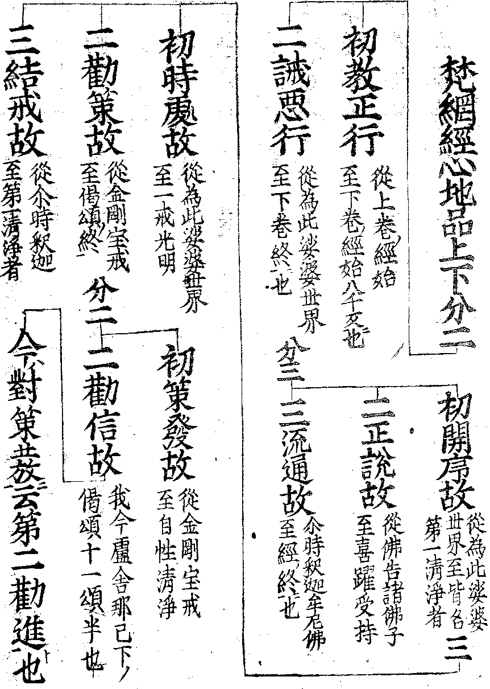
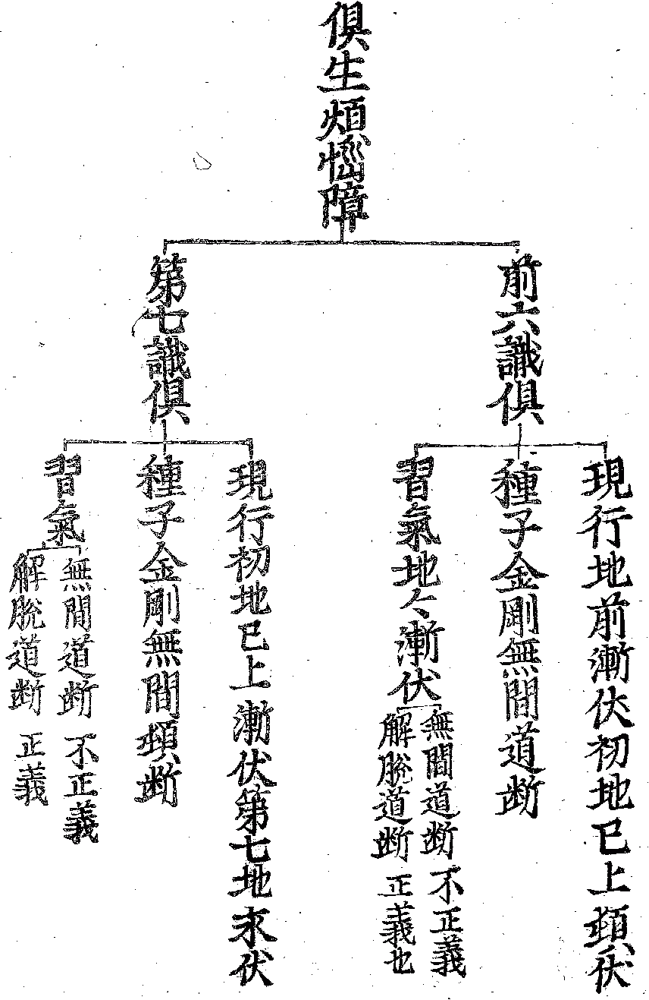
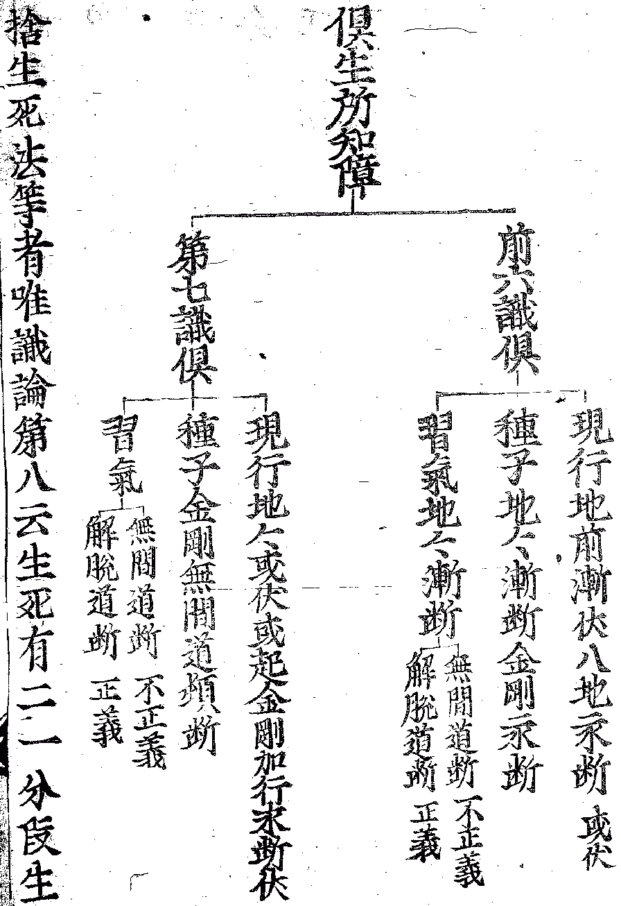
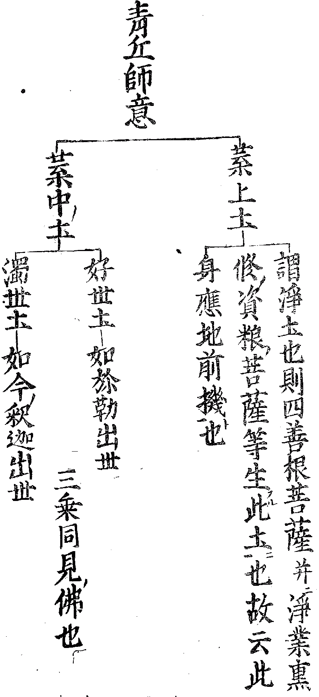
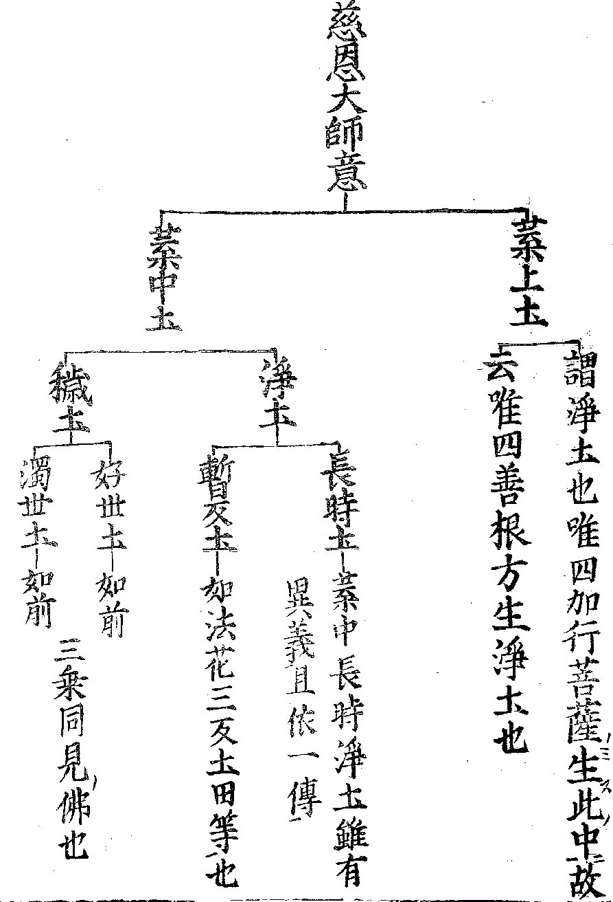
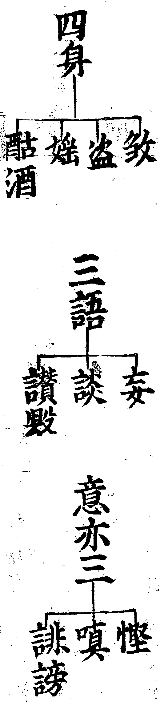
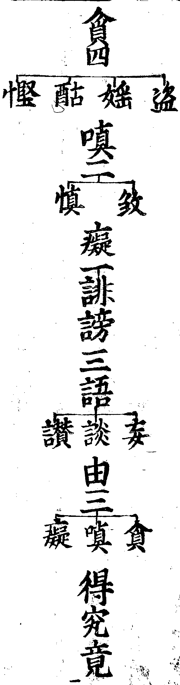
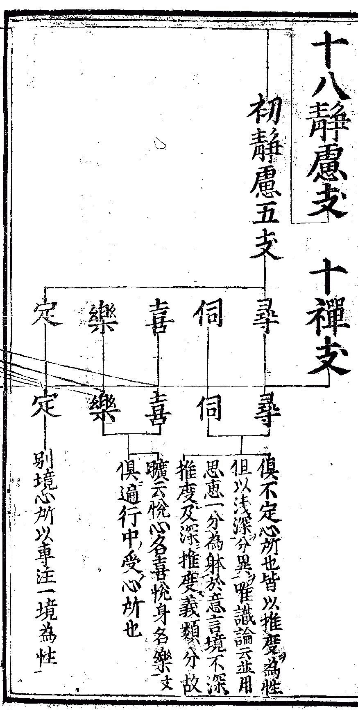
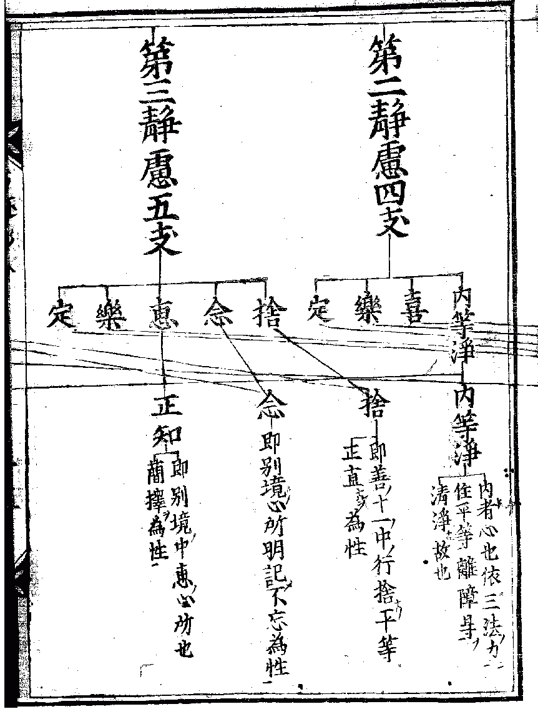
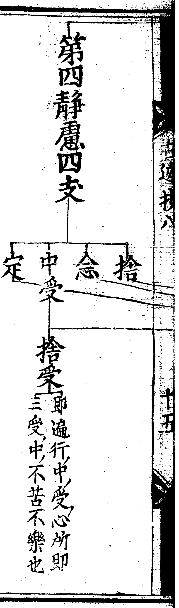

# 梵网古迹抄



> **藏经**：国家图书馆善本佛典（国图善本佛典）　**册次** 第 15 册（D15）　**编号** D8853　**部类** 经疏部　**卷次** 8 卷　**篇幅** 15,494 字

> **卷／品**：0 卷 · 0 品



---



梵网古迹抄第一



时处故  

机根故  

藏摄故  

翻译故  

宗趣故  

题名故  

本文故



(凢於今经诸宗人师制作记䟽其数颇多至明大义各设多门大周法藏於玄谈立十门解大意新罗义寂於卷首竖诸门釈经大义今师上卷古迹设七门解釈一品大𮈣文言广博略取大意以消文相)。



第一时处故。



(䟽云言时处者本即卢舎那佛在莲花台藏世界说末即釈迦初成佛时於摩伽陀国寂灭道塲说矣　问此经处会惣有几种哉　荅经自言十住处会亦随尒上卷古迹云初成佛已徃第四禅大自在天王宫放光摄众事卢舎那𦗟心地品还来树下出定而说十世界海云云凢经文等意釈迦成道即至色界顶次徃台上事舎那佛闻心地品还来树下出定而於妙光堂说十世界是第一会也上卷古迹云菩提树者毕钵罗树在伽耶城西南二十余里金精窂名曰金刚可冝金刚躰之㘴也妙光堂者即花严云普光堂也因佛放光而立名也在摩诃陀国寂灭道塲去菩提树三里也灭生死处名寂灭道塲有人寂灭道塲者菩提树下欤妙光堂菩提树下俱在摩诃陀国同在一国故云寂灭道塲界也　问第一会举金刚座妙光堂二处意如何　荅正说处虽妙光堂金[(罩-卓+止)*寸]座隣故举之加之成道处故因出之也（云云）复从座起至帝釈官说十住是第二会复至夜摩天中说十行是第三会复从座起至第四天说十囬向是第四会复从座起至化乐天说十禅定四善根一向修恵故说定是第五会也复从座起至他化天说十地是第六会复至一禅中说十金[(罩-卓+止)*寸]是第七会复至二禅中说十忍是第八会复至三禅中说十愿是第九会复至四禅中摩𨢸首罗天王宫说我本源莲花藏世界卢舎那佛所说心地法门品是第十会此处说上下两卷也自是又下树下寂灭道塲唯说十重六八之戒法也（云云）一义意也（补）　问化佛说心地一品二处演说见谓第四禅及菩提树下也若尒二处说法俱说上下两卷耶　荅一义云第四禅具说上下两卷菩提树下悉说上下两卷也既一具一品法门岂有不𥁞（云云）（泉公）师云见今经始终第四禅但说上卷菩提树下但说下卷也如来成道则经历十住处说法上卷科之传上贤圣内门行（云云）第四禅但说上卷解釈分明次下卷经始云复从天王宫下至𨵻浮提菩提树下为此地上一切众生凢夫痴暗之人说本卢舎那佛心地中初𤼵心中常所诵一戒光明矣上卷古迹科之言传初𤼵心外门戒行（文）言经文言解釈菩提树下但说十重六八戒相不可及异论者欤　问既一具一品法门何如是二处说之　荅虽俱心地一品所说法门既教正行门诫𢙣行门两门若尒所被机根一时不并何故悉可说𥁞如是诸经常例也何𬾨疑难（矣云云）　问今经广本十万颂六十一品（云云）舎舎那所说唯[戶@勺]心地一品欤亦通心地已前十品乎荅付之学者异义非一准一义云舎那说唯[戶@勺]心地一品也上卷古迹釈题号卢舎那言云梵网字下摽此名者为𫈉餘品釈迦说故（文）故知舎那但说心地一品餘六十品釈迦自说不待言者欤（付之有问荅略之）一义云心地已前九品俱通报化二佛说也凢化佛十住处说法者即心地品已前品也然上卷釈十住处说法云传上贤圣内门行（文）既通摄十住处说法言传说明知心地已前九品通报化二佛之说（为言）付之难云若尒为𫈉餘品釈迦说故之解釈云何可得遣乎　荅餘品者除心地已前十品餘五十一品言釈迦说也（云云已上二义任情取舍也云云）　问付心地上下两卷俱通报化二佛之说乎　荅传云尒也经现文上卷明报佛说下卷明化佛说虽然上下两卷俱通报化二佛之说也下卷十重六八之戒化佛传受说之见是卢舎那诵我亦如是诵金言传初𤼵心外门戒行解釈无诤自报佛传受见若尒者下卷经通本师说分明者欤亦化佛第四禅说心地品其心地品上卷釈云传上贤圣内门行（文）故上卷所说五位修行亦通化佛说不及疑卢者欤然虽上下俱通报化二佛说结集家且影畧上卷明报佛说下卷明化佛说也　问若尒者何故下卷经始安报佛说耶　荅传云为顕上下两卷俱通报化佛说译家分卷时下卷始安报佛说也（云云　下卷经始至一心而行是报佛说也）)。



第二机根故。



(䟽云言机根者有菩萨性得𤼵心者为谤不信不得说故（文）今经具出十八梵等本业经𭤩通六道具种姓𤼵心解语三悉是菩萨戒机也无色界等受戒成不具如下记之（云云）)。



第三藏摄故。



(䟽云藏摄故者通菩萨藏毗奈耶摄（文）即菩萨三藏中毘尼藏所摄（为言）问安通之言何所以乎　荅一义云今经三藏中素怚覧藏而亦说轻重戒相故兼毘尼藏义故经义上亦通毗奈耶藏义故云通也（云云）难云何不举根本经义但明傍通毗尼义而云通乎颇难信矣一义云（修治章）今此梵网既是大乗故二藏门是菩萨藏而言通者此菩萨藏即通诸经此经随一故致通言（云云）一义云上下两卷俱通菩萨藏毗奈耶摄（为言）意云法铣䟽上下心地前后两判今𫈉彼等义安通之言欤彼䟽上云初化制者圣教虽众摄为二种一者化教法门二者制教法门○今此戒经后门所摄上卷非戒化教所𠬧（文）对此云通也（云云）)。



(一化制二教事餘师釈云开其信解用舍任缘故名化教制其修奉[這-言+夌]反有过名为行教（文）南山釈云制唯[戶@勺]道化通道俗（文补云）今经可言化中制也（云云补有问荅可见之）)。



第四翻译故。



(䟽云翻译故者后䄅有西𫭫三藏鸠摩罗什此云童寿持菩萨戒偏诵此品与义学沙门三千餘人遂於逍遥园及长安草堂寺翻译经论五十餘部㝡后因䄅主欲受禁戒别诵译出恵（私曰恵者恵观也）融（融者谓道融也）等笔受法藏师云西𫭫有十万颂六十一品具译成三百餘卷此经序云可有一百二十卷（文）　问今经翻訳时代诸师异釈法藏䟽云大䄅姚兴𭤩始三年（文）与咸注云𭤩始三年𠮦罗什在长安草堂寺及义学三千餘僧手执梵文口翻解釈（文）南山内典录云𭤩始八年（文）相[這-言+夌]何　荅𭤩始三年什公西来时也非正訳经时则上卷经序云天笁法师鸠摩罗什诵持此品（乃至）𭤩始三年淳风东扇（文）故知訳经时非𭤩始三年若尒内典录𭤩始八年正訳经时分也（云云）)。



第五宗趣故。



(䟽云言宗趣者语之所表曰宗[乞-乙+、]之所㱕曰趣此经正以心行为宗证覚利生以为其趣言心行者略有二门一教正行门二诫𢙣行门教正行者即经初说三贤十圣内证之行诫𢙣行者即经后说十重四十八轻戒行（文）问法藏䟽释宗云以菩萨三聚净戒为宗以是文中正所诠顕所尊所崇唯此行故（文）此尺意通上下两卷以三聚净戒为宗若尒与今师宗趣同异云何荅彼师且釈下卷戒本是故取诫𢙣行门为宗也若通上下两卷解釈如今师可立二门又一义云三聚净戒摄诸行无不𥁞是故可云上下两卷俱以三聚净戒为宗也今䟽下文云此身应第二地戒波罗蜜此经宗故（文）不𫈉上下不同但云戒波罗蜜此经宗故若尒教正诫𢙣两门俱可云戒为宗欤由此义法藏解釈曾不[這-言+夌]今师意欤（云云）)。



第六题名故。



(䟽云言题名者梵网经一部名也卢舎那佛说心地法门品第十者此品别名也梵者能净之义网者摄有情义谓此经者乃至有顶生死大海拘持有情终致无上寂灭之岸无尽饶益诸饥渴类如世网故为顕此义故诸梵王持罗网幢供佛𦗟法佛因此说世界差别犹如网孔佛教门亦如是世界别者湏㫆树形覆世界等遍涉入故佛教门者虽一味法蕰界处等法门别故是则如梵王网孔多䌉一法王戒法当知亦尒虽尘沙门终㱕一道万行一门所谓得意[乞-乙+、][乞-乙+、]而行皆称法性是故从喻名梵网经（文）梵网开题云具云伇罗𢜩摩（此言净行）尼婆罗波（网）素怚覧（经）当知今梵网经者初一字梵语省略次二字此土𮋒名亦不空三藏传云此经金刚顶经浅略（云云）　问诸经立名不遇人法喻三则单复一具是也如𣵀槃大品大集楞伽等单名法如湏陀那太子经毗舎门经单名人如大云经单名喻如法华经法喻双举如善生优婆塞戒经人法双举如菩萨璎珞经人喻合称如大方广佛花严经𰥍𬾨三今经当何义耶　荅於今经题名诸师解釈不同法藏师作四尺且第一尺云一约行躰用谓梵者当躰为目离染为义网者就喻为名胜能为义（乃至）此则依躰起用以梵成网故云梵网即持业釈也又亦法喻双举为名也（文）此釈法喻合名见谓戒法离妄染其躰清净是故名梵[乞-乙+、]者极净之义故也　第二釈云二约义者此举梵王之网喻所诠之义俱从喻称故云梵网（乃至）此则梵之网依主釈亦是有财釈以俱是喻故（文）此第二尺人喻也谓以梵天王所持之网喻今戒法名梵网经也梵是能持之人网是所持之物梵但召能持之人无喻戒法为以网喻戒法言梵网经故结文言梵之网也（自餘二尺恐繁不引）义寂䟽云梵网谓梵王网如因陀罗网其义相似佛说法门随机无量其理一绞如梵王网孔虽无量其䌉唯一故从喻事名梵网也（文此第一尺人喻合举见）又云又戒为梵行亦是法网故云梵网（文此第二尺法喻合名见名）问如是诸师解釈分明也今师解釈何　荅学者异义徃[乞-乙+、]一义云梵王修十善四无量其性清净取彼极净义喻今戒法取罗网救鱼能譬今戒法是故梵与网俱喻也则结文言是故从喻名梵网经故（文）一义云师云梵能净之义一言未见以梵为喻釈文网言无异论喻见如世网故（文）故今师多分依义寂法藏二师彼二师中以梵喻戒法釈文都不见若尒今师或人喻或法喻可得意解釈不分明上准彼二师釈可得意也　问若尒是故从喻名梵网经之解釈何会乎　荅且依网一义言是故从喻具可云从法喻等也（云云）　问梵王所持网罗网幢非世网何有救𮫭能若尒今合摄有情义甚不相合乎　荅诚如来难今网非世网法藏䟽云问此中梵网与花严中因陀罗网何别　荅彼是帝釈网此是梵王网彼网在殿此网在幢（文）故知今网在幢实无救鱼能但网义𭤩通故釈摄有情也自元摄生义今经不见法藏等依花严釈之若尒梵王所持网无救鱼能网义宽通故如此釈也（云云）　问梵王何时何处以罗网供佛乎　荅上卷古迹云摩𨢸首罗天王宫中说心地时诸大梵王供网罗幢因此说法（文）即十住处中第十说今品供之依此一部惣号梵网经（矣梵网二字毕）经者上卷古迹云经谓𭑕经贯持为义贯义持生不散失故（文）天亲论云谓能贯穿以教贯义以教摄生名之为经犹𫄧贯花如经持纬○众生由教摄不散流𢙣趣义理由教贯不散失隐没（文）卢舎那者此云净满无障不净无德不圎故（文）又法藏䟽云梵本　皆名毗卢舎那此云光明遍照智照法界身应大机故（文）佛说者法藏䟽云佛谓覚者三义如常说谓圎音巧应生解（文）心地者同䟽云唯识万德从此生长名为心地（文）天台云心地者亦是譬喻也此品内所明大士要用如人身之有心能𢝰万事能生胜果为大士所依如地（文）又云三业之中意业为主身口居次㨿胜为论故云心地（文）法门者法藏疏云出苦之津入净之户称法门（文）品者同疏云文义类别故名为品（文）玄賛云品者类也别也区玄旨而异类𣲖幽筌而彚别（文）第十者次数也玄云第者次也居也文私云十者六十一品中当第十也而利涉疏牒云心地法门品第十一文此所覧不同欤)。



(已上六门大摡毕（第七本文故者即上下两卷所说具如下记之）)。



梵网经古迹记科分二初标题二初题号。



(题名中上三字所釈经名下五字能釈文名又上三字通诸师就梵网制疏记故下五字别[戶@勺]今文故取所㱕能会通从[戶@勺]惣成今记题名也凢就今文题有惣别两题如现行本是别题也惣题云菩萨藏素怚覧古迹卷第一题下注云梵网经记也惣大部古迹二部流行见则素怚覧藏古迹阿毗逹摩藏古迹付素怚覧藏古迹其数多第一第二今经古迹也第三四五六四卷不知釈何经七八九三卷釈𣵀槃经其题云菩萨藏素怚覧古迹卷第七乃至卷第九题下注云𣵀槃经述记第十已下不知有无是外药师经古迹一卷三㫆勒经古迹三卷则素怚覧藏三四五六欤追可寻之（云云）述迹抄云梵网二卷花严十卷金刚般若古新各一卷𣵀槃八卷仁王经心经药师经双观无量寿小阿㫆陀经称赞净土㫆勒上生下生成佛广耶已上各一卷理趣分四卷最胜述记四卷同料𫈉一卷（文）次阿毘逹磨藏古迹十七卷见文述迹云百论杂集论唯识论瑜伽论因明论理门论观所缘论二十唯识论成业论五蕰论掌珍论广百论弁中边论顕扬论佛地论无性摄论𠀍亲摄论（已上文）凢今师制作多称古迹则示[卑-(白-日+田)+日]下语也依义寂法藏等疏记制之是故言古迹也唯识学记云𢙢失古迹今故述之（文）修治章第一云太贤法师解釈大乗诸经及论多名古迹随彼[乞-乙+、]典各依诸家所釈踪迹取要录之斯乃言有典㨿事不檀已述而不作必有依羕故也（云云）　问迹与迹同异何　荅有抄云以生类足迹云迹以餘相似义云迹也（云云）记者盂兰盆经新记序解云记录要言之妙词𬾨讨论之忽忘（文）则录大𮈣安纪言解釈委曲安记字也（云云）卷者𫈉正记云卷者舒为义从前向后曰舒为卷此㨿纸墨为言（文）真证律师云卷者可舒可卷自在义也（文）下者对上卷古迹云下也（云云）)。



(已上题号毕)。



二青下撰号。



(付撰号有名同名故𫈉以处青丘者文撰注云服虔曰青丘国在海东三百里（文）又东宫切韵云青丘国名（文）野马台注云青丘谓新罗国也彼国茂松故云青丘（文）百法䟽云新罗太贤（文）菩萨藏阿毗达磨古迹摽新罗国青丘沙门（文）故知新罗国别国有青丘国欤持犯要记摽新罗国游心安乐抄云青丘也相例可知（云云）有义云山名也玉篇云水出青丘山故（云云）　问若尒者文撰等如何会乎　荅取惣国名合别山名云青丘国也（云云）但前义胜也青丘（东大寺读样也）青丘（兴福寺读㨾也）太贤者祖师讳也人畏不呼召是则实名用讳字若灭后赠号用谥号也如南山大师赠澄照大师也有人云唐三藏有三千人门徒撰之以七十人达者此中之随一名西明师（圎测师也）彼门弟云道证师（又云要集也）太贤彼道证师之弟子也初习花严后入法相卜迹幽闲恒弹於琴外隐德行内怀光矅（文）宗要序云潜用韬光故云太贤可训太贤也或太贤（云云）此师不好名誉隐德行故僧传等不见是故如是训也（云云）凢付撰号有读不读异论一义云可读也礼记文云入国问禁入门问讳临文不讳庙中不讳（文）此义向文时撰号庙中读祭文等亡者讳读无过也（云云）　一义云不读之临文不讳等文非撰号文中连读文字中人名有不讳也庙中祭文以可准同正作者名不读为好凢天笁召人名为胜故称佛名等唐土不召讳名为礼是以日本菅家等不召天神讳号为好也（云云）集者瑞应钞上（守千）云问说作述撰四名何异　荅说即口谈造即起本并非先有名说造也先有名述（乃至）撰即集也集旧成本名之为集文)。



(已上题号撰号毕)。



(凢於此经梁代恵皎始制䟽其䟽不见于今次隋𠀍天台智者大师制䟽其后盛造诸䟽当时流行䟽记具补忘抄等载之可见之也)。



二下卷已下十下劝信故三初标章　述意。



(凢付梵网设釈诸师随意不同也太贤善珠法进通上下卷造於䟽注圎证平𬾨唯解上卷胜㽵法铣道璇传奥利涉扑扬自下卷初解天台贤首义寂处行明旷并从下卷偈颂釈之也　问就今师解釈有重[乞-乙+、]疑第一疑云译家什公付此心地一品分上下两卷何不随彼分卷超越釈我今已下文哉（是一）第二疑云下卷经始犹有本师说超越之少有其理何尒时千花上佛已下化佛传说不釈之而超越哉（是二）第三疑云於化佛说有二叚教正行门诫𢙣行门纵虽不解教正行门何自为此娑婆已下诫𢙣行门不釈之自偈颂釈之哉（是三）　荅有义云我今已下为下卷经有之欤师云不尒见诸师釈什公翻译时分卷犹同现流布但䄅主请什公云又诵何文可护持戒躰（云云）什公受其请别译出偈颂已下题云梵网经卢舎那佛说菩萨十重四十八轻戒本（文）自其相羕即称戒本诸人玩之但於戒本作䟽义寂法藏解釈皆以如是是故今师自偈颂为下卷制釈也法藏䟽云仍别录此下卷之中偈颂已后所说戒相独为一卷名作梵网经卢舎那佛说菩萨十重四十八轻戒一卷[乞-乙+、]首别摽当时受戒羯摩等事（文）天台与咸注如是恐繁不引（文）　问第二劝信者对何云第二哉　荅上卷古迹科分今经始终取要图之)。







(信为入法之本者此取本业经下卷文意也彼经云佛子若一切众生初入三宝海以信为本住在佛家以戒为本文智论云佛法大海信为能入智为能度（文）玄賛第一云智度论云有信心人入佛宝山得诸道果若无信心虽解文义空无所得（文）诸经初案证信序皆此意也是以义寂疏云序中有二初偈颂为劝信序餘长行文为结戒序○信为受戒之本故先序信戒是宗所明故次序戒（文）　问信行相如何　荅唯识论第六云云何为信於实德能深忍乐欲心净为性对治不信乐善为业（文）戒为住法之原者谓住在佛家必可依戒五众七众皆受戒也𣵀槃经等不受戒号外道故但㝡胜王经中列四部众竟言及餘善男子善女人等说四部外得益是且一途癈立非常途所谈也故补注云以受持戒名七众若出家人犯一重佛海𨕙外非佛弟子故以戒为本（文）砺䟽第六云多论有四义故重一戒是佛法平地万善由之而生二一切弟子皆依戒而住此义苻顺今疏文也三是趣𣵀槃初门若无戒则无由入𣵀槃城四佛法璎珞能㽵严佛法（文）更令信戒者[(天*天)/日]筞𤼵令劝信故云更也)。



二然菩下傍述三门二初标列。



(然菩萨戒者直不釈文叚因广引餘经论等述菩萨修行故云然也此与𡙸未决之词也上言所以说偈更令信戒与词也而不釈偈摽三门故是𡙸也此𡙸又始终一向𡙸非不釈偈故与𡙸未决故置然字也进与即此非釈偈退𡙸终非不釈偈故云与𡙸未决也略有三门者义寂师等开多科叚述菩萨戒先分受随於受亦分得受失受於得受后开四门於其中科叚委细也今对彼等师广釈云略有三门也此三门中第一受躰后二随行就后二初持后犯虽持犯异俱望受躰得其名是故皆名随（云云）)。



二初受下正明三初受得门二初应成机二初泛举解语有情。



(六道众生等者　问今经举十八梵等具不举六道何故言六道众生但解师语等乎　荅虽今经具不举六道由本业文如是釈也寂疏云依本业经六趣皆得受（文）彼本业经云六道众生受得戒但解语得戒不失（文）　问六趣中地狱并无色界众生受得菩萨戒乎　荅於地狱众生表无表章云言六趣者别解脱唯人趣菩萨戒通六趣（乃至）地狱无由得别脱戒菩萨戒胜可摄於彼（文）是别受不通地狱通受通六趣见亦地藏菩萨等与其受戒等也解釈以佛菩萨神力别受五八亦通六趣见等（文）　问通地狱众生受得菩萨戒轻重地狱俱得之乎　荅义寂疏云当知地狱有轻有重[乞-乙+、]者不得轻亦得受（文）今案云寂疏言重者不得者则由自业力[諒-口+日]可尒若由佛等力轻重俱可受欤（云云）次无色界众生受戒者义寂与咸许之寂疏云言无色界者顕即不说蜜亦无遮（文）意云虽不说顕无色众生成受戒亦不言不得受戒故俱可受菩萨戒（为言）有义云顕即不说者谓顕宗经中不说之密教意可许之故言密亦无遮（云云　此顕密相对颇才覚至也）一义云不许之诸藏章（慈㤙）云卢舎那佛经说十八梵天诸神王等但能解语皆悉受持菩萨戒法故知调伏亦致二界五趣之身此依实身无色界中无有耳识不闻教故[乞-乙+、]知但致二界五趣有情实身（文）又十业道章（溜洌）云然除无色无趣大故（文）当知宗家定判无色界不得别解脱戒也别解脱必由思成定果所变无实思故不许受戒也　问但解师语分斋云何荅传奥䟽云晓了文义方名解语不同鸯[武/鳥]但袭其言文则解了不杀生等戒相方名解语也)。



二要下[戶@勺]被𤼵菩提心二初举心相。



(要湏先𤼵大菩提心等者谓虽解语不𤼵菩提心不成今戒故云要湏先𤼵等也　问今经言但解法师语尽受得戒（文）不言𤼵菩提心何故云要湏先𤼵等乎　荅今经重戒结成门不得现身𤼵菩提心等文受得菩萨戒湏菩提心见其上瑜伽论等必种姓𤼵心上受得菩萨戒见依之如是釈也谓誓定取无上菩提等者非犹预心故云定取菩提可有期利生不可尽故云穷未来际也　问菩提心者入道章出菩提心躰性云躰性者以信精进正念正定正恵为躰（文）尒者何以上求下化二心釈菩提心乎　荅於菩提心有躰相境三今文者以行相釈菩提心章云顕行相者希求为相希求有二一求菩提二求利生（文）次下引瑜伽论决定希求以为行相之文是也　问菩提心者菩提即心欤亦菩提之心欤　荅菩提之心也以依玉为名菩提所期果号心即得彼菩提果愿乐心即文所述求菩提利有情二心也　问菩提之心者求菩提之一愿何有利有情之心乎若又心分二种者可云菩提萨埵心如何　荅遁伦有此问荅彼第八云问文中既求菩提复为有情而𤼵心者何故但名𤼵菩提心不说𤼵萨埵心乎解云本为救他而求菩提但云𤼵菩提心即是𤼵救萨埵心也又𤼵心令生同我俱证菩提故但云菩提心不得说言𤼵萨埵心也)。



二如下引文证。



(如瑜伽云菩提心等者谓本论𤼵心品中就菩提心出五种相自性行相所缘功德㝡胜也然今所引文行相文也𢝰自性行相所缘相合云菩提心也自性者能缘见分於菩提有情作上求下化誓以此能誓心为其自性也行相者能缘之心必依所缘之境能所相合以决定无转之形为𤼵心行相也所缘者以菩提有情二种为境谓境界之相也　问第二行相者於四分何可配当哉　荅有异义且如遁伦说以相分为行相（云云）谓此义意能缘见分缘彼境决定无改转形即相分也又亲所缘[乞-乙+、]也决定无转之形心中浮现此名相分如镜中影像以镜之躰为自证分此上光明见分也此见分上所现菩提有情是相分也笠置上人云唯识宗意相分名行相义尤胜也愚夫迷此相故（云云）以为行相者影像也下义利为境者境则第八所变相分为第六等见分即本质亦踈所缘[乞-乙+、]也此境正与能缘见分相应成亲所缘[乞-乙+、]时菩提有情二种相云行相也由此义行之相可训也行者能缘见分相者所缘相分也能缘行解浮现相㒵也以相分为行相故所缘则第八所反相分为第六识等为本质以此本质为所缘也　问就之疑云见唯识论见分名行相相分为所缘文加之相分非缘卢法岂为𤼵心相㒵伦记釈用不任意何[這-言+夌]唯识诚文由末师解釈乎　荅伦记釈是非彼师自义瑜伽论以相分为行相是故仲筭私记云唯识见名行相瑜伽相名行相（取意）本论既相分为行相末师解釈何[這-言+夌]本论哉若尒定菩提心行相时以伦记可为指南依之文集引之以为依𠗦（矣）　问若尒瑜伽唯识如何相[這-言+夌]乎　荅义利为境者演秘一云按佛地论亦有四句现益名义当益名利世间名义出𠀍名利离𢙣名义摄善名利福德名义智恵名利（文）　问上明发心相其𤼵心者未入僧祇善法欲菩提心位受得菩萨净戒欤将又[戶@勺]已入僧祇深固大心乎　荅有义云受得菩萨戒必已入僧祇深固大心上可云得之善法欲位但结缘分不能成其戒躰由之宗要釈云尒时於此解脱分心由羯摩缘得菩萨戒文解脱分者已入僧祇位故知僧祇已前不能成菩萨戒（云云）　本净长老等専执此义叹云通受戒不𤼵深固大心不成别受戒不三国相羕故亦不成故当时通别二受俱为结缘不成其戒躰也（云云）　传云善法欲位可成菩萨净戒也凢解脱分者宽通未入僧祇杂集论四种解脱分中依𠗦顺解脱分者则未入僧祇位也又唯识论云一资粮位谓於大乗顺解脱分（文）述记云此在四十心及前位从初𤼵心及至十囬向终皆名顺解脱分（文）故和顺解脱名宽通未入僧祇位也加之今经上下两卷配次位今十重六八初𤼵心外门戒行云十住已上传上贤圣内门行（云云）外门者是未入僧祇更无疑欤亦疏主釈汝等一切𤼵心菩萨亦诵之经文云言𤼵心者十信位也行实有退非三贤之正位若十信等未入僧祇位不许得菩萨戒半月制令诵有何所益乎故知菩萨净戒但[戶@勺]已入僧祇许之恐不足言事欤（云云）)。



二𤼵下受得法二初二种受戒二初标分。



(问一分多分全分有三种何云有二种受乎又付十善戒受一戒名一分一九名多分十名全分何况本业经云一分菩萨乃至二分三分四分十分等故有一分多分全分见尒者何不摽三种乎　荅今於一分中包多分也百行律仪时开立多分今合云一分全分也一义云多分摄全分本业云有受一分戒名一分菩萨乃至二分三分四分十分名具足受戒（云云）既二分十分名具足受故属全分受也　问若尒者何釈一分时云或受一戒或多皆得成戒乎　荅此且为顕随其受者意乐所堪义尒釈欤必一分摄多分故如是非釈欤)。



二一下正明二初一分受三初正明菩萨分受。



(依本业经文也彼经云又复法师能於一切国土中教化一人出家受菩萨戒者是法师其福胜造八万四千塔数其师者夫妇六亲得互为师授其受戒者入诸佛界菩萨数中超过三刧生死之苦是故应受有而犯者胜无而不犯有犯名菩萨无犯名外道以是有受一分戒名一分菩萨乃至二分三分四分十分名具足受戒（文补云）就此一分受古来异义颇以繁多也略举三疑方顕相羕实义（一戒躰成不疑二七众通[戶@勺]疑三住前住内疑）第一戒躰成否疑　问一分受者本论并宗家解釈不见今师依本业璎珞说相许一分受持若尒可云戒躰成就乎　荅付之异论多途要仪抄云一分受菩萨戒躰可成本业说相今师解釈更不及疑虑如成山海尘渧为初之道理不可遮之加之六波罗蜜经第五之乃至护持一禁戒者亦得名为入佛净戒波罗蜜多能得无上正等菩提（文）○若尒戒躰成就理在绝言等（云云　委细问荅如补忘抄略抄之）兴正菩萨𭤩安年中表无表章御谈义亦依上义讲毕（文）次由文集注文一分受不可成戒躰本业且初根引摄一相说不尽理说（取意具如注文）彼经说三聚相是则断𢙣一途非顕了诚说彼既不尽理例今分受方非实理说（为言）○已上御注意也中古硕学实宽法印等今御注意叶宗家御釈（云云）然𭤩安年中㝡后章御讲改御注义讲上义毕若尒相传义不可取舍欤　问就初戒躰成义为许分受十戒俱可许一分受哉　荅有人云自𭣦生戒至谤三宝随受者意乐悉可许一分受也（云云）传云分受之时於前四重可有一分持第五已下是不共戒也是故必分持后六戒时於前四重必受一戒后[乞-乙+、]诸戒可分受律仪戒上后二方立故玄賛中云律仪戒为本方有后二若破律仪三戒俱舍文前四重是摄律仪根本是故定可受之（云云）)。



(已上戒躰成不成二义毕)。



(第二七众通[戶@勺]疑　问今一分受者通七众许之欤亦但[戶@勺]在家二众许之乎荅八云出家在家俱可许分受也等（云云　委可见补𭜘抄）传云八怗抄义不足言也於出家许分受都所不见也等（云云　委细也可见之）第三住前住内疑　问今一分受者但[戶@勺]未入僧祇轻毛等位将亦通已入僧祇深固行相乎　荅今一分受者专依本业经彼经於住前信相菩萨明之加之出已入僧祇行相云十重满足方入初住经文分明但[戶@勺]住前义不及异论者欤（云云）)。



二不下简异比丘𢝰受。



(不名比丘者𢝰比丘名通大小瑜伽论中说声闻七众菩萨七众故然而今师且比丘名[戶@勺]于声闻也)。



三谓下𢝰明二受不同三初明比丘𢝰受意。



(现身得阿罗汉者　问彼极速犹经三生故俱舎论（二十三）云谓初生起顺解脱分第二生起顺决择分第三生入圣乃至得解脱（文）何云现身等乎　荅贤圣义私记第二（仲）等云凢夫不覚生多少（乃至）圣人知业多少文凢夫不知生多少故欲现身得果也实虽不可得约彼意乐云现身等也若知业多少第三生人亦修可得也（云云）　一义云性相望多分而说之或经中依持二百五十戒许即证第四果义故云现身得阿罗汉等欤（云云）　圎满䡄则者果既欲圎满故其上行又可圎满是故戒行圎𬾨受持故云尒也（云云）　言学处者资持记云言学处者是修行者所依处故（文）摄釈云白四羯磨受具足戒等名为学处二百五十戒等为所学（文）遮难者十三难十六遮也十三难者一𨕙罪难四重[這-言+夌]犯人也二行尼难三贼住难䨱闻羯磨说戒也四破内外道难五黄门难有生揵妬反半五也六𭣦父难七𭣦母难八𭣦阿罗汉难九破法轮僧难十出佛身血难十一非人难天修鬼狱四趣十二畜生难十三二形难也十六遮者一不称自名二不称和尚名三年不满四衣不具五钵不具六父不𦗟七母不𦗟八负债九奴十官人十一非丈夫十二癞十三癕疽十四白癞十五乾痟十六㒹狂（云云）)。



二菩下明菩萨分受意二初历刧修满故。



(谓凢必无现身成佛者　问法力甚深也机根千品也何无现身成佛之类哉依之菩提心论云父母所生身即证大觉位（文）花严经云初𤼵心时便成正覚（文）法花经说湏㬰闻之即得究竟加之天台可有一生入妙覚者（云云）若任此等说何不许现身成佛之类乎　荅虽宗计各别然法相宗意必经无数三大刧也瑜伽云决定无转无数大刧修行圎满方证菩提（文）且声闻钝根经三生六十刧独觉利根经四生百刧况菩萨尤利可经三大刧道理必然也依之幽𮚌云独覚利根尚经百刧况求作佛无多刧因（文）笠置上人云无餘还生无性有情成佛事自他宗遂无和会三大僧祇转不转不可设别会釈我宗人可𠈟起信论诸文自被会（云云）彼论云或示超地速成正觉以为怯𭋘诸众生故或说我於无量阿僧祇刧当成佛道以为懈𢢔诸众生故能示如是无数方便不可思议而实菩萨种姓根等𤼵心即等所证亦等无有超过之法以一切菩萨皆迳三阿僧祇刧（文）西天笁之习设有道理无文证者为非义今既有文理尤可指南也要经无数大刧者入道章云始从资粮终尽法云经三大刧其初资粮加行二位是初大刧从通达位至七地终是第二刧从第八地尽第十地是第三刧时毕三祇行𬾨四位方登究竟菩提果（文）)。



二如下无德不摄故。



(菩提心经云譬如大海初有一渧能为诸宝作所依处文史记云泰山不让土壤故能成其高河海不嫌细流故能成其深（文）既大菩提等者唯识第十云诸根相好一[乞-乙+、]无𨕙无限善根所引生故（文）趣生者趣谓六趣生即四生也（云云）)。



三虽下明大小胜劣意。



(唯受一戒犹胜二乗功德者大般若五百八十六云尒时满慈子问舎利子言云何菩萨有漏净戒能胜二乗无漏净戒舎利子言声闻缘觉无漏净戒唯求自利廻向𣵀槃菩萨净戒普为度脱无量有情廻向无上正等菩提是故菩萨所有净戒能胜二乗无漏净戒（文）但为自身者顕扬论第十二云自义利者谓自利行如声闻独覚彼虽或时起利他行然本期愿为自利故亦名自义（文）菩萨修一善悉为众生作之故言不荷恩故也（云云）又云菩萨𤼵心时誓一切众生饶益依此心持𭣦生一戒云不𭣦一切众生是一切众生施寿命故云不荷恩故也（云云）)。



二二下全分受。



(谓从一戒至九戒初一分受摄之且随初云一分受也全分受者谓通在家出家十戒满足者悉此门摄也（云云）)。



二谓下三聚誓愿二初𢝰标。



(问谓三聚戒之言但[戶@勺]全分受欤亦通一分受哉　荅就之异义徃[乞-乙+、]古义云但[戶@勺]全分受不通一分受也全分受下言谓三聚戒故亦摄律仪断一切𢙣（云云）一分受等才受一戒等岂具三聚戒乎（为兴正菩萨言）传云谓三聚戒之言宽通分全也全分受别无烦五戒受五戒十戒受十戒故不可用别料𫈉是故不釈具出一分全分已欲明能受誓愿云谓三聚戒也仍训文云二者全分受读断谓三聚戒[寸*尒]（於伊乎）可破文也古点云二者全分受谓三聚戒可训也即但[戶@勺]全分受也甚非文意也　问一分分受犹𤼵三聚誓愿何受一戒等乎岂非躰誓相[這-言+夌]乎　荅三聚誓愿远期来际祈愿也非即时成就何不云断一切𢙣乎全分受时誓未来故即云三贤十圣伏断二障等岂𰥍缚凢夫伏断二障虽然彼远期来际故誓伏断二障也是亦如是纵虽一分受远期来际故誓断一切𢙣也次下文云非诸凢夫即能一切三聚顿誓渐修满故者釈一分全分俱即时不成就之所以也（云云）　三聚净戒者法铣疏云初釈通名谓三聚净戒三者是数蕰积名聚离过名净防非为戒即𭘧数尺初三聚者一摄律仪戒离𢙣有䡄名曰律仪[乞-乙+、][乞-乙+、]𭇥多一名并𭠎称之摄所谓静虑无漏及别解脱律仪即戒名律仪戒持业尺也二摄善法戒顺益有䡄名为善法[乞-乙+、]众多故取在此门故名摄[乞-乙+、]善即戒名摄善戒亦持业釈也三摄众生戒众生所生名众生引令㱕善名之为摄[乞-乙+、]生即戒亦持业釈文)。



二摄下别解三　初正明三　初摄律仪戒。



(凢就三聚有戒门誓门二种今所明非戒门是誓门也古义同本业璎珞说断𢙣门三聚（云云）甚背文意下云非诸凢夫（乃至）三聚顿誓即誓门见故戒门三聚得意不叶文意也（文）应断舍法者断惑障舍生死也生死者分叚反易二种生死也古准唯识论第十所弃舍躰以非障有漏劣无漏摄舍之言（云云）甚不叶文意如今文断者宽通二障伏断等也舍者舍生死法见宗要云一切杂染非障有漏劣无漏何云杂染耶依之近来改之准唯识论第四然杂染法略有三种烦𢙉业果种类别故文料𫈉之也谓断烦𢙉业舍分叚反易二种生死也三贤十圣伏断二障者三贤者十住十行十廻向也十圣者十地也於五位述断惑行相者谓分别惑资粮之位渐伏见道顿断其相易知於俱生惑有种[乞-乙+、]不同依唯识义私记委细图之)。











(舍生死法等者唯识论第八云生死有二一分叚生死谓诸有漏善不善业由烦𢙉障缘助势力所感三界麤异𤎼果身命长短随因缘力有定斋限故名分叚二不思议变易生死谓诸无漏有分别业由所知障缘助势力所感殊胜细异𤎼果由悲愿力改转身命无定斋限故名反易（文）今舍生死法者谓分叚生死或初地（智增菩萨）或七地（悲增菩萨）舍之反易生死者至佛果舍之也　问分叚生死初地或七地舍之何今不𫈉至佛云舍生死法乎　荅玄賛一乗义章出胜出分叚躰云通取因果出分叚死所有理智以为一乗（文）私记（真兴）云　问因位有出分叚义（乃至）佛果位中无出分叚义而何云通取因果出分叚死乎　荅水抄云若㨿果位直是胜出反易（乃至）果中不[這-言+夌]出分叚义（文）意云分叚死实因位舍之果中亦无分叚死是故果中出之不[這-言+夌]道理今乃至佛舍生死法釈文例可得意也（云云）)。



二摄善法戒。



(应修证法者古由第十所顕得所生得得意今亦一具由第四卷诸清净法亦有三种𠀍出𠀍道断果别故之文得意宽通漏无漏善悉为摄善法戒躰也（云云）私云𠀍出𠀍道漏无漏道修之断果无为可证之也十胜行者谓十波罗密也无垢称䟽（二本）云然此十度在地前位於一行中唯修一行唯是有漏七地已前於一行中修一切行通有无漏八地已上一切行中修一切行唯是无漏胜前位故（文）二转依者菩提𣵀槃也转谓转舍烦𢙉所知转得菩提𣵀槃依是转舍转得所依第八识或是真如也（云云）唯识论九云便证得转依（乃至）依谓所依即依他起与染净法为所依故染谓虚妄遍计所犱净谓真实圎成实性转谓二分转舍转得由数修习无分别智断本识中二障麤重故能转舍依他起上遍计所执及能转得依他起中圎成实性由转烦𢙉得大𣵀槃转所知障证无上覚（䟽云今言依他起名转依者流转还灭依也文）又云或依即是唯识真如生死𣵀槃所依故愚夫㒹倒迷此真如故无始来受生死苦圣者离倒悟此真如便得𣵀槃毕竟安乐疏云论或依即是至之所依故述曰第二师解依即真如迷悟依也（文）)。



三饶益有情戒。



(谓布施爱语利行同事以四摄法为躰也（云云）上摄善戒施度约自利之𨕙今四摄施本利他也意云六度施为除自分悭贪等障是即自利四摄法为救前生行布施是则利他行也是且一途[癈-殳+矢]立也实何摄自利[乞-乙+、]他也（云云）穷未来际等者　问三聚净戒俱是尽未来之调伏也何唯饶益有情戒如此釈乎　荅至佛果无可断惑亦无可修善断惑修善二行已圎满故佛果上所行但为济度众生也都无为自修一切所修皆摄第三戒也故初二戒期乃至菩提第三戒者愿尽未来际也　问若尒者至佛果者初二戒可谢乎荅至佛果者一切功德善法圎满成就都无缺漏依要期力至佛果[乞-乙+、][乞-乙+、][乞-乙+、]已亦成就故不谢也又佛果位戒依已曾得住设虽第三戒期尽未来际非未曾得法若许未曾得者可有佛果胜劣之过故（云云）　问𤼵三聚誓持𭣦生一戒唯𤼵律仪一戒不𤼵后二乎　荅由一[乞-乙+、]戒具三聚通诸戒持一戒三聚圎𤼵若依差别三聚随所持戒但𤼵律仪若摄善摄生等少[乞-乙+、]兼持随其可𤼵但𤼵摄善摄生不许之也必持前四重其上可兼持故也依许分受义明之也（云云）)。



二非下释疑。



(疑云初心始行菩萨云何有断一切𢙣修一切善尽有情界之义乎为遮此疑云非诸凢夫等也初心菩萨一切三聚顿非誓修行随位可修之（为言）又云一切三聚虽不能顿修行所𤼵愿心可誓断一切𢙣等也（云云）)。



三如下举德。



(言无碍者古义云无相清净𤼵心也故云无碍也又有义云於十方法界尘沙万境真俗二谛上求下化之心无不遍满故云无碍也（云云）随所生处心其中王者谓未证菩提以前或生人天或生鬼畜等随其所生处必得王果报（云云）心者一义云且举能依心必可具所依身也一义云可作身字恐字误欤一义云（师义）可作必字古本中作必字故知字误也（云云）何无相[這-言+夌]心其中王身必王故也心地观经第三具说其相略取意引之彼云上品戒（法王身佛）中品戒（转轮圣王）下品亦三（谓先上中二品俱持上分胜劣下品三品皆犯戒）下上品（鬼神王）下中品（禽兽王也）下[乞-乙+、]品（堕地狱受熖魔王身也）无毕竟等者无碍所𤼵愿行胜因所荅胜果无上菩提外无堪果者也故瑜伽四十三云又即如是所集无量福智资粮更无餘果可共相摄唯除无上正等菩提（文）上明三聚是誓门三聚戒门三聚事补忘抄举五门釈大䌉大切也可见之文义长略之)。



二护持门二初标[利-禾+(光-兀+天)]。



(上受得门是受躰是则随行也明旷䟽云言受持等者受谓受戒三业领纳名受顺受防护名持（文）述云护即持故云护持（云云）有人以此十门为五对一二共不共相对（科意云具不具相寸也）三四遮性相对五六贪嗔相对（有开制对）七八缓急相对九十护不护对（云云）)。



二一下随释二初九门𠀍俗戒护二初随心一门一分持二初立义三初法。



(（述云）问随心门者𢝰受上随心持欤别受上随心持欤　荅或别受上随心持或𢝰受上随心持可通两𨕙也（云云　述云）问此门通在家出家欤将[戶@勺]在家欤　荅西大寺此门[戶@勺]在家次门通出家在家招提寺此门通在家出家（云云）补问云此门但[戶@勺]一分持亦宽通全分受乎　荅有义（招提寺同之）云宽通全分持也既言随心何限分持乎又随其宿习等解釈尤可通全持依之引本业文云乃至具受名具分菩萨（文）故知通一分全分俱此门所摄也（云云菩萨御义也）传云但可[戶@勺]一分持也全分持可摄遍学门也受得门一分全分各别明之依之护持门立十门初随心门为一分持随行遍学已下诸门为全分持随行前后苻顺文相尤便全分自元具持无随心义岂号随心亦釈随其宿习加之故先固一渐具餘行之解釈但[戶@勺]一分持见若尒本业（文）随文故来也如是釈家常习也随其宿习等者瑜伽四十二於戒出九种相中云一切门戒者当知此戒畧有四种（乃至）三者串习戒（乃至）谓诸菩萨昔餘生中曾串习如先所说三种净戒由宿因力所任持故於现在𠀍一切𢙣法不乐现行於诸𢙣法深心猒离乐修善行於善行中深心欣慕（文）)。



二犹下喻。



(犹如𠀍间随其本色等者八云此有异义一义云一器物有种[乞-乙+、]色彼器物入水[乞-乙+、]随器物色其色不同器物色不同喻受者不同蕰水譬菩萨戒意云如来戒法唯一也皆可断法故但随众生先𠀍宿因受[婬-壬+(工/山)]𭣦等戒犹如一色水随器本色成绿碧等（为言）镜水抄第十三云青色白色两中间色为碧色赤色白色两中间色为红色青色黄色两中间色为绿色赤色黑色两中间色为紫色其中青黄赤白黑为正色红紫碧绿不正色（文　师云持公存此义）一义云绿碧等者水有种[乞-乙+、]色彼黑白等水虽一处交流不乱犹类虽人道一类同𤼵心依宿习机不同也则本文有之文集诗云济水澄亦洁河水浑而黄交流列四渎（川河淮济为四渎也）清浊不相伤（文）)。



三故下结。



(渐具餘行者对一戒二戒等餘戒云餘行也)。



二如下引证。



(问此文述受得之相何引护持之证乎　荅受随不相离故受有一分等受随必可有一分持等故为证也)。



二然佛下二下八门全分持二初遍学一门专念护持三初简前摽章。



(有人於今十门以五相寸料𫈉随心与遍学共不共相对（云云）遍学共随心不共则以分全两持俱随心门摄之号不共也若依科文意必不为五相对若准有人义由科文意得意第一第二相望可云具不具相对也随心是不𰥍[戶@勺]分持故遍学是𰥍[戶@勺]全持故（云云）　问遍学者全分持故为遍学性遮共学故为遍学　荅凢就遍学有多种一性遮遍学则今门也正取性遮共学号遍学则性遮诸戒遍学之傍兼全分持故遍学义也是故科文二下八门全分持（云云）二通别遍学下云遍学行别受七众是也则通别同学故云遍学也三内外遍学下以富楼那为遍学是也虽有三门不同今但依初性遮遍学也（云云）　问此门通道俗二众乎　荅可通也优婆塞戒经中亦出遮戒令在家众持之故况亦五戒中饮酒亦是遮戒四十八轻中亦有遮戒故在家全受亦此门可摄也（云云）)。



二如瑜下引论证成。



(瑜伽四十一云若诸菩萨安住菩萨净戒律仪如薄伽梵於别解脱毘奈耶中将护他故建立遮罪制诸声闻令不造作诸有情类未净信者令生净信已净信者令倍增长於中菩萨与诸声闻应等修学无有差别何以故以诸声闻自利为胜尚不弃舍将护他行为令有情未信者信信者增长学所学处何况菩萨利他为胜（文）)。



三故下𢝰结护持。



(诸机嫌戒者声闻戒也如𣵀槃经等说也是以戒䟽二上云菩萨持性重戒与息𠀍机嫌戒等无差别（文）同记云彼性重戒即目十善息𠀍戒通篇聚（文）事钞一云或随𠀍讥而起（文）同记云言𠀍讥者即诸戒缘多因俗讥起过方制（文）)。



二然智下三下七门有缘开制三初利生通[戶@勺]二初随性门[戶@勺]出家二　初简前标章二初引论简前。



(新行菩萨等者意云自在菩萨一行中行一切行为𫈉此云新行也一𠀍者三𠀍中现在一𠀍也一时者加行等三时中根本也故云一𠀍一时也遍行五度者谓彼论意进为能行餘五为所行故精进不别立所以五度也彼云复次菩萨精进遍行五波罗蜜是为精进波罗蜜（文）如护三衣不能施等者　问随性门意相[這-言+夌]学庆现在前时可有施三衣事乎　荅輙不可施三衣也付之不明若乞者来乞三衣之时不施之宁不犯悭贪性戒哉是以令引智论（文）证随性门离衣是遮罪不施三衣可犯性罪哉如何　荅智论（文）既如护三衣不能施等（云云）不施三衣之㫖明引智论文意只为证相[這-言+夌]事由不施三衣虽不行布施非悭贪相何云犯性罪哉但若有悭贪心𤼵者可为善根未𤎼之谢意乐故又不可有过若不能悔谢有可犯悭贪性罪者可施之欤为护随性门故然而胜㽵师引智论（文）新学菩萨遂成不能施三衣㫖（如下所引）问如智论说诸比丘以所着三衣上佛𤼵阿耨菩提心见即智论四十云说是般若波罗密时三百比丘从㘴起以所着衣上佛𤼵阿耨多罗三藐三菩提心（文）此文意如何　荅摄釈第三云经中各[乞-乙+、]脱身所着净衣等者　问比丘奉衣虽成檀恵离衣犯禁岂不招辜　荅略有二尺一云既闻一乗悟解正法得正法戒离衣乃是息𠀍机嫌故舍衣无罪二云经中而有𢝰别心喜踊跃四众皆然脱衣以奉别属於俗（文）水抄三十三云○三解一由闻法花成摄善法戒○二云言𢝰意别○三云当日却得不经宿不犯（文）瑜伽七十五云若有出家菩萨除三衣外所有长物（乃至）思择施来求者当知无罪若䫃染法非悭贪障而不施者亦无有罪（文）胜庄疏云问出家菩萨三衣施否解云菩萨有二一者已见第一义谛二者新学已见第一义谛菩萨见施三衣有利益者不䫃破戒及持戒而行恵施皆无[這-言+夌]犯（乃至）若新学菩萨三衣不施无所[這-言+夌]犯等（文）准如此文三衣不施义分明也（云云）)。



二由下标章述意。



(问第三门通道俗乎　荅科文云随性门[戶@勺]出家（文）　问付之犹不明如优婆塞戒经在家犹持遮戒加之在家菩萨受十重六八戒可有性遮诸戒何无随性义乎　荅出家遍持性遮戒是故有相[這-言+夌]事在家希虽持遮不尽诸戒故相[這-言+夌]学处现在前义希是故但[戶@勺]出家亦无性摄论釈相[這-言+夌]出雨安居等缘是则常律蔵等遮戒分作之是故[戶@勺]出家也科文趣如是（云云）一性戒遮戒事瑜伽九十九云何性罪谓性是不善能为杂染损𢙉於他能为杂染损𢙉於自虽不遮制但有现行便徃𢙣趣虽不遮制但有现行能障沙门云何遮罪谓佛𠀍尊观彼形相不如法故或令众生重正法故或见所作随顺现行性罪法故○如是等事说名遮罪（文）瑞应记云佛制不制皆招𢙣趣即名性罪○因佛制已招𢙣道因遮成罪名为遮（文）灯七云论此与二乗有共不共等西明云旧云性罪谓𭣦生等㧞生草等是遮罪今依摄论云𭣦盗[婬-壬+(工/山)]等贪等所生名为性罪行生草等非贪等生说名遮罪此意染心断生草等即名性罪今谓不尒彼摄论意若故𭣦生等必贪等起故是性罪故断生草非必贪等起故是遮罪又断生草等十业道中是何业道染心起时得名性罪若云由贪等是意业者自由起贪等何䦕断草又为贪等起𭣦等时应犯身意二处业道又解深密云十地中所起烦𢙉不染污相由知而起但为利生不为过失此起贪等应成性罪何名不染污若虽起贪等非染𣲇相不犯性罪故不得言但贪等生即为性罪（云云）)。



二如下引文证成。



(摄大乗论声闻菩萨相对於菩萨出四对胜中第二共不共对胜叚文也一差别殊胜○三广大殊胜四甚深殊胜也传云与声闻共（之手）相似（𠀍利）可破文也（云云）付之有人难云如本文以共不共名言结之是故训文云与声闻共（𠀍利）相似（之）遮罪等云[乞-乙+、]相似性戒是故号相似遮罪既结言共不共何相似言属上耶（是一失）亦如摄大乗论四言偈也若尒可有乱句失（是二失）而𠀍亲摄论云一切性罪谓杀生等说名为共相似遮罪谓堀生地断生草等说名不共（文）此文顕然以相似属下若尒[這-言+夌]未论解尺（是三失）是故可读相似遮罪也（云云）今案云此难颇非也凢以遮罪号相似餘处有其证乎今文及论不可成其证若餘文无其证者如是料𫈉太成忆度（是一失）次乱句难文句诚四言湏依道理可取其义是故名共其上相似义必然若尒依理训文都不妨也然引𠀍亲釈论𬾨其证彼文亦与本论一同训之都无相[這-言+夌]何取自义文训难他义哉（是二失　云云）)。



二然下隐密门通道俗二　初简前摽章。



(有人以五对料𫈉十门其中第三第四性遮相对也第三依相[這-言+夌]事开遮第四由利益缘许性（云云）科文意可许此义也（云云）若有胜利性罪现行者宗要云问既生功德何名性罪　荅意乐虽善方便𢙣故处[乞-乙+、]说不染不犯但由意乐不由方便以方便时有染故（文）方便𢙣者正𭣦之时具刀杖等方便似外相𢙣故云尒也　问何故号隐密门乎　荅少分希行故言隐密也由此宗要云少分现行其意同也有义云隐密者即甚深义也由之摄论云甚深殊胜即隐密义也（云云）　问性罪现行通凢夫位许之乎　荅由天台南山圎测与减等师意（并）宗家解釈但[戶@勺]地上见无性摄论七云由是品类善巧者谓诸菩萨悲愿相应后得妙智行𭣦生等十种作业（文）由此等文慈恩等诸师但[戶@勺]地上许之又行事抄引摄论净心地菩萨得无分别智行𭣦生等（云云）慈恩理趣分疏略之如是诸师解釈俱[戶@勺]地上见若由今师意性罪现行通凢位见宗要云若以至知唯佛境界而随分故一切由心（文）又云或有作而非犯谓见胜利菩萨戒中乃至下凢善心所作皆非犯故（云云）解釈分明也问若尒摄论悲愿相应后得妙智行𭣦生等解釈何可会乎　荅彼文虽限地上以道理釈之宗要述理云不尒如何自判地狱以诸圣者既断彼故（文）此则瑜伽（文）不𫈉登地未登地差别故如是釈给也若尒摄论且依极位可会釈也　问此门通道俗乎　荅科文云隐密门通道俗（云云）　问若尒出家菩萨有利益时可行[婬-壬+(工/山)]乎　荅伦记云为护𠀍间诽谤重故制而不许（文）崆峒记云　问出家岂无悲愍之心　荅形相别故就利多故（文）如是诸文於出家有利益不许行[婬-壬+(工/山)]也若依餘性罪有利益或地上（慈㤙等意）或下凢（今师意也）於出家可许之也若尒今科文依多分科通道俗也（云云）)。



二如下引文证成二初引文。



(摄大乗论第三云甚深殊胜者谓诸菩萨由是品类方便善巧行𭣦生等十种作业而无有罪生无量福速证无上正等菩提（文）)。



二就下对简。



(瑜伽但开七非等者　问瑜伽论是本论摄论即支末也如何相[這-言+夌]乎　荅摄论之开十𢙣（文）无性摄论第七釈云十种作业而无罪等者谓爱乐善法憎𢙣不善见诸邪正说名后三依止此故行𭣦等七而无有罪生无量福速证菩提或行前七不起后三大数言十或已伏除为试彼力故心𫏐起不能招苦故无有罪能助道故生无量福（文）准知摄论实性罪现行限前七后三非正性罪现行还同瑜伽论也（私云）文集注意同之也然其第三但非性罪者　问七非𢙣俱是性罪也何[婬-壬+(工/山)]无属女非性罪乎　荅依在家出家有不同也在家分戒邪[婬-壬+(工/山)]是性罪[婬-壬+(工/山)]无属女（并）自妇非邪行不障道果等故非性罪初二两果许有妇女故出家菩萨邪[婬-壬+(工/山)]正[婬-壬+(工/山)]俱可性罪也（云云）　私云瑜伽开七非中第三戒不许为性罪有属女客有利益开无属女故云开七非也然其第三但非性罪等文此意也（文）摄大乗论若有利益通开邪行故云行十𢙣也然瑜伽论意有属女利益难有[這-言+夌]护主心不饶益故是故二论文异意同也)。



(已上文集注意取记毕)。



(如𭣦生等随一摄故者谓如云𭣦生时无所𫈉云[婬-壬+(工/山)]戒时𭇥邪[婬-壬+(工/山)][婬-壬+(工/山)]随一摄故（为言）私云此文摄论见利开邪行云事成欤一故起烦𢙉与性罪现行同异事师云多分同躰得意故起烦𢙉性罪现行故虽然少异事（云云）委如补忌抄)。



二然庄下贪瞋差别二　初顺胜门坚禁胜嗔二初简前摽章二　初引论简前。



(然庄严等（云云　述云）问病何云然乎　荅旧一义云瑜伽开七非摄论既开十𢙣然而十𢙣俱虽开之付后三业道贪可开嗔不可开为定故云然本今师本末二论相[這-言+夌]被意得故末论[這-言+夌]本论例非一故（云云　同述）师御义云上二论不开后三既无性摄论会摄论令同瑜伽故如此虽不开后三庄严论意利益心至切时又开贪许故对上不开云然也本摄论等开十𢙣何又重可立此门哉　问许贪何上二论不许之　荅私云上二论与庄严论义不同故也由利群生等者彼论第六曰次遮贪罪偈曰菩萨念众生爱之彻骨髄恒时欲利益犹如念一子故釈曰诸菩萨爱诸众生此名为贪餘如偈说偈曰由利群生意起贪不得罪嗔则与彼[這-言+夌]恒欲损他故釈曰若诸菩萨爱诸众生起贪名罪者此义不然何以故此贪恒作利益众生因故（文）瞋则与彼[這-言+夌]者唯识论云嗔唯不善损自他故（文　补云）问庄严论文云起贪不得罪（文）与下爱顺大悲故罪为劣同异云何　荅有义云上贪与下爱俱同躰也意云初心始行菩萨将利众生误起爱染此贪虽实罪为利众生谬起此故与嗔相对其罪诚劣由劣义且云不得罪实可有少罪是故下云故罪为劣也上下互举𨕙[乞-乙+、]其躰实同也（云云）师云见庄严论本文言爱诸众生此名为贪（文）是则起贪不得罪贪大悲心号贪也次下文云悲爱诸众生云由得慈心故由愍念众生大悲故言不得罪也既生多功德岂有少罪下云爱顺大悲是则染污爱贪也然相对嗔其罪是劣而染污心故可有少罪由之云故罪为劣也是则上下大不同而相对嗔爱顺大悲贪义故其罪劣为顕此义引庄严论生起顺胜门也)。



二由下摽章述意。



(问顺胜门得名云何　荅八怗抄出二义一义云胜者大悲贪顺大悲对嗔罪为劣（为言）一义云贪云胜贪嗔相对贪利群生不得罪於菩萨名胜欤二义中以初义为胜（云云）若依科文以嗔名胜[乞-乙+、]於贪重罪故故云罪为重故轻劣重胜相对其义可知谓顺胜嗔可谨护之义由此号顺胜门也挍上下文相科文诚以叶文（云云）)。



二如下引文证成。



(多分与嗔等者伦记云菩萨戒中起贪烦𢙉或不犯若利益有情贪不犯菩萨戒为自利益即犯菩萨戒若嗔烦𢙉为自为他并能犯戒（文）立为大罪者小乗以[婬-壬+(工/山)]戒为第一菩萨以大悲利生为本故以𭣦生戒为初戒也（云云）)。



二然瑜下意乐门胜嗔亦开二初简前摽章二初引论简前。



(然瑜伽等者上制嗔今亦开之故云然也瑜伽四十一云若诸菩萨安住菩萨净戒律仪起贪欲盖忍受不舍是名有犯有所[這-言+夌]越是染[這-言+夌]犯无[這-言+夌]犯者若为断彼生起意乐欲𤼵勤精进烦𢙉猛利𮑇抑心故时[乞-乙+、]现行如贪欲盖如是嗔恚惽沇睡眠掉举𢙣作及与疑盖当知亦尒（文）盖即覆障义五盖覆善心故演秘云盖者○能令善品不得顕了是盖义覆蔽其心障诸善品令不转故（文述云）问瑜伽意都不开后三何今意乐门引瑜伽文证起嗔盖等第五顺胜门又引瑜伽证非贪所起开贪尒者何彼开贪嗔等后三哉若云开后三又可同摄大乗论哉　荅瑜伽意为利益不开后三也其㫖如上示也但顺胜门引瑜伽非贪所起文𢝰诸戒能起因不过三毒此三毒中又嗔所起多贪所起小云义也此但为顕贪嗔胜劣引证也必非云开后三内贪次今门意为利益故非云开嗔等后三随分虽欲断彼烦𢙉炽盛不思起嗔𭾂等此若制犯非菩萨济机故依意乐力时开不犯也虽然瑜伽意故非开作后三也（云云）)。



二由下摽章述意。



(补云由此第六有意乐门者有人云第五第六贪嗔相对（云云）意云第五贪顺胜大悲是故开之第六虽嗔依意乐亦开之则二门俱开而贪嗔差别（云云）若由科文於顺胜门不开贪[乞-乙+、]嗔同禁之其中殊坚禁嗔（为言）是故科文云顺胜门坚禁胜嗔（云云）第六门虽嗔依意乐开之所以科文云意乐门胜嗔亦开（云云）师云由科文意第五第六俱於嗔可云开制相对也第五制第六开（云云）)。



二如下引文证成。



(十住毗婆沙第六云（龙树造）云何不舍如是自劝犹贪惜者应谢尤者云我今是新学善根未成就心未得自在愿后当相与应辞谢乞者勿生嗔恨我新𤼵意善根未具於菩萨行法未得势力是以未能舍於此物后得势力善根成就心得坚固当以相与（云云）)。



三然经下护法缓急三　初怖畏门自利谨护二初引经简前四门。



(浮囊（云云）盂兰盆新记云（大智律师）浮囊谓𤎼皮为囊以鸟毛贯之或以气吹用此度海无虑没溺即喻菩萨所受戒躰𣵀槃经云罗𠛴乞浮囊（罗𠛴喻三毒欲犯戒）初全乞喻犯四重二乞半喻犯僧残三乞三分之一喻犯偷兰四乞手许喻犯舍堕单堕五乞𭗒尘许喻犯吉罗菩萨皆不与喻谨护遮性故也（文）草系（云云）庄严论第二出如下引之　问科文七八九三门护法缓急（文）其意云何　荅大有深意诸律所制性遮戒悉为护法制之见智论云毗尼皆为𠀍俗摄意不论实相为护佛法故（文）所以自利谨护性遮戒处自有护法之功是以此门护法中科之也)。



二由下摽章述怖畏意。



(述云上性密胜意之四门一向开门若开无制护戒之心可成踈浮故立此门令护戒心坚固也（云云　补云）问𠀍有人云小乗性遮等学大乗小有戒缓（云云）此义云何　荅此大误也今䟽十门悉付菩萨戒立之其中怖畏门性遮等学何大乗云戒缓哉加之智者大师釈大乗戒云菩萨持性重机嫌等无差别自永佛道性重则急为度他故机嫌则急小乗自调性重则急不度他故机嫌则缓菩萨具持两种故名大乗戒（文）此等解釈大乗胜小乗性遮等学见何不明此㫖妄立邪义乎（云云）)。



二然𣵀下成胜门作善放止二　初引经简前。



(补云　问乗急戒缓者专出𣵀槃经今文其意云何　荅天台止观第四文句第二等广明之彼釈意云乗者则定恵也为进修定恵则许缓戒是则名乗急戒缓则作四句云一戒急乗缓（舎卫三亿不见佛不闻法类）二乗急戒缓（如双林圎寂时禽兽等也）三乗戒俱急（在𠀍舎利弗等诸见佛闻法得益类）四乗戒俱缓（如来一代之间不见佛闻法在三途苦域极重𢙣人是也）惣釈云诸道升沇由戒持毁见佛不见佛任乗缓急然持戒有麁细故报有优劣持乗有小大故见佛有权实（文　古抄等多分由此义云云）传云乗急戒缓者见𣵀槃经始终（并）僧亮寳亮及今师古迹（𣵀槃经古迹也）等解釈大乗三学名乗乗家之别事名戒欲兴大乗正法无持戒而知法人时菩萨随犯戒非法人敢不[這-言+夌]逆调礼敬供养等仪同彼畜八不净财（八不净财事有律名句）现随顺相是名戒缓如是随顺终令彼改非大乗三学流布𠀍间是名乗急是则欲佛法灭没时为护法故少分有缓案摩礼足等遮戒是则号乗急戒缓见为进修自分定恵缓性遮戒都不见处也大乗三学何皆运载行者俱是乗何乗言但[戶@勺]定恵哉寳亮云乗是护法之纲维戒是乗家之别事纲维既立则万行斯举也（文𣵀槃经古迹同之恐繁故不引之）见经文始终此等解釈相苻文相若尒止观文句等解釈不得经文大意者欤（云云）)。



二由下摽章述意。



(有成胜门者有人五对中第四缓急相对也第七急性遮俱急护故第八缓为护法缓遮戒故（云云）作善有胜等者首律师疏第二云持有二种○言止持者方便正念护本所受禁防身口不造诸𢙣目之曰止○言作持能[乞-乙+、]䇿勤三业𭄺进修习三藏诸经定恵等行有善斯修名之为作（文　八怗抄）古义云作善者定恵也止者戒也（文）意云为自分定恵增胜故戒（为言）传云作善者兴法利生作善也为兴大乗三学放遮戒是故云且放止也　问成胜门得名云何　荅成者谓成就守护也自破一分戒门𢝰守大乗无相甚深三学法门成护胜正法故号成胜门（为言）　问既云放止若尒非护持门何　荅大乗奉戒但为兴法利生为兴法缓戒都不[這-言+夌]护持门由此经云菩萨摩诃萨於此大乗心不懈𢢔是名奉戒（文）同经义记（恵远）云以法灭罪成戒不缓（乃至）大乗水自洗浴故虽破不缓（文）)。



三然庄下护障门永禁自利二　初简前摽章二初引论简前。



(大乗庄严经论第六云无着造虽恒处地狱等（文）)。



二由下摽章述意。



(问护障门来意何　荅上云为护法放止由之生疑有兴法事一切可放哉依此立此门云纵有兴法利生殊胜作善不可放自利心以自利心是小乗心护小乗心不可放之（为言）南山大师云凢夫唯自二乗自利兼他菩萨唯利他（云云）护小乗故者防守自利作善不可作义也)。



二如大下引文证成二　初引经文。



(大般若五百八十四云如是菩萨虽处居家经於恒伽沙数大刧受妙五欲而胜意乐常不退坏谓常趣求一切智[乞-乙+、]曾不𤼵起二乗之心是故不名犯菩萨戒若诸菩萨虽经恒伽沙数大刧修行梵行而起囬向二乗心应知不名持净戒者（文）)。



二解下解意趣。



(（述云）问经文说在家菩萨尒者受五戒等菩萨者虽受五欲不可有犯故经云不犯有妻子等故可有受五欲然如何云贪所污　荅有义云经文既云受妙五欲无所𫈉恒伽沙刧间受五欲时岂无五戒[這-言+夌]犯等之义哉随经文云虽受五欲或云不名犯戒意无数大刧间受五欲虽犯戒曾不起二乗心故不名犯戒若起小乗心即名犯戒（为言）故安虽字也但云无犯无[乞-乙+、]餘犯不起小乗心故云无犯非谓无贪所起犯也（云云）付此义不明若云有犯戒贪所污一戒可失戒哉文相对云虽贪所污无[乞-乙+、]餘犯故名无犯知所犯戒失云事若依之云尒者经云胜意乐不退坏何起上品心亦云污准下污是中下心何有随所犯支失戒义乎故此义非欤　私云今云虽贪所污处在家畜妻子𭹀宝等物有贪欲心故云所污非谓污戒未起退大心故不制犯净戒若设一念起退大心制犯净戒终可至无餘犯故而又起一念二乗心时即非谓有无餘犯此时别轻戒犯也三十四退菩提心戒见等（云云）犹委细也可见之也)。



二然文下究竟门出𠀍戒护二　初简前九门标章二初引经简前。



(彼经说地上戒出四重犯戒相此其中[婬-壬+(工/山)]戒文也下文四戒各[乞-乙+、]引证地上戒也此内心者爱染之心云也若𪵬尒有分别心者必不可云[婬-壬+(工/山)]戒[這-言+夌]犯欤但有相之心可非究竟护持相以不取法相云究竟故（云云）)。



二由下摽章述意。



(补有人以五对料𫈉文第九第十护不护相对（云云）若由科文十门中前九门𠀍俗戒护对此立第十出𠀍戒护见虽然由义门不可遮护不护相对第九护护自利障故第十不护以不护圎满故（云云）　问究竟门戒相其义云何　荅𠀍俗戒迷情为本犹见能所胜义戒悟心为本能亡能所故上卷古迹云菩萨行六度时皆无所得以为方便无所得者即不住道若唯空有便可得无而复空[乞-乙+、]故无所得[乞-乙+、][乞-乙+、][乞-乙+、]故三轮清净是名究竟修菩萨行（文）宗要云以二空破三轮相（文）谓戒罪人云三轮者展转义有人故有罪有罪故有戒也以生空破人犱以法空破戒罪犱也（云云）)。



二如大下引般若经证成。



(是则破增益损减二犱也若堕增损二见俱成不究竟故今大般若文言应以不护者遮实有增益有执离有相执心护持是故云应以不护也圎满净戒者除拨无损减空犱不拨依他法相悉持之故（云云）　犯无犯相不可得者智论十四云若菩萨於罪不罪不可得是时名为尸罗波罗蜜　问云若人舍𢙣行善是为持戒云何言罪不罪不可得荅曰非为邪见麁心言不可得深入诸法相行空三昧恵眼观故罪不可得罪无故不罪亦不可得复次众生不可得故𭣦罪不可得罪不可得故戒亦不可得何以故以有𭣦罪故则有戒若无𭣦罪则亦无戒等（文）此文釈三轮清净行也　（补云）问今究竟门者但为[戶@勺]地上深位行相亦为通薄地浅位我等若但言[戶@勺]地上深位行相者凢究竟门者由离能取所取得称也若尒依分[乞-乙+、]离犱相何不名究竟○加之今师釈初𤼵心外门戒於护持门立十门通凢位更不及异论若依之言通凢夫所行今门生起引文殊问经立究竟门彼经所说由地上深位明之叚文由之下[婬-壬+(工/山)]戒云当知此皆依地上制（文）次引今文但[戶@勺]地上解釈分明也[工*兄]究竟称但[戶@勺]深位名也凢位我等岂得究竟称乎如何　荅凢究竟门者正由登地所行相出之所以旦云皆依地上等若由分分虽薄地轻毛我等何不得究竟称乎若由实究竟等覚深位犹隔见闻都非究竟况地前浅位行相○虽薄地轻毛我等随分离犱相可名分究竟门也（云云）)。



(已上护持门毕)。



梵网古迹抄第二



三第三下犯失门三　初标章。



(述云犯虽含失别开顕义也凢舍戒者舍未曾得戒不失曾得戒从此以后不增长防非之用是以表无表章舍相者初得㓛能念[乞-乙+、]增长令不新长但顺旧住不同前位更不新生即名为舍非舍昔者曾得躰无名舍不同小乗无得属己（文）补云今言犯失者犯言宽通三缠失言狭[戶@勺]上缠也（文）)。



二谓下释义三　初明无无餘犯二　初正明。



(问无[乞-乙+、]餘犯名义云何　荅𢝰谈犯重舍有𢝰舍别舍不同如慈㤙等诸师立𢝰舍义谓以上缠犯重戒𢝰顿舍诸戒也是名𢝰舍义如太贤等立别舍义谓以上缠犯重戒随所犯支但失一戒无舍诸戒此名别舍义如是异论源由无[乞-乙+、]餘犯料𫈉不同瑜伽四十一云又於菩萨犯戒道中无[乞-乙+、]餘犯（文）就之有二师不同初宗家所立义畧纂釈云慈㤙无餘犯者谓ハライ无有餘故以罪是极故此声闻戒若菩萨戒无此无餘犯罪也（文）又伦记第十四（景兴）声闻戒中若犯四重於现身中不可悔名无餘犯今明菩萨戒舍而还受故云无[乞-乙+、]餘犯（文）崆峒记云今详纂意约不共住治罸之罪菩萨犯重不同声闻定永𢷤也（文）是则宗家𢝰舍义表无表章等见依之今无[乞-乙+、]餘犯者遁伦师及守千师不[這-言+夌]𢝰舍义釈之则声闻具有有餘无餘犯犯四重名无餘犯僧残已下名有餘犯初篇不许忏已复僧数故号无餘（伦记意）或声闻犯重戒永𢷤弃之是故名无餘（守千意也）菩萨不尒虽犯重戒忏已复本或不𢷤弃是故云无[乞-乙+、]餘犯也（已上宗家无无餘犯意也）次今师无[乞-乙+、]餘犯者声闻犯一重失一切无有遗餘故云无餘犯也菩萨不然犯一戒随所犯支失一戒不失餘於戒犹有餘残故云无[乞-乙+、]餘犯也今疏始终文相如是见（已上今师无[乞-乙+、]余犯意也）伦记第十更出别师釈等（云云　畧之可见补忘抄已上取意少[乞-乙+、]记之　补云）如有一分受等者意云分受分持本业经明说之全受后分持未分明故例分受分持立全受分持也若有全受分持既俱受十戒后持一戒虽破餘戒不失所持一戒若不失所持一戒者无[乞-乙+、]餘犯义极成毕（文为　言）　问表无表章於近住近事二戒许分受分持否具出二师义第一师义云缺受具足为后具持及小持亦成彼二（文）此师俱许分受分持及全受分持也第二师义云近事初虽全受可一分持成近事性既云成就而名犯戒故知可一分持非不全受（文）是但[戶@勺]𢝰受分持不许分受分持也例彼二师今师当何义乎　荅今师既许分受分持例彼许全受分持若尒可云同第一师也有义云同第二师也（云云）此义不尒既许分受分持何同第二师乎第二师不许分受分持故不同声闻犯一重时等者　问如四分律同种同名俱云后犯亦尒如十诵律同种后犯得突吉罗同名犹犯ハラ夷如是诸律破一重时不破诸戒见何今𢝰指声闻云便破一切失比丘性乎　荅付会此难有两义不同八云虽不失戒犯一重失比丘性现身无得果其戒无用也指无用义𨕙言便破一切也（云云）要云虽四分十诵不许失戒二十部中大众等诸部立三缠俱失义今指彼部云不同等也伦记第十云景云如小乗中经部上座部正量部等说皆云於是三品缠中随起何缠犯初重罪即舍律仪唯サハタ起三品缠犯他胜处皆不舍戒今大乗宗不同彼二（文）师云此义不尒於苾𬜮戒犯重舍章出二师义第一师义云五十三说苾𬜮五众律仪五缘故舍（乃至）依十轮经第四卷说犯重不舍（乃至）瑜伽㨿彼上品缠犯十轮但㨿中下缠犯（乃至）二云犯重不问何心决定失戒五十三云犯重舍故（乃至）虽为此解言不失戒文多理正又犯戒者实有三心何因一类是令失戒故前解正（文）章主取第一师今师取第二师则苾𬜮戒不𫈉三缠不同俱失故云不同声闻等也（云云）宗要云又比丘戒三品犯重皆舍净戒菩萨必由上品𮉐舍（文）补行文集上云表无表章云（乃至）此有二尺（𰥍如上引之）注云私云今师第二义为正宗家以初义为正今且顕大胜冝依宗家[利-禾+(光-兀+天)]（文）故知今疏云不同声闻等由疏主自义釈之也非云指无用义𨕙及大众等部也（云云）)。



二如下引证二　初引文。



(尽心为躰者於此有二点一云尽心为躰一云尽心为躰谓凢圣二众皆悉以心为躰（为言）师云后点顺文相也（云云）述云元照师意心性理为尽心即以真如为戒躰也㱕性谈之也然今师意准文是要期思愿正非戒躰依要期思愿有戒躰若要期谢戒随谢戒有无以心为本故云为躰也（云云）)。



二心谓下述意二　初明有心不舍二　初陈法。



(无尽戒愿者述云道璇意以戒相戒躰遍十方界义云无尽戒也（文）今师釈不然先引本业经证意为顕菩萨戒无尽无尽犯引彼经也无尽者尽未来际法故经云心无尽故戒亦无尽心者菩提心也菩提心无尽期故戒亦无尽期至未来际也是以釈无尽戒愿也又胜庄䟽上云无尽戒谓菩萨戒尽未来际无穷尽故非常声闻舍众同分即舍戒故（文）若以周遍境义云无尽者声闻戒亦可云无尽戒周遍一切境故（文）补云凢今师得意菩萨戒舍缘退菩提心必𢝰舍上缠必别舍也俱舍流类故但於一处说之　问就上缠别舍且犯杀生一戒时一戒分齐悉全舍但九戒不舍如本乎将又如何　荅付之有二义一义云以上缠犯一戒一戒全失但九戒不失（乃至）𰥍犯十戒其戒全失无有遗餘然犯一戒时顿不尽十戒故云无有尽犯也一义云不尒今师如南山存七毒废立其南山所立一毒犯皆不失四分等不立犯重舍故若今师意南山相[(天*天)/日]一毒分可失其一毒者所犯人上一毒不通餘人其所犯上一毒者谓以贪於女小便道行[婬-壬+(工/山)]乃至大道口道贪分三道俱可失自餘瞋等戒於三道犹不失况餘盗杀等戒不失不及异论若不放舍无尽戒愿等解釈尤如是见若犯一重皆失一戒分犯十重毕是有尽犯何云无有尽犯乎亦无[乞-乙+、]餘犯称𢙢成有无餘犯欤问若尒云随所犯支失戒律仪（文）所犯一支分失见何　荅随别[乞-乙+、]境舍所犯一支是故云随所犯支亦无相[這-言+夌]也（云云）师云后义顺文欤可思之（云云）由此转生戒亦恒随等者　问运[乞-乙+、]增长相云何　荅付之有二义一云第三羊广竟𤼵得十支无表第二念增成二十支（其中十支初一念无表前灭后生也是曾得残十支未曾得新生无表也）第三念三十支（二十支曾得十支未曾得也）第四念四十支（三十支曾得后生无表也十支亦未曾得新成无表如是念[乞-乙+、]中未曾得同十支也）一义云初念第二念如前义第三念四十支（二十支曾得二十支未曾得也）第四念八十支（四十支曾得四十支未曾得也如是念[乞-乙+、]中一倍[乞-乙+、][乞-乙+、]增也）二义中以次义可为相羕实义仍引文证云伦记中釈不律仪无表倍[乞-乙+、]增长未得对除已来念[乞-乙+、]增长谓从十不善业道种次念增成二十第三增至四十（乃至无𨕙文）如是善律仪相例可同若尒第二义颇苻文相者也（云云）)。



二犹下举喻。



(如文可知之)。



二唯下明心尽戒尽。



(述云问𢝰有菩萨舍缘几哉　荅宗要云比丘五缘菩萨四缘（云云）瑜伽论决択分第七十五云舍因缘略有四缘一决定𤼵起不同分心作休舍意二於有识别丈夫前故意𤼵起弃舍语言𤼵言对舍三𢝰别毁犯四种他胜处法起根本罪四以上品𮉐𢝰别毁犯随顺四种他胜处法犯随顺罪（文）　问瑜伽论菩萨地（第四十）云畧由二缘舍诸菩萨净戒律仪一者弃舍无上正等菩提大愿二者现行上品缠犯他胜处法（文）二四相[這-言+夌]如何　荅此开合异也章云其菩萨地退菩提心即摄决择中初二上品缠犯即摄后二（文）)。



二然犯下明犯重舍不二　初标列。



(犯戒舍戒不同事守千釈集玄引其意云犯者其戒不失但由犯无表微劣舍者其戒永失防非用（云云）当世学者多分存此义乃至今师失不失釈顺此义欤次守千自义意三缠俱犯其防非用随谢但中下忏还相续上品永不续现（云云）虽有此釈用不未判也能[乞-乙+、]可抑处[乞-乙+、]解釈也（守千尺如补忘抄）私云破戒失戒舍戒何上缠犯其义同欤污戒中下缠犯不舍戒戒躰徵劣分欤又犯言广可通三缠欤今古迹文如是见於犯分二故此事追可寻之)。



二若以下别释二初正明二初上缠失戒。



(随所犯支等者付之有二义如上抄之此则今师别义背宗家等正义其意如文集注文)。



二若中下中下不失。



(若中下缠唯污不失之文付有论义可见𦗟闻集也)。



二如下引证二　初证上缠失戒。



(文集注文云数[乞-乙+、]现行等者谓说烦𢙉缠猛不猛差别非谓数[乞-乙+、]犯失文依之训文云数[乞-乙+、]现行（仙土）可读（云云）　问见是㓛德行相何　荅古义云拨无邪见也谓作𢙣思殊胜㓛德也传云作𢙣思有殊胜㓛有殊胜德也必非拨无见也　问付三品缠诸师分句不同大唐千师以三句分缠相（私云毁犯等一句数[乞-乙+、]等一句深生等一句也）幽𮚌上云数犯四种都无惭愧乐犯为德名上缠犯非一𫏐行即名为舍（文）崆峒记云　问其上品缠如何相状　荅如文自弁有其三义一者毁犯四种他胜处法二者数[乞-乙+、]现行都无惭愧三者深生爱乐见是㓛德具此义名为上品若具一二即为中下品可知非一𫏐行𮋒上三义非一𮋒初𫏐行𮋒二𫏐即不数但行不爱（文）新罗义寂以四句定三品（数[乞-乙+、]已下也）今师解釈未分明依何可定乎　荅传云以四句可定缠相也今师多分依义寂法藏两师设解釈若尒依彼师可分缠相也义寂疏云若就心言数[乞-乙+、]现行都无惭愧深生爱乐见是㓛德是上品犯即失戒也不具足四是中下品犯而不失（文）谓以初二句为𢝰句数[乞-乙+、]现行已下为缠相当知上品缠者必可具数[乞-乙+、]现行句有数[乞-乙+、]现行意乐可具后三句故亦中下缠可阙数[乞-乙+、]现行句论说中下相云非诸菩萨𫏐一现行故又付中下品中下品缠必可阙都无惭愧句以不具一句方为下品故有惭愧心不可具后句故中品缠必可具都无惭愧句则都无惭愧已下三句随一具之为中品缠依之元晓大师釈云若缠现行非极猛利或𤼵惭愧是为下品（文）则下品缠阙都无惭愧句分明也又云虽极猛利无惭无愧未见为德犹在中品（文）则中品缠具都无惭愧句亦分明也又云都无惭愧深生爱乐见是㓛德是名上品（文）　问上品缠必具数[乞-乙+、]现行（云云）而元晓釈出上品缠但出都无惭愧已下三句云何　荅於上缠必具数[乞-乙+、]现行句中下必𫏐一现行阙数[乞-乙+、]现行论文分明所以略不举实具四句方名上品其义如寂疏（云云）　有人云依元晓釈以上三句为惣句都无惭愧已下三句当分三缠（云云）此义大不明文相大意故如是料𫈉出来也（云云）法藏疏中云一若由烦𢙉现行非极猛利或𤼵惭愧是为耎品二虽或猛利亦无惭愧未见㓛德犹在中品三都无惭愧深生爱乐见为㓛德是名上品㝡重也（文）则与持犯要记釈同也　问义寂法藏等釈分明未审今师解釈顺何乎　荅今师解釈顺义寂元晓等釈宗要云中下品缠犯他胜处谓有惭愧亦不深躭见是㓛德（文）谓有惭愧者则下品缠[乞-乙+、][乞-乙+、][乞-乙+、]必有惭愧故别云谓有惭愧也亦不深躭见是㓛德者则中品缠中品缠必具都无惭愧可有不具后二句是故云亦不深躭等也（云云）　问今师所立义与崆峒记为几别乎　荅有多异一四句三句异（可知）二彼记不立𢝰句今以毁犯四种等二句为𢝰句三彼记意必欲作四种方名上品此则不尒欲作一种有数[乞-乙+、]现行等句亦名上缠（云云）　问今师缠相大途可知未审宗家所立如何　荅师云崆峒记既解釈幽𮚌以三句解之若尒以三句义可为宗家所存也（云云）问八怗抄云但具数[乞-乙+、]现行都无惭愧二句可名上缠则失戒（云云）此义何　荅此义大非也何有数[乞-乙+、]现行意者不具后句乎亦若具足四即为上品不具足四是中下品之义寂解釈何可料𫈉故知上缠必具四句若阙一句可云中下也（云云）)。



二非诸下证中下不失。



(私云非诸菩萨𫏐一现行等次上所引准幽𮚌（并）崆峒记可知之也不同声闻一犯即舍文付五怗钞有论义可见之表无表章於苾𬜮戒犯重舍出二师义（如上引）今师以章第二三缠俱失义为自义也故云不同声闻等也　述云问小乗中何部存中下不失义述中下失戒义乎　荅四分十诵俱舎成实等存中下不失义欤是以章家初釈依此等义欤正量部上座部等许中下失戒义依之章后釈来也○凢捡本论文无不同词付彼本文有长短读样若长读声闻三品缠共失如上座部经量菩萨不尒也谓非○如○弃舍别解脱戒若短读声闻中下不失如四分等律以声闻例菩萨也谓非舍菩萨净戒律仪如弃舍别解脱戒（云云）今记置不同字可知也)。



三又上下明失戒重受。



(经说即忏者即今经上下卷𢙣求弟子戒云若有犯十戒者应教忏悔○若无好相○是人现身亦不得戒而得增受戒（文）)。



三广下指餘。



(教理者述云非釈文故云教理也（云云）)。



三且止下牒文解释二初摽分。



(傍论者釈经劝信偈以前其叚分别三门故名傍论也（云云）传诵本师门者　问釈迦传诵亘上下两卷欤如何　荅尒也上下俱题安卢舎那佛说言亦第四禅釈迦说上卷菩提树下但说十重六八戒见若尒上下俱通报化二佛之说明（委如时处下记之也）　问上下俱通报化二佛说何故义寂疏釈下卷题号卢舎言云上卷心地舎那自说今此戒本釈迦所说推㓛在本故云彼说是则上下各[戶@勺]见何　荅实上下俱虽通报化二佛结集时近上下互举一佛说依之上卷报佛之说为本结集故文言难解舎那寸化佛说故下卷化佛之说为本结集故其义易解釈迦为凢夫痴暗说故若尒寂疏且由现文釈之不云㨿实亦不通也（云云）述云釈迦传诵者是初七日之间事也小乗凢夫见自受法乐也　问若尒者初七日间一切菩萨众悉俱见十住处化相乎　荅虽未分明由经文始终於菩萨众有二机不同见偈中所说各摄徵尘众俱来至我所（云云）此微尘众俱釈迦相从𦗟闻十住处说法次长行所说为此地上一切众生凢夫痴暗之人等说相亦菩萨众中不闻见十住处机有之见尒者其凢夫痴暗定初七日自受法乐可见闻欤（云云）)。



二经我下牒释二　初传诵本师门二初顕主尊胜门二　初现身本末门四初他受用身二　初牒经标章。



(经我今者法藏疏云以是舎那自说故云我今然通弁我义略有六种一执我谓分别俱生在於凢位二𢢔我谓俱生在有学位三习气我谓二我餘习在无学位四随𠀍流布我谓诸佛子随𠀍假称五自在我谓十自在等如来后得智为性六真我谓真如常乐我净等以真如为性此中称我通后三种随义应知（文）此义训我今义寂疏云我今卢舎那者此是谁言即千釈迦中一釈迦言指自本身故云为我时非曾当正在今也（文）此义训我今也我者釈迦自称语也青丘解釈虽不分明文相始终同法藏疏欤现身本未门者　问三身佛土相㒵何　荅佛土章（并）三身章等具明之今略引之一自性身居法性土佛土章云自性身土即真如理虽此身土躰无差别而属佛法相性异故以义相为身以躰性为土以覚相为身以法性为躰具恒沙真理㓛德此佛身土俱非色摄非心[乞-乙+、]所但依一如差别义说（文）唯识论云虽此身土躰无差别而属佛法性相异故（文）疏云佛义是相法是性义躰为土义为身（文）又云此有三义有为㓛德法所依故众德聚义故二身自躰故（私云釈身义也）又云㓛德自性故能持自性故诸法自性故（私云釈土义也）二自受用身居自受用土唯识论云诸根相好一[乞-乙+、]无𨕙无限善根所引生故（文）又云谓镜智品现自受用身净土相（文）言自受用土者大圎镜智后得智相分也佛土章云既成佛竟尽未来际相续变为纯净佛土周圎无际众宝庄严随法性土量无𨕙故（文）三他受用身居他受用土唯识论云平等智品现他受用身净土相三身章云他受用身为诸菩萨现种[乞-乙+、]身言音相好形量不定梵网经说我今卢舎那方座莲花座（乃至）初地自见百大千界一卢舎那阿㫆𨹔佛量是此所见如是二地见千三地万等积数应知乃至十地（文）佛土章云他受用土既有分限皆依莲花而方建立（文）是则身土俱平等性智后得智相分也四变化身居变化土三身章云转换旧形名反无而忽有名化（文）唯识论云成事智品能现反化身及土相（文）三身章云其反化身化地前众资粮加行二位见别随众所冝形量不定（文）佛土章云其反化土或净或秽或小或大前后改转亦无定限随生所冝一时现故（文）是则身土俱成所作智相分也（依唯识论成事智[戶@勺]后得智若依佛地论通根本后得二也）凢於化土有二种一净土二秽土於净秽土各有二付之慈恩青丘二师所立各别具如下抄之○三身佛土相㒵大摡如是凢诸经论说之异说颇多如㝡胜王经说法应化三身法身之中以能证智所证理合名法身能证者则自受用身也所证者则自性法身也以如[乞-乙+、]理如[乞-乙+、]智同说法身故应身者则他受用身也㝡胜王经疏云○他受用身有其二种一四善根位所见之身二地上菩萨所见之身今此但说四善根位所见身（文）如此解釈十重舎那并叶上大化身俱号他受用也化身者叶中小釈迦及六道四生反化身也（云云）或经有说法报化以所证如[乞-乙+、]为法身能证智四智具足云自受用平等性智所反十重舎那为他受用以此自他受用二身为报身以彼成所作智所反净秽教主为化身则叶上叶中千百亿釈迦是也乃至六道四生杂类身等悉化身摄也或说法报应化法报二身如前应者但[戶@勺]净秽化身也言化者六道四生反化难思议妙用也　问他受用报身示现八相乎　荅为化悲增菩萨犹分叚身则假示八相如皷音王经说㫆𨹔佛有父母　问叶上大釈迦示现八相乎　荅净土化身不现八相具如㝡胜王经三身品下疏明之恐繁不引（云云）)。



二传下随文解释二　初释上句二初正明。



(言此身应第二地者十地各虽十度周修约圎满位以十度配当十地也述记中明初地菩萨戒相云性罪必无犯但於遮罪犹有误犯（文）至第二地则离遮罪误犯是故戒波罗蜜圎满位也依之能化佛通虽说诸法门殊说其相当法教之也戒波罗蜜此经宗故者　问心地一品有上下两卷其所说法亦别戒法其随一何惣指戒波罗蜜云此经宗故乎　荅此经虽有六十一品悉以戒可为宗所以者何宗要中釈题号云𠀍尊因梵网说一部宗心（文）今心地品梵网经得名出来依之𠀍尊说心地品云一部宗心既为六十一品贞心何不言此经宗故乎虽於心地品有上下两卷不同言教主戒波罗蜜教主千叶台上舎那也言釈迦娑婆能化主自述出𠀍本怀云如是十波罗提木刃出𠀍界（文）由本末佛身𦒱经文始终以戒法为经宗致更不可及异论况三聚净戒宽摄诸行万善万行更无残若尒虽所说法无量都不可背戒为宗故解釈依之香象大师今经以三聚净戒为宗（云云）解釈趣大与今同也（此义可秘也　云云）)。



二非下行非。



(非自受用等者　问定今教主人师及异釈法藏疏引有人义云此自受用身（云云）道璇注引恵岳师义云是法身说（云云）如义寂师釈之云卢舎那者兼自他二受用身所以知然上卷云吾百阿僧祇刧中修行心地得成卢舎那故知通自受用为千釈迦所将微尘菩萨众说心地法故知亦兼是他受用此则对登地机所现身（文）此等解釈似有依准何由青丘所判偏[戶@勺]他受用乎荅既千百亿釈迦各摄微尘众俱至舎那所亍时舎那说心地法门说法化导仪式都非自受用身相[工*兄]自受用身身土俱无𨕙也此既有千叶分限若尒他受用身其理极成者也依之𦒱香象慈㤙等解釈今经能化悉为他受用身法藏疏上云此中卢舎那等三类佛有人釈云花台上卢舎那佛是自受用身千花上佛是他受用身百亿釈迦为反化身此釈恐不应理以花台上佛亦是随他受用身故（则胜庄传奥疏同有人义也）三身章云梵网经言我今卢舎那（乃至）即他受用土也处行注云𡧘德解上卷经云百阿僧祇刧中（乃至）通自受用也（乃至）愚谓以此文证自受用身理当未可积行成佛餘身亦通此何为证故依我和尚义及取基等解他受用为定也（文）如是诸师解釈与今师颇同若尒今为破义𡧘师义云非自受用也（云云）花严等说彼无𨕙故者就自受用身有躰遍用遍二义躰遍者一[乞-乙+、]相好周遍法界虽然佛不思议力故互不障㝵心地观经云自受用身诸相好一[乞-乙+、]遍满十方𠛴四智圎明受法乐前佛后佛躰同虽遍法界无障㝵譬如妙镜不思议是真常住报佛土自受法乐无间断（文）如是诸文皆躰遍义见用遍者谓肉发在顶上千福轮在足下虽然其㓛德作用遍法界（云云　述云二义中用遍胜云也然而诸论多说躰遍云云）)。



二方下释下句六　初成所居土解二初立义。



(方者正也等者法藏疏云方坐莲花台者方有二义一将欲义谓方将等二正住义谓方住等今依后义在花上故云方坐也所化部落处（为言）有义云部落者𠀍界也部[乞-乙+、]类之义落[乞-乙+、]在之义谓千𠀍界百亿𠀍界各别众生各落在其中故云尒也或部落𧦐村（云云）贞观改要中打其主部落不全云意打其主其餘党其处不安填故云部落不全也此部落村义（云云）)。



二如下引文。



(补云金刚般若会釈中云意说地前十住十行十廻向名伏忍以有断智伏烦𢙉故初二三地名信忍相同𠀍间修三福业证净信故四五六地名顺忍顺同二乗作菩提分等出𠀍观故七八九地名无生忍长时相续作彼观智故十地佛地名寂灭忍因果满故（文）今云信忍则初二三地也百佛千佛万佛等者谓叶上釈迦也（云云）述云　问初地能化佛自二地小化百佛叶上釈迦然叶中釈迦二地百亿减可云十亿乎又三地四地叶中釈迦增可云千亿万亿等哉　荅於叶中无增减欤是以净土义林章云（慈㤙）他受用土随十地菩萨所冝现○摄论等云初地菩萨悟十百门见百佛土一佛土三千𠀍界[乞-乙+、][乞-乙+、][乞-乙+、][乞-乙+、]有百亿四天下[乞-乙+、][乞-乙+、][乞-乙+、][乞-乙+、][乞-乙+、]各有一化佛三千𠀍界中有百亿化佛等（云云）十地经者花严十地品异訳也（云云）)。



二於下破所坐花解二　初直行。



(补云有说是座非也者𢝰付今莲花台汉朝土座二传今师土传也以上卷经为证　问今有说者指谁乎　荅古指慈恩（云云）上生疏（并）三身章改今经台字为座字故知宗家是座传也（同学抄等如是见）　问若尒上卷经文如何可得意乎　荅同学抄等烦之会云或约㓛德云百万莲花（云云）则今千叶是座量此花台外可有无𨕙际土也师云此义大误见佛土章宗家土传见颇与今师同也佛土章（慈㤙）云梵网经说我今𭾐舎那方座莲花座乃至一国一尺迦即他受用土既有分限皆依莲花而方建立（文）则为成净土义所出证文何𮋒为座义随与咸等釈花台云𠀍界形相似莲花故云莲花藏（文）加之法相宗立四种土法性土及自受用土无有𨕙际周遍法界无处不有他受用土及反化土有量土也佛土章他受用土既有分限等解釈分明何千叶台外云有无际土乎　问若尒何故引今经文▆台为坐乎　荅御所覧不同欤设虽云座以所居义尒云也与台更无相[這-言+夌]也近来宗学者以宗家土传为秘藏也　问若尒今有说谁人乎　荅指义寂师云有说也义寂疏上云莲花台者乃至其量周圎千三千界此是座量非国土量（文）故知今有说者义寂不可及异论仍宗家青丘俱同可得意土传也)。



二上下引文。



(如文可知)。



　赫。



(乎格切赤也𤼵也明也盛也（云云）)。



三既下引文成土义。



(我住莲花藏𠀍界海等者上卷古迹云𠀍界海者如智论云数此三千大千𠀍界如恒河沙为一𠀍界种数此种复至恒沙为一𠀍界海数此海复至十方恒沙为一佛𠀍界虽在千叶中央台上而言在於𠀍界海者如化身在一阎浮冽言在娑婆为一佛土（文）)。



四有下引有难解釈二　初𢝰难。



(是则座传难土义也意云㫆𨹔慈恩三身章应是初地菩萨所见（云云）第二地能化佛土岂狭初地能化圎光乎)。



二此下别解。



(荅之有二尺付初尺难云凢圎光者必一身半分如丈六釈迦圎光一寻也（即八尺）何以作意光明遣常光广大难哉今会云谅如来难但光卷舒自在故长短不定也仍不可为难（为言）次釈难云彼佛身量既六十万亿那由他恒河沙由旬（云云）例之眼分量尤相符何引彼云但比广大哉加之见大智律师观经疏云准身量勘眼量四大海犹狭（取意）何举此为例遮彼难乎今会云既如者俱比度义故（为言）此二釈古来难义也诚二义俱未尽欤大智律师观经义疏正观记下云四明龙山足庵沙门戒度述台疏乃准度身曰𠀍人身长七尺眼长一寸一海八万四千由旬四海合三十三万六千由旬身过其眼五十六亿倍假令极多无出万亿何缘佛身长尔许耶乃是译人谬加恒沙之言（云云）今疏曾无一语评量其意叵测（文）)。



五故下结所居土解。



(文意易知)。



六何下因决莲为座。



(述云何故诸佛等者因述上百万莲花为座所以也法藏疏云二就理如来智身依於真理义等莲花故以表示亦有四义梁摄论中一如土莲花在泥不污譬法界真如在𠀍不为𠀍法所𣲇二如莲花性自开𤼵譬真如自性开悟众生若证则自性开𤼵三如莲花为群蜂所采譬真如为众圣所用四如莲花有四德一香二净三[弟/木]𤏙四可爱譬真如四德谓常乐我净（文）表佛虽在𠀍等者影略互顕釈也天亲摄论十五云以大莲王譬大乗所顕法界真如莲花虽在泥水之中不为泥水所污譬法界真如虽在𠀍间不为𠀍间法所行（文）)。



二经周下净土化身二　初牒经标章。



(传奥疏云周迊等者谓於真佛四面周迊有千花围遶他受用身各依而坐（文）是则一叶一编周也非如今花但取似莲花相也　问叶上净土者有何处哉　荅有第四禅也入大乗论云有净居天成等正覚领三千界非𨵻浮提（文）准论藏说第二禅符小千界第三禅符中千界第四禅符大千界当知今叶上佛为大千主尤可居第四禅也法藏疏云其千花上千釈迦（エスト云ハ）即是千摩𨢸首罗天上各有一釈迦（文）有人云今此娑婆𠀍界千叶ツントラ角第十三叶アタル千叶莲花重事二十五重也ソハユハ四十叶也（云云）述云净土化身者净土有多种天台四土一寂光土（法相自性土及自受用土）二实报土（他受用土）三方便土不共土有秽土中也彼宗意入无餘圣者所居界外土是也四同居土净土今净土也秽土今秽土也（云云）法相宗意亦有四土四身配立一自性身居法性土○二自受用土○三他受用身居他受用土○四反化身居反化土（云云）委如上记)。



二传下随文略释三　初正立自义。



(问应地前机者但[戶@勺]已入僧祇亦为通住前信相位　荅准净土经说餘亦生故解釈并唯识学记广通住前凢夫异生见学记（太贤）云西方两解一云如观经等实凢二乗生净土故然瑜伽云别时意者约受用土故（乃至）一云无反化土受生之处诸论皆云别时意故（乃至）初顺诸教（文）即以初义为正二釈俱於反化釈之初釈反化净土许实凢二乗生也次釈不许之也若於报土都不所论也　问叶上既通凢夫异生叶中釈迦应无用何　荅正为加行菩萨资粮位等位随分修如幻三昧修练净业菩萨亦可生此中是故广通凢夫异生也叶中秽土为不薰修净业资粮菩萨及二乗所反三乗同见佛也仍无相[這-言+夌]（云云）)。



二有下傍破有义。



(补云问今有说者指谁人乎　荅师云有说者则指慈㤙也三身章云一界即有一大釈迦四善根所见百亿小釈迦餘三乗所见（乃至）资粮加行二位见别（文）则大釈迦但[戶@勺]四善根见而今有说同更不可异求然要云有说慈恩青丘三师义（云云）是大误也以唯四善根方生净土解釈更为别师都无准㨿不可依用（云云）问阿㫆𨹔是初地能化何引说报佛报土文证净土化身乎　荅有义云今师乗愿力凢夫异生许生报土既生报土况不生化土乎（为言）今云不尒学记文分明於化土釈之凢於报土凢夫生都不可许之性相所定何不见如是文致忆度料𫈉乎当知说西方凢夫异生徃生㫆𨹔三身中叶上土生得意故引为证也　问慈恩意西方净土报化二土中何乎　荅佛土章出二说彼云一云准摄大乗等西方是他受用土观经自云阿鞞跋致不退菩萨方得生故（乃至）摄大乗云非唯由愿力乃得生别时意故（乃至）二云西方通报化二土报土文证如前所说化土证者皷音经云阿㫆𨹔佛父名月上母名殊胜妙颜乃至二尺任情取舍随意（文）则唯报土釈通报化二土二尺也　净土经说（云云）　（双观经上云设我得佛十方众生至心信乐欲生我国乃至十念若不生者不取正覚唯除五逆诽谤正法文）　问宗家叶上土但四善根方生（云云）净土经说餘亦生故解釈云何可会乎　荅依宗家意会之虽资粮菩萨等不生叶上於叶中虽有异义且依一传有长时不共净土是故观经等指生叶中不共土言餘亦生也若依青丘意於叶中不许长时净土是故净土经说为叶上净土证也演秘七云　问瑜伽论七十九云地前菩萨不生净土摄论亦云生净土者是别时意也如何今云化居净土为未登地菩萨哉　荅传有两釈一云二乗异生亦生故观经等皆诚说故瑜伽论言不生者㨿受用土不遮化土二云不生瑜伽论以自会故（乃至）此言净土㨿暂反说即如法花三反净土（乃至）详曰今同前说多经论中说生净故（文）二釈中初釈为正彼釈中不遮化土者即叶中不共长时净土也净土经等依此说也（为言）　问上生疏云虽知佛力念亦可生圣教不同数生心惑（文）此文许乗佛力生报土否　荅有义云此文许乗愿力生报土也则与净土宗诸义一同得意也师云不然叶上土犹外凢不生况报土然上生疏文云念亦可生即反化长时净土也是则为净业熏修资粮菩萨及廻心向大受反易生菩萨所现净土也虽然凢夫异生乗佛力亦可生观经等所说皆依此说（为言）已前所明宗家与今师所立不同作𠷰示之)。











三净下惣彰不异



(净秽同处者叶上佛土遍三千界故是同处也是以道璇云一花是净土百亿是秽土净秽同处（文）然而叶上见之净土也叶中见之秽土也是以大般若云诸佛如来所居之处则是净土有情薄福见净为秽（文）慈㤙大师解釈云随心净处即净土处（文）犹如四识等者阿毗逹磨经颂云鬼傍生人天各随其所应等事心异故许义非真实（文）唯识论第七云谓於一处鬼人天等随业差别所见各异境若实有此云何成（文）唯识学记云所见各异者鬼等浓河𮫭等宅路天瑠璃地人清水故非实有境（文）○实宽法印传云虽同大海同反方四识共可同别[乞-乙+、]受用之时已别业门也𢝰报𨕙可同反别业门自元所感不同故随自果报所见不同（云云）述十卷私记四云　问鬼等见浓河等者异质异见欤为当一质异见欤　荅他国有二传说谓古人云一质异见新人云异质异见也　问二说意何　荅古人意本质一然四有情见异也新人意有情第八所反本质各别随质而四有情眼等识反影像而别[乞-乙+、]缘亦别故云异质异见也问二传说中何为正　荅古人义有异唯识理不成故其本质境一者唯识所反境アラサラン哉故不可依也（云云）　鹙子所见等者维摩经云尒时舎利弗羕佛威神作是念若菩萨心净则佛土净者我𠀍尊本为菩萨时意岂不净而是佛土不净若此佛知其念即告之言於意云何日月岂不净乎而亡目者不见寸曰不也𠀍尊是亡目者过非日月咎舎利弗众生罪故不见如来国土严净非如来咎舎利弗我此土净而汝不见尒时螺𮫀梵王语舎利弗勿作是意谓此佛土以为不净所以者何我见釈迦牟尼佛土清净譬如自在宫舎利弗言见我此土丘陵𪫤坎𮏂𮑾沙砾土石诸山秽𢙣𭀚满螺𮫀言仁者心有高下不依佛恵故见此土为不净（耳）舎利弗菩萨於一切众生悉皆平等深心清净依佛智恵则能见此佛土清净於是佛以足指安地即时三千大千𠀍界若于百千珍寳严餙譬如宝庄严佛无量㓛德宝庄严土文问螺𮫀梵王所见报土化土中何乎　荅报土也无垢称疏云持𮫀所言我见釈迦佛土严净复有无量㓛德庄严故亦他受用土持𮫀乃至第八地故（文）　问舎利弗所见报化二土中何乎　荅师云以佛力令见化暂反土非报土也)。



三经一下秽土化身二　初牒经标章。



(述云凢秽土有三好𠀍土（㫆勒土）浊𠀍土（釈迦土）𫏐反土（秽土中𫏐反净土）今所言第二浊𠀍土也寂疏云百亿釈迦者即是秽土四天下中为彼凢夫二乗及初𤼵心菩萨所现身也（文）𦗟闻集云问经文一花百亿国一国一釈迦（文）尒者今此釈迦者秽土成道化身欤将净土所见佛身欤通云古迹秽土化身（文）付之为庄严他受用土现叶上叶中之佛身既是花藏𠀍界庄严之佛身也尤可云长时化身秽土出𠀍之化身暂时也亦有间断何可云净土庄严化身乎若依之秽土出𠀍佛身即叶中百亿佛身者秽土出𠀍之化身怀刧等时无之是故於花藏𠀍界庄严佛身可有阙如之失爰知叶中百亿佛身为净土庄严佛身长时有之秽土出𠀍之佛身利没不定佛身也依之勘宗家解釈以机不恒会互有所属故多间断（云云）尒者叶中化何云秽土化身乎　荅叶中百亿佛身净土所见秽土出现其躰不异秽土中待机根故有现不现不同净土中无间断故长时出现於一佛地上菩萨所见与资粮凢位所见有有无不同也资粮菩萨无见佛因缘之时虽不见此佛净土庄严佛身既无隐没佛化境界如此事何始可疑之故於叶中佛身云净土庄严之𨕙云秽土引摄佛身同躰而无差别云事不背道理欤（云云　已上）补云秽土出𠀍成道人寿极增不过八万岁极减不越百岁有人师釈所由云有情乐增难教化故五浊极增难可化故（文）)。



二言下随文释义二　初释所牒经二　初释下句。



(问智论地持一三千界唯一佛见今经心地观经等说多佛义相违如何　荅三千界但一佛出𠀍者则小乗义也大乗许多佛出𠀍义但经论异说三身章会之多佛者资粮道所见三千一佛者加行道所见也（取意）有抄云法相宗意每一湏㫆界可有实一釈迦乎天台意不尒一大千界之中唯釈迦可一佛即娑婆界也虽但一佛能化无不足是故金刚座一种也但今经一国一釈迦者即餘方是化现也（云云）凢诸宗皆为大论义（恐繁不载文）南冽现故者分别㓛德论出其所由云见佛闻法出家悟道南列𰥍故（文　取意）述云问小化身为化三千界将但为化一四天下乎○荅三乗同见小化身一四天下之能化也等（云云）（委细也可见之）)。



二瑜下释上句二　初问。



(问意易知也)。



二亿下荅。



(亿有多种者上生疏云西方有三亿数一十万为亿二百万为亿三千万为亿（文）略纂一云然西方有四种亿（私云初三如前）四万[乞-乙+、]为亿文)。



二此下因𢝰结前。



(此依麁相等者萨婆多唯知四方四维不知上下二方谈佛唯一佛经部十方共许之则谈多佛俱舎出彼计云东西南北无间无断上下二方亦复如是色究竟上复有欲界於欲界下有色究竟（文）亦大乗犹许异类𠀍界故具出树形人形等也树形等者探玄记釈人形𠀍界云众生形谓有二义一有𠀍界似众生形二即种[乞-乙+、]众生皆是𠀍界如身中八万户虫各有九亿䖝等此则是𠀍界（文）准此等釈於树形等皆可有二釈也倒者如𧊵巢之类侧者如宗密禅师釈如四天王居所（文）则居湏㫆半腹也（四天王侧方住能[乞-乙+、]可寻之）因𨹔罗者帝尺名也具梵语云釈迦提婆因𨹔罗网者帝尺前所悬罗网五色互映无所障㝵例国土异类无碍也恵𮏑云囙𨹔罗网者天帝尺殿以珠网覆其上一明珠内万像俱现珠[乞-乙+、]皆尒此珠明彻互相现影而无穷尽（文）)。



四经各下举净秽土二　初牒经标章。



(问各坐菩提树等者义寂法藏等唯[戶@勺]秽土身（云云）今师通净秽土（云云）若尒叶上成道可有菩提树乎　荅可有也心地观经云大小化佛各於菩提树下一时证得阿耨多罗三𦴭三菩提（文）乃至他受用报身坐菩提树见彼经第三云为化十地诸菩萨一佛现於十种身（乃至）如是十佛成正覚各坐七寳菩提树前佛入灭后佛成不同化佛经刧现（文）是则报佛於台上菩提树成正覚叶上第四禅菩提树下成正覚叶中南冽菩提树下成正覚也入大乗论釈叶上釈迦成道云在净居天成等正覚领三千界非𨵻浮提（文）有义云叶上叶中同处随众生业力不同（云云）此义不尒所以不见入大乗论也经如是千百亿者若由义寂法藏意但[戶@勺]叶中釈迦也仍训文云千百亿则千亇百亿（为言）若依今师意𧦐文云千百亿谓千者叶上大釈迦百亿者叶中小釈迦也)。



二机下随文释义。



(一时重化者大小化身一时化现舎那化大釈迦大釈迦化小釈迦是故云重化若约所化可云并化故问如唯识论等他受用身平等性智化现大小化身成所作智反化（云云）今经上卷文台上舎那现千釈迦者其义相[這-言+夌]如何　荅论藏所判实理今且顕胜劣本末义如是说也　问叶上叶中釈迦舎那为庄严他受用土现之既是花藏𠀍界庄严佛身也依之见宗家解釈引今经我今卢舎那（乃至）一国一釈迦文云即他受用身若尒今云一时成佛道依花藏𠀍界庄严佛身欤亦依净秽土化身云之欤　荅凢今千叶台舎那为第二地菩萨所现身土叶上叶中釈迦皆同报土庄严也永离间断长时庄严宝土当知花藏𠀍界庄严佛皆同时化现岂异时故知今一时成佛道者具通两𨕙谓净秽土资粮加行能化佛一时成佛道花藏𠀍界庄严佛亦一时成佛道今疏文且依资粮加行土能化净秽土面云举净秽土也　问花藏𠀍界庄严佛与资粮加行所见佛同异如何荅虽有异义且依一传则同躰也但为庄严报土叶上叶中化佛永无间断爰秽土机根𤎼虽示八相化仪依报土都无间断但令机根见种[乞-乙+、]相为加行菩萨顕大身第四禅令见成道为资粮菩萨顕小身摩伽𨹔国现成道皆是花藏𠀍界叶上叶中釈迦依机根现隐顕依躰但一也　问大小化身长时为净土庄严有之三身中何乎　荅一义云报土庄严叶上叶中釈迦三身中化身也则相续常一义云今疏云大小化身依净秽土机根釈之若依报土庄严大小釈迦三身中他受用报身则不断常也既为二地菩萨现大小身庄严之何云相续常乎灯文釈化身相云以机不恒会互有所属故多间断（文）即成事智有间断见今报土庄严佛𣱵无间断故知平等性智所反加之灯文釈他受用相云化地上菩萨平等观察二智能故不假事智（文）既言不假事智知平等性智所反他受用报身更不可及异论者欤（云云　三身成道同时异时之事补述二抄委细也可见之）)。



二经千下说法本末门二　初牒经标章。



(述云第二说法本末（云云）　问本身说者指他受用身说将𫔰叶上化身说欤　荅准今疏文指卢舎那说见付之不明化身所得微尘众者是应地前浅近凢夫而他受用非凢境何对浅近菩萨可说法哉何[工*兄]不了法空实证之类不至报身如幻之身土者是性相所定也以知指叶上釈迦为百亿釈迦所得众说法也是以义𡧘疏云说教本末中初五句顕本亿釈迦为时众说（文）尒者𫔰报身说之解釈恐似乖性相之旨如何　荅凢釈一叚经文以台上舎那为本身以叶上叶中之身为末身之旨是则今大𮈣也是故本身说者尤可𫔰舎那说也就中文既云千百亿釈迦各摄徵尘众其意千釈迦百亿釈迦各摄若干众云趣彼文言明镜也何可遮叶上釈迦哉但报佛身土非凢境界者是望自身力可谈也若受加持之时所亘见闻也是以太贤师釈加力见闻给家法师解釈是别义之趣也不足会釈（云云　五怗抄意也取意）此义本舎那末大小化身也)。



二卢下随文释义四　初释初三句。



(顕幽抄第一云问凢夫得见佛受用否　荅不见也若加𬾨力即凢夫见他受用身也如灵山会四众八部皆见多寳如来[乞-乙+、][乞-乙+、][乞-乙+、][乞-乙+、]是他受用佛也以常居净土故（文）　问若尒者依他力十地菩萨可见自受用身乎　荅三身章云　问凢夫二乗以自力不得见而若佛等通力所引见他受用者十地菩萨以自力不得见自受用如来若佛力所引亦有自受用身及土见物欤　荅菩萨若自力若他力所引自受用身不得见身与土　问何故尒哉　荅自受用身㓛德自内所得㓛德故菩萨等都不得见但佛与佛所知也他受用身外他德故凢夫等佛通力所引得见也（云云）)。



二既下释𦗟下一句。



(述云问於今经可许三𠀍改说之义哉　荅不可许也若尒者见今经文说草系比丘之事尒者餘时佛岂说此事哉当来慈尊出𠀍之时食肉戒可制重戒见如何　荅食肉戒者非今经於餘经中可制重戒见委细料𫈉至下可知也次至草系之难者今三𠀍不改之说者轻重及戒数多少不转改故云三𠀍贯通𫈉声闻随冝之说故也但为劝持戒加说因缘事都不可遮（云云）)。



三味下释甘下一句二　初喻最极𣵀槃。



(甘露者或言天酒䟽作二尺初尺见义寂䟽次釈法藏釈见)。



二或下喻所诠戒。



(法藏疏云彼以甘露配三聚戒彼云又釈甘露有三义一当食充饥同摄善内𬾨二当饮解渴同摄生济乏三当药疗病同律仪断𢙣故以为喻（文）出三界门者法花经云以佛教门出三界苦（文）对机而顕者扑扬䟽云佛教如甘露能除烦𢙉𱫚机教相扣譬如门开（文）)。



四凢下释是下五句二　初𢝰释五句。



(八怗抄云凢心者所得微尘众机也报土非凢境不可久住故欲还故云易竭也胜影者叶上叶中能化身也是则成事智所反相分身佛故云胜影也机根既不堪任还本处故能化佛不可留也又有人云凢心者见分胜影者相分也又有人云凢心者自证胜影者相见二分也○今虽有多义第一义胜也（云云）此义意者训胜影难留所化凢心易竭故能化[乞-乙+、]身佛难留也一义云胜影者指台上舎那也是自受用影像佛也此义意训胜影难留也)。



二此下别释本师二　初本身为本师。



(补云　问付诵我本师戒有二釈本师言可知我之言指谁乎　荅有抄云依初釈训文云我（礼）本师之戒谓舎那自谓也我即本身故次釈意者训文云我（之）本师（多留）戒是我者舎那自说也（云云）　述云一义云我字属大小化身（云云）)。



二或下戒法为本师。



(义寂疏云本师戒者诸佛以戒为本师（文）法藏疏云谓此戒法诸佛所师故云本师戒也（文）补云初釈今䟽自义次釈义寂法藏义也（云云）)。



二戒如下赞戒㓛能门二　初牒经标章。



(如文可知之)。



二戒下随文解释二　初释上二句二　初遮性合释二　初性遮喻日月。



(法藏疏云初二句菩萨戒德圎满於中初能破无明大暗出生死长夜顕无住𣵀槃故云如日月也二能庄严行者令诸佛护念人天乐观故如璎珞珠也又釈初是恵严后是福严又释律仪戒以能破诸嘿𢙣故如日也摄众生戒以大悲清凉为相故如月也摄善法戒以能摄修具诸胜善法而自现故如璎珞珠也（云云）)。



二庄下性遮喻庄严。



(如遗教等（云云）　问引此文意如何　荅彼经加料𫈉可成证㨿之义也彼经既不分明是影畧之文欤上句出法下句举喻意云法云惭愧之法於诸法㝡为第一喻云璎珞庄严於庄严㝡为第一以惭愧喻璎珞法喻各[乞-乙+、]出一句也引证之意经文为顕戒胜利以璎珞喻之此璎珞於诸庄严为成第一义引经之喻比例之也还为成第一也今戒法彼惭愧此𨕙虽不同庄严第一义彼此同巴一义云惭愧喻戒惭愧即戒故○是以七佛畧戒云有惭有愧乐学戒者（云云）於诸庄严㝡为第一者大集经云菩萨有四璎珞庄严一者戒璎珞庄严二者三昧璎珞庄严三者智恵璎珞庄严四者𨹔罗尼璎珞庄严（文）)。



二或下性遮别释三　初性戒喻日月。



(如文易知)。



二遮戒喻庄严。



(如文)。



三破下𢝰述二喻意。



(私云破性罪暗故性戒喻日月严性戒故遮戒喻璎珞也（为言）)。



二万下释下二句。



(私云微尘菩萨众由是成正覚二句也)。



(述云文意云夫成佛道依万行成其万行中以戒为本万行圎满即是成佛果此果成事但以戒为本乗此道理云是故也是以事钞云𤼵趣万行戒为宗主（云云）○𠀍亲摄论云谓菩萨由此尸罗建立无上正等菩提（云云）　三聚如应等者义寂疏云成正覚者由三种戒成三佛果谓律仪戒成断德法身摄善法戒成智德应身摄众生戒成恩德化身（云云）　所集福智者正三聚戒时摄善法戒属智摄律义摄众生属福业也（私云是一徃配当欤）无餘果可共相摄者因果不相应故（云云）)。



二经是下末主顕扬门二　初牒经摽列。



(配文可知也)。



二此下随文释义四　初展转开化门二　初标。



(此即初也四字欤)。



二谓下释。



(谓上六颂等者今䟽釈大䌉义记上於今经文分四戒三劝彼云偈中大意四戒三劝四戒者一舎那戒（是卢等一句）二釈迦戒（我亦等一句）三菩萨戒（汝新等二句）四众生戒（受持等二句）舎那为本传授釈迦为迹（乃至）三劝者一劝受（受持等二句）二劝持（汝新等二句）三劝诵（是卢等二句文）今䟽意不可遮之欤述云经汝新学菩萨（云云）下釈𤼵心云十信位也行实有退非三贤之正位（文）准此文今新学者住外之十信乃至可通薄地凢夫等欤至下广可述之也（云云）　戒手相摄者戒法手喻如𠀍间人自手羕传物戒法师资受传故云尒也（云云）)。



二经谛下所成戒相门二　初牒经标章。



(如文)。



二𠀍下随文释义三　初释第二句。



(八云诸餘所制戒（文云一切禁戒）并定恵诸法（上乗下乗）皆出今菩萨戒以三聚𭇥摄一切法故今师釈云三乗万行从此生故（云云）元晓釈云此三聚戒能定恵等诸行有𭇥摄义故为藏（云云）依此义戒即藏持业釈也（八怗抄正义也自餘畧之）若依文集引萨遮尼乹子经意即於诸戒中此戒为藏一切所说大小渐戒出自今梵网顿戒是故今菩萨戒为一切大小戒成藏也文一切禁戒者𢝰摽也上乗等者别釈也上乗者谓善戒本业等所说戒相下乗者律藏所制戒法皆出梵网顿制（为言）○依此义则戒之藏依主釈也　问若尒下云三乗万行等相[這-言+夌]何　荅非无其义然而今文未必然也（云云）)。



二简下释第三句二　初约三律义简。



(𫈉定道戒者彼𢝰离一切非故云𢝰解脱也表无表章云有漏定俱现行思上有防欲界𢙣戒㓛能为躰（定共戒也）无漏道俱现行思上能断欲界诸犯戒非为躰○此二戒躰俱现行思随心转故（文）义镜云　问何故静虑名定无漏名道解云光法师俱舎疏云定道两种虽俱通二为𫈉差别各立一名（文）)。



二梵下𮋒梵为汉语二　初𮋒语。



(此云别解脱（云云）别即上ハラ提名解脱即下毗木刃𮋒名上下两名取合云别解脱也（云云）)。



二别下释义二　初以别出非释。



(表无表章云别[乞-乙+、]防非名之为别能防所防皆得别称（文）则因解脱也𣵀槃经等离三业非为波罗提木刃者则此意也)。



二又下以顺解脱释。



(此遗教文果解脱也离𢙣之义顺果故因中摄果号别解脱也述云问果名因者果解脱何云别解脱哉ハラ提木刃𮋒别解脱故何　荅一义云因别解脱所果果故名别解脱今顺彼果故又云别解脱也（云云）一义云别者戒当躰别[乞-乙+、]离非故解脱者随果遗教经云是顺解脱之本不云别故○义镜云戒是正顺解脱之本故名解脱七支别起𤼵名为别（文）)。



三若受下释大下五句二　初述文意。



(若受菩萨戒者补云问凢今偈约未受者劝信也何故今师於已受戒釈之耶依之法藏䟽𤼵入理菩提心名具足戒品净名言𤼵菩提心名具足戒等此意也（取意）义寂意约能堪护持云戒品具足也皆约未受戒釈之今师所立颇[這-言+夌]经文欤　荅一义云今师意与义寂法藏一同未受戒上可得意也仍训文云若受（兼尒和）菩萨戒谓（於母𡧃部之）谓受戒前念约未正受得意也○传云不尒今䟽意约已受人言已𰥍足虽未受得上顕受得已之上行相也若如法藏釈者有妨今劝菩萨戒虽𤼵心未得戒故异劝菩提心维摩意也如寂法师得意今䟽则应第三能受有情门非所成戒相门也仍训文云受（𡧃家手）菩萨戒谓（於母𠋣手）已成（下之）可读也（云云）述云不同分心者退菩提心也此当决择分中四缘第一缘也彼云一者决定𤼵起受心不同分心（云云）遁伦记云[這-言+夌]本受戒心名不同分心（文）善思分限者以种上㓛能虽名戒躰摄假从实云善思分限名为戒故也准十章思种是实法种子所生法故㓛能即假法分位假立之法故离种不立故唯识论云然依思愿善𢙣分限假立无表（文）)。



二如下引文证二　初引文。



(尽心为躰者即善思分限也心者思也随本心王云心故法镜云此就胜说理实是思也思属心故云心为躰也（文）有点尽心为躰（云云）而义㔟非便今训尽为悉谓凢圣同悉以菩提心为躰也（云云）)。



二此下释心。



(述云大乗心者是思愿分限心名大乗心亦上云心谓期心也退乗及未𤼵心者退乗者既起不同分心者也未𤼵心者声闻戒通生得加行之二心菩萨戒唯[戶@勺]加行之一心故不𤼵菩提心者不得戒也（云云）)。



三经一下能受有情门二　初牒经标章。



(易知)。



二应下随文释义四　初释二句二初正释。



(经一切有心者等者　问义寂䟽云皆应摄佛戒者谓一切众生有成佛信心皆应摄佛戒也（文）此釈摄上经文常作如是信等文则指菩提心云有心也今师解釈不分明云何可得意乎　荅传云有心者有情识者（为言）故有心者得𤼵大心之解釈尤如是见依之法铣釈云𫈉草木石水故云有心（文）法藏䟽云但解法师语尽受得戒故云一切有心者等（文）是等解釈必不约菩提心但一性宗故不𫈉有性无性也𣵀槃经凢有心者必当得阿耨多罗三𦴭三菩提（文）等是也五性宗不尒故𫈉有性无性也应者容也者师云可字必决定容字必不定也应字通定不定故𫈉釈也唯识论第十釈四𣵀槃云二乗无学容有前三唯我𠀍尊可言具四文不定性二乗不具无餘故云容𠀍尊具四决定故云可也仍为今润色（云云）　问今经所被机通渐顿二机乎　荅尒也正机唯顿也而渐悟菩萨亦可受今戒故俱可摄也（云云）)。



二此下问荅二　初问。



(文意易知)。



二谁下荅。



(难发心者㫆勒论三云若以一指能举三千大千𠀍界此事非难𤼵心能取菩提是事为难（文）)。



二即下释众下二句。



(补云佛位有二者义寂疏依占察经立四种佛位一信满法故（谓种姓地）二解满法故（解行地已上）三证满法故（初地已上）四一切㓛德行满足故（佛地取意）今但取初后方为二位也今入初故等者究竟佛果其㓛在初𤼵也大品经说阿等四十二字他宗釈配当四十二位而初阿字摄尽四十一字也亦初𤼵心亦复如是（云云）述云一义云因果不二故云即入诸佛位也宗家之意因果上能生道理果因上所生道理故因有果能生故即因佛位果因之所生故即果有因都不相离故唯识论云定异应非因果性故（文）)。



三初下释位下一句。



(位同大覚已一句釈也)。



(契经者法𮏑林章云契者契当至合之义所言经者天亲论解云谓能贯窂乃至名素呾覧（文）今契经者𣵀槃经三十四卷彼云如是二心先心难今证同𨕙故不引也)。



四已得下释真下一句二　初正明。



(真是诸佛子者凢立佛子称诸说不同本业从初住方号佛子或文初地方立佛子名则约证位也今经诸师解釈一同𰥍缚凢夫初𤼵心得戒则名佛子见法藏疏云入菩萨三聚戒中即是佛本因之位故名佛子下诸戒首皆云若佛子者是也（文）)。



二颂下引证二初略颂。



(是颂依摄大乗等疏主私结之也方便为父者𠀍亲摄论以佛为父则以佛善巧方便为父信者信乐大乗一念信摄大乗名解脱分善方为成佛种般若为母者母怀妊时能知毒药輙不服其子安稳也以智恵力𫈉択邪正也腹中静时其子安稳也行禅其善种能生长也具如𠀍亲摄论十八卷（眼禅房五师）有义云约通门如前釈别约戒门审决二思为方便动𤼵胜思名信此所熏种无表所依也信心义虽通审决二思且动𤼵胜思胜故如是配釈也（为言）此义不审能[乞-乙+、]思之（云云）)。



二广下指广。



(如文可知也)。



四其下点开许广说门。



(偈终二句如文可知也)。



三经尒下结戒序二　初牒经标列。



(第三结戒序等者古迹上云经为此娑婆至一戒光明述曰大叚第二诫𢙣行门於中有三开序故正说故流通故初亦有三时处故劝[勞-力+束]故结戒故（文）初经家序者五百罗汉结集阿难诵之或文殊㫆勒等於䥫围山外结集阿难令诵（云云）此则阿难序也扑扬疏云结集经家序文言序者律摄第二（胜夭造）云言序者是由绪也谓说戒时以此为先（乃至）得生起故（文）　问阿难佛成道夜生年二十初佛侍尒者何第二七日今经闻而安此序哉　荅报㤙经六云佛二十年说法阿难不闻何得云我闻荅曰诸天语阿难又云佛入𠀍俗心令阿难知又云从诸比丘𨕙闻（文）　问经家序餘经皆置经始何今此经置中间哉　荅实证信等六成就等序此大部经㝡前置之欤虽然此品殊更舎那所说品故重又经家置此序也　问若尒者何此品上卷始不置之哉　荅卢舎那说上卷正为三乗菩萨说凢夫等不知之故今十重四十八正菩提树下说之故此置之也　问若尒者我今卢舎那偈颂已前为此娑婆𠀍界初何不置偈颂后置之哉　荅实虽可有为此娑婆𠀍界初经家意欲续经文告诸菩萨言今置之欤（云云）)。



二此下随文释义二　初经家序三初释　初坐顿结三　初释文三　初说时。



(问法藏疏上云尒时者是此化身从报佛所受旨廻还至此之时故云尒时也（法铣扑扬明矌传奥道璇处行等皆同之）然今师遥捐都率天下生之时大难思如何　荅今师意台上还来十住处说法等𭁷所作初七日自受法乐时分是则多分但见自受法乐不知十住处说法等依之结集者於此时者不名尒时由多分人知约应现之时也　问付今师义应现者八相化仪悉摄取云应现乎　荅一义云尒时之言八相化仪皆俱摄入别𫈉初座也一义云尒时之言自入胎至成道五相云尒时也诸佛常法付属菩萨必生都率天经八万四千岁下生𨵻浮示入胎成道义式成道期近即十地满位入自在宫中唱成道化身下𨵻浮示八相化仪法报二身大自在宫成覚（三身成道同时异时如常论义）科文云说时顺取入胎已后五相义古迹上卷云东方来入天宫者自都率天宫下菩提树下座（文）故知后义科文趣符青丘本志欤（云云）)。



(里书大般若经第五百六十八卷说一从兜率天没即入胎相二婴儿三童子四苦行五成道六降魔七转法轮八入般𣵀槃（云云）)。



二释下教主。



(法藏疏云釈迦此云能是姓也牟尼此云寂是名也（文）大智律师釈云以寂默故不住生死即法身也以能仁故不住𣵀槃即报应也（文）若依遗教论牟尼法身釈迦应身佛则自他受用身（本文如文集）佛者住法记云梵云佛𨹔此𮋒覚者准起信论覚有三义一者始覚即能证智二者本覚即所证理三者究竟覚即理智根𭁷始本不二具此三覚故云覚者（文）又有三覚自覚覚他覚行圎满如次𫈉凢夫二乗菩萨也　问叶上釈迦净梵王为太子给能仁姓可名釈迦乎　荅)。



三菩下说处。



(上卷古迹云菩提树者名毕钵罗树在伽耶城西南二十餘里金中精窂名曰金刚可冝金刚躰之坐（文）法藏云菩提树者在摩伽𨹔国於此树下有金刚座贤刧千佛皆在此座成等正覚此树下得菩提故名菩提树（文）法铣云菩提树下在金刚座周圎三百餘步上穷地际下㨿金轮贤刧千佛皆登此座而取正覚（文慈㤙传百餘步云云）)。



二何下徵释二　初徵问。



(意云声闻戒自成道五年始制之渐[乞-乙+、]结二百五十今经十重六八成道最初结之故令问顕也)。



二三下释通三　初正明。



(此经初曰是过去一切佛已说未来佛当说现在佛今说三𠀍菩萨已学当学今学我已百刧修行是心地号吾为卢舎那汝诸佛转我所说与一切众生开心地道（文）)。



二不下简餘。



(述云𣵀槃经第四渐制（并）补衣之文在之生疑文无之（云云）可见文集也)。



三令下结宗。



(补云问今经可云成道最初说乎荅尒也经言初坐菩提树下（乃至）初结菩萨波罗提木刃文疏云初成佛初结此戒（文）问若尒花严云於寂灭道塲始成正覚（文）随宗家解釈以花严定高山顿大教成道最初说於今经全无如是解釈若尒今经可不成成道最初说何　荅宗家之习诸经说时未輙定之是则佛智境界不可推计故也依之诸师解釈非一途法铣疏云以成佛竟未徃餘处未说餘经此经在初於树下说第二七日方说花严（文）是则今经自花严先见天台宗等以今经为花严结经若依之则花严后见虽宗家解釈未分明秋筿子嶋等今经成道最初说也（云云）　仍釈由云今教主第二地能化千叶台上舎那反化叶中小釈迦也是故成道最初说戒波罗蜜[工*兄]菩萨净戒贯三际法则生万行洪基也尤成道最初可说之（云云）若依如是道理今经花严以前更不及疑虑但今经制教中最初花严化教中最初是故两经俱云初说依实理二经中以今经可为最初之说也（云云）传云凢见一代说相三𠀍诸佛出𠀍本怀但为说此戒依之成道始说今戒爰五百千二百声闻机未调𤎼依之四十餘年间调根机遂说一乗至极法俱令廻心向大其廻心向大者但𤼵菩提心受菩萨戒也是则法花宗旨出𠀍本怀只是菩萨三聚戒（云云　此传可秘也）)。



三依下结时。



(依十地论等者　问十地论釈十地经十地经者花严十地品同本异译也彼品花严七处八会中第六会也何依釈彼品论釈今经乎　荅且为取起言说始时引之也彼论初七日思惟行因缘行故不说法第二七日始说十地经（云云）今引彼文此经云初结应非初七日则第二七日已后言初结（为言）二经俱第二七日说但第二七日内今经先说彼经后说可得意也　问於菩提树下说今戒第二七日（云云）若尒十住处说何时乎荅初七日自受法乐间经十住处说也花严不离道树而升天宫等此意也但依机见不同或见自受法乐或见十处说法也则古迹上卷云大小乗机所见不同菩萨众见初成佛已徃第四禅大自在天王宫放光接众事卢舎那𦗟心地品还来树下出定而说十𠀍界海（文）　问如此釈文菩萨众见十住处化仪（云云）若尒尒时一切菩萨众悉俱见十住处化相乎荅虽未分明由经文始终於菩萨众有二机不同见偈中所说各接微尘众俱来至我所（云云）此微尘众俱釈迦相从𦗟闻十住处说法次长行中所说为此地上一切众生凢夫痴暗之人等说相亦菩萨众中不闻见十住处机有之见若尒其凢夫痴暗类定初七日自受法乐可闻见之欤（云云）○𢝰於如来初转法轮异说甚多㫆沙塞律三昧七日（同十地论）廾八夕传六七日不说智论五十七日不说法法花三七日不说法今十地论一七日不说法（云云）玄𮚌云冥见不同未可和会然今解者大乗以法花为正此说通行四谛法轮故三七日若说大乗法轮十地为正第二七日说十地故（文）意云三七日者依三乗共见通行法轮第二七日者但依大乗所见别行法轮（为言）)。



二孝下释孝为戒制二　初泛明孝顺二初孝顺。



(私云孝谓养育配父母顺即恭敬当师僧三寳可意得欤但知㤙报㤙即是孝道解釈孝言广可通师僧等见然顺即恭敬可通父母欤父母养上恭敬生也论语云今之孝者是谓能养至於犬马皆能有养不敬何以别乎（文）亦师僧三寳供养恭敬事如常也)。



二㤙下㤙所。



(即父母（云云）法藏疏云父母有二位一现生父母二过去父母谓一切众生悉皆曾为所生父母○又由𤼵菩提心持菩萨戒救一切众生悉令成佛是故二位父母皆为孝顺（文）长养法身等者唯识论第十云躰依聚义𢝰说名身五法为性非净法界独名法身（文）法藏疏等於㤙分三种彼云一父母生育㤙二师僧训导㤙三三宝救护㤙（文）今疏后二合为一种（文）述云以财法二如应敬养（云云）意云一恭敬师僧三宝等以财物可供养二敬顺父母以法门可供养也亦虽互通非无傍正於父母说教法令成菩提因於三宝等供养衣食二法如律文等所出四种供养物等是也（云云　私云此义意以财法二配当师僧父母云如应欤　补云）一义云以财法二叶时莭与之云如应（云云）有义云父母等与财师僧等与法则如说修行云与法以财法二配当父母师僧故云如应也（云云）此中师僧等者付今经文诸师解釈非一准法藏疏出所孝顺境出三种（如上引之）至道之法者彼疏云至道法者谓至极之道莫先此法又以此道能至於果故云至道此则道能至也（文）宗密禅师盂兰盆经䟽（并）大智律师意皆同则称美孝顺云至道之法也训文云孝顺（和）至道之法（那利）如今师并义寂传奥及胜庄等於所孝顺出四种境义寂疏云至道法者得果之本故略举四处明孝顺也（文）胜庄疏云至道者谓菩提分法戒顺菩提分法故言顺至道之法传奥疏云（略之）○此等诸师俱受菩萨戒顺法性真理是云孝顺至道也今经上长行云一切众生皆有佛性一切意识色心是情是心皆入佛性戒中（文）与今同也今师解釈大同彼师等釈㤙分二种第二中亦分助伴所依所缘三合上父母则成四则所孝顺躰有四种见仍训文云孝顺（寸部那利）至道之法（尒云云）)。



二孝下正明戒制。



(孝为百行之本者后汉书云孝百行之本众善之源也（文）先王要道者二帝三王也二帝者尧皇舜皇也三王者夏禹王殷唐王周文王也俱以孝顺为要道也孝经云子曰𭆤先王有至德要道以训天下民用和睦上下亡𭜨汝知之耶又云孝德之本教之所从生（文）述云㝡初举孝养善者诸善根源灭𢙣根本故也此孝养即今所说三聚净戒也故此孝名为戒亦云制止初二句依俗家述孝养为本次二句明戒法为基义此二叚两句各别论善下述孝戒一躰由初句明名戒义次二句述名制止义下二句𢝰结也从此者所文举孝顺父母等之孝养善出生诸善本故云从此此孝即菩萨戒故云为戒也孝顺父母师僧等之义即摄善摄生故此孝顺有制止之义即摄律仪戒顺师僧等教命不作七支十𢙣故等（云云）胜庄疏云孝名为戒等者随顺佛教名之为孝亦为戒亦名制止者防非止𢙣（文）)。



三言下释放光招众。



(招有缘者今经有四类机见法藏疏之中有四众一菩萨二色天三欲天四人王初一是同生众后三是异生众（文）表无碍门者一义云佛口是名面门也四无碍门故（云云　述云）此义道理不顕其所以者佛口是光所出处正无照义光正照导众暗尒者何举口门云照导长夜乎其理不顕（云云）一义云无㝵者正戒法也（云云）此义顺文相上放无量光等二句是能表示瑞相也对之下表无㝵门等二句即所表示法故放光与无㝵门招缘与照道长夜相寸可见是以上文云甘露门时以戒名门又上文举三聚菩提心毕云如是无碍所𤼵愿行（文）又宗要云虽无㝵门皆戒名无㝵也付戒有二无㝵一人无㝵六道通得故二法无㝵一分全分俱许故（云云）大戒者大乗戒也者现流布经有乗字不及釈之御所覧不同无声闻众者此经当机之众无之故云无声闻众也凢通声闻等也下出所被机经言比丘[乞-乙+、][乞-乙+、]尼（文）疏先受声闻也（云云）意可见也（云云）)。



二经佛下佛序二　初牒经摽分。



(自下佛序者有抄云上经家序当常证信序（四成就是也）今佛序当𤼵起序（云云）三轮者付轮有二义一摧破义二运转义今取运转义师说法故有弟子弟子后为人师说法如是无绝义演釈施三轮相云轮者是展转义由有我身则有财物由有财物即施彼前人故名轮也（文）今可准之)。



二师下随文释义三　初师二　初明本末二师诵三　初摽列合文。



(私云言我诵汝等亦诵者我诵二字经我今半月[乞-乙+、][乞-乙+、]自诵诸佛法戒当汝等亦诵四字经汝等一切𤼵心菩萨亦诵等文略引欤)。



二半下摽半月诵二　初明半月诵。



(述云依法住故（云云）生身虽灭法身常有故云我不灭度半月一来（云云）增即易退等者述云有两义一义西大寺思公增不布萨月数一月等一说是增退者即犯失戒也减者减不布萨日数四五日一说等进者即定恵也布萨数[乞-乙+、]故遮定恵也此义名言顺律增减布萨名律文增减布萨者若外界闘诤比丘知十四日来十三日可说若知十五日来十四日可说（是减也）若已入界乃至增至后十五日等（是增也）钞批云向后名增向前名减也（文）辅行注云私曰说戒久故持戒易退布萨数故定恵难进故曰为不退戒等（文）一义（招提）当寺网迹抄（并）五怗抄之意增减名布萨也谓若增布萨数[乞-乙+、]作说戒成烦劳还可退也若又减布萨久不诵戒暗戒相寸境有犯失若有[這-言+夌]犯者难进定恵故宾疏云若时久延便令[癈-殳+矢]忘若时更促事恐烦劳故唯半月[乞-乙+、][乞-乙+、]而说（文）是故半月等者　问宾疏云就前六佛中初佛六月一度布萨如其次第五四三二一月今釈迦佛半月一说（文）善见五云过去诸佛弟子不犯非故（乃）至不半月[乞-乙+、][乞-乙+、]说戒乃至六年（文）若然今经三𠀍不改说佛[乞-乙+、]道同法何约釈迦一代云半月耶　荅佛之道同约大途文言事相非无少[乞-乙+、]随冝异如非釈种姓如草系比丘等过去诸佛出𠀍时代非末刧众生根胜故随应可有五六月不同釈迦出𠀍时代及刧末众生根性钝故若久不诵暗持犯相可有犯失之义依之半月[乞-乙+、][乞-乙+、]令说也善见文言乃至六年者即毗婆尸佛说戒或云六月或云六年经论异说中阿𭇥经中毗婆尸佛六年尸弃佛五年等与善见同　问下轻戒昼夜六时诵之（云云）今何只云半月乎　荅元晓疏上云半月[乞-乙+、][乞-乙+、]诵者约僧法故作如是说若约别人行者（乃至）一日中六时中诵（文）有义云此釈未了也半月六时俱通众别故下文云一人布萨则一人诵故（云云）今案云元晓解釈尤叶文意谓半月约布萨指布萨云众法六时依别人自行若非布萨纵有百千诵此亦可名别行等（云云）)。



二如下引证诵意。



(遗教论釈此文云示现波ラ提木刃修行大师故如经当知此则是汝大师故又示住持利益人法相似故如经若我住𠀍无异此也（文）)。



三言下别释末师。



(言𤼵心者十信位等者宗家处[乞-乙+、]解釈於十信有二种见一住外十信则轻毛十信也二住内十信则於𤼵心住立之今十信者当初十信也本业经曰尒时住前名信想菩萨亦名假名菩萨亦名名字菩萨其人略行十心所谓信心念心进心定心恵心戒心廻向心护法心舍心愿心若经一刧二刧三刧乃得入初住（中文取意）行实有退者𢝰退有权实二退此师意住前有实退见今行实有退釈如是见住内无实退但权退见下悭戒云鹙子十解示退之迹（文）是则权退见若依宗家等意前六住犹有实退见身子第六住实退位（云云）法藏疏上云以信行不成位故但云𤼵心十行增修善根故云长养十廻向是𠀍间修终坚固不怀故云金刚（文）圣胎者无漏种子也此位殊修十波罗蜜长养法尒无漏种也摄五力故者八云金刚故摄五力也若摄五力故名金刚於四善根中忍位（并）𠀍第一法摄五力才第十囬向少分名金刚餘九不可得名故知十俱金刚故摄五力也师云不尒疏文摄五力故名金刚见谓第十摄五力故十囬向俱号金刚（为言）)。



二戒能下明口放光因缘。



(有缘非无因者付之有多义一义（八怗抄）云准次上即口放等釈者以光为瑞者招有缘（十八梵等）故云有缘从口出者以无㝵门引导众生之因由故云非无因也义寂疏上云有缘非无因者谓外有时众感法胜缘内有如来大悲本因方得现瑞表所说法故（文）此釈顺古义也一义云依科文意明口放光因缘（文）则不如上义凢如来说法放光诸经不同也法花经自白毫放光上生经从徧身放光今经面门放光则以光明为戒瑞相故云有缘亦表常诵持从口出由故云有因因者因由之义缘踈因亲也法藏疏云有缘非无因者今此诵戒口出戒光非无因缘以多刧积集因缘深固致令如此（文）此釈顺科文意欤（云云）此外述迹抄有两义可见之)。



二经光下法二　初牒经摽章。



(私师法弟子三轮中第二法也)。



二此下随文释义六　初释光光。



(言光[乞-乙+、]者重言即顕诸义也喻瑞相者喻直喻法躰瑞先表义如欲说先放光也如火出先有𤏙气也)。



二戒下释非青黄等。



(戒虽名色者正是法处所摄色故云尒也章云其无表色实是无表无所表示故而躰非色亦从所𤼵所防假名为色故（文）而非顕形者顕色有十二谓青黄赤白光影明暗烟云尘雾也形色有八长短方圎高下正不正也经旦出顕色也依善思分限等者唯识论一云然依思愿善𢙣分限假立无表（文）)。



三无下释非色非心。



(无质㝵故者有形㒵云质有障物义名㝵也文集注云无表戒体者依种子假立非如眼根等质碍之色故曰无质碍故非色受所引色者即是㓛能也非如心[乞-乙+、]所缘卢之法故曰无缘卢故非心（文）)。



四不下释非有非无。



(不离缘故等者古依怀素开宗记以师僧等诸缘名缘也若由文集意缘者种子也三业思初念所熏种子待第三羊广𤼵得防非止𢙣㓛能是名戒躰防非㓛能种子之上假用种子则是躰也躰用相望则其躰不异故云不离缘等也凢因缘所生法其躰空寂也如因缘生故无自性[乞-乙+、][乞-乙+、][乞-乙+、]故毕竟空（文）虽然亦种子即非戒躰第三羯磨已前无𤼵无表故躰用相望亦不一也依之云不即缘故等也)。



五以下释非因果法。



(非因果法等者古义云今戒法不成人天等因亦不成人天等果故云非因果等也补行注云私曰无表戒躰思种㓛能假立法故非因果法（文）若依文集注文因果者即种子生现行[乞-乙+、][乞-乙+、]熏种子因果也斯戒法不如彼种现因果故云非因果也此等义门▆相叶宗家所读可贵[乞-乙+、][乞-乙+、]则表无表章云○此等解釈符文集注文也（云云）)。



六以下释佛等根本二　初明为根本三初诸佛。



(诸佛本原者引当果实虽种子𭘧㓛能之种能引佛果则灯云种子之上由期愿力遮防诸𢙣无表㓛能倍[乞-乙+、]增长由此令思有感果用㓛能决定非即无表假能感果故下论云假法如无非因缘故（文）大智律师云行者当知本所受躰即是一躰三佛之种（文）皆与今同也（云云）)。



二佛下菩萨。



(如文)。



三以下时众。



(以与因果作根本故者此因者则菩萨果者诸佛也上举佛菩萨后云以与因果故如是得意也与上非因果之言异也不可滥之（云云）)。



二是下释结劝。



(经是故大众已下釈也明旷疏云对文宣唱名读背文通利名诵修集义理名学（文）)。



梵网古迹抄第三



三经佛下弟子二　初牒经摽章。



(私云三轮中第三第子也如文)。



二言下随文释义四　初释比丘二初行古义。



(今疏不釈经国王等与减注上云𠜂补云国者𫭫也有限𫭫故小郡曰邦大国曰国王者徃也人皆㱕徃（明旷疏同之）王子者明旷云王之所生故云王子（文）百官者与减云百司之官𢝰举其数如云百姓非只百人官者观察人情决断是非也宰相者扑扬疏云宰相者宰由割也相者相国之化言居此位者观国之光利用賔王断割时𭄍故云宰相（文　道璇注同之）已上今疏不釈之比丘者则非当机之众梵网会无实类声闻故遥令被后时渐机故云比丘等也　问花严入法界品中有身子是实类也如何云无乎　荅此虽依宗不同依法相宗意入法界品则成道六年或十二年以后彼既制多林会也制多林者即祇薗精舎也彼成道六年或十二年造之见是故有实类也此经成道最初说也故无实类（为言）与咸云比丘𮋒云乞士也比丘尼者扑扬疏云尼𮋒女也（文）明旷疏云比丘者此云勤事男比丘尼此云勤事女从小入大二众通湏（文）勤事男之𮋒名常途未见相乱近事男是故常以怖魔乞士破烦𢙉𮋒之也（云云）有说廻心受戒等者义寂疏作二尺今引釈难破也寂疏云大小先后者於中有二一先小后大二先大后小若先受小后受大者前小乗戒为舍为在又不杀等与声闻同为更新得为即前戒一云若廻心时小转成大故前小戒不舍而在而不可名为小乗戒以廻心故共声闻戒更不新增若不共戒受时新得二云廻心新受时虽不舍前而由期心异更增离杀等如受具足时更得离杀等先大后小者若大入小即失大戒若不退大随学小者不失前大虽受声闻戒不名为小乗人（文）　问疏云转成菩萨戒非也者通别二受中依何如是破乎　荅（知足房）有义云大小乗戒誓愿期心大𭅒别一切转成不可许之（云云）依之文云菩萨乗心别种子生等尤叶道理者欤传云於此一叚能所两破俱未尽理也不分别通别二受异故文集注𫈉通别异云有说转成菩萨戒者若言声闻受得戒转成菩萨通受戒者其理不尒如䟽所破期心近远思愿异故若言声闻所受戒转成菩萨别受戒者如所引章有何妨难期心同故作法同故（文）　问转成菩萨戒者廻心后俱於本种上运运增长名菩萨别受方号转欤亦更本种上戒全移大乗种倍[乞-乙+、]增长则名转欤　荅传云二乗心所受戒待菩提心胜缘方移大乗种是则菩萨别受也凢定大小乗𭅒别依乗性不同既廻一切善根为皆向佛果因何今戒法独小乗法运[乞-乙+、]增长乎纵有漏位不许之转成无漏时不移何若尒有漏时本种上防非㓛能依菩提心胜缘移大乗种都不可遮之　问付此义移大乗种者本种上廻心后犹有防非㓛能大小两种俱运[乞-乙+、]增长欤亦本种上㓛能全移但大乗种上运[乞-乙+、]增长欤　荅全移大乗种本种上都无防非㓛能何廻心已后犹有小乗法乎（云云）问小乗戒境一大千界若许转成戒境更增至不可说乎　荅既廻心知不可说三千界若言不遍对他三千界众生作非可非犯戒乎戒境自元𢝰𤼵若尒廻心已去广本境至不可说境都无所妨（云云）有助大力者述云一义（西大寺）云廻心向大人菩萨别受戒受时小戒转成菩萨别受戒故云有助大力（云云）一义（招提寺）云有助大力者已前受小戒终为菩萨远缘故云尒必非谓转成（云云　取意记之）)。



二菩下立自义。



(於彼所熏别起无表者彼小乗心所熏种上犹别有运[乞-乙+、]防非㓛能也（云云）)。



二释十八梵二　初合数。



(十八梵者俱舎颂云十六七八天大梵无想故如次萨婆多经部上座部（文）大乗瑜伽意同上座部云十八天第四禅广果天中开无想故唯外道所居也（云云）初禅三天梵众天（寿半刧明旷云谓梵民）梵补天（一刧谓梵王臣）大梵天（一刧半谓梵王）第二禅三天小光天（二刧身光劣故）无量光天（四刧光量多故）极光净天（八刧光躰遍故）第三禅三天小净天（十六刧）无量净天（三十二刧）遍净天（六十四刧例上釈之）第四禅九天无云天（百二十五刧下地有云上无云地名无云）祸生天（二百五十刧以胜福徃生）广果天（五百刧胜福感果故名广果已上三天凢夫生处广果天中有无想天外道生处也修无心定因生彼天故名外道天）无烦天（一千刧离繁杂故名无繁天）无𱫚天（二千刧离下地烦𢙉𱫚故）善现天（四千刧果德竭顕故）善见天（八千刧渐见律彻故）色究竟天（一万六千刧已上五天唯定性那𭇥生此中故云五净居离欲烦惑名净净身所止曰居文）无想初后许有心故者　问初后有心故可许受戒乎　荅不尒但外道生处故今且出有心之分不许受戒也西天论家异义有三或初后俱无心或初后俱有心或初无心后有心（云云）而初后俱有心义是正义也是故今疏依正义云尒也　问初后有心者一𠛴那欤通多时欤　荅有宗学者云婆沙中异说也妙音义一𠛴那也𠀍夭正义云多时有想也（云云）)。



二善下徵释二　初引徵。



(善戒经云等者上釈无想天竟自此已下但釈五净居也乐定圣者住无色入灭乐恵圣者住净居入𣵀槃净居圣者必定姓那𭇥也依之疑难出来而一性宗诸师此疑难不生一切可许故五性宗人师皆俱烦此事依之有三师异义也　问今三师谁人义乎　荅第二第三义寂师义也彼疏云经说净居下来受佛记故知亦有𤼵心受戒（私云当今第三义也）有云别有十八梵天无想净居不入其数如本业经列色天众（文　私云当今第二义也）)。



二有下有释三　初言𢝰意别。



(六群者餙宗记云六群比丘者多论第四云一难途二䟦难𨹔三迦留𨹔夷四阐𨹔五马师六满宿（文）)。



二有下别有十八。



(本业经上曰梵天梵众天梵辅天大梵天水行天水微天水无量天水音天净居天无想天徧净天净光明天守妙天微妙天极妙天福果天果胜天大净天（文）问既云除无想净居别有十八然而彼本业十八天中出无想净居二天如何　荅净居无想非五净居天净居（乃至）无想天无想欤既除彼别云有十八故义寂疏净居天名徧净天也又常五净居在第四禅今本业经净居天者第三禅也不可相乱也)。



三有下㨿实成佛二　初正明。



(此第三义当义寂一义也观无量经疏云（义寂作）　问彼土净居天为亦定性不还乎　荅依五净居无廻心者许亦无失又秽土净居尚不可言无廻心者何[工*兄]净土以不空罥索经教化彼天令𤼵心故又璎珞经等授彼诸天菩提记故成唯识论云然五净居无廻趣者（文　经不说彼𤼵大心故此文釈般若经文非谓彼天无廻心者）)。



二然下会论。



(然唯识论等者第三师会论文也论云然五净居○𤼵大心故（文　如引次上）𢝰唯识论有二师义一云圣者廻心必欲界（如三周得记声闻）异生廻心通色界二云圣者廻心通欲色二界下三禅唯除第四禅论家正义第四禅无廻心今有说所会文是也　问会意云何　荅论且依不了义大般若经云净居无廻心也彼经不说二乗廻心之教故至广果天有𤼵菩提心之言至净居无𤼵菩提心之言故实依法花深密等许二乗廻心唯识论依彼深密等可许净居廻心（为言）此有说意净居圣者通不定姓义寂三藏门人而许净居廻心知法相宗犹及异义欤而慈㤙唯识疏意五净居廻心都所不许也大般若𢝰设未来流通之相非唯[戶@勺]一座仍可为宗家证文何云未建立等哉例如生天笁阿逾阇国人皆菩萨种姓八岁𤼵大心生净居者必定姓那𭇥亦复如是次於餘经说𤼵心之文者周记会云是佛菩萨之所化作来於佛𨕙受菩萨戒非实净居（文）问三有说中今疏意顺何师乎　荅第一言𢝰意别义也上𢝰摽釈约通途十八梵釈之故非第二义也亦唯识学记不许净居廻心故非第三义也唯识学记云测云圣无凢极乐处故心生乐着故不𤼵心基云如生净居必不生上亦不廻心取灭近故（文）经庻民者寂疏云庻民者无官位人（文）日本记训タ、也黄门者明矌疏云生等五种皇家掌门名为黄门（文）善珠疏下𣵀槃音义云取无根人与著黄衣令守王门故名黄门（文）[婬-壬+(工/山)]男[婬-壬+(工/山)]女者明矌疏云欲界男女通有贪[婬-壬+(工/山)]此举㝡多乃至衒卖云[婬-壬+(工/山)]男女（文）奴婢者法花玄𮚌二云奴古者罪人使官入贱为奴或为仅字婢女之卑称也（文）八部者天龙夜叉等也金[(罩-卓+止)*寸]神者与咸云金刚力士犱金刚杵之神也（文）利涉疏云金[(罩-卓+止)*寸]神者天帝釈之外护也湏㫆四角有四高峰有金[(罩-卓+止)*寸]神常依彼住（文）反化人者藏疏上云反化人者如龙反为人小乗入难此中通也（文）元晓疏上云　问无色人者何以故非列乎　荅亦得言反化以摄许上皆大乗中得受戒（文）与咸云四空处既能𦗟法亦应得戒但业报虚妙故略不说（文）准宗家等解釈不许此义虽有定果不如思所𤼵色𭤽故（𰥍如上抄之）)。



三於下释黄门等二　初明共不共二初通受。



(於中且依等者　问黄门等受戒通出家在家乎　荅寂疏二釈一云唯许在家不通出家二云二众俱许但戒成性不成（云云）取意釈性成否唯此釈也餘师今师未判定文集注文存寂初釈问业障𨕙罪难等可同报障黄门等乎　荅传云业障可戒成性不成报障戒性俱不成（云云）)。



二若下别受。



(若遍学行等者则通别遍学也)。



二有下引有问荅。



(有问若黄门等者问荅俱寂疏见本文如文集（私云经云者善戒经文也可见文集也）蹑上黄门等不得别受戒为难也　荅意约三聚以律仪为本故尒云也八云必先受小戒是名律仪（云云）不叶今疏釈者也传云彼经始终菩萨为练根先别受后通受见非廻心义善戒说相大同瑜伽三聚也而此问荅不得意经文相者欤（𰥍如文集注文）大智律师等依善戒经立渐受次第北京依此别受必先受（云云）乃至南都古义依此文七众性成必依别受（云云）传云瑜伽等分明说通受七众故唯通受可成其性善戒文为练根受之更不为性成也（𰥍如上抄之　云云）　问善戒文必[戶@勺]自誓所不见何故注文但[戶@勺]自誓乎　荅彼文出自受从他作法毕后有此文若尒俱通自受从他但自誓时殊用练根依之且如是注也实通自受从他也（云云）)。



四皆下释第一清净。



(私云文集大般若八十六（并）智论三十五引之开可见也)。



大门第二经佛告下正说分二　初牒文惣分。



(第二正说分以下古迹上云经为此娑婆至一戒光明述曰大叚第二诫𢙣行门於中有三开序故正说故流通故（文）当常序正流通三叚也)。



二初下随文释义二第一重戒三初惣摽故二　初牒文科分。



(私云举数制持者有十重波罗提木刃举数也若受菩萨等制持也示相劝学者一切菩萨等文也凢菩萨戒相有二一略说相㒵者过现当三𠀍诸佛常恒重说重轻说轻无三𠀍改转是三𠀍不改相也二广说相㒵者下所说十重六八戒也)。



二此下随文释义二　初举数制持故二初配文举傍义二　初配文。



(此初也三字也)。



二瑜下傍义三　初举数异说。



(瑜伽立四等者则因经有十重等文顕重戒诸文同异也地持亦同瑜伽立后四重则菩萨地同本异译故旧家昙无纤三藏译也如宗要释者彼云然菩萨戒意地为本（乃至）无𢙣不由贪瞋痴者亦无不为引好推𢙣所以后四为根本重（文）若善生经等者则优婆塞戒经也佛对善生优婆塞说之因为名也义寂疏云　问此经中既说十重何故善生唯弁前六菩萨地中唯说后四　荅此经中通就七众共所持故具说十重善生别约在家二众故唯前六判为重戒酟酒说过於在家众罪偏重故性重上增二为六后四於俗过微轻故於在家众不制为重准此后四於出家众其过偏重五六於道其过还轻是故地持偏说后四（文）以麁顕故者八怗抄等有二义一义云指在家机云麁顕法进沙㫆经疏云五戒之相机麁戒细而易犯难持（文）一义云十重中但𭣦生等身语六自意业罪过相麁顕故对在家制六重也悭嗔等意罪细𢙣难守故不制（为言）后义当理也依善戒经等者传云凢说三聚异说颇多而今善戒经说了义顕了三聚也不同今经前四重律藏所说四波罗夷也说𭣦盗等如前摄律仪让五部律藏则对优婆离等五百比丘㫆勒等一千菩萨说菩提萨埵修行法门其所说都不𭘧意趣顕了诚说也大圣慈尊说瑜伽论偏依此经顕了正说故（云云）立有八重者　问善戒经不列前四何云八重哉是以济缘记云梵网顿制即具十夷善戒渐圎但列四重（文）尒者何云八重乎　荅彼经云菩萨八重前四重让尒前声闻藏云如先而正列相唯后四重也大智律师约正列云但列四今望𢝰言云八重也则彼经云某甲谛𦗟菩萨戒者有八重法四重如先（全文以下取意）第五重法自赞毁他第六重法坚惜戒第七重法嗔戒第八重法诽谤戒也（文）故俱无相[這-言+夌]也　问出家菩萨不可持酤酒谈他过失戒哉　荅此二戒俱虽可持今不列戒相事列共不共根本戒故也　问此八重何云出家戒哉云通道俗有何相[這-言+夌]哉　荅彼经说渐悟菩萨戒相故以前受五八十具戒后受今菩萨戒也是以灵芝釈云若善戒经是法花𣵀槃部唯比丘得受（文）解釈尤叶今疏也（云云）共不共等者凢於一代所说诸戒可有五阶不同一在家出家菩萨共不共谓梵网本业十波罗夷是二出家菩萨共不共谓今善戒经八重（前四共戒后四不共）三出家菩萨不共谓地持瑜伽后四重四出家菩萨共谓律藏所说篇聚戒也（摄律仪同诸律故）五在家菩萨共不共谓善生经前六重（前四三乗共重戒后二但不共重）天台等诸律戒相但小乗戒得意未明此五阶之不同也依之安然补通广釈云善戒瑜伽等戒藏通二教戒（文）妙乐釈云别圎两教专於梵网（文）不知梵网三聚名言略故方为不了善戒经三聚相㒵广故方为顕了如是解釈出来也（云云）此经本业（乃至）以通摄故者　问通摄之言如何可得意异上[癈-殳+矢]立十重俱亘二众同得重罪故云通摄欤亦如上[癈-殳+矢]立俱说十夷戒相尽说故云通摄乎　荅见文叚伦次不越上限𫭫也在家六重出家八重是故今经合说十重（为言）然於十重虽在家出家轻重不同俱护持之若依此义十戒俱亘二众依之亦云通摄理无所[這-言+夌]（云云）　问善戒经云在家六重出家八重（文）即𢝰合十重满足何不云通摄乎　荅彼经虽二众俱合𢝰有十重前四重让律藏而不说但说后四重中间二重未知何物以今经挍合之则当酤酒谈他二戒欤具说之依何云通摄乎（云云）)。



二颂下配业毒等二　初略颂三初一句配三业。



(此颂依瑜伽对法等疏主自结也非无依㨿初句三业次二句三毒后一句情非情也八怗抄云　问今经中说妄语戒云身心妄语等以身心犯语业戒依仙人恚嫌如𭣦一国众生者以意行𭣦生何判定四身三语等乎　荅○身心妄语等事能造犯所造业各别能造犯三业互虽作之所造业无所乱四身三语等[癈-殳+矢]立也寂法师釈身心妄语文云虽由二表（身心也）令他妄解而所造业语业所摄故云语也仙人恚嫌等皆以如此但南山等之意[乞-乙+、]可造身语[乞-乙+、][乞-乙+、]意业不可造也於身语中互可兼通也（文）)。







二由下二句配三毒。



(由贪嗔痴等者　问犯何戒莫皆不由贪嗔痴何如此配属之乎　荅犯禁戒事虽不离三毒方便究竟其𭅒别今此指究竟相也下釈方便相云此一[乞-乙+、]重各容贪嗔痴为方便（云云）)。







(问三语由三得究竟者付今经釈成之若十不善业道门於语业开离间等四种时皆悉依三毒可究竟之乎　荅於语四种聊有不同麤语唯由嗔恚究竟也瑜伽六十等意也可见之　问自赞毁他意地罪也何入三语中云语业哉　荅𢝰后四重虽云意地罪自赞毁他必假言故云三语也（委至下可知也）)。



三[婬-壬+(工/山)]下情非情。



(委至长行可知也)。



二长行三　初配释三业二　初以制配业。



(釈颂第一句也)。



(智论十三云者彼十三明五戒饮酒相文也今引饮顕酤也（云云）私云前三者𭣦盗[婬-壬+(工/山)]也第四六七者第四妄第六谈第七赞也餘三语随相为第六七者述云是述语家四业之中绮语𢙣口两舌三业也於第六七两戒有摄不摄义意云以𢙣言谈四众过自赞毁他者如次第六七戒堕也又离间之意作说过赞毁二罪如应亦是也绮语一种必不相离故在彼戒中也次然有下明不摄相下文且出𦂶语相餘二业准之可知故略之也（云云）)。



三然下拣非戒业。



(此明不摄相也述云绮语未必餘三（妄𢙣两）第六谈七赞如染哥等也餘三语及六七其必绮语不相离故（云云）)。



二此下配释三毒二初𢝰摽。



(已下釈颂第二第三句也)。



(此一[乞-乙+、]重等者述云此釈第二句谓方便时虽通三毒究竟时各对也是以对法论第四曰𭣦生业道贪瞋痴为方便由瞋究竟如𭣦生麤𢙣语瞋恚业亦尒不与取业道贪嗔痴为方便由贪究竟如不与取欲邪贪欲业道亦尒虚诳语业道贪瞋痴为方便於三种中随由一究竟如虚䛘语离间语杂秽语业道亦尒邪见业道贪嗔痴为方便由痴究竟（文）)。



二盗下别配二　初七戒单配。



(此正釈第二句也)。



(𭣦瞋由瞋者述云　问於𭣦生[這-言+夌]其意不同𭣦𭜨家等之时方便根本尤可起瞋恚其外何必可依瞋哉是以现见𠀍间江海下网山野立机为活命行不律之軰未必起瞋恚剩得鱼鸟之时欢喜之餘并𭇥咲聊不现嗔恚之相三时俱无忿恨加之瑜伽六十云复次如𠀍尊言𭣦有三种谓贪瞋痴之所生起乃至邪见亦复如是○若为血肉𭣦生○或为衣食奉主教命○如是名一切贪所生𭣦生业道○复次若谓彼於己乐为无义而行𭣦𡧱○如是一切名瞋所生业道复次若计为法而行𭣦𡧱○被因我𭣦身坏命终当生天上如是一切痴所生𭣦生业道文何况遣使令𭣦生等通善心何由瞋究竟哉　荅补忘抄云𭣦方便虽通三毒究竟必由嗔於他人加𡧱[乞-乙+、]心所嗔分位故（云云）如疑难一徃江海下网人虽无嗔恚实彼等可云起嗔恚也凢於有情不起悲愍损𡧱是则𡧱心所行相也其𡧱心所以嗔一分为躰而全离嗔恚更无别躰设虽不起根本嗔𭣦生之时必具𡧱心故一切𭣦生悉依嗔烦𢙉可云究竟也唯识论第六云何为𡧱於诸有情心无悲愍损𢙉为性能障不𡧱逼𢙉为业谓有𡧱者逼𢙉他故此亦嗔恚一分为躰离嗔无别𡧱相用故（文）次瑜伽论文准之可得意因起实虽依贪痴𡧱心相即瞋一分也故云𭣦嗔由嗔无过也次如遣使𭣦者对法抄设二尺彼第六云此𭣦生何以瞋为究竟者遣使𭣦生此人或受八戒引起善心等无间心云何由嗔究竟二义一云㨿自𭣦二云处分时已嗔恚业道究竟故非㨿无表故不相[這-言+夌]餘一切皆如是（文）补云问纵虽自𭣦以刀杖等加他后时或十日二十日其人死其时岂嗔恚生乎荅今由嗔究竟者加刀杖无间死者定之后时死亦究竟通餘心例如遣使𭣦等也　问烧埋怀色宁贪乎　荅是亦於常途盗釈之欤烧埋等贪义难立故也)。



二餘下三戒通配二　初通明三戒。



(餘三者妄谈赞三戒也由三者贪嗔痴也（釈颂第三句也）)。



二於下别会赞毁。



(由嫉赞毁等者述云　问瑜伽论说自赞毁他戒云为欲贪求利养恭敬自赞毁他是名第一他胜处法（文）自赞毁他尤依利养恭敬可犯见随宗要中云虽有爱增不为利等○而非重故（文）依之新罗寂法师釈赞毁戒究竟成犯之义然究竟要由贪心（文）何况以瞋恚自赞毁他正列瑜伽轻戒中是以勘人师（胜庄）解釈云若不贪利养及恭敬故自赞毁他是轻非重文若尒三语由三之疏主釈似乖本论说如何　荅本论等文疏主下自会釈云是即多分以贪究竟若无所得但由嫉妬以瞋究竟此会釈意云瞋恚求利养义难有故由嗔恚上假立嫉妬可犯釈给也其故者唯识论说嫉妬行相云询自名利不耐他栄等（文）又对法论第一云嫉者躭著利养不耐他栄（文）既虽无所得存名利依之可犯此戒得意给也尒者不[這-言+夌]论文贪求利养义欤次宗要并本论义寂胜庄等是轻非重等解釈唯不𭘧嫉妬等利养义嗔烦𢙉之时自赞毁他可轻戒摄今嗔上假立嫉妬故自赞毁他尤可重戒尒者不[這-言+夌]诸文也（云云）　问依嗔犯自赞毁他出何文乎　荅出胜万十大受也至彼戒辅行文集引之)。



三[婬-壬+(工/山)]下配情非情。



(除[婬-壬+(工/山)]嗔邪见餘情𨕙结犯（云云）尸未坏者行事抄云若覚睡眠若死未坏少坏但使入[婬-壬+(工/山)]处如毛头皆犯（云云）虽盗非情主𨕙结者　问盗法物宁望非情非结犯乎　荅於法物犯盗望本施主若护主结之法是非情故望法不结也（云云）但瑜伽六十云𭣦生邪行妄语间语麤语嗔恚此六业道有情处起不与而取贪欲业道资财处起𦂶语业道名身处起邪见业道诸行处起（文）私云准此论文盗戒非情𨕙犯见▆财处起云故但业门制门异故如此釈欤追可寻之)。



三复下配自作教他等二　初偈颂。



(长行一[乞-乙+、]釈之)。



二长行二　初正释四　初自造他境。



(如文易知釈第一句)。



二他造他境。



(他向於他等文也釈第二教他句也)。



三自於下自造自境三　初惣摽。



(釈第三句也)。



二谓下别明五　初自杀。



(舍利他自死为罪者由业道瑜伽明云不成今由犯戒故出之也菩萨戒尽未来际戒故自𡧱犯重声闻戒形俱戒也断命舍戒由之但犯方便兰也　问罪业成就之位命终何心得𭣦罪乎　荅第八识去㝡后一𭃯那位成罪业此时即命断位犹是现在生得罪也第二𭃯那是已死位属后生自造他境时彼令断一𭃯那能𭣦人得罪以此为例可知之也)。



二律下自[婬-壬+(工/山)]。



(四分律云尒时有比丘躰輭[苟*苟]以男根内口中彼疑我将无犯波罗井耶佛言犯时有比丘字蓝波那男根长持内大便道中彼疑我将不犯波罗井耶佛言犯（文）)。



三善下自悭。



(自悭成悭者设不作毁辱悭心起可犯此戒也非众生不可谢即如嗔不受谢犯也首䟽云悭望自他俱成悭心自施不成施由转坏贪故（文）)。



四於下自瞋。



(於自𤼵愤者嗔恨自身[卑-(白-日+田)+日]劣也法藏疏云又如有一不称意事推𦚾自嗔等是也)。



五谤下自谤。



(谤理性等者谤自身所具理性也𤼵愤与谤理二事也　问勘下背正向邪戒谤别部大乗尚无毁第十戒岂依於自身谤无理性可犯第十戒哉是以法藏疏虽於自造自境出四罪未出邪见戒知不𫔰第十戒犯相欤尒者及邪见之解颇似无其谓如何　荅一义云所釈幽玄而虽难弁其旨且任下所釈分明於自身谤无理性不可犯第十重禁可云轻戒[這-言+夌]犯也谤一部大乗摄轻垢[這-言+夌]犯故一切众生悉有佛性者大乗至极妙理也邪见种类虽多何别自身一人不具理性可谤哉若至此谤者可为轻垢[這-言+夌]犯也一义云自造自境五种戒皆列重禁[這-言+夌]犯者𭣦[婬-壬+(工/山)]悭嗔四既是重禁也何此一句别为轻罪哉於自身谤无理性既为谤诸大乗经诸大乗经说一切众生皆有佛性然而还谤自身无佛性此谤即为谤大乗诸经彼[戶@勺]一部一叚文故轻垢罪也此义胜也（云云）)。



三皆下𢝰结。



(如文)。



四他於下他造自境。



([婬-壬+(工/山)]有餘无等者自造境之时不问乐不乐入如毛头之位结重𭜨逼造境之时依乐不乐定犯设虽入如毛头作虵口火中等观不爱著之时不犯故云顺生爱染也但若作方便犹有贪爱准下无犯也（云云）)。



二颇下问荅。



(有谓随喜者　问随喜意业也何云自不作乎　荅有人云凢云意业犯三毒也今随喜非三毒故云不作又云若见𭣦生随喜即犯𭣦生故意业虽起随喜自不作𭣦生业故故云不作也谓不作所应作者　问此文意如何荅准下第九戒釈文菩萨於有利益事不作之故成不利益犯　问何无意业得犯戒成哉　荅且依无根本贪嗔痴云三业不动定可有懈怠心所等欤　问可云重罪哉　荅准知可犯轻垢罪欤　问何故来此哉　荅上虽约自作教他犯明犯相未明不依自作教他不依三业犯相故设此两个问荅但为尽犯相因明业犯相此问荅来也未必𫔰十重也)。



二已辨下结前释本文（经非菩萨非佛种子者藏疏云非菩萨者失现行菩提心非种子者乖菩提心种子也又前失位后失行也（文）与今釈少异也）二经一下示相劝持故二　初释示相。



(示相者谓三𠀍不改相㒵也智论毗尼皆为𠀍俗摄意者古义云为止俗人讥嫌制之不依重轻理（为言）而准彼论令摄众僧意非指俗人意智论八十四云问曰若尒者毗尼中何以言杀化人不犯杀戒　荅曰毗尼中皆为𠀍间事摄众僧故结戒不论实相何以故毗尼中有人有众生遂假名而结戒为护佛法故不观后𠀍罪多少（文）见此本文𠀍间胜义相对戒法立人及众生遂𠀍假名依之云𠀍俗摄意者本文云摄众僧故（文）少与古义相[這-言+夌]虽然次下文云制戒意为众人讥嫌故为重（文）故今𠀍俗摄意者𠀍间胜义相望依𠀍间令止讥嫌制之（为言）不观后𠀍罪多少者大抄记第六釈云谓但㨿现在过轻重结戒不约未来得苦乐轻重而立戒也如道人𭣦牛羊者大抄云望未来报其罪甚重而现讥过少故得提（文）赞叹女人者有点云赞叹（寸留和）女人则当僧残麤语戒（云云）此义不尒麤语必不限赞叹故传云赞叹（寸留和）女人可训也则向女叹身戒也　问资持釈智论文云叹女即麤语（文）若尒古点顺文欤　荅言麤语者具通二戒处[乞-乙+、]云二麤语故若尒指向女叹身云麤语亦无妨也法性常然者谓相称法性戒性定（为言）未必法性真理於依他之法重轻定故性者躰也称依他之法躰也是谓菩萨解脱相者师云於菩萨戒相有二种相㒵以三𠀍不改为略说相㒵以十重六八为广说相㒵也义寂疏云木刃相㒵者不诵非菩萨即戒之相也三𠀍皆学即戒之貌也（文）如此釈我已略说已下𢝰结上二门见今疏釈未必如是也　问菩萨净戒三际决定文云三𠀍菩萨已当今学（文）付之菩萨净戒有三聚摄律仪者即七众戒也瑜伽本地决择两文分明也若尒三聚俱可云法性常然之䡄则乎　荅三聚俱可云法性常然之䡄则也梵网所说十重六八之戒号三𠀍常恒之说言法性常然之法并依今已当今学文若尒瑜伽所说三聚戒慈氏菩萨相羕过去灯明佛於釈迦正法中宣说彼受法羯磨云谓律仪戒（乃至）如是净戒如是学处过去一切菩萨已𰥍未来一切菩萨当具现在一切菩萨今𰥍（乃至）现在一切菩萨今学（文）是则受随俱三𠀍常恒见若尒摄律仪戒法尒常恒之说更不可及异论者也　问付之尚难思菩萨摄律仪者律藏所制五篇七聚戒也此外别无有一物摄律仪然龙树智论釈毗尼皆为𠀍俗摄意不论实相（文）𣵀槃中云佛知时冝轻重不定（云云）　何五篇七聚戒相法尒常恒之说佛[乞-乙+、]道同之法乎若𭤽言三𠀍不改所立颇𫓴楯者欤　荅此难恐依不明三聚相㒵所来疑难欤凢五篇七聚重轻阶级三𠀍一同不可改转二百五十性遮戒相大途多分同制立此依之若大乗为本直说三聚摄律仪戒不待缘起六聚阶级不[這-言+夌]律藏成道最初第二七日方说之虽然今日出化之面声闻为本戒[乞-乙+、]悉待缘起轻重俱讥嫌为本釈迦法中无别菩萨僧者此谓也依之或云随冝说亦云不论实相并缘起为本机嫌为前故也虽然不越菩萨三聚限𫭫都不[這-言+夌]法尒常恒律仪是故云摄律仪戒七众戒故也如多论众学著三衣戒如来观三𠀍佛岂非三𠀍道同之仪乎依之指五篇七聚云法尒常恒之说亦云随冝不定[乞-乙+、]法何无所[這-言+夌]（矣）　问二百五十戒悉佛[乞-乙+、]道同所说乎　荅五篇七聚佛[乞-乙+、]道同说如上具述於枝条戒可有少[乞-乙+、]不同欤如当成佛时制食肉为犯重今教主律藏遂不制之如是少[乞-乙+、]不同亦不可遮之但五篇七聚大途多分可佛[乞-乙+、]道同也（如是甚深微细义门可秘[乞-乙+、][乞-乙+、]）)。



二欲下释𭄿持。



(无为空死等者遗教论釈云七者於晚时自知有餘悔不及事故如经后致有悔故（文）住法记云晚时自知者或约𮕱老或取将终有餘悔者言其甚也老则力𮕱死则时促虽悔无济故云不及事也（文）)。



初快意杀生戒二　初牒文摽分。



(快意者智论十三云快心𭣦生得𭣦罪非狂痴（文）义寂疏云快意𭣦生者於内无迷谬於外无逼切以了[乞-乙+、]心行𭣦生也（文）文集注云而反更自恣心快意𭣦生以摽戒名以下诸戒摽名准之（文）𭣦生者义寂疏云报形相续假名为生[這-言+夌]缘逼𡧱名之为𭣦（文）法藏疏云息风名生依身心转隔断不续名为𭣦生戒者能治行从所治为名云𭣦生戒（文）)。



二初下随科解释二　初制意二　初明极重意。



(如智论云者彼论十云复以𭣦为罪中之重何以故人有死急不惜重宝但以活命为先○一切宝中人命第一人为命故求财不为财故求命以是故佛说十不善道中𭣦㝡在初五戒中亦㝡在初（文）便失其性者谓[這-言+夌]慈悲作𭣦生等即失慈性善戒经第一云云何为性性有二种一者本性二者客性言本性者隂界六入次第相续无始无终法性自尒是名本性言客性者谓所修集一切善法得菩萨性是名客性（文）八云今文言失性者即失客性也（云云）师云此义可尒本性者法尒无漏种子本性住种姓也客性者习所成种姓就习所成种姓有二种一者无漏依闻等薰习所被资闰法尒无漏四智种子也二者有漏正有漏心所薰习闻等种子也今所失性者当有漏习所成种姓欤（云云）)。



二如瑜下明为初意。



(大悲为躰者幽𮚌云菩萨由悲建立故於生死堪忍众苦（文）崆峒记云由大悲故具摄六度故说菩萨由悲建立（文）由此㝡初制者科文意者以瑜伽文为由欤或义指上二科云由此云戒㝡初所由在上二科故也则法藏疏以二意釈㝡初由当今二科也（云云　藏疏可见述迹抄也）　问菩萨戒成道最初制之（云云）声闻戒[婬-壬+(工/山)]盗等四重於何时制之乎　荅抄批（七末）云如僧祇中成道后第五年中十月二十七日制於[婬-壬+(工/山)]戒第六年九月十日制盗戒亦以其九月二十四日制𭣦戒亦以其年十月三日制大妄语戒（文）)。



二释文二初牒章科分。



(如文)。



(经若佛子者明旷疏云初言若佛子者通指之辞谓𤼵菩提心受菩萨戒从佛法生通名佛子（文）寂疏云就文有三一摽人即佛子也未受菩萨戒非此所明故如声闻戒若比丘例（文）定賔疏上云若比丘者善受得戒名为比丘或容犯此戒故复言若也（文）藏疏云　问未知菩萨至何位得佛子名　荅诸圣教说有多种一约绝㓛用㓛用不行同佛作用名为佛子如楞伽经八地菩萨名最胜子二约证得佛法分名为佛子如佛性论初地名佛子三约不退佛法名为佛子如璎珞等经说十住即名佛子四约入大乗𤼵菩提心受菩萨净戒即名佛子如此经说五约入佛法纵入小乗亦名佛子如四分律序中说今此通前四以诸位同持此戒故或亦通五以摄小令廻故（文）)。



二初下随文解释四　初违犯相门。



(经自𭣦者明旷疏云自𭣦在二一𭣦自身二𭣦他身𭣦自身有三义一𢙣心自𭣦二猒身自𭣦并[這-言+夌]圣教俱结轻垢故经云说身无常不说猒离於身也三为生为道忘身济物如萨埵王子等是故下文今舍身命则得福无犯二自𭣦他具缘犯戒（文）教人𭣦者法藏疏云教他有二义一教他令自死二教他令𭣦生　问自𭣦或教他所𭣦未亡自身先死后所𭣦亡未知得重以不荅依小乗不犯夷以彼未命终未成罪故命终已后戒已失故菩萨戒既经生不失故还得夷（文）准之得罪在后生方便𭣦者寂疏云方便𭣦者如𠋣拨与药等（文）赞叹𭣦者同疏云由我赞叹前人死也藏疏云赞叹𭣦者此亦有二一叹能𭣦之人有胜德二叹所用𭣦法有㓛能（文）见作随喜者寂疏云由我随喜前人死也（文）元晓疏云见作随喜者见𭣦人者随喜故彼人见我喜故造𭣦业能随喜人犯重乃至若既死以后喜者大乗中犯轻垢罪若小乗者吉（文）乃至咒𭣦者寂云谓毗𨹔罗等咒由读此咒前人被死𭣦事多种略餘取此故云乃至（文）)。



二违犯性门二　初摽章牒文。



(问何故此门号[這-言+夌]犯性乎荅具因缘法业四种正成犯故犯戒只依此五支是故成犯戒能成性也)。



二谓下随文解释三　初正陈自义。



(谓具五支等者凢今经文与疏所牒有少别御所覧不同也)。



(问五支相㒵云何　荅论藏明业道成就相则出五支今以经因缘法业四配釈之也瑜伽第八对法第四所说事意乐方便烦𢙉究竟列之瑜伽五十九所说事想欲乐烦𢙉方便究竟也（文集）对法论第四曰又杀生等应以五门分别其相谓事故（未论第七曰谓有情数非有情数如其所应依此处所起𭣦生等）意乐故（谓於此事起此想意乐及起当作此业道意乐）方便故（加行者谓此作用或自或他发身语意）烦𢙉故（谓贪瞋痴如其所应或𢝰或别）究竟故（由彼彼加行如是如是业圎满或於尒时或於后时於此义中杀生事者谓有情数意乐者谓此想及必𡧱意加行者谓为𡧱故加刀杖等烦𢙉者谓贪等究竟者谓彼众生由加行故或无间死或后时死）已上对法瑜伽第八同之五十九文如文集问今疏[癈-殳+矢]立不依瑜伽五十九依第八及对法配釈其意云何　荅师云谅有深意今经说一切有命者不得故𭣦（文）对人境虽作非畜想𭣦尚可成犯重见依之疏主破有说义述虽想颠倒而犯重故（支）业道门不尒想颠倒等不成圎满业道业道取畅满故想颠倒非畅满也故业道犯重宽狭大别然本论第八对法所说顺犯戒相是故以因缘法业四依事意乐方便烦𢙉究竟[癈-殳+矢]立釈之五十九说相不符顺制戒相依之不由五十九说相也　问今经说制戒[這-言+夌]犯㒵都不明五支具足业道成就相何由疏主配釈乎荅菩萨戒专依因果感赴道理制之是故犯戒之相与圎满业道五支具足相大相似故以彼五支釈顕今经犯重之义也要云於五支有二种一业道五支五十九所说是也二制戒五支第八及对法所说是也由此今疏由犯戒五支不配当业道五支也（云云）此义不足言也先犯戒业道二种五支何文出来哉自安立名目不足依用（是一）又五十九卷第八卷决择分则决择第八卷五支不了若五十九别[癈-殳+矢]立业道五支方非决择分大[這-言+夌]论始终（是二）亦溜洌大师业道章中二论相对会开合不同若实各别不及会釈（是三）○故知分制业五支颇[這-言+夌]诸文者也不可信用（云云）（述）问五支中事与境界事门事不同如何　荅境界事广摄一切有心者云事今对一境且云事此𢝰别不同欤（云云）)。



二依下因举他义二　初依上立义。



(依此有说者依科文意上科但依对法等配属五支故指上五支云依此也　问今有说者指谁人乎　述荅此有说者且指义寂师等欤（云云　寂疏引之可见也）)。



二如下引论文证二　初引文二　初举先见思。



(述如瑜伽等者引此瑜伽意云瑜伽论利益时以善心或无记心虽𭣦生无[這-言+夌]犯此则烦𢙉欲乐二支阙故不犯重故知不成业道无所[這-言+夌]犯也（为言）)。



二如下明犯不犯二　初牒如思作。



(或以善心或无记心者　问为利生方便行𭣦生湏[戶@勺]善心何云或无记心乎　荅伦记云测云此中杀生㨿大地菩萨说若八地已去於一切时恒入观故唯有善心杀生七地已下有出入观位故得有无记心𭣦非地前（文笠𣇣）上人传云行利益𭣦生时虽至极善心行𭣦生之间时节长故善无记心杂起也非云单以无记心行利益𭣦生也)。



二由此下正定不犯。



(如文)。



二此下正证。



(私云善心无记𭣦生烦𢙉欲乐阙故不成业道又无犯戒也（为言）)。



三今下还成自义三　初反古立义。



(今解不然等者意云不具足五支故虽不成业道经一切有命者不得故𭣦说故可成犯戒想颠倒不成业道犯重戒故)。



二况下引上位[工*兄]。



([工*兄]随分戒等者此不成业道犯戒证文也　问付今文不明凢今经说相十重六八戒不通地上深位所行若言不通者此义不尒今经五位通信经十地菩萨乃至妙覚究竟如来犹半月[乞-乙+、][乞-乙+、]诵之何但[戶@勺]凢位乎依此言通者今釈文云随位制别（文）随上卷科下卷戒相云传初𤼵心外门戒（云云）亦经文言为此地上凢夫痴暗之人（文）两方俱不明云何　荅凢今十重六八戒相因果俱依学凢圣同修证更不及异论其证如一方所举但今釈文此经所说戒相俱通地上取通且属初地上更持称之为深位戒实十重六八俱通凢圣然今经面凢夫为本制之是故或云为此地上凢夫痴暗之人亦云初𤼵心外门戒不同文殊问经𠀍间出𠀍两戒各别说之也)。



三於下会有说证。



(补瑜伽四十一曰又一切处无[這-言+夌]犯者谓若彼心增上狂乱若重苦受之所逼切若未曾受净戒律仪当知一切皆无[這-言+夌]犯（文）师云增上狂乱者则上品狂也𫈉中下云增上也传说亦应等者寂疏云通缘五者一已受菩萨净戒二住自性非狂乱等三非重苦所逼反此无犯故菩萨地云（乃至　如辅行文集）义加二人一有忆念谓转生时若忆先受随作成犯若不忆念虽作无犯二无利生缘若有利生处许行𭣦等故前三及二为通缘五（文）　问义加二缘亦本论中见何云传说乎　荅本论始终虽其义见四十一卷一切处无[這-言+夌]犯不说此依此今疏及义寂云传说义加也（云云）述云於诸犯处等者引开不犯文远证今义意也见诸戒不犯但是五人未有餘开故知虽想㒹倒何不犯重哉若是不犯者何出不犯处不出之哉（为言）)。



三境界事门二　初摽章牒文。



(如文)。



二声下随文解释二　初大小相对释四　初对小释文。



(补寂疏云乃至一切有命者古判举轻[工*兄]重今谓结犯分齐也（文）天台义记下云乃至一切有命下第三举轻[工*兄]重（文）则义记（并）明旷与咸等皆同如诸律但取断人命举轻况重云一切有命（云云）义寂法藏（并）今师俱不𫈉趣生悉得重罪经云一切有命故不同声闻但取𭣦人为重仍釈所由故云彼随事重等也如𭣦生盗妄二重明旷等举轻况重（云云）皆与今异（云云）　私云此下补忘抄律仪结犯委细分别（并）於菩萨戒分广略二门事色[乞-乙+、]问荅有之可见之恐繁不引之　彼随事重者事即境界也五支中境界名事故也约理制者理即道理也如所引𣵀槃经也)。



二如下引文证大。



(证大乗约理制重义也声闻随𠀍俗事制戒故人犯重菩萨约法道理制戒故六趣四生俱重道理者如文云寳命重死二俱无异是也（云云）心（尒）初（加津手是相羕样也）心（尒）初（𰱒师免与利北亰等文点）)。



三若下因释疑难。



(以加（师手）彼（之）苦缘（於）𰥍足（𠀍师无留於）故（云云　御点如是）意云前生境加刀杖等苦缘具足苦缘（为言）有点云以加（师手）彼苦缘具足（对留於）故（云云）则能𭣦人具足五支故云缘具足也)。



四违下明制业别。



(补[這-言+夌]教之罪轻重虽同等者一义云轻重者谓轻重诸戒也谓杀生戒不𫈉心境一切有命皆同罪不敬师长戒不问心境一切不敬有德同轻垢虽有心境不同制罪均等重轻诸戒俱同依此云轻重虽同等也心有猛不猛别境亦父母𪵬人异依之业报不同故云随心境等也（云云）此义今[這-言+夌]教之罪等文必不[戶@勺]今戒宽解釈诸戒也一义云但付此戒可料𫈉文谓今重戒不𫈉境轻重皆制夷罪人趣与餘类父母与𪵬人同重罪制故虽然非无业门轻重（为言）)。



二问下问荅陈经意。



(补自品烦𢙉等者三毒各[乞-乙+、]𰥍三品品[乞-乙+、]各对云自品也上品三毒俱等中下亦等（为言）麁细虽等者上品三毒皆麤下品三毒俱细故云虽等所[這-言+夌]有异者出离门贪欲尤重大悲门嗔恚为重正理门愚痴为重无明迷正理𤼵拨无邪见殊背正理故经约相通者一义云彼经𭣦父母为痴𭣦生𠀍间通相此为重罪由之经痴𭣦生为重也故云约相通一义云三毒中痴烦𢙉相通餘烦𢙉是故偏为重唯识论云诸烦𢙉生必由痴故（文）二义中后义胜也（云云）)。



四结成罪门二　初标牒示意。



(对正行𮋒者自是菩萨至方便救护明菩萨正行也而反更下反上正行行𭣦生故云𮋒结罪也)。



二常下随文解释二　初陈正行。



(补常住慈悲心等者法藏疏云常住有二义一起此慈等恒在心中无𫏐时忘故云常住二制令起顺真理之慈故云常住前自相续后顺凝然（文）○师云戒[乞-乙+、]云慈悲心孝顺心下缘众生𤼵㧞苦与乐心云慈悲心也孝顺心者三义门一上缘诸佛菩萨惭愧心今疏釈此也二一切众生众生父母故众生上不作𢙣非即成孝顺法藏疏云由具持菩萨净戒当得道力救护一切诸众生故於过现父母亦为孝顺（文）三真如法性寂静湛然离诸过非是故十重六八戒本性一味妙戒平等理性德用持一[乞-乙+、]戒契如[乞-乙+、]性一致勤修顕法身理如来所证法身离妄𤼵善二种德用且开重轻二聚与菩萨上乗顿机依此持此戒顺法性真理依之云孝顺至道之法亦说皆入佛性戒中虽不假断惑理证持一戒时直顕真理当知约性凝然本性妙戒不生不灭法约相念[乞-乙+、]倍增胜法三身能成妙因依此元照律师釈戒相云一开净戒躰用高深即是如来无漏果德故云见也（云云）如是甚深徵密义门愚意永绝闻者欤（云云）有情法尒等者唯识论第十云诸有情类无始时来种姓法尒更相系属或多属一或一属多故所化生有共不共（文）心地观经三云或一菩萨多佛化或多菩萨一佛化（文）述抄云凢今文意云菩萨𤼵慈悲愍一切众生自早可成佛而反𭣦众生堕地狱等此时系属我众生同堕𢙣趣故若愍一切自成佛系属众生可成佛（为言）问纵虽属我类彼不作善𢙣业何依我业彼可升沇乎若彼虽无业依我业升沇无他作自受之理是正性相所判也何[這-言+夌]此道理乎　荅私云属我故我修善时彼修善我作𢙣时彼作𢙣故法尒系属故俱作善𢙣业同升沇也（云云）　问属一佛者自初𤼵心之时至成等正觉系属一佛之类可有之乎　荅此事先德传分二然且可存申有此类也　问付之不明菩萨行愿是广大故宽历事诸佛普修学大乗何从初𤼵心至终系属一佛成正覚哉是以瑜伽论中述若诸菩萨以无数量上妙供具供养无量无𨕙三寳一切菩萨皆供养无量佛愿𣵀槃经中菩萨四依间供养二十六恒沙佛（文）如何　荅菩萨种姓法尒系属使然可有不共类也但至供养二十六恒沙诸佛之难无始法尒系属偏约自受用身论之今此报佛现二十六恒沙身土供养一佛所现诸佛有历事诸佛义[工*兄]如系属多佛菩萨犹於一佛所现二十六恒沙数中供养例是可尒故不相[這-言+夌]也且如系属釈迦菩萨能化釈迦或现安养净𭃯㫆𨹔身土令所化菩萨谓生西方历事㫆𨹔十方净土悉以尒也故佛地论云一[乞-乙+、]佛尽未来际常住𠀍间教化无量诸有情类而随所冝现种[乞-乙+、]化或现等觉或现𣵀槃或名釈迦或名慈氏等（文）故知一[乞-乙+、]诸佛并随所化机冝或现慈氏或示釈迦不各别佛也（云云）（犹有问荅略之）补志抄云当宗云法尒系属花严宗云但约结缘不必法尒（云云）凢付法尒系属异论徃[乞-乙+、]一义云且依声闻小乗机云种姓系属如智胜如来昔预教化诸大声闻今亦被引摄得菩提记菩萨大乗机不尒奉仕多佛证菩提故无法尒系属（云云）一义云大乗机根地前有法尒系属地上不如是（云云）上缘胜品者缘佛菩萨所行也（云云）)。



二菩下变结罪三　初正明反结。



(如是二心者慈悲心孝顺心也)。



二律下对小律简。



(非人[乞-乙+、]想者声闻唯制人非人非所制设虽有人想境阙故非重菩萨制一切有命故设虽非畜所制境故犯重也)。



三波下𮋒梵释名三　初𮋒梵音。



(善自𢙣他等者利涉疏云善法养已名自𢙣法损己名他十戒不犯善胜𢙣劣名自胜处随犯一重𢙣胜善劣名他胜处（文）持犯所依者资持云持谓犱持犯则侵犯并从本受而建此名（文）)。



二此下结畧意二　初正释此戒。



(此文略意等者以前广以四门釈成戒门今此文取大意一行结之彼[乞-乙+、]相𭅒别犯中者即[這-言+夌]犯相门也以五缘犯者即[這-言+夌]犯性门五缘者即五支也经名因缘法业对法名五门瑜伽号五相今疏名五支亦名五缘俱同躰异名也𮋒正得罪者即结成罪门也　问何故略境界事门乎　荅一义云畧无也亦云[這-言+夌]犯性门中摄境界事门五支中第一事者即境界故（云云）后义尚胜也凢此科𢝰通四门虽然依隣近科文且属结成罪门也)。



二餘下指诸戒文。



(如文)。



三此下配六释。



(依主为名者诸师立戒名不同或名不𭣦生戒此不𭣦生即戒也持业釈也𭣦生戒者𭣦生之戒依主釈也今师号快意𭣦生戒即快意𭣦生之戒釈依主釈也法𮏑林章第一云依主釈者亦名依士依谓能依主谓法躰依他主法以立自名云依主釈（文）)。



(已上𭣦生戒毕)。



二刧盗人物戒二　初摽章牒文。



(义寂疏云盗犹不与取之名也窃取名偷顕𡙸名刧盗通二也（文）新訳云不与取则𭇥多义也　问盗非畜物犹犯夷罪何故戒名但举人物乎　荅多分依结成罪门方付戒名经终云而反更盗人财物故也)。



二述下随文解釈二　初制意二　初陈制意。



(施摄六度等者付此有多义如文集引瑜伽七十八摄论第九则依引𤼵后[乞-乙+、]道理云施摄六度也依持净前[乞-乙+、]道理恵等亦摄六度具如宗要波罗蜜多摄门（云云）　问引𤼵后[乞-乙+、]义如何　荅由行布施引生持戒行财施者岂盗他财物行无畏施者宁𭣦他人是故依施引生戒依持戒制伏业非忍辱行自生行忍辱精进自生勤行精进禅定现前由证得定无分别现前是则引𤼵后[乞-乙+、]义也　问持净前[乞-乙+、]义云何荅行施时若盗他物施人非施波罗蜜若持不盗戒布施自成波罗蜜持不𭣦戒无畏施自𬾨亦行忍辱戒波罗蜜清净三业忍不作𢙣故如是精进净持忍辱勇猛忍辱自成自心澄净精进㫆增般若妙智生则前五波罗蜜悉清净是则持净前[乞-乙+、]义也（云云）又有义云以三种施配属六度金刚般若𮚌述云檀度摄六谓施有三一财施此有二谓内财外财二无畏谓离苦得乐不令怖畏故三法施谓随机应病为说法於中财施摄一谓檀度无畏摄二谓忍戒於已作𢙣未作𢙣令不生怖畏故法施摄三谓进定恵正说法时不起疲𢙉故观心知机明简択故（文）二利俱丧者述自他二利即指上句法藏疏云五失所化故谓偷盗之人一切众生眼不喜见[工*兄]受其化六怀信心故谓作此极𢙣令诸众生应信不信已信者皆怀（文）犯戒自利阙依之不利生利他缺也如应障道等者谓此盗重罪如重障道（为言）法藏疏云谓非理偷刧障道太深负此重𠍴岂堪入道（文）述一义云上正怀坛二利俱丧𠀍间丑谓盗二如应配当也谓障道当正怀坛等依怀六度行不得道故招苦配𠀍间谓依盗业现得丑后招𢙣道故也)。



二故下摽次第。



(如文)。



二释文二　初摽分。



(如文)。



二初下正释四　初违犯相门。



(经方便盗者藏疏云或因市易或餘种[乞-乙+、]但使方便侵他财物（乃至）名方便盗也（文）则市小斗卖物大𫝣诳他物类也（云云）咒盗者寂疏云诵咒令物自来也（文）赞叹随喜略而不论者谓十重中盗已下诸戒无赞叹随喜言依之诸师解釈非一准寂疏云无赞喜者不由赞喜成自业故（文）藏疏云赞叹随喜但非正盗故在方便中（文）此二师意今此盗戒赞喜二种不犯本罪见今师（并）扑扬法铣与咸处行皆同畧无（云云）处行注云寂德云赞喜者不由赞喜成自业故愚谓寂德解前喜𭣦云由我随喜前人死也而釈此戒言不由赞喜成自业者岂不自矛揗也若有欲令喜𭣦岂无欲令喜偷此若不成彼亦应尒藏公云赞美随喜但非正盗故在方便中摄也愚谓此亦不然既言喜𭣦岂正𭣦缘喜偷非正偷以理相例并可同然（文）)。



二其下违犯性门二　初指𠀍俗门。



(因缘法业具足五支准前戒可知也一事他所摄物通六趣也二意乐盗心也三烦𢙉方便时三毒究竟之时贪四方便起盗取方便也五究竟离处犯重也)。



二此下明出𠀍门。



(如文)。



三境界事门二　初摽章配文。



(如文)。



二此下随文解释四　初释乃至言。



(此中摄重等者一义云乃至言摄五钱已上故云摄重也传云有主物有五种举最下鬼神物畧重三寳物等故乃至言摄重境（为言）藏疏云始从人天下至非人故云乃至鬼神也（文）道璇法铣疏大与藏疏同)。



二然下释有主言二　初𢝰列有主。



(如文)。



二僧下正释二主二　初明三寳物二初通明三寳物二　初属物二　初明互用犯重三初释互盗二　初互犯重三　初僧祇律。



(僧祇律第三曰若比丘作摩摩帝塔无物众僧有物便作是念天人所以供养众僧者皆蒙佛㤙供养佛者便为供养众僧即持僧物修治塔者此摩摩帝得波罗夷（文）)。



二寳𭩮经。



(佛法物无有主者　问有主物出三寳物何云无有主乎　荅於佛者在𠀍虽名有主灭后佛物（并）法物望当躰无主故云尒也上於三寳物望护主云也　问盗无护主佛物之时可犯夷罪乎　荅若有盗心者可名波罗夷也又无护主法物准之可知也常住招提者凢於僧物有四种一常住[乞-乙+、][乞-乙+、]戒疏云堂𡧃园人畜米面等（文）抄枇云[戶@勺]限常[戶@勺]此处故曰常住即此当所亦不得分复曰常住[乞-乙+、][乞-乙+、]也（文）二十方常住如僧家供僧常食躰通十方（十方）唯[戶@勺]本处（常住）三现前[乞-乙+、][乞-乙+、]抄批云谓施主唯[戶@勺]此处现前安居之人资持云人[戶@勺]现数物㨿即分故云双也四十方现前抄云如亡五众轻物也疏云以此物施通拟十方有僧皆得故（文）　问招提僧物者指何物乎　荅虽有异义且一义意十方常住物也抄批云七众造立房舎用施众僧通於三𠀍於四事供养不绝拟十方僧经游来徃名招提也（文）补云招提者则别坊施也恵𮏑釈云招提訳云四方招此云四提此云方（文）)。



三若依下会经律。



(如文)。



二互下[工*兄]盗用。



(如文)。



二若尒下释疑难二　初举难。



(𣵀槃经第七云此大乗中若有比丘犯偷兰遮不应亲近何等名为大乗经中偷兰遮罪若有长者造立佛寺以诸花𮫉用供养佛有比丘见花贯中缕不问輙取名偷兰遮若知不知亦如是犯若以贪心破坏佛塔犯偷兰遮（文）以佛已下今师釈也知不知犯偷兰者一义云抄批云言若知不知犯偷兰遮者应云比丘盗此缕知得罪亦犯不知得罪亦犯（云云）此约罪论知不知欤一义此檀越供养物以属佛不同知是有施主缕及不知是有施主缕但望佛𨕙结兰由属佛故（云云）此义约施主也如是虽有异义且依资持釈约知法不知法彼中一下云知即识法故[這-言+夌]不知谓愚教迷犯（文）此义胜欤)。



二汉下释难二　初纵荅。



(如文)。



二然下夺荅。



(述问𣵀槃经全不见说小乗戒说大乗经中偷兰遮故尒者何云说小乗乎　荅彼经虽大乗假小乗名云偷兰遮故云小乗戒然而假小乗戒名说大经中是以云大乗经中偷兰遮欤可勘之或又勘彼全文具云此大乗中若有比丘犯偷兰遮不应亲近何等名为等如上引此文意此大乗众中小乗比丘犯偷兰不共见踏之云何等大乗中出小乗偷兰也尒者云说小乗戒无过欤（云云）)。



三凢三下定护主。



(述云大集云等者凢於大集经有两处文法藏（并）补行文集引大集第三十二文𢝰四果分二人初二三果为一人第四果为一人故是以彼三十二文云有二种人堪持僧事守护僧物何以为二一者具八解脱阿罗汉人二者湏𨹔洹等三果学人此二种堪知僧事供养众僧诸餘比丘或不具足心不平等不令是人为知僧事（文）今疏及事钞引同二十八文无二三两果故彼经二十八云僧物难掌我今𦗟二人掌护一者阿罗汉比丘具八解脱二者湏𨹔洹人大王除是二人无有能掌护僧物（文）彼事钞中一引二十八文故二三两果不见依之诸记设会釈资持云文举初后二三两果何以不明或可知故或约二惑尽处故（文）大抄记云举初后二人取中二人故也（文）又有二人者（文集）寳积经百十三曰佛告迦叶我𦗟二种比丘得营众事何等二一者能净持戒二者畏於后𠀍喻如金刚复有二种何等二一者识知业报二者有诸慙愧及以悔心等（文）)。



二然下互用不犯二　初明用净施物二　初引文。



(瑜伽三十九曰云何菩萨方便不施谓诸菩萨不忍直言遣来求者谓我不能恵施於汝要当施设方便善巧晓喻𤼵遣云何施设方便善巧谓诸菩萨先於所畜一切资具一切施物为作净故以净意乐舍与十方诸佛菩萨譬如苾[卄/((巨-匚)@一)/((巨-匚)@十)]於己衣物为作净故舍与亲教䡄范师等如是菩萨净施因缘虽复𧵤畜种[乞-乙+、]上妙一切资具一切施物犹得名为安住圣种生无量福等（文）)。



(菩萨御注云私曰彼论正文既方便不施（乃至）譬如苾[卄/((巨-匚)@一)/((巨-匚)@十)]於己物等假说净物非实佛物然今䟽意以彼文为证成亦用佛物义其深意难详（文）　御注意则今疏文准瑜伽方便不施方立义其理不相应（云云）)。



(信愿上人云但通受人依今文可行说净不用制教说净通别兼受人通用二法（云云）传云律仪作法止作二持俱依律藏瑜伽摄律仪让律藏故就中今说净作法以衣奉佛等殊假相见不足依用也（云云）)。



二由下述意。



(和上云者相传云西明弟子道证师[乞-乙+、][乞-乙+、][乞-乙+、]弟子太贤也故指道证师云和上也（云云）文意顕也)。



二但下引小律准证三　初举互犯意。



(虽佛即法者约本一躰理躰三寳云虽佛即法欤化相住持其相各别故)。



二然四下引互不犯。



(四分出五十二五分出二十二僧祇出第三十诵出三十四如文集)。



三小下正结准证。



(如文)。



二问十下即体二　初问。



(述云若盗卖者犯罪者此文サハタ文非十诵文欤彼サハタ云若盗佛像为供养故无罪若为得钱转卖得钱兰遮（文）准之如此釈欤)。



二荅二　初纵荅。



(法对方生解者　问暗诵经可无犯乎　荅资持记云纵能暗诵亦容忘故（文）)。



二然下夺荅。



(如文)。



二问下明三寳差别二　初问。



(方等经四重五逆我亦能救者藏疏引云又方等经花树菩萨云五逆四重我亦能救盗僧物者我所不救（文）花树菩萨自我称见非如来自称欤尼钞中云花严树菩萨法藏疏严字脱欤)。



二荅二　初会大集方等。



(破僧𫏐时者必一日中和合故（云云）)。



二非下会瑜伽俱舎。



(非亲障道者提婆破僧时一千𠀍界法轮不转故盗僧物不障圣果故云非亲障道也八云不障布萨等事故云非亲障道（云云）大背文意不足言之（云云）)。



二言下刧贼物二　初举律不许夺。



(述云刧贼物者寂疏云本虽是我物若刧夺而取即成贼者物也物无定属随取成主故（云云）法藏疏云四句一自未作舍心贼得想未成夺取不犯重（如五分争衣比丘是也）二自心未舍贼已作得想夺亦成重以贼作得想物已属贼贼业成竟夺则自成贼故律云贼物故（如疏引律是也）三自心已舍贼未得想取亦成重以[這-言+夌]本想故谓已作舍心物非己有岂容得取（戒疏云可夺以像不具故事钞云还出不犯者为贼得重）四己已舍贼已得成重无疑（文）)。



二菩下明利益夺二　初引论文。



(述云菩萨不然者问五分本取衣物不犯何云菩萨不然菩萨取还出不犯𪮲哉　荅引小乗引律不许夺五分许夺二文毕云菩萨不然先引瑜伽夺贼物出无过𪮲次以义争得衣[這-言+夌]慈出犯罪㨾也瑜伽对𫈉初律次义对𫈉上五分也（云云）宰官者今官人也又官武官也补云勿令受用长夜苦者　问盗举离成犯若尒受用时犯何等罪劝令逼夺乎　荅盗业谅举离成其业如受用佛物后时用之盗罪上亦可有破损佛躰失故逼夺大有其益亦后时用之随喜心生若尒三时俱重定业然夺取之后起心方可有悔心故亦夺有益（为言）)。



二如下会五分。



(述、由悭财罪者　问重戒悭生毁辱犯欤如何　荅今虽不分明可悭生重罪欤既云悭财罪故然法藏疏云若大乗戒应犯轻垢以顺悭贪[這-言+夌]悲恵故今不同欤)。



三如下定犯不犯二　初定犯。



(如文)。



二若於下不犯二初明有主无主三　初全不犯。



(如文)。



二若於下犯方便。



(如文)。



三若於下反成犯。



(如文)。



二云何下问决无主物二初正问决。



(善见论云乃至后父母死者资持云此土父母死属官（云云）则不可取也二国中间者𫈉正云五天之外二国分壃中间有隔或河或山（乃至）其处有物不属两𨕙是名无主（文）如此釈如唐土以新罗百齐可分欤（云云）)。



二若下转问决。



(不尒国王拟彼养故者　问如是佛拟养一切众生何盗佛物令犯重乎　荅凢佛意拟利一切众生虽然[這-言+夌]施主意或望守护人犯重欤)。



四声下对小释文。



(如文)。



四言菩下结成罪门二　初明正行。



(述云孝顺慈悲名为佛性者意云佛性之孝顺心依主釈为欲证佛性𣵀槃上缘胜果生惭愧不住生死也佛性之慈悲心依主釈为度脱佛性具足众生下缘群品起慈心不住𣵀槃也（云云）补云即佛性言通孝顺慈悲也则行佛性故云异二乗也（云云）述云经常助一切人生福生乐者法藏疏云常助者明长时无间也一切人者明度摄无餘生福者令种乐因也生乐者令得乐果也此二通𠀍出𠀍大小二乗可知（文）)。



二而下明结罪二　初释文。



(如文)。



二如下引证。



(智论十三曰　问曰不盗有何等利　荅曰人命有二种一者内二者外若夺财物是为夺外命何以故命依饮食衣被等故活若刧若夺是名夺外命如偈说如疏引（文）)。



(已上盗戒毕)。



三无慈行欲戒二　初牒文。



(述云此戒名有多别或不净行或非梵行或[婬-壬+(工/山)]戒或无慈行欲戒是也法藏疏云第二釈名者染情逸荡躭滞专固故谓之[婬-壬+(工/山)]约俗书此字有二水𨕙䍃者是为过咎也女𨕙[婬-壬+(工/山)]者是为邪私也（文）　问今此戒名无慈行欲者有慈可行[婬-壬+(工/山)]乎荅一义云在家菩萨於无属女有利彼慈心许[婬-壬+(工/山)]无慈不许之故云无慈行欲（云云）此义属在家菩萨不通出家故不尽理也一义云行[婬-壬+(工/山)]即云无慈菩萨不共行以大慈为本大慈者度众生令出离然[婬-壬+(工/山)]欲缚有情令处生死菩萨以此欲与众生此则殊乖菩萨行是无慈行相也即今师下釈净法与人经文云菩萨应以离欲法门施与众生度生死苦则此意也不净行等自餘三名但望自利行未必利他故小乗以餘三名为题名不立无慈名可知无慈行名唯属菩萨自餘三名通三乗故𫈉通名摽别名也凢依经无慈悲心文题此戒名如以前戒名等也)。



二解释二　初制意三　初𢝰解二初述难出离过二　初立义。



([婬-壬+(工/山)]为枷鏁者此从喻为名也系缚罪人为不令去以枷在项以鏁在项腰也[婬-壬+(工/山)]欲亦如是系缚众生在生死海永不令去也玄𮚌第十云木在项名枷䥫在项腰名鏁（文）)。



二如下引证。



(𫈉正记云[婬-壬+(工/山)]欲之法如𭣦生偷盗不𢙉众生相共和作心系缚者能所系缚心也立为大罪者　问声闻求现𣵀槃故立为大罪菩萨不求现在𣵀槃徃返生死具资粮何制此戒为重乎　荅此难不尒声闻为自禁之为重菩萨为他制之为重非不猒生死是以地持论云声闻深乐𣵀槃畏猒烦𢙉百千万倍不及菩萨深乐𣵀槃畏猒烦𢙉谓诸声闻但为自利菩萨不尒普为众生（文）)。



二瑜下述欲为最过。



(餘自然伏者　问指嗔等烦𢙉欤　荅不尒上既云诸爱之中故同於贪烦𢙉中指财欲等云餘也意云贪财食色三也俱虽贪爱色欲之贪尤重也若色欲贪断者财食之贪自所伏也今必非对贪等三毒欤（云云）)。



二然此下别释二　初标列。



(如文)。



二初下解释三初苦而似乐故三　初略颂二　初二句法。



(不忍烦𢙉病者入道章云烦者扰也𢙉者乱也扰乱有情不令出离故名烦𢙉（文）疏结三颂皆取诸经意疏主私结之也（云云）)。



二犹下二句喻。



(如抓[療-(一/日/小)]者智论三十一曰复次如人患疥搔虽小乐后转伤身则为大苦愚人谓之为乐智者但见其苦如是𠀍间乐㒹倒病故著五欲乐烦𢙉转多以是故行者不见乐但见苦如病如㿈如疮如刺○未离欲人以为乐离欲人以为苦（文）)。



二释颂二　初正释畧颂二　初举喻。



(如文)。



二欲下合法。



(如文)。



二然下因述虚伪二　初标示。



(如文)。



二如下引论二　初举经文。



(瑜伽论中说欲贪出八种喻欲如枯骨者初树端烂菓者终也乃至言摄六种也如齿骨故令无饱期者还釈第一欲如拈骨句也)。



二如齿下引论释。



(如齿骨者正法念处经五云譬如狗䶧离肉之骨涎汁和合望得其髄如是贪狗齿间血出得其味已谓是骨汁不知自血有如是味以贪味故不覚次第自食其舌○愚痴凢夫亦复如是虚妄分别眼识见色贪著喜乐思量分别以色枯骨着眼口中境界如齿如是䶧之染意如涎爱血流出贪爱血味谓色为羙於色得羙犹如彼狗等（云云）开宗记云欲无实味犹如拈骨（文）无定属主者既死肉成叚[乞-乙+、]者多有情食无属一人有情是以十住毗婆娑五云妻有三相非我相无定属相假借相（文）开宗记欲集众患其如叚肉（文）如草炬者如草火烧物[婬-壬+(工/山)]欲火烧人法身也是以法励云[婬-壬+(工/山)]欲草炬烧人法身手（文）如火坑故者如大火坑无水润极渴[婬-壬+(工/山)]欲无善润唯增渴爱也又理趣分疏云谓贪欲由渴爱生故名渴爱谓如鹿渴遥见汤熖将以为水而起贪求奔走徃趣有情亦尒由烦𢙉见不净物谓以为净广起贪求故名渴爱（文）如蠎毒者恵𮏑云尒雅蠎王虵也虵之最大者故曰王（文）法花第二云更受蠎身其形长大五百由旬聋𫘤无足宛转腹行（文）[婬-壬+(工/山)]欲如蠎毒诸贤圣众悉远离之也（云云）如梦见者智论云欲无实如梦所见（文）如借严具者砺疏云欲乐不久尚如假借（文）智论云五欲不久亦如假借湏㬰（文）如𤎼菓者瑜伽抄云人天之身名所依地由欲失财故危也（文）)。



三如下惣结。



(如文)。



二云何下少味多灾故　初徵。



(如文)。



二颂下释二　初畧颂二　初二句喻。



(犹如罗𠛴女者译梵下云罗𠛴具云罗𠛴娑（乃至）若女则名罗刃私（乃至）乃𢙣鬼之通名此云可畏又暴𢙣又食人鬼（文）（文集）𣵀槃经十二云善男子云何如罗𠛴女妇善男子譬如有人得罗𭃯女纳以为妇是罗𭃯女随所生女生已便食食子既尽复食其夫善男子爱罗𭃯女亦复如是随诸众生善根子随生随食善男子既尽复食众生令堕地狱畜生饿鬼唯除菩萨是名如罗𠛴女妇（文）)。



二诳下二句法。



(如文)。



二释颂二　初释喻。



(如文)。



二五下释法三　初正述多灾。



(如文)。



二如下引证多灾二　初引经证二　初引文。



(无苦不受者六波罗蜜经云一百三十六地狱皆依财色欲堕也（文）)。



二爱下述意。



(如蛾投火者心地观经第六云譬如死蛾见火光以火故而竸入不知熖炷烧燃力委命火中其自焚𠀍间凢夫亦如是（文）十住心论云贪色飞蛾拂熖灭身躭酒猩[乞-乙+、]瓫𨕙被捕（文）)。



二五下引古踪二　初正引。



(五百登空者智论十九云如五百仙人飞行时闻甄𨹔罗女歌声心着狂醉皆失神足一时堕地（文）一𭺸仙人者智论十九云形类如人唯头有一角其足似鹿○一时上山值大雨泥滑其足不便躃地○又伤其足便大瞋恚以军持盛水咒令不雨仙人福德诸龙鬼神皆为不雨不雨故五糓五果尽皆不生人民穷乏○十二年○王思惟言若十二年不雨我国了矣无复人民○婆罗柰国有[婬-壬+(工/山)]女名曰扇𨹔（已下取意）此女与五百羙女俱徃彼山以羙酒欢喜𭂫共仙人乃至手[弟/木]软触之便心动欲心转增遂成[婬-壬+(工/山)]事即失神通天雨大下七日七夜令得欢喜饮食（云云）委细如文集也)。



二是下转证二　初引律。



(文集僧祇律（并）四分律等引之)。



二又下引论。



(智论龙树说也彼论十四云巧察人意女人之智大火烧人是犹可近清风无形是亦可捉蚖虵𭇥毒犹亦可触女人之心不可得实何以故女人之相不观富贵端正名闻智德族姓𢪊艺辩言亲厚爱重都不在心唯欲是视譬如蛟龙不择好丑唯欲杀人又复人不瞻视忧苦憔悴（文）)。



三终下诫告𢝰结。



(无猒期者宝积经七十六云[婬-壬+(工/山)]欲未曾满足时如渴饮醎水如众流㱕海终无有满足诸境界爱无猒足（文）)。



三云何欲下不净似净故二　初徵。



(如文)。



二颂下释二　初畧颂二　初三句明法。



(如文)。



二似下一句合喻。



(如文)。



二此下释颂二　初释。



(述云此身不净等者此身以下至流漏者釈偈第一不净相次不净似净以下至烧𡧱者釈偈第二似净相后然诸以下釈偈第三四两句也初中不净有五种一者生处不净二种子不净三自性不净四自相不净五究竟不净第一生处不净者内有生藏𤎼藏屎尿不净外有烦𢙉业因缘风吹识种令入二藏中间第二种子不净者父母以妄想邪忆念风吹[婬-壬+(工/山)]欲火故肉髄膏流𤎼反为精宿业行因缘识种子在赤白精中住也第三自性不净者从顶至足下四𨕙薄皮其中所有不净充满颀海净此身不能令香洁也第四自相不净者是身九孔常流不净眼流眵泪耳结聍鼻中涕流口出涎吐厕道水道常出屎尿及诸毛孔𣲇流不净譬如漏囊盛物也第五究竟不净者若投火则为灰若虫食则为屎在地则腐坏为土在水则胮胀烂坏也取智论十九意全文如文集引也累骨所成者三百六十骨八万户虫等者徃生要集上云从顶至趺从𤓰至肤有八万户虫四头四口九十尾形相非一一[乞-乙+、]户复有八万细虫小於秋毫僧伽咤经说人将死时诸虫怖畏互相噉食受诸苦痛男女眷属生大悲𢙉诸虫相食唯有二虫七日闘诤过七日已一虫命尽一虫犹存（文）诳心媚眼者唐三藏天竺奉遇女帝御门说法之时偏依此意末语云一且凢夫心不止百千万刧落奈梨又云髑髅何处𦘕蛾眉（文）)。



二然下释合喻。



(如文)。



三所以下结制。



(随应莫犯者谓在家不犯邪[婬-壬+(工/山)]出家一切共不可行故云随应也法藏疏云身业犯中𭣦望前境为𢙉最极是故在初盗[這-言+夌]戒次[婬-壬+(工/山)][這-言+夌]最劣或顺贪心故在第三（文）)。



二第下释文四　初违犯相门二　初标章举经。



(如文)。



二声下随文释义三　初释教佗[婬-壬+(工/山)]。



(如小乗教自行方业道者上明制戒不同竟此明业门不同於小乗成实自作教他俱成业道今指萨婆多云自行方业道也伦记其意见如文集（云云　述云）媒他亦业道者媒嫁此遮戒也故无业道媒他令[婬-壬+(工/山)]处正是业道也（云云）)。



二通下简正邪[婬-壬+(工/山)]二　初通释邪正。



(通制二众者法藏等任经现文在家出家俱禁正邪故云一切女人（云云）（扑扬同之）今师由瑜伽论等料𫈉今文所以云㨿实在家等也（义寂胜庄同之）)。



二云下别释邪行二　初徵问。



(如文)。



二如下引荅二初标事文。



(下一[乞-乙+、]釈之也一切男者男二处也不男者即黄门也玄賛第九云五种不男者谓生便除去嫉妬半月灌洒（文）摄釈云得他精血自男势起名为灌洒（文）)。



二母下别释文三　初释不应行。



(如文)。



二除下简所应行四　初非支。



(如文)。



二若下非时。



(秽下者月水也胎圎满者瑜伽第二云於胎中经三十八七日私云二百六十六日也即是九月小四日虽然有月大小故即五大四小全当九月餘四日至第十月故云十月胎内也（已上私注也）此胎藏一切支分皆悉具足从此以后复经四日方乃出生或经九月或复过此若唯经八月此名圎满非极圎满若经七月六月不名圎满（文）饮儿乳时者智论云[婬-壬+(工/山)]其母乳则渴又以心着[婬-壬+(工/山)]欲不䨱护儿（文）有病不冝[婬-壬+(工/山)]者古义云有病不冝[婬-壬+(工/山)]（尒）则惣有病时一切不许之也传云有（那利）病之不冝[婬-壬+(工/山)]（尒）则行[婬-壬+(工/山)]病增不许之若於病无增无苦可许此也)。



三若诸下非所。



(或灵庙中者遁伦记云制多者此云灵庙（文）)。



四若过下非量。



(若过五返者利涉疏云一日一夜极多至五日不过二夜不过三过则非量（文）)。



三不下释不应理。



(如文)。



三在下在家开正二　初开自分。



(补云问在家於自妻非时非处行[婬-壬+(工/山)]可云犯重乎○荅天台义记云自妻非道非处产后乳儿任娠等大论皆名邪[婬-壬+(工/山)]（文）○优婆塞戒经云自妻非时不正犯重（文）如是有异说但今师解釈别无此委曲故如业道自妻非时非处同可犯重欤於善生经且任一机一相说欤此事尚可有义能[乞-乙+、]思之（云云　取意略记之）问[婬-壬+(工/山)]他人妇论文邪行中何所摄乎　荅初不应行摄一切他人所护悉不应行摄故论中云母等所护也)。



二虽下开胜利二　初开在家。



(母邑者遁伦记云母邑者𮋒应云母村西国呼女人为母同村邑人也（文）崆峒记云问论言母邑名义云何　荅少年之女后当为母从喻为名犹如村邑有出产也（文）行非梵行者补篇记四云非者不义梵者净义○问夫初犯戒𣲇本所受皆是不净行何故[婬-壬+(工/山)]戒独得其名有人解云[婬-壬+(工/山)]者𤼵於贪心以贪具三义故得名不净行一能𤼵业二润业招生三是黑[乞-乙+、]业故有三义故得不净行名（文）　问无属女人产门正[婬-壬+(工/山)]邪[婬-壬+(工/山)]之中可属何乎若正[婬-壬+(工/山)]者在家菩萨本禁邪[婬-壬+(工/山)]何[戶@勺]利益时开之若邪[婬-壬+(工/山)]者既无夫主何可云邪乎又虽有利益本论意不开邪[婬-壬+(工/山)]判旁难思如何　荅传云无属女人不邪[婬-壬+(工/山)]无夫主故但虽在家菩萨自妻外輙不可行之虽不成邪[婬-壬+(工/山)]护自妻意故依之利益之时开之云无所[這-言+夌]犯生多㓛德（文）○问在家菩萨於无属女人依自欲心行欲法可名邪行乎　荅一义云若正邪俱禁受不[婬-壬+(工/山)]戒断[婬-壬+(工/山)]优婆塞无利益时行之可名邪行欤受斋戒时行[婬-壬+(工/山)]皆邪行见五戒断[婬-壬+(工/山)]例可尒（云云）今案云见文相始终先定在家但制邪行其次引有缘开法则受不邪[婬-壬+(工/山)]戒菩萨上开之见若依断[婬-壬+(工/山)]优婆塞有缘开邪行何上会二论不同云瑜伽但开七非然其第三非性罪（云云）纵依自欲心行之不名邪[婬-壬+(工/山)]故知有义料𫈉颇乖文相欤)。



二出下遮出家。



(问出家菩萨行[婬-壬+(工/山)]正邪中何乎　荅成实论云　问曰若出家人取妇免邪[婬-壬+(工/山)]否　荅曰不免所以者何无此法故出家法常离[婬-壬+(工/山)]欲但罪轻於犯他人妇（文）师云则出家人一切皆邪行见但依业道门可依常途邪[婬-壬+(工/山)]欤但罪轻於犯他人妇论文能[乞-乙+、]思之　问制门以毛头为犯分齐业门究竟取何时乎　荅师云与制门同取毛头为业究竟也论藏出究竟时云两[乞-乙+、]交会故（乗识房得业）有义云业取畅满则得出精方为究竟（云云）大背论藏所制不足言之（云云）)。



二言违下违犯性门二　初摽章配文。



(法藏疏云具缘成犯者通缘如前应知别缘准论且有七一是有情类以木等无犯重故尸未坏等是情类故二是正境谓女三男二等以餘处不犯重故三起彼想谓以迷生为木及迷道非道皆不犯重故四有[婬-壬+(工/山)]心以睡眠等不犯故五有三毒以在家菩萨正直心方便化生开不犯故若约出家不开则无此缘六造趣以不动身仪不成重故七与境合谓入如毛头等若为𭜨逼开与境合禁其受乐（文）)。



二且下随文略释二　初配𠀍俗门。



(如文)。



二若下举出𠀍门二初泛引两经。



(如文)。



二当知下决上引证。



(如文)。



三境界事门二初标章配文。



(如文)。



二女下随文释义二　初举重境三初定重所。



(如文)。



二言下释诸天女。



(如文)。



三言非下释非道。



(及非道[婬-壬+(工/山)]者　问疏出二师义今师同何义乎　荅既上定女三男二正是境也（文）故知疏主同藏师义也　问前四重中餘三戒皆与声闻别何至今戒无大小别哉是故寂法师釈似顺道理如何　荅除二道三道於餘支分结重或其道理难思依之见义寂古疏云餘𢙣语赞叹磨触出不净等皆是此戒方便悉犯轻垢此戒兼制（文）彼师釈前后𭅒异不可一定次与声闻无别者凢声闻脱缚为本急制之故自然菩萨声闻一同无𭤽相[這-言+夌]欤若𭤽分不同者上文𫈉云声闻法中自[婬-壬+(工/山)]方重今菩萨戒教他亦重（文）既於自作教他有不同何於道𭤽分不同耶等（云云）)。



二若下定违犯二　初自身趣境二　初境想。



(如文)。



二若下犯位。



(入如毛头者四分律意三处正道俱入如毛头位犯重五分同之欤十诵律意口中要过齿位犯重大小二道同四分摩得勒伽论意口中过齿大小二道过皮位方结重事钞中一见今师意同四分律欤三处无𫈉云入如毛头故也)。



二若为下𭜨逼造境二　初依律意。



(禁受乐者可亘入住出三时何时受乐者皆犯重故[婬-壬+(工/山)]戒犯相不约出精但约乐欲心定犯入住出三时生乐欲心者正结重也凢[婬-壬+(工/山)]戒所对境通覚不覚情非情境於非情中有多别未坏小分坏成重半坏多分坏若以爱染𣲇[婬-壬+(工/山)]欲心行之者初入结偷兰是[婬-壬+(工/山)]家方便兰也若以欲乐心行之者不净出时结僧残若精不出者残家方便兰也)。



二今下简菩萨。



(如文)。



四言结下结成罪门二初摽章配文。



(如文)。



二对下随文略释。



(如文)。



(已上[婬-壬+(工/山)]戒毕)。



梵网古迹抄第四



四故心妄语戒二　初牒经。



(故者简误不犯等词也妄语者法藏疏云第二尺名者言非称实为妄令他领解为语戒防此失此从所为名（乃至）第三次第者先身业次语业事为次第（文）)。



二述释二　初制意二　初引文顕过二　初智度论二初妄语过。



(智论十五云（云云）今出十三调卷不同也（云云）譬如䨱瓶者法藏疏云彼论云复次佛子罗云其年糿稚未知填口人来问之𠀍尊在不诡言不在时人问罗云𠀍尊在不诈言佛在有人语佛佛语罗云澡盘取水与吾洗足已语罗云䨱澡盘如𠡠即䨱佛言以水注[乞-乙+、]已住问言水入中不荅言不入佛告罗云无惭愧人妄语䨱心道法不入亦复如是（文）)。



二又下实语德。



(如文)。



二瑜伽论二　初引文。



(所犯学处重修行支者五十三卷付近事律仪立三支方摄五戒此即第二支也彼云一受远离㝡胜损他事支（𭣦生偷盗邪[婬-壬+(工/山)]也远离损𡧱他命损坏他财损他妻妾名初支也）二违越所受重修行支（远离妄语是第二支伦记云若已犯前三师僧捡得由不妄语𤼵露忏悔重修前三也云云）三不越所受支（远离诸酒众放逸处文是第三支）周记云由妄语故䨱藏己罪不肯忏悔重修戒也（文）意云犯前三戒等云[這-言+夌]越所受其[這-言+夌]越戒而忏悔云重修行也对不犯前修行今又修行云重修行不䨱藏所犯修行云离妄语䨱藏所犯即妄语故也（云云）)。



二妄下反证。



(如文)。



二既下因过示次。



(颠坠𢙣趣者花严经云妄语之罪亦令众生堕三𢙣道若生人中得二种果报一者常被诽谤二者为人所诳（文）)。



二释文四　初违犯相门二　初标章举经。



(如文)。



二言下别释方便。



(方便者假诧餘事者十诵律云我今日不入𠀍间禅定若人问言昨日云何荅言亦不入如是语应得何罪荅言得偷兰遮若说禅法得波罗夷（文　取意）天台义记曰方便妄语如蜜涂树（文）与咸注云顶山云以蜜潜涂其树以物掩之众蜂奔集诈言得神通尒或问三性之义以不解故妄云我今日不入定故不能荅皆方便妄语之相（文）)。



二次下违犯性门二　初标章举经。



(五十九曰妄语业道事者谓见闻觉知不见不闻不觉不知想者谓於见等或𮋒彼想欲乐者谓䨱藏想乐说之欲烦𢙉者谓贪瞋痴或具不具方便究竟者谓时众及对论者领解（文）)。



二此下指略餘文。



(此中问荅如大论记者宗要序因述瑜伽纂要三卷准此今师就瑜伽论作纂要记三卷给今指彼云如大论记也然而未流行问荅趣不弁其旨相传云付今戒究竟诸师解釈不同所谓瑜伽论等说究竟相前人领解料𫈉此领解或以信解云领解或以闻知云领解虑大论记问荅定决此事欤今师御意前人虽不信只领解妄语言可成重见於今戒者分明解釈虽无之见下法化[這-言+夌]宗戒云准妄语业虽不信犯（文）解釈意趣分明也智首疏云诳人知解结罪不待其信（文）法砺疏同之胜庄师对佛菩萨妄语不成（文）若尒彼师取信解欤（云云）)。



三境界事门三　初摽章配文。



(如文)。



二为下随文略释三初释乃至二　初大小对简。



(如文)。



二或下四言对简。



(或见闻等者摄餘闻触知也反即八语也以此四配六根时眼耳意三即如次见闻知也鼻舌身三合为触也（云云）)。



二释身妄。



(身妄语者虽不𤼵语言由身表令人妄解也四分律云时有檀越语常供养比丘言若大德是阿罗汉者脱僧伽梨比丘即脱现相不语疑佛言偷兰遮（文）)。



三释心妄。



(心妄语者今记主意於不见事起见想而离言不见等也法藏同之然而义寂师不同此欤彼疏云心妄语者如说戒时嘿表清净虽由二表令他妄解而所成业语业所摄故云妄语（文）　问诳言不见等者若尒何云心妄语哉既假言说成即是常途语业是以勘餘师解釈述心妄语者云如说戒时嘿表清净法铣釈同之见此等解釈都无假语业然而今师釈以䨱所知说名心妄语似无其谓如何　荅今师解釈之趣唯非意念业欤於不见事而起见想欲诳他人未出言说时未成业必出言说方成其业故必假言唯意念位未成然此心妄语者自称前事故非语妄语但䨱自所知令他妄解故是名意妄语也非如常途嘿妄意念罪虽然依想成犯故出心妄语之相也（云云）　问妄语者依自表彰令他生异解是名妄语罪而於意念他人不知之又所出言语称实事无前妄解义尒者何名妄语乎荅实今所说称前事故虽非语妄语异自意念令他生异解故名意业妄语也望自妄念云妄解也尒者无过欤（云云）)。



三又如下引出𠀍戒。



(如文)。



四结成罪门二　初标经。



(如文)。



二菩下释义二　初正行。



(私云科文正行者经而菩萨正语正见釈叚故云尒也为𫈉䨱想者有义云即上心妄语也𫈉心妄语云正见（云云）今云一切妄语皆䨱想也由[這-言+夌]想成犯故但𫈉邪语言正语𫈉邪想云正见也下䨱想正知岂[戶@勺]心妄语乎（云云）)。



二而下反结二　初成犯。



(如文)。



二若下开文二初正引论文。



(䨱想正知者谓䨱想知之则妄语想也仍训文云䨱想（奈利土）正知（师手）此等皆宗家等意但[戶@勺]地上也若依今师意亦通凢夫也理趣分疏云如在路行见人逐㝹他问见不应坐荅言我实不见为护𭣦事即现坐相云我不见非是立时我不见也不犯妄语护𭣦事故（文）师云为助他命开之但无利益如是现异相可成方便妄语欤设为利生不假如是相直作妄语於地前者不可开之也（云云）)。



二不下无利反结。



(如文)。



(已上妄语戒毕)。



五酤酒生罪戒二　初牒文。



(法藏疏云第二釈名者令人惽醉名酒货授与人曰酤防止此患为戒亦从所治为名（乃至）饮唯损己一身过未深故属下轻垢酤损多人故今制重又为菩萨二利之中利他为㝡但乖益生已为非理况乃成损故非所冝（文）　问生罪之时结此罪欤　荅不尒也即下自釈云酒已属彼即为究竟（文）明知酒前人手取位即犯也然而摽生罪者为顕酟酒之过重摽之也非明结犯分齐（云云）)。



二述释二　初制意二　初制戒意二　初躭酒过。



(（文集云）智论十三曰酒有三十五失何等三十五一者现在𠀍财物虚竭何以故人饮酒酔心无节限用费无度故二者众疾之门三者闘诤之本（乃至）六者䨱没智恵（乃至）八者伏匿之事尽向人说九者种[乞-乙+、]事业[癈-殳+矢]不成弁十者酔为愁本等（云云　同）善生经第三曰若复有人乐饮酒者是人现𠀍喜失财物身心多病常乐闘诤𢙣名远闻丧失智恵心无惭愧得𢙣色力常为一切之所哥责人不乐见不能修善是名饮酒现在𢙣报舍此身已处在地狱受饥渴等无量苦𢙉是名后𠀍𢙣业之果若得人身心常狂乱不能系念思惟善法是一𢙣人因缘力故一切外物资产臰烂（文）)。



二制下酤酒过。



(此不共戒者　问今戒至第十戒悉不共戒（云云）后四重但菩萨不共妙戒更非所论中间二戒亦号不共说相不共故如前四重虽名不共躰可云共彼乎亦如后四重躰性不共故得不共称乎　荅付中间二重诸师解釈非一准元晓疏并遁伦记前六重悉名共戒今师（并）法藏疏后六重称不共依此学者义解徃[乞-乙+、]传云致中间二戒共不共诸师解釈非一彻虽然何无相[這-言+夌]由躰共戒酤酒三十贩卖中一类谈他僧残二谤并九十说麤罪中随时可摄是故遁伦师及元晓名共戒元晓疏云第五酤酒戒○大小同小乗上二众同一切贩卖犯第三篇下三众者犯第五篇大乗中酤酒七众同犯重（文）若由说相大不共彼制轻罪此制重罪故今师及法藏疏号不共戒藏疏云上来四戒大小同犯名共戒自下六种小乗非重名不共戒（文）是故中间二戒躰性是共说相大不共可得意也问由说相不共十重俱说相不共何独中间二重号说相不共乎　荅於说相不共有重[乞-乙+、]凢今经孝顺慈悲为前戒[乞-乙+、]皆制修善利生障若依此义十重俱不共二於四戒分大小声闻以断人命为夷罪以断畜生命为波逸提今菩萨戒𭣦至一切有命者盗至一针草同得波罗夷名由此亦四重俱号不共（是二重）由此二义文集注文梵网广本但说后二戒相不说摄律仪（云云）虽如是不共前四重犹𭇥断人命过五钱等俱名夷罪则有全同义故亦名共由此今师并香象大师前四重号共戒三酤酒谈他虽大小同制小但制轻罪大但制夷罪不同前四重有一分全同义是故但云不共也（是三重）　问中间二戒躰性全共若[這-言+夌]犯时可致律仪忏乎　荅付此亦异义多至下轻戒第四十一戒具抄之（亦有躰性不共传云云同至下戒抄之）)。



二或下列次意。



(或对五戒等者法藏疏云第三次第者前四同声闻四重此戒非彼故在第五又五戒於此当第五不饮酒戒但以饮唯损己一身过未深故属下轻垢酤损多人故今制重（文　円公）有义云以法藏疏挍今疏明此戒列次意有二意可料𫈉也此不共戒者第一意也凢列罪自麤至细故十业道门列身三语四意三此戒亦如是是故先列共戒列身三语一毕身业尤麤语业次故酤酒已下亦不共戒故亦由麤身业先列次及语意不共中酤酒身业戒冝可为不共第一所以亦列不共戒配立身一语二意三也由此云此不共戒当法藏此戒非彼故在第五解釈也或对五戒等者即列次第二意也当藏疏次釈也依之难科文云大背文相（云云）若不分二意或言对何乎今案云藏疏二釈见但向今疏此不共戒为列次由谅难思或言科文意亦无相[這-言+夌]就釈列次可有多意且出一意故云或也如是诸师常习也不可始惊矣)。



二餘下释文二　初𢝰指四门。



(补行文集云经曰若佛子至教人酤酒（私曰[這-言+夌]犯相门）酤酒囙至酤酒业（[這-言+夌]犯性门）一切酒至起罪因缘（境界事门）而菩萨至波罗夷罪（结成罪门　云云）)。



二具下略释二门二　初释违犯性。



(酒已属彼即为究竟者法藏疏云前人领入手便犯（文）义寂疏云方便究竟者一云授与人时便犯不待前人饮与不饮一云待前人饮方犯（文　胜庄疏亦有二尺与此同）虽义寂胜庄及两尺今师并法藏但前人领受便犯欲乐既求利究竟何待饮若尒领受便犯解釈尤可胜欤（云云）)。



二事下释境界事。



(唯除破僧者智论云多闻持戒有清净人方能破僧（文）饮酒酔乱者其事诚难作故也经明逹之恵者矌疏云明逹恵者实相般若也（文）晓疏云明逹恵者照理为明知事者为逹（文）)。



(已上酤酒戒毕)。



六谈他过失戒二　初牒经。



(补云藏疏云第三次第者於此十戒初四同声闻四重后四同瑜伽菩萨四重中间更加酤酒说过酤酒麤顕故先弁说过细隐故后论（文）又云　问何故不制说佛及法过　荅以彼无过故若无失而说即是谤故属第十戒修行之者劣位有失易嫌说故是故制也（文）　问所说罪过为通轻重但[戶@勺]重罪　荅诸师解釈不同庄疏云言罪过者自有两釈一云说他十重七逆罪者犯他胜处法若说轻罪是轻非重一云不论轻重但是坏他利养及恭敬故说彼过罪皆是犯重（文）具出两尺俱无取舍寂疏云具缘中事者谓有戒人所有罪过向无戒人说七逆十重是正所制自餘轻过亦兼制也（文）同下云（轻戒第十三戒下也）向无戒人说有戒过若说重罪犯重前戒正制若说轻过犯轻前戒兼制（文）义记云所说过者谓七逆十重（文）则天台义寂两师但[戶@勺]重罪见於今师解釈虽不分明但[戶@勺]七逆十重见下问荅於七逆十重分别之故知但[戶@勺]重罪见就中今师多分同义寂法藏时有不同自即破之然今疏不分明寂疏明[戶@勺]重罪仍今师解釈同寂疏可得意也况解釈趣同彼釈上更不可及餘义也八云见制意云说佛法过必坏他信（云云）无𫈉但云说过故知宽通轻重说之可成此戒犯（云云）此义恐不足言也制意为顕过重通漫举之结罪必不依此如酤酒戒举酔乱失究竟但取前人领受如是诸戒常例何不明文相始终𭤽立非义冝舍此义勿守株矣)。



二述释二　初制意二　初述过彰名。



(说佛法过（云云　述云）问此戒所制通三宝欤将限僧众欤　荅佛法二宝无过失也若但谤者犯第十谤戒故此戒唯限僧宝[乞-乙+、][乞-乙+、]有凢圣二位於凢僧者行有持破故说此过之时犯此戒然而佛法二宝并假僧𭤩若僧坏之时佛法随灭故云尒也（云云）)。



二如下引文示苦二　初引苦果。



(如文)。



二大智下引先踪。



(大智论云等者准彼论胜意者是文殊因位也喜根比丘无戒者以现破戒相云无戒非谓一向无戒也论第八云先过无量阿僧祇刧○有二菩萨比丘一名喜根二名胜意是喜根法师容仪质直不舍𠀍法亦不分别善𢙣喜根第子聡明乐法好闻深义其师不赞少欲知足不赞戒行头𨹔但说诸法实相清净语诸弟子一切诸法[婬-壬+(工/山)]欲相嗔恚相愚痴相此诸法相即是诸法实相无所𦊱㝵以是方便教诸弟子入一切智○胜意法师持戒清净行十二头𨹔得四禅四无色定○胜意异时入聚落中至喜根弟子家於坐处坐赞说持戒少欲知足等呰毁喜根言是人说法教人入邪见中是说[婬-壬+(工/山)]欲嗔痴无所𦊱㝵相是杂行人非纯清净是弟子利根得法忍　问胜意言大德是[婬-壬+(工/山)]欲法名何等相　荅言[婬-壬+(工/山)]欲是烦𢙉相○居士言若[婬-壬+(工/山)]欲非内非外非东西南北四维上下来遍𣱵实相不可得是法即不生不灭若无生灭空无所有云何能作烦𢙉胜意闻是语已其心不恱不能加荅从座而起说如是言喜根多诳众人着邪道中○从居士家至林树间入精舎中语诸比丘当知喜根菩萨虚诳多令人入𢙣邪中何以故其言[婬-壬+(工/山)]欲恚痴相及一切诸法皆无㝵相是时喜根作是念此人大嗔为𢙣业所䨱当堕大罪我今为说甚深法虽今无所得为作后𠀍佛道因缘是时喜根集僧一心说偈[婬-壬+(工/山)]欲即是道恚痴亦如是三事中无量诸佛道○说如是等七十餘偈时三万诸天子得无生忍等是时胜意菩萨身即陷入地狱受无量千万亿岁苦出生人中七十四万𠀍常被诽谤是喜根菩萨於今东方过十万亿佛土作佛其土号宝严佛号光逾日明王文殊师利言今时胜意比丘我身是也（文）　问以何义说烦𢙉即是道乎　荅庄严论会之云由离法性外无别有诸法是故如是说烦𢙉即菩提依理会之於贪起正思於贪得解脱故说贪出贪嗔痴出亦尒於事会之（云云）初会釈之意云法性之外别不可有诸法何烦𢙉之外别有菩提道哉是故说烦𢙉即菩提也次会釈意云於贪烦𢙉起正思惟观察思惟贪躰相远离之者即得解脱由此义说烦𢙉即道也嗔痴亦如是实非三毒则菩提欤凢[婬-壬+(工/山)]欲即道诸法无行经说也（云云）又不思议光等者彼经云尒时毗婆尸如来法中有二菩萨一名贤天二名饶财贤天菩萨於无上道得不退转得𨹔罗尼○彼时饶财菩萨习学头𨹔为贤天菩萨作给使彼人恒徃聚落城邑多诸事务是贤天菩萨呵责教化○彼便生嗔念以忿恚故毁败身心败身心已嗔恚骂詈轻贱[婬-壬+(工/山)]女儿私通所生从他人得不识其父又不识母况汝当有戒闻定恵彼嗔骂已后不悔过○恒有忿心嗔贤天菩萨贤天菩萨即便舍弃既舍弃已倍生嗔恚骂詈扬𢙣以此不善业行因缘身坏命终生[婬-壬+(工/山)]女胎为彼贤天菩萨所护不生地狱[婬-壬+(工/山)]女生已恒常弃之为𤜶狼犳之所𫗪食大王以是因故九十一刧常如是死生[乞-乙+、]常弃为多人众之所骂詈是[婬-壬+(工/山)]女子被弃空处𤜶狼食○彼饶财今此不思议光菩萨是也○彼贤天菩萨今○名曰德藏（文）)。



二释文二　初违犯相门二　初标章配文（如文　口字现流布本无之所覧不同乞）二今下兼境界事四　初畧标。



(述云初门兼摄境界事门者　问餘戒无此义至此戒[這-言+夌]犯相门摄境界事门有何故乎荅此戒说出家在家菩萨比丘[乞-乙+、][乞-乙+、]尼四众之过之时[這-言+夌]犯今戒依之有名说四众过戒之人师若[這-言+夌]犯相门无左右如𭣦生戒等若自说罪过教人说过等云者一切众生罪过谈之者皆可犯此戒疑之故为遮𫈉之故初门兼举之也)。



二此下释文三　初菩萨。



(初二受菩萨戒者瑜伽四十云云何菩萨一切戒略有二种一在家分戒二出家分戒是名一切戒又即依此在家出家二分清净戒略说三种一摄律仪戒二摄善法戒三饶益有情戒（文）)。



二声闻。



(后二声闻者法藏疏云　问此中何故制说小乗僧尼过哉　荅俱是佛法相住持故是自内众故（文）文集注意比丘摄沙𢏏比丘尼摄式沙摩尼沙㫆尼𢝰摄五众也)。



三俱下𢝰结。



(如文)。



三若下决难二　初举难。



(如文)。



二犹下释难二　初立义。



(文意易知传奥疏云大悲经说出家人左手携男右手携女从一酒家至一酒家不出贤刧当般𣵀槃是故於彼不应说过（文）又金刚般若𮚌述云（慈㤙）龙树釈云如有七宝处金为最大乃至无好物处䥫鍻为㝡大如是有三宝时佛㝡大乃至於末后时破戒僧为㝡大等（文）)。



二如下引证二　初证菩萨二众。



(本业经下云其受戒者入诸佛界菩萨数中超过三刧生死之苦是故应受等（已下如今疏引）)。



二又下证比丘比丘尼二　初引文。



(占匍花者抄枇第五云瞻卜花者中梵正音瞻愽迦此云黄花而小香西𫭫多有（文）或抄云树似踯躅香甚芬馥（文）若有戒若无戒者一义云此句於破戒中约失戒不失戒述之欤谓以中下缠犯之者不失故有戒上品缠犯者失戒故无戒也（云云）一义云可云无十三难等得戒故是有戒若身具十三难等者不得戒故则无戒也此本受不得者也常途无戒者非此所论（云云）　一义云大集月藏经云若有为佛剃除䰅发被服袈裟不受禁戒○其𭃯利王与作𢙉乱骂辱打缚者得几许罪佛言○若有人於万亿佛所出其身血得罪多彼（文）准此文今云无戒者为解脱出家剃发着袈裟未受戒者欤说此等人过所以其罪重者同经云何以故如是为我出家剃发著袈裟片虽不受戒或受毁犯是犹能为诸天人示𣵀槃道是人便已於三宝中心得敬信胜於一切九十五道其人必速能入𣵀槃胜於一切在家俗人唯除在家忍辱者是故天人应当供养（文）)。



二解云下解意。



(述云　问五逆七逆中有出佛身血岂不障道乎　荅自虽障道於佛多人未坏信又佛无生烦𢙉有此道理故云不能障道等也（云云）)。



四是下结励三　初劝求德。



(麟𭺸圣者从喻为名独覚作𠀍无二佛国无二主思三千界中一人出现如是彼兽国君有道希出现故以喻比也𫈉正记云此麟形如马有一𭺸京房云是肉𭺸非骨也尾似牛脚似人手𤠸蹄头有五色腹下黄高一丈二尺寿二千岁三千年一现此兽有德行不折草木不踏䖝蚁不入罗网不寄穽之中亦号为似人兽君王有德则现尧时曾获麟於野（文）有失可取等者俱舎光记二十九云若於有情乐求德者（乃至）以於断善者有德可录先福业果貌端正等现可见故若於有情乐求失者以於麟喻独覚有失可取先罪业果貌黑疲等现可见故（文）若由文集意以自利心为失（云云）大顺文意断善德引𣵀槃文出佛性疏意颇异光记若尒麟𭺸失必不依形㒵欤金[(罩-卓+止)*寸]般若赞述云基龙树釈云如有七宝处金为㝡大乃至无好物处䥫锡为㝡大如是有三宝时佛㝡大乃至於末后时破戒僧为㝡大故经云瞻愽迦花等（文）)。



二如下证求德。



(𣵀槃经二十四曰菩萨摩诃萨虽见众生诸𢙣过咎终不说之何以故𢙢生烦𢙉若生烦𢙉则堕𢙣趣如是菩萨若见众生有少善事则赞叹之云何为善所谓佛性赞佛性故令诸众生𤼵阿耨多罗三藐三菩提心等（云云）)。



三𠀍下诫谈佗二　初正诫。



(如文)。



二如下引证二　初大集经。



(补云十六行云等者师云十六行中无此文即说十六行隣近文叚也故尒云也（云云）　大集经二十六曰复有五种一持戒已不生憍𢢔二见毁戒不生轻𢢔三见持戒心无嫉砳四终不求声闻之乗五者不念辟支佛乗（文）)。



二诸下无行经。



(久[乞-乙+、]亦得道者法藏疏云又大慈经中说出家人左手携男右手携女从一酒家至一酒家不出贤刧当般𣵀槃等是故见有少许佛法所被之处皆应赞叹（文）)。



二结成罪门三　初𢝰摽章配文。



(经外道𢙣人及二乗𢙣人者铣疏下云一者外道二者二乗[乞-乙+、][乞-乙+、]之人谓初心者若是得果以无我见不合说他以初心人不信大乗人过亦名𢙣人即如诸部小乗不信大乗者是（乃至）即是外道通说佛法二乗别说大乗之过言惣意别（文）矌疏云言外道者除七众外并名外道外道即𢙣人也二乗𢙣人者（乃至）利他心劣（乃至）此心即𢙣名为𢙣人（文）)。



二言下别释常生悲心。



(想似㓛德者瑜伽四十六云又诸菩萨略有五种相似㓛德○一者於其暴𢙣毁犯净戒诸有情所由是因缘作不饶益二诈现种[乞-乙+、]𰥍足威仪三者於顺𠀍间文词咒术外道书论相应法中得预智者聡[(止/(谷-口+目))*殳]者数四者修行有罪施等善行五者宣说建立像似正法广令流布（文）)。



三问荅决外疑二　初问。



(下轻戒云若佛子以𢙣心故无事谤他良人善人法师师僧国王贵人言犯七逆十重於父母兄弟六亲中应生孝顺心慈悲心而反更加於逆𡧱堕不如意处者犯轻垢罪（文）)。



二荅二　初同法异道荅。



(如文)。



二或下无事有事荅。



(（补云）问今荅文有二尺为相违釈为𨕙[乞-乙+、]釈　荅八云𨕙[乞-乙+、]釈也非相[這-言+夌]釈谓实犯向异道说为重罪不实犯向同法说是轻罪（为言）　问实犯向同法说不实向异道说其罪何　荅俱轻也（云云）传云见今文叚不尒二尺俱相[這-言+夌]釈依初荅不问实不实向异道说为重向同法说为轻次釈不问同法异道实犯重罪不实轻罪（为言）义寂轻戒下有两釈分明如是见仍今师例同可得意也　问若相[這-言+夌]釈以何可为今师正义乎　荅以第二尺为正上文言若实有犯说过何失（文）今戒但[戶@勺]实犯欤下轻戒名无根谤毁戒无根俱轻亦分明也加之彼戒下釈云离三根故亦言无事（乃至）於彼自行通轻重故（文）则付有根无根𫈉大小乗不同实犯[戶@勺]重不实[戶@勺]轻旨分明也同法异道釈餘处都所不见仍为不正义寂疏以初同法异道釈为正重戒下云具缘中事者谓有戒人所有罪过向无戒人说（文）致第十三戒名不毁良善戒以第二实不实釈为有人义故知寂师以初釈为正今师以第二釈为正可得意也（云云）说彼（云云）文字倒可作彼说也（云云）问今戒究竟时分何　荅法藏疏云七前人领解故成犯也（文）)。



(已上第六谈他过失戒毕)。



后四重惣分别。



(（补）问瑜伽论中於前后四重出随顺根本二种得名云何配当乎　荅诸师釈不同义寂（并）集解意则以前四重名根本四重三乗根本故后四重号随顺[乞-乙+、][乞-乙+、]前四重故又今师（并）胜庄等以前四重为随顺以后四重为根本宗要云无𢙣不由贪嗔痴者亦无不为引好推𢙣所以后四为根本重（文）乃至今疏后四重戒[乞-乙+、]皆有为根本重言故后四重根本前四重随顺今师所存欤（胜庄抄畧之）　问宗家意何　荅同今师解釈胜万述记云唯持其性非遮唯重非轻唯根本非随顺也於中有四即四波罗夷（文）𰥍出后四重故知宗家以后四重名根本明镜而集解釈以宗家同寂师所以不见胜万述记也　问后四重结犯待语言方成其犯亦但居意地得重罪称乎　荅赞毁一戒必待语言诸师一同更无异解经言自赞毁他等釈云四身三语仍无相滥於悭戒已下三戒人师解釈不同等（云云　委细如补忘抄必可见之也）)。



七自赞毁他戒二　初牒经。



(自赞毁他者法藏疏云顕扬己德为自赞耻辱有德名毁他防治此失故称为戒（文）此戒名者依通途犯相摽名亦有自毁赞他等犯相至下釈叚可知也)。



二述释二　初制意二　初明义通一切二　初引儒教。



(且孔丘云等者不引内典先引儒教故云且也史记云鲁𮕱公二十二年孔丘生名丘字仲尼姓孔氏长九尺有六寸（文）朗咏注云孔子之名丘也顶凹如尼丘山顶故名丘也孔子之顶凹可容三合又名孔丘又名仲尼又名宣尼也（文）天台止观六云我遣三圣化彼真𮯱等（文）𭤩决六云清净法行经云月光菩萨彼称颜回光净菩萨彼称仲尼迦叶菩萨彼称老子天竺指此震旦为彼（文　𭤩明集少异之）吾有一言等者论语第八云子曰君子不以言举人（苞氏曰有言者不必有德故不以言举人）不以人[癈-殳+矢]言子贡问曰有一言而可以终身行者乎子曰其怒乎己所不欲勿施人（文）)。



二此下明此戒。



(义通一切者凢此戒意𢙣事自向己好事与他人是为正行而反好事自向己𢙣事与他是为所制过此义者通诸戒如𭣦盗等比之可知赞毁之言虽限第七戒其义理通一切故云义通一切也宗要云𢙣无不为引好推𢙣（文）)。



二菩下明为根本重。



(誓处生死者若由三类各别传且依悲增一类尒云也若依大悲为躰传俱通三类也述记云六七以前代诸有情受三途苦乃是实身（文）)。



二释文四　初违犯相门二　初摽章配文。



(寂疏云亦教人自赞毁他者此有二一教前人赞彼自德毁他人失二教前人赞我自德毁他人失二俱应犯（文）初釈律常教人也次釈律所谓遣使也俱同犯重扑扬疏云畧无赞喜（文）今师意同准盗戒可解（云云）　私云经口自赞毁他者御所覧异欤)。



二必下随文畧释三　初释文。



(别赞别毁别得两轻者付此义寂法藏两师解釈不同寂疏云又要𰥍赞毁方结重若毁而不赞[乞-乙+、]而不毁唯犯轻垢或先赞后毁或先毁后赞但令运赞毁心𬾨二结重先赞后毁赞时方便轻毁时成本重先毁后赞亦尒如尼八事一[乞-乙+、]作时方便故兰具八事时方结夷罪若单欲赞或单欲毁虽前后具二别结两轻不成重也如断心数取四钱不成重也（文）今师解釈与此疏同也藏疏云一单自赞亦重如善戒经说彼云菩萨若为贪利养故自赞身德犯菩萨戒住地是名菩萨第五重法楼戒经亦同此说二单毁他亦重如此文云他受毁者犯重故（文）则与今师解釈不同　问如藏疏引善戒经文但自赞得重见如今经毁他因毁他缘等但毁他亦得夷罪见若尒藏师解釈颇符本文今师云何会之　荅由今师及寂师义经且举一𨕙可会奥疏云畧於自赞理必有之（文）今经且举一途证也又胜庄䟽云瑜伽第四十云若诸菩萨为欲贪求（乃至）并善戒经及地持论亦同瑜伽（文）既以善戒同瑜伽若尒彼亦且举一𨕙也（云云）　述云重云今经及瑜伽论等之意必具二义可成重见今经云若自扬己德隐他人好事令他人受毁者是菩萨波罗夷罪（文）瑜伽云为欲贪求利养恭敬自赞毁他是名第一他胜处法（文）若单自赞单毁他者引好推𢙣二义各阙二义故非重也（云云）一别毁轻罪与第六戒差别事补忘抄有问荅略之一第六戒与第七戒不同事（补云）一前[戶@勺]七逆十重此通卑贱等事○二前[戶@勺]实犯此通实不实三前依损境意此依希求利养意四前但[戶@勺]毁他此通赞毁应作四句一第六非第七虽说七逆十重无利养意二第七非第六如说他种姓卑贱形相好𢙣重赞自德贪求利养三亦六亦七说他七逆十重作损境意贪求意准谤妄离合可分单腹四俱非说形相好𢙣无贪求意是也次轻重相望亦可作四句一第六第七非轻戒如前俱句二轻非六七如贪求利养说他种姓卑贱即不赞自德有贪求意故犯此戒方便不具自赞故亦非重罪不说重过故亦非第六三亦第六亦轻非第七说他实犯七逆十重作损境意乐作贪求意乐故具犯轻重二戒但不赞自故非第七重四俱非如盗𭣦等餘戒非轻亦非六七故（云云）　问第六戒但[戶@勺]损境上玄谈云三语由三得究竟（文）第四六七三戒依三毒究竟见若尒第六贪心犯必非损境欤若非损境但以贪心犯第六罪与今戒别毁何异乎　荅第四六七三戒依三毒究竟其罪更非所论云三语由三得究竟故但由贪究竟损境义可通欤欲得自利养若不言没他我利养难得是故无恚但为利养损境心方生是名贪谈他也若尒以损境意说七逆十重方则犯第六由贪求利养心别毁𨕙得轻罪也（云云）有义云七逆十重一切第六犯纵别毁不可得别毁轻今言别毁得轻且由餘别毁不由说七逆十重也)。



二犹下引例。



(如文)。



三餘下指广。



(宗要云若於自他赞毁必罪设毁赞者亦是福耶谓有四句或有赞毁罪毁赞福如次他𨕙损𡧱故饶益故或有赞毁福毁赞罪摧邪等故倿引利故或有赞毁亦福亦罪毁赞亦尒谓顺浅小[這-言+夌]深广等或有赞毁[乞-乙+、]赞非罪非福谓如彼心增上狂乱或重苦逼或未受戒无记所作（文）)。



二违犯性门二　初标章配文。



(法藏疏云具缘成犯者具六缘一正境谓自他二起彼想三作赞毁意四为名利等五正加毁赞六前人领赞受毁便犯（文）)。



二次下业重相摄。



(问前以三语随相摄第六第七了今又出其义似无用何荅此可有别所以欤意既於[這-言+夌]犯性门摄之[這-言+夌]犯性门以五支成[這-言+夌]犯究竟门也瑜伽论中於离间等出五支相以彼五相可知第六七犯相（为言）依之今此以第六七相摄离间等见十不善门无第六七犯相故其相以难知寄离间等如此所釈也其意尤可然也（云云）妄语虽通等者法藏疏云解云此中亦摄𢙣口两舌𦂶语等三从首为名以过患相起故智论云四种口业中妄语实重故复次但说妄语已摄三事后次诸法中实为㝡大若实语四种正语皆已摄故（文）准此等文得意今解釈妄语中虽通餘三前第四戒别既制妄语一种故彼不摄今第六七两戒摄餘三种也法藏等意妄语中摄餘三智论等文亦尒然而今师御意不尒故安虽字痛之欤或可云第六七戒中通虽容有妄语前戒既为一戒制之故不摄妄语也（为言）)。



三略下境界事门二　初示文阙。



(补问畧无第三境界事门者今师以何为境界事哉　荅八云以所毁事所毁人为境界事寂疏云具缘成犯中事者有二一所毁人二所毁事○大贤意与此同欤（云云）若由科文意然下引论补（文）则以贪求利养恭敬为境上云畧无第三次云然瑜伽云等以利养恭敬为境界事旨明若以所毁事人为境界事第六第七全无𭅒异若以利养恭敬为境二戒都无混乱两义不同得失遥明（云云　述云）此科文义不审凢境界者以为所毁者为境界事利养恭敬所求非如此之事也全非出境界事也所毁何不为所毁境界事哉但引瑜伽文为顕赞毁戒犯相也（云云）此事可思之)。



二然下引论补二　初引论文。



(私云瑜伽论前四重让律部唯后四重说故云是名第一他胜处也)。



二是下解论意二　初正出论意。



(如文可知之)。



二若下点嫉妬重。



(（补云）但由嫉妬等者瑜伽但出贪心犯今依胜[肆-聿+((彰-章)/(曼-又+万))]经釈之也唯识论六云嫉妬者闻见他荣深怀忧戚不安隐故此亦嗔恚一分为躰离嗔无别嫉妬相用故（文）镜水抄云　问疾妬何别　荅缘他人学问道德名嫉缘他人荣乐名利称妬又见外相名妬见内德名嫉（文）　问依嗔赞毁无利养希求心乎　荅有人云既云以嗔究竟无名利希求心也若有希求心则以贪究竟也非嗔犯故（云云）今案云此义不尒既此戒境界事者利养恭敬也何但[戶@勺]贪犯不通嗔犯境界是一贪嗔方别若依贪嗔境界更别大背文相（是一）亦以希求但属贪此亦不尒希求行相则是别境中欲心所也若尒欲心所但与贪相应不相应嗔乎（是二）又今嗔犯者源出胜[肆-聿+((彰-章)/(曼-又+万))]彼述记云深生嫉妬所有造作皆为名等今既无嫉所作不为名等也（文）嫉妬犹希求名利证㨿诚明（是三）　问若尒贪嗔二犯𭅒别云何　荅欲引利养恭敬赞毁是名贪犯虽希求名利意猛利我今引利养思不可叶以嫉妬心赞毁是号嗔犯也虽贪嗔𭅒别何为名利也（云云）)。



四第下结成罪门二　初释正行。



(私云科文正行者指利他行欤)。



二引下反结罪二　初正结罪。



(如文)。



二若下因释疑二　初问。



(如文)。



二谓下荅。



(寂疏云前人无道毁菩萨时菩萨作念如有的箭中无则无所中由有我身故众生兴𢙣无我身则无由起[乞-乙+、]𢙣由我𢙣在我也是则𢙣事自向己也又作是念由前人毁我故我得修戒而防若无前人我善何缘而生生善由彼善在彼也是则好事与他人也（文）藏疏云　问若自无𢙣而认若他无善而推岂非谄曲而妄语乎　荅自居不足安得无失谓无失者唯佛一人以累尽故又他无餘善犹有佛性即是真善若意至此而认推者非直无谄亦无妄语而乃具𤼵无量善根令戒清净故为持也（文）)。



八悭生毁辱戒二　初牒经。



(寂疏云菩萨地中直云不施财法不言加毁应名不恵施戒秘吝财法名悭骂辱前人为毁从所防过为戒名也（文）法藏疏云云何故嗔依本名贪就悭性说谓嗔障慈悲乖菩萨行重贪或容有顺悲愍故是故约悭[這-言+夌]慈齐说（文）同疏云次第者前赞毁自他以求名利望未得之财追求时过今约已得属己悭吝不舍之财贮畜时过前麤此细义次第故来也（文）　一（补云）自下三戒未待语言悭心决定可生毁辱则犯重罪都不可[這-言+夌]业道门依此文集引后三业道配当自下三戒此戒当贪欲业道而业成少异是故文集注文釈不同云此戒以悭自有为制业门以欲他财为罪当以业门准知之耳（文）业门以贪欲为罪於他财物作决定属己思则成究竟制门以悭心为罪故於自所有悭心决定可生骂辱则不待语言结之也唯识论釈悭相云躭着财法不能恵施秘吝为性能障不悭畜积为业（文）今戒犯相准此可解但[留-田+早]悭吝三杂染中惑也未为此戒犯故浮现业则为戒所防非由此取悭心决彻可生骂辱裎意则为犯也　一问此戒必对乞者不与方犯重罪亦虽无乞者悭心决彻故若有人乞时应生骂辱虽不对人应结其犯乎　荅有人云必对乞者方犯重罪法藏疏云具六缘成犯（乃至）二乞者现前（乃至）六前人空廻故犯也第五阙缘义者（乃至）次阙第二缘（乃至）无乞不犯乃至虽无乞者而不舍施福田（乃至）皆得方便罪非正犯重（文）今师解釈虽不分明准经文随前人所湏等文依香象大师解釈必对乞者方起悭吝即犯重罪但无乞者起悭心可犯轻罪也（云云）师云勘今疏上下文叚纵虽不对乞者若起悭恡假令有人乞之可生骂辱则可犯今戒也上文云自悭即成悭（文）不对人犯今戒分明亦下戒云非众生不忏谢若对起嗔亦成犯取意彼既不对情境亦犯重夷今戒例可尒若尒法藏釈自本别师解釈更不及会文私云今悭生毁辱戒意必至骂辱犯夷罪欤事五怗抄论义也可见之　一文集注文经畧无境界事门（文）　问寂疏云具缘中事者谓所辱众生及所惜财法○所惜财法者文云乃至一钱一针一草等（文）既经文明出境界何注文云畧无乎　荅别不立境界事门结成罪门中有而但出㝡下一针一草等其躰实狭由此且云畧无引论文广明之也（云云）　私云经自悭教人悭者[這-言+夌]犯相门也经悭因悭缘等者[這-言+夌]犯性门也经而菩萨见一切等下结成罪门也故别无境界事门境界事门结成罪门说加欤)。



二述释二　初𢝰明佛制戒意二初述不悭财意。



(留生死身者瑜伽四十四云为益诸有情故誓受长时生死流转文同四十七云於内身命尚能恵施何况外物（文）)。



二故下述根本重意。



(故悭施障等者法藏疏云初制意者初檀为万行首故摄六度故是舍悭成施（文）多求广施等者五戒威仪经云菩萨为他人故从百千非亲里波罗门居士尽力所求衣钵为他人故应乞缕等（文）故为轻罪者问指何戒云故为轻罪乎　荅有人云为利益令多求广施若不多求广施则制轻罪文集引五戒威仪经其意如是（云云）今案云文集且为顕多求广施相引五戒威仪经文凢今文意此戒不制贪心则制悭心为顕贪悭不同如是釈意云虽悭由贪起贪犹有顺大悲义依此染𣲇贪制不为重罪爱顺大悲故罪为劣意也瑜伽论第二十三轻戒云若诸菩萨安住菩萨净戒律仪起贪欲盖忍受不舍是名有犯有所[這-言+夌]越是染[這-言+夌]犯（文）今指此戒云故罪为劣也若由多求广施不起贪欲方为犯罪若为利益起贪欲大顺大悲由此庄严论云由利群生意起贪不得罪（文）何指顺大悲多求广施云贪不深[這-言+夌]乎若云不深[這-言+夌]有少分[這-言+夌]若有少分[這-言+夌]制令多求广施圣言颇𢎨揗者欤故知为顕贪不深[這-言+夌]由引多求广施非云指多求为轻罪（云云）私云多求广施事五怗抄论义在之可见之也)。



二释下别释结成罪文二　初正行二　初释所施境二初牒经文。



(经一切贫穷人来乞者藏疏云但𠀍人贫有二种一财贫二法贫故云一切也菩萨施此二事故云一切给与（文　扑扬同之）)。



二菩下引论文二　初引文意二　初有胜利施。



(欲以财摄易化导故者智论四十五云　问曰佛何以说檀为初门　荅曰摄众生法无过於檀大小贵贱乃至畜生檀皆摄之乃至𭜨家得施则为中人[乞-乙+、][乞-乙+、]得施则成亲善（文）)。



二若下无利不施二　初摽义。



(瑜伽论三十九云谓诸菩萨若知种[乞-乙+、]内外施物於彼众生唯令安乐不作利益或复於彼不作安乐不作利益便不施与若知种[乞-乙+、]内外施物於彼众生定作利益不定安乐或复於彼定作利益定安乐即便施与（文）凢利与乐相对有多别然今此疏意以济后𠀍为利与现𠀍乐为乐又以出𠀍为利以𠀍间为乐欤（云云）)。



二何下徵释。



(如文可知也)。



二此中下指广文二初正指。



(如文)。



二略下略摄。



(是弁摄众生戒文彼论长行也而今贤师以义作略摄颂述彼六处也所谓自他财𮕱财盛法𮕱法盛是名六处也（全文如文集）遁伦记云即失於三学失於三恵名为法𮕱与此相[這-言+夌]即名法盛○菩萨为他经管财物给施众生自失三恵及失三学此不应为（文）　问菩萨利他为先设虽自𮕱何不为此乎　荅此亦不为自利化度众生以法可引摄之故云不𮕱自法也是以幽𮚌中釈輙不施与法之义云若不施增智资粮当丰巧恵亦为爱念此及餘生若施彼时便唯念此如是不施非[這-言+夌]净戒等（云云）)。



二言随下明能施𭅒三　初牒经文。



(如文)。



二七下引论文二　初引瑜伽明施别二　初引文。



(如文易知也论文彼所者所从也（云云）指上仆从欤)。



二今下会经。



(如文)。



二如下引十住明施意。



(十住毗婆论第四云身如药树○众生有用根荎枝叶花实等各随意与取无遮护菩萨亦如是为利众生故能自舍身作是念若众生取我头目手足支节○血肉骨髄等随其所湏皆能与之（文）　问如彼论文者喻菩萨於身肉手足无恡惜也然而今疏所引喻意似无想无所得之心云何相[這-言+夌]乎　荅一徃釈文相之时似不同深案义理之时还彼此同其所以者若有吝惜心者设虽施身肉等必定可有分别之心若有所吝惜能舍与之者随分别心以所吝物施人故依之於彼众生谓有重恩还欲受报恩是即有分别也无恡惜心者反之其相可知也故今师深得彼论意引之令知施意也)。



三若下释疑难二　初标问。



(如文)。



二不下解荅二　初略摄颂。



(未许者人不许物也自无能者我力不堪物也)。



二菩下广解释三　初释有㤙故不施二初依有利无利。



(身命者瑜伽论三十种不施中二三四五四种也毒刀酒等者第六不施也以上并无利益时不施之故云不施若有利之时者开之故云但有义利施与也（云云）)。



二父下设利不施。



(父母师长等者第十七不施也是无开文故云定不应施也瑜伽论云若有来求父母师长定不应施何以故诸菩萨於其父母尊重师长乳哺养育𭗒有㤙者於长夜中常思顶戴不生猒倦恒持自身系属随顺任所屠𡧱捶缚货买尚自不敢窃坏施心何况顕然施来求者（文）)。



二言下释未许故不施二　初标分。



(如文)。



二一下解释二　初他所有未许。



(他所有者我妻子等之物也有罪福者瑜伽四十六云出五种相似㓛德中第四云四者修行有罪施等善行（文）)。



二自所有未许二　初标章引论二　初论文二初明不能施二　初未许。



(述自所有者直我妻子等施也准藏疏瑜伽三十种不施内第十八十九两种也从初至来求者是第十八不施之物也自虽复晓喻至作奴婢者是第十九也（云云）)。



二虽下已许。



(如文易知)。



(述云问第十九虽复晓喻等之人已是许何科文言下釈未许故不施云属未许科乎　荅隣次上第十八未许科故𭣣之也（云云）)。



二不以下明不施意。



(述云不以妻子等者述上𭜨家𢙣者所不施人躰及其意也准此非𭜨家𢙣者者虽妻子耎[苟*苟]族姓男子可施之欤（云云　同）问正见今经文随前人所湏一切给与（云云）设虽作奴婢前人有乞求者何可惜哉是以湏逹拏太子对波罗门施两儿令作奴婢见尒者今论文如何　荅布施行相随位可有其不同何必可一准哉菩萨意乐於一切众生平等可愍之以族姓男女等施𭜨家𢙣者令生苦𢙉者平等慈悲似有所阙但今经云一切给与正言晓喻令生欢喜又来乞者非𭜨𢙣之人者可有施与欤或又得忍菩萨头目皮骨一切可施之故至深位行如此布施欤今论文云不以妻子等或对𭜨家𢙣者或指不晓喻之类或付浅位相或依不欢喜之类如此说欤尒者经论一徃无相[這-言+夌]者欤　问梵网说初心外门戒何云深位之所作说乎　荅梵网唯非[戶@勺]初𤼵心既云十地诸菩萨等𢝰举五十二位故无相[這-言+夌]也（云云补云）有人难云今论文三种见初一切晓喻可与来求者（是一叚）次虽复已下有二叚初虽晓喻不与𭜨𢙣者（是二叚）次不以已下虽复晓喻不以耎族男女施来求者（是三叚）而科文不以下明不施意（文）甚背论文如何　荅师云本论文尒也但今师引之后引湏太拏太子𬾨问荅之言彼亦晓喻故知晓喻亦可施也故上云不晓喻不施付耎族男女言之虽族姓男女晓喻亦可施（为言）惣今问荅趣少背道理挍论藏太子所行大[這-言+夌]而今俱会釈与论令同深有意趣为顕如来因行不思议事假问荅故顺今疏文科文如是科若由本文科之次问荅乖各若由实理如本文可分三叚　问若尒湏太拏太子所行云何会之　荅深位所行仍不可为难（云云）　问太子何位号深位乎荅有人云十囬向中第六廻向花严经二十一云第六囬向（乃至）布施妻妾男女如湏逹拏太子现庄严菩萨（文）既出第六囬向引湏逹拏太子故知第六囬向位（云云）师云为顕布施男女行相引此举上例下处[乞-乙+、]常例不知登地所行未以此文成明证追可寻之矣)。



二此意下解意。



(述以下文者今师述上两种不施之意也)。



二若尒下问荅决疑二　初疑。



(就前科晓喻之言𭗒难之也)。



二彼下释二　初正释。



(述问前云不令𢙣者施族姓男女作奴婢云何太子以两儿施波罗门令为奴婢乎　荅是波罗门非𢙣者故施之给欤　问尒者何两儿不肯随去以鞭捶之而出血流地乎　荅𢙣者者或作十𢙣五逆不律仪人欤或又非理逼𢙉他人或又损𡧱诳惑於人等人也然而是婆罗门者非如此等人以两儿不去为欲从随打之计也敢非无惭放逸打之欤（文意易知）)。



二问下转难二　初以不去难。



(西𫭫记云三国乃至弹多落迦山（旧曰檀持山误也）乃至有率都婆太子於此山以男女施婆罗门[乞-乙+、][乞-乙+、][乞-乙+、]捶其男女流血染地今诸草木犹𭘧绛色（文述云）太子泪下者此父湏逹拏太子泪也（云云）)。



二荅下以待母荅　娘。



(女良反也（云云）　平声阳唐也又如常反)。



三言下释自不能不施二　初正明三　初明非分不施。



(如文)。



二为下引非分施退。



(智论十二云如舎利弗於六十刧中行菩萨道欲渡布施河时有乞人来乞其眼舎利弗言眼无所住何以索之若湏我身及财物者当以相与荅言不湏汝身及以财物唯欲得眼若汝实行檀者以眼见与尒时舎利弗出一眼与之乞者得眼於舎利弗前嗅之嫌臭唾而弃地又以脚蹹舎利弗思惟言如此㢢人等难可度也眼实无用而强索之既得而弃○不如自调早脱生死思惟是已於菩萨道退廻向小乗等（文）（补云）问鹙子退位权耶实乎　荅天台花严云权退不思议境界经云（花严贤首品同品异訳也）舎利弗等五百声闻皆是他方极位菩萨（文）由此等经文云权退也法相宗意付舎利弗有权实二类花严七处八会中前六会舎利弗是权不思议境界经由此尒也入法界品已后舎利弗实类此舎利弗古三千尘点当初智胜如来所预䨱讲法花莚𤼵菩提心既至第六住而遇乞眼[這-言+夌]缘趣小乗浅近行是实退也法花论中如是见由此宗家实退（云云）而今疏示退之迹者权退见宗学者云今师本花严宗人后改宗随本习如是釈摄釈中釈云鹙子权行诱引实人（文）是权退见然而扑扬大师本天台宗人亦由串习釈之例彼得意因旧古本宗疏主权退釈唯识学记二尺恐繁不引问玄賛云不退有四一信不退十信第六名不退心自后不退生邪见故二位不退十住第七名不退位自后不退入二乗故三证不退初地以上即名不退所证得法不退失故四行不退八地已上名不退地有为无为法皆能修故（文）身子既至第六住则信不退位何故本业经云作大邪见及五逆无𢙣不造（文）乎　荅宗大论也一义云虽实不造且毁行云作大邪见也亦开示抄中付信分事理二理信不退所以与目连同契味甘露於事信犹有退是故云作大邪见也信不退且依理信也（付鹙子退有重[乞-乙+、]论义（云云）且注大途追可受学述云）水抄云有三品𤼵心上品更不退生邪见中下品有退也不妨鹙子当时𤼵中下心（文）)。



三如十下举应施分齐三　初引十住论。



(本文如文集)。



二由下引毗尼经。



(述云由此（云云）　问指上十住论欤　荅不尒也指凢今大科本旨也意云凢菩萨施行依分可行非分施行退菩萨行即如舎利弗是也故随分[乞-乙+、]出家菩萨者行法施在家菩萨可行财施如是行之时不失菩萨行各[乞-乙+、]成其行（云云）　问云何经论所说不同乎　荅且经论各述一𨕙[乞-乙+、][乞-乙+、]义故似不同其意趣互不可遮之也纸墨笔类财施十住论意不可遮之亦金银等重物财施决定毗尼经意不可许之也亦在家出家菩萨相对之时在家菩萨法施不及出家菩萨法施故不赞之偏於出家菩萨明之若亦有胜利之时可许之故毗尼经许之十住论意不可遮之也依大途判之故不云有法施也（云云　补云）得忍菩萨者寂疏云得忍菩萨行三施（乃至）得忍应是十解已上（文）胜庄疏云彼无生忍菩萨应行三施（文）如寂疏十住已上号得忍胜庄师[戶@勺]地上称得忍经云得无生忍若尒胜庄师意叶经文欤（云云）)。



三然下会大集。



(大集十三云菩萨於如来所许念舍者所谓舍财舍法复次有舍身及命舍一切邪道（文）文集注云如是等文散在一部䟽主取大意惣加会释欤（云云）)。



二如下引证。



(本文如文集)。



二言有下反结二　初释有求法者二　初举法施二初明法施胜。



(𣵀槃经云若有能知如来常住无有反易或闻常住二字音声若经耳即生天上（文）譬喻经云若有凢人深经一句诵之有心念自身中三毒四魔八万垢门皆不能忍何况博采众经法为𠀍福者（文）𡧘疏云四言为句四句为偈偈句不满为𭗒法如欲闻无常言而不为说此无常言不成句也（文）)。



二如下广指论经。



(瑜伽第七十出五相一者戝施於他身中𤼵起𢙣行法施决定起诸善行二者财施於他身中𤼵起烦𢙉法施能令对治烦𢙉三者财施於他身中无间引𤼵有罪安乐法施能无间令引𤼵无罪安乐四者财施若佛现𠀍若不现𠀍易可获得法施若无诸佛现𠀍难可获得五者财施[乞-乙+、]与有尽法施[乞-乙+、]与无尽（文）八卷金光明经第二云其法施者有五种事何者为五者一法施彼兼利财施不尒二者法施能令众生出於三界财施不出三界三者法施利益法身财施增长色身四者法施增长无穷财施必皆有竭五者法施能断无明财施止伏贪心（文）)。



二然下开不施。



(瑜伽三十九曰知欲秘藏亦不施与不求胜智亦不施与必求胜智若自了知於经卷等其义已辨即随所乐如应施与文)。



二言下释而反骂辱三　初明骂辱业果。



(悭财反骂等者法藏疏云得报者略弁七种一生饿鬼中如目连母等餘趣受苦二疥癞野干乃至无一毛可以䨱身等三於人受贫穷苦○六由悭法𠀍[乞-乙+、]常受愚痴○七由迟法眼恒无眼目（文）)。



二瑜下明犯不犯别二　初违犯二　初染犯。



(补云瑜伽中付不施财由悭心不施为重戒由嫌恨恚𢙉心不施为轻罪则第三十八布施障第三戒也今疏文引彼轻戒且顕犯不犯也（云云）)。



二若下非染。



(如文)。



二无下无违犯。



(永不冝物者毒刀酒等也王所匪冝者违𠡠人也（云云）)。



三问以下因释大集文二　初问。



(如文)。



二颂下荅。



(大集经十四曰妻子珍寳及王位临命终时无随者唯戒及施不放逸今𠀍后𠀍为伴侣（文）)。



九瞋不受谢戒二　初牒经。



(补云寂疏云𭇥毒损人谓之嗔结恨不舍名不受谢亦从所防为戒名也（文）藏疏云第三次第者前悭贪次嗔恚故来也（文）此戒亦不待语言嗔恚猛盛不可受谢则犯重夷也寂疏云方便究竟者古云前人领解知彼不受被身口骂打结重随身口业多少结今谓不论前人领不领若决意结𭜨不受悔谢便结重也所以知然嗔即嗔恚业道（乃至）嗔恚业究竟者谓损𡧱等期心决定故知不待前人解领（文）今师意亦三解釈与此同由此文集引嗔恚业道也胜庄疏云五方便究竟谓怀恨心不受彼悔前人领解（文）嚝疏云六前人领解便犯（文）此等诸师待语言结犯见大不得经意也○此师但心亦犯今戒见)。



二述释二　初制意二　初制戒意。



(唯识论云瞋唯不善损自他故（文）𦗟闻集云　问安住净戒菩萨起嗔恚烦𢙉之时必成犯戒罪欤　荅未必然也（云云）论义也可见之也)。



二菩下根本意二　初标意。



(述云菩萨舍二乗有餘无餘二𣵀槃住无住处𣵀槃利众生也（云云）)。



二如下引证二　初引论引经证。



(补云如𠀍尊说等者瑜伽则引经也则当善戒经欤彼云若诸菩萨犯如恒河沙等贪如是菩萨不名毁戒若犯一嗔囙缘毁戒是名破戒何以故嗔恚之心能舍众生贪爱之心能护众生（文）)。



二论下引论解意释二　初论文二　初解非贪所起二初解贪不犯。



(私云所作者利益众生所作欤)。



二非下解贪亦犯。



(非作所作等者谓非为利有情但由自情贪可成犯戒（为言）)。



二若诸下解多分瞋起。



(如文)。



二解下䟽解二初述贪实亦犯。



(如文)。



二非下述瞋非通犯二　初正释。



(补云但举麤顕相等者付此异义颇多且依科文三毒相望嗔自餘二毒第一麤顕然而於菩萨戒虽无无餘犯为顕嗔毒麤顕相经文偏举嗔恚深密无[乞-乙+、]餘犯义且顕有无餘犯相意只为禁嗔如是由实理菩萨戒无[乞-乙+、]餘犯极成毕由此上品邪见起时无[乞-乙+、]餘犯义难立问之也仍训文云但举　相示○义一义云但举以下属下问荅不釈上嗔恚实十戒俱虽无[乞-乙+、]餘犯十中举麤顕上品邪见且示无餘义（不许无餘犯同前义但付邪见得意为异）仍训文云但举麤顕相示○义一义云但举等一句结上贪嗔相对示深等一句生下上品邪见釈也则结前生后意云贪嗔相对麤顕门虽无[乞-乙+、]餘犯起上品邪见时可有无餘犯义（为言　此义於上品邪见许无餘犯义与上义大异也）仍训文云但举○相示○义（云云）已上三义俱八怗抄见第一义顺科文道理亦尤然仍可为相羕实义后二义中初义少有其谓第三义於上品邪见许无餘犯义大背前后文相能[乞-乙+、]思之（云云）)。



二上品下问荅二　初举犯。



(上品邪见者　问三缠中上品名上品邪见乎　荅不尒於谤有全分谤一分谤今指全分号上品邪见於此中亦三品缠荅中尒时唯犯一波罗夷者是亦通𣲇失二由三缠有不同故（云云）　问上品邪见者与断善同异如何　荅古义云上品邪见则断善（云云）师云此义大非也前后文相上品邪见唯犯一重不舍餘戒不同分心位舍戒见其不同分心者则断善前方便菩萨戒无断善舍（云云）瑜伽九十九卷云由此邪见为依止故有一沙门若婆罗门断诸善根（文）断善已前有拨无因果邪见见今指此云上品邪见则非断善也凢今师立随所犯支失戒律仪之义故於上品邪见犯重舍𨕙随所犯支失戒律仪也由不同分心有惣舍不可混乱（为言）付之有委细分别至下戒具抄之（云云）)。



二尒下荅释。



(如上准可知之也)。



二释文二　初指犯相犯性。



(问今境界事门如何　荅结成罪门中摄则情非情等境也寂疏云具缘中事谓众生（文）寂师但[戶@勺]情境犯今戒若由今师意通情非情如下应知（云云）)。



二言下解结成罪门二　初明正行二　初标举。



(如文易知)。



二谓下解释二　初标。



(作三念者第一大集二卷出第二念同经二十五卷智论十五出第三念𣵀槃二十六出)。



二一下释三　初念本净。



(如文)。



二念本愿。



(如文)。



三念彼㤙。



(如文)。



二言以下反结三　初释文。



(以𢙣口骂辱者语业也加以手打及以刀杖者身业也意犹以下意业也)。



二虽下释疑二　初述自解。



(补云以所等起顕嗔重故者谓意地因等起身语所等起由嗔三业方𬾨以此顕嗔重（为言）述云此意地罪决定时结者此解釈祖师别义亦可亘前后两戒俱意地戒故（云云）虽非众生等者是述今师正解也今师意者木石等非情云非众生则上文云[婬-壬+(工/山)]瞋邪见亦非情今又釈不来忏谢故○凢今师意不待犹瞋不解之位意地决定之位结故设虽非情若对彼瞋恚猛利起设虽来谢忏不可受谢忏裎心者可结重（为言）　问今师意不待他来谢意地决定时犯何引瑜伽云他来谏谢不受○名他胜处哉何况云瞋不受谢戒其义云何　荅瑜伽论顕所等起云尒也示意地决定分斋也次瞋不受谢戒名约经现文一徃釈之也（云云）义寂疏云今谓不论前人领不领若决意结𭜨不受悔谢便结重也（文）)。



二有下引有解。



(述云有人意者必加刀杖不受谢位犯重故非情木石等无此义分故云犯轻也依之义寂师於木石等非情者不犯重釈巴寂疏云圣人名非众生非处[乞-乙+、]受生故云非众生○又云若非情名非众生是深防语等（文）虽於非众生作二尺於非情不犯重庄疏云於非众生中者举轻顕重於非众生嗔非犯他胜故（文　元晓明嚝等同之）今疏摽有说指此等诸师也)。



三百下定躰二　初徵。



(如文)。



二即下释二　初立义。



(唯识论第六云云何为忿依对现前不饶益境愤𤼵为性能障不忿执杖为业谓怀忿者多𤼵暴𢙣身表业故此即瞋恚一分为躰离嗔无忿相用故（文）)。



二如下引证。



(他来谏谢者　问此他经文前人求悔人嗔所对人欤将傍人等欤　荅胜庄疏云他者自有三尺一云怀嗔心时有餘善友他来谏谢作如是言何湏如是猛利嗔恨长老思择更不湏嗔如是谏时不舍𭜨结犯他胜法非𭜨家来不舍𭜨结犯他胜法若𭜨来求悔不受其悔止轻非重瑜伽云○一云所对𭜨家来求谏谢不受其悔犯他胜处所言他者𭜨家名他非善友他故地持云○一云此中他者𭜨家及善友皆名为他○问𭜨家来谢不受其悔犯他胜处如前所引轻罪何异解云若有𭜨家犯触菩萨彼还求悔菩萨不受其谢是轻非重如前所引若此菩萨犯触於他[乞-乙+、]怀恐怖来求谏谢不受其谢不舍𭜨结犯他胜处故有𭅒别（文　义寂同之）意云他来对我作过彼还谢不受为轻罪我对他作过他来谏我不受为重罪（为言）师云今师解釈必不如是嗔恚猛利及忿意乐则为重罪但由嫌恨意不受谢为轻罪（云云）瑜伽轻戒中第十七他侵来谢不受戒文云若诸菩萨安住菩萨净戒律仪他所侵犯彼还如法平等悔谢怀嫌恨心欲损𢙉彼不受其谢是名有犯有所[這-言+夌]越是染[這-言+夌]犯（文）　问由忿恨分轻重恨犹可重所以者何唯识论釈恨行相云由忿为先怀𢙣不舍结𭜨为性𱫚𢙉为业（文）既云由忿为先故知忿轻恨犹重见今何㒹倒乎　荅唯识论且由重恨一徃釈之若不至忿心所但起恨心岂非恨心所若非恨心所随烦𢙉中何摄当知及盆意乐犱杖为业嫌恨恚𢙉一切俱可为重罪若不及忿意乐嫌恨恚𢙉悉为轻罪（文）)。



(已上第九戒毕)。



十毁谤三寳戒二　初牒经。



(藏疏云第二釈名者胜德可𭹀故称三寳非理尘黩故名为谤戒防此失故以为名第三次第者前瞋次邪见故来也（文）　问谤三寳样如何荅胜庄疏云谤佛寳者谓如有一是外道类作如是言𠀍间无有一切知者或作是言佛非其实唯是幻化谤法者法有四种谓教理行果○怀嗔恚故诽谤如来甚深经典作如是言非佛所说非法律○谤毁僧者谓作是言𠀍间无有真阿罗汉菩萨僧也（文）　问今经通举三宝瑜伽但言谤菩萨藏相[這-言+夌]如何荅寂疏云第十毁谤三宝戒地论唯云谤菩萨藏三中谤法过偏重故（文）意云地持瑜伽唯云谤菩萨藏且由重云也法是佛僧师也故重佛僧实彼论意通三宝谤之俱为重罪（为言）　一（补云）藏疏云第四具缘有五一对人众二三宝境三起彼二想四作邪见五𤼵谤言便犯（文）又云阙第五缘言未𤼵故或异言故皆重方便（文）明矌疏云别具六缘○五言说了[乞-乙+、]六前人领解便犯阙缘犯轻（文）此等诸师今戒皆待语言见义寂师（并）今师意不待语业结之见○　问性相所定后三业道必由方便思贪欲业道作属己思嗔恚业道作𡧱命思邪见业道欲宣说人诽谤决定成业道俱皆方便意也今谤戒必方便意可犯乎荅悭戒已下三戒多分顺业道门其中少[乞-乙+、]有异制业两门自元差别故若尒不欲宣说内心起拨无见可犯重戒也胜庄疏云一切倒见皆名邪见而此中意但取诽谤为波罗夷於诸邪见此㝡重故（云云）)。



二述释二　初制意二　初制戒意。



(必证常乐者𣵀槃四德常乐我净也常沇苦海者法藏疏云诽谤三宝罪同五逆堕阿鼻地狱等（云云）)。



二行下根本意。



(述云因邪见谤三宝终引起断善根等故云尒也)。



二释文二　初通指三门。



(私云科文三门者[這-言+夌]犯相门[這-言+夌]犯性门境界事门欤)。



二言下别释结成二　初释如𫓴[利-禾+(光-兀+天)]心二　初牒文引证。



(经见外道及以𢙣人者寂疏云外道者谓佛法外行异道者𢙣人者谓佛法中起𢙣见者（文）见者谓闻如见也寂疏云见者闻见（文）经一言谤佛音声者奥上云谤佛者不言法僧畧有二意一文不便故二以本说未故为法是佛所说僧是佛弟子故也（文）如三百𫓴[利-禾+(光-兀+天)]心者与咸注云𫓴者长二丈建於兵军猛刹也三百即表三毒各具诸𢙣以三百言之（文）)。



二众下合证释意。



(无过谤法者伦记第三云问何故谤法不说为逆乎解云谤法本重超於逆类故[乞-乙+、]无不立也○依萨遮[后-口+匕]揵子经说五逆者谤三乗法为第二逆也（文）)。



二言下释况口自谤二　初牒文引证。



(经况口自谤（文）𦗟闻集云问诽谤三宝戒必依语业成犯欤将虽不假语言唯许意业犯欤两方若必假语业者见古迹上文述四身三语意亦三以诽谤戒正摄意业爰知尤可许意业犯也若依之如此者正见今经文或云见外道（乃至）一言谤佛音声或述况口自谤等文相无诤必可依语业见是以勘法藏师解釈妄语说毁谤是语业犯也（云云）旁不明如何　荅依邪见谤三宝名之他胜处法设外虽不出谤声内心中猛利邪见决定之时可有拨无三寳之义何不犯第十戒哉是以新罗寂法师釈究竟犯位相究竟者谓诽谤决定（云云）故於第十戒设虽不假语声可有犯义欤太贤师既以此戒属意业许意业犯事无疑但本经文者犯彼谤戒之人其类应不同正出谤声之时其心猛利故可有结犯之軰此类通相也是故顕所说如此欤或又[這-言+夌]犯必虽结意地诽谤正是语声㓛能也故云谤佛音声说况口自谤事又以如此谤心决定之人遂必有𤼵谤声旁无其相[這-言+夌]欤次法藏师釈者法门义理多途也何无其趣乎（云云）像似正法（云云）瑜伽论九十九云云何名为像似正法谓略有二种像似正法一似教正法二似行正法若於非法生是法想顕示非法以为是法令他於中生正法想○若广为他如是宣说令他受学亦自修行妄法想习诸邪行而自憍𢢔称言我能修是正行应知是似行正法○於诸经中安置伪经於诸律中安置伪律如是名为像似正法（文）胜庄疏云瑜伽云（如引）解云相似正法者有两尺一云外道及小乗教名相似正法一云外道教名相似正法不能顕示出𠀍方便故虽有两尺初说为胜所以者何执小谤大犯他胜处毁菩萨藏故（云云）寂疏云像似正法者谓五法等相状似正法而非正法故（文）瑜伽文或随他转者谓随他受也或自信解但自起邪见或随他转由邪师𤼵邪见故地持云或从他受（文）)。



二此下通释邪见二　初明无断善舍。



(此通增益损减者上论文爱乐建立增益谤菩萨藏损减也上论所制通增损二见（为言）金刚般若釈云有遍斗所犱名增益无依圎名损减是是无著义依龙树义犱有俗谛名增益拨无真谛名损减（文）菩萨戒无断善舍者　问此釈意云何　荅本论中於舍戒缘声闻五缘菩萨四缘然而声闻五缘中有断善舍菩萨四缘无断善舍故云菩萨戒无断善舍也意云於受戒心有生得加行二心生得心劣故待断善其戒方舍加行心𭤽故断善前加行方舍声闻戒通二心受得故立断善舍菩萨但加行心方成其戒故所受戒断善方便方舍也表无表章云断善根者有二心受戒谓生得加行断生得善非加行善[乞-乙+、][乞-乙+、][乞-乙+、]心受者断善根前加行道其戒已失断善为缘亦名断善若生得心受要邪见起现在前其戒方失（文）决択抄云方便心受断善方便其戒即舍生得心受正断善时其戒方舍所以然者断善根但断生得善根无力能断方便善故为此其戒舍有前后　问生得善心如何得戒感於果乎　荅求三乗果名为方便求三界果等皆生得收所以生得亦能受戒（文　述云）於比丘戒者求三界等胜果尚许之菩萨戒唯求无上菩提果不欣三界果故不许生得受戒也（为言　补云）问菩萨净戒断善前方便舍者何位舍乎　荅诸师釈不同由今师意凢及断善有三阶心见一拨无邪见位瑜伽云由此邪见为依止故（乃至）断诸善根（文）则断善前方便必𤼵拨无邪见上戒云尒时唯犯一波罗夷（文）今戒云若至上缠亦失净戒（文）则不及退菩提心拨无位可有上𮉐舍义若此位及上缠但失此戒於犯重舍今师云随所犯支失戒律仪故二起不同分心位虽起拨无邪见未别起弃舍菩提有情心不退菩提心拨无见决彻后别𤼵弃舍菩提有情心是名退菩提心是位惣舍一切戒上戒云然必引生不同分心（文）今戒云必起不同分心（文）此也此位菩萨净戒悉舍无餘故无断善舍也三正断善位文集所引畧纂具明其相此位生得善悉舍畧纂云善根有二一种子二现行唯断现行非种子折伏㔟力令不起现行名之为断非断种子唯断生得非加行善加行善胜前方便时已不起故（文）　问续善时分云何　荅瑜伽云云何续善谓由性利根故见亲朋友修福业故谓善丈夫闻正法故因生犹预证决定故还续善根（文）　问及断善有三阶大难思拨无见起后欣求何物不退菩提故知拨无位可退菩提心何更别重立退菩提心乎　荅见今师始终解釈断善方便必可有二心见其釈文如上挍之凢邪见心迷惑正理拨无三宝等也起此心已起佛果难期众生难度等心是退菩提心若拨无位一切退菩提第十戒可无犯重舍一切退菩提故若尒下文云若至上缠亦失净戒（文）今戒有犯重舍理在绝言有人料𫈉今文云凢於拨无二种若至上缠等釈依一分谤釈之若全分谤一切退菩提无犯重舍（云云）此义大非也上出全分一分竟后云若至上缠等岂不亘全分有人云拨无见即断善（云云）此等大[這-言+夌]论藏等说断善方便拨无见诸文分明如是诸义恐不足言事也（云云）)。



二邪下明犯失𭅒别。



(问一分谤有断善乎　荅师云无断善义不谤餘故（云云　述云）问执小乗谤大乗之时必引起不同分心欤乎　荅今师意者退菩萨道舍大乗向小乗道此类必起不同分心舍戒不退菩提执小不信大此类非引起退菩提心若至上缠品犯者亦可失所犯一支故云若至上缠亦失净戒也又於大乗中别谤法花花严等别教故犯轻戒第八背正向邪戒既今师云此谤别教非惣背故（文）　问上品邪见惣拨一切若至上缠第十一戒分一切可舍乎（曰公）　荅有人云全分谤时约境可失一切然而约心七毒拨立中可有所残故亦第十一戒亦非全舍也若亦一分谤约境亦有所残（云云）能[乞-乙+、]思之（云云）义寂疏料𫈉（并）宗家解釈略之　问犱大谤小为重罪乎　荅胜庄疏云若有犱大谤小作如是言声闻藏教非佛所说是轻非重一云此亦犯重（文）犯无取舍今师意顺胜庄初釈欤出一分谤但云谤大乗若大小俱犯重何独出大乗哉（取意略记之）　问若尒全分谤时望大乗犯重望小乗犯轻乎　荅思之有义云全分谤时不𫈉云犯重大小俱犯重见故知别谤小乗俱犯重全谤既大小同犯重一分谤时小乗岂不犯重乎（云云）)。



二已上所下结指胜义门。



(述云已上所说皆𠀍俗门者　问上所明之出𠀍门戒尚取𠀍俗门乎　荅八怗抄意犹取𠀍门也一义云已上所说等者且指当经十重护持相云皆𠀍俗门（云云）此义可然欤三轮净者如宗要以戒罪人云三轮亦古迹上卷云受者授者及所受戒不可得故三轮空也文少与宗要别开合不同更无相[這-言+夌]（文）)。



第三经善下结成故二　初牒经摽分。



(经善学诸人者法藏疏云善学诸人者此有二义一谓此诸人是善学戒者二是学善之者告此诸人谓大众也又是当来无学菩萨道人也（文）)。



二初下随文解释三　初劝不毁犯故二　初解善学二初正明。



(二乗不究竟学者二乗一切对菩萨皆不究竟学所修行品但[戶@勺]谛缘所证果德亦极无餘土限三千佛解五分朝夕观念才空人我实有之犱昼夜勤修只存禁𢙣防非之理退他本自终残所知一分即证生空一理四智中才妙观察智中生空智一分法空妙智犹绝闻况自餘三智二乗不究竟学其理谅尒)。



二如下引证。



(（述云）二乗小乗人设虽至究竟位望菩萨行时不其行究竟菩萨虽初心坚固𤼵三聚菩提心尽未来际誓利乐一切众生故於一切有情悉有恩分故一切天人等欲供养此菩萨二乗者反之可知故（云云）)。



二此下解不犯微尘三　初积成大故二　初标义。



(虽过轻微积成大者依小罪后终致犯重非云小罪聚成重罪也)。



二如下引证。



(如经颂曰（云云）此𣵀槃经文也彼经十四曰舎卫国有一丈夫罗网捕鸟得已笼系随与水糓而复还放𠀍尊知其本末因缘而说偈言（如疏引也）)。



二或下愚人罪重故二　初标义。



(（述云）凢圣相对𫈉之凢夫不得智故依所造𢙣业堕𢙣趣也圣者等得𢙣趣不生故设虽犯遮戒等不得𢙣道报依修智恵也意云今经所说殊令被凢夫地前机故是皆愚人故云不应一[乞-乙+、]犯如微尘许也若有[這-言+夌]犯者可堕𢙣道故如是诫之也（云云）)。



二如下引证二　初引有颂。



(如有颂曰俱舎文也光记十二云故有颂言愚作罪小亦堕𢙣趣无慙愧故智为罪大亦能解脱𢙣趣苦果有惭愧故（文）)。



二即下引智论二　初述意。



(智论四十一云譬如䥫器中空故在水能浮中实则没菩萨亦如是行般若波罗密智恵心虚故不没重罪凢夫人无智恵故沇没重罪（文）私云此文凢圣相对见（云云）)。



二问下释疑二　初问。



(如文)。



二荅三　初正荅。



(如文)。



二谓下举喻。



(如文)。



三愚下合结。



(如文)。



三十下小善成重故。



(科文小善成重者谓愚人由小善小罪亦成重（为言）私云十住论第五卷文也如引文集而准本文斗字可作𫝣池字可作海字欤（云云）疏文可知之经何况具足犯十戒者寂疏云具足五缘成十根本故云具足犯十戒也（文）此釈意具足之言指五支具足然见文相具犯十戒故云具足欤（云云）)。



二示犯失坏故二　初明因失三　初标章牒文。



(如文)。



二此下释经密意。



(宗要云然此经中约犯七遮密意惣说犯十重者现身不得戒（文）意云指十重之中入七遮罪说若有犯者不得现身等也更非说一切犯譬如𭣦生戒中若𭣦父母罗汉等者於现身中不得𤼵菩提心得菩萨戒也（已上五怙抄取意记之）瑜伽论四十一云若诸菩萨以上品缠[這-言+夌]犯如上他胜处法失戒律仪应当更受（文）本业经下卷云十重有犯无悔得便重受戒（文）此等文可重受见但於今经文者为诫新学菩萨付入七遮之罪如是说也（云云）)。



三问荅决疑　初问。



(本业经下云菩萨戒有受法而无舍法有犯不失尽未来际（文）全文如文集)。



二荅二　初引有义二　初约三乗一乗解二　初彼解。



(八怗抄云　问何故三乗教退失一乗教不退失乎荅三乗教浅顺事故有退失一乗教深顺理故无退失欤彼师游心安乐釈菩提心相云於中有二一者随事𤼵心二随理𤼵心言随事者烦𢙉无数愿悉断之善法无量愿悉修之众生无𨕙愿悉度之於此三事决定期愿（乃至）此心果报虽是菩提於其花报在於净土（乃至）是明随事𤼵心相所言随理𤼵心者信解诸法皆如幻梦非有非无离言绝卢依此信解𤼵广大心虽不见有烦𢙉善法而不拨无可断可修是故虽愿悉断悉修而不[這-言+夌]於无愿三昧虽愿皆度无量众生而不存有能度所度能随顺於空无相（乃至）是名顺理𤼵心相也随事𤼵心有可退义不定性人亦得能𤼵顺理𤼵心即无退转菩萨性人乃得能𤼵如是𤼵心㓛德无𨕙（文）三乗教菩提心当随事𤼵心一乗教菩提心当顺理𤼵心也（云云）他宗人难云瑜伽愿我决定等𤼵心随事𤼵心未知顺理𤼵心所以权教也师云此难颇管见至欤顕扬论出二种菩提心一𠀍俗𤼵心（菩萨戒作法从今日等文也）二法性𤼵心（云云）不见此等文致问难也（云云）)。



二然下今破。



(问新教宗者指能破欤将指所破欤乎　荅一义云所破云新教宗法相三论等宗义自天竺传来此久花严五教天台四教等令於震旦初立此义故云新教宗云三乗权一乗真实新义故难可依定也一义云能破云新教唐三藏以后所𮋒经教云新教也意云新译法相宗意不立权菩萨故唯三车是以今师同此义不依用彼义故云难可依定也又凢於教虽许立权实以瑜伽论为权教云事深不可许之故也（云云）)。



二义下约㓛能种子解二　初彼解。



(寂疏云以躰从㓛故言舍戒以能从躰故经云不失（文）)。



二此下今破。



(寂疏又云　问若尒声闻戒五缘应不失　荅㨿躰实应然但佛为彼声闻教中多就㓛能说戒是色是故不说永在不失（文）准此今疏问难彼疏问荅然而彼会尺不当理故疏主亦犹例难欤)。



二指今解。



(宗要云下乗向大有应舍法弃菩萨戒无应尒故或菩萨戒无无餘犯无有惣尽如前说故（文）　问今师意廻心向大之时可小乗戒所舍哉然何舍戒五缘中不列之哉　荅先小戒不可谢成菩萨别受戒也其义如上述也然而今云舍者舍小乗心依大乗心护持之故云舍也其道理可知也此外胜庄等以中下品缠犯菩萨戒无舍之义故本业经以中下品缠犯相说无舍法也法铣同之（云云）)。



二言下明果失二　初惣标。



(扑扬疏云若持十戒为国王因由破戒时王因则失果位亦失此是小国王（并）粟散王等也转轮王位者金银铜䥫四种通名转轮王亦皆失也（文）)。



二当下别释三　初失𠀍间与二乗果。



(失国王位者失花报也下佛性常住者失实报也（云云）私云二乗果者有餘无餘果欤经失比丘等者寂疏云失比丘等者失胜类也不复堪入二众数故下三众亦随类摄（文）法疏云失比丘者谓犯此戒应入地狱定不得为人作比丘又由犯重现在不成比丘用故云失也（文）)。



二何下失出𠀍之大乗果二　初𢝰明失。



(如文)。



二言下略释文。



(佛性常住（云云）庄严论说常有三种一本性常谓法身此身本来性常住故二不断常谓受用身恒受法乐无间断故三相续常谓反化身没已复现化无尽故如是法身虽离一切分别戏论而无生灭故说名常二身虽有念[乞-乙+、]生灭而依常身无间断故恒相续故说名为常（文）通餘二身（云云）报身化身也（云云）)。



三不下惣结於二𠀍无救。



(𠀍间及出𠀍间（云云）二刧三刧间在三𢙣道中不被𠀍间父母救济及出𠀍三宝加被故云无能救也（云云）)。



三餘下诫学指广故。



(经八万威仪者与减疏云八万者熙抄云准三千威仪经○约二百五十戒各有四威仪合为一千指三𠀍转为三千威仪配身口七支为二万一千又对三毒等分则成八万四千诸文举其大数但云八万威仪然今大乗顿戒恐不应以篇聚增数釈之彼文约小可然更请详之（文）已上熙抄义与减不许之良以八万威仪形相互异故知一[乞-乙+、]各有其相若增数计义甚不可减师不许实有由乎（云云）)。



古迹抄第五



轻戒已下。



正宗分第二经佛下经三　初结前生后二　初牒文。



(如文)。



二述解三　初标列配文。



(问声闻戒分五篇七聚何故菩萨但立二篇乎荅凝公云菩萨机𭤽不用广开故但立波罗夷与轻垢罪小乗根劣不细何知故委细开之也（云云）疏此下别诵轻戒者法藏疏云第二弁名者轻垢者简前重戒是以名轻简异无犯故亦名垢又释点污净行名垢躰非重过称轻善戒地持轻戒惣名突吉罗瑜伽𮋒为𢙣作谓作非顺理故名𢙣作又作具过𢙣故名𢙣作亦名𢙣说即语过也善生经中名失意罪谓妄念所作乖於本志故名失意（文）又云第四轻重者此四十八中几唯是轻几唯是重谓六戒兼重所餘反此　一（第十一）谓国使杀生戒於中为使故入此篇杀生故帯重罪　二（第十四）故火焚烧戒中焚烧故入此篇随所损物故为重　三（第十七）依官强乞戒中持官㔟故入此篇强取物犯重戒　四（第十六）为主戒中为主失仪故入此篇损三寳物故亦犯重　五（第三十）[這-言+夌]禁行非戒中以诈现亲附等故入此篇自身谤三宝故入重収又杀盗故犯重六齐三长月作非入此篇収　六（第卅二）畜作非法戒中轻秤小㪷等入此篇収取人财物等是犯重故第五多少者几唯一戒几具多戒谓有十戒一具多戒（乃至）　（第十二）贩卖戒（乃至）　（第二十）不能救生戒（乃至）　（第廿三）轻新求学戒（乃至）　（第廿九）𢙣𠆸损生戒（乃至）　（第三十）[這-言+夌]禁行非戒（乃至）（第卅二）畜作非法戒（乃至）　（第卅三）观𦗟作𢙣戒（乃至）　（第卅七）故入难处戒（乃至）　（第卅九）应讲大乗戒（乃至）　（第四十）受戒乖仪戒（乃至）上来十内散说三十五种又前门中六戒内各有所𭇥重戒亦具二戒也所餘三十二戒各唯一种是故𢝰有七十九戒应知（文）)。



二此下准论惣解二　初惣标。



(（补云）此诸轻戒等者谓瑜伽说重戒竟欲说轻戒𤼵端文付此诸师及异釈遁伦记及今师同为轻戒𤼵端之词今疏先标此诸轻戒后出有犯无犯等故伦记第十云自下第二明轻戒中文分为三先惣劝知（以下如文集）然元晓持犯要记云於有犯中有其二种重内应知䎡中上品轻中当识是染非染（文）如此释今论文轻重中间说前后相见师云约本论现文时重戒中但说三品缠相不明染非染轻戒但云是染非染不说三品缠若由此义元晓大师解釈亦有其谓然而约其躰时重兼染非染义轻𬾨耎中上品相依此伦记并今师於轻戒中具云是染非染等亦顺论文说处也持犯要记云且就初中以示其相於一赞毁有四𭅒别若为令彼起信心故自赞毁他是福非犯若由放逸无记心故自赞毁他是犯非染若於他人有爱恚心自赞毁他是染非重若为贪求利养恭敬自赞毁他是重非轻（文）由此解釈元晓大师亦於重戒作染非染相也今师意亦同宗要中有犯染相对四句未𫈉轻重准上釈可料𫈉也法藏疏云约境有三品一於二师二於长友三於同类於此三境犯上中下三罪可知二约心亦三品谓一以嫌恨心恚𢙉心犯上品二无嫌恨等但由憍𢢔痴心是中品三懈怠妄念是下品（文）於轻戒分三品相此文亦明若尒是染非染耎中上品俱亘轻重然而任说处则轻戒始今师於轻戒釈之尤可然欤述云有犯者轻戒[這-言+夌]犯相无犯者一向无[這-言+夌]犯是开不犯也是染非染者上有犯中有染污犯非染污犯也耎中上品染不染犯上有之此等皆轻戒𤼵端语也故先标此诸戒也（云云）)。



二就下别释二　初释是染非染。



(述云下引瑜伽云𢢔心嫌心恚心染犯懈怠妄念是犯非染（文）意云染者𪵬名一切烦𢙉虽然今且分轻重根本贪嗔痴𢢔疑等重烦𢙉相应犯名染犯不然随烦𢙉懈怠等烦𢙉相应犯名非染犯也宗要釈非染罪云此罪助𢙣招彼果故（文　补云）伦记引圎侧师义云相应烦𢙉之犯名是染不相应於烦𢙉无记无𣲇所作为非染犯也（文）又云懈怠忘念者惣说善无记心[乞-乙+、]法暂时不进义说懈怠忘念非随烦𢙉故非染犯也（文）由西明意非染[這-言+夌]犯不相应烦𢙉见若由今师解釈不然釈非染既云设有烦𢙉相应名不染犯（文）故知非染亦相应烦𢙉也则𢙣意乐烦𢙉所作名染犯非𢙣意乐懈怠等烦𢙉所作号非染也　问以𢙣意乐为染犯瑜伽四十三轻戒第一供养三宝戒云若不恭敬懒惰懈怠而[這-言+夌]犯者是染[這-言+夌]犯若误失念而[這-言+夌]犯者非染[這-言+夌]犯（文）既以懈怠为染犯颇[這-言+夌]今师所立欤　荅师云凢染非染相依戒可有不同欤於三宝不可有以𢢔心等不供养𢙣意乐犯难生是故彼戒中懈怠等亦名染[這-言+夌]犯对失念亦可号𢙣意乐也自餘诸戒等有𢢔心嫌心等𢙣意乐故对此亦懈怠等非染[這-言+夌]犯也（云云）)。



二随下释耎中上品二　初标列三品。



(於轻戒中以心境等可分三品别（为言）法藏疏具分之如上引（述云）问若尒者虽同轻罪可有轻重不同乎　荅随心境等於业虽有轻重於制罪者可一品故上云[這-言+夌]教之罪轻重虽同随心境等业有轻重（文）　问上中下三品於染犯中分之欤将合非染分之欤　荅八怗抄云法藏意染犯上中二品非染下品见法藏釈第一轻戒约心分三品（全文如上引之）合染非染分三品也遁伦记云明轻戒中分文为三先惣劝知犯非犯相心犯重罪时有品阶降故言耎中上也（云云）今此釈意於轻戒中犯重罪时有三品𭅒别染非染犯中指染犯云重罪欤见（云云　已上）私云文集所引伦记文但云犯罪不云犯重罪尒者八怗抄义无其谓欤仍可勘本文也（云云）)。



二如下别证上品。



(（述云）今六十八文引证意此文亘轻重戒顕所犯成重相非谓成重禁之重也第一制重限十重第二事重餘四篇中性戒於今菩萨戒中说之者四十八轻戒中性戒后四种者通轻重二篇俱可有之除第一制重餘五种於轻戒中谈之具一种者轻戒中重罪不具一者轻戒中轻罪瑜伽文意如此故引此文证随心境等有三品𭅒别也（云云　补云）谓彼本文通亘轻重五篇俱入此六种名重今且引证轻戒六种中第一教制为重者则[婬-壬+(工/山)]盗等四重诸教同制重故第二事重者则断畜生命等戒也由事是性罪亦号重罪此上二种若望菩萨戒俱重罪不可为今证○第三以下俱亘轻重故取轻𨕙证轻戒上品也智力劣者如愚人作罪也不速悔者谓作罪而不忏䨱藏亦成重也（云云）（引萨婆多律六种亘轻重旨釈之可见之）（述云）问此六相如何配属心境乎　荅初二是境三四五六即可属心欤（云云）)。



三如此下料𫈉诸戒。



(（补云）问如此诸戒之言但於轻戒论之欤将又冝重戒论之乎　荅今文既上摽此诸轻戒若尒如此诸戒之言上下符顺若由餘师釈㨿实义时宽通轻重诸戒也传云於菩萨三聚戒有三类不同一瑜伽所说顕了共不共三聚二璎珞所说断𢙣门三聚三一[乞-乙+、]戒具三聚此中今师解釈中但说初后二断𢙣门三聚未见及釈文今䟽文釈一[乞-乙+、]戒具不举教忏戒出顕了门三聚义寂疏中三门悉顕彼䟽下云此五中随文尅取皆通三聚叚[乞-乙+、]皆说离𢙣摄善益生义故（私曰则一[乞-乙+、]戒具三聚也圎宗料𫈉名撗三聚是也）从宗多论前十重戒判为律仪后四十八分为餘二经说摄律仪戒所谓十波罗夷（乃至）又四十八中前三十戒多为摄善后十八戒多为利生也地持四十四轻戒中前三十三亦为摄善后十一戒为利生故彼此戒相虽有出没举宗判相亦相似故○（私曰则由本业经釈断𢙣门三聚也）论弁戒度九种相中第二一切戒（乃至）略说三种一律仪戒（乃至）者谓诸菩萨所受七众别解脱律仪即是苾𫇴戒至近事女戒如是七种依止在家出家二分如应当知是名菩萨律仪戒（文　私云即是瑜伽所说共不共顕了三聚也）法藏疏上云第十摄三聚戒者有二义一若从胜为论此十戒惣是律仪摄以俱止过故（私曰亦是断𢙣门律仪也）二若通弁皆具三聚谓於此十中一[乞-乙+、]不犯律仪戒摄修彼对治十罪之行摄善収谓一慈悲行（乃至）十讃三宝行以此二戒教化众生令如自所作即为摄众生戒是故十戒一[乞-乙+、]皆具三聚（文）扑扬疏一云又以义推十重四十八轻戒一[乞-乙+、]戒皆为断𢙣修善化一切众生即一[乞-乙+、]戒皆具三聚净戒之义（文）准此等诸文通亘轻重具三聚戒义理在绝言（云云）○随要开合等者则明轻戒多少瑜伽戒本四十三轻戒（或四十二　四十三　四十四　四十五异说颇多然而伦记并戒𠷰意四十三）地持善戒大同梵网本业仁王立四十八但仁王经标数不说相也善生经有二十八是故云开合不定也有义云三聚净戒开合不定（云云）不可依用也)。



二不敬下次第诵出五　第一十戒四　初护自心念门二初不敬师长戒第一二　初标名牒经。



(法藏疏云第一轻𢢔师长戒（乃至）第二次第者既创得戒理湏从师受教若怀轻𢢔教授无由故湏先制以随戒广行頼此而立故第三釈名者於师及长心轻身𢢔戒防此失从所离为名（文）法铣疏云𧦐导为师学先为长不敬为轻陵蔑为𢢔此是戒之所防戒是能防能所通举故云轻𢢔师长戒（文）藏师戒名同法铣戒名号轻𢢔师长戒此两师戒名言今师戒名虽少异至义理者无𭅒异故下釈叚还以轻𢢔示此戒犯相（云云）寂疏云具缘成犯理湏应𬾨论然既非性罪未必皆具五缘故轻垢中犯缘存略然五缘中事想欲乐方便究竟虽非性罪业道必应具有第四烦𢙉若染犯亦有不染犯中不必有也（文）)。



二随文述解二　初惣判十戒。



(次三护他心行者食肉戒食五辛戒不举教忏戒三也次三𠈟修佛法者住不请法戒不能游学戒背正向邪戒也后二救护众生者不瞻病苦戒畜𭣦生具戒也)。



二受下别释此戒四　初释先受菩萨戒二初牒经惣标。



(（述云）问见下戒多分以制意釈文二门述之然而今戒无制意者如何　荅得意此戒诸师异说仍今疏引述二传无取舍依此制意一𨕙难弁故略不宣也或可云上云於侨逸处制轻𢢔故是此制意故又重不述也义寂意述制意云既欲摄善必凭胜缘若𢥴於所尊即妨於进善故制令敬事（文）传说有二（云云）　付此戒文有二师诤初师此戒可名不重受戒得意也以前既虽受戒受王等位之时制更令重受云也后师意名不敬师长得意也惣制不敬非谓制重受也初师许重受重𤼵第二师不许重受也初师以经文为本后师以经后文为本也（云云）)。



二有下别出二义二　初重受戒义三　初标义。



(此第一师今戒名不重受戒虽前既受受王等位之时制更令重受若不重受犯轻垢罪（为言）)。



二表等下会论二　初正会。



(则此师许重受重𤼵也然瑜伽论四十云若诸菩萨转受餘生妄失本念值遇善友为欲觉悟菩萨戒念虽数重受而非新受亦不新得（云云）此文相[這-言+夌]重受重𤼵义则设会通云表等缘等具等也意云重受之时动𤼵胜思所熏种子别发得运[乞-乙+、]防非㓛能前戒躰外别得无表也但瑜伽论云不新受得者菩萨戒尽未来际法故也𠀍[乞-乙+、]生[乞-乙+、]无失故虽数重受与前戒躰同类非别物故也次下更引例证云如对法说等)。



二如下引例。



(对法意云由三乗解脱𣵀槃起顺解脱分善根初起则为至果要由此后时云不新起犹如趣千里道无初一步不能至顺解脱分顺决择分善根亦复如是非后时不熏生种例此今亦非新得论文非不许重受重𤼵（为言）述云此初有说当义寂师义欤（云云）)。



三若下准文。



(经若佛子之言召已受戒言既有戒故制犯轻垢罪若不许重𤼵此文云何可得意乎（云云）)。



二有下不重受义四　初标义。



(（补云）此第二师云别解脱戒䡄则同小乗彼既不许重受重𤼵例菩萨戒方可尒（云云）一小乗中假宗许重受重𤼵资持记云㨿本律得更重受（文）若实法宗不许重受重𤼵故行事钞云依萨婆多宗戒不重𤼵亦不重受罪不重犯等（文）今对实法萨婆多宗云如比丘戒也（云云　述云）对初有说别𤼵得戒躰云义不许别躰增故指如比丘等非谓全同不𤼵别躰之𨕙同彼计故云尒也（云云）)。



二由下引证二　初理证。



(（补云）次以理证意云地前一大僧祇所受戒法至初地之时转舍转受也但前戒转胜成圎满无漏之法是云转受非有漏戒之外更有无漏戒若许重𤼵无漏之位更别得无漏戒然而但本有漏戒待无漏增明缘得胜舍劣是号转成无漏也声闻先无戒故由要期心见道位始得戒是名见谛得菩萨不尒初受之时誓愿不萎渴故依位舍劣得胜无漏之位更不新得若尒则成不重𤼵润色也（云云）　一转成无漏委细分别事䟽云由此菩萨入初地已舍有漏戒受无漏戒（文）　问转成无漏之相其义云何　荅付此宗学者各存一义有义云有漏戒为胜增上缘无漏种上更始生无漏戒躰也谓酬地前一大僧祇熏力法尒无漏种子始生无漏现行此无漏初念所熏种子上生无表而以前有漏思种之上防非㓛能亦不失漏无漏种上俱时各[乞-乙+、]倍[乞-乙+、]增长也至佛果初念有漏戒法随所依为所弃舍躰唯识论护法正义意会摄论诸出𠀍间法从何种子生从㝡清净法界正闻熏习种子所生之文二解初云无漏性者非所断摄与出𠀍法正为因缘第二解云此正因缘𭗒隐难了有寄麤顕胜增上缘方便说为出𠀍心种（文）非可有漏正生无漏[乞-乙+、]无漏种子各别故由此如是釈今戒法亦尒也不可许有漏种上戒全移无漏种有漏三界逼迫之法无漏破裂三有之法躰既各别故不许转反也　问无漏新得无表支类如何　荅有漏种上无表𠀍第一法末后假令四万支无漏种上始成十支无表运[乞-乙+、]倍增也　问漏无漏种上俱倍[乞-乙+、]增长何云舍有漏戒乎　荅顕胜隐劣故云舍如转识得智例无漏之位岂无心王今亦如是（云云　已上彼义）八云菩萨入初地时无新得之义初受得之时誓愿尽未来际故只转前有漏戒令成无漏之戒也譬如竹樋水流至金樋（云云）师云以前两义俱以非也先第一义有漏种上犹倍[乞-乙+、]增长无漏始得戒大背文相既云先有戒故见道不得（文）见道之位不新得釈文分明加之初𤼵心受得戒念[乞-乙+、]倍增遥至佛果不许成圎满法何故号无尽戒亦名尽未来际法何况真见道位唯住无分别观更无受戒䡄则由何成无漏戒次八怗抄义亦颇非也漏无漏种子法尒各别其上防非㓛能亦𭅒别何云以凢位无表至圣位传云不尒从初受得种子防非㓛能俱念[乞-乙+、]生灭㓛能倍[乞-乙+、]增长也乃至一大僧祇末后𠀍第一法位有漏思种之上前灭而次𠛴那初无漏所薰思种之上后生也前灭无表增一万者后生无表更倍可二万所依种虽别能依戒一物而前灭后生前灭无表有漏后生无表无漏（后生二万支一万支曾得无表后生一万支未曾得）有漏戒既前灭已何云有漏戒至无漏乎今文云舍有漏戒亦约此前灭后生之位从前殊转明义又前有漏思种上从此以后无有防非㓛能若曾得若未曾得是故望种躰亦名舍然念[乞-乙+、]相续更无间断故非舍戒受无漏戒者不作法受得新移转无漏种上云受[乞-乙+、]领纳义故由有漏熏增力移住无漏种子故云无漏戒也　问今宗定物躰由种子定之既依有漏种子𤼵得戒岂至无漏种种子躰无表用也躰不离用[乞-乙+、]不离躰处[乞-乙+、]常例水湿物用宁移火躰乎有漏逼迫法无漏不系之法其躰大别若尒转成义颇不足信用如何　荅此难由不知戒防非作用如是难㔟来也凢论躰用有亲踈若如自躰分上具相见二分用水上𭘧湿物作用躰用全不相离是用即望躰甚亲岂有水不𭘧湿物用火不具烧物用今戒法不尒虽种躰生未得无表第三羯磨竟始𤼵得之故是用异餘物望躰甚踈望防非用种子增上缘无表种之上假法由此论云假法如无非因缘故（文）虽然离种无别躰是种之上假法最初𤼵心之位无限远期来际其心所熏种子上假立无表故𠀍第一法无间欲得见道初无漏远荅来际广大之期愿近酬寻思如实之观力有漏种上所假立无表移转无漏种上譬如春虽青叶由凉风慕雨力秋变红叶青与红实别种所生如漏无漏躰别如由叶躰实虽无𭅒别依春秋缘有青黄不同防非止𢙣戒躰虽无𭅒别依漏无漏缘可有染净不同譬例可解转自本亘舍与得二门故舍有漏染污义成无漏清净戒名转也　问若尒八怗抄义有何失乎　荅言竹𢳟上水即躰至金𢳟上不易水躰则合无表躰全躰同故有漏无漏混乱失若由𢳟易水躰合漏无漏其义可许也　问见道始得妙观平等二智[乞-乙+、][乞-乙+、]中由何立之乎　荅可由妙观察智相应思心所种子立也转识得智之时妙观察智转第六识所得智故既有漏位第六相应思种假立故无漏位可转彼智相应思种也　问本有新熏中可由何种立乎　荅新熏种上假立有漏既尒无漏何异乎　问四智初起唯本有生也何云由新熏种乎　荅见道初念实虽唯本有生生现行即念熏种子故其所熏种上可假立也种子生现行[乞-乙+、][乞-乙+、]熏种子自本一念同时故如是得意都无相[這-言+夌]　问今䟽见道位转成见决择抄中至佛果转成见相[這-言+夌]云何　荅扑扬解釈由别受釈之今䟽釈通受故不相[這-言+夌]　问由通别何故转成时分不同　荅通受远期来际要期远故决定经见道至佛果由此随位进得胜舍劣别受不尒但期尽形思愿促故纵经见道是非决定要期时限故见道不转至佛果转成也问由思愿分限釈遟速至佛果何故转乎　荅彼位惣弃一切有漏岂戒法独留因位不尒故转不转异（云云　已上）此外重[乞-乙+、]问荅补忘抄可见并重𤼵不重𤼵委细分别在之畧之)。



二故下文证。



(此引文证瑜伽文分明更不劳曲釈（云云）)。



三不同下会先二　初会对法。



(对法所说不𫔰受戒䡄则有无天地遥异岂成例证（云云）)。



二虽下会准文。



(佛子之词虽未受无失𤼵菩提心故今戒结犯由生憍𢢔不敬师长结之经言欲受国王等受王等位特起憍𢢔故偏举之制憍𢢔戒号不敬师长戒何为不重受犯乎问二师中何师可为正义哉　荅○传云此戒结犯第二师顺今师解釈至重𤼵不重𤼵以初师可为正先道理者表等缘具引无表故之解釈道理诚难遮三业思种别既𤼵之能依无表不重𤼵道理恐难立者也等（云云）)。



四若曾下惣结。



(如文)。



二言上下释见上座等。



(上座（云云　述云）义寂疏云於上无人为上座（文）法藏釈同今师釈也就通为论若别分位者毗尼母论云从无复至九复是下座十复至十九复名中座二十复至四十九复名上座五十复已上一切沙门国王之所尊敬是耆旧长老（文）和上（云云）藏疏云和上亦邬婆𨹔耶此云亲教师也然有三种一十戒和上二具戒和上三菩萨戒和上诸佛是也今此约前二说（文）私云菩萨戒和上出诸佛一徃釈也（云云）阿阇梨（云云）寂疏云阿阇梨者若正应云阿遮梨耶此云䡄范此有五种一剃发二出家三教授四羯磨五依止（文）今疏出三种等言顕餘欤藏疏云然有六种一十戒阇梨二大戒羯磨三威仪教授四受业五依止六授菩萨戒（文）同学等者法藏疏云大同学者谓同於一师学菩萨藏年复先已之类也五同见六同行谓同见大乗菩萨藏法同行菩萨所行[乞-乙+、]等初则同解后则同行（文）有抄云同见者同学法相同学天台等也同行者同宗中同欣安养同求知足类也　问小乗人长自我不恭敬犯罪否　荅藏疏云又釈亦通小乗解行之人悉是所重以亦同是佛法内故（文）由此釈经且约本云大乗小乗人复数长我不恭敬亦犯罪（云云）经礼拜（云云）行宗记云三品出智论一口礼言相问讯名下礼二屈𣍰即跪立名中礼三头至地即[秋/首]首名上礼九品出周礼（文）经问讯（云云）尒雅云讯者言也即用言问彼言小病小𢙉起居轻利（云云）)。



三言七下释七寳等。



(藏疏云七宝约轮王位有二义一是金轮等七一轮宝二玉宝三马宝四象宝五珠宝六兵臣宝七主藏宝菩萨皆悉布施非是所卖二约餘七宝一金二银三瑠璃四颇梨五赤珠六车𤦲七马𢙉百物是通一切诸所有等此中七宝百物有二义一是前卖同上男女二是供具谓以此等供彼所湏故云而供给之（文）今师解釈供具见同第二釈谓卖国城等取七宝可供也（云云）)。



四言若下释结犯二　初正释经文。



(如文)。



二瑜下引犯不犯二　初违犯二　初染犯。



(如文)。



二懈下非染。



(如文)。



二无下无违犯。



(护僧制者被僧治罸人而守僧制不敬无犯故也)。



(已上不敬师长戒毕)。



二饮酒戒第二二　初标名牒经。



(酒者智论云酒有三种一者糓酒二者果酒三者药草酒（文）藏疏云第二次第者前则离外仪不㳟今则内无惛乱故次明也（云云）又云具缘者一是酒二起想三无重病四饮便犯（云云）)。



二随文述解二　初制意。



(昔是伏龙（云云）五分第九云佛未制饮酒波纶发梵志住处有毒龙娑伽𨹔比丘降之入钵中俗欢喜致其家食肉饮酒饱满也僧坊外酔卧佛自汲水使阿难洗衣湏㬰转侧伸侧伸足踏佛佛言先能伏龙今不能降虾蟆（文　取意　有人云正虾蟇在胷上者未见诸律不足依用）（云云）)。



二言下释文三　初释过失无量二　初正释文。



(如文经文故饮酒者寂疏云故饮酒者似开悮饮而律中酒非酒想亦犯若始终无饮酒心悮迷唯谓饮水理应开之若本有饮酒心虽饮时谓非亦应犯也（文）)。



二如下定性遮二　初申自义。



(故知遮罪四字非论文今师义决也意云今师先引俱舎定自义也即同论主之义也寂疏云虽非性𢙣而𤼵性𢙣故云过失无量（文）胜庄疏云如是三戒酒戒肉戒五辛戒瑜伽中云护圣教制皆遮罪摄（文）此等解釈皆以定遮罪也（云云）)。



二持下引有义二　初持律者义二　初标义。



(彼论自引持律者之别义也)。



二邬下引证二　初文证。



(持律者引二事为证立义也初邬婆离之事彼论文同疏所引故略之也（云云）)。



二又下理证。



(此理证意云经生圣者性戒成就虽经多生不[這-言+夌]犯性戒然而如𭣦生等饮酒亦不犯由此故知性罪（为言）述云经生圣者者指初二两果圣者初果圣者七反生下界第二果圣者一度生欲界故云经生也　问经生圣者不犯性戒（云云）若尒沙伽𨹔比丘是罗汉也如何得饮酒乎荅为诫未来𢙣比丘等为缘起人引起制戒也（云云）)。



二诸下对法师义二　初标义。



(对法师者谓论师也论名对法故对法属教师属於人本文言对法诸师文义𢏏顕也（云云）)。



二然下会证三　初会文证。



(后於异时遮饮酒者谓会上持律诸文证也𠀍尊先为病者开遮罪后为有染病释种遮饮酒毕故云后於异时也八云由分别㓛德论祇桓病比丘波离问病者所乐求五斗酒佛令施之但病时开之无病时不开之今指无病时不开云后於异时等也（云云）此义不足言也持律者立性罪义以文理二证成立对法师立遮罪义会上一证理证次下会之何不会文证持律者不引分别㓛德论方为[這-言+夌]文强设会釈加之彼说旦一时一会开之不常途事如佛度三逆逸多阿难以善来度五百仙人是皆一时一会事非教所定何引彼方定持犯误又甚勿过此（焉）二义中遮戒义是正义（云云）犯性罪故者俱舎十四釈五戒云　问何缘於彼诸遮罪中不制离餘唯遮饮酒颂曰遮中唯离酒为护餘律仪（文）)。



二又一下会理证。



(如文)。



三乃下会伏难。



(述云　乃至小分等者此遮伏难也有难可言若云圣者具慙愧故恐失正念不饮酒者湏小分酒有何酔乱遮此疑难云如毒药量不定等也下居虽小分如毒药故（云云）)。



二言下释制分齐二　初以过器况自饮二初释经文意。



(经过酒器与人等者寂疏云一云过有酒器与之令饮一云唯过空器与彼令斟前说遣他饮后说教化饮义皆无爽（文）又云五百𠀍无手者谓手犱酒器与故得无手之报如蚓虫等类或生人中得无手也藏疏云杜顺禅师釈云以俱是脚故云无手即畜生是也（文）极增上𢙣等者令他人醉乱失正念之意是𢙣心也下疏云无利益心故言𢙣心故𫈉非善心等也（云云）)。



二若下许善心施。



(瑜伽论三十九云若有众生来求毒火酒等物或为自害或为害他即不应施若有众生来求毒火刀酒等物或自饶益或饶益他是应施（文）次十住文彼论第六云若以酒施应生是念今是行檀波罗蜜时随所湏与后方便教使离酒得念智恵令不放逸何以故檀波罗蜜法悉满人愿在家菩萨以酒施者是则无罪（文）)。



二言不下以教他况自饮。



(如文　经不得教一切人饮（云云）　问与下句及一切众生饮酒如何不同乎荅义寂云不得教一切饮者谓不得教他令饮及一切众生饮酒者不得遣与人饮（文）此解釈约教遣分不同也○意云遣者遣酒令他饮教者但令教他饮也又一义云上句限人趣故云一切人饮下句通六趣故云一切众生也即是宽狭异也（云云）)。



三若下惣结违犯二　初随文结犯。



(如文)。



二然下引制开文二　初引文二　初文殊问经二初正明酒开制。



(文殊问经文为病开小酒多药也（云云）)。



二不下因引餘开制。



(一具文故因引之也非今所要律中服油无因缘不许也风淡冷三病也淡唾吐病也佛成道时受之食观三𠀍诸佛以钵为食知见之时四天各以一石钵奉之也（云云）)。



二未曾有经。



(恱心生善者未利夫人将美酒献王王生善心令免臣下罸佛言不犯等也出家不许也（云云）)。



二况下释意。



(如维摩等（云云）引例证也凢入酒家者律文所禁而为利益维摩诘入酒肆准彼为利益何不开饮酒（为言）维摩经上云游诸衢饶益众生入治政法救护一切入讲论处导以大乗入诸学堂诱开童蒙入诸[婬-壬+(工/山)]舎示欲之过入诸酒肆能立其志（文）)。



(文集注云私曰但此经意开入酒肆立离酒志非开饮酒菩萨护戒性遮等故文如𣵀槃（文）)。



(已上饮酒戒毕)。



二护他心行门三　初食肉戒第三二　初标名牒经。



(藏疏云第二次第者前离惛乱之饮令离损命之食（文）铣疏云问佛初成道已制此戒何故𣵀槃重复制之　荅此制菩萨不待犯缘彼制声闻待犯缘方禁彼文云我今与诸声闻弟子唱断肉制（文）由此佛在𠀍间虽不共戒𣵀槃已后大小同禁（文）寂疏云声闻𣵀槃已前𦗟三种净自餘不𦗟𣵀槃已后一切不𦗟菩萨前后一切不𦗟（文）法𮏑珠林九十三云於渐教中说三种净肉离见闻疑不为己𭣦鸟残自死者开𦗟食之○至𣵀槃夜大圣慇懃始终不开（文）)。



二随文述解二　初制意。



(必至於𭣦者如𰢀足王好肉故肉断之时𭣦少儿令食遂为食人鬼十二年间飞行食人之事是也（云云）)。



二文下释文二　初引餘文二　初制断。



(如文)。



二若下开许二　初开𦗟。



(问自腐烂欲食得食者声闻许肉食三种净肉皆𦗟食之不为我𭣦又为我见闻疑三根无之许食之然而今大乗文殊问经所说何与声闻不同乎　荅声闻不问利益不利益三种净肉𦗟食之菩萨不尒无利益时准下文自死肉不得食也今云欲食得食者准下大慈悲心为教化众生无罪之文为众生利益者自死之肉可得食亦必可诵咒又设虽为利益为己𭣦肉不可食成教他𭣦生之业故不可开之（云云）扑扬疏云七通塞者约别教三贤位人以不见机一向皆塞初地已上见机而作或以食肉因缘令诸众生𤼵菩提意成菩提心断𢙣生善破惑见理故应为之（文　璇注亦同）准此等釈亦[戶@勺]地上欤（云云）)。



二文下决疑二　初文殊疑。



(文殊因上开许起疑问也文所列四经准知文殊问经以前经文殊列四经疑起佛也（云云）)。



二佛下如来荅二　初述断意三　初正明断肉。



(佛告文殊以下佛荅初宣断肉之由给（云云）)。



二文下泛明随机。



(已下说随机故说法异也初说头𨹔法为例也意云为乐扫衣者说扫衣为乐施主衣者开檀越衣人为乐常乞食者说乞食法为乐僧食者许受常住食餘头𨹔例此可知如彼头𨹔之法此亦尒也众生怀𭣦𡧱心故制食肉若无害心住慈悲心食自死肉无罪过也（为言）)。



三文下重明断肉。



(如文)。



二若下述开意。



(无有罪过（云云）资命为教化一切众生自腐烂肉可食也故无过也（云云）)。



二言下释此经三　初释断大慈悲性种。



(断大慈悲性等者藏疏𣵀槃云夫食肉者断大慈大悲种此则食肉[這-言+夌]𡧱大悲性种失自利也众生见舍失利他（文）)。



二言下释见而舍去。



(鹰遂之鸽等（云云）智论十一云佛在祇桓住晡时经行舎利弗从佛经行是时有鹰遂鸽飞来佛𨕙住佛经行过之影䨱鸽上鸽身安稳怖畏即除不复作声后舎利弗影到鸽便作声战怖如初舎利弗白佛言佛及我身俱无三毒以何因缘佛影䨱鸽[乞-乙+、]即无声不复恐怖我影䨱上鸽便作声颤憟如故佛言汝三毒习气未尽以是故汝影䨱时恐怖不除（文）𣵀槃经云畜生见食肉人头上有血光念言我身有肉彼人食肉彼若得我要当食我[乞-乙+、]遂惶怖而走（文）)。



三言下释得无量罪。



(一切智光明仙人（云云）彼名一切智光明仙慈心因缘经彼云乃徃过去阿僧祇刧有婆罗门名一切智光明○必得成佛号㫆勒即入深山修行乞食七日不食林中有五百白兔有一兔王母子二兽见仙人七日不食而作此言此仙人为佛道故不食多日命不远我今为无上大法不惜身命以身欲供法自投火中时树神白仙人兔王母子为供养故投身火中今肉已𤎼汝可食之仙人闻已悲不能言愿我𠀍[乞-乙+、]不起𭣦想恒不噉肉乃至成佛制断肉戒作是语已自投火坑今时白兔者我身是仙人者㫆勒是成佛所说经典亦名慈三昧光大悲海云所制木刃不行慈者名犯禁人其食肉者犯重禁后身生处常饮𱫚铜（文　以上取意具如文集）当成佛时制食肉犯重者　问十重六八三𠀍不改说也若制食肉为重可为十一重四十七轻戒乎　荅今经三𠀍常恒说都不可有不同是故此经中犹可轻罪而由因位本愿於餘经中制重戒彼经云所说经名慈悲经制肉可为重（取意）故知餘经也（云云）)。



(已上食肉戒毕)。



二食五辛戒第四二　初标名牒经。



(藏疏云第二次第者前食有命之身分今则犯无命之荤𡋯故次第也（文）寂疏云大小俱制七众亦同准律女应小重以𤼵花色故（文）今戒虽不见僧戒本尼律单提中制之比丘得吉（云云）故亦共戒也四分律云（杂揵度）尒时𠀍尊在祇恒中与无数百千众围遶说法时有比丘噉䔉远佛住𠀍尊知而故问阿难此比丘何故远住阿难云此比丘噉䔉佛告阿难宁可食如是味而𦗟法耶自今已去一切不应噉䔉尒时舎利弗风病医教服䔉佛言𦗟服（文）准此非尼律中揵度又制之（云云）)。



二随文述解二　初制意。



(梵网经私记云五辛经云昔罗吉头国有长者名善德请一比丘食之讫取一辛与比丘[乞-乙+、][乞-乙+、]食已去毗首天云（净居天）汝食不净故常时护汝天神皆舍汝去尒时比丘欲至恒河𪢐口河神不𦗟后至林中悔责命终堕於屎狱经历千刧后生猪中千刧（文）楞严经云是五种辛𤎼食𤼵[婬-壬+(工/山)]生噉增恚如是𠀍界食辛之人纵能宣说十二部经十方天仙嫌其臭秽咸皆远离（文）)。



二法下释文二　初释五辛。



(家䔉者常今䔉也胡䓗者胡国䓗也有人口传云今时殊大○立䓗是胡国䓗也家䓗者常小䓗类也　问今时菲如何　荅五辛异说太多如五辛经五辛各五合二十五（云云）故今疏釈菲虽不入五道璇注入五辛楞伽经亦制之仍不可食（云云）问今时萝卜（大根）如何　荅无苦也与减注云若兴渠者于阗国有之其根白叶如𦽦菁臭如䔉（文）则相似大根依之有人云大根五辛随一也与减釈如是加之蘓悉地经中食啰𮑱神咒无威验（云云）又䔉婆呼童子经上云○亦不饮酒及以食肉䓗薤韮胡麻罗卜（乃至）若食此等食者不名持真言人念诵无验（文）由此先师菩萨亦不食故知大根五辛随一也（云云）此则大误与减釈兴渠云有于阗国云云𠀍间常无物见萝卜𠀍间常有故知不同也口传云大峰有兴渠云物其形相似与减釈而非大根（云云）次真言经禁之必由五辛不禁之若彼所禁一切五辛胡麻亦五辛乎俱禁之故[乞-乙+、]知不由五辛禁之也次先师和尚不食自示言我偏胜餘爱彼由此不食（云云）故知以萝卜为五辛大非也（云云）芸台（俱礼之於毛）阿魏药者扑扬疏云阿魏药树故知树名也阿魏药本草云[戶@勺]锡云今人之𭴢䔉白为假者真者极臭令下细䖝极効（文）故知下药也（云云）)。



二如是下明开制二　初正明。



(除自重病等者与减注云毗尼母云舎利弗囙风疾医令服䔉佛𦗟（文）)。



二如下引证二　初证开制。



(如文　问五辛禁忌其日数何哉　荅引经律示之报恩经云七众等不得食肉重辛赞诵经论得罪有病开在伽蓝外白衣家服已满四十九日香汤澡浴竟然后许读诵经论不犯（文）僧祇律三十一云在一𨕙小房中不得卧僧床蓐不得僧大小便处行不行入温室○不行遶塔在露处得下风遥礼七日行随顺法至八日澡浴洗衣○入僧中（文）)。



二又下证开意。



(十诵律三十九云身中有八万户䖝若烧身者当𭣦此䖝佛言今死时诸䖝亦死（文）)。



(已上五辛戒毕)。



三不举教忏戒第五二　初标名牒经。



(藏疏云第二次第者前则自絜己身今则不与秽行同居故也（文）)。



二随文述解二　初制意。



(犯戒苦因转者谓教令苦因忏（云云）维摩经等者是维摩大士受病时釈尊遣文殊令问病维摩大士荅文殊言如文集等)。



二此下释文三　初释犯八戒等三　初明通大小。



(今师解釈意律藏所说五八十具之戒即为菩萨摄律仪戒以小乗心受之成小乗戒以大菩提心三聚通受之时为摄律仪戒也故云通声闻菩萨戒也此即任瑜伽诚说致料𫈉也)。



二瑜下引经论证二　初证七众通菩萨。



(引瑜伽证七众通大即通受菩萨戒也)。



二𣵀下证八戒通菩萨。



(次引𣵀槃上七众中不摄八戒是以引𣵀槃证八戒通大也则别受八戒也寂疏云八戒五戒是在家戒也十戒是沙㫆戒也毁禁者即是比丘[乞-乙+、][乞-乙+、]尼又十戒谓十重毁禁谓四十八轻垢（文）)。



三言下释经毁禁。



(及以菩萨摄律仪戒（云云）问菩萨摄律仪戒全是七众戒则瑜伽文分明也尒者八戒五戒十戒比丘戒即可菩萨摄律仪何此外云及以菩萨摄律仪戒乎荅於律仪有共不共瑜伽且出共律仪一𨕙云摄律仪戒七众戒故也摄善法戒广故后四重摄之也若由不共后四重名律仪戒故本业经云摄律仪戒所谓十波罗夷也此指不共摄律仪述及以菩萨摄律仪也是以唯识述记云然菩萨戒自息𢙣戒是何戒摄今欲为前别故所以且说七众其实菩萨戒亦得是律仪戒等（文）)。



二七下释七逆等二　初指七逆。



(如文)。



二八下释八难三初以八无暇释二　初标列二　初列数。



(八难者异说颇多八无暇经以𨕙方为八难一玄𮚌九云𨕙地摄北列文无佛法𨕙地也北列著乐不能修道依之为八难随一也长寿天者惣有二说一云惣色界天名长寿天唯除五净居唯圣所居故○一云非[乞-乙+、]想天名长寿天八万刧久故等（云云）佛前佛后者㫆勒出𠀍前釈迦入灭后也然有佛法人能解说犹名佛𠀍灯云言值佛者有佛教法从他𦗟闻亦名值佛龙宫天藏像末之后佛法岂无以此准知但天上人间无人传说名无佛𠀍（文）若由此文增刧人寿六万岁犹佛出𠀍也七万岁罗汉入灭以后㫆勒以前正佛前佛后时分（此亦且依一说明也）)。



二彼下释名。



(如文)。



二彼是下释疑二　初惣标。



(明矌疏列八难了云此八是果[乞-乙+、]由因尅见所犯因可令忏懈其因者何谓毁戒堕狱因悭贪饿鬼因无惭畜生因为求人间寿持三㱕五戒即此北冽因为求天乐持八戒等即长寿因不为解脱集学𠀍俗防护三业即𠀍智弁聡因折损有情身分毁谤正法诸根不具之因不思惟修习大小观法生佛前后因（文）此釈与今师解釈大途同小异（云云）)。



二此下别释。



(此中十𢙣等者十𢙣上品招地狱中品生饿鬼下品堕畜生论藏意也𠀍善者不欣出𠀍道修善也邪定感长寿者此釈叶无暇经非想天之文欤（云云）)。



二有下以十三难释二　初举八难。



(十三难者𨕙罪污尼贼住破内外道黄门𭣦父𭣦母𭣦阿罗汉破法轮僧出佛身血非人畜生二形也此内五入七逆除之残之八云八难也)。



二虽下推释疑。



(於上八可忏业障二形等报障不可忏是故云取污尼等也寂疏云今谓十三难中除二形黄门畜生非人及破二道餘名八难二形等四既是报障无忏除义破二道者以在异道还入佛法故无同住同利养义是故此五不入教忏数中（文）与今有说少不同藏疏不[這-言+夌]今疏具出二说大同（云云）)。



三传下并结二义。



(如文)。



三言下释犯轻垢罪二初牒文。



(如文)。



二除下明开二　初正明。



(举罪五德者四分律云一知时不以非时二真实不以虚妄三利益不以损减四[弟/木]耎不以麤鑛五慈心不以瞋恚（文）)。



二瑜下引证。



(不可与语者不受能举词也若观待时者可待时冝也非时者贪嗔痴时大风雨时嫁娶时等此外为时也不可责治罸等者不呵责下品过不治罸中品过不駈摈上品过也传奥疏云瑜伽说轻过呵中过罸重过摈不尒成犯（文）)。



(已上不举教忏戒毕)。



三仰修佛法门三　初住不请法戒第六二初标名牒经。



(藏疏云第二次第者前则於失者不教悔今则於德者不敬请故也（文）戒名住者有二义一云住（都上免手）不请法戒谓制住法师不请法也一云住（师手）不请法戒谓住字属能犯人对下不能游学之言次义为胜顺（文）故（云云）)。



二随文述解三　初制意三　初立义。



(𣵀槃经第四云诸佛所师所谓法也是故如来恭敬供养以法常故诸佛亦常（文）　问若佛以法为师者三寳中以法可为初乎　荅报㤙经荅此问云法虽是佛师而法非佛不𭤩所谓道由人𭤩是故以佛在初（文）)。



二遗下引证。



(问引遗教经意如何　荅引顕智德顕法㓛力依法生智依智断惑依惑尽故证𣵀槃也引意实有其谓者欤闻思修恵者三恵中先二散恵后一定也闻谓先文后义思谓先义后文修谓文义俱照也（云云）)。



三菩下结理。



(如文)。



二言下释文五　初释僧房等。



(如文)。



二释日日三时。



(法藏疏云日[乞-乙+、]三时者约时分也谓震旦供养小食斋时供正食餘时供非时汤药等故为三时也（云云）)。



三日下释日食三两金二　初释文。



(日食三两金者法铣疏云因中说果故云食金（文）智论三十三云或时以因说果如言一月食千两金[乞-乙+、]不可金因金得食故言食金（文）明矌疏云三两金者举重况轻末代知法[(天*天)/日]补佛处（文）)。



二何下述意。



(二财𭅒别等者瑜伽第五云又非圣财所生乐有怖畏有𭜨对有灾横有烧𢙉不能断后𠀍大苦圣财所生乐无怖畏无𭜨对无灾横无烧𢙉断后𠀍大苦（文）)。



四常下释常请法师三时说法。



(如文)。



五言下释为法灭身请法。



(魂洗雪山者洗字写误合作沇宗要（并）古本皆作沇釈迦菩萨四十超刧之内雪山童子时超十二中刧也（文）)。



三有下开缘。



(如文)。



(已上住不请法戒毕)。



二不能游学戒第七二　初标名牒经。



(藏疏云第二次第者前则通请大法今则别𦗟毘尼故次来也（文）第六戒何住处知法人来不请法制也今此戒者不徃彼讲法处制也（云云）)。



二随文述解二　初制意三　初述意。



(付今戒一疑来凢为出离但修一门以为足好广学非自要旨何此戒制多闻乎为遮此疑述万行一门等也万行者不可过六度十波罗密之行断𢙣修善利生之义此等诸行但一门也一门者谓菩提一门为菩提修行一切皆为成佛因依因行㓛成成菩提果故云无非是也是以上釈云得𤼵大心所有愿行皆成因性（文）大集经第九云如𦒿婆医王常作是言天下所有无非是药菩萨亦尒说一切法无非菩提（文）五怙抄云问付菩提萨埵行愿且新学菩萨一切讲法处悉徃可𦗟受欤将闻随一法精进奉行欤进云今经中是新学菩萨（乃至）一切说法处悉至𦗟受若不𦗟受者犯轻垢罪（文）故悉可𦗟受见付之不明凢新学菩萨先坚一行然后可𦗟受餘法若初闻多法无所奉行者宛可如贫穷人日夜中常数他寳自无半钱分既是圣教所毁也何可云萨埵妙行乎彼如釈尊与阿难同於空王佛所虽𤼵菩提心阿难好多闻故今尚居小位修行勤惰𭅒别挍量可知者也若尒者制立今禁戒令进修菩萨位地事其趣不明如何　荅先亲近善友次𦗟闻正法次思惟义理后行法行是则萨埵妙行䡄则也尤徃讲肆所悉可𦗟受者也是以优婆塞经说四十里中有讲法处不能徃𦗟得失意罪（云云）即同今经意凢已𤼵菩提心之后所作事悉是菩萨行也设虽此法设虽彼法同㱕一门无有𭅒别毫若𤼵偏犱心者是则菩提障也何不𫔰犯戒乎但於多闻精进相对胜劣者此则古迹问难趣也正荅文云彼但为遮闻为究竟不遮多闻圣恵本故（云云）今既为正恵闻之冝加赞叹何可毁责乎即勘瑜伽说多闻能知法多闻能远𢙣多闻舍无义多闻得𣵀槃（云云）次於阿难事者大圣化用难测輙不可推定之望其事捈得者也（云云）)。



二如下引证。



(设满𠀍界火（云云）无量寿经下曰经文也此明要誓故云必过要闻法等也（云云）)。



三所下徵释二　初徵问。



(如文)。



三如下引论二　初引文。



(补云以恵为躰等者四智为躰故也此有二重能引所引一云第六恵为能引前五波罗密为所引也文云恵能引𤼵所餘等是也二云六度惣名能引菩提因故菩提为所引万行果故文云於彼菩提及能引法等是也（述云）问於彼菩提及能引等皆起邪行（文）菩提是佛果於佛果位岂起邪行乎　荅於菩提果不可有起邪行何度於所修行可立邪正然云於菩提及餘五度起邪行者第六智菩提为本亦於餘五度成本故於此智恵非正理者为彼菩提修行非正行亦餘五度皆为邪行也等（云云）畧抄之)。



二是故下述励三　初述义徵。



(如文)。



二颂下引文释。



(（述云）文集注云若指诸文结颂示欤（云云）意云勘诸经论无此颂文故设疑釈也诸经论中取赞智恵文贤师结此颂（为言）)。



三问下决来难二　初问。



(如文)。



二荅二初直荅。



(如文)。



二如下引证。



(舍无义（云云）彼论次文述颂意云𤼵增上恵由此能舍一切苦本烦𢙉无义证得𣵀槃（文）准此文无义者指烦𢙉生死轮廻本是烦𢙉即是无义也（云云）镜水抄三十一云多闻舍无义者生死𢙣法名无义利故即由多闻能舍生死𢙣法无义之法也（文）)。



二言毗下释文三　初释毗尼。



(经法毘尼经律（云云）义寂疏云文中讲法毘尼经律者诠法名经诠毘尼名律（文）此解釈意法毗尼者但举所诠次经律者皆出能诠经者贯持之义贯持所诠之义故四谛十二缘六度之法皆经所诠故云法也律者䡄则之义定罪业轻重故於律有法分笔三义是名能诠之教所诠毘尼者旧訳云灭新訳𮋒调伏也调和身口意𢙣伏灭七支十𢙣之诸业故云毘尼是以宾疏云毗奈耶者𮋒为调伏𠀍亲摄论第一卷云调者和御伏者制灭调和控御身语七非制伏除灭诸𢙣行故（文）)。



二释𦗟受諮问二　初牒经文。



(如文)。



二瑜下教用心二初引论标四处。



(如文)。



二何下徵述略摄颂。



(瑜伽三十云云何四处一专求领悟无难诘心处二深生㳟敬无憍慢心处三唯求胜善非顕己能处四纯为安立自他善根非求利养㳟敬名闻处如是正念到师（文）)。



三菩下释结罪二　初违犯二　初染违犯。



(如文)。



二懒下不染犯。



(如文)。



二无下无犯。



(无[這-言+夌]犯中有病无力者二缘也本文一[乞-乙+、]安若字谓虽无病必无徃彼力开之（云云）)。



(已上不能游学戒毕)。



三背正向邪戒第八二　初标名牒经。



(藏疏云第二次第者前虽离慢勤学而或心堕二乗故次制令专习大乗故也（文）又云第三釈名者心舍大乗故名背正遵崇邪小故曰向邪（文）述云凢邪正有通别二重一云内外相对时外道邪也大小二乗俱是正二若大小相对大正小正邪也不叶大乗实相故是以下文云二乗谤法空等名为邪见（文）背大乗正法向二乗外道可当戒犯也（云云）　问此戒结犯分斋受持小乗外道教之时结犯乎　荅此戒制意背大乗制向小乗等不为本意若不背大乗兼学小乗是菩萨遍学行故知以背大乗为此戒本制尒者背大乗教时犯也然而经云受持二乗外道经律具举所造行故云向邪也非谓待向邪犯也又或一义云待向邪犯也藏疏云一是大乗法二起彼想三心背语非四舍此受彼故结犯（文）此釈意受持彼时犯也顺经文亦符戒名也（云云）)。



二随文述解二　初制意。



(如文)。



二问下释文三初释心背大乗二　初问。



(此问意心背大心时犯重亦引起不同分心可失戒何犯轻垢罪乎（为言）是为顕第十谤戒不同起此问也)。



二荅。



(此谤别教等者　问指法花等一经全部云别教欤又於一经中指一处一叚云别教乎荅瑜伽云若闻甚深最甚深所心不信解（文）则一处一叚见（述云）第十谤戒中惣谤谤一切大小经律别谤惣谤大乗教今此戒不尒於大乗中谤一部一叚别教故（云云　补云）师云依处或重或轻若闻𣵀槃经一切众生悉有佛性等文即𤼵谤云众生无有佛性是虽一文一句谤之可犯重[這-言+夌]一切大乗故於自谤理性犹定犯重况惣谤佛性何非犯重若执法花一乗谤深密五性云非佛说此虽谤全部又犯此戒欤不通一切谤故（云云）　问自宗他宗诤可犯今戒乎荅不尒俱言佛说互谈权实故非犯若执一宗言餘非佛说随时犯轻重戒也智论云自法爱染故毁呰他人法虽持戒行人不免三𢙣道（文）仰推如来（云云）如恵心僧都云五性一乗之义期慈尊出𠀍是也（云云）)。



二释常住经律。



(付常住经律二尺由初釈常住与经律也能诠所诠异故由次釈经律即常住三𠀍常住故（藏疏同之云云）)。



三若其下释邪见经律。



(经邪见经律者如智论云五百异部闻毕竟空如刀伤心是也邪见属机教非邪故矌疏云受持一切禁戒者非正律仪鸡狗等戒不为解脱并名邪见[乞-乙+、][乞-乙+、]多念故云一切等（文　云云）)。



(已上背正向邪戒毕)。



四救护众生门二　初不瞻病苦戒第九二　初标名牒经。



(藏疏云第二次第者前即背上胜法今则舍下病苦故次制也又前则於法有背今则於生不济故次制也（文）寂疏云声闻正在师友同法及被僧𭅒此外不制本不兼物故大士一切应救本期兼摄故七众同制（文）)。



二随文述解二　初制意。



(如文)。



二言下释文二初释供养如佛无异。



(义寂疏云供养如佛无异者佛是应敬之极病是应慈之至敬悲虽殊田义返同故无异也八福田中𭥬病福田第一福田者崇敬义后救悲心初故田虽有八𭥬病为上（云云）今师釈义同此也（云云）)。



二释八福田二　初有义。



(八福田中设无遮会者如西天契日大王无遮会大唐清冷山无遮会也注未见圣教（云云）补行注云如此文散在经论然未见说八福田文（云云）经第一福田（云云）第字去声呼可得意即㝡上义也若平声呼时次第义也不叶义也)。



二今解二　初标列。



(如文)。



二以下徵释。



(如文)。



(经百种病苦（云云）是百义也但非谓一百僧祇律云病有四百四也水火风难各有百一（文）)。



三言下释犯轻垢罪二　初正释二　初违犯。



(如文)。



二无犯。



(（述云）不犯缘惣有九种一若自有病（云云）私云不堪他𭥬病裎病欤二若无气力者虽无病气力不能𭥬病也三若传请他者论云若转请他有力随顺令徃供事（文）四若病者有依怙者地持论云若知彼自有眷属（文）五若知病者自能供事者论云若知病者自有㔟力能自供事（文）准下是非久病欤故自能供事也六了知等者次前自有力供事此虽无力长病故自支持也七修胜善令无间缺者论云若为勤修广大无上殊胜善品若欲护持所修善品令无间缺（文）论顕文二种见然今疏为一种欤或云疏但引一种欤八若自知钝等者论云若自了知上品愚钝其恵钝浊於所闻法难受难於所缘摄心令定九若先许餘为作供事者前既许餘病者故后有病者虽不见病无过也是先约他也（云云）)。



二如下指餘。



(（述云）此下指例也谓如𭥬病於自餘苦为作助伴可救其枷鏁等苦（为言）非𫔰今戒欤（云云）)。



(已上不瞻病苦戒毕)。



二畜𭣦生具戒第十二　初标名牒经。



(藏疏云第二次第者前防自身不能济病今就依报不能畜非器故次制也（文）寂疏云大小俱制道俗共禁（文）)。



二随文述解二　初制意。



(如文　经乃至𭣦父母等者虽今戒唯制畜𭣦具因有此具可有𡧱我亲𭜨故因诫之通在家戒故常可有此事故也（云云）)。



二乃下释文二　初释尚不可报。



(彼还等者所𭣦父母自宿业也（为言）若瞋自𡧱彼𭜨无所益故又有义云若嗔（对留和）自𡧱（那留於毛手）无所益故者谓嗔他还自𡧱故自当可受此果故云自𡧱无益也二义俱无[這-言+夌]也无所益（云云）寂疏云又我亲既死不可还活设𡧱彼亲於我何益故长寿王经云以𭜨报𭜨[乞-乙+、]终不灭以德报𭜨[乞-乙+、]乃灭（云云）)。



二言下犯轻垢罪二　初牒文。



(如文)。



二若下明开。



(如文)。



(已上畜𭣦生具戒毕)。



梵网古迹抄第六



第二十戒二　初标分。



(经下六品者寂疏云下六品者捐广本也或经云六[乞-乙+、]品应别有六[乞-乙+、]品也（文）由初釈今心地品第十故第十一品至第十六品六品之中明之（为言）次釈有经本云六[乞-乙+、]品六十一品中别有六[乞-乙+、]品欤（为言）铣疏云今寻梵网有两六字捐下六[乞-乙+、]三十六品广开釈也又解此是品名[乞-乙+、]六[乞-乙+、]也以彼品中明六根等六[乞-乙+、]法故名六[乞-乙+、]品（文）由法铣初釈三十六品中明之（为言）广本未传故如是设异釈也（云云）自下十戒分为二门等（云云）寂疏云第二十戒中初四戒摄自行善后六戒摄化他善（文）初四戒自行善者初通国使命戒寂云身语意住不放逸（文）第二贩卖戒寂云今此戒亦禁身语放逸（文）第三无根谤戒寂云此戒偏制语放逸（文）第四放火损生戒寂云此戒偏禁身放逸也（文）第二摄化他善门中寂云自下六戒摄利他善论摄善中云於诸学处正念正知正行防守於六戒中前二戒弁於他学处正知防守后四戒弁於自学处正行防守念则通也（文）)。



二随释二　初四戒护自善门四　初通国使命戒第三初标名牒经。



(经佛言佛子者藏疏云初中佛言者以是别品之首故标斯语（文）又云第二次第者前则防畜战𭣦之具今则止彼身为战使故次弁也（文）寂疏云通国使命者谓作使通两国命（文）　问为国使通命令𭣦𡧱者可犯重戒是教他业故　荅可依心品欤若意欲使𭣦𡧱作使者通命之位犯此戒亦依我通使至𭣦𡧱者断命之位犯重罪若未至断命止者𭣦方便罪也若一向通命无𭣦害心者唯可犯此戒欤无𭣦心故不可犯重故寂疏云若意欲使𭣦随前命断别结重罪令禁通使故结轻垢（文）藏疏云若㨿损命犯二罪一望断命𨕙犯𭣦戒二身为军国使𨕙犯此戒（文）)。



二随文述解二　初制意。



(如文　经为利养𢙣心故等者寂师配釈三业彼云为利养𢙣心即意放逸言通使命即语放逸军中徃来即身放逸等（云云）)。



二若下略释二　初准开。



(若为调伏止等者寂疏云若为彼此交和在家理所不禁（文）　问出家菩萨设虽利益入军中不许乎　荅声闻自利尚有请唤等之缘许入军中何况菩萨利他为先何开请唤不开直入乎亦复十𢙣尚许之况於轻戒为利不许之乎𡧘师解釈一徃相对在家出家菩萨为顕有𭅒别也实有利益设虽非请唤不可遮入军中也（云云）)。



二兴下训字。



(帅者众（云云）军众也有人云帅帅即军也有经云兴兵相（云云）)。



(通国使命戒毕)。



二𢙉他贩卖戒第二二　初标名牒经。



(藏疏云第二次第者前虽止为国贼犹恐刧掠良戝故湏制也（文）寂疏云大小同制七众不共若损境贩卖（乃至）道俗俱禁若求利贩卖（乃至）制道开俗（文）　问今戒犯相通情非情二境然而有情有𢙉义尤可云𢙉他情故非情棺木等无𢙉义如何云𢙉他乎　荅𢙉他言且望有情𨕙也　问贩卖其𭅒别云何　荅戒疏三下贩卖戒云㨿此中湏分三位即贩卖买也为利故收为利故出诤价而高为贩也为利而取故减前价名买为利故出𭤽增其价曰卖也（文）经良人（云云）无所属云良人谓非他眷属天竺有二姓良姓贱姓也贱他眷属也虽先贱姓放之为良姓今时公𡖖等人云良家此意也（云云）经棺材板木（云云）寂疏云棺材即是板木或板木者棺材椁等木也（文）初釈棺𣏾之料板木也)。



二随文述解二　初制意。



(无罪命缘（云云）瑜伽云六种活命一营农二商贾三牧牛四事王五习学书计数及[(留-田)-刀+ㄗ]六习学所餘工巧业处（文）)。



二言下释文二　初释六畜。



(明矌疏云六畜者牛马猪羊鸡犬且㨿家养者为言（云云）)。



二况下释教人作。



([工*兄]教人作者御所覧异今现流布无如是文言有本中现有如是言彼本云若佛子（乃至）盛死之具尚不应自作[工*兄]教人若故自作教人作者犯轻垢罪（文）寂疏云此中举自[工*兄]他者前饮酒戒禁自放逸故举他[工*兄]自此反卖戒制损他境故举自[工*兄]他自他互[工*兄]意在斯也（文）)。



三除下明开制二　初制道开俗。



(问经文所出良人奴婢等四物外餘一切贩卖在家菩萨开之乎　荅准经文义𡧘法藏等解釈似限此四物虽然餘损生贩卖亦可此戒所摄欤报㤙经云不得贩卖弓箭刀杖以此为业若自有者直卖者𦗟（文）　问在家菩萨如为求利贩卖布帛等物若非理贩卖者亦可犯此戒乎　荅若以伪秤斗等非理贩卖可犯下撗取他财戒欤（云云）)。



二如下引文证开。



(如文)。



(已上𢙉他贩卖戒毕)。



三无根谤毁戒第三二　初标名牒经。



(藏疏云第二次第者前於下位不轻今於上人不谤故也（文）戒疏三上云内无三实故曰无根以重加诬名之为谤（文）　问此戒既制谤他重事与第六重有何𭅒别　荅旧人欲别二戒相故有根无根各作四句有根四句者一向有戒人说有戒人重罪轻罪悉犯轻垢此戒正制二向无戒人说无戒人重罪轻罪亦犯轻垢前戒兼制三向有戒人说无戒人重罪轻罪亦犯轻垢此戒兼制四向无戒人说有戒人过若说重罪犯重前戒正制若说轻过前戒兼制无根四句者一向有戒人说有戒人重罪轻罪悉犯轻垢此戒在文正制说重兼制说轻后三句作法同前但就无根为异复有人说第六重中制说实过彼云说四众罪过故今此戒中遮无事谤文云谤他良人善人故前后二戒仍不𫈉别所向说人有戒无戒既无𫈉别理应通俱（文）○此则当今疏第六戒下二尺如寂法师初釈为正见如今师釈次釈为正见（云云）　问既云无三根是则妄语罪也何判轻垢乎　荅是应兼重轻垢罪谋诳之𨕙妄语也是重禁也今指诽谤𨕙云轻垢罪也（云云）　问此戒结犯分斋如何　荅例妄语戒言彰了[乞-乙+、]前人知解位结也不可必待前人信欤（云云）)。



二随文述解二　初制意。



(如文)。



二无下釈文二　初释𢙣心。



(无利益心故（云云）非谓有利益可谤[乞-乙+、]心即无利益心即亦𢙣心故云尒也（云云）)。



二离下释无事二　初正释文。



(私云三根者见闻疑三也)。



二此下述异小三　初大意。



(（述云）菩萨约所谤境损轻重判犯故谤实犯之时损境义重故制重罪谤无事之时不能陷没故制轻罪（云云）)。



二其下小意。



(（述云）声闻戒以无根谤初篇犯僧残谤僧残犯提谤其已下罪犯吉罗也次说实罪有二位说初二篇犯提罪说下篇犯吉也（云云）)。



三於下惣结。



(於彼自行等者八云此有多料𫈉　义云彼者声闻也自行者自利行也於声闻自利行顕有轻重不同相也一义云彼者利他自者自利[乞-乙+、]他菩萨行无根轻也自利声闻行无根重也一义云彼者声闻自者菩萨一无根罪於声闻菩萨行过轻重也第三义为胜（云云）今由文集注意八怗抄第二义可为相羕实义彼者指菩萨利他行利他为本故无根轻自行者捐声闻自利行自利为先故无根为重故一无根罪通轻重（为言）)。



三俗下释所谤二　初随文别释五　初良人。



(釈经良人也旧云出文选欤有人云战国筞出此语也本文云士为知己者用女为恱己者容（文）今疏引上一句也士者十人之中𫈉取一人名士为知己等者为知我忠㓛有给㤙等之人被使（为言）则知彼忠与㤙使之为良人即与上戒良人同也寂疏云想净故名良实净故名善非如前戒非奴名良（文）与今疏不同欤道璇注云无过近事无过白衣云良人无过五众云善人（文）矌疏云外相无𢙣曰良内心调[弟/木]为善大乗戒定智恵之法自䡄[乞-乙+、]他受持读诵解说书冩并名法师（文）)。



二施下师僧。



(施我（加和礼尒）之善者右点意我字属师近师之善法教弟子也左点意我字属弟子也右点为相羕义也)。



三护下国王。



(釈国王言禁𭣦盗等行五刑故护身戝也)。



四𮐃下父母。



(如文)。



五言下六亲。



(伯（父之兄也）叔（父之弟也）俱父方舅也虽有异说且依一说所出也有抄云父方舅云伯母方舅云叔或伯父者舅也叔母者姨也（云云）经言犯七逆十重者藏疏云言犯七逆十重者明所谤之罪理实轻垢亦应有犯文中就重故也（文）寂疏亦同之义记下云言父母兄弟者举大士之心心常想一切如父母六亲应生孝顺慈悲心（文）)。



二知下惣诫引文三　初诫励。



(如文)。



二如下引文二初引昔缘。



(俳（タハフルタチモトル）佪（メクル）寻（ストハチツイテ）引徃昔因缘是报恩经所说也彼经第四云时提婆逹白阿阇𠀍王言佛诸大弟子等今皆不在如来单独一身王可遣使徃请如来若入王城则当以酒饮五百大𢙣黑象极令奔酔佛若请来入城者当放大酔象而逾𭣦之时阿阇𠀍王遣使徃请如来佛与五百阿罗汉即受王请前入王舎城尒时阿阇𠀍王即放五百酔象○哮哧大吼向於如来时五百阿罗汉皆大恐怖踊在空中俳佪佛土尒时阿难围绕如来恐怖不能得去尒时如来以慈悲力即举右手於五指头出五师子开口哮啂五百酔象恐怖躃地尒时如来大众围绕前入王宫时阿阇𠀍王即出奉迎请佛令坐佛即坐已求哀忏悔白佛言𠀍尊非是我过提婆逹多闻佛言大王我亦知之提婆逹多常欲毁𡧱非𮷧今也过去𠀍时亦常欲毁𡧱我○乃徃过去不可计刧有大国王喜食鴈肉使一𭸯师常网捕鴈时五百群鴈从北方来飞向南○（大途同疏文）)。



二其下合今事。



(次文云尒时王者今大王身是尒时𭸯师者今提婆逹多是尒时一鴈悲鸣吐血者今阿难是尒时五百群鴈者今五百阿罗汉是尒时鴈王者今我身是（文）)。



三既下惣结。



(至人者佛也行事钞上一云夫至人兴𠀍益物有方（文）经堕不如意处（云云）寂疏云由我谤故堕在[這-言+夌]意处也（文）明旷云堕不如意处者地狱别名也说谤於他令意减损名不如意此则囙也当报三途自意不如即是果也（文）)。



(已上无根谤毁戒毕)。



四放火损生戒第四二　初标名牒经。



(藏疏云第一次第者前则不谤於人今则不损依报故次明也（文）　问戒名云损生其义云何　荅唯制意无择𭣦生无过放火（文）则损𭣦生云损生也　问必待𭣦生方结犯乎　荅不尒但放火结其犯不待损生为顕罪重云放火损生例如酤酒生罪戒不待生罪领受则犯　问如下釈有𭣦盗二罪见何偏举𭣦生乎荅虽有二罪盗有不遍下云此中山等多分无主（云云）故且依多分随胜举𭣦也（云云）)。



二随文述解二　初制意。



(雉尚润翅（云云）智论第十四云昔野火烧林[乞-乙+、]中有一雉勤身自力飞入水中渍其毛羽来灭大火火大水小徃来疲乏不以为苦是时天帝釈来问之言汝作何等荅言我救此林愍众生故此林䕃育处广清凉快乐我诸种类及诸宗亲并诸众生皆依仰此我有身力云何懈怠而不救之天帝问言汝乃精勤当至几时雉言以死为期天帝言汝心虽尒谁证知者即自立誓我心至诚信不虚者火即当灭是时净居天知菩萨𭤩誓即为灭火（文）)。



二若下释文二　初定轻重二　初惣明犯重二初双标杀盗。



(别得𭣦盗者若唯为𭣦盗放火无放火意乐放火别可无放火罪若但欲放火无𭣦盗意乐唯犯轻戒不犯𭣦盗也若俱期一切具得多罪例如谤妄离合若但放火无盗损意乐则时不结盗后时湏偿若不偿者后时成重盗（云云）经四月乃至九月者寂疏云四月乃至九月者偏为损命故制暑时若烧他人家屋宅下偏为损物故一切时制若因放火𡧱命损物别结𭣦盗今唯禁放故结轻垢（文）准此釈由损生方云四月乃至九月若由损物𨕙一切时结犯此釈尤叶理今疏例可尒欤传奥疏云无主之处从十月初至三月末即许有主之物不论时节皆不可也（云云）)。



二瑜下别证盗重。



(瑜伽论六十云或增他故焚烧聚落舎宅财物𭹀玩资具当知彼触嗔恚所生盗相（文）)。



二此下别𫈉此文。



(问山林矌野等设虽无别主国内悉属王如何云无主哉　荅前盗戒中云不尒国王拟养彼故（云云）)。



二但下释经文二　初释𢙣心。



(藏疏云以𢙣心者𫈉却慈心救物○故放火者𫈉於错悮也（文）)。



二定下释有主。



(田木者田四𨕙之木也（云云）)。



(已上放火损生戒毕)。



二六戒护摄他门六　初法化违宗戒第五二初标名牒经。



(藏疏云第二次第者前则遮其外损今则护其内益故次明也（文）又云以法化生理冝以大[這-言+夌]本所宗授以小乗戒防此失故斯号（文）)。



二随文述解二　初制意二　初正陈制意。



(维摩经（云云）其文前如引之维摩诘者金足如来化身也（云云）)。



二问下问荅决疑二　初问。



(意云圣教万𭅒依根性不同由之法花云求声闻者说应四谛法等何不𫈉机可授大乗仍[這-言+夌]论文（为言）　黠（カツサカン）　歴（アニ子ク）)。



二荅。



(此荅意云今制以𢙣瞋心可与大人授小也（为言）)。



二准下释文二　初定犯位。



(如文)。



二今下正释文二初所被。



(众畧有四者如次配佛弟子外道𢙣人六亲善知识（云云）入正法者可通大小二乗七众佛弟子也未入正法者可通未受三㱕五戒等俗人及九十六种外道也已上二种内外相对也三四两种不离上二种但第三通内外第四唯[戶@勺]内众等（云云）　问离此四种众有何等众云众略有四乎荅略者可有两𨕙欤一今此四种且就人道论之实可通六道故云略欤一义云[癈-殳+矢]立门略也非略人躰[絞-父+(夕*匕)]収物躰此外不可有之但立门出众类但有四众故云略也此义胜也（云云）　问第四同乗亲厚者是经文善知识欤既是知识如何反教彼乎　荅是必非我师也知识之言通今且指我同侣也俱佛法修行相教为知识故云尒也（云云）)。



二所授二　初明如法授二　初惣判经文。



(一者教法等（云云）第一是能诠文字第二即所诠义第三则所修行法此则教理行三种是即所授法不举果者不可教故不出之也)。



二此下别释行法三　初释有文。



(十信者住前十信也)。



二不下点无文。



(自证解故者此无漏位故十地自证十真如是故不可依他教不同地前有漏故可依他教由之经文不举十地（为言）瑜伽四十七云胜解行住菩萨转时应知何行何状何相荅（乃至）信他诸佛菩萨而行未能自内了知真实（乃至）皆随他信成就极少闻所成智思所成智而非无量（乃至）　问极欢喜住菩萨（乃至）　荅（乃至）无师自然妙智随顺遍一切种诸佛所作事业随顺广大愿心（乃至）自观己身能正随顺如是解了极多欢喜（文）)。



三或下点异本。



(如文)。



二言下释邪授犯。



(横教者传奥疏云撗教者幸是大根授以小法如以秽食置於寳器[工*兄]与邪僻岂非撗教若实无𢙣心嗔心但缘知是小根不堪授大或使㩲伏要善他宗或为圎成种智即教亦无犯（文）)。



(已上法化[這-言+夌]宗戒毕)。



二贪戝惜法戒第六二　初标名牒经。



(藏疏云第二次第者前於诸人不教为失今於求者不施为失故次明也（文）)。



二随文述解二　初制意。



(如文)。



二此下释文二初惣述意。



(先说苦行等者矌疏云先令为说苦行意在使其重法轻生非谓即舍身命烧身臂指若即舍身法为谁说（文）与今疏意大同大智律师等解釈实烧身臂指名持戒不烧名破戒见大[這-言+夌]今师等意就中舍身之行非凢位所行非分恵施反生退故若尒今师解釈叶论藏等意欤经大乗威仪经律等者寂疏云如此经及善戒经决定毘尼菩萨地持等即是大乗威仪经律也（文）义味者矌疏云所诠之𣥜为义[乞-乙+、]理𮷧神名味（文）璇注同之　经非出家菩萨（云云）胜庄疏云非出家菩萨者自有两釈一云若不烧身等供养诸佛即非出家一云在家菩萨烧身乃至舍身命非出家菩萨能行此事所以者何非威仪故为护圣教利益有情故不烧身㨿新学菩萨故作是说菩萨烧身舍身即是极之辞未必一切要湏舍身方成菩萨（文）)。



二应下别释文三　初释应荅不荅二　初直释文。



(寂疏云秘不尽说也法铣云问异荅异如问苦行便说空法以此激之令送财利故也（文）)。



二然下𫈉轻重二　初定此文。



(胜庄疏云问此不与说法与前重中悭不与说有何𭅒别解云性悭法故不为说法是他胜处性非悭法为利养及嫌恨心不与说法是轻非重故有𭅒别（文）经倒说经律者藏疏云倒说文字无前后者廻前作后廻后作前中置前后[乞-乙+、][乞-乙+、]置中令乖义理故为失（文）)。



二如下引文𫈉。



(如文)。



二释谤三寳说二　初释文。



(如文取义者谓帯意趣经而直得意不解密意也（云云）)。



二如下引证。



(定有佛性等者彼经二十四对诤论中一个不解我意也五姓宗证文由宗家意行佛性非悉有故说一切定有不解我意也理佛性一切必具故言定无不解意也故行性有具不具理性悉具得意方名解意也为谤佛法僧者正所谤法也谤法能说之佛及能行之僧俱被毁故枢要上云无种姓人证者𣵀槃二十六云善男子若说一切众生定有佛性是人名为谤佛法僧若说一切定无佛性此人亦名谤佛法僧（文）　问一性宗意云何　荅一性宗虽不许法尒五姓而许暂时无姓故云悉有[這-言+夌]许暂时无姓故为不解意也（云云）藏疏云谤三宝说者云此倒说是佛所说则为谤佛也法实不尒言法如是则为谤法复云僧同此说亦是谤僧也（文）　问若是谤三宝者何不犯第十重戒乎　荅是为得财利方便如是说故实内心非起邪见故不犯重也（云云）)。



三犯下释犯轻垢罪二　初违犯。



(瑜伽云等者问此瑜伽文为利不见尒者何引证乎　荅瑜伽意不同今经欤虽然犯相小相似故引证欤)。



二无违犯。



(转布非人者伦记第十云非是法器故名非人旧论云向𢙣人说（文）谓其人虽法器其人后可授非器者不可说也（云云）)。



(已上贪戝惜法戒毕)。



三依㔟𢙣求戒第七二　初标名牒经。



(藏疏云第二次第者前则顺理求法倒说成谤今则非分恃威苟求名利故次明也（文）依㔟𢙣求者恃他国王[乞-乙+、]子大臣百官之威㔟非理求乞他财故云𢙣求也　问非理取他财物是盗犯何结轻垢罪乎　荅藏疏云约得物𨕙犯初篇重戒就恃威𢙉他𨕙犯此轻垢（文）义寂解釈同之也述一义云然而今师御义於此戒中虽无解釈准下撗取他财不可有别盗罪盗者▆不与取义然今是他既舍与故无盗犯也彼戒解釈云既取他与非盗戒摄文准彼可知之（云云）此上问荅有之略之也)。



二随文述解二　初制意二　初直述意。



(如文)。



二如下引文诫二　初小欲多欲对。



(多欲之人等（云云）问多欲不知足有何𭅒别乎　荅於未得财贪求是多欲也於已得财作不足心是不知足也次未得财不求索即小欲也於已得小财不悔恨作多足意则知足也此等𭅒别　经二十五具说之如文集)。



二不下知足不知足对。



(虽富而贫等者遗教经云知足之人虽卧地上犹为安乐不知足者虽处天堂亦不称意（文）经恃作形㔟等者寂疏云顕𮑭彼命谓之形密𠗦彼力谓之㔟乞索打拍𭷣挽者初用乞索不与则打拍以威取之𭷣挽以夺之撗取钱物者非理夺取也若取而得物别犯盗损今恃㔟乞求𨕙结轻垢一切求利名为𢙣求多求者非理求故名𢙣求无猒求故名为多求（文）又云损𢙉他人故无慈心[這-言+夌]佛所制故无孝顺（文）)。



二言下释文二　初定文。



(如文)。



二如下引证。



(（述云）遁伦第十云小事小业小希望者旧云（地持论也）小利小作小方便测解不能广受檀越多施令生施福名小事不能为人广有所求名为小业不能积财广摄众生名小方便（文）声闻自利为本故为诫自多贪之过有三十舍堕等之戒此等戒多分制多求财利也菩萨利他为本故为利生劝多求广施若不尒者犯轻垢罪如佛戒○令不造作不应等学也是诫菩萨也（云云）补云疏引瑜伽文顕声闻菩萨不等学相传云约自利𨕙一切同声闻此则摄律仪门若为利他与声闻不等学是则摄善摄生门也为利他虽似[這-言+夌]律藏由实理无相[這-言+夌]也律中开为他人菩萨制为自身虽然声闻自利为本菩萨利他为本傍正不同实无𭤽[這-言+夌]（云云）非亲里者注戒本云非亲里者非父母亲及非七𠀍反上是亲（文）)。



(已上依㔟𢙣求戒毕)。



四虚伪作师戒第八二　初标名牒经。



(藏疏云第二次第者前则强威逼夺今则诈为授法故次明也（文）寂疏云无德诈授有误人之失制之二乗同制道俗俱禁经许夫妇互作师授故知通制俗众（文）)。



二随文述解三　初惣释文意。



(日[乞-乙+、]诵持等（云云）是述经文日夜六时持菩萨戒等意为制意也寂疏云又云文中学诵戒者（乃至）解其义理佛性之性者明作师之人应先求自解昼夜各三为六时恐新学人废忘教诠於行有缺故制之也（乃至）持菩萨戒者受持其文也解其义理者解其开遮轻重义也佛性之性者解其当现因果佛性所知中要故偏举也（文）藏疏云复解成佛之因故云佛性之性略有三种一自性住佛性二引出佛性三至得果佛性具釈如佛性论等皆应具解（文）庄疏云先串习未必湏六时已解义理故解此妙戒是佛之性（文）)。



二言下别释欺诳二　初释文。



(自作后法大𮕱损（云云　述云）一义云现𠀍授虚妄戒令他无利苦劳故能授师后报堕在𢙣道故云后法等也法即报义也故瑜伽四十三云现法后法利者谓正劝导令在家者或出家者渐次修行趣向离欲○於后法中或生净天或无餘𣵀槃（文）遁伦云法者报也（文）比此解釈今釈可得意也一义云八怗抄意当来可云戒法也今生虚伪作师故不令他得戒法后生值如此师我不得戒法云后法大𮕱损也（云云）钞批五本云谓来生还逢如此师僧受戒不得由今身为他师僧行非法故（文）今疏釈意同此义欤又一义云寂疏云言乖自心故言自欺令他谬为故亦欺他（文）无利勤苦者无戒令护持故也　问虽不解义理羯磨不[(天*天)/日]亦说相不乱何受者不得戒乎　荅为师授戒时者非诵羯磨说相文言必解戒义令说闻戒义也（云云）)。



二菩下引证。



(相似㓛德（云云）瑜伽论出五种相似㓛德中是第二也彼云二者诈现种[乞-乙+、]具足威仪（文）)。



三此下惣结轻重。



(此虽妄语等者不解戒律者诈言能解虽是妄语为作师故诈云能解故犯轻垢罪不犯妄语罪也（为言）藏疏云实无知诈言能解此犯初篇妄语罪也今取乖失引导令法化不传故结此罪（文）)。



(已上虚伪作师戒毕)。



五闘诤两头戒第九二　初标名牒经。



(藏疏云第二次第者前则自无知今则欺有德故也（文）首疏云二人共竸名闘徒党相助名诤（文）　问此戒所闘诤人唯[戶@勺]出家菩萨欤将又通在家菩萨欤　荅经文唯虽似举出家菩萨准无根谤毁戒等可通出家菩萨及比丘[乞-乙+、][乞-乙+、]尼等四众人欤俱佛法修行者传此语令闘诤者破灭佛法令众不和四众过斋等故可通四众人制也但经文并解釈之顕文相举菩萨众是正制故先举也不可限此可及小乗也（云云）　问此戒制离间语过欤将复为别制欤　荅准瑜伽论开不犯（文）又依有说义似制离间语之过虽然犯者意乐小别此作令闘诤意传彼此语令闘诤故犯此戒也又令闘诤之时必彼此人分离故不犯中出离间诤也（云云）　问此戒结犯分斋如何乎　荅传彼此语前人闻知位犯也凢语业犯多分言彰了前人知解位犯也　问既云闘诤两头知待彼此众共竸时可结犯何其事未究竟时结乎　荅结犯在能不依闘诤能传犯者其意乐已顕我造业已成也闘诤在前人故不待彼也（云云）)。



二随文述解二　初制意。



(彼此和合生善（云云）生善中无过兴正法依正法住𠀍得佛法修行然而佛法久住必依僧宝[乞-乙+、][乞-乙+、]为义以和合为用众和合故得佛法久住故云尒也和合者不过六和戒见利三和是躰身口意三同即相也（云云）)。



二见下释文二　初释违犯。



(持戒比丘者比丘之名通於大小今指大乗比丘次句云行菩萨行故即出家菩萨也是以智论第四云有菩萨必在四众有四众不必在家中（文）闘遘两头者寂疏云闻此彼过向彼是说故云闘过或经作遘字谓彼此言闻而相遘或经作过字义亦同也（文）胜庄疏云令两头闻过向彼说此过向此说彼过由此两头起闘诤故（文）遘两头令闘诤（云云）谤欺此彼众𢙣起者釈经无𢙣不造也旧疏有二尺传奥疏云彼此无过两头互说遂令善人心生忿毒迭相陵损故云尒又无𢙣不造属於此人谓种[乞-乙+、]闘谤𭄽令相反是无𢙣不造也（文）初釈属所闘之人次釈属能闘之人准此二釈可料𫈉今文一云属所闘两方由令离中彼行诸不善业故一云属能闘之犯人谤欺之时自成妄语等诸𢙣故若所闘义者此彼者所闘之两方由不和故所闘之人造众𢙣也次能闘之义者此者自欺也能闘自成妄语故彼者所闘人由谤彼生诤竸故惣云众𢙣起也二义俱无[這-言+夌]（云云）)。



二菩下引不犯。



(如文)。



(已上闘诤两头戒毕)。



六不救存亡戒第十二　初标名牒经。



(藏疏云第二次第者前则於贤欺谤今则见苦不救（文）)。



二随文述解二初标判。



(凢经有二叚自初至救度众生明不救存难放生以不救死难犯不救存戒二自若父母至天上顕不救亡灵斋讲以不资亡灵犯不救亡戒也是二戒𭇥制戒也虽一可犯此戒欤（云云）戒名存亡者配当此二意（云云）)。



二皆下解释二　初放生以救死难三　初起普亲观。



(问科文云初起普亲观二言亦下明平等观（文）二观不同云何　荅普亲观者谓但观父母度之未观自身同躰平等观者自他平等观也为顕自他平等义亦出皆我父母义虽两出所望各别也（云云）如𠀍尊言者瑜伽中引𠀍尊说也（如文集）经一切男子是我父一切女人是我母（云云）义寂疏云男女父母者就相且配约实隔𠀍男女通是父母（文）此解釈意经文以一切男子为父以一切女人为母是且约相顺以配属也实自无始𠀍以来为或父或母互可通也是以十诵律云目连入村乞食居士妇怀姙问言是男是女耶目连云是男及生是女遭谤问佛[乞-乙+、]言本是男胎中转为女故目连见前不见后非妄语也（文）准知或转男或转女是以通可为父母也法藏疏云问若尒者𭣦生应得逆罪荅以隔生故非逆（文）)。



二言亦下明平等观二　初明有情同体二　初释文。



(四大者地水火风四大也五常者一义云仁义礼智信五常也沙㫆经疏第一云（法进）五戒者同於外书五常之教谓仁义礼智信也○王者履之以治国君子奉之以立身用无𫏐[(天*天)/日]故曰五常（文）意云以四大成依身以五常为行仪此二法必人身所具足古举之也一义云指五藏云五常仁义等五常五藏是但一躰以此五常在人之时云五藏故今举依身能造之具处故依一躰故且云五常非仁义等五常欤一义云五行云五常木火土金水五行也（云云）一义云五常者五蕰也璇下云一切众生同以四大五蕰而成其身𭣦彼即𭣦我身（文）此义胜也（云云）　问付此义色蕰实可有分受气义餘四蕰何可云分受乎　荅且虽云五蕰正取色蕰一𨕙欤（云云）无曾不禀等者意云於一切众生无不受同四大五常无量刧间於二亲受生时或为兄或为弟或为姉妹等如是於何生无不亲类故一切男女亦是我故身於二亲四大五常分取成兄弟等依身此兄弟依身本是父母一躰身故我依身即彼身一物故如此见即我故身也（为言　补云）二亲之𭮑者上既观一切皆我父母毕由之一切皆分受同二亲身躰四大五蕰自他无别皆兄弟故是亦有情平等云也（云云）受气者父母精气也（云云）平等同躰观常约理同躰而今平等观有情万物二种俱唯约事也（云云）)。



二如下引证。



(丈夫意气等者上三句未知何文下句出论语彼云君子敬而无失与人㳟而有礼四海之内皆为兄弟也君子何患手无兄弟也（包氏曰君子䟽𢙣友贤九列之人皆可以礼亲文）（八怙抄义也）意云丈夫者男子通称是人也意气者志也情愍义也对心者心法虽无形或云八分肉团常方一寸是心所依也抄枇三末云方寸亦心也人心居腹中只在方寸之间其色纯赤（文）风云者相顺之义若人有情愍之心一切人随顺如云随风无隔（为言）列士者严勇也此人乗飞车游行天下间四海皆作兄弟思引此二事证有情同躰也（此俱相持公义顺证也）有义云丈夫之意气（阿留都机和）交游烈士（寸留都机和）可训也意云丈夫者善人意气者愤心也风云者风有顺猛今猛风也谓本虽[弟/木]软善人有愤忿之意时如风云𭤽猛也烈士者极猛勇也虽然交亲之时如兄弟无隔（为言）此义上下相对尤可然欤（云云）问有人难科文云初至亦𭣦我故身犹普亲观见何不𭣦已下为平等观乎二平等观名目出何文乎（云云）荅今案云科文尤顺文意凢今师多分依用义寂法藏彼藏疏云初普亲观一切男子（乃至）二平等观亦𭣦我故身（乃至）是我本躰（文）寂疏云即𭣦父母者举其普亲兼遮𭣦食亦𭣦我故身下明一躰观（文）两师解釈明叶科文意若尒今师解釈准彼等釈得意都无相[這-言+夌][工*兄]下云作同躰想（文）非平等观何法藏疏明云平等观寂疏云一躰名异义同若尒平等观名言本㨿太明（云云）有抄云今师意亦𭣦我故身句犹属普亲观一切地下同躰观（云云）两师解釈与今不同（云云）此义不足言与两师解釈比挍都无相[這-言+夌]如是非义只存畧矣（云云）)。



二言下明万物同躰。



(作同躰想等者　问今为放生作平等同躰观何於非情地水等作同躰观乎　荅实为放生虽非要因令作同躰观也（云云）大地无曾不舍等者如釈尊因位为众生济度弃舍身命给犹於三千界无有如芥子许非菩萨舍身命处何况我等自无始𠀍以来死此生彼受苦其间舍身何处不舍乎是以宗要云如𠀍尊言大地无有汝等长夜不受无量生死苦处（文）火风存为身者具可举四大今略举二种（云云）义寂疏云众生之身𭣄四大而成躰生时聚集为身死时离散为物虽集散从缘而其性不殊大而观之无非我躰故圣人以群生为己身以万物为己躰等（云云）散即㱕本者湿𤏙动三速散㱕本地大遂成土也乐天云莫咲贱贫夸富贵共成白骨两如何（文）广𭤩明集云先去非永别后来非大亲先年与昨日一周为尘去新坟与旧冢相续似鱼鳞茂凌谁弁汉骊山谁知秦定知今𠀍土还是旧人何无情取他骨独埋我身（文）)。



三常行下除现当苦。



(经常行放生生生受生者寂疏云生[乞-乙+、]受生者虽更历死而悲观逾深（文）依此釈训文云常行（师手）放生生[乞-乙+、]受生（麻手𠀍与）意云菩萨行放生非唯今𠀍生[乞-乙+、]受生处常行放生（为言）亦有点云生[乞-乙+、]（於师手）受（师免与）生（於）生[乞-乙+、]者能𭣦所𭣦众生依行放生所𭣦生免死今𠀍受生能𭣦生离𭣦生业故后𠀍受长命无病生是故能所合云受生道璇注意如是见今师釈虽不分明由彼二师俱可料𫈉也若以除能所𭣦现当苦也釈通经常行放生等句者同道璇注意也若但属若见𠀍人已下文叶义寂意也传云拾经文语云常行放生及以方便等若尒当经应方便等句欤尒者釈文虽不分明如寂疏可得意也釈㔟顺彼疏彼云应方便救护解其苦难者救所𭣦生解其现苦常教化讲说菩萨戒救度众生者救能𭣦生遮其当苦（文）)。



二死下齐讲以资亡灵。



(死亡之日讲戒经（云云）五怗抄云　问凢自业自得之理法尒所定也若依别人善根令感他果者种子生果之趣岂可然乎○荅依济讲追福善根资亡灵自作昔善业令其生长故更不可背自业自得之理福资亡者○生人天上之词宁非说此趣乎他人善根是资助之缘也又无此资缘之时不可开其果更不可坏囙果道理是以寂疏云因果道理实无我作他受然彼此相缘非无互资故目连设福母灵脱於饿鬼苦耶舎修善父神免於剧难（云云）○寻云若为都无善根亡灵修追福者无所资善业故都无得益义乎荅可尒也但自徃以来经多生之间有小善者资之可令广大也为善人修追福其益应速疾为无善人修者证利不輙所资善根能资行相对顺[這-言+夌]授量应知之（云云）心地观经第三云𠀍人为子造诸罪堕在三涂长受苦男女非圣无神通不见轮囬难可报哀哉𠀍人无圣力不能㧞济於慈母以是因缘汝当知勤修福利诸㓛德以其男女追胜福有大金光照地狱光中演说深妙音开悟父母令𤼵意忆昔所生常造罪一念悔心悉除灭口称南无三𠀍佛得脱无暇苦难身徃生人天长受乐见佛闻法当成佛（文）随愿徃生经云佛言普广为此人修福者七分之中为获一也何故尒乎缘其前𠀍不信道德故使福德七分获一若以亡者严身之具堂𡧃室宅园林浴池以施三寳此福㝡多㓛德力强可得㧞彼地狱之殃以是因缘便得解脱（文）枢要文等畧之以理本者理有二义一云道理之本谓菩萨戒理轻说轻理重说重非随冝说故一云证理之本谓持菩萨戒证真理故（为言）经得见诸佛等者传奥疏云谓已在人天之者即令生於净土故云得见诸佛若在三途之者不得同生净土故令且上人天（文）)。



(已上不救存亡戒毕)。



第三十戒二　初标分。



(自下十戒成六和敬（云云）初三戒配三业次一戒见同次四戒利同后二戒戒同也（云云）初三各摄等者别复釈上三业和也所以然者寂疏初三戒配三业有二尺一云三戒各俱制三业一云第一戒制身（以打报打故）第二戒制语（不諮受故）第三戒制意（陵新学故）如次别对初三既及异义故𫈉欲取各具三义之义是以复釈之也今师三戒一[乞-乙+、]有三业故云各摄第一中以瞋报瞋即意业以打报打即身业口罪无量即语业也第二戒中而不諮受语业不得观法师种姓等即意业而不来者即身业也第三戒中新学菩萨来者身业问经义律义语业轻心𢙣心等意业也（云云）)。



二随释四　初明业同三　初不忍违犯戒第一二初标名牒经。



(寂疏云第一忍受[這-言+夌]犯戒既信普亲一躰之道而瞋打相报则非孝道亦丧慈忍故制断也（乃至）二乗俱制七众同禁（文）（述云）付此戒名依寂疏训不忍[這-言+夌]犯戒彼疏云第一忍受[這-言+夌]犯戒○即论中云於他[這-言+夌]犯思择安忍（文）意云[這-言+夌]犯者指他人打骂等也一义云训不忍[這-言+夌]犯戒意云不忍他𭜨[這-言+夌]彼加报故云犯也非谓[這-言+夌]犯戒即可知[這-言+夌]犯之言即加报之义也（云云）)。



二随文述解二　初制意。



(善生经第七曰若被割截头目手足乃至不生一念瞋心（文）又曰忍辱即是菩提正因阿耨多罗三藐三菩提即是忍果我若不种如是种子云何获得如是正果（文）可谓退乗者不忍是嗔毒嗔大悲相[這-言+夌]法故然非速退故云可谓也)。



二言下释文三　初释以瞋等。



(长寿王经者一卷经也具有文集经若国主等者寂疏云若国主为他人𭣦者亦不得加报者谓国主为他人故𭣦我亲者亦不得於国主加报以国主亦是亲故又可若我国主为他歒国𭣦者亦不得於他国加报以彼亦是亲故等（云云）由初釈依他人言国主𭣦我父母不可报之（为言）训文云国主为他人𭣦（𠀍者）由次釈他人𭣦我国王不可报此王歒（为言）训文云国主为他人𭣦（𠀍罗留都毛）　问今疏以何为正　荅既云今言於害王亲之[這-言+夌]孝（文）故知以次釈可为今师正义（云云）)。



二言下释不顺孝二　初牒文。



(如文)。



二问荅二初问。



(如文)。



二荅二　初标真俗孝。



(胜义之孝等（云云）寂疏云又我亲既死不可还活𡧱彼亲於我何益（文）)。



二既下教悲愍意。



(既信六道等者隣次前戒釈也彼敬今亲者彼者今生亲歒也即前生我父母也今亲者今生父母也（云云）经𭣦生报生等（云云）寂疏𭣦生报生不顺孝道者谓𭜨复是亲故亦有生我之㤙𭣦彼生命报我生㤙不顺孝道（文）经尚不畜奴婢○七逆之罪（云云）法藏疏云尚不畜下明举轻况重以畜奴婢身打口骂随起嗔𢙉三业罪咎口业偏多故云口罪无量（文）寂疏云况故作七逆之罪者知一切是亲而行报𭣦故名作逆（文）法铣云　问𭜨家非父母等云何云七逆　荅以前生中曾为师父故云七逆此乃过去遮止实不得逆又解此从举轻以况於重非约於雔（文）)。



三言而下释出家菩萨二　初释文二初列出家𭅒别。



(传奥疏云𤼵菩提心是则出家不约形服（文）)。



二故通下通身心出家。



(寂疏云偏举出家者[這-言+夌]之甚故理通在家（文）)。



二如下引证。



(如戒经云等者毗婆尸佛略戒（文）初一句叹囙行次一句指𣵀槃无为果佛说无为（尒於）最（那利士）两点合戒疏两釈可得意也戒疏文如文集（云云）私云右点意忍辱证无为理之㝡胜因也（为言）左点意举忍辱所感果云佛说无为㝡此因得果名义也)。



(已上不忍[這-言+夌]犯戒毕)。



二慢人轻法戒第二二　初标名牒经。



(藏疏云第二来意者前则於𭜨起酬今则於德不敬又前於𭜨境增自惑业今於有德起慢失法益故也（文）於知法有德人以小姓年少等事[卑-(白-日+田)+日]彼人以己大姓等事起𢢔不諮问故制之也𢢔人即轻法故也)。



二随文解释二　初制意三　初泛举昔敬法。



(投身火坑（云云）贤愚经第一云过去有昙摩钳太子好乐正法推求四方时天帝釈知其至诚化婆罗门来诣王宫云作大火坑深十丈自投中供养者教法尒时太子如其言作大火坑欲投身婆罗门为说此偈常行於慈心除去恚𡧱想大悲愍众生矝伤为雨泪修行大喜心同己所得法救护以道意乃应菩萨行说此偈已身投火坑[乞-乙+、][乞-乙+、]变成花池於中坐莲台诸天雨花（文　全文如文集取意）悬命雪山（云云）雪山童子因缘如上也王身亦为罗𠛴之床（云云）一义云（八怗抄）指雪山童子事也所谓罗𠛴闻说半偈已心中欢喜即解童子身所着鹿皮为此罗𠛴敷置法坐愿和上白坐此座王自敷罗𠛴之座指此事（云云）此义可训王身亦为罗𠛴之座也付之雪山童子非王何云王身哉（云云）一义云此提婆品大王求法是也（云云）若尒者阿私仙人何云罗𠛴乎荅且对下野亍言㨿仙人之形㒵𢙣云罗𠛴（云云）此义可训王身亦为罗𠛴之座也又义云贤愚经第一云过去久远於阎浮提作大国王○妙色王力无比䨱育民物丰乐无极王心念曰○今当阎浮提内谁能有法与我说者恣其所得不敢[這-言+夌]逆○毗沙门天见其如是欲拭之𮜋反身化作夜刃来诣宫门口自宣言谁欲闻我法我当为说王闻是语喜○前为作礼敷施高坐请令就坐尒时夜刃复告王曰学法事难云何○欲得闻○王曰一切所湏不敢逆夜刃报曰若大王可爱妻子与我[乞-乙+、]食者与汝法尒时大王以所爱夫人及见中胜者供养夜刃得已於高座上众会之中取食之○时夜刃鬼食妻子尽为说一偈一切行无常生者皆有苦五隂空无相无有我[乞-乙+、]所说是偈已王欢喜心无悔恨○时毗沙门王还复本形赞言善哉甚竒特夫人太子存如故尒时王者今佛身是也（文　取意）此王身为罗𠛴之床可训也彼云夜刃今云罗𠛴欤（云云）天衣复作野干之座者未曾有经上云山中有一野干为师子追遂欲食野干奔走堕一丘井不能出经三日南无忏悔十方佛表知我心净无已前𠀍所造三业罪愿於今身偿令毕从是𠀍[乞-乙+、]遭明师如法修行速成佛时天帝釈闻佛名与诸天八万飞下诣井欲问野干曰法师在下自处上都不修敬天帝闻是慙愧即下天宝衣[打-丁+妄]取野干设天甘露得食长跪合掌说偈曰善哉[乞-乙+、][乞-乙+、]和上野干唯愿说法开化天人○脱天宝衣积为高座长跪合掌○野干说十善行法㓛德（文　取意）野干小[歹*爪]读也（云云）)。



二天下别举天敬法。



(如文　经初始出家未有所解（云云）法藏疏云未有所解者於大小乗并未习学於菩萨学处触事无知且举出家理实在家亦同斯制（文）寂疏云文中始出家未有解者谓入道日近於佛法中未有所解也自恃聡明有智者谓恃於𠀍事中聡明有智也或恃高贵年宿者谓豪㔟高贵年岁长宿或恃大姓高门者谓生大族家门高胜大解大福者才德丰饶也以此憍𢢔者以上五事生憍𢢔也（文）藏疏妄恃十事而起十𢢔（云云）文太广取要不过寂釈也　问有智与大解有何别乎　荅有智谓𠀍智弁聡也大解者谓逹謌道等也　问上高贵与下大姓高门有何别乎荅上高贵者恃威㔟也下高门者恃种姓也经或小姓等者藏疏云略弁五事一小姓二年㓜三[卑-(白-日+田)+日]门四贫穷（乃至）五诸根不具形残丑陋（文）经第一义谛者藏疏云谓略举第一义理实通问二谛又釈佛法望𠀍法俱为第一义又釈𠀍谛易知真谛难了故今问也（文）)。



三是下惣结轻慢罪。



(如文)。



二此下释文。



(如文)。



(已上慢人轻法戒毕)。



三轻蔑新学戒第三二　初标名牒经。



(藏疏云第二次第者前则慢不求法今则𢢔不说法（乃至）又前则轻於先学今则悔於后进（文）寂疏云大小道俗俱同制也文中有二一弁新学得戒之缘二明法师不好教授得戒缘中有三一明自誓受法二明从他受法三双结二受（文）　问何轻蔑新学处出受戒相乎荅以受戒相为顕新学檨也)。



二随文解释三　初制意二　初明不摄罪。



(如文)。



二如下引摄㓛德。



(彼经下云又复法师能於一切国土中教化一人出家受菩萨戒者是法师其福胜造八万四千塔[工*兄]复二人三人乃至百千福果不可称量（文）今疏所引经文且取意引之欤（云云）　问何故出家受戒㓛德胜造立佛塔㓛德乎　荅出家受戒成佛果根本非三界业因也造立佛塔是事福但欲界系业岂为出离解脱因哉（云云）经佛灭度后（云云）藏疏云佛在𠀍时无自誓受故云灭后也（文）)。



二言下释文三　初释忏悔。



(略摄颂者取诸经忏悔文疏主结之也遍知者指如来是十号随一也（云云）经得见好相便得戒（云云）观𤼵菩提心集下云（溜冽）或凉风或妙香或异声或光明等种[乞-乙+、]相现（文）法铣云见好相者文不言梦准方等经若於梦中若於覚中通二种也（文）)。



二自下释自受。



(如文集引之)。



三若下释若千里内二初牒文起问。



(如文)。



二不下依理荅释二　初直荅。



(如文)。



二如下引证。



(福德无别（云云）五怗抄云付之不明自受从他其德无胜劣者何𭤽千里内可求能授师哉况自受戒法既阙现缘师何可斋从他戒法哉是以本业经中云佛子受戒有三种受一者诸佛菩萨现在前受得真实上品戒二者诸佛菩萨灭度后千里内有先受戒菩萨者请为法师教授我○其弟子得正法戒是中品戒三者佛灭度后千里内无法师之时应在诸佛菩萨形像前䠒跪合掌自誓受戒是下品戒（文）加之菩萨戒羯磨文中指自誓受戒名下品戒若尒本论（并）今疏解釈不明如何　荅於𤼵得戒法定胜劣不同事只可依受心强[苟*苟]设虽无现前师𤼵至诚恳切心依自誓䡄则之时何不𤼵得殊胜戒法哉但本业经说者对佛𠀍尊灭后亲教师之时其生重心无现亦可见师之时下品也随所对境有无一徃判胜劣不同也非云於受者等心更有其𭅒别也所望各别也更非相[這-言+夌]仍无过也（云云）经若现前先受菩萨等者藏疏云从上代来师师相授今此戒法展转传来故不湏好相自誓不尒自诵羯磨自既无戒从谁而得要从佛菩萨[乞-乙+、][乞-乙+、]处难了知故要以好相表之方乃得戒故湏相也（文）经若千里内等者表无表章曰璎珞经云若千里内无戒师时方得自受者令尊重戒千里寻师非要定尒如一女人身不自在或贫病身欲受菩萨戒岂要千里故知但是一相之语瑜伽不论处近远故但许自受（文）)。



三问下决疑二　初陈疑二　初引文。



(述云自此已下因𫈉受者心品於中初引瑜伽论为问端亦二初引瑜伽明声闻受法是则所例（云云）)。



二既下陈疑。



(（述云）既下正举菩萨受法为难则是能例也)。



二荅释二　初纵荅。



(荅下釈通亦二初釈者顺问顕异即约三业明不同也意云声闻以身语行为本故设虽元依活命身口威仪顺比丘行修梵行者可名出家受具不可名意乐损害也菩萨不尒以菩提心为躰故若无纯清净菩提心者不可得戒又名意乐损害也意乐损害者意乐被害不得受戒人也（云云）)。



二或下夺荅。



(或说下次逆问釈也意云彼声闻受都非无𣵀槃意乐故名出家受具也（云云）)。



(已上轻蔑新学戒毕)。



二怖胜顺劣戒第四明见同二　初标名牒经。



(藏疏云第二次第者前恃慢陵人今背真向伪又前则轻人今则舍法故也（文）寂疏云大小不共所学异故七众同也（文）今此戒不共戒也璇注云问此与前背正向邪有何𭅒别　荅前文不信有大乗言非佛说而习邪小此中不能勤学名之为舍非谓不信有此不同（文）意云今戒於大乗甚深难解义舍学小法非背谤大乗（为言）)。



二随文述解二　初制意。



(如文)。



二言下释文二初释四法。



(有佛经律（云云）寂疏云谓现有佛教若无佛法时亦许从受外法时𠀍佛法皆灭尽故（文）正见者行法者　问何故正见云行法乎荅寂疏云正见者谓大乗行法行中恵为主故（文）法身者果法者法身者通三身唯识论摄五法果法名法身是也开云五法三身合名法身也唯识论第十云大覚𠀍尊成就无上寂默法故名大牟尼此牟尼尊所得二果永离二障亦名法身无量无𨕙力无畏等大㓛德法所庄严故躰依聚义惣说名身故此法身五法为性非净法界独名法身二转依果皆此摄故如是法身有三相别（文）)。



二言而下释违犯二　初释舍正学邪二　初释文。



(大法可𭹀从喻为名（云云）今且约𭹀竒名宝也或𠀍七宝除贫苦令丰乐大乗七宝济枯槁众生令得𣵀槃快乐故云宝（为言）或有经本等（云云）寂疏云或经本云不舍七宝谓不弃舍𠀍间七宝欲学法宝应舍𠀍𭹀而不舍故不能习学（文）𠀍𭹀者此可喻小乗法也（云云）此中增减者舍大乗号损减犱邪法名增益藏疏云反学者是倒学也此倒学有八一邪见者是惣句谓𢙣见乖理故云邪也二二乗者十地论七种邪见中名异乗邪见（乃至）三僧佉等论异说乖真故云外道四𠀍俗诗书习彼妨道五阿毗昙此云对法即小乗诸部诤论相[這-言+夌]损害大乗六小乗外道及以𠀍典杂糅成论故云杂论又如𠀍中四违𨹔等论皆名杂论七书者谓耽学书点以失先义八记者谓学筭数记糓聚之多小等（文）今师意书记者𠀍俗文选等欤（云云）有云杂论者军陈论百官等论等也（云云）)。



二瑜下引证。



(瑜伽论第四十六云又诸菩萨略有五种相似㓛德当知实是菩萨过失何等为五一者於其暴𢙣毁犯净戒诸有情由是因缘作不饶益二者诈现种[乞-乙+、]具足威仪三者於顺𠀍间文词咒术外道诸论相应法中得预有智聡叡者数四者修行有罪施等善行五者宣说建立像似正法广令流布（文）今引第五第三也（云云）)。



二是下释学邪过失二　初释文。



(藏疏云四是断下顕三失一断佛性者此有二义一由习邪法令身中佛性阙缘故不得生於智等万行此则失其㓛德故云断也二习此邪法令於𠀍间大乗不行名断佛种经云此大乗法流行名佛种不断（私云今师釈顺第二尺）二障道因缘者亦有二义一於菩萨道作障㝵因缘二障菩萨道因亦障彼缘令因缘俱阙道无由生（私云今师釈顺初釈欤）三非行菩萨道者亦二义一乖於菩萨所行之道二结上流所作非是菩萨故（文）)。



二如下引证二　初偏证违犯。



(法花经不应共住者西天有三寺一一向大乗寺（唯学大乗故）二一向小乗寺（唯学小乗故）三大小兼行寺（双学两乗故）而大小相摄不𲆦一河流是则恐同见解故也（取意）今法花文制之恐同见解不妨兼学况菩萨摄律仪之𨕙乎（云云）)。



二如下并示开制二　初制。



(如文)。



二若下开二初开外。



(如文)。



二又下开小二　初制遮小。



(又云若说菩萨等者此聡敏人一分学二乗等法乍知利根故谤此故制犯一分外道法可学之何况二乗法佛法故（为言）)。



二无下开遮小。



(若彼人愚钝一向学小乗如此谤无过欤（云云）)。



(已上怖胜顺劣戒毕)。



三明利同四　初为主失仪戒第五二　初标名牒经。



(藏疏云第二次第者前背正法今损德财故也（文）问至此戒无制意有何故乎　荅釈文处自可顕其意故不出之欤𪵬为他主仁义为尊等文是也（云云）)。



二随文述解二　初惣释为他之主二　初释文。



(行法者常所诠而经藏是能诠今所诠从能诠也又一义云行者守护经藏等施行教法之义也即行字可训引众僧引法故是以义寂疏云为行法主者施行教法之主也（云云）)。



二𪵬下述意。



(仁义为尊者弁正论云仁者慈悲义者道理也文师子㧞𦚰者智论三十三云取意菩萨曾为师子在林中猕猴以二子寄师子时有鹫饥求食师子睡故取猴子而去住树上师子觉已言我兽中王汝鸟中王贵㔟同冝相还汝不知吾今饥何论同异师子知其叵得以利爪爴其𦚰以贸猴子（文）大集十一云师子王即我身是雄猕猴者即迦叶是雌猕猴者善护比丘尼是二猕猴子即今阿难罗睺罗是时鹫王者即舎利弗是（文）鹿王代孕者智论十六云（取意）梵磨逹王游猎林中见二鹿一主有五百群鹿一主身七宝色是釈迦文菩萨一主是提婆逹多鹿王见大王𭣦其部党起大悲到王前竸欲射无所忌惮言群鹿一时皆受死若供饍当自𭅒次日送一鹿供王厨有一鹿怀子来白其主鹿王言勿忧我今代汝王闻之而说偈言我实是畜生名曰人头鹿汝虽是鹿身名为鹿头人我从今日始不食一切肉且诸鹿得安王得仁信○大王仁及一切故（文）)。



二如下别明守三寳物二　初释经文。



(如文　经度法义也（云云）)。



二今下𫈉轻重。



(今此戒中不守护𨕙等者　问座禅主等何望守护结罪乎　荅今为主失仪不限一物虽通一切且望僧坊主等云不守护𨕙坐禅主等以慈悲心能可教止观失仪不教乃至教化主等能可和闘诤失仪不令和等通一切也此且出一𨕙云不守护等也（云云）)。



(已上为主失仪戒毕)。



二领宾[這-言+夌]式戒第六二　初标名牒经。



(藏疏云第二次第者前则为主失仪今则待宾乖礼故也（文）戒名宾客僧也此制主客相待也於来客人法利应等不尒者犯[這-言+夌]式之罪也此则今知事知客等[這-言+夌]犯也故经云坊主得无量罪也（云云）)。



二随文述解二　初制意。



(预在佛种者列同釈种（为言）　问此戒唯[戶@勺]出家欤乎　荅正制出家也虽然通在家也寂疏云道俗不共既言僧利不兼俗众虽不预僧利瞻给客人理通在家菩萨（文）经僧坊舎宅等者藏疏云初中略举五处一僧坊者是伽蓝中出家菩萨所住处也二舎宅者是在家菩萨所住处亦是檀越家安置僧处三国王宅舎者是宫内等其城邑字通前二位所在之处四乃至复坐安居处者更有多处不能具说故云乃至○五大会中者谓在檀越设会众中（文）)。



二夏下释文三　初释夏座安居二　初牒文。



(夏坐安居处者复中来客僧亦应供给故（为言）)。



二北下释义二　初述古译。



(北并冽䟽者古迹上卷云北并洌真藏师云（文）并洌是国名也真藏师梵网䟽也坐复等三名皆依夏定座故也皆由不善方言难破意雨时安居者可云雨安居随所随时节早晚立名可有不同唯夏坐安居等云者旧訳者由不善彼此方言也此意訳者今经等置夏坐安居等行也（云云）)。



二今下述新译三　初标正名。



(如文)。



二然下明立时二　初𠀍间时。



(或立四时者此俗所用今时历大途依此但依日月行度少有不同也（云云）)。



二或下佛法时。



(分为三时者付三时说有经说春夏冬旧家所依则以十二月十六日为春初有经说寒𱫚雨新家所依也则以正月十六日为𱫚初也（云云）佛法依此为定（云云）问上四时佛法不为定欤　荅尒也若尒者俗以正月一日为春初俗以白月为初故出家以黑月为初故以正月十六日为春初岂非佛法之立时乎　荅立四时名言唯出俗故佛法不可定虽然又且假四时名引入佛法自正月十六日为春初如是佛法用故㝡胜王经等云春夏秋冬也是以知上四时非一向俗四时欤（云云）)。



三雨际下结正名二　初正明新名。



(雨际䖝多令人讥谤者事钞安居篇云有三过一无事游行妨修扵业二损伤物命[這-言+夌]慈𥦽深三所为既非故招𠀍谤等（云云）今三过中且出二过䖝多损伤物命讥谤所为既非也新家旧家同为护䖝蚁行事钞云复中方尺之地悉并有䖝（文）诸众安居法篇第二釈名者形心摄静曰安要期在住曰居也文然初安居即从五月十六日日等者　问制立安居之事源为护诸䖝之命也而四月中既䖝多何不立前安居哉是以勘僧祇律（并）餘经说前安居日可有四月见依之道宣律师於四月十六日可结前安居乎若尒者大贤解釈一相有疑如何　荅於安居结时诸说不同解釈非一也其中大贤御意者任西𫭫正说釈然初安居即从五月十六日至八月十六日以五月十六日为前安居初日事不只西𫭫传说佛本行集经宿曜经毗奈耶律等中广有此说尤足奉行就中寒𱫚雨三际之中雨际䖝多五月十六日既是雨际初也此时可始安居之事道理极成云道理云文证大贤解釈旁有其谓何不依用哉但诸国寒温不同䖝类群动有早晚故𮋒訳家各存一义有遅速𭅒别欤今疏中指四月十六日说难实为踈谬者计时月事䅌有所乖唐国中以五月十六日可为安居初日等云趣也又勘丰海先德尺行四月十六日说云良以方言未融传訳有谬分时计月致期乖异故以四月十六日入安居七月十六日解安居也（云云）道宣律师等任一家𮋒訳於四月立初安居各准可成之非一同义太贤既存三藏正说尤可依用者欤（已上五怗抄）一凢付安居二种三种不同常喜院一个论义但开合不同实无相[這-言+夌]四分律三十七卷安居揵度云有二种安居有前安居后安居（文）此二种义四月十六日为前安居四月十七日以后名后安居见业䟽云莫不望前并名后故（文）又四分律五十八卷增三文云有三种安居前安居中安居后安居（文）　问今师意二种三种之中何义乎　荅三种义欤既出后安居之时云从六月十六日知五月十六日初安居六月十六日后安居其中间即中安居也见若二种义五月十七日可云后安居故今不尒故三种义不云中出前后中自具足故也怀素等立二种安居（五分律十九僧祇律二十七同之）南山等立三种安居也（云云）即从五月十六日等者玄[狀/廾]西𫭫记义净南海传五月十六日为初安居旧译经论多分四月十六日为初其中善见论五月十六日为初安居西𫭫记八云[(留-田)-刀+ㄗ]度僧徒依佛圣教皆以室罗伐拏月前半一日入雨安居当此五月十六日以頞湿缚度阇月后半十五日解雨安居当此八月十五日[(留-田)-刀+ㄗ]度月名依星而建古今不易诸佛无𭅒即以方言未融传译有谬分时计月致乖异故以四月十六日入安居七月十五日解安居也（文）南海传第二云若前安居谓五月中黑月一日后安居者谓六月中黑月一日唯此两日令作安居於此中间文无行处（文）善见论十七云胡本律五月十六日为前安居六月十六日后安居（文　要义抄）有抄云佛本行集经宿矅经（不空訳）中同五月十六日结初安居（云云）未见本文追可勘之自餘四律五百问论及南山怀素玄恽等诸师悉四月十六日为初安居（云云）私云偿劳月者从八月十六日至九月十五日三十日为偿劳月欤后安居无偿劳也三月雨时尽故者从六月十六日至九月十五日九十日间则三个月也九月十五日雨时竟故云尒也偿（玉云市亮反报也云云）礼云（酬也还也当也复也报也云云）)。



二今下行古名。



(实为踈谬者谓今破文者但行当时行事非直行南山等义旧家意必不[戶@勺]定故不可屃此破戒䟽云夏四月者以四月十六日为初且㨿一方不可偏执如今[(留-田)-刀+ㄗ]度诸国以五月十六日为前复都货罗国以春初为夏首（十二月十六日也）此则随方土之所冝任机缘之取舍也（文）汉朝中南蛮国十二月极𱫚如五六𱣛𤎼苗植也诸国时节如是不定故旧家意不一定也新家意亦可依时必不以五月十六日为定可由方土所冝故也今行其时行[戶@勺]定也如日本国五月十六日结法颇叶时冝但自昔行旧家法故今时犹由旧家[木*(扃-戶+弟)]京时上宫太子始令行安居其处名安居院是也（云云）问上所引西𫭫记云室罗伐拏月何义乎　荅十二月梵语中五月梵名也西𫭫记第二云春三月谓制咀罗月吠舎佉月逝慧咤月当此从正月十六日至四月十五日夏三月谓頞沙荼月室罗伐拏月婆逵罗𨹔月当此从四月十六日至七月十五日秋三月谓頞湿缚度阇月迦剌底迦月朱伽始罗月当此从七月十六日至十月十五日冬三月谓报沙月磨𥞋月颇勒安拏月当此从十月十六日至正月十五日（文）既非夏时等者传云依唐三藏传以五月十六日为前安居若尒四月十六日实踈谬仍以五月十六日说为正说时五月十六日非四时中夏时寒𱫚雨三时中雨时故可言雨安居（为言）训文云言（部师）雨安居（云云）有义云此文难四月十六日说也训文云言（和ム耶）雨安居意云既非结夏时分可云雨安居乎（云云）此义大非也四月十六日夏分何云既非夏时乎亦彼不依寒𱫚雨[癈-殳+矢]立何以不可名雨安居为难乎（云云）)。



二言下释客僧有利。



(如文　经应卖自身等者寂疏云若无物应卖自身及男女身者准此文相应兼俗众虽不预僧利瞻给客人理通在家菩萨（文）准此文应卖自身等由在家菩萨见（云云）)。



三言得下释得无量罪。



(十方现前僧物者如南山大师立四种僧物其中二种现前者多分绢布等物今以食为十方现前物若僧食堕入二种常住此净食故为十方现前也　问盗十方现前犯重盗否　荅八云此有二义一义云不结重盗不入已故法藏师不取兼重戒故一义云可犯重盗寂疏云房主得无量罪者由夺他人应得之利故虽物不属己而得盗损之罪若受请人知而故受理应同犯（文）法铣亦兼重戒出之今案云如南山大师十方现前物犯偷兰不成重夷无满五钱故（云云）彼由律藏五篇面若菩萨戒前自元不待满五何不成重夷但摄律仪门依篇聚故致忏可致兰忏欤由此文集引事钞釈若由十无尽门重盗摄更不可疑之以盗现前僧物解釈足准㨿矣（云云）经畜生无异等者寂疏云畜生无异等者𭇎其过重唯贪现利不见后过故畜生无异既作非法何名息𢙣[這-言+夌]佛教故非釈种姓也（文）)。



(已上领宾[這-言+夌]式戒毕)。



三受他别请戒第七二　初标名牒经。



(藏疏云第二次第者前则为主乖仪今则受请失则故也（文）寂疏云声闻俱许二请菩萨一向遮别七众之中应制出家五众（文）)。



二随文述解二　初制意。



(损施主无限之福者矌云佛性平等僧贵和同财利无偏如水乳合今别受请令施不均自获侵夺之𠍴施主失平等之福彼此俱损是故圣制故应供行经云受别请者定失四果七刧不见佛五百大鬼遮其前五百大鬼随其后（文）)。



二言下释文二　初别释文四　初释一切不得。



(声闻若非头𨹔等者四分律三十二云耶输伽不肯受别请𠀍尊未𦗟我受别请佛言自今已去𦗟受别请有二种有僧次请有别请（文）依此等文声闻非头𨹔人通开别请若头𨹔不开今经一切制断故云为𫈉等也　问佛家同可平等何律輙可许别请哉次戒经文是外道法七佛无别请（云云）既是外道法也何为声闻弟子许之乎　荅四分律意於非头𨹔比丘有许别请之义其相虽非佛本意顺𠀍情故有此开门也外部（并）诸大乗经论之中付佛本意更不许之今疏釈者且付四分律意釈若非头𨹔许受别请也更非谈佛本意经文者探谈佛意故说七佛无别请法等也是以寂疏云若别请僧是外道法者诸佛本怀等遍为主是故本无别请之法设律教中许别请者曲顺𠀍情权施教门如佛法中不𦗟食肉为欲渐制且𦗟三净此亦如是（文）)。



二言而下释属十方僧。



(若次第受理属十方僧等者设请一人十方众僧当次第受之时物属十方僧僧次之人受之即云属十方也其道理可知十方众僧不问愚智年岁虽何等人当次第时皆必受之设令虽似一人受利有通十方义故云尒也（云云）)。



三言下释取十方物。



(如文)。



四释八福田中。



(前第九轻戒疏云今解一佛二圣人三和上四阿阇梨五众僧六父七母八病人（文）经父母病人等者　问受别请何必可虚用病人等物乎　荅诸师釈徃[乞-乙+、]如扑扬疏今戒别请及八福田两事合制见彼疏云此戒九𭛹合制即八福田物及别请物一[乞-乙+、]自己用结犯（文）道璇注云八福田物此等同别请利养若輙为己取用分毫皆结轻垢（文）此等釈八福田及别请两事合制见一义但为一事料𫈉文传奥疏云别请物属众僧即是八福田中一数此既不得用餘田之物亦不得用同彼故（文）此釈正取八中僧数而餘亦例輙不可用（为言）一义云法铣疏云父母病人亦约出家在僧数内故有损义（文）此釈八福田俱约僧数不取在家（为言）一义云义寂疏云菩萨若不受别请者於八福田兼有分故然由受别利拥在己（文）意云不受别请无遮一切利益广通义故宽举八福田必不约出家在家釈欤今师解釈可同寂疏文相大相似故（云云）私云若次第受理属十方僧及八福田故釈同寂疏欤（云云）)。



二若下惣解疑二　初述疑。



(如文)。



二有下解释二初泛标二义。



(如文)。



二以下别取后义。



(前说供养等者指住不请法戒云前也（云云）)。



(已上受他别请戒毕)。



四自别请僧戒第八二　初标名牒经。



(藏疏云第二次第者前为福田不受别请今为施主不请别僧故也（文）前戒自为所请夺他众僧利故犯也此自为能请施主不次第请僧时犯也𭅒别易知（云云）)。



二随文述解四　初释能请人。



(一切檀越等者寂疏云及一切檀越者兼制餘人虽无戒可犯而失广福故（文寂疏奥疏同之）经今欲次第请等者文相聊难见欤然与减注经云问知事人今欲请僧求愿知事报言次第请者即得十方贤圣僧（文）准此经文今本今欲二字属施主词次第请者以下属知事报语也则二句不足也（云云）)。



二言下释所请人。



(於一味僧等者法藏疏云谓十方僧通凢及圣和同一味若无所𫈉别依教僧次请得一人以是十方中一故连於十方故得十方僧物也如於大海饮一掬水即为已饮𨵻浮提中一切诸河水（文）　问餘十方僧既不受施何由虚愿实得供十方僧福业乎　荅疏釈藏釈既见今所供人虽似一人施心广大无所𫈉别亦同味中人故实得供十方福业也如饮海水之喻可知也（云云）)。



三言不下释通请㓛二　初牒文。



(如文)。



二问下释疑二初问。



(如文)。



二荅。



(诸佛本愿遍许受故者付此荅文有多疑无择𭣦是不律仪也尒者初𭣦一生之时即遍一切生𤼵无表是则可全同何云不同乎（是一）又依本愿有无定罪福颇[這-言+夌]自业自得理若诸佛愿令得𭣦罪可得𭣦罪乎（是一）荅寂疏问荅出二尺一云遍於一切僧得起施福唯於一僧次起施福业畅思唯在受施人故（文）次釈善施心遍十方故𢙣𭣦餘类不被害故（取意）第二釈意与今疏同虽然犹不明也师云今荅文言少不尽凢善𢙣相望善𭤽𢙣劣净胜染劣少歒多故之论文足为明例所以者何善虽一善有融通义顺一味平等理故𢙣不尒互隔历故无周遍义不顺一味平等理故不律仪无表成防善𤼵𢙣无表虽由愿心成𭣦生业道唯在所𭣦一生业取畅满未𭣦生岂得畅满如是於𢙣无圎融义故纵誓不可周遍次当诸佛本愿荅成大有理诸佛若不制同利无周遍义僧海平等可同利故其㓛遍一切也　问善顺真理故有遍境义若有人於一切众生方可行布施𤼵愿竟后值一人行施可遍一切乎　荅善𢙣相望真理顺[這-言+夌]天地遥异但善中今供养众僧福遍一切也所施境六和具足僧平等可同利人躰也是故供一人时遍一切僧也自餘常途施等必不尒所施之境非可同利人故愿心遍一切随事行之虽於一境有㓛德不可遍一切也今釈僧供养福故明遍境义其并依诸佛同利制有如是胜德若尒者举诸佛本愿太叶道理更不[這-言+夌]自业自得理也杂集论古迹云（太贤）广心虽供一诸佛遍许受广心𭣦一生餘生不许受荅损广狭罪福有异（文）是则由诸佛制遍一切依顺理德也经外道法等者寂疏云若别请僧是外道法者诸佛本怀等遍为主是故本无别请之法设律教中许别请者曲顺𠀍情权设教门如佛法中不𦗟食肉为欲渐制且𦗟三净故此亦如是故云是外道法七佛无也[這-言+夌]佛本教故不孝顺道也（文）)。



四言下释结罪文。



(如文)。



(已上自别请僧戒毕)。



四明戒同二　初邪命养身戒第九二　初标名牒经。



(义记下云邪命自活戒大论云贪心𤼵身口名为邪命（文）凢出邪命智度论列四邪五邪四邪者智论第三云有出家人合药种糓植树等不净活命者是名下口食有出家人观视星宿日月风雨雷电霹雳不净活命者是名仰口食有出家人曲媚豪㔟通使四方巧言多求不净活命者是名方口食有出家人学种[乞-乙+、]咒术卜筭吉凶如是等种[乞-乙+、]不净活命者是名四维口食（文）同论十九曰问曰何等是五种邪命荅曰一者若行者为利养故诈现竒特二者为利养故自说㓛德三者为利养故占相吉凶为人说四者为利养故高声现威令人畏敬五者为利养故称说所得供养以动人心邪因缘活命故是为邪命（文）藏疏云第二次第者前背胜田今习劣𠆸又前为失善今此增𢙣故次制也（文）)。



二随文释义四　初贩卖男女色。



(藏疏云一卖色者谓居[婬-壬+(工/山)]肆卖女色与男或卖男色与女（文）大国作法尒（文）)。



二自手作食。



(如文)。



三占相男女等。



(占婚嫁冝者付人五行姓知相剋相生占善𢙣也相手文者相手上文贫福也占卜胎者皆制为𢙣心利养若为利益可开欤传记等见唐第二主太宗无王子祈盈王子玄[狀/廾]㱕唐之时三藏令相胎内是女子也三藏受𠡠祈请十月后转生男子而相㒵音声如女人又身四𨕙犹存女相三藏入灭之后𣱵彻二年此王子即位名高宗为报㤙故𠡠四百餘洌自他宗悉令崇玄[狀/廾]影也（云云）)。



四咒下咒术工巧等。



(咒咀者诵神咒𡧱人也眩惑者木作人等也工巧为近者为人サイクンテ求利等也法藏疏云工巧者为近𧆞作以求利等（文）经调鹰方法者矌疏云缝合鹰眼令吃𣮻毛等使其调顺以拟畋猎（文）经百种毒药者藏疏云十和百种毒药者以百种毒合成此药千毒亦尒即数有多少理应㓛能急缓（文　传奥同之）矌疏云损命𡧱物通得毒名（文）造假金银者此义可训生金银又矌疏云生金银毒者药名也谓生金银即是毒也（文）虫毒者善珠意者一云使鬼等也一云取一切䖝入瓮互飡其中取胜䖝为极有㔟为毒（文）今师釈同彼初釈明矌意同彼后义矌疏云虫毒者𠀍相传者取种䖝毒置一瓮中相食即名为虫（文）法铣釈同之善珠疏之一者使鬼等也蛇䖝之类家中畜养以𡧱人也（云云）惣付今戒藏疏出非相经文分十三种寂疏分十事与减注分七事俱开合不同今疏不标数准彼诸师釈可料𫈉也（云云）)。



(已上邪命养身戒毕)。



二诈亲害生戒第十二　初标名牒经。



(藏疏云第二次第者前作𢙣损生今公行毁禁戒故也（文）寂疏云大小俱制道俗同防（文）　问戒名云害生其义云何　荅八云有二料𫈉一义云指𭣦生云害生诈亲者且举第十戒今戒虽举多戒且付重戒举二戒（云云）一义云作诸𢙣皆自害我身也故云害生非[戶@勺]一戒立戒名依三寳䕃求财利故云诈亲也法藏名[這-言+夌]禁行非戒义寂号不作邪业戒天台云不𭣦好时戒也若依今师意何无相[這-言+夌]（云云）)。



二随文述解二　初正释经文三　初解谤三寳。



(诈觅利𨕙等者藏疏云口便说空等者釈顕诈亲实谤之相谓口诈说空似顺佛语行中犱有谤佛所说（文）)。



二媒下解通致男女。



(媒嫁令[婬-壬+(工/山)]者若由第三重必待境合得重罪若由媒𨕙轻垢传彼此语竟可结其犯媒嫁犯故（云云）)。



三其下解杀盗等。



(如文)。



二言下别解齐日二初解六齐。



(此日鬼神得㔟伤人等者　问何故此六齐日鬼神伤人哉　荅明旷疏云天地本起经说刧初有异梵天子修外道行於此六日割肉出血以着火中过十二岁为天王所责愿生𢙣子当时火中有八鬼生身黑眼赤有大光明一切鬼神皆从此生故刧初圣人制此六日持斋受戒（文）义寂疏云六斋日者黑白各三於此日中鬼神得㔟故伤害人民刧初圣人为人之免害以制斋法避鬼神害唯断中后食为斋未制戒法佛出𠀍时仍此旧法后加八戒黑白各第八及十四日此是摩𨢸首罗分日各十五日是一切神分日故月六中制受斋法（文）又如四天王经四天王等下记善𢙣日故令持斋也是以智论引四天王经云月六斋日使者太子四天王自下观察众生布施持戒孝顺父母少者便上切利天以启帝釈[乞-乙+、][乞-乙+、]诸天心皆不恱言阿修罗众多诸天众少若布施持戒孝顺父母多者诸天帝釈必皆欢喜说言增益诸天众减损阿修罗（文）四天王经云月八日遣使者下案行天下伺察帝王臣民龙鬼蜎飞蚑行𧑮动之类心念口言身行善𢙣十四日遣太子下十五日四王自下二十三日使者复下二十九日太子复下三十日四王复自下四王下者日月五星二十八宿其中诸天佥然俱下等（文）)。



二年下解年三。



(年三长斋者　问何故正五九月持斋哉　荅有三说资持（下三）云年三者正五九月冥界业镜轮照南洌若有善𢙣镜中悉现或云天王巡行四天下此三月到南洌又云此三月𢙣鬼得㔟之时故令修善（文）传奥疏云三长斋月者智论说天帝以大寳镜共诸天众从正月一日照南洌善𢙣具录如是二月东三月北四月西五月还至此九月亦然（文）上三义外亦明矌疏云年三长月者正月是众生现生之初五月是兴盛之中九月是欲藏之始（文）本斋十五日者　问此十五日白月黑月中何乎　荅八云或指黑月或指白月（云云）而梵网经私记云年三长斋者正月初半五月上半九月初半并是（文）既云初半白月见法𮏑珠林中云从一日至十五日又是白月见（本文如文集　述云）问上云长斋一月可斋见何云十五日乎　荅以半月受斋㓛德有𬾨一月修善㔟力故是以药师经疏云一年持三长月谓即正月五月九月三际之中各月斋即表一年常修善也既以三个月修善尚表一年恒修善之相何[工*兄]以半月修善不表一月修善之相哉准思之尤可然欤根本此等日可斋故云本斋也（云云）问出家为敬斋重受斋乎　荅寂疏云一云唯制在家出家尽寿持斋不论时节故一云亦通出家为敬时故虽有常戒当於斋日应更受之准药师经出家五众亦受八戒盖为增长善法故也（文）传云以初釈可为正何受具足菩萨更受五八戒依位诸戒何大苾[卄/((巨-匚)@一)/((巨-匚)@十)]还受近事等戒乎　问若尒药师经云若有四众苾[卄/((巨-匚)@一)/((巨-匚)@十)][乞-乙+、][乞-乙+、]尼邬婆索迦邬婆斯迦及餘净信善男子善女人等有能受持八分斋戒或经一年或复三月受持学处（文）则四众俱受八戒见寂疏第二颇有所准者欤　荅一徃见经文诚顺第二义欤但善珠䟽具分二叚彼经䟽（善珠）云一明受持学处文自有二一明尽形学处苾𬜮如前亦摄沙㫆苾𬜮尼唐言尼士女谓受大戒者亦摄式刃摩那及沙㫆尼邬婆索迦唐言善住男邬婆斯迦唐言善住女始从一分乃至具足皆摄其中二明日夜学处谓信男信女八分斋戒或经一年者谓一年中月别六日常持八分斋戒（文）如是釈者尽形护持通七众八分斋日夜等持但[戶@勺]信男信女见经文及餘净信已下文是一叚文不𫔰上苾𬜮等也寂疏第二师得经文颇浮踈也（云云）问斋者何义哉　荅业疏云言八斋者斋谓齐也一其心或言静也静摄其虑如𠀍闲室亦号斋也言𫔰斋者即禁闭非逸静定身心（文）私云三斋因缘如经广说者天地本起经也（云云）)。



(已上诈亲害生戒毕)。



梵网古迹抄第七



第四九戒二　初标列。



(自下九戒等者寂疏云此下两九明摄众生（文）开正施故者第一不救尊厄戒也（八怗抄）一义云佛菩萨父母等为外道𢙣人所卖买则以钱赎留是则救尊厄难也由此成无畏施（云云）一义云此义不得意於有情者虽有此义於非情形像经卷等不可有此义以钱赎之故则财施也是以寂疏云初九戒中大分为二初一戒明以财摄生后八戒明以法摄生（文）与今䟽釈大同故知财施也遮撗取故者任价直取故如是以下诸戒皆以法式所定故当义寂法施釈（云云）𤼵愿求故立誓猒故)。



二解释九　初不救尊厄戒开正施故二　初标名牒经。



(藏疏云第二次第者前故犯重禁今不救尊厄故也（文）寂疏云大小不共声闻见眷属被卖不赎犯第七聚经像及餘人不见别制菩萨一切不得不救唯除力所不及七众同学也（文）　问此戒所救物躰唯限三寳及己二亲欤将复通一切有情欤　荅既云不救尊厄戒故可[戶@勺]所尊境见付之不明菩萨大行遍以救众生苦为本何於受苦有情偏𫈉尊境哉依之义寂釈云文中但说道人者妨损多故餘人堕难理亦应救（文）此釈既明通一切众生之旨尤有其谓若尒戒名一相有疑如何　荅戒相各别然而今戒於所尊所𭣦不救彼厄难[這-言+夌]教又[這-言+夌]慈故制此戒但救𪵬尒有情等之苦者可摄下不行利益戒也云不救尊厄尤有其仪欤是以法藏疏云自所尊三寳二亲𢙣人所卖而不救赎故湏制（文）加之经文正将列所救境佛菩萨父母经律及比丘比丘尼举都通餘类义不见今师依此等文相立戒名不救尊厄尤符顺经文等也义寂釈者从本别趣𭤽不可会同欤（云云）)。



二随文述解二　初制意。



(寂疏云货卖经律有损辱之过货卖行人有幽逼之𢙉大士既以护法济苦为怀（文）　问赎与贩卖有何别乎　荅赎者只以钱等易也异常贩卖贩卖者诤价高下也经说若诤经卷价高下五百生被卖（文）故知今赎者异常贩卖（云云）)。



二父下释文。



(经佛灭度后等者藏疏云於中先明犯时谓以佛在𠀍时无此事故云佛灭后也虽佛灭后然信心纯厚之𠀍亦无此事故云𢙣𠀍中（文）父母形像等者藏疏云言父母像者己父母形像为他所卖又釈谓佛菩萨尊重如父母非谓二亲形像（文）寂疏云一云只是大慈父母故云菩萨父母像一云刻铸父母形像如丁兰之类故云父母形像（文）义寂法藏等并存二尺也（云云）)。



(已上不救尊厄戒毕)。



二撗取他财戒遮撗取故二　初标名牒经。



(藏疏云第二次第者前尊厄不救令损害众生故也（文）寂疏云此下八戒以法摄中有二前七以行法摄第八以教法摄以行摄中有二初二戒明离过行后五戒明摄善行离过行中初离损害之过后离放逸之过畜养损害乖慈摄行故制令断大小俱制七众同防（文）今师名撗取他财戒此中制虽有多事今以伪斗𫝣撗取他财是正制也如寂疏防杀见戒名不畜损害戒亦釈不得畜刀杖等云此防杀害之过（文）亦釈因官形㔟云此亦防盗损也（文）虽防盗杀二戒正防杀见若由今师解釈此戒皆防撗取见（云云）)。



二随文释义二　初制意。



(如文)。



二今下释文四初释不得畜刀杖等。



(与前爱𭣦而畜者别者前畜𭣦生具戒也)。



二此下释贩卖轻秤等。



(如文)。



三此自下释因官形㔟等。



(异前慿他者依㔟𢙣求戒也非盗戒摄者𫈉异餘师义藏疏等诸师定兼重戒故今设会釈也　问南山等釈虽他与少与多取犯盗戒见尒者何云非盗乎荅实以盗心少与多取撗取他财上兼可犯重盗若无盗心设虽少与多取不可犯盗欤（云云）)。



四养下释长养猫狸等。



(猫狸猪狗者藏云猫狸等○猪是所𭣦餘三是能𭣦（文）法进注云猫狸𭣦鼠狐狢亦被侵伤故猪犳者獦入山𮚶其𭢓鹿此等解釈猫狸猪狗等非觅财具欤)。



(已上撗取他财戒毕)。



三虚作无义戒避邪缘故二　初标名牒经。



(藏疏云第二次第者前贮畜非冝今观𦗟作𢙣故也（文）寂疏云大小同制七众不共文中列事有五一不得观诸闘若无缘事道俗俱制二不得𦗟诸乐若为自娱道俗俱制若供养三寳道俗俱开若自身作制道开俗三不得作诸戏道俗俱制四不得作卜筮为利道俗俱制如法指示俗人或开五不得作盗贼使命前十一戒制公通使命此戒制私窃使命此亦道俗俱断（文）)。



二随文释义二　初制意。



(应惜对隂者帝王毗论云圣人不寳尺壁而重寸隂（文）不得观闘事旷疏云初观闘者闘谓闘打俱通身口军陈兵将即王者军刧贼等闘以贼等军若自若教若试若戏并不得观故云等也（文）)。



二具下释文三　初释制作乐等文。



(吹贝者与减注云吹贝即螺贝也海中介虫（文）藏疏云明𦗟音乐戒於中略明十种前九列九种音乐声后一通结伎乐并可知（文）九种者一吹贝二皷三角四琴五瑟六筝七笛八箜篌九歌𠮧也吹具知时者但证人所吹也为知时吹非谓不可𦗟也皷法进注云皷谓皷动人烧泥瓦作之两头着𤎼皮曩打合出曲亦云胡皷也玄𮚌云皷木有皮动之即鸣（文）角法进云角者白水牛角形曲长三尺五寸用口吹令出声大唐极多有也（云云）玄𮚌云曲形而似角吹之有声也（文）琴进云𠀍本云琴者神农皇帝作三礼图云琴长三尺六寸也（文）郭知玄云琴乐器神农皇帝作之本五弦周加文武二弦（文）白虎通曰琴禁也以禁[婬-壬+(工/山)]邪令正心也此琴类也今琴十二弦也郭知玄意七弦见瑟进云瑟者其形相㒵似琴瑟是庖𦏁作雅瑟长八尺一寸广阔一尺八寸有二十三弦其常用者有十九弦其餘四弦有时用之复有瑟长七尺八寸广一尺八寸二十五弦[乞-乙+、]尽用之见三礼图瑟形𩒐少由如琵琶释名云本於胡中马上所皷也（文）筝进云筝者形似瑟𭗒短少许有十二弦（文）异当时筝（云云）笛进云汉武帝时丘仲所造长二尺四寸○今时所吹笛者唯有七孔（文）与减注云笛竹之乐器七孔风俗通云武帝时所造或黄帝时伶伦造（文）箜篌进云史记云武帝时令乐人侯调始作此乐器出声清雅空国诸侯来𦗟因以名之（文）郭知玄云箜篌乐器空侯国进来餘国无空侯国有故名空侯二十四弦（文）此依风作声者也（云云）口传云宇治平等院堂角所悬物是也（云云）不得摴𮑱者此已下至行城第三制诸戏有十种如下列之摴𮑱者进云博物志云老子入胡作之用卜知吉凶今时人掷之为戯名摴𮑱[乞-乙+、][乞-乙+、]形貌者有五掘木子各长四寸上各有刻一有四刻二有三刻三有二刻四有一刻五者无刻用以掷卜若掷得多刻者吉封若得一刻及无刻者𢙣封木既有五还有五名（文）围基者进云围基者以黑白石相乗被𭣦得他者名为胜（文）)。



二波下释制戏胜负文。



(波罗塞戏与减云釈音云梵语波罗塞此翻兵即兵戏也（文）法藏师云等者即当今少将基书象马等作军陈効也扑扬疏云波罗塞戏者此𮋒象马闘是西国象马戏法（文）弹基者进云以人手指弹基子得上高顶住者方名胜也（文）魏宫者魏代宫中出也（云云）六博者与减云六博法藏疏云即双陆也（乃至）荣钞云图中左右各𦘕六路谓之双陆（文）拍毬（テニリ）进云拍毬者毬也或以大毛毬尽力打地令高起者为胜也（文）掷石（ムカイツフテ）进云如大唐前周未有孔子弟子钟葵共子路闘掷石两头相去五里中间仍隔一高山竖石高一丈五尺阔一丈二尺两人手各投一石阔六尺厚四尺尽力掷之葵石者打著西竖石东南角一行堕地子路掷者数一丈五尺不到竖石处所此二人相共角闘力处者今乃现在（文）投壶进云投壶者案投壶经太子洗马上宫仪集壶𩒐长七寸口侄二寸半腹五寸侄长九寸已上容五𫝣（乃至）筹长一尺二寸（文）有抄云东大寺三仓有投壶之壶（云云）𭷣𭷣道者进云大唐已南朗冽人多乐作之𦘕地作河两𨕙各有百人或二三百五百人相对以一𭛹大绳[乞-乙+、]上复有子绳[乞-乙+、]头著一木板方三寸长二尺五寸两头系绳各楼人胸前向前𭷣挽使过河得度者为胜（文）有俗士语云正我昔作此戏隔河两岸引绳负者堕入河中是名绳𭷣也八道行成（マツミサン）助尺云八道行成者取一尺方板以为其[戶@勺]𦘕为三重方口从小至大四方四维各一直𦘕即成八道用马各有十二黑白为殊共争其道若三马相随即得一道取其[苟*苟]者一马随道多小乃至取尽其[苟*苟]者餘残三马任意蓦城若无三马即成输了此是八道行城法也（文）)。



三枛下释制咒术卜巫文。



(抓镜者与减云爪镜为二一爪二镜爪谓以药涂爪镜谓以药作镜令人见其吉凶等事今时见有以镜为卜者（文）今师意爪即镜爪喻镜也以爪甲知吉凶故名镜也（云云）𰋼（カンニキ）即御子也（云云）芝草杨枝者与减云蓍草易卜蓍也行传云当端午日午时至栁树下栁枝取刻作人形置於静室以香花酒祭之仍以咒[乞-乙+、]之有能知人休咎（文）今师釈异之别[乞-乙+、]釈故（云云）钵孟者与减云西土外道咒一切器物令人於中卜吉凶此以钵盂为言即器也（文）髑髅者明旷疏云西国外道打人头骨决知死生因缘等也　问上邪命养身戒既制卜巫咒术如何亦重制之乎　荅上戒制为养身作之此戒制作无义利虚度时节也（云云）)。



(已上虚作无义戒毕)。



四退菩提心戒趣正乗故　初标名牒经。



(藏疏云第二次第者前则制令断𢙣今则䇿令修善故又前断身语麤𢙣令断意中细念（文）寂云第四不念餘乗戒（乃至）恐[霍*予]大行故道俗同学大小不共以所习各异故（文）此戒亦不共戒也　问此戒犯与退菩提心舍不同云何　荅退菩提心舍者决定退心今戒非决舍心一念退惰心故经云若起一念二乗外道心（文）釈云故制坚持不应𮜋失（文）由此藏疏云坚持守心戒天台云𮜋念小乗戒寂疏云不念餘乗戒私记云𮜋学小乗戒皆此意也加之付退菩提心舍上品不待言中下待言若中下未出语内心生退心悉此戒摄也义寂古疏云　问𮜋念小乗亦是𮋒本何故不失戒　荅心知大胜非都𮋒本故戒不失欲𮜋息大乗故轻垢身子者昔退戒可如此（文）　问若尒下文引大般若文为此戒证太不相应彼文说无餘犯相此戒不犯失一支戒岂有无餘犯　荅疑难诚尒但虽一念犹有至无餘犯故不可起𮜋时一念轻戒之分（为言）)。



二随文述解二　初制意。



(大菩提心万行之本者花严经云因菩提心出生一切诸菩萨行三𠀍诸佛成正觉故（文）菩萨净戒三德之原者寂疏云由三聚戒成三佛果谓律仪戒成断德法身摄善法戒成智德应身摄众生戒成㤙德化身（文）　问诸经论通谈以戒为万行之本依菩提心成佛果说是以上釈万行之始以戒为本万行之终菩提为果（文）如何今釈相反乎　荅可有两𨕙思可知也（云云）)。



二言下释文五　初释行住坐卧。



(法藏疏云制於四威仪六时诵持戒只自捡三业无毁纤尘（文）经六时读诵者寂疏云若文若义诵持不忘（文）传云当时十四日四分布萨摄律仪门之布萨十五日梵网布萨摄善摄生门布萨（云云）㔟相接)。



二言下释犹如金刚。



(如文)。



三如下释如𭘧持浮囊二初释文。



(明矌疏云涅槃经云譬如有人帯持浮囊欲度大海尒时海中有一罗𠛴来乞浮囊初则全乞乃至微尘悉不与此譬大少等持之相分叚变易二死深广譬如大海证三德果犹如彼岸戒浮囊无缺彼岸有期损如针孔爱见之水渐止身心囙少致大六道轮廻丧失恵命名没海而死（文）)。



二如下引证二　初举喻。



(如文)。



(上委注之)。



二生下合法。



(如文)。



四释如草系比丘二　初释文。



(问此经成道㝡初之说如何说草系比丘事乎　荅彼论文分明不出时𠀍但云我昔曾闻虽然定可非釈尊𠀍㝡初说经引此事故又义云虽成道㝡初说说未来事也今经如云佛灭度后故　问若尒者草系缘一时一会必可非三𠀍不改之事何三𠀍贯通梵网可说此事哉　荅实如来难虽然少[乞-乙+、]事随𠀍𠀍佛可[(天*天)/日]欤故今且置草系事实必亘三𠀍非谓可有此事欤或亦草系缘三𠀍不改可在之也（云云）)。



二如下引证二　初引缘六　初为贼所缚。



(问命难梵难具许遮戒何故草系比丘至死不转　荅事钞持犯篇云若论遮戒有开不开道力既成至死不毁如草系海版等例○餘志[苟*苟]者命梵二难开下三篇以上二篇是梵行本故（文）)。



二国下王见起疑。



(如文)。



三傍下人荅佛子。



(如文)。



四王下王问比丘。



(如文)。



五尒下比丘荅王。



(如文)。



六王下王𤼵信心。



(如文)。



二举况。



([工*兄]菩萨戒者彼草系比丘持小乗戒不惜身命小乗持戒尚以如是重戒轻命况大乗菩萨重身命轻法哉依之藏疏云是故为持小戒不惜身命小乗尚尒[工*兄]大乗乎（文）菩萨胜二乗性遮等学故天台釈云菩萨持性重机嫌等无𭅒别自求佛道性重则急为度他故机嫌则急小乗自调性重则急不度他故机嫌则缓菩萨具持两种故名大乗戒（文）由小乗机嫌则缓为𫈉对彼云况菩萨戒也（云云）经常生大乗信等者藏疏云信知自是未成之佛者信佛性定有故行必可成故此信因决定也佛是已成者信佛亦曾如我修成此信果也由此信故行无退转（文）经𤼵菩提心者藏疏云菩提心下明制护大心谓由前信故令菩提心念[乞-乙+、]相续无𮜋离心故也（文）)。



五言下释一念二乗心二　初释文。



(退乗本故者若一念起二乗自利心者必终可至退菩提心之位故深禁微远防退大心也若不禁微数起自利心必致退大心故云退乗本故也（云云）　问经文广制坚持大信𤼵心三种然结犯时何但就第三结犯乎　荅虽有三种制以菩提心为本坚持之行必依菩提心有故又劝大信令不退菩提心方便故若一念退菩提心即乖餘二种故云尒也（云云）)。



二如下引证。



(大般若经五百八十四云若诸菩萨虽经殑伽沙数大刧安处居家受妙五欲而不𤼵起趣向声闻独覚地心是诸菩萨应知不名犯菩萨戒（文）今云若起一念三乗之心者取彼经意引之经全文制永退大乗趣向二乗地者名犯戒也（云云）)。



(已上退菩提心戒毕)。



五不𤼵愿戒𤼵愿求故二　初标名牒经。



(藏疏云第二次第者前防心不向二乗今誓愿趣求大行故也（文）寂疏云七众同学大小不共所求异故此戒亦不共戒也（文）今师此戒制四种愿见一切惣愿故藏疏分五愿彼云一制愿成孝行二愿胜师友三愿问大法四愿如说修行五愿行坚持（文）义寂扑扬等制十大愿（云云）旷疏云不𤼵十愿戒旷疏所制十愿者於今经文分之彼疏云孝顺父母师僧为二三愿得如师友四愿常教我大乗五愿常教我十住六愿常教我十行七愿常教十廻向八愿常教我十地九愿便我开解如法修行十愿坚持佛戒[乞-乙+、][乞-乙+、][乞-乙+、][乞-乙+、]通於初后故知十愿因果具足（文）胜庄道璇疏同之也)。



二随文述解二　初制意。



(邪正是非莫不由愿者邪由愿者如欝头蓝非想后报生飞狸兽杀噉多生命类也济缘记二下云坐得非[乞-乙+、]想定於林下水际修之为鱼鸟所喧发起嗔毒欲害鱼鸟以定力故生无色界非[乞-乙+、]想天以嗔害故彼天寿终堕飞狸中能飞空搦禽入水取鱼以食之（文）正善业亦如是如大施太子酌海得珠类也智论第七云福德如牛愿如御者　问曰若不作愿不得福乎　荅曰虽得不如有愿[乞-乙+、]能助福常念所行福德增长　问曰若作愿得报如人作十𢙣不愿地狱亦不应得地狱报　荅曰罪福虽有定报但作愿者修小福有愿力故得大果报如先说罪中报苦一切众生皆愿得乐无愿苦者是故不愿地狱以是故福有无量报罪报有量（文）)。



二今下释文二　初惣述意。



(孝顺为因者以是为所修行业正感果因业大愿为缘者希求廻向心感果助缘愿因缘遇会故感所期果故云所愿成就也)。



二愿下别释文二　初别配。



(愿有四种者涅槃经十六云一切男女若具四法则名丈夫何等为四一善知识二能𦗟法三思惟义四如说修行（文）瑜伽六十四云有四正行一亲近善士二𦗟闻正法三如理作意四法随法行（文）　问义寂等诸师釈今戒约十愿挍次戒𤼵十大愿已文相颇叶经意何故今师约四种愿釈之乎荅义寂等诸师釈尤有其理但今师意由诸愿中此愿最胜釈之则心地观经云亲近善士为第一（乃至）十方一切大圣主修是四法得菩提（文）两师解釈何俱有其谓不可偏[戶@勺]（云云）法随法行者摄釈云法谓教法随法行者能行之人随教行故名随法行由随教行能生修恵（文）法随法行与如说修行同物也新訳旧訳不同故（云云）)。



二如下惣结。



(尽摄诸善等者凢菩萨所修虽无尽不出此四种六度十波罗密之诸行四十二位五位之修行无不摄此四愿故云尽摄也（云云）)。



(已上不𤼵愿戒毕)。



六不生自要戒立誓猒故二　初标名牒经。



(藏疏云第二次第者前则对顺起愿今则对非立誓故（文）戒名言要者即要誓也通而为言誓即愿也然非无少异寂疏云第六作誓自要戒在心为愿形口为誓恐随缘倾动故立誓自要大小不共七众同学（文）璇注云　问誓与愿何别　荅在心为愿𤼵口为誓故云作是愿言又乐善为愿防𢙣为誓故云宁以此身等如𠀍咒誓不名愿又要所未得曰愿必固勇烈之心曰誓（文）决择记釈法花我本立誓愿之文云问愿誓何别合此双举　荅誓愿小异愿宽誓狭自有愿非誓谓但𤼵一念愿心而不起𭤩誓之志自有誓即愿如立誓言我当勇猛精进更不退转等（文）上戒明可𤼵四种惣愿旨毕当戒制十愿十三誓愿言通於誓故十三誓俱云作是愿即要誓之愿也（云云）)。



二随文述解二　初制意。



(颀贝酌海者贤愚经八云（取意）乃徃过去有波罗门号尼扚楼𨹔其子号大施一切人民与衣湏食金银七寳称意而与又欲入海求多𭹀宝用给济民所乏即徃三龙宫得三如意寳珠然海中诸龙密持此珠去即眠觉此不见兹大施当尽力抒此海水誓心尅去若不得珠终不空㱕即徃海𨕙得一龟甲（今云[日/八]此也）两手抒之海减四十里二反抒之减八十里三反百二十里其龙惶怖出珠还之（文）如来及六十侍者乞於僧中陈如优留频罗等上座欲给侍皆佛不许目连入定观佛心如日出照西壁佛心偏指阿难是昔大施太子入海阿难龙王供八千由旬雨寳如意珠起愿云作侍者惣持弟子也是故如来以阿难为侍者也（云云）润羽洒林者如引放火损生戒处也获珠感帝者获珠者上大施太子事也感帝者雉润羽时帝尺感之故云尒也（云云）)。



二云何下释文二　初释十大愿二　初徵。



(云何名为十大愿等者　问扑扬疏云今初十大愿者指前戒也（文）如是餘师多分於上戒分十愿已当戒指前戒云十大愿已文相太便然而今师指餘经说大[這-言+夌]文相凢今戒成道最初顿说法尒常恒之䡄则岂待𤼵菩提心经十愿乎　荅今师解釈大有深意凢𤼵菩提心经十大愿者诸经通说大愿也古迹上卷釈十住处之中复次三禅中说十愿之经文云十愿者如花严说𤼵菩提心经下当引釈（文）此则心地品已前於今经中说十愿见但彼广本未度上其相全同故引𤼵菩提心经釈之若尒经文𤼵十愿已之言更非指他经自指上品然者不[這-言+夌]最初顿说义餘师中亦有如是釈义寂疏云文中𤼵十大愿已者或有本云𤼵十三大愿即下所立十三誓也先心中𤼵已然后口立故云𤼵已若言十大愿者别有十愿初心菩萨之所先𤼵如𤼵菩提心经说（文）扑扬等解釈自元别师所立不可例难矣)。



二谓下释三　初标。



(转胜十大愿者谓从浅至深第一至浅第十至深中间两望（云云）)。



二一下释十。



(如文)。



(曾今所有等者釈尊五百大愿中一云一分不留我身悉施与众生（文）今愿意大同也第二愿不生无佛国者问菩萨利他为本故好可生无佛𠛴釈尊因位愿秽土济度地藏本誓乐无佛利益何诸经通说十愿如是狭少乎　荅於菩萨有自利[乞-乙+、]他二愿今十之中从初至第五自利愿第一犹云共成故亦兼自利也第六已下皆利他愿故於自利[乞-乙+、]他有𭅒别自利𨕙不生无佛国利他故亦不问有佛无佛八寒八𱫚犹如三禅乐甘心受苦况无佛𠀍界如是二𨕙釈诸经所说菩萨大愿都无所不遣第三愿即如影随形愿第四愿菩萨五通者上生疏云神通他心宿命天眼天耳（文）五通成就自有㔟力欲度有情随心自在六通中漏尽通佛果方得之因位必不得故第五愿达二谛者真俗二谛即根本后得二智第八愿转法轮者第六为众生说何异乎　荅第六只义令开解非令断证故不得名转法轮[乞-乙+、][乞-乙+、][乞-乙+、]者正令断惑证理也轮者摧破之义摧破烦𢙉故如云如来鹿𮏑初转法轮五苾𫇴始证初果故第十愿心无所行者谓所被机根令无犱相也)。



三是下结。



(惣誓此愿等者十大愿菩萨惣愿十三誓护戒别愿则戒戒皆有十三今且付[婬-壬+(工/山)]明之藏疏云二别愿大愿有十三种前十二大愿自护戒后一大愿[乞-乙+、]他成佛前中於[婬-壬+(工/山)]戒立十三大誓餘戒准知（文）奥疏云下诸愿门皆约[婬-壬+(工/山)]戒说从此有十三愿若於十戒一[乞-乙+、]言之即成一百三十以不别故[乞-乙+、]以例之（文）则第一惣誓不行[婬-壬+(工/山)]第二下别起不受信施等愿也　问经文何故不誓初戒先誓第三乎　荅自行之时[婬-壬+(工/山)]为初故约[婬-壬+(工/山)]出之若约利他亦约𭣦先出摄律仪门如律藏以[婬-壬+(工/山)]为初摄善利生门杀为[婬-壬+(工/山)]何俱今经见摄善饶益为面故七众通被教故说重戒次以𭣦为初为自断𢙣别𤼵护戒誓愿以[婬-壬+(工/山)]明之餘戒准此两门不同文㨿非一谅无相乱然信愿上人义云菩萨通受戒七众俱以𭣦为始故苾𫇴[乞-乙+、][乞-乙+、]尼戒亦可列𭣦盗[婬-壬+(工/山)]妄（云云）大背文相更不及取歒（云云）)。



二𤼵下释十三誓三　初标判。



(问戒律仪根律仪其相云何　荅戒律仪者防身语七支𢙣前七誓中以言破戒之身破戒之口故也即七众戒是也根律仪者意地护六根非正念恵为躰故后五皆云破戒之心戒律仪有无表根律仪无无表但依能防意立律仪言菩萨意地戒有无表是则别𨕙不可相乱又大小俱谈二种律仪大如瑜伽二十一说（本文如文集）亦如俱舎等明之彼以根律仪名意律仪恐繁不引　问根律仪念恵为躰者出在何文乎　荅伦记云根律仪者即是防护六根念恵（文）胜庄疏云　问第三不受饮食与十一不受百味有何𭅒别　荅先举四事顕其不受后举根门欲不贪著故有𭅒别复次先说口中不受百味后说心中不贪百味此中意说若诸菩萨防护正念即不犯戒不堕𢙣趣若失正念[這-言+夌]犯净戒（文）)。



二二下指证。



(瑜伽二十一二种律仪说之如文集)。



三此下惣释。



(如文)。



(已上不生自要戒毕)。



七故入难处戒离难故二　初标名牒经。



(藏疏云二次第者前则护戒心坚不避炎灰今则存身长道微难皆离（文）寂疏云七众同制声闻避难亦应同制（文）付此戒古师名不畜十八种物戒然而今师义寂法藏胜庄等诸师入难处犯也（云云）)。



二随文述解二　初制意。



(身心道器者善生经第六曰人身难得虽得人身难具诸根虽具诸根难得正见虽具正见难得信心虽得信心难遇善友虽遇善友难闻正法虽闻正法难得受持能如是观是名人身（文）遂静游行者见经前后有五时一头𨹔二游方三坐禅四安居五布萨此时入诸难处者犯此戒惣离此五时分无餘时分故知制一切时入难处也然此五种不出动静头𨹔游方俱散业故云游行坐禅安居布萨可云静业故云遂静也)。



二言下释文三　初释行道道具二　初明行道二初泛明头𨹔二　初别明二　初定名二　初正梵音。



(言头𨹔者等者旧译梵语云头𨹔新译大般若等云杜多玄应法师经音义有多𮋒或云抖擞或云斗薮或云修治或云业除唐三藏𮋒云瑶动云洗灌谓瑶动滞著洗灌烦𢙉故镜水抄云头𨹔诳也此云斗薮隐居净处五尘不染义同斗薮如衣有尘土斗薮令落此义亦尒亦云除弃文)。



二此下明汉名。



(抖（玉云多口切拂也）擞（同云思口切抖〡云云）)。



(烦𢙉生死染等者烦𢙉者下经贪嗔痴也生死者即下经三界染者即下六入也（云云）贪嗔痴者即烦𢙉是因也三界者苦道是果也若舍因果随所舍也六入者内外六入也资持记下三云抖擞举弃於物合尽无餘从喻为名（乃至）抖擞即能治之智欲恚痴即所治烦𢙉（乃至）彼云抖擞贪欲（乃至）抖擞内外六入（六尘为外六根为内也云云）)。



二依下出躰二　初标列。



(或十二或十三者　问今家御意十二十三多小依何有此不同乎　荅如下解釈於乞食中常期乞食次第乞食开之有十三合之有十二也)。



二依下牒释三　初依食四三　初列释四。



(如文常期乞食者瑜伽论云随得乞食者谓随徃还家随获随得而便受食（文）遁伦记云以常期乞食即名随得乞食（文）谓不𫈉先至家行乞食也次第乞食者此不越次也多论有三品次第乞食上品一日唯一家中品七家下品从家至家（取意）但一坐食者瑜伽云谓坐一座乃至应食悉皆受食从此座起必不重食如是名为但一坐食（文）大抄记云一坐食与不作餘食人有何别　荅一坐食谓但一廻食不食粥（文）遁伦记云不作餘食属一坐食莭量属先止后食（文）先止后食者瑜伽云谓为食故坐如应座乃至未食先应具受诸所应食应正了知我今唯受尒所饮食当自支持又正了知我过於此定不当食如是受已然后方食如是名为先止后食（文）)。



二瑜下对治。



(若依乞食无𭅒别性者伦记云以随得乞食入次第乞食中收故（文）)。



三大下受缘三　初受乞食缘。



(如文)。



二尚下受一坐缘。



(如文)。



三有下受节量缘。



(三分留一者旧有二料𫈉一云三中一分自食故云留一舎利弗日只食五六口智论䄅人十口许（云云）符顺一分自食义也一云三分中二分自食而餘一分留不食也留字与先止后食之止相对同义故知留一者明是不食分也后义为正顺文故（云云）)。



二依衣三　初标列。



(毳衣者如瑜伽本文通三衣及长衣也瑜伽云谓所持衣或三衣数或是长衣一切皆用毛毳而作终不贮畜餘所作衣如是名为但持毳衣（文）伦记云基师又云无问鸟兽之细毛皆曰毳恐三衣以无价叠等为故以毳毛为之也此又或是长衣故知杜多亦有长毳衣应湏说净也（文）三持粪扫衣者瑜伽云谓所有衣他舍弃掷或街或巷或市或㕓或道非道或杂便秽或为便秽𦡊血洟唾之所涂染取如是等不净衣物除去麤秽坚执洗浣缝染受持如是名为持粪扫衣（文）　问此粪扫衣通长衣欤　荅虽有三衣一衣异论未见通长衣釈是三衣一衣中以三衣为所存之义等（云云）此事补忘抄委细也可见之也)。



二如下对治。



(瑜伽二十五云於衣服中有三种贪能障修善一多衣贪二輭触贪三上妙贪为欲断除多衣贪故但持三衣为欲断除於诸衣服輭触贪故但持毳衣为欲断除於诸衣服上妙贪故持粪扫衣（文）)。



三大下受缘二　初但三衣缘。



(如文)。



二好下衲衣等缘。



(如文)。



三敷具六　初住阿练若二　初标治定量。



(瑜伽论二十五曰云何名为住阿练若谓住空闲山林垌野○远离一切村邑聚落如是名为住阿练若（乃至）於诸敷具有四种贪能障修善一諠杂贪二屋宇贪三𠋣乐卧乐贪四敷具贪为欲断除諠杂贪故住阿练若（文）敷具六者一切居处皆敷具摄之（云云）一住阿练若者释梵云阿练若○此云远离处又云空寂处亦无诤处亦寂静处亦无事处亦闲静处（文）一扚卢舎者事抄云明了论疏一皷声闻杂寳藏中为五里俱舎二里餘（文）恵𮏑云阿练若者（乃至）此𮋒为无诤声谓要去村落一俱卢舎大牛吼声所不及也（文）　问今疏云可闻恵𮏑云不及处相[這-言+夌]云何荅才闻明不闻故无相[這-言+夌]（云云）)。



二大下受练若缘。



(大智论六十八曰行者以居家多𢙉乱故舍父母妻子眷属出家行道而师徒同学还相结著心复娆乱是故受阿练若法（文）)。



二树下坐二　初标名。



(智论云树下思惟如佛生时成道时转法轮时般涅槃时皆在树下行者随诸佛法常处树下如是等因缘故受树下坐法（文）)。



二瑜下对治。



(瑜伽二十五曰云何名为常居树下谓常期愿住於树下依止树根如是名为常居树下（乃至）为欲断除屋宇贪故常居树下（文）)。



三露地坐二　初标名。



(瑜伽二十五曰云何名为常居逈露谓常期愿住於逈露无䨱障处如是名为常居逈露（文）)。



二智下对治。



(彼六十八曰行者或观树下如宇舎无异䕃䨱凉乐又生爱著我所住者好彼树不如如是等生漏故至露地住作是思惟树下有二种过一者雨漏湿冷二者鸟屎污身毒䖝所住有如是等过空地则无此患露地住则著衣脱衣随意快乐月光遍照空中明净心易入空三昧（文）)。



四[冗-几+豕]间坐二　初标名。



(瑜伽二十五曰谓常期愿住[冗-几+豕]墓间诸有命过送尸骸处如是名为常住[冗-几+豕]间（文）)。



二对治。



(智论六十八曰[冗-几+豕]间常有悲啼哭声死尸狼藉眼见无常复或火烧鸟兽所食不久灭尽因是尸观一切法中易得无常相空相又[冗-几+豕]间住若见死尸臰烂不净易得九想观是离欲初门是故受[冗-几+豕]间住法（文）)。



五常期端坐二　初标名。



(瑜伽二十五曰云何名为常期端坐谓於大床或小绳床或草叶座端身而坐推度时日终不以背或以其𦚰依𠋣大床或小绳床或壁或树草等座等如是名为常期端坐（乃至）为欲断除𠋣卧乐贪故常期端坐（文）)。



二对治。



(智论六十八曰身四威仪中坐为第一食易消化气息调和求道者大事未办诸烦𢙉贼常伺其便不宜安卧若行若立则心动难摄亦不可久故受常坐法（文）补云卧增眠沇行立增悼举故常坐也（云云）)。



六处如常坐二　初标名。



(瑜伽二十五曰谓所坐卧或诸草座或诸叶座如旧敷设草座叶座而常坐卧一敷设后终不数[乞-乙+、]𮋒举修理如是名为处如常座（乃至）为欲断除敷具贪故处如常座（文）)。



二对治。



(以次上所引可知之也补云处如常坐与随坐经论所说出没不定妙乐大师四十餘年不[(天*天)/日]床是处如常坐也（云云）)。



二瑜下惣明二　初修道堪忍。



(论全文如文集)。



(如未弹毛不任作毡者具贪等人不顺梵行事如不弹毛不任作毡也不增不减者白衣多食多衣外道以食风裸形为妙行佛法不尒存中道故（云云）)。



二智下皆助道法。



(不以苦为先者　问行十二头𨹔等岂非苦行乎　荅对外道行头𨹔还乐行故云尒也（云云）)。



二言二下别释经文二　初正释文。



(（述云）春秋二时等者此釈文且依四时配立欤尒者准前戒自正月十六日至四月十五日为春时自七月十六日至十月十五日为秋时冬夏可知然经文将明二时分齐云从正月十五日至三月十五日等餘有三十日秋分亦尒是渐近复㔟故止游行杜多欤秋时初三十日安居未竟故不能游行故不出之（云云）)。



二七十下顕非本。



(七十三云者此宗人师只标卷数皆瑜伽文然而瑜伽无此文由此文集引智论更加注顕则勘文者误欤或智论两字脱之欤（云云）补行注云私曰瑜伽论七十三无如是文（云云）智论七十三曰复次湏菩提菩萨摩诃萨不贵利养虽行十二头𨹔不贵阿练若法乃至不贵但三衣等（文）)。



二此下明道具四　初别释十八二　初别列十六初杨枝。



(义净三藏内法传云每日晨朝湏嚼齿木折齿刮舌𭄍令如法（乃至）其齿木者梵云挥哆家慧哆译之为齿家慧哆即是其木长十二指不减八指大如小指一头复湏𤎼嚼良久净刷牙开（乃至）齿木名为扬枝西国栁树全𮁻译者輙传斯号佛齿木树实非杨枝（文）如阿𭇥说者增一云尒时𠀍尊告诸比丘施入杨枝有五㓛德云何为五一者除风二者除㖒唾三者生藏得消四者口中不臰五者眼目得清净（文）四分律云大小便嚼杨枝如是三事应在屏处（文）)。



二渗豆。



(与减注虽出八种但豆米也彼注云有八种豆胡豆大豆荜豆小豆豌豆山豆䕪豆鹊豆用此净身净口（文）常豆与米粉去垢也)。



三三衣。



(资持下一釈大悲经文云㫆勒当来人寿八万秽时出𠀍三会说法度人无量釈迦遗法弟子初会先度纵不得度乃至千佛最后楼至釈迦弟子无不度尽故曰无遗也（文）有戒无戒但有被著（云云）　问毁破四重禁之軰非佛弟子者出圣教说而三衣是如来福田法衣也何可许犯重无戒之类哉依之见律文怀结使者不应被著袈裟（云云）何况於犯重比丘令脱离三衣者诸律通相谈也解釈一相有疑如何　荅凢三衣解脱幢相之法衣诸佛福田之索服也离三毒之慙愧衣降四魔之忍辱法衣也犯罪无戒軰虽不可被著㱕三寳不破正见之类何又不预其分哉何况经於沙门分多类律於比丘开多种既号沙门亦称比丘可被著袈裟之旨不可待词又学侮比丘既受持三衣此岂於犯重者非许其义乎但诸律文者於无惭愧亦住邪见之軰不可被著法衣等说乎今者指正见类故无其相[這-言+夌]（云云）已上五怗抄也)。



四瓶。



(如文)。



五钵四　初举用。



(如文)。



二梵下明名。



(如文)。



三大下明量。



(即容斗半者行事抄云四分大钵受三斗小者受斗半中品可知○此律姚秦译彼国用姖周之斗○准唐斗上钵受一斗下者五𫝣十诵斗量同四分○（僧祇钵他罗者受四𫝣也文）故知今疏所出斗量约唐斗若尒上钵受一斗然而云受斗半盖半之字𠝶可除之也有义云训文云大者即容斗（绝句）半（和）小（那利云云）师云文就甚非便只去此无妨不劳曲釈八云四分意诚虽然诸部异说太多故依餘律之文釈之欤（云云）而南山大师等於钵器篇勘诸律异说未见如是异说部别会釈不足信用矣)。



四律下明体。



(资持下二云木钵外道石钵唯佛比丘俱离但用泥䥫（文）)。



六坐具。



(如文)。



七锡杖。



(锡杖经云佛告比丘汝等应受持锡杖所以者何过去未来现在诸佛皆执故又名智杖又名德杖影顕智行㓛德本故圣人之表𢡠贤圣之明记道法之幢迦叶白佛何名锡杖佛言锡者轻也𠋣依是杖除烦𢙉出三界故锡明也得智明故锡醒也醒悟苦空三界结使故○若二钴六环是迦叶佛制若四钴十二环是释迦佛制（文）釈氏要覧云梵云隟竒罗此云锡杖由振时作锡声故十诵云声杖（文）四分律五十三云诸比丘道行见蛇蛆蜈蚣百足未离欲比丘见皆怖白佛[乞-乙+、]言投锡杖摇（文）有抄云釈迦锡杖四方各有三轮合十二轮当时𠀍间但二方各有三轮合六轮迦叶佛锡杖也（云云）上锡杖经其意见（云云）)。



八香炉。



(有处云勇揵长者受五十丈大虵身香炉者彼蛇身之形也（云云）)。



九漉水。



(如文)。



十手巾。



(如文)。



十一刀子。



(与减注云相羕呼为护戒刀楞伽经云为截袈裟故𦗟畜四寸刀头如月刃（文）与今疏釈所用不同也（云云）)。



十二火燧。



(如文)。



十三镊子。



(萤钞云西天多跣足拟之㧞刺未知何出（云云）若由律文㧞鼻毛四分云比丘鼻中毛俗讥故佛令畜铜䥫者（文）)。



十四绳床。



(如文)。



十五经律。



(如文)。



十六尊像。



(如文)。



二是下惣结。



(如文)。



二十下惣释十八二　初举有义。



(问义寂师除扬技㵕豆有何所以乎　荅寂师古疏中以杨枝㵕豆入十八种物数犹同唐国说古疏云十八物者一杨枝二澡豆三衣为三（乃至）十七经律十八佛菩萨像（文）然而后除此得经文小各别也彼疏云常用杨枝澡豆者杨枝有五德故常用澡豆为清净故亦常用十八物者三衣为三四瓶五钵六坐具七锡杖八香炉九漉水囊十手巾十一刀子十二火燧十三镊子十四绳床十五经十六律十七佛像十八菩萨形（文）此二种日用物故不取十八数也依之𧦐经文云常（尒）用部师杨枝（土）澡豆（土於）句绝)。



二然下陈正义。



(此唐国师意经律佛菩萨为二三衣为三加扬技澡豆成十八（云云）此师意常用字遥从下反读也（云云）　问唐国说者指谁人乎　荅玄[狀/廾]三藏说欤又法藏釈同此义彼疏云常用下明所用道具於中三衣为三佛菩萨像为一故有十八也（文）胜庄同之（云云）　问今师解釈顺何乎　荅见文叚始终同唐国说也上釈文云经律生解尊像起信（文）不开经律佛菩萨见（云云）又法铣疏亦有别义彼云三衣为一佛像菩萨像为二经律亦然为十八也（文）与减法进等同之璇注云初列十八物者如文一云阙针筒剃刀经律像等不入十八数也（文）此亦异上诸义也虽异义多由不除杨枝澡豆义也（云云）　问此十八物阙一种可犯轻垢乎　荅庄疏云有人云此十八物随阙一物犯轻垢罪今解此中不入难处以为戒耳此十八物若具不具无所[這-言+夌]犯（文）铣疏云有人云此物随阙犯轻垢罪今解制加法受持如三衣钵坐具阙则成犯无受法者如火燧等即无犯也（文）)。



三常下持十八由。



(初业菩萨常乐寂等者　问上引七十三文菩萨云不贵阿练若如何相反乎　荅可有两𨕙上文自利为本一向住练若说不利生𨕙今文制为自畜多物乐多事𨕙非谓唯受练若法欤於多事人莫起嫌心者初业菩萨虽不乐多事而又向多事人不可起嫌心也（云云）)。



四若下决俗持衣二　初牒问。



(𦗟闻集云　问近事优婆塞众可有受持三衣钵之义哉今古迹中引经说应畜僧伽梨衣钵等（云云）付之割截不正之衣是则为别俗服也若二众同持者颇[這-言+夌]诸律制意何况出家下众尚限中下二衣在家俗众何可畜僧伽梨哉解釈一相不明如何　荅正见善生优婆塞戒经文若优婆塞受持戒已若不贮畜僧伽梨衣钵盂锡杖是优婆塞得失意罪（文）不受持既是犯罪也可畜之事不可及异义但诸律中不说之事者彼依共许戒相明三乗通相威仪故可限出家众也菩萨意乐广大也戒相甚深也更以威仪不可为本只以心可为先立威仪不定之称事源在此义㔟何况外相虽在家内心存出家故心出家菩萨受持衣钵之事都不可疑之中国即净名居士而持衣钵我朝又圣德太子俗形而畜衣钵是其心出家菩萨也敢勿疑外义（云云）)。



二和下释。



(准之可知之如无垢称经等者彼经第一云虽为白衣而具沙门威仪㓛德虽处居家不著三界示现有妻子常修梵行现有眷属常乐远离（文）)。



二餘下指布萨等文。



(如文)。



(经半月[乞-乙+、][乞-乙+、]布萨者纵虽在家若受一戒必可作布萨也寂疏云菩萨僧尼至半月应两𨕙布萨诵大小二本不然者轻垢（更详本文）在家菩萨若家内有净室半月应自诵若无者由旬内寺舎作菩萨布萨则应徃𦗟都不然者轻垢若自家迫及由旬内无菩萨会集者不犯也（文）经於诸佛菩萨形像前者法进云对佛菩萨形像前说戒多生敬心又令忆念如来恩报恩德又因对形像用表真仪兼明如来法身常住而不灭故（文铣疏同之）经各[乞-乙+、]被九条七条五条等者寂疏云各[乞-乙+、]被九条等者一云以此文证三衣皆得入众用一云此是并著被衣如三千威仪云不著泥洹僧不得被五条不著五条不得被七条不著七条不得被九条故知并著也（更详彼文愿行房）有人云唯著五条入众布萨不可有苦经云各[乞-乙+、]被等故（云云）此义同义寂初釈传云凢三衣所用各别五条专为作𭄶岂堪入众则以寂疏次义可为正今经说重著相西天之习上根人多但三衣人必中上二衣下著五条不许直著中上二衣所以经文具出非谓唯著五条布萨旷疏云言各[乞-乙+、]被九条等者（去声呼）制令出家菩萨设不曾受声闻律藏若菩萨戒亦异弁三衣加法受持非制重著（文）此釈制令具足三衣云各[乞-乙+、]被等也非重著也有人云出家必著上中二衣可行布萨在家著五条可行布萨（云云）此义勿论上既引优婆塞戒经三衣俱通二众何至布萨制令著作𭄶衣寂疏云结复安居一一如法者结时依处受日出界自恣举忏皆准律行之（文）)。



三於下释故入难处二　初标分。



(经若头𨹔时已下正出此戒犯相也经文莫入二字先立读之亦自一切难处读之二点俱无相[這-言+夌]一切难处下可绝句（云云）)。



二一下解释二　初标科配文二　初制初入。



(藏疏云略举十二难处一国难𢙣王者彼国王不信三寳头𨹔不得入彼界中二地有高下三草深林密四黑师子噉人五[一/(尸@(一/巾))]六狼七水八火九风十贼十一毒虵所行之路十二惣结一切难处（文）)。



二二下制住中。



(故言头𨹔乃至等者自釈伏难也先难云经既云悉不得入何可科制住乎通之云不得入此难处而头𨹔安居是故制入中而住（为言）经悉不得之言自下安居可读也)。



二自下牒前结犯二　初标判。



(如文)。



二是下正明二初牒前二　初牒初制。



(如文)。



二此下牒后制。



(如文)。



二见下结罪。



(如文)。



(已上故入难处戒毕)。



八坐无次第戒无乱故二　初标名牒经。



(藏疏云二次第者前令外避危难今使内顺众仪故也寂疏大小俱制道俗同学（文）)。



二随文述释二　初制意。



(如文)。



二不下释文二初牒文。



(如文)。



二法下正明二　初标有义二初法藏师义二　初行古义。



(藏疏第三曰有人釈云令四众等杂合通坐以明长㓜今解不尒（文）今所引藏疏语少异也取意述也（云云）)。



二此下陈自义。



(藏疏云比丘众中因弁尊卑餘众皆尒是则大小宛然男女道俗不相和杂（文）私云今所引取意述也此文意者藏师釈经不问老少等文也（云云）)。



二义寂师义二　初标。



(如文)。



二一下释二初依菩萨戒义二　初但受菩萨。



(次引寂疏出三师义此第一师义也但由菩萨戒不问声闻复有无（云云）述云第一釈意云悉以菩萨戒为次第单受比丘戒者不可杂坐菩萨假令百岁比丘后受菩萨戒一岁比丘前受菩萨戒则一岁比丘在前坐百岁比丘在后㘴（为言）彼疏一说悉以受菩萨戒为次第百岁比丘后受菩萨戒一岁比丘前受菩萨戒则一岁比丘在前坐百岁比丘在后坐男女黑白尊[卑-(白-日+田)+日]类别虽先受戒不得交杂若奴前受即后受者则奴上即下已入戒法中不随本位故（文）)。



二一下受后变成二　初出家。



(第二师不持菩萨戒时虽百岁坐於菩萨下犹同第一师若受菩萨戒依旧复与第一师异是即上玄谈许转成菩萨戒师义也（云云）彼疏云二说若本未受菩萨戒者皆在前受菩萨戒下若进受戒则还本次如百岁比丘未受一岁比丘已受已受者为上未受者为下若百岁者进受则还在上（文）)。



二如下在家。



(如此在家等者意云主虽后受奴之上可坐例如百岁比丘虽后受菩萨戒在十岁菩萨上而坐故云亦尒也更出例证云如比丘虽初复在百岁尼上（为言）彼疏云奴即亦尒若奴先受即未受者则奴上即下若进受还在奴上既同在戒应随本位如沙㫆进受则在百岁尼上（文）)。



二一云下不问𭅒别义二　初出家。



(第三师不问大小二戒别一切依先受文殊㫆勒虽威仪不定在𠀍出家形也（云云）述云第三意云以比丘戒为次第不用菩萨戒次也不问声闻菩萨𭅒别者有声闻比丘菩萨比丘不问其𭅒别只依比丘戒方前后依声闻法得出家故（为言）此义者经文不[戶@勺]菩萨戒云先受后受可得意也引证智论文殊㫆勒事是心也文殊㫆勒菩萨戒方又虽经三大刧釈迦文佛𠀍出家受戒入声闻众之时依比丘戒次第坐所受之戒比丘戒也亦釈迦文佛无别菩萨僧故也（云云）彼疏云三说威仪坐次皆以声闻法为次序莫问声闻菩萨但先受者为上若声闻比丘十岁菩萨比丘九岁犹十岁者为上智度论云诸佛多以声闻为僧无别菩萨僧如㫆勒菩萨文殊师利菩萨等以释迦牟尼佛无别菩萨僧故入声闻僧中次第坐此文但言先受者在前坐后受者在后坐不𫈉声闻菩萨戒故（文）)。



二在家二　初解同类。



(在家亦应等者谓奴与奴主与主约同类言之故科文云解同类（云云）彼疏云在家菩萨既无岁数悉以菩萨戒为次今谓在家中亦应以受戒为先若受声闻五戒若受菩萨五戒但先受者为上)。



二虽下点奴主二　初正明。



(彼疏云若奴先受即后受者不得以受为次奴即位别本不杂故（文）)。



二问下释疑二　初问。



(问意云在家既不由受戒先后分尊卑若奴主俱出家犹分贵贱可定位乎)。



二荅二　初正荅。



(荅意云在家虽受戒犹奴主都不易本故分尊卑𭅒别出家奴位不许受戒必约放奴方许出家戒故不问尊卑别（为言）彼疏云设放奴为即应受次（文）)。



二此下点文。



(不同律云等者声闻比丘由受戒沙㫆取生年今菩萨戒五众俱以受为次第（为言）　问寂师以何为正乎　荅彼疏云𠀍中行事多依后说（文）则以第三师为正也今时行事不问通别先受为先相似第三义（云云）)。



二和上下陈正义二　初和上义二　初㨿实解二初立义。



(和上云等者自下有和上义疏主自义二说和上者圎测师之弟子道证法师也疏主和上故一义云玄[狀/廾]三藏云和上（云云）此师意以菩萨戒为上座也此和上义大𣥜同义寂第一有说设虽在家坐声闻大僧之上出家菩萨云坐声闻上勿论也　问菩萨在家坐大僧之上者许杂坐乎)。



(荅不然引阿阇𠀍王经为证彼文文殊所将二千在家在前而住（文）故非杂坐也若坐分左右左为上故菩萨可就左方坐行时例尒也（云云）)。



二如下引证。



(舎利弗云者是舎利弗回心已后经云已𤼵无上心故（云云）)。



二虽下随时解二　初立义。



(以前依实戒胜劣定坐次第了此以下明依时冝坐也)。



二如下引证二　初引文。



(无别菩萨僧者釈迦法中声闻僧为本故也惣化土以声闻僧为本菩萨为末菩萨但化现也实身在报土故报土菩萨为本声闻为末彼声闻众但化现十八圎满之中云补翼圎满是也（云云）)。



二此下述意三　初现身出家为初。



(此明等者行事抄云釈迦法中无别菩萨僧（乃至）而坐（文）抄批云非谓釈迦佛法都无菩萨僧其菩萨皆剃染入声闻众中隐於菩萨之像从声闻之像如经云内秘菩萨行外现是声闻（文）此明现身出家者釈上智论意也出家分齐不依实戒次第文殊多罗聚落梵德婆罗门家受生示𤼵心受戒之相㫆勒彼婆利大婆罗门家受生示出家剃染之形故云尒时相现也)。



二若下明非实戒次第。



(如文)。



三亦下明非秘菩萨行二初明非现小。



(亦非遍学入声闻众者有义云遮富楼那也富楼那虽说内秘菩萨行都无显菩萨相故非遍学也文殊㫆勒形相同声闻而示菩萨相故是遍学行也法进注云　问㫆勒文殊何时受声闻戒令入僧中次第而坐乎　荅有二解一者遍学中当湏受声闻戒二者或可自然得於独覚尚尒菩萨何湏更疑（文）既以文殊㫆勒云遍学故知今云非遍学指富楼那也意云文殊遍学行现菩萨声闻相故有现身出家实戒次第两边阇王经由实戒次第智度论由现身出家富楼那内虽菩萨非遍学行故但取现身出家不可由实戒釈此由云是声闻非菩萨故也传云此亦非遍学等二句遮文殊也凢於遍学有多重旧依不弁此𭅒别悮致料𫈉也若由遮性及通别二遍学文殊㫆勒亦是遍学也法进注云遍学依通别遍学今遮文殊㫆勒云非遍学遮非大小遍学也文殊虽通别遍学行仪不定与声闻异也谓徃酒家至[婬-壬+(工/山)]家等也富楼那是遍学行者即大小遍学也经云内秘菩萨行外现是声闻（文）意云於大小遍学富楼那不可及论和不和全声闻故於非遍学文殊等可论和不和𭅒别全是菩萨故（为言）非菩萨故者谓非现菩萨相也科文意如是釈文叚伦次谅如是见然八云顺法进疏故指文殊云遍学行义为正（云云）是则不解遍学有多重故有妄判也（云云）)。



二若下点入声闻。



(如文)。



二惣下䟽主义三初定座次三　初大小相对二　初得戒为次。



(惣而言之已下科文意疏主自义（云云）上出诸义竟取诸师意重述自义故云惣而言之也意云未受菩萨戒以前以声闻复数为次可坐也若后受菩萨戒时以今菩萨戒方为次第（云云）)。



二设下纵会反成。



(设先所受等者点寂疏第二义然疏主不许转成菩萨戒故言设也)。



二菩下男女相对。



(如文)。



三王下主从相对。



(若就俗坐等者内[乞-乙+、]俗坐依其种姓公法会等随戒﨟次也法坐者俗布萨等时也当时本寺本山等僧俗同此义也)。



二由下合经文。



(如文)。



三问下决众数二初问。



(如文)。



二荅二　初依通受明四众。



(智论四众者瑜伽云七众开合不同四众之时比丘比丘尼摄出家五众也)。



二若下依别受明七众。



(若遍学行者此通别遍学也如声闻七众可有菩萨七众（为言）经兵奴之法者寂疏云坐无次第兵奴之法者兵奴𭤽者为先不以长㓜佛法道尊不应如彼（文）)。



(已上㘴无次第戒毕)。



九不行利乐戒利乐二　初标名牒经。



(藏疏云二次第者前制坐仪今制引导故（文）寂疏云大小不共七众同学也（文）戒名利乐者次下文自釈此则不共戒也)。



二随文述解二　初释戒文二　初述意惣判。



(福恵二善等者瑜伽论三十六云福即是三种波罗密多一施波罗密多二戒波罗密多三忍波罗密多智唯一种波罗密多谓恵波罗密多精进静虑波罗密多应知通二分（文）唯识论第九云诸胜行中恵为性者皆名为智餘名为福且依六种波罗密通相皆二行相前五说为福德第六智恵或复前三唯福德摄后一唯智餘通二种（文）惣於今戒分二叚自始至皆应立之福行而菩萨下智行（云云）经建立僧坊等者藏疏云教化众生令作六事一建立僧坊二於山林中作禅屋等三为三寳立田园四令作佛塔等五令作冬夏坐禅之处六但一切行道处所皆劝营立令诸行人得依此修道（文）铣疏云山林以取柴薪园田以取果米（文）如此等釈山林园田所施之躰见奥疏云山林园田是立僧房及佛塔处一切行道处者诵习礼念等处也但是修习佛道之处（文）胜庄同之若由此釈山林园田立佛塔等处也今师釈不分明准上二尺（云云）)。



二若疾下别释救难二　初释文四　初救诸难。



(南人者江南人也产业者出息等也出生利分如母生子故若由大智律师解釈不属出息通一切活业名治生见资持记云经营治业名为治生（文）藏疏云二救灾厄难（乃至）於中有五一治生不利时二火灾三水灾四风灾五海罗𭃯谓怖彼诸灾皆应讲此大乗（文）经黑风所吹者一义云惣黑风所吹云事也一义云舩舫黑风所吹也是以明旷疏云𢙣风黑色所吹舩舫无有的癀或在江河大海值罗𭃯鬼烦闷𮷧切（文）)。



二救下救罪报。



(三时报罪者一顺现业舎利弗入慈定之时鬼神打顶地破烈现堕地狱是也供养慈定之人受王等现报也二顺次生业五无间等业也次生必定受之故三顺后业餘不定业也（云云）)。



三救狱难。



(如文)。



四多下救病难。



(前天行等者今一戒中二处有疾病难故会之谓上疾病中叐也鬼病等云天行又云时行也经三𢙣者奥疏云三𢙣即是三途璇注云三𢙣者有本云三报也藏疏云三报者一现报二生报三后报（文）与现行本异也（云云）)。



二何下决疑。



(如文)。



二言下释结文。



(言梵坛等者藏疏云梵檀者此翻默摈良以非理[這-言+夌]犯不受调伏故以此治之彼品中明此义故故以为名可知（文）行事钞上二云言默摈者五分云梵坛法者一切七众不徃交言智论云若心强撗如梵天法治之以欲界语地亦通色有不语为𢙉故[這-言+夌]情故不语治之此法最要（文）资持记云梵坛者有云梵王宫前立一坛天众不如法者令立坛上餘天不与徃来交语五分因阐𨹔𢙉僧故用此治（文）扑扬疏同资持记釈今师御所覧云梵怚法藏扑扬御所覧云梵坛现流布同法藏等本也旷云指广中梵怚梵坛声相近也此云嘿摈𢙣口𢙉僧故加此罸（文）故知怚与坛两本有之欤（云云）)。



(已上不行利乐戒毕)。



第五九戒二　初标列。



(寂疏云第二九戒中初五戒弁以戒法摄受后四戒弁以悲心教化前中初三明戒法授人后二明戒法自摄菩萨自摄令他随学故虽自摄则是利他初三中第一明有器者不择摄第二明有障者教令忏除第三明未受者不輙为说（文）解釈趣与今疏同釈文委细故具引之也（云云）)。



二摄下解释二　初以戒摄受五初摄化漏失戒摄器故二　初标名牒经。



(藏疏云二次第者前讲法引生令受戒摄物故也（文）寂疏云声闻许而中悔是犯若本不许不犯七众同学（文）)。



二随文述解二　初制意。



(不择而舍等者经云不得𫈉择故可择取受器择舍非器也经不得𫈉择之言先读及从下一切鬼神句读之二点俱无相[這-言+夌]寂疏云文中与人受戒时不得𫈉择乃至尽得受戒者举十七类悉许受戒文中不𫈉在家出家沙𢏏具足唯言得受若准下文教服异俗应通出家然云受法有二若准律法白四受者应湏𫈉择无根等类若依三皈三聚惣受文既不𫈉理应通受准半择等许受五戒而遮近事性此中亦许受具足而遮比丘性等更无别𫈉以义准的诸有智者当更寻教（文）准此解釈经云一切鬼神尽得受戒等由戒成𨕙性成𨕙七众俱可𫈉择其机也（出家戒得否具如上抄之）)。



二身下释文三　初释身所著袈裟等二初正释经文二　初释皆使坏色二　初三衣二初释文。



(别制出家者如寂疏今戒七众同学彼云七众同学经许支妇互为师故（文）惣今戒通七众别制出家也皆使坏色之文别制出家见经青黄赤黑紫色者今经制五如法色律多制青黑木兰三如法色舎利弗经遗教法律经等出五如法色与今经同也（法律经有真伪诤矣）不正色者八云有二义一云以五色交杂染衣故云不正色旷疏云此等五色互相参染名不正色（文）藏疏同之一云虽一色非正色故云不正色文殊问经等说是也　问今师解釈云何　荅亦有二义一云五色交杂故名坏色下引经云青黄杂色故二云虽一色名不正色见虽言青等非正青等之解釈如此见今案云如律三如法色虽一种染色是不正色也今虽言青等解釈尤如是若尒非纯正色中间之色故云杂色有何相[這-言+夌]乎故知上二义中后义顺文（云云）述云於袈裟道俗俱可坏色俗人云各[乞-乙+、]被九条七条等故又袈裟具躰色量三云如法服故今付内衣等云别制出家欤既云身所著衣故非身所著袈裟欤（云云）（引寂疏证之略之也）)。



二如下引证二　初正明法衣二　初正明三衣。



(如法三法服者三衣事也（云云）)。



二及下傍证餘衣。



(常使清洁者涅槃经云衣服垢秽破戒之相（取意）)。



二如下因点卧具。



(如文)。



二言下餘衣。



(如衣)。



二与下释与俗有异。



(檨亦湏别者述云依此等文北寺左前衣裳著也然而此义不得意今云样者三衣祇支䨱肩等衣非唯坏色作㨾与俗别意也非谓著㨾也是以义寂疏云作之方法亦令异俗（文）若著㨾得意何内衣等不著左前唯褊[袖-由+(ㄠ-ㄙ+人)]计哉依之当寺义样者三衣五衣作㨾也但律文见左前南山章服义左前右前随方俗可著之故律文且出天笁相彼俗人左前著之故出家随方毗尼故律文云著左前也日本风仪左著右前义冝也（云云）)。



二言下释不得与七逆人现身受戒二　初牒文。



(如文)。



二有下述解三　初惣解七逆二　初开制二初忏已得受二　初陈义。



(有说未忏等者义记与咸法藏等疏悉出今二义（云云）)。



二如下引证。



(观虚空藏菩萨经曰尒时佛告诸大众言吾本无数刧中处於凢夫时字遮他陀在加伦逻国作於商客贩卖治业虚妄无实造诸行不可称计[婬-壬+(工/山)]荒无𨕙不可具说是时愚痴𡧱父爱母经数年中举国人民一皆知之○吾时思念与六畜无异更无人事时於加伦逻跳城奔走趣於深泽时此国王名毗阇告令国中人民此遮他陀[婬-壬+(工/山)]荒无道致为此事其有能得此人者当重赐寳物时此国人各[乞-乙+、]欲捕吾身是惊怖出国作沙门在於他国修行十善坐禅学道昼夜泣泪经三十七年○在於山窟常举声泣苦㦲苦㦲当以何心去此苦悲叹下窟乞食时道中地得一大钵中有一匣经更无餘经唯有进法恱舍苦𨹔罗尼说过去恒河沙诸佛泥洹时常在毗恱罗国说此𨹔罗尼付诸大菩萨后有人得闻此𨹔罗尼者此人过去𠀍时修持五戒十善当令得闻○此𨹔罗尼能除去百亿刧生死五逆大罪若有人受持读诵者终不堕於三涂地狱饿鬼畜生等（文　全文如文集）)。



二有下依文不得。



(有说不然等者彼观虚空藏经但云得定未云得受戒故今师取第二师义宗要（并）今疏上文七遮悉除之故也（云云）　问既罪障忏悔清净何不受戒乎　荅虽忏悔清净作五逆裎意乐者於今生尚非为法器分欤　问此七逆者已受戒人所犯为障欤又未受戒所犯为障欤　荅解釈虽不分明准经文又例比丘戒十三难中五逆等之难未曾都受戒人有𭣦父母等者可成戒障也)。



二言若下释文。



(一[乞-乙+、]罪具等者𡧘疏云具有两义一○（私云如今疏釈）二於一身中容具七逆（文）具缘成犯者具五支等犯缘成故寂疏云𫈉彼阙缘不具足逆（文）不取义寂次釈故云非谓要具等也　问具七遮有何所以乎　荅罪根深结不能𤼵菩提心故今经不得现身𤼵菩提心等文约七遮釈之故　问若尒阇王等𤼵菩提心可许受戒乎经云王及夫人皆𤼵无上正等菩提（文）故　荅利涉疏云虽说七难不得为受以义言之亦应得受（乃至）下文所以遮七逆者不堪为作师证但自学於理无妨说心清净有情清净故诸方等经说犯四重五逆罪等皆许忏悔得见好相本戒还生（乃至）此是大乗即当方等何为不许为犯逆人阿阇𠀍王阿逸多皆蒙度故（文）此釈上所出初师义同也忏竟许受戒故即引阇王逸多为其证今案云此釈大不可也阇王𤼵菩提心涅槃经文分明未见受菩萨戒三逆逸多是亦非常途一时一会事若以逸多为证别受具足戒亦可许之乎佛度百二十婆罗门度造逆之人等皆一时一会缘非常开故阇王等纵百千一有𤼵菩提心不可许受戒也造大罪故（此且由今师正义第二师如是料𫈉也云云）)。



二破下别解破轮。



(破法轮僧等者婆沙论百十六曰　问破羯磨僧破法轮僧有何𭅒别　荅破羯磨者谓一界内有二部僧各各别住作布洒他羯磨说戒破法轮者谓立异师异道如提婆达多言我是大师非沙门乔荅摩五法是道非乔荅摩所说八支圣道（私云正见正思惟正语正业正命正精进正念正定也）所以者何若修习是五法者速证涅槃非八支道云何五法一者尽寿著粪扫衣二者尽寿常乞食食三者尽寿惟一坐食四者尽寿常居逈露五者尽寿不食一切鱼肉血味监苏乳等是谓破羯磨僧破法轮僧𭅒别（文）补云提婆破法轮之时破僧逆业究竟虽有异说且依南山等解釈正行羯磨布萨竟其业究竟虽然非俱时作法佛所布萨后时故破羯磨僧如智首南山解釈定一界两处俱时作法犯偷兰罪（文）故提婆不破羯磨也但谤单白[乞-乙+、]二等可名破羯磨故云然谤羯磨等也当知提婆非具成二破然而有人云戒疏意提婆兼二破见（云云）此义大误如别破之（云云）唯取破轮者於破羯磨僧寂疏出二义一云破羯磨非逆一云於菩萨为逆於声闻非逆（取意）今𫈉除彼后义故云不为遮难也（云云）　述云问僧众不和合是正法坏灭也罪既重也何不摄菩萨遮难乎是以经文云破羯磨转法轮僧具列二类依之新罗义寂师受今文於声闻非逆於菩萨是逆（云云）尒者如何　荅羯磨僧者界内别二部虽不成和合事未坏一𨵻浮提正法罪科轻𭗒也何可摄戒法遮难乎但经文举二种者破法轮僧之时必有破羯磨法故云尒次寂师义是二尺中一解也文中无正不何以一义可难一义乎（云云）)。



三善下因会餘经。



(彼先入故者若𭣦已𤼵菩提心众生从自身先立入佛法故望自身者同和尚阇梨位也此以前受戒位且摄属也（云云）)。



三言下释不向国王礼拜等。



(经出家人▆者寂疏云言出家者𫈉彼在家[乞-乙+、][乞-乙+、]菩萨既随俗仪虽礼所尊亦无所犯鬼神者（乃至）若审知权现鬼神（乃至）礼亦无犯（文）今时诸神由知其本地致礼也（乃至）不轻比丘如礼四众皆念佛性故无[這-言+夌]犯和光之诸神准例可解（矣）经一切众生戒者等者藏疏云言一切众生戒者有二义一不与彼一切求戒众生之戒也二此是戒名谓名菩萨戒为一切众生戒以此是一切众生所应得戒故云也（文）由初釈一切众生者指所被机也由次釈指能被之戒号一切众生戒也六道四生不𫈉趣生一切皆得故也（云云）)。



(已上摄化漏失戒毕)。



梵网古迹抄第八



二𢙣求弟子戒简非故二　初标名牒经。



(藏疏云二次第者前实有解来求不与今实无德𭤽为他作师皆不应故也（文）寂疏云大小俱制七众之中正在出家兼通在家亦有互作师故（文）不明轻重是非为名利故正授人於戒𨕙制此戒也述云此戒名依经文为利养故为名闻故𢙣求贪利弟子之文立此名也䟽解云非法求利故曰𢙣求○此制贪利𢙣求弟子（文）寂疏云文中教化人起信心时者谓教他人令起欲受菩萨戒信菩萨与他人作教诫法师者谓与他人作受戒师应正制和上始终亲教是和上故见欲受戒人应教而请二师者自未被请故教令请为和上也又湏一人作羯磨师故更教令请一人为阿阇梨等即是羯磨阿阇梨也义同声闻沙㫆受法而法仍通五众受戒无𫈉别故（文）准此解釈今戒正制和上见)。



二随文解释五　初释应教请二师二　初释文。



(行事钞上三曰初请和尚者以是得戒根本若无此人羕习莫由阙於示导不相生长必湏请之（乃至）戒师阿阇梨者受戒正缘若无此人羕於圣法则法界善法无由得生（文）)。



二普下彰异三　初说三师。



(彼经曰尒时行者若欲具足菩萨戒者应当合掌在空闲处遍礼十方佛忏悔诸罪自说己过然后静处白十方佛而作是言诸佛𠀍尊常住在𠀍我业障故虽信方等见佛不了今㱕依佛唯愿釈迦牟尼佛正遍知𠀍尊为我和上文殊师利具大悲者愿以智恵授我清净诸菩萨法𢏏勒菩萨胜大慈日怜愍我故亦应𦗟我受菩萨法十方诸佛现为我证诸大菩萨各称其名是胜大士䨱护众生助护我等（文）　问彼经正请不现前五师何云三师乎　荅八云和上阇梨得戒之本虽然为慇重亦加教授师彼经虽及证伴二师举根本师云三师不背经文（云云）此义不尒彼不现前五师彼外更可请现前师何云根本三师乎於不现前五师分本末条不足信用又古义云今经既明和上阇梨彼经更加三师举故云三师实五师也（云云）此义亦悮今经请现前师彼经不现前师说相大不同何云更加三师乎若由上出畧不云和上等瑜伽一师亦不可举今经说故传云正可云五师三字悮三五悮常例不可始惊也)。



二瑜下说一师。



(瑜伽唯请一师者义寂疏云　问菩萨地受戒中不云请二师文相似唯请羯磨师无请和上文何故彼此说不同乎　荅理应具请二师而彼文中不请和上者当是预请为亲教师是故不湏临受方请或即一人具兼两事谓作和上及阿阇梨是故彼文不别请也（文）由初釈瑜伽令请羯磨师和上先立请之惣合二师与今经同由次釈请和上兼作阇梨事今师解釈由次釈也伦记云声闻戒因力[苟*苟]湏假𭤽缘故湏十师菩萨之人菩提心𭤽一师即得（文）今师解釈伦记釈（并）寂疏次釈俱同之)。



三善下说二师。



(善戒经云师有二种者上普贤经但请不可见今及瑜伽但请可见善戒经正通二故云通说也想对所师者不可见可见如次配当（云云）)。



二问下释应问七遮二　初释文点异。



(问七遮者寂疏云若请二人阿阇梨应问正作羯磨人故若请一人为二师则无所妨也（文）　问今时受戒何不问七遮乎　荅传云当时依瑜伽授之瑜伽别不问七遮故然问𤼵心中可摄之具七遮者不能𤼵菩提心故（云云）善戒经问十种事者藏疏云善戒经约德通问十种事具者方得受戒一具三戒所谓五戒十戒及具戒彼经意约出家菩萨要具此三戒方得受菩萨戒二𤼵菩提心否三真实菩萨否四能舍一切内外所有物否五能不惜身命否六能於贪处不贪否七能於瞋处不瞋否八能於痴处不痴否九能於畏处不畏否十能於我所受一切菩萨戒否皆应荅能尒若具足言应先问七遮后问上十德方可得受若在家菩萨十中除初餘皆同问（文）法进注同之有义云不用法藏等釈对善戒经文自可云十事种彼经云（取意）实是菩萨否（是一）𤼵菩提心否（是二）具足三种戒否（三种戒为三共上成五）舍内外所有物否（是六）惜身财否（是七）受一切菩萨戒否（是八律仪戒也）摄持一切菩提道戒否（是九摄善戒也）摄利益一切诸众生戒否（是十饶益有情戒也文）则挍合文集所引本文可知之（云云）)。



二问优下问荅决疑。



(十五遮难者文集具引今取意𢲻要列数汝之父母妻子奴婢国王𦗟否（是一）汝不曾负佛法僧物及他物（是二）汝今身将无内外身心病耶（是三）汝不於诸比丘比丘尼所作非法耶（是四）汝不作五逆罪否（是五）汝不作盗法人否（是六）汝非二形人否（是七）不坏八戒齐否（是八）父母师病不弃去耶（是九）非𭣦𤼵菩提心之人否（是十）不盗现前僧物耶（是十一）不两舌耶（是十二）不𢙣口耶（是十三）不於母姉妹作非法耶（是十四）不於大众作妄语耶（是十五）善生经文难见故具分之挍本文可知之付之异义徃[乞-乙+、]且由正义出之也何故通俗者今经道俗通被之教故彼依近事性者八云性者躰也有十五遮难者非近事躰（云云）是则未明性𪮲也凢於性有躰性有用性设虽有遮成戒躰者必皆成躰性也今云依近事性由用性之𨕙也二形等无近给仕比丘等之用故虽成具足戒不足数等是亦不成比丘用性也故问十五遮难约用性成𨕙今经问七遮约躰性𨕙（为言）)。



三言下释应教忏悔二　初泛明忏悔三初教忏悔。



(如文)。



二如瑜下示忏心。



(如文)。



三依下诫䨱罪。



(此等随品者谓䨱提得兰䨱兰得残如是随五篇相何䨱重於本罪　问何故如是重於本罪乎　荅菩萨意地为本犯戒表净相其意乐尤𢙣也故制罪声闻身语为本故䨱藏但吉（云云）)。



二言三下别释经文二　初释三𠀍千佛。



(三𠀍千佛者水抄二十一云即未来千佛初净光称王佛出𠀍亦名日月光佛名别义同此佛为首下至湏㫆相并是星宿刧出𠀍当得作佛后更经三百大刧空过无佛（乃至）由如星居希历[乞-乙+、]而住佛出亦尒名星宿刧过去庄严刧中得成佛者以花光为首下至毘舎浮佛於庄严出𠀍诸佛出𠀍庄严国界故名庄严（乃至）又㨿药王药上经说昔有三千人礼五十三佛名字后时行满一千人於庄严刧成佛一千人於贤刧中成佛一千人於星宿刧中成佛（乃至）上来两个成住坏空计一百六十个增减刧惣名为贤刧前八十个增减名大贤刧贤人多故名大后八十个增减名小贤刧（文）上文云刧初成时於水轮上有一莲花有一千叶而现出𠀍光明赫𭴩照第二禅诸天宫殿第二禅诸天人寻光来下至於欲界见此莲花有一千叶[乞-乙+、]中有贤圣影更相谓曰当来必有千贤人出现得佛果故名贤刧也此贤刧名是二禅诸天以立名（乃至）　问此贤刧有多少增减刧为一贤刧　荅成住坏空各二十增减刧共有八十增减刧为异（文）问贤刧千佛出𠀍成道次第何乎　荅玄𮚌第四云如贤刧千佛今第九住刧已四佛出后第十刧㫆勒佛出至第十五刧有九百九十四佛出此刧增已鹘卢支佛独至一刧（文）水抄第二十一云今第九住刧已四佛出𠀍者明时节也　问为第九刧中有四佛出𠀍为通前住刧共四佛出　荅有二解一通前住刧共四佛出　问从何刧即佛出　荅住刧有二十增减惣名住刧初五住刧无佛出𠀍第六住刧人寿六万岁时有一佛出名俱留孙佛第七住刧人寿四万岁时有一佛出名俱那𭇥牟尼佛第八住刧人寿二万岁时有一佛出名迦叶佛第九住刧人寿百岁时有一佛出名釈迦牟尼佛第十住人寿八万岁时有一佛出名曰㫆勒佛后十一十二十三十四无佛出𠀍至第十五住刧有九百九十四佛出俱有名字通前成九百九十九佛出𠀍从此已后至二十住刧无佛出𠀍住刧坏经二十坏刧后有二十空刧[乞-乙+、][乞-乙+、]后有二十成刧[乞-乙+、][乞-乙+、]后二十住刧此於二十住刧中有佛出名曰楼至佛独至一刧通前满一千佛也二准五浊经说唯第九住刧有四佛出𠀍谓第九刧中人寿六万岁有俱楼孙佛出𠀍人寿四万岁时有俱那𭇥牟尼佛出人寿二万岁时有迦叶佛出人寿百岁时有釈迦牟尼佛出后此渐减至人寿十岁时然后刧增至八万岁初减㫆勒佛出故即第十刧㫆勒出已后与前解同唯前四佛出两解别也（文）)。



二言下释若无好相等二　初点文引证二　初释文。



(如文)。



二如下引证二　初通标二　初明罪躰。



(𢙣作所摄者菩萨一切所[這-言+夌]犯轻重二罪皆是第五突吉罗聚摄也遁伦记云一切[這-言+夌]犯皆是𢙣作者景云若轻若重皆可悔除皆名𢙣作测云即是菩萨四十五轻罪聚中第五𢙣作摄也（云云）述云问𢙣作所摄言通三聚欤将[尸@勺]摄善摄生二聚欤　荅西大寺义唯摄善摄生义也律仪全让声闻故生马（并）招提寺义三聚通𢙣作也委细如别抄（云云）私云西大寺义一切言少分一切也后二𢙣作摄故)。



二应下明所对。



(於语表义等者测云谓是能解语表非聋盲等人大小虽异同行人故得对之（文）善戒经云一切[這-言+夌]犯突吉罗所摄（文）地持论同之)。



通受忏悔畧料𫈉。



(问菩萨通受忏悔其相云何　荅付之义道非一苾茤畧要云以十重六八摄入六聚一切皆是吉罗所摄也瑜伽等说分明故以比丘六聚摄入十重六八未见教文但推此事坛上四重即是菩萨四重僧残之中媒嫁一戒定菩萨重教他[婬-壬+(工/山)]故所餘残罪皆轻垢也三十戒中贩卖少分菩萨重摄所谓酟酒餘皆轻摄单提已下准此可知一切五篇诸戒摄皈重轻二聚悉俱用今𢙣作所摄忏悔也（取意）若依相羕不尒详躰文集注云　问此忏悔法通三聚乎　荅如伦记引景测两师唯忏四重四十三轻摄善法利有情戒摄律仪戒七众戒故具足之戒六聚别故　问若尒者二四舍缘亦同可[尸@勺]摄善饶益乎　荅言不尒舍戒失戒𮋒受躰故受法既通三聚净戒舍缘失缘何[尸@勺]后二故知受戒舍戒共通三聚随戒忏悔各随说相是故摄善饶益忏悔当随此文𢙣作所摄律仪忏悔依毗奈耶六聚𭅒别若不尒者菩萨苾茤混勤筞故[這-言+夌]决择分七十五故（文）师云依上注文菩萨三聚戒中摄律仪本地决择两处让律藏上随戒忏悔敢不可[這-言+夌]律藏由五篇不同可致众别悔法於摄善饶益菩萨不共戒法忏法更不共彼所以本论别说忏仪一切者且由本论所说后二称一切摄律仪全不说何可摄之由此西明寺之圎测师云即菩萨四十五轻罪聚中第五𢙣作摄也（云云）但[尸@勺]瑜伽所说见虽景法师解釈犹通重戒其且[尸@勺]瑜伽所说后四重（为言）少分一切宗家常例则不为难也　问酟酒谈他二戒忏悔方䡄如何　荅於此二戒有共不共论（具如彼戒下抄记之）且由共义明忏悔方法酤酒戒贩卖少分也若[這-言+夌]犯之时致舍堕忏於谈他过失戒两尺中依初同法异道之荅不问根实否对异道说犯七逆十重可得波罗夷见依此釈者向异道说实犯可摄说麤罪即致单提忏向同法说实犯轻罪可为不共戒则用本论悔法依次有根无根荅不问境同异说实犯七逆十重事波罗夷由此釈向异道说实犯重摄说麤罪向同法说实犯重不可相摄[這-言+夌]犯之时亦可依今悔法两釈俱无根则无根谤僧残故可致残忏也若由中间二戒同后四重为不共义二戒俱用今忏法也於人师解釈及异釈致相羕之义前后不定故具出两义虽然以共义可为实义顺本论意故以此义比畧要文理顺[這-言+夌]天地云泥者欤畧记大途餘广如别（云云）)。



二若下别释三　初上缠犯更受。



(问於上品缠不出悔法云何　荅今疏犯失门云经说即忏亦得重受（文）以知忏方可受也表无表章云若上缠犯他胜处法失戒律仪𤼵露悔灭应当更受𤼵露之法如中缠犯（文）集解（㝡行）云文若上缠犯至应更受者𤼵露忏悔四字取上文㔟而加参餘是畧引论文𤼵露之法如中缠犯者师例明之论文云上品缠犯中不说𤼵露法（文）幽𮚌上云若上缠犯或三或多解诸乗者如法悔灭悔已更受下中缠犯对一𤼵露（文）解节记（护命）云上品犯不应𤼵露但更可受戒若中下不失戒故▆应𤼵露也上品更失以𤼵露除罪何更其戒生乎是故此文可谬传之也（文）如此釈上缠不应𤼵露𮚌文云𤼵露传谬（云云）此釈大非也表无表章（并）幽𮚌一同令𤼵露皆俱可为谬乎虽先德解釈不足信用（云云）述云依太贤慈恩等御义上缠失戒之人必可作对人忏悔之法也凢受戒之习先应忏悔初受戒人尚修忏悔况重受戒人乎尤可忏悔岂怀犯罪过直可致受戒作法哉（云云）)。



二若中下缠犯忏悔。



(如文)。



三若下下缠犯忏悔二初对首忏。



(如文)。



二若无下责心悔。



(问中品缠犯通责心悔乎　荅中下缠俱可通对念也幽𮚌上云中下缠犯对一𤼵露现前若无可对灭者净意自誓更勿重犯由此於犯还出还净（文）惣通下中缠出对念悔法故知俱通无疑若又由章𤼵露之法如中缠犯之解釈上缠亦通责心既同中缠岂有𭅒别又崆峒记中卷云　问准寳积经第九十卷（乃至）五逆亦许自净云何不同　荅此言现前若无云下贯前用之（文）心念之法贯上此文亦明科文且顺便[尸@勺]下品缠科之由实理如幽𮚌文可料𫈉也　问责心悔作法其文云何　荅苾茤畧要云我比丘（若沙㫆）[這-言+夌]越菩萨毗奈耶法某罪（重轻随犯可举之）犯𢙣作罪今向十方诸佛菩萨𤼵露忏悔不敢䨱藏我当决定防护当来终不重犯一　（说）虽至义道不用彼义若由后二忏悔无对首时由此文可忏也准羯磨文出之故　问上来忏法请经若有犯十戒者应教忏悔之文疏主引之若尒十重俱用此忏见何俱[尸@勺]后四重四十八轻乎　荅今忏悔非釈犯十戒者之文既标若无好相虽忏无益釈此约上缠犯失等故为顕虽忏无益之经文上缠犯失引今文也不为顕十重忏悔也　问若𭤽十重中前四重等共戒相随戒忏悔全用律藏即摄律仪忏也若尒今经说后二不说摄律仪义亦当难立於一经文义道颇矛揗者欤　荅此难大非也凢今经惣不说三聚但说重轻二聚虽然挍合善戒瑜伽所说顕了三聚说相不共故且判摄善摄生若见其躰全是共戒也故致忏悔依用律藏都非𢎨揗依不明今经大意如是疑难出来湏弃此义勿守株矣（云云）)。



二今下委释经文二　初释虽忏无益等。



(若得好相旧戒还生等者八云上缠失戒之上若得好相旧戒还生若不得相不还生故更作法受藏寂二师其意同　问上缠亦还生上引瑜伽何云应当更受乎　荅瑜伽文且对中下犯不得好相忏即清净尒云也非遮上缠还生之类也（云云）此义大误既失戒躰何可还生乎若由忏悔力得戒者是新得焉云旧戒还生乎又自受从他作法之外未见有忏悔得恐不足言义欤传云若得好相旧戒还生者中下品犯也若不得相等者上缠犯也谓由好相有无知三缠分斋也今捡藏寂二疏都约上缠论还不还生未闻见之加之表无表章中十轮经不失方等经还生悉约中下釈之上缠之上还生义诸师解釈都所不见也　问中下戒躰全不失何云还生乎　荅犯之令戒微劣忏之䨱本明故云还生也非云全失再还生若依守千师解釈中下缠亦有失戒彼釈云诸处皆说用修旧故应说犯舍必定不增用皆修旧但犯之者忏已再增（私曰中下缠云犯也）其舍之者不可再增如是𭅒别不可异求（文　私云上品缠名舍也）依此釈中下同失戒由忏悔力旧戒还生如𠀍间𮜋时死者还得生活虽死第八识不去故亦还生犹中下品失戒亦还生第八识全去者𣱵不还生例同上缠𣱵不还生（为言）此义能[乞-乙+、]可挍合论藏等（云云）)。



二既下释而得增受戒。



(得增受戒者增谓重之义也意云此上缠犯非旧戒还生故云现身不得戒非谓不得重受（云云）)。



三言下释不同七遮。



(此戒有三叚十戒四十八轻七遮也)。



四言下释一一好解等二　初释好解二　初正明。



(唯从有德等者义寂疏云要具四德方堪为师授菩萨戒一同法菩萨𫈉异二乗二已𤼵大愿𫈉未𤼵心三有智有力谓於文义能解能持四於语表义能授开谓言语弁了说法授人开心令解（云云）)。



二经下会异。



(本业经下云其师者夫妇六亲得互为师（文）此且在家五八戒事也瑜伽意必非如是欤此上唯从有德文[這-言+夌]故会釈也（云云）)。



二言下释不解三　初不了教法。



(如文　经若轻若重是非之相者寂疏云若轻（乃至）之相者不解教法於律知其轻重於经知其是非谓十戒为重四十八为轻又染犯为重不染为轻又故作为重误作为轻是谓轻重之相顺理为是[這-言+夌]理为非又大乗为是小乗为非所断为非所修为是[乞-乙+、]为是非之相（文）)。



二言下不了理法。



(第一义谛者所证真谛理（云云）)。



三习下不了行果法二　初不了正位二　初行法二初资粮位三　初十住。



(习种姓即十𤼵趣者唯识论云胜解行地𤼵心已去未入初地名习种姓（文）地前惣虽名习种姓今习种姓初故云即十𤼵趣也（云云）)。



二长下十行。



(长养性者义寂疏云十长养者即十行亦名姓种姓○长养圣胎故云长养（文）)。



三不下十囬向。



(如文)。



二道种下加行位。



(道种姓者即四善根位也亲可生见道无漏故名种姓道即无漏也由此仁王等者由第十囬向有道种姓已前九廻向相从名道种姓（为言）)。



二正下果法。



(十地佛地)。



(正法性者通摄十地佛果也自初地渐证真性故云正法性也佛果得名可知欤然而义寂釈此不同欤彼疏云道性者谓十地正性谓佛地（文）)。



二言下不了所依三　初惣标。



(十禅支者付四静虑束十八天为十支同者合为一但取异者也（云云）)。



二何下徵列。



(其相难明作图示之)。















(言内等净者若大乗意以念知舍三法为躰初禅虽有念知舍三依有寻伺其相不明了劣故不别立也二禅已上无寻伺故别立之然二禅定中离障念知舍三平等令心於内清净而转故云内等净若出定时为喜心及随惑所缠缚不明了故非外等净第三禅喜心及随惑既远离故内外俱净也其躰殊胜增明故顕彼自性开为三支也)。



三虽下释疑。



(虽知内等净等者釈伏难也难内等净即念知舍既躰全同何别立之得有十支乎故通之云惣别异故也若由小乗俱舎意内等净以信心所为躰初禅乐与第二禅乐同以轻安为躰是故上十支外加轻安一支故成十一支也俱舎云静虑初五支寻伺喜乐定第二有四支内等净喜乐定第三具五支舍念恵乐定也第四有四支舍念中受定此实事十一初二乐轻安内净即信根喜即是喜受（文）传说如此者寂疏云十禅支者上卷经中云十心第十心云入百三昧十禅支而不列名未详是何旧云十八禅支中除同取异故成十支（文）道璇注云出入十禅支者花严十定品说十种大三昧名诸佛菩萨禅定（文）)。



五言下释𢙣求等二　初正明文。



(如文)。



二此下决同异。



(第十八戒者虚伪作师戒也胜庄疏云问此与第十八戒何别解云第十八戒直说不解为他作师此戒为利与人授戒故有别𭅒（文）)。



(已上𢙣求弟子戒毕)。



三非处说戒外护故二　初标名牒经。



(藏疏云次第者前则为利诈解今则为利妄传故也（文）寂疏云大小俱制七众亦同（文）述云非处者指外道𢙣人云非处也)。



二随文述解二　初制意二　初引文。



(大无知者不知佛法大无知也（云云）)。



二有下举意。



(如文)。



二此下釈文四　初释未受戒二初释文。



(未受戒者藏疏云未受菩萨戒者此有三种一纯不信菩萨道故不受二虽不谤亦不能受三信拟受未受前二结犯（文）后一可说今釈意同之（云云）)。



二如下引证。



(遁伦记云　问准下文云智者欲授菩萨戒时先应为说菩萨戒及犯戒相今自思惟我堪受戒何故声闻受戒以后为说四重四依菩萨先说戒及犯相　荅声闻法中若为说恐成贼住不得先说菩萨不尒要湏对靣先菩萨筹量堪与不堪然后为说（文）又云摩怚履迦者此名本母生智本母即是论藏名也（文）)。



二言下释外道等二　初列释二　初正明。



(经千佛大戒者藏疏云言千佛者多也谓一切诸佛皆同此戒故云千佛大戒非但贤刧千佛也（文）旷疏云言千佛大戒者惣举贤刧之数也（文）庄疏同之传奥疏千佛者千花上佛也或是诸佛上云三𠀍千佛大数言故以一切佛皆同说故（文）虽如是有异釈法藏釈传奥次釈颇甚深欤（云云）)。



二如下引证。



(如文)。



二何下述意。



(如文)。



三释除国王二。



(如文)。



(明旷疏云王设邪见亦乃开之恐疑誈说损𡧱也（文）)。



四言下释名为畜生。



(无生囙故者藏疏云此身无戒虽人名畜以无人囙故后身永不见三宝如木石无心岂有能见（文）经七佛教戒者法铣云七佛大戒者同俗七叶且举七代理此大戒诸佛共说有本言千佛亦举大数（文）)。



(已上非处说戒毕)。



四故违圣禁戒内护故二　初标名牒经。



(藏疏云二次第者前则不应说而说今则不应犯而犯故也（文）寂疏云大小乗俱制（乃至）正在五众文言信心出家故（文）戒名故[這-言+夌]者由经故起心毁犯之文可得意欤寂疏云故起心毁犯圣戒者佛所制戒皆名圣戒知而故[這-言+夌]名故起心亏损受躰故云毁犯（文）铣疏云此戒无别过境为护诸戒惣制此一（乃至）以作故[這-言+夌]圣制之心名为故也若烦𢙉所逼或懈怠所为但犯餘戒无故[這-言+夌]罪（文）是则故者知非澷教作之故号故[這-言+夌]圣禁戒也)。



二随文述解二　初惣明意。



(故[這-言+夌]教𨕙得此罪者　问本罪上重得此罪乎　荅今疏若重若轻等之解釈本罪上双得此罪见扑扬疏云随所作犯二罪一随所作犯十重罪二[這-言+夌]今制故犯轻垢（文）经信心出家等者寂疏云文中信心出家受佛正戒者由出家受戒当住福田故偏言出家（文）扑扬疏云信心出家者有又云此一徃是出家五众在家不犯若审思佛意实一切有戒者同犯（文）　问今戒与诸戒远方便罪同异云何荅远方便罪正向事欲之今别作澷教心故方便罪外可得澷教犯是名今戒则果头罪也（云云）)。



二言下别释文四　初释不受供养。



(如文)。



二释不得饮国王水。



(藏疏云於中有八一供施无一毫分二大地无一足分三饮水无一滴分　问供施破戒无分可尒王水土众生同感何故亦无分乎　荅白衣无戒食王水土皆有输税出家不税良为戒行今既二种俱无岂有其分而用岂非是贼四鬼遮骂贼是此义也谓戒行若金刚有戒神赞护今既戒破神去则有五千大鬼遮其前而骂贼扫其后而灭迹五𠀍人亦骂之谓於佛法中作偷形相贼偷利养等贼故也六一切众生不欲见者以如𭜨诈亲故七犯戒同畜生者以是罪身同故八同木头者无所知故（文）)。



三於下释大贼。



(如文)。



四有下释畜生无异等。



(如文)。



(已上故[這-言+夌]圣禁戒毕)。



五不重经律戒㳟敬故二　初标名牒经。



(藏疏云二次第者前令不毁禁戒今制令敬法故也（文）寂疏云七众同学大小不共（文）凢今戒惣通三宝制此戒下引瑜伽其意可见而今经付重令敬法宝佛所师故（云云）)。



二随文述解二　初解经惣意。



(如文可解者付今戒五种六种人师解釈不同义寂为五种彼疏云文中凢列五种一受持二读三诵四书五供养（文）胜庄疏云於中有六一者受谓於师前领所未解二者持谓受已不志三者读四者诵五者书冩六者供养（文）藏疏分四受持合为一读诵合为一故四种也剥皮为纸等者与咸注云凞云恐约得忍菩萨方能如此湏知此是举况若剥皮为纸折骨为笔尚应书冩[工*兄]木皮绢素竹帛等岂不为也（文）糓者进云糓谓楮皮绢者进云染黄色𤎼绢书其经论（文）素者进云用生白绢书其经戒（文）帛者进云取灰汁煑白绢令𤎼将用书经（文）)。



二瑜下引经论证。



(十种法行者一书冩二供养三施他四𦗟闻五披读六受持七讽诵八开演九思惟十修习（文）此当瑜伽供养三宝等者瑜伽四十二轻戒第一不敬三宝戒也如引文集也)。



(已上不重经律戒毕)。



二以悲教化四　初不化有情戒第六唱导故二初标名牒经。



(藏疏云二次第者前则於法不敬今则於生不化故制也（文）寂疏云道俗同学大小不共以声闻本不兼斋故（文）)。



二随文述解二　初正解文惣意。



(他音为本者此娑婆𠀍界殊以音为本耳根利故声尘得道餘界依光明妙香味等说法生解香积𠀍界香尘得道唯识论云且依此土说名句文依声假立非谓一切诸餘佛土亦依光明妙香味等假立三故（文）虽有其性等者涅槃经第八云不能亲近善知识故虽有佛性皆不能见而为贪滛瞋恚愚痴之所䨱蔽（文）声入毛吼者涅槃经第九云佛言善男子除阐提其餘众生闻此经已能作菩提因缘法声光明入毛吼者必定当得阿耨多罗三𦴭三菩提（文）彼经述𮚌云（憬兴）众生善狭少若毛孔经亦入中令其𤼵心既非身毛（文）同经古迹（太贤）云言毛孔者凢夫善根受法器小是诧喻名毛孔众生虽不曾𤼵大心经入毛孔作𤼵心因（文）又云除一阐提者阐提有三一断诸善根通有无性二无出𠀍善即无性也三无大善根即趣寂也此无毛孔大法不入（文）如此等釈毛孔者喻心器非身中毛孔也（云云）法藏疏云若见下明化畜生类谓彼无领解故以此言惊覚成自薰修则与彼远作胜因如昔有牛塔前食草举头见塔后便得度等（文）　问领法义起善心之时可受其利益而若无领解心者甚难感其益自业自得之理法尒必然也若心虽无领解唯依外音声可得益者诸佛菩萨之说法何待根𤎼乎是以佛地论中无生心大圣不通（云云）如何　荅菩萨依慈悲心对下劣有情咒愿之时能化愿心慇重故其声薰入毛孔令滋润所化善种依此因缘遂必可𤼵菩提心（为言）此时忽非云殖正因缘佛地论说者指正因缘云也故述大圣不通也（云云）)。



二然下彰善巧方便二　初惣标。



(四十五惣教化有情有十二种善巧方便内外各六种故今引外六种文也本文如文集能[乞-乙+、]披覧)。



二一下别明三　初明二种二　初以小善感无量果三初标。



(如文)。



二谓下释。



(鄙秽田者二田中悲田也下出蠢动是也傍生者旧訳名畜生新訳云傍生也地狱傍有畜生故云傍生或人间傍生故云傍生或撗行非竖行故云傍生也)。



三如下结。



(物田二物也)。



二二下以小因摄无量善三　初标。



(如文)。



二以下释三初标。



(如文)。



二若下说五　初劝令改邪。



(四十五云若有信解受邪齐戒（乃至）一月都不食等诸有情类为说八支圣齐戒法令其弃舍最极艰辛感非爱果受邪齐戒劝令修学无极艰辛感大爱果受正齐戒等（文）)。



二又下劝令随喜。



(本文如文集)。



三又缘下令代受苦。



(如文)。



四又下意乐礼三寳。



(谓意生观念礼之不现前供养尤㝡大故也)。



五又下悔徃修来。



(如文)。



三如下结。



(如文)。



三广下指广。



(如文)。



二三下明四种二　初标列。



(三增背正教者增字误可作憎字瑜伽本文如是意云众生闻空有教互执一𨕙憎一𨕙者说三性等法门除空有犱憎（为言）镜水抄十五云憎圣教等者憎[乞-乙+、]益憎嫌之义有诸众生於诸圣教而不解了随文犱义而生憎嫉谓不解佛密意有空二种言教道理执空者憎於有教而生恚𢙉执有者憎於空教而生恚𢙉如佛说空本空遍计不空依圎惣拨为空即是憎他圣教也菩萨以种[乞-乙+、]善巧方便随顺而会通解釈之除其恚𢙉故（文）又云言处中住者於内外及空有教中亦不生爱亦不生憎名处中住（文）)。



二辩下解释二　初惣标。



(弁次前四者谓第三至第六曰也)。



二一下别释六。



(如文　水抄云第一随顺会通成前憎背圣教者除其恚𢙉也第二共立要契第三异分意乐第四逼迫所作成前处中住者令其趣入第五施㤙报㤙成前已入趣者令其成就第六究竟清净成前已成𤎼者令得解脱（文）顺行彼欲者谓同事行也异分意乐者[這-言+夌]上要𭑕故云异分地持云异相意乐方便善巧（文）水抄云言异分等者有二意一者先许之名同分意乐二者异於彼故名异分又意一者先许后[這-言+夌]异前分故二者非内心尒外现[這-言+夌]内故言异分（文）又义云约瞋恚相云异分也究竟清净者谓机根之𤎼时施八相化仪令得三乗之益等也无著摄论云谓诸如来任运佛事无有休息於其圎满波罗密多复更修习六到彼岸（文）谓到究竟者论云安住菩萨到究竟地（文）如此等文三身成道异时义欤谓到究竟第四天四千岁尽后现八相也周记云先在菩萨十地满位欲成正覚先作一身在都史多天本身徃彼自在宫中[乞-乙+、][乞-乙+、][乞-乙+、][乞-乙+、]成正覚已知足化身即下𨵻浮亦成正覚（文）如此等文即异时见具如上抄之)。



三如是下惣结。



(如文)。



二说法乖仪戒第七说化故二　初标名牒经。



(藏疏云二次第者前则教人𤼵心今教令敬法故也（文）寂疏云七众同学（乃至）大小共制（文）　问当戒结犯为能说法师哉为所𦗟下众哉两样若𦗟法众结犯者经文其说法者若不如法说者犯轻垢罪能说法者乖仪之时结犯见随戒名号说法乖仪戒制能说明若依之尒者见䟽釈制意述敬人重法胜善方生等明制𦗟众云事若制能说者何云敬人哉有能说法师可敬下坐𦗟众哉若尒者两方如何　荅今此戒制能说法师也经文等分明也但制意云敬人者兼囙制𦗟众欤非正制也)。



二随文述解二　初彰意。



(如文)。



二此下释文二初明檀越贵人。



(如文)。



(经四众𦗟者（云云）法进注云一僧二尼三男子四女人是为四众（文）)。



二言下明𦗟者下座二　初释文。



(如文)。



(经如孝顺等者寂疏云如孝顺父母者尊人也如事火婆罗门者重法也事火婆罗门者一云事火神也（文）矌疏云西国外道多事火神专注礼敬念[乞-乙+、]相续故举此事比敬人法（文）一云事𠀍火也与咸注云事火婆罗门荣抄云伽耶迦叶计执火能反坏万物有大㓛能由是多不敢用今敬法师之教由彼之敬火也（文）法进云事火波罗门有人事火常令存活不使断灭求生天故此是邪法不可依也（文）)。



二如下引证。



(如第二天奉事等者花严音义云谓湏㫆山顶四方各有八大城当中有一大城帝釈所居惣数三十三处故（文）)。



三非法立制戒第八遮𢙣故二　初标名牒经。



(藏疏云二次第者前说法非仪今则恃威灭法为失既重故湏制也（文）寂疏云大小俱制七众同防文中皆以信心受戒者谓本受戒时皆用信心也（文）义记云不𦗟出家断僧宝也（乃至）不𦗟造立形像断佛宝也不𦗟书冩经律断法宝也奥疏云国王太子百官四部弟子釈曰（乃至）四部僧尼士女我四部弟子（乃至）釈曰与前四部异者前是能制此为所制又王臣自恃四部凭他皆起异端立兹严令（文）进云若国王太子百官者出其所制之法四部弟子者出家僧尼居士男女皆约有大力㔟制押佛法不令流布断灭佛种故我四部弟子（乃至）言四部者谓在家四部一优婆塞二优婆夷三童男四童女如是四人（乃至）制约不许入道（文）如奥疏但上下俱於僧尼士女以能所分之如进注分能所同奥疏於四部上下亦别上同奥釈下四部者俱於在家分之意云僧尼既出家故非彼所制故（为言）)。



二述解开制。



(如文)。



四自破内法戒第九护正故二　初标名牒经。



(藏疏云二次第者前恃自威今恃他㔟各皆损法故同制也寂疏云大小俱制七众同学（文）又云文中以好心出家者谓本出家时有爱法好心也而为名闻下乖本好心从名利（文）经撗（乃至）作系缚者藏疏云四具缘者亦四缘一为名利二王前说戒三撗作留难四系缚内众故成犯也（文）　问见经说相此戒与上非处说戒云何异乎又与十重第六何别乎又与次上戒𭅒异云何　荅此皆旧寻也然而今戒对王等前说戒相欲令罸内众意乐说戒之𨕙犯今戒也与诸戒自别也若令罸人者即成破法故名破内法也天台疏第六重戒之下对釈云称犯者名字在此戒正制若谓治罸心在第四十八破法戒制（文）与次上戒不同法藏疏分之如上引之　问此戒住治罸心还重第六重何轻乎　荅第六戒称犯者名字所说四众䧟没永失兴法等义此惣虽举内众过不指名字故所说罪过不如第六戒故有轻重不同欤)。



二随文述解二　初明经惣意。



(如文)。



二如下引餘文证。



(全文如文集)。



三经佛下结劝奉行。



(如文)。



大文第三经尒时下流通分三　初牒经配科。



(第三结劝奉行门付自下经文诸师御所覧不同故解釈互𭅒别藏䟽云（三结劝修学）诸佛子是四十八轻戒（乃至）现在诸菩萨今诵（三大文惣结劝学四初挙佛同诵）诸佛子谛𦗟（乃至）我亦如是诵（二劝众令持）汝等一切大众（乃至）解说书冩（三流通不绝）佛性常住戒卷（乃至）不绝（四传授利益）得见千佛（乃至）天中（三结劝流通分四初结已畧说）我今在此乃至法戒（二劝学令修）汝等大众（乃至）奉行（三指彼广文）如无相天王品（乃至）广明（四众闻奉行）三千学士（乃至）受持（文）此釈我今此树下为惣流通次寂疏云诸佛子下大叚第三惣结轻垢劝令受持佛子谛𦗟下是流通分（文）此师佛子谛𦗟已下为惣流通二师俱不釈尒时釈迦已下是则两师所覧本尒时釈迦已下文阙次庄疏云经诸佛子此是四十八轻戒自下第三惣劝受持（乃至）经佛子谛𦗟自下第四惣劝流通（乃至）经尒时釈迦自下大叚第二明惣结上说（乃至）经如[乞-乙+、]一切佛说等者（乃至）自下第三明流通分（文）义记云诸佛子第三惣结（乃至）佛子谛𦗟第三大叚流通也（乃至）尒时釈迦第二重惣流通一品（文）矌疏云诸佛子下第三惣结（乃至）诸佛下第三大叚流通（乃至）尒时下第二流通一品（文）则天台明矌胜庄解釈所牒经文与现行本同也　问今师御所覧云何　荅八云今师御所覧本诸佛子四十八轻等二行文遗阙故诸佛子谛𦗟已下为轻戒结劝奉行（云云）师云此义不尒既文言此十重四十八轻何今师以此文但[尸@勺]轻戒乎亦若诸佛子谛𦗟已下为结劝奉行湏下釈之但云结劝奉行都无解釈故知今师御所覧本诸佛子谛𦗟已下文无之也但诸佛子是四十八轻已下二行及尒时釈迦牟尼佛已下文有之也　问若尒今疏牒佛子𦗟十戒相似诸佛子谛𦗟已下文云何荅传冩误也湏牒诸佛子是四十八轻也　问何以得知诸佛子谛𦗟已下遗阙本乎　荅明矌疏云诸佛子下第三惣结（乃至）诸佛子下第三大叚流通（乃至）时坐𦗟者举此南冽亦有戒本无此一叚文不周足前劝奉后受持故尒时下第二流通一品（文）诸佛子谛𦗟已下文有本阙此文颇明足为准㨿（矣）经佛性常住戒卷者藏疏云佛性常住明理湛然（文）戒卷流通等明教法传通又釈佛性为本有之因戒卷为外缘传受谓从过去传至现在[乞-乙+、][乞-乙+、]传向未来展转相受故云不绝也（文）经得见千佛等者有二点也一云得见（古都扵）千佛（之）佛[乞-乙+、]授（タニタ扵）手（扵）是则法藏疏意也彼疏云谓得见此贤刧千佛相授（文）一云得见千佛（扵）佛[乞-乙+、]授手（扵）○不堕𢙣道八难（文）餘师义也义记云佛[乞-乙+、]授手者非即举手更授明羕戒如法与佛相隣[乞-乙+、]次不远故云授手也（文）奥疏云授手者佛以慈教为手人以信心为手二手相契即是授义也（乃至）十王傍报故生人道天中又为道器身摄众生处不同凢小耳（文）又云见千佛者得入二地（文）扑扬疏云得见千佛者三𠀍刧各一千佛[乞-乙+、][乞-乙+、]授手展转告云此是我法子汝当护念故𠀍[乞-乙+、]不堕𢙣道八难（文）已下诸师解釈少[乞-乙+、]异也如藏疏指贤刧云千佛如扑扬疏通指三𠀍此二师俱约竖如传奥疏约撗入二地见千花上佛（为言）我今在此树下等者奥疏云我即釈迦所称树谓菩提树如毛头许故曰略开然虽亲授舎那今论展转故言七佛[乞-乙+、][乞-乙+、]犹略其实无𨕙（文）三千学士者扑扬疏云言三千者应是釈迦说略戒时有三千学士也（文）璇釈同之此釈会坐有三千人（为言）义记云乃学三千威仪之士也（文）明矌云言三千学者者谓三千界所学之者有本言士天台之人悮改之（文　铣进疏意同矌疏也）)。



大文第三经尒时下流通分三　初牒经配科。



(始终卷初分为三叚等者经为此娑婆下传初𤼵心外门戒分三门开序故正说故流通故也今指彼第三也)。



二此文下释经惣意。



(言此文意等者釈千百亿釈迦等文也行作意时者欲说法意名作意也摩𨢸首罗等者一切经音义云摩𨢸首罗正云摩𨢸湿代罗言摩𨢸者此云大也湿代罗者自在也谓此天王於大千界中得自在故（文）则第四禅也十𠀍界海者花严第二卷亦说也经十住处者　问如何可数十处乎　荅当卷初有之然卷始文正十一处见云出已座金刚千光王座及妙光堂（文）今文云十住处付此料𫈉非一（有抄云嵯峨法皇御时𭮿山学侣用此论义会座中无知此事者也）一义云十处可得意初金刚千光王座者但举成道座处非谓说法处数妙光堂以下十处正是说法处也是则十处十会也进云言十住处者一明佛在妙光堂说十𠀍界（文）明矌疏云言十处者初坐金刚座说十𠀍界海（文）如法进釈颇有其理可为此义润色如旷釈不取妙光堂𮋒取金刚座未详其道理一义云十一处可得意也传奥疏釈十一处而初一会涉千光王座与妙光堂二处也则十一处十会说也依之卷始合云坐金刚千光王坐及妙光堂说十𠀍海也（文）今经文云十住处约会数（为言）更无相[這-言+夌]古迹上卷云菩提树者毕钵罗树也在伽耶城西南二十餘里金中精窂名曰金刚可冝金刚躰之坐也光中㝡胜名光王座妙光堂者即花严云普光堂也因佛放光而立名也在摩伽𨹔国寂灭道塲界去菩提树三里也灭生死处名寂灭道塲（文）三言下畧释经文言心藏等者与咸注云心藏地藏即心地二字戒藏即法门也无量行等者即果人因人禀此品而修行愿也因果佛性惣包初后也如是一切等文惣结上句也（文）地藏地者生长依持义也果即四智者则能证也佛性常住者所证此即立法也经如[乞-乙+、]者一义云如真如名如[乞-乙+、]所证理也㝡胜王经所证名如[乞-乙+、]能证名如[乞-乙+、]智故知今如[乞-乙+、]指真如也法进注云三𠀍诸佛所说戒法俱会真如之理[乞-乙+、]无𭅒别故曰如[乞-乙+、]谓一色一心皆入佛性戒中如[乞-乙+、]不动是名法藏（文）璇注云前明一切众生皆有佛性为戒本源其躰不易名为常住其理无𭅒故曰如[乞-乙+、]谓一切色心皆入佛性戒中无不如故（文）若依此等义如[乞-乙+、]属下梵网经私记云如[乞-乙+、]者说心藏亦如说地藏说戒藏亦如说心藏凢所说皆互如是故云如[乞-乙+、]也（文）是则如是义也如[乞-乙+、]言属上也𧦐文云如[乞-乙+、]（那利句绝）有抄云有本云如是一切等今私记釈意欤)。



宽永(甲申)中冬吉辰中野氏是谁新刻

