# 法宗原私记



> **藏经**：国家图书馆善本佛典（国图善本佛典）　**册次** 第 34 册（D34）　**编号** D8893　**部类** 经疏部　**卷次** 2 卷　**篇幅** 51,736 字

> **卷／品**：0 卷 · 0 品



---



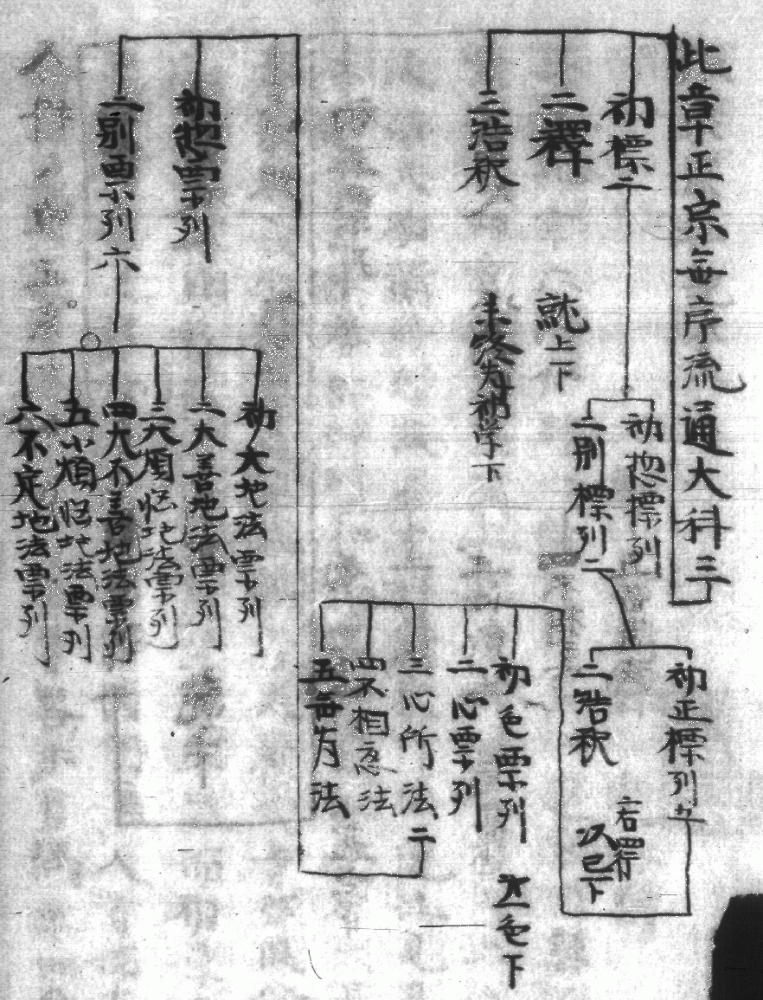



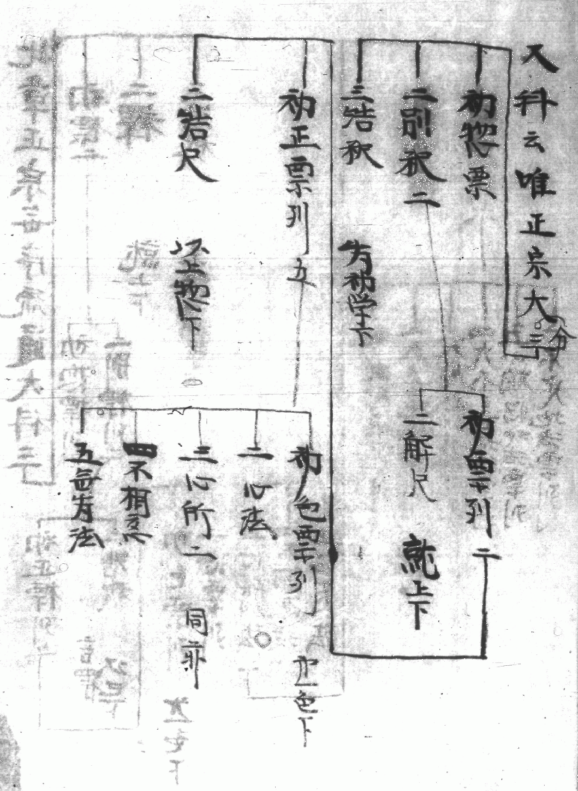



法宗原私记本上



智山沙门释　龙谦撰



将釈此章六门分别一讲前行法二造章囙缘三章传未四章所依经论五釈章题目无撰号六入文解釈初讲前行法者予如讲釈作法记徃见旲二造章囙缘者如四阿𭇥经文广义深発智六足者文畧义幽逐大毘婆娑论者文广义㫖深俱舎论正理论顕宗论等者文广坚义幽㣲而初学者直难入依之釈七十五法名体诸门为入有部大论甘露门故下文曰且为初学畧示方隅委细分别广如别录(文)三传来者初有部渡汉地㕝二正此章传此土㕝初有部渡汉地㕝者釈迦如来降诞南洲天笁净饭王家(有传第九减劫出世奖三下传第一减劫出性现佛三昧经说四月八日夜半生长阿𭇥四（十四一）二月八日生摽指抄四（四十一）佛所行三昧经三月八日生囙易经四月八日佛生月日诸说不同如破邪论（上十三）四下九西域二三又六之八及十二法𫟍十四𣧩苑集佛道论衡二三𧁨悉地㐬第四自四僧史畧上自甫注十三（四十五六）止真记五未（正九）名义集三（自二十二）统记二八九釈迦谱日经反花戒訳人斟酌出经之人名有所受故徃徃不同夫以史汉延出犹分猱相反况万里之外千岁之悲哉明昔者固冝択普而従（一之二十四）行㕝抄资持记下三之二（十五一）日僧祗佛生日乃至涅槃日为大众说法秝扬佛德萨婆多（二五一）三月八日或佛亦以此日生乃至若依瑞应上四（四）本经多云四月八日生（乃至）此并由众生见闻不同故时篇不等智论云（九十七一）王舎城十二亿家舎婆提城九亿家尚三亿见或闻由慢业故佛世犹尓何况末法转轻心业最重文寳疏一为帋)出家成道(出家或道年记不同一曰十九岁出家三十成道一云廾九岁出家三十五成道一云十九出家廾四成道一云二十五岁出家三十成道一云七岁出家廾成道摽指抄上（四十七）具引诸文徃见长含四（廿四丁）二月八日岁出家成道现佛经四月八日夜▆▆▆成道宝一（初丁）行㕝抄下三之二（十五帋）)於鹿野苑说四阿𭇥经(玄𮚌一（廾丁）曰旧同阿𭇥及僧祇律大众部义（云云）)转法轮诸说不同菩萨所胎经二月八日婆沙(百八十二)(十三丁)(迦栗[序-予+(氏+、)]迦月日半八日宝一（初丁）)如来灭后迦叶阿难等结集此经弘传(结集义林章二本)(初已下广釈三论玄并幽抄五（廿六丁）)灭后至百十六日大众部上座部分破(乃至)至三百年初从上座部中有部分破至二百年末迦多衍尼子等造发智六足论等釈此经令法久住至四百年中五百阿罗汉等造大毘婆沙论釈顕发智论至九百年中世亲大士造俱舎论等而先覚铠三藏訳婆沙(号旧婆沙)等真谛三藏俱舎论訳具如传通记上(五丁)釈后㢡三藏渡天(唐第二主大宋贞覌三年渡天在笁十七年同十九年皈唐)至北[(留-田)-刀+ㄗ]渡境迦湿弥罗国法救论师寺逢大论师僧伽那舎此云众祢特善萨婆多及囙明声明论创従考决便晓玄猷(大巟上)意㤙传二(十七丁)至迦湿弥罗国乃至彼师祢法师者高行之人乃至彼公是时年向七十气力已衰庆逢神器乃励力教扬自午已前讲俱舎论午已后讲顺正理论初夜后讲因明声论由是境内学人无不悉集法师随其所说领语无遗▆▆击篇尽其神秘(云云)又従戒贤论师𦗟顺正理论(㤙传三十九丁)在天十七年中传受大小乘已皈朝发智论集异门足论法蕰足论识身足论品类足界身足论俱舎论顺正理论显宗论等瑜伽论等大小乘论及訳弘宗也二正此传此土事者推法相宗传(第一传道拓第二传智通南第三传新罗智凤等智鸾知雄三师第四传玄昉)时东传来此章欤护命僧正传新罗智▆法师义立有为因生灭义(体不生灭南寺传)余先[彳*(匕/匕)]者立有为体生灭义(体用共生灭寺传)具如传通记等四章所依经论者通者四阿𭇥发智六足大毘婆沙师论等别者俱舎论为所依也五釈章题目并撰号此中二初釈题目二撰号釈初题目者若西土者经论等梵本题目置文终无文首汉土格式者置文首经论訳时皆首置也今章文首题置汉土格式也十住心论冠玄传(十五丁)日凢西笁经论文后置题东土方円卷首安名故金刚顶义訳(卅一丁)云题云此是金刚金刚萨埵三摩地一切如来菩提智第一釈曰此题目也梵本皆列扵后又𦾔引菩提流支萨遮𡰱乾子经注以成此义然考现本无有此注意后人删削若又留支别有彼经注不可知焉又所以又初安题者凖地藏经鼓吹引顕要记云晋朝道安法师有四义故初安经首一者人见经题目知部法故二者为智者畧知䏻广解故三者为简异餘部易见故四者为忩迫㐬生假见经题获益故(云云)又法华游意曰依梵本▆皆无题但云悉昙此云𠮷法亦名成就立名皆在经未而廽后置初葢訳经人随震旦国欲令因名字不同识部类差别故也(上廾一丁右)又维摩游意(二十右)亦云法宗原者法名义何谓光第一(廾六第一)曰釈法名有二一能持自性一切法各守自性如色等性常不改易䡄生胜解如无常等生人无常等解以上唯识逑记一本(五十)云法谓轧持䡄谓䡄范可生物解持谓任持不舍自相(文)瑜伽伦记十三下(三)右云梵语陀罗唐名持戒梵语逹摩亦是持义然㨬故名法(文)法自性者即有为无为七十五法也宗者宗轮述记曰宗者生也乃至又宗者所崇之理(已上)原者本也法之宗法宗之原二重依主釈或法宗法宗即原二重持业釈也次釈撰号者此中二初安置所由二正釈初谓凢安撰号㕝有三囙行㕝抄题于注云作者非无票名顕别中尽题下云著作者多立名票异大覚抄比云今抄始不安撰号祖师南山适至相部见砺师砺师问云従何来荅自北京来问云风闻首师门人有道宣𫽄理聪明汝知否荅云知之弟子是也即大惊叹又问近见首师抄三卷大要道荅云师不作此抄但有疏𢌬也卷砺自出抄呈之宜云是弟子撰耳砺大如敬色於此安撰号次人法相依者报㤙经六(十一丁)云顕法是佛师而非佛不弘止観四一(之丁)法自不弘弘在人䏻行法门光顕也宗轮论疏(四十丁)华严玄谈三(十三帋)付法𫇥二上(十四丁)后依人信法者论注上(初〡)云庻因人重法故云某造益为生信宗疏(四一)如上三囙初一作者自置后二囙后人代置今此章撰号恐后人所立欤祢赞大乗不呼金名欠上一字似二名不徧讳意大乗先者大者具七义形小教为名乗运载义济行者为目若乗若大问依一体名同依釈具体大法能有运功故名持业对法抄一(十六帋)同梁论一(六丁)言大乗欲简小乗玄赞四(五右云)乗者运载义广雅云乗驾也周礼云乗载也运载行者至彼岸故问因行能运至杲可名乗佛杲自运息応非是乗体荅五义(云云)摂釈一(十四丁)右云按大集经云其乗广大故於诸众生无碍障故是一切智善根本故无有烦𢙉诸浩黑暗故所有光明无処不遍故周遍其有眼目故本性常净故初无治污故诸断烦𢙉一切间亇故名大乗准此经文通根有为无为二种功法广如彼说又十二门论首云问云何故名摩诃衍荅摩诃衍於二乗为止故名大乗诸佛㝡大是乗能至故名为大谓佛大人乗此乗故名为大又能灭除众生大苦与大利益事故名为大又覌音得大㔟文殊等诸大士所乗故名为大又以此乗能尽一切诸法辺底故名大等(云云)。



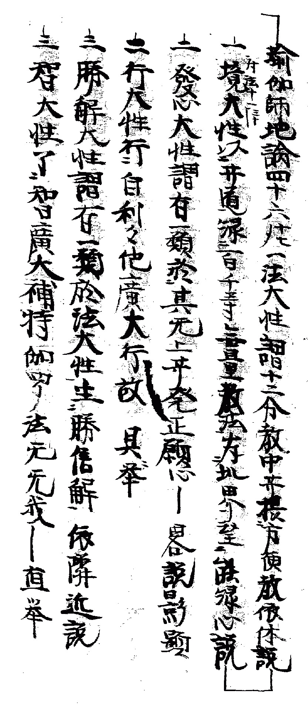



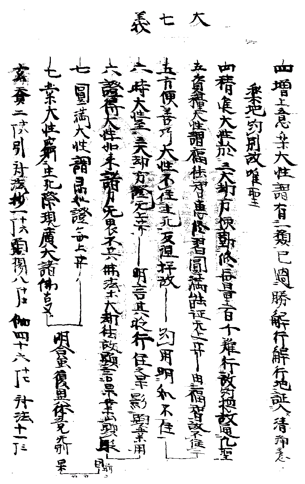



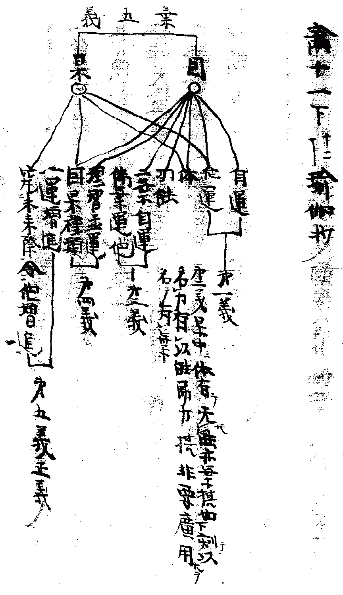



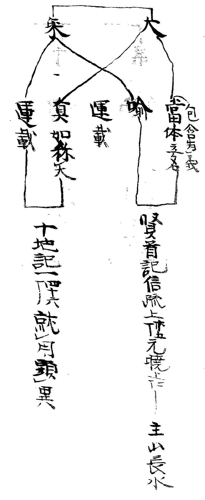



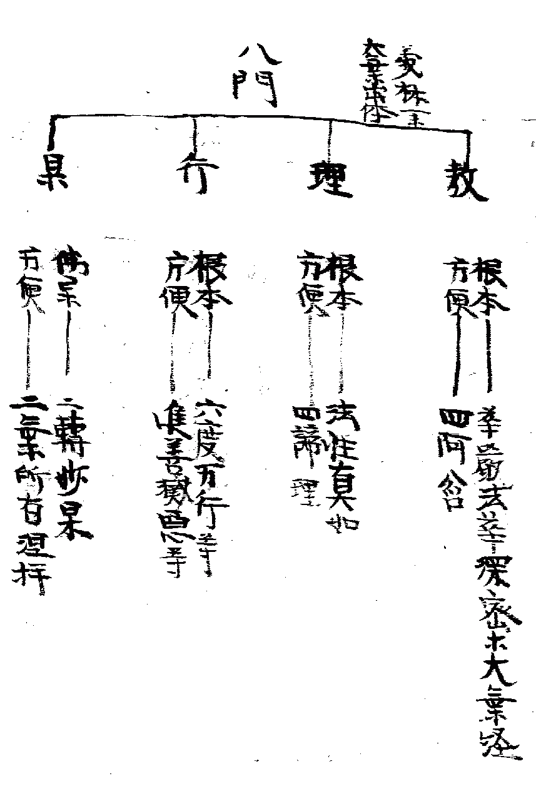



光者异云普光称大乗光者宋高僧传四(六丁)日釈普光未知何许人也明敏为性爰択其本请㕝三藏弉师勤恪之心同列靡及至扵智解可召循环闻少证多弉师点许末参传訳头角特高左右三藏之卷有功焉初㢡嫌古翻俱舎义多鈌尓躬得梵本再訳真文乃密授光多是记忆西[(留-田)-刀+ㄗ]萨婆多师口义光因著㐬解判一具㐬至圆晖畧之为十卷如汉之有绝(绝言釈云达阿功江之别流也)欤又[堂-土+耳]随㢡徃玉花宫訳大般若经厥㓛出于禆湛也取号大乗光覌夫弉自贞観十九年创訳记麟往元年终于玉花宫凢二十载总出大小乗经论七十五部一千三百卅五卷十分七八是光笔受或谓嘉光普光也若验従▆栈同参訳务即普光是也矣。



法师者文句法䡄则师者训进𧈧可记不自弘通此弘在人十住毘婆沙师论云応行四法名为法师一广博多学能持一切言辞章句二决定善知世出世间诸法生灭三得禅定智於诸经法随顺无诤四不增不减如所说行(云云)中边论下(六丁)说十种法师法花五说五种五师大乗义章十六(八丁)说二十二种㓛𭛟(云云)。



撰者资持记上一之一(九右)日撰逑者通而为诠撰亦是述今既両摽故顺别釈撰谓橾觚染翰诠次成章述谓谦己推他相循𦾔辙(文)依说一切等者北下第六入文解釈於中大二初正宗分二流通分初中二初摽二釈摽列中三初惣摽列二别列三结釈初中二初摽二列别列中五初色法列二心法列三心所法列四心不相应法列五者无为法列依说一切等者宗轮述记下(七丁)曰说一切有▆者有二一法色心一切谓五法即心心所色不相忍行每为二一切谓去来今(文)余者可知就中木者以下第一釈此中二初分科二述釈畧釈以下於中二初标二釈釈中五初色二心三心所四不相応五无为初中二初摽色十一釈色义二十一色别釈此中七初五根釈二色三声四香五味六触七无表初中二初眼根二余如根类釈可反碍故名色如无表者所依四大反碍生故名色俱舎论一(十丁)曰何故此蕰色无表为后说为色耶由反坏者故如世尊苾刍当知由反碍故名色取蕰谁能反坏谓午触故即便反坏乃至广说反坏乃是可𢙉坏义品中作如是说趣求谓欲人常起於希望诸欲若不遂𢙉坏如箭中色复云何欲所𢙉坏欲所扰𢙉反坏且故有说反碍故名为色若尒极微応不名色无反碍故此难不然无一极微各㨿而住众微聚集反碍义成过去未来応不名色此亦曾当有反碍故故及彼类故如所烧薪诸无表色応不名色有釈表色有反碍故无表随彼亦受色名譬如树动影亦随动此此釈不然无反碍故又表灭时无表応灭如树灭时影必随灭有釈所依大种反碍故无表业亦得色名若尓所依有反碍故眼识等五応名亦色此难不竒无表依止大种博时如影依树光依珠宝眼等五识依眼木时则不如是唯能为作助正缘故此影依树光依宝言旦非符顺毘婆沙师义彼宗影等顕色极微各自依止四大种故故设许影光依止树宝而表无色不同彼依彼许所依大种𧈧灭而无表色不随灭故是故所言未为釈难复有别釈佊所难言眼识等五所依不定或有及碍谓眼等根或无反碍谓无间意无表所依则不如是故前所难定为不有反碍名色得成就(文)婆沙七十五法(十二丁已下)色义釈正理二(九丁)眼谓内処等者初五根釈中二初眼根二余四根类釈内処简外非情顕内有情処能见色境文见者観照义也眼根能観照色境光记二(四十丁)见二种一観照名见二推度名见(云云)婆沙十三(初丁)云有执眼识见色如尊者法救有执眼色相応惠见色如尊者妙音有执和合见色如譬喻者有执一眼见色如犊子部为止如是异执顕示己宗二眼见色故作此论(云云)四大所造净色为体者简大众部大㐬部五根肉团为体宗轮论疏(五十四丁)品类足一(二丁)婆娑十三(九丁)论一(四丁)二(七丁)光二(八丁)有色者有反碍相名有色广如婆沙七十五(十三丁)(十二丁)有见者无能现所现及可示现在此在彼义名无见如论二(初丁)婆娑七十五(十六丁)下釈(十二右)非有眼见名为无见(文)有𭔹者下(十二右)曰有障碍故为有对(文)论二(初丁)婆娑七十六(初丁)乃至者二余四根类釈乃至言触耳鼻舌身色诸外処等者第二色処釈此二初惣释二别二十色明论二(十一丁)曰六根六识十二名内外谓余色木六境(云云)二(七右)曰五色根色木四境法界一分无表业色亦唯所造(文)婆娑七十四(初丁)内外建立广釈色有二十木者论一(六丁)曰言色二者一顕二形顕色有四青黄赤白余顕是此四色差别形色有八谓长为初不正为后或二十者顕色処复说二十谓青黄赤白长短方圆高下正不正云𤇆尘雾影光明暗有餘师说空一顕色第二十一此中正者谓形平等形不平等名为不正地水气腾说之为雾日㷔名光月星火𦰔宝珠电等诸㷔名明障光明生於中余色可见名影羽此为暗余色易了故今不釈(云云)正理一(十九丁)顕架二(二丁)光记一(六十丁)曰言长短者长短极微名有差别相杂而住形长见短形短见长问若长短等别有极㣲何故婆娑一百三十六(四丁)云応加极微是最细色非长短方圆解云婆娑㨿别一徵是最细分更不可折非眼见言非长等此论拠见已去有実体类成故长等故名长等若泛明长短亦通假実𠰥二十种色中长短相𭔹以実対実𠰥通约诸仮聚相対亦长短品以対仮故婆沙第九解诸有中第三师云五相対有谓此彼岸事又解(木)又解(宝六右有破)可量已去名长不可量者名短世间形长短为短者於彼长中仮说为短如於重中仮说为轻闻此短极㣲既有众多如何说佊而不可量解云𧈧有多体而不可量如轻极微𧈧有多体而不可秤短极微𧈧多而不可量若言眼见非不可量𩔰亦眼见応当可量若言同聚応可量者香等同聚亦応可量光既杂住而不可量短与长杂亦不可量方谓果方圆谓周円中凸名高中凹名下问长与高何别短与下何殊解云长短拠四辺高下拠処中然世人言世物高下於长短中说高下故又解(宝七破)长短拠横高下约竖世间立竖名长短者於高下中说长短故龙气名云火气名𤇆风吹细土名尘余色如文自釈(云云)婆娑十三(九丁)色处者二十乃至有说色処有二十一谓前二十及空一顕色(云云)声谓木者第三声釈此中二初惣釈二别明有声种五事论下(十三丁)声有一种乃至广说(云云)婆沙十三(十丁)声八种二说𩔰宗论二(二丁)正理一(廾丁)旧俱舎一(十丁)新俱舍一(七丁)入论一(二丁)光记一余(六丁)(云云)。



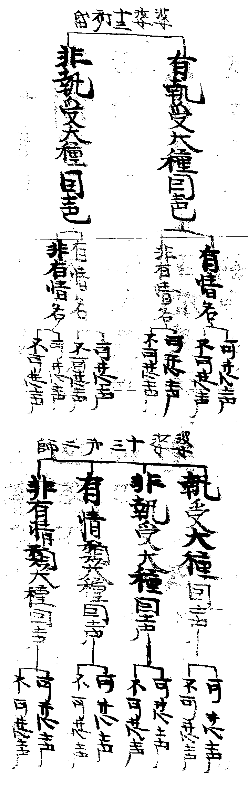



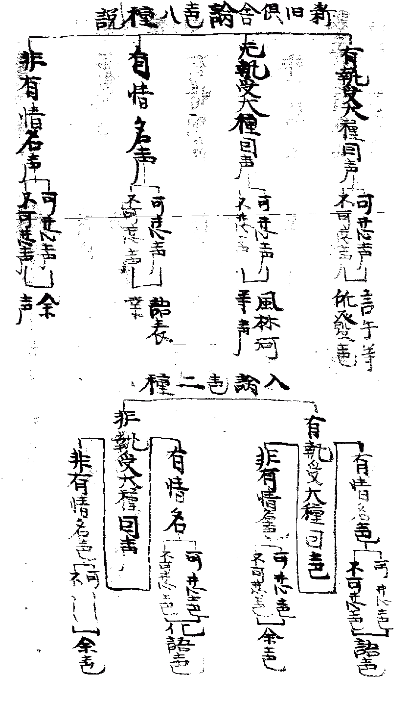



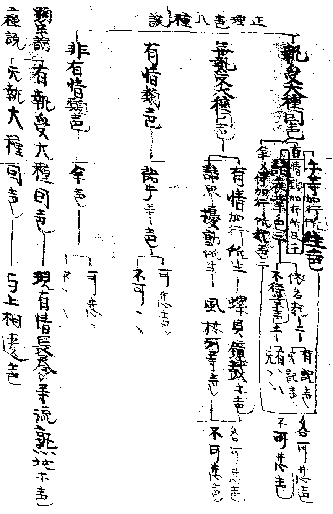



又俱舎论举破有说(杂心论一十二)曰有说有种通有执受及无受执大种为囙如牛皷木合所生声如不许一顕色极微二四大造声亦応禾(文)化语业非业等分别光一余(七丁)二解一义云化语业有実名定成就(云云)一义云化语非业非実名示非成就(云云)今谓第一解正义也第二解未熟宝一余(云云)未穗一有执受等者声差别相称隐难知约囙用杲杲有执受大种无执受大种者声囙如有情执受大种囙声无执受大种囙声约囙釈有情名声者声上名句文以诠表备声名有情色异此名非有情声有情名非情名者声用由声𩔰故如有情名声非有情名声为用釈可意不可意声为杲囙声生故生悦意声名恋声生不悦意声名不可意声也光一余(十五丁)(云云)香等者第四香釈此中二初惣釈二别列四香三香论一(七丁)四香三香(云云)品类足一(二丁)香有二种(云云)婆娑十三(十一丁)四香(云云)正理一(廿二丁)日香谓所齅此有四种好香𢙣香等香不等香有别故等不等者增益损减依身别故有说微弱增盛异故本论中说香有三种好香𢙣香及平等香若能长养诸根大种名为好香与此相𮞒名为𢙣香无前二用名平等香或谓诸福业增上所生名为好香若诸罪业增上所生名为𢙣香唯四大种㔟力所生名平等香此𧈧增上杲而亦有差别故唯大种㔟力所生亦是有情增上果摂(文)顕宗三(三丁)五㕝论下(十三丁)曰诸悦意者既名好香不悦意者说名𢙣香顺舍受処名平等香(云云)光一余(十一丁)曰正理解等不等香有両釈第一解云增益损减依身别故解云等谓平等香力均平增益依身不等者谓大强成损大弱无益损减依身於好𢙣香中有增损者名等不等余即是无益无损第二解云有说微弱增盛异故解云微劣是等增盛名不等正理解本论三香亦有両解第一解云若能长养诸根大种名好香与此相𮞒名𢙣香无前二用名平等香入论上(二右)亦同此解解云縦是𢙣香但能长养诸根大种亦名好香縦是好香若能损减诸根大种亦名𢙣香此师意说但能长养名好香但能损减名𢙣香无长养损减者名平等香第解云或诸福业增上所生名为好香若诸罪业增上所生名为𢙣香唯四大种㔟力所生名平等香次师约胜劣処中以解又五㕝论云诸悦意者悦为好香不悦意者为𢙣香顺舍受処者名平等香解云约情说故名好𢙣等香论体光记为与正理第二解义亦无违(云云)又云香相难知约情亦(云云)味等者第五味釈於中二初惣釈二别列六味论一(七丁)五事论下(十三丁)日诸悦意者名可意味不悦意者名不可意味与二相违名顺舍処味(文)婆沙十三(十二丁)味有六种(云云)顕宗二(三丁)正理一(廿一丁)论正理顕宗各味次香说顕宗正理云越次说者𩔰佊境识生无定故(文)光一(四十九丁)曰[(留-田)-刀+ㄗ]度造颂皆依声明若先香后味即犯声若先味后香即不犯声今依本翻故味先香后(云云)宝一余(三丁)光不可触木者第六触釈二初惣釈二别列十一触论一(七丁)触有十一乃至柔輭名滑麤强为澁可秝名重翻此为轻煖欲名冷食欲名饥饮欲名浊此皆扵囙五果名故作如是说(云云)又曰地水火风能持自相乃所造色故名为果如是四果亦名大种一切余色所依性故体寛广故或於地等增聚中形相大故或起种种大事用故此四大种能成何业如其次第能成持摂熟长四业地果能持水果能摂大果能熟风果能长长谓增盛或复流引业用既尓自性云何如其次第即坚湿煖动习性地界坚性水界湿性火界煖性风果动性由此能引大种造色令其相续生至余𭤧如吹灯光故名为动品类足及契经云何名风界谓轻等动性复说轻性为所造色故応风果动为自性举业𩔰体故亦言轻(文)婆娑十三(十二丁)五事论下(十二丁)顕宗一(三帋)正记一(二十一丁)婆娑有廿七(十三丁)曰不由大种徧增故滑乃至渴但由大种性类差别有生滑果(乃至)有生渴界有余师言水火增故滑地风故澁火风增故轻地水增故重水风增故冷风增故饥谓增故击动含渻引饥触生便発食欲火增故渴谓火增故𤋎迫饮渻引渴触生便発饮欲(然无评家)正理一(廾三丁)云问不𮥷滑力则涩重劣在轻輭轻性中摂如是其余所触种类随其所応十一中摂(云云)入论曰由此所逼𤌢欲囙名冷食欲囙名饥欲囙名渴此皆於囙立杲名(云云)覚天计大种外无所造色论二(七)帋婆娑百廿七(初丁)言无表者此下第七无表色釈於中二初牒票二解釈此句初也无表者亲家訳号若北凉昙无忏訳涅槃经善生经秦罗什訳智度及成実宋僧伽䟦摩訳杂心论等并名无作符秦僧伽提婆訳八揵度论宋僧伽䟦摩訳萨婆多论梁真谛訳旧俱舎等名为无无表色等者第二釈於中二初釈名二差别释无表释名论一(九丁)(云云)入论云无表者谓能自表诸心心所转及差别故名表与彼同类而不能表故名无表此於相似言遮止言如於刹帝利等说非婆罗门等(文)正理二(二丁)従来生者依身语表业生故云也阳心转者随定心转故処中者处律仪不律仪中焉故云処中边论十四(初丁)论云非律仪非不律仪也亦入论(云云)如下引非律等者身语业𧈧义非是律仪以不要期𣵀槃起故𧈧起众𢙣而不要期一期活命故非𢙣律仪摂也如伦记(十四上)饰宗记二义林章云不可仪䡄同於律仪名非律仪非不可则如不律仪名非不律仪既有双非亦非六釈(三未七丁)别解脱者釈名论十四(四右)曰谓受戒时初表无表别别弃舍种种𢙣故依初别舍义立别解脱名(云云)别解脱釈名无表疏上(卅三丁)净影章十(廾丁)行事抄中一(廾丁)义林章三未(五丁)梵约疏一(廾丁)清凉玄谈三(四十丁)対法论八(十丁)杂心(十六丁)光十四(八)右釈云谓初念表无表不杀戒等别别弃舍杀生业等种种𢙣故依初别舍义立别解脱名(云云)别解脱律仪异名论十四(三右)曰颂曰俱得名尸罗妙行业律仪唯初表无表名别解业道(文)论云别解脱律仪相差别有八一苾刍律仪二苾刍尼律仪三正学律仪四勤䇿律仪五勒䇿尼律仪六近事律仪七近㕝女律仪八近住律仪如是八种律仪相差别总名第一别解脱律仪𧈧有八种实体唯四一苾刍律仪二勤䇿律仪三近㕝律仪四近住律仪唯第四种别解脱律仪皆有体実相各别故所以者何𮥷苾刍律仪无别苾刍尼律仪𮥷勤䇿律仪无别近㕝女律仪(云云)入论云如是八种惟欲界系(文)随心等者定俱入论云静虑律仪谓色界三摩地随转色此惟色界系(文)道俱者入论云无口律仪谓无口三摩地随转色此惟不系(文)此无漏戒依地者唯在无口未至中间四根本六地非余成尤通三果身(除无口无処天梵三𢙣趣)处中戒者入论云非律仪非不律仪者谓造毘阿罗窣堵波僧伽罗摩等及礼制多烧香散花赞诵愿等并捶打等所起种种善不善无表色相疑转(文)𢙣戒者论十四(八丁)右曰𢙣行业不律仪(云云)论十五(四丁)不律仪者明婆沙百十七(初丁)(云云)入论云不律仪者谓诸屠児及诸猎兽捕鸟捕𩵋劫盗典狱缚龙煮犳置弶[(魅-未+寸)-ㄙ]脍此等心中不善无表色相续缚(文)论中十五(四丁)杂心三(十丁)婆沙百十七(初丁)正理三十六(十一丁)二十九(二丁)顕宗廿(十丁)大乗瑜伽九(六丁)対法八(三丁)义林章三未(卅四丁)対法八(卅三丁)伦记上(九丁)大乗义章七(八丁)北涅拌廾九(十五丁)说十六不律仪也第二心法者第二心法釈此中二初牒摽二解釈俱舎论一(十二右)颂曰识谓各了别此即名意処及七界応知六识转为意论曰各各了别彼彼境果惣取境相故名识蕰(云云)四(十三丁)曰集起故名心思量故名意了别故名识复有釈言净不净界种种差别故名为心即此为他作所依止故名为意作能作止故名为识故心识三名所诠义𧈧有异而体是一(云云)婆沙七十二(初丁)正理十一(十九丁)顕宗六(十一丁)入论(云云)光记四(四十二右)日梵名质多此云心是集起义谓理由心力集起心所及业等故经云心能导世间心能遍摂受故能集记说名为心梵云末那此云意是思量义梵云毘者南此云识是了别义也(文)六识体一体别之异义一义云六识体一非体别一(云云)一义云六识体别非体一(云云)具如别记第三心所法四十六者者此下第三心所法释於中三初牒标二解釈此中三初心所釈名二弁心所相三(七右)癈立心所有等者婆沙十六(十二右)曰问何故名心所荅是心所有故(文)光记四(十一右)曰心之所有故名心所応言心所有畧故但言心所犹如我所(文)就中等者第二并心所相此中二初正弁相二结釈初中六初大地法釈二大善地法釈三大烦𢙉地法釈四大不善地釈五小善地法釈(六丁六)不定地法释大地法釈中二初牒票二解释此中三初釈名二癈立三并相大有地法一者音牒摽地者至応知釈名谓此木句[病-丙+(干-〡+儿)]立论四(三丁右)曰地谓行処若此是彼所行処即说此为彼法地大法地故名为大地此中若法大地所有名大地法釈名谓法恒於一切心有(文)(癈立)正理十一(三丁)顕宗五(十八丁)婆沙四十二(十七丁)十六(十二丁)(云云)又秦疏四(八丁)日犹论师五义建立通大地二通三界二通六识三通三性四通漏无漏五通并顕起余此六不旲五义故不言也长耳三下具八通无八居五通大地体法师旲九义言通大地今依俱舎但一义立谓遍於一切心余此六不通一切心故不定也(文)受者正理第十一(三丁)(云云)顕宗五(十八丁)俞四(三丁)一(十一丁)受蕰谓三领纳随触即乐及苦不苦不乐(文)正理二(十三丁)随触而生领纳可爱及不可爱但相违触名为受蕰领纳即是云能受用义(云云)又云诸受畧有二缘境自性受者谓能领纳自処随触故乃至𧈧受亦能领纳境界而此领纳自性难知故领纳触为自性受此不共余易了差别如是诸受与心等法同所缘受故此异领纳故所缘㕝别処缘㕝别由此触於受若时为処领是时非所缘若时为処缘是时非所领故缘领㕝别(云云)入论云领纳三随触(云云)五㕝论下(廿一丁)曰是能领纳自性随触及所缘义彼领於境必有触故(云云)忧喜条舍五受発智十四婆沙百四十六俱舍论第三正理第九也想等者光四(十四丁)日想谓扵境执取男女木种种差别相能扵境中封疆尽果此是男女亦非男等故名男等正理云安立执立男女等等境差别相(解云谓能为可安立廿等相念心心所执取女等境差别相是差别相囙（文）)思等者思有㔟力能令心王扵境运动有造作用理実令余心所法有所造作従强说心故正理云由有思故令心於境有动作用犹如磁石㔟力能令铁有动用(文)触等者光云根境识三和合而生举可以并以并䏻有作用触対前境𧈧心心所対境义辺并応名触触対强故偏得触名故入阿毘达摩云触谓根境识和合生令心触境以能养活心心所为顺条受等差别有三(解云従强令心理実亦令心所触境)若依正理云触䏻为受囙(解云举果（文）𩔰囙也)欲等者光云欲谓扵境能有希求所作㕝业由有此欲心等趣境又入论云欲谓希求所作㕝业随顺精进谓我当作如是㕝业(文)惠等者元云推求名见决断名智简択名惠谓於诸法能有简択约用并也(云云)念等者光云念之作用扵所缘境分明记持能为后时不忘失囙非谓但念过去境也正理云於境明记不忘失囙说名为念又入论云念谓令心於境明记是即不忘已正当作诸事业义(云云)作意等者光云作动於意故名作意谓能令心惊覚前境心如睡眠况没不行由作意力惊覚取境理実亦能惊覚心所従强说心故正理云诸心所法依心转故但动於意余动亦成又正理云引心心所令於所缘有所惊觉说名作意此即世间说为留意杂心名忆又入阿毘达磨云作意谓能令心惊覚即是引心趣境为义亦是境特曾受境等(文)胜解等者光云殊胜之解故名解胜谓扵境[(留-田)-刀+ㄗ]可审定是㕝必尓非不如是(云云)三摩地等者光云持力能令心王於一境转若无等持心性掉动不能住境従强说心理实亦令诸心所法於一境转故正理云令心无乱取所缘境不流散囙名三摩地三摩地者此云等持即平等心心所法令专一境有所成并故婆沙百四十一(十二丁)云问何故名等持荅平等持心令专一境有所成并故名等持(文)入论云定谓令心专住一境即是制如猨猴心惟於境而转义毘婆沙者作如是说如虵在筒行便不由心若专定正直而转(文)定七名如光记六(卅九丁)瑜伽抄五(二丁)同记四上(二丁)述六本上(廿五丁)中边疏下(十八丁)第五本(卅三丁)瑜伽釈(十六丁)。



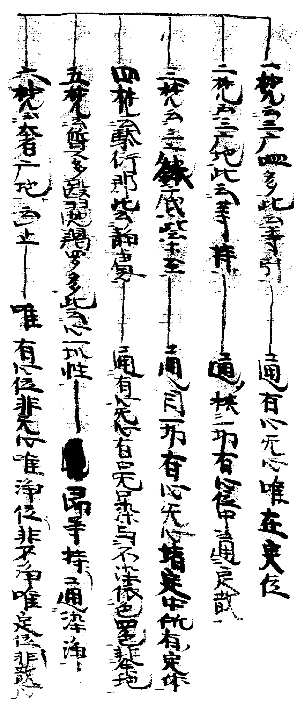



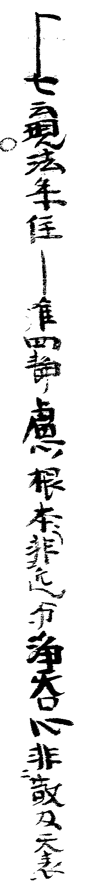



大善地法十者此下第二大善地法釈於中二初牒标二解釈此中四初釈名二癈立三并相四示诸论不同大善地等者牃票地如等者釈名谓此十法唯遍善心者癈立边论一(四右)曰大善地法名大善地此中表法大善地所有名大善法谓法恒於诸善心一有(云云)正理十一(六丁)顕宗五(十九丁)婆沙四十二(十八丁)曰若法唯在一切光云今依此论一义癈立大善地法十谓唯遍善心大地十𧈧善心而非唯善心余心所法非唯善心亦非遍善心故皆不名大善地法(文)泰疏四(九丁)云犹命师具五义建立大善地一通三果二通六识三通口无口四并顕五唯是善今颂但一义释谓唯通三性故遍善心简余廿六数不遍善心(文)寳疏四(十三丁)云诸心所中有唯是善不遍善心欣厌也有遍善心非唯是善谓大地法有唯是善亦遍善心谓信等下有不遍善心及非唯是善谓寻伺二睡眠𢙣作唯染心所非善性加善言已𫈉(文)善心中可得名大善地法(云云)信等者此下并相信者光云信谓令心澄净理亦能令余心所澄净従强说心由此信殊在心皆得法净故入论解信云是能除遣心浊秽法如水精珠置於池内令浊秽水皆即澄净如是信珠在心心池内心诸浊秽皆应除遗(云云)或於等者论有说(云云)谛者四谛等者等三宝善𢙣业异熟果等也不故逸等者光云谓能冬诸善法名不放逸(即放逸（文）相违)轻安者论广(云云)光云谓心堤任性者轻安谓能令心於善有所湛任故正理十一(六丁)云正作意转身心轻利安适之囙心堪任性说名轻安又入论云心堪任性说名轻安𮞒害惛沈随顺善法(文)有部意心轻安第六识相応通口无口通定散身轻安▆五识相応唯有口唯散意圣部意心轻安是心所而无别体即思差别唯定心有於散无五识相応理即非有轻安是轻触舍等者光云令心平等性従强说心亦令心所或心之平等性无惊覚性如持秤缕掉举相违说名为舍故入论云心平等性悦名为舍舍背非理及向理故由此㔟力令心於现及於非现无向无背字等而彼如持秤缕又正理云心平等性说名为舍掉举相违如理所引令心不越是为舍义(文)慙等者愧等者论四(十一丁)(云云)入论(云云)正理顕宗婆沙(云云)无贪等者光云於诸境界无爱染性说名无贪贪相违也无瞋等者光云於情非情无恚害性说若无瞋性相𮞒也不害者光云心贤善性无损恼他名为不害能违害也懃等者光云勤谓令心勇悍为性即勤断二𢙣勤修一善无退也懈怠相𮞒故入论云精进谓於善不善法灭生㕝中勇悍为性即是沈溺生死泥者能业䇿励心令速出义(云云)若依正理等者第四示诸论不同正理十一(七丁)婆沙二十八(十五丁)云有说猒以惠为自性(云云)有余师云猒以无贪为自性(云云)评曰有别法名猒非𢙣非无贪是心所法与心相応(云云)百九十六(十二丁)三说(廾八同)又婆沙一百四十三(十二丁)亦别言欣猒又婆沙七十五(二丁)云问若尓猒欣怖有何莂荅即名差别谓佊名猒此名怖尊者世友作如是说怖惟欲界猒通三果复作是说怖在烦𢙉品猒在善根品复作此说怖通染无覆无记猒唯是善大住说曰於衰损㕝深心於虑欲得远𮥷说名为怖已淂远𮥷深心增𢙣说名为猒如是为怖猒差别(云云)欣猒非并记𧈧唯善非通善通口无口唯意识相応非五识相応也又入论云欣谓欣向於还灭品见㓛往已令心欣慕随顺修善心有此故欣乐涅槃与此相𮞒名欣作意猒谓猒患於流转不见过失已令心猒𮥷随顺𮥷染心有此故猒𢙣生死与以相応名猒作意(文)大烦𢙉等者第三大烦𢙉地法釈於中二初牃票二解释此中三初释名二癈立三弁相大烦𢙉等者牒摽地如等者释名谓此六法等者癈立论四(五右)大烦𢙉法地名大烦𢙉地此中若法大烦恼地所有名大烦恼地法谓法恒於染污心有法佊是何颂曰痴逸怠不信惛掉恒唯染(文)正理十一(七丁)顕宗六(初丁)婆沙四十二(十八丁)云若法一切染污心中可得名大烦恼地法(云云)𬇦疏四(十一丁)云自古师诸师亦五义建立一通三果二通六识三通二轮四并𩔰起五唯不善友无记今依俱舎但一义释谓恒唯染恒简可教唯染简遍十也(文)宝疏四(十六丁)此有四句有唯染非遍谓忿覆等及贪瞋等并无慙等有遍染非唯谓通中十有遍亦唯谓大烦𢙉地非唯非遍谓即寻伺睡眠𢙣作唯善心所非染性故染言已简(文)无明等者此下第三并相无明者论四(二丁)云此中痴者谓所愚痴即无明无智无顕(文)婆沙四十三(三右)(云云)何无明荅三果无智此说応理谓三果系无智共摂诸无明故若作此说不知三果名无明者则応不摂缘灭道谛二种无明佊不缘三界故(文)又婆沙卅八(八丁)云评日応作是说如是无明扵四圣谛一向暗昧一向不明了一向不[(暴-(日/共))/又]訳以为自性(无明不共（云云）无明相)婆沙卅八(八丁)一解云不共无明见断有说五部皆有(云云)光云痴谓愚痴於所知境障如理异无弁了相说名愚痴照眼名明审[(暴-(日/共))/又]名智彰了名𩔰此三皆是惠之别名也无明朵故名为无明无知无顕即是无痴所対除法(云云)放逸等者光云逸谓放逸不修诸善恐滥无记故言是修诸善即不放逸所対法治(文)又正理云於专己利弃舍縦情名放逸怠木者论同可知又正理十一(八丁)云怠谓懈怠於善㕝业欠减胜能於𢙣㕝业顺成勇悍无明等流名为懈怠由此说为鄙劣勤性勤习鄙秽故名懈怠(文)不信者论可知又正理云不信者谓心不澄净邪见等流於诸谛実静虑等至现前轻毁於施等囙及於佊果心不现许名为不信(文)惛沈等者论四(三丁)右云惛谓惛沈対法中说云何惛沈谓身重性心重性身无堪任性心无堪任性身惛沈性心惛沈性是名惽沈対法此是心所如何名身如自受言故亦无失(文)正理云怪安処治(文)掉举等者论同光云即実亦能令心所不静従强说心正理论说舍所対治(文)又论中并本论十大烦𢙉地法与大烦𢙉地法相対四句分别。



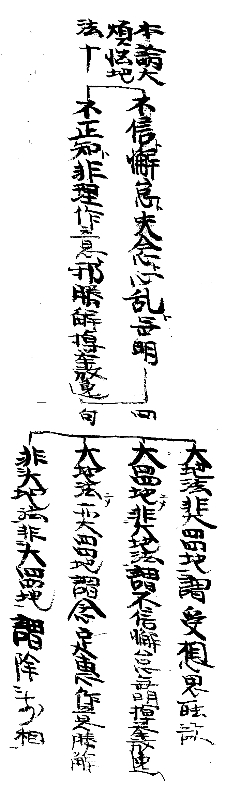



大不善地等者第四大不善地法释於中二初牒标二解释此中三初释名二癈立三并相大不善等者牒标地等者释名谓此二法者废立论四(六丁)右云大不善法地名大不善地此中若法大不善地所有名大不善心谓恒於不善心有佊法是何颂曰遍不善心无慙及无愧(文)婆沙四十二(十八丁)云若法一切不善心中可得名大不善地法(云云)𬇦疏四(十二丁)云古师亦以五义建立一道六识二通二相三并头起四唯不善五唯欲界今依俱舎但一义釈谓唯遍不善心唯简通十遍不善心简此四欲此解不尒如大烦𢙉地法六寻伺此八既遍不善心云何转遍不善心简応以唯不善心简司大地十(以上可)又善地(已下未稳宝可)等(云云)宝疏四(十九丁)云此有四句有不善非遍不善谓忿等七及不定中嗔有遍不善非唯不善谓大地十大烦𢙉六不定中寻伺有遍不善亦唯不善谓不善地二法有非唯不善非遍不善谓小惑三不定之中睡眠𢙣作贪慢疑等唯善心所不善已简不労唯遍(文)正理十一(八丁)顕宗六(二丁)无慙等者并相论四(十丁)云有余师说於処造罪自覌无耻名曰无慙覌他无耻说名无愧若尒者此二所观不同云何俱起不说此二一时俱起别观自他尒有无耻视自眨胜说名无慙复有无耻覌他时增说为无愧文婆沙说五种大不善地法婆沙四十二(十七丁)云大不善地法有五种一无明二惛此三掉举四无慙五无愧(文)小烦恼等者第五小烦𢙉地法释於中二初牒票二解释此中四初释名二癈立三并相四示诸论说不同小烦𢙉等者牒票也地等者釈名谓此等者癈立论四(七右)云小烦𢙉法地名小烦𢙉地此中若法小烦𢙉地所有名小烦𢙉地法谓法少分染污心俱乃至如是类法唯尽所断意识地起无心相応各别现行故名为小烦𢙉地法(文)婆沙四十二(十八丁)云若法少分染污心中可淂名小烦𢙉地法乃至又此十种唯修所断唯在意地若一起时必无第二五相迸故名小烦𢙉地法(文)正理十一(九丁)顕宗六(二丁)泰疏曰(十三丁)故名小烦𢙉地法(文)正理十一(九丁)顕宗六(二丁)泰疏曰(十三丁)古师亦以五义建立一不通三果二不通六识三不通三性四不通三轮五别头起今依俱舎以三义建立一如是类法唯修所断二意识地起三无明相応各别现行具此三义名为小烦𢙉地法宝疏云一唯修所断二唯意识地起三唯无明相応四各别现行大善地法不与一切染心相応烦𢙉之名以简此法寻伺𧈧通染心欠四义故不名为小烦𢙉地法大烦𢙉地大不善地𧈧复唯与无明相応欠三义故不淂名小慢疑二种𧈧唯意地起唯无明相応各别头起非唯冬断欠一义故不淂名小𢙣作一种𧈧唯断唯意地起以非唯与无明相応𧈧别头起不名为小睡眠一种𧈧唯意地欠三义故不名为小贪瞋二种复唯与无明相応各别头起欠三义故不名为小前之四地皆名为大此一地不淂大名者通大地法以遍一切心故名大大善地法以遍一切善心名大大烦𢙉地以遍一切善心名大大不善地以遍一切不善心故名为大又上四地法皆并头起故名为大(文)忿木者此下弁相忿等者论同如(文)可知论廿一(五丁)无慙悭掉举贪等流无愧眠惛沈无明等流痴忿是瞋木流悔是疑等流有说覆是贪等流有说是无明等流有说是俱等流有知无知如其次第乃至诳憍是贪等流害恨是瞋等流𢙉是见取等流谄是诸见等流(文)如言何由谓诸𢙣见故𮘦定是诸见等流光四(四十二丁)云憍谓染著种姓色等自法为先令心傲逸於诸善法无所顾性故婆沙四十三(八丁)云此中憍者谓不方他但自染著种姓色力戝位智等心傲逸相(文)若依正记等対示诸论说不同可知不定八等者第六不定地法释於中二初牒票二解释此中三初释名二相辨三示婆沙说不定八者牒票不定八等者释名寻等者弁相论四(十一丁)广(云云)正理十一(十六丁)顕宗六(九丁)婆沙四十二(十二丁)云或有执寻伺即心如譬喻者为遮彼执顕寻与伺是心所法或复有执寻伺是假为遮佊执𩔰此二种是実有法故作斯论何寻答诸心寻求弁了顕示推度搆尽分别类是谓寻诸心寻求等名𧈧有异而体无差别皆为顕了自性故云何伺答诸心伺察随行随转随流随属是谓伺诸心察等名𧈧有异而体天差别皆为顕了伺自性故寻伺何差别答心麤性名寻心细性名伺是谓差别(乃)至有说(云云)有余师(云云)评日应作异说此中顕示即一心中麤性名寻细性名伺若作是说顕一心中有寻有伺寻令心麤伺令心细(云云)睡眠等者婆沙卅七(八丁)广(云云)宗轮述记上(四十七丁)(云云)。



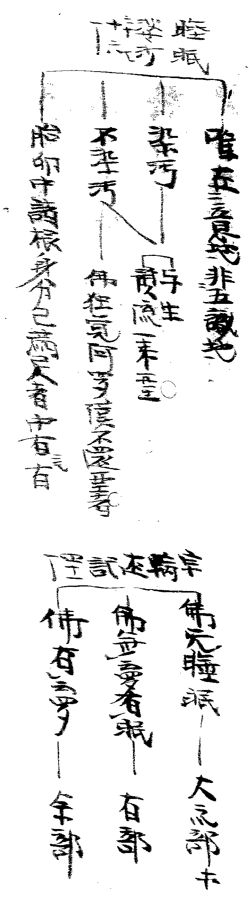



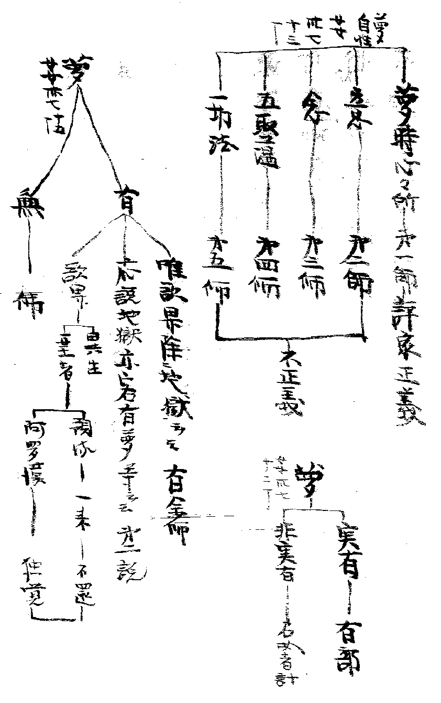



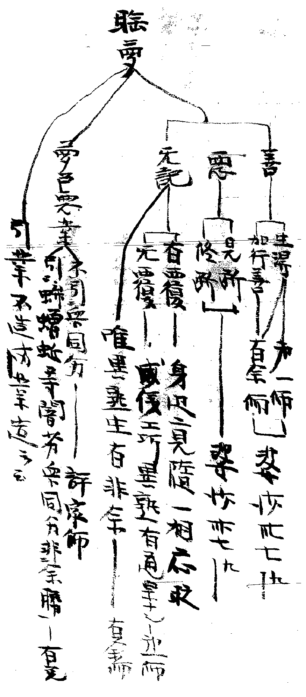



𢙣作等者论四（八丁云）𢙣作者何𢙣所作体名为𢙣作応知此中缘𢙣作法说名𢙣作谓缘𢙣作心追悔性如缘空解脱门说名为空缘不净天贪说为不净又见世间约所说依能依事如言一切村邑国土皆来集会𢙣作即是追悔所依故约所依说先𢙣作又於杲体假立囙名如说此六触処応知名宿作业若缘未作㕝云何名𢙣作於未作事亦立作名如追悔言我先不作如是㕝业是我𢙣作何木𢙣作说名为善谓於善𢙣不作中心追悔性与此相违名为不善此二各依二処而起(文)婆沙卅七(六丁)云此中𢙣作惣有四句一有𢙣作是善於不善処起二有𢙣作是不善於善処起三有𢙣作是善於善処起四有𢙣作是不善於不善処起(文)贪等瞋等可知论十九(初丁)贪分二欲贪有贪（云云）慢等者慢或七或九发智论廿(九丁)品类足一(三丁)论十九(十丁)婆沙四十三(十七丁)百九十九(八丁)婆沙四十三(八丁)云憍慢何差别荅(乃至)此中慢者谓𭤧於他种姓色力财位智等自举特相(文)又云评日応作是说非一切慢要方他起无始时来数习力故依自相续慢亦现行(云云)疑等者如文性若依等者三示婆沙说婆沙四十五(十五丁)云睡眠𢙣作怖寻伺及心又婆沙七十五（初帋）云怖以何烦𢙉为自性有说以有身见为自性(云云)有余师说以爱为自性(云云)复有说以无知为自性(云云)评日応知作是说此所起中応别说怖所以者何别心所与心相応是怖自性(云云)问此怖自性於何処有答在欲界有非上二界(云云)问异生圣者谁有怖耶有说异生有怖圣者无怖(云云)评曰异生圣者二皆怖(云云)问何等圣者有余小怖为有学位无学位耶有说惟何等圣者余小怖(云云)评曰学无学位皆容有怖学谓预流一来不还者不学谓阿罗汉独学除佛世尊佛无恐怖毛竖㕝於一切法如实通达得无畏故(云云)上来等者第二结释也婆沙更说欣猒怖心所法蕰足论第八(四丁)杂㕝品中更说有众多小烦𢙉名(云云)正理十一(九丁)(云云)光四(廿七丁)诸论说不同了简(云云)问心所等者第三癈立此中二初问二答此中二初惣二别此中二初约正翻釈二约傍翻释诸经论等者婆沙说四十九心所法蕰足论说种种小惑名也如大地等者大地寻伺眠通三性𢙣作通善𢙣二性也西方师义𢙣作通三性也余等者大烦𢙉地大不善地贪瞋通五断遍六识也小惑唯修断不通五断唯意识相応不遍六识慢通五断唯意我相応不遍六识疑见四断不通五断唯意识相応不遍六𧥾也五断者一见苦断二见集断三见灭断四见道断五修道断也𢙉乱菩提者婆沙四十四(四丁)多说(云云)且大▆说曰菩萨昔居某树下初夜魔女来相媚乱尒时菩萨𫏐起欲寻中夜魔军总来逼恼菩萨於彼𫏐起恚寻渐后歇薄复起害寻须㬰覚察即入慈定令魔兵众推败随落(文)余小惑等(文)第二约傍翻於中二初总二别此中二初分科二弁相此中二初约并流门二约行相相似门文相易知身正道者五𧥾相応行舍正直者意𧥾相応行舍也第四心不▆者第四不相意释於中二初牒摽二解释此中二初释名二辨相不与心等者释名光记四(四十六丁)二解一义云心不相应简异心所行谓行蕰简色及无为非行蕰故又解心不相応简蕰中诸心所法行谓行蕰简色受想成及与无为非行蕰故(文)宝疏四(卅五丁)云心不相応者简心心所非色等性行蕰所摂者简色及无为法是故名心不相応行畧结名也广応言非色非心不相应行今但言不相応行亦淂简诸法尽言不相応简一切心心所言行行是行蕰简色无为由此诸论多存畧名(文)论四(十三丁)不相応但有十四正理十二(初丁)更加和合性记四(四十六丁)了简俱舎论正理论不同(云云)顕宗六(十三丁)大乗不相応行说瑜伽五十二(十一丁)六十五(二丁)五十六(初丁)唯识论一(廿三丁)二(初丁)𩔰扬论一(十四丁)杂集论二(初丁)枢要上未(八丁)伦记十五下(初丁)淂等者第二并相此中九𫨻初淂二非淂三同分四无想异熟五无想定六灭尽定七命根八四相九名句文释淂者均获或就三名一体通门婆沙三十二(十八丁)百五十七(四丁)说淂或就差别百六十二(十五丁)七说成就実有九十三(初丁)百五十七(初丁)光二(卅二丁)未稳四(四十九丁)善说也光云得获成就义𧈧是一而依异门说差别名改於此釈总言一得於中义别立获成就谓若有法従来未此及▆已夫俱今初淂此法上淂创至生相将成就将名获若流至现淂已不失名成就获时不名成就成就时不名获设有（文）言淂至生相名成就者於佊获中说成就故设有(文)言淂至现在名为获者於成就中说佊获故如是名为获成就别応知若於佊法有获定有成就淂至▆相[(暴-(日/共))/又]定流入现在世故白有於法有成就无获如非想见惑无始来或无初淂故(文)宝四(卅六丁)(云云)得大淂小淂大淂云淂小淂云淂淂也。



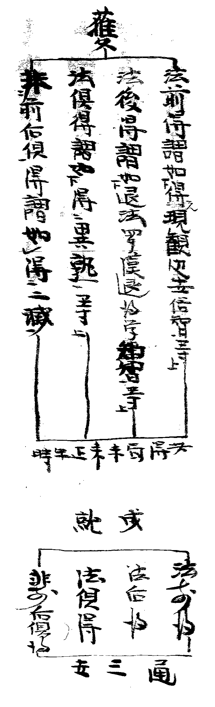



婆沙百五十八(四丁)然淂惣有四种在彼法前二在彼法后三每彼法俱四非佊法前后及俱若所得法则有六种一有所淂法唯有俱淂如异熟生等二有所得法唯有前后如三类智辺世俗智等有说此等无有俱▆三有所约法唯有俱▆后▆如别解脱戒等四有所淂法唯有俱淂▆▆如道类智忍等五有所淂法旲有前后俱约如所余善染污等六有所得法不可说有前后俱淂而有诸得谓択灭非択灭必无有法唯有法后淂者现在前时必有淂故(文)光宝(云云)所淂法唯有情数法択灭非択灭也非情法虚空得无也非得等者第二非得释论四(十八丁)正理十二(十丁)顕宗七(初丁)无记四(四十九帋)云谓若有法先未曾失及重得已但今初失此法非得创至生相将不成时说名不获若缘至现在名不成就不获𣆅未名不成就不成就时不名不获设有文言非得至生相名不成就者於不获中说不成就故设有文言非淂至现在名不获者於不成就中说不获故応知若於彼法说有不获定有不成就非得至生相[(暴-(日/共))/又]定流入现在世故自有於彼法有不成就无不获如无生智以於佊智无初非得故(文)宝疏(云云)。



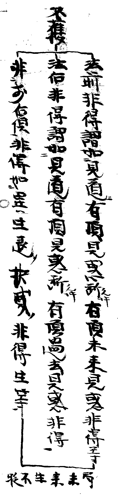



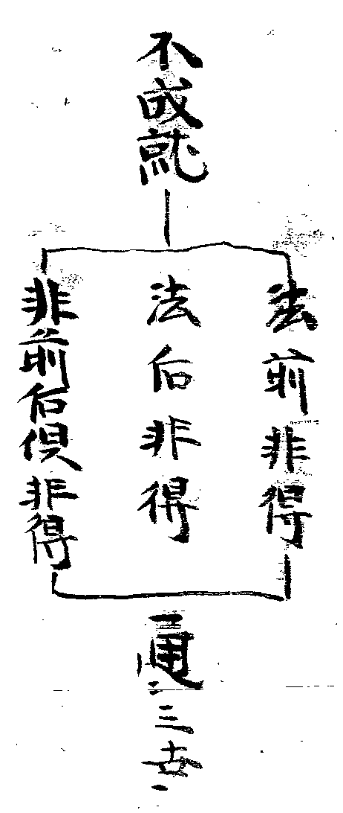



婆沙百五十八(九丁)云一切非得惣有三种一在佊法前二在彼法后三非彼法前后及俱所不得法亦有三种一有所不得法唯有彼法▆非淂谓未来情数毕竟不生法及入无余涅槃㝡后刹那心等二有所不淂法通有彼前复后非淂谓余随応有情数法三有所不得法无彼前后及俱非佊而有非淂谓択灭非択灭必无非淂可与法俱以法现在前时是所得必有得故非所得者无淂无非淂故亦无唯有彼后非淂非无始来恒或尤彼未舍必起彼类尽故然诸非得性[亡/(月*羊*几)]劣故唯成就现在一一刹那约已即舍於未淂彼法及已舍位恒有此非得応知(文)光宝(云云)所不淂法唯有情数択灭非択灭也非情法虚空非得无也同分水者第三同分者论五(初丁)有别実物名同分谓诸有情展转类等本论说此名众同分此有二种一无差别二有差别无差别者谓诸有情同分一切有情各等有故差别者谓诸有情界地生种性男女近㕝苾刍学无学等各别同分一类有情各等有故复有法同分谓随蕴処界(云云)光记五卷(初)帋宝疏五(初丁)正理十三(十三丁)顕宗七(三丁)婆沙廿七(四丁)同分体一物不相応行蕴摂惟无覆无记性惟有漏通三界异熟及等流(云云)有餘师说有情同分通善不善无记性摂(云云)评日乃至前说为善(文)无想异熟者第四无想异熟釈论五(二丁)若生无想有情天中有法能令心心所灭名为无想是実有物能遮未来心心所如堰江河此法一向是异熟杲正理十二(十丁)顕宗七(五丁)婆沙百五十四(八丁)云无想天身量五百逾𧬆那寿五百劫有说结伽趺㘴(云云)有说却踞而座如是说者如先入北定所定威仪即以此威仪於复五百刧住(文)又云出无▆▆者说通五断(云云)有余师修行(云云)评日▆说好(云云)又云圣者有情前心多那后心多那有说前心多(云云)有说后心多(云云)如是说者此㕝不定(云云)又云佊想或善哉无记(云云)婆沙百五十四(六丁)従无想天没定生欲界问定生何処有说生地狱有说生𢙣趣如是说者定生欲界処処不定(云云)。



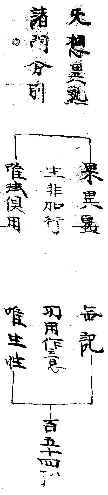



无想定者第五无想定釈论五(三丁)如所処说有法能令心心所灭名为无想如是复有别法能令心心所灭名无想定无想者定名相无定或定无想名无想定(云云)光记五(十三丁)如前処说有无想异熟法能令心心所灭名为无想如是复复别心不相应行法能令心心所灭名无想定体身中无想名无想者无想者之定名无想定依主釈也或即定无想名无想定持业釈(文)婆沙百五十一卷至百五十四卷正理十二(十六丁)顕宗七(六丁)[(暴-(日/共))/又]定感异熟婆沙十九(十一丁)五说百十八(九十丁)八说入北定次第婆沙百五十二(初丁)起北定処処婆沙百五十二(初丁)有说唯欲界人(云云)有说亦色界下三定起有说亦第四定起无想天除(云云)婆沙百五十二(三丁)云退如譬喻者不退有部也婆沙百五十一(十四丁)云𮥷第三徧净天染此定现▆(云云)二无心定大乘唯七卷述记七本(六十二丁)(六十八丁)灯五未演秘六本対法论対法抄五(六丁)瑜伽十二(廾丁)五十六(初丁)六十二(七丁)卅二(十四丁)唯识论一(廾七丁)智论卅九(初丁)瑜伽抄十五(四十一丁)十五下(初丁)十七下(十丁)八上(十七丁)十四上(廿丁)瑜伽抄十五(初丁)十六(七丁)十三(六十八丁)九(十丁)枢要上未(廿一丁)対法抄五(三十六丁)灯二未(四十五丁)演秘二本(五十丁)。



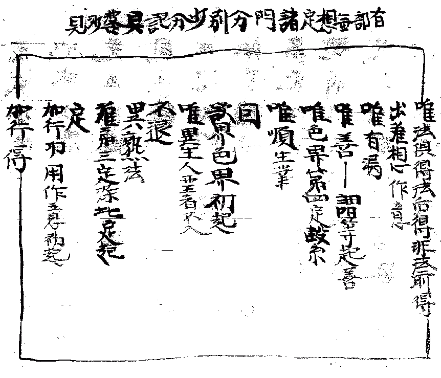



随灭尓所心心法等者灭第六意识大地法大善地法欣猒廿三心心所示所物现前为此定体也光五(十六丁)灭尽定等者第六灭尽定釈论五(四丁)复有别法能令心心所灭名灭尽定(云云)婆沙百五十二(十四丁)云问此灭尽定多物为体有说此定一物为体若灭现前即名无心问曰何一灭刹那现前即名无心荅如一受刹那现前即名有受一想刹那现前即名有想一识刹那现前即名有识如是一灭刹那现前即名无心斯有何过有说此定十一物为体以十大地法及心灭故有说[(暴-(日/共))/又]定二十一物为体以十大地法十大善地法及心灭尽故如是说者随灭示所心心所法即有示所物现前为[(暴-(日/共))/又]定体(云云)又百五十三(三丁)云问入灭尽定时灭何等心心所法为过去为未来为现在若过去者已过去灭复所灭若未来未来未至云何可灭若现在者现前不住何灭设非定力亦自灭故荅応作是说灭於未来问未来未至云何可灭荅住现在世遮於未来心心所法令不相続故说为灭如断城路闭门竖幢不令人入出说名除冠此亦如是有说通灭未来现在(云云)光五(十五丁)婆沙百五十至百五十四正理十二(十八丁)顕宗七(八丁)灭定入心有漏出心有漏无漏婆沙百五十三(二丁)三说。



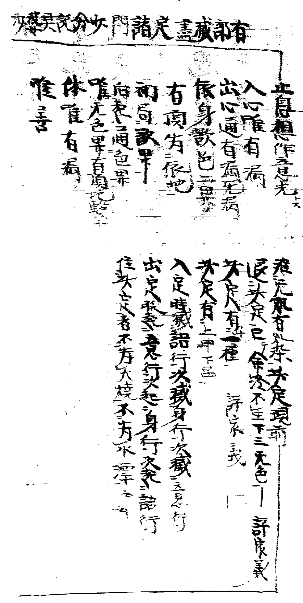



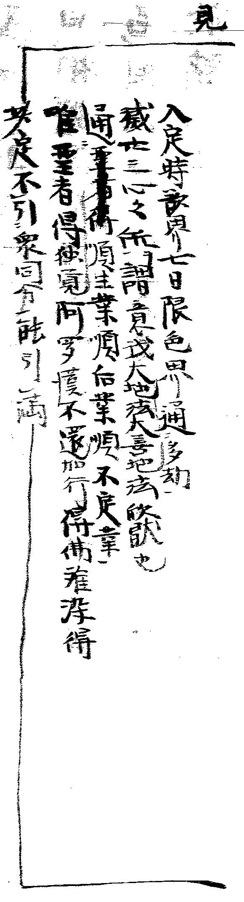



随灭尓所心心所等者灭意戈大地法大善地法欣猒廿三心心所有尓所物现前为北定体光五(十六丁)命等者第七命根釈论五(八丁)云命体即寿故対法言云何命根谓三界寿北复未了何法名寿谓有别法能持煖𧥾名为寿(云云)正理十二(六丁)顕宗七(十三丁)婆沙廿七(三丁)云有说命根体是多▆物(云云)评日应说命根体是一切有一命故名有命根(云云)唯异熟增上名根者论三(初右)云根是何义㝡胜自在光顕名根由此总成根增义(文)光三(初右)(云云)婆沙百四十二(八丁)云问何故名根根是何义荅增上是根义明义是根义现义是根义喜覌义是根义端主义是根严义是根义最义是根义胜义是根义主义是根义(云云)生住异灭等者第八四相釈论五(十二丁)云颂曰相谓诸有为生住异灭性论曰由此四种是有名相法若有此应是有为与此相违是无为法此於诸法能起名生能安名住能衰名异能坏名灭性是体义(文)正理十三(十丁)顕宗七(十四丁)婆沙従卅八(十三丁)至卅九(十三丁)大小四相各有三名大相三名者一名本相二名大相名生住异灭小相三名者一名本相二名小相三名生生等光五(卅八丁)具釈论五卷(十三丁)云四本四随於八扵一切能别故何谓卭能谓法作用或谓士用四种本相一一皆扵八法有用四种随相一一皆扵一法有用其义云何谓法生转并其自体九法俱起自体为一相随相八本相才生除其自性生余八法随相生生於九法唯生本生谓如雌鸡有生多子有唯生一生与生生生八生一其力亦然本相中住亦除自性住余八法随相住住於九法中唯住本住异及灭相随応亦尓是故生等相复有相随相唯四无无穷失(文)又北体灭用灭争南寺传用灭(云云)北寺传体灭(云云)具如三圣佛法传通记及予别记也名等者第九名句文釈此中三初名二句三文釈也论五(十九丁)云名谓作意如说色声香味等想句寺谓章诠义究竟如说诸行无常等章或能并了业用往时相応差别此章称句文者谓字如说哀阿壹伊等字(云云)正理十四(十二丁)显宗八(五丁)発者一(十丁)婆沙従十四(十一丁)至十五卷名者梵云那(去声)摩唐言名是随义皈义赴义名义谓随音声皈赴於境呼召色等名能诠义能非义合声非能诠义亦非义合故入论云非即语音亲能诠义勿说火𣆅便烧於口要依语故火等名由火等名诠火等义诠者谓能於所诠义生地学惠与义合句梵云钵陀唐言迹如一众身有四足迹如一颂总四句成故就义▆之为句句能诠义究竟梵云传迦(吉阿文)唐言章还是诠义究竟如说诸行无常等章章即句句是囙又者梵(云)便𪱋那唐云文是能彰顕义近顕名句远显於义梵云𢙣刹那唐言字是等流转义谓不随方流转改易亦是能彰显义能近彰名句远显义也字即(文)具称也即哀阿等字是不相应行摂非同此方墨书字也字又无诠表有诠表者即是名句字但是名句所依能显佊二体无诠表(云云)光五(三十三丁)大乘义林一本(卅丁)対法抄一(十一丁)第五无为等者第五无为釈於中二初牃标二解釈此中二初总釈无为义二别釈三无为也无囙多者婆沙七十六(七丁)有为无义釈几说章釈依第八覚天说欤虚空多者第二别釈此中三初虚空二択灭三非択灭也虚虚空但以无碍为性由无障故色於中行(文)正理一(十三丁)十九(卅三丁)顕宗一(十一丁)光记一(廿六丁)云虚空空界别也依之婆沙虚空空界五种别婆沙七十五(九丁)云虚空非色空界是色也虚空无见空有见虚空无𭔹空界有𭔹虚空无漏空界有漏虚空无为空界有为(文)又婆沙七十五(十丁)问以何义故知有虚空尊者世友(云云)乃至评云応作是说実有虚空非佊不知即谓非有由前教理有虚空(文)択灭等者第二択灭釈於中二初牃票二解釈此中二初釈名二明択灭体量论一(三右)(云)択灭即以𮥷系为性诸有漏法远𮥷证得解脱名为択灭択谓拣択则惠差别也各别拣択四圣谛故択力所得灭名为択灭如牛所驾车名曰牛车畧去中言故作是说(云云)正理一(十三丁)顕宗一(十三丁)光记一(卅七丁)択灭十三畧名婆沙卅一(初丁)云如是択灭亦名𣵀拌亦名不同类亦名非聚亦名非显亦名通达亦名阿罗汉亦名不亲近亦名不修习亦名可爱乐亦名近亦名妙亦名出𮥷问何故択灭亦名𣵀拌荅槃名为趣涅名为出永出诸趣故名𣵀槃复次等(云云)択灭釈名婆沙卅一(十三丁)光记一(四十丁)或无染异染名惠名别此差别惠各别简択四圣谛故灭体先有但不成就由択力所得名为択灭畧力所得但言択灭択之灭故名为択灭依主釈(云云)随有漏等者第二択灭体量也択灭体七说婆沙卅一(十四丁)云択灭自在有说一物(云云)有说二物一见所断法択灭二修所断法択灭有一(云云)有说五物谓见所断法択灭有四修所断択灭有一(云云)有说有十一物谓见所断法択灭有八修所断法択灭有三(云云)有说有三十五谓见所断法択灭有八修所断法択灭三界各九为二十七足▆八为三十五(云云)有说有八十九谓见所断法択灭有八修所断法択灭九地各九为八十一足前八为八十九(云云)评日応作是说随有漏法有欠佊体択灭亦尓随処系㕝体有尓所𮥷系亦尓有欠所体故(云云)非択灭等者第三非択灭釈也於中二初牒拣二解釈此中二初明釈名得缘或科応云初釈名二明非択灭体量非由等者釈名解曰非択力所得灭故名非択灭但由等者约缘谓但由缘欠约非択灭故论云约不由択由欠缘婆沙三十三(五丁)答由欠缘故(云云)又解云非由等但由等共釈名一假也谓非択灭力所得灭故但由欠缘故名非択灭(为言)二[己/十]由初解为胜论一(四丁)(云)永碍当生得非択灭谓能永碍未来法生得灭异前名非択灭得不囙択但由欠缘故(云云)婆沙卅二(五丁)问已知非択灭体非𮥷系応说何说名非択灭耶荅不由択惠得此灭故名非択灭非択杲故复次此灭不由一向加行一向㓛用拣択诸法得故名非択灭复次此灭不要由数数决択苦等得故名非択灭问荅尓此灭何而得荅由缘故(云云)光一(四)帋正理一(十四丁)显宗一(十三丁)随有为等者第二明非択灭体量婆沙廾二(六丁)评家日非択如有为法数量(文)虽(在等者)论一(四丁)婆沙三十二(五丁)云问於何世诸法得非択灭耶有说是说於三世诸法皆得非択灭是有为故(云云)有余师说但於过去未来诸法淂非択灭非於现在以现在法在身行故(云云)或有说者唯於未来法淂非択灭非过去现在所以者何过去诸法已在身行现在诸法在身行故(云云)评日此非択灭唯於未来不生法淂所以者何此灭本欲遮者为法令缘不生若法不生北淂便起如此欲法系故属有情现在正行过去已行未来当行皆有生义故於彼法不淂此灭(文)论体等者有云此解当婆沙不正义(云云)今谓此解不可也婆沙评家(云云)非択灭休如有为法数量故云论体实通三世也光一(四十一丁)択灭与非択灭体多少㕝婆沙卅二(六丁)有说択灭多非択灭少(云云)有余师说非択灭多択灭少(云云)评日非択灭多択灭少所以者何非択灭如有为法数量択灭但如有漏法数量故(云云)択灭与非択灭得四句分别论一(四丁)婆沙三十三(六丁)。



法宗原私记本(上终)



法宗原私记本下



智山沙门釈　龙谦撰



第二诸门等者第二诸门釈於中二初牃摽二釈此中二初分科二解釈第二等者牃摽就中等者分科蕰等以下解釈此釈中二初蕴処界摂釈二诸门分别釈初中二初釈科目二正釈蕴処界摂此中三初五蕰二十二処三十八界初中三初釈蕴义二明蕴摂法三弁五法摂不蕰等者初蕰义釈论一(五丁)(云云)婆沙七十六(八丁)(云云)正理一(十七丁)显二(初丁)(云云)蕴与取蕴别论一(五十右)婆沙七十五(四丁)正理一(十六丁)顕一(十五丁)诸有为和合等者婆沙七十四(十丁)云问何故名蕰何义荅何义聚是蕴[前-刖+戈]合义是蕰义积义是蕰义畧义是蕰义若世施设即蕴施设若多增语即蕰增语聚义是蕰义者谓法所有色若过去若未来若现在広说乃至若远若近如是一切总为一聚立为色蕰乃至识蕰义亦木合是蕰义者谓谓所有色若过去若未来若现在广说乃至若远若近如是一切总为一合立为色蕰乃至识蕰合义亦尓积义是蕰义者如积积物总为一积名杂物蕰如是诸色总为一积立为色蕰乃至识蕰积义亦尒畧义是蕰义者谓诸所有色若过去若未来若现在广说乃至若远若近如一切总畧一处立为色蕰乃至识蕰亦尓问过去未来乃至诸色可畧聚耶荅𧈧不畧聚其体而可得畧聚其名乃至识蕰应亦知尒(云云)论一(十四丁)云诸有为法和合聚是蕰义(云云)正理三(六丁)显宗二(十三丁)光一余(三十六丁)色蕰摂十一种色等者第二明蕴摂法文相易可知扵五法中等者第三明五法摂不无为非聚等者论一(十七丁石)颂曰蕴不摂无为不义相应故(云云)婆沙七十四(十六丁左)九釈又七十四(十丁)(云云)正理三(十一丁)显宗二(十五丁)十二処等者第二十二処釈此中二初总标二别釈生长门等者第二别釈此中二初釈名二明処摂法十二所建立论一(十二丁)(十九丁)婆沙七十三(十二丁)十二所别相婆沙七十三(十四丁)生长门等者论一(十五丁)云心心所法生长门义是処义训釈词者谓能生心心所法故名为処是能生长破作用义(文)▆七十三(十二丁)云问何故名処処是何义荅生门义生処义生畧义藏义仓义经义杀処义田义他义流义海义白义净义是処义応知(云云)正理三(六丁)显宗二(十四丁)眼耳等者眼耳等者第二明処摂法如文可知十八界等者第三十八畧釈此中二初总票二别釈界建立论一(十二丁)婆沙七十一(五丁)种族等者第二别釈此中二初釈明二明界摂法种等者论一(十五丁)云法种𫞀义是界义如一山中有多铜铁金银等族说多多界如是一身或一相続有十八类诸法种族名十八界此中种𫞀是生本义(云云)婆沙七十一(七丁)云问何故名界界是何义荅种𫞀义是界义股义分义片义异相义不相似义分齐义是界义种种因义是界义(云云)　正理三(七丁)显宗二(十三丁)眼耳等者第二明界摂法文相易知第二诸门等者第二诸门分别釈此二初总标二别釈百门者分别有十七种三门分别有二十种四门分别有廿二种五门分别有十五种六门分别有五种七门分别有五种八门分别有五种九门分别有五种十门分别有六种都合为百门也二门分别等者第二别釈此中九设初二别釈二三门釈三四门釈四五门釈五六门釈六七门釈七八门釈八九门釈九十门釈初中二初标列二解釈初中二初标二列二门等者标色非色等者列也色非色者可及等者第二解釈此中十七𫨻釈十七种故可知色非色等者初釈名次七十五等者经法分别以下准之可知▆七十五(十二丁)有二法谓有色无色法门何故作此论荅为欲遮遣补特伽罗及为显示智殊胜故为欲遮遣补特伽罗者谓显惟有色无色法毕竟无実补特伽罗故反为显示智殊胜者谓有聪慧殊胜智者由此二法通达一切此二偏摂一切法故由此二缘故作此论(云云)色反碍义无表反碍生故论一(十丁)有见无见等者第二段论二(初丁)(云云)云▆七十五(十三丁)云复有二法诸有见无见法问何故作此论荅为欲遮遣补特伽罗及为显示智殊胜故为欲遮遣特伽罗者显惟有见无见法毕竟无実补特伽罗故及为显示智殊胜者谓有聪慧殊胜智者由此二法通达一切此二偏摂一切法故复次为止他宗显正理故或谓有执一切法皆是有见如尊者妙音佊作是说一切法皆是有见惠眼境故为止佊意显一切法或是有见或是无见由此三缘故作斯论(云云)正理四(初丁)显宗三(六丁)有対等者第三佊此中有𭔹三种有𭔹中障碍有𭔹论二(初丁)云对是碍义也此复三种障碍境界処缘异故障碍有𭔹僧十色界自於他処彼碍不生如手碍手或石碍石或二相碍(云云)正理论四(初丁)显宗三(六丁)婆沙百二十八(二丁)百七十六(三丁)七十六(初丁)云复有二法谓有対无𭔹法问何故作此论荅为欲遮遣补特伽罗及为显示智殊胜故为欲遮遣补特伽罗者谓显惟有有对无对法毕竟无更补特伽罗及为显示智殊胜者谓有聪惠殊胜智者曰此二法通达一切此二徧摂一切法故复次为止他宗显正理故谓或有执若与对俱说名有対不(与)对俱说名无𭔹若作是说五识身等者为有対所依所缘俱対碍故或复有执若与瞋俱说名有𭔹不与瞋俱说名无対若作是说瞋相応品心心所法说名有対为止彼意显有碍色说名有対此所余法说名无対由此三缘故作斯论又云问有対无対是何何义耶荅诸法极微积集是有対义非极微积集是无对义乃至复次诸有障碍是有对义若无障碍是无対义复次等(云云)心心所境界有対所缘有𭔹别和汉両朝多解义灯二本(廿九丁)终南家业中卷広义沙三十五下(廿九丁)饰宗记二末(四十一丁)光记宝第二卷𬇦㐬指要二(三丁)有漏等者第四段婆沙七十六(四丁)复有二法谓有漏无漏法问何故作此论荅为欲遮遣补特伽罗及显示智殊胜故为欲遮遣补特伽罗者谓显惟有有漏无漏法毕竟无実补特伽罗及为显示智殊胜者谓有聪惠殊胜者由此二法通达一切此二偏摂一切法故复次为止他宗显正理故谓或有众执仏此无漏如大众部乃至为止彼悲显仏生身唯是有漏若仏生身是无漏者便𮞒契经乃至故知仏此定非无漏(云云)又云问有漏无漏其义云何荅云若法能长养诸有摂益诸者任持有是有漏义与此相𮞒是无漏义乃至复次若法能令诸漏增长是有漏义若法能令诸漏损减是无漏义复次等(云云)有诤等者有诤有漏异名是故论一(五丁石)云颂云有漏名取蕴亦免为有诤及苦集世间见処三有等者乃至此有漏法亦名有诤烦恼名诤触动善品故损𡧱自他故诤随增故名为有诤犹如有漏(云云)正理一体显宗一(十五丁)无诤无漏异名也等言等余异名也有为等者第五段婆沙七十六(六丁)云复有二法谓有为无为法问何故作此论荅为欲遮补特伽罗及为显示智殊胜故为欲遮遣补特伽罗者谓惟有有为无为法毕竟无実补特伽罗故反为显示智殊胜者谓有聪慧智殊胜者由此二法通达一切此二徧摂一切法复次为止他宗显正理故谓或有执有対法是有为无対是无为或复有执有漏法是有为无漏法是无为为止彼意显无対法及无漏法俱通有为无为由此三缘故作斯论乃至问有为无为是何等荅若法有生有灭有因有果得有为相是有为义若法无生无灭无因无果得无为相是无为义复次若法依属因缘和合作用是有为义若法不依属囙缘和合作用是无为义乃至尊者覚天作如是说若法由囙缘作是有为相若法不由囙缘作是无为相尊者妙音乃至(云云)相応等者第六𫨻论四(十三丁)云或名相応等和合故依何义故名等和合有五义故谓心心所五义平等故说相応所依所缘行相时㕝皆平等故㕝平等者一相応中如心体一诸心所法各各亦尒亦宝四(廿七丁)云论言同一所依者非谓所依唯一根故名同一所依是心心所法𧈧多不同共一所依名同一所依若二皆名同一乃至同一所缘者谓心心所𧈧复不同若想缘青受等亦缘青等由此故说同一所缘即心心所法共缘无量百千多法𧈧复不同所缘共故皆名同一所缘乃至同一行相者如心王起一青行相时诸心所等亦同起此相如心王缘多境时起多行相心所亦尒名同一行相(文)正理十一(十九丁)显宗六(十一丁)婆娑十六(十三丁)有上等▆者第七𫨻如文可知四大种等者第八𫨻体寛等者论一(九丁)云如是四界亦名大种一切余色所依性故体寛広故或於地等增盛聚中形相大故或起种种大㕝用(云云)正理二(三丁)显宗二(四丁)又论二(二丁)(云云)正理四(十七丁)显宗三(十二丁)婆沙百廿七(初丁)云大种所造乃至问何故作此论荅为欲分别契经义故乃至今応说之故作此论有说为止余师所说谓此部内有二论师一觉天二者法救覚天说色惟大种心所即心彼作是说造色即是天种差别心処即心之差别(云云)尊者法救说𮥷大种别有造色说心所法非即是心然说中二非実有谓所造触及法処色立蕴処界如对法宗彼亦不然诸所造触如余造色応别有故若无法処所摂色者无表戒等不応有故欲止如是二师所说故作此论(云云)婆沙百三十七(五丁)云问何故大种惟四𦚰尊者言此不応责(云云)有余师言若减四者而用便缺若过四者则亦无用(云云)问何故名大种荅大而是种故名大种如言大地如言大王义别体同応持业釈问云何大义云何种义答能灭能增能损䏻益体有起尽是为种义体相形量徧诸方灭成大㕝业是为大义问此四云何成大㕝业荅与大积聚造色为依令怀令成是大㕝业由此惟四不减不增谓减不能成大㕝业增於㕝业复为无用(云云)问造是何义为是囙义是缘义耶(云云)荅応作是说造是囙义(云云)婆沙百二十七(八丁)问一四大种为但造一造色极微为触造多(云云)荅応作是说一天大种但能造一所色极微(云云)有说造多(云云)评日如前说者好问大种造色云何而住为大种在下造色在上为大种在上造色在下为大种造色相𮥷而住大种在外造色処中耶(云云)有说在下为囙所依法応尓(云云)有作是说相杂而住大种在下造処中(云云)谛非谛等者第九𫨻论一(三丁)廿二(一丁)婆沙七十七(五丁)正理一(七丁)五十七(二丁)显宗一(十一丁)廿九(一丁)增𭇥十七(初丁)十九(七丁)中含七(十一丁)长𭇥七(十一丁)三(十一丁)十五(廿五丁)集异门足论六(十二丁)品类足论七(三丁)十二(十六丁)十八(八丁)法蕴足论五(五丁)(以上四谛说)婆沙七十七(五丁)云问如是四谛自性云何阿毘达摩诸论师言五取蕰是苦谛有漏囙集谛彼択灭是灭谛学无学法是道谛譬喻者说(云云)分别论者(云云)尊者妙音(云云)如斯说者若随自相续五蕰若随他相续五蕰若有情数及无情情数诸蕴如是皆是苦是苦谛乃至若随自相续因五蕰若随他相续五蕴囙若有情数及无情数诸蕴囙如是一切皆是集是集谛乃至若随自相续五蕴尽若随他相续五蕴尽若有情数及无情数诸蕴尽如是一切皆灭是灭谛乃至若随自相续五蕴对治若随他相续五蕴对治若有情数及无情数诸蕴对治如是一切皆是道是道谛乃至已说谛自性所以今当说问何故名谛谛是何义荅実义是谛义真义如义不颠倒义无虚诳义是谛义(云云)谛谓谛実者婆沙谛说六义中当第一义也七十三谛者此章未(初丁)七十五法中无表心王大善地十大地法十寻伺得四相此二十九通苦谛集道三谛択灭一种唯灭谛余四十五中除虚空非択灭余四十三通苦集二谛(云云)虚空等者婆沙七十七(八丁)十七釈且第九釈云复次虚空非択灭无漏故非苦集谛无记故非灭谛无为故非道谛第十釈云复次虚空非択灭不随世故非三谛无记故非灭谛(文)有执受等者第十𫨻有执受无执受釈名㕝论二(六丁)云有犱受者此言何执受无执受釈名所共所执持摂为依処名有执受损益展转更相随故即诸世间说有覚触众缘所触覚示等故与此相𮞒名无执受(文)婆沙百卅八(七丁)(云云)正理四(十七丁)显宗三(十二丁)眼五根等者论二(六丁)云眼等五根住现在世名有执受过去未来名无执受色香味触住现在世不𮥷五根名有执受若住现在非不𮥷根过去未来名执受如在此内除与根合发毛齿爪大小便利洟唾血等及在身外地水等中色香味触𧈧在现世无执受(文)光二(十七丁)(云云)有所缘等者第十一𫨻论二(六丁)正理四(十丁)显宗三(十一丁)异熟等者第十二𫨻论二(九丁)云异熟因所生名异熟生如牛所驾车名曰牛车畧云中言故作是说或所造业至淂果时変而能熟故名异熟果従彼生名异熟生彼所淂果与囙别类而所熟故名异熟或扵囙上假立果名如於果上假立囙名如契经说今六触処応知即是者所造业(文)婆沙十九(十七丁)云熟有二种一者同类二者异类同类熟者即等流果谓善生善不善生不善无记生无记异熟者异熟果谓善不善生无记果此无记果従善不善异类囙生故名异熟(云云)二十(十七丁)云问何故名异熟因异熟是何义荅异类而熟是异熟义谓善不因以无记为果果是熟义(云云)五十一(六丁)异熟熟釈名同十九(十七丁)说正理五(十四丁)显宗三(十四丁)光二(廿四丁)(云云)见非见者第十三段论二(十四丁)云审虑为先[(暴-(日/共))/又]度名见乃至眼根以能明利観照色故亦名见(文)婆沙九十五(初丁)(云云)何为见乃至広说问何故作此荅为止他宗显正理故谓或有说诸有为法皆是见性乃至为遮彼意是惟眼根及决度惠是见非余或复有说现観边忍亦是智性如譬喻者乃至为遮彼意显无漏忍是见非智有余师复说尽无生智亦是见性为遮彼意显彼息未不复推度是智非见(云云)光二(四十八丁)云见有二种一者观照名见所谓眼根𧈧惠亦名观照此中且以眼名观照此中且以眼名视照乃至二者推度名见於其惠中唯此八种(云云)正理六(十三丁)显宗四(二丁)世俗正见者论二(十丁)(已左)云世间正见谓意识相应善有漏惠(文)婆沙九十七(八丁)云何世俗正见乃至広说问何故作此论荅为欲分别诸契经中深隐故乃至后次为止他宗显正理故谓或有说意识相应善有漏惠非皆是见如譬喻者乃至为遮彼执显意戈一切善惠皆见性摂如是等种种囙缘故作此论云何世俗正见荅意识相应有漏善惠此有三种一加行得二𮥷染淂三生得(云云)尽无生智等者非见者婆沙九十五(初丁)(五丁)(云云)眼根唯是见者婆沙九十五(初丁)(云云)积集等者第十四叚论二(八丁)云十八界中五根五境十有说色界是可积集极微聚故义唯余八非可积集非极微故(文)正理五(十三丁)显宗三(十三丁)能(十五丁)斫等者第十五𫨻於中二初釈能所等二类釈能[社-土+(乞-乙+小)]等论二(八丁)云色香味触成斧薪等此即名为能斫所斫何法名斫薪等色聚相逼续生斧等分隔令各续起此法名斫身等色根不名所斫非可全断令成二故非身根等成成二分支分离则无根故又身根等亦非能斫以净妙故如珠宝光如能斫所斫体唯外四界所烧能称其体亦尓谓唯外四界名所烧能称身等色根亦非二㕝以净妙故如珠宝光声界总非不相续故能烧所称有异诤论谓或有说能烧所称体亦如前唯外四界或𣸪有说唯有大界可名能烧所称唯重(文)正理五(十三丁)显宗婆沙百此三(六丁)问义処和合说为能[社-土+(乞-乙+小)]义処说和合为所称有说四処能称四処所称有余师说四処能种重是所称问义和合说为䏻称义処和合说为所说有说四処能烧四処所烧有余师说煖是能烧四是所烧问义処和合说为能断义処和合说为所断有说四処能断有余师说坚性是能断四処是所断(文)根非根等者第十六𫨻论二(廿二丁)列廿二根名三(初丁)已下觧釈発智(十四丁)四(十二丁)婆沙百四十二卷至百五十六卷正理八(廿一丁)显宗(十六丁)增上名根者如前引论三(初丁)婆沙百四十二(八丁)今章列廿二根次第者依经说阿毘达摩诸大论师皆越经中六処次第於命根后方说意根有所缘故也婆沙百四十二(六丁)云问二十二根名有二十二実体有义答对法者言名二十二実体十七扵中男女三无漏根无别体故男女即是身根少分故三无漏根即是九根摂故九谓意根条喜舍根眼等五根此九根有位为未知当知根有位名已知根有位名具知根即见道位修道位无学道位如次応知(云云)尊者法救见名二十二実体十四谓即前五及命根舍定无无别実体故不相応行蕰无実体故离苦条受无别不苦不乐受故离心无実体故(云云)尊者覚天说名廿二実体唯一所谓意根彼说诸有为法有二自性一大种二心离大种无所造色离心无心所诸色皆是大种差别无色皆是心心差别由此义故実根唯一処実义者応知初说名二十二実体十七(云云)三无漏根釈名论三(六丁)如斯三名囙所而立谓在见道有未曾知当知行转故说彼名未知当知若在修道无未曾知但为断除余随眠故即於彼境复数了知是故说彼名为已知在无学道知已已知故名为知有此知者名为具知或习习此知已成性者名为具知谓得尽智无生智故如実自知我徧知若不复遍知乃至广说彼所有根名未知为当知根等(文)有异熟等者第十七𫨻有异熟无异熟㕝婆沙五十一(四丁)云三说乃至九十八随眠义有异熟无异熟问何故作此论荅为止他宗显己义故谓或有执离思无异熟囙离受无异熟果如譬喻者为止彼意显异熟因及异熟果俱通五蕰或复有执诸异熟因果若熟其体便无如饮先部彼说诸异熟囙果未熟位其体犹有果若熟已其体便无乃至为遮彼意显真熟囙果已熟位其体犹有或复有执善不善业无异熟果如诸外道为破彼义显善𢙣业有异熟果为止此等种种异熟显己所宗故作此论复次勿为止他显示己义但为开发诸法実性令生正觧故作此论荅者不善有异熟诸无记无异熟此广分别応唯前门问有异熟者义何谓耶为与自异熟法供名有异熟为与他异熟法俱名有异熟亦尓何失乃至荅自异熟俱名有异熟(云云)又云问何故名异熟荅异类而熟故名异熟(云云)论三(十一丁)正理九(十五丁)显宗五(九丁)不善善有漏异熟者恐漏字下脱有字欤応言不言有漏有为熟余文可知三等者第二三门釈於中二初标列二觧釈初中二初标二列觧釈中廿𫨻三性者等者第一此中二初标二釈此中二初三性开门二经法分别三性名义㕝婆沙百四十五(十一丁)问曰何名善不善无记耶荅若法巧便所摂能招爱果自性安隐说名为善巧便所摂者显道谛能招爱果者显若集谛少分自性安隐者显灭谛若法不巧便次摂招不爱果性不安隐说名不善此则显示苦集谛少分与二相𮞒说名无记有说(云云)有说(云云)有说(云云)有说(云云)气尊者曰由四缘说名为善一自性故二相応故三等起故四胜义故自性善者有说是惭愧有说是三善根相応善者是彼相応心心所法等起善者是彼所起身语业心不相应行胜义善者𣵀槃安隐故名善分别论者说言自性者善者谓智相応善者彼相応识等起善者谓彼所起身语业胜义善者谓𣵀拌由四缘故说名不善一自性故二相応故三等起故四胜义故自性不善者有说是无惭无愧以一向不善偏不善心故有说是三不善根以具五义故相応不善者谓彼相応心心所法等起不善者谓佊所起身语业心等不相応行胜义不善者谓生死不安隐故名不善分别论者说言自性不善者谓痴相応不善者谓彼相応识等起不善者谓彼所起身语业胜义不善者谓生起脇尊者(云云)复次(云云)五十一(初丁)四种善不善论十三(十四丁)光二(七丁)十四以此十五者第二经法分别此中二初标二分别此中五初色十一分别二心王分别三心所分别四不相応分别五无为分别善中通生淂闻思以皆能発身语业故者光记一(廿四丁)云问如何淂知闻思二惠触発业解云正理四十二(十一丁)曰诸律仪果有従加行善所生有[彳*(前-刖+(之-、))]生得善心所生若[彳*(前-刖+(之-、))]加行善心生(文)者律义先舍𣸪断善根又百七十七(初丁)婆沙云问相异応熟业以何为自性为身业为语业为意业荅三业为自性又婆沙曰问相応异熟业为闻所成思所成修所成耶荅唯思所成非闻非修所以何此业胜故非闻所成欲界系故非修所成有说此业通闻思所成但非修所成以此文证故知闻思能発身语问若言闻思能発身语既能発语即能受持三藏教法何故但言生得惠耶觧云闻思能発胜身语业佊业非胜故但生得然古德说加行善心不能発身语业引婆沙十七(云云)难云乃至古徃说非理文心於十五中等者别分别者生得者谓七心界闻思修学无学者谓意界戈界不善者谓七心界有覆者眼耳身戈意界意识异熟工巧者谓七心界威仪者除耳识余六识界若约似威仪路心通耳𧥾也通果者谓眼耳识及意界意识界由异熟等摂心尽故所以不遇自性也威仪工巧有起加行缘别婆沙百二十六(十八丁)云眼耳鼻舌此四识是威仪路加行非起威仪路意戈是威仪加行亦是起威仪路又眼等四识能缘威仪路不能起威仪路意识能缘威仪路亦能缘起威仪路(云云)又云眼等五戈是工巧処加行非起工巧処意戈是工巧処加行亦起工巧処又眼等五根识能缘工巧処不能缘起工巧処意识能缘工巧処亦能缘起工巧処(云云)若睡眠善中等婆沙三十七(五丁)问此睡眠梦中所起善法为加行善为生得耶荅惟生得善以惛微故有余师说亦加行善以於文义亦标択故(文)无记中等者婆沙卅七(九丁)云问睡眠梦中所起无记为是有覆为无覆耶荅二标俱有有覆无记者谓欲界身辺二见相応睡眠无覆无记者谓威仪路工巧処异熟生非　果威仪路者如睡眠梦中自谓行等工巧処者睡眠中自谓畫等异熟生者如睡眠中除前所说余无记转有余师师说惟异熟生是睡眠中无覆无记以心惛昧不発身语故无威仪及工巧(文)𢙣作等者有若外方师亦通无记论四(九丁)(云云)三界等者第二段此中二初标二釈此中二初釈三界名二经法分别此中五初色二心三心所四不相応法五无为法系者论二(三石)云系谓系属即被缚义(文)婆沙百四十五(十四丁)系七釈香味唯欲界唯𫨻食性故者论二(三丁)(云云)以大梵処自梵众等者论四(九石)经说𮘦诳𫽄至梵天众相依故上地无有以大梵王処自梵众忽被马胜苾刍问言此四大种当於何法尽减无余梵王不知无余灭位便矫乱荅我扵此梵众是大梵自在作者化者生者养者是一切人作是语已引出众外𮘦言愧谢令还问仏(文)婆沙百廿九伽广(云云)光记(云云)要解(云云)(未隐)名句文若说等者婆沙十五(初丁)云问名为道语地系为随补特伽罗地系耶有说名随语地系彼作是说生欲界者若作欲界语彼欲界身欲界语欲界名所说义或三界或不系若作初静虑语彼欲界身初静虑语初静虑名処说义如前说生初静虑者若作初静虑语彼初静虑此初静虑语初静虑名所说义如前说若作欲界语彼初静虑此欲界语欲界名所说义如前说生第二第三第四静虑者若作欲界语彼第二第三第四静虑身欲界语欲界名所说义如前说若作初静虑语彼第二第三第四静虑此初静虑语初静虑名所说义如前说问若尓者上三静虑为有名不有说无有说有而不可说评曰佊不応作是说宁说无不応说有而不可说以无用故有说名随补特伽罗地系佊作此说生欲界者若作欲界语彼欲界身欲界语欲界名所说义如前说若作初静虑语佊欲界此初静虑语欲界名所说义如前说生初静虑者若作初静虑语佊初静虑此初静虑语初静虑名所说义如前说若作欲界语佊初静虑身欲界语初静虑名所说如前说生第二第三第四静虑(文)若作欲界语彼第二第三第四静虑此欲界语第二第三第四静虑名所说义如前说若作初静虑语彼第二第三第四静虑身初静虑语第二第三第四静虑名所说义如前说问若尓者无色界为有名不有说无有说有而不可说评曰彼不応是说宁说无不応说有而不可说以无用故如说名文句亦尒(文)今评婆沙评者随语系二说中局欲界初定地初说为正第二说破随身系二说中局欲四静虑地初说为正第二说佊也然章主者取随语系名为正也无想异熟及无定唯在色界第四定故者婆沙百五十二(初丁)(云云)外道乃至为真𣵀槃者婆沙百五十二(初丁)此灭尽定极微细心心所法故唯法有顶不通下地者恐定字下脱灭字欤光五(十五丁)婆沙(文)有灭字灭尽定灭极微细心心所法入此定故唯有顶不通下地非谓此灭定道极微细心心所法也或恐定字下脱灭字欤三断者等者第三𫨻此中二初摽二釈此中二初觧三断名二经法分别见修断名义㕝婆沙五十一(十五丁)云问何故名见修断何故名修所断耶是见不𮥷修修不𮥷见如何建立二所断名荅𧈧见道中亦有如実修可淂修道中亦有如実见可淂而见者是惠修者是不放逸如实者是增广义或猛利义见道中惠多不放逸少修道中不放逸多惠少故彼所断断名有差别(云云)八十八随眠相应俱有及淂等者八十八者谓欲界见惑卅二(苦谛十随眠集谛名七随眠问除身边或余七道谛八随眠谓除身边余八)色界见惑廿八(苦谛九随眠谓除嗔余九集灭谛名六随眠谓除身边或嗔余六道谛七随眠谓除戒辺瞋余七)无色界见惑廿八(苦谛九随眠谓除嗔余九集谛六随眠谓除身辺戒嗔余六道谛七随眠谓除身边嗔余七)▆相応者谓第六意识十大地法六大烦𢙉二大不善寻伺随眠也别分别者欲界见惑中贪瞋痴慢疑见戒禁取邪见八相応法谓意戈十大地法六大烦𢙉二大不善寻伺眠睡有身辺执见二相応法者谓意戈十大地法六大烦𢙉寻伺睡眠上二界见惑中初定见惑相応法者意识十大地法六大▆寻伺二定已上见惑相応法者意戈十大地法六大烦𢙉俱有者大小四相也得者通法前得法后淂法俱淂也余有漏修所断者色十一中五根五境全除道俱余散无表心王中前五戈全第六识少分心所中大地大善地法烦𢙉地法大不善地法贪瞋慢寻伺睡眠各少分小惑𢙣作各全不相応法中得四相各少分余九全修所断也体是无漏等者道俱无表意戈少分大地法大善地法寻伺各少分得四相各少分三无为全是非所断也论二(十三丁)正理六(八丁)显四(初丁)约十八界三断分别婆沙五十一(六丁)九十八随眠等见修断分别七十七(四丁)三断分别三学等者第四𫨻於中二初标二釈此中二初釈名出体二经法分别三学义㕝婆沙七十七(四丁)问学等三法其义云何荅以无贪瞋痴道学断贪瞋痴是学义以无贪瞋痴道不学断贪瞋痴已学断故是无学义与二相𮞒是非学非无学义复次乃至𣸪次为八学圣者此中诸无漏道是学义九无圣者身中诸无漏道是无学义与二相违是非学非无学义(云云)有漏道𧈧亦学者亦字下古本有修字正本有漏道六行観世间道世间道𧈧仏第子亦修学非是究竟故不名学也六行覌㕝婆沙六十四(三丁)论二十四(十五丁)道俱及散唯非学非无学者道字古本作定正本也谓定俱及唯非学非无学意识通三学也有寻伺等者第五𫨻於中二初摽名出体二经法分别有寻者论二(四丁)正理四(八丁)显宗三(九丁)▆四十二(十二丁)五十二(六丁)百四十五(六丁)若说随语系等者婆沙十五(初丁)対照可觧婆沙文前具引也三业等者第六𫨻此中二初标二釈此中二初釈名出体二经法分别一身业者论十三(初丁)云世别由业生思及思所作思即是意业所作谓身语乃至此所由业其体是何谓心所思及思所作故契经说有二种业一者思业二思已业思已业者谓思所作如是二业分别为三谓即有情识语意业如何建立此三业耶为约所依为拠自性为就等起縦尒何𮞒若约所作応唯一业以一切业并依身故若拠自性応唯语是业以三种中唯语即业故就等起亦応唯一业以一切业皆意等起故毘婆沙说立三业如其次第由上三囙然心所思即是意业思所作业分为身语二业是思所等起故此语二业自性云何颂曰此此语二业俱表无表性论曰応知如是所无诸业中身语二业俱表无表性(文)婆沙百十三(十三丁)(云)或有外道说十二処皆是业性(云云)又譬喻者说身语意业皆是一思为遮彼意显除思体别者此语二业自性又分别说部建立贪欲瞋恚邪见是业自性(云云)问此釈三业云何建立(云云)荅具由三缘建立三业一自性故建语业二所依故建立身业三等起故建立意业复有说由三缘故建立三业一依自処故依他処故三依相应所故依自性故建立语业依他処建立身业依相応処故建立意业如是名为三业自性已说自性所以今当说问何故名业业有何义荅由三义故说说名为业一作用故二持法式故三分别果故作用故者谓即作用说名为业持法式者谓任持七众法式分别果者谓能分别爱果乃至复有说者由三义说名为业一有作用二有行动故三有造作有作用者即是语业如是注论我当如是如是所依有行动者即身业𧈧寅无动如徃余方有造作者即是意业造作前二由此义故说名为业(文)身表以色十为性等二经法分别十字恐衍字欤或等起者论十三(十六丁)云等起有二谓囙等起刹那等起在先为因故佊刹那有故如次初名转第二名随转谓囙等起将造业时能引発故说名为转刹那等起正作业时不相𮥷故名为随转(云云)又表无表诠要二(二丁)(云云)応作八字欤有部者此色别有実形色即长等形色为体也正量部者行动为体经部者此表色非実有论十三(二丁)已下身语无表以无表为性者谓身语无表以律仪不律仪非律仪非不律仪无表为性也大地法中思者谓意识相応思是为意业体也三空等者第七𫨻此中二初摽二釈北中二初釈名出体二经法分别三宝者论十四(十六丁)(云云)正理三十八(初丁)显二十(三丁)婆沙卅四(八丁)或有谓皈依仏者皈依如来头顶项背及手足等所合成此合显此身父母生长是有漏法非所皈依所依者谓仏无学成菩萨法即是法身或复有谓皈依法者皈依三漏或善不善无记等法或为苾刍所制処谓此応作不応作等今显此法有为有为有漏非所皈依所皈依者谓灭谛爱尽𣵀槃或复有谓皈依僧者帰依四性出家之僧今显此僧威仪形相皆是有漏非所皈依所皈者谓成僧伽学无学法由此因缘故作此论(云云)又云所皈依者谓灭谛全道谛少分除菩萨二无漏道除独学漏道余道谛是処依(云云)又云皈依佛者皈依一切过[歹*虎]伽师数量诸佛乃至皈依自他相续及无情数一切蕰灭(乃至)皈依一切仏第子(云云)。



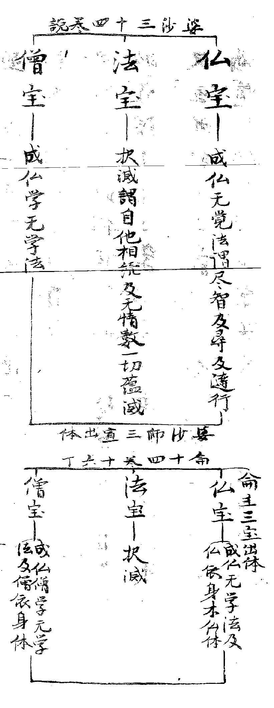



无漏五蕴者婆沙卅三九十广(云云)。



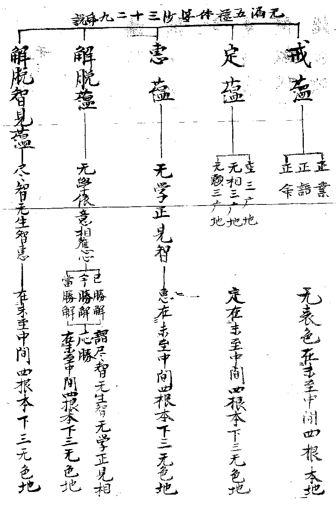



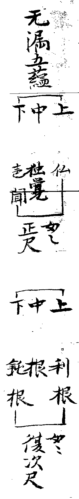



法谓䡄持者唯识论述记一本(五十丁)云法谓䡄持䡄谓䡄范可生物觧持谓任持不舍自相(文)瑜伽论记十三下(三右)云梵语陀罗唐名持义梵语达摩亦是持义能持故名法(文)𣵀槃者婆沙卅二(初丁右)云问何故択灭亦名𣵀拌荅槃名为趣𣵀名为出永出诸趣故名𣵀槃复次槃名为臭涅名为无永无臭秽诸烦𢙉业故名𣵀拌复次槃名稠林𣵀名永离永𮥷一切三灾三相诸蕴稠林故名𣵀拌复次槃名为识𣵀名为不此中永𮥷烦𢙉业缕不织生死异熟果绢故名𣵀拌余如前说(文)和合名僧者如如百十六(四丁)四人已上方名僧三人不尓(文)杂心三(四十三丁)以四人为僧(云云)光记十四(十七丁)四人已上名曰僧伽(文)光记廿五(卅二丁)云今觧云僧有二种一㕝和合二理和合(云云)俱舎指要抄十四(五丁)云梵言僧伽此羽众(戒翻为著如阿伽翻为无著梵音长短之别玄応音义廿四廿一一云阿伽阿伽阿此云无僧伽此云著短声呼之若声呼之即云众旧云僧法谬也)旧翻和合谬也怀桒开记一未(七右)云梵云僧伽(此訳为众)旧以和合翻僧失於正义然正义众正翻僧和合乃是僧家义用谓四人等众法成和是以文言僧者四人若遇和合者一羯摩一说戒通名(已上)(说文)　然慈恩意三人已上为众南山及光师等四人已上为众各有意致义林三宝章云𣵀槃经说法名不覚僧伽为众於理於义无无谛故此有三种一理和僧三已上𧈧方名僧麟覚独覚及余圣者设独一出佊种类故亦得名僧二㕝和合僧三人已上皆是僧体[彳*(前-刖+(之-、))]多论义故彼国之法一名为一二名为身自三已上皆名为多如弁法㕝四人方成一人白言大德僧𦗟所和三人得名僧故若四是僧常能白者而自白耶欲显和合[彳*(前-刖+(之-、))]多人故自三已上皆得名僧三弁㕝僧谓四人五人十人二十能所白中异足和合弁法㕝故非所和体今谓慈㤙西域方俗称三为多又四人辨㕝一人能三人所白此三呼僧故知三人以为僧体又梵云僧伽唐翻为众然叒是众之古字此以王人又国语云人云为众女三为霖是故依顺二土方俗三人以上以为众体又南山不然四人已上为众何者杂心论第三(四十二丁)云以四人名僧非三故(已上论文)又四分律说别众食云四人若过等此食时别众岂有能所白而弁法㕝者乎准上律论梵土方俗以四人已上为众著(矣)此是平常现㕝西来三藏亲所闻也有何希缘可误错耶又法𱵅㐬二本(九丁)云若依四方四人已上是大众如不曰大众者四人若过以此证明知三人名小众又二未(二左)云依十诵大众八人小众四人此律四人为大众二三人为小众(异如报思弁文)四向乃至声闻身等者谓四果声闻身中无漏五蕰为僧宝体非独覚菩萨无漏蕴彼非僧宝故七十等者第二经法分别无表中道俱无表通仏宝僧宝余无表非心王中无漏第六意识通仏宝僧宝余非也大地法大善地法寻伺四相无漏方仏宝僧宝通択灭唯法者自他相续及非情数一切蕰灭为法宝体也三藏等者第八𫨻於中二二初釈名并体二经法分别婆沙评家者婆沙百廿六(十二丁)如是说者语业为体佛意所说他所闻故(文)。



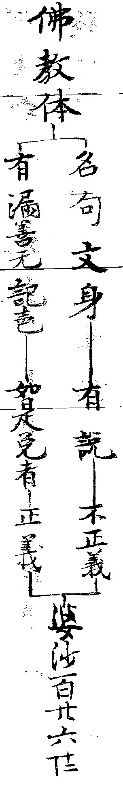



又婆沙百廿六(十二丁)云仏教当言善耶无记耶荅或善或无记云何善谓仏善心所発语言乃至语表云何无记谓仏无记心所発语言乃至语表问於仏教中何者善何者无记荅阿毘达摩素怛䌫藏多分是善是毘奈那藏多分无记如世尊说门応开闭若钵置竹架龙牙如是等皆无无记放有说佛教若为尒化说応知是善若为余㕝说是则无记如世尊告阿难陀言沙住覌天为两不两国中何故高声大声如是等言皆无说故有说(云云)有说(云云)又云声闻独覚善心発语善无记心俱淂究竟无记心发语无记善心俱淂究竟仏善心発语善心究竟无记心発语无记善心俱得究竟定无善心発语无记心究竟诸仏说法有增有减故仏処作业定无萎退故仏教名何法乃至広说问何故复作此论荅前𧈧显示仏教自体而未显示仏教作用今为显示故作此论仏教名何法荅谓名身句此文此次第行列次第安布次第连合此则总显仏教作用(文)即是七十等者第二经法分别谓仏教体者七十五法中荅无记声也若约仏教依用者七十五法中名句文也则如上所引婆沙说戒等三学者第九𫨻於中二初釈名出体二经法分别无漏戒者在未至中间四根本无漏定者在未至中间四根本下三无色地三种戒等者第十𫨻此中二初釈名出体二法分别别解脱等者论十四(四丁)谓受戒时初表无表别别弃舍种种𢙣故依初别舍义立别解脱名(云云)全文知有寻有寻等者第十一𫨻此中二初列名出体二经法分别论廿八(十七丁)(云云)正理七十九(初丁)显宗卅九(十丁)(云云)净等者第十二𫨻此二初列名出体二经法分别论廿八(五丁)(云云)(十三丁)婆沙百六十二(九丁)発智论十七(十二丁)正理七十七(十丁)显宗卅八(五丁)三定者上八地前七地中各有三有顶地唯在二谓味净净定者此有四种一顺退分摂三顺胜进分摂四顺[(暴-(日/共))/又]分摂上八地中前七地各有四有顶唯三除顺胜进分摂三𡰱牟等者第十三𫨻此中二初列名出体二经法分别论十六(三丁)(云云)中含五(四丁)婆沙百十七(十五丁)正理四十一(五丁)显廾二(初丁)発智论十一(六丁)无学身业者道俱戒无学语业者道俱戒无学意者非业也三清净等者第十四段此中二初釈名二体等釈下让中𭇥三(廾九丁)论十六(三丁)(云云)集异门足论六(五丁)婆沙百十七(十四丁)正理四十一(五丁)显宗廿二(初丁)暂永等者有漏暂远𮥷一切𢙣业烦𢙉故无漏永远𮥷一切𢙣行烦𢙉故名为清净也三𢙣行等者第十五𫨻此中二初出体釈名二经法分别论十六(三丁)颂曰𢙣身业说三𢙣行及贪瞋邪见三妙行翻此(云云)杂𭇥十四(四丁)长𭇥八(十一丁)正理四十一(六丁)显廿二(二丁)集异门足论三(十四丁)発智论十一(初丁)婆沙百十二(初丁)又百十二(五丁)问何故名𢙣行▆行有何义荅可猒毁故名𢙣游履依所故名行(云云)复有说者减苦受果故名𢙣动转揵剩故名行(云云)复有说曾近𢙣人能招𢙣趣故名𢙣行(云云)复有说有三囙缘故名𢙣行谓𢙣思所思故𢙣说所说故𢙣作所作故(云云)复有说有三囙缘故名𢙣行谓𢙣作义故可猒毁便土能感非爱果故(云云)次色十一中无表者中字脱色及二字欤三妙行等者第十六𫨻此中二初出体釈名二经法分别论十六(三丁)三妙门者翻此応知谓此语意一切善业非业无贪无瞋正见(文)集异门足论三(十三丁)発智论十一(初丁)正理四十二(初丁)显宗廿二(初丁)婆沙百十二(十四丁)云问何故名妙行妙行有何义答可欣赞故名妙游覆所依処故名行(云云)复有说者感乐㕝果故名为妙动转揵剩故名为行(云云)复有说(云云)有说(云云)复有说有三囙缘(云云)复有说者有三囙缘(云云)三明者第十七𫨻此中二初列名出体二经法分别论廿七(十五丁)集异门足论六(八丁)正理七十六(十五丁)显卅七(十二丁)婆沙百二(十四丁)三明依地前二明四静虑后一明通一切地依身无学依身也明义婆沙(云云)三示导等者第十八叚北中三初出体釈名二经法分别论廿七(十三丁)正理七十六(十四丁)显宗廿七(十五丁)集异门足论六(二丁)婆沙百三(四丁)(云云)三示导依地前二四静虑后一通一切地依身无学依身也能示能道得示导名者论廿七(十三丁)云唯此三种引所化生令初発心最为胜故或此能引增背正法及処中者令発心故能示能导得示导名(云云)婆沙百二(四丁)问何故名示导荅示谓示现导谓导引现希有㕝引入正法故名示导(云云)三种三摩地等者第十九叚此中二初出体釈名二经法分别论廿八(十七丁)正理七十九(初丁)显宗三十九(十一丁)增𭇥四十一(十六丁)(十五丁)中𭇥五十八(十五丁)婆沙百四(六丁)(云云)又婆沙百四(九丁)云问何故名三摩地是何义耶荅由三缘故名三摩地一平等故二摂持故三相似相续故平等故者谓无始来烦𢙉𢙣行邪见颠倒令心心所伦曲而转由此定力令心心所於境正直平等而转故名三摩地摂持故者谓故无始来心所法於境驰由此定力方便摂持一境故名三摩地相似相续故者谓无始来心心所法善染无记异类相续由此定力前后一类惟善相续故名三摩地次(云云)复次(云云)尊者世友(云云)复次是说(云云)大德说(云云)空非我等十六行相论廿六(十丁)是釈此三皆通有漏无漏者有漏谓依十一地谓未至中间四根本下三无色又婆沙百四(十二丁)三摩地与解脱门别说三解脱门等者第廿𫨻此中三初列釈二釈解脱门义三出体论廿八(十七丁)(云云)正理七十九(初丁)显卅九(十一丁)(云云)婆沙百四(十二丁)能与𣵀槃等者论廿(十八丁)於中无漏者名三解脱门能与𣵀槃为入门故(文)婆沙百四(十三丁)何故名解脱门荅𣵀槃名解脱依此三摩地能趣证解脱故名解脱门复次如排揗故(云云)。



法宗原私记本下(终)



法宗原私记末上



智山沙门釈　龙谦撰



四门分别畧有等者第三四门大於中二初摽列二釈此中廿二𫨻四谛等者第一四谛分别於中二初列名出体二至法分别论一(三丁)廿八(初丁)集异门足论六(十二丁)品类足论七(三丁)十二(十六丁)十八(八丁)婆沙七十七(五丁)(云云)若谛谓有漏果者出体论云此中果性取蕰名为苦谛(文)婆沙七十七(六丁)评家云若随自相续五蕰若随他相续五蕰若有情数及无情数诸蕰如是一切皆是苦谛(文)通迫者釈苦义七十七(十二丁)云何苦集灭道各有何相胁尊者曰逼迫是苦相生长是集相寂静是灭相出离是道相尊者世友(云云)复作是说(云云)大德说(云云)谛者㚣七十七(七丁)云问何故名谛谛是何义荅实义是谛真义如义不颠倒义无虚诳义是谛义(云云)二集等者招集者釈集义有漏囙者出体论云因性取蕰名为集谛(出体)是能集故(弁相)如婆沙釈集相前引出体釈婆沙七十七(七丁)评家云若随自相续五蕴囙若随他相续五蕴囙若有情数及无情数诸蕴囙如是一切皆是集是集谛(文)三灭等者生死断故者并灭义谓択灭者出体灭相上引婆沙见出体婆沙七十七(七丁)评家云若随自相续五蕴尽若随他相续五蕴尽若有情数及无情数诸蕴尽如是一切皆是灭是灭谛(文)四道等者通行义故者釈道义论廿五(十一丁)云道於余処立通行以能通建輙湿拌故(文)谓无漏道者出体道相上引婆沙见出体㚣七十七(七丁)评家云若随自相续五蕴対治若随他相续五蕴対治若有情数及无情诸蕴対治如是一切皆是道是道谛(文)又四谛建立㚣七十七(七丁)圣谛义七十八(三丁)论廿二(三丁)四谛次第㕝七十八(十二丁)论廿二(初丁)无表心王等者道俱无表道谛定俱及散无表若集谛无漏第六意𧥾道谛余者有漏意𧥾者若集谛善地法大地法寻伺得四相无漏一分道谛有漏一分苦谛択灭一种唯灭谛者三界九地一切択灭唯谛余等者余四十三谓除无表余色大▆地小惑贪瞋慢疑𢙣作除得四相余九不相应余分有漏故通苦集谛此四十三唯有漏故不通道谛有为故不通灭谛也虚空非択灭此四谛摂如前釈也者此章本(十二丁)又如上㚣引。



四谛体私图



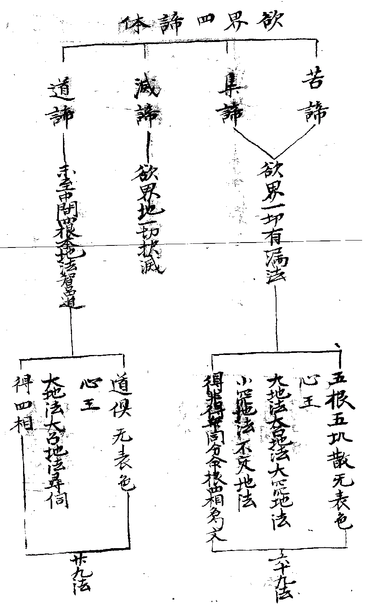



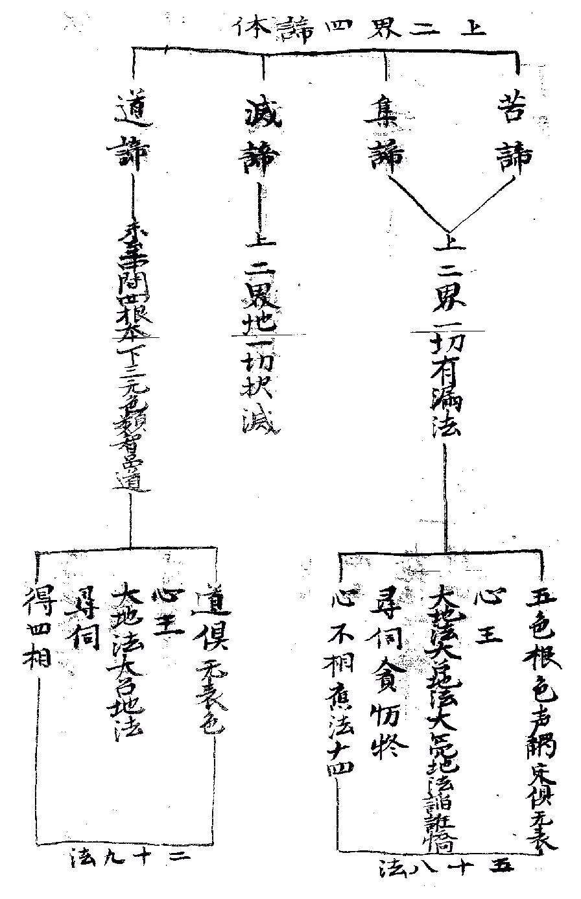



四食等者第二四食此中二初列名釈食义二经法分别论十(十二丁)婆沙百廿二(十四丁)集异门足论八(八丁)品类足论七(五丁)正理卅(二丁)顕宗十五(十丁)(云云)𫨻食釈名论十(十三丁)云可成𫨻别而饮噉故以口鼻分分受之(文)婆沙百卅九(三丁)问𫨻食何义荅分𫨻而食故名𫨻食(云云)食体婆沙百卅九(十五丁)问食体是何荅是十六㕝於中十三㕝是𫨻食体即十一触及香味触処触思义识三是余食体蕰界処根者是十一界五処三蕰少分所摂(云云)。



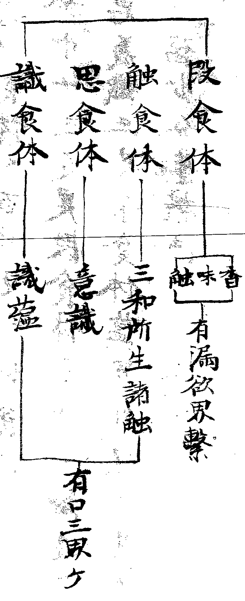



资粮名食者婆沙百廾九(十五丁)云何故名食食何义荅牵有义是食义续有义持有义义生有义养有义增有义是食义此四於有能牵乃至能增故名食(文)四身系等者第三四身系於中四初列名二出体三釈身系义四经法分别発智三(初丁)集异门足论八(六丁)婆沙四十八(七丁)一贪欲等者初列名也欲界五部等木者第二出体婆沙四十八(七丁)问此四身系以何为自性荅以二十八㕝为自性谓贪欲瞋恚身系各欲界五部为十㕝戒禁取身系三界各二部为六㕝以実执身系三界各四部为十二㕝由此四身系以二十八㕝为自性(文)种种缠等者第三釈身系义婆沙四十八(七丁)问何故名身系身系是何义荅得身义结生义是身系义(云云)前二以等者第四经法分别四颠倒等者第四四颠倒釈於中三初列名二出体三经法分别论十九(八丁)婆沙百四(四丁)八(初丁)杂心八下(八丁)正理四十七(七丁)顕宗廿五(九丁)初一等者论第一说有说者论第二师也四颠倒体婆沙百四(十一丁)(云云)颠倒釈名㕝▆百四(三丁)云问何故名颠倒颠倒是何义荅扵麤谛理颠倒而转故名颠倒由此四颠倒惟见苦断(云云)四识住等者第五四识住釈此中四初列名二釈识住名三出体四经法分别论八(十丁)発智论十三(廿二丁)集异门足论八(十丁)正理廿二(十三丁)顕十二(十三丁)婆沙卅七(三丁)识著彼等者第二釈釈名论云识所依著名识住(文)婆沙三十七(四丁)云何因缘故说名识住荅识於己说自性住近住故名识住如马等住有说此中喜所润识增长广大故名识住有说北中爱所润识摂受不离故名识住有说此中诸有漏识随顺取识生起执著安住增上故名识住(文)有漏四蕴等者第三出体唯有情类者婆沙百卅七(三丁)第一说也第二说者亦通非有情类也七十等者第四经法分别四静虑等者第六四静虑釈此中三初列名二釈名三经法分别论廿六(初丁)婆沙八十(初丁)品类足论七(三丁)十三(九丁)正理七十七(初丁)顕卅八(初丁)由定等者釈名瑜伽论记四上(二丁)梵云駄衍那此云静虑通有心无心有漏无漏染依色四地非余地(文)论廿八(二丁)云依何义故立静虑名由寂静能审虑故审虑即是实了知义如说心在定能如実了知(文)婆沙八十(初丁)云问何故名静虑为能断结故名静虑为能正观故名静虑若能断诸故名静虑则无辺色定亦能断结应名静虑若能观心故名静虑则欲界三摩亦能视正应名静虑有作是说以能断结故名静虑(云云)复有说者以能正观故名静虑(云云)如是说者要具二义方名静虑(云云)又出体婆沙论廿(初丁)四静虑各有二谓定及生静虑论第八及婆沙百五十四(十五丁)九十八(十五丁)(云云)四无色等者第七四无色釈此中三初列名二釈名三经法分别论廿八(二丁)婆沙八十三(十六丁)集异门足论六(十四丁)品类足七(三丁)十四(初丁)正理七十七(三丁)顕三十八(三丁)四无色亦有二生及定生㚣八十四(初丁)及世间品说定婆沙八十四(初丁)及定品说也四中前三[彳*(前-刖+(之-、))]加行等者论廿八(五丁)云已釈总名空无色近等[彳*(前-刖+(之-、))]缘空等得别名耶不尓云何下三无色如其次第修加行时思无辺空及无辺识无所有故建立三名立第四名由想昧劣谓无明胜想得非想名有昧劣想故名非非想𧈧加行时亦作是论诸想如病如箭如痈若想全无便同痴暗唯有非想非非想中与上相𮞒寂静羙妙而不就此加行立名以若结言何缘加行作如是念心应荅言以於彼処想昧劣故由此昧劣故是立名正囙(文)婆沙八十四(二丁)釈名又四无色教兴因缘婆沙八十三(十六丁)四无色乃至问何故作此论荅为止他宗顕正义故或有说无色界有色如分别论者或复有说无色界无色如応理论者(云云)四缘等者第八四缘釈此中二初釈名出体二经㳒分别论七(初丁)品类足七(五丁)正理十八(十七丁)顕十(十丁)婆沙十(十五丁)十一(初丁)十六(八丁)廾一(十五丁)百九十六(十四丁)百六十六(十七丁)百九十七(初丁)五因性者性言缘种类论七(初丁)(云云)等而百卅二(十丁)百七(十二丁)无间等者釈名论云此缘生法等而无间依此义立等无间名(文)谓除无等者出体余文可知四生者第九四生釈此中三初列名二出体三经㳒分别论八(十一丁)正理廿二(廿丁)顕二(十七丁)婆沙百二十(十七丁)论八(十一丁)颂曰於中有四生有情谓[(留-田)-刀+ㄗ]等人谤生具四地狱及诸大十有唯化生鬼通胎化二(文)。



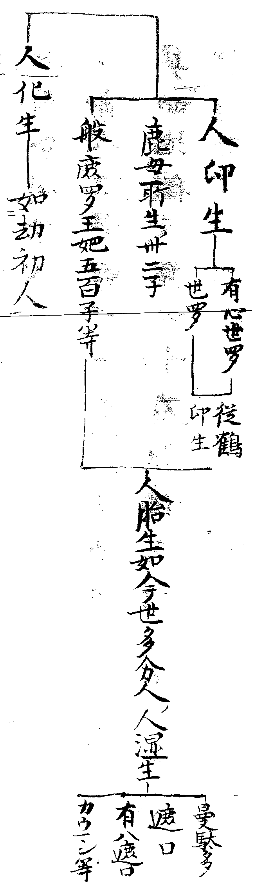



四业等者第十四业釈此中二初列名弁相二经法分别论十五(十四丁)正理四十(五丁)显宗廿一(八丁)発智十一(二丁)品类足七(初丁)婆沙百十四(九丁)杂心论三(卅丁)婆沙百十四(九丁)已下一说三业复有余[爪*ㄗ]四业复有余师五业复有余师八业(云云)四念等者第十一四念住釈此中三初列名二经法分别三釈名论廿三(初丁)集异门釈论六(十丁)品类足论七(二丁)十一(十六丁)十贰(初丁)正理六十(十丁)顕卅(初丁)法蕰足四(八丁)杂心𭇥廿四(初丁)杂心五(三丁)八下(三丁)婆沙百四十一(初丁)百八十五(五丁)百八十七(初丁)此四念住体名有三自性相杂所缘别缘别故自性念住以惠为体(通闻思冬)相杂念住以惠余俱有为体所缘念记以惠所缘诸法为体也四善根等者第十二四善根釈此中四初列名二釈名此惠下三出体四经法分别论廿三(三丁)正理六十一(二丁)𩔰卅(六丁)婆沙二至八终诸圣道等者第二釈名论二釈中依第二釈婆沙六(八丁)五说依第五复次也论云此法如煖立煖法名是能惑薪圣道▆火前相如火前相故名为煖(文)进退等者论二釈中依第二釈婆沙六(初丁)五说论云动善根中北法最胜如人顶故名为顶法或由此是进退両际如山顶故说名为顶(文)於四谛等者论二釈中依第一釈论云於四谛理能思可中此故胜故此位忍无退随故名为忍法(文)有漏故等者依论论云此有漏故名为世第一法(文)婆沙三(四丁)多说皆惠乃至五蕰为性者第三出体论廿二(四丁)云如是煖等四种善根念住性故皆惠为体若并助伴皆五蕰性然除彼得勿诸圣者煖等善根重现前故(文)婆沙二(八丁)世第二法体说六(十四丁)问如是四种自性云何荅皆以五蕰为自性尊者妙音说顺决択分有欲界系色界系欲界𫡏中下者名煖上者名顶此二自性惟有四种欲界中无随转色故色界𫡏中下者名忍上者名为世第一法此二自性皆具五蕰色界中有随转色故如是说者此四善根皆是色界㝎地修地行圣行法故四自性皆具五蕰(文)得四相皆通四种者得字恐衍字也得非四善根体故论婆娑并得云非四善根体故四向等者第十三四向釈於中四初列名二出体三釈尚名四经法分别论二十三(十四丁)正理六十四(初丁)显宗卅一(初丁)婆沙五十三(七丁)五十四(七丁)四果等者第十四四果釈於中四初列名二釈名三出体四经法分别论廿三(十四丁)廿四(十六丁)集异门足六(十五丁)品类足十一(二丁)七(四丁)法蕰足土(十七丁)集异门五(五丁)正理六十四(初丁)顕卅一(初丁)婆沙四十六(十二丁)六十六(十四丁)六十五(七丁)百四十一(十二丁)预流果者谓无漏等者第二釈名论廿三(十七丁)云诸无口道总名为流由此为囙趣𣵀槃故预言为顕最初至得彼预流故说名预流(云云)婆沙四十六(十四丁)问以何义故名预流耶荅流谓圣道预谓入佊入圣道故名预流(云云)一来者佊住等者论廿四(初丁)云佊徃天上一来人间而般𣵀拌名一来果遇此以后更无生故或名曰薄贪瞋痴唯余下品贪瞋痴故(文)下还等者论云必不还来生欲界故此或名曰五下结断𧈧必先断或二或三然於此时总集断故(文)阿罗汉等者论廿四(十三石)云诸有染者所応供故依此义立阿罗汉名婆沙九十四(十二丁)间何故名阿罗汉荅应受世间胜供养故名阿罗汉谓世无有情净命缘非阿罗汉所应受者复次阿罗者谓一切阿罗汉名能害用利惠刀害▆贼令无余故名阿罗汉复次罗汉无生阿是无义以无生故名阿罗汉彼於诸界诸趣诸生生死法中不复生故复次汉名一切𢙣不善法言阿罗者是远离义远离诸𢙣不善法故名阿罗汉此中愚者谓不善业不善者谓一切▆障善法故说为不善是远𮥷义如有颂言远离𢙣不善安住胜义中应受世上供故名阿罗汉(文)随其所等者第二出体论廿四(十六丁)颂曰净道沙门性有为无为果此有八十九解脱道及灭(文)婆沙六十五(八丁)百四十一(十二丁)。



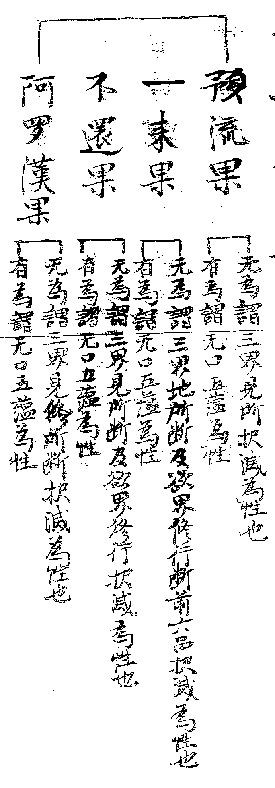



七十五法等者无表中道俱无表通四果体非余无表心王中无口意识通四果体非余大地法大善法寻伺得四相无口一分通四果体非余択灭中三界见処断択灭通四果体欲界修所断前六品択灭除预流果后通三果体欲界修所断三品択灭及欲界修道缘缚断択灭除前二果通后二果修所断択灭除前三果为阿罗汉果也四无畏等者第十五无畏釈扵中二初釈名出体二经法分别论廿七(三丁)婆沙世一(初丁)正理七十五(十丁)顕卅六(十六丁)无畏釈名㕝论云如何於智立无畏名此无畏名目无法惧由有智故不怯惧他故无畏名目诸智体理実无畏是智所成不応说言体即是智(文)婆沙卅一(二丁)问何故名无畏无畏是何义荅不法弱义是无畏义不倾动义勇猛义安隐义清净义鲜白义不惊怖义是无畏义(文)出体㕝论婆沙(云云)四无碍解等者第十六四无▆解釈於中五初列名二畧釈名三明建立四出体五经法分别论廿七(八丁)婆沙百八十(九丁)品类足七(五丁)正理七十六(二丁)显卅七(六丁)无碍解釈名婆沙百八十(九丁)问何故名无碍荅於所智境通达无滞名无碍觧(云云)有说(云云)有说(云云)有说(云云)四无量等者第十七四无量釈扵中三初列名二釈名三经法分别论廿九(初丁)婆沙八十一(十四丁)集异门足六(十三丁)品类足七(三丁)十三(九丁)正理七十九(十一丁)顕四十(初丁)缘无量等者论云言无量者无量有情为所缘故引无量福故感无量果故(文)婆沙八十一(十五丁)多说有说悲以不害为性者依论廿九(初丁)婆沙八十一(十四丁)百四十一(十石)有说以欣等者㚣八十一(十五丁)说有说亦以无嗔为性者论廿九(初丁)(云云)此章中四无量自性体出若约相应随标欲界四蕰色界五蕰也廿九(初丁)(云云)婆沙八十一(十四丁)(云云)四正断等者第十八正断釈於中三初列名二经法分别三釈名论廿五(十二丁)正理七十一(五丁)𩔰廿四(五丁)集异门足六(十一丁)品类足七(二丁)婆沙百四十一(初丁)言正断等者以下釈名於正修以下文论廿五(十三丁)全文也又婆沙四十一(三丁)问此四何缘说为正断荅由此四种能正断故(云云)四神足等者第十九四神足釈於中三初列名二经法三釈名论廿五(十一丁)七理七十一(五丁)顕卅四(五丁)集异门足六(十一丁)品类足七(三丁)婆沙百四十一(五丁)言神足者定果等者釈名论廿五(十三丁)云问何缘扵定立神足名荅诸量妙德所依止故有余师说神即是定足谓欲等彼応覚分㕝有十三增欲心故又违经说如契经言吾今为汝说神足等神谓受用种种神境分一为多乃至广说足谓欲等四三摩地此中佛说定果名神欲等所生等持名定(文)従因为果当体为名也者谓欲𭄿心观四字従因立名神足二字従果立名也四通行等者第廿四通行釈於中四初列名二釈名三出体四经法分别论廿五(十一丁)▆従九十三(十三丁)至九十四(八丁)品类足十七(七丁)法蕰足二(十九丁)正理七十一(初丁)顕卅三(十八丁)道依根等者第二釈名依论廿五(十一丁)也又婆沙何故名通行是何义荅通谓达行谓行迹能正通达趣向𣵀拌是通行义苦迟通行义者问圣道非苦受自性亦非苦受相応何故名苦荅近分无色难成弁故所起圣道说名为苦根本静虑易成弁故所起圣道说名为此广分别如前结蕰四静虑中问何故圣道说名为迟荅由钝根者所起圣道不能速趣究竟𣵀拌故说名迟诸利根者所起圣道疾趣𣵀拌故说名迟(文)此四通等者第三出体婆沙九十三(十三丁)七十五法等者第四经法分别无表中唯道俱无表非余心三大地法大善地法寻伺得四相无漏一分非余也四道等者第廿一四道釈於中四初列名弁相二釈道义三出体四经法分别论廿五(十一丁)正理七十一(初丁)顕卅三(十八丁)所言道者等者第二釈道义论二釈中第一釈也论云道义云何谓𣵀拌路乘此能徃涅槃城故或复道者谓求所依依此寻求涅槃故解脱胜进如何名道与道类同转上品故或前前力至后后故或能趣入无余依故(文)又婆沙百四十一(十丁)所履通达故名为道(文)此四皆等者第三出体七十等者第四经法分别无表中是俱及道俱非余心王大地法大善地法寻伺得四相中加行善学无学非余〃四证等者第廿二四证净釈此中四初列名二釈名三经法分别四别釈信戒名净论廿五(十六丁)婆沙百三(九丁)集异门足论六(十七丁)品类足十(十四丁)㳒蕴足二(初丁)正理七十二(初丁)顕卅四(十二丁)由证等者第二釈名论云为依何义立证净名如実覚知四圣谛理故名为证正信三宝及妙部罗皆名净离不信垢破戒垢由证得净立证净名(文)婆沙百三(十三丁)多说证净相论釈云且见近见三谛一一唯得法戒证净见道谛位兼得佛僧谓扵尓时兼於成仏诸无学法成声罗法僧学无学法亦得证净兼言为显见道谛时亦得於法及戒证净然所位法畧有二种一别总总通四弁别唯三谛全𦬇独学道故见四谛时皆得法证净圣所受戒与现观俱故一切时无不亦得由所信别故名有四应知実㕝唯有二种谓扵仏果等三种证净以信为体圣戒证净以戒为体故唯有二如是四种唯是无漏以有口法非证净故(云云)前三以心等者第三经法分别前三以无漏信为证后一以通俱无表为证也信戒二种等者第四别釈信戒名净人愚按云信戒二种等十六字文恐错乱上由证得净等上置若依此义分别四种净釈三初列名二釈名(信戒二种已下文)三经法分别(别三已下)学者可考五门分别畧有等者第四五门分别釈扵中二初票列二釈此中十五𫨻五取蕴等者第一𫨻论一(五丁)集异门足十一(十三丁)正理一(十四丁)显一(十四丁)従取生故者烦𢙉名取蕴[彳*(前-刖+(之-、))]取生故名取蕰依主釈能生取故者蕰生取故名取蕰依主釈北二釈共论依也此𫨻只釈名私经法分别七十五法中色中无表一分(定俱及欲无表)余十色取蕰心王中除无漏有漏心王识取蕰心所中受一分(有漏)受取蕴想一分(有漏)想取蕴余四十四心所随应除无口一分有漏分行取蕰不相応中得四相一分(有漏)余九全行取蕰三无为非取蕰根也五浊等者第二𫨻此中二初釈名出体二经法分别论十二(八丁)正理卅二(十丁)顕十七(十一丁)杂𭇥卅二(三丁)刧即是时乃至为体者论十二(五丁)刧惟是何谓五蕰(文)五趣等者第三叚此中初列名二釈名三出体四至法分别论八(五丁)集异门足十一(十六丁)品类足七(二丁)正理二十一(十三丁)显宗十二(七丁)圣百七十二(二丁)光明名天者梵云提婆此云天翻訳名义集章釈婆沙百七十二(十二丁)天釈名六说中当第四说欤▆百七十二(十二丁)二(初丁)有说光明增故名天以彼自然光恒照昼夜等故(文)因示天住処▆百七十二(十四丁)问诸天住在何処荅四大众天位七金山及妙高山层级上并日月星中三十三天住妙高山顶夜摩乃至色究竟天皆在空中密云如地各有宫殿扵中居止差别広说如大地种蕰无色界天无形色故无别住処(文)论十一(九丁)(云云)思虑名人者梵云摩冤舎喃此云人翻名集义二(十九丁)人釈名有五说中当第一说欤▆百七十二(十二丁)云问何故此趣名未奴山沙荅昔有转轮王名蔓駄多告诸人曰汝等欲有所作応先思惟称量观察尓时诸人即如王教欲有所作皆先思惟称量观察便於种种工巧业処而得善巧以四能用意思惟视察所作㕝故名未奴沙[彳*(前-刖+(之-、))]是已来传立斯号先未流此未奴沙时人或相呼以为云　或名多罗胫或名底落迦或名阿沙茶(文)因示人住処▆百七十二(十二丁)问人住何処荅住四大洲谓胆部洲毘提河洲瞿陀尼洲拘卢洲亦住八中洲何等为八谓抅卢洲有二眷属一矩拉婆洲二憍拉婆洲毘提河洲有二眷属一提河洲二蘓提河洲瞿陀𡰱洲有二眷属一舎𢮎洲二嗢恒罗漫恒里拏洲胆部洲有二眷属一遮未罗洲二笩罗遮末暹洲此八洲中人形短小如此方侏儒有说(云云)有说(云云)如是说者応如初说此八中洲一一复有五百十洲以眷属於中或有人住或非人住或有空者(文)论十一(四丁)由饥饿故名为饿鬼者名义集二(廿四丁)云薜荔多(広法师云正言闭丽多此云𥘵人鬼或云饿鬼劣者孔雀至作俾𤰞𥧌礼多)(云云)章釈婆沙百七十二(十丁)饿鬼釈名六说中当第四说欤婆沙云有说饥渴增故名鬼(云云)因示鬼住処婆娑百七十三(十丁)问鬼住何処荅胆部洲下五百逾缮那有琰魔王界是一切鬼本所住所[彳*(前-刖+(之-、))]彼流转亦在余処於此门中有二种鬼一有威德二无威德有威德者或住华林果住余清净受诸福乐无威德者或住厕溷粪壤水窦坑堑之中乃至或住种种杂秽诸不净所薄福贫穷饥渴所苦东毘或住提河西瞿陀𡰱亦在此二北拘卢洲惟有大威往(云云)论十一(八丁)身多横住名曰傍生者名义集二(卅九丁)云帝刹耶瞿偷𭰖伽(此云傍行)(云云)章釈婆娑百七十二(九丁)傍生釈名五说中当初说欤婆沙初说云荅其形旁故行亦旁以行旁形亦旁是故名傍生(文)因示傍生住処婆沙百七十二(十丁)云问傍生本住何処荅本処住処在大海中后眨流转徧在诸趣(文)论十一(八丁)地下有狱名为地狱者颂流云梵云那落迦此云若具义翻为地狱以地下有狱故非正引(云云)又唯𧥾述记(五未)(八十八丁)云捺落迦者此云苦器受罪処也那落迦者受彼苦者故二别也玄应音义云捺落迦奴葛切受苦也或言那落迦受罪人也(云云)光记八(十二丁)地下有狱名为地狱此乃义翻梵云那落迦(云云)婆沙百七十二(四丁)捺落迦釈多说且初说云荅是那落迦所趣処故是中有那落迦故名捺落迦彼诸有无悦无爱无味无利无喜乐故名那落迦(文)因示地狱住所婆沙百七十二(六丁)问地狱在何所荅多分在此胆部洲下云何安立有说[彳*(前-刖+(之-、))]此洲下四方逾逾缮那至无间地狱底无间地狱縦横広高下各二万逾缮那次上一万九千逾缮那中安立余七地狱谓次上有极𤍠地狱次上有𤍠地狱有大嘷呌地狱次上有嘷叫地狱次上有众合地狱次上有黑绳地狱次上有等活地狱此七地狱一一縦广万逾缮那次上余有一千逾缮那五百逾缮那是白墡五百逾缮那是𭰖有说(云云)有说(云云)有说(云云)又一一大地狱有十六增乃至如是八大地狱(并)部眷属便有一百三十六所(云云)又云胆部洲下有大地狱胆部洲上亦有辺地狱及独地狱或有谷中或有山上或在旷野或在空中扵余三洲惟有辺地狱独地狱无大地狱所以者何惟胆部洲人造善猛利彼作𢙣业又复猛利非余洲故有说北抅卢洲亦无辺地狱等是受淳净业果処故问𠰥余洲无大地狱者彼诸有情造无间业断善根等当於何所受异熟耶荅即於此瞻洲部下大地狱受(文)论十一(五丁)又因示狱卒说论十一(七丁)地狱卒非実有情有说有情(云云)婆娑百七十二(七丁)二说二十唯识述记上(四丁)二十八八师等说狱卒等非実有情业生大种相异是𢙣业所感增上大种转及所生○经部师等说𧈧非有情然心外造业熏内识其受果乃在心外大种转及形显等大众部正量等说是実有情今大乘意亦非有情(云云)趣是所住者婆沙百七十二(四丁)问何故名趣趣何义荅所住义是趣义是诸有情所应住所応生结生処故名趣(文)异熟无记五蕰为体者第三出体婆沙评家义也婆沙百七十二(二丁)问趣体情是何乃至荅応作是说趣体性是无覆无记乃至有说通三性乃至评曰応说趣体惟是无覆无记(云云)又大众部通染善(云云)光记八(十五丁)问何素洛何趣所摂荅依正义是鬼趣摂婆沙百七十二(十五丁)问阿素洛何趣所摂有说是天趣摂(云云)如是说者鬼趣摂(云云)七十等者第四经法分别。



私图云。



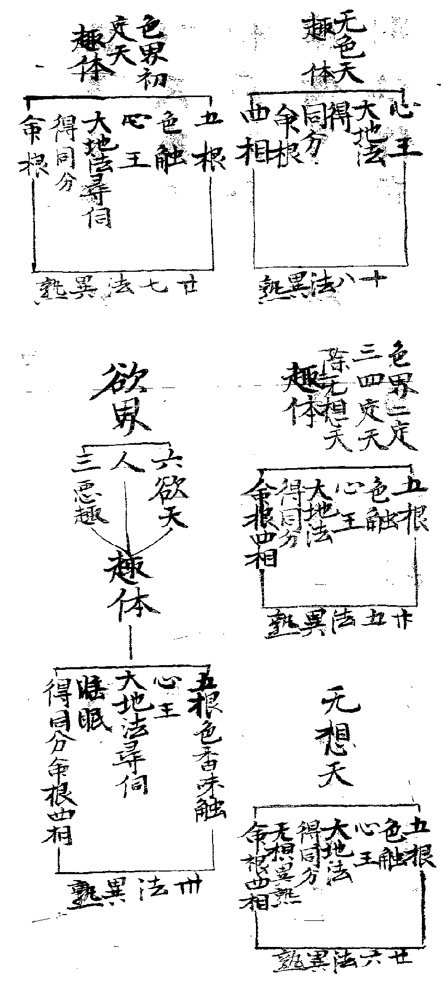



五无间等者第四叚扵中三初列名二釈名三弁相经法分别论十七(十五丁)正理四十三(八丁)显宗廿三(十丁)婆沙百十五(十五丁)百十六(初丁)百十九(四丁)出仏身血者読习㕝出仏身血训故音可読出佛身血依习音读读出仏身血训出音读出常例今依习也言无间等者第二釈名婆沙百十五(十八丁)百十九(四丁)论十七(十六丁)釈名前三等者第三弁相经法分别五无间体相広釈论婆沙开见且就破和合僧破法轮僧破羯磨僧差别弁破羯磨者谓一界内有二部僧各各别住作布洒陀羯磨说戒破法论者谓立异师异道如提婆达多言我是大师非沙门乔荅磨五法是道非乔荅磨所说八支圣道所以者何若能修习是五法者速证𣵀拌非八支道云何五法一者尽寿著粪扫衣二者尽寿常乞食三者尽寿惟一坐食四者尽寿常居逈露五者尽寿不食一切𩵋肉血盐酥乳等是破羯磨僧破法轮僧差别婆沙百十六(四十丁说)又畧弁破法轮僧相能破僧者要大苾刍非在家苾刍𡰱等唯见行者非爱行者住净行人非犯戒者要异処破非対大师唯破异生非破圣者要所破僧忍师异佛忍异仏说有余圣道応说僧破在如是时此夜必和不经宿住唯瞻部人亦至九或复过此能法轮非扵余例以无仏故有仏処方有异师要八苾刍分为二众以为所破能破第九故众极少扵须九人此过无限如是名曰破法转僧能障圣道　坏僧和合故委如论也五根等者第五叚此二初列名二釈名论廿五(十二丁)正理七十一(五丁)显宗卅四(初丁)集异门足论十四(七丁)婆沙百四十一(九丁)胜用等者釈名依婆沙百四十一(九丁)论三(初丁)也不可屈等者第六𫨻五力釈扵中二初釈名二出体论二十五(十二丁)正七十一(五丁)显卅四(初丁)集异门足十四(七丁)婆沙百四十一(九丁)不可屈伏名力者釈名依㚣釈也出体如等者第二出体也五因等者第七𫨻於中三初列名二釈名三经法分别论一(八丁)正理廿(十丁)显宗十一(七丁)彼[彳*(前-刖+(之-、))]等者第二釈名色十一等者第三经法分别也五类等者第八𫨻此中四初列名二釈名三癈立四经法分别论二(八丁)正理五(十四丁)显宗三(十四丁)応知等者第二釈名於中异熟生釈名初釈依主釈次釈持业釈若拠但等者第三癈立色十一等者第四经法分别也五果等者第九𫨻扵中三初列名二釈名三经法分别论六(十九丁)正理十八(初丁)显宗九(十六丁)入阿等者第二釈名色十一等者第三经法分别五葢等者第十𫨻扵中四初列名二弁相三经法四分界系论廿一(八丁)宗异门足十二(初丁)発智论三(初丁)婆沙四十八(九丁)正理五十五(五丁)显宗廿八(二丁)盖义障义覆义破义坏义随义卧义是盖义広如婆沙唯此等者第二弁相初二后等者第三经法分别皆唯等者第四分界系也五顺下等者第十一𫨻於中四初列名二釈名三经法分别四判界系论廿一(二丁)発智论三(初丁)集异门足十二(十三丁)婆沙四十九(二丁)正理三十四(五丁)显宗廿七(九丁)此五顺等者第二釈名章近依论欤婆沙四十九(二丁)顺下分釈名十说且引初说云问何故名顺下分结顺下分结是何义耶荅如是五结下界现行下界所断结下界生取下界等流异熟异故名顺下分结下界者谓欲界(文)婆沙第七说论举论廿一(二丁)何缘此五名顺下分此五顺葢下分界故谓唯欲界得下分名此五於佊能为顺葢由后二种不能超欲界没有能超由前三还下如守狱卒防罗人故(文)前二以等者第三经法分别前三通等者第四判界系也五顺上分等者第十二𫨻扵中四初列名二釈名三经法分别四诸门分别论廿一(三丁)集异门足十二(十四丁)発智论三(初丁)婆沙四十九(六丁)正理五十四(七丁)显宗廿七(十一丁)顺葢上界等者第二釈名依论也㚣四十九(六丁)说以心所等者第三经法分别唯修所断等者第四诸门分别五分法身等者第十三𫨻扵中三初列名出体二釈身名三经法分别婆沙卅三(九丁)谓无漏戒者谓无学相続中身语业道俱无表依地末至中间四静虑地也谓无漏定者谓无学空无相无愿三摩地依地来至中间四静虑下三无色地也谓无漏正见者恐脱智字欤谓无学正见智依地末至中间四静虑下三无色地也谓无漏胜解者谓无学作意応応心已胜解今胜解当胜解谓尽无生无学正见相応胜解此蕰所根故谓尽智无生智者依地未至中间四静虑下三无色地也解脱身中等者婆沙卅三(十三丁)问何故此二智名解脱智见蕴荅解脱身中独有此故㝡能审决解脱㕝故(文)以此五等者二釈身名此五分法身上中下上仏中独覚下声闻也或上利根中中根下钝根戒身以色等者三经法分别五戒等者第十四𫨻扵中三初列名二出体三经法分别论十四(卅八丁)正理三十六(十四丁)显宗十九(六丁)婆沙百廿三(十三丁)四分行㕝钞资持记中一四(初下)至中一五终十三三(廿九丁)僧祗律一(廿二丁)四分律一至二(十八丁)又十六(五丁)又五分二(十四丁)九(初丁)十诵律二(六廿乂乂)三(三丁)廿八夕论一(十二丁)三(七丁)九(四丁)如来制四波罗夷时分依僧祗律说[婬-壬+(工/山)]戒仏成道后五年冬分制余三戒并六年冬分制也不杀生者先制戒因缘者仏在毘舎离诸比丘修不净观厌身叹死外道比丘难提受雇行杀居士惊怖因制也次明犯缘者具五一是人二人想三起杀心四与方便五命断也犯境唯人也如断畜命九十草提中第六十一夺畜生命戒犯摂𠂇𠂊二不偷盗者先制因缘者仏在罗阅城檀𡰱迦比丘在静虑作瓦屋仏令打破遂取王材王臣诃责囙制次名釈畏主覚知为喻非理损者为盗不作偷盗云不偷盗也次明犯缘者具五种一要発欲盗放思二於他物中三起他物想四或力或𥨱起盗加行五不误而取令属己身必具成犯初缘中有三(五丁)一盗三宝物二盗人物三盗非畜物四重物中二谓五钱若直五钱即余杂物五钱㕝廿八论二(十四丁)三釈资持记中一五(十四丁)引徃见不欲耶行者今约进士五戒故云不欲耶见名约出家戒不[婬-壬+(工/山)]欲也先制戒因缘者仏在毘舎离国须提那子出家已𨗴本村与故二共行不净因制也次明犯境有人非人(无子鬼神等)畜生三起拠报则男女二形拠処则女人王道谓大小便道及口男子二通次明犯缘者二缘一自有[婬-壬+(工/山)]心向前境縦有里隔互障但人如毛头结成大重具四缘成一是正境(男二通女三処)二与染心三起方便四与境合便犯二者若为▆偏或博至前境或就其身仏开身会制令不染亦具四缘一是正境二为𭜨福三与境合四受乐便犯也又欲邪行有四种断不応行一於非境谓扵他妻妾或母或父或父母亲乃至或王於所守护境二於非道谓扵自妻口及余道三扵非処谓扵寺中制多逈処四於非时谓怀胎时饮児乳时受斋戒时设自妻亦犯邪行也不虚诳者先制戒因缘者仏在毘舎离时世谷贵婆求河辺有安居者共相称美得上人法遂获利养仏呵而制也次明犯缘者具九缘一対境是人二人想三境虚四自知境虚五有诳他心六说过人法七自言已证八言章了九前人解十诵多论云[彳*(前-刖+(之-、))]得不净观已上至四果来若云我得皆犯重云次明远近根本罪(文)若依明了论四波罗具部有十六罪一一各有四部或十六罪一远方便如行[婬-壬+(工/山)]时先起心未动身口贵心灭二次方便谓动身就彼或口说欲作此対人忏灭通名吉罗三近方便至佊人辺或欲以摩触身未交前是偷兰遮期行[婬-壬+(工/山)]㕝故摩触非为戏乐故成偷兰遮不成僧残此罪対人忏第四身交是根本也不饮酒等者若约比丘大戒中单提中第五十一饮酒戒也先制戒因缘者仏在支陀国婆伽陀比丘际毫示俱睒弥王得酒饮酔卧路因制也次明犯缘者三缘一是酒二无重病缘三饮咽犯次明制意者多论(十二丁)云此戒极重能作四逆除破僧又能破一切戒及余众𢙣故若依五分(九丁初丁)以䧏龙故得酒酔衣钵縦横佛与阿难舁至井辺仏自汲水阿难洗之著衣卧於床上令头向仏顷更转侧伸脚蹋佛仏集僧言昔日敬仏今不能敬昔伏毒龙今不能降虾嗼因说渐断酒制乃至嗔酒器也初三后一等者第三经法分别也身语无表以无表为性者谓身语无表以别解脱无表为性也世五眼等者第十五𫨻扵中四初列名二出体三经法分别四釈眼名有部论藏中无五眼列并说大乘观照等者眼根唯有观照推度如光二(四十八丁)(云云)前引也。



法宗原私记末上(终)



法宗原私记末下



智山沙门釈　龙谦撰



六门分别者第五六门分别釈於中二初票列二釈此中五𫨻六界等者第一𫨻於中二初列名二釈界名三经法分别论一(廿二丁)婆沙七十五(四丁)正理三(廿丁)顕宗三(五丁)心王即是有漏者由许六界是诸有情生所依故如是诸界从続生心至命终心恒持生故诸无漏法别不别如是故局有漏不通无漏也六通等者第二𫨻扵中三初列名釈名二出体三经法分别论廿七(十丁)婆沙九十九(八丁)百四十一(十三丁)集异门足十五(十四丁)正理七十六(八丁)顕宗卅七(九丁)智证境[(序-予+(彳*隹))/寸]无倒了名通者婆沙(百四十一十三丁)云问何故名通荅於自所缘无倒了达妙用无碍故名为通(文)[彳*(前-刖+(之-、))]定及境能证为名者谓[彳*(前-刖+(之-、))]定云神[彳*(前-刖+(之-、))]境云境[彳*(前-刖+(之-、))]能证云智证通也[彳*(前-刖+(之-、))]根及等者天眼二字[彳*(前-刖+(之-、))]根智证通三字[彳*(前-刖+(之-、))]能证也天耳釈凖可知他心等者他心二字[彳*(前-刖+(之-、))]加行加行観他心故智证通三字[彳*(前-刖+(之-、))]能证也漏尽等者漏尽二字[彳*(前-刖+(之-、))]所证或[彳*(前-刖+(之-、))]所依智通三字[彳*(前-刖+(之-、))]能证智也於此六通中四唯有漏谓神境通天眼天耳宿住通二通漏无漏谓他心通漏尽通也三性中天眼天耳唯无记余四通唯善性依地前五通唯依四静虑漏尽通依一切地六垢等者第二𫨻於中三初列名二经法分别三釈名论廿一(五丁)婆沙四十七(十六丁)正理五十四(十六丁)显宗廿七(十五丁)秽污等者依论也论云如是六种[彳*(前-刖+(之-、))]▆垢(文)扵六垢中诳憍是贪等流害恨是瞋等流𢙉是见取等流𮘦诸见等流也六囙等者第四𫨻於中二初列名釈二解釈此中六𫨻初能作囙二俱有囙三同类囙四相应囙五[適-十]行囙六异熟囙六𫨻中随応釈名出体经法釈或釈名经法釈论六(初丁)婆沙十六(七丁)十七(十一丁)十八(二丁)十九卷廿卷廿一卷発智论一(十一丁)正理十五(初丁)显宗八(十四丁)能作囙等者釈名能作者不障碍义或有所弁义(婆沙廾一十一丁)谓法生此因不障碍故不障碍义此因能作果故能作有所弁义因能作果是所作能作即因名能作囙持业釈或谓能行是亲因余不相障者踈囙此踈因是能作之囙名能作囙依主传传为因能生果故故正理十九(廿六丁)云或是佊能作之因名能作因是此故与彼传为因义(文)以一切等者出体遍通等者经法分别俱有因等者釈名俱有石相応同一果义相随顺义(婆沙十七十一丁)或俱有有力用故名俱有俱有即因名俱有因持业釈或囙与果俱故名俱有俱有之因名俱有囙依主釈或得作俱有即因持业釈以三等者经法分别同类因等者釈名同类者种类义界地等义部类等义(婆沙十八九丁)因果相似名为同类若同类即因名同类囙持业釈者同类之囙名同类因依主釈以通等者经法分别过去等者唯过去现在七十二法为体未来七十二法非此因体未来无同类因故相応因等者釈名心心所法三义平等故曰相応即因名相応囙持业釈也若不相应因名相応囙依主釈以三世四十六心心所法为依者经法分别六字恐写误応作七遍行囙等者釈名徧行者徧为因义能徧缘义徧增随增义(婆沙十九九丁)遍与自地五部染法为因故名遍行遍行即囙名遍行囙持业釈以过去等者出体若谛下遍行七谓五见疑无明也集下遍行四谓邪见见取疑无明也相応法第六识大地法大▆地法大不善地法寻伺睡眠廿二心心所也俱有者四相也未来苦集下十一遍行随眠相応俱有法非遍行囙未来无遍行囙故遍行随眠义者是三㕝故名为遍行一於五部法徧随增故二於五部法徧能缘故三扵五部法徧为囙故是以遍说彼相応法俱有二㕝除徧随增彼俱有法俱有一㕝谓遍为囙故(婆沙十八十五丁)徧行随眠等得非徧行囙(婆沙十八十五丁评家义)以七十等者经法分别心王取第六识前五识与徧行随眠不相应故异熟囙等者釈名异类而熟是异熟义谓善不善因以无记为果果是异熟义(婆沙廿丿十七丁)若异之熟名异熟依主釈异熟之因名异熟因第二依主釈即両重依主釈或异熟名能熟善不善异即熟名异熟持业釈异熟即囙名异熟囙第二持业釈即両重持业釈此六因并不得作有财釈若言用能作等为囙名能作囙等即显此六体非是囙用他为囙然此六种体是因故三世等者出体以七十等者经法分别六波罗等者第五叚於中二初列二名解釈此中初釈波罗密义二别釈此中六𫨻论十八(九丁)婆沙百七十八(初丁)正理四十四(四丁)显宗廿四(三丁)婆沙百七十八(二丁)外国师说有六波罗密多谓於前四加忍静虑迦湿弥罗国诸论师言二波罗密即前四所摂谓忍摂在戒中静虑根在般若戒惠满时即名彼满故(云云)布施财法等者财法等者所施施有三种谓财施法施无畏施等者等无畏施以能等者弁能施体能施体无贪同时心心所(心王大地法大善地法寻伺)所発身(色无表)语(声无表)二业也七门分别等者第六七门分别釈於中二初票列二釈此中五𫨻七慢等者第一𫨻於中三初列名二弁相三经法分别论十九(十丁)品类足一(三丁)発智论二十(十丁)正理四十七(十五丁)显宗廿五(十丁)婆沙四十三(十七丁)此七慢通见修二断通三界系唯有意戈地也七识住等者第二𫨻於中四初列名弁相二癈立三出体四经法分别论八(七丁)集异门足十七(四丁)品类足七(九丁)発智论十三(卅三丁)正理廿二(初丁)显宗十二(九丁)婆沙百卅九(六丁)分天天者分天二字字误応作一分谓欲界天及初静虑等者今依论婆沙不言初天婆沙意初静虑天一分第一识住摂一分第二识住摂以不定故是故不言具如光记八(十七丁)了简也除刧初起者初定刧初起非第一𧥾住故第二识住摂也想异谓彼若等者谓约相応受分成三种若在欲界具有三想若在初定除若有二也二身异想一如梵众天等者梵众天言举初显后总摂初定三天唯取初定三天刧初起不取后恃初定三天也余𢙣起第四等者论二釈中依第一釈釈也起字写误応作趣三𢙣趣有重苦受能损扵识第四静虑有无想定及无想㕝有顶天中有灭尽定能坏於识令相续断故非识住余六十九法随応等者第一识住以六十九法为性於中人通六十九法初天以五根色声触无表心王大地法大善地大善地𮘦诳憍寻伺贪慢疑除无表异熟二定余不相応法五十五法为性第二第三第四识住以五根色声触无表心王大地法大善地大▆地憍贪慢疑得非得同分四相命根四十八法为性若约随身系更加名句文后三识住以心王大地法大善地法大▆地法憍贪慢疑得非得同分命根四相三十九法为性也七种圣人等者第三𫨻扵中五初列名二釈名三明位四出体五经法分别论二十五(九丁)廿三(十四丁)廿四(九丁)集异门足十六(十一丁)婆沙五十四(初九丁)随信行者等者论云依加异立初二种谓依先时随他及法於所求义修加行故立随信行随法行名依根不同立次二种谓依钝利信惠根增如次名为信解见至依得灭定立身证名由身证得灭尽定故依解脱异立后二种谓依唯惠离▆障者立惠解脱依兼得定离解脱者立俱解脱此名𧈧七㕝别唯六谓见道中有二圣者一随信行二随法行此至修道别立二名一信解二见至此无学复立二名谓时解脱不时解脱応知此中一随信行根故成三谓下中上性故成五时　法等者道故成十五谓八忍七智离染故成七十三谓具缚离八地染依身故成九谓三洲欲天善根性道离染依身相秉合成一亿四万七千八百二十五种随法行等者如理応思(文)婆沙五十四(五丁)已下七圣人釈名并由五象故建立七种及约根性道离染依身広釈徃见此七等者若约无为为体可云択灭也以无表等者无表唯取道俱无表心王唯无漏心王余心所得四相无漏为体七若约无为为体亦更応云択灭为体也七支等者第四𫨻於中三初列名二出体三经法分别论十四(十八丁)十六(十七丁)行㕝钞资持记中三一(八丁)(十三丁)(廿七丁)四分律十一(八丁)十二(四丁)十诵律九(十丁)廿八夕论六(九丁)五分律六(三丁)法苑珠林九十三至九十四卷(婆沙)百十三(三丁)百廿三(十六丁)此七支戒通定俱戒道俱戒别解脱戒也具釈别解脱七支者前四支者如前五戒𫨻釈五不麤𢙣语者以染心発非爱语毁訾於他名麤𢙣语离此名不麤𢙣语此戒制戒因缘者仏在舎卫六郑毁骂断㕝人因制四分律十一(五丁)云信仏言凢有所说当说善语不応𢙣语便自熟𢙉乃至畜生闻毁慙愧况於人也次犯缘明者具四种一染污心二発非爱语三解义四不误也六不离间语者染污心发坏他语名离间语离此名不离间语先明制戒囙缘者仏在舎卫六郡传他佊此语令众闘净不能除灭故制次云犯缘者具四种一染污心二発坏他语三解义四不误也或具六缘一比丘二说鄙𢙣㕝三传於彼此四分离意五言了六时知也七不离秽语者离字写误応作种也一切染心所発诸语名杂秽语离此名不杂语先明制戒因缘者仏在抅睒弥阐陀犯罪余比丘问以余㕝荅作自制已遂𢙉僧唤来不来等又作白制𮞒自而作故制次明犯缘者具四缘一作自口业倚二数𢙉不正三为僧单白　止四更作便犯也无表以无等者通别解定俱道俱无表非余无表也七覚支等者第五𫨻於中三初列名二经法分别三釈名论二十五(十二丁)集异门足十六(九丁)品类足七(十丁)十(初丁)十五(初丁)正理七十一(五丁)显宗卅四(初丁)婆沙九十六(三丁)百四十一(九丁)七覚支唯无漏於修道中建立故依地者喜覚支者初定第二定余六通未至中间四根本下三无色地前四等者念覚支念定覚支定択法覚支惠喜覚支喜受轻安覚支轻安舍覚支行舍精进覚支勤覚谓覚等者婆沙九十六(八丁)有说此能覚语故名覚支(云云)百四十一(九丁)问何故此七名覚支耶覚谓究竟即尽无生智或如実覚即无漏惠七为彼分故名为支択法亦覚等支余是支非覚此七広弁如余処说(文)八门分别等者第七八门分别釈於中二初票别二釈八戒等者第二釈此中五𫨻先第𫨻此中二初正八戒釈二囙未十戒初中三初列名二出体三经法分别论十四(三丁)婆沙百廾四(六丁)廾八夕论一(廿丁)业㐬二下(十五丁)法苑珠林百六行㕝资持记下三四(廿二丁)一不杀等者婆沙百廿四(六丁)云如契经说近住律义具足八支何为八谓离害生命离不与取离非梵行离虚诳语离饮酒诸放逸処离歌舞倡妓离𡍼饰香鬘离広床离非时食问此有九支何以言八荅二合为一故说八支谓离𡍼饰鬘与离歌舞倡妓同於庄広処博故合立一支问云何名近住云何近住支荅离非时食名为近住离害生等名近支问此近住支応惟有七荅离非时食名为近住亦近住支故不惟七如王见名道亦道支余名道支非道(云云)又云问近住律仪云何而得荅[彳*(前-刖+(之-、))]他教得谓为师教自発诚言恭敬受得问受律仪者或先自発言或与师俱说得律仪不荅不得要随师语如师语而说方受得故问近住律仪従谁応受荅[彳*(前-刖+(之-、))]七众受得皆非餘所以者何若无尽寿戒者则不堪任为戒师故问著何服饰受此律仪荅常所受用衣服严具著之皆得受此律仪若为暂时庄严身者必顷弃舍方受此戒床座等具准此应知问齐何时受荅齐一昼夜不增不减谓清旦时[彳*(前-刖+(之-、))]师受得至明清且律仪便舍问若有顿受半月一月或复多时得律仪不荅応言不得所以何一昼夜时分限定故(云云)不𡍼饰等者不著香华璎珞不香以𡍼身不著香薰衣不自歌舞作条亦不往观听也高広等者业㐬二下(十五丁)云何舎中八种床金银牙角等者严饰故胜仏及师僧父母[彳*(前-刖+(之-、))]人故胜俱不合升也有余文中高広床者约相弁离高即八指以上広谓𭤧三时者不可俱有单高亦制(文)列高者即𫈉釈六已下开用又言胜者即列八种不必高大如用师父所[耳*儿]褥即是长慢故特制也(文)又法苑珠林百六(三丁)云又阿𭇥经云高広大床者梐下足长釈六非高阔四釈非高长八釈非大越北量者方名高広大床复有八种床初四约物弁贵体不合㘴下约人弁大　令地铺拟於尊人亦不合㘴一金床二银床三牙床四角床五仏床六辟支仏床七罗汉床八师僧床(父母床座不在禁限)非时食者多论七(廿四丁)四[已/千]一[彳*(前-刖+(之-、))]且至中其明转盛名之为时中后明没名为非时二[彳*(前-刖+(之-、))]且至中作食时节乞不生恼中后已去及上可知三中前俗人㕝务淫恼未発中后闲预入村乞食多被讥谤四中前乞食济身过中静因修道非是食时名为非时毘罗三昧经云早起诸天食日中三世诸仏食日西畜生食日暮鬼神食(云云)又婆沙百八十二(十二丁)世尊唯离非时食五人不尓(云云)五分律八(七丁)迦留陀夷夜乞食缘制非时食(云云)此八戒制戒㕝流记三(廿丁)仏成道九年说八𨵿戒经(云云)第六开二等者不𡍼饰香鬘为第六不舞歌观𦗟为第七也八正道等者第二𫨻扵中二初列名二经法分别论廿五(十二丁)集异门足十(初丁)正理七十一(五丁)显宗卅四(初丁)婆沙百四十一(十丁)九十六(八丁)此八名为道支其釈名婆沙云有说此能非趣故名道支问若尓则応一是七非荅七是道分能随顺道[彳*(前-刖+(之-、))]胜而说亦名道支复有说者是道之支故名道支问若尓则応七是一非荅正见是道亦是道支余七是道支而非道(云云)八正道依地正见正精进正念正定四通未至中间四根本下三无色地正思惟唯在未至初定正语正业正命通未至中间四根本地也正思惟以不定中寻伺为性者伺字恐衍字正思惟遍寻不通伺故是故论云正思惟以寻为体(文)婆沙云正思惟即寻又九十六(十五丁)问何故寻伺俱通无漏唯立寻为菩提分法荅伺无彼相是故不立复次菩萨分法行相猛利伺用微劣是故不立复次伺用为寻所复损故䇿於正见寻用偏增故伺不立等分法(文)语业命三等者正语正业正命以道俱无表为性也八解脱等者第三𫨻於中六初列名二弁相三釈名四出体五经法分别六明依地论廿九(四丁)婆沙八十四(八丁)集异门足十八(九丁)品类足七(十二丁)正理八十(四丁)显宗四十(八丁)初二解脱一一通依初二静虑治欲界初静虑中显色贪第三解脱依后静虑离八灾患心证净故四无色定善各能解脱次下地心故为次四解脱灭受想定弃皆一切有所缘心名第八解脱也弃皆受等者婆沙八十四(九丁)问何故名解脱解脱是何义荅弃背义是解脱义问若弃背故名解脱者何等解脱弃背何心荅初二解脱弃背色贪心第三解脱弃背不净观心四无色処解脱名自弃皆次下地心想受灭觧脱弃背一切有処缘心故弃背义是解脱义尊者世反(云云)大德(云云)𦚰尊者(云云)若并助伴者皆五蕰者此依论说论与婆沙不同光记廿九(十丁)问何故婆沙云欲界者以四蕰为自性色界者以三蕰为自性解脱云此论拠胜婆沙兼拠似说问婆一明依论故言四蕰界地唯约胜悦不言欲界(文)四无色觧脱以心王大地法十为体者恐大地法十字下悦大善地法十得四相八字欤无色觧脱以心王大地法大善地法得四相为体故也八胜処等者第四𫨻於中五初列名二弁相三出体四弁觧脱胜処差别五釈名论廿九(五丁)婆沙八十五(四丁)集异门足十九(初丁)品类足七(十三丁)正理八十(九丁)显宗四十(十一丁)前修觧脱乃至或终不起者或字恐写误応作惑故北下弁觧脱胜処差别论云若等八胜処何殊三觧脱前修觧脱唯能弃背后修胜処能制所缘随所乐观惑终不起(文)心脱境処故名胜処者釈名心字恐衍字欤或心胜境処四字応作胜処缘境然光记廿九(十五右)同今恐字写误婆沙二釈中今章依初釈欤婆沙八十五(四丁)　问何故名胜処胜処是何义荅胜所缘境故名胜処复次胜诸▆故名胜処𧈧视行者非一切能胜処缘复於所缘不起▆亦名为胜如契经说於此処胜故名胜処(文)八难等者第五𫨻扵中四初列名二釈名三出体四经法分别三藏法数卅三(九丁)梵网古迹下(六丁)标指抄中二(七丁)三藏法数云八难(出维摩诘所说经)八难者所障难也此之八所𧈧感报苦条有异而皆不得见佛不闻正法故总称为难也一住地狱难谓南瞻部洲之下过五百由旬有八寒八𤍠等狱皆名地狱众生因𢙣业所感随於彼処长夜𭁷𭁷受苦无间障於见仏闻法故名地狱难二在畜生难谓畜生种类不一亦各随　受报或为人畜养或居山海等処常受鞭打杀害又或互相吞噉受苦无穷障於见仏闻法故名畜生难三住饿鬼难饿鬼有三种一其业严重者长刧不闻浆水之名二其业次重者唯有人间伺求䔽涤脓血粪秽三其业轻者时或一饱加以刀杖驱逼填河塞海受苦无量障於见仏闻法故名饿鬼难四在长寿天难谓此天以五百刧为寿即色界第四禅中无想天也言天想者以其心想不行如氷𩵋蛰虫外道修行多生其処障於见仏闻法故名长寿天难五在北𬅕单越难梵语𬅕单越华言胜処谓此天処感报胜东西南三洲也其人寿一千岁命无中夭为著乐故不受教化是以圣人不出其中不得见仏闻法故名北𬅕单越难六盲聋瘖痖难谓此等人𧈧生中国而业障深重盲聋瘖痖诸根不俱值随仏出世而不能见仏𧈧说法亦不能闻故名盲聋瘖痖𮥷七世智弁聪难谓世间之人邪智聪利者唯务躭习外道经书不信出世正法故名世智弁聪难八生在仏前仏后难谓仏出现於世为大导师令诸众生𮥷生死苦得𣵀拌条人有缘者乃得值遇其生在仏前仏后者由业重缘薄既不见仏亦不闻仏故名生在仏前仏后难(文)长寿天多说华厶大㐬卅四中(四十四丁)摽指抄中二(七丁)第八难异义标指抄中二(七丁)仏前仏后者何云弥勒出世已前釈尊入灭已后谓之仏前仏后然有仏法人能传说犹名仏世是故增刧人寿七万岁时罗汉入灭已后弥勒出世已前是仏前仏后时分有云刧初唯条谓之仏前刧尽唯若谓之仏后以唯苦故不修胜业以唯条故无厌离心是故为难化时(文)私云此八难中七难不能入圣𮥷染仏前仏后𧈧有𮥷染不能入圣也又仏前仏后除如来在世及灭后千年余仏前仏后谓如来出世以前仏前也釈迦如来灭后千年后无入见道者八廿意是则仏后也九门分别等者第八九门分别釈於中二初票列二釈此中五𫨻九结等者第一𫨻於中四初列名二出体三经法分别四釈名论廿一(初丁)集异门足十九(三丁)品类足一(三丁)六(初丁)発智论三(初丁)正理五十四(初丁)显宗廿七(七丁)婆沙五十(四丁)四十六(五丁)结何义荅系转义是结义合若义是结义杂毒义是结义乃至応说九有情等者第二𫨻於中三初列名二配立三出体论八(九丁)集异门足十九(四丁)品类足六(初丁)八(二丁)発智论十三(廿三丁)正理廿二(十一丁)显宗十(十二丁)婆沙百卅七(十丁)余処皆非者余処谓诸𢙣処非有情类自条居中𢙣业罗刹逼之令住故彼如𥤱狱不立有情居第四静虑除无想天余非有情居也论八十丁婆沙百卅七(十一丁)问何缘𢙣趣及无想所不摂広果等非有情居有作是说彼亦応立为有情居而不立者是有余说尊者世友作如是说此是世尊要畧而说然𢙣趣等者摂在此中谓𢙣趣当知摂在初刧有情居无想所不摂広果天等当知摂在第五有情居所以者何以地同故有说(云云)九地等者第三𫨻扵中四初列名二釈名三出体四经法分别四是三无色通百漏无漏者初定近分根本俱通有漏无漏上三静虑及下三无色近分唯有漏根本通有口无口也无表通欲界四定者散无表唯欲界系定俱无表通四定根本近分地道俱无表唯在未至中间四根本地也九地第定者第四𫨻於中四初列名二釈名三出体四经法分别论五(七丁)云入九次第定次第婆沙百五十二(五丁)诸欲入佊定者先起欲界善心次入初静虑次入第二静虑如是乃至入无所有処次入非想非非想処於非想非非想処二中下心[彳*(前-刖+(之-、))]上入中[彳*(前-刖+(之-、))]中入下下品心断入灭尽定(云云)九遍知等者第五𫨻扵中三初列名二经法分别三釈名论二十一(十四丁)発智论四(十八丁)婆沙六十二(八丁)正理五十六(九丁)显宗廿八(十三丁)云遍智建立前六偏知由三缘谓得无漏𮥷系得故缺有顶灭双因故诸断要具如是三缘立偏知名阙则不尓后三偏知具由四缘谓於前三加越界故言趣界者谓此界中烦恼等法皆全𮥷故(论意)若依婆沙等前六由四缘后三由五缘更如𮥷俱系故也论意𮥷俱系与灭双因及越界缘用无别𧈧义有异而不别说也此九等者欲见苦集断偏知欲界见苦集所断択灭为性欲界见灭断偏知欲界见灭所断択灭为性欲见道断偏知欲界见取道所断択灭为性色无色见苦集断偏知上二界见苦所断択灭为性色无色见灭断偏知上二界见灭所断択灭为性色无色见道断偏知上二界见道所断択灭为性五顺下分结尽偏知三界见所断択灭及欲界修所断択灭为性色爱尽偏知色界修所断択灭为性一切结永尽偏知三界见修所断択灭为性也言徧知等者依论釈也云论即诸𮥷系彼彼位中得徧知名徧知名徧知有二一智徧知二所徧知智徧知者谓无漏智断徧智者谓即诸断此於果上立因名故(文)又婆沙六十六(八丁)问断是无为不能缘虑无决了用何名徧知荅此𧈧不能缘虑决了而是智果故名徧知(云云)十门分别等者第九十门分别釈於中二初票列二釈此六𫨻十缠者等者第一𫨻此中三初列名二釈名三经法分别论廿一(四丁)正理五十四(十四丁)显宗廿七(十三丁)婆沙四十七(十六丁)缠缚有情故为缠者入论云此十缠缚身心相续故名为缠(文)十随眠等者第二𫨻於中四初列名二釈名三约部界弁体四经法分别论十九(三丁)正理四十六(初丁)显宗廿五(二丁)随谓等者论廿(十五丁)论云根本烦𢙉现在前时行相难知故名微细二随增者能於所缘及所想応憎惛滞故言随逐者谓能起得恒随有情常为过患不作加行为令彼生或设劬労为遮彼起而数现起故名随缚由如是义故名随眠(文)又婆沙五十(初丁)问何故名随眠随眠是何义荅微细义随增义随缚义乃至広说十善业等者第三𫨻於中三初列名二出体三经法分别论十六(四丁)発智论十一(初丁)。



四十一(七丁)显宗廿二(二丁)婆沙百十三(九丁)十善业道者业道义婆沙百十三(十六丁)问何故名业道业道有何义荅名思为业思処游履究竟而转名为业道问若思名业思所游履究竟而缚名业道者余善不善一切无记无不皆为思所游履究竟而转一切皆応说名业道有何殊胜不共因缘惟说此十以为业道荅此是世尊有余师之说大师观彼所化有情心行愿条𫈉畧而说乃至広说十业道中前七业及业道后三惟业道非业论十七(初丁)十业道中后三唯道业之道故立业道名佊想応思说名为业彼转故转彼行故行加佊㔟力耶造作故前七是业身语业故亦业之道思所游故由能等起身语业思记身语业为境转故业业之道立业道名故扵中言业道者具显业道业业道义𧈧不同类而一为余於世典中俱极成故离杀等七无贪等三立业道名显此応釈(文)十遍処等者第四𫨻於中四初列名二釈名三明休境四经法分别论廿九(六丁)婆沙八十五(十丁)集异门足十九(七丁)品类足六(初丁)八(四丁)正理八十(十二丁)显宗四十(十三丁)周遍等者依论论云周遍观地水火风青黄赤白及空与识二无辺処於一切処周遍观察无有间隙故名徧処(文)又婆沙八十五(十丁)问何名徧処是何义荅由二缘故名为徧処一由无间二由広大由无间者谓纯青等胜解作意不相间杂故名无间者谓纯青等胜解作意境相无辺故名広大大德说曰所缘寛广无有间隙故名徧処(文)此十徧処界者前八徧処是色界后二遍処是无色界地者前八徧処在第四静虑第九遍処在空无辺処第十徧処在识无辺処也若弁似胜也婆沙八十五(十一丁)前八偏所以无贪善根为自性対治贪故兼取相応转即欲界者以四蕰为自性色界者以五蕰为自性后二徧処俱以四蕰为自性如是名为徧処(云云)前八以无表乃至大善地法十为性者恐十字下脱得四相三字欤八皆唯有漏者八字恐写误応作十字十皆唯有漏故也此十徧処诸门分别広如婆沙八十五(十一丁)十智等者第五𫨻於中三初列名二釈名三约法分别论廿六(初丁)品类足一(六丁)正理七十三(二丁)显宗三十五(二丁)婆沙百五(十七丁)百六(初丁)十智者智义者婆沙七十五(十八丁)智是决断义百六(三丁)[(暴-(日/共))/又]定义是智义(云云)多取瓶等者世俗智釈名依论釈论云前有漏智总名世俗智多取瓶等世俗境故(文)望百六(六丁)七说中第一说也缘欲界等者法智类智釈名婆沙百六(四丁)问何故名法智荅智体是法故名法智(云云)乃至复次初覚知法故名法智复覚知法故名类智乃至広说论云法类二种如其次第以欲上界四谛为境(文)即前法类由等者苦集灭道四智釈名婆沙百六(六丁)问何故名苦智乃至道智耶荅缘苦圣谛四行相转故名苦智乃至缘道圣谛四行相转故名道智(云云)知他心等者他心智釈名婆沙百六(五丁)何故名他心智荅知他心故名他心智问此亦知他诸心所法何故但名他心智耶荅以期心故谓修观者先起意条欲知他心由此意乐复知心时亦知心所如人意条本欲见王后见王时亦见臣等乃至広说法智类智等者尽智无生智釈名婆娑百二(十丁)応作是说惟烦恼尽身中起故名为尽智(云云)有作是说此缘尽故名为尽智(云云)此十智中性世俗智通三性余九唯善依地俗智在一切地他心智唯依四根本静虑法智依此四及未至中间余七智依此六地及下三无色依身别者谓他心智依欲色界俱可现前法智但依欲界现起余八智现起通依三界身也十力等者第六𫨻扵中二初列名弁相二经法分别论廿七(初丁)㚣卅(十四丁)正理七十五(初丁)显宗论卅六(十六丁)十力者力义婆沙卅(十四丁)问何故名力力是何义荅不可屈义是力义不可伏义不可摧义不可害义不可转义不可覆义能徧覚义能荷担义坚固义㝡胜义能制他义是是义(文)论云何故名力以於一切所知境中智无碍转故名为力(文)此十力依地别者第八第九依四静虑余八通依十一地起欲四静虑未至中间并四无色名十一地依身别者皆依瞻部男　佛身也谓但缘漏尽为境等者漏尽灭也余文可知且为初学等者第二流通分也广如别录者指俱舎记也



法宗原私记末下(终)



明治六(癸酉)　初秋於西亰写录

