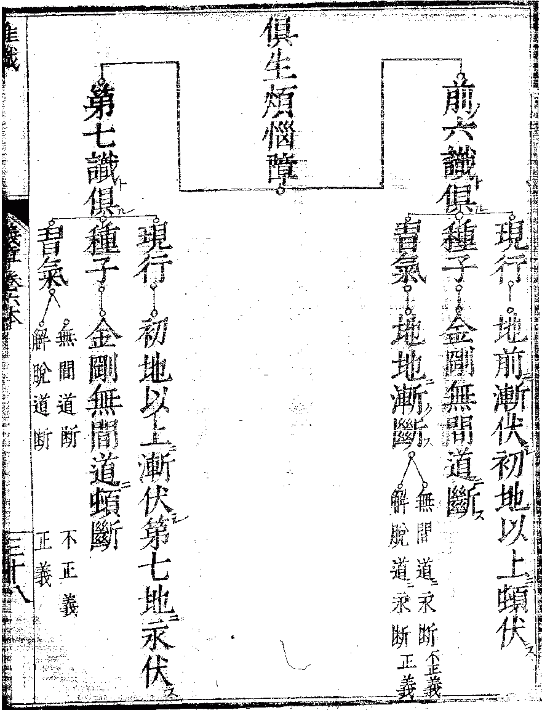
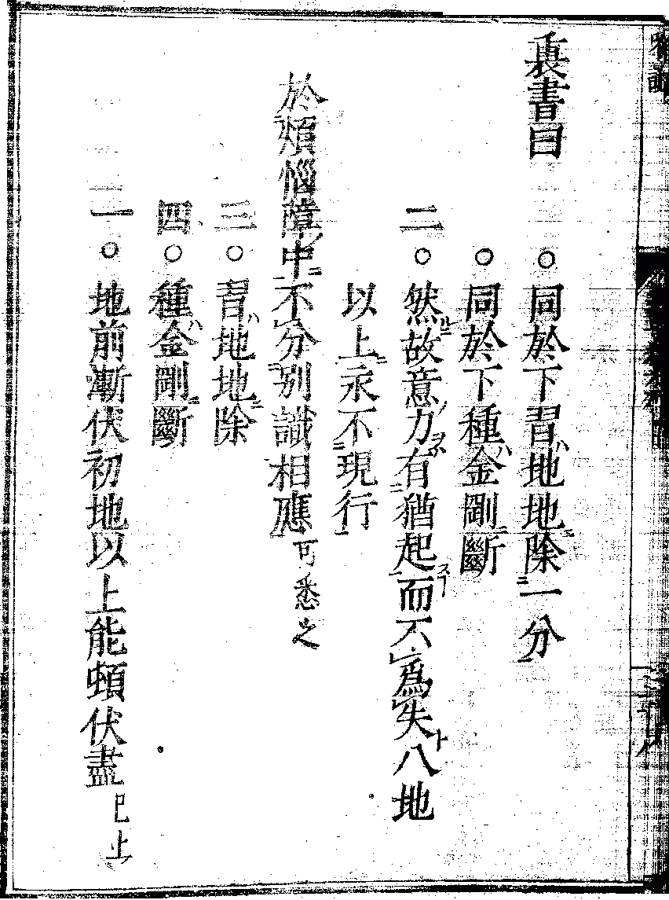
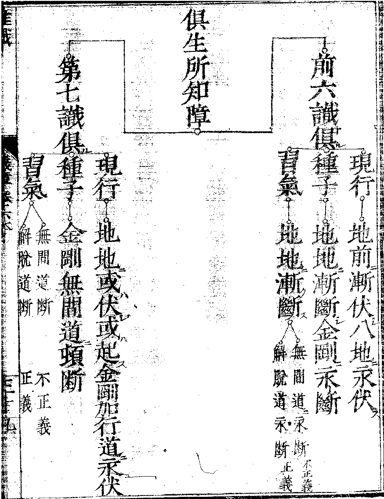
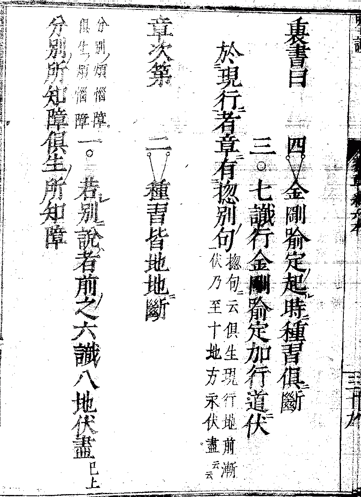

# 唯识义



> **藏经**：国家图书馆善本佛典（国图善本佛典）　**册次** 第 37 册（D37）　**编号** D8896　**部类** 经疏部　**卷次** 6 卷　**篇幅** 157,291 字

> **作者（译者）**：释真兴撰

> **卷／品**：5 卷 · 0 品



---



## 目录



- [唯识义卷第二](#唯识义卷第二)

- [唯识义卷第三](#唯识义卷第三)

- [唯识义卷第四](#唯识义卷第四)

- [唯识义卷第五](#唯识义卷第五)

- [唯识义卷第六](#唯识义卷第六)



---



唯识义卷第一(本)



释真兴撰



问明唯识之义有几门。



荅章有十门即一出躰门二辨名门三离合会释门四何识为观门五显类差别门六修证位次门七观法何性门八诸地依起门九断诸障染门十归摄二空门也。



问何故必有此十门。



荅为显唯识境行果有此十门谓初三门显唯识境次六门明唯识行后一门明唯识果也。



问出躰之中既有能观岂非行唯识又有行果唯识何唯云境又第四门中既有所观识何唯云行。



荅虽说行果皆是观行者之所观也为令行者觉知所观能观躰性及行果等最初出躰是故偏判为所观境又第四门是显能观识虽有所观识是因能观非门正意故说为行。



问第一出躰门意何。



荅出所观能观躰此门意也故章第一出躰者此有二种一所观躰二能观躰(云云)。



问此门中有其四种谓所观能观五种六门何故捴标之中不出后二。



荅五种六门皆所观类义门别故分为二类然五重唯识是观门次第也五种六门就义随机故结五种云㧾摄一切唯识皆尽标六门云於境唯识种种异说(云云)。



章云所观唯识以一切法而为自躰通观有无为唯识故(云云)。



问此文意何。



荅二种唯识中先出所观唯识之躰也言一切法者二论颇殊中边第一云一切法者谓诸有为及无为法(云云)对法十二云一切法者即三自性谓遍计等(云云)然今依对法可释一切法以三性法通为所观观有无故善戒经云有为无为名为有我及我所说为无(云云)义濵云有即色心等法然此心心所所变故名唯识也无即过去兔角等非心以外故名唯识(云云)。



问何以得知㧾三性法为唯识躰。



荅唯识论第九云谓唯识性略有二种一者虚妄谓遍计所执二者真实谓圆成实复有二种一者世俗谓依他起二者胜义谓圆成实(云云)。



问若依中边云以有为无为为一切法有何失。



荅有为无为唯限依圎二性今所观境广通三性故不依中边文也。



问三性名一切法者法谓䡄持三性皆具耶。



荅尔也。



问何具耶。



荅䡄者䡄范能缘之心缘有无法生有无解故云䡄范持者任持有无诸法皆持有无自性故云任持所以三性皆具䡄持也。



问言唯者简持义简去遍计持取二性遍计所执是所简去如何云唯识。



荅智周云遍计所执躰性虽无然是虚妄识之所执亦名唯识(云云)信叡云无法即有上无若识相之无即识相摄若识性之无即识性摄虽唯之所简而所持相性之上无故属二性摄如四分中相分唯所缘彼言唯者简去能缘持取所缘见分虽所简而缘唯所缘相分故述记第三为唯所缘此亦如是(云云)义演云。



问何故遍计所犱名唯识性。



荅遍计所犱躰虽是无然不离唯识性性者躰性非真如性(云云)太抄云。



问遍计所犱其躰既无如何得言唯识性耶。



荅识上之起妄犱性(云云)邑云遍计无躰由妄识变亦称唯识(云云)。



问此等记意何。



荅智周与邑记其意同也以虚妄识之所变名唯识(为言)义演与大抄其意同也以不离识义名唯识(为言)信叡意云摄假从实名唯识(为言)。



问以何可为正。



荅皆有其理不可取舍然仲筭大德云准下第七门叡记为好故第七门云心所变无依他起摄真如理无圆成实摄(云云)又依简去遍计得唯识显现是故遍计名为唯识如圣教中由断烦恼得菩提故以烦恼为菩提此亦应然是故。



䟽云虚妄唯识性所遣清净(云云)古德云遍计所执假施设性不离识故名为唯识(云云)既无所据难依慿之。



问所观唯识有几次第。



荅章云略有五重(云云)即一遣虚存实识等意云观门次第从麁至细㧾有五重(为言)。



问五重为教唯识为理唯识。



荅教理皆有五重然今所明理唯识也故惠沼云所诠既有五重能诠之教亦有五重(云云)。



问此五重若是章主所立。



荅灯云或以世亲五理成佛五教或以五教成彼五理或以五教成五教或以五理成五理等(云云)如是望以弘道乃至以戒贤望护法以遍觉望戒贤以弘道望遍觉㧾可有四百二十四释计之可知章云一遣虚存实识观遍计所执唯虚妄起都无躰用应正遣空情有理无故观依他圆成诸法躰实二智境界应正存有理有情无故(云云)。



问此文意何。



荅标遣虚存实观之意也依唯识论於遍计所犱起有犱於依他圆成起空犱今依此论以空观遣有犱以有观遣空犱若细论者空有二犱应正遣空俱是情有理无故故於三性增益损减之犱俱观应遣空圆成正智之境依他后智之境故云二智境界虽加行智亦缘二性今显存实故言二智境界以有漏智不证实故不言三智也。



问其遍计遣空二性存有之意何。



荅凢夫犱心之前实我实法之相当妄情显现今观行者观实我法虚妄显现躰用都无之时妄情断故我法之相不更显现是名遣虚依圆二性诸法躰实犱心之前虽不显现观行者前如理显现故观依他是诸法之相圆成是诸法之性是名存有也。



因论



问遍计所犱此初重摄耶否耶。



荅有云摄之三性之法俱名唯识故。



问遍计所犱既遣虚何摄初重耶。



荅虽遣虚然遣虚与存实合为一重故所以摄之有云不摄之遍计所犱既遣虚了存实法为唯识是此重之意也。



问若尔遍计所犱不可名唯识又不可为所观唯识之躰。



荅此义不然遍计所犱名唯识者以不离等义名之(如上记)又三性之法是观行者所缘境故遍计亦是所观唯识之躰然今此重意者以遍计所犱观虚遣之依圆二性观实存之行相为唯识之门也故此门中虽有观遍计所犱之义不可言取摄此门也。



问若尔有五重不摄唯识尽之失。



荅所观唯识是广故三性为躰今五重此所观中渐次从浅至深二法相对遣去一法持取一法以持取法名唯识之门何必责摄一切哉若尔后后重亦摄前前重可名唯识若尔舍[冰-水+監]遣相等义不成可思之(此义好也)。



章云无著颂言名事互为客其性应寻思於二亦当推唯量及唯假实智观无义唯有分别三彼无故此无是则入三性(云云)。



问引此文之所以如何。



荅引教证遣虚存实义引证有二摄论与唯识是第一引摄论第六文也即初半证遣虚义次半及后一行证存实义也。



问先此颂大意如何。



荅无性释云名事互为客其性应寻思者谓名於事为客事於名亦尔非如一类谓声与义相摄而生互相系属於二亦当推唯量及唯假者谓於自性及差别中亦当推寻唯有分别唯有假立其事云何谓此二种唯有分别唯有假立差别言说都无真实自性差别言实智者谓从寻思所生四种如实遍智观无义者谓观其义本来无有唯有分别三者观见唯有三种分别谓名分别自性假立分别差别假立分别彼无故此无者谓义无故观此三种分别亦无是即入三性者如上所说即是悟入三种自性谓初颂前半观名与事更互为客即是悟入遍计所执自性初颂后半观彼二种自性差别唯有分别唯有假立即是悟入依他起自性第二颂中即是悟入圆成实自性(云云世亲之释文颇殊义甚均之)此文意云二乗凢夫无始以来犱著一切诸法名与事亲以属著如夫与妻互相系属何以知者若发语言呼火之时燥物即来湿物不来若呼水时湿物即来燥物不来若互相离何故𠮦火不水来召水不火来是即於名事起属著犱又於诸法自性差别犱著心外实有躰性是故菩萨住𤏙顶位时发四寻思创观所取名义自性差别假有实无名义相异故别寻求名之自性差别义之自性差别相同故合思察忍世第一位依前寻思所引如实智观心外所犱一切境义本来无有唯有能缘三种意言分别谓名分别自性假立分别差别假立分别名分别者名义之家名之能縁分别自性假立分别者即意言上假立名义之自性能缘分别(意言者有三释如下)差别假立分别者於意言上假立名义之差别能缘分别彼义无故此三分别亦无是即悟入三性也(为言)。



问且四寻思观四如实智观者何。



荅四寻思者一名寻思二义寻思三自性假立寻思四差别假立寻思也四如实智者一名寻思所引如实智乃至四差别假立寻思所引如实智也。



问此二智其躰如何。



答其躰即是别境中惠然随义异立二名也。



问其义何异。



荅无性云推求行见假有实无方便因相说名寻思了知假有实无所得决定行智方便果相名如实智(云云)。



问此文意何。



荅惠於境上未决定时有推求行相今言寻思智者推求名义等四假有实无之智此智即是后决定智之因故云推求行见假有实无方便因相也后惠於境上有决定了知假有实无之行相是前寻思智所引起故云了知假有实无所得决定行智方便果相名如实智也(推求行见之见者推求义也决定行智之智者决断义也故此二殊也)。



问云何云名义自性差别。



荅呼召之名自云名此名自躰云自性此自性上有苦无常等义云差别名言所表所诠之义云义此义自躰云自性此自性上有苦无常等义云差别。



问名与名自性有何别耶义亦尔。



荅能诠之用云名此名持自躰非他故云自性所诠之用云义此义持自性非他故云自性也。



问观名事互为客遣何犱耶。



荅遣属著犱问何云属著犱荅有二说有云犱名定有义义定有名是云属著犱(云云)有云如手属壁柱等名近属义是云属著犱故泰法师云有一类法犱凢夫二乗犱名声与事义相摄生互亲属著如夫妻亲相属著为主非客(文是成初说之证)灯第三云汝犱言说得自相者如似身根得火自相即觉烧𤍽火以烧热为自相故(是成后说之证)。



问䟽第二难外人云言若说著自相者说火之时火应烧口火以烧物为自相故缘亦如是缘火之时火应烧心今不烧心及不烧口眀缘及说俱得共相(云云)意何。



荅此难意云汝若言言说之名亲著法自相者𠮦火名之时可烧其口又缘火之时可烧其心而𠮦火缘火之时不烧口心明知名唯得共相不得自相(为言)。



问次外人难云若尔唤火何不得水不得火之自相故如唤於水(云云)此难意何。



荅意云若名不得自相者何召火之时持来火不持来水召水亦尔(云云)。



问此难何通。



荅次通云此理不然无始串习共呼𠮦故(云云)。



问灯第三云外人返难如汝定心及五八识得法自相缘火之时何不烧心(云云)此难意何。



荅汝大乗云定心及五八识得法自相若尔其定心等缘火之时何不烧心(为言)。



问此难如何通。



荅次通云宗计有别汝犱言说得自相者如似身根得火自相即觉烧𤍠火以烧𱫚为自相故等(云云)意云汝非人云言说得法自相如身根觉烧𱫚今我不尔现量心任境得之非谓亲相属著得法自相故与汝异也(为言)。



问名事互为客者依他名事欤所犱名事欤。



荅依他名事也观互为客故若所犱名事者可云属著名事。



问若尔可云悟入依他何云悟入所犱。



荅观互为客名事了知非属著名事故云悟入所犱。



问若尔初半颂可云悟入依他所犱何偏云悟入所犱。



荅理实可云尒然约初修业人始知所犱空道理偏云悟入所犱。



问何以知并悟入耶。



荅廓法师云此释论中一相判文非尽颂意由初半颂推求名义更互为客遣外所犱横计名义名悟遍计由次半颂推求性别唯是意言相分假立名悟依他后之一颂是如实智了能所无约此义边名入实性若释论师决作此判前颂文中推求名义岂无依他性别中岂无遍计又复推求名义假有实无此实无性岂非无相圆成实耶后颂文言唯有分别三此三分别岂是圆成又实智中岂不悟入遍计依他二种性耶以此义推故此释论▆相判文非尽论意(此师意云乍二颂俱悟入三性（为言）若依此师意者乍二颂俱成遣[雨/(並-(前-刖))]存实之义寻之可思之)。



问初一颂说𤏙顶位后一颂说忍第一者若别别说为当说如何。



荅初一颂乍一颂说𤏙顶之行相后一颂乍一颂说忍世第一行相也。



问𤏙顶二位俱作寻思观二位有何殊忍第一俱作如实观二位有何异。



荅依明得定𰤑下寻思观无所取立为𤏙位依明增定发上寻思观无所取立为顶位依印顺定发下如实智於无所取决定印持无能取中亦顺乐忍㧾立为忍依无间定发上如实智印二取空立为世第一法是故各异。



问观四寻思者如何观耶。



荅唯识云名义相异故别寻求二二相同故合思察(云云)䟽九未云谓名义二种一自性同二差别同故合名义二种自性及二差别为合观也前二是名义后二是自性差别(云云)㧾意云凢约诸法名唯名非义义唯义非名故别寻求思察名与义各自性差别其相是同故合寻求思察(为言)。



问灯云问准论云名义相异故别寻求二二相同故合思察离合为四与瑜伽同何故无性摄论第六云若名若义自性差别假立(此能诠名自性差别)自性差别义(此所诠义自性差别)如是六种义皆无故(云云)如何荅耶。



荅次荅云荅彼论谈法有其六种若寻思观即名义别开二自性二差别合观故成四种瑜伽(三十六显扬第六无性第六庄严十一)皆说四寻思四如实智无说六寻思处西明云离即为六合观为四者准此知非(云云)。



问名唯名非义等者何有经云一瞿之声有九义为能诠定量即俱舎论引其颂云方兽地光言金刚眼天水於此九种义智者立瞿声(云云)。



荅彼世间以瞿之一言假名九义非谓法性瞿之一言定九义之能诠但少乗以此文执能诠所诠互有定量耳(具如俱舎光记也)。



问於二亦当推唯量及唯假(云云)䟽云於二者有二种二(云云)其何。



荅名之自性义之自性是云一种之二名之差别义之差别是云一种之二故云二种二也。



问唯量唯假云意何。



荅[春-日+小]法师云此中有二门一摄尘归识门一切名义自性差别唯有分别识心也(释唯量义也)二摄义归名门一切名义自性差别唯有假立自性差别名字言说(云云)(释唯假义也)。



问先此二门有其理耶。



荅初摄尘归识门可尒所谓四种出躰中摄境从心门后摄义归名门不可名是虚踈之法何以实从假故改可云性用别论门也(灯破如是也)。



问其量者何义。



荅㤗云量者分量心用分限故(云云)廓法师云量者决定义又识量量度性故(云云)。



问其假者何义。



荅假者虚踈之义也。



问约假有一种假二种假等今言假者约何假耶。



荅是约一种𮗚待假待名言故故论云唯有假立差别言说(云云)。



问何故双观唯量唯假。



荅为除二种犱谓观唯量遣心外犱观唯假遣实有犱也。



问实智观无义者其义何等义。



荅谓之廓法师有二说一云名义自性𭅒别心之所缘境故以境界义名义云观无义一云名等四中义名义云观无义(云云)。



问就后义唯四中义观无义者不观餘名等欤。



荅四中义者以所诠义之名餘三皆摄名义㧾云观无义意云名义自性𭅒别皆名言之所诠故名所诠义㧾观无义(为言)。



问若尔与初说有何殊。



荅初说意云名等四境心所缘境故以境界义名义(为言)后说意云名等四境名言之所诠故以所诠义名义(为言)故殊也(虽有二说初说正也)。



问唯有分别三者依他三分别欤所犱三分别欤。



荅谓之廓䟽有二说一云观心之三分别一云犱心之三分别(云云)。



问二说意何。



荅初说意云无心外所犱名义等四义唯有能观依他三分别(为言)后说意云无所犱名等四境唯有能迷慹之三分别(为言初说为正也)。



问云何云名分别等。



荅缘名能缘之心云名分别缘自性假立能缘之心云自性假立分别缘𭅒别假立能缘之心云差别假立分别(言分别者心心所之异名也)。



问约境有名等四何能缘心立三分别不立义分别。



荅名分别之名是名义之家名故名言摄义立名分别义摄其中(名义之家名者名之名义之名合云名也)。



问何故依名是名义之家名缘此名能缘心名名分别以义分别摄名分别。



荅凢一切法若名若义名言所诠故若名若义之能诠㧾云名言缘此若名若义名言能缘心名云名分别也。



问若尔自性𭅒别亦是名之所诠故缘此能缘之心亦可名名分别何不尔耶。



荅自性𭅒别是所诠故皆可云名然而多名集诠自性多句集诠𭅒别是故别立自性假立分别𭅒别假立分别也意云名之家名诠名与义之自性义之家名诠名与义之差别(为言)。



问彼无故此无者意何。



荅彼者指心外名事自性𭅒别一切境义也此者指能缘三分别也无彼所犱境义故无此能缘三分别(为言)故论云既无实境离能取识宁有实识离所取境所取能取相待立故(云云)。



问四寻思四如实智观有漏观欤无漏观欤。



荅四寻思唯有漏𤏙顶二位观故如实智亦通无漏始从忍位至地上故。



问若尔寻思不通地上耶。



荅亦是通之故伽抄云寻思不在八地以上已前有有漏心故(云云)。



问若尔何论云顶位名寻思位极。



荅其寻思功力此位极故云尔也非谓地上都无故对法抄云地上菩萨有漏后得智作寻思观(云云)。



傍论



问依眀得定发下寻思者云何名明得定等。



荅论云初获惠月前行相故立明得名即此所获道火前相故亦名𤏙(云云)。



䟽云得无漏惠月前起相故云明如日初出时前相名明相(云云)。



问云何名明增定。



荅论云明相转盛故名明增寻思位极故复名顶(云云)意云前位所得无漏明相此位转增故名明增(为言)。



问云何名印顺定。



荅论云印前顺后立印顺名忍境识空故亦名忍(云云)。



䟽云顺通二种一乐顺二印顺印顺之名通下上忍乐顺之言唯在中忍又𭅒别者下忍名[(留-田)-刀+ㄗ]忍[(留-田)-刀+ㄗ]所取无故中忍名乐顺乐无能取顺修彼故上忍名印顺印能取无顺观彼故(云云)。



问云何名无间定。



荅论云谓前上忍唯印能取空今世第一法二空双印从此无间必入见道故立无间名异生法中此最胜故名世第一法(云云)。



问对法第十一云修瑜伽有五种(云云)其五者何。



荅持任镜明依也。



问云何名持等。



荅持者闻惠任者思惠镜者修惠眀者所缘境依者转依(一说)又前四皆以修惠为躰依如前(二说)又持者於教起六种心(一根本心二随行心三观察心四实解心五㧾聚心六希望心也是皆闻惠也)任者次起十一作意(有觉有观作意无觉有观作意无觉无观作意奢摩他作意毗钵舎那作意相应作意起相作意摄相作意舍相作意恒修作意恭敬作意是皆思惠也)镜者次起九种住心(内住等住安住近住调顺寂静㝡极[宋-木+(夕*(十/下))]静专住一趣等持也是皆所依定也)眀者依智起诸神通也(三说)。



问初说云何。



荅䟽第九云闻随顺通达真如𭑕经等法故云持(持者闻持)闻教已如理作意故云任(任者任持)依三摩地发修惠观如实观故云镜(镜者明照义)依止定心思惟定中所起影像观此影像不异定心故云眀由如是乃至舍离二种能所取故证无所得正入见道舍一切麁重得清净转依故云依(云云)(后二说具如灯之)。



问约此持任等分别因果何。



荅䟽云前四是地因第五是地果(云云)。



问此五法何位修耶。



荅灯有二释一云准彼论文依𤏙等位即通四善根皆有此四二云又释持任等唯除真见及佛果位佛果位中更无果故真见道中无影像等故云通所餘位(云云)具如灯第七依不要须且以略耳已上傍论毕。



章云成唯识言识言㧾显一切有情各有八识六位心所所变相见分位𭅒别及彼空理所顕真如(云云)。



问引此文意何。



荅为证遣虚存实之义引二证文之中是第二引唯识论第七文也即是先引识言释证存实义次下引唯言释证遣虚义是即初也。



问此文大意如何。



荅此文意外人难唯识之义有九难中是荅第九异境非唯难之文也论云汝应谛听若唯一识宁有十方凡圣尊𤰞因果等别谁为谁说何法何求故唯识言有深意趣(云云)释此有深意趣文也故䟽云此释深意一切有情各各有八识遍行等六位心所各各自躰分及此所变相见二分及色心分位二十四不相应等及彼二无我空理所显真如(云云)意云识言所表凢有五类一八识心王自躰分二六位心所自躰分三心王心所所变相见二分四前三分位不相应法五於前四法观遍计所犱以空为门所顕空理也初四俗事是依他也后一真理是圆成也即显所存二性有也。



问其一切有情者意如何。



荅一切者悉皆之义唯依取蕴建立有情佛无有漏非有情摄若示现者佛亦有情故云六十二有情也。



问一切有情后三识定有其前五识有无不定初禅无鼻舌两识二禅已上无有五识而何㧾云一切有情各有八识。



荅章依少分说一切言又依种子各有八识第八𭇥藏转识能熏种子故也。



章云识自相故识相应故二所变故三分位故四实性故如是诸法皆不离识㧾立识名(云云)。



问此文意何。



荅此文释上五名唯识之文也故䟽云所以许有识自躰者识自相故许心所者识相应法故许见相分者即心及心所二躰所变故许不相应者即前三种分位故许真如者即前四种实性故如是五法皆不离识㧾名为识非无心所等(云云)。



问无漏种子五种之中何摄。



荅演秘有二释一云识自相摄不离第八识自躰分故二云识所变摄有漏第八虽不能变而无漏变所变之类故所变摄(云云)(有义断云后义解为胜)从方云但有依持义持令不散故不离识故亦名唯识也譬如赤眼人把火亦如人顶上带物虽不见以顶持之(云云)。



○识自相门



问言识自相者何。



荅八识心王名识自相言自相者谓自躰也。



问约心王具四分何分为自相。



荅唯后二分也相见二分识所变摄故。



问其八识者何。



荅即三能变识也即一异熟能变识(第八识也)二思量能变识(第七识也)三了别境能变识(前六识也)。



问第一异熟识之躰何。



荅论云初阿頼耶识(云云)释论云初能变识大小乗教名阿頼耶(云云)。



问何故名阿頼耶。



荅阿頼耶者梵语此翻为藏具三义故故论云此识具有能藏所藏犱藏义故(云云)。



问云何名能藏等。



荅论云谓与杂染互为缘故(释能藏所藏义)有情犱为自内我故(云云)(释犱藏义)䟽云能持染种种名所藏此识是能藏是杂染法所熏所依染法名能藏此识为所藏摄论第二等云非如大等藏最胜等中即能所藏(最胜者冥性)彼论又言为染第七等所犱藏以为内我名犱藏义(云云)。



问其杂染者何法。



荅䟽云诸有漏法皆名杂染非唯染法(云云)。



问其内我者何法。



荅䟽云唯烦恼障义非所知障义不尔无学应有此名此不别犱为其我所及与他我名自内我(云云)。



问既有三义必具三义名阿頼耶。



荅䟽云义虽具三正取唯以犱藏为名不尔二乗(无学)八地菩萨应有此名三名阙一即不得名(云云)(一者犱藏义也)枢要下云据实頼耶但以犱藏今举能藏有大自在似常一故别似於我顕为我爱之所犱藏义意正以所犱藏故名阿頼耶若以能藏解阿頼耶佛果应名若以能藏所藏义解二乗无学八地已去应得此名故唯犱藏名阿頼耶阙即非也今举能藏顕杂染藏佛唯有一能藏二乗无学八地已去有二能藏所藏以外有三藏义故以犱藏名阿頼耶(云云)。



问若以犱藏义名阿頼耶者何䟽第三云此能犱藏亦通无漏所藏不通无漏(云云)。



荅其意殊也佛果位第八识亦能𭇥藏无漏种故云能藏也平等性智所缘犱故云有犱藏义也无妄犱义也(具如灯第四▆)。



问若尔何枢要云佛唯有一能藏。



荅无妄犱之犱藏义故云尔也非无缘犱之犱藏义也。



问约阿頼耶有自相果相因相今言识自相者不开餘二欤。



荅论云摄持因果为自相故(云云)䟽云自躰是㧾因果是别自相摄持因果二相为自躰故(云云)。



问第八既有我爱犱藏等三位名何故㧾标三能变中举异熟果相之名别释中𦤺染分藏识之名。



荅论云此识自相分位虽多藏初过重是故偏说(云云)䟽云今由二义说阿頼耶由此自相虽有三位以彼藏名三位之中初位所摄自从无始乃至七地二乗有学最初舍故又以是名我犱所犱过失重故虽染分名亦通异熟异熟之名望此仍轻以此藏名通二种义过失之重故今偏说(云云)。



问若尔何故𤙹标举异熟名。



荅论云一谓异熟即第八识多异熟性故(云云)䟽云多异熟者谓此识躰㧾有三位一我爱犱藏现行位即唯七地以前菩萨二乗有学一切异生从无始以来谓名阿頼耶至无人犱位此名犱藏二善𢙣业果位谓从无始乃至菩萨金刚心或解脱道时乃至二乗无餘依位谓名毗播迦此云异熟识至无所知障位三相续犱持位谓从无始乃至如来尽未来际利乐有情位谓名阿𨹔那此名犱持或名心等长短分限不过三位以异熟名亦通初位故论说言多异熟性故(云云)。



问何故不举初后之名。



荅䟽云不言初以狭故不言后以宽故宽狭何事遮不说也此中意说熏习位识若说宽时佛无熏习说即无用若说狭时八地以后犹有熏习便为不足又但说囙有虚妄位不说於佛故说异熟识是多异熟性宽狭皆得又为五位一异生位二二乗有学位三二乗无学位四十地菩萨位五如来位异熟一名通前四位故言多异熟性不说餘名又十三住通十二故又七地如枢要说(云云)(具至顕类𭅒别可论之)。



问云何名果相阿頼耶。



荅论云此是能引诸界趣生善不善业异熟果故(云云)是解果相之文也䟽云谓此识是能引诸界诸趣诸生㧾善𢙣业之异熟果说名异熟(云云)。



问阿頼耶阿𨹔那之名亦是果相何故独举异熟名。



荅论云此识果相虽多位多种异熟宽不共故偏说之(云云)。



问其多位多种之意何。



荅多位者我爱犱藏等三位或资粮等五位也多种者即五果中有义具四果除离系果有义具三果且除士用意云此识果相虽多位多种今此异熟名三位通初二五位通初四故云宽又等流增上士用三果可通餘法唯异熟果不通餘法故云不共也。



问云何名因相阿頼耶。



荅论云此能犱持诸法种子令不失故名一切种(云云)是解因相之文也䟽云以现行识犱持诸法自他种子令不失故名一切种释因相义此第八识所犱诸法诸法之因今说亦是此识因相即种子识(云云)。



问此三相若现行若种子。



荅枢要上有四释第四正释云三相俱取现行及一切种与转识互为因果故(云云)。



问且释初能变识有几门。



荅论颂云初阿頼耶识(第一自相门)异熟(第二果相门)一切种(第三因相门)不可知犱受处(第四所缘门)了(第五行相门)常与触作意受想思相应(第六相应门)唯舍受(第七受俱门)是无覆无记(第八三性门)触等亦如是(此俱时心所例同心王也)恒转如暴流(第九因果譬喻门)阿罗汉位舍(第十伏断位次门)具如论并䟽云。



问第八识有几名。



荅灯颂云无没(无相论云一切法种无所隐没故)本(一切之法根本故)宅(无相论云种子之宅舎故)藏(执藏故)种(一切法种子故)无垢(梵云阿未罗维)持(执持梵云阿𨹔那)缘(中边云是餘识生缘故)显(无相论云五根四大等皆於此顕故)现(楞伽云诸法皆於本识上现故)转(无相论云与诸法为依而起故)心(集起义故)依(所知依故)异(异熟义故)识(无相论云分别事识也)根(大众部立为根本识)生(化地部名穷生死蕰)有(上座部及分别说部立为有分识)都有十八名又加增一之四阿頼耶可为十九若古人云名十七如灯说之。



问第二思量能变识何。



荅论颂云次第二能变是识名末那(云云)释论云是识圣教别名末那恒审思量胜餘识故(云云)䟽云於圣教中别名末那㧾名识故末那是意(云云)。



问此第七名意者第六名意识有何殊耶。



荅论有此难故论云此名何异第六意识(云云)即荅之有三释。



问其何。



荅一论云此持业释如藏识名识即意故彼依主释如眼识等识异意故然诸圣教恐此[冰-水+監]彼故於第七但立意名(云云)䟽云意是自躰识即是意也於六释中是持业释如阿頼耶名藏识识躰即藏亦是此释此与彼同故指为喻其第六识躰虽是识而非是意非恒审故彼依主释主谓第七等(云云)枢要云何故第六不但名意第七不识第七持业二义(依止思量)以显识躰第六依主持他明自若第六标一意不言识者不能显自第七加识恐监依主故第七但标意名(云云)(已上第一义了)二论云又标意名为简心识积集了别劣餘识故(云云)䟽云唯立意名为简心识虽皆可说名心意识据增胜义但七名意积集心义了别识义劣餘识故简后心前识但立意名恒审思故(云云)(第二义了)三论云或欲顕此与彼意识为近所依故但名意(云云)䟽云显此第七与彼第六意识为近所依故但名意近所依者以相顺故同计度故六缘境时七与力故所以七无漏六无漏七有漏时六非无漏非七缘境时第六与力故六有识七但名意为简第八亦与第六之力故复言近彼容可为远所依故等(云云)(䟽又有别释繁故畧之第三义了)。



问释第七识有几门。



荅有十门即论颂云次第二能变是识名末那(第一弁名门)依彼转(第二解所依门)缘彼(第三解所缘门)思量为性(第四出躰释义门)相(第五释行相门)四烦恼常俱谓我痴我见并我慢我爱(第六顕染俱门)及餘触等俱(第七触等相应门)有覆无记摄(第八三性分别门)随所生所系(第九地界分别门)阿罗汉灭定出世道无有(云云)(第十隐显分别门)。



问约意有二义一云依止义二云思量义何故但云思量能变不言依止耶。



荅论云意以思量为自性故即复用彼为行相故(云云)故知思量义胜故偏举之耳。



问等无间意亦名意与此何殊。



荅第七名意有二义过去名意但有依止义故殊也。



问若尔何论云恒审思量正名为意已灭依此假立意名(云云)。



荅其以相似义假立也故䟽云意有二义一思量义二依止义第七通有二名过去但唯依止躰虽现无与现依止思量之意相似故但名意(云云)枢要云意有二义一依止二思量七二义具餘唯依止过去依止似七故思量亦似第七名意不似心识名心识(云云)(对法抄云意有二种一无间觉意二现思量意（云云）初是过去意后是第七也可思之)。



问第三了别境能变识何。



荅论云次第三能变差别有六种(云云)谓眼耳鼻舌身意也。



问既有六种何故合为一能变。



荅此六识同了境相[色-巴+(鹿-比+(人*人))]故合为一也。



问何故必六种耶。



荅论云随六根境种类异故(云云)䟽云谓根与境各有六别识随彼异故非多少(云云)。



问先其随眼根名眼识等意何。



荅论云随根立名具五义故五谓依发属助如根(云云)谓依於根根之所发属於彼根助於彼根如於根(为言)。



问此五义意何。



荅䟽云此中第一依根之识彼有二义且如眼识眼中之识故名眼识依眼处所识得有故此第七啭(所依声)及由有眼识得有故此第三转(具声)第二根所发者彼云眼所发之识故名眼识由眼变异识亦变异如迦未罗病(此云黄色病)损眼根故所见青色皆以为黄非坏色时而识名坏第三属於根者彼云属眼之识故名眼识由识种子随逐於根而得生故此谓生依非染净依及根本依引发依也第四助於根者彼云助根之识故名眼识由根合识有所领受令根损益非於境界故第五如於根者彼云如根之识故名眼识根识二法俱有情数非彼色法定是有情(云云)(法华䟽云如根者如根明昧识亦明昧（云云）)。



问又随境立名者其义云何。



荅论云或名色识乃至法识随境立名顺识义故谓於六境了别名识(云云)䟽云了境名识即随境立名顺通别名识之义故谓於六境了别名识(云云)。



问此随境立名是理尽义欤。



荅是一相义有相[冰-水+監]故故论云此后随境立六识名依五色根未自在说若得自在诸根互用一根𰤑识缘一切境但可随根无相[冰-水+監]失(云云)。



问其若得自在者何位耶。



荅䟽云何名自在如佛地论云转五识时㧾有二解或从初地即名自在无漏五识现在前故(不正义也)或成佛时成所作识彼方起故然有别义入地菩萨无漏五识虽不现前得后得智(第六生法空后得智起)引生五识於净土等中现神变事何妨五识一一通缘一切异境界不思议力所引生故或有别义七地已前由有烦恼现行不绝未殊胜故不名自在入八地已去烦恼不行纯无漏起引生五识可得互缘方名自在(云云)(此后二义依佛地论第二师说中云因位之中有漏五根更有二说也)今谓法华论云谓诸凡夫人以经力故得胜根用未入初地位(乃至)一一根中悉能具足见色闻声知香味触等诸根互用故(云云)玄賛有二义一义如唯识论一义云若加行力分亦得者地前亦得(云云)故知诸根互用通地前地上也。



问诸根互用者如何云互用耶。



荅枢要有二师义初师义中更有二义一云一一识躰转用成多非转法躰(云云)二云恐坏法相但取自境皆是实境所取他境皆是假境以识用广非得餘自相恐眼耳根得三尘时若至能取坏根不坏境若不至取坏境不坏根餘三根取色声亦尔皆有此过故(云云)后师云一一根处遍有诸根各自起用非以一根得一切境以诸根用各遍一切故名互用(云云)。



问此二师之中以何为正。



荅灯云然法师意存第二解(云云)存初师第二之解(为言)。



问初师第一解及后师解有何失。



荅第一解有坏法相之失后师解有非互用之失也。



问释第三能变有几门。



荅有九门即以九颂释之颂云次第三能变𭅒别有六种(第一弁能变𭅒别门)了境为性相(第二自性门第三行相门)善不善俱非(第四三性门)此心所遍行等三句(第五相应门)皆三受相应(第六受俱门)依止根本识(第七所依门)五识随缘现等四句(第八六识俱转门)除生无想天等三句(第九起灭门)然初遍行触等之五颂第五相应门之义也(具如论)。



○识相应门



问六位心所名识相应之意何。



荅具四义故名为相应谓一时同二依同三所缘等四事等也䟽引伽云五十一说由四等故说名相应谓事等处等时等所依等事处相似名之为等时依定一名之为等正与此同今约见分为行相影像相分为所缘自躰名事(乃至)时谓𭃯那定同一世依谓依根俱有无间不取种子以各别故(八识种子各别故不可云依同也)即以四义解颂相应谓除行相或虽不同亦兼取彼(云云)(彼者行相也)。



问其时同等之意何。



荅心王心所必同时起故名时同心王心所必依一根故云依同眼识心王缘青等时遍行心所亦缘青等心王心所所缘青等影像相似名所缘等(耳鼻等准之)心王躰一心所各各亦有一躰彼此相似故名事等也。



问以此四义有所简耶。



荅以时同简前后谓一聚心王心所必同时起故简餘前后起之心心所(为言)以依同简别识谓眼识与俱时意识缘一青色时所缘是一然眼识以眼根为所依第六以第七为所依所依各别不可云相应故云简别识(为言)以所缘等简别见谓第六第八同以第七为所依根然第八识唯缘三种境第六识遍缘一切法所缘各别不可云相应故云简别见(为言)以事等简躰多谓眼识与俱时第六共缘一青等之时眼识一聚心王心所各各躰一故以相似名为相应若加俱时第六聚之心所名眼识之相应者有心王躰一心所躰多之失不可云相似故云简躰多(为言)(耳等准之)又可云以第六识聚望眼识聚中若心王若心所之随一之时第六识聚其躰即多不相似眼识一躰之心王一躰之心所故不可云相应故云简躰多(餘识准之可存此义)。



问以四义名相应者何䟽加行相同义为五义。



荅其一相之义也非理尽义。



问云尒意何。



荅䟽云行简依同其境各别(云云)北抄云即是第六第八皆依第七其境各别故不相应(云云)是则前所缘等之义也。



问若尒不可用行相同义耶。



答䟽云或但四义唯除行相以各别故一一应思非无所以(云云)故知用之无失也。



问约心所有六位其何。



荅一遍行二别境三善四根本烦恼五随烦恼六不定也即颂云初遍行触等(等取作意受想思)次别境谓欲胜解念定惠所缘事不同(此一句释别境义也)善谓信惭愧无贪等三根(等取无嗔无痴)勤安不放逸行舍及不𡧱烦恼谓贪嗔痴慢疑𢙣见随烦恼谓忿恨覆恼嫉悭诳谄与𡧱憍无惭及无愧掉举与惽沈不信并懈怠放逸及失念散乱不正知不定谓悔眠寻伺二各二(云云)(二各二者释不定义也)。



问其名遍行等之意何。



荅触等五法具四一切无处不有故名遍行欲等五法於所乐等别别境转故名别境信等十一唯善心俱故名为善贪嗔等六烦恼根本故名本惑忿等二十本惑等流故名随惑悔眠等四三性不定故名不定也故论云如是六位合五十一一切心中定可得故缘别别境而得生故唯善心中可得生故性是根本烦恼摄故唯是烦恼等流性故於善染等皆不定故(云云)。



问心所有五十一者决定义欤。



荅未必决定对法第一立五十五开五见故瑜伽第三立五十三加邪欲邪胜解故。



问若有六位者何瑜伽立为五位耶。



荅此论会云然瑜伽论合六为五烦恼随烦恼俱是染故(云云)。



问有何𭅒别故分为五位。



荅论云复以四一切辨五𭅒别谓一切性及地时俱五中遍行具四一切别境唯有初二一切善唯有一谓一切地染四皆无不定唯一谓一切性(云云)。



问云何云性地等。



荅䟽云谓彼言一切处一切地一切时一切耶此中解云谓一切性及地时俱俱者即一切耶谓定俱生故处者三性三性之处皆得起故言时者谓或一切有心皆有或无始不断或缘一切境故㧾言时地有二说一云三界九地二云有寻等三地此解为胜轻安不遍故性即三性(云云)。



问何故遍行具四等(云云)。



荅䟽云遍行具四无处无故别境有初二不缘一切境亦非相续非心有即有故无时也又此未必并生无俱善中地者如次前说遍三地也此中轻安不遍欲界若如初说从多分或加行等说故染四皆无亦从多故如无明贪等通三界地八大随惑皆通地及俱以非皆通地等故㧾云非四依种类而作论故后四不定通三性故唯有一也(云云)。



问说染四皆无云依种类而作论之意何。



荅演秘云以烦恼中通者少不通者多以种类言故说染四皆无㨿实亦通(云云)仲筭大德云染有四类谓本惑与大中小三根本惑中瞋唯在欲餘通三界八大随惑亦通三界中随二惑唯在欲界小随惑中七唯在欲谄诳二种在欲色界是故若以种类分之虽大随惑通三界地自餘三类有通不通所以烦恼从多分说无地一切(云云)(此义尤好也)。



问且何故随惑中分大中小耶。



荅论云谓忿等十各别起故名小随烦恼无惭等二遍不善故名中随烦恼掉举等八遍染心故名大随烦恼(云云)意云忿等十别头独起无并起义故名小也无惭无愧遍诸不善性故名中也掉举等普遍不善性及有覆性故名大也。



问何故不定无餘三一切。



荅论云非如触等定遍心故非如欲等定遍地故(云云)(非定遍心者显无时俱二一切也)。



问此六位法名心所之意何。



荅以三义名心所也。



问其何耶。



荅论云恒依心起(一)与心相应(二)系属於心(三)故名心所(云云)。



问此三义意何。



荅释此三义䟽有四释故䟽云略以三义解心所㧾名一恒依心起心若无心所不生要心为依方得生故(难起第二义也)若尒心望遍行应名心所二与心相应彼五说与心相应故心不与心相应故又时依缘事四义具故说名相应由此色等亦非心所(难起第三义)既尔心具五义与五相应应名心所三系属於心以心为主所系属之心有自在非所以是义故系属於心有此三义故名心所(第一释毕)又初义显遍行恒依心故第二顕餘一切心所非恒依心心相应故第三正解心所之义又解心王不名为所不属心故由此三义简别心色等不得名心所(第二释毕)又解第一句显一切心所得名心所第二句简一切色等不名心所第三句显心所得名为所以系属他以非主故心不名所(第三释毕)又初句简无为不依心起故第二句简色不相应第三句正解心所得名所以(云云)(第四释毕)。



问何必望心王名心所。



荅论云如属我物立我所名(云云)是举喻显心王心所之义也。



问缘境之能心王既足何必用心所。



荅不尔论云心於所缘唯取㧾相心所於彼亦取别相助成心事得心所名如𦘕师资作摸填彩(云云)。



问其取㧾相取别相之意何。



荅心王若缘青色时但㧾取青不更分别何物之青心所於彼青色能分别何物之青色故心王但取㧾相心所取㧾别相(为言)喻意云譬如有𦘕师与弟子师即以墨𦘕㧾相了弟子以青黄等种种之丹彩餙彼㧾相之上令其媚好以墨𦘕为迹如取㧾相著彩色时令媚好出如亦取别相(为言)。



问心所俱起之行相如何。



荅枢要下颂云五法五俱起(谓遍行五随一起时必餘四俱起故)九法必六俱(谓别境五不定四此九法随一起时必遍行五俱起故)九法定十四(谓无明与八大随惑俱起时必遍行五俱起故云十四)二十一十五(谓善除轻安餘十法本惑除无明瞋餘八法小随惑中谄诳憍三合云二十一此中善十俱起时必遍行五俱起故云十五若本惑八中随一起时必无明并大随惑八及遍行五俱起故云十五为谄诳憍中随一起时必无明并大随惑八及遍行五俱起故云十五)三法起十六(谓轻安并中随惑无惭无愧云三法此中轻安起时必餘十善及遍行五俱起故云十六若无惭无愧俱起时必无明并八大随惑及遍行五俱起故云十六)八法十七俱(谓瞋及小随惑之中除谄诳憍三餘七合云八法此中若嗔等八之随一起时必无明并大随八中随二遍行五俱起故云十七俱)是心所相应惠者应当悉(云云)。



问五十一中几并头起几独头起。



荅遍行五并头起中随二惑并头起大随八惑并头起又善心所若有轻安地乍十一并起若无轻安地餘十并起自餘心所起时不定也。



问遍行别境二类心所於何境转。



荅触於可意相转受於顺违俱非之相转想於言说因相转思於正因等相转作意通於前四境转(已上遍行)欲於所乐境转观察胜解於决定境转印持念於曾习境转明记定於所观境转专注惠亦於所观境转简择也(已上别境)。



问五十一法与八识相应多少如何。



荅且第八有漏位唯遍行五相应第七有漏位十八心所相应谓遍行五我痴我见我慢我爱四大随惑八并别境中惠也第六识五十一法皆悉相应前五识各三十四心所相应谓遍行五别境五善十一本惑之中贪嗔痴三随惑之中大八中二也若无漏已转依位八识各各二十一心所相应谓遍行五别境五善十一也(具如论可知之)。



问且就第八识何故别境等不相应。



荅论云互相违故谓欲希望所乐事转此识任业无所希望胜解印持决定事转此识瞢昧无所印持念唯明记曾习事转此识昧劣不能眀记定能令心专住一境此识任运𭃯那别缘惠唯简择得等事转此识𭗒昧不能简择故此不与别境相应此识唯是异熟性故善染污等亦不相应𢙣作等四无记性者有间断故定非异熟(云云)自餘七识俱不俱之所以习之可察之。



识所变门



问识所变者何物耶。



荅心王心所各自躰分之所变现相见二分也。



问百法论说二所变者十一种色何故此中说相见分。



荅义演云此眀唯识义即说二所变是见相分百法论约出法躰即说二所变是十一色彼论如言二所变者即第八识心王能变起五根五尘同时五数唯变似根尘然第七识不缘色等此中除之若五识亦能变起实五尘若第六识能缘变十八界似根尘等故彼论云二所变也此中即约唯识道理说五聚法皆不离识㧾名唯识(云云)仲筭大德难云今谓不尔所缘心者皆相分摄不𨵿见分是故所会即为𩵋肉今应会言彼百法论色心相对显能所变见分心法是能缘故相分色法是所缘故此唯识论躰用相对显能所变识自躰分变现能缘所缘用故(云云)。



问且依唯识论云何名所变相见二分。



荅论云然有漏识自躰生时皆似所缘能缘相现彼相应法应知亦尔似所缘相说名相分似能缘相说名见分(云云)。



问百法所说所变十一色见相分中何摄。



荅相分中摄相分是色法故。



问其十一色者何。



荅五根五尘及法处色也义忠云第三色法亦有四义一识所依色主属五根二识所缘色唯属六境三㧾相而言质碍名色四又色有二一者有对若准有宗极𭗒所成大乗即用能造色成即十有色是二者无对非极𭗒成即法处摄色是(云云)。



问约十一色八识所变分别何。



荅第八识所变境者谓有漏种子十有色处及堕法处所现实色也第七识唯变法处一分(除色也)第六识通变一切前五识唯变五尘也然十处中五尘通内外五根唯内言法处实色者威德定所行流色也第八缘之(为言)。



问约有漏识变有随因缘势力故变随分别势力故变如何云尔。



荅䟽云因缘生者谓由先业及名言实种即要有力唯任运心非由作意其心乃生即五八识随其增上异熟因为缘名言种为因故变於境八俱五数即无胜力设任运生境无实用因缘变法必有实躰非横计故非无用故(已上说因缘变)谓作意生心是筹量心即六七识随自分别作意生故由此六七缘无等时影像相分无有实躰未必有用(大云第六缘过未空华第七犱为我等也)亦非由说分别故变境躰定无亦缘有故(此说五俱意识也已上说分别变)或初通五八全及第六少分后第七全通第六少分此解顺论有用等文(云云)。



问此二种变何变有用何变无用。



荅论云初必有用后但为境(云云)。



问云尔意何。



荅谓之䟽有四释其第四正释云又解因缘者是诸法真实有用种子若用此种子故生诸法心缘变之变必有用以能生者实因缘故其八俱五数所变之相非实种生但假种起故但为境分别变摄分别变者心心所之㧾名随心心所之势力故变不从真实有用因缘种子所生彼但为境无漏亦尔非必有用随其所应五识相应心心所及第八识躰五俱意识或定心所缘有实种生者皆因缘变餘无实用但名似色心等名随分别势力故变此解为正无诸妨难由能缘心任运有力彼所变相从实种生名因缘变若能缘心不任运起虽任运起而无胜力所变之相非实种生名分别变初必有用无无用者后但为境当情现故非必有用若论依他假因缘起亦是有用非是如色有碍等用称其自相名为有用(他假因缘者能缘之种子)若第六报心五识俱者亦随因缘变其境或有用(云云)(报心者无记心也)枢要上亦有四释其第四云因缘者法躰实从真种子生真种子生者所变有用餘名分别性境不随心独影唯从见带质通情本性种等随应性境全及带质一分是因缘变独影及带质一分是分别变然带质境可通因缘分别二门从种及见二门摄故(云云)(与䟽第四释同也)。



问约相分有假实假相分能缘同种生故可云识所变其四显色等实相分别有种子生何云自躰分之所变。



荅色法虽自种子生若心种子不生现行之时不能色独生若心种子生现行时心种所引色种生现故云识所变也。



问何故尔。



荅心有缘虑分别故自生亦令引他生色法不尔何有此能乎故䟽云由分别心相境生故非境分别心方得生(云云)。



问若言心引色令生色即不尔者何说所缘有对云心起如𮊵病人依杖立心必依境起(云云)(有对有三一境界有对谓心心所五根也二所缘有对谓心心所也三障碍有对谓五尘境也)。



荅凢次第有二一法相生起次第二唯识转变次第也依境心起者是法相生起之次第也依心有境者是唯识转变之次第也故不相违也。



因论



问十八界几识之所缘耶。



荅枢要下颂云因见各随应五三六有二六一一不定自在等分别(云云)。



问此文意何。



荅因者简自在位也见者简自证分等也各者显别别义也随应者显能缘识非决定义也五三者五尘有三能缘谓五识随一第六第八也第八意根界摄六有二者六根中初五根各有二能缘谓第六第八也第六意根若第八名意根时第六第七二识之所缘也(若第七名意根之时第六之所缘也此颂不说)六一者六识界有一能缘谓第六识也一不定者法尘界中摄五种色(极略色极逈色受所引色定所生遍计所起之色)此中威德定所变色是第八第六五识之所缘若假想定所变色但第六之所缘也此中菩萨二乗异生所引各别也。



问五八识都不缘假色耶。



荅第八无论五识西方有二师一云五识唯缘实现量眀了缘自相故一云五识亦缘假以能明了照其自相是处自相非事自相(云云)(具如䟽第二本之)。



问第八识无论者何楞伽经云阿頼耶识缘名及相犹如毛轮(云云)。



荅䟽第三有二释一云名者声声是名之躰故相者五根等相非心等之相二云相者色蕰名者非色四蕰等(云云)故不相违(取意非具文之)自在分别者若约佛果等者十八界有八能缘谓无漏八识也若约十地者七转识通缘十八界五识互用故七成平等智故第八缘十一界除七心界第八不缘心法故等分别者因位法尘界中有五十一心所是亦成能缘亦有后二分亦成能缘但后二分唯缘内故缘七心界故七心界能缘之处可加自证分等又果位十八界皆为七心界及法尘界中心所法所缘(为言)然从方释此等言为二释一云等者取因中菩萨二乗异生等也二云果位八识皆功用齐等即后三分皆能缘相分也(云云)(与枢要意颇异也)。



问识所变者若约亲所缘缘若约踈所缘缘欤。



荅约亲所缘缘境也故䟽云非心所变说之为外非躰实有名外又踈所缘缘亦是外也(云云)。



问若尔踈所缘缘境眼识不缘耶。



荅隔影像踈缘故灯云如隔瑠璃见障外色(云云)。



识分位门



问识分位者何法耶。



荅二十四不相应行法也。



问何故云分位。



荅此二十四法不能自起[藉-卄+(前-刖)]前心心所色三位𭅒别假立故云分位前三是实此即是假也。



问名不相应行之意何。



荅䟽云不相应者简非色心及诸心所不相似故行简无为(云云)义忠云不相应行亦有两释一言行者即行蕰行蕰有二一相应行即心所法二不相应行即是得等今言不相应行简相应行二云具足应言非色不相应行即简四聚如理应思(云云)(后释与慈恩同也)。



问云何名得等。



荅获成就者名得意云有漏无漏身中成就法上立得名(为言)依业所引第八识种令色心不断名命根类相似故名众同分意云人与人相似法与法相似名同分(为言)由二障种令趣𭅒别名异生性(云云)意云依烦恼所知二障分别种子生异见生异趣受异类故二障分别种子之上立异生性之名(为言)由出离想不恒心灭名无想定意云外道以灭想心所为先灭诸心心所所入之定名无想定(为言)由止息想恒不恒灭名灭尽定意云菩萨二乗灭七转识所入之定名灭尽定(为言)由欲界修感彼天果名无想报(或云异熟或云事)意云生无想天外道身名无想报(为言)一名二名多名能诠自性云名身一句二句多句能诠𭅒别云句身一字二字多字为二所依云文身先无今有名生法非凝然名异(或云老谓发白靣𭽪名老也)法有暂用名住有法从无名无常因果不断名流转善𢙣因果互相𭅒别名定异因果感赴名相应诸行迅疾故名势速编列有叙故名次第过未等名时色处分齐名方庆量诸法名数不相乖返名和合性返此名不和合性。



问此二十四法约三法分位分别建立如何。



荅命根二定无想事异生性合此五种立心心所分位之上名句文三立色分位之上餘十五通立三法分位之上意云约得者得智惠等心上分位也得容貌等色上分位也餘准知之。



识实性门



问识实性者何法耶。



荅真如也故论云此诸法胜义亦即是真如常如其性故即唯识实性(云云)。



问以真如为识实性者何百法论云以六无为法为四实性。



荅五无为是真如上假立之名也故不相违。



问何以知乎。



荅论云谓空无我所显真如有无俱非心言路绝与一切法非一异等是法真理故名法性离诸障碍故名虚空由简择力灭诸杂染究竟证会故名择灭不由择力本性清净或缘阙所顕故名非择灭苦乐受灭故名不动想受不行名想受灭此五皆依真如假立(云云)。



问五无为是假立名者何可云识实性。



荅一切云无为之名皆是假立也非唯五无为故论云真如亦是假施设名(云云)䟽云善等真如约诠而论躰唯是一此五无为依真如上假名空等而真如躰非如非不如故真如名亦是假立如食油䖝等不称彼躰唯言显故(云云)。



问若尔为显何义名真如耶。



荅论云真谓真实显非虚妄如谓如常表无变易谓此真实於一切位常如其性故曰真如即是湛然不虚妄义(云云)(真如名法界等至第三门可知之)。



问何故真如名实性。



荅论云谓唯识性略有二种一者虚妄谓遍计所犱二者真实谓圆成实性为简虚妄说实性言复有二性一者世俗谓依他起二者胜义谓圆成实为𫈉世俗故说实性(云云)(已上五法事理唯识毕)。



章云唯言但遮愚夫所犱定离诸识实有色等(云云)。



问引此文之意何。



荅是引唯言释证遣虚义也即显唯言之所遮也一切愚夫二乗等犱定离识实有色等今即遮之妄颠倒故(为言)。



问其所遮色等者等取何物。



荅等取心心所不相应无为也即遮遣遍计所犱五法事理唯虚妄起躰用都无也。



章云如是等文诚证非一(云云)。



问此文意何。



荅诸教之中多说悟入三性之文皆应引成(为言)。



章云由无始来犱我法为有拨事理为空故此观中遣者空观对破有犱存者有观对遣空执(云云)。



问此文意何。



荅是明此遣虚存实观起之所以也故善珠云所以此初重观起者由诸有情无始以来执遍计我法为有拨真俗事理为空是故最初遣彼迷犱令知法性故初此观也(云云)。



问其有犱空犱者增益损减二犱之中何。



荅有犱者增益犱空犱者损减犱也。



问遣虚存实之意增益损减之犱俱名遍计所犱观虚之时遣依圆事理观实而存也而何云以遣虚观破增益有犱以存实观破损减空犱耶。



荅此难可尒但约遍计所犱设增益设损减躰用都无故观虚之下皆悉遣毕其遣虚之下遣遍计所犱了者观依圆二性存实之义自然显了是即一念之中有遣虚存实义也然今病与药相对之时一念观中空遍计所犱是破增益犱也存依圆二性是破损减犱也(为言)。



问空遍计之处增损二犱并所破了何更存实之处可云破损减犱耶。



荅此难不然遣与存前后者实可有此难既是一念之观何𭅒别乎然观遍计所犱唯虚妄起(乃至)观依他圆成诸法躰实等者眀观行之方法也遣者空观对破有犱等者眀观行之功能无有相违也。



因论



问增损二犱何以为躰。



荅且约五见四见全邪见一分为增益犱之躰邪见一分为损减犱之躰(如对法第一之)。



问约我法二犱分别如何。



荅增益犱通我法二犱损减犱唯法犱也。



问约识分别如何。



荅第六识起增损二犱第七识唯起增益犱邪见是分别惑故与第七不相应故也。



问增损二犱於三性起如何。



荅凢有四类不同一深蜜经唯识论云遍计之上起增益执依圆之上起损减犱(云云)二中邉对法论云三性之上各起增损二犱(云云)三摄论云遍计之上起增益犱圎成之上起损减犱依他之上不起二犱(云云)四瑜伽云遍计圆成上不起增损二犱唯於依他起二犱也(云云)。



问约十地分别如何。



荅损减犱见道断毕增益执十地犹行也。



问此二犱同时起前后起。



荅如断常二见不并空有二犱亦不并也(如灯之)。



章云今观空有而遣有空有空若无亦无空有(云云)。



问此文意何。



荅病与药相对正明观意也依所治病有有与空约能治药可有空有若所治病无增损者应能治药亦无遣存(为言)。



问善珠记中以此等文配广百论三家之义其何。



荅彼记云此中有三观谓空有中言遣者空观者当清辨学徒义偏学般若中百论等立真谛理依他圆成其躰亦空言存者有观者当瑜伽学徒义偏学深蜜瑜伽等意立真谛理立依他圆成其躰定有言今观空有而遣有空者当护法正义圆悟诸教立真非有非空心言绝故破有说无破无说有有无二说是皆世俗胜义理中有无俱绝今述其意故云今观空有而遣有空(云云)。



问此义无难耶。



荅古德破云今谓不尔言遣存者正释此重遣虚存实义若如所释遣虚存实可是偏观既依护法中道之观立五重观如何此中更明偏观非圆观哉(云云)。



问观空遣何观有遣何。



荅义演云今观空有而遣有空者观空而遣实我等观有而遣事理空(云云)。



章云以彼空有相对观成纯有纯空谁之空有(云云)。



问此文意何。



荅是重成前理也以彼空有者举观之药也纯有纯空者举犱之病也谁之空有者意云若所治病纯有纯空无有空相并者能治之观但可有偏空偏有之观为谁相并有空有之观乎(为言)。



问说之善珠信叡二记意殊其何。



荅珠云空者所始病有者能治药遍计所犱有空虽异而俱虚妄故㧾名空依他圆成空有虽殊而躰非无故㧾名有迷悟相对方成观行若纯迷无悟若纯悟无迷谁之迷悟(云云)叡云今此言略具足应言以彼有空与彼空有相待而观方正观成然今有空病中且举后空空有药中且举后有若不相待纯有是谁之有以无空故何得是有纯唯空者是谁之空以无有故何得是空(云云)(常腾同之)。



问此二记胜劣如何。



荅志㫖各殊不可定判然章文显然不可致[劬-口+、]劳二记俱烦如文可察之。



章云故欲证入离言法性皆须依此方便而入(云云)。



问此文意何。



荅是即依如上理教示观行者之词也意云若欲引起无分别智证得真见离言真如要先资粮及加行位可修如此遣虚存实观(为言)。



章云非谓有空皆即决定证真观位非有非空法无分别性离言故(云云)。



问此文意何。



荅是遮坚犱也所观之法非躰决定是有是无诸法躰性言语道断言诠不及有无分别皆断灭故但是世俗虚妄施设何以知者证真实位一切诸法非有非空离诸分别性离言故若诸法躰有无定者无分别智应非证实(为言)。



问若尔如何有为无为名为有我及我所说为无(云云)。



荅今约法躰诠言不及且言有无不决定然有为无为二智境界其躰即有不同遍计躰用都无也仁王经云有无本自二等亦如此可会之。



章云说要观空方证真者谓要观彼遍计所犱空为门故入於真性真躰非空(云云)。



问此文意何。



荅是通伏难也难云若言证真观位非有非空者何般若经等说要观空入证真理耶会之云般若经等云观空入真者由能显空以为门故入於真性非真躰空如广百论云圣智所证非有非无而有而无即其意也。



章云此唯识言既遮所犱若犱实有诸识可唯既是所犱亦应除遣(云云)。



问此文意何。



荅是亦遣犱之词也意云为遣妄犱心心所外实有境故说唯有识若执唯识真实有者如犱外境是亦法犱故亦可遮破(为言)善殊云如成唯识云若犱唯识真实有者如犱外境亦是法犱此其意也(云云)信叡云犱心所取真实唯识应非实识犱心所取故犹如心外境(云云)(量心可悉之)。



问犱唯识实有之犱如何观遣耶。



荅古德云亦观唯识遣之今谓病药同故不可为能治所治也。



问若尔如何观遣之。



荅中上忍位发下如实智观能取空即唯识云既无实境离能取识宁有实识离所取境(云云)世第一法位发上如实智双印二空即中边云由唯识智无境智生依无境智生复舍唯识智境既非有识亦是无要托所缘识方生故(云云)世第一法位决定印可非唯识非不唯识即是能治唯识实有犱此即苻顺非空非有中道之理也(中等大德义也)今更助释云二十唯识论云餘识所犱此唯识性其躰亦无名法无我(云云)䟽云若犱唯识亦计所犱除人法空名法无我若不犱时此唯识躰性离言故非除入空(云云)意云若犱唯识实有者亦是计所犱故观空除之入真(为言)。



章云此最初门所观唯识於一切位思量修证(云云)。



问此文意何。



荅是明修遣虚存实观之位地分齐也意云此最初观地前位中思量地上位中修行於究竟位证之地前位中虽加行位亦有修惠以时短故不说有修见道位中虽有所证而未圆满故不说之又云资粮位唯有思量无修证加行位唯有修见修二道唯有修证佛位唯有证(为言)。



问此门唯识观於五位可观者何金刚般若经会释云十住十行位依因缘门作唯识观十廻向位依唯识门作无相观四善根位依无相门作真如观(云云)。



荅其四种观门相配位也修唯识观有通修别修言十住十行位作唯识观者约别修行相说也言於一切位者约通修说也故不相违也犹如菩提分法观有通修别修也第二舍[冰-水+監][(並-(前-刖))-一+田]纯识。



问舍[冰-水+監]留纯识之意何。



荅初重明三性相对观遍计所犱遣虚观依圆二性存实修唯识观约其所存五法事理有心有境而境有[冰-水+監]故舍之不云唯境心无[冰-水+監]故留之名唯识此重意也(境之有[冰-水+監]义至证文可知之)。



章云虽观事理皆不离识然此内识有境有心心起必托内境生故但识言唯不言唯境(云云)。



问此文意何。



荅是先安立初重并标此重意也虽观事理等者安立初重也然此内识等者正标此重意也。



问其有境有心等之意何。



荅㧾相而言五法事理中心心所法为心缘虑性故餘三为境非缘虑故若细论者相分为境后三分为心凢心起必托此内境生境是为因能生心果故摄境从心摄因从果但心云唯不言唯境(为言)珠云虽观事理等者通伏难难云初重观中既说诸法皆不离识若尔应唯有识无境故今通云其理虽然然此内识有境有心彼复难云境识俱有如何但言唯识非境故次通云心起必托内境生故但识言唯不言唯境(云云)。



章云成唯识言识唯内有境亦通外恐监外故但言唯识又诸愚夫迷犱於境起烦恼业生死沉沦不解观心勤求出离哀愍彼故说唯识言(云云)。



问引此文之意何。



荅证此重引四证文是第一引论第十卷也。



问先此文意何。



荅䟽云论外人难内境与识既并非虚如何可言唯识非境论荅有二初云识唯内有境亦通外即境相分内是依他外是遍计所犱以非心所变法说之为外非躰实有名外恐心内之境滥心外之境故但言唯识又踈所缘缘亦是外若言唯境恐取心外之法故此不论所犱之心亦是外故设不虑滥言唯境亦得为简外故但言唯识论云或诸愚夫迷犱於境等一谓所犱为实二谓亲取心外境依此故言迷犱於境此意可解(云云)。



问就初文中分别内境外境有几重。



荅太抄云有两重外一者依他是内遍计所犱实我实法名外二者亲所缘缘名内踈所缘缘名外(云云)。



问后文中云此意可解者意何。



荅诸愚夫类由迷犱故躭著外境起无明等造善𢙣行受诸苦果若解自心之所变现时断二重障得二胜果(为言)。



问若尔唯识之理佛位应无无此犱故。



荅䟽云此第二师解唯识佛地所无为破犱故虽为愚夫非心之理岂佛非有(云云)此意云唯识有二一破犱唯识二证理唯识凢位有初佛位有后然佛位中非唯非境之唯识理亦有非心之内境理(为言)邑法师云非心谓境也𭂫圣理同然佛非犱为对治愚夫有迷犱者说唯识言(云云)又云非心谓境文相甚难读者可勘之。



因论



问就踈所缘缘名外云何名踈所缘缘。



荅先所缘缘者谓若有法是带己相心或相应所虑所托是名所缘缘即有法者简遍计之词也显缘义也是带己相者带者狭带也己相者境相也显所缘义也心者心王也相应者心所也所虑者缘虑义又显所缘义也所托者依托义又显缘义也此所縁縁中有其二种一亲所缘缘谓若与能缘躰不相离是见分等内所虑托也二踈所缘缘谓若与能缘躰虽相离为质能起内所虑托也。



问其名亲名踈之意何。



荅相分是心中现故名亲本质心外故名踈也意云第八所变之境是第八之亲所縁縁也望七转识名踈所缘缘餘准知之。



问约八识分别如何。



荅亲所缘者乍八识定有约踈所缘缘者第八识有三师义第一师云一向无第二师云亦定有第三四义师云因果位中有无不定也第七识定有第六识有无不定前五识定有也(具如论第七卷之)。



章云令自观心解脱生死非谓内境如外都无由境有滥舍不称唯心躰既纯留说唯识(云云)。



问此文意何。



荅是上引证了依之重成重意也意云成立唯识之意为令有情观唯心理解脱生死证得𣵀槃也(为言)非谓内境等者如上引䟽文易知又论第十云或识相见等从缘生俱依他起虚实如识唯言遣外不遮内境不尔真如亦应非实(云云)正与此文同也由境有滥等者释重名也。



章云厚严经云心意识所缘皆非离自性故我说一切唯有识无餘(云云)。



问引此文意何。



荅是亦第二为证舍[冰-水+監]留纯所引也此经西方有梵本未翻译唯识论第七引此经文章主依此引为证(泰法师佛地䟽云法师持梵本来若翻可得五六卷许然未翻也（云云）义濵云密严经是同本也（云云）)。



问先此经颂之意何。



荅䟽云心意识所缘皆非离自性即缘识之躰或事性即自心法或理躰即义之所依本事谓第八心第七意餘六识所縁皆自心为境佛言由如是理故我说一切有为无为皆唯有识无餘实心外境也(云云)。



问此䟽文意何。



荅义演云䟽中解上二句有二解一云心意识所缘此所缘者即是第八识上见相分皆非离自性者即是八识自躰分意说所缘见相分皆不离识自躰分之自性也故䟽文云即缘识之躰者意云缘识即是见分之躰者即自躰分故见分是识躰上用即是自躰分缘见分此见分不离自躰分也言或义事性者事之言境事即是相分此分不离识自躰性故言性也二云其真如理躰即是义之所依本事本事即是躰事也义者即是餘有为法也真如名真实心也(云云)(此记文虽不违㫖然甚烦冝悉之)今谓即缘识之躰者是㧾句也次二或言是别句也谓或事性等者有为境事是相分也或理躰等者无为理躰是有为法事义之本躰也有为相分是识上用也无为理躰是识之实性也俱是心意识之所缘也心意识缘此二种即是还缘自躰也(为言)。



因论



问八识心心所起缘境时俱有所依根有几耶。



荅枢要下颂云五四六有二七八一俱依及开导因缘一一皆增二(云云)即五四者眼等五识各有四所依谓一顺取依谓即眼等各根亦名同境根二明了依谓第六识亦名分别根三分位依谓第七识亦名染净根四依起依谓第八识亦名根本根也眼等五识必具此四根起缘境也六有二者第六识有二依即一分位依谓第七识二依起依谓第八识也七八一俱依者第七识有一即依起依谓第八识也第八识有一俱有依谓第七识也及开导因缘等者如上所说俱有所依又加开导依因缘依(为言)即若约眼识㧾有六依谓俱有依有四并加开导因缘也餘准知之。



问且约俱有依具几义为俱有依。



荅论云若法决定有境为王令心心所取自所缘乃是所依即内六处餘非有境定为主故(云云)意云眼等六根一是决定二是有境三是为主四令心心所取自所缘之境具此四义故成俱有根。



问若言具四义名俱有根者第七以第八为所依根而第七不能缘第八所缘三种境何云第八与第七有取自所缘之义。



荅从方云亦有令心心所取自所缘义即第八见分是第八自证分亲所缘缘第七还缘第八见分为踈所缘缘为亲缘八见不著故起中间相分故名为踈所缘缘也(云云)。



问第八以第七为所依根而第七缘第八见分为我法第八缘三种境何可云第七与第八有取自所缘之义。



荅从方云第七缘八见分为踈所缘缘还令八自证分缘见分为亲所缘缘还是八缘第七家境也八虽无犱我法犹所缘境同也(云云)。



问菩萨入法空灭定之时有漏第七灭但有无漏未那而第八犹是有漏何无漏第七以有漏第八为所依根明昧殊故。



荅非但约第七有此难亦约第六可有此难然约亲近不共根不可以有漏根为无漏识之所依第八是诸识共根共根是踈故虽有漏为无漏依故从方云第八共根故亦为依又演秘云六七二犱违非犱故七转位六亦转第八无犱不专违所以不随所依转(云云)以之明知第八识一是共根二是踈远三是无犱故虽有漏为无漏依也明暗一双之失据不共有犱之识也(已上三个问之荅先德未决也可秘可秘)。



问凢心心所名有所依有几所依。



荅㧾有三种一因缘依(亦名种子依)谓自种子诸有为法皆托此依离自因缘必不生故此有二师义一难𨹔胜子义二护法正义云然种自类因果不俱种现相生决定俱有(云云)二俱有依(亦名增上缘依)有四师义一难𨹔等义二安惠等义三净月等义四护法正义即次上所论俱有依四义是护法正义也三开导(亦名等无间缘依)有三师义一难𨹔等义安惠等义三护法正义云开导依者谓有缘法为主能作等无间缘此於后生心心所法开避引导名开导依此但属心非心所等(云云)(具如论第四及䟽可见之)。



------



## 唯识义卷第二



**译者**：释真兴撰



章云华严经说三界唯心(云云)。



问引此文意何。



荅是亦为证舍滥留纯义所引也唯识论第七云如契经说三界唯心(云云)䟽云三界唯心即十地经第八卷第六地文华严所说(云云)演秘云案彼经第十九颂云𨐫如工𦘕师不能知自心而由心故𦘕诸法性如是若人知心行普造诸𠀍间是人即见佛了了佛真实性若人欲了知三世一切佛应观法界性一切唯心起(云云)(今谓此文但说唯心之文不加三界之言)明诠云古华严经第二十六明第六地中云了达扵三界但从贪心有知十二因缘在於一心中如是则生死但从心而起心若得灭者生死即亦尽(云云)新经第三十七明第六地中云了达三界依心有十二因缘亦复然生死皆由心所作心若灭者生死尽(云云)又第五十四云菩萨知三界唯心二世唯心而了知其心无量无边(云云)此等文正与章所引同也。



问此三界唯心之文意何。



荅䟽云世亲摄论第四无解无性第四广解十地经名体言唯心者心识是一唯言为遣所取境义由彼无故能取亦无不遮心所不相离故如说若无心所未曾得转三界唯心之言即显三界唯识即与欲等爱结相应随在三界即属三界贪等结此能唯识言无有撗计所缘不遣真如所缘依他所缘谓道谛摄根本后得二智所缘等(云云)。



问以此文如何为显三界唯心之义。



荅文中云即与𣣔等爱𦀽相应之文正显三界唯心之义。



问如何显耶。



荅邑云谓此三界皆有欲等爱𦀽谓心心所随在三界与此爱𦀽相应系属三界贪等故言三界唯心或此言欲等者即以欲界等餘二界谓心心所属此三界爱𦀽也(云云)(文中有二釈第二釈与义演同也)惣意云有情起三界烦𢚰烦𢚰力故轮廽三界若不起三界惑业不可受三界苦故知三界唯自心之所为也(为言)故义演云有情起欲界爱𦀽即随在欲界中餘二界准知谓身所起三界烦𢚰即摄属在於三界中意说有情起欲界爱𦀽即属欲界贪等被他贪等所接属故此即诸有情属能系烦𢚰如牛属绳(云云)。



问䟽云若尒欲色二界可说唯心是则言二界唯心何故复言无色唯心以小乗等多计彼唯识故有立已成(云云)此难意何。



荅是即无性菩萨之难也义演云观此䟽文有二难意一云汝大乗唯心者谓欲色界中而有色法即心能变色故色不离心可言二界唯心无色界中既无色法何故复言无色唯心耶二云又小乗等多计无色唯心今大乗亦立者有立已成过也(云云)。



问就义演之文何以知有▆难意耶。



荅以荅文知之。



问其荅文如何。



荅。



䟽云此不然也非但色无亦无贪等能取之心故亦无餘虚空等识所取义又经部执无色心等是无色无体无实所取境义顕现所依恐彼执为非心等故说三界唯心此即唯心义意如是(云云)。



问此荅文意何。



荅义演云无色界中虽无色法有贪信等恐外人执离心外别有贪信等今为遮彼故说三界唯心无色界中离心王外无别贪信等以为能取心又无色界虽有虚空无为等然此等无为亦不离心外别有是识之所取恐计离心别有故说三界唯心又经部师许无色界诸心心所法是无色相无体又无实所取境义顕现所依可得故恐彼执无色心等为非心等今设遮彼故言三界唯心此与前别者前言唯心者遮无心外之法今言唯心遮彼执心为非心故说三界唯心(云云)(虽有演秘及𪩡记不如此记之)。



问此等文大意如何。



荅萨婆多计空无边处心缘离心外实有非想处境又执离识外有实贪信等为遮此等执说唯心也又经部师计空无边处等虚空是无色无体但由心心所破色观空虚空方顕故心心所法是虚空顕所依是故恐彼执心心法是无体虗空之所依故非心心法故为遮彼妄计兼说唯心也(为言)。



问𨐫喻论师何故可计心心法是虚空顕现之所依故非是心心法耶。



荅𨐫喻论师计虗空是无体无实立虗空无为故名无空论师今可执心心法是无体无实虗空顕现所依故亦无体无实非心心法故为遮此执说唯心(为言)。



章云遗教经言是故汝等当好制心制之一处无事不辨等皆此门摄(云云)。



问引此文意何。



荅是亦为证舍滥留纯之义所引也此经亦名佛临般𣵀槃略说教诫经一卷六纸后𥘿时鸠摩罗什译也智升釈教录为大乘经其经论云为菩萨说(云云)终南山釈道宣内典录及慈恩惣[耳*夕*ㄗ]𫈉章为小乘经也有釈论一卷西天竺三蔵真谛译也。



问此经之文如何成此重证。



荅云既云制心不立制境故能成证也。



问此经大意如何。



荅经文颇广章主取要出之故经文云汝等比丘以能住戒当制五根勿令放逸入於五欲(乃至)此五根者心为其主是故汝等当好制心心之可畏甚於毒虵𢙣兽𭜨𮚆大火越逸未足喻也动转轻[跳-兆+(畚-田+水)]但观於密不见深坈𨐫如狅冩无钓猿猴得树腾跃踔掷难可禁制当𢚩挫之无令放逸纵此心者丧人善事制之一处无事不辨是故比丘当懃精进折伏汝心(云云)。



问此经意何。



荅其釈论云示现此心三昧障法故等(云云)三昧有三种一无二念三昧二调[弟/木]不动三昧三起多功德三昧也障法有三种一心性差别障二轻动不调障三失诸功德障也。



问其障与治相对如何。



荅心性𭅒别障者如经云心之可畏甚於毒虵等即以无二念三昧治之如经云制之一处也此意云贪嗔痴邪见种类非一故云𭅒别障观一心之理令不起故云以无二念三昧治之(为言)轻动不调障者如经言动转轻[躁-木+(尒-小+(恭-共))]犹如𰡜猴即以调柔不动三昧治之如经云当勤精进折伏汝心也此意云掉举散乱其性轻动易縁易解依止定数分位轻安令不倾动故云以调柔不动三昧治之(为言)失诸功德障者如经云纵此心者丧人善事即以起多功德三昧治之如经云无事不辨也此意云依心起𢙣依心生善转灭依心杂染之种转得依心清净之德故云以起多功德三昧治之(为言)然今章家只引能治三种三昧之也(向章可知又具如论（云云）)。



问此三三昧之体如何。



荅古德云一一各通三三摩地为体意云[糸*ㄉ]无二念三昧者一心观贪等空理是空三摩地畏贪等不愿求是无愿三昧地观贪等无相圎成之理是无相三摩地也餘二准知之。



第三摄末归本识



问摄末归本识之意何。



荅先第二重心与境相对境有滥故舍之不名唯境心是纯故留之名唯识了今此重意其心中有本末谓自体分能反故名本相见分所变故名末摄其相见之末归自体之本名唯识此重意也。



章云心内所取境界顕然内能取心作用亦尒此见相分俱依识有离识自体本末法必无故(文)。



问此文意何。



荅是明重旨也相分以为所取境界见分以为能取心然识自体分𭗒隐难知是故古今大小乘师多不许有自体分然而心心所自体生时皆似所绿能缘相现似能缘相说名见分似所缘相说名相分自体为本作用为末其末作用识之所反离本识者无有是处即是摄末归本之义也一说云心内所取乃至作用亦尒者审定前第二重也此见相分乃至末法必无故者正标此重意也。



章云三十颂云由假说我法有种种相转彼依识所变此能变唯三(云云)。



问引此文意何。



荅证此重引二证文谓唯识论与解深密经也今是𭃨引唯识论云彼依识所变等证摄末归本之义也。



问先此文云何。



荅䟽云上之二句荅难破执下之一句意标论宗𦀽归唯识(云云)(难者论云若唯有识云何世间及诸圣教说有我法（云云）外人之难也)。



问其由假说我法云意何。



荅论云愚夫所计实我实法都无所有但随妄情而施设故说之为假内识所变似我似法虽有而非实我法性然似彼现故说为假(云云)。



问此文意何。



荅凢约假义。



有二相对初相对中亦有二一无体随情假二有体施设假后相对中亦有二一以无依有假二以义依体假也今此论中愚夫所计(乃至)说之为假者无体随情假与以无依有假故名假(为言)内识所反(乃至)故说为假者有躰施设假与以义依体假故名假(为言)(二相对者即䟽中二釈也)。



问云何名无体随情假等。



荅䟽云假有二种一者无体随情假多分𠀍间外道所执(少分内道亦起如犊子部等)虽无如彼所执我法随执心缘亦名我法故说为假二者有体施设假圣教所说虽有法体而非我法本体无名强名我法不称法体随缘施设故说为假(云云)。



问此二义意如何。



荅䟽云第一解云说为我法而体是无随情说假(已上说𠀍间我法假也)设体虽有不称为假(已上说圣教我法假也)我法二假乃属於说唯假言说以为我法彼体却非(云云)灯云第一解云(乃至)彼体都非者此意釈云世间我法说所执相以为我法我法本无唯只言说圣教虽说所缘见相蕰等诸法以为我法蕰等实非若我若法但唯有言故云乃属於说(云云)此等文意云世间我法名无体随情假之迷情迷依他法似我法妄执实我法於此所执上起言说说实我法此所说实我法其体无故只有能说名言依其名言假名我法故云无体随情故假说我法(为言)圣教我法名有体施设假者诸法体性悉离名言非我非法而诸佛菩萨随缘说我法之时其能说名言专不称法体然有说我法之能说名言其名言上施设假名我法故云有体施设故假说我法(为言)重意云设世间我法设圣教我法非有实体只依有说我法之能说名言假说我法(为言)。



问云何名以无依有假等。



荅䟽云又第二解世间所执我法体无依识所反妄情为缘而起於执妄情所执是世间我法然体无故以无依有依内妄情说为我法圣教所说我法二种依识体上有我法义义依於体别依於惣依有体法说为我法即说所执能计之情及所诠之法皆识所反以为我法即说所执能计之情及所诠之法皆识所反以为我法(云云)。



问此二义意如何。



荅䟽次第二解云以无依有世间说情以为我法以义依体圣教说体以为我法假我及法不在於实以所说为若我法故(云云)灯云第二解云以所执为若我若法者此意解云所执外我法无世说我法者随自情执我法之解为我法无彼所执我法可说以我法无依内情故以无依有假故但说情圣教所说依识等上有我法义义依於体即义是别识体是惣以别依惣故说别义以为我法名义依体此既说义以为我法故不在言有彼体义为所说故(云云)(有又釈烦故不记之)此等文意云世间我法名以无依有假者妄情迷依他法似我法妄执实我法其所执实我法其体无故随执我法之解假说我法我法是无妄解是有以无依有假说我法故云以无依有故假说我法(为言)圣教我法名以义依体假者识等法体虽不可言然其体上有我法义故佛菩萨说法体上义假名我法以法体上有我法义以义依体假说我法故云以义依体故假说我法(为言)重意云世间我法随妄情之解假说我法圣教我法随体上义假说我法(为言)。



问何故世间必说我法耶。



荅䟽云由无始来撗计我法分别心故熏习本识后后遂有相见分生愚夫不了此唯内识依之妄计有实我法我法实无随彼妄情所执之相名为我法故知世间所执我法是假非实故经颂云如愚所分别外境实皆无习气扰浊心故似彼而转(云云)。



问文中云后后遂有相见分生之意何。



荅演秘云。



问相见二分发于无始云何后后方遂有耶。



荅约更增说如法华言来入此宅(云云)邑法师荅云虽实未熏前前已有犹如说蕰从取而生约义说故(云云)。



问何故圣教必说我法耶。



荅䟽云圣者依此内识所反若相若见为起言论断染取净引生真见假为立名说为我法法体实非若我若法故知圣教所说我法亦假说也是故经言为对遣愚夫所执实我法故於识所反假说我法名(云云)义濵云为欲断染取净所以湏说我法故圣教云彼既文夫我亦尒不应自轻而退屈又下论云不执菩提有情实有无由𰤑起猛利悲愿(云云)。



问就圣教我法如何法体上有我法义耶。



荅大抄云且如𭃨果有初果义二十七贤圣皆有圣义(云云)。



问说假言义别抄文如何。



荅第一云由假说者此有二义一[糸*ㄉ]说二[糸*ㄉ]义[糸*ㄉ]说者遍计所执我法二种但由倒情撗计为实依彼倒情随起言说谓为实有所说我法毕竟无实如空华等二[糸*ㄉ]义者唯有倒心撗计为有此所执我从本来无如实空华等(乃至)圣教我法亦有二种一由言说安立施设相见二分似我法二种相现名为约说二由依他体上自有似我法相不由言说安立方为有即是[糸*ㄉ]义犹如庻爱安立似水自体非水如其次第约说就义分其二也(为言)(已上护法菩萨义了)。



问安惠难陀义如何。



荅䟽云若安惠解二种我法皆是无依於惣无见相二分施设假说性非有故自证离言非我法故唯佛所证(云云)枢要云难陀师云依相分上起所执我法随能计妄情说为世间我法即依所反依他上立为圣教我法(云云)意云安惠云相见分是遍计所执故难陀只立相见二分故各致此说也(烦故不妄记之)。



问颂第二句云有种种相转之意何。



荅论云我种种相谓有情命者等(世间)预流一来等(圣教)法种种相谓实德业等(世间)蕰处界等(圣教)转谓随縁施设有异(云云)䟽云相谓相状转是起义相起非一故名种种(云云)。



问颂第三句云彼依识所变之意何。



荅论云彼相皆依识所转变而假施设(云云)。



问此文意何。



荅是荅外人问之词也故䟽云外复问云有实我法可依假说我法实无假依何立第三句云彼我法相依内识等所反现相见分而起假说我法相非依离识实有我法而起假说但依内识所反相见而假说故此但说识义兼心所(云云)。



问若尒真如非识所反故应非唯识。



荅䟽云不离识故真如名唯识非识所反故不说为我法若说为真如亦心所反故(云云)。



问第四句云此能反唯三者何。



荅论云谓异就思量及了别境识(云云)䟽云一谓异就识即第八识名有多义一反异而𤏅要因反异之时果方𤏅故此义通餘种生果时皆变异故(经部师义)二异时而𤏅与因异时果方𤏅故(萨婆多义)今者大乗约造之时非约种体许同世故三异类而𤏅与因异性果𮠪因故(大乘义)二谓思量识即第七识思谓思量量谓量度思量第八度为我故又恒审思量餘识无故餘之二识不名思量三了别境识即餘六识二十论说心意识了名之差别了是诸识之通名也了别别境及麤顕境唯前六故对此六尘说六识故(云云)。



问了别境名了别境识者第七识别缘第八见亦可名了别境识。



荅䟽云然滥第七应言此六了别於麤境名了别境识以了别相麤简於七八故(云云)。



章云成唯识说变谓识体转似二分相见俱依自体起故(云云)。



问引此文之意何。



荅是护法菩萨釈前颂中识所反之变言之文也䟽云此釈变义此论一宗有二釈此即初釈护法等云谓诸识体即自证分似相见二分而生此说识体是依他性转似相见二分非无亦依他起依此二分执实二取圣说为无非依他中无此二分论说唯二依他性故此除真智缘於真如无相分故不尒如何名他心智后得智等不外取故(太抄云若不反相分何名他心智如后得智缘他心时他心为质自反起相分缘名不取外（云云）)乃至许有相见二体性者说相见种或同或异若同种者即一识体转似二分相用而生如一蜗牛反生二角此说影像相见离体更无别性是识用故若言相见各别种者见是自体义用分故离识体更无别种即一识体转似见分别用而生识为所依转相分种似相而起以作用别性各不同故相别种於理为胜故言识体转似二分此依他起非有似有实非二分似计所执二分见相故立似名(云云)(已上说反谓识体转似二分之句了)若无自证二定不生如无头时角定非有及无镜时面影不起皆於识上现相貌故故说二分依识体生(云云)(已上说相见俱依自证起故之句了)。



问依他二分似所执二分现者八识中何识二分耶。



荅惣八识二分也。



问第六第七二识执我法故似所执二分现耳五八识无执何亦似所执二分现耶。



荅第六第七二识分别熏习我法力故诸识二分生时皆似实我实法所执二分现也故论云我法分别熏习力故诸识生时反似我法(云云)。



问此反谓识体等文中亦含安惠义其如何。



荅虽有安惠义专非此证所以者何彼菩萨云相见二分是遍计所执不立依他相见二分何以彼釈𨵿摄末归本之证乎故不可论之(如三性之义)。



章云解深密经说诸诸识所缘唯识所现(云云)。



问引此文意何。



荅是亦为证摄末归本义所引也。



问先其经具文如何。



荅彼经第三分别瑜伽品云慈氏菩萨复白佛言世尊诸毘钵舎那三摩地所行影像彼与此心当言有异当言无异佛告慈氏曰善男子当言无异何以故由影像唯是识故善男子我说识所缘唯识所现故(云云)(瑜伽七十六有此又无性世亲及唯识论引之为证也)。



问此经文意何。



荅唯识䟽七云此意汝谓识外所缘我说即是内识上所现无实外法世亲说云谓识所缘唯识所现无别境义复举识者顕我所说定识所行唯识所现无别有体(云云)。



问彼经次慈氏菩萨难云世尊若彼所行影像即与此心无有异者云何此心还见此心(云云)佛如何荅耶。



荅佛云善男子此中无有少法能见少法然即此心如是生时即有如是影像顕现善男子如依善莹清净镜面以质为缘还见本质而谓我今见於影像及谓离质别有所行影像顕现如是此心生时相似有异三摩地所行影像顕现(云云)无性云佛告慈氏无有少法能取少法无作用故但法生时缘起力大即一体上有二影生更牙相望不即不离诸心心所由缘起力其性法尒如是而生如质为缘还见本质𨐫如依止自面等质於镜等中还见本质由迷乱故谓我见影由镜等缘威力大故虽无异影而似别有影像顕现(云云)太抄云更牙相望不即不离者即一识体上有见相二分生即见相分与自证分别故不即无离自体分别见相分故名不离(云云)(灯有问荅繁故不记之)。



章云摄相见末归识本故所说理事真俗观等皆此门摄(云云)。



问此文意何。



荅是章家成深密经意也无性云我说在外识所缘境唯是内识之所顕现即是所缘境识为自性义(云云)深密经中广说理事真俗唯识之观依於一切有无诸法辨唯识故也悉取摄此门(为言)。



问其以事理真俗摄此门如何。



荅信叡云若摄事末归於理本名为唯识若於事中摄相见末归於识本名为唯识皆是摄末归本门摄(云云)。



问与四种出体中第四摄相归性门有何差别。



荅以有为相归无为性为诸法体是摄相归性门非摄事相归於事性今此重者通约二义以为唯识故有𭅒别(信叡文也)。



问摄相归性门之中摄有漏种归於本识名无记性亦摄其门故亦通二义何有𭅒别耶。



荅上荅有此难今可谓彼门是性相相对辨诸法之体门也此重是本末相对辨唯识之门也彼门是狭此重是广故有𭅒别也(广狭者彼门有漏摄相归性之中有漏种子是第八相分摄其相分归於本识名无记故云狭也此重有漏摄末归本之中摄相见二分归识躰名唯识故云广也)。



问以事末归理本名唯识者与第五重有何𭅒别。



荅有𭅒别彼遣事相证理性名唯识此摄事相归理性名唯识彼遣此摄故有𭅒别也。



第四隐劣顕胜识



问隐劣顕胜之意何。



荅前第三重辨摄相见末归自体分名唯识了约其自体分更有心王心所而心王是胜心所是劣隐劣心所顕胜心王名唯识此重意也。



章云心及心所俱能变现但说唯心非唯心所心王体殊胜心所劣依胜生隐劣不彰唯顕胜法(云云)。



问此文意何。



荅是标重意也虽心心所各自休分变似相见二分顕现然诸教中但说唯心不言心所者心是所依为主胜故心所是能依如臣劣故隐劣心所顕胜心王但言唯心不言心所也(为言)又料云心及心所俱能反现者安立前第三重也但说心等者正标此重意也。



章云故慈尊说许心似二现如是似贪等或似於信等无别染善法(云云)。



问引此文意何。



荅是𢏏勒菩萨说庄严论之颂也为证隐劣顕胜义所引也。



问先此颂意何。



荅釈此颂意大有二类师一楞伽中百论师及经部妙音等二论主护法菩萨也且中百论师等踈得此颂意难护法菩萨计心所可不离心王也(唯识论第七卷有此诤)。



问先中百论师等难如何。



荅䟽七云此意难云许心似二现谓已成立心现似见相二或现能取及所取讫此即牒已成义如是似贪等谓牒指义故云如是似贪等者谓心复反似贪瞋等一切染法或似信等一切善法此中似言似心外所计实二分等法故名为似无别染善法者谓心反似见相二分二分离心无别有法复言心反似贪信等故贪信等离心之外无别染善法体即心也如二分故言心反似故故知从心反似贪信等非别有心所(云云)。



问此文意何。



荅此文大意云中百论师等得此文意云许心似二现者𢏏勒菩萨既成立心似见相二分现了小乘外道等许此义了(为言)如是似贪等等者复重弥勒菩萨成立如心似相见二现亦心似贪等信等现也(为言)无别染善法者𦀽成离心无别心所也(为言)中百论师等如是得此颂意以之为证难可离心无别心所也(古德未得此意（云云）)。



问中百论师等如是得此颂意𦤺此难者好耶𢙣耶。



荅甚𢙣得颂意𦤺此难也。



问既如文得意何云𢙣耶。



荅文意不尒故云𢙣也依之论主更述正义通此难也。



问其论主正义何。



荅论有二釈即第一釈云心所依心㔟力生故说似彼现非彼即心(云云)䟽云以诸心所依心方起依心㔟力生故说心似彼贪信等现非说彼心所体即谓是心遂言无有别染善法等除此心所似贪等法无别心外实染善法非谓所似贪等亦无(云云)。



问此文意何。



荅论及䟽意云心所法与心王别体然言心主似心所现者心所如臣依心王㔟力生故云心王似心所现非谓心王即心所(为言)。



问其颂中云似二现云似贪等上下似言有何𭅒别。



荅䟽云似有二义一无别体(第一句似言)由心生故说之为似反似二分现者是也二虽有别体(第二第三句似言)由心方生为依胜故说之为似即贪等是今颂惣言似者通此二故非一为例(云云)。



问此文意何。



荅似有二种一无别体似谓自体分似相见二分现也故太抄云见相二分离自体分外无别体由自证分生故即能反似见相二分现也(云云)二有别体似谓心王似贪信等心所现也故太抄云心所离心王外别有体由心王生故以心王为所依(云云)云非一为例者呵责中百论师等之词也义演云惣取二义名似非取一义为例名为似也(云云)。



问论第二釈如何。



荅论云又识心言亦摄心所恒相应故(云云)(此釈非唯通庄严论惣通前经论文也)䟽云庄严论言许心等者亦摄心所以恒相应故(云云)。



问䟽次云若尒贪信等既入能似心聚之中所言似贪信等者是何(云云)此难意何。



荅邑云此意说许心之言若摄心所即贪信等亦入𭃨句能似聚中复言似贪信等更以谁为能似(云云)。



问此难如何通。



荅䟽次云惣心聚中贪信等法亦别反似贪信等现以义说之惣别聚异谓惣心自能似二现即心自证分似自见相二俱时贪等自躰分亦现似贪等各二现义故其惣许心之中心所亦在其中然但说心反似二现说心所法似贪等现以心胜故(云云)。



问此文意何。



荅此颂中有惣聚别聚谓许心似二现者是惣聚也如是似贪等等者是别聚也惣聚之中言心之处亦摄心所次言似二现者别顕心王自体分似心王见相二分现也次云如是似贪等等者别顕心所自体分似心所见相二分现也邑云此意说其惣许心似二现中亦说贪信等各自似贪信等二分现故第二三句别举云如是似贪等或似於信等(为言)明诠云邑法师荅意者心王之能似所似是唯𭃡惣句摄也心所之能似所似是通初后惣别之句也心王能似自证分也所似相见二分也心所之能似所似亦如是也然𭃡惣句中以义说心所自体分似自见相分而不顕说贪等自证分似自见相分信等自证分似自见相分今第二三句中方顕说此也故惣别句异也(云云)。



问其所似二分及贪等若是依他若是所执。



荅俱是依他也。



问若尒何䟽云此中似言似心外所计实二分等法故名为似(云云)。



荅是述中百论师等釈此颂之意也非述论主之正釈故述论主釈中云除此心所似贪等法无别心外实染善法非谓所似贪等亦无(为言)文既明白不可疑惑也(先德未知此𮌈谬案多端也)。



问若心但似染善二性现者无记性法不𫔰此颂中欤。



荅䟽次通此伏难云不过染净二位中故其无记法有顺染者有顺善者故此惣言亦摄无记如诸部中执无无记其山河等既有所顺即唯善染此亦如是(云云)意云无记法不违染善故随冝此中摄无记若顺染者此似贪等中摄无记若顺善者此似信等中摄犹如大众部等依执无无记山河等无记法善𢙣二性中摄也(为言)。



问䟽中亦出又解其何。



荅䟽次云又解心所不离心故许心自体既似二现如是心所自体分染者似贪等二现自体净者似信等二现离自体及所似贪等外无别染善法(云云)。



问此解意何。



荅邑云前解约惣别聚异惣中别出染净心所为二别句此解初句独明心王自体分似二现第二三句染净心所自体似二分现以心所不离心故故说如是似贪等言(云云)。



北抄云此解许心之中不收心所心王能似所似是第一句𠬧心所能似所似是第二三句𭷁(云云)今捡此第三解之意可谓论釈之外䟽主之别解也意云许心之言但顕心王自体分次句如是之言顕心所自体分心所不离心王故以如是言顕之(为言)既不同论二釈故云别解也。



问论二釈中以何可为此重证。



荅二釈俱成证意云𭃨釈云心所依心㔟力生故既标心王胜心所劣隐劣顕胜义尤明后釈云又识心言亦摄心所又标心王胜心所劣隐劣顕胜义亦明也故二釈俱为证(为言)然䟽第三别解俱标心王心所颇非重意故不可为证也若言心所劣故以如是言隐之者亦可为证而不如先二釈也其二釈中以第二釈可为正证也。



章云虽心自体能反似彼见相二现而贪信等体亦各能反似自见相现以心胜故说心似二心所劣故隐而不说非不能似(云云)。



问此文意何。



荅是章主釈成彼[病-丙+(尤-尢+土)]严论颂之意也。



问此章家文论二釈中与何釈同耶。



荅正与第二釈同也故䟽述第二釈中云故其惣许心聚之中心所亦在其中然但说心反似二现说心所法似贪等现以心胜故(云云)意云许心之言亦可云心所自体分似心所相见二分现劣故隐之但举胜心然其下别说心所似贪等现(为言)故明诠云以心胜故者𭃡句应云许心心所似二现然但言许心者以心胜故(云云)正与章同也故知论二釈釈中以第二釈正可为此重证也。



问隋时古訳论颂如何。



荅彼第五云能取及所所取此二唯心光贪光及信光二光无二法(云云)。



问以此颂亦可为证此重耶。



荅亦可为证然义甚踈也不可烦粎之(演秘引之)。



章云无垢称言心垢故有情垢心净故有情净等皆此门摄(云云)。



问引此文意何。



荅是维摩经文也为证隐劣顕胜义所引也。



问先此经意何。



荅是优波离尊者为犯律人说法之时维摩诰呵优波离辞也新𮋒无垢[社-土+(乞-乙+小)]经云心杂染故有情杂染心清净故有情清净(云云)。



唯识论第四证第八识有十证中第十证引此新经文也。



问其心垢等云意何。



荅彼经䟽第三云心谓第八识有情谓五隂假者此依彼心而假建立第八之心若是有漏杂染所摄能依假者亦是杂染所依第八若是无漏清净所摄能依假者亦是清净(云云)唯识论第四釈云谓染净法以心为本因心而生依心住故心受彼熏持彼种故(云云)。



问此论意何。



荅釈此论意䟽出四釈𭃨二釈䟽主釈后二释出有人釈也。



问先其䟽主自釈如何。



荅䟽云此惣中言染净诸法以心为本𠰥有漏无漏常无常有为无为染净之法皆以本识为本故云心染情染心净情净此言有为等法惣句无为法等别句有漏现行依心生种子依心住心受无漏现行熏持彼无漏种故(云云)(第一釈也)。



问此釈意何。



荅义演云以心为本者若望有为是惣标句因心而生等者是别句也若望无为唯别非惣更无别义故唯应言无为之法以心为本更不可言因心而生等(云云)次有漏现行依心生等者有漏法现行依种子心生有漏法种子依现行心住(为言)次心受无漏现行熏等者有漏种子心受无漏现行心之熏有漏现行心持无漏种子之心故(为言)重意云有漏现行依心生者釈因心而生之句也种子依心住者釈依心住故之句也心受无漏现行熏者釈心受彼熏之句也持彼无漏种故者粎持彼种故之句也(其意如上（云云）)䟽云又解𭃨句如前因心而生者谓有为现行法皆因种子心而生依心住者谓有为现行法皆依现行识法而住心受彼熏者谓本识现行受染净有为现行之熏粎上依住持彼有为之种子故釈上因心而生随心染净有情染净即以所生能依之法和合假者为情故或心体是有情心染故情染心净故情净(云云)(第二釈)。



问此釈意何。



荅此釈意云𭃡云以心为本者如前釈望有为法为惣句望无为法为别句(为言)次云因心而生者有为诸法现行依本识种子生(为言)次依心住故者有为诸法现行依本识现行住(为言)次心受彼熏者还釈上依心住故之句也谓本识现行还受有为法现行之熏(为言)次持彼种者还釈上因心而生之句也谓本识现行还持彼有为法之种子故(为言)次言随心染净有情染净等者以论釈归经文也即以所生能依之法等者意云种子能生即是所依假者五蕰所生即是能依即取五蕰假者为有情体惣假者有别别蕰等法故名有情(为言)次言或心体是有情等者亦以论釈归经文第二釈也太抄云此解即取第八识为有情(为言)意云假者有此第八情识故以者名有情(为言)䟽云此文有釈以心为本惣句如𭃡因心而生谓杂染法即是有漏三性皆是以相顺故遂别各生依心住故谓清净法有为无漏不顺本识故但说依心住心受彼熏持种故释上所由并通染净又心受彼熏是有漏法持彼种故是无漏法(云云)(第三釈也)又有别解以心为本惣句因心而生依心住故并有漏法现行依种子心生依现行识住心受彼熏持彼种故者即无漏有为法虽心相违心受现行之熏能持彼现行种故后心净时有情随净(第四釈也此后二釈不可必案之)抠要下云第十证中以心为本诸部惣句有为无为染净法皆心为本萨婆多等无为由心顕有为由心故起由心起染净法㔟用㝡强胜故说为本也由此经说若心染净有情染净经部师意虽亦如是然心受熏胜於根等以遍界故说心为本虽有为之惣句并无为之别句因心而生谓色不相应由心为同类俱有异𤏅因等方始生故诸心所法理虽亦然隣近於心依心方住此上二句别对萨婆多下二句对经部如文可悉䟽中但叙大乘四釈此中惣釈然观下文之意双破彼部故说此釈(云云)(可案大底之)灯四云论心清净故有情清净等诸部不同萨婆多云六界为有情谓四大(地水火风)识(六识)空(身中虚空即空界色)然心胜故说心染净经部由种色心俱持色持不遍心持种遍故说由心有情染净上座部等心能分别色色不能分别心故作是说以心为本有漏法因心而生无漏法依心住故结无漏心受彼熏下结有漏又𭃡惣句因心而生是有漏后两句釈成又以心为本谓无为法因心顕故因心而生有漏法依心而住无漏法以心为本即无为之别句亦有为之惣句(云云)(与䟽釈有同异可案大底也)秘四云疏有四釈餘有五釈等(云云)彼中有取舍繁故不记之。



问且其杂染清净法体如何。



荅论云然杂染法略有三种烦𢚰业果种类别故诸清净法亦有三种世出世道断果别故(云云)意云杂染有三谓烦恼杂染业杂染生杂染也清净有三谓伏道断道断果烦恼者见惑修惑也业者善𢙣二业也生者异𤏅果也伏道者有漏六行智也断道者见修道智也断果者无为理也。



问只言染与杂染者同欤异欤。



荅颇异也染者烦恼自性也亦云杂染然云杂染者通有漏三性法意云第七相应惑与有漏善性法杂令染彼体故云善性法名为杂染也(无记准之)。



问章中云净等其等言等取何文耶。



荅义准可云多界经云心远行独行等之文也珠云理而言之心所垢故有情垢等以心胜故偏举心耳(云云)故成重证也第五遣相证性识。



问遣相证性识云意何。



荅前第四重隐劣心所顕胜心王名唯识了今此重意其心王中事理相对遣事证理名唯识此重意也又可云五法事理遣前四事证第五理其所证理名唯识也(初义依从麤至细五重次第所案也后义依通途相性相对之义所案也俱存无失（云云）)。



章云识言所表具有事理事为相用遣而不取理为性体应求作证(云云)。



问此文意何。



荅是先标重意也此重有二意𭃡明正体智证圎成理是即正重意也后明有后得智所缘之依他起性即非於依他等以下文也虽非正重意为通伏难有此文来(至下可知之)是𭃡标重也善珠云识言所表具有五法谓识自相等五中前四事后一理今遣事相用证理性体即顕遣二性证圎城也(云云)又科云识言所表具有事理者安立前四重也事为相用等者正标此重意也。



章云胜鬘经说自性清净心(云云)。



问引此文意如何。



荅为证遣相证性义所引也是则胜[肆-聿+((彰-章)/(曼-又+(一/力)))]师子孔一乗方便经中第十三自性清净隐覆章文也经具文云自性清净心而有染污难可了知(云云)佛荅胜鬘夫人之词也。



问先此经意何。



荅胡吉藏寳窟云自性清净心言亡虑绝故难可了知(云云)言而有染污者客尘烦恼上烦恼所染(为言)。



问其心者其体如何。



荅清素云真如为心心体坚实不可坏也(云云)今谓不尒违下第三门云明体不染真实法性名自性清净心之义故又同胜鬘经云唯立灭谛究竟真实不可坏故云文故自性清净心与灭谛应无别故可谓真如之贞实心也心之性故名心即质多心也信叡云此文通证不取染净依他起性此文唯说真如性离诸染污诸法中实心之本体(云云)故知唯真如自体珠胜应求作证染净依他义不尒故也。



章云摄论颂云於绳起虵觉见绳了义无证见彼分时知如虵智乱(云云)。



问引此颂意如何。



荅亦为证遣相证性义所引也。



问此颂意何。



荅此颂本陈那菩萨所造解拳论文也彼论正文云於藤起虵智见藤则无境若见藤分已藤智如虵智(云云)今章所引摄论第六卷文无性菩萨改文也即是悟入三性之文也悟入𭃡二性是相似观悟入后一性是实证观也。



问文中义如何。



荅无性云如依绳觉舍於虵觉如是依止唯识顕现依他起觉舍於六义遍计执觉(六者名名自性名差别义义自性义𭅒别)如依色等细分之觉除遣绳觉如是依止圎成智觉遣依他起迷乱之觉(云云)。



廓法师云於绳谓虵智者迷於绳境谓是实虵此𨐫迷内意言所现法义谓外实有言见绳了义无者见绳之时了虵义无此𨐫证意言时了彼心外情有义无也证见彼分时者证见彼绳觉犹迷如虵智乱故湏除遣此𨐫证意言智如向外执犹是迷乱故湏除遣也(云云)𬇦法师云於绳上起是虵之觉喻依他上起有遍计所执觉也见绳了义无喻见依他性了遍计所执无也证见彼绳色香味触分时喻证见彼圎成实分时也知取绳之智乱如取虵智乱喻知取依他性智乱如取遍计所执性智乱(云云)[宋-木+(((嘹-口)-小)-日+目)]云此文唯证不取染分依他起性(等文)。



章云此中所说起绳觉时遣於虵觉喻观依他遣所执觉见绳众分遣於绳觉喻见圎成遣依他觉(云云)。



问此文意何。



荅是章家引无性解之意釈先颂意也与所上出古师义其心同也(易知之)。



问此义配位釈如何。



荅燸顶二位依能取识观所取空少分悟入遍计所执中忍之位观能取空全分悟入遍计所执是为依依他觉遣所执觉然此能观寻思实智名迷乱觉法执所引故相缚未脱故此迷乱依他觉入见道时不现在前即是说为依圎成觉遣依他觉也故中边云发生正性圣惠之时除遣如实观(等文)。



问上忍第一位何▆不说。



荅一云相似悟入圎成时少分(第七门)一云亦即此中依他起摄带相观心有所得故见道实证圎成觉所遣也。



章云此意即顕所遣二觉皆依他起断此染故所执实虵实绳我法不复当情(云云)。



问此文意何。



荅是章家成前此中所说等文之义也意云依依他觉所遣所执觉与依圎成觉所遣依他觉论其实体即是所取能取为实我法二执第六第七能遍计心故名依他所以者何绳虵二种能缘之心染分依他可断法故也实虵者所执之觉通我法二执实绳者依他之觉唯法执也(此解依灯也)周云实虵为我实绳为法(云云)义濵云虵绳二觉心者此能等遍计心即是依他心故名为二皆依他也此能遍计所遣故(云云)清素云绳虵二种能缘之心名为二觉此染依他体是妄情可断之法名为所遣遣谓除遣即断除也(云云)(周记同之)。



问对法抄第二釈此所遣二觉有二釈如何。



荅彼文云此中有义依依他觉遣所执觉依圎成实觉遣依他觉所遣二觉如名所诠即二性觉要见真如方了行故有义二觉俱所执觉遣所执觉如说唯识遣依他觉如遣执识所取能取先后遣故不尒依他便同所执体亦非有遣断同故后得智品亦应不成(云云)。



问此二釈意如何。



荅𭃡釈意云燸顶二位起寻思智除遣所取实有之执中忍之位起如实智除遣能取实有之执能治二智俱是依他所遣二取俱是所执故云依依他觉遣所执觉入见道位起正后智除遣加行迷乱观心故云依圎成觉遣依他觉即所取能取之觉名所执觉加行观心名依他觉故云所遣二觉如名所诠即二性觉也要见真如等者釈成依圎成觉遣依他觉之义也后釈意云以喻顕义也谓以加行智遣所取能取所执之觉如说唯识遣所取实有之执以见道智遣加行智迷乱之觉如无境智遣能取实有之执其加行智有相缚故有所得故如所执觉名所执觉故云二觉俱所执觉也不尒依他等者釈成不遣依他之义也意云若不云不遣依他者即有二失一云二性无别失若如遍计亦遣依他遣义同故便同所执二云后智无用失若遣依他所缘无故后得智品有何缘用俗缘义边名后智故(为言)此二失兼破清辨也计依他起其体空故也。



问此抄二釈与章义异如何可会。



荅章云所遣二觉皆依他起者出二觉体也虵觉绳觉其体即是染分依他可断之法故谈其体云皆依他起也抄𭃡釈表二觉之名也实虵之觉虽其体依他妄执实虵其体无故随所执无名所执觉实绳之觉虽不了众分所迷实绳其体有故随所迷境名依他觉故云如名所诠即二性觉也抄后釈顕二觉之义也实虵之觉不了绳故有妄执义故名所执觉实绳之觉不了麻故亦有妄执义故亦名所执觉也。



问既有三义正否如何。



荅以章义可为正出二觉体故抄中二釈是傍义也。



问章云喻观依他遣所执觉喻见圎成遣依他觉(云云)抄𭃡釈云依依他觉遣所执觉依圎成觉遣依他觉(云云)摄论云依止唯识顕现依他觉舍於六义遍计执觉依止圎成实觉遣依他起迷乱之觉(云云)此三文其义甚均而何云抄𭃡釈是傍义耶。



荅此三文其义是同不可取舍但抄𭃡釈中云所遣二觉如名所诠即二性觉是傍义也依文得名妄其体故章次云此意即顕所遣二觉皆依他起者依摄论文细成其义云此意即顕等出二觉体故是慈恩本意正釈也(为言)抄二釈皆有有义言是表傍义之词也真实正义在唯识章之中也(为言)。



问若尒抄二釈舍不可取耶。



荅不尒若顕二觉体如唯识章可云皆依他起若依文得名如抄初釈可云即二性觉若依义得名如抄后釈可云俱所执觉随冝可名俱无其失(为此三义和会古人未　习今所案者可秘（云云）)。



问章云断此染故等云何名断。



荅珠云燸等位中伏名为断(云云)叡云入见道位断名为断(云云)今谓两师各说一义并用两义能契文相也意云珠记云伏名断偏说依他觉所遣之义叡记云断名断偏说圎成觉所遣之义故知并用其理胜也(为言)言不复当情者易知之。



章云非於依他以称遣故皆互除遣(云云)。



问此文意何。



荅此重中更有二初眀正体智证圎成理是正重意也次因明后得智所缘之依他非可断法不除遣之也即此非於依他等之文也即通伏难也难云若言染分依他可断法者后得智品亦应不成无所缘故能缘何有耶今通云染分之中烦恼执心是所断性非谓染分非障有漏及以净分无漏依他皆互除断故有后得智所缘依他(为言)。



问若尒遣相证性之义不成不遣依他故。



荅无分别智证真如时一切相用皆不现前不作相分是名遣相非如烦𢙉断除其体故不相远故义演云於真观位虽无依他不遣其体(云云)。



章云虵由妄起体用俱无绳籍麻生非无假用麻𨐫真理绳喻依他(云云)。



问此文意何。



荅是釈不遣依他之所以也即明二性差别虵依虗妄当情顕现蟠体螫用却不可得绳依麻生𫄙体𦀽用非无其事以麻𨐫真理以绳喻依他故知依他非无乱体依真如理所生用故即顕后智所缘依他其体非无也珠云虵由妄起体用俱无者以名为用绳籍麻生非无假用者以能为用(云云)。



章云知绳麻之体用虵情自灭虵情灭故虵不当情名遣所执非如依他湏圣道断(云云)。



问此文意何。



荅是二性相对明遣断义重成上义也知麻体者是正体智喻证真理知绳用者是后得智喻观依他正后二智证二性时不见二取云虵情自灭乃至名遣所执非同染分依他烦恼别起圣道而断除之(为言)。



问实绳之觉亦是所执何但云虵情自灭故不云绳情灭耶。



荅信叡云理实应云实虵实绳之情自灭然约顕故偏举虵也(云云)。



仲筭大德难云今谓不尒既云非如依他湏圣道断如何可言实绳自灭(云云)故知不可云绳情自灭也。



问上文云非於依他以称遣故皆互除遣何今云非如依他湏圣道断耶。



荅上下甚异上云不遣依他者[糸*ㄉ]非障有漏依他及无漏依他云不遣也此云湏圣道断者约烦𢙉执心染分依他云断也故不相远。



问其烦恼执心等者其体如何。



荅三藏解云即是不善及有䨱无记迷乱法执非谓𤌢等观为迷乱法执(云云)。



问若非谓𤌢等观为迷乱法执者何廓法师云言依他迷乱觉者此有二种一能观智缘似法义意言依他由未悟入知其虚假故名迷乱二能计心迷依他起执有遍计所执能取从所迷境名依他起迷乱之觉(云云)。



荅彼师问荅云问前说善心无有执云何此说唯识观智如虵智乱荅由同时未那增上力故令观中智不得明了故说迷乱非谓善心自起法执(云云)以此荅文可通前难也。



章云故渐入真达虵空而悟绳分证真观位照真理而俗事彰理事既彰我法便息(云云)。



问此文意何。



荅是有漏智无漏智相对明其行相也明加行智以喻彰明无漏智以法顕之以加行智渐入真时悟入遍计喻达虵空悟入依他喻悟绳分起无漏智顿入见时正体智先证真如理后得智次了依他法故云照真理俗事彰正后二智所缘理事已彰我法二执自然息灭即同唯识云非不见真如而能了诸行皆如幻事等虽有而非真也。



问言故渐入真达虵空等者釈𦀽摄论云於绳起虵觉等之文而彼颂文是明悟入三性𭃡二性㨿相似后一性㨿实证何釈𦀽其义之处云非不见真如等之文同耶。



荅云故渐入真乃至而悟绳分之文正釈𦀽於绳起虵觉等之文也其次云证真观位等者还顕实证观故同非不见真如等之文也(颂文意至第七门可知之)。



章云此即一重所观𠇲也(云云)。



问此文之意何。



荅是惣𦀽五重也周云能观所观两种不同即已明所言即一重(云云)。



问此五重唯识摄一切法尽耶否耶。



荅心经𱐍賛云如是所说空有境心用体所生事理五种从麤至细展转相推唯识妙理惣摄一切(云云)(彼文亦有此五重门也)。



已上所观了。



章云能观唯识以别境惠而为自体(云云)。



问此文意何。



荅是此初门中第二叚明能观唯识此中有三一出能观体二以位配釈三诸门分别此文先是出观体也。



问何故以别境惠为能观体。



荅惠心所於所观境简択为性故为能观体也故唯识五云云何为惠於所观境简択为性断疑为业谓观得失俱非境中由惠推求得决定故(云云)。



问约唯识观有相有性俱以惠为能观体。



荅若观相者以俗智为能观体若观性者真智为体俱是别境中惠心所也故知若相若性俱以惠为体(为言)但至果位无推求义耳。



章云摄大乘第六卷说为何义故入唯识性由缘惣法出世止观智故无性解云由三摩呬多无颠倒智故(云云)。



问引此文意何。



荅为成能观唯识以惠为体引证文也为何义故等者本论文也无性解云等者引釈论也本论中有问荅今取荅文及釈论文正为证耳。



问先此本论之问意何。



荅无性釈云为何义故等者问入唯识所湏廓法师云此问意云此唯识性既是难入为何义利乃於地前长时修此难行加行入於𭃡地唯识性耶(云云)。



问本论之荅意何。



荅无性釈云由缘惣法者缘一切法惣相所顕真如为境谓大乘教中所说一切法皆真如为性故缘真如即是解了一切法性若不尒者虽经多时无分别智亦应不生言出世是无漏故无分别故止观智故者由三摩呬多无颠倒智故(云云)。



问次釈论云由三摩呬多等之意何。



荅廓法师云言三摩呬多此云等引即是其定顕前止也无颠倒智即内证惠顕前观也由此正智与定相应内证真理名无颠倒(云云)。



问其等引定若唯定若通散耶又有无心定中何又何故名等引耶。



荅珠云此云等引唯定非散通有无心且有心定名等引者二义一由前加行平等引故至此定中离於沉掉故名等引二根本定中平等引心令离沉掉名为等引若无心定亦有二义一由前加行平等引生此定此定为前加行平等心引故名等引二即无心定寂静平等前后无别故名为等能引四大等身令相续安和起由定能引故名等引(云云)护命云问本论云止梵云奢摩他此云止云何釈论釈止言云三摩呬多可勘(云云)今案梵云奢摩他此云止者诸定通名定有三种谓等持等至等引通云止即专注义也本论相对观言故惣云止釈论正为出其定体云三摩呬多即表二种中等引定也。



章云或有解云能观唯识通以止观而为自性(云云)。



问其或有者何人。



荅古德云廓法师也今谓检彼师义无有此说更是可餘古师也寻可察之。



章云此亦不然若取相应四蕰为体若兼眷属即通五蕰今且依名观体唯惠(云云)。



问此文意何。



荅是章主破古师义破中有二立理破引教破也是先立理破也(此亦不然者寂法师改云此不应然（云云）若犹用亦字者可言上惣料简章中多破他师故至此章云亦也)。



问其立理破事如何。



荅古师云通以止观为能观体有四失一大减失二太增失三名体不顺失四圣教相违失初三为违理失后一为违教失是则𭃨三立理破也言太减失者辨诸法体有三种谓自性体相应体眷属体也今言能观以惠为体是自性体也通取止者是何体乎若取相应体者除初色蕰以四蕰为体(色蕰非相应故除之)若兼取眷属体者惣以五蕰为体而只取止其体甚减(为言)言太增失者观谓惠名非是定名而汝古师并亦取定为能观者望自性体其体甚增(为言)言名体不顺失者既言能观体是惠数止体是定何言能观乎(为言)虽章文中不举失数委探义趣有此三失也第四圣教相违失者次下可察之也。



问其相应体眷属体具以几法为体耶。



荅相应体以二十三法为体谓第六识心王遍行五别境四(除惠为自性体故)善十一不定中寻词也以此二十三法摄四蕰者遍行中受为受蕰想为想蕰第六心王为识蕰自餘二十法为行蕰如是等法与惠相应故取四蕰为相应体若眷属体即通五蕰定道共戒无表之色虽不与惠相应亦为眷属是则色蕰也餘四蕰如前也。



问就相应体必以二十三法为体。



荅身在欲界及初禅并菩萨因位之能观以二十三法为相应体若在二禅以上及果位之能观除寻伺二法以二十一法为相应体若并自性惠或二十四惑二十二也。



章云无性又云唯识现观智故(云云)。



问此文意何。



荅是引无性文破古师也即第四圣教相违失也破意云无性菩萨釈能入智云唯识现观智何云通止观乎(为言)。



问此文何处文耶。



荅珠云唯识现观智故者引文证之即惣标纲要分文也彼云入谓现观入所知相谓唯识性今指彼文故云唯识现观智(云云)廓法师云入谓现观者别釈入义谓现观真如故名为入言入所知相即唯识性者辨入体也谓无分别智入真𮗚时离其相见能[一/(月*(乞-乙+、))]分别但有自体故名唯识(云云)然信叡引第六卷云自现观相是所作事等文不如珠所引之文也。



章云又云由三摩呬多无颠倒智但举定中所起之智以为观体作寻思等胜唯识观必居定故不言即以止为观体(云云)。



问此文之意何。



荅是且引证之中兼通难也古师难云若只以惠为观体者何故无性云由三摩呬多乎今通云无性菩萨加由三摩呬多之言为简资粮位散惠唯取加行位定惠定为所依观惠起故所以者何修寻思如实智胜唯识观必居定中所修故也非谓止观二法为能观体若不尒者由言无用也。



问若非以定为能观者何故定境名所观境定心所既转所观境何不得能观之名乎。



荅所观境者惠所缘境非定自境定心所依惠之所观境而得转故云定转所观之境也非谓相待所观境定是能观也。



问定若非能观何必转惠所观境耶。



荅惠转所观境专注一缘𫈉择法义定为所依必依定力故定亦转惠所观境若无定力心散乱故若心散乱惠不𫈉择故也。



问何故定无自境。



荅定是令餘心心所专注境上以为自性故无自境。



问若尒可转所乐决定曾习等境上何必转所观境上。



荅欲胜解念等心所非依定起故定不转所乐等境惠必依定起故定转惠境也。



问定惠转一境何云别境心所。



荅其约多分云别境也欲胜解念各转别别境定转惠境是少分也故论云所缘境事多分不同(云云)。



问定惠必转一境者一切时必尒欤。



荅不定或唯惠转非定谓散乱位不专注驰散推求也或唯定转非惠谓愚昧类为止散心虽专注所缘而不能𫈉择也又如戏妄天专注一境起贪瞋等有定无惠也(欲界上四天名[(皮-(〡/又)+(王/丘))*戊]妄天忿恚天也)。



问无惠唯定时何转所观境。



荅论云彼加行位少有闻思故说等持缘所观境或依多分故说是言(云云)彼加行位等者说愚昧类也或依多分者说[(皮-(〡/又)+(王/丘))*戊]妄天等也。



问若唯散位惠独起时不修唯识观耶。



荅亦修之但有推求之用甚以微劣也谓凢夫位之行相也资粮之位定散间𮦀少胜凢位然不如加行位居定而修也。



章云摄论又云由四寻思四如实智如是皆同不可得故以诸菩萨如是如实为入唯识勤修加行即於似文似义意言推求文名唯是意言(云云)。



问引此文意如何。



荅是又引证也为明定中之智为唯识观引彼论第六入所知相分之文也然具文云由四寻思谓由名义自性差别假立寻思及由四种如实遍智谓由名事自性差别假立如实遍智如是皆同不可得故以诸菩萨如是如实为入唯识勤修加行即於似文似义意言推求文名唯是意言推求依此文名之义亦唯意言推求名义自性差别唯是假立若时证得唯有意言尒时证知若名若义自性差别皆是假立自性差别义相无故同不可得由四寻思及由四种如实遍智於此似文似义意言便能悟入唯有识性(云云)。



问且就章所引之文其意何。



荅四寻思者推求云寻筹度云思於名等四推求筹度名四寻思四如实智者从前寻思所引果相此智如见道实智故名如实智又无倒名如无谬名实於所缘境称实知故名如实智(后解为本通无满故)用此二智了达名等四种境义实不可得故云如是皆同不可得故言似文者能诠之教言似义者所诠之义影像文义似於本质依他文义似於心外故名为似言意言者能缘意识也即言似文似义意言者通是二智所缘境体也言推求文名唯是意言者观似文名唯意言性了实文名毕竟非有也(文者教也名者义也)然章中虽出二智如是皆同以下之文只引说寻思智行相之文望文可知之。



问何故意识名意言。



荅唯识䟽七云此有三解一从喻即意识及相应法能取境故与言说言相似二从境言说言是声性此言为意之所取性从言为名但名意言二从果由意能起言等意所取境名意言境(云云)。



问此三解意如何。



荅初义意云如名言能诠诸法其意能取一切境故意识与言说相似故从喻名意言也次义意云言是声性第六缘之故从境名意言也后义意云意识是因言说是果意识起言故从所起果名意言也。



章云乃至广说瑜伽对法等寻思如实智皆惠为体(云云)。



问此文意何。



荅是亦引证也如文可知之。



问其论文如何。



荅文繁广畧云名寻思者谓诸菩萨於名唯见名是名名寻思(事自性差别准文知)乃至云何名寻思所引如实智谓诸菩萨於名寻思唯有名已即於此名如实了知谓如是名为如是义於事假立为令世间起想起见起言说故等(事自性差别所引智准知之)对法云名寻思者谓推求诸法名身句身文身自相皆不成实(乃至)事寻思者谓推求诸法蕰处界相皆不成实乃至自体假立寻思者谓於诸法能诠所诠相应中推求自体唯是假立言说因性(乃至)差别假立寻思者谓於诸法能诠所诠相应中推求差别唯是假立名言因性(乃至)名寻思所引如实者谓如实知名不可得智(餘三智准可知之)文甚广故略记之。



问何以知寻思实智皆惠为体。



荅既云寻思智如实智决断义故名智𫈉择义故名惠其体是一故知尒耳。



章云寻思唯有漏如实智通无漏(云云)。



问此文意何。



荅是明唯识观通有漏无漏也寻思观唯有漏在地前故如实智观亦是无漏通地上故。



问瑜伽论云如实智正智所摄何是有漏观耶。



荅彼论约无漏如实观说也非谓不通有漏也。



章云摄大乗云入所知相者谓多闻熏习所依非阿頼耶识所摄者此文唯举无漏种子在彼位增名为闻熏称非藏识非诸能观皆唯无漏(云云)。



问引此文意何。



荅是会违文也若言唯识观通有漏者其有漏多闻熏习种子何不摄阿頼耶识乎而既云多闻熏习种子非阿頼耶识所摄明知唯识观不通有漏(矣)今即会之会意云彼摄论文唯举法尒无漏种子在地前位被闻等熏功能增长假名闻熏称非藏识非谓能观皆唯无漏(为言)。



问且云入所知相等之文意何。



荅此文十殊胜中第三入所知相殊胜也具文云入所知相云何应见多闻熏习所依非阿頼耶识所摄如阿頼耶识成种子如理作意所摄似法似义而生似所取事有见意言(云云)。



廓法师云三性境法所应可知故名所知唯识观智通达名入所知是境入即是智先境后智义之次第(乃至)多闻熏习所依者正辨因体多闻是熏习因也熏习顕体也所依明用也非阿頼耶识等者性异𫈉非也由染净种同依异𤏅以𮦀染种是頼耶𠬧故顕净因非阿頼耶摄如阿頼耶下相同为喻为因义同故净如染也(云云)世亲釈云如能悟入如是种类所应知相今当顕说入所知相者谓能悟入所知境义多闻熏习所依者谓大乗法所熏自体非阿頼耶识所摄者谓能对治阿頼耶识故如阿頼耶识成种子者谓如阿頼耶识为一切𮦀染法因此为一切清净法因亦尒等(云云)(无性釈甚广故畧之)。



问此等文大意何。



荅且入所知相者釈相字有二义一此观能入所应知境之相也此釈相字属能入也二此观是所知相之能入也此釈相字属所入也(初釈依无性也后釈依世亲也)云入者现观此有二谓能入正入初是地前后是初地言多闻者能熏因也谓诸菩萨闻法义已熏心心所相续所依(相续所依者身心自体也)言熏习者所成熏习也闻法熏身如以香熏物故云熏习也言所依者有二义一云如是闻熏与现作意为所依因故闻熏名所依也二云依闻所熏心体及身名为所依也(廓师出此二釈后釈依世亲也)言非阿頼耶识所摄者谓此多闻熏习无漏种子从㝡清净法界流出故对治頼耶故非如彼无记性故故云非阿頼耶等也如阿頼耶等以下文非此要故畧之。



问云何云多闻熏习。



荅菩萨资粮加行位中遇佛等缘闻净法界等流正法熏习有漏种子令生现行以其现行有漏智及所熏有漏种子为增上缘令法尒无漏本有种子亦得增长展转增胜即以所增无漏种子后时正生出世之心故有漏无漏种子俱名闻熏习也。



问何以知无漏种子亦由闻熏习。



荅论云其闻熏习非唯有漏闻正法时亦熏本有种子令渐增盛展转乃至生出世心故亦说此名闻熏习(云云)䟽云种解脱分善根已去闻正法时由现行有漏及自因缘所熏有漏种为增上缘令其本有无漏种子亦得增长展转增胜即以所增无漏胜种后时正生出世之心亦说无漏所增长种名闻熏习对法第四云决择分善根亦是有漏亦名无漏㨿各别故。



问云何云净法界等流正法。



荅谓佛以真如为所缘缘即从真如流出大定智悲即是如来报身从此报身流出化身从化身流出十二分教是名净法界等流正法也(等者平等也)。



问闻此净法界等流正法所熏之闻熏为出世心成正因缘为当如何。



荅约闻熏有二种若有漏性者为出世法成增上缘若无漏性者为出世法为正因缘故论云闻熏习中有漏性者是修所断感胜异𤏅为出世法胜增上缘无漏性者非所断摄与出世法正为因缘(云云)(感胜异𤏅者十王果也)。



问若尒何摄论云有漏闻熏为出世心种子耶。



荅会之论云此正因缘徵隐难了有寄麤顕胜增上缘方便说为出世心种(云云)。



䟽云又第二解此无漏种望出世心是正因缘微隐难了未起现行故相状难知故摄大乗诸论等处但寄麤顕有漏闻薰是无漏胜增上缘者方便说此为出世心种此增上缘非正因缘若无有漏闻薰习者无漏之种不生现行故寄有漏胜者说也(云云)。



问此文意何。



荅凢釈闻熏习为出世心之种论有二解一依有漏闻薰所修增法尒无漏种子正为出世心之因缘名闻薰习即论云无漏性者非所断摄与出世法正为因缘(云云)二依无漏种子微隐难了举有漏闻熏为出世心之增上缘假名出世心种也即此云此正因缘徵隐难了等之论并䟽文也故䟽结云第一就实正因缘解第二就胜增上缘解故摄论文无相违失由是善得对法等意(云云)。



问依资粮加行位有漏闻熏有漏无漏种子所修增者若体增欤若用增欤。



荅有漏种子体用俱增无漏种子用增非体入见以去亦有体增义(至第六门可知之)。



章云不尒四寻思应非加行智(云云)。



问此文意何。



荅是成上义也若不言能观通有漏者四寻思智应非在四善根位既许寻思智在𤏙顶位故知能观通有漏位(为言)义濵云若唯无漏种子能观为体者四寻思有漏故非唯识观何以故唯识观加行智所摄非生得摄(云云)此记之意可察之。



章云此虽惣说若别顕者畧有二位一因二果(云云)。



问此文意何。



荅明能观唯识有三一出能观体二以位配釈三诸门分别也上出能观体了是第二以位配釈也此中有二𭃡略标位后正配位也此畧标位也清素云有漏名因无漏名果因中无漏亦名为果因所生故(云云)善珠云地上名果地前名因非唯佛果即名为果(云云)。



章云因通三惠唯有漏故以闻思修所成之惠而为观体此唯明利𫈉择之性非生得善(云云)。



问此文意何。



荅是正以能观配位也先此明因位也因位能观通闻思修唯是有漏及加行善是明利故非生得善其微劣故珠云此即能入非是正入故唯有漏(云云)。



问云何名闻惠等。



荅三惠章云闻谓能听即是耳识能闻於声成是生长圎满之义以闻为因因闻所成之惠名闻所成惠思谓思数由思筹度胜惠方生因相应思所成惠名思所成惠或因於思所成之惠修者证义明证境故体即定数因定相应所成惠或因於定所成之惠(云云)是即别体三惠也有义说三惠至次下可知之。



章云故摄论云似法似义意言大乗法相等所生起胜解行地见道修道等(云云)。



问引此文意何。



荅为证能观配位之义所引也引证有二摄论与唯识论也是先引摄论也。



问先此摄论文意何。



荅此文略引也具文云何处能入谓即於彼有见似法似义意言大乗法相等所生起胜解行地见道修道究竟道中於一切法唯有识性随闻胜解故如理通达故治一切障故离一切障故(云云)此文中只釈章所引文者似法似义者明所入境界之相也意言者顕境界之体也大乗法相等者明境界之因也所生起者明境从因生也意云即此所缘似法似义意言是华严等大乗法相闻熏所生起(为言)胜解行地等者明入之所依位也资粮加行二位名胜解行地即此位中於唯识性但随听闻生胜解故云胜解者印持义也行者行解也资加二位起胜解行故名胜解行地也(具至修证位次门可釈之)。



问章文云只先明因有漏位之唯识观而何所引证文加云见道修道等耶。



荅谓之有两师义即智周云乍观此文虽似证因而细寻者通说因果(云云)。



信叡云摄论文中正取胜解行地为证彼云在此地中於唯识性但随𦗟闻生胜解故见道修道乗文㔟来(云云)。



问二义中何胜耶。



荅智周之记理胜也信叡之文义眀也取舍任意耳。



章云成唯识云此中唯识资粮位中𦗟闻思惟能深信解在加行位起寻思等引发真见(云云)。



问引此文意何。



荅是亦为证能观配位之义所引也。



问先此文意何。



荅具文云谓诸菩萨於识性相资粮位中能深信解在加行位能渐伏除所取能取引发真见(云云)然章家取舍文意说资粮中加𦗟闻思惟之言说加行中以起寻思等之言替能渐伏除所取能取之文也。



问何故章家如是取舍耶。



荅意为成闻等三惠在资粮位名𦗟闻思惟在加行位名寻思实智𦤺此劬劳也即资粮位中有闻思二惠为能观体加行位中有修惠为能观体(为言)言能深信解者资粮位中虽有伏除之义少分故不说但依闻思信解𭃡增故云深信解也言引发真见者加行位中起寻思观𭃡伏所取起如实智次伏能取引发见道𭃡无漏智(云云)。



章云果唯无漏修所成惠而为观体通以正智后得智为自体故(云云)。



问此文意何。



荅是明果位能观也果位能观漏无漏中唯是无漏三惠之中唯是修惠然此别体非义说也加行等三智中是正后二智为自体(为言)如文易知。



章云摄大乗等云如理通达故治一切障故离一切障故见修无学道如其次第(云云)。



问引此文意何。



荅为证果位能观配位之义所引也。



问先此文意何。



荅此文上为证因位所引文残也无性釈云或有能入在见道中如理通达此意言故此中如理而通达者谓通达彼非法非义非所取非能取故或有能入在修道中由此修习对治烦恼所知障故或有能入在究竟道中㝡极清净离诸障故(云云)言见修无学道等者章家取义略文也(具如第六门至彼可知之)。



章云证真理识唯正体智证俗事识唯后得智文多义顕不引教成(云云)。



问此文意何。



荅是就果位能观明二智差别也真理识者即真如也识实性故俗事识者依他诸法识为主故也文多义顕者珠云佛地论第三云缘真义边名无分别智缘俗义边名后得智此等诸文处处非一故云文多(云云)。



章云上来虽复辨能所观惣义说者若惣言唯识通能所观言唯识观唯能非所通有无漏通散及定以闻思修加行根本后得三智而为自体(云云)。



问此文意何。



荅明能观唯识有三一出能观体二以位配釈三诸门分别也初二上了此文即是第三诸门分别也此中有竖有横竖中有四一唯识二唯识观三唯识三摩地四正证唯识横中有五一能观所观门二有漏无漏门三定散分别门四三惠分别门五三智分别门也今此文就竖四中明初二也竖中一一各有撗五对文可察之。



问何故惣言唯识通能所观餘文亦尒。



荅但言唯识境智合故通能所观若加观言但是能观诸法唯识是智之所观智观唯识从境为名言唯识观如青瘀观也言唯识观之时横论漏无漏定散等义皆具足也如文易知之。



问且云唯识之时所观之中有漏无漏等分别义耶否耶。



荅珠云且所观中真如识性唯是无漏唯定非散何故不分别之解云虽有餘义今[糸*ㄉ]能所故且不论(云云)意云於所观中理可分别漏无漏定散等然今只举能所分别餘畧不论(为言)。



章云若言唯识三摩地通有无漏唯定非散唯修惠非闻思通三智(云云)。



问此文意何。



荅是竖论第三也三摩地此云等持中边䟽云平等持心专缘一境故名等持(云云)古人云三昧讹也横论漏无漏等分别如文易知。



问㝡胜子菩萨瑜伽釈论云三摩地名通定不定(云云)䟽第六灯第五俱有此文明知等持通定及散而何云唯定非散耶。



荅但言三摩地必通定散若加唯识言云唯识三摩地之时唯定非散作寻思等胜唯识观必居定故也。



问言唯识三摩地能所观中何。



荅唯能观也。



问能观之体非定何云唯识三摩地是能观耶。



荅是为出定中唯识观之体云唯识三摩地非谓三摩地为能观体也(灯云心一境性即等持也以心一境性釈等持故也（云云）等持是通　定散今加唯识言者取唯定等持也)。



章云若言正证唯识唯无漏非有漏唯定非散唯修惠非闻思唯正智后得非加行(云云)。



问此文意何。



荅此竖论第四也无分别智体会真如后所得智实悟依他名之为证横论分别如文易知之。



问后得智缘真如云正证唯识耶。



荅不尒正体智亲证真如故云正证后得智缘真如反相分踈缘故不云正证但[糸*ㄉ]证依他如幻之理云正证也。



章云此非义说不尒三摩地等亦通闻思十地论说故至下当知(云云)。



问此文意何。



荅是会伏难也即难云若唯识三摩地及正证唯识之时无闻思者何故十地经云八地已上於一切法能堪能思能持即彼论云如次即是闻思修惠(云云)八地以上既有闻思何[工*兄]地前及七地以前乎而何云唯修惠耶今会云三惠有二一别体三惠谓随各别能名闻思修也即在七位以前二义说三惠谓於一修惠以义分三也即在八地已上也今云唯识三摩地及正证唯识中非闻思者㨿别体三惠𫈉闻思也不遮义说三惠并有若不云𫈉别体闻思者於三摩地中所起之惠亦可通闻思於一体惠义分三故今[糸*ㄉ]别体非义说故无有妨难也。



问其至下当知者指何处。



荅[掯-止+上]下三惠章也故其章云七地已前定散心间皆容得起八地已上无漏相续都无散心十地经说八地已上於一切法能堪能思能持彼论解云如次即是闻思修惠虽一惠体一𭃯那中能取外教而寻於义名为闻惠能筹度先理后文能取名为思惠於此二中能证明顕即名修惠圣智通达於一念惠义分三故实无别体有说但是修惠所摄非是闻思闻思假说实是修惠大小乗不许色界亦有思体无色界中有闻惠体若八地后起实闻思应许色地亦有思惠无色有闻虽说无色天佛边侧立𦗟法等事但依修惠缘教义故如目揵连弥获池侧入无所有处定闻狂象声但修惠闻非闻惠故(云云)。



问七地以前无义说三惠者何目连入定闻象声出定云修惠闻耶。



荅瑜伽六十三云若遇声缘从定起者与定相应意识俱转餘耳识生非唯彼定相应意识能取此声若不尒者於此音声不领受故(云云)(唯识论第五引之)故知目连定中闻声是定中修惠第六及定中耳识所闻非义说闻惠也。



问定中无五识何云有耳识。



荅论会云𮦀集论说等引位中五识无者依多分说(云云)多分者一[糸*ㄉ]多识有耳识少分也二[糸*ㄉ]多人不动罗汉起耳识(为言)论五及䟽广说之。



------



## 唯识义卷第三



**译者**：释真兴撰



章云然摠遍详诸教所说一切唯识不过五种(云云)。



问此文意何。



荅此第一门中有四种谓所观能观五种六门也今此文为明第三五种唯识先摠标也摠摄经论散说唯识束为五类有情不知真妄境界起烦恼业因受众苦今正𮋒彼立此五种为令知境说境唯识为令舍惑立教与理外道小乗由不了知大乗教理立邪教理起诸烦恼由此大乗唯识教理舍邪教理不起诸惑为对业行立行唯识为对苦果立果唯识也章云一境唯识阿毗达磨经言鬼傍生人天各随其所应等事心异故许义非真实如是等文但说唯识所观境者皆境唯识(云云)。



问引此文意何。



荅为明五种中第一境唯识引此经颂为证也。



问先此文意何。



荅是文明悟入唯识成就四智之中说第一相违识相智之文也故释阿毗达磨经之摄大乗论第四云如世尊言若诸菩萨成就四法能随悟入一切唯识都无有义一者成就相违识相智如饿鬼傍生及诸天人同於一事见彼所识有差别故(云云)(余三此所明望九智非难义可知)对法论第五亦有此经文唯识论第七卷荅唯识所因难中云又成就四智菩萨能随悟入唯识无境一相违识相智谓於一处鬼人天等随业差别所见各别境若实有此云何成(云云)。



问此等文意何。



荅且释摄论无性云相违识相智者更相违返故名相违相违者识名相违识生此识因说名为相了知此相唯内心变外义不成故无有义说名为智如饿鬼傍生及诸天人等者谓於饿鬼自业变异增上力故所见江河悉皆充满脓血等处界等傍生即见舍宅游从道路天见种种宝庄严地人见是处有情冷水波浪湍洄若入虚空无边处定即於是处唯见虚空一物实有为互相违非一品类智生因性不应道理(云云)唯识䟽成无性意云相违即境各有别故相违之者名相违者或相违即者人境俱别故相违者识名相违识生此识囙说名为相菩萨之智了知此相唯是内心故一切法亦唯心变鬼等脓河[美-(王/大)+(田/火)]等宅路天宝严地人清冷水空定唯空非一实物互相违返此虽非有遍计所犱然业类如是各变不同旧云一境应四心今言境非定一故应言一处解成差证知唯有识(云云)。



问此文意何。



荅此文大意释相违识相智也释相违识无性云相违者识名相违识慈恩释其相违者有二释一相违谓是境五境异故者谓能反假者相违之者依主释也二相违即能变假者五类异故相违即者持业释也此相违者之识名相违识(为言)相者境之躰相相状也依境生识故云生识因悟入唯识菩萨了知此四类有情及空定人各各所变脓河等及唯空境相唯是各各内心所变故一切法亦但心所变何以故一水之处鬼变脓河𮫭等变宅路天变寳严地人变清冷水入空定人变唯空境若实有非心所反何故一水成脓血等非一实物博变违返然此有情各变不同非是遍计所执之心唯是业类各变不同故如一切境但是唯识(为言)。



问其旧云一境应四心等文意何。



荅心与境相对有新古二说古人云所缘境是一能缘心有四类故於一水境见脓河等新人云不尒若云一境有四能缘心有取心外境之失今可云一处水中有四相违境一水之处各成解异故故知一切唯有识(为言)故义演云心外既无实境何得一境应四心耶但可云一处中有四相违境应四心也处义宽故心外无境故不可言一境但可言一处(云云)。



问且就颂文其等事者意何。



荅范云等事者事是处义以四境相违同在一处故知识外本来无境(云云)。



问其许义非真实云意何。



荅隽云既相违事同一处有故许义非真实(云云)意云义者境也。



问但此四趣有情相违境名境唯识。



荅非唯尒一切世界亦名境唯识。



问何故尒。



荅阿頼耶识名言种子及业种子因缘力故自躰生时内变为种子及有根身外变为器界即以所变为自所缘行相依之得起故器世间亦名境唯识也。



问且约此种云五根器界分别共相境不共相境如何。



荅器界相分为共相境故论云所言处者谓异𤎼识由共相种成就力故变似色等器世间相即外大种及所造色(云云)五根相分为不共相境故论云有根身者谓异𤎼识不共相种成熟力故变似色相及根依处即内大种及所造色(云云)然约种子境论不分别共不共准论第七释所缘缘义第三正义者可𭷁不共相境也故论云自种於他无受用理他变为此不应理故非诸有情种皆等故(云云)。



问且云何名共相境不共相境。



荅䟽云且诸种子总有二种一是共相二不共相何人为共相多人所感故唯知人人所反各别名为唯识然有相似共受用义说名共相实非自变他能用之若能用者此即名缘心外法故然我此总为增上缘令多人可共受用名共相如山河等不共相者若唯识理唯自心变名不共物一切皆是他变是他物自不能用亦名不共然今但约自身能用他不得用名为不共如奴婢等(云云)。



问若尒所变境只有此共不共二种。



荅若细分别有四种故䟽云然依诸教共不共中总分为四且如瑜伽六十六卷共中有二一共中共如山河等非唯一趣用他趣不能用▆共中不共如己田宅及鬼等所见猛火等物人见为水餘趣余人不能用故餘房衣等准此可知不共相中亦有二种一不共相中不共如眼等根唯自识依用非他依用故二不共中共如自扶根尘他亦受用故根即不尒(云云)。



问此四句意何。



荅如山河等名共中共者上共言者明共变义下共言者明共用义其山河等四趣有情同变山河等故云共四趣有情同共受用故亦云共合云共中共也如己田宅房衣等及鬼等所见猛火等名共中不共者若人类多少有情业类同辈共变田宅房衣等若鬼等多少之类其业同辈共变猛火等故望同业有情共变云共也然人类虽同变田宅等自己田宅他不能用他人田宅自不能用故云不共又猛火等同业鬼等虽同所变然人天等不能受用故云不共所以合言共中不共也如眼根等名不共中不共者唯自识变他人不变故云不共唯自识依用他人不依用故亦云不共所以合言不共中不共也如扶根尘名不共中共者眼等扶根自识所变非他所反故云不共然他亦有少分受用故云共也所以合言不共中共也。



问就共中不共勺准共中共勺上云共者四趣有情同变器界故云共也第二勺上共言亦可同之而何云约四趣各各同业共变名共。



荅此勺共言其意稍异故䟽云若尒如人见水鬼见於火其火外器人何故不见而名共变耶(云云)此文问起论文也故论荅云此说一切共受用者若别受用准此应知鬼人天等所见异故(云云)䟽成此荅意云即当自界一切有情可共受用说名为共共中共也若别受用随与多少有情同变说名为共共中不共以人鬼等所见异故如大梵变及孤地狱随诸有情多少变之非谓一切(云云)明诠云鬼人天等所见同业有情共同相似变故云共也五趣有情所反各别互不受用故云不共(云云)故知与第一句共言其意稍异也。



问就不共中共句扶根尘他亦变之故论云变似色根及根依处(云云)其依处者扶根也而何云不共。



荅自扶根自反执受安危同故他人反非执受非安危同故故虽同变然名不共但有少分他受用义如手摩等故亦名共是不共中共也。



问奴婢等何句摄耶。



荅明诠云不共中共摄然言自身能用他不得用名为不共如奴婢等者此约扶根说也谓彼扶根但是奴婢自第八变为执受身主人但是变非执受故云不共然有互受用故亦云共也(云云)大抄云如奴婢身扶根尘虽是共反自家奴自得使他不得使名为不共若卖与他使时亦名共用(云云)依此记可云共中不共也。



问䟽中以奴婢等不共相种摄而何云共相。



荅约不共相有二义一唯自心反名不共物二亦约唯自身用名不共物今大抄意如奴婢等自他共反奴婢等故虽可名共反然以自用他不用义名不共也与䟽云然今但约自身能用他不得用名为不共如婢等同也。



问奴婢等卖与他人之时他人亦用何云不共。



荅卖与他人与力不障之时云共无失然今以属己之时名不共也田宅房衣等亦复如是然明诠难大抄云若许共中不共者何不共相种摄共中共与共中不共是共相种收不共中不共与不共中共是不共相种收故(云云)今谓此难不尒捡论䟽意以共等四摄共不共二种者以共中共与不共中共是共相种摄以共中不共与不共中不共是不共相种摄故论说有根身云不共相种成𤎼力故反似色根及根依处有共相种成就力故於他身处亦反似彼不尒应无受用他义(云云)䟽云不共中不共如即自根不共中共如在身色等(云云)说有共相云不共中共名共相种由受用他故反他身即别不共今名为共(云云)既许不共相中共摄共相种𮋒知共中不共摄不共相种是故可言奴婢等可摄共中不共句可依大抄也。



问论云虽诸有情所反各别而相相似处所无异如众灯明各遍似一(云云)此文意何。



荅䟽云此释共果同在一处不相障㝵谓外器相如小宗中众多灯明共在一室各各遍室一一自别而相相似处所无异此如何知各各别也一灯去时其光尚遍若共为一是则应将一灯去已餘明不遍又相涉入不相障㝵故见似一置多灯已人影亦多故(云云)。



问此文意何。



荅明共相境同在一处不相障㝵引小乗义为喻也譬如一室中有百千灯别别放光遍一室内其光相状相似无异不互相障共照一室诸有情类各各第八所反器界虽无量种相状相似处所无异不互相障摠名一界(为言)。



问何知众多灯其光各别。



荅设有百灯共照一室若灭一灯餘光犹遍光若不别灭一灯时无有餘光忽可成暗既不如是故知光别也又置多灯时人影亦多故知随灯光亦各别也。



问抠要云对法第二眼识於二根如二灯共发一光如此如何通(云云)此难意何。



荅难意云若言随灯影别而不互相障共果亦尒者何对法论云二根发一识如二灯发一光既虽灯多光是一何云随灯光别(为言)。



问此难如何通。



荅要云此以小乗法为喻彼㨿大乗躰义为喻亦不相违如囙俱声共别造故(云云)意云此论以小乗义为例彼论以大乗义为例所望各别亦不相违(为言)如因俱声者重引二根发一识之喻也皷等声内外大种合所发也所发之声是一种能发之缘是多种故亦为喻也。



问要亦难云若尒如多灯共处其影便殊云何共造(云云)此难意何。



荅若云二灯发一光者如置多灯其影即别何以因俱声重显此义(为言)。



问此难何通。



荅文云令正释者如一盏中有多灯炷及因俱声大种隣近共造一色两盏别炷不共造色故影有别(云云)意云若一盏中有多灯炷合放一光囙俱声亦多缘合发一声大种隣近故以之喻二根发一识对法论明之若别盏别炷非合放一光各各光别故有影别以之喻共果器界唯识论明之故彼此文不相违也(为言)。



问要集师难云若由炷盏发影可言随彼有多影但由一光发如何有多影(云云)其师自义如何。



荅彼自解云谓多灯合发一别光多光相资假立一明光一光不明多光方明故(云云)。



问此义灯师如何破。



荅灯师破云今谓不然取意有别若二炷相近同生一熖光即是一但发一影若炷相离或多盏相离即别生熖熖别光殊便发多影然光虽别各遍似一如共业果炷盏相近共生一熖如二眼根共发一识不尒假光实非是一何得喻识而是一(云云)(二眼根者左右为二)。



问何故引灯明喻云如小乗。



荅大乗中无有此喻对法论灯明之喻与此殊也故云如小乗也。



问若尒大乗不计此喻。



荅虽大乗中无说此喻义道无违故引为喻抠要及灯师之意正如是也(古德未案此旨所谓讹谬也)。



问㐬中引此灯喻毕问云若尒且如一人心上木石更互相隔以是障㝵有对法故何故众多各反山河及大地等不相障㝵同在一处(云云)此难意如何。



荅一人第八所反有木石等而木是非石石是非木障㝵有对色故不相融通何故众多人类各各所反山河大地等不相障㝵同在一処(为言)。



问此难何通。



荅䟽荅云由业相似不相似故亦由自心㝵不㝵故五十四说诸有对法同处一处而非无对者由随顺转相顺生故又由如是种类之业增上所感一切色者一切色根共受用故乃至广说彼虽说四尘等与此相似如山河等业众人并相似及心於上共用无㝵故不相障一心上木等所感业各别及心受用自有㝵故遂令相隔(云云)意云众多所作受用山河等之业是相似故所反山河等不相障隔一人所作用木石等之业用木之业非可用石用石之业非可用木业不相似故所反木石等互相障隔又一人用木之心与用石之心自有障㝵故不融通多人用山河等之心相似不异故不障隔(为言)(五十四说等者引同处不相离色显共相境也同处不相离色者一聚团上色香味触及能造四大涉入不㝵共在一处也具如彼文)。



问䟽次问云若尒多人共感木石何故亦互相㝵(云云)此难意何。



荅一人心反木石相㝵多人所反山等不相㝵者多人亦反木石等何故彼人此人互相障(为言)。



问此难如何荅耶。



荅次文云彼不㝵他心上者但㝵自者如心上灯明百千不㝵与明相违无始於中有㝵不㝵故此义应思(云云)意云多人共反木石然彼此相㝵者不㝵他心所反木石但㝵自所反木石譬如百千灯明互不相㝵但与日光而得相违由无始来自他串习有㝵不㝵故(为言)重意云自他共反一木等然自家主木等他来取之自㝵不令取他不能取之其自㝵者不㝵他心所反之木等但㝵自心所反之木等木等实虽共所反然从无始来有情有我我所他他所之分别心由此串习因缘力故各各第八所反相分似我物现似他物现㣪㣪用时作我物他物之解故有㝵不㝵(为言)。



问演秘问云且如一树有情共反而一有情伐用之时为用自反为兼用他若唯自反者餘人反者应存不亡树何不见若亦用他何名唯识(云云)如何荅耶。



荅文云树等既是共相种生皆相随顺互有增益彼一有情自所反者所缘亲用他所反者与自所反为增上缘亦踈缘用一切相望自为所顺他为能顺由所顺无能顺亦灭由斯树丧唯识亦成(云云)意云木等是共相种生故为自他心互成增上缘然自所反亲用他所反踈用自反为所顺他反为能顺一有情伐用自所反木之时与他增上缘阙故树亡不见非亲用他反故唯识成(为言)。



次文云问何以得知互相增益。



荅对法第七说有共业为增上缘如次下引若尒灯明喻义不成一灯光灭餘光犹在法不相似。



何得喻。



荅喻取少分故不相违(云云)。



邑云问如山有木石一人取以为舍餘人不能用何得名为共受用耶。



荅彼人未摄属己随何人取即须能用名共中共若已摄属己为房舍等即共中不共也。



问一人受用木石等时为用自所反者为用他所反者若用自所反共义不成若用他反何名唯识。



荅唯用自所反者若尒何名为共荅彼人所用木石设将离山等处未磨灭来诸趣第八共所反故何非名共又所作房舍餘趣餘方缘合之时即能受用故名为共(云云)。



问论云谁异𤎼识反为此相(云云)意何。



荅虽知处所本识所缘然谁异𤎼识反为此界能反谁人(为言)。



问尒此问如何荅耶。



荅护法菩萨假叙三计也即论云有义一切所以者何如契经说一切有情业增上力共所起故(云云)(此第一劒月藏之许也)有义若尒诸佛菩萨应实反为此杂秽土诸异生等应实反为他方此界诸净妙土又诸圣者猒离有色生无色界必不下生反为此土复何所用是故现居及当生者彼异𤎼识反为此界经依少分说一切言诸业同者皆共反故(云云)(此第二破月藏并述别正义无别师义也)有义若尒器将坏时既无现居及当生者谁异𤎼识反为此界又诸异生猒离有色生无色界现无色身预反为土此复何用设有色身与异地器麤细悬隔不相依持此反为彼亦何所益然所反土本为色身依持受用故若於身可有持用便反为彼由是设生他方自地彼识亦得反为此土故器世间将坏初成虽无有情而亦现有(云云)(此第三破前师述正义也)。



问此三有义意何。



荅第一师依立世经说一切有情业增上力共所起计一切有情所反也第二师难前师有三破一圣应反秽难二凡应反净难三无用变下难也(抠要文也)初难意云诸佛菩萨若㐶反为我所不讳若实反为即违理教杂秽种子久已亡故螺𩬩梵王等亦是此类(为言)次难意云若佛菩萨神力所加反化所作我亦无遮且论实故(为言)后难意云以本反土本为身用定不能用反之何为(为言)是故现居等者述正义也当生者一云次生者反远者不变二云可应生者反随其凡圣可生者反由此即无成刧之时先器成过以上界有情当生者反故(为言)经依少分等者会违也如言一切人共见此物非他方界亦能见之约少分故业不同者即不反故(为言)第三师难第二师有三破一器坏无因难二已猒无用难三有身无益难也(抠要文也)初难意云即有坏器不反之过等(为言)次难意云谓诸异生生无色界预反无用现无身故生有顶天寿八万刧不妨欲界数度成坏反之何用(为言)后难意云设纵汝宗如大众部无色有色身及生身有色上地既反无益[色-巴+(鹿-比+(人*人))]细悬隔不相依持如梵王下别反为地此异地身不能受用故反无用(为言)然所反土等者述反土之所以也(易知之)由是设生等者申正义也同现居身他三千界所依之处说名当地彼当地一切有情皆能反之非唯是一三千界反亦非异地当生者反欲界欲界同乃至上亦尒(为言)故器世间等者釈妨难也由自地反无过失故器世坏成而亦现有(为言)。



问䟽难云若尒圣者於梵宫自地及地狱自地若诸异生他三千界欲界等中自地无用不能持身反之何益(云云)此难意何。



荅诸圣者或在色界不生无想天或在欲界不生地狱反此等处可有何益又诸异生於他三千界不为自所居之地设虽同欲界地既不持身反之有何益耶(为言)。



问此难如何通。



荅次云今此义言现虽无用身若徃彼可得持身故须反作非谓现身即令得持用言可持用故且如圣者设徃地狱中岂亦不得依彼而住异生设徃他方欲界亦得持身以业同故以麁细等不是悬隔(云云)文意易悉之。



问灯云问将成可用餘界生反坏时何用而餘生反既餘生反生反囙在何有尽时(云云)此问意何。



荅器界将成时有依持故餘界有情可反器界坏时无依持用何故餘界有情反之若餘界有情反者能反之因常有何有坏尽时耶(为言)。



问其荅如何。



荅文云由彼餘生感坏界业成𤎼故反不尒住时既同此反此界生无何故即坏由此故知他怀业反如在此生他反扶尘没生他地或般𣵀槃他反扶尘而有膖胀渐烂坏者怀业力尽三灾亦灭亦由此生本所反界而为引因下三静虑𣵀槃经说由内过患㨿引因说由诐俱业感彼界成故生餘时灾由彼引不尒餘由引此言何用故㨿实义非随转门引因势尽此等都灭(云云)。



问此文意何。



荅他三千界傍欲界地有情有感坏界业故反此界坏若不尒者此界住刧时他界有情同反此界若他界有情无感坏业者此界有情无时何故即坏此界无有情有谁坏业感此界坏耶故知他界有情有坏业故此界有坏譬如在此界有情死生他地或入𣵀槃所残尸[骨*(宛-(夗-夕)+匕)]是他人所反虽能反自身灭无然有遗残扶根渐次膖胀烂坏遂归消尽此界坏刧亦复如此虽无此界能反有情有他界有情坏业反此界故三灾即起彼坏业尽三灾亦灭又复由此界有情本所反界而为引囙有此界坏若引例者𣵀槃经说下三静虑灾云初禅由内有寻伺外感火灾第二禅由内有喜受外感水灾第三禅由内有入出息外感风灾此皆㨿引因说所以云何彼下三禅有情由寻伺等俱业感彼下三禅成刧故彼有情等见下灾时生第四禅等虽下三禅无有情由先有情所起寻伺等引因势分有火水等起引囙势尽三灾都灭欲界器界坏尽亦尒由先有情感坏界业引因势分三灾起坏引因势尽三灾都灭(为言)重意云此界有情无时器界犹有者依他界有情反为也三灾起坏者由所去有情怀业之引因也引因势尽怀了成空(可存此义意也)不尒餘由引等者破范法师也彼师以维摩经云或现刧尽烧天地皆洞然众生有常想欲令知速灭之文为证𤍠三火是佛菩萨反他说有情业感者是随转小乗义故灯师破云是㨿实义非随转问也。



问灯又问云设生他方自地许反如在此界大海火等欲界有情为同反否若许同反欲界诸天应见下水宁作璢璃既见璢璃明不同反设不同反天有水否(云云)文意显也如何荅耶。



荅文云论说共用即可同反海不共用彼不反水天上可有(云云)。



问次难云若尒八热大地狱等圣者不用应不反彼(云云)其荅如何。



荅次云现同地故(云云)。



问次难若尒水等应然天现同地(云云)其荅如何。



荅文云大海同反见璢璃者说别水故(云云)(别水者池等水一垸水等也)。



问上荅中云海不共用彼不反水而何此荅云大海同反耶。



荅上文踈荅也此文正义也。



问次难云若尒鱼等居水既见屋宅大海之中众生亦应见屋宅若许不见海即非同地反若许见海水等应不作舍宅(云云)此难意何。



荅若大海同反等者鱼等居河池等别水中即见宅路如是大海之中龙鼈等亦可见屋宅不可云大海同反若许不见大海同地反之言无用若许同反不可见屋宅(为言)。



问此难如何通。



荅文云许别舍宅居於海水如地宂居由业力别若餘别水一处四境理即不遮由别业故如孤独狱等(云云)。



明诠云如地中别所有穴此亦如是大海中亦别反舍宅除舍宅而彼海中餘水同餘人等皆反水也(云云)若餘别水等者除大海餘河池等一水之处四境各别。



(言)珠云问诸天知人等所用水等否若言知者如何但言天则为地解云由业限故诸天共反地而趣胜故知他所用脓水异如鹙子见秽不见净螺王通见二若不尒者应不能化不见秽故(云云)今助释云亦如人趣觉知鱼等居在海中为所住处一切准知之。



素云问乾坤山海当情有㝵致使不通何得定无独云识有。



荅识反有二因反果反从因识种反现果生复从见相二分山河大地相分所收皆从五趣本识反起未有而有名为因反有而不灭名为果反皆从内心之所反现乾坤山河不离本识凡情自㝵山石莫通圣智无拥山石何㝵山石虽一通塞两珠明离自识躰非实有四趣有情相违之境安静有殊准之应知(云云)(文颇广存略记之)故抠要云舍离外取境一切境不离心故名境唯识(云云)。



问章云如是等文者意何。



荅近取相违识相智之所观境远取一切唯识观之所观境皆名境唯识(为言)(等者取对法论有五行颂也繁故不记之)。



章云二教唯识由自心执著等颂华严深蜜等说唯识教者皆教唯识(云云)。



问此文意何。



荅是明第二教唯识并引证成也。



问云何名教唯识。



荅抠要云成论本教释彼说故名教唯识(云云)珠云前后诸佛说唯识教互传彼说故名教唯识(云云)叡云如来说唯识略教未广研𩅢成立道理故名教唯识理实而说通教理二有能诠所诠故(云云)。



问且由自心执著等颂意何。



荅是楞伽经第十卷文也唯识论第二为证摄四分为一之义引此文即具文云由自心执著心似外境转彼所见非有是故说唯心(云云)。



问此文意何。



荅䟽云此颂意云外境无故唯有一心由执著故似外境转定无外境许有自心不离心故摠名一识心所与心相应色法心之所反真如识之实性四分识义用分此上四类各一别义又皆不离识故并名唯无漏种子但具一义谓不离识故说为唯(云云)明诠云立唯识有二门一别门即识自相等五二摠门即不离识故一切摠名唯识也(云云)。



问次云华严深蜜等说者如何文耶。



荅华严经云三界唯心深蜜经云诸识所缘唯识所现等之文其文义具如第二重第三重成毕可悉之此等所说皆教唯识(云云)唯识教起本为遣外境故教唯识虽通法门随其所明且名教唯识也。



章云三理唯识卅颂言是诸识转反分别所分别由此彼皆无故一切唯识如是成立唯识道理皆理唯识(云云)。



问此文意何。



荅是明第三理唯识并引证成也。



问云何名理唯识。



荅抠要云成立本教所说之理分别唯识性相义故名理唯识(云云)叡云此文虽有能诠所诠而能诠为教所诠为理(云云)。



问此云是诸识转反等文意何。



荅论第一外人难云若唯有识云何世间及诸圣教说有我法(云云)论主荅云由假说我法乃至此能反唯三(云云)即成立三能反道理显识所反义毕次外人难云云何应知依识所反假说我法非别实有由斯一切唯有识耶(云云)为荅此问说此一颂也释此颂有二类菩萨即安惠护法为一类难𨹔等为一类。



问其等如何。



荅论第七云是诸识者谓前所说三能反识反彼心所皆能反似见相二分立转反名所反见分说名分别能取相故所反相分名所分别见所取故由此正理彼实我法离识所反皆定非有离能所取无别物故非有实物离二相故是故一切有为无为若实若假皆不离识唯言为遮离识实物非不离识心所法等(云云)是合安惠护法之释也。



问安惠护法若其义同故合释也。



荅摠相同故合释然其义殊也。



问何别。



荅安惠之转反有二义一反现义即识自躰现似二相实非二相其实二相即所执故即遍计所执似依他有理实无也二反异义谓一识躰反异为见相二分用起也所反见分相分皆计所执见似能取相相似见所取实无二分彼实我法离识所反二分皆无离计所执二取无故即依摠无立别无也识所反者俱计所执非有实物离二相有故皆唯识(云云)护法云转反有二义一改转义谓一识躰改转为二相起异於自躰即见有能取之用相有𭶰㝵用等由识自躰转起能取及有㝵故二显现义谓识躰上现相见分用如明镜中显现面影今取自躰能转反也前所反中以所反见分名为分别也是依他性也能取於所反依他相分故起种种遍计所执分别此是识躰所反用能分别故名分别其识躰所反依他性相分似所执相分者名所分别是前能分别见分之所取相故故彼所计心外实我法离识所反依他二分皆定非有非谓识反是实我法似我法故其外我法离识皆无以离识躰所反能取见分所取相分外无别物故一切有情所反皆尒依斯二分施设我法彼二离此无所依故(云云)是故一切有为无为等下二师无殊谓有为无为若实依他有别种生或常住实法不相应假法瓶等假法一切皆是不离识有为识所反无为识之躰皆非识外有名不离识非一切躰即是一识名为唯识遮离能反等识外实我法名为唯识非不离识心所及见相分色真如等故不离识名唯识也(云云)以上之文安惠说餘非佛护法皆通或并有漏说分别故(云云)。



问难𨹔等解如何。



荅论云或转反者谓诸识转似我法外境相现此能转反即名分别虚妄别为自性故谓即三界心及心所此所执境名所分别即所妄执实我法性由此分别反似外境假我法相彼所分别实我法性决定皆无前引教理已广破故是故一切皆唯有识虚妄分别有极成故唯既不遮不离识法故真空等亦是有性(云云)。



问此文意何。



荅此师意云言转反者即前三能反内见分识能转依他相分似外境相现唯有见相之内识都无所反之外境外境通有能取所取此依摄论等说唯二义不说自证分师义前师别也此能转反等者如文可知前引教理等者指论第一二卷也有极成故者以能转反虚妄分别𢌬部等说躰非无有极成故(为言)自餘文易知之。



章云四行唯识菩萨於定位等颂四种寻思如实智等皆行唯识(云云)。



问此文意何。



荅是明第四行唯识并引证成也。



问云何名行唯识。



荅枢要云明五位修唯识行故名行唯识(云云)。



问其菩萨於定位等颂意何。



荅此颂唯识论第九说加行位之处引之慈恩云此中颂者摄大乗说教授二颂教授菩萨故此分别瑜伽论颂𣃥勒所作无著故引古云分别观论也(云云)。



问且具文如何。



荅文云菩萨於定位观影唯是心义想既灭除审观唯自想如是住内心知所取非有次能取亦无后触无所得(云云)。



问此文意何。



荅䟽云菩萨於定位者显非散资粮位中多住外门此多在定内门修行观影唯是心者观心内境影离心非有唯是内心此初位观即在𤏙位遍计所执心外之境义想既灭除审观唯自想唯有内心也即在顶位以上摠是𤏙顶二位如是住内心知所取非有此二句下忍位能取亦无中上忍位合此俱印二空即世第一法以时少故从忍位说后触无所得入真见道(云云)意云二行之中初行上三句说𤏙位观所取空第四句说顶位重观所取空后行上二句说下忍位印所取空第三句说中上忍位观印能取空即还合第二第三句说世第一法位印二取空第四句说见道位(为言)(摄论有无性世亲之尺意同故不记之)言四种寻思如实智等者如上记毕可知之。



问约菩萨行有二种谓自利行利他行今所引证明自利行之文若利他行非行唯识欤。



荅所引证文只指示许也菩萨所修地前地上有漏无漏六度万行皆是行唯识也。



章云五果唯识佛地经言大圆镜智诸处境识皆於中现(云云)。



问此文意何。



荅是明第五果唯识并引证成也引证有三是初证也。



问云何名果唯识问荅修唯识行所得转依二种大果名果唯识也且佛地经之意何。



荅是明说四智中大圆镜智之行相也即具文云大圆镜智者如依圆镜众像影现如是依止如来智镜诸处境识众像影现(云云)釈此论有三义即文云大圆镜智是能生能现诸法影像平等因缘谓诸如来第八净识能现能生智等影像如大圆镜能现世间一切影像智相应故假说名智言诸处者谓内六处即是眼等言诸境者谓外六境即是色等此内六处外六境界即十二处缘此十二生三智品心及心所法识为主故摠名诸识即此诸识名众像影种种行相差别现故(第一义)此义意云如来以妙观平等成所作智缘十二处其能缘三智影像显现大圆镜智则所缘十二处影像随亦显现大圆镜智上故云诸处境识皆於中现也识者三智及相应心所也(为言)文云又处境识三㕝各别处谓六根境谓六尘识谓六识即十八界众像影现此众像影随其所应三智品现观察智等尽所有性如所有性皆能现故如来镜智相应净识为缘生此三智影像故名为现亦唯如来智等所现(第二义)此义意云以妙观等三智缘十八界其能缘三智影像镜智为缘生故显现大圆镜智即所缘十八界影像随亦影现镜智上故云皆於中现也(为言)文云又十八界皆在如来大圆镜智相应心品影像显现以诸如来镜智生时皆能照于一切境故诸处境识犹如影像在此智中分明显现由此镜智摄受彼相而生起故(云云)(第三义)此义意云六处六境六识此十八界影像皆显现大圆镜智中以圆镜智生起之时皆能照了一切境故故云诸处境识皆於中现也。



问既有三义正否如何。



荅辄以难判然此第三义能顺经文章家亦存第三义意也。



问何以知第三义为正。



荅佛地论之意以正义必后陈若一师中有多义正义㝡后陈之若一义之中有多师亦以正义为后名如实义者也况见此义第三义理尽也。



章云又如来功德㽵严经云如来无垢识是净无漏界解脱一切障圆镜智相应(云云)。



问引此文意何。



荅是明果唯识第二证也唯识论第三引此文即䟽云证无垢识圆镜智俱此颂易知故不须释界者性义(云云)。



章云唯识亦云此即无漏界不思议善常安乐解脱身大牟尼名法如是诸说唯识得果皆果唯识(云云)。



问此文意何。



荅是明果唯识第三证也如是等者结成义也。



问且此颂文意何云。



荅釈此颂有八问初一出躰后七尺义也即论云此谓此前二转依果即是究竟无漏界摄(云云)是釈第一句文也䟽云下出躰无漏界摄即菩提𣵀槃二转依果是究竟位(云云)(此者出躰门无漏者义也即无漏门也)论云诸漏永[春-日+皿]非漏随增性净圆明故名无漏(云云)此别释无漏义诸漏永尽者离相应缚义非漏随增者离所缘缚义性净者𫈉二乗无学善有漏等蕰也圆者𫈉一切有学无漏也明者𫈉二乗无学无漏也论云界是藏义此中含容无边希有大功德故或是因义能生五乗世出世间利乐事故(云云)此别释界字也(易知之)论云清净法界可唯无漏摄四智心品如何唯无漏(云云)此小乗难也除大众部等餘小乗难也(可知之)论云道谛摄故唯无漏摄谓佛功德及身土等皆是无漏种姓所生有漏法种已永舍故(云云)此论主荅也(可知之)论云虽有示现作生死身业烦恼等似苦集谛而实无漏道谛所摄(云云)此重遮难也如来示现叱诃身语现起入灭现有背痛似苦集谛而实无漏也论云集论等说十五界等唯是有漏如来岂无五根五识五外界等(云云)此亦小乗难也荅此有三师义至第五门可知之论云此转依果又不思议超过寻思言议道故微妙甚深自内证故非诸世间喻所喻故(云云)此释颂中不思议二字也(第三义也)论云此又是善自法性故清净法界远离生灭极安稳故四智心品妙用无方极巧便故二种皆有顺益相故违不善故俱说为善(云云)此释颂中善字也(第四义门论文次有问荅繁故略之)论云此又是常无尽期故清净法界无生无灭性无恋易故说为常四智心品所依常故无断尽故亦说为常非自性常从因生故生者归灭一向记故不见色心非无常故然四智品由本愿力所化有情无尽期故穷未来际无断无尽(云云)此释颂中常字也无断者不断常义是报身也无尽者相续常义是化身也论云此又安乐无逼恼故清净法界众相寂静故名安乐四智心品永离恼害故名安乐此二自性皆无逼恼及能安乐一切有情故二转依俱名安乐此释颂中安乐字也(第六义门)论云二乗所得二转依果唯永远离烦恼障缚无殊胜法故但名解脱身(云云)此释颂中解脱身字也唯解脱生死及缚法故以彼转依无十力等殊胜法所庄严故不名法身(第七义门)论云大觉世尊成就无上[宋-木+升]默法故名大牟尼此牟尼尊所得二果永离二障亦名法身无量无边力无畏等大功德法所庄严故(云云)此释颂下一句也梵云牟尼此云寂默法者离言法也唯我世尊二转依果亦名解脱亦名法身言法身者非三身中之法身也佛得三名离烦恼故名解脱身离所知障具无边德名为法身也(第八义门)。



章云此中所说五种唯识摠摄一切唯识皆尽(云云)。



问意何。



荅是结五种唯识也(易知之)。



章云然诸教中就义随机於境唯识种种异说(云云)。



问此文意何。



荅此第一门中有四种所观能观五种六门也今此文说㝡后六门唯识也文意云依义道万差机冝千品於一境唯识种种异说(为言)。



问五种唯识中亦有教理等何故但於境唯识致异说耶。



荅有情不了真妄境故起惑业苦流转生死故佛为令悟其境界就义随机致种种说(为言)又境唯识其义宽广通一切唯识故也。



章云或依所执以辨唯识楞伽经说由自心执著心似外境现以彼境非有是故说唯心但依执心虚妄现故(云云)。



问此文意何。



荅此第一依所执辨唯识之门也外境本无唯有一心由心执著似外境现是名依所执辨唯识也经文意如上教唯识成毕然章家文与经文一两有改其义是同也(古经颂云虚妄取自心是故心现在外法无可见是故说唯心（云云）)。



章云或依有漏以明唯识花严经说三界唯心就於世间说唯识故(云云)。



问此文意何。



荅是第二依有漏明唯识之门也新经云了达三界依心有十二因缘亦复然生死皆由心所作心若灭者生死尽(云云)故知依世间有漏辨唯识也文义如上第二重成毕可知之。



章云或依所执及随有为以辨唯识卅颂云由假说我法有种种相转彼依识所反依识自躰起见相分二执生故世间圣教说我法故(云云)。



问此文意何。



荅是第三依所执及有为辨唯识之门也依识自躰起相见分是依有为辨唯识也依见相分生我法执是依所执辨唯识也世间依无躰随情假说我法是依所执辨唯识也圣教依有躰施设假说我法是随有为辨唯识也故义演云赋法师云依所执者外道所辨有情命者等随有为者佛法所辨我法等也(云云)颂意如上第三重成毕可知之。



章云或依有情以辨唯识无垢称经云心清净故有情清净心𮦀染故有情杂染(云云)。



问此文意何。



荅是第四依有情辨唯识之门也有情染净唯依内心故云依有情辨唯识也文义如上第四重成毕可知之。



章云或依一切有无诸法以辨唯识解深蜜经说诸识所缘唯识所现(云云)。



问此文意何。



荅是第五依一切法辨唯识之门也有无诸法者若依中边者有为无为云一切法也若依对法者三自性法云一切法也经义如上第三重成毕(可知之)。



章云或随指事以辨唯识阿毗达磨契经颂言鬼傍生人天各随其所应随指一事辨唯识故(云云)。



问此文意何。



荅是第六随指一事辨唯识之门也共反水处鬼反一猛火傍生反一宅路人反一水天反一璢璃是即各各识反唯识也故云随指一事也[冰-水+(實-毌+(眉-目))]云谓虽一切法皆唯识而唯指鬼等四道果故名为一事也。



问既四道各别何故为一事耶　若於一处涉入反故且为一事也(云云)今谓此。



荅不尒指四趣有情所反一一境云一事也事者境事也若言一处涉入故为一事者随指之言甚以无用也(具如上境唯识成可知之)。



章云如是等𨋅无量教门举此六门类摄诸教理义尽者唯第五教摠摄一切为唯识故(云云)。



问此文意何。



荅是结也文中有二初结六门中摄有无量教后结以无量教六门中摄第五门胜之所由也演云次上所明六门中第五所引解深蜜教也摠说一切有无诸法为唯识故摄诸教中理义尽(云云)。



问六门中第五云诸识所缘等(云云)文摠摄一切者何故论第七荅唯识所因难引六教中以楞伽经云诸法皆不离心之文抠要判云此依不离以显唯识唯此一门具摄诸法(云云)。



荅义旨各别㨿依心生境以明唯识此深蜜经文理尽也㨿依不离义以明唯识彼楞伽经文理尽也故不相违也。



问若尒无漏种子以不离义名唯识而六门中非依不离义辨唯识之门故不摄无漏种子耶。



荅以不离义名唯识者唯识之通门故第五教中亦摄无漏种子即以不离义摄也(演秘有二釈第二釈无漏种子识所反摄（云云）若依此义全摄唯识所现之处也)。



章云或束为三谓境行果如心经赞具广分别(云云)。



问此文意何。



荅六门唯识从前五种中境唯识所分出也今前五种唯识或束为境行果(云云)。



问理教二种三中何摄。



荅义演云境即教理行唯识行即资粮等果菩提等(云云)为𮋒惑业苦三　为境行果三也。



问如心经赞者其文如何。



荅其文云次应修行(上说发心故云次也)此有二种一略二广略复有三一境二行三所得果犹昔不知真妄境界起烦恼等名业也囙受众苦今正𮋒彼故亦有三由此㝡初应审观境既知善恶修断行成因行既圆果德便证诸佛圣教虽复无边说修行门不过三种故修行者应依此学(云云)(广义非此所明也)珠云三性为所观境三惠为所修行所修有二一观行二种子於五位中随其所应有漏无漏通现种修所言修者令观种现展转增胜生长圆满有漏修者能感世间一切妙果无漏修者永灭诸障得大菩提先观可知方起胜行因行既[供-八+冉]果德乃圆故摠为三大意如是(云云)。



问心经赞云束为三者何其文说到彼岸义云境尽有无(境)解穷六藏(教)义𫍣真俗(理)业[供-八+冉]二因(行)觉满寂圆(果)斯升彼岸(云云)。



荅不障亦说五种今只取说三种也(已上第一门毕)。



唯识义章卷之三本终



第二辨名门



章云第二辨名者梵云毗若底此𮋒为识识者了别义(云云)。



问此文意何。



荅是释识名言也。



问既云唯识何故先举识言。



荅理可云识唯然顺唐言云唯识天竺先举躰后举用故可云识唯唐朝先举用后举躰故云唯识今章家随天竺语先举识言释也。



问识者了别义者八识皆有了别义欤。



荅尒也。



问若尒何前六识名了别境识。



荅约了别有二谓麤与细前六识有麤了别义名了别境识七八有细了别义细义隐故不名了别也。



章云识自相识相应识所反识分位识实性五法事理皆不离识故名唯识(云云)。



问此文意何。



荅为釈表义说此言也意云识言表有五此五法皆不离识故摠名唯识凡釈唯识有二门言识自相故名唯识乃至识实性故名唯识者别门唯识也此五法皆不离识故名唯识者通门唯识也今偏明通门唯识也(五法事理如初重成毕可知之)。



章云不尒真如应非唯识(云云)。



问此文意何。



荅殊云若以不离义不说唯尒者真如非识反由何名唯识故云不尒(云云)䟽云不离识故真如名唯识非识所反不说为我法若说真如心所反故(云云)正与此问也。



问真如是识实性故名唯识足矣何必用不离义。



荅识实性之义即是不离义意云识实性故不离识(为言)故以不离义名唯识是决定义也自餘四类准之可知也。



章云亦非唯一心更无餘物摄餘归识摠立识名(云云)。



问此文意何。



荅是通伏难也难云依他内境其躰非虚何言一心岂无餘物耶故今通云非谓但有一识无餘内境摄境归识摠名唯识(为言)珠云真如及无漏种子名为餘物今谓不尒真如及无漏种子以不离义名识毕何名餘物云归识耶。



章云非摄归真不名如也(云云)。



问此文意何。



荅是亦通难也难云若云一切法皆归识名唯识者何维摩经等云一切诸法皆如也耶故今通云依摄境从心与唯识门名皆唯识非谓若依摄相归性与真如门不名皆如(为言)意云摄一切法名唯识之唯识相归真如性名皆真如(为言)故义濵云且此门摠立识摄若约归真如门识亦说名一切法皆如也(云云)古德之义不如此说之。



章云梵云摩怚剌多此𮋒为唯唯有三义(云云)。



问此文意何。



荅是釈唯言名也唯有三义如次下之。



章云一𫈉持义𫈉去遍计所执生法二我持取依他圆成识相识性成唯识云唯言为遮离识我法非不离识心心所等(云云)。



问此文意何。



荅是举唯言三义中第一义并引证成也䟽云遮离能反等识外实我法名为唯识非不离识心所及见相分色真如等(云云)抠要云唯𫈉二空唯谓𫈉持有心空境是唯义也𫈉去境持取心故说𫈉持是唯义也(云云)。



问唯言有𫈉持义者何论云唯言但遮愚夫所执定离诸识实有色等(云云)故可云但有𫈉义何云有持义。



荅其𫈉义下有持义遮表必相待而有故也。



章云二决定义故旧中边颂云此中定有空於彼亦有此谓俗事中定有真理真理中定有俗事识表之中此二决定显无二取(云云)。



问此文意何。



荅是举唯言第二义并引证成也唯识䟽云唯与空有别者梵音言都都者不唯是唯亦是定义於此都字之上加阿缚䭾剌那即是楷空义故今应言唯是空义以依他中决定唯有空故(云云)。



问何故不引新论文耶。



荅新论云此中唯有空(云云)唯言既有三义故是摠言也旧论云定有空者唯言三义中取决定义故为明决定义引旧论是胜也。



问其识表之中等文意何。



荅识言表有五法事理此识表言上置唯言时云俗事中定有真理真理中有定俗事之义决定也是义决定故显无二取之义(为言)。



章云三显胜义瞿波论师𢌬唯识釈云此说唯识但举主胜理兼心所如言王来非无臣佐(云云)。



问此文意何。



荅是举唯言第三义并引证成也(𢌬唯识釈论者未𮋒之论也)。



问若虽举识胜理兼心所者可云识言有显胜义而何云唯言义。



荅若不加唯言不可显识胜义今以唯言显识胜义故云显胜义也凡唯言三义是成识上义一一可悉之。



章云今此多取𫈉持解唯(云云)。



问此文意何。



荅是取舍词也唯言虽有三义今言唯识之时多取𫈉持义(为言)。



问若尒后二义有何用。



荅既言多取兼可取餘义。



问何故多取𫈉持义。



荅成立唯识本意为显遮表之义故必取𫈉持义可解唯义(为言)。



章云识者心也由心集起彩𦘕为主之根本故经曰唯心分别了达之根本故论称唯识或经义通因果摠言唯心论说唯在因但称唯识(云云)。



问此文意何。



荅是会违也违难有三一难云何故经云唯心论云唯识二难云何故经名般若论云唯识三难云何故经云真如论云唯识耶今此文会第一难也会中有三釈一云经云唯心论云唯识心与识是一故无相违二云经由集起彩𦘕义名唯心也论由分别了达义名唯识也三云经通因果摠名唯心论唯在因但名唯识也。



问就第一义心者集起义识者了别义而何云识者心也。



荅一识躰从义得名集起义故名心了别义故名识然其躰一故云识者心也。



问就第二义其集起彩𦘕等之意何。



荅集起者第八识集诸法种起诸法故以集起义名心(为言)彩𦘕者华严经云心如工𦘕师𦘕种种五蕴(云云)故以彩𦘕义名心(为言)以分别了达义名识如常可知之。



问就以集起义名心若尒只可第八名心可不通餘识。



荅集起义有二即一行相集起二种子集起初通诸识后唯第八故集起义名心通诸识也。



问就第三义经通因果名心等之意何。



荅论第三出第八识异名之中云谓或名心由种种法熏习种子所积集故(云云)次下云此等诸名通一切位(云云)䟽云此通有无漏及若凡若圣名一切位(云云)(此等者谓阿𨹔那所知依种子识及如小乗名根本识)心名既通有漏无漏故经通因果名心也识了别义唯在因位故论唯於因位但名识也(为言)。



章云识了别义在因位中识用强故说识为唯其义无二𢌬论云心意识了名之差别(云云)。



问此文意何。



荅是重成论说唯在因但称唯识之云义也意云识者是了别义因位中智𫈉择义劣识了别用胜故论㨿因位了别用胜但名唯识云识云心其义无二故𢌬唯识论云心意识了名之差别(为言)。



问心识躰一其义各别而何云其义无二。



荅义者躰义非义之义故不相违。



问其𢌬论意何。



荅䟽云此釈伏难(难云何故论中即言唯识诸经所说乃名唯心举心证识义如何成耶)谓诸经论所说心意识及了别此之四名其躰无异但名差别心积集义意思量义识了别义了识达义应言了别此中言略但说了言旧论言等等此了故积集有二一集行相二集种子初遍诸识后唯第八思量有二一无间意二现思量初通诸识后唯第七了别有二一细二麁初通诸识后唯前六此即八识皆有四名(云云)。



问若尒何楞伽经云藏识说名心思量性名意能了诸境相是说名为识(云云)。



荅论会云谓薄伽梵处处经中说心意识三种别义集起名心思量名意了别名识是三别义如是三义虽通八识而随胜显第八名心集诸法种起诸法故第七名意缘藏识等恒审思量为我等故余六名识於六别境麁动间断了别转故(藏识等者等取果位所缘无垢识及真如也我等者等取无我也)。



问会此经论相违灯第一有四釈其何。



荅其文云。



问何故经说唯心论言唯识。



荅一云心意识了躰一名殊各举一名亦无妨也二云心积集法胜识即了别境强如瑜伽论五十云㨿胜道理建立心意识差别即心谓第八识杂染还灭之根本故经㨿初名论依后义三云心意通果识但存因经依通称论约局名四云论从所猒为名经依躰义为目(云云)即初三释如次与章三釈同也第四釈与章下文同也(下文者从猒为号等之文也至彼可知之)。



章云识即是唯持业釈也或顺世外道及清弁等成立境唯为𫈉於彼言识之唯依主无失(云云)。



问此文意何。



荅是就唯识之釈名明六种釈摄也即有二义一持业釈摄义二依主釈摄义也。



问其二釈摄如何。



荅持业釈摄者识躰持𫈉持决定显胜之唯业用故云识即是唯持业釈摄也依主釈摄者唯是能依识是主也唯依主识识之唯故名唯识如臣依王王之臣故云王臣也。



问其顺世外道及清弁等成立境唯义如何。



荅且䟽述顺世外道计云顺世计云唯执有实常四大生一切有情一切有情禀此而有更无餘物后死灭时还归四大(云云)灯云精妙四大造心无㝵麁大造色有㝵(云云)义濵云顺世外道宗云一切法皆以四大为性然四大中清明为心浊秽为境然皆以四大为性故立境唯也(云云)西明𢌬唯识䟽下云彼顺世云一切诸法不离四大如大乗中一切诸法皆不离心我宗亦尒诸法生时皆是四大於中净者反成心等中者成根麁者成尘刧怀之时皆归四大(云云)䟽述清弁计云清弁计云若论世谛心境俱有若依胜义心境俱空经中所言唯心等者识㝡胜故由心集生一切法故非无心外实有境也德光论师先小乗学造十地䟽釈一心言如言▆来非无臣从举胜者故非谓唯心便无境等(云云)又下文云然清弁计摠拨法空为违中道强立唯境诸心所现即是唯境有何心也(云云)贬量云且如眼识缘青等时心即是青离青等外无别能缘乃至真智证真理时唯是真空空外无别能证真智虽於世俗心境俱有境实心虚虚者从实名为唯境(云云)。



问三论宗难云清弁宗中无说唯境之文何法相陈妄语耶此难何通耶。



荅法相通云三论诸师不善自宗不得清弁之意云尒也彼宗立五佛性中云囙缘一法转而为五故知有境也(是明诠僧都之义也)又有云立真性有为空其空即境故(云云)。



章云为令舍识而依於智说唯识言(云云)。



问此文意何。



荅是通伏难文也故抠要云问何故四依劝依智不依识此论名唯识不名唯智耶问餘三依亦如是如唯识章釈名中釈(云云)故知此章文通枢要之难文也文中有四釈是第一因果相对釈也珠云所以论唯在因名唯识者为令舍识而依於智(云云)意云识名在因智名通果因是所可舍果是所可取所以论中唯在因名唯识者为令舍在因识依在果智也(为言)。



问何故舍识依智耶。



荅识是生死之本以著事为性智是𣵀槃之因以达理为用故云尒也。



章云若能观中智强识劣若以为境皆不离心今为所观故名唯识(云云)。



问此文意何。



荅是通前难第二能所相对釈也意云若能观中智决断用强识了别用劣故四依中云依智也其能观智还为所观境之时以不离心亦是唯识今论之中㨿所观义故名唯识(为言)。



问智是能观何亦为所观耶。



荅且十六心中类忍类智缘前正智即是正智为所观境又大圆镜智现三智影即是三智为所缘境此类非一也(珠云今为所观者识为所观智为能观今论意者从於所观故名唯识（云云）颇不叶章文相可察之)。



章云又不离依主称为唯识决断从能故可依智(云云)。



问此意何。



荅是亦通前难第三主能相对釈也意云智者惠心所即不离心王以不离义摄从依主论名唯识智是决断义是故四依从能云依智也义濵云不离者心所也(云云)清素云此有二义名为唯识一诸法不离识二识是主故名为唯识(云云)(说不离义虽有诸记不如此二记之)。



章云又从欣为目经唯名皆般若从猒为号论标并唯毗若底(云云)。



问此文意何。



荅是亦通前难第四欣猒相对釈也珠云智是𣵀槃因以为所欣识是生死本以为所猒故从偏憎得名不同(云云)意云智是所欣故四依中云依智识是所猒故论中名唯识(为言)此文兼通上所陈三违难中第二何故经名般若论名唯识之难也。



章云摄法归无为之主故言一切法皆如也摄法归有为之主故言诸法皆唯识摄法归𫈉択之主故言一切皆般若(云云)。



问此文意何。



荅是文别通上三违难中第三何故经名真如论名唯识之难摠通会上难也意云真如是万差诸法所归之主也故经中云一切诸法皆如也摄有漏无漏一切法归无为主皆云真如是即摄相归性门之义有为诸法中以识为主餘法是伴故论中摄一切法归识主名皆唯识有为法中惠心所为𫈉択主故经中摄一切法归𫈉択主名皆般若也即以真如为实相般若以真俗智为观照般若以能诠教为文字般若以心心所色不相应为眷属般若以真俗二谛为境界般若故云一切皆般若也(古德又云布施等五摄第六般若名皆般若（云云）今谓此义甚狡何云一切法耶)。



章云是名第二弁名号也(云云)是结也可知之。



第三离合会释门



章云离合会釈者离者别也合者同也谓诸经论各各别说诸观等名今合解之但是唯识之差别义非躰异也(云云)。



问此文意何。



荅是明门意也珠云别者属诸经论同者属此唯识今此门中和会解釈故名会釈(云云)义濵云谓诸经论种种说名差别唯识差别若合解者唯唯识(云云)。



章云一名有三十一类(云云)。



问此文意何。



荅诸经论中随义说种种差别名摠有五类谓一名类二名类三名类四名类五名类也此中先标一名类有卅一也。



章云华严等中遮境离识名为唯心(云云)。



问此文意何。



荅是一名中第一举说唯心之名也意云华严经中说三界唯心者遮小乗等执离心外有实境为令知唯心道理说三界唯心也(唯心之义如第二重具釈耳)。



章云辨中边论遮边执路名为中道(云云)。



问此文意何。



荅是明名中道之名也中边䟽云中者正善离过之目边者邪恶有失之号(云云)。



问其说中道文何。



荅彼论上卷颂云虚妄分别有於此二都无此中唯有空於彼亦有此故说一切法非空非不空有无及有故是则契中道(云云)(弥勒并造颂也)世亲釈云虚妄分别有▆谓有所取能取分别於此二都无者谓即於此虚妄分别永无所取能取二性此中唯有空者谓虚妄分别中但有离所取及能取空性於彼亦有此者谓即於彼二空性中亦但有此虚妄分别(乃至)一切法者诸有为及无为法虚妄分别名有为二取空性名无为依前理故说此一切法非空非不空由有空性虚妄分别故说非空由无所取能取性故说非不空有故者谓有空性虚妄分别故无故者谓无所取能取二性故及有故者谓虚妄分别中有空性故及空性中有虚妄分别故是则契中道者谓一切法非一向空亦非一向不空如是理趣妙契中道亦善符顺般若等经说一切法非空非有(云云)(论文二颂为二叚釈论亦尒)唯识䟽七末云虚妄分别是俗谛妄分别有空者即俗谛中有真谛空即真谛空中亦有妄分别即真中亦有俗谛二谛必相有无一无时亦无二故相形有也(乃至)谓二谛有不同清弁二取无不同少部故处中道(云云)中边䟽云中谓非边道者游履之义即是真如智所游处(云云)。



问遮边执路者其边执者如何。



荅小乗诸法实有之执清弁诸法皆空之执云边执路为遮此偏有偏空之执弥勒菩萨说非空非有中道之义(为言)。



问古德不取此颂取中边下卷无上乗品引大宝积经说八种边执及八种中道行亦说七种边执七种中道行为此章中义而何以此颂为此义。



荅彼文为明离二边正行引寳积经文故论云离二边正行云何应知如宝积经所说中道行(云云)若依此文指本直可云宝积经中遮边执路名为中道何劳举未云弁中边论耶故此文中虽明中道行非所▆正取以取前颂为胜也故心经幽赞云无著菩萨后请慈氏说中道教双除二执而说颂曰虚妄分别有於此二都无(等)(云云)。



摠聊𫈉章云成唯识说胜义谛中心言绝故非空非有寄言诠者引慈氏所说颂言虚妄分别有等(乃至)此即建立三性唯识我法境空真俗识有非空非有中道义立(云云)此等文正与此章意同也。



问且就古德意其八种中道义如何。



荅颂云异性与一性(若於色等执我有异或执是二各为一边为离此执观无我等名中道行)外道及声闻(若於色等外道执常声闻执无常各为一边为离此执观非常无常名中道行)增益损减边有情法各二(此有二种一执有实有情是增益边执无假有情是损减边为离此执观我无我中智名中道行二执有实法是增益边执无假法是损减边为离此执观无心思意识名中道行)所治及能治(执有染法是所治边执有净法是能治边为离此执於二边不随劝赞名中道行)常住与断灭(於有情法定执有是常住边定执无是断灭边为离此执说此二边中智名中道行)所取能取边(执有无明所取能取各为一边执有明所取能取各为一边为离此执说明与无明无二无二分名中道行)染净二三种(杂染有三谓烦恼业生烦恼染有三一诸见二贪嗔痴相三后有续业染有一谓善恶业生染有三一后有生二生已心心所念念起三后有相续即此三种杂染是所治也清净有三一空智无相智无愿智即治烦恼杂染三如次之二不作智即治业杂染三无生智无起智无自性智即治生杂染三如次之若於法界或执杂染或执清净各为一边即执先时有染后时有净也为离此执说非由空能空於法法性自空名中道行无相等餘六智准可知之)。



问又有七种二边中道者何。



荅颂云分别二边性应知复有七谓有非有边(或於实我分别为有以为灭我立空性故或於无我分别为无为离此执说不为灭我立空性空性本性自性空名中道行)所能寂(所断为所寂能断为能寂执有此二各为一边恐所断有断得能寂空以怖空故执二寂为离此执说虚空喻名中道行譬如有人怖畏此事舍之走去复有空成彼甚愚痴此亦如是所寂能寂本来目空何所畏去得能寂空耶)怖畏(分别所怖分别从彼所怖所生可畏之事各为一边谓怖有所执色等为恶趣因怖色等所生恶趣苦为离此执说𦘕师喻名中道行譬如无智𦘕师𦘕药刃形返恐害我此亦如是自反为色返怖彼能招生恶趣而受逼迫也)所能取(分别所取分别能取各为一边为离此执说幻师喻名中道行譬如幻师自幻化可畏兽猛兽生已还吃己身由唯识智无境智生由无境智生复舍唯识智)正邪(分别正性分别邪性各为一边为离此执说两木生火喻名中道行谓如两木虽无火相由相钻截而能生火火既生已还烧雨水加行位如实观亦如是虽无圣道正性之相而能发生见道圣惠圣惠生已复能除遣此如实观也)有用并无用(小乗外道等执智断惑要先分别方能断惑若无分别断惑应无作用有分别能断惑名有用无分别不能断惑名无用各为一边为离此执说初灯喻名中道行谓如一灯能破於暗岂要分别方能破耶既无分别可无有用用既非无故知▆▆分别方有作用)不起及时等(谓彼执言能治之智无始未起由此后时应竟不起此执为一边或若此智由修习故后时得起者应等烦恼修习时长此执为一边为离此执说后灯喻名中道行谓如有室从无始来积暗未曾得明有钻截火灯明忽起不与暗同长明得生智亦如此也)是分别二边(是结也可知)。



章云般若经中明𫈉择性名为般若波罗蜜多(云云)。



问此文意何。



荅是明名般若之名也梵云般若此云智梵云波罗蜜多此云彼岸到言𫈉择者智惠之用也。



问约般若有五种皆有𫈉择义耶。



荅尒也故幽賛上卷云福智俱修(是眷属般若)有空齐照(是境界般若)寻诠会旨(是文字般若)究理解生(究理实相也解生观照也)惠性惠资皆为般若能除障智证法真理众德之首万行之导虽独名惠摄一切法(云云)(如第一第二门未少少成毕)。



章云法华经中明究竟运名曰一乗(云云)。



问此文意何。



荅是明名一乗之名也。



问先其究竟运云意何。



荅玄賛云由过此外无别胜乗依理究竟㝡为殊胜故说为一(云云)意云究竟者一义运者乗义(为言)。



问何故究竟义名一。



荅玄賛云一有三义一𫈉别故名一二破别故名一三会别故名一𫈉别故名一者昔日说二今时说一故知所诠理极一而为实能诠之教二即称权无别二理以为极也(乃至)破别故名一者二乗不知二为方便执二乗果以为真极今说二𣵀槃但为化城说二菩提但是羊𢈘𫞐教所设非是二果所得所证菩提𣵀槃真胜极也破彼情执有二果极故说为一(乃至)会别故名一者教理行果皆有根本及以方便会渐悟者先二乗中所修成得教理行果为大方便依此本论初地已上离分假死见道已前教理行果为不退地之根本因等(云云)。



问何故乗义名运耶。



荅玄賛云乗是运载义运载行者自运运他至於彼岸皆名为乗(云云)。



问因行能自运至果可名乗佛果自运息应非是乗躰。



荅有五义一者运载以名乗因中通二运广至果广他运由此亦名乗(云云)(次四义具如玄賛之)。



问摄论云以十义说一乗而何只云明究竟运耶。



荅是十义中第十义也虽有十义第十义是决定也故举之也。



问先其十义如何。



荅彼论颂云为引接一类(不定姓二乗)及任持所餘(不定姓小菩萨)由不定种姓诸佛说一乗(已上二义)法(真如法性皆同)无我(人无我皆同)解脱(於烦恼障解脱皆同)等故(等者同义也)姓不同(声闻身中具声闻姓及佛种姓)得二意乐(一者摄取平等意乐由此摄取一切有情谓彼即是我我即是彼此既成佛彼亦成佛二者法性平等意乐谓诸声闻法华会上蒙佛授记得佛法性平等意乐)化(如世尊言我忆徃昔无量百返依声闻乗而般若𣵀槃为调伏彼种姓人故)究竟(唯此一乗㝡为究竟过此更无餘胜乗故)说一乗(云云)。



章云此之四名通能所观真俗境观正智唯真加行后得并通真俗若言证者后得唯俗(云云)。



问此文意何。



荅此约唯识之异名有通不通能观所观真谛俗谛之义今此文就一名之中唯心中道般若一乗四类之名釈此四名通不通境智真俗之义也。



问其意何。



荅此四名通能观智所观境并成真谛俗谛之境智然能观中有三智正躰智唯真非俗加行智后得智并通真俗二谛约后得智若言证依他如幻理者唯俗非真也。



问且唯心之名如何通能观所观真俗境观。



荅八识心王心所摠名心故心是能缘性故名能观八识后三分互相缘故亦成所缘境亦为他心智被缘故云通所观此中无漏心成真谛境观有漏心成俗谛境观也。



问中道之名如何通能观所观等。



荅圣者能观之智所观之境皆离边执故俱名中道故通能所观通真俗谛准前可知之。



问般若之名如何通能所观等。



荅般若者智也故是能观亦为他智所缘故通所观通真俗谛准上可知之清素云。



问前云般若𫈉択之性何有能所观别。



荅般若五种观照等能文字等所故皆得有(云云)今谓观照般若正是智躰此亦通所观所谓如妙观察智之大圆镜智所缘也。



问一乗之名如何通能所观等。



荅约一乗有因果理智智是能观理即所观通真俗谛准前可知之(具如次下论之)。



问其云若言证者后得唯俗之意何。



荅义濵云入观时名为证者尒时㣪得唯证俗故(云云)清素云若依观行后得亦能反影观真若依证说本知真非俗后证俗非真用各别故(云云)。



后记意胜也。



章云法华有说唯依果智但说三车在门外故宅中出者名衣裓机案及门不与乗名(云云)。



问此文意何。



荅此釈一乗名通能所观之中为破古师但依果智先引彼古人釈也。



问先其古人者谁耶。



荅珠云胡吉藏师法华游意中彼述三说第一师以万善因为一乗第二师以佛果智为一乗第三师通因果为一乗今云有说者当彼第二师义此师意者譬喻品中三车门外即三界外果德为车故知因中不与乗名(云云)今捡法华玄第一出此三说故其文云昔在会[稽-禾+耒]撰择法华宗旨凡有十三家今略明世盛行有其三说等(云云)是则出诸师异说非彼自义也护命云法华有说等者传说是灵范师义也又传说云吉藏师也引彼䟽五是并不然今云光宅义也所以知者吉藏师法华玄六卷旧有二光宅云三车但是果非因即果地究竟尽无生二智为大车躰(乃至)庄严寺运法师云二车但果大车是囙万行为躰(乃至)藏法师破云大车互执因果文义俱伤今当具说若言大车但是果者下何得云乗是宝车直至道塲耶故一不可也(具有十一不可)又庄严义是亦不然若言大车但是因者下合中何因缘故举果德合耶(有多复次)乃至故不得言藏法师义也万行为因车万德为果车是此师义也(云云)故知有说者光宅寺云法师也。



问尒此师义意何。



荅智周云古人意说宅外之者名之为果衣裓及门并为因衣裓机案二乗因行(云云)即意云声闻因行喻衣裓独觉因行喻机案菩萨因行喻门明知三乗因行不为一乗躰门外在三车者果出因外故云在门外是以明知果智为一乗躰也言果者即三乗之果也然取菩萨乗之果智为一乗躰(为言)。



问玄賛第一釈行妙法之中大乗因行名之为门正所行处故二乗之因悲智所诱名衣裓机案随冝出处故(云云)此文正与古师同也何成所破耶。



荅此文非䟽主本意故成所破。



问何故非本意。



荅䟽主正义云经云舍利弗是长者作是思惟我身手有力当以衣裓若以机案从舍出之(云云)䟽第五云第二示大不怖喻有四(乃至)此思大乗果化也诸佛智惠名大乗果教所诠故佛果德故(乃至)身有力者谓二真智佛以智为躰故手有力谓六神通外作用故佛作是思惟我悉具足此二胜德二乗种姓众生虽无修行大乗求出宅意当以智惠之用机案顿授中根众生圆觉以神通之用衣裓顿授㧞下品众生众苦押逼众生从三界舍出而救度之耶(云云)故知䟽主正意以衣裓机案为大乗果化之喻不喻二乗之因行故成所破也。



问若尒䟽主意衣裓等用耶不用耶。



荅虽作思惟而不用之也。



问何以知尒。



荅经下合喻中云舍利弗如彼长者虽复身手有力而不用之(云云)賛云不用智惠身力亦不用神通手力(云云)故知不用之(为言)。



问若尒䟽第一卷文非䟽主正意者何釈行妙法用此义耶。



荅会釈此玄賛上下相违有多家釈故镜水寺栖复抄云言二乗之因悲智等者章敬则云釈少行也此䟽主本文之中解作如来果化此间解经品得名中䟽主云何科云二乗之因悲智所诱衣裓机案随冝出处两文相违诸抄云多解淄洲云此不䟽主解叙古人义摄釈亦云若是䟽主解即合前后相羕今既前后相违故知不是也又淄洲亲羕䟽主后相传不谬潞府云衣裓机案佛果功德躰即悲智悲智即是能诱二乗之因是所诱即是果化所诱即是二乗之因二乗之因是悲智之家所诱(次下有四家釈烦故不记之)乃至栖复自义云今正解者直取二乗因行名为衣裓机案准下衣裓凡案有用有躰即神通智惠用即衣裓机案果即约躰用者即名二乗因前即云通惠之用衣裓机案。



问何故下云果化。



荅所与是佛果故故云果此有三重第一佛思二乗不能顿修大而取果我与说二乗行令行取大果不相应故而不设即名顿授大果顿㧞彼苦第二思大乗囙化门狡少故又不设之第三故说三乗而渐化故衣裓机案虽是二乗因行即此因行是佛神通智惠之用所设故说通惠名二乗因也亦同於一佛乗分别说三也意说就根名衣裓机案就躰名果化也下云果化直取通惠躰也又此惠用若就大乗因行即名为门(云云)行贺略賛云然今本䟽不定二乗法华会上回心向大创修大行名二乗之因悲智所诱名衣裓机案此釈行妙约己回心譬喻品中㨿未回心故经䟽文不相违也(云云)。



问诸师会釈可依何。



荅且有二意一云偏可依惠沼智周之义惠沼是慈恩冩瓶之弟子亲羕不谬智周是惠沼入室之亲资相传无失故摄釈云䟽悲智所诱名衣裓等者。



问譬喻品云当以衣裓若以几案从舍出之复更思惟(乃至)当设方便等准彼经文不以衣裓衣裓若是二乗因行何不用耶。



荅此劒古釈非䟽主意此亦不然岂有过者便指古人荅䟽主解彼衣裓等文云果化喻故知此处非䟽主意又复本师亲羕䟽主相传不谬(云云)况经合喻文云如彼长者虽复身手有力而不用之但以慇懃方便勉济诸子火宅之难然后各与𭹀寳大车(云云)玄賛云不用智惠身力亦不用神通手力但以言说方便𭄿勉济度诸子出宅已后方与大车(云云)明知上文非䟽主自义暂劒古人义(为言)。



问若尒诸乗章云法华经中果为三乗一乗因称门唯有一门复狡小故二乗之因称衣裓机案从舍出之随冝亦出非依门故(云云)又无垢称䟽云法华经中衣裓机案唯有一门出处虽殊离诸灾难及取牛车之因是等(云云)此等诸文岂只一向剑古师之义耶。



荅若依淄洲等义者此等诸文皆顺古师暂述其义。



问剑古人义有何利益。



荅非无其益意云衣裓机案是智惠神通二力之作用佛自思惟二乗既不能修行大行我用此二力顿授彼二乗令得出苦成佛果说此功能名为二乗之因悲智所诱名衣裓等即是陈前生事亦陈今生成道以后三七日间思惟之事也若用之者以之随冝亦可出宅然不用者为后时说门外有三车也(为言)故玄賛云中根独觉不能行一乗因不假佛神力但应藉佛智惠之用如彼中子不能从门不假人手但授机案令其自升从舍与出下根声闻不能行大乗之因亦不能因佛智惠力应与之神通如彼小子不能从门不能升案但以衣裓[衣-〦+(田/一)]之而出(乃至)下言方便即衣裓机案二力作用彼既不能修行大行我用此二力顿授二乗令得出苦成大觉耶彼既不能修行大行但欲此二方便顿㧞济於彼耶此前生事亦即今生道成已后观树经行於三七日思惟是事(云云)。



问若尒此等正是慈恩之义何云剑古师义。



荅慈恩正意以衣裓等为思大乗果化之喻古师不存此义此喻义下亦有可为二乗因行之义古师只存此义非慈恩正意故偏云剑古人义也意云望可用之功能可云二乗之因行然而思惟不用故为思大乗果化之喻正契经意故云为二乗因行为古人义为果化喻为慈恩义(为言)。



问若为二乗因行为慈恩正意者有何失耶。



荅尤有难也故新罗寂法师乗章破云门喻一乗因一复狡少故衣裓机案喻二乗因随冝而出非依门故虽有此釈理恐不然三子皆出一门如何偏喻大乗案等思而不用何得譬於二因故合文云虽有力无所畏而不用之即合喻中我身手有力当以衣裓若以机案从舍出之设用之而出不𫈉三子何得偏属二乗故不应然(云云)(已上依惠沼等义论也之)二云亦可依潞府等义此师和会玄賛上下文也即栖复意云衣裓等是佛果神通智惠之用虽不用之然㨿思惟若以衣裓神通力诱声闻子从舍出之若以凡案智惠力诱独觉子从舍出之望所诱之机根说为二乗之因行望能诱之躰性说为大乗果化喻谓思惟以佛智惠大乗果教化此等故上下文亦不相违(为言)。



问[共-八+口]尒可此章中破之。



荅依此师义章中所破是破之唯以果智为一乗躰慈恩正义以因果理智为一乗躰故也然非破衣裓等之义故无难也(此后师义随冝可用之)。



章云理亦不然声闻缘觉不退菩萨乗此寳车直至道塲故通因位(云云)。



问此文意何。



荅是章主破也意云经中云三乗俱乗寳车直至道塲其寳车躰是因位智故知一乗躰亦通因智(为言)。



问其经正文如何。



荅第二卷偈云与诸菩萨及声闻众乗此寳乗直至道塲(云云)玄賛云三乗俱登初地已上乗此一乗[釆*重]智经两阿僧祗方至佛位若二乗者乗无漏教及有漏乗一大阿僧祗方入初地如是摠名日夜刧数三种意生身乗此无漏寳一乗故直至道塲佛之位矣菩萨𣵀槃蕰生道处名为道塲或乗种智之因乗故至佛位中大般𣵀槃之道塲也或至佛果真如道塲此乃因乗方至果乗(云云)正与章意同也。



------



## 唯识义卷第四



**译者**：释真兴撰



章曰胜鬘经中六法既为大乗故说故通加行至乗章中当具顕示(云云)。



问此文意何。



荅是就上所论乗名亦通因位更引胜鬘经显亦通加行位也。



问且其六法者何。



荅彼经曰如世尊说六处何等为六谓正法住正法灭波罗提木叉毗尼出家受具足为大乗故说此六处何以故正法住者为大乗故说大乗住者即正法住正法灭者为大乗故说大乗灭者即正法灭波罗提木叉毗尼此二法者义一名异毗尼者即大乗学何以故以依佛出家而受具足故说大乗威仪戒是毗尼是出家是受具足(云云)无垢称经䟽曰经论二藏善益名住除障名灭戒中略本名波罗提木叉广律本名毗尼此乃所学三藏之法能学之人名出家受具足(智周云沙𢏏云出家大众云受具足)二乗人法合成六处既言皆为大乗故说故知小学为成大因(云云)胡吉藏胜鬘经寳窟云。



问云何为正法云何为住灭。



荅依杂心经律阿毗昙是名僧正法三十七觉品是名第一义二种正法中无漏正法一得不失不论住灭今正论教法住灭於教法中通论三藏住灭若别论正辨戒律住灭以戒律正是出家人所行故如云戒律是佛法寿命戒律住故佛法住戒律灭故佛法灭(乃至)言住灭者有二种住灭一者时节兴癈有定期限故有住灭如释迦正法千年像法千年末法万年所以有定数者此是诸佛本愿故尔(乃至)二者人行法故法则久住不行法法则便灭虽有二意正用此义以劝人行佛法故也(乃至)波罗提木叉此云报解脱持戒之因得解脱报解脱故(乃至)毗尼者此云灭谓灭现在身口七非离过为称(乃至)小乗法中受十戒为出家受大戒为具足大乗发菩提心为出家受菩萨戒为具足又净名云发菩提心是则出家是则具足(乃至)为大乗故说者此明说意佛昔於小乗中说正法住者说大住为小住当知小住则是大住是大住外无别小住如说大因为小果大因之外无别小果(云云)(此师说住灭与慈㤙殊也可察也)。



问且就章家义依六法为大乗故说如何可知乗名亦通加行(云云)。



荅六法之中初四是二乗所学之法后二明二乗能学之人此二乗法人合为六法既言为大乗故说明知小乗之所学法能学人皆成大乗之因此六法有运载小乗人入大乗也切能故得乗名故知乗名亦通加行言加行者方便之异名也。



问其至乗章中当具顕说者其乗章文如何。



荅诸乗章曰㧾而言之教理行果㧾名为乗教一乗者谓诠顺大乗三藏教法故摄论曰阿毗达磨大乗经等此正本教大乗又法华经曰我此九部法入大乗为本又胜鬘经曰正法住正法灭波罗提木叉毗尼出家受具足为大乗故说此六处此方便教大乗故知诠顺大乗所有言教若方便若根本皆教大乗(乃至)行大乗者谓六度等故无姓云亦乗亦大故名大乗又胜鬘经曰正法住等既是行法名曰大乗(乃至)若根本行若方便行皆行大乗(云云)(理与果乗非此所明故更不取之)。



章曰胜鬘经中遮餘尘妄名一实谛(云云)。



问此文意何。



荅是次出一名十三类之中胜鬘经中有六类名此即第一标名一实谛之名也(第十一谛章文也)清索曰遮餘遍计依他虚妄且说真如名一实谛理实依他亦得名谛(云云)寳窟曰言一谛者四谛之中其唯简取一苦灭谛故名一此一非虚妄变异故名为谛(云云)。



问苦集二谛可是虚妄岂彼道谛亦是虚妄耶。



荅基曰合二为文㧾名虚妄据实道谛虚而非妄(护命记文也)彼经文广故不记之。



章曰显法根本亦名一依(云云)。



问此文意何。



荅是标名一依之名也(第十一一依章文也)经曰世尊一依者一切依上出世间上上第一义依所谓灭谛(云云)护命曰慈㤙曰谓彼灭谛处无𭅒别名一诸法之止住处名依(云云)。



章曰因空为证又是空性亦名为空(云云)。



问此文意何。



荅是表名空之名也(第九空义隐覆真实章文也)经曰世尊如来藏智是如来空智(云云)因空为证者由空遍计证圆成理(为言)即梵曰瞬若也又是空性者真如是所执定之性故(为言)即梵云瞬若多也意曰依二义故㧾名空也(为言)。



章曰彰异出缠显摄佛德佛从中出名如来藏(云云)。



问此文意何。



荅是标名如来藏之名也(第八如来藏章文也)索曰出缠名法身今异出缠故名为藏(云云)濵曰真如在因位中为异出缠也摄佛德者真如佛实性故为摄佛德故也佛从中出者佛在因位从真如出故为佛从中也(云云)。



问彼经说二种如来藏谓空如来藏不空如来藏今此章所说如来藏二中何。



荅不空如来藏何故尔者空如来藏者烦恼也不空如来藏者在缠真如今此章说在缠真如名如来藏故云尔也。



问何以知烦恼名空如来藏在缠真如名不空如来藏耶。



荅玄賛第三曰胜鬘经曰有二种如来藏空智谓若离若脱若断若异一切烦恼藏(空如来藏也)不离不脱不断不异不思议如来藏(不空如来藏也)烦恼有漏虚妄不实能覆真如名空如来藏𣵀槃无漏躰是无为非虚妄法由延善缘断诸烦恼渐次智起方便顕证名为𣵀槃躰性非空因空所显空之性故烦恼覆位名不空如来藏藏覆隐因性义故故在烦恼缠娄之位名如来藏出烦恼时名为法身即此法身因空所显空本性故亦名空如来藏(云云)。



问此文意何。



荅摄释云二如来藏即所缘境谓空不空二种之藏言空智者即是如来缘二藏智(乃至)妄法别起其躰不一是故名离可以对治因缘易脱始终变改目之为异经本无有若断之言或本不同更勘餘书(乃至)诸佛同躰义分非全别躰故曰不离躰真常住不可因缘易脱令失故曰不脱始终不变名为不异妙出情分名不思议经本亦无不断之言(云云)(已上释经文也)烦恼有漏等下䟽主释也烦恼虚妄能覆真如故名空如来藏(空者虚无义如来者真如也藏者覆隐义也)𣵀槃不虚妄然烦恼所覆未顕现位名不空如来藏(不空者实有义也藏者如前之)文中云躰性非空者因空所顕空之性故者即明此𣵀槃真如理出缠之位名法身此法身亦名空如来藏也意曰在缠真如只名不空如来藏出缠真如名法身亦名空如来藏(为言)(依空所顕空本性故名空如来者如┴藏者因性义非覆义也)。



问楞伽经亦说二种如来藏与胜鬘经同欤异欤。



荅名同义异故彼经曰阿梨耶识名空如来藏具足熏习无漏法故名不空如来藏(云云)意曰有漏第八识名空如来藏法尔无漏种子名不空如来藏(为言)义准上可察之。



章曰明躰不染真实法性名自性清净心(云云)。



问此文意何。



荅是标名自性清净心之名也(第十三自性清净隐覆章文也)。



意曰真如诸法自性烦恼不所染故名自性清净以真实义名心也(具如第五重成了)。



章曰功德自躰亦名法身(云云)。



问此文意何。



荅是表名法身之名也(第七如来法身章文也)寳窟曰以一切佛法成就故名为法身(云云)。



问此名法身者三身中法身欤。



荅尔也即出缠真如名法身也无量无边力无畏等大功德法所依止故名为法身非大牟尼名法之法身也(具如论第十卷之第一门中成了)。



章曰无垢称经遮理有𭅒别名不二法门(云云)。



问此文意何。



荅是标名不二法门之名也。



问其不二法门之躰何物耶。



荅真如理也。



问何故真如云不二法门。



荅慈㤙䟽曰今显无相真如理唯是一恐闻一定一不说於一但遮妄异故言不二不二之理可䡄可推故名为法此通生无漏智解立以门名据实真如非二非不二非法非非法非门非非门遮二故强名不二遮非法故名法遮非门故名门(云云)。



问其云遮理有𭅒别之意何。



荅𭅒别者二义意曰遮理有二(为言)故䟽云二者𭅒别之义二与非二共俱名二一三四等名非二故(云云)。



问且云何名二不二。



荅言之有三阶菩萨各各说之即初阶有三十一类菩萨文殊为第二阶净名为第三阶故䟽引经云华严等以一为二法自在等以二为二甚深觉等以三为二光童等以五为二喜见等以六为二准执一等故皆是二此除分别及事𭅒别名不二故借其二名表二及非二非由言二躰唯诠二故初有十六菩萨以二为二后有十五以非二为二文殊师利以言心为二无垢称以有说为二(云云)又云或三十一菩萨以分别执为二无分别理名不二智会此理名入不二文殊以言说为二离言法性名不二智达此理名入不二无垢以假智言说俱名为二诸法真如为不二正智真证名入不二故成各别(云云)。



问此三阶不二法门之起所以如何。



荅彼经云时无垢称普问众中诸菩萨曰云何菩萨善能悟入不二法门仁者皆应住已辨戈各随乐说(乃至)时有菩萨名法自在作如是言生灭为二若诸菩萨了知诸法本来无生亦无有灭(乃至)是为悟入不二法门(乃至自餘三十人各说自义也)如是会中有诸菩萨随所了知各别说已同时发问妙吉祥言云何菩萨名为悟入不二法门时妙吉祥告诸菩萨汝等所言虽皆是善如我意者汝等此说犹名为二若诸菩萨於一切法无言无说无表无示离诸戏论绝於分别是为悟入不二法门时妙吉祥复问无垢称言我等随意各别说已仁者当说云何菩萨名为悟入不二法门时无垢称默然无说妙吉祥言善哉善哉如是菩萨是真悟入不二法门於中都无一切文字言说分别(云云)。



章曰大惠经中表无起尽亦名不生不灭(云云)。



问此文意何。



荅是表名不生不灭意名也护命曰楞伽经名大惠经告大惠菩萨故或可曰华严经(云云)。



问其经正文如何。



荅四卷楞伽经第四曰尔时大惠菩萨复白佛言世尊如世尊说修多罗摄受不生不灭又世尊说不生不灭是如来异名云何世尊为无性故说不生不灭为如来异名佛告大惠我说一切法不生不灭有无品不现(云云)意曰真如无生灭起尽故名不生不灭故云不生不灭是如来异名言有无品不现者有者起也无者尽也无起尽故云有无品不现也即如中论所说八不之义也。



章曰𣵀槃经中彰法身因多名佛性(云云)。



问此文意何。



荅是标名佛性之名也。



问其经正文何。



荅彼经中说佛性处处非一也今此章明真如名佛性也故当彼经说理佛性之文即第二十五云善男子佛性者非隂界入非本无今有非有已还无(云云)第三十三曰如佛所说众生佛性犹如虚空广说非三世故(云云)。



问有垢无垢真如中何名佛性。



荅在缠真如也故二谛章曰在因名佛性(云云)意曰性者因义也。



问约因有二种谓生因了因也又有三种谓应得因加行因圆满因也此等中何因耶。



荅在缠真如是三因中应得因非餘因故惠日论曰真如为应得因(云云)。



问且此二因三因之躰如何。



荅惠日论曰真如为应得因菩提心为加行因菩提心及所起行为圆满因圆满因谓福惠行果圆满谓智断恩德(已上说三因)然应得囙望应化身可通生了为依彼起踈名生因若准𣵀槃经只名为了如地望互为了因故由有如故得有应化可为了因若望法身非生了摄(已上说二因)。



问如种生牙为生因如灯照物为了因何真如望应化身通生因耶。



荅此云生因非如种生牙名生因佛应化身依真如生起故说真如假名生因若准𣵀槃经可名了因也。



问以三因得三身如何。



荅最胜䟽曰自性法身即应得因得应得因躰即真如是应化二身即加行因圆满因得发心名加行修足名圆满即六度是(云云)。



问𣵀槃经曰真如名佛性者若只有性有情之真如若通无性耶。



荅佛地论会𣵀槃经有二释即文云虽餘经中宣说一切有情之类皆有佛性皆当作佛而就真如法身佛性或就少分一切有情方便而说(云云)初释不简有性无性约真如理性名皆有佛性(为言)后释只约有性名有佛性(为言)然惠日论曰无性真如不名佛性者依后释云尔也。



问约佛性有几。



荅有三种一理佛性(真如也)二行佛性(有漏无漏万行通种子现行)三隐蜜佛性(烦恼隂界入等也具如惠日论也)。



意曰在缠真如是佛果𣵀槃四德之因故名理佛性六度等万行成佛果菩提四智之因故名行佛性贪嗔等是所断法生能断智如粪为火因故名隐蜜佛性如庄严论[婬-壬+(工/山)]欲即是道等也。



章曰楞伽经中表离言说名不思议(云云)。



问此文意何。



荅是表名不思议之名也。



问其经正文如何。



荅十卷经第二云大惠我说常不可思议第一义常不可思议与第一义相因果相应以离有无故以[冉-工+又]身证相故(四卷经第一文似此故不记之)成唯识论第十释不思议云超过寻思言议道故(云云)正与章同也。



章曰瑜伽等中顕不可施设名非安立(云云)。



问此文意何。



荅是标名非安立之名也。



问何故真如名非安立。



荅六十四曰云何非安立真实谓诸法真如圆成实自性圣智所行圣智境界圣智所缘(云云)意曰真如以非凢智所行故名非安立也唯识䟽第一曰施设者安立异名即假设义(云云)然此六十四文不相对安立故取一名也(具如二名之中也)。



章曰摄大乗等顕此遍常等名圆成实(云云)。



问此文意何。



荅是标名圆成实之名也。



问何故真如名圆成实。



荅摄论第四云由无变异性故名圆成实又由清净所缘性故一切善法最胜性故由最胜义名圆成实(云云)无性释曰由无变异性故名圆成实等者应知此性常无变故又由清净所缘性故一切善法最胜性故圆满成就真实为性(云云)唯识论曰二空所显圆满成就诸法实性名圆成实顕此遍常躰非虚谬(云云)。



䟽曰由此真如一者躰遍无处无故即是圆满义二者躰常非生灭故即是成就义三者躰非虚谬诸法真理法实性故(云云)。



章曰对法论等明非妄倒名曰真如(云云)。



此文意何。



荅是标名真如之名也。



问何故真如名真如。



荅彼论第二曰何故真如说名真如由彼自性无变异故谓一切时无我实性无改转故说无变异当知此则是无我性离二我故(云云)唯识第二曰理非妄倒故曰真如(云云)此文正与章同也(具如上识实性之中论了)。



章曰此十三类名唯所观理唯真智境恐文繁广略举尔所非更无也(云云)。



此文意何。



荅是结也如文易知之。



章曰谓法界法性不虚妄性不变异性平等性离生性法定法住法位真际虚空界无我胜义不思议界等十四名如大般若广释合前三十一单名(云云)。



问此文意何。



荅是标真如亦名法界等之异名也。



问何故真如亦名法界等。



荅法界者中边论曰由圣法因义说为法界以一切圣法缘此生故此中界者即是因义(云云)。



法性者唯识䟽第九曰性者躰义一切法躰故名法性(云云)。



不虚妄性者唯识䟽九曰湛然离倒名不虚妄(云云)。



不变异性者对法论曰谓一切时无我实性无改转故说无变异(云云)。



平等性者理趣分䟽曰遍诸法故名平等性(云云)。



离生性者理趣分䟽曰离生灭故名离生性(云云)。



法定者珠曰诸法之中其性定有故名法定(云云)法住者玄賛云真如住在诸法之中躰性常有名为法住(云云)法位者玄賛云法有染净离染得净分位顕之名为法位(云云)真际者中边论曰由无倒义说为实际非诸颠倒依缘事故(云云)(真与实同也)虚空界者对法论曰虚空者谓无色性容受一切所作业故(云云)无我者唯识䟽云性离二我名无我(云云)胜义者中边云由圣智境义说为胜义是最胜智所行义故(云云)不思议界者珠曰名言路绝寻思道息故名不思议(云云)(如上记了)已上十四名之中法界等十一名大般若经第二百九十六别说之法位无我胜义之三名无彼经中也(法位名有法华经无我胜义之名有中边论也)。



又此等名释处处不同今只述一一释也。



章曰二名有四瑜伽论中施设非施设浅深异故名为安立非安立谛即胜𩮺经有作四圣谛无作四圣谛(云云)。



问此文意何。



荅是出二名之类也此中先标名安立非安立之名也。



问先云何名安立非安立。



荅瑜伽六十四曰真义略有六种谓世间成真实(乃至)安立真实非安立真实(乃至)云何安立真实谓四圣谛苦由苦故(乃至)道由道故(乃至)云何非安立真实谓诸法真如(云云)。



问何故四圣谛名安立真如名非安立。



荅以四谛中安立四世俗故名安立一真法界非四谛中所安立故名非安立(四世俗者至下可知)。



问章曰即胜鬘经有作四圣谛等(云云)如何安立非安立亦可云有作无作。



荅安立非安立者新人之言也有作无作者古人之词也故云尔也。



问尔其有作无作四圣谛之躰如何。



荅玄賛七曰有作四圣谛者分叚生死十二因缘名苦烦恼及业名集择灭名灭生空智品名道无作四圣谛者变易生死五蕰名苦所知障名集无住𣵀槃名灭法空智品名道(云云)。



问瑜伽安立非安立四谛及一真法界胜鬘有作无作俱是四谛无作与非安立躰义既殊而何云同耶。



荅古德云章主意云旧人云有作无作之词新人云安立非安立之词义意是同(为言)非谓瑜伽所说安立非安立胜鬘所说有作无作即是同躰也今谓不尔胜鬘经所说无作四谛名非安立有二义即一㣲隐难知非[色-巴+(鹿-比+(人*人))]浅境名非安立此义与瑜伽论云非安立颇殊也二或随观察二空真如不作别观名非安立此义与瑜伽非安立是同也今章家依后义相摄也幽賛释无作四谛出此二义唯识䟽中唯出后义故彼文说加行位云此位菩萨於安立谛非安立谛皆亦学缘或㧾作一实真如或别作二空别(初二心)㧾(第三心)三心非安立不唯作四谛𭅒别观胜鬘经说有作无作四谛无作四谛即非安立有𭅒别名言者名安立无𭅒别离名言者非安立也(云云)既以胜鬘经无作四谛同一实二空非安立故知瑜伽非安立胜鬘无作谛躰义是同(为言)然摄释会云非安立名通於二义一唯癈诠与无作别即瑜伽论非安立谛唯是一也二言非者即是无义安立者是作名字有别义躰无𭅒经云非安立故即无作也(云云)(今案初义与䟽意违后义无难也)。



问何故胜鬘说有作无作四谛。



荅玄賛云若依法躰有[色-巴+(鹿-比+(人*人))]有妙能知之智有上有下胜鬘依此说有八谛谓有作四圣谛无作四圣谛如是八圣谛非二乗所知即新经曰安立谛非安立谛(云云)。



问若言如是八圣谛非二乗所知者何㧾聊𫈉章云声闻知有作佛知无作耶。



荅彼经云如是八圣谛如来说四圣谛如是四无作圣谛义唯如来应正等觉事究竟非阿罗汉辟支佛事究竟(云云)以之可会之(彼经亦名有量无量四圣谛可知之)。



章曰𣵀槃经中亦名胜义世俗二谛(云云)。



问此文意何。



荅是标名胜义世俗之名也。



问约二谛各有四重其何。



荅胜义四重者一世间胜义谓蕰处界等二道理胜义谓四圣谛等三证得胜义谓二空真如四胜义(云云)谓一真法界世俗四者一世间世俗谓瓶军林我有情等二道理世俗谓蕰处界等三证得世俗谓四谛因果等四胜义世俗谓二空真如也。



问云何名世俗胜义。



荅二谛章曰一世俗谛亦名隐显谛二胜义谛旧名第一义谛亦名真谛(乃至)有无躰异事理义殊浅深不同诠㫖各别故於二谛各有四重(乃至)世谓隐义可毁坏义俗谓顕现随世流义谛谓实义(乃至)胜谓殊胜义有二种一境界名义二道理名义(云云)殊曰𣵀槃经说七番二谛初一番依人明二谛后六番依法明二谛今随其所应名胜义世俗(云云)(具如二谛章之)。



章曰顕扬论中能诠所诠名名事二法(云云)。



问此文意何。



荅是标名名寻思事寻思之名也。



问其名事二法躰何。



荅名者能诠相事者所诠相也是即彼论说五相之中初二相也。



问其五相何。



荅论十二曰复有五相一所诠相二能诠相三此二相属相四执著相五不执著相所诠相者谓相等五法如五法藏说(五法藏者犊子部所立之法也即三世无为不可说也可见灯第二及大般若等)能诠相者谓即於彼法依止名等为诠诸法自躰𭅒别所有言说此亦能顕遍计所执自躰(云云)(餘三义非此所明故不记之)即意曰相名分别正智真如此五法为所诠相於此五法为诠自性𭅒别所发言说为能诠相名为名事二法(为言)。



问且相名等之躰何。



荅心心所法变似所诠为相似能诠为名能变心等为分别无漏心等为正智空理为真如也(有多说具如唯识第八卷云)。



问以此所诠能诠相相摄三性如何。



荅唯识论曰又圣教中说有五相此与三性相摄云何所诠能诠各具三性谓妄所计属初性摄相名分别随其所应所诠能诠属依他起真如正智随其所应所诠能诠属圆成实后得变似能诠相故(云云)(后三相无用故不记之)。



䟽曰前五事中相名分别三事之中取分别全相名少分是所诠相由名亦所诠故相名少分是能诠相由名亦相故今此三法随其所应所诠能诠属依他起唯说染分依他起故真如全正智少分是所诠相正智少分是能诠相此依无倒释成实性故摄正智随此所应所诠能诠属圆成实后得正智亦能变似能诠相故(云云)。



问既有五相何故不取五名耶。



荅第三第四遍计依他非唯识之别名第五虽圆成不相对故也殊曰四寻思中说此二法名名寻思事寻思故曰能诠所诠名名事二法(云云)故知不取后三(为言)。



章曰此之三名通能所观亦真亦俗初中后智(云云)。



问此文意何。



荅此上所标三类二名通能观智所观境亦通真谛俗谛其能观智通加行智根本智后得智(为言)。



章曰摄大乗等顕所执无名生法二无我亦通能所观唯真非俗通初中后智(云云)。



问此文意何。



荅是标名二无我之名也。



问云何名生无我等。



荅补特伽罗者数取趣义也古人云人新人云生真如及加行等智无此生我执故名生无我也诸法别别躰名法我真如及三智无此法我故名法无我也。



问摄论文如何。



荅第八颂曰诸菩萨所缘不可言法性是无分别智无我性真如(云云)世亲释曰不可言法性者谓由遍计所犱自性一切诸法皆不可言何等名为不可言性谓无我性所顕真如遍计所执补特伽罗及一切法皆无自性名无我性即此无性所顕有性说名真如(云云)(无性释意同也)。



问摄论文云无我性真如何云通能观。



荅以所缘真如无我之义显能缘三智无我之义也清素曰若言无我理唯是所观非能观若言无我智唯是能观非所观今但㧾云生法二无我故通能所观诸皆教此(云云)智周曰能观智亦名二无我法故或云以能观智作彼无我解行转名无我如十六行所观俱名为苦故无漏智观於苦谛亦名为苦(云云)。



问能观无我智通加行后得何云唯真非俗。



荅加行智缘似真如故随所缘云唯真非后得智踈缘前真如故随所缘亦云唯真也又可云加行智非唯地前加行智是地上加行智也故义濵曰。



问加行后得二能作影缘云何𭅒别。



荅踈亲不同谓加行踈故若八地以上无别躰加行智唯有义说加行智谓后得智进趣行故。



问佛果中亦有义说加行智等。



荅不然一切加行皆无有故若别躰加行智者唯有七地以下(云云)(此义好也)言初中后智者加行根本后得也加行智如痖者求受义根本智如痖者正受义后得智如非痖者正受义也(具如摄论第八也)。



章曰三名有四解深密等顕一切法有无事理种类𭅒别名为三性(云云)。



问此文意何。



荅是三名有四类之中先标名三性之名也清索曰依圆为有遍计为无依他名事圆成名理种类各别分为三性(云云)。



问彼经文如何。



荅彼经第二云谓诸法相略有三种何等为三一者遍计所执相二者依他起相三者圆成实相云何诸法遍计所执相谓一切法名假安立自性𭅒别(乃至)云何诸法依他起相谓一切法缘生自性(乃至)云何诸法圆成实相谓一切法平等真如(云云)(具如唯识论第八之)。



章曰顕三俱无遍计所执亦名三无性(云云)。



问此文意何。



荅是标名三无性之名也。



问彼经文何。



荅同卷曰胜义生当知我依三种无自性性密意说言一切诸法皆无自性所谓相无自性性生无自性性胜义无自性性善男子云何诸法相无自性性谓诸法遍计所执相何以故此由假名安立为相非由自相安立为相是故说名相无自性性云何诸法生无自性性谓诸法依他起相何以故此由依他缘力故有非自然有是故说名生无自性性云何诸法胜义无自性性谓诸法由生无自性性故说名无自性性即缘生法亦名胜义无自性性何以故於诸法中若是清净所缘境界我顕示彼以为胜义无自性性依他起相非是清净所缘境界是故亦说名为胜义无自性性后有诸法圎成实相亦名胜义无自性性何以故一切诸法法无我性名为胜义亦得名为无自性性是一切法胜义谛故无自性性之所显故由此因缘名为胜义无自性性(云云)然唯识论中唯说圎成胜义无自性性不说依他也(具如彼论九也)。



章曰此二唯所观亦通三智真俗二境(云云)。



问此文意何。



荅此明三性三无性之名唯成所观境通为加行根本后智所缘故通真俗之境也。



问何故此二名唯成所观境。



荅摄论说十殊胜中名所知相殊胜故唯成境也意云三性三无性是三智之所应知境故云所知相也。



章曰若言三性等观者唯能观非所观通三智及真俗(云云)。



问此文意何。



荅三性等之名若加观言云三性观等之时唯是能观即通三智及真俗谛(为言)。



问遍计所执非能观何名三性观。



荅观三性故名三性观如青瘀观也。



章曰瑜伽等中明离系之方便亦名三解脱门(云云)。



问此文意何。



荅是标名三解脱门之名也清索曰能观之智离系缚故名解脱门谓此三智是入净土之所由处故名为门(云云)。



问其三解脱门者何。



荅二十八曰一空解脱门二无愿解脱门三无相解脱门(云云)。



问何故名空解脱门等。



荅空者所观之境也解脱门者能观智之名也随境立名故云空解脱门也餘二准之。



问其空境等躰何物。



荅谓之有二义一云若约偏增所执为空境依他为无愿境圎成为无相境(此依瑜伽一相义也)二云空无愿无相境一一各通二性(此依无垢称经不二法门品义也)。



问且就初义何故所执名空境餘二准之。



荅所执躰性都无故名空境依他不可愿求故名无愿境圆成离十相故名无相境(十相者五尘及生异灭男女也)。



问就后义一一境各通三性之意何。



荅所执无我我所故名空境不可愿求故名无愿境无十相故名无相境依他无我我所故名空境不可愿求故名无愿境无遍计执种种相故名无相境圆成无我我所故名空境离诸戏论无愿求故名无愿境无十相故名无相境也(具如唯识论第八之)。



问其云离系之方便意何。



荅离系者解脱义即究竟果也方便者门义即因位本后二智也(三解脱之𭅒别不同如唯识䟽九并别抄灯等之)。



章曰表印深理名三无生忍(云云)。



问此文意何。



荅是标名三无生忍之名也印者忍可决定义深理者真如理也无生忍者无漏智也。



问其三者何。



荅一本性无生忍二自然无生忍三或苦无生忍也。



问何故名无生忍。



荅唯识䟽九曰忍者智也证印名忍第七十四显扬第六文皆同文意可解缘此三性生三忍也遍计所执本躰无生依他缘起无自然生证圆成时惑苦不起是名三种无生忍别(云云)。



问此无生忍何位得耶。



荅䟽九曰顕扬曰此三忍在不退地即初地已去证三性时得此三也(云云)。



伽抄曰八地得无生忍初地亦得此二何别耶义曰顕扬六曰初地断二分别执故得本来无生忍八地以去真俗双行得自然惑苦二无生忍又以前得分假无生忍八地以去证变易无生忍又初地不入𢙣趣无生忍八地不有漏心间生无生忍等(云云)。



章曰唯能观非所观唯本后二智通真及俗(云云)。



问此文意何。



荅是眀三解脱门三无生忍之二名唯是能观智亦唯根本后得智通真谛俗谛也。



问三解脱门是离系之方便何非加行智。



荅濵曰离系缚之方便而唯取无漏故除加行(云云)。



章曰四名有四菩萨地中眀义㧾集名四邬𨹔南诸行无常有漏皆苦诸法无我𣵀槃家静(云云)。



问此文意何。



荅是四名有四之中先标名四邬𨹔南之名也。



问何故说四邬𨹔南。



荅四十六云后有四种法嗢𨹔南诸佛菩萨欲令有情清净故说(云云)。



问且嗢𨹔南者梵语唐言如何。



荅㧾有四译一伽抄云邬𨹔南者此云说也即世尊常诵说之二同抄云若言嗢𨹔南之时名摄散即以略偈而摄长行(云云)三无垢称䟽曰梵云嗢陀南此云略集教略集也四若云邬𨹔南此云集施即诸经中集义之偈谓以偈颂集诸义理施诸学者名为集施(云云)又伽抄第一云此云集施栬南者施也嗢者集义也以少略言集合多法施诸学者令易受持故名集施(云云)与第四义同也。



问既有四不同章家可依何。



荅存第四译也。



问其诸行无常等𭅒别如何。



荅诸行无常者有为法共相也诸法无我者一切有为无为法共相也𣵀槃家静者无为法共相也。



问此四句何经所说耶。



荅海龙王法印经之所说也(义净三藏译也)。



章曰大智度论顕宗𭅒别名四悉檀一世界悉檀二第一义悉檀三对治悉檀四各各为人悉檀(云云)。



问此文意何。



荅是标名四悉檀之名也。



问云何名世界悉檀等。



荅彼论第一云世界悉檀者有情从因缘和合故有无别性譬如车[車*表]辐轴辋等和合故有无别车人亦如是五众和合故有无别人(乃至)各各为人悉檀者观人心行而为说法於一事中或听或不听(乃至)对治悉檀者有法对治则有实性则无譬如重𤍠[月*(武-止+貝)]酢醎药草饮食等於风病中名为药於餘病非药(乃至)佛法中治心病亦如是不净观思惟於贪欲病中名为善对治法於嗔恚病中不名为善非对治法(乃至)第一义悉檀者一切法性一切论议语言一切是法非法一一可分别破散诸佛辟支佛阿罗汉所行真实法不可破不可散上三悉檀中所不通此中皆通(乃至)通者离一切过失不可变易不可胜(云云)偘法师䟽云浮涉非真名之为世躰分不同故名为界性欲不同名为各各圣说被生名之为人药病相当名之为对以药遣病目之为治法中最精名为第一有深所以目之为义若论其躰躰则有二一是教法二是所诠言教法者十二分教八万四千法藏若诠世界边则是世界悉檀(乃至)第一亦复如是所诠法躰者世界以因缘假有等法为躰各各以机说为躰对治以药为躰第一义以如法性为躰(云云)。



问悉檀之唐言如何。



荅有三家译异一远法师曰此中国言此言宗成(云云)二南岳思禅师曰如大𣵀槃胡汉双称悉者此隋声檀是胡语悉言翻遍檀翻名施(云云)三慈㤙曰悉檀者宗也(云云)新云悉弹多(如瑜伽等之)。



章曰此上二门通能所观真俗三智(云云)。



问此文意何。



荅是明邬𨹔南悉檀二名通能观所观真谛俗谛也能观即通加行根本后得智也。



问此二类四名皆通能所耶。



荅周曰谈二四中有通能所非彼一一皆通能所如𣵀槃𡧘静第一义谛并唯所观餘准此知(云云)。



章曰诸论以初观[色-巴+(鹿-比+(人*人))]亦名四寻思唯能观非所观唯加行智非中后智通真俗二(云云)。



问此文意何。



荅是标名四寻思之名也四寻思如第一门成了餘文易知之。



章曰诸论以后观细亦名四如实智亦唯能观非所观通三智真俗所摄(云云)。



问此文意何。



荅是标名四如实智之名也四如实智如第一门成了餘文易知之。



问何故寻思智名[色-巴+(鹿-比+(人*人))]如实智名细耶。



荅寻思智是推求行相故言[色-巴+(鹿-比+(人*人))]如实智是忍可智故云细也。



章曰五名有一仁王经中位别印可亦名五忍一伏忍在地前伏印故二信忍在初二三地创得不坏信相同世间类故三顺忍有四五六地顺为出世行故四无生忍在七八九地长时任运观无相理故五𡧘灭忍在十地佛地因果位中圆满寂故(云云)。



问此文意何。



荅是标名五忍之名也。



问其位别印可者何位耶。



荅资粮等五位也意云伏忍在地前资粮加行二位作胜解行相观真俗二谛境渐渐伏除印可二取故名伏忍信忍在初二三地始得信佛法僧戒四不坏信同於世间有情如次修施性戒性修性三福业事故名信忍顺忍在四五六地顺二乗出世行如次修菩提分法观四谛观缘起观故名顺忍无生忍在七八九地长时任运观无相真如理故名无生忍寂灭忍有十地佛地因行圆满果德寂静故名寂灭忍也又开此五忍为十四忍即初四忍分上中下第五忍分上下故成十四忍也(素云五忍中各有上中下第五忍中十地为下等学为中妙觉为上（云云）多违诸文也)。



问地前四十心有相分伏忍上中下如何。



荅古经曰伏忍圣胎三十人十信十止十坚心(云云)释此文旨多师不同今案新翻经云十住十行十廻向(云云)以此为正十信摄十住初发心住不为别位故以云三十心为正义然古经云十信随初为名也义濵曰泰曰十信亦在於伏忍十信即摄於十住(亦名十解)马鸣论云成就菩萨根性一品故知十信位不退舎利弗退位因解论自通云约权而说故基师唯识䟽同於泰说又法华䟽说十解云第六心有位退此说不用马鸣论(云云)。



问本业璎珞经说六忍谓信忍法忍修忍正忍无垢忍一切种智忍与此五忍同欤异欤。



荅随位开合不同其实不异。



问其六忍𭅒别何。



荅六种姓名六忍也即习种姓性种姓道种姓圣种姓等觉种姓妙觉种姓也十住十行十廻向十地等觉妙觉六位如次配之(更有多名如彼经之)。



问等觉位是第十地满心非别位而何别立耶。



荅彼经意曰十地满心经百千刀劫修千三昧故更为别位也要集等师踈得此经意出第十地外立等觉位云寂灭忍有上中下违𡧱诸文也(具如灯第七之)又彼经说六种璎珞菩萨字配六种姓又说十五种璎珞配十住十行十廽向之三贤并十地等觉妙觉以三贤配三轮王(除䥫轮王)以十地配六欲天初二三禅五净居以等觉配摩[醠-央+芸]首罗王也(与仁王经少朱也)。



章曰唯能观非所观初唯加行智后可通餘智皆通真俗(云云)。



问此文意何。



荅是明五忍观名唯能观又通不通三智之所以也意曰忍者是智故是能观然初伏忍唯是加行智后四忍通加行根本后得智乍五忍皆通真谛俗谛其义易知之。



章曰或名六现观(云云)一思现观谓最上品喜受相应思所成惠二信现观谓縁三寳世出世间决定净信三戒现观谓无漏戒(道共戒)四现观智谛现观谓一切种缘非安立根本后得无分别智五现观边智谛现观谓现观智谛现观后诸缘安立世出世智六究竟现观谓尽智等究竟位智(为言)。



问何故喜受相应思惠名现观。



荅喜受明利别有分别故与此俱思惠能观察诸法共相引生𤏙等此用最胜故立现观也即有漏思惠也。



问何故净信名现观。



荅上品信助现观令不退转也即有漏无漏净信也。



问何故无漏戒名现观。



荅除破戒垢令现观增明故立现观也。



问何故第四现观名现观智谛。



荅现者现前观者观察也智者本后二智谛者四谛理也本后二智现前观察四谛理之智故名现观智谛现观即见道修道正后二智也。



问何故第五现观加边言耶。



荅边者简正之词即后义也正躰智后缘安立谛之智故名现观边也即见修二道有漏无漏后得智也。



问何第六现观名究竟。



荅无学位中十智故名究竟也。



问六现观所依地如何。



荅七十一云一依非依可得餘依一切依可得三依五依生一种一分亦尔(云云)意曰依者上界等引定也即一依非依者一即思现观非依者欲界散地思现观唯在欲界故云一依非依也餘依一切依者究竟现观全信现观一分(取有漏也)依十依(初未至中间定四根本四无色也)故云餘依一切依也三依五依生者现观智谛现观边智谛戒现观依初未至四根本故云三依五依也一种一分亦尔者信现观一分(取无漏也)亦依五依故云亦尔也六现观义如唯识第九等之对法十三说十现观顕扬十七说十八现观非此所明故不可论之。



章曰七觉支(云云)谓念等觉支择法等觉支精进等觉支喜等觉支轮安等觉支定等觉支舍等觉支(云云)(如大般若四百十三也)觉者智也等者平等也支者分义也即见道所修也。



章曰八圣道(云云)谓正见正思惟正语正业正命正精进正念正定(云云)即修道所修也(如大般若四百十三也)。



章曰九奢摩他(云云)瑜伽三十曰若於九种心住中心一境性是名奢摩他品(乃至)云何名为九种心住谓有苾𬜮令心内住等住安住近住调顺寂静最极寂静专注一趣及以等持如是名为九种心住(云云)意曰此九种心住中各有心一境性故心一境性成九种云九奢摩他也是奢摩他品之心一境性也亦有毗钵舎那品之心一境性也(可知之)。



章曰十无学法(云云)谓前正见等八圣道法加无学正解脱正智云十也(具如顕扬第三之)。



章曰四念住(云云)谓身受心法也珠曰由念明记惠於境住怜近为名即观身不净受不乐心无常法无我(云云)。



章曰四正断(云云)一律仪断谓於已生𢙣不善为令断故生欲䇿励发勤精进䇿心持心正断二断断谓於未生𢙣不善法为不生故生欲荣励(乃至)正断三修习断於未生善法为令生故生欲荣励(乃至)正断四防护断谓於已生善法为欲令住令不忘失生欲策励(乃至)正断也(具如伽二十八之)珠曰於此四中精进起用能正断故名为正断即精进为性(云云)。



章曰四如意足(云云)二十八云一欲三摩地断行成就神足二勤三摩地断行成就神足三心三摩地断行成就神足四观三摩地断行成就神足珠曰如意者自在义亦名神足妙用无方曰神即变化心神之所依名足躰即定也(云云)。



章曰五根(云云)谓信精进念定惠根也(根者出生善义也)。



章曰五力等(云云)谓如根躰之(力者难可屈伏义)。



问等者等取何物。



荅等取教中散在唯识异名也。



章曰非菩萨正观故不别说(云云)。



问此文意何。



荅上所标六现观(乃至)五力等名三乗通观之法非唯菩萨正观故列唯识别名之处更不别说之(为言)。



章曰如是一切虽异名说皆是此中唯识境智𭅒别名也(云云)。



问此文意何。



荅是结也如文可知之。



唯识义章卷之四末



释真兴撰



第四何识为观门



章云何识为观者大众部等说六识有染皆能离染(云云)。



问此文意何。



荅先此门意明小乗大乗古德新德之所立之能观躰也此中此文先明大众部等之计也(小乗中有三类此第一类也)。



问且大众部等者等取何部。



荅宗轮论䟽云以一说部出世部鸡胤部三部共大众部合叙(云云)断障章云大众部等四部及化地部六识皆能为断障道说五识身有离染故(云云)。



问其云五识离染之意何。



荅宗轮论云眼等五识身有染有离染(云云)䟽云此有二说一说为加行引生圣道如见道时圣道便起故名离染非能断染二说既许五识躰通无漏说能离染其理无疑即见佛识能断烦恼故然修道中起此五识(云云)(化地部亦如是之)。



问此部有何失。



荅计五识离染尤违大乗也故为失也。



章云犊子部等说五识非染亦非离染第六俱有(云云)。



问此文意何。



荅是明犊子部等之计也(第二类也)。



问其等者等取何部。



荅揔聊𫈉章云犊子部法上部贤曺部正量部密林山部合五部宗说等(云云)。



问其云五识非染之意何。



荅宗轮䟽云五识无染亦无离染但有无记都无善恶无分别故有分别者有善恶故(云云)(此䟽及断障章犊子部别为一部不与余合也)。



问此部有何失。



荅计五识非染故尤违大乗也故为失也章云萨婆多等六识有染离染唯第六(云云)。



问此文意何。



荅是明萨婆多之计也(第三类也)。



问其等者等取何部。



荅难知之检宗轮䟽及𢝰聊𫈉章皆为别部更可寻之若推者除上十部等取余九部谓多间部香转部经量部说假部制多山部西山住部北山住部法藏部饮光部也若不尒者不可唯为三类故也。



问此部意何。



荅断障章云萨婆多等所断通六识若能断通唯第六识杂心云离欲及退时当知在意识俱舍等同(云云)殊云萨婆多意五识地中远近加行不能离染唯第六能离染(云云)。



问此等小乗不作唯识观何故叙之。



荅周云此泛叙之彼无此观或彼能断惑智是唯识故亦此门摄(云云)。



章云於大乗中古德或说七识修道八识修道皆非正义不可依拠(云云)。



问此文意何。



荅是明大乗有古新两说中古德计也此有二类七识修道师八识修道师也。



问其二类师者谁。



荅殊等记中引道基师摄论章云至於后魏流支三藏但说七识谓眼识(乃至)阿陀那(第七识也)第八梨耶躰非心识是空理故(乃至)即其魏世勒那伏陀二三藏说有八识谓从眼识至阿梨耶梨耶识者不虑而知不动而照譬如明镜万像俱现境来现心非是外境(云云)义濵云古德者十力法师说也谓第八识无记劣故非修道也是故离染唯七识然至果位第八识无漏也言八识修道者真谛三藏说也谓第八识因果二位皆常住清净故名为进修也虽非第八识修道而七识缘修故渐渐修明净故七识正修道故名为缘修也是故第八识渐渐清故七识正修故八识皆名离染也(云云)。



问何故此等云皆非正义。



荅三类小乗非正义之由如上可知今此二类古师皆违瑜伽等大乗义故云皆非正义也。



章云若能观智识因唯第六瑜伽第一云能离欲是第六意识不共业故(云云)。



问此文意何。



荅是明大乗正义也此中有二一正明能观躰一因明所观躰也今此文第一正明能观躰并引文证也此中亦有二一因位能观二果位能观也今此明因位也。



问瑜伽正文如何。



荅文云又诸意识望餘识身有胜作业谓分别所缘审虑所缘若醉若狂若梦若觉若闷若醒若能发起身业语业若能离欲若离欲退若断善根若续善根若死若生等(云云)枢要十作颂云分别审所缘醉狂梦觉闷醒发业离欲退断续生死(云云)此十五不共业中既具离欲不共业故以第六为能观躰。



问如何云离欲。



荅论云云何离欲谓随顺离欲根成𤏅故从他获得随顺教悔故远离彼障故方便正修无倒思惟故方能离欲(云云)意云具此四法方离欲(为言)。



章云通真俗三智餘不能起行揔缘观理趣入真故(云云)。



问此文意何。



荅是明能观识通真谛俗谛并加行根本后得智兼明餘七识非能观之所以也珠云除第六识所餘七识不能起空等三行及苦等十六行揔缘遍法观三性理及四谛理趣入真见道此说不能起加行位入真行相故云不能趣入真(云云)素记之意忽似此也章云瑜伽又云审虑所缘唯意识故(云云)。



问此文意何。



荅是十五不共业中引第二不共业亦证唯以第六识为能观也所缘者常乐等四颠倒无常等理也章云第七由他引亦为此观通中后智(云云)。



问此文意何。



荅是明第七识亦为能观义也义濵云第七识唯引第六识故为唯识观。



问云何引第六识。



荅地前中第六中作唯识观故入见道时一时俱虽成无漏而[糸*ㄉ]地前时加行故第六识引也若地前时第六识不作唯识观者第七不作唯识观故然第七识非断惑(云云)。



问何故第七识不成能对治道。



荅第七有偏位唯缘第八见分无广缘诸法无广行故不能断惑故不成能对治道但第六识断惑证无漏成妙观察智之时第七所引亦证无漏成平等性智故云他引成能观也犹如世间主人扫家客来俱居也寂法师断障章云。



问若第七中亦无能断何故摄论若处有能治此处有所治非五识中有彼能治於此见道不生起故应如五识无彼不共痴许无能治故。



荅七虽无正治而见道得起既能暂时伏名能治无失有能治故因不成(云云)。



问其因不成之意何。



荅准因明纂要文大乗师破小乗计五识有不共无明立量云不共无明於五识中不可得有无能治故如色等(云云)若大乗师不云第七识有能治则此量有不定失谓歒者小乗作不定云为如汝许第七识无能治故於五识中有不共无明而大乗云第七有能治故小乗不能作不定故云小乗中因不成也故纂云由自大乗许见道平等智生为能对治故得令有若准此义第七亦能为对治道唯说第六有离染者㨿三乗通说不尒前量有不定失(云云)。



问若尒何灯第七破西明云今谓不尒若许平等亦正能断应自能生既视察引正唯𮗚察(云云)。



荅其破平等智与妙观察智俱断佛地障也第七非正断智故也故纂要清记云若其断惑而名能治平等即非伏故名断平等亦得见道之中相应四惑而不起故(云云)。



问第七成能观三智中何。



荅通中后智(云云)意云通正后二智非趣求智故不通加行智(为言)章云佛果通八识能为唯识观三智通真俗理事二门成事非真唯观俗识此解依论理或有真(云云)。



问此文意何。



荅是明果位能观也意云佛果自在故通八识为能观躰此中圆镜平等妙观三智通真谛正躰智俗谛后得智正智证真如理门后智缘依他事门成所作智唯有后得智无正躰智(为言)。



问何故成事智无正躰智。



荅章云此解依论(云云)唯识论护法菩萨云随作意生缘事相境起他业故后得智摄(云云)。



问若尒何云理或有真。



荅此叙亲光菩萨义也。



问其亲光菩萨义如何。



荅佛地论七云经曰法智彼所缘自在无尽相(云云)论云法者大圆镜智智者平等性智彼所缘者即余二智(妙观成事)由对治力转去世间分别六识转得清净依他起性或出世间(正智)或世出世彼后所得缘上真如及法智等依他起性以为境界(云云)(文广取意也)。



问二菩萨义各殊以何为正。



荅今检章主御意乍二用之云理或有真之意如此又下文云或亦通真自在满故故可用二义也又䟽五末云为缘如不西方二说一云许缘佛智通故二云不缘名成所作缘事智故准下论文此解为胜然甚难知(云云)。



别抄云问此成事智亦缘真如否。



荅此有二解初云此唯后得但缘事不缘理二云若言亲证即无亦有变影缘如亦有缘理后得智也(云云)(已上里书)。



问何故云观俗识。



荅所观俗谛以识为主故相从云识也下云真如识准之可尺之章云但真如识定非能观若论所观八识皆通因果二位真识亦尒(云云)。



问此文意何。



荅上明能观了此因明所观躰也凡[糸*ㄉ]识有九种一者依他识即有八种二者真如识是为第九即圆成理也此中真如理识唯是正躰智正所观境故定非能观依他八识因果二位中皆成所观因位中八识为妙观平等二智成所观境果位中八识通为四智成所观境真如理识亦尒因位中相似观真故果位中真实证真故故云真识亦尒也。



第五顕类差别门



问此门意何。



荅此门中有二一者明所观识类二者明能观识类也所观之中有二一者明真性识二者明幻性识也能观之中有二一者明真性识之能观三智二者明幻性识之能观二智所观中真性识无差别故唯一种也幻性识有差别故有四门一以增数门弁识类谓一识(乃至)九识也二依异说门弁识类谓或因八果三(乃至)护法正义也三依分类门弁识类谓一分(乃至)四分也四依同异门弁识类谓如是所说(乃至)相所相无故等文也(至文可知之)章云顕类差别者其圆成真性识若加行后得观是共相非别相以摠缘遍法故根本智观是别相非共相诸法别知故(云云)。



问此文意何。



荅是先明所观真性识与能观三智之行相也观真性识有三智谓加行根本后得也此中加行智后得智观圆成理名共相观以摠缘遍诸法之真如故根本智观圆成理名自相观以亲证别别自相真如故(为言)珠云摠缘遍法者真如躰性诸法皆有义名共相缘此之智名共相智即是加行后得智也不缘诸法各别之性故云摠缘遍法诸法别知故者论实真如法实性故非是共相缘此之智名别相智即根本智由缘诸法各别实性故云诸法别知也真如之躰不定自共今随能观分为自共(云云)素云摠缘等者此有三义名为共相一真如法躰通一切故缘此遍法名为共相二作二空门观於识性名为共相三能观之心作行解故名为共相根本智观等者别相观智观自相境智证理时得真自相不作行解名为别观(云云)(周如此记也)叡云如缘青色若作青解即缘遍通共相青色若不作解即缘各别自相青色缘真亦尒若加行后得智缘真时作真解故摠缘遍诸法之共相真如也若根本智不作真解故亲证别别自相真如也为显缘如亲不亲别故置摠缘别知言耳非谓加行等都不能别知其根本智亲作如各别解(云云)。



章云然躰非共相万法不离此理一无二故亦可名共相诸经论云共相作意能断惑者依此道理及前加行并能诠说然诸法上各自有理内各别证不可言共(云云)。



问此文意何。



荅是明根本智观真如亦名共相之义也兼成前自相观之义也文中有二然字上然字表亦名共相观下然字还成上自相观之义也。



问且就然躰非共相万法不离此等之文如何真如遍在万法其理无二。



荅凡真如理遍在万差诸法无一法非真如性故中边云以离真法界无别有一法故通达此者於共相无倒(云云)故知真如亦名共相犹如无常等遍诸行故名为共相真如亦尒(为言)。



问其诸经论云等者何经论(云云)。



荅佛地经瑜伽对法等也。



问其经论文如何。



荅佛地经云又如世界大小轮山之所围绕如是如来妙观察智不愚一切自相共相之所围绕(云云)其论云如是如来妙观察智遍知一切自相共相能断世间一切种惑(云云)对法七云。



问何等作意能断(云云)。



荅揔缘作意观一切法皆无我性能断烦恼揔缘作意者谓合缘一切法共相行作意(云云)(伽五十九亦有此文广故不记之)。



问若尒以共相作意断惑者约根本智欤为当如何。



荅尒也正躰智断惑证理名共相观凡有三义一观遍在万法真如故二由前加行智共相观所引缘彼共相所顕理故三由能诠真如名言故也故。



章云依此道理及前加行并能诠说也义濵云万法不离此理一无二故名为此道理也依前共相加行故引无分别智故名为及前加行也能诠名等转共相故名为并能诠也是等多义故名为共相作意能断惑者(云云)。



问其云然诸法上各自有理等之意何。



荅是还成遂名自相观之义也意云虽真如性万法不离故故由前加行故由能诠门故亦名共相然正躰智内证诸法上所有各别真理故遂名自相不可名共相(为言)即释成上云根本智观是别相非共相诸法别知故之文也。



问尒正躰智观真如实可名何观。



荅义可名共相观正可名自相观。



问何以知尒。



荅唯识䟽十云问此言断者为㧾缘智能断为别缘智能断此有何失揔缘之智非自相智如何共相比量之智能断惑(云云)若别相智能断即违对法五十九等文对法七等说。



问何等作意能断(云云)。



荅揔缘作意观一切法皆无我性能断烦恼师子觉云揔缘作意者合缘一切法共相行作意若如佛地第六说云何佛能知共相共相既依比量而立岂佛知共相是比量(云云)彼有三说有义二量是散心位依二相立不说定心为在定心缘一切相皆现量摄由此揔缘智亦现量摄断惑无失即由定照共相自躰故说定心为现量也(此师虽言定心缘一切不说断惑定揔别相然准义知唯共相断定心通缘自共相故)第二说有义定心(妙𮗚智)唯缘自相然由共相方便所引缘诸共相所顕理者就方便说名知共相不如是者名知自相由此道理或说真如名空无我诸法共相或说真如二空所顕非是共相由此义故对法等说缘共相智能断惑者依方便说实自相观方能断之第三说如实义者彼因明论立自共相与此少异彼说一切法上实义(色等躰及无常等义)皆名自相以诸法上自相共相各付己躰不共他故若分别心立一种类(一亇青等一亇黄等)能诠所诠通在诸法如缕贯花名为共相此要散心分别假立是比量境一切定心离此分别皆名现量虽缘诸法苦无常等亦一一法各别有故名为自相真如虽是共相所顕以是诸法自实性故自有相故亦非共相不可以其与一切法不一不异即名共相自相亦与一切共相不一异故是故彼论与此不同由此义故对法等说缘共相智能断惑者依分别心於一种类真如之上通在诸法说名共相惑真如躰诸法皆有义名共相缘此之智名共相智论实真如法实性故非是共相㨿实而言即别相智能断惑也共相假立已如前弁(云云)(指䟽第二卷也)断障章云亦有此文也别抄演秘说之。



章云其幻性依他识惑说因果躰俱一识作用成多一类菩萨义(云云)。



问此文意何。



荅是明依他所观识类有四门中第一增数门也此有九类是第一摽立一识之师义也。



问此立一识之师义如何。



荅摄论四云又於此中有一类师说一意识彼彼依转得彼彼名如意思业名身语业(云云)无性尺云谓有一类菩提萨埵欲令唯有一意识性依於彼彼眼等生时得彼彼名所谓眼识(乃至)意识此中无别餘识种类此如何等如意思业如一意思在身处所发动於身则名身业在语处所发动於语则名语业与意相应名为意业意识亦尒(云云)世亲释云一类菩萨欲令唯有一意识躰彼复次第安立如意思业名身语业者如一意思於身门转得身业名於语门转得语业名然是意业意识亦尒虽复是一依眼转时得眼识名如是(乃至)依身转时得身识名非离意识别有餘识唯除别有阿罗耶识(云云)。



问约识小乗立六识大乗立八识今言立一意识者何师义(云云)。



荅立八识大乗师中有一类师合八识立一意识也。



问何以言尒。



荅唯识论云或执诸识用别躰同(云云)䟽云即大乗中一类菩萨依相似教说识躰一摄论第四说一意识菩萨计(云云)。



问尒依几证文立一意识。



荅依五证文即一法足经云若远行独行无身𥧌於窟调此难调心我说真梵志(云云)此师释云游历诸境故说远行无第二故复言独行(云云)二五根生识经云如是五根所行境界意各能受意为彼依(云云)三十二处经云十二处中说六识身皆名意处(云云)(已上三证在抄论第四卷)四深密第一瑜伽七十六云如净镜面若有一影生像现前唯一影起若二若多生缘现前有多影起(云云)五同经论云譬如𭧂水若有一浪生缘现前唯一浪转若二若多浪缘现前有多浪转然此𭧂流自类恒流无断无尽(云云)(后二证唯识䟽加引也)。



问摄论所引初三证文既见合六识为一意议之证而何云执八识躰一(云云)。



荅踈见虽然细寻不尒言心言意言意处之文中皆摄第七八识也。



问若尒何西明师云合六识为一意识之师(云云)。



荅彼踈得文意云尒也故慈恩破云有云一意识但说前六识为一意识理必不然此说八识躰是一故(云云)。



问且西明要集之解如何。



荅灯第一云或执诸识用别躰同西明云有说八识为一有说但执六识为一不说七八虽有二解取此为正所以者何世亲尺云唯除别有第八故彼论云非离意识别有餘识唯除别有阿頼耶识故知第八别有自躰虽无正文准理第七离意别有要集三解第三同此今对为正此师意云世亲论云除别有第八第八离六识别有虽无说文以理准之第七亦离六识有别躰故知只合六识为一意识(为言)。



问尒灯师如何破之。



荅破云今谓不尒若无唯言可如所会既说唯除别有第八更许离六别有第七乖论唯言(云云)此破意云世亲既云唯除别有第八唯言遣去餘七识持取第八如何违此文云亦除第七(云云)(为言)。



问要集师如何会此难(云云)。



荅文云要集又会如深密经文唯顕说第八与六意中合说第六七故彼意唯信有第八识本未信有第七末那故世亲述彼唯除第八不除第七(云云)此会意云深密经云阿𨹔那识为依止为建立故六识身转谓眼识耳鼻舌身意识(云云)有一类师不知此经第六意中合说第七信有第八与前六识未知第七故合六识为一意识唯除第八世亲述彼一类师义云除第八故不相违论之唯言(为言)。



问尒灯师如何破之。



荅破之有四一难所依经文不齐二难乖无性尺论三难违唯识论四难违无著本论也即第一难云若尒那知世亲不依楞伽所说第八与七如水起浪执七为一唯除第八(云云)难意云法相所依诸经数多深密经文诚如所言楞伽经云如海遇风缘起种种波浪等(云云)依此文亦可言除第八识说餘七识为一意识而何知世亲唯依以深密经为证说六识为一意识云唯除第八之义不依以楞伽经为证说七识为一意识云唯除第八之义既依二经立一意识各别者何故偏述信深密经之义不述信楞伽经之义乎爱一憎一其意何(为言)第二难云又复无性但言此中无别餘识那知不依一类法师依楞伽经如水起浪八识躰一(云云)此难意云无性尺既云此中无别餘识种类(云云)与楞伽经云如水起浪之喻同也故知一类师依楞伽经执八识躰一也而何知不依一类师以楞伽经为证合八识为一意识也(为言)。



(先第一难云楞伽经云如水与浪水喻第八浪喻七转识一类师依此文执第八有别躰说七识为一意识被唯除第八世亲述之而何被世亲不依之言也此第二难云楞伽云如水起浪水浪名异其躰是一故一类师亦依此经执八识躰一故无性尺云无别余识正与此同而汝何知不依由楞伽经八识躰一之义言也重意云依楞伽经立一意识一类之中更有二部一类师执七识为一意识世亲所述也一类师执八识为一意识无性及唯识论师所述也无著本论合此二部为一类师故二菩萨各出一种之义也)。



第三难云此论但云诸识躰同诸言无𫈉(云云)此难意云论既云或执诸识用别躰同(云云)诸言是揔合八识之词也而何违之离第七八唯云前六识为一意识乎(为言)第四难云又无著摄论云有一类师说一意识彼彼依转得彼彼名如意思业名身语业依彼论文既云说一意识明不许多(云云)此难意云既依无著本论释一意识义彼论中以喻顕法何许亦有餘识乎(为言)次文云又云如意思业只说意思分为三业非别二思若许餘识喻不相似不名一意是故无性但揔说云无别餘识世亲摄论唯除第八更别师义如古因明师立能所成多少各别非皆相似故古一意师亦应如是非可违论说六为一持作正叙(云云)此文重述第四难中喻意明成合八识为一意识之义还取无性义兼会世亲义也即如古因明师等者引例会世亲是述别师义也意云释一意识义既用一意业亦名身语业之喻此三业外更无餘业而若言说六识为一意识离此外亦有第七八识者喻不相似不可名一意识故无性只言无别餘识尤可依𠗦(为言)言如古因明等者中筭大德云如因明中成能所立有四师前三为古后一为正一瑜伽顕杨[堂*寸]法等说能立有八一立宗二弁因三引瑜四同类五异类六现量七比量八正教二又有说四能立一宗二因三同喻四异喻三世亲菩萨说能立有三一宗二因三喻(已上三师为古师)四陈那以因喻为能立宗为所立也古师之中或八或四或三说能立各别一意识师亦复如是或说七识为一意识如世亲论说或说八识为一意识如无性及唯识等说但无以六识为一意识除七八之师故西明义能违诸文之(演秘第一会𣵀槃经文并有问荅广故不记之)。



问若如所引例者何妨亦合六识为一意识(云云)。



荅无教文故不可许之也。



问若尒何廓法师釈此义。



立量云六种转识同一意识为性由随依得别名故如意思业乃至彼师所立一意识者除彼頼耶及以未那(云云)以此文见犹可许合六识为一意识之义荅(已上里书在之)。



章云或因果俱说二决择分中有心地说谓本识及转识(云云)。



问此文意何。



荅是叙因果位俱说二识之类也。



问六十三正文云云何名为胜义道理建立差别谓略有二识一者阿頼耶识二者转识(云云)阿頼耶者是在因位之名而何章家云因果俱说二(云云)。



荅章家意其论即云阿頼耶识是所依转识是能依(云云)为顕所依能依之义因果位中俱有引此文立二识也故改除阿頼耶之文[枯-口+(罩-卓+友)]云本识也。



问论云阿頼耶者只明因位所依能依之义而章家云通果位岂不违论意(云云)。



荅不尒论不𫈉因果揔明所依能依之义故章家深得论意为顕通因果有所依能依之义改云本识故不相违也。



问何故云本识转识。



荅第八是诸识所依根本故云本识余七识名转识有三义一者三受改转故谓或与苦受俱或与乐受俱或与舍受俱二者三性改转故谓或与善性俱或不义性或无记性三者缘境易脱故谓历缘诸境亦间断故故七识名转识也(第八无此三义故不名转识也)。



问有漏第七唯有覆无记故不三性改转唯与舍受俱故不三受改转唯缘第八见分故不缘境易脱何名转识。



荅第七识因位中有二位谓有漏无漏也有漏位中诚如所言无漏位中与无漏舍受俱与善性俱通缘真俗二谛故犹名转识也。



问若尒第八有漏位无覆无记唯与舍受俱恒缘三种境无漏位是善性与无漏舍俱普缘真俗谛有漏无漏改转故可名转识何不尒(云云)。



荅第八因位一向有漏果位是无漏因果相对因位无转义故不名转识第七识十地因位中有漏无漏改转三义不定故名转识。



问若尒无性有情第七识从无始尽未来际一向有漏无改转义故不可名转识(云云)。



荅其有性有情转识之类故名转识也又释能熏有增减义之中释无性有情第七云此有二义一云无始以来我执增长𭃯那𭃯那现种增长非是不增如邪见等虽言一品亦有异故二云亦有增减欲界为麁(乃至)非想为细地系差别麁细不同生上下时亦有转动有增减故(云云)既有增减转动义故名转识也(如䟽第三之)。



问第八不名转识者何十八名中名转识。



荅其转识起之所依故随能依假名也非有转易故名转识故不相违也。



章云或唯因说三弁中边云识生变似义有情我及了(云云)。



问此文意何。



荅是明因位说三识之类也此类有二初出中边论文后出唯识论文也是先叙中边义也意云识者出能反躰即八识也义有情者出第八识所反也我者出第七所反也了者出前六识所反依所缘有三种顕能反识有三种故云说三也。



问其义有情等者躰何。



荅释论云反似义者谓似色等诸境性现反似有情者谓似自他身五根性现(云云)䟽云若安惠等旧解乃云唯自证分无相见者即第八识心能有执此似根境皆躰是无似情有故名为似也护法等云此相分根境亦是依他所言似此躰非实有虚妄顕现似计所执躰实有法故立似名说於五根名有情者梵云萨埵此云有情五根是别成根有情名有情似自他身五根现者此中二说如唯识论第三卷说(云云)。



(一安惠云亦反似根弁中边说似自他身五根现故（云云）二护法云唯能反似依处他根於己非所用故似自他身五根现者说自他识各自反义（云云）具如上境唯识弁之)。



释论云反似我者谓染末那与我痴等恒相应故(云云)䟽云此釈颂中第二识生变似我也(云云)釈论云反似了者谓余六识了相麁故(云云)䟽云明第三识生变似所了(云云)。



问若尒能变所变各别定然无相通变缘义欤。



荅有也故䟽云虽前二识(第八第七)亦变所了以相细故唯此(前六)得名虽第六识亦变为我与我痴等非恒俱故独七得名虽餘六识亦变根器非是本故不相续故行相麁故唯八得名(云云)。



问第八具缘三种境何故只云缘境根不云缘种子。



荅种子微隐不生觉受故略不觉也。



问何以知识生之识是八识(云云)。



荅唯识䟽第三云识者八识(云云)意云案梵本可有三识字译家作颂密合巧言颂上唯置一识言令通下二处故八识云识也(为言)故此䟽云然颂中言识生变似义应合有议而译家略三本梵本勘之皆同(云云)。



问若尒何古论云根尘我及识本识生似彼(云云)故知识者第八识(为言)。



荅其论大谬故䟽云旧云根尘我及识本识生似彼者不然所以者何非是本识能缘变我及与识也若许变者即违彼旧论长行长行自释云似我者谓意识与我见无明等相应故似识者谓六种识此犹不然应言反为所了所了者谓六境相麁故若许缘我识者又违瑜伽决择说阿頼耶缘有根身相名分别种子及器世间此则违教若违理者应所缘心不能缘处相分心故如化心等又缘我者第八本识应许亦与见痴相应若与见无明相应者人见道等无漏观时此识应转违无漏故由此理故旧颂说非长行乃是然真谛法师似朋一意识师意所以颂中但言本识长行乃别开之(云云)。



问若言第八不反似我何唯识论云诸识生时反似我法(云云)诸言无𫈉故。



荅䟽云第六七识妄熏习故八识生时反似我法(云云)意云由六七二识熏习我法之力故八识生时其所反相见二分似彼六七二识执心所执我法而现也非谓五八自熏习我法反似我法现也又别抄云问釈论中依护法宗六七二识有执及障五障非执何故论云我法分别熏习力故诸识生时反似我法唯在二识似我法生解有二释一云由六七识是能反缘诸识相见二分执为我法熏成种故六七生时缘彼诸识相见二分反似我法非谓五八自执我法彼无惠故二云且依大乗解有漏义与漏俱故名为有漏由彼五八与执俱故名为有执非谓五八自躰有执虽有二解后释为正或言二识非一名诸(云云)灯云。



问六七有分别后识生时有我法五八无分别后识生时无我法。



荅今约分别解我法五八可得无由他染熏成识生似我法(云云)(有四重问荅广故略之)。



章云卅唯识云谓异𤏅思量及了别境识多异𤏅性故偏说之阿𨹔那名理通果有(云云)。



问此文意何。



荅是明因位说三识有二之中第二叙唯识论之义也。



问云何名异𤏅等。



荅异𤏅识者第八识异类而𤏅与因异性果𮠪因故也思量识者第七识思量第八度为我故也了别境识者前六识了别别境及麤顕境故也。



问何故此三名只在因位(云云)。



荅异𤏅名在于菩萨金刚无间道至解脱道时即舍故在因也思量我境不在果位故在因也了别之用因位殊胜果位微劣故此三名唯在因位(为言)。



问若尒三名纯不通果也。



荅是一相说后二名亦通果故䟽云此三能反初之一名唯未转位后之二号亦通净名(云云)。



问思量名何通果。



荅论云能审思量名末那故未转依位恒审思量所执我相已转依位亦审思量无我相故(云云)故知亦通果位(为言)(伽论十三有文之)。



问何故异𤏅名不通果。



荅异𤏅者是有漏业果五果中异𤏅果也故我爱执藏等三位中至第二善恶业果位有此名至于其位犹有生死义故入解脱道时舍非障有漏得无漏大圆镜智已即舍此名故不到果位也。



问第八有多名何故此云异𤏅不说余名(云云)。



荅为通此难章云多异𤏅性故偏说之阿陀那名理通果有(云云)此文意释成论长行文意也论出初能变识躰云一谓异𤏅谓即第八识多异𤏅性故(云云)引此文说三识故释举其异𤏅名之所以也。



问其多异𤏅性之意何。



荅释多义䟽及抠要有多释即一者约三位释谓我爱执藏位善恶业果位相续执持位异𤏅名通初二位故云多也虽阿陀那名亦通第三位然今但约有漏位中对阿頼耶唯在初位故云多也二者约五位谓异生位二乗有学位二乗无学位十地菩萨位如来位异𤏅之名通前四位故云多也三者约七地谓一种姓地(凡夫)二胜解行地(地前)三净胜意乐地(初地)四行正行地(二三四五六七地)五决定地(第八地)六决定行地(第九地)七到究竟地(第十地佛地)毗播迦名通六地反第七半故云多也四者约十三住谓颂云种姓(一凡夫)胜解行(二地前)极喜(三初地)增上戒(四二地)增上心(五三地)三惠(六七八四地觉分五地诸谛六地缘起)无相有功用(九七地)无相无功用(十八地)及以无㝵解(十一九地)㝡上菩萨住(十二十地)㝡极如来地(十三佛地)异𤏅名[言*(宛-(夗-夕)+匕)]十二故云多也五者又𫈉他识多者相续义一切时行名之为多多时行故六者又多者广义即是揔义异𤏅之义虽通六识非揔报主不立多名第七非多非异𤏅故名异𤏅餘识不名(云云)。



问若以寛多义举异𤏅名者阿陀那名寛通果位何故不说其(云云)。



荅今举因中寛名为能变识故不取通果之名故䟽云此中意说熏习位识若说寛时佛无熏习说即无用(云云)章云阿陀那名理通果有者故不取其名(为言)(此三能变义具如上识自相门及第三重中记耳)。



章云或因果俱说三谓心意识(云云)。



问此文意何。



荅是明通因果说三识之类也。



问何故不出说处。



荅说心意识经论非一故不出其处也厚严经云心意识所缘等(云云)楞伽经云藏识说名心思量性名意能了诸境相是说名为识(云云)深密经名心意识品也六十三云此中诸识皆名心意识若就㝡胜阿頼耶识名心何以故由此识能集聚一切法种子故於一切时缘执受境缘不可知一类器境末那名意於一切时执我我所及我慢等思量为性余识名识谓於境界了别为相(云云)。



问以思量我境名意者何通果位。



荅六十三云。



问如世尊言出世末那云何建立。



荅有二义一名不必如义彼无漏第七不名末那名是假故二能审思量无我相故亦名末那(云云)故知通果位(为言)。



问识者是因位名何云通果。



荅识但在因者偏增义实果位亦有识义不尒佛果岂无无漏八识(云云)。



章云或唯果说四佛地经等说四智品(云云)。



问此文意何。



荅是叙说果位有四识之类也。



问四智既是智何引此为识类。



荅今取与智相应净识为识类故云相应心品也。



问其佛地经正文何。



荅经云有五种法摄大觉地何等为五所谓清净法界大圆镜智平等性智妙观察智成所作智(云云)(清净法界真如也)其论云转识蕰依得四无漏智相应心(云云)。



问若尒转何识得何智。



荅佛地论云转第八识得大圆镜智相应心能持一切功德种子能现能生一切身土智影像故转第七识得平等性智相应心远离二执自他差别证得一切平等性故转第六识得妙观察智相应心能观一切皆无碍故转五现识得成所作智相应心能现成弁外所作故复有义者转第六识得成所作转五现识得妙观察此不应尒非次第故说法除疑周遍观察非五用故(云云)唯识论云云何四智相应心品一大圆镜智相应心品(乃至)此转有漏八七六五识相应品如次而得(云云)。



问若尒何庄严论颂云四智镜不动三智之所依八七五六识次第转得故(云云)釈论云转第八识得镜智转第七识得平等智转五识得观智转第六识得作事智(云云)又摄论第九无性释云由转阿頼耶识等八事识蕰得大圆镜智等四种妙智如数次第或随所应(乃至)转五现识故得妙观察智具足一切陀罗尼门三摩地门(乃至)转意识故得成所作智普於十方一切世界能现反他(云云)既庄严论之说与无性后说是同也而何唯识论无此说佛地论破此说(云云)。



荅唯识䟽云无性菩萨及庄严论说廽𮗚智转五识等此中即转第六识得佛地论有二师说彼非次故说法断疑非五用故广如佛地不能繁引与此无违(云云)意云无性菩萨后解及庄严论说非是正义佛地论有二师说初师破后师云此不应尒非次第故说法断疑非五用故(云云)故知此唯识论说与佛地论正义同也无性菩萨二释初释可为正义(为言)故演秘云。



问庄严论颂云八七五六识如次而得故即转五识得妙观智如何相违。



荅佛地论第三有二师释正义同此第二师云转第六识得成事智转五识得妙观智正义破云此不应尒非次第故说法除疑周遍观察非五用故釈曰彼第二师意同庄严正义顕彼庄严论说非次第也故不相违(云云)然灯师作二释会之初释同䟽义后释别解也。



故其文云转识得智中大庄严论转第六识得成事智转五识得妙观察智此论相违如何会释。



荅本有二解一云庄严不依次说非言转六得成事智故不相违二䟽外别解云庄严论中㨿第六识能作神通等诸事业云得事智五识因位麁不观察果位方能云得观察故亦不违无性两释各随一义不违二论然佛地论破转五识得观察智云说法断疑非五识能者是破别师非破庄严如理门论破古因明师言诸师异释繁不具叙(云云)。



问此二释意如何。



荅且文中云本有二解者云转识得智本自有二解一者转六得观智转五得事智谓唯识论及摄论一师并佛地论正义也二者转六得事智转五得观智谓庄严论及摄论一师并佛地论不正义也此二解本在诸论中非今所释故云本有二解也今释此义灯师作二释此中初释本䟽释也后释别助释也即初释意者庄严论非次第说亲光护法等正义师非说转六得事智故既不可依庄严论故此唯识论无相违失(为言)(中筭大德云非言之非字可读音非者破义亲光及本䟽中破故今云非也（云云）)。



问庄严论是慈尊说何破之。



荅亲光菩萨是慈尊之弟子非可乖师意但破之者天竺得论传诵之人自然乱文执转六得事智等故亲光菩萨破之非弥勒之谬说也(凡经论之谬有其二途一者天竺诵经论之軰自然错乱诸部不同多因此有即成梵本之谬随其𮋒译展转之谬也二者𮋒译家之谬新古不同多因此有之)。



问第二释意如何。



荅是灯师别释也故云䟽外别解即意云亦可依庄严论不可偏破所以者何若至佛果时第六有起神通等之业五识有起观察之用就此一边庄严论师云转六得事智等也然亲光等就大道理云如次得也无性菩萨能得两意作二解云如数次第或随所应不违二论故彼此论不相违也(为言)言然佛地论破转五识等者重会文也意云然佛地论破云此不应尒等者非破庄严是破余师谓有余师执云因位五识有说法断疑之能故转五识得观智是故亲光破云说法断疑非五识能是难因位五识非难庄严师云依果位五识起观察用转之得观察智如理门论师破古因明师义之言不破弥勒世亲等更破余古师(为言)(已上义先德为遣唐未决而今所案颇以得旨可悉之也)。



问转识得智者改识成智欤。



荅不然云此论有二释一云智虽非识而依识转识为主故说转识得(云云)意云识者心王智者惠心所转有漏惠得无漏智其有漏惠依心王转识为主故寄揔心王名转识也有漏识转成无漏时即名无漏识非名智也理实应言转惠得智摄所随王云转识得智也二云又有漏位智劣识强无漏位中智强识劣为劝有情依智舍识故说转八识而得此四智(为言)(意云为令劝有情舍有漏识得无漏智云转识得智也（为言）)。



问就初释七转识有漏位有惠心所故云转惠得智耳第八识有漏位无惠俱何云转惠得智乎。



荅从方云。



问前七因中有惠即转成智第八因中无惠转识成智(云云)。



荅第八识因中虽无有漏惠即不妨有本有无漏惠转成智智即是惠即从无漏镜智种子中生现行也(先德未决也未见此文也可秘之)。



章云或因果俱说六胜[肆-聿+((彰-章)/(曼-又+万))]经中说六识(云云)。



问此文意何。



荅是摽因果说六识之类也。



问其经正文如何。



荅文云世尊若无如来藏者不得猒苦乐求𣵀槃何以故於此六识及心法智此七法𭃯那不住不种众苦不得猒苦乐求𣵀槃(云云)远法师记云依基师意释此文者六识谓眼等六识也心法智者意识相应无漏智也(云云)。



问胜[肆-聿+(乞-乙+(曼-又+万))]经既是大乗经也如何此经说六识。



荅唯识论云然有经中说六识者应知彼是随转理门或随所依六根说六而识类别实有八种(云云)䟽云一随转理门依少根器未建立於第七八者说故第二解依不共根不共境故说有六种非谓尽理而识类别实有八种大乗之中於处门中不开识者以此理通(云云)。



问就论初释若尒胜[肆-聿+(乞-乙+(曼-又+万))]经为未知七八识少乗者说欤。



荅不然慈恩既云若唯𬒳大如胜[肆-聿+(乞-乙+(曼-又+万))]经但此经说六识随顺前为少乗机未知七八识说六识今此大乗经中亦说六识(为言)故寂法师章云随顺经中等(云云)义濵云随顺经中说六识者解云诸大乗经若随小乗说皆名为随顺经(云云)(见此记文可有云随顺经之异本捡之)。



章云或因果俱说七诸教说七心界(云云)。



问此文意何。



荅是摽因果位说七识之类也。



问其七心界者何。



荅瑜伽对法等云谓眼等六识界及意界(云云)。



问立七心界时第八识摄何界。



荅意界所摄也。



问何故尒。



荅无别所依根别所缘境故以第八识摄第七意界也。



问何以知尒。



荅枢要上卷蕰处界三癈立离合颂云随增说我事为依此所行生持分略广无别根所缘(云云)言随增说我事者为顕五种我事唯立五蕰谓身具我事(色)受用我事(受)言说我事(想)造作一切法非法我事(行)彼所依止我自躰事(识)为依者六根也此所行者六境也生者出生义是十二处也持者任持义是十八界也分略广者略者略识立根境为十二处(为言)广者加识为十八界(为言)无别根所缘者释七八识不别说为处界之所以由离六识根境之外更无别根境可立界处故不立之(为言)。



章云或因果俱说八谓八识(云云)。



问此文意何。



荅是摽因果俱说八识之类也谓眼识(乃至)阿頼耶识也如楞伽深密密严经等瑜伽唯识百法论等说也(上识自相门略论了)。



章云或因果合说九楞伽第九颂云八九种种识如水中诸波依无相论同性经中若取真如为第九者真俗合说故今取净位第八本识以为第九染净本识各别说故如来功德庄严经云如来无垢识是净无漏界解脱一切障圆镜智相应此中既云无垢识与圆镜智俱第九复名阿末罗识故知第八识染净别说以为九也(云云)。



问此文意何。



荅是明因果位合说九识之类也。



问说此义引楞伽经无相论同性经庄严经之意何。



荅引楞伽经者为证第九识也引无相论等者为明其第九识躰也。



问云尒意何。



荅楞伽云依诸耶念法是故有识生八九种种识如水中诸波(云云)故引为立九识之证也引无相论等者若依无相论同性经者以真如为第九真俗合说为九识今依庄严经为证以净第八为第九识(为言)。



问先其无相论文如何。



荅无相论转识品云能缘有三一果报识即阿梨耶二执识即末那三尘识即六识(乃至)境识俱泯即是空性其空性者阿摩罗识(乃至)唯阿摩罗识是真如如大乗同性言众生神识无边无色无相不可见无定处所识相清净唯无明贪爱习气业等客尘烦恼之所覆障譬如清净虚空四尘所障(云云)。



问此文既云阿末罗识是真如而何云净第八(云云)。



荅今章家意庄严经云如来无垢识圆镜智相应其无垢识者即阿末罗识而既云圆镜智相应故知净第八非真如(为言)故䟽第三云唯无漏依躰性无垢先名阿末罗识或名阿摩罗识古师立为第九识者非也然楞伽经有九种识彼说真识为第九名无垢识如上下会此无垢识是圆镜智相应识名转因第八心躰得之(云云)(上者第一卷下者第七卷)。



问其上下如何会之。



荅䟽第一云楞伽经中兼说识性或以第八染净别开故言九识非是依他识躰有九亦非躰类别有九识(云云)(下第七文准之)。



问若余第九识躰决定如何可云耶。



荅章家取二义然其志以净第八为第九为胜也。



问若尒何枢要下云依无相论同性经无垢识是自性识心则真如理故知无垢通二种也(云云)。



荅故知俱取二义然此章意以后义为胜也。



问大庄严论云此中应知说心真如名之为心即说此心为自性清净此心即是阿摩罗识(云云)此文如何可会。



荅如同性经可会此经也。



------



## 唯识义卷第五



**译者**：释真兴撰



章云或因八果三识佛地等云前十五界唯有满故(云云)。



问此文意何。



荅是明依他所观识类有四门之中第二依异说辨识类门也此中有三类是第一叙佛地论一师之说立因八果三识之义也。



问且其佛地论一师云前十五界唯有漏之意何。



荅彼论第一云若尔净土非三界摄便是无漏若是无漏有为所摄是即道谛便是善性云何得用色声香等为其躰性以十八界十五有漏八无记等餘处说故(云云)(上说受用身净土云超过三界故云若尔等餘处者指无著菩萨集论也)次荅此有三师第一有义十八界通有漏无漏皆有善性等(云云)(此当护法正义唯识第一师也)第二有义净土定心所变虽有色等似十处相非十处摄非诸世间五识所得(乃至)是故净土虽用色等为其躰性是无漏善亦不相违等(云云)(此即云前十五界唯有漏之师也唯识论之第二师义也)第三如实义者如来身土甚深𭗒妙非有非无非是有漏亦非无漏等(云云)(此亲光正义也唯识之第一师义也)唯识论第十叙此第二师义云有义如来五根五境妙定生故法界色摄非佛五识虽依此变然[色-巴+(鹿-比+(人*人))]细异非五境摄如来五识非五识界经说佛心恒在定故论说五识性散乱故(云云)。



䟽云如来根境皆以意识妙定为先方变本识随变设第八变妙定生故法界所摄非佛以外所餘菩萨及异生等虽依此佛所变上变为佛身土然佛变细餘变者[色-巴+(鹿-比+(人*人))]佛变细者非五境摄(云云)凢此一师意云如来虽具五根五境五识然不名十五界但无漏法界所摄定所生色似五根五境转故假名根境非实根境又如来缘事法之心似五识现故假名五识非实五识佛心在定五识散故是故如来所具根境识不摄十五界集论说十五界唯有漏故(为言)。



问且集论云前十五界唯有漏护法菩萨如何会。



荅论云集论等说十五界等唯有摄者彼依二乗[色-巴+(鹿-比+(人*人))]浅境说非说一切等(云云)五识性散乱之文准之会之。



问何故云十五界唯有漏故可云因八果三识耶。



荅十八界中云前十五界唯有漏故后三界通无漏此中意界摄第七八识意识界者即第六识故因位加前五识云八识果位除五识故云三识也。



问此师若云佛果无实五识者云成所作智何识相应(云云)。



荅有二说一云第六相应起化用故(云云)二云或与第七净识相应依眼等根缘色等境是平等智作用𭅒别谓净第七起他受用身土相者平等品摄起变化者成事品摄(云云)。



问付初释若尔与妙观察智有何𭅒别。



荅彼观诸法自共相等此唯起化故有𭅒别(云云)。



问一类二识并起(云云)。



荅许不并起於理无违同躰用分俱亦非失(云云)(二释之可思之)。



问岂不此品转五识得(云云)。



荅非转彼得躰即是彼如转生死言得𣵀槃不可𣵀槃同生死摄是故於此不应为难(云云)。



䟽云今者但以彼生死灭𣵀槃得顕名转生死而得𣵀槃非𣵀槃性即是生死今此亦尔由转去因五识灭已此缘[色-巴+(鹿-比+(人*人))]事境识品生说成事智转五识得不以因中五识转作果中成事智品成事智品即是五识(云云)。



章云或因八果七识安惠论师云末那唯染故(云云)。



问此文意何。



荅是标说因八果七识之义也。



问且此师计末那唯染云果位无第七识之意何。



荅唯识论云此中有义末那唯有烦恼障俱圣教皆言三位无故(云云)。



䟽云安惠等云三位躰无此识俱时唯有人犱无有法犱对法等说三位无故若此俱有法犱应言三位有准此师计即成佛时无第七识餘七识成佛(云云)。



又论云又说四惑恒相应故(云云)。



䟽云顕杨第一说四惑俱故无法犱不言净位有此识故(云云)(四惑者我痴我见我慢我爱也)。



又论云又说为识杂染依故(云云)。



䟽云摄论第一论本不言为净依故无净第七法犱第七灭定圣道无学三位无第七躰也(云云)凢此师意云世亲等说三乗无学位生法二空灭定位三乗有学无漏圣道起位无第七故又顕杨等说四惑相应不说法犱俱故又摄论等说诸识之杂染依不说净依故依此三义故有漏位有第七识无漏位无第七识故有漏为因无漏为果因位有八识果位只有七识(为言)。



问若尔此师云平等性智与何识相应(云云)。



荅如下四智不齐失之中释之。



问破此菩萨云无净位第七　要下云护法立末那通法犱诤中有十(云云)其十者何。



荅一违经失乃至十者㧾结会(云云)。



问云何名第一违经失。



荅论第五云有义彼说教理相违出世末那经说有故(云云)。



䟽云护法等释三位无染义非躰亦无六十三云问若彼末那於一切时思量而转如世尊说出世末那云何建立准此大论及此处文称经说有准下证有此识即是解脱经六十三中有二解一名假不如义即出世末那实不思量故二远离颠倒思量能正思量故通於净(云云)。



问云何名第二违量失。



荅论云无染意识如有染时定有俱生不共依故(云云)量云无染意识定有俱生不共所依(宗)是意识故(因)如有染时意识(喻)言无染者有学出世道现前及无学位有漏无漏第六识也俱生者简种子依无间缘此二依非识俱故不共者简第八是诸识共依故(论中无因下广证中具有之)。



意云有无漏第七可成与无漏第六之俱生不共所依根如有漏时(为言)。



问云何名第三违瑜伽失。



荅论云论说藏识决定恒与一识俱转所谓末那意识起时即二俱转所谓意识及与末那若五识中随起一识即三俱转乃至或时顿起五识则七俱转若住灭定无第七识尔时藏识应无识俱便非恒定一识俱转住圣道时若无第七尔时藏识应一识俱如何可云若起意识尔时藏识定二俱转(云云)。



意云瑜伽说阿頼耶必与一识俱转等而若入灭定时六识不行若无无漏第七阙恒与一识俱转之义又说若意识起时二识俱转而若住圣道时无第七识只可云尒时第八与一第六识俱转何云意识起时二识俱转(云云)(为言)五识随一起时准之可知之。



问云何名第四违顕杨失。



荅论云顕扬论说末那恒与四烦恼相应或翻彼相应持举为行或平等行故知此意通染不染(云云)。



䟽云翻彼相应平等行故烦恼相应持举所行故(云云)。



意云翻彼者无漏第七与二十一心所相应谓遍行五别境五善十一也。



问云何名第五七八相例失。



荅论云若由论说阿罗汉位无染意故便无第七应由论说阿罗汉位舍藏识故便无第八彼既不尔此云何然(云云)。



䟽云若由大论六十三说阿罗汉位无有意故便无第七则无学身应无第八以圣说故何爱第八而便许有憎第七而言无言无染意以俱许故(云云)。



问云何名第六四智不齐失。



荅论云又诸论言转第七识得平等智彼如餘智定有所依相应净识此识无者彼智应无非离所依有能依故不可说彼依六转识许佛恒行如镜智故(云云)。



䟽云量云平等性智定有别所依识说转识得故如餘三智第七若无即平等智应非有非离所依心有能依智故(诸论者庄严论摄论等也)又彼若言经云平等智非第八俱第八俱者名镜智故即依第六此中唯取第六识也又六识中随依一识之能依智者不然佛地经中说此智品佛位恒行即汝共许许佛恒无转异行如镜智故非六识智六识智有转异不恒故(云云)。



问云何名第七第八无依失。



荅论云又无学位若无第七识彼第八识应无俱有依然必有此依如餘识性故(云云)量云汝无学位第八必有现行俱有依是识性故如餘七识彼师许第七以第八为依故(为言)。



问云何名第八二犱不圴失。



荅论云又如未证补特伽罗无我者彼我犱恒行亦应未证法无我者法我犱恒行此识若无彼依何识非依第八彼无惠故由此应信二乗圣道灭定无学此识恒行彼未证得法无我故(云云)。



䟽云如凢夫等未证人空人犱恒行二乗人等未证法空法犱亦应恒现前有为例圴故若此识无法犱恒行依於何识二乗定有故不可说犱依第八识第八识俱无惠犱故非八俱也(云云)由此应信等者如文可知之即意顕廻心顿悟人等入初地已分证法空有此净智也。



问云何名第九五六不同失。



荅论云又诸论中以五同法证有第七为第六依圣道起时及无学位若无第七为第六依所立宗因便俱有失或应五识亦有无依五恒有依六亦应尒(云云)五十一云又由有阿罗耶识故得有末那由此末那为依止故意识得转譬如依止眼等五根五识自转(云云)(摄论第一准之故云诸论中也)若圣道起及无学无第七为六依彼二论所立宗因应俱有过即量有二宗一云第六意识应有俱生增上别依六识摄故犹如五识(云云)此量宗不置简别言故有一分违宗失谓彼自许圣道及无学意识无此依故因有不定失谓为如五识六识摄故意识有依为如汝圣道及无学意识六识摄故意识无依二云除圣道及无学意识餘意识必有俱生增上别依(因喻如前)此量宗置简别言然有比量相违失谓作比量云圣道及无学意识必应有俱生增上依六识摄故如五识因有法自相相违决定失谓除圣道及无学意识餘意识应无俱生增上依是意识故如汝圣道及无学意识(此相违决定能违量因䟽云六识摄故别抄云意识摄故灯云是意识故（云云）䟽云六识摄故者有不定故灯云前因亦应云除三位六识摄故无不定过（云云）)或应五识亦有无依等者量云汝云五识亦应许有无依之时六识摄故如汝意识就他宗故无自违失五识恒有依意识亦应尔(为言)(已上䟽之意如此广故不记之)。



问云何名第十结成前难。



荅论云是故定有无染污意於上三位恒起现前言彼无者依染意说如说四位无阿頼耶非无第八此亦应尒(云云)。



(三位者灭定位圣道现前位三乗无学位也四位者三乗无学位为三不退菩萨位为第四也)。



问就安惠菩萨义灭定位无第七者何集论云灭尽定者谓不恒行恒行一分心心所灭(云云)不恒行者前六识也恒行者第七识也既云一分灭何云其躰全无。



荅安惠云恒行心有二种谓第七第八灭定中第七灭第八有故云一分灭非谓第七分二也。



问护法义如何。



荅入生空灭定时灭生犱末那有法犱末那故云恒行一分灭入法空灭定时灭生法二犱末那有平等性智相应末那故云灭一分也。



因论



问凢末那有三位者何。



荅一补特伽罗我见相应位(通一切异生相续二乗有学七地以前从二乗有学廻心一类菩萨有漏心位彼我犱末那缘阿頼耶识起补特伽罗我见也)二法我见相应位(通一切异生声闻独觉相续一切菩萨法空智果不现前位彼法犱末那缘异熟识起法我见也)三平等性智相应位(通一切如来相续菩萨见道及修道中法空智果现前位彼末那缘无垢异熟识等起平等性智)。



问就初二位长短如何。



荅初位短第二位长故论云补特伽罗我见起位彼法我见亦必现前我犱必依法犱而起如要迷机等方谓人等故(云云)初位必带后位后位非必带初位也(具如论第五至第十门可悉之)。



章云或因果俱八识如护法等正义所说(云云)。



问此文意何。



荅是叙说因果俱八识之正义也(八识之义如上识自相等中记之)。



傍论



问清辨菩萨说有八识否耶。



荅相传有二一云清弁唯立六识不立七八故无垢称延䟽云空理义说六识为心应理义说八识为心(云云)又论第三云有犱大乗遣相空理为究竟者依似比量拨无此识及一切法(云云)。



问若尔何掌珎论中说心意识名。



荅小乗立心意识名是立八识一云清辨约世俗谛许有八识故掌𭹀论说心意识之名又既信楞伽经云藏识说名心等之文何不立八识耶(具如西明䟽并灯文无用故略之)。



章云依他识中或说唯一自证分谓安惠师(云云)。



问此文意何。



荅是明依他所观识类有四门中第三依分类明识类门也此中有四师是第一立一分之师义也此师以华严经说唯心为证唯立一分也。



章云或说唯二见相二分难陀师(云云)是第二立二分之师义也此师以摄论说唯二依他性为证立二分也。



章云或说有三自证见相分陈那师(云云)是第三立三分之师义也此师以能断金刚般若经云一切有为法如星(见分)翳(相分)灯(自证分)幻(器)露(身)泡(受用物)梦(过去)电(现在)云(未来)应作如是观之文为证立三分也(具如世亲论之)。



章云或说四分加证自证分护法师(云云)是第四立四分之师义也此师以四教开立四分立三分二分一分也即以楞伽经说由自心犱著等之文合立一分以厚严经说一切唯有觉之文立二分以集量论说似境相所量等之文立三分以厚严经说众生心二性等之文开立四分也(具如四分义也)。



章云如是所说诸识𭅒别一徃而论依成唯识论云八识自性不可云定异因果性故无定性故如水波故亦非定一行相所依缘相应异故起灭异故熏习异故(云云)。



问此文意何。



荅是明所观识类有四门中第四依同异明识类门也即意云如上所说增数异说分类等识类𭅒别是一性说理而言之非一非异(为言)。



问其唯识论文意何。



荅论正文云八识自性不可言定一行相所依缘相应异故又一灭时餘不灭故能所熏等相各异故(云云)。



䟽云此三义释不可言定一行相谓见分所依谓根缘者谓所缘一所字通二处故相应异故者即多少别也(第八与五心所俱第七与十八心所俱第六与五十一心所俱前五识合与三十四心所俱故云多少别)如眼识见色为行相(乃至)第八变色等为行相等广说如前第二卷第二又若一识灭餘七等不必灭故第三又七能熏八是所熏如楞伽第七有此言故七是因(能熏)八是果(所熏)又三性异熟生真异熟等种种相各异故摄论世亲第四叙唯有一意识菩萨今不同彼故不可定一即诸圣教亦说有八识故(云云)。



论云亦非定异经说八识如水波等无𭅒别故定异应非因果性故如幻事等无定性故(云云)。



䟽云若八识定异者十卷楞伽第十卷颂说八识如大海水波无有𭅒别相及前所引五十一等云依一大海镜面起多浪像无𭅒别故第二定异应非因果更互为因果故法尔因果亦非定异如麦不生豆等牙故第三又一切法如幻事阳炎梦影等故知无定异性此非一异依四胜义对四世俗皆得如理应思(论及䟽次第如是章文倒反略之可悉之)。



章云楞伽经言心意识八种俗故相有别真故相无别相所相无故(云云)。



问引此文之意何。



荅是为顕约真俗二谛有八识异不异所引也即意云如上所言八等识类异者据俗谛门所言也次言八识等不异者据真谛门所言也即以此经证其义也(为言)。



问其云俗云真四俗四真中何。



荅唯识䟽云心意识等以理俗谛随事𭅒别相故可说有别约胜义胜义真故相无别也(云云)。



意云约第二道理世俗名有𭅒别约第四胜义胜义名𭅒别也(为言)。



问若尔何䟽上云此非一异依四胜义对四世俗皆得(云云)。



荅且据四重二谛四俗门即有𭅒别四真门即无差别是故为顕八识有异依四俗门可释为顕八识无异依四真门可释是细寻释故䟽上文云尒也言如理应思者即此意也然论云如前所说识𭅒别相依理世俗非真胜义真胜义中心言绝故(云云)是就顕义释也第二世俗是随事𭅒别谛故依此门顕八识𭅒别第四胜义是癈诠谈㫖理不可论别不别无𭅒别理自然显也据此顕义第二俗第四真相对释别不别义也亦不相违也(具如二谛义也)。



问颂云相所相其躰如何。



荅䟽云识上何者为能相所相谓用为能相躰为所相(云云)义演云识上了别用为能相受等䋶纳等用为所相识受等自躰为所相色等法以生住等为能相色等自躰为所相(云云)。



章云如是一切识类𭅒别名为唯识(云云)。



问此文意何。



荅是结如上所明四门所观识类名为唯识也。



章云此幻性识若加行观唯共非自若后得智观通自相观一一依他各各证故(云云)。



问此文意何。



荅是此门第四大假明依他能观自共相义也此中有二初明加行智后明后得智也珠云上明所观识类𭅒别此即明能观智类亦别(云云)。



问何故加行智观名共相观后得智观名自共相观耶。



荅珠云若加行智揔观诸法皆无我性趣求所证故名共相若后得智一一依他别别知故名为自相(云云)叡云理实而说加行亦通自相观也虽是有漏而既现量何都不得自相境哉故知一相说(云云)(后得智名共相者观诸法无常无我等故也易知故略之)。



第六修证位次门



问此门意何。



荅此门有二初明修证唯识观能入位次第后明能修证行相之次第故名修证位次也(故文中云上来明位下当辨修（云云）至文可悉之)。



章云修证位次者摄大乗说何处能入(云云)。



问此文意何。



荅是先为明能入位引摄大乗之门也文中有二问一问所入境二问能入所依位也此中正取以问能入位为此所明耳(彼论第六卷中入所知相分中有四问一问云谁能悟入第四问云由何能入今此问文为第二第三可悉也)。



章云谓即於彼有见似法似义意言大乗法相等所生起(云云)是荅所入境也有见者廓法师作二释一云言有见者若果对因后生意识与耳识俱名为有见何者耳识观闻法义故名为见后生如理作意远从耳识闻法而生此后果有先囙见故名为有见此言俱者是远俱非近俱二云若躰对用意言自躰与见分用俱故名有见(云云)若依初释者彼者意识也若依后释者彼者自证分也似法似义者明所入境界之相也似有二义一云影像文义似本质故二云依他文义似心外故也意言者明境界躰也即意识也(有三释如上能观唯识之中记之)。



大乗法相等者明境界之因也所生起者明境从因生也㧾意云此所入似义似文意言之境是依华严等大乗法相闻熏所生起也於此境即为所入处也(为言)言於者第六转声也。



章云胜解行地见道修道究竟道中(云云)是荅能入所依之位也即四位也。



章云於一切法唯有识性随闻胜解故如理通达故治一切障故离一切障故(云云)是明四位中对境修观行之行相𭅒别也。



章云无性解云在胜解地於一切法唯有识性中但随听闻生胜解故在见道中如理通达此意言故在修道中由此修习对治烦恼所知障故在究竟道中最极清净离诸障故(云云)(是引无性释也)。



问且释本论问荅无性释正文如何。



荅释论云何处能入者问所入境及能入位谓即於彼有见等者谓於大乗法相所生决定行相似法似义意言能入於此境界能入是用所入境界是业是持於此意言或有能入在胜解行地於一切法唯识性中但随听闻生胜解故或有能入在见道中如理通达此意言故此中如理而通达者谓通达彼非法非义非所取非能取故或有能入在修道中由此修习对治烦恼所知障故或有能入在究竟道中最极清净离诸障故(云云)。



问本论中以似法似义意言为先以大乗法相等为后而何释论以大乗法相等为先以似法等为后耶。



荅即廓法师会云今释论中依因果次第先举因言於大乗法相所生明此所缘法义意言是大乗法相闻熏所生也。



问意言是能观识而何为境。



荅观行者观自心为所缘了知唯识道理故为境也。



问释通达位云非法非义等之意何。



荅廓法师云由先地前知其法义唯是意言即无所取所取既无知无能取故入见道达彼意言圆成实理证法义无名非法非义法义既无即非所取见分意言无有自性名非能取(云云)(胜解行名如上能观唯识中释之见道等名如下释之)。



章云成唯识说云何渐次悟入唯识(云云)。



问此文意何。



荅是为引唯识论文明能入之位标彼论问发入方便文也。



问且此问发意何。



荅论上问云如是所成唯识相性谁於几位如何悟入(云云)此中有三问谁者问能入人也於几位者问所经位也如何悟入者问入方便也次论荅云谓具大乗二种姓者(荅能入之人也)略於五位(荅所经之位也)渐次悟入(荅入方便也)次论问荅云何谓大乗二种种姓一本性住种姓等者重明能入之人也次论问荅云何谓悟入唯识五位一资粮位等者重广所经位也次论问荅云云何𭱤次悟入唯识谓诸菩萨等者重广入方便也即此问是也故䟽云此问广问前第三入法用(云云)。



章云谓诸菩萨於识性相资粮位中能深信解(云云)。



是荅广入方便也有五位是最初资粮位也䟽云资粮位中能深信解虽亦伏除未多分故少而不说信解初增但名信解(云云)。



章云在加行位能𭱤伏除所取能取引发真见(云云)是明第二加行位也䟽云初伏所取次伏能取伏令不起故名为除非离伏时别名除也。



章云在通达位如实通达(云云)是明第三通达位也。



䟽云方起无漏现行二智证实相性故(云云)。



章云修习位中如所见理数数修习伏断餘障(云云)是眀第四修习位也。



䟽云十地行多时刼长远念念进习名数数修伏餘烦恼断餘智障此等位中虽亦修证餘行餘法唯识为本方修餘行故但言唯识(云云)(此等以下文通伏难也伏难可知之)。



章云至究竟位出障圆明能尽未来化有情类复令悟入唯识相性(云云)是明第五佛位也。



䟽云全出二障功德智惠无不周𬾨不同小圣故名为圆无阙少故简二乗也其福智二清净极胜无有能过不迷不暗故名为明此简菩萨第十地菩萨虽皆遍有可名为圎未清净故如罗[卄/軗]中视月等故不名为明能尽未来化导一切复令悟入唯识相故顕非自济成己度人故名法轮轮者转义(云云)。



问且此五位躰如何。



荅䟽云此初二位以道为位即分出躰后三位以分为位即通出躰(云云)。



意云道者惠也即以资粮道加行道为位名若论其躰者资粮道以闻思惠为躰加行道以修惠为躰故云分出躰也分者位也即以通达分修习分究竟分为位名若出其躰通以有为无为无漏功德为躰故云通出躰也古德释此䟽文各别也不若今案耳(其意在下䟽文可悉之)。



又云以分为位者有十一分为十一地以其十一分为后三位(云云)具如深蜜经第四卷可见之(已上)里出也。



初资粮位其相云何颂曰乃至未起识求住唯识性於二取随眠犹未能伏灭(云云)。



论曰从发深固大菩提心乃至未起顺决择识求住唯识真胜义性齐此皆是资粮位摄(云云)。



䟽云此解初位始终分齐乃至摄论云清净增上力坚固心胜进名菩萨初修无数三大劫大菩提心以善根为其自躰以大愿为缘不退屈为其䇿发方能发起(乃至)此云深者即清净增上力固即坚固心胜义乃至即地前四十心皆是此位然彼以前或十万八万六万四万二万十千劫等皆不入此位等(云云)。



论云为趣无上正等菩提修集种种胜资粮故(云云)。



䟽云初释资粮之名望菩提为号菩提因之初位资益己身之粮方至彼果故名资粮此即依自利释名为出生死得大智故求菩提也。



问若望佛果名资粮者何论第七说未知当知根中云能远资生根本位故(云云)其根本位者见道位故。



荅䟽会云然第七未增上缘中解资粮位亦有未知当知根云能远资生根本位故者从久修者隣近为名此说初行多求果故亦不相违(云云)论云为有情故𤏊求解脱由此亦名顺解脱分(云云)。



䟽云次解顺解脱分名为有情故𤏊求解脱望𣵀槃为因𣵀槃名解脱如常所谈𤏊求於彼此行不相违故名为顺分者因也支也(初释)又解云解脱者即胜解数缘解脱解脱苦名解脱因中印境为名乃名胜解在果出苦为目故名解脱若依此释解脱即分名解脱分分义非顺与决择分同然彼望惠为名此望胜解为号今为此解即无前难(云云)(后释)。



问此二释意何。



荅初释意解脱者𣵀槃也此位所修福智因顺佛果之𣵀槃故名顺解脱分也分者因也望𣵀槃为因(云云)后释意解脱者佛果胜解之功德即别境五中胜解数因位名胜解果位名解脱此位所修之功德顺佛果中一分解脱功德故名顺解脱分也分者支也解脱为支多功德中一支故也(为言)。



问尒资粮名唯依自利释解脱名唯依利他释无相通义乎。



荅䟽云然求菩提利他义顕勒趣解脱自利义增然於菩提有自利之谈𣵀槃致利他之仪者盖欲以彼顕此菩提亦利有情以此显彼𣵀槃亦自利文影於此义贯於彼故也(云云)。



问就释解脱分之后释䟽云今为此解即无前难(云云)意何。



荅付初释䟽问云问何故顺解脱分分即是顺顺决择分分躰非顺(云云)此为前难也。



问尔此难如何会耶。



荅次云荅决择躰是有为决择可躰即分躰有多分故(有七觉支故)𣵀槃躰是无为解脱彼非是分躰非一多故(云云)。



论云此位菩萨依因(本性习性)善友(逢事诸佛)作意(得决定胜解)资粮(福智)四胜力故於唯识义虽深信解而未能了能所取空多住外门修菩萨行(云云)。



䟽云问华严第九十住品颂云第四生贵真佛子从诸贤圣正法生有无诸法无所著舍离生死出三界彼经第十又解十住初发心菩萨餘住亦尔颂云清净妙法身应现种种形犹如大幻师所乐无不现或处为众生究竟菩萨行或复现初生出家行学道或於树王下自然成正觉或处为众生示现入泥洹(云云)如何此文言多住外门修菩萨行荅此第四住菩萨作十种观法第七观业(不造𢙣业也)第八观果(不求𢙣果也)折伏现缠不依见道等所有无眀更造𢙣业令后果起名为舍离生死出於三界定当能出非时已出今依外门修菩萨行亦不违也又此十住菩萨亦有小分依有漏定能现八相度脱有情(乃至)以十住初发心住中分得十力学於十法第十法者为苦众生作归依处此住已去彼诸菩萨展转增胜能行八相(云云)然多起散行小能入定作真如观名多住外门不说彼菩萨唯住外门亦不相违(云云)。



论云故於二取所引随眠犹未有能伏灭功力令彼不起二取现行(云云)。



䟽曰问华严经第十卷解十住菩萨中云除灭诸烦恼永尽无有餘无碍家灭观是则佛正法云何此言未伏二取荅彼依伏因邪教邪师所起不共无眀伴烦恼类说尽非尽一切自分别生烦恼及俱生烦恼又说佛法功力能灭一切烦恼非十住位已能灭一切烦恼(云云)(有四释㣪二略之)。



问尔此位菩萨都无伏烦恼义。



荅少分有之故论下云菩萨住此资粮位中二[色-巴+(鹿-比+(人*人))]现行虽有伏者(因邪教)而於细者及二随眠止观力𭗒未能伏灭(云云)。



䟽曰此中伏言非为六行修习势力制之不起令彼不自在是此中伏义下准此知菩萨不断下界地惑起定生上故(云云)。



问论云此位二障虽未伏除修胜行时有三退屈而能三事练磨其心於所证修勇猛不退(云云)其三退屈三练磨心者何。



荅一菩提广大屈引他[工*兄]己练磨心(摄论云人趣诸有情处数皆无量念念证等觉故不应退屈又引颂云无量十方诸有情念念已证善逝果彼既丈夫吾亦尔不应自恎而退屈（云云）)二施等难修屈省己增修练磨心(诸净心意乐能修行施等此胜者已得故能修施等（云云）)三转依难证屈引[色-巴+(鹿-比+(人*人))][工*兄]妙练磨心(善者於死时得随乐自满胜善由永断圆满云何无成（云云）)唯识论文近故不记之(可见之)。



问摄论云以三种练磨心断四处障(云云)何。



荅一离二乗作意(谓断除二乗分别作意)二诸疑离疑(谓於大乗甚深[序-予+真]大不起异惠颠倒及疑)三离所闻思我我所犱(谓我能闻我能思觉我所听文我所思义如是犱著一切皆无於其殊胜义证现观故（云云）)四断除分别(谓於现前任运而转色等现住及作功德诸骨[金*((口*口)/果)]等净定安立一切所缘诸境界相作意分别悉能永断乃至一切诸佛菩萨波罗蜜多如是等相犱著分别悉永离（云云）)已上资粮位行相论䟽极广不可具记(可见文也)次加行位其相云何颂曰现前立少物谓是唯识性以有所得故非实住唯识(云云)。



论云菩萨先於初无数劫善𬾨福德智惠资粮顺解脱分既圎满已为入见道住唯识性复修加行伏除二取谓𤏙顶忍世第一法(云云)。



䟽曰然此是初僧祇满心修习故言先於初无数劫等(云云)。



论曰此四㧾名顺决择分顺趣真实决择分故(云云)。



䟽曰此即第二释顺决择分名真实决择分决择是智即择法也决择即分名决择分决简疑品彼犹豫故择简见品彼不择故(乃至)分者是支因义即择法觉支。



问何故前顺解脱分望果位为名此顺决择分望见道为名耶。



荅䟽曰前顺解脱分既初发心求究竟果故远从彼以得自名此顺决择分怜近见道欣远之心不如始业故从怜近以得自名(云云)。



论曰近见道故立加行名非前资粮无加行义(文)。



䟽曰此释异名位名加行道近见道故即是见道之加行故(乃至)对法第八说所有资粮皆加行道有加行道而非资粮此四善根非资粮道加切而行初位亦名加行近见道说独此得加行名。



问资益后果己身粮唯初独名资粮加功而行求果四善独名加行。



荅资粮远望大果最初独名资粮加行万行加功故初亦名加行。



问加功而行万行初位亦得此名四善亦望大果资粮亦通此四。



荅初位发心最猛四善不名资粮万行加功力方行初位亦名加行。



问初位心猛独名资粮四善近见独名加行。



荅以近见道名加行初位不得此名加功万行方行初位亦名加行故於五道中四善独名加行者近见道义故彼初位不得此名加功而行初位亦名加行此不齐解若齐解者此四善根果之资粮亦名资粮而彼论文依多依外行福智行约最初说若尔见道等亦应名资粮果之资粮故从增得名但名见道(乃至)前解为胜(云云)次有四善根释名行相等如上初重傍论略记之(可见论文)。



问修四善根所依地如何。



荅论云菩萨起此𤏙等善根虽方便时通诸静惠而依第四方得成满诧最胜依入见道故(云云)。



䟽曰二乗依五地(初未至四根本)菩萨唯依第四诸论通方便为论言菩萨亦依五地此中䉼简世第一法及增上忍唯第四定餘通餘地(云云)(不依中间禅彼无明利无漏故西明亦依中间䟽主破之)灯曰若大乗者上忍第一唯第四定餘可通依近分中间又解中下品忍及𤏙顶二方便通依成满唯在第四静𭾐等(云云)(与䟽颇异也)。



问修四善根所依依身何界身耶。



荅论曰唯依欲界善趣身起餘惠猒心非殊胜故(云云)言餘者上二界与三𢙣趣也上二界猒心劣非殊胜故三𢙣趣惠心劣非殊胜故其身不能入见道唯欲界人天趣身能入见道(为言)已上加行位毕(论䟽极广不可具记之可见文也)次通达位其相云何颂曰若时於所缘智都无所得尔时住唯识离二取相故(云云)。



论曰若时菩萨於所缘境无分别智都无所得不取种种戏论相故尒时乃名实住唯识真胜义性即证真如智与真如平等平等俱离能取所取相故能所取相俱是分别有所得心戏论现故(云云)。



䟽曰心境相称如智冥合俱离二取绝诸戏论故名平等平等真胜义性躰即真如等(云云)。



问此位释名如何。



荅论曰加行无间此智生时躰会真如名通达位初照理故亦名见道(云云)。



䟽曰见即道躰者通会者达也。



问约见道有几种。



荅㧾有二种一真见道二相见道此有二师义一者三心真见道十六心相见道之师(渐断师也难𨹔胜军等)二者一心真见道三心相见道之师(顿断师也护法戒贤等)。



问且云何名真见道。



荅论曰一真见道谓即所说无分别智实证二空所顕真理实断二障分别随眠虽多𠛴那事方究竟而相等故㧾说一心(云云)。



䟽曰释其真义𠛴那多少经位虽多𠛴那以相相似等故㧾说一心即三心见道依此为证即是会五十八等一心见道之文若一心见道以无间解脱并一胜进名多𠛴那㧾名一心非无间中复有多念(云云)(相见道至下可论之)。



问先渐断师义如何。



荅论云有义此中二空二障渐证渐断以有浅深[色-巴+(鹿-比+(人*人))]细异故(云云)。



䟽曰二空渐证二障渐断如下三心真见道中解以五十八五十九对法九显杨十七说三心文证此渐也(云云)。



问尔此师五十九云然此现观与坏缘谛作意相应是故三心顿断一切迷苦谛等见断烦恼之文如何会耶。



荅䟽曰然五十九文亦说见道三心名顿断者不别起观心束三界二障合为三品断名顿以此三心人(初心)法(中心)俱(后心)异故名渐断理有浅深障及智行有[色-巴+(鹿-比+(人*人))]细故(云云)。



问顿断师义如何。



荅论曰有义此中二空二障顿证顿断由意乐力有堪能故(云云)。



䟽曰五十八及对法九云又此见道所缘能缘平等平等智为其相说一心文今以为证然五十五胜此中互解二文如对法第九抄此真见道也前加行时意乐俱断故入观位不别为三(云云)。



问五十五文说内遣有情等二心之行相而何证一心见道云彼胜耶。



荅彼文说三心是说相见道之行相返知一心是真见道故云胜也彼文说三心结云前二心法智相应第三心类智相应等(云云)故知说相见道也。



问云此中互解二文如对法抄者其抄文如何。



荅彼抄七云真相𭅒别中有二科若以一心为正初所缘能缘平等平等智为其相辨一心又遣以下辨三心十六心假若三心为真初弁三心等㧾是真见道后十六智等为相真中初㧾出躰究竟但以平等智为相后顕𭅒别故说三心等(云云)。



问䟽曰或三心究竟一无间一解脱一胜进从真入相故或一无间一解脱不假胜进从胜入劣且为二说合十一说如别抄解(云云)此文意何。



荅且明顿断师断惑𠛴那心㧾有三释开为十一释㧾有三释者一者二障各为三品共合为三此有四释一云七心断下品有二心(无间解脱)中品有二心(无间解脱)上品有三心(无间解脱胜近)故云七心断之二云六心断(除上品胜进也)三云五心断(下品中品各除解脱上品加胜近也)四云四心断(上品除胜进也)已上第一释了二者二障各为二品共合为二此有四释一云五心断下品有二心(无间解脱)上品有三心(无间解脱胜进也)二云四心断(上品除胜进也)三云四心断(下品除解脱上品加胜进也)四云三心断(上品除胜进也)已上第二释了。



三者二障各为一品共合为一此有三释一云三心断(无间解脱胜进)二云二心断(无间解脱)三云一心断(灯云义说为二无间解脱能断障故名无间解脱道证无为故名解脱道)已上第三释了。



问既有十一释以何为正。



荅以三心二心断为正(具如灯第七之)。



问云何名相见道。



荅论曰二相见道此复有二(云云)谓一者三心相见道二者十六心相见道也。



问其三心者何。



荅论曰一观非安立谛有三品心一内遣有情假缘智能除耎品分别随眠二内遣诸法假缘智能除中品分别随眠三遍遣一切有情诸法假缘智能除一切分别随眠(云云)。



䟽曰内遣者唯缘内身而遣假故有情假者先解有情皆妄所计但有内心似有情现谈其无躰名之为假缘智者能缘心即缘内身为境遣有情假之缘智也下皆准知然今此中人法二障各分上下[色-巴+(鹿-比+(人*人))]者为上细为下合为四类然二[色-巴+(鹿-比+(人*人))]者各别除之以智犹[(前-刖+勿)*(前-刖+勿)]未双断故若上品智方能双断此即随智说为耎等(云云)言然今此中等者意云分别烦恼障为二品谓下品上品也分别所智障亦为二谓下品上品也初内遣有情假缘智断下品分别烦恼障种子次内遣诸法假缘智断下品分别所知障种子后遍遣一切有情诸法假缘智合断上品分别烦恼所知二障种子以下品智断下品障以上品智断上品障(为言)。



问第二智断下品所知障者何论云能除中品耶。



荅其望烦恼障为中故不违也。



问约此三心法智类智分别如何。



荅论曰前二名法智各别缘故第三名类智㧾合缘故。



问凢云法智类智有几义耶。



荅䟽曰㧾为三例一缘如名法缘智名类是前类故(前者智也)十六心名法类可知对法约三并缘如故皆名法(三者三心也法者真如法也)二别缘名法㧾缘名类此论等是不就缘如为论故三缘下名法缘上界名类是下类故(云云)初释所取能取十六心也次释三心也后释上下八谛十六心也。



问此三心相见道放学何法耶。



荅论曰法真见道二空见分自所断障无间解脱别㧾建立名相见道(云云)。



䟽曰法者法则放学为义真见道中有二空见分虽亦有自证分而不法彼亲缘如者即乃放之就见分中有无间解脱随自所断障有四见分就无间道中人法二见分各别法故有初二心解脱道中人法二见㧾法有第三心但法见分者见分行相与真如境别故以自证分与真如境躰义无别故不法之别㧾法者顕无间所断有𭅒别故顕解脱道所证唯一味故(云云)㧾意云内遣有情智放学真无间道断下品烦恼障证生空理之见分内遣诸法智放学真无间道断下品所知障证法空理之见分遍遣一切智放学真解脱道断上品二障证二空理之见分(为言)。



问无间道断惑解脱道证理而何云无间道证理解脱道断惑。



荅各谈功能无间道中有证理之功能非谓正证解脱道中有断惑之功能非谓正断故不相违也(别抄第五卷有此义可见之)。



问此三心名相见道谁师义。



荅是戒贤等义也即顿断师立一心真见道之家也若胜军论师等立三心真见道据彼义者是真见道也即渐断师义也。



问何故两家不同耶。



荅顿断家云真见道唯㧾缘真如不别缘故今此三心别缘故(云云)渐断家云三心是缘非安立故是真见道以相见道缘四谛故(云云)(是不正义也)。



问渐断师断惑之中有十四释(云云)其何。



荅㧾有三释开为十四释谓三释者一者二障各分三品先断烦恼三品后断所知三品此中有五释二者二障各分二品此亦有五释三者下品二障为二上品二障合一此有四释此十四中第十三四两释为正即第十三释曰以五心断(断下品烦恼无间断下品所知无间断上品二障无间解脱胜进也)第十四释曰以四心断(谓前五中除上品胜近也)自餘十二释非正释之上极无用也仍不更记之(可见灯第七也)。



因论



问三心中初心若单生空观若带法空耶。



荅曰单生空观非带法空。



问何以知尒。



荅䟽五末说平等性智现起位之中云一切菩萨见道全通顿渐悟一切菩萨必法空观入见道故此非三心真见道义(云云)。



枢要下曰见道全生平等智者䟽中但有一心见道解设三心见道后二心有此智初一心无多分有故故论㧾说(云云)。



意曰平等性智必法空观时起单生空观时不起三心中初内遣有情假缘智是单生空观故平等性智不行(为言)故知单生空观也。



问菩萨必法空观入见而若言初心单生空观者三心真见道之师如何可会。



荅难会且可云彼师不云以法观入见故是不正义师也。



问约一心真见道师如何可言耶。



荅不异前义。



问一心真见道师云三心是后得智而后得智必正躰智等流何法空正躰智后生空后智可起耶。



荅此难尤重但枢要下云。



问颇有菩萨无分别智入法观意乐即入后得生观耶颇有无分别智入生空观意乐即入后得智法观耶。



荅曰不得菩萨后得必由无分别智为前通故佛地论云等流之观与根本观同故。



问若尔何故云远等流即得近即不得。



荅近势难入远即易入故又解㧾后得无入别观必各更起无分别智引之生故。



问初起未自在后得由前引久起自在生何妨自力转。



荅曰即依此义遂有意乐后得不同无分别智二观别也佛地论及此论中据其多分及未自在故(云云)以此最后荅可通前难也(䟽第五未有此两解广故不记之)然先德云带法空生观者不然违诸文故也。



问第二心法空观必可带生空所带生观有何所作。



荅断障章曰问三心真见道法观既细必兼生观即断生犱何故生犱即三心断法唯二心应细三心[色-巴+(鹿-比+(人*人))]二心故此问之中何故生犱以下之文意颇难得。



问何故生执即三心断法唯二心者能难之词颇以相违所以然者谁言生犱亘三心断生犱法犱各二心断故而何可难何故生犱即三心断法唯二心耶。



荅能难之词专不相违第二心是带生观故必可断生犱故难生犱亘三心断法犱唯二心断也何故之言徵难词也。



问应细三心[色-巴+(鹿-比+(人*人))]二心故者又如何耶　若法犱亘三心断生犱唯初二心断欤若尔初内遣有情智是单生空观彼何断法犱哉又第三心是带生观何不断生犱。



荅是立道理也意细法犱上品第三心独可断[色-巴+(鹿-比+(人*人))]生犱上品第二心所带生观可断不妨第三心所带生观无所断(为言)㧾而言之上即三心断者指乍三心法唯二心者指下三心(除初后二)下应细三心别指第三心[色-巴+(鹿-比+(人*人))]二心故者别指第二心故上三心二心下三心二心其意甚殊能可案之。



荅法观虽细必带生观第二𠛴那不断生执如十地中断惑法观习气可断种不可除不障此道故加行之心不欣断故并二品断不尔违论(云云)以之可通也。



问寂法师难云十地可然以故㽞故见惑不尔如何不断(云云)此难可尒耶。



荅此难不尔未得故㽞义意故谓故㽞者非言可断不断名故㽞以不障地故不起断道名故㽞也是故内遣诸法智所带生观何不同十地法观所带生观耶。



问彼师自义如何。



荅次云应云第二心虽带生观随他力故起不断生犱彼若断生犱应云遣情若尔三心应无𭅒别故各二品断於理教无违(云云)。



问此师义无难耶。



荅有难谓菩萨必以法观入见真见道中法观是带生空观所带生观随他力起何能断烦恼种子故不可言随他起故不断生犱犹可依冯於本师也(是以一心真见道义难也)已上了。



问云何名缘安立谛相见道。



荅此亦有二即一所取能取十六心观二上下八谛十六心观也。



问且云何名所取能取十六心。



荅所取谓谛理能取谓缘理之智法忍法智缘谛理为境观所取也类忍类智缘前智品观能取也即观苦谛有四一苦法智忍(苦者苦谛也法者苦谛教智者加行道中缘苦法之智忍者无漏忍忍前苦法智也)二苦法智(苦者苦谛法者真如缘苦真如之智名苦法智也)三苦类智忍(苦者苦谛类者法忍法智之后一切学无学圣法忍者缘此惠谓第三心缘前法忍法智言后一切学无学位所有圣法皆是前法忍法智之类作种类之解故云类智（云云）)四苦类智(苦类如前谓印可缘苦类之智名苦类智也)如苦谛有四心集灭道谛各有四心故成十六(论文极广故不能具记之)。



问论曰此十六心八观真如八观正智法真见道无间解脱见自证分𭅒别建立名相见道(云云)意何。



荅上八者法忍四法智四法忍法无间道见分法智法解脱道见分下八者类忍四类智四类忍法无间之自证分类智法解脱之自证分也真如者见分也正智自证分也。



问何名上下八谛十六心。



荅论曰谓观现前不现前界苦等四谛各有二心一现观忍二现观智如其所应法真见道无间解脱见分观谛断见所断百一十二分别随眠名相见道(云云)欲界四谛四十上界各三十六谛各除嗔故一百一十二也此上皆为观心纯熟为有情说令见道前亦作得入见道也(具如贤圣义也)又有广布圣教相见道非要故略之(可见论也)。



问若真见道后有相见道者何五十五及顕杨十七等云顺决择分无间有内遣有情假缘智等。



荅论会云诸相见道依真假说世第一法无间而生及断随眠非实如是真见道后方得生故非安立后起安立故分别随眠真已断故(云云)。



问真相二见道有何𭅒别。



荅论曰前真见道证唯识性后相见道证唯识相二中初胜故颂遍说前真见道根本智摄后相见道后得智摄(云云)已上见道义了　论䟽极广可披见之次修习位其相如何颂曰无得不思议是出世间智舍二[色-巴+(鹿-比+(人*人))]重故便证得转依(云云)。



䟽曰即於初地住出心后渐至究竟金刚道来皆断俱生法犱种故至无学位便证转依(云云)。



论曰菩萨从前见道起已为断餘障证得转依复数修习无分别智(云云)若释颂者无分别智远离所取能取故云无得及不思议或离戏论说为无得妙用难测名不思议断世间故名出世间二障种子立[色-巴+(鹿-比+(人*人))]重名性无堪任违细轻故依谓所依即依他起与染净法为所依故转谓染净转舍转得由转烦恼得大𣵀槃转所知障证无上觉也。



问云何证得二种转依。



荅谓十地中修十胜行断十重障证十真如二种转依由斯证得(云云)。



问其十地者何。



荅一极喜地初获圣性具证二空能益自他生大喜故(修施波罗蜜断异生性障并犱著我法愚𢙣趣杂染愚证遍行真如也)二离垢地具净尸罗远离能起𭗒细毁犯烦恼垢故(修戒波罗蜜断邪行障并𭗒细悮犯愚种种业趣愚证最胜真如也)三发光地成就胜定大法㧾持能发无边妙惠光故(修忍波罗蜜断暗钝障并欲贪愚圎满闻持𨹔罗尼愚证胜流真如也)四熖惠地安住最胜菩提分法熖烦恼薪惠熖增故(修精进波罗蜜断𭗒细烦恼现行障并等至爱愚法爱愚证无摄受真如也)五极难胜地真俗两智行相互违合令相应极难胜故(修静虑波罗蜜断下乗般𣵀槃障并纯作意背生死愚纯作意向𣵀槃愚证类无别真如也)六现前地住缘起智引无分别最胜般若令现前故(修般若波罗蜜断[色-巴+(鹿-比+(人*人))]相现行障并现观察流转愚相多现行愚证无染净真如也)七远行地至无相住功用后边出过世间二乗道故(修方便善巧断细相现行障并细相现行愚纯作意求无相愚证法无别真如也)八不动地无分别智任运相续相用烦恼不能动故(修愿波罗蜜断无相中作加行障并於无相作功用愚於相自在愚证不增减真如也)九善惠地成就𭗒妙四无碍解能遍十方善说法故(修力波罗蜜断利他中不欲行障并於无量所说法无量名句字后后惠弁𨹔罗尼自在愚弁戈自在愚证智自在所依真如也)十法云地大法智云𭇥众德水[前-刖+敞]如空[色-巴+(鹿-比+(人*人))]重死满法身故(修智波罗蜜断於诸法中未得自在障并大神通愚悟入𭗒细秘密愚证业自在等所依真如也)。



问此十地以何为躰。



荅论曰如是十地㧾摄有为无为功德以为自性(云云)。



问若尔何无性云法无我智分位名地(云云)。



荅䟽会云以真如无分位智有分位所以智名地此论㧾出地躰义所证亦是地地是依持生长义故四十七曰由能摄持菩萨义故名地能为受用居处义故名住即真如等亦名为地能摄持故即是实法为假者所依等故实法名地(云云)已上修习位了论䟽极广不可具记可见之。



后究竟位其相云何颂曰此即无漏界不思义善常等(云云)如初门记了。



论曰前修习位所得转依应知即是究竟位相等(云云)。



问此位所断如何。



荅论曰谓有俱生𭗒所知障及有任运烦恼障种金刚喻定现在前时彼皆顿断入如来地由此佛地说断二愚及彼[色-巴+(鹿-比+(人*人))]重一於一切所知境极𭗒细著愚二极𭗒细碍愚故集论说得菩提时顿断烦恼及所知障成阿罗汉及成如来证大𣵀槃大菩提故(云云)(已上究竟位了广学者可习论䟽也)。



章曰五十九说何能断烦恼齐何当言已断烦恼谓善法资粮已积集故已得证入方便地故证得见地故积集修地故能断烦恼得究竟地当言已断一切烦恼正同唯识(云云)。



问此文意何。



荅是标瑜伽所说五位明同唯识论五位也彼论中具有八问今章取要只出初二问次六问非此所明故不举也即云谓善法资粮(乃至)能断烦恼者荅云何能断烦恼之问也得究竟地以下荅齐何当言已断烦恼之问也𭂫荅此二问有六复次今文其一也餘五复次非此所明也以荅文相配五位寻文易知之。



章曰摄大乗中以资粮道闻思位长大劫修满方起加行等持位中作唯识观从多为论但说四位以观时少略隐不说成唯识等中据实为论别修行相见道前位亦有伏除(云云)。



问此文意何。



荅是章家会违之词也殊云此下会二论不同文所以也所以摄论说四位者资粮道中多起闻思经一大劫修唯识观加行道中从廻向终加功进趣修唯识观时长短异以短从长但说四位故合初二位名胜解行地所以唯识说五位者据实而论资粮加行二位各有别修行相即如论曰於识相性资粮位中等见彼文意说四十心位起闻思惠修习唯识四善根后方起修惠如是二位行相各别故开为二见道前位亦有伏除者即顕加行位亦有伏除分别二取引证可知(云云)。



章曰摄论唯识论等各言𤏙等中作寻思等观故亦伏除(云云)。



问此文意何。



荅是引证成上云见道前位亦有伏除之义也。



意曰唯识论中地前分二位者资粮位偏存胜解之义加行位偏存伏除之义也上文末为顕加行位之𭅒别故云亦有伏除其伏除之义即在摄论等中说作寻思等观故(为言)。



章曰直徃迂廽地前皆同迂廻之人虽得无漏游观心中亦不能伏除未证真识终不能了如幻识故(云云)。



问此文意何。



荅是通伏难也难云若云地前有伏除者顿悟可然未得无漏故渐悟之人随断烦恼既得无漏以其无漏可断二取何有伏故今通云顿悟渐悟地前皆同以有漏寻思如实观伏除二取(义演云作寻思等观皆同也所伏或非皆同（云云）)此中渐悟人虽得一分生空无漏是游观故不能伏除所以者何未证法空无漏真理不能了达依他如幻故是故但以法空有漏寻思等智伏除二取现行也即与顿悟同也(为言)。



周记曰虽起生空本后二智以不断惑但云游观。



问何故迂廻之人寻思等观唯是有漏非无漏耶。



荅未证法空不可实证唯识故有漏心作寻思等以唯识观(云云)。



问尔渐悟人生空智都无所作耶。



荅谓之有二说一云都无所作名游观故(云云)一云有顺益法空义此为所作(云云)故论七曰或二乗位廻趣大者为证法空地前亦起九地所摄生空无漏彼皆菩萨此根摄故(云云)。



䟽曰为顺益法空智起此智等(云云)(○此根者未智当知根也后义胜也)。



章云上来明位下当辨修(云云)是结上所说能入之位起下所说能修之行相也。



章曰辨修有三一证修二相修三地修(云云)。



问此文意何。



荅是眀能修𭅒别也。



问云何名证修等。



荅证者证知义修者修习义也观行者修习有漏无漏观证知依他圎成之理名为证修也相者躰相也修者如前观行者修习有漏无漏观令其智种子现行之躰相展转增胜生长圆满名为相修也地者九地也修者如前观行者随在何地修唯识观令修习生长增胜自地他地观心种子现行之躰用名为地修也。



章曰证修者此见道前虽作真俗二唯识观似而非真入见道中真相见道俱了真识后得俗智方了俗识四地以前真俗别观第五地中真俗方合然极用功始能少起至第六地无相虽多未能长时於第七地方得长时犹有加行未任运八地以上无勉励修任运空中起有胜行真俗二识恒俱合缘至佛位已三智俱能缘真俗识第六不定随意乐故成事唯俗行缘浅故或亦通真自在满故(云云)。



问此文意何。



荅是第一明证修之行相也即大眀地前地上及佛位证修之行相也此见道前乃至非真者眀地前相似观之证修也谓地前位虽作有漏真俗二观证知相似依圆二性之理然是相似证知非真实证(为言)即同现前立少物等之颂意也(有古德云地前无证义（云云）今谓甚违章文难信之)入见道中等者真见道中无分别正躰智起证了真如相见道中无分别后得智起踈变相分缘了真如故云俱了真识有分别后得智亦证了依他如幻故云方了俗识(真如是识之实性故云真识依他是识为主故云俗识也)四地以前等者四地以前正躰智观真如后得智观依他不能合观故云别观第五地中真俗双观然用功用故云方合等也至第六地等者五地以前有相观多第六地中无相亲多至第七地纯无相观然有功用八地以上无功用修故空中起有胜行也(为言)至佛位等者佛果位中一义云大圆平等妙观三智俱缘真俗二谛谓一智一念中双缘二谛也然此三中妙观察智有不定义或时如大圆平等一念中缘二谛或时唯缘真谛(自受用法乐之时也)或时唯缘俗谛说法利生之时也故云第六不定等也(寂法师章并义濵记云二智俱能等（云云）若依彼文其意甚易知不可致切劳也)成事唯俗等者但缘事相之境故云缘俗也(是护法义也)一义云四智皆缘真俗二谛故云或亦通真等也(是亲光义也)此二义略如第四门未论之。



问就四地以前真俗别观等何故必四地以前别观五地以后双观耶。



荅约正后二智种子生现行前后各别及同时有此𭅒别也。



问何以知尔。



荅枢要下释喜乐二根同种别种义引例云如无分别智及后所得四地以前各别种生五地以上或同或异二种生一现一种生二能亦无过失现行之中无二惠故行不相违一念俱说(云云)。



意曰四地以前各别种生者正躰智自种生后得智自种生是即前后也(为言)五地以上或同或异者或时一种生二智故云或同也或异者如四地以前也二种生一现者正后二智种子合生一智现行若正躰智若后得智也(为言)一种生二能者重释二种生一现义也谓一种子有生二现行之功能故正后二智种子合有或时生一正躰智或时生一后得智之能(为言)现行之中等者虽有一种生二能然无有失现行之中无有正后二智相并起故(为言)。



问若尒何云一种生二智。



荅其有生二智之功能(为言)非谓一时相并生二智也。



问若一时中二智不并起者何双缘真俗耶。



荅正躰智真观中有并缘俗之力(为言)。



问何故现行中二智不双。



荅一心之中二惠并起是重失故也。



问就云第五地中真俗方合何故仁王经云善学菩萨四天王双照二谛平等道(云云)。



荅会此文诸师异说且义濵云侧师云真谛说曰仁王经曰初地菩萨等有双照二义一者同时双照二者前后初地菩萨约前后说八地以上约同时说玄[狀/廾]师曰见道中有双照大乗憬师曰此说不尽若实三藏辞者何缘基师不同此义是故仁王经约前后双也(云云)(捡此记意慈恩意存前后双照与真谛同也)。



西明义曰略有四种一方便双照谓十廽向中四善根位二证位双照即如此经三功用双照谓难胜地也四任运双照八地以上(灯师破之)惠诏曰据相见道变相双缘(云云)。



问就灯师义若尔何䟽曰以后得智不亲缘真如不名真俗双行(云云)。



荅难会且可云灯师叙一别释也非䟽主正义别抄存前后双照之义故也。



问就至第六地无相虽多等以何证此义。



荅论九曰前之五地有相观多无相观少於第六地有相观少无相观多第七地中纯无相观虽恒相续而有加行由无相中有加行故未能任运现相及土(云云)。



问若言至第六地无相观多者如何顕杨三云第六地中多分有相任运相续耶。



荅兴䟽第三曰理实六地无相多有相少然今对后七地前说有相观多(云云)。



问云何名有相观无相观耶。



荅谓之古德曰言极多有难定烦今谓正躰智观唯名无相观后得智亲通名有相观无相观。



问以何知尔。



荅论第九说相多现行愚䟽曰由起无漏净相故相观多行未能多时住无相观即后得智作有相净观也虽作无相少时能故(云云)。



又说纯作意求无相愚䟽曰今此地中既除此障能於无相不专勤求乃至於空中起有胜行所言空者无相空理於空中作有行即真观中起於有观𭁷真俗二境合本后二智少用功力即能得故不同五地(云云)以此文释无诸妨难也。



章曰相修者云何名为修唯识观谓令有漏无漏观心种子现行展转增胜生长圆满(云云)。



问此文意何。



荅是第二眀相修也殊曰随顕相说资粮加行二位观心名为有漏后三位观名为无漏言种子者显得修义现行者明习修义随位分齐各有成满故云生长圆满(云云)。



问且其有漏无漏种子者本有种欤新熏种欤。



荅凢云种子有三师义今言种子通其三义也。



问先其三师义如何。



荅论曰有义一切种子皆本性有不从熏生由熏习力但可增长(云云)(是护月论师义也)有义种子皆熏故生所熏能熏俱无始有故诸种子无始成就(云云)(是难𨹔论师义也)有义种子各有二类一者本有谓无始来异熟识中法尔而有生蕰处界功能𭅒别(乃至)二者始起谓无始来数数现行熏习而有(云云)(是护法论师义也)即本有种名本性住种姓新熏种名习所成种姓也习所成种姓有二重谓本有无漏种子地前位依有漏闻熏其用所修增名一重习所成种姓见道以上依无漏智现行新始所修增新熏无漏种子名一重习所成种姓也(种子义别可习之)。



章曰初修习位随所闻法诧境思惟令此观心纯熟自在后伏所取能取二犱观心转明胜境相像渐𭗒忽心境乃冝观转成无漏如是展转下转成中中转成上究竟圆满名之为修(云云)。



问此文意何。



荅是广明五位𮗚心之相状也。



问如何明之。



荅初修习位(乃至)自在者明资粮位也𦗟闻正法以闻思惠观唯识境令心纯熟(为言)后伏所取(乃至)渐𭗒者明加行位也殊曰虽境识皆遣(境者所取识者能取)而空相未息故云渐𭗒(云云)(𭗒者匿也)忽心境乃𭁷观转成无漏者明见道位也濵曰忽心境证乃会真也忽者急也𭁷者会也(云云)如是展转(乃至)成中者明十地修道位也(义如转齐转灭之中论（矣）)中转成上等者明究竟位也。



章曰於初二位有漏三惠皆现种修种修无漏用渐增故通达位中唯有修惠纯是无漏通现种修种修有漏在修习位七地以前有漏无漏皆具三惠通现种修八地以上无漏三惠通现种修种修有漏於究竟位有漏皆舍无漏满故而更不修然具现种真俗二门无漏之观(云云)。



问此文意何。



荅是重明五位修习之𭅒别也即三分别一约三惠分别二约现行种子分别三约有漏无漏分别也。



问其义如何。



荅资粮位以有漏闻思二惠修唯识观加行位以有漏修惠修即此二位修增有漏智现行种子之躰用傍修增无漏智之用(为言)。



䟽曰问曰解脱决择二善根中其无漏种增长何别。



荅曰约有漏行有上中下其无漏种增长有异解脱分中下品增故决择煗顶中品增故其增上忍世第一法上品增故(云云)(已上)见道位唯以无漏修惠修增无漏智现行种子之躰用傍修增有漏种子(为言)。



素曰在见道中唯修无漏种子现行能傍修有漏种增后修道位亦能现起也(云云)(已上)修道中七地以前以有漏无漏三惠通修增有漏无漏智现行种子八地以上以无漏三惠修增无漏智现行种子傍修有漏智种子(为言)。



曰问八地以上长在定中而何得有闻思惠耶。



荅於修惠中分三用故常在定中而𦗟法故(云云)(已上)究竟位有漏皆舍修义止毕但具足无漏真俗二智之现行种子修万法故也(云云)(已上)。



问且见修无学道之三道种子若一躰种子渐增成三道种子若三道种子本自各别欤。



荅谓之有二类师义一者护月难𨹔等云三道无漏种子唯有一个(云云)是二师只立转灭义二者护法等云三道无漏种子即有三品又只有一个(云云)是二师立转齐转灭二义也。



问何以知尔。



荅䟽曰问若本有者为三品种为一品种荅据唯本有及唯新熏皆唯一品此是转灭转灭下品作中品故今第三师有三品种即转齐义有漏亦尔(云云)。



问如此䟽文者护月难𨹔义诚如所言护法义只云三品种子及转齐义而何护法义中亦有一个种子及转灭义耶。



荅今此䟽文略叙挭摡三身章中具出其义。



问其三身章文如何。



荅文曰此多闻种成唯识等略有三释一唯新熏唯有漏种以为因缘新生无漏(乃至)二唯本有诸无漏种未发心前名性种姓发心已后名习种姓熏习彼用令渐增故见道以前有漏闻熏能生现行无漏未起双取此二名顺解脱决择分善(乃至)三者种子皆有二种本有新熏见道以前同第二说见道以后诸无漏种本有生现行新诸现行复熏成新种略有二义一者转灭二者转齐转灭义者如大乗位无始以来加行胜善无漏善种未逢缘故皆唯下品见道以前有漏闻熏为胜缘故资下无漏渐令增胜至见道位生下现行现行复熏下品种子见道修习以为缘故至修道位前𠛴那中见道下种灭修道中种生中现行中现行复熏中品种子修道修习以为缘故至究竟位前𠛴那中中品无漏种灭后𠛴那中上品无漏种生无所依故道已满故更不熏习本唯一本劣灭胜生故名转灭后修习故前之同类不能为同类因引后同类果故如是地地下中上品诸无漏种及诸位中加行胜善下中上品诸有漏种皆应准知至佛位中唯有无漏上品圆满无漏下中一切有漏并皆舍灭故经说舍无常色等二者转齐法尔种子皆有三品初修下故至见道位下品无漏种生现行现行复熏下品种子若无修习任运下生由修习故至修道位中中品种子生中现行现行复熏中品种子前之下品亦转成中若不熏习任运中生由修习故至佛位中上品种子生上品现行道已满故无所熏故更不熏习中品种子并转成上前中下品种不复相续与后胜齐故名转齐故经说言舍无常色等望自同品可名转灭言转齐名望他异品(云云)文意易知察之。



问虽此文中有转灭义然难分明判护法义若云护月难陀义有何失耶。



荅既出第三师义中云略有二义何致𤜶疑又文中云如大乗位无始以来加行胜善等岂是合唯新熏师义耶。



又云至见道位生下现行现行复熏下品种子岂是合唯本有师义耶又灯文释转灭义中云即本有种唯有一个岂是合难陀义耶。



又云现行熏种即成中品岂是合护月义耶故知三身章及灯中转灭义是护法义也。



问若尒护月难𨹔之转灭义如何。



荅从方云若护月唯本有无漏种子生现行现行到资脚下种子但熏本有种子令成中品灭却下品功能更不熏种也若准难𨹔唯新熏者即从见道初无漏起现行也即脚下无漏种子是地前熏得见道劣无漏下品种子生现行下品种子生现行又更熏得新种子已便在第八识中与能生一处即到资成中品种子即新熏者成中品也又中品种子生现行现行熏得新种子种子便成上品又现行到资脚下中品种子已令转灭中品功能与新熏皆成上品种子也(云云)。



问若言有三品种子转齐者何䟽十末曰对法第十四说於诸现观位证得后后胜品道时舍前所得下劣品道如证此果所摄道时即舍此向所摄道以不复现前故如菩萨虽不言向果之得胜舍劣劣不现前如得果故今约此文即转齐义三品种子各各别有不用下品以为中上品也若约转灭义一种子转为中上者即下成中下不复起名舍劣也(云云)。



荅是依对法论叙一别义故不相违也。



问言护法义中有二义是义推也若有诚文耶。



荅义濵三身章记曰古说月藏义得胜舍劣即当转灭胜军义转劣成胜当转齐义护法宗具有二义真谛三藏约三惠述等(云云)从方记曰言转齐者即转却下品劣种子用以齐他中品种又转中品功能能齐上品种子故名转齐也言转灭即灭却自下品劣性成中品又灭却自中品劣用成上品性故名转灭也即望自品名转灭望他品名转齐故名转齐转灭也此有二师解初即难𨹔护月唯有转灭义二护法有转齐转灭二义(云云)(信叡记同之)。



问灯师义如何。



荅此师亦云新旧合成师中有二义也。



问其释如何。



荅且释转齐义有二释转灭义中亦有二释。



问其如何。



荅文曰释所弃舍於中二释(意云金刚道中有二舍一所断舍二所弃舍所弃舍中有二种谓餘有漏劣无漏於其劣无漏可作二释也)一约转齐本有无漏种子三品如加行位下品种增生初见道无分别智即此现行无漏有力资中品种令能生现亦令自种转成中品名为转齐(云云)(初释)此释意云本有见修无学道三品无漏种子由资粮位𦗟闻正法之闻熏於加行位下品见道无漏种增长生初见道无漏智现行此下品现行能有功力资修道位中品种子令生中品现行亦令自下品种转成中品齐中品种故名转齐(为言)(下品现行有二功力一令生中品现行二令自下品种齐於中品不同种子𭗒隐无力也)文曰又解由中品种生现行已资下品种转成中品与本有种中品之者及新熏生亦为中品与能生自本有之种三合生一后念现行或各别生俱许无妨中上品生转齐亦尔(云云)(后释)此释意曰由下品现行力中品种生中品现行已然后资前下品种转成中品此是初𠛴那也次前下品种转成中品及初𠛴那中品现行新熏生中品种子并初生中品现行中品本有种子三类种子合生后后𠛴那中品现行或复不合各别生现行(为言)(即新古合生之师云修道第二念以后始有新右合生生义也)。



问中品现行何故重生耶。



荅修道位长经十地故念念中生同类现行也。



问就此释中初义若言三种合生一现行者何论第三难外人云理不应言从六种起未见多种生一牙故(云云)。



荅先德难会今谓彼文意殊彼难外人云触等心所如心王受熏持种之义即破意云若云触等亦能受熏者生现行时顿可生六眼等识(心王所生一个心所所生五个)若云六种生一现行者未见别别之多类种子合生一牙(为言)今此不尒虽三类种子有别一第八识持之故合生一现行无有妨也故䟽云今五数中各有种子共生一果故是所非若一识中同类种子共生无妨(乃至)若能持是一多同类种许共生一果故能持是别虽同类种不许同生一果(云云)(先德忘此文难会之)。



问就灯后释以中品例上品者上品种生现行已资中品种齐上品者即有佛果增减之失谓解脱道时上品种子生现行已后引中品种令齐上品初𠛴那佛犹有中品种未成上品应减后急佛及先佛功德故。



荅上品生现行引中品种理实同时如智生已断惑之言如称两顶𫢏作时等明来暗去皆是同时以义分二是故佛德无增减失。



问三品无漏种子四智中何智种子耶。



荅妙观平等二智种子各有三品圆镜成事二智种子唯有上品故灯说佛位云圆镜成事唯本有生妙观平等本新合起(云云)。



意曰妙观平等二智是见道起故有下品种修道十地屡现起故有中品种子即修道中新古合生果位起故有上品种子亦新古合生圆镜成事二智果位起故唯有上品种即本有种子(为言)。



里书曰然本有二诤一曰因位妙观察智熏圆镜成事二智新种故此二智亦新古合起(云云)遁伦师等义也故伽抄云妙观察智熏四智种(云云)二曰因位菩萨智不能佛位二智种子新熏发等觉菩萨不知佛心故是故四智妙观平等新右合生圆镜成事唯本有生(云云)慈恩惠沼等义也虽有二师义后义胜也(具如灯第七（云云）)已上里书了。



问转灭义如何。



荅文曰言转灭者即本有种唯有一个加行位中名为下品入见已去能生现行现行熏种即成中品并有力能令本种子生后中品下品即灭名为转灭不同转齐令生自种亦成中品故名转灭(云云)(初释)此释意云本有种子只有一个加行道中修习之时但名下品新可生下品见道无漏现行故也入见道生下品无漏现行已现行新熏增中品种子并令自本有种亦成中品至修道位二种子合生中品现行既本有种下品义亡故名转灭从中成上准之可知(为言)(此义专不开护月难陀之义)文云或虽本有三品种子中品生已下品不生亦不能生后念中品新生中品但由现能(云云)(后释)此释意曰虽有三品种子修道中品种子生现行已见道下品种子即灭不能转成中品生后念中品现行故名转灭新熏生中品种但由中品现行故(为言)。



文曰若尔即违杂集论说行习修之文彼许初习自下地中种子增故不可唯说但中上增不通下品无别因故违比量故准此即应三品各一(云云)此文难此第二释也难中有二初明违教后明违理也违教难者对法十曰复次依止修道分别修义谓依初静虑地现修道时亦修欲界系所有善法於彼得自在故如依初静虑地修欲界善如是依一切上地现修道时皆修习下界地所有善根於彼得自在故(云云)准此文者菩萨见道无漏在第四定见道之后修无色修道无漏之时可修增在第四定见道无漏种子而何说云中品生已下品不生是故此说违对法论故不可云但中上种子增下品不增(为言)违理难者比量云下品种子应不灭三品中随一摄故如中上品准此道理三品应同何故爱中上品令增憎下品令灭耶(各一之一字同一之义也)。



问先德量宗云下品种应增而何改能别云应不灭。



荅若尒有上品种子若摄同喻犯一分所立不成若摄异喻即犯不定佛果上品更不增故。



问古德遮云二乗无学许有增义灯文有其证。



荅犹有佛果成失故难信之文云但令本种生后中品即下品种生现行者自躰不增(云云)此转救也救意曰令中品种生后中品现行下品种子生下品现者自躰不增故云转灭非谓种躰亡故名灭(为言)。



文曰若尒既许下品种在何名转灭若以不生即名为灭岂诸种子皆定生现准此道理转齐应胜(云云)此破转救也。



意曰若言下品种子不亡但不增故名灭者种躰既在何名灭耶若云不生现故名灭者岂一切种子皆定生现行耶依如此理审定二释转灭义有失转齐义为胜(云云)。



问如何种子不生现行。



荅修道种子虽有多种未遇缘时不生现行如是等类非一可知也。



浦书曰故䟽二未云。



问此无漏种本有既多后生果时何者能生何者不生。



荅曰其同类种随遇缘合即便能生不合不生如三世有未来应生法何者前生何者后生故随缘合即能生果(云云)以上里书文曰若尔即应转二乗种成大乗姓以转齐故若言类别不转下中二乗种姓为菩萨姓亦应菩萨三品种殊不转下中成中上品(云云)。



问此文意何。



荅返难转齐义也意曰若言转下成中转中成上者可转声闻种姓成独觉转独觉种姓成菩萨若言乗姓各别故不可转者菩萨三品种子亦尔品类各别何猥转成乎(为言)。



文曰乗姓别故不转二乗成菩萨姓下中上三同菩萨姓故可转令成中上品(云云)是荅难也义意易知之。



问灯中释转齐有二解以何为胜释转灭有二解以何为胜又凢护法转齐转灭二义中以何为胜。



荅转齐二释中以后释为胜与解脱道舍非障有漏劣无漏义同故舍劣无漏者即转中品种成上品故转灭二释中初释为胜与三身章义同故凢转齐转灭二义中转齐义为胜故䟽中唯说转齐义灯云转齐应胜(云云)。



问唯望见修无学三道有转齐转灭义约地地各各三品如何。



荅约地地各各三品亦有转齐转灭义如上三身章说也。



问若言三道九品无漏皆转齐转灭者初禅等十地无漏亦转齐转灭耶。



荅不尔地系别故不能转初禅无漏种成第二禅无漏等三道无漏是一地法故转下品齐中品等。



意曰且第四禅地有三道无漏种故转第四禅见道无漏成第四禅修道无漏转第四禅修道无漏成第四禅无学道无漏(为言)(已上相修了)。



章曰地修者有得修习修对法九曰又道生时能安立自习气是名得修从是种类展转增盛相续生故又即此道现前修习是名习修由即此道现前行故(云云)。



问此文意何。



荅是第三明地修也此中有二一先引证二次成义也是先引证文也。



问先此论意何。



荅彼论中说四种修义谓得修习修除去修对治修释此有二复次初依四正断释四修今章家所引者第二复次中释初二修之文故有又言也(论文如章文也)文中有本论释论即又见道生时等者本论也从此种类等者释论也(是即释得修也)又即此道等者本论也由即此道等者释论也(是释习修也)。



抄曰四修中得修若小乗得修在未来今大乗得修谓现在世种子未能生上心修习此种令生现行名为得修现行之法修令增长名为习修如第二复次释中初地道生现行令增名为习修安立自种展转增长名为得修未必唯取未生现行时种子(云云)。



秘六曰得者谓所得熏修谓修由现道力令所得法种子增明故所得法名之为修行谓现行修谓习学亦名习修(云云)。



问此等文意何。



荅凢修唯识观有现行修有种子修谓缘现前境观心现前行名为现行修又名习修学习现前境唯识之理故由此现行道力令自观心种子种类展转增长名为种子修亦名得修观心种类转成就故(云云)。



章曰习谓现行得谓种子(云云)是章家之词也即依对法论结得修习修之义也。



问且何故名地修。



荅依上下地起唯识观心修时修增上下地观心现行种子故名地修。



问如何修增耶。



荅随起何地心修时约自地观心现行修增其用种子修增其躰用约他地观心但修增其种子用。



问其地者何地耶。



荅㧾三界中有十一地谓欲界一地色界六地(初未至中间禅四根本也)无色界四地也殊曰无色界㧾报阿頼耶为地躰也(然除欲界非定地故上界十地名为地也)。



里书曰问就色界六地中间禅是有初禅与第二间定唯是一於未至定上界八地皆亘所有何只取一立十地耶。



荅尔也於中间禅唯有一於未至定㧾有八但取初未至定下亦无定地故无所属未至义顕也故取此也上七未至上下俱定地故互属上下未至义隐故不取也。



章曰有依下地起下地心习修唯下得修通上得缘上境令势增长下躰用俱增上唯用增故(云云)。



问此文意何。



荅是约地修修行相更有四类是第一明身在下地起下地心修唯识观之时现行修唯下地种子修亦通上地下地种子躰用俱增上地种子但用增之义。



问何故尔耶。



荅有心现行之地依现行之心力故修增本有种子用亦修增新熏种子躰故云躰用俱增也无心现行之地不能新熏种子躰故云唯用增也然言依者有二义一者所依定二者所依身虽有二义今取定也若依身者何故云前三无色等入见道依身在欲界故也。



问其下者何地。



荅谓之有师师义即濵师云谓依初定起初定心(云云)素曰依下欲界身起色界心入见观时现行习修唯四静虑得修种子通上无色以曾闻无色令其上地本新种子用增长故不同下地更熏新种名为躰增种躰多故故引唯识成前义也(云云)殊曰依下地起下地心者身在欲界起欲界心又身在第二禅还依初定起初定心(云云)。



问何故诸师不同。



荅各叙一义非理尽说今具云凢论下上有三类有唯下非上谓初禅地有唯上非下谓非想地有通上下谓二禅(乃至)无所有处地也。



问且此第一类委曲如何。



荅依下地者指所依定非眀依身谓身有欲界依初定起初定心云依下地起下心乃至在下地依无所有处定起无所有处心亦云依下起下是即第一句之㫖也引前三无色等文为证尤在此意也(具至次下可知之)。



章曰成唯识曰前三无色有此根者有胜见道傍修得故(云云)。



问引此文意何。



荅是为证上所言依下地起下地心等义所引也。



问以此文如何证耶。



荅身有欲界入菩萨见道之人以第四定为所依定以第四定无漏心入见道已傍修前三无色地世俗智种子现行修即在下第四定种子修即通上三无色故以此文证第一句也。



问且身在欲界入见道者何人。



荅顿悟渐悟菩萨然渐悟菩萨依身亦通色界也(如第八门之)。



因论



问且此前三无色等文起意何。



荅唯识论第七说三无漏根中说未知当知根有三位其初根本位即见道也故未知当知根唯可在第四定而五十七曰。



问空无边处地几根可得。



荅十一(信等五根意根命根舍根三无漏根也)如空无边处地识无边处无所有所应知亦尒(云云)会释说前三无色有见道未知当知根有二释中此文是第一释也(第▆释曰或二乗位廻趣大者为证法空地前亦起九地所摄生空无漏彼皆菩萨此根摄故（云云）)。



问且此第一释意如何。



荅释此义䟽有四释(有云三释也)即第一释曰谓有菩萨见道先时曾异生位修习得彼定已后入见道傍修彼以前所起世俗智种子故种子得根本名说彼为有后亦许起既非见道起亦无失对法第十三解真现观云又於见道中得现观边安立谛世俗智由出世智增上缘力长养彼种子故名得此智而不现前以见道十六心𠛴那无有间断不容现起世间心故於修道位此世俗智方现在前(云云)(已上论文)此根非加行及无漏根现行於彼有以彼地无四善根故(云云)此释意云有菩萨者顿悟人此菩萨资粮加行位修习得四禅八定故修起前三无色地世俗智种子然此定顺无漏故后入见道傍修彼前异生位所起世俗智种子𫎇无漏傍修力故名无漏未知当知根瑜伽说之云前三无色有此根也然至修道有时现起(为言)言对法第十三等者引证成义也如文易知之次言此根非加行等者依证重成义也此未知根非加行善摄以三无色无四善根故亦非无漏未知根现行在彼三无色地以三无色无见道故四善根及见道唯在第四定故(为言)(已上依义演文成其意也)。



灯曰本䟽解曰彼无加行又曾未起现行无漏故取异生先修得者名现观边虽不现行亦此根摄修道得起今者又准六十九文资粮加行见道亦增修道中起(云云)第二释曰又解二乗人亦有先修习者后入见道名胜见道亦傍修彼然此修道亦得现起非如小乗三类智边所修等智毕究不起以功德法故顺修(秘曰俱舎二十六曰唯苦集灭三类智时能兼修未来现观边之俗智於一一谛现观后边方能兼修故立斯号问道类智时何不兼修智荅以世俗智无始时来数曾知苦断集证灭三类亦尒事业同故所以兼修又苦等三遍知断证故得兼修道智不尔道理现观而唯无漏无始来起又未遍修故除道智故俱舎曰曾於道无事现观故（云云）邑云萨婆多计见道前六行伏惑作四谛观至见道中苦集灭类此三智边亦能修彼有漏三智功能增长毕竟不行今此傍修有漏智种后许现行故不同彼问小乗何不修彼道谛智耶荅彼说六行能断惑故道智力增不须修习故但三也两记之意可和会之)此不应尔以助与力令其殊胜彼地此种法尒有故此中说修唯得修修非行修修必不起故唯相见道修以𭅒别谛观顺世俗智故非真见道不相顺故又解真见道亦修以时促无𭅒别所以不说此中说下亦得修上先离色界欲及菩萨得故云有胜见道非一切见道皆尒依对法第十上唯修下依决定说渐离欲说非实道理(云云)此文意曰或二乗人在资粮加行位亦修得四禅八定世俗智后入见道时亦傍修彼前三无色世俗智种子令其增长至修道位亦生现行非如小乗云苦集灭三类智边所修等智(世俗智名等智)虽不生法功德法故亦得修习与无漏力令其殊胜彼三无色此种子法尔有故但种子修必不起故唯相见道修以安立谛观顺世俗故非真见道不相顺故又虽真见道修以时促故不说修之(前解为胜)言此中说下等者㧾说第一第二释也故义[沱-匕+(尸@貝)]云䟽中云先离色界欲者即是䟽中第二解二乗傍修也及菩萨得故者即是䟽中前第一解有胜见道(乃至)皆尒者若曾得彼下三无色定及得自在者后入见道即能傍修下三无色世俗智种子若二乗人或先不得下三无色定者即见道中不能傍修下三无色世俗智种故云非一切见道皆尔也故此论中下地能修上地者皆是上品已得自在者说也此自在菩萨依第四禅入见道时亦傍修下三无色修惠世俗智种子令增长亦傍修下欲界闻思惠俗智种子亦傍能修下三禅中闻修惠世俗智种子令增长也若对法中说上唯修下者即约今时渐离下界欲说等(云云)第三释云又解菩萨三无色地亦有无漏见道但修种增毕竟不起如下三静虑见道亦毕竟不起此义应思修用何为宁知彼地有其见道见道何故依唯於定非惠地故(云云)第四释曰或说既许善法欲已去名此根者即菩萨解脱分者亦生於彼故作此说二乗人劫数近故不可说有彼解脱分(云云)义演曰此根者未知根即菩萨在资粮位以解脱位时既长远亦得生下三无色地菩萨在资粮位经一大僧祇故既生无色即新熏成世俗智种子名未知根故下三无色有此根也即如瑜伽六十五毗钵舎那菩萨以无色心了三界法故下三无色亦有菩萨顺解脱分善若欲色界顺解脱分名正解脱无色界中名助解脱若前䟽中彼地此种法尒有故者约下三无色世俗智本有种子今此䟽中解约新熏种子故说彼菩萨下三无色有未知根后入见道傍修令增(云云)。



问既有四释以何为正。



荅释章文诸记中只用第一释又古德判第一释为正(云云)今谓判第一释为正无妨然第四释为好无诸难故故䟽第九未作一释与此第四释同也(已上因论了)。



章曰有依下地起上地心习修唯上得修通下地(云云)。



问此文意何。



荅是叙第二句也依下地者明所依定谓若依初禅定起二禅以上心修时现行修唯在二禅已上种子修通上下地(为言)。



问如何身在欲界依初禅定起二禅等心耶若言二禅已上心王与初禅心所相应者即有异分界俱生失故。



荅约凢夫未得定自在可有此失今此约得定自在者说故无此失故三惠章引对法论云对法第五等说乐欲力者谓已得第二静虑者入初静虑已若欲以第二静虑地心出等即能现前而出於定餘一切地如理当知(云云)既云入初定已以第二定心而出即知初定中起第二定心也岂云有异分界俱生失乎。



问若尒何憬兴师曰若身在欲界无依初定起上三定(云云)又义濵曰约实身在下地无依下定起上地心(云云)。



荅是等皆约无乐欲力之者一相说也定自在者非此例也华严大般若等说师子嚬申三摩地多有此义不可𤜶疑之。



问此句且约初定云欤。



荅非尔乃至依无所有所定起悲想地心亦此句摄具案可知也然依身不定或在欲界或在色界及下三无色俱无妨也然非所论矣素云依下欲界身起上第四禅心入见道时现行习修唯第四定得修种子通下三禅又依下地起上有顶游观之心亦是此类(云云)今谓此记意只依身与心相对说也有难可察也。



章曰有依上地起上地心习修唯上得修亦通下(云云)。



问此文意何。



荅是叙第三句也依上地者明所依定也谓依第二禅(乃至)悲想上定起第二禅(乃至)悲想上地心修时现行修唯在第二禅以上(乃至)悲想地种子修亦通下无所有处(乃至)下初禅(为言)然依身不定随在何地俱无妨也。



素曰乐惠那𭇥生五净居习修现行唯第四定得修种子通下三禅令下三禅修道种子用增胜故(云云)此师意且依身与心相对说也颇难信也。



章曰有依上地起下地心习修唯下得修通上(云云)。



问此文意何。



荅是叙第四句也依上地者明所依定也谓依第二禅定起初禅心(乃至)依悲想定起无处有处以下心修时现行修唯在下初禅(乃至)下无所有所种子修亦通上二禅(乃至)悲想地(为言)然依身不定在何俱无妨也。



素曰如生有顶那𭇥果人起下地无所有处无漏之心断上惑时即现行习修唯在下地得修种子亦得通上有顶天也(云云)此师意依身与心相对说也准餘有难可察也。



问诸记并古德说此四句义言依下地依上地者约依身释而何今云所依定耶。



荅若约依身者且就初句证依下起下心引前三无色等文入见道依身是欲界所起之心是第四定无漏心故应言依下起上心何为依下起上心之证乎不可言入见道身在第四定故与教违故(虽廻心二乗依身亦在色界非此所明不可为难也)故曰依下定起下定心顺理无违餘三句例之可察也又一义云若加依身释者此四句合为二类一者依下起下依上起上者俱约所依定也二者依下起上依上起下者俱约依身也何以故若依下起下云依身者何引前三无色等文为证耶入见道身必依欲界心是第四定故岂云依下起下耶若依下起上云依定者欲界入定人何依初定起第二定心耶餘二句准之可思之故濵曰然此文非唯说所依定为地兼取所依身为地故约实身在下地无依下定起上地心(云云)(初义为本会记文如上说之)。



问珠记云依下起下者身在欲界起欲界心(云云)此义如何。



荅不妨在欲界以散闻思作唯识观然不可摄此四句既说初句云得修通上得缘上境令势增长何以欲界散心修增上界定种子若尒即有定散间杂之失故也。



章曰诸上修下及自地修通一切品下修上者如是曾得自在者修非餘品类(云云)。



问此文意何。



荅是结上四类分别能修人也即上修下者第四句全第三句得修也自地修者第三句全第一句习修也下修上者第一句得修第二句全也通一切者不简曾得未曾得自在未自在也曾得者先异生位修上定菩萨也自在者得定自在菩萨也非餘品类者𫈉初修业人渐隣近人也。



章曰对法论曰下地不能修於上者以诸初业及渐隣近习修者说未得自在未得上定不能上修近未生果故非胜者可尒(云云)。



问此文意何。



荅是会违文重成前义也。



问先对法论正文如何。



荅第十曰复次依止修道分别修义谓依初静虑地现修道时亦修欲界系所有善根於彼得自在故如依初静虑地修欲界善如是依一切上地现修道时皆能修习下界下地所有善根於彼得自在故(云云)此文中不云下地不能修上章家得意引也。



问其诸初业等者何人耶。



荅初业者翻上曾得者未先修得上定之人也渐隣近者翻上自在者未得定自在之人也未得自在者表渐隣近人也未得上定者表初业人也近生果者谓未得自在人虽未得上定而渐隣近故近上界生果(为言)未生果者谓初业人非曾得故亦不得上定故未上界生果(为言)诸记异释互有得失今依䟽意成义顺文好也(已上第六门了)。



第七观法何性门



章曰观法何性者此有二种一能观二所观(云云)。



问此文意何。



荅是先标门意也谓叙能观躰及所观躰为此门㫖故先标此二种也是即㧾标也。



章曰能观定非遍计所犱彼无躰故此据正义(云云)。



问此文意何。



荅是别先出能观躰也言正义者护法义也濵曰安惠论师云见分遍计故非能观也是故若正义云见分为能观也(云云)护命曰若依安惠遍计所犱亦是能观说因无漏有法犱故(云云)。



章曰有漏观者定属依他无漏观者二性所摄常无常门属依他起有无漏门摄属圎成实决定无唯属圆成者非真理故(云云)。



问此文意何。



荅就正义云依他圎成为能观躰约有漏观无漏观分别其躰也谓有漏加行智能观定以依他起为躰无漏正后二智能观以依圆二性为躰然约圆成有二门若约常无常门者以依他为能观非圆成常门圆成是真如故若约漏无漏门者以圆成为能观非依他无漏门圆成是清净依他故决定非唯真如圆成为能观躰能观智非真如理故故濵曰唯识观者非真如理故(云云)。



章曰即顕地前唯是有漏依他能观七地已前有漏无漏二性能观也八地以上唯以无漏二性能观(云云)。



问此文意何。



荅是释上义约地分别也意顕地前寻思如实智观但是有漏依他起性地上七地以前若妙观察智生起时以无漏二性为能观若妙观察智间断时以有漏依他为能观八地以上妙观察智相续故唯以无漏二性为能观(为言)。



章曰所观性者摄大乗曰如是菩萨悟入意言似义相故悟入遍计所犱性悟入唯识故悟入依他起性若已灭除言闻法熏习种类唯识之相(乃至)尔时菩萨平等平等无分别智已得生起悟入圆成实性(云云)。



问此文意何。



荅是明所观躰也即引文有三是第一也正文曰如是菩萨悟入意言似义相故悟入遍计所犱性悟入唯识故悟入依他起性云何悟入圆成实性若已灭除意言闻法熏习种类唯识之相尒时菩萨已遣似义相一切似义无容得生故似唯识亦不得生由是因缘住一切义无分别名於法界中便得现见相应而住尔时菩萨平等平等所缘能缘无分别智已得生起由此菩萨名已悟入圆成实性(云云)。



问何故以悟入三性之文为明所观躰之证耶。



荅以三性是菩萨所观法故也。



问二谛三无性亦是菩萨所观法何故不以为躰。



荅皆三性摄故不用别明也。



章曰又云名事互为容(乃至)初半颂悟入遍计所执次半颂悟入依他起性后一颂悟入圆成实性(云云)义如初重成了。



章曰成唯识曰非不见真如而能了诸行皆如幻事等虽有而非真如是上下三处不同(云云)。



问此文意何。



荅是引唯识论文也。



䟽曰此是厚严经颂虽依他有而非真有要见真已后见依他与长行同(云云)。



问如何与长行同哉。



荅论云无分别智证真如已后得智中方能了达依他起性如幻事等(云云)言等者等取阳炎水月镜像光影谷响梦境变化即依他八喻也。



䟽曰非初见位一时双见第五地后及佛能尔(云云)。



问枢要下曰何故二空理有浅深悟生不必悟法二性浅深不悟深时必不悟浅要达理方达事也(云云)如何荅耶。



荅次云荅二理别障断生犱不悟法空二性无别障不悟本理不能悟未事未有先悟事而后悟生空故悟真理方了俗事思之可知(云云)如文可察之。



章曰摄论初文𤏙顶二位悟入所犱忍世第一法悟入依他初地初心入圆成实摄论第二文𤏙顶寻思悟入二性四如实智悟入圆成成唯识文要入初地方悟三性(云云)。



问此文意何。



荅是明上所引三文悟入三性位之𭅒别也。



问其𭅒别何。



荅且摄论初文云悟入意言似义相故者谓𤏙顶二位了知诸义唯是遍计分别所作观所取空是悟入所犱也次言悟入唯识故谓忍世第一法位了知一切唯意言性由此亦观能取亦空是悟入依他也次云若已灭除(乃至)唯识之想者明悟入圆成之因谓若已伏除意言闻法熏习种子作唯识解观心之相为悟入圆成之因(为言)次云尒时菩萨已遣义想(乃至)亦不得生者又重明悟入圆成之因也谓已遣义想者印所取空也故似唯识亦不得生者印能取空也即世第一法作此印解也次云由是因缘等者眀入见道正悟入圆成之义也无分别名者名有十种中第十究竟名云无分别名即真如也摄论颂云法(色心等名)补特伽罗(提婆达多等名)法(十二分教等名)义(秘密教杀𡧱父母等名)广(色心𭅒别名)略(诸法无我名)姓(阿噎等字名)不净(异生等名)净(如来菩萨等名)究竟(真如名)名所行𭅒别(云云)(是云十名也)次曰所缘谓真如能缘谓真智自餘易知也(已上)次摄论第二文初一颂说𤏙顶位悟入所犱依他也后一颂忍第一法位悟入圆成也(如文易知之)次唯识论文说见道位悟入三性也(如文易知之)。



章曰虽有三文义理唯二一者实证二者相似(云云)。



问此文意何。



荅是眀以上所引三处文相摄实证观相似观也。



章曰成唯识中据实亲证由无漏二智真俗前后方可证得后二性故证二性时不见二取即名证彼计所犱无(云云)。



问此文意何。



荅是眀非不见真如等文是实证观之所以也意曰见真如者正躰智证圆成理也了诸行者后得智悟依他事也即此正后二智证圎成依他之时遍计所犱所取能取不现前故亦名悟入遍计所犱也(为言)斌师曰由正后二智真俗前后亲方可证得圆成依他二性故真名前俗为后(云云)。



章曰无法躰无智何所证心所变无依他起摄真如理无圆成实摄故计所犱不说别证但於二性不见二取可名悟入遍计所犱(云云)。



问此文意何。



荅是通伏难也难曰若曰唯识论文悟入三性者何故证二性时不见二取即名悟所犱不说别证所犱耶今通云遍计所犱无躰性智有何所证是故心所变上所起遍计所犱依他起性摄真如理上所起遍计所犱圆成实性摄证二性时不见二性上所起所犱名悟入所犱故不说别证遍计所犱也(变无理无之无是指所犱躰也摄者属义非纳义也賔云基师云假说问荅现证计所犱（云云）)。



章曰然正躰智达无证理多说此智证计所犱虽见道前亦已不见未亲得二不名证无故於初地方名证得(云云)。



问此文意何。



荅是亦通伏难难云若言正后二智俱证所犱无何故诸处云证真如智证所犱无又地前加行位既观二取空何必云见道证二取无耶故今通之义意易知濵曰正后二智能虽证计所犱而多正躰智证故唯举正躰智也(云云)素曰见道位前观真如时亦已不见遍计二取未亲证得故多不说(云云)言未亲得二者未得正后二智也(为言)。



章曰摄论初文悟圆成者据实证得与唯识同悟前二性据相似悟长时多分意解思惟前二性故短时少分虽亦相似悟入圆成非长时多分亦非亲证故据实说(云云)。



问此文意何。



荅是约上所引摄论初文分别相似观实证观也。



周云𤏙顶忍第一法通此四位思惟二性名曰长时忍世第一少时亦有悟圆成所以二性名多分也短时少分者世第一法名为短时忍位名为少分(云云)仲筭大德曰短时属时少分属观(云云)甚好也。



章曰摄论次文悟入三性㧾据相似意趣而说创观名事不相属故名悟入所执次观唯有识量及假名等诸法虽未证实名悟依他如实智位虽实有相而未证真二取俱亡与真智观相似趣入意解亦谓即是真如故实智位名入圆成实未悟入(云云)。



问此文何。



荅是眀摄论次文名字互为客等颂是相似观之所以也即𤏙顶位以寻思观观名事互为客唯量及唯假等悟入所犱及依他忍第一法位以如实观观唯有分别三彼无故此无等悟入圆成(为言)(具如初量可知之)言虽实有相者濵曰小物相也(云云)。



意曰似圎成之相也(为言)。



叡云灯七曰问中忍起位观能取空上忍起时方始能印应於忍位方悟依他如何摄论说名事互为客等𤏙顶二位悟入依他荅摄论意据少分名悟依他下中二忍从上忍说名悟圆成(云云)此文与灯文颇异也灯又有多问荅可见之。



章曰摄论据相似意解三性别眀悟入唯识据真实别证二性通证所犱虽文有异而不相违餘所有文皆准之释(云云)。



问此文意何。



荅是会二论相违也意曰摄论两处文为初修业人约相似观故说别悟入三性初修业人先悟识后悟深故也唯识论文为久修业人约实证观故说别悟入二性遍计所犱𭇥悟入二性中说通悟入久修业人先悟深自然悟浅故也故彼此论文虽有异义不相违(为言)餘所有文者於绳起虵觉等文也。



(间摄论初文悟入圆成是实证观何偏判为相似观耶荅随多分说也悟入初二性是相似故)。



观法我性门毕。



第八诸地依起门



问此门意何。



荅明修唯识观之身心此门意也地者九地即明心也依者依身即明身也。



章曰诸地依起者此中有二初辨依身后明地起(云云)。



问此文意何。



荅是先㧾明门意也。



章曰依身者若顿悟者初起依於欲界身得创发胜心唯欲界故(云云)。



问此文意何。



荅且明依身有二种谓有漏观依身无漏观依身也此各有二谓初起后起也今此文㧾明有漏无漏观依身初起也。



问何故顿悟人修唯识观初起必在欲界。



荅初发胜心是极难故依有胜惠胜猒之处初发大心也谓遇佛菩萨等善友闻教法故闻思惠猛利故有胜惠有三苦八苦等故猒心猛利故有胜猒是胜惠胜猒为缘初发菩提心初发出世心故知初起必依欲界(为言)。



章曰顕扬论说极戚非𢙣趣极欣非上二唯欲界人天佛出世现观(云云)。



问引此文意何。



荅是引证成初起唯在欲界之义也(唯字章家之文也论文作处字也)。



释论曰於𢙣趣中不起现观苦受恒随极忧戚故不能证得三摩地故色无色界亦无现观欣掉重故猒𮊵劣故是故一界三趣不起现观唯一欲界人天二趣有佛出世能起现观(云云)兴䟽曰或有处说𢙣趣虽有胜猒而无胜依上界虽有胜依而无增猒欲界天六人三具有二种故能入现观(云云)濵云斌师云唯人间中佛出世也然佛出世时人天共入现观故名为人天皆现观也若唯佛出世方现观者独觉等非入现观是故佛出世时入现观亦佛不出世时入现观(云云)。



问顕扬论意非极戚非极欣中容之处入现观者何瑜伽六十九曰非生上地或色界或无色界能入圣谛现观彼处极难生猒故若猒少者尚不能入现观[工*兄]彼一切猒心少分亦无即无少猒心色无色界不入现观(云云)(唯识䟽第九未所引也)故可云依猒殊胜身入现观又唯识论云唯依欲界善趣身起餘惠猒心非殊胜(云云)故可云依惠猒胜身入现观而何只举中容之身耶。



荅三论各举一边亦不违也。



问若云上界不入现观者何在上界人得断惑耶。



荅䟽第九曰问若尒如何彼地圣者亦离欲荅无猒见道三界分别惑及𢙣趣等猒心名无非无有漏欣上猒下及猒自地欣生上心入见道时必㧾猒三界一切法㧾缘谛方入故此一向据入现观为论非修道及异生为论等(云云)。



问且欲界入现观者唯佛出世时欤为当如何。



荅同䟽曰末法亦得有佛出世摄故无佛世不得无说法者令生猒故若尔有佛法世发心法灭后方成就久已修讫得入现观不准此文不得无此类者故又解亦得此中一向作论(云云)又善现论曰末法之中有怀子法师国王闻此法师言证圣果(云云)(可见正文)又律曰未法之中佛第子无时国王遇一比丘发心出家受戒证果比丘亦证圣果(云云)。



问若尔虽非佛在世若有圣教皆名佛在世(云云)。



荅不定若有传者时名佛在世若无传者时名无佛世故玄賛三云佛前佛后难者可云法前法后难虽佛不居而依法修行得果故(云云)又灯七云言值佛者有佛教法从他𦗟闻亦名值佛虽有佛教无人传说名无佛世(云云)。



又曰问何以得知虽有佛教无人传说亦名无佛。



荅龙宫天藏像末之后佛法岂无以此准知虽有佛教但天上人间无弘传已方名无佛(云云)。



问就云欲界人天入现观人有四州皆入耶如何。



荅唯三州身除北州彼是难处不能发心故意云极乐处故𨈣乐心深不信佛法无猒世心故名难处也。



问若尔彼州都无佛法耶。



荅唯识䟽曰北州佛虽行人不发心(云云)故知有佛法也(正法念处经七十云北州有五百伽蓝（云云）大集经六十云有一圣住处地行竜王及诸夜叉等护之（云云）)。



问若云三𢙣趣身不入现观者何智度论曰鬼道亦入见道(云云)又提谓经云三百龙王得信忍等(云云)又大集经月藏分云七十那由他鬼神得须𨹔洹果(云云)。



荅有二义一云大地菩萨为利益餘类以权示现非实鬼等也一云地前菩萨以不系业生三途中受苦故瑜伽二十七云下品成就菩萨徃於𢙣趣故亦非𢙣业鬼等也初义曰以权入见也后义云以实入见也(初义古泰法师等义也后义慈恩等义也)。



里书曰三十七曰若时安住下品成就尒时便下品欲乐下品加行犹徃𢙣趣非於现法证沙门果非於现法得般𣵀槃(乃至)若时菩萨住胜解行地名下品成就(乃至)若时菩萨下品成就尔时便有下品欲乐下品加行犹徃𢙣趣成就有六诸根成就谓寿命形色(乃至)异熟具足勇猛精修诸善巧心无猒倦善根成就谓性薄尘垢(乃至)柔和正直随顺而取智惠成就谓具足正念性挂敏(乃至)智惠成就故解脱脱烦恼障下品成就谓二因缘下品成就一者未久修习诸根善根智惠成就因缘未极增长二者串习下劣因缘(可见)中品成就谓即於此二种因缘随一阙减随一具足上品成就谓二因缘俱无阙减(云云)已上里书了。



问顕扬论文通明三乗入见义而何偏为明顿悟菩萨初起之证耶。



荅望各自乗皆为顿悟其中今只为证菩萨乗顿悟初起所引也故不违也。



问凢此文意云有漏无漏观初起之证意如何。



荅既明入现观是则无漏观之初起也以义推之为入现观初发胜心是则有漏观之初起之。



问若尔何信叡曰此下明无漏观后起对有漏观初起后起无漏观皆名后起故无漏观不言初后理实而说无漏观中亦应云初后(云云)故知章文顕说有漏观初起后起而何云顕说无漏观初起耶。



荅此师义大谬也不深搜文意谬判也既引顕扬入现观之文证初起义何云顕不说无漏观初起耶文明义顕不可异推也。



------



## 唯识义卷第六



**译者**：释真兴撰



章曰初地已前三界依身一切容得许毗钵舎那菩萨生无色界以无色心了一切故非此何人得有是事(云云)。



问此文意何。



荅是别明有漏观依身后起也。



问其许故者指何处文。



荅指瑜伽也故六十五曰无色界中若定若生外道异生无色界系善作意唯缘自地一切法非下地若毗钵舎那行菩萨未得自在及有广惠声闻乗等若诸有学若阿罗汉彼无色界系善作意亦缘下地一切法(云云)言若定者身有下界修得无色定也若生者生彼界也。



问其毗钵舎那菩萨者何位菩萨耶。



荅资粮位菩萨也毗钵舎那者此云观也观者惠也资粮位菩萨未能得定由闻教法闻思惠增故随所行名毗钵舎那行菩萨也即此菩萨业力多故经一大劫之间亦生无色界修唯识观是名有漏观后起也周曰地前菩萨任业受生彼有三界业故得生无色若非菩萨彼界何人能以一心缘一切法故知三界俱可得起此唯识观并据后起(云云)濵曰了一切故者即作唯识𮗚(云云)。



问无色无身何云三界依身。



荅欲色二界别报色身名依身若无色界㧾报頼耶为依身也。



问初地以前三界依身一切容得者加行位菩萨亦生无色耶。



荅灯有三释一曰资粮位及以𤏙顶下忍容许生彼唯除上忍第一两位一曰四善根菩萨生彼一曰四善根位不生彼界资粮位中许有生上(云云)后释为正故知加行菩萨不生无色也。



问何故加行位菩萨不生无色。



荅隣近见道故谓入见道必依欲界身起第四定无漏入见道者也而加行菩萨若生无色长寿处更经多劫不可有此事故不生也。



章曰七地已前得依欲色二界身起菩萨不生无色界故八地已上唯定依於色界身起诧胜所依得菩提故(云云)。



问此文意何。



荅是别明无漏观后起也。



问何故七地以前顿悟菩萨不生无色。



荅六十五曰若诸菩萨已得自在决定不於无色界生由观於彼不能现起利众生事因此成就广大佛法及能成就利益有情行故(云云)对法十三曰。



问何缘菩萨不生无色界。



荅若已证得最胜威德(初地神通)菩萨凢所受生皆欲利益安乐众生以无色界非成熟众生处故咸离无色界生(云云)。



问若尔何华严经云七地菩萨生三界(云云)。



荅其七地已前悲增菩萨犹分假身故谈功能云尔也又言揔云三界意别举欲色也如云三有嗔等也。



问依欲色二界身后起之意何。



荅约顿悟菩萨有二类谓智增悲增也智增菩萨初地生色界广果天得变易身悲增菩萨七地以前犹分假身欲色界中随冝利生𭇥此二类云二界身起也。



问若尔智悲平等菩萨如何。



荅此亦有二类谓怖烦恼人不怖烦恼人此二类菩萨从初地至七地随冝舍分叚得变易也(如第七说之)。



问悲增菩萨悲愿胜八地以上犹可分叚身何受变易。



荅八地以上第六识无漏相续无有漏心起故不能故起烦恼受分叚身故受变易身也。



问十地中不断烦恼种子何以其种子不受生。



荅菩萨唯以烦恼现行涧生不用种子故也(枢要有四句可见也)。



问何故不用种子。



荅灯曰已伏惑种涧生无能(云云)菩萨入初地时伏烦恼现行故虽有种子涧生无力也。



问若尔何不还圣者以已伏惑种涧生。



荅不还圣者对治力强正涧生位不起烦恼故以所伏惑种润生也十地菩萨不用烦恼对治道故故起现行润生也然云已伏惑种润生无能者多分约异生说也若释十地菩萨唯现润生亦可用此义也。



问何以知八地以上菩萨唯依色界身后起。



荅论七曰谓诸异生求佛果者定色界后引生无漏(第八识无漏)彼必生在净居天上大自在宫得菩提故(云云)。



䟽曰其诸异生(顿悟菩萨也)无欲界身受变易生死变易生死不可死已更生大自在宫故至第八地身要生第四禅得胜身已方受殊胜变易身故大自在宫者谓净居上有实净土即受用身初於彼起证是第十地菩萨宫(乃至)此唯他受用土十地菩萨报身(后报利益异熟果身)徃彼然由异熟同一地故论说为生据实受变易在下三天处(无云福生广果)未得生净土(智处城也)今徃故名生瑜伽第四说超过净居大自在住处第十地菩萨极熏修故得生其中故既成佛已身充法界(云云)(意曰自受用身佛於彼成正觉故可自受用土然而成正觉已身充法界非可指一处云其土但第十地能化他受用身自常住其中故名他受用净土也)已上顿悟菩萨初起后起了。



章曰其渐悟者初二果人初起必依欲界身得不经生者七地已前亦通欲界依身而起(云云)。



问此文意何。



荅是明渐悟人修唯识观依身也此中有三类初二果人合为一类第三果不经生人为一类经生人及第四果合为一类今此文明初二果也此中有二经生不经生也此亦有二初起后起也此文㧾明经生不经生人初起别明不经生人后起也。



问文意何。



荅初二果人有欲界俱生惑未生上界故廻心向大修唯识观初起必欲界身若非极七返有家家等初二果人廽心向大之后乃至七地以前亦通色界后起此观(为言)。



问何故初二果不经生人后起七地以前通欲色二界。



荅此人未断俱生惑故成悲增上菩萨七地已前犹受分叚身故通二界若入八地即无此义唯依色界与顿悟同也。



问若尔不经生人必成悲增人。



荅此亦不定有成有不成故佛地论曰若有学位廻向菩提或随烦恼感生势力感彼生已於最后生伏诸烦恼起定愿力资后身因如前道理乃至成佛(此中有成悲增菩萨之类也)或廻心已即伏烦恼起定愿力资现身因如前道理乃至成佛(云云)从方曰渐悟菩萨者五果廻心皆得入变易生死若初果廻心智增亦廽心便入变易若悲增者尽七生受分叚身然后方入变易(云云)。



问不经生中既有成不成悲增而何章家说一向可成之义。



荅其㧾相义势若细寻有其𭅒别也。



问若经生者如何。



荅欲界惑或多分尽或全尽故无故起受生义故只成智增菩萨也。



问若尔何从方云第三果人若悲增者即色界处受分叚已然后入变易(云云)。



荅且此义难信悲增菩萨唯生色界有几许益多𭩰𢙣趣悲愿故也又云依此师义可云彼说不经生不还也欲界经生初二果后不可生上界欲界无惑故悲增义绝(矣)。



章曰虽未入地亦不生无色悲愿自在随受生故亦不因修许转生故不同顿悟见道已前自已得无漏彼业力多故(云云)。



问此文意何。



荅是明初二果不经生人虽未入十地不生无色之所以也此有二所以一云此人廻心成菩萨故为利有情悲愿受生而无色界非利有情处故如地上菩萨不生彼处此人亦不生彼处(为言)(善殊初义及信叡常腾等记意也)义濵曰无色界悲愿自在受生之处(勘之（云云）)此师意曰地前廻心人未自在故不▆无己彼界是悲愿自在人受生之处故(为言)(今谓此师难依𠗦之)或本改悲字作非字故清素曰悲愿自在等者此初二果不同登地菩萨随愿受生(云云)(周▆同之)▆▆▆▆曰或本作非字是太好也若愿自在以受生者亦生无色故华严经十地品第三十七曰七地菩萨虽以愿力三界受生而不为世法所染既云三界故知亦生无色界也(云云)(今谓此等记大违瑜伽等文难信之然华严文言㧾意别如上会之)叡曰或本改悲作非恐是谬也(云云)故初义为本(矣)一曰廻心圣者非因修惑受三界生但以愿力许受生故虽有色界惑许唯以愿力生虽有无色惑可许愿力阙故不生(为言)然释章文诸记不同也义濵曰圣者不修新因许以古业转生彼处故亦曰成佛身唯依色界身是故不生无色亦生下界也转生者生下界也因者以由处也(云云)(此记意难详之)索曰因偱者任运也亦不因偱任运而生作意猒患不生彼故(云云)此师意曰菩萨依作意猒不生无色亦不任运许生无色故(云云)(为言)周曰见道已前菩萨(顿悟菩萨)任业而生得生无色今与彼异不生无色因偱者任运也(此两师虽义颇殊取文是同也)珠曰因由也修者造修也若诸圣人造修新业以彼业力转生彼处无有是处故曰亦不因修许转生故长读不字义道亦远(云云)常腾有二释初义与珠记同后义与智周等同即以后义以为正义即云因修者但直义也(云云)。



问既有多师义以何为正。



荅今有二义一云不依诸记如上所释因者依义修者修惑此义尤好也一云可依智周等牒文偱修相[冰-水+監]冩者自谬也因修者任运义之师颇有隐便即意云不许廽心圣者任运受生必以愿力作意生故为对上悲愿受生更用亦言返成其义也此义理胜也(珠记颇踈也难信也)因眀䟽曰因循照境不筹不度(云云)与此文同也次云不同顿悟等者重释上二所以也意曰此初二果廻心人不同顿悟人所以者何见道以前既得生空无漏智无分别惑故不能新作业生无色界虽有彼界修惑及古业以无漏伏故不为润生之缘顿悟人未断分别惑业力多故地前位中犹生无色(为言)此不齐释也。



章曰或亦许生三界业缚彼犹有故非此生上猒下染故(云云)。



问此文意何。



荅是眀廻心不经生初二果人亦生无色也此人犹有三界惑业故亦生彼界(为言)言非此生上等者通难文也故周曰若尔诧胜所依而证菩提既生无色如何受佛大菩提耶为有此难故今说言非此生上猒下染故言说非此无色生上猒下染故断而不生为此还生第四定也(云云)意曰此初二果廻心人生无色者非欣上猒下生故𫏐生无色还生下界受变易身不同二乗定姓之人猒断下染永生无色也(为言)重意曰业故生无色愿故还生下界(为言)此齐释也。



问既有二释以何为正。



荅周曰虽有此理不及前释(云云)。



章曰若经生者必不上生发心及后起唯欲界故(云云)。



问此文意何。



荅是别眀初二果经生人后起也周记曰此经生者怖生死故故於欲界初得后得(云云)意曰欲界经生圣不生上界故虽是廻心成菩萨亦不生上界是故后起亦如初起唯是欲界(为言)此是成智增菩萨无起烦恼之缘故也。



章曰第三果人不经生者欲界发心后通色界依身而起不生无色无利益故(云云)。



问此文意何。



荅是明第三果不经生人修唯识观初起后起也意曰初二果位不经生得不还果名第三果不经生此人初起必在欲界由於生数不生猒故后生色界亦起此观然不生无色非起神通利生之处故(为言)。



问何故初二果不经生人有齐不齐两解亦许生无色此第三果云不生无色无利益故无齐解耶。



荅濵曰虽无文说准此文并可不还有生无色界然略不说(云云)(珠记同之)故知约第三果不经生亦可有齐解然略不说者偏举正义也。



章曰若经生者及四果欲界发心初后唯依欲界身起色界发心亦唯依於色界身起(云云)。



问此文意何。



荅是明第三果经生人及第四果修唯识观初起后起也意曰约不还若欲界经生不还初起后起唯依欲界身修此观不生色界故欲界不经生人成色界经生不还初起后起唯依色界身修此观不还欲界故不生无色故若第四果人在欲界发心初起后起唯在欲界不生上界故若在色界发心初后唯在色界起此观不来欲界不徃无色故然此二人其义同故合说之也。



问欲界经生不还不生色界决定而何云若经生者色界发心等。



荅会此文古德不同今谓经生之言𭇥二界谓欲界经生色界经生也。



问何以知色界有经生不还。



荅俱舎二十四曰若在圣位经欲界生必不经生色界无色界由彼证得不还果已定於现身般𣵀槃故若於色界经生圣者容有上生无色界义如行色界极有顶者(云云)故知有色界经生不还即上流不还也。



章曰初证顿悟必欲界身由断生犱惠猒深故(云云)。



问此文意何。



荅是还结明顿悟人无漏观初起也。



问上曰若顿悟者初起必依欲界身起㧾明有漏无漏初起毕何更重明耶。



荅先约发心说今约断犱说故无失也。



问何故断犱必用欲界身耶。



荅生犱者烦恼障是生死本可猒法故依猒殊胜身必断生犱法犱者所知障是碍所知故依惠殊胜身亦断法犱故顿悟菩萨入见道身必依欲界断生法二犱猒惠殊胜之界故(为言)。



问若云猒故断生执惠故断法犱者何故章文云由断生犱惠猒深故耶。



荅理实应云断生法二犱故云惠猒深但对渐悟人断法犱偏举生犱下文说渐悟人於色界中断法犱云唯断法犱其唯言顕初证顿悟二犱并断之义也。



章曰渐证初依亦通色界(云云)。



问此文意何。



荅是结明渐悟人初起亦通色界之义也意曰渐悟人中在色界不还及第四果依色界身初修此观入见道(为言)断障章曰色界圣者廻心向大断所知障亦通色界不同烦恼须胜猒心(云云)正与此同也。



问在色界不还人未断尽自界烦恼又未断无色惑何故偏断所知障。



荅若成菩萨不起烦恼障断道唯伏现行若得变易若入见道故无妨也。



章曰显扬等说唯欲界中入现观者据各初入非渐悟故唯断法犱非深猒故(云云)。



问此文意何。



荅是会违文重成渐悟初起亦通色界之义也意曰顕扬论曰唯欲界人天入现观约顿悟三乗各初入自乗见道说也非说渐悟人故知不妨渐悟人亦於色界初发心入见道何以故渐悟入唯断法犱断其法执不用胜猒故非欲界亦断法执然入见道(为言)(已上里书之)。



周记曰此会意曰若其二乗入自现观时唯依欲界人中惠解极猛利故能断生犱若其渐悟人色亦得若不尔者不还无学色界廻心更不下生岂可不依唯识观耶(云云)。



问若尔何论曰二乗廻趣大菩提者定欲界后引生无漏(第八识无漏也)廻趣㽞身唯欲界故(云云)。



荅是不正义也故断障义云不定姓者论虽二说通二界者此说为正(云云)故正义曰有义色界亦有声闻廻趣大乗愿㽞身者既与教理俱不相违是故声闻第八无漏色界心后亦得现前(云云)䟽曰色界亦有声闻初发心向大乗者既与教理俱不相违无文遮故许佛亦徃菩萨生彼化故有所依身故亦有二乗圣者色界有漏第八识后无漏现前由有声闻於彼发心㽞身者故唯除初二果及独觉者於彼发心上界无故(云云)(邑云如梵网经说从菩提树金刚座说十世界海复至帝释宫乃至一禅二禅三禅等皆说法也（云云）)。



问若尔何瑜伽八十说渐悟人得变易身云彼既如是增寿行已㽞有根身别作化身闻法者前方便示现於无餘依𣵀槃界中而般𣵀槃由此因缘皆作是念其名尊者於无餘依𣵀槃界中已般𣵀槃以彼所㽞有根实身即於此界聸部洲中随其所乐远离而住一切诸天尚不能覩何况其餘众生能见(云云)。



荅唯识䟽会曰然论虽言㽞身於此洲不言唯欲界遮餘界无故非诚证又但言此洲不言餘洲餘洲岂无故不违理亦色界后引生无漏此中虽无评家取者任意(云云)。



问若言色界亦发心者五净居天人亦发心耶。



荅论曰然五净居无廻趣者经不说彼发大心故(云云)(大般若经一百二十九卷)。



问此第二师义若准佛地及此论等既许二乗初二果等受变易生虽初则发心要经多生方受变易亦应许有欲界发心至上界生身方受变易者不耶。



荅是䟽问也故次荅曰今解有二一云无也(是不正义故略不记)二云既无文遮如七生者发心㽞身未必同时不还者亦尔欲界发心上界㽞身欲界之身业力尽故未得边际定可资故业故欲得依胜身方转易故由如是理或有上地但於一处受一生已即方受变易或有二处三处或一地二地三地乃至四地至广果天受变易身徃自在宫而受佛位或有乃至但於第四禅受一生而受变易有决定业故於理无违(云云)。



问若尔有学人廻心必於有学位得变易身。



荅是亦不定故佛地论曰复次廻向菩提声闻或於学位即能弃舍求声闻愿或无学位方能弃舍由彼根性有𭅒别故所待众缘有𭅒别故(云云)谓如阿难有学位廻心向大佛灭后得无学果得变易身餘有学中廻心之时伏烦恼即得变易身如是不定也。



问有无学人廻心之后未得变易犹分叚身者耶。



荅有云谓摩诃迦叶入灭定住鸡足山也又罗睺罗尊者时时现西方又賔头卢圣者从东毗提河洲来为无著说空教等也(已上古德义也)今谓入大乗论曰罗睺罗毗头㽞等悉住於世间为此身住世为更有餘身住荅以实身而住世者即无其义若变化身住多劫斯有是处(云云)故知无以分叚身住者也。



章曰上明依身下明地起(云云)是结上起下也(可知之)。



章曰欲界自地观通闻思唯散非定亦非无漏此依正义不取傍说(云云)。



问此文意何。



荅是明修唯识观所依之地也即揔三界别九地也意曰於欲界地修自地观之时唯以闻思惠修是散地故不起修惠也珠曰欲界地中无起修惠若欲修时随思中故唯散地故(云云)此依正义等者说善十一中轻安心所论有二师义一曰有义定加行亦得定地名彼亦㣲有调畅义故由此欲界亦有轻安不尔便违本地分说信等十一通一切地(云云)(是傍说也)一曰有义轻安唯在定有由定滋养有调畅故论说欲界诸心心所由阙轻安名不定地说一切地有十一者通有寻伺等三地皆有故(云云)(是正义也)。



䟽曰轻安唯在上界定地中有所以者何由定滋润所长养故有调畅故欲界𣫍心决非实之定故无滋润名调畅也何以得知六十三等说欲界诸心心所阙轻安故名不定地不尔应言阙上界轻安故名不定地(云云)。



言通有寻伺等者分别九地为三地一有寻有伺地谓欲界初禅也二无寻唯伺地谓中间定也三无寻无伺地谓第二禅以上诸地也今轻安心所有有寻有伺地一分之初禅及餘定地故云通一切地非谓通欲界故云一切地也。



问若云欲界无定者何智度论云欲界有电光定耶。



荅其约相似说也谓上界定似欲界故名欲界如初禅心名欲界变化心也(叡记文)。



问何故不取欲界有定之师义。



荅於欲界地以自地心修唯识观时唯有闻思二惠唯散非定亦非无漏何以故以散地心不能修定不能发无漏观故若取欲界有定之义者此等道理皆可败故偏取正义也。



问珠记中判正义傍说引三惠章云闻思二惠通散定中彼有二说一云闻思非等引等至俱修惠可尒二云闻思亦等引等至俱许八地后有闻思故此二说中初正后傍今据初说(云云)可依此记耶如何。



荅用之无妨但此说末义不如说本义也。



章曰色界观中通闻修惠无色界观唯修无餘色界无思惠无色亦无闻诸教同故此唯加行善故非生得摄(云云)。



问此文意何。



荅是明依色无色定修唯识观分别三惠及分别二得也意曰色界定心是㣲细故无[色-巴+(鹿-比+(人*人))]思惠若欲思时还随修中然闻教法故有闻修二惠也周曰以稍𣫍心即入定故曰无有思有耳根故故得有闻(云云)无色界中无耳根故亦无闻惠故唯有修惠也周云无色思同於色无根故无闻也(云云)珠曰闻等三惠皆非生得非暗昧故加行得故虽有前世修习此三於后身中必无任运得此三者故非生得要假少切力方乃得之(云云)(八地已上虽无勉励加行然有任运加行故皆是加行得也)。



章曰然依瑜伽六十五说若定若生毗钵舎那菩萨未得自在及得广惠声闻若诸有学若阿罗汉以无色心了三界法及无漏法故知无色亦有此观菩萨即是见道已前三十心位地上不生处处说故广惠声闻者随应说之不愚法故除此二外不说餘人亦得无色心通缘於一切(云云)。



问此文意何。



荅是为定依无色界心修唯识观之人引证文释其义也(论文取意引也如此门初具记耳)珠云一云身在下界起上界定名为若定身生彼地即起彼心名为若生一云加行善心名为若定生得善心名为若生案瑜伽文唯言缘下地一切法不言缘无漏法然一切法中亦摄无漏法故不相违(云云)(初释在伽抄中叡云引之后义不正也)周曰。



问以无色心了欲界声岂非闻惠何故复云无色无闻。



荅彼唯定心得闻法等(等取𭁽声等)复无根故故不名闻(云云)。



问二禅以上无耳识何色界有闻惠。



荅有耳根故借起下初禅耳识闻声故有闻惠也意曰五识必依寻伺第六起而第二禅以上无寻伺故无有五识故借起初禅寻伺相应第六识引起五识缘声等也(然鼻舌两识无此义色界无香味故唯借起眼耳身三识也)。



问五识无寻伺故依寻伺第六起耶。



荅尔也。



问若尔何瑜伽曰五识有寻伺耶。



荅唯识论第七会曰然说五识有寻伺者顕多由彼起非说彼相应(云云)。



䟽曰顕由彼起多由彼起二种各别合为一言(云云)意曰生在二定以上起下五识除[〦/(ㄠ*言*ㄠ)/十]尔心等必由寻伺俱意识引起故云顕由彼起也若在欲界定中耳识[〦/(ㄠ*言*ㄠ)/十]尔起时意识虽同缘不依寻伺俱意引生上界定与下界耳识俱起故五识餘时多由寻伺第六起故云顕多由彼起也言四十心者一者十信(一信二精进三念四惠五定六施（亦名不退）七戒八护九愿十廻向（云云）)二者十住(一发心二治地三修行四生贵五方便六正心七不退八童九法王子十濩顶（云云）)三者十行(一欢喜二饶益三无恚四无尽五离痴六善现七无著八尊重九善法十真实（云云）)四者十廻向(一救护众生二不坏三等一切佛四至一切处五无尽功德藏六随顺平等善根七随顺等观一切众生八如相九无缚无著十法界无量（云云）)此等释名如入道章次第说之言广惠声闻等者珠曰从惠立名佛地论云深广圆满善通达故名为广惠即是波罗蜜多声闻等又定姓声闻能信大乗藏识教等生无色界得入灭定名为不愚法不定姓圣者不生无色无利益故(云云)言随应说之者不愚之名通不定姓及定姓此中不定姓人不生无色唯若定非若生作唯识观其定姓人亦生无色通若定若生不作唯识观故云随应说之也意取若定不定姓声闻也(为言)。



章曰菩萨见道及金刚定唯第四定后通诸地色六无色四十地随应依起此观断惑九游观十随应别说(云云)。



问此文意何。



荅是㧾明见道已上修唯识观所依之地也即菩萨入见道所依定及金刚无闲道断惑所依定唯依第四定若见道后修道十地断惑证理所依定及金刚道后佛位所依定通上界十地(为言)。



问何故尔耶。



荅见道无漏初难起故必依胜定起金刚道无漏断佛地障入妙觉故亦依胜定起自餘容预故随冝通十地起也。



问佛果无漏通诸地者四智各别依何地耶。



荅且约四智有种子现行先约种子者说大圆镜智种子䟽三未有三说即一云或说通四无色色界六地游观无漏通此地故起现行者唯第四定多依天住故此智多分起大悲故大悲唯在第四静虑此为德本功德多依第四定故(云云)(此说种子在十地现行唯在第四定也)二云有说通下六定无理遮故色界有遍缘心非无色故(云云)(此说种子唯在色界六地现行唯第四定也)三云有说唯是第四定有餘地㧾无(云云)(此说种子现行唯在第四定也)。



䟽曰此三说中第一解胜虽色无色皆有此智修彼种增必不现起(云云)说平等性智䟽五本曰又复此智多起平等平等即大悲等佛位多胜功德相应在第四禅故唯舍受(是第一说种子现行唯在第四定也)又设下地有平等智不变异故如在因位唯舍受俱(是第二说种子通初二三禅现行亦如前说也)若在十地(欢喜等七)随第六识所引何地乃至有顶皆有此智依彼地心法空智引入灭定时有故不可定说下地第七为有顶依虽通诸地皆唯舍受(云云)(是第三说种子在上十地现行亦如前说也此义正也)说妙观成事二智䟽五末曰。



问八地(色界四根本无色界四根本)皆有无漏八识耶。



荅有(此㧾解也大抄云然第一解甚难也（云云）)。



若尔何故第七八无漏唯舍受相应耶。



荅常处第四静虑故一类无变故非易脱故(乃至)餘地虽有而不现前(是第一说妙观察智成所作智种子现行俱在上界八地也)或唯第四定有第七八以彼边际功德胜故(是说第七八识第二义也不𫔰妙观成事智也)或唯五识在初定以有有漏三识故寻伺上无故有漏既尔无漏翻之(是说成事智第二说也种子现行俱在初定也)又四静虑皆有五识但佛多起第四定者以殊胜故(是说五识第三说也现种俱在四定也)又解唯第四定有如七八识(云云)(是说成事智第四说也现种俱在第四定也)。



问说四智在处既有多说以何为正。



荅大圆镜智以种子通上界十地有现行唯在第四定为正平等性智亦如此也妙观察智种子现行俱通上界十地有(是无所诤)成事智种子通上界十地有现行通四禅有以此为正不可餘求也。



问断惑九等之意何。



荅约上界十地断惑无漏在九地除非想地游观无漏在十地加非想地也素云色界有六无色四地合之为十除於有顶减为九也以有顶地无漏心䌷不能断故(云云)(有古德云断惑无漏在下九地游观十（云云）游观无漏唯在有顶上下合云违圣教早今谓此义大可忌弃也)既说大圆镜智种子通十地游观无漏通十地故(云云)又对法抄曰虽有中间无漏不言入见道以游观无漏故大梵居多散乱故(云云)不可异求也。



问若云中间无漏不入见道者何云断惑九。



荅其约修道无漏云九也故䟽曰未得圣果若依中间恐起邪犱是故不依若得初果无漏强故虽依中间不起邪犱故修道无漏亦依中间禅(云云)已上里书也。



问云何名游观。



荅不断惑不观理名。



游观无漏如徒然人名游戏人也。



章曰无漏闻思随依无𡘖(云云)。



问此文意何。



荅此文意明依上界定修无漏观时义说闻思二惠随所依修惠所依定地修唯识观亦无𡘖(为言)。



濵曰谓诸地中皆有也𡘖(沙史反违也（云云）)珠曰此有二说一云依者修惠也谓义说闻思随所依修惠作唯识观亦无𡘖也一云依者色六无色四十所依地是名为依色界无思无色无闻而躰修惠依十地故义说闻思随躰修惠亦依十地此亦无𡘖(云云)(叡记依后义但章文更加文也)。



章曰上七未至唯有欣猒行相犹局故不能作(云云)。



问此文意何。



荅是明第二禅已上七未至定不修唯识观也珠曰初未至心㧾猒三界一切诸法㧾缘诸谛故行相最寛上七未至如地阶级欣上猒下无㧾缘行相故云唯有欣猒等(云云)对法抄曰以圣弟子初无定故依初未至而断下惑从初静虑已上为前有定皆依根本断烦恼不依未至(云云)。



第九断诸障染门



问此门意何。



荅顕修唯识观所断障染𭅒别此门意也。



问何故断障染耶。



荅顕扬论曰谓五种因断诸烦恼一知彼躰故二知彼事故三知彼过故四避彼缘故五修彼对治作意故(云云)。



章曰断诸障染者障有二种一俱生二分别此复有二一烦恼障二所知障(云云)。



问此文意何。



荅是先标所断障𭅒别也。



问论中以烦恼所知为二障何故此文先举俱生分别。



荅此文约躰彼文约用故不相违也。



问尔先云何名俱生分别。



荅先论说烦恼障云然诸我执略有二种一者俱生二者分别俱生我执无始时来虚妄熏习内因力故恒与身俱不待邪教及邪分别任运而转故名俱生分别我执亦由现在外缘力故非与身俱要待邪教及邪分别然后方起故名分别(云云)(所知障准之只改我云法也)。



问云何名烦恼障。



荅论曰烦恼障者谓犱遍计所犱实我萨迦邪见而为上首百二十八根本烦恼及彼等流诸随烦恼此皆扰恼有情身心能障𣵀槃名烦恼障(云云)。



䟽曰初出躰后释名以萨迦邪见为首由我见为本生诸烦恼我见若无烦恼随断见修二断其义并然或虽所生之惑先除我见未灭究竟尽位由我见断餘方断尽此依九品惑虽别断断八品等时不断我见烦恼先断说以我见无品数全离欲方断故(有第三义不正故不取之)百二十八根本烦恼者见道所断欲界四十上界各三十六并修道十六有一百二十八种及彼等流诸随烦恼者即二十种或复更多(云云)(此出自性躰若眷属及餘心心所等五蕰为性佛地七说若此所发业所得果皆摄在中（云云）)。



问云何名所知障。



荅论曰所知障者谓执遍计所犱实法萨迦邪见而为上首见疑无明爱恚慢等覆所知境无颠倒性能障菩提名所知障(云云)。



䟽曰此之头数亦与烦恼障同(同躰所知障各有百二十八种也)若烦恼障俱必有所知障故然烦恼[色-巴+(鹿-比+(人*人))]有多品类可易了知二乗所断唯是不善有覆性故以数束顕今此所知障细下无多品类极难了知唯菩萨断亦是异熟无记所摄故不显数其实法犱无离无明故必有数又顕法犱无明五住地中唯一住摄前障四住地摄故不顕数若尔何故不言诸随烦恼既言慢等等取随惑(云云)(意云所知障中亦有非随惑亦更有多种也此出自性躰若眷属者佛地七曰诸心心所及所发业所得果皆摄在中（云云）)所知境者谓有为无为无颠倒性谓真如理由覆此境令智不生能障菩提故名所知(云云)。



问云烦恼障有多品类所知障无多品类之意何。



荅品类者迷四谛品类烦恼障[色-巴+(鹿-比+(人*人))]顕有迷谛品类所知障𭗒细无别迷谛品类(为言)。



问若尔何断障章曰其六识中俱生所知障并习气亦有九地八十一品若与烦恼俱行者亦可言伏等(云云)。



荅其随所障有[色-巴+(鹿-比+(人*人))]细分九品也非谓所知障定有别九品也秘云䟽㧾名无明无品数故者有义弹云此义不然躰同烦恼即如烦恼品数别故但应说云行𭗒细故不染义同合为一住详曰不同烦恼地地九品分为[色-巴+(鹿-比+(人*人))]细断之前后言无品数者非云无彼爱恚等类名无品也故䟽无违(云云)䟽下文云烦恼障中自类九地可有[色-巴+(鹿-比+(人*人))]细先断[色-巴+(鹿-比+(人*人))]后断细其所知障不可依地而立品数但依所障辨能障[色-巴+(鹿-比+(人*人))]细有初地修道断有顶所知障而欲未𥁞第二地等亦复如是不可依地而立品类但由圣道故复言惑(云云)。



问若尔何䟽下说所知障云六识中者行相有九品故品类差别有众多故所以诸地分分别断(云云)。



荅烦恼障[色-巴+(鹿-比+(人*人))]顕法尒一地有九品躰所知障㣲细非定依地有九品躰但随所障有[色-巴+(鹿-比+(人*人))]细能障行相亦有九品也烦恼障躰相有九品行相亦有九品所知障躰是一类行相有九品故二𭅒别也(古德众多未作会释)。



问凢七转识中有皆二障皆有九品如何。



荅前六识惑地地各有九品第七识惑有二义一云无九品(正义)一云有九品(不义)。



故断障章曰烦恼障中除第七识所餘六识三界九地各为九品成八十一见道十惑九品定然[色-巴+(鹿-比+(人*人))]细异故俱生六惑断即不同身见边见及此相应唯第九品九地而论但有九品(九地各有一品故合有九品)瞋唯一地九品餘独头(与见不俱名独头也)贪慢痴等八十一品地各九故第七识中九地烦恼障亦有二说(正义)有义九地唯同非想第九品类然於其中自类有九如增上邪见能断善者亦有九品彼亦如是唯同非想第九品故唯障无学金刚始断有九品故躰有增减故成能熏(无性有情第七成能熏也)。



有义九地各有一品细分便成八十一品势力所障皆同非想下下品惑故金刚心一时顿断(乃至)六识之中分别所知障并其习气虽有九品有说定一品断一心见道故有说二品断三心见道故非六行所伏与烦恼同其六识中俱生所知障并习气亦有九地八十一品若与烦恼俱行者亦可言伏他势不行不俱生者虽有九品皆非六行所伏障理故其加行智即能伏之为十品断十地断故不分[色-巴+(鹿-比+(人*人))]细前后说断不癈初地断细二地断[色-巴+(鹿-比+(人*人))]初地断有顶二地断欲界但随障此地智即便断之故无前后其第七识中所智障并习气虽说有九品或说无品仍一品断金刚心中方永断故此说断随眠故不说彼现行等断(云云)(䟽中处处散说今此文中集说故引之)。



问分别俱生烦恼障与识相应多少如何。



荅第八识中全无二障第七识唯与俱生四惑及俱生八大随惑相应(四惑者我痴我见我慢我爱也八随诸掉举惽沇不信懈怠放逸失念散乱不正知也无分别惑也)第六识与一切分别俱生惑相应前五识与分别俱生贪瞋痴及中随惑二(无惭无愧)大随惑八相应也。



问何故尒。



荅第八识为㧾报主异熟无记故与二障不相应第七识偏缘第八见分为我法不依邪教邪分别故与分别惑不相应第六识缘一切故与诸惑相应前五识一向现量无分别故与慢等不相应故尔也故论曰此十烦恼何识相应藏识全无未耶有四意识具十五识唯三谓贪瞋痴无分别故由称量等起慢等故(云云)。



问说五识无慢等云由称量等之意何。



荅䟽曰慢等必由有随念计度分别生故又由慢於称量门起方胜𮙸故疑犹预简择门起故见推求门起故非五识故五识无此等行相(云云)。



问若尔五识可无分别惑何云有分别惑。



荅䟽曰由意分别贪等引故(云云)又论说所知障云餘由意力皆容引起(云云)其䟽曰对法等云分别起者见道断既许五识中惑通见道断则有分别之惑然非自力生为意所引生故(云云)(餘者分别惑也意者第六识也)。



问所知障与识相应义如何。



荅论曰此所知障决定不与异熟识俱彼㣲劣故(异熟识㣲细法犱[色-巴+(鹿-比+(人*人))]强故也)不与无明惠相应故(法犱必与惠无明俱故)法空智品与俱起故七转识内随其所应或少或多如烦恼说(无离烦恼别起法犱故数与烦恼同也)眼等五识无分别故法见疑等定不相应餘由意力皆容引起(云云)(无计度分别故法见疑等定不相应非无见道所断诸惑名无分别也)。



问其法空智品与俱起故之意何。



荅䟽曰菩萨法空智品许与此第八识俱起故第七有法犱法空智起即不行第八法犱有法空智起此应灭既八现行与彼俱起定知第八无法犱俱量曰第八识等定非法犱品法空观品与俱起故如第八识若言因中法空观起第八许断即无漏法无所熏故佛何得成不可言熏镜智俱识非无记故犹未得故(云云)意曰若言第八识有法犱其菩萨第六识入法空观时彼第八识可不俱现行明与暗相违故而菩萨法空观时既第八识现行故知第八无法犱(为言)量意可知之又若金刚无间道入法空观时许第八断既无所熏识何熏镜智等种子得成佛乎不可云熏净第八金刚无间道以前未得彼故亦是善性非无记性何为所熏乎(为言)。



问此文破谁耶。



荅灯曰此破安惠(云云)。



问若尔云第七有法犱等文义不相应安惠不云第七有法执故。



荅灯云然䟽云第七有法犱法空智起即不行第八法犱有法空智起此应灭故是破餘师非安惠师或冩者悮若破安惠应云第七有我执生空智起即不行第八法犱有法空智起此应灭(云云)(今私助释云安惠云第七唯有我犱付九失破之令信有法犱了如论第五说故今云第七有法犱等亦破第八有法犱也故䟽文不悮（矣）)。



论五说第七识云八地以上(乃至)法空智果不现前位犹起法犱不相违故(云云)邑云(乃至)。



问若对安惠彼师不许有净第七何得难云无漏相续。



荅前来已成三位有第七识讫恐彼不许七有法犱故作是说(云云)准此文可释之已上里书也。



问烦恼所知二障若一躰欤如何。



荅论曰躰虽无别而用有别(云云)。



䟽曰躰不相违可唯一躰用义分故可说有别同一种生用分成二如一识躰取境用多故(云云)言用别者现行用别也(秘有二释是第一释也第二云种子用别者非也)。



问若尔分别俱生亦一躰别用欤。



荅不尔各别躰也。



问障与执同欤异欤亽。



荅执必障障非必执谓第六第七相应二障即是二执五识相应二障非是二执也然第六识二执有间断时故亦有非执二障也。



问约烦恼所知二障分别理事如何。



荅且约烦恼障见所断惑多分迷四谛理故名理惑然少分有事惑故䟽六云若餘独头起贪嗔慢名迷四谛事(云云)意曰分别惑缘[色-巴+(鹿-比+(人*人))]浅事法是事惑也(为言)修所断惑通理事惑谓与五见俱起惑迷谛理故名理惑独行贪等迷[色-巴+(鹿-比+(人*人))]事故名事惑若约一地分别前八品惑一向事惑第九品惑理事间杂惑也所知障准之可知也。



问且约十惑分别见修如何。



荅论云此十烦恼六通俱生及分别起任运思察俱得生故疑后三见(邪见戒取见见取见)唯分别起要由𢙣友或邪教力自审思察方得生敁(云云)所知障准之可知也。



章曰成唯识论第十卷云分别烦恼障现行资粮道中渐伏加行道中能顿伏尽种习俱初地断(云云)。



问引此文意何。



荅此门中眀所断惑㧾有五类谓二障三[色-巴+(鹿-比+(人*人))]重三随眠四障五住地也今此文最初引唯识论明断二障也此中有二谓烦恼所知也此初明烦恼障也此亦有二分别俱生也此先明分别也正文云烦恼障中见所断种於极喜地见道初断彼障现起地前已伏(云云)章家取意引也。



䟽曰分别种子不论二乗说菩萨者於极喜地见道初断以见道位躰性稍寛(乃至)相见道后得智起位久时犹名见道今简於相唯真见道中真见道中唯取无间惑灭智生敁说初断非相见道亦能断故然此分别烦恼现行瑜伽五十八等说世间道唯伏俱生若爱若恚隣近憍慢不言能伏分别烦恼此据异生二乗性等说若直徃菩萨彼障现行地前已伏故前卷云唯能伏除分别二取此在加行位若资粮位此[色-巴+(鹿-比+(人*人))]现行亦能伏灭(因邪师邪教也)二细现行即未能伏至加行位分别细者亦皆能伏(自分别起)由此菩萨正愿胜解世间力邪见疑等伏而不行非以六行有所欣猒菩萨不为非此菩萨无此能也。



缘起经说内法异生若放逸者无不共无明故邪见等未必皆起即资粮位已不现行唯分别贪等二位不起故论㧾言地前已伏(云云)。



问何故分别烦恼障如此断耶。



荅且顿悟菩萨於资粮位以胜解力渐伏因邪师邪教所起分别烦恼[色-巴+(鹿-比+(人*人))]现行於加行位以寻思实智顿伏以自分别所起细现行入见道位既远离𢙣趣故悉断分别种子并习气了故云尔也是则第六相应分别障也五识相应亦如此之。



章曰俱生烦恼障现行地前渐伏初地已上能顿伏尽然故意力有时犹起而不为失八地已上永不现行习地地除种金刚断其身见等及此俱生四地永伏法执无故此所生起五地不行以𡧱伴故(云云)。



问此文意何。



荅是亦引论意明俱生烦恼伏断𭅒别也论正文云修所断种金刚喻定现在前时一切顿断彼障现起地前渐伏初地已上能顿伏尽令永不行如阿罗汉由故意力前七地中虽暂现起而不为失八地以上毕竟不行(云云)。



䟽曰言暂起者谓十地中前三犹起我见等故七地已前尚起贪瞋等故(乃至)八地以去亦不故起任运不行道力胜故(云云)。



问且章文意何。



荅俱生烦恼障现行於资粮加行位渐伏初地以上顿伏尽然悲增菩萨前七地中以故意现起八地已上永不现行习气地地断种子金刚无间道断(为言)。



问俱生烦恼现行初地伏尽了而何云𥘉地以上耶。



荅一云初地有入住出三时云初地指入心云以上指住出也一云以惑力现初地顿伏以故意起七地以前随冝伏尽故云以上也最胜䟽曰准诸处说初地以上一切烦恼能顿伏尽由故意生云何我见等四地能伏𡧱伴随眠五地能伏荅据能伏初地即能犹故意起今依永伏故意不能令起此由断彼所依所知者故与染别(云云)(此文意与后义同也可悉之)。



问云故意力有时犹起之意何。



荅悲增菩萨七地以前故起所㽞烦恼种子令其现行以其现行为受生缘利益有情(为言)。



问尔㽞烦恼者为受生缘欤。



荅不尔烦恼障种子不障十地故不起对治道故自然所㽞名故㽞也故䟽云谓诸菩萨由大悲力意起一切智故意趣所智障对治道不取烦恼对治道拟於生死助悲愿受生故名㽞烦恼也不尔如来大悲最极应㽞烦𢚰随类化生由此故知意不趣断故名为㽞将成佛时方顿断尽(云云)。



问䟽主义尔若有诚文耶。



荅对法论十四云又诸菩萨已得谛现观於十地修道位唯修所知障对治道非烦恼障对治道(文)若得菩提时顿断烦恼障及所知障顿成阿罗汉及如来此诸菩萨虽未永断烦恼然此烦恼犹如咒药所伏诸毒不起一切烦恼过失一切地中如阿罗汉已断烦恼(云云)(唯识论文引此文也)论云故说菩萨得现观已复於十地修道位中唯修永灭所知障道㽞烦恼障助愿受生非如二乗速趣圆寂故修道位不断烦恼将成佛时方顿断故(云云)(上所引䟽文说此文也)言十地修道者初地有入住出三心初入心名见道住出以后名修道也。



问就对法文云犹如咒药等之意何。



荅譬如世间𢙣毒必𡧱人者若以神咒伏之若以良药伏之毒气悉失都不致𡧱十地烦恼亦如此以菩萨智伏之令不成过失然非断尽故抄论十云烦恼伏不灭如毒咒所𡧱㽞惑至惑尽证佛一切智(云云)。



问十地之间既有烦恼种子何故八地已上不起。



荅八地已上第六识生空无漏智相续故无由起烦恼故悲增菩萨遂得变易身也。



问十地之间未断种子何故习气地地断耶。



荅烦恼障习气随逐所知障种子能障十地故随断所知障种子烦恼习气自然被断也(二乗人不知不断者依随逐所知障种子无别躰也可知之)。



问习气是躰上气分譬如纳香[筒-(一/口)+(坐-工+一)]虽取其香餘香犹有即名习气而何犹有种子躰习气先灭耶。



荅宁不见麝香躰虽有香先失耶。



问云其身见等及此俱生四地永伏之意何。



荅於第四地修菩提分法观观身不净法无我等故伏除所故起第六相应身边二见及见俱起贪等断第六相应法我见及定爱法爱等故若至第五地前地所伏身见边见等所引生独头贪等皆悉伏尽前所𡧱身见等之伴类故(为言)。



问何以知身见等於第四地伏耶。



荅论云初二三地行施戒修相同世间四地修得菩提分法方名出世故能永𡧱二身见等(云云)。



䟽曰二身见者谓初见道已离第六识中分别身见今此后离第六识中俱生身见尽处㧾说名二身见非今离二如第四定言灭苦乐又正断所知障身见等并永不起烦恼障中身见等故说二身见名永𡧱非烦恼身见亦起对治(云云)(演秘太钞云虽有二解后解为胜（云云）)初释约所知障释二身见后释约所知障烦恼障释名二身见以此后释可为此证也又䟽次上云由所知障断故烦恼之末亦永不行(云云)义濵释章文云其身见等及此俱生者第六识俱生身见我见也及俱生者第六识俱身见与俱生贪慢等也法犱无故者身见同躰法犱断故此所生起者身见后位所生起贪慢等五地不行者第四地中断身见等故此身见等所生起贪慢等於五地不行是故名为𡧱伴(云云)素记似之。



章曰所知障中分别现行亦资粮道中渐伏加行道中能顿伏尽种习初地断(云云)。



问此文意何。



荅是引论意明分别所知障伏断𭅒别也正文云所知障中见所断种於极喜地见道初断彼障现起地前已伏(云云)义意准分别烦恼障可知之。



䟽曰菩萨加行唯欣於智见道已前唯伏法执其烦恼障随此而伏然由所知加行伏故说烦恼伏非前加行故伏烦恼十地之中与烦恼俱所知障品多分亦尔非此(烦恼)俱者(所知)地地可起(云云)意曰烦恼必与所知障俱起所知障亦有别起义也(为言)。



章曰俱生现行地前渐伏乃至十地方永伏尽(云云)。



问此文意何。



荅是亦引论意眀俱生所知障伏断𭅒别也(此先说现行之伏断也)论云修所断种於十地中渐次断灭金刚喻定现在前时方永断尽彼障现起地前渐伏乃至十地方永伏尽(云云)地前渐伏义准俱生烦恼障可知之地上异彼也地地渐伏十地伏尽(矣)。



䟽曰此中断伏时节等解如烦恼说由於地地能为障故故十地中渐次能断(种子)乃至十地方永伏尽(现行)由前道力折伏后地所知障现令其不行名之为伏(云云)。



章曰若别说者前之六识八地伏尽种习地地断七识之现行金刚喻定加行道伏金刚喻定起时种习俱断(云云)。



问此文意何。



荅上文㧾相说今细约识分别释也。



问何故前六识相应现行八地伏了。



荅论云八地以上六识俱者不复现行无漏观心及果相续能违彼故(云云)。



䟽曰六识俱者八地不行以二空无漏无分别智心及此果灭定后得智等相续不断能违第六识二犱故不行(云云)。



问且云八地以上二空无漏相续之意何。



荅八地以上第六生空无漏相续无间断法空无漏多分现起少分间断是故约生空无漏依长时相续云相续约法空无漏依多分相续云相续故合云二空无漏相续也。



问何以知少分间断犹名相续耶。



荅别抄云问第七地纯无相观即是无漏相续如何得有於无相中作加行障诸加行心皆有漏故解云相续起多间断时少故云纯续理实间断起有漏心故有加行(云云)以此文例可知其义也(古德未知此例)。



问若云八地以上法空无漏无间断有何失。



荅若尔第七法犱不可现起第六入法空观时第七法犱不行故若八地以上第七法犱不行者多违圣教也(具如次下记之)。



问若尒八地以上第六入单生观时第六法犱亦可起。



荅不尔一聚中眀暗相违故第七是他聚故不可例难也[工*兄]复第六法犱现起之㓛能八地既尽不可作此难也。



问何故六识俱所知障种子习气地地断耶。



荅障地地故俱断之也。



问云七识现行金刚喻定加行道伏等云意何。



荅论云第七俱者犹可现行法空智果起位方伏(云云)。



䟽曰第七识者八地犹行以法空智及果(第六法空智及果也)方违法犱第七生空智及果行相并[色-巴+(鹿-比+(人*人))]不相违故(云云)意云第六入法空观时第七法犱伏不行第六入单生空观时第七法犱犹现行生空观[色-巴+(鹿-比+(人*人))]法犱是细不障生空智故犹以现起(为言)言加行道等者濵云对法云金刚喻定有二一方便二根本此云加行者当於方便此云定起时者当於根本云第十地满心金刚喻定加行道(云云)。



问云金刚无间道种习俱断之意何。



荅第七识俱所知障现行种子习气唯障无学非障十地故约现行十地中有伏时有行时至金刚加行道伏之种子习气金刚无间道断之成佛也。



问正义云习气解脱道初断而何云金刚俱断耶。



荅是且举一义也又与无间道俱灭故约正灭云断也。



问断分别烦恼所知障无监易知断俱生二障有[冰-水+監]难知如何怱可知之耶。



荅作图可知也。



















问断二障种渐顿云何。



荅论曰荅曰第七识俱烦恼障种三乗将得无学果时一𠛴那中三界顿断所知障种将成佛时一𠛴那中一切顿断任运内起无[色-巴+(鹿-比+(人*人))]细故餘六识俱烦恼障种见所断者三乗见位真见道中一切顿断修所断者随其所应一类二乗三界九地一一渐次九品别断(次第得果)一类二乗三界九地合为一聚九品别断(超中二果)菩萨要起金刚喻定一𠛴那中三界顿断所知障种初地初心顿断一切见所断者修所断者后於十地修道位中渐次而断乃至正起金刚喻定一𠛴那中方皆断尽通缘内外[色-巴+(鹿-比+(人*人))]细境生品类𭅒别有众多故(云云)(可见䟽文广故略之)。



问二乗断惑加行等四道或㧾或别菩萨断惑如何。



荅论云菩萨利根渐断障位非要别起无间解脱𠛴那𠛴那能断证故加行等四𠛴那𠛴那前后相望皆容具有(云云)(可得意䟽文委曲可见之)。



问论少乗难云无间道时已无惑种何用复起解脱道为(云云)如何通之。



荅有二义一云断惑证灭期心别故(云云)意曰无间道断惑解脱道证灭加行期心别故(为言)(不正义)二曰为舍彼品[色-巴+(鹿-比+(人*人))]重性故无间道时虽无惑种而未舍彼无堪任性为舍此故起解脱道及证此品择灭无为(云云)。



䟽曰即无堪任与无间道俱灭证无为得与解脱道俱生故解脱道虽不违惑得而亦有用(云云)(是正义)。



问䟽云问彼十地中断烦恼障[色-巴+(鹿-比+(人*人))]重既不断种子起无间道时复不断[色-巴+(鹿-比+(人*人))]重无间道起何所断耶若无间道中有断烦恼种用於解脱道位可说除[色-巴+(鹿-比+(人*人))]重无间道中既无所断如何说[色-巴+(鹿-比+(人*人))]重解脱道治(云云)如何。



荅次云荅修道十地中断烦恼[色-巴+(鹿-比+(人*人))]重者非离所知障外别起无间等冶然烦恼[色-巴+(鹿-比+(人*人))]重障无始以来与所知障俱所知障为本由无间道本障断故其末烦恼障[色-巴+(鹿-比+(人*人))]重与所知障[色-巴+(鹿-比+(人*人))]重解脱道中舍故无此过由此烦恼[色-巴+(鹿-比+(人*人))]重非能受生但障於地所以与所知障俱断而不㽞之故无斯咎(云云)(已上二障了)。



章曰菩萨地说烦恼所知障皆有三住所断(云云)。



问此文意何。



荅是引瑜伽四十八文明断三[色-巴+(鹿-比+(人*人))]重也正文云又由如是所说十二诸菩萨住经三无数大㓛时量能断一切烦恼障品所有[色-巴+(鹿-比+(人*人))]重及断一切所知障品所有[色-巴+(鹿-比+(人*人))]重於三住中当知能断烦恼障品所有[色-巴+(鹿-比+(人*人))]重(云云)十三住中除最后如来住故云十二也餘文易知之。



章曰一极喜住一切𢙣趣诸烦恼品及所知障在彼[色-巴+(鹿-比+(人*人))]重皆悉永断能令一切中上烦恼皆不现行最初证得二空真智(云云)是明第一能断住及所断彼[色-巴+(鹿-比+(人*人))]重躰也一切𢙣趣诸烦恼者三界分别烦恼现行种子习气也中上烦恼者即第七识相应俱生烦恼上中品现行也下品现行极㣲细故不违道故不所伏七地以前以故意力起者是也所知障者亦分别现行种子习气也二空者生空法空也。



问论文唯约所知障说在彼[色-巴+(鹿-比+(人*人))]重等不𫔰烦恼障而何章家奄𭇥说耶。



荅四十八文然但七十三文约烦恼障说在皮[色-巴+(鹿-比+(人*人))]重等故章家得两处文意一处合说也(两处文次下可引记之)。



问二障分别现行既资粮位渐伏加行位顿伏而何云初地亦伏之耶。



荅其约已伏为表智切能云尒也。



章曰二无功用无相住一切能障无生法忍诸烦恼品及所知障在肤[色-巴+(鹿-比+(人*人))]重皆悉永断一切烦恼皆不现行最初任运得无生忍(云云)是明第二能断位及所断肤[色-巴+(鹿-比+(人*人))]重躰也无功用等者即第八地也诸烦恼品者前六识俱生烦恼习气也一切烦恼皆不现行者七识俱生烦恼下品现行也所知障者前六识俱生现行种子习气也无生忍者智名也(肤[色-巴+(鹿-比+(人*人))]重之言通二障准前可知之)。



章曰三最上成满菩萨住一切烦恼习气随眠及所知障在骨[色-巴+(鹿-比+(人*人))]重皆悉永断入如来住(云云)是明第三能断位及骨[色-巴+(鹿-比+(人*人))]重躰也最上成满者第十地也烦恼习气随眠者七识俱生烦恼习气种子也所知障者前六识种子习气第七识现行种子习气也如来住者佛果位也(骨[色-巴+(鹿-比+(人*人))]重之言通二障准前知之)。



问已上文章家取意引也正文如何。



荅文云於三住中当知能断烦恼障品所有[色-巴+(鹿-比+(人*人))]重谓於极欢喜住中一切𢙣趣诸烦恼品所有[色-巴+(鹿-比+(人*人))]重皆悉永断一切上中诸烦恼品皆不现行於无加行无功用无相住中一切能障一向清净无生法忍诸烦恼品所有[色-巴+(鹿-比+(人*人))]重皆悉永断一切烦恼皆不现前於最上成满菩萨住中当知一切烦恼习气随眠障碍皆悉永断入如来住当知一切所知障品所有[色-巴+(鹿-比+(人*人))]重亦有三种一者在皮[色-巴+(鹿-比+(人*人))]重二者在肤[色-巴+(鹿-比+(人*人))]重三者在骨[色-巴+(鹿-比+(人*人))]重当知此中在皮[色-巴+(鹿-比+(人*人))]重极欢喜住皆悉已断在肤[色-巴+(鹿-比+(人*人))]重无加行无功用无相住皆悉已断在骨[色-巴+(鹿-比+(人*人))]重如来住中皆悉已断得一切障极清净智於三住中烦恼所知二障永断所餘诸住如其次第修断资粮(云云)七十三曰何等名为三种[色-巴+(鹿-比+(人*人))]重一𢙣趣不乐品在皮[色-巴+(鹿-比+(人*人))]重由断彼故不徃𢙣趣修方便时不为不乐之所间杂二烦恼障品在肉[色-巴+(鹿-比+(人*人))]重由断彼故一切种极㣲细烦恼亦不现行然未永𡧱一切随眠三所知障品在心[色-巴+(鹿-比+(人*人))]重由断彼故永𡧱一切所有随眠遍於一切所知境界无障碍智自在而转(云云)。



问两处文异如何会之。



荅灯会云又四十八於所知障立皮肤骨三[色-巴+(鹿-比+(人*人))]重名於烦恼障但标㧾名理实皮骨心等三名俱通二障故瑜伽七十三㧾别互顕第一[色-巴+(鹿-比+(人*人))]重㧾𭇥二障不别说是烦恼所知第二属烦恼第三属所知故彼论云一𢙣趣不乐品在皮[色-巴+(鹿-比+(人*人))]重二烦恼障品在肉[色-巴+(鹿-比+(人*人))]重三所知障品在心[色-巴+(鹿-比+(人*人))]重解深密经三俱㧾说故彼经云此诸随眠几种[色-巴+(鹿-比+(人*人))]重断所顕示但由二种谓由在皮[色-巴+(鹿-比+(人*人))]重断故顕彼初二复由在肤[色-巴+(鹿-比+(人*人))]重断故顕彼第三若在於骨[色-巴+(鹿-比+(人*人))]重断故我说永断一切随眠(云云)。



问何故三[色-巴+(鹿-比+(人*人))]重名皮肤骨。



荅以喻顕也谓见道所断障易断如在皮病易疗第八地所断障稍难断如在肤病颇难疗第十地障极难断如在骨病极难疗(为言)(玄基记引远法师说释之不可依[馮-(烈-列)+大]之)然标[色-巴+(鹿-比+(人*人))]重名三处颇异四十八云皮肤实七十三云皮肉心深蜜经云皮肤骨文虽有异义理无别也。



问且就四十八文第三云实之意何。



荅遁伦师曰在实者多就树木木心贞固名实旧云皮肤骨亦皮肉心佛地此三种名通情非情法为喻(云云)。



问十地中皆断障何故偏举三住耶。



荅论曰虽於修道十地位中皆不断灭烦恼障种而彼[色-巴+(鹿-比+(人*人))]重亦渐断灭由此故说二障[色-巴+(鹿-比+(人*人))]重一一皆有三住断义虽诸住中皆断[色-巴+(鹿-比+(人*人))]重而三位顕是故偏说(云云)。



问其而三位顕等意何。



荅有七故故说三位为顕也故䟽曰三劫分齐成满位故无漏观心初起无间圆满别故现起二障多分少分全分无故一切烦恼分别俱生永𡧱不行毕竟离故无生法忍少净多净极净别故初舍异生分叚变易有𭅒别故於无漏心未得有相无相满故(云云)。



问此文意如何。



荅言三却分齐等者第一极喜住依初僧祇满所顕之位故第二无功用住依第二僧祇满所顕之位故第三成满菩萨住依第三僧祇满位故(为言)(初二住约已满云满第三住约正满云满也)无漏观心等者初地是无漏心最初现起位故第八地是无漏心无间断位故第十地是无漏心圎满位故(为言)现起二障等初地无分别二障现行故云多分第八地无俱生烦恼障现行故云少分(二障中一分故云少分)第十地满心无俱生所知障现行故云全分无也(或本云全无漏无分字太抄正文云全分无故又邑记云无字通上二处此䟽本中賸一漏字（云云）賸者餘也然释此文诸记不同皆有得失不如今释问所知障现行亦可云少分而何云全分荅理实少分然二障都尽处故云全分谈已断正断合云全分)一切烦恼等者初地入心分别烦恼绝故云永𡧱第八地俱生烦恼不现故云不行第十地满心俱生烦恼种子习气毕竟断了故云毕竟离(为言)无生法忍等者凢无生忍有三种一本性无生忍(缘所犱得)二自然无生忍(缘依他得)三惑苦无生忍(缘圎成得)初地始得本性无性忍故云少净第八地始得自然惑苦二无生忍故云多净第十地圆满故云极净也(为言)初舍异生等者初地舍异生性第八地舍分叚死第十地满心舍变易死故(为言)於无漏心等者初地是未得无漏心加行满位之后所顕第八地是有相观已满位之后所顕第十地满心是无相观圆满位故(为言)(满字已满通上二处上二约云满云满第三约正满也)。



问第七地无相观相续而何云第八地有相已满所顕耶。



荅第七地无相观相续者约多分说(如上说之)。



问若云皮[色-巴+(鹿-比+(人*人))]重极喜住断者何要集云三[色-巴+(鹿-比+(人*人))]重者一云从初至七地断皮[色-巴+(鹿-比+(人*人))]重(云云)。



荅灯破云诸论无文三种[色-巴+(鹿-比+(人*人))]重瑜伽四十八七十三解深密经第四皆说三住断故然四十八别说二障各三住断断烦恼障初后[色-巴+(鹿-比+(人*人))]重通其现种并及[色-巴+(鹿-比+(人*人))]重中间[色-巴+(鹿-比+(人*人))]重但断现行及其习气若断所知障俱通现种并及习气(云云)(以此文可知三[色-巴+(鹿-比+(人*人))]重躰也)。



问且约烦恼障分别现行於地前位伏尽俱生现行七地伏尽而何云初后[色-巴+(鹿-比+(人*人))]重通现行断耶。



荅是皆约已伏说也非谓正断不尔甚难也。



问就四十八文何故云烦恼障於成满菩萨住断所知障於如来住断。



荅灯会云然四十八断烦恼中据正断说断所知中据已断说二障互顕理实相似又所知障为异二乗故约顕说(云云)。



秘曰问若约已断烦恼亦应言如来住若依正断所知亦合在金刚心何故不同。



荅大论二障据影略说说彼二障一在金刚一如来地亦不相违(云云)(伽抄亦如此也邑记文劣故不取之)。



问皮[色-巴+(鹿-比+(人*人))]重分别二障者何无相论云第二犱识通皮肉烦恼见修所断(云云)第二犱识者第七识何分别障相应耶。



荅断障章会云然彼文错不可依用(云云)。



问三[色-巴+(鹿-比+(人*人))]重摄一切二障尽耶如何。



荅不摄十地所断皆虽名[色-巴+(鹿-比+(人*人))]重然举三住所断名三[色-巴+(鹿-比+(人*人))]重非谓摄一切障㧾名三[色-巴+(鹿-比+(人*人))]重也。



问若尔三[色-巴+(鹿-比+(人*人))]重有不摄一切障尽失。



荅曰不摄何必有失耶断第一[色-巴+(鹿-比+(人*人))]重后顕𡧱伴𮊵劣二随眠之位断第二[色-巴+(鹿-比+(人*人))]重后顕㣲细随眠之位何名肤骨[色-巴+(鹿-比+(人*人))]重耶。



问若言三住断三[色-巴+(鹿-比+(人*人))]重者何仁王经曰前三地断三界色烦恼四五六地断三界心烦恼七八九地断三界色习气烦恼十地佛地断三界心习烦恼(云云)。



荅断障章会云色[色-巴+(鹿-比+(人*人))]心细生惑亦然为别五忍阶降𭅒别说断烦恼非别有类亦不相违(云云)。



问言[色-巴+(鹿-比+(人*人))]重何义耶。



荅[色-巴+(鹿-比+(人*人))]重不同略有五种一者二障种子名[色-巴+(鹿-比+(人*人))]重二者二障所引所餘习气无堪忍性名[色-巴+(鹿-比+(人*人))]重三者二障现行名[色-巴+(鹿-比+(人*人))]重四者诸有漏种名[色-巴+(鹿-比+(人*人))]重五者一切有漏种及现行名[色-巴+(鹿-比+(人*人))]重谓以漏执性性[海-母+儿]隐故(第一)以𭗒隐故性难断故(第二)违细轻故(第三)漏所随故(第四)漏相应故(第五)如其次第可配五种今二障现行名[色-巴+(鹿-比+(人*人))]重者违细轻故种子名[色-巴+(鹿-比+(人*人))]重者以漏自性是[海-母+儿]隐故习气名[色-巴+(鹿-比+(人*人))]重者以𭗒隐难断故(具如别抄并灯说之)已上三[色-巴+(鹿-比+(人*人))]重了。



章曰解深蜜经说有三随眠(云云)。



问此文意何。



荅是先㧾标有三随眠也。



问先其经正文如何。



荅第四卷曰观自在菩萨复白佛言世尊此诸地中烦恼随眠可有几种佛告观自在菩萨曰善男子略有三种一者𡧱伴随眠谓於前五地何以故善男子诸不俱生现行烦恼是俱生烦恼现行助伴彼於尔时永无复有是故说名𡧱伴随眠二者𮊵劣随眠谓於第六第七地中𭗒细现行若修所伏不现行故三𭗒细随眠谓於第八地已上从此已去一切烦恼不复现行唯有所知障为依止故观自在菩萨复白佛言世尊此诸随眠几种[色-巴+(鹿-比+(人*人))]重断所顕示佛告观自在菩萨曰善男子但由二种谓由在皮[色-巴+(鹿-比+(人*人))]重断故顕彼初二复由在肤[色-巴+(鹿-比+(人*人))]重断故顕彼第三若在於骨[色-巴+(鹿-比+(人*人))]重断者我说永离一切随眠住在佛地(云云)(章文颇略故先记之)。



章曰一𡧱伴随眠谓前五地诸不俱生烦恼是俱生烦恼现行助伴彼於尔时永无复有此意说言第六识俱身见等摄说名俱生所餘烦恼名非俱生然躰稍[色-巴+(鹿-比+(人*人))]因彼而起由彼断故此亦随无故名𡧱伴(云云)。



问此文意何。



荅是第一明𡧱伴随眠躰并断位也此中有二初引经文次此意等下章家释也。



问先𡧱伴随眠躰如何。



荅第六识相应俱生烦恼所知二障现行也。



问何以知尔。



荅灯曰𡧱伴𮊵劣虽前第九正断所知名二随眠烦恼随伏亦得此名(云云)(西明有三释一云此三种皆所知障一云初二烦恼障第三所知障一云此三皆烦恼障（云云）又有餘师释悉不可依用也)。



问且云谓前五地意何。



荅是明𡧱伴随眠所在并断位也。



问𡧱伴之名是第四地所𡧱身见等类故所得而何第四以前有𡧱伴随眠乎又第五地是断𡧱伴之处何云所在地乎。



荅正得𡧱伴名是第五地所断贪等然四地以前有我见不俱生贪等皆名我见伴类唯第五地所断助伴一类别得名𡧱伴又加第五地非是明所在表断位也𭇥所在与断位㧾说前五地也。



问若尔四地以前所断不俱生贪等亦名𡧱伴若尔何早有断𡧱伴随眠耶若云非𡧱伴者既是不俱生如何可名耶又第五地是加断位者何智周云地内有入住出三心今言五地𡧱伴除者据住出心说所以五地得有𡧱伴(云云)。



荅四地以前我见伴类不俱生贪嗔等其类非一皆名我见助伴此多类中四地以前所断不名𡧱伴只名我见伴类但四地以前不所断㽞至第五地所断独名𡧱伴故有𭅒别又智周记文颇以难信𡧱伴随眠若障第五地何入心时不断之乎若不障入心至住出心断之更有何用乎[工*兄]断惑是入心之时事也何至住出乎故知加第五地是表能断处也不尔甚难也。



又可云准𮊵劣者𡧱伴随眠於第五地亦可现行入见之时即能伏除故云无有不同障地之惑此义顺经也(以上里书)。



问章释云此意说言等之意何。



荅是释经文也经云诸不俱生烦恼是俱生烦恼现行助伴等者其俱生者非分别俱生之俱生是第六识相应身见俱起故名俱生不身见俱起名不俱生(为言)故灯云此言俱生者非对分别任运起名为俱生意云第六识中与身见俱起贪瞋痴名为俱生独起贪等不与我见俱故名不俱生此不俱生由我见俱等(贪瞋痴等)势力所引是彼前伴彼亦是伴由四地中作菩提分说障胜者於此中断所依所知能依不起(云云)(能依者烦恼也)濵曰侧师云不俱生者分别起俱生者任运起至初地时断见惑故俱生见等不复现行故名𡧱伴(已上西明义不正也)基意说者俱生者身见俱生贪等不俱生者俱生势力所引烦恼於第四地身见不起故俱生起亦无此故至於第五地不俱生不生(云云)。



问云然躰稍[色-巴+(鹿-比+(人*人))]等之意何。



荅我见并与彼俱生贪等迷理惑故是细也我见不俱生贪等是迷事惑故[色-巴+(鹿-比+(人*人))]也因彼而起等者此不俱生贪等因彼我见等所引生(为言)由彼断故等者释彼於尔时永无复有也於前第四地断彼我见等故於第五地断此不俱生贪等故名断𡧱伴也(为言)。



问灯曰问何故不於初二三地断𡧱伴乃至𭗒细等(云云)如何荅耶。



荅次云荅若不断身见𡧱伴不断及不断𮊵劣𭗒细不断故於五七八等断别(云云)。



问若云於初地等不断𡧱伴者何泰法师云初地中立𡧱伴谓修所断惑与见所断惑为伴故故初地断见所断伴故修所断惑名为𡧱伴(云云)既有修惑名𡧱伴於初地住心以后修道位可所断而何云不断耶。



荅是师义专无所据不可为难也。



问若尔何最胜䟽云据能伏初地则顕犹故意起今依永伏故意不能令起(云云)。



荅其约俱生烦恼作问荅词非谓𡧱伴随眠於初地断故不相违也(此问荅文具如上初地以上能顿伏尽云处记了)。



问经文云是俱生烦恼现行者唯识论所说第四地所断障若同若别耶。



荅亦同亦别谓经文偏举烦恼名论中偏举所知障故是别也以义论之经中略所知障理必可有论中所知障举与烦恼同躰之障也故是同也。



问何以知尔。



荅论曰四云细烦恼现行障谓所知障中俱生一分第六识俱身见等摄(等取我所边见我慢我爱及定爱法爱也)最下品故(分别身见为上独头贪等为中)不作意缘故(任运生也)远随现行故(无始来随逐於身故)说名𭗒细彼障四地菩提分法入四地时便能永断(由有身见等俱爱迷犱身故不得观身为不净观法为无我等故障菩提分即通障也)彼昔多与第六识中任运而生犱我见等同躰起故说烦恼名今四地中既得无漏菩提分法彼便永灭此我见等亦永不行(云云)言彼昔以下文䟽释云亦顕以上所知障立烦恼名虽有别头生者皆多分与烦恼同一躰而俱起故立烦恼之名由所知障断故烦恼之末亦永不行从烦恼名故说为断(云云)以此等文可会释经论也。



问论云若证二空彼障随断就之若由犱灭障随断者一切皆犱五地云何方除𡧱伴可我犱俱四地断故又一切障皆从犱生何故六七地等所断不名𡧱伴名𮊵劣等耶。



荅是枢要依安惠意难由我法犱二障具生之论文有三难中第二第三难也荅之亦有三解第三解云第六识犱有三位断一俱生二隣近引生三势力踈远俱起者四地犱俱断隣近引生者名𡧱伴踈远势生者名𮊵劣等故障与犱断有前后(云云)(初二解无用故略之)言等者等取𭗒细随眠也。



章曰二𮊵劣随眠谓第六七地𭗒细现行若修所伏不现行故非俱生身见断此亦随灭稍难断故(云云)。



问此文意何。



荅是第二明𮊵劣随眠躰及断位也文中有二初引经文次非俱生等下章家释也。



问先𮊵劣随眠躰如何。



荅是亦第六相应俱生烦恼所知障现行也(准上所引证文可知)。



问何故是名𮊵劣。



荅对前第五地所断𡧱伴随眠此第六七地现行障稍𭗒细故名𮊵劣也。



问若尔此障第六七地一向现行为当如何。



荅章既云若修所伏不现行故故知若不起伏道时𭗒细现行若起伏道时即不现行然义濵有二释一云六七地中𭗒细现行若至八地修所伏故不复现行二云六七地中亦不现行修所伏故(云云)善殊引此二释也今案后释为胜顺章文故也。



问云非俱生身见断等之文意何。



荅是章家释也即明异前𡧱伴随眠也。



问不俱生贪等皆名𡧱伴於第五地可断尽何故不尔。



荅约第六俱生我见所引贪等凢有三类谓我见同时俱起名俱时生於第四地与我见俱断之约不我见俱起贪等更有二类谓一隣近引生名𡧱伴於第五地断之二势踈远生此亦有二类稍𭗒细名𮊵劣随眠第六七地有时现行有时伏之𭗒𭗒细细名𭗒细随眠第八地伏之(然不同第七相应𭗒细随眠不伏彼故至下可知之)。



问何故𡧱伴随眠第五地能断𮊵劣随眠六七二地有现有伏。



荅𡧱伴[色-巴+(鹿-比+(人*人))]故易断故地能断之𮊵劣是细稍难断故第五地中不能断六七二地中任运现行起伏道时伏之也。



章曰不违𭪄伽俱生身见断故贪即不生彼约二乗断烦恼说不依菩萨所知障无故烦恼不生说或依二随眠究竟断位彼经此论亦不相违(云云)。



问此文意何。



荅是章家会相违也违难云若云虽身见第四地断不俱生𮊵劣随眠六七地中犹行者何楞伽经云俱生身见断故贪即不生耶今会此相违作二释也。



问先楞伽经正文如何。



荅四卷楞伽第二云大惠身见有二种谓俱生及妄想(乃至)大惠俱生者须𨹔洹身见自他身等四隂无色相故色生造及所造故展转相因相故大种及色不集故须陀洹观有无品不现身见则断如是身见断贪则不生是名身见相大惠疑相者谓得法善见相故及先二种身见妄想断故疑法不生(云云)(章家正引此文十卷经第二亦有此文颇广故不记之)。



问先此经所说二种身见躰如何。



荅二犱章曰楞伽第二卷曰大惠身见有二种谓俱生及妄想俱生身见断贪则不生二种身见中妄想身见断疑则不生俱生者即第七识俱及第六识中任运起者妄想者即第六识中分别起者(云云)。



问且章初释意何。



荅楞伽经意约二乗断惑谓二乗人断一地九品惑若断第九品我见时餘贪等即不生约此义说贪等即不生非说菩萨断我见故贪等烦恼不生故不相违(为言)。



问且其二乗者何人耶。



荅经文云须陀洹可得此文意会释也谓须陀洹身见者举具身见之身也身见断故贪即不生者须𨹔洹人次后次第得不还时断欲界第九品身见即餘贪等不生(为言)初果位人未断俱生惑一来分断不还全断今约初果以后不还所断云身见断故等也非谓初果位既断我见也。



问何以知尔。



荅十卷经第四云大惠何者须陀洹俱生身见所谓自身他身俱见彼二四隂无色色隂生时依於四大及四尘等彼此因缘和合生色而须陀洹知已能离有无邪见(明分别惑断也)不断身见是故有贪心(明未断俱生惑也)大惠是名须陀洹身见之相(云云)既云不断身见明知初果位未断身见也然古译经曰须陀洹观有无品不现身见则断(云云)此文极隐义㫖难得故先德各作捈[乞-乙+(舄-(臼/(白-日))+中)]之释也(可秘可秘也)。



问若尔何相对云妄想身见断故疑法不生(云云)若尔初果人亦未断疑欤。



荅此义不尔妄想身见约已断说故初果身无有疑法俱生身见若依十卷经无有断义若依四卷经兼谈未来义也濵曰基说者经文约二义故作此说谓初果者断分别起不断俱生妄想身见约已断说俱生身见约当断说如瑜伽论说初二果者得无所有处虽不已得约当得故(云云)(此记好也)。



问若尔何大乗憬曰俱生身见者犹是分别起瑜伽论说六十二见除边犱见虽并分别先世以来串习随逐故名俱生(云云)又演秘云有义俱生据伏分别约断断之与伏俱名断故或翻译者不悟大乗随自所解小乗相说萨婆多等皆见断故(云云)。



荅皆是未见新经任自[月*(匋-山+止)]臆致别推也不可信用之珠云约初二果当断义(云云)叡云约不还果正断义(云云)(此两师各得一边义)寂法师云不违楞伽等者二乗修位断随眠故若断身见贪即不生对治同故根本断故菩萨修位不断随眠虽第四地身见已伏不妨上地贪等犹行对治异故犹未断故若至究竟随眠断时亦得说言身见断故贪则不生(云云)(此师约不还所断释之可察之)。



问章第二释意何。



荅第二释意云楞伽经云身见断故贪即不生者非谓断身见即贪等不生但若断身见则餘贪等或少时不生如𡧱伴随眠或经时后不生如𮊵劣随眠指此二随眠究竟断位云贪即不生也故彼楞伽经文与此瑜伽等论文亦不相违(为言)若以彼经文寄释此论文言身见断故可当於第四地断身见言贪即不生可当第五地断𡧱伴第六七地断𮊵劣究竟断位故不相违(为言)然释二随眠有多师义濵记有三释一云𡧱伴𮊵劣为二(云云)二云烦恼所知为二三云𮊵劣𭗒细为二(云云)叡曰俱生修所断随眠妄想见所断随眠为二随眠(云云)(此记就彼经释也)珠记如濵第一释也今案虽多释以𡧱伴𮊵劣为二正顺章文也(可依濵记第一释及珠记文之)。



问此章家二释中以何为正。



荅第一释顺经文故可为正也。



章曰三𭗒细随眠谓於第八地已上从此已去一切烦恼不复现行唯有所知障为依止故(云云)。



问此文意何。



荅是第三明𭗒细随眠躰并所在位也。



问先𭗒细随眠躰如何。



荅第七相应所知障现行也。



问以何知尔。



荅论释此经云如契经说八地以上一切烦恼不复现行唯有所依所知障在此所知障是现非种不尔烦恼亦应在故(云云)。



䟽云八地已去所有法犱(第七法犱)是现行非种子此非第六识中法犱现种说彼地地皆能断故若谓彼说第七惑餘识中法犱种子非有现行现行所知障此位无故者即烦恼种子亦应言在十地之中未断第七及餘修道烦恼种故应言此位烦恼所知二障俱在何故唯言所知障在等(云云)。



问其云所依之意何。



荅䟽曰第七是所依(云云)。



太抄曰所依者一云所知障是所依烦恼障是能依二云第七识是所依第六识是能依也哲法师曾以此义问䟽主䟽主即印可此解(云云)。



问若尔𭗒细随眠八地已上唯现行无伏时耶。



荅第六入法空观时伏不现行今言现行约第六入单生空观说也。



问八地已上二空无漏相续何云入单生空观。



荅生观长时相续法观多分现起少分间断如上会释之。



问𭗒细随眠唯第七相应惑欤不与第六相应欤。



荅灯曰此三随眠初二第六俱七地以前断故𭗒细随眠即通第七八地以上犹现行故不说断故(云云)故知第六相应惑亦通第七识名𭗒细随眠也。



问先德云𭗒细随眠唯在第七识非第六识。



惑通第七第七惑名不共不共餘识故今言通是在义也。



问何云第六识惑通第七识耶。



荅此义不尔第六识中诸惑相应此中既有我痴我见我慢我爱唯此四惑亦通第七第七唯与四惑相应烦恼所知并皆如是何云𭗒细随眠唯在第七有第六识惑不通第七无第七识惑不通第六何云𭗒细随眠唯在第七也。



问若尔何第七识惑云如不共佛法唯此识有故(云云)。



荅其非谓惑躰唯在此识无餘识故名不共但依此识惑所有胜用无餘识故约其胜用名不共也故论五曰依殊胜义立不共名非互所无皆名不共谓第七识相应无眀无始恒行障真义智如是胜用餘识所无唯此识有故名不共(云云)。



问若云𭗒细随眠唯在第七有何失。



荅有二失一多惑相应失二违枢要失也初失者第七识俱我痴等四惑是第六相应惑亦通第七𭗒细随眠躰即此四惑何不通二识若言𭗒细随眠躰非此四惑即第七识有多惑相应失不可言唯四也后失者枢要说第六识我见所引贪等三位断言踈远势生者名𮊵劣等(云云)等言等取𭗒细随眠其𭗒细随眠不可言第七惑是第六所引故第七惑非第六所引故若不言有第六识俱𭗒细随眠即有违枢要失也故灯会枢要云然说第六我见所引近远分二者说第六俱非第七俱七俱不由第六引故(云云)即会释势踈远生中𭗒细随眠是第六俱非第七俱𭗒细随眠第七俱非第六我见所引八地已上现行故也。



问若尔者第六识俱第七识俱各别何云即通哉。



荅其虽识俱别㧾名𭗒细故云即通也。



问若尔第六俱𭗒细随眠何处断耶若言六七地断何不说断又与𮊵劣何别若言不断第六识惑岂八地已上犹现行耶。



荅第七地可断尽然不说断为监八地以上𭗒细随眠故顕说𮊵劣随眠断其中𭇥𭗒细断也。



西明深蜜䟽曰问三随眠为同躰。



荅自有三说一云三种躰各不同[色-巴+(鹿-比+(人*人))]细异故一云后后摄前前故寛狡有异一云此三约位辨异躰无𭅒别若在五地名为𡧱伴至六七地转名𮊵劣八地已上转名𭗒细於三说中第三为胜(云云)此文亦为证耳。



问西明正义三随眠皆云烦恼与慈恩等释殊而何以此文可为证耶。



荅障躰虽异三种随眠随处转得名之义及与识俱义两师无殊故尤成证了已上里书(此等义甚殊先德极以委曲志学之人幸留其情（而已）)。



问八地以上现行第七相应𭗒细随眠是法犱所知障今所疑八地已上第七我犱不行故第七见分能缘第八见分无不了义而何云八地以上犹法犱行。



荅第七无漏间断之位缘第八见分犱实见分法迷见分法空理故八地已上犹有不了法见用也譬如犱实绳是法犱也(至第十门具可知之)。



章曰然由初地已断皮[色-巴+(鹿-比+(人*人))]重故方可顕得初二随眠位复由第八地在肤[色-巴+(鹿-比+(人*人))]重断故顕𭗒细随眠位若在骨[色-巴+(鹿-比+(人*人))]重断者我说永离一切随眠住在佛地(云云)。



问此文意何。



荅是重引经文相对三[色-巴+(鹿-比+(人*人))]重顕三随眠所在之位也。



问第三随眠至第八地顕准之初二随眠至五六地可显而何云断皮[色-巴+(鹿-比+(人*人))]重显之耶。



荅第二僧祇中立初二随眠故初地断皮[色-巴+(鹿-比+(人*人))]重即顕初二随眠位也第三僧祇立𭗒细随眠准之可知也(殊记意也)。



章曰寳性论中或说四障一阐提不信障二外道著我障三声闻畏苦障四缘觉舍心障(云云)。



问此文意何。



荅是引寳性论明说四障也(正名究竟一乗[寶-缶+尒]性论六卷坚意菩萨造菩提流支译也)。



问且彼论说四障意何。



荅彼论说躰因果业等十种佛性𭅒别之中依躰因说一偈▆▆性常不染如寳空净水信法及般若三昧大悲等(云云)上半颂说躰下半颂说因也此下半颂说四障能对治也故论曰一者谤大乗法一阐提障此障对治谓诸菩萨信大乗故偈言信法故(是明阐提不信障之能治所治也)二者横计身中有我诸外道障此障对治谓诸菩萨修行般若波罗蜜故偈言及般若故(是明外道著我障之能治所治也)三者怖畏世间诸苦声闻人障此障对治谓诸菩萨修行虚空藏首楞严等诸三昧故偈云三昧故(是明声闻畏苦障之能治所治也)四者背舍利益一切众生舍大悲心辟支佛障此障对治谓诸菩萨修行大悲为利益众生故偈言大悲故(是明缘觉舍心障之能治所治也)乃至是名诸菩萨摩诃萨信及般若三昧大悲四种修行如是次第得如来身净我乐常四种功德波罗蜜果(云云)意曰四障如次障𣵀槃净我乐常四德(为言)。



问且何名阐提不信障等。



荅阐提有三种一者一阐底迦(是乐欲义乐生死故)二者阿阐底迦(是不乐欲义不乐𣵀槃故)三阿㒹底迦(名毕竟无𣵀槃性故)此三中前二通在断善根人不信愚痴所覆蔽故亦通大悲菩萨大智大悲所熏习故第三无性亦得前二名(具如枢要)此等皆诽谤三寳四谛不信善𢙣因果故名不信障(但除大悲阐提菩萨)外道著我障者诸外道传受邪师邪教犱实我我所名著我障也声闻畏苦障者诸声闻畏生死苦偏乐𣵀槃故名畏苦障也缘觉舍心障者诸缘觉舍利他心独入无餘故名舍心障也缘起经曰少分有量法界妙智中(生空正后二智)缘觉有寄舍利有情事行相声闻不乐利有情事无弃舍行相(云云)。



问何故此四障能治四法成𣵀槃四德因。



荅由信离一切染法故成净德因由般若故约法得自在故成我德因由定得寂静故成乐德因由大悲不入灭故成常德因也(成菩提四德因准之可知之)。



章曰十信第六心伏初障信不退故十住第四住伏第二障分别我见[色-巴+(鹿-比+(人*人))]不共故此二种子入初地断第三所知障五地断乐於下乗湼槃之障五地断故缘觉舍心所知障七地方断六地犹观十二缘故或初二烦恼种见道断后二烦恼种金刚断(云云)。



问此文意何。



荅是明四障躰并断位也且明躰有二释一云初二烦恼障后二所知障(最胜䟽同此释也)二云四障皆唯烦恼障也(章后释也)。



问云十信第六心伏阐提不信障意何。



荅其位初得信三寳四谛四不坏信故伏不信障也。



问云第四生贵住伏外道著我障意何。



荅其位菩萨生诸佛圣教中有无诸法皆悉了达安住诸谛理故能伏著我障也。



问其所伏障云分别我见[色-巴+(鹿-比+(人*人))]不共意何。



荅有二师义周云不共者不共无明我见不共俱名为[色-巴+(鹿-比+(人*人))]由伏此二名出三界如颂应知(云云)(指华严经颂也)义濵同之素云独头我见名为不共不共我见行相既[色-巴+(鹿-比+(人*人))]犹如无明独头而起不与餘惑共相应故名为不共(云云)此师意云我见名[色-巴+(鹿-比+(人*人))]不共也(两师义任情可取俱无妨也)叡曰或本云不生(云云)义颇踈也可依前文也。



问且就第一师义其不共无明者恒行不共(第七惑)独行不共(第六惑)中何。



荅是独行不共无明也。



问约独行不共有二种谓主独行非主独行此中何。



荅是主独行无明分别惑故也(与忿等十俱名非主独行不与忿等俱名主独行与贪等俱名相应无明不与贪等俱名独行无明如论第五卷之)。



问声闻畏苦障第五地断之意何。



荅其地菩萨断下乗𣵀槃之障故也论曰五於下乗般𣵀槃障谓所知障中俱生一分令猒生死乐趣𣵀槃同下二乗猒苦欣灭彼障五地无𭅒别道入五地时便能永断(云云)(无𭅒别者观生死𣵀槃无𭅒别也)。



问此地中既作四谛观是同二乗而何断下乗𣵀槃障耶。



荅灯曰问五地之中作四谛观云何证得无𭅒别如荅虽作四谛观而不言唯通八谛观而㣪坏缘不以真如别属谛故知理通故不如少乗定犱观故证无别如(云云)以之可通也(二乗唯观是苦等菩萨亦观非苦等故云坏缘也餘文可悉之)。



问若尔第六地虽作缘起即於其地可断缘觉舍心障而何於第七地舍之。



荅由第六地作缘起观犹有流转还灭生灭相同缘觉行相故未能断缘觉舍心障至第七无相道断之今第五地虽作四谛观不同二乗观二乗唯作有作谛菩萨作无作八谛二乗唯观是苦等菩萨亦观苦非苦等故能断下乗𣵀槃障不可例难也。



问缘觉舍心障与细障现行障同欤异欤。



荅同也故论云七细相现行障谓所知障中俱生一分犱有生灭细相现行彼障七地妙无相道入七地时便能永断(云云)。



䟽曰由前六地作缘起观流转还灭尚有生灭𭗒细相故故名为障此地真如名种种无别真如故此道名妙无相道此细相为障(云云)(此者无相道也)已上章初释也。



问章第二释意何。



荅乍四云皆烦恼障也。



问初二障种子前释云入初地断了而何第二释云初二烦恼种见道断岂非繁重耶。



荅为叙后二烦恼金刚断之或义初后相对云也故无失也(虽有二释义濵判初释为正也)。



因论



问最胜王经如来寿量品一切众生喜见童子颂中沼法师抽取四行颂配释四障其如何。



荅经曰假使将兔角用成於梯蹬可升上天宫方求佛舎利(云云)。



䟽曰今此中以免喻法身常作无常想如依兔求角为梯天宫者喻𣵀槃常德无常想梯怖得入𣵀槃宫无有是处由此故知无有舎利准此即明欲求法身舎利毕竟不得此初即除缘觉舍心(云云)经曰鼠缘此梯上除去阿蘓罗能障空中月方求佛舎利(云云)。



䟽曰除声闻畏苦障声闻人观佛法身有漏苦想如似於鼠依法身乐德上无如兔角为梯计此苦想能除诸障能降诸魔得大𣵀槃如鼠缘兔角上天除𭜨必定不得(云云)(月喻𣵀槃也)经云若蝇饮酒酔周行村邑中广造於舎宅方求佛舎利(云云)。



䟽曰除外道著我障由舍世尊於餘有漏观有我乐以颠倒故如蝇饮酔当处便卧不能飞历村邑造於𰍅宅因中十地法如城择灭如村邑𣵀槃乐德如舎宅故智度论引有一外道为舎利子说颂云我饮粳米酒𥨱持一𤭅来山地诸草本视之如金色此喻外道於有漏法作不空有相有愿今据无为不得言造作舎宅但云造诣(云云)经曰若使驴唇色赤如频婆果善作於歌舞方求佛舎利(云云)。



䟽曰除阐提不信障由𪪧不信法身四德以愚暗故喻驴唇黑由不信故不得如来𣵀槃大净如驴黑唇不可令赤如频伽果阐提不信不可约於法身之上谓有舎利故令修信能为净德因证得大净此之四德各据增因而说准修行位此逆次第据四德次故先说舍心等善作於歌舞者歌喻说法即利他行舞喻自利等(云云)已上非至要也。



章曰胜万经说五住地烦恼谓见一处住地欲爱住地色爱住地有爱住地无明住地(云云)。



问此文意何。



荅是引胜万经明五住地惑也正文云烦恼有二种何等为二谓住地烦恼及起烦恼住地有四种何等为四谓见一处住地欲爱住地色爱住地有爱住地此四种住地生一切起烦恼起者𠛴那心𠛴那相应世尊心不相应无始无明住地(云云)寳窟云对所生顕能生者为地亦是能生起烦恼为地起烦恼依之得立名住乃至此无明住地则指妄想心躰以为无明不别心外有数法共心相应是故说为心不相应(云云)唯识䟽曰地者依止种子与现行为依名之为地此约数(有五住不同故)种(即约种子)断(即约见修二断)名之为地(云云)断障章曰谓五住地(乃至)此各有二一起即五现行二住地即五随眠(云云)。



问此五住地惑躰如何。



荅䟽九末云此五住中初唯见道所断烦恼障次三修道所断烦恼障后一见修所断所知障初迷谛理胜一处为言一处断故(见道一所)次三有品(各有九品)迷事理惑约界论之后一障智㧾名无明无品数故无有别迷谛行相故(云云)。



问其约界论之意何。



荅欲界惑名欲爱住地色界惑名色爱住地无色界惑名有爱住地(为言)。



问何故无色界惑名有爱住地。



荅珠曰外道多犱无色𣵀槃为对治彼故偏名有虽有慢等爱为首故并皆名爱(云云)又有者三有通名初二标别名后一标通名也(如言有流也)。



章曰见一处住地初地断次三金刚断无明住地见修二道如其次第顿渐而断若初四习随同所知障见修道中顿渐而断(云云)。



问此文意何。



荅是明五住地断位也(如文易知也)若初四习等者濵曰谓一处住地习者无明住地见断习同见道中顿断也次三习无明住地修断中同修道中渐断(云云)。



问所知障中既有多惑何故唯以一为名云无明住地。



荅唯识论难云若所知障有见疑等如何此种[契-丰+生]经说为无明住地(云云)即此难之意也即彼论通云无明增故㧾名无明非无见等如烦恼种立见一处欲色有爱四住地名岂彼更无慢无明等(云云)。



䟽曰何以名增一者躰增虽餘烦恼有俱不俱无明皆有为此障故如二乗无学等非必有餘烦恼俱故二者用增迷一切境障一切智不令得佛果非如烦恼故三难断增要上上道(法空智也)方能断故故名为增(云云)如烦恼种等者䟽云此以例解如烦恼种见修皆有然分别起者立见一处名岂分别中更无贪等修道之中唯说於爱岂无嗔等然初唯见后唯说爱既见所断见力偏增分别之首故修所断爱力偏增润生惑故法犱住地无明力增故唯说无明非无餘也(云云)如文可察之以此文可通前难也。



问若分别惑名见一处初地断者何仁王经云四地断见(云云)。



荅断障章云问若分别诸惑名见一处入见时断何故大般若第五十四仁王经云初地断贪二地断瞋三地断痴四地断见五地断疑荅旧人解云借举凢圣以喻十地三地以来相同世间故断三毒四五地中相同四沙门果初果断见疑故说四五地除见疑而实初地已断今解见者身见四地能断俱生身见故疑者事疑非烦恼疑由身见生身见之伴故五地断(云云)以之可荅之。



章曰或说六烦恼(云云)谓贪嗔痴慢疑见也(如对法第一等)章曰或说七随眠对法六云随眠有七种谓欲爱随眠嗔恚随眠有爱随眠慢随眠无明随眠见随眠疑随眠(云云)(随眠者[色-巴+(鹿-比+(人*人))]重也)。



章曰八缠(云云)断障章曰谓惽眠掉悔嫉悭无[慚-斤+亍]无愧数缠娆故唯修所断理亦通见(云云)。



章曰九结(云云)对法云结有九种谓爱结恚结慢结无明结见结取结疑结嫉结悭结(云云)数数现起损恼自他𭠡当苦增偏立为结(云云)见结取结疑结唯见断餘六通二断也。



章曰十烦恼(云云)谓前六烦恼中见分五故成十谓萨迦耶见边犱见邪见见取见戒禁取见也(如对法六卷也)。



章曰十分别(云云)摄论四曰复次揔摄一切分别略有十种一根本分别谓阿頼那识(世亲云是诸分别根本自躰亦是分别)二缘相分别谓色等识(诸色等境为所缘相所起分别也)三顕相分别谓眼识等并所依识(识者根也)四缘相变异分别谓老等变异乐受等变异贪等变异逼𡧱时节代谢等变异捺落迦等诸趣变异及欲界等诸界变异(等者世亲云等取色无色界（云云）无性云等取色界（云云）)五显相变异分别谓即如前所说变异所有变异(此亦如前所说老等种种变异由此亦於老等位中变异起故)六他引分别谓闻非正法类及闻正法类分别(谓由他教所起分别)七不如理分别谓诸外道闻非正法类分别(谓闻非正法为因分别)八如理分别谓正法中闻正法类分别(谓佛弟子闻正法类为因分别)九执著分别谓不如作意类萨迦耶见为本六十二见趣相应分别(谓不如理作意为因依止我见起六十二诸𢙣见趣相应分别)十散动分别谓诸菩萨十种分别(散乱扰乱故名散动此即分别是故说名散动分别此即扰乱无分智由此扰乱般若波罗蜜多故十分别者谓诸菩萨能发语言他引而转不称真理也)章曰十散动等(云云)(十散动是十分别中第十分别有十故次第如是章文倒列之)。



摄论曰一无相散动(世亲云谓此散动即以其无为所缘相为治此故般若经言实有菩萨（并）有空躰故)二有相散动(即以其有为所缘相为治此故彼经▆不见有菩萨不见菩萨以遍计及依他为躰)三增益散动(为治此故经言色自性空)四损减散动(为治此故经言不由空故谓法性色性不空故)五一性散动(为治此故经言色定非色谓若依圎二性者依他应是净境故)六异性散动(为治此故经言色不离空故)七自性散动(为治此故经言此但有名谓之为色何以故色之自性无所有故)八著别散动(为治此经云自性无生无灭无染无净等)九如名取义散动(谓如其名於义散动为治此故经云假立客名别别於法而起分别等)十如义取名散动(如义於名起散动为治此故经言假立客名随起言说非义自性有如是名)为对治此十种散动一切般若波罗蜜多中说无分别智如是所治能治应知具摄般若波罗蜜多义具如摄论第四对法第十四等之。



问章有等言等取何物。



荅等取十一障二十二愚等一切所断染法不可计尽也。



章曰如断障章广说此说唯识观断不说餘所断(云云)。



问此文意何。



荅是举此文略义让断障章㧾明此章本意也意云今此章唯说以唯识观所断之惑其餘二乗所断等广如断障章说非此所明故(为言)。



第十归摄二空门



问此门意何。



荅明以唯识观摄生法二空观此门意也。



章曰归摄二空者诸论说二空一生空二法空(云云)。



问此文意何。



荅是先依瑜伽唯识摄大乗等标有能摄二空也。



问且云何名生空法空。



荅观我犱无证生空理之观名生空观观法犱无证法空理之观名法空观也。



章曰其唯识观通二空观寻思如实智通生法空(云云)。



问此文意何。



荅是明唯识观通二空观之所以也寻思智观所取空伏除实我实法如实智观能取空唯伏除实法是故寻思实智通生法二观故知唯识观通二空观(为言)。



问何故观所取空并除二犱观能取空唯除法犱。



荅实我实法俱所取境故观所取空并除二犱也犱有实唯识是法犱故观能取空唯除法犱也。



章曰为生所依但说法观意求种智观法空故为於二空生正解故然且法观必带生空论诚说故(云云)。



问此文意何。



荅殊曰此会违也难云若唯识观通二空观者何故论云为入我空说六二法(十二处云六二)为入法空复说唯识故今会云等(云云)通难有四义即一云为生所依等者濵云法空观者为生空观所依故但为所依说法空观(云云)二云意求种智等者本意为断法犱得佛种智唯说法观(为言)珠云言种智者尽所有性一切种智即后得智是也举寛摄狭故不举如所有性一切智正躰智也(云云)三云为於二空等者叡曰引唯识论第一初文言今造此论为於二空有迷谬者生正解故既云造唯识论为悟二空故知唯识观通二空观也(云云)意曰既言为令悟二空明唯识何不通生空观(为言)四云然且法观等者法空观必带生空观故虽云为入法空复说唯识其法空观亦带生空故云通二空观亦不相违(为言)。



问其论诚说故者如何说耶。



荅释此文二师各别且依叡记者论第十曰妙观察智相应心品生空观品二乗见位亦得初起此后展转至无学位或至菩萨解行地位或至上位若非有漏或无漏心时皆容现起法空观品菩萨见位方得初起此后展转乃至上位若非有漏生空智果或无心时皆容现起(云云)说初生空观䟽曰此即初解生空观品渐悟入至解行地终(次必入法空见道故)顿悟者至无学位(𪩡云顿悟者此小乗也（云云）明诠云即定姓人（云云）意云二乗各有顿悟今是小乗顿悟也)亦至上位谓至菩萨十地位中顿渐悟皆尔(此云顿悟者大乗顿悟也)既不障法空明法空观必带生观加行入心虽独法空入必细故带其麤意此非有漏及无心通上诸位(云云)说法空观。



䟽曰法空观品要菩萨见道位方初起法空观品以准前立若至佛位唯生空观或唯理非事有唯事非理或二俱观皆自在故(云云)㧾意曰生空观除有漏心时及无心定时餘一切时皆现起故法空观时必有生空观是故法空观必带生空观法空观除有漏心时单生空观时及无心定时餘一切时现起既云单生空时法空观不现起故知生空观亦有不带法空观(为言)西明曰问后法空观除三谓有漏心生空及无心如何此中不除法空无漏观智三藏解曰即准此文护法正宗入法空观必兼生空自有生空观未必法空如我犱起必带法犱有法犱时我犱不定(云云)。



问若尔三心见道中第二内遣诸法假缘智岂非单法空观乎又说第六般若有三种谓生空无分别惠法空无分别惠俱空无分别惠其第一第二是各单观岂无单法空观乎。



荅西明解曰三心见道诸法假缘智必带生空智而对前念且说法空俱空智者言说门中开合为三非实三智别时起也(云云)(已上依叡记成毕)珠曰论诚说者成唯识曰我犱必依法犱而起又佛地论曰必犱有法而计我故等(云云)今案此记意以我犱必带法犱法执非必带我犱翻显法空必带生空生空非必带法空也义颇踈远不如叡所引文也。



章曰何故翻悟说迷生犱必兼法犱返迷说悟生空不带法空若以解有浅深悟生未必悟法亦应迷有浅深迷用不迷於躰(云云)。



问此文意何。



荅是难上云法空必带生空也难有二初正难后难转救即迷与悟相对难也初难云何故约犱我犱必依法犱而起带法犱约观生空不带法空何故约犱法犱不必带生犱约观法空必带生空乎迷悟相对意如此之然章叙唯对我犱难生空也次若以等者难转救也转救云观以有浅深悟生空未必悟法空故生空不带法空也今难云若尔应云犱以有浅深迷我用可不迷法躰故我犱不可带法犱(为言)。



章曰今释未有解躰迷用所以生犱必带法犱悟浅不达深生空未必带法(云云)。



问此文意何。



荅是释通前难也释意约法有躰用以机为躰以鬼为用未有了机躰迷鬼用其迷鬼用依不了机躰故我犱带法犱约理有浅深若悟浅生空理未必悟深法空理故生空不必带法空(为言)言法犱不必带生犱法空必带生空之义翻之可察之枢要上曰迷浅必深人犱必法解浅非深人空非法悟深必浅法空有人迷深亦浅法人俱起然人必常一有法不带人人用必带躰人犱定有法(云云)。



问何故人犱必带法犱法犱亦有不带人(䟽问也)。



荅䟽曰能持自躰说名为法即一切法皆持自躰有常一用方名为我故非一切法皆是我如计外境为法非我即顕内法有非常一大抄曰如计外境唯起法犱不起我犱无一常用故知计外境唯有法无我即顕内法上唯起法犱不起我犱(云云)。



问就䟽义何以知我犱带法犱。



荅论曰补特伽罗我见起位彼法我见亦必现前我犱必依法犱而起如要迷杌等方谓人等故(云云)。



䟽曰人我是主宰作者等用故法我有自性胜用等故即法我通人我狡也如人要迷机不知是机等方犱为人迷杌为先后方人起(云云)。



问䟽曰此中喻[工*兄]理有浅深(云云)其浅深喻如何。



荅䟽曰浅喻谓人是人犱迷杌是法犱深喻即迷杌是迷法空谓人是起人犱法中据迷理人中起事犱(云云)。



义濵曰问此深喻中喻人犱与浅喻中喻人犱有何别耶。



荅一种无别但据迷机分成浅深人犱一种(云云)。



问何故如此不同。



荅法中据迷理说人中㨿事起犱所以法中喻有浅深人犱但是一种而无浅深据实迷人亦是迷理等(云云)(据实以下文彼颇违䟽意也)。



秘曰问谓人设喻迷生空理名深何失。



荅意明我法相依而起寛狡不等事理相诧故不喻之(云云)(事理相诧者寛狡等言也)。



问䟽难曰问人中亦可言迷理法中起事犱(云云)如何通耶。



荅次曰荅不然人狡法寛以法为本故(云云)义濵曰法犱寛故通迷一切人犱是狡依人计我唯依人事上起犱计为我故(云云)。



问䟽难浅喻云若犱是机即犱人可使犱机是法犱既言迷机起於人迷杌应非是法犱(意云迷与犱二别何迷杌为法犱耶)如何通耶。



荅次曰荅不然迷者不了不了机时似於法犱非谓犱是实杌方为不了(云云)(义演曰迷机者谓不了不了似於法犱法犱亦不了於法也以不了义同迷杌喻法犱其实迷杌不是法犱（云云）)。



问䟽曰问若不了杌与疑何别(云云)如何荅耶。



荅次曰若彼犹预故此决定故决定迷杌遂犱是人故是法犱(云云)(彼者疑也)。



问我法二犱若同躰若别躰欤。



荅论曰我法二见用虽有别而不相违同依一惠如眼识等躰虽是一而有了别青等多用不相违故此亦应然(云云)。



䟽曰我法用别惠躰是一同一种生无违於理如一眼识縁青黄两境二行相生(东抄云如一眼识自躰分能生缘青黄等多境见分故（云云）)然今此中以两境两行共许识喻不共犱心(义演云护法安惠彼此共许识多行相名为共许不共犱心者护法许我犱生时必带法犱安惠不许以第七识唯有我犱无法犱故名不共许（云云）)。



章曰二十唯识曰所犱法无我复依餘教入此唯识教入於法空此说法空必依唯识非唯识观唯是法空独作生空亦唯识故(云云)。



问此文意何。



荅是引二十唯识论文顕唯识观虽通生法二观然生空是不定法空决定是唯识观以义亦显有生空观是唯识观也。



问且其二十论意何。



荅彼论颂云依此教能入数取趣无我所犱法无我复依餘教入(云云)上半颂明依十二处生空教悟入人无我理下半颂明是依唯识教悟入法无我理故引下半颂证此义也。



䟽曰复依此餘说唯识教入(云云)䟽云复依此餘说唯识教受化者能入所犱法无我谓若了知唯识现似色等法起此中都无色等相应法应受诸法无我教者便能悟入诸法无我(云云)(菩萨根机名为我教由知诸法应受法无唯有识故)言独作生空者单生空观如内遣有情假缘智也。



章曰但是法空观必定是唯识生空不定二乗生空非唯识观故(云云)。



问此文意何。



荅自下依上云非唯识观唯是法空更作四句荅释也此有五类初一㧾后四别也此文第一依㧾问作分别句荅也(四句者一顺前句荅二顺上句后句荅三分别句荅四[這-言+塵]荅也)设有问云若尔二空观必唯识观欤唯识观必二空观欤今分别荅云法空观必唯识观生空观不定菩萨生空观是唯识观二乗生空观非是唯识观(为言)(以二空问唯故云㧾问也识)。



问何故二乗生空观非唯识。



荅二乗不观唯识理故也。



问若尔何䟽说满分清净者末曰二乗亦於人无我问观见真如唯识性故分净所摄(云云)。



荅其二乗所观生空理躰是唯识性故云尔也非谓二乗人修唯识观也。



章曰唯识观寛通生法观法观义局唯是唯识(云云)。



问此文意何。



荅是第二别以唯识观对法空观作顺后句荅也设有问云唯识观必法空观欤法空观必唯识观欤今荅曰唯识观非必法空观通生空故法空观必是唯识观也(为言)。



章曰生观义寛通唯识非唯识观唯识观屈有生空非(云云)。



问此文意何。



荅是第三别以生空观对唯识观作顺前句荅也设有问曰生空观必唯识观唯识观欤必生空观欤今荅云生空观非必唯识观有非唯识观生空观故故生观寛唯识观必生空观故是屈也(为言)。



章曰由此唯识观望生空观顺前句分别无唯识观非生空但法空观必带生故有生空观非唯识谓二乗生观(云云)。



问此文意何。



荅是第四别以唯识观对生空观作顺前句荅也(由此者由上寛屈义作此次顺前句荅也)设有问云唯识观必生空观欤生空观必唯识观欤今荅云唯识观必生空观其法空观亦带生空故生空观非必唯识观亦有二乗生观故(为言)。



章曰法空对唯识亦复如此有唯识非法空谓唯生空唯识观无是法空观非唯识此二作句其义可知。



问此文意何。



荅是第五别以法空观对唯识观亦作顺前句荅也设有问云法空观必唯识观欤唯识𮗚必法空观欤今荅云法空观必唯识观唯识观非必法空观亦有生空唯识观故(为言)言此二作句等者意云此最后两句准前第四两句可作顺前句荅也(为言)(濵及　记以作字成俱字云此二俱句为第三句第四句也今谓文义俱踈第三不云俱句何第四亦云俱句违四句故难信用之)。



问且云何名顺前句荅等。



荅以狭问寛作顺前句荅以寛问狭作顺后句荅其义甚易知不可繁记之(然义濵曰以广问狭为顺前句以狭问广为顺后句若广狭𭅒别无有▆以四句（云云）今谓此义颇难详若准释有问云若唯识观生空观欤以唯识观为所问为狭以生空观为能问为寛故云顺前句荅然颇违例)。



章曰㧾相而言唯识通二空观论但说法空观为唯识观者据决定故(云云)。



问此文意何。



荅是结定也意曰㧾相言唯识观通二空观然唯识论等但说法空观为唯识约决定说其生空观不定故(为言)。



章曰复说诸空互相摄者如空章说(云云)。



问此文意何。



荅是叙以唯识观相摄诸空此章略之让诸空章也。



问尔其诸空章如何说耶。



荅慈㤙七卷章无有空章但寂法师纂第十唯识章之次有空章以五门分别第一门有增救故说一空(乃至)二十二空第四三乗得门云上诸空中生空所顕者三乗皆能入法空所顕者唯菩萨能入(云云)以此文可准释也。



问殊记曰如空章说者此章第四二犱义未略标五颂说诸空义(云云)而何云慈㤙章中无耶。



荅是以有说诸空颂强寄释也非全空章也。



问其五颂如何。



荅颂云性境不随心独頼唯从见带𭶰通情本性种等随应(是说三类境文也未知成由也)能食(由六根能受用境故观之为空即内空也)及所食(由六境所受用故观之为空即外空也)此依(扶根非内识非外器亦内亦外观之为空即内外空也)身所住(器世间有大胜用观之为空即大空也)能见(能观智也观之为空即空空也)此如理(真如理观之为空即胜义空也)所求二谛空(有为无为法观之为空即有为空无为空也)为常益有情(不见有情自他𭅒别常能益即毕竟空也)为不舍生死(广化有情有情无际故即无际空也)为善无穷尽(福智资粮𥁞未来际无有断𥁞故即不散空也亦名散空空法有故)故观此为空(是结也)为种姓清净(法本无染为惑所㢢故今观之为空即本性空也)为得诸相好(观实相好为空即相空也)为净诸佛法(由观所犱三寳为空净诸佛法即一切法空也)故菩萨观空(是结也)补特伽罗法实性俱非有(观人法实性非有即无性空也)此无性有性(此无性空非无自性空以无性为自性故名无性自性空也)故别立二空(是结也)合有十六空又说十八(加无所得空自性空也)又说十九(前十六加所缘空增上缘空互无空也)又说二十空(前十六加无所得空自性空散空共相空也具如彼章也)。



问尔以唯识观相摄诸空如何。



荅彼章曰今唯识观於十六中十四全一少分法全法分名法生分名生离唯所真意云十四全内空(乃至)一切法空一少分者约无性空及显无性空自性之无性自性空人无我中有二菩萨所观二乗所观除二乗所观故云一少分法全者法无我全也此等中摄唯识观(为言)法分名法等约此诸空法空观分所显名法空生空观分所顕名生空(为言)离唯所真者癈诠谈㫖真胜义理离二空所顕(为言)次文云。



问但云生空皆唯识否。



荅得但是唯识必带生空自有生空不必唯识观谓二乗生空(云云)如前可知也。

