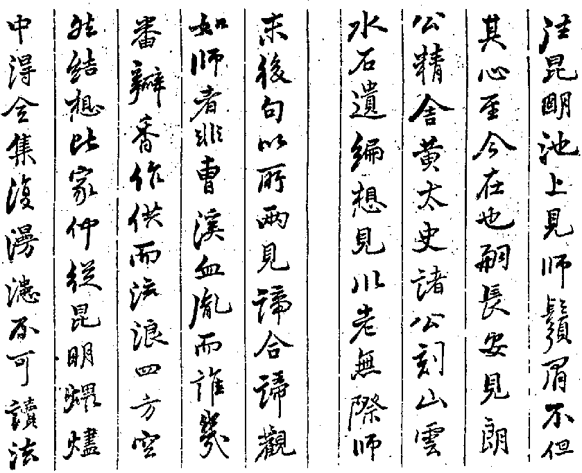
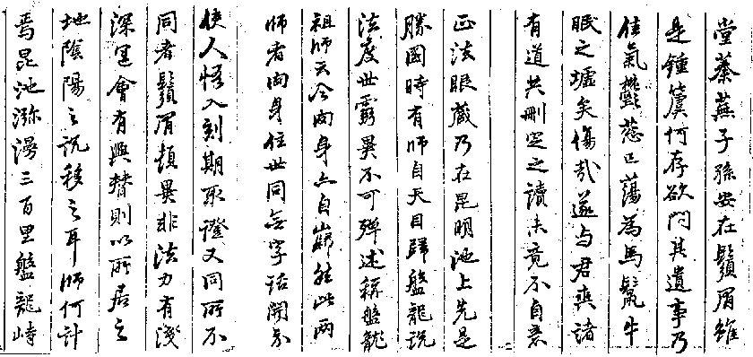
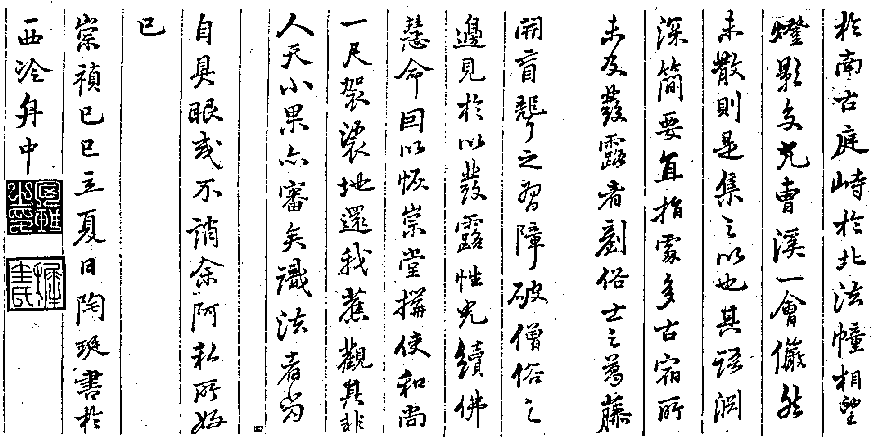

# 古庭禅师语录辑略



> **藏经**：嘉兴大藏经（新文丰版）（嘉兴藏）　**册次** 第 25 册（J25）　**编号** JB163　**部类** 经疏部　**卷次** 4 卷　**篇幅** 71,059 字

> **卷／品**：0 卷 · 3 品



---



## 目录



  - [古庭语录辑略序](#古庭语录辑略序)

  - [古庭祖师语录序](#古庭祖师语录序)

  - [古庭辑路序](#古庭辑路序)



---



### 古庭语录辑略序



方外旧史皖舒吴应宾譔



盖余所事华严善知识，有朗目智和尚云：「犝牛是牿。」则昆明归化古庭坚公，相好法身之所摄持也。谈麈高挥则浮渡华严，古庭坚公言说法身之所震动也。两公皆滇人，先后百四十年间，薪火交光，水月互影，将母方网三昧入定出定而作佛事耶。病堂散人睹面闻名，善根双托，余则幸矣居久之。智公以藏轮之役去浮渡而金台，於时故乡陶使君葛阆方在公车，用南询礼，请益世尊拈花以前一段公案，针芥乎？水乳哉？余不能举其契。而坚公山云水石，断烂葛藤，从智公箧笥中起，向葛阆眼根放种种光，作师子吼矣。哲人既萎，弟子不能守典，遗文转徒，若存若亡几三十年，而愚子道凝射雉白门，得为水部紫阆操几垂一𦕎，次出所购坚公系鹑衣宝，哲昆葛阆暨厥宗会稽大司成弟石梁，刮垢磨光，新其载牍，名「古庭语录辑」，略凡四卷，以续无际之慧命，而芽临济之枯禅。使愚子投我一篇，徵引商之和於首简。余虽锢疾反扃向异瞻奇，崖略以耳而三叹焉。咄哉！此翁用心处若师王之奋全力于一兔，会心处若因陀之合多影于一珠，任运酬机，卷舒无迹，广于辑略，东语西话，铸古陶今，澈困婆心，单提向上，譬如雪山肥腻纯出醍醐，撮要钩玄则〈华严大意〉一篇，字字圆融，言言行布，勤求实到，举一蔽诸他所芟夷，知不无拖泥带水，可谓干将出没尚惹烟霞，陉栋在山宁辞斤斧。陶氏三君子，功古庭也、功曹溪也、功灵鹫也，非复算数譬喻所能繇旬而劫波之矣。读其书不可以不知其人，昭昭于初，冥冥于卒，岂三君子所以论世？而天界之席既禅，归化之铎未衰，栽竹垂丝，逢场作戏，夷考幻住，伦次阙如也。不知无字毒鼓所断命根，为一、为多，为半、为满？飞精绵邈尚友谓何，岂得髓而弃皮，抑旧章之无述而归化梵刹望之皋如？麟卧狐眠，春来秋去，诸君子业为捧心，有笔如椽将亦鞠为茂草，而浮山野史谋于苔藓，乃属汗青所载。坚公涌没津梁，因缘麤具、参承兹决，以事系年，考诸行脚供通，如对二月非是月影。奇哉！直指张公睹师貌于驱乌，而祖印三旬不愆于素，读者取为久行玅道之符。大蘶伦称天顺癸未礼师足于浮山法窟而已，付受荷担，不言何等，三十年胡乱盐酱多少亦未之有闻也。君子以为二憾，而金谷之歌、伽蓝之说、一真法界，触境全章，文字言音了与《辑略》诸篇不别，为坚公广长舌相无疑也。辞世偈言：「来从华藏海中来，文殊普贤；去从华藏海中去，观音势。至祗今还有不来不去的麼？咄！总在这里。」智公闻诸归化灌我耳根，足使吊古英灵作第一峰德云想。而远大师局前带后，狼籍生涯，拈来临济金刚网，推入昆明华藏海，直得水枯石烂，云散山空，向五十三善知识前同时作礼，故知智公齿牙别有坚公面目矣。佛手驴脚，影现重重，忍铠悲轮，讵堪思议。是编同事诸上善人，大都下座毘那分形震旦，而余呵殿智公于浮渡之毂，斯已勤矣。卒业狂喜数事拾遗得其方便，克谐兰若寓乘金汤究竟坚固。虽妙吉神手加我囱门，何以代此。而水部公亟以嘱累为提奖也，倘亦天廨华严旁参熏变慈善根力，从臾刳心施及藐诸传言送语，於劓刖之法供养而增若焉异日者。坚公法界愿王，如时成熟，未委此净信聚，谁为牧女？谁为纯陀？一室千灯，云兴瓶泻，而昔人来去华严显密任持，法位常住，必斯文之为引业也夫。



崇祯癸酉秋八月庚午朔



古庭祖师语录叙















------



### 古庭祖师语录序



能仁氏以一大事因缘出现於世，而今之学道者，或数数於福田、或汲汲於净土、或匐匐於教海，至於正法眼藏涅槃妙心则茫然不入，余每以是请正识法者。适於京邸遇同年紫阆陶君，商及最上事津津不置，复谭滇中异人有古庭祖师者，简易直截，每以无字话断人命根，与盘龙祖师异时同地，乃盘龙肉身尚在，而古庭道场已为蓁芜，心恫者久之。今春过虎林，谒陶稚圭先生时，适紫阆兄在坐，手一编示予曰：「此即《古庭集》也，从煨烬中得之，其言扫尽葛藤，独露本地风光，再四读之，心花顿开，几欲忘倦。」予谓陶君曰：「安忍我辈得此如意宝而不与人共乎？」遂与同志谋锓之，而字漫漶不可读，复取正於稚圭先生。先生以《人天眼目》作佛法津梁，为之删其繁乱、正其谬讹，而古庭又开一生面矣。噫，垢衣除粪徒惨长者之容，乞人佩珠徒发良友之叹。是集也，正法眼藏涅槃妙心，舍此其谁与归？第蕴结有年，非得紫阆兄之表章则不出，非得稚圭先生之删正则亦不传，谓之古庭之异书可也，谓之陶氏之异书亦可也。虽然，读是集者，须向未有古庭以前觅消息始得。



平实居士钱启忠盥手题



------



### 古庭辑路序



资善大夫南京礼部尚书张惠撰



夫《山云水石辑》，乃古庭和尚以平昔所做工夫，疑团子破处，不恃棒喝，出於语默，欲其开凿学者，由此而所以作也。和尚天姿高古，行解冰严，肆舌宗门，了无泥滞，毫放三昧，具大辩才。观夫录者，文浩义博，绝后光前，耀古振今，击贤启圣，真济世之丹铅，人天之大眼目者也。余闻释迦拈花，迦叶作笑，以此继之谓正法眼藏涅槃妙心。察其所以诚也，目击而道存，不涉文字，盖谓佛佛授受、祖祖禅传，有是然也，岂欺人欤？且夫和尚布法於金陵、卓锡天界时，学徒弥众而无乏目，所以具大慈悲、舌头拖地大伸普说，用无不到、理无不中，一语一默、一机一事，譬夫日正於中天而无不正也。大矣哉！和尚诚无际之正传，机缘吻合，际嘱曰：「吾居川中，得法之徒十有餘人，正法眼藏付嘱於汝，吾道至子大兴于世。」所以谓临济一宗复振於今日者矣。其录之文言句义而自然神机俱到，大法变通，可以与佛祖语言齐驱并驾，遗于不朽。其徒一贯上足编次成录，徵余序以冠于篇。余视所录皆心地所造，融通无碍，忻然作之而示学者，以为进修一助云。



大明天顺岁在丁丑孟春上元



古庭祖师辑略目录



卷之一行脚  

法语  

为四众说戒  

心要  

三昧玄章  

警徒  

训徒



卷之二说三昧禅定  

华严幻住略迹  

华严大意  

示一宗头陀  

无字直说  

火炉头话  

牛首日录



卷之三论知见证性



书拜母  

通寿兄古松和尚书



跋云谷师所书普贤行愿品跋



颂  

拈颂



卷之四偈赞先师无际和尚道感文并偈  

古拙老祖真赞  

释迦佛出山相赞  

大悲菩萨相赞  

鱼篮相赞  

达磨相赞  

善财南游图赞  

罗汉



歌了一歌  

皮袋歌  

真乐歌



诗七言绝句题牧牛图(并引)  

入山寻牛  

荒谿见迹  

见牛必获  

得牛驭制  

牧牛受策  

骑牛归家  

忘牛存人  

人牛俱忘  

返本澄源  

入廛垂手  

嘱悟心禅客  

宗门拣要(并引二首)  

道人山居  

寻隐者  

赠明道禅者  

为海屿庵书  

为清道人书闲寂轩  

送禅者隐山  

为老宿山隐  

无客轩为独翁题  

为清满智净德五禅客乞(五首)  

拟古德十可行(十首)  

入室  

普请  

粥饭  

洗衣  

扫地  

讽经  

礼拜  

话道  

四照用  

四宾主  

四喝语  

三玄要  

示客问念佛参禅之意  

金台书示学禅人  

僧老独居  

示众  

侍者击鼓参钟  

从生放下床  

坐中闻猿啼  

春吟晓处  

禅蒲(二首)  

夏日与友登山  

送僧归蜀  

侍者别我  

云林精舍  

述怀  

请道者隐居  

答张文胜  

示镊  

善道者居山  

述己心事  

述怀  

寄琴士  

分岁  

开道者游眉山  

次古人韵示众(五首)  

示观教  

送禅子  

游少林乞语  

示空有之执  

月庵  

维舟  

祖心  

山字吟(十五首)  

示海清岩  

示喜岩  

赠泰讲主从禅  

寄陶仁能居士



五言律山行  

宿晚村  

游废寺  

与僧怀省别之蜀  

遇隐者  

入古峰寺  

宿荒院  

羡翠岩道者  

进庵山舍  

寄玉林居士寄山  

书木叶寄友  

为道深题墨竹  

读林间录  

山房独坐  

山兴寄魁太初  

寄友人  

船出江东  

因事感怀  

山水图为李用之书  

山趣吟(六首)  

舟泊(十首)



七言律纸帐  

寄洱水道庵居士  

道中望灵峰寄泰上人  

游山寺  

省病(二首)  

拄杖付徒永升作  

书壁间  

自省寄宝峰  

厨丁言尽炊  

临老述怀  

示众  

送怀德上人  

猿鹤山林  

分岁次中峰韵二首  

示众  

达磨见武帝



杂体拟儒书语  

旅痴十首拟寒山意



古庭祖师语录辑略目录(终)



曹溪一滴卷之一(古庭禅师语录)



行脚



师居天界，学者请问师行脚。师曰：「我以生死请益无际和尚，和尚令参万法归一，一归何处话。我是年十有六岁，抵杭城受戒，一日见病僧放命，四大不收。我畏此苦，人生决定难逃。傥此景界忽然至我，谁为代受？我时发愿：『有如大事不明、生死不透，而将胁卧席者，永堕地狱。或为身口妄求温饱，指以塑佛修寺供众，妄取信心钱财，作不净业，或自作，教他作，及见闻随喜作者，永堕地狱。我如不舍正因正念，悟一知一见，若以僧俗贵贱贫富好丑，为利养故，论说不平等法，及教人如我所说，无惭无愧者，永堕地狱。』发愿已，疑一归何处话，务要此生见个下落。此话在胸中，如填须弥，启止不安、散乱不定，行在途中，甚是劳倦。偶在座中熟睡，昔所作恶知境界，及无量劫来未闻未见种种造作，一一发现。即自思云：『我发愿为生死行脚，与麼境界岂非生死乎？此梦从何处起，此是一是二？』如此久之，觉得心念纯熟寂然。日深月久，万法话于心上念念挨定无疑有疑，有时昏乱、有时寂静，然寂静处话头分明，昏乱处话头无有，看来毕竟不以生死为切者，工夫不得纯熟也。



「因思古人参学，种种发愿，以无愿不立故，遂礼佛发愿：『第一愿，我经无量劫来，未尝亲近供养诸佛、诸祖、诸大菩萨、诸善知识，流浪生死。我今既觉，若得供养亲近，不以广大真实信心，不学诸佛菩萨、诸善知识昔所难行难舍难忍之事，纵外道取我身命，若举念护惜，誓堕地狱。第二愿，我今行道，遇逆恶境，不复憍慢懊恼，当生智慧解脱。舍身受身一切众生，所作诸恶、所行非道，愿我不取彼之所为，亦不厌彼之所作，则当随类为彼说法。若不依愿，当堕地狱。第三愿，我悟佛知见，必将佛所说大乘法藏，荷负无央数世界，分身无央数世界之中，教化四生六道众生，同圆种智，使众生闻我音声，见我色相，皆获三昧。若悟后不依者，当堕地狱。』发愿已，举起话头，行至中途昏晚，就路旁大石上坐，不觉定去。行人传说有个和尚在路死了，来者惊我定起，我欲行只是移动不得，四大麻木。众人扶起，渐得轻快，不知几时也。自此于一切处，昼夜清爽，话头明白。殿堂中、三门外，出入动静，只知有个毕竟一归何处话塞满太虚，如车轮转，都无所碍。我忆这话如宝剑，一切境物，皆无入处。



「有僧将黄檗心要与看，我接之不觉堕地，疑此一归何处话，宛如死人，一切所有都不知道。如此，这个境界，甚是难透。如坐在太虚空中，觉恐怖艰险作主不得。正恐怖中，一归何处话，忽然举出，向使若非愿力深重，此话头在念，定是成风成颠。这僧又将心要来，我谓古人说话必有得力处，遂揭开再看，如虚空相似，知黄檗饶舌，觉自己髑髅悉皆裂破，就将心要烧了，我通身是个心要。又念古人云：『做工夫要到佛祖田地。』作个准则。我此生务要做到大慧禅师，大悟一十八遍，小悟不计其数。然从上佛祖，皆经远劫，岂止大悟小悟。这僧见我烧了心要，他说萝拥山老和尚，三十餘年不出山。我遂去见之，自说工夫。老和尚云：『你且莫说工夫。』我云：『恁麼莫不虚度此生麼。』老和尚云：『是我虚度，你不可虚度。』我礼拜谢。老和尚见我信心，收拾空房留我住。我云：『今日入山，若无工夫而离此山者，定遭▆虎。』举万法话疑云一归何处，复云毕竟一归何处。终日竟夜，祗是与麼疑。疑之日久，觉得身心别无所有，惟是空我境界。此境界又喜又怕，又无问处。



「虽是老和尚久住山中，作务勤苦，不知所以。我自主张不离话头，又经月久，此空我境界，唯觉房榻内外一切都空。我即是空，空即是我，我与空了无二相。然虽得恁麼，只是无个悟处不敢认著。又思心要所说，当体即如，动念即乖，犹如虚空，无有边际。将使合我所空，且无空迹，终是欠个悟处。我信古人说：『要有个悟处。』遂以悟为期。又经月久，经行间忽见卓案上马祖与百丈野鸭子话。祖问百丈是甚麼物，当下如宝珠击碎虚空，因说偈曰：『遍界纯真无杂，豁开劫外优昙。虚空七破八裂，都卢无圣无凡。』这偈子不知如何发出，此后偈颂一切处，随说随有。一日写百十首心禅偈，与人问答偈颂，长短总五七百首。我将古人说处印看，亦有合处。然终非悟门，尽皆烧了。惟愿诸佛菩萨作证明也，做工夫不到语默不干处，愿我生身陷入地狱。又愿一切众生，如我修行，正念现前，禅定自在。



「我时下山，途中昼夜疑一归何处话，一切处，一切时，只如是疑，如是提。忽患伤寒疟痢，整四个月，空我工夫、话头都打失了，种种言语聪明解会都用不著，仍护持前愿，恐我一旦无常，未敢放胁而卧。人问：『汝病如何？』答曰：『我尚无我，谁为病主？』然终亦是强作主张。一日忽闻僧云：『一切智智清净，无二、无二分，无别、无断故。』我闻此语，依他所说，一一推究，不知是何如。及问出何经典，僧云《大般若经》。我祈祷诸佛：『大限已尽，承闻般若，不昧正因。临命终时，心无散乱，早得出头为男子相，投佛出家，礼善知识，学般若法，究明心地，开导一切众生。若大限不尽，将前空我聪明，及一切异学文字，尽情除去。我做许多时工夫，作许多时模样，打点，惟有偷心未曾死得。今日以我所闻，一切智智，清净无二、无二分、无别、无断故，话作个正念，以为发明此话。若不发明，而便舍却，当世世以我身，碎如微尘，入微尘狱。若悟明般若大意，不广开示一切众生，不入微尘刹国，教化一切众生，同证诸佛无上般若，亦当入狱。』举愿后其病渐见轻微，病既已愈，将此般若一切智智清净无二、无二分、无别、无断故话，加疑云。此话我因甚透不过，毕竟因甚透不过？从此发疑参究自办久远之心。



「往来蜀川，又经八年，是个呆汉，土面灰头，龌龌龊龊，受尽辛苦，寒暑不匀，饥饱不节，去住不定，人事不同，工夫不一，不死不活，无滋无味。这个般若话，转疑转生，欲觅欲断，甚是费力。转转到此，转转昏沉，转转散乱，昏沉散乱转转太甚，我身我心及我正念，一向转转埋没。虽是有个话头，祗是不得定力，死死活活过了日期，只因我宿障重，转用心转失了。因思古人所教，痛加锻鍊，或骂或打，至使心地灰死，做到大休大歇处。知解到此，用心转近转远，转熟转生。由此始信古人得此一著，未是容易。又久久方然出定，我云：『这许多年，费尽心力未得一念相应，未尝一如今日都不思议。』举起正念，又依前定去。于定中觉得正念微密浑然，是个空空豁豁，连个正念都无所依。至都无所依处，正是不思议处，无边际之量，又如太虚空无有一物。忽闻僧云：『见无所见即真见。』我听得此此说，如太虚空碎之无迹，豁然如闻百千亿霹雳之作，如出百千万亿日轮之照，如百千万亿劫冰山融化，如百千万亿劫一念前后际断。到此之际，方悟无量劫来偌大窠臼顿然脱落。一切智智，无智无非智也；一切见见，无见无不见也。觌体都无一玄一妙、一机一用，而又一切用、一切机、一切玄、一切妙，一一一切，总然玄妙机用也。无量劫来纵经生死，一切因缘诚然妄幻。大众！即此是行脚事，即此是心空及第处，即此是古人田地处。偈曰：『佛法都卢只个空，且非知见立为宗。十方诸佛全生灭，一切群灵总幻中。勘破了无些子碍，悟来祗是旧时人。如今又于归方丈，一任施为在竖横。』



「般若大禅定，一即一切，一切即一，而无种种，而不无种种。所以山河大地森罗万象，总印我般若之光明。空色妙门诸佛众生，全承我般若之慧力，无一物不说般若之法，无一事不任般若之用。十方佛祖，尽以般若说我之一切。虽然如是，也不得自肯，须待作家煆炼始得。我说此空，非学者册子上卜度口说之空，实工夫做到之空。



「我至隆恩见先师▆我参学十年餘，为己躬事行脚工夫，做到理穷情尽，十方坐断，凡圣不容，心同太虚，了无一法，即如来清净觉地，是则求和尚证明，不是求和尚开示。老和尚云：『是那个是如来清净觉地？』近前叉手云：『是某甲自性。』老和尚云：『你道会得，从我脚下流出，我难与你证明。』我云：『我是，和尚道未是，和尚误我。我未是，和尚道是，亦和尚误我。』老和尚云：『何不别处去？』我云：『天下有过我者，我不踏老和尚门户。』老和尚云：『可近前作礼归位。』又云：『子实到家。』我正目不顾。老和尚云：『许你！许你！我亦不顾。』老和尚云：『我道许你，更疑什麼？子既如是，吾亦如是。』我近前展三礼。老和尚云：『子将从前做工夫处，举似一遍，供养大众。』我实供说如上做工夫，至见谛处，叉手默然。老和尚云：『子见谛如何与我不同？』我以两手大展云：『这个非别。』老和尚云：『这个还著言句也无？』我云：『实无一字。』老和尚云：『只此无一字处，吾为汝证明已竟。子可深山茅蓬下，饥餐渴饮，任情逍遥。为子安号「古庭」，珍重！珍重！』我遂礼辞。老和尚云：『子向甚麼处去？』我云：『十字街头，喝佛骂祖去。』老和尚云：『子再来否？』我云：『不违和尚尊颜。』话毕蓦直出也。



「我时礼别老和尚，就止金台大容山，云水不绝。老和尚恐出世早，命首座云：『子别在甚处？』我云：『佛祖行不到处。』老和尚云：『还许人来否？』我云：『坦然无碍。』老和尚云：『从上古人，阿谁有超祖之智？』我云：『黄檗。』老和尚云：『子见黄檗麼？』我云：『纵是黄檗，也须见摈。』老和尚云：『敢在我这里说大话！』我云：『正眼无私。』老和尚云：『观子知见，吾非子之师也。』我云：『无有过量，岂免眨剥。』老和尚云：『是！是！我昔见古拙老师，十年后付一偈云：「忆昔繁昌一别时，此心能有几人知。无弦曲子真难续，慧命悬悬付阿谁。」吾居川中，得法之徒十有餘人，正法眼藏，付嘱于子，先师慧命，无令断绝。今将袈裟拂子，付汝为临济正眼，宝重！宝重！』我以两手掩耳，震声一喝而出。老和尚云：『吾道至子大典于世。』起身送行。我则不顾，由此别去。」



法语



我本初机，文章佛法固是不会，惟念初祖所教，外息诸缘，内心无喘，心如墙壁，乃可入道。我每思岂容措手，纵学百千种神变妙用、三乘五教、诸子百家，至于己之生死，都无用处。佛祖典悲启慈，为一切众生出现于世，亦方便垂手，将所教向本参生死上勘，正是妄想。宗门下无许多说，但各悟自心，此心若悟，法自变通。我常阅华严经，至善财问五十三知识处，及五十三知识答善财处，一一各说一一不思议三昧妙门，于问答处未尝见有一法，更经历一一三昧门不思议海诸佛神变，无央数劫说之不尽。若论有法，人人不增；若论无法，人人不减。将谓诸佛菩萨、诸善知识，所经远劫，非一时一息修来。不知心法无二，人自执迷耳。我看弥勒菩萨于弹指际开毘卢华藏，令善财入百千万亿弥勒楼，礼百千万亿弥勒座，见百千万亿弥勒佛经历而出。善财弥勒，无一无二，亦未尝相去。我于未尝相去处，顿然会得诸佛大不思议用。我作麼生会？谓学者云：「欲要打杀，且放过著。」令学者入学者，我于不思议三昧，都无所见，亦无所说。于无所见所说处，与十方诸佛、一切众生，融会于一念，心心无碍，生佛平等。且诸佛众生、诸善知识、弥勒善财，于我无一法处，尔等学者与他相见了也。若一向说都无一法一见。学者向什麼处著力？宗门谓真参实悟，此是做工夫最上之教。到此要信佛祖与我及一切众生，皆有个大受用妙处。若实所悟与麼思议不思议，一一尘、一一刹、一一物、一一事、一一心、一一念，总是毗卢华藏，世界刹海。我所说者皆从我心流出，今之学者惟恃多闻，泥执不通。佛祖妙用，及诸佛无碍、诸佛三昧、诸佛禅定、诸佛神变，死心会去。苟不死心，纵有言说，都无所实。



德山一日饭迟，托钵过堂。雪峰云：「钟未鸣，鼓未响，托钵向什麼处？」德山无语。雪峰举似岩头。头曰：「老汉未会末后句在。」山谓头曰：「你不肯老僧那？」头密启其意。山次日说法，果异常日。又一僧见雪峰云「是甚麼」，僧亦云「是甚麼」。峰无语。僧到岩头举似头。头云：「雪峰不会末后句。」僧请益岩头。头云：「雪峰与我同条生，不与我同条死。要识末后句，只者是。」大众！岩头果然知末后句麼？据我勘，未梦见在。何故？岩头不识德山、雪峰。他二老，一个似直中掩曲，一个如方里藏圆，到此正好著眼。且岩头与麼说，端的是肯他不肯他。若肯他，不合道密启其意，不同条死。若不肯他，二老当见在甚麼处？只这里，大、小岩头也过不得。有辈拍旨担板汉不究宗门，果有如此之高论，往往妄认业识昭昭灵灵，妄据高座行棒下喝。且善知识，果透得岩头末后句，棒棒喝喝四方八面放大光明。不然，无明人我一棒一喝，定招恶报，四大分散打入黑漫漫。大众！生死事大，无常迅速，不可不谨。汾阳无业禅师云：「古德、道人得意后，茅茨石室，向折脚铛煮饭吃。过三二十年，名利不干儴，财宝不为念，大忘人世，隐迹岩丛，君王命而不来，诸侯请而不赴。岂同我辈贪利爱名，汩没世途，如短贩人，有少希求而忘大果。」诚哉是言，我等惟掠虚头，妄自尊大，无明三毒潜结于心，逆恶境缘，知无解脱。据实而言举似宗门事，且不论你知识非知识，除却一切施为动静及语默文字，生死到来毕竟作麼脱去？不得认著个死搭搭向良久处妄想，不得执个转辘辘向活脱中狂荡。但有丝毫差别见觉，纵脊梁若生铁铸就、机辩如悬河泻水，未免阎老子，打入阿波波、阿咤咤、八寒八热，万死万生，此谓灼然。听吾末句，各自检点。偈曰：



「昨夜蟭螟吞六合，虚空扑碎落岩前。山头白浪沉兜率，海底红光烬梵天。百亿须弥为我座，三千诸佛列吾边。任他铁额铜头汉，未跨门来先著拳。」



师击拂子，召大众曰：「伏惟珍重！」



门庭施设，问答机缘，讲学宗徒、禅那衲子，一一吐尽野狐涎、一一放下虚头说。了了知觉，心心见闻，物物现前，尘尘显露。不该一事，不涉一尘，觌体全彰，当机壁立。了了知觉，而知而觉，知觉了了，心心见闻，而闻而见，闻见心心，物物现前。而现前无物，尘尘显露，而显露无尘，所以一事不该，一尘不涉，觌体壁立全彰。十方任运，无处不清净，本源三界，纵横无方。不自己宝所，彼此一切智智清净，无二、无二分，无别、无断故，一切众生，一切诸佛，亦一切智智清净，无二、无(二分别无)断故。既一切智智清净，觅什麼佛法语言、玄机妙旨？但有所能，即成魔魅。释迦老子说一大藏教，实地狱之因；列祖说千七百机，诚轮回之本。禅者于轮回地狱，心上起一妄念，谓之有佛有道、有行有法，则为大谤，自造业因。佛本无成、道本无修、行本无立、法本无学，禅者若论诸佛功德，那一处不具足、那一处隔丝毫？学无学，举步踏著实地；行无立，动念则是自心；道无修，涉境全无妙用；佛无成，应事物理变通。根尘诸大，总为无碍解脱光明所念，缘虑便能放光现瑞，只是自家埋没。于埋没处，瞥起个念，向孤峰顶做模作样，诳惑人天，谓是苦行头阤、谓是超群衲子，更谓我能戒定身根无为清净。此等语正是作业。不然，习得一切禅定，犹须弥山如如寂寂；学得一切佛法，若娑竭海汪汪洋洋。以是而论，亦是造地狱业。岂不知法身无相，量等虚空，禅定佛法，向什麼处庄严？将三藏十二部，放在什麼处？种种神通妙用，於虚空体上都用不著，更于其中觅一物，是佛是祖是凡是圣，亦不可得。更立一事为戒定慧、杀盗婬、生死涅槃、无明烦恼亦不可得。佛是报化，报化非真；法是幻说，道乃异名，行为梦境。学者不信，只如过去诸佛，成得个什麼事？所为都在那里？现在诸佛，未来诸佛，总成得个什麼事？把将三世事来，勘十方诸佛、一切众生，都在什麼处？学者不思一念普观无量劫，无去无来亦无住。若是真正衲子，总是佛祖现紫磨金身，种种不思议。佛祖境界，正好截断，若不截断，被其热瞒。学者参学，要在见正。所见不正，终始难为究竟。佛祖无事无依，说一切语言都无见解，与人终不言是佛是祖。禅者各各起个妄念是佛是祖，是经是论，鸦鸣鹊噪鸡啼犬吠，此等在那里发出，与三藏十二部有什麼差别？自是学者于净白受用处自家点污，作知解，作凡圣，作一切能所见解。即今听我所说，各各放下，就此举一念，看最初一念，念起念灭，若起灭无念，这一念即法身，第二念即报身，第三念即化身。如不思议念，即不可思议佛。如是佛刹境界，无一尘不备、无一念不圆，念念是佛刹微尘、念念是佛刹微尘三昧，理无碍，事无碍，理事无碍，事事无碍。学者举心动念，不作佛见、不作法见、不作知见见、不作见知见见，饥来吃饭，困来打眠，都不理论，即此无一念处，岂不与虚空等量？祖师西来，不立文字，如来始终，未尝说一字。古人说：不是心，不是佛，不是物。佛祖得与麼为人彻骨彻髓，彻尾彻头，实无一毫佛法禅定埋没，我所说者亦无埋没。我昔参学，便信古人之教，放下自己无量劫来一切身心，只如我之一心正念正见，除此正念外，再不起第二念埋没自家。及乎所见既彻，未尝不以我所见与学者说之明白。一切佛祖，一切众生，及学者亦如是知见，以此念念融通，心心无碍。佛祖乃心之妄名，众生是妄名之佛号，一切妄想，一切缘虑，亦是名号之幻化。此幻化又皆人之正因正念三昧。与麼勘破，无一处不光明盛大、无一事不解脱清净。上不见十方诸佛，下不见一切众生。学者依山僧说，将正念作个主宰，不劳登山涉水、不须讨论寻经，一切禅定功德、一切庄严佛刹，本身具足，不增不减。佛说一切法，治我一切心，无我一切心，何用一切法。岂不是本分事也？所以一大藏教，谓之故纸；一切诸佛诸祖，如闲神野鬼；一切禅意教意，如疴如疣。习定习慧，思惟妄想，凡有所说，终无正见。灵岳拈花，迦叶微笑，剜肉作疮；神光断臂，少室安心，空中钉橛。不可知知，不可识识。山僧因众说做工夫话，不惜口过，亦是不得已。诸子百氏，佛祖经论，一断一切断，方好做工夫。嗟夫！生死无常，大众归去检点。法身无相，等合虚空；妙悟非文，一切无碍。威音那畔，寂兮默兮；空劫这边，明也白也。净裸裸，赤洒洒，不载言诠；光烁烁，圆陀陀，绝无窠臼。一一清净之，清净遍法界，无不清净；一一色尘之，色尘尽十方，无不色尘。寂然中寂然，明白处明白，不著空，不著有，而空有真妄之何存？不名凡，不名圣，而圣凡心事之何立？一一诸佛众生，生佛同源；一一古今，而非古今；一一无去无来，无非去来。与麼则山僧横说竖说、尘说刹说、一切说，也说不出。山僧这片臭烂舌头，说也得，不说也得，说与不说，一一总得。山僧向定、不定、不定定处说，而说说、一一说、未尝说，在圣不增，在凡不减，无去无来，也要学者知个下落。大众！山僧未开口际，一一见得明白分晓，将山僧掀下座来，烂捶一顿，山僧结舌甘受。众中莫不有下得手的人，有麼？有麼？山僧对众一一划断，收拾结杀，了无餘蕴。学者不得向山僧臭烂舌头上讨气息，若然山僧将舌头鼓动臭烂恶气，至十方诸佛大不思议三昧世界刹海，振摇十方诸佛大不思议三昧禅定，坐却十方诸佛大不思议之座，演说十方诸佛大不思议三昧之慧，一一诸佛不思议三昧之真如，一一诸佛不思议三昧之般若，一一诸佛不思议三昧之清净，一一诸佛不思议三昧之平等。此十方诸佛，一切大不可思议三昧，皆不出禅者日用寻常践履。如果具足正因正学，抱宗门向上志力，行诸佛正因正学三昧，于诸佛三昧外，而一切妙用、一切胜法、一切大用、一切能事，以至声闻缘觉、有学无学、有漏无漏、大藏一藏，总名生灭妄幻。我说祖师西来，狂心未歇，不立文字，遍界葛藤，直指人心，白云万里，见性成佛，自家矛盾。学者向自家立脚处，讨个端的。不信我说，纵与佛祖齐驱并驾，认个没量大人，未免缚脚缚手。虽然恁麼说，你禅者便不得就这无事中放怀稳便，说心、说性、说玄、说妙、说道理、说因缘，苟如不除去此个念头，如我所说一切学、一切法、一切因、一切果、大藏、小藏、有漏、无漏、有学、无学、声闻、缘觉，更谓人间天上总明，一一诸佛之光明，又是错了！何也？因禅者不能死心于一切佛法世学之外顿然悟去，所以说为妄幻。更不以生死为念，学一肚杂毒，做许多虚头，或假以模样庄设，或执以默然闭目心里造作，或狂荡无忌，任学者说得点水不泄，偶一事不顺，无明人我不知不觉，做到无结杀处，不自觉转此念头，只知检点诸方，更不回头自理，毕竟生死如何了也？这等阿师，有日热病打倒，四大发烧，求生求死，皆不能得。开眼见鬼，那时将所学文章佛法，玄妙机用，一一拈来，全然无用。古人做工夫处则不能拼命向前，古人绝情意识处则不能刳肠死智，肆恣妄诞，矜恃所能，色色无惭诚不克己，形漏磨尽，报业现前，万死万生，脱身无忌。你学者依山僧说，莫学此等虚头，力究生死，危亡莫顾。上古之学，最初一念，以期念念死心于文字之外，俾以自悟；既悟，又将所悟拚去，如痴如愚，似不能言中。古之学也知死心，其奈餘习未定不能力行，将诸家文册相似机缘向情尘中领略，步织词翰，凑合简篇，或言上堂参，或言杖下喝，举时端的似悟，触境依旧还迷，自瞎瞎他，宗门成患。近古之学而又远矣，醉心淫舌，沿袭相传，尽力所言，只说见闻情识边事，正因愈昧，正念全无。放命后，例是打失人身，做神做鬼。目今学者而又不然，欺贤罔圣，滥厕宗门，皆以名利为正持，杂毒为正授。所谓大妄，不畏因果，任意死生，甘心罪业。大众不觉，忉忉说许多话，诚无利益。看他古人一语一默，一机一境得为学者掀翻。无量劫来以至今日所作所为，解粘去缚，屈己就人，尽机发用，岂似我温饱无厌，行解不严，以少偷心而望大业。然我对众所举，我亦无著面目处，况文字语言之乎者也。兹因众请，以实供陈，不可不知。努力珍重！



禅门的示，无过教外别传绝口绝耳、遍法界性示等虚空、不绝思惟全机触脱。大众，吾宗诸老，大凡开示拈提，以一喝不作一喝用为宗门之的要，多少漏逗，至于打拂敲空谓单传法，好不惭愧。老僧对众效古人也打一拂，喝一喝，且道相似不相似。似与不似，置而勿论，只如十方诸佛、历代祖师、天下老和尚，向这一拂一喝上不敢正觑，一大藏教、千七百机及餘诸子百家总用不著。山僧将古人尽机行不到处、尽力提不起处，不惜情说，欲与祖师证明不立文字，直指人心，见性成佛之意。山僧举一喝一拂就作此用，勘之得透、透之得过，不妨尽大地是学者自己宝华王座，动步无非踏著，脱体是学者自己丈六金身，天上天下唯吾独尊。释迦老人以兹之说向灵岳拈花，平地陷坑，迦叶微笑，果然落堑。教外别传，将谓多少奇特？漏笊篱，破砂盆，虽然且不得作尊贵看，我与禅者说，谓证明不立文字之意。毕竟大意在什麼处？看来祖师也不著便，为他人事九年苦苦面壁，及回逼二祖师断臂，甚死急。即此一拂一喝，又向什麼处说话？欲得亲切，须是自家工夫做到。此事至禅者分上，端的有放处无放处邪？至山僧分上，端的有用处无用处邪？祖师分上，端的有证明处无证明处邪？岂不知古人用处，则当人用处，未尝一毫差别。佛说一切法法是心，用除我一切心。心是法体，我无一切心，心即是法，何用一切法，法即是心。山僧向禅者说，实不是说了便休，直欲大法明、祖关透，始是到家地位。其或祖关不透、大法不明，尽百劫千生、学得千经万论，妙用神通如阿难、目连、马鸣、龙树，若不死心做工夫，总名生死妄想，有何益哉？生死事大，无常迅速，如丧考妣，如救头然，诚为险也。勘他古德行棒行喝，一机一用，如击石火，似闪电光。如此作用，恐学者停思停想，拟议之间千里万里。与麼费尽心力，必期学者向佛祖未开口前全身担荷。既担荷已，缄唇封舌，孜孜禅定。所以古人个个于生死岸头，犹白日青天，佛祖独言教外一著，忒煞慈悲，于一切时、一切用，尽在学者语默动静中，同学者于无量劫来，著衣吃饭、屙屎放尿，亦能为你放大光明、转大法轮。学者心念与他打成一片，下死力拚性命做工夫，见个下落，不可放过。若放过，百千万劫难似今日。释迦老子，四十九年，横说竖说，刹说尘说，山僧所谓一拂一喝处，纵横独步，千变万化，种种奇特。你学者闻山僧说，不得作无事种种著到。古德云：「学者看千处万处，不如实看一处。若看破一处，则千处万处自然一一透过。」山僧说个譬喻，此事如鸟抱卵，孜孜于动静处不失所抱。抱来抱去，时节忽至、壳漏子七零八落，中间跳出个活泼泼的来，便能知其饥饱、一动一静，久久羽力皆全，又是一番无碍，南北纵横，高低远近，飞腾任意。确然之理，千经万论也只与麼说，除此再无别事较量。不然纵通三藏穷尽五车，及餘诸子百家，若不死心故工夫，有个悟门，总是外事。《华严经》云「如人数他宝，自无半钱分。」山僧也曾讨经论、学机缘，到这里都无用处。川老云：「欲知端的意，北斗面南观。」透过，壳漏子七零八落；透不过，非但学者，任他川老也难分疏。山河石壁、草木丛林却会此说，古今先圣尽被瞒了。若在此看往往埋没，离此别说而又不然。天以之高，地以之厚；佛祖以之相续慧命，接物利生；山僧以之日用施为，逢场作戏；学者以之之乎也者，语言文字；百姓以之坐卧经行，著衣吃饭。于事于理，果然亲切。既知，正好高坐蒲团，屏绝人事，主宾不立，朕兆勿存。如空中月，无水不形，无处不照。然后于火炉头，向金刚眼，证据单传，以报佛祖无报之恩，化人天无为之化。大道廓然，体无清白，遍一切处，不落有无，在凡在圣，凡圣一源，非去非来，去来一致。山僧为学者普说，于语言文字之外各各领会。伏惟珍重！



大凡行脚脱生死、超佛祖、明心地，其实无心可传，岂可口授。贵在当人办铁石心，立脚稳当，触声色、遇境缘，或善或恶，须要作主，打并自己，看果有甚麼坚固处。与麼一看，视如死人，除斯再不起第二念头。向上一路，千圣不传，实欲自家作其转便，莫若死心做工夫最为切实。且今向我所说做工夫处勘得彻，向使百千临济、德山，同时下百千喝、挥百千棒，其实难以近前。审夫一大藏教、千七百机，世谛语言文字，总是生死窠窟。莫若悬崖放舍身命，提无字究他明白分晓，参他端的下落得力不得力，一静一动正念相应不相应。参究要如实打点，不可轻惑。有辈学者，不知参究，谓坐禅是痴禅守默提死话头。我辈切不可依例谤说。古人个个因提死话死得心地，我辈不曾死心做工夫，便乃承当说大话，妄取因果。山僧勘来，总是释迦、达磨如此之说，欲死其心，无如无字，死得学者心地，发明得学者新机活用。是以一个无字，诚死心得力之三昧。予观从上佛祖，死心禅定，勤苦累劫。学者即今向热闹闹处、冷冰冰时提死话头勘，提时有间断无间断，打点得历落亲切。冷冰冰，热闹闹，动静昏散，宛然只是一念。念起念灭，更无起灭之相。此是天工克成，将欲至家受用处。若论做工夫到与(麼时)，正好愤愤，莫顾危亡，大启疑情，大发正念，不提自提，不举自举，活泼泼无一事当情。当知此事，不可认著文字语言，以理自障，或执自妄念，一向守空，昏昧莽荡，诸佛出世不可救也！禅和家，须是坐断佛子舌根，透出死生因果，纵横自在，饥来吃饭，困来打眠。将山僧所举尽言极则处，审其所言，一挨挨定，自然沸汤停澜、当空日驻，身心境物融然无杂，空而玄、寂而妙，无前后际非去来相。到此田地，方是工夫，成心悟地。此际不见一念是诸佛众生生处，不见一念是诸佛众生灭处，不见一念是有生灭无生灭处。一大藏教、千七百机、世间出世间法，用亦得不用亦得，到此方不被语言文字笼罩，方知山僧所言：古人念念在定，于生死不乱；今人念念在乱，于生死不定。山僧尝以此语抱怀，未肯轻肆。自己一个正念，亦不敢以归山住院瞒初机，参学所见，未敢望于古人，因与大众较量，不觉忉怛。伏惟珍重！



若论向上一著，了无别说，惟当人本自具足，文字经论且无放处。近来诸方学者，尽被古人舌根埋没，不能决志透脱开口处，情尘知识，学解聪明，于自受用中确无的实，岂非自丧己灵？尔若不信，有日病打，将所学所抱抵当不去，那时方悔错用心力。学者既是实为生死行脚，岂可高心执见？闻恁麼说，便愤志决透去，便拚此生，大舍身命，做大休歇工夫。当知此事非小因缘，必猛利方能入劄。且诸方老宿说做工夫，于自究竟处，或一年、半月、一月，或三年五载，有些见解，或闻师家举似，或看册子，便认著业识，做模样生大我慢，便效古人行棒下喝，瞬目扬眉；学者不知，被他惑了。此个样子，正是生死无明。若或真参实证，却不恁麼，向本分中绵绵密密，下死志做将去，莫论年久岁深，一念子拨之不开，荡之不散，时节到来，豆爆冷灰，天翻地转，打破疑团，虚空粉碎，方是自己大光明处，大受用处，自然头头无碍，物物全彰，了无一法可当情说。这边那畔，通明透彻，凡情圣解，宛尔一如。尽十方世界森罗万象，总诸佛清净无碍三昧。到恁麼田地，说甚麼文字情解，根根尘尘，悉是大光明宝所。有时摄十方诸佛光明入一微尘光明，一微尘光明现十方世界诸佛。诸佛非来，我亦非动，寂寂如如，无彼无此。诸佛具大清净无碍三昧、大解空寂灭三昧、大不思议海种种三昧，乃至不可说微尘刹数、刹尘尘刹一一具足，十方诸佛定慧三昧，于一毫不从外来。嗟夫学者于初立志处，担荷一担经书字句，口耳传习，为其己见，认为古人用处；古人却不如此，语默动用，别有生机，岂等闲共与卜度？须是具大根器者，闻必敬信，生难遭想；其或我慢矜高，退之、远之。珍重！



诸方学者，为生死请益做工夫，于做工夫处实不曾得个简要定格，往往虚度。经云：「狂心不歇，歇即菩提。」学者参究，便歇其狂心。依经所教，将所学文字佛法，及世间欲爱妄想截断，勿存一毫。古云：「拼得一条穷性命，银山铁壁也须通。」向前著力，将所教歇狂心处作个定格，依而行之，极是简要。既知提一则话或万法无字自去下疑，默默理会，至所下疑理会处，切勿自作知解，以偷心待悟念话无疑，以此做工夫，歇狂心确无相应。今为汝保任此事，终不虚也。无字话，赵州意作麼生？无万法话，毕竟一归何处？然我所说明白，苟不歇狂心，纵有定慧亦只徒为，喻服药要忌发物。病者，学人无量劫来业识生死是也。药者。无字万法是也。发物者，狂心念念相续是也。盖万法无字，古人一时应机，如人问我一事，我必有一事相答。古人说时，实不曾教人言语上用心，欲其直下承当，千了百当。若得得设此，亦是错了。赵州古佛因僧问，不(得已)将错就错。然将错就错，大藏教亦不出此。又谓做工夫下疑著力，非赵州所教，却是这僧日用目家作计。后之学者，依如是做，未有不悟入妙理真际。呜呼！学者往往立脚不定，志念不坚，虽参话头，实不曾有一个决定信力。才〡蒲团，昏散二障通身著到，因此讨头不著，志念稍微便生退慢。只个退慢，将谓我乃博地凡夫，且随例看几行文字，不虚度日。山僧看来，彼之所事，正是虚度光阴，流浪生死。岂不闻如来诃阿难：汝千日学慧，不如一日学道。所以退慢生则懒堕至，懒堕至则狂念起，狂念起则拨无因果，无所不为。寻个真实做工夫的人，诚然少也。学者将我所谓或无字，或万法，如实而做。又看我简要之格，及昏散药忌一一顿放八识田中，再向得力下手处讨分晓骨，取云门扇子，跳上三十三天，触著帝释鼻孔。珍重！



示众：向上一著，固非小事，惟当人极参然后极悟。其或未委于声色空有，妄认业识为己，道眼不明，埋没自家，更惑他人。当知佛祖，一言一默，一机一用，痛与发明向上事，不是你情识伎俩。但一切时内不起心、外不著境，境空心寂，绝思绝虑，直下领悟，顿超佛祖。惟我一念一念然，则一切念念念然。若只向情路上立文字、学知解，所谓知见立知，即无明本。《法华经》云：「佛谓阿难：彼此空王佛所同登菩提，尔乐多闻，我勤精进，是故我已得成菩提。」智者忘机，时者恣说；智者空见，昧者泥文；智者无著，昧者固执，不知语言文字、知觉见闻、诸子百氏，总生死轮回种子。经云：「以轮回心生轮回见。」入于如来大寂灭海，终不能至佛之妙见，见无所见。学者把自己业识放教空去，然后向佛祖教人行处，务欲与之掀翻，见其端的，再将自己妄执心识念处，直从根本截断。念兹在兹，孜孜勿间，于无间孜孜处痛加一愤，直猛向前，不觉打破漆桶，大地光生，灼破虚空面门，触瞎如来心眼。参悟到其极，则敢保向十方佛祖顶门上行住坐卧，无奈你何。不然，莫道山僧不预前与学者说破，世间至大惟生死。珍重！



法身充满体遍河沙，妙用无穷，一真独露。诸仁者，若向己躬下有个出身之路，何必山僧唠唠叨叨、汝等东卜西卜。若无这个消息，未免向第二门头说葛藤去也。兄弟家，既为释门子，勤修般若正因，放下名利虚头，的明祖佛大意，到这里无明、人我彻底掀翻，贪爱是非尽情截断，然后近良朋、亲善友、究单传、明教外，时时检点、刻刻提持，心心无间、念念密绵，剔起眉毛，不容走作。忽然一念相应，管取慧光独露。如是修行，吾门真种。近来兄弟家，理不明，道不务，贪著爱染，我慢高矜，种种无惭，恒夸能所，不惜心行。一旦恶业临头，那时悔之晚矣。劝兄弟家从今改革前心，依附老成道德，勤勤究明生死，不离本分，自然道香有日。更有一等上座，人前做模打样，装神捏鬼，见人有些开解，他便生慢恨不灭除，及至观他行履，通身是个黑漆桶子。一生为人，只是恁麼伎俩。或有个汉为他除病，向他道个未在，他便生恨恚无明大起，口里非言，全然不顾。以这等病根，佛也为他除之不去。兄弟家，修行要明自己心地，到一切处也须知因识果。凡所作为，皆属生灭。若论真正行脚之理，先欲打并得意根空豁豁地，不存微念，然后参方要择伴归众，看邻单不是在道之人，切不可与其同行共坐，若不与麼检点，有失道业。若是上根利志之人，终不效他小辈所为。纵有些小见解，于诸方老宿门下，一一入他𬬻锤锻鍊，是则深山保任，未是还去打点旧日做工天处。彷古人行履，断却自己命根，不得卤莽为人，坏古龟鉴。你看他从上古德为人处，出一语盖天盖地，只欲人人实到恁麼田地，达佛知见觉悟群生。若是大丈夫汉，闻恁麼说话，不问得失，撒手便行，通身透底，一一放下。然后拔却心肝、抽出五脏，只教他胸次中乾乾净净，方可少分相应。从此向去，也不寻问别人，放下面皮，务要将生死做一件大不了的事。古人淆讹公案，显密门庭，尽平生之力，一槌击碎。那时文章佛法，从金刚眼里一一流出，大机大用取之无尽，大辩大才用之无穷。到这里，何用区区学解事业？有时将丈六金身作一茎艸，有时一茎艸作丈六金身，用恁麼说话，须是行到始得。若非自证自悟，到这里如说梦相似。经云：「唯佛与佛，乃能知之。」参禅人光阴易往，业报难逃，不如打点自己生死，急去做工夫，也是迟了，莫待四山到来，那时整理不下这个事务也。须是平日看得破，寻常作得主，于生死岸上，方得自在。若非与麼，纵尔种种学解，问一答十、问十答百，大限到来，难敌生死。审之！审之！



禅宗的意，无证无修。佛祖传心，绝文绝字。法界之性，犹若太虚，不动纤毫，真空绝点，乃佛祖之密传，实当人之领悟。所以大地是个解脱之门，通身是只金刚之眼，说玄而玄不能到，透妙而妙不能通，觑之无踪，穷之有失。虽然恁麼说话，也要实到这般田地始得。不是恁麼人，岂明恁麼事。毕竟事何如？若向这里具一只眼，何劳佛祖出定，口喃喃地说道说理、说心说性？且看他佛未出世、祖不西来，还有道理说也无？还有心性说也无？到这里，不如于己躬下亲见彻去。若是伶俐汉，于自己本分事上一看看破，始知乾坤之内、宇宙之间，有一轮无价之宝，昼夜放光，辉天鉴地，一切众生，本自具足，不假修持，一一现成。任汝在情尘爱网之中，一灵妙性，寻常显露，情尘爱网与他各无交涉。恁麼所言，然非说了便休，也须于二六时中向鬼窟里著些精彩，务要寻个出身之路，切不可闻声执著、见色承当。若然，大法未明、祖关未透，用尽辛苦，总是生灭。如从上古德施设之处，行棒行喝，全宾全主，杀活历然，收放自在。如击石火似闪电光，恁麼为人，皆参活句。参学人须是实到这般田地，方有如斯受用。若非恁麼，于他古人一机一语卒不能了，到这里于己躬下一段风光，切切思思务要讨个分晓。孜孜密究，若十年二十年不彻心地，山僧代汝受一切苦。经云：「所在之处，则为有佛。」恁麼看来，岂用十年二十年？一念回光，早自具足。正恁麼时，什迦老汉，在汝等眉毛上放大光明。若向这里见得，便知释迦与迦叶大意，非在花笑之上，毕竟在什麼处？咄！人人眼横，个个鼻直，无量大人，面门光聚。诸仁者，到这里见须实见，悟须真悟。临济云：「面上无位真人」。赵州云：「庭前柏树子」。天龙举指、石巩张弓、德山棒、秘魔叉，此是诸老为人扬向上宗乘的样子。盖从上佛祖人人见谛则一，各各拈弄不同。所以云：看千处万处不如实看一处，若看破一处，则千处万处自然透脱。如川老了云：「欲知端的意，北斗面南观」。此是这老汉老婆心切。若是灵利衲僧，便知端的。到这里莫论北斗，休说南观，只向他未摇唇动舌之前，一看看破，便知他说那漫天之谎。恁麼看来，岂有他下口之处？莫不山河大地，艸木丛林，古今先圣，天下达道，尽在此一观破了也。天以一观而普盖，地以一观而普载，佛祖以之而接物利生，众生以之而建立万缘。如斯见得这一观亲切，便好休歇度日，有无俱遣，证悟莫存。淘汰得这乾坤如水底月相似，任他风浪掀天，我自凝然触之不散。若时未至，待龙天推出，方可为人，向火炉头究竟一个半个，以报佛恩。于金刚眼里留得一机半机，提掇末运。诸仁者！向这里不知端的，承当不下，且将本参之话，于动静中默默自看是甚麼道理，切须仔细不可放过。到这里，若起一念放过之心，劫劫生生被这放过的心埋没己灵了也。苦哉！非但劫劫生生，展转无有出期。忽有个具眼汉出来便问：「即今甚麼处是这放过的一著子？」山僧到此只得将错就错，作话会去也。昨夜须弥山被铁牛吞却，只得老达磨觅东庄王老问取西来意，山僧不惜各与二十麤藤去。会麼？到如此界，分明见彻，不劳后语。其或未然，诸仁者目今被葛藤引入鬼窟里去也。大道湛然，本来廓彻，遍一切处，有何面目？这一著子，在圣不增，在凡不减，凡圣一源，无殊无异。到这里，拟欲播扬祖道、提唱宗乘，只得掀倒虚空，名重四海，踏翻大地，道振诸方。恁麼为人方乃奇特。诸仁者于此散去，各各寻个方便处安身立命，免被阎罗老子追魂受拷。吾书一偈，以证后来。若然会得，再来吃棒。



偈曰：「脱壳乌龟骑铁马，威音那畔独潇洒。翻身撞倒五须弥，纵横踏杀四天下。」



为四众说戒



诸佛之戒，妙契一心，蠢动含灵，本来无欠。然则蠢动含灵，举体是戒，况人天四众而不具乎？此戒即汝等一念清净之心也。当知心外无戒、戒外无心，心即本源之戒、戒即本源之心，拟欲别求，无有是处。到这里，一念回光，彻见心源，了知全体是戒。若或不信，向外投尘，非吾门之正宗也。戒实佛祖之根，戒乃众生之本，未有离根本而获戒者。当知戒无形相、戒无庄严，于心无漏，全彰戒体。吾所言戒，非涉律仪、未名条目，实汝等本源清净之戒德也。此戒不属有无、非存持犯，汝等才出母胎早自具足，到此仍于面上栽眉畫目，岂非大错？《梵网经》云：「一切众生受我本源清净心戒。」教既已明，若于文言纸墨上受得，将来于菩提心戒终无有实。此戒不择妍丑及与根缺之人，但具灵识本来是戒。若能妙契于心，与佛无异。有持有犯，是二乘之戒；无犯无持，是最上乘之戒。此戒谓一切众生本源妙心正戒，从无量劫来净洁光丽，即今人人眼目定动心戒大彰。到这里，且道是持是犯？若也恁麼见，说于一切处，自然明明历历，何曾点污他来？若举一念于心外求受别戒，早自埋没己灵。盖此心戒者，的体净洁，了无纤染，纵使尽大地都是个粪坑，与我本来心戒实非相犯。为汝等无始劫来，至于今日，迷头认影，舍己投尘，劳他佛祖出定设其对治，演规立矩。然乃用心大切，遇过量人，看来一场败露。何故？我非贪嗔痴，奚假戒定慧。我心无生死，安用大涅槃。我心非散乱，何用奢摩他。我心本寂灭，未假求禅定。若能当下发一念金刚不退之心，单去究明本源心戒，举此一念，得戒已毕。更说他恁麼戒之所犯、戒之所持，一空一切空，一净一切净。汝等闻说诸佛本有心戒，不能断疑，如盲聋瘖哑。山僧未免重为开演，显露真圆，使汝等得入其源，获本心戒。昔世尊说四众所受戒文，各有次第。如比丘戒谓二百五十条，比丘尼戒五百条，优婆塞、优婆夷各五条，菩萨有大乘十戒，如来有三聚净戒，然种种所演差殊，实乃如来悲念所流。教谓多种，一念净心实非二三。教分顿渐，心无能所。如教云：「心生则种种法生，心灭则种种法灭。」又云：「佛说一切法，度我一切心。我无一切心，何用一切法。」心法并空，如大圆镜。山僧恁麼切切，非诳汝等。汝等于此痛发广大信心，定获广大受用。汝等幸闻律外之戒，实非小可。三世诸佛，因此戒而成等正觉，大转法轮。一切诸生，悟此戒而达本源，脱生死海。戒源功德，神鬼莫量；戒源踪迹，人天莫测；戒源貌相，佛祖难窥。到这里十方诸佛、百亿菩萨、无量人天种诸福慧，于此本源净妙心戒所有功德，于百千万亿分未及一分。若恁麼便见得去，了知卢舍那，即汝等之本身也。山僧到此说戒将毕，未免于诸人分上通个消息。击案一下云：「陕府铁牛心胆碎，嘉州石象顶门穿。」会麼？汝等向这里领会得，不劳举足，佛祖同源，无持无犯，非戒非心；其或未然，切忌拨无因果。教云：「五戒不持，人天路绝。」珍重！



心要



此心清净，人自不知有此清净。此心明洁，人自不知有此明洁。清净明洁，本来成现，今更不假修为而复成也。才出头来，早自具足。但能返照，不假言彰。所谓清净明洁之心，于一切众生分上未尝不在，无踪无迹，绝翳绝痕，至坚至固，至清至净，至虚至玄，至明至洁，无渗无漏，无大无小，非出非入，非外非中，量之无边，穷之无所，玄中唯玄，妙中极妙，玄玄妙妙，妙心金刚。说此心者，说无说之心，心无心之说。说说无说，心心无心，无心心无，显一切心。一切心即一心之心，心即一切，一切亦无。一切无心，无心亦无，亦无无心。无心心心，心心心心，悉皆空幻。到这里，假使大悲菩萨具八万四千手眼，运八万四千神通，提之不起、觑之非见、劈之非破、锯之不分，亦任劫火洞然，此心绝纤毫之损。大哉此心，心心无觅，唯人亲证。乃知过去诸佛已说、现在诸佛今说、未来诸佛当说。盖十方诸佛，不离此心成等正觉，十方诸佛不离此心转大法轮，十方诸佛不离此心入诸苦趣中，救拔一切众生离苦得乐。至诸佛所，闻此心法，豁开心眼，▆▆▆▆，得诸无碍。见十方佛在在处处，不来不去。一念现前，此心空寂，寂寂心空，空空心寂，空寂寂心，寂心空寂。且十方诸佛，于此个心上，具种种作用，现大神通，大抵为一切众生明示此心。一切众生，诸尘悉净，除此之外，更无别心，明此之心，更无别说。此心不立纤尘，自然虚灵绝妙，但能默契忘缘，全体真空独露。吾观一切众生，种种造作、种种颠倒，堕于万类之中，一灵妙心实无丝毫之欠。经行坐卧，承谁恩力？喜怒哀乐，岂假他光？一动一静，一饮一啄，一言一默，皆是自己之妙心运用无差，去来有据。如斯看来，诸佛众生，同一妙心，心心非二。真心寂灭，若大虚之无形；慧见灵通，犹澄渊之湛碧。但此心非义理之说、非文字之解、非引教而通、非能所而见。到这里须是佛祖未出、文言未露、天地未判、古今未通，平坦坦的、光净净的，于本分中忽尔心开，突出一路，方始相应。若非恁麼，至慈氏佛下生，也无栖泊处。只要于自己分上悟此妙心，不得离己别寻。设有所得，非自己之心。此心无青无黄、非赤非白、非名非字、非相非貌。此心遍十方刹，来去无相，山河石壁不能阻碍。此心非天地测其机、非鬼神知其量。到这里，自己尚无趣向，况天地鬼神而测知者哉？设使佛祖同源，亦觑之无分。所以此心是个大光明之宝，无修无证、无得无失、无生无灭、无老无少、无穿凿、无处所，巍巍荡荡、寂寂如如。诸佛之尊，千圣之上，不可比，不可喻。一切众生，全体具足，妙净明心，本圆真有。到此切不得于语句上承当、文字中生解，不得广览群书，以教印心，不得记持问答，逢机酬对。须是自己胸中，盖天盖地，贯古贯今，一一流出始得。经云：「唯佛与佛，乃能知之。」然乃恁麼，吾有句验：「木人眨眼，诸佛尽睹光明。石女动唇，菩萨皆蒙究竟。」



三昧玄章



吾观大地众生，一灵真性，触物现形，遍法界中，头头显露，六根门头，放大光明，四幻城中，全彰法体。乃佛乃祖，惟此心传；列圣列贤，单明个事。立妙立玄，言机言密，即妄即真。于理于事，说有说无，指空指色，非心非佛，是佛是心，以言显空，以空著言。指物明真，借事彰实，或戏或笑，或语或默，或棒或拳，或嘘或喝，或粗或细，或呵或叱，或歌或舞，或进或退，或逆或顺，或竖或横，或定或空，或禅或乱，或异或邪，或尘或俗，或净或秽，种种相貌、种种术幻、种种言词、种种拣择、种种巧机、种种应答，乃至天地日月、星辰江河、园林艸木、石壁瓦砾，净不净界，有有无无，声声色色，无有一物而不现此三昧实相。良由众生因无明贪爱，而不能证入，所以劫劫生生，展展转转，埋沉己灵，失真三昧，误入六道，往来四生，受种种苦，求出无期。此三昧体唯人一灵，旷大劫来未曾少欠。所以佛祖眼不耐见，从三昧大寂定中强出头来，不惜泥水兴慈运悲，设百千万亿种神通方便，使人人于意根下究此三昧清净真寂之光明，除此别无有念。到这里，若能舍幻投真，远尘近寂，于日用中讨个分晓，豁然一念相应，了知诸佛无心三昧，即自己无心三昧。尘尘尔，劫劫尔，总是这个无非三昧。且这个道理，于此作麼生承当？体廓太虚，了无边际，不动纤尘，非中非外。到这里，若乃存其微念，天地悬远，譬如太虚之中空无有量，若住一物，非太虚也。诸佛国土，其理亦然。一切众生本源如是，洞然清净，不立毫尘，光遍十方，无有相貌。诸众生心，含褁三界，现三界心，总一真定。到此非得非失，无幻无真，唯一灵明，寂然三昧。一切众生，既知人人分上具此无心三昧。到这里，于二六时中默默照看，看来看去，看到看无看处，自然有个到家的时节。若能便恁麼会去，别无餘说；设有所说，无过于此。当知诸佛设法，无法为法，众生欲契无法为体。《大般涅槃经》云：「无法可说，是名说法。」设有智者，审谛思惟，若能深信斯言，管取悟佛，三昧有日矣。



警徒



子既痛决死生，从今日去，永绝学解，纯一真洁，务要今生作个大汉，向佛祖头上横眠倒舞，切莫蹉跎懒堕，贵圆温饱。闻恁麼说，便乃竖起生铁脊背，大开无情冷眼，紧捏拳头，高举正念，念兹在兹，勿容分毫走作。心中愤愤，疑上加疑，直教这一念子劈之不断、荡之不分。久久定力现前，四威仪中忽尔忘却东南西北，到此之时，正好著力痛加精进。若也孳孳不舍，忽然撞倒昆仑，掀翻大地，直得十方诸佛、历代祖师、天下老和尚，于这里无出气处。仍使六道四生，情尘根识，放大宝光，同一受用。若实做到与麼田地，方显衲僧家超群越格的手眼。其或不信，今日也恁麼，明日也恁麼，驴胎马腹里，决定放你不过。老僧预前与你说破。珍重！勉之。



训徒



子既实心向道，但看古人一则话：「万法归一，一归何处。」须知此事，庸愚之辈实难相委，大力量者方堪履践。此处不得今日提，明朝放。将意根下万缘尽情放下，平日舍不得的须要舍却，平日放不得的须要放却，平日离不得的须要离却。且舍不得的贪嗔痴，放不得的无明人我，离不得的恩爱利名而已，若谓十八界所蕴尘缘杂染，未可枚举。今略言之，以破其毒恶。子既知已，大发信心，立金刚志，尽平生做个没伎俩汉，莫管人说你痴憨，直去著实参究。须知此事如一人与万人敌相似，若非具猛勇心，如何近前？又如一人不执器械欲搏猛虎相似，若怕危亡，如何与他相见？又如一人担一百二十觔重担，溺于深泥，若不加力求出，如何到家？既知生死恁麼大险，于十二时中不顾危亡，大舍身命，的的确确务要见个分晓。又须知此一则话：「于一切处，皆可徵究。」迎宾俯仰，著衣坐卧，提瓶放箸，运水搬柴，疴屎放尿，登山涉水，𣃁地烹茶，静闹闲忙，喜怒哀乐，总看个话头，恁麼久久自有个好处。到这里，切不得于话头上别生异念。且这念是甚麼？是当人避喧求寂处也。如丛林中讲究这做工夫一节，多谓寻个静办处稳坐去好教你知道。且观尽大地乾坤，那一处不喧喧穰穰？当知此世界，乃五浊之界，实无一处有静。其静在于己心之上，到此一心静，则多心静；一念寂，则念念寂。今时兄弟家不知有此方便，强要寻个静处，不知起一念向此世界中求个静处，早自是个不静的心也。山僧昔年行脚于蜀，往来十载并无一茅遮头，单包只杖各山讨些现成茶饭度日，任有一切诸恶风景，我则不采，恁麼孤切，方得此一著子明白。如今兄弟家，未曾行脚先虑衣食，于一切处务要寻个稳便去处，十年二十年不明心地，被此一念障阻道眼。子去，切忌恁麼询问虚实好丑，逐日工夫，时时检点，一日要胜一日，一时要胜一时。恁麼绵绵密密，一七日、二七日，自然纯熟。到此不得念话无疑，提时须要字字分明。说这做工夫之理，大抵要这话头明白，疑情易发。若疑情发现，昏散则退，昏散既远，疑来疑去，时节到来，不觉撞倒露柱，打破漆桶，直得乾坤哮吼，海水飞腾，泥牛吞月，铁蛇吐雨，木人抚掌，石女心穿。若到这里，方知达磨西来，费尽神机，及至归去，分文不值。若实到这般田地，更说甚麼「万法归一，一归何处」，尽大地是汝疴放处。于这里也无道与汝说，也无禅与汝参，也无佛祖与汝超，也无人天与汝度，纵横顺逆，左右逢源，到此便是一味清净平等三昧之门。听吾一偈：



「精研慎究勿容丝，直透威音那畔机。豁尔洞明心地印，谿山满目笑咍咍。」



古庭祖师语录辑略卷之一(终)



曹溪一滴卷之二古庭禅师语录



说



三昧禅定



禅定三昧委在当人，诸佛不传之宗，列祖通诚之旨。若是个生铁铸成无面孔汉，到此不涉疑思，一肩担荷，方有少分相应；若半信半疑、半进半退，卒不能搆。学者最初行脚一念，便要信自己及一切众生，一一具足十方诸佛大三昧定，一一具足十方诸佛大三昧寂灭禅，一一具足十方诸佛大三昧解脱门，一一具足十方诸佛大三昧空际海，一一具足十方诸佛大三昧无碍王，一一具足十方诸佛大三昧无昧智，一一具足十方诸佛大三昧精进力，一一具足十方诸佛大三昧宝华王，一一具足十方诸佛大三昧辩才用，一一具足十方诸佛大三昧无畏说，一一具足十方诸佛大三昧真如藏，一一具足十方诸佛大三昧圆觉域，一一具足十方诸佛大三昧慈忍行，一一具足十方诸佛大三昧圆明种，一一具足十方诸佛大三昧无相见，一一具足十方诸佛大三昧庄严劫，乃至一一十方诸佛一一所具一一大三昧禅定，一一大无碍三昧禅定之说。而一切诸佛、一切众生一一悉皆平等。此三昧，学者不可作无事会，若作无事会，则著无事魔；不可作种种知见，若作种种知见，则著种种知见魔：若作空寂寂空见，则著空寂寂空魔；若作正见，则著正见魔；若作坐禅禅观见，则著坐禅禅观魔；若作空有有空见，则著空有有空魔；若作无空空无见，则著无空空无魔；若作空慧慧空见，则著空慧慧空魔；若作智愚守尸见，则著智愚守尸魔；若作知解融会见，则著知解融会魔；若作避喧入定见，则著避喧入定魔；若作观空无物见，则著观空无物魔；若作寂静无境见，则著寂静无境魔；若作无念无生见，则著无念无生魔；若作动静即常见，则著动静即常魔；若作解悟变通见，则著解悟变通魔；若作智慧灵心见，则著智慧灵心魔；若作常乐无我见，则著常乐无我魔；若作会佛法见，则著会佛法魔；若作神通无碍见，则著神通无碍魔；若作沉空无死见，则著沉空无死魔；若作能所随流见，则著无我随流魔；若作执禅守默见，则著执禅守默魔；若作诸法合头见，则著诸法合头魔；若作一念无为见，则著一念无为魔；若作诸禅即法见，则著诸禅即法魔。如上所说一一魔见，悉是学者未悟之际，以其未悟，凡有所说所见皆至魔论。学者若是个真正衲子，深发大愿，事善知识，将世间一切富贵恩爱、名利豪杰、妄想贪痴、是非人我，及佛见祖见、玄见、妙见、一大藏教乘见、千七百机缘见、诸子百家见，尽情打并，使其空空豁豁、只个空空豁豁一念，亦要去之尽净。又信我此生，一一务要依十方诸佛所教，依十方诸佛所行，若不至十方诸佛无碍解脱寂灭正受，尽百千万亿劫，将一语为利养故妄惑于人，世世生生报入地狱。学者固此一念，若果悟去，于一尘、一刹、一切尘、一切刹、刹尘尘刹现大清净。当知这一念及一切念，而念念不可度量、不可思议。十方诸佛刹极微尘刹数大空寂三昧海、大解脱三昧海、大无碍三昧海、大圆明三昧海、大智慧三昧海、大不思议三昧海、大不可穷尽三昧海、大无边种智三昧海、大般若无空三昧海、大无见见三昧海、大摄一切佛刹三昧海、入一尘微尘刹三昧海，一切诸佛刹海三昧、入一微尘禅刹海三昧、一一诸佛刹海三昧、入一一微尘禅刹海三昧、现诸佛三昧、入恒河沙禅定三昧、入一念禅定三昧、一一念禅定三昧、至一念海禅定三昧、一一念海禅定三昧，悉皆具足。十方诸佛佛刹三昧禅定微尘刹海、一一三昧海、一一三昧刹、一一三昧刹海，一一不可穷尽、一一不可筹量。如我所说，十方诸佛大寂灭性海，一一所具一一微尘、一一佛刹，于一一微尘、一一佛刹、一一微尘佛刹，至于一切众生、一切念、一切心、一一一切心念，具有诸佛言词禅定三昧、一一诸佛譬喻禅定三昧、一一诸佛所证禅定三昧、一一诸佛分布禅定三昧、一一诸佛大小藏乘禅定三昧、一一诸佛了义非了义禅定三昧、一一诸佛本因修证禅定三昧，以诸佛一一禅定三昧，而一一融通、一一无碍、一一念、一一心、一一心念、一一总而禅定三昧也。学者到这里，正好将十方诸佛髑髅、一切众生鼻孔，穿作一串，提向十字街头，横拈倒用，放大光明，作种种可畏相好，开种种大寂妙门。一一可畏相好，具现十方诸佛极微尘刹之禅定三昧受用。一一极微尘刹之尘，具含十方诸佛一一大不可思议海、一一无尽藏海、一一大三昧王海、一一大宝觉妙海、一一大净智妙海、一一大庄严域海、一一大言词无碍海、一一大光明无变异海、一一大化佛无数意海，一一大会十方极微尘刹刹尘诸佛。于一念一一念，念念无来、念念无去海，以此一一诸佛三昧妙海，至我本觉妙明无碍三昧海中，一一开演、一一宣示，或歌或舞、或逆或顺，一一歌舞逆顺，至使十方佛祖、天下老和尚吞声结舌，一大藏教理尽词穷。如上所说，一一皆出山僧心地法，故为学者所演。兹因禅者祖心，及一众禅德索说禅定三昧，以遗将来，不知不觉向一毫头上流出许多幻说，譬彼幻师依幻而现种种幻事，不可尽穷。彼幻如是，一一所有不可言说，乃至幻于幻幻于幻幻说，皆从一幻幻出无碍。如我所说，亦如幻师于一毫上种种幻幻，说之不尽，如大日轮，依空而有，光满阎浮，如云雨润沙界，不可限量、不可思议。我此幻者所说诸幻，皆我幻禅幻定，一一幻幻。假使十方诸佛集百千万亿之舌，并作一舌，向我所说禅定三昧，却难下口。末后一句，能断诸玄，谨白同禅：拟思则错。



华严幻住墨迹



性普禅人，持《天目幻住翁笔卷》索语，曰：「我何人，斯敢辱先圣！」固辞弗获。问曰：「禅人何业？」普曰：「旦夕诵《华严经》。」师曰：「《华严》我不问，一毛孔具含毘卢不思议海种种三昧，至八万四千毛孔，你道那一毛孔中具载？道得则与汝书，道不得则持卷去。」普不知所答。曰：「吾不书矣。」普无措。谓曰：「言外一机，修多教诠之不及；声前一著，千七话尽之莫能。今古英灵，讨头不著，往往坐在语言文字，界隔多生，轮回不息。中峰举：『达磨大师谓外息诸缘，内心无喘，心如墙壁，乃可入道。老师如将笔向虚空中，横织竖织，织出许多锦绣，如优钵罗华，次第交错，及乎织到绝笔收拾处，恐学者不知好恶，向他笔头上描模畫样。遂告曰：「学者但念念心心如墙壁去，有日必知达磨开口落处也。」』只如所教，中峰老师与达磨老祖，大似教小儿读上大人一般，禅德还会他末后句麼？如要会却也不难，山僧为禅德点破。会麼？上大人可知礼也，不然直下将墙壁心贴在额上，行也，心如墙壁；坐也，心如墙壁。忽然错脚踏翻大地，千七百话、修多罗教，一一总为光明宝幢。禅德我于笔端一毫头上，竭香水海，掀弥勒楼，倒毘卢殿，直得微尘佛刹，诸佛诸善知识俛首堕舌。我以我身一毛一孔，入一一诸佛不思议三昧经、诸佛不思议世界。以一毛不思议世界，至百千万亿一一百千万亿毛不思议世界。一一毛孔不思议世界，皆具百千万亿微尘佛刹诸佛不思议世界，一一世界，不可思议；一一诸佛，不可思议；一一微尘刹佛刹，不可思议。又我以不思议毛孔诸佛刹海微尘诸佛世界，入彼普贤菩萨，一一普贤，一一毛孔，彼普贤菩萨一一毛孔、一一普贤、一一普贤毛孔、一一普贤身毛孔中，具有百千亿微尘刹弥勒楼，具有百千亿微尘刹华藏界。其一一华藏界、一一弥勒楼、一一毘卢殿，我一一演说，一一百千亿微尘刹佛刹世界诸佛大清净不可思议三昧。是时普贤菩萨，于一一佛世界，一一分身坐狮子座，住三昧定，运无碍辩，举神通力，经彼一一毛孔微尘刹佛刹诸佛世界，则知我身入彼一一佛刹微尘佛刹诸佛世界、一一住持、一一演说、一一佛刹微尘刹诸佛不思议。我以一一佛刹微尘刹诸佛世界、一一三昧、一一神用、一一神力，则知诸佛一一世界，则知诸佛一一妙用，则知诸佛一一言词，则知诸佛一一三昧，则知诸佛神通藏，则知诸佛智慧海，则知诸佛一一智慧神通三昧、一一言词妙用世界、一一空华梦幻、一一了不可得。而我了彼不可得，如空华、如梦幻、如彼诸佛世界海、如彼诸佛三昧海、如彼诸佛言词海、如彼诸佛一一毘卢华藏世界海，诸佛幻一一毘卢如来不可说，不可说，转不可说，转转不可说，速起速灭，相继相承不绝。普贤菩萨向十方微尘刹、一一微尘刹、不思议世界，经千百亿微尘刹佛刹，不思议世界海劫，及微尘刹一一海、一一沙、一一劫，而我以毘卢如来三昧，入彼一一普贤，一一众生，充满无量，一一不动。以不动故，而我一一身遍满百千亿微尘佛刹诸佛世界，一一不可思，一一不可议。性普禅德！若知山僧所说，则知中峰老翁所说，其所说意无古无今、无去无来，终日华严，华严终日，却不待尔循行数墨也。其或不然，则不可依山僧所说，虚闲过日。生死事大，无常迅速，不知不觉，老矣死矣，眼光落地，四大分散，这里作麼生拆合去？至视至祝。」



华严大意



华严之说，其义也大，其文也长，非尽得其妙者，难以笔舌。毘卢老人一真三昧，于当人分上最真最切，开口也说著，不开口也说著，开口不开口总说著。一切佛法、一切玄妙、一切机用、一切拈提、一切棒喝、一切语言、一切文字、一切三昧，用则总用，不用则总不用，用与不用总不相碍。世尊升座，文殊白槌云：「谛观法王法，法王法如是。」世尊便下座。文殊便是开口用处，世尊便下座是不开口用处。到这里世尊说个什麼？若道有说，文殊早自错了。若道无说，世尊升座，又自错了。若论华藏大意，说与未说，错与未错，开口不开口，举目之间一点瞒人不得。如赵州问投子：「大死的人却活时如何？」子云：「不许夜行，投明早到。」似此一问一答，如常人说话，又不曾作机会，又不曾作禅道佛法会。尔之江南，我之湖北，尔之天上，我之人间，四方八面，无不相应。若不到与麼田地，纵将一大藏教一口吐出，堆山塞海，总无用处。世尊未升座，文殊未白槌，赵州投子未相见，已将全机交付了。尽华严法界香水海，一切诸佛诸善知识，却无措手脚处。经云：「如来深境界，其量等虚空。」一切众生入而实无所入，既无所入，安有所说？此外不可为你别加方便。古人云「参须实参，悟须实悟。」如懒融未见四祖，马祖未见南岳，他何曾似今学者东卜西卜？个个死心榻地。学者只知开口处，将谓容易安身著脚，不知未开口时，纵是佛祖也难近傍。僧问云门：「如何是一代时教？」门云：「对一说一。」且道与世尊升座，文殊白槌，差别多少。僧问赵州：「万法归一一归何处？」州云：「我在青州做领布衫，重七觔。」这等说话，前后远近，宛尔一般。古人行到说到，一一皆在大不思议海。昔香严和尚在沩山，问一答十，问十答百，沩山向真参实悟处，痛与一劄，严不知所以，于是入南阳卓庵击竹有省。后出世曰：「老僧四十年方打成一片。」赵州和尚二十餘年，除粥饭屎尿，是杂用心处；高峰三十年不出死关；先师四十年惟一念；长庆棱公坐破蒲团七个。山僧做工夫十三年，身不放倒，今年七十餘，犹念死生，未敢离于正念。古人念念在定，于生死不乱。今人念念在乱，于生死不定。学者还知正念麼？如前所说，乃如来深境界是也。山僧昔年到先师处，徵问到无结角下手处，不免尽力掀倒。先师说个「是」字，如今勘来多少错，任缘随分，且待命根子断。



山僧每于《华严》留心，据我所见，善财参五十三善知识，未尝动步。五十三善知识教授善财，未尝开口。我毘卢遮那如来杂华藏海，一字一句、一切字一切句，一一具足四天下微尘数不可说转转不可说一一三昧、一一语言、一一香水海、一一轮围山、一一毘卢华藏、一一弥勒楼阁、一一诸佛菩萨、一一大善知识、一一观彼所说诸佛华藏、一一语言三昧、一一辩才三昧、一一神通无碍、一一佛神力庄严佛刹微尘数诸佛世界、一一诸佛世尊所演佛刹微尘数三昧门，不可思议，微细微细，极微细处。则知诸佛菩萨，及五十三知识所说佛刹微尘数，诸佛藏海一一三昧，于我自受用一真三昧遮那如来，无增无减、无彼无此。华严藏海诸佛菩萨、诸善知识，各各尽彼神通三昧，向我遮那诸佛佛刹微尘数三昧大不思议海，转不可说三昧，一一庄严、一一文字、一一摩尼宝光明，一一佛刹微尘数宝床宝座、宝帐宝网、宝树宝云、宝莲花、宝缨络，一一佛刹微尘数狮子幢云、摩尼幢云、灯云燄云、华燄云、香燄云，一一佛刹微尘数摩尼宝光聚、一一佛刹微尘数诸佛变化庄严身、一一佛刹微尘数国城善知识，与夫目前山河大地万象森罗，种种差别声音、差别幻化、差别相好，乃至诸大地狱，八寒八热，万死万生，及彼忉利诸天天乐。一一佛刹微尘数不可说，不可说，转不可说，转转不可说，总是个华严藏海一真三昧。与麼则佛刹微尘数华严藏海，诸佛诸菩萨、诸善知识、诸天人非人等，而又一一佛刹微尘数不可说，不可说，转不可说，转转不可说。一一四生六道，蠢动含灵，有情无情，一一皆总在我佛刹微尘数极微尘数华严藏海，一一混融无碍。山僧如是说，汝等如是闻，诸佛如是住，一切众生如是见。众生如是见，诸佛如是住，汝等如是闻，山僧如是说，而又各各一一闻见住说，一一尘沙艸叶，则有佛刹微尘数诸佛世界，一一尘、一一沙、一一艸、一一叶，佛刹微尘数诸佛世界，一一经历诸佛世界三昧，一一诸佛三昧佛刹微尘数世界了不可得。而我了知一一诸佛世界种种差别，一切幻化，一一皆不可得，皆不可了。而我知其不可了，不可见，不可得，我常一念恒处于寂灭定，求寂灭法，实无所有。如此则寂灭念中，一切诸佛，一切佛刹微尘诸三昧海，种种庄严、种种世界、种种差别、种种供养，诸佛幻化，我亦无念。以兹无念诸佛幻化，念念具足、念念不违，谓之华严法界大意幻有之说，而幻有如是三昧，况八十一轴之文，及十法界品之说，不可思不可议，书而尽为一轴，卷之放之而更收之。与麼则八十一轴，百城烟水，总是外事；诸佛菩萨，诸善知识，皆为客尘，不妨逆行顺行，横说竖说，尘说刹说。所以经中道，由亲近善知识，能勇猛勤修一切智道。由亲近善知识，能速疾出生诸大愿海。由亲近善知识，能于一微尘中说法▆遍法界。由亲近善知识，于念念行究竟安住一切智地。由亲近善知识，而能往十方国上，见善知识心不散乱，见善知识破障山，见善知识人大悲海救护众生，见善知识得智慧光普照法界，见善知识普能睹见十方佛海，见善知识得见诸佛转于法轮与麼则佛刹微尘数善知识，正好逐位参求佛刹微尘数诸佛三昧，不妨从头请问善知识者，有如是不可思议、不可说、无量无边清净三昧。欲亲近善知识者，必具大因缘，具无上智，发无上心，经百千劫久远不退，始得如是相应首座。只如文殊大士，伸一臂过佛刹微尘数诸佛世界，摩善财顶。山僧不动本座，过佛刹微尘数诸佛世界，将华藏海遮那如来不可思议三昧，向一毫头滔滔说出。且道与文殊是同是别，非同非别，总同总别？师掷去笔云：「纸尽矣。卷之！」



示一宗头陀



师船泊至楚，有头陀谒之。师问曰：「汝名何也？」彼曰：「一宗。」师曰：「尔何垢面髼头，莫知一宗否？」彼曰：「固不知，愿师究竟。」师曰：「汝为生死耶？非为生死耶？汝果有生死耶？果无生死耶？若论有无生死则且置。只如道者初进道时，便言有超越佛祖之志，从初入山至今，不知是几年，与麼垢面髼头，似与一事无涉，道者！汝本分中，与十方诸佛、历代祖师，眼一般横、鼻一般直、见一般见、闻一般闻，一动一静未尝有丝发之间。既无丝发之间，因甚麼在道者分上，垢面髼头，吞苦忍辛，孜孜不放；在佛祖分上，将个四大五蕴、六根、六尘、六识，及餘八万四千毛孔，根根尘尘识识，一一总为清净摩尼，印色而作色，印空而作空，印森罗万象作森罗万象，印山河大地作山河大地，印诸佛作诸佛，印众生作众生。道者！此摩尼，非空非色、非万象、非森罗、非山河、非大地、非众生、非诸佛，不无不有，而有而无。道者向此领略得，便如懒融遇四祖、马祖遇南岳。将个髼头垢面之念一一去之，不妨洗面模看鼻孔，那时始知日日如是、朝朝一般，又何别有一法可说。清净摩尼，一一印物；十字街头，接待往来；三条椽下，锻鍊衲子。佛来祖来，未可轻放，一一与他案过，印之明白。不然莫道山僧不与你说破。生死事大，未可以语言见解与之对敌，且生灭妄想。将山僧所说尽情截断。平昔所执所守所悟所得亦与截断，直下具勇猛精进，看他佛祖所教向上一著，不著佛句、不著祖句、不著非佛非祖句，语言文字一一不著。纵做工夫到极静处，不知不觉，偷心四起，聪明忽至。凡有一切言语及知见解会，亦一一莫著。如是固守，如是保持，如是斟酌，自珍自重，然后动静一如，始终无滞，方解凡圣同途，逆顺一辙，静闹安然，放收自在，岂不快哉！」头陀礼谢而去。



无字直说



古人于无字论其所以，惟有灵骨方堪领受。有灵骨者，向赵州未开口处，则知无字下落。知赵州性命七花八裂，岂容疑情及得力也耶。



稍有一个半个，向蒲团上留心，彼又不究无字，所参工夫惟以死坐，百劫千生被死坐埋没自己。



参无字不得作伎俩穿凿，但依实疑云：赵州意作麼生无？赵州老婆心切，说无字教学者，大似训蒙童读上大人，往往领去未尝见有发明处，岂宿无灵骨者耶？



做工夫得力有迟速、有利钝，盖当人用心切与不切。只个切字，乃生死得力下手处也。



工夫得力，在于当人念念将此做向前，务欲见个明白，而自然得力矣。岂可上人门户看人口动？



又不可于无字上立知见解会，且无字却不以知见解会得明，要人去知见解会，做不知见解会，方好近前。若存知见，有所入处，总名「知见禅」也。



古人云「一一从自己胸襟流出」，又云「从门入者不是家珍」。纵释迦老人大智慧辩才、神通三昧，总用不著，况些小聪明。赵州无字，三乘十二分教、诸子百家，种种言词一一发明，大难讨他分晓，除是赤手向前、危亡不顾，净裸裸看破，那时许伊说无字话，行无字用。若论无字，十方诸佛、历代祖师、天下老和尚，却难近傍。赵州亦只说得，诚不能与学者加得一毫。学者不信，将知解试看。



诸方以赵州说无字，千百众中寻半个得无字人甚是难也。学者将无字拍盲死念，念来念去，返被无字空过一生，何止一生？百劫千生也。



无字如醍醐，如毒药，有灵骨智慧者，念念现前不知不觉得个受用，始知一切众生本来具足。若无灵骨智慧者，吞个无字在意根下，如中毒药，从生至死，决不知无字所以。向此用心也不难，便打并意根空豁豁地，一日胜似一日，管取念念相应。



学者看无字，如生死冤家，切不可偷心怠慢。



疑云：趟州意作麼生无？正是得力下手处。疑时于一切有无得失，静闹闲忙总恁麼疑，疑来疑去，不觉疑情破、祖关透，则大事毕矣。



多见人看无字，每每被昏散二障所侵，不知打点，通身坐在昏散里。与麼参禅，岂得有灵验耶？



为学者说昏散二障下落，乃当人一个恣纵心是，苟猛著精神疑无字，如流水绵绵不间，念念检点，则昏散自远。



学者坐中打失无字，念无字不得力，此是贪爱异缘不曾放下。既不曾放，于本参正念安能作得主耶？苟如信之，将憎爱、人我、苦乐、贫富，一切所为尽情放舍。果如其教，自然有个入处。



生处放熟，熟处放生。生者无字，无量劫来未尝相识；熟者异念，爱染护惜不舍处是。幸古人以无字尽力交付我，若不死心绝念做工夫，此时错过，欲其再会似今日，诚难诚难。思之！思之！



学者自昧，往往被文字知解递相教授；古人却不恁麼，但死心做工夫，一言一字，具择决眼，情解路绝，知见机忘，久久参疑，自然起悟，到此方明古人所言不欺也。



无字实一大藏教诠注不出，惟当人默默用心，自去理会。其用心理会处，亦不得作无字见。但参而疑，疑而悟，除「参、疑、悟」三字外，纵有方便又不是也。千七百则、一代时教，向无字冰消瓦解，不然腊月三十日，未免手忙脚乱，当宜究之。



或者谓无字乃赵州一期答这僧之问，又谓赵州逢场作戏随口建立。如此岂不迂曲？僧问：「狗子有佛性无？」州云：「无。」这个无字，自是这僧担来，亦从他亲口出，赵州未尝添减分毫，就他道无。如今人多少错解。



山僧因问，一时为学者尽力吐露，学者再不得移易丝毫，从生至死疑无字如生死冤家，务要亲证明白这无字。江湖学者商量浩浩，天下知识开示学者亦商量浩浩。未审学者知识与麼商量，为什麼边事？要知端的，看破无字始得。



达磨西来，将个无字上人门户，谓有多少奇特。不知十方世界，总是个无。及见武帝卖弄不出，遂渡江面壁。且老胡心为什麼事？学者当参看无字。若看不破无字，则不知达磨下落。



问学者神光断臂，是知无字不知无字？若知，因甚断臂？若不知，当思古人用心。



有等开学者，疑无字，他便障碍，恁麼死坐，莫若看几行文字。无灵骨学者，被他惑引入黑黑漫漫；辜负初心志气者，又多被聪明学解丧尽自己。



切思身寄空门，心当厌俗，佛祖教诫，念念存思。无字参疑，心心莫舍，智眼大明，慧光迥出。人间天上，独步纵横，逆去顺来，随心自在。如此方堪传佛心印，接引后昆。不然虚丧光阴，沉沦生死。古人叮咛，殊不为己，大抵欲学者究明此事。古人为你说得，你若不行，无奈你何。



佛佛授受，祖祖传持，不曾私屈学者丝毫，学者不信心努力向前，自家转便，欲佛祖把个现成受用与你。安得有此？



古云「那得天生释迦、自然弥勒？」此教于学者大有恩惠，释迦、弥勒远劫修来，弃极贵尊荣，未尝一食一息不举念为教化众生同证同得。我等学些知解聪明，即谓超佛越祖，岂不自欺？



学此事，当人自知下手脚处好向前。如何是下手脚处？经云：「言语道断，心行处灭。」久久参个无字，不知不觉向转身处得个受用，那时有说无说总现成。如今诸方未见有向心行处灭、言语道断处真参实悟，看他日用所为便可知也。



古人一机一境，具大智大用，从胸襟流出。今人也作一机一境，要且实无大智大用。何故？皆缘学力未至耳。具眼学者，一见则知；或若初心，尽被瞒了。古人云「参方须具参方眼目」，不具参方眼目，见他便礼拜，唤作懵懂禅和，奴郎不辩。



祖师云：「不除妄想不求真，无名实性即佛性，幻化空身即法身，法身觉了无一物，本源自性天真佛。」只这里学者领会得，山僧则不许你。何故？古人则可，今人则不可。只个不可，山僧与学者大有慈悲在。



且学者即今举一念看，这一念是真是妄？若谓是真，从始至终只是恁麼；若谓是妄，从生至死必不如是；若谓不真不妄，这里却从真妄去也。要好学者向此大死一番，那时是真是妄，总融通于无碍大清净三昧。



此事，山僧饶舌，为学者直直倾出，却无许多计较。学者亦依山僧直直做去、时时猛省，务将无字绵绵疑去。疑得东西南北，行住坐卧，总是个无字，莫顾危亡。若如是，则不负山僧和泥合水。不然，非但山僧，十方诸佛、历代祖师、天下老和尚，与尔自己，尽被负了。



读无字，自大慧来无此泄露，自高峰来无此详细，真临济嫡派、少林血胤也。埋没昆明几百年，今日乃始出现人间耳。珍重！



火罏头话



万法归一，一归何处。疑云：毕竟一归何处？复疑云：一归何处？大起疑情，佛法世事混作一团，久久疑去，不觉疑释，大事已明。十方诸佛、历代祖师、天下老和尚所说都只恁麼，学者离恁麼，别有长处，非佛祖之究竟也。



佛祖相继之道，非语言及情识量，要下死志做工夫。不然，机前句外，言说便了，岂非情识量也？学者死得心地，真实做工夫，如未悟但默默守去，自有个道理。岂不闻古人云「久远劫来，受尽勤苦」。不然，便认个语言情识，现成说话。达磨老子，他是观音大士，何故九年面壁？



做工夫之切，大抵止要去学者生死业识。若不加工去逼拶，欲业识之见自然除去，如昧者布网吹风欲其满也。当知此事，唯我默默自究，然后自证自得，自然妙达无碍。



这做工夫说，惟我实参、惟我实悟，岂得咨学口耳作知解见？至此若不切实向前，于本参话头见个端的，口说便了，正谓说食欲饱。



出生死之要了无秘诀，惟学者疑古人一则话头，疑这话头，如人中毒，吐不得、屙不得、死生不得。其或屙吐死生不得处，洞见自己，这里则知十方世界微尘刹土无不是自己，更说甚麼妙理玄文，单传直指。无量劫来，以至今日，一一明白；根根尘尘，悉放无畏百宝光明。如或不信，便认个昭昭灵灵，困在黑山鬼窟。学者不取，当知生死缘无量劫妄识成熟，今日要与从头至底掀翻，如人落在万丈深坑，须拼命求做出路，岂小力量所能？



是知不舍种种心，而悟种种见，见无别见，心无别心。心见无二，无二亦非，生灭何立？斯说不假安排造作，必欲孜孜真参实悟，到家自知。



此事要具坚固久远之心，如枯木石头去。果如此，何生死不了、佛祖不超。其或波波挈挈，大限到来，无本可据。



佛祖无法与人，因我溺于生死，教以涅槃；因我散乱，教以禅定；因我妄迷，教以真悟。一切皆我自生，非他力也。我既知之，岂可恣我而长沦生死耶？



此事唯人生死急切，精进勇猛，久远不退切，忌思前筭后，欲进而退。



如果痛念生死，将本参正念加疑，大疑大悟，不疑不悟，疑之不绝，管取推门入臼，到此洞古洞今，鉴天鉴地；不然生死岸头，大难作主。可不慎乎？



老僧所教出生死，痛与工夫作主，说甚祖师直指、如来别传，直得十方诸佛向我手里乞命。学者孜孜下铁石冷冰冰心，莫问年月深久有无得失，但一念不移万年如此，管取无影树头猿夜啸，不萌枝上露芳心。



学禅乃己躬大事，非心念痛切，具勇猛，加精进，彻尾彻头，纵佛祖大神通智慧，于我所谓生死难与著力。学者大起信心，信自己受用，实无佛祖、了无一法。生死者，由我无量劫妄念所系，此妄犹镜中相。若或了知镜体本然，据实所论，超佛祖、破生死，实当人一切处正念现前，更有何法不明、祖关不透？



实欲参学，下死志，四棱著地，又如死人，欲爱妄念无所生也。东西南北，屙屎放尿、坐卧经行、著衣吃饭，辊作一团，总是个正念。久久不舍，若不悟去，管取山僧犁耕有分。



自佛祖垂教以至于今方册所载，未尝有不做工夫出生死者，其或一闻千悟得大总持，则知用力多劫所至今方容易。学者不得执容易处，若容易领略，人皆不肯做工夫也。



此事非小因缘。佛闻半偈，舍全身，修三阿僧祇劫，大根大量，信之无惑。而今学者，说超佛越祖，出离死生，以为常话。我见此说，愧之无地。



生死事大，无常迅速，说之最险。从上佛祖，不顾危亡，一切处知无别法，非大志莫出，岂论岁月？



不得逐句寻言，要以念念向己心悟去，心悟无法，法悟心法，法心无心，心自法心，心法了然，何心何法？不可以聪明情量工夫。做到，方始达佛契祖。



从上佛祖，皆以实言欲令实悟，不曾教人学知解。知解乃生死根本不然，非但屈负佛祖，亦乃自昧己灵。究生死须向意根下研穷不已，岁时不忘，工夫做到，始解自己无量劫来，不异今日。



佛祖种种言说，于我己躬，未尝道著一字。此生死我不去著力，欲待谁人？



此心湛湛，然非湛然相。绝去来今，只此是无碍圆明三昧。学者不得向这里浸死，参而疑，疑而悟，悟而后得，只个悟字，犹是多了。



欲参学，此事先打荡心地乾净明白，究所参学处，用心著力，不负参学之志。



参禅最要紧处，在当人用心切耳。苟不心切，虽念念有个话头，如水浸石头，纵千百劫不失人身，也只是守尸鬼，终成何用？



做工夫要有愤发，如一人敌千万人，莫顾危亡，见个端的。不然，今日明日恁麼，今年明年恁麼，管取至死亦只恁麼。欲参而悟，不得纵恣身心，逐名贪利，坐在欲爱之中。生死非世间事也，将意识截断，永无相犯；若容一毫，依旧打入黑漫漫去也。



诸方说做工夫话，正如婴儿饮水，以少为足，不知大悟十八遍，小悟不计数。又谓如人入海，转入转深，时容易哉。



如今说个悟处，多少伶俐向这里错过，或者不识好恶，于见闻觉知上有些入头处，偷心妄想颠倒错乱，纵见释迦老子，亦不知他向什麼处说。他又不知愧耻，可不伤乎？



或者认个业识，向古人方便用处一印印定，将几册经书搜研，装一肚墨水，以为是一员大善知识，逢场作戏，便有许伎俩，不念因果罪报福业。



欲其念念不妄，心心绵密更加绵密。有日心神内豁，开诸佛心眼，便能摄香水海于微尘界里，现宝王刹于一茎草上，诚不欺也。



一念透脱，得大三昧种种殊妙，此非知见文字、口说心授，要以禅定无碍大总持力，方能相应。岂不知《圆觉经》云：「无碍清净慧，皆依禅定生。」



佛谓大摩尼宝王无量劫来未曾欠少，大丈夫闻恁麼说，岂肯埋沉大宝，孤困伶仃？彼既丈夫，我何不然？



牛首日录



老僧乃山间木石之类，人事禅道一无所知，独得山云水石便欲老死。所抱未稳，顺于情境，一上一下，迎送往来。虽然，事不获已也，唤做一时垂手。老僧本分处看，实未见个头尾端正的汉。佛法晚矣，人心不古，于煖热处大家打哄，不惜罪福、不念因果，个个道好。此等与论古风高尚，于冷冰冰处澹薄相守，佯然不理，与其玉石不分，彼此方得一懽喜。古人云：「我逢人则出，出则不为人，我逢人则不出，出则便为人。」似此说，古人各取一时之便，或出不出，或为不为，自然有个理路，岂是闲说。且道出与不出，为甚麼边事？逢与不逢，当时他在那里存坐？迩来老僧离浮山到牛首，是出不出？终日碌碌人事往来，是逢不逢？以此看来，老僧大似个无机关之木人。圆悟老师云：「若论此事，如马前相扑，骑虎头，踞虎尾，击石火，闪电光，岂许有近傍处？」虽然，大凡一事，也要经历过，胸襟开阔痛快也。



法融未见四祖，天人供养、百鸟衔花；及见后，四棱著地，不妨稳当。到此始知从前所著，屈受许多拘束，而今而后，使伊做模样与人相见，自觉面热。此事岂容有著手脚处？冷地推思，好一场笑怪。祖师忒杀慈悲，于己分上也把不住，说道理、说心性，大似怜儿不惜丑；也怪不得，路遥知马力，事久见人心。虽然，老僧夜话方丈，未免顺时将错就错，以己躬下事，大家研究。不得认著见闻知觉，指龟为鳖，唤鍾作瓶。牛首灵境祖师道场，老僧虽是家空四壁，或茶，或饭，自不相欺，一味平等，与诸人同于日用，岂敢轻昧古人遗风。日事之餘，不得不以己事递相较量。老僧此来，非是共尔等打粥饭过日，你等若得一时闲静，勿将己事虚费过了。岂不思人命不长，光阴易去、信施难消。老僧日逐间，不知是圣是凡、若僧若俗，一一与论世谛佛法，将长补短，以权就实，未尝敢欺侮一人。如此留心，大抵要当人向世事上明得一分佛法，于佛法中勘破一切世事，岂可离此别做活计。或有人向老僧道：「一大藏教、千七百机，总是外事，那里觅取佛法世事去？」老僧向他道：「怪我不得。若不与麼，怎得与麼。」经云：「譬如暗室中，无灯不可见。佛法无人说，虽慧不能了。」三十年前老僧行脚诸方学者，莫道没有曾遇几个禅和，蒲团上孜孜究心，做死模样，昼夜历炼挨拶。虽是心事未得发明，至于宗门检点，亦不忝古人说死心之眼目也。又见几位尊宿，或于山间水边清心寡欲，也不见禅道文章佛法。参见者，但言：「老拙不及后生辈。不可埋没佛法大事，扶持颠危。」老僧亲闻此语三十年后，非但死心，举起此事，个个笑怪。所见皆外道说一切空，死个什麼心地。如此之言，佛祖扫地。石霜和尚云：「休去歇去，一念万年去，古庙香炉去，腊月扇子去，枯木顽石去，一条白练去。」此是古人教人死心之语。中峰和尚云：「举心尽属轮回路，动念无非生死根。要与太虚无背向，常吞一个铁昆仑。」如此说，总是释迦老人也索塞断咽喉，岂容有一点知见。古人谓参须实参，悟须实悟，有等学者闻此语，向孤峰顶上𢬵舍身命，恨不一念于生死之际坐脱立亡，当念头起时，真有一念唤不回头之志，宿有根器▆骨者，必有个时节因缘，触著磕著发明己事。若是有头无尾汉，自然挨拶不入，便谓佛法无灵验，拨无因果，胡言汉语，魔魅人家男女，将谓饮酒食肉不碍菩提，行淫行盗无妨般若。如此之言，纵大悲菩萨奋八万四千手眼神通救伊不得，放命之后铁围山间，阿波波、阿咤咤，八寒八热，万死万生，至弥勒下生，转寄他方，求出无期。我等既立身空门，视生如死，纵百年富贵，譬犹弹指。若大事未明，纵放光动地，说得点水不漏，生死不透总无用处。将古人方便之言，不顾好歹，从头熟读，年久月深，一肚墨汁将白净心田尽染坏了。祖师教人脱生死，非教人抱文字，若学之乎者也，于生死上重加生死。参学之流莫存杂毒知解，只吞个铁昆仑，或无字、或万法在伊心田中，将五脏六腑、七情八欲、六根六尘六识、内外经书文字，一塞塞断，不容丝毫空隙，自然得其定力，舍身受身如穿衫脱裤。遇善知识，一闻千悟，决然不惑。



今时道流稍得一知一见，将谓佛祖相继，亦犹如此。殊不知古人得处，千万辛苦，及其悟后见人，千万艰难，或遭痛打、或受恶骂，以至执劳负重种种精进，念念向前未尝斯须退慢。凡于所授，如饮甘露、如获大宝。一旦时节到来，东西南北，天上人间，自然遮他不住。到此田地，天龙恭敬不以为喜，况世名利哉。老僧向时见先师无际和尚，受尽恶毒手脚，一时机契理合，敢与古人挽手共行。六祖大师，称一切人为善知识，佛愿一切人至于果位，学人苟能领略，一肩担负，老僧合十加额。



古人举起这著，便舍身命一勇向前，不顾危亡，真实欲见个下落。及其了明，恐不确的，不惜劳苦，寻礼尊宿，审其所以，岂敢一毫怠慢。更三二十年，向人境四绝处，韬光晦迹，保养灵源，澄澄湛湛。或被龙天推出，只向孤峰顶上、十字街头等闲发一言，如大日轮，光无不及。今时参学者最初行脚，便立处不实，不以生死大事为念，又岂肯死得一片心地，效古人受一段大苦。既无苦志，养其利名温饱之情；无因果，无羞耻，外寂内摇，做假模样，受天人礼拜供养，尚未足意。如此望久后生于化乐，诚难得也。庞居士云：「不与万法为侣的是什麼人？」马祖云：「待汝一口吸尽西江水，却向汝道若论此事。」岂得以小根小器、小知小见，而欲坐致太平，现成受用。庞老与麼问，马祖与麼答，观其开口发言立意处，一模托出，但拟心则无是处。大解脱门，无处不建，大般若智，无处不彰，尘尘刹刹，事事物物，一一历然无，有一物一事、一尘一刹，而不头头相撞，步步踏著。如老僧不惜口业，一时打破家当尽情搬出，任学者千般若解脱田地上，经行坐卧，俯仰折旋，吃饭著衣，屙屎放尿，得大自在，得大受用。若是上根利智，闻山僧所说一肩负去，孤峰顶上饱食高眠，佛法世法都无一念，即此都无一念处，泊然无有一事一物为障为碍。如此一念万年、万年一念，犹太虚空，不与万象森罗为碍，岂不名绝学无为闲道人也。世尊灵岳拈花，迦叶当机发笑，究其所以，皆不出闲道人日用中。学者果见个下落，将大藏教典总持机缘，放下也得、拈起也得，头头上明、物物上显，古人道青青翠竹尽是真如，郁郁黄花无非般若。其或不然，且向己躬下究明生死。此生死非从天降地涌，乃当人于无量劫来，不知不觉，头出头没，以至今日。苟不奋大力量、大勇猛将个四大、五蕴，通身打做一片，下死志做工夫，今日明日，只是恁麼，挨至眼光落地，纵是大悲菩萨，千眼放光、千手提挈，亦难代此生死之苦也。岂不闻常人说「木匠造枷，自作自受」。慎之慎之！如来出世，为一大事因缘。四十九年，三百餘会，尘说刹说，说之不尽。因甚古人教学者总不要看文字，一切休去歇去，单单提个话头，如大死人？一旦发明所得，则顿见四十九年，三百餘会，尽是外事。既是外事，且释迦老人面目向什麼处著落？所以宗门下独以超佛越祖为正见，去此超佛越祖，纵现大神通，说过释迦老人，总无用处，况学者些小学解文字，贡高我慢乎？



老僧初不知所谓宗门下事，凡见个聪明伶俐人，便信心向前请问，终无一言感发。后于坐中，自家倒断，自作主宰，古人个个说蒲团上竖起脊梁，昼夜不放倒身，十年二十年，一生两生，只如此坐，谓之坐禅。我宁死依古人所教坐禅，决不更改，以此久久，方得个参悟省力处，一切时中，自然坐得彻，岂敢惑人说我大彻大悟？老僧不欺心，真实与你等大家究竟，务要做到超佛越祖田地，庶不负参学之志也。岂不思达磨初祖到少室面壁，都无所为。及二祖神光断臂立雪，祖云：「将心来与汝安。」神光答云：「觅心了不可得。」祖云：「吾为汝安心竟。」只此亦无所为。后来人皆道祖师西来，不立文字，直指人心，见性成佛。六祖大师云：「不思善，不思恶，正恁麼时，阿那个是明上座本来面目？」明言下大悟。到此皆无一字。学者欲造到古人田地，须向生死岸头谈笑而化，除此再无第二法。



临济和尚云：「汝等诸人，赤肉团上，有一无位真人。」的当甚的当。检点学者分上，虽是移远就近，且不可认著。其实只道得八成。何谓？佛祖分上始得，学者分上不得自瞒。老僧见学者个个所说禅定脱洒处，人人似龙象蹴踏，立在佛祖头上，不容一切，及其与伊向痛处深锥痛劄无位真人，手忙脚乱，眼花心醉，不知所以，纵有所答，亦犹方木圆孔。学者切勿自执，要以古人未悟之前，死心做工夫处参究。古人悟后，方便垂手，将个蜜果放学者口里，学者不费工夫，现成受用，将谓自家的也是个有道尊宿，受人礼拜供养，贪利养，拨因果。中峰和尚云：「妄谈般若罪无涯，项上先担生铁枷。」诚哉斯言也。岂不知临济和尚，三次问黄蘖，三翻被打，后到大愚参问，又遭大愚诃责，及悟复归黄蘖，蘖责大愚，恨不痛与一顿始得。古人岂容易得来？雪峰三登投子，九到洞山，宗门之教，灯灯相续，祖祖相传，未是小事。学者真个受一段大苦，废寝忘餐，三二十年，抱此一志，死中得活，方许有个说话处。不然，开口便担生铁之枷，百千万劫，欲求脱去，无有是处。



古德云：「山僧为汝发机却有限，不如山河大地一切音声，及自己心念所起，乃是文殊、普贤、观音妙门，无一处不是自家宝所，无一物不是自家珍藏，无一方不是自己田地。」与麼则十方世界总为遮那法身，一切众生无一人不在里许。既在里许，为什麼事有不了处？学者于禅定上，以不动智精进坚固，磨皮至肉，磨肉至骨，磨骨出髓，尽百千万劫看来看去以悟为期，死中求活，研磨到此田地，便能入四生六道，善恶净秽之处，说一味平等法，上不见有佛，下不见有众生。《般若》云：「一切智智清净，无二无二分，无别无断故。」佛祖为我等直恁老婆心切，岂不得委任信受，将一切所为放下，觅个受用，于打哄说杂话处，大家较量，递相保护，一法不为。与麼挨究，何患祖风不振，己事不明？



老僧不畏罪福，将佛祖百千万劫受大苦恼一著大事，拈来逼拶学者，欲学者得大无碍禅定，饥来吃饭、困来打眠，要行便行、要坐便坐，都无安排计较。举个话头，任事不为，空劳劳，年久不易，得大受用。学者不信，反为自害。学聪明文字，杂毒入心，狂狂荡荡，长篇阔赋，牵引枝蔓，以为一生所务，不负于己。据老僧看来，通身错了。我出家人既离尘脱俗，欲效佛祖，当知空门之学，究以生死。若论生死，岂有闲暇工夫求学文字言语？诸子百氏之学，虽至经天纬地，不过世间功名富贵。一旦数尽，犹梦中事。古德云：「名利扰攘裈中虱，智识纷争槛外猿。」诚哉是言。世间最大唯生死耳，富贵功名直得几文？学者去此别究，皆生死苦本也。



吾门所贵绝知见解会，如枯木顽石、寒灰死火。纵佛祖放百宝光明，种种语言玄之又玄、妙之又妙，见与麼事、闻与麼说，正好当头著棒，令伊远退，方有参学之分。其或不然，将个业识身心，这边经冬、那边过夏，十年五载，死不死、活不活，也说是个久参禅和，及将所参学的一段大事与伊定当，都无一点分晓。这等学者，总是释迦、弥勒、文殊、普贤到来与伊说，亦无下手处。参学中此等之流如麻似粟，祖风安保其复振哉？永嘉和尚云「外道聪明无智慧」，可不伤乎？



永嘉和尚云：「无明实性即佛性，幻化空身即法身。法身觉了无一物，本源自性天真佛。」老僧多年发明，有个直截处，直下与学者说破，若或领略得去，唤不回头，一念万年、万年一念，如此的当，三世诸佛也索列在下风，况诸方禅子奈得你何。且道如何是老僧直截处？老僧当时于无明起处，观彼十方法界，一切众生及彼蠢动含灵，将个无明所以处参寻佛性，这里则不见有佛性，所以既无佛性，则不可唤作无明。无明佛性二俱假立，以此参破十方诸佛、一切众生法身平等，了无一物。到这里，方见得婬怒痴即成定慧，生死烦恼、菩提涅槃无一无二。学者若或信之，依老僧说，向自家心地上勘，若勘破自家心地，便佛祖受用，举心动念，念念现前，心心是佛。到此正好入穷岩绝壑，艸衣木食，都无所虑，挨到命根绝处，撒手向前，正如脱布衫上床，摩枕放身安乐打眠。宗门中从上古人例皆如是。我辈若也贪染世事，驰逐声华，波波挈挈，不究生死，大限到来，眼光落地，一场大苦。那时若要似今日闻老僧与你等说佛祖所教，其实难也。古人悟后细密工夫，所操守处孜孜兀兀，犹胜未悟时，念念恐有所失。此事本无得失，看来还要自来理会，观其所以，却与所见滞著处大段不同，这里方解古人所教转入转深，高高峰顶立，深深海底行。他得的人，自然丰彩，天资迥常。古德云：「铁牛过窗櫺，头角四蹄都过得，唯有尾巴过不得。」岂谓等闲？老僧更有一说：其或浑身和个尾巴都过了，还我公案来！



德山和尚示众云：「道得三十棒，道不得三十棒。」临济问侍者：「为什麼道得三十棒，道不得三十棒？若打，接住送一送，看如何。」侍者至彼，理前问，德山便打，侍者接住送一送。德山归方丈，侍者回举似。临济云：「我从来疑者汉。虽然，还见德山麼？」侍者拟议，济便打。学者看古人方便通个消息，于临济、德山用处讨个下落，然后蒲团深藏机智，或有个不然汉，看他又不是此等寻常知见，却要向德山、临济未发机前，坐他二老舌头，使有棒举不起、有口开不得。老僧记得昔因二讲主举此机缘，赠以偈云：「临济德山太潦艸，古今天下何处计。月照中山猿夜啼，明暗色空依子卯。讲师讲得讲不得，得与不得三十棒。五音六律从渠唱，所以问禅道佛法。」文章世谛，总要当机利害处发明始得，不然则吾道凌替。老僧谛观从上古德，个个于此参学，鲜有一人不受大苦行脚。入门入室，便受师家打骂，千磨百难，只是令伊无一点参禅气息，然后著伊吃茶参堂，岂等闲立脚。如今学者，饱著一肚禅道我慢，一味莽撞，及其于未相见时，计较百端，不知心地所蕴尽是一团生死。老僧曾与禅者说：「你等担包负苦，礼善知识，究生死，如禅者未见老僧及到此处，动静语言，偷心伎量，只此便是生死根本，不如放下所来之念，一味平等寻常，都无计较伎俩。从生至死，这里便是出生死处。一大藏教，千七百机，无过教人如此。」老僧看来，若论向上透关一著，且不管你悟与未悟、迷与未迷。德山、临济尽用古机，总不出你当人一念之处，思此添一事不得，减一事不得。大力量汉问老僧说：「一担而去，岂不庆快？」经云：「狂心不歇，歇即菩提。」



老僧久不会通宗达士，尝切切于怀，恐负学者，未审学者还负老僧也。古人云：「是你负我，是我负你。」到此看来，却是老僧负学者。何谓？老僧在浮山却较些子，老僧来牛首却没交涉。然而千钧之弩，岂为鼷鼠发机？此事于解路上看个个成佛成祖，于见谛上看人人造业造罪。老僧不说，恐负你等。这里须具正眼，透金刚圈、吞栗棘蓬，逢佛杀佛、逢祖杀祖，一切皆杀。若有一事，则祸事生，要得乾净，和个自己也杀之尽净，方始出得生死。于这杀处，苟存一念护惜，则霄壤矣！古人谓「不是心，不是佛，不是物」。老僧与麼的实开说，莫顾危亡于镬汤炉炭碓捣舂磨，不举一念求出之心，经百千劫方可论宗门事。不然，说个即心即佛，人人都会，更说个非心非佛，学者也知。若要端的向生死际谭笑脱去，诚不敢望也。谭玄说妙，诬𫍬先圣，聋瞽后生，眼里无筋，皮下无血，「一盲引众盲，相牵入火坑」岂虚言哉！



今时参学人如蝇子，有些腥膻气味便泊。须与枯却向无气味处泊，令安在平白地上。从上作家宗师能为人者，惟有睦州见你有坐地处，便铲却，从头铲将去。宗师家，要与学者递究生死，须是不顺人情。临济入门便喝，德山入门便棒，学者要到古人田地，也须死得自己一片心地。将古人受苦处，向前一一经历，莫起一毫半进半退半信半疑之心，拼命不顾生死，如一人与万人敌，久久不觉磕著撞著，犹十日并照，岂不美哉？如今学者，目前世事境缘尚不能打点，况生死乎？他佛祖个个不容易得，大抵将不容易得处，拈学者顶上，使学者依而行之，离此再无别说。



十方诸佛，说一大藏教，令有情无情皆得平等，出生死，超佛祖，洞见本地风光，乃云：「一切众生皆有如来智慧德相，无明妄想，不能证得。」《楞严经》云：「山河大地皆是妙明真心中所现物。」老僧看来，忒杀慈悲，八字打开，把手交付。学者不究此说，于自家知见上强立知见，博学多闻祇以记持得便是好处，却不信要了生死。老僧且与评论，只如我等所学无过，阿难尚落邪思，何况我等！出家儿，远尘嚣、甘寂寞，所究者只为生死。生死既明，将天上天下，惟我独尊；生死未明，任有富贵功名，文章佛法，振动寰宇，古今无二，总无用处。大丈夫汉，岂得贪一时之乐，甘未劫之苦？直下将所绊若名若利，及与知见解会文章佛法、禅道机缘，一截截断，再不起第二念。如腊月扇子，任他无人觑著，冷冰冰，灰醭醭去，一念万年、万年一念。忽若大事已明、生死已断，便能超佛祖、煆圣凡，一切欺昧不得。学者或做到与麼田地，老僧见伊，也索焚香稽首。



这一著子非小因缘，若(不具)宿智，纵遇真善知识，倾肠倒腹和盘托出与伊，不能承领。忽若领略得去，又不能保守，成风成颠，无有忌惮，一味能所。或然说著生死之难，便乃佯然戏笑，不念前途黑漫漫，于欲死不死之际，求生不得，求死不得，古人谓生龟退壳，活牛剥皮，岂不大苦？若是真实要了生死的，岂肯埋没自己，唐丧光阴？直下举一念如生铁铸就，一切情缘境界尽情摈却，只向无字话头，心心念念，绵绵密密，打成一片，外不见有山河大地人物风境，内不见有佛祖机用玄妙知见，只与麼去，久久定有悟处。又不得作悟会，连个前后迷悟都消殒尽，然后将佛祖言教一一印之，似空合空，犹水投水，如镜照镜，以心印心。到这里都无隔阂，尘尘尔，刹刹尔，左右逢源，死生无碍，于此唤作「那伽大定」，纵终日行，未尝动一步；终日说，未尝发一言。参学人若不亲到此个田地，举心动念尽成生死了也。



古庭祖师语录辑略卷之二(终)



曹溪一滴卷之三古庭禅师语录



论



知见证性



此论独以见性为阃要，可即知即见，不可离知离见，离知见是谓舍己投尘，即知见是谓认贼为子，当知真见真知，知无知知，见无见见，了知见无即无离是真知见也。知非知，则知知无知，不知知亦知知矣。见非见，则见见无见，不见见亦见见矣。人为知见所迷，子为知见所悟，人迷知见而失知见，不知知见之所以；予悟知见而顿证知见，能知知见之所以。人以知见为别，知见见则迷矣；子以知见而悟，知见见则悟矣。心佛众生，三无差别。《般若经》云：「无二无二分，无别无断故。」此理非出常情、非不出常情卜度，大难摩索。盖知之者谓见性，见之者谓知性，非见性而知性则无以为知见一、见性一。佛祖相承以来，不为别事，以心印心，心外无知，以法印法，法外无见。见知心见、知见知心，如镜照空，似空涵镜，无变易、无隐显、无暗明、无色空，不可滞知于寂，滞寂则知见见知而著偏断；不可任知于情，任情则见知知见而恣物欲；不可求之于有，求有则有诤论；不可取之于无，取无则落因果。可以实悟，可以真参。未见性者，被知见所萦，已见性者，以知见为用，如鸟搏空，卷舒自在。乃佛乃祖，未尝见一人以文字知见而续慧命者，大凡明见己性者，绝情妄，捐利名，甘心于寂寞，苦志于精进，举一话头，念兹在兹，至此彻见性原，心空法泯，知见无餘。到此始知佛祖所教，诚不虚也。经云：「知见立知，则无明本。知见无见，斯即涅槃。」今我所著知见论，乃正知见，非别知见。灵兮昭兮，道在文字之前；寂兮默兮，性著知见之外。巍巍乎运腾三界，任佛祖之峥嵘；荡荡乎顺逆十方，超龙象之蹴踏。道名亦非立，何为见性？实虚无不属，真有是知。执知见者不明己性，被地水火风之所拘管，爱欲不除，随他迁变，或若气散魂飘，决无下落。子云：「见性以性，知见则一，无二无三，亲达原底。」不然，论于口耳，卒不能了。盖性乃太虚之空，了无涯际；性犹湛海之澄，实乃渊广。迦叶一笑，世尊付旨于机前；神光作礼，达麼继命于言外。古今诸老独以见性为宗，递相传证，或竖指，或伸拳，或扬眉瞬目，或辊毬掷杖，或举拂拈槌，或掌拓相呈，或棒喝点示，打鼓吹毛，搬泥拽石，以至张弓持杈，语默呵叱，作多种神变。盖诸祖婆心太切，故以真见真知，觌面当机交付学者，不许伫思，一肩担荷。学者果见性于机缘动静之外，了心于文字语默之前，方知诸祖尽力处，恩大难酬。其或不然，千劫万劫。且若缘见知性，性无性所，因何立见？若缘性知见，见无见所，因何立性？若言不见，即同生盲；若言有见，是为他妄。去此二途，性何所知？这里纵佛祖舒广长舌、放大光明，确难下口。何故？以我知见而知见亦无，无亦无，亦无无矣。



书



拜母



子出家，行脚，失孝养，背慈育，倏忽二十餘年，为罪多矣。虽然百年幻影，无过一期。苟奉如来教、登佛祖位、出生死轮，将无量劫来冤亲平等，况父母邪？母既舍子为僧，依佛所言，出家功德莫可涯量。此之功德皆归於母。劝母从今以后，返观自身四大本空因情故有，以致生死相续。母但观我，我我如空，妙相浑然，当体即佛。母以真际为子，子以无见侍母，母子既空，心情智寂。惟我老母妙性真常，性者即子即母，性等虚空，廓无边际。虚空性中，别起一念，母子情爱之见，早自系心于轮回生灭之根本也。若就见中著倒，念念不忘，至于六道四生，从劫至劫，了无出期矣。望母一切处、一切时、一切念，但举一佛号，这一声佛，实从我母心地流出。母不必多念，惟看这一句佛出处，无起丝毫想于之心，若起此心则错过这一句佛也。母于这里但记著，念头也莫作佛想，也莫作子想，及一切妄想，一切顿除。只此顿除之念，亦莫在念。当念处即得身心顿融如虚空相似，母与麼见则为十方诸佛佛心之所见也。子即母心，母心即子。世出世间不舍诸佛，同为眷属。盖诸佛菩萨，亦皆从凡证圣，知一切空而不住著，于不住著而非厌离，心得自在，永超生死。盖子为十方诸佛之子，母为十方诸佛之母，以母之一念，总持十方诸佛之威德。故以子之一心，具足十方诸佛之真智。故母之念，与子之心无差，子之心与母之念无别。母与诸佛同坐一光，子与众生实无二见，无彼无此、无我无人，智齐一切，一切即智，智智恒智，了无间断，心超诸法，永绝生死。法以心明，智以法遍，法智一空，一空空空。了见如斯，则佛见也，其餘情妄亲爱，子久忘矣！老母高万福。



通寿兄古松和尚书



别来已久，形流四散，寂寞甘怀，补敌遮寒，潜心密用，扫迹烟岚，大休人世。奉先德念念在定之遗诫，拼尽命根，死其心地，生灭幻妄，委具寂然者也。若道眼弗明，祖关弗透，担生死于颠危，终无他念矣。盖为僧者，非枯生死海、释空有心，佛祖大恩莫由可报。故灰头土面，如大死人，日夕孜孜，惟一无二，不知不觉，地转天翻，而见而明，珠回玉变。是以人法双泯、非是两空，佛祖位中不存朕兆，拄杖子任其拈放，栗棘蓬从其吐吞。山川草木，同发一光，通塞晦明，绝无二见。掀翻佛祖，玅在一毫，捏碎虚空，无劳餘力。不拘真谛俗谛，总一切声即广长舌相，岂论这边那边；尽一切色，是无见法身。伤丛林秋季去圣时遥，人人争蜗角之利名，怀鹘臭骨董，不务真实、鼓弄虚头，问口处多册子上之钻研，举念间尽情尘中之知见，纵其攒花簇锦，合四六以成文，题实对虚，联四五而为句，空持心所，总失正因。纵然觉发本明，未免认贼为子。似此之辈，以当宗乘如来正法眼藏，未有如今日者矣。子数于方外，历遍诸老宿门庭，正统甲子春到金台，次年二丑过西山隆恩，遇个老作家，他以尽大地作炉鞴，▆炼佛祖，手拖拄杖，直去掀翻。如此一场，方得大事了异。自兹复返云间，安然静处，每于木人夜语、石女朝歌，不打诸方葛藤，亦任鼾鼾自在，山光溪色，足己生涯，月转云腾。旧时公案，和盘托出供养吾兄，烦兄鉴诸煨灰幸也。



跋



雪谷师所书《普贤行愿品》跋



子以佛眼观我雪谷和尚，从首至踵，及彼尽虚空遍法界山河大地，森罗万像，总华严一佛刹，极微尘不可思议之法界也。非空非色，亦非内外中间，有种种不可说佛刹世界，而一切佛、一切众生，未尝与雪谷斯须相背，且无彼此人法境界。雪谷即一切佛，谓之人空；一切佛即雪谷，谓之法空。其或雪谷与佛念念现前，心心无间，谓之一切智智三昧也。雪谷八万四千毛孔，皆具八万四千光明之藏海，化为八万四千之宝幢，一一幢各具八万四千之香水海，一一香水海各具八万四千佛刹世界，为八万四千摩尼宝庄严佛刹世界，谓之诸佛法界。其诸佛法界，皆以极微尘数而数之，犹不可思议而为其说也。是则雪谷之身心性情，至于日用一切事、一切为，有无根尘，幻化空色，见闻知觉一一转妙法轮，一一语言文字俱谓华严佛刹。一体一用与一切诸佛、一切众生体用平等。而又一切诸佛、一切众生，六根、六尘、六识，一一根、一一尘、一一识，与其人物境界一一交六根、六分则皆我毘卢受用。普贤行门所贵当处发明，一一无碍，一一现前，转物为己，始知目前了无一法，十方世界则是雪谷和尚。无内无外，亦无中间，纵一念生灭，昏沉散乱，一一皆乘普贤行愿。毘卢华藏，其一一庄严、一一供养、一一变现、一一幻化妙用，皆若太虚之之无量，云雨之无穷，以此为智智三昧也。盖「大方广」乃普贤三昧之行门，「佛华严」乃毘卢一真之根本，无生灭、无去来，绝语言、绝文字，一真实际无量无边，不可以智知识识。忽然一念返本，则知诸佛三昧正受，内外如一生佛平等，以根本行愿随处放光，人事往来，施为动止，吃饭著衣，经行坐卧，闻声见色，触境遇缘，一一理事无碍无遗。以及空空有有之异，物物欲欲之殊，犹镜照镜。遍涉行门，通行大智，孜孜无为，亦无住著。无为而为，无住而住，应化随机，不拘善恶。故华严谓一真之宗教，佛所受用，愿行宛然、悲智增广。语其动也，波澄觉海；语其静也，日丽万方。因结方成、果圆诸品，若帝珠宝网，上下影联，诚德备、行严、遍周。



拈颂



灵山有万人天，世尊拈花，迦叶微笑。世尊云：「吾正法眼藏、涅盘妙心，付嘱迦叶，无令断绝。」



师拈云：「释迦老人，临行不得命根断，迦叶虽然发一笑，大似落汤螃蟹。寻常勘则得，衲僧分上二俱当眨。还有知他二老受贬的落处麼？相识满天下，知心有几人。」



颂曰：



> 「平地无端屈陷人，铁围满处弄精神，  

> 愧他发笑机前祸，妄指寒梅别问春。」



维摩诘问文殊：「何等见菩萨入不二法门？」文殊曰：「如我意者，无言无说，离诸问答，是入不二法门。」文殊问维摩诘：「我等各说，仁者当说何等入不二法门。」维摩默然。



师拈云：「舌未动而已动，机未萌而已萌，宾主参差，语言矛盾，二俱弄巧成拙，将谓大有不肯。文殊见维摩眼目定动，不然性命在甚麼处？」师拈拄杖云：「莫错过麼！」



颂曰：



> 「夜深谁道黑漫漫，无限松声泻月圆，  

> 白雪阳春人和寡，岂知潭底有龙𫊸。」



思禅师问六祖：「当何所务，不落阶级？」祖云：「汝从作什麼来？」思云：「圣谛亦不为。」祖云：「落甚阶级？」思云：「圣谛尚不为，落何阶级。」祖云：「如是如是，汝善护持。」



师拈云：「桶底脱，钵盂跳，衲僧家，常茶饭。虽然，摩尼藏里失却摩尼，生死海中且非生死。祖师道如是护持，不是好心。山僧点破，圣谛不为，正是落阶级处。」



颂曰：



> 「几声寒鴈度深秋，落处明明知也不？  

> 试问大虫元是虎，之之绕绕卒无休。」



初祖西来，神光乞安心。祖云：「将心来与汝安。」光云：「觅心了不可得。」祖云：「为汝安心竟。」祖回，光礼三拜。祖云：「汝得吾髓。」



师拈云：「一处不成，两处不就，正眼勘来，不出窠臼。初祖似将军出塞，犯者不存；神光不顾性命，勇而无退，所以万古声光不磨。即今有向前的麼？纵向前得，臂不完全。何故？不入虎穴，焉得虎子。」



颂曰：



> 「祖师只麼坐胡禅，若说安心便不然，  

> 九载临行由付髓，金刚眼底日沉烟。」



石头到思禅师。思问：「从什麼处来。」头云：「曹溪来。」思竖起拂子云：「曹溪还有这个麼？」头云：「非但曹溪，西天亦无。」思云：「子莫到西天来麼？」头云：「若到则有也。」思云：「未在，更道。」头云：「莫全靠某甲，和尚也须道一半。」思云：「不辞向汝道，恐后无人承当。」



师拈云：「西天东土，不出拄杖子，拄杖子总在西天东土。思问是则是，头答是未是。莫全靠某甲，要圆话头，处处溪山，家家明月。」击拄杖云：「还有承当处麼？有何交涉？」



颂曰：



> 「秋中午夜有团团，光极水轮水底穿，  

> 若向明头问明白，烟笼雾罩满长川。」



武帝问达磨：「如何是圣谛第一义？」磨云：「廓然无圣。」帝云：「对朕者谁？」磨云：「不识。」帝不契。磨渡江至少林。帝问志公，志公云：「陛下还识此人否。」帝云：「不识。」志公云：「观音大士传佛心印。」



师拈云：「祖师见武帝，犹夜梦人正梦花落鸟空飞。武帝不契，又不契个什麼？淆讹不少。武帝只知汉语，不识胡言，所以不契也。」



颂曰：



> 「一曲村歌唱未关，那堪云雨过前山，  

> 西天东土徒来往，自是胡僧不会闲。」



临济将示灭，嘱三圣云：「吾迁化后，不得灭正法眼藏。」圣云：「争敢灭。」济云：「有人问，作麼对？」圣便喝，济云：「谁知正法眼藏，向瞎驴灭却！」



师拈云：「手眼明白、父子亲授即不无，要且不会正法眼藏。」举拄杖云：「是临济不会？三圣不会？也不消得。」



颂曰：



> 「春山处处是花红，好鸟收声苍霭中，  

> 陈烂葛藤千七百，龙吟虎啸夺全功。」



云岩初参药山，山问：「什麼处来？」岩云：「百丈来。」山云：「百丈有何言句？」岩云：「有时云一句子，百味具足。」山云：「咸即咸味，淡即淡味，不咸不淡即常味，作麼生是百味具足底句？」岩无对。山云：「争奈目前生死何？」岩云：「目前无生死。」山云：「二十年在百丈，俗气不除。」又问：「海兄更说何法？」岩云：「有时道三句外省去，六句外会取。」山云：「三千里外，喜没交涉。」山又问：「更说什麼法？」岩云：「有时上堂了，大众下堂次，复召大众，大众回首，乃云：『是什麼？』」山云：「何不早恁麼道？」岩于言下有省。



师拈云：「作家师范，语默天然，减一丝肉上剜疮，添一丝眼中著屑，不如不添不减，鬼家活计。云岩言下有省，见个什麼道理？药山总是按牛头吃草，云岩亦且俗气不除。」



颂曰：



> 「山花烂熳鸟声声，丈六金身醉里行，  

> 更好多情岩上月，寒光午夜触人清。」



夹山参船子，船子问：「垂丝千尺，意在深潭，离钩三寸，子何不道？」山拟开口，子便打山落水。才出，子又云：「道道。」山拟开口，子又打。山豁然大悟，点头三下。子云：「竿头丝线从君弄，不犯清波意自殊。」山进问：「抛纶掷钓，师意如何？」子云：「丝悬绿水，浮定有无之意，速道速道。」山云：「语带玄而无路，舌头谈而不谈。」山云：「钓尽江波，金鳞始得。」山乃掩耳。子云：「如是如是。」



师拈云：「折拄杖善能伏虎，破砂盆惟得降龙。输他久历江湖，到底不虚声价。落水处心跳眼花，点额时颟顸儱伺。夹山虽然会去，要且只得八成，检点将来全无巴鼻。三番四次，好不唧溜。百拶千锥，受用不尽。古人与麼用意，未审图个什麼？还会麼？千钧之弩，不为鼷鼠发机。」



颂曰：



> 「渔歌残夕晚风流，获得金鳞暗点头，  

> 石女跨鸾襄水畔，木人骑鹤上杨州。」



药山问高沙弥云：「我闻长安甚闹。」弥云：「我国晏然。」山忻然曰：「子看经得？请益得？」弥云：「不看经，不请益。」山云：「大有人不看经，不请益，为什麼不得？」弥云：「不道不得，自是不肯承当。」



师拈云：「此事向明眼人前举起面目无放处，高沙弥道我国晏然，药山转身依例回向，纵是明眼人也索检点，若不检点，打失鼻孔。」



颂曰：



> 「几人得到深微处，碧嶂寒云眼放眠，  

> 海底天边光灿烂，珊瑚撑月正团圆。」



云盖问石霜：「万户俱开即不问，万户俱闭时如何？」霜云：「堂中事作麼生？」盖无对。经半年，乃曰：「无人接得渠。」霜云：「道则大煞道，只得八成。」盖云：「和尚又如何？」霜云：「无人识得渠。」



师拈云：「诸佛不出世，祖师不西来，这些子作麼生道？纵是什迦达磨，经三祗劫修来，亦只嘴醭醭地，若开口则祸事生也。云盖经半年道得一句，尚是八成，若是十成，纵是石霜未敢相许。宗门确无一法系缀，古人一机一境，借路经过，岂许上人门户。」



颂曰：



> 「象鼻岩高笑辊毬，禾山打鼓绝风流，  

> 不知祸事从天降，识得渠兮接得渠。」



肃宗皇帝问忠国师：「百年后所须何物？」师云：「与老僧作个无缝塔。」帝云请塔样。国师良久曰：「陛下会麼？」帝云：「不会。」师云：「吾有法付弟子耽原。请召问之。」



师拈云：「国师胆大心麤，不惧生死，向尊贵位前大开炉鞲，星火烧天，高举钳锤，电光掣地。虽然，末免堕在窠臼，难以转身。帝云请师塔样，无理可伸。召耽源，露布不少。」



颂曰：



> 「圣智聪明振祖风，国师被拶脸通红，  

> 耽源诏问依然错，白日瞒天打脱空。」



僧问马大师：「离四句、绝百非，请师直指某甲西来意。」大师云：「我今日劳倦，不能为汝说，问取智藏。」僧问藏。藏云：「何不问和尚？」僧云：「和尚教来问。」藏云：「我今日头痛，不能为汝说，问取海兄去。」僧问海，海云：「我这里却不会。」僧举似大师。大师云：「藏头白，海头黑。」



师拈云：「佛祖出世，你无星事、他无星事，你支吾、他支吾。要知他父子话头落处麼？」拈拄杖云：「黑白分明，勿劳拟议，走杀衲僧，所以如此。」



颂曰：



> 「金风撼树叶频飘，万壑千岩凋不凋，  

> 却笑竹梅松顶月，依然常在伴禅曹。」



药山久不升座，院主白云：「大众久思示诲，请和尚为众说法。」山令打鍾，众方集。山升座良久，便下座归方丈。主随后问云：「和尚适来许为众说法，云何不垂一言？」山云：「经有经师，论有论师，争怪得老僧。」



师拈云：「一不作，二不休，蒲团禅板闹啾啾。一不休，二不作，佛殿三门空落落。经有经师，论有论师，争怪得老僧。是则是，令人疑著。药山将此等茶饭搭在面前，且不问你吃得吃不得。座中有吃得的衲僧麼？不知葛藤遍地。」



颂曰：



> 「五教三乘各有师，无端平地溺千泥，  

> 觉花梵苑虽寒落，万紫千红获一枝。」



百丈上堂，常有一老人听法。一日不去，丈乃问何人。老人云：「某甲于过去迦叶佛时，曾住此山。有学人问：『大修行人还落因果也无？』对他道：『不落因果。』堕野狐身五百生。今请和尚代一转语。」丈云：「不昧因果。」老人于言下大悟。



师拈云：「圆阤阤，光烁烁，活泼泼，转辘辘，落也古殿寒蟾，昧也天高地阔。这一念子，他因甚五百生作野狐身，正好著眼。学者往往将不昧，谓其明也。不知涅槃心易晓，差别智难明。」



颂曰：



> 「脱落皮肤换却毛，到家方识主人高，  

> 沩山便向牛书字，任使丛林自贬褒。」



云门大师云：「光不透脱，有两般病：一切处不明，面前有物，是一；透得一切法，隐隐地似有个物相似，亦是光不透脱。又法身亦有两般病：得到法身，为法执不忘、己见犹存，堕在法身边，是一；直饶透得，放过即不可，仔细检点将来，有什麼气息，亦是病。」



师拈云：「良骑追风兮夫子读文，大鹏搏云兮鲁班轮斧。通身枷锁，太郎当劫外，如今口打鼓，大众云门。要且不识法身，脓滴滴，血沥沥，检点将来，几合消得。何故？脱体溃烂，向什麼处下手。好淆讹，争怪得法身病在。」



颂曰：



> 「凤凰池上几番来，云雾弥漫一扫开，  

> 悟道如麻还似粟，与谁把手上高台？」



地藏问修山主：「甚处来？」修云：「南方来。」藏云：「南方近日佛法如何？」修云：「商量浩浩地。」藏云：「争如我这里种田博饭吃。」修云：「争(奈三)界何？」藏云：「你唤什麼作三界？」



师拈云：「村歌社舞，马大师不少盐酱。诸方只知饱食高眠，敢保不会祖师意在。且祖师意毕竟作麼生会？三日一风，五日一雨，秋来稻上场，岁岁要如此。地藏与修山主道，未审也曾端的来麼？一人似吃饭未饱，一人饮水著噎。虽然，二俱失利。」



颂曰：



> 「种田吃饭家常事，就里淆讹反妙玄，  

> 默坐少林提正令，一花五叶谩相传。」



廓侍者问德山：「从上诸圣向什麼处去也？」山云：「作麼作麼？」廓云：「敕点飞龙马，跛鳖出头来。」山便休去。来日山欲出，廓过茶与山。山抚廓一下，廓云：「这老汉方始瞥地。」山又休去。



师拈云：「一处通，千处万处通。一处会，千处会，万处会。无量无边香(水海)，三千大千华藏界。德山老人嘴卢都，大似脚根未点地。虽然，据我勘，也是囫囵吞枣，廓侍者不识用处，已自百拶碎了。诸方持谕，谓之虾跳不出斗。」



颂曰：



> 「一声雷雨振前山，万象森罗尽转颜，  

> 不语语时真语语，三贤十圣那能攀？」



僧问赵州：「狗子有佛性也无？」州云：「有。」僧云：「既有，为什麼却撞入这个皮袋？」州云：「为他知而故犯。」又有僧问：「狗子还有佛性也无？」州云：「无。」僧云：「一切众生皆有佛性，狗子为什麼却无？」州云：「为伊有业识在。」



师拈云：「左眼半斤，右眼八两。千山万山春色浓，万山千山秋气爽。赵州古佛落有无，大似抓头不是痒。只如达磨面壁、神光断臂，此岂不是狗子有佛性；及乎返西天，礼三拜，汝得吾髓，此岂不是狗子无佛性？西来祖意无别说。」



颂曰：



> 「自家冷煖自家知，涉水登山更是谁？  

> 才子意高心胆大，笔头点墨振瑶池。」



雪峰示众云：「南山有一条鳖鼻蛇，汝等诸人切须好看。」长庆云：「今日堂中，大有人丧身失命。」僧举似玄沙。沙云：「须是棱兄始得。虽然如是，我即不与麼。」僧云：「和尚作麼生？」沙云：「用南山作麼？」云门以拄杖撺向前作怕势。



师拈云：「八面狂风，五湖波浪。飘飘落落兮也是不著便。只如上不见诸佛、下不见众生，长庆、玄沙门被雪峰惑乱，当下有得手的衲僧，痛与掀翻，一场庆快。」拈拄杖云：「照顾脚下。」



颂曰：



> 「一条拄杖从拈弄，万别千差总豁如，  

> 松直鹤长根本事，莫犹缄口坐茅庐。」



风穴在郢州衙内上堂云：「祖师心印，状似铁牛之机，去即印住，住即印破。只如不去不住，印即是？不印即是？」有卢陂长老出问云：「某甲有铁牛之机，请师不搭印。」穴云：「惯钓鲸鲵沉巨浸，却嗟驻步辗泥沙。」陂伫思，穴喝云：「长老何不进语？」陂拟议，穴打一拂子云：「还记得话头麼？试举看。」陂拟开口，穴又打一拂子。牧主云：「佛法与王法一般。」穴云：「见个什麼？」牧云：「当断不断，返招其乱。」穴便下座。



师拈云：「嫩笋细茶，松风石枕，也索是家里人方知滋味。风穴权衡太过，不能决断。牧主饶舌，俗气未除。凡谓铁牛之机将示，卢陂出阵当锋，可惜龙头蛇尾。大众会麼？彼彼此此，啰啰哩哩，疑出囚人口，花开石碓嘴。」



颂曰：



> 「天赋灵机自陆沉，当人错过谩追寻，  

> 窗前梅白枝枝玉，砌下黄花朵朵金。」



洛浦初参夹山，山云：「鸡栖凤窠，非其同类，出去！」浦云：「自远趋风，乞师一接。」山云：「目前无阇黎，此间无老僧。」浦便喝。山云：「住住，且莫草草匆匆，须知云月是同，溪山各异，截断天下人舌头即不无，争奈无舌人解语。」浦无语，山便打。



师拈云：「柳绿花红，莺啼鴈语，有牛皮，摇牛尾，总不出这些子见解。若向无巴鼻处摸著巴鼻，虚空中击碎虚空，敢保夹山老人亦且望崖而退。洛浦当时，待他道『且莫草草匆匆』，连加两喝，山亦未免手忙脚乱。大众！洛浦当时一喝就死，听其取断；若不如此，岂有今日？」



颂曰。



> 「钉桩摇橹死登登，带水拖泥赤律藤，  

> 不辩来锋施一喝，深岩古殿扑寒灯。」



太阳明安察和尚问梁山：「如何是无相道场？」山指观音：「此是吴处士畫。」阳拟进语，山急索云：「这个有相的。」阳言下有省，礼拜归位立。山云：「何不道取一句子。」阳云：「道则不辞，恐上纸墨。」山呵呵云：「此上石去。」在后果上碑。



师拈云：「尘说刹说，微细说，横说竖说，一切说。与麼说，总不如随例度日。且明安言下有省，礼拜归位，这些子，恰似高高峰顶立，深深海底行。梁山知伊安手脚处，不觉失笑。美则美矣，争奈死马作活马医。」



颂曰：



> 「路穷机丧果无疑，撒手悬崖别是奇，  

> 透出目前声色境，始知下落旧支离。」



雪峰在洞山会下作典座，淘米次，山问云：「淘米去沙？淘沙去米？」峰云：「沙米一时去。」山云：「大众吃个什麼？」峰乃覆却盆。山云：「得即得，须别见人始得。」后果嗣德山。



师拈云：「佛法无你造作安排处，要首尾见得透彻，不然情生智隔。且雪峰与道麼，毕竟是会洞山意？不会洞山意？洞山不妨作家，也不分诉，只道个『别见人』，只此便见得雪峰被洞山彻头彻尾勘破也。后果嗣德山，可谓『珊瑚枕上两行泪，半是思君半恨君。』」



颂曰：



> 「覆却盆兮话未休，那堪头上又安头。  

> 果然不是他家客，阆苑骑驴又别游。」



洞山到北岩禅师处，岩问：「甚处来？」山云：「湖南来。」岩云：「观察使姓什麼。」山云：「不得姓。」岩云：「名什麼？」山云：「不得名。」岩云：「还有事理也无？」山云：「自有即幕在。」岩云：「还出入否？」山云：「不出入。」岩云：「岂不出入？」山拂袖出去。岩来日侵早入堂召洞山，山近前，岩云：「昨日祗对上座话，不称老僧意，一夜不安。今请上座别下一转语，若惬老僧意，便开粥相伴过夏。」山云：「却请和尚问。」岩云：「不出入事如何？」山云：「太尊贵生。」岩乃开粥同过夏。



师拈云：「语言文字，见闻知觉，用则一切总用，不用则一切总不用。所以我为法王，于法自在。与麼有一法即得，无一法即得，有无无有，总然即得。大众！北岩鼓粥饭气，昨日公案八字不成，今日眼睛洞山有眚，是则许他，争奈死水不藏龙。衲僧家到与麼田地，切不可坐成大病，须是兴波作浪攫雾拏云始得。」



颂曰：



> 「窠臼弥天何太微，霏霏拂拂又依稀，  

> 金轮王子然尊贵，出入谁知犯禁闱。」



云岩、道吾自南泉回药山，岩问药山：「如何是异类中行？」山云：「吾今日困倦，且待别时来。」岩云：「某甲特为此事来。」山云：「且去。」岩便出。道吾在方丈外，闻云岩不荐，不觉咬得指头血出。吾却下来问岩兄：「和尚那因缘作麼生？」岩云：「不为某甲说。」吾便低头。



师拈云：「喝佛骂祖，锻圣镕凡，却不是你胡笳曲调。赵璧燕金，珠回玉转，要且向孤峰顶上、大洋海底，坐卧经行，出入自在。不然，药山道『今日困倦，待别时来』，此等之谈使人忘家失业。这个死汉，已被埋却。只如道吾咬指出血，正谓东家人死，西家助哀。即今还有当机得活的汉麼？有则不负古人。」拈拄杖云：「大众看！」



颂曰：



> 「机前用外任于于，孰不随言被遣拘，  

> 未合作家垂手处，一隅难以返三隅。」



夹山上堂云：「明不越户，穴不栖巢。目不顾他位，脚不踏他位里，六户不掩，四衢无踪。学不停午，意不立玄。千劫眼不惜舌头底，万劫舌头不顾眼中明。峻机不假锋芒事，到这里有个甚麼事？阇黎，竿头丝线从君弄，不犯清波意自殊。」



师拈云：「打虎之机，拏云之手，八面威风，十方坐断。大悲千臂，趋向无门。摩醯三眸，顾鉴无所。只须向佛祖行不到处荐得，方始不受羁绊，要坐便坐，要行便行。且谓夹山上堂无端倾出这一落索葛藤遍地，端的勘来，未免有损有益，有利有害。殊不知『将军气宇凭王剑，纵坐清平肯陆沉。』」



颂曰：



> 「静如止水动行云，千圣从兹耳不闻。  

> 月落窗前终夜事，谁云夏至与秋分。」



僧问夹山：「拨尘见佛时如何？」山云：「只须挥剑。若不挥剑，渔父栖巢。」后僧问石霜：「拨尘见佛时如何？」霜云：「渠无国土，何处逢渠？」僧后举似夹山，山乃上堂举了云：「门庭施设，不如老僧；入理深谈，犹较石霜百步。」



师拈云：「兵随印转，将逐符行。耀古洞今，珠辉玉振。金刚玉剑，孰敢当锋？摩尼宝轮，谁能酬价？只此当机不当机，还他言言说到；见谛非见谛，须是步步行来。且如石霜与麼酬唱，夹山与麼披离，果然较百步不较百步？据山僧见，争之不足，让之有餘。诸方试检点看。」



颂曰：



> 「踏遍千山与万山，转身须是脚头闲，  

> 眼空四海无人识，野鹤孤云任往还。」



渐源兴禅师一日持锹上石霜法堂，东顾西顾。霜见乃云：「作麼？」源云：「觅先师灵骨。」霜云：「洪波浩渺，白浪滔天，觅什麼先师灵骨？」源云：「正好著力。」霜云：「一物也无，著什麼力？」(源持)锹便行。太原孚云：「先师灵骨犹在。」



师拈云：「工夫不到，句不方圆；语默不同，终非眷属。所以一切法，不碍一切事，物物上明，头头上显。此个道理，一动一静，见得明白，不妨终日言而未尝言，自然明暗相通，遐迩一至。渐源、石霜，一人似平地骨堆，一人似因风吹火。孚上座云：『先师灵骨犹在。』毕竟在甚麼处？只是草莽无人。」



颂曰：



> 「舍利灵根非好事，何须东去复西来？  

> 还他狮子儿狮子，百兽群中显大才。」



洞山价禅师解夏上堂云：「秋初夏末，兄弟或东或西，直须向万里无寸草处去。」良久云：「袛如万里无寸草处又作麼生？」顾视左右云：「欲知此事，直须枯木上生花，始与他合。」石霜云：「出门便是草。」后明安云：「不出门亦是草漫漫地。」



师拈云：「从上佛祖有甚麼大奇特处，他只是个了事凡夫，寻常行履，如红炉点雪。到与麼田地，语言机境自然合辙，却不是计较思惟中出。摩尼珠，如意宝，要用信手拈来，皆是精金美玉。如今学者，不究此等之妙，知知觉觉上著道。且价禅师与石霜道则且置，明安谓不出门亦是草漫漫地，这里大好著些精彩，不可放过。」



颂曰：



> 「大地山河无寸土，脚头不动草漫漫，  

> 动於未动较些子，万国千邦总一般。」



僧问洞山：「寻常令学人行鸟道，如何是鸟道？」山云：「不逢一人。」僧云：「如何行？」山云：「直须足下无私去。」僧云：「袛如鸟道，莫便是本来面目？」山云：「阇黎为什麼却颠倒？」僧云：「什麼是学人颠倒？」山云：「若不颠倒，为什麼却认奴作郎？」僧云：「如何是本来面目？」山云：「不行鸟道。」



师拈云：「向上一路，千圣不传。拟议之间，一失永失。所以千圣不传之妙，即诸佛莫尽之玄，一言之下，心地开通，一轴之中，义天朗耀。学者果能向语言知见上勘得破，无泥滞，深造奥室，一一无二无三，却与三大阿僧祗所悟更无两样。其或不然，三乘五教，皆是障道之因缘，障自心地。学者闻说，切忌认奴作郎。且洞山与麼不放一丝之罅，未审明甚麼边事？」



颂曰：



> 「竖拂拈锤赏俊英，一机一境立权衡，  

> 鱼行鸟道无人处，垂柳阴阴暗转莺。」



蛤溪道者相看洛浦，浦问云：「自从梨溪相别，今得几载？」溪云：「和尚犹记得昔时事。」浦云：「见说道者总忘却年月也。」溪云：「和尚住持事繁，且容仔细看。」浦云：「打即打会禅汉。」溪云：「也不消得。」浦云：「道者住山事繁。」



师拈云：「作家手眼决不寻常，语脉贯通天然自在。尔恁麼道，我不恁麼道；尔不恁麼道，我却恁麼道。虽不恁麼，却恁麼的恰好。蛤溪、洛浦，语言返复酬酢，宾主上勘来，主中有宾，宾中有主，宾主历然。只如主中主一著，二老未梦见在。此事且置。毕竟是住持事繁邪？住山事繁邪？具眼禅和，试徵别勘。」



颂曰：



> 「天翻地转两相酬，倒岳倾浪遍地流，  

> 剔起眉毛开豁眼，毘卢顶上辊花毬。」



黄山轮参夹山。山问：「甚麼处来？」轮云：「闽中来。」山云：「还识老僧麼？」轮云：「和尚还识学人麼？」山云：「不然。子且还老僧草鞋钱了，然后老僧还▆▆▆▆▆▆▆▆▆则不识和尚，未审庐陵米作麼生价。」山云：「真狮子儿，善能哮吼。」



师拈云：「机轮转处，彼此相吞。正令当头，死活未放。珠走盘，盘走珠。劫外风光，目前茶饭。井觑驴，驴觑井，不妨箭中红心。要且君臣道合，父子相投。真狮子儿，善能哮吼。虽然，争奈只具一只眼。」再拈拄杖云：「触之则瞎，背之则丧，不触不背，夹山与黄牛，毕竟向甚麼处相见？」



颂曰：



> 「千里同风不异求，夜深明月转高楼，  

> 弄潮无限人夸赏，几个当场得出头。」



九峰虔在石霜作侍者。石霜迁化，众欲请堂中第一座接续，峰不肯，乃云：「待某甲问过。若会先师意，某甲当如先师侍奉。」遂问首座云：「先师道：休去，歇去，一念万年去，寒灰死火去，古庙香炉去，一条白练去。且道明什麼边事？」座云：「明一色边事。」峰云：「恁麼则未会先师意。」座云：「你不肯我邪，装香来。」座乃焚香云：「我若不会先师意，香烟起处，脱去不得。」言讫便坐脱。峰乃抚其背云：「坐脱立亡则不无，先师意未会在。」



师拈云：「眼横鼻直，顶圆足方，耳朵连腮，两片顽皮，嘴唇搭舌，一张臭口，通身儱侗，脱体颟顸。有时南岳天台，有时西乾竺国，三更日午，来去自由，什迦达磨，绰然不识。这里还有识得的麼？只如九峰道『首座坐脱立亡则不无，先师意未会在。』大众！九峰与麼不肯首座，果有什麼意在？若无则生陷首座；若有则埋没石霜。检点将来，九峰合贬。且石霜道此六个去字，毕竟明什麼边事？大众！若是老僧，再加几个去字不妨；若是学者，一个也多了。」



颂曰：



> 「红炉烧雪燄飞空，首座言明一色功，  

> 坐脱立亡何处去，石霜花放鸟声通。」



涌泉欣禅师骑牛于路，值强、德二上座。强云：「蹄角甚分明，争奈骑者不鉴。」泉拍牛，避路。二上座至树下憩息，煎茶。泉出，乃问二上座：「近离甚处？」强云：「那边。」泉云：「那边事作麼生。」强提起茶盏子。泉云：「此个犹是这边事，那边事作麼生？」强无语。泉云：「莫道骑牛不鉴。」



师拈云：「日上晓，山色青，金锤击碎玉昆仑。花影浓，鸟声切，三乘五教无边说。七尺乌藤颠倒用，拈来打破维摩默。看来此事如马前相扑，如石火如电光，岂许立机境、作知解，拟议之间丧身失命。强上座好个问头，自家不曾通变，有头无尾。泉亦老婆心切转身回位，向他道莫道骑牛者不鉴。虽然，总不如拍牛处最玅。」



颂曰：



> 「一拍牛兮未较迟，真机言外有谁知？  

> 痴人说梦知无限，却是将拳吓小儿。」



凤翔石柱禅师到洞山。山垂语云：「有四种人，一人说过佛祖、一步行不得；一人行过佛祖、一句说不得；一人说得、行得；一人说不得、行不得。那个是其人？」柱出众云：「一人说过佛祖、一步行不得者，祗是无舌不许行。一人行过佛祖、一句说不得者，祗是无足不许说。一人说得、行得，袛是函盖相称。一人说不得、行不得者，断命求活，如石女儿披枷带锁。」洞山云：「阇黎分上又作麼生？」柱云：「皆通分上卓卓宁彰。」洞山云：「袛如海上▆▆秀士又作麼生？」柱云：「幻人相逢，抚掌呵呵。」



师拈云：「一代时教诠注不著，一机之境意自无穷，火热水冷，风清月白，唯许道人受用。会则已过新罗，未会途中生受。石柱、洞山，一唱一和，按拍相应。中间空隙，难为具眼。二老有许多说话，毕竟在那一句是他空隙处？衲僧家，到这里若放过，行脚事黑漫漫地。试具眼勘。」



颂曰：



> 「四种人将立问端，中间勘破不为难，  

> 长安最是风花境，几个归家酒不阐。」



云居膺禅师上堂云：「得者不轻微，明者不贱用，识者不咨嗟，解者不厌恶。从天降下则贫寒，从地涌出则富贵。门里出身易，身里出门难。动则埋身千丈，不动则当处生苗。一言迥脱，独拔当时。言语不要多，多则无用处。」



师拈云：「万机俱罢，一句当天。一语相函，诸方易识。宗通说通，说至宗至，除他大死苏来，自然贴体全妙。佛法不落语言文字，不执知觉见闻，不减吃饭著衣，不拘施为动静。且如云居上堂发多种之语诲人，是他知有衲僧本分事。衲僧家直须眼底空空、胸间落落，许尔逢场作戏，竿木随身，柳巷花街，挨排任运。门里出身，则且置。身里出门，毕竟如何？云居也只说得，其后恐具眼人检点，急急收拾，却谓语多无用。以此看来，实未梦在。诸方还有检点的麼？㘞！老僧也(未梦)在。」



颂曰：



> 「山花簇簇锦重重，日煖风和春正浓，  

> 身里出门门里出，灰头土面发髼松。」



青林虔禅师，僧问：「学人径往时如何？」林云：「死蛇当大路，劝子莫当头。」僧云：「当头者如何？」林云：「亦无回避处。」僧云：「正当恁麼时如何？」林云：「失却也。」僧云：「未审向什麼处去？」林云：「草深无觅处。」僧云：「和尚也须隄防始得。」林抚掌云：「一等是个毒气。」



师拈云：「双明双鉴，双用双行；物物全彰，头头显露；真机独脱，异类中行；语默全超，不存矩则。这僧谓『和尚也须隄防始得』，林抚掌云『一等是个毒气』。且道这僧毒邪？青林毒邪？又毕竟唤什麼作毒？在三乘十二分教，谓之语言文字经论毒，在达磨西来不立文字，谓之直指成佛毒，在衲僧分上，谓之绝佛绝祖毒。其如不与麼，谓『学者别道看。』师亦抚掌云：『莫与麼毒好。』」



颂曰：



> 「头头物物总融通，任运施为妙不功，  

> 春暮花阑时已去，子规哭在野田中。」



曹山寂禅师。僧问：「五位对宾时如何？」山云：「汝今问那个位？」僧云：「某甲从偏位中来，请师正位中接。」山云：「不接。」僧云：「为什麼不接？」山云：「恐落偏位中去。」复问僧：「祗如不接，是对宾不是对宾？」僧云：「早是对宾了也。」山云：「如是如是。」



师拈云：「衲僧用处，如石火电光，万仞崖头，放身舍命，闻底见底，如栗棘蓬吞，来底去底，似金刚圈透，岂可痴呆落魄。虽终日饭，未尝咬一粒米。终日眠，未尝睡一只眼。宾主互换，偏正不拘，至位融和，所谓无碍。山不接意，当面埋没。这僧惑乱，虽然忘失家业，如是如是，岂是好心。座上还有知得的衲僧麼？」



颂曰：



> 「太多漏逗老曹山，正去偏中孰敢攀？  

> 云锁殿沉灯影寂，夜深月下有僧还。」



白水仁禅师上堂云：「老僧寻常不欲向声前句后鼓弄人家男女。何故？声且不是声，色且不是色。」时有僧问：「如何是声不是声？」水云：「唤作色得麼？」僧云：「如何是色不是色？」水云：「唤作声得麼。」水复云：「且道对阇黎话为阇黎说，若向这里会得，许你有个入路。」



师拈云：「青山白云，鸟噪猿啼。衲僧摩摩娑娑拄杖，乌乌律律随身，必用触物洞明，善能入理深谈，那容丝毫间碍。白水与麼道，似与声色之有遗害，所以云唤声得麼。不然，白水莫别有长处？可谓菩提涅槃真如般若，尽是外边事，不涉机境，绝知见，离意识，却较些子。还会麼？色声转身易，身转声色难。」



颂曰：



> 「青天白日启柴门，野鹿山猿任往屯，  

> 声色两头俱坐断，岚光拂拂雨浑浑。」



临济和尚示众云：「有一无位真人，常在汝等面门出入，初心未证据者看看。」时有僧出问：「如何是无位真人？」济下禅床扭住，僧拟议。济托开云：「无位真人是甚麼乾屎撅。」



师拈云：「迷悟亲疏，圣凡差别。一得永得，一了百了。承当得去，人间天上，任意消遥，虎穴魔宫，随情放旷。」拈拄杖云：「此是无位真人，非无位真人？且如济下禅床，费许多心力，道『无位真人是甚麼乾屎橛』，杀活体用，一时发露。大众！这里释迦老子四十九年，横说竖说，一切说总说不著。若要明白，试勘上文。」



颂曰：



> 「尽力提持谩自夸，当机犹自眼周遮，  

> 一言发出倾心胆，几个男儿亲到家？」



洛浦临终示众云：「今有一事问你诸人，这个若是，头上安头。若道不是，即斩头觅活。」时首座云：「青山常举足，日下不挑灯。」浦云：「是甚麼时节，作这个说话。」有彦从上座出云：「去此二途，请师不问。」浦云：「未在更道。」从云：「某甲道不尽。」浦云：「不管你道尽道不尽。」从云：「某甲无侍者，祗对和尚。」浦便休。至晚唤从上座问：「你今日祗对甚有来由，合体得先师意？先师道『目前无法，意在目前。他不是目前法，非耳目所到。』且道那句是宾、那句是主？若检点得出，付钵袋子。」从云：「不会。」云：「汝何不会。」从云：「实不会。」浦喝出云：「苦哉！苦哉！」僧问：「和尚尊意若何？」浦云：「慈舟不棹清波上，剑峡徒劳放木鹅。」



师拈云：「杀人刀，活人剑，死者死，活者活。风落落，水潺潺，云片片，日杲杲。到底是他威令重，倚天长剑偪人寒。言前句后，独脱纵横，这畔那边，勿劳拟议。与麼则钵袋子也不消得。宾主主宾，有甚交涉。且如洛浦临终示众，除言语心意识外。毕竟为甚麼边事，再三再四。可怜扑碎珊瑚枕，梦破教人离恨多。」



颂曰：



> 「善哉钵袋无交付，亘古今兮恨怨深。  

> 一曲阳春伤已尽，再求谁是我知音。」



南阳忠国师。僧问：「如何是本身卢舍那？」国师云：「与我过净瓶来。」僧将净瓶到。国师云：「却安旧处著。」僧复问：「如何是本身卢舍那？」国师云：「古佛过去久矣。」



师拈云：「光明寂照，处处逢渠，事出寻常，头头撞著。冰河发燄，不拘死火寒灰；枯木间花，那论春前秋后。罗龙之句，切切亲亲；陷虎之机，来来往往。老国师亦自退身有分，进步无门。大众！这僧若是作家，将净瓶向国师击碎，国师只得懡㦬。且道国师，果然会这僧问，不会这僧问？据正眼勘国师，也只知量边事，要且不识这僧。问头师云：『国师在这里，本身在甚麼处。』」



颂曰：



> 「擒来纵去展干戈，无奈身中卢舍那，  

> 妙手神通徒搅攘，龟毛锁住月婆娑。」



大随和尚。僧问：「劫火洞然，大千俱坏，未审这个坏不坏？」随云：「坏。」僧云：「恁麼则随他去也。」随云：「随他去。」僧问龙济：「劫火洞然，大千俱坏，未审这个坏不坏？」济云：「不坏。」僧云：「为甚麼不坏？」济云：「为同大千。」



师拈云：「一句了然，通身明白，那得东倚西靠？任是你南我北，一一合辙，不废工夫。烁迦罗心，金刚正眼，无处不遍，无处不明。且如大随、龙济，答这僧问处语言虽异，缁素相同，见处分明，翻为不是。坏也随他去，不坏同大千，灼然古佛放光明，争奈当机多错过。」



颂曰：



> 「大千坏尽劫火然，坏不坏兮太可怜。  

> 试问诸方参学者，话头早晚得方圆。」



仰山问僧：「甚处人？」僧云：「幽州人。」山云：「汝还思彼中麼？」僧云：「常思。」山云：「能思是心，所思是境。彼中山河大地、楼台殿阁、人畜等类，反思思底心，还有许多麼？」僧云：「某甲到这里，总不见有。」山云：「信位即是，人位未是。」僧云：「和尚莫别有指示否？」山云：「别有别无即不中。据汝是处，只得一半，得坐披衣，向后自看。」



师拈云：「啗啄莫入，密不通气，耀古耀今，鉴天鉴地。明明百草头，明明祖师意。山前云片片，涧下水洽洽。花放鸟啣来，果熟猿摘去。旧时公案，一一现成，不隔丝毫。且仰山道『反思思底心，还有许多麼』，这里正是陷坑埋没太甚。将正眼看，漏逗不少。大众！仰山变砒霜鸩毒为甘露法幢，只是无人服得。何故？服之疾死。」



颂曰：



> 「禾山打鼓雪峰毬，不风流处总风流。  

> 谁谓祖师心印别，花开红白艳春不？」



三圣问雪峰：「透网金鳞，未审以何为食？」峰云：「待汝出网来向汝道。」圣云：「一千七百人善知识，话头也不识。」峰云：「老僧任持事繁。」



师拈云：「大藏小藏，全提半提。一切祖意、一切教意、一切语言、一切声色，瓦解水消。既是与麼，且雪峰三圣知此事麼？不知此事麼？若知，争解与麼道？不知，又争解与麼道？一人大似锦上簇花，一人还似花间簇锦。是则也是，话头未圆。大众！毕竟什麼处是他二老未圆话头处？洪波浩渺，宇宙荒茫，打破虚空，方与你说。」



颂曰：



> 「相谈不必问如何，透网金鳞驾碧波，  

> 二老锋戈平地展，果然头角与天摩。」



中际能禅师示众云：「万古长空，一朝风月。不可一朝风月昧却万古长空，不可以万古长空不明一朝风月。且道如何是一朝风月？人皆苦炎热，我爱夏日长，熏风自南来，殿角生微凉。会与不会？切忌承当。」



师拈云：「露柱灯笼、三门佛殿，终日转大法轮；钵盂拄杖、蒲团禅板，终日聚头寂听。且道露柱灯笼、三门佛殿毕竟说个什麼？钵盂拄杖、蒲团禅板，毕竟向甚麼处听？诸方禅德向这里若有个入处，则长空风月，万古一朝。明则任他明，昧则任他昧，与麼则佛句祖句、宾句主句，总与麼阿辘辘地，更有什麼如之若何？大众！中际不免打失鼻孔，山僧亦且舌头拖地。」



颂曰：



> 「佛法那容闲理论，一机一境透无门，  

> 金刚玉剑从挥划，佛祖相亲逼胆魂。」



古庭祖师语录辑略卷之三终



曹溪一滴卷之四古庭禅师语录



偈赞



先师无际和尚道感文并偈



> 我东普无际老师，乃古佛之应示也。不舍悲愿，向二千年外大弘如来之正法眼藏，凡一语、一默、一机、一用，不著于文字、生灭，不思议海深而无底，纵十方诸佛诸祖莫测其端，况二乘知见了师之秘藏乎？盖师之道，通播十方已四十餘年，天上人间，咸炙其光，获益无量。洪惟大明圣帝宗向师道，诏入　阙下加赐恩宠，僧俗叩室请益，旦夕相继不绝。师示以慈悲无畏之相，将所证心旨咸为普说，如天一雨山川艸木各得其润。化道既毕，忽日告众遗诫说偈(端坐而逝)，时白毫贯天，圣灯夜烛。皇上遣官造龛，谕享今嗣。法徒善坚谨以师实行普示人天，布于无穷。赞曰：「我师大威德，弘道于末运，一语一默中，具含无量义。大不思议海，心珠曜十方，内外中不著，寂灭证圆通。一切诸国土，尘刹妙宣扬，四海悉动摇，天地俱旋转。微尘诸佛相，光体普圆通，无去亦无来，湛来体圆妙。一言一切法，超世诸文字，了然心境明，犹处虚空座。说法如云雨，机用若电雷，乾坤悉震动，邪魔碎微尘。密中言莫及，句外难度量，大千诸世界，摄入一毫头。普放大光明，照彻诸佛国，不可思议力，照大总持门。如月明众象，实非二光体，似日辉大地，能悦众生心。说法法无说，法说非非法，句义妙难思，洞超诸佛祖。所演一切法，字字放光明，所说一切偈，言言总玄妙。不著诸众相，不舍世间心，成就大菩提，道明于今古。妙相无空色，应物现真形，紫磨光充满，不可尽称赞。惟我大导师，真实具斯事，妙赞不虚说，最上仁师子。光体若虚空，不碍诸佛相，光体恒不动，不舍诸国土。巍巍现本尊，大全师子力，我今稽首礼，称赞真实相。唯愿诸人天，受持转流布，世出于世间，决定不退转。无上大导师，古佛应于世，光明照十方，蒙光得解脱。世有种种言，莫能赞师行，而我授师记，故已彻为赞。师忽寂灭定，白毫光充满，夜每圣灯现，惊动诸人天。感佛之大化，不舍师灭度，亦不舍涅槃，师既逝去已，法身相常住，非去实非来，凝然光寂灭。惟子知此事，所演偈赞叹，普告诸人天，知师诸实行。」



古拙老祖真赞



拗折云门之棒，机如掣电、用若流星；勘破赵州之无，理出寻常，词汪巨海。入白云老翁之室，谓有倒座之谋；示古拙拔萃之容，且无教子之道。通身手眼，家破人亡，遍地戈矛，涂穷计尽。其生也黄花翠竹，其死也青嶂白云。谓如此兮，花攒攒，锦簇簇；非如此兮，日杲杲，月团团。总不如此兮，万紫千红，茶坊酒肆。咄还会麼？诸方要与祖翁相见，请看有后句：「禅板横拈道路穷，更无伎俩与人通，老翁家国无雄特，不必当机问券功。」



释迦佛出山相赞



三十二相相何相，八十种好好何好，到此依然跳不出，未见通身入荒艸。入荒艸兮云渺渺，海角天涯无处讨，未后拈花笑饮光，狼籍一场自放倒。



大悲菩萨相



机力尽时消息尽，波原是水水原波，大悲心智难描貌，说与傍观事不多。多不多，四智三身总落魔，道人向此知端的，勿劳三四问如何。万与一法空，毕千眼分明，亲的的，一片白云横太虚，任东任西任南任北卷舒出入。



鱼篮相



短柳依依水石间，携篮来去几曾闲，相思一点情无看，不遇佳人空自还。



达磨



诸方还知这老子有褒贬处麼？老僧贬伊，与我不同国、不同家、不同生、不同死。却又褒伊，断神光臂，未后付与皮、付与肉、付与骨、付与髓。苍天！苍天！恩大难酬，所以如此。



善财南游图



刹刹尘尘烟水洲，几经寒暑去参求，惑他五十三人闹，直至而今闹未休。



罗汉



寒山枯坐待春来，一片迷云拨不开，顽铁铸成生面孔，烟尘灰土任空埋。



歌



了一歌



君不见：若了一，万事毕，谁向一中能了的。便了的，且何益，笑我头阤全不识。说与君，莫教昧，逆顺纵横我无二，那劳再四与再三，举起依然犹错会。从兹了得无个疑，聊向歌中一一(推。三)不多，一不少，百千三昧徒之绕，倒指数来难断头，何如放下一时了。了不了，不了了，堪笑毘耶老古锥，文殊一拶通身倒。良久去，如何会，淆讹千七总成累，其中妄想与无明，喝佛骂祖当游戏，不说知音天下无，地老天荒谁管辔。了一歌，意何说，没弦琴弄诸音绝，铁牛昨夜上昆仑，触著虚空眼滴血，只得乾坤暗点头，无端大地都倾泄。一非一，了何了，修多罗教落荒艸，如来禅与祖师禅，天上人间诚不少，饮光一笑至如今，祖祖相承都未了。了了了，一一一，二五原来是一十，不须拟议半毫分，棘目曲兮松自直。选佛场，会及第，天下丛林少相继，翻复复翻仔细看，竖起脊梁眼观鼻。呵呵呵，诚可惜，佛祖都来言不及，老婆心切为谁家，𫆏𫆏𫆏兮太真实。



皮袋歌



君不见：这皮袋，无量劫来捏虚怪，自家心地不回光，刚与无明辊作块。或憎爱，或是非，些儿不顺便跷蹊，一点光明被遮覆，都线只是这张皮。日用处，惟恣自，妄想贪痴略无忌，思量皮袋子昏花，出入皆缘不洁处。肉一团，骨一聚，施为粧点成何计，百年眼见不争多，座中且勿争闲气。这皮袋，休止住，百骸会合假安寄，一息不来万事休，换面改头随业去。贪皮袋，真个呆，摩尼珠宝被他埋，欲爱昏盲无厌足，败坏场中去复来。几回生，几回死，位至诸侯也如此。若能勘破自知之，了心直搆如来地。皮袋子，听我教，共你商量你莫拗，寻师择友去参玄，见性明心真可道。一钵食，一毳被，塞耳藏头惺惺地，脊梁竖起眼睛开，一切有无尽抛弃。皮袋子，莫懒墯，寒暑无拘只麼坐，年深月久自然成，蓦把虚空忽拶破。到斯时，方瞥地，喝佛骂祖当游戏。皮袋果能信我言，三藏多罗成唾涕。苟或悟，岂徒然，妙用纵横在己边，柳绿花红皆可可，不方圆处总方圆。皮袋子，多宝藏，四十九年成虚诳，一千七百外边谈，佛与众生皆等量。



真乐歌



君不见：我之乐，非庸乐，无忧无虑无拘缚，去住都缘只一身，且无情爱与争夺。不求心，不滞教，放荡疏狂亡觉照，生生死死实堪悲，辱辱荣荣真可笑。死生荣辱本无关，自是迷夫心妄造。不恣非，不强是，此即山翁真乐处，会得犹痴物外闲，未会忙然心暗昧。坐兮坐，卧兮卧，且无佛法苦担荷，飞来海月共山云，爱我闲中时复过。春之夏，秋之冬，年来年去总相同，住久岩阿无可见，阴晴荣落几番空。知世事，皆类此，安保升沉不到己，笑吾野散在深幽，土面灰头而已矣。不趋贵，不干荣，荣贵知如水上萍，智者忘怀顺天命，庸愚强向背其中。不悟心，焉知止，谄诈矜狂太乖理，纵能会尽古今文，未出兴亡何足齿。野头陀，性刚硬，一切妍媸情不紊，纵令好事塞天来，于我乐中皆没分。说此乐，且非惑，试问当机只一掴，就中有颗摩尼珠，曲示儿孙苦抛掷。谁抛掷，昼夜光晖能映夺，若然解契此摩尼，旷劫苦轮当下脱。欲悟我，且休人，人我休休乐水云。与君说个真消息，生处熟兮熟处生，我真乐处将易乐，纵悟归来且还错，三贤十圣尚难容，知解轻浮安著脚。傍石岩，依涧水，卓个尖头屋藏己，绝他人事与沉浮，但把自家心地死。不妄作，何有为，地炉拨火共相偎，饥时烂煮和根菜，饱后沿溪去复回。我兮乐，乐兮我，我乐乐兮我乐我，乐我我兮我亦无，我乐无兮真懡㦬。我无我，乐何乐，为惊吾门诸玄学，趁今年少好休心，来伴老夫把头缩。



诗



七言绝句



题牧牛图



(并引)



夫谓牧牛者，譬人性之狂掉也。觉乃佛祖之真源，逸则轮回之妄性。灵光则一，迷悟从殊，迷之遂业，缘心悟也。惟心无业，谓此心非杂染造作之心，乃无为无垢之真心也。良由众生不觉，憎爱无明，颠倒昏迷，自心自障故，且以牛喻说。指月明心，欲人人弃妄归真，舍迷达本，达斯本源，即如如佛。盖人之妄造，犹牛鼻未穿，顽劣生狞，猖狂自恣，生死临头，决无下落。忽然惺悟，放下通身，仔细追穷，如牧童讨踪寻迹。一旦逢渠于古路，蓦鼻牵回，痛下无情毒手，时时驯制，左右莫违，收放随人，头头管顾，功施已久，劣转淳回，出入荆棘分明无阂。到此牛忌顿寂，齁齁藓石浓眠，豁然天地平沉、人法双泯。这里则廓廓玄玄，虚虚碧碧，一道神光无边无际，转身独步返本澄源，撒手空空功不浪矣。淫坊酒肆醉卧横行，挨身于古庙之中，作笑于花楼之上。天上天下，出入峥嵘，世出世间，往来任运。阿呵呵，倒骑千圣唱哩啰，心佛物兮浑未是，石人横跨海门歌。到这里，更有一著大不思议事，佛祖从来犹未梦在，且道是个甚麼？唵悉唎悉唎苏噜苏噜。



入山寻牛



旷劫相抛今欲寻，山云迥漠雨泥深，唯闻群鸟声花里，未见狰狞递一吟。



荒谿见迹



月弥宇宙乱峰多，幸有行踪岂恁麼，带雨和烟迢递去，不辞劳苦必擒他。



见牛必获



窄径相持作一声，㟪岩鼓动出云青，虽然狂性游郊久，头角新新总十成。



得牛驯制



拼命悬崖获得渠，未加鞭策性安除，鼻头拽转勤调御，再不容伊出旧居。



牧牛受策



牧牛已熟渐随身，觉尽偷心始脱尘，蓑笠鞭绳俱顿脱，相将左右逐羁人。



骑牛归家



独跨狞牛返故家，横吹铁笛见烟霞，归来岂住中途地，直待乾坤伸爪牙。



忘牛存人



牛弯萝月曜崇山，牛既忘兮我独闲，谿外淡云涵碧嶂，寥寥清寂梦浓间。



人牛俱忘



人也空兮法也空，绝无名相可穷通，明明佛祖非基位，岂有毫厘继此宗。



返本澄源



无欠无餘熟用功，谿山侧听若为聋，盈眸声色全彰体，月白风清日转红。



入廛垂手



破衣垢面入廛来，脑后分明别有腮，野老家风浑气象，廓天门户大掀开。



嘱悟心禅客



勉子归山去莫迟，祖庭继嘱合如斯，冷冰冰处随宜用，塞耳藏头更待时。



宗门拣要



《楞严经》云：「汝元不知一切浮沉诸幻化相，当处发生，随处灭尽。」《宗镜录》云：「先以闻解信入，后以无恩契同。若入信门，便登祖位。」山云水石云：「生灭之法，不出心念。无生灭法，即心念不出。」所以佛祖语言，皆的的要旨，但能信受，总持不忘，则参学事毕。保重勿赘！



其一



论教谈禅两太迷，凡情圣解使人疑，通身有口诚难说，落叶西风满地吹。



其二



欲叩吾宗壁观禅，却无长短与方圆，工夫做到忘机处，始信心光总一然。



道人山居



构屋山居物外禅，绕𰩍白石与清泉，年来识破安心法，衲被蒙头自在眠。



寻隐者



为访山人入路偏，山中风景自悠然，到门得见云松主，相对无言即是禅。



赠明道禅者



禅机尽载语言中，老我无言佛法空，说似同袍明道者，曾无一字与人通。



为海屿庵书



山藏海屿海藏山，利禄荣华苦莫攀，欲问出群高一著，请将心镜照衰颜。



为清道人书闲寂轩



四簷空碧道人家，一段风光不市华，静坐蒲团无个事，残晖倒影入窗纱。



送禅者隐山



古人口醭衣鹑缕，直入千岩万岩底，子下冰寒铁石心，敢教佛祖无依倚。



为老宿山隐



翛翛茅屋倚巉岩，白昼闲云为掩关，自是年来心地死，蒙衾终日到三竿。



无客轩为独翁题



柴炉煨老平生友，打户无人到此间，莫谓晚来萧索甚，清风明月伴幽闲。



为清满智净德五禅客乞



禅到大忘人法处，案山头点欲伸言，因君记得当年事，月到中天哭夜猿。



其二



禅到语言文字外，洞然不载祖师机，禅公今日携囊去，秋雨人家半掩扉。



其三



禅到无心无亦无，时清才子孰归湖，唐言梵语泥今古，纵得全提滞半途。



其四



禅到无参始寂寥，秋空孤月照岧▆，此行策杖江南去，待看来年三月潮。



其五



禅到归源绝悟迷，机前句外落寻思，老胡弄巧翻成拙，只履西归脚带泥。



拟古德十可行十首



寥寥忘睡亦忘炊，静坐怡然亦不知，未等痴禅空守默，至今佛祖绝狐疑。



入室



不著语言文字外，当机滞句早相欺，锋芒未敌犹伤犯，拟欲生心亦是迷。



普示



此事丛林古鉴模，大家齐力去相扶，作麤担重加精锐，肯作人前大丈夫。



粥饭



钵盂收转寻常事，饭后东行又到西，试问满堂诸上座，和南谁不把头低。



洗衣



破衲和烟几片丝，半零半落浸寒漪，今朝天气初晴爽，挂在当风日景迟。



扫地



时时扫去时时有，未审有时何处来，索性一番连地卷，眼空方不惹尘埃。



讽经



一轴伽陀记未闷，日来月去几时休，见童聚首空王殿，斗到如今尽白头。



礼拜



释迦相体黄金色，一种风流意气深，礼拜起来珍重立，相逢漫道我无心。



话道



夜炉茶话共同参，几个开怀最上谈，一句合题超古德，石屏分月浸寒潭。



四照用



眼上眉毛眉下眼，从生至死未尝移，江湖大有通方士，出得泥团是几时。



四宾主



有禅可悟心犹易，无法应难起念危，纵夺当机谁自任，水云相向谩支离。



四喝语



举起一番新一番，驴鸣犬吠寄同参，若将此事为容易，岂免伤锋犯短长。



三玄要



春妍万卉发新条，叶缘花红境富饶，岁岁东君神不减，当阳何必叩参寮。



示客问念佛参禅之意



参禅拟欲狂心歇，念佛狂心欲拟空，若向一头安脚稳，百千门路自然通。



金台书示学禅人



选佛当年绝有谈，圣凡情解尽掀翻，五车三藏从君背，啐啄机前下口难。



僧老独居



半问禅室谁同老，影子相依两个僧，八万四千毛孔里，石窗深锁月为灯。



示众



粥去饭来休理论，生兮死也只如斯，老夫到此难批判，说与阇黎只自知。



侍者击鼓参钟



向上钳槌一击中，机轮活脱露全功，禅门举手焉轻放，要使乾坤彻底空。



从生放下休



嘴卢都处安心坐，满口道来一字无，除此再非▆▆透，珊瑚枝上月轮孤。



坐中闻猿啼



宗门太段太风流，滚滚江湖说未休，半夜猿啼岩上月，光明弥满四神洲。



春吟晓处



寻春不放一朝闲，踏遍千山与万山，好是晚来诗就处，银钩照眼欲弯弯。



禅蒲二首



拨地火灰煨萃食，编蒲叶褥放身眠，山翁只解与麼说，有口何曾会说禅。



其二



没面孔人没可把，足无卓锥头无瓦，三贤十圣犹喑哑，是佛是祖遭唾骂。



夏日与友登山



夏日登山与友游，笑谈不觉到层楼，相携更上颠崖望，无限浮云在脚头。



送僧归蜀



故乡日暮听啼鹃，归到家山三月天，送子松门分首处，野云寥落满山川。



侍者别我



二冬侍我在炉头，榾柮频烧费茗瓯，正好看梅辞我去，明年此日再来不。



云林精舍



黄金未博幽人趣，白玉难移道者心，试问腰金衣紫客，可能消得此云林？



述怀



万峰深处更深处，土面灰头一野僧，规矩全无多懒慢，未尝开口得人憎。



请道者隐居



坐卧经行三昧定，死生老病一团神，庵中道者无他听，惟有泉声清耳边。



答张文胜



不落前思又后思，此时活计许谁知，宗门棒喝如云雨，岂肯将拳诳小儿。



示镊者



担刀为我入岩阿，林下头陀懒慢多，乱发一髼经岁久，不劳将祸与檀那。



善道者居山



山居道者只居山，城市諠哗总不关，惊破石床空夜梦，海天飞月上栏杆。



述己心事



左右思量皆不得，如今索性没踌躇，饥来吃饭困来睡，一任生涯在艸庐。



述怀



半间低小尖头屋，白昼闲眠一老僧，松竹经年清雨眼，自思无法上传灯。



寄琴士



火柴头上多琴意，折脚铛中意更深，流水高山闲日用，子期犹谓我知音。



分岁



残僧几辈在寒炉，话好年穷事亦无，惟有七斤衫子在，大家披去嘴都卢。



开道者游眉山



髑髅眼底眉山老，拄杖头边著意看，蜀道难兮川水▆，巴歌和出脑门寒。



次古人韵示众五首



无量劫来闲日月，微尘刹数旧生涯，云门北斗藏身句，天上人间总一家。



其二



云满千山又万山，茆房深锁寂寥间，海天红日飞窗上，扑碎昆仑梦未还。



其三



山花山景对空颜，春色融融碧嶂间，欲问古人山隐趣，白云来去日闲闲。



其四



老我年光似不多，堪嗟身事太蹉跎，坐禅礼诵全无力，惟有工夫久不磨。



其五



山中久住事多便，树叶藤花屋角边，笋焙茶烘收拾了，闭门一任倒头眠。



示观教



转读转多心转烦，何如放下念头安，翻思拾得寒山子，赤手相携入闹栏。



送禅子



子去劳吾到竹门，屋头松老不知春，相期若要归来早，共与锄山种白云。



游少林乞语



少室风光若与论，湘潭云接楚山云，石人肝胆频倾尽，不到一回安死心。



示空有之执



有禅可悟为魔语，无悟为禅更是魔，除此两▆公案外，何妨道者口波波。



月庵



皎皎虚空挂玉轮，当窗悬若祖师灯，四檐光浸茆房白，忘却禅床冷似冰。



维舟



维却孤舟掷却竿，掀天卷地亦闲闲，年来长袖丝纶手，心在眠鸥浴鹭间。



祖心



九年面壁若为通，一旦思归伎俩穷，父子不传真秘诀，无端鸟语竹篱中。



山宇吟



山宇清寒一枚衣，夜寒炉火尚希微，多烧黄叶身餘煖，不著人间是与非。



其二



地火煨烹待死时，人间无事可贪为，口封白醭灰封面，倒岳倾湫似不知。



其三



昨夜睡浓人在梦，忽然记得去年时，猿来偷我树头果，板折当窗那一枝。



其四



庵锁云峦树锁烟，淡浓苍翠笔难传，石边添个头陀坐，一幅丹青世外悬。



其五



了心心了何心了，心了心无无亦无，到此若言诸祖意，猿声啼处月轮孤。



其六



住山年久客情疏，云水相参厌起居，不必担禅来问我，老夫心念尚空虚。



其七



身事与谁闲理论，自家做梦自家知，天翻地覆无干己，坐卧经行总若痴。



其八



山云水石道人家，方寸常开不谢花，风味与人真个异，夜深拨火自烹茶。



其九



山人自适山中景，红白花开杜宇天，笑我形模无可据，惟凭翠窦度长年。



其十



圣量凡情路已穷，宗门参叩若为通，鸟飞窗外频频语，一树山茶放晚红。



其十一



三春已谢夏方除，蝉噪风寒秋欲餘，水叶满岩冬又近，柴床烟火日干午。



其十二



扫石跏趺默坐间，春深幽鸟乱啼山，白云爱我庵前地，与我常年共放闲。



其十三



怪底山家与事休，刀耕火种日无求，平生伎俩惟餘此，半榻云埋在石楼。



其十四



缚木为床艸作毡，山中富贵只如然，绝无车马来林下，门掩潺潺落涧泉。



其十五



水石烟霞不自夸，目前境物尽生涯，未知人世何更变，常见岩台有落花。



示海清岩



示有堂堂触处知，无来去也更无依，子规啼落中天月，满树花开血染枝。



示喜岩



欲成佛去有何难，无奈人心自不安，举起话头休放逸，通身拶得骨毛寒。



赠泰讲主从禅



弃却心囊叩祖禅，始知杂毒自相瞒，黄花翠竹分明处，认著依然又隔天。



寄陶仁能居士



深山傍石今年冷，云气终朝逼体寒，独对紫炉烘脊背，任他人事苦茫茫。



五言律



山行



我独爱山居，空冥烟水餘，行非公务迫，吟为野怀舒。入水逢僧话，沿崖见艸庐，相携归作宿，又过一庵居。



宿晚村



眺望前村近，桑麻路欲迷，过田衣拂水，缘径履沾泥。远峤寒烟合，空林夕照低，村翁留我宿，也解说禅机。



游废寺



古寺是何年，山门自悄然，殿空容鸟入，树老引藤缠。有客独题句，无僧共坐禅，息阴依树坐，怪见虎当前。



与僧怀省别之蜀



巴江雨欲收，去去莫淹留，风景应牵思，烟波不断头。猿从危石啸，舟向急滩流，如过黄牛峡，方知险处游。



遇隐者



杖策云间去，迢迢入薜萝，践崖登白石，行径踏青莎。树密连居址，桥危隐竹坡，人烟皆四绝，惟我独经过。



入古峰寺



楼阁微无有，云霞最上层，扳萝缘屈曲，践石度崚嶒。藓壁三尊佛，庞眉一老僧，倚岩如幅畫，夜对一龛灯。



宿荒院



行归山院晚，烟火隔人家，垣倒自来鹿，艸深多聚蛇。空廊无月照，古殿有云遮，年代寻碑辨，文章半藓花。



羡翠岩道者



结庐潜遁久，绝足道名奇，云外猿声断，松间鹤梦危。人缘从此尽，世路已相违，翠锁千岩壑，幽怀只自知。



进庵山舍



庵结云深处，修然远世间，猿扳枝落地，鹤背日还山。溪水心同净，岩云趣与闲，道人居此处，何事得相阙。



寄玉林居士住山



茆屋最幽清，玉林久栖止，松音风递来，山梦猿惊起。坐卧外无禅，心情皆至理，回视红尘中，谁能得如此。



书木叶寄友



述我山居事，写叶频寄与，意匪外叶间，情还出叶底。泥牛产犊儿，石女生孩子，此说古之疑，不疑能有几？



为道深题墨竹



谁写双资筜，半晴半带雨，干直挺青琅，叶疏攒翠羽。清容禅室悬，瘦许山僧侣，倘遇老香严，定将公案举。



读林间录



太古淳风绝，期谁寄此音，扫空文字迹，直指祖师心。法类皮犹髓，林编古亘今，追思何已矣，三叹付瑶琴。



山房独坐



山房无一事，西日送残曛，饭取胡麻煮，香将柏子焚。草坡闻牧笛，松坞响樵斤，怪底窗昏黑，簷前一片云。



山典寄魁太初



尽日岩房老，幽居自获便，死生无定日，坐卧任长年。岂谓禅非学，惟知梦是颠，身前身后事，鸟语竹篱边。



寄友人



孤客发吟怀，怅望云树久，江头浩浩波，堤上依依柳。分榻在今秋，合单思故友，断鸿飞不连，何时得同首？



船出江东



小艇出江东，江流曲似虹，盟鸥闲倚掉，听雨暂推篷。两岸翻波急，三山拥翠浓，新河多故识，款我日从容。



因事感怀



怀古期谁话，临风慷慨多，世情难测度，光景易消磨。驿骑惊晨鼓，官船发夜歌，世人忙不著，令我笑呵呵。



山水图为李用之书



良丁善丹青，所得意外意，纸上移江山，笔端转天地。杨柳护烟村，云霞锁萧寺，索我一题诗，对之起幽思。



山趣吟



我趣山幽逸，山深任寂寥，种松缘径侧，架木倚山嶕。岩泻千寻瀑，园滋百品苗，为何人少到，陡涧不横桥。



其二



我趣山幽逸，依然觉兴长，懒从诸事变，推去一生忙。帘卷溪光碧，窗含树色苍，闭门回俗辙，应笑自家狂。



其三



我趣山幽逸，秪缘事不多，衔芝才鹿去，扳果又猿过。短杖扶笻竹，轻衣缀薜萝，何劳加别念，有念即成魔。



其四



我趣山幽逸，山幽岂易言，但容来老衲，未许过高轩。泉眼石边活，鸟声花外喧，红尘无路入，风景似桃源。



其五



我趣山幽逸，柴门无客敲，屋头鸦报晓，松顶鹤争巢。供粥烧新笋，烹茶摘野蒿，弥弥心所以，天地岂容包。



其六



我爱山幽逸，平生酷爱山，高登那畏险，饱玩不知还。选地幽深处，诛茅一两间，因兹清己智，竟不与尘扳。



舟泊



泛舟随所住，相与俗情违，兴得五湖乐，心闲万事非。人疑天上坐，鸥讶镜中飞，晚泊芦花渚，犹如纸帐围。



其二



水国微茫处，凝眸景趣多，天光船底漾，云影棹边拖。动我清幽兴，闻他欸乃歌，不知临去晚，落日荡狂波。



其三



行舟与泊舟，谁解悟心眸，身世摇双桨，功名起一沤。才离杨柳岸，又入蓼花洲，识破尘劳事，撑归彼岸头。



其四



海阔天空际，山僧夜放舠，拨烟双短棹，穿月一长篙。蜃吐千层阁，虹垂五色桥，几番衡逆浪，直欲上重霄。



其五



江静雨初收，湖光滑似油，岸如随棹转，山欲趁波流。牵兴多浮荇，忘机足野鸥，夜闻渔父笛，吹破一天秋。



其六



我住船儿小，悠悠兴转多，微风吹短棹，细雨拂轻蓑。颇似陆鲁望，难同张志和，欲歌般若偈，惟恐惊鼋嚣。



其七



巨浪轰雷作，扁舟不险凶，摇摇随顺逆，泛泛任西东。天地浮沉际，蛟龙出没中，沤生复沤灭，谁与共磨砻？



其八



五板尖头艇，撑来傍柳桥，清流堪濯足，长石可伸腰。罢系萧僧钵，将捐许子瓢，笑他跻要者，如弄海门潮。



其九



何处占清凉，烟波望渺茫，暂离兜率界，直入水云乡。小艇乾坤大，短舟日月长，晚来龙女献，放出宝珠光。



其十



来去复来去，犹如水上萍，冲烟过荻渚，随水傍沙汀。渡口求渔叟，船头狎鹭人，相逢惟一笑，即是息心铭。



七言律



纸帐



一团虚白坠轻柔，护我禅床分外幽，身在芸晖堂上卧，神于银色界边游。素云助煖春常在，霁月凝光夜不收，好是枕边蝴蝶遶，梅花有梦到罗浮。



寄洱水道庵居士



机前一著虚空笑，说与吾家居士知，洱水味同滇水味，今人眉似古人眉。春岩鸟语陈心赋，静夜猿声继祖辞，铁壁银山通放倒，叮咛珍重莫狐疑。



道中望灵峰寄秦上人



海门烟雾日沉东，曙色蒙蒙带雨风，古寺半空丹壁里，幽林一望畫图中。云埋鹤梦松声细，石近龙泉水眼通，胜览江山观未足，写怀留寄梵王宫。



游山寺



招提住近水边山，我亦驱驰策杖扳，万境不关情寂寂，片怀常静日闲闲。树头鸟自云边到，渡口僧从月下还，坐久不思心所以，就中端的外人间。



省病



病系床间岂奈何，如今既好莫蹉跎，患中苦楚心当省，世上雄豪眼莫过。撚指光阴安久计，落山日色去无多，慇懃为报同衣友，切忌平原自起波。



其二



无量劫来憎与爱，相非相是更相悲，几经妄诞徒生受，如许牵缠何了期。个念灰时真智慧，此心歇处即菩提，悟迷迷悟空花翳，堪笑堪怜类不知。



拄杖付徒永升作



昔年行脚赖携持，倒握横担总得宜，拨乱云根天地塞，搀空华藏佛魔迷。随高就下乘渠力，涉险经危苦不疑，付与吾徒收拾去，儿孙万古作标题。



书壁间



无量劫来今日事，何须向外苦追寻，山云水石平生志，淡薄烟霞不老心。万法已从当处绝，片怀曾不与时情，道人索性浑沦说，一点灵光亘古今。



自省寄宝峰



一别金陵又九年，闲情只在水云边，茆簷三尺低头入，柴火一炉缩脚眠。聚散如云安久计，人情系妄暂留连，山夫见解惟如此，懒慢无聊与说禅。



厨丁言尽炊



茆屋深居烟雨边，四时风味只如然，勿劳计较来朝事，且自安闲今日便。钵内无食寻野食，坐中有客但随缘，老夫已不将身口，策杖区区造市廛。



临老述怀



待死朝生一老禅，满头白发九旬年，钵盂饭饱堆堆坐，心地空餘默默禅。有口懒能寻话说，忘机宁肯再谈玄，所言千古人间事，梦幻空花总自然。



示众



老病死生皆预定，昔非今是总妄求，欲休歇处宜休歇，得自由时且自由。残日听其来去速，漏形安保夕辰留，坐推湖海多禅老，几个蒙余得到头。



送怀德上人



一锡闲云到处禅，花浓柳翠正春妍，多年埋没无生话，今日方知有是缘。开眼自然明物理，归源切忌乱心田，老夫相送凭何据，任尔东西南北边。



猿鹤山林



日迟睡起坐披寻，高望谁人得满心，万事总成云聚散，一身都付梦升沉。功名未必空为有，富贵安能古到今，却笑头陀痴老问，尾巴真个说如新。



分岁次中峰韵二首



山居分岁冷如冰，和影浑无只个僧，老病一身煨地火，坐眠半榻偣岩藤。欲言有道诚魔说，更谓无心续祖灯，莫道新年闻佛法，旧年佛法又何曾。



其二



丛林药石己情灰，豁眼惟观窗外梅，截断圣凡无系缀，扫空云水绝徘徊。低头合掌期谁共，运土搬柴独自回，老我说禅唇齿冷，破窗灯影照岩台。



示众



参禅家教说如何，切忌聪明知解多，欲认识情神鬼窟，已成知觉见闻魔。面皮裂转加精进，志愿坚来悟刹那，胁下放眠高举话，时来刻去勿蹉跎。



达磨见武帝



达磨西返岂千年，面壁岩中泪若悬，不识柳烟金锁殿，空遗芦影玉街禅。当时歌管蛩声堕，去日风云雨色连，惆怅苍茫无限恨，后人将作话头传。



杂体



拟儒书语



仰之弥高，宝剑分明未是刀，凛凛寒光逼人胆，虚空匣里久收牢。



其二



钻之弥坚，游春公子勒金鞭，不到黄河心不死，到了黄河亦只般。



其三



瞻之在前，青山一片白云漫，谩到村坊问王老，向言昨夜为烧钱。



其四



忽焉在后，白日鬼迷思念咒，玄关金锁不能藏，直入蟭螟眼里走。



旅痴十首拟寒山意



髼头龉龊子，事绝人难跂，养气塞乾坤，混迹居廛市。欲去则便去，欲住则便住，住兮与去兮，纵横无碍处。何用苦劳形，百年聊寄寓，举世一推之，宜笑还宜睡。



其二



拾得与寒山，颠风面不洗，吟诗无偶对，谈笑有条理。来去莫扪摸，隐约无依止，逢人只是笑，人错认痴子。而我慕斯人，学痴而已矣。



其三



我痴真个痴，痴中人鲜知，放旷复放旷，俱无安与危。作佛乃虚缅，成仙在何时，相逢有青眼，不须亦不须。



其四



寒暑一衲衣，且无富与贵，人笑我如痴，我笑人莫会。岂无悲与欢，亦有惊与惧，所以我逢人，愈加笑而戏。二者何了然，无荣亦无瘁。



其五



世人俱发粲，独我作旅痴，我请人洗耳，听我痴论之。天地一痴物，有道犹不知。天地既如此，我痴复何疑，回首望西山，日薄无多时。



其六



一朝又一朝，痴人何所系，举首见青天，白日绳难系。从人笑我非，惟我容人是，我于非是外，断不分讥讥。一笑两仪间，无处著痴字。



其七



我已知我我，人莫知人人。我知身是幻，谁意知为真？年来已作痴，和光混其尘，若痴人未会，有梦休云云。



其八



东街刚鬣嫩，西市柔毛肥，宰人大恣纵，市者无度思。寒拾曾有言，自杀自食之。仲尼忘肉味，子舆远庖厨。为僧遵佛戒，不食非吾痴。



其九



学禅禅莫会，学诗诗莫成，学得痴中理，百事都无能。人来问我法，喝不轰雷声，人来索我句，吟且为蝉鸣。衣麻胜衣，隐姓胜登名，世无闾丘公，▆孰能知我情？寄言肉眼儿，莫以我为憎。



其十



我痴痴无学，学之贵穿凿，痴无鉴圣凡，痴不会吟作。人情万卷书，我知我弗如，人全三窟计，我知我皆输。痴兮痴非错，而能有先觉。视天天盖头，视地地承脚，跳出天地间，慎勿被他缚。



古庭祖师语录辑略卷之四(终)

