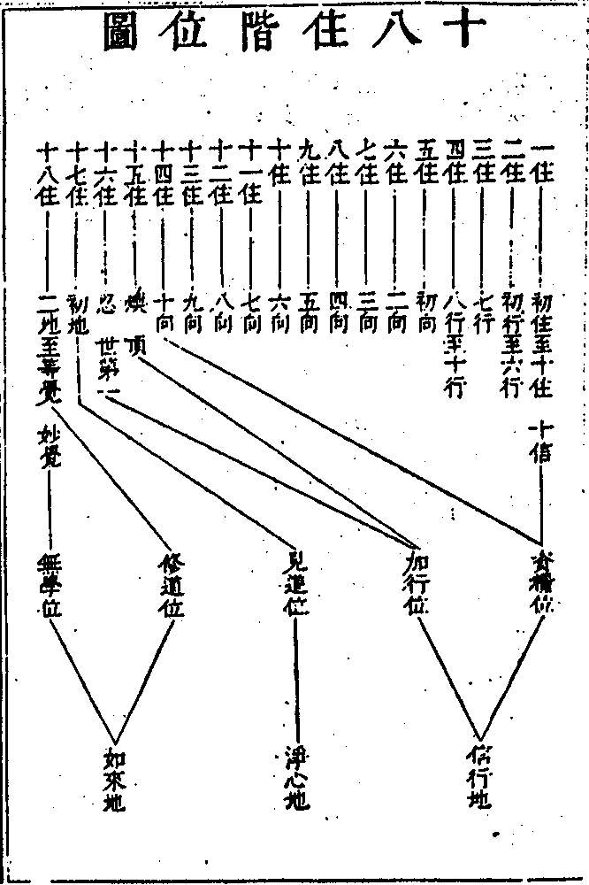
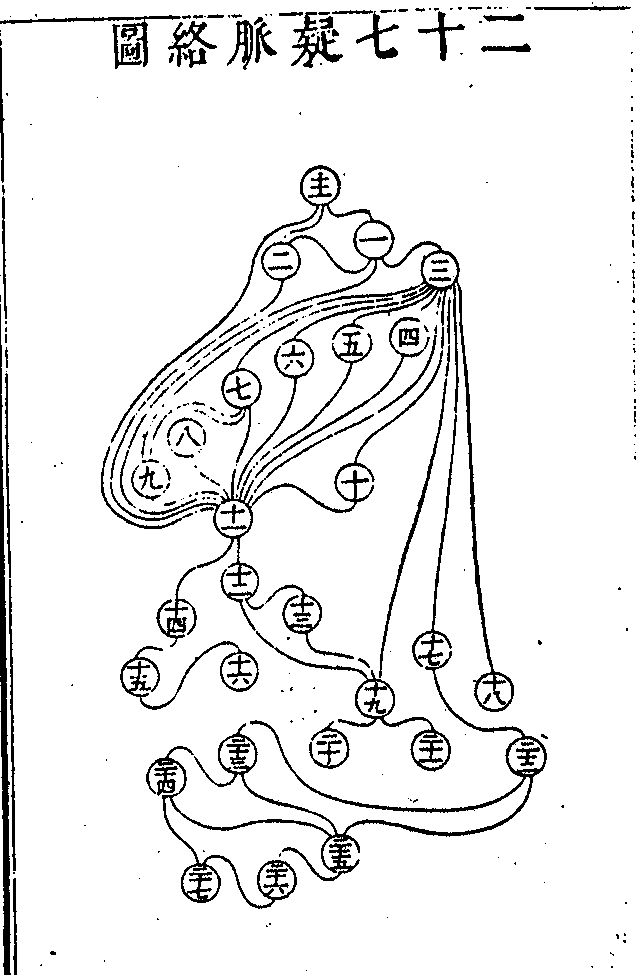

# 金刚般若经疏论纂要刊定记会编



> **藏经**：嘉兴大藏经（新文丰版）（嘉兴藏）　**册次** 第 31 册（J31）　**编号** JB269　**部类** 经疏部　**卷次** 10 卷　**篇幅** 142,996 字

> **卷／品**：10 卷 · 3 品



---



## 目录



  - [二释(二)初表通序](#二释二初表通序)

  - [二表别序](#二表别序)

  - [金刚般若经疏记会编序](#金刚般若经疏记会编序)

- [金刚般若经疏论纂要刊定记会编卷第一](#金刚般若经疏论纂要刊定记会编卷第一)

- [金刚般若经疏论纂要刊定记会编卷第二](#金刚般若经疏论纂要刊定记会编卷第二)

- [金刚般若经疏论纂要刊定记会编卷第三](#金刚般若经疏论纂要刊定记会编卷第三)

- [金刚般若经疏论纂要刊定记会编卷第四](#金刚般若经疏论纂要刊定记会编卷第四)

- [金刚般若经疏论纂要刊定记会编卷第五](#金刚般若经疏论纂要刊定记会编卷第五)

- [金刚般若经疏论纂要刊定记会编卷第六](#金刚般若经疏论纂要刊定记会编卷第六)

- [金刚般若经疏论纂要刊定记会编卷第七](#金刚般若经疏论纂要刊定记会编卷第七)

- [金刚般若经疏论纂要刊定记会编卷第八](#金刚般若经疏论纂要刊定记会编卷第八)

- [金刚般若经疏论纂要刊定记会编卷第九](#金刚般若经疏论纂要刊定记会编卷第九)

- [金刚般若经疏论纂要刊定记会编卷第十](#金刚般若经疏论纂要刊定记会编卷第十)



---



金刚般若经疏记会编科文



○纂要疏文分(三)初标题目(二)初经疏名题  

二作者嘉号



二叙宗旨(二)初叙赞经旨(二)初通明起教之缘(二)初明迷真起妄(二)初真空  

二妄有



二明习妄流转



二别明说教之意(二)初叙说阿含之意(二)初正叙  

二结判



二叙说般若之意(二)初总示大部(二)初叙教释意  

二显瑞彰会



二别示今经(二)初略标指  

二广叙赞(二)初叙叹幽玄(二)初具叙一经诠旨(三)初正叙  

二反显  

三顺结



二结叹四法幽玄(三)初正结叹  

二示难了  

三彰谬解



二引文结显



二述造疏意(二)初示疏论师承有据(二)初示论师承斥他添削  

二明今述解不攻异端



二示名题义意在下



三解本文(二)初偈文归请  

二开章正释(二)初标列章门  

二依章正释(四)初辨教起因缘(二)初总论诸教(二)初通赴机缘  

二剋就佛意



二别显此经(五)初对治我法二执(三)初标  

二释(二)初总标拘执起障  

二别示二障过患(二)初烦恼障  

二所知障



三结



二遮断种现二疑(二)初标  

二释



三转灭轻重二业(二)初标  

二释



四显示福慧二因(三)初标  

二释(二)初未说失为凡小  

二已说得为佛因(二)初顺释  

二反显



三结



五发明真应二果(三)初标  

二释  

三结



二明经宗体(二)初明宗(二)初统明诸教  

二别显今经(三)初约法正立  

二约喻释成  

三约行结显



二明体(三)初标立  

二正释  

三总结



三分别处会(二)初总明佛说大部处会(二)初总示大部  

二别显此经



二别明传译此卷时主(三)初正明东土翻译前后(二)初通辨诸译  

二剋示所传



二因辨西方解释异同  

三示今科判依据差别(二)初正明科释所依  

二结成立题所以



四释通文义(二)初解题目(疏二)初释所诠(三)初释金刚(二)初翻名示相  

二约法辨义(二)初引经论总彰二义(三)初总标深辨  

二引教委释  

三结显喻旨



二引真谛别示六种(二)初正明六种  

二结示傍正



二禅般若(二)初翻名略指  

二引教广释(二)初引论别相释(二)初明总摄三慧  

二引论文释成(二)初正释成  

二配因果(二)初双引论  

二双解释



二引经通相释



三释波罗蜜(三)初约语对翻  

二约义顺释(二)初释义  

二通难



三顺义通结



二释能诠(二)初翻名  

二释义



二释经文(疏二)初科分  

二随释(经三)初序分(二)初证信序(疏三)初明建立因  

二明建立意  

三正释文义(二)初标列述意  

二依科解文(六)初信(二)初合释  

二单释



二闻(二)初正释我闻之义  

二商较所闻之法



三时(二)初拣显释  

二会法禅



四主(二)初翻名  

二释义(二)初引论正释(二)初约体离念释  

二约位三义释



二引论反释(三)初反显  

二引证  

三顺结



五处(二)初释舍卫  

二释祇园(二)初总指  

二别释(三)初释祗陀  

二释给孤  

三释园字



六众(二)初释标类  

二释举数



二发起序(疏二)初叙意  

二随释(经二)初戒(疏七)初释化主  

二释化时  

三释化仪  

四释化处  

五释化事  

六释化等  

七释化终



二定(疏二)初正解此文(三)初并资缘  

二净身业  

三正入定



二通前表法(二)初约大云广辨(三)初标



------



### 二释(二)初表通序



### 二表别序



三结



二引资圣略明(二)初正明  

二引证



二正宗分○  

三流通分○



○二正宗分(疏二)初标列章门  

二依章随释(二)初依无著悬判(三)初正示七句(二)初牒标  

二随释(七)初种性  

二发起  

三住处  

四对治  

五不失  

六地位  

七立名



二总指后四  

三广释第三(三)初正辨十八住处(二)初牒标  

二随释(十八)初发心住  

二波罗蜜相应住  

三欲得色身住  

四欲得法身住  

五修道无慢住(三)初正示此文  

二通叙后段  

三别结对沿



六不离佛世住  

七愿净佛土住  

八成熟众生住  

九远离外论住  

十观破色身住  

十一给侍如来住  

十二远离退失住  

十三忍苦住  

十四离寂静味住  

十五证道离喜住  

十六求佛教授住  

十七证道住  

十八上求佛地住(六)初国土净具足  

二见智净具足  

三福自在具足  

四身具足  

五语具足  

六心具足



二重以八义相摄  

三更约地位配释



二依天亲科释(二)初牒章分文  

二依章正释(经四)初善现申请(二)初整仪赞佛(疏二)初释请人  

二释请仪(二)初正释经文  

二别解菩萨



二正发问端(疏二)初释当机  

二释正问(三)初释魏本  

二会当经  

三引论证



二如来赞许(疏三)初印赞所赞  

二敕听许说  

三标劝将陈



三普现伫闻  

四如来正说(二)初正答所问(二)初举总标别以牒问(疏四)初正释经文  

二斥他谬判  

三详定经旨  

四牒难释通



二约别显总以答问(二)初答安住降心问(四)初广大心(疏二)初释标  

二释列(三)初受生差别(二)初释文  

二通难



二依止差别  

三境界差别



二第一心  

三常心  

四不倒心



二答修行降心问(五)初总标  

二别释  

三总结  

四显益(疏二)初科释文意  

二别辨喻旨



五结劝



二蹑迹断疑(疏二)初约谕分文  

二依论科释(经二十七)○初断求佛行施住相疑(疏二)初随章叙疑  

二依经断疑(经四)初举疑因以问  

二防相得以酬  

三释体异有为  

四印佛身无相(疏二)初释前二句(二)初正释  

二引证



二释后二句(二)初正释  

二引论释(四)初引起信  

二引肇注  

三引本论  

四引无著



○二断因果俱深无信疑(疏二)初随章叙疑  

二依经断疑(经四)初约无信以呈疑  

二诃疑词以显信  

三明能信之所以(二)初明历事善友积集信因  

二明善友所摄成就信德(二)初明摄受得福显福德门(疏二)初释佛知见  

二释得福德



二明摄受所以显智慧门(疏二)初叙意  

二科释(经二)初正明已断虫执(疏二)初师释经文  

二商较经旨



二因显未除细执(疏二)初释总明二相  

二释别明二相(二)初正辨二相  

二别解徵意



四示中道之玄门



○三断无相云何得说疑(疏二)初随章叙疑  

二依经断疑(经二)初问答断疑(四)初举疑因以问  

二顺实理以酬  

三释无定法之言(疏二)初引无著  

二引天亲(二)初释文  

二通难



四释无取说所以



二较量显胜(四)初举劣福以问  

二释福多以酬  

三判经福超过(疏二)初正释经文  

二别示句相



四释超过所以(二)初正释  

二转释



○四断声闻得果是取疑(疏二)初随章叙疑  

二依经断疑(经四)初入流果(疏三)初正释经文  

二商较果证  

三结断疑情



二一来果  

三不来果  

四不生果(疏二)初辨得名  

二分科释(经三)初举所得以问  

二明无取以答  

三引己证令信(三)初明佛先印  

二彰己不取  

三却释佛意



○五断释迦然灯取说疑(疏二)初随章叙疑  

二依经断疑



○六断严土违於不取疑(疏二)初随章叙疑  

二依经断疑(经三)初举取相庄严问  

二释离相庄严答  

三依净心庄严劝



○七断受得报身有取疑(疏二)初随章指疑  

二依经断疑(经二)初问答断疑(疏二)初总释喻旨  

二别解非身(二)初牒经略指  

二引论广释(二)初引本偈  

二引论文(三)初双标  

二双释  

三双结



二较量显胜(二)初约外财较量广显经胜(二)初较量胜劣(三)初约多河以辨沙  

二约多沙以彰福  

三约多福以显胜



二释胜所以(五)初尊处叹人胜(三)初明处可敬  

二显人获益  

三显处有佛



二约义辨名胜  

三佛无异说胜  

四施福劣尘胜  

五感果离相胜



二约内财较量倍显经胜(二)初较量胜劣  

二择胜所以(五)初泣叹未闻深法胜  

二净心契实具德胜(二)初正明  

二拂迹



三信解三空问佛胜(三)初总标信解  

二别显三空  

三如来印定



四闻时不动希有胜  

五大因清净第一胜



○八断持说未脱苦果疑(疏二)初随章叙疑  

二依经断疑(经二)初明超忍以断疑(二)初明忍体二明忍相(二)  

初引一生证极苦忍(二)初正明  

二反显



二引多生证相续忍



二劝离相以安忍(疏二)初引论叙意  

二分科正释(经二)初总标  

二别显(二)初对治不忍流转苦  

二对治不忍相违苦(疏二)初引无著显意  

二约天亲释文



○九断能证无体非因疑(疏二)初随章叙疑  

二依经断疑(经二)初断疑(疏二)初略销经意  

二广释五语



二离执



○十断如遍有得无得疑(疏二)初随章叙疑  

二依经所疑(经二)初举喻断疑  

二赞经功德(二)初总标  

二别显(十)初舍命不如(二)初舍命福  

二信经福



二餘乘不测  

三依大心说  

四具德能传  

五乐小不堪  

六所在如塔  

七转罪为佛  

八超事多尊(疏二)初总叙意  

二别科释(经二)初供佛多中全具福  

二持经多中少分福



九具闻则疑  

十总结幽邃



○十一断住修降伏是我疑(疏二)初随章叙疑  

二依经断疑(经二)初问  

二答(三)初若名菩萨必无我  

二若有我相非菩萨  

三能所俱寂是菩提



○十二断佛因是有菩萨疑(疏二)初随章叙疑  

二依经断疑(经四)初举疑处  

二断疑念  

三印决定  

四反覆释



○十三断无因则无佛法疑(三)初断一向无佛疑(疏二)初随章叙疑  

二依经断疑(经二)初显真如是佛故非无  

二明佛即菩提故无得



二断一向无法疑(疏二)初随章叙疑  

二依经断疑(经二)初遣执遮疑  

二释义断疑



三显真佛真法体



○十四断无人度生严土疑(疏二)初随章叙疑  

二依经断疑(经三)初遮度生念(三)初明失念  

二明无人  

三引前说



二遮严土念(二)初明失念  

二释所以



三释成菩萨



○十五断诸佛不见诸法疑(疏二)初随章叙疑  

二依经断疑(经二)初约能见五眼明见净(疏二)初引偈彰意  

二分科释文(经五)初肉眼  

二天眼  

三慧眼  

四法眼  

五佛眼(疏二)初局释当文  

二通前总显(二)初引无著义总释  

二约古德偈重结



二约所知诸心明智净(五)初约一个恒河以数沙  

二约一河中沙以数河  

三约沙河中沙以数界  

四约尔所界中所有生  

五约一一众生所有心(三)初总明染净以标悉知  

二会妄归真以释悉知  

三推破杂染以释非心



○十六断福德例心颠倒疑(疏二)初随章叙疑  

二依经断疑(经二)初问福答福  

二反释顺释(疏二)初引论正释  

二问答解妨



○十七断无为何有相好疑(疏二)初随章叙疑  

二依经断疑(经二)初由无身故现身  

二由无相故现相



○十八断无身何以说法疑(疏二)初随章叙疑  

二依经断疑(经三)初遮错解  

二释所以  

三示正见



○十九断无法如何修证疑(疏二)初随章叙疑  

二依经断疑(经三)初以无法为正觉  

二以平等为正觉  

三以正助修正觉



○二十断所说无记非因疑(疏二)初随章叙疑  

二依经断疑



○二十一断平等云何度生疑(疏二)初随章叙疑  

二依经断疑(经四)初遮其错解  

二示其正见  

三反释所以  

四展转拂迹



○二十二断以相比知真佛疑(疏二)初随章叙疑  

二依经断疑(经五)初问以相表佛  

二答因苗识根  

三难凡圣不分  

四悟佛非相见  

五印见闻不及



○二十三断佛果非关福相疑(疏二)初随章叙疑  

二依经断疑(经四)初遮毁相之念  

二出毁相之过  

三明福相不失  

四明不失所以(二)初明得忍故不失  

二明不受故不失(二)初正明  

二徵释



○二十四断化身出现受福疑(疏二)初随章叙疑  

二依经断疑(经二)初斥错解  

二示正见



○二十五断法身化身一异疑(疏二)初随章叙疑  

二依经断疑(经二)初约魔界破一异(五)初细末方便破麤色(疏三)初引天亲明断疑  

二引无著破执法  

三引大云示破相



二不念方便破微尘(疏二)初约断疑释  

二约破法释



三不念方便破世界  

四俱约尘界破和合(疏二)初引天亲解  

二引无著解



五佛印无中妄执有



二约止观破我法(二)初除我执(二)初斥错解  

二遣言执



二除法执(二)初除分别(疏二)初明无分别所依(二)初总徵三法  

二别释第三(二)初总标  

二别释(二)初总彰三义  

二转释后义



二正显无分别理



二显本寂



○二十六断化身说法无福疑(疏二)初随章叙疑  

二依经断疑(经二)初明说法功德  

二明说法不染(疏二)初引无著解(二)初申经意  

二销经文



二引大云解



○二十七断入寂如何说法疑(疏二)初随章叙疑  

二依经断疑(疏二)初开章指文  

二随章辨释(三)初约两论释九喻(二)初约本论断疑  

二兼无著释相(二)初据论分文  

二随文正释(四)初自性相(二)初释章意  

二别解文(三)初星喻见  

二翳喻相  

三灯喻识



二著所住味相  

三随顺过失相(二)初释章意  

二正解文(二)初露喻身  

二泡喻受



四随顺出离相(三)初释章意  

二正解文(三)初梦喻过去  

二电喻现在  

三云喻未来



三总结示



二约诸经显喻意  

三会秦经明广略(二)初指喻显法  

二正会广略



○三流通分(疏二)初随经文别释  

二引论疏赞释



十八住阶位图







十八住阶位图说



(第一生配初发心住，并摄前十信及餘九住，共二十心。二中是六波罗蜜，故次配六行。四中法身分言说证得，於证得中开智相、福相，故配后三行。第十八中有六种具足，初一具足配二地至等觉十位，后五无上具足配妙觉位，其餘配属可见。)



详夫诸教所说地位，差互不同。或说五十二位，或将十信摄入十住，但说四十二位。於中或复开前合后，开后合前，或前后俱开俱合，开之则广，合之则狭。又或借小明大，借权明实，名相位号，出入淆讹，徇名遗旨，多见差谬。乃至《楞伽》诸典，泯之全无；《缨络》等经，具说成有。若有若无，若广若狭，皆随宜之说也。惟《华严》行布万殊，圆融一际，有无阔狭，悉皆无阂，方为了义耳。所以者何？以约法则无，约人则有。今经云：「一切贤圣，皆以无为法而有差别。」无为故无，差别故有，於差别中，不无阔狭也。论主既仰师补处，深悉经义，以宗派兼明，故正住中道，不堕有无；以法喻齐显，故初后中间，酌於阔狭。配十八住处，说三地五位，诚尽善矣。记主云：「然其行人，念念须冥佛境，反穷果海，自然阶降不同。若预等级用心，毕竟障於证入。况此经宗无相，岂合列位浅深？但约情惑渐薄，地位转高，义相稍同，故略配摄也。」斯言得之。然今之人，乃有以此而病无著者。嗟乎！不解即相离相，妄谓一向无相，所以堕增上慢，因果不分，谬执经宗，非毁先圣。好心学般若者，幸勿徇此一边之见；住於中道，离障证真，依无为法，入贤圣位，则庶乎其不差矣。



二十七疑脉络图







二十七疑脉络图说



(首曰主者，即不住相布施也。以此是疑主故，展转生起至二十七。於中第三出十疑，第十一总承前疑，是为脉络肯綮处。餘疑可知。)



佛乃不思议人，经名不思议说。不思议者，非思议能解也。非思议能解者，无思议者乃能解也。无思议能解者，非思议竟莫能解也。何以故？如上二十七疑，来自经文之外，已非思议所及。然有次序来者，有隔越来者，有通贯来者，有分承来者。次或可知，隔即难晓，况通贯分承乎？譬犹身中血脉，地中泉脉，经络支派，潜伏流注，殊非寻常义现於文、易开物解者比也。况加之以麤心浅心，徇臆见妄生穿凿，何关经义？故曰：非思议能解也。弥勒以补处之智，冥妙觉之经，演难思之偈，授登地之人，曰：断种种疑。天亲始理疑脉以贯经，曰：断二十七种疑。故曰：无思议者乃能解也。昔者以文求义，矛盾何多？今也以脉定文，参商斯绝。违惟见其顺，塞惟见其通，断惟见其续，暗惟见其明，细心深心虚所见，好古敏求之力也。故曰：非思议竟莫能解也。好心学般若者，当澄神摄虑，熟玩而细研之，将见此经全体血脉，朗然跃现於文字句偈之表，由是永断群疑，深解义趣，依解起行，行起解绝，不妨从思议中，亲到无思议处，即是亲见不思议人，亲闻不思议说也。尚勉之哉！



------



### 金刚般若经疏记会编序



一切众生自性，般若与诸佛平等。众生唯妄执未谢，故波迸六道，甘沦溺而不之返。世尊为说一切修多罗，不过令其於己躬下证其本有如是之事而已。然诸契经演说不同，有曲有直，有纯有杂，唯《金刚般若》一经，破执断疑最为直说纯说者也。此经总之则一，析之有三种：一曰实相般若，如金之坚，即理经也；二曰观照般若，如金之利，即行经也；三曰文字般若，如金之光，即教经也。利根圆获，钝者浅执。昔六祖大师闻客诵至「应无所住而生其心」，中峰老人读至「荷担如来阿耨多罗三藐三菩提」，豁然悟入，此顿见实相最上利根也。其次则明观照，又次则信文字，至於但信文字，根斯为下矣。然末世顿入者少，故理由行证，行藉教明，则文字实又二种般若之津筏也。是经文则甚略，而义该大部，入位上流，乍难窥测。然自创译已来，此方疏释约数百家，深经浅解，已谓少益，况偏辞臆说，至有不堪闻见者乎？昔佛灭后，西域有无著菩萨入日光定，上升兜率，诣弥勒问此经义，弥勒以八十偈颂之。无著出定，与其弟天亲各禀偈造论。二论互释，经旨弥深，仍非浅智所了。唐圭山大师以妙悟之姿，泳游教海，愍物兴慈，遂正本二论，旁采诸说，述《纂要疏》二卷，辞精理极，为众释中最。然一往读之，不了者什犹六七。石壁师别为广解，又失之太繁。长水师复起而翦削之，成《刊定记》，而疏义显矣。疏义显，而后金刚般若教、行、理三经，乃无不显矣。但今宇内谬解偏多，传讲诸师又恒习世本，各封己见，以故鲜知宗尚。嗟乎！独不思圣凡愚智，藐若云泥。无著是登地菩萨，天亲是地前加行菩萨，二人亲禀弥勒。弥勒是补处大士，亲禀释尊。今疏悉依二论，则疏即佛语。佛语不宗，将谁宗乎？策昔因阅藏，幸遇斯文，精研三复，如获重宝。但以疏记别行，寻讨维艰，文义连绵，科章间错，起止血脉，作者犹迷。於是不量庸愚，秉笔从事，校经节疏，会记编科，缮写严核，至三脱其稿。於中添削厘合，殊费斟裁，俾览者无神昏目眩之嫌，有执谢疑除之益。特授剞劂，以广流传。或曰：子禅者也，乃事经疏之学耶？予曰：噫！子过矣，请无远论。即圭山、长水二师，一则宗大鉴而彻禅源，一则叩琅邪而悟心要，亦皆续教内之真传，即文字而直指。苟具正眼，岂存二见？况此般若者，乃觉体之异名，种智之殊号，性空缘会，法尔无差，功德发心，本无限齐。吾将流通如是之经，以期己他之兼利也。流通文字，用严化身；流通观照，用严报身；流通实相，用严法身。如是则为具足佛身。何以故？生了二因，决能成就。故经云：「是经义不可思议，果报亦不可思议。」诸有福智者，应作如是观。



康熙甲辰岁仲夏之吉，荆溪后学行策书於武林之河渚草堂。



例言



此经六译，秦译称最。传布既广，讹舛滋多。故校诸疏本，亦各差互。今经字句，一依北藏原本勘正。  

此经注释，无虑数百家。虽有数家正疏，然皆互有短长。其尽善尽美，唯《纂要》一疏而已。故今疏文悉遵原本，无敢移易。其《刊定记》文，既会归本疏下首末开合，不无增损字面，贵使文义允当耳。  

凡疏钞合本，多见以两文并书，而首标疏钞字者，其不便有二：一者遇条分缕析处，标字太烦；二则於义未安。盖钞不得与疏并列，犹之疏不得与经齐等。譬如经则父也，疏则子也，钞则孙也，伦次自应有别。今初二卷以疏文顶格书，记低一字。自三卷以去，则以经文顶格书，疏让经一字，记复让疏一字，不同他本之式。又记中有释经之语，未涉疏意者，会在疏前，令不失次第。  

此中分科，须辨四种不同。有记中所列之疏科，有疏中所列之经科，有疏中自列之疏科，并节释之。经科重繁错杂，初学多迷。今前二种，皆加圈别之，仍分黑白，使疏记首尾，血脉通贯。其后二种，准疏文一例书之，庶井然易见。  

记中科题，有遗前失后者，窃意补之；有应立不立者，增入之；有疏自列而记复列者，翦削之；或安科取便失次者，随位置之；或科名未尽善者，略更易数字。非敢妄专，务期允当，览者无以差脱见疑。  

经文十八、十九二疑之间，有「尔时慧命须菩提至是名众生」一段，计六十二字。秦译原无，系后人添入，故疏不释。然魏译有之，二论亦皆释之，添亦无失。况记有补释之文，今从世本添入。如秦译《法华．普门品》中添入隋偈，亦无失也。  

配十八住处，断二十七疑，为两论之纲宗，一经之枢要。若阶位不明，则昧於横判；脉络不清，则迷於竖释。今各为图说，系於全科之后，使开卷按图，瞭然在目，不致寻文难了。  

疏记两文之中，字句并多错谬，北藏且不可凭，何论他本。今则揆之文义，苟一字不安，必周遍搜寻，得之旧册，或深思自悟，释然无疑。具摘诸讹，附於卷末，一以见雠勘之难，一以出藏本之误，惟览者悉之。



------



## 金刚般若经疏论纂要刊定记会编卷第一



秦三藏法师鸠摩罗什译经



唐　圭山大师宗密　述疏



宋　长水沙门子璇　录记



清荆谿后学沙门行策会编



《刊定记．序》云：释氏教《金刚经》，世所由来尚矣。自秦至今，凡几百载，讽诵无卑高，感应盈简牍，利及幽壤，而达乎神明，盖趣大之坦涂，破小之宏略也。故补处颂以为本，二论释而有贯，诸疏互解，或依或违。圭山大师撮掇精英，黜逐浮伪，命曰《纂要》，盖取中庸，复申记略，用备传习。石壁师仍贯义意，别为广录，美则美矣，辞或繁长，后学多不便用。今更刊定，翦削烦乱，俾流而无滞，学而思讲，庶吾道无坠地之患也已。



大宋天圣纪号之明年季冬月甲子日序。



●疏。文分三：初、标题目，二：初、经疏名题。



金刚般若经疏论纂要(并序)



记云：此题九字，从宽至狭，能、所六重：一、能、所释，谓金刚等五字是所，疏论下四字属能。二、能、所诠，谓经字属能，金刚等四字是所。三、能、所简，有二：一、简通，谓经通一代时教，般若唯属当部。二、简别，般若犹通八部，金刚但属一经。五、能、所喻，金刚是能，般若属所。六、能、所纂，纂字属能，谓疏主也；要字是所，谓正义也；若著并序二字，复加一重，二字是能，上皆所摄。然此七重，不出教、行、人、理。谓经及疏、论并序五字是教，谓能诠、能释、能序也；般若通行，谓观照也；纂字属人，即疏主也；金刚要字属理。金刚喻实相，即真理；要字是正义，即道理。既知一题能、所去取，须知题内义、理浅深。金刚有三义，谓坚、利、明也。般若亦三义，谓实相、观照、文字也。经有三义，谓常、贯、摄也。疏亦三义，谓疏、决、布也。论者，议也，亦三义，谓议理、议智、议行也。纂要亦三义，谓要义、要行、要文也。且金刚三义者，以万物不能坏，能坏於万物，复能有照用，可喻三种般若矣。坚喻实相，以其虽经多劫，流迸六道，未尝生灭，未尝亏缺，故云坚也。故《心经》云「是诸法空相，不生不灭，不垢不净，不增不减」等。利喻观照般若，谓此显时，照诸法空，故言利也。故《心经》云「观自在菩萨行深般若波罗蜜多时，照见五蕴皆空，度一切苦厄」，乃至云「无智亦无得」等。明喻文字般若，以文字能诠显彰明，实相观照令显现故。由斯三义似彼金刚，故举金刚以喻般若。然此般若，诸佛众生悉皆有之，由彼在缠故不能利用，苟能闻教解悟内外熏力，则能断烦恼、出生死，理智相冥能起大用，与佛无异。其犹金在矿中不能随用，苟能出矿必能成器断物，故知此慧无不有之，故知此慧能建大义。今云般若，盖大慧之梵音也。金刚即般若之正喻，法喻双彰故曰金刚般若也。若准经题，具足合云波罗蜜，即叹慧之功也。唐言彼岸到，此犹西域之风，若顺此方合云到彼岸。彼岸者即是涅槃，为对生死之此，故号涅槃为彼，意明般若是到彼岸慧，斯则慧之别相也。然到彼岸慧略有二意，所谓顿、渐也。顿者，此慧显时，一刹那间照诸法空，即是到彼岸，故名到彼岸慧，以不历多时乃名为顿。渐者，虽则顿照法空，且习以性成任运计执，所以策彼顿悟之慧觉察妄情，损之又损之以至於无为，此则究竟到於彼岸，亦名到彼岸慧，以历多时故名为渐。渐之与顿迟速虽殊，一总得名到彼岸慧，所以具足合云金刚般若波罗蜜，今略不言也。次明经字具三义者，然准诸家解释，共有多义，谓涌泉、出生、绳墨、结鬘之类。若《佛地论》中唯说二义，谓贯也、摄也，贯穿所应说义，摄持所化众生。且如来入灭二千餘年，遗风若存，得闻正法者，斯皆经之贯穿义也。众生流浪莫知所从，得佛教门咸归正趣者，斯皆经之摄持义也。具此二义故名为经。今以此二复加常义，以对三种般若，谓实相常、观照贯、文字摄也。然此一经罗什所译，句偈清润令人乐闻，至今长幼高卑盈於寰宇，靡不受持此经也。疏论纂要者，即此一卷疏文也。疏即青龙、大云、资圣、尘外等疏，疏谓疏通理趣、决择义相、布致文言也，论即天亲、无著、智度、金刚仙、功德施等论，一一论中任运议於理智行也。问：既有疏论释经，何必更制斯疏？答：以纂要故，即是纂他疏论之要义而成此疏也。然纂要之设总有两意：一则上符圣旨，二则下协人心。意显诸说有不符圣旨、不协人心者。且初意者，只如此经是空无相宗，有以法相行位广列而释，此则不符圣旨，失於宗故，故序云「或配入名相著事乖宗」。有人闻是空宗，便作一味无相道理解释，此亦不符圣旨。以宗虽无相，义乃千端，既以一味解释，斯则迷於末也。故序云「或但云一真，望源迷派」。前则乖宗不迷派，此则迷派不乖宗，互有得失，俱未圆畅。复有纵於僻见，以之注释，宗派俱失，不足评量。故序云「其餘胸谈臆注，不足论矣」。然其诸说虽各有舛的，以未兼畅，故皆判云不符圣旨也。今制此疏，不添法相，免乖於宗；随文释之，不迷於派。离前二过，宛乎得中，此则超然独符圣旨。然今疏内皆用圣言，故序云「故今所述，不攻异端」。疏是论文，乳非城内，况二菩萨师补处尊，补处如来师释迦佛，展转推本，佛佛相承，降及无著、天亲，更无异说。故知此疏便是佛言，谤此疏者，即同谤佛也。故序云「且天亲、无著师补处尊，后学何疑，或添或弃」。次下协人心者，且诸家章疏，在理未当，於文且繁，致令学人少敢措意，故转念者广，通会者稀。故序云「致使口讽牛毛，心通麟角」。然今此疏撮其枢要，直下销经，经疏相兼，盈五十纸，不问缁侣尘俗可以留心，不唯上、中、下根可以学习，有斯两意，所以述之。此则前智后悲，自他兼利也。故云金刚般若经疏论纂要并序者，并谓兼及也。序者，叙也，叙述经疏之意也。又序者，绪也，谓头绪也。意明此半纸之言，是述疏入作之头绪也。



●二作者嘉号



京大兴福寺沙门宗密述



京者，都也，大也，即士庶贵贱都会之大处也。然是西京，非谓东北，以有大兴福寺暗拣，故不言西也。沙门，梵语，此云勤息，谓勤修众善，止息烦恼，释众之通号也。述者，明非制作，符上纂要之言，但是叙述先圣之旨，非别制作故也。例如孔子云：「述而不作，信而好古，窃比於我老彭。」



●二、叙宗旨，二：初、叙赞经旨，二：初、通明起教之缘，二：初、明迷真起妄，二：初、真空。



镜心本净，像色元空。



上句即真性离缘，下句即缘无自性，大约如此。若其委明，应先略配，后当广释。略配者，此两句中，镜像是喻，心色是法，本净元空，通於法喻。以镜喻於心，以像喻於色，像是镜之所现，如色是心之所现。镜虽现像，其像元空，即显镜本净也。心虽现色，其色元空，即显心本净也。言本净者，即是性净，通因果凡圣故。故《华严》云「非识所能识，亦非心境界，其性本清净，开示诸群生。」此略指配也。若广释者，镜即人间所用之镜，然有尘薶不堪用者，有虽净而在匣者，有净无尘垢挂之高台万像斯鉴者，今取后者为喻。心者，性相二宗所说各异。相宗说者，或以集起为心，唯第八识集诸种子起现行故；或以缘虑为心，通於八识俱能缘虑自分境故。然此所说但是有为生灭，非今所喻。性宗说者，即如来藏本源自性清净心也。然今所明正是此心，以是迷悟根本、凡圣通依，世出世间皆不离此，所以《起信论》中立为大乘法体。故论云「摩诃衍者，一法、二义。所言法者，谓众生心，是心则摄一切世间出世间法，依於此心显示摩诃衍义。」又云「依一心法有二种门：一者、心真如门，二者、心生灭门。是二种门，皆各总摄一切法。此义云何？以是二门不相离故。」以真如门是通相，故摄一切；生灭门虽是别相，以是即真如之生灭，亦摄一切。以此二门同依一心为源，则知万法不出此心。又如华严是圆极一乘，亦以此心为一真法界之体。故彼疏说统四法界为一真法界，谓寂寥、虚旷、冲深、包博、总该万有，即是一心；体绝有无相、非生灭。乃至云「诸佛证此妙觉圆明，现成菩提，为物开示等。」然此一心有性、有相。相则凡圣、迷悟、因果、染净等异；性则灵灵不昧，了了常知。然此性、相，不即、不离。以相不离性，故只向同处异；性不离相，故只向异处同。性不即相，故未始有差别；相不即性，故未尝不殊异。盖缘性、相一味，所以同、异两存。其犹一水波，湿性相同、异可知。然此灵心本非一切能为，一切心之名字亦由此立。今云净者，但约毕竟空义，非是拣染名净，以但唯一心贯通染、净故。荷泽云：「知之一字，众妙之门。」一切诸法依此建立，既为得失之秘府，乃是升降之玄枢。称众妙门，实为至矣。今所辨者，即是此心。然前所说相宗二种，乃是此心之内生灭一门。对辨浅深，故须料拣。和会通摄，则实无所遗。本净者，喻则可知。法中有二意：一则此心从本已来，性毕竟空故；二则现为烦恼所缠，而无染故。此当《起信论》中真如门也。故《大集经》云「善男子！一切众生，心性本净。心本净故，烦恼诸结，不能染著。犹如虚空，不可玷污。心性空性等无有二」等。像即镜中所现万像，色即本净之心所现诸法。然所现法，不出色心。今唯言色，而不言心者，一为文句窄故，二为影在下故，三为以初摄后故。前二可知。后意者，一切诸法，不出五蕴。色之一字，贯五之初。今言色者，举初摄后也。故《大般若》中，每例诸法，皆以色字为初。如云「善现！般若波罗蜜多清净故，色清净。色清净故，一切智智清净」等。由是文虽标色，而意兼於心。色心既彰，万法备矣。元空者，喻则可知。法中有二意：一即本来是空。论云「一切诸法，唯依妄念，而有差别。若离心念，则无一切境界之相。」二即现见空故。色等诸法，本来是空。迷人不知，妄执为有。虽然执有，未始不空。故《中论》云「诸法若不空，即无道无果。」又云「以有空义故，一切法得成。」然此一句，亦是释疑。恐人闻说心性本净，复见论云「是心则摄世间法」等，便谓本具染等，不合言净。故下句释云：像色元空也。意云：色等若实，则污净心。色等既空，凭何污心？如镜现秽像，秽像元空，似有实无，云何染污？故云镜心本净，像色元空也。《无上依经》云「清净有二义：一者自性清净，是其通相；二者离垢清净，是其别相。」《宝性论》中，亦有二义：一自性清净，谓性净解脱；二离垢清净，谓障净解脱。魏译《唯识论》云「心有二种：一者相应心，所谓一切烦恼受想行等；二者不相应心，所谓第一义谛常住不变自性清净心也。」今所明者，即自性清净及第一义谛心，故云本净。复次两句，更互释成。以上句释下句，成色空义；以下句释上句，成心净义。色若不空，心则不净；心若不净，色即不空。由心净故色空，由色空故心净，以色心二法不相离故。当知由心净故，方能现色；如镜净故，方能现像，染则不能。又由色空故，不能染心；如像空故，不能污镜，实则污也。上句下句，法喻对明，反覆相成，故云互释。



●二、妄有。



梦识无初，物境成有。



此正当《起信论》中心生灭门也。然此亦具法喻：以梦喻识，以梦中所现之物喻境。如人睡后作梦，於无物处见物；喻心迷成识，於无境处见境。然虽物依梦现，而梦物皆虚；虽境从识生，而识境俱妄也。梦者，如常人被睡盖所覆，心识昧略，恍惚成梦。准《切韵》中：梦者，心乱之貌。亦云：寐见曰梦。意明心识昏乱，见於异事，名之为梦。识者，本净一心，忽然不觉，不觉是妄，心性乃真，真妄和合，目之为识，即是第八阿梨耶识也。故《起信》云「依如来藏故，有生灭心。所谓不生不灭，与生灭和合，非一非异，名阿梨耶识。」无初者，初，始也。意明此识无前际故。然真心妄识，虽虚实有殊，若究其源，俱无初际。然有两意：一则如《佛顶经》说「烦恼菩提，二俱无始。」谓自有此真心已来，便有此妄识，非谓真先妄后，亦非妄先真后。若言真先妄后，即应诸佛更起无明；若言妄先真后，何有无真之妄，居然独立？由是故知二俱无始。此则梦喻不齐，却似金之与矿。若言矿先金后，即合所弃之矿，鍊之得金；若言金先矿后，应可纯净金器，重生於矿。由是二物俱无初际，於法可知。问：如论云「依如来藏故，有生灭心。」既言依真有妄，则是妄后真先，何得说云二俱无始？答：不然。所言依者，明妄无自体，依真而成，显本末之义，非先后之义。故《起信》云「以如来藏无前际故，无明之相亦无有始。」若说三界外更有众生始起者，即是外道。经说二者，谓妄体全空，都无生起之踪迹，故言妄无始也。故《起信》云「觉心初起，心无初相」，即斯义也。若据此意，梦喻正同，以梦生时无踪迹故，有兹两意，故云妄无初也。然上梦矿二喻之中，各取少分，共况一识无初之义，方尽其理。梦则喻无初法，矿则喻无初时。若单用矿喻，则妄识有实；若唯取梦喻，则妄识有始。今既分取相似之处，理极成矣。物者，即梦中所现之物也。境者，即是识中所变我法等境。成有者，且如梦中所见自他境界，觉来反想，即定是无，正在梦时，决定为有。若不然者，何有赞喜、谤瞋、厌苦、欣乐等事耶？故知有也。如《庄子》中说：庄周梦为蝴蝶，都来忘却庄周，及乎睡觉梦除，何曾更有蝴蝶？为庄周时，既不羡蝴蝶，为蝴蝶时，亦不羡庄周，彼此各行，互不相识。然准彼书意，以显生死齐平。今之所引，意明执实之义，谓依於妄识，变起我法等相，悟来了达，则诚知是空。若正迷时，定执为有。若不然者，何有贪瞋、爱恶、取舍等事耶？故知是有。故《成唯识论》云「依识所变，妄见我法，犹如幻梦，幻梦力故，心似种种外境相现，缘此执为实有外境。」然虽梦中见种种事，推其根本，唯一梦心，以梦心灭时，梦事皆灭。法中亦尔，境虽无量，原其根本，唯一识心，识心灭时，境界随灭。故《起信论》云「一切诸法，唯依妄念而有差别；若离心念，即无一切境界之相。」则知三界唯心，万法唯识，谅不虚也。由是三界世间一切有漏染法，皆从妄识而生，故名此识以为妄本。然一切有漏染法，生起微著次第，总有两重：一、无始根本，二、展转枝末。展转枝末，即后逐妄科中所明。无始根本，正当此段。言根本者，即根本无明。言无明者，谓无妙觉之明故。以就通相言之，故当此识。然根本无明，具有二义，所谓迷真、执妄也。迷真者，真即真心，本不生灭，德相业用，量过尘沙，日用不知，如狂如醉，若贫女宅中宝藏，穷子衣内明珠，虽有如无，枉受艰苦。故《华严经》云「於第一义不了，名曰无明。」执妄者，妄即五蕴，色之与心，如幻如化，本无实体，众生认此为自身心，计虚为实，故名执妄。故《圆觉经》云「妄认四大为自身相，六尘缘影为自心相。」乃至结云「由此妄有，轮转生死，故名无明。」然此二义，递互相成，举一则兼，未尝独立。但若执妄，必须迷真；但若迷真，必须执妄。譬如有人，迷东必执西，亦互相成立，思之可见。



●二、明习妄流转。



由是惑业袭习，报应纶轮，尘沙劫波，莫之遏绝。



此当妄法生起第二门展转枝末也。由是等者，谓因此迷真成识，现起世间一切境界，缘此境界起惑造业，受报无穷。此中惑、业、报、应四字，但是三道。然此三法，诸教之中有名三障，障圣道故；或名三道，引心逦迆至业报故；或名三杂染，以性不清净故。又此三障更相由藉，由烦恼故起恶业，由恶业因缘故得苦果。初言惑者，即烦恼也。品类即根本及随。根本有六，谓贪、瞋、痴、慢、疑、恶见。随烦恼有二十，谓忿、恨、覆、恼、嫉、悭，乃至散乱、不正知等。若以要言之，不出根本中三，谓贪、瞋、痴。即此三种，便能成就三界世间。故《华严》云「由贪、瞋、痴，发身、口、意，作诸恶业，无量无边」等。此惑因起，由前无明迷平等理，妄认五蕴身心，即此身心是过患根本。故肇公云「约天地为高下，约日月为东西，约身为彼此，约心为是非。」《老子》亦云「吾有大患，为吾有身，及吾无身，吾有何患？」故知此身是一切过患根本。既执之为有，遂分自他，依此身心起诸烦恼，於一切顺情境上起於贪心，於一切违情境上起於瞋心，以护自身，将为主宰也。於此二中，不知是妄，任运而起，乃名为痴。此等烦恼，究其所因，皆从根本无明而有也。次云业者，然业虽无量，统唯有三，谓善、恶、不动也。由前贪瞋炽盛，发动身口，作诸恶业，即身三、口四、意三等十恶业也。或有稍知因果，贪来生荣乐之事，即翻恶为善，持不杀等五、八、十戒，即善业也。或厌下苦麤障，忻上净妙离，修有漏禅定，名不动业。然此三种业，虽胜劣不同，皆由迷心所造，俱有漏摄。故《圆觉经》中结三业云「皆轮回故，不成圣道。」由是则知前之三业，皆依烦恼所成也。言报应者，应即是报。既有业种，蕴在藏识，因缘会时，必须受报。《涅槃经》云「非空非海中，非入山石间，无有地方所，脱之不受报。」《尚书》云「天作孽，犹可违；自作孽，不可逭。」由是有业，必有报应。然若推诸业，体相都无，及受报时，未尝差错。恶因苦果，善因乐果，如影如响，的无差谬。然泛论果报，六道不同，以类收之，但唯三种，谓苦、乐、舍。由前恶业为因，即感三涂苦报，谓地狱、饿鬼、畜生也。由前善业为因，即感人天乐报，谓四洲、六欲也。由前不动业为因，即感上界差别之报，谓色、无色界也。然於三界之中，所受苦乐之身，是别业正报；所居胜劣器界，即共业依报。正报有生、老、病、死，依报有成、住、坏、空。器界空而复成，有情死而还生。无始至今，联绵不绝。迷惑耽恋，诚可悲夫。故《法华》云「三界无安，犹如火宅。」由是报因业感，业由惑成，惑因无明。无明无始，一念妄有也。则知三界六道，有情无情，究其所从，皆因梦识而有。袭习纶轮者，袭谓承袭，即相续义。由惑发业，业能招苦，次第相续故。习谓熏习，即相学义。意明惑业，念念学学，念念熏习。故《唯识》云「由诸业习气，二取习气俱，故名为习。」然此二义，必互相资，谓相续故相学，相学故相续，故云袭习。故《唯识》云「前异熟已尽，复生餘异熟」也。譬如有人，袭儒学文。由承袭於儒故，方能学习於文。又由学习於文故，方能承袭於儒也。相资之义，岂不昭然。纶即纶绪，谓众生业种，虽复无边，终不一时受六道报。报有次绪，故名纶绪。然有两意：一如人负债，强者先牵故。二如人种物，润者先生故。轮即轮转，谓生已复死，死已还生，生死不停，故名轮转。或天上死，人间生；人间死，畜生生等。故《无常经》云「循环三界内，犹如汲井轮。」然此二义，亦互相资。由纶绪故轮转，由轮转故纶绪也。其犹搔茧抽丝，由彼丝轮转而不止，故使丝绪起之不绝。亦由丝绪起之不绝，故使丝轮转而不止。或可沦字，其义亦通，即没溺义也。谓於生死大河，长受没溺，故云沦。《涅槃经》云「若有众生乐诸有为，造作诸业，是人迷失真常，是名暂出还没。」疏中且用轮字。如向所说，惑业则言其袭习，报应则言其纶轮。然二二对辨，亦互相资。谓由惑业袭习，故使报应纶轮；实由报应纶轮，故令惑业袭习。斯则乘因感果，依果造因，因果相资，以之不绝。此即十二因缘前前为因、后后为果之义。故《唯识颂》云「由诸业习气，二取习气俱，前异熟已尽，复生餘异熟。」或曰：如是起惑造业，受报轮转，时劫长短耶？故次云：尘沙劫波，莫之遏绝也。尘即碎十方世界之微尘，沙即殑伽河中如面之沙。谓此河周四十里，沙细如面。劫波者，梵音，此云时分。大劫、小劫，长时、短时，延促虽殊，通名时分。遏，止也。绝，灭也。莫之遏绝者，言不能止灭也。意谓六道众生起惑造业，受生轮转已来，将一沙为一劫波，沙尽而劫波不尽；又将一尘为一劫波，尘尽而劫波无尽。尘沙有限，劫波无穷，相续至今，不能止之灭之，故云莫之遏绝也。然此二段字句虽多，若论实事，不过五字，谓心、识、惑、业、报。其餘并是显叙真妄，成立轮回之辞。意谓本是一心，不觉成识，起惑造业，生死无穷，是故如来现身说教。故大科云起教缘也。



●二、别明说教之意。如《法华经》云「我以佛眼观，见六道众生，贫穷无福慧，入生死险道，相续苦不断。乃至为是众生故，而起大悲心」等。文二：初、叙说阿含之意，二：初、正叙。



故我满净觉者，现相人中，先说生灭因缘，令悟苦、集、灭、道。



初二句标佛现身也。故者所以义，我即指佛也。言满净者，拣异分净，以佛无明永尽、无念之极故。觉即觉悟者，即指人，谓佛是觉悟之人也。若梵语菩提，此翻为觉，斯则约法；梵语佛陀，此云觉者，斯则约人。今此辨人，故言觉者。亦可满字是总、净觉为别，者字属人，即明如来是满净、满觉之者，拣诸圣人觉净未满，唯佛如来三障都尽、三觉具圆，故号如来为满净觉者。若以此二望众生、二乘、菩萨、诸佛及本性料拣，有两种四句：一者众生不净，二乘菩萨分净、诸佛满净、本性但净；二者众生不觉，二乘菩萨分觉、诸佛满觉、本性但觉。今於此二四句中皆当第三也。现相者，即化身相也。人中者，即现化之处也。唯向人中示相者，天上著乐无由发心，三涂极苦正当难处，唯於人中苦乐相兼，对苦必能发心，所以佛出现化。天上如病未发、岂须针艾；三涂似膏肓之病，不足医治；人中如小瘵所萦，堪可与药，故佛出现。然如来现相总有四种，谓他受用报身、大化、小化、随类化身等。今明说此教者，即小化身也。然有八相，谓：一、从兜率天退；二、入胎；三、住胎；四、出胎；五、出家；六、成道；七、转法轮；八、入涅槃。此论现身，但明成道之相。次明说法，即转法轮相。佛成道之相，身长丈六，紫磨金容，项佩圆光，胸题卍字，三十二相，八十种好，八部拥卫，四众钦崇，巍巍峨峨，光映日月，德相繁广，不可具陈。此小化身，其相劣弱，若望受用，即云泥有殊。故《法华经》说「长者脱珍御服，著弊垢衣。」珍御之服，以喻受用之身；弊垢之衣，即况紫磨金体。盖以众生垢重，不堪见胜妙之身，既不能见，亦无所闻，则於众生都无利益，大悲接物，故现小化。亦如《法华经》说「穷子见父踞师子床，宝几承足，富贵殊胜，威德特尊。穷子见之，窃作是念：『此或是王，或是王等，非我佣力得物之处。』长者见子，默而识之」，乃至云「即脱璎珞细软上服严饰之具，更著麤弊垢腻之衣，右手执持除粪之器，以此方便，得近穷子。」此喻如来隐彼胜身，现於劣相也。先说下，正明设教。此方佛事，藉以音声，若无言教，现相何益？教先说小，后方说大。或曰：此明般若，何论小乘？答：虽同佛言，有深有浅，若不对辨，安知浅深？然一代佛教不出大乘小乘，乃至圆宗亦大乘摄，其所宗者皆宗因缘，虽则同宗因缘，於中浅深有异，小乘即生灭因缘，大乘即无性因缘。无性因缘者，如《中论》云「因缘所生法，我说即是空。」空即无性义也。今明小乘故云生灭因缘。生灭因缘者，诸法缘会即生、缘离即灭，既生既灭足知无常，然则不无生灭之法，以有法执故也。然佛出世先说小者，有二对治故。说生灭对治凡夫外道执我，我是主宰义，既言生灭则知无主，无主无宰则无我也。说因缘对治外道自然之计，外道所执多执神我，有作受故兼执自然，既言因缘则非神我自然也。为治此二是故先说生灭因缘。即佛初成道，始从鹿苑度五俱轮，次度舍利弗、目连、迦叶三兄弟等，於十二年间所说，即诸部阿含等经是也。令悟等者，佛说此法意令众生悟四真谛也。此有两种因果，谓集是世间因、苦是世间果，道是出世因、灭是出世果也。苦即三苦八苦，三苦谓苦苦、坏苦、行苦，八苦谓生老病死、爱别离、怨憎会、求不得、五阴盛。集即业惑，如逐妄中说。灭即有餘、无餘二种涅槃，入经可见。道即八正道，谓正见、正思惟、正语、正业、正命、正精进、正念、正定也。谛者，诚实义。如世间苦集，逼迫和合，事无虚谬，名为实义。非谓不生不灭名实，即说苦定苦、集定集等。以是义故，四皆实也。故《遗教经》云「日可令冷，月可令热，佛说苦谛实苦，不可令乐。」即如佛於鹿苑，为五比丘三转四谛法轮之例也。三转者：一、示相转，示谓显示苦行相等，令其悟解，云此是苦，此是集等。二、劝修转，劝谓诫劝，令其修断，云此是苦，汝应知；此是集，汝应断等。三、作证转，作证谓引己所作，令其信受，云此是苦，我已知；此是集，我已断等。意言我已知、已断、已修、已证，汝等效我当知、当断、当修、当证。如是说已，一类小根之人，如言启悟，厌生死苦，乐求涅槃，发心进修，作五停心等七种方便，断三界四谛下分别麤惑，得初果证。乃至进修，渐断三界俱生细惑，证餘三果，得阿罗汉。则令世间因亡果丧，出世间因生果证。《法华》云「为求声闻者，说应四谛法，度生老病死，究竟涅槃。」故云先说生灭因缘，令悟苦集灭道也。



●二、结判。



既除我执，未达法空。



我执者，即於五蕴总相计有主宰，名为我执。若一一推求色等性中不见我体，名为我空。若见五蕴之法实有体性，名为法执。若了五蕴如幻如化从缘无性，名为法空。既除者，已尽也。以小乘人闻说生灭因缘不执於我，故云既除我执。未达者，以未闻说无性因缘，犹计蕴法为实，故云未达法空。若具言之，合云既除我执已达我空，未达法空未除法执。今则上执下空，文影略故。又既除我执便是已达我空，未达法空便是未除法执故也。



●二、叙说般若之意，二：初、总示大部，二：初、叙教释意。



欲尽病根，方谈般若。心境齐泯，即是真心。垢净双亡，一切清净。



病根者，喻法执也。如人有病，令人不安；如木有根，能生枝叶。意云：二执如病，令诸众生不得安乐。若取法执为病，病即是根，持业释也；若取我执为病，是病之根，即依主释。今则病通二执，根喻法执，以能、所依二体异故。我是能依，法是所依，以能从所生，故能非根，根唯局所也。由是凡夫有我执，必兼有法执；二乘有法执，不必具我执。又二乘无我执，则未必无法执；菩萨无法执，则必无我执。如因迷杌，方可见人等。般若即慧也。为显此法，故遗言成教。教即文字，般若即观照、实相二般若也。今约佛论，故通法、教，俱名般若也。此中意云：如来意欲尽众生有执之病根，方谈空宗之般若。然大乘教法无量无边，何故此中唯谈般若？谓正能破执大乘初门。二执若除，真性自现，故唯谈此，除其病也。故古德云：「《华严经》如治国之法、养性之药，般若教如定乱之将、治病之药。」二经既尔，餘可例知。心境等者，然佛初说小乘心境俱有，说大乘法相即境空心有，说般若教即心境俱空。今正明此，故云齐泯。心即心心所法，境即诸识相分，心通能变能缘，境通本质影像，心境等亡，故云齐泯。谓约遍计，则都无所有，如绳上蛇；约依他，则缘无自性，如麻上绳。由心故境，由境故心；境灭心空，心如境谢。然诸法虽多，不出心、境；心、境既泯，则一切皆泯也。《心经》亦云「无眼、耳、鼻、舌、身、意，无色、声、香、味、触、法，无眼界乃至无意识界」等，故云齐泯。即是真心者，显非断灭。恐闻一切诸法泯之皆无，诸法既无，应成断灭。故此显云即是真心。然此心与上心字不同：上是缘生妄心，即前梦识也；此是常住真心，即前镜心也。为拣别故，故特言真。以一切诸法，皆依此心；若离此心，无别有法。故经云「一切世界因、果、微尘，因心成体。」心之所现，名曰依他；执之为实，乃名遍计。依计既泯，即是圆成。如绳依麻有，蛇托绳生；绳、蛇既亡，则麻著矣。此是疏主出般若之密意。若据经文，则但言诸法皆空，不言即是真心。故下文云「离一切相，即名诸佛。」文虽不彰，意实如此。若法性宗，即直於诸法空处显出真心。故《圆觉经》云「种种幻化，皆生如来圆觉妙心，犹如空华，从空而有。」乃至云「诸幻尽灭，觉心不动。」故云即是真心也。垢、净双亡者，上言心、境，染、净已含，文未显彰，故重明也。意云：非但无诸有漏心境之法，若於法中，染净之法亦复不有。为对治垢染，方彰净法之名。所治之垢既亡，能治之法何立？如无悭贪，布施亦遣等。则知若理若智、若因若果，一切行位诸对治门，悉皆不有。垢净并无，故曰双亡。故《心经》云「无无明，亦无无明尽」等。一切清净者，此净与上净字不同。上即对染之净，此名真空曰净。以声闻怖空，故言清净。清净即空义也。《大般若》中，或则云空，或言清净。然万法虽多，不出心境，恐收不尽，又约垢净重明，斯则是法皆摄，竟无所遗，故言一切也。故《大般若》云「善现！般若波罗蜜多清净，故色清净，乃至诸佛无上菩提，悉皆清净。」又非谓泯却心境，显真心了，然后亡垢净、显真空。此乃文家成隔句对。若欲顺义，应云：心境齐泯，垢净双亡，一切清净，即是真心。理则明矣。谓真心之中，本无心境垢净等法，名之为空。非谓无於心法，成於断灭。故《唯识》颂云「初即相无性，次无自然性，后由远离前，所执我法性。此诸法胜义，亦即是真如，常如其性故，即唯识实性。」然此与前迷真习妄，正为翻对。若无前意，焉起此文？



●二、显瑞彰会。



三千瑞焕，十六会彰。



三千即三千大千世界，如下所明。瑞即祥瑞焕明也。佛说此经之时，放大光明照三千界靡不焕然，复现种种奇异之事，有此祥瑞故云三千瑞焕。故《大般若经》第一云「尔时世尊於师子座上自敷尼师坛结加趺坐，入等持王三昧，安详而起，一一身分各放六十百千俱胝那庾多光，各照三千大千世界。」乃至云「令此世界六种变动，盲者得视聋者得闻」等。又云「其诸天人佛神力故，各见於佛正坐其前，咸谓如来独为说法。」十六会彰者，般若类有八部，谓《大品》、《小品》、《放光》、《光赞》、《道行》、《胜天王》、《文殊问》、《金刚》。唐译六百卷，二百七十五品，总一十六分，前五无名，后十一分有名，前六分品，后十不分品，即初分七十九品，第二分八十五品，第三三十一品，第四二十九品，第五二十四品，第六胜天王般若分一十七品，第七曼殊室利分，第八那伽室利分，第九能断金刚分，第十般若理趣分，第十一施波罗蜜多分，十二净戒，十三安忍，十四精进，十五静虑，十六般若。即《大明度无极经》四卷同前五分，《濡首菩萨无上清净分卫经》二卷即第九分，《实相般若》即第十分，《道行》、《小品》各十卷同第四分，《光赞》十卷、《放光》三十卷、《大品》三十卷皆同第二分。然上诸本开合，大部文势次绪事理一一皆同，但广略之异，唯《仁王》一本不在八部之中。



●二、别示今经，二：初、略标指。



今之所传，即第九分。



如文。



●二、广叙赞，二：初、叙叹幽玄，二：初、具叙一经诠旨，三：初、正叙。



句偈隐略，旨趣深微。慧彻三空，檀含万行。



句有文句、义句，今通此二。偈谓积句所成，亦通此二。隐谓潜隐，即现在无文，如经中多无所断之疑文及其住名。略谓少也，即现虽有文而不广故，如经中唯有能断之文及有住义。旨谓意旨，趣谓旨之所归。彻理曰深，难觉曰微。难觉有二意：一为文隐略故义趣难觉，二为彻理故甚深难觉。然隐略深微之相，即下所云慧，即返流净用，约断执观空得名。般若正翻为慧，不云智也。下释题中广辨体相。三空者，即我空、法空、俱空也。如下经云「无我相、人相」等，即我空也。「我相即是非相」等，即法空也。「离一切相即名诸佛」，是俱空也。二空可知。俱空有三说：一别观人法名二空，同一刹那双观人法名俱空。二即二执既遣、二空亦遣，名俱空。三即能所遣时慧亦无住，即与本性相应，此时自无人法二相及非法相等，名俱空。彻谓透彻，慧是能彻，三空是所彻。般若照时，透过三空之表，即与本源相应。以本心源非空非有，为对人执，方说人空；为对法执，方说法空；为对二执，方说俱空。即空是能对，执为所对。所对之执既遣，能对之空亦除。空、执两亡，方契本性。若住空境，未曰相应，所以疏中特言慧彻。由是四加行位菩萨为取空相，不名见道。故《唯识》偈云：「现前立少物，谓是唯识性，以有所得故，非真住唯识。」今既彻於空相，能、所兼亡，即同唯识见道颂云「若时於所缘，智都无所得，尔时住唯识，离二取相故。」檀含万行者，梵音檀那，此云布施。含谓含摄，万行即菩萨所行之行，不唯於万，今举大数耳。以布施含於三施，三施该於六度，六度包於万行。以本望末，故曰檀含万行也。所以佛答修行，唯言布施。故弥勒颂云「檀义摄於六，资生无畏法，此中一二三，是名修行住。」



住一十八处，密示阶差；断二十七疑，潜通血脉。



此约二论以叙叹也。准无著论中，从佛正说以下乃至经终，分为十八住处，谓第一发心住，乃至第十八上求佛地住，即是修大乘行人从因至果安住之处。密示阶差者，谓隐密示现行人修行入位阶降差别之相，以经中都无十八住名，含有十八住义，以不显配故云密示，前后浅深不同故云阶差也。然阶差之相在下正宗文前，疏文具明。断二十七疑者，准天亲论，从佛答三问毕便蹑迹断疑，乃至经终二十七段，谓第一求佛行施住相疑，乃至第二十七入寂如何说法疑。潜通血脉者，潜谓潜暗，通谓通流，血脉者喻也。以经中多分唯有能断之语，而无所断之言，由是文起孤然势意断绝，及寻经旨皆有所因，文虽不彰理且连贯，以不明显故曰潜通。其犹人身血脉，外虽不彰内宛流注，约喻显法故曰潜通血脉也。此义见於逐段叙疑之文。



●二、反显。



不先遣遣，曷契如如。



不先遣遣者，即反显慧彻三空之义。谓二执为所遣，二空为能遣。又二空为所遣，俱空为能遣。以俱空遣二空，空病亦空，故云遣遣。如《圆觉》云「应当远离一切幻化虚妄境界。由坚执持，远离心故。心如幻者，亦复远离。远离为幻，亦复远离。离远离幻，亦复远离。」曷契如如者，曷，何也。契，合也。如如者，即上三空之表，本源真性也。二空破执，执丧空明，空病亦空，方契本源真性也。意云：若不先遣遣，即滞有滞空，何能契合真如本性？然此语势，亦是御注序文，彼云「咸归遣遣之旨，尽入如如之妙。」



●三、顺结。



故虽策修，始终无相。



如经中度四生即是策修，无生可度即是无相；行六度即是策修，不住相布施等即是无相。如是类例，遍於经中。然度生、修行合是有相，今以无生可度、无住布施、无法可说、无我修善，故顺经宗无相之义，一经前后无不谈此，故曰始终。又因心、果心咸皆如是，斯则正策修时无相、正无相处策修，非谓前后、始终皆尔。



金刚般若经疏论纂要刊定记会编第一卷(终)



校讹



第十二纸(一行，决，北藏作㳏，楞严寺流通本同，误。)  

第十四纸(十八行，离，北藏作利，流通本同。)  

第十七纸(十八行，含，北藏作舍，流通本同。)  

第二十纸(十二行，含，北藏作舍；十三行，令，北藏作今，流通本并同；十九行，正语之正，北藏作三，流通本作岐。)  

第二十一纸(二行，实，北藏作是，流通本同。)  

第二十二纸(五行，又，北藏作入，又即此字，下脱既字。七行，示，北藏作云，流通本并同。)  

第二十三纸(十七行，妄，北藏作忘，流通本同。)  

第二十四纸(八行，含，北藏作舍，流通本同。)  

第二十六纸(七行，濡，北藏作儒，流通本同。)  

第二十八纸(三五两行有四含字，北藏皆作舍，流通本并同。)



------



## 金刚般若经疏论纂要刊定记会编卷第二



秦三藏法师鸠摩罗什译经



唐　圭山大师宗密　述疏



宋　长水沙门子璇　录记



清荆谿后学沙门行策会编



●二、结叹四法幽玄，三：初、正结叹。



由斯教理皆密，行果俱玄。



若据前正叙叹中，约教义分能诠所诠，今於所诠之中别开行果，即四法足矣。然教密如前，句偈隐略，理密如前，旨趣深微，行果二玄，前文未显，故宜别明。行玄者，夫菩萨行，不出二种，谓随相行、离相行也。随相即同前策修，离相即同前无相。玄者，妙也。若二行抗行，或先或后，不名为玄；二行同时，不相妨碍，乃名为玄。若唯随相，即同凡夫；若唯离相，即同二乘；二行相资，宛符中道，即观空而万行沸腾，涉有而一道清净，是菩萨行矣。果玄者，果即佛果也。此中佛果，总有二种，所谓真身、应身，应身有相，真身无相。玄者，若二身各异，相无相殊，不名为玄；以相即无相，无相即相，真应无碍，故曰玄也。所以经中，若以相观佛，则是人行邪道，不以具足相发心，则堕断灭，以此真身应身，不一不二，故使然也。由斯者，因此也。即正指说此一卷经，是密是玄也。此则结指前文之所明，标为后说之所以也。



●二、示难了。



致使口讽牛毛，心通麟角。



致使者，遂令也。由前四法幽玄之故，遂令讽诵甚多，而解者极少。口讽，即读诵其文也。牛毛，喻其多也。妙解经意，乃名心通。麟者，瑞兽，君圣则现。角者，麟唯一角，喻悟者少也。此有两重相望，以论多少。谓麟比牛而已少，角比毛而又少。意谓读诵者多中之多，通悟者少中之少。



●三、彰谬解。



或配入名相，著事乖宗；或但云一真，望源迷派。其餘胸谈臆注，不足论矣。



前四句，即但不符圣旨，别作意度，不得圆畅，虽非邪僻，亦名谬解。后二句，胸谈臆注，正是邪谬。前言心通者少，不通者多，此之三类，即是不通之相也。此前两家，皆先叙因，然后结过。配入名相者，谓有疏将法相名句配入其中，此则贪著其事，好尚法相也。如下经云「凡夫之人，贪著其事」。乖宗者，以经宗无相真空，既以法相解之，宁契经旨？以不顺理，名之为乖。但云一真者，但，犹独也。以闻说此经是空无相宗，则首末作离心离境空无相道理，一味销释，故云一真。望源迷派者，望，谓瞻望；源，谓水生之处也；迷，谓昏迷；派，谓流派。路分曰岐，水分曰派。意云：此经虽宗无相，而文义千差。今虽符大底宗源，而全乖差别义理，故云望源迷派也。斯言乃是晓公《起信．序》文，今虽用之，而意异彼。彼则以一心为源，随缘生灭为派；此则以经宗为源，义理为派，故不同也。其餘等者，前则各有一长，此乃都来邪僻；前则依人依教，此乃率意推胸。率尔疏谬之言，故曰胸谈臆注，不堪采览，置之言外，故云不足论矣。就中此释，宇内偏多。疏主云：「予久志斯经，遍询诸疏，亲见数十本，或假托金刚藏，或云志公，或云傅大士，或云达磨，或云五祖，或题自名，皆好纸好墨，装饰甚华，其中文义，总不堪采。如释舍卫国云：『卫者，百灵卫护。』举一例诸，首末皆尔。苟有无限愚人，不能甄别，宝为至妙，诚可悲哉！」故云胸谈等。若将源派约迷不迷，前后相望，有其四句：一、迷源不迷派，即配入名相者；二、迷派不迷源，即但云一真者；三、源派俱迷，即胸谈臆注也；四、源派俱不迷，即下不攻异端，是此疏也。



●二、引文结显。



河沙珍宝，三时身命，喻所不及，岂徒然哉！



河沙珍宝者，即经云「如恒河中所有沙数，如是沙等恒河，是诸恒河沙宁为多不？乃至此福德胜前福德。」三时身命者，即经云「若有善男子善女人，初日分以恒河沙等身布施，乃至何况书写受持读诵为人解说。」喻所句有二意：一即於此内外二财喻之不及。二即如下文云「我念过去无量阿僧祗劫，於然灯佛前，乃至譬喻所不能及。」含斯二意，故云喻所不及。岂徒然哉者，犹言可空如此也。意谓此经句偈隐略旨趣深微，寻波讨源卒难得意，傥悟玄理随分受持，得福德多不可思议。既若如此，非圣智不能造其源，常情之流岂合措意？此文意含两势：一验凡心不晓，二验持者福多也。



●二、述造疏意，二：初、示疏论师承有据，二：初、示论师承斥他添削。



且天亲无著，师补处尊，后学何疑，或添或弃。



梵语提婆盘豆，此云天亲，是地前四加行位菩萨，即无著弟也。无著，梵语阿僧佉，是初地菩萨，即天亲兄也。补处，即弥勒菩萨，现在兜率天上次补佛处，号曰当来下生弥勒尊佛。以二菩萨依禀弥勒菩萨偈颂造论解经，故云师。补处尊下，悬谈广明。后学下，斥其违论，即无著、天亲之后制疏之者也。何疑者，责辞也。添，即前云配入名相者，於本论外加以大小乘法相行位，故云添。弃，即前云但云一真者，弃却两论，别自解释也。不知彼人云我胜菩萨，为复不知菩萨所造论耶？若言不是我胜菩萨，亦非不知造论，但以志道参玄，忘言取意，捷径修进，不务枝流，谁有心力寻於论文者，即应责之曰：「寻论释经，则推无心力，推胸率意，心力何多？」且者，约截之辞，以不论所餘截径而斥。意云：今不论你有理无理，且论主是入位上流，复从弥勒所受义句，此盖佛佛相传，展转师授，你之后学何得固违而自率意耶？一是凡圣愚智悬隔，二是师父之言。背智率愚，悖师无礼，如父有所作，子乃故违，岂合天道耶？故此引师以斥也。



●二、明今述解不攻异端。



故今所述，不攻异端。疏是论文，乳非城内。



初二句对非显。是故今者，由菩萨展转相授，所以今之述作不攻异端。攻谓攻击，异谓别异，端即端倪，即显诸家却是异端也。故云对非显是。故《论语》云「攻乎异端，斯害也已。」注云「善道有统，故殊涂而同归，异端不同归也。」疏是二句出其因由。既用本论释经，不攻异端，明矣。乳非城内者，引经喻也。《涅槃》第十云「复次，善男子！如牧牛女为欲卖乳，贪多利故，加二分水，转复卖与餘牧牛女。彼牧牛女得已，复加二分水，转卖与近城女人。彼女得已，复加二分水，卖与城中女人。彼女得已，复加二分水，诣市卖之。时有一人为子纳妇，当须好乳以待宾客，至市欲买。是卖乳者多索价数。是人答言：『汝乳多水，不直尔许之直。今我赡待宾客，是故当取。』取已，还家，煮用作糜，而无乳味。然於苦味中千倍为胜。何以故？乳之为味，诸味中最。善男子！我涅槃后，正法未灭餘八十年，尔时是经於阎浮提当广流布。是时当有诸比丘抄略是经，分作多分：抄前，著后；抄后，著前；前后，著中；中，著前后。杂以世语，错定是经，令多众生不得正见。如彼女人展转卖乳，乃至成糜，而无乳味。」然彼经意以喻涅槃，此借用之以喻般若。此中城内之言，语稍漫通。今取最初新搆之乳未加水者以为喻也。或曰：此中岂无疏主自语，应同添水乳耶？答：不然。虽有自言，但是连合前后，或引文之端，皆从本义，而非添也。



●二示名题义意在下。



纂要名意及经题目，次下即释，无烦预云。



诸家至此，皆略判经题，今务简削繁，下文委释。



●三、解本文，二：初、偈文归请。



稽首牟尼大觉尊，能开般若三空句。发起流通诸上士，冥资所述契群机。



将欲制疏，恐未上符下合，故归请也。意云：《法华经》说「假使满世间，皆如舍利弗，尽思共度量，不能测佛智。」圣智尚难图度，凡心岂可测量？由是祈请加护，冀无纰缪。於中，前三句归敬三宝，后一句祈愿利生。初二字能归至诚。稽谓稽留。《尚书》云「稽首拜手。」注云「稽首，谓首至地也。拜手，首至手也。」今则屈头至地，稽留少时，表敬之甚也。又礼有三种，谓下揖、中跪、上稽首。今则上礼，表无慢心。然能归之人，必具三业，表佛有天眼、天耳、他心知故。谓以身业归，表佛有天眼见；以口业归，表佛有天耳闻；以意业归，表佛有他心知。又圆满三业善故，成就三轮因故。以未归三宝之前，三业悉皆不善；今归三宝，故三业皆善也。三轮者，谓神通轮、教诫轮、记心轮。因中身业归果，获神通轮；因中口业归果，获教诫轮；因中意业归果，获记心轮。据此，即三业是因，三轮是果。三轮之因，依主释也。今言稽首，即当身业。但举身业，餘者自具。谓称三宝名，及述所为事，即口业也。心不虔诚，宁肯归礼，即意业也。牟尼下，正举三宝。谓佛、法、僧为福之田，三皆可宝故云三宝，带数释也。然有三种：一住持者，即塑畫等像佛也，三藏教文法也，五众和合僧也，遵守遗言任持像法名曰住持。二别相者，佛即三身，法即教理行果，僧即二乘菩萨。三同体者，觉照名佛，轨持名法，和合名僧，於中复有本性、观行、融通之异，皆一法上说之，故云同体。於上三中，今所归者即别相也。五教之中当其始教，以此经属始教，故今但取当宗之中能说般若为佛，所说般若为法，发起流通者为僧，故非餘教。牟尼下，佛也，梵音释迦牟尼，此云能仁寂默，能仁故不住涅槃，寂默故不住生死。又寂者现相无相，默者示说无说，此则即真之应也。大觉者，觉即是佛，大拣餘圣，餘圣虽觉未名为大，二乘偏觉、菩萨分觉皆非大也。唯佛如来一觉永觉无所不觉，如大梦觉、如莲华开，迥超群圣故独称大。尊者，具上九号为物所尊，下文广辨。能开下，法也。於中能字属佛，开字通佛及法。在佛为能开，在法为所开。般若三空句五字，唯局法也。然於此中具教、理、行、果。般若，果也，以是到彼岸慧故；三空，理也；句，即教也；理、果合论，行也，以慧照理是菩萨行故。发起下，僧也。发起上士，即须菩提，因兴三问，故佛说之；流通上士，即是弥勒、无著、天亲也。逦迆解释，方始弘传。上士者，高上之士也。或云上人，故马鸣菩萨赞《无常经》归敬偈云「八辈上人能离染」。或云大士，故《大云疏》云「如斯大士皆归命」。斯皆通用，故随人称。冥资一句，祈愿利生也。冥资，谓暗助。所述，即此疏也。契，合也。群机，即一切众生也。然资助加护有二种：一、即显加，谓现身说法，有所见闻；二、即冥加，但得智力，无所视听。今於二中唯求冥加也。以制疏释经，唯藉智力，但得冥助，不须见闻。以此经云：若以色见声求，是行邪道。为顺此教，故不求显。然凡所设教，皆契理、契机。今不言契理者，以疏是论文已契理故。又疏主於二利中利他偏甚，今唯言契机者，悲增之相也。



●二、开章正释。既蒙加祐，心通智明，约义开章，遂申经旨。文二：初、标列章门。



将释此经，未入文前，悬叙义门，略开四段：第一辨教起因缘，第二明经宗体，第三分别处会，第四释通文义。



此依《崇圣寺尘外疏》，唯开四门。若准《大云疏》中，即开六门：一、明经意，二、明宗旨，三、明经体，四、辨译时，五、解题目，六、释经文。今虽四门，含六门义，谓此第二摄彼二、三，第四摄彼五、六，其餘单摄，但小异耳。



●二、依章正释，四，如疏科列。



初中二：初、总论诸教。



此中总论，如多药共治一病；下别显，则如一一药各有功能也。



●文二：初、通赴机缘。



谓酬因酬请，显理度生也。



酬因者，酬谓酬报，因谓因地。以佛於因地初发心时，希求无上正等菩提，遂启四弘誓愿：众生无边誓愿度，烦恼无数誓愿断，法门无尽誓愿知，佛道无上誓愿成。於此四中，三愿皆毕唯一未圆，誓度众生众生宛在。今虽证果不舍因门，现身说法济度群品，以报先愿故曰酬因。故《法华经》云「我本立誓愿，欲令一切众，如我等无异。如我昔所愿，今者已满足，化一切众生，皆令入佛道。」酬请者，佛初成道，梵王帝释等请转法轮。故《法华》云「尔时诸梵王，及诸天帝释，护世四天王，及大自在天，并餘诸天众，眷属百千万，恭敬合掌礼，请我转法轮。」如来默然受请。既受其请，故始於鹿苑、终至鹤林，四十九年说诸经教救度众生。故《法华》云「即於波罗柰转四谛法轮」等也。显理度生者，此二相从合说，然有通别。通则佛以一音演说法，众生随类各得解。别则说四谛法显生空理，度凡夫外道；说六波罗蜜法显二空理，度不定性二乘及利根凡夫，令入大乘道；说一乘法显法界理，度定性不定性二乘及地住菩萨并上上利根凡夫，令入一乘究竟佛道也。



●二、剋就佛意。



若据佛本意，则唯为一大事因缘故出现於世，欲令众生开佛知见等。



唯为一大事等者，《法华经》具云「诸佛世尊唯为一大事因缘故出现於世。舍利弗！云何名诸佛世尊唯为一大事因缘故出现於世？诸佛世尊欲令众生开佛知见使得清净故出现於世，乃至欲令众生入佛知见道故出现於世。」准天长疏解云：佛之知见非三非五，故云一；广博包含，故云大；诸佛仪式说此化生，故云事。众生有此机能感於佛曰因，佛即应之曰缘。故者，所以义。由此一大事因缘，所以佛出於世也。开、示、悟、入者，此之四句不出於二：前二句能化，后二句所化。能化有二，谓大开而曲示，此属於佛；所化亦二，谓始悟而终入，此属众生。若准《法华论》释：开者，双开菩提、涅槃二无上果；示者，别示法身，显三乘同体；悟者，知义，别指报身，二乘不知，说令知故；入者，因义，修因契入故。华严疏主解云：开者，开除惑障；示者，示真实理；悟者，悟妄本空，了心体寂，只令悟上真理；入者，冥於心体。石壁解云：一切众生皆有佛性，大开也；指示心中了了分明是佛性，曲示也；斩新领解，决定印可不疑，始悟也；一切念想都亡，终入也。诸家解释旨趣不同，白璧、黄金各为至宝。



后别显此经，五。



别显者，近指一卷《金刚》，远关诸部《般若》，以同宗故。意明有何所以说无相经。於中五段，具如下列。



●初中三：初、标。



一、为对治我法二执故一。



对治者，如病设药，义见序中。我执者，有二：一、凡夫情计我，即执五蕴总相以为主宰。二、外道神我，即蕴离蕴，或大或小，幽灵神圣，动用难思，皆计为实，故云我执。计一切法实有体性，名为法执。然佛说小乘以除我执，今说般若重为此者，盖深必该浅也。由是正除法执，兼明我空也。



●二、释，二：初、总标由执起障。



由此二执，起烦恼、所知二障。



烦恼即根随等，此依我执而起，如前逐妄中说。所知即根本无明也，故《起信论》云「无明义者，名为智碍」，即所知障也。此依法执而起。



●二、别示二障过患，二：初、烦恼障。



由烦恼障障心，心不解脱，造业受生，轮转五道。



心不等者，心本清净自在，功德妙用，过於尘沙，良由此障覆蔽，不得显现，故云心不解脱。解脱者，自在义，不唯令心不解脱，复能造业润业，业即善、恶、不动业也。以有业因，必招果报，即受生也。受生之处，所谓五道。生而复死，往而又来，故云轮转。轮转之相，已如序中纶轮义也。反推其源，即是我执，故知我执是过患根本，故须除之。



●二、所知障。



由所知障障慧，慧不解脱，不了自心、不达诸法性相，纵出三界，亦滞二乘，不得成佛，故名障也。



慧不等者，此即大乘深慧，不论小乘浅慧。此慧若发，照见五蕴皆空，唯是心性，离自心外无别有法。今为无明覆蔽，不得开发，故《华严》云「若不了自心，云何知正道？彼由颠倒慧，增长一切恶。」不达等者，然诸法性相有别有通，别则如水以湿为性，以动静为相等；通则诸法同以无为为性，有为为相。由无是慧，故不能了之。然了心即根本智，了性相即后得智，二智不显，盖由无明，无明不除，不成佛法，故云纵出三界，亦滞二乘等。斯则虽出火宅，犹止化城，不到宝所。若反推其本，由於法执，将知法执是过患根本也。然此二障非谓抗行，皆由一心所为，但微著有异，所知则细，烦恼则麤，麤细虽殊，都无别体，犹如一水，起动成波。微著有异，於中亦有二义：才动则不能现像，同彼所知；猛盛则覆舟溺人，况於烦恼？法喻相对，昭然可见。又心、慧、解脱，约人料拣以成四句，谓心解脱、慧不解脱，二乘也；心不解脱、慧解脱，大悲菩萨也；俱解脱，佛也；俱不解脱，凡夫也。



●三、结。



二执若除，二障随断。为除二执，故说此经。



以前推穷一切过患根本，是其我、法二执。二执若遣，二障即除；二障若除，则诸过自灭。由是过患之源，即是二执。为除二执，故演斯经。故知此经是大良药。故《心经》云「般若波罗蜜多是大神咒，是大明咒」等，乃至云「能除一切苦，真实不虚。」欲知此经除二执者，如经云「无我相、人相、众生相、寿者相」，是除我执也；「无法相，亦无非法相」，是除法执也。如此类例，遍於经中。



●二中二：初、标。



二、为遮断种现二疑故。



如文可知。



●二、释。



遮未起种子之疑，断现起现行之疑。即经中答所问已，便蹑迹节节断疑，乃至经终二十七段。



疑者，於理於事犹豫不决，即心所法中烦恼一数。然有二种：一、种子；二、现行。种子谓蕴在藏识未显发者，名为未起；现行谓动之於心或形之於口，名为现起。遮则遮其种子不令起於现行，断则断於现行即自除其根本，其犹筑堤防水倾津泼燄，其义可见。即经下，指经也。然准经即答三问已，展转而断起复连环，故云节节至二十七。然遮断之言总有两意：一、则经中有须菩提陈疑处是现行，即第二、第十一、第十九，餘无问辞皆种子也；二、即当时尽是现行，望於后代总名种子，斯则断现行时即是遮种子也。然二意中后意稍切，故二十七疑皆言断而不言遮也。



●三中二：初、标。



三、为转灭轻重二业故。



●二、释。



转重业令轻受，灭轻业令不受。



泛论业有三种，谓善、恶、不动。受有三时，谓现、生、后。若今世造善恶，今世受苦乐者，名顺现报业。若今世造善恶，次生方受，名顺生报业。若今世造善恶，从第三生已去，乃至百千生方受，名顺后报业。今世有人造善恶业，目下无报，便疑无因果者，良由不达此三时报也。故《佛名经》云「行善之者，触事𫐘轲；行恶之者，是事谐偶。致使世间愚人谓之善恶不分。我经中说有三种报」，如上所叙。今言转灭者，二中唯转恶业，以违理故，时则通三。然此恶业受报，准小乘宗说，有定、不定。如初篇四重，名为定业；僧残已下，名不定业。以此对时，应成四句，谓时定报不定、报定时不定、俱定、俱不定。若此经说者则不然，以未入我法，名决定业；若入我法，名不决定业。所言不定者，或轻或重，或受或不受也。问：若然者，何以《大般若》中云「唯除决定业应受报」耶？答：但转重成轻，非令不受，故无违也。如此经云「若有人受持读诵此经为人轻贱者，是人先世罪业应堕恶道，以今世人轻贱故，先世罪业则为消灭，当得阿耨菩提。」言先世者有二意：一、前生之前名为先世；二、未持经前名为先世。虽通此二，后义为正也。今以三涂之业用轻贱代之令报不定，生报现偿令时不定，此皆转重令轻也。其灭轻不受，经则无文，经虽无文义乃合有，然有两意：一者、以重况轻，意云重业既转之令轻，轻业故宜不受；二、则曾堕三涂之者，出在人中犹有餘业，即贫穷诸衰等苦，今既不堕三涂则餘业必免，亦是时报俱不定也。



●四中三：初、标。



四、为显示福慧二因故。



●二、释，二：初、未说失为凡小。



佛成正觉，未说般若之前，众生由无妙慧，施等住相，皆成有漏，或滞二乘。



佛成正觉者，即菩提树下三十四心断结，五分法身初圆，示成正觉也。未说等者，即成道之后十二年已前，但说人天因果及四谛缘生，未说三空般若。无妙慧者，妙慧谓无相甚深般若也。此是法空之慧，以未说般若，未显法空，故无此慧也。施等住相者，等於戒忍等四，住於我人众生等相，及住法非法相也。既住我法等相，则成世间因果，故皆有漏也。此说凡夫依人天教者，或滞二乘者，设有断惑证真，不无厌苦忻乐，纵出三界，亦堕声闻、缘觉之地。此依小乘教者，若准凡夫，兼无麤慧，就胜通说，故言无妙慧也。



●二、已说得为佛因，二：初、顺释。



故谈般若，显示妙慧为法身因，五度为应身因。



即十二年后说诸部般若之教诠显妙慧，妙慧即第六般若波罗蜜，以法身是真如妙理本不生灭，但以烦恼覆之名如来藏，若妙慧照破烦恼，真理显现成大法身，故说妙慧为法身因也。五度等者，五度即施、戒、忍、进、定，应身即三十二相、八十种好、紫磨金色之体也。此由积集五波罗蜜之所感得，故言五度为应身因也。



●二、反显。



若无般若，则施等五非波罗蜜不名佛因。



非波罗蜜等者，虽行施等，由无慧导皆成住相，由住相故便成有漏，但成世间善因乐果，故非佛因也。故《菩提资粮论》云「施戒忍进定，及此五之餘，皆由智度故，波罗蜜所摄。」



●三、结。



故须福慧二严，方成两足尊矣。



福慧属因，即五度、六度是能严也。两足是果，即真身、应身为所严也。然诸佛果德，虽无量无边，以要言之，不过此二。故《法华》云：「如其所得法，定慧力庄严，以此度众生，自证无上道。」大意谓由无般若，致使施等非波罗蜜，不成佛因。故须福慧二严，乃成两足妙体。然前五与第六，互相资助，以真应二果，必须具故。其犹胶青彩色，彩非胶而不著，胶非彩而无色，六非五而无相，五非六而无因。如经云「应无所住」，即修慧也。「行於布施」，即修福也。又以「无我、无人、无众生、无寿者」，即修慧也。「修一切善」，即修福也。此例甚多。



●五中三：初、标。



五、为发明真应二果故。



诸经论中皆说三身，此唯明二者，已合摄故。言三身者，即法、报、化。如权宗所说，法身是理，无漏无为；报身是智，转识所成。有为无漏虽证於理，智且非理，如日含空，由是理智分为二也。化身是影，固宜不同，是故说佛为三身也。今言二者，法、报合故，以智即是理，如光即珠，是故合说为真身也。如《净名经》云「佛身无为，不堕诸数。」岂言报体是有为耶？又《涅槃经》云「若人言如来同有为者，死入地狱。」是故此中不说於三，但言二也。故《智论》云「佛有二身：一、真身；二、应身。」亦云生身、应身，皆化身也。问：法、报、化等皆是佛身，法、报既其不分，化体何故别说耶？答：法、报皆实，所以合论；化体唯虚，故宜别也。



●二、释。



未闻般若之前，但言色相是佛，不知应化唯真之影，不如实见真身应身。



谓十二年前小乘之人，唯取三十二相金色之身以为真佛，不知更有真佛，故云但言色相。不知下，以未达法空故，不知此相但是真身之中所现影像也。故《唯识》云「大圆镜智能现能生身土智影。」既言是影，则知非真。故弥勒颂云「应化非真佛，亦非说法者。」不如等者。若知真身是实、应身是虚，又了相即无相名为真身，无相即相名为应身。如是见者，名如实见。故《华严》云「於实见真实，不实见不实，如是解法相，是则名为佛。」若不如是，名为不如实见。



●三、结。



故此发明二果，令知由前二因证得。



发明二果者，如经云「如来说三十二相，即是非相」者，发明真身也；「是名三十二相」者，发明应身也。又云「则非具足色身」，发明真身也；「是名具足色身」，发明应身也。餘例此。知二因等者，真身由前慧因证得，应身由前福因证得也。前段中云故须福慧二严等，即是约果说因；今云故此发明等，即是望因说果。如是说者，意令众生修二种因，证二种果也。然前五门展转相蹑，谓说《般若经》本除二执，故有第一；二执虽遣，两疑犹存，故有第二；纵使无疑，争奈先业，故有第三；恶业既灭，无漏因成，故有第四；因既昭然，果证何远，故有第五。由是一经大意，极此五重矣。



第二、明经宗体，二：初、宗。



宗即所诠，体即能诠。今初。宗者，尊也，重也，心言之所尚也。然言由於心故，故肇公云：「情尚於空者，触言而宾无。」《毛诗．序》云「情动於中而形於言。」餘皆例此。



●文二：初、统明诸教。



统论佛教因缘为宗。



统论佛教者，然此方古今，教有三种，浅深既异，所宗亦殊。一儒教主，即文宣王，谓孔丘也。宗於五常，仁义礼智信，意以修身慎行，治国理家，扬名后代也。二道教主，即玄元皇帝，谓老聃也。宗於自然，此即融荡是非、齐平生死，终归虚无也。三释教主，即释迦也。宗於因缘，意令识迷破惑，证真起用也。故云因缘为宗。然一代佛教，通宗因缘。虽小乘生灭，大乘无性，浅深有异，大约统论，皆因缘也。然有二种：一世间，二出世间。世间有二：一内，二外。外复有二：一谓种子为因，水土人时等为缘，而芽得生。又泥团为因，轮绳陶师等为缘，而器得成。二内，谓无明为因，行支为缘，而生识等五支，及生老死二支。前二器世间，后一即有情世间。故知成此三界世间，只由因缘二字。二者出世间有三种：一则本觉内熏为因，师教外熏为缘，而始觉得生。二则始觉为因，施等五度为缘，而佛果得成。三则大悲为因，众生为缘，而应化得兴。故知出世间一切净妙等事，不出因缘二字。故《法华》云「佛种从缘起，是故说一乘。」《中论》云「未曾有一法，不从因缘生。」又云「我说是因缘，能灭诸戏论。」然统收世出世间一切诸法有义、空义、假义、中义，虽浅深不同，皆堕因缘也。言有者，有生有灭也。谓诸法缘会而生，缘离则灭。如马胜比丘为舍利弗说偈云：「诸法从缘生，缘离法即灭，如是灭与生，沙门如是说。」空者，既属因缘，则知无体，无体即空义也。故《中论》云「因缘所生法，我说即是空。」假者，如镜像水月，虽则不实，缘会不得不现。故《净名》云「是身如影，从业缘现。」中者，以假故非空，空故非假，非空非假，即空即假，名为中义。故《净名》云「说法不有亦不无，以因缘故诸法生。」又如《中论》都明有等四义云「因缘所生法，我说即是空，亦名为假名，亦名中道义。」即三乘教中所说空、有、中、假等义，并不出因缘，故云佛教统宗因缘也。



●二、别显今经，三：初、约法正立。



别显此经，则实相般若、观照般若，不一不二，以为其宗。



别显等者，所谓通中之别，随何经中所宗各异，如《华严》法界、《法华》一乘、《净名》不思议真如佛性等也。然般若种类诸说不同，准《智度论》说有三种：一文字即能诠教，二观照即能观智，三实相即所观境。罗什后来开为五种，谓於观照中开出眷属，即随行五蕴及煖等善根；於实相中开出境界，即俗谛境。此五中唯观照持业释，餘皆依主。大云解之，五皆持业，谓文字性空即般若故，眷属境界同文字故，实相即是法身。《起信论》云「依此法身说名本觉故。」然虽三虽五，三者为正。何则？般若所照皆实相故，不唯真如。故《智论》云「照色等空即名实性」，性空实理离於颠倒非虚伪故。於空见空亦名颠倒，於空无著乃是实法。色等虚伪诳人眼根，故知但约不颠倒离虚伪便为实相，则双实真俗二谛为一实相也。煖等眷属是慧性故，相应随行俱观照故，故知观照摄眷属也。由是虽则说三已摄於五，既符《智论》必契深经，故三为正。然诸家立宗，或唯观照或唯实相，此并未当。且此经所诠一一离相，岂唯观照？教化众生断疑破执，岂唯实相？故今双取为宗。不一不二者，欲言其一，体用有殊，欲言其二，寂照常俱，故非一二也。



●二、约喻释成。



以即理之智观照诸相，故如金刚能断一切。即智之理是为实相，故如金刚坚牢难坏。



此显双取为正。且本举能坚能利一金刚，以喻观照实相二种般若。若单取观照，则阙坚义。若单取实相，则阙利义。又皆言即者，释成不二之相。以照而常寂，故理非智外；寂而常照，故智非理外。既离理无智，离智无理，故如金刚即坚即利也。



●三、约行结显。



万行之中，一一不得昧此，是故合之以为经宗。



谓菩萨行中，必须具此。若昧实相则难亡分别，便成住相即堕有漏。若昧观照则阙智用，便滞偏空同於二乘。故须二事兼行，方契中道。此则如前行玄之义也。由是《起信论》中，止观合说；《法华经》内，定慧庄严。《华严》明定慧二事，菩萨依赖；《涅槃》显定慧不等，不见佛性。诸教中说，无明邪见，自此而生。故《华严疏》云「万行忘照而齐修，顿渐无碍而双入」，皆此义也。



二、体。



●文三：初、标立。



文字般若，即是经体。



如文可知。



●二、正释。



文字即含声名句文，文字性空，即是般若，无别文字之体。



或曰：诸家所出教体，皆取声、名、句、文，或通取所诠之法，今何单取文字耶？由是故云：文字即含声、名、句、文。此明具四法也。声即言音，名、句、文三即声上屈曲表示。名诠诸法自性，句诠诸法差别，文即是字，为二所依也。问：四法之中，文字最居其末，云何摄声等法耶？答：所以能摄者，有二意：一、能显文字，有其三处，谓心上显即意识境，声上显即耳识境，色上显即眼识境。今取初者，故能摄之。二、有声未必有名、句、文，有文则必有声、名、句，前前未必有后后，后后必有於前前，如苗必有根，根未必有苗也。以是义故，故摄声等。文字性空下，明摄所诠理也。谓依於般若显乎文字，文字本空即是般若，无别文字体也。然有二意：一、体属缘生，无自体故；二、非别有一法为文字体故。此皆意显般若是文字体也。其犹镕金成像，像即是金也。



●三、总结。



故皆含摄，理无不尽，统为教体。



含摄之义，如上所明，能所总该，故言理无不尽。此乃文字则该能诠尽，般若则该所诠尽，诠旨既备，故云统为教体也。



第三、分别处会，二：初、总明佛说大部处会。



●文二：初、总示大部。



六百卷文四处十六会说：一、王舍城鹫峰山七会(山中四会，山顶三会)。二、给孤独园七会。三、他化天宫摩尼宝藏殿一会。四、王舍城竹林园白鹭池侧一会。



●二、别显此经。



此经则第二处，第九会，第五百七十七卷。



上总明，皆如文可知。



后别明传译此卷时主。



●文三：初、正明东土翻译前后，二：初、通辨诸译。



前后六译：一、后秦罗什，二、后魏菩提流支，三、陈朝真谛，四、隋朝笈多，五、唐初玄奘，六、大周义净。上六人皆三藏。



流支者，天平二年於洛阳译成十四纸，名《金刚般若》。真谛，太康元年於金陵郡译成十四纸，名《金刚断割》。笈多，开皇十年於洛阳译成十六纸，名《金刚断割》。玄奘，贞观二十二年於玉华宫译成十八纸，名《能断金刚》。义净，证圣二年於佛授记寺译成十二纸，名《能断金刚》。



●二、剋示所传。



今所传者，即罗什弘始四年於长安草堂寺所译。



如文。



●二、因辨西方解释异同。



天竺有无著菩萨，入日光定，上升兜率，亲诣弥勒，禀受八十行偈，又将此偈转授天亲。天亲作长行解释，成三卷论，约断疑执以释。无著又造两卷论，约显行位以释。



转授天亲者，有说云：以天亲久习小乘、近从大教，要涤情执，故转授之。断疑执、显行位，正宗文中可见。



●三、示今科判依据差别，二：初、正明科释所依。



今科经唯约天亲，释义即兼无著，亦傍求餘论，采集诸疏。



兼无著者，以显此疏正依天亲，傍用无著。餘论诸疏，义见开题处。



●二、结成立题所以。



题云《纂要》，其在兹焉。



不同《净名集疏》备书四圣之名义，即如何晏集解《论语》，於孔安国、马融等注中，当者用之，不当者翦之。今疏亦尔，或双取以各有理，或共成一义，故两存焉。



金刚般若经疏论纂要刊定记会编第二卷(终)



校讹



第一纸(十六行，玄，北藏作立，楞严寺流通本同，误。)  

第四纸(二十行，现，北藏作见。)  

第六纸(十七行，令，北藏作今。)  

第八纸(十六行，僧，北藏作因。)  

第十一纸(二行，已，北藏作以。)  

第十二纸(六行，曲，北藏作由；十三行，示，北藏作云。)  

第十三纸(十四行，轮，北藏作论。)  

第十七纸(十七行，失，北藏作夫。)  

第二十纸(一行，含，北藏作舍。)  

第二十四纸(十三行，唯，北藏作为，已上流通本皆同，误。)



------



## 金刚般若经疏论纂要刊定记会编卷第三



秦三藏法师鸠摩罗什译经



唐　圭山大师宗密　述疏



宋　长水沙门子璇　录记



清荆溪后学沙门行策会编



第四、释通文义二：初、解题目。



金刚般若波罗蜜经



●疏二：初、释所诠，三：初、释金刚，二：初、翻名示相。



金刚者，梵云跋折罗，力士所执之杵是此宝也。金中最刚，故名金刚。帝释有之，薄福者难见。



梵云下，新云缚左罗。力士所执者，如经所说执金刚神，梵云诺建那，此云露形神，即此力士也。金中最刚者，金语通五，此最精坚故安刚字，仍非人间之物，故云帝释有之，乃是天上至宝，故云薄福者难见。《正理论》云「帝释有宝名曰金刚，不为薄福众生所见。」



●二、约法辨义，二：初、引经论总彰二义，三：初、总标略辨。



极坚极利，喻般若焉，无物可能坏之，而能碎坏万物。



初二句表有胜能，故喻般若。无物下释极坚等相，则知若有一物能坏则非极坚，若有一物不碎则非极利也。如银铁虽坚遇火则融，刀剑虽利斫石则缺，非极坚利也。拣餘坚利故加极字。



●二、引教委释。



《涅槃经》云「譬如金刚无能坏者，而能碎坏一切诸物。」无著云：「金刚难坏。」又云：金刚能断。又云：金刚者，细牢故。细者，智因故。牢者，不可坏故。



涅槃下，引经。无著下，引论。难坏即坚义，能断即利义。细牢者，细谓拣麤，显是微妙；牢拣可坏，坚固义成。智因即是慧，慧是智之因，智是慧之果。此约观照般若说。以微细故，能入於惑，令彼灭也。不可坏者，《智论》云「一切语言名相等事皆可破坏，唯无相智不可破坏。」此约实相般若说。问：实相般若分因果耶？答：用有胜劣，故分因果；体无增减，因果一如。故《普贤观》云「大乘因者，诸法实相；大乘果者，亦诸法实相。」《华严经疏》云「理开体用，名大方广；智分因果，号佛华严。」



●三、结显喻旨。



皆以坚喻般若体，利喻般若用。



此结所引经论之意也。然先上诸德，皆用此义。资圣云：「金刚者，坚而复利。坚喻本觉真性，虽流转诸趣，而觉性无坏。利喻般若净照，三贤十地，贯通万行，无明惑暗，无不坏也。」肇云：「金刚者，坚利之譬也。坚故物莫能沮，利故物无不摧。以况斯慧，邪魔不能毁，坚之极也；万物皆能破，利之义也。」又诸经论说金刚喻定，《胜鬘经》说金刚喻智，《梵网经》以十回向为十金刚，《仁王》谓十坚心，《净名》以金刚慧决了此相，无缚无脱，得无生法忍。又诸经论说金刚座、金刚山、金刚轮，如是等说，皆取坚利义也。又晋武帝起居注云「武帝十三年，炖煌有人献金刚宝，生于金中，色如紫石英，状如荞麦，百鍊不销，可以切玉如泥。」是知坚利之极也。



●二、引真谛别示六种，二：初、正明六种。



又《真谛记》说六种金刚：一、青色，能消灾厄，喻般若能除业障。二、黄色，随人所须，喻无漏功德。三、赤色，对日出火，慧对本觉，出无生智火。四、白色，能清浊水，般若能清疑浊。五、空色，令人空中行坐，慧破法执，住真空理。六、碧色，能消诸毒，慧除三毒。



一一以法合之，分明如文，皆般若之功也。灾厄等者，有厄则灾祸必来，有业则苦果定至，厄除则灾祸不起，业丧则苦果不生。随人所须有二意：一则如餘物不能随所须，金不可为银用，罗不可为锦用等。金刚则不然，要者皆得。法中亦尔，有漏功德，人不可为天，富不可为贫。无漏不尔，随心所成。二则餘物用之则尽，金刚出之不穷。法中亦尔，有漏受之则穷，无漏受之不尽。对日等者，慧即始觉，合本觉时，见法无生，名无生智。如《起信》云「得见心性，心即常住。」常住即无生义也。火出烧尽世间，使六合空廓；智起断除烦恼，令大道通同。能清等者，水清则万像齐鉴，疑除即佛法现前。空中等者，升太虚则不履於地，住真空则不堕世间。消诸毒者，中毒则令人命终，起惑则永沈生死，毒除则延年益寿，惑遣则不灭不生。



●二、结示傍正。



傍兼可矣，非坚利之本喻。



佛所立名本约坚利，如上六义乃是兼明，诸家至此多不料简，殊滥正义。若将此六配前五因，即一当第三，二、三当四，五、四当第二，五、六当第一也。



●二、释般若，二：初、翻名略指。



般若正翻云慧，即照五蕴空相应本觉之慧是也。



般若正翻慧者，以古来诸德义翻为妙慧、净慧、无相慧，此皆挟到彼岸义，是别相也，或云智慧。今云正翻慧者，即通相也。即照下，约功用以出体也。照蕴空即是功用，本觉之慧即是出体。《大品》云「色如聚沫，受如泡幻，想如阳燄，行如芭蕉，识如幻化。」如是观者，名照蕴空。相应等者，本觉即如来藏自性清净心，非新生故言本，不顽暗故言觉。慧即始觉也。依体起用，故云之慧；始即同本，故曰相应。然本觉与慧不一不二，以不二故，故言相应；以不一故，故言之慧。故资圣云：「妄心见俗曰无明，悟心照真为般若。」俗境万有，见心必异；真空理一，悟自无差。第一义空，离照无理；清净本觉，即理是照。又《涅槃》云「佛性者，名第一义空；第一义空，名为智慧。」此等皆证体用非一非二义也。然本即实相，始即观照也。



●二、引教广释，二：初、引论别相释，二：初、明总摄三慧。



若约学者从浅至深言之，则摄闻、思、修三慧，总为般若。



学者，即修大乘行人也。初须闻法生解，名闻慧。次则测度所闻，评量教理，分明忍可，以印自心，名思慧。然后如闻思处，依而行之，无所乖越，名修慧。前二有漏，后一无漏，前浅后深，深浅虽殊，通名为慧。是故总收，名为般若。如人攻文，赴举及第，虽前劣后胜，皆一人也云云。



●二、引论文释成，二：初、正释成。



故无著云：「能断者，般若波罗蜜中闻思修所断，如金刚断处而断故。」



波罗蜜中等者，此明顿悟中渐修也。慧才发时照万法空便到彼岸，名为顿悟。由有多生习性未得念念相应，故须听闻正法，思惟其义，如说修行，方得究竟证入，名为渐修。开题中略明也。若《唯识》中说则具根后二智，谓十度中六通本后四，唯后得六中则二智皆具，为分六度故第六偏取二空本也。今依无著更加加行智，则通前三矣。金刚断处等者，如金刚断物之处而断烦恼，非谓金刚亦通所断。



●二、配因果，二：初、双引论。



又云细者，智因故者，智因即慧也。依《智度论》，因位名般若，果位名智。



上者字，论牒所标；下者字，疏牒论文。智因即慧，慧果即智也。前虽引用，今方解释，此引无著也。次引《智论》，可知。



●二、双解释。



则闻思修，皆名为细。细妙之慧，佛智之因矣。般若能断，故在因位。佛果无断，转受智名。



此明法空深慧，意拣我空慧为麤浅，不为佛因，但是二乘因故。般若下，出所以。以慧是拣择义，拣择惑障显无为故，以因位有惑故须择之乃名为慧。智但决断为义，以果位无惑但唯决定朗然独照故名为智，只是一法受此两名，如人破贼为将、功成为相也。有说以无漏智性为智因，大云破之，三涂有性何不断惑？阙细义也。此约妙慧别相以破，若就通相取亦可矣，以凡是有心皆成佛故，此得是因也。



●二、引经通相释。



若依《大品经》，若字通智慧二义，故智与慧名义少殊，体性无别。



此明字缘字界。若字是字界，般那都为缘。若以般为缘，助於若界，则名为慧；若以那为缘，助於若界，则名为智。如僧人、俗人等云云。名殊，谓曰智、曰慧；义殊，谓决断、拣择。此中义殊，故使名殊也。体性无别者，皆别境中一也。前三种智皆名慧故，故智与慧皆如金刚。故《萨遮尼乾经》云「帝释金刚宝，能灭阿修罗；智碎烦恼山，能坏亦如是。」《无常经》云「金刚智杵碎邪山，永断无始相缠缚。」



●三、释波罗蜜，三：初、约语对翻。



波罗蜜者，此云彼岸到，应云到彼岸。



应云下。回梵文。以西域风俗例皆如此云云。青龙云：「蜜多者，离义，到义。」元康云：「天竺风俗所作究竟，皆云到彼岸。」到离之义，次文明之。



●二、约义顺释，二：初、释义。



谓离生死此岸，度烦恼中流，到涅槃彼岸。涅槃，此云圆寂，亦云灭度。



前三句中，每句皆上法下喻。意明烦恼如大河，难可度故；生死如此岸，有情居故；涅槃如彼岸，诸佛住故。则慧是能离、能度、能到，生死等是所离、所度、所到。若欲离此到彼，必须度於中流。此约四谛说之，理则明矣。知苦是离此岸，断集修道是度中流，证灭是到彼岸也。此顺小乘义说。下经令入大乘无餘涅槃，即须离二种生死。此岸乘六度船筏，度二障中流，到二涅槃彼岸。涅槃等者，以翻波罗蜜为彼岸，即是涅槃。是故约转依果，明彼岸义。然生死即分段变易，烦恼即总该二障。圆寂者，义翻也，谓德备尘沙曰圆，妙绝相累曰寂。灭度者，肇云：「涅槃者，秦言无为，亦云灭度，或但云灭。」然灭与小乘不同，小乘以灭生死为灭，大乘以寂灭为灭。故《涅槃》云：「生灭灭已，寂灭为乐。」然灭唯据果，灭度乃兼因。今则约果标因，故云灭度。所以经中上言涅槃，下云灭度，亦是唐梵双彰也。涅槃种类，下文具明。



●二、通难。



一切众生即寂灭相，不复更灭，但以迷倒，妄见生死，名在此岸。若悟生死本空，元来圆寂，名到彼岸。



此即《净名经》文，彼云「若弥勒得授记者，一切众生亦应授记。何以故？一切众生即寂灭相，不复更灭」等。今用此文以为难辞。难意云：众生既即寂灭，何有离此到彼？今言到彼者，莫违经耶？但以下，释通。但约翻迷成悟，便是离此到彼。若悟此已，渐除渐证，名为究竟。然成波罗蜜要与七最胜相应，如《唯识》说。



●三、顺义通结。



若兼般若回文，应云到彼岸慧。



则是波罗蜜中之闻思修慧也。



●二、释能诠，二：初、翻名。



经者，梵音修多罗，义翻为契经。



修多罗，或云修妒路，或云素怛览，此但梵音楚夏之异耳。义翻者，以修多罗正翻云线。由西天以修多罗一名召於四实，谓圣教席经井索线，彼多以华献佛，置之案上，恐风吹散，以线贯之。又见此方圣教能持佛语，得无所遗，如线贯华，故以线称目之，就彼处呼曰修多罗。据此正翻，即合云线。此方不贵线称，故翻为经。斯则暗符彼方席经，兼顺此土儒道之经。然虽符顺彼此，而未免相滥，由是更加契字以拣异之。然更合於修多罗上加欲底二字，翻为契经，则唐梵皆足也。



●二、释义。



契者，诠表义理契合人心，即契理契机也。经者，《佛地论》云「能贯能摄故名为经。以佛圣教贯穿所应说义，摄持所化生故。」



诠表下，释契字。诠表义理，释契理也，谓说事如事，说理如理云云。契合人心，释契机也，谓令人有所悟解，欢喜信受云云。斯则契理契机之经，依主释也。文虽是倒，意以经是能契也。经者下，次释经字。初标。以佛下，释，如开题处明已。今唯言经而不言契者，以有般若拣滥，明非道德等经，故不言也。



后释经文。



●文二：初、科分。



○准常三分：初、序分，二、正宗分，三、流通分。



此则道安法师所判。但是佛经，无问大小，皆科为三。意云：序分彰说法之由致，正宗畅本意之玄门，流通继遐芳於万古。冥符西域，今古通遵。此经从如是至敷座而坐，是序分。时长老下，至应作如是观，是正宗分。佛说是经下，至信受奉行，是流通分。



●二、随释，三，如疏科释。



○初文二：初、证信序，二、发起序。



证信者，即六成就也。显说听时处一一分明，以证非谬，令物生信故。发起者，则以事相表示发起正宗法义也。然此二序更有异名，谓通序、别序。通谓诸经同故，别谓诸经别故。亦谓经后序、经前序。经后序者，佛说之时未有结集之时方安立故。经前序者，佛先发起方说经故。



○今初、证信序。



如是我闻：一时，佛在舍卫国祇树给孤独园，与大比丘众千二百五十人俱。



释此分三：一明建立之因，则佛临灭度，阿难请问四事，佛一一答，我灭度后，一依四念处住，二以戒为师，三默摈恶性比丘，四一切经初皆云如是我闻，一时佛在某处，与某众若干等。



建立因者，意明如是等言因何而立。佛临灭等者，佛将入灭，阿难愁恼。阿泥楼豆告阿难言：「汝是持佛法人，且须裁抑。汝当往彼咨问后事。」阿难曰：「云何后事？」阿泥楼豆曰：「世尊在日，以佛为师；世尊灭后，以谁为师？世尊在日，依世尊住；世尊灭后，依何而住？恶性比丘，佛在之日，佛自调伏；佛灭度后，如何调伏？遐益后来，理宜结集，一切经首，置何等言？」阿难承教，一一咨问。今疏影略，不载问辞，但书答语也。四念处者，四即身、受、心、法。念谓念慧，处谓身等，即是念慧所安住处。则念是能住，身等四处为所住。於此四处安住念慧，名四念处住，带数释也。一、观身不净，即有漏色蕴具有五种不净：一、种子不净，乘过去业识种子，揽现在父母精血，合成身故。故《净名》云「是身如幻，从颠倒起；是身如影，从业缘现。」《智论》云「是身种不净，非餘妙宝物，不从华间生，唯从秽道出。」二、住处不净，於母胎中居生藏之下、熟藏之上，常受熏秽。故《智论》云「是身如臭物，不因华间生，不从薝卜有，亦不出宝山。」三、自体不净，合三十六物以成身故。谓外有发、毛、爪、齿、眵、泪、涕、唾、垢、汗、便利等十二，次有皮、肤、血、肉、筋、脉、骨、髓、肪、膏、脑、膜等十二，中有脾、肾、心、肺、肝、胆、肠、胃、赤痰、白痰、生藏、熟藏等十二。《智论》云「地水火风质，能盛受不净，倾海洗此身，不能令香洁。」四、自相不净，九孔常流不净物故。《智论》云「种种不净物，充满於身中，常流出不止，如漏囊盛物。」五、究竟不净，一旦命终，胮胀烂坏，臭恶狼藉，不堪见故。《净名》云「是身假以澡浴衣食，必归磨灭。」《智论》云「审谛观是身，终归於死处，难御无反复，背恩如小儿。」《金光明》亦云「虽常供给怀怨害，终归弃我不知恩。」二、观受是苦者，受即是心所遍行五中一也。仍有三种，谓苦、乐、舍。苦谓苦苦，乐谓坏苦，舍谓行苦。问：乐受未坏，应非苦耶？答：以乐是苦因，故凡夫妄计为乐，元来是苦。问：舍非苦乐，云何苦耶？答：行蕴迁流，逼迫常苦，但以苦乐麤相所覆，常情不知此微细苦，故此三法，俱名苦也。三、观心无常者，心即缘虑生灭之心，谓心心念念，前灭后生，相续不绝，如水流注。故经中说：一念中有九十刹那，一刹那中九百生灭。四、观法无我者，法即五蕴，谓五蕴法中一一推求，即蕴离蕴皆无我也。如上观之，即能对治凡夫四种颠倒，谓凡夫颠倒，则造业受生，反此用心，自然无咎。以戒为师者，从其轨范，但依戒律，作止分明。故《菩萨戒．序》云「波罗提木叉者，是汝大师，如来在日，无异此也。默摈等者，佛法慈悲，为无刑罚，比丘恶性，唯默摈之，意令省己知惭，自然调伏耳。」经初等语，释在次文，然此四中，意在第四，文中承便，兼带前三。



二、明建立之意。意有三焉：一、断疑故。谓结集时，阿难升座，欲宣佛语，感得自身相好如佛。众起三疑：一、疑佛重起说法；二、疑他方佛来；三、疑阿难成佛。故说此言，三疑顿断。二、息诤故。若不推从佛闻，言自制作，则诤论起。三、异邪故。不同外道经初云阿忧等。



建立意者，建立如是等言，意在於何？此有三意，如文三段。断疑等者，《智度论》说「佛灭度后，诸天王等，请迦叶言」，乃至云「法城欲颓，法幢欲倒，当以大悲，建立佛法。迦叶受请，往须弥顶，击大揵槌，诸圣弟子，得神通者，皆来集会。迦叶告言：『佛法欲灭，众生可愍，待结集竟，随汝入灭。诸来圣众，受教而住，毕钵罗窟。迦叶入定，以天眼观，今是众中，谁有烦恼，应逐出者？唯有阿难，烦恼未尽。』尔时迦叶，从定而起，於大众中，牵出阿难，告言：『清净众中，结集法藏，汝结未尽，不应住此。』是时阿难，惭耻悲泣，告迦叶言：『我能有力，久可得道，但为侍佛，以阿罗汉者不得给侍，故留残结，不尽断尔。』迦叶告言：『汝更有过，佛意不听女人出家，为汝慇懃致请，令佛正法，五百岁衰微，是汝突吉罗罪。佛临涅槃，近俱尸竭城，背痛，叠郁多罗僧敷卧，语汝须水，汝不供给，是汝突吉罗罪。佛昔问汝，若有人好修四神足，应住寿一劫，若无减一劫。为汝不对，令佛早入涅槃，是汝突吉罗罪。汝於一时，以郁多罗僧，衬身而卧，是汝突吉罗罪。汝昔与佛，叠僧伽梨衣，以足踏上，是汝突吉罗罪。佛阴藏相，入涅槃后，以示女人，实为羞耻，是汝突吉罗罪。』迦叶言：『汝有如是六种突吉罗罪，应於僧中悔过。』是时阿难脱革屣袒右肩长跪合掌，依六种突吉罗罪忏悔。忏悔已，迦叶牵阿难出语言：『汝漏尽可来。』言讫自闭窟门。是时阿难涕泪悲泣，求断结惑靡不精诚，至於后夜疲极偃息，头未至枕朗然得悟，三明六通作大罗汉，却至窟门击门而唤。迦叶言：『汝复何来？』曰：『我漏已尽。』迦叶言：『汝若漏尽，可纵神通於户钥孔中入。』阿难腾身入来礼拜僧足，迦叶手摩阿难顶言：『我欲为汝令汝得道，汝勿嫌恨。』」此如苏秦张仪云云。然阶圣果切在修心，不如说行事佛何益？狐假虎威宜其止绝，斯意甚妙详而警之。时大众请阿难升座结集法藏，既升座已未发言间，感得自身相好如佛，是时大众遂起三疑。故说下，既言我从佛闻，则知非佛重起、非他方佛来、亦非阿难成佛，故云三疑顿断。广如彼论，恐烦略叙也。息诤等者，同为罗汉德业颇齐，若云自言固宜諠诤。异邪等者，阿者言无，忧者曰有。外道意云：万法虽异不出有无，置之经初以之为吉，以初吉故令中后亦吉。今则不尔，故云异邪。



三，正释文义。



●文二：初、标列述意。



具六成就，谓信、闻、时、主、处、众，六缘不具，教则不兴，必须具六，故云成就。



言成就者，谓六为能成就，教为所成就也。



●二、依科解文，六，如疏列。



一、信。



●文二：初、合释。



若兼我闻合释，则指法之辞也。如是之法，我从佛闻。



合释者，谓兼次段合而释之，此则别义不计六数也。



●二、单释。



单释如是者，《智度论》云：「信成就也。佛法大海，信为能入，智为能度。信者言是事如是，不信者言是事不如是。」又圣人说法，但为显如，唯如为是，故称如是。又有无不二为如，如非有无为是。



单释者，谓正释信成就义，所引论文有标有释。佛法下是释。或曰：因何最初便明其信？故此释也。信为能入者，然佛法无量，信为初基，若无信心宁肯修习？由是五位之内信位居初，十信之中信称第一，十一善法信亦为先，故知信心之前更无善法，依此信本方兴解行乃至证入。故《华严》云「信是道源功德母，长养一切诸善根，断除疑网出爱河，开示涅槃无上道。」今置经首以表信相，为入法之初也。智为能度者，菩萨万行非智不成，若无智慧即滞有著空，以智为主不著二边，成无漏因获菩提果。故《菩提资粮论》云「施戒忍进定，及此五之餘，皆由智度故，波罗蜜所摄。」信者下，正显如是二字是信之辞。上皆《智论》所释。又圣下，是刘虬《注无量义经》中释，此下皆约法说也。显如者，众生如隐故沈三界，欲绝三界只要显如，故云但为。除如之外餘皆虚妄，故云唯如为是。论云「除诸法实相，餘皆魔事。」有云：始从得道乃至涅槃，其中所说无不为如。又有下，即梁武帝解，意明有即无故不有，无即有故不无，相即同时故名不二，不二即如也。此约双融显如也。如非有无者，恐闻有无不二为如，便谓如体是有是无，故此遮也。意明有无即不是，是即非有无。此上二解，如字是显体，是字即无非也。



二、闻。



●文二：初、正释我闻之义。



我即阿难，五蕴假者，闻谓耳根发识，废别从总，故云我闻。



我有四种：一、凡夫遍计我；二、外道神我；三、三乘假我；四、法身真我。今拣餘者，故云五蕴。假者，则第三，随世流布，要简宾主，乃称於我。阿难已达我空，实不计执，故云假者。闻者，然大小乘诸论辨闻不同，有云耳根，或云耳识，或云根识和合故闻。今云耳根发识，则后义也。以根识单阙，皆不能闻云云。然根识闻声而不闻教，若准名句，唯是意闻，故《瑜伽》云「闻谓比量。」然由耳识缘於声境，与意同时得闻也。然此二识闻声名句，实非先后异时，以率尔耳识、同时意识，故得闻也。五识皆然。废别下，或曰：既云耳根发识故闻，合云耳闻，云何经内唯言我闻？故此释也。以耳是六根之别，我是一身之总，今废别耳，从其总我，故言我闻。



●二、商较所闻之法。



阿难所不闻，二十年前之经，有云如来重说，有云得深三昧总领。若推本而言，即阿难是大权菩萨，何法不通？



前二句牒难辞。谓阿难是佛成道夜生，年至二十方为侍者，二十年前佛所说法并且不闻，何得结集诸经皆称我闻？有云下，通释。此有三意：有云重说者，一也。佛初命阿难为侍者，阿难从佛乞三愿：一、不著佛退衣；二、不随佛受别请；三、请说未闻之法。佛随其愿故得闻也。得深三昧等者，二也。《金刚华仙经》说阿难得法性觉自在三昧力故，前所说经皆得忆持与闻无异。故《法华经》云「世尊甚布有，令我念过去，无量诸佛法，如今日所闻。」若推下，三也。《不思议境界经》云「复有百千万亿菩萨现声闻形亦来在座，其名曰舍利弗乃至阿难等。」是则三中前二权说、后一实论，故言推本也。



三、时。



●文二：初、拣显释。



师资合会，说听究竟，故言一时。诸方时分，延促不同，故但言一。



师资合会者，谓说者教人以道德曰师。资者取也，从师之教取而行之也。佛及大众说听具足，故云合会。说毕听毕故云究竟，意取说无异席贯通首末，故曰一时。《佛地论》云「此就刹那相续不断，说听究竟总名一时，一时之语佛自言故。」《涅槃》云「昔佛一时在尸首林」，又云「我於一时在迦尸国」，此则显说听能所一切圆毕也。诸方下，拣时也。不同有二：谓横则参差不同，竖则延促不同。延促不同，如人间五十年，四天王天一昼夜，上上倍增故。参差不同者，如《俱舍》云「夜半日没中，日出四洲等。」既然，云何定言寅卯辰巳日月等耶？



●二，会法释。



又说法领法之时，心境泯，理智融，凡圣如，始本会，此诸二法皆一之时。



此是悫公《楞严疏》意，说领即师资也。下有四对：心境泯者，以闻法之时妄心不起，心既不起境即不生，心境两亡故云泯也。此即不得以生灭心行听实相法，此通依计故皆泯也。斯则染心俗境一对。理智融者，以听法之际能所不分，以动念即乖法体，二皆真实故言融而不言泯也。斯则净心真境一对。凡圣如者，由心分别则见圣见凡，心既不生，谁凡谁圣？相本自尽故言如也。斯则因果一对。本始会者，妄念起时隔於本始，念既不起本始自同，摄用归体故言会也。斯则体用一对。问：此与第二何别？答：前智是始觉中根本智，前理是本觉中真谛境，若此始本，本通真俗、始合本后，则前狭后宽也。前为形染且言真境净智，此为都明故言本觉始觉也。又前约分证故云理智融，此约极证故言本始会也。诸二者，谓心境、理智、凡圣、本始也。皆一者，一义不同，谓心境则泯之故一，理智则融之故一，凡圣则如之故一，本始则会之故一，义虽不同俱名为一，故云一时。



四、主。



●文二：初、翻名。



具云佛陀，此云觉者。



经唯标佛者，以秦人好略故。仍存梵音者，恐滥菩提，故以菩提云觉，则属於法。今指於人，故言其佛，无相滥失，故不翻也。若释其义，须得唐言，故先翻对也。然觉谓觉察、觉悟，觉悟即照真本有，觉察则了妄本空。了妄本空，则不逐於妄；照真本有，则不迷於真。真妄既明，则能破和合识，灭相续心，显现法身，智亦亡也。当尔之时，始本无二，唯一觉耳。菩萨虽亦照真了妄，未得究竟，犹带萨埵之名，唯佛如来所作究竟，故独称觉者。



●二、释义，二：初、引论正释，二：初、约体离念释。



《起信》云「所言觉义者，谓心体离念。离念相者，等虚空界。」即是如来平等法身，则以无念名之为佛。



然此论明本觉心体，性离诸念。今此引释果佛者，以果佛之体即是本觉，元自离念。因、果虽分，离念无别，故以本觉离念即是佛体。故经云：大乘因者，诸法实相等。是故在缠名本觉，出缠名究竟觉。始、终体一，更无别法。故论云：即是如来平等法身。依此法身，说名本觉。则以下，疏结本觉离念是佛体也。



●二、约位三义释。



然觉有三义：一、自觉，觉知自心本无生灭；二、觉他，觉一切法无不是如；三、觉满，二觉理圆，称之为满。



无生灭者，谓智照真如，如理见故。然有二意：一则心中无生灭之法，如《起信》云：「如实空者，从本已来一切染法不相应故。」以念生则染，今既无念故不相应。二则无者不也，只明此心本不生灭，即同《起信》云「以远离微细念故得见心性，心即常住。」常住即无生灭也。觉他者，此亦始觉了事即真，以望自心故名觉他，即同《起信》云「一切诸法从本已来离名字相、离心缘相，毕竟平等无有变异不可破坏，唯是一心故名真如。」觉满者，以前二觉有解有证，先后胜劣、存自他之相未得称满，今此圆备不立自他故称为满。若准《涅槃经》说，自觉者觉自身有佛性，觉他者觉一切众生悉有佛性，觉满者若自若他无二佛性故。然常涂所说，自觉拣凡夫，觉他拣二乘，觉满拣菩萨。此中说者，自觉便拣二乘权教菩萨，岂唯凡夫？故《华严》云「一切诸法性，无生亦无灭，奇哉大导师，自觉能觉他。」



●二、引论反释，三：初、反显。



故知有念则不名觉。



意云：无念故名觉，当知有念则不名觉也。



●二、引证。



《起信》云「一切众生不名为觉，以无始来念念相续，未曾离念。」



前云心体离念虽通因果，今明众生不名为觉，独显果人方名觉也。



●三、顺结。



又云「若有众生能观无念者，则为向佛智故。」



正结无念是佛义。以无念是佛故，能观无念者，即是向佛智也。



五、处。



●文二：初、释舍卫。



舍卫，此云闻物，谓具足欲尘财宝多闻解脱等，远闻诸国故。义净译云名称大城。



舍卫亦云舍婆提，新云室罗伐悉底，此但梵音楚夏耳。此城在中印土憍萨罗国，缘南天亦有憍萨罗国，恐滥彼国故以城为国。名闻物者，谓名闻胜德，珍奇宝物多出此国。谓具下，释。欲尘即佳丽女色，财宝即珍奇宝物，多闻谓博通内外典籍，解脱即五通仙人等远离欲也。此即国丰四德，亦翻为丰德也。远闻等者，如上四事皆为外国之所闻知。义净下，但证远闻之义，以有名称故得远闻也。



●二、释祇园，二：初、总指。



祇树等者，即祇陀太子所施之树，给孤长者所买之园。



舍卫国主波斯匿王，有一大臣，名须达多，为儿娉妇，躬至王舍城，寄止长者珊檀那舍宅。时长者中夜而起，庄严舍宅，营办肴膳。须达闻已，问言：「大士！欲请国王为婚姻之会耶？」答言：「请佛无上法王。」须达闻已，身毛皆竖。复问：「何等名佛？」长者广为说佛功德。须达多言：「善哉大士！所言佛者，功德无上，今在何处？」长者答言：「在王舍城迦阑陀竹林精舍。」时须达多，一心念佛，忽然天明，其光炽盛，犹如白日，即寻光处，至城门下。佛神力故，门自开辟，寻路而往。尔时如来，出外经行，须达见已，欢喜踊跃，不知礼法，直问世尊。时首陀天，为其长者，化作四人，至世尊所，接足礼拜，胡跪问讯，右绕三匝，却住一面。须达见已，依而为之，世尊即为如应说法。长者闻已，得须陀洹果。后复请佛：「惟愿临顾，至舍卫城，受我微供。」佛即问言：「卿舍卫国，颇有精舍，容受我否？」须达多言：「必见垂顾，便当营办。」世尊尔时默然受请。时须达多回舍卫国，佛令鹙子同往指授造寺仪式。即须达布金买祇陀太子园，祇陀太子施园中树林。二人共搆精舍既讫，即执香炉向王舍城遥作是言：「所设已办，惟愿如来受此住处。」佛时悬知长者之心，即共大众发王舍城，犹如壮士屈伸臂顷至祇陀园。是时长者以其所设奉施於佛，佛即受已即住其中。广如《涅槃经》、《贤愚经》、《四分律》、《西域记》说，须者往检。今佛於此说《金刚般若经》，故云在舍卫国祇树给孤独园也。然须达是主，祇陀助成。今树先园后者，以太子是储君，须达是臣佐，礼别尊卑故尔。《真谛记》说住处有二：一境界处，即舍卫也，为化俗故。二依止处，即祇园也，为统出家人故。又《善见婆沙》云「举舍卫令远人知，举祇园令近人知。」故双举也。



●二、别释，三：初、释祇陀。



秖陀，此云战胜，波斯匿王太子也。生时王与外国战胜，因以为名。



战胜者，亦云胜林。餘如文。



●二、释给孤。



梵语须达，此云善施，给孤独即是善施也，又亦常行施故。



少而无父曰孤，老而无子曰独。拯给孤独，名为善施。又亦等者，就中孤独偏所矜哀，其实餘人亦非不施故也。



●三、释园字。



西国呼寺为僧伽蓝，此云众园。



梵音具云僧伽蓝摩，此云众园，则僧伽是能住之众，蓝摩是所住之园，斯则约能要所耳。寺者，司也，官舍也。以佛法初来，安鸿胪寺，后置僧舍，便以为名也。



六、众。



●文二：初、释标类。



与者，并也、及也。大者，名高德著。比丘，梵语。此含三义，故存梵不译：一、怖魔，二、乞士，三、净戒。众者，理和、事和。



名高，谓遐迩称誉。德著，谓行业恢隆。怖魔者，谓初出家日，飞行夜叉唱，乃至魔宫闻，故怖也。以一人出家，展转化度，损减眷属故。然出家人，从因至果，三度怖魔，谓出家时、发菩提心时、成正觉时。前二但怖，后乃兴戈，为佛所摧，莫不降伏。乞士者，谓上从善友乞法以鍊心，下从檀越乞食以资身。故《智度论》云「何名比丘？比丘名乞士。清净活命，故名乞士。」如经中说：舍利弗乞食，向壁而餐。时有梵志女，名净目，来见舍利弗云：「沙门！汝食净耶？」答言：「食净。」净目言：「沙门！下口食耶？」答曰：「不也。」乃至问仰、维、方等，皆答言：「不也。」净目女言：「食有四种，我问於汝，汝皆言不。我今不解汝说。」舍利弗言：「有出家人，合药、种谷、植树等，不净活命，名下口食。有观星宿、日月、风雨、雷电等，不净活命，名仰口食。有曲媚豪势，通致四方，巧言多求，不净活命，名方口食。有以种种咒术，卜算吉凶，不净活命，名维口食。姊！我不堕是四种不净食中，我用清净乞食活命。」净目因闻是说清净法食，欢喜信解，得须陀洹道。如是清净乞食活命，故名乞士。净戒者，谓比丘二百五十戒，比丘尼五百戒，有表受，无表持，清净持戒，名为净戒。有说五义，谓加净命、破恶。今以乞士即净命，净戒即破恶，故唯三也。理和、事和者，梵语僧伽，此云众和合，谓理和无违，事和无诤也。



●二、释举数



千二百五十者，佛初成道度憍陈如等五人，次度迦叶三兄弟兼徒总一千，次度舍利弗、目连各兼徒一百，次度耶舍长者子等五十人。经举大数故减五人，此常随众故偏列数，非无餘众，文隐显耳。俱者，一时一处。



佛初成道者，即菩提树下示成正觉也。憍陈如等者，餘阿湿鞞、摩诃男、婆提婆敷、富那婆蹉。准《本行经》说，佛初成道，梵天王等请转法轮，世尊受请，作是思惟：「诸世间中谁先得度？有五仙人昔日与我有大利益，堪能受我初转法轮。」复作是念：「彼等五仙今在何处？」以净天眼观彼五仙在鹿野苑中。尔时，世尊即向彼园广为说法，外道身心悉皆伏灭，所著之服即成三衣，手执钵器，须发自落，经於七日，威仪具足，如百夏比丘，乃至为转四谛法轮，得阿罗汉果。迦叶三兄弟等者，《智度论》说，尔时第一优楼频螺迦叶，在火龙窟为首，教化五百弟子；二那提迦叶，领三百弟子，在象头山修行；三伽耶迦叶，领二百弟子，在希连河曲。共计千人，皆为世尊之所降伏，求索出家，师徒皆得阿罗汉果。舍利弗等者，《智度论》说，摩伽陀聚落有婆罗门，名檀耶那，而有八子，中有一子名优婆低沙，即舍利弗也；复有一婆罗门，产子名离多，即目连也。是二童子共为亲友，於删阇耶外道所出家。二人同心立其誓愿：「若复更得胜是师者，为我等说甘露胜道，必相契悟。」尔时世尊有一弟子名曰马胜，威仪庠序入城乞食进止有方。舍利弗见已随到所止，白言：「仁者！汝是正师？为是弟子？」马胜言：「别有大师，我是弟子。」又复问言：「汝之大师说何法耶？」答言：「诸法从缘生，诸法从缘灭，如是灭与生，我师如是说。」时舍利弗闻是语已，即於是处远尘离垢得法眼净，归到所止为目连说亦复如是。二人共相领诸弟子，俱诣佛所求索出家。佛呼：「善来！」须发自落袈裟著体，执持应器成比丘相，於声闻众中智慧神通各得第一。是二百眷属悉得出家，即受具戒乃至得成阿罗汉果。耶舍等者，未检此。常随等者，以此诸人先并事外，艰苦累劫一无所证，才遇见佛便得上果，感佛恩深故常随也。然此具四众及龙天等，今但显一隐餘，流通分中自见。俱者下，前则标指，约主望众故言与；此则都结，主众通论，首末相望事不异也。



金刚般若经疏论纂要刊定记会编第三卷(终)



校讹



第十四纸(十一行，反，北藏作，及楞严寺流通本同，误。)  

第十七纸(四行，令，北藏作今，流通本同。)  

第十八纸(十四行，绝，流通本作沈。)  

第二十纸(五行，且，北藏作具；十七行，拣，北藏作栋，流通本并同。)  

第二十一纸(十五行，心境之境，北藏作竟，流通本同。)  

第二十二纸(六行，合，北藏作舍；十八行，即，北藏作既。流通本并同。)  

第二十三纸(一行，亦亡，北藏作纯净，流通本同。)  

第二十六纸(十六行，回，北藏作回，流通本同。)  

第二十七纸(一行，顷，北藏作倾，流通本同。)  

第二十九纸(十六行，减，北藏作灭；又文，北藏作末，流通本并同。)  

第三十一纸(十二行，北藏脱见字，流通本同。)



------



## 金刚般若经疏论纂要刊定记会编卷第四



秦三藏法师鸠摩罗什译经



唐　圭山大师宗密　述疏



宋　长水沙门子璇　录记



清荆溪后学沙门行策会编



○二、发起序。



●疏二：初、叙意。



谓乞食威仪，离於邪命，是为持戒。戒能资定，定能发慧，故以戒定发起般若正宗。



戒能等者，以戒是防非止恶义，定是寂静不动义，慧是明照拣择义。但能防非心即不动，心若不动慧乃分明，世出世法无不鉴照。其犹海中欲现万像必要水清，欲求清水无过水静，欲得水静勿令起波。止波如戒，水静如定，水清如慧，所现万像如一切法。喻中则水若不起波则水静，水静则水清，水清则现万像。法中则心不起非则心寂，心寂则照知万法。法上但唯一心，喻上但唯一水，法喻相对义则昭然。故经云：尸罗不清净，三昧不现前。此则戒资定也。《圆觉》云「一切诸菩萨，无阂清净慧，皆依禅定生。」此则定发慧也。



●二、随释，二，如疏列。



○文二：初、戒。



尔时，世尊食时，著衣持钵，入舍卫大城乞食。於其城中次第乞已，还至本处。



分七节释。一、化主。《成实论》说「具上九号，为物钦重，故曰世尊，天上人间共所尊故。」



具上九号者，以佛有十号，世尊当第十，故云具上九号。十号者，一如来、二应供、三正遍知、四明行足、五善逝世间解、六无上士、七调御丈夫、八天人师、九佛、十世尊。



二、化时。食时，辰时。当日初分，求乞易得，不恼自他。乞已归园，正当巳时，如常斋法。



当日初分者，谓一日夜十二时，总成四分。一初分，即寅卯辰，诸天食时。二中分，即巳午未，人法食时。三晡分，即申酉戌，神鬼食时。四夜分，即亥子丑，畜生食时。今言辰时，即初分之后际也。唐周二译，皆言日初分，斯则时胜也。此时则乞求不难，以太早太迟皆难得故。若非时乞食，欲施即无，不施又愧，便成恼他；乞之不得，亡餐又饥，是恼自也。



三、化仪。著僧伽梨衣，持四天王所献钵。



佛有三衣：一、安陀会，即五条，名下品衣，亦名行道、作务、𠋆身等衣；二、郁多罗僧，即七条，名中品衣，亦名入众说法衣；三、僧伽梨，即九条，乃至二十五条，名上品衣，亦名福田衣，制像水田，见生福故。入王城聚落，即著此衣，今以入城乞食故著也。天王钵者，梵语钵多罗，此云应量器，是过去维卫佛钵。入涅槃后，龙王将在宫中供养。释迦成道，龙王送至海水上，四天王欲取，化为四钵，各得一钵，以奉如来。如来受已，重叠四钵，在於左手，以右手按，合成一钵。此是绀琉璃石钵，持用乞食也。佛出行化，须著衣持钵者，为离苦乐二边故。诸在家者，好尚锦绮华洁，衣服宝器，增长放逸，太著乐边。出家外道苦行，尼乾裸形，手捧饭食，致招诃丑，太著苦边。佛处中行，故著衣持钵也。



四、化处。园在城东南五六里，自外之内为入，处广人多曰大。



园是所住处，国是所化处。之，往也。今行化，故出祗园，入舍卫也。处广等者，准《西域记》，国周六十餘里，内城周二十里，故云处广。《智度论》云「居家九亿，故曰人多。」



五、化事。佛为欲显头陀功德，令放逸者惭愧，以同事摄，故自乞食。《璎珞女经》说「化佛身如全段金刚，无生熟二藏。今所乞者，利益他故。」故《净名》云「为不食故，应受彼食。」



此释经中乞食两字。头陀下，或曰：佛为教主，何须乞食？故此释也。头陀，此云抖擞，抖擞烦恼故。然头陀有十二种事，谓常乞食、阿兰若，乃至树下坐、露地、冢间坐等，今则一也。若行此事获大功德，佛现斯轨令人效之。头陀既获功德，放逸足明尤过。世尊尚自乞食，餘人岂合懈怠？惭耻愧悚自然行之。同事摄者，则四摄法之一也。又佛自乞食，准《缨络经》说有十意：一、止苦故，谓盲得见；二、得乐故，谓一瞻一礼生无量福；三、除慢故，谓众生见之不生我慢；四、满钵愿故，富欲施多钵则为空，贫欲施少钵则为满；五、鬼神供养故；六、障阂者见佛故，老病贫贱悉皆得见佛也；七、示天王所献钵故；八、作轨模故；九、绝诽谤故；十、令弟子不畜八不净物故。有此十意，故自乞食。璎珞女下，通难。前引经难。今所下，释通。净名下，但证上乞食不食之义。



六、化等。一、由内证平等理，外不见贫富相。二、心离贪慢，慈无偏利。三、表威德，不惧恶象、沽酒、婬女等家。四、息凡夫猜嫌。五、破二乘分别。



此释经中「於其城中次第乞已」也。内证平等等者，如理见故。心离贪慢等者，不贪富好、不慢贫拙，平等修乞，故云慈无偏利也。表威德等者，谓佛制小乘律，不许入恶象家恐彼损害，不许入婬女沽酒家恐生染心，佛入者表威德胜也。息凡夫猜嫌者，谓恐增此爱彼故。破二乘分别者，谓迦叶舍富从贫乞意令生福，须菩提舍贫从富乞不欲恼他，二人所见互有是非，如来异此，是非一贯也。然上五中，初大智、二大悲、三显德、四息凡、五破小。



七、化终。然已字，义属下句，文连上句。饭食字，义属上句，文连下句。若广其文，令当句中备者，应云：次第乞已，还至本处饭食。饭食讫，收衣钵。佛若不食，他福不满。《宝云经》说「随所乞得，分为四分：一、拟与同梵行，二、拟施贫病乞人，三、水陆众生，四、自食。」《十二头陀经》唯说三分，除梵行。



然已等者，和会字之句义也。今读则从文，释则从义。若广下，权加数字，显文义兼畅也。饭即吃也。《论语》云「饭疏食」。佛若下，通伏难。应先难云：前引《璎珞女经》言不食，今经何以言食？故此释也。有说：食欲至口，有威德天在侧隐形，接至他方，施作佛事。斯则示现而食，非真食也。由是彼此皆不相违。宝云下，显斋仪也。此四事中，前二云拟，后二不云者，以梵行贫病，来则与之，不来自食；后二不然，故不云耳。十二头陀经除梵行者，以自乞故，故不分之。



○二、定。



饭食讫，收衣钵，洗足已，敷座而坐。



●疏二：初、正解此文，三，如疏列。



分三节释。一、并资缘。将欲入定须息攀缘，衣钵不收心有劳虑，故佛示现为后轨也。即收大衣著七条。



此释经中收衣钵也。饭食两字，如前所解。讫，了毕也。须并资缘者，以修定时，具於五缘，谓闲居静处，息诸缘务等。佛虽至圣，诸习都无，实於衣钵不生劳虑。若不并除，后人倣傚，无由得定。以佛是教主，凡有所作，人皆效学，故云示现为后轨也。



二、净身业。《阿含经》说佛行离地，四指莲华承足，今示现洗者，顺世表法，为后轨也。



此释经中「洗足已」三字。阿含下，牒难也。又如佛三十二相中有皮肤尘不染相，今何用洗耶？示现下，释通也。此有三意：一、顺世故，夫人外归必恐尘染故须洗足，佛顺亦尔也。二、表法故，洗去烦恼垢染，显得清净法身也。三、为后轨者，如资缘说。



三、正入定。敷座坐禅者，由身端故，心离沈掉故。魏译云「如常敷座，结加趺坐，端身而住，正念不动。」唐译云「端身正愿，住对面念。」无著云：「显示唯寂者，於此能觉能说故。」



此释经中「敷座而坐」也。沈掉等者，沈谓昏沈，能引睡眠，障定增故；掉谓掉举，任运攀缘能引散乱，亦障定心。又於四仪中以卧则昏沈、行则掉举、住则疲倦，唯坐为胜故不沈掉。然昏沈掉举盖是凡夫，若据如来的无此事，今垂轨则盖为后人。或曰：经中但言敷座，焉知入定耶？故次释云：魏译等则知入定也。如常敷座等者，谓如来每会说般若皆自敷座具，为般若出生诸佛即是佛母，表敬般若故自敷座。已说八会此当第九，仪轨不易故曰如常。趺谓足背，加谓以一足压一足，结即两足不散表吉祥。故《智论》云「见畫加趺坐，魔王尚惊惧，何况入道人，端身不倾动。」又为正观五种因缘，是故结加趺坐：一、由身摄敛速发轻安最为胜故；二、由此宴坐能经时久，不令身速疲极故；三、由此宴坐是不共法，外道他论皆无有故；四、由此宴坐形相端严，令他见已极敬信故；五、由此宴坐佛佛弟子共所开许，一切贤圣所称赞故。正观五种因缘，故应结加趺坐。端身住者，不低不昂，不左右倾侧也。正念者，如理而念，名为正念。念即念慧，谓离沈掉有无等。不动，谓不动於正念也。唐译下，亦证同上义。正愿者，即正念也。若别说者，愿是希欲，谓希欲住对面念，念是所愿也。然在定前，异此则非正愿也。住对面念者，面即是喻，念即是法，住对两字通於法喻。今法喻之中各阙一事，谓法阙所照理，喻阙能照镜。镜对面住，面则自彰；念对理住，理则自现。法喻阙者，文影略故。或可不尔，但理观分明，如面目睹现，量即水喻亦得。无著下，显入定意。先牒难，并缘入定，意在於何？於此下，释通。於此者，论云「於法能觉者定通，能说者说通也。」意云：定通方得说通，以散心说法不能如实，从定发言必有当也。故下文云「云何为人演说？不取於相，如如不动。」诸经之中每欲说法，皆先入定，意皆如此。斯亦示现为后轨也。若准如来，言念何失？是故论云显示等也。



●二、通前表法，二：初、约大云广辨，三：初、标。



然大圣现迹，必有所表。



大圣即佛，体周法界曰大，智鉴无昧曰圣。现迹者，所现之化迹也。所表者，诸佛所为，必不率尔，皆以事相表内身心。如说《如来藏经》，举身放光，光中现华，华萎见佛，遂阿难问佛，佛为说之。如《华严》中，说佛菩萨，说天说云、须弥山大海等，皆有所表。斯皆事相为能表，法为所表，以不徒然，故云必也。



●二、释，二：初、表通序。



表本觉之佛，在五蕴之都。觉魔军本空，名为战胜。照心识具德，即是给孤。求法养神，名乞士众。



本觉佛，对化佛说。五蕴都，对舍卫国。化身佛在舍卫国，表本觉佛在五蕴城。城中既人物相兼，蕴内亦色心具足。觉魔等，对战胜也。梵音魔罗，此云杀者，能杀行人慧命故也。然有四种：一、天魔，即欲界主；二、烦恼魔；三、阴魔；四、死魔。今言觉空者，如《心经》云「照见五蕴皆空，无无明，乃至亦无老死尽」也。照五蕴空，即破阴魔；无无明尽，破烦恼魔；乃至无老死，即破死魔。餘出世法尚空，况天魔耶？照心识具德者，对给孤独也。上迷本觉之父曰孤，下隐妙用之子曰独。今照性本具尘沙功德，无所乏少，即给孤独也。求法等，对比丘乞士义也。外则乞食养命，内则求法资神。



●二、表别序。



觉心既发，宁弃尘劳。将欲遍观，遂入识藏。心心数法，次第思惟，即妄而真，皆得法喜。法喜无体，融合觉心。



觉心下四句，对入舍卫大城也。应云：觉心既发，宁弃尘劳；如来出世，宁弃群品？将欲遍观，遂入识藏；将欲教化，遂入王城。离城邑而教化谁人？离心识而观察何事？心心下二句，对於其城中次第乞已也。乞食不拣贫之与富，观察岂择心所心王？即妄下二句，对乞得食也。外化人而得食，内观法而生喜。法喜下二句，对还至本处饭食也。食能资身，法能益心也。



思惟假缘亡缘，可符真性。观照是迹拂迹，返本还源。返本还源，法空心寂。心寂真体，般若朗然。



思惟假缘，对著衣持钵；亡缘符真，对收衣钵也。乞食既须衣钵，思惟要假因缘；入定既并资缘，契理须亡念虑。观照下二句，对洗足也。若欲安坐，必须洗去足尘；若欲还源，必须拂除心念。返本下二句，对敷座而坐也。法空即敷座，心寂即而坐。敷座方堪人坐，法空心始得寂。心寂下二句，对正宗法也。谓安坐始能说经，心寂方彰妙慧也。



●三、结。



欲谈般若正宗，如是示现发起。



结可知。



●二、引资圣略明，即道液法师疏。今摘而用之，不全取也。文二：初、正明。



资圣云：「夫身有二：一伪，二真。五蕴伪体，假衣食以生育；法身无相，因般若以照成。群生保伪遗真，诸佛养真弃伪。群生既迷真而取伪，我乃假伪迹而引真。故托乞食之缘，将施法喜之化。」



身有二者，通论生佛也。伪者色身，真即法身。五蕴等者，谓衣以外覆、食以内资，生则虽因父母，存即须假衣食。法身等者，谓非生因之所生，但了因之所了，由是色身以食为命，法身以慧为命。保伪谓执妄合尘，遗真谓迷理背觉，此皆倒也。养真谓悟理合觉，弃伪谓达妄背尘也。群生下，牒前倒者也。我乃下，示现入城乞食以表法也。意令求般若照成法身，故云引真也。故托下，都结表法之意，谓示现乞食意在说法耳。



●二、引证。



故《涅槃经》云：「汝诸比丘，虽行乞食，初未曾乞大乘法食。」



但证法为食义也。



○第二、正宗分。



●疏二：初、标列章门。



二门分别，初约无著七种义句以悬判，后依天亲问答断疑以科释。



二门分别者，以一卷经文，二论解释，大云、青龙，皆二论并行。今即不尔。何者？以无著配十八住处，天亲断二十七疑，旨趣既殊，科段亦异。或一疑中有四住、五住，或一住中有二疑、三疑，乍合乍离，连前带后。以是之故，文涉交加，理则不必深玄，学者以之难解。今既别释，庶不相干，传讲之流，少力多获耳。



●二、依章随释，二：初、依无著悬判，三：初、正示七句，二：初、牒标。



初中七义句者。



论述归敬偈已，即云：成立七种义句已，此般若波罗蜜即得成立。义句，拣文句也。既以一义为一句，此经共有七义句也。七义句名，下文具有。於中，前六显示菩萨所作究竟，第七显示成立此法门故。然此七句之文，教、理、行、果悉圆满矣。於中，一、二、三、四是行也，五、理也，六、果也，七、教也。齐此悬判一科，唯依无著之名记之。



●二、随释，七，如疏列。



一、种性不断，谓护念付嘱。



种性不断者，此非凡夫二乘及权教菩萨，意明佛种性不断也。谓护下，指经便是释意，谓以小付大、嘱大化小，展转如是宁有断绝，如人父母付嘱子孙云云。此是空生之本意，故以此事赞佛引起问端也。



二、发起行相，谓申请赞许。



发起行相者。既欲种性不断，故须发起修行之相也。谓申下，指经。其实伫听亦在此摄。



三、行所住处，谓十八住。从佛正说直至经终，是无相行所住处矣。



行所住处者，既有能发必有所发也。十八住名义，下文广释。从佛下，指经。是无下，释名义。此即相之无相，非一向之无相，略见行玄为顺本宗，故标无相也。



四、对治，谓一一住处皆具邪行、共见，正行二种对治。



谓一下，释意。邪行，即不正行也。但不顺佛道，皆名邪行。共者，不一义。见者，分别情。正行者，即离见之正行，非纯正之正行也。二种对治者，以正行治邪行，是一对治；以无分别智治分别见，是二对治。然邪即全治，共中即但治於见，不治正行。如披砂拣金，而去砂不去金。今经中但有能治，无所治也。且如第一住处中，不度众生为邪行，度众生为对治。於度众生时，见有众生是所度，见我是能度，是分别；见度而无度，为对治。此理实同时，义分前后。初住既尔，餘可例知。故论云「行诸住处时，有二种对治」也。



五、不失，谓由对治离增减二边，不失中道。



谓由下，释意。离增减者，谓执有为增、执无为减，前堕此二则失中道，今皆离之故得不失也。如经中「即非佛法」是胜义谛遮增益边，「是名佛法」是世俗谛遮损减边，其餘即非是名，皆例此也。论最后结云「菩萨离此二边故，於彼对治不复更失，故名不失。」



六、地位，谓由不失中道成贤圣位，信行地、净心地、如来地。



谓由下，释意。以二边邪僻置之不论，中道乃是大菩提路，故於此中分立地位。如往帝都有三路异，两边皆非，中道即正，正路之中方可论於远近迟速等也。法中亦尔。故经云「一切贤圣皆以无为法而有差别。」信行下，分位也。於十八住中，前十六住是信行地，此当三贤，依信起行故名信行，亦名信解，依信起解故。第十七住是净心地，此当初地，离分别障亲证真如故。第十八住从第二地已去乃至佛位，通名如来地也。又以诸家明地位或广或略，广则五十二位，略则泯之全无。今则均於广略去其太甚，说三地五位矣。



七、立名，谓由前六智慧坚利，位地阔狭，故名金刚。



谓由下，释意。谓约三种法上立金刚名：一、约般若体用名金刚，此如金刚坚利；二、约地位阔狭名金刚，此如金刚杵形，以信行一僧祇，净心只一刹那，佛地二僧祇，如金刚杵，初后阔中间狭故；三、约文字名金刚，此如畫像也，以诠信行地七纸餘经，佛地三纸餘文，净心地五行经，如彼畫像，亦初后阔中间狭故。又此三者，法喻之上皆展转而成，喻中且根本是坚利金刚，因造以成其杵，因畫以成其像；法中根本是体用般若，因修以成其位地，因诠以成其文字也。又此法喻各三事中，一事即实，餘二皆虚；喻中坚利金刚是实，杵形畫像皆虚；法中体用般若是实，位地文字皆虚。以此三事首末相似，故立金刚之名。然前一是佛本意，餘二是菩萨及古德意也。由前六等者，於中前五坚利，第六阔狭，阔狭之中含能所诠也。



●二、总指后四。



后四但约第三句中十八住说，无别经文。



应先问云：第三句内说尽经文，未知后四如何配摄？故此云也。谓一一住说对治故，於对治处显不失中道故，於不失中立地位故，於前六中道立名故云云。



●三、广释第三，三：初、正辨十八住处，二：初、牒标。



十八住处者。



下文具列十八住名，略释其义，兼明对治十二种障，便指经文，令知科段所属。然每住经文，但略标三五字，缘以经本科段，首尾文势稍重，恐言涉相滥，故不标最初之字，但取其次异文，亦不结终齐至何处，意在省约耳。向下随文略叙首末，以隔前后。



●二、随释十八，如疏列。



一、发心住。经云「应如是降伏其心」所有一切等。



发心者，谓发广大第一等四种心也。经文从「佛告须菩提：诸菩萨摩诃萨应如是降伏其心，乃至若菩萨有我相、人相、众生相、寿者相，即非菩萨。」以大乘菩萨最初法尔合发是心故，十八住中居其第一。



二、波罗蜜相应行住，不住色布施等。



经从「复次，须菩提！菩萨於法应无所住，行於布施。乃至须菩提！菩萨但应如所教住。」不住等者，等有二意：一则等於餘文，如上所引；二则等於餘义，谓等餘戒等五也。此则虽是指经，便兼释义，则波罗蜜是所应，戒等是能应，能、所两合，故云相应。由是但行施、戒等，不能离相；或行离相，不行施、戒等，皆非相应行。直於行施、戒等处离相，离相处行施、戒等，方得名为相应行也。



三、欲得色身住，可以身相等。



经从「须菩提！於意云何？可以身相见如来不？乃至若见诸相非相，则见如来。」问：色身是相，何以离相求之？答：色身之相是影，法身无相是体。欲得有相色身，须见无相法体。未见法体，不能现相。是故先令见相无相，方得色相之身耳。此中意在文外，故论以此意科也。



四、欲得法身住。法身有二：一、言说法身，颇有众生等因言显理故。二、证得法身，复有二：一、智相，如来得阿耨等；二、福相，若人满三千等。



言说者，经从「须菩提白佛言：世尊！乃至法尚应舍，何况非法。」问：法身非言说，何故以言说为法身耶？故释云：因言显理故。此有二意：一、以言说显於法身，法身非言说；二、文字性离，即是法身，无别法身耳。智相者，经从「须菩提！於意云何？如来得阿耨多罗三藐三菩提耶？乃至一切贤圣皆以无为法而有差别。」则以无相无为法为智相也。故《起信》云「以智相无可见故。」福相者，经从「须菩提！於意云何？若人满三千大千世界七宝以用布施，乃至须菩提！所谓佛法者，即非佛法。」斯则以持说此经，获无漏福，所感微妙色身，名为福相也。然是法身之福相，福相非法身，依主释也。



●五中，文三：初、正示此文。



五、於修道得胜中无慢住须陀洹等。



经从「须菩提！於意云何？须陀洹能作是念乃至是乐阿兰那行。」得胜者，以小乘四果胜於四向等，故对劣彰胜也。此即以小况大也。小人尚犹无过，君子岂合有愆？由无慢故，方得证果。故经皆言「我不作是念：我得须陀洹果」等。



●二、通叙后段。



从此至十六住，如次对治十二种障，意明欲求色身法身须离是障，障尽故入十七证道住。



意明等者，叙次第之意也。先问云：前之四住何不言离障耶？故云也。意云：凡欲修进先须发心，发心已则修行，故有第一第二。发心修行本求佛果，佛果唯有二身，麤细之间先色后法，故有第三第四。前修胜行恐有慢心障入圣位，故说小果以况大乘，令离障进入十回向位也。故从第五方说离障也。然此十二障，每至一住皆须蹑前以辨来意，如云虽得无慢犹自少闻，故於第六住中对治少闻障，他皆倣此。以此诸障皆在地前能障见道，非是地上，故云障尽入证道也。然障是所治文在经外，住是能治正是经文，若相望说之理则明矣。



●三、别结对治。



今当对治第一慢障。



然准《五蕴论》说，慢有七、九二种，但开合之异，此约入道人说。七者，论云「一、慢，於劣谓胜，於相似谓等；二、过慢，於相似谓胜，於胜谓等；三、慢过慢，谓於胜己计胜彼；四、邪慢，己实无德计己有德；五、我慢，谓於五聚蕴计我、我所；六、增上慢，谓於胜妙法中未得谓得；七、卑劣慢，於多分胜计己少分劣。」今所离者，即五、六也，以证我空故，取自果故。



六、不离佛世时住。昔在然灯等，离第二少闻障，不离佛世则具多闻。



经从「佛告须菩提：於意云何？如来昔在然灯佛所乃至实无所得。」云何离障得成住耶？次云离第下，所离障；不离下，结成住义。於中，上句成住，下句离障也。若离佛世，不名住处；无佛说法，则是少闻，便成其障。若不离佛世，乃成住处；常遇佛说法，则具多闻，便离障也。然凡是修行，智慧为本，欲得智慧，必须多闻，故依佛住，离少闻障也。故经云「多闻增智慧，勤闻第一方。」问：若然者，据今经云「於法实无所得」，岂成多闻？答：此是闻而无闻，得而无得。无得而得是真得，无闻而闻是实闻，故成此住。



七、愿净佛土住。菩萨庄严佛土不等，离小攀缘，作念修道，障缘形相，土则小；无缘则大，契法界故。



经从「须菩提！於意云何？菩萨庄严佛土不？乃至应无所住而生其心。」离小下，所离障。攀缘即是作念，盖一义耳。缘形等者，意云：若取色声等相为土，即有分限，故名小也，以不如法身故。若不取相，分别不生，心境两亡，竟何分限？故云大也。契法下，释所以也。意令忘怀严法性土，不令生心严法相土也。故经云「不应住色等生心，应无所住而生其心。」偈释云：智习唯识通，如是取净土，非形第一体，非严庄严意。



八、成熟众生住。人身如须弥等，离舍众生障，若见大小，不能济物。



经从「须菩提！於意云何？譬如有人，身如须弥山王乃至是名大身。」成熟者，即由教化，令众生成种根熟，有所悟证。离舍下，所离障。若舍众生，即不能教化，故令离障，方成住也。若见下，反释所以。意言：能济物者，盖为不见大小也。故经云「佛说非身，是名大身。」岂存大小？若见大小，则有高下、亲疏、憎爱。心既不等，宁曰大悲？纵使化生，但成爱见。憎者则去，便舍众生，云何成熟？反此用意，则物无有遗，迟速之间皆能成熟也。



九、远离随顺外论散乱住。如恒河中所有沙等，离乐随外论散乱障。恒沙宝施，不及持经，如何外学不修正法？



经从「须菩提！如恒河中所有沙数乃至如来无所说。」离乐下，所离障。然随顺外论，即是散乱。但能远离，即成住也。即儒、墨、文、笔，除佛教外，皆外论也。以外论之事，是名利源。既若求名，岂得心无散乱？况得之则乐，失之则苦；苦之则忧，乐之则溢。由斯业累，世世沈沦。反推其本，皆由随顺外论耳。恒沙下，举持经福多，以责外学。意云：持经者，功德若此，而不修行，名利之源，是轮回苦本，如何随顺，却乃修学？



十色及众生身，抟取中观，破相应行住。三千世界所有微尘等，离破影像相中无巧便障。既离散乱，与定相应，以细末、不念二种方便，破麤至细，泯细至空，则除影像之相想。



经从「须菩提！於意云何？三千大千世界所有微尘是为多不？乃至是名世界。」色是依报，即外四大；身是正报，即内五蕴。抟取者，即和合义也。但秦、魏译异耳。然抟取约法，相应兼人，二事相望，总有三对：一、内身色蕴及外器界，但合微尘所成，名为抟取；见有身、器，为依、正执取等，即是相应。二、受等四蕴，但合心、心所法而成，名为抟取；见有苦、乐受等，即是相应。三、色、心和合以成此身，名为抟取；见有心、色，即是我、人相应。行即迁流、造作之义。观破之义，如下所明。离破下，所离障。影像相者，谓色、心等法，是法界中之影像，亦可是业识之影像。无巧便者，由无善巧方便，不能破此影像，乃名为障。若有巧便破之，则成其住也。巧便之相，彰在次文。既离下，蹑於前住，以为方便之本。由无散乱，则成其定，从定方能发慧，观而破之。以细下，正示二种方便、巧便之相也。然破色具二，破心唯一，除细末也。以心、心所法不可析破，故麤色显著，难忘执情，析至极微，易祛妄念，故须具二，如下所说。相、想，即心、境也。心、境两亡，故云除也。



十一、供养给侍如来住，可以三十二相见如来不等，离福资粮不具障。不以相见，常见法身，名为给侍，福无边矣。



经从「须菩提！於意云何？可以三十二相见如来不？乃至是名三十二相。」离福下，所离障。欲入圣道，须福资粮。如人远行，岂可空往？佛为至圣，是福之因。供养给侍，无不获福，即以此福为其资粮。若供养得福，即是住非障。反之，则是障非住也。不以下，或问。文云：不以相见如来，如来尚不得见，云何给侍耶？故此释也。此即但以智慧随顺相应，名为给侍。然非谓弃却相身，别侍无相之佛。但了相即非相，不生执著，乃曰相应。凡所供养、亲近、恭敬，皆名给侍。若生执著，不顺於理，虽常见佛，不名为见。如下文云「若以色见我，以音声求我，是人行邪道，不能见如来。」《华严》云「若人百千劫，常随於如来，不了真实义，盲瞑不见佛。」又如佛昔三月升忉利天，为母说法。后降阎浮，有莲华色比丘尼欲先见佛，化作转轮王队仗，往至佛所。佛乃诃之，具陈上事。时须菩提在於山中，亦欲见佛。寻复思念：「空无相理，是真法身，何用见色相？」念已复坐，竟不往见。於是佛告莲华色言：「须菩提先见我竟，汝已在后。」故知执相迷真，对面千里；虚心体物，天地一家。故古人云：「肝胆虽近，情生则隔；江山虽缅，道契则邻。」是知通达妙理，方真给侍。若斯给侍，是侍真佛。故所获福，无有边际也。



十二、远离利养及疲乏热恼故，不起精进及退失住。恒河沙身命布施等，离乐味懈怠利养障。恒沙命施犹劣受持，岂为一身耽著利养，身疲心恼而懈怠耶？



经从「须菩提！若有善男子、善女人，以恒河沙等身命布施，乃至是名第一波罗蜜。」离乐下，所离障。然障名有所阙略，若取周备，不过住名。但乐味成障，远离成住。且约为障起过，有其五重：一、为身求利。二、由求利养，令身疲乏。此复有二：一、由放逸，令身疲乏；二、求不得，身亦疲乏。三、由身疲故，令心热恼。四、由心热恼故，不起精进。五、由不精进故，退失功德。恒沙命施下，释成对治。经苦校量，意令改革。以见大利故，不求小利；既不求利，身则不疲；身既不疲，心则不恼；心既不恼，则起精进；既起精进，则能受持，获无边福。故知经意为治此障，成其住也。一身者，一报身也。意云：岂为一报之身，终日求名求利？求之不足，未始称情；纵使多财，死为他物。持经功德，无量无边，尽未来际，用之不竭。利害若此，人何不然？《无常经》云「眷属皆舍去，财货任他将，但持自善根，险道充粮食。」



十三、忍苦住。忍波罗蜜，割截身等，离不能忍。苦障无我等相，累苦能忍。



经从「须菩提！忍辱波罗蜜乃至如人有目，日光明照，见种种色。」离不下，所离障。此但不忍，为障忍之成住也。无我下，出忍之所以也。此有两意，所谓通、别。通则由无我相，虽累遭割截，常能忍受；别则由无我故能忍，由累苦故能忍也。



十四、离寂静味住。当来之世，若有人能於此经受持读诵等，离智资粮不具障。日三时舍身一一沙数，不及信经，如何唯专禅定耽寂静味，阙於智慧而不持说？



经从「须菩提！当来之世，若有善男子、善女人，能於此经受持读诵，乃至果报亦不可思议。」离智下，所离障。若耽寂无智，即是障非住；若离寂修智，即是住非障。日三时下，指经对治。意云：欲证圣性，非智不阶。经苦校量，意在策发。此同《华严经》中诃劝之相。彼云「法性真常离心念，二乘於此亦能得，不以此故为世尊，但以甚深无阂智。」然此是对治之别意，故须一向而言，令人舍定修慧。若据究竟通论，必须定慧等学。《涅槃经》中说「定慧不等，不见佛性，无明邪见，自此而生。」前第十一住，便是定门。对治不同，故须然也。修习之者，须兼行之。



十五、於证道时远离喜动住。云何住降等，离十一不自摄障。我能住降，心生喜动，动则不能自摄。



经从「尔时，须菩提白佛言：世尊！乃至实无有法发阿耨多罗三藐三菩提心者。」离十一下，所离障。谓动不自摄，则是障非住；若自摄不动，则是住非障也。论中则云自取障。我能下，释也。意云：由计我故，遂起降住胜能之心，不觉喜动，故不自摄。今经既云无一众生得灭度，无法得菩提，则不计胜能，故能对治也。



十六、求佛教授住。於然灯佛所，有法得菩提不等，离十二无教授障。欲入初地，须佛教授，故约遇佛得无所得而证道矣。



经从「须菩提！於意云何？如来於然灯佛所，有法得阿耨多罗三藐三菩提不？乃至是故名一切法。」离十二下，所离障。若无教授，则是障非住；若得教授，则是住非障。欲入下，释成住义。虽三贤位中乱修六度，经一无数劫欲入圣道，要佛策发，故於资粮位后立加行名。其犹钻火，火欲出时，倍加功力。遇佛，然灯佛也。得无所得者。即然灯与善慧授记，当得作佛，号释迦牟尼，非佛与法，故云无得。问：此说善慧得记，进入八地，何故将此配地前耶？答：欲入初地，须学八地用心，方可得入。若学初地，竟不能入，如人学射可知。又将证八地，犹须教授；欲入见道，岂得不然？然从第五至此住中，每住对治一障，此障障於见道。今则加行位极，对治已尽，故云而证道矣。



十七、证道住。人身长大等，摄种性智，证遍行真如，成法报身，故长大矣。



经从「须菩提！譬如人身长大，乃至佛说一切法无我、无人、无众生、无寿者。」摄种性下，释成住义。智体即观照般若，是能证也，即妙、平二智无分别也。以得此智，生如来家，决定绍佛种故。斯则地前加之行智，至於初地，转受此名。证遍等者，体即实相般若，是所证也，以遍在一切法中故。《唯识》云「由此真如，二空所显，无有一法而不在故。」论中则名平等智。然有五种平等因缘：一、麤恶平等，二、法无我平等，三、断相应平等，四、无希望心平等，五、一切菩萨证道平等。有是五种因缘，故名平等智。故论云「入证道时，得二种智：一、摄种性智，二、平等智也。」然所证是理，今云智者，斯有两意：一、准《起信论》云「依此法身，说名本觉。」二、则理、智冥合，能、所不殊，如珠与光，不相舍离。成法报身者，摄种性智至果，得成报身；平等智至果，得成法身故。长大者，论即云妙、大。妙即报身，以万行功德所庄严故；大即法身，真如实理遍一切故。



十八、上求佛地住。於中复有六种具足。



自此已下皆求佛地，於中复有六种具足。具足者圆满义，谓转舍二障，转得菩提涅槃，摄转具足也。既证圣性生如来家，须示佛果功德令其欣趣。然其果德虽多，以要言之不出依正二报。二报之内先明所依，若无所依，能依何立？正报之内不逾福智，智引福故，先智后福。然后别显三业，依次所明。



一、国土净具足。我当庄严佛土等。此教二地已上诸大菩萨。



经从「须菩提！若菩萨作是言：我当庄严佛土，乃至如来说名真是菩萨。」此教下，指位。即从二地至於等觉，当修道位。谓庄严之时，离能、所相，名之为净；称周法界，故云具足。故经云「通达无我法者，如来说名真是菩萨。」



二、无上见智净具足。有肉眼不等。此下皆唯佛果，故云无上。无上之言贯通下四。



经从「须菩提！於意云何？如来有肉眼不？乃至未来心不可得见。」净者，即五眼也。见即无见，名之为净；无所不见，名为具足。智净者，即悉知诸心等。知即无知，名之为净；无所不知，名为具足。以智、见不别，故当一处。此下等，即指位拣非修道，即无学位也。下之四段，皆合有无上之言，故云贯通下四。



三、福自在具足。若人满三千界七宝等。



经从「须菩提！於意云何？若有人满三千大千世界七宝以用布施，乃至以福德无故，如来说得福德多。」问：前已频说施福，与此何别？答：前所说者皆是校量，不及受持之福；今此说者乃是无住称性之福，非能校量，故不同也。问：佛是果，布施是因，云何果中即说因行？答：凡是果德皆彼因成，举彼无住之因以彰称性之福也。言自在者，拣有漏之福不自在也。若准论中，此与智净合为一段，意明福智不相离故，则於身中开之为二，谓色身具足亦盈六数。今则合后开前者，意云福之与智迢然不同，配摄因果五六有异，异须开也。相之与好同是一身，兼对下语意以成三业，故须合也。



四、身具足。佛可以具足色身等。



经从「须菩提！於意云何？佛可以具足色身见不？乃至是名诸相具足。」此明如来真应具足。如经云「即非具足色身」，明真身也。「是名具足色身」，明应身也。「即非诸相具足」，明真身也。「是名诸相具足」，明应身也。



五、语具足。汝勿谓如来说法等。



经从「须菩提！汝勿谓如来作是念：我当有所说法，乃至是名说法。」说而无说，无说之说，是真说法。具足者，无法可说，无所不说，是名说法。



六、心具足。佛得阿耨菩提，为无所得耶？乃至应作如是观。



然於心中复有六种：一念处、二正觉、三施设大利益、四摄取法身、五不住生死涅槃、六行住净。化度众生大悲为本，故先明念处。自未成佛焉能度他，故次明正觉。自利既满即合利他，故次明施设大利益。犹恐滞相，故次明摄取法身。又恐住空有，故次明不住生死涅槃。又恐执施化迹，故次明行住净也。以此六义别对经文，广如彼论避烦不叙。



金刚般若经疏论纂要刊定记会编第四卷(终)



校讹



第二纸(六行首具字，北藏作俱，楞严寺流通本同，误。)  

第五纸(十行，二，北藏作一。)  

第六纸(三行，若，北藏作苦。)  

第十四纸(三行，申，北藏作由。)  

第十八纸(十七行，北藏脱以字。)  

第二十纸(八行，令，北藏作今；二十行，增，北藏作憎。)  

第二十五纸(十五行，念，北藏作言。)  

第二十八纸(八行，北藏无心字；十四行，授，北藏作受；十九行，北藏无所离障三字。)  

第三十三纸(二行，四，北藏作曰；五行，故，北藏作大，已上流通本皆同，误。)



------



## 金刚般若经疏论纂要刊定记会编卷第五



秦三藏法师鸠摩罗什译经



唐　圭山大师宗密　述疏



宋　长水沙门子璇　录记



清荆溪后学沙门行策会编



●二、重以八义相摄。



又十八住，略为八种，亦得满足。



此复以八住处摄前十八住处也。



一、摄住处；二、波罗蜜净住处，一、二次配；三、欲住处，摄三及四。



摄是笼罗包纳之义，即以普度众生现无违反，故配同第一发心住。净与相应盖一义耳，故配同第二住。三摄三四者，虽三色四法，皆是欲得，故配同三四二住也。



四、离障碍住处，即前十二障也，从五至十六。五、净心住处。六、究竟住处。上二次配十七、十八。



四中如文可知。五正当净心地，六正当究竟位，故同此二住也。六中虽通修道，就多故说。



七、广大住处。八、甚深住处。上二各摄十八住处，一一住中皆深皆广。



一一下，明各摄义。如第一住中普度四生，广也；令入无餘涅槃，深也；实无众生得灭度者，广也；菩萨无我人等相者，深也。初住既尔，餘则例知。若五百生忍，广也；并无我人，深也。若细言之，前以六住摄十八住，此以二住摄十八住，皆得满足也。



●三、更约地位配释。



十八住文配地位者。



然诸教中所说地位，或有或无。如《楞伽经》云：十地即为初，二地即为八，乃至无所有何地。此明无也。《仁王》、《缨络》等经，即具说地位，是明有也。然此有无，皆随机说也。若《华严》行布万差，圆融一际，有无无阂，斯则称性之说也。然依《华严》，有无无阂，方为了义。以约法即无，约人即有，人法既不相离，有无故合均齐。然其行人，念念须冥佛境，反穷果海，自然阶降不同。若预等级用心，毕竟障於证入。故《华严疏》云「修则顿修，位分因果。」况此经宗无相，岂合列位浅深？但约情惑渐薄，而地位转高，义相稍同，故略配摄也。



第一、十住。



十住者：一、发心住；二、持地；三、修行；四、生贵；五、方便具足；六、正心；七、不退；八、童真；九、法王子；十、灌顶。今以第一住配十住者，与彼初住名同，故配之也。问：比但云一，如何配十？答：以初摄后故。问：何故不言十信位耶？答：亦摄入十住位中也。以前之十住通名信行地故，亦同《华严》合前开后也。故发心一住，前摄十信，后摄餘九耳。



第二、十行中前六；三、第七行；四、后三行。



十行者：一、欢喜行；二、饶益；三、无瞋恨；四、无尽；五、离痴乱；六、善现；七、无著；八、尊重；九、善法；十、真实。前六者，十中前六行也，以配此中第二住处，以此住处说六度故，即布施配欢喜行，持戒配饶益行，忍辱配无瞋恨行，精进配无尽行，禅定配离痴乱行，智慧配善现行，心离分别善巧示现故。三、第七行者，不以相见如来，即无著也。四、后三行者，配第四住中三种法身，谓言说法身配尊重行，於佛言教生尊重故；智相法身配善法行，以真如无为是真善法故；福相法身配真实行，以持经之福无漏真实故。



五至十四，如次配十回向。



十回向者：一、救护一切众生，离众生相回向；二、不坏；三、等一切佛；四、至一切处；五、无尽功德藏；六、随顺坚固善根；七、等心随顺一切众生；八、真如相；九、无缚无著解脱；十、法界无量。五配第一，离慢即是离众生相也。六配第二，遇佛多闻信解行等不坏。七配第三，诸佛离相，既不住色即等佛也。八配第四，既见大身非身是真如际，方至一切处。九配第五，不随外论受持此经，即得无尽功德。十配第六，观破五蕴与定相应善根坚固。十一配第七，既不取相即於众生等随顺之。十二配第八，经云「离一切相即名诸佛」，即真如相也。十三配第九，割截不瞋即无缚无著也。十四配第十，经云「无有边不可思议功德」，即是法界功德也。



十五煖、顶，十六忍、世第一。



此配四加行位也。然此四位，由三贤菩萨已经一无数劫修习福智资粮，为入见道，故复加行煖、顶二位。以四寻伺观，观所取名等四法假有实无，即所取空。忍、世第一，以四如实智通观能所名等皆空。然忍有三品，谓下、中、上。下品印所取空，中品顺能取空，上品印能取空。世第一，二空俱印，然皆滞相，未能证实。故《唯识》云「现前立少物，谓是唯识性，以有所得故，非实住唯识。」若配经文，即十五住。经云「实无有法发阿耨菩提心」者，以菩提能发所取。既言实无，即所取空当煖、顶二位。十六住中，经云「佛於然灯佛所不得菩提」，是印所取空，当下品忍。次云「如来者，即诸法如义」，即顺能取空。然犹未说后时不得，即知未能印持，故当中品忍。次云「实无有法佛得阿耨菩提」，此明后时毕竟不得，即印能取空，当上品忍。次云「如来所得法，此法无实无虚，乃至即非一切法」，即双印二空，当世第一位也。



十七初地，十八从二地乃至佛地。



十七初地者，如前疏云「摄种性智，证遍行真如」等，故当初地。十八等者，於中合有二，谓：此住中，初国土净具足，当修道位，故前疏云「此教二地已上诸大菩萨」。从无上见智净具足已下，皆究竟位，故前疏云「此下皆唯佛果」也。是则十八住中，前十四资粮，十五、十六加行，十七见道。十八中，初一具足修道，餘即无学道也。悬判竟。



●二、依天亲科释，二：初、牒章分文。



○第二、依天亲问答断疑以科释，总分四段。



●二、依章正释，四，如疏列。



○初、善现申请，二：初、整仪赞佛。



时，长老须菩提在大众中即从座起，偏袒右肩，右膝著地，合掌恭敬而白佛言：希有，世尊！如来善护念诸菩萨，善付嘱诸菩萨。



从初至恭敬，即是整仪，餘皆赞佛也。时者，即如来食已敷座而坐之时。



●疏二：初、释请人。



长老者，德长年老。唐译云具寿，寿即是命。魏译云慧命，以慧为命。须菩提有三义译，谓善吉、善现、空生。生时室空，解空之善瑞现矣。相师占云：「唯善唯吉。」



德长年老者，谓德高曰长，年多曰老也。唐译下，证年老。魏译下，证德长。智慧超伦，即是德长义也。然以慧为命者，约喻显法也。谓人身以命为本，佛法以慧为本，命尽则六根俱废，慧丧则万行不成云云。此约别义释长老也。若通意者，但有德业，便名长老，如云先生，未必年老矣。须菩提者，亦云苏补底，但梵音楚夏耳。善吉下，从末倒标。生时下，据本顺释。《西域记》云「是东方青龙陀佛，影响释迦之会，示迹声闻，发扬空理，十方诸佛法皆尔也。」



●二、释请仪，二：初、正释经文。



从座起下，皆整理威仪修敬之相。希有者，世所无故。如来者，从如而来。论云「善护念者，依根熟菩萨说。谓与智慧力，令成就佛法；与教化力，令摄受众生。善付嘱者，依根未熟菩萨说。惧其退失，付授智者。」付者，将小付大；嘱者，嘱大化小。



皆整仪者，疏虽通明，经须别释。从座起者，师资之道，尊卑颇殊，欲有諮询，不可坐问。此同曾子避席对夫子也。《孝经》中，夫子问曾子曰：「先王有至德要道，以顺天下，民用和穆，上下无怨。汝知之乎？」曾子避席曰：「参不敏，何足以知之？」虽彼答此问，而致敬是同也。偏袒右肩，是彼方仪，则此土非仪也。欲问如来，故须偏袒。右膝下，右则为顺，膝能回屈，表顺理心也。著地，即示卑之相也。膝表智，地表理，合掌即表冥心。掌合，不执外物；心冥，觉不异缘。欲问实相法门，故须用心如此。恭敬者，总结也。起座、袒肩、跪膝、合掌，莫非恭敬故尔。亦可配於三业，谓：座起、袒肩、合掌等，身业也；恭敬，即意业也；白佛言下，即口业也。希有等者，希有之义，疏且总明，具有四种：一、时希有，旷劫难逢。然今贤劫之中正当住劫，就住劫中有二十增减。今即第九减劫中，人寿二万岁时，迦叶如来出世；百年减一年，至人寿百岁时，释迦如来出世；减后，此劫已尽，至第十劫，展转却增至八万四千岁；又百年减一年，至人寿八万岁时，弥勒佛出世。望过去、未来二佛，相去一千一百万餘年，中间更无，故云希有也。故《法华》云「诸佛兴出世，悬远值遇难。」二、处希有，三千界中唯有一佛，百亿四天下、百亿须弥山、百亿日月、百亿六欲、百亿梵世，其中唯有一佛此方而现也。三、德希有，福慧超绝胜无上故，故《法华》云「我所得智慧，微妙最第一。」又云「如其所得法，定慧力庄严，以此度众生，自证无上道。」然佛功德不可称说尽其边际，故《华严》云「刹尘心念可数知，大海中水可饮尽，虚空可量风可系，无能说尽佛功德。」四、事希有，用大慈悲极巧方便，现多种身相演无量法门，随众生根皆利益故。今所叹者，意则虽通，义当叹事，以下标云善护念等。如来者，真化不同。真佛名如来者，迷时背觉合尘名如去，悟了背尘合觉名如来。如即真如来，去即随缘也。化佛名如来者，从真如起来成正觉而化众生，今当后者，故云从如而来。根熟者，三贤已上菩萨信根成熟永无退转也。智慧力即无分别智成就佛法，即随其分位令证真如，乃於一法令达百千万法明门等，斯则自利行也。教化力即后得智摄受众生，即随其分位令於百千万亿等世界中教化众生，斯则利他行也。根未熟者，十信菩萨也。以此位人六度乱修心如轻毛，故云惧其退失。以信根未成遇缘恐退，故须付嘱智者，令其教化使不退也。将小等者，将小菩萨付大菩萨，嘱大菩萨化小菩萨也。此如父母遗嘱子孙云云。



●二、别解菩萨。



菩提萨埵，此云觉有情。三释：一、约境，所求所度；二、约心，有觉悟之智，餘情虑之识；三、约能所，所求能求。三皆如次配觉及有情。



菩萨，梵音言犹不足，具云菩提萨埵，此云觉有情。以时人不贵唐言，故存梵音。秦地好略，又削提埵二字，但云菩萨。约境，所求是觉，所度是有情。然约人有四句，谓二乘有求无度，诸佛有度无求，菩萨亦求亦度，凡夫无求无度。约心者亦四句，诸佛有觉无情，凡夫有情无觉，菩萨有情有觉，二乘入无餘依界无情无觉。约能所者，所求是觉，能求是有情。三皆下，皆上句是觉，下句是有情。然此三义之中，初约悲智，次约真妄，后约人法。菩萨之义不逾此三，未必宝冠、天衣方是菩萨。



○二、正发问端。



世尊！善男子、善女人发阿耨多罗三藐三菩提心，云何应住？云何降伏其心？



曲分二：初、释当机。《华严》云「忘失菩提心，修诸善业，魔所摄持。」阿耨多罗三藐三菩提，此云无上正遍正觉，谓正智、遍智，觉知真俗，不偏不邪。



当机者，以发心者方是当机。华严下，引证。此有两意：初云有人先曾发心，后时忘失，尚非其器，况全不发心者。何以故？魔所摄持故。后意即云众生发心，后时忘失者，盖为不解住修降伏耳。故今所问，免使遗忘。前拣其机，后防其退，有兹两意，故用彼经。所以善财童子每遇善友，皆启云：「我已先发阿耨多罗三藐三菩提心，而未知云何学菩萨行、修菩萨道？」意明发心方是修行之器。阿耨下，先翻名。谓正智下，释义。上正字且对遍字以分二智，下正字即明二智所觉不偏不邪，即以正智觉真、遍智觉俗，皆不偏邪，故云正觉。以二乘偏觉、凡夫邪觉，今拣此二，故不偏邪，谓如理而知、如事而知故也。然此二智亦名如理、如量、根本、后得、真俗、权实等。又准《智度论》说，从因至果有五种菩提：一、发心菩提，即十信是；二、伏心菩提，即三贤是；三、明心菩提，即初地至七地是；四、出到菩提，八、九、十地是；五、无上菩提，即如来地是。今约能发心即当第一，约所发即第五，能所合论贯通初后也。



二、释正问。



●文三：初、释魏本。



魏译云「应云何住？云何修行？云何降伏其心？」意云：若人发菩提心已，住何境界？修何行业？妄心若起，云何降伏？故佛令安住四心，修六度行，於中降心不令著相。



先引彼文。意云下，释意。住何境界者，未发心时住六尘境，既发心已诚宜改辙，故云住何境界。修何下，未发心时十恶为务，既发心已不可依前，故云修何行业。妄心下，未发心时妄心起即逐妄，既发心已不可随之，是故问云云何降伏。故佛下，悬示答意。意云：昔住六尘之境今住四心，昔行十恶今行六度，昔时著相今令不著，如是用心真实修行，发菩提心岂忘失耶？



●二、会当经。



秦译略修行者，意云住道降心即是修行，谓四心六度皆名住修降伏。



初、难起。意云下，释初二句。标意云：虽无修行之文，含有修行之义。如《起信》中说六、八二识，不言第七。虽即不说，义亦具足云云。谓四心下，指经释成。意云：四心中亦有住、修、降义，六度中亦有住、修、降义。何以故？住谓发心，必须修进；降谓制伏，依住、修所明。由是於此不相舍离。秦什所略，意在於兹。文虽不明，义已具矣。



●三、引论证。



故无著云：住谓欲愿，修行谓相应等持，降伏谓彼心若散，制令还住。又十八住中，一一皆以住、修、降伏释之。故知义虽有三，而行是一。



住谓欲愿者，欲愿意起即是发心也。修行等者，平等持心名为等持，等持即相应，相应即是修行义也。降伏等者，彼心即上相应心也，制令还住即却使相应也。此即依住修说降伏义，经论相契圣旨颇同，故如上说理实然矣。又十八等者，此是无著论明竖答三问之意也。若准天亲解经，则明横答三问。从「须菩提但应如所教住」已下，即为别断疑情。今明无著故有此说。意云：不唯四心六度之中有住修降伏之义，其如十八住内皆有此三。如初住中度四生入涅槃是住义，无生可度是修义，无我等相是降伏义。初住既尔，餘则皆然。故知下，结义。三行一者，三义具足方成一行，谓空发心降伏不修行亦非行，但发心修行不降伏亦非行，空降伏修行不发心亦非行，如鼎三足、如天三光，阙一不可。译经之妙其在兹焉。



○二、如来赞许。



佛言：善哉，善哉！须菩提！如汝所说，如来善护念诸菩萨、善付嘱诸菩萨。汝今谛听，当为汝说。善男子、善女人发阿耨多罗三藐三菩提心，应如是住、如是降伏其心。



曲分三：一、印赞所赞。重言：善哉！赞美之极，护付能令佛种不断，是事必然。故印赞言：如汝所说。



印赞所赞者，印赞须菩提之所赞也。即经云「善哉善哉」是赞也，「如汝所说」是印也，「如来善护念」等是所赞也。重言等者，善吉所赞雅契佛心，若不重言安表善极？如颜回死，夫子叹之云：「天丧予！天丧予！」注云：「再言者，痛伤之甚也。」吉凶虽别，慇懃颇同。护付等者，空生发言言当其事，故佛印赞云云。



二、敕听许说。无以生灭心行听实相法。《智论》偈云：「听者端视如渴饮，一心入於语义中，踊跃闻法心悲喜，如是之人可为说。」



敕听许说者，经云「汝今谛听」，敕听也；「当为汝说」，许说也。谛谓审实之义，意令审谛真实用心听也。无以生灭等者，此乃反用《净名经》文，彼云「无以生灭心行说实相法。」此意云：既不得以生灭心说，岂得以生灭心听？既是不生不灭实相之法，云何以生灭心行说之听之？无以妙馔置於秽器。智论下，释相。端视谓不左顾右盼也。目若别顾心则异缘，本欲制心且令端视，此是用心之方便也。渴饮者。喻也。如渴饮水但恐水竭无暇别观，听法之者亦复如是，思冀妙门无心睥睨。一心入语义者，意中现义方发於言，言中有义义中有意，令听者以耳识听其言、以意识采其义，寻义而取意、得意而舍义，苟能得意在怀，何虑失於言义？心心若此如瓶注瓶，一览无遗可为至妙，故云一心入於语义中也。踊跃即欢贺之貌，即欲闻法之时也。悲喜即闻了之时，悲谓伤昔日不遇，如下经云涕泪悲泣；喜谓庆今日之得闻，如鹙子踊跃欢喜，伤昔庆今故云悲喜。如是下，结拣其机也。意云：若不如是用心则不可为说。又《真谛记》说谛听，离三过失、得三功德，谓离散乱、轻慢、颠倒，如次生闻、思、修三慧也。



三、标劝将陈。我当为汝如是如是委细而说。



标劝将陈者，标谓标指，劝谓劝勉，将犹欲也，陈说也，即经云「善男子」等标也，「应如是」等劝也。标劝之意意在欲说，故云将陈，即悬指向下正答之文，是故此云「我当为汝」等也。



○三、善现伫闻。



唯然，世尊！愿乐欲闻。



唯者，顺从之辞。礼对曰唯，野对曰阿。《十地经》云「如渴思冷水，如饥思美食，如病思良药，如众蜂依蜜。我等亦如是，愿闻甘露法。」



唯阿等者，如今人称喏，皆顺从之辞也。《老子》云「唯之与阿，相去几何？」注文如疏，今则礼对也。十地等者，释愿闻之相，即《华严．十地品》中诸菩萨众请金刚藏说十地法门之偈，今借用之。然前四句，於中约喻配其三慧：初句闻慧，闻法不思，如饮水不味；次句思慧，若要寻求食味，应须啖嚼；第三修慧，修行惑遣，如服药病除；后句即三慧之果，蜂采百华以成蜜，人集万行以证真，蜂成蜜已，依蜜而活，人证真已，依真而住。我等下，合喻。最后一句，通喻所闻。



○四、如来正说，二：初、正答所问，二：初、举总标别以牒问。



佛告须菩提：诸菩萨摩诃萨应如是降伏其心。



诸菩萨摩诃萨者，问：前举当机云善男子善女人，洎今答处何言菩萨摩诃萨耶？答：大心未发即是凡夫，既已发心即名菩萨。善现标举约未发心时，故云善男子善女人。世尊酬答约已发心后，乃言诸菩萨摩诃萨。



●疏四：初、正释经文。



此以降伏为总，住修为别也。谓住修之中皆有降伏，经意在此，故唯标降伏。



以前空生问有三种，佛今牒举但言降伏，故此释也。前二句标，谓住下释。谓度生无我是住中降伏也，施不住相是修中降伏也。由斯义故降伏为总也。经意在此者，在举降伏而标住修，欲显文简义丰彰乎玄妙，始虽住修究竟降伏，得意兹深故但云一也。



●二、斥他谬判。



有科此所标云举后摄初者，乃令经文极不稳畅，理例颠倒。自古言教，秖有以初摄后，未闻以后摄初。



此即大云疏也。青龙即云举终括始，其义亦同。乃令下，正斥失。文不稳畅者，本宜初包后义，如色例於声等，何忽举后摄初，致使文不稳畅？不稳畅盖由於科，非经文本意也。



●三、详定经旨。



况详经文，无别答降伏之处，则知降伏在住修中，皆令离相，是答降伏问也。



降伏在住修中者，住中降伏即实无度者，修中降伏即无住布施，无度无住便是离相，离相既通住修，故知降伏是总。



●四、牒难释通。



不别答者，此经宗於离相，离相正是降心本意。欲明降心，须约住修而显。住修降心本不相离，故无著十八住，皆有住修降心。



初句牒难。难云：空生既问有次第住修降伏宛分，何故经中不与别答，而寄住修中明耶？此经下，正释通。离相是降心者，如前所引无度无住等。须约住修显者，若有发心修行，斯可说得降心。若无住修，说何降制？斯则只於住修以降分别妄念，故云本不相离。无著下，引证，可知。



○二、约别显总以答问，二：初、答安住降心问四。



安住者，即安住四心。弥勒偈云「广大第一常，其心不颠倒，利益深心住，此乘功德满。」依此科判，故列四心也。



○初、广大心。



所有一切众生之类，若卵生、若胎生、若湿生、若化生，若有色、若无色，若有想、若无想、若非有想非无想。



文二：初句标，三界普度故。



三界普度者，释广大义。一切众生不越三界，三界普度方名广大。若一众生不与度者，非广大也。故经标云所有一切众生，即统该也。梵语仆呼缮那，此云众生。《智度论》云「五蕴和合中生，故云众生。」《瑜伽论》云「思业为因，卵胎湿化为缘，五蕴初起名之为生。」类即流类，即胎卵等四也。



若卵下，二、列，三：一、受生差别。



禀命之始，名曰受生，即初起之时也。卵等四异，故云差别。谓卵㲉中生，胎藏中生，依湿而生，化忽然生，故不同也。



●文二：初、释文。



天狱化生鬼，通胎化人畜各四。诸餘微细水陆地空，不可具分品类。



然三界众生不出五道，以四摄五亦得具足，故云天狱等化生，斯则从狭之宽明也。天狱化生者，天上地狱唯是化生，最狭也。鬼通胎化者，次宽也。谓地行罗刹及鬼子母皆是胎生，故有鬼母白目连曰：「我昼夜分各生五百子，随生自食，虽尽不饱。」故知有胎生鬼也。餘皆化生也。人畜各四者，即最宽也。人四者，毗舍佉母卵生三十二子，胎生常人，湿即柰女从庵罗树湿气而生，化生即劫初之人。故《俱舍》云「二禅福将尽，下生赡部洲。」畜具四者，《正法念经》云「化生金翅鸟，能食四生龙，乃至湿生也。」然禽兽虽殊，皆畜生道摄，餘兽皆胎，餘鸟皆卵也。诸餘微细等者，如《华严》云「尽法界虚空界十方刹海，所有众生种种差别，所谓卵生、胎生、湿生、化生，或有依於地水火风而生住者，或有依空及诸卉木而生住者，种种生类种种色身，乃至云一切天龙八部人非人等，无足二足四足多足，有色无色有想无想非有想非无想等。」以今经中无别说处，不可搆虚而言，故此结云不可具分品类也。



●二、通难。



卵劣在初者，二释：一、约境，具缘多者为首；二、约心，从本至末为次。



应难云：卵生最劣，云何在初？化生最胜，云何居末？二释下，通。约境等者，谓卵生必具胎、湿、化，以未生处胎，胎中必湿，无而忽有为化。胎生必兼湿化，湿必兼化，化不必兼餘，但从於无而忽有故。此则前前必具后后，后后不具前前，故为此次也。约心等者，谓众生本因起业，业识即根本无明，与本性和合，能所未分，混沌如卵，卵即卵㲉。故《药师经》云「破无明㲉，竭烦恼河。」无明发业，蕴在藏识为胎，受生为湿，生时从无而忽有为化。由是义故，故为此次也。



二、依止差别：有色四禅，无色四空。



依止差别者，依止即是众生身，身其依止，依止义异，故云差别。故次云有色、无色等。有色即以色为身，无色即以四蕴为身。又色界有四禅云云，无色有四空云云。如是品类不同，故云依止差别。问：如有经云：佛涅槃时，无色界天泪下如雨。既有泪下，云何无色？答：所言无色者，无业果色，不无定果色，故不违也。



三、境界差别。功德施云：「有想则空、识二处，无想则无所有处，非等则有顶。」



境界差别者，虽言境界，意明空等四处。空、识二处者，无色界第一、第二天也。无所有处者，第三天也。非有想非无想者，第四天也。无麤想、有细想，故是三有之顶，故云有顶。问：下二界皆有色，何故唯言四禅以为色界？又色界亦有一天，名为无想，云何唯指无所有处为无想耶？答：三界统论，不出五事，谓欲、色、想、无想、非有想非无想。然非有无想，即局於有顶一天。色界一天，虽名无想，已从多分，通名色界，故但指无所有处为无想。其餘三事，从空、识二处已下，乃至欲界相望，有无、宽狭不同。谓欲界具三，色界无欲，无色界唯想。无色无欲，故立有想之名。色界虽有想，恐滥上名，故立有色之目。欲界虽兼色想，上已沾於二名，拣异彼故，但名欲界。下下必具於上上，上上不兼於下下，故立名之本，其在兹焉。如有三人，一人解经、律、论，一人解经、律，一人唯解律，拣别立号云云，可知。又欲界，三欲、五妙欲境胜故；色界，细妙色胜故；无色，想心胜故。由是欲唯欲界，色通二界，想遍三界，无想通上二界，非有想非无想局上一界，斯则不同功德施所释也。



○二第一心



我皆令入无餘涅槃而灭度之。



我者，即发菩提心菩萨所称，今佛说彼也。涅槃者，秦译灭度，今经上梵下唐，故云而灭度之。若具足梵音，应云摩诃波利昵嚩喃，此云大圆寂，今经论中多言涅槃也。



即无住处涅槃，不共二乘，故云第一。无著云：何故愿此不可得义？生所摄故。又云：卵、湿、无想、有顶则不能，云何普入？有三因缘：一、难处生者，待时故；二、非难处生，未成熟者成熟之故；三、已成熟者，解脱之故。



无住处涅槃者，然准《唯识论》说，有四种涅槃：一、自性清净涅槃，凡圣同有。二、有餘依，即出烦恼障，有苦依身故。三、无餘依，身出生死，苦无依故。然小乘以灰身灭智为无餘，无餘有三：一、烦恼餘，二、业餘，三、果报餘。大乘则以究竟宝所为无餘，故《智论》说「四住地烦恼尽，名有餘依；五住地烦恼尽，名无餘依。」四、无住处，悲智相兼，不住生死涅槃故。今即大乘之无餘四种之中无住处涅槃也。谓不住菩萨变易生死，不住二乘灰断涅槃，即真无住处，名为无餘。若小乘无餘，如有情灭减不别，今不同彼，故云不共。二乘不共者，即非彼四之第三，则言同而意异也。如《法华经》云「若得作佛时，具三十二相，尔时乃可谓，永尽灭无餘。」此则二障都尽，二死永离也。第一者，结归偈旨，仍释科名，意谓若非无住处之无餘，焉得弥勒指为第一心耶？无著下，初二句难。意云：一切众生五性差别，云何皆入无餘涅槃？三分半众生不得成佛，故云不可得义。生所摄者，答也。此是无著立量成立皆可度也。应立量云：三分半众生是有法，定皆成佛故，为宗。因云生所摄故。同喻一分半众生。意云：《涅槃经》说「凡是有心定当作佛」，《圆觉经》云「有性无性齐成佛道」，此则是可得义，安云不得？又云卵湿等者，举难处难也。卵湿则畜生难，无想有顶即长寿天难，虽举二处意兼八难，八难谓三涂、北洲、长寿天、佛前佛后、世智辩聪、无根等难。意云：难处即不可度，云何皆入？有三因缘等者，答也。难处待时者，此亦令成其种也。意云：难处众生不可常定，至非难处而度脱之，若得成种迟速之间必须成熟，发广大心故合无遗。非难处者，虽即未度且令成熟，已熟可知，此稍同前护付之义也。



○三、常心。



如是灭度无量无数无边众生，实无众生得灭度者。



一、性空故；二、同体故，论云「自身灭度，无异众生」；三、本寂故；四、无念故；五、法界故。



一性空者，众生缘生，缘生无性，故即空也。同体者，同一真如性故。故《起信论》云「谓如实知一切众生及与己身，真如平等无别异故。」论云下，引证。此语犹反，应云：众生灭度无异自身，宁於自身起於他想？本寂者，相本自尽，不待灭故。《净名》云「一切众生即寂灭相，不复更灭。」问：此与性空何别？答：前但即空，此则本来成佛，成佛即入涅槃，故云本寂。前浅后深可知。无念者，有念即有众生，如无瞖则空华不现。法界者，一真法界平等无差，云何於中见自他相？故偈云：「平等真法界，佛不度众生。」此上五义，大云之文。然於中一、三约所，二、约能所，四、唯约能，五、该本末也。大抵意云：若见众生有可度者，即生疲劳不能常度，反此即常也。又度与不度其心不二，名之为常也。故《金刚三昧经》云「若化众生，不生於化、不生无化，其化大焉。」



○四、不倒心。



何以故？须菩提！若菩萨有我相、人相、众生相、寿者相，即非菩萨。



何以故者，徵意云：设所见有众生可度，此何过耶？次通云：若菩萨有我等相，即非菩萨。此是反明。意云：是真菩萨必无我为能度，岂更见有众生得灭度耶？



论云「远离依止身见众生等相故。」无著云：「已断我见，得自行平等相故。」信解自他平等，显示降伏心中摄散时，众生想亦不转，如彼尔炎。



远离依止等者，依止即身见异名，亦名相续，梵云萨迦耶，此云身见。等者，等於我、人、寿者也。此名身见者，以依於身起此见故，故云依止身见众生等相。又身见为本，诸餘见等依此而生，故今皆远离，故云等相也。已断等者，内无我即无自相，无自相即平等，平等即空义也。信解等者，以己方人也。由内无自相故得外无他相，中有故字是所以也。既无自他之相，即自他平等。志公云：「以我身空诸法空，千品万类悉皆同。」显示降伏等者，准无著论广大第一当住常心、当修不倒、当降安住，一段之中便具三义。今此段文正当降义，故云显示降伏等也。不转者，转即生起义，意云我见等不生起也。我不生起正是降心义也。尔炎者，梵语，此云智母，即根本智能生后得故名智母。以根本智虽内证真理而无能证之心，今后得智虽外度众生而无能度之念，故云如尔炎也。如是用意名不颠倒心，反之即颠倒耳。



○二、答修行降心问，五：初、总标。



复次，须菩提！菩萨於法应无所住行於布施。



於法者。统标诸法。应无下。正明修行。问：菩萨万行，何唯说一？答：万行不出六度，六度总名布施。故偈云：「檀义摄於六，资生无畏法，此中一二三，是名修行住。」无著云：「若无精进，疲倦故，不能说法。若无禅定，即贪信敬利养，染心说法。若无智慧，便颠倒说法。」



统标诸法者，谓色、声等六，通名法故。故魏经云「不住於事」。菩萨万行者，谓自利、利他，事行、理行，如是等行，无量无边。今言万者，且举大数。总名布施者，谓第一即资生施，第二、第三即无畏施，四、五、六度皆名法施。偈云下，引偈释。於中，初二句标，第三句配，第四句结也。一、二、三者，谓一摄一，二摄二，三摄三也。是则三施为能摄，六度为所摄。无著下，摄所以也。前二义显，法施义隐，故疏明矣。然要略明资生者，资即外财也。无畏者，由持戒、忍辱故，无心害物，设有冤家，亦不雠报也。若无精进等者，《起信》云「於诸善事，心不懈退，立志坚强，远离怯弱」等。若无禅定等者，下经云「云何为人演说？不取於相，如如不动。」不动即无染义也。拟心即差，尚名为染，况贪信敬、名利等，岂得非愆？若无智慧等者，说火湿、水热、地动、风坚，名为颠倒。若说事如事、说理如理，则非颠倒。由是开一施为三施，开三施为六度，开六度为万行，万行不出六度，六度不出三施，三施不出一种檀那，是故此中唯言布施。



○二、别释。



所谓不住色布施，不住声、香、味、触、法布施。



本论但指三事，谓自身、报恩、果报。偈云：「自身及报恩，果报斯不著，护存己不施，防求於异事。」



但指三事者，六境虽差，统唯三事。谓自下，列。偈云下，释。初二句标。斯不著者，斯，此也，不令著此三事也。次二句释。存己不施者，释上自身也，为著自身不行施故。求异事者，释上报恩果报也。此非菩萨所行正行，故云异事。报恩酬过去之恩，果报望未来之报，自身不施义当现在。护亦防也，意令於此三世事中防护悉皆不著，即是不住色等布施也。



○三、总结。



须菩提！菩萨应如是布施，不住於相。



前但指三事，今则心境空有，微细尽祛，故偈云：「远离取相心」。论云「不见施物、受者、施者。」无著云：「不住相想。」有人将此结文为答降伏问，非也。前标，次释，次结，皆云无住，都是修行中降伏之义，何忽偏判配结之文为答别问？



前但指三事者，意云：前之三事收过未尽，不妨有不著自身、不著果报、不为报恩而行施者，亦非无住。今则下，显今经意。心即能缘，境即所缘，有即双该心、境，及心、境所餘。收不尽者，皆有字摄。空者，即离心、境等相也。问：住境理有所乖，离心此复何失？答：空、有二法相待立名，有之与空，二俱是相，随堕一相，非是常心，是故此令一切皆遣。微细尽祛者，不论心、境、空、有，起心动念则乖法体，是故一切尽令祛遣。直须施时其心平等，不起分别，方成无住也。问：若然者，生心动念，则非无住。且众生心行，任运非常，若待相应，毕竟无分。若一向不施，又不成佛因。若行布施，即堕住相，进退不可，其事云何？答：欲求菩提，必须行施。初行施时，难顿相应，要须用心方便随顺，任运起念，作意远之。用心多时，自然任运，得与理合，从微至著，渐次相应尔。如《起信》说真如，离言说名字，心缘不及，遂致问云：若如是义者，诸众生等云何随顺而能得入？故答云：若知一切法虽念，亦无能念可念，是名随顺。若离於念，名为得入云云。偈云下，引证上义。故知心境空有等，莫非相也。论云下，约离二执三轮释上离相。施物是法，施者、受者是人，今皆不见，则离二执，名为二空。二空皆离，即三轮体空。轮者，喻也。如车轮内虚，方能运转。故《老子》云「当其无，有车之用。」三事体空，能招佛果；三事体实，即堕世间。斯则以无相轮摧三有相，超出世间也。无著下，但证成上义。相即境也，想即心也。有人下，指斥谬判，如文。



○四、显益。



何以故？若菩萨不住相布施，其福德不可思量。须菩提！於意云何？东方虚空可思量不？不也，世尊！须菩提！南西北方四维上下虚空可思量不？不也，世尊！须菩提！菩萨无住相布施，福德亦复如是不可思量。



此亦别断一疑，应云无住则无福德疑也。大云二十七疑，从此便为第一云无住有福疑。今则不取为大段疑数。何者？缘是答问之中曲分疑也。故论云「得降伏心故。是以次说布施利益。」不住相者，施成就义，次后方始。文势云：自此已下一切修多罗示现断生疑心也。



●疏二：初、科释文意。



初句徵者，论云「若离施等相想，云何成就施福？」若菩萨下，释。於中三：初、法说，为疑无福，不可思以断之。东方下，喻说，可知。菩萨无住相下，法合。



若离等者，释徵意也。以魏经云「不住相想」，遂疑云：若存施想即有施因，以有施因方有施果，既无施想则无施因，因尚不成果何得立？如放债须记，若忘谁还？此疑同无记心中行施也。法中亦尔。不可思量者，以是无相施福故不可思量。喻中东方是众方之首，是故先明；南西北方，如次例说，法喻皆同。不可思量，意云：非谓无空，此空相对，义在合中。



●二、别辨喻旨。



虚空者，无著云：「犹如虚空有三因缘：一、遍一切处，谓住不住相中福生故；二、宽广，高大殊胜故；三、无尽，究竟不穷故。」



遍一切处者，谓色、非色中皆有空故。谓住下，法合也，住、不住中皆有福故。谓近感十王住中福，远招菩提不住福；又近得色身住中福，远得法身不住福。空虽无相，非谓无空；福虽不住，非谓无福。二者、宽广即横遍十方，高即竖穷三际，大即通该横竖。如上之义，法、喻皆大。殊胜者，喻则三灾不坏，法则四相不迁。三者无尽，究竟不穷，盖一义耳。然世界有尽、虚空无穷，有漏有穷、无漏无尽，三种常义，厥在兹焉。大抵意云：无住之福，遍满一切；无住之福，高大殊胜；无住之福，究竟不穷。犹如虚空，思量不及，以称法界，故得如斯。义利昭然，复何所惑？



○五、结劝。



须菩提！菩萨但应如所教住。



但应如所教住者，问：前令不住，此又令住，住与不住何是何非？答：前令不住用心，此令住於不住，不住而住即住真空，如鸟不住空却能住空，若住於空即不住空也。故魏经云「但应如是行於布施」。准此答三问已，便合经终入流通分，缘空生於如来答处，生起疑情所以为断，断已又起展转滋多，执尽疑除终二十七段，由是更有次下经文也。



金刚般若经疏论纂要刊定记会编第五卷(终)



校讹



第五纸(十七行，唯，北藏作佳，楞严寺流通本同，误。)  

第十四纸(十二行，也，北藏作九。)  

第十五纸(一行，冀，北藏作翼。)  

第十七纸(四行，问，北藏作闻。)  

第十九纸(十三行第三字狱，北藏作岳。)  

第二十一纸(五行，其，北藏作具。)  

第二十三纸(十行，果，流通本作界。)  

第二十四纸(十行，洲，北藏作州。)  

第二十六纸(八行，见字下北藏脱等者二字；十四行，字，北藏作自。)  

第二十七纸(二行，北藏无众字。)  

第二十八纸(十一行，檀，北藏作坛。已上流通本皆同，误。)



------



## 金刚般若经疏论纂要刊定记会编卷第六



秦三藏法师鸠摩罗什译经



唐　圭山大师宗密　述疏



宋　长水沙门子璇　录记



清荆谿后学沙门行策会编



○二、蹑迹断疑。



蹑迹断疑者，谓蹑前语迹断彼疑情，经中虽不显有疑辞，而伏在文内，故但言断而不言起也。弥勒颂中亦同於此，故偈云：「调伏彼事中，远离取相心，及断种种疑，亦防生成心。」



●疏二：初、约论分文。



论云「自此已下，示现断生疑心。於中文分二十七段。」



示现者，二意：一则空生假设云为，二则指示显现故。



●二、依论科释二十七，如疏列。



○一、断求佛行施住相疑。



●疏二：初、随章叙疑。



疑云：为求佛果行施即是住，所求佛相云何无住？又不住相为因，岂感色相之果？因果不类故。



为求等者，指疑起处也。此从不住相布施中来，为闻前不住三世空有等相方名真施，遂疑云凡所行施盖为求佛，既有所求云何无住？又不住等者，此纵难也。设使因成无住，此亦非理，故次云因果不类故。夫为因果必须相类，有即俱有、空即俱空，染净皆尔。既若色相是果，云何以无住为因？则因空果有，理恐不然。今将果验因，因合有住，佛说无住是诳我耶？



●二、依经断疑，四，如疏列。



○断之文四：初、举疑因以问。



须菩提！於意云何？可以身相见如来不？



意云：於汝意中，还可用三十二相之身见法身如来为不可耶？此相是起疑之因，故举以问。



本秖因以相为佛，故对前不住相起疑；佛举疑起之，因问答欲令除断。



释疑起之因也。以二乘人唯取丈六相为真佛，既将此相为果，故不信无住之因，因果不相类。故佛今举果以问，令知果海无相，自然於因不惑无住也。



○二、防相得以酬。



不也，世尊。不可以身相得见如来。



空生见佛举相以问，即知不得相求，故答不也。



遮防疑者，欲以相求令得见佛故。答云：不可以相得见。论云「为防彼相成就得如来身。」



遮防等者，意恐末代众生不达此理取相为真，故此远遮迷见，准义则正断空生现行，遮防未来种子也。遮断之义具在悬谈。论云下，引证。问：经中云见，论释云成就，岂合佛意耶？答：既作此见必作此证，故无违也。



○三、释体异有为。



何以故？如来所说身相，即非身相。



徵意云：以何义故，不以三十二相见法身如来？释意云：以如来所说三十二相之身相，即非法身之相故。即犹是也，非犹不也。本文犹倒，正言不是也。



相是有为生住异灭，佛体异此，故非身相。偈云「三相异体故」者，佛体异於有为三相也。住、异二相同是现在，故合为一，若细分即四。故《唯识》云「生表此法先非有，灭表此法后是无，异表此法非凝然，住表此法暂有用。」



相是等者，谓三十二相盖是镜智之上所现影像，既堕有为之数，故当四相所迁，况对机宜有无不定，焉可将此而为法身？故言相是有为等。此释经中如来所说身相也。佛体异此等者，法身佛体异此有为，故说三十二相不是法身相也。此释即非身相。偈云下，引证。具云「分别有为体，防彼成就得，三相异体故，离彼是如来。」於中初二句义当前段，后一句当次科，第三一句合当此文，故偏引证。佛体下，转释偈文，即经云「即非身相」。住异下，释三相义。以前标四相，此偈唯三者，以生在过去、灭属未来，住异二种同处现在。又此二相不相舍离，即住而异、即异而住，以同时处故合为一，恐滥常住但标异也。若细下，约义细分，即为四也。此引《唯识》释相，谓从无而有名生，自有而无为灭，前后改变为异，暂尔相续为住。然法身如来非前际生、非后际灭，无有变异、不可破坏，故异此也。



○四、印佛身无相。



佛告须菩提：凡所有相皆是虚妄，若见诸相非相则见如来。



意云：夫一切相皆从妄念而生，是故佛相亦是虚妄。若分别不起，相自无生，即见非相。诸相既亡，唯是觉体，名见如来。由是则知佛身无相。



●疏二：初、释前二句，二：初、正释。



非但佛身无相，但是一切凡圣依正有为之相，尽是虚妄，以从妄念所变现故。妄念本空，所变何实？



非但者，不独也。凡即六道众生，圣即三乘贤圣，依有净秽、正即凡圣，为对依报故重牒之。诸法虽多不出此四，虽举四法该一切也。此释经中「凡所有相皆是虚妄」，恐人闻说身相非相，将谓唯独佛身。今言凡所，以遮局见。以从下，释所以。凡圣染净胜劣虽殊，皆从念生无不虚妄，念无自相不离觉性，念尚无性况所现相而实有耶？以念是所依、相是能依，所依尚虚，能依何有？其犹皮既不存毛将安附？



●二、引证。



故《起信》云「一切境界，唯依妄念而有差别，若离心念，即无一切境界之相。」



於中顺显反显，详而悉之。



●二、释后二句，二：初、正释。



若见诸相等者，遮离色观空也。恐闻相是虚妄，又别求无相佛身，故云相即非相便是如来。不唯佛化身相是如来，所见一切相相皆无相即如来也。



遮离等者，以色即是空、空即是色，离色求空，斯为大失，故此遮矣。不唯等者，又恐闻相即非，相是如来，将谓只约佛身相说，除佛身外，相非如来，故云一切相皆无也。此释经中「诸」字也。譬如镜中现一人像，兼现餘物，不唯人像空处是镜，餘物空处亦皆是镜。合法可知。如是了者，则知见与见缘，似现前境，元我觉明。



●二、引论释，四：初、引起信。



故《起信》云「所言觉义者，谓心体离念。离念相者，等虚空界，即是如来平等法身。」



此有二意：一、证诸相皆无相义。以相依念生，觉体尚离於念，何况於相耶？二、证诸相无处皆如来义。离念之相，名为法身。法身既等虚空，虚空何曾有相？无相平等，摄一切相，即是法身。下文云「离一切相，即名诸佛。」又云「如来者，即诸法如义。」故云不唯等也。



●二、引肇注。



肇云：「行合解通，则为见佛。」



此即明见法身佛之行相，恐人闻诸相非相即见如来，便希无相之佛昭然目前。若如是者，何殊彼相？故云行合等。智与理冥、心与神会，故云行合。解通者，如前解了一切相非相也。前是真见、此是似见，故《起信》云：「法身无有彼此色相，迭相见故。」



●三、引本论。



偈云「离彼是如来者，离彼三相是法身如来也。」



即前残偈，此依天亲论释。



●四、引无著。



无著则於色身但离遍计、不执色相，即真色身。故彼论云「此为显示如来色身。」又此当第三欲得色身住处。



离遍计者，不执虚相为实。故《唯识》云「圆成实於彼，常远离前性。」真色身者，有两意：一则以虚妄为虚妄，但如其事，不必取不生不灭以为真也。如以水月为水月，虽似而非真矣。故《华严》云「於实见真实，不实见不实，如是解法相，是则名为佛。」二谓相即无相，同法身故，摄末归本，名真色身，即真善妙色也。故《涅槃》云「吾今此身，即是常身、法身、金刚不坏之身。」问：前则泯相，此乃存相，何相违耶？答：前显法身，故云相即非相；今明色身，故言无相即相。盖以果佛必具二身，二身相即，如波与水。两论之中，各显一义，言似相反，意实相符。菩萨巧便，妙在於此。故彼下两文，皆证显色身义耳。然此一段疑中，从微至著，明真应二身，总有六重：一、明佛相非相；二、明佛相非即如来；三、明一切相皆非相；四、明一切相非相皆如来；五、明唯证相应，无佛可见；六、明无相之相是真色身。然此六重，前前则浅，后后转深，文不累书，理即顿现。达者所见，必须一时，无前后耳。



○二、断因果俱深无信疑。



●疏二：初、随章叙疑。



论云「无住行施，因深也；无相见佛，果深也。未来恶世必不生信，空说何益？」



初四句指疑起处。无住等者，此指正答住修降问也。无相见佛，即前若见诸相非相，即见如来。未来下，结成疑也。意云：因果既皆无相，即因果俱深，如我亲承方能领悟，末世钝根云何信受？既不信受，空说何益耶？



●二、依经断疑，四，如疏列。



○断之文四：初、约无信以呈疑。



须菩提白佛言：世尊！颇有众生得闻如是言说章句生实信不？



问意云：未来末世能有众生闻此因果俱深章句，生真实信心不？颇，能也。意拣泛尔之信，故言实信。



魏云「颇有众生於未来世云云」，今略此句者，影在后五百岁也。句诠差别，章者解句。实信者，《大品》云「於一切法不信，是信般若。」



魏云等者，引魏本会文。魏经有之，此经阙者，罗什巧译，妙在影略耳。亦可此文通约现、未为问，以佛世时亦有难信此深法者，如诸小乘及外道等，法华会上犹有退席声闻，况今般若？至下佛答，但举末世以况现在，末世尚有，佛世岂无？故今秦本不言未来等也。句诠差别者，以名但诠诸法自性，如言色即拣非心等，言心拣非色等。然其色、心各有多种，而未明此何色、心耶？句能分辨真心、妄心、形色、显色等，故云句诠差别也。章解句者，以句虽诠差别，而未广显义理，以真、妄形显，色、心之中含多义故，章能明之，故云解句。章犹彰也。疏文顺义，故先释句。大品下，明信之相，谓见有色、心三科等法，是信一切法也。今以般若照之，一切浮尘诸幻化相，当处出生，随处灭尽，幻妄称相，其性真为妙觉明体，是不信一切法，方名信般若矣。其犹净眼不见空华，若执空华，岂信净眼？法合可知。



○二、诃疑词以显信。



佛告须菩提：莫作是说。如来灭后后五百岁，有持戒修福者，於此章句能生信心，以此为实。



莫作是说者，诃劝之辞，岂谓后世一向无信？如佛灭后，末法之中有戒定者，能於深义实有信心，信此为实也。



后五百岁者，《大集》云「初、五百岁，解脱牢固；第二、五百岁，禅定牢固；三、多闻；四、塔寺；五、斗诤。」皆如初二句例。本疑恶世无信，故举恶世以断疑。持戒修福者，戒、定也。以此为实者，正解无倒。无著云：「增上戒等三学，显示修行少欲等功德。戒出三涂，定出六欲，慧出三界。」



大集下，明佛灭后有五五百岁，前前胜，后后劣。解脱者，证也，即三乘圣果。禅定者，行也，即漏无漏、大小乘、事理等定也。多闻者，解也，即顿渐、偏圆、空有等解。此上三者。前必具后，后未必具前。塔寺者，谓不求至道，多好有为，以身外资财，修世间福业等。斗诤者，此明佛法之中多有诤论。且如西天大小乘宗分河饮水，大乘之内性相又殊，小乘之中二十部异，各皆党己、自是非他，爰及此方未免於是。若相若性、南宗北宗，禅讲相非、彼此朋党互不相许，名斗诤也。皆如例者，须有五百岁及牢固之言。牢固者，人多相袭，决定不舍也。然此但就增胜说之，非不相通。如佛灭后二百年内，育王造塔，岂局第四耶？又《菩萨藏经》云「后五百岁，无量善人修禅定解脱多闻」，岂唯一二三耶？今经云「后五百岁」，即此时也。虽当斗诤之代，亦有戒德之人。是知五种牢固，但约增胜而说。本疑下，即以断疑之文照前呈疑之处，是显空生疑於恶世无信也。前引魏经以证斯义，恶世尚尔，况餘世耶。戒定下，约三学释。定是福体，故对於定。正解无倒者，既有正解，必无倒惑，以解因果无相道理，名为实信，即慧学也。无著下，引证。魏经云「有持戒修福得智慧者」，弥勒颂云：「说因果深义，於后恶世时，不空以有实，菩萨三德备。」三德即是三学。今文但取於此章句能生信心，以此为实，即是慧也。若其无慧，孰能以此为实而生信耶？少欲下，持戒少欲，修定静乱，习慧断惑，故言等也。言增上者，以戒等三学是增胜上法，经中说为三决定义。戒出下，辨三益相。有戒者，不堕地狱、饿鬼、畜生，生四洲六欲。故《戒经》云「欲得生天上，若生人中者，常当护戒足，勿令有毁损。」定出六欲者，欲界无定，故得定者生上二界。故《圆觉经》云「弃爱乐舍，还资爱本，便现有为增上善果。」慧出三界者，三界之本是其业惑，有智慧者悉能除遣，业惑既遣自然超越。故《心经》云「观自在菩萨行深般若波罗蜜多时，照见五蕴皆空，度一切苦厄。」然浅慧尚能得出三界，岂况大乘甚深般若。



○三、明能信之所以，二：初、明历事善友，积集信因。



当知是人不於一佛、二佛、三、四、五佛而种善根，已於无量千万佛所种诸善根，闻是章句乃至一念生净信者。



反显顺明之意可知。



无著云：「显示集因。於多佛所，明久事善友，则缘胜也。种诸善根，明久伏三毒，则因胜也。」



缘胜者，虽则益我为友，人皆友焉。且凡不及圣，小不如大，因不及果，一佛虽果，不及多佛。既云无量千万，故云缘胜也。因胜者，三毒即贪、瞋、痴。此明能害有情，故贬云毒。以生起即是不善，久伏故名善根。故《华严》云「我昔所造诸恶业，皆由无始贪、瞋、痴。」《唯识》云「善谓信、惭愧、无贪等三根。有生长义，故名根也。」善与不善，皆由此三。苟能伏之，乃名因胜。因缘俱胜，方起此信。是知实信，诚不易得。一念尚尔，况乎永信及持说等耶？



○二、明善友所摄，成就信德，二：初、明摄受得福，显福德门。



须菩提！如来悉知悉见是诸众生得如是无量福德。



意云：信经之人得无量福，如来於彼咸悉知见。如是无量福者，指信经福，同前不住施福，十方虚空不可思量也。



●疏二：初、释佛知见。



无著云：「谓於一切行住所作中知其心，见其依止故。」此等显示善友所摄。论云：「若不说见，或谓如来以比智知；若不说知，或谓如来以肉眼见。故须二语。」



行住等，即四威仪中各有所作差别故。心者，即受想行识四蕴，谓相应不相应、思何事念何事、取舍忧喜等念，皆名心也。依止者，即色身为四蕴所依止故。今约义标，故云依止，即行住坐卧、屈伸俯仰等。斯则生心起念无所不知，举动施为靡不咸见。盖佛智眼廓尔无边，依正斯在岂不齐鉴？《法华》云「我常知众生，行道不行道。」心无形相故但言知，身质既彰故得云见。斯人德行既备、善根夙成，佛不摄受，於理如何？故云此等显示等。然则佛智无偏、观生如一，有感斯应，其谁谓之不然？论云下，或问：见之与知说一则可，云何经内具言之乎？故云若不说等。以凡夫亦有知见，见通肉眼、知兼比量，由是故有不知不见。今佛知见非同此也，谓於见处即知，非如比量知；知处即见，非同肉眼见。即无事不知、无事不见，经标悉言其在兹矣。故弥勒颂云：「佛非见果知，愿智力现见。」



●二、释得福德。



得福德者，魏云「生如是福德，取如是福德。」论云「生者能生因，取者熏修自体果义。」无著云：「生者福正起时现行，取者即彼灭时摄持种子。此云得者，生取二义不离於得，得之一字生取俱摄。」



先引经。论云下，释义。能生因者，正修福业，即信解持说者也。自体果者，即熏成种子，自体后感当果也。正起者，作福之时当於现行。彼灭者，谓现行灭谢种子方成，蕴在识中用感当果。此云下，正会今文。以得之一字生取俱含，谓生得取得也。秦译之妙其在此矣。



○二、明摄受所以，显智慧门。



●疏二：初、叙意。



由无二执，故得摄受。



谓无我法二执分别，是得摄受所以也。



●二、科释，二，如疏列。



○文二：初、正明已断麤执。



何以故？是诸众生无复我相、人相、众生相、寿者相，无法相亦无非法相。



●疏二：初、节释经文。



初徵信者，以何义故，得如来悉知悉见？后释二：一、无我执，执取自体为我，计我展转趣於餘趣为人，计我盛衰苦乐种种变异相续为众生，计我一报命根不断而住为寿者。二、无法执，论云「无法相者，能取所取一切法无亦无；非法相者，无我真空实有。」



徵意可知。释中我者，谓执自五蕴总相为我。人者，计我死已生天，天死为畜等故。梵语补特伽罗，此云数取趣，即是人也。众生者，计我众多之法相续生故。寿者，亦云寿命，计我一生寿命不断绝故。然我是总主，人等为别，摄别归总，故言我执，由是三中皆言计我等也。然上四相，虽是经中所无，不可不了耳。能取等者，心境俱亡也。以万法虽多，统唯心境，心境各有无量差别，故云一切也。真空等者，虽即诸法皆空，非谓一向非相，但以离执真空不断故，故云亦无非法相也。



●二、商较经旨。



然离二执，正是得佛知见，成就净信之本。善根福德，却是相兼。故论云「有智慧便足。何故复说持戒功德？为示现实相差别义故。亦有持戒功德，依信心恭敬，能生实相，故不但说般若。」



此明得佛知见之兼正也。故论下，引证中有徵释，详而示之。实相差别者，实相即无差别，但是能生实相方便有差别耳。持戒功德，即指前段。信心等者，下云「信心清净则生实相」。弥勒颂云：「彼人依信心，恭敬生实相。」不但说者，意谓能生实相有多方便，不必独说智慧。前云离执、此言般若者，由是般若能除执故。前约所断此约能断，能所虽异而意不异也。



○二、因显未除细执。



未除细执者，谓二执俱生。任运起者，前离分别麤执，已能成就净信得佛知见，犹残细执未除究竟障於圣道，故今显示令其断之。



何以故？是诸众生若心取相，则为著我、人、众生、寿者；若取法相，即著我、人、众生、寿者。何以故？若取非法相，即著我、人、众生、寿者。



徵意云：以何义故，要无法、非法相？释意云：由取相故，即著我、人等。餘文云云，可以详悉。



●疏二：初、释总明二相。



若心取下，总明二相。总解取法非法尽名相也。亦是建立取相，则我等相便生立义宗也。



总解等者，经云「若心取相」，相中意含法非法相，故云总也。亦是等者，以次文别明取法非法，皆著我人等相，故此且是立其宗也。



●二、释别明二相。



若取法下，别明二相。



●文二：初、正辨二相。



论云「但有无明使，无现行麤烦恼，示无我见故。」无著云：「但取法及非法相，转非我等想，以我等想及依止不转。」



无明使者，法执俱生也。是无明住地所摄，故名为使。现行等者，即我执分别现行前已断者。示无我见者，结成上义。但取等者，即前无明使是所有者。转，犹起也。我想者，我执分别现行也。依止者，分别种子为彼现行所依止故。亦可法执分别名为依止，与彼我执所依止故，斯皆不起也。



●二、别解徵意。



中有徵者，取法但为法相，何故便著我等？释云：取非法亦著我等，何况取法？以后释前也。



文意可知。以后释前者，不如云以细释麤，义则易见。问：二乘之人亦有法执，云何不起我见耶？答：以二乘人从初修行偏断我执，至无学位麤细尽除，是故虽有法执而不起我执。今约大乘学者双断二执，分别并遣，俱生两存，由是二执任运而起也。故无著云：「以我相中随眠不断故，则有我取。」



○四、示中道之玄门。



是故不应取法，不应取非法。以是义故，如来常说：汝等比丘！知我说法如筏喻者，法尚应舍，何况非法？



是故者，由前取法非法皆著我等故，所以劝令不应，即入中道也。以是义故者，由是不取法非法故。



初正结归中，后引说。以证筏喻者，假言显义，不应如言执义。不执即为不取，非全弃也。偈云：「彼不住随顺，於法中证智。」论释云「不住者，得证智舍教，如到彼岸。随顺者，随顺彼证智之教法，如未到岸。」无著云：「法尚应舍者，实相生故。何况非法者，理不应故。」



结归中者，不应取法，离有也；不应取非法，离无也。既离有无，即归中道。假言显义者，谓所言非法，是显法体，离於性计。若无非法之言，罔知彼义。餘皆例此。当知义不自显，必假於言。故《净名》云「无离文字说解脱也。」不应等者，谓虽闻非法，不得如言便执空义。此遮一向执言者也。不执等者，谓若全弃，非之於言，则安解诸法空义？将知但除其病，不除其法。此遮一向离言者也。是则全执、全弃，二皆不可。故《华严疏》云「夫法无言象，非离言象。无言象而倒惑，执言象而迷真。」偈云等者，餘两句云：「如人舍船筏，法中义亦然。」论云下，转释偈文。得证智等者，以言诠智，得智忘言，忘言即不住也。如乘筏渡河，至岸舍筏。随顺等者，未得证智，不可都忘其言；未达彼岸，不应舍筏。实相生者，实相名法，得实相智，无相无得，故云应舍，以实相无相故。《唯识》云「若时於所缘智都无所得。」理不应者，此实相法尚不可得，况离实相外一切法耶？除诸法实相，餘皆魔事故，故云非法。不与理合，故不相应。以是例非，故云何况。



○三、断无相云何得说疑。



●疏二：初、随章叙疑。



论云「向说不可以相见佛，佛非有为，云何释迦得阿耨菩提？云何说法？」



初二句指疑起处，此从第一中来，以彼文云「不可以身相得见如来」。佛非有为者，此指偈云「分别有为体，防彼成就得，三相异体故，离彼是如来。」故云非有为，亦是按定立其理也。云何下，结成疑。既若佛非有为，即不合有得有说，因何释迦於菩提树下得菩提？前后诸会说法既有得有说，即堕有为，云何前言不以相见作无为耶？



●二、依经断疑，二，如疏列。



○断之文二：初、问答断疑，四：初、举疑因以问。



须菩提！於意云何？如来得阿耨多罗三藐三菩提耶？如来有所说法耶？



意云：於汝心中所谓如何？谓我得菩提？为不得耶？谓我说法？为不说耶？伊本疑此，故举问之。



佛问得不？意显不得故。无著云：「显示翻於正觉取故。」



佛问等者，空生疑得疑说，佛即顺疑以问，辞虽云得，意显无得，试其所答解与不解。无著下，引证。彼疑有取，佛显无取，以无破有故云翻也。说法例之。



○二、顺实理以酬。



须菩提言：如我解佛所说义，无有定法名阿耨多罗三藐三菩提，亦无有定法如来可说。



定者，实义。谓无实法名菩提，无实法名如来说。此一向约胜义答也。



偈云：「应化非真佛，亦非说法者。」



引偈者，餘句云：「说法不二取，无说离言相。」意谓释迦如来是其应化，应化之相俗有真无，是故答中皆言无定。准《金光明经》及《摄论》说，佛果无别色声功德，唯有如如及如如智独存，此是真佛。今既异此，岂得言真？故云应化非真等。



○三、释无定法之言。



何以故？如来所说法，皆不可取、不可说，非法、非非法。



徵意云：以何义故，无定法可说耶？释意云：欲言其有，无状无名；欲言其无，圣以之灵。谛理若此，欲何说哉？说尚不得，欲何取哉？取即得也。是故上云无有定法，如来可说等。



●疏二：初、引无著。



无著云：「不可取者，谓正闻时。不可说者，谓正说时。非法者，分别性故。非非法者，法无我理故。」



正闻等者，此则闻而无闻，说而无说，非谓全不闻不说也。如《净名》云「夫说法者，无说无示，其听法者，无闻无得。」是兹义矣。分别性者，一切诸法，皆依妄念而有差别，念尚无念，法岂是法？故云非法。法无我者，但分别性亡，即是法无我理，此理不无，故云非非法也。



●二、引天亲，二：初、释文。



论云「彼法非法非非法，依真如义说。非法者，一切法无体相故。非非法者，彼真如无我，实相有故。」



依真等者，此且标立所依之本，后於其上说离有无。一切等者，缘生之法本无真实之体，亦无真实之相，故云非也。实相有者，诸法既无，即真实相，实相不无，故云非非法也。此即非却非法也。



●二、通难。



何故唯言说不言证？有言说者即成证义故，若不证者则不能说。



难意云：本来疑证疑说问答悉以双该，今於释所以中，何故但言所说而不言证耶？有言下，释也。此乃以说反验於证，且川有珠而不枯，山有玉而增润，内无德本，外岂能谈？故但言说自表其证也。又此言取即是证也。



○四、释无取说所以。



所以者何？一切贤圣皆以无为法而有差别。



徵意云：所以言无取无说，非法非非法者，何也？释意云：圣人即是无为，无为即无分别。若有取说法非法等，皆属分别，不名无为，何为圣人？故无取说等。言贤圣者，贤即是圣，邻近释也。



魏云「一切圣人皆以无为法得名。」论意云：圣人但依真如清净得名，非别得法。故无取说而有差别者，论云「真如具足清净分清净。」无著云：「无为者，无分别义故。是故菩萨有学得名，如来无学得名。初无为者，折伏散乱时显了故；后无为者，唯第一义者无上觉故。三乘贤圣皆修证无为，故通说为差别。」



魏云等者，问：行位通於贤圣，云何唯取圣人？答：若以通论即该贤位，此明证果深浅故唯言圣。得名者，即差别也。以诸圣人皆约证无为差别之义而立其名，如证遍行真如得名欢喜地菩萨等，此则得名差别，盖一义耳。论意等者，谓登地已上随证一分真如，皆断一障二愚，即是一分清净，约於此义便立一名，乃至佛地例皆如此。非别得法者，无得而得即是真得菩提，若言有得即是不得，当知菩提树下都无实事，故偈云「应化非真佛」等。故无取说者，结归经文无分别义也。具足清净者，佛也。谓一切惑习悉皆断除，荡无纤尘纯一无杂故。分清净者，菩萨也。分断诸障、分证真如，垢未全除故名为分。故《佛顶经》云「餘尘尚诸学，明极即如来。」广如序中满净觉者处说。无著下，约无为差别明贤圣也。无分别者即无为义，无所作为故云无为，无为真如盖是一法。菩萨等者，有分别故、有所为故。如来等者，无分别故、无所作故。初无为者，菩萨也。折伏等者，此约在观分别不生，分得相应故云显了。后无为者，如来也。无复分别是真无为，即第一义也。此约於佛故复云者，更无过上故云无上。觉，即佛也。三乘下，结通诸乘。以二乘之人亦分证真理，故此通摄也。是知三乘贤圣皆修证无为，所证虽无浅深，能证有其差别，犹如三兽同渡一河，能度有差，所度无别。故《大品》云「欲求声闻乘，当学般若波罗蜜」，欲求缘觉、菩萨、无上佛乘，皆言当学般若波罗蜜。是故经云一切贤圣也。



○二、校量显胜，四。



问：本因善吉起疑，所以世尊为断。断疑既已，何用校量？答：论云「法虽不可取、不可说，而不空故。」意云：恐有人闻是法不可取说，便欲一向毁废言教，故此校量显胜，令其演说受持。故大云於此开立第五不空福德疑。以论文不言断疑，故此不立也。



○初、举劣福以问。



须菩提！於意云何？若人满三千大千世界七宝以用布施，是人所得福德宁为多不？



意云：七宝最珍，三千最大，用此布施，福多不多？



《俱舍》偈云：「四大洲日月，苏迷卢欲天，梵世各一千，名一小千界。此小千千倍，说名一中千，此千倍大千，皆同一成坏。」七宝者，金、银、琉璃、珊瑚、码瑙、赤真珠、颇梨。



俱舍等者，明三千世界也。四大洲者，谓东胜身洲、南赡部洲、西牛货洲、北俱卢洲。日月者，即一四天下同一日月之所照临。苏迷亦云须弥卢，但梵音楚夏耳。此云妙高山，四宝所成，高八万由旬。欲天者，六欲天也。谓四天王天、忉利天、夜摩天、兜率天、化乐天、他化自在天。梵世者，色界初天也。於中复有三天，谓梵众天、梵辅天、大梵天。各一千等者，如上各满一千方成一小千界。此小千等者，又一千个小千界方成一中千界。此千等者，又以一千个中千界方成大千界。皆同等者，谓四禅已上三灾不及，故不说成之与坏。三禅已下统维三灾，故云同一成坏。就中从初禅已下同火灾，二禅已下同水灾，三禅已下同风灾。七宝等可知。



○二、释福多以酬。



须菩提言：甚多，世尊！何以故？是福德即非福德性，是故如来说福德多。



答文可见。徵云：以何义故说多？释意云：不约胜义空故说多，是约世谛有故说多。



无著云：「是福德者，标牒。即非者，约胜义空。是故者，约世俗有。」



胜义空者，此门是绝相无为，不可言福与不福。福既不有，无以言多。世俗有者，此门是有相有为，可以言福。以有福故，兼可言多。



○三、判经福超过。



若复有人於此经中，受持乃至四句偈等，为他人说，其福胜彼。



经意可知。然四句尚尔，况全部耶？



●疏二：初、正释经文。



偈云：「受持法及说，不空於福德，福不趣菩提，二能趣菩提。」



偈释持说因，明胜之所以，望后经文有似太疾，以偈文连环不可分故悉之。受持及说者，标二法门。不空福德者，谓持说此经不同宝施，空得福德更得何物？次文是也。福不趣菩提者，谓宝施虽多，但成世间有漏之福，终不能成无上菩提。二能趣菩提者，谓持说此经断除烦恼，烦恼尽处即是菩提故。



●二、别示句相。



四句者，但於四句诠义究竟，即成四句偈。「如凡所有相皆是虚妄，若见诸相非相则见如来。」此最妙也。然但义具四句，持说即趣菩提，文或增减不必唯四，义若阙者则互成谤。



诠义等者，谓以一句诠一义，一义为一句，四义方成一偈。一异、有空、常无常等，皆各有四句。然今经四句人说不同，有说取无我、无人、无众生、无寿者为四句，有说取若以色见我等为四句，有说一切有为法等为四句，有说但於一经之中随取四句经文便为四句，有说始从如是终至奉行方成四句。然上诸说皆非正义。如凡下明正义，斯则约有无等为四句也。谓第一是有句，第二是无句，第三是亦有亦无句，第四是非有非无句，文义兼备故云最妙。以此四义能通实相，即是四门。然但下，通妨先问。且一二二句皆是四言，第三一句独成六字，文既增减云何成偈？故此释也。持说等者，以此四义是万法之门，若了四义即通万法，万法既通岂有菩提而不证哉？文或等者，但论其义义不在文，义必周圆文从增减。义若等者，谓阙之成谤、具之成门。成谤者，谓阙无成增益谤，阙有成损减谤，阙非有非无成相违谤，阙亦有亦无成戏论谤。以有则定有、无则定无，餘二例之，故成四谤。何以故？法不如是故，不如法见故。斯则般若波罗蜜犹如大火聚，四面不可取也。具四句者，谓义无所阙故，有不定有是即无之有，无不定无是即有之无，餘亦例之。随於一句之中圆见四句之义，不堕增减等谤，故成门也。何以故？法如是故，如法见故。斯则般若波罗蜜犹如清凉池，四面皆得入。但以人依於法、法异人乖，苟法义之所全，岂菩提而不证矣？故言受持此经胜於施福。



○四、释超过所以，二：初、正释。



何以故？须菩提！一切诸佛及诸佛阿耨多罗三藐三菩提法，皆从此经出。



徵意云：以何义故，持说此经胜於宝施？释可知。



诸佛菩提法者，论云「名为法身。於彼法身，此二能作了因。」一切诸佛者，即报化身，论云「於此能为生因。」



诸佛菩提法者，拣非餘乘菩提法也。然餘菩提非此不出，但举胜者而以例之。此二者，持说也。了因者，以法身是本真之理，不生不灭，但以烦恼覆之则隐，智慧了之则显，持说此法妙慧自彰，观破烦恼法身现矣。生因者，报化之身本来无有，万行所致故名为生。故弥勒颂云：「於实为了因，亦为餘生因。」魏经云「一切诸佛菩提法，皆从此经出。」



○二，转释。



须菩提！所谓佛法者，即非佛法。



所言佛法者，约世谛故有；即非佛法者，约第一义即无。



第一义中无有佛法从经出也。



第一等者，谓俗谛相中，有迷悟、染净、凡圣之异，故说佛法从经而出。真谛之理，离於迷悟、染净、凡圣之相，故不可说出佛法之义也。故《圆觉》云：「一切如来圆觉妙心，本无菩提及与涅槃，亦无成佛及不成佛，无妄轮回及非轮回。」然则本论异此，不能烦述。



金刚般若经疏论纂要刊定记会编第六卷(终)



校讹



第四纸(七行，引，楞严寺流通本作言。)  

第六纸(十八行，明，流通本作名。)  

第八纸(十三行，云，北藏作去，流通本同。)  

第十一纸(一行，党；三行，党，北藏皆作傥，流通本同。)  

第十二纸(十五行，意，北藏作异；二十行，缘，北藏作终，流通本并同。)  

第十四纸，(五行，受，北藏作授，流通本同。)  

第十五纸(二行，含，北藏作舍，流通本同。)  

第十七纸(三行，残，流通本作浅；十三行，含，北藏作舍，流通本同。)  

第二十四纸(八行，遍，北藏作偏；九行，论，北藏作轮，流通本并同。)  

第二十八纸(八行，具，北藏作见，流通本同。)  

第三十纸(十行，魏，北藏作为，流通本同。)



------



## 金刚般若经疏论纂要刊定记会编卷第七



秦三藏法师鸠摩罗什译经



唐　圭山大师宗密　述疏



宋　长水沙门子璇　录记



清荆溪后学沙门行策会编



○四、断声闻得果是取疑。



●疏二：初、随章叙疑。



论云「向说圣人无为法不可取说，云何声闻各取自果，如证而说？」



初二句指疑起处，此从第三中来。不可取说者，以前文云如来所说法皆不可取不可说。云何下，结成疑也。前云一切贤圣通於三乘，故疑声闻得果是取，如初果人证自初果，亦自说言已证初果等。



●二、依经断疑，四，如疏列。



○断之文四：初、入流果。



须菩提！於意云何？须陀洹能作是念：我得须陀洹果。不？须菩提言：不也，世尊！何以故？须陀洹名为入流而无所入，不入色、声、香、味、触、法，是名须陀洹。



问意云：於汝意中如何？汝谓须陀洹人作念云得须陀洹果不？答言：不也。徵意云：若如是者，以何义故得名须陀洹？释意云：但约不入色等境界，即名须陀洹。



●疏三：初、正释经文。



须陀洹，此云入流，入圣人流故。亦云预流，预圣人流故。秖由不入六尘，名入圣流，不是别有所入。故论云「圣人得果，不取一法，不取六尘境界，故名逆流。乃至罗汉，不取一法，以是义故，名阿罗汉。」



入流者，四果名为圣人，今从凡夫刱入圣类，故流类也。预，厕也。秖由下，释得名。所以入者，取著义，若取六尘即滞凡流，不取六尘名入圣流，是知功过在人，不在六尘境界，据此则何有别法而为所入耶？论云下，引证上义。不取一法者，不唯六尘也。名逆流者，逆凡流也。谓若取六尘即入凡流逆圣流，既不取著即入圣流逆凡流也。乃至下，例明餘果。初果尚尔，况餘果耶？



●二、商较果证。



然非不取无为自果，但於证时离取我等烦恼，是故无如是心：我能得果。若起如是心：我能得果。即为著我等。



或问：既皆不取，应亦不证。故此释也。但於下，转释，意明但无取心，非谓不证。若起下，反明凡夫著我既由起心，圣人无我必不起也。



●三、结断疑情。



故知得果是不取义，何得疑云是取？



空生本谓证果是取故生疑，今明无取方成证义，永异所疑也。若准断疑，斯文已毕。以四果是小乘贤圣修证行位，是故经中具而明也。然此四果复有四向，谓向於果故，即须陀洹向等。於四果之中，初为见道，次二修道，后一无学道。且初修行得入见道，谓十六心断三界四谛下八十八使分别麤惑，得初果证。谓三界各有四谛，每谛下各有烦恼，即贪、瞋、痴、慢、疑、身见、边见、邪见、见取、戒禁取。四谛之下，或具或阙，故成八十八使。《杂心论》云：苦下具一切，集灭除三见，道除於二见，上界不行恚。谓初句即欲界，苦谛下全具十使。次句即集、灭二谛下各除三见，即身、边二见及戒禁取。所以除此三者，缘身是苦本，观苦已断身见，边见依身而起故亦随亡。无戒禁取者，以集谛不计非道为道，灭谛又非修位，是故皆无戒禁取。道当修位，却或有之，故不除矣。故云道除於二见，不除戒禁也。由是苦下具十，集、灭二谛下各七，通前即二十四，道谛下八，合三十二。后句云上界不行恚，即於二四谛下，各除一瞋，每界各有二十八，共成五十六，兼下欲界三十二，即都合为八十八也。云何十六心？谓欲界四谛下，各一忍一智，以成八心。又合上二界为一四谛，类下欲界观断，亦各一忍一智，以成八心，二八即为十六心也。忍即无间道，是正断惑时。智即解脱道，是断了时。所谓苦法智忍、苦法智，苦类智忍、苦类智，乃至道法智忍、道法智，道类智忍、道类智。断至十五心道类智忍名初果向，至第十六心道类智时名证初果，入於见道，为须陀洹。分别麤惑一时顿断，犹如劈竹三节并开，即以见谛八智为初果体。初果行相，略明如是。餘之三果，伫见次文。



○二、一来果。



须菩提！於意云何？斯陀含能作是念：我得斯陀含果不？须菩提言：不也，世尊！何以故？斯陀含名一往来，而实无往来，是名斯陀含。



问答及徵意，皆同上释。意明斯陀含者，但於人间天上一度往来，虽复往来，实无往来之者，只约此义，名斯陀含。



斯陀含，此云一来，断欲界六品修惑，从此命终，一往天上，一来人间，便得阿罗汉果，故名一来。而实无来者，已悟无我，谁能往来？



断惑者，谓欲界修惑有四，即贪、瞋、痴、慢，此是俱生细惑，任运起者障於修道，以难断故分为九品，所谓上上乃至下下。此九品惑二三果人断之，断至五品名二果向，断六品尽名第二果。故《俱舍》云「断至五二向，断六一来果。」一往等者，以九品修惑能润欲界七生，谓上上品润两生，次三各一生，次二品共一生，下三品共一生。今断六品已损六生，犹残下三品润欲界一生，是故一往天上，更须一来人间受生断餘惑也。便得等者，问：据此次第合是第三，云何僭言便得罗汉？答：所言便得罗汉等者，非谓逾越不证第三，但约欲界惑尽往而不来，望一去说故云便得等也。不若改便得为直至。何也？餘下三品一生断尽便往罗汉，即不须前来和会也。故名下，结成第二果，即以见道八品无为及修道六品无为为此果体。无我等者，由无我故不计去来，非谓不去不来。但不计去来之者，其犹鲁般匠士刻木为人，虽复驱使往来，实无情虑所计。



○三、不来果。



须菩提！於意云何？阿那含能作是念：我得阿那含果不？须菩提言：不也，世尊！何以故？阿那含名为不来，而实无不来，是故名阿那含。



问答徵意亦同。上释意云：阿那含者，一往天上更不再来，虽尔不来亦无不来之者，但约此义名阿那含。



阿那含，此云不来，亦云不还。断欲界九品修惑尽，命终一往天上，更不还来下界，故云不来。而实无不来，义同前释。



不来、不还，盖是一义。断惑等者，谓前九品惑中，餘下三品断至八品，名三果向；断九品尽，名第三果。故《俱舍》云「断惑七八品，名第三果向；九品全断尽，即得不还果。」更不还者，欲界修惑但餘三品，三品烦恼共润一生，今已断之，更无惑润，杜绝纡绊，故无再来。故云下，结成第三果，即以见道八品无为及修道九品无为为此果体。此二、三果人断惑，犹如截木，横断而已。知之同前者，合云已悟无我，谁能往来？



○四、不生果。



●疏二：初、辨得名。



阿罗汉，此释有三：一、无贼，三界见修烦恼尽故；二、不生，不受后有故；三、应供，应受人天广大供养故。



三释者，由有三义故存梵音。无贼者，意以烦恼为贼，谓断人慧命劫功德财，致使行人失於圣道，流迸生死旷野，不达涅槃宝所，为害颇深故名为贼。见修等者，谓上二界各有三种修惑，谓贪、痴、慢。此惑微细难除，故约八地分之，每地分成九品，都合七十二品，每品各有一无间一解脱，断至七十一品名阿罗汉向，断七十二品惑尽成阿罗汉。此果断惑如登楼台渐陟渐高，见修合论兼欲界一地，总以八十九品无为为此果体。若约四果有为出体者，即初果唯取道类智一解脱道为体，第二唯取断欲界九品修惑中第六品一解脱道为体，三果唯取第九品一解脱道为体，罗汉唯取有顶地第九品中一解脱道尽智为体。所言无为即离系果，有为即等流果。不生等者，谓我生已尽、梵行已立、所作已办、不受后有。然前三句即是尽智，后句即是无生智，谓不向三界之中受有苦身也。以世间因亡果丧，出世间因成果证故。应受等者，为超出人天故堪受人天供养，若或一种沦溺，宁堪供之？故《俱舍》云「供养阿罗汉，得现在福报，盖由业烦恼尽福田胜故。」当知未出三界受他供养者，大须随顺出离，岂得安然免之哉？



●二、分科释，三，如疏列。



○文三：初、举所得以问。



须菩提！於意云何？阿罗汉能作是念：我得阿罗汉道不？



○二、明无取以答。



须菩提言：不也，世尊！何以故？实无有法名阿罗汉。世尊！若阿罗汉作是念：我得阿罗汉道。即为著我、人、众生、寿者。



上问意，此答及徵意，俱准前可知。释意云：阿罗汉者，无烦恼，不受生，应供养，以是义故，名阿罗汉。除此之外，更无一法名阿罗汉。若阿下，反释云：若或作念言：「我得阿罗汉果。」便著我人等相，则与凡夫何所异哉？由此验知，的无是念。



○三、引己证令信。



此则以己方人也，亦令众生皆亡是念，入於圣道故。



○初、明佛先印。



世尊！佛说我得无诤三昧人中最为第一，是第一离欲阿罗汉。



意云：佛於往日曾说於我，得是三昧人中第一。



无诤者，不恼众生，能令众生不起烦恼，故佛赞之。十弟子中，善现第一离欲者。三界烦恼但有贪心尽名为欲，非唯欲界。



不恼等者，若人嫌立，则复为坐，乃至不向贫家乞食，皆为不恼他也。能令下，释。既不恼之，烦恼何起？第一等者，谓十大弟子各有一能，皆称第一，即迦叶头陀、阿难多闻、舍利弗智慧、目连神通、罗睺罗密行、阿那律天眼、富楼那说法、迦旃延论义、优波离持律、须菩提解空。今言无诤者，秖由解空得无诤故。亦如夫子十哲各有能事，谓德行：颜渊、闵子骞、冉伯牛、仲弓；言语：宰我、子贡；政事：冉有、季路；文学：子游、子夏。离欲等者，谓贪使烦恼通於三界，断尽此贪方真离欲也。问：若然者，则但是罗汉皆断三界烦恼，云何善现称第一耶？答：所言第一者，盖约无诤，不约离欲也。故经云「我得无诤三昧，人中最为第一。」又魏经云「我若作念，世尊则不记我无诤行第一。」意者，以空生独得无诤三昧故，於诸离欲罗汉之中称为第一也。



○二、彰己不取。



我不作是念：我是离欲阿罗汉。



意云：佛虽赞我，我於此时辄无是念。



○三、却释佛意。



世尊！我若作是念：我得阿罗汉道。世尊则不说须菩提是乐阿兰那行者；以须菩提实无所行，而名须菩提是乐阿兰那行。



意云：若我当此之时，作如是念：我得阿罗汉果。佛则不说我为乐寂静者；只缘不作是念，故佛赞之。无所行者，即不作念也。故此中反说即言若作是念，顺释即言实无所行。



论云「离二种障：一、烦恼障，得阿罗汉故离；二、三昧障，得无诤故离。故无所行。」阿兰那者，此云寂静。



离烦恼障者，谓贪等十使，麤细尽除。离三昧障者，三昧是定，障即是惑。三昧之障，依主释也。不同烦恼即障，持业释故。然此二障，离各有由。离烦恼障，得罗汉故；离三昧障，得无诤故。寂静者，寂静即是无诤定，意言须菩提是乐寂静之者。



○五、断释迦然灯取说疑。



●疏二：初、随章叙疑。



论云「释迦昔於然灯佛所受法，彼佛为此佛说法，云何言不可取不可说？」



初二句先述疑意，即释迦因中为善慧仙人，蒙然灯如来授记云：「汝於来世当得作佛，号释迦牟尼。」由此增进入第八地，故云受法。广有因缘，如第十二中说。云何下，指疑起处，便结成疑。此亦从前第三中来，以彼文云如来所说法皆不可取、不可说故。



●二、依经断疑。



断者。



佛告须菩提：於意云何？如来昔在然灯佛所，於法有所得不？不也，世尊！如来在然灯佛所，於法实无所得。



问意云：於汝意中如何？谓我昔於然灯佛所，於授记言说之中，有法为所得？为无所得？答意云：如来昔在然灯佛所，於授记言说之中，实无法为所得。



於法实无所得者，然灯佛说，说是语言。释迦所闻，唯闻语言，语言非实智证法。故论云「释迦於然灯所，言语所说，不取证法。以是义故，显彼证智不可说、不可取。」



说是语言等者，以是语言，故无所得。语言非实者，谓语言从缘，缘无自性，举体全空，空故无得也。斯则闻而无闻，说而无说。智证法者，释得记之由也。意明但以自无分别智，证自无差别理，智与理冥，境与神会，岂有所说所得耶？论云下，引证上义。证法离言说相，故不可说；证法离心缘相，故不可取也。



○六、断严土违於不取疑。



●疏二：初、随章叙疑。



论云「若法不可取，云何诸菩萨取庄严净土？云何自受法王身？」



初句指疑起处，此亦从前第三中来。云何下，结成疑也。既兴功运行六度齐修，回向发心严净佛土，此若非取则孰为取耶？佛身之疑意亦同此，以是二报不相离故，故论文中二疑双叙，然今此科但断一种。



●二、依经断疑，三，如疏列。



○断之文三：初、举取相庄严问。



须菩提！於意云何？菩萨庄严佛土不？



意云：菩萨取形相庄严佛土不？



佛意欲明法性真土，故问取形相庄严土不？



空生本疑有取，佛意欲显无取，取与无取，在於性相二土，故且举相问之，试其解不？



二、释离相庄严答。



不也，世尊。何以故？庄严佛土者即非庄严，是名庄严。



意云：不取相庄严佛土也。徵意云：以何义故不取相庄严佛土？释意云：不以相庄严是真实庄严也。



偈云：「智习唯识通，如是取净土，非形第一体，非严庄严意。」论释云「诸佛无有庄严国土事，唯真实智慧习识通达，故不可取。庄严有二：一、形相，二、第一义相。非严者，无形相故。庄严意者，即是第一庄严，以一切功德成就庄严故。」



偈中前三句正释经，后一句即却释偈之第三句也。又前两句释经中庄严佛土者，非形释即非庄严，第一体释是名庄严。非严显偈中非形，庄严意显偈中第一体，此但指配其文义，意即逦迆次显。论释下，转释偈文。诸佛下至不可取，释偈之前半，谓修习无分别智，通达唯识真实之性，此则以智契如名为庄严，即是无取之义，所疑有取自此释遣。庄严有二下，释后半。先列二土，形相即法相土，谓金地宝池等，以要言之但有所见闻皆属形相。第一义即法性土，谓离一切相无所见闻即真如理是。非严下，正释，即以后第三句为出所以，由是故得非严及庄严也。非严即拣法相土非今所严之者，当於经中即非庄严也。庄严意，即显法性土是。此所严之者，当於经中是名庄严，所谓显发过恒河沙数功德而为庄严。如金作器，器非外来，即以此器反严於金。是故前引论云「诸佛无有庄严国土事」等。是则於诸严中更无过者，故云第一庄严等也。言意者，即指非形第一体，是非严庄严之意也。意，即所以也。问：诸佛身土，必须性相具足，方为了义。今既唯严於性，岂不阙於相耶？答：身土之相，唯心之影，心净方能现之。苟能清净其心，身土自然显现。其犹磨镜，尘尽像生，自然如然，故非造作。故《唯识》云「大圆镜智，能现能生身土智影。况是即相亡相，非谓弃相取性。但无执情，何碍於相？」然以经宗无相，此义稍增，首末皆尔。用心之相，如次所明。



○三、依净心庄严劝。



是故，须菩提！诸菩萨摩诃萨应如是生清净心，不应住色生心，不应住声、香、味、触、法生心，应无所住而生其心。



意云：以是义故，汝诸菩萨应生无住清净之心。



论云「若人分别佛土是有为形相，而言我成就者，彼住於色等境中。为遮此故，故云应如是生清净心，不应住色等也。而生其心者，则是正智，此是真心。若都无心，便同空见。」



若人等者，先叙所遮之心。意以形相为真佛土，由是见故便欲形相庄严，故云我成就等。彼住下，显失也。意明本欲严净，如何却生染心？以住色等即生死心，何名净耶？为遮下，蹑前所遮，引起经意。既以不住色等为清净心，当知住於色等诚为染矣。正智者，无住之心既是正智，当知有住所生之心同为妄识。此中正智而言生者，所谓显发，非刱然而生。故《大经》云「於一切法不生，是般若波罗蜜生也。」以此般若不生不灭，故云真心。若都下，显意遮过。恐堕空见，故令生此真心。天真之心本无生灭，但缘住境即不相应，亦非断灭。心若不住，般若了然，亦非生起。恐人迷此，故为显而遮之。是则前令不住色等是遮有，后令生心是遮无。既离有无即名中道，如斯体达是真庄严，何有佛土而不清净？故《净名》云「欲净佛土当净其心，随其心净即佛土净。」净其心者即离有无也。



○七、断受得报身有取疑。



●疏二：初、随章指疑。



疑意如前。



疑起之意前章已叙。问：此与第三何别？答：前化此报，故不同也。缘前闻应化非真故无有取，便云报身是实应有取心，是故此疑蹑彼第三而起也。



●二、依经断疑，二，如疏列。



○断之文二：初、问答断疑。



须菩提！譬如有人，身如须弥山王。於意云何，是身为大不？须菩提言：甚大，世尊！何以故？佛说非身，是名大身。



问答可知。徵意云：以何义故名之为大？释意云：非有漏有为身，是无漏无为身。若准无著，则全异於此。大抵首末皆依二谛而释也。今此疏中有依天亲、有依无著，则此一段且依天亲也。



●疏二：初、总释喻旨。



论云「如须弥山王，势力高远，故名为大，而不取我是山王，以无分别故。报佛亦如是，以得无上法王体，故名大，而不取我是法王，以无分别故。」故偈云：「如山王无取，受报亦复然。」



高远等者，谓下据金轮高八万由旬，六万诸山而为眷属，故名为大。故《华严疏》云「须弥横海落群峰之高。」而不取等者，彼山虽大，四宝所成，五位法中色法所摄，三性之内无记性收，岂有分别而取为王也。报佛下，正明所喻。谓进修多劫福智圆明纯净无垢，更无过此故云无上，独王法界故号法王。大有二义：一、约体，身智廓周故；二、约位，诸圣莫及故。无分别者，非如色法是无记性，但以三祇修习万虑都亡，如智寂然故无分别。偈云下，以偈结也。



●二、别解非身，二：初、牒经略指。



非身名身者，非有漏有为身，是无漏无为身。



无漏无为者，无漏则拣异世间，无为则表非生灭。问：今明报身，即合有为无漏，云何此说无为耶？答：此据实教不约权宗，故是无为也。故《净名》云「佛身无为，不堕诸数；佛身无漏，诸漏已尽」也。



●二、引论广释，二：初、引本偈。



故偈云：「远离於诸漏，及有为法故。」



此偈标远离有为有漏，意显唯有无漏法体。



●二、引论文，三：初、双标。



论云「若如是，即无有物；若如是，即名有物。」



若如是者，指经徵起以标也。



●二、双释。



以唯有清净身故，以远离有为法故。



清净身即法身也。此释有物之句，即是经中是名大身也。问：此说报身，云何言法？答：以法报合说二身不殊，以此实教理智无二，故得云耳。以远离下，释无物之句也，即是经中佛说非身也。法身既是无为，则离有为生灭，有为尚离况有漏耶？故此释文不言诸漏。



●三、双结。



以是义故，实有我体，以不依他缘住故。



谓以是远离及唯有故，显得法身真我，无漏无为，不生不灭，湛然清净，故有实体，名为有物。不如凡夫遍计之我，有漏有为，即生即灭，如彼梦幻，无有实体也。以不依下，结无有物，亦是重显所以也。以不依於五蕴有为之缘而住，唯如如及如如智独存，故有实我。当知凡夫皆依五蕴有为缘住，五蕴尚假，况所计我耶？缘法非己，故云依他也。



○二、校量显胜，二：初、约外财校量广显经胜，二：初、校量胜劣，三：初、约多河以辨沙。



须菩提！如恒河中所有沙数，如是沙等恒河。於意云何？是诸恒河沙宁为多不？须菩提言：甚多，世尊！但诸恒河尚多无数，何况其沙。



恒河者，从阿耨池东面流出，周四十里，沙细如面，金沙混流。佛多近此说法，故取为喻。



阿耨池者，此赡部洲从中向北有九黑山，次有大雪山，次有香醉山。於雪北香南有阿耨池，此云无热恼，纵广五十由旬，八功德水充满其中。於中四面各出一大河，东名殑伽河，绕池一匝流入东海。南信度河，西缚刍，北徙多，皆绕池一匝，如次入南西北海。今经恒河，即殑伽也。言恒者，译者讹也。周四十里者，谓初出池口处也。佛多下，出取喻之由。然说此经时但在祇园，餘说法时多近於彼，故以喻也。



○二、约多沙以彰福。



须菩提！我今实言告汝，若有善男子、善女人，以七宝满尔所恒河沙数三千大千世界，以用布施，得福多不？须菩提言：甚多，世尊！



论云「前已说喻，何故复说？」偈云：「说多义差别，亦成胜校量，后福过於前，故重说胜喻。」何故不先说此喻？为渐化众生，令信上妙义故。又前未显以何等胜功德能得菩提故。



论云等者，徵也。谓三疑之后、四果之前已说宝施之喻，今复说者岂不重耶？偈云下，释也。谓前说一三千界宝施，此说无量三千界宝施，虽则总是多义、总是胜校量，然其后其即多中之多、胜中之胜，故重说也。斯则言说重而义意不重。何故下，转难。意云：何不於前文中便说此喻耶？为渐下，约人通也。谓机浅法深顿说难信，渐次诱引令知胜德。又前下，约法通也。谓前喻之前未说四果无心、释迦无得，严净国土不严而严，修证佛身无证而证，是故校量之喻亦未能胜。后乃既明斯义法理兼深，由是校量之喻亦复殊胜，或可出生佛法之义亦在前喻之后也。况后释所以中五段经文亦属於此，思之。



○三、约多福以显胜。



佛告须菩提：若善男子、善女人，於此经中乃至受持四句偈等为他人说，而此福德胜前福德。



施感生死，经趣菩提，大意同前。



大意同前者，即福不趣菩提，二能趣菩提是也。



○二、释胜所以，五：初、尊处叹人胜，三：初、明处可敬。



复次，须菩提！随说是经乃至四句偈等，当知此处一切世间天、人、阿修罗，皆应供养如佛塔庙。



《大般若》说「天帝不在，诸天若来，但见空座，尽皆作礼，供养而去。」窣堵波，此云高显。塔者，边国讹语，庙貌也，於塔中安佛形貌。



大般若等者，引事证也。帝释每於善法堂中为天众说般若波罗蜜法，或有时不在，诸天若到皆向座恭敬作礼，为重於法乃尊於处故。高显者，以尊人故令处高显，俾远近皆见敬而生福也。形貌等者，塔中有佛形貌，人见必生敬心，见於说法之处亦如见佛形貌。若梵语制多，此云灵庙，或云可供养处，与此大同。



○二、显人获益。



何况有人尽能受持读诵？须菩提！当知是人成就最上第一希有之法。



意云：宣说四句之处，尚得天人供养，何况尽此经文能受持耶？所获胜益，如经叙之。



前四句犹胜，况此尽能受持，故最上等也。



前四句等者，据此经意望於前段有二胜劣。何者？为前说其处，此说於人；前明四句偈，此明尽受持。由是前则劣中之劣，此乃胜中之胜，反覆而言故云何况也。最上等者，等於第一希有也。最上者，法身也，无漏无为绝上上故。第一者，报身也，众圣中尊更无过故。希有者，化身也，如前所说四种事故。意明受持读诵具获三身功德圆满也。有云：能趣菩提故云最上，胜出诸乘故云第一，世间无比故云希有。



○三、显处有佛。



若是经典所在之处，即为有佛，若尊重弟子。



意云：如此经文随在何所，即为有佛及诸弟子。



经显如来法身，依法则有报化。又一切贤圣，皆以无为得名。经显无为，必有贤圣尊重弟子。



经显等者，明有佛及有之所以。谓报化必依法身，法身又从经显，既有能显之教，必有所显之佛。又经是教法、佛是果法，果由理显、理由行致，斯则三佛备足、四法具圆，所在之处岂生轻劣？又一切下，明有弟子之所以。三乘贤圣体是无为，经显无为故有贤圣。尊重者，谓证如者皆是入理圣人，可尊可重故。若准魏经，即但言有佛使人尊重，不言别有弟子，故彼文云「即为有佛尊重似佛。」



○二、约义辨名胜。



尔时须菩提白佛言：世尊！当何名此经？我等云何奉持？佛告须菩提：是经名为金刚般若波罗蜜，以是名字汝当奉持。所以者何？须菩提！佛说般若波罗蜜，即非般若波罗蜜。



问意云：未审此经有何名目？不有名目，如何奉持？答文可知。徵意云：如来常说诸法名相皆空，今特立此名者，有何所以？释意云：我所立者，名即无名。无名之名，岂违空义？为受持故，於无名中强立名耳。



佛立经名约能断惑，断惑故胜也。则非般若者，无著云：「对治如言执故。」



佛立等者，释立名之因，因即所依之义，谓金刚有能坏之义，般若有观照之功，法喻双彰故曰金刚般若。其实亦约能坚之义以立，今且就用释之，具如题中及七义句中说也。断惑故胜者，众生流转为遭惑染，若断惑染成佛无疑，岂不胜乎？对治等者，约名显义、义实名虚，若执虚名安得实义？虑有斯执是故对治也。



○三、佛无异说胜。



须菩提，於意云何？如来有所说法不？须菩提白佛言：世尊，如来无所说。



问意云：汝谓如来除所证之法外，更有别异之说不？答意云：如来除所证之法外，更无别异之说。此段蹑於次前立名处。来意云：非唯立此经名，名即无名。凡有所说，悉皆如此。又非我独尔，诸佛亦然。



无所说者，无别异增减之说，但如证而说。既如其证，则无所说，三世佛皆然，故云无异说。故论云「无有一法，唯独如来说，餘佛不说。」无著云：「第一义不可说。」



无别等者，谓释迦一佛初中后说竟无别异增减，然乃但据真实无差，不约言辞有异耳。但如下，出所以也。凡有说时皆如其证，证中无说岂有异耶？三世下，结通诸佛，以诸佛同证竟无二源，不证则已、证则无别也。若未至极位在因地中，随其所说各各差别。何以故？所证不同故。如地前地上十地节级不同，由是果人决无异说。故云下，结成上义。既一佛多佛过去未来所说皆同咸如其证，如证之说不亦胜乎？故论云下，引证。唯独等者，说般若能断烦恼，无有一佛不作此说，餘皆若此。第一等者，以谛理离言说相、离名字相，故不可说。此证前，既如其证则无所说也。然无著天亲语虽似异，其意实同，既如其证岂非第一义耶？



○四、施福劣尘胜。



须菩提！於意云何？三千大千世界所有微尘，是为多不？须菩提言：甚多，世尊！须菩提！诸微尘，如来说非微尘，是名微尘。如来说世界非世界，是名世界。



问答之文可见。释意云：所言尘者，非烦恼尘，但是地尘。所言世界者，非染因界，但是地尘界。此即蹑前校量中来。由前说河沙宝施不及持经，惑者所闻未能诚信，所以如来特说此义，使其明见优劣，用涤所疑。具下疏文，昭然可见。



论云「宝施福德是烦恼因，以能成就烦恼事故。地尘无记非烦恼因，故尘胜施劣。」大云云：「故诸地尘则非贪等烦恼尘，是名无记地尘。如来说三千界非烦恼染因界，是名地尘无记界。是则界为尘因，尘不生烦恼；施为福因，福生烦恼。」



论云等，释尽其意。意云：碎界为尘，尘上不起烦恼；宝施得福，即有贪瞋，五欲自娱，无恶不造。故相传云：布施是第三生怨，所以尘界胜於宝施。且尘界但不起过，尚得为胜，况受持此经，定招佛果，岂可以为劣哉？由是相望，便有三重胜劣，谓宝施不及尘界，尘界不及持经，持经尚胜於尘界，岂得不如宝施？如百姓不如宰相，宰相不如天子，天子尚胜於宰相，岂得不如百姓？喻中天子最胜也，法中持经最胜也。经胜所以，岂不昭然？大云下，但对经文以拣法喻，更无别义。然其意者，说微尘是尘，说贪等亦是尘，以俱有坌污之义故。说三千为界，说烦恼染因亦为界，以皆有为因之义故。亦可三千是器界，烦恼是有情界故也。今则拣非贪等尘及染因界，但是地尘及三千界也。是则结释上义，并如前说。



○五、感果离相胜。



须菩提，於意云何？可以三十二相见如来不？不也，世尊。不可以三十二相得见如来。何以故？如来说三十二相，即是非相，是名三十二相。



问答之文可知。徵意云：以何义故，不以三十二相为法身如来？释意云：如来说三十二相，非是法身无为之相，但是化身有为之相故。



恐施宝者云：我施求佛，谁言烦恼？故此经云：可以相为佛不？论云「持说此法能成菩提，胜彼福德。何以故？彼相於佛菩提，非法身相故。经福能降施，福得三十二相，意明经福降施，方得色相佛身。若但宝施，即烦恼因。」



恐施等者，叙经起之意也。恐彼意云：若施不求佛，即起烦恼。本为求佛，云何烦恼？彼所求者，即是三十二相之身。为破此见，故复问之。持说下，且标胜劣。谓宝施但得色相，持经即得菩提，故云胜彼福德。何以故者，徵意云：既得三十二相，何不得菩提？彼相下，释也。理法身是菩提相，彼三十二相非菩提相。所以言者，菩提无相故。由法身即菩提相，非菩提相空矣。又於其中，法身则胜，色身则劣。何以故？法身无为，真实性故；色身有为，影像相故。然由持说因胜故，果中获法身；宝施因劣故，果中获色身。故上标云：持说此经，胜彼福德。经福下，转遮谬解。恐施宝者，闻上所说，便云：虽知色身劣於法身，宝施不如持说。我以不能持说，不要法身，但将宝施成就色身，相好既圆，则亦妙矣。为遮此见，故此云也。谓前且约别义，分於因果，故说施感相身。若据实义而论，空施不成相果。何者？由无智慧，随相生情，所施虽多，唯成有漏。纵得三十二相，但是转轮王，色相虽同，不名为佛。若能持说此经，则智慧圆起，依慧行施，不住有空，以无漏因，获无漏果。如此三十二相，始得名为佛也。意明下，结释上义，不逾前说。



○二、约内财校量倍显经胜，二：初、校量胜劣。



须菩提！若有善男子、善女人，以恒河沙等身命布施；若复有人，於此经中，乃至受持四句偈等，为他人说，其福甚多。



经意如文可知，但甚多之言，显超命施之福也。



舍身胜於宝施，持说又胜舍命。



舍身等者，意恐人闻宝施不及受持，便谓以是身外之财，所以劣於经福。若将身命布施必胜受持，为破其见故有此文。沙数犹劣，况一身耶？



○二、释胜所以，五：初、泣叹未闻深法胜。



尔时，须菩提闻说是经，深解义趣，涕泪悲泣而白佛言：希有，世尊！佛说如是甚深经典，我从昔来所得慧眼，未曾得闻如是之经。



意谓空生闻上所说，喜极成悲，泣涕连连，自宣心曲：身为罗汉，已是多时，慧眼虽开，未闻斯教。



舍身之苦已感人心，何况更闻不及持说，是故悲泪。论云「念彼身苦，尊重法故悲泪。慧眼人空也，未闻法空也。」



舍身等者，悲泣之由。然有三意：一谓伤彼舍身虚其功故。意云：舍命河沙，劣於持说，不达深旨，劳而无功。二谓悲曩劫不逢遇故。意云：在凡不闻，固当其分；自阶圣果，亦未闻之。三谓庆今得闻，喜极成悲。故善吉刱闻深法，非本所望，涕泪交流，以彰极喜。今此疏中且明前一也。论云下，引证。慧眼等者，谓空生混迹，寄位小乘。自证人空已来，未闻法空之理，以法空是大乘所证境故。然以此为经胜由者，有两重意：一谓教若麤浅，闻乃寻常；既感悲啼，乃知深妙。二谓常人啼泣，未足为奇；善吉悲伤，当知最胜。胜之所以，不亦明乎？



○二、净心契实具德胜，二：初、正明。



世尊！若复有人得闻是经，信心清净则生实相，当知是人成就第一希有功德。



意云：若人闻此能生信心，此信若生不信诸法，故云清净。诸法既泯实相生焉，三身功德自此周备，岂不胜耶？第一等者，如前所明经文存略，故标二也。



论云「此中有实相，餘者非实相。」



此中，即般若教。餘者，即未说般若之前二乘人天之教。所言实相者，即无相之相也，谓无我法之相。以要言之，离一切相名为实相，故下文云「离一切相即名诸佛」。言餘教所无者，谓人天教中具足二执，小乘教内法相犹存，不可以二执之相而为实相，故言餘者非实相。非犹无也。言此有者，谓顿除二执双显二空，空病亦空二边皆离，中道斯显名实相焉，故云此中有也。问：实相之理教但能诠，云何信心便生实相？答：谓能信此经必无二执，无二执处即是实相，非谓别有实相生也。



○二、拂迹。



世尊！是实相者则是非相，是故如来说名实相。



意云：此实相者，体当胜义，但唯无相；名依世谛，故言实相。



无著云：「为离实相分别想故。」



为离等者，恐闻实相之名，便生实相之想，想即分别也。良以实相真妙，言念不及，虽假言念，唯证相应，若起当情，但唯影像，恐认於此，故曰即非也。



○三、信解三空同佛胜，三：初、总标信解。



世尊！我今得闻如是经典，信解、受持，不足为难。若当来世后五百岁，其有众生得闻是经，信解、受持，是人则为第一希有。



意云：我为阿罗汉，亲禀佛言，信解受持，不为难事。若当来世，浊恶世中，去圣时远，不闻佛说，览斯遗教，信解法空，领受任持，依解起行，若斯等类，不亦难乎？



无著云：「未来法灭时，尚有菩萨受持，故无我人等取。云何汝等於正法时，远离修行不生惭愧？」



未来等者，谓无著出世当正法中，故引来世之胜人，以诫当时之劣者，是知小人君子何代无之？斯则指於第二疑中所说后五百岁持戒修福者也。



○二、别显三空。



何以故？此人无我相、人相、众生相、寿者相。所以者何？我相即是非相，人相、众生相、寿者相即是非相。何以故？离一切诸相则名诸佛。



徵意云：设有能信解受持，以何义故得为希有？释意云：以无我等相故，此则我空也。徵意云：所以令无我等相者，何谓也？释意云：以我等相即非相故，我相体是心心所法，既无此体即是法空也。又徵意云：以何义故令无我法之相？后释意云：离一切相名为佛故，诸相虽多不逾我法，今此统收故云一切，斯则是相皆离为俱空也。俱空之理则名为佛，佛自此成故言胜也。



无著云：「无我等者，无人取。我等即非相者，无法取。离一切者，显示诸菩萨随顺学相。诸佛世尊离一切相，是故我等应如是学。」



人法二取其义可知。显示等者，为我法二空菩萨有分，离一切相方是如来。今显示此义者，令诸菩萨方便随顺学而习之，见贤思齐速成佛故，故云诸佛世尊乃至如是学也。



○三，如来印定。



佛告须菩提：如是，如是！



经意如文可知。然以前来从「尔时须菩提闻说是经，乃至离一切相，则名诸佛」，尽是空生之言。於中逦迆有其六重，所谓闻法悲啼，信生实相，对彰难易，明无我人，法执兼亡，尽成佛故。如斯所说，皆当诚谛之言。故佛世尊印云如是。重言者，表言当之极耳。



○四、闻时不动希有胜。



若复有人得闻是经，不惊、不怖、不畏，当知是人甚为希有。



意云：此经深妙，难解难知，或有人闻，多生惊畏，若得不生惊畏，岂不希有者哉？实难其人，盖缘经胜，经胜之义，昭然可知。



论云：惊者，谓非处生惧。怖者，不能断疑心故。畏者，一向怖故，其心毕竟堕惊怖故。



惊怖畏者，此三行相不同。惊谓愕然而怪，怖则进退慞惶，畏则一向恐惧。如人欲往上京，行於大路，以先未经历，忽然而惊，心自念言：「何谓至此？」或进或退，疑是疑非，遂无决定之心，谓此路元来不是，或反而不进，或恐惧发狂，坠壑投岩，不终天命。法中亦尔，以佛於人天小乘教中，说空说有，不达意者，随言而执，及说此经，则显非空非有中道之理。先所执者，悉皆惊畏，却以为非，不能进趣，或堕凡夫、或落小乘，菩提真空从兹永失。今之经意则云：若人闻此不有不空难信之法，不生惊畏之心，则能不舍菩提，进向大道，旨趣深妙，尟有其人。若或有之，是为希有也。



○五、大因清净第一胜。



何以故？须菩提！如来说第一波罗蜜，即非第一波罗蜜，是名第一波罗蜜。



徵意云：以何义故，闻而不惊等，得为希有耶？释意云：以此法门，於诸波罗蜜中，是第一波罗蜜故。然此波罗蜜，若约胜义则不可言，故言非第一等。今所说者，约世谛说，为胜之义不亦然乎？故云是名等也。



何以故者，有二：一、蹑前不惊等徵，二、都蹑前胜以徵。论云「此法门者，名为大因，胜餘修多罗故；名为清净，无量诸佛同说故。故彼珍宝檀等无如是功德，是故彼福德中此福为胜。」



初意已如上说。二都下，谓前来两重校量皆言经胜，释胜所以已列九门，每门之中各是一义，未知根本何谓胜乎？斯则於胜所以中更徵胜所以也。大因者，谓第六般若波罗蜜也。以佛有三身，法身最大，此能得故名为大因，六中最胜故称第一。胜餘等者，谓人天二乘教中不诠此法，今乃诠之，彼以所诠劣故能诠亦劣，此以所诠胜故能诠亦胜也。清净等者，谓随相之法建言必异，离相之理说即无差，以平等一味故，平等一味即胜义谛也，以是胜义故清净矣。故彼下，通释都徵之意。檀即是施，通於内外二财，故云等也。无如是功德者，谓在因无破惑之功，在果无法身之德，故此福者受持读诵也。然前门门皆显经胜，胜之根本不过此门，能成清净法身，是故说名为胜，内外财施安可校量？



金刚般若经疏论纂要刊定记会编第七卷(终)



校讹



第二纸(六行，今，楞严寺流通本作经；十四行，较，北藏作教，流通本同。)  

第五纸(十六行，北藏无不字；二十行，般，北藏作船。)  

第六纸(十六行，已，北藏作以。)  

第十四纸(十三行，严，北藏作言。)  

第十七纸(十一行，廓，北藏作郭；十三行，智，北藏作知。)  

第十八纸(十二行，尚，北藏作既。)  

第十九纸(十四行，徙，北藏作徒。)  

第二十纸(九行，说一之说，北藏作已；十行，义，北藏作若；十四行，谓字下，北藏脱前字。)  

第二十一纸(十行，两貌字，北藏皆作藐。)  

第二十二纸(七行，北藏脱最上等者，等於第一希有也二句，计十一字。)  

第二十三纸(七行，义字下，北藏多释字。)  

第二十四纸(十五行，证，北藏作说。)  

第二十六纸(十六行，第八字下，北藏脱说字。)  

第二十七纸(十一行，得三之得，北藏作德。)  

第二十八纸(六行，但，北藏作恒。)  

第三十一纸(四行，拂，北藏作佛。)  

第三十五纸(十四行，味，北藏作夫。已上流通本皆同，误。)



------



## 金刚般若经疏论纂要刊定记会编卷第八



秦三藏法师鸠摩罗什译经



唐　圭山大师宗密　述疏



宋　长水沙门子璇　录记



清荆溪后学沙门行策会编



○八、断持说未脱苦果疑。



●疏二：初、随章叙疑。



论云「向说舍身苦身果报故福劣。若尔，依此法门持说诸菩萨行苦行亦是苦果，云何此法不成苦果？」



初三句，指疑起处。此从前内财校量中来，谓河沙命施全胜外财，犹感苦身故名为劣。若尔者，印定前说。依此下，结成疑也。谓依此经受持解说不惮劳苦，即是菩萨行。菩萨之行无所不为，剜身然灯割股救鸽，一句投火半偈亡躯，供佛烧身捐形饲虎，如是等行皆名苦因，为行颇同果证何异？因果既等何胜劣哉？云何等者？意明前舍身命即成苦果，今受持经亦是苦行，何故不成苦果耶？



●二、依经断疑，二，如疏列。



○断之文二：初、明超忍以断疑，二：初、明忍体。



须菩提！忍辱波罗蜜，如来说非忍辱波罗蜜。



意云：忍辱波罗蜜者，胜义谛中则无此相，故云非忍辱等。断疑意者，若如汝言，受持此经及菩萨行苦行，便同舍身俱成苦果者，此义不然。以前舍身不达无相即成苦果，持说此法菩萨苦行达无我人，知忍无忍、彼岸非岸，直造本源岂成苦果？故云忍辱非忍辱等。



忍到彼岸，已离苦相，况彼岸非岸，谁苦谁忍？



忍到等者，然此以超忍为体，须知本、末五重。然后阅此疏文，则明见其理。五重者：一、是本源之心，非动非静；二、不忍，谓以怨报怨；三、忍虽不加报，未能忘怀，即未到彼岸忍；四、亡情绝虑，寂然不动，即到彼岸忍；五、非动非静，即超彼岸忍。为治动心，且居静境，动既非实，静岂为真？若准五门，方为究竟，与其第一更无二源，体、相常然，竟无改易。今言忍辱波罗蜜即第四门，非忍辱波罗蜜即第五门。离苦相者，已越第三，彼岸、非岸兼超第四，尚逾静境，岂有动心？初、后两端正当忍体。



○二、明忍相，二：初、引一生证极苦忍，二：初、正明。



何以故？须菩提！如我昔为歌利王割截身体，我於尔时，无我相、无人相、无众生相、无寿者相。



徵意云：以何义故能行此忍？释意云：以无我人等相故也。



歌利，此云极恶。佛昔作仙，山中修道。王猎疲寝，妃共礼仙。王问得四果，皆答不得。王怒割截，天怒雨石，王惧而忏悔。仙证本无瞋，王乃免害。论云「不但无苦，而乃有乐，以慈悲故。」



歌利王等，准《涅槃经》说「我念往昔生南天竺富单那城婆罗门家，是时有王名迦罗富，其性暴恶，憍慢自在。我於尔时为众生故，在彼城外寂然禅思。尔时彼王春木华敷，与其眷属、宫人、彩女出城游观，在林树下五欲自娱。其诸彩女舍王游戏，遂至我所。我时为欲断彼贪故而为说法。时王见我，便生恶心而问我言：『汝今已得阿罗汉果耶？』我言：『不得。』复言：『获得不还果耶？』我言：『不得。』复言：『汝既年少，未得如是二果，则为具有贪欲烦恼，云何恣情观我女人？』我即答言：『大王当知，我今虽未断贪欲结，然其内心实无贪著。』王言：『痴人，世有仙人服气食果，见色尚贪，况汝盛年未断贪欲，云何见色而当不著？』我言：『大王，见色不贪，实不由於服气食果，皆由系念无常不净。』王言：『若有轻他而生诽谤，云何得名修持净戒？』我言：『大王！若有妒心，则为诽谤。我无妒心，云何言谤？』王言：『大士！云何名戒？』我言：『忍名为戒。』王言：『若忍是戒，当截汝耳。若能忍者，知汝持戒。』即截我耳。时我被截，容颜不变。时王群臣见是事已，即谏王言：『如是大士，不应加害。』王告诸臣：『汝等云何知是大士？』诸臣答言：『见受苦时，容颜不变。』王复语言：『我当更试，知变不变。』即劓其鼻，刖其手足。尔时，菩萨已於无量无边世中修习慈悲，愍苦众生。时四天王心怀瞋忿，雨砂砾石。王见是已，心大怖畏，复至我所，长跪而言：『惟愿哀愍，听我忏悔。』我言：『大王！我心无瞋，亦如无贪。』王言：『大德！云何得知？』我即立誓：『我若真实无瞋恨者，令我此身平复如故。』发是愿已，身即平复。」今言问得四果者，盖通相而言也。论云下，义如后释。



○二、反显。



何以故？我於往昔节节支解时，若有我相、人相、众生相、寿者相，应生瞋恨。



徵意云：以何义故，得知无我等相？释意云：若有我相，应生瞋恨；既不瞋恨，则无我相。如昔立誓：若实无瞋，身即平复。以无瞋故，则知无我；以无我故，方成真实忍波罗蜜支离也。



○二、引多生证相续忍。



须菩提！又念过去於五百世作忍辱仙人，於尔所世无我相、无人相、无众生相、无寿者相。



意恐人谓只是一度能为此忍，故说过去已五百生。或恐人言无我能忍应可暂时，若使频为必不能尔，故说多生悉皆如是。或恐人言有何所因无我能忍，故说多生忍之熟故。含此三意，故有是言也。



累苦故，忍熟而乐，但与正定慈悲相应。故偈云：「离我及恚相，实无有苦恼，共乐有慈悲，如是苦行果。」



累苦故者，本疑累苦难忍，却由累苦能忍，斯则翻前三意中后二意也。而乐者，然有四意故乐：一、为忍熟故乐，如役力之人久得其志也；二、为正定故乐，常踞大定寂灭不动故；三、为愍他故乐，如孩子杖父父即乐生；四、为自利故乐，以将此幻形易得坚质。具兹四意故言乐也。今文但有前三意故。偈云下，引证。如是苦行果者，对破疑情也。谓因苦果还苦、因乐果还乐，故不同也。如陶金作器器还是金，和土脱墼墼还是土。前徵云：何此法不成苦果？今此结云：如是苦行故不成苦果也。



○二、劝离相以安忍。



●疏二：初、引论叙意。



论云「若有菩萨不离我相，见苦行苦，欲舍菩提心，故劝离相。」无著云：「为对治不忍因缘，有三种苦：谓流转苦、众生相违苦、乏受用苦。」



若有等者，出劝之由也。谓不能安忍，欲舍菩提心，由见苦故。见苦是苦者，由不离我相故。若离我相则不见苦，自然成忍不舍菩提，故今劝之令离相也。夫菩提心者，谓上求下化二利不息，既若见苦为苦，即不能忘身舍命出生入死，是故便舍大菩提心。如舍利弗本发大心行菩萨行，至六住被乞眼睛，便生瞋忿不成忍行，舍大归小，盖由我相也。三种苦者，前二即次文，后一即当第十疑中心住於法行布施等是也。意明住相行施堕有漏中，受用欲乐疲乏生苦也。亦可有漏有限，有限故乏受用，乏受用故生於苦也。然今依天亲科经，故不收入。此段前二，文理相似故全用之。



●二、分文正释，二，如疏列。



○文二：初、总标。



是故，须菩提！菩萨应离一切相，发阿耨多罗三藐三菩提心。



意云：以是无我相等得成忍行故，彼诸菩萨应须离相发菩提心。



若离相发心，虽逢大苦，即能不舍。无著云：「离一切相者，谓离如是三苦相也。」



若离等者，住相既舍，菩提不住，即成大忍，菩提之心自然久固，何舍之有也？无著下，可知。



○二、别显二：初、对治不忍流转苦。



不应住色生心，不应住声、香、味、触、法生心，应生无所住心。若心有住则为非住，是故佛说菩萨心不应住色布施。



意云：不应住於色等六境生於妄心，应生无住菩提之心；若心有住色等境界，则为非住菩提也。以是义故，佛於正答问之中，说菩萨心不应住於色等布施，菩萨之行处处皆同，故引前文以证於后也。



初正明。流是集谛，转是苦谛。无著云：「若著色等，则於流转苦中疲乏，故菩提心不生。」后引证。引前说无住施具含六度，证此文矣。



流是下，解科文。此即四谛之中前二世间因果也。大云解云：「集招苦果故说为流，生死不停故名为转。斯则袭习纶轮之义也。」著色等者，著色等即疲乏，菩提心不生；不著色等即不疲乏，菩提心生矣。引前等者，是上修行中文，已如前说。



○二、对治不忍相违苦。



须菩提！菩萨为利益一切众生，应如是布施。如来说一切诸相即是非相，又说一切众生即非众生。



意云：菩萨行行本为利益众生，故便离相行於布施。若能离相，则众生相违时，不生疲乏也。况我法二相，如来说为非相耶？以皆本无，故须离矣。若其本有，何用离之？劝离之旨，方兹著矣。



●疏二：初、引无著显意。



无著云：「既为众生行施，云何於彼生瞋？由不能无众生想故，众生相违时即生疲乏，故显示人无我、法无我。」



既为等者，盖不合为而为之也。如人邀客本为供承，见有所须反生凌辱，於理如何？由不能下，出瞋之所以也。故显下，出经意也。但无此二心必相应。



●二、约天亲释文。



论云「诸相者，众生相也。非相者，无我也。阴中见我，是众生相。一切众生者，五阴法也。非众生者，阴空故，法无我也。乏受用苦，配在后段。」



众生相者，以魏经云「一切众生相故」。阴中等者，今於阴中不见有我，故云非相也。五阴法者，以彼众生皆用五阴之所成故。阴空等者，以无能成之五阴，故云法无我也。然此人法二相本自空无，众生不知妄执为有，今所说者意令知而离之也。又此我法经文，文与意反，文即先法后人，意则先人后法，魏经之内文句昭然，故今疏中顺意释也。乏受用下，可知。



○九、断能证无体非因疑。



●疏二：初、随章叙疑。



论云「於证果中无道，云何彼於果为能作因？」



初句述疑意，兼指疑起处也。此从前第三、第七中来，以彼校量内外财施不及持经，以此得菩提故，遂起疑云。若然者，且言说是因，因即是道，以此证果，理则不成。何者？以果是无为，无为有体；因是有为，有为无体。无体之道不到果中，云何说此而为因耶？



●二、依经断疑，二，如疏列。



○断之文二：初、断疑。



须菩提！如来是真语者、实语者、如语者、不诳语者、不异语者。



意云：如来之言真实无异，皆如其事不诳众生，持说必趣菩提，汝等云何不信？又以如来说於真实等故，名如来为真实语者，由是者字皆属如来。



●疏二：初、略销经意。



佛所有说皆如其事，今说证果何疑不然？



此通说断疑之意。皆如其事者，即下四语所说之事。今说等者，以彼况此也。意云：彼既无谬，此岂不然？



●二、广释五语。



真语者，说佛身大菩提法也，是真智故。实语者，说小乘四谛，谛是实义。如语者，说大乘法有真如，小乘无也。不异语者，说三世授记等事更无参差。佛将此四语不诳众生，是故秦译加不诳语。



佛身即真身也，以法报合论，理智无二故。若欲分文别指，则佛身是报，大菩提法为法也。是真智者，以菩提是觉，觉即智故。论云「依此法身说名本觉，法报合说同名真身。如来说此真智之法，乃名如来为真语者，此则以所说名能说也。」餘皆例此。谛实等义已如前说。如语等者，小乘虽有生空之理，非实真如，以是偏真未彻源故。大乘之内具显三空，空病亦空，是究竟真如法也。不异者，与三乘弟子授记，劫数久远，名号寿量国土等事，一一不异故也。佛将等者，谓本来只有四语，秦什译时加此一语，欲以统收四语发明佛意，用之断疑也。应可一一举而问之，以显不诳之义。且如佛说大菩提法为真智时，为真不真耶？则对曰：真。当知如来是真语者，斯则不诳之义明矣。他皆例此。说此四事既不诳人，今说此经受持得菩提果，岂成诳耶？云何不信？虽此言说有为无体之因，能证离言无为有体之果，故偈云：「果虽不住道，而道能为因，以诸佛实语，彼智有四种。」亦如《净名》云「文字性离即是解脱，无离文字说解脱也。」



○二、离执。



须菩提！如来所得法，此法无实无虚。



意者，前虽以言遣疑，又恐随言生执，闻说依言得菩提，便谓言中有菩提，及闻言中无菩提，便谓毕竟无菩提，不达言空而法实，故作斯执。今则遣之，故云如来所得等也。



无实者，如言说性非有故。无虚者，不如言说自性有故。



如言等者，谓言说缘生，本无自性，言中菩提亦同言说。何以故？有名无实故。如言於火但有火名，名言二法皆无体性，故云如言等也。不如等者，不似言说也。谓言说毕竟无体，菩提之法即不无也。但以不在言中，不无离言之法，如言中之火虽无，不无离言之火。由是言中虽无火，不妨因言而得火；言中虽无菩提，不妨因言而得菩提，以依言进修必证果故。若然者，则不应言中执有、离言执无，达此有无方云离执。故偈云：「顺彼实智说，不实亦不虚，如闻声取证，对治如是说。」



○十、断如遍有得无得疑。



●疏二：初、随章叙疑。



论云「若圣人以无为真如法得名，彼真如一切时处恒有，何故有得者有不得？」



初句指疑起处，此从第三中来，准彼但云无为不言真如。今所言者，拣餘无为故。所以拣者，欲显所疑要成遍义，餘无为法有不遍故。彼真如下，立理也。如《华严》云「法性遍在一切处，一切众生及国土，三世悉在无有餘，亦无形相而可得。」斯则处及尘尘、时该念念故也。何故下，结成疑。既遍时处即合皆得，何故有得不得耶？



●二、依经断疑，二，如疏列。



○断之文二：初、举喻断疑。



须菩提！若菩萨心住於法而行布施，如人入暗，则无所见。若菩萨心不住法而行布施，如人有目，日光明照，见种种色。



意云：若住法行施，则不得真如，如入暗中，一无所见。若无住行施，则得真如，如太阳升天，何所不瞩？真如虽遍，得失在人，义理昭然，竟何所惑？



论云「无智住法，心不清净，故不得；有智不住法，心清净，故得。有目者，如得对治法。日光者，如所治暗尽，能治现前。空喻真如，色喻性上万德。」



无智等者，谓无般若观照之智。由无智故，即执著色等六尘及空、有等一切法也。以住是执著之义，故云住法。心不净者，由执著故，为尘所染，正智不生，不证真理，故云不得。得即证也。有智等者，反前，可见。对治等者，以经中具有法、喻，疏中配释，影略难明。今要预说，方会疏文。谓喻中有五：一、空，二、色，三、暗，四、日，五、目。法中有四：一、真如，二、性德，三、烦恼，四、智。法四、喻五，数不齐者，以空喻真如，色喻性德，暗喻烦恼，日、目二事同喻一智。所以然者，以日、目二事各有一能，智慧之中具有二义：日能破暗，如智断惑；目能见空，如智证理。既目无破暗之义，日无见空之能，约义分之，但有四对法、喻。喻中意者，且如虚空无所不遍，一切色法亦满世间，百千万人悉在其内。日光未出，六合瞑然，虽在空而不见空，虽对色而不见色。苟或日出，昏暗尽除，眼目开明，空色皆见。匪但空无边际，身在其中，反思暗瞑之时不曾暂出。法中亦尔，谓真如之理周遍十方，性上功德亦遍一切，众生无量悉在其中。以智慧未生，唯是痴暗，虽在真内，何曾见真？虽有性德，不见性德。苟或智慧明发，惑暗尽除，真性廓周，自然明见。匪但性无边际，身在性中，反思迷暗之时不曾暂离。故肇公云：「道远乎哉？触事而真。圣远乎哉？体之则神。」弥勒颂云：「时及处实有，为不得真如，无智以住法，餘者有智得。」对治法者，即智慧也。以日、目二种同喻此故。谓日是能治，暗是所治，所治之暗既尽，能治日光现前，即能见其色等。法中惑智，例此言也。故偈云：「暗如愚无智，明者如有智，对法及对治，得灭法如是。」



○二、赞经功德，二。



赞德者，以显得真如为由心净，心净由不住法，不住法缘有智，有智盖由闻经。当知此经有其胜德，故须赞叹，以示将来胜德之相。即下十段。



○初、总标。



须菩提！当来之世，若有善男子、善女人，能於此经受持读诵，则为如来以佛智慧，悉知是人、悉见是人，皆得成就无量无边功德。



经意可知。所言以佛智慧知功德者，意谓除佛世尊餘无知者，盖显功德之殊胜也。



无著云：「读诵者，此说受持因故，为欲受故读，为欲持故诵。」论云「受持修行，依总持法故；读诵修行，依闻慧广故。是则从他闻法，内自思惟，为得修行智也。故偈云：修从他及内。」



受持因者，标也。为欲下，释。欲受其文故先读，欲持其义故先诵，是故受持皆由读诵，故分因果也。受持等者，谓依总持法而受持修行，若文若义总能领纳方曰受持，此则思慧也。读诵等者，谓依闻慧广故读诵修行，若无所闻凭何读诵？此闻慧也。论云「广多读习亦名闻慧。然皆言修行者，盖通相说也，非是三慧中修慧，以修慧与理相应唯局无漏，出於读等四法之表，故不配之，但约闻思二慧共所成就，故次云是则从他闻法等。」故偈下，引证。从他，即闻慧也。及内，即思慧也。



○二、别显，十：初、舍命不如，二：初、舍命福。



须菩提！若有善男子、善女人，初日分以恒河沙等身布施，中日分复以恒河沙等身布施，后日分亦以恒河沙等身布施，如是无量百千万亿劫以身布施。



偈云：「以事及时大，福中胜福德。」



以事等者，以前来已说命施，此中复说者，盖时事俱胜故。时即布施之时，事即布施之事。前但一度施一河沙身命，时事皆小。今则无量劫中，日复三度以河沙身命布施，时事皆大。是舍命福中胜福德也。



○二、信经福。



若复有人闻此经典，信心不逆，其福胜彼，何况书写、受持、读诵、为人解说！



经意可知。不逆者，是不谤义也。魏经如此。



信经劣於持说，多命胜於前喻。



信经等者，谓能所校量之中，皆有胜劣。能中一河沙数为劣，三时多劫为胜。所中信经为劣，持说为胜。前则以劣况胜，此则以胜况劣。前浅后深，天地之远矣。



○二、餘乘不测。



须菩提！以要言之，是经有不可思议、不可称量无边功德。



意云：若具足赞叹，终不可穷。以实言之，有无边功德等也。



偈云：「非餘者境界。」无著云：「不可思议者，唯自觉故。不可称量者，无有等及胜故。」



非餘等者，非二乘菩萨能尽知也。故前云以佛智慧而悉知故。又下文云「当知是经义不可思议，果报亦不可思议。」佛尚如此，餘岂能知？自觉者，谓以心思口议，但及名相之境，此非名相，故不可思议，唯证相应故也。等及胜者，两意：一则无有等此胜功德故；二则无有胜於此故，无有等於此故。故《心经》云「是无上咒，是无等等咒。」及即等义，故不别标也。



○三、依大心说。



如来为发大乘者说，为发最上乘者说。



意云：以非餘者所知故，故为最上者说。



最上者，一佛乘也。



一佛乘者，经中初标大乘名，恐滥於权教，故复拣云最上乘者。今疏中出最上乘体，故云一佛乘也。体当本觉，故名为佛；非二非三，故名一乘。故魏经云「为住第一大乘众生说」，即当善吉所为机，发无上菩提心者。



○四、具德能传。



若有人能受持、读诵、广为人说，如来悉知是人、悉见是人，皆得成就不可量、不可称、无有边、不可思议功德，如是人等则为荷担如来阿耨多罗三藐三菩提。



意云：若能宣说受持，此则修行二利，能令佛种不断，则名荷担菩提。



成就等者，偈云：「满足无上界」。荷担者，无著云：「肩负菩提重担故。」



满足无上界者，满足即成就义，界即因义，意明不可量等功德与无上菩提为因故也。荷担等者，在肩曰担，背负曰荷。今明行菩萨行即是荷担，谓以大悲下化、以大智上求、以大愿双运，安於精进肩上，从烦恼生死中出念念不住，直至菩提真性自他一时解脱，方舍此担。《法炬经》中具有此说。今经云「受持读诵」即自利，「广为人说」即利他。既若二利兼行，必以大愿为体，由是能令佛种不断，故名荷担菩提也。



○五、乐小不堪。



何以故？须菩提！若乐小法者，著我见、人见、众生见、寿者见，则於此经不能听受读诵、为人解说。



徵意云：云何唯为大乘者说？何故持说名为荷担菩提？释意云：以乐小者著我等见，不能持说，故知能持能说是最上乘荷担菩提之者。问：何者名为小法？谁为乐小之人？答：四谛缘生名为小法，声闻、缘觉即是乐小之人，滞情於中乃名为乐。彼有法执，此显三空，是其非处，故不能持说。故魏经云「若有我、人等见，於此法门能受持者，无有是处。」当知若能持说，即是乐大法者，不著我、人等见也。问：声闻、缘觉已达我空，云何经中而言著我？答：以我、人等见，是心、心所法，著之即是法执，故指缘觉、声闻也。或可乐小法者即是声闻、缘觉，著我见者即是一切凡夫。



○六、所在如塔。



须菩提！在在处处若有此经，一切世间天、人、阿修罗所应供养，当知此处则为是塔，皆应恭敬作礼围绕，以诸华香而散其处。



意云：经显法身，依法则有报化，三身既存，塔庙斯在，是故此处，劝应供养。准《纂灵记》说：「隋朝益州新繁县王者村，有书生姓苟，未详其名，於彼村东空中，四面书之。村人谓曰：『书者何也？』曰：『我书《金刚般若经》。』曰：『何用焉？』曰：『与诸天读之。』时人见闻，若存若亡。彼属霖雨，流水滂沛，唯此地方丈餘间，如堂阁下，竟无沾湿。於是牧童，每就避雨，时人虽在，莫知所由。至武德初，有西僧至，神貌颇异，於此作礼。村人谓曰：『前无殿塔，为何礼耶？』曰：『君是乡人耶？』曰：『然。』僧曰：『君大无识，此有《金刚般若经》，诸天真盖其上，不绝供养，云何污践，使其然乎？』村人乃省苟生写经之处，自此遂甃甓严阑护之，不令污践。苟至斋日，每常供养，瞻礼者往往有闻天乐之声，迄今其处，雨不能湿。」且空书无迹，尚乃如斯，况纸素分明，而不能尔？



○七、转罪为佛。



复次，须菩提！善男子、善女人受持读诵此经，若为人轻贱，是人先世罪业应堕恶道。以今世人轻贱故，先世罪业则为消灭，当得阿耨多罗三藐三菩提。



意云：如过去造极恶，合来世堕三涂者，苟遇此经，受持读诵，功力既著，能消极恶，遂以现遭轻贱之事，更不堕於恶道，即是转重业令轻受也。持经无我等相，即烦恼障尽；极恶消灭，即业障尽；不堕，即报障尽。三障既灭，三德必圆，故云当得菩提也。



轻贱者，总包於中或打或骂，故隋译云「轻贱甚轻贱」。无著云：「此毁辱事有无量门，故复云甚轻贱。当得菩提者，罪灭故。」



总包等者，以打骂等事皆名轻贱故。隋译下，引证。无著下，转释。无量者，以身口意三所为之事，但不饶益，皆属轻贱也，故云无量。罪灭者，罪障既尽，渐渐修行，因圆果满自然为佛。经言当得，意显后时，非谓现世得成佛果。餘转灭等义，已於悬谈五因中说竟。



○八、超事多尊。



●疏二：初、总叙意。



论云：「示现速证菩提法故。」



意明持说此经，速证菩提之法，所以超过如来，事多世尊之福。故偈云：「福不至菩提，二能至菩提」也。



●二、别科释，二，如疏列。



○文二：初、供佛多中全具福。



须菩提！我念过去无量阿僧祗劫，於然灯佛前，得值八百四千万亿那由他诸佛，悉皆供养承事，无空过者。



经意可见。然灯前者，以释迦因地修行经三无数劫，第一劫满遇宝髻如来，第二劫满遇然灯如来，第三劫满遇胜观如来。今云然灯前者，即第二劫中也。



那由他者，十亿为洛叉，十洛叉为俱胝，十俱胝为那由他。



那由他者，第九数，数当万万也。



○二、持经多中少分福。



若复有人，於后末世，能受持读诵此经，所得功德，於我所供养诸佛功德，百分不及一，千万亿分，乃至算数譬喻所不能及。



经意对前比量可解。然所不及者，有二义：一、彼得福德，此得菩提故；二、彼有我相，此无我相故。故前云此人无我、人相等也。



○九、具闻则疑。



须菩提！若善男子、善女人，於后末世，有受持读诵此经，所得功德，我若具说者，或有人闻，心则狂乱，狐疑不信。



意云：前虽校量，亦未具说。若具说者，人必狐疑。狐者，狡兽也，以多疑故，故云狐疑。《述征记》云：「风劲河冰始合，要须狐行。以此物善听，听冰下水无流声，即过也。」魏经即但云「疑惑」。



○十、总结幽邃。



须菩提！当知是经义不可思议，果报亦不可思议。



意云：校量不及，佛不具说者，以此经义及持者果报，皆不可心思言议故也。



无著云：「此显示彼福体及果体不可测量故。」



福体者，经义也，为福所依故。果体者，佛菩提也。测量，即思议也，以福田佛果皆无相故。然科云总结幽邃，准此所判但局第十疑中，今若详之兼该三七之二，以始自第三乃至第十，逦迆次第五度校量，谓外财两度、内财两度、佛因一度。且第一以一三千界七宝布施校量不及持说，第二以无量三千界宝施校量不及，第三以一河沙数身命布施校量不及，第四以无量河沙数身命布施校量不及，第五以如来因地供养诸佛功德校量不及。至此第五是校量之极，更无譬喻可以比况，故云乃至算数譬喻所不能及。苟或具说人必生疑，故复云「我若具说者，或有人闻心则狂乱狐疑不信。」自此之后赞校都绝，所以望前数段，故总结云「当知是经义不可思议」等也。问：此至经末犹有数处校量，云何辄言无校量耶？答：餘所校量但是别意以之断疑，实非前说五重次第也。由是随时略举一三千界宝、或须弥聚宝、或阿僧祗界宝以为校量，若不然者，岂得胜义之后却举劣福为次第耶？



○十一、断住修降伏是我疑。



●疏二：初、随章叙疑。



佛教我住修降伏，兼不住前十种疑执过患。若无我者，谁人受教？谁人住修？谁人如此离过云云。亦云除微细执。故偈云：「於内心修行，存我为菩萨，此即障於心，违於不住道。」



初二句指疑起处。住修等者，即正答三问及次前十段也。若无下，结成疑。既教我住修离过，岂是无我无人？若言无我，谁住修离过耶？亦云下，叙别义。除细执者，即是第二疑中未除之者，故今举之令其除断。问：执与疑何别耶？答：执则坚著，疑乃不决。若据论意，正是除执，不言断疑。今疏云断疑者，若言除执，文势孤起，血脉不贯，故依诸疏以立此疑。偈云下，引证除执也。道之与心盖是一法，但以心本无我而执我，道本不住而成住，故立障心违道也。然此疑执之文，若详经义别分，则从「尔时须菩提至则非菩萨」是断疑，后之一段是除执也。故论中释已，偏指后文。



●二、依经断疑，二，如疏列。



○断之文二：初、问。



尔时，须菩提白佛言：世尊！善男子、善女人发阿耨多罗三藐三菩提心，云何应住？云何降伏其心？



文虽似前，问意全别。意云：若人发心，则无有我，是谁降伏其心？反覆如上所说。



○二、答，三：初、若名菩萨必无我。



佛告须菩提：善男子、善女人发阿耨多罗三藐三菩提心者，当生如是心：我应灭度一切众生。灭度一切众生已，而无有一众生实灭度者。



意云：若人发菩提心已，当生度尽一切众生之心，然不得起有众生可度之念，亦不可起我能度之念，念既不起即无我，无我即名菩萨也。



○二、若有我相非菩萨。



何以故？须菩提！若菩萨有我相、人相、众生相、寿者相，则非菩萨。



徵意云：以何义故度众生，令不起众生之念耶？释意云：若有我相、众生相等，非菩萨故。前约所度之境，此约能度之心，心境合论，通名为我。既前后互举，则显能所皆无也。



○三、能所俱寂是菩提。



所以者何？须菩提！实无有法发阿耨多罗三藐三菩提心者。



徵意云：前无所化之境，次无能化之心，所以要无能所者，何谓也？释意云：以能所俱寂方是菩萨，故法之一字能所俱摄。



○十二、断佛因是有菩萨疑。



●疏二：初、随章叙疑。



论云「若无菩萨，云何释迦如来於然灯佛所行菩萨行？」



初句指疑起处，即从次前文中来也。以前云无发心者，发心者即是菩萨故。云何下，结成疑也。然灯即是释迦因地第二劫满所遇之佛，既於彼处行菩萨行，云何乃言无发心者？



●二、依经断疑，四，如疏列。



○断之文四：初、举疑处。



须菩提！於意云何？如来於然灯佛所，有法得阿耨多罗三藐三菩提不？



意云：汝意之中，颇谓我於然灯佛所得菩提不？若得菩提，何成菩萨？是彼疑处，故举问之。



降怨王请然灯佛入城，城中长幼尽迎，路泥，善慧布发，佛与授记，故举此问。



此叙其本事也。准《本行经》说：「昔有大城，名为莲华，城中有王，名曰降怨。有一婆罗门，名曰日主，为王所重，分与半国，封授为王，别为王城，名为埏主。日主夫人，名为月上。然灯菩萨，降神右胁，出家成道。时降怨王，将欲迎请，遂敕城内外十二由旬，禁断诸华，不令私卖，王皆自买，以供如来。彼国雪山南面，有一梵志，名曰珍宝，有五百弟子，中有一弟子，名之云童，或名善慧，於彼众中，而为上首，所有仙法，皆学已了，辞师还家。师曰：『汝今将归，须以清净伞盖、革屣、金杖，乃至金钱五百，报我之恩。』云童曰：『我今并无此物，但放我去，得即送来。』师即放之。云童因赴无遮之会，得五百金钱，便欲送还师处。因至莲华城内，见城严丽，即问於人，乃知然灯如来欲至，遂将三百金钱，於一婢子处买得五枝优钵罗华，兼彼女子寄华两枝，共为供养。时佛入城，即以此华，散佛顶上，以愿力故，成於华盖，随佛行住。佛神力故，化一方泥，善慧见之，布发而掩，复作是念：『愿得如来踏我身过，若不蒙记莂，我终不起。』如来即至，履之而过，止诸徒众，皆不令踏，即授其记，作如是言：『此摩那婆，於未来世，当得作佛，号释迦牟尼，十号具足，如我无异。』」今善吉意云：既若买华供佛，布发掩泥，即是菩萨，若此非菩萨者，则孰为菩萨与？



○二、断疑念。



不也，世尊。如我解佛所说义，佛於然灯佛所，无有法得阿耨多罗三藐三菩提。



意云：我意不谓如来得菩提也。我已解佛所说之义，於彼佛所无有一法得为菩提。



善慧彼时都无所得，离诸分别，由无法故得记。若有法者，是有相心，不顺菩提，佛不与记。



彼时者，莲华城中授记之时也。智与理冥，心与神会，无所得之法，无能得之心，故云都无等也。由无等者，即指上无得而得。夫菩提之为法者，寂灭无生，不空不有，离一切相。若离能所，则顺菩提，得佛授记。若存能所，心境不亡，则与菩提极相违逆，如何得记？故《净名》云「寂灭是菩提，灭诸相故。」



○三、印决定。



佛言：如是，如是！须菩提！实无有法如来得阿耨多罗三藐三菩提。



意以空生之言称其实理，故云如是。实无下，如来述成可知。



论云「我於彼时所修诸行，无有一法得阿耨多罗三藐三菩提。」功德施论引佛说云：「若见於佛，即见自身，见身清净，见佛清净，见一切智智皆悉清净，是中见清净智亦复清净，是名见佛。我如是见然灯如来得无生忍，一切智智明了现前，即得授记。是授记声不至於耳，亦非餘智之所能知。我於此时亦非惛懵无觉，然无所得。」



我於彼时者，即受记及修行时也。无有一法得菩提者，此约横竖显之。横则於六度万行之中，行行皆无得义，若布施得菩提，则不要戒忍等。竖则初中后念，念念皆无得义，若初念得，何须念念相续等。如是横竖心行之中，皆无得菩提义也。功德施下，未详何经。若见等者，以自他之相，相待而成。既见於他，必须见自。见身清净等者，反於前也。清净，即是空义。见他既见於自，不见自则不见他。成既相因而成，泯亦相因而泯。如《净名》云「如自观身实相，观佛亦然。」亦如志公云：「以我身空诸法空，千品万类悉皆同。」亦同《庄子》中说「因有而有之，因无而无之也。」见清净智等者，非唯无所见之自他，兼无能见之智用，斯则能所双泯也。《圆觉经》云「依幻说觉，亦名为幻」，既皆是幻，岂得存耶？然虽能所两亡，不成断灭。以灵源真心，本无能所。妄生能所，即是乖真。能所既除，即合本体。灵然不昧，物我皆如。故《华严》云「能见及所见，见者悉除遣。不坏於真见，是名真见者。」又《圆觉》云「诸幻尽灭，觉心不动。」是名见佛者，结成见义。如上用心，方得见佛。若生分别，执相违真，则不名见。故《华严》云「一切法不生，一切法不灭。若能如是解，诸佛常现前。」得无生忍者，谓以正智忍可印持无生法故。以一切法，本无生灭，众生迷倒，妄见生灭。苟离妄见，正智即生，契合本体，达一切法本来无生，名无生忍。例而言之，见一切法无灭，亦名无灭忍。今则举初以摄后也。一切智智者，是达一切诸法之智，表用非一故重言耳。有云：依於始觉显得本觉智中之智，名智智也。得授记者，准《楞严经记》有四种：一、未发心时与记，或有流转五道生於人间好乐佛法，过百千万亿劫当发心，过百千万亿劫行菩萨道供佛化生，皆若干劫当得菩提。二、适发心与记者，是人久劫种诸善根，好乐大法有慈悲心，即住不退地，故发心与记。三、密记者，有菩萨未得记而行六度功德满足，天龙八部皆作是念：「此菩萨几时当得菩提？劫国弟子众数如何？」佛断此疑即与授记，举众皆知，此菩萨独不知。四、无生忍记者，於大众中显露与记也。今当第四也。谓散华佛顶、布发泥中，依有漏心得无生智，於大众前分明记莂也。声不至耳者，能所俱寂，以离分别心故，心既不起耳何所闻？亦非餘智等者，此无分别处，非谓别有一智能知。故《圆觉》云「离远离幻，亦复远离。」亦非惛懵等者，恐闻都无分别亦非餘智，便谓同於木石一向顽凝。故《圆觉》云「诸幻尽灭，觉心不动。」然即此觉心亦无所得，故颂云：「若时於所缘，智都无所得」等。此则离沈离掉了然寂然，妙契本心竟何所得？善慧彼时心同此也。



○四、反覆释。



须菩提！若有法如来得阿耨多罗三藐三菩提者，然灯佛则不与我授记：汝於来世，当得作佛，号释迦牟尼。以实无有法得阿耨多罗三藐三菩提，是故然灯佛与我授记，作是言：汝於来世，当得作佛，号释迦牟尼。



无著云：「若正觉法可说，如彼然灯所说者，我於彼时便得正觉。然灯则不记言来世当得，以法不可说故，我於彼时不得正觉，是故记言来世当得。」



若正觉下，释反释也。以法不可说下，释覆释也。据此，则善慧彼日但闻其言，言性本空，竟何有得？但约妄惑尽处，真智现前，当此之时，义言得矣。



金刚般若经疏论纂要刊定记会编第八卷(终)



校讹



第三纸(十四行，已，北藏作以，楞严寺流通本同，误。)  

第四纸(八行，答，北藏作不；十二行，是，北藏作事。)  

第八纸(八行，中文，北藏作文中。)  

第十纸(六行，诳，北藏作狂。)  

第十一纸(五行，竟，北藏作意；十行，诳，北藏作狂；十五行，而道之道，北藏作首。)  

第十二纸(五行，有故，北藏作故有。)  

第十五纸(十九行，北藏脱为字。)  

第二十纸(三行，已，北藏作以。)  

第二十六纸(十六行，寂，北藏作即；二十行，寂，北藏作十。)  

第二十八纸(七行，报我之我，北藏作感。)  

第三十纸(四行，授；五行，授，北藏皆作受。十五行而泯之泯，北藏作灭。)  

第三十二纸(六行，莂，北藏作一刻二字。九行，知，北藏作智，又即此字下脱故字。已上流通本皆同，误。)



------



## 金刚般若经疏论纂要刊定记会编卷第九



秦三藏法师鸠摩罗什译经



唐　圭山大师宗密　述疏



宋　长水沙门子璇　录记



清荆溪后学沙门行策会编



○十三、断无因则无佛法疑。於中三：



此初二段皆属前疑，但是於中相蹑曲叙，今以论文别说，故复开之也。



○初、断一向无佛疑。



无佛疑者，若了虚无之无，无即无咎；执之为无，无则太伤，故成此疑。后法亦然也。



●疏二：初、随章叙疑。



论云「若无菩提，即无诸佛如来。有如是谤，谓一向无佛。为断此疑，故云如来者即是真如。」



初句指疑起处。此从十二中来。诸疏叙疑，多书菩萨字，便云从十一中来。然论文之中但云菩提，方是血脉相次。即无下，结成疑也。意云：果法号曰菩提，证得始名为佛。既菩提不可得，岂有能证人？谤者，即损减过也。若言无佛，是真谤佛也。《大论》云「宁起有见，不起无见」等。为断下，预指断疑之文。然是魏本，彼文云「如来者，即实真如。」



●二、依经断疑，二，如疏列。



○断之文二：初、显真如是佛故非无。



何以故？如来者，即诸法如义。



徵意云：若无菩提则无有佛，以何义故得有如来？释意云：若无真如则无有佛也，以真如是佛故。今真如本有，复何疑焉？



无著云：「如清净故，名为如来，犹如真金。」



引无著者，挟来义解，以真如通於凡圣，众生垢染但名如去，佛位清净名曰如来。如序中满净义，及第三疑中具足清净义也。犹如下，喻明也。意显精纯故名真金，谓众生如全矿，菩萨如金矿相半，佛如纯金也。然金性本有，鍊之则纯，如体本然，修之则净。故《圆觉》云「譬如销金矿，金非销故有，虽复本来金，终以销成就，一成真金体，不复重为矿。」



○二、明佛即菩提故无得。



若有人言：如来得阿耨多罗三藐三菩提。须菩提！实无有法佛得阿耨多罗三藐三菩提。



意者，恐人闻非无如来，便言既有如来即有菩提。何者？以得菩提方名如来故。为破此见，故云有人言得，实无得也。无有法即菩提法也。



先标错解。魏云「若有人言如来得阿耨菩提者，是人不实语。」后释正见。偈云：「菩提彼行等」，谓等前菩萨行无得也。无著云：「或谓然灯如来所，於法不得正觉，世尊后时自得正觉。为离此取，故云若人言等。」



错解者，实不得而谓得故也。不实语者，即错解也。等菩萨行者，谓将前菩萨行以等菩提，即指同前来万一之中皆无得菩提义也。但空生疑得，故以佛等菩提；佛显无得，故以菩提等行。无著下，可解。夫佛与菩提，义分人法，体无二源，由是唐言总名为觉。既佛即菩提，菩提即佛，岂有得义？应知说菩提树下成正觉时，同彼然灯佛处，亦无所得也。



○二、断一向无法疑。



●疏二：初、随章叙疑。



论云「有人谤言：若无因行，则如来不得阿耨菩提。为断此疑，故云如来所得等。」



无因行者。指疑起处。此从无佛中来，以前将行等菩提，明无得义故。则如来下，结成疑也。意云：行即是因，菩提是果。既无因行，何得菩提？或不约能得、所得以成疑也。前来断疑，则以菩提等行；如今起疑，却以行等菩提。为断下，预指能断之文。



●二、依经断疑，二，如疏列。



○断之文二：初、遣执遮疑。



须菩提！如来所得阿耨多罗三藐三菩提，於是中无实无虚。



意者，以空生前疑得菩提是有执，此疑不得菩提是无执，今则双遣，故云无实无虚。二执既遣，复何疑无耶？故云遮也。



论云「无色等相故，彼即菩提相故。」无著云：「显真如无二故，谓言说故，谓彼正觉不无世间言说故。」



无色等相者，释无实也。即显菩提无色声等相。然则但无实色等相，而不无於假相，故经但言无实，不言全无也。彼即菩提相者，释无虚也。此有三意：一者、无色等相处，即显无相真理是菩提相也。二者、即以色等相为菩提相，由色等无性便是菩提，如像无体便是明镜，即色明空不待灭故，故云彼即菩提相，相即性也。三者、菩提无相，却以色等为相，以菩提即真如，真如随缘成色等，故论云「无漏无明皆同真如性相。」无著下，标。真如无二者，以虚实是空有断常二边，既言俱无，即显中道也。谓言下，释无实也。如言菩提，而言中无菩提故。谓彼下，释无虚也。有两意：一则无离文字说解脱故，二则明菩提不同言说全无性故。故魏经云「不实不妄语」。



○二、释义断疑。



是故如来说一切法皆是佛法。须菩提！所言一切法者，即非一切法，是故名一切法。



意云：以一切法并以真如为体，一切之言，凡圣收尽，故皆佛法。真如既是佛法，餘法岂非佛法耶？如一切像以镜为体故，故一切像皆是镜像。又所言一切法，非定实一切法，是全空一切法。



论云「一切法者，皆真如体，故皆佛法。即非者，由色等法即真如故，即非色等法真如，常无色等诸相故。是名者，即是真如法自性矣。」



一切等者，义如上说。由色等者，谓色等即空故非色等，如像即镜故非像等，此约诸法即真显非法。真如等者，谓空中必无色也，以弥满清净中不容他故，此约真中无法解非法也。备斯二义故曰即非。是名下，以彼色等虽非质碍之一切，乃是即性之一切，今约此义故曰真如，拣异色等无性故云自性也。



○三、显真佛真法体。



须菩提！譬如人身长大。须菩提言：世尊！如来说人身长大，则为非大身，是名大身。



意以前说佛之与法，二皆不无。又佛之与法，二皆不异。未知何者是佛法真体，而言不无不异耶？故此显有真如是真佛法，以彰不无不异之义也。



偈云：「依彼法身佛，故说大身喻。身离一切障，及遍一切境，功德及大体，故即说大身。非身即是身，是故说大身。论云：非身者，无有诸相故；大身者，有真如体故。」无著云：「摄一切众生大身故，於彼身中安立非自非他故。」



依彼二句，标也。离一切障者，离烦恼、所知二障。遍一切境者，如《华严》云「法性遍在一切处」等。功德即相大，即大智慧光明遍照法界等。大体即体大，功德所依也。故即等者，功德及体皆广大故。此上解佛大身也。非身下两句，论文自释。无诸相者，无有为相也，如前三相异体故。有真如体者，有无为法也，如前离彼是如来。摄一切等者，据理融摄也。《华严》云「一切众生及国土，三世悉在无有餘。」故名大身。安立等者，真如之理本非自他、非不自他，为破众生执自他故，故言非自他。形对强言，故云安立。斯则安立真如假名，名曰大身。既摄一切，则无自他也。故《起信》云「此真如体亦不可立，以一切法皆同如故。」



○十四、断无人度生严土疑。



●疏二：初、随章叙疑。



论云「若无菩萨者，诸佛亦不成菩提，众生亦不入涅槃，亦无清净佛土。何故诸菩萨发心欲令众生入涅槃，起心修行清净佛土？」



初句指疑起处，此同第十二於十一中来，但起则同时，断则次第也。诸佛下，顺他以立理也。既无菩萨即无此事，然佛不成菩提，即是生不入涅槃，但约凡圣分於因果。故下结疑之处，则合而言之。何故下，结成疑也。意云：若无菩萨，则度生严土之者是何人哉？



●二、依经断疑，三，如疏列。



○断之文三：初、遮度生念，三：初、明失念。



须菩提！菩萨亦如是，若作是言：我当灭度无量众生。则不名菩萨。



经意可知。但亦如是之言，是蹑起疑处之文，非次前文也。



偈云：「不达真法界，起度众生意，及清净国土，生心即是倒。」



偈文兼释后段严土之义，以文意钩锁，故联而引之也。初句标，次二句释，后一句结。意云：真界平等，拟心即差，既生其心，岂非颠倒？经中作如是言，即生心也，是意言故。



○二、明无人。



何以故？须菩提！实无有法名为菩萨。



徵意云：何故作是念便不名菩萨？释意云：但约无我无人真如清净名为菩萨，非谓别有一法，故下文云「若作是念则不名菩萨」也。



无法名菩萨，岂有我度众生？



如文可知。



○三、引前说。



是故佛说：一切法无我、无人、无众生、无寿者。



意云：以是义故，佛常宣说一切诸法皆无我人等相。然一切诸法本无我人，但违之则是众生，顺之则是菩萨。



○二、遮严土念，二：初、明失念。



须菩提！若菩萨作是言：我当庄严佛土。是不名菩萨。



经意准前可知。



○二、释所以。



何以故？如来说庄严佛土者，即非庄严，是名庄严。



徵意同前。释意云：如来说庄严佛土者，非有能严、所严，则严与不严等无有二，是真严也。今既异此，故非菩萨。



○三、释成菩萨。



须菩提！若菩萨通达无我法者，如来说名真是菩萨。



论云「若起度生严土之心，即是颠倒，非菩萨者。起何等心名为菩萨？故经言通达等。」无著云：「谓人无我、法无我。」



初引论通释前段，以偈文通标在前，论文通释於后，前后相望理则昭然。起何下，约论徵也。故经下，引经释也。无著下，可知。问：此与第六皆言严土，义何别耶？答：前则对无取疑有取，此则对无人疑有人。然此与第十二皆从十一中起，以彼文云「无发菩提心者」，佛意但是拂於我人之心，不是泯於菩萨。空生不达此意，将谓我人与菩萨不异。由是空生起疑之处则云若无菩萨，如来断疑之处则言无人，彼此媕含未尝显说，直至此处方乃决通。经文特言通达无我法者，如来说名真是菩萨。



○十五、断诸佛不见诸法疑。



●疏二：初、随章叙疑。



论云「前说菩萨不见彼是众生，不见我为菩萨，不见清净佛土。若如是，则诸佛不见诸法。」



初三句指疑起处。此从十四中来，以前云我度众生、我严佛土皆非菩萨，斯则不见自他之义。若通而言之，亦兼从正答问及第十一疑中来也。若如是下，结成疑也。以闻不见自他等相，便谓如来都无智眼，故成疑也。



●二、依经断疑，二，如疏列。



○断之文二：初、约能见五眼明见净。



●疏二：初、引偈彰意。



偈云：「虽不见诸法，非无了境眼，诸佛五种实，以见彼颠倒。」



此先述断疑意也。初句纵，次句夺，第三句明能见五眼体常故言实也，末句明所见诸心体妄故云颠倒。然若干种心是智所知境，今配为所见境者，以如来知见无二体故，约眼为见、在心曰知，故十八住中合为一住处也。断疑意云：菩萨但离能所分别故云不见，诸佛岂无真实智眼？然此正断其疑，下但随文科释。



●二、分科释文，五，如疏列。



○文五：初、肉眼。



须菩提！於意云何？如来有肉眼不？如是，世尊！如来有肉眼。



肉团中有清净色，见障内色，名为肉眼。佛具诸根，故有肉眼。



肉团等者。谓四尘名肉，清净眼根依肉而住名为肉眼。如《楞严》云「眼如葡萄朵，耳如新卷叶，鼻如双垂爪，舌如初偃月，身如腰鼓颡，意如幽室见。」清净眼根依此发也。见障内下，约所见分齐以结名也。依肉之眼，名为肉眼。佛具下，或问曰：佛为至圣，何以同凡有肉眼耶？故此通之。然但约具诸根处说有肉眼，非谓如来是血肉身，故经云「舍无常色获常色」等。



○二、天眼。



须菩提！於意云何？如来有天眼不？如是，世尊！如来有天眼。



於肉眼边引净天眼，见障外色。依《大般若》，佛肉眼能见人中无数世界，不唯障内。若佛天眼能见诸天所有细色，除见天外，见人等事，名肉眼矣。《净名》云「唯佛世尊得真天眼，照见恒沙佛土，不以二相。」



肉眼边等者，谓作观行，依肉眼处想外境界，观想成故见障外事，名为天眼，如阿那律等。大般若下，剋就佛说。前但约名通解，故云障外。今约佛位而言，故云人中无数等。除见天下，结成分齐，亦显二眼体同，以佛眼体是一而有五用故。



○三、慧眼。



须菩提！於意云何？如来有慧眼不？如是，世尊！如来有慧眼。



以根本智照真理故。



根本者，能生后得，故亦名正体智、真智、如理智。以能照真，故名慧眼也。



○四、法眼。



须菩提！於意云何？如来有法眼不？如是，世尊！如来有法眼。



后得智，说法度人。



后得者，从根本后方得起故，亦名遍知智、俗智、如量智。由能达俗，故名法眼也。问：据前一二先浅后深，云何三四先深后浅？答：前约眼之次第，此约证之次第，以达俗由证真，故说为后得也。



○五、佛眼。



须菩提！於意云何？如来有佛眼不？如是，世尊！如来有佛眼。



●疏二：初、局释当文。



前四在佛，总名佛眼。又见佛性圆极，名为佛眼。



前四等者，佛有此眼，故云佛眼。以前二眼通凡夫，二乘无法眼，菩萨虽具且劣，若在於佛，四皆殊胜，总名佛眼。是则佛眼之外无别四眼也。其犹四河归海，失本名耳。四皆胜者，谓凡夫肉眼见障内，天眼见障外，佛眼见无数世界；二乘天眼唯见一三千界，佛天眼见河沙国土；二乘慧眼唯照生空，地上菩萨亦皆分证，佛之慧眼圆照三空，洞彻真性；菩萨法眼所知未尽，地地之中各有分限，佛之法眼所知障尽，无法不知，无生不度，故四皆胜也。又见下，以所见是佛性，此眼能见故。如《涅槃》云：声闻定多慧少，不见佛性；菩萨慧多定少，虽见佛性，犹不明了；诸佛如来定、慧等故，了了见性，如观掌中庵摩勒果。斯不亦圆极之义乎？问：菩萨、声闻定慧互阙，於其佛性，则何以声闻不见，菩萨分见耶？答：以定、慧望於佛性，慧是因，定是缘，因亲缘疏，故使然也。又声闻但有偏空慧，无中道慧，故云慧少；菩萨有中慧，故见佛性也。又此五中唯第三持业释，餘皆依主释也。



●二、通前总显，二：初、引无著义总释。



无著云：「为令知见净胜故，显示有五种眼。略说有四种，谓色摄、第一义谛摄、世谛摄、一切种一切应知摄。」



净胜者，非颠倒故，超诸圣故。四种者，举所以摄能，明於分齐。如以六境摄六识，色摄即肉、天二眼。论云「色摄有二：一、法果，二、修果。法即肉眼，以从过去业法之所感故；修即天眼，以是定果修所得故。二眼同见色法，色法最麤，故先明也。」第一义即真谛境，摄慧眼也。世谛即俗谛境，摄法眼也。一切种者，一切种种差别境也。一切摄者，摄佛眼也。即无所不了，是一切种智。故论云「一切种无功用智，名为佛眼。」



●二、约古德偈重结。



古德偈云：「天眼通非碍，肉眼碍非通。法眼唯观俗，慧眼直缘空。佛眼如千日，照异体还同。」



如文可知。



○二、约所知诸心明智净，五。



此中五段，从狭至宽展转而数，谓数沙、数河、数界、数生、数心，欲明如来之智微妙能知，故约所知之境广多以显，经皆可见。



○初、约一个恒河以数沙。



须菩提！於意云何？如恒河中所有沙，佛说是沙不？如是，世尊！如来说是沙。



○二、约一河中沙以数河。



须菩提！於意云何？如一恒河中所有沙，有如是沙等恒河。



○三、约沙河中沙以数界。



是诸恒河所有沙数佛世界，如是宁为多不？甚多，世尊！



○四、约尔所界中所有生。



佛告须菩提：尔所国土中所有众生。



○五、约一一众生所有心，三：初、总明染净以标悉知。若干种心，如来悉知。



无著云：「若干种心者，有二种，谓染及净，即共欲心、离欲心等。」



共欲者，染也。欲谓五欲，即色等五尘，心与欲合，故名为共。又欲谓贪欲，是心所摄，举初该后，意兼瞋等，心与贪等相应，故云共也。前约与境相应，此约与烦恼相应，皆为染也。离欲者，净也。即不与六尘境烦恼相应，名之为净。染净之心，各有无量，故云若干也。



○二、会妄归真以释悉知。



何以故？如来说诸心皆为非心，是名为心。



徵意云：以何义故，能悉知之？释意云：彼等诸心，皆是妄识。妄识即空，故云非心。以即空故，真心不灭，故云是名真心。体同故，能悉知也。



大云云：「由一切妄心，依真如体，都无其性。佛证真如，故悉知之。」诸心者，标指。非心者，妄识本空。是名心者，真心不灭。若本论释，则与此殊。偈云：「种种颠倒识，以离於实念，不住彼实智，是故说颠倒。」



引大云者，释出能知所以也。以诸心是真心中所现少分之法，今证真体，岂不能知？诸心下，牒释可知。与此殊者，以云说兼真，论言唯妄，故不同也。论释为正，若以科疏观之，却以云释为正也。请详。种种颠倒识者，释经中诸心也。魏本云「如来说诸心住，皆为非心住，是名为心住。」论释意云：诸即种种住谓颠倒，以八识皆能缘境，有取著故。或约前六，名为种种，缘麤显境，相续不断，故名为住。以离下两句，释皆为非心住也。离与不住，盖是一义，智与实念，亦无别体，意明不住大乘四念处故。若住於此，即是实念实智，既住六尘，即颠倒识也。是故说颠倒者，释是名为心，此但结归颠倒识也。



○三、推破杂染以释非心。



所以者何？须菩提，过去心不可得，现在心不可得，未来心不可得。



徵意云：所以说诸心为颠倒识无体者，何谓也？释意云：以於过现未来求不得故。



无著云：「过去已灭故，未来未有故，现在第一义故。」



已灭等者，释三世不可得所以也。论文、《净名》、《华严》并同，但释现在有少异耳。论云「现在虚妄分别故」，《净名》云「现在不住」，《华严》云「现在空寂」，然文异而意不异也。然此独於现在之中言第一义者，以无著释经皆约二谛，既五眼文中不言眼即非眼，又以见智二种其体不殊，故於最后安立第一义，第一义即是空寂，空寂即是不可得，义意皆同也。



○十六、断福德例心颠倒疑。



●疏二：初、随章叙疑。



论云「向说心住颠倒皆不可得，若如是福德亦是颠倒，何名善法？」



初二句指疑起处，此从十五中来。心住者，指魏经，如上所引。颠倒者，指偈文。皆不可得者，指经文。若如是下，结成疑也。意云：众生心是颠倒，福德依心而成，岂非颠倒？颠倒既同，何名善法？既非善法，修福何益耶？



●二、依经断疑，二，如疏列。



○断之文二：初、问福答福。



须菩提！於意云何？若有人满三千大千世界七宝以用布施，是人以是因缘得福多不？如是，世尊！此人以是因缘得福甚多。



以是离相无倒行施因缘成无漏福，离於二障，既非颠倒故得福多。



此释多所以也。以如来举因缘以问，空生牒因缘以答。因缘无性，福亦无性，乃成无漏，是故多也。此文但标，下文即释。



○二、反释顺释。



须菩提！若福德有实，如来不说得福德多；以福德无故，如来说得福德多。



意云：若是住相之福，我不说多；以是无住之福，是故说多也。



●疏二：初、引论正释。



偈云：「佛智慧为本，非颠倒功德。」论云「显示福非颠倒，佛智为本故。福有者，取相也；福无者，离相也。」



偈云下，标也。论云下，释也。意云：心识住故，故成颠倒；颠倒故，福皆虚妄。佛智无住，依之作福，即非颠倒；非颠倒故，皆真实也。取相者，是有漏福，故不说多；离相者，是无漏福，故说多也。



●二、问答解妨。



问：福性空故福多者，前说妄心性空，妄亦应多。答：福以佛智为本，顺於性空，故悟性空福则甚多。心识颠倒违於性空，故悟性空则心识都尽。



问意可知。违顺等者，谓一法界心本来无住、本来空寂，佛智空而无住故言顺，妄识住而不空故言违。所言不空但妄识不空，非真实不空也。苟忘怀而达之，则无所不喻也。



○十七、断无为何有相好疑。



●疏二：初、随章叙疑。



论云「若诸佛以无为得名，云何诸佛成就相好而名为佛？」此约法身佛，故以为疑。



初句指疑起处，此从第三中来。云何下，结成疑也。此约下，出疑所依。意云：既言无相法身是佛，何以成就相好亦名为佛？此约法身疑色身也。



●二、依经断疑，二，如疏列。



○断之文二：初、由无身故现身。



须菩提！於意云何？佛可以具足色身见不？不也，世尊！如来不应以具足色身见。何以故？如来说具足色身，即非具足色身，是名具足色身。



问答可知。徵意云：以何义故不以色身见佛？释意云：以约胜义非世谛故，由此不应定以色身见於佛也。



即随形好也。如镜中无物，方能现物。故论云「法身毕竟非色身、非诸相。然相好二种，亦非不佛，此二不离法身故。是故此二亦得言无，故说非身；亦得言有，故说成就。」



随形好者，八十种也。法数如常，即小相也。随其身形一一皆好，故八十好即色身。镜中下，喻明也。故知镜中有物却不能现物，如凡夫虽有法身不能现相好者，盖缘有物。所言物者，妄身心也。论云下，约性相拣收也。毕竟等者，约体拣。然相好下，随相收也。此二下，释相好为佛之由。如金毕竟非师子亦非无金，以师子不离於金故。是故下，约存泯会释经文。言无者，约体而说，释即非色身。言有者，随相而说，释是名色身。成就者，魏经即是今文具足义也。



○二、由无相故现相。



须菩提！於意云何？如来可以具足诸相见不？不也，世尊！如来不应以具足诸相见。何以故？如来说诸相具足，即非具足，是名诸相具足。



徵释之意如前。



即三十二相也。一一如前色身中说。



三十二相者，法数如常，即大相也。一一等者，前从镜中无物已下，义意并同，前文已明，今不别释也。



○十八，断无身何以说法疑。



●疏二：初、随章叙疑。



论云「若如来色身相好不可得见，云何言如来说法？」



初二句指疑起处。此与前疑同时，於第三中起，起则同时，断成先后，非从次前文来。若言从彼来者，已悟非身之身，何疑无说之说？思之可见。云何下，结成疑也。意云：声不自声，依色而发。既无所依之色，何有能依之声？故成疑也。



●二、依经断疑，三，如疏列。



○断之文三：初、遮错解。



须菩提！汝勿谓如来作是念：我当有所说法。莫作是念！



谷中无人，能作音声故。



此喻明也。意云：以有外声，遂有响答，谷中实无此响之者。说法亦尔，法身实无能说之者，以机感故，遂见如来有所说法。又谷虽应声，而无应声之念；佛虽说法，而无说法之心。据此却由无念故，方能说法，是故遮云勿谓等也。



○二、释所以。



何以故？若人言如来有所说法，即为谤佛，不能解我所说故。



徵意云：以何义故，令汝不作是念？释意可知。



世尊达诸法空毕竟无执，今言有说，是谤佛执法也。



如文可解。



○三、示正见。



须菩提！说法者，无法可说，是名说法。



偈云：「如佛法亦然，所说二差别，不离於法界，说法无自相。」大云云：「若言无说，是真说法；若言有说，不名说法，是谤佛故。」



如佛法亦然者，佛既无身，故现身；法亦无说，故强说。以佛例法，故云亦然。二、差别者，论云「一者、能诠，名、句、文也；二者、所诠，义也。此能、所诠，若望於佛，俱是所说，通名法也。」不离法界者，论云「释是名说法。法相之界，故名法界。」说法无自相者，论云「释无法可说，谓相即性故，言说缘生无自性故。」又解：不离法界下二句，俱是释无法可说。谓此二种不离法界，法界之外无别二法自相可得，以此二法自相本空，不可得故。此即以下句释上句也。真说等者，夫为说法，当如法说，名真说法。法离一切名、相分别，若称此说，是如法说。故下文云：云何为人演说？不取於相，如如不动。然第三、第五、第七及此四处，皆明无说者，意各不同。以第三疑化身有说，第五疑证智可说，第七明佛无异说。此又疑无身何说，以此为异也。然诸疏於十八、九之间，约魏本经文，皆出一疑龙外，皆云何人能信疑云，云能信深法疑。今秦经既无其文，疏亦不叙而解。今见近本秦文，皆有此段，乃於钞中略要叙释，名为所说。既深无信疑，论云「若言诸佛说法者，是无所说。无说不离法身，法身无相，有何等人能信如是甚深法界？」断之。经云。



尔时，慧命须菩提白佛言：世尊！颇有众生於未来世，闻说是法生信心不？



此疑甚深，无信以问也。解空第一，智慧圆通，以慧为命，故称慧命。生信心者，生大乘正信心也。不信一切法，方为正信。此信与圣性相应，故《起信》云「如是信心成就，得发心者，入正定聚，毕竟不退，名住如来种中，正因相应。」次拣圣性有人以酬。



佛言：须菩提！彼非众生、非不众生。



须菩提下，合云：实有众生能信此法。彼能信者，非是凡夫众生，非不是圣性众生也。论云「非众生者，非凡夫体故。非不众生者，以有圣体故，非不是圣体众生。」偈云：「非众生众生，非圣非不圣。此中圣体者，佛之知见也。」以是信之根本故，次徵是非，生信以释。



何以故？须菩提！众生、众生者，如来说非众生，是名众生。



徵者，以何义故说非众生，又名众生耶？众生众生者，此牒也。於非众生中说为众生者，如来说非众生，是名众生。非众生者，非愚小异生也。是名众生者，结成能信之人有圣体也。偈云：「所说说者深，非无能信者。」此上经文，魏译则有，秦本则无。既二论皆释此文，后人添入亦无所失，况有冥报之缘，宜亦可信也。



○十九，断无法如何修证疑。



●疏二：初、随章叙疑。



论云「如来不得一法，云何离上上证，转转得阿耨菩提？为断此疑，示现非证法，名为阿耨菩提。」



初句指疑起处，此从第三、第十二、第十三中来，以彼文中皆言无法得菩提故。云何下，结成疑也。离上上者，如初地并於地前名上，未离二地之上，乃至等觉亦未免於妙觉之上，唯佛极证更无上位之上，故云离上上。是则凡夫离下下，诸佛离上上，餘之中流不离上下。转转等者，谓转舍二障、转得二果，转舍转得故云转转。意云：既若转得菩提，云何不得一法？故成疑也。为断下。预指断疑之意也。指示显现故云示现。



●二、依经断疑，三，如疏列。



○断之文三：初、以无法为正觉。



须菩提白佛言：世尊！佛得阿耨多罗三藐三菩提，为无所得耶？佛言：如是，如是！须菩提！我於阿耨多罗三藐三菩提，乃至无有少法可得，是名阿耨多罗三藐三菩提。



偈云：「彼处无少法，知菩提无上。」论云「彼菩提处，无有一法可证，名为阿耨菩提。」



彼处等者，此明无有一法可名为上，如须弥至大、微尘至小，尽未免於上，以皆有故。如虚空无故，得名无上也。菩提处者，菩提即所证处也。无一法等者，但妄尽觉满名曰菩提，离此宁有菩提可得？



○二、以平等为正觉。



复次，须菩提！是法平等，无有高下，是名阿耨多罗三藐三菩提。



偈云：「法界不增减。」论云：「是法平等，是故名无上，以更无上上故。」



不增减者，即释经中无有高下，谓在圣不增故无高，居凡不减故无下，斯则平等之义也。平等名无上者，夫上以待下得名，下既不立，上岂存耶？更无下，转释无上义。然此问答之中有三种无上义，初问中言无上头之上，约修证说；次则无法为上故名无上，约空寂说；后则无对下之上故名无上，约凡圣同体说。后二是答中意也。



○三、以正助修正觉。



以无我、无人、无众生、无寿者，修一切善法，则得阿耨多罗三藐三菩提。须菩提！所言善法者，如来说即非善法，是名善法。



意云：然虽无法，然虽平等，非谓不修得成正觉，应以无我等心修诸善法，然后得成。然此善法，约胜义则无，约世谛则有，天亲异此详之。



无我等是了因，即正道也。修一切善法是缘因，即助道也。即得阿耨菩提是正觉也。所言善法者，标指也。即非等者，论云「彼法无有漏法，故名非善法；以有无漏法，故名为善法。」



了因者，了有二义：一、了断义，以般若能了烦恼空故；二、显了义，能显法身故。今无我等即是此义，亦名正因，正由此慧除妄得法身故。今云正道，道即因义。缘因者，即施戒等五，与彼般若为资缘故。助即资也，资彼正因之力，断烦恼成菩提也。犹灯能破暗显空，必藉心油为助缘也。是正觉者，以梵语三菩提，此云正觉，即所证之果。无漏善者，问：有漏之中亦有善法，何故偏局无漏耶？答：以无我等相所修，故唯无漏也。又以有漏之善非菩提因，今为菩提，故须无漏。问：上三段中，前二无得，后一有证，义既矛盾，云何两存？答：所言修者，但是断除我法，显自真理，竟无一法可得。由此二义，宛相符顺。问：第三、第十二、第十三兼此一段，前后四处皆说不得菩提，如何辨异耶？答：前后文虽相似，义意不同，以第三疑释迦得果，第十二疑善慧成因，十三疑无法无佛，十九疑有修有证。兹义迢然，请无相滥。



○二十，断所说无记非因疑。



●疏二：初、随章叙疑。



论云「若修一切善法得阿耨菩提者，则所说法不能得菩提，以是无记法故。」



初二句指疑起处，此从十九中来。则所说下，形对前之数段，结成疑也。意云：既言修一切善法得菩提，云何前来频言持说得菩提耶？以是下，成立持说不得菩提之理，以名句文三无记性摄，无记性法中无因果故，岂感菩提耶？



●二、依经断疑。



断者。



须菩提！若三千大千世界中，所有诸须弥山王，如是等七宝聚，有人持用布施。若人以此般若波罗蜜经，乃至四句偈等，受持读诵，为他人说，於前福德，百分不及一，百千万亿分，乃至算数譬喻所不能及。



经之比校，如文可知。



偈云：「虽言无记法，而说是彼因，是故一法宝，胜无量珍宝。」论云「以离所说法，不能得大菩提故，此法能为菩提因。又言：汝法是无记，而我法是记，是故胜舍无量七宝。」



虽言等者，许为无记也。而说等者，不许非因也。是故下，出经意。能为佛因，故胜宝施。论云下，转释为因之由。以经诠真理，因之悟解，依解起行，方得菩提。若无教门，安知所入？故《法华》云「以佛教门出三界苦。」又言下，论之别意。汝法无记，谓小乘萨婆多宗说声通善恶，名句文身唯无记性。我法是记者，谓大乘宗地上菩萨於后得智中所变名等，唯是善性，非无记性。是故等者，意云：只就无记尚得为因，况是无漏善性所摄而不得菩提耶？问：此与第九疑何别？答：彼约有为无体难，此约无记非因难。又彼唯据持说难，此则兼对善法难，迢然不同也。



○二十一、断平等云何度生疑？



●疏二：初、随章叙疑。



论云：若法平等无高下者，云何如来度众生？



初句指疑起处，此从十九中来。云何下，结成疑也。既度众生即有高下，高下即不平等，故成疑也。



●二、依经断疑，四，如疏列。



○断之文四：初、遮其错解。



须菩提！於意云何？汝等勿谓如来作是念：我当度众生。须菩提！莫作是念。



文中，初、正遮，二、再诫，可知。



○二、示其正见。



何以故？实无有众生如来度者。



徵意云：以何义故令不作是念？释意云：以实无众生为如来所度故。



偈云：「平等真法界，佛不度众生，以名共彼阴，不离於法界。」论云「众生假名与五阴共，不离法界。」



偈中前两句立其义宗，后两句释其所以。论云下，转释后二句也。假名者，但有众生之名，而无众生之体，故云假也。与五阴共者，谓於五蕴和合之处，说言众生不即不离，故云共也。不离法界者，佛是极证之人，已全是法界，众生虽未能证，缘生无体亦同法界，岂将法界度於法界？是故偈云平等等也。



○三、反释所以。



若有众生如来度者，如来则有我、人、众生、寿者。



经文反显。若顺言之，应云以佛无我人等相故，不见有众生为所度也。



论云「若如来有如是心，五阴中有众生可度者，此是取相过。」无著云：「如来如尔炎而知，是故若有众生想，则为有我取。」



取相过等者，以无谓有故，不如法界故，不了缘生故，便成有念故。尔炎，梵语。此有两义：一、谓智毋，已如前说；二、谓境界，然是定中境界。今取此义，意云：佛智称境而知，真如是有作有知，众生是无作无知也。若作智毋释者，即根本智证平等理，无有分别。今观众生亦复如是也。



○四、展转拂迹。



须菩提！如来说有我者，则非有我，而凡夫之人以为有我。须菩提！凡夫者，如来说则非凡夫。



意云：佛虽说我，元来无我。执有我者，盖是凡夫；虽言凡夫，亦无凡夫。如梦人见虎，虎与梦人皆不可得。法中亦尔，以凡夫执我，故云非我；恐执凡夫，故云非凡夫。逦迆除遣执情，故云展转拂迹。然前正答问中及第十一、十四兼此一段，前后四处皆说度生无度，虽文同而意异，谓最初令离我度生，十一疑能度者是我，十四疑无我而谁度，二十一疑真界平等不合度生，故同异昭然也。



○二十二、断以相比知真佛疑。



●疏二：初、随章叙疑。



论云「虽相成就不可得见如来，而以见相成就比智，则知如来法身。」



此从十七中来。虽相等者，以前文云：即非具足色身，即非诸相具足。具足即成就义，秦魏经异也。而以等者，以前文云「是名具足色身，是名诸相具足。」彼中意者，法身毕竟非相好，相好亦非不佛，由无相故，现相不离法身。所以疑云：既无相故，方能现相。则但见於相，便知无相也。如远见烟，定知有火，以离於火，必无烟故。



●二、依经断疑，五，如疏列。



○断之文五：初、问以相表佛。



须菩提！於意云何？可以三十二相观如来不？



意云：可以相比观无相法身如来不？



○二、答因苗识根。



须菩提言：如是，如是！以三十二相观如来。



意云：实可以相比观法身如来。



大云云：前悟色身，今迷法身。意谓法身既流出相身，即由此相，知佛证得无相法身。



悟色身者，知应化非真义也。迷法身者，不知法身毕竟非色相义。意谓下，出答意也。意云：但见法身之相好，则知相好之法身。如见草木之苗，必知其根。由是科文约喻而立。



○三、难凡圣不分。



佛言：须菩提！若以三十二相观如来者，转轮圣王则是如来。



意云：轮王亦有此相，应是如来。



偈云：「非是色身相，可比知如来。诸佛唯法身，转轮王非佛。」



偈云等者，意云：但约本望末则定，若约末望本则不定。且如轮王与佛色相虽同，相之所依二各有异，佛相即法身所现，王相依业因而生，凡圣云泥复何准的？况依法身有自他，受用复有大小，随类化等各各不同，如苗与根事亦不定，初栽之树则有苗无根，所接之树则根苗各异故也。



○四、悟佛非相见。



须菩提白佛言：世尊！如我解佛所说义，不应以三十二相观如来。



意云：缘闻依真现假，假不离真，及乎约假求真，真不由假，实德不在相，令色鲜矣仁，以貌取者失之子羽，而今以后，焉敢不识。



○五、印见闻不及。



尔时，世尊而说偈言：若以色见我，以音声求我，是人行邪道，不能见如来。



经文可见。然恐空生更约说法比知如来，故言音声求之不得。此疑即从第十八中来，今预遮防，故无后说。



魏加后偈云「彼如来妙体，即法身诸佛，法身不可见，彼识不能知。」偈云：「唯见色闻声，是人不知佛，以真如法身，非是识境故。」无著云：「以彼法真如相故，非如言说而知，唯自证知故。」



魏偈者，明见闻不及之由也。秦经则但明见闻不及。偈云等者，弥勒偈也。於中半释秦偈，半释魏偈。意云：见闻是识，但能缘於色身；佛非色身，故不可知。彼法者，法身也。真如相者，即离一切相，是真如相。非如言说知者，以真如法离言说故，但是真智之境，唯证相应，故云自证。然第一、第七、第十七及此一段，皆云不以相见如来者，义意皆别。初以对果疑因，次明感果离相，次说依真现假，后明约假求真，故不同也。



金刚般若经疏论纂要刊定记会编第九卷(终)



校讹



第七纸(十五行，然，北藏蚀半字，楞严寺流通本作无。)  

第十纸(五行，决，北藏作㳏，流通本同。)  

第十一纸(十四行，爪，北藏作𤓰。)  

第十四纸(十二行，北藏脱义字。)  

第十九纸(七行，二，北藏作一。)  

第三十纸(二行，安，北藏作要。)  

第三十二纸(十九行，知，北藏作之。已上流通本皆同，误。)



------



## 金刚般若经疏论纂要刊定记会编卷第十



秦三藏法师鸠摩罗什译经



唐　圭山大师宗密　述疏



宋　长水沙门子璇　录记



清荆溪后学沙门行策会编



○二十三、断佛果非关福相疑。



●疏二：初、随章叙疑。



由前相比，法身是失。又闻以色见声求是邪，遂作念云：佛果一向无相无为。若尔，则修福德之因但成相果。相果既非佛果，佛果则不以具相而得，故佛果毕竟不关福相。故论云「有人起如是心：若不依福德得大菩提，如是诸菩萨则失福德及失果报。」



初二句指疑起处，此从二十二中来。遂作下，作一向离相解，便是指起疑之宗也。若尔下，结成疑也。意云：福但成相果，相既非佛，修福何益？故佛果下，结成疑名也。论云下，引证。失福者，非菩提因故；失果者，非菩提果故。



●二、依经断疑，四，如疏列。



○断之文四：初、遮毁相之念。



须菩提！汝若作是念：如来不以具足相故，得阿耨多罗三藐三菩提。须菩提！莫作是念：如来不以具足相故，得阿耨多罗三藐三菩提。



意云：汝若谓如来不以具足相故得菩提，莫作是念。文势似重，意实不重，但前叙后遮也。



《华严经》云「色身非是佛，音声亦复然，亦不离色声，见佛神通力。」肇云：「不偏在色声，故言非；非不身相，故复言是。」大云云：「若言如来不以相具，断灭见矣。故佛止云：莫作是念。」



华严偈中，前半属前文，后半属此段，以文意钩锁，故就一处而引。既言不离色声，岂合一向毁相？毁相非理，故此遮之。肇云下，亦前后相半耳。不偏等者，相不定故，如轮王非佛。非不等者，应机即现，不离法身故，如释迦是佛。断灭见者，义在次文。



○二、出毁相之过。



须菩提！汝若作是念：发阿耨多罗三藐三菩提心者，说诸法断灭。莫作是念。



毁相则堕断灭，断灭是损减之过，断见边见之过。



损减等者，谓执有是增益过，执无是损减过。今既一向离相、正当此句，斯则於果损福德庄严，於因损五度之行，坏俗谛也。断见者，《中论》云「定有则著常，定无则著断。」今既一向作无相解，正当断见。边见者，空有断常皆是著边邪之见，并非正见，故云过也。



○三、明福相不失。



何以故？发阿耨多罗三藐三菩提心者，於法不说断灭相。



徵意云：以何义故令不作此念？释意云：但发菩提心者皆不作此念，故知作此念者岂非过与？



无著云：「於法不说断灭者，谓如所住法而通达，不断一切生死影像法，於涅槃自在行利益众生事。此中为遮一向寂静故，显示不住涅槃。」偈云：「不失功德因，及彼胜果报。」论云「虽不依福德得真菩提，而不失福德及彼果报，以能成就智慧庄严、功德庄严。」



如所住法者，所住之法即大菩提心，菩提心者即悲智愿也。一切菩萨皆安住此心行菩萨行，有大智故不住生死，有大悲故不住涅槃。今令离於断常二见，即是不住生死涅槃，故云如所住法，即七最胜中依止最胜。不断等者，意云：生死本空犹如影像，影像不有复何断焉？今言不断者，非谓固留，但了性不有、了相不无，随顺俗谛故云不断，此即通达之义。於涅槃等者，若被寂所缚即不自在，今寂而常用、用而常寂，是自在义。此中下，显偏说之意。然据不断生死、利益众生，但成大悲不住涅槃，如其具论亦须不住生死方成如所住法。一向下，即出偏说之意。遮寂者，即二乘人灰身灭智拨丧无餘，被涅槃所拘是不自在。今以不具相发心正堕於此，为对治故偏示一门。下文菩萨不受福德即不住生死，义则圆矣。偈云下，引证。论云下，释偈。虽不依下，纵也。法身真佛是真菩提，正由智了为因故不依彼。而不失下，夺也。福德是因即五度，果报是果即三十二相，相非不佛故言不失，既不失果即不失因。以能下，明不失之由。谓真菩提必须具足二庄严故，智慧即真身，福德即应身。故论云「法身者智相身，福相者异相身。以诸如来皆合具此二种相故。」故《法华》云「如其所得法，定慧力庄严，以此度众生，自证无上道。」



○四、明不失所以，二：初、明得忍故不失。



须菩提！若菩萨以满恒河沙等世界七宝持用布施，若复有人知一切法无我得成於忍，此菩萨胜前菩萨所得功德。



意云：菩萨於无我心中所修福德，胜彼有我心中所修福德，以庄严法身究竟不失故。



论云「有人起如是心：诸菩萨得出世智，失彼福德及以果报。」为遮此故，偈云：「得胜忍不失，以得无垢果。」无我者，二种无我也。



有人等者。先叙所遣之念。念云：若出世无分别智正是佛因，即所修福德尽皆失也。何以故？福非因故。为遮此故者，引起能遣之文。得胜忍不失者，正明不失义。谓若心住相修诸福德堕於有漏，此福则失。若心离相修诸福德成於无漏，此福不失也。以得下，出不失之由。斯则以果验因成不失义。无垢即清净，无漏是佛身矣。二无我者，人、法也。得此二空之智名之为忍。



○二、明不受故不失，二：初、正明。



何以故？须菩提！以诸菩萨不受福德故。



徵意云：以何义故，言无我所修之福为胜耶？释意云：秖由菩萨不受福故。



论云「彼福德得有漏果报，故可诃也。」无著云：「此显示不著生死故。若住生死，即受福德。」



可诃等者。明不受之由，亦是以果验因成不受义。意云：果若有漏则知受福，是可诃责；果既无漏则知不受，云何可诃？无著下，显对前文不住涅槃，前后相望共成悲智之义耳。若住下，反明。



○二、徵释。



须菩提白佛言：世尊！云何菩萨不受福德？须菩提！菩萨所作福德不应贪著，是故说不受福德。



意云：菩萨作福，若生贪著，则成有漏。因既有漏，果亦有漏。得三十二相，但同轮王，不名为佛。此则因果俱失，成其所疑。今既作福，不生贪著，则因成无漏。因既无漏，果亦复然。所得三十二相，庄严法身，名之为佛。云何疑其失因及果？



○二十四，断化身出现受福疑。



●疏二：初、随章叙疑。



论云「若诸菩萨不受福德，云何诸菩萨福德众生受用？」



初句指疑起处，即从次前文来，论中即云「若菩萨不受彼果报」等。云何下，结成疑也。众生受用者，据佛寿量合满百年，至八十便入涅槃，意留二十年福与后代弟子受用。又於佛供养承事，能令众生获福无量，斯亦佛福众生受用也。问：前云菩萨不受，今何难佛受用？又前言受是取义，今疑受是用义，文义既异，何以成疑？答：此皆以果验因也。因中若不受取，果中焉合受用？果中尚自受用，因中岂无受取耶？



●二、依经断疑，二，如疏列。



○断之文二：初、斥错解。



须菩提！若有人言：如来若来若去、若坐若卧。是人不解我所说义。



意云：若人言：如来出、现、来、入、灭、去、住世间，皆不解我所说义。



偈云：「是福德应报，为化诸众生，自然如是业，诸佛现十方。」



是福等者。是彼无漏福德之应报，即无垢果也。果中无有色相，故论云「佛果无有色相，迭相见故。」又论云「佛果无别色声，唯如如及如如智独存，故无来去等。」为化下，或问曰：既佛果无别色声来去等，何以出现受福为众生受用耶？故此释之意，说众生根熟为能感缘，以佛无缘大悲，无量劫来利他善根，熏净法界以成善习，有感即应任运无心，如一月不下降、百水不上升，慈善根力法尔如是，正是断疑之意。若果中有心受用，则因中亦有心受取，果中既是自然，因中足明无著也。



○二、示正见。



何以故？如来者，无所从来亦无所去，故名如来。



徵意云：以何义故，名为如来？既名为来，亦表其去，何言错解？释意云：以真佛本来无来去故。



偈云：「去来化身佛，如来常不动。」大云云：「众生心水若清净，则见佛来，来无所从；浊，则见双林示灭，则云佛去，去无可至。」肇云：「解极会如，体无方所；缘至物现，来无所从；感毕为隐，亦何所去？」



偈云等者，标真化异也。如来即是法身，本来不动犹若虚空，故不同化身随机来去，此非异而异也。大云下，释。此约机心染净，遂见佛有来去，名为化身。来无所从、去无所至，即是不动，名为法身。斯则机见有佛来去，佛实不动。云云自彼，於我何为？此中略举水喻众生心，则知月喻法身，影喻化体，清浊喻染净也。水清月现月亦不来，水浊月隐亦非月去，但是水有清浊，非谓月有升沈。法中亦尔，心净见佛非是佛来，心垢不见亦非佛去，但是众生垢净，非谓诸佛隐显。解极等者，谓解极则心绝，心绝则会如，如体本周故无方所。此明即应之真。缘至下，明即真之应也。意同大云。隐显断疑意者，诸佛本无来去，众生妄见去来，尚无出现之佛，宁有受福之事耶？



○二十五、断法身化身一异疑。



●疏二：初、随章叙疑。



据前不可以化相比知法身，法身无去来坐卧，即似真化异。据遮断灭之念，又显不失福相，即似真化一，故成疑也。此约微尘世界，委释非一非异义，以断此疑。



论文於此不别叙疑，而义意合有也。据前等者，指疑起处，此从三处来。不可以化下，第二十二也，滥於轮王故。法身无去下，二十四也，斥为错解故。据遮下，二十三也。不失等者，弥勒颂云：「得胜忍不失。」一异相反难为存去，故成疑也。此约下，悬指断疑之意，彼约一异双存而难，此据一异俱非而通也。



●二、依经断疑，二，如疏列。



○文二：初、约尘界破一异，五：初、细末方便破麤色。须菩提！若善男子、善女人，以三千大千世界碎为微尘。於意云何？是微尘众宁为多不？甚多，世尊！



问答如文可知。



●疏三：初、引天亲明断疑。



偈云：「於是法界处，非一亦非异。」论云「彼诸佛如来於真如法界中，非一处住，亦非异处住。为示此义，故说世界碎为微尘。」故偈云：「世界作微尘，此喻示彼义。」



偈云下，标也。论云下，释也。一真法界数量消灭，非一异故，诸佛证此亦非一异。而言处住者，以非此二义可住著故。为示下，正显住意。意以界喻真身，尘喻化身也。尘因界碎故非异，喻从真起应也。尘细界麤故非一，喻真实应假也。故偈云下，引证，可知。



●二、引无著破执法。



无著云：「为破名色身，故说界尘等。」於中细末方便及无所见方便。尘甚多者，是细末方便。



此别是一义，非断疑也。名身即受等四蕴，色身即地等四大。於中下，以细末破色身，以无所见破名身，无所见即不念也。此段说尘甚多，正是初方便也。



●三，引大云示破相。



大云云：「即是析尘至於细末，以此方便破麤色矣。此言微麈，依大乘宗，於一抟色假想分析至极，略色为尘，非小乘宗实尘矣。」



即是等者。明方便之相。以能破是细末，所破是麤色，能所合之，故成科名。此言下，拣异大小。大乘用观假想分别，起其慧数，破析彼色，一一分析，至於极微，二乘天眼所不能见。此则细末之极，不可破析，名极略色。非小乘等者，以彼宗迷唯识理，不达诸法即空，计此微尘以为实有，故说积诸微尘以成世界。故《俱舍论》云「极微微金水，兔羊牛隙尘，蚤虱麦指节，彼后增七倍」等。今此拣去，故云非实尘也。



○二、不念方便破微尘。



何以故？若是微尘众实有者，佛则不说是微麈众。所以者何？佛说微尘众，则非微尘众，是名微尘众。



徵意云：以何义故说微尘耶？释意云：以无实体故。又徵意云：所以说微尘空，又说微尘者，何谓也？释意云：佛所说者，非实微尘，是空微尘也。



●疏二：初、约断疑释。



论云「尘碎为末，故非一处；尘众聚故，故非异处。如是佛住法界中，非一处住，非异处住。」



尘碎等者，喻说尘是碎，世界为末也，故界麤而尘细，是非一也。尘众聚者，世界是众尘成，故尘界非异也。如是下，法合。谓应现十方故非一，同依一体故非异。又依法起化故非一，离法无化故非异。



●二，约破法释。



又若尘众实有者，世间凡夫悉亦自知，何须佛说？只为不知体不成就，故佛说矣。故无著云：「世尊说非者，以此聚体不成就故。若异此者，佛虽不说，亦自知是聚。」



亦是约喻法说者，若化是实，亦不用佛说，只为是虚，餘人不知，故佛说矣。无著下，引证同此。



○三、不念方便破世界。



世尊！如来所说三千大千世界，则非世界，是名世界。



意云：非唯所起微尘是空微尘，抑亦能起世界亦是空世界。



本论破世界不实之义可知。无著云：「此破名身世界者，众生世界。」



本论等者，如次文所说。众生世界者，有情世间也。以心法无质不可分析故，但以不念方便破之，念之则有、不念则无，故《起信》云「心生则法生，心灭则法灭」等也。



○四、俱约尘界破和合。



何以故？若世界实有者，则是一合相。如来说一合相，则非一合相，是名一合相。



徵意云：以何义故说世界耶？释意云：世界若实，则是一合。佛说一合者，非实有之一合，是空无之一合。



●疏二：初、引天亲解。



论云「若实有一世界，如来则不说三千界。」大云云：「若实有一世界，冥然是一一和合矣，是则不合，有多差别。今既佛说三千，明非冥然一矣，故约三千破一界也。」



初引论标。大云下，释冥合也。冥然合为一也，一即和合，故云一合矣。三千破一者，既言三千则非一义，此乃通明五蕴无一合义也。



●二、引无著解。



无著云：「为并说若世界、若微尘界，故有二种抟取，谓一抟取及差别抟取。」大云云：「此明尘众及众生类俱名世界。一合相者，即是抟取。抟取为一，故云和合。故此一合有二抟取：一者、一抟取，即是世界，和合为一；二、差别抟取，即是微尘，有众多极微，名为差别。非一合者，第一义中二界无实故。」



并说等者，情器双明也。故有下，且标二抟取。大云下，显明情器俱名世界，谓尘众则器世界，众生则有情世界。抟取为一等者，谓情器不分为一世界也。此一合有二抟取，於五蕴中分色心故，本以合二为一，今则开一成二。然和合抟取盖是一义，但秦魏译异耳。一抟取者是名身，众生世界义不可分，但有一义故。差别抟取者是器世界，聚多微尘成一世界故。故无著论云「众生世界有者，此为一抟取；微尘有者，此为差别抟取。」二界无实等者，故《心经》云「是故空中无色、无受想行识、无眼耳鼻舌身意、无色声香味触法」等。经是名一合相者，约俗谛说有，明在次文。



○五、佛印无中妄执有。



须菩提！一合相者则是不可说，但凡夫之人贪著其事。



意云：此一合相，无体可说，但为凡夫妄生贪著。



论云「以彼聚集，无物可取，虚妄分别，故云妄取。若有实者，即是正见。」无著云：「世谛说抟取第一义，不可说彼小儿凡夫如言说取。」大云云：「执见五蕴，取其和合，是贪著事，迷於事法，起烦恼矣。」



以彼等者。释经中不可说也。五蕴和合无实体故，斯则界归於尘则无界可取，尘归唯识则无尘可取，四蕴离念则无心可取也。众生取著皆由虚妄分别，故《起信》云「一切境界唯依妄念而有差别。」此明经中但凡夫已下文。若有下，反显也。以世界体若是实有，不名虚妄分别，合是正见。世谛说者，即前是名也。同论云「以彼聚集第一义不可说。」即前即非也，同前无物可取。小儿等者，世谛虽说但是假有，凡夫不敏执之为实，犹彼小儿如言执物。见五蕴者，不了法空是法执也。取和合者，不达众法即我执也。二执不亡，故名贪著其事也。迷於事法，所知障也。烦恼可知。是依二执起於二障也。



○二、约止观破我法，二。



破我法者，前破我法所缘之境令知不实，今破能缘我法见心，见心乃是所起分别，今即破之令亡分别入圣道也。故偈云：「非无二得道，远离於我法。」



○初、除我执，二：初、斥错解。



须菩提！若人言：佛说我见、人见、众生见、寿者见。须菩提！於意云何？是人解我所说义不？不也，世尊！是人不解如来所说义。



问答并可知，但不解必错解也。



○二、遣言执。



何以故？世尊说我见、人见、众生见、寿者见，即非我见、人见、众生见、寿者见，是名我见、人见、众生见、寿者见。



徵意云：以何义故，说为不解？释意云：佛说我人等见非实，我人等见是假名我人等见，众生不解，谓之为实，所以前科判云错矣。



论云「我见虚妄分别，佛说即是不见。」无著云：「此显示如所不分别。云何显示？如外道说我，如来说为我见故，安置人无我。又为说有此我见故，安置法无我。如是观察，菩萨入相应三昧时，不复分别。即此观察，为入方便。」



虚妄等者，见有我故名为我见，体实无故乃云虚妄，虚妄无实元是不见，如绳处见蛇岂是实见？如所下，两意：一、以真如为所，如彼真如不分别故；二、以我法为所，我法本无，如所知故。云何下，徵如。外道下，释人。无我等者，一法界中无我无无我，今对有我说於无我，权说假言故云安置。法无我等者，以见是心心所法，执有此见名为法执，心法不实故言安置。此文破法我者，是连带引之，非谓正意也。相应等者，入地证如也。不分别者，离分别障也。即此等者，若存我法即分别无穷，但了二空则自无分别，即此二空观为入理之方便也。



○二、除法执，二：初、除分别。



须菩提！发阿耨多罗三藐三菩提心者，於一切法应如是知、如是见、如是信解，不生法相。



意云：发菩提心者，於一切法应如是知见信解，不生法相。



●疏二：初、明无分别所依，二：初、总徵三法。



无著云：「此显示何人无分别？於何法不分别？何方便不分别？」



显示下，节节以疏徵起，以经答之。何人等者，即经中发菩提心者。於何法者，即经中一切法。何方便者，即经中应如是知、见、信、解也。



●二、别释第三，二：初、总标。



此显示增上心、增上智故，於无分别中知见胜解。



增上心即定也，增上智即慧也，皆是增胜上法，故云增上知见。胜解者，定慧之后位也。



●二、别释，二：初、总彰三义。



於中若智依止奢摩他故知，依止毗钵舍那故见，此二依止三摩提故胜解。



於中者，於彼三事之中也。若智等者，明此三种体即是智，但依止方便不同，故立三名也。奢摩他，此云止，止即是定，智依此定，并息万缘，唯心独存，故云知也。毗钵舍那，此云观，观即是慧，依此慧故，观察一切，委细推求，历历分明，故名为见。此二者，知见也。三摩提，此云等持，但以定慧等处名三摩提，依此义故，名为胜解。言依止者，名依义立也。



●二、转释后义。



以三摩提自在故，解内攀缘影像，彼名胜解。



自在者，定慧无阂故。内缘等者，既未证真但缘影像，以真如法离心缘故。今既变影缘如但名胜解，从此能引根本正智，无分别中为近方便故。



●二、正显无分别理。



云何无分别？此正显无分别。大云云：「前之方便，是加行智。今不分别，是根本智。即亲证真如，离能所取，名不分别。」



云何等者，即论释经中不生法相也。初句徵起，次句正显。大云下，约位释论。前方便等者，即知见胜解，此当地前四加行位。今不分别者，即不生法相，通在十地及佛地也。虽满分不同，皆用根本无分别智亲证谛理也。如《唯识》见道颂云：「若时於所缘，智都无所得，尔时住唯识，离二取相故。」



○二、显本寂。



须菩提！所言法相者，如来说即非法相，是名法相。



意云：所言法相，非实有之法相，是本无之法相。



无著云：「此显示法相中不共义及相应义，如前已说。」



不共者，非法相也，胜义谛中不容他故，离性离相非和合故。相应者，是名法相也，性起为相不离性故，如前金中无器不离金也。



○二十六、断化身说法无福疑。



论文於此不言断别疑，故云外二疏皆摄入前段合疏，详文合有，是故开之。



●疏二：初、随章叙疑。



因闻真化非一非异，意云：若就非一，化唯虚假；若就非异，又唯冥合，归一法身，即化身终无自体。若尔，即所说法，受持演说无福。



初句指疑起处，此从二十五中来。意云下，立理。即化身下，指无化体。若尔下，结成疑也。意云：能说之佛既虚，所说之教岂实？持说不实之教，宁有福耶？



●二、依经断疑，二，如疏列。



○断之文二：初、明说法功德。



须菩提！若有人以满无量阿僧祇世界七宝持用布施；若有善男子、善女人发菩萨心者，持於此经乃至四句偈等，受持读诵为人演说，其福胜彼。



经之校量可解。阿僧祇，此云无数。发菩萨心者，拣餘人。



偈云：「化身示现福，非无无尽福。」论云「虽诸佛自然化身作业，而彼诸佛化身说法，有无量无尽无漏功德。」



偈云下，标。论云下，释，先牒疑纵之。而彼下，据理夺之。无量下，拣有量等。斯则三重显於持说之胜也。



○二、明说法不染。



云何为人演说不取於相如如不动？



徵意云：云何演说便获如是功德？释文可见。前云发菩萨心者，意在於此。若非菩萨，焉能如是？



●疏二：初、引无著解，二：初、申经意。



无著云：「为说法不染故，以有如是大利益故，决定演说，如是演说即无所染。」



既说法之心，如彼真如，无有分别，不取能所说相，所获功德利益至矣，故决定说也。无所染者，即无分别，不取不动也。此则正是断疑之意，谓佛所有说，皆如真实，传授之人，要皆如是。既如其法，福乃无边，何疑持说无功德耶？又如偈云：「诸佛说法时，不言是化身，以不如是说，是故彼说正。」意云：若言是化，则人无敬心，所说之法，宁肯信受？由不说故，人皆宗奉，所说之教，咸悉受持，无漏之福，自然无量等。



●二、销经文。



云何演说等者，显示不可言说故。若异此者则为染说，以颠倒义故。又说时不求信敬等，亦为无染说法。



不可等者。此明离於说相，非全不说。前云无法可说，净名无说无示是名说法，故魏经云「如不演说」。若异下，反明以取相故、有分别故、不如如故，既不如如即成颠倒。又说时下。约事明无染。前约不称理，今约不称事。夫说法者本为利生，今为名利岂非染说？



●二、引大云解。



大云云：「若能不以生灭心行说实相法，则如彼真如，故曰如如。又心如境如，故曰如如。不动者，则无染义。」



生灭心行，即有所得，分别取相。今既不以即与如合，故曰如如。上如即似义，下如即真如，似於真如，故曰如如。心境如者，即两皆真如，无似义也。则无染者，谓拟心即差，便名为染。故论云「动即有苦，果不离因。此则微细念虑，尽名为染，不必贪欲也。」



○二十七，断入寂如何说法疑。



●疏二：初、随章叙疑。



论云：若诸佛如来常为众生说法，云何言如来入涅槃？



初二句指疑起处。此从二十六中来，以化身如来常说法故，前虽无文而有此意。云何下，结成疑也。涅槃即是不动无为义。如前文云「若人言如来若来去坐卧，即不解所说义。」如来者，无所从来亦无所去，故名如来。斯则佛入涅槃也。意云：涅槃寂静说法喧动，动寂相乖云何两存？



●二、依经断疑。



断者。



何以故？一切有为法，如梦幻泡影，如露亦如电，应作如是观。



徵意云：以何义故，佛常说而不阂涅槃？如论所叙。释意云：由佛有妙智，观诸法空如梦幻等，虽现说法似有为相，而常住涅槃无作之理，复何疑哉？若於论外不作断疑释者，此文但责说法不染。徵意云：以何义故，说法之时不取於相，得合真如不动不染耶？释意云：但观诸有为相犹如梦幻等，自然於说不取不著，契合真如无有动摇分别等也。



●疏二：初、开章指文。



释此文为三：初约两论释魏本中九喻。魏本云「一切有为法，如星翳灯幻，露泡梦电云，应作如是观。」



魏本等者，以彼此二经皆说譬喻，就中彼广此略，今则标广以释也。



●二、随章辨释，三：初、约两论释九喻，二，如疏列。



於中文二：初、约本论断疑。偈云：「非有为非离，诸如来涅槃，九种有为法，妙智正观故。」论云「诸佛得涅槃，化身说法故，非有为非离有为。何故？示现世间而不住有为。由妙智正观有为，如九喻虚假故。」



偈云下，标。论云下，释。初释前二句，真化不一故非有为，真化不异故不离有为。言诸佛者，拣小乘涅槃一向寂灭，如来涅槃悲智兼运名无住处。何故下，蹑前徵起释后二句。徵意可知。由妙智等者，妙智拣二乘麤智，正观拣凡夫倒见。既以妙智正观有为诸法如梦幻等，故涉有而不住有、观空而不住空，用而常寂、寂而常用，故终日说法、终日涅槃。如《华严疏》云「寂寥於万化之域，动用於一虚之中」也。故知若不涉有，岂名大乘涅槃？若不证如，何名无染说法？言虽似反，意乃相符。善现约极违以申疑，如来据极顺以通释，理实深妙光兹末篇。



二、兼无著释相。



●文二。初、据论分文。



无著云：「此偈显示四有为相。」文四。



此偈者，魏经文也。四有为者，即下自性等四。



●二、随文正释，四，如疏列。



一、自性相。



●文二：初、释章意。



此见相二，用识为体，生死根本故。



此见等者，谓见相二分以自证分为体，然此三法是生死之自性，一切生死从此而生，故名此三为根本矣。此通八识也。



●二、别解，文三，如疏列。



文三。一、星喻见。无著云：「无智暗中有彼光故，有智明中无彼光故。」



此中见分者，云云：「第六识也。计度分别缘共相境，世间诸智尽在其中，故以星光况於此识。此约执计强盛，故独指第六，非不通八也。」无智等者，此中法喻相兼，文犹阙略，若具配属即法喻四对，谓以日喻智、以星喻识、以明喻悟、以暗喻迷。且如喻中意云：无日暗中有星光故，有日明中无星光故，法中无智迷中有识用故，有智悟中无分别故。其犹昏夜日光黯然唯星独存，略辨南北，杲日才现星光自沈。法中亦尔，生死迷中本智未显，意识分别似有鉴觉，若智显彰光明遍照，分别念虑泯然无餘。无彼光者，此约分喻，喻中但无星光而不无星体，法中融同一智无别识心故。



二、翳喻相。论云「如目有翳，则见毛轮等色，观有为法亦尔，以颠倒见故。」无著云：「人法我见如翳，以取无义故。」



如目等者，意云：翳若在眼则见毛轮，执若在意见实我法。若正配法喻，即翳喻第七识，毛轮等喻所见分。今标翳喻所见分者，此有三意：一、密配第七识，谓若但取毛轮则唯喻所见，第七意识无因可收，故此密配无所遗也。二、交互影略，以喻上举能、法中言所，自然影略统收所餘。三、显示毛月无有体性，意虽在所，今却举能以显所从能生，足知无体也。以颠倒见者，出无体所以，於无见有故云颠倒。取无义者，情有理无故。



三、灯喻识。灯约膏油，相续不绝；识依贪爱，生死无休。



灯喻识者，理则虽通，义当前五，以六、七、八识各有配故。灯约等者，以膏油喻贪爱，以灯喻识。若无膏油，则灯光不起；若无贪爱，则识念不生。故论云「依止贪爱法住」。然此上三喻，皆是能熏染污根本，故通名自性相。其所熏第八识，持种引心，配属云喻，如下所明。或可星喻见分，翳目所见毛；月喻相分；灯喻自证分，自证分即第八识。其后云喻，但况识中种子为未来法。



二、著所住味相。论云「幻喻所依住处，以器世间种种差别，无一体实故。」无著云：「味著颠倒境故。」大云云：「幻出城郭诳人，识变山河不实故。」



著所住味者，即是味著所住。幻喻等者，即约所幻境说，如结巾为兔、结草为马，乃至变现种种境界。以器下，所喻法也。六尘境界不一，故云种种。无著下，会释科文。大云释意可知。能变之识尚犹不实，所变之境岂得有体？故《起信》云「一切境界唯依妄念而有差别，若离心念则无一切境界之相。」



三、随顺过失相。



●文二：初、释章意。



自身及受用是过失，观此无常是名随顺。又解云：随顺身受即是过失。



自身等者，明身受当体是过失。观此等者，随顺出离也。又解等者，执著身受是随顺过失也。所谓执身为常、执受为乐，即是颠倒，颠倒即过失也。



●二、正解。文二，如疏列。



文二：初、露喻身。论云「身亦如是，少时住故。」



少时住者，如草上之露日出即晞，众生妄身亦复如是。然有三意：一、命修短，有才生即死故；二、比於上界，时极促故；三、念念迁谢，即生即灭故。有斯三意，故云少时。



二、泡喻受。论云「所受用事亦复如是，以受、想、因三法不定故。」无著云：「显示随顺苦体，以受如泡故。」功德施云：「观察寿如水泡，或始生未成体，或才生，或𫏐停住，即归散灭。」



受用事者，受能领纳，即此领纳是受之用，即此受用便名为事。受想等者，因即是触，受之因故，想能助受。故《俱舍》云「受同饮食，想同助味。」三法不定者，有三释：一则苦乐舍三受不定也；二则受想因於三法而不定，三法即违顺等三境也；三则受想触为三，三皆不定也。以一不定，餘皆不定故。然此虽说想触，意明於受，如风水相投即有泡起，触想和合则有受生，是故以泡喻於受也。故大云云：「水上之泡出没不定，心中之受苦乐不常。」苦体等者，受是苦体，苦谓三苦，彼苦身中有苦生故是苦苦，破灭是坏苦，不相离是行苦，逐境住情妄生乐想故名随顺。功德施下，意说寿命，不同前义，喻则可知。法中始生等者，托蕴腹中名生，形体未成即有死者。才生者，生下即死也。𫏐停住者，五岁十岁乃至百岁通名𫏐住，初天所见人间半百尚同昼夜，况圣智乎？故《正法念经》云「有於胎藏中死，有生而已命终，有能行便亡，有能走便卒，虽修短之异皆归死处。」故《净名》云「是身虚伪，假以澡浴衣食，必归磨灭也。」



四、随顺出离相。



●文三：初、释章意。



无著云：「随顺人法无我，故得出离。」



随顺人法等者，二空真智能出二死，方便观察名为随顺。



●二、正解。文三，如疏列。



文三：初、梦喻过去。无著云：「彼过去行，以所念处故如梦。」论云「应观过去所有集造同於梦境，但唯念性故。」功德施云：「观察作者，如梦中随见闻之境，以念分别熏习住故。虽无作者，种种境界分明现前。如是众生无始时来有诸烦恼、善不善业熏习而住，虽无我是能作者，而现无涯生死等事。」



如梦者，人之神游也。以过去所作见闻事业，皆是所念之处，与夜来梦无有差别，忆之可说，掬之不见。如经云「如寤时人说梦中事，心纵精明，欲何因缘取梦中物？」唯念性者，以念为体性故，念之似有，不念全无。观察等者，谓白日见闻境界所熏，梦中宛然还见，虽即无人造作，境界分明现前。如是下，法合。过去业因所熏，感招现在果报，虽则无人造作，不免生死轮回。故《净名》云「无我无造无受者，善恶之业亦不亡。」若梦寤时，则梦所见事一无所有；若迷觉已，则生死轮回杜绝踪迹。故《起信》云「应观过去所念诸法，恍惚如梦。」



二、电喻现在。论云「以刹那不住故。」功德施云：「观察心如电，生时即灭。」



不住生灭，文异义同。凡是有为，即生即灭，无异时也。以无性故，体虚妄故。经云「因缘和合，虚妄有生；因缘别离，虚妄名灭。」《楞伽经》云「初生即有灭，不为愚者说。」《起信》云「应观现在所念之法，犹如云光。」



三、云喻未来。论云「以於子时，阿梨耶识与一切法为种子根本。」无著云：「彼麤恶种子似虚空，引心出故如云。」



子时者，在种子位时。根本等者，应云阿梨耶识在种子位时，为一切法作种子根本，以一切诸法从种子生故。麤恶种者，有漏种也，以无漏种子为细妙故。似空者，喻多也。《华严》云「若此恶业有体相者，尽虚空界不能容受。」如云者，空喻种子，云喻未来所起现行之法，以云依空忽然起故。故《起信》云「应观未来所现诸法，犹如於云忽尔而起。」



●三、总结示。



无著云：「如是知三世行，则达无我。此显示随顺出离相。」大云云：「过未无体，现又不住，则三世空，达无我矣。」



此通明三事，结释科文。大云下，显无著科意。三世既空，凭何有我？执我既不出离，达无我者必出离也。故偈云：「观根及受用，观於三世事，於有为法中，得无垢自在。」



●二，约诸经显喻意。



二、约诸经显诸虚假喻之大意。佛说一切法空。疑云：云何现见一切境界？故说如幻，幻法虽无，分明可见。又疑云：幻法既无，人何爱著？故说如阳燄，渴鹿谓之水，爱著奔趣。又疑云：渴鹿毕竟不得水，贪者如何皆得受用？故说如梦，梦中所见，亦得受用。又疑云：梦造善恶，寤无业报；梦打尊长，寤无忧惧。故说如影如响，虽全无体，明镜对色，空谷对声，妍媸高低，一一皆应，必无杂乱，必无参差。又疑云：若都无实，菩萨何以作利乐事？故说如化，谓变化者，虽知不实，而作化事。



诸经等者，谓如来说法，多以梦幻虚假之事，况诸法空义，或广或略，散在诸经诸论。随何经论，宗趣虽殊，大意皆破众生遍计情执。或情执多者、不达法者，约喻生疑。病既连绵，药还逦迆，以悟为限，法喻重重。今约华严十忍品疏文，兼摄大乘论意势，显诸喻意，令无混滥也。一切法空者，此是义宗。若是上根，闻之便解；中根之类，一喻即明；下根之流，展转生惑，更以诸喻，如下所辨。现见等者，难曰：诸法若不见，任说法皆空，现见历然在，因何得是空？故说如幻下，以喻释喻也。下皆准此。爱著等者，难曰：众生不爱著，任说法如幻，既生爱著心，云何得如幻？故说如燄下，释也。不得水者，难曰：贪求若不得，任说法如燄，求者皆遂心，云何得如燄？故说如梦下，释也。梦造等者，难曰：善恶无果报，任说法如梦，因果事昭然，云何得如梦？故说如影下，释也。妍，美好也。媸，丑陋也。此说对镜之色。高低者，此说对谷之声也。一一应者，无一像而不应色，无一响而不应声。无杂乱等者，必不对美现丑、对高应低故。利乐等者，难曰：菩萨不化生，任说如影响；菩萨既化生，云何如影响？故说如化下，释也。作化事者，不可谓作化事，便言为实；不可谓度众生，便谓众生实有。良为众生即空，迷故不觉，为说令觉；若实有体，化之何益？故《净名》云「观众生如幻化，如水月、镜像，如龟毛、兔角等。」文殊问云：「若然者，菩萨云何行慈？」维摩诘言：「为众生说如是法，是真实慈也。」上来五重徵释，皆显法空。盖因喻生迷，遂展转训晓，极兹后位，喻尽法彰，疑冰自释。然诸经中，或说乾城、水月、杌鬼、绳蛇、翳目、空华、龟毛、兔角等，皆随机随说，引令得出，必不依次有是五重也。



●三、会秦经明广略。



三、会通秦译经本。



●文二：初、指喻显法。



梦幻泡影，空理全彰。露电二喻，无常足显。悟真空则不住诸相，观生灭则警策修行。妙符破相之宗，巧示亡情之观。



梦幻等者，以梦等四事皆无体性，若观有为诸法如其梦等，则空理易明。露电二事暂有即无，若观诸法如其露电，则无常自显。悟真空下，显益。不住相者，凡夫迷真空既住相，当知悟真空即不住相也。住即执取染著之义。又凡夫颠倒不了无常，故恋世间不务修进，当知达彼一切悉无常性，念念迁谢不住不久，由是怖畏生死乐趣涅槃，如救头然寸阴是竞。所以佛於涅槃会中，偏赞此观以为第一。然二句中各有解行，配释可知。妙符下，结叹。符破相宗者，叹前四喻也。然佛一代教门，就大乘中宗涂有三：一、法相宗，谓《解深密》等经，《瑜伽》、《唯识》等论；二、破相宗，谓《般若》等经，《中》、《百》、《门》等论；三、法性宗，谓《法华》、《涅槃》等经，《起信》、《宝性》等论。既般若宗於破相，今说有为喻以梦幻泡影，则妙符宗旨也。示亡情观者，叹后二喻。若观世间诸法如露电等，自不系情於身命财而生常解。又由前四喻故慧解亡情，由后二喻故习定亡情。又前亡执有之情，后亡计常之情。若不觉空无常，即系情於身命资具。今既悟此空无常理，则情念沮坏真智现前。斯则上合经宗故云妙，下契物情故云巧也。



●二、正会广略。



魏译九喻，秦本略者，以星灯有体，云种含生，恐难契空心，潜滋相想，取意之译，妙在兹焉。



魏译等者，牒问也。或问曰：魏译九喻，秦经略三者，何也？今此牒之。以星下，释通。有体者，虽星不如日，灯藉膏油，未是全空，故云有体。云种者，法喻双举，云能含雨、种必生芽，故云含生。难契等者，本为执情坚固不了即空，由是设喻以荡分别，若观有体之物便同析色，难悟即空，空观不成，故云难契。潜滋等者，既不了无常，唯於境相而生常想不能舍离，纵不故意任运生情不觉而起，故曰潜也。取意等者，先德皆云敌对唐梵则奘称能，取意译经则什为最。然云等三喻则直下翦除，於餘六中又换一喻，谓以影代翳也。所以换者，影并於翳空义显故。



○第三、流通分。



佛说是经已，长老须菩提，及诸比丘、比丘尼、优婆塞、优婆夷，一切世间天、人、阿修罗，闻佛所说，皆大欢喜，信受奉行。



经文可见。佛说是经已者，本为空生致问，故佛答降住修行。答问既终，便合经毕，仍以蹑迹起疑，连环二十七段。洎乎此文，疑念冰释，既善吉无问，故能仁杜宣。一卷经内，虽兼有师资，以其就胜，故但云佛说。长老等义，如前所解。



●疏二：初、随经文别释。



尼者，此云女也。优婆塞，此云近事男。优婆夷，此云近事女。亲近比丘、比丘尼而承事故。阿修罗，此云非天。皆大等者，《文殊所问经》云「有三种义，欢喜奉行：一、说者清净，不为取著利养所染；二、所说清净，以如实知法体；三、得果清净。」



近事男女者，标释可知，亦云近住男、清信男等，并可知。非天者，亦非人也，谓非天人趣之所摄故，亦云无酒。如实等者，说理如理、说事如事故。果净者，依解起行得无漏故。



●二、引论疏赞释。



无著云：「若闻如是义，於大乘无觉。我念过於石，究竟无因故。」天亲云：「诸佛希有总持法，不可称量深句义。从尊者闻及广说，回此功德施群生。」大云云：「大圣说经，妙理斯毕。二空圆极，四众奉行。」肇云：「同听齐悟，法喜荡心。服玩遵式，永崇不朽。」资圣云：「般若深经，三世佛母。闻经四句，以超恶趣之因。一念净持，必获菩提之记。故人天异类，莫不虔受奉行矣。」



无觉者，不发二空智也。二执牢固如石之坚，石犹可磨可琢，闻经不能无我而解，不啻如石，故云过於。《诗》云「我心匪石，不可转也。」转犹动也，磨琢皆是动义。又论云「下人於深法，不能觉及信，世人多如此，是故法荒废。」无因者，无大乘正因，不得菩提故。总持法者，秘密般若也。深句义者，显了般若也。或总持法是经文，深句义是本偈。从尊者，即弥勒、无著也。广说即自指论文。佛母者，以能生诸佛及菩提法故，餘文易知。



金刚般若经疏论纂要刊定记会编第十卷(终)



校讹



第三纸(九行，徵，楞严寺流通本作微。又令，流通本作今。)  

第四纸(十九行，得，北藏作德，流通本同。)  

第五纸(十五行，以果之以，北藏空白，流通本阙，疑未刻。十八行二明之二，北藏作一，流通本同。)  

第七纸(十九行，及，北藏作又，流通本同。)  

第九纸(十行，一，流通本作有；十二行，比，北藏作此，流通本同。)  

第十三纸(二十行，谓，北藏作为，流通本同。)  

第十六纸(七行，必字下，北藏多不字，流通本同。)  

第二十三纸(十二行，由，北藏作常，流通本同。)  

第二十六纸(三行，但，北藏作俱；十三行，统，北藏作说，流通本并同。)  

第三十二纸(七行，若，北藏作苦；九行，北藏脱作字，流通本并同。)  

第三十三纸(十二行，令，北藏作今，流通本同。)  

第三十五纸(十四行，析，北藏作折，流通本同。)



> (助刻芳名：天目大觉和尚三两　嘉禾比丘超德三十八两　照光一两　净心五钱；　嘉禾居士洪亮五两　邹宗仁四两　金成泰二两　何其文一两　方必正一两　施纪山五钱　归廷彦五钱　刘子芳五钱；　信女施门钱氏五钱　归门乐氏五钱。　共银五十八两。刻此金刚般若经疏记会编，全部十卷，计字十二万零一百八十六个，该银六十七两一钱七分，尚少银十二两。　荆溪比丘行策己一两五钱八分，　楞严寺经坊餘赀八两一二分，补足刻成。康熙己酉年孟秋月，嘉禾楞严寺般若堂识。)

