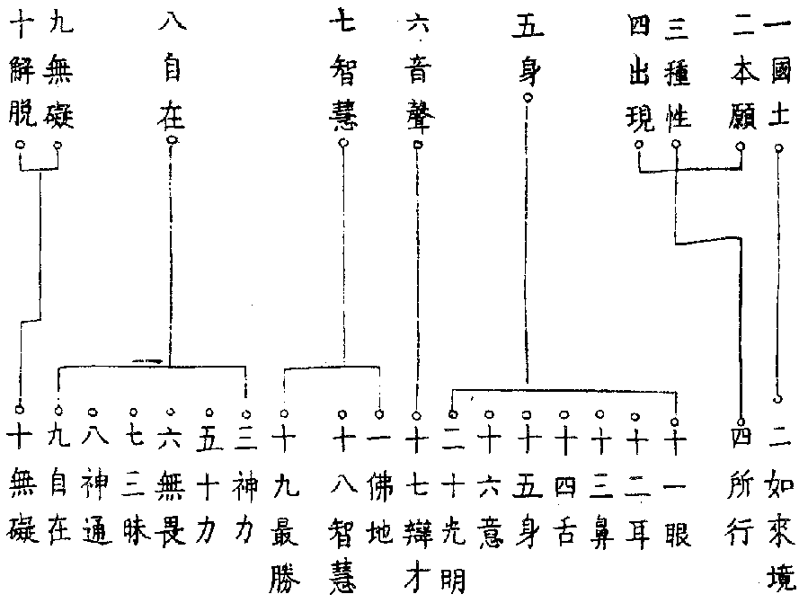

# 大方广佛华严经疏钞会本(第51卷-第80卷)



> **藏经**：乾隆大藏经（新文丰版）（乾隆藏）　**册次** 第 130 册（L130）　**编号** L1557　**部类** 经疏部　**卷次** 17 卷　**篇幅** 294,379 字

> **卷／品**：0 卷 · 37 品



---



## 目录



  - [世主妙严品第一](#世主妙严品第一)

  - [如来现相品第二](#如来现相品第二)

  - [普贤三昧品第三](#普贤三昧品第三)

  - [世界成就品第四](#世界成就品第四)

  - [华藏世界品第五](#华藏世界品第五)

  - [毗卢遮那品第六](#毗卢遮那品第六)

  - [如来名号品第七](#如来名号品第七)

  - [四圣谛品第八](#四圣谛品第八)

  - [光明觉品第九](#光明觉品第九)

  - [菩萨问明品第十](#菩萨问明品第十)

  - [净行品第十一](#净行品第十一)

  - [贤首品第十二](#贤首品第十二)

  - [升须弥山顶品第十三](#升须弥山顶品第十三)

  - [须弥顶上偈赞品第十四](#须弥顶上偈赞品第十四)

  - [十住品第十五](#十住品第十五)

  - [初𤼵心功德品第十七](#初𤼵心功德品第十七)

  - [明法品第十八](#明法品第十八)

  - [升夜摩天宫品第十九](#升夜摩天宫品第十九)

  - [夜摩宫中偈赞品第二十](#夜摩宫中偈赞品第二十)

  - [十行品第二十一](#十行品第二十一)

  - [十无尽藏品第二十二](#十无尽藏品第二十二)

  - [升兜率天宫品第二十三](#升兜率天宫品第二十三)

  - [兜率宫中偈赞品第二十四](#兜率宫中偈赞品第二十四)

  - [十廻向品第二十五](#十廻向品第二十五)

  - [十定品第二十七](#十定品第二十七)

  - [十通品第二十八](#十通品第二十八)

  - [十忍品第二十九](#十忍品第二十九)

  - [阿僧祇品第三十](#阿僧祇品第三十)

  - [寿量品第三十一](#寿量品第三十一)

  - [诸菩萨住处品第三十二](#诸菩萨住处品第三十二)

  - [佛不思议法品第三十三](#佛不思议法品第三十三)

  - [如来十身相海品第三十四](#如来十身相海品第三十四)

  - [如来随好光明功德品第三十五](#如来随好光明功德品第三十五)

  - [普贤行品第三十六](#普贤行品第三十六)

  - [如来出现品第三十七](#如来出现品第三十七)

  - [离世间品第三十八](#离世间品第三十八)

  - [入法界品第三十九](#入法界品第三十九)



---



大方广佛华严经疏钞会本第一之一　困一



唐于阗国三藏沙门实义难陀　译



唐清凉山大华严寺沙门澄观撰述



------



### 世主妙严品第一



上来十例各显一理然亦无尽若依常用应依三分谓初品为序现相品下正宗法界品内尔时文殊师利从善住楼阁出下明流通序中就文分二初此土序二结通十方无尽世界序初中复二初证信序后尔时如来道场下发起序(二结通者文在第五卷末彼文有三初结此界次结华藏内后结华藏外)然此二序广如常解今但略陈初证信者若原其所由则阿难请问如来令置如智度论及大悲经说(阿难请问者智论第二云佛涅槃时於拘尸那国娑罗双𣗳间北首而卧一心欲入涅槃阿难亲属爱心未除未离欲心心没忧海不能自出尔时长老阿泥楼豆语阿难言汝是守佛法藏人不应如凡人自没忧海一切有为法是无常相汝莫忧愁又佛首付汝法汝今愁闷失所付事汝当问佛佛涅槃后我等云何行道谁当作师恶性车匿云何共住佛经之首作何等语如是种种未来要事应当问佛阿难闻是事已心闷小醒得念道力助於佛末后所卧床边以是事问佛佛告阿难若今现在若我过去依止念处莫依止餘乃至广说身受心法除世间贪爱又云从今日后解脱戒经是汝大师如解脱戒经说身口意业应如是行又车匿比丘如梵天法治若心輭后应教迦旃延经即可得道复次是我三阿僧祇劫所集法宝藏是藏初首应作如是说言如是我闻一时佛在某方某国土某处𣗳林中是我法门初首应作如是说何以故三世诸佛法经首皆称是语今我经初亦应称此如是我闻一时等语及大悲经说者案大悲经第五云佛告阿难我今以是正法宝藏付嘱於汝勿令毁灭阿难白佛言我今云何修行法眼乃至复云云何结集法眼佛告阿难我灭度后有诸大德比丘僧众集法毗尼时彼诸大德摩诃迦叶最为上首阿难彼诸大德诸比丘众应如是问世尊何处说大阿波陀那何处说摩诃尼陀那乃至云何处说声闻藏缘觉藏菩萨藏阿难时诸比丘如是问已汝应答言如是我闻一时佛在摩伽陀国菩提树下初成正觉如是我闻一时佛在伽耶城如是乃至云如是我闻一时佛在拘尸那城力士生地阿利罗跋提河边娑罗双树间乃至云佛说经已一切大众皆大欢喜顶戴奉行阿难汝应如是结集法眼餘可例知)若核其所以意有六焉一为异外道故外道经首皆立阿优以为吉故此约如是二为息诤论故智度论云若不推从佛闻言自制作则诤论起故今废我从闻闻从佛来故经传历代妙轨不辍此局我闻(今废我从闻下上智论文此下生公意成上论义)三为离增减过故佛地论云应知说此如是我闻意避增减异分过失谓如是法我亲从佛闻文义决定非谓传闻有增减失四为断众疑故真谛引律云结集法时阿难升座变身如佛众起三疑一疑大师涅槃重起二疑他方佛来三疑阿难转身成佛说此如是我闻三疑顿断既言我闻即非佛明矣上二义通约信闻五为生信故智论云说时方人令生信故此局后四六为顺同三世佛故此通六种。



若凖佛地论科为五事一总显已闻二教起时分三别显教主四彰教起处五显所被机今依智论开初总显已闻作信闻二种为六成就一信二闻三时四主五处六众。



然信闻二事文局初首义通九会时主二种文义俱通处众二事文义俱局随相则尔约实互融(然信闻二事下料拣通局谓如是我闻唯经初有而九会经如是法义我皆得闻时主俱通者会会之初皆云尔时世尊等处众俱局者摩竭非忉利天等处局十佛刹菩萨列名异故新旧菩萨亦不同故随相则尔等者一会即一切会何有众等而不通耶)上来略依三分二序然此经体势少异故依五分释文而合后二名依人证入(补)为今四分者初举果劝乐生信分二修因契果生解分三托法进修成行分四依人证入成德分(此四科见玄谈品会释义等文此处藏无系后人所补因下就第一举果分科无根且信觧行证是作疏之本理宜从补)就第一举果分中或科为十一教起因缘分即初一品二大众同请分三面光集众分四毫光示法分五眉间出众分已上在第二品内六普贤三昧分七诸佛同加分八法主起定分九大众重请分已上在第三品内十正陈法海分在后三品内若以义从文且分为三一教起因缘分二现相下说法仪式分三世界成就下正陈所说分就初分中亦分为十一总显已闻二一时下标主时处三始成正觉别明时分四其地下别显处严五尔时世尊下教主难思六有十佛世界下众海云集七从尔时如来道场下称扬赞德八尔时如来师子座下座内众流九尔时华藏下天地徵祥十如此世界下结通无尽。



如是我闻。



今即初也如是我闻者谓如是一部经义我昔亲从佛闻故佛地论云谓传佛教者言如是之事我昔曾闻如是总言依四义转一依譬喻二依教诲三依问答四依许可具如彼论餘更有释意不殊前此上总合信闻(一依譬喻者如有说言富贵如毗沙门如是所传所闻之法如佛所说此则以佛所说如毗沙门我今所传如富贵人则以佛说为喻也亦有说言如是文句如我昔闻此以昔闻喻今闻也故云譬喻故有释如是云两法相似谓之如一法无非谓之是相似即譬喻耳二依教诲者如是当听我昔所闻此即传法者之教诲也亦有云即佛教诲谓如是法是我佛说应当谛听如有人言汝当如是读诵经论三依问答者谓众闻言汝当所说昔定闻耶故此答言如是我闻四依许可者谓结集时诸菩萨众咸共请言如汝所闻当如是说传法菩萨便许可言如是当说如我所闻如是说言我当为汝如是而思如是而作如是而说等又许可者或信可言是事如是谓如是法我昔所闻此事如是齐此当说定无有异由四义故经初皆置如是我闻然上总意遍此四义非别理也餘更有释者刊定记别开有九意一以总释为一义次用上四别成五义六以许可中第二释云又许可者或信可言为第六意此是大乘法师重释第四许可非别义也设有异释大同许可又引功德施论为第七释云如是我闻者显示此经是佛世尊现觉而演非自所作亦同佛地总意耳八引长耳三藏依三宝释若大乘法师用之乃是离释下文当引九引梁朝云法师云如是我闻者将传所闻之法先当标举一部经教我於佛所闻者此亦全同佛地总意故云餘更有释意不殊前)若离释者先释如是信成就也智论云佛法大海信为能入智为能度信者言是事如是不信者言是事不如是故肇公云如是者即信顺之辞也信则所言之理顺顺则师资之道成经无丰约非信不阶故称如是(若离释者下第二离释信闻於中总明先依智论合如是二字通释是信顺之辞然论具云佛法大海信为能入智为能度如是者即是信也若人心中有清净信是人能入佛法若无净信当知是人不入佛法不信者言是事不如是是不信相信者言是事如是是信相故肇公云者此下肇公释但是用智论意非是别理是以疏言故肇公云也复有人於肇上加云信为入法之初基智为究竟之玄术信则所言之理顺顺则师资之道成由信故所说之法皆可顺从由顺从故说听二途师资建立此亦后人傍於智论肇公后加言则虽多亦非异理故疏收其异义立为别释意同言异并畧不存后人不知重重因循皆列为异解)有云圣人说法但为显如唯如为是故称如是此唯约所诠之理次真谛三藏云真不违俗名之为如俗顺於真称之为是真俗无二故称如是此约所诠理事(有云圣人下此下自狭之宽以释此第一最局唯取如故即刘虬注无量义经)若云如斯之言是佛所说则唯约能诠有云如者当理之言言理相顺谓之如也是者无非之称(若云如斯下即梁武帝释此约能诠通诠事理有云如者当理之言者通能所诠含於事理理者道理非唯真如即生公释法华经)此明说事如事说理如理明能诠之教称於事理也融云如是者感应之端也如以顺机受名是以无非为称众生以无非为感如来以顺机为应(此明说事下此即於生公释中傍出远公约法以释意明生公即远公意然彼具云一约法解阿难道彼如来所说如於诸法故名为如说理如理说事如事说因如因说果如果如法之言是当道理故曰如是良以乖法名为非故如法之言得称为是其言虽多但是道理之言耳故不异生公融云如是者谓以如字为佛应是字为机感故渐宽前)经以言教出於感应故云如是此兼对机(经以言教下后通妨难恐有难云如即是应是即为感何不名为感应我闻故为此通有引此为注法华释云注是刘公用融公义耳)。



上来诸释各是一途更有诸释言异意同(更有诸释者谓长耳三藏就三宝释云一就佛三世诸佛共说不异故名为如以同说故称之为是此大同梁帝二约法云诸法实相古今不异故名为如如来为说故称为是此同刘云圣人说法但为显如三约僧释云以阿难闻望佛所教所传不异故名为如永离过非故名为是此同佛地总意故云言异意同又宝公约离五谤释云第一句如是此经离执有增益谤故云如是第二句如是此经离第二执无损减谤第三句如是此经离第三执亦有亦无相违谤第四句如是此经离第四执非有非无愚痴谤第五句如是此经离第五执非非有非非无戏论谤此上五谤当理之言即皆摄尽又真谛三藏约二谛释既离有无则离俱及俱非等故亦不异前释故云言异意同)若依生物之信应如智论及佛地论合释若取敌对阿优应如真谛所释今当广之外谓阿之言无优之言有万法虽众不出有无此即断常之计今云如即真空是即妙有既无俗外之真故空而非断无真外之俗故有而非常即对破邪宗以彰中道一代时教不出於斯故云如是(若取敌对者百论云外道立阿优为吉智论云梵王昔有七十二字以训於世教化众生后时众生福德转薄梵王因兹吞噉在口两角各留一字是其阿优亦云阿呕梵语轻重耳)若华严宗以无障碍法界曰如唯此无非为是应随教门深浅以显如是不同(若华严宗下第二以宗拣定即约教以释上通诸教今先举圆宗后应随教门下依五教以释既如是为当理之言明於二谛则小乘人法为俗生空为真始教之中四重真俗终教之中事理真俗二相交彻如真谛所解顿教则真俗两亡亡言绝虑方称当理如无常经应以生老病死定可猒等称为当理之言异此所明不得称是)。



二我闻者闻成就也将欲传之於未闻若有言而不传便是徒设不在能说贵在能传故次明我闻我即阿难闻谓亲自听闻云何称我即诸蕴假者(云何称下先徵释我我诸蕴假者通於诸教)此用何闻若依大小乘法相各有三说一耳闻非识二识闻非耳三缘合方闻然或具四缘八缘等(此用何闻下徵闻重释通於我闻若依大小乘下约教别释於中三叚初法相中含前小乘及与始教於中初正释言小乘三者初萨婆多宗自有三义一法救论师耳闻非识谓虽自分识依根方闻然闻体是根非是於识如闻既尔见等亦然故杂心云自分眼见色非彼眼识见非慧非和合不见障外色故二妙音师识闻非耳根无觉故三成实师和合能闻上三并如俱舍界品及婆沙第十三说大乘三者一耳闻非识如杂集第二云耳界有何相谓能闻声瑜伽三十五云𰚆𰚆於声作意至能闻故二识闻非耳梁摄论云闻有三义一闻体谓耳识二闻资粮谓音声三闻果谓即闻慧唯此耳识以为正闻三和合能闻佛地论云闻谓耳根𤼵识领受声尘瑜伽论云闻谓听闻即是耳根𤼵生耳识闻受教故然或具四缘八缘等者通释大小乘和合闻义上言和合但合根识今取具缘故云四八然其四八是生识缘若取能闻兼所𤼵识则或五或九故疏云等言或四者即是小乘一空二根三境四作意故智论云尔时耳根不坏声在可闻处作意欲闻情尘意合即耳识生随耳识生即意识生方能分别种种因缘方得闻声释曰声在可闻处即空二即作意情即是根故中论内詺六根品为六情品古云根含识义目之为情尘即是境意即是根加此为五𤼵生耳识言随耳识生即意识生即同时意识分别非是缘也若约分别声尘则同时意识亦是缘也种种因缘得闻声总结也言八缘者於前四上复加於四谓一空二根三境四作意五根本依（即頼耶识）六染净依（第七识）七分别依（第六识）八种子种子为因缘依诸有为法皆托此依离此因缘必不生故分别依者即第六识染净依者即第七识根本依者即第八识根即同境依故唯识第四云由此五识俱有所依定有四种谓五色根六七八识随阙一种必不转故同境分别染净根本所依别故如有偈云眼识九缘生耳识唯从八鼻舌身三七后三五三四若加等无间於前各加一释曰眼九缘者复加於明暗中无见故耳已除明七更除空此三合中知故后三即六七八也六识五缘更除染净及与分别分别即所𤼵识染净即所依根第七识或三或四四谓除染净染净即所𤼵识故前六识中约为根故除此第七中约为识故除复除第八第八即总故或三者更除於境境即根故言三者即第八但有种子作意及根或四即更加境此上诸释因便故来)虽因耳处废别从总故称我闻法虽无我言语便故随顺世闻故称我闻非邪慢心而有所说(虽因耳处下第二解妨此有二妨一有问言现是耳闻云何言我闻故为此通明我为总总该眼耳等诸根故即佛地论文二有问言一切佛教诠於无我阿难已是入理圣人那同凡夫而称我闻故此通云法虽无我是牒问意后言语便下即是通释於中先显正后非邪慢下拣非此中通是二论之意谓智论第一有三复次以释无我说我一云复次世间法中说我非第一义中说以是之故诸法空无我世间法故虽说於我无实体故二云复次世间语言有三根本一邪二慢三名字前二不净后一是净一切凡夫具三种语见道学人具二种语谓慢名字诸圣人一种语谓名字内心不计实法随世间人共传是语佛弟子顺俗故说我无咎三云复次若人著无我相诸法是实餘皆妄语是人应难此一切法实相无我云何言如是我闻今诸佛弟子知一切法空无所有是中心不著亦不著诸法实相何况无我中心有所著以是义故不应难言何以说我释曰上三复次一随世间故二破邪见故三不著无我故二者依瑜伽论第六云畧由四义故称我闻一为世间语便易故二为随顺世间故三为断除决定无我怖畏故四谓宣说自他得失令生决定信解心故显扬第九杂集第十三皆同此说释曰此与智论大同瑜伽第一智论畧无易故不出二即智论第一三即智论第三谓著无我即无我怖者谓若定无我为谁修学故不说无我著即令怖不著故不说无我此怖自除四即第二谓随世流布即能令他生决定信解之心已知二论言异意同故今疏明舍於二论取其言同言语便易即瑜伽第一意随顺世间即瑜伽第二智论第一非邪慢心而有所说即智论第二意中所拣二语大乘法师傍智论意立三种我一妄执我即此邪我二者假施设我谓大涅槃乐净常我除二乘倒强施设故此亦即是智论名字中𠬧而智论於世间假名此依出世法假名三世流布我正同智论三语之中名字我耳然此中更有问言为佛说法而言我闻为不说法而言我闻即本质影像之义已见教体中故疏不问)若依无相我既无我闻亦无闻从缘空故而不坏假名即不闻闻耳(若依无相下第二无相宗含於三教谓始教顿教实教谓若但云我既无我闻亦无闻即大乘初门为始教意若云能所双寂无闻不闻亦无我不我离念顿显即顿教意其从缘空故有三者向上成前二教无我所以二者向下不坏假名即不闻之闻为实教意谓事理无碍故闻即不闻无二义故故智论云闻者云何闻用耳根闻耶用耳识闻耶用意识闻耶若耳根闻耳根无觉知故不应闻若耳识闻耳识一念不能分别故不应闻若意识闻意识亦不能闻何以故先五识识五尘然后意识识意识不能识现在五尘唯识过去未来五尘若意识能识现在五尘者盲聋人亦应识色声何以故意识不破故答曰非耳根能闻亦非耳识亦非意识是闻声事从多因缘和合故得闻声不得言一法能闻声何以故耳根无觉故不应闻声识亦无色无对无处故亦不应闻声声无觉亦无根故不能知声释曰此上皆明相离不能闻下云尔时耳根不坏等即辩和合能闻已如前法相宗中引今明和合而闻闻即无闻皆实教意若刘公注法华经云阴入非主为我听受非情曰闻深照缘起悟解法空若斯人也顾命之所因然后传而无执物我同致释曰此初亦始教意从深照缘起下即实教意然皆属无相宗摄又言不闻闻者即涅槃十九十地品中当引大意但明事不碍理故不闻约理不碍事故为闻)若约法性此经旨趣传法菩萨以我无我不二之真我根境非一异之妙耳闻无碍法界之法门也(若约法性下第三约法性宗辩而但明圆教中意言以我无我不二之真我者含两经意一者净名云於我无我而不二是无我义二者涅槃云无我法中有真我是故敬礼无上尊正当今意即口顺世间心造真境真自在我根境非一异之妙耳者以根与境共为缘起因根说境因境说根互相融即故曰非异两相历然故曰非一斯为妙耳何所不闻)然阿难所不闻经或云展转传闻或云如来重说或云得深三昧或自然能通(然阿难所不闻经下第二释不闻难谓有问言阿难是佛得道夜生年满二十方始出家年至三十如来方命以为侍者自三十年前如来所说阿难不闻何以经初皆言我闻故为此答答有四意大为两节前三带权后一显实一或展转闻者自有𰚆说一报恩第六云阿难所不闻经从诸比丘边闻或有诸天向阿难说二依涅槃四十云我涅槃后阿难比丘所未闻者弘广菩萨当广流布阿难所闻自能宣通三智论第二云迦叶阿难於王舍城结集三藏是时长老大迦叶谓阿难言佛嘱累汝令持法藏汝应报佛恩佛在何处最初说法诸大弟子能守护法藏者皆已灭度唯汝一人在汝今应随佛心怜愍众生故集佛法藏时阿难礼众僧已坐师子床时大迦叶说偈言佛圣师子王阿难是佛子师子座处坐观众无有佛如是大德众无佛失威神如夜无月时虚空不清净如大智人说汝佛子当演何处最初说今汝当布现是时长老阿难一心合掌向佛涅槃方如是说言佛初说法时尔时我不见如是展转闻佛在波罗柰佛为五比丘初开甘露门说四圣谛法苦集灭道谛阿若憍陈如最初得见道及八万诸天闻是得见道以是等文明是传闻故云或展转传闻或云如来重说者报恩经第六明阿难佛命为侍者阿难从佛请求三愿一者不受佛故衣二者不受佛别请三者所未闻法更请重说如来将入涅槃前更为阿难重说或云得深三昧自然通达者金刚华经云阿难得法性觉自在王三昧故如来前所说经皆能忆持与亲闻无异涅槃亦云阿难多闻士若在若不在自然能解了常与无常义法华得受记竟云世尊甚希有令我念过去无量诸佛法如今日所闻我今无复疑安住於佛道方便为侍者护持诸佛法既云得记竟方悟亦带方便据方便为侍者即密显实矣)上皆就迹而说实是大权菩萨影响弘传如不思议境界经斯为良证但随机教别故见闻不同(上皆就迹下显实於中上一句是结前此下正显实义如不思议者彼经云尔时复有千亿菩萨现声闻形亦来会坐其名曰舍利弗目犍连乃至云阿难提婆达多跋难陀等而为上首皆已久修六波罗蜜近佛菩提为化众生於杂染土现声闻形释曰是大菩萨方为显本故为实说如法华五百弟子品云诸比丘谛听佛子所行道善学方便故不可得思议知众乐小法而畏於大智是故诸菩萨作声闻缘觉即阿难章中云方便为侍者护持诸佛法即大权明矣但随机教别者亦含多义一成上诸说但随机教二者即约三种阿难受持三藏故云随机教别见闻不同三种阿难即大乘集法经说玄中已引金刚仙论及真谛般若疏引阇王忏悔经等并同此说)。



上来总显已闻科竟。



一时佛在摩竭提国阿兰若法菩提场中。



第二标主时处者即三成就言一时者时成就也时者亦随世假立时分一者拣异餘时如来说经时有无量不能别举一言略周故云一时如涅槃云一时佛在恒河岸等即法王启运嘉会之时也(亦随世假立者谓佛法中时不可得中论云因物故有时离物何有时物尚无所有何况当有时今随世俗说有一时智论意同拣异餘时者谓趣举一时耳即法王启运者即肇公语意亦可知启者开也嘉者善也易云元者善之长也亨者嘉之会也谓佛开大运演说真乘即嘉善之会也)亦可机教一时谓上言如是言虽当理若不会时亦为虚唱今明物机感圣圣能垂应凡圣道交不失良机故云一时(亦可机教下二感应合释即生公意)佛者主成就也具云勃陀此云觉者谓自他觉满之者虽具十号佛义包含故偏明之义见题中(佛者下若言菩提但称为觉若云佛陀此云觉者然觉有三一自觉谓双觉事理如睡梦觉如莲华开此拣凡夫二者觉他拣异二乘三者觉满拣异菩萨故云自他觉满之者若禅观说亦云离心名自觉离色名觉他色心俱离为觉满以依起信心体离念名本觉故题中总有此义释之)在摩竭下处成就也真身无在而无不在故次辩之(真身无在下总显大意言无在者体相寂寥离能所故无不在者体圆遍故故下经云譬如虚空遍至一切色非色处非至非不至何以故虚空无身故如来亦尔遍一切法遍一切众生遍一切国土非至非不至何以故如来身无身故为众生故示现其身又无在即体无不在即用体用无碍故为真身此亦净名身子答天女意女身色相无在无不在也)摩竭提国者通举说处此云无毒害以国法无刑戮故表能化法或云遍聪慧聪慧之人遍其国故表所化机阿兰若法者别举说场也阿兰若者此云无諠诤即事静也法者所证真理二障业苦諠杂斯尽也事理俱寂故加法言菩提场者菩提云觉即能证大智圆明究竟也场者证菩提之处也然事处即天地之中王舍城之西二百里金刚座上约法则万行皆是道场理智相会之所故为表所说如所证故不移其处说之若圆融时处等并如前说(为表所说下释处所以表自心中所证非是随宜故不移证处)。



始成正觉。



第三别明时分者前标一时未知何时故今别显是初成佛时亦彰大师出现时也此教胜故众教本故在於初时(三别明时分中分二先蹑前生起双标二时谓说法时及成佛时)初言尚总几日之初九会之文同此初不(初言尚总下次假问徵起此有二徵一徵初远近二徵初通局)略为三解一约不坏前后相说才成初七说前五会第二七日说十地等第九一会乃在后时以祇园身子皆后时故(畧为三解下第三解释此上总标三义即为三别三解之中初之一解徵初远近近在一念答初通局局初五会第二解在二七之后而通九会第三解取前师即一念之初取后第二师通於九会初正明时分中明九会分为三时非总初也以祗园身子等者出后时所以祗园在后者佛成道后在王舍城因长者为子娶妻至於此城闻佛𤼵心方造精舍故知在后身子等在后者案报恩经初度五人次度耶舍门徒五十人次度优楼频螺门徒五百次度伽耶门人三百次度那提门人二百次度鹙子门徒一百次度目连门徒一百合有一千二百五十五人十二游经初成道第一年度五比丘第二年化迦叶兄弟三人第五年度身子目连五人者一拘隣二頞鞞亦云马星跋提三摩诃男四十力迦叶五拘利太子二是母亲三是父亲释曰既身子等在后今第九会有此等五百及祗园则在后矣)常恒之说不妨后时虽能顿说有所表故初五信解行愿最在初故故皆云不离道树第六会因地证位居其次深故无不起菩提树言法界极证最在於后故亦显二乘绝见闻故虽异处别时亦不相离为寄秽土以显净故须前后耳(常恒之说下第二遮伏难总有四难一云华严教旨时处圆融要历三时岂通玄趣故此释云常恒之说说无息时后时不谈岂名常说二有难云如来圆音顿演何要三节方尽幽微故此通云虽能顿演表法浅深故须三节三有难云若表三节三七日中一七一节足得成表何要后时故此答云三七未有声闻不得显於不共之教故须后时故疏云亦显二乘绝见闻故四有难云处历秽土时不相融岂顺华严圆融之旨故此答云正为融於异时及与秽土即一刹那即是净故故疏云虽异处别时亦不相离等)若尔世亲那云初七不说但思惟行因缘行耶世亲才见十地即为论释或则未穷广文或则知见有异未全剋定菩提流支意大同此(若尔世亲下即第三会论文言思惟行因缘行者因谓自所得法缘谓所化之噐欲将己所证法为众生说名为行因缘行故法华经云我所得智慧微妙最第一众生诸根钝著乐痴所言如斯之等类云何而可度等是也彼思不得一乘机今思即得一乘机为异耳)。



二顺论释九会皆在二七日后二七非久亦名始成。



三约实圆融释皆在初成一念之中一音顿演七处九会无尽之文海印定中一时印现(三约实圆融即贤首国师意)以应机出世机感即应应即有时无非时失(以应机出现下次立理谓若机熟不应便为失人未熟而应虚心有待二俱失时)故祇园身子盖是九世相收重会之言亦犹灯光涉入(故祗园身子下三通妨难谓有问言若初成顿说初成未度身子等众何处得有五百罗汉故今答云九世相𭣣次有难云祗园身子等纵许九世相融一念一时何有重会前时后时方有重故故今通云重会之言亦犹灯光涉入如点灯盏似有后有前𤼵光之后光无前后而相涉入今重会义但似灯光一时之中不妨两会法则有重时不重也)故法界放光亦见菩萨遍坐道场成正觉故(故法界下四引文为证有三初引法界品文证是初成法界品内见坐道塲初成正觉明知法界同初会时)此经十地之初无二七之言二七之言顺别机故(此经十地下次引十地经证无二七故)故诸经论显初说时有多差别谓普耀密迹二经第二七日即说三乘法华过三七日方云说小四分律中六七兴显行经七七五分八七智论五十个七日有云与十二游经一年大同时既不定说亦不同皆根器所宜见闻有异(故谈经论下后会诸教时明二七言非为楷定并随机故谓密迹三乘玄中已说普曜说十二因缘而三乘俱益十二因缘通三乘故三乘既益明通说三法华过三七日者经云我始坐道塲观𣗳亦经行於三七日中思惟如是事等初欲说一而无一机次念说权诸佛皆赞乃至云舍利弗当知我闻圣师子深净微妙音称南无诸佛复作如是念我出浊恶世如诸佛所说我亦随顺行思惟是事已即趣波罗奈诸法寂灭相不可以言宣以方便力故为五比丘说是名转法轮便有涅槃音等时既不定下即成随宜)约佛赴机无时不说望器无感未曾有说登地恒见常说一味之经就佛而言无说不说若摄方便皆一乘之印现差别耳无涯之说不应局执故应总摄以为十重如前已辩(约佛就机下会於权实劝令善知)上显时分次释成正觉义约教不同。



小乘三十四心断结五分法身初圆名成正觉是实非化(小乘已下别明五教一小乘三十四心者如婆沙八十二说俱舍根品云传说菩萨三十四心便成佛故言三十四心者见道一十六心谓八忍八智离有顶贪有十八念谓断有顶惑有九无间九解脱道如是十八足前十六成三十四一切菩萨决定先於无所有处已得离贪方入见道不复湏断下地烦恼唯断有顶一地之惑但三十四心一坐成佛五分法身初圆者即戒定慧解脱解脱知见如十藏品是实非化者拣异大乘)大乘之中约化八相示成约报十地行满四智创圆名曰始成正觉(大乘之中下第二始教也)据实即古今情亡心无初相名之曰始无念而照目之为正见心常住称之曰觉始本无二目之为成(据实下第三终教古今情亡即观行意但当无念为始成故心无初相即起信论云菩萨地尽觉心初起心无初相以远离微细念故得见心性心即常住名究竟觉今䟽离其语用无念而照名之为正者若唯无念寂而失照若但照体照而失寂并称不正正在双行见心常住称之曰觉即上所引起信论文得见心性心即常住名究竟觉始本无二目之为成者起信云谓始觉同本觉无复始本之异名究竟觉即是成义)约法身自觉圣智无成无不成(约法身下第四顿教意言无成无不成者经云譬如世界有成坏而其虚空不增减一切诸佛成菩提成与不成无差别既无有成何有不成又体湛寂故曰无成不碍随缘故无不成即成顿教意)若依此经以十佛法界之身云遍因陀罗网无尽之时处念念初初为物而现具足主伴摄三世间此初即摄无量劫之初无际之初一成一切成无成无不成一觉一切觉无觉无不觉言穷虑寂不坏假名故云始成正觉如出现品及不思议法品广显摄前诸说皆一乘之所现也(若依此经下第五圆教言以十佛法界之身云者即成正觉等十佛义并如前言念念初初为物而现者即体之应应无尽时生成即成念念机感念念成矣成既不已故曰初初一成一切成者事事无碍故故出现品云如来成正觉时於其身中普见一切众生成正觉故如来成即众生成矣况佛佛平等一切成佛又於一处成即一切处成故十地中第十愿云愿於一切世界成阿耨多罗三藐三菩提不离一毛端处於一切毛端处皆悉示现等又云如於此处见佛坐一切尘中亦如是佛身无去亦无来所有国土皆明现等无成不成义不异前一觉一切觉者若觉一法一法之中一切具足无觉者远离觉所觉故无不觉者朗鉴在怀亦不存於不觉相故)第四别显处严者然此下处主及众即三世间严三中前二即如来依正众即净土辅翼不空(第四别显处严中即如来依正者别显处严是依教主难思是正众海云集是众而言辅翼不空者菩萨即十八圆满中辅翼圆满不空即眷属圆满谓净土中无有四趣龙鬼等众是佛欲示净土不空故)今初器界严者即广於前场之严显成前觉之妙异於餘经之处於中四事各十种严明即染显净即为四别第一地严第二树严第三宫殿严第四师子座严然此诸严各具三释一约事可知二表法谓地表心地法身树表菩提宫殿表无住涅槃座表法空等三就因行谓一以穷心地法身之因报得增上金刚之地二以般若为因三以悲智相导为因四亦以法空为因然或一因行成一切严或一切行成一严或一行成一严或一切行成一切严以通融别纯杂无碍今但明一行一严显所表故(然或一因下通难谓有问言因果圆融何以就因各别所表故今释云实具四句为约所表故别属因耳然通别无碍)然各摄无尽之德故四事皆有十句初总后别今且就文各分为四。



其地坚固金刚所成。



今初心地十句分四者初一总显地体二四地相具德三四地上具严四一举因结用今初标以坚固释以金刚诸教或云木树草座多云座是金刚今全地金刚则权实斯显彻华藏故广如彼品(彻华藏者以华藏世界海大莲华地金刚所成故此依本经若依观佛三昧海经第二亦异常说而未尽源彼云尔时菩提塲地化以金刚满八十里其色正白不可具见此相现时菩萨眉间白毫相光端洁正直矗然东向长一丈五尺有十楞现释曰既有里𰚆又言化以故非极说)。



上妙宝轮及众宝华清净摩尼以为严饰诸色相海无边显现。



次上妙下地相具德约因释者一宝轮者一摄一切圆行致故二及众宝华开觉恱他故三清净摩尼圆净明彻故以上三行用严心地故结云以为严饰上皆形色四即显色谓青黄等殊名诸色相种种重叠深广如海互相暎发等彼波澜或诸色俱生或更相摄入含虚莹彻现势多端名无边显现此由隐显自在定散无碍随机利行之所致也。



摩尼为幢常放光明恒出妙音众宝罗网妙香华缨周帀垂布摩尼宝王变现自在雨无尽宝及众妙华分散於地宝树行列枝叶光茂。



三摩尼下明地上严者一宝幢曲有五句一摩尼为体二三光音明用四五网缨辩饰就因行者降魔伏外为幢智光常照慈音外恱愿行交罗戒香芬馥四摄周垂故二摩尼雨宝表神通如意随机变现雨法宝故三妙华散地亦多因行遍严心故四宝树行列者德行建立故。



佛神力故令此道场一切庄严於中影现。



四佛神力下举因结用佛力者出所因也严具多门别说难尽故总云一切悉现或於树中现或於上诸严具及地中现明一一行中皆道场故(或於树中现者以上别中第四宝树行列故言或诸严具及地中现者以是叹地尊胜故)。



初地严竟。



其菩提树高显殊特。



第二觉树严者即大智因感有十一句分四初一总显高胜长耸逈露圆妙独出故约因即智超数表为高本性不昧为显成物具德曰殊更无二真为特约果树即菩提(长耸等者谓长耸为高逈露释显圆妙释殊独出为特然案西域记长一百尺即毕钵罗树)。



金刚为身瑠璃为干众杂妙宝以为枝条宝叶扶踈垂荫如云宝华杂色分枝布影复以摩尼而为其果含晖发燄与华间列。



二金刚下六句明体摄众德一身是金刚金刚三昧本智因故正行成立为树身也二干是瑠璃本智发解内外明彻故三杂宝枝条解随境差故四条假叶以为严智资定而深照宝叶虽异共成一荫百千定门同归一寂自荫荫他也五宝华异色在树分枝承光则色同於地布影表神通等法依定有差俱承智光影现心地(表神通等法者即净行品若见华开当愿众生神通等法如华开敷)六华虽不同果皆如意无边行海同趣菩提若自利果成内则含辉若身心湛寂外便发焰若触境斯明若利他果立未熟则含辉解生佛相已熟则发焰还流教光体如之行所成果无异因之果故与华间列故下经云菩萨妙法树生於直心地等(故下经云菩萨妙法树等者等取下文云信种慈悲根智慧以为身方便为枝干五度为繁密定叶神通华一切智为果最上力为鸟垂阴覆三界释曰此五十九经所以引者意明表法皆有文据非是臆说)。



其树周圆咸放光明於光明中雨摩尼宝摩尼宝内有诸菩萨其众如云俱时出现。



三其树下三句明妙用自在展转成益初依菩提智放教智光次依智光雨圆明法宝后教成悲智即菩萨现前无心行成故如云出(依菩提智等者菩提即是证智教谓差别之用乃至言教即教证二道十地广明无心成行者陶隐君云云无心而出岫鸟倦飞以知还凡举云义虽有多种多明无心)。



又以如来威神力故其菩提树恒出妙音说种种法无有尽极。



四又以下一句举因结用谓佛力为因流音演法以如如力则智演法音音还如性故无尽极广多故无尽竖长故无穷无间故称恒也。



如来所处宫殿楼阁广博严丽充徧十方。



第三如来所处下明佛宫殿严十句分四初一总明分量宫可覆育即是慈悲殿可朝宗所谓圆寂悲智相导若楼阁相依广者无边法无外故博者不隘法内空故严者庄饰具众相故丽者华美法义备故充十方者称法性故。



众色摩尼之所集成种种宝华以为庄校。



二众色下二句体相圆备一体是摩尼积德镕融之所成故二相严多种神通等法悲寂用故。



诸庄严具流光如云从宫殿间萃影成幢无边菩萨道场众会咸集其所以能出现诸佛光明不思议音摩尼宝王而为其网如来自在神通之力所有境界皆从中出一切众生居处屋宅皆於此中现其影像。



三诸庄严下六句妙用自在一众行发光洒法如云云更多义至下当辩二光幢独出萃者聚也即承光聚影而成谓悲寂交际承智起应降魔超出故三内容众海无边菩萨即道场外者亦在其中即依中有正亦果中有因即明涅槃众圣冥会(即明涅槃等者无有一圣不证涅槃犹如百川皆归大海故肇公云恬焉而夷怕焉而忝九流於是乎交归众圣於是乎冥会矣)四声光宝网网者为防禽秽以益殿严犹大教网外防恶见内益悲寂教皆圆妙以宝而成故能出佛智光圆音妙说言不思议音略有四义一音声繁广二所说难量三声即无声四一具一切五出生果用即正报大用在此依中依正混融参而不杂明依大涅槃能建大义故曰出生六无染现染众生是正居处是依染违性净不言出生妄无自体还依真现(染违性净等者即通外难谓有问言涅槃既无不包染净同在其内何以果用即言出生居处屋宅不言出生故今释云染浮之法涅槃实包净则顺体染则违体证会涅槃方有大用故曰出生染既违净非此出矣而体不离故云依现耳)。



又以诸佛神力所加一念之间悉包法界。



四又以下举因显广谓德广难陈故今总结由佛力故一念顿包事理染净一切法界况多念耶然上充遍十方即通局无碍集菩萨众出佛神通即摄入无碍现生舍宅即染净无碍悉包法界广陿无碍一念即能延促无碍又集菩萨因果无碍出佛神通依正无碍十种宫殿此应说之(然上充遍者上直消经文此下会成无碍十种宫殿者亦约表法之宫殿耳亦同上文妙法树矣即五十四经经云佛子菩萨有十种宫殿何等为十所谓菩提心是菩萨宫殿恒不忘失故十善业道福德智慧是菩萨宫殿教化欲界众生故四梵住是菩萨宫殿教化色界众生故生净居天是菩萨宫殿一切烦恼不能染故生无色界是菩萨宫殿令诸众生离难处故生杂染世界是菩萨宫殿令诸众生断烦恼故现处内宫妻子眷属是菩萨宫殿成就徃昔同行众生故现居轮王护世释梵是菩萨宫殿为调伏自在心众生故一切菩萨行游戏神通皆得自在是菩萨宫殿善游戏诸禅定解脱三昧智慧故一切佛所授无上自在一切智王灌顶记是菩萨宫殿住十力庄严作一切法自在故是为十若诸菩萨安住其中则得灌顶一切世间神力自在)。



其师子座高广妙好。



第四其师子下师子座严十句分四初一总显形胜师子座者人中师子处之又说无畏之法故得法空者何所畏哉空乃高而无上深不可测广而无外边不可穷妙乃即事而真好谓具德无缺(空乃高而无上者䟽有三义释师子座令唯约表法释高广妙好事则可知下多就表)。



摩尼为台莲华为网清净妙宝以为其轮众色杂华而作璎珞堂榭楼阁阶砌户牖凡诸物像备体庄严宝树枝果周回间列。



二摩尼下六句体德圆备一座台摩尼即处正中正可依处摩尼随暎有差法空随缘成异中道妙理正是可依二周座华网即外相无染交暎本空三净宝为轮轮谓台之处中周帀轮围即具德周遍四华缨周垂诸觉诸通垂化周摄(诸觉诸通者净名云觉意净妙华净行品云神通等法如华开敷)五宝严填饰堂等略举凡诸总包无处不严故云备体显於法空全收万像无事非理故六宝树间饰间上物像也即菩萨妙法树随化分枝随因感果并依无相义曰周回凡圣相资名为间列(即菩萨等者释宝树枝果周廻间列菩萨妙法树即前文所引前云方便为枝干今以权实为枝随树不同分枝差别随枝有华各各成果随因有异感果不同并依无相不离法空之座)。



摩尼光云互相照耀十方诸佛化现珠王一切菩萨髻中妙宝悉放光明而来莹烛。



三摩尼光下二句妙用广大一净宝出光如云涉入法空亦尔一一智中知一切法一一法体显一切智为互照也(一一智中者如一实智知遍法界理一权权智穷事无边法界别事无不知也一一法体者如於一尘能显实智权智道中智证智教智无边智门)二主伴宝用互相发挥谓佛化摩尼能作佛事智论云轮王宝珠但随人意能雨宝物天宝堪能随天使令佛宝十方能作佛事菩萨宝珠亦能分作(智度论者即第十二论说宝有三种人宝天宝菩萨宝人宝力少唯有清净光色除毒除鬼除暗亦除饥渴寒热种种苦事天宝亦大亦胜常随逐天身可使令可共语轻而不重菩萨宝胜於天宝兼能有人天宝用又能令一切众生知死此生彼因缘本末譬如明镜见其靣像)如文殊师利冠中毗楞伽宝珠十方诸佛於中显现今菩萨髻珠即是其类下文云集菩萨髻珠亦尔(如文殊师利者即文殊般泥洹经说文殊身如紫金山等其文殊冠毗楞伽宝之所严饰有五百种色一一色中日月星辰诸天龙宫世间众生所希见事皆於中现)用此严座者凡初成佛皆一切诸佛现形灌顶一切菩萨亲授敬养故因果宝珠俱来莹烛如来从果起用故云化现理圆解满义曰珠王菩萨心顶智照圆净故曰髻中妙宝寂照照寂皆莹净照烛(用此严座下出严所以言寂照照寂者凖璎珞经妙觉方称寂照等觉照寂今菩萨宝义同照寂如来宝珠即当寂照)。



复以诸佛威神所持演说如来广大境界妙音遐畅无处不及。



四复以下一句佛加广演佛境如空故云广大有感斯至为无不及显教皆从法空所流是故所流还周法界非智不显故云佛力(佛境如空者即问明品云如来深境界其量等虚空一切众生入而实无所入显教皆从下上就事说此下约表无有一法不从法界流无有一法不归於法界故从座流还周法界)显处严竟。



大方广佛华严经䟽钞会本第一之一



音释



阿兰若



(梵语也此云闲静处若音惹)。



匿



(女力切凝入声)。



輭



(乳演切然上声柔也)。



核



(胡得切音劾)。



刊



(仓甸切切也)。



虬



(音求)。



数数



(生角切音朔频也)。



諠



(许元切哗也)。



蹑



(尼輙切音捻)。



矗



(昌六切音触高起也)。



耸



(荀勇切)。



干



(居案切与干同木旁生者为枝正出为干)。



䕃



(於禁切芘也)。



萃影



(萃秦醉切聚也)。



榭



(词夜切台上有屋曰榭)。



砌



(七计切阶甃也)。



髻



(音计绾发也)。



牗



(因九切音有)。



莹



(萦定切洁也)。



遐畅



(遐何加切远也畅尺亮切通也)。



大方广佛华严经䟽钞会本第一之二　困二



唐于阗国三藏沙门实义难陀　译



唐清凉山大华严寺沙门澄观撰述



尔时世尊处于此座於一切法成最正觉。



第五尔时世尊下明教主难思前但云佛未显是何身佛又但云始成正觉未知成相云何故今显之(教主难思䟽文有二先彰大意亦二先蹑前徵起对前二文一对标主二对别明时分)谓具十种深广功德即是遮那十种无尽法界身云遍於法界成正觉也非权应身(谓具十种深广下緫答初答前佛后遍於法界成正觉者答其成相)文分为二先总后别今初总办即菩提身具无尽德为世所尊座相现时身即安处智处诸法无前后故於一切法示所觉境即二谛三谛无尽法也成最正觉示能觉智开悟称觉离倒为正至极名最获得名成此当相解(初緫辩䟽文有三初当相以辩即菩提身緫示所属具无尽下释世尊次座相下释尔时次於一下牒释餘文开悟称觉者二谛中道理本湛然妄惑所翳久迷不见今二障既寂若云卷长空故名为开了了分明若晴天廓彻故名为悟悟即觉悟如睡梦觉开即开𤼵如莲华开)若拣别者凡夫倒惑佛觉重昏二乘虽觉不名为正但知法有未知法空但悟我空未知我有有猒生死空该涅槃颠倒未除岂得称正设许称正亦未名最菩萨虽正有上有修不得称最设位极称最亦未得名成(若拣别者下第二寄对以释仍含二意一对凡名觉对小名正对因名最对位极名成二者对凡名觉对邪名正对小名最对因名成一时双牒如文思之但悟我空未知我有者谓敝体与菩萨相反二乘知我空法有菩萨知法空我有然二乘所空之我菩萨亦空谓是我执若无我法中有真我菩萨知有二乘不知若但约二空了我空与菩萨同不了法空与菩萨异有猒生死空该涅槃者此出上空有之过由谓法有故猒生死不如菩萨了生死之本空无可猒故净名善意菩萨曰生死涅槃为二若见生死性则无生死无缚无解不生不灭如是解者是为入不二法门又宝印手菩萨曰乐涅槃不乐世间为二若不乐涅槃不猒世间则无有二所以者何若有缚则有解若本无缚其谁求解无缚无解则无乐猒是为入不二法门二乘不能如是解故故猒生死空该涅槃者即涅槃经意涅槃云空者所谓生死不空者谓大涅槃今二乘谓生死却为不空以涅槃无餘永寂却是於空故云空该涅槃颠倒未除者倒有八种外道谓世间为常乐我净为四颠倒二乘永寂计为涅槃则无常乐我净复为四颠倒若谓世间无常乐我净涅槃乃有常乐我净则名八行皆非颠倒是则二乘但有无常乐我净之四倒此约与之若夺二乘二乘既不能知涅槃常乐我净则於无常乐我净亦不如实知以其漫该如虫食木偶成字故况不了生死实性即是涅槃要离八倒故云颠倒未除岂得称正餘如涅槃四倒品说设许称正亦未名最者此对邪名正对小名最以上与之能知我空异乎外道故得名正不能双觉二空及不空义故不名最菩萨虽正下亦有二意初对二乘不名正义今对菩萨方得名正有上者上有佛故有修者未绝学故设位极下对上二乘得名正义则菩萨许得最名但未成故佛方成耳)我佛独能故云成最正觉谓如量如理了了究竟已出微细所知障故(我佛独能下第三结归就佛具有成最正觉四字之义谓如量下对上所觉境中以释觉义如量觉俗如理觉真三谛中道亦如理摄亦是合上二智觉於中道了了究竟拣异菩萨故涅槃云十住菩萨见不了了唯佛世尊名为了了故阇王云了了见佛性犹如文殊等已出微细下释上了了究竟之言障有三种一现行二种子三习气习气种子名为微细佛已尽故然二障习气通障菩提及大涅槃若就别说断烦𢙉障显於涅槃今成正觉畧言所知耳)。



智入三世悉皆平等。



后智入下第二别中分二初总科二别释即约十德别显十身文即分十一三业普周二威势超胜三福德深广四随意受生五相好周圆六愿身演法七化身自在八法身弥纶九智身穷性相之源十力持身持自他依正今初即别显菩提身之相也以成菩提时得无量清净三轮故文中分二先法后喻法中三先意次身后语(一三业普周者十中后五全十身名前五无有身言而义具之一即菩提身前緫中已示二即威势身三福德身四意生身五相好庄严身)今初意业即释上成正觉前云於一切法此云三世乃横竖影略耳智入平等是正觉成也智即二智三智四智无障碍智。



二智者即如理如量也此复有二一以如量智达俗名入三世以如理智证真名悉平等故佛地论云以二智觉二谛是也二者证差别性即无差别故三世即平等瑜伽云如其胜义觉诸法故名等正觉(二智者下一释二智二释三智三释无障碍智四释四智以无障碍智约义即圆故列在后因三谛成故释居前一如量智者然入有二义一达二证故以达入俗以证入真然二智相者摄论云如人初开目是名加行智如人正闭目是无分别智即彼复开眼后得智亦尔应知如虚空是无分别智於中现色像后得智亦尔如其胜义者证第二义上则二智别觉二境则三世为俗平等为真今觉俗即真是故三世即是平等胜义是真诸法是俗今以真智而觉於俗故令诸法即真胜义以其性相非一异故)言三智者即俗智真智中道智也此亦二义一真俗互泯双遮辩中则三世平等二相两亡方为智入二真俗虽即而不坏相即双照明中此二觉三谛之境(一真俗互泯者俗即真故非俗真即俗故非真非真非俗即是中道三世即平等故非三世平等即三世故非平等为两亡也二真俗虽即而不坏相者谓即有之空方是真空即空之有方为妙有空有不二两相历然如波即水而恒动水即波而恒湿故云双照此二觉下结成在境为一谛而三谛在心为一观而三观在果为一智而三智如一圆珠珠相喻有珠净喻空圆明喻中三无前后此喻一谛而三谛若以明镜照之珠上三义一时顿现即喻一观而三观若就镜中观珠珠之与镜非一非异则喻心境二而不二为真觉也)境既双泯而双现智亦寂照而双流为无障碍智觉无障碍境为正觉也(境既双泯下第三仍前三智释无障碍智谓合前二种中道为无障碍然前三智圆融已为无碍而未明遮照无碍故复双融明无障碍然双泯即前双遮双现即前双照若境双泯则无心於真俗为寂也若境双现则心权实双鉴为照故云智亦寂照而双流二种中道既无障碍一种二谛居然相融)言四智者即圆镜等四智也通缘三世境故并入三世(通缘三世下二会释然四智广义次下喻中广引论释今此但取其中同义言通缘三世者四智皆缘三世之境果位八识相应之智皆缘三世故云并入三世下释平等)言平等者镜智离分别故依持平等(言镜智离分别等者论云此智心品离诸分别所缘行相微细难知故云离诸分别又云纯净圆德现种依持故云依持平等意云虽言现行功德之依种子功德之持由无分别故得平等)平等性智证平等性故(平等性智者论云谓此心品观一切法自他有情皆悉平等即是所观平等故云证平等性)妙观察智观察平等(妙观察智者论云谓此心品善观诸法自相共相无碍而转此即明平等能遍观一切诸法故云观察平等)成所作智普利平等(成所作智者论云谓此心品为欲利乐诸有情故普於十方示现种种变化三业此即普利之义不拣怨亲岂非平等)四智圆融一句摄尽下身语等皆是四智之所发现(四智圆融下即叹胜也下身语等者明此中用四智之意以观下文佛德与唯识论释四智同故云皆是四智之显现所以緫中宜用四智释也)四智圆融无二性故修生本有非一异故不失经宗(四智圆融下第三解妨谓有难云四智菩提有为无漏非我经宗何得叅杂释此玄旨故今通云四智菩提性相二宗皆具有之但义小异耳用之无真谓圆融无二是其一义故彼宗说四不得相杂今明一智使具四智故下出现以四宝珠喻其四智（补）经云复次佛子譬如大海有四宝珠具无量德能生海内一切珍宝若大海中无此宝珠乃至一宝亦不可得何等为四一名积集宝二名无尽藏三名远离炽然四名具足庄严佛子此四宝珠一切凡夫诸天龙神等悉不得见何以故娑竭罗龙王以此宝珠端严方正置於宫中深密处故佛子如来应正等觉大智慧海亦复如是於中有四大智宝珠具足无量福智功德由此能生一切众生声闻独觉学无学位及诸菩萨智慧之宝何等为四所谓无染著巧方便大智慧宝（一大圆镜智离诸分别名无染著所缘行相微细难知不忘不愚一切境相巧方便故）善分别有为无为法大智慧宝（二平等性智观一切法有为无为自他境相名巧方便利他平等名善分别）分别说无量法而不坏法性大智慧宝（三妙观察智此智善观察诸法自相共相无碍而转故说无量法而不坏法性无量法者即摄观无尽捴持定门而言说者雨大法雨断一切疑）知时非时未曾误失大智慧宝（四成所作智知机知时作所应作故）若诸如来大智海中无此四宝有一众生得入大乘终无是处此四智宝薄福众生所不能见何以故置於如来深密藏故（自经云至此藏无方册补以有利益故姑存之）其一一智皆云平均正直端洁妙好即四智之德故况同一性居然融通言修生本有者是第二意不同彼宗彼宗四智修生涅槃本有今即四智是本觉智修生之四非别有体如金成像金像不殊故)然上能觉即成上菩提就其所觉即法身也理智无二为真法身(然上能觉下第三緫结所以结者欲明一菩提身已具法报二身况具下九)。



初意业竟。



其身充满一切世间。



二其身下身业也通三世间故云一切此正觉身以是十身之总故此其身通於三身十身无不充满(初緫明身业且寄一身以明下明摄十以为三故)法身普遍世所同依故智身证理如理遍故色身无碍亦同理遍(法身下明法身本体周遍智身修成如体而遍色身即体之用遍法身如虚空遍智身如日光遍色身如日影遍)并是圆遍而非分遍谓一切世间一一纤尘等处佛皆圆满总看亦现别看亦现(并是圆遍下别示遍相三身皆如下说故云并是言并是圆遍者若大若小皆圆满故非分遍者非是分析散布令遍谓一切下示圆遍相纤尘亦圆麤则可了緫看亦现者遍法界内唯一佛佛身充满於法界故别看亦现者则向一一国土一一尘中皆见全身故下经云如於此处见佛坐一切尘中亦如是佛身无去亦无来所有国土皆明现是也又緫别看者緫则一身处处皆有别则支分眼耳鼻等各遍法界故现相品云佛眼云何无有量耳鼻舌身亦复然)又国土等即是我身土等体外无别我故我即土等我之体外无土等故餘一一身互望融摄犹多灯光各互相遍(又国土下二圆融緫摄遍谓前明能遍三身非所遍土今明能遍即是所遍能所互融故又明一一身相融和杂遍故又上约佛身上十身谓菩提愿化力庄严等今明三世间无碍之十身谓国土众生等故十身相作千何不融故云犹如灯光经云譬如𡨋室百千灯一一灯光遍室内诸佛身智亦复然)。



二身业竟。



其音普顺十方国土。



三其音下语业也顺有三义一顺异类言音经云一切众生语言法一言演说尽无餘故二顺所宜说法如来於一语言中演说无边契经海故三则顺遍佛以一妙音周闻十方国故。



譬如虚空具含众像於诸境界无所分别又如虚空普徧一切於诸国土平等随入。



二譬如下喻显通喻三业然佛三业非喻能喻唯虚空真如略可显示更以餘喻便为谤佛(二喻此下緫明大意然佛三业非喻能喻者八十卷末云三界有无一切法不能与佛为譬喻譬如山林鸟兽等无有依空而住者虚空真如及实际涅槃法性寂灭等唯有如是真实法可以显示於如来即其文也又佛地论第四云如契经言乃至所有施设譬喻喻诸如来所有功德一切皆是谤诸如来唯除一喻所谓虚空可喻如来戒等无量功德同虚空故)然虚空喻有同不同故下经云解如来身非如虚空一切妙法所圆满等此显不同今分取同义同义多种如下十忍品(然虚空等者上两句标下释二相先释不同即第五回向之文此明佛有自利之德不同虚空不能自利而言等者等取次下经文云於一切处令诸众生积集善根悉充足故此明如来有利他之德不同虚空今分取同下二释同义但是分同同义多种如下十忍品者即第十如空忍经云佛子此菩萨了一切法界犹如虚空以无相故一切世界犹如虚空以无起故一切法犹如虚空以无二故一切众生行犹如虚空无所行故一切佛犹如虚空无分别故一切佛力犹如虚空无差别故一切禅定犹如虚空三际平等故所说一切法犹如虚空不可言说故一切佛身犹如虚空无著无碍故释曰上所引文若取緫通无相无起等皆是虚空多义若取别相唯取无分别无差别无著无碍以喻於佛佛力佛身故又彼忍下文云譬如虚空一切法依不生不没又云不可破坏又云一切世间之所依止而无所依又云无生无灭能持一切世间生灭又云无方无隅而能显现一切方隅又云非行非住而能示现种种威仪又云非色非非色而能示现种种诸色又云非久非近而能久住现一切物又云非净非秽不离净秽又云一切世间皆现其前非现一切世间之前又云普入一切而无边际等皆喻菩提经具有合今畧不引例喻於佛亦具上诸义以十忍位是等觉故故可同佛)今有二喻开成四义一含摄喻兼无分别义二普遍喻兼遍入义以此四喻喻意业者下经云佛智广大同虚空故此总喻也(以此四喻下喻其所喻别喻三业即为三𫨻古人唯将前喻喻於意业后喻身语普遍喻身随入喻语今并喻三业但引文证居然可知初引经緫释下经等者通於二智四智然下三句云普遍一切众生心悉了世间诸妄想不起种种异分别了世妄想即是量智不起分别即是理智而今但取广大同空则二四皆广故云緫也)量智包含而普遍理智无分别而证入(量智包含下初喻二智取前喻中包含之义及后喻中普遍之义以斯二义并喻量智量智知差别故似包含义无法不知是普遍义理智无分别者中前喻无分别义后喻平等随入义緫取二义以喻理智理智即无分别智方能证入真如故)又大圆镜智纯净圆德现种依持能现能生身土智影即含摄义(又大圆镜智下二以二喻喻四智於中先引唯识证包含义后引当经双证二义今初唯识第十云一大圆镜智相应心品谓此心品离诸分别所缘行相微细难知不忘不愚一切境相性相清净离诸杂染纯净圆德现种依持能现能生身土智影无间无断穷未来际如大圆镜现众色像释曰纯者无杂净者离染圆者满义现种依持者现行功德之依种子功德之持能现能生身土三智之影餘文可知)下经云菩提智普现一切众生心念根欲等而无所现无所现言无有分别(下经云下第二引当经双证二义经云譬如大海普能印现四天下中一切众生色身形像是故共说以为大海诸佛菩提亦复如是普现一切众生心念根欲等而无所现无所现言无有分别者上现心欲等即证含摄义今证无分别义然唯识镜智亦有无分别义前䟽緫中已引用故故今畧之然无所现有其二义一所现空二无心现今取后义)平等性智观一切法自他有情悉皆平等亦无分别无分别言显无差别(平等性智者䟽二先引唯识论云二平等性智相应心品谓此心品观一切法自他有情皆悉平等大慈悲等恒共相应随诸有情所乐示现受用身土形像差别妙观察智不共所依无住涅槃之所建立一味相续穷未来际释曰由昔因中执有我故自他差别今我执既无故皆平等随十地有情所乐由无住涅槃所立此识恒共悲智相应一味无漏亦无分别者彼论无有无分别言今言亦无分别乃有二意一依唯识四智通缘真如境故是无分别二者约境无差别故名无分别今初论云大圆镜智缘真如故是无分别缘餘境故后得智摄其体是一随用分二了俗由证真故说为后得餘三分二凖此应知释曰凖此论文四智各通二智并通真俗今且从增胜二喻各配二智无分别下即第二意然所观二境无分别故能观之智亦无分别故无分别言显无差别此显平等性智无分别义与镜智不同镜智无分别若明镜之无心平等性智无分别如日合空空无异相故名无差别谓不分别差别相故故摄论第八云应知一切法本性无分别所分别无故无分别智无)故下经云於一切义无所观察等(故下经者二引当经即出现品菩提相中经云佛子如来成正觉时於一切义无所观察而言等者等取餘经云於法平等无有疑惑无二无相无行无止无量无际远离二边住於中道出过一切文字言说释曰无所观察证大圆镜无分别义於法平等下证平等性无分别义餘义兼具)是以太虚含众像众像不能含太虚太虚不分别众像众像乃差别太虚以况我法不能容佛智佛智乃能容我法有我法者分别如来是如来者不分别我法。



二普遍喻中妙观察智无不遍知即普遍义成所作智曲成无遗即随入义(二普遍喻下第二以第二喻喻妙观察智及成所作智䟽文有四一引唯识言妙观察者论云三妙观察智相应心品谓此心品善观诸法自相共相无碍而转摄观无量緫持定门及所发生功德珍宝於大众会能境无边作用差别皆得自在雨大法雨断一切疑令诸有情皆获利乐释曰神用无方称之曰妙缘自共相名为观察自即色心等别共即同无常等又摄论云圆成实性为共相依他起性为自相言摄观者摄即藏义观即观察六度道品为功德宝诸神通等为作用差别既观有情自相共相等明无不遍知也成所作智等者论云四成所作智相应心品谓此心品为欲利乐诸有情故普於十方示现种种变化三业成本愿力所应作事释曰既云种种三业成所作事岂非委曲成就於物无所遗漏此言即周易系辞云范围天地之化而不过曲成万物而不遗注云范围者拟范天地而周𬾨其理也曲成者乘变以应物不系一方者也则物宜得所矣此说易之德今借况佛之德耳唯识论结云如是四智相应心品虽各定有二十二法能变所变种现俱生而智用增以智名显故此四品总摄佛地一切有为功德皆尽会二宗义已如上说)又下经云佛智广大同虚空普遍一切众生心此即智体遍悉了世间诸妄想此约智用遍又云得一切法界量等心此约证遍智性全同於色性故此约理遍(又下经云下於中先释普遍有四种遍一约智体遍二约智用遍此二即第八十经已如前引三约契证遍心与境𡨋即出现品菩提章文四约理遍者即义引起信论云问曰若诸佛法身离於色相者云何能现色相答即此法身是色体故能现於色所谓从本已来色心不二以色性即智性故色体无形说名智身以智性即色性故说名法身遍一切处所现之色无有分齐随心能示十方世界无量菩萨无量报身无量庄严各各差别皆无分齐而不相妨此非心识分别能知以真如自在用义故释曰此文亦可证下身遍今但取其二性不异之义以明智性之遍上言智体以智为体今是理性与前悬隔)云何遍入不坏能所有证知故故下经云世间诸国土一切皆随入智身无有色非彼所能见(云何下二释随入不坏能所者由前普遍之言有其二义一有能所遍二无能所遍谓约体遍众生却是智中物故若约理遍所遍全是能遍体故则能所不二故今此义不坏能所所证能证二相容差故下经云下引证即问明品佛境甚深中答佛境入文然彼中意入有二义一者色身入二者智身入今取智入身入可见智入唯智能知故云非彼所能见)由随於如即入无所入故云平等(由随於如下释平等入言此乃义引净名目连章云法随於如无所随故谓若有所随所随则在能随之外能随之法乃在所随如外所随之如不遍能随由无所随当体如矣若约观行随如之心不生真顺如矣问明亦云如来深境界其量等虚空一切众生入而实无所入即其义也)是以虚空遍入国土国土不遍入虚空有国土处必有虚空有虚空处或无国土虚空之於国土平等随入国土之於虚空自有彼此。



虚空可喻佛智国土可喻三世三世有处佛智必在其中佛智知处三世或无其体(三世有处要者佛智通达染净无碍一念普观无量劫故佛智无不遍知如来定慧无边际故前观无始后无终故言佛知知处三世或无其体者谓真如实际涅槃法性是佛智证彼无三世故)佛智之於三世平等随入三世之於佛智自有始终。



此犹约不二而二说耳若二而不二国土虚空三世佛智同一性故皆互相入举一全𭣣(此犹下四緫结难思初明其随入由上随入之言约不坏能所故云不二而二说耳则喻中虚空为能入国土为所入法中佛智为能入三世为所入所入不得为能入今皆互相入则国土亦入虚空三世亦入佛智故云举一全𭣣)普遍亦然(普遍亦然者二例普遍也上但佛智遍三世今明三世亦遍佛智)三世间圆融则言思道断故名佛智为不思议也(三世间者兼结上来包含之义及无分别悉皆圆融故云不可思议)次以二喻喻身业者一毛尚容法界全分必含众像(次以二喻喻身业即第二𫨻亦具四义初义引经文举况以释含摄之义故云一毛尚容法界全分必含众像世界成就品云一毛孔内难思刹等微尘数种种住一一皆有遍照尊在众会中宣妙法出现品云如人持尺量虚空复有随行计其数虚空边际不可得佛一毛孔无涯限次下文云一一毛端悉能含受一切世界而无障碍皆毛含法界义也)出现身业第二喻云譬如虚空宽广非色而能显现一切诸色而彼虚空无有分别亦无戏论合云如来身亦复如是一切众生诸善根业皆得成就即含摄义而如来身无有分别即第二义(出现身业下引此一喻证前含摄兼无分别但合文未具具云如来身亦复如是以智光明普照明故令一切众生世出世间诸善根业皆得成就而如来身无有分别亦无戏论何以故从本已来一切执著一切戏论皆永断故对文可知)佛身充满於法界即普遍义(佛身充满者即现相品下三句云普现一切众生前随缘赴感靡不周而恒处此菩提座此四句皆普遍义今但用初句足已为证)又云譬如虚空遍至一切色非色处非至非不至如来身亦复如是遍一切法一切国土等即普遍义(又云譬如虚空遍至一切等者引此一文亦证二义谓普遍随入二喻喻中次释经云何以故虚空无身故合中畧引具云如来身亦复如是遍一切处遍一切众生遍一切国土非至非不至何以故如来身无身故为众生故示现其身今但略引足证遍义)亦非至非不至即平等随入义(亦非至非不至等者谓无身故非至非至即平等非不至即不碍至是随入义)次以四义喻语业者如来於一语言中具一切语言故(次以四义喻语业者即第三𫨻如次证四义言如来於一语言中具一切语言故者即证含摄义亦是义引即出现语业中第四善口天女喻合云当知如来亦复如是於一音中出无量声随诸众生心乐差别皆悉遍至悉令得解释曰据其末句可证遍至今但取前即含摄义又妙严品云如来於一语言中演说无边契经海亦即含摄义也)舍支天鼓无心出故(舍支天鼓者即证第二无分别义此有二喻一舍支者即十忍品如响忍云如帝释夫人阿修罗女名目舍支於一音中出百千种音亦不心念令如是出菩萨摩诃萨亦复如是入无分别界成就善巧随类之音於无边世界中恒转法轮天鼓即出现语业第三天鼓觉悟喻结云佛子彼天鼓音无主无作无起无灭而能利益无量众生下法合竟结云而如来音不住方所无有言说即无心出义又如随好品天鼓为诸地狱天子说法云诸天子如我说我而不著我不著我所一切诸佛亦复如是自说是佛不著於我不著我所即无心义故诸论皆云佛身如摩尼珠无心现色佛已如天鼓无心出声皆无分别义)如来音声无不至故(如来音声无下亦出现语业第一相云应知如来音声遍至普遍无量诸音声故此证第三普遍义)应知如来音声无断绝普入法界故(应知如来音声下此全证平等随入之义以普入故法界平等故)又云如来音声无邪曲即平等义随其信解令欢喜故即随入义(又云如来下引於二文别证平等随入二义彼文具云应知如来音声无邪曲法界所生故言随其信解令欢喜者具云应知如来音声随其心乐皆令欢喜说法明了故上来四文皆出现语业)以空一喻遍喻三业故云正觉得无量清净三轮明文昭然非是穿凿菩提身竟(以空下一喻下三结示有归谓既明文具有故应不可唯以初喻喻智后喻喻身语也)。



初三业普周竟。



身恒徧坐一切道场菩萨众中威光赫弈如日轮出照明世界。



第二身恒下威势身超胜谓随诸有情所乐示现受用身土影像差别无不周遍(谓随诸下即唯识论平等性智之用谓以由身明义此当他受用身虽语於土意正取身唯识第十云一他受用身谓诸如来由平等智示现微妙净功德身居纯净土为住十地诸菩萨众现大神通转正法轮决众疑网令彼受用广大法乐释曰彼唯净土今十身圆融染净交彻与彼小异耳)言一切道场者略有十种一智身遍坐法性道场二法身非坐而坐道场三法门身安坐万行道场四幻化身安坐水月道场此四义便故来(言一切道塲下牒经别释上就别义配受用身为顺法相此中据实故说十身皆坐道塲而言此四义便故来者为顺十身别故若将十身配十二塲初二可知三即福德身愿身相好庄严身以福德云三世所行众福大海是万行故愿是众行之本以行填愿方能遍周故相好庄严由行成故故十佛中名业报佛由万行业报得相好故如云不可思议大刧海供养一切诸如来普以功德施群生是故端严最无比等皆约因成相好也然法门之言是天台依智论立名即功德法身四幻化身即化身意生身力持身此三皆属化身摄故菩提身緫亦此化身摄此四具九兼后威势即十身具矣上约别说既十身圆融随举一身即已具一坐一道塲即坐十类今就相显故说不同耳已知十身坐处次当别释坐义一智身遍坐法性道塲者法性是所证以能证智安处理故二法身等者法身既无能所故曰非坐非坐之坐湛然安住名坐道塲三法门身等者即净名经光严童子章云佛告光严童子汝行诣维摩诘问疾光严白佛言世尊我不堪任诣彼问疾所以者何忆念我昔出毗耶离大城时维摩诘方入城我即作礼而问言居士从何所来答我言吾从道塲来我问道塲者何所是答曰直心是道塲无虚假故发行是道塲能办事故深心是道塲增益功德故菩提心是道塲无错谬故布施是道塲不望报故持戒是道塲得愿具故忍辱是道塲於诸众生心无碍故精进是道塲不懈退故禅定是道塲心调柔故智慧是道塲现见诸法故广说乃至云一念知一切法是道塲成就一切智故如是善男子菩萨若应诸波罗蜜教化众生诸有所作举足下足当知皆从道塲来住於佛法矣释曰光严谓事道塲故问道塲何者是净名以法表示故万行为得道之处即是道塲故曰法门身坐万行道塲耳四幻化身安坐木月道塲名涅槃云吾今此身是幻身则所得道之处如水中月故昔人云修习空华万行安坐水月道塲降伏镜像天魔证成梦中佛果意云若因若果皆从缘生如幻梦故)若正约威势身略辨六类道场一遍一切同类世界道场如名号品等说二一切异类世界谓树形等如世界成就品三一切世界种中四一切世界海中并如华藏说五一切微尘中文云如於此会见佛坐一切尘中亦如是等六刹尘帝网无尽道场并前十种故云一切(若正约威势下别辩十身之一坐六类道塲但自狭之宽威势既通变化他受用身故约诸刹渐宽周遍法界乃至重重如名号品等者等取四圣谛光明觉品及升忉利天宫品谓遍法界虚空界皆有百亿四天下等一类相似佛皆遍故已如前引其名号四谛皆先列百亿后结周遍皆有百亿十千名等故知皆是同类界也下之五类至下当见)言菩萨众中威光赫弈者正显威势超胜胜於胜者故独言菩萨非不超餘如日轮出照明世界约喻以显暎山出没无隐显故处处全现无异体故喻遍坐道场(言菩萨众中等者即以此文显是威势身也映蔽菩萨故映山出没者谓映山出没如化身坐道塲无隐显者即法身坐道塲处处全现下即报身坐道塲以即应即真故随处即全皆无异体)大明流空餘辉掩耀赫日之照难究其涯喻彼威光超暎菩萨菩萨不能测也(大明流空下正释威势大明即日餘辉谓星月等日喻如来月喻菩萨星喻餘众正取映夺是威势义兼菩萨不测亦威势义赫日之照等者即夜摩会胜林菩萨偈云譬如孟夏月空净无云翳赫日扬光辉十方靡不充其光无限量无有能测知有目斯尚然何况盲𡨋者诸佛亦如是功德无边际不可思议刧莫能分别知)既云照世则终益生盲先照高山独言菩萨(既云照世下通妨谓有问言既十身圆融则普应一切何为唯处菩萨众耶故义取喻中如日轮出之言则无所不益故云终益生盲)。



三世所行众福大海悉已清净。



第三三世下福德身深广三世佛德昔皆遍学今三际已断垢习斯亡故众福皆净(今三际已断者此下释清净义若有三世相福非清净称法界修故无三际谓不从前际来非向后际去不於现在住法身已净为断三际福岂可量万行之上垢习斯亡故云清净谓恒沙烦恼皆已尽故)。



而恒示生诸佛国土。



第四而恒下随意受生一随他意处处受生二随自意能无不生谓慈悲般若恒共相应感而遂通穷未来际(四即意生身然意生有二义一者是喻犹如意去速疾无碍故二者是法自有二义一随自意二随他意緫谓随意速疾而成故谓慈悲般若等者此即唯识平等性智之用下配属於化身畧举一相实则此身亦通他受用随十地菩萨意所生故又悲智相导通化用故化身即是无住涅槃之大用故感而遂通者即周易系辞云夫易无思也无为也寂然不动感而遂通天下之故非天下之至神其孰能与於此注曰至神者寂然而无不应斯盖功用之母象数之所由生意明亡象方能制象遗数方能极数非动方能应动彼取易之虚无无动故能无不动今借此言以况如来内体圆寂外应群生蹑上众福已净之体寂便言而恒示生故云寂然不动感而遂通即法身无生无所不生耳)。



无边色相圆满光明徧周法界等无差别。



第五无边色下相好庄严身色无尽故名色无边十莲华藏微尘数相名相无边而皆称真则一一无边诸相随好放光常光皆称法界故云圆满广处陿处皆圆现故名无差别。



演一切法如布大云。



第六演一切法下即愿身演法谓雨大法雨断一切疑故下经云毗卢遮那佛愿力周法界一切国土中恒转无上轮(初标示大意谓雨大法雨断一切疑即引唯识妙观察智之文别成此义)然经二句上法下喻文含多意一云喻於身雨为说法法喻影略又先兴慈云后霔法雨一云一雨所润不同亦随物机宜云雨各异掩尘蔽日普覆无心等(三牒经委释緫有五意一云喻法身雨喻说法法喻影畧者出现语业第十娑竭罗龙王降雨喻中广说诸处云色不同雨亦各别合中云佛子如来应正等觉无上法王亦复如是欲以正法教化众生先布身云弥覆法界随其所欲为现不同所谓或为众生现意生身云或为众生现化身云或现力持身云色身云相好身云福德身云智慧身云诸力不可坏身云无畏身云法界身云皆有或为众生现言次云此相现已一切众生身之与心皆得清凉然后从如来大法身云大慈悲云大不思议云雨不思议广大法雨令一切众生身心清净所谓为坐菩提塲菩萨雨大法雨名法界无差别等故知云为现身雨为说法言法喻影畧者法中但有法说喻中但有兴云故若具应云广现化身演一切法如布大云雨大法雨又先兴慈云等者亦即上出现所引之文一云一雨等者即法华药草喻品云一云所雨称其种性而得生长华果敷实虽一地所生一雨所润而诸草木各有差别喻也合云迦叶当知如来亦复如是出现於世如大云起以大音声普遍世界天人阿修罗如彼大云遍覆三千大千世界释曰上即合云次云如来于时观是众生诸根利钝精进懈怠随其所堪而为说法种种无量皆令欢喜快得善利释曰上即合雨何以知是一耶次云如来知是一相一味之法所谓解脱相离相灭相究竟至於一切种智即一云一雨之义偈云其云所出一味之水草木丛林随分受润亦一云一雨所润不同下云为大众说甘露净法其法一味解脱涅槃以一妙音演畅斯义乃至云正见邪见利根钝根等雨法雨而无懈倦一切众生闻我法者随力所受住於诸地或处人天转轮圣王释梵诸王是小药草等皆一云一雨所润不同也亦随物机等者亦出现意上引法华云雨则一所润不同喻佛身说法曾无有差异在於物今明佛能具异谓现十身云降十法雨如娑竭罗龙王兴云或阎浮檀金光明色或毗瑠璃光明色或白银光明色或玻𬎙光明色等即云不同次云所谓於大海中雨清净水名无断绝於他化自在天雨箫笛等种种乐音名为羙妙等即雨不同也故云云雨各异掩尘蔽日等者即十地经及法华意法云地云佛子此地菩萨以自愿力起大悲云震大法雷通明无畏以为电光福德智慧而为密云现种种身周旋往返於一念顷普遍十方百千亿那由他世界微尘数国土演说大法摧伏魔怨复过此数於无量百千亿那由他世界微尘数国土随诸众生心之所乐霔甘露雨灭除一切众惑尘𦦨是故此地名为法云释曰此即掩尘及普覆义无心之义乃是通说即出现云复次佛子譬如海中有大龙王名大庄严於大海中降雨之时或降十种庄严雨或百或千或百千种庄严雨佛子水无分别但以龙王不思议力令其庄严乃至百千无量差别如来应正等觉亦复如是为诸众生说法之时或以十种差别音说或百或千或以百千或以八万四千音声说八万四千种行乃至或以无量百千亿那由他音声各别说法令其闻者皆生欢喜如来音声无所分别但以诸佛甚深法界圆满清净能随众生根之所宜出种种言音皆令欢喜等即无心义即娑竭兴云喻中亦云虽彼龙王其心平等无有彼此但以众生善根异故而有差别亦是无心之义法华亦云我无贪著亦无限碍又云等雨法雨而无懈倦皆无心义)。



一一毛端悉能容受一切世界而无障碍各现无量神通之力教化调伏一切众生。



第七一一下化身自在谓於大众会能现无边作用差别皆自在故(谓於大众下即引唯识妙观察智之用释成化身)文中二先明广容无碍谓於如来身一一毛头容一切刹而无障碍无碍有二义一以一小毛现多大刹则一多大小无碍二此毛多刹与彼毛多刹参而不杂则隐显无碍(广容无碍者谓法界如空有其二义一广容二普遍今一尘如法界之包含故即是广容)后各现下普遍以广容不碍普遍故还於前毛内刹中神力调生若广遍十方示现种种变化三业成所作事居然易了(以广容下出毛内调生所以谓广容则收法界入於一毛普遍则展一毛遍於法界今毛正容无边刹时即普遍故便遍所容刹内若广遍下二举况释谓尚遍毛内何况外耶䟽文即是成所作智之妙用也)。



身遍十方而无来徃。



第八身遍下法身弥纶以法为身本来湛遍故无来徃(弥纶即周遍包罗之义以法为身等者先明法性身遍无来往)依法现色还如法身在此即是在彼亦不待徃来(依法现色下约应化法身明无来往所以用此释者由下以三身收之以此属化身故)。



智入诸相了法空寂。



第九智入下智身穷性相之源相别曰诸性皆空寂性静故寂相无故空。



三世诸佛所有神变於光明中靡不咸覩一切佛土不思议劫所有庄严悉令显现。



第十三世诸佛下力持身能持自他依正於中先持正报神谓妙智变谓现身转变变现俱名为变皆能持之尚持於他况於自事后叚亦然(力持等者䟽文有二先正释力持后以三身收束前中又二初正报二依报今即初也)后一切佛土下能持依报横尽诸土竖穷诸劫所有严事常持令现。



上约十身若约三身者则初三叚皆名报身而恒下化身身遍十方下法身就报身中前一自受用报后二即他受用报故云处菩萨众(上约十身今以三身收束於中初约三身四身然则十望於三有通有局菩提为緫亦是化身餘九身中愿化力持此唯化身意生威势通他受用及与变化福智相好通於二报及变化身法局法性今取顺次故为此配所以前菩提身复明真身向来法身复明色身欲顺今次第配故耳)以诸教中说三身四身成说等别今皆圆融於一始成无不顿具(二出收束所以谓有问言何用更以三身收束十身故今释云以诸教三四迢然不同今明圆融一身具三则权实有别言三身成异者法身无成出障为成报身四智创圆为成化身八相菩提𣗳下为成三身说异者法身无说报身佛佛相见亦无有说化身有说若摄末归本应化非真佛亦非说法者即报身说报同所证是法身说言四身成说异者於报身中开自他受用自受用遍法界成则无所说他受用为十地成为十地说若依楞伽四佛皆说而说不同言四佛者一化佛二报生佛三如如佛四智慧佛初化次报后二皆法如如及如如智为法身佛亦可智亦是报自受用故言说异者化身说五戒等因缘法报佛说三性法谓为地上菩萨说今成佛故法佛唯说离心自性则以无念会於法界是故法佛唯说法性智佛说者依净法界了相智觉如说而解故名为说)十身为正三四义兼又毛内调生光中持刹如空普遍等亦即国土等十身三世间圆融岂报化之云别(四融国土等十身毛内调生则有众生身声闻身缘觉身菩萨身及业报身光中持刹是国土身如空普遍是虚空身菩萨众中亦菩萨身如来居然可见三世间下谓十身中众生业报即众生世间国土虚空即器世间餘是智正觉世间此三情非情异染非染义尚得为一岂一如来身上而分报化之殊明知权说隔历难可比此圆融)是知略以十德叹於教主其一一德无不圆融当去情思之矣。



大方广佛华严经䟽钞会本第一之二



音释



纤



(思廉切细微也)。



范



(音范)。



分齐



(分扶问切齐才诣切限量也)。



诘



(契吉切)。



赫弈



(赫郝格切弈夷益切赫弈光盛貌)。



填



(亭年切音田满也)。



错谬



(错仓各切谬眉救切错谬舛误也)。



霔



(未戍切霖霔也)。



大方广佛华严经䟽钞会本第一之三　困三



唐于阗国三藏沙门实又难陀　译



唐清凉山大华严寺沙门澄观撰述



第六有十佛世界下明众海云集众虽深广难测略启十门一集意二集因三辩类四定数五权实六地位七前后八有无九闻不闻十释文。



今初来至佛所何所为耶有十义故一为影响为主伴故二为作辅翼得圆满故如普贤等常随之众三为守护如来如执金刚等诸佛住处常勤护故四为庄严如道场神等常为严净佛宫殿故五为供养如偈赞即正行供养华幢等即财供养故六为发起此经诸请难者即其事故七为闻法获益当机领悟即其类故八为表法诸首诸林表信行等皆同名故及座出菩萨等显奇特故亦通表万行俱成佛故九为顺证佛菩萨等证说不虚故十为翻显即声闻不闻显法不共故为斯多意所以众海云集非唯证信而已也(一为影响者此集意中十意皆暗取下经此初意引即诸大菩萨及下证法如来皆互为主伴若影之随形响之应声二为作辅翼者亦是义引二为守护者经云皆於徃昔无量劫中恒发大愿愿常亲近供养诸佛又下经云一切诸佛化形所在皆随化徃一切如来所住之处常勤守护四常为严净者此即主城神德下经云皆於无量不思议劫严净如来所居宫殿所以标道场神此中等字等城神故然道场神合严道场以道场神所叹德中但云皆於过去值无量佛成就愿力广兴供养释曰由无严饰之文故等取城神之文耳五为下以义繁重故总相引偈赞下妙严品其华幢等即二十二经升兜率天宫品六为发起者即解脱月七亦总引八九十并显可知)第二集因亦有十因一曾与毘卢遮那如来同集善根故二蒙佛四摄曾摄受故三往在生死闻圆法故四曾发大心护一切故五往发大愿愿事佛故六随逐如来无猒足故七乐闻正法心无倦故八善能散灭我慢心故九福智已净身周遍故十同一法性善根大海之所生故为此多义得预斯会中有集因亦通集意及随诸众各有别因可以思准(一曾与者即菩萨德中云此诸菩萨徃昔皆与毗卢遮那如来共集善根修菩萨行二蒙佛者即第二经初总叹众云如是皆以毗卢遮那如来徃昔之时於劫海中修菩萨行以四摄事而曾摄受三即义引入法界品诸声闻等徃在生死不曾闻此故不见闻反显菩萨昔曾闻故四即夜叉王德云皆勤守护一切众生此亦义引如海云言发哀愍心有怖畏者咸守护故五即身众神德文云皆於徃昔成就大愿供养承事一切诸佛六即足行神德文云皆於过去无量劫中亲近如来随逐不舍即无厌足七即乾闼婆王德文云皆於大法深生信解欢喜爱重勤修不倦八即主风神德文云皆勤散灭我慢之心亦阿修罗德文云悉已精勤摧伏我慢及诸烦恼九即菩萨德文云一切如来功德大海咸入其身一切诸佛所在国土皆随愿徃亦通就义说具二严者方能周遍至诸佛所十亦菩萨德文云皆从如来善根海生中有集因亦通集意者谓即五六七八五约徃愿承愿而来即是集意由愿得来即是集因六约随逐心乐随逐即是集意由乐随逐故得来集即是集因七约乐闻大法而来即是集意由乐得来即是集因八约散我为叹散我即是集意由散我故方得在会即是集因初四后二但是其因同集善等故得在道场但为集因非为别来为同集善等故非集意及随诸众各有别因者即下经文随名叹德然上所引即是其文然经随便宜叹德不同如风神云散灭我慢之心语其大意总此十因遍通多众故此别说随众别因)第三辩类即上集意便成十类一影响众二常随众三守护众四严会众五供养众六发起众七当机众八表法众九证法众十显法众凖前可知。



第四定数者称法界众焉能数知即文而言九会都数总有一百七十五众都序之中有四十一众谓同生有一异生三十九师子座中一若兼取前菩提树中所流及宫殿中无边菩萨总四十三众此四十三遍於九会第一会中有二众谓新集十方众佛眉间众添成四十五第二会有新旧二众第三四会各有四众谓新旧及证法众天众第五会一百一十一众谓新旧众升天品内供养众有一百七并天众证法众第六会四众谓天众同生异生证法众七八两会各唯一众谓普贤等旧众第九会三众谓菩萨声闻及天王等旧众旧众虽重随会别故并皆取之然此诸众或总为一一乘众故或分为二以有实众及化众故或可为三人天神故或为四佛菩萨人非人故或五非人开天神故或六加畜生故或七天分欲色故或八菩萨有此界他界故或九他方有主伴故或十加声闻故或一百七十五如前说故或无量无边义类多方故一一或以佛刹尘数等为量故又如新集菩萨毛光出众例上皆尔故一一众皆无分齐此犹约相别若融摄一一会中皆具一百七十五众以称法界缘起之会互相在故上且约一界若通十方及异类刹尘帝网无尽无尽是为华严海会众数。



第五权实者夫能对扬圣教影响其迹靡不是权当机之流多皆是实诸教所明秽土之中杂类菩萨声闻皆通权实地前是实地上是权法身无生生五道故净土菩萨唯实实报生故杂类声闻是权摄论云欲令净土不空化作杂类众故若依此经同生异生皆通权实海印定现实德摄故随缘随位而示现故第二会初云莫不皆是一生补处故第前十类辩权实者影响一众自有二类一果德众谓能加证法诸佛互为主伴非权非实若位极菩萨影响一向是权故有经云昔为释迦师今为佛弟子二尊不并化故我为菩萨等当机唯实餘八通权实(对前十类下对前别辩云互为主伴非权非实者然权实有其二类一本高迹下如佛为菩萨二本下迹高如菩萨为佛今既是佛则非迹下实是如来又非本下则是实非权无权可对故亦非实同果海故昔为释迦者畧有二经一即放钵经但云昔为释迦师今为佛弟子二尊不并化故我为菩萨二菩萨处胎经第四亦同此说文云计我成佛身此刹为最小座中有疑故於胎现变化我身如微尘今在他国土三十二相明在在无不现昔为能仁师今乃为弟子佛道极广大清净无增减我欲现佛身二尊不并立此界现受教我刹见佛身下取意引佛刹名无碍佛名升仙尊经云我身儒首是又云刹土名究竟佛名大智慧亦结属已云我身儒首是当机唯实者上至等觉下至地前俱有当机并皆称实餘八通权实可以意得)第六地位者有说一切皆是果位以是舍那海印现故或说一切皆因果海非可见闻世尊亦是因者识所现故或皆通因果果不舍因随类现故因位愿力助佛化故当机之流正修趣故或俱非因果缘起大众同真性故将此对前权实则果位一向权因位通权实若对前十类影响证法通因果餘八唯因因位高下难以准定(将此料拣者初对第五门料拣若对前十类即对第三门料拣)第七前后者初列菩萨后列餘众者表从本以起末下赞即后明菩萨者表寻末归本良以本末无二故二文互举又从本流末必先小后大故自在天为末摄末归本必从深至浅故先明自在然皆显法界缘起逆顺自在故也又表四十二位一一皆彻因门并该果海故互举前后令物不作优劣之解故(第七前后等者谓约列众餘经或从胜先列或从微至著或先列声闻后列菩萨今此众海何者为先今明列与赞德前后不同然以菩萨为本杂类为末赞中先三卷明杂类赞后第五卷方明菩萨赞故云寻末归本又从本下通妨谓有难言就先列中既菩萨为本杂类为末先本后末即合诸天之内从自在天次明广果次列三禅等何以先明欲界后列初禅二禅等耶是则先小后大矣故今答云菩萨为本犹如一乘杂类为末如流三乘三乘之中初於鹿苑转於四谛渐次归大故先列欲界后列色界如次而上故云先小后大故自在为末末即末后耳摄末归本者又有难言赞德之中表寻末归本后明菩萨者则合先明日月天赞末后方明自在天赞何以杂类之中先明自在赞耶故今答云摄末归本必从深至浅谓菩萨是所归之本杂类是所摄之末摄末必从胜先摄如海摄百川必先摄江次摄大河次摄小河次摄沟洫故摄归一乘先摄权大次摄缘觉次摄声闻次摄人天一毫之善无不皆摄故先明自在天赞表是所摄之中先摄胜也末明月天等表所摄之中后收劣也)第八有无者亦有十类一约界无无色二约趣无地狱此二非噐故若约转生有地狱天子若约所益亦通无色三界皆益故三约洲但列阎浮餘三畧无故或成难故四约乘无二乘不共教故下为显法亦不见闻故智度论云若小乘经初唯列声闻若大乘经初具列菩萨声闻若一乘经初唯列菩萨故指此经为不共教或大乘经唯列小者为引摄故如金刚经或唯列大亦属大乘主伴具者必是一乘五约部无四众未说小教故六约主无人王王未知故七约三聚无邪定彼障隔故生盲之流但冥益故八约内外无外道非彼测故九约诸天无无想入邪定故十约善恶无恶魔不为违害天中摄故上十且随相说圆融应有即无所不具(四约乘无二乘者此𫨻有四一正明二为显法下通妨谓有难言若无二乘第九会中何得有耶答云为显法耳次又难云若为显法则有二乘答云亦不见闻与无同故三智论云下引证云明无小乘是不共义四或大乘经下重通妨难正通智论兼通正义谓有问言现有唯小而是大乘如金刚经那言列小是小乘经耶答云为引摄故智论就其大畧故唯列小乘是小乘经如金刚经等别是一理耳或唯列大一乘等谓主伴不具者即如楞伽等是也)第九闻不闻者约权前后皆互得闻约实当会自闻纵不起前而趣於后亦各不相知若约顿机许一时顿领(纵不起前下通妨谓有问言若约实众不互闻者如来说法既不起前而趣於后如何听众不得互闻故今答云约佛前后圆融约根互不知觉故法慧云一切阎浮提皆言佛在中我等今见佛住於须弥顶则知各不相知也)上之九门且从显著略为此释中本广本或隐或显不可执文。



第十释文第一会中前总四十众大分为二初一同生餘是异生地论论云解脱月是同生众故又云同生众请则知兼有地前明知不约地位餘释云云不符论意云何名为同异生耶然有二义一谓杂类作诸异生种种形故菩萨得法性身同人作一类菩萨形故二菩萨为同者通诸位故神等为异法界差别德故(餘释云云者有释云声闻为同菩萨为异谓小乘断惑同故有云出家菩萨声闻为同餘并为异此约形相同故上二解俱非论意以经八会无声闻故论释地经经亦无故初成正觉无出家故或云登地为同同证真故餘皆是异是以地前名异生性故有云八地以上为同同无漏故上之二解亦违论文论主但云解脱月是同生众本不曾言约地位故又论明大众请云有同生众请有地前故所以知有者由金刚藏云有行未久解未得随识而行不随智闻此生疑堕恶道我愍是等故不说大众承此便请明大众之中有行未久即地前故复有释云杂类为同以受彼彼同类身故菩萨为异不约同彼众生类故此亦违论解脱月为同故又有释云菩萨杂类俱为同法界无二故俱为异法界差别故此约实义岂得为释同异之殊明知上来并非正解故云餘释云云不符论意䟽云何名为下上出同异生体今释同异生义然其二释前约事相后约表法又有将此四十众以配地位同生众中开之为二谓十普菩萨即是圆因对前菩萨以为所信从海月光下及执金刚为十住复将一一位中十名如次配於十度海月光等十菩萨配初发心住此住本即是檀其十菩萨复配檀中具十则令十住自有百度历於五位有五百波罗蜜以等觉位亦有十故主稼神下十众配十行修罗下配十向三十三天下配十地前十普菩萨是等觉地此配则似生情然经势多端配亦无失但不俟如此不次谓四十众以配三贤十圣下师子座众以配等觉眉间出众以配妙觉则四十二众配四十二位於理甚直)。



有十佛世界微尘数菩萨摩诃萨所共围绕。



其四十众文皆有三一标数辩类二列名结数三摄德周圆今初同生众中第一标数辩类中初标辩佛世界者下辩世界略有三类一世界二种三海今云世界则非种非海权实共许一三千界一佛化境故或名佛刹佛土皆准此也微尘者七极微量也谓抹三千界并为微尘一尘为一菩萨则数已难量矣况举十数表无尽耶菩萨摩诃萨者辩类也即拣非餘众具云菩提萨埵摩诃萨埵今从略耳然有三释一菩提是所求佛果萨埵是所化众生即悲智所缘之境从境立名故名菩萨二菩提是所求之果萨埵是能求之人能所合目故名菩萨三萨埵此云勇猛谓於大菩提勇猛求故摩诃云大大有四义一者愿大求大菩提故二行大二利成就故三时大经三无数劫故四德大具足一乘诸功德故前二通地前后二或唯地上更有诸大亦不出此此等并是舍那佛自眷属动止常随故云所共围绕。



其名曰普贤菩萨摩诃萨。



二其名下列名结数先列其名后结略显广今初夫圣人无名为物立称虽得名千差而多依行德行德皆具而随宜别标(直彰大意中初总标无名故庄子云至人无己神人无功圣人无名今约利生无名强立耳虽得名下总辩立名此辩立名别因言多依行德者亦有因姓因父母等故行德皆具下通妨谓有难云既依行德而诸菩萨德行皆具何以成别故云随宜别标随便宜故谓有偈云弟子坚固菩提心从师以受灌顶位妙修定慧恒观察深入业用善巧门即普贤菩萨又云导诸有情胜菩提以四摄法而摄取即金刚王菩萨无厌大悲未曾舍即金刚爱菩萨见行小善便称羙即金刚善哉菩萨无阅檀施等虚空即金刚宝菩萨亦虚空藏菩萨别名能以慧光破愚冥即金刚日菩萨亦云金刚光有所乐求恒不逆即金刚幢菩萨发言先笑令心喜即金刚笑菩萨能於妙法无染中即金刚法菩萨善用般若断诸使即金刚利菩萨亦即文殊师利是无上法轮恒不退即金刚因菩萨亦云金刚转法轮菩萨四辩演说无所畏即金刚语言菩萨诸佛众生事业中即金刚业菩萨恒被坚誓慈悲甲即金刚护菩萨亦云金刚甲胄菩萨摧破魔罗胜军众即金刚药叉菩萨亦云金刚牙菩萨坚持诸佛所秘门即金刚拳菩萨又如乘声济物即曰观音手中两华便名华手等皆随德随宜)先十同名普者显具法界緫相德故后十异名者显具法界别相德故緫别相融同一法界今初十名之普是别之緫普下十异显即普能别普义方成(今初十名下应有难云前云十普既显法界緫相之德何得更有普德普光等殊故为此通)此是古今诸佛同行普贤之行随於诸位差别不同纵成正觉亦普行摄故先明之(此是古今下明先列所以可知然其释名皆取下文所得法门以成会释由得解脱各随所得以立其名所以前云依德行立此若不了但寻下经自当分明)言普贤者体性周遍曰普随缘成德曰贤此约自体又曲济无遗曰普隣极亚圣曰贤此约诸位普贤又德周法界曰普至顺调善曰贤此约当位普贤又果无不穷曰普不舍因门曰贤此约佛后普贤位中普贤悲智双运佛后普贤智海已满而运即智之悲寂而常用穷未来际又一即一切曰普一切即一曰贤此约融摄所以先列者为上首故法门主故法界体故一切菩萨无不乘故无一如来非此成故令诸闻者见自身中如来藏性行普行故上虽多义离释今从别称合释无处不贤名曰普贤即体普也此一为緫餘九为别。



普德最胜灯光照菩萨摩诃萨。



二德普谓称性之德充於法界以为最胜委照无遗如灯之光。



普光师子幢菩萨摩诃萨。



三慧普遍照严刹决定高出故。



普宝燄妙光菩萨摩诃萨。



四行普内行圆净智熖外烛故称为妙。



普音功德海幢菩萨摩诃萨。



五音普具一切音演佛净土深广高出之行故。



普智光照如来境菩萨摩诃萨。



六智普照佛法界无尽境故。



普宝髻华幢菩萨摩诃萨。



七心普智宝严於心顶通行等华高出物表故。



普觉悦意声菩萨摩诃萨。



八觉普遍觉性相声皆悦机故无不归者。



普清净无尽福光菩萨摩诃萨。



九福普障无不净称真无尽故。



普光明相菩萨摩诃萨。



十相普无光相之光相遍益众生故六相圆融思之。



海月光大明菩萨摩诃萨。



二海月下十异名菩萨一海月光大明者十德十山皆依大海十地十度皆依佛智海中看月净而且深依智严刹深而且净如海即大如月即明故以名之。



云音海光无垢藏菩萨摩诃萨。



二讲如雷震故曰云音辩才泛灎犹如海光又海上有光天涯无际佛智起用一念普周净惑无穷名无垢藏。



功德宝髻智生菩萨摩诃萨。



三修治二严犹如净宝秘密高显故有髻言。



功德自在王大光菩萨摩诃萨。



四法王出现作用自在二严圆满为功德光。



善勇猛莲华髻菩萨摩诃萨。



五勇猛化生不染化相雨法玄妙如解髻珠。



普智云日幢菩萨摩诃萨。



六慈云智日互相资映长劫普应高出如幢。



大精进金刚䐡菩萨摩诃萨。



七坚利智慧与精进俱故得称大智为行本若䐡为寿因。



香燄光幢菩萨摩诃萨。



八戒等行发是为香焰种智高直故曰光幢。



大明德深美音菩萨摩诃萨。



九智光遍照是大明德称真适物名深美音。



大福光智生菩萨摩诃萨。



十大智发光遍照佛境令福非福相所亦称大。



如是等而为上首有十佛世界微尘数。



二如是等下结略显广。



此诸菩萨徃昔皆与毗卢遮那如来共集善根修菩萨行皆从如来善根海生。



第三此诸菩萨下摄德圆满中二初别叹胜德后緫结多门初中亦二初二句就缘叹餘就行叹今初初句徃因同行显主伴有由后句从德海生明长为辅翼言毗卢遮那者毗即遍也卢遮即光明照义回就方言应云光明遍照然有二义一身光遍照尽空法界乃至尘道二智光遍照真俗重重法界身智能所合为一身圆明独耀具德无边故立斯号又毗者种种义卢遮障义那者尽义入义即种种障尽种种德圆故普贤观经云释迦牟尼名毗卢遮那遍一切处即身亦遍非唯光遍又云其佛住处名常寂光即土亦光矣又云常波罗蜜所摄成处我波罗蜜所安立处即德圆义又云净波罗蜜灭有相处即障尽义又云乐波罗蜜不住身心相处不见有无诸法相处即证入义又云如寂解脱乃至般若波罗蜜是色常住法故明皆即应即真为本师矣此经文证本品当辩(又毗者种种下第二释毗卢名以梵语多含故有此释下后引经具释然彼经由普贤令行者忏悔行人问云我於何所忏悔故有此教今以䟽间经当总引经云释迦牟尼名毗卢遮那遍一切处其佛住处名常寂光常波罗蜜所摄成处我波罗蜜所安立处净波罗蜜灭有相处乐波罗蜜不得身心相处不见有无诸法相处如寂解脱乃至般若波罗蜜是色常住法故但观经文自分经䟽)言共集善根即备道资粮修菩萨行即作所应作云何共集互为主伴故主伴有三一廻向主伴二同行主伴三如相主伴皆称共集(主伴有三者一回向主伴所修善根互相回向故今成佛递为主伴二同行者同修禅戒等行三二俱称性居然相收)后句言善根海生者谓佛德无边积妙法宝智定盈洽故称为海从生有四一从自佛善根海生谓已圆十身故二从本师海生佛为胜缘曾已摄受授法令行得成满故三与遮那同於餘佛海生以上云共集故四从法性佛海生以上德海诸佛共同平等一味但称性修即是从生不拣自他故梵本云与佛同一善根海生(谓佛德者释为海义即金光明意彼经偈云佛德无边如大海无限妙宝积其中智慧德水镇恒盈百千胜定咸充满即同海故从自佛者由普贤等自圆十身十身之中有如来身依於佛身起菩萨用云从彼生)。



诸波罗蜜悉已圆满。



第二诸波罗蜜下就行德以叹夫大士必崇德广业虚心外身崇德故进齐佛果广业故行弥法界虚心故智周万法而不为外身故功流来际而非己故德难名矣(夫大士下先彰叹意先两句标崇德广业者周易上系云子曰易其至矣乎夫易圣人所以崇德而广业也注云穷理入神其德崇也兼济万物其业广也次复云智崇礼卑崇效天卑法地注云智以崇为贵礼以卑为用又云盛德大业至矣哉富有之谓大业日新之谓盛德虚心外身者即老子意彼云虚其心实其腹弱其志强其骨又云后其身而身先外其身而身存今借其言谓菩萨虚旷其心智绝能所亡身为物一向利他故下经云菩萨所修功德行不为自己及他人但以最上智慧心利益众生故回向即斯意也)略分为三一明自分因行德二胜进果行德三二行无碍德初中亦三一自利行圆二利他行满三证理位极今初有三句一诸度行圆谓六度十度八万四千多劫积集究尽事理故云圆满。



慧眼明彻等观三世。



二慧眼下十眼明彻分别名慧照瞩称眼障翳斯尽智无不瞩故云明彻五眼之中慧眼观理理无异味故云等观十眼之中慧眼观事事无不见故名等观是则委见其事为明深达其性为彻欲以一眼含诸具通事理但举其慧(五眼之中一肉眼二天眼三慧眼四法眼五佛眼释相如离世间品今唯取慧眼十眼者前五眼外更加五眼而业用多异文云所谓肉眼见一切色故天眼见一切众生心故慧眼见一切众生诸根境界故法眼见一切法如实相故佛眼见如来十力故智眼知见诸法故光明眼见佛光明故出生死眼见涅槃故无碍眼所见无障故一切智眼见普门法界故释曰见诸根境界即是见事即五眼中法眼见同则明彻之言明配十眼中智彻配五眼中慧)。



於诸三昧具足清净。



三於诸下深定已满三昧者此云等持远离沉掉平等持心趣一境故而云诸者其餘诸缘亦一境故真如三昧为其定体随境入别尘数多端故云诸也横则无定不穷竖则深入无际故云具足定障永亡故云清净(竖则深入者法华云禅定智慧解脱三昧深入无际)。



辩才如海广大无尽。



第二辩才下利他行满有三句即三轮化益一语含四辩即正教轮辩谓巧显深理才谓巧应机宜万法咸演则广大无涯千难殊对则无竭尽故如海也又海遇风缘则洪浪云涌智逢机请则口辩波腾请者既许无边辩亦广大无尽。



具佛功德尊严可敬。



二具佛下身业神通轮谓三业无失智深叵挠为具佛功德故得外仪俨若肃然可敬。



知众生根如应化伏。



三知众生下意业记心轮根义緫明文含性欲言如应者根有生熟化不失时噐有大小授法无谬化谓教化即应摄受者而摄受之伏谓调伏即应折伏者而折伏之由此具行入正法故(即应摄受下即胜鬘经文由此具行入正法故者即取意结之彼云折伏摄受令正法久住多分折伏刚强摄受柔弱)。



入法界藏智无差别。



第三入法界藏下证理位极亦三句一证理法谓以大智证入平等真法界藏依佛性论说有五藏一如来藏谓在缠含果法故二自性清净藏谓在缠不染三法身藏谓果位为功德所依四出世间上上藏谓出缠超过二乘菩萨五法界藏谓通因果外持一切染净有为故名法界内含一切恒沙性德故复名藏此义宽通故今证入(依佛性论者即第二卷辩相分第四自体相品第一中有十义一自体相牒云相者有二种一者别相二者通相别相有三何者为三一者如意功德性二者无异性三者润滑性言如意功德性者谓如来藏有其五种何等为五一如来藏自性是其藏义一切诸法不出如来自性无我为相故故说一切诸法为如来藏二者正法藏因是其藏义以一切圣人四念处等正法皆取此性作境未生得生已生得满是故说名为正法藏三者法身藏至得是其藏义此一切圣人信乐正性信乐愿闻由此信乐心故令诸圣人得於四德乃过恒沙数等一切如来功德故说此性名法身藏四者出世藏真实是藏义世有三失一者对治可灭尽故名为世此法则无对治故名出世二不净住故名为世由虚妄心果报念念生灭不住故此法不尔故名出世三由自倒见故心在世间则恒倒见如人在三界心中决不得见苦法忍等以其虚妄故名为世此法能出世间故名真实为出世藏五者自性清净藏以秘密是其藏义若一切法随顺此性则名为内是正非邪则为清净若诸法违逆此理则名为外是邪非正名为染浊故言自性清净藏故胜鬘经云世尊佛性者是如来藏是正法藏是法身藏是出世藏是自性清净藏由说此五藏义故如意功德得显现为显此义故说如意宝喻譬如有人以宿业故感得如意宝珠得此珠已能随其意有所乐事自然得成佛性亦尔由事善知识修诸福慧感得此性便随修行者意各各自得三乘之果故如意功德是其别相释曰然䟽引五藏即贤首䟽其第五藏即论第二正法藏是名则小异大旨则同取其最后顺经法界义故当第五复名法界藏耳然论正法藏云因是其义今䟽云通因果者谓能与因果诸位功德为因故论云一切圣人四念处等而为因故)言智无差别者所证之藏平等要无分别方契此则智自无差(所证之藏下释智无差别於中分二先正释然有三释连成一义第一智自无差如以圆盖称於圆凾今但论盖圆耳谓所证平等故须无差别智方证於理若差别智即不能证)即由上义能所不殊又此能证智与所证藏冥合一味无有境智之异故云无差此复有二一同无相故下经云无有少法为智所入亦无少智而入於法二同法界故则能所各互摄尽故下云无有智外如为智所入智摄智如尽故亦无如外智能证於如如全摄智故(即由上义下第二意能所不殊无差如鱼符相合又此下明一味无差如水和乳此复有二者前即真空一味后即妙有一味前即无相后即法性)若皆一味岂令智同於境而无智耶古德释云智相尽故不有能令智相尽故不无不尔岂令诸相皆𥁞而智独存(智相𥁞故不有则同如一味能令智相尽故不无则智有功能反照智空不取於智斯为真智故不无智不尔下反释反成不有一味之义)是故於境则不碍真而恒俗於智则不碍寂而恒照即境智非一境则不碍俗而恒真智则不废照而恒寂即境智非异境则空有无二智则寂照双融故云无差别也(是故下结成於中先以寂照对真俗二境辩非一异后境则空有下结成无差)上来所释约真理寂寥与止寂相顺俗谛流动与观照相顺起信等中且为此释(上来所释下二申今意三初成昔解明有文据出於起信为出论意则令昔解未尽其源谓前结成之中於境不碍真而恒俗智则不碍寂而恒照虽明不碍若别对者意以心寂对於境真心照对於境俗以照对俗则心境非一以寂对真则心境非异明是唯照对俗唯寂对真次虽双融空有二境寂照二心终不得言境则不碍俗而恒真心则不碍照而恒寂则心境非异明知本意相对别也故䟽取其意示论意云真理寂寥与止寂相顺俗谛流动与观照相顺言起信等者出其所据也等取瑜伽及别经论言起信中者即彼修行信心分中云云何修行止观门所言止者谓止一切境界相随顺奢摩他观义故所言观者谓分别因缘生灭相随顺毗钵舍那观义故云何随顺以此二义渐渐修习不相舍离双现前故若修止者住於静处端坐正意不依气息不依形色不依於空不依地水火风乃至不依见闻觉知一切诸想随念皆除亦遣除想以一切法本来无想念念不生念念不灭亦不得随心外念境界后以心除心心若驰散即当摄来住於正念是正念者当知唯心无外境界即复此心亦无自相念念不可得若从座起去来进止有所施作於一切时常念方便随顺观察久习淳熟其心得住以心住故渐渐猛利随顺得入真如三昧释曰上皆论文止中则知无相不生不灭观中常念方便及分别因缘生灭明是止顺於理观顺於事又论下文云复次若人唯修於止则心沈没或起懈怠不乐众善远离大悲是故修观修习观者当观一切世间有为之法无得久停须㬰变坏一切心行念念生灭以是故苦等释曰上亦多就事明观又下论云唯除坐时专念於止若餘一切悉当观察应作不应作止观俱行所谓虽念诸法自性不生而复即念因缘和合善恶之业苦乐等报不失不坏虽念因缘善恶业报而亦即念性不可得释曰此之双行亦明念自性不生是止念因缘和合是观故䟽出论意真理寂寥与止寂相顺俗谛流动与观照相顺而上云等取瑜伽七十七中亦说禅定有於三品一奢摩他品二毗钵舍那品三双运品大旨与起信多同故致等言)未尽其源以令照真不得名照照俗之时不得即寂故(未尽其源下次辩顺违文虽顺论不知诸论且约一相便将寂照敌对真俗故是有乖以令照真下出其有乖所以由以寂对真故单照真时无照以照对俗故单观俗时无寂故统收经论中意或以理观对於事止谓契理止妄是也或以事观对於理寂谓无念知境是也或事观对於事寂谓观於一境心不动摇是也或理观对於理寂忘心照极是也畧举其四广如贤首品此由约单观若约双融事理如下䟽文若依古释则全无事止亦无理观云何㬰得三观一心三止齐运若云约真则境智无二约俗则境智非一斯则有理而其结云境则空有无二智则寂照双融明知还融前照事之观契理之寂耳请细详之)今正释者谓言用则同而异由境不能照智有照故言寂则异而同境智无异味故同故无心於彼此忘心契合故异故不失於照功智异木石故故名真智证理境则唯寂智则寂而常照(今正释者下三申正义有四初约证理以释境智非一异义即肇公般若无知论中之意而便以䟽间而释之彼论先有难云圣智之无惑智之无俱无生灭何以异之耶答曰圣智之无者无知惑智之无者知无其无虽同所以无者异也何者夫圣心虚寂无知可无可曰无知非谓知无惑智有知故有知可无可谓知无非曰无知也无知即般若之无也知无则真谛之无也是以般若之与真谛言用则同而异言寂则异而同同故无心於彼此异故不失於照功是以辩同者同於异辩异者异於同斯则不可得而异不可得而同也何者内有独鍳之明外有万法之实万法虽实然非照不得内外相与以成其照功此则圣所不能同用也内虽照而无知外虽实而无相内外寂然相与俱无此则圣所不能异寂也是以经云诸法不异者岂曰续凫截鹤夷岳盈壑然后无异哉诚以不异於异故虽异而不异耳故经云甚奇世尊於无异法中而说诸法异又云般若与诸法亦不一相亦不异相信矣释曰但观上来所引论文则䟽之中自分主客但观䟽文中间释论则论旨趣居然可知)若约照俗则以后得智照差别之境。



若约融真俗者境则真俗不二智则权实双行亦为一味而不失止以虽双行而即寂故(若约融真俗者下三约双融所以辩此者自有二意一者古德自科入法界藏云一证理法故於止义唯就理明今此别明事理无碍二者即所证理是即事之理不遮双融但上双融唯取权智对於真止故为非耳故今不要以止对真而智自有权实双融对真俗双融以与昔别况云而不失止则二智之上自有二止权智之上有随缘止实智之上有体真止二止亦融对上二智即止观双融若融智境方为一味)若约三观及融境智至下当辩(若约三观下四约三观说谓空观假观中道观在心则空假中一心对境无谛有谛中道第一义谛三谛之境三观自有三止空观有体真止假观有随缘止中道观有离二边分别止三止三观六法一时以契一谛三谛之境境智一味则有九法皆成一味更有异门等并如下说)。



证佛解脱甚深广大。



二证佛下明证果法言解脱者谓作用自在如不思议法品说於一念中建立三世一切佛事等緫有十种广如彼说即用而真故甚深用无涯畔故广大上穷彼际故云证也(总有十种者即第四十七经未云佛子诸佛世尊有十种无碍解脱何等为十所谓一切诸佛能於一尘现不可说不可说诸佛出兴於世一切诸佛能於一尘现不可说不可说诸佛转净法轮一切诸佛能於一尘现不可说不可说众生受化调伏一切诸佛能於一尘现不可说不可说诸佛国土一切诸佛能於一尘现不可说不可说菩萨受记一切诸佛能於一尘现去来今一切诸佛一切诸佛能於一尘现去来今一切世界种一切诸佛能於一尘现去来今一切神通一切诸佛能於一尘现去来今一切众生一切诸佛能於一尘现去来今一切佛事是为十)。



能随方便入於一地而以一切愿海所持恒与智俱尽未来际。



三能随下明得位极谓普贤身遍於六位随在一位以愿海力持於一切故旧经云在於一地普摄一切诸地功德今此文顺西国若顺此方应云能以方便随入一地以愿海力摄持一切地也然有引梵本广明此中句数开合不同不必应尔何者夫译梵为唐诚乃不易苟文小左右贵於旨不乖中若理不可通则正之以梵本译人意近则会之以旧经言异意同何必广引(然有引梵本下因释此句便弹古人有无益之文意云如不获已须引梵文若无异辙何要繁引因示体式言译梵为唐诚乃不易者案道安法师云译梵为秦有五失本三种不易即𠮉公摩诃般若经序所明言五失本者一梵语尽倒而使从秦一失本也二梵经尚质此方好文传可众心非文不合二失本也三梵经委悉至於叹咏叮咛反覆或三或四不嫌其繁而今裁斥三失本也四梵有义说正似乱辞寻说向语文无以异或千或百刈而不存四失本也五事已全成将更傍及反誊前辞已乃复说而悉除之此五失本也又三种不易何者然般若迳三达之心覆面所演圣必因时时俗有险易而删古雅以适今时一不易也愚智天隔圣人叵阶乃欲以千载之上微言传合百王之下末俗二不易也阿难出经去佛未久尊者大迦叶令五百六通迭察迭书今虽千年而以近意裁量彼阿罗汉乃兢兢若此此生死人而平平若此岂将不知法者勇乎斯三不易也涉兹五失本逮三不易译梵为秦讵可不慎乎今用此意故云诫乃不易苟文小左右下示译方轨先二句总今取意即什公意𠮉公摩诃般若波罗蜜经序云执笔之次三惟亡师五失三不易之诲惕马若厉忧惧盈怀虽复履薄临深未足喻也幸冀宗匠通鉴文虽左右而旨不违中遂谨受案译敢当此任故会意译经姚秦罗什为最若敌对翻译大唐三藏称能若理不可通下别示方轨如下万字非字虚空无形引梵以正斯引得矣译人意近则会之以晋经者如今经云以是发心当得佛故引晋经云以是发心即是佛故译人意谓即佛恐滥果佛故云当得若尔上云初𤼵心时便成正觉何异即佛况下复云即得如来一身无量身等岂唯当成为是是知即佛约圆融门当成但是行布之意今以行布释於圆融故言意近须引晋经以成正理又如出现品菩提章云於一切义无所观察但得寂义故引晋经解一切义则止观具矣如是等文其类多矣许可引斥今此文中广引梵本言异意同故成繁长)言恒与智俱者明智穷来际文含二义一望前谓虽在因中一地而愿力持一切地功德皆与智俱尽未来际不离一地如一地餘地亦尔是故因门尽於未来但是一一诸位菩萨不见作佛时二望后以尽未来之大智入如来之果海也虽有二义顺前义胜。



初自分因行德竟。



了达诸佛希有广大秘密之境。



第二了达下明胜进果行分二一得果法二起果用今初有四句一入佛密境此有二意一佛即密境以三业业具非餘测故谓非色现色摩尼不能喻其多非量现量应持不能穷其顶不分而遍一多不足异其体全法为身一毛不可穷其际此身秘密也佛言声也非近非远目连寻之无际身子对而不闻非自非他若天鼓之无从犹谷响而缘发无边法海卷之在一言无内圆音展之该万类是谓佛口密也意则无私成事等觉尚不能知密之至也皆广大无涯超绝奇特故云希有二佛之密境谓即一乘如来如见禅定解脱深入无际帝网之境时乃说之故云希有久默斯要甚为秘密又权实隐显唯佛方知故云秘密今洞见其源故云了达。



善知一切佛平等法。



二善知下入佛平等亦有二意一佛佛平等谓一切诸佛体性平等法身无二故智慧平等德无增减故内用平等悲愿普应故二者佛所证法平等即第一义此二无二称此而了故名善知。



已践如来普光明地。



三已践下明得佛位谓佛有十地如大乘同性经说一甚深难知广明智德地乃至第十名毘卢遮那智海藏地此十同是佛地约德用成别今普光明当其第一普即广义光明即明甚深难知此文虽略义在普中举初摄后理实皆践又普光明亦十地之緫緫不出於普法智光故(如大乘尊者经云一甚深难知广明地二清净身分威严不思议明德地三善明月幢宝相海藏地四精妙金光功德神通智德地五火轮威藏明德地六虚空内清净无垢燄光开相地七广胜法界藏明界地八最胜普觉智藏能净无垢遍无碍智通地九无边亿庄严回向照明地十毗卢遮那智海藏地释曰此上十地同是佛地约用成别广有其相具如彼经)。



入於无量三昧海门。



四入於下证佛三昧谓海印等定皆深广如海并通一实故得称门。



於一切处皆随现身世法所行悉同其事緫持广大集众法海辩才善巧转不退轮。



第二於一切下明起果用文有三业一现佛身业遍世同事二同佛意业緫持大法三得佛语业能转法轮不退有四一称理不退无改说故二应机不退无虚发故三利益不退闻已必定故四制伏不退天魔外道不能动故复有四种不退谓信位证念今当第四念不退也(不退有四等者此有两种四不退义前义即十地论一向约利他大用而说后四不退如常所辩信谓十信已满十千劫故亦是第六不退心也位即十住第七不退住不退堕声闻辟支佛地故名位不退证谓初地已证真如已得不退念即八地已上念念入法流心心趣寂灭故得不退)。



第二胜进果行德已竟。



一切如来功德大海咸入其身一切诸佛所在国土皆随愿往已曾供养一切诸佛无边际劫欢喜无倦一切如来得菩提处常在其中亲近不舍恒以所得普贤愿海令一切众生智身具足。



第三一切如来下二行无碍德谓引摄佛德不碍修因故文有五句一引摄佛德然有二义一则行成摄果二则诸佛同加二一切下随佛遍生不拣净秽也三已曾下供佛集福十方无边三世无际此一切佛皆供养故欢庆有遇不住福相故长时无猒四一切下长为辅翼义通真应五恒以下悲愿调生不以偏小利物唯以同体普愿摄物令证菩提方显智体圆足。



成就如是无量功德。



第二成就下緫结多门无得而称也菩萨之德焉言不可周宜以类取故云如是无量(无德而称等者此借论语泰伯篇言子曰泰伯其可谓至德也已矣三以天下让民无德而称焉意云德既至深故不能称叹也谓泰伯即武王伯祖文王之伯弟名季历即文王之父合当泰伯长子承嫡知弟季历必生圣子让而不受托采药於吴故为至德)。



大方广佛华严经䟽钞会本第一之三



音释



沟洫



(沟居候切洫勿棫切沟洫水渎也)。



胄



(直又切兜鍪也)。



[這-言+(虎-儿+几)]



(大计切更易也)。



辙



(直列切车辙也)。



迭



(徒结切更也)。



叡



(俞芮切)。



䐡



(音齐肚脐也)。



泛滟



(泛孚梵切浮也滟以赡切水动貌)。



瞩



(朱欲切视也)。



瞖



(壹计切目疾也)。



挠



(奴巧切扰乱也)。



掉



(徒了切摇动也)。



刈



(倪制切割也)。



惕



(他歴切音剔忧也)。



嫡



(了歴切止长曰嫡)。



大方广佛华严经䟽钞会本第一之四　困四



唐于阗国三藏沙门实叉难陀　译



唐清凉山大华严寺沙门澄观撰述



第二异生众中总三十九众相从为三第一杂类诸神众第二阿修罗下八部四王众第三三十三天下欲色诸天众。



复有佛世界微尘数执金刚神。



今初有十九众通名神者灵祇不测故文皆三𫨻第一标数辩类第二列名结数第三摄德圆满今第一金刚神众初辩类中以执持此杵守护佛故然一一类皆通有所表如地表心地海表德海等观其叹德则知通意今此表般若坚利导於众行到彼岸故。



所谓妙色那罗延执金刚神。



二所谓下列名结数然诸众立名皆随所得法门为物立称一那罗延者此云坚固由见佛妙色皆不可坏故受此名(那罗延者取下得法以释此名下经云妙色那罗延执金刚神得见如来示现无边色相身解脱门偈云汝应观法王法王法如是色相无有边普现於世间)。



日轮速疾幢执金刚神。



二见佛身毛犹如日轮现种种光速摧障恼故名曰幢(见佛者下经云日轮速疾幢执金刚神得佛身一一毛孔如日轮现种种光明云解脱门偈云佛身一一毛光网不思议譬如净日轮普照十方国举此为例下皆凖之欲具释者但看下经名义俱了餘三十八众例此可知)。



须弥华光执金刚神。



三见佛身光映蔽一切犹如须弥显于大海神通等法如华开敷故。



清净云音执金刚神。



四圆音随类如雷震故。



诸根美妙执金刚神。



五现为世主以美妙根令物悟故。



可爱乐光明执金刚神。



六智光演法令爱乐故。



大树雷音执金刚神。



七宝饰妙相如华严树方便警物如雷震音。



师子王光明执金刚神。



八福深相妙炳著光明如师子王处众无畏。



密燄胜目执金刚神。



九慈眼视物为吉祥目神通之焰密现物前故。



莲华光摩尼髻执金刚神。



十雨此严具及光明故。



如是等而为上首有佛世界微尘数。



如是等结数下诸众皆类此知至得法处名当自显恐厌繁文下略不释。



皆於徃昔无量劫中恒发大愿愿常亲近供养诸佛随愿所行已得圆满到於彼岸。



第三皆於下摄德圆满十句分二初二句总彰愿行由昔愿力得预法会常为亲侍由今行满故能遍侍。



积集无边清净福业於诸三昧所行之境悉已明达获神通力随如来住入不思议解脱境界处於众会威光特达随诸众生所应现身而示调伏一切诸佛化形所在皆随化徃一切如来所住之处常勤守护。



后积集下别显满相一福积净业二智达定境事定之境随事百千理定之境即真如实相不思议定则以无碍而为其境今皆智照故云明达三通随佛住四入用难思五处众超绝六应物调生七随佛化形八护佛住处文并可知。



复有佛世界微尘数身众神。



第二身众神文三同前初辩类有二义一身谓神之自身众即同生同名及所随者凡有其一必更有二共有其三三故名众能所合目名身众神二约所主谓此类神专以变化多身为佛事故(众即同生同名者谓左右肩童子)。



所谓华髻庄严身众神光照十方身众神海音调伏身众神净华严髻身众神无量威仪身众神最上光严身众神净光香云身众神守护摄持身众神普现摄取身众神不动光明身众神如是等而为上首有佛世界微尘数皆於徃昔成就大愿供养承事一切诸佛。



所谓下二名三德文并可知。



复有佛世界微尘数足行神。



第三足行神亦有二义一谓依止足行众生及守护故如下善见比丘足行之神持华承足故下德中恋仰如来二足所行处即道路神通表修行履佛所行故。



所谓宝印手足行神莲华光足行神清净华髻足行神摄诸善见足行神妙宝星幢足行神乐吐妙音足行神栴檀树光足行神莲华光明足行神微妙光明足行神积集妙华足行神如是等而为上首有佛世界微尘数皆於过去无量劫中亲近如来随逐不舍复有佛世界微尘数道场神。



第四道场神从所依所守得名下诸神众类皆同此言道场者非唯护佛道场但有庄严道场之处即於中护故下德中愿供养佛表护万行道场及修行者故。



所谓净庄严幢道场神须弥宝光道场神雷音幢相道场神雨华妙眼道场神华缨光髻道场神雨宝庄严道场神勇猛香眼道场神金刚彩云道场神莲华光明道场神妙光照耀道场神如是等而为上首有佛世界微尘数皆於过去值无量佛成就愿力广兴供养复有佛世界微尘数主城神。



第五主城神表行德防御法城心城故如摩耶处说。



所谓宝峰光耀主城神妙严宫殿主城神清净喜宝主城神离忧清净主城神华灯燄眼主城神燄幢明现主城神盛福光明主城神清净光明主城神香髻庄严主城神妙宝光明主城神如是等而为上首有佛世界微尘数皆於无量不思议劫严净如来所居宫殿。



德中以己德行严佛宫殿者一佛殿为所守之最莹饰为尊佛故二主伴善根互融摄故三莹饰自心佛安处故。



复有佛世界微尘数主地神。



第六主地神表深重愿荷负行德故亦表心地为依持故。



所谓普德净华主地神坚福庄严主地神妙华严树主地神普散众宝主地神净目观时主地神妙色胜眼主地神香毛发光主地神恱意音声主地神妙华旋髻主地神金刚严体主地神如是等而为上首有佛世界微尘数皆於徃昔发深重愿愿常亲近诸佛如来同修福业。



复有无量主山神。



第七主山神通表万德高胜性皆闲寂别表智德最高故德中云得清净眼名中多有光称。



所谓宝峰开华主山神华林妙髻主山神高幢普照主山神离尘净髻主山神光照十方主山神大力光明主山神威光普胜主山神微密光轮主山神普眼现见主山神金刚密眼主山神如是等而为上首其数无量皆於诸法得清净眼。



复有不可思议数主林神。



第八主林神表以无漏智导於众行森耸建立故德中云皆有可爱光明。



所谓布华如云主林神擢干舒光主林神生芽发曜主林神吉祥净叶主林神垂布燄藏主林神清净光明主林神可意雷音主林神光香普徧主林神妙光逈曜主林神华果光味主林神如是等而为上首不思议数皆有无量可爱光明。



复有无量主药神。



第九主药神表行德伏惑资益法身若约利他则三业不空如药树王故下德中性皆离垢即伏惑去病也仁慈祐物即进善补益也名中总名主药药既不同神神各别吉祥者主香茅之类也清净光明谓乳石之流名称普闻如药树王雪山忍草等明见十方谓眼药等约法凖之。



所谓吉祥主药神栴檀林主药神清净光明主药神名称普闻主药神毛孔光明主药神普治清净主药神大发吼声主药神蔽日光幢主药神明见十方主药神益气明目主药神如是等而为上首其数无量性皆离垢仁慈祐物。



复有无量主稼神。



第十主稼神稼者树五谷也表万行法味资益自他他益称心故德中大喜成就。



所谓柔輭胜味主稼神时华净光主稼神色力勇健主稼神增长精气主稼神普生根果主稼神妙严环髻主稼神润泽净华主稼神成就妙香主稼神见者爱乐主稼神离垢净光主稼神如是等而为上首其数无量莫不皆得大喜成就。



复有无量主河神。



十一主河神即河伯之流也表法河流注润益群品又於生死𱩧流拯彼漂溺江河淮济清浊俱河故生死法流此神皆主(第十一主河神即河伯之流者外典说为河伯故庄子秋水篇云秋水时至百川灌河泾流之大雨涘渚涯之间不辩牛马言其广也於是焉河伯欣然自喜以天下之美为尽在己顺流而东行至於北海东靣而视不见水端於是焉河伯始旋其靣目望洋向若而叹曰野语有之曰闻道百谓万分之一以为莫己若者我之谓也释曰若即海若海神名也如下引之皆此章具今但取名河伯亦名冯夷故洛神赋云冯夷鸣鼓女娲清歌)。



所谓普发迅流主河神普洁泉涧主河神离尘净眼主河神十方徧吼主河神救护众生主河神无热净光主河神普生欢喜主河神广德胜幢主河神光照普世主河神海德光明主河神如是等而为上首有无量数皆勤作意利益众生。



德中勤益生者谓遇㳂流则平波息浪逢溯泳则微风轻动水性之属深止而住居陆行之流富生而应采导百川而去害灌万顷而开利为勤作意利益众生约所表法随意消息。



复有无量主海神。



十二主海神即海若之辈表具含万德一一深广也。



所谓出现宝光主海神成金刚幢主海神远离尘垢主海神普水宫殿主海神吉祥宝月主海神妙华龙髻主海神普持光味主海神宝燄华光主海神金刚妙髻主海神海潮雷音主海神如是等而为上首其数无量悉以如来功德大海充满其身。



名中三名远离尘垢者瑜伽八十六云现断烦恼离故远尘彼随眠离系故离垢今约近事尘谓尘境垢即烦恼六根对境了彼性空故曰远尘众惑不行诚为离垢心境相藉离垢由於远尘。



复有无量主水神。



十三主水神者通上河海等水及雨露霜雪等也表法水含润等多义理故。



所谓普兴云幢主水神海潮云音主水神妙色轮髻主水神善巧漩澓主水神离垢香积主水神福桥光音主水神知足自在主水神净喜善音主水神普现威光主水神吼音徧海主水神如是等而为上首其数无量常勤救护一切众生而为利益。



德中拯溺为救济危为护谓己溺邪见贪爱水者救之将沉者护之而为利益即云雨等润发生万物也法合可知。



复有无数主火神。



十四主火神即宋无忌之流也以显智慧火烧烦恼薪成熟善品破无明暗耳。



所谓普光燄藏主火神普集光幢主火神大光普照主火神众妙宫殿主火神无尽光髻主火神种种燄眼主火神十方宫殿如须弥山主火神威光自在主火神光明破暗主火神雷音电光主火神如是等而为上首不可称数皆能示现种种光明令诸众生热恼除灭。



德中夫火有二能一能为益二能为损今用益止损表法亦尔示慧光以去暗用益也除惑若之热恼止损也。



复有无量主风神。



十五主风神通表方便无住无所不摧别表如下。



所谓无碍光明主风神普现勇业主风神飘击云幢主风神净光庄严主风神力能竭水主风神大声徧吼主风神树杪垂髻主风神所行无碍主风神种种宫殿主风神大光普照主风神如是等而为上首其数无量皆勤散灭我慢之心。



复有无量主空神。



十六主空神表法性空别即离染周徧等亦各如名辩。



所谓净光普照主空神普游深广主空神生吉祥风主空神离障安住主空神广步妙髻主空神无碍光燄主空神无碍胜力主空神离垢光明主空神深远妙音主空神光徧十方主空神如是等而为上首其数无量心皆离垢广大明洁。



德中若情尘乱起翳本性空智日高升则情云自卷空有日而廓尔无际智合理而杳然无涯故云尔耳。



复有无量主方神。



十七主方神即东方青帝等类也表显邪正方隅使行无迷倒(即东方者此主五方有五帝东方甲乙木其色青故东方为青帝南方丙丁火其色赤为赤帝西方庚辛金其色白为白帝北方壬癸水其色黑为黑帝中央戊己土其色黄为黄帝若十二神即一方有三故故成十二大集经说十二兽皆是大菩萨示迹为之如彼经说)。



所谓徧住一切主方神普现光明主方神光行庄严主方神周行不碍主方神永断迷惑主方神普游净空主方神大云幢音主方神髻目无乱主方神普观世业主方神周徧游览主方神如是等而为上首其数无量能以方便普放光明恒照十方相续不绝。



德中身智放光无不引摄名普放也无时不放所以称恒如日周天故相续不绝。



复有无量主夜神。



十八主夜神表於无明黑暗生死长夜导以慧明令知正路。



所谓普德净光主夜神喜眼观世主夜神护世精气主夜神寂静海音主夜神普现吉祥主夜神普发树华主夜神平等护育主夜神游戏快乐主夜神诸根常喜主夜神出生净福主夜神如是等而为上首其数无量皆勤修习以法为乐。



德中夜分亡寝是曰勤修翻彼长迷故以法为乐。



复有无量主昼神。



十九主昼神於昼摄化显行德恒明也。



所谓示现宫殿主昼神发起慧香主昼神乐胜庄严主昼神香华妙光主昼神普集妙药主昼神乐作喜目主昼神普现诸方主昼神大悲光明主昼神善根光照主昼神妙华璎珞主昼神如是等而为上首其数无量皆於妙法能生信解恒共精勤严饰宫殿。



德中先修正解后勤正行有信无解增长无明有解无信还生邪见信因解净解藉信深昼之义也上来多主器界故但名神准梵本除金刚神餘皆女神表慈育故菩萨同於彼类以摄众生自下摄领有情皆受王称并是丈夫。



复有无量阿修罗王。



第二八部四王众文有八叚前四杂类后四能统是天王所统是八部今初阿修罗亦云阿素落梵音楚夏耳婆沙译为非天佛地论云天趣所摄以多行谄媚无天实行故曰非天依阿毗昙亦鬼趣摄谄曲覆故正法念经鬼畜二摄以罗睺阿修罗是师子子故伽陀经天鬼畜摄具上说故由此或开六趣或合为五多好闘诤怀胜负故或居众相山中或居海下如正法念说然有大力者广修福故今之修福有怀胜负谄媚心者多生其中(依阿毗昙亦鬼趣摄者若依杂心第八修多罗品亦畜生趣摄有言阿修罗与天同趣是故说言汝先是天问若然何不见天帝耶答谄曲所覆故有说是大力饿鬼天趣不摄故问若尔释天云何与相习近耶答天贪色故胜负多故)。



所谓罗睺阿修罗王毗摩质多罗阿修罗王巧幻术阿修罗王大眷属阿修罗王大力阿修罗王徧照阿修罗王坚固行妙庄严阿修罗王广大因慧阿修罗王出现胜德阿修罗王妙好音声阿修罗王如是等而为上首其数无量。



罗睺此云摄恼以能将手隐摄日月令天恼故二毗摩此云𮈔也质多罗种种也谓此王能以一𮈔幻作种种事故。



悉已精勤摧伏我慢及诸烦恼。



德中实者因果俱慢故权应偏摧非不断餘故云及也。



复有不可思议数迦楼罗王。



二迦楼罗昔云金翅正云妙翅以翅有种种宝色庄严故此就状翻若敌对翻此云大嗉项以常著龙於嗉中故此鸟能食龙鱼七宝然鸟及龙各具四生谓𡖉胎湿化后后胜前前劣不能食胜谓𡖉生鸟不能食胎等胜能噉劣化食四生如增一辩以化食化暂得充虚亦表菩萨摄生故离世间品云菩萨迦楼罗如意为坚足乃至搏撮人天龙安置涅槃岸(化食四生者化最胜故湿生鸟食湿胎卵三生龙胎生鸟食胎卵二生龙卵生鸟唯食卵生龙然劣不能食胜若有食者其鸟即死而可食者日食一龙王五百小龙绕四天下周而复始次第取食其鸟命将尽时至海取龙为龙吐毒复不能食饥火所烧耸翅入海直下至风轮际为风所吹还复却上如是七返无处停足遂至金刚山顶命终以食龙故其身毒气发火自烧难陀龙王恐烧宝山降雨灭火滴如车轴其身肉消散唯有心在大如人䏶绀瑠璃色轮王得之用为珠宝帝释得之为髻中珠亦表菩萨下约表以释引文云乃至者彼经具云菩萨迦楼罗如意为坚足方便勇猛翅慈悲明净眼住一切智𣗳观三有大海抟撮天人龙安置涅槃岸)。



所谓大速疾力迦楼罗王。



大速疾力者增一中说此鸟食龙从金刚山顶铁杈树下入海取龙水未合间还至本树是为速疾。



无能坏宝髻迦楼罗王清净速疾迦楼罗王心不退转迦楼罗王大海处摄持力迦楼罗王。



大海处摄持力者即是摄彼命将尽者食之而龙受三归及袈裟一缕在身则不可取菩萨亦尔如前引离世间品说又出现云取善根熟众生置佛法中此为命尽若心有邪归断见所覆则不可取(而龙受三归者菩萨处胎经佛自说昔为金翅鸟七宝宫殿等时入大海求龙为食时彼海中有化生龙龙子八日十四日十五日受如来斋八禁戒法时鸟衔龙出海金翅鸟法若食龙时先从尾吞求尾不得已经日夜明日龙出尾示金翅鸟云化生龙者我身是也我若不持八关斋法者汝可食我我奉斋戒汝屈灭我金翅闻已悔过自责云佛之威神甚深难量请龙入宫龙即随入乃请龙受八戒一緌在身即观佛三昧海经又出现下即彼如来行中金翅辟海喻喻如来无碍行经云佛子譬如金翅鸟王飞行虚空回翔不去以清净眼观察海内诸龙宫殿奋勇猛力以左右翅鼓扬海水悉令两辟知龙男女命将尽者而搏取之如来应正等觉金翅鸟王亦复如是住无碍行以净佛眼观察法界诸宫殿中一切众生若种善根已成熟者如来奋勇猛十力以止观两翅鼓扬生死大爱海水使其两辟而撮取之置佛法中令断一切妄想戏论安住如来无分别无碍行释曰观前经文自知广略下释救摄引出现品亦是此文)。



坚固净光迦楼罗王巧严冠髻迦楼罗王普㨗示现迦楼罗王普观海迦楼罗王。



普观海者即周四天下求命尽龙。



普音广目迦楼罗王如是等而为上首不思议数悉已成就大方便力普能救摄一切众生。



德中大方便力即虽了众生空而能入有是十力止观也普能救摄即鼓生死大爱海水取善根熟者如出现品说。



复有无量紧那罗王。



三紧那罗者此云疑神谓顶有一角形乃似人面极端正见者生疑为是人耶为非人耶为此立称依杂心论畜生道摄亦云歌神以能歌咏是天帝执法乐神即四王眷属表菩萨示众生形而非众生常以法乐娱众生故(亦云歌神即唐三藏译)。



所谓善慧光明天紧那罗王妙华幢紧那罗王种种庄严紧那罗王恱意吼声紧那罗王宝树光明紧那罗王见者欣乐紧那罗王最胜光庄严紧那罗王微妙华幢紧那罗王动地力紧那罗王摄伏恶众紧那罗王如是等而为上首其数无量皆勤精进观一切法心恒快乐自在游戏。



德中要勤观察则得法乐怡神自他兼乐为自在游戏。



大方广佛华严经䟽钞会本第一之四



音释



杵



(歌吕切)。



擢



(直角切耸也)。



逈曜



(逈户茗切寥远也曜弋笑切光照也)。



耸



(荀勇切)。



干



(居案切与干同木旁生者为枝正出为干)。



㳂



(同浴夷然切循也)。



輭



(乳𭀚切柔也)。



漩澓



(漩音旋澓音伏漩澓水廻流也)。



𱩧



(蒲报切疾雨也)。



溯



(苏故切逆流而上也)。



泳



(为命切游泳也)。



𨷖



(丁候切竞也)。



嗉



(苏故切鸟吭也)。



树杪



(杪弭沼切木末也)。



搏撮



(搏怡各切击也撮仓括切)。



拯



(音整)。



扠



(初加切木歧枝也)。



阿修罗



(梵语也亦云阿素洛此云无酒又名非天)。



迦楼罗



(梵语也亦云揭路荼此云金翅鸟)。



紧那罗



(梵语也亦云紧捺洛此云疑神又云人非人紧居忍切)。



䏶



(部礼切股也)。



大方广佛华严经䟽钞会本第一之五　困五



唐于阗国三藏沙门实义难陀　译



唐清凉山大华严寺沙门澄观撰述



复有无量摩睺罗伽王。



四摩睺罗伽者此云大腹行即蟒之类亦表菩萨遍行一切而无行也。



所谓善慧摩睺罗伽王清净威音摩睺罗伽王胜慧庄严髻摩睺罗伽王妙目主摩睺罗伽王如灯幢为众所归摩睺罗伽王最胜光明幢摩睺罗伽王师子臆摩睺罗伽王众妙庄严音摩睺罗伽王须弥坚固摩睺罗伽王可爱乐光明摩睺罗伽王如是等而为上首其数无量皆勤修习广大方便令诸众生永割痴网。



德中此类聋𫘤故令方便舍痴。



复有无量夜叉王。



五夜叉王初一是北方天王即毗沙门是也若从能领是天众摄今从所领为名然四王各领二部从一立称夜叉此云轻㨗飞空速疾故亦云苦活此天又领一部名罗刹此云可畏。



所谓毘沙门夜叉王自在音夜叉王严持器仗夜叉王大智慧夜叉王燄眼主夜叉王金刚眼夜叉王勇健臂夜叉王勇敌大军夜叉王富资财夜叉王力坏高山夜叉王如是等而为上首其数无量。



名中云毘沙门者此云多闻以福德之名闻四方故此一是天夜叉之王餘九是夜叉夜叉即王虽一是天又从所领况九皆夜叉故非天众下三例然如龙中娑竭罗王岂是天耶。



皆勤守护一切众生。



德中此类飞空噉人故菩萨示为其王翻加守护亦令爱见罗刹不害法身慧命(亦令爱见者涅槃十一浮囊喻中罗刹乞浮囊合以爱见罗刹谓一切众生或因贪爱烦恼破戒如有人明信因果正见在怀但为惑缠遂破禁戒名爱罗刹二者以见不正拨无因果起诸邪见断常等见便破禁戒谓破无罪名见罗刹但彼令破戒此害慧命以之为异罗刹义同)。



复有无量诸大龙王。



六龙王亦初一是天即西方天王。



所谓毘楼博叉龙王娑竭罗龙王。



毘楼博叉唐三藏译云丑目毘楼丑也博叉目也日照三藏译云毘遍也多也楼者具云噜波此云色也博吃叉此云诸根也谓眼等诸根有种种色故以为名此不必丑此王主二部谓龙及富单那富单那者此云热病鬼也娑竭罗此云海也於大海中此最尊故独得其名。



云音妙幢龙王燄口海光龙王普高云幢龙王德叉迦龙王。



德叉迦旧云多舌以嗜语故正云能害所害德叉者能害也迦者所害也谓若瞋嘘视人畜皆死。



无边步龙王清净色龙王普运大声龙王无热恼龙王。



无热恼者即阿耨达池之龙也诸龙有四热恼今皆离故四热至下当释智论云此龙是七地菩萨须弥藏经云是马形龙主又一切龙緫有五种形类一象形善住龙王为主二蛇形难陀龙王为主三马形阿那婆达多龙王为主四鱼形婆楼那龙王为主五虾蟇形摩那斯龙王为主(须弥藏者经有两卷此即下卷功德天自叙云我与世尊徃昔於因陀罗幢相王佛所同时发誓愿今愿悉满心意满足是故如来出现於世我今得住功德之处我今虽复住功德处犹未圆满昔本誓愿何以故此处多有象龙下即义引谓恶龙恼害众生请佛除灭佛告须弥藏龙仙菩萨云汝於徃昔然灯佛所为化诸龙起大勇猛今四生龙有於恶毒气毒见毒触毒啮毒贪瞋痴毒云何当令如法除灭彼菩萨答我入其窟入深三昧彼当降伏广说竟云我从阿僧祗劫勇猛精进故能教化一切众生此诸龙王於大乘法精进修行谓此善住龙王为一切象形龙主此难陀龙王为一切虵形龙主此阿耨达龙王为一切马形龙主此婆楼那龙王为一切鱼形龙主此摩那苏婆帝龙王为一切虾蟇形龙主如是等诸大龙王能与众生作诸衰恼自餘诸龙自力不堪作上衰患此五大龙安住大乘有大威德是大龙王各各佛前率诸眷属不令起作如上灾祸於佛法僧三宝种性久住於世不令速灭)。



如是等而为上首其数无量莫不勤力兴云布雨令诸众生热恼消灭。



德中外则云行雨施散去炎毒内则慈云广被法雨普沾散业惑之热恼(德中云行雨施者语出周易乾卦象曰大哉乾元万物资始乃统天云行雨施品物流形大明终始六位时成时乘六龙以御天乾道变化各正性命保合大和乃利贞首出庶物万国咸宁释曰乾为龙也六爻皆龙今释於龙宜取乾德况云行雨施)。



复有无量鸠槃茶王。



七鸠槃茶王。



所谓增长鸠槃茶王龙主鸠槃茶王善庄严幢鸠槃茶王普饶益行鸠槃茶王甚可怖畏鸠槃茶王美目端严鸠槃茶王高峰慧鸠槃茶王勇健臂鸠槃茶王无边净华眼鸠槃茶王广大天面阿修罗眼鸠槃茶王如是等而为上首其数无量。



初一是南方天王即毘楼勒叉此云增长主谓能令自他善根增长故此王更领一部谓薜荔多薜荔多者此云魇魅鬼餘如音义(餘如音义者前后不多引音义以鸠槃茶此译为阴囊其状稍隈故指在音义耳旧云冬苽鬼亦以状翻)。



皆勤修学无碍法门放大光明。



德中此类障碍深重故偏明无碍自学权实无碍法界智光以利众生。



复有无量乾闼婆王。



八乾闼婆此云寻香谓诸乐儿不事生业但寻诸家饮食香气即徃设乐求食自活因此世人号诸乐人为乾闼婆彼能执乐故以名焉亦云食香止十宝山间食诸香粖即帝释执乐神也帝释须乐此王身有相现。



所谓持国乾闼婆王树光乾闼婆王净目乾闼婆王华冠乾闼婆王普音乾闼婆王乐摇动妙目乾闼婆王妙音师子幢乾闼婆王普放宝光明乾闼婆王金刚树华幢乾闼婆王乐普现庄严乾闼婆王如是等而为上首其数无量。



提头頼咤即东方天王此云持国谓护持国土安众生故此从所领为名更领一部名毘舍阇此云噉精气谓噉有情及五谷精气故。



皆於大法深生信解欢喜爱重勤修不倦。



德中大法即大缘起法也信解故欢喜深心故爱重既欢既重故不替修行。



二八部四王众竟。



第三月天子下十二𫨻明欲色诸天众天者自在义光明义清净义智论云天有三种一人天谓帝王二生天谓欲色等三净天谓佛菩萨第一义天今通后二然诸天寿之长短身之大小衣服轻重宫殿胜劣俱舍十一及瑜伽等论起世等经皆广辩之恐繁不叙(然诸天寿者俱舍世界品云人间五十年下天一昼夜乘斯寿五百上五倍倍增色无昼夜殊劫数等身量无色初二万后后二二增言身量者颂云欲天俱卢舍四分一一增色天逾𮜖那初四增半半此上增倍倍唯无云灭三释曰俱卢舍即二里逾𮜖那即十六里以八俱卢舍为一逾𮜖那则四天王天身长半里至第六天身长三里以半里半里增故有引三法度经云忉利天身长一由旬衣二由旬广一由旬者以彼误译里为由旬不知彼失故妄引耳四天王天半里忉利天则一里餘可例知上云劫数等身量者色界梵众天身长半由旬则人寿半劫餘可例知云初四增半半者二梵辅天则一由旬三大梵则一由旬半四少光则二由旬此上诸天皆倍倍增唯无云天灭三由旬所以减者略出一意唯无量光天四由旬光音则八少净十六无量净三十二遍净六十四至无云天合有一百二十八减却三由旬有一百二十五此上七天倍倍增之至色究竟天欲成一万六千劫故则身长一万六千由旬又云少光上下天大全半为劫谓少光已上大全为劫谓八十中劫为一劫也自下诸天大半为劫即四十中劫为一劫也言中劫者即一增一灭劫也言衣服轻重者四天王衣十二铢忉利六铢夜摩三铢兜率一铢半化乐一铢他化半铢上皆减半也言宫殿等殊者月天长阿含云其城正方一千九百六十里高下亦尔二分天金一分瑠璃王座二十里遥看似圆而实正方日天同此但量加半由旬三十三天中宫名善现周万逾𮜖那高一半金城杂饰其地柔软中有殊胜殿周千逾𮜖那此上诸天皆倍倍胜可以意得今但略消名意故指广在餘)。



复有无量月天子。



文中先有七𫨻明欲界天后有五𫨻明色界天前中即分为七今初月天子月者缺也有亏缺故下面颇𦙆迦宝水精所成能冷能照表菩萨得清凉慈照生死夜如云菩萨清凉月等。



所谓月天子华王髻光明天子众妙净光明天子安乐世间心天子树王眼光明天子示现清净光天子普游不动光天子星宿王自在天子净觉月天子大威德光明天子如是等而为上首其数无量。



名中初一是总虽标总称即受别名下皆凖此。



皆勤显发众生心宝。



德中显发众生心宝者水珠见月则流润发光净心遇缘则慈流智发生了既发正因显然生由性成则了非外入生与不生无二发乃发其本心故显发双辩。



复有无量日天子。



二日天子日者实也常充实故下面亦颇胝迦宝火精所成能热能照表菩萨智照故又日以阳德月以阴灵一能破暗表根本破惑一能清凉表后得益物又依宝性论法日有四义一破暗如慧二照现如智三轮净如解脱四上三不相离如同法界也(又日以阳德月以阴灵即文选月赋中言)。



所谓日天子光燄眼天子须弥光可畏敬幢天子离垢宝庄严天子勇猛不退转天子妙华缨光明天子最胜幢光明天子宝髻普光明天子光明眼天子持胜德天子普光明天子如是等而为上首其数无量。



名中可畏敬幢者为恶者畏其照明为善者敬其办业以斯超出故以名幢。



皆勤修习利益众生增其善根。



德中居者办业成就本行等利益也生长榖稼开敷觉华等为增长善根如出现品。



复有无量三十三天王。



三三十三天者佛地论等皆云妙高山四面各有八大天王帝释居中故有三十三也下释天名皆依佛地。



所谓释迦因陀罗天王普称满音天王慈目宝髻天王宝光幢名称天王发生喜乐髻天王可爱乐正念天王须弥胜音天王成就念天王可爱乐净华光天王智日眼天王自在光明能觉悟天王如是等而为上首其数无量。



名中言释迦等者释迦能也因陀罗主也具足应云释迦提桓因陀罗提桓天也即云能天主抚育劝善能为天主故更有异释如音义说(更有异释等者彼云释迦正云铄迦罗此云帝也因陀罗此云主也古来释同佛释种族望之称谬之深矣又楞伽大云疏云大帝名有一百八今略举三一因陀罗此云尊重三十三天共尊重故二云释迦此云勇猛威德勇猛胜诸天故三名不兰陀此云降伏以能降伏阿修罗故)。



皆勤发起一切世间广大之业。



德中言发起广大业者令修普贤行故以此天居地天之顶总御四洲虽胜事颇多犹惧修罗之敌若修善者众即天侣增威苟为恶者多即诸天减少故多好劝发况受佛付嘱大权应为至如坚常啼之心施雪山之偈成尸毘大行破卢志巨悭谈般若於善法堂中扬大教於如来会下等皆是发起广大业也(犹惧修罗者修罗嫉天有甘露味诸天求修罗之女色因起诤竞广有因缘若修善者正法念经说帝释知修罗欲来遽遣天使令观阎浮之人为修善多为作恶多若修善多知战必胜故生欢喜若为恶者多不孝父母不敬三宝则生忧悴知战不胜今言减少者兼辩餘时为恶必堕三涂故人天减少况受佛付嘱者则净名大品等皆属天帝大权应为者小乘中说是须陀洹若准此经例是大权菩萨至如下引事证成坚常啼之心大品般若施雪山之偈即涅槃十三成尸毗大行即方便报恩经破卢志巨悭即卢志长者经谈般若等者大品广说扬大教等者净名大品等其类非一恐厌文繁不能具出)。



复有无量须夜摩天王。



四须夜摩天须者善也妙也夜摩时也具云善时分天论云随时受乐故名时分天又大集经此天用莲华开合以明昼夜又云赤莲华开为昼白莲华开为夜故云时分也随此时别受乐亦殊故论云随时受乐也。



所谓善时分天王可爱乐光明天王无尽慧功德幢天王善变化端严天王总持大光明天王不思议智慧天王轮䐡天王光燄天王光照天王普观察大名称天王如是等而为上首其数无量皆勤修习广大善根心常喜足。



德中心恒喜足者喜足在於第四今慕上而修。



复有不可思议数兜率陀天王。



五兜率陀天王此云喜足论云后身菩萨於彼教化多修喜足之行故得少意恱为喜更不求餘为足。



所谓知足天王喜乐海髻天王最胜功德幢天王寂静光天王可爱乐妙目天王宝峰净月天王最胜勇健力天王金刚妙光明天王星宿庄严幢天王可爱乐庄严天王如是等而为上首不思议数皆勤念持一切诸佛所有名号。



德中彼天是诸佛上生之处故令修念佛三昧也召体曰名响颁人天为号通号别名皆悉念也不计一方故云一切以诸如来同一法界体德均故念即明记而慧逾增持而不忘故无间断以佛为境何五尘之能惑哉。



复有无量化乐天王。



六化乐天王论云乐自变化作诸乐具以自娱乐又但受自所化乐不犯他故名为善化也变谓转变转麤为妙化谓化现无而忽有。



所谓善变化天王寂静音光明天王变化力光明天王庄严主天王念光天王最上云音天王众妙最胜光天王妙髻光明天王成就喜慧天王华光髻天王普见十方天王如是等而为上首其数无量皆勤调伏一切众生令得解脱。



德中以出世化故得解脱。



复有无数他化自在天王。



七他化自在天王论云令他化作乐具以自娱乐显己自在故。



所谓得自在天王妙目主天王妙冠幢天王勇猛慧天王妙音句天王妙光幢天王寂静境界门天王妙轮庄严幢天王华蘂慧自在天王因陀罗力妙庄严光明天王如是等而为上首其数无量。



名中寂静境界门者境为入理之处即是门也根无躁动故称寂静根即门也根无取著方见境空合为门也故鸯掘经云明见来入门具足无减修。



皆勤修习自在方便广大法门。



德中物我自在即广大法门。



初欲界天众已竟。



复有不可数大梵天王。



第二色界诸天众有五众以第四禅有二众故然四静虑摄天多少下经频列至十藏品当会释之多依十八初静虑四二三各摄三天皆举最上以胜摄劣故但列一下文说颂遍观诸天第四静虑自摄九天上五小乘圣居非此正被异生位中广果至极故今列之大自在天三千界主所以别列。



今初大梵天王众佛地论云离欲寂静故名为梵具云梵摩此云清洁寂静谓创离欲染故名清洁得根本定名为寂静。



所谓尸弃天王慧光天王善慧光明天王普云音天王观世言音自在天王寂静光明眼天王光徧十方天王变化音天王光明照耀眼天王恱意海音天王如是等而为上首不可称数。



尸弃此云持髻谓此梵王顶有肉髻似螺形故亦名螺髻或云火顶以火灾至此故貌如童子身白银色衣金色衣禅恱为食。



皆具大慈怜愍众生舒光普照令其快乐。



德中本修慈心得生梵世等流相续还慜众生好请转法轮故智光照物不为污行故身光发挥若有遇之身心恱乐。



复有无量光音天王。



第二光音天二禅第三天也智论亦云第二禅通名光音彼天语时口出净光故有云彼无寻伺言语亦无用光当语故名光音瑜伽名极光净谓净光遍照自他处故。



所谓可爱乐光明天王清净妙光天王能自在音天王最胜念智天王可爱乐清净妙音大王善思惟音天王普音徧照天王甚深光音天王无垢称光明天王最胜净光天王如是等而为上首其数无量皆住广大寂静喜乐无碍法门。



德中定生喜乐离寻伺故得寂静名然凡得之舍动求静故非广大味定之喜非无碍法今菩萨即动而静不散不味是为广大无碍法门也。



复有无量徧净天王。



第三遍净天此天离喜身心遍净故。



所谓清净慧名称天王最胜见天王寂静德天王须弥音天王净念眼天王可爱乐最胜光照天王世间自在主天王光燄自在天王乐思惟法变化天王变化幢天王星宿音妙庄严天王如是等而为上首其数无量悉已安住广大法门於诸世间勤作利益。



德中身心遍净未为广大物我无二普益世间方为广大也。



复有无量广果天王。



第四广果天即第四禅第三天於异生善果此最广故所有功德胜下三故。



所谓爱乐法光明幢天王清净庄严海天王最胜慧光明天王自在智慧幢天王乐寂静天王普智眼天王乐旋慧天王善种慧光明天王无垢寂静光天王广大清净光天王如是等而为上首其数无量莫不皆以寂静之法而为宫殿安住其中。



德中此天离八灾患世中最寂今以实智住本寂之宫。



复有无数大自在天王。



第五大自在者梵云摩醯首罗是也於三千界最自在故智论第二云此天有八臂三目乘白牛执白拂一念之间能知大千雨滴下经同此智论第九过五净居有十住菩萨住处亦名净居号大自在天王又三乘中立此为净土是报身所居约实但是第十地菩萨摄报之果多作彼王耳。



所谓妙燄海天王自在名称光天王清净功德眼天王可爱乐大慧天王不动光自在天王妙庄严眼天王善思惟光明天王可爱乐大智天王普音庄严幢天王极精进名称光天王如是等而为上首不可称数皆勤观察无相之法所行平等。



德中三界之顶非无相不超非离相求故所行平等。



然上释名叹德多从义便以顺类殊若约实德无不互有皆可虚求。



众海云集竟。



大方广佛华严经䟽钞会本第一之五



音释



囊



(奴当切)。



隈



(乌回切)。



苽



(音瓜)。



铢



(慵朱切十黍重曰铢)。



铄



(式灼切)。



臆



(乙力切胷肉也)。



魇魅



(魇於琰切魅明秘切)。



蘂



(乳捶切花须也)。



兜率陀



(梵语也亦云覩史多此云知足兜当侯切)。



大方广佛华严经䟽钞会本第二之一　困六



唐于阗国三藏沙门实义难陀　译



唐清凉山大华严寺沙门澄观撰述



自下大文第七称扬赞德分亦是𤼵起序(第七称扬赞德分一对十分之名称扬赞咏本师功德二云亦是发起序者对三分科经谓序正流通一品是序常途分二一证信二发起今以前六分皆为证信此下四分总为发起赞扬发起佛德出众显於佛用发起大经不同古德但用天地桢祥为发起也)。



尔时如来道场众海悉已云集。



文中有三第一总结威仪住第二此诸众下总显德行因缘第三所谓下别明得法赞佛前中有三初结众集次明相异后显意同今初数广德深故名众海起於自地集空道场多数大身重重无碍云之象也又浮云无心龙吟则起菩萨无住佛现爰来。



无边品类周帀徧满形色部从各各差别。



二无边下相异也不唯上列故云品类无边旋环不空故云周匝遍满大小等形妍[媏-而+虫]等色部主徒从各有区分故云差别。



随所来方亲近世尊一心瞻仰。



三随所下意同也随所来方参而不杂皆得见佛各对目前其犹百川各全覩月同无异念故曰一心谛瞩钦承瞻而且仰不唯直覩丈六乃彻见法界身云。



第二总显德行因缘者以上列中随宜别叹今方总显德行齐均又与下别得法门以为总故前同生众中共集善根亦是别故又前共集明主伴所由今曾摄受显眷属所以影略其文(第二总显德行因缘先总彰大意何名总显德行因缘先释总显自有二义一望前为总前四十众各随所宜以叹胜德所叹则局如叹海神云佛功德海充满其身等今总显四十众德二望后为总下四十众得法各异今总显具德前同生众下蹑迹成难谓有难云前显同生云皆与毗卢遮那共集善根岂非总耶故今答云前局同生今该同异四十众德方得名总又前明共集下重通所难非唯总别不等实亦文意有殊前之共集与佛德齐故为主伴今曾摄受唯为佛摄故为眷属为分二义前略摄受此略共集可互影取故云影略其文)。



此诸众会已离一切烦恼心垢及其餘习摧重障山见佛无碍。



此文多势且分为三初明离障见净二如是下受化根深三种无量下德行圆[備-用+冉]初后是因中一是缘以因夺缘大众自见以缘夺因佛力令见因缘和合无定亲疎故因缘间说又初𫨻德行现深后二因缘宿著久摄今见即缘成因感应道交故常居佛会(此文多势下二科判也言多势者或可分三或可分二二中立名亦可有异於中有三初科为三初后是因下料拣又初叚下对前且字今为二故久摄今见下亦是料拣上三分中二即是缘初后是因者约自行为因佛摄为缘今得见佛由昔曾摄摄即亲因因缘既著为感昔既曾摄故应)今初离障见净者烦恼即烦恼障也心垢即所知障也此障翳心迷所知故言一切者谓分别俱生若种若现言餘习者二障气分麤重麤重如毕陵上慢迦叶不安今皆位极菩萨智现情亡证理达事心镜莹净故云已离若诸位圆融一断一切断亦通初位(言一切者谓分别俱生若种若现者谓二障各二一者分别谓因邪师邪教及邪思惟此见道断入初地时便永断𥁞二者俱生不由上二生而便有此修道断地地断之此又二种一者现行二者种子若所知现行地地断之若烦恼现行亦地地断烦恼种子直至金刚定断二障气分麤重麤重者二障气分即熏习所成拣异现障故云习气然习气有二谓因与果於现起障能为因者亦名种子此因习气根本智断断此因已现不起故不起现因但麤重者唯名习气此果习气后得智断断现麤重知现无故言麤重者违细轻故麤重有三一现起麤重贪等令心无堪任故二种子麤重烦恼种子障诸智故三麤重麤重实非烦恼似烦恼故如身子瞋习毕陵慢习等今即第三以经云餘习故又位极故前二即是一切中摄故疏释云若种若现上言已断即有能断之道拣异伏道故云已断断道有二一根本无分别智亲证二空所显真理无境相故能断二障种子现行二后得无分别智虽不亲证无力能断迷理随眠而於安立非安立相明了现前无倒证故亦能永断彼修所断迷事随眠上来皆是唯识论意更有释者所知障中亦有二种一於所知境而能为障即是不染污无知而非法执如於五明处有所未解但是无知何曾有执然唯识云由我法执二障俱生若证二空彼障随断者据见道分别障说以证空理而断障故言是障而非执者据修道断俱生障说以遍知有成种智故上来所知之障二所知即障名所知障此体即是善心心所以彼空有二相未除带相观心有所得故前据了俗此据证真说名智障此障对治亦有二种一者解有二者达空空有俱明名遍知故然唯识正义唯所知之障今就理通故亦用之问永断习气唯是如来云何此众皆云已断答此有二释一约法相离𥁞唯是如来若据分离亦通菩萨经说麤重三位断故解深密经说三麤重一者在皮初地即断二者在肤八地方断三者在骨唯佛地断虽则餘位亦断麤重而三位显是故偏说初地舍凡入圣位故八地无漏常相续故佛地果满顿得舍故又此即是八地菩萨故云断也二约圆融如疏文显)言摧重障山者通以喻显以能摧道摧二障山障体坚厚崇耸如山又别则智障菩提惑障圆寂通则俱障及一切佛法故名为重言见佛无碍者断障果也然有二义一就能见以明无碍由断二碍智明理显理显故见法性身智明故见佛智身理智冥一见无碍身无碍亦即涅槃二约所见明无碍者具十无碍已如上说。



如是皆以毗卢遮那如来往昔之时於劫海中修菩萨行以四摄事而曾摄受。



第二如是下受化根深於中初总后别初中如是者指前断障之众劫海者明摄时旷远言四摄者即摄化之方谓布施爱语利行同事布施是摄缘与彼资持故爱语是摄体正示损益故利行是摄处安住善处故同事谓释疑令彼决定故(布施是摄缘等者略示四摄之相然瑜伽说各有九门至贤首品当略明之)。



一一佛所种善根时皆已善摄种种方便教化成熟令其安立一切智道。



后一一下别示摄相於中向言劫海曾摄何所摄耶谓一一佛所何时摄耶种善根时将何法摄谓种种方便摄相云何谓教化成熟教化约始成熟就终摄意云何令其安立一切智道道者因也谓唯为佛果修佛因耳。



种无量善获众大福悉已入於方便愿海所行之行具足清净於出离道已能善出常见於佛分明照了。



第三种无量下德行圆备前摄何益令德圆故於中先辩因圆后入果海今初文有五句一种无量善已超七地殊胜善根故二悉已下已超八地大愿满故三所行下已超十地行满障净故四於出离下前明德圆此具出道一道无量道已超生死不住涅槃故云善出五常见下结成见佛谓德高十地是以常见非比量见故曰分明不取色相名为照了又尘毛刹海佛遍重重有德斯覩名分明照了(已超七地殊胜善根者以七地有空中方便慧有中殊胜行功用行满故云无量一道无量道者一道者一切无碍人一道出生死故离世间品说一道是菩萨道不舍独一菩提心故二道是菩萨道谓方便智慧故三道四道乃至十道又云菩萨有无量道无量助道无量修道无量庄严道各列十句则万行触目皆菩萨道又尘毛刹海下上是通相般若之意此是华严一乘玄旨)。



以胜解力入於如来功德大海。



二以胜解力下入果海也此一𫨻文望前是别总具德中别入果故望后是总四十众中解脱标故今且属前於中二初乘因入果是比智知如见鸾翔知太虚可冲瞩龙跃知宏海可泛也谓以胜解力印可佛言知福慧之深远以信解力瞻仰佛化知慈悲之广大是入如来功德大海亦是胜解印持果德(此一𫨻下总显文意以总具德文有三节第三德行圆备中自有七句令但是二故云别也既言得於诸佛解脱之门则是四百餘门之总标也义虽两向科且属前初乘因入果者以胜解力即是乘因入於如来功德大海即是入果冲者和也深也虗也高也升也今正是升义兼虗高亦是胜解印持果德者前则印化比知二严与慈悲皆教道也今云印果则心冥果海为证道也)。



得於诸佛解脱之门游戏神通。



二得於下明分得果用言解脱门者佛果障寂大用无碍故称解脱真解脱者即是如来通智游入故号门也众各证契故名为得此解脱即门佛得其总众海得别又佛解脱但名解脱众所得法称之为门以能通入彼果用故此解脱之门又众所得法离障自在名为解脱智所入处亦名为门以因解脱入果解脱亦称为门此解脱即门(言解脱门者先别释三初解脱门三字皆属於佛二解脱属果门属众海三三字皆属众海於中有二一就因中自分能所二将已解脱望果为门)然总别圆融因果交彻重重无碍方为真解脱门故下或叹佛果德或叹因行或约天等所得欲影显故(然总别下二圆融融上三义总别圆融融第一义因果交彻融后二义重重无碍通上三义且如总具於别别亦具总则一解脱门中有一切解脱门)次游戏神通正明入相游戏者出入自在神通者难测无壅故约观心者心境无碍称为解脱由此入理故号为门若以门为门非能通矣门即如实何所通耶正入双亡为真门矣如此入者则本觉湛然名穷果海真非𡚶外则因果圆融心境无涯则解脱无际矣(正入以下后顺结能所双寂故曰双亡门理历然称为正入正入则理无不契双亡则过无不寂)第三所谓下别明得法赞佛四十众中各先长行得法即经家序列后说偈赞即当时所陈然众集偈赞并在一时文不累书故编之作次而各得一者显佛德无尽故乘别入总尽众不能及故故海慧云如来境界无有边各随解脱能观见而普贤得十者显等佛无尽故。



所谓妙燄海大自在天王得法界虚空界寂静方便力解脱门。



文中先异生众后同生众前中三初诸天次八部后诸神今初分二先色天后欲天前中有五今初自在天长行十法第一法界等者即法身解脱也法界虚空界即用所遍处空即事空法界之言义兼事理谓非但遍空亦遍空内色心等事及空有称真之理又但言空则一重遍今云法界则重重皆遍何者谓空界容一一尘处及彼事物一一尘中皆称真故各有无边刹海佛身大用皆悉充满故下颂云无穷尽也言寂静者体也然有二义一明前大用用无用相不碍常寂二由此智用即寂同真是故随一一用遍一切处也言方便者用也亦有二义一明前寂无寂相不碍大用二内同真性不碍外应群机故云方便寂用无碍所以称力(及空有称真之理者此空是外空若以理空对外空外空离法是断灭空理空即事名为真空若以外空亦心所现亦由对色灭色方显则此断空从缘无性即性空也故十八空明大空者谓十方空即十方虗空亦是性空矣是故疏云空有称真之理即有之空皆性空也一明前大用等者此二义中一用同体寂二用同体遍方便二者一由忘寂故不碍用二由依寂故能起用)。



自在名称光天王得普观一切法悉自在解脱门。



二普观一切法悉自在者智身解脱也此有三义一以普眼於一切法无不能观二观一切法不坏事而全理三於一法中见一切而无碍并名自在。



清净功德眼天王得知一切法不生不灭不来不去无功用行解脱门。



三知一切法不生等者自共相解脱也亦有二义一知不生等内证真理二无功用行外应群机(三自相解脱者以一切法各各不同色非心等故名自相今皆不生故名解脱此明无彼生相则法体不生故名自相若直遣生住灭相亦共相耳)然不生等佛法之体释有多门略申一二一别释以不生灭约境不来去约行初不生灭略有五义(初不生灭略有五重者前三别据三性不同四即含前三而义别五即融四句而无碍就别约三性中各三释者初一通就当性说二约当性二义说三对三无性说唯圆成二义小异云何三性各二义耶遍计二者一情有二理无依他二者一缘生二无性圆成二者一性有二相无)一就遍计由是𡚶执无法可生灭也又情有即是理无故不生也理无即是情有故不灭也不灭不生是一法也又求遍计相不可得故不生能显无相性故不灭不灭即不生亦一法也(一就遍计下遍计三义也一遍计无体如绳上蛇故无可生灭二约二义者情有合是生理无体是灭今此情有即是理无何有生耶正理无处方是情有故非灭也下例可知三对无性者由无遍计方显无相故唯识云即依此三性说彼三无性是知若无遍计安知无相下亦例然)二就缘起性谓法无自体揽缘而起即生无生既本不生故无可灭也又缘起无性故不生无性缘起故不灭中论云以有空义故一切法得成是故不生即不灭不灭即不生为一物也又推缘无起故不生能显无生性故不灭(二就缘起性者一通说因缘之法依他而起因缘所生无有生故故经云一切法无来是故无有生以生无有故灭亦不可得二明二义中又缘起无性故者缘生即无性也无性缘起者无性即缘生也前句即因缘故空此句即无性故有故引中论以有空义故一切法得成唯证后句三显无性中若无因缘不知无性故论四句推之诸法不自生亦不从他生不共不无因是故知无生若不推此安知无生无生即是生无自性性也)三约圆成性谓非是有为故无彼生灭相也又非𡚶心境故不生圣智所证故不灭又体非迁变故不生随缘令法起故不灭不灭即不生为一物也(三约圆成初义可知一约二义中小异耳前二谓二三皆约二义二即法相宗二义於此二义显无性义谓非妄心境故即相无义圣智所证故即性有义而非妄心境故远离我法所执便能显得胜义无自性性又体非迁变下约不变随缘法性宗中二义既不变故不生由此不变方能随缘则不生是不灭义既以随缘为不灭由随缘不失自性方知不变则不灭是不生故云为一物也)四通就三性混融於一法上就遍计故不生就圆成故不灭就依他故亦不生亦不灭就三无性故非不生非不灭(四通就三性等者即合前三而义别理实具合三性三无性以成四句如一念心刹那瞥起即具六义谓一念之心是缘起法是依他起情计有实即遍计所执体本空寂即是圆成三性备矣既即依三性说三无性故六义具矣今於三性成其三句三无性上共成一句谓一念之上既理本无故遍计为不生本无之理即是圆成故不灭依他即无性故亦不生而不坏相故亦不灭三句备矣言就三无性非不生非不灭者上约遍计故不生今遍计即无性故无彼不生为非不生也上约圆成故不灭今圆成即是胜义无自性性故非不灭上约依他亦不生亦不灭今依他即生无自性性故何有亦不生亦不灭故上三性不出不生不灭今飜彼三性以成三无性故双非也)五然此四句合为一聚圆融无碍顿思可见(五中融四句而无碍以一念心上一微尘上即有六义故总融合言合四句者非第四门中四句合前别说总说四句耳)二不来不去者约行谓正智背舍𡚶执而无去向证真理而不来又依体起用而不去应机现前而不来又往应群机而不去恒归寂灭而不来不来即是不去无二为一味也由此大智无念应机如摩尼天鼓无思成事故云无功用行也(二不来不去下有三义释初唯约体背舍是去而云不去者智照妄空无可舍故照惑无本即智体故向证真理合是来义如如来故而云不来者真不可得故照体无自即真理故故经云如来者无所从来又依体起用等者第二双约体周说也依体起用故是去以即体之用故不去应机现前合是来以应不离体如月之影故不来又往应群机而不去等者第三唯约用说往应合是去应无应相故不去恒归寂灭合是来灭不可得故不来又即体之用往而不去用即体故归而不来前对於佛上明去机上明来此对机上明去佛上明来又前对机见佛来此对佛自归来三义虽殊皆显不来即不去也由此下释无功用摩尼约身天鼓约口无思约意)二通释者不生不灭亦可约行不来不去亦可约境(二通释者既言不生灭约行不来去约境此亦是局何名为通已上是贤首意不生灭局境而不通行不来去局行而不通境今翻其不通令通则四义俱通境行故名为通)谓𡚶念斯寂犹若虚空何生何灭又虽起大用见心无生用谢归寂了本无灭又常称真理寂照居怀於此心中有何生灭此约行释不生灭也(谓妄念下别亦约三性以成观行初即遍计契同无相何有生灭二又虽起大用下约依他观三又常称真下约圆成观)约境释不来去者犹如空华无可去来又缘会即来来无所从故无来缘谢而去去无所至故无去又诸法即如如岂来去(约境释不来下亦约三性初即遍计又缘会下约依他又诸法即如下约圆成而并从拣略各出一义例前不生亦可具五亦应前三别说四五融通如遍计上亦应云情有即是理无故不来理无即是情有故不去等但改生灭二字为来去二字餘凖前思)三展转释又何以不生灭由无来去故何以不来去由无生灭故(三展转释所以为此释者有三意一则上来但当句释今显互相释故如经云一切法无来是故无有生等即此亦名相因释也)又既无来去则非一非异不生不灭则无断无常智契前理故无功用不碍生等故云行也(又既无来去则非一异者次正是展转释欲明不生灭等四含义无尽故略举八不即中论宗论云不生亦不灭不常亦不断不一亦不异不来亦不去而青目释之有展转相释今取此势故为此释云何不来不去则得为异对此非一非异耶谓若有来去则有能所能所为一今无来去故无一异云何不生不灭则得不常不断谓若许有生生即是有定有则常若许有灭灭则是无定无则断今无生灭何有断常故中论问云不生不灭已总破一切法何故复说此六事耶答为成不生不灭故谓有人不信不生不灭而信不常不断若深求不常不断即是不生不灭故知二义相成从智契下释无功用)是则不生之生生之不生无功用故常寂行故常用寂用无二是於功用得解脱也斯为正法之要义味难尽无猒繁文(是则不生之生下生与不生展转相成上来诸不相成总显不生之理今则性相相成以此不生不同断灭故不碍於生若碍於生非真不生故不碍生成不生也是则缘生故无性无性故缘生二义相成真不生也)。



可爱乐大慧天王得现见一切法真实相智慧海解脱门。



四现见一切法等者观义解脱也现见之言拣比知故真实相言略有三义一以智观事实事不虚故故下经文观有为法如实相故二以慧观理实所谓无相无相不相名为实相三以无碍智知无二实穷实故深尽边故广称智慧海不为相缚是解脱门。



不动光自在天王得与众生无边安乐大方便定解脱门。



五与众生等者慈障解脱也离诸危怖曰安适悦身心为乐见佛则获二利故安乐也烦恼不生故得定也佛德难思故乐定无边斯为大方便也。



妙庄严眼天王得令观寂静法灭诸痴暗怖解脱门。



六令观等者悲障解脱也众生痴故造业造业故受苦暗故不见未来不见未来即颠堕故大怖之极莫越愚痴令观本寂则痴相本空尚不造善岂当为恶(尚不造善等者然邪说空谓豁达无物或言无碍不妨造恶若真知空善顺於理恐生动乱尚不起心恶背於理以顺妄情岂当更造若云无碍不碍造恶何不无碍不碍修善而断恶耶厌修善法恐有著心恣情造恶何不惧著明大邪见恶众生也)。



善思惟光明天王得善入无边境界不起一切诸有思惟业解脱门。



七善入等者业障解脱也佛现十方是无边境了无依性称为善入尚不依佛宁造业思(尚不依佛者意同前义入理观佛恐怀观心更造业思特达至理)。



可爱乐大智天王得普往十方说法而不动无所依解脱门。



八普往十方等者即无相解脱门也虽身应十方寂然不动智宣诸法泊尔无依不取於相如如不动故。



普音庄严幢天王得入佛寂静境界普现光明解脱门。



九入佛等者即名相解脱也佛智契如名入寂境寂而能应故普遍十方身智𤼵光又令物入无相故静无名故寂。



名称光善精进天王得住自所悟处而以无边广大境界为所缘解脱门。



十中此天王名与前列中少倒前名极精进名称光上下诸文多有此例或义存名异或广略参差皆译者不善会耳法门名住自等者此离二取相能益自他解脱门自悟处者即离觉所觉自觉圣智常现前也而以无边等者谓缘无边法界度无边众生得广大菩提也(此离二取相者唯识第八有四二取一相见二名色三王所四本末本即第八异熟末即六识异熟今当相见所觉是相能觉是见远离觉所觉名自觉圣智故楞伽云一切无涅槃无有涅槃佛无有佛涅槃远离觉所觉即斯义也上是第一经第二又云佛告大慧前圣所知转相传授妄想无性菩萨摩诃萨独一静处自觉观察不由於他离见妄想上上胜进入如来地是名自觉圣智之相)。



大方广佛华严经䟽钞会本第二之一



音释



妍[媏-而+虫]



(妍倪坚切美也[媏-而+虫][兗-兄+(ㄠ-ㄙ+?)]之切丑也)。



鸾



(卢官切神鸟也)。



壅



(委勇切塞也)。



瞥



(匹灭切篇入声骤也)。



大方广佛华严经䟽钞会本第二之二　困十



唐于阗国三藏沙门实义难陀　译



唐清凉山大华严寺沙门澄观撰述



尔时妙𦦨海天王承佛威力普观一切自在天众而说颂言。



二上首说偈中二先彰说仪后明正说今初𦦨海是当众上首仰承佛力为众申心十地论云承佛力者显无我慢普观十方示无偏心今观己众通局小异耳(十地论云承佛力等者论中但云示无我慢无偏心故昔人或将通配二句疏意以别配为正故便配之)然颂总有四种一名阿耨窣覩婆颂此不问长行与偈但数字满三十二即为一偈二名伽陀此云讽颂或名不颂颂不颂长行故或名直颂谓直以偈说法故三名祗夜此云应颂四名嗢䭾南此云集施颂谓以少言摄集多义施他诵持故今此即伽陀颂也下皆凖之为何意故经多立颂略有八义一少字摄多义故二诸赞叹者多以偈颂故三为钝根重说故四为后来之徒故五随意乐故六易受持故七增明前说故八长行未说故今此正唯前二义兼五六。



二正说中十偈次第各一法门结集取此以为长行非此颂前也然此中长行与偈有多不同谓偈字则定长行多少不同而长行则约天得法偈中即是叹佛此必然也若二文互望或因果之殊或体用有别或互相影略或难易更陈或法喻不同或能所递举故传授者善消息之二文相暎於义易了(结集取此者以昔人皆云颂长行故然此中长行下相对料拣者示说偈仪然上举四种明偈体式次明八义即立偈之由然通重颂及与孤起华藏品有十例五对唯约祇夜今此料拣唯局此文虽是孤起而经家广列故须会释总有六对一因果者如第十偈云佛於无边大劫海为众生故求菩提此举因故长行即云自所悟处此显果也第二体用者第二偈云能然照世妙法灯用也长行云普观一切悉自在体也第三影略者长行云知一切法不生不灭不来不去偈中但云了相无有即偈略也第四偈云永灭众生痴暗心长行但有现见一切法即长行略也第四难易者如初天王长行但云得法界虗空界寂静方便力解脱不见偈文难为解释第五法喻不同者长行第二但云观一切法偈云能然照世妙法灯是也第六能所递举者初天王但云法界虗空界是所遍处偈中则云佛身普遍诸大会则长行阙能遍且就初叚具有六对况下诸叚显文甚多言传授者善消息之者易丰卦云天地盈虗与时消息释云消者尽也息者生也谓可加则加可减则减可出则出可没则没故言消息二文相映者长行不了则观偈文偈文难见则观长行则易了也)。



佛身普徧诸大会充满法界无穷尽寂灭无性不可取为救世间而出现。



今初天中初二句即前所遍法界虚空兼明能遍佛身则十身皆遍无穷尽者一出现无尽若高山之出云二非灭尽法犹虚空之常住次句寂静也由无性故不可取为一异俱不俱等后句方便合二为力此偈是说者自法故不结天名下并凖知(一出现无尽等者然还源观说有三遍一一尘普周法界遍即经充满法界无穷尽二一尘出生无尽遍即疏前意三一尘含容空有遍即疏后意不可取为一异等者普遍诸会此应有异充满法界此应唯一今他相俱寂故皆叵得若有一异则合此为俱一异既亡俱从何有若有俱句遣此双非俱句已无双非宁立故四句皆遣百非俱亡寂乎唯寂而言等者亦不可说有无等四真应等殊唯证相应耳)。



如来法王出世间能然照世妙法灯境界无边亦无尽此自在名之所证。



二中初句是上自在佛为法王於法自在故次句观也第三句普也后句结法属人为他说故然其结名义同法门恐繁不配他皆倣此。



佛不思议离分别了相十方无所有为世广开清净道如是净眼能观见。



三中初句无功用也不思议是标离分别是释次句即不生等相即生等无即不义第三句即行也长行约要先知法无生方得成无功用偈则要无分别方能见法无生内证与外用同时所以二文前后。



如来智慧无边际一切世间莫能测永灭众生痴暗心大慧入此深安住。



四中初句明广次句明深即上智慧海也第三句自见法实故能令物不迷事理。



如来功德不思议众生见者烦恼灭普使世间获安乐不动自在天能见。



五中初句方便定也次二句与安乐也。



众生痴暗常迷覆如来为说寂静法是则照世智慧灯妙眼能知此方便。



六中初句即前痴暗谓长迷妄境镇覆真心也次句即令观寂静次句因灭无明则得炽然三菩提明是前灭义(因灭无明则得炽然三菩提明者即涅槃二十一南经十九高贵德王菩萨品因瑠璃光菩萨欲来放光佛问文殊文殊初入第一义答云世尊如是光明名为智慧智慧者即是常住常住之法无有因缘云何佛问何因缘故有是光明广说无因缘竟末后云世尊亦有因缘因灭无明则得炽然阿耨多罗三藐三菩提灯今略义引耳)。



如来清净妙色身普现十方无有比此身无性无依处善思惟天所观察。



七中初二句即善入无边境无边境即所应处也无有比善也次句无性者感而应故无依者思念寂故由此能令物不造业。



如来音声无限碍堪受化者靡不闻而佛寂然恒不动此乐智天之解脱。



八中初二句即普徃十方说法次一句即不动无依。



寂静解脱天人主十方无处不现前光明照耀满世间此无碍法严幢见。



九中初句即入寂静境次二句即普现光明。



佛於无边大劫海为众生故求菩提种种神通化一切名称光天悟斯法。



十中初十一字即无边境为所缘求菩提即自所悟处次句既缘其境必起通化前文略耳。



复次可爱乐法光明幢天王得普观一切众生根为说法断疑解脱门。



第二明第四禅广果天长行十法中一普观等者此应根授法明於不知根说法无果障中得解脱也断疑生信是说法果故谓观机识病称根说法药病无谬故疑除疾愈。



净庄严海天王得随忆念令见佛解脱门。



二中随忆念言略有二意一随念何佛如名应之二随念有浅深令见佛有麤妙此於现身得解脱也。



最胜慧光明天王得法性平等无所依庄严身解脱门。



三中法性平等者唯一味也无所依者离能所也庄严身者证真庄严即非庄严故虽现世间还如法性不依诸有此於有依得解脱也。



自在智慧幢天王得了知一切世间法一念中安立不思议庄严海解脱门。



四中知世间法者谓众生世间心法各异知已随宜现通说法故云安立一念速安非人天外道所能思议以此庄严如来教海此於安立教法迟钝障得解脱也。



乐寂静天王得於一毛孔现不思议佛刹无障碍解脱门。



五一毛等者约偈不思议解脱力也无碍有二义一唯就所现则毛中多刹自互无碍二双就能所一毛不大而多刹不小一多大小皆无碍也又由无大小相故此於取著障得解脱。



普智眼天王得入普门观察法界解脱门。



六普门者一门摄一切门名为普门随一一门各全𭣣法界故於其中观察法界深智契达故名为入此於随相中得解脱。



乐旋慧天王得为一切众生种种出现无边劫常现前解脱门。



七中众生无边根噐各异应形说法种种不同既根熟不休故穷劫长现此於畏苦不化生障得解脱。



善种慧光明天王得观一切世间境界入不思议法解脱门。



八中观一切等者谓观事入理理超情表云不思议此於诸业报得解脱。



无垢寂静光天王得示一切众生出要法解脱门。



九中法门无边出者为要根噐万品故出要难思此於著相得解脱。



广大清净光天王得观察一切应化众生令入佛法解脱门。



十中种种方便但随所应终成种智名入佛法以大悲出现皆等雨故此於不欲利生得解脱上云出要令离妄苦今云入法令得真乐也。



尔时可爱乐法光明幢天王承佛威力普观一切少广天无量广天广果天众而说颂言。



颂中观己众内三类天者上五净居非所被故十偈次第一如长行。



诸佛境界不思议一切众生莫能测普令其心生信解广大意乐无穷尽。



初中前二句即所疑境界境界之言通分齐所观普令者观根为说故生信解者断疑也信佛大用分齐难测故断佛上疑生其正解信佛所观之境则断法上疑亦生正解谓如有疑云为存因果非真空耶为是空故无因果耶今明只由真空能立因果因果立故乃是真空也第四句释一切之言佛以利生为意乐故既该一切故广大无尽(只由真空能立因果下答上疑念此句明其以有空义故一切法得成若无有空义因果定有便墯於常言因果立故乃是真空者即因缘故空义若离因果以明空者是断空故)。



若有众生堪受法佛威神力开导彼令其恒覩佛现前严海天王如是见。



二中初句即忆念次二句令见佛。



一切法性无所依佛现世间亦如是普於诸有无依处此义胜智能观察。



三中初句即法性平等无依次二句即庄严身谓如法性为严故无依处。



随诸众生心所欲佛神通力皆能现各各差别不思议此智幢王解脱海。



四中初一句即了一切世间次二句即一念安立不思议庄严海。



过去所有诸国土一毛孔中皆示现此是诸佛大神通爱乐寂静能宣说。



五中初二句即毛孔现刹上云不思议佛刹但以横多今云过去乃竖穷前际皆示现者如镜现像次一句是无障碍令应度者见即佛神通依佛镜智而观乃法性恒尔。



一切法门无尽海同会一法道塲中如是法性佛所说智眼能明此方便。



六中初二句即普门次一句即法界末句义兼於入。



十方所有诸国土悉在其中而说法佛身无去亦无来爱乐慧旋之境界。



七中初二句即为一切众生种种出现次句即无边劫常现前谓约机隐显佛无去来故常现也。



佛观诸法如光影入彼甚深幽奥处说诸法性常寂然善种思惟能见此。



八中初句即观一切世间也次二句即入不思议法也若约理论深是深非甚今不坏事而即理故曰甚深全揽理以成事名为幽奥处兼上二法常寂然释上义也以诸法即寂故不可以理事思也。



佛善了知诸境界随众生根雨法雨为启难思出要门此寂静天能悟入。



九中初二句示一切众生次一句显出要法。



世尊恒以大慈悲利益众生而出现等雨法雨充其噐清净光天能演说。



十中初二句即观应化众生次句令入佛法。



复次清净慧名称天王得了达一切众生解脱道方便解脱门。



第三明三禅长行十法第一门即寂普现名为方便说即是道由说入佛解脱海故此於体用有碍得解脱也又方便言亦通入解脱之方便也。



最胜见天王得随一切诸天众所乐如光影普示现解脱门。



第二门随一切等者谓不能普现得解脱也光影之言略有二释一谓因光发影影但似质而不似光依智现形形随众乐不随自智随乐即应名普示现二水中之月亦名光影谓佛月不来影现心水影多似月少似於水谓水动则流光荡瀁水浊则似晦魄临池若止而且清则圆璧皎皎此亦随自他意也此就天王且随天众所乐偈就於佛无不应也(光影之言略有二者贤首更有一义今不存之故云略也彼释云谓如明净物得日光曜於屋壁上有光影现如来应机现身亦尔然有多义一缘集义谓大智明净悲愿日照於众生阴室之内现於佛影二速疾义无远不至故三无碍义不可执持故四有用义能破暗故五无生义无所有故广如十忍品说此义似有穿凿故略不存今疏所明二影者然摄论影略有三一眏质影二水月影三镜像影广如十忍品今是前二今云光影故略镜像正是初义谓日喻如来身树等形质以喻众生日无异体质有万差树侧影斜形端影正影不现於日内但在质边弄影多端随心万品二水月影以月有光亦名光影影多似月者如月圆缺故少似水者随动静故)。



寂静德天王得普严净一切佛境界大方便解脱门。



第三门佛境界有二一如如法性是佛证境二十方国土是佛化境严净亦二离相息妄则严如境万行回向则严化境此二无碍大方便也此於无巧庄严得解脱也。



须弥音天王得随诸众生永流转生死海解脱门。



第四随诸等者谓大悲深厚故随入生死众生无边故永流转而示导也此於无大悲舍众生障得解脱也。



净念眼天王得忆念如来调伏众生行解脱门。



第五门佛调众生或折或摄或兼二行虽悲愿多门皆令趣无上道若忆念此居然受化不滞於权此於胜所缘有忘念障得解脱(或折摄等者胜鬘云应摄受者而摄受之应折伏者而折伏之摄受折伏则正法久住)。



可爱乐普照天王得普门陀罗尼海所流出解脱门。



第六得普门等者佛以称法性之总持包摄一切总持故云普门复能流演无尽故得称海此於闻思有忘失障得解脱也。



世间自在主天王得能令众生值佛生信藏解脱门。



第七门谓佛出难值引之令值信心难生劝之令生信含众德所以名藏下经云信为宝藏第一财故此於嫉妬邪见障得解脱也。



光𦦨自在天王得能令一切众生闻法信喜而出离解脱门。



第八能令等者上令信佛此令信法仰依即信领解便喜信可趣入喜则奉行因得解脱名而出离此於迷覆众生障出离道得解脱。



乐思惟法变化天王得入一切菩萨调伏行如虚空无边无尽解脱门。



第九门谓众生界法界调伏界虚空界皆无边无尽菩萨悲智以方便界开示法界行调伏界等虚空界於有限碍障中得解脱故(谓众生界等者瑜伽有五无量界此前列四后言以方便界者即调伏方便界故五具矣)。



变化幢天王得观众生无量烦恼普悲智解脱门。



第十观众生等者由悲故怜愍由智故观察观察烦恼知病行已化而度之此於无悲无方便障得解脱也。



星宿音妙庄严天王得放光现佛三轮摄化解脱门(依藏补)。



尔时清净慧名称天王承佛威力普观一切少净天无量净天徧净天众而说颂言。



颂中十一颂初十次第如前长行依梵本列名中此长行阙第十一天彼名星宿音妙庄严天王下言妙音者略而未回。



了知法性无碍者普现十方无量刹说佛境界不思议令众同归解脱海。



第一颂中初二句是了达方便依法性而现故后二句说即是道说不思议解脱令众同归。



如来处世无所依譬如光影现众国法性究竟无生起此胜见王所入门。



二中初二句明光影普现无依故如影第三句成上二义以无生故如影无依略不明随天所乐。



无量劫海修方便普净十方诸国土法界如如常不动寂静德天之所悟。



三中初句标方便无量劫修兼显大义次二句正明方便严佛境界。



众生愚痴所覆障盲暗恒居生死中如来示以清净道此须弥音之解脱。



四中初二句即众生永流转谓无明所盲覆本净心造业受身故恒居生死次句即随而示之。



诸佛所行无上道一切众生莫能测示以种种方便门净眼谛观能悉了。



五中总相颂佛调生行初句高次句深后句广。



如来恒以总持门譬如刹海微尘数示教众生徧一切普照天王此能入。



六中初二句即普门陀罗尼次一句即所流出示教者示其善恶教使修行称性无偏故遍而无尽。



如来出世甚难值无量劫海时一遇能令众生生信解此自在天之所得。



七中初二句值佛次句生信藏不信则佛难值正信唯佛能生既值佛生信反覆相成今之一遇何得不信。



佛说法性皆无性甚深广大不思议普使众生生净信光燄天王能善了。



八中初二句即所闻之法以无性为法之真性次句即令众生信喜出离净则出不信浊成无漏故。



三世如来功德满化众生界不思议於彼思惟生庆悦如是乐法能开演。



九中初句能调伏人前因此果耳化众生界即调伏行无边无尽为不思议思惟悦生是名为入。



众生没在烦恼海愚痴见浊甚可怖大师哀愍令永离此化幢王所观境。



十中初二句即众生无量烦恼谓利钝二使爱见罗刹皆甚可怖也次一句以悲愍之以智令离(爱见罗刹甚可怖畏者即涅槃第十一已如前引)。



如来恒放大光明一一光中无量佛各各现化众生事此妙音天所入门。



十一中既阙长行对名略显初二句星宿庄严义也谓佛光流於法界粲若星罗次句即妙音庄严化众生事不出三轮上云妙音举一立称耳若长行立名应云得放光现佛三轮摄化解脱门。



复次可爱乐光明天王得恒受寂静乐而能降现消灭世间苦解脱门。



第四二禅长行十法初中二义一内证真乐经论共说乐有五种谓一因二果三苦对除四断受五无恼害无恼害乐更有四种谓出家远离乐禅定适悦乐菩提觉法乐涅槃寂静乐今当第四若通取受字兼禅定菩提则含因果言恒受者以无所受受诸受故若待境界即非恒也二而能降下外建大义降神现相除苦因果此於涅槃体用障得解脱也(经论共说乐有五种等者论即瑜伽等经即善戒经第二自利利他品经云云何名快乐快乐义者有五种一者因乐二者受乐三者断受乐四者远离乐五者菩提乐云何因乐因内外触因触因缘故有受乐是名因乐因行善法得他世乐是名因乐云何受乐从因因缘身得增长心得安隐是名受乐受乐者有二种何等为二一者有漏二者无漏无漏有二一者学地二者无学有漏有三欲界色界无色界三有有内外入故有六触六触有二一者身乐二者心乐五识共行名为身乐意识共行名为心乐修习圣道断诸受故道得增长无有诸受名断受乐永断烦恼身心无患名远离乐受常乐故名菩提乐或有说言无想定者名为断乐是义不然何以故不断受乐故远离乐者有四种一者出家乐二者寂静乐三者断乐四者菩提乐世间之人多有忧苦永断是苦名出家乐断欲界贪名寂静乐永断烦恼名为断乐受常乐故名菩提乐菩萨常能施众生乐名菩提乐菩萨摩诃萨自受常乐转施众生名菩提乐何故名为因乐是乐因故名为因乐不名受乐受乐者不名因乐名为性乐断乐者不名因乐不名受乐以断多乐故名为断乐远离乐者不名因乐不名受乐不名断乐以观生死众过患故名智慧乐菩提乐者不名因乐不名受乐不名断乐不名远离乐无边常故名菩提乐名无胜乐名无边乐名无上乐亦名常乐名寂静乐菩萨摩诃萨能以如是五种之乐施於众生是名因乐义今疏望彼经数名不同若欲会者果及苦对除即是受乐开出无恼害者即远离乐及菩提乐经中远离有四今云出家远离乐含其二种出家即第一远离兼得第三断乐复开菩提为菩提涅槃二乐若瑜伽九十六说乐有二种一者欲乐二者远离远离复有三种一劣谓无所有已下二中谓第一有三胜谓灭受定然世尊依第一义说有三种最寂静乐谓等解脱故总摄为三一应远离二应修习即前三上中下远离名有上远离三最极究竟解脱无上住乐即前贪等解)。



清净妙光天王得大悲心相应海一切众生喜乐藏解脱门。



第二门谓无缘大悲与性海相应拔世忧患故出生喜乐无尽名藏此於恼害心得解脱。



自在音天王得一念中普现无边劫一切众生福德力解脱门。



三一念等者修福德因感依正果福之力也虽多人多劫所感念劫融之䪺现此於时劫得解脱也。



最胜念智天王得普使成住坏一切世间皆悉如虚空清净解脱门。



第四门谓以佛力不动成住坏三皆如空劫常清净也此於迁变得解脱也。



可爱乐净妙音天王得爱乐信受一切圣人法解脱门。



五爱乐等者谓信乐佛菩萨法敬奉修行则二障得解脱也。



善思惟音天王得能经劫住演说一切地义及方便解脱门。



第六门地谓地智义谓清净即离念超心地也方便者教导及入地之由入住出等也以无尽辩演无尽法故能经劫。



演庄严音天王得一切菩萨从兜率天宫没下生时大供养方便解脱门。



七一切等者通有二义一现多身兴多供供多佛皆称真故名大方便即长行意二一念八相遍法界故名大方便即偈中意於上自在名为解脱。



甚深光音天王得观察无尽神通智慧海解脱门。



八於定慧障得解脱。



广大名称天王得一切佛功德海满足出现世间方便力解脱门。



九果满应机是於现身化生无堪任性得解脱。



最胜净光天王得如来徃昔誓愿力发生深信爱乐藏解脱门。



十见佛大愿云爱乐随学此於自轻障得解脱。



尔时可爱乐光明天王承佛威力普观一切少光天无量光天极光天众而说颂言。



二颂中十偈次第依前。



我念如来昔所行承事供养无边佛如本信心清净业以佛威神今悉见。



今初前三句明寂静乐通举因乐以显果乐后句降现之用。



佛身无相离众垢恒住慈悲哀悯地世间忧患悉使除此是妙光之解脱。



二中初句即所相应海次句即能应大悲大悲荷物故名为地次句即生喜藏忧除故喜患除故乐。



佛法广大无涯际一切刹海於中现如其成坏各不同自在音天解脱力。



三中初句能现次句所现。



佛神通力无与等普现十方广大刹悉令严净常现前胜念解脱之方便。



四中初二句即普使成住等次一句颂如虚空清净以三灾弥纶而净土不毁故然三四二偈似如前却且顺文释耳。



如诸刹海微尘数所有如来咸敬奉闻法离染不唐捐此妙音天法门用。



五中初二句咸敬奉是爱乐餘是圣人次一句即上法及信受也。



佛於无量大劫海说地方便无伦匹所说无边无有穷善思音天知此义。



六中初句经劫住次二句即地义方便无边是一切也。



如来神变无量门一念现於一切处降神成道大方便此庄严音之解脱。



七中通颂八相普周略无供养。



威力所持能演说及现诸佛神通事随其根欲悉令净此光音天解脱门。



八中初句是前智慧次句神通次句无尽及海以随根令净是深广故。



如来智慧无边际世中无等无所著慈心应物普现前广大名天悟斯道。



九中初二句即德海满足次句出现世间。



佛昔修习菩提行供养十方一切佛一一佛所发誓心最胜光闻大欢喜。



十中三句通明前昔誓愿力第四句结中便显深信爱乐藏以文云大欢喜故。



大方广佛华严经䟽钞会本第二之二



音释



嗢



(乌没切)。



奥



(於到切深也)。



荡瀁



(荡徒浪切瀁餘亮切荡瀁浮游貌)。



盲暗



(盲眉庚切目无童子也)。



唐捐



(捐余专切唐捐谓徒弃也)。



大方广佛华严经䟽钞会本第二之三　困八



唐于阗国三藏沙门实义难陀　译



唐清凉山大华严寺沙门澄观撰述



复次尸弃梵王得普住十方道场中说法而所行清净无染著解脱门。



第五初禅长行十法中一普住等者大用应机故普遍说法用而常寂故行净无染得心无行故行净了境无相故无染。



慧光梵王得使一切众生入禅三昧住解脱门。



二佛为定境住定则所见深故。



善思慧光明梵王得普入一切不思议法解脱门。



三普入等者法海难量名不思议一言演尽名为普入。



普云音梵王得入诸佛一切音声海解脱门。



四圆音随类名音声海要无分别方入佛声。



观世言音自在梵王得能忆念菩萨教化一切众生方便解脱门。



五能忆等者化生即是趣菩提行故以宿住智明记。



寂静光明眼梵王得现一切世间业报相各差别解脱门。



六众生报异随业有差佛示现受令生正信。



普光明梵王得随一切众生品类差别皆现前调伏解脱门。



七於法自在方能随类调生。



变化音梵王得住一切法清净相寂灭行境界解脱门。



八佛身无相等法性之清净现而同化为寂灭之行矣。



光耀眼梵王得於一切有无所著无边际无依止常勤出现解脱门。



九不著诸有故能常现三业无边更无可依。



恱意海音梵王得常思惟观察无尽法解脱门。



十观性无相犹如虚空何有可尽察用随宜如击水文随击随生复何可尽。



尔时尸弃大梵王承佛威力普观一切梵身天梵辅天梵众天大梵天众而说颂言。



偈中先上首观众开成四天合则梵身即众亦有经云梵众梵身梵辅梵眷属身即是众辅即眷属。



佛身清净常寂灭光明照耀徧世间无相无行无影像譬如空云如是见。



十偈初中初句法身普遍道场次句智光说法次句行净无染境相智行既亡则大用影像亦寂后句通以喻显云不离空空不碍云以况寂用。



佛身如是定境界一切众生莫能测示彼难思方便门此慧光王之所悟。



二中初二句入禅之境如来法身即是心性若能观之为上定故次句示入方便虽多同入一寂。



佛刹微尘法门海一言演说尽无餘如是劫海演不穷善思慧光之解脱。



三中初句即不思议法次二句明普入义以一言说尽故一言说尽之辩劫海亦不能穷显法无尽也约能包则一言说尽约能久则劫海莫穷然一言但说刹尘未是无尽设欲一言尽者则二三两句相违一言说尽劫海更何所演而得无穷更有所演前则不尽又不可重说若欲通者总望则可说尽隐暎重重则不可尽如击水文小击大击遍击各随文生尽未来际击尽未来文生为难思法也(以一言说尽故者释此一偈疏文有二一正释二解妨前中自有二意一佛法对说前句一言说尽显佛胜德后句劫说不穷明法无尽约能包下总就佛说是叹佛故前二句能包后一句能久然一言但说刹尘下通妨谓有问云前言说尽后云不穷岂不相违答有二意一顺文通二约理通今初经云佛刹微尘法门海一言演说尽无餘刹尘法外更有无尽之法何妨劫海演说不穷故反成之设欲一言尽者则二三两句相违初明前违於后后更有所演下后违於前若欲通下二约理会通则前二句直是说尽一切诸法后之一句不妨无穷若一言不尽者佛非不思议故故云总说则尽成於前句隐映无尽成於后句兼以喻显皆遗忘集意)。



诸佛圆音等世间众生随类各得解而於音声不分别普音梵天如是悟。



四中圆音之义文略有三义一广无边二别诠表三无分别如次三句餘如出现品辩。



三世所有诸如来趣入菩提方便行一切皆於佛身现自在音天之解脱。



五中初二句即教化众生方便行三世诸佛皆以利他为向菩提自清净业故次句前就梵王故云忆念今据如来故身现耳一毛尚现何况全身。



一切众生业差别随其因感种种殊世间如是佛皆现寂静光天能悟入。



六中初句业相差别次句报相差别次句现同世间。



无量法门皆自在调伏众生徧十方亦不於中起分别此是普光之境界。



七中前二句即随类调生调法自在故能随类广遍次句显明前义无思成事故。



佛身如空不可尽无相无碍徧十方所有应现皆如化变化音王悟斯道。



八中初二句明佛体性即前清净寂灭不可尽下略显四义如空次句佛用应现为行既皆如化不失寂灭。



如来身相无有边智慧音声亦如是处世现形无所著光耀天王入此门。



九中初二句所现无有边次句勤现无依著。



法王安处妙法宫法身光明无不照法性无比无诸相此海音王之解脱。



十中初二句常思大用无尽谓安住大悲宫能现大事故次句常观法体无尽。



复次自在天王得现前成熟无量众生自在藏解脱门。



自下第二欲界诸天文有七𫨻第一他化天王长行十法中一谓现众生前自在调伏使其成熟化法无尽故名为藏。



善目主天王得观察一切众生乐令入圣境界乐解脱门。



二观世乐相皆苦故应舍观世乐性即入圣乐。



妙宝幢冠天王得随诸众生种种欲解令起行解脱门。



三随乐断疑令起正行。



勇猛慧天王得普摄为一切众生所说义解脱门。



四一言普摄诸义遍於时处为物而说。



妙音句天王得忆念如来广大慈增进自所行解脱门。



五倣佛修慈。



妙光幢天王得示现大悲门摧灭一切憍慢幢解脱门。



六示现等者大悲十力摧彼慢高而无摧心故云示现。



寂静境天王得调伏一切世间瞋害心解脱门。



七以智慧光照诸世间令离三毒之暗则无恶趣之果瞋痴障重故与偈互陈。



妙轮庄严幢天王得十方无边佛随忆念悉来赴解脱门。



八十方等者为念佛三昧纯熟故随念何佛即能得见如休舍解脱等。



华光慧天王得随众生心念普现成正觉解脱门。



九应念现成。



因陀罗妙光天王得普入一切世间大威力自在法解脱门。



十普入等者寂用自在现世调生总名威力。



尔时自在天王承佛威力普观一切自在天众而说颂言。



佛身周徧等法界普应众生悉现前种种教门常化诱於法自在能开悟。



偈中亦十初中初句体遍次句用周故能现前次句教藏能成后句所成自在开於法藏悟深法门即成熟也。



世间所有种种乐圣寂灭乐为最胜住於广大法性中妙眼天王观见此。



二中初二句二乐次句令入。



如来出现徧十方普应群心而说法一切疑念皆除断此妙幢冠解脱门。



诸佛徧世演妙音无量劫中所说法能以一言咸说尽勇猛慧天之解脱。



三四可知。



世间所有广大慈不及如来一毫分佛慈如空不可尽此妙音天之所得。



五中三句共显如来大慈初二句举劣显胜次句以喻正显谓世慈有相若须弥之高大海之广终可倾尽佛慈称性若芥子之空投刃之地即不可尽又如空有普覆常摄广容无碍难坏无尽略举一无尽耳(芥子之空者即四十一经云佛子譬如虗空於虫所食芥子孔中亦不减小於无数世界中亦不增广其诸佛身亦复如是见大之时亦无所增见小之时亦无所减今但取能喻投刃之地者即庄子中庖丁为文惠君解牛十九年而刀刃若新发於硎君问其故答云臣始见牛为全牛也今见非全牛彼节者有间而刀刃者无厚以无厚入有间恢恢乎其於游刃必有餘地矣故文选云投刃皆虗目牛无全今借其骨间小空以对上小空为真俗之况耳)。



一切众生慢高山十力摧殄悉无餘此是如来大悲用妙光幢王所行道。



慧光清净满世间若有见者除痴暗令其远离诸恶道寂静天王悟斯法。



毛孔光明能演说等众生数诸佛名随其所乐悉得闻此妙轮幢之解脱。



六七与八文亦可知。



如来自在不可量法界虚空悉充满一切众会皆明覩此解脱门华慧入。



九中初二句明佛体普遍无成不成次句随众生心现成正觉。



无量无边大劫海普现十方而说法未曾见佛有去来此妙光天之所悟。



十中普现十方即普入一切世间餘皆威力自在(餘皆威力自在者大集经云孩子以啼为力女人以瞋为力外道以见为力波旬以生死为力菩萨以慈悲为力佛以智慧为力故以说法皆为威力)。



复次善化天王得开示一切业变化力解脱门。



第二化乐天长行十一法中一为物开示诸业如化化虽体虚而有作用为力业亦从缘无性而报不忘。



寂静音光明天王得舍离一切攀缘解脱门。



二舍离等者攀取缘虑是惑病之本若心境无得则舍攀缘(攀取缘虑是惑病之本者即净名问疾品经云何谓病本谓有攀缘从有攀缘则为病本何所攀缘谓之三界云何断攀缘以无所得若无所得则无攀缘何谓无所得谓离二见何谓二见谓内见外见是无所得故今疏云心境无得则捻攀缘)。



变化力光明天王得普灭一切众生痴暗心令智慧圆满解脱门。



三暗灭智生如月盈缺。



庄严主天王得示现无边恱意声解脱门。



四示现等者梵声微妙故云恱意应遍十方故云无边。



念光天王得了知一切佛无尽福德相解脱门。



五知一切等者此有三义一福德之相有十莲华藏世界微尘数故无有尽二谓清净慈门等无限因所生故一一因果皆称真故一一即无有尽皆同虚空三大慈悲行是福德相使盲聋视听等皆慈善根力故涅槃经中有闻赞佛为大福德怒云生经七日母便命终岂谓大福德相赞者云年志俱盛而不卒暴打之不瞋骂之不报是故我言大福德相怒者闻而心伏故慈为无尽福相然与前义相成(涅槃经中有闻赞佛等者即三十八经南经三十五诸婆罗门欲与佛捔力尔时复有一婆罗门作如是言瞿昙沙门成就具足无量功德汝等不应与诤大众答言痴人云何说言沙门瞿昙有大功德其生七日母便命终是何得名福德相耶婆罗门言骂时不瞋打时不报当知即是大福德相其身具足三十二相八十种好无量神通是故当知是福德相心无憍慢先意问讯言语柔輭初无麤犷年志俱盛心不卒暴王国多财无所爱恋舍之出家如弃涕唾是故我说沙门瞿昙成就具足无量功德大众答言善哉仁者瞿昙沙门实如所说成就无量神通变化我不应与彼捔试是事释曰文甚昭著今但义引略不引相好者前已有故然与前义相成者第二义慈异相因此义慈即是相举果由因致复能显因故云相成)。



最上云音天王得普知过去一切劫成坏次第解脱门。



六三达圆智了三世劫此就天王且言宿住耳。



胜光天王得开悟一切众生智解脱门。



七开悟等者此门阙偈上下文中屡有开悟即同法华开示悟入以开摄示以悟摄入谓开示约能化悟入约所化(以开摄示等者此有二释前即嘉祥意四句虽殊不出能所开示约能化悟入约所化全彼疏文彼更释云能化有大开之与曲示所化有始悟之与终入意云但说有性名为大开言此是凡夫性此是圣人性因果理行即名曲示豁然了知故名为悟修行契证目之为入则始浅终深下引论意则初深终浅以入约因故)彼论云开者无上义谓除一切智智更无餘事即双开菩提涅槃谓以知见之性为涅槃知见之相为菩提众生本有障翳不现佛为开除则本智显故示者同义三乘同法身故悟者不知义不知唯一实事故今令知成报身菩提故入者令证不退转地故即是因义为证初地已上为菩提涅槃因故广如彼释(彼论云下即第二释彼论先释如来知见云佛知见者如来能证如实知彼义故疏意云如实即法性所证也知彼义即能证大智也能所知见皆名知见正同今经开示正觉境界正觉即能证境界即所证今疏但出开等四句开者无上义论标名也除一切智智更无餘事者释所开即一切智智一切智是根本智重言智者是后得智根本名知后得名见除此二事更无有餘能胜过此故名无上即双开菩提涅槃者释所开一切智智也谓以知见之性下释双开义众生本有下疏释开义大乘法师释开云开者出生显证之义谓出生菩提显证涅槃故即法相宗之意故下释悟云令悟知见相本有种子以成报身今疏意不然知见性相并皆本有本有大智光明遍照法界义故涅槃云佛性名第一义空知见性也第一义空名为智慧知见相也在因为性相在果为菩提涅槃故云众生本有障翳不现耳智障菩提惑障涅槃二障俱无菩提涅槃一时俱显故云佛为开除则本智显现示者同义别示知见之性以成涅槃悟者不知义别示知见之相以成菩提言不知唯一实事者经云唯此一事实餘二则非真一实事即是知见上三皆果断德智德以总别故而成三句入即因义未知何可能证故示与无量智业无量智者即果中一切智智体用而言业者是彼因也所以要举初地已上为因者登地证如为涅槃因能证地智为菩提因故十地论释经究竟如虗空尽未来际云即因善决定究竟如虗空即菩提因如依空生色色不尽故尽未来际为涅槃因常果无穷故二果即智性相也又开者即般若故论云除一切智智更无餘事示即法身悟即解脱三德涅槃即是三句入是三德之因上有三意一约佛性释二约菩提涅槃释三约三德涅槃释会之并同佛性有果有果果即菩提涅槃故三德涅槃摄菩提故亦佛性故餘如前后释禅宗之解如问明品)。



妙髻天王得舒光疾满十方虚空界解脱门。



八称性之光有何难遍。



喜慧天王得一切所作无能坏精进力解脱门。



九一切等者谓契理具修长劫无倦故众魔外道所不能摧。



华光髻天王得知一切众生业所受报解脱门。



十善恶等殊苦乐等异皆知性相。



普见十方天王得示现不思议众生形类差别解脱门。



十一示现等者无边品类一毛顿现更无来去尤显难思。



尔时善化天王承佛威力普观一切善化天众而说颂言。



偈中脱於第七唯有十偈。



世间业性不思议佛为群迷悉开示巧说因缘真实理一切众生差别业。



初中初句总次句开示后二句显如化力差别业者果不亡故。



种种观佛无所有十方求觅不可得法身示现无真实此法寂音之所见。



二中初句所攀缘后二无得然缘境有二一真二妄真佛有缘亦成妄惑况於妄耶种种观者五求不得故谓佛有耶常见为惑谓佛无耶邪见深厚四句百非所不能加故无所有非唯一佛十方亦然应化示现非真实故求实无得即见真身真即无缘佛尚应舍何况餘境(五求不得等者即是中论观如来品偈云非阴不离阴此彼不相在如来不有阴何处有如来即五求也由诸外道妄计有我我为如来计有五故一谓即阴是如来二谓离阴有如来三谓如来中有阴四谓阴中有如来五谓阴能有如来今并非之若阴即如来阴生灭故佛应生灭故云非阴二若谓离阴有如来者以何相知如来堕常过离阴生灭故故云不离三若谓如来中有阴如器中有果则亦是异如来亦堕常故四若阴中有如来如床上有人亦有别异过故云此彼不相在五若如来能有五阴阴属如来者则如人有子亦有别异过异则如来墯常等故然后四句皆成异过初即是一总合但是一异过耳故观法品破我但云若我是五阴我即为生灭若我异五阴即非五阴相今细推寻故有五求皆不可得上之五求但能破有今四句并非故言谓佛有耶常见为惑谓佛无耶邪见深厚此且双破有无而有过则微无过则重故云深厚彼论偈云邪见深厚者则说无如来如来寂灭相分别有亦非如是性空中思惟亦不可者亦遣有无四句百非所不能加故无所有者结归经文凖中论中略说三种四句皆不能加初偈云空则不可说非空不可说共不共叵说但以假名说此一四句共即俱句不共则双遮若别说者一空二非空三亦空亦非空四非空非非空此皆双遮辩中第二四句云寂灭相中无常无常等四第三四句云寂灭相中无边无边等四今并拂之非唯此四泛尔随相皆悉非之然百非有二义一约十恶说如下当明二约通相说谓离一切分别之相耳故论结云如来过戏论而人生戏论戏论破慧眼是皆不见佛谓起心动念并为戏论非观如来应如净名观阿閦品故疏结云真则无缘佛尚应舍何况餘境即借用金刚法尚应舍何况非法)。



佛於劫海修诸行为灭世间痴暗惑是故清净最照明此是力光心所悟。



世间所有妙音声无有能比如来音佛以一音徧十方入此解脱庄严主。



三四可知。



世间所有众福力不与如来一相等如来福德同虚空此念光天所观见。



五中初二句福德相次句无尽相相好者经云尽人中福不及一天乃至云尽世间福不及如来一相等(相好经云尽人中福等者等取善生经云一切世间福不及如来一毛功德一切毛功德不及一好一切好功德不及一相故名福相云不及如来一相等等取瑜伽四十九亦如是说)。



三世所有无量劫如其成败种种相佛一毛孔皆能现最上云音所了知。



六中约天之智普知约佛一毛能现○(七阙)。



十方虚空可知量佛毛孔量不可得如是无碍不思议妙髻天王已能悟。



八中初二句明毛孔过空谓灵智证理非如虚空真理超事故亦非比无限理智不可分析随其少分即融摄重重故一毛之量便越虚空次句别示越相谓毛孔不大而无涯即广陿无碍故杜绝思议之境前即一光外展今即一毛内广文𦂶互耳一毛本自遍空十方岂得难满(毛孔过空䟽有三叚说二种过一如来灵智能证真理虗空不能证二如来称真之理空超过事空事空即断灭空故三无限理智下双结上二皆不可分理无分限智契於理亦无分限智结灵智理结真理既不可分一毛称真则重重融摄此处之空岂不能摄於餘处之空)。



佛於曩世无量劫具修广大波罗蜜勤行精进无厌怠喜慧能知此法门。



九中初句长时修次句无餘修次句无间修具此三修故进力难坏而言广大波罗蜜者至第五经释。



业性因缘不可思佛为世间皆演说法性本净无诸垢此是华光之入处。



十中初句总显业之性相即缘生果报之不亡便是无性之非有故不可有无思也次句佛如是说天如是知次句以法性示业性。



汝应观佛一毛孔一切众生悉在中彼亦不来亦不去此普见王之所了。



十一中初二句小一现大多为一难思次句现时不来不现不去又难思也。



复次知足天王得一切佛出兴世圆满教轮解脱门。



第三知足天长行十法中第一天得总相法门诸佛将兴皆生彼天下生之时普应法界顿阐华严为圆满法。



喜乐海髻天王得尽虚空界清净光明身解脱门。



二尽虚空等者光明色身皆遍空界了不可取故云清净。



最胜功德幢天王得消灭世间苦净愿海解脱门。



三以净愿力灭惑业苦。



寂静光天王得普现身说法解脱门。



善目天王得普净一切众生界解脱门。



四五可知。



宝峰月天王得普化世间常现前无尽藏解脱门。



六普化等者普即无偏常即无间示其真乐即如来藏。



勇健力天王得开示一切佛正觉境界解脱门。



七自觉智境佛已入之故示物同悟故。



金刚妙光天王得坚固一切众生菩提心令不可坏解脱门。



八以净福坚菩提心。



星宿幢天王得一切佛出兴咸亲近观察调伏众生方便解脱门。



九谓仰观下化。



妙庄严天王得一念悉知众生心随机应现解脱门。



十即照现迅疾也。



大方广佛华严经疏钞会本第二之三



音释



憍慢



(憍举乔切慠也慢莫宴切倨也)。



摧殄



(摧徂回切折也殄徒典切灭也)。



曩世



(曩乃郎切曩世谓昔世也)。



阐



(齿善切显也)。



硎



(奚经切砥石也)。



捔



(讫岳切校也)。



卒暴



(卒苍没切暴蒲报切卒暴猛急也)。



犷



(古猛切不可附也)。



大方广佛华严经䟽钞会本第二之四　困九



唐于阗国三藏沙门实义难陀　译



唐清凉山大华严寺沙门澄观撰述



尔时知足天王承佛威力普观一切知足天众而说颂言。



如来广大徧法界於诸众生悉平等普应群情阐妙门令入难思清净法。



偈中初偈前半即出世义上句体智俱遍下句悲用皆普后半即圆满教轮前句即实之权为妙门后句会权入实为圆满。



佛身普现於十方无著无碍不可取种种色像世咸见此喜髻天之所入。



二中可知。



如来徃昔修诸行清净大愿深如海一切佛法皆令满胜德能知此方便。



三中初二句以行净愿次句杂染本空故前令灭佛法本具故今令满妄尽真显二言相成。



如来法身不思议如影分形等法界处处阐明一切法寂静光天解脱门。



四中初二句依体普现若月入百川寻影之月月体不分即体之用用弥法界体用交彻故不思议次句称根说法(寻影之月月体不分者此中法喻影略若具更云以月随影万流异见寻用之体体本寂然为寂静光也)。



众生业惑所缠覆憍慢放逸心驰荡如来为说寂静法善目照知心喜庆。



五中前半即所净之众生具三杂染故於中上句标下句略示惑相慢是根本憍逸随惑憍谓染自盛事慢谓恃己陵他放逸即是纵荡憍为染法所依慢能长沦生死放逸众惑之本故偏举此三荡者动也谓境风鼓击飘荡驰散次句能净法门谓不取於相当体寂故(慢是根本等者六根本中之一也憍逸随惑者二十随烦恼中之二也憍是小随放逸是大随并如初发心品今略释之以经有意故慢谓已下释三惑相以顺经文故唯识云慢谓恃己𣣋他高举为性能障不慢生苦为业谓若有慢於彼有德心不谦下由此生死轮转无穷受诸苦故故䟽云慢能长沦生死论云云何为憍於自盛事深生染著醉傲为性能障不憍染依为业故䟽云憍为染法所依论云云何放逸谓於染净品不能防修纵荡为性障不放逸增恶损善所依为业故䟽云放逸即是纵荡餘可思准)。



一切世间真导师为救为归而出现普示众生安乐处峰月於此能深入。



诸佛境界不思议一切法界皆周徧入於诸法到彼岸勇慧见此生欢喜。



若有众生堪受化闻佛功德趣菩提令住福海常清净妙光於此能观察。



六七及八文并可知。



十方刹海微尘数一切佛所皆徃集恭敬供养听闻法此庄严幢之所见。



九中通显上既亲近必当敬养闻法以闻调他为真供养列名中云星宿幢今故庄严与长行互出。



众生心海不思议无住无动无依处佛於一念皆明见妙庄严天斯善了。



十中前半所知众生心上句标深广下句显相念虑不住多於草故广也深者有三义一恒转如流故不住二本体寂然故不动三从缘妄起无别所依次句即一念悉知。



复次时分天王得发起一切众生善根令永离忧恼解脱门。



第四时分天十法一善根若发忧恼自除。



妙光天王得普入一切境界解脱门。



二以无限方便普证法身之境。



无尽慧功德幢天王得灭除一切患大悲轮解脱门。



三悲摧惑苦故名为轮。



善化端严天王得了知三世一切众生心解脱门。



四以三达智知机授法。



总持大光明天王得陀罗尼门光明忆持一切法无忘失解脱门。



五陀罗尼等者总持入理故名为门以慧为体故云光明若取助伴则兼念定念即明记故能忆持定乃心一常无忘失四无碍等一切诸法皆是所持。



不思议慧天王得善入一切业自性不思议方便解脱门。



六可知。



轮䐡天王得转法轮成熟众生方便解脱门。



七转法等者转法示菩提之道即是成熟众生方便。



光燄天王得广大眼普观众生而徃调伏解脱门。



八十眼圆见随宜徃调。



光照天王得超出一切业障不随魔所作解脱门。



九超出等者超出业障使离恶因不随魔作舍恶缘也。



普观察大名称天王得善诱诲一切诸天众令受行心清净解脱门。



十等雨法雨诱令进善使彼受行诲令断恶得心清净此就於天偈通一切。



尔时时分天王承佛威力普观一切时分天众而说颂言。



偈中亦十。



佛於无量久远劫已竭世间忧恼海广辟离尘清净道永耀众生智慧灯。



初偈通显前半彰己已离后半开发能离善根。



如来法身甚广大十方边际不可得一切方便无限量妙光明天智能入。



生老病死忧悲苦逼迫世间无暂歇大师哀愍誓悉除无尽慧光能觉了。



佛如幻智无所碍於三世法悉明达普入众生心行中此善化天之境界。



总持边际不可得辩才大海亦无尽能转清净妙法轮此是大光之解脱。



二三四五文并可知。



业性广大无穷尽智慧觉了善开示一切方便不思议如是慧天之所入。



六中初句即业性言广大者一念造一切故无穷尽者未得对治无能止故有多门故次句善入智了自入开示令他入次句入门多种。



转不思议妙法轮显示修习菩提道永灭一切众生苦此是轮䐡方便地。



如来真身本无二应物随形满世间众生各见在其前此是燄天之境界。



七八亦可知。



若有众生一见佛必使净除诸业障离诸魔业永无餘光照天王所行道。



九中初句见佛为缘次二见佛二益一正智生必内超业障二佛为真导岂外逐魔缘既不随魔安造魔业十魔并离故致诸言(十魔并离者即五十八经一蕴魔二烦恼三业四心五死六天七善根八三昧九善知识十菩提法智下广有释)。



一切众会广大海佛在其中最威耀普雨法雨润众生此解脱门名称入。



十亦可知。



复次释迦因陀罗天王得忆念三世佛出兴乃至刹成坏皆明见大欢喜解脱门。



第五三十三天众长行有十一法初中承力故忆念念过去佛者曾入此天故三世有二一亦念未来二过去自互相望亦有三世生大喜者境殊胜故庆自福故。



普称满音天王得能令佛色身最清净广大世无能比解脱门。



二能令等者然佛身无染净大小亦无胜劣犹若虚空云屯即暗日朗即明色昏即劣物隔言小今妄云尽而智光照故清净性空现故广大妙色显故无比皆解脱力故曰能令。



慈目宝髻天王得慈云普覆解脱门。



三大慈不拣怨亲若云无心而普覆。



宝光幢名称天王得恒见佛於一切世主前现种种形相威德身解脱门。



四恒见等者人天世主多恃威德故佛现超之令其敬喜。



发生喜乐髻天王得知一切众生城邑宫殿从何福业生解脱门。



五知其因果差别使物勤修因果并得名福。



端正念天王得开示诸佛成熟众生事解脱门。



六开示等者示佛调生令菩萨倣习。



高胜音天王得知一切世间成坏劫转变相解脱门。



七初成后坏住时转变乃至毛孔细刹皆悉知之言转变者福人出世则琳琅现矣薄福者出则荆𣗥生焉。



成就念天王得忆念当来菩萨调伏众生行解脱门。



八忆念等者佛毛现因调行天忆则能思齐。



净华光天王得了知一切诸天快乐因解脱门。



九一切诸乐以佛为因具胜德故就乐增胜说诸天耳。



智日眼天王得开示一切诸天子受生善根俾无痴惑解脱门。



十开示等者受生善根即念佛力开示令不迷惑则去放逸而进修。



自在光明天王得开悟一切诸天众令永断种种疑解脱门。



十一疑自疑他疑理疑事有多种种如闻空疑断闻有疑常闻双是则疑其两分闻双非疑无所据又闻空疑有闻有疑空等互相疑也今开之使悟(疑自疑他等者然疑有二一通相说於诸谛理犹豫为性能障不疑善品为业二者五盖中疑略有三种一疑自谓已不能入理二疑师为彼不能善赦三疑法谓於所学为令出离为不出离如有病人疑自疑医疑药病终不愈今言疑自疑他疑理疑事即五盖中之三种也合其事理皆所疑法通相说也如闻空疑断者略示疑理事之相亦通一切疑也䟽有二势一当句生疑谓闻空疑断等不了真空将谓断灭等二又闻空疑有者即空有互疑而云等者等取闻双是则疑双非闻双非则疑两是今开之可思更畧示其义谓闻空莫疑断是即事之空非断灭故闻有莫疑常非定性有从缘有故闻双是莫疑两分但双照二谛无二体故闻双非莫疑无㨿以但遮过令不著故又闻空莫疑於有是即有之空故闻有莫疑於空是即空之有故闻双是莫疑双非是即非有无为有无故闻双非莫疑双是是即有无方是非有无故)。



尔时释迦因陀罗天王承佛威力普观一切三十三天众而说颂言。



偈中亦有十一。



我念三世一切佛所有境界悉平等如其国土坏与成以佛威神皆得见。



初中云平等者化仪同故又但以世俗文字数故说有三世非谓如来有去来今(又但以世俗下即净名第二唯改菩提为如来耳)。



佛身广大徧十方妙色无比利群生光明照耀靡不及此道普称能观见。



二中初句广大次句无比次句清净然古德明通有六义一广谓总法界为身故二遍全遍一尘至十方故三妙色即无色无色之色故四胜无有比故五益利物无涯故六用光破暗故。



如来方便大慈海徃劫修行极清净化导众生无有边宝髻天王斯悟了。



三中前半即慈云上句果大下句因深一切佛法依慈悲慈悲又依方便立俱称深广故致海言次句即普覆也。



我念法王功德海世中最上无与等发生广大欢喜心此宝光天之解脱。



佛知众生善业海种种胜因生大福皆令显现无有餘此喜髻天之所见。



诸佛出现於十方普徧一切世间中观众生心示调伏正念天王悟斯道。



如来智身广大眼世界微尘无不见如是普徧於十方此云音天之解脱。



一切佛子菩提行如来悉现毛孔中如其无量皆具足此念天王所明见。



世间所有安乐事一切皆由佛出生如来功德胜无等此解脱处华王入。



次六可知。



若念如来少功德乃至一念心专仰诸恶道怖悉永除智眼於此能深悟。



十中初二句即前善根少功德者以少况多彰因为胜次句即人天受生故离三恶怖。



寂灭法中大神通普应群心靡不周所有疑惑皆令断此光明王之所得。



十一中初句即能开之法是寂灭智通次二句由普应故疑皆断也。



复次日天子得净光普照十方众生尽未来劫常为利益解脱门。



第六日天长行十一法既为日天多辩光益初一名及法门皆是总也谓佛身智光犹如彼日无私而照是曰净光此光体也次辩光用略有四义一约心高下齐明故名普照二约处则穷十方界三约时尽於未来四约功用常无间断如斯利益即大智之功。



光燄眼天子得以一切随类身开悟众生令入智慧海解脱门。



二以一切等者众生本有佛智如海潜流今佛以随彼彼类身设种种方便务在开悟令其证入。



须弥光欢喜幢天子得为一切众生主令勤修无边净功德解脱门。



三众生爱染漂泊无依佛德无碍应为其主随修绝染名净功德一行契理即曰无边况其具修耶。



净宝月天子得修一切苦行深心欢喜解脱门。



四修一切等者以智导悲为物受苦故深欢喜。



勇猛不退转天子得无碍光普照令一切众生益其精爽解脱门。



五谓体离障惑用而遂通故云无碍若身若智俱得称光周而不偏故云普照身心明利是益精爽爽明也大集经云国王护法增长三种精气一地精气谓五谷丰熟二众生精气谓形貌端严无诸疾疫三善法精气谓修施戒信等今文正在第三益其福智义兼前二法力远资故。



妙华缨光明天子得净光普照众生身令生欢喜信解海解脱门。



六净光等者身智二光净物身心信解深广于何不喜。



最胜幢光明天子得光明普照一切世间令成办种种妙功德解脱门。



七昼则勤心修善业故。



宝髻普光明天子得大悲海现无边境界种种色相宝解脱门。



八大悲海等者谓无缘大悲坐於道𣗳出多奇宝故色相宝者应言宝色相圆明可贵故以宝为体宝庄严故具十莲华藏尘数故云种种一一色相用周法界名现无边境如是皆从大悲海流悲海包纳不拣贤愚故。



光明眼天子得净治一切众生眼令见法界藏解脱门。



九慧除痴翳法眼则净净见法界法界即藏藏如前说。



持德天子得发生清净相续心令不失坏解脱门。



十发生等者谓於佛所发生清净心曾一供养能令其福续至菩提故如出现品食金刚喻况相续耶。



普运行光明天子得普运日宫殿照十方一切众生令成就所作业解脱门。



十一使物居业莫越日光令人进德宁过法义。



尔时日天子承佛威力普观一切日天子众而说颂言。



偈中亦有十一。



如来广大智慧光普照十方诸国土一切众生咸见佛种种调伏多方便。



初中前半净光普照后半常为利益灭恶生善破愚为智等为多方便。



如来色相无有边随其所乐悉现身普为世间开智海燄眼如是观於佛。



佛身无等无有比光明照耀徧十方超过一切最无上如是法门欢喜得。



二三可知。



为利世间修苦行徃来诸有无量劫光明徧净如虚空宝月能知此方便。



四中前半即一切苦行此有四难一背已利世难二行相唯苦难三处经诸有难四时劫无量难於此具行故云一切次句明深心欢喜亦有四义一为物苦行满本愿故义在初句二智照苦性本空寂故即有光明照空三遍净无染非杂毒故即遍净如空四自他有果非无利故即第三句全。



佛演妙音无障碍普徧十方诸国土以法滋味益群生勇猛能知此方便。



放光明网不思议普净一切诸含识悉使发生深信解此华缨天所入门。



五六可知光网之义如贤首品。



世间所有诸光明不及佛一毛孔光佛光如是不思议此胜幢光之解脱。



七中通明举劣显胜以辩难思故能成办诸妙功德言世不及者世虽多光益非究竟佛光虽少必彻真源不可尽故以一况诸。



一切诸佛法如是悉坐菩提𣗳王下令非道者住於道宝髻光明如是见。



众生盲暗愚痴苦佛欲令其生净眼是故为然智慧灯善目於此深观察。



解脱方便自在尊若有曾见一供养悉使修行至於果此是德天方便力。



八九与十文亦可知。



一法门中无量门无量千劫如是说所演法门广大义普运光天之所了。



十一中初句即能照法门犹一日宫千光并照随举一法有无量门然有二义一约相类如一无常门有生老病死聚散合离得失成坏三灾四相外器内身刹那一期生灭转变染净隐显皆无常门餘亦如是二就性融不可尽也次二句普运照义一日周天则日日无尽一门历事则劫劫难穷方便多门终归一极广者无边大者无上。



复次月天子得净光普照法界摄化众生解脱门。



第七月天长行十法初名法门亦总称也谓光有身智二殊法界亦事理两别事即机之身心及所依刹身光照身令觉照刹令净智光照心破痴照理令显身智二光相即则所照四法亦融以之称普并除惑障俱得净名。



华王髻光明天子得观察一切众生界令普入无边法解脱门。



二观察等者悲心普观授以多法令入无边法界。



众妙净光天子得了知一切众生心海种种攀缘转解脱门。



三众生藏识皆名心海前七转识名攀缘转转谓转生亦流转也缘境非一立种种名故经云藏识海常住境界风所动种种诸识浪腾跃而转生喻云洪波鼓溟壑无有断绝期既知机殊随应授法(故经云藏识海常住等者此䟽义引具云譬如巨海浪斯由猛风起洪波鼓溟壑无有断绝期藏识海常住等同此义至问明品当广分别耳)。



安乐世间心天子得与一切众生不可思议乐令踊跃大欢喜解脱门。



四与一切众生等者谓示物圣乐令得初地此乐本有染而不染为不思议。



树王眼光明天子得如田家作业种芽茎等随时守护令成就解脱门。



五谓以菩提心为家二利为作业并以身口为牛利智为犁耕於心地下闻熏种生信解芽起正行茎开诸觉华获菩提果自利则以不放逸随时守护利他则以能化大愿守护不令魔惑禽兽侵犯从因至果得成就也。



出现净光天子得慈悲救护一切众生令现见受苦受乐事解脱门。



六慈悲等者谓慈护现乐悲救其苦令见因果断恶修善名真救护。



普游不动光天子得能持清净月普现十方解脱门。



七以佛智风持大悲月使明见正觉离苦清凉。



星宿王自在天子得开示一切法如幻如虚空无相无自性解脱门。



入开示等者一切法有二种一是所迷谓缘起不实故如幻缘成故无性二是能迷谓遍计无物故如空妄计故无相又缘起法有二义一无相如空则荡尽无所有是相空也二无自性如幻则业果恒不失即性空也此二不二为一缘起是故两喻共显一法既不迷能所则悟真如成正智火(言此二不二者融上性相二空也云何融耶谓若不达者性相二空俱非了义何者谓法若性空相不空故若云相空性又不空以性相异犹如畫火无有热性而似火相如木中火不见其相而有其性如角峰垂𩑶即是牛相负重致远是其性故性主於内相㨿於外若一空者彼一不空若得意者此二相成谓由从缘无性名为性空故令体相无不空寂即相空也此以性空成於相空由诸相荡尽是故空中无色无受想行识方显法性本自空耳此以相空成性空故二空相成云不二也又说性空总有三义一法无定性名空则相未空二法之真性本空则相亦未空三若说从缘无性故名为空则一切法性自空矣非推之使空则悟真如成正智火者此中具五法三自性三性文显五法相者谓徧计无物故亡名也妄计无相绝妄想也缘起无相故亡相也悟真如即圆成成正智火五法具矣)。



净觉月天子得普为一切众生起大业用解脱门。



九悲愿为物现相好形是大业也。



大威德光明天子得普断一切疑惑解脱门。



十普断等者毛光普演何疑不断。



尔时月天子承佛威力普观一切月宫殿中诸天众会而说颂言。



偈中亦十。



佛放光明徧世间照耀十方诸国土演不思议广大法永破众生痴惑暗。



境界无边无有尽於无量劫常开导种种自在化群生华髻如是观於佛。



初二可知。



众生心海念念殊佛智宽广悉了知普为说法令欢喜此妙光明之解脱。



三中初句即心海攀缘转若以生灭八识即彼第八亦名为转以恒转故云念念殊恒故非断转故非常(若以生灭八识即彼第八亦名转者以起信中则生灭与不生灭和合故有藏识海常住之言如长行辩今取唯识宗八识唯是业惑辩生故皆生灭言以恒转故者即引证也论释第一能变即阿頼耶於中因果法喻间之恒转如𱩧流论有问云阿頼耶识为断为常论答云非断非常以恒转故恒谓此识无始时来一类相续常无间断是界趣生施设本故性坚持种令不失故转谓此识无始时来念念生灭前后变异因灭果生非常一故可为转识熏成种故恒言遮断转表非常犹如𱩧流因果法尔云念念殊者即以论恒转之言会同经文)新新而生念念而灭念念殊故体恒不即彼如来藏功德常具义亦不离如彼𱩧流离水无流离流无水又如海波涛有漂溺故多畜养故法合思之次句明了知谓此识深细唯佛智知故次句示心海性即是佛智不令外求称机故喜(新新已下义引上论念念殊故下会法性宗与如来藏非一非异故起信云谓不生不灭与生灭和合非一非异名阿頼耶识由念念殊是生灭故与藏非一即此生灭心恒沙性德本来具足故名不离不即不离即不一不异如彼瀑流者即向所引唯识后文云如瀑流水非断非常相续长时有所漂溺此识亦尔从无始来生灭相续非常非断漂溺有情令不出离又如瀑流虽因风等攀起诸波而流不断此识亦尔虽遇众缘起眼等识而恒相续又如瀑流漂水上下鱼草等物随流不舍此识亦尔与内习气外触等法恒相续转释曰但观上引於䟽文中二宗合释如瀑流水即唯识文离水无流通二宗义若成法相离第八识无眼等识若依法性离如来藏无有八识广如问明又如海波涛即起信云如大海水因风波动水相风相不相舍离海即藏识如长行说恒常住故是如来藏此即成上离水无流亦乃生下有所漂溺即唯识上生人天犹如漂草下沉三涂犹如溺鱼多畜养故又兼法性此中具有恒沙性德一切至实自此而生若取法相阿陁那识甚微细一切种子如瀑流我於凡愚不开演恐彼分别执为我亦多畜养义义兼二宗言法合思之已如上说玄文又明至问明品当广分别二宗之异谓此识微细即如向引偈文即唯识第三引解深密偈次句示心海性即是佛智者上句佛智为能了故八十经云佛智广大如虗空悉了世间诸妄想故今此即出现品云一切众生无不具有如来智慧如大海水潜流四天下地故云即是佛智不令外求者即净名云诸佛解脱当於众生心行中求称彼圆机故生欢喜)。



众生无有圣安乐沉迷恶道受诸苦如来示彼法性门安乐思惟如是见。



四中初二句明失圣乐圣安乐者即圣智涅槃本有今无故沉迷妄苦次句明与示其性有乐非苦外名不思议见性得乐性即是门(即圣智涅槃本有今无者约法相说湼槃本有圣智本无故无菩提觉法之乐今约法性涅槃圣智皆有性净即法性门是则真乐本有失而不知云无有耳故初地云诸佛正法如是甚深而诸凡夫心墯邪见既失真乐妄苦本空得而不觉是故沉迷若觉本性不沉迷故故第三句示其性有令其觉性了彼苦性真寂静乐云乐非苦外是以长行名不思议见性得乐性即是门者若约解苦无苦苦为见性之门今约见性成佛故性为圣乐之门)。



如来希有大慈悲为利众生入诸有说法劝善令成就此目光天所了知。



五中但是法说如来即田主也悲佃物田为利入有是所作业为利同於求果入有似於耕犁说法即是下种劝善正当守护令熟可知。



世尊开阐法光明分别世间诸业性善恶所行无失坏净光见此生欢喜。



六中前悲救护语其本心此明智光彰其所用悲智相导能真救也。



佛为一切福所依譬如大地持宫室巧示离忧安隐道不动能知此方便。



七中初句佛为福依月为凉本次句应言大风持宫而今云尔即是转喻大地如佛宫室如福次句即照现义亦清凉义。



智火大明周法界现形无数等众生普为一切开真实星宿王天悟斯道。



八中可知。



佛如虚空无自性为利众生现世间相好庄严如影像净觉天王如是见。



九中初句佛如虚空大业性也次句大业体也不利众生非大业故次句大业相依光有影可以知动静依镜有像可以辩妍[媏-而+虫]然彼影像无自性相如来相好当知亦尔(依光有影等者䟽开影像二字以为两喻影谓光影喻像谓镜像喻然此二喻有通一切今取别义光影之喻喻佛现多端故云有动静质动影动质静影静镜像喻现身胜劣如丈六三尺三十二相等随机见故)。



佛身毛孔普演音法云覆世悉无餘听闻莫不生欢喜如是解脱光天悟。



十亦可知。



天众竟。



大方广佛华严经䟽钞会本第二之四



音释



𣣋



(离呈切与凌同)。



缠覆



(缠澄延切绕也覆敷救切)。



𱩧



(蒲报切急流也)。



驰荡



(驰陈知切驱驰也荡大浪切流荡也)。



广辟



(辟毗亦切广辟谓广大开辟也)。



逼迫



(逼笔力切窘逼也迫音伯急迫也)。



芽茎



(芽牛加切萌芽也茎何耕切枝柱也)。



溟壑



(溟忙丁切壑黑各切溟壑海也)。



𩑶



(音壶牛颈下垂也)。



大方广佛华严经䟽钞会本第三之一　困十



唐于阗国三藏沙门实义难陀　译



唐清凉山大华严寺沙门澄观撰述



复次持国乾闼婆王得自在方便摄一切众生解脱门。



自下第二有八𫨻明八部四王众初四𫨻皆初一是天义如前释今初乾闼婆王长行十法初一即东方天王谓摄受折伏逆顺多端善巧应机故名自在。



𣗳光乾闼婆王得普见一切功德庄严解脱门。



二普见等者谓令众生见佛一切功德庄严佛一毛而为利益一一皆尔故云普见。



净目乾闼婆王得永断一切众生忧苦出生欢喜藏解脱门。



三以慈愍方便除忧则喜生忧苦既如海广深喜乐亦难𥁞名藏然则世之忧喜生乎利害利害存乎情伪苦乐存乎吉凶吉凶存乎爱恶爱恶𥁞则吉凶苦乐皆亡情伪息则利害忧喜永断如此方为永断忧苦喜乐生焉(然则世之忧喜生乎利害下上显释经文此下密取经意举世忧喜况出世乐即周易系辞之文而倒用之先具出易文易云刚柔杂居而吉凶可见矣变动以利言注云变而通之以尽利也易云吉凶以情迁注云吉凶无定唯人所动情顺乘理以之吉情逆违道以蹈凶故曰吉凶以情迁也易云是故爱恶相攻而吉凶生焉即今䟽云吉凶存乎爱恶则爱恶是吉凶之因也易云远近相取而悔悋生情伪相感而利害生即今䟽云忧喜存乎利害利害存乎情伪是则情伪为利害因故注云情以感物则得利伪以感物则致害则有忧喜故利害是忧喜之因故上易云远近相取而悔悋生意云相取相资也顺之则喜逆之则忧顺则利也逆则害也又次易云凡易之情近而不相得则凶或害之悔且吝今为顺逆之次第不顺䟽次但晓易文䟽文自了爱恶尽下彰灭吉凶忧喜所以易虽无文乃易本意即知无忧无喜方为大喜无苦无乐真乐耳)。



华冠乾闼婆王得永断一切众生邪见惑解脱门。



四永断等谓得佛决定智光则邪惑永断。



喜步普音乾闼婆王得如云广布普荫泽一切众生解脱门。



五谓慈云普荫材与不材皆凉慧泽广沾三草二木咸发(慈云普阴材与不材皆凉等者上句依庄子下句依法华材者可为栋梁成器之木也不材无所堪也庄子行山见伐木者止其傍而不取周叹曰此木以不材得终其天年及还至故人家主人将杀鴈竖子曰一能鸣一不能鸣请奚杀主人曰杀不能鸣者弟子问周曰山中之木以不材得终天年主人之鴈以不材致死先生将何处焉周笑对曰将处夫材与不材之间然材不材之言虽在庄子意亦法华第三云我观一切普皆平等乃至云贵贱上下持戒毁戒威仪具足及不具足正见邪见利根钝根等雨法雨而无懈倦即材与不材皆凉也言三草者谓小草中草上草二木谓小𣗳大𣗳以人天乘为小草经云或处人天转轮圣王释梵诸王是小药草二乘为中草经云知无漏法能得涅槃起六神通及得三明独处山林常行禅定得缘觉证是中药草菩萨为上草经云求世尊处我当作佛行精进定是上药草此通说大乘为上以大乘登地已上慈阴义广复加二𣗳七地已前小𣗳经云又诸佛子专心佛道常行慈悲自知作佛决定无疑是名小𣗳八地已上为大𣗳经云安住神通转不退轮度无量亿百千众生如是菩萨名为大𣗳而言咸发者经云佛平等说如一味雨随众生性所受不同如彼草木所禀各异等)。



乐摇动美目乾闼婆王得现广大妙好身令一切获安乐解脱门。



六现广等者现身益物也称性普应故广大具相清净故妙好。



妙音师子幢乾闼婆王得普散十方一切大名称宝解脱门。



七佛出说法是大名称佛法众僧俱称为宝令此远闻义云普散。



普放宝光明乾闼婆王得现一切大欢喜光明清净身解脱门。



八现一切等者身光普照尘不能染见者必欢智光恱机惑累不生又欢喜也故云大喜。



金刚树华幢乾闼婆王得普滋荣一切树令见者欢喜解脱门。



九法水遍滋菩提实行行既树立见者必欢无复二乘一切皆菩提树也。



普现庄严乾闼婆王得善入一切佛境界与众生安乐解脱门。



十善入等者一多无碍名为佛境天王智达故云善入。



尔时持国乾闼婆王承佛威力普观一切乾闼婆众而说颂言。



偈中亦十。



诸佛境界无量门一切众生莫能入善逝如空性清净普为世间开正道。



如来一一毛孔中功德大海皆充满一切世间咸利乐此树光王所能见。



世间广大忧苦海佛能消竭悉无餘如来慈愍多方便净目於此能深解。



十方刹海无有边佛以智光咸照耀普使涤除邪恶见此树华王所入门。



佛於徃昔无量劫修习大慈方便行一切世间咸慰安此道普音能悟入。



前五可知。



佛身清净皆乐见能生世间无𥁞乐解脱因果次第成美目於斯善开示。



六中初句现身次一句一切获安乐也世间即一切也无𥁞乐緫显也谓佛现於世足履影覆若在人天现增快乐若在下苦七日之中身心安乐乃至终获涅槃之乐故云无𥁞(足履影覆至身心安乐者涅槃二十六说如有怖鸽至身子影中犹自战惧至佛影中坦然安乐世尊履地去地四指然当足下虫皆得生天於如来所种少善根如食金刚必至涅槃)次句别示出世因果之乐先因后果先世后出世皆次第义又緫取偈意佛身清净是解脱因生无𥁞乐是解脱果(又总取偈意等者上别配三句竟今总取三句释因果次第成言乃有五对因果一取初句上四字为因第三句初二字是果由佛身净令众解脱故二以第三句初解脱字为因第二句为果此是如来作用解脱令众生得乐故上为一对)世无尽乐又解脱因能现净身又解脱果(世无尽乐下三以第二句为因第三句初解脱字为果以世乐为因出世解脱乐为果故四以第三句初解脱字为因第一句初四字为果佛证离障解脱方能起於犬用而现身故上即第二对)又佛身清净是乐见因乐见即为清净身果(五又佛身清净下唯就初句自分因果上四字为因下三字为果由佛身净令物乐见无有厌足六以下三字为因上四字为果由物乐见自感净身又众生若乐见则净身有果若不乐见则净身无果即以利他为果故上即第三对)众生乐见是安乐因无尽安乐是乐见果(七众生乐见下以初句下三字为因第二句为果由乐见佛天上人间常受安乐八第二句为因初句下三字为果乐见若得乐乐见即有果乐见若无乐乐见便无果上即第四对)无尽安乐是净身因能现净业是无尽果(九无尽安乐下以第二句全为因以初句上四字为果由得无尽世乐故终得清净之身此举世尊因中修行之果劝物亦然十能现净业是无尽果者即以第二句中下三字为因第一句上四字为果谓无尽乐即涅槃乐安住涅槃能建大事方现净身是故净身是无尽乐果故上释云终获涅槃为无尽乐则无尽乐言有其二种一则出世如上所明二连取一句即世无尽乐如纯陀施佛果报无尽应不成佛故约世乐说无尽耳)如是展转因果名次第成(结云如是展转者递互相成也)。



众生迷惑常流转愚痴障盖极坚密如来为说广大法师子幢王能演畅。



七中初二句宝所济机坚谓难坏密谓无隙间无空处智不得生次句正散宝也。



如来普现妙色身无量差别等众生种种方便照世间普放宝光如是见。



八中结句应云普放宝光如是见而云妙音译者之误妙音属前师子幢故。



大智方便无量门佛为群生普开阐入胜菩提真实行此金刚幢善观察。



九中初二句法水普滋次句道𣗳普荣也又方便多门是开权也入菩提行是显实也种种方便但为一乘是普滋也。



一刹那中百千劫佛力能现无所动等以安乐施群生此乐庄严之解脱。



十中初二句佛境也次句安乐也佛力能现无所动者遮妄见也非促多劫就一刹那非展刹那受於多劫本相如故名无所动随应度者佛力令见。



复次增长鸠槃茶王得灭一切冤害力解脱门。



第二鸠槃茶王长行十法中初即南方天王谓内惑外讐皆名怨害安住忍力并能伏之。



龙王鸠槃茶王得修习无边行门海解脱门。



二修习等者二利之行趣果曰门深广难穷名无边海。



庄严幢鸠槃茶王得知一切众生心所乐解脱门。



三知其现欲如应化伏。



饶益行鸠槃茶王得普成就清净大光明所作业解脱门。



四普成就等者钝识者现之以通利智者示之以法遍世多劫名普成就并如虚空故云清净俱能照世即是光明三轮化生是所作业。



可怖畏鸠槃茶王得开示一切众生安隐无畏道解脱门。



五世间惑苦可畏不安菩提涅槃安隐无畏万行为其因道则无畏灭果成矣。



妙庄严鸠槃茶王得消竭一切众生爱欲海解脱门。



六消竭等者爱欲漂流深广如海智日赫照则妄竭真明。



高峰慧鸠槃茶王得普现诸趣光明云解脱门。



七谓於诸趣普现身云耀通明等之电光也。



勇健臂鸠槃茶王得普放光明灭如山重障解脱门。



八普放等者身智光明遣除二障。



无边净华眼鸠槃茶王得开示不退转大悲藏解脱门。



九多劫修悲究竟灭苦为不退转悲多方便故复名藏为安众生所以开示。



广大面鸠槃茶王得普现诸趣流转身解脱门。



十普现等者称性神通无来去而流转。



尔时增长鸠槃茶王承佛威力普观一切鸠槃茶众而说颂言。



成就忍力世导师为物修行无量劫永离世间憍慢惑是故其身最严净。



偈中初偈通显明佛已灭怨怨之大者莫越憍慢有之则卑陋灭之则端严。



佛昔普修诸行海教化十方无量众种种方便利群生此解脱门龙主得。



佛以大智救众生莫不明了知其心种种自在而调伏严幢见此生欢喜。



神通应现如光影法轮真实同虚空如是处世无央劫此饶益王之所证。



众生痴翳常蒙惑佛光照现安隐道为作救护令除苦可畏能观此法门。



次四偈可知。



欲海漂沦具众苦智光普照灭无餘既除苦已为说法此妙庄严之所悟。



六中初句欲海欲为苦本云具众苦次二句消竭既欲恶止当说善行(欲为苦本者法华云诸苦所因贪欲为本)。



佛身普应无不见种种方便化群生音如雷震雨法雨如是法门高慧入。



七中初句普现身云次句明等电光故云种种次句兼明雷雨雷有二义一远震二发生谓蛰虫发动草木发萌圆音之雷可以思凖(次句明等电光者下经云通明无畏以为电光谓十通十明十无畏等皆称电光故云方便圆音之雷可以思凖者谓雷震百里今周法界二𤼵生是标云何为发耽著禅味起大功用是蛰虫𤼵动云何为生令诸众生善根萌芽未生令生)。



清净光明不唐发若遇必令消重障演佛功德无有边勇臂能明此深理。



为欲安乐诸众生修习大悲无量劫种种方便除众苦如是净华之所见。



神通自在不思议其身普现徧十方而於一切无来去此广面王心所了。



餘三可知。



复次毗楼博叉龙王得消灭一切诸龙趣炽然苦解脱门。



第三龙王众凖偈及梵本皆有十前第。



卷中长行脱第五但有十法今长行十一法初一即西方天王法门及第二如偈当释。



娑竭罗龙王得一念中转自龙形示现无量众生身解脱门。



云音幢龙王得於一切诸有趣中以清净音说佛无边名号海解脱门。



三与偈文通有六义一诸趣是化处二净音是化具三佛名是化法四神通是化本五众生是化机六随乐是化意。



燄口龙王得普现无边佛世界建立差别解脱门。



四普现等者谓一毛普现无边依正以毛称性能广容故广容即是普遍故能现之佛还自住於毛孔所现刹中能所无杂依正区分大小宛然名建立差别。



燄龙王得一切众生瞋痴盖缠如来慈愍令除灭解脱门。



五静法云凖梵本有焰龙王得一切众生瞋痴盖缠如来慈愍令除灭解脱门谓大慈居怀则三毒俱灭。



云幢龙王得开示一切众生大喜乐福德海解脱门。



六开示等者佛大慈悲是福德海二资粮满然后得故众生慈福即是百川佛毛示现以表同体既知同体自然朝宗因示悟入故得大喜乐(自然朝宗者谓百川趣海如万国归朝礼云春见曰朝夏见曰宗)。



德叉迦龙王得以清净救护音灭除一切怖畏解脱门。



七慈音智俱故云清净净无贪爱何畏何忧。



无边步龙王得示现一切佛色身及住劫次第解脱门。



八示现等者谓於身中现身土也。



清净色速疾龙王得出生一切众生大爱乐欢喜海解脱门。



九观佛昔行深广故爱乐欢喜海言通二谓欢喜供养。



普行大音龙王得示现一切平等恱意无碍音解脱门。



十示现等者谓为众演音故云示现音有四义一类多谓一切二普遍谓平等三称根清雅故云恱意四一音随类故云无碍无碍即方便也。



无热恼龙王得以大悲普覆云灭一切世间苦解脱门。



十一谓此无热龙住清凉池出香美水流注四海导引百川时布慈云降澍甘泽是故能灭诸世间苦。



尔时毗楼博叉龙王承佛威力普观一切诸龙众已而说颂言。



汝观如来法常尔一切众生咸利益能以大慈哀愍力拔彼畏涂沦坠者。



偈有十一初中诸龙有四热恼名炽然苦今并有治一金翅所食苦初句为治以观佛法同三归故二行欲时复本身苦三鳞甲细虫苦并第二句为治学佛等利故四热砂著身苦后二句为治以不堪虫痒热砂中𩨍今大悲哀愍故能治之有说四苦无鳞甲细虫而有风吹宝衣露身之苦亦以第二句治之就龙且说龙趣末句约佛通拔畏涂(诸龙皆有四种热恼者经论不同然谤佛经说如阿那婆达多龙王三种过患皆悉远离一者热沙不堕其头二者不以蛇身行欲三者无迦楼罗鸟之畏彼喻𤼵菩提心离三界恶然会之亦同无鳞甲细虫而有风吹者由有细虫故𩨍热沙此二则同其风吹宝衣露身即现复本身之耻所以互有开合)。



一切众生种种别於一毛端皆示现神通变化满世间娑竭如是观於佛。



二中此就佛论示现前约龙云能转又前一念时促今一毛处小二文影略餘九可知但第五偈即前所脱。



佛以神通无限力广演名号等众生随其所乐普使闻如是云音能悟解。



无量无边国土众佛能令入一毛孔如来安坐彼会中此燄口龙之所见。



一切众生瞋恚心缠盖愚痴深若海如来慈愍皆除灭燄龙观此能明见。



一切众生福德力佛毛孔中皆显现现已令归大福海此高云幢之所观。



佛身毛孔发智光其光处处演妙音众生闻者除忧畏德叉迦龙悟斯道。



三世一切诸如来国土庄严劫次第如是皆於佛身现广步见此神通力。



我观如来徃昔行供养一切诸佛海於彼咸增喜乐心此速疾龙之所入。



佛以方便随类音为众说法令欢喜其音清雅众所恱普行闻此心欣悟。



众生逼迫诸有中业惑漂转无人救佛以大悲令解脱无热大龙能悟此。



复次毗沙门夜叉王得以无边方便救护恶众生解脱门。



第四夜叉王众长行十法(第四夜叉王下前之十𫨻长行偈颂委释第十一𫨻去即摘难释此下多不释偈偈有难者悬引释於长行之中讲者自对会之)初一即此方天王得以无边等者谓善者自乐不待加哀恶者必苦心则偏重巧救多门故云无边又此天能伏恶鬼令不犯众生是救护也。



自在音夜叉王得普观察众生方便救护解脱门。



二普观悲救救苦护善不滞空有故云方便。



严持器仗夜叉王得能资益一切甚羸恶众生解脱门。



三恶业障重名甚羸恶又羸无善力谓一阐提恶即弊恶谤方等经者明示妙理是谓资益。



大智慧夜叉王得称扬一切圣功德海解脱门。



四倣佛叹佛得名闻果。



燄眼主夜叉王得普观察一切众生大悲智解脱门。



五悲智二照合为一心与法身俱故恒观察。



金刚眼夜叉王得种种方便利益安乐一切众生解脱门。



六妙音说法利益多端唯应度者声暨能益。



勇健臂夜叉王得普入一切诸法义解脱门。



七教广理深一句能演即是普入。



勇敌大军夜叉王得守护一切众生令住於道无空过者解脱门。



八令物离邪则能住正为守护矣然住正道者则不分别是邪是正云不思议(住正道者下即净名入不二法门品中珠顶王菩萨之言)。



富财夜叉王得增长一切众生福德聚令恒众生罪恶深可怖於百千劫不见佛漂流生死受众苦为救是等佛兴世。



如来救护诸世间悉现一切众生前息彼畏涂轮转苦如是法门音王入。



众生恶业为重障佛示妙理令开解譬以明灯照世间此法严仗能观见。



佛昔劫海修诸行称赞十方一切佛故有高远大名闻此智慧王之所了。



智慧如空无有边法身广大不思议是故十方皆出现燄目於此能观察。



受快乐解脱门。



九集福德因受快乐果由身智光得增长也。



力坏高山夜叉王得随顺忆念出生佛力智光明解脱门。



十念佛修因生十力果天未证极故云随顺。



尔时多闻大夜叉王承佛威力普观一切夜叉众会而说颂言。



偈中亦千文显可知。



一切趣中演妙音说法利益诸群生其声所暨众苦灭入此方便金刚眼。



一切甚深广大义如来一句能演说如是教理等世间勇健慧王之所悟。



一切众生住邪道佛示正道不思议普使世间成法器此勇敌军能悟解。



世间所有众福业一切皆由佛光照佛智慧海难测量如是富财之解脱。



忆念徃劫无央数佛於是中修十力能令诸力皆圆满此高幢王所了知。



复次善慧摩睺罗伽王得以一切神通方便令众生集功德解脱门。



第五摩睺罗伽众十法一普现威光名为神通不动性净示涅槃因故云方便依因集德必得无依涅槃。



净威音摩睺罗伽王得使一切众生除烦恼得清凉恱乐解脱门。



二除惑契寂是清净因清凉恱乐是涅槃果。



胜慧庄严髻摩睺罗伽王得普使一切善不善思觉众生入清净法解脱门。



三善者善之不善者佛亦善之善觉亦亡乃入本净(善者善之等即道德经云善者吾善之不善者吾亦善之)。



妙目主摩睺罗伽王得了达一切无所著福德自在平等相解脱门。



四福非福相染不可著非福现福名自在相佛佛无二是平等相。



灯幢摩睺罗伽王得开示一切众生令离黑暗怖畏道解脱门。



五无智黑因如灯开示怖畏苦果如幢为归。



最胜光明幢摩睺罗伽王得了知一切佛功德生欢喜解脱门。



六以知佛德同空齐已一性故欢喜也。



师子臆摩睺罗伽王得勇猛力为一切众生救护主解脱门。



七见理决断闻深不怖闻浅不疑闻非深非浅意而有勇八风不倾为勇猛力既以自正必能正他为救护主(闻深不怖等者大分深义所谓空也闻说於空谓同断灭故令人怖故大品云既非先有亦非后无自性常空勿生惊怖闻浅不疑者浅谓涉事方便多门则令疑惑今知随宜何所疑耶闻非深非浅疑无所据使身心𣴭然知非深为妙有非浅为真空离身心相方为勇猛可造斯境又此三句亦即三观初空次假后中道三句齐闻一念皆会)。



众妙庄严音摩睺罗伽王得令一切众生随忆念生无边喜乐解脱门。



八徃修喜因故见念皆喜。



须弥臆摩睺罗伽王得於一切所缘决定不动到彼岸满足解脱门。



九见理智成则缘不动智为行本诸度悉圆亦犹海纳百川更不流矣。



可爱乐光明摩睺罗伽王得为一切不平等众生开示平等道解脱门。



十开生等理示佛等应破情不等令悟性等为平等道。



尔时善慧威光摩睺罗伽王承佛威力普观一切摩睺罗伽众而说颂言。



十偈如次文显可知。



汝观如来性清净普现威光利群品示甘露道使清凉众苦永灭无所依。



一切众生居有海诸恶业惑自缠覆示彼所行寂静法离尘威音能善了。



佛智无等叵思议知众生心无不𥁞为彼阐明清净法如是严髻心能悟。



无量诸佛现世间普为众生作福田福海广大深难测妙目大王能悉见。



一切众生忧畏苦佛普现前而救护法界虚空靡不周此是灯幢所行境。



佛一毛孔诸功德世间共度不能了无边无尽同虚空如是广大光幢见。



如来通达一切法於彼法性皆明照如须弥山不倾动入此法门师子臆。



佛於徃昔广大劫集欢喜海深无𥁞是故见者靡不欣此法严音之所入。



了知法界无形相波罗蜜海悉圆满大光普救诸众生山臆能知此方便。



汝观如来自在力十方降现罔不均一切众生咸照悟此妙光明能善入。



复次善慧光明天紧那罗王得普生一切喜乐业解脱门。



第六紧那罗王十法一世喜乐业皆因佛生。



妙华幢紧那罗王得能生无上法喜令一切受安乐解脱门。



二闻深适神故法喜无上终得涅槃无𥁞安乐。



种种庄严紧那罗王得一切功德满足广大清净信解藏解脱门。



三佛德深广信亦包含。



恱意吼声紧那罗王得恒出一切恱意声令闻者离忧怖解脱门。



四音演真法令闻故妄忧除而意恱。



宝𣗳光明紧那罗王得大悲安立一切众生令觉悟所缘解脱门。



五达境唯心而本空则安立众生於觉悟。



普乐见紧那罗王得示现一切妙色身解脱门。



六难遇益生所以示现相严常住名为妙色。



最胜光庄严紧那罗王得了知一切殊胜庄严果所从生业解脱门。



七大智普慈是二严果一切智因是能生业。



微妙华幢紧那罗王得善观察一切世间业所生报解脱门。



八业细难穷自观示物。



动地力紧那罗王得恒起一切利益众生事解脱门。



九神通益物无间称恒。



威猛主紧那罗王得善知一切紧那罗心巧摄御解脱门。



十知机巧化谓摄心正智御心如境。



尔时善慧光明天紧那罗王承佛威力普观一切紧那罗众而说颂言。



十颂次第文并可知。



世间所有安乐事一切皆由见佛兴导师利益诸众生普作救护归依处。



出生一切诸喜乐世间咸得无有𥁞能令见者不唐捐此是华幢之所悟。



佛功德海无有𥁞求其边际不可得光明普照於十方此庄严王之解脱。



如来大音常演畅开示离忧真实法众生闻者咸欣恱如是吼声能信受。



我观如来自在力皆由徃昔所修行大悲救物令清净此宝𣗳王能悟入。



如来难可得见闻众生亿劫时乃遇众相为严悉具足此乐见王之所覩。



汝观如来大智慧普应群生心所欲一切智道靡不宣最胜庄严此能了。



业海广大不思议众生苦乐皆从起如是一切能开示此华幢王所了知。



诸佛神通无间歇十方大地恒震动一切众生莫能知此广大力恒明见。



处於众会现神通放大光明令觉悟显示一切如来境此威猛主能观察。



复次大速疾力迦楼罗王得无著无碍眼普观察众生界解脱门。



第七迦楼罗王依贤首静法皆云凖颂长行脱第五执持王一智无著故见无碍悲普观故通悉调。



不可坏宝髻迦楼罗王得普安住法界教化众生解脱门。



二遍坐觉𣗳名住法界现通说法名为教化。



清净速疾迦楼罗王得普成就波罗蜜精进力解脱门。



三进䇿诸度徃修故成。



不退心庄严迦楼罗王得勇猛力入如来境界解脱门。



四境界如偈文难思则入方为勇猛。



大海处摄持力迦楼罗王得入佛行广大智慧海解脱门。



五诸本多脱遇本有文云大海处摄持力迦楼罗王得能竭众生烦恼海解脱门多是古䟽本脱今依有本然偈约能竭说佛福智(今南藏能竭众生烦恼海)。



坚法净光迦楼罗王得成就无边众生差别智解脱门。



六众生无边故成就智多。



妙严冠髻迦楼罗王得庄严佛法城解脱门。



七城有三义一防外敌二养人众三开门引摄(城有三义下文有二意先觧长行城义后会偈颂门义前中有三初立城三义)今言法城通教理行果行契理教则无不俱严故(次今言法城已下出城体)各有三义谓了心城之性空则众惑不入见恒沙性德则万行爰增道无不通则自他引摄(三各有三义下别释教理行果皆有防外敌等三而四法为三以理行合释非理不显行非行不显理故初若了心城之性空则众惑不入是防外敌义性空是理谓自性净心不与妄合即理防外敌了空即行众惑不入即行为城名防外敌见恒沙性德则万行爰增即是第二养人众义恒沙性德是不空藏是理所养见即行体万行爰增即行养人众义以知法性本寂有大智慧增定慧等道无不通则自他引摄者第三开门引摄义道无不通言含二意一理即是道无不通故即开门引摄二行契於道则无所不通故能引摄二利之行)便能契果绝百非以成解脱养众德以全法身开般若而无不通矣(便能契下约果城说三义果由理行故便能即契果位三德为涅槃城之三义矣)方显教城无非养所诠旨句句通神(方显教下第三由上三城皆因能诠方显教功三义可思)有斯多义故偈云广大叵穷重重四门故无数量究竟能阐唯我世尊(有斯多义下二会释偈文重重四门者且第一重即是四句谓一有门二空门三亦空亦有门四非空非有门天台以斯历於四教则有四个四门略如前玄谈中辩今且於一重四句中更有四重四门然执著成见取成四谤得意为门今取门义言四重者一即单四句如句所说二复四句谓一有有有无二无有无无三亦有亦无有亦有亦无无四非有非无有非有非无无而言复者四句之中皆说有无故第三具足四句者四句之中皆具四故第一有句具四者谓一有有二有无三有亦有亦无四有非有非无第二无句中四者一无有二无无三无亦有亦无四无非有非无第三亦有亦无具四者一亦有亦无有二亦有亦无无三亦有亦无亦有亦无四亦有亦无非有非无第四非有非无具四者一非有非无有二非有非无无三非有非无亦有亦无四非有非无非有非无上四四一十六句为具足四句第四绝言四句者一单四句外一绝言二复四句外一绝言三具足四句外一绝言有三绝言若为见释上诸四见一一皆有八十八使相应是见即外道见故若约佛法历四教四门各生四见又一种四句各一绝言如是一一亦各有八十八使六十二见百八等惑若破诸见一一见破一一成门故云重重四门又重重者如一有无门具诸四句则历常无常我与无我等亦有多四句谓一有无常二无无常三亦有亦无无常四非有非无无常等又历万行谓布施等如云一有布施二无布施三亦有亦无布施四非有非无布施等)。



普㨗示现迦楼罗王得成就不可坏平等力解脱门。



八法身无相故不可坏体即真如凡圣平等无分别智安住证会名成就力。



普观海迦楼罗王得了知一切众生身而为现形解脱门。



九现同类形方便调伏。



龙音大目精迦楼罗王得普入一切众生殁生行智解脱门。



十众生殁生皆由行业佛生死智方能普入。



大方广佛华严经䟽钞会本第三之一



音释



蛰



(直立切虫藏也)。



痒



(以两切与痒同)。



𩨍



(陟扇切马土浴也)。



䕃



(於禁切芘也)。



蹈



(徒到切践也)。



递



(大计切更互也)。



耽



(都含切乐也)。



复



(音福重也)。



涤除



(涤音狄洗也)。



慰



(纡胃切安也)。



痴翳



(痴超之切迷也翳於计切障也)。



漂沦



(漂音飘流也沦龙春切没也)。



羸恶



(羸伦为切瘦也)。



暨



(巨至切及也)。



叵思



(叵普火切不可也)。



㨗



(疾业切疾也)。



大方广佛华严经䟽钞会本第三之二　横一



唐于阗国三藏沙门实叉难陀　译



唐清凉山大华严寺沙门澄观撰述



尔时大速疾力迦楼罗王承佛威力普观一切迦楼罗众而说颂言。



颂文如次配释可知。



佛眼广大无边际普见十方诸国土其中众生不可量现大神通悉调伏。



佛神通力无所碍徧坐十方觉树下演法如云悉充满宝髻听闻心不逆。



佛於徃昔修诸行普净广大波罗蜜供养一切诸如来此速疾王深信解。



如来一一毛孔中一念普现无边行如是难思佛境界不退庄严悉明覩。



佛行广大不思议一切众生莫能测导师功德智慧海此执持王所行处。



但第五偈或有前脱故略释之初二句甚深广大次句福智相严行通因果因深果远已不思议复有一行是如来行所谓大乘大般涅槃则行为果果皆绝言道佛行如出现品(复有一行是如来行即涅槃第十一至下当引)。



如来无量智慧光能灭众生痴惑网一切世间咸救护此是坚法所持说。



法城广大不可穷其门种种无数量如来处世大开阐此妙冠髻能明入。



一切诸佛一法身真如平等无分别佛以此力常安住普㨗现王斯具演。



佛昔诸有摄众生普放光明徧世间种种方便示调伏此胜法门观海悟。



佛观一切诸国土悉依业海而安住普雨法雨於其中龙音解脱能如是。



复次罗睺阿修罗王得现为大会尊胜主解脱门。



第八阿修罗王十法一修罗尊胜等须弥之高如来威光蔽十方大众众生各见真胜主也。



毗摩质多罗阿修罗王得示现无量劫解脱门。



二彼能以一𮈔作种种事今一刹那现於多劫调生等事。



巧幻术阿修罗王得消灭一切众生苦令清净解脱门。



三以多法门入佛境界则苦灭心净种种法门亦如幻也下云苫末罗即巧幻梵音。



大眷属阿修罗王得修一切苦行自庄严解脱门。



四多劫多苦为物非己如尸毗救鸽萨埵投崖已是丈夫最胜严饰况终剋寂智万德以严翻显无利勤苦诚为可丑既为物而行故有大眷属(如尸毗王代鸽即智论第五及报恩经皆本师本行如常所知)。



婆稚阿修罗王得震动十方无边境界解脱门。



五以大幻通力动刹悟机不怖众生斯为大力大力婆稚华梵异耳。



徧照阿修罗王得种种方便安立一切众生解脱门。



六开种种权门安众生於一极之乐权为入大之本故皆佛智因权实不迷斯为遍照。



坚固行妙庄严阿修罗王得普集不可坏善根净诸染著解脱门。



七万善顺理普不可坏斯解脱处何染不亡功归正觉故偈云佛力如是修者坚固妙严。



广大因慧阿修罗王得大悲力无疑惑主解脱门。



八悲用智故普令无疑主斯事者广大因慧。



现胜德阿修罗王得普令见佛承事供养修诸善根解脱门。



九供事修善有胜德故。



善因阿修罗王得普入一切趣决定平等行解脱门。



十普入诸趣明处无不遍偈云三世时无不均同有佛性名为决定具上三义平等行焉不宣实义非善音也此上一𫨻及后夜神皆结归名上下例然恐繁不释。



尔时罗睺阿修罗王承佛威力普观一切阿修罗众而说颂言。



颂文如次可知。



十方所有广大众佛在其中最殊特光明徧照等虚空普现一切众生前。



百千万劫诸佛土一刹那中悉明现舒光化物靡不周如是毗摩深赞喜。



如来境界无与等种种法门常利益众生有苦皆令灭苫末罗王此能见。



无量劫中修苦行利益众生净世间由是牟尼智普成大眷属王斯见佛。



无碍无等大神通徧动十方一切刹不使众生有惊怖大力於此能明了。



佛出於世救众生一切智道咸开示悉令舍苦得安乐此义徧照所弘阐。



世间所有众福海佛力能生普令净佛能开示解脱处坚行庄严入此门。



佛大悲身无与等周行无碍悉令见犹如影像现世间因慧能宣此功德。



希有无等大神通处处现身充法界各在菩提树下坐此义胜德能宣说。



如来徃修三世行诸趣轮廻靡不经脱众生苦无有餘此妙音王所称赞。



复次示现宫殿主昼神得普入一切世间解脱门。



自下第三诸神众有十九众今初主昼神十法一智了物心如空入色光照身器如日合空身遍器中如像在镜世间主力能摄此身此身之性等世间故皆入观机故名普入所入之处即为宫殿(智了物心如空入色者取下偈意偈中如空是喻光明之言含於法喻餘皆是法法喻相对畧有三入一以初句佛智为能入第三句众生心行为所入入者了达义故八十经云佛智广大同虚空普遍一切众生心悉了世间诸妄想不起种种异分别此即智了物心而云如空入色者出现品云譬如虚空遍至一切色非色处二言光照身器如日合空者即以第二句光明为能入第四句为所入一切世间即众生世间及器世间故云光照身器即取上空喻为所入取光明上法喻皆为能入光通二种身光照事智光双照事理三身遍器中如像在镜者即唯取第四句自有能所则无不入言通三种入一光入二智入如上已说三身入但言无不入不拣身故而言如像在镜者将上如空普遍喻此亦齐今傍出一喻以喻身入质来对镜镜中见像像是执像机感对刹刹中见佛佛是心佛世间主力下上是佛德今摄就昼神故云能摄此身此身之性等世间故者彰入所以智身色身皆等世间论云智性色性皆相即故皆入观机彰入之意并释普字结归长行所入之处下结归神名以难见故所以偏结随缘非有之法身等至等五经当释)。



发起慧香主昼神得普观察一切众生皆利益令欢喜满足解脱门。



二义圆称机故满心成益。



乐胜庄严主昼神得能放无边可爱乐法光明解脱门。



三身法二光皆可爱乐。



华香妙光主昼神得开发无边众生清净信解心解脱门。



四法雨润种已含实者解开善未芽者信发。



普集妙药主昼神得积集庄严普光明力解脱门。



五无法不悟名普明力旷劫修集成智庄严。



乐作喜目主昼神得普开悟一切苦乐众生皆令得法乐解脱门。



六方便开示世乐亦苦令其悟入见理法乐如欢喜地也。



观方普现主昼神得十方法界差别身解脱门。



七如来身云就体则非有无约机则差别遍於十方不可谓之无约佛则称真法界不可谓之有此则随缘非有之法身恒不异事而显现以化寂灭非无之众生恒不异真而成立即无差别之差别也。



大悲威力主昼神得救护一切众生令安乐解脱门。



八处危者护之令安有苦者救之令乐。



善根光照主昼神得普生喜足功德力解脱门。



九众生暗於多欲故沉沦长夜以法开晓喜足为先喜足智俱是功德力能令离苦得安乐故。



妙华璎珞主昼神得声称普闻众生见者皆获益解脱门。



十有觉德行故名称普闻既福广名高故不虚其益(十有觉德行者即毛诗言注云觉大也)。



尔时示现宫殿主昼神承佛威力普观一切主昼神众而说颂言。



偈文可知。



佛智如空无有𥁞光明照曜徧十方众生心行悉了知一切世间无不入。



知诸众生心所乐如应为说众法海句义广大各不同具足慧神能悉见。



佛放光明照世间见闻欢喜不唐捐示其深广寂灭处此乐庄严心悟解。



佛雨法雨无边量能令见者大欢喜最胜善根从此生如是妙光心所悟。



普入法门开悟力旷劫修治悉清净如是皆为摄众生此妙药神之所了。



种种方便化群生若见若闻咸受益皆令踊跃大欢喜妙眼昼神如是见。



十力应现徧世间十方法界悉无餘体性非无亦非有此观方神之所入。



众生流转险难中如来哀愍出世间悉令除灭一切苦此解脱门悲力住。



众生暗覆沦永夕佛为说法大开晓皆使得乐除众苦大善光神入此门。



如来福量同虚空世间众福悉从生凡有所作无空过如是解脱华缨得。



复次普德净光主夜神得寂静禅定乐大勇健解脱门。



第二主夜神十法初七夜神是善财十地善友见解深广弥显众海法门难思一普德净光即善财离垢地善友彼名全同法门名寂静禅定乐普游步普游步言即大勇健也寂静禅定乐即是定体现法乐住故名为乐大勇健者即是定用健则堪能勇则无畏谓见佛净机游戏神通故名勇健亦游步也勇健广大故称普德无惑智俱可谓净光。



喜眼观世主夜神得广大清净可爱乐功德相解脱门。



二即发光地善友彼名喜目观察众生解脱名大势力普喜幢谓此解脱德无不备化无不周名大势力即今广大身惑俱净无不乐见故云普喜悲为德相即幢义也观察普喜名为喜目。



护世精气主夜神得普现世间调伏众生解脱门。



三即焰慧地善友彼名普救众生妙德护世精气方是救生由护生故显德之妙也法门全同次第又当谓感必现前调令清净故。



寂静海音主夜神得积集广大欢喜心解脱门。



四即难胜地善友彼名寂静音海法门名念念出生广大喜庄严念念出生即积集义见佛利生故生大喜庄严二义一见佛修欢喜因严乐见果故二积集此喜神自庄严由定发音名寂静音深广如海。



普现吉祥主夜神得甚深自在恱意言音解脱门。



五即现前地善友彼云守护一切城增长威力偈云尸利以梵音含於二义一云吉祥二翻为守故下译跋陀室利以为贤首又以首字音同义别彼为头首法界品中乃为守护皆译者方言少融耳若以义会增长威力即是普现吉祥正当次第法门又同彼云甚深自在妙音解脱妙音故恱意恱则意净即寂能演故名自在。



普发树华主夜神得光明满足广大欢喜藏解脱门。



六即远行地善友彼云开敷一切树华一切开敷即普发也法门彼云菩萨出生广大喜光明文少倒略耳旧经云菩萨无量欢喜知足光明知足满足文相近也谓能知如来巧智示法大福威光故曰光明佛以福智满足物心则含喜名藏。



平等护育主夜神得开悟众生令成熟善根解脱门。



七即不动地善友彼名大愿精进力救护一切众生法门名教化众生令生善根教化开悟文异义同令生成熟始终异耳谓现通示相皆为调化一切善根皆令生长平等护育即救护一切精进大愿故能为之今文略耳。



游戏快乐主夜神得救护众生无边慈解脱门。



八念念久修恒遍救护是无边慈也此与善财欢喜地善友似同而文多异又非其次故但直释。



诸根常喜主夜神得普现庄严大悲门解脱门。



九於三毒难坏众生以大悲门现庄严身故石室留影毒龙革心况现身耶(石室留影毒龙革心者革变也即观佛三昧海经彼事极长今当畧意即第七经佛告阿难云如来到那乾诃罗国古仙山薝卜华林毒龙池侧青莲华泉北罗刹石穴阿那斯山南尔时彼穴有五罗刹化作龙女与毒龙通龙复降雹罗刹乱行饥馑疾疫已历四年时王惊惧祷祀神祇於事无益下取意引有一梵志赞佛功德彼王焚香遥请如来如来受那乾诃罗王弗巴浮提请广现神变罗刹毒龙既受化已尔时龙王长跪合掌劝请世尊唯愿如来常住此间佛若不在我发恶心无由得成无上菩提世尊不离龙窟复受王请人城教化游行徃昔行菩萨道处诸龙皆从闻佛欲还复啼哭雨泪白佛言世尊请佛常住云何舍我我不见佛当作恶事坠堕恶道尔时世尊安慰龙王我受汝请坐汝窟中千五百岁释迦文佛踊身入石犹如明镜人见面像诸龙皆见佛在石内影现於外尔时诸龙合掌欢喜不出其池常见佛日尔时世尊结跏趺坐在石壁内众生见时远望则见近则不现诸天百千供养佛影影亦说法时梵天王合掌恭敬以偈颂曰如来处石窟踊身入石里如日无障碍金光相具足我今头面礼牟尼救世尊经文甚广复令众生观於佛座见丈六像坐於草座作一石窟高丈八尺深二十四步青白石相又想此窟成七宝窟复见佛像踊入石壁等广弘明集说远公有石影赞说处所与经全同云在西域那伽诃罗国南山古仙石室中度流沙迳道去此一万五千八百五十里感世之应备於别传西域记第八亦说远公序云昔遇西域沙门輙飡游方之说知有佛影而传者尚未晓然及在此山值罽賔禅师南国律学道士与昔闻既同并是其人游历所经因其详问乃图之为铭曰廓矣大像理玄无名体神入化落影离形回辉层岩凝映虚亭在阴不昧处暗逾明婉出蝉蜕朝宗百灵应不同方迹绝杳𡨋（其一）茫茫荒宇靡劝靡奖淡虚写容拂空傅像相具体微神姿自朗白毫吐曜昏夜中爽感诚乃应扣机发响留音停岫津悟㝠尝抚之有会功弗由曩（其二）餘如广弘明集罽賔禅师即耶舍三藏)。



示现净福主夜神得普使一切众生所乐满足解脱门。



十本为众生故成自德令他乐满。



尔时普德净光主夜神承佛威力徧观一切主夜神众而说颂言。



汝等应观佛所行广大寂静虚空相欲海无涯悉治净离垢端严照十方。



偈中十偈如次初中初句解脱之力能观次句即寂静乐神以此定观佛此体故下经云普见三世佛而无取著以知如来无相性相本空故故云寂静虚空相也次句即大勇健准下经则自他兼净也次句定果也上约佛说若约天说即四句皆是定用以住此解脱能见佛体用因果故。



一切世间咸乐见无量劫海时一遇大悲念物靡不周此解脱门观世覩。



导师救护诸世间众生悉见在其前能令诸趣皆清净如是护世能观察。



二三可知。



佛昔修治欢喜海广大无边不可测是故见者咸欣乐此是寂音之所了。



四中称理遍喜为广大无边纵内心不摇而外现威怒更深难测。



如来境界不可量寂而能演徧十方普使众生意清净尸利夜神闻踊恱。



五以寂故能遍。



佛於无福众生中大福庄严甚威曜示彼离尘寂灭法普发华神悟斯道。



六以众生本来自𥁞故是寂灭是以智穷妄末理无不显妄彻真源惑无不𥁞喜方满足餘四可知。



十方普现大神通一切众生悉调伏种种色相皆令见此护育神之所观。



如来徃昔念念中悉净方便慈悲海救护世间无不遍此福乐神之解脱。



众生愚痴常乱浊其心坚毒甚可畏如来慈愍为出兴此灭冤神能悟喜。



佛昔修行为众生一切愿欲皆令满由是具成功德相此现福神之所入。



复次徧住一切主方神得普救护力解脱门。



第三主方神十法一现身说法令悟得果皆救护力。



普现光明主方神得成办化一切众生神通业解脱门。



二神通示相是能成办业众生出苦是所成办业。



光行庄严主方神得破一切暗障生喜乐大光明解脱门。



二法光破暗暗断智生智与法喜俱生断以寂灭为乐。



周行不碍主方神得普现一切处不唐劳解脱门。



四普现说法闻必惑灭故不唐劳。



永断迷惑主方神得示现等一切众生数名号发生功德解脱门。



五圣人无名随物立名贵在生德及灭惑耳。



徧游净空主方神得恒发妙音令听者皆欢喜解脱门。



云幢大音主方神得如龙普雨令众生欢喜解脱门。



六七可知。



髻目无乱主方神得示现一切众生业无差别自在力解脱门。



八业同性空并不失报俱无差异性相无碍为自在力说能感报令除恶业说业性空善业亦亡。



普观世业主方神得观察一切趣生中种种业解脱门。



九前约说业性相令物绝业此约知业差别拟随机化。



周徧游览主方神得所作事皆究竟生一切众生欢喜解脱门。



十世人靡不有初鲜克有终今圣人有志有能故所作究竟世人以人随欲不能兼亡今有慈有愍故令物喜谓十波罗蜜无不究竟四无量心令物欢喜(世人靡不有初等者本即毛诗王注周易亦用此言靡无也鲜少也克能也世人以人随欲者书云小人以人从欲君子以欲从人言不能兼亡者亡无也然两字相连即庄子意而亡字有心则自他想忘不恃己功也今云兼於无道之人耳)。



尔时徧住一切主方神承佛威力普观一切主方神众而说颂言。



颂中次第配释可知。



如来自在出世间教化一切诸群生普示法门令悟入悉使当成无上智。



神通无量等众生随其所乐示诸相见者皆蒙出离苦此现光神解脱力。



佛於暗障众生海为现法炬大光明其光普照无不见此行庄严之解脱。



具足世间种种音普转法轮无不解众生听者烦恼灭此徧住神之所悟。



一切世间所有名佛名等彼而出生悉使众生离痴惑此断迷神所行处。



若有众生至佛前得闻如来羙妙音莫不心生大欢喜徧游虚空悟斯法。



佛於一一刹那中普雨无边大法雨悉使众生烦恼灭此云幢神所了知。



一切世间诸业海佛昔开示等无异普使众生除业惑此髻目神之所了。



一切智地无有边一切众生种种心如来照见悉明了此广大门观世入。



佛於徃昔修诸行无量诸度悉圆满大慈哀愍利众生此徧游神之解脱。



复次净光普照主空神得普知诸趣一切众生心解脱门。



第四主空神长行十法一智慧造理则十眼广照日月合空则万像历然。



普游深广主空神得普入法界解脱门。



二身智二光遍入法界。



生吉祥风主空神得了达无边境界身相解脱门。



三佛身如空是无边境无生无染为吉祥风。



离障安住主空神得能除一切众生业惑障解脱门。



四广说圣道则离三障安住二空。



广步妙髻主空神得普观察思惟广大行海解脱门。



五上求下化名广大行为安众生如妙髻焉。



无碍光燄主空神得大悲光普救护一切众生厄难解脱门。



六沉生死之厄难悲智光以济之。



无碍胜力主空神得普入一切无所著福德力解脱门。



七不碍福智相导是谓胜力。



离垢光明主空神得能令一切众生心离诸葢清净解脱门。



八惑由智遣。



深远妙音主空神得普见十方智光明解脱门。



九妙音善说。



光徧十方主空神得不动本处而普现世间解脱门。



十不坏本处而称周十方。



尔时净光普照主空神承佛威力普观一切主空神众而说颂言。



偈中十颂如次。



如来广大目清净如虚空普见诸众生一切悉明了佛身大光明徧照於十方处处现前住普游观此道佛身如虚空无生无所取无得无自性吉祥风所见。



三中空有四义含於五法一离能取生即绝妄想二离所取相无相无名三境无自性即是如如四心无所得是为正智迷如以成名相妄想是生悟名相之本如执翻成智如外无智智体即如此二犹空寂照无碍如斯见佛是曰吉祥(空有四义含於五法者四义即无生等五法即名等今当先释五法后消䟽文五法经论皆真且依楞伽列次者即名相妄想正智如如以为其次若瑜伽七十二云一相二名三分别四真如五正智分别即妄想异名相谓言谈安足事处名即於相所有增语分别谓三界行中所有心心所真如谓无为法无我所显圣智所行非一切言谈安足事处正智畧有二种一唯出世间正智二世间出世间正智释曰上即根本下即后得此之五法为假为实然相通假实亦具假实二有名唯假有分别同相以有三界心心所实法故是实有若虚妄计度故是假有真如唯实有二智俱实有此五二谛何谛所摄前三世俗有真如胜义有根本智胜义有后得智通二有五从何生名从欲生相与分别俱从想分别生真如无生智从听闻正法如理作意生此之五法为一为异今且将相望餘四法论异不异者一相与名若异名应实有不异取相应得名二与分别若异则分别应非相若不异分别外相应以分别为性三与真如若异则相之胜义应非是如观者应舍相求如正觉真如应不觉相若不异真如无差别相亦无差别得相之时应得真如又得真时亦应得相应不清净四相与正智如相与分别说应知名与分别及正智及分别於正智皆当言异餘畧可知已知五法名相差别今当消䟽䟽中先以五法属文后迷如下辩因起融摄言迷如以成名相则妄想是生者此显迷时唯有三法一名二相三妄想故此五法通该一切而不必同时谓妄想正智此必不并故今有妄想决无正智其如如名相则有隐显此中迷故如如则隐名相则显次云悟名相之本如执翻成智者此显悟时但有其二一正智二如如既有正智决无妄想了得如如名相即隐虽不坏相举体即空理夺於事无不荡尽是故空中无色等法故楞伽云谓了名相及与妄想体不可得名为正智如如即是名相妄想本自不生释曰名相不生则境如矣妄想不生则心如矣了心境如是为正智故唯正智及如如存次云如外无智智体即如者复融上二以为一味如外无智即以如摄智智体即如是以智摄如合为一味故下经云无有智外如为智所入亦无如外智能证於如即斯义也故䟽结云此二犹空寂照无碍寂即是如照即是智如日合空虽有二事一相难分)。



如来无量劫广说诸圣道普灭众生障圆光悟此门。



四中长行及列并名安住今云圆光圆光表智安住表定二事相资前后互举并能灭障於理无违。



我观佛徃昔所集菩提行悉为安世间妙髻行斯境一切众生界流转生死海佛放灭苦光无碍神能见。



六中生死海者瑜伽七十云五法相似生死得大海名一处无边相似故二甚深故三难度故四不可饮故五大宝所依故释曰由前四义众生流转由第五义菩萨入之且约分喻第九十云由三相故不同水海一自性不同分谓水海唯色一分二沦没不同唯人畜故唯没身故三超度不同未离欲者亦能度故生死海反上可思。



餘七偈可知。



清净功德藏能为世福田随以智开觉力神於此悟众生痴所覆流转於险道佛为放光明离垢神能证智慧无边际悉现诸国土光明照世间妙音斯见佛佛为度众生修行徧十方如是大愿心普现能观察。



复次无碍光明主空神得普入佛法及一切世间解脱门。



第五主风神十法一以方便风合智日光智入深法而无障碍身入世间而无影像。



普现勇业主风神得无量国土佛出现咸广大供养解脱门。



二菩萨以求菩提之大心持称真之供具等虚空之广大不碍事之繁多而以全法之身一念供无边之佛如彼风力无不成也。



飘击云幢主风神得以香风普灭一切众生病解脱门。



三长风忽来浮云散灭慈风忽起惑苦病亡。



净光庄严主风神得普生一切众生善根令摧灭重障山解脱门。



四福智庄严之风摧坏如山之障。



力能竭水主风神得能破无边恶魔众解脱门。



五十力降魔十军皆殄独名竭水者欲爱为初故(十力降魔十军皆殄者智论第六云欲为汝初军忧愁军第二饥渴军第三渴爱军第四睡眠军第五怖畏军第六疑军为第七含毒军第八利养军第九著虚妄名闻自高军第十轻慢於他人汝等军如是一切世间人及诸一切天无能破之者我以智慧箭修定智为弓摧破汝魔军如坏缾投水今以爱欲为水故偏语之)。



大声徧吼主风神得永灭一切众生怖解脱门。



六毛孔慈音灭除五怖若百窍异吹遍吼恱机(言若百窍异吹者义则可知事出庄子)。



树杪垂髻主风神得入一切诸法实相辩才海解脱门。



七智入实相故妙辩如海如风击树故能下垂。



普行无碍主风神得调伏一切众生方便藏解脱门。



八调生方便为智所入故名为藏。



种种宫殿主风神得入寂静禅定门灭极重愚痴暗解脱门。



九禅定宫殿必定慧双游故能灭痴暗约佛则动寂无二见必灭痴。



大光普照主风神得随顺一切众生行无碍力解脱门。



十日月明照非风不运智行无碍方便力焉。



尔时无碍光明主风神承佛威力普观一切主风神众而说颂言。



十偈可知。



一切诸佛法甚深无碍方便普能入所有世间常出现无相无形无影像。



汝观如来於徃昔一念供养无边佛如是勇猛菩提行此普现神能悟了。



如来救世不思议所有方便无空过悉使众生离诸苦此云幢神之解脱。



众生无福受众苦重葢密障常迷覆一切皆令得解脱此净光神所了知。



如来广大神通力克殄一切魔军众所有调伏诸方便勇健威力能观察。



佛於毛孔演妙音其音普徧於世间一切苦畏皆令息此徧吼神之所了。



佛於一切众刹海不思议劫常演说此如来地妙辩才树杪髻神能悟解。



佛於一切方便门智入其中悉无碍境界无边无与等此普行神之解脱。



如来境界无有边处处方便皆令见而身寂静无诸相种种宫神解脱门。



如来劫海修诸行一切诸力皆成满能随世法应众生此普照神之所见。



大方广佛华严经䟽钞会本第三之二



音释



婆稚



(梵语也正云跋稚迦此云团圆又云被缚稚直利切)。



鸽



(古沓切鸠属)。



殄



(徒典切灭也)。



窍



(苦吊切穴也)。



苫末罗



(梵语也此云金色王名也)。



苫



(舒瞻切)。



窟



(苦骨切)。



罽賔



(梵语此云贱种罽居例切)。



大方广佛华严经疏钞会本第四之一　横二



唐于阗国三藏沙门实叉难陀　译



唐清凉山大华严寺沙门澄观撰述



复次普光燄藏主火神得悉除一切世间暗解脱门。



第六主火神长行十法有云准梵本此脱第四一以进力现世除物无明以最初故偏从火义。



普集光幢主火神得能息一切众生诸惑漂流热恼苦解脱门。



二惑有二义一漂二恼善巧回转则能息之。



大光徧照主火神得无动福力大悲藏解脱门。



三称性之福相惑不动与大悲合自利不动俱能摄德无尽名藏。



众妙宫殿主火神得观如来神通力示现无边际解脱门(此神名及法旧本无依今经补出颇与偈文相合)。



四有云准梵本神名胜上𧄜光普照法门名普能除烦恼尘谓劫海行满故今能现通灭惑偈云众妙宫神同前列名众妙即胜上义耳然诸本多无或有本则具云众妙宫殿主火神得大慈悲广荫众生解脱门恐是传写脱漏耳。



无尽光髻主火神得光明照曜无边虚空界解脱门。



五光明照耀等者日光合空等空无际智符实相称实无边虽旷劫修成全同本有穷灵极数妙尽难思实为惑本即是正因智照心源即是了因(日光合空等者初举喻也智符已下二合以智合日以实相合空符者分而合也实相体上本有智光无始迷之今方朗悟即我始会之非照今有故与实相分而合也实相无边智亦无边如空无际光亦无际虽旷劫修成全同本有者以偈文会义也偈云亿劫修成不可思求其边际莫能知义乃修成智无际耳何得分而合也故今答云虽则修成全同本有是以经云演法实相令欢喜故䟽结云穷灵极数即是修成妙尽难思即符本有亦犹始觉同本觉无复始本之异为究竟觉穷灵极数之言即肇论刘遗民所难般若无知论语具云但今谈者所疑於高论之旨欲求圣心之异为谓穷灵极数妙尽𡨋符耶谓将心体自然灵怕独感耶若穷灵极数妙尽冥符则寂照之名故是定慧之体耳若心体自然灵怕独感则群数之应固已几乎息矣此公意云若穷灵极数妙尽冥符则修极於无修穷灵为照妙尽为寂亦是我之定慧何用别立无知若心体自然灵怕独感则是体本无知固合无乎应用何以言般若无知对缘而照故结云疑者当以抚会应机覩变之知不可谓之不有论主答云意谓妙𥁞𡨋符不可定慧为名灵怕独感不可称群数已息两言虽异妙用常一迹我而乘在圣不殊也释曰观肇公答上句云既冥符心体何可以定慧为名若以定慧为名则未符心体答下句意云灵怕独感与穷灵极数二义相合何得息於群数之应故云两言虽异在圣不殊也今䟽总不用彼难答本意借其问中一句谓穷其灵鉴极其数运妙无不𥁞则合心体难思耳)如空与日今畧申十义以辩难思一谓日与空非即非离二非住非不住三而日善作破暗良缘显空之要四虽复灭暗显空空无损益五理实无损事以推之暗蔽永除性乃无增空界所含万像皆现六而此虚空性虽清净若无日光则有暗起七非以虚空空故自能除暗暗若除者必假日光八日若无空无光无照空若无日暗不自除九然此暗性无来无去日之体相亦不生不灭十但有日照空则乾坤洞晓以智慧日照心性空亦有十义准喻思之(以智慧日照心性空下总以法合凭喻解法故云凖思)非唯释此一文乃远通众经该罗前后。



种种燄眼主火神得种种福庄严寂静光解脱门。



六体寂发照名寂静光以斯成福庄严身相。



十方宫殿如须弥山主火神得能灭一切世间诸趣炽然苦解脱门。



威光自在主火神得自在开悟一切世间解脱门。



七八可知。



光照十方主火神得永破一切愚痴执著见解脱门。



九分别法相永离不了愚痴悟法实性便无执著之见。



雷音电光主火神得成就一切愿力大震吼解脱门。



十以行扶愿故能现世作师子吼。



尔时普光燄藏主火神承佛威力普观一切主火神众而说颂言。



颂加第四餘并可知。



汝观如来精进力广大亿劫不思议为利众生现世间所有暗障皆令灭。



众生愚痴起诸见烦恼如流及火然导师方便悉灭除普集光幢於此悟。



福德如空无有尽求其边际不可得此佛大悲无动力光照悟入心生喜。



我观如来之所行经於劫海无边际如是示现神通力众妙宫神所了知。



亿劫修成不可思求其边际莫能知演法实相令欢喜无尽光神所观见。



十方所有广大众一切现前瞻仰佛寂静光明照世间此妙燄神所能了。



牟尼出现诸世间坐於一切宫殿中普雨无边广大法此十方神之境界。



诸佛智慧最甚深於法自在现世间能悉阐明真实理威光悟此心欣庆。



诸见愚痴为暗盖众生迷惑常流转佛为开阐妙法门此照方神能悟入。



愿门广大不思议力度修治已清净如昔愿心皆出现此震音神之所了。



复次普兴云幢主水神得平等利益一切众生慈解脱门。



第七主水神长行十法一无缘大慈是曰平等。



海潮云音主水神得无边法庄严解脱门。



二无边行法庄严自他。



妙色轮髻主水神得观所应化方便普摄解脱门。



三寂然不动以观机感而遂通以随摄若冬则积雪凝白夏则无处不流(寂然不动以观机者此言即周易系辞具云夫易无思也无为也寂然不动感而遂通天下之故今借此言也)。



善巧漩澓主水神得普演诸佛甚深境界解脱门。



四妙音演佛深旨令悟妙法旋澓。



离垢香积主水神得普现清净大光明解脱门。



五身智二光遍觉开化大充法界清净无垢。



福桥光音主水神得清净法界无相无性解脱门。



六清净法界性相俱绝德无不见则大用不亡。



知足自在主水神得无尽大悲海解脱门。



七众生不穷故大悲无尽满而不溢有知足义焉流止从缘斯为自在。



净喜善音主水神得於菩萨众会道场中为大欢喜藏解脱门。



八处处见佛故大喜无穷喜从佛生即佛名藏若聆泉流之响无不悦也。



普现威光主水神得以无碍广大福德力普出现解脱门。



九性相无碍之福故能普现神通若空色相暎之流威光荡瀁。



吼声徧海主水神得观察一切众生发起如虚空调伏方便解脱门。



十调生行广如空无边用靡暂停如空无尽。



尔时普兴云幢主水神承佛威力普观一切主水神众而说颂言。



清净慈门刹尘数共生如来一妙相一一诸相莫不然是故见者无厌足。



偈中第一偈前半辩一相因果次句例餘后句辩益初言清净者离过无缘故门如尘数者随宜利乐故以慈为因得妙相果以相为因得无猒果然如来相有纯有杂此就纯门若以杂门则随一相一毛皆收如来法界行尽亦相相皆尔纯杂无碍因果相融圆成非分成故佛一相一毛即同法界无有分量今此神从一慈门入无尽相耳此约十身之相(前半辩一相因果等者䟽文有二先消经文辩十身相后引经论辩三身相今初言纯杂无碍因果相融者然如来相亦具四句一一因一相二一因一切相此皆纯门三一切因一相四一切因一切相皆是杂门正纯恒杂杂而常纯故云无碍由因相无碍果相亦无碍故得圆成非分成耳以一切纯杂无碍之行成一相故故此一相即同法界况因果交彻因中有无𥁞之果果中有难思之因)若三十二相之因但说一相一因如智度瑜伽等论涅槃大集等经至相海品当引(若三十二相下第二引经及论说三身相唯语化身而总指在餘智论当三十二瑜伽当四十九湼槃二十九经云善男子若菩萨摩诃萨持戒不动施心不移安住实语如须弥山以是业缘得足下平满如奁底相若於父母所和尚师长乃至畜生以如法财供养供给以是业缘得足下千辐轮相若菩萨不杀不盗於父母师长常生欢喜以是业缘得成三相一者手指纤长二足跟修长三其身方直若菩萨修四摄法摄取众生以是业缘得网缦指如白鹅王若菩萨父母师长若病苦时自手洗拭捉持案摩以是业缘得手足輭嫰若菩萨持戒闻法惠施无厌以是业缘得节踝𦟛满身毛上靡若菩萨专心听法演说正教以是业缘得鹿王腨若菩萨於诸众生不生害心饮食知足常乐惠施瞻病施药以是业缘其身圆满如尼拘陀𣗳立手过膝顶有肉髻无见顶相若菩萨见怖畏者为作救护见裸露者施与衣服以是业缘得阴藏相若菩萨亲近智者远离愚人善喜问答扫餙行路以是业缘皮肤细滑身毛右旋若菩萨常以饮食衣服卧具医药香华灯明施人以是业缘得身金色常光照耀若菩萨行施之时所珍之物能舍不悋不观福田及非福田以是业缘得七处满相若菩萨布施之时心不生疑以是业缘得柔輭声相若菩萨如法求财以用布施以是业缘缺骨充满师子上身臂肘𦟛纤若菩萨远离两舌恶口恚心以是业缘得四十齿白净齐密若菩萨於诸众生修大慈悲以是业缘得二牙相若菩萨常作是愿有来求者随意给与以是业缘得师子颊若菩萨随诸众生所须之食悉皆与之以是业缘得味中上味若菩萨自修十善徧以化人以是业缘得广长舌若菩萨不讼彼短不谤正法以是业缘得梵音声若菩萨见诸怨憎生於喜心以是业缘得目𥈤绀色若菩萨不隐他德称扬其善以是业缘得白毫相善男子若菩提修习如是三十二相业因缘时则得不退菩萨之心)。



世尊徃昔修行时普诣一切如来所种种修治无懈倦如是方便云音入。



佛於一切十方中寂然不动无来去应化众生悉令见此是髻轮之所知。



如来境界无边量一切众生不能了妙音演说徧十方此善漩神所行处。



世尊光明无有尽充徧法界不思议说法教化度众生此净香神所观见。



第五偈初言无尽以显光常次充法界以辩光遍不思议者以显光深非色现色非青黄而青黄故其第三句是显光用餘八可知。



如来清净等虚空无相无形徧十方而令众会靡不见此福光神善观察。



佛昔修习大悲门其心广徧等众生是故如云现於世此解脱门知足了。



十方所有诸国土悉见如来坐於座朗然开悟大菩提如是喜音之所入。



如来所行无罣碍徧徃十方一切刹处处示现大神通普现威光已能悟。



修习无边方便行等众生界悉充满神通妙用靡暂停吼声徧海斯能入。



复次出现宝光主海神得以等心施一切众生福德海众宝庄严身解脱门。



第八主海神十法颂脱第三一为物供佛是等施福得众宝相以庄严身。



不可坏金刚幢主海神得巧方便守护一切众生善根解脱门。



二巧随根欲说法护善使其长成。



不杂尘垢主海神得能竭一切众生烦恼海解脱门。



三谓演深广法体烦恼空梵本偈云一切世间众导师法云大雨不可测消竭无穷诸苦海此离垢尘入法门若准此文乃竭苦海。



恒住波浪主海神得令一切众生离恶道解脱门。



四若见佛境则惑亡苦息准现经文三是烦恼四是於苦若依梵本前苦后惑既译人脱漏致使文义参差故古德云脱第四颂结名既同故知脱第三恒住波浪者即是普用水为宫殿。



吉祥宝月主海神得普灭大痴暗解脱门。



五以智灭痴。



妙华龙髻主海神得灭一切诸趣苦与安乐解脱门。



六为行所迁一切皆苦菩提因起则生灭苦亡便得涅槃寂灭安乐。



普持光味主海神得净治一切众生诸见愚痴性解脱门。



七将智灭痴未免於见了痴见性痴见自亡真妄等观是佛境也。



宝燄华光主海神得出生一切宝种性菩提心解脱门。



八一切众生有佛种性圆明可贵具德称宝佛眼普观佛智普示正因令显如出金藏大心若起如种生芽故云出生缘了二因为能悟之妙道(正因令显如出金藏即涅槃经如贫女家中宝藏之喻)。



金刚妙髻主海神得不动心功德海解脱门。



九了如不取则心不摇动湛如停海万德攸归故须弥可倾魔岂能娆一念降魔如本行集(了如不取则心绝动摇者金刚经云不取於相如如不动须弥可倾魔岂能娆者即高僧传中慧嵬禅师之事云林修定有一恶鬼而现其前有身无首令禅师惧公安然不惧而慰之言喜汝无头痛之患次现无腹之鬼复云喜汝无五脏之忧如是随来随遣竟不能惑魔又化为天女云天帝令我以备扫洒公曰我心如地难可倾动无以革囊见试天女乃腾空而去赞曰大海可竭须弥可倾彼上人者执志坚贞今用一句义意全同)。



海潮雷音主海神得普入法界三昧门解脱门。



十入法界定如法界遍。



尔时出现宝光主海神承佛威力普观一切主海神众而说颂言。



偈文可知。



不可思议大劫海供养一切诸如来普以功德施群生是故端严最无比。



一切世间皆出现众生根欲靡不知普为弘宣大法海此是坚幢所欣悟。



一切世间众导师法云大雨不可测消竭无穷诸苦海此离垢尘入法门。



一切众生烦恼覆流转诸趣受众苦为其开示如来境普水宫神入此门。



佛於难思劫海中修行诸行无有尽永截众生痴惑网宝月於此能明入。



佛见众生常恐怖流转生死大海中示彼如来无上道龙髻悟解生欣悦。



诸佛境界不思议法界虚空平等相能净众生痴惑网如是持味能宣说。



佛眼清净不思议一切境界悉该览普示众生诸妙道此是华光心所悟。



魔军广大无央数一刹那中悉摧灭心无倾动难测量金刚妙髻之方便。



普於十方演妙音其音法界靡不周此是如来三昧境海潮音神所行处。



复次普发迅流主河神得普雨无边法雨解脱门。



第九主河神十法一行成雨法若霈然洪霔灭惑生德若悬河迅流无所滞碍。



普洁泉涧主河神得普现一切众生前令永离烦恼解脱门。



二现身息恼若泉涧洗心。



离尘净眼主河神得以大悲方便普涤一切众生诸惑尘垢解脱门。



三真实涤垢慈智相资若碧沼澄潭空色交暎故名离尘净眼。



十方徧吼主河神得恒出饶益众生音解脱门。



四圆音遍益若崩浪发响。



普救护众生主河神得於一切含识中恒起无恼害慈解脱门。



五拯救潭溺。



无热净光主河神得普示一切清凉善根解脱门。



六善根无惑可谓清凉若阿耨达池永无热恼。



普生欢喜主河神得修行具足施令一切众生永离悭著解脱门。



七施门无量令彼无悭若蕴藻菱莲普令物喜。



广德胜幢主河神得作一切欢喜福田解脱门。



八行福契实故见无不欣若深湖广陂是为广德。



光照普世主河神得能令一切众生杂染者清净瞋毒者欢喜解脱门。



九方便慧力杂染皆净慈彼怨害瞋反成欢若万顷波澄光暎天下。



海德光明主河神得能令一切众生入解脱海恒受具足乐解脱门。



十总𭣣万善令会涅槃若彼百川咸会大海由智海故名海德光明。



尔时普发迅流主河神承佛威力普观一切主河神众而说颂言。



偈亦可知。



如来徃昔为众生修治法海无边行譬如霈泽清炎暑普灭众生烦恼热。



佛昔难宣无量劫以愿光明净世间诸根熟者令悟道此普洁神心所悟。



大悲方便等众生悉现其前常化诱普使净治烦恼垢净眼见此深欢悦。



佛演妙音普使闻众生爱乐心欢喜悉使涤除无量苦此徧吼神之解脱。



佛昔修习菩提行为利众生无量劫是故光明徧世间护神忆念生欢喜。



佛昔修行为众生种种方便令成熟普净福海除众苦无热见此心欣庆。



施门广大无穷尽一切众生咸利益能令见者无悭著此普喜神之所悟。



佛昔修行实方便成就无边功德海能令见者靡不欣此胜幢神心悟悦。



众生有垢咸净治一切怨害等生慈故得光照满虚空普世河神见欢喜。



佛是福田功德海能令一切离诸恶乃至成就大菩提此海光神之解脱。



复次柔软胜味主稼神得与一切众生法滋味令成就佛身解脱门。



第十主稼神十法一功德智慧二种法味资成佛身。



时华净光主稼神得能令一切众生受广大喜乐解脱门。



二喜乐由於苦除。



色力勇健主稼神得以一切圆满法门净诸境界解脱门。



三众生为所净之境。



增益精气主稼神得见佛大悲无量神通变化力解脱门。



四悲深故通广。



普生根果主稼神得普现佛福田令下种无失坏解脱门。



五下种佛田必至果无坏。



妙严环髻主稼神得普发众生净信华解脱门。



六智敷物信获果称华。



润泽净华主稼神得大慈愍济诸众生令增长福德海解脱门。



七慈眼视物故福聚无量慈则恬和怡悦偈云胜道。



成就妙香主稼神得广开示一切行法解脱门。



八以行成佛故始成即宣。



见者爱乐主稼神得能令法界一切众生舍离懈怠忧恼等诸恶普清净解脱门。



九懈於修习忧恼是生勤䇿诸根众恶清净。



离垢光明主稼神得观察一切众生善根随应说法令众会欢喜满足解脱门。



十随根为说遂求故喜。



尔时柔软胜味主稼神承佛威力普观一切主稼神众而说颂言。



偈文可知。



如来无上功德海普现明灯照世间一切众生咸救护悉与安乐无遗者。



世尊功德无有边众生闻者不唐捐悉使离苦常欢喜此是时华之所入。



善逝诸力皆圆满功德庄严现世间一切众生悉调伏此法勇力能明证。



佛昔修治大悲海其心念念等世间是故神通无有边增益精气能观见。



佛徧世间常现前一切方便无空过悉净众生诸惑恼此普生神之解脱。



佛是世间大智海放净光明无不徧广大信解悉从生如是严髻能明入。



如来观世起慈心为利众生而出现示彼恬怡最胜道此净华神之解脱。



善逝所修清净行菩提树下具宣说如是教化满十方此妙香神能听受。



佛於一切诸世间悉使离忧生大喜所有根欲皆治净可爱乐神斯悟入。



如来出现於世间普观众生心所乐种种方便而成熟此净光神解脱门。



复次吉祥主药神得普观一切众生心而勤摄取解脱门。



第十一主药神十法十颂一顺情则易摄逆意则难调故普观之。



栴檀林主药神得以光明摄取众生俾见者无空过解脱门。



离尘光明主药神得能以净方便灭一切众生烦恼解脱门。



二三可知。



名称普闻主药神得能以大名称增长无边善根海解脱门。



四始学者以名为实賔大士以名为佛事。



毛孔现光主药神得大悲幢速赴一切病境界解脱门。



五以慈善根力放月爱等光身心两病才念便灭(慈善根力者慈善根即湼槃第十五经云复次善男子菩萨四无量心能为一切诸善根本下广说慈心行施发起大愿竟云善男子一切声闻缘觉菩萨诸佛如来所有善根慈为根本善男子菩萨摩诃萨修习慈心能生如是无量善根谓不净观等皆从此生结云如是等法慈为根本善男子以是义故慈是真实非虚妄也若有人问谁是一切诸善根本当言慈是以是义故实非虚妄善男子能为善者名实思惟实思惟者即名为慈慈即如来慈即大乘大乘即慈慈即如来善男子慈即菩提道菩提道即是如来如来即慈次广说慈德是一切善法下广说慈德如提婆达多欲言如来令阿阇世王放护财醉象我即入慈定举手示之即於指端出五师子即便怖畏举身投地敬礼我足善男子我时手指实无师子乃是修慈善根力故令彼调伏广说缘起皆悉结归慈善根力放月爱等光即湼槃二十经尔时世尊在双𣗳间见可阇世王闷绝躃地尔时世尊为阿阇世王入月爱三昧入三昧已放大光明其光清凉徃照王身王身疾愈郁蒸除灭乃至王问耆婆何等名为月爱三昧耆婆答言有六义似一譬如月光能令一切优钵罗华开敷鲜明月爱三昧亦复如是能令众生善心开敷是故名为月爱三昧二如月能令行路欢喜此三昧能令修习湼槃道者欢喜三一日至十五日光色渐明此能令善根增长四十六至三十日形色渐减此能令渐灭烦恼五能除郁蒸此能除贪瞋恼热六如月众星中王甘露一味人所爱乐月爱三昧亦复如是诸善中王甘露一味一切众生之所爱乐是故复名月爱三昧)。



破暗清净主药神得疗治一切盲冥众生令智眼清净解脱门。



六迷理迷报二愚盲㝠起惑造业备受众苦佛以正法金錍开其智眼令明三谛故云清净(佛以正法金錍者即涅槃第八迦叶菩萨白佛言世尊佛性者云何甚深难见难入佛言善男子如百盲人为治目故造诣良医是时良医即以金錍抉其眼瞙以一指示问言见不盲人答言我犹未见复以二指三指示之乃言少见善男子是大湼槃微妙经典如来未说亦复如是无量菩萨虽已具足诸波罗密乃至十住犹未能得见於佛性如来既说即便少见是菩萨既得见已咸作是言甚奇世尊我等流转无量生死常为无我之所惑乱善男子如是菩萨位阶十地尚不了了知见佛性何况声闻缘觉之人能得见耶泽州释云十地菩萨各修十度名为百人湼槃为金錍经初一说名一指示中间重说名二指示经未复说名三指示下合中未见佛性并如盲人延公云金錍喻教抉瞙者教能生解喻破无明即今䟽意故名正法金錍而言三指喻三僧祗乃至十地未了分明故言少见若凖泽州则湼槃为錍三说为三指者若俱约教则錍指不殊若以湼槃为所诠者又不顺喻宁取延公然三僧祗为三指者亦顺前示及与后示亦顺十住少见之言今不取者遂令佛说一时之中不具三指又以时喻指以未全同故䟽自释以三谛为三指指为旨趣义甚分明一时横观皆观三谛竖至十住亦证三谛第一指者即示俗谛言凡是有心定当作佛皆有佛性二者示真谛为第二指云佛性者名第一义空三示中道为三指经云佛性即是无上菩提中道种子故非有如虚空非无如兔角故知三谛喻於三指)。



普发吼声主药神得能演佛音说诸法差别义解脱门。



蔽日光幢主药神得能作一切众生善知识令见者咸生善根解脱门。



七八可知。



明见十方主药神得清净大悲藏能以方便令生信解解脱门。



九无爱见之大悲生物德故名藏。



普发威光主药神得方便令念佛灭一切众生病解脱门。



十世医疗治虽瘥还生永灭生德无先念佛因病因光皆是方便谓佛有无边相相有无边好好放无边光光摄无边众言随念者佛德齐均随缘随乐趣称一佛三昧易成敬一心浓餘尽然矣况心凝觉路暗蹈大方。



尔时吉祥主药神承佛威力普观一切主药神众而说颂言。



颂可知。



如来智慧不思议悉知一切众生心能以种种方便力灭彼群迷无量苦。



大雄善巧难测量凡有所作无空过必使众生诸苦灭栴檀林神能悟此。



汝观诸佛法如是徃昔勤修无量劫而於诸有无所著此离尘光所入门。



佛百千劫难可遇若有得见及闻名必今获益无空过此普称神之所了。



如来一一毛孔中悉放光明灭众患世间烦恼皆令尽此现光神所入门。



一切众生痴所盲惑业众苦无量别佛悉蠲除开智照如是破暗能观见。



如来一音无限量能开一切法门海众生听者悉了知此是大音之解脱。



汝观佛智难思议普现诸趣救群生能令见者皆从化此蔽日幢深悟了。



如来大悲方便海为利世间而出现广开正道示众生此见方神能了达。



如来普放大光明一切十方无不照令随念佛生功德此发威光解脱门。



复次布华如云主林神得广大无边智海藏解脱门。



第十二主林神十法十颂一佛德无边皆依智海含德流光所以名藏。



擢干舒光主林神得广大修治普清净解脱门。



二等众生悲是为广大一一离障名普清净。



生芽发耀主林神得增长种种净信芽解脱门。



三一切胜因皆为佛道各各心净则种种芽生。



吉祥净叶主林神得一切清净功德庄严聚解脱门。



四一切功德庄严一毛一一皆然故佛为德聚良以佛果揽因皆圆成非分成是故一因生一切果一果收一切因皆圆融无碍耳。



垂布燄藏主林神得普门清净慧恒周览法界解脱门。



五智通万法是曰普门客尘不生故曰清净悟如日照顿周法界功如拂镜说智渐明明是本明渐为圆渐(悟如等者楞伽经中有四渐四顿今唯用一彼经大慧白佛言世尊云何净除自心现流为顿为渐答中先明四渐后说四顿渐经云佛告大慧渐净非顿一如庵罗果渐熟非顿如来渐除众生自心现流亦复如是渐净非顿（此喻十信）二如陶家作器渐成非顿（此喻十住）三如大地渐生非顿（此喻十行）四如习艺渐就非顿（此喻十向）上之四渐约於修行未证理故下之四顿约已证理一明镜顿现喻经云譬如明镜顿现一切色像如来净除一切众生自心现流亦复如是顿现无相无所有清净法界（此喻初地至七地）二日月顿照喻云如日月轮顿照显示一切色像如来为离自心现流习气过患众生亦复如是顿为显示不思议胜智境界（此喻八地已上）三藏识顿知喻云譬如藏识顿分别知自心现流及身安立受用境界彼诸依持佛亦复如是顿熟众生所处境界以修行者安处於彼色究竟天（此喻报佛）四佛光顿照喻云譬如法佛所作依佛光明照耀自觉圣趣亦复如是被於法相有性无性恶见妄想照今除灭（此亦喻法报前喻报成此喻顿照）今䟽唯取顿中一日光顿照喻虽举镜喻非是明镜顿照自取拂镜之喻正同大通时时勤拂拭莫遣惹尘埃而复自融通又上四渐四顿多依地位古今同为此释亦顺经文今释通於横竖则位位之中皆有顿义然约横论顿复有多义一顿悟渐修如见九层之台则可顿见要须蹑阶而后得升今亦如是顿了心性即心即佛无法不具而须积功遍修万行此约解悟二者顿修渐悟即如磨镜一时遍磨明净有渐万行顿修悟则渐胜此约证悟三顿修顿悟如利剑斩𮈔千茎齐斩一时齐断亦如染千𮈔一时齐染一时成色万行齐修一时朗悟四渐修渐悟犹如斩竹节节不同此非今用今言悟如日照即解悟证悟皆悉顿也即顿修顿悟功如拂镜亦非渐修是顿修渐悟义言明是本明渐为圆渐者此融上二恐人谓拂镜非顿明镜本来净何用拂尘埃故为会之此是六祖直显本性破其渐修今为顿经明其渐证随断渐明皆本明矣故云明是本明即无念体上自有真知非别有知知心体也言渐为圆渐者即天台智者意彼有言云渐渐非圆渐圆圆非渐圆谓渐家亦有圆渐圆家亦有圆渐渐家渐者如江出岷山始於滥觞渐家圆者如大江千里圆家渐者如初入海虽则渐深一滴之水已过大江况滥觞耶圆家圆者如穷海无涯底故今云渐是圆家渐尚过渐家之圆况渐家之渐)。



妙庄严光主林神得普知一切众生行海而兴布法云解脱门。



六知遍趣行如应布法。



可意雷声主林神得忍受一切不可意声演清净音解脱门。



七了音声性皆同佛音故无不可意能令世间皆闻佛音方云清净。



香光普徧主林神得十方普现昔所修治广大行境界解脱门。



八昔行称周法界是广大境神通普令物见倣而行之如下喜目即其事也。



妙光逈曜主林神得以一切功德法饶益世间解脱门。



九众生谄佞自不修德宁有进贤之心今福智益他则物我兼利偈云譣诐即谄佞也(众生谄佞自不修德者诗云内有进贤之志而无譣诐之心苍颉篇曰诐谓谄佞也)。



华果光味主林神得能令一切见佛出兴常敬念不忘庄严功德藏解脱门。



十敬念则佛兴佛兴则庄严德藏障重者不念不见於佛岂无常哉故应见常见也。



大方广佛华严经疏钞会本第四之一



音释



𦊱碍



(𦊱古卖切碍牛代切𦊱碍[(ㄇ@(企-止))/肙]也)。



迅



(迅音信疾也)。



离悭著



(离力智切远离也悭丘闲切悋也著直畧切黏著也)。



霈



(霈普盖切𩃎霈也)。



诱



(以九切导也)。



恬怡



(恬音甜安也怡盈之切和也)。



疗



(力照切治也)。



蠲除



(蠲音㳙洁也)。



譣诐



(譣音险诐彼义切譣诐谓隂险不正也)。



蘂



(如水切)。



漩𣸪



(漩旬缘切𣸪房六切漩𣸪水回流也)。



藻



(子皓切水草也)。



菱



(闾平切芰也)。



奁



(力兼切匣也)。



辐



(方六切)。



跟



(古痕切足踵也)。



缦



(莫半切)。



絻



(亡运切)。



輭



(而𭀚切柔也)。



踝



(户瓦切腿两旁曰内外踝)。



𦟛



(丑[匈-凵+└]切均也直也)。



腨



(市𭀚切腨膓也)。



裸



(郎果切赤体也)。



肘



(陟栁切臂节也)。



颊



(古恊切面旁也)。



𥈤



(陟涉切目旁毛也)。



嵬



(吾回五𦛒二切)。



躃



(毘亦切倒也)。



金錍



(正作𬫹边迷切金錍掠器)。



抉瞙



(抉一决切挑也瞙水各切瞖瞙)。



蹑



(尼輙切登也)。



滥觞



(滥卢瞰切觞尸羊切滥觞泛觞也)。



疗



(力照切治也)。



瘥



(楚懈切病瘉也)。



大方广佛华严经䟽钞会本第四之二　横三



唐于阗国三藏沙门实叉难陀　译



唐清凉山大华严寺沙门澄观撰述



尔时布华如云主林神承佛威力普观一切主林神众而说颂言。



佛昔修习菩提行福德智慧悉成满一切诸力皆具足放大光明出世间。



悲门无量等众生如来徃昔普净治是故於世能为益此擢干神之所了。



若有众生一见佛必使入於深信海普示一切如来道此妙芽神之解脱。



一毛所集诸功德劫海宣扬不可尽诸佛方便难思议净叶能明此深义。



我念如来於徃昔供养刹尘无量佛一一佛所智渐明此𦦨藏神之所了。



一切众生诸行海世尊一念悉了知如是广大无碍智妙庄严神能悟入。



恒演如来寂妙音普生无等大欢喜随其解欲皆令悟此是雷音所行法。



如来示现大神通十方国土皆周徧佛昔修行悉令见此普香光所入门。



众生譣诐不修德迷惑沉流生死中为彼阐明众智道此妙光神之所见。



佛为业障诸众生经於亿劫时乃现其餘念念常令见此味光神所观察。



复次宝峰开华主山神得入大寂定光明解脱门。



第十三主山神十法一寂而常照故光无不阐。



华林妙髻主山神得修习慈善根成熟不可思议数众生解脱门。



二相光熟机皆慈善根力如涅槃广明。



高幢普照主山神得观察一切众生心所乐严净诸根解脱门。



三修因严根本为顺物故瞩莲目而欣乐覩月面而欢心或见诸根一一皆周法界喜益深矣。



离尘宝髻主山神得无边劫海勤精进无厌怠解脱门。



四如空不染故长劫无怠。



光照十方主山神得以无边功德光普觉悟解脱门。



五痴故长眠唯福智之能觉。



大力光明主山神得能自成熟复令众生舍离愚迷行解脱门。



威光普胜主山神得㧞一切苦使无有餘解脱门。



微密光轮主山神得演教法光明显示一切如来功德解脱门。



次三可知。



普眼现见主山神得令一切众生乃至於梦中增长善根解脱门。



九若睡若寤皆令闻法进行斯为佛业如大璎珞经说过去有佛凡欲说法令大众眠梦中说法令增善根觉得道果涅槃亦云其人梦中见罗刹像等亦表万法皆梦大梦之夜必有大觉之明(涅槃亦云其人梦中见罗刹像即当第九如来性品迦叶菩萨白佛言世尊云何未𤼵菩提心者得菩提因佛告迦叶若有闻是大涅槃经言我不用𤼵菩提心诽谤正法是人即於梦中见罗刹像心中怖惧罗刹语言咄善男子汝今若不𤼵菩提心当断汝命是人惶怖寤已即𤼵菩提之心是人命终若在三趣及在人天续复忆念菩提之心当知是人是大菩萨摩诃萨也)。



金刚坚固眼主山神得出现无边大义海解脱门。



十称性法门无边大义一音能演是出现也。



尔时开华帀地主山神承佛威力普观一切主山神众而说颂言。



徃修胜行无有边今获神通亦无量法门广辟如尘数悉使众生深悟喜。



众相严身徧世间毛孔光明悉清净大慈方便示一切华林妙髻悟此门。



佛身普现无有边十方世界皆充满诸根严净见者喜此法高幢能悟入。



历劫勤修无懈倦不染世法如虚空种种方便化群生悟此法门名宝髻。



众生盲暗入险道佛哀愍彼舒光照普使世间从睡觉威光悟此心生喜。



昔在诸有广修行供养刹尘无数佛令众生见发大愿此地大力能明入。



见诸众生流转苦一切业障恒缠覆以智慧光悉灭除此普胜神之解脱。



一一毛孔出妙音随众生心赞诸佛悉徧十方无量劫此是光轮所入门。



佛徧十方普现前种种方便说妙法广益众生诸行海此现见神之所悟。



法门如海无边量一音为说悉令解一切劫中演不穷入此方便金刚目。



复次普德净华主地神得以慈悲心念念普观一切众生解脱门。



第十四主地神十法一念念无间平等普观修慈护法故得金刚之体金刚即内照之实也(修慈护法故得金刚之体亦涅槃意彼第三问云云何得长寿金刚不坏身故以长寿品答长寿问由不杀及施僧之食为因金刚身品答金刚不坏身问因於护法故经初明金刚身义云尔时世尊复告迦叶善男子如来身者是常住身不可坏身金刚之身非杂食身即是法身下迦叶难次如来广答金刚身相后迦叶徵因云唯然世尊如来法身金刚不坏而未能知所因云何佛告迦叶以能护持正法因缘故得成就是金刚身迦叶我於徃昔护法因缘今得成就是金刚身常住不坏善男子护持正法者不受五戒不修威仪应持刀劒弓箭𭿺矟守护持戒清净比丘此后广说护法之相便引徃昔此拘尸城有欢喜增益如来末法之中觉德比丘能师子吼为破戒比丘刀杖所逼时有国王名为有德与破戒比丘共战时王被鎗举身周遍觉德赞王王闻法已即便命终生阿閦佛国为彼如来第一弟子觉德比丘却后寿终亦生彼国为第二弟子故知能护功高所护生公释金刚身云长寿之与金刚皆共谈丈六但内外之异长寿为外应之迹金刚为内照之实实照体圆故无方也然则长寿金刚并义通内外而金色示灭故以实照为常实则至妙之色亦常不变矣然长寿对凡夫之夭促金刚对凡身之危脆故无长无短方为长寿非实非虚始曰金刚而推其因由护法者护法令法久住获法身矣今䟽文中言修慈护法者护法即涅槃文修慈即今偈意)。



坚福庄严主地神得普现一切众生福德力解脱门。



二一毛福力顿现众福。



妙华严树主地神得普入诸法出生一切佛刹庄严解脱门。



三证入无生不碍严刹。



普散众宝主地神得修习种种诸三昧令众生除障垢解脱门。



四一向为他。



净目观时主地神得令一切众生常游戏快乐解脱门。



五观机出现名为游戏。



金色妙眼主地神得示现一切清净身调伏众生解脱门。



六现净惑身方调物惑。



香毛发光主地神得了知一切佛功德海大威力解脱门。



七内具德海现威力身如地含海润发生百谷百谷苗稼皆地香毛故。



寂音悦意主地神得普摄持一切众生言音海解脱门。



八长行一言尽摄无餘偈颂则一言普遍无极。



妙华旋髻主地神得充满佛刹离垢性解脱门。



九焰云普遍令物离垢为性。



金刚普持主地神得一切佛法轮所摄持普出现解脱门。



十法能摄持心行如金刚之轮佛则不动现世若须弥出海。



尔时普德净华主地神承佛威力普观一切主地神众而说颂言。



此下颂中亦有二句结法属人可以意得。



如来徃昔念念中大慈悲门不可说如是修行无有已故得坚牢不坏身。



三世众生及菩萨所有一切众福聚悉现如来毛孔中福严见已生欢喜。



广大寂静三摩地不生不灭无来去严净国土示众生此𣗳华神之解脱。



佛於徃昔修诸行为令众生消重障普散众宝主地神见此解脱生欢喜。



如来境界无边际念念普现於世间净目观时主地神见佛所行心庆悦。



妙音无限不思议普为众生灭烦恼金色眼神能了悟见佛无边胜功德。



一切色形皆化现十方法界悉充满香毛发光常见佛如是普化诸众生。



妙音普徧於十方无量劫中为众说悦意地神心了达从佛得闻深敬喜。



佛毛孔出香燄云随众生心徧世间一切见者皆成熟此是华旋所观处。



坚固难坏如金刚不可倾动逾须弥佛身如是处世间普持得见生欢喜。



复次宝峰光曜主城神得方便利益众生解脱门。



第十五主城神十法有云脱第九法十颂具足一光等方便成熟利益。



妙严宫殿主城神得知众生根教化成熟解脱门。



二应病与药令得服行。



清净喜宝主城神得常欢喜令一切众生受诸福德解脱门。



三护法法存则物受福德教理行果皆有护也(教理行果皆有护也者有毁谤教不惜身命折伏护持为护教也得旨契理便为护理修行无缺即为护行此三若护正觉果圆即为护果)。



离忧清净主城神得救诸怖畏大悲藏解脱门。



四悲救无尽名藏。



华灯燄眼主城神得普明了大智慧解脱门。



五了佛大智。



燄幢明现主城神得普方便示现解脱门。



六方便现身。



盛福威光主城神得普观察一切众生令修广大福德海解脱门。



七同修佛德。



净光明身主城神得开悟一切愚暗众生解脱门。



八迷真俗理故云愚暗佛出开示令其悟入本迷无始犹若生盲虽闻譬喻竟不识乳唯佛出世方能晓之(本迷无始等者即涅槃经然涅槃总有二文一即二十八经明八喻后云善男子凡所引喻不必尽取或取少分或取多分或复全取如言如来靣如满月是名少分善男子譬如盲人初不见乳转问他言乳为何类彼人答言如水蜜贝水则湿相蜜则甜相贝则色相虽引三喻未得乳实二者第十四经南本十三喻诸外道不识常乐我净以四种喻谓贝稻米末雪鹤经云如生盲人不识乳色便问他言乳色何似他人答言色如白贝盲人复问是乳色者如贝声耶答言不也复问贝色为何似耶答言如稻米末盲人复问乳色柔輭如稻米末耶稻米末者复何所似答言如雪盲人复问言彼稻米末冷如雪耶雪复何似答言犹如白鹤是生盲人虽闻如是四种譬喻竟不能识得乳真色释曰贝可喻常末可喻乐雪可喻净鹤可喻我然经中前三各误领解而鹤一种略无误领应言如鹤动耶然其四喻皆是眼境彼但身触何能知耶非唯外道不知四德智眼未开空欲暗证犹彼盲人触四境也言唯佛出世方能晓之者示其出世常乐我净开其智眼了见分明)。



香幢庄严主城神得观如来自在力普遍世间调伏众生解脱门(此神名及法旧本无依今经补出颇与偈文相合)。



九准梵本云香幢庄严髻主城神得破一切烦恼臭气出生一切智性香气解脱门谓正使为臭物残习为臭气智性为香体利物为香气香气若高山之出云称智性而无尽臭气若香风之卷雾等性空之无边烦恼则尘习双亡智慧则自他兼利有本亦具云香髻庄严主城神得开发众生清净妙智解脱门亦恐传写之脱漏耳义不异前偈云现梦中者梦是神游亦见闻之气分也梦中尚调况於觉悟如迦旃延为弟子现梦境界等(梦是神游汉武故事昔汉武帝欲试善圆梦者乃诈为梦云朕梦见殿上两瓦化为鸳鸯飞空而去是何徵也圆梦者曰宫中必有暴死之者帝曰戏之耳言未毕监司奏云宫人相杀帝曰朕实不梦而有徵者何耶对曰梦是神游陛下欲言即是梦也亦见闻之气分者即智论五梦之中见闻多故为梦也言五梦者一热气多故梦火二冷气多梦水三风气多梦飞空四见闻多入梦五天神与并如下梦忍如迦旃延为弟子现梦者庄严论说迦旃延有弟子为希罗王舍王位出家於山林中修道有一隣国王名阿槃地游猎至山其王安寝宫人诣比丘所比丘为其说法王觉谓诱我宫人遂鞭挞比丘比丘通苦心生怨恨我不相犯非理见辱遂欲还家为王伐彼师劝不止便言且留一宿明当任去即留一宿夜中迦旃延示之以梦梦见还国国人迎之却立为王与大臣商议徵兵伐怨而战败失道遂被彼擒将欲刑戮忽遇本师本师告言前苦相劝何为不从此王梦中号诉师言大师救命又声便觉悲涕白师不复还家是为迦旃延之善巧觉化不得梦化便遂)。



宝峰光目主城神得能以大光明破一切众生障碍山解脱门。



十二障五盖重叠如山非智光明莫之能破。



尔时宝峰光曜主城神承佛威力普观一切王城神众而说颂言。



导师如是不思议光明徧照於十方众生现前悉见佛教化成熟无央数。



诸众生根各差别佛悉了知无有餘妙严宫殿主城神入此法门心庆悦。



如来无量劫修行护持徃昔诸佛法意常承奉生欢喜妙宝城神悟此门。



如来昔已能除遣一切众生诸恐怖而恒於彼起慈悲此离忧神心悟喜。



佛智广大无有边譬如虚空不可量华日城神斯悟悦能学如来之妙慧。



如来色相等众生随其乐欲皆令见燄幢明现心能悟习此方便生欢喜。



如来徃修众福海清净广大无边际福德幢光於此门观察了悟心欣庆。



众生愚迷诸有中如世生盲卒无覩佛为利益兴於世清净光神入此门。



如来自在无有边如云普徧於世间乃至现梦令调伏此是香幢所观见。



众生痴暗如盲瞽种种障盖所缠覆佛光照彻普令开如是宝峰之所入。



复次净庄严幢道塲神得出现供养佛广大庄严具誓愿力解脱门。



第十六道塲神十一法十一偈一出现字两用谓有佛出现即出现庄严具而为供养佛昔如是神以大愿倣之。



须弥宝光道塲神得现一切众生前成就广大菩提行解脱门。



二对物成行令物倣之施为行先故偈偏举。



雷音幢相道塲神得随一切众生心所乐令见佛於梦中为说法解脱门。



三梦觉皆化则时处俱遍。



雨华妙眼道塲神得能雨一切难舍众宝庄严具解脱门。



四外宝内眼重重难舍为物说行故云能雨。



清净燄形道塲神得能现妙庄严道塲广化众生令成熟解脱门。



五清净熖形神前列中无谓色相道塲俱妙庄严并为熟物。



华缨垂髻道塲神得随根说法令生正念解脱门。



六疑境界者以唯心为正念疑法性者以无得为正念实则无正无邪方称曰正无念不念是真念矣诸念不生正念方生耳故随根雨法断疑生智。



雨宝庄严道塲神得能以辩才普雨无边欢喜法解脱门。



七辩才雨法称根故喜。



勇猛香眼道塲神得广称赞诸佛功德解脱门。



八深广赞佛故名实双美。



金刚彩云道塲神得示现无边色相𣗳庄严道塲解脱门。



九𣗳王眷属并如经初。



莲华光明道塲神得菩提𣗳下寂然不动而充徧十方解脱门。



十即前身遍十方而无来徃智入诸相了法空寂也。



妙光照曜道塲神得显示如来种种力解脱门。



十一种种力者佛有无量力故因行亦然皆严具显示既示道塲之神故得道塲事中解脱。



尔时净庄严幢道塲神承佛威力普观一切道塲神众而说颂言。



我念如来徃昔时於无量劫所修行诸佛出兴咸供养故获如空大功德。



佛昔修行无尽施无量刹土微尘等须弥光照菩提神忆念善逝心欣庆。



如来色相无有穷变化周流一切刹乃至梦中常示现雷幢见此生欢喜。



昔行舍行无量劫能舍难舍眼如海如是舍行为众生此妙眼神能悟悦。



无边色相宝燄云现菩提塲徧世间燄形清净道塲神见佛自在生欢喜。



众生行海无有边佛普弥纶雨法雨随其根解除疑惑华缨悟此心欢喜。



无量法门差别义辩才大海皆能入雨宝严具道塲神於心念念恒如是。



於不可说一切土尽世言辞称赞佛故获名誉大功德此勇眼神能忆念。



种种色相无边𣗳普现菩提𣗳王下金刚彩云悟此门恒观道树生欢喜。



十方边际不可得佛坐道塲智亦然莲华步光净信心入此解脱深生喜。



道塲一切出妙音赞佛难思清净力及以成就诸因行此妙光神能听受。



复次宝印手足行神得普雨众宝生广大欢喜解脱门。



莲华光足行神得示现佛身坐一切光色莲华座令见者欢喜解脱门。



第十七足行神十法初二可知。



最胜华髻足行神得一一心念中建立一切如来众会道塲解脱门。



三内则念念安於理事外则处处建立道塲。



摄诸善见足行神得举足发步悉调伏无边众生解脱门。



四举足下足海印发辉诸有威仪无非佛事。



妙宝星幢足行神得念念中化现种种莲华网光明普雨众宝出妙音声解脱门。



五以华以光雨宝雨法。



乐吐妙音足行神得出生无边欢喜海解脱门。



六众生无边是佛化境见佛闻法故生欢喜。



栴檀𣗳光足行神得以香风普觉一切道塲众会解脱门。



七圆音警物等栴檀之香风暂一熏修觉身心之调顺餘三可知。



莲华光明足行神得一切毛孔放光明演微妙法音解脱门。



微妙光明足行神得其身徧出种种光明网普照曜解脱门。



积集妙华足行神得开悟一切众生令生善根海解脱门。



尔时宝印手足行神承佛威力普观一切足行神众而说颂言。



佛昔修行无量劫供养一切诸如来心恒庆悦不疲厌喜门深大犹如海。



念念神通不可量化现莲华种种香佛坐其上普游徃红色光神皆覩见。



诸佛如来法如是广大众会徧十方普现神通不可议最胜华神悉明瞩。



十方国土一切处於中举足若下足悉能成就诸群生此善见神心悟喜。



如众生数普现身此一一身充法界悉放净光雨众宝如是解脱星幢入。



如来境界无边际普雨法雨皆充满众会覩佛生欢喜此妙音声之所见。



佛音声量等虚空一切音声悉在中调伏众生靡不徧如是栴檀能听受。



一切毛孔出化音阐扬三世诸佛名闻此音者皆欢喜莲华光神如是见。



佛身变现不思议步步色相犹如海随众生心悉令见此妙光明之所得。



十方普现大神通一切众生悉开悟众妙华神於此法见已心生大欢喜。



复次净喜境界身众神得忆佛徃昔誓愿海解脱门。



第十八身众神十法一净喜境界神者初列处名华髻庄严或是名广略举其半或梵音相类译者之误未勘梵本。



光照十方身众神得光明普照无边世界解脱门。



海音调伏身众神得大音普觉一切众生令欢喜调伏解脱门。



二三可知。



净华严髻身众神得身如虚空周徧住解脱门。



四相即无相故如空遍住空非独虚亦遍於色住非分住一尘亦周如芥子空即不可尽身与法性不可分故(空非独虚者意云非为无物处是虚空出现品云譬如虚空遍至一切色非色处故住非分住一尘亦周者如来在一尘中亦全法界之广大身皆具在故举芥子空证已如前引)。



无量威仪身众神得示一切众生诸佛境界解脱门。



五威仪施化无心顿现斯即佛境难以言思。



最胜光严身众神得令一切饥乏众生色力满足解脱门。



六佛为良田出世难遇一兴微供果获五常略言色力亦有常命安乐辩才此五皆常方云满足受报无尽故悉离贫穷(果获五常者䟽文具列即涅槃第二纯陀施食处说下廻向施食中当广明之受报无尽者亦纯陀事即三十一经师子吼菩萨白佛言世尊如佛先告纯陀云汝今已得见於佛性得大涅槃阿耨多罗三藐三菩提是义云何世尊如佛所说施畜生者得百倍报乃至云施不退菩萨及最后身诸大菩萨如来世尊所得福报无量无边不可称计不可思议纯陀大士若受如是无量报者是报无尽何时当得阿耨多罗三藐三菩提此下广说施相下佛答意云如向难言纯陁报无尽者谓世间报然业有多种不必定受随人所造愚智等殊今纯陀大智将此施业唯为菩提及利众生云何令受人天之报不得菩提况所造业及受果报皆是垂迹若善若恶非现生后受是业报下广说业有定不定愚智轻重一切圣人为坏定业得轻报故不定之业无果报等则报无尽者是约世间今䟽为顺悉离贫穷故引世间受报无尽耳非取彼经师子吼菩萨之难意)。



净光香云身众神得除一切众生烦恼垢解脱门。



七齿光除垢表所说净故。



守护摄持身众神得转一切众生愚痴魔业解脱门。



八有染於五尘无慈於六趣者愚痴魔业也体五欲性虚己兼亡彼业斯转而名云守护摄持者善守根门摄散持德则远魔矣然魔事惑不出三毒及慢魔恼众生不出三事谓上妙五欲及诸苦具为说邪法则三毒是生三毒内著即为魔业今守护觉察魔如之何即偈中解脱道也。



普现摄化身众神得普於一切世主宫殿中显示庄严相解脱门。



九此有三意一身虽周於法界多示为王摄御自在故二八相处於王宫俯接物故三法界菩提𣗳下法王宫故。



不动光明身众神得普摄一切众生皆令生清净善根解脱门。



十迷於本空故有妄苦无漏本有是净善根。



尔时净喜境界身众神承佛威力普观一切身众神众而说颂言。



我忆须弥尘劫前有佛妙光出兴世世尊於彼如来所发心供养一切佛。



如来身放大光明其光法界靡不充众生遇者心调伏此照方神之所见。



如来声震十方国一切言音悉圆满普觉群生无有餘调伏闻此心欢庆。



佛身清净恒寂灭普现众色无诸相如是徧住於世间此净华神之所入。



导师如是不思议随众生心悉令见或坐或行或时住无量威仪所悟门。



佛百千劫难逢遇出兴利益能自在令世悉离贫穷苦最胜光严入斯处。



如来一一齿相间普放香灯光燄云灭除一切众生惑离垢云神如是见。



众生染惑为重障随逐魔径常流转如来开示解脱道守护执持能悟入。



我观如来自在力光布法界悉充满处王宫殿化众生此普现神之境界。



众生迷妄具众苦佛在其中常救护皆令灭惑生喜心不动光神所观见。



复次妙色那罗延执金刚神得见如来示现无边色相身解脱门。



第十九执金刚神长行十法一见如来身普现非别岂唯凡现之处即无边相亦随一一色相皆无有边。



日轮速疾幢执金刚神得佛身一一毛如日轮现种种光明云解脱门。



须弥华光执金刚神得化现无量身大神变解脱门。



清净云音执金刚神得无边随类音解脱门。



二三四可知。



妙臂天主执金刚神得现为一切世间主开悟众生解脱门。



第五神初卷中名诸根美妙今但云妙臂文义俱阙又加天主以现为世主故。



可爱乐光明执金刚神得普开示一切佛法差别门咸尽无遗解脱门。



六法海深奥槃节差别巧说令现无有遗餘。



大𣗳雷音执金刚神得以可爱乐庄严具摄一切𣗳神解脱门。



七约神且说宝饰为严巧摄己众约佛方便相好为严无不摄也。



师子王光明执金刚神得如来广大福庄严聚皆具足明了解脱门。



八因深故大福为能严果胜故德相皆明足。



密燄吉祥目执金刚神得普观察险恶众生心为现威严身解脱门。



九恶谓十恶险者恶之因也能陷自他及险道故。



莲华摩尼髻执金刚神得普雨一切菩萨庄严具摩尼髻解脱门。



十若以现文则摩尼髻是所雨若以义取此神名摩尼髻亦得髻是能雨一切菩萨严具是所雨表菩萨智光圆满故。



尔时妙色那罗延执金刚神承佛威力普观一切执金刚神众而说颂言。



汝应观法王法王法如是色相无有边普现於世间佛身一一毛光网不思议譬如净日轮普照十方国如来神通力法界悉周徧一切众生前示现无尽身如来说法音十方莫不闻随诸众生类悉令心满足众见牟尼尊处世宫殿中普为诸群生阐扬於大法法海漩澓处一切差别义种种方便门演说无穷尽。



偈中第六云漩澓者水之漩流洄澓之处一甚深故二回转故三难渡故法海漩澓亦然一唯佛能究故二真妄相循难穷初后故三闻空谓空则沉於漩澓闻有谓有等皆类此知故云一切差别义也(真妄相循难穷初后故者若言先妄后真真则有始若谓先真后妄妄由何生若妄依真起真亦非真若妄体即真妄亦无始为破始起立无始言始既不存终从何立无终无始岂有中间故中论云大圣之所说本际不可得生死无有始亦复无有终若无有始终中当云何有是故於此中先后共亦无真妄两亡方说真妄真妄交彻无定始终闻空谓空则沉於漩澓者大分深义所谓空也以空为空虽深而沉矣餘三句亦然不取空相则无所沉何以故空相不可得故若复见有空诸佛所不化故空即有故有等亦然)。



无边大方便普应十方国遇佛净光明悉见如来身供养於诸佛亿刹微尘数功德如虗空一切所瞻仰神通力平等一切刹皆现安坐妙道塲普现众生前燄云普照世种种光圆满法界无不及示佛所行处。



餘并可知。



上来异生众竟。



大方广佛华严经䟽钞会本第四之二



音释



𭿺矟



(𭿺莫侯切句兵也矟色用切矛属)。



危脆



(脆此芮切物易断也)。



鸳鸯



(鸳於袁切鸯於良切)。



漩澓



(漩句缘切澓房六切漩澓回流也)。



瞽



(果五切目但有眹也)。



明瞩



(瞩音烛视也)。



大方广佛华严经疏钞会本第五之一　横四



唐于阗国三藏沙门实叉难陀　译



唐清凉山大华严寺沙门澄观撰述



复次普贤菩萨摩诃萨入不思议解脱门方便海。



自下第二同生众文分为三初明普贤菩萨得一切法门次十普菩萨各得一门后十异名菩萨各一法门此三各有长行及颂。



就初普贤长行中二初总标所入二别显十门今初二句先指陈法体次辩法功能今初言不思议者谓数过图度理绝言思故言方便海者谓不动真而成事巧以因门契果故云方便(谓不动真而成事者即事理无碍为方便如涉有不迷於空巧以因契果者即事事无碍之方便因果交彻故)。



入如来功德海。



后入如来下辩法功能谓证入因圆趣入果海故然前后但明以别入緫故各得一解脱门犹如百川一一入海今明以緫入緫如海入海故得难思解脱门复称能入为方便海以普贤是同异二众之上首故。



所谓有解脱门名严净一切佛国土调伏众生令究竟出离。



二所谓下别显十门以彰无尽一严土调生谓随所化众生取佛土故一切佛土者竖通四土横该法界横竖相融故一尘一刹皆广大严净故云一切演最妙法故令所调究竟出离(竖通四土等者并如世界成就品略言竖者即於一处有四土故以法性之土为三土体故本遍常自受用土量周法界一如法性他受用土及变化土不离上二犹如物影不离空及日光而他受用及变化土随心异见亦如两影互相涉入故一尘中则有四土横遍法界即十方一切差别国土横竖相融者以竖融横则一尘之中有十方国以横融竖则一尘四土常遍十方结成可知)。



有解脱门名普诣一切如来所修具足功德境界。



二佛遍尘道诣彼修德乃了彼境。



有解脱门名安立一切菩萨地诸大愿海。



三通辩安立菩萨六种功德一位二愿餘四在偈。



有解脱门名普现法界微尘数无量身。



四身普应机演所证法。



有解脱门名演说徧一切国土不可思议数差别名。



五国土不同所敬各异故随宜立称成益不空如名号品。



有解脱门名一切微尘中悉现无边诸菩萨神通境界。



六尘中现身说菩萨行境。



有解脱门名一念中现三世劫成坏事。



七以时随法融令三世劫及劫中成坏一念中现无所障碍然事通能所能成坏事谓火水及风所成坏事天地万像。



有解脱门名示现一切菩萨诸根海各入自境界。



八菩萨根海虽繁广多类但能入自所知境界岂能测量佛无边法则显前来众海未测佛德普贤能知此理。



有解脱门名能以神通力化现种种身徧无边法界。



九明如来身体同虚空用周法界。



有解脱门名显示一切菩萨修行法次第门入一切智广大方便。



第十摄因成果故云一切菩萨行入一切智也妙音宣此故云显示此亦别释标中第二句。



尔时普贤菩萨摩诃萨以自功德复承如来威神之力普观一切众会海已即说颂言。



颂中次第如前十门。



佛所庄严广大刹等於一切微尘数清净佛子悉满中雨不思议最妙法。



第一偈前半严净佛国后半调伏众生兼显人法为严之义佛子有三一者外子谓诸凡夫未能绍继佛家事故二者庶子谓诸二乘不从如来大法生故三者真子谓大菩萨从大法喜正所生故此言清净意显第三最妙法者拣非权小昔以妙法净所化心故所感土亦有清净佛子来生其国还雨妙法。



如於此会见佛坐一切尘中悉如是佛身无去亦无来所有国土皆明现。



二中前半明总遍别中后半明体用无碍亦是緫遍緫中(前半明总遍别中者然能遍所遍不离依正依正各二一总二别全佛身为正之总一毛孔等为正之别一佛国土为依之总一微尘等为依之别今以前半佛遍尘中故云总遍别中言体用无碍者上句是体无去来故下句是用现诸土故亦是总遍总者身遍国故)。



显示菩萨所修行无量趣地诸方便及说难思真实理令诸佛子入法界。



二中四句即前四义一修十胜行二起十方便三所证十如四正证法界成萨婆若地位为緫餘五为别。



出生化佛如尘数普应群生心所欲入深法界方便门广大无边悉开演。



四中前半普现身后半演所证。



如来名号等世间十方国土悉充徧一切方便无空过调伏众生皆离垢。



佛於一切微尘中示现无边大神力悉坐道场能演说如佛往昔菩提行。



三世所有广大劫佛念念中皆示现彼诸成坏一切事不思议智无不了。



佛子众会广无限欲共测量诸佛地诸佛法门无有边能悉了知甚为难。



次四偈可知。



佛如虚空无分别等真法界无所依化现周行靡不至悉坐道场成正觉。



九中初句智身次句智身等法身后二句化用等法身之周遍略举正觉实通一切故上云种种。



佛以妙音广宣畅一切诸地皆明了普现一一众生前尽与如来平等法。



十中三句摄因后句成果。



复次净德妙光菩萨摩诃萨得徧往十方菩萨众会庄严道场解脱门。



第二十普菩萨各得一门第一菩萨前列名中无以前与普贤共为十普今普贤别说故加为十以表圆足然偈文具十长行中第七菩萨及法门俱脱又脱第八菩萨法门及第九菩萨名至文当知十中第一严处说法皆名为严。



普德最胜灯光照菩萨摩诃萨得一念中现无尽成正觉门教化成熟不思议众生界解脱门。



二尘尘皆成正觉已为无尽方是正觉一门有如是等无量成正觉门如出现品辩随所成正觉门调生亦尔故云成熟不思议众生界。



普光师子幢菩萨摩诃萨得修习菩萨福德庄严出生一切佛国土解脱门。



三修行福海严出刹海。



普宝燄妙光菩萨摩诃萨得观察佛神通境界无迷惑解脱门。



四以深妙智观难思境故多处不迷多劫不厌。



普音功德海幢菩萨摩诃萨得於一众会道场中示现一切佛土庄严解脱门。



五如一逝多林会顿现一切净土会会皆尔念念现殊。



普智光照如来境菩萨摩诃萨得随逐如来观察甚深广大法界藏解脱门。



六法界含摄无尽故名为藏观佛法界之身一毛即无分限。



普觉恱意声菩萨摩诃萨得亲近承事一切诸佛供养藏解脱门。



七佛昔行因无佛不供今成佛果无众不归犹如百川驰流趣海。



普清净无尽福威光菩萨摩诃萨得出生一切神变广大加持解脱门。



八遍刹充尘劫穷来际皆佛加持之力。



普宝髻华幢菩萨摩诃萨得普入一切世间行出生菩萨无边行门解脱门。



九若无大悲不入生死则不能出菩萨行门如不入海安能得宝此即化他成己(如不入海安能得宝即净名佛道品譬如不下巨海则不能得无价宝珠如是不入烦恼大海则不能得一切智宝故)。



普相最胜光菩萨摩诃萨得能於无相法界中出现一切诸佛境界解脱门。



十即依体起用。



尔时净德妙光菩萨摩诃萨承佛威力普观一切菩萨解脱门海已即说颂言。



十方所有诸国土一刹那中悉严净以妙音声转法轮普徧世间无与等。



如来境界无边际一念法界悉充满一一尘中建道场悉证菩提起神变。



世尊往昔修诸行经於百千无量劫一切佛刹皆庄严出现无碍如虚空。



佛神通力无限量充满无边一切劫假使经於无量劫念念观察无疲厌。



汝应观佛神通境十方国土皆严净一切於此悉现前念念不同无量种。



观佛百千无量劫不得一毛之分限如来无碍方便门此光普照难思刹。



如来往劫在世间承事无边诸佛海是故一切如川骛咸来供养世所尊。



如来出现徧十方一一尘中无量土其中境界皆无量悉住无边无尽劫。



佛於曩劫为众生修习无边大悲海随诸众生入生死普化众会令清净。



佛住真如法界藏无相无形离诸垢众生观见种种身一切苦难皆消灭。



颂文前已配释欲表菩萨法门互入故不结法属人后𫨻亦然。



复次海月光大明菩萨摩诃萨得出生菩萨诸地诸波罗蜜教化众生及严净一切佛国土方便解脱门。



第三十异名菩萨亦各一法长行中一得成菩萨四种方便一地位二度行三调生即行位所作四严刹通二利因果也或一地一度满或地地诸度满此一为緫下九皆别然不出上四多显调生。



云音海光离垢藏菩萨摩诃萨得念念中普入法界种种差别处解脱门。



二谓遍转法轮。



智生宝髻菩萨摩诃萨得不可思议劫於一切众生前现清净大功德解脱门。



三普示灭惑。



功德自在王净光菩萨摩诃萨得普见十方一切菩萨初诣道场时种种庄严解脱门。



四普严场会。



善勇猛莲华髻菩萨摩诃萨得随诸众生根解海普为显示一切佛法解脱门。



五以法随机。



普智云日幢菩萨摩诃萨得成就如来智永住无量劫解脱门。



六为物永存。



大精进金刚䐡菩萨摩诃萨得普入一切无边法印力解脱门。



七法印悟物。



香燄光幢菩萨摩诃萨得显示现在一切佛始修菩萨行乃至成就智慧聚解脱门。



八顿显终始。



大明德深美音菩萨摩诃萨得安住毗卢遮那一切大愿海解脱门。



九同佛往修。



大福光智生菩萨摩诃萨得显示如来徧法界甚深境界解脱门。



十光显如来难思之境以偈对释文并可知。



尔时海月光大明菩萨摩诃萨承佛威力普观一切菩萨众庄严海已即说颂言。



诸波罗蜜及诸地广大难思悉圆满无量众生尽调伏一切佛土皆严净。



如佛教化众生界十方国土皆充满一念心中转法轮普应群情无不徧。



佛於无量广大劫普现一切众生前如其往昔广修治示彼所行清净处。



我覩十方无有餘亦见诸佛现神通悉坐道场成正觉众会闻法共围绕。



广大光明佛法身能以方便现世间普随众生心所乐悉称其根而雨法。



真如平等无相身离垢光明净法身智慧寂静身无量普应十方而演法。



唯第六偈略须开示初句所证性净法身言无相者示真如相身即体义在缠不染出障非净凡圣必同故云平等次句出缠法身也真如出烦恼障故云离垢出所知障故云光明又尘习双亡故云离垢真智圆满故曰光明净法身者拣於在缠后半体用无碍身由出缠故应用无方约理即是体用无碍约用则止观双运故得果则寂照为身即用之体故寂即体之用故智体用既无不在佛身何有量耶故能普应十方此句正显化用故经云水银和真金能涂诸色像智慧与法身处处应现往即斯义也(经云水银和真金能涂诸色像者金如法身水银如般若以般若照机真身随感故天台智者亦用此义以释法华寿量应用)。



法王诸力皆清净智慧如空无有边悉为开示无遗隐普使众生同悟入。



如佛往昔所修治乃至成於一切智今放光明徧法界於中显现悉明了。



佛以本愿现神通一切十方无不照如佛往昔修治行光明网中皆演说。



十方境界无有尽无等无边各差别佛无碍力发大光一切国土皆明显。



尔时如来师子之座众宝妙华轮台基陛及诸户牖如是一切庄严具中。



自下第八明座内众流分於中长分十𫨻一明出处二显众类三列众名四结众数五兴云供六供众海七敬绕佛八座本方九叹德能十申偈赞今初座即是总宝等为别如是已下结广从略非独轮等故云一切所以此能出者良以座该法界依正混融一一纤尘无不广容普遍座所遍刹恒在座中故从中出非是化也若约法空之因及法空之座则万行为严能生菩萨。



一一各出佛刹微尘数菩萨摩诃萨。



二一一下显众类皆菩萨故。



其名曰海慧自在神通王菩萨摩诃萨雷音普震菩萨摩诃萨众宝光明髻菩萨摩诃萨大智日勇猛慧菩萨摩诃萨不思议功德宝智印菩萨摩诃萨百目莲华髻菩萨摩诃萨金燄圆满光菩萨摩诃萨法界普音菩萨摩诃萨云音净月菩萨摩诃萨善勇猛光明幢菩萨摩诃萨。



三其名下列众名出处既多名亦多种略举上首十名耳即如次十方。



如是等而为上首有众多佛刹微尘数同时出现。



四如是等下结众数严具非一故有众多刹尘。



此诸菩萨各兴种种供养云所谓一切摩尼宝华云一切莲华妙香云一切宝圆满光云无边境界香燄云日藏摩尼轮光明云一切恱意乐音云无边色相一切宝灯光燄云众宝树枝华果云无尽宝清净光明摩尼王云一切庄严具摩尼王云如是等诸供养云有佛世界微尘数。



五此诸菩萨下兴供云。



彼诸菩萨一一皆兴如是供养云雨於一切道场众海相续不绝。



六彼诸下供众海众多菩萨各兴刹尘供云已重叠难思况相续不绝而诸供具皆称云者乃有多义谓色相显然智揽无性从法性空无生法起能现所现逈无所依应用而来故来无所从用谢而去故去无所至而能含慈润霔法雨益万物重重无碍有云像焉上下诸文云义皆尔。



现是云已右绕世尊经无量百千帀。



七现是云已下明敬绕佛顺向殷重瞻望不足乃至百千。



随其方面去佛不远化作无量种种宝莲华师子之座各於其上结跏趺坐。



八随其下坐本方参而不杂也如师子子亦师子故菩萨座亦名师子自化自坐者自心智现还自安处故诸佛菩萨坐多跏趺者为物轨故智论引偈云若结跏趺坐身安入三昧等(若结跏趺坐等者等取餘偈云威德人敬仰如日照天下除睡嬾覆心身轻不疲𠋣觉悟亦轻便安坐如龙蟠见畫跏趺坐魔王亦惊怖何况入道人安坐不倾动即第八论)。



是诸菩萨所行清净广大如海(句)。



九是诸菩萨下叹其德能者有十二句初緫餘别。



得智慧光照普门法(句)随顺诸佛所行无碍(句)能入一切辩才法海(句)。



别显一一各是一种清净广大略束为三初三明三业清净广大一智证普法二身随佛行三语入辩海中一义求亦通三业。



得不思议解脱法门(句)住於如来普门之地(句)已得一切陀罗尼门悉能容受一切法海(句)。



次三明得法清净广大一获自分解脱二住胜进果位三遍具诸持普门地言即同经初已践如来普光明地。



善住三世平等智地(句)已得深信广大喜乐(句)。



后五福智清净广大初二正明后三重显今初中一智安理事故云善住二福无不修故生信喜然三世平等经初已明今更略示谓依生及佛善住平等且依佛说佛佛平等法身智身无增减故若依众生生生平等烦恼业苦有支皆等若生佛相望者凡夫现在等佛过去进修得果等佛现在成佛究竟等佛常住(然三世平等下重释善住三世平等智地文三初指前摽举二别明义相三结释善住智地之言初唯约佛如问明品十方诸如来同一法身等二唯约生六道虽差皆三杂染)此约三世互望烦恼佛则本有今无众生则本无今有菩提则众生本有今无诸佛则本无今有约迷悟异则说本今涅槃之性非三世摄故知三世有法无有是处(此约三世下别示义相便引涅槃四出偈释今先叙彼经后方释䟽言四出偈者四处出故亦名四住一即第十经中出二即十七经三即二十七经四即二十八经初𫨻即如来性品南经第九菩萨品文殊师利白佛言世尊今此纯陀犹有疑心佛徵文殊文殊师利言纯陀心疑如来常住以得知见佛性力故若见佛性而为常者本未见时应是无常若本无常后亦应尔何以故如世间物本无今有已有还无如是等物悉是无常以是义故诸佛菩萨声闻缘觉无有差别尔时世尊即说偈言本有今无本无今有三世有法无有是处善男子以是义故诸佛菩萨声闻缘觉亦有差别亦无差别文殊师利赞言善哉诚如圣教我今始解诸佛菩萨声闻缘觉亦有差别亦无差别佛更不说迦叶便请佛说如来便为引长者𤛓牛之喻以况佛性乳色皆一如性无异上第一出竟第二出即第十七经南经十五皆梵行品因为迦叶说无所得竟迦叶领解更欲请问无所得义举佛先说本有今无偈问如来为答云本有者我昔本有无量烦恼以烦恼故现在无有大般涅槃言本无者本无般若波罗蜜以无般若波罗蜜故现在具有诸烦恼结此释上半若有沙门若婆罗门若天若魔若梵若人说言如来去来现在有烦恼者无有是处此释下半下略经意有二一明本有父母之身无金刚身本无三十二相具有四百四病二云本有无常无我等今无无上菩提本无见佛性今有无常等总有八𫨻大意多同皆明本有有世间妄因今无无出世真德本无无出世因今有有世间妄法结云我或知言不知有相言无相随宜化物耳上即第二出意第三出即二十七经南经二十五师子吼品因说一切众生定得菩提是故我说一切众生定有佛性一切众生真实未有三十二相八十种好以是义故我说偈云本有今无等善男子有者凡有三种一未来有二现在有三过去有一切众生未来当有无上菩提是名佛性一切众生现在悉有烦恼是故现在无有三十二相八十种好一切众生过去之世有断烦恼是故现在得见佛性以是义故我常宣说一切众生悉有佛性乃至一阐提亦有佛性未来有故如有乳者问言有酥上即第三出竟第四出即二十八经南经二十六因明食为命因非食即命故说此偈本有今无等释曰上四处经偈意大同而用小异诸公多於第十经中广释其相远公引十七经意释云上二句自立道理下二句破他定义释上二句一同第十七经释下二句云此文语略亦合云三世无法亦无是处意云於佛烦恼昔有今已断竟故三世有法无有是处涅槃昔无今已证竟言三世无法亦无是处於众生反此可知故无一法三世定有三世定无此意明必互有互无次通难意云佛今现证有异二乘故非无差彼亦当得则亦无差别此答文殊疑又云佛今已证何得难言后亦无常此通纯陀疑诸公大同此意则成此偈但是三世有无之法如何能通纯陀之难难意正云由见佛性而为常者见既有始后必当终如世间物有已还无今明证见何能通此若超悟法师说答疑意意则善成是生公意但是我始会之非照今有而其释偈亦多同远公将偈答难亦不顺理荐福即用本有今无论意出二种疑释偈下半亦同远公不得论意故非尽理今先出论意后出经中四出别意今初先定本有今无之法谓烦恼业苦是生得名本有解脱圣性是修得是今无释曰今此正顺十七经本有烦恼今无涅槃等故论云为二乘说不谤大乘若为大乘说是谤大乘意云此是随相之法是三世有法迷悟之殊是无常法可化二乘非是大乘涅槃真性上定本今之法次正说偈意论云此偈有二意一破邪义二立正义破邪义者依语言说立正义者依於义说不依语言然邪复有二一者外道二者小乘上三句是邪小所立之法第四句总非之云无有是处初外道者谓本有同僧佉因中有果本无同卫世因中无果三世有同勒沙婆因中亦有果亦无果皆有多过故云无有是处二破小乘者如向所说为小乘说烦恼本有为大乘说过三种义谓若烦恼本有为真谛有为俗谛有若真谛有前后无异烦恼不可断若俗谛有俗谛无本何名本有言本无今有者若本无者后不应有若本无法而得有者空应生华诸本无法皆应当生若三世共有居然不成三世相违故故下结云无有是处则破小乘说三世有法无有是处也已破邪义所言立正义者本有今有过於三世是名正义本有今有者从初发心至得涅槃一味无异不依生因不依灭因有则清净凡夫法不能染污圣人法不能清净乃至过一切语言道及一切思惟不可说不可思惟摄受因果非因非果如来一体最极摄受一切妙宝是大涅槃超过三世为用说涅槃功德乃至常乐我净复次有二种义若本有今有则是常见若过三世则是断见若二义相待成离断常是中道义如是俗谛真谛相待故有十二因缘真实何以故离二边是真十二因缘若能善觧则见如来现在於世释曰此后一𫨻复融性相令其无碍餘广如论已知论意今将论释经之疑论云纯陀有二因缘故疑一见同相不见别相故生疑二见别相不见同相故生疑皆是权为物疑然若别配初疑即经中纯陀疑后疑即文殊疑然此二疑文即影略实即二人俱有此疑故论云纯陀有二种疑今初云何见同谓纯陀将本无今有疑同本有今无疑云佛本不见佛性后见佛性而得常住岂非本无今有本无今有即是生法生法必灭故是无常即与世同故云见同云何不见异不见如来契无三世异於凡小故今举异答云约缘始会似本无今有涅槃之性不属三世智契此性同性是常何得难言有始必终是无常耶纯陀疑遣矣若通文殊疑者文殊见异不见同故疑谓见三乘迷悟差别今同二乘无常尽灭即无差别此名见异生疑云何不见同不见同无三世故今答云契无三世一得永常何得同於二乘无常无三世性则无差别会与不会则有差别上根一闻二疑顿遣中下未悟迦叶起悲梵行品中因无得问佛举八𫨻八𫨻之中皆悉结云三世有者无有是处斯无得矣二十七经因说一切众生定得菩提是当有义是故说言有三种有一未来有二过去有三现在有明此三有亦约迷悟佛性菩提岂属三世二十八经食为命因非即是命如佛性为因非即是佛亦是三世因缘之法随相而说若随相取亦无是处释曰上来判释四出之偈理无不尽次当解释今䟽用意按十七经本有今有皆约於妄故本无今无并约於真故云我本有烦恼今无湼槃本无般若今有烦恼所以尔者约佛昔因故二十七经则云众生过去有断烦恼因缘今见佛性则是真法本无今有故纯陀生疑正约世尊因见佛性本无今有为难是知若真若妄皆通本有今无本无今有故䟽取经意及彼论意故约生佛相望真妄并说又十七经约佛昔说故即以佛昔时为本亦以昔时为今例於众生则以今时为本亦以今时为今如佛昔有烦恼无异又十七经后之二𫨻约佛身上亦说本今皆是影略今䟽取意则以昔为本现在为今烦恼佛则本有今无者以佛昔为凡夫则有烦恼今成正觉故无烦恼众生则本无今有者约性净故本无烦恼约客尘故今有烦恼菩提则众生本有今无者亦约性净菩提本有今为客尘之所覆故迷真起妄无有证得圆净菩提故云今无耳诸佛则本无今有者约圆净菩提昔未修成故云本无今已修得故云今有上来已显彼偈上半约迷悟异下释偈下半然凖论意三句皆相第四一句拂去上三方为真性今䟽以第三句总牒三世以第四句遣之故云下半显性取文小异全是论意云何约迷悟异等谓迷时有妄非是无真悟时见性性非今有故生公云但是我始会之非照今有照不在今即是莫先为大既云大矣所以称常是知迷悟虽异涅槃之性三世不迁湛然常住会即符契同彼性常如始觉同本无复始本之异何得难言有始必终则纯陀之难遣矣)若以性净而说则佛与众生现今平等而不妨迷悟之殊是故三乘亦有差别亦无差别众生寂灭即是法身法身随缘即是众生故寂灭非无之众生恒不异真而成立随缘非有之法身恒不异事而显现是故染净三世一切诸法无不平等况称性互收(若以性净下第二约同时平等正是前偈下半之意以离三世性故现今平等而不妨迷悟之殊者即是论主末后融其性相令离断常若相外有性性为断灭相是定常故离迷悟无别真性因乖常故有三界无常因解无常之实性故成常智二理不偏照与之符犹悬镜高堂万像斯鉴经引二乌意在此也是故三乘亦有差别亦无差别即是湼槃文殊领解性无二故故无差别迷悟浅深故有差别则文殊之疑遗矣二疑既遣迦叶之疑亦亡餘如上论众生寂灭即是法身下示於亦有差别亦无差别之相言众生寂灭即是法身者生不异佛法身随缘名曰众生者佛不异生则无差别矣寂灭非无之众生恒不异真而成立下一对明无差不碍差寂灭故无差非无众生故不碍差恒不异真成上寂灭而成立言成上非无之众生随缘非有之法身恒不异事而显现者随缘故佛不异生非有之法身则不碍异生恒不异事成上随缘而显现成上非有之法身是故染净下总以融结况称性互𭣣者上但事理无碍已是难思餘经容有此则事事无碍唯华严意)如是解者名为善住一切智地如地能生终归於地万法依於佛智究竟还至一切智也(如是下结释可知此上一义乃是傍来涅槃玄旨於是乎见也)。



无边福聚极善清净(句)虚空法界靡不观察(句)十方世界一切国土所有佛兴咸勤供养(句)。



后三重显中一净前福障故令诸福无边清净二成上智慧由观法界虚空三近胜缘故成前二。



大方广佛华严经疏钞会本第五之一



音释



川骛



(骛亡遇切驰也)。



陛



(部礼切升堂之阶也)。



牖



(音酉穿壁交[窗/心]也)。



跏趺



(跏音加趺音夫跏趺屈足坐也)。



𤛓



(古候切取牛乳也)。



大方广佛华严经䟽钞会本第五之二　横五



唐于阗国三藏沙门实叉难陀　译



唐清凉山大华严寺沙门澄观撰述



尔时海慧自在神通王菩萨摩诃萨承佛威力普观一切道场众海即说颂言。



十尔时下说偈赞佛中十菩萨各别说偈即为十𫨻就初海慧颂中叹佛身座。



诸佛所悟悉已知如空无碍皆明照光徧十方无量土处於众会普严洁。



初五叹佛身具德一赞智慧。



如来功德不可量十方法界悉充满普坐一切树王下诸大自在共云集。



二赞功德。



佛有如是神通力一念现於无尽相如来境界无有边各随解脱能观见。



三赞神通。



如来往昔经劫海在於诸有勤修行种种方便化众生令彼受行诸佛法。



四赞因深。



毘卢遮那具严好坐莲华藏师子座一切众会皆清净寂然而住同瞻仰。



五赞果胜。



摩尼宝藏放光明普发无边香𦦨云无量华缨共垂布如是座上如来坐。



种种严饰吉祥门恒放灯光宝𦦨云广大炽然无不照牟尼处上增严好。



种种摩尼𦂶丽牕妙宝莲华所垂饰恒出妙音闻者悦佛坐其上特明显。



宝轮承座半月形金刚为台色𦦨明持髻菩萨常围绕佛在其中最光耀。



种种变化满十方演说如来广大愿一切影像於中现如是座上佛安坐。



后五叹所坐严丽此众既从座现故多叹座文并可知。



尔时雷音普震菩萨摩诃萨承佛威力普观一切道场众海即说颂言。



世尊往集菩提行供养十方无量佛善逝威力所加持如来座中无不覩。



香𦦨摩尼如意王填饰妙华师子座种种庄严皆影现一切众会悉明瞩。



佛座普现庄严相念念色类各差别随诸众生解不同各见佛坐於其上。



宝枝垂布莲华网华开踊现诸菩萨各出微妙悦意声称赞如来坐於座。



第二雷音菩萨十颂叹座及地文分三别初四直叹座可知。



佛功德量如虚空一切庄严从此生一一地中严饰事一切众生不能了。



金刚为地无能坏广博清净极夷坦摩尼为网垂布空菩提树下皆周徧。



其地无边色相殊真金为末布其中普散名华及众宝悉以光莹如来座。



次三叹於场地即转显座严於中初。



总显因深德广故严事难思金刚下别显末后一句结莹宝座。



地神欢喜而踊跃刹那示现无有尽普兴一切庄严云恒在佛前瞻仰住。



宝灯广大极炽然香𦦨流光无断绝随时示现各差别地神以此为供养。



十方一切刹土中彼地所有诸庄严今此道场无不现以佛威神故能尔。



后三偈叹地上之严於中前二地神兴供严后一佛力展转严。



尔时众宝光明髻菩萨摩诃萨承佛威力普观一切道场众海即说颂言。



世尊往昔修行时见诸佛土皆圆满如是所见地无尽此道场中皆显现。



世尊广大神通力舒光普雨摩尼宝如是宝藏散道场其地周回悉严丽。



如来福德神通力摩尼妙宝普庄严其地及以菩提树递发光音而演说。



宝灯无量从空雨宝王间错为严饰悉吐微妙演法音如是地神之所现。



宝地普现妙光云宝炬𦦨明如电发宝网遐张覆其上宝枝杂布为严好。



第三众宝光髻菩萨赞中独赞场地殊异德十颂分二前五德用圆备。



汝等普观於此地种种妙宝所庄严显示众生诸业海令彼了知真法性。



普徧十方一切佛所有圆满菩提树莫不皆现道场中演说如来清净法。



随诸众生心所乐其地普出妙音声如佛座上所应演一一法门咸具说。



其地恒出妙香光光中普演清净音若有众生堪受法悉使得闻烦恼灭。



一一庄严悉圆满假使亿劫无能说如来神力靡不周是故其地皆严净。



后五法化流通言如佛座上所应演者九会五周之文一化随宜之说已具演於场地之中(九会五周之文等者指此上一经一化随宜则始从鹿苑终至双林一乘三乘场地顿演何况如来言说之耶)。



尔时大智日勇猛慧菩萨摩诃萨承佛威力普观一切道场众海即说颂言。



世尊凝睟处法堂炳然照耀宫殿中随诸众生心所乐其身普现十方土。



第四大智日颂叹佛所处宫殿十颂分二初一总明次𫨻赞处彰人故此偈标人显处凝者严整之貌晬者视也谓肃然而视。



如来宫殿不思议摩尼宝藏为严饰诸庄严具咸光耀佛坐其中特明显。



摩尼为柱种种色真金铃铎如云布宝阶四面列成行门闼随方咸洞启。



妙华缯𦂶庄严帐宝树枝条共严饰摩尼璎珞四面垂智海於中湛然坐。



摩尼为网妙香幢光𦦨灯明若云布覆以种种庄严具超世正知於此坐。



后九别明於中二前四明宫殿体摄众德即广其前半后五明妙用自在即广其后半今初初一宫殿虽耀佛坐增明即广前炳然照耀宫殿中也次二颂略辩七严结以智海广上凝睟处法堂也谓内持宝柱簷垂金铃外列门阶上罗华帐宝树交暎宝璎周垂为七严也闼小门也洞达也如云布者重重无量次次相承也上云凝睟则目视不瞬特由内无识浪故云智海湛然次一颂罗以宝网列以香幢布以熖明覆以严具结云超世即广上世尊处法堂也光如云布者若彩云向日上下齐明也。



十方普现变化云其云演说徧世间一切众生悉调伏如是皆从佛宫现。



后五中一罗身云以调生正显前文现十方土。



摩尼为树发妙华十方所有无能匹三世国土庄严事莫不於中现其影。



二宝树现三世之严。



处处皆有摩尼聚光𦦨炽然无量种门牖随方相间开栋宇庄严极殊丽。



三略举多严。



如来宫殿不思议清净光明具众相一切宫殿於中现一一皆有如来坐。



四即上诸严卷摄多严重重佛坐。



如来宫殿无有边自然觉者处其中十方一切诸众会莫不向佛而来集。



五结叹无尽主伴云会。



尔时不思议功德宝智印菩萨摩诃萨承佛威力普观一切道场众海即说颂言。



佛昔修治众福海一切刹土微尘数神通愿力所出生道场严净无诸垢。



第五不思议菩萨通赞场树自在德十颂分二初一总显谓宿因愿力深广难思神通现缘生果严净。



如意珠王作树根金刚摩尼以为身宝网遐施覆其上妙香氛氲共旋绕。



树枝严饰备众宝摩尼为干争耸擢枝条密布如重云佛於其下坐道场。



道场广大不思议其树周回尽弥覆密叶繁华相庇映华中悉结摩尼果。



一切枝间发妙光其光徧照道场中清净炽然无有尽以佛愿力如斯现。



摩尼宝藏以为华布影腾晖若𦂶云帀树垂芳无不徧於道场中普严饰。



后九别显分三初五叹树具德严场於中初二身干森耸次二枝叶荫暎后一华果芬辉。



汝观善逝道场中莲华宝网俱清净光𦦨成轮从此现铃音铎响云间发。



二有一偈叹场地莲网谓莲华布地则下转光轮宝网罗空则云间响发。



十方一切国土中所有妙色庄严树菩提树中无不现佛於其下离众垢。



道场广大福所成树枝雨宝恒无尽宝中出现诸菩萨悉往十方供事佛。



诸佛境界不思议普令其树出乐音如昔所集菩提道众会闻音咸得见。



三有三偈叹树自在初一收入后二出生。



尔时百目莲华髻菩萨摩诃萨承佛威力普观一切道场众海即说颂言。



一切摩尼出妙音称扬三世诸佛名彼佛无量神通事此道场中皆现覩。



众华竞发如缨布光云流演徧十方菩提树神持向佛一心瞻仰为供养。



摩尼光𦦨悉成幢幢中炽然发妙香其香普熏一切众是故其处皆严洁。



莲华垂布金色光其光演佛妙声云普荫十方诸刹土永息众生烦恼热。



菩提树王自在力常放光明极清净十方众会无有边莫不影现道场中。



宝枝光𦦨若明灯其光演音宣大愿如佛往昔於诸有本所修行皆具说。



树下诸神刹尘数悉共依於此道场各各如来道树前念念宣扬解脱门。



世尊往昔修诸行供养一切诸如来本所修行及名闻摩尼宝中皆悉现。



道场一切出妙音其音广大徧十方若有众生堪受法莫不调伏令清净。



第六百目菩萨颂中双叹场树备德自在法化宣流前九偈各一门。



如来往昔普修治一切无量庄严事十方一切菩提树一一庄严无量种。



后一结严周遍并显可知。



第七金熖颂叹佛十力功德一颂一力下诸经文屡明十力是佛不共之德佛佛等有菩萨缘此发心梵行品云复应修习一一力中有无量义悉应諮问故不可不知(下诸经文屡明十力下䟽文分三初立章所由即七门中初门也恐当宗责其名相故总出斯意文有五意一经文多故解斯一节餘处例然二是不共德三佛佛等有此二是瑜伽二门四菩萨缘此𤼵心即十住品不识十力如何𤼵心五梵行令观不了十力非真梵行)然大般若五十三显扬第四对法第十四广辩今略以七门分别一立意二释名三自性四作业五次第六差别七释文然了其名则知作业对文料拣差别易见故将作业差别并释别名并於释文中显今初立意者智论意云显佛大人有真实力令外道心伏二乘希向菩萨倣之能成办大事终获其果故须辩之如来唯一诸法实相智力此力有十种用故说为十谓於十境皆委悉正知故由时品类相续分别有无量力度人因缘故但说十足辩其事谓以初力知可度不可度次业力知有障无障以定力知味著不味著以根力知智多少以欲力知所乐以性力知深心所趣以至处力筹量众生解脱门以宿命力分别先所从来以生死力分别生处好丑以漏尽力知众生得湼槃佛以此十度生审谛故但说十(由时下三成多所以即瑜伽中分别门然瑜伽亦说七门与此小异一自性二分别三不共四平等五作业六次第七差别前有二门今有分别云何分别瑜伽云由三分别当知无量一由时分分别谓堕三世一切所知随悟入故二由品类分别一切有为自相共相一切行相随悟入故三由相续分别谓诸有情各各差别一切相续一切事义随悟入故)第二释名初总后别今初总名力者能摧怨敌义不可屈伏义故说名力瑜伽云与一切种饶益一切有情功能具相应故毕竟胜伏一切魔怨大威力故说名为力对法云善除众魔善记问论故十名力十者是数带数释也别名至文当释。



三自性者瑜伽五十七云佛具知根慧根为体对法论云若定若慧及彼相应诸心心所为性菩萨地总以五根为性统其文义应具六种一最胜体故决择分中慧根为性二引生体对法兼定三剋实体菩萨地云五根为性由慧胜故且说十力慧为自性所以但言处非处等智力不言信进等力四相应体对法兼取相应心法四蕴为性五眷属体五蕴为体定共道共无漏色等助为体故此虽无文理必应尔遮犯戒垢助摧怨故六依此经融一切法以为其性无碍法界理应尔故。



四作业者即是辩相至文当显。



五次第者诸文或有前却各有所由此文所列次第与十住全同净行品则界在解前梵行品禅定解脱当其第三宿命居天眼之后餘同此次瑜伽四十九及智论二十七亦禅居第三餘同此次且依论明次第者智论云初力为总餘九为别於初力中分别有九故初一力通知万法下九展转开之谓初令知因缘果报故起业力次业烦恼故缚净禅定解脱故解令去缚就解次根有利钝钝者为有造业利者为不生故集业由善恶二欲成上下根此二种欲由二种性以有种种性因缘故行二种道谓善道恶道次知其过去审彼未来次以方便坏其因缘果报相续故说漏尽瑜伽有多门次第广如第五十说上来依论次第而今禅居第七者二论梵行为对自业有离欲不离欲故禅居第三此经十住为对遍趣行有清净不清净故居第七若习欲成性即界居欲后若由性起欲则界居欲前若执常者先说宿住若为执断先辩其天眼餘无别理故经论皆定(瑜伽有下指广在餘言多门者论云如来初成正觉即顿证得十力后方次第现前谓初起处非处力观察诸法建立一切无倒因果既观察已次起自业智力谓有希求欲界胜果方便为说令离不善故若有希求世间离欲之道教授令趣禅定功德故起定力若诸有情希求出世离欲法者为说出世之道谓於此中先起根力观根胜劣次观彼根为先所有意乐次观意乐为先所有随眠既知根欲及随眠已次令於所缘中而得趣入次由於所缘趣入门加行摄住心已净修行已为说中道今离断常谓宿命除常天眼除断次令永断一切烦恼及诸习气起漏尽力更有异门次第恐繁不引)。



六差别者谓此十力展转相望亦有差别亦无差别至文当明。



七释文然此经宗异义皆融摄故一一力中具摄十力乃至包尽法界是以宿命乃云智包三世天眼则见尽法界非唯见尽佛眼如空即是法界非唯智包亦能毛孔顿现业力即观法性岂唯但是有为约门有殊故他宗不坏。



尔时金𦦨圆满光菩萨摩诃萨承佛威力普观一切道场众海即说颂言。



佛昔修习菩提行於诸境界解明了处与非处净无疑此是如来初智力。



第一偈即处非处智力谓善因乐果斯有是处善因苦果无有是处恶因苦果等例上可知处者建立义依义起义能建立果与果为依能起果法故立处名於此正知故名智力(第一偈下一释名即因果相当名之为处若不相当名为非处)其作业者即如实知因之与果及能降伏无因恶因种种诤论既遍知已可度者度不可度者为作因缘文中上半往因下半显智力於诸境界正解明了即辩此力通知一切法也。



如昔等观诸法性一切业海皆明彻如是今於光网中普徧十方能具演。



第二偈即过未现在业报智力瑜伽名自业智力今言一切业者谓於三世中善等三业及顺现等皆名自业於自所作受用果业如实知故与初何别若正了知所造善等业感爱等果此由初力若了能造善恶等业感爱等果是自业力文中上半往因下半现果(与初何别下次辩差别也初力约所造自业约能造此犹未了云何能所谓以人望业已杀等竟此教等业必招於果名为所造此人若行於杀必堕地狱此名能造即上自业各随善恶而感果故即是作业)。



往劫修治大方便随众生根而化诱普使众会心清净故佛能成根智力。



第三偈即根胜劣智力谓信等五根此輭中上名为胜劣於此正知及能於彼如应如宜为说正法即是作业偈中三句往因一句今果(及能於彼下二明作业其於此正知向上释智力字向下释能作业下皆凖之)。



如诸众生解不同欲乐诸行各差别随其所应为说法佛以智力能如是。



四即种种解智力亦名胜解谓若从他起信以为其先或观诸法以为其先成輭中上爱乐名种种胜解亦名为欲欲谓信喜好乐如或贪财利或好名闻好定好慧种种不同如来正知令舍不净增长於净此与前根何异根约宿成智有多少解约现起好乐不同论云若照诸根为先彼彼法中种种意乐是根智力若正分别意乐差别是解智力在文可见(此与前根下三辩差别此有二解一约宿现起别故智论云以二种欲作上下根因缘故十地论中别叹根欲如有根无欲能解不乐有欲无根虽闻不解二论云下即瑜伽拣依根起乐即是根力正分别欲乐即名解力)。



普尽十方诸刹海所有一切众生界佛智平等如虚空悉能显现毛孔中。



五即种种界智力界即性也谓或一二三四五乘性等或贪瞋痴等分行等乃至八万四千行名种种性性即种子解即现行故智论云性名积集相又九十云性内欲外用性作业必受果报欲或不尔瑜伽云若照胜解所起相似种子此由解力若照即彼种子差别由界智力(瑜伽云下应有问言胜解力中亦知彼解当成此种与此界性有何别耶故䟽答云照解起种即是解力但照种子即是界力然智度论即明种现内外之殊瑜伽即解兼种现性唯种子)若习欲成性复云何别欲唯大地一数性通诸数即宽陿不同也智论云习欲成性性名深心事欲名随缘起(若习欲成性下二解妨此对智论若依性起欲义如前说若习欲成性则欲前性后复云何别故以宽狭通之则欲狭性宽欲唯大地一𰚆者即俱舍颂通大地十法云受想思触欲慧念与作意胜解三摩地遍於一切心今即十中第五欲也性通诸𰚆者既有贪等八万四千心所则广𰚆即心所次引智论帖成)若性即种子与根何异根唯信等优劣性通善恶不同以信等望果宽长能生人天三乘圣道为道之根三善根但是翻对不望果义尚不名根况性通於恶岂得同耶(若性即种子下对根辩异於中有二先约宽狭正通以信等下通於伏难难云性既宽通何不名根答云特由宽故不得名根以信等望果三乘圣道有胜用增上可得名根性无此能安得名根三善根下举况以成三善根是善尚不得名根性兼贪嗔等何得名根三善根者但翻三不善根立三善根不同信等体相昭著故不立为根且依一义若二十二根则所望不同耳根约胜用增上性约不改)偈云悉能显现毛孔中者谓非唯佛智如空包纳众生之性毛孔内空亦现众生之界耳(谓非唯佛智者此有二种超胜之相寻常界力但以佛智能知能所不同今云佛智平等如虚空则众生之界皆是如来智中之物此为一胜二者智能包纳犹是智类今毛孔顿现则细色能𭣣良以色性智性融无碍故以性融相为华严宗之界力也)。



一切处行佛尽知一念三世毕无餘十方刹劫众生时悉能开示令现了。



六即一切至处道智力论名遍趣行智力遍即一切趣即至也行即道也谓诸众生种种所行若出离行不出离行各能至果如行有漏行生五道中行无漏行至涅槃果名遍趣行(若出离行不出离行标也如行有漏下别显瑜伽又云如贪行者修不净观等名遍趣行又趣一切五趣之门或诸外道沙门婆罗门各各异见品类诸行或此世他世无罪趣行名遍趣行名下之事即为作业)若知如是种类行迹趣入此由界智若知即彼行迹一切品类如是行迹能令杂染如是行迹能令清净此由遍趣智力(若知如是下次辩差别先对界辩异意云从性趣行即属性摄但观其行即属趣行)初力处对非处此中但明至处又初力指因为得果之处此约果是酬因之处故不同也(初力下对初力辩异有二义可知然对他辩自自亦作业)经中初句总标次一念即能知迅速下十二字所知时处后一句委悉开示。



禅定解脱力无边三昧方便亦复然佛为示现令欢喜普使涤除烦恼暗。



七即禅定解脱三昧智力净行品中加於染净通漏无漏故佛皆善知及知依此所得诸果故名智力(七禅定下初释名瑜伽名为净虑解脱等持等至智力佛皆善知下结成智力即为作业)此与自业智力何别若了诸有能修诸定即彼能入而非所餘名自业力若了依如是静虑等定现三神变无倒教授所化有情此由静虑智力(此与下二辩差别此有问云自业有三一罪二福三不动不动业即是禅定与此何别亦应答言业通定散今唯约定居然不同今䟽所通是瑜伽意若唯知定体即是自业知定体用便是禅力)偈中上半所知下半善用言佛为示现者示其诸定现三神变令有情喜使涤烦恼即令去染而得清净。



佛智无碍包三世刹那悉现毛孔中佛法国土及众生所现皆由随念力。



八即宿住随念智力谓过去境本生本事住宿世故名为宿住於此宿住而起随念念俱行智名宿住智力瑜伽云若知前际随念一切趣因是遍趣力若知前际名姓苦乐等事名宿住力(八宿住力中初释名兼显作业瑜伽云下辩差别谓有问言宿住智中知彼修因则与遍趣何异答中有三初依瑜伽正答谓唯知因是遍趣行兼能知果即宿住摄名姓苦乐者瑜伽知过去所有自体有八言说句一如是名二生类三种姓四饮食五受苦乐六长时七久住八寿量边际今但列三等取餘五)此与智论云何会释谓彼论云但知宿命所经不知诸业因缘相续但名为通凡夫亦得若兼知业因缘相续则名为明二乘能得若知上二无量无边则名为力斯则力亦知因矣故应通云若但知因是遍趣力若双知者即宿住力瑜伽为对遍趣之因故但云果耳(瑜伽为对下出瑜伽宿住无有因意若以等字𠬧之於理可也)文中初句标能念智包三世者三世全在佛智之中况於随念不知三世从门别故但云宿住刹那悉现即包现之时极促现毛孔中即能现之处至微第三句即所现所念之事广第四句结归智力非唯能念亦能现也。



佛眼广大如虚空普见法界尽无餘无碍地中无等用彼眼无量佛能演。



九天眼智力独此从所依以立名也若从境者瑜伽名生死智力谓死此生彼堕善恶趣大小好丑皆能正知知前际生死名为宿住要知后际得此力名今文乃云佛眼者若约五眼餘眼在佛皆佛眼故此非经宗今依十眼佛眼能见如来十力故故此一力即摄十力举一为例餘九皆然(五眼十眼如离世间品)文中初句体大次句用广次句用胜以无等故后句结其甚深故唯佛能演既言普见法界非局未来约宗别故於未来门普见法界也。



一切众生具诸结所有随眠与习气如来出现徧世间悉以方便令除灭。



十漏尽智力於自解脱无惑无疑亦知众生漏尽涅槃於此正知名为智力文中初二句所断诸结即现行随眠即种子习气即餘习二乘不能尽习亦不能尽他漏故不名力后半显佛能灭(文中下一释文以漏尽无滥故不辩差别餘习有四谓贪嗔痴慢贪习如迦留陀夷嗔习如身子痴习如周利槃特慢习如毕陵伽婆蹉曾无教说见疑习疑见有习不见理故通说或有耳)然上十力智即是体力即是用然智即力更无别性(然上十力下三重以诸门料拣先总名但云智力即持业释若云十力即带数释)此中宿住随念相应智力是邻近释自餘从境皆依主释设天眼从所依亦依主释若宿住是境随念相应智力亦依主释(此中宿住下会别名宿住名邻近者智近於念故言宿住亦依主者宿住境之随念故)然此十力望於自事各於自事中大如水能净如火能烧各有自力若约总摄初力为大若约办得湼槃漏尽为大若以无碍解脱而为根本则平等平等(然此十力下辩功能可知十力畧义亦已释周更欲广引恐翳玄理)。



大方广佛华严经疏钞会本第五之二



音释



毘卢遮那



(此云徧一切处)。



𦂶丽



(𦂶音起缯𦂶也丽郎计切美丽也)。



填饰



(填音田填塞也饰音式粧饰也)。



凝睟



(睟虽遂切凝睟严整润泽貌)。



炳然



(炳补永切明也)。



缯



(慈陵切帛也)。



栋



(多贡切屋脊木也)。



氛氲



(氛敷文切氲於云切氛氲香气也)。



大方广佛华严经䟽钞会本第五之三　横六



唐于阗国三藏沙门实叉难陀　译



唐清凉山大华严寺沙门澄观撰述



尔时法界普音菩萨摩诃萨承佛威力普观一切道场众会海已即说颂言。



佛威神力徧十方广大示现无分别大菩提行波罗蜜昔所满足皆令见。



第八法界颂中叹佛徃修十度行满今得果圆十一颂分二初一总餘十别今初也佛威神力略有三类一者俱生力谓风不动衣等二者圣威力谓通明等种种功德三者法威力谓波罗蜜圆满法力(佛威神力者即当瑜伽三十七中彼有二类初列三种云一圣威力二法威力三俱生威力次又云复有五种一神通威力二法威力三俱生威力四共二乘威力五不共二乘威力彼广释相今疏引三不依彼次及至释文二处叅用风不动衣等即五中俱生俱生有多谓佛菩萨常右脇卧如师子王虽现安处草叶等蓐一脇而卧曾无动乱一切如来应正等觉虽现睡眠而无转侧大风卒起不动身衣行如牛王步如师子等今但云风不动衣等等取餘事五中望三神通即圣共与不共但显超胜疏中皆含二处法威力疏中谓波罗蜜圆满法力即是语因)令五根中无诸非净四支百节有无量力故名坚固不可坏法身常身无边之身言遍十方者即无边身广大示现谓变化身无分别者平等智身大菩提行者波罗蜜身昔所满足者众行先成皆令见者大果今出(令五根下辩其果相彼法威力中诸度各有四相一断所对治二资粮成就三饶益自他第四辩果果各不同施得大财宝朋党眷属戒生人天忍临终之时心无忧悔生於天界进得爱乐殊胜士夫功业定得神通生静虑天慧果能离烦恼所知二种重障上瑜伽中多是近果又是别明今是究竟之果又是总明无诸非净即离系果百节有力是施等果坚固不坏是戒度果故普眼长者以十度因成十身果遍十方下疏以经文会上果义)。



二有十颂别显一颂一度皆上半徃修因下半今得果(十颂别显下疏二先总指文)十度之义十行十地一经始末亦多辩之须粗识其相略启十门一释名二出体三辩相四建立五次第六相摄七修证八约教九观心十释文今初又二先通名后别称今初通称波罗蜜多者唯识云要七最胜之所摄受方可建立波罗蜜多一安住最胜谓要安住菩萨种性二依止最胜谓要依止大菩提心三意乐最胜谓要慈愍一切有情四事业最胜谓要具行一切事业五巧便最胜谓要无相智之所摄受六廻向最胜谓要廻向无上菩提七清净最胜谓要不为二障间杂即三时无悔若七随阙非到彼岸故此十度应各四句分别其别称及出体三辨相至文当释(此中立章多依唯识第九安住菩萨种性者若依五性则拣餘四性唯取菩萨种性今法性宗约习以成性非约本有本有平等故故摄论中但有六种最胜无初安住或云菩提心摄则知唯约习成然无性引颂亦似证有安住种性颂云麟角喻无有六波罗蜜多唯我最胜尊上品到彼岸此最胜尊义似初一然依此释亦是习成非约本有谓要无相智者即三轮空也故离世间品云三轮清净施施者受者及以施物正念观察如虗空故六回向最胜问既言回向菩提何异依止释曰彼有道心未必一切回向菩提此乃回向又依止者即行前心今回向者乃行后愿七清净最胜者约分说耳通说清净为离二障行於六度即三时无悔者此乃大乘法师释论意也悔即烦恼由不了故即是所知又即此悔心障於真智亦所知也四句分别者有三四句一者一一自望种类而为四句施中四者一是施非度不与七胜相应施故二是度非施随喜他施具七胜故三亦施亦度具七胜故四非施非度随喜他施不与七胜共相应故二者不约种类次第修者以明四句唯施一种但有二句未成餘度问二句故谓是度非施及非施非度餘戒等五得有四句前有施度得为是度非戒等故谓一是戒非度谓不与七胜共相应故二是度非戒即前施度具七胜故三亦戒亦度具七最胜而持戒故四非戒非度谓前布施不具七故忍度望戒进度望忍次第如戒三非次第修者诸度各得具施四句如施得望戒忍等度得有是度非施等句故可以思凖此上释度即彼论疏明相门也谓显波罗蜜多相故故此论初云此十相者要七最胜等)四建立者为十地中对治十障证十真如故但有十为对六蔽渐修佛法渐熟有情故但说六六中前三增上生道感大财体及眷属故后三决定胜道能伏烦恼成熟有情及佛法故又前三饶益有情施财不恼忍彼恼故后三对治烦恼勤修加行永伏永灭故又由前三故不住涅槃由后三故不住生死能为无住涅槃资粮后唯四者助六令满方便助前三愿助精进力助静虑智助般若如深密说(四建立等者即彼第四无增减门疏文有三一明十无增减即建立十度之所以对治十障者即异生性等十无明也至十地具明今略列名一异生性障二邪行障三暗纯障四微细烦恼现行障五於下乘般涅槃障六麤相现行障七细相现行障八无相中作加行障九利他中不欲行障十於诸法中未得自在障若凖对法十二云所知障等皆度所治故云对治障故为对六蔽下二立六度所以六一对治六蔽门即上一句言六蔽者一悭悋蔽二犯戒蔽三嗔恚蔽四懈怠蔽五散乱蔽六恶慧蔽亦有师言离恶慧为五成十度障大乘法师不许此义上来十度及六度皆是第四无增减门渐修佛法者即第二渐修佛法门故唯识云渐次修行诸佛法故诸佛法者谓十力等摄论云前之四度不散动因第五一种不散动成熟第六依是如实觉知渐熟有情者即第二渐熟有情门故唯识云渐次成熟诸有情故摄论云由施能摄受由戒能不害由忍虽遭苦能受由勤助彼所作由定心未定者令定由慧已定者令得解脱六中前三下第四二道之因门施感大财谓多饶财宝戒感大体谓尊贵身忍感眷属有情归附由富胜形及多眷属趣中增上名增上生道亦即因能伏烦恼者谓修善方便定熟有情者依此发通故慧成佛法佛法由慧故有此三德名决定胜诸菩萨道唯有此三若阙一种道不成故又前三种者第五利生断惑门故瑜伽七十八解深密等说由一因缘是故六度不增不减即其义也施财摄彼戒不恼害忍受彼恼此三皆通有饶益故后三言勤修加行者瑜伽云由精进故虽未永断烦恼永害随眠而能勇猛修诸善品彼诸烦恼不能倾动善品加行故唯识云虽未伏灭而能勤修善法加行由静虑故云伏烦恼由般若故永断随眠是故疏云永伏永灭对法十一亦有此解又有前三者第六为无住涅槃因故以前三是大悲饶益有情故后三是大智断灭诸惑故故为无住涅槃因也翻彼凡小之双住也又复三学摄於六度故不增减瑜伽四十九说前四是戒后二是二学故由上七义故立六度此第七义疏略不明后唯四下第三重显十义谓有问言六度既尔后四云何此答意云四属六摄义随六异於中分二先总明方便助前三下别显大论第七十八云由前三种所摄有情以诸摄事方便善巧而摄受故意云巧用施等以摄物也愿助精进者大论云由正愿故能破羸劣意乐烦恼微薄起精进修力助静虑者解深密云若诸菩萨亲近善士听闻正法如理作意为因缘故转劣意乐成胜意乐亦得上界胜解名力波罗蜜多由此力故於内心住有所堪能故说力度助於定也智助般若者彼经云若诸菩萨已能闻法为缘善修习故能发静虑如是名智由此智故性能引发出世间慧故说智为慧助是以后四助於前六令前六度修习圆满前六不能助於后四)五次第者谓由前前引𤼵后后及由后后持净前前又前前麤后后细易难修习次第如是(五次第门此曲有四谓由前前下即初引发门谓由行施引发持戒由持戒故引发忍等二摄持门布施本欲益他持戒不恼於彼弥令施净等故云及由后后持净前前三麤细门布施则麤持戒则细戒望於忍戒则为麤忍则为细等故云前前麤后后细前九并为前前从戒至智并名后后一一相望故致重言初一唯前后一唯后中间八度递为前后四难易门亦结通上三也上之四门并如瑜伽对法所办)六相摄者此十一一皆摄一切波罗蜜多互相顺故般若论云檀义摄於六资生无畏法等智论云有未庄严波罗蜜即不摄者有已庄严波罗蜜即相摄者今此经文必具摄十若但说六六摄后四若开为十第六唯摄无分别智后四皆是后得智摄(资生无畏法等者等取下半云此中一二三名为修行住谓施有三种一财二无畏三法施财即资生正是檀度故云此中一也无畏摄二谓尸不恼彼忍受彼恼皆无畏相故云二也法施摄三谓进定及慧决定胜道渐熟佛法是法施相故云三也即十八住中修行住也今此经文下会释今意是圆教故非唯要约相顺相类以理融故法尔一摄一切行也若但说六下二明六十相摄若六度摄十第六摄后四若十度摄六第六但摄第六少分有所未尽不摄后得加行智故故兼后四方摄第六是故疏云若开为十第六唯摄无分别智)七修证者五位通修佛方究竟十约因位总有三名谓初无数劫施等势力尚微被烦恼伏但名波罗蜜多第二劫去势力渐增能伏烦恼名近波罗蜜多第三僧祗势力转增能毕竟伏一切烦恼名大波罗蜜多故上下文中屡言广大波罗蜜也(七修证者谓此一门亦名为位今云修者以五位通修故名为修佛方究竟故名为证故二十一种功德之中有波罗蜜多成满功德然唯识云五位皆具修习位中其相最显通漏无漏广修行故故十地中各一圆满十约因位下即分位分别显於三劫得名不同初但名波罗蜜多者以一行中修一行故二名近者一行之中修一切行近菩提故三广大者一切行中修一切行体包博故然未入劫同於第一已成佛竟同於第三)八约教者诸教可思此教要须一一融摄彻果该因(八约教者谓小乘不成波罗蜜多无七最胜故始教要是菩萨种性人方有故又各有体性或说俱空终教一一皆从真如性功德起顿教一一皆不可说谓不施不悭不戒不犯不忍不恚不进不急不定不乱不智不愚等一切皆绝若十若六皆悉亡言圆教如文)九观心者可以意得(九观心者谓一念相应心舍则具十度舍而不取为施不为过非所污即戒忍可非有为忍离身心相为进寂然不动为定决了无生为慧虽空不碍智相为方便希齐佛果是愿思择不动为力决断分明为智一念方等十度顿圆纵七最胜亦在一念可以思凖欲令行者即之於心是故结云可以意得)。



昔於众生起大悲修行布施波罗蜜以是其身最殊妙能令见者生欢喜。



十释文中第一偈明施度辍己惠人名之为施即以无贪及所起三业而为其性此有三种谓财法无畏(十释文中一一偈疏多皆有四一释名二出体三辩相四释文唯识并在一处出体谓施以无贪及所起三业为性戒以受学菩萨戒时三业为性忍以无嗔精进审慧及彼所起三业为性精进以勤及所起三业为性静虑但以等持为性后五皆以择法为性谓是根本后得智故辩相亦并居一处今随文配属以相映易了耳即以下出体无贪即善十一中一法要由无贪相应思於自身财方能慧舍然三施体大意多同)上半因中大悲行施已该此三此悲亦是七最胜中前三最胜下半果中财能资身无畏益心法资法身故得果身身最殊妙三皆恱物故见者必喜亦由具七最胜故身殊妙也。



昔在无边大劫海修治净戒波罗蜜故获净身徧十方普灭世间诸重苦。



二戒度防非止恶名之为戒即受学菩萨戒时三业为性戒有三种律仪摄善得净身果摄众生戒能除物苦遍十方者无作戒身等众生故(二戒中初名防其未起非止已起恶故即受学下次出体大论律仪以七众别解脱戒在家出家戒为体即唯二业谓表无表不说语故若摄善法戒者谓诸菩萨受律仪后一切所作为大菩提由身语意积集诸善以为其体今疏通三聚及与受随故云三业摄众生戒居然通三戒有三种下三释文即当辩相律者法律仪者仪式於不善法而能远离及防护故故摄论名为依持戒依是能有集诸佛法无罪益生故)。



徃昔修行忍清净信解真实无分别是故色相皆圆满普放光明照十方。



三忍者堪受诸法未能忘怀名之为忍此约生忍又忍即忍可忍即是慧双忍事理即以无瞋精进审慧及彼所起三业为性忍亦有三谓耐怨害忍安受苦忍谛察法忍(即以下出体无嗔精进即善十一中二审慧即别境五中慧所以有此三者大论云自无愤勃不报他怨亦不随眠流注相续是名菩萨耐怨害忍即以无嗔及三业为性若安受苦忍即精进三业为性若谛察法忍即审慧三业为性故此三业通於三忍餘三各配其一故有三耳)偈云信解真实即谛察法也色相圆满前二忍果放净光明第三忍果(偈云下释文然无性云初忍是诸有情成熟转因二是成佛因寒热等法皆堪忍故三是前二之所依处堪任甚深广大法故今言色相圆满是前二忍果者由忍他辱生端正故得依色相言皆圆满者究竟成佛具诸相故故此四字是二忍故光通智光故是第三)。



往昔勤修多劫海能转众生深重障故能分身徧十方悉现菩提树王下。



四精进者练心於法名之为精精心务达目之为进以勤及所起三业为性亦有三种一被甲二摄善三利乐(三亦有下三辩相被甲即大誓愿摄善即方便进趣利乐即勤化众生)初句通前二以被甲精进瑜伽释云设千大劫为一日夜处於地狱唯为脱一众生故次句即第三下半通三果也因既离身心相故果能身遍十方(初句下释文通前二者勤修二字故是摄善多劫海言即是被甲被甲相隐故引论释)。



佛久修行无量劫禅定大海普清净故令见者心欢喜烦恼障垢悉除灭。



五禅那梵云禅那此云静虑即以等持为性亦有三种谓安住引𤼵办事(五禅中初释名静拣散心虑无慧止观均故即以下二出体即三摩地虽是别境心所之一今约定说不遽散心故不说三业对法论云起三业自在用时所有一切种常安住即通三业以约用故亦有三种下三辩相言安住者安住现法乐住故无性云离见慢等得清净故言引发者引神通故言办事者办利有情事故)既引起神通办利生事故见者深喜现法乐住诸惑不行又资慧断惑故见者惑灭(既引发者下释文取上辩相以释经文)。



如来徃修诸行海具足般若波罗蜜是故舒光普照明克殄一切愚痴暗。



六般若者般若梵言此翻为慧推求谛理名之慧也此及后四皆择法为体亦有三种一生空无分别二法空无分别三俱空无分别摄论以加行正体后得为三约六度说璎珞以照有照无及照中道而为三者唯约法空三观之义至下当明(此及下二出体以后五体同故故唯识云后五皆以择法为体说是根本后得智故意云以根本智为第六体后之四体皆后得故此依胜说若对法及瑜伽四十三同以出世间加行正智后得为体唯识下文亦云十度皆通漏无漏故依此实义亦有三种下三辩相总有三说唯识依十度唯取根本摄论三智约六度说缨络三观亦约十度约兼正说故有照空照有照中是以疏云三观之义至下当明谓十行当会)慧导万行故云修诸行海言具足者具上三也因如有目故果获身智二光能灭诸暗(慧导万行下释文谓万行不得般若照体空寂不成彼岸故因如有目者智论云五度如盲人般若如有眼故见夷途开道万行御心中道至一切智城即其义也)。



种种方便化众生令所修治悉成就一切十方皆徧徃无边际劫不休息。



七方便者即善巧也方谓方法便谓便宜下四但各二种今初谓回向方便拔济方便(下四下次辩相先总显下四此依唯识若约本业亦各有三至十行品说今初下别明此度谓由大智故回前六度向大菩提由大悲故回前六度拔济有情故无性云不舍生死而求菩提)文云种种化生即拔济善巧所修成就兼於回向菩提所化无边果得十方而横遍为物取果竖穷来际而不休。



佛昔修行大劫海净治诸愿波罗蜜是故出现徧世间尽未来际救众生。



八愿者即希求要誓有义以欲胜解及信为性亦有二种谓求菩提愿利乐他愿(有义下次出体前虽总出此一有异故复别用此三为性三法正是愿之性故谓愿者希求希求即欲要於前境正信印持方希求故其后得智但是所依依此起愿耳)由初愿故出现世间由后愿故救生不息。



佛无量劫广修治一切法力波罗蜜由是能成自然力普现十方诸国土。



九力者不可屈伏故随思随修任运成就亦有二种谓思择修习今言法力即思择诸法而修习故摄论由此二力令前六度无间现前经云成自然力即无师而成不习而无不利何能坏哉(今言下三释文初即无性释论之言故摄论下本论之语)。



佛昔修治普门智一切智性如虚空是故得成无碍力舒光普照十方刹。



十智度决断名智谓如实觉了亦有二种谓受用法乐智成熟有情智无性论云由施等六成此智复由此智成立六种名受法乐由此妙智能正了知此施戒等饶益有情(亦有下次辩相此相难见故引论释但引释论本论但云谓由前六成立妙智受用法乐成熟有情若天亲云由般若波罗蜜无分别智故成立后得智复由此智成立前六波罗蜜多由此自为与同法者受用法乐成熟有情大意亦同也瑜伽四十九云於一切法如实安立清净妙智名智波罗蜜多当知能取胜义名慧能取安立名智又三十九云谓无量智当知方便波罗蜜多希求后后殊胜性名愿一切魔怨不能坏名力如实觉了所知境名智大意皆同然上辩体约剋实性体若兼助伴一一皆以一切诸行功德为性)经云普门智总含二智别配即初句成熟有情次句即受用法乐此二无二故成无碍力舒光普照(经云下三释文可知若广分别如唯识䟽第十及瑜伽四十二)。



尔时云音净月菩萨摩诃萨承佛威力普观一切道塲众海即说颂言。



神通境界等虚空十方众生靡不见如昔修行所成地摩尼果中咸具说。



第九云音颂述菩提树摩尼果中叹佛徃修十地行果十一颂分二初一总举谓佛果大用由昔地行及结说处餘十次第各述一地地义当品广明今皆略述而已。



清净勤修无量劫入於初地极欢喜出生法界广大智普见十方无量佛。



初地略述四义一加行多劫诸论皆说地前为一僧祇已为无量更有异说恐猒繁文二标入地名三出生广智谓生如来家见法实性得妙观察平等性智故四普见佛海同下愿智果中(恐猒繁文者谓仁王下卷奉持品说伏忍下中上下忍初贤一僧祗中忍次贤两僧祗上忍亚圣三僧祗初地四僧祗乃至七地有十八地干九地万十地百万僧祗故地前已经三阿僧祗经中多说三阿僧祇成佛者以下中忍位菩萨相隐上贤之位菩萨相显所以特言经三僧祗地前菩萨二乘圣者见初入地皆谓究竟故说三祗成等正觉亦佛随宜故宝云经云实经无量阿僧祗劫华藏已初当更会释得妙观察者由破分别我执第七不与四惑相应成平等性已证真如於多百门已得自在成妙观察未舍异熟识体不得大圆镜智异熟既存眼等五根是异熟生故亦未得成所作智此二直至佛果方得)。



一切法中离垢地等众生数持净戒已於多劫广修行供养无边诸佛海。



二地四义一举法标名二别地行相三修行时分四供佛多少。



积集福德𤼵光地奢摩他藏坚固忍法云广大悉已闻摩尼果中如是说。



三地四义一举法标名世间中极云积福德二修诸禅定三忍度偏多四闻持广博(世间中极者前三地寄同世间故)。



燄海慧明无等地善了境界起慈悲一切国土平等身如佛所治皆演畅。



四地四义一叹慧标名世无等故二了道品境异凡夫故三起慈悲异小乘故四净身土离身见故(离身见者寄出世初同须陀洹故又初地断分别身见四地断俱生身见故)。



普藏等门难胜地动寂相顺无违反佛法境界悉平等如佛所净皆能说。



五地四义一标入地谓积集福智故云普藏十平等心故曰等门二标地名三真俗极违会令相顺四谛法俗境无不等观(十平等心者三十六经入五地有十心一过去佛法平等清净心二未来三现在四戒五心六除见疑悔七道非道智八修行智见九於一切菩提分法上上观察十教化一切众生皆有平等清净心四谛法俗境者良以十重观四谛故四地出世五地却入云观俗境)。



广大修行慧海地一切法门咸徧了普现国土如虚空树中演畅此法音。



六地有四一叹行二标名三正显行相即了缘起法四明地用得十空三昧故(得十空三昧者即六地末云佛子菩萨住此现前地得入空三昧自性空三昧第一义空三昧第一空三昧大空合空起空如实不分别空不舍离空离不离空句句皆有三昧之言结云得如是十空三昧门为首百千空三昧门皆悉现前)。



周徧法界虚空身普照众生智慧灯一切方便皆清净昔所远行今具演。



七地有四一先标果用二照达群机三双行巧摄四寄行标名。



一切愿行所庄严无量刹海皆清净所有分别无能动此无等地咸宣说。



八地四义一别地行相二明净土果三略释地名四叹地结说。



无量境界神通力善入教法光明力此是清净善慧地劫海所行皆备阐。



九地四义一标地作用二善达教法三标示地名四广行多劫。



法云广大第十地含藏一切徧虚空诸佛境界声中演此声是佛威神力。



十地有四一标起地名二含藏法雨三能蔽如空麤重四深广难测故云佛境诸偈多有结说文并可知。



尔时善勇猛光幢菩萨摩诃萨承佛威神观察十方即说颂言。



第十善勇猛说颂仪中前文多观众会此观十方者观众表无偏心观方表说周遍二文影略十颂叹佛体用应机自在德文分为三初一总显次八别明后一结叹归佛一一颂中各有四义。



无量众生处会中种种信解心清净悉能悟入如来智了达一切庄严境。



今初总叹佛令物悟入福智有四义者一多众二心异三悟智四了福庄严即福也亦通二严皆佛令尔故显众德即为叹佛。



各起净愿修诸行悉曾供养无量佛能见如来真实体及以一切诸神变。



别中一见佛体用亦四义一起愿二具行三见体四见用。



或有能见佛法身无等无碍普周徧所有无边诸法性悉入其身无不尽。



二见法身一胜故无等二净故无碍三大故周遍四深广故包含。



或有见佛妙色身无边色相光炽然随诸众生解不同种种变现十方中。



三见佛色身一色妙谓如金等二相具十华藏相等三光盛谓常放等四随机变谓三尺无边等。



或见无碍智慧身三世平等如虚空普随众生心乐转种种差别皆令见。



四见佛智身一无碍真俗无碍故二等空称法性故三知根四巧现。



或有能了佛音声普徧十方诸国土随诸众生所应解为出言音无障碍。



五了佛音声一音普遍二说应器三言同类四应无碍。



或见如来种种光种种照耀徧世间或有於佛光明中复见诸佛现神通。



六见佛光明一多种二遍照三见佛四现变。



或有见佛海云光从毛孔出色炽然示现徃昔修行道令生深信入佛智。



七见佛毛光一显光名二明出处三示徃因四令信悟。



或见佛相福庄严及见此福所从生徃昔修行诸度海皆佛相中明了见。



八见佛福相一见福相二了福因三示因体四明见处。



如来功德不可量充满法界无边际及以神通诸境界以佛力故能宣说。



后一结叹德广一数多二深广三用普四结说谓推功归佛谦己无能。



上来总明第八大叚座内众流竟。



尔时华藏庄严世界海。



自下第九明天地徵祥谓动地兴供即是显证上来佛成正觉众海云集各申庆赞显佛高深而下称机情上协佛愿故世主为之兴供天地为之呈祥就文分二先动地后兴供前中三一动处二动因三动相今初自陿之宽且云华藏约下结通实周法界(自狭之宽者娑婆为狭华藏为宽也)诸天重重并华藏之内故云其地何所不该(诸天重重下通妨难难云既言华藏地动华藏之地乃在大莲华地靣今娑婆界当第十三重曾何是地设若是地是娑婆地即非华藏故今通云乃有二意一以本该末谓举华藏总该刹网故二十重皆华藏内况第十三下岂非地耶)又染净融故虽标摩竭而地震华藏(二又约染净融故下染净交彻通摩竭之地便是金刚染净既融是故一动一切动也)。



以佛神力。



二动因中就主显胜但明佛力感应道交亦由物机然泛明动因总有其十今当转法轮亦兼成道餘如别章(餘如别章者即教义分齐中明谓智论引长阿含第二云有八因缘一大水动时动二尊神试力时动三如来入胎时动四出胎五成道六转法轮七息教八涅槃时九依增一二十八更加大神足比丘心得自在乃至观地无相故令地动十智论云授菩萨记当於此界作佛之时地神喜故所以动也)。



其地一切六种十八相震动所谓动徧动普徧动起徧起普徧起踊徧踊普徧踊震徧震普徧震吼徧吼普徧吼击徧击普徧击。



三动相者其地下是震即是声动即是形声兼吼击形兼起踊故有六种此六各三成十八相摇飏不安为动自下渐高为起忽然腾举为踊隐隐出声为震雄声郁遏为吼砰磕𤼵响为击十八相者唯一方动直尔名动四方若次第若一时动者名为遍动若八方次第或一时动名普遍动又四方八方十方如次名三相动又一方独动十方次第动十方同时动又为三相餘五例之然动何所为依胜思惟梵天经所为有七一令诸魔怖故二为说法时大众心不散乱故三令放逸者生觉知故四令众生知法相故五令众生观说法处故六令成熟者得解脱故七令随顺问正义故此上七缘正是今经所为地论有四非当此文上约外器若心地圣贤地法性地亦有震动等义可以虚求(地论有四者第十一论云器世间中依四种众生聚一依不善众生二依信种种天众生三依我慢众生四依呪术众生为此众生下中上次第差别故动乃至吼如十八句异义应知如是生信功德今言非当此文者始成正觉便演一乘皆是海会何有不善等据别行经顺别机故论为此释)。



此诸世主一一皆现不思议诸供养云雨於如来道场众海。



二兴供中三一标数同生之众亦得称主为物依故。



所谓一切香华庄严云一切摩尼妙饰云一切宝燄华网云无边种类摩尼宝圆光云一切众色宝真珠藏云一切宝栴檀香云一切宝盖云清净妙声摩尼王云日光摩尼璎珞轮云一切宝光明藏云一切各别庄严具云如是等诸供养云其数无量不可思议。



二所谓下略列。



此诸世主一一皆现如是供养云雨於如来道场众海靡不周徧。



三此诸下结遍。



如此世界中一一世主心生欢喜如是供养。



第十如此下结通无尽文分有二一结华藏内二结华藏外前中亦二先举此界。



其华藏庄严世界海中一切世界所有世主悉亦如是而为供养。



二其华藏下类华藏中一切世界於中三初类众海兴供一切世界者谓华藏中有十不可说佛刹微尘数世界种一一种中各有不可说不可说佛刹微尘数世界彼等一切诸世界中悉有世主而为供养。



其一切世界中悉有如来坐於道场。



二其一切下类佛坐道场然有二义一彼诸世主各供当处之佛二彼诸世主亦供此佛此佛亦坐彼界道场。



一一世主各各信解各各所缘各各三昧方便门各各修习助道法各各成就各各欢喜各各趣入各各悟解诸法门各各入如来神通境界各各入如来力境界各各入如来解脱门。



三一一下类结大众得法於中有十一句为闻法得益得益有三一闻益各各信解故谓信其言而解其义二思益谓於所对审缘虑故三修益修益有七一修门谓三昧方便故二修法谓资粮助道故三修果契理成就故四修益随有所得成法喜故五修转各各趣入无量乘门及众生界故六修同悟解法门合先圣故七修极修极有三一大悲极入佛神通境入佛神通境但为益生故此成恩德二大智极入佛力境如来力境悲智超绝无能及故成佛智德三自在极入如来解脱门尽一切障心境自在成佛断德亦即是前诸解脱门。



如於此华藏世界海十方尽法界虚空界一切世界海中悉亦如是。



二如於此下结华藏外谓以华藏例於法界各有此会同为一大法界会方是华严无尽说耳。



上来十𫨻总明教起因缘分竟。



大方广佛华严经䟽钞会本第五之三



音释



蓐



(儒欲切荐也)。



脇



(虗业切腋下也)。



羸



(伦为切瘦也)。



协



(檄颊切合也)。



分齐



(分扶问切齐才诣切分齐限量也)。



飏



(餘亮切风飞物也)。



砰磕



(砰披耕切磕克盍切砰磕石相筑声也)。



大方广佛华严经䟽钞会本第六之一　横七



唐于阗国三藏沙门实叉难陀　译



唐清凉山大华严寺沙门澄观撰述



------



### 如来现相品第二



将释此品四门分别一来意二释名三宗趣四释文然下诸品多用此四若有增减至文当辩。



今初来意中二先分来后品来今初三分之中自下正宗由致既彰正宗宜显故次来也四分之中已明教起因缘次辩说法仪式故次来也二品来者曲有二义一前辩众集今显疑现相二前明旧众今辩新集故次来也(四分之中者四分即举果劝乐生信等四分以四分科第一会名举果观乐生信分六品分三初品明教起因缘分次二品明说法仪式分后三品正陈法海分初分已竟次有说法仪式二品经来此是四分科中第一分内三分之中第二分来举其大科故云四分之中对前序正流通三故)二释名者一分名者正宗正陈宗旨拣序流通若四分中名举果劝乐生信者举依正果劝物信乐是故亦名所信因果亦名说佛依果会以从多说故(以从多说者此通妨难然有二妨一云以文从义科中名所信因果经中复有遮那品因何以问答相属科中但名举果劝乐生信分随其本会科中但名说佛依果会耶故此答云以多说果以因少故如河少水亦名无水如乳有水但名为乳劝物信乐宜举果故第二妨云上云举佛依正二果劝物信乐何故随会但言说佛依果会耶故此答云多说依果少说正故亦以本意在於依果正报之果第二会去方始说故)二品名者如来是能现之人相是所现之法现通能所能所合说体用双陈以立其称然如来现相各有五义以成其十如来五者一就理显谓法性名如出障名来二唯就行瑜伽云言无虚妄故名如来涅槃三十二亦同此说三理智合说转法轮论云第一义谛名如正觉名来正觉第一义谛故名如来此与成实大同四离相说般若云如来者无所从来亦无所去故名如来五融摄说谓一如无二如若理若智若开若合无不皆如故名为如如外无法来亦即如如是来者是真如来现相五者一现面门光相召十方众二现眉间光相示说法主三振动刹网以警群机四佛前现华表说依果五白毫出众表教从佛流如是等相是如来现相品中辩此故以为名(涅槃三十二者即是北经是𣗳提伽长者父之亲友赞佛功德复问佛云何名如来佛云长者如来世尊於一切法知见无碍故名为佛发言无二故名如来断烦恼故名阿罗诃世尊所说终无有二释曰无二即无虚𡚶也此与成实大同者成实云乘如实道来成正觉故曰如来乘如实道即第一义来成正觉即正觉名来以如实道亦通万行故言大同若理若智者若理即第一释若智即第二释若开即双明前二若合者第三释其第四释义通理智亦兼开合谓例大品云诸法如即是佛诸法如则无来无去此则唯约理释二云心无动摇智绝真妄则约智说无有来去三若以心无来去方契如如体无来去则通合说故但判为离相释耳以离一切相名诸佛故现相五者下二释现相然五各二句一句辩相一句辩意如一云现面门光相者辩现相也召十方众者即彰所以下四例然)三宗趣者亦二一分宗三分正宗已如上说四分之宗即以佛果无边刹海具三世间无尽自在故以为宗令诸菩萨生净信修行涉求以之为趣二品宗者以光相表示为宗令上智玄悟为趣(即以佛果者然华藏品犹似有边有金轮山莲华外故此外更有别刹海故而彼文云法界无差别已无边矣况世界成就品云十方刹海叵思议佛无量劫皆严净为化众生使成熟出兴一切诸国土又偈中云所说无边众刹海毗卢遮那悉严净世尊境界不思议智慧神通力如是则刹无边矣具三世间者无边刹海即器世间毗卢徧兴即智正觉刹网所持如来所化即众生世间言自在者三种世间互相即入隐显重重皆无碍故华藏偈云华藏世界所有尘一一尘中见法界宝光现佛如云集此是如来刹自在故无尽之义即是无边况三皆无尽)四释文者此下二品说法仪式是当分方便即分为二初现相品为远方便后三昧品为近方便今初一品大分为六一众海同请二光召有缘三所召云奔四现瑞表说五称扬佛德六结通无穷今初先以五门料拣诸会请问之殊一问之有无二所问法异三能问人别四仪式不同五疑之权实。



初中前二后二此四有问中五皆无谓初会标果起因故问第二会寻因至果故问但因有升降寄六会以答之果无差别第七当会答也然诸会更有问者并当会别义以总𭣣之或重明於前非大位问第八会明因果纯熟故须有问谓行修无碍六位顿成故当会答第九会明称性因果故别有问谓俱入法界无差别故亦当会答四处都有三百一十句问谓初及第二各四十问第八二百第九三十中本广本问则难思(初举摽果者举果即是摽果劝乐生信即是起因第二会等者次第修因即是寻因契果即为至果果无差别者有二义一对上六会不同今但第七一会中答由第七会六品是因不言一会答也二者不对前六但第七会中六品因圆五品果满与因同会故云当会当会因圆中即明果满故云当会此中应有问云若果无差别何不别一会答故今答云欲显因圆便得果满故当会答若更别会便与因圆不相摄故故前六品望前是因望后属果然诸会下通妨为有问言九会之中皆有问答何判唯四如第二会中十首相问第三会中正念天子及天帝释俱问法慧第四会中精进林问功德林答第六会中解脱月问金刚藏答第七会中大众念问如来功德岂非问耶唯第五会无有别问何得独判唯四会问故今答云并当会别义耳以总𭣣别者第二会问但十信𭣣第三会问即十住𭣣第四会问即十行十藏所𭣣等故云以总𭣣之或重明者如不思议法品十问但重举第二会初后十问耳谓已答因竟将欲答果因果悬绝故於果初重复念请亦表果德是所重故第八会明因果者初会已信次七已解故云纯熟谓行修无碍下彰当会答由由二义故当会答之一行修无碍故谓取前六位所修之行诸位通修不随位局故云无碍既没位名则无优劣故当会答二者六位顿成设尔有位一时顿成异乎约解差别因果故一会答此云当会者当会问答第九会者谓既证法界则异前八前八但明於信及解行故四处都有下结成问数)二所问异者初两会问果广因畧为成信解故第八会问因广果畧为成行故第九会问全同初会而因举主佛之因明因是果因显唯证故(初两会者初会四十句问初二十句问果次十句通问因果唯后十句问因故云因畧第二会四十问唯第二十句问因餘三十句皆是问果故云果广初会为成於信举果令信故第二会为成於解果相难知故广举之第九会问者此中十因皆云一切菩萨即通餘也法界中十因但云显示如来往昔趣求一切智心往昔所起菩萨大愿等故是主佛之因言明因是果因等者释成第九举主佛因义谓因是得佛竟因非是菩萨正修之因因果皆证入故)三能问人异者初及第九皆同生异生二众齐问以所问法众同依故第二会中唯同生问以所入位问生胜故八唯同生一人自问以造修之行各自成故。



四请问仪式复有二义一约言念二约通别初中请有二种一言二念答亦有二一言答二示相交络相望应成九句在文唯四初会之中具二问答谓现相品长行念请供声言请初光示法主现华表义现众表教即示相答三昧品中以言重请下之三品亦以言答第二会唯念请如来示相答菩萨言说答佛心自在不待兴言佛力殊胜现相能答第八会言请言答此显菩萨不同佛故第九会念请示相答显以心传心唯证相应离言说故二通别者初后二会别问通答二八两会别问别答又初会亦得是别问别答次文当明(交络相望者一言请言答二言请示相答三念请言答四念请示相答五言请言及示相答六念请言及示相答七言念请言答八言念请示相答九言念请言说示相答初四以单望单次二以单问对复答次二以复问对单答后一复问复答今会正当第九第二会即第六句第八会即第一句第九会即第四句)第五疑之权实者问诸王菩萨位皆圆极何得有疑有云为众生疑故有云希佛果故又显因果悬隔故然上二解初权后实并皆有理可通餘教然此经中若实若权无非法界之疑以疑为有力与所说证为缘起故此事旧尔海印顿现疑之与答念念常疑念念常断其犹像模因模之高成像之下因模之下成像之高缘起法界理应尔故(然此经中下中正义非斥权实为不当理但成缘起有异昔人言此事旧尔者法界之中法尔有此疑与答故海印顿现者疑之与答皆佛现故由上二义故疑答皆常其犹像模者假以喻显以模喻疑以像喻答像因模有答假疑成)。



尔时诸菩萨及一切世间主作是思惟。



次正释文文分二别先长行念请后供声偈请前中亦二先举人标念谓尽於众海皆希佛境并欲利生成缘起门故标同念二云何下正显问端有四十句且分二别前二十句直尔疑念请后二十句引例举法请准义二文皆应具举互有影畧不欲繁辞故下偈中更不引例合二处文直尔请说第二会中亦有此二而引例中问同此直请正欲显於诸佛道同影畧之义(皆希佛境者总收上三皆希佛境即上实疑并欲利生即是权疑成缘起门即是正义故入大乘论第一偈云薄福之人不生於疑能生疑者必破诸有故下偈中下以义成立引二文证一引偈文直尔问中已具列故二引后会彼中引例同此直请彼中直请同此引例二文相对则直尔引例皆合四十其义明矣正欲显下结成上义既引例直问皆具四十明是道同佛道既同知文影畧所以要此二势问者直请以尊主佛引例为显道同故)又四十句中初二十句问果后十问因中间十句明化用普周通问依正染净因果前是所求后是所行中是所知故分是举果故先问果(分是举果下通妨此有二妨一对上言因是所行理合在前故今答云分是举果故先问果)三释文据斯义类亦可分三今以两𫨻皆有结请故但分二前中亦二先正疑念后明结请今初前十句问德用圆满后十句问体相显著今初十句文唯有八偈有神通及自在二问世界成就品初答中亦同此有今文阙者或是脱漏或是义含无能摄取之中摄此二故故下法界品中阙无能摄取及与神通唯有自在故此三事合则可一开则为三故出没不同(二据斯下对科文难既义有三节何不分三以义从文故分为二二𫨻之中皆有结故故此三事等者可一故没可三故出此文无能摄取中摄於自在及与神通法界品中复以自在摄於神通及无能摄取亦合有於神通摄无能摄取及与自在问中畧无餘经则有)。



云何是诸佛地。



言佛地者即智德分位(即智德者正是出体非断德故言分位者便彰地义)然此经宗通𭣣万德故广则无量畧有十种如上所引同性经说然体不出五谓清净法界及与四智以斯五法摄大觉性具如佛地经及彼论说然要唯有二无所不摄谓真理妙智融而无二是诸佛地(然此经宗下二辩类自宽之狭总有五重一无量法界融故二畧有十者显无尽故三然体不出五者尅实体故具如佛地经者即五法摄大觉性谓一真法界四智菩提又论第一释佛地名云地谓所依所行所摄即当所说清净法界大圆镜智平等性智妙观察智成所作智受用和合一味等事是佛所依所行所摄故名佛地然要唯有二下第四摄五为二五法之中四是智故金光明云唯有如如及如如智独存名法身故䟽而无二者五摄二为一谓无有智外如为智所证亦无如外智能证於如故融无二又融无二者总融五节为无障碍如来地矣)并有生成住持功能故名为地(并有生成者三释名此有三义一能生万德二成熟自他三任持万德万德依住故如下十地中明)此句为总该摄诸德下明佛果皆答斯问(此句为总下四结示结示是总总持诸德及示答文)。



云何是诸佛境界。



二佛境界下诸句皆别明佛地之德言境界者悲智所缘故亦分齐故广亦无量畧有十种如出现及问明不思议品广说(三广亦无量下三约类开合亦有五重一广亦无量无有一境非佛境故二畧有十种下寄圆说十於中有二先正说三种十)然出现多明体遍不思议品以辩超胜故云十种无比境界问明该其因果体用小有不同至文当知(然出现等者二拣三处不同谓出现品即五十二云佛子菩萨以无障无碍智慧知一切世间境界是如来境界知一切三世境界一切刹境界一切法境界一切众生境界真如无差别境界法界无障碍境界实际无边际境界虚空无分量境界无境界境界是如来境界佛子如一切世间境界无量如来境界亦无量如一切三世境界无量如来境界亦无量乃至如无境界境界无量如来境界亦无量如无境界境界一切处无有如来境界亦如是一切处无有等释曰此即明体遍义也言多明者一切处无有亦显深义也不思议品者四十六经云所谓一一切诸佛一加趺坐遍满十方无量世界二一切诸佛说一义句悉能开示一切佛法三放一光明悉能遍照一切世界四於一身中悉能示现一切诸身五於一处中悉能示现一切世界六於一智中悉能决了一切诸法无所罣碍七於一念中悉能遍往十方世界八於一念中悉现如来无量威德九於一念中普缘三世佛及众生心无杂乱十於一念中与去来今一切诸佛体同无二是为十上八句初皆有一切诸佛之言释曰既一念能为无尽之事故云超胜问明该其因果者即十三经问有十一谓一何等是佛境界二何等是佛境界因三度四入五智六法七说八知九证十现十一广上九皆有何等是佛境界之言初一是总二即是因智证知广四句皆体餘五皆用偈中答云如来深境界其量等虚空一切众生入而实无所入此双答总及广二句又云如来深境界所有胜妙因亿劫常宣说亦复不能尽此即答因餘如彼文上三虽同佛境说意小殊故云小有不同)若凖瑜伽如来境界谓五界差别一有情界二世界三法界四调伏界五调伏加行界或说要唯有四一所缘真俗二所住刹海三所起业用四所应摄化并如下说此与瑜伽大同总唯有二谓佛即境约分齐说或佛之境约所观化等今文多显佛之境也(谓佛即境者分齐谓如来所成一切功德智慧等是佛所有如一国境属於当国之王而菩萨不测唯佛得故言佛之境者真如实相真俗二谛等是智所缘境故云所观众生国土等是佛悲所化境故云所观化等)。



云何是诸佛加持。



三佛加持者谓佛胜力任持令有所作广亦无量畧有十种如不思议法品及法云地说离世间品十种佛所摄持亦其例也然不出三类一如加持化身及舍利等二如加耆域入火不烧等三如加非情作佛事等此与神通宽陿不同谓六通中唯神境一有加持故今此加持即是神力(畧有十种者此舍二𫨻一即四十六经十种为众生作佛事何等为十所谓一一切诸佛示现色身为众生作佛事二出妙音声三有所受四无所受五以地水火风六神力自在示现一切所缘境界七种种名号八以佛刹境界九严净佛刹十寂寞无言皆上有一切诸佛下有为众生作佛事之言故下开为三类中云三加非情作佛事等二即四十七十种大那罗延幢勇健法故䟽结云今此加持即是神力及法云地者即十种持经云又如实知佛持法持僧持业持烦恼持时持愿持供养持行持劫持智持如是等皆如实知离世间品者即五十八经云所谓初始能发菩提之心佛所摄持二於生生中持菩提心今不忘失佛所摄持三觉诸魔事悉能远离四闻诸波罗蜜如说修行五知生死苦而不厌恶六观甚深法得无量果七为诸众生说二乘法而不证取彼乘解脱八乐观无为法而不住其中於有为无为不生二想九至无生处而现受生十虽证得一切智而起菩萨行不断菩萨种皆有佛所摄持之言一如加持者如此类甚多谓化现多身随所乐见碎身舍利一兴供养千返生天全身舍利如多宝佛即是如来力持身也如出现品医王留身喻等二如加耆域者即涅槃第三十南经二十八经云我於尔时往瞻婆城中时彼城中有大长者无有继嗣供事六师以求子息於后不久其妇怀妊长者知已往六师所欢喜而言我妇怀妊男耶女耶六师答言必是其女长者闻已心生愁恼复有知识来谓长者何故愁恼乃至是耶长者答言我妇怀妊未知男女故问六师六师见语如我相法生必是女我闻是语自惟年老财富无量如其非男无所付嘱是故我愁知识复言汝无智慧下取意引广赞佛德令问世尊长者即至佛所而问佛言世尊我妇怀妊六师相言生必是女是事云何佛言长者汝妇怀妊是男无疑其儿生已福德无比六师闻已心生嫉妬乃以庵罗果和合毒药授其长者令其妻服语云若服此药儿则端正产者无患服已便死送至城外以火焚之如来知之便往冢间长者难言所言无二可名世尊母已终亡云何生子我言长者汝於尔时都不见问母命长短但问所怀为是男女诸佛如来发言无二是故当知定必得子是时死尸火焚腹裂子从中出端坐火中犹如鸳鸯处莲华台我於尔时寻告耆婆汝往火中抱是儿来六师止之耆婆言如来使我入阿鼻地狱所有猛火尚不能烧况世间火尔时耆婆前入火聚犹入清凉大河水中抱持是儿还诸我所授儿与我我授儿已告长者言一切众生寿命不定如水上泡众生若有重业果报火不能烧毒不能害是儿业报非我所作长者请佛立字佛言是儿生於猛火之中火名𣗳提应名𣗳提尔时会中见我神化无量众生发阿耨多罗三藐三菩提心故云如加耆婆入火则入火之言兼於二事一如向缘二如耆婆所言佛令入阿鼻地狱猛火不烧复有一缘即令入地狱问提婆达多事也)。



云何是诸佛所行。



四所行者是佛所作或说十种如不思议品云诸佛世尊有十种化不失时等(诸佛所行有十种化者即四十六经云佛子诸佛世尊有十种化不失时何等为十所谓一切诸佛成等正觉不失时二成熟有缘三授菩提记四随众生心示现神力五随众生解示现佛身六住於大舍七入诸聚落八无诸净信九调恶众生十现不思议诸佛神通皆上有一切诸佛下有不失时言)亦是所行之行如出现品谓无碍行是如来行等或大悲摄生或大智造缘无思成事方便善巧所作究竟皆名为行(亦是所行者二约所行释先引文谓无碍行是如来行等者即五十二经云佛子菩萨摩诃萨应云何知如来应正等觉行佛子菩萨摩诃萨应知无碍行是如来行应知真如行是如来行佛子如真如前际不生后际不动现在不起如来行亦如是不生不动不起下举鸟飞虚空前后无际况真如行金翅辟海喻无碍行广如彼文或大悲下二类释亦成上义大悲摄生即无碍行大智造缘即真如行无思成事成上二义亦该通所缘)然约人望行标云所行既是所作实通能所故不同彼境界之中彼智所观所应摄化但就所故况所望不同故不相滥(然约人下三拣滥以经云所行滥於境界是悲智所行故於中初正拣谓佛是能行故悲智之行是所行非如於境悲智是能行真如众生是所行也故云约人望行摽云所行况所望不同者上行通能所境唯局所已是不同设同取悲智行约所行以用悲智境约能行以用悲智如人望子名父望父名子一人二用岂相滥耶)若凖瑜伽七十八中引深密经佛答文殊此二别相云所行谓一切种如来共有不思议无量功德庄严净土如来境界谓一切种五界差别五界如前(若凖瑜伽下二引证以释二相不同经当第五五界全同瑜伽然瑜伽全写深密为论今引瑜伽引经者欲双引经论故)。



云何是诸佛力。



五佛力者即佛大力自在广有无量畧说有十即处非处等又有十种谓广大力等如不思议品(谓广大力即四十七云佛子诸佛世尊有十种广大力最上力无量力大威德力难获力不退力坚固力不可坏力一切世间不思议力一切众生无能动力大那罗延幢勇健法何等为十所谓一切诸佛身不可坏等为一此上十力遍於十种勇健法广如彼文今畧举其名一身命不可坏力二毛孔容持力三毛持大山力四定用自在力五常遍演法力六德相降魔力七圆音遍彻力八心无障碍力九法身微密力十具足行智力一一力中有多义理具於下文)。



云何是诸佛无所畏。



六无畏者无诸畏惧故离世间品说有十种无畏或说四种如常所明昔云前四是异二乘功德佛力是破魔功德无畏是伏外道功德未必全尔十力无畏亦不共二乘故然上来多明大智功德(离世间者即五十六云佛子菩萨摩诃萨有十种无畏何等为十经文浩博今当义引谓一闻持无畏二辩才无畏上二不畏不能答难三二空无畏此不畏妄念四威仪无缺无畏五三业无过无畏上二不畏外讥六外护无畏此不畏天魔外道七正念无畏不畏遗忘八方便无畏不畏生死九一切智无畏不畏二乘十具行无畏不畏不能化生或说四种者即十藏品辩谓一一切智无畏二漏尽无畏三出障道四出苦道未必全尔者非不许昔解但显义包含耳)。



云何是诸佛三昧。



七佛三昧者谓佛果等持数过尘筭如师子嚬呻等畧说十种如不思议品说佛有无量不思议三昧等(如师子者六十一经畧列百门初名普庄严法界三昧二名普照一切三世无碍境界三昧最后云师子嚬呻三昧结云以如是等不可说佛刹微尘数三昧入毗卢遮耶如来念念充满一切法界三昧大神变海畧说十种者即四十七经云所谓一切诸佛恒在正定於一念中徧一切处普为众生广说妙法二普为众生说无我际三普入三世四普入十方广大佛刹五普现无量种种佛身六随诸众生种种心解现身语意七说一切法离欲真际八演说一切缘起自性九示现无量世出世间广大庄严令诸众生常得见佛十令诸众生悉得通达一切佛法无量解脱究竟到於无上彼岸每句皆有一切诸佛恒在三昧於一念中遍一切处之言一如初句)。



云何是诸佛神通。



八凖答及颂名佛神通者谓依定发起无碍神用或说有十如十通品不思议品云一切诸佛有无边际无碍解脱示现无尽大神通力十通唯局菩萨或说有六如常所辩然名通大小(或说有十者一他心智通二天眼智通三知过去刧宿住智通四尽未来际刧智通五无碍清净天耳智通六无体性无动作往一切佛刹智通七分别一切言辞智通八无数色身智通九一切法智通十入一切灭尽三昧智通不思议品者义引经文无碍解脱一句牒经示现无量大神通力显此解脱是神通解脱如净名不思议解脱能以须弥内芥子等故经云何等为十所谓一切诸佛能於一念现不可说不可说诸佛出兴於世二转净法轮三众生受化调伏四诸佛国土五菩萨受记上五皆有一切诸佛能於一尘现不可说不可说言一如初句下五句但无不可说不可说言餘同上有谓六现去来今一切诸佛七现去来今一切世界八现去来今一切神通九现去来今一切众生十现去来今一切佛事释曰既皆一尘顿现明是大神通力十通唯局菩萨者欲生下六通通二乘故六谓天眼天耳他心宿住神境漏尽)。



云何是诸佛自在。



九凖答及颂名佛自在谓所作任意无碍成就故广有无量或说百种谓於众生自在等各有十故畧有十种谓命自在等并如离世间品说不思议品亦说有十谓诸佛世尊於一切法皆悉自在等(广有无量者历事别明故或说百种者即五十六经初列十门云佛子菩萨摩诃萨有十种无碍用何等为十所谓众生无碍用国土无碍用三法四身五愿六境界七智八神通九神力十力皆有无碍用言下释一一各有十门故成百也略有十种者即五十五经末云佛子菩萨摩诃萨有十种自在何等为十所谓命自在不可说劫住寿命故心自在智慧能入阿僧祗三昧故资具自在能以无量庄严庄严一切世界故业自在随时受报故受生自在於一切世界示现受生故解自在於一切世界见佛充满故愿自在随欲随时於诸刹中成正觉故神力自在示现一切大神变故法自在示现无边诸法门故智自在於念念中示现如来十力无畏成正觉故是为十若诸菩萨安住此法则得圆满一切诸佛诸波罗蜜智慧神力自在不思议品者即四十六云何等为十所谓一切诸佛於一切法悉得自在明达种种句身味身演说诸法辩才无碍是为诸佛第一自在法下畧取意上即法自在二心自在三胜解自在四财自在五命自在六如意自在七智自在八业自在九生自在十愿自在然上二经与八地全同)。



云何是诸佛无能摄取。



十无能摄取者颂名无能制伏答中名无能毁坏谓佛所作无有天上人中沙门魔梵及诸二乘大菩萨等神力能制是故旧经翻为佛胜法也畧有十种如不思议品诸佛有十种最胜法等(如不思议品者即四十六经一顺晋经佛最胜法言故引此文经云所谓一切诸佛大愿坚固不可沮坏所言必作言无有二二为欲圆满一切功德尽未来刧修菩萨行不生懈倦三为欲调伏一切众生故往不可说不可说世界如是而为一切众生而无断绝四於信行二种众生大悲普观平等无异五从初发心乃至成佛终不退失菩提之心六积集无量诸善功德皆以回向一切智性於诸世间终无染著七於诸佛所修学三业唯行佛行非二乘行皆回向一切智性成於无上正等菩提八放大光明其光平等照一切处及照一切诸佛之法令诸菩萨心得清净满一切智九舍离世乐不贪不染而普愿世间离苦得乐无诸戏论十愍诸众生受种种苦守护佛种行佛境界出离生死远十力地是为十每句之上皆有一切诸佛之言一同初句)若取无能毁坏即十种大那罗延幢勇健法是上之十问多在不思议品至下当知(若取无能坏者二依今经释大勇健法前文已引则义有两兼多在不思议者亦有离世间等故致多言)。



云何是诸佛眼云何是诸佛耳云何是诸佛鼻云何是诸佛舌云何是诸佛身云何是诸佛意云何是诸佛身光云何是诸佛光明云何是诸佛声云何是诸佛智。



二云何是诸佛眼下十句问体相显著谓六根三业於身业中开常光为身光放光为光明故有十句不思议法品诸佛有十种法普遍无量无边法界谓无边际眼等离世间品一一各有十门辩释(不思议法品者即四十六经云何等为十所谓一切诸佛有无边际身色相清净普入诸趣而无染著二无障碍眼於一切法悉能明见三无障碍耳悉能解了一切音声四鼻能到诸佛自在彼岸五有广长舌出妙音声六身应众生咸令得见七意住於无碍平等法身八无碍解脱示现无尽大神通力九消净世界随众生乐现众佛土具足无量种种庄严而於其中不生染著十菩萨行愿得圆满智游戏自在悉能通达一切佛法佛子是为如来应正等觉普遍无边际十种佛法其一一句上皆有一切诸佛有无边际言一如初句但第五舌无无边际言以广长替故离世间品者即第五十七经谓十眼十耳等十眼者一肉眼二天眼三慧四法五佛六智七光明八出生死九无碍十一切智其十耳十鼻等广如彼文辩然彼是菩萨眼等而下结皆云则得佛眼等故通因果可释佛眼等)又出现品说佛三业各具十义然诸经论说佛常光一寻凖不思议品常妙光明不可说不可说种种色相以为严好为光明藏出生无量圆满光明普照十方无有障碍(又出现品者身在五十经语意在五十一各有十义并以十喻喻之常妙光明者即四十六经十种庄严中第七庄严文云一切诸佛皆有无量常妙光明不可说不可说种种色相以为严好为光明藏出生无量圆满光明普照十方无有障碍是为诸佛第七最胜无上常妙光明庄严)然放光则有时不放如诸会面门毫相所放之类然相海品其一一相常放光明斯即放光亦通常光而分别者常即湛遍放则见有去来故(然放光下通伏难恐有难言若常光一寻与放光异今常光周於法界何异放光故为此通而分别者下亦通妨难谓上通放光异常光者则放光有时不放今引相海常放光如何取别故为此通)言佛智者广即无量畧说有十体不出五谓清净智及大圆镜等四智要唯有二谓根本后得总摄唯一诸法实相无障碍智此之十句多如相海及随好品(广即无量者随事无边故畧说有十者即如出现品第五十一经明意业中如来心意识俱不可知但以智无量故知如来心说有十智十喻是也体不出五者即摄论佛地论皆言五法摄大觉性谓一真法界四智菩提则是一理而非是智今清净智即一真法界清净智即本来智性金刚顶瑜伽说有五智初法界清净智即一真法界故)。



唯愿世尊哀愍我等开示演说。



二惟愿下结请将欲引例故且结请。



又十方世界海一切诸佛皆为诸菩萨说世界海众生海法界安立海佛海佛波罗蜜海佛解脱海佛变化海佛演说海佛名号海佛寿量海。



二又十方下引例举法请亦分为二初引例后结请今初分二前十句问化用普周后十句问因德深广今初文唯有九阙安立海一世界海者是化用处如华藏品二众生海是所化机即刹中所持三凖答及颂名法界安立海如世界成就品通明法界所安立海起具因缘等故若因缘者贤首云所化生法也亦是前二於法界中施设安立故诸经论皆说世谛为安立谛然安立言梵云柰耶而义多含或云理趣或云方便或云法式或云法门或云安立故知即安立法式也(通明法界者有三释初即䟽意言通明者谓世界海唯约果说法界安立海通因通果由具因果能安立法界故二贤首云所化生法复是一义唯取化生之法亦是前二下是第三义安立众生世界故前二即世界海及众生海於中有二先正明后然安立言下引梵文证此是贤首引证后二义法式即化生法也安立即第三义故结云安立法式)四佛海者能化生也如华藏品广举其名亦如不思议等品(四佛海指不思议等品者等取相海随好皆佛德相用故是妙觉故)五波罗蜜海者化所成行如离世间品(五波罗蜜指离世间品者以二千行法一一皆到彼岸故)六佛解脱海者化所得果如法界品(六如法界品者佛亲证入离障解脱及大作用皆解脱故)七佛变化海者临机神变化难化众生即身业化也如诸会不起而遍光明觉品长行身业阿僧祗等皆是其文(七指僧祗者僧祗偈颂广显佛德重重无尽广大用故等即等於一经上下变化之文)八佛演说海者称根说法语业化也如四谛品　九佛名号海随机立称如名号品　十佛寿量海者随器所感住世修短如寿量品。



及一切菩萨誓愿海一切菩萨发趣海一切菩萨助道海一切菩萨乘海一切菩萨行海一切菩萨出离海一切菩萨神通海一切菩萨波罗蜜海一切菩萨地海一切菩萨智海。



二及一切下问因德深广中一创於生死立大誓愿二胜进大心趣求佛果三积集菩提福智资粮四运诸菩萨从因至果五慈悲喜舍四菩萨行六谓永背业惑证契真理餘四可知(因德深广下正释经)然此十句有通有别。



别则初二寄十信次二十住次一十行次一十向以向出离故次三登地已上后一等觉此约横论一切菩萨(别则下释别先以竖释别诸位浅深故此约横论一切菩萨者结上别义约所行位信住等异即是竖论约能行人一一位中摄多菩萨故云横论一切菩萨)若约通说各通始终即竖论一切菩萨(通约所行法位位同修即是通义随约一人遍历诸位皆修此十即是竖论一切菩萨)故此十句文通行位然皆普摄法界深广无边故云海也并如下诸会说(通行位者三双结也别说寄位通说约行故)。



愿佛世尊亦为我等如是而说。



二愿佛下结请既是引例故致亦言。



此四十句答文在何问有通局答亦如之通即诸会与此相应皆是答此上所引者居然当之谓前众海既是九会常随岂得此问局於初会岂复众海问不𥁞耶故知初会为总九会同答此问而为分意别故诸分初皆重举诸问则显分分之中皆通因果等故则从此𥁞光明觉答十海问问明已下答十因问不思议下答二十句果至下当知(䟽正明通谓九会通答谓前下立理此有三理一众海常随既通九会问答合通智深能问尽故合总问故以此三理问答合通而为分下释妨谓前问言若言众海问尽九会九会同答何以下文复有三位大问故为此通则显分分之中皆通因果者谓问虽互有广畧因果皆足则是重问耳四则从下正示答文)。



又就四十问十海为总九会同答十海一世界成就品答世界安立海二华藏品答世界海遮那但引因释成现相三昧但是说法由致并非别答海问三名号品答如来名号海四四谛品答演说海五光明觉至十忍品别答十句因问通答众生海修因之人即所化生故六阿僧祇品答变化海长行举数欲显化用难量故偈中广明变化重重微细难说七寿量住处皆答寿量海八不思议等五品别答二十句果问总明佛海就德深广以显佛故九第八会答波罗蜜海总摄诸位皆成行故十第九会答解脱海证入法界起大用故(又就下二约总别释十海为总餘三十句别皆十海摄故总答十海已答餘三十问於中二先正以九会答於十海)问中为次与答异者问约本有修成自行化他而为次第谓先有世界众生则有佛出修因得果故波罗蜜海是因解脱是果餘四皆大用谓临机变化随宜说法称物立名随物修短答中先人后己故大用四海居先自利因果二海居后又众生一海亦可通在九海皆为生故种种随宜显生多故(后问中为次下以答对问辩次不同问中言先有世界众生者即摽中本有三海世界即世界海及摄安立海故次则有佛出修因得果等者即摽中修成即自行意言餘四皆大用临机等即摽中化他也先人后己下先利他故大用四海即先利他言四海者一名号海二四谛海三变化海四寿量海言自利二海居后者即波罗蜜海为因佛解脱海为果八九两会答故居后此中唯会六海不会四海者以世界海及安立海依问在前故佛及众生本居中故更以异门释众生海上欲具𭣣十问故以答因属众生海今以众生为总即前答因属演说海说诸位故上来通竟)若约局言当会答𥁞此复有二一现相答下文当示二者言说答此亦有二一经来未𥁞二答二兼餘成就品当引(若约局言下第二释局答问经来未尽者遮那品后无结束故若来应具答尽二答二兼餘者谓正答安立海及世界兼餘三十八问故)。



尔时诸菩萨威神力故於一切供养具云中自然出音而说颂言。



第二尔时下供声偈请中分二先明因缘后正说偈。



今初前请在念佛虽已知今请彰言使大众同晓前既为法兴供今乃以供宣心不因拊击故曰自然非无因缘即菩萨威力同异生众皆菩萨也又表身口为供具故供具皆即法界体故(亦表身为供养具者即解脱和尚叹佛说偈云合掌以为华身为供养具善心诚实香赞叹香烟布诸佛闻此香寻声来相度众等勤精进终不相疑误)。



无量劫中修行满菩提树下成正觉为度众生普现身如云充徧尽未来。



众生有疑皆使断广大信解悉令发无边际苦普使除诸佛安乐咸令证。



二正说偈中十颂分二初三叹德请后七举法请前中亦二初二叹佛明具说因后一叹众明具说缘。



今初也前偈即悲之智已满为物现身后偈即智之悲已圆能断疑除苦有悲必普有智必能故应说也。



菩萨无数等刹尘俱来此会同瞻仰愿随其意所应受演说妙法除疑惑。



后一叹众请中前半叹众显无异念后半结请明说则断疑。



云何了知诸佛地云何观察如来境佛所加持无有边愿示此法令清净。



云何是佛所行处而以智慧能明入佛力清净广无边为诸菩萨应开示。



云何广大诸三昧云何净治无畏法神通力用不可量愿随众生心乐说。



诸佛法王如世主所行自在无能制及餘一切广大法为利益故当开演。



举法请中分三初四述前初十句问小有不次但取文便及餘一切广大法者结例所餘谓二十句外佛无边德亦愿说之不思议品广说餘门诸说果处皆答此也。



佛眼云何无有量耳鼻舌身亦复然意无有量复云何愿示能知此方便。



次一颂述前体相显著十句畧示可知。



如诸刹海众生海法界所有安立海及诸佛海亦无边愿为佛子咸开畅永出思议众度海普入解脱方便海所有一切法门海此道场中愿宣说。



后二颂述化用普周十句之问现文唯七以佛海中含於神变寿量名号以此三海不离佛故不问因者长行明通诸会故列因疑今彰初分请当会答又显此会因畧果广第二会果畧因广故。



尔时世尊知诸菩萨心之所念。



第二尔时世尊下明光召有缘分长分为十一放光意以领念故供声易了故畧不明念但疑法何以放光现相答故答相云何谓佛三昧力加持放光令菩萨来远远能为此即佛地境界是佛所行无摄无畏故此为总意若别明者如文思之又召来菩萨亦是言答上之十问至文当知(若别明者如文思之者若此之类显义无方类例相似即可引证耳)。



即於面门众齿之间。



二即於下明光依处面门即口言众齿者表四十问教道遐舒口生真子咀法滋味益法身故总处放者此会总故(面门即口者以昔有解云面门即面之正容非其口也又云鼻下口上以梵音呼面及口并门并云目佉是故译者解人取文非一今以众齿之间则口为定解表四十问者有四十齿故教道遐舒即教智光故口生真子唯取口义故法华云从佛口生从法化生得佛法分故下出现加於普贤光明入口咀法味下约齿明义言总处者口为说法处一切法门总从此演故)。



放佛刹微尘数光明。



三放佛下显光体随机多演故。



所谓众宝华徧照光明出种种音庄严法界光明垂布微妙云光明十方佛坐道场现神变光明一切宝燄云盖光明充满法界无碍光明徧庄严一切佛刹光明逈建立清净金刚宝幢光明普庄严菩萨众会道塲光明妙音称扬一切佛名号光明。



四所谓下列光名畧列十名皆从体用立称。



如是等佛刹微尘数。



五如是下结光数。



一一复有佛刹微尘数光明以为眷属。



六一一下彰眷属。



其光悉具众妙宝色。



七其光下辩色相众宝隐暎表教道含容。



普照十方各一亿佛刹微尘数世界海。



八普照下明光应远。



彼世界海诸菩萨众於光明中各得见此华藏庄严世界海。



九彼世界下彼众感通。



以佛神力其光於彼一切菩萨众会之前而说颂言。



十以佛下偈声命召即通举十号示为所归(即通举十号者佛德无边十号畧尽故法华第三云我是如来应供正遍知明行足善逝世间解无上士调御丈夫天人师佛世尊未度者令度未解者令解未安者令安未涅槃者令得涅槃令世后世如实知之我是一切知者一切见者汝等天人阿修罗众皆应到此为听法故斯即举十号以昭然初但云如来亦复如是出现於世如大云起遍覆三千大千世界则通局有异又下众集但云天人阿修罗等胜劣小异耳今取彼意故以十号释经十号之义法界品方辩)。



无量劫中修行海供养十方诸佛海化度一切众生海今成妙觉徧照尊。



十偈在文且分为五初六偈自彰因果已圆劝同观礼於中初一总明二利因满成正遍知。



毛孔之中出化云光明普照於十方应受化者咸开觉令趣菩提净无碍。



次一毛光开觉是明行足。



佛昔徃来诸趣中教化成熟诸群生神通自在无边量一念皆令得解脱。



次一颂徃来诸趣是世间解一念解脱可谓善逝。



摩尼妙宝菩提树种种庄严悉殊特佛於其下成正觉放大光明普威耀。



次一颂成正觉即佛义焉。



大音震吼徧十方普为弘宣寂灭法随诸众生心所乐种种方便令开晓。



次一大音演寂谓无上士随心开觉是调御丈夫。



徃修诸度皆圆满等於千刹微尘数一切诸力悉已成汝等应徃同瞻礼。



次一诸力皆圆即天人师也。



十方佛子等刹尘悉共欢喜而来集已雨诸云为供养今在佛前专觐仰。



二有一颂明众海已集引例劝归既云已雨诸云为供是应供也为对引例故不当次。



如来一音无有量能演契经深大海普雨妙法应群心彼两足尊宜徃见。



三一颂圆音随机见必蒙益结云见两足尊即世尊也。



三世诸佛所有愿菩提树下皆宣说一刹那中悉现前汝可速诣如来所。



四一颂义海顿演宜速及时如三世佛大愿而来故结云如来也。



毘卢遮那大智海面门舒光无不见今待众集将演音汝可徃观闻所说。



五一颂特命有缘是光本意。



大方广佛华严经䟽钞会本第六之一



音释



模



(莫胡切模范也)。



嚬



(毘賔切)。



拊



(斐父切弹也)。



咀



(在吕切嗣嚼也)。



妊



(如鸩切怀孕也)。



塜



(知陇切高坟也)。



翅



(施智切翼也)。



沮坏



(沮在吕切遏也坏古聩切毁也)。



轨范



(轨居洧切范音范轨范法式也)。



大方广佛华严经疏钞会本第六之二　横八



唐于阗国三藏沙门实叉难陀　译



唐清凉山大华严寺沙门澄观撰述



尔时十方世界海一切众会蒙佛光明所开觉已各共来诣毘卢遮那如来所亲近供养。



第三尔时十方下所召云奔文分为三第一同会道场第二现自在用第三声光自述今初亦三初总明二所谓下别显三如是等下总结。



所谓此华藏庄严世界海东。



别中十方即为十段一一方中皆有十事一定方。



次有世界海名清净光莲华庄严。



二土海。



彼世界种中有国土名摩尼璎珞金刚藏。



三世界。



佛号法水觉虚空无边王。



四佛名。



於彼如来大众海中有菩萨摩诃萨名观察胜法莲华幢。



五主菩萨。



与世界海微尘数诸菩萨俱。



六眷属数。



来诣佛所。



七至佛所。



各现十种菩萨身相云徧满虚空而不散灭复现十种雨一切宝莲华光明云复现十种须弥宝峰云复现十种日轮光云复现十种宝华璎珞云复现十种一切音乐云复现十种末香树云复现十种涂香烧香众色相云复现十种一切香树云如是等世界海微尘数诸供养云悉徧虚空而不散灭。



八兴供云。



现是云已向佛作礼以为供养。



九申礼献供。



即於东方各化作种种华光明藏师子之座於其座上结跏趺坐。



十化座安坐此中应有世界种名畧不说耳其东方供云应有十种而但九者涂香烧香二文合故言各现者主伴一一皆现也重重无碍各徧虚空一一可观名不散灭十方化座体相各异而皆同名莲华藏师子之座者师子之义已见上文莲华藏言通有三意一约菩萨表含藏开敷故二约所诠将说依报故三约诸会通显华严故上下还於本方坐者佛圆廻身皆见靣故异於餘宗但八方故。



此华藏世界海南次有世界海名一切宝月光明庄严藏彼世界种中有国土名无边光圆满庄严佛号普智光明德须弥王於彼如来大众海中有菩萨摩诃萨名普照法海慧与世界海微尘数诸菩萨俱来诣佛所各现十种一切庄严光明藏摩尼王云徧满虚空而不散灭复现十种雨一切宝庄严具普照耀摩尼王云复现十种宝燄炽然称扬佛名号摩尼王云复现十种说一切佛法摩尼王云复现十种众妙树庄严道场摩尼王云复现十种宝光普照现众化佛摩尼王云复现十种普现一切道场庄严像摩尼王云复现十种密燄灯说诸佛境界摩尼王云复现十种不思议佛刹宫殿像摩尼王云复现十种普现三世佛身像摩尼王云如是等世界海微尘数摩尼王云悉徧虚空而不散灭现是云已向佛作礼以为供养即於南方各化作帝青宝阎浮檀金莲华藏师子之座於其座上结跏趺坐。



此华藏世界海西次有世界海名可爱乐宝光明彼世界种中有国土名出生上妙资身具佛号香燄功德宝庄严於彼如来大众海中有菩萨摩诃萨名月光香𦦨普庄严与世界海微尘数诸菩萨俱来诣佛所各现十种一切宝香众妙华楼阁云徧满虚空而不散灭复现十种无边色相众宝王楼阁云复现十种宝灯香𦦨楼阁云复现十种一切真珠楼阁云复现十种一切宝华楼阁云复现十种宝璎珞庄严楼阁云复现十种普现十方一切庄严光明藏楼阁云复现十种众宝末间错庄严楼阁云复现十种众宝周徧十方一切庄严楼阁云复现十种华门铎网楼阁云如是等世界海微尘数楼阁云悉徧虚空而不散灭现是云已向佛作礼以为供养即於西方各化作真金叶大宝藏师子之座於其座上结跏趺坐。



此华藏世界海北次有世界海名毘瑠璃莲华光圆满藏彼世界种中有国土名优钵罗华庄严佛号普智幢音王於彼如来大众海中有菩萨摩诃萨名师子奋迅光明与世界海微尘数诸菩萨俱来诣佛所各现十种一切香摩尼众妙树云徧满虚空而不散灭复现十种密叶妙香庄严树云复现十种化现一切无边色相树庄严树云复现十种一切华周布庄严树云复现十种一切宝𦦨圆满光庄严树云复现十种现一切栴檀香菩萨身庄严树云复现十种现徃昔道场处不思议庄严树云复现十种众宝衣服藏如日光明树云复现十种普发一切恱意音声树云如是等世界海微尘数树云悉徧虚空而不散灭现是云已向佛作礼以为供养即於北方各化作摩尼灯莲华藏师子之座於其座上结跏趺坐。



此华藏世界海东北方次有世界海名阎浮檀金玻瓈色幢彼世界种中有国土名众宝庄严佛号一切法无畏灯於彼如来大众海中有菩萨摩诃萨名最胜光明灯无尽功德藏与世界海微尘数诸菩萨俱来诣佛所各现十种无边色相宝莲华藏师子座云徧满虚空而不散灭复现十种摩尼王光明藏师子座云复现十种一切庄严具种种校饰师子座云复现十种众宝鬘灯燄藏师子座云复现十种普雨宝璎珞师子座云复现十种一切香华宝璎珞藏师子座云复现十种示现一切佛座庄严摩尼王藏师子座云复现十种户牖阶砌及诸璎珞一切庄严师子座云复现十种一切摩尼树宝枝茎藏师子座云复现十种宝香间饰日光明藏师子座云如是等世界海微尘数师子座云悉徧虚空而不散灭现是云已向佛作礼以为供养即於东北方各化作宝莲华摩尼光幢师子之座於其座上结跏趺坐。



此华藏世界海东南方次有世界海名金庄严瑠璃光普照彼世界种中有国土名清净香光明佛号普喜深信王於彼如来大众海中有菩萨摩诃萨名慧灯普明与世界海微尘数诸菩萨俱来诣佛所各现十种一切如意王摩尼帐云徧满虚空而不散灭复现十种帝青宝一切华庄严帐云复现十种一切香摩尼帐云复现十种宝燄灯帐云复现十种示现佛神通说法摩尼王帐云复现十种现一切衣服庄严色像摩尼帐云复现十种一切宝华丛光明帐云复现十种宝网铃铎音帐云复现十种摩尼为台莲华为网帐云复现十种现一切不思议庄严具色像帐云如是等世界海微尘数众宝帐云悉徧虚空而不散灭现是云已向佛作礼以为供养即於东南方各化作宝莲华藏师子之座於其座上结跏趺坐。



此华藏世界海西南方次有世界海名日光徧照彼世界种中有国土名师子日光明佛号普智光明音於彼如来大众海中有菩萨摩诃萨名普华光燄髻与世界海微尘数诸菩萨俱来诣佛所各现十种众妙庄严宝盖云徧满虚空而不散灭复现十种光明庄严华盖云复现十种无边色真珠藏盖云复现十种出一切菩萨悲愍音摩尼王盖云复现十种众妙宝𦦨鬘盖云复现十种妙宝严饰垂网铎盖云复现十种摩尼树枝庄严盖云复现十种日光普照摩尼王盖云复现十种一切涂香烧香盖云复现十种栴檀藏盖云复现十种广大佛境界普光明庄严盖云如是等世界海微尘数众宝盖云悉徧虚空而不散灭现是云已向佛作礼以为供养即於西南方各化作帝青宝光燄庄严藏师子之座於其座上结跏趺坐。



此华藏世界海西北方次有世界海名宝光照耀彼世界种中有国土名众香庄严佛号无量功德海光明於彼如来大众海中有菩萨摩诃萨名无尽光摩尼王与世界海微尘数诸菩萨俱来诣佛所各现十种一切宝圆满光云徧满虚空而不散灭复现十种一切宝燄圆满光云复现十种一切妙华圆满光云复现十种一切化佛圆满光云复现十种十方佛土圆满光云复现十种佛境界雷声宝树圆满光云复现十种一切瑠璃宝摩尼王圆满光云复现十种一念中现无边众生相圆满光云复现十种演一切如来大愿音圆满光云复现十种演化一切众生音摩尼王圆满光云如是等世界海微尘数圆满光云悉徧虚空而不散灭现是云已向佛作礼以为供养即於西北方各化作无尽光明威德藏师子之座於其座上结跏趺坐。



此华藏世界海下方次有世界海名莲华香妙德藏彼世界种中有国土名宝师子光明照耀佛号法界光明於彼如来大众海中有菩萨摩诃萨名法界光燄慧与世界海微尘数诸菩萨俱来诣佛所各现十种一切摩尼藏光明云徧满虚空而不散灭复现十种一切香光明云复现十种一切宝燄光明云复现十种出一切佛说法音光明云复现十种现一切佛土庄严光明云复现十种一切妙华楼阁光明云复现十种现一切劫中诸佛教化众生事光明云复现十种一切无尽宝华蘂光明云复现十种一切庄严座光明云如是等世界海微尘数光明云悉徧虚空而不散灭现是云已向佛作礼以为供养即於下方各化作宝燄灯莲华藏师子之座於其座上结跏趺坐。



此华藏世界海上方次有世界海名摩尼宝照耀庄严彼世界种中有国土名无相妙光明佛号无碍功德光明王於彼如来大众海中有菩萨摩诃萨名无碍力精进慧与世界海微尘数诸菩萨俱来诣佛所各现十种无边色相宝光燄云徧满虚空而不散灭复现十种摩尼宝网光燄云复现十种一切广大佛土庄严光燄云复现十种一切妙香光燄云复现十种一切庄严光燄云复现十种诸佛变化光燄云复现十种众妙树华光燄云复现十种一切金刚光燄云复现十种说无边菩萨行摩尼光燄云复现十种一切真珠灯光燄云如是等世界海微尘数光燄云悉徧虚空而不散灭现是云已向佛作礼以为供养即於上方各化作演佛音声光明莲华藏师子之座於其座上结跏趺坐。



如是等十亿佛刹微尘数世界海中有十亿佛刹微尘数菩萨摩诃萨一一各有世界海微尘数诸菩萨众前后围绕而来集会是诸菩萨一一各现世界海微尘数种种庄严诸供养云悉徧虚空而不散灭现是云已向佛作礼以为供养随所来方各化作种种宝庄严师子之座於其座上结跏趺坐。



三总结中文有其八一略示前文云如是等二总明海数谓十亿刹尘以上来所列是华藏鳞次之海口光各照一亿十方故有十也上二𫨻前别中所无三结主四结伴五结来至六结兴供七结礼献八结安坐既为总结故阙定方已至会中故阙初海等三事(已至会中者一土海二世界海三佛名非别从彼来故此不说)。



如是坐已其诸菩萨身毛孔中一一各现十世界海微尘数一切宝种种色光明一一光中悉现十世界海微尘数诸菩萨皆坐莲华藏师子之座。



第二如是坐已下现自在用即为叹德谓尘尘近佛念念益生文有其八一明诸菩萨毛孔现光二光现菩萨三菩萨入尘四尘含广刹五刹有如来六菩萨徃供七助佛扬化八所化成益初二可知。



此诸菩萨悉能徧入一切法界诸安立海所有微尘。



三中言安立海所有微尘者略有二义一一切施设依正等尘一一称真故二约观心众生意识所缘即是法界例依名相分别而转是谓安立妄故为尘体皆可依是名大刹皆有觉性是曰如来此明菩萨证入众生性海。



彼一一尘中皆有十佛世界微尘数诸广大刹。



四中可知。



一一刹中皆有三世诸佛世尊。



五随世俗故说有三世全称性故并在尘中。



此诸菩萨悉能徧徃亲近供养。



六中供养者通财及法。



於念念中以梦自在示现法门开悟世界海微尘数众生念念中以示现一切诸天殁生法门开悟世界海微尘数众生念念中以说一切菩萨行法门开悟世界海微尘数众生念念中以普震动一切刹叹佛功德神变法门开悟世界海微尘数众生念念中以严净一切佛国土显示一切大愿海法门开悟世界海微尘数众生念念中以普摄一切众生言词佛音声法门开悟世界海微尘数众生念念中以能雨一切佛法云法门开悟世界海微尘数众生念念中以光明普照十方国土周徧法界示现神变法门开悟世界海微尘数众生念念中以普现佛身充徧法界一切如来解脱力法门开悟世界海微尘数众生念念中以普贤菩萨建立一切众会道场海法门开悟世界海微尘数众生如是普徧一切法界随众生心悉令开悟。



七於念念下助佛扬化。



念念中一一国土各令如须弥山微尘数众生堕恶道者永离其苦各令如须弥山微尘数众生住邪定者入正定聚各令如须弥山微尘数众生随其所乐生於天上各令如须弥山微尘数众生安住声闻辟支佛地各令如须弥山微尘数众生事善知识具众福行各令如须弥山微尘数众生发於无上菩提之心各令如须弥山微尘数众生趣於菩萨不退转地各令如须弥山微尘数众生得净智眼见於如来所见一切诸平等法各令如须弥山微尘数众生安住诸力诸愿海中以无尽智而为方便净诸佛国各令如须弥山微尘数众生皆得安住毗卢遮那广大愿海生如来家。



第八念念中下所化成益。



於中贤首对前开悟以三义释之一别配释二圆通释三各别释初者谓以前十法门对后所成十益一门得其一益二三前却餘并如次一以梦自在门梦中警觉造恶众生令得断恶免苦益故二以菩萨行门令入正定三以现诸天殁生门今生天受乐以放逸则殁尅念便生故上三人天乘四以动刹现无常令猒以叹佛神变令欣成二乘益下皆大乘五以严刹大愿令修福求向六以摄生言词令发大心以佛音声即同体大悲故七以佛云雨法令入菩萨不退之位已上三位在地前三贤八以照遍满法界土及神变令得初地已上智眼见平等法九以佛普现遍法界解脱力令得八地已上大力大愿无尽智净国土益十以普贤建道场令住佛果大愿海言生如来家者入佛果位故生非是初地已上生佛家也。



二圆通者此上十法於此十益一一遍通谓或一法成十益或十法成一益如是互遍无所障碍。



三各别者谓前十法门各自开悟世界海微尘数众生此以法为益后十益但言须弥尘数不言刹尘之国则是己身以人为益既各别释则梦自在门亦显一切皆如梦故延促等无碍故云自在餘并可知(三各别者前之二释一则一一别对二则互相总对今不对前则七八两𫨻义不相辟七约法开悟八约身成益身法不同故不相对上言对前为三者前二相由故名为对今与前别亦是对前)此上菩萨法化始从放光终於得益顺数八𫨻逆推十二重叠无尽一其十须弥尘数众生得益方在一国餘一切土皆尔故云一一国各令等也二此一切土益在一念时中餘一切念时皆尔故云念念中也三如是念念之益方是一法门所开悟一一法门皆尔四彼多法门方是一念所用餘念念所用法门亦尔五彼多念法门方论一广刹如一广刹如是十刹尘数广刹皆尔六彼多广刹方论一尘内如一尘一切安立中诸尘亦然七如上诸尘方是一安立海如一安立海遍法界诸安立海亦然八遍法界安立海中业用方是一化菩萨所化如一化菩萨十世界海化菩萨一一皆然九诸化菩萨方是一光所现如一光一一光亦然十彼十刹尘数光明方是一毛孔现如一毛孔遍身一一毛孔皆然十一彼遍身毛孔方是一菩萨如一菩萨有如是十亿佛刹微尘数各世界海微尘数菩萨遍身毛孔皆尔十二上来所明十一重作用方论来此一会如此一会於餘佛会亦复如是此后一𫨻偈文具之(此上菩萨下上约顺释今乃逆收以彰深妙耳)又上十二重一一开之为二便成二十四重且如一念望一切念即是二义类例相似合之为一餘十一重凖此思之如是重叠无尽各周法界唯智顿观非心识境华严海会大用皆然。



尔时诸菩萨光明中同时发声说此颂言。



诸光明中出妙音普徧十方一切国演说佛子诸功德能入菩提之妙道。



第三光声自述前既光声召命今亦光声自述菩萨位极用穷深广若非自述时众难知十颂分二初一总明兼陈说处。



劫海修行无厌倦令苦众生得解脱心无下劣及劳疲佛子善入斯方便。



尽诸劫海修方便无量无边无有餘一切法门无不入而恒说彼性寂灭。



三世诸佛所有愿一切修治悉令尽即以利益诸众生而为自行清净业。



后九别显德用殊胜文分为三初三通显体用自在初偈悲智相导度众生而不疲(悲智相导者悲无大智即成爱见爱见悲者则於生死有疲猒心今劫海修行而无疲猒明有智导智若无悲则多趣寂名为下劣今脱苦众生心无下劣即有悲导矣悲故能度智故无疲)次偈空有双观入法门而常寂(次偈空有双观者空有双观即是前半空无分量有无边际入法门而常寂即是后半由前观有入一切法门由前观空而恒寂灭)后偈物我无滞故化他而自清(后偈三世二利是愿皆修斯则名为物我无滞便成后半化他自净)。



一切诸佛众会中普徧十方无不徃皆以甚深智慧海入彼如来寂灭法。



一一光明无有边悉入难思诸国土清净智眼普能见是诸菩萨所行境。



菩萨能住一毛端徧动十方诸国土不令众生有怖想是其清净方便地。



一一尘中无量身复现种种庄严刹一念殁生普令见获无碍意庄严者。



三世所有一切劫一刹那中悉能现知身如幻无体相证明法性无碍者。



次五颂别叙前现自在与前影略(与前影略者前有入尘此中即无此有住一毛端遍动诸刹尘尘多身刹那顿现等彼皆略无)一身遍十方智观寂灭即显不唯来此会也二身光普入智眼遍观三住一毛端遍动诸刹况乎於上处宝莲华四尘尘多身门门化异举一殁生门可以例诸五念劫无碍结由证深念劫既融故於念念能作法性无碍者分与无分皆无碍故谓证理不唯无分故在一切处而全在一法一切法亦然各有四句身等不唯分故常在此而无在思之(分与无分者总相而言分即是事无分是理理事既融故无障碍各有四句者事理皆四故理四句者一无分限以遍一切故二非无分以一法中无不具故三具分无分谓分无分一味以全体在一法而一切处恒满故如观一尘中见一切处法界四俱非分无分以自体绝待故圆融故二义一相非二门故事四句者一有分以随自事相有分齐故二无分以全体即理故大品云色前际不可得后际不可得此即无分也三俱以前二义无碍是故具此二义方是事故四俱非以二义融故平等故二相绝故身等不唯分故者谓由上诸义理性不唯无分故在一切处而全体在於一内不唯分故常在一中而全在一切处事法不唯分故常在此处恒在他方不唯无分故遍一切处而不移本位又由理性不唯无分故不在一事外不唯分故不在一事内事法不唯分故常在此处而无在不唯无分故常在他处而无不在是故无在无不在而在此在彼无有障碍也然此中有两对事理各有二四句乃成八句䟽中但出二句谓上云证理不唯无分故即初对约理一句其一切法皆尔者举例耳今云身等不唯分者即是后对中约事一句以身等即事也餘之六句略而不出故上总言各二四句意中含取)。



普贤胜行皆能入一切众生悉乐见佛子能住此法门诸光明中大音吼。



后一偈结广有归普贤胜行皆入非独向来所陈故能光中演斯自在。



尔时世尊欲令一切菩萨大众得於如来无边境界神通力故。



大文第四现瑞表法上所现相但召有缘众集将陈故重现斯瑞瑞文有三初光示法主二现华表义三现众表教法藉人弘故先明主义为教本故在教前今初示主文分为六一意二体三名四相五展六收今初可知。



放眉间光。



二放眉间光即光体也眉间者表离二边故於体不计有无二边於义不著常无常等诸法相边於行不习苦乐二边於道不住邪正二边於人不执因果二边於教不说世出世二边於谛不见真俗二边於化不定权实二边是故为众放眉间光(於体不计有无者一切法体不出有无於义不著常等就一有上自有常无常之义谓生灭是无常义不生灭是常义又不生灭是无常义等只要一有法上即有常无常我无我苦之与乐净非净等故示诸法相遍於行不习苦乐者断见计乐行常见计苦行等住正道者则不分别是邪是正因果交彻故世间性空即是出世随顺观察世谛即入第一义故於谛常自二於解常自一未堪实化权为说三大根既熟便为说实权是即实之权实是即权之实故)。



此光名一切菩萨智光明普照耀十方藏。



三此光下辩光名菩萨智光者令得能知智也普照十方藏者令照所知境也藏有三义一智光含德无尽故二以十方刹海各於尘内重含诸刹故三亦通於五藏以言智光故照初二藏令菩萨证照次二藏令菩萨成证则得於涅槃成则得於菩提照第五藏令化令净三中后二如下业中(照初二藏者一如来藏在缠含果法故二自性清净藏在缠不染故此二本有故令其证照次二藏者一法身藏谓果位为功德所依故二出世间上上藏谓出缠超过二乘菩萨故并已出缠故致成言照第五藏者以第五法界藏通因通果外持一切染净有为名为法界内含一切恒沙功德故复名藏以有因故化之以有染故净之餘如前说三中后二者即藏有三义中后二义下动刹网一一尘中现无数佛即第二义三雨法雨即第三义妙法轮云即如来藏便是所证二出离云即令化令净三大愿云令得令成义)。



其状犹如宝色灯云。



四其状下显相谓色如灯云犹日月洞照周遍润泽雨法雨故如相海品(谓色如灯云者相海品云如来眉间有大人相名遍法界光明云摩尼宝华以为庄严放大光明具众宝色犹如日月洞彻清净其光普照十方国土於中显现一切佛身复出妙音宣扬诸法)。



徧照十方一切佛刹。



五遍照下展即光业用於中分五。



一所照分齐谓尽十方一切佛刹。



其中国土及以众生悉令显现。



二光所现谓土及众生。



又普震动诸世界网。



三动刹网以诸世界重叠影现交互相当犹如网孔。



一一尘中现无数佛。



四尘现如来。



随诸众生性欲不同普雨三世一切诸佛妙法轮云显示如来波罗蜜海又雨无量诸出离云令诸众生永度生死复雨诸佛大愿之云显示十方诸世界中普贤菩萨道场众会。



五随机雨法略举三法皆下所显初法轮云示其所行二出离云示其所度三大愿云示说法主谓将说普法令知法主大愿普周刹尘内故。



作是事已右绕於佛从足下入。



第六作是下收则示有终归证从佛流眉间出光修因顺果故须右绕自下升高故从足入履佛所行方证入故。



尔时佛前有大莲华忽然出现。



第二尔时佛前下现华表义文有二别。



一总标华现为坐所现中方众故通表所诠佛华严故别表华藏佛所净故故於佛前出此莲华既通表华严亦具同时具足等十门及教义等而其本意正表义耳忽然现者依理起事难测量故(亦具同时者十门可思但法是所依体事中一华事耳言教义等者即是十对所依体事由此华事为理所融故具十对令同时等而贤首约义释成云一教义谓见此莲华能生解故二事理华即是事举体同真故三境智华是所观同智性故四行位是万行华随位别故五因果因事之华览成果故六依正全是所修亦能依故七体用体同真性用应机故八人法恒览於人摄为法故九逆顺逆同五热顺十度故十感应遍应一切亦能感故而其本意者以十玄十对凡举一事必具十玄凡一玄门必収十对泛明一法一一圆收故若作义者但是傍来然其本意唯表义耳忽然现者随难牒释凖观佛三昧海经第二明地金刚白毫相光云此相现时佛菩提𣗳白毫力故根下自然化生宝华纵广正等四十由旬其华金色金刚为台佛眉间光照此华台其光直下至金刚际等与此大同)。



其华具有十种庄严一切莲华所不能及。



二其华下显具德严文亦有二先标十种显德无尽。



所谓众宝间错以为其茎摩尼宝王以为其藏法界众宝普作其叶诸香摩尼而作其须阎浮檀金庄严其台妙网覆上光色清净。



后所谓下别列十句前六体备众德后四妙用自在今初莲子住处有含藏之义故名为藏表示法门一含一切华藏之名由此而立。



於一念中示现无边诸佛神变普能发起一切音声摩尼宝王影现佛身於音声中普能演说一切菩萨所修行愿。



后妙用中一念况多摩尼宝王即前藏体影现佛身即依正无碍既发多声声皆演法。



此华生已一念之间。



第三此华生下现众表教文略有三一现众时言一念者华生无间表教义相应。



於如来白毫相中。



二现众处谓白毫中表教从所证净法界所流为众教源如白为色本。



有菩萨摩诃萨名一切法胜音与世界海微尘数诸菩萨众俱时而出。



三有菩萨下正明众现亦分为三一主属齐现遍诠诸法故云一切所诠圆满是曰胜音圆教法门必摄眷属故下文云世界海微尘数修多罗以为眷属权实无碍故曰俱时。



右绕如来经无量帀礼佛足已时胜音菩萨坐莲华台诸菩萨众坐莲华须各於其上次第而坐。



二右绕下申敬就座主伴虽殊并修因顺果故右绕如来文义相随故依华坐正助不等台须有差上义依理明故忽然而现今教由人立故众从佛流亦如涅槃从牛出乳(亦如涅槃等者即第十四经南本十三云尔时众中有一菩萨名住无垢藏王有大威德成就神通得大总持三昧具足得无所畏即从座起偏袒右肩右膝著地长跪合掌白佛言世尊如佛所说诸佛菩萨所可成就功德智慧无量无边百千万亿实不可说我意犹谓故不如是大乘经典何以故因是大乘方等经力故能出生诸佛世尊阿耨多罗三藐三菩提时佛赞言善哉善哉善男子如是如是如汝所说是诸大乘方等经典虽复成就无量功德欲比是经不可为喻百倍千倍百千万亿乃至算数譬喻所不能及善男子譬如从牛出乳从乳出酪从酪出生酥从生酥出熟酥从熟酥出醍醐醍醐最上若人服者众病皆除所有诸药悉入其中善男子佛亦如是从佛出十二部经从十二部经出修多罗从修多罗出方等经从方等经出般若波罗蜜从般若波罗蜜出大涅槃犹如醍醐言醍醐者喻於佛性佛性者即是如来以是义故说言如来所有功德无量无边不可称计释曰彼约赞法胜能从微至著今但依从佛出教以况眉间出众然此经文诸说不同若泽州先於菩萨申已解中有一问云此经是其言教阿耨多罗三藐三菩提是其果证教浅证深何故菩提不及是经释言此中偏名宣说佛性之诠法身之教以之为经所证即是性净因果所生菩提是其方便因果性净为本方便为末末不如本故佛菩提功德不及凖佛答其义如是次下释佛答合中云以佛合牛约应身佛十二部经合乳说小乘经修多罗合酥名大乘教藉小开大故名为出后四俣大乘诠事之教名修多罗谓施戒等事方等合生酥即大乘中破相空教因事显理故名为出以般若合熟酥究竟离相证实之慧名为般若依理起慧是故名出又约行辩教亦得名出般若经然此般若即是向前菩提体也以醍醐合涅槃般若了因了彼无始法性涅槃是故名出约实辩教亦得名出涅槃经言佛性即是如来者是法身如来非报身如来报身功德不及此经故不即之上皆远公之意若望经意未必如是谓此公竖将大小事理以配五味乃成屈曲如何不说大乘十二部等耶今谓无垢藏意唯推功归本果从教生如来述成成其推功之义醍醐最上功本由乳如来至极功归於教故涅槃即是如来如来即是菩提诚谓滔滔之水本於滥觞合抱之𣗳生於毫末故说教为佛本何用强分大小法报别耶然佛自拣此经异於小乘今牛出乳是大教耳若尔何成五味谓十二部经辩所说教出修多罗者十二分教出生契理合机之义故修多罗出方等者由契理故显出真理正理广陈为方等故从方等出般若者依理生智故般若出涅槃者以智契理成极果故故云涅槃犹如醍醐醍醐喻於佛性佛性即是如来文理昭然何须屈曲亦有说言从佛出十二部经是本质教从十二部出修多罗是影像教者亦是妄推度耳都无本影之意)。



其一切法胜音菩萨了深法界生大欢喜入佛所行智无疑滞入不可测佛法身海徃一切刹诸如来所身诸毛孔悉现神通念念普观一切法界十方诸佛共与其力令普安住一切三昧尽未来劫常见诸佛无边法界功德海身乃至一切三昧解脱神通变化。



三其一切下彰其德业主教是宗故偏叹主文有十句略为二解。



一竖配十地此明普摄十地功德一句一地初地欢喜得智证如二地性戒是佛所行三地多闻入法身海四行道品善友是依五地双行现通利物六观法界般若现前七功用已终故佛与力八无生无动住三昧心九为法师见无边法十具於大尽三昧等圆初地尚摄诸地功德况於后后不具前前。



二横就极位释者一理智了真二量智入行三证穷法身四常观受用五毛现神变六念观法门七外感佛加八内安深定九竖见来际十横无不圆。



故此十句摄为五对若横若竖能证必具故为二释(故此十句者重收前释一如理如量对二法身报身对三身毛心念对四外感内安对五竖见横圆对)大文第五称扬佛德既现既至任力称扬自申罔极之情显佛无涯之德(既现既至者䟽於释文之前总彰赞意於中有二先正释既现即胜音赞既至即十方菩萨赞罔极者即无极之情故诗序云情动於中而形於言言之不足则咏歌之咏歌之不足则不知手之舞之足之蹈之故生公用此意释说偈意云以罔极之心咏歌舞蹈耳)文分为二初一眉间菩萨赞后十十方菩萨赞新众才集佛便现瑞文不累书故编成次以赞德相类结集并之一处乘现胜音之次先举胜音之偈后十菩萨即如次十方昔人不晓斯文便将后十为胜音眷属非唯章疏之失亦乃翻译有违何者且眉间出众即主伴皆赞十方来众寂无一言主伴礼仪一何疎索况凖法界品例来者皆有赞词细寻菩萨之名与前十方如次相似但由译人不审致令名小乖差至下文中一一对辩(新众才集下明赞亦二先正明亦是通妨谓有问言若以后十为十方菩萨赞者十方先来何以后赞故今通云现瑞与赞二皆同时则胜音与十方赞亦同时自是结集集赞一处又应问言既是结集排次居然合排十方在前何以向后故释云承前赞胜音德次是故先举胜音赞耳)。



大方广佛华严经疏钞会本第六之二



音释



优钵罗



(梵语也此云青莲华优音忧钵音[撥-殳+矢])。



奋迅



(奋方问切迅思𣈆切)。



玻[王*(黎-(暴-(日/共))+小)]



(梵语也此云氷玉乃千年氷之所化也玻滂禾切瓈邻知切)。



鬘



(莫班切)。



涂



(同都切)。



促



(趋玉切短也)。



殁



(莫勃切终也)。



大方广佛华严经疏钞会本第六之三　横九



唐于阗国三藏沙门实叉难陀　译



唐清凉山大华严寺沙门澄观撰述



即於众中承佛威神观察十方而说颂曰。



今初胜音文分二先说偈仪后正说偈下十例然偈中总相赞佛亦含诸问思之可知(亦含诸问者文含四十句且𠬧十海初偈即佛海次偈演说海三一偈变化海一毛示现故四一偈众生海五一偈世界海六一偈法界安立海七一偈波罗蜜海八一偈佛寿量海已证佛地必有寿故九一偈解脱海普贤开觉已离障故已获神通作用解脱故十一偈名号海身云普遍随物立名故十海既尔摄餘句问例然故人忠之)。



佛身充满於法界普现一切众生前随缘赴感靡不周而恒处此菩提座。



十颂分三初三直就佛叹次六约众叹佛三有一偈双结主伴初中三偈皆叹如来体用无碍於中初一不动本而周遍则十身圆融遍四法界(十身圆融者以但言佛身故通十身但云法界故通四界以体即理用即是事体用无碍即事理无碍即一即遍即事事无碍又初句体遍次句明用第三句明用遍第四句不动本也本有二种一真身为本本体自遍以用如体故不动本而普遍二应用之中自有本末菩提座身即本周十方即末故下不起树王而升四天正明不动本而周遍今明虽遍法界而处此座明不坏末而归本此二不相离故䟽以不动本而周遍释不坏末而归本)。



如来一一毛孔中一切刹尘诸佛坐菩萨众会共围绕演说普贤之胜行。



如来安处菩提座一毛示现多刹海一一毛现悉亦然如是普周於法界。



后二不坏小相而广容上则事如理故此则事含理故於中前一偈半一毛摄三世间后半类餘谓遍法界内皆有佛身无有一毛不含刹海又一毛表解脱门诸佛菩萨智所住故现多刹海者门门皆是净土因故(上则事如理故者菩提座身是事以如理故周遍此则事含理者一毛是事无不包故由理有二义一无处不遍二无法不包犹如虚空具包遍义今事如理故具上二义即事事无碍中事理融通门也又一毛者约观心释一毛内空能容受故)。



一一刹中悉安坐一切刹土皆周徧十方菩萨如云集莫不咸来诣道场。



一切刹土微尘数功德光明菩萨海普在如来众会中乃至法界咸充徧。



次六偈约众叹者圣贤辅翼显主胜故六偈总明主伴皆遍於中初二总身总相遍。



法界微尘诸刹土一切众中皆出现如是分身智境界普贤行中能建立。



一切诸佛众会中胜智菩萨佥然坐各各听法生欢喜处处修行无量劫。



已入普贤广大愿各各出生众佛法毘卢遮那法海中修行克证如来地。



普贤菩萨所开觉一切如来同赞喜已获诸佛大神通法界周流无不徧。



后四总身遍别中既微细难思故唯普智方知普行方立(初二总身者然有四句谓一总遍总中二总遍别中三别遍别中四别遍总中然所遍通依正正约能遍为正所遍为依依正各有总别正总即全身别即眼耳乃至一毛依总即全一国土别即若树若石乃至一尘初但言刹中安坐故是总身总相遍后明身遍尘中之土总遍别中)。



一切刹土微尘数常现身云悉充满普为众生放大光各雨法雨称其心。



三双结可知。



尔时众中复有菩萨摩诃萨名观察一切胜法莲华光慧王承佛威力观察十方而说颂曰。



第二十方菩萨赞德十方即为十𫨻今初东方言众中者大众海中前列名处名观察胜法莲华幢幢相高出三是超胜此喻相似光慧即是所喻幢体(言众中者为拣昔解以为胜音眷属赞故则是胜音众中菩萨故今明是新旧大众海中)。



如来甚深智普入於法界能随三世转与世为明导。



偈中赞佛真应二身密答佛地如来智等摄佛地故十颂分二初三赞真后七赞应赞真必体用双美赞应唯约用明欲显门差实非体外今初也於中初一赞智身次一赞法身后一双结智含四智法即法界五法具矣智中上半正体证真下半后起随俗又句各一智初句大圆镜智行相深细故次句平等性智自他平等即法界故次颂妙观察智於自共相无碍转故末句成所作智成就利他导世事故(又句各一智者上约二智此约四智四智之相已见第一经今但取其与今经文相应之处引之耳)。



诸佛同法身无依无差别随诸众生意令见佛色形。



二赞法身中上半体相皆同同有二义一本性法身体同言无依者无住本故无差别者体无二故一已证法身相同力无畏等皆无异故此则无碍慧身不依一切离诸分别是无差别(力无畏等者即问明品文经云文殊法常尔法王唯一法一切无碍人一道出生死一切诸佛身同共一法身一心一智慧力无畏亦然言相同者即相似名同非谓共也䟽此即无碍者上以无住本释无依无依是理故无住即实相之异名今以智慧释无依故出现品云一切佛法依慈悲慈悲复依方便立方便依智智依慧无碍慧身无所依离诸分别者上释无差别约理无二今释无差但心无分别耳故无差别与无分别有通有局局则无差别是理无分别约智通则理亦得名无分别故问明品云佛刹无分别无憎亦无爱智亦得名无有差别谓无差智为能证故今用通义以无分别释无差别)下半用同能现能生身土智影皆无二故即法身无色应物现形(能现能生身土智影皆无二故者即唯识释大圆镜智之能亦如上引即法身者引证此语正是肇论论云法身无色应物现形般若无知对缘而照若取其本据即是经云佛真法身犹若虚空应物现形如水中月下经亦云佛以法为身清净如虚空所现众色形令入此法中)。



具足一切智徧知一切法一切国土中一切无不现。



三双结者上半结智上句根本下句后得下半结法但举其用体通上下以智契如故金光明说如如及如如智为法身故(以智契如下会上二身今无障碍是真法身引金光明已如上引即三身品)。



佛身及光明色相不思议众生信乐者随应悉令见。



后七赞应分三初一随乐现应不思议者随缘无边故光明觉云亿那由劫共思量色相威德转无边等。



於一佛身上化为无量佛当音徧众刹演法深如海。



次四身光演法初一化身演法望前应身即重化也(望前应身者应身对法报应是化身今於应身上起化故云重化如释迦是应身涅槃受供於其毛端现多化佛即重化也)。



一一毛孔中光网徧十方演佛妙音声调彼难调者如来光明中常出深妙音赞佛功德海及菩萨所行。



次二毛光演法。



佛转正法轮无量无有边所说法无等浅智不能测。



后一结叹难量法轮义如别说。



一切世界中现身成正觉各各起神变法界悉充满如来一一身现佛等众生一切微尘刹普现神通力。



后二偈成道起通上皆圆融亦有十身且从一义耳。



尔时众中复有菩萨摩诃萨名法喜慧光明承佛威神观察十方而说颂曰。



第二南方法喜菩萨前云集中名普照法海慧会义亦同光明即照法故十颂叹佛寂用应机德答前境界法身显现即分齐境无生无体即所观境众生国土皆所化境。



佛身常显现法界悉充满恒演广大音普震十方国。



於中分三初四依真起应於中分二先一偈显真佛身常者第一义常出三世故智符於理湛然常照显者离二障故现者常在前故不同众生自体常也(先一偈显真者此约法报无碍之身为真佛也第一义常者本有常也智符於理湛然常照者修成合本有也若依法相后常是相续常今依法性宗义符於理同理常也故生公涅槃䟽云夫真理自然悟亦冥符真则无差悟岂容易不易之体为湛然常照即其义也显者离二障者亦有二意若别说者离烦恼障故法身显离所知障故智身成合则二障俱障二身离於二障俱显二身智性本有非照今有)法界悉充满者诸根相好一一无边无限福智所庄严故(诸根相好一一无边者即自受用身果无限福智所庄严者即自受用因故唯识云二受用身有此二种一自受用谓诸如来三无𰚆劫修习无量福慧资粮所起无边真实功德及极圆净常遍色身相续湛然尽未来际恒自受用广大法乐释曰以论对䟽居然可知)次二句音恒用普恒自受用广大法乐故。



如来普现身徧入於世间随众生乐欲显示神通力佛随众生心普现於其前众生所见者皆是佛神力光明无有边说法亦无量佛子随其智能入能观察。



下三偈起用初一普随物乐次一感应道交后一法光无际(初一普随物乐下三义皆通他受用身及变化身故唯识云二他受用谓诸如来由平等智示现微妙净功德身居纯净土为住十地诸菩萨众现大神通转正法轮决众疑网令彼受用大乘法乐)。



佛身无有生而能示出生法性如虚空诸佛於中住无住亦无去处处皆见佛光明靡不周名称悉远闻无体无住处亦无生可得无相亦无形所现皆如影。



二有三偈体用无碍於中初二句约相无生现生次二句约性无住而住次一偈约用无去住而普周后偈体用双拂谓无体拂上无生无生为佛法体故今体即非体(无生为佛法体者诸经论中皆诠无生之理故净名不二𤼵始明之楞伽经说一切不生中论不生为论宗体傅大士亦云佛法以无生为体无著为宗妄想为因涅槃为果诸文非一)无住处者拂约性二句亦无生可得拂示生句下半拂前第二偈约用用如影故(无住处者拂约性二句者以约性云法性如虚空诸佛於中住似有住处今谓法性如空则无所住况体无生安有能住不住诸法方住法性故上文云诸佛於中住金刚经云应无所住而生其心若心有住则为非住大品云若住一切法不住般若波罗蜜不住一切法方住般若波罗蜜故大般若会会之初皆先明无住)。



佛随众生心为兴大法云种种方便门示悟而调伏一切世界中见佛坐道场大众所围绕照耀十方国一切诸佛身皆有无尽相示现虽无量色相终不尽。



三有三偈明真应无尽一法云无尽二众会无尽三身相无尽无尽相言兼真身故终不尽者全同体故(无尽相言兼真身故者一应用无尽若镜对万形二真体无尽此复二种一十莲华藏之色相故二一一色相体无穷尽湛然不变故经云如来妙色常安隐不为时节劫𰚆迁大圣旷劫行慈悲获得金刚不坏体胜鬘云如来色无尽智慧亦复然)。



尔时众中复有菩萨摩诃萨名香燄光普明慧承佛威神观察十方而说颂曰。



第三西方香焰菩萨前名月光香焰普庄严此中光即月光明慧即是智慧庄严十颂赞佛身含众海即答加持问由加能入故。



此会诸菩萨入佛难思地一一皆能见一切佛神力。



於中前九赞众海则佛德可知后一结德归佛前中初一总餘八别。



智身能徧入一切刹微尘见身在彼中普见於诸佛如影现众刹一切如来所於彼一切中悉现神通事普贤诸行愿修治已明洁能於一切刹普见佛神变身住一切处一切皆平等智能如是行入佛之境界。



别中二前四平遍一切於中初一智身入刹尘次一色身普现用后二释成前义一普贤行圆故二身心平等故。



已证如来智等照於法界普入佛毛孔一切诸刹海一切佛国土皆现神通力示现种种身及种种名号能於一念顷普现诸神变道场成正觉及转妙法轮一切广大刹亿劫不思议菩萨三时中一念皆能现。



后有四偈明微细入於毛孔刹中而作用故。



一切诸佛土一一诸菩萨普入於佛身无边亦无尽。



后一结中非唯一会一切菩萨皆入佛身方为赞佛。



尔时众中复有菩萨摩诃萨名师子奋迅慧光明承佛威神徧观十方而说颂曰。



第四北方菩萨此同本名但加慧字然此十颂叹佛依体起用转大法轮答前佛行佛以转法化生为其行故。



毘卢遮那佛能转正法轮法界诸国土如云悉周徧。



文中分三初二句总次半偈并后八偈共八偈半别后一偈结。



十方中所有诸大世界海佛神通愿力处处转法轮一切诸刹土广大众会中名号各不同随应演妙法如来大威力普贤愿所成一切国土中妙音无不至佛身等刹尘普雨於法雨无生无差别现一切世间无数诸亿劫一切尘刹中徃昔所行事妙音咸具演十方尘国土光网悉周徧光中悉有佛普化诸群生佛身无差别充满於法界能令见色身随机善调伏三世一切刹所有众导师种种名号殊为说皆令见。



别中赞佛十化前法界诸国土二句现受生化处处受生身云遍故今十方中所有等一偈赞神通化末句虽云转法意在通用三有三句赞业果化一切诸刹名号不同者示同趣类业报名字故上三依身四随应演妙法者即辩扬化随应则能断彼疑故五一偈劝赞励化妙音赞励故六一偈庆𢠢化普雨法雨令彼进修无生法故上三语业七有一偈领受意化领问受取演昔行故八有一偈决择意化决择有情心行差别及拣诸法性相不同方能普化故九一偈发起意化发起宿善及三乘大行为善调故十有一偈造作意化建立佛法事义种种皆令见故依实起用即是化身故说化身无别心色此之十化与佛地经次第无违但令相融不违经旨(十化者即佛地经说佛身有十化初依身轮起三种化一受生化谓受最后身二神通化谓诸变等三业果化谓受金锵等又依语轮起三种化一辩扬化谓转法轮断疑答难二赞励化谓赞胜劝学三庆慰化谓有进修或能断证随喜庆慰意化有四一领受意化谓领问受取等二决择意化谓观有情心行差别拣择诸法性相不同三𤼵起意化谓能𤼵起宿世善根及令二乘𤼵大行等四造作意化谓能建立诸法事义是故当知依实起用即是化身故说化身无别心色释曰上即论文䟽文具用欲会释经少有添减但观向引自分䟽中主客之言)。



过未及现在一切诸如来所转妙法轮此会皆得闻。



末后一偈结归斯会可知。



尔时众中复有菩萨摩诃萨名法海慧功德藏承佛威神观察十方而说颂曰。



第五东北方法海菩萨前众集中名最胜光明灯无尽功德藏法海可当最胜光明义与慧同功德藏名前后无别无尽二字前有后无十颂赞佛摄胜眷属答佛力问寄赞菩萨实由佛力故结云住力地中。



此会诸佛子善修众智慧斯人已能入如是方便门。



文中初一智满得法即为总相如是方便门者此有二意一指前谓具前三轮之化故能周遍一一国土二即下九别为如是方便也。



一一国土中普演广大音说佛所行处周闻十方刹。



餘九别相共赞七事一赞普演大音有三种大一者处大一一国故二者义大说佛行故三者体大周闻十方故。



一一心念中普观一切法安住真如地了达诸法海。



二赞时无空过念念观法证真实故。



一一佛身中亿劫不思议修习波罗蜜及严净国土。



三能入胜处诸佛身中修净国故。



一一微尘中能证一切法如是无所碍周行十方国。



四於染无碍尘中证法而周行故。



一一佛刹中徃诣悉无餘见佛神通力入佛所行处。



五能入佛境见佛神力入行处故行处有二一智行处谓十力境二佛化处谓器及众生。



诸佛广大音法界靡不闻菩萨能了知善入音声海。



六有三颂善入音声初入大音。



劫海演妙音其音等无别智周三世者入彼音声地。



次入妙音。



众生所有音及佛自在声获得音声智一切皆能了。



后入一切音。



从地而得地住於力地中亿劫勤修行所获法如是。



七一颂善知诸地言从地者即出心也而得地者即住入也力地中者即佛地也所获法者结上方便也。



尔时众中复有菩萨摩诃萨名慧灯普明承佛威神观察十方而说颂曰。



第六东南方慧灯菩萨名全同前十颂赞诸菩萨悟入深广由三昧力见佛三昧即答三昧问也。



一切诸如来远离於众相若能知是法乃见世导师菩萨三昧中慧光普明了能知一切佛自在之体性。



於中分四初二叹见佛真体一见佛离相二见佛自在言离众相者般若云离一切诸相则名诸佛慈氏论云但离四相即离一切谓名义自性及差别也言自在者由菩萨定慧双运故见佛自在也(离一切诸相即名诸佛者复有文云若见诸相非相即见如来慈氏论云引此释上离一切言故四加行位菩萨但观此四四者一名二义三名义自性四名义差别名即能诠义为所诠名中有句名诠自性句诠差别则名中有自性差别义中亦有自性差别能诠所诠此二异相故二别观若名义自性名义差别二二相同故合观察谓观於名必诠自性若观於句必诠差别故自性名与自性义此二相同名义差别相同亦尔)。



见佛真实体则悟甚深法普观於法界随愿而受身从於福海生安住於智地观察一切法修行最胜道一切佛刹中一切如来所如是徧法界悉见真实体十方广大刹亿劫勤修行能游止徧知一切诸法海。



次四颂明悟法一证深理法愿力而现二悟多行法福智成形三达果法体无不遍四了教法深广难知。



唯一坚密身一切尘中见无生亦无相普现於诸国随诸众生心普现於其前种种示调伏速令向佛道。



三有二颂叹身业普应一深二广云坚密者齐佛体用坚即金刚之身密谓三密之一即一而多故遍一切即大而小故现尘中无功之应故无相而现若约法门此身即如来藏性也不可破坏故坚深而难见故密众生尘心无不皆具本自有之故曰无生体绝百非故曰无相众生六根是谓诸国。



以佛威神故出现诸菩萨佛力所加持普见诸如来一切众导师无量威神力开悟诸菩萨法界悉周徧。



四后二颂叹得佛加持一此佛力二餘佛力。



尔时众中复有菩萨摩诃萨名华燄髻普明智承佛威神观察十方而说颂曰。



第七西南方前列名处云普华光焰髻少同多异十颂叹佛摄生自在德答前自在问。



一切国土中普演微妙音称扬佛功德法界悉充满佛以法为身清净如虚空所现众色形令入此法中。



文分为三初六摄生无遗次二寂用无碍后二大用无涯今初文二初二能摄谓身语深广前偈语后偈身身中上半体客尘不染故下半用随物见异故亦是释疑为物现相不乖如空(亦是释疑者疑云既以法为佛身清净如虚空何缘现金色等云何令人悟於虚空答有三意一体虽无相为物现相物宜见故随他意耳二若不现相云何令人悟於无相如不因言岂显无言之理上二意即为物现相句中通之三如虚空言取其清净无相非离相求相即无相故不乖空故下经云佛住甚深真法性寂灭无相同虚空而於第一实义中示现种种所行事所作利益众生事皆依法性而得有相与无相无差别入於究竟皆无相故相不乖无相相即无相耳)。



若有深信喜及为佛摄受当知如是人能生了佛智。



后四偈所摄初偈何人能了内信外摄者。



诸有少智者不能知此法慧眼清净人於此乃能见。



次偈以何眼见唯胜非劣。



以佛威神力观察一切法入住及出时所见皆明了。



次偈了见何法谓一切法地地三心(地地三心者即入住出下当广说)。



一切诸法中法门无有边成就一切智入於深法海。



后偈何位究竟菩萨地尽至入佛海。



安住佛国土出兴一切处无去亦无来诸佛法如是一切众生海佛身如影现随其解差别如是见导师。



次二寂用无碍中初偈用遍出兴体无来徃后偈即用恒寂随解自差。



一切毛孔中各各现神通修行普贤愿清净者能见佛以一一身处处转法轮法界悉周徧思议莫能及。



后二大用无涯者初一一毛皆普现通后一一身各遍转法。



尔时众中复有菩萨摩诃萨名威德慧无尽光承佛威神观察十方而说颂曰。



第八西北方菩萨前名无尽光摩尼王此云威德慧即摩尼王法喻异耳十颂叹佛出现说法皆周遍德答无畏问说法无畏故。



一一佛刹中处处坐道塲众会共围绕魔军悉摧伏佛身放光明徧满於十方随应而示现色相非一种。



於中分三初二总显身光遍应次七辩其所作后一结用归本。



一一微尘内光明悉充满普见十方土种种各差别十方诸刹海种种无量刹悉平坦清净帝青宝所成或覆或傍住或似莲华合或圆或四方种种众形相。



辩所作中分二初三明光照无遗。



法界诸刹土周行无所碍一切众会中常转妙法轮佛身不思议国土悉在中於其一切处导世演真法所转妙法轮法性无差别依於一实理演说诸法相佛以圆满音阐明真实理随其解差别现无尽法门。



后四演法周遍一遍尘内外法界刹中二遍佛身中一切刹内三明所转性相四明能转圆音。



一切刹土中见佛坐道场佛身如影现生灭不可得。



后一结用归本不可得故。



尔时众中复有菩萨摩诃萨名法界普明慧承佛威神观察十方而说颂曰。



第九下方菩萨前名法界光焰慧此云普明即前光焰十颂赞佛境胜用菩萨能入答神通问文云各各现故。



如来微妙身色相不思议见者生欢喜恭敬信乐法佛身一切相悉现无量佛普入十方界一一微尘中十方国土海无量无边佛咸於念念中各各现神通。



於中二前三显佛境胜用先半偈标其体谓妙身色相后二颂半辩其用。



大智诸菩萨深入於法海佛力所加持能知此方便若有已安住普贤诸行愿见彼众国土一切佛神力。



后七菩萨能入谓入佛境界於中三初二具德故知见。



若人有信解及以诸大愿具足深智慧通达一切法能於诸佛身一一而观察色声无所碍了达於诸境能於诸佛身安住智所行速入如来地普摄於法界。



次三知见成益。



佛刹微尘数如是诸国土能令一念中一一尘中现一切诸国土及以神通事悉现一刹中菩萨力如是。



后二结用速疾并可知。



尔时众中复有菩萨摩诃萨名精进力无碍慧承佛威神观察十方而说颂曰。



第十上方菩萨此与前名颠倒而已十颂赞佛圆音现身神变自在答无能摄取问谓此愿力普周无能令不取故。



佛演一妙音。



於中分三初三颂叹佛圆音雨法德然具十义一唯一妙音一梵音故(一梵音故者唯取五天梵音意在一故)。



周闻十方刹。



二遍闻一切称法性故(二即此一梵音称性故遍)。



众音悉具足。



三此一即多事理融故(三此一梵音中即具一切音故䟽释云事理融故一梵音是事事为理融故一具一切)。



法雨皆充徧。



四彼一一音雨多法雨(四多法雨者随前一音即说四谛十二因缘六波罗蜜因果等法)。



一切言词海。



五彼法各具一切文词(五随说一法具多文辞如四谛品说四谛法遍周法界主伴无尽)。



一切随类音。



六各同一切众生之音(六随前一音一法各同一切众生之音如百道风各吹多窍竞𤼵异响前第三一音具多是佛音自具今一具多是随一音外同物类)。



一切佛刹中。



七此音各各遍一切处(七随一类音各遍一切处多类皆尔)。



转於净法轮。



八所说各显性净之理(八唯宣称性融差别故)。



一切诸国土悉见佛神变听佛说法音。



九各令一切普得见闻(九能令万类皆得见闻上之性净)。



闻已趣菩提。



十各各皆得究竟之益(十随闻大小益皆究竟)。



上之十义从一妙音展转开之具十无尽方曰圆音文处可见(文处可见者上之八义句各一义唯第九义具於三句十亦一句故十二句而有十义)。



法界诸国土一一微尘中如来解脱力於彼普现身法身同虚空无碍无差别色形如影像种种众相现影像无方所如空无体性智慧广大人了达其平等佛身不可取无生无起作应物普现前平等如虚空。



次四叹佛现身无碍德初偈解脱力故现处周细次偈法身力故现相即虚后二偈以般若德发挥前偈初偈释下半言影像者显无方所故谓光东则影西光西则影东质对像生来无所从质谢像亡去无所至故此影像即空无体(言影像者此句摽下别释之离其影像以为二喻影取光影喻故云光东影西等然光影喻自有二意一以若身若树等以喻物机日月之光以喻佛智所见之影喻佛色形如瞿师罗之短质佛智对之为三尺之影无边身之长质佛智对之为穷上界而有餘之影今不取此义二质喻法身无二相故光喻机感随其东西所感异故影喻色形随机感光而东西故今取此义云无方所二以像一种为镜像喻故云质对像生无从无去即无方所故此影像下双结二喻无方所言意明空耳)后偈释上半言如空者不可取等故故虽现形犹如水月平等如空(言如空者等取四义谓此偈中五义如空一不可取无物可取智览无性故二无生非从无之有故三无起作非新成故四应物现前无有一物不对空故随噐大小孔隙之异故五平等十方虚空皆不可量三际虚空同一相故如来五义者一离相故二真常故三湛寂故上三寂然不动四即感而遂通五体相用等佛佛相望平等无二故虽现形者经云佛真法身犹若虚空应物现形如水中月此义佛佛平等是故经云平等如空)。



十方所有佛尽入一毛孔各各现神通智眼能观见毘卢遮那佛愿力周法界一切国土中恒转无上轮一毛现神变一切佛同说经於无量劫不得其边际。



后三叹佛神变自在德一则毛孔广容二则愿能普遍三举少况多又上畧配十句其中具有四十句意不能繁指。



如此四天下道场中以佛神力十方各有一亿世界海微尘数诸菩萨众而来集会。



第六大𫨻结通无穷分中分二初举此。



应知一切世界海一一四天下诸道场中悉亦如是。



二应知下类彼言四天下者意在阎浮言总意别既以结通菩萨云集尤显上叹是彼十方远方便竟(既以结通者谓若是胜音眷属何以叹后结云如此四天下道塲中以佛神力十方各有一亿世界海微尘𰚆诸菩萨等而来集会耶明知上是十方菩萨叹佛德耳)。



大方广佛华严经疏钞会本第六之三



音释



佥



(千亷切音签皆也)。



窍



(苦吊切穴也)。



锵



(千羊切与抢同)。



励



(力制切劝勉也)。



大方广佛华严经䟽钞会本第七之一　横十



唐于阗国三藏沙门实叉难陀　译



唐清凉山大华严寺沙门澄观撰述



------



### 普贤三昧品第三



将释此品四门同前初来意者前众既集光示法主今将说法是故法主入定受加为近方便故次来也。



二释名者普贤明说法主以说普法故三昧是业用以非证不宣故此则人法合举普贤之三昧亦此三昧是普贤所有又三昧境界名为普贤一切如来藏身为普贤故此则普贤即三昧拣餘定也若准梵本普贤三昧威德神变品威德神变皆定之用摄用从体但云三昧也纵佛加光赞皆因定故餘会入定受加起定即说同为一品今此开者文多义广劝修学故言义广者建立普贤之行愿故故此比餘麤相而说四同六异言四同者入住加出言六异者一数异餘会入起唯一此会入起俱多故二者类异类餘方故三利益异定起多人益故四光赞异如来毛孔光明赞故五众请异从定起已待众请故六证相异餘会经终方有证相此品益已即便地动雨云等故四五二种十地虽有而不具六今此具六故别立品以此说果餘皆因故又为诸会本故緫故七八九会虽是果定说通因果又非緫故(纵佛加下二解妨难总有二难一义广名局难难云文中具有佛加光赞何以偏名三昧释意可知餘会下通第二违例开品难难云诸会之中皆入定等在於本品今何开耶故䟽牒此以答答文有二一释餘不开所由四五二种下展转生难云光赞众请十地亦有何名六异彼何不开今此别开答意可知七八下通蹑迹难难云若说果法别立此品七八九会亦说果法何不立耶答意云彼唯有一而无有二义故)三宗趣者入法界定法界佛加为宗令法界众成法界德为趣望於后品亦说世界海为趣。



尔时普贤菩萨摩诃萨於如来前坐莲华藏师子之座承佛神力入于三昧。



四释文者文有六分一三昧分二加持分三起定分四作证分五毛光赞德分六大众偈请分初中有二一明此界入定二类通十方就初分三一承力入定二彰定名字三明定体用今初有六一时说偈竟时二主显佛普德唯普贤故三处依如来者常对佛故四所依座大集云菩萨得莲华陀罗尼故说法处皆有莲华表所入三昧自性无染含果法故五所依因谓所入深广要承力故六正入三昧心境冥故。



此三昧名一切诸佛毗卢遮那如来藏身。



二此三昧下彰定名字毗卢遮那前已广释复有释言广大生息具此三义名如来藏身身即体也依也此有二种一者修成二者本性本性者凡圣俱成修成者唯诸佛有诸佛有者慈悲无边故名为广智慧无上故称为大生相已尽故云生息涅槃云离有常住故名如来万德含摄是谓藏身即是出缠之法身也言本性者谓即藏识包含种子建立趣生故名为广本觉现量与佛等故名之为大新新生故名之为生染净苦乐所不能动故名为息即上法身在缠名藏谓空不空空为能藏藏不空故(复有释下先总释中毗广大也卢遮生也那者息也即安国意诸佛下初释修成三义即是三德谓恩智断言生相尽者即起信意彼有三细谓业转现总名生相在赖耶识今言尽者论云菩萨地尽觉心初起心无初相以远离微细念故得见心性心即常住名究竟觉释曰远离细念即生相尽也故次引涅槃离有常住释如来义即第四经离有即生息也常住之义同上起信言本性下释本性本觉现量者本觉即是所证本性唯真现量方能证故与佛等者起信论云所言觉义者谓心体离念离念相者等虚空界无所不遍即是如来平等法身说名本觉故以等佛而释大也新新生者释生息义虽别名二字竟取即生而息上约本净今约随染言染净苦乐所不能动者上约随缘此明不变又上约生灭此约真如故约生灭随缘常生约真如不变常息即上法身下别释藏字兼释如来非报身也谓空不空摽二藏名起信论云复次真如依言说分别有二种义一者如实空以能究竟显实故二者如实不空以有自体具足无漏性功德故释曰上即双标空为能藏者即次论意论云所言空者从本已来一切染法不相应故谓离一切法差别之相以无虚妄心念故当知真如自性非有相非无相非非有相非非无相非有无俱相非一相非异相非非一相非非异相非一异俱相乃至总说一切众生以有妄心念念分别皆不相应故说为空若离妄心实无可空故所言不空者以显法体空无妄故即是真心常恒不变清净满足则名不空亦无有相可取以离念境界唯证相应故释曰上引论文即双释二藏而䟽引意释於空藏不空意犹难见此有二义一者据论标中本意自性清净心不与妄合则名为空性具万德即名不空及至释文乃云若离妄心实无可空即显空藏因妄而显而不空藏要由翻染方显不空故云以显法体空无妄故即是真心等如本有檀德今为悭贪本有尸德今随五欲本有忍德今为嗔恚本有进德今为懈怠本有寂定今为乱想本有大智今为愚痴藏於慧是故论云以知法性无悭贪故随顺修行檀波罗蜜等万行例然故下论释本有真实识知义云若心有动非真识知明妄心之动藏其真知是以即妄之空藏不空之万德故经云知妄本自真见佛则清净故上论云以能究竟显实故名为空故知空藏能藏不空能藏既空则显不空之藏本来具矣二者自性心上无妄为空随所无者即不空德如空无悭悋即显有檀空无妄动显有性空故是空藏藏不空也)若以光明遍照解毗卢遮那毗卢遮那即是能观大智如来藏身即所观深理凡虽理有佛智方照又毗卢遮那亦通本有本有真实识知遍照法界义故斯即本觉迷而不知不得其用唯佛觉此能无不为故云一切诸佛拣非凡也亦非因也(若以光明下二约光明遍照释犹有二意一以毗卢遮那为能证即是修成如来藏身以为本有是故结云凡虽本有佛智方证又二毗卢下以毗卢遮那以为所证则以如来而为能证本有真实识知义者即是起信生灭相大中文论云若心起见则有不见之相以心性离见即是遍照法界义故若心有动非真实识知意云若无动念即真识知既云即是遍照则毗卢遮那亦本有矣)显於依正离如来藏无别自体故入此也。



贤首释云诸佛遍於一切即显诸佛无不周遍法界刹海及彼尘中所有诸刹诸刹尘中复有诸刹如是重重不可穷尽言如来藏身者明即此遍刹之身包容所遍法界刹海无不皆在如来身中故名藏身是故融通总有四句一身遍刹海二刹在身中三身遍身内刹四刹入遍刹身即内即外依正混融无碍无障是此三昧所作故以为名将说此法故入兹定(贤首云下三叙昔异同意以身包刹海尘容法身得藏身名但是下文用中一义摄义不周不为正释顺经宗意故存而不论)。



普入一切佛平等性能於法界示众影像。



三普入下明体相用此是定相无量无边皆悉依於如来藏说略举其要句有十三门乃有十以后二门收五句故摄为六对后之二门各一对故文有四节义唯有三至下当明言六对者初二句明体用一对谓无分别智证平等性以为定体影现法界为胜用也。



谓以因因性证彼因性成彼果性显果果性如是佛性则具七义一真二实三善四常五乐六我七者清净生佛之性本末不殊况佛果果岂不平等佛平等性即如来藏是故但入如来藏身即是已入佛平等性此为第一契合佛性门也(因因等者即涅槃二十七师子吼菩萨品云佛性有因有因因有果有果果因者十二因缘因因者即是智慧𤼵心已去果者即阿耨多罗三藐三菩提果果者无上大涅槃今䟽文意因因即观缘之智通发心已去因即所证之理能证至果为大菩提所证至果名大涅槃前二是因后二是果而有重因重果言者谓十二因缘是正因性虽有此性若无观智不能成果今由观智令彼成果即与因作因故名因因菩提对前已名为果而大涅槃由菩提显故此涅槃即是菩提果家之果故彼经喻云如无明为因诸行为果行缘识果则无明亦因则因因识亦果亦果果举此无明为因因则在行前行如十二因缘无明如观智则观智在於十二因缘前而远公云十二因缘近起观智远为涅槃正因故名为因方依前因以起观智依因起因故名因因者则因因在於十二缘后理则可矣而不顺喻无明因因在於行前耳然上四句之后经中复有四句云一是因非果如佛性二是果非因如大涅槃三是因是果如十二因缘所生之法四非因非果名为佛性此之四句三即是前二三两句智慧菩提皆依十二因缘生故初及第四皆前中初一以十二缘约相是因若约缘性即非因果是中道正性法身理也二即第四而菩提望前是果望后是因故言亦因亦果涅槃之后更无所显故唯是果又第四句非前四句总为四句之体就缘成四与此为因名为因性与此为果名为果性犹如真如出烦恼障名为涅槃出所知障名为菩提而体无二随出得名佛性亦尔因等四句皆望缘取而佛性体体绝四句俱非因果四句已亡思之若总合上二种四句成五佛性复成四句一或有佛性阐提人有善根人无是前因性之中一分之义以未成佛时善恶无记皆名佛性亦取其恶故云一分阐提有也二或有佛性善根人有阐提人无即因因性三或有佛性二人俱有即因性中通十二缘亦非因非果之性四或有佛性二人俱无即彼果性及果果性对前两重四句可以意得十二因缘名佛性者一当体净故是法身性二能知名义成反流故名报身性又前灭后生非断非常显中道故故初四句后经云善男子以是义故十二因缘不生不灭不常不断非一非二不来不去非因非果又三杂染即三德故翻烦恼杂染以成般若翻业杂染以成解脱翻苦杂染以成法身当相即是性净三德观之则是观行三德证之则是圆满三德又初因性即染净缘起二因因性即内熏发心三果性即始觉已圆四果果性即本觉已显又初随染隐显二微起净用三染尽净圆四还源显实又初与四俱是理性但染净分二二之与三俱是行性但因果有殊又初染而非净二净而非染三亦净亦染四非染非净又初自性佛性二是引出佛性三四皆是至得果性又初二因中理智后二果中理智因果虽异理智不殊理智似分冥𢍆无二唯一心转绝相离言无不包融故名佛性由此名为佛性𢍆合门也如是佛性下即涅槃三十五经云善男子如来十力四无所畏乃至如是等法是佛佛性如是佛性则具七事一常二乐三我四净五真六实七善今但义引故小不次泽州云（四）不迁名常（六）自在名我（五）安隐名乐（七）无染名净（一）离妄是真（二）不空显实（三）体顺成善后明菩萨性有六种於前七中畧无我乐加一少分见以其未得八自在我故无我德未得大涅槃无真实乐德未见自身佛性故加少分见生佛之性下释平等义言佛平等性即如来藏下会别归总此为第一下结十门之一)言胜用者即示众影像门谓能现能生身土智影也(言胜用下即释经能於法界示众影像是第二门言能现能生者即唯识论释大圆镜智之文谓三身三土三智之影皆是镜智之所现故如前已引)。



广大无碍同於虚空法界海漩靡不随入。



次二深广一对广者无边不在内外故大者无上究竟实际故无碍者无所障故同於虚空成上三义通为广大无碍门后句即入法海漩澓门漩即深也。



出生一切诸三昧法普能包纳十方法界。



三有二句出纳一对初出生三昧门谓若自相若共相等一切三昧皆从此生此为诸定本故后摄受法界门终归此故法界体性故(谓若自相等者谓观色等六尘入正定故名为自相若观无常空等入定则名共相并皆不离如来藏性性即真如故起信云真如三昧是诸三昧之根本上释出生一切诸三昧法后摄受下即释普能包纳十方法界终归此者约事法界法界体性约理法界)。



三世诸佛智光明海智从此生十方所有诸安立海悉能示现。



四有二句境智一对初句能成佛智门谓不体此理非佛智故后示现诸境门然安立言緫有三种一者世界安立依报二者圣教安立妙义三者观智安立谛相皆法界藏显示现前(四有二句前句即三世诸佛智光明海皆从此生言不体此理下体谓体达若能证入藏身之性即名佛智正用起信始觉同本名究竟觉故生公立体理成照义云理不待照而自了智必资理而成照故知理无废兴弘之由人智虽人用不在人出矣故人有照分功由理发失理则失照故要见此理方成佛耳后句示现者释经十方所有诸安立海悉能示现上摄受法界即言终归此故今此即言此能现者文影畧耳皆自此生皆归此故故知万物依地而生终归於地)。



含藏一切佛力解脱诸菩萨智能令一切国土微尘普能容受无边法界。



五有二句即依正含容门为内外含容对谓内含因果智力外令尘容法界由尘全依法界藏现同真性故(五有二句即依正含容门二句共成一门一门便成一对内含因果智力释经含藏一切佛力解脱诸菩萨智外令尘下释经能令一切国土微尘悉能容受无边法界释云由尘全依法界藏现即是事尘顿变万境故言同真性者约理法界)。



成就一切佛功德海显示如来诸大愿海一切诸佛所有法轮流通护持使无断绝。



六有三句即成就摄持门为成持人法对谓初成果人功德大愿后持法轮令不断绝由斯玄理法眼常全故(六有三句成一门一门分二一对前二句成人即经云成就一切佛功德海二显示如来诸大愿海是故䟽云初成果人功德大愿即二句也后持法轮即是持法释经一切诸佛所有法轮流通护持使无断绝由斯玄理下法眼长全无缺减即第十四经由真理湛然故悟亦冥符理既无亏法眼常全矣)上言四节者初四句明无幽不入释上毗卢遮那遍照之义次四句无德不生释上一切诸佛之义次二句内外含容释上藏义后三句成德持法释上身义(上言四节下第三结束称赞言次四句者即出生一切下言二句者即含藏下言后三句者即成一切下三义皆是结束此三圆融称赞也)言义唯有三者入平等性是定体也广大同空是定相也餘皆定用此三圆融緫为无碍普贤三昧。



如此世界中普贤菩萨於世尊前入此三昧。



二如此下类通十方及诸尘道於中有二初举此。



如是尽法界虚空界十方三世微细无碍广大光明佛眼所见佛力能到佛身所现一切国土。



后如是下类彼中二初明平遍法界后明重叠无尽前中十一句初一緫明谓尽穷法界后十别指以彰曲尽一尽虚空界二於空中尽十方处三於十方中遍三世时四於三世中微细物处谓毛端等五凡诸小隟无碍之处六或广大百千由旬等处七人天日月光明等处八尽佛眼见处九尽神力到处十佛身能现之处此第十句有二义一者结上国土之言通十一𫨻二者成下以是身内之刹为微细故(第十句有二义者昔人唯有后义则是佛身中尘有诸佛刹遂令普贤不遍如来身外刹也)。



及此国土所有微尘一一尘中有世界海微尘数佛刹一一刹中有世界海微尘数诸佛一一佛前有世界海微尘数普贤菩萨皆亦入此一切诸佛毗卢遮那如来藏身三昧。



二及此下重叠遍中略有四重一尽法界尘言及此国土者指前十处之国也二尘中多刹三刹中多佛四一一佛前有多普贤(此国指前十处之国者即前第十句中初义谓及尽法界国土中尽虚空国土尽三世国土等其第十义身中国土以文近故䟽不指)於上诸处皆入此定故普贤身不分普遍麤细深广平满重叠(於上诸处下总结能遍上之四重但所遍故於中三初正结遍身)此处入定类通既然法界入定类通亦尔(二此处下类通)故约主定佛前唯一普贤一切一故若就类通佛前各有尘数一一切故(三故约主定下解妨谓难云别明入定佛前唯一普贤今此结通何以一一佛前各有多耶䟽含二义一约主伴二明即入初主伴中谓为主须一为伴必多难云此中普贤应不为伴应答云若为伴时亦得有多二者即由上义故此一是即多之一故䟽云一切之一故彼类通中多是全一之多故䟽云一一切故前是举一结多此是即一即多前是通辩缘起相由今明力用交彻一有一切等故普贤身不可思议畧有三类一随类身随人天等见不同故二渐胜身乘六牙象等相庄严故三穷尽法界身帝网重重无有尽故今当第三含有前二所由有三等)。



尔时一一普贤菩萨皆有十方一切诸佛而现其前。



第二尔时一一下加分有三初口加次意加后身加初中有四一诸佛现前以此口加后无结通故此緫举重重时处一一普贤前也。



彼诸如来同声赞言善哉善哉善男子汝能入此一切诸佛毗卢遮那如来藏身菩萨三昧。



二彼诸下赞其得定此虽果定菩萨门入故云菩萨三昧。



佛子此是十方一切诸佛共加於汝以毗卢遮那如来本愿力故亦以汝修一切诸佛行愿力故。



三佛子下明得定所由所由有三一伴佛同加佛佛道同故二主佛本愿此二为缘三自修行愿是入定因(䟽文有三初当句释)又上三义前前由於后后(二又上三义下展转释谓由自有行愿方得主佛愿加由主佛愿方得伴佛同加故云前前由於后后)餘岂无斯行耶法门主故表说普法故(三餘岂无下通难难言一切菩萨皆修行愿何故不加法门主下䟽答答中二意一约教相二表说下约表法说如金刚藏表地智等)。



所谓能转一切佛法轮故开显一切如来智慧海故普照十方诸安立海悉无餘故令一切众生净治杂染得清净故普摄一切诸大国土无所著故深入一切诸佛境界无障碍故普示一切佛功德故能入一切诸法实相增智慧故观察一切诸法门故了知一切众生根故能持一切诸佛如来教文海故。



四所谓下辩加所为此文二势一辩加所为二显上行愿之相故云所谓也所为谓何为转法轮故有十一句初緫餘别别中初一緫摄十智餘九即是十海一即安立海二即众生及业海三即世界海四即佛海五即名号寿量及解脱海变化大用皆功德故六即波罗蜜海到实相岸故七即转法轮海八即根海九即演说海与下十智令知此十(餘九即是十海者就十海名二处具出影带钩鎻文该五处言二处者一现相品众海问中十海二成就品初摽章答中十海然文小异开合不次问中十者一世界海二众生海三长行阙中即有谓世界安立海四诸佛海五波罗蜜海六解脱海七变化海八佛演说海九佛名号海十佛寿量海二成就品初答中十者世界海众生海一切诸佛海一切法界海一切众生业海一切根欲海一切佛转法轮海一切三世海一切如来愿力海一切如来神变海若将此十对现相品者此中一二名次俱同三即问中第四四即彼三五六带第二众生海中开出亦可第六根海通下诸海须知根故至成就品当更会之七是前第八演说及第五波罗蜜海是所演故八即第六解脱九即前九十二海谓名号寿量皆由愿力而得成故十即前变化海上言此者此成就品言文该五处者二处如前三即此所为中是为十海故四者即下意加与智即十海智故五世界成就品答中称叹十智即是知此十海之智正是此中诸佛所与十智也此上五处三处是海二处是智其所为中虽无海言而是海义然其五处决定相承谓由问十海故加所为中为於十海佛与十智令知十海普贤得智将欲说之故观察十海智海难思唯佛智能知故称赞十智亦是赞所得之智方能遂佛所为答前问也而其五处开合广畧者显义无方故文似译人不相对会故今䟽文并为会释使前后无违下成就品更委会释今此所为中十句正对问中十海有三两海兼下答名以文同故谓一即问中第三安立海二即问中第二海言业者问中所无即兼下名答中开出然有众生必有於业以此经中有净治杂染得清净言故䟽加之及业海也三同问中第一四同问中第四五中摄前四海谓九名号海十寿量海六解脱海七变化海以其上四皆佛随机之大用故故云一切佛功德也六即问中第五其七九二海皆是问中第八答中但有转法轮海而无演说问中但有演说而无法轮今此所为及与叹智并开成二八亦问中第二众生开出然上九句七九合成问中一演说海八复合归第二故此九句唯有於七而第五佛功德中独有其四兼七中餘六故十海具矣与下十智者上来正释经文今对后生起如前已说)。



尔时十方一切诸佛即与普贤菩萨摩诃萨能入一切智性力智与入法界无边量智与成就一切佛境界智与知一切世界海成坏智与知一切众生界广大智与住诸佛甚深解脱无差别诸三昧智与入一切菩萨诸根海智与知一切众生语言海转法轮词辩智与普入法界一切世界海身智与得一切佛音声智。



二尔时下明意加於中有二先加后释前中亦二先此土后类通前中与十种智初一緫谓与果海之智而言与者佛力灌注令增长故一切智性即果海也智性即力无倾动故具十力故末后智字即能入也餘九为别即是成就品中十智由与此智故后能说彼智观彼十海而文少不次一即第三法界安立海智安立无边量故二即第四佛海佛海唯佛分齐之境三即第一四即第二众生业海业因微细故云广大五含二句一即第八佛神变海解脱作用即是神变神变依定加三昧言二含三世智下文一念知三世由佛不思议解脱力故由加緫句故合此二六即第五七即第九八即第七愿海以愿力故入法界中一切世界九即第十建立演说(二意加中二别别对释欲对下智须知十智名字次第彼云诸佛子诸佛世尊知一切世界海成坏清净智不可思议知一切众生业海智不可思议下畧不可思议而加次第三知一切法界安立海智四知说一切无边佛海智五入一切欲解根海智六一念普知一切三世智七显示一切如来无量愿海智八示现一切佛神变海智九转法轮智十建立演说海不可思议经脱智字然䟽中易者则但对次第难者已为会释并可知也)又菩萨根更有多义修十善道有三善根修诸地度精进为根摄受正法信慧为根摄养众生慈悲为根为成佛道悲智为根种种差别皆善知故。



如此世界中如来前普贤菩萨蒙诸佛与如是智如是一切世界海及彼世界海一一尘中所有普贤悉亦如是。



二如此下类通可知。



何以故证彼三昧法如是故。



第二何以故下释所因中二先徵意云诸佛有力能与有慈能普何以十智偏加普贤释云普贤得此三昧法尔应与。



是时十方诸佛各舒右手摩普贤菩萨顶。



三是时下身加中亦二初此土后如此下类通前中复二先佛手摩顶明加被摄受又准梵本明十方佛身皆不来此舒臂不必长而同时摩顶各全触顶互不相碍皆是如来自在业用。



其手皆以相好庄严妙网光舒香流燄发。



二其手下辩手相用於中十句以显无尽前五德相圆备谓𦟛纤直等故云相好庄严(谓𦟛圆者𦟛纤之言言兼相好案大般若三十二相中第九双臂修直𦟛圆如象王鼻斯则𦟛直是相手连臂故纤者三十二中云五世尊手足所有诸指圆满纤长甚可爱乐言兼好者八十好中手足指为二十以一指为一好谓十指端皆圆纤可喜故而言等者即妙网光舒此言显故三十二中云四世尊手足二指中间犹如鹅王咸有网鞔金色交络文同𦂶畫即是相也畧举此五广如十身相海品)。



复出诸佛种种妙音及以自在神通之事过现未来一切菩萨普贤愿海一切如来清净法轮及三世佛所有影像皆於中现。



后复出下五句明妙用自在意明此手亘十方而包三世收因果而该人法深广体用无边自在非言能说也(亘十方者一切诸言即横亘十方也过现未来即三世也菩萨因也诸佛果也上二皆人法轮法也顿具为深横该为广相好即体出生等用皆悉圆融名无边自在谓即横即竖即人即法等)。



如此世界中普贤菩萨为十方佛所共摩顶如是一切世界海及彼世界海一一尘中所有普贤悉亦如是为十方佛之所摩顶。



后结通可知。



大方广佛华严经疏钞会本第七之一



音释



𧇊



(驱为切[卸-ㄗ+夬]也)。



隟



(乞逆切与隙同𦉑隙也)。



𦟛



(丑凶切圎直也)。



鞔



(莫官切)。



大方广佛华严经䟽钞会本第七之二　假一



唐于阗国三藏沙门实叉难陀　译



唐清凉山大华严寺沙门澄观撰述



尔时普贤菩萨即从是三昧而起。



第三尔时下起定分所作事竟故於中二初此界后类通十方前中亦二初起定后众益前中亦二初起主定。



从此三昧起时即从一切世界海微尘数三昧海门起。



二起眷属定於中亦二初总谓一起一切起由此妙定即是一切三昧海故餘定为门皆入此故彼全同此亦受海名(初一总明谓一起一切起者此上正释由此下出所以有三初总摄故二终归此故三彼全同下通妨难谓有云若取归此如百川归海何以能归亦受海名故今通云约随机别用故曰终归实则体同更无异味即是总中之别义耳如於海中说百川味)。



所谓从知三世念念无差别善巧智三昧门起从知三世一切法界所有微尘三昧门起从现三世一切佛刹三昧门起从现一切众生舍宅三昧门起从知一切众生心海三昧门起从知一切众生各别名字三昧门起从知十方法界处所各差别三昧门起从知一切微尘中各有无边广大佛身云三昧门起从演说一切法理趣海三昧门起。



二所谓下别辩尘数既多略列其十一即能知智三昧谓无一念暂差故云念念无差而六废遍知为善巧智二即所知尘境上能所一对(所知尘境者此有二义一尘即微细之尘知其相虚又能容纳及为物因如八地中知微尘差别智二即六尘境亦名微尘境故安国云谓色等五尘界是现量境五识亲证都无尘相如来藏中顿现身器亦无尘相六七妄想谓有我法想所现相是分别变分别变相但可为境而无实用如日发燄带微尘而共红非实红也如水澄清含轻云而俱缘非实缘也如观本质知畫像而非真若了藏性悟尘境而为妄故经云非不证真如而能了诸行皆如幻事等似有而非真故法界微尘以为三昧释曰此义易了亦非经宗故䟽含有而释之似巧故钞引之)。



三现广刹四现居处即於世界总别一对楞伽经云如来藏识顿现一切身器及诸受用器即广刹受用即是舍宅。



五知心念差别六知身相名字即众生色心一对。



七知广处八知广身即依正一对虽说微尘意彰佛广虚空无方有物处则现唯如来藏是实物有依此建立处所各别随菩萨行刹有净秽随众生业趣类别故微尘中佛复有一义谓如来藏是真佛身其体广大无能知者恒在六七微尘之中一一有情各有藏识故云各有无边大身(楞伽经云者上即第一经文然彼明四顿义此是第三藏识顿知喻喻於报身顿成经云譬如藏识顿分别知自心现及身安立受用境界喻也经云彼诸依正亦复如是顿𡦦众生所处境界以修行者安处於彼色究竟天释曰今䟽不取所喻但取能喻藏识顿变之文从器即尘刹下以楞伽经配属今经上引楞伽双证三四二句广刹即第三句从现三世一切佛刹三昧门起舍宅即第四句故䟽以受用二字配之彼经但云受用境界受用有二一共乘所虑外诸器界即如来蕴识顿变其宅舍即是共中不共皆属受用其器一字乃是义引欲配二句故微尘中佛即观心释广如出现品)。



九从知一切法理趣者上八约事别别门显此约理趣总该诸法故云一切大般若经理趣分说诸法皆空无生无灭无自性性离一切相不可愿求然第一义湛然常住当知即是此如来藏思益经说处处避空皆不离空深密经说理趣有六一者真义理趣谓二障净智所行真实二证得理趣谓於真义得如实知三教导理趣谓自证已开示众生此三为本后三解释四离二边理趣谓有问言云何名为真义理趣应答彼言非有非无非常非断五不思议理趣谓有问言云何证得应答彼言谓不思议若於诸法远离戏论尔时证得真胜义性故知言说皆非真义六随众生所乐理趣谓有问言云何教导应答彼言随诸众生意乐各异顺彼所欲方便开示彼真义者即此藏身彼不思议即此三昧无著菩萨说四意趣释一切经亦理趣也如摄论辩(大般若下二引教成立引三经一论初引大般若即第十理趣分经当第五百七十八彼经叙云此经并乃核诸会之旨归绾积篇之宗绪明是六百卷之理趣也佛在他化自在天为八十亿大菩萨说今䟽义引两节经文初至不可愿求自为一节经云尔时世尊复依一切无戏论法说如来之相为诸菩萨宣说般若甚深理趣轮字法门谓一切法空无自性故一切法无相离众相故一切法无愿无所愿求故一切法寂静永寂灭故一切法无常无常性故一切法无乐非可乐故一切法无我不自在故一切法无净离净相故一切法不可得推寻其相不可得故等释曰此上显性空理趣然第二义者义引彼经显真实理而为理趣若唯用前非真趣故故彼经云尔时世尊复依一切住持藏法如来之相为诸菩萨宣说般若一切有情住持遍满甚深理趣胜藏法门谓一切有情皆如来藏普贤菩萨自体遍故一切众生皆金刚藏以金刚藏所灌洒故一切众生皆正法藏一切皆依正语转故一切众生皆妙业藏一切事业加行依故释曰前明有法非有后明无法不无非有非无是中道理趣故䟽结云当知即是此如来藏亦空不空一种之藏又摄别从总即藏身三昧之所有也思益经下即彼经第一时有五百比丘闻说法空从座起去等网明令思益梵天为作方便（云云）梵天言善男子纵使令去至恒河沙劫不能得出如是法门譬如痴人畏如虚空舍空而走在所至处不离虚空此诸比丘亦复如是虽复远去不出空相不出无相相不出无作相又如一人求索虚空东西驰走言我欲得空我欲得空是人但说虚空名字而不得空於空中行而不见空此诸比丘亦复如是欲求涅槃行涅槃中而不得涅槃所以者何涅槃者但有名字犹如虚空但有名字不可得取涅槃亦尔但有名字而不可得尔时五百比丘闻说是经不受诸法漏尽心得解脱得阿罗汉道作如是言世尊若人於诸法毕竟灭相中求涅槃者则於其人佛不出世释曰上经有二意一不离空以有遣空求空不得以空空遣空二不离空显空体妙有求空不得显空离相非有非空亦非空非不空而诸比丘但得初意故成罗汉令毕竟无求今䟽通用二意皆为理趣略引初喻以彰体周为真意趣深密经者即第五经如来所作事品为文殊说其第六事亦名意趣亦名理趣即今所引而但列名不别解释今䟽已略释䟽中有二先引经正释六理趣义在文可知彼真义下后会释经文而但释二者由前六中前三为本后三解释则以三摄三也今以真义摄於第四即以前摄后以不思议摄其第二即以后摄前以真义直举藏身之体不思议正同三昧之相故十地论释所以金刚藏入三昧者显此法非思量境故其第三与六即是利他后普贤说法是此一趣今言出定故略不言无著菩萨者但指摄论而杂集第二庄严论第十三皆同说四一平等意趣谓如说我昔曾於彼时中名毗婆尸即名胜观正等觉者无性释云谓一切佛由资粮等互相似故说彼即我非昔毗婆尸即今释迦楞伽经中约四义释一字等二语等三身等四法等故说即彼而实非彼二别时意趣谓如说言若但颂多宝如来名者便於无上正等菩提已得决定又由唯𤼵愿便得徃生极乐世界无性释云谓观懈怠不能於法精勤学者故作是言此意长养先时善根如世间说但由一钱而得於千解云以后别时而得彼千也以一钱为千钱因念佛为菩提因𤼵愿为安乐因也三别义意趣谓如说言若己逢事尔所殑伽沙佛於大乘法方能解义无性释曰意约证相大乘不就教相大乘故作是说四补特伽罗意乐意趣谓如来先为一人赞叹布施后还毁者随此人得成何心故若人於财物有悭悋心为除此心先为赞施若乐行施施是下善欲令渴仰餘胜行故所以毁之不达言违皆佛别意趣耳餘行例然今明普贤亦善穷究)上来九句唯第三四从现得名餘七皆从所知立称如此等类有一切世界海微尘数合为一定即知此定是一切定耳。



普贤菩萨从如是等三昧门起时。



二普贤下大众得益初标益时分亦是得益所由。



其诸菩萨一一各得世界海微尘数三昧海云世界海微尘数陀罗尼海云世界海微尘数诸法方便海云世界海微尘数辩才门海云世界海微尘数修行海云。



后其诸下正明得益减数说九初五得菩萨法门句各一义皆以前定含此诸义故又此五句后后成前前。



世界海微尘数普照法界一切如来功德藏智光明海云世界海微尘数一切如来诸力智慧无差别方便海云世界海微尘数一切如来一一毛孔中各现众刹海云世界海微尘数一一菩萨示现从兜率天宫殁下生成佛转正法轮般涅槃等海云。



后四得佛果法即如来三业一得照藏身之实智二得藏身力用之权智三身毛现刹四应垂八相义兼口转亦以藏身含此义故普贤出定他人益者感应道交故如春萌芽阳气久满东风一拂众蘂齐敷诸菩萨众积善以深久同行愿才观胜境万德顿圆冥显双资于何不可(冥显双资者谓宿善为冥资以暗成故现业为显资事昭著故今当俱句亦有冥而非显但有宿善故复有显而非冥现身精勤宿无善故其非冥非显此非机感设欲成机乃是大悲通相所被此上四句但约於机对机说应亦有四句一冥应令所得功德不自觉知二显应现形说法光炎现相等三俱四俱非俱非不名为应若取大圣无心即应无应亦得名应以机对应乃成九句谓一冥机显应二显机冥应三冥机冥应四显机显应上单四句二单复相对复成四句一冥机冥显应二显机冥显应三冥显机冥应四冥显机显应三以复对复复成一句谓冥显二机感冥显二应今此乃成第九句也谓宿善冥著精心显彰是谓冥显机也入定冥资起用显益即冥显应也今举冥显之机成前得益故云冥显双资于何不可)。



如此世界中普贤菩萨从三昧起诸菩萨众获如是益如是一切世界海及彼世界海所有微尘一一尘中悉亦如是。



二如此下类通可知。



尔时十方一切世界海以诸佛威神力及普贤菩萨三昧力故悉皆微动。



第四尔时下现相作证分然得益心喜喜则地动及有诸瑞诸会闻竟得益故现相居后此会虽即未闻已先得益故先现瑞以此会辩果显殊胜故文中有四一世界微动兼出瑞因由因果二力言微动者是前相故。



一一世界众宝庄严。



二众宝庄严。



及出妙音演说诸法。



三出音说法。



复於一切如来众会道场海中普雨十种大摩尼王云何等为十所谓妙金星幢摩尼王云光明照曜摩尼王云宝轮垂下摩尼王云众宝藏现菩萨像摩尼王云称扬佛名摩尼王云光明炽盛普照一切佛刹道场摩尼王云光照十方种种变化摩尼王云称赞一切菩萨功德摩尼王云如日光炽盛摩尼王云恱意乐音周闻十方摩尼王云。



四佛会雨宝略举十种以显无尽前三事相宝后七法化传通宝并是出世善根所生。



普雨如是十种大摩尼王云已一切如来诸毛孔中咸放光明於光明中而说颂言。



第五普雨如是十种云已下毛光赞德分於中二初结前生后后正显偈词。



普贤徧住於诸刹坐宝莲华众所观一切神通靡不现无量三昧皆能入。



词中十颂分三初一总述前定次八别显遍相后一结赞所由。



普贤恒以种种身法界周流悉充满三昧神通方便力圆音广说皆无碍。



一切刹中诸佛所种种三昧现神通一一神通悉周徧十方国土无遗者。



如一切刹如来所彼刹尘中悉亦然。



别显中二前二偈半直述前遍。



所现三昧神通事毗卢遮那之愿力。



后五偈半举因显遍於中二初半偈缘力遍。



普贤身相如虚空依真而住非国土随诸众生心所欲示现普身等一切。



后五因力遍於中四初偈即体而用故遍前半体后半用身相如空法性身也依真而住法性土也随机普应受用化也(身相如空者䟽大有二先略释经文具四身土前半即一法性身土具如䟽释后半有一身土谓受用字即他受用化字即是变化顺经示现故其自受用含在前半以身如虚空自受用相良以经有非国土言故但属法性身土耳)问法性身土为别不别别则不名法性性无二故不别则无能依所依答经论异说统收法身略有十种土随身显乃有五重。



一依佛地论唯以清净法界而为法身亦以法性而为其土性虽一味随身土相而分二别智论云在有情数中名为佛性在非情数中名为法性假说能所而实无差唯识云虽此身土体无差别而属佛法性相异故谓法性属佛为法性身法性属法为法性土性随相异故云尔也今言如虚空者唯识论云此之身土俱非色摄虽不可说形量大小然随事相其量无边譬如虚空遍一切处故如虚空言通喻身土(一依佛地下第二双释二章然净土之义次二品广明问明贤首第五廻向等复当广说法身之义玄文已具一经徃徃显甚深㫖此中亦即一𫨻寄如来身显普贤身今十中第一文中有四初依论正立二论自解妨三为论引证四会释经文性虽一味下二解妨即正答前问也谓与身为性名法性身与土为性名法性土即三土三身之真性也未失一味智论云下三为论引证共答前问亦犹外典天地万物同禀阴阳之元气也佛者是觉人有灵知之觉今第一义空与之为性故名佛性非情无觉但持自体得称为法今真性与之为性故名法性是故结云假说能所而实无差唯识下亦为证前即第十论云又自性身依法性土虽此身土体无差别而属佛法性相异故此佛身土俱非色摄虽不可说形量大小然随事相其量无边譬如虚空遍一切处释曰此文兼证后𫨻如空论文易了谓法性属佛下是䟽释论凖彼䟽云佛义是相为功德法所依止故众德聚故二身自体故法是性义功德自性故能持自性故诸法自性故体为土义相义为身此公意云属佛是相属法是性直语所依名土故云体为土义以能依名所依为法性身故云相义为身今䟽意小异谓佛有觉义故名属佛土无觉义但持自性故名为法性随相异　身土约相则有二差随所依性则无差别今以无差之性随有差之相故云性随相异也今言如虚空下四会释经文然随事相其量无边者以变化等三身三土事既无边与之为性岂有边耶既如虚空则遍一切色非色处䟽结云故如虚空通喻身土者按於经文但言身相如虚空按唯识云此之身土皆喻如空则显虚空喻兼下句)二或唯大智而为法身所证真如为法性土无性摄论云无垢无𦊱碍智为法身故若尔云何言相如虚空智体无碍同虚空故。



三亦智亦如而为法身梁摄论及金光明皆云唯如如及如如智独存名法身故此则身含如智土则唯如。



四境智双泯而为法身经云如来法身非心非境土亦随尔依於此义诸契经中皆说如来身土无二此则依真之言显无能所方曰依真成如空义。



五此上四句合为一无碍法身随说皆得土亦如之。



六此上总别五句相融形夺泯兹五说迥然无寄以为法身土亦如也此上单就境智以辩。



七通摄五分及悲愿等所行恒沙功德无不皆是此法身收以修生功德必证理故融摄无碍即此所证真如体大为法性土依於此义身土逈异今言身相即诸功德言如虚空即身之性下经亦云解如来身非如虚空一切功德无量妙法所圆满故(下经亦云者即第五廻向经下更一句云於一切处令诸众生积集善根悉充足故前明自利此明利他)八通收报化色相功德无不皆是此法身收故摄论中三十二相等皆法身摄然有三义一相即如故归理法身二智所现故属智法身三当相并是功德法故名为法身其所依土则通性相净秽无碍我此土净而汝不见众生见烧净土不毁色即是如相即非相身土事理交互依持通有四句谓色身依色相土色身依法性土法身依法性土及依色相故又以单双互望亦成五句谓色相身依法性色相土等凖以思之(我此土净而汝不见即净名第一众生见烧净土不毁即法华第五并如下引色即是如相即非相即义引大品等经身土事理互交彻故结前生后然结前三文成上三义谓引净名成第三当相即是功德身土则具妙庄严通自他受用二引法华成智法身土亦通性相智所现身者若大圆镜智现自受用身平等性智现他受用身成所作智现变化身此三身融则三土亦融变化则毁自他受用皆悉不毁我此土安隐即自受用天人常充满即他受用三义引大品色即是如成第一义相即如故如即法性土相通诸土即法性身与色相身无碍依土亦性相无碍是故结云皆事理交互言生后者生后四句文有两重四句初四唯单相对其色相言通於报化自受用报化他受用报皆色相故二又以单对复成四句唯出其一令凖思於五上即第一二法性身依色相法性土三法性色相身依色相土四法性色相身依法性土第五有一俱句谓法性色相身依法性色相土则是性相无碍之身依性相无碍之土)此上犹通诸大乘教(此上犹通者结前生后生后唯属一乘华严之宗结前不出法性色相之身土及四身四土之义故谓一及第四唯法性二三法性及如智五六具上诸义亦不出如智七八方具事理无碍上之八门不出事理无碍实教之宗故通诸大乘即同教一乘义也故此下二方是事事无碍法界别教一乘宗也)九通摄三种世间皆为一大法身具十佛故其三身等并此中智正觉摄故土亦如之即如空身而示普身于何不具此唯华严(九通摄者如八地中十身即三世间故谓众生身国土身等已见玄文即如空身者会释经文谓观恒昙身相如空等何有十身之义故令释云如虚空言即十身中虚空身也八地之中十身相作今云示现普身则两重十身皆悉具矣如下云以虚空身作众生身作国土身作业报身作声闻身作缘觉身作菩萨身作如来身是为虚空示餘九身其如来身上既具菩提身愿身化身法身智身等则有百身千身一一类身复各摄多故云示现普身等一切也又如虚空言舍法身智身即是真身即真而现何不具矣)十土分权实唯有第九属於此经若据融摄及摄同教总前九义为一总句是谓如来无碍身土普贤亦尔义随隐显不可果安达者寻文无生局见(十土分权实者为拣浅深以分权实故前八非实若不摄权亦非真实如说海水异於百川不摄百川非海水矣随义布列有十不同得意而谈一一融摄)上言土有五重者一唯法性属前三身二者双泯属於第四三具性相五六七八所依四融三世间属於第九五总前诸义即第十依(上言土有五重下三别示土相谓前三如智有离合之殊故分三身其所依土唯一法性餘可思凖)。



普贤安住诸大愿获此无量神通力一切佛身所有刹悉现其形而诣彼一切众海无有边分身住彼亦无量。



二普贤安住下一偈半大愿故遍兼显遍於正中之依也重重皆遍今不见者机不应故不见即是虚空身故亦遍不见处故(重重皆遍下通其妨难难云如上所说则无一处无有普贤今何不见释有三意一约机不见是盲者过二不见是见见虚空身谓以虚空不可见故若不见故若不见者真见虚空三亦遍不见处故者明见则不遍何者以可见不可见皆是普贤身要令可见为身则普贤身不周万有如智不可见岂非智身耶明知由有不见之处方知遍耳此第三身何人能见慧眼方见非肉眼所见慧眼无见无不见故)。



所现国土皆严净一刹那中见多劫普贤安住一切刹所现神通胜无比震动十方靡不周令其观者悉得见。



三有一偈半明所现超胜。



一切佛智功德力种种大法皆成满以诸三昧方便门示己徃昔菩提行。



四有一偈果德已满不舍因门。



如是自在不思议十方国土皆示现为显普入诸三昧佛光云中赞功德。



第三一偈结赞所由者自在难思现无不普标入一定实则普游非佛光云安能赞述。



尔时一切菩萨众皆向普贤合掌瞻仰承佛神力同声赞言。



第六大众赞请分前众问佛佛示法主众覩定起故赞请普贤前但旧众此通新旧故云一切所问同前故但略举。



从诸佛法而出生亦因如来愿力起真如平等虚空藏汝已严净此法身。



十颂分三初八叹主请彰其能说次一举法请正陈所疑后一叹众请明有堪闻之器前中二初五颂叹普贤因果深广德明有说因后三叹能遍尘刹雨法德明有说果今初偈各一义初一赞已净法身三句明因一句明果因有三义一因修法生义通缘了二由大愿起即是缘因三依如来藏证真平等此为正因真如即是不空虚空即是空藏平等与藏通上二义(一因修法生等者然准涅槃缘因对於正因了因对於生因而缘亦名了如酵煖等为酩缘因即能了彼乳中之酪令得成酪而今开异义小殊故了谓照了不通於生缘谓众缘义通生了今从别义又对正因是真如故云通缘了如不可生故但名了偈云出生者出於二障故曰出生非生真如诸佛法言通教理行果通於二因义如上说真如即是不空者此言不空自有二义一空者所谓生死不空者是谓真如涅槃二对下空藏是不空藏妙有之中含性德故平等与藏者藏通真如是不空如来藏藏通虚空是空如来藏平等通二者一真如体性平等二虚空无相平等此二不二是真平等悟法性空是真如故经云汝已严净此法身者对上真如即是法身出障名净因华行满是已庄严易故不释)。



一切佛刹众会中普贤徧住於其所功德智海光明者等照十方无不见。



二赞遍住佛刹第三句遍因餘皆遍相因中具智庄严故能等照具功德严令无不覩。



普贤广大功德海徧徃十方亲近佛一切尘中所有刹悉能诣彼而明现。



三赞近佛。



佛子我曹常见汝诸如来所悉亲近住於三昧实境中一切国土微尘劫。



四赞常定实境中者不随想转故曹者辈也。



佛子能以普徧身悉诣十方诸国土众生大海咸济度法界微尘无不入。



五赞度生曲尽微尘者细处有多众生故(细处有多众生者即离言问二五十五经十种如金刚大乘誓愿心中第二心云菩萨摩诃萨人作是念於一毛端处有无量无边众生何况一切法界我当尽以无上涅槃而灭度之是为第二如金刚大乘誓愿心今云法界微尘无不入与一毛端处大意同也)。



入於法界一切尘其身无尽无差别譬如虚空悉周徧演说如来广大法。



一切功德光明者如云广大力殊胜众生海中皆徃诣说佛所行无等法。



为度众生於劫海普贤胜行皆修习演一切法如大云其音广大靡不闻。



二有三颂说法果中初一赞常演大法如空之言下喻广大前喻无尽无差(明有说果者此有二意一说法即果对上说因詺为说果二称根令喜是说法果今具二意谓具功德光明广大胜力等即说法因今能遍说即是说果是初意也二由上遍说胜法能度众生即是后义以称根故)次一赞说无等法无等有二一能说力胜具二严故二所说无等说佛所行故(一能说力胜者即是说因功德是福德庄严光明名为智慧庄严此以前半力殊胜言释此无等下释易知)后一颂举因结果显德有由旷劫因圆故故能云雨说法。



国土云何得成立诸佛云何而出现及以一切众生海愿随其义如实说。



二一颂举法请中前品所问虽有多门统其要归莫过三种世间故今三句各显其一又前问总该诸会此令当会答故(又前问等此有二意唯问於三一以要摄广故二明总别不同故总即广问别故唯三)。



此中无量大众海悉在尊前恭敬住为转清净妙法轮一切诸佛皆随喜。



末后一颂叹众请亦名自述此有二义一恭敬一心内堪受法二诸佛随喜外有胜缘故应说也说则上顺佛心下随物欲。



------



### 世界成就品第四



初来意者前说缘既具此下正陈所说总明果相别答法界安立海问故此品来(初来意者䟽文有二初总明分来对前二品以为说缘生下三品为正所说总明果相下二别明品来此句对下华藏为别别明本师之所严净故指此品以为总明诸佛果相是古德意下句指前答问二问不同故二品别答后品自答世界海问是䟽新意然答问虽异总别无违故双存二义)二释名者世谓三世堕去来今故界谓方分有彼此故又世谓隐覆界亦分齐谓诸有为可破坏世即隐覆无为不可坏法从真性起同无为法即隐覆有为可破坏世各不相杂是其分齐是故感娑婆者对华藏而见娑婆感华藏者对娑婆而见华藏成就者即能成之缘谓十缘等能所合目若以世界之成就即依主释也准梵本中云世界海成就下文辩海译人畧也意云佛果依正闻修方起众生业报本自有之故但标世界耳(二释名世界有其二释一以破坏释世二以隐覆释世若唯前解令华藏刹是可破坏今为此释令华藏刹从无为起同於真极不可破坏故感娑婆下双出不杂隐覆之义言成就下二释成就二字能成之缘通因及果起具因缘此一是因体性依住等是果故总具十门世界成立准梵本下四会梵文䟽唯会一海字若具梵云噜迦䭾都（世界）三慕达罗海湿第奢（演说）匿缚怛囊（观察亦云照曜）三牟陀（十方）俭摩（合集）娜妘名钵里勿多（品）若依回文总云观察十方世界海演说合集名品今经译家存略太甚餘言可略海字切要故䟽会取意云佛果下出无海意以刹海庄严是佛修起直语世界众生业成无始有之故但云世界虽为译家出理实则海言切要)三宗趣者标列无边胜德广释所知世界海为宗然其意趣乃有多种一令诸菩萨发大信解悟入为趣谓令知佛及菩萨大悲行海广覆无尽众生界倣而行故世界无边悉严净故众生无边悉化度故刹由心异当净自心及他心故世界重重无尽无尽以大行愿悉充满故佛界生界非一非异能正了知成大智故未能了者熏成种故皆意趣也亦为显此深意故此品来故下颂云离诸谄诳心清净常乐慈悲性欢喜志欲广大深信人彼闻此法生欣恱若不闻此无边无尽无二之境滞於权小普贤行愿何由可成故普贤自说为令众生等文皆是此品之意趣也(然其意下趣中有六初总标一令诸菩萨下二别显别显之中总有六意唯初有一字餘无次第但以故字而为拣别亦为下三结成来意故下颂下四引文证成双成来意宗趣若不闻下五反以成立故普贤下六引普贤结经文具之)。



尔时普贤菩萨摩诃萨以佛神力徧观察一切世界海一切众生海一切诸佛海一切法界海一切众生业海一切众生根欲海一切诸佛法轮海一切三世海一切如来愿力海一切如来神变海。



四释文者三品正陈法海於中分二初二品明果后一品辩因然有二意一约兼明则前二品通答前三十句果问后一品答前十句因问说因为欲成果从多而说分明举果二将前二品望前品末三问通答依正若望下广文正明於依傍显於正留其正报后分广故於中初品通辩诸佛及诸众生所有刹海后品别明本师之所严净又此品明成刹之缘后品别辩果相故此品答安立之问其中虽明形等亦是缘故(又此品者前释对二种来意中前义此释对后义此品成刹之缘具果具因后品唯果)今初分二先总标纲要即为本分后正陈本义即是说分前中亦二先承力徧观后牒问许说今初上入三昧内契其源今云徧观外审其相十海之义已如问释但小不次耳但观於十已含餘三十佛海之中具身等故大愿之中含因等故(但观於十下通难难云问有四十何唯观十故答意云十海为总已含所餘三十别问佛海之中者是佛必有六根三业为体相显著之十必有德用圆备谓佛地等故具二十大愿海中已摄因中𤼵趣等十故四十无遗)。



如是观察已普告一切道场众海诸菩萨言。



第二如是观察已下牒问许说於中分四一牒问畧叹二许说分齐三说所成益四赞胜诫听今初分二先结前生后。



佛子诸佛世尊知一切世界海成坏清净智不可思议知一切众生业海智不可思议知一切法界安立海智不可思议说一切无边佛海智不可思议入一切欲解根海智不可思议一念普知一切三世海智不可思议显示一切如来无量愿海智不可思议示现一切佛神变海智不可思议转法轮海智不可思议建立演说海不可思议。



后佛子下正牒称叹即从后向前牒上果问三十句也初十句牒上世界海等十问观乃观海叹乃叹智者智之与海反覆相成谓前自智观海微细难知知唯佛智方能究尽海难思故佛智难思佛智难思故海为深广(观乃观海下释妨难即心口相违难此难因前而生)若尔何不说智而但说海智离海境安知其相又表唯所证知故但说海(三若尔下重难即叹说不同难此难望后说分而生四智离海境下再答中二先约教相谓智之异相因所知故又表以下二约证相海是所证故)十智望海与问开合小异名或小差谓一中前问及观但云世界海今加成坏望前与智中亦有成坏之言此乃广畧之异耳言清净智者离所知障决断分明故初句贯下置清净言餘皆畧也然皆以多故广故深故细故重叠难知逈超言念皆云不思议也二知众生业海者众生即报类差别业即善恶等殊从此别义观中开为二句而因果虽殊同是所化众生故此及问并与智中并合为一三即世界都称或化众生法谓安立施设方便轨则等也四能化诸佛数量无边五即所化根欲差别难知而问中合在后之五海五海皆须知根欲故六即所应之时前就所观但云三世今就佛智故云一念能知其问及与智皆云佛解脱海者以一念普知三世是佛不思议解脱故七称性大愿为现身说法徧化之因故前问是名号海及寿量海与智之中名普入法界一切世界海智皆由愿力故也八应机作用神变无方九转称性大法轮海若据问中摄法轮海在演说中若约向观摄演说海在法轮中今此开二演说第十谓随方施设言音差别及法轮随机故与智中亦开名佛音声智(十智望海下正释经文於中有二先总明十海之名总有五节已如前品今对三文并此为四言望海者即前所观言与问者即第六经初此唯对二下别释中兼对与智即是前品意加一中前问下别释钩鎻相连令义无遗今当具出问中十海一世界海二众生海三法界安立海四佛海五波罗蜜海六佛解脱海七佛变化海八佛演说海九佛名号海十佛寿量海与智中十海智一能入一切智性力智二入法界无边量智三成就一切佛境智四知一切世界海成坏智五一切众生界广大智六住诸佛甚深解脱无差别诸三昧智七入一切菩萨诸根海智入一切众生语言海转法轮辞辩智九普入法界一切世界海身智十得一切佛音声智观中十海一一切世界海二一切众生海三一切诸佛海四一切法界海五一切众生业海六一切众生根欲海七一切诸佛法轮海八一切三世海九一切如来愿力海十一切如来神变海叹智中十智一一切世界海成坏智二一切众生业海智三一切法界安立海智四一切无边佛海智五一切欲解根海智六一念普知一切三世智七显示一切如来无量愿海智八示现一切佛神变海智九转法轮智十建立演说海智其劝说中十法亦是十海已如上会文无海言今略不出今对会四文即分为四第一以叹智对观海辩次第者第一智观第一海第二智观第二及第五海第三观第四第四观第三第五观第六第六观第八第七观第九第八观第十第九第十并观第七但看前列次第可知䟽中所会正是此对第二若将叹智对与智次第者所叹第一即与智第四二即是五三即是二四即是三五即是七六即是六七即是九八即是六九即是八十即彼十彼有总句故彼六中含此六八第三若将叹智对问十海多同第一对观海辩若具说者前四如次对四海第五通遍后五六即彼六七即九十八即第七此九与十皆是彼八第四若将十观海对问十海者此观第一即问第一二即彼二三即彼四四即彼三五亦彼二亦遍后五六可是二七即彼八八即彼六九即彼九及与第十此第十海即彼第七也复应将观海对问十海如前问中以对更应将与智对问十海前与智中已对若更将十海对加所为中十法已如前品所为中明故今略出四门而已餘义䟽中具会细寻易了)。



清净佛身不可思议无边色相海普照明不可思议相及随好皆清净不可思议无边色相光明轮海具足清净不可思议种种色相光明云海不可思议殊胜宝燄海不可思议成就言音海不可思议示现三种自在海调伏成熟一切众生不可思议勇猛调伏诸众生海无空过者不可思议。



二清净下九句牒上六根三业十问向十约智明不思议此下直就法体为不思议又望前问开合影略显无尽故以总收别但广身光等一应机之身修短难测二现金银等色类无边三十莲华藏刹尘数相好过於此四圆光大小随机无尽五随缘放光色类非一六常光如焰具众宝色七圆音无尽深广难测八三轮摄化谓神足等九调令成益得果不空然其调伏曲有三种一者始终輭语应将摄者而将摄故二者始终麤语应折伏者而折伏故三者有时輭语有时麤语应成熟者而成熟故由具此三故无空过(以总𭣣别者以三业之总摄六根之别言但广身光等者等取前光明及音声智慧二光为身音声属口智慧是意今文并具故致等言即开三业而为十耳)。



安住佛地不可思议入如来境界不可思议威力护持不可思议观察一切佛智所行不可思议诸力圆满无能摧伏不可思议无畏功德无能过者不可思议住无差别三昧不可思议神通变化不可思议清净自在智不可思议一切佛法无能毁坏不可思议。



三安住佛地下十句牒上最初德用圆备十问前问中畧无变化及自在二句以摄在无能摄取句中义如前会亦以前文十海有故神变属身自在属智餘并可知。



如是等一切法我当承佛神力及一切如来威神力故具足宣说。



第二如是等下许说分齐谓具足说故承佛力者当会佛也若言具者何以下文唯说安立及世界海耶经来不尽故又虽说二世界海亦已通具三十句问(若言具者下问也答有二意一经来未尽约显现答遮那品末无有结束故若经具来应更答餘三十八问)谓界必有生而依住故有佛现故安立异故行业感故餘可意求(谓界必有生下二出所兼之相略出三海谓一众生二佛三行业及能兼二已有五海言餘可意求者即餘五海等谓一有生必有根欲为一有佛必由愿力为二必有神变普周为三必转法益生为四必有作用解脱为五则十海具矣具海既尔具餘例然此依别答四十问说若约十海为总此但答二下别答八已如现相品明则十海之中兼餘三十)。



为令众生入佛智慧海故为令一切菩萨於佛功德海中得安住故为令一切世界海一切佛自在所庄严故为令一切劫海中如来种性恒不断故为令於一切世界海中显示诸法真实性故为令随一切众生无量解海而演说故为令随一切众生诸根海方便令生诸佛法故为令随一切众生乐欲海摧破一切障碍山故为令随一切众生心行海令净修治出要道故为令一切菩萨安住普贤愿海中故。



第三为令下说所成益十句摄为五对一证智成福对二严刹绍种对亦即时处对三显义演教对四生善灭恶对五净业普愿对文并可知此亦通为一经教起之所因也此十亦对前十海十智恐繁不会(此十亦对前十海丁智者初一为令即具十智故云为令众生入佛智慧海故餘九即十海一即佛海及神变海二即世界海三即三世海四即法界海五即转法轮海六即众生根海七八皆众生海九即愿海十海[備-用+冉]矣对海既尔对智可知如对海故)。



是时普贤菩萨复欲令无量道场众海生欢喜故。



第四是时普贤下赞胜劝听中文二初长行辩意后偈颂正显今初十一句初一总标谓令闻法必生喜故。



令於一切法增长爱乐故令生广大真实信解海故令净治普门法界藏身故令安立普贤愿海故令净治入三世平等智眼故令增长普照一切世间藏大慧海故令生陀罗尼力持一切法轮故令於一切道场中尽佛境界悉开示故令开阐一切如来法门故令增长法界广大甚深一切智性故即说颂言。



餘十别显喜义亦为五对初二乐法生信对二证性立愿对三了真入俗对四持法示佛对五开法增智对如文并显。



智慧甚深功德海普现十方无量国随诸众生所应见光明徧照转法轮。



十方刹海叵思议佛无量劫皆严净为化众生使成熟出兴一切诸国土。



二正颂中十颂分二初八赞后二劝前中亦二初二明佛出现意。



佛境甚深难可思普示众生令得入其心乐小著诸有不能通达佛所悟。



后六辩定法器於中初一拣非器。



若有净信坚固心常得亲近善知识一切诸佛与其力此乃能入如来智。



离诸谄诳心清净常乐慈悲性欢喜志欲广大深信人彼闻此法生欣恱。



安住普贤诸愿地修行菩萨清净道观察法界如虚空此乃能知佛行处。



此诸菩萨获善利见佛一切神通力修餘道者莫能知普贤行人方得悟。



次四示法器。



众生广大无有边如来一切皆护念转正法轮靡不至毗卢遮那境界力。



后一结归佛力。



一切刹土入我身所住诸佛亦复然汝应观我诸毛孔我今示汝佛境界。



普贤行愿无边际我已修行得具足普贤境界广大身是佛所行应谛听。



及后二劝文并可知然通此十偈亦是牒问以赞前长行总显难思此下畧示难思之相而三十句间列不次含义并足欲委配释恐厌繁文(然通此十下重释偈文结云欲委配释恐厌繁文今当配之初偈即牒智慧地及无畏功德兼含体相显著等十句以言普现十方光明遍照等故第二偈即世界海及出现也第三偈牒佛境第四偈牒佛加持第五偈即业海及乐欲海并调伏海第六偈前半波罗蜜海亦兼佛地次句法界海末句所行第七偈即神变海第八偈前半众生海后半演说海第九偈即佛解脱海及三自在第十偈即大愿海餘皆兼含可以意得非益观智䟽略不言明欲委寻文故钞重出)。



尔时普贤菩萨摩诃萨告诸大众言。



第二广陈本义分中分二初结集生起。



诸佛子世界海有十种事过去现在未来诸佛已说现说当说。



二诸佛子下普贤显说於三十句果问中广释世界安立海问餘并摄之文分为二初标举章门后依章别释今初分三一立数显同二徵数列异三结畧显广今初先告佛子者使时情注其耳目也世界广深目之为海谓积刹成种积种成海海无别体世界都名然事类广多略举其十以表无尽三世同说彰其要胜又显说决定无改易也。



何者为十所谓世界海起具因缘世界海所依住世界海形状世界海体性世界海庄严世界海清净世界海佛出兴世界海劫住世界海劫转变差别世界海无差别门。



二徵列中一明揽缘成立二成已依住三外状区分四内体差别五宝等庄校六垢秽不生七佛出差殊八劫住修短九随业改变十包容必均此十亦摄十八圆满后品当会。



诸佛子略说世界海有此十事若广说者与世界海微尘数等过去现在未来诸佛已说现说当说。



三诸佛子下结畧显广言世界海尘者智犹难测言岂具陈非证法云安受兹说。



然上十事於一一刹多少不定具缘一种或一或二或三或多或成四句谓一成一一成一切等清净一种或一或多或亦无之以有纯秽刹故其次七事各各唯一谓依空住者非依光等故餘准思之其无差别一切皆具以约体性平等佛力融摄故说无差所以染净皆具也有云一切世界相望互同名无差者则违下经文经云一一世界海有世界海微尘数无差别故若依相望互同则无有差别之事(有云下叙昔即刊定意若依下结过谓尽世界海皆作无差别故刹海中无差别事餘可知)若将此十望刹种者具缘一种多少不定不得云一以其种中含有多类刹故清净一事不得定言有无以其种中必含净秽故其无差别多少亦均佛出劫住随业转变不得云一依形体严不得云多以其刹种别有体等故。



若以此十独望刹海形体依住庄严等四许其唯一餘必兼多故经云一一世界海有种种形故。



今言有世界海尘数者约融摄无尽之说也有云约一一刹海中所有诸刹各各一因等故有刹海尘数者孟浪之甚何者且如刹海中刹虽多岂如刹海尽末为尘之多若欲相同即一尘一缘方得相似何得以一刹一缘充一刹多尘之数况积具缘等十有刹海之尘其一具缘自有刹海尘数是则通有刹海微尘数个刹海微尘数矣一刹一缘一依一体安得充耶亦不得言通一切世界海说以下依住云一一世界海有世界海尘数所依住故(孟浪之甚者浪谓流浪孟亦猛也庄子齐物篇云瞿鹊子问於长梧子曰吾闻诸夫子圣人不从事於务不就利不违害不喜求不缘道无谓有谓有谓无谓而游乎尘垢之外夫子以为孟浪之言而我以为妙道之行也吾子以为奚若释曰今不取其事但取孟浪所出耳孟浪者率略之言也明其无当向秀云澜漫无所趣舍之谓二字要连用何者下三彰非所以尊意可知犹恐难见请以喻明如一槃中盛於十楪十楪之中各盛十弹子一槃如刹海一楪如刹种弹子如一刹若言一槃之中有一槃弹子尘数无差岂得以一槃之内弹子无差以充其数一槃弹子但有一百一弹子之尘已难知数况一百弹子尽抹为尘则数不可量便将一百之数以充一槃弹子之尘数故为孟浪也得斯喻意寻数易了亦不得言者第四逆遮昔救恐有救云一刹海中刹不充一刹海中尘今取一切刹海中刹以充一刹海中尘数岂不得耶亦如一槃弹子之多不充一槃之尘若多槃弹子岂不充一槃之尘耶故今遮云若依此义义则粗通奈何违文文中既云一一世界海中则一海中即有世界海尘数不言一切世界海共为一世界海尘数岂得将此而为救耶亦犹一槃弹子即有一槃弹子尘数不言多槃有一槃之尘也)。



诸佛子略说以十种因缘故一切世界海已成现成当成。



第二依章别释者十事不同则为十叚一一皆有长行与偈长行中各三谓标释结今初起具因缘标中略举十种通成三世一切佛刹。



何者为十所谓如来神力故法应如是故一切众生行业故一切菩萨成一切智所得故一切众生及诸菩萨同集善根故一切菩萨严净国土愿力故一切菩萨成就不退行愿故一切菩萨清净胜解自在故一切如来善根所流及一切诸佛成道时自在势力故普贤菩萨自在愿力故。



二何者下释然佛土之义虽有多种不出其三一法性土二受用土三变化土若开受用有自有他则成四土统为二种谓净及秽或性及相融而为一有异餘宗(然佛土下䟽文有三一辩类中初说三土二开三为四三合四为二四融二为一前二则唯识第十意然初说三者依三身故报有自他故为四身四身还依四土论云又自性身依法性土虽此身土体无差别而属佛法性相异故此佛身土俱非色摄虽不可说形量大小然随事相其量无边譬如虚空遍一切处释曰此义前品已引为下文用之故重委引论云自受用身还依自受用土谓大圆镜智相应净识由昔所修自利无漏纯净佛土因缘成熟从初成佛尽未来际相续变为纯净佛土周圆无际众宝庄严自受用身常依而住如净土量身量亦尔诸根相好一一无边无限善根所引生故功德智慧既非色法虽不可说形量大小而依所证及所依身亦可说言遍一切处释曰功德随所依身智慧随所证如餘并可知论云他受用身亦依自土谓平等性智大慈悲力由昔所修利他无漏纯净佛土因缘成熟随住十地菩萨所冝变为净土或小或大或劣或胜前后改转他受用身依之而住能依身量亦无定限若变化身依变化土谓成事智大慈悲力由昔所修利他无漏净秽佛土因缘成熟随未登地有情所冝化为佛土或净或秽或大或小前后改转佛变化身依之而住能依身量亦无定限释曰上皆论文文并易了下䟽用之须知所在统唯二种者三摄四为二也诸经论中皆有於此二种之二先摄上四为净秽者乃有多义一前三皆净四中有净有秽则三𩔗半为净半𩔗为秽二前三为净以他受用断分别障已证真如故得名净变化皆秽设有七珍秽众生住故亦非净三后二皆秽仁王经云三贤十圣住果报唯佛一人居净土而生公说有形皆秽无形为净则唯法性为净若尔自受用土岂称秽耶此以𡨋同真性不可说其形量大小则同净摄二摄前四为性相者略有二门一法性为性餘三皆相二自受用土𡨋同真性亦可名性餘二唯相四融而为一则净秽性相三土四土无不圆融即此经意故云有异餘宗)又此净土一质不成净秽亏盈异质不成一理齐平有质不成搜源则冥无质不成缘起万形故形夺圆融无有障碍(又此净土下第二融摄因上第四义故略为此融然东安庄公本有三句无有质不成今加此句以成二对谓净秽域绝不可言一理唯一味不可言异冥同性空不可言有随缘成立不可言无然一为遣异无相遣有然其释中一亦约理实则一义有其二种一约理一二约事一如自受用十方如来同有净土不可言无而得称一故䟽成四句二对不同又上略举四句一向遮过实则即异即同即有即无若互相形夺则一异两亡有无双寂若圆融无碍则即一即多即无即有有是无有无是有无多是即一之多一是即多之一有无即事理无碍一多兼事事无碍由此重重故华藏刹一一尘中皆见法界餘如玄中)土既不等因缘亦殊今文十中初三通显次四别明后三则融摄转变言初三者一如来神力者谓一切净秽等土皆是如来通慧力成为物而取拟将普应佛应统之皆称佛土故莲华藏海佛所严净而内含净秽然就佛言之故无国而不净也既即秽而净故不思议二法如是者梵云达磨多此云法尔或曰法性若是法性即以本识如来藏身为所依持恒顿变起外诸器界若云法尔者谓有问言何以诸佛众生起於刹土答云法应如是不可致诘若会此二谓法应如是藏识变起三众生业力者业有善恶国有净秽故净名以万行为因又云众生之类是菩萨佛土谓法性虽一随业成异佛随异类取土摄生涅槃微善观经三心等其类非一上三初因二缘三因(初三者下第二正释经文释第一句䟽文有二一正释言一切净秽者此通三土唯除法性以言通慧力所成故此即偈文智慧神通力如是也言为物而取拟将普应者除自受用皆为物故佛应统之下解妨此有二妨一皆名佛土妨谓土有净秽秽岂佛土故今答云秽亦佛土三界朽宅属于一人娑婆杂恶居华藏内是我佛土然就佛言者通秽土称净妨此由净名经中宝积愿闻得佛国土清净而佛答云众生之𩔗是则不拣净秽秽亦净土故生疑云秽名佛土就统以言秽名净土复㨿何理故有此答就佛皆净所以身子所见邱陵坑坎佛言我此土净而汝不见既即秽而净故不思议者即以上义会下偈文偈云世尊境界不思议故若是法性者约如来藏随缘成立净秽诸土如三昧品引楞伽说此从通相不局众生亦不局佛若云法尔者即法尔道理如十地说业有善恶下先总释故净名下后引证引三经四文净名有二皆佛国品初云以万行为因者经云宝积当知直心是菩萨净土菩萨成佛时不谄众生来生其国深心是菩萨净土菩萨成佛时具是功德众生来生其国菩提心是菩萨净土菩萨成佛时大乘众生来生其国次列六度等故云万行为因又云众生之𩔗是菩萨净土等者亦是此文谓法性虽一下双释上二䟽文有三初随业成异释上万行为因此是土因佛随异𩔗取土摄生释上文又云众生之𩔗是菩萨佛土此是土缘即佛国品宝积献盖佛为现变见净土相便求其因故初问云愿闻得佛国土清净举果唯愿世尊说诸菩萨净土之行（徵因）佛答云众生之类是菩萨佛土（摽也下根释云）所以者何菩萨随所化众生而取佛土随所调伏众生而取佛土释曰上二句总明取土一向为物经云随诸众生应以何国入佛智慧而取佛土随诸众生应以何国起菩萨根而取佛土释曰此明土异之由下徵释云所以者何菩萨取於净国皆为饶益诸众生故释曰经意云菩萨修因取土皆缘众生若无众生取土何用此皆他受用土及变化土缘故唯识中二土皆以利他行成明为物取故彼经举喻欲造宫室须依空地若於虚空终不能成欲修净土必缘众生若无众生无修土处涅槃微善下别引他经成其初义即二十一经高贵德王菩萨品琉璃光菩萨从不动世界而来无畏菩萨问佛此土众生当造何业而得生彼不动世界佛以偈答广列十善一一皆生言微善者彼有偈云若於佛法僧供养一香灯乃至献一华则生不动因若为怖畏故利养及福德书是经一偈则生不动国造像若佛塔犹如大拇指常生欢喜心即生不动国是也观经三心者有三种三心第一佛为韦提希现净土竟韦提希愿生求因佛言欲生彼国当修三福一者孝养父母奉事师长慈心不杀修十善业二者受持三归具足众戒不犯威仪三者𤼵菩提心深信因果读诵大乘劝进行者如是三事名为净业佛告阿难及韦提希汝今知不此三种业过去未来现在诸佛净业正因释曰若具此三何净不致然以生就佛总名为生如上引直心是菩萨净土菩萨成佛时不谄众生来生其国第二上品上生文中云若有众生愿生彼国𤼵三种心即便徃生何等为三一者至诚心二者深心三者廻向𤼵愿心具三心者必生彼国第三云复有三种众生当得徃生何等为三一者慈心不杀具诸戒行二者读诵大乘方等经典三者修行六念廻向发愿愿生彼国具此功德一日乃至七日即得徃生释曰第三三心多同初三而合初一开其后一此上诸心非但得生彼国而为生因亦能成彼净国得为修因故观经云三世诸佛净业正因故今引为佛国因也上三初因二缘三因者然因略有二一变化因即第一如来通慧二感净刹因即是第三缘亦有二一约境利他众生为缘二摄境从心皆自识变此中第二义是真心随缘变耳)次四别明者有因有缘初一自受用土因大圆镜智之所成故二变化土因谓众生菩萨共构一缘各随行业来生其国凡圣同居三四二种他受用土因然初即初地以上如十大愿中修净土愿是也后即八地已上功用不退行之所成故八地中有净土分(次四别明有因有缘者如镜智所成是缘变化土因通因通缘佛以生为缘生以佛为缘谓众生菩萨共搆一缘者上已总明即直心是菩萨净土等若菩萨自修直心众生谄曲何由得生故劝物同修直心故菩萨以直心之因取直心土以应直心众生为同搆一缘来生其国万行皆然故云随其行业言凡圣同居者即变化土若他受用唯圣所居变化之上凡圣同居圣居有二一就机化故二於凡身中初证圣果亦当居之他受用土因者略如上引唯识一向就佛说因今通菩萨谓佛因中修此二因成他受用即是佛因二住地菩萨修此二因得他受用约菩萨因初地八地地经广说)后三融摄者通於因缘初一即八地已上搅大海为酥酪变大地为黄金以染为净以净为染自在摄生故十自在中有刹自在穷其因者清净胜解胜解印持随心变故次一谓成正觉时其身充满十方世界微尘刹土念劫圆融一时成立由二种因一善根所流语因中也二成道势力明果用也此一受用变化相融也即如经初即摩竭陀地坚固等后一无问成与不成常能融摄又前是妙觉此是等觉(胜解印持者胜解以於境印持为性印持万境随心转变一善根所流者即圆融修行自他二利无障碍行故得尔也)其法性土通为诸土之体穷其因者有正有助谓法尔为其正因以一切智及总以诸因而为缘因故其后三亦融前土非有别体(其法性土下第三料拣妨难问上之十句含於四土何以特明三土因耶故为此释次复问云四土之外别说圆融应有五土故今答云故其后三但融他四即是我宗非别有体圆融之因亦如上说又说净土总有二义一者行净业为因感净相果二以德业为因感自在净果行业始自凡夫终至十地德业始起不动终至如来故第二别明是行业净第三融摄是自在净第一总明具斯二净故䟽为三)又此十事展转生起谓诸佛土总由佛力何以由之法如是故法尔云何而有异耶业不同故众生由业佛复由何成一切智之所变故生佛有异何以凡圣同居同构一缘故何以复有纯菩萨国菩萨愿行力故既由行业何可转变胜解自在故云何复得融摄重重佛及普贤自在力故(又此十事下生起钩鎻)。



诸佛子是为略说十种因缘若广说者有世界海微尘数。



三结畧显广如前已释。



大方广佛华严经䟽钞会本第七之二



音释



蘂



(如累切花心[髟/(泳-永+頁)]也)。



泯



(弥尽切灭也)。



核



(下革切考也)。



绾



(乌版切钩系也)。



绪



(徐与切𮈔端也)。



詺



(弥正切詺目也)。



娜妘



(娜奴可切妘音云)。



分齐



(分扶问切齐在诣切分齐限量也)。



輭



(乳兖切柔也)。



徵



(知陵切验也)。



揽



(鲁敢切取也)。



秽



(乌废切污也)。



诘



(契吉切问也)。



构



(居候切合也)。



谄诳



(谄丑琰切[佞-二+〦]言曰谄诳古况切欺也)。



大方广佛华严经䟽钞会本第七之三　假二



唐于阗国三藏沙门实叉难陀　译



唐清凉山大华严寺沙门澄观撰述



尔时普贤菩萨欲重宣其义承佛威力观察十方而说颂言。



所说无边众刹海毗卢遮那悉严净世尊境界不思议智慧神通力如是。



第二偈颂多以果显因文有九偈束为八叚第一偈颂佛神力据此无边刹海皆遮那严净则下严华藏犹是分明理实而言愿周法界。



菩萨修行诸愿海普随众生心所欲众生心行广无边菩萨国土徧十方。



次一超颂众生菩萨同集善根。



菩萨趣於一切智勤修种种自在力无量愿海普出生广大刹土皆成就。



三一颂颂第四成一切智自受用土因前半因后半果成唯识云大圆镜智相应净识由昔所修自利无漏纯净佛土因缘成熟从初成佛尽未来际相续变为纯净佛土周圆无际众宝庄严配经可见(成唯识下此下之文前已总引今当略释大圆镜智相应净识即果位第八此是依因依此顿变故由昔所修下此是行因从初成佛下辩其果相初明竖长后周圆下明其横广)。



修诸行海无有边入佛境界亦无量为净十方诸国土一一土经无量劫。



四一颂颂第六严净愿力及第七不退行愿修诸行海无有边者论云谓平等性智大慈悲力由昔所修利他无漏纯净佛土因缘成熟随住十地菩萨所宜变为净土或小或大或劣或胜前后改变上经虽云愿力非无有行为分功用有无长行成其二句皆他受用故偈为一初句颂第六次句颂第七以八地已上念念入法流心心趣佛境故后之半偈通其二文(论云等者上已具引先智及行俱是缘因亦以行为因以智为缘故云因缘亦上二皆因随十地菩萨为缘如上随所化众生等变为净土即是果相初地见刹等百三千故名为小二地即千三地即万等后后大於前前前前即劣后后渐胜下所引地义并如本品)。



众生烦恼所扰浊分别欲乐非一相随心造业不思议一切刹海斯成立。



五一偈却颂第三众生行业加造业因烦恼所扰造於秽刹欲乐非一感土有殊前与菩萨同修必多善业故此明於烦恼。



佛子刹海庄严藏离垢光明宝所成斯由广大信解心十方所住咸如是。



六一颂颂菩萨胜解。



菩萨能修普贤行游行法界微尘道尘中悉现无量刹清净广大如虚空。



七一颂超颂普贤愿力以普贤有三一位前普贤但发普贤心即是非今所用二位中普贤即等觉位故此居佛前三位后普贤谓得果不舍因行故长行居后。



等虚空界现神通悉诣道场诸佛所莲华座上示众相一一身包一切刹。



一念普现於三世一切刹海皆成立佛以方便悉入中此是毗卢所严净。



八有二偈却颂如来自在前偈颂果用后偈颂善流畧不颂法尔法尔即是法性通故畧之又第七偈依中有依第八偈正中有依第九偈融於三世故三共显融摄无碍然其无碍通有十种诸教说土或谓但是无常或云心变理事悬隔多一不融故今经宗要辩无碍(又第七下以义料拣成无碍行门此即贤首华藏观意彼有五门一成立因缘正当此门起具因缘二相状布列即华藏品风轮香海等三具德圆满四依正融摄五摄成观智今初有二先牒经略明即彼第四然其无碍下即彼第三但解此二自成观智略无第五然彼具德指一香树亦明十义一此香树即佛智身德二即转法轮三事理无碍四悲智德五难思德六体用无碍七定乱无碍八微细德九佛境界德十缘起无碍德而内外相叅以成十门亦不引证今为顺经加减废立皆引文证而具事理事事无碍初总摽也二立意或是无常者通大小乘或云心变唯是大乘理事悬隔明非实教)一理事无碍谓全同真性而刹相宛然经云华藏世界海法界无差别庄严悉清净故(一事理下三开门别释一中引经即第十经偈末句云安住於空虚今但取庄严为事法界为理无差别言即是无碍)二成坏无碍谓成即坏坏即成等(二成坏中不引文者义易了故亦是此偈故云一一刹种中劫烧不思议所现虽败恶其处常坚固)三广陿无碍不坏相而普周故经云体相如本无差别无等无量悉周徧等。



四相入无碍下文云以一刹种入一切一切入一亦无餘及此文云身包一切等其文非一亦是一多无碍(三中经云体相如本者即第八经释刹种章偈及后四相入中所引即前偈前半具云以一刹种入一切一切入一亦无餘体相如本无差别无等无量悉周遍)五相即无碍文云无量世界即一界故(五相即无碍证文即第十七经)六微细无碍经云清净珠玉布若云炳然显现诸佛影等(六清净珠玉等即第八香水河偈具云清净珠玉布若云一切香河悉弥覆其珠等佛眉间相炳然显现诸佛影今但取初后二句是显微细之义)七隐显无碍谓染净异类隐显等殊见不同故(七隐显中略不引经以义多故即此中偈随心造业不思议一切刹土斯成立即其义也以同处异见故不思议又形状偈云一切尘中所现刹皆是本愿神通力随其心乐种种殊於虗空中悉能作释曰既一尘随乐种种皆作则隐显自在也然䟽中略出二种隐显一染净隐显如感娑婆者对华藏而见娑婆则净隐染显感华藏者对娑婆而见华藏则染隐净显故摩竭提国其地金刚等二明异类隐显如须弥山形世界一类显时江河等形即皆隐也长刹显时短刹则隐餘可例知)八重现无碍谓於尘中见一切刹刹内尘中见刹亦然重重无尽如帝网故(八重现无碍亦不引文以华藏世界所有尘一一尘中见法界已频引故若更引者依住偈云或有国土周法界清净离垢从心现如影如幻广无边如因陀罗各差别等)九主伴无碍凡一世界必有一切以为眷属下经云毗卢遮那昔所行种种刹海皆清净种种刹即眷属也(凡所引即第八经释小海中偈)十时处无碍谓或於一刹现三世劫或於一念现无量刹如今第九偈文又下文云三世所有诸庄严摩尼果中皆显现(十中又下文云即第八经河闲树林偈)此十无碍同时具足自在难知散在诸文可以六相融之(此十无碍下结释六相之义略如前说广如十地别章)。



起具因缘竟。



尔时普贤菩萨复告大众言诸佛子一一世界海有世界海微尘数所依住。



第二叚所依住通染净也。



所谓或依一切庄严住或依虚空住或依一切宝光明住或依一切佛光明住或依一切宝色光明住或依一切佛音声住或依如幻业生大力阿修罗形金刚手住或依一切世主身住或依一切菩萨身住或依普贤菩萨愿所生一切差别庄严海住。



长行释中十事文并可知然依异者由於心乐有差别故谓一依庄严住者乐饰好故二乐无碍故三乐即质光故四怖众苦故五爱离质光故光作宝色非宝发光六奉圣教故七求神护故八求天护故九菩萨愿力所任持故十普安众生故。



如何广大世界依有情等小类而住此有二义一外由内感故说依身此复有二一宿因力颂云业力之所持故二现在转变力即世主菩萨神力任持摄属已故二由无漏体事大小无碍得相依住(如何广大下随难别释释第八九有二义释前通诸教后由无漏下即事事无碍宗故上普贤云一切刹土入我身所住诸佛亦复然汝应观我诸毛孔我今示汝佛境界)。



诸佛子世界海有如是等世界海微尘数所依住。



三结。



尔时普贤菩萨欲重宣其义承佛威力观察十方而说颂言。



徧满十方虚空界所有一切诸国土如来神力之所加处处现前皆可见。



颂有二十二文分两别初一总显一切世界依佛神力而住故梵本云一切依佛神通现长行不列者若列则餘九非佛神通故偈以此文该於前十皆佛神力。



或有种种诸国土无非离垢宝所成清净摩尼最殊妙炽然普现光明海。



后二十一偈别颂前文分之为九初一颂依庄严住举能显所庄严之具皆宝成故。



或有清净光明刹依止虚空界而住。



二半偈颂依空。



或在摩尼宝海中复有安住光明藏。



三半偈颂依宝光明。



如来处此众会海演说法轮皆巧妙诸佛境界广无边众生见者心欢喜。



四一偈颂佛光禀佛教光成世界故。



有以摩尼作严饰状如华灯广分布香燄光云色炽然覆以妙宝光明网。



五一偈颂宝色光明住以严及覆影显依住。



或有刹土无边际安住莲华深大海广博清净与世殊诸佛妙善庄严故。



或有刹海随轮转以佛威神得安住诸菩萨众徧在中常见无央广大宝。



六二偈颂佛音声谓妙善所感音声有威神故。



或有住於金刚手或复有住天主身毗卢遮那无上尊常於此处转法轮。



七一偈颂七八二住兼显说法。



或依宝树平均住香燄云中亦复然或有依诸大水中有住坚固金刚海。



或有依止金刚幢或有住於华海中广大神变无不周毗卢遮那此能现。



或修或短无量种其相旋环亦非一妙庄严藏与世殊清净修治乃能见。



如是种种各差别一切皆依愿海住或有国土常在空诸佛如云悉充徧。



或有在空悬覆住或时而有或无有或有国土极清净住於菩萨宝冠中。



十方诸佛大神通一切皆於此中见诸佛音声咸徧满斯由业力之所化。



八有六偈颂依菩萨身住若树若水皆菩萨身菩萨现故长行但云菩萨此中兼依佛身此中虽有愿力是上宿善所持非普贤愿。



或有国土周法界清净离垢从心起如影如幻广无边如因陀网各差别。



或现种种庄严藏依止虚空而建立诸业境界不思议佛力显示皆令见。



九餘八颂皆颂普贤愿所生住於中三初二偈明广大国土周法界故前偈明净识所生心外无体故如影像后偈难思业起起不离空。



一一国土微尘内念念示现诸佛刹数皆无量等众生普贤所作恒如是。



为欲成熟众生故是中修行经劫海广大神变靡不兴法界之中悉周徧。



法界国土一一尘诸大刹海住其中佛云平等悉弥覆於一切处咸充满。



如一尘中自在用一切尘内亦复然诸佛菩萨大神通毗卢遮那悉能现。



次四偈明微细国土调生自在然佛力现此亦普贤愿𭣣故二叚文皆兼佛力。



一切广大诸刹土如影如幻亦如燄十方不见所从生亦复无来无去处。



灭坏生成互循复於虚空中无𫏐已莫不皆由清净愿广大业力之所持。



末后二偈彰刹体性结归有在初偈明刹依性有有即非有次半成坏更起犹若寻环后半结归普愿兼显广业。



依住竟。



尔时普贤菩萨复告大众言诸佛子世界海有种种差别形相。



第三形相亦通染净。



所谓或圆或方或非圆方无量差别或如水漩形或如山燄形或如树形或如华形或如宫殿形或如众生形或如佛形。



长行释中非圆方者三维八隅皆非圆方故云无量差别山熖形者如山似熖皆取上尖对上方圆等故餘并可知。



如是等有世界海微尘数。



三结。



尔时普贤菩萨欲重宣其义承佛威力观察十方而说颂言。



诸国土海种种别种种庄严种种住殊形共羙徧十方汝等咸应共观察。



颂中十偈初之一颂总赞劝观。



其状或圆或有方或复三维及八隅摩尼轮状莲华等一切皆由业令异。



或有清净燄庄严真金间错多殊好门闼竞开无壅滞斯由业广意无杂。



餘皆正颂前义兼举因显果於中初二颂前十叚后七颂前无量差别今初摩尼轮者即水旋之类净熖庄严颂上山熖门闼竞开义兼宫殿。



刹海无边差别藏譬如云布在虚空宝轮布地妙庄严诸佛光明照耀中。



一切国土心分别种种光明而照现佛於如是刹海中各各示现神通力。



或有杂染或清净受苦受乐各差别斯由业海不思议诸流转法恒如是。



后七中分二前三彰刹由因异。



一毛孔内难思刹等微尘数种种住一一皆有徧照尊在众会中宣妙法。



於一尘中大小刹种种差别如尘数平坦高下各不同佛悉徃诣转法轮。



一切尘中所现利皆是本愿神通力随其心乐种种殊於虚空中悉能作。



一切国土所有尘一一尘中佛皆入普为众生起神变毗卢遮那法如是。



后四明自在由佛一毛孔内难思刹者更有一理谓修行者居自报土各各不同佛摄众生所现国土似彼报故重重而现不离一毛(所现国土等者如千盏灯共照一毛则一毛之上有千重光也准喻思法)。



形状竟。



尔时普贤菩萨复告大众言诸佛子应知世界海有种种体所谓或以一切宝庄严为体或以一宝种种庄严为体或以一切宝光明为体或以种种色光明为体或以一切庄严光明为体或以不可坏金刚为体或以佛力持为体或以妙宝相为体或以佛变化为体或以日摩尼轮为体或以极微细宝为体或以一切宝燄为体或以种种香为体或以一切宝华冠为体或以一切宝影像为体或以一切庄严所示现为体或以一念心普示现境界为体或以菩萨形宝为体或以宝华药为体或以佛言音为体。



第四刹体唯约净刹长行略辩二十种体然其刹体诸教不同或以八微为体或以唯心为体或法性为体或一切法为体今皆具之谓众宝等即是八微加之佛音声即九微也一念心现是唯识顿变佛变化者或通果色或一切法令三世间互相作故又融上诸说为无碍刹体言日摩尼轮即日轮也香通质气佛言为体者无碍体事故又依如来说力起故(诸教不同下即五教出体释有二意一则别配八微是小乘唯心是始教法性是终顿二教或一切法是圆教二则通明圆教具四义顿教唯法性小乘唯八微始终二教通於前三若三各别即二是始教若三无碍性相圆融即是终教故法相宗出体云一法性土以真如为体二实报土力无畏等一切功德无漏五蕴以为体性若摄相归性亦真如为体三色相土摄境从心自利后得智为体故佛地论云最极自在净识为相相即体相若约相别即四尘为体四他受用土摄境从心利他后得智为体摄相归性亦以真如为体若约相别亦是四尘五变化土同前他受用体是知始教具用三法圆教则以性融相相无碍故通一切法则事事无碍而为其体是故䟽云今皆具之次引经具收后融无碍)。



尔时普贤菩萨欲重宣其义承佛威力观察十方而说颂言。



或有诸刹海妙宝所合成坚固不可坏安住宝莲华。



颂中十偈初偈颂三谓初二及第六不可坏金刚。



或是净光明出生不可知一切光庄严依止虚空住。



次一偈颂第三第四。



或净光为体复依光明住光云作严饰菩萨共游处。



三有一偈颂第五一切庄严光明。



或有诸刹海从於愿力生犹如影像住取说不可得。



四有一偈颂二种体愿力生者颂佛力持如影像现颂妙宝相若兼二事颂佛变化。



或以摩尼成普放日藏光珠轮以严地菩萨悉充满。



五有一偈颂二种体上半颂日轮下半颂微细宝。



有刹宝燄成燄云覆其上众宝光殊妙皆由业所得。



第六偈颂宝熖殊妙之言亦兼香也。



或从妙相生众相庄严地如冠共持戴斯由佛化起。



第七偈颂宝冠宝冠亦佛变化非正颂佛化也。



或从心海生随心所解住如幻无处所一切是分别。



第八偈颂一念普现境界。



或以佛光明摩尼光为体诸佛於中现各起神通力。



第九偈颂一切宝庄严示现及颂后三体摩尼光者颂菩萨形宝及宝华叶佛光明者颂佛音声声光成刹故。



或普贤菩萨化现诸刹海愿力所庄严一切皆殊妙。



第十偈结归普贤。



体徃竟。



尔时普贤菩萨复告大众言诸佛子应知世界海有种种庄严所谓或以一切庄严具中出上妙云庄严或以说一切菩萨功德庄严或以说一切众生业报庄严或以示现一切菩萨愿海庄严或以表示一切三世佛影像庄严或以一念顷示现无边劫神通境界庄严或以出现一切佛身庄严或以出现一切宝香云庄严或以示现一切道场中诸珍妙物光明照耀庄严或以示现一切普贤行愿庄严如是等有世界海微尘数。



第五𫨻刹庄严中唯明净刹其中或宝为严或人或法或说法修行示现融摄皆为严刹以人法为宝故又由说法因等得庄严果以果名因为庄严也(或宝为严者然庄严有三即名三净一处所净即众宝为严二住处众生净即人宝为严三法门流布净即以法为严对文可知)。



尔时普贤菩萨欲重宣其义承佛威力观察十方而说颂言。



广大刹海无有边皆由清净业所成种种庄严种种住一切十方皆徧满。



十颂分二初一总显刹严。



无边色相宝燄云广大庄严非一种十方刹海常出现普演妙音而说法。



菩萨无边功德海种种大愿所庄严此土俱时出妙音普震十方诸刹网。



众生业海广无量随其感报各不同於一切处庄严中皆由诸佛能演说。



三世所有诸如来神通普现诸刹海一一事中一切佛如是严净汝应观。



过去未来现在劫十方一切诸国土於彼所有大庄严一一皆於刹中见。



一切事中无量佛数等众生徧世间为令调伏起神通以此庄严国土海。



一切庄严吐妙云种种华云香燄云摩尼宝云常出现刹海以此为严饰。



十方所有成道处种种庄严皆具足流光布逈若彩云於此刹海咸令见。



普贤愿行诸佛子等众生劫勤修习无边国土悉庄严一切处中皆显现。



后九别颂上文於中初一偈颂初妙云次一偈颂第二菩萨功德及第四菩萨愿海次一偈却颂说众生业报后六偈如次颂后六事。



庄严竟。



尔时普贤菩萨复告大众言诸佛子应知世界海有世界海微尘数清净方便海。



第六𫨻明刹清净方便者唯约净也若约随宜摄物佛应统之则净秽皆称佛土若就行致唯净非秽(第六𫨻明刹清净文中有四一总摽大意言唯约净者以言清净故不同形等通於染净若就行致者即生公意彼净名注云行致净土非造之也造於土者众生类矣十四科中释致义云问云何致而非得耶答夫称致者体为物假虽获非已释曰谓因他而得故名为致谓佛修万行直趣真极不取色相他受用等因他众生遂以大悲为物取土故云行致既因万行而致於土必招净也)然净有二种一世间净离欲秽故以六行为方便上二界为净土(然净有二下第二别显其相展转开之乃成四重皆以方便为因清净为果第一对中言以六行为方便者谓欣上净妙离厌下苦麤障故以色无色界而为净土)二出世间净此复二种一者出世所谓二乘以缘谛为方便权教说之无别净土约实言者出三界外别有净土二乘所居智论有文二出世间上上净此谓菩萨即以万行而为方便以实报七珍无量庄严而为其土今此正明菩萨兼显二乘(此复二种下第二对二乘净土玄中已明)然出世上上净中复有二种一者真极佛自受用相累兼亡而为方便二者未极等觉已还故仁王云三贤十圣住果报唯佛一人居净土(仁王经云者即菩萨行品波斯匿王赞佛此前一偈半云正觉无相遍法界三十生尽智圆明寂照无为真解脱大悲应现无与等湛然不动常安隐光明遍照无所照三贤十圣住果报唯佛一人居净土在文易知若璎珞经亦云佛子有土名一切贤圣所居之处是故一切众生一切圣贤各有自居果报之土若凡夫众生住五阴中为正报土山林大地为依报土初地圣人亦有二土一实智土前智为住后智为土二变化净秽经劫数量应现之土乃至无垢地土亦如是一切众生乃至无垢地尽非净土住果报故唯佛独居中道第一法性之土是故我昔在普光堂广为一切众生说净土门以上二经唯佛为净)未极之中复有二种一八地已上一向清净以永绝色累照体独立神无方所故其净土色相难名二七地已还未出三界无漏观智有间断故非一向净若依瑜伽入初地去方为净土三贤所居皆称非净此分受用变化别故约此经宗十信菩萨即有净土故今此文始自近友终成佛力皆净方便故通万行(永绝色累者即生公十四科净土义云夫未免形累者八地已前在生空观即居净土出即居秽八地已上长在生空即长在净土故须托土以自居八地已上永绝色累照体独立神无方所土复何为意云八地已净无生忍得色自在舍於分𫨻故云永绝色累一切世间出世间心悉不现前故云照体独立称性普周故云神无方所神即心神易云神者妙万物而为言也故神无方而易无体既无色累故其土相难以名目二七地已还者依直往者未舍分叚故无漏观智有间断者即六地已下若至七地观无有间依十地经六地已下为染八地已上为净七地亦名中间亦可名染亦得名净或名非染非净今取染义故非纯净若依瑜伽下第三对教拣定)然净方便即是净因长行亦可为等流果如云久近善友得生有善友之刹中故即十事皆净相也然望庄严有同约门别故望具因缘当知亦尔又起具因缘通於染净此则唯净庄严多约其果清净多约其因又前多修善此多治恶故於世界此如洗涤彼如粉绘(然净方便下第四对文拣滥於中有二先对此文上来四对皆约清净为果方便为因今以义通方便亦果近友即是方便今得人宝为严则兼於果故极乐等土诸上善人俱会一处是等流果也然望庄严下第二对前文拣也如庄严中云或以说一切菩萨功德庄严与此增长大功德云遍法界故文同又彼偈中多举因显果与此长行同此云慈悲广大遍众生以此庄严诸刹海与庄严同起具因缘诸净刹因与此长行修净因同故为此拣䟽文有二一明门别谓所用虽一用处不同犹如说法在布施门名为法施在智慧门名为方便等又起具下更以别理拣於二门则具缘是通此章则局故前䟽云唯约净也对於庄严则多少不同如多药和合从强得名定中有慧但资於定慧中有定但名般若等故云彼多约果此多约因从前多修善者亦从多少前则以因对果论其多少此则唯就因中自有多少前云菩萨无边功德海及普贤行愿诸佛子等众生劫勤修习此多修善也今文云净修广大诸胜解成就方便清净力即治恶多喻显可知)。



所谓诸菩萨亲近一切善知识同善根故增长广大功德云徧法界故净修广大诸胜解故观察一切菩萨境界而安住故修治一切诸波罗蜜悉圆满故观察一切菩萨诸地而入住故出生一切净愿海故修习一切出要行故入於一切庄严海故成就清净方便力故如是等有世界海微尘数。



别释中一近友同善根者如善财夜神处广说二智导慈云大弥法界三法门胜解皆已净治约位地前也四即初地证徧行如故云观察一切境界生如来家故云安住五修治等者见道之后修道位故餘虽未满一切皆修若约圆融亦得称满六初地胜进徧学十地行法后后但是依法行故上三皆初地七初地发愿顺行至第八地一切皆成故名出生一切愿海而言净者纯无漏故八即九地二乘出要唯止与观菩萨出要唯无碍辩令众出故九一切庄严者十地二严皆成满故十净方便力即是普贤佛功德也十中前三变化净因后七受用净因上欲总𭣣诸土故依次竖配若约横修初心即可圆具其十(如善财者七十三经大愿精进力夜神善财初见起於善知识同己等十心便得佛刹微尘数同行所谓同念心常忆念十方三世佛故同慧心分别决定一切法故等广如彼说此下数叚皆如十地经文)。



尔时普贤菩萨欲重宣其义承佛威力观察十方而说颂言。



一切刹海诸庄严无数方便愿力生一切刹海常光耀无量清净业力起。



其十颂中九偈分二初一总明能所净前半方便后半清净皆上句果下句因(前半方便后半清净者以各下句有方便清净言故言皆上句果下句因者从多分说则方便为因清净为果若从通说俱通因果方便约因善巧出生於土方便约果依正业用是净土相清净约因离诸障葢清净约果无有三恶八难等故)。



久远亲近善知识同修善业皆清净慈悲广大徧众生以此庄严诸刹海。



一切法门三昧等禅定解脱方便地於诸佛所悉净治以此出生诸刹海。



发生无量决定解能解如来等无异忍海方便已修治故能严净无边刹。



为利众生修胜行福德广大常增长譬如云布等虚空一切刹海皆成就。



后八别颂前文於中初四如次颂上四净初地慈悲为首故云为生修行徧满真如故云广大。



诸度无量等刹尘悉已修行令具足愿波罗蜜无有尽清净刹海从此生。



第五偈颂修治净及超颂第七愿净以愿通初地八地此据初地故超颂也。



净修无等一切法生起无边出要行种种方便化群生如是庄严国土海。



第六偈颂前第八出要。



修习庄严方便地入佛功德法门海普使众生竭苦源广大净刹皆成就。



第七偈颂第九及却颂观菩萨地地义通前后故。



力海广大无与等普使众生种善根供养一切诸如来国土无边悉清净。



第八偈颂方便力上来且配长行其间亦兼餘义。



清净竟。



尔时普贤菩萨复告大众言诸佛子应知一一世界海有世界海微尘数佛出现差别。



第七𫨻佛出差别者十事五对於海及种有此差别。



所谓或现小身或现大身或现短寿或现长寿或唯严净一佛国土或有严净无量佛土或唯显示一乘法轮或有显示不可思议诸乘法轮或现调伏少分众生或示调伏无边众生如是等有世界海微尘数。



五中初二随彼类故次一缘广陿故次一随机宜故五熟未熟故(初二随彼类者如佛出娑婆但可丈六若生极乐无量由旬不可无边身如来以化三尺众生丈六之佛化万丈之人寿亦然矣居於此刹不满百年弥陀人民寿皆无量然此一对亦通化机多少次一缘广狭者缘广则刹广如文殊普见之邦缘狭则刹狭如迦叶光德之国三宜闻三则秘一乘之妙宝宜闻一则废羊鹿之小车根熟者化多如释迦之化未熟则化少如须扇多如来亦是因中缘广狭故)。



尔时普贤菩萨欲重宣其义承佛威力观察十方而说颂言。



诸佛种种方便门出兴一切诸刹海皆随众生心所乐此是如来善权力。



十颂分三初一颂总标。



诸佛法身不思议无色无形无影像能为众生现众相随其心乐悉令见。



或为众生现短寿或现住寿无量劫法身十方普现前随宜出现於世间。



或有严净不思议十方所有诸刹海或唯严净一国土於一示现悉无餘。



或随众生心所乐示现难思种种乘或有唯宣一乘法一中方便现无量。



或有自然成正觉令少众生住於道或有能於一念中开悟群迷无有数。



次五偈别释如次颂前五对。



或於毛孔出化云示现无量无边佛一切世间皆现覩种种方便度群生。



或有言音普周徧随其心乐而说法不可思议大劫中调伏无量众生海。



或有无量庄严国众会清净俨然坐佛如云布在其中十方刹海靡不充。



诸佛方便不思议随众生心悉现前普住种种庄严刹一切国土皆周徧。



后四颂总结既随心总徧故刹海尘数未足为多。



佛出差别竟。



尔时普贤菩萨复告大众言诸佛子应知世界海有世界海微尘数劫住。



所谓或有阿僧祗劫住或有无量劫住或有无边劫住或有无等劫住或有不可数劫住或有不可称劫住或有不可思劫住或有不可量劫住或有不可说劫住或有不可说不可说劫住如是等有世界海微尘数。



第八叚劫住不同谓刹住经停时分也随能感因有长短故长行略列有十大数更有多少不同如标结中及颂所显并通诸刹不谓净长如大地狱其寿更长人趣却促故极恶极善受时即多更约异门亦不可定也十中唯九者欠不可说不可说也并如阿僧祇品。



尔时普贤菩萨欲重宣其义承佛威力观察十方而说颂言。



世界海中种种劫广大方便所庄严十方国土咸观见数量差别悉明了。



我见十方世界海劫数无量等众生或长或短或无边以佛音声今演说。



偈中十颂然劫但时分无别义理故此偈文转势颂之畧分为三初二总标许说颂上标也。



我见十方诸刹海或住国土微尘劫或有一劫或无数以愿种种各不同。



次有一偈通颂上列兼显修短之因以愿力故。



或有纯净或纯染或复染净二俱杂愿海安立种种殊住於众生心想中。



餘七颂总结偈各一义一明修短通於染净结以心想。



徃昔修行刹尘劫获大清净世界海诸佛境界具庄严永住无边广大劫。



二净劫住久释以因深。



有名种种宝光明或名等音燄眼藏离尘光明及贤劫此清净劫摄一切。



三列诸劫名染净相聂。



有清净劫一佛兴或一劫中无量现无尽方便大愿力入於一切种种劫。



四佛兴愿异故入劫不同。



或无量劫入一劫或复一劫入多劫一切劫海种种门十方国土皆明现。



五一多互融齐摄双现。



或一切劫庄严事於一劫中皆现覩或一劫内所庄严普入一切无边劫。



六时法相摄普入无边。



始从一念终成劫悉依众生心想生一切刹海劫无边以一方便皆清净。



七结由想心示以方便一方便者即了唯心也一念与劫并由想心心想不生长短安在非长非短是谓清净不坏於相则劫海无边(一念与劫下释唯心方便之义然一念与劫并由想心此有二意一者由有想念即有刹那积此刹那终竟成劫心想若灭生死长绝此顺经文二者一切境界皆依妄念而有差别若离心念则无一切境界之相此顺经意成唯心观是故䟽云心想不生长短安在无长无短即心体清净是以经言以一方便皆清净也此约真性故第三句是不坏相义相性无碍刹海义也)。



劫住竟。



尔时普贤菩萨复告大众言诸佛子应知世界海有世界海微尘数劫转变差别。



第九叚劫转变差别者此有二种一者但约感成住坏劫皆名转变二唯约住劫之中居人善恶令染净转变(二唯约住劫之中居人善恶复有二义一约众生引因所得二约菩萨居中作用心纯善故染净交彻耳)。



所谓法如是故世界海无量成坏劫转变。



释中具二初一即是前义故云无量成坏劫转变言法尔者法尔随业转也若尔何异起具因缘因缘意在於因转变意彰於果又因缘通有唯成不坏如自受用因是也餘九释后义。



染污众生住故世界海成染污劫转变。



一遇恶缘故净变为染下文云泉池皆枯涸等(遇恶缘故变净为染即是经中染污众生住故七十二经云往昔此城邑大王未出时一切不可乐犹如饿鬼处众生相杀害窃盗纵婬佚两舌不实语无义麤恶言贪爱他财物瞋恚怀毒心邪见不善行命终堕恶道以是诸众生愚痴所覆蔽住於颠倒见上恶缘也天旱不降泽以时无雨故百谷悉不生草木皆枯槁泉流亦乾竭大王未兴世河池悉枯涸园苑多骸骨望之如旷野即劫变也)。



修广大福众生住故世界海成染净劫转变。



二修人天大福令世界多染少净故先云染如下文云粳米自然生等(粳米自然生等即是上经次文云大王升宝位广济诸群生油云被八方普雨皆充洽乃翻十恶成其十善其中翻偷盗云往昔诸众生贫穷少衣服以草自遮蔽饥羸如饿鬼大王既兴世粳米自然生树中生妙衣男女皆严饰即其事也)。



信解菩萨住故世界海成染净劫转变。



三即地前以未断障故非纯净以净多故故先云净经多云染净与前何别或译人之失或传写之误(即地前者信解是地前通称亦名胜解行住未证真如但依解力而修行故)。



无量众生发菩提心故世界海纯清净劫转变。



四即证发心居受用土故但云纯净。



诸菩萨各各游诸世界故世界海无边庄严劫转变。



五各各游者即二地至十地诸菩萨游戏神通以多庄严而严一刹或以一严而严多刹所至染刹则能庄严也(以多庄严者如第五廻向即愿普摄十方三世所有佛刹一切庄严而严一刹一切亦然至登地竟能如愿成如八地十地中说或以一严而严多刹者第二廻向云以一庄严严一切亦不於法生分别如是开悟诸众生一切无性无所观)。



十方一切世界海诸菩萨云集故世界海无量大庄严劫转变。



六大庄严者即普贤位严於微尘内刹如上口光召众等是(如上口光召众者即第六经其诸菩萨既至会中现自在用云如是坐已其诸菩萨身毛孔中一一各现十世界海微尘数一切宝种种色光明一一光中现十世界海微尘数诸菩萨皆坐莲华藏师子之座此诸菩萨悉能遍往一切法界诸安立海所有微尘彼一一尘中皆有十佛世界微尘数诸广大刹一一刹中皆有三世诸佛世尊此诸菩萨悉能遍往亲近供养等即严净尘中刹也)。



诸佛世尊入涅槃故世界海庄严灭劫转变。



七庄严灭者此明失善缘而恶现谓如来示灭能事随灭佛灭百年乳不及水况今之世况於减极稗为上味铁为上严(佛灭百年者育王经说育王常供养诸圣僧上座食乳稍多育王白言乳若多食恐生疾患上座云此乳有何力不及世尊在世时水今佛灭度一切精淳皆沉地下育王愿见佛在时水上座展手地下取水育王尝之实过於乳明知福人灭矣能事随灭百年上尔况今去圣将二千年尤更淡薄况於减极铁为上严稗为上味如起世经说)。



诸佛出现於世故一切世界海广博严净劫转变。



八如弥勒来也(如弥勒来者即弥勒下生经说佛告舍利弗云四大海水以渐减少三千由旬是时阎浮提地长十千由旬广八千由旬平坦如镜名华輭草遍覆其地种种树木华果茂盛其树悉皆高三十里城邑次比鸡飞相及人寿八万岁智慧威德色力具足安隐快乐有一大城名翅头末底长十二由旬广七由旬其城七宝上有楼阁户牖轩窓皆是众宝真珠网覆街广十二里巷陌处处皆有明珠柱处处皆有金银之聚便利不净地裂受之受已还合亦无衰恼水火刀兵及诸饥馑毒害之事园林池沼入功德水众华异香皆悉盈满不生草秽一种七获味甚香美增益色力等广如彼说)。



如来神通变化故世界海普清净劫转变如是等有世界海微尘数。



九以佛神通于何不净净名足指案地法华三变净土即其类也(净名足指案地者即佛国品说随其心净则佛土净尔时舍利弗承佛威神作是念若菩萨心净则佛土净者我世尊本为菩萨时意岂不净而是佛土不净若此佛知其意即告之言我此土净而汝不见尔时世尊即以足指案地即时三千大千世界若干百千众宝严饰譬如宝庄严佛无量功德宝庄严土一切大众叹未曾有而皆自见坐宝莲华等是也法华三变净土即见宝塔品大乐说请开塔户佛言须集分身大乐说请集分身世尊放光远召为欲受分身佛故一变娑婆二於八方各更变二百万亿那由他国土皆令清净坐佛不足第三更变二百万亿那由他国土皆令清净故云三变)上之十事初总餘别不出业故又初二属凡次四菩萨后三属佛又约佛菩萨即染令净约於凡夫即净成染。



尔时普贤菩萨欲重宣其义承佛威力观察十方而说颂言。



一切诸国土皆随业力生汝等应观察转变相如是染污诸众生业惑缠可怖彼心令刹海一切成染污若有清净心修诸福德行彼心令刹海杂染及清净信解诸菩萨於彼劫中生随其心所有杂染清净者无量诸众生悉发菩提心彼心令刹海住劫恒清净无量亿菩萨徃诣於十方庄严无有殊劫中差别见一一微尘内佛刹如尘数菩萨共云集国土皆清净世尊入涅槃彼土庄严灭众生无法噐世界成杂染若有佛兴世一切悉珍好随其心清净庄严皆具足诸佛神通力示现不思议是时诸刹海一切普清净。



十颂如次颂前可知。



劫转变差别竟。



尔时普贤菩萨复告大众言诸佛子应知世界海有世界海微尘数无差别。



第十无差别者谓前九辩诸世界约相不同随业染净由於众生有差别故今云无差性无二故故偈云业性起也(谓前九下皆释摽名於中有三一约性相相对相则有差性则无差)又约权设则种种差别今约实说则一切无差如教法中或说三乘即是差别说华严时一切无差(又约权设下二约权实相对实则无差)又皆是诸佛之所用故一一融摄等无异故故前九差别是此无差之差今此即是前九差之无差也故法华云众生见烧净土不毁二皆相即由依此义说净土中十八圆满一一称真皆周徧故(又皆是诸佛下三𭣣差与无差皆归果用前之二对性相权实二不相即今则融即言无差之差者是圆融之行布也差之无差者是行布之圆融也若离圆融非圆教法若无差别无可圆融如揽别成总非离别外而有此总故法华下但明二不相离由依此义下显十八圆满由此而成)。



所谓一一世界海中有世界海微尘数世界无差别一一世界海中诸佛出现所有威力无差别一一世界海中一切道场徧十方法界无差别一一世界海中一切如来道场众会无差别一一世界海中一切佛光明徧法界无差别一一世界海中一切佛变化名号无差别一一世界海中一切佛音声普徧世界海无边劫住无差别一一世界海中法轮方便无差别一一世界海中一切世界海普入一尘无差别一一世界海中一一微尘一切三世诸佛世尊广大境界皆於中现无差别。



二释中十事一海中包数同则尽海之尘一尘一刹已是含摄之义二佛示威力同三道场同同真性故四众会同常随众故五光明六名号七音声八法轮方便上七皆约不动一而普徧无差九尘含刹海十尘容佛境此二约不坏相而广容无差(则尽海之尘者以经云一一世界海中有世界海微尘数世界无差别谓一个世界海还有世界海微尘数世界则义当一尘是一世界竟唯就此一句已显融摄释无差别义善成矣若界界相望论无差者无差全少今十句中句句各有世界海尘则一海之中已有十世界海尘数无差故须融摄)_。



诸佛子世界海无差别略说如是若广说者有世界海微尘数无差别。



尔时普贤菩萨欲重宣其义承佛威力观察十方而说颂言。



一微尘中多刹海处所各别悉严净如是无量入一中一一区分无杂越。



一一尘内难思佛随众生心普现前一切刹海靡不周如是方便无差别。



一一尘中诸树王种种庄严悉垂布十方国土皆同现如是一切无差别。



一一尘内微尘众悉共围绕人中主出过一切徧世间亦不迫隘相杂乱。



一一尘中无量光普徧十方诸国土悉现诸佛菩提行一切刹海无差别。



一一尘中无量身变化如云普周徧以佛神通导群品十方国土亦无别。



一一尘中说众法其法清净如轮转种种方便自在门一切皆演无差别。



一尘普演诸佛音充满法噐诸众生徧住刹海无央劫如是音声亦无异。



刹海无量妙庄严於一尘中无不入如是诸佛神通力一切皆由业性起。



一一尘中三世佛随其所乐悉令见体性无来亦无去以愿力故徧世间。



颂中十颂如次颂上十义但第六约身与前名体异耳而前但约平漫无差今显尘内重叠共融摄无差之义若云约同事者何以不言染同业苦同岂世界海中都无此耶(而前但约下即长行云一一世界海中所有佛威力无差别今乃皆云一一尘中无量光等即是重叠无差也若云已下结弹古人谓经举十事皆约融摄若依昔义何以不言一一世界海中染刹无差别一一世界海由众生受苦无差别以世界海中皆有染有苦故岂世界海中都无此耶今经不言明知约融摄无差别耳)无差别竟。



大方广佛华严经䟽钞会本第七之三



音释



扰



(而沼切乱也)。



绘



(胡对切畫也)。



稗



(旁卦切似稻秽草也)。



顷



(丘[(上/示)*頁]切顷刻也)。



俨然



(俨疑检切俨然端庄貌)。



蘂



(乳[捶-┴+山]切花须也)。



翅



(丑智切痴去声)。



涸



(曷各切音鹤水竭也)。



粳



(古衡切音耕与杭同)。



佚



(弋质切音逸)。



获



(胡郭切黄入声刈禾也)。



牖



(因九切音有)。



骸



(雄皆切音鞋)。



羸



(卢回切音雷廋也)。



大方广佛华严经䟽钞会本第八之一　假三



唐于阗国三藏沙门实叉难陀　译



唐清凉山大华严寺沙门澄观撰述



------



### 华藏世界品第五



初来意者前品通明诸佛刹海今此别明本师所严依果答世界海问故次来也。



释名者准梵本具云华藏庄严严具世界海之徧清净功德海光明品译者嫌繁乃成太畧处中应云莲华藏庄严世界海品谓莲华含子之处目之曰藏今刹种及刹为大莲华之所含藏故云华藏其中一一境界皆有刹海尘数清净功德故曰庄严世界深广故名为海有云世界依海故立海名者恐非文意以下云华藏庄严世界海住在华中故其梵云严具即是能严其徧清净功德海光明即显严之相用依体有用故致之言今文举体摄用但云华藏(梵本具云者梵云拘苏磨（华）多罗（藏）骠诃（庄严）阿楞伽（严具）噜迦䭾都（世界）三牟达啰（海）钵履输陀（云遍清净）惧曩（功德）三牟达啰（海）阿罗婆娑（光明）钵履勿多（品）此云华藏庄严严具世界海遍清净功德海光明品)约事可尔何因刹海相状如斯略举二因一约众生如来藏识即是香海亦法性海依无住本是谓风轮亦妄想风於此海中有因果相恒沙性德即是正因之华世出世间未来果法皆悉含摄故名为藏若以法性为海心即是华含藏亦尔然此藏识相分之中半为外噐不执受故半为内身执为自性生觉受故如来藏识何缘如此法如是故行业引故二约诸佛谓以大愿风持大悲海生无边行华含藏二利染净果法重叠无碍故所感刹相状如之是以出现品中多将世界以喻佛德细寻文意乃由佛德世界如之(约事可尔下核其本源不为此释岂委刹海之兴由)三宗趣者别显本师依报具三世间融摄无尽为宗令诸菩萨发生信解成就行愿为趣餘如前品但緫别异耳融摄之相亦见前文贤首立华藏观复有十德大同小异如彼文说(言有十德者前品已引)。



尔时普贤菩萨复告大众言诸佛子此华藏庄严世界海是毗卢遮那如来徃昔於世界海微尘数劫修菩萨行时一一劫中亲近世界海微尘数佛一一佛所净修世界海微尘数大愿之所严净。



第四释文一品分三初明华藏因果自体二明藏海安布庄严三明所持刹网差别三叚如次释华藏庄严世界之名今初二先长行后偈颂长行亦二初举果属人显因深广二彰果体相辩其宽容今初也谓指此刹海是我本师修因所净然因深广有三胜相一长时修刹海尘劫故不唯三祇二於多劫一一遇多胜缘不唯胜观释迦等佛三於多胜缘一一净多大愿愿净国等不唯净一无生等由上三重故云深广(初华藏等者然第二安布庄严亦是果相故应对果分因总为二𫨻谓光明刹因后彰果相以第一𫨻长行具有因果偈文双颂因果故合於因属自体中不唯胜观等者俱舍论第十八说於三无数劫各供养七万又如次供养五六七千佛三无数劫满逆次逢胜观然灯宝髻佛初释迦牟尼释曰此三偈中初偈明供养佛数谓初无数劫供养七万五千佛第二无数劫供养七万六千佛第三无数劫供养七万七千佛后颂明逢何佛供养言逆次者从第三无数劫向前以明谓第三无数劫满逢胜观佛第二无数劫满逢然灯佛第一无数劫满逢宝髻佛最初发心逢释迦佛发誓愿言愿我当作佛一如今世尊彼佛世尊末劫出世法住千年今我如来一一同彼故今䟽云不唯胜观者举第三阿僧祗劫满佛言释迦者举初发心之佛而言等者乃有三义一等然灯宝髻二等所供佛数三等餘教所明设言供养三十六恒三十八恒佛等皆未足为多也不唯净一无生忍者如智论说五华供养然灯得无生法忍故金刚经云若有少法可得然灯佛则不与我授记等无法可得是无生相而言等者等餘法门俱舍颂云但由悲普施被折心无忿赞叹底沙佛次无上菩提六波罗蜜多於如是四位一二又一二如次修圆满释曰初之四句即是四位初位一满谓普施成檀次位二满谓尸及忍被折不报故能满尸由内无忿故成於忍第三位中但一度满谓精进度第四位中定慧双满故云一二又一二等言底沙者此云圆满赞佛偈云天地此界多闻室逝宫天处十方无丈夫牛王大沙门寻地山林遍无等七日七夜忘下一足叹底沙故超於弥勒九劫先成佛智论之中亦同此说故六度满前后不多今经一一佛所净修世界海微尘数大愿况於多佛况多劫耶故䟽结云由上三重故云深广)然瑜伽起信等约三乘教一方化宜一类世界定说三祇今约一乘该通十方及树形等界故云刹海尘数是以宝云经言我为浅识众生说三僧袛劫修行然我实经无量阿僧袛劫修行又时无别体依法上立法既无尽时亦无穷况念劫圆融不应剋执(然瑜伽下二随难别释即重释三祗约三乘一乘以通言该通十方者对上一方化仪及树形者对上一类世界且如娑婆一劫方知安养得为一日则安养世界乃经三无数日耳更方袈裟幢刹未经岁月况於后后以劫为日之刹耶是则不可以此一方类定於成佛时劫之数二异类刹者即於一界即具诸界互不相见时刧亦殊安知修短故朝菌不知晦朔况识春秋况於大椿之岁耶宝云经者经云善男子菩萨不能思议如来境界如来境界不可思议但为浅近众生说三僧祗修习所得菩提而实发心已来不可计数贤首释云不可计者不可计数阿僧祗也义分齐云始教三祗不同小乘小乘十十数之此即倍倍数之仍说百劫修相好等智度论破此别修相好不许三祗之外别修即是实教之意然实教之意自有二义一定三僧祗一方化仪故又是实佛故起信论云或示超地速成正觉以为怯弱众生故或说我於无量阿僧祗劫当成佛道以为懈慢众生故能示如是无量方便不可思议而实菩萨种性根等发心则等所证亦等无有超过之法以一切菩萨皆经於三阿僧祗劫故斯则定也二者不定复有二意一为通餘类世界故如胜天王说即前树形等刹是二据佛实德无限故如宝云经若瑜伽说有二种无数劫一者日夜月半月等方便显时无量故二者如常说若依初义经无量刧若依后义但三僧祗然依此释不同宝云宝云不言为浅近众生说於大刧为於深胜说日月刧明知意殊是则瑜伽亦是一方所宜说耳又时无别体下别教一乘融摄以说如毗目仙人执善财手时经多刧处历无边故不可以长短思也若显超胜一生顿圆若约甚深多劫莫究故云不可定执贵在入玄)第二诸佛子下彰果体相者植因既深果必繁奥然所依刹量诸教不同小乘但一娑婆三乘有大小之化或色究竟为实或他方别有净邦今一乘十佛之境大小无碍净秽相融且依一相说有边表实则一重横寻无边况复重重尘含法界(然所依下第二彰其分量言大小之化者如梵网经周帀千华上复现千释迦即大化也一华百亿国一国一释迦即小化也小化唯一四洲大化总该百亿且依一相者且依一种义相不坏边表有莲华外别佛刹海等实则称性横不可寻故云法界无差别若以性融相则一尘中法界无量)然准下别显应有十事一所依风轮二风持香海三海出莲华四华持刹海五绕台轮山六台面宝地七地有香海八海间香河九河间树等十緫结多严今文之中唯阙一河文且分四第一能持风轮第二所持香海第三海出莲华第四华持刹海(应有十事者以文广释十事故此中长行畧摽列故是以古德一品之中先分土因就果相中即分十𫨻今不依者以下六事各有长行偈颂而前四事同一长行故科十𫨻於文不便先科为三於第一华藏自体长行之内方分为四耳)然其刹因有其緫别已见上文为显别义且明一因成於一果(已见上文者即起具因缘中通义易知故示别相)。



诸佛子此华藏庄严世界海有须弥山微尘数风轮所持。



今初风轮之因即大愿等亦如前释於中文三初緫标数二略列名三别举最上。



其最下风轮名平等住能持其上一切宝燄炽然庄严次上风轮名出生种种宝庄严能持其上净光照耀摩尼王幢次上风轮名宝威德能持其上一切宝铃次上风轮名平等燄能持其上日光明相摩尼王轮次上风轮名种种普庄严能持其上光明轮华次上风轮名普清净能持其上一切华燄师子座次上风轮名声徧十方能持其上一切珠王幢次上风轮名一切宝光明能持其上一切尘尼王树华次上风轮名速疾普持能持其上一切香摩尼须弥云次上风轮名种种宫殿游行能持其上一切宝色香台云。



列中名平等住者一徧持诸位故二称实性故餘文可知风并在下宝在台面以力遥持(以力遥持者古有二释一云一重风轮持一重物䟽以出现品中有十风轮持欲色等皆是遥持故今案定)。



诸佛子彼须弥山微尘数风轮最在上者名殊胜威光藏。



三举最上者胜力能持香海故立其名。



能持普光摩尼庄严香水海。



第二能持下所持香海以摩尼发光普照一切严海底岸及宝色香水故立此名又藏识名海具德深广故流注名水刹那性故又佛性名水远熏名香闻未证故涅槃亦云有人闻香(又佛性名水下约通生佛佛性即是真法性故故此品初海表三义今举其二畧不说悲涅槃亦云有人闻香即第七经至问明品当具引之)。



此香水海有大莲华名种种光明蘂香幢。



第三此香水下所出莲华蘂放异光又发胜香高出降伏故立此名又所发万行一一觉性故曰光明皆能普熏即香义也(又所发万行下上约事释此约表法但通相表行若别说者畧示十德表於十度一开敷鲜荣以表施度二自性无染以表戒度三香气芬馥四宝茎坚固五宝叶扶踈六宝蘂光幢七相巧成就八含藏莲子九宝台坚住十普放光明下八如次显於八度)。



华藏庄严世界海住在其中四方均平清净坚固金刚轮山周帀围绕地海众树各有区别。



第四华藏下所持刹海四方均平緫显形相清净坚固彰其体性金刚围等别明所有即下别显此为其本一山二地三海四树各别区分即緫显多严但阙一河以下有别显故此畧明下亦畧颂。



是时普贤菩萨欲重宣其义承佛神力观察十方而说颂言。



世尊徃昔於诸有微尘佛所修净业故获种种宝光明华藏庄严世界海。



广大悲云徧一切舍身无量等刹尘以昔劫海修行力今此世界无诸垢。



第二偈中然长行偈颂有十例五对谓有无广略离合先后为八九或超间十或颂已重颂故释颂文不可一例上下准之此文略有四例一宿因现缘经离颂合(一宿因现缘者此中名长行为经以取长行缀葺畧说所应说义别相修多罗故言经离者宿因即前显因深广现缘即前风持香海等此二明离言颂合者初偈颂总前半宿因后半现缘第二偈三句宿因第四句是现缘故)二所成果相经略颂广(二所成果相者长行云华藏世界海住在其中者即所成果相此文则畧以十偈之内皆有果相故云颂广)三现缘风轮经广颂略(三现缘风轮者经列十种风轮偈中但云风力所持无动摇耳)四山地海树经有颂无(四山地海树者长行云金刚轮山周帀围绕地海众树各有区别此经有也颂无可知上言有四者但有四例唯广畧一种乃成一对离合有无但成一例耳若成对者应须经合颂离经无颂有方成三对餘四例二对此中则无下颂则有)十偈分二初二颂上因相即辩因招果。



放大光明徧住空风力所持无动摇佛藏摩尼普严饰如来愿力令清净普散摩尼妙藏华以昔愿力空中住。



餘颂果相於中分四初一偈半颂风轮皆上句所持下句能持初半偈以果持果后偈兼明能成之因前半离障愿令清净故后半无碍愿依空住故。



种种坚固庄严海光云垂布满十方诸摩尼中菩萨云普诣十方光炽然。



二有一偈颂香海寻此了名。



光燄成轮妙华饰法界周流靡不徧一切宝中放净光其光普照众生海十方国土皆周徧咸令出苦向菩提。



宝中佛数等众生从其毛孔出化形梵主帝释轮王等一切众生及诸佛。



化现光明等法界光中演说诸佛名种种方便示调伏普应群心无不尽。



三有三颂半颂莲华初一偈半释种种光明蘂则显此华以宝为体次一偈释香义就法以明宝中出佛佛出世主如从质发香远熏之义后一释幢义演佛是高出义调生是摧伏义。



华藏世界所有尘一一尘中见法界宝光现佛如云集此是如来刹自在。



广大愿云周法界於一切劫化群生普贤智地行悉成所有庄严从此出。



四有二颂明刹自在緫颂上所持刹海初偈自在一一称性故即同时具足相应门也心尘准思宝光现佛者依正互融故后偈结归普因故能含摄。



尔时普贤菩萨复告大众言诸佛子此华藏庄严世界海大轮围山住日珠王莲华之上。



第二别显安布庄严文分为六第一四周轮山二宝地三香海四香河五树林六緫结各别有偈今初轮山则清净戒德内摄外防之所成也长行中三初緫举所依二栴檀下别显体相三如是下结德无尽今初山所依处即地面四周日珠王者所依处地故旧经云依莲华日宝王地住亦有言大华之上别有此莲为山所依义似不顺所以地受此名者前华名种种光明蘂偈中云光熖成轮又云一切宝中放净光明知此华以宝为体是则如日轮之珠王为莲华也斯即緫华之称。



旃檀摩尼以为其身威德宝王以为其峰妙香摩尼而作其轮燄藏金刚所共成立一切香水流注其间众宝为林妙华开敷香草布地明珠间饰种种香华处处盈满摩尼为网周帀垂覆如是等有世界海微尘数众妙庄严。



二别显中前取坚利且云金刚今明具德略有十相前四自体圆满后六外相庄严一身为緫形摩尼圆明栴檀芬郁皆戒之德也二山峰谓秀出孤绝威伏诸恶三山轮古有二义一山弯曲之处二山腹跳出如师子座半月为轮准下偈文轮居山下为山所依四成山之缘上举三事各别有体今显金刚内含光焰徧成其体如世土石杂而成山金刚徧故得金轮名餘六文显并在山间。



尔时普贤菩萨欲重宣其义承佛神力观察十方而说颂言。



世界大海无有边宝轮清净种种色所有庄严尽奇妙此由如来神力起。



应颂有十文分为二前六明山体相庄严颂前别显后四辩山妙用自在亦显依正无碍即颂前结文前中五初一緫颂围山初句所围次二句能围后句出因言无边者有其二义一但緫相显多故云无边实有边表二说有围山外者是无边之边不碍理而即事故今云无边者是边之无边不坏相而即理故(是无边之边者意明理无分限总曰无边事有分限故名有边若依理成事理性全隐则无边即边若会事归理事相全尽则边即无边今则不尔不失理而事现云无边之边不坏事而理显云边之无边此是事理无碍义不是相即相作之义思之)。



摩尼宝轮妙香轮及以真珠灯燄轮种种妙宝为严饰清净轮围所安住。



二有一颂颂前山轮。



坚固摩尼以为藏阎浮檀金作严饰舒光发燄徧十方内外映彻皆清净。



三一颂山体。



金刚摩尼所集成复雨摩尼诸妙宝其宝精奇非一种放净光明普严丽。



四一颂成山之缘。



香水分流无量色散诸华宝及旃檀众莲竞发如衣布珍草罗生悉芬馥。



无量宝树普庄严开华发蘂色炽然种种名衣在其内光云四照常圆满。



五六二偈颂前水等诸严及加衣等。



无量无边大菩萨执盖焚香充法界悉发一切妙音声普转如来正法转。



诸摩尼树宝末成一一宝末现光明毗卢遮那清净身悉入其中普令见。



诸庄严中现佛身无边色相无央数悉往十方无不徧所化众生亦无限。



一切庄严出妙音演说如来本愿轮十方所有净刹海佛自在力咸令徧。



后四妙用自在并显可知。



尔时普贤菩萨复告大众言诸佛子此世界海大轮围山内所有大地。



第二台面宝地即体心性定之所成也长行文三初标所在二一切下别显体相庄严三緫结。



一切皆以金刚所成坚固庄严不可沮坏清净平坦无有高下摩尼为轮众宝为藏一切众生种种形状诸摩尼宝以为间错散众宝末布以莲华香藏摩尼分置其间诸庄严具充徧如云三世一切诸佛国土所有庄严而为校饰摩尼妙宝以为其网普现如来所有境界如天帝网於中布列诸佛子此世界海地有如是等世界海微尘数庄严。



二中十句初一地体标以金刚释以坚固不坏徧华藏地尽是金刚故上菩提塲地彻华藏也二地相平净餘八皆庄严谓三饰以宝轮四畜以宝藏五间以异宝六散以宝末七布以莲华八分置香摩尼九充以庄严具但云诸严严有多少三世佛国之严而为严者显无尽之严具也十覆以宝网隐映庄严网有何用普现佛影此网何相如天帝网而布列也又此帝网重现无尽成上普现如来境界及上一一境界皆无尽也(但云诸严下此句稍长故牒释之即从诸庄严具下是第九句摩尼妙宝下皆第十句)。



尔时普贤菩萨欲重宣其义承佛神力观察十方而说颂言。



其地平坦极清净安住坚固无能坏摩尼处处以为严众宝於中相间错。



金刚为地甚可悦宝轮宝网具庄严莲华布上皆圆满妙衣弥覆悉周徧。



菩萨天冠宝璎珞悉布其地为严好栴檀摩尼普散中咸舒离垢妙光明。



宝华发燄出妙光光燄如云照一切散此妙华及众宝普覆於地为严饰。



偈有十颂分二前七颂前别显后三颂緫结前中三初四颂前八𫨻而小不次者显前无优劣故或重或广者显义无方也恐繁不配可以意得。



密云兴布满十方广大光明无有尽普至十方一切土演说如来甘露法。



一切佛愿摩尼内普现无边广大劫最胜智者昔所行於此宝中无不见。



次二颂严具如云。



其地所有摩尼宝一切佛刹咸来入彼诸佛刹一一尘一切国土亦入中。



后一偈颂如天帝网谓一宝既收一切则彼刹诸尘复摄一切即重重也。



妙宝庄严华藏界菩萨游行徧十方演说大士诸弘愿此是道塲自在力。



摩尼妙宝庄严地放净光明备众饰充满法界等虚空佛力自然如是现。



诸有修治普贤愿入佛境界大智人能知於此刹海中如是一切诸神变。



后三偈颂緫结者结其所属初偈结属道塲次属佛力后结能知之人。



尔时普贤菩萨复告大众言诸佛子此世界海大地中有十不可说佛刹微尘数香水海。



第三地面香海者上之大海既是藏识今明心华之内摄诸种子一一种子不离藏识海故有多香海然一一具於性德故皆有庄严长行分二初緫举数准下刹种及梵本中皆有十不可说今阙十字或是译人之漏或是传写之失下标种处亦然(准下刹种者以中海管十海十海一道布列结有不可说佛刹微尘数香水海十道皆然一海一种故有十不可说也下标种者标云诸佛子此不可说佛刹微尘数香水海中有不可说佛刹世界种释曰此即摽种处无十字亦例合有)。



一切妙宝庄严其底妙香摩尼庄严其𡶨毘卢遮那摩尼宝王以为其网香水映彻具众宝色充满其中种种宝华旋布其上栴檀细末澄垽其下演佛言音放宝光明无边菩萨持种种盖现神通力一切世界所有庄严悉於中现。



二一切下别显庄严准后緫结应云一一香海各有若干庄严今文畧无若案文取义一切之言即一切海緫以妙宝而为其底等文有二十句前十明海体状一底二𡶨三网四水五华六垽七声八光九人卫现通十结广无尽。



十宝阶陛行列分布十宝栏楯周帀围绕四天下微尘数一切宝庄严芬陀利华敷荣水中不可说百千亿那由他数十宝尸罗幢恒河沙数一切宝衣铃网幢恒河沙数无边色相宝华楼阁百千亿那由他数十宝莲华城四天下微尘数众宝树林宝燄摩尼以为其网恒河沙数栴檀香诸佛言音光燄摩尼不可说百千亿那由他数众宝垣墙悉共围绕周徧严饰。



后十宝下十句摄异庄严唯白莲华当於水中餘皆在𡶨言十宝者有云金银瑠璃砗磲码碯珊瑚琥珀真珠玫瑰琴瑟为十十中前七即是七宝芬陀利者即白莲华亦是正敷荣时尸罗幢者应云试罗此云美玉若言尸罗此云清净二义俱通餘并可知以法门合之可以意得(芬陀利即白莲华者即唐三藏等诸师所翻而言亦是正敷荣时者即什公意故𠮉公法华序云华有三时之异华而未敷名屈摩罗凋而将落名迦摩罗处中盛时名芬陀利生公亦云器像之妙莫逾莲华莲华之美荣在始敷始敷之盛则子盈於内色香味足谓之芬陀利意亦同也今存二译各是一义梵语多含故两存耳)。



尔时普贤菩萨欲重宣其义承佛神力观察十方而说颂言。



此世界中大地上有香水海摩尼严清净妙宝布其底安住金刚不可坏。



香藏摩尼积成𡶨日燄珠轮布若云莲华妙宝为璎珞处处庄严净无垢。



香水澄渟具众色宝华旋布放光明普震音声闻远近以佛威神演妙法。



颂中菩萨持葢经有颂无日焰光轮经无颂有且分为二初三颂初十句一颂底二颂𡶨及网缨即网类三颂餘七细寻可见。



阶陛庄严具众宝复以摩尼为间饰周廻栏楯悉宝成莲华珠网如云布。



摩尼宝树列成行华蘂敷荣光赫奕种种乐音恒竞奏佛神通力令如是。



种种妙宝芬陀利敷布庄严香水海香燄光明无暂停广大圆满皆充徧。



明珠宝幢恒炽盛妙衣垂布为严饰摩尼铃网演法音令其闻者趣佛智。



妙宝莲华作城郭众彩摩尼所严莹真珠云影布四隅如是庄严香水海。



垣墙缭绕皆周帀楼阁相望布其上无量光明恒炽然种种庄严清净海。



毘卢遮那於往昔种种刹海皆严净如是广大无有边悉是如来自在力。



餘七偈颂后十句而小不次谓一颂阶陛栏楯二颂树林三颂华敷四颂幢相五颂城珠六颂墙阁缭者缠也七颂结严属佛一昔因二现力。



尔时普贤菩萨复告大众言诸佛子一一香水海各有四天下微尘数香水河右旋围绕。



第四海间香河即随一一心同时相应功德流注也长行亦三初举数二一切下辩严三若广下结广(即随一一心者大海既喻藏识小海复表种子二皆心王故河表同时心所谓善十一遍行别境二千福河流注心地)。



一切皆以金刚为𡶨净光摩尼以为严饰常现诸佛宝色光云及诸众生所有言音其河所有漩澓之处一切诸佛所修因行种种形相皆从中出摩尼为网众宝铃铎诸世界海所有庄严悉於中现摩尼宝云以覆其上其云普现华藏世界毘卢遮那十方化佛及一切佛神通之事复出妙音称扬三世佛菩萨名其香水中常出一切宝燄光云相续不绝。



严中严事并无差别故云一切皆以谓并用宝体宝严圣灵游集光云相映万象浮辉十句可知。



若广说者一一河各有世界海微尘数庄严。



三结广中既绕小海之小河已有刹海尘数之严弥显诸标结文非唯约事皆是一多无碍耳。



尔时普贤菩萨欲重宣其义承佛神力观察十方而说颂言。



清净香流满大河金刚妙宝为其𡶨。



偈中初半偈颂𡶨体金刚。



宝末为轮布其地种种严饰皆珍好宝阶行列妙庄严栏楯周廻悉殊丽真珠为藏众华饰种种缨鬘共垂下。



次一偈半颂摩尼严𡶨。



香水宝光清净色恒吐摩尼竞疾流众华随浪皆摇动悉奏乐音宣妙法。



三一颂光云言音。



细末栴檀作泥垽一切妙宝同洄澓香藏𣱦氲布在中发燄流芬普周徧。



河中出生诸妙宝悉放光明色炽然其光布影成台座华盖珠璎皆具足。



摩尼王中现佛身光明普照十方刹以此为轮严饰地香水映彻常盈满。



次三皆颂漩澓出影。



摩尼为网金为铎徧覆香河演佛音克宣一切菩提道及以普贤之妙行。



七颂网铎垂覆及緫现诸严前现事严此说道行。



宝𡶨摩尼极清净恒出如来本愿音一切诸佛曩所行其音普演皆令见。



八颂现佛依正。



其河所有漩流处菩萨如云常踊出悉往广大刹土中乃至法界咸充满。



九颂浪出妙音。



清净珠王布若云一切香河悉弥覆其珠等佛眉间相炳然显现诸佛影。



十颂水出光云更有影畧可以意得。



尔时普贤菩萨复告大众言诸佛子此诸香水河两间之地悉以妙宝种种庄严。



第五河间华林长行有三初緫标次一一下别显后其香水下緫结。



一一各有四天下微尘数众宝庄严芬陀利华周帀徧满各有四天下微尘数众宝树林次第行列一一树中恒出一切诸庄严云摩尼宝王照耀其间种种华香处处盈满其树复出微妙音声说诸如来一切劫中所修大愿复散种种摩尼宝王充徧其地所谓莲华轮摩尼宝王香燄光云摩尼宝王种种严饰摩尼宝王现不可思议庄严色摩尼宝王日光明衣藏摩尼宝王周徧十方普垂布光网云摩尼宝王现一切诸佛神变摩尼宝王现一切众生业报海摩尼宝王如是等有世界海微尘数其香水河两间之地一一悉具如是庄严。



别显二事谓华及树水陆各一实有多事然此一叚文势少异不列十事以显无尽而但举二展转明多谓初一白莲后一宝树於此一树出五业用一出庄严云二宝王照耀三华香盈满四出音演法五雨宝徧地於中文有緫别及结别有八事通三世间初六现噐次一现正觉后一现众生世间如剑叶林等现恶业报天意树等即善业报男女林中朝生暮落皆业报海(如劒叶林者其林树叶犹如刀劒下即伤人天意树者涅槃四十二问中当第二十四问云云何观二宝犹如天意树言天意树者随天意转故至第九经方始答之云复次善男子如庵罗树及阎浮提树一年三变有时生华光色敷荣有时生叶滋茂蓊鬰有时凋落状如枯死善男子於意云何是树实为枯死不耶不也世尊善男子如来亦耳於三界中示三种身有时初生有时长大有时涅槃而如来身实非无常释曰意明三宝随物转变而实常存如天意树随天意转而实不死随天之意明是善业男女林者即楞伽第一百六问云何男女林一百七问云何诃梨勒阿摩劝解曰谓令观世间如男女林等依立世阿毗昙论第一云阎浮提林外有二林一名诃梨勒二名阿摩勒此二林南复有七林中有人林是人林中果形如人如阎浮提圣人王种若男子十六岁如女一十五岁庄严具足状如行嫁是人林果可爱如是其子华形如人头髻未离欲者见此果子便生爱心诸外道等有离欲人若见此果即失禅定欲心还生其子熟时唯鸟竞食鸟食之餘残落於地如尸陀林甚可厌恶退禅定者见是相已深生厌离还得本定意表世间男女如林所见荣饰悉皆如幻与此无别遍计所执妄谓之实菩萨观之都无所有故楞伽云观诸众生如死尸无知以妄想故见有往来若离妄想如彼死尸无鬼入中云为自在故有经说菩萨所见世间资生无非实相此之谓矣)如是等下且结树之雨宝已有刹海尘数例上出云等四一一皆然一树之中已有多刹海之严矣次例芬陀利华亦同於树其华与树各有四天下尘一一皆尔如华树等类复应有刹海尘数之物故为无尽之严也。



尔时普贤菩萨欲重宣其义承佛神力观察十方而说颂言。



其地平坦极清净真金摩尼共严饰诸树行列荫其中耸干垂条萃若云。



枝条妙宝所庄严华燄成轮光四照摩尼为果如云布普使十方常现覩。



摩尼布地皆充满众华宝末共庄严复以摩尼作宫殿悉现众生诸影像。



诸佛影像摩尼王普散其地靡不周如是赫奕徧十方一一尘中咸见佛。



妙宝庄严善分布真珠灯网相间错处处悉有摩尼轮一一皆现佛神通。



众宝庄严放大光光中普现诸化佛一一周行靡不徧悉以十力广开演。



后应颂不次文分为三初六颂宝树。



摩尼妙宝芬陀利一切水中咸徧满其华种种各不同悉现光明无尽歇。



次一颂白莲华。



三世所有诸庄严摩尼果中皆显现体性无生不可取此是如来自在力。



此地一切庄严中悉现如来广大身彼亦不来亦不去佛昔愿力皆令见。



此地一一微尘中一切佛子修行道各见所记当来刹随其意乐悉清净。



后三结严所因谓由佛等力明体用无碍现而常如然此偈有多意趣一者初一偈则噐世间次一智正觉后一众生欲明一一事中皆现三世间严影略其文耳(然此三偈下二别释示难思相总有六重六重之中皆通一偈而各取一句中言又此四句各是一义如第一偈初句所现之境二能现之处三所现之相四能现之固下二例然其第一重料拣初句所现不同三偈各一世间而初偈是初句次偈是第二句后偈是第二三两句影略其文者谓随一能现现三世间今各举一故云影略非但此义六重皆影略)又初明一果能现次例一切庄严后明尘尘皆尔从略至广从麤至细(又初明一果能现下第二重约现处以明初偈第二句后二偈皆第一句)又初明佛力次彰愿力后随乐力(又初明佛力下第三重约能现固差各显一因皆第四句)又初果后因愿通因果(又初果后因者是第四重亦约现因明异重释第四句而约因果不同)又初自后他愿通自他(又初自下第五亦约能现因句亦第四约一利不同)又初明即性无性体本不生次明即相无相现无来去后明不坏於相各见不同(初明即性无性下第六重约所现性相明差三偈皆第三句以各见不同同体无来等此之一义更须解释谓若顺上释既从佛力等因故所现之体即无生等二者此句亦是能现由体无生故现而叵取称性而来故无来去随机隐显各见不同)方显华藏之严皆言亡虑绝非可情求也。



大方广佛华严经䟽钞会本第八之一



音释



分馥



(芬敷文切馥房六切芬馥香气也)。



沮坏



(沮在吕切遏也坏古聩切毁也)。



垽



(语靳切滓也)。



栏楯



(楯竖尹切栏槛也)。



澄渟



(澄持陵切水静而清也渟唐丁切水止曰渟)。



铃铎



(铃即丁切似鍾而小曰铃铎达各切铃属)。



蘂



(乳捶切花须也)。



玫瑰



(玫谋桮切瑰姑回切玫瑰火齐珠也)。



缭



(怜萧切)。



漩澓



(漩旬宣切澓房六切漩澓回流也)。



嫌



(胡兼切憎也)。



奥



(於到切)。



菌



(具陨切音郡地蕈之小者)。



蓊[鬱-山+止]



(蓊乌红切[鬱-山+止]於勿切蓊[鬱-山+止]草木盛貌)。



大方广佛华严经䟽钞会本第八之二　假四



唐于阗国三藏沙门实叉难陀　译



唐清凉山大华严寺沙门澄观撰述



尔时普贤菩萨复告大众言诸佛子诸佛世尊世界海庄严不可思议。



第六辩总结庄严上来诸𫨻虽说庄严犹未能尽故今总显一一之境若说不说皆具刹海尘数功德庄严是以文云一切境界长行文二先标庄严难测。



何以故诸佛子此华藏庄严世界海一切境界一一皆以世界海微尘数清净功德之所庄严。



二何以下徵释所由清净功德文含二义一谓众多果严即是清净功德二谓一一果严从多清净功德因生以因望果应成四句谓多因一果一因多果等故随一一事即曰难思(应成四句者文出二句三一因一果四多因多果随修一行无德不招广如问明及升兜率品四句相融故一一难思)是以颂云但由如来昔所行神通愿力而出生斯即因也若语果严略有五相一者令多周给一切(一者令多者第四偈一切刹海咸周遍是令周给他也)二者令常永无乏绝(第二偈中靡暂停第三偈中恒闻见是令常也)三者令妙恱可众心(第三偈中其音美妙是令妙也)四者称性无生无相(第十偈中无等无生无有相是称性也)五者自在镕融无碍偈文具之总斯五义故曰难思况因果相即(第八偈等能於一切微尘中普现其身净众刹及第九偈一刹那中悉能现皆自在也)。



尔时普贤菩萨欲重宣其义承佛神力观察十方而说颂言。



此刹海中一切处悉以众宝为严饰发燄腾空布若云光明洞彻常弥覆。



摩尼吐云无有尽十方佛影於中现神通变化靡暂停一切菩萨咸来集。



一切摩尼演佛音其音美妙不思议毘卢遮那昔所行於此宝内恒闻见。



清净光明徧照尊庄严具中皆现影变化分身众围绕一切刹海咸周徧。



偈文有十大分为二前六果严用胜后四对因辩果前中分三初四别明严用。



所有化佛皆如幻求其来处不可得以佛境界威神力一切刹中如是现。



次一结属现缘。



如来自在神通事悉徧十方诸国土以此刹海净庄严一切皆於宝中见。



后一总结多类。



十方所有诸变化一切皆如镜中像但由如来昔所行神通愿力而出生。



后四对因辩果中一由行愿神通为因故获变化如镜像果。



若有能修普贤行入於菩萨胜智海能於一切微尘中普现其身净众刹。



二以普行胜智为因故得一尘净众刹果。



不可思议亿大劫亲近一切诸如来如其一切之所行一刹那中悉能现。



三由长时近友为因故得刹那顿现之果。



诸佛国土如虚空无等无生无有相为利众生普严净本愿力故住其中。



四彰净国之意使倣而行之前半智境严即无严谓自受用土周徧无等法性之土体性无生二皆无相后半悲应无严之严严徧法界无住之住常住刹中上释庄严竟(悲应已下后半即他受用及变化净一偈之中四土具矣)。



尔时普贤菩萨复告大众言诸佛子此中有何等世界住我今当说。



第三明所持刹网释品目世界之言又前明本刹今辩末界故兼染净文分三别第一告众许说二诸佛子此不可说下双标二章三诸佛子彼诸世界种下广释二章。



诸佛子此十不可说佛刹微尘数香水海中有十不可说佛刹微尘数世界种安住一一世界种复有十不可说佛刹微尘数世界。



标二章者谓种及刹然刹种依刹海诸刹依刹种则宽陿可知名从何得欲明世界无边方便显多故立此名谓积多世界共在一处摄诸流类故名为种如是种类复有众多深广无边故名为海如积多鱼以成一种鱼龙𪚴鼈山泉岛屿乃有多种并悉摄在一大海中而言世界无边者海外有海海海无穷也若尔种无别体揽界以成何以下文说有形体虽依种类以立种名何妨此种别有其体如多蠭孔共成一窠岂妨此窠别有其体上举鱼龙盖分喻耳即依后义亦得名为种性依於此种能生世界如依一禾有多谷粒旧经云性多取此义恐滥体性故改为种言有不可说者若凖下文香海及种皆有十不可说梵本亦有今脱十字多是传写之漏耳(虽依种类下初正释也前为成海故取种类畧无别体今别喻蜂窠以彰有体蜂孔如刹一窠如种则显鱼龙乃成分喻即依后义下二结成也先会同晋经成种性义种有二义一类二性以禾喻种以粒喻刹禾能生榖故有性义恐滥下显今经意亦是通难难云若有种生之义何不依昔为世界性故为此通则种兼二义今经存之)。



诸佛子彼诸世界种於世界海中各各依住各各形状各各体性各各方所各各趣入各各庄严各各分齐各各行列各各无差别各各力加持。



三广释二章中文分为二初通明刹种不同释刹种章二别明刹种香海双释二章二𫨻各有长行与偈今初长行文二初列十门后随门广释今初也然此十门刹种之异并悉不离所依华藏故云於世界海中所列十事与成就品都望全异彼通一切海此明一海种故若别别相望互有互无起具因缘清净佛出劫住转变彼有此无方所分齐行列趣入力持等五彼无此有依住形体庄严无别彼此名同前后互出都有十五皆显十者俱表无尽而或异者彰义多端复有同者恐滥全别。



何以起具前有此无前𫨻总明成立因果此中正辩何等世界住故餘可思准(何以起具下即初问也问意云一种起具等五此无前有方所等五此有前无前𫨻总明下答也答中对上牒起具问餘可思凖者即是结例餘四但用何等世界住言总通五难劫住是果起具是因此通易了餘四犹难谓清净佛出劫住转变正是果相正辩界住何得全无今云无者清净方便亦是约因又不通染今则通染又不语因佛住约人今此辩刹故亦无之劫住转变此二竖明今语现住亦非此要故畧不说)然与前同已如前释不同五事今当说之(然与前同下第三随文别释但解五句)各各方所者若圆满方所周满法界无处不有不即三界不离三界若随宜方所随十方中向背各别(若圆满方所等者释此五句皆是十八圆满中意次下当明此中每句各具二义方所二者圆满方所即自受用方所如上引唯识明自受用土相若随宜方所即他受用及变化净然依佛地十八圆满唯约他受用说今约圆通故进入自受用下该变化)各各趣入者依门趣入约法门者谓三解脱又互相现入而无来去等(依门趣入者彼有事门即如向说二约法为门今但出此又互相现入者是约此宗以辩门义并如下说)各各分齐者约事随宜广陿异故约佛分齐则十方无际(分齐分二随宜即他受用等约佛即自受用土问圆满方所云无处不有圆满分齐十方无际二相何别答若识随宜方所分齐即圆满二相不同谓随宜方所者此之净土十方之内为在何方如极乐在西妙喜在东等言分齐者此之净土广狭云何或等一娑婆或等百千是分齐也是则圆满方所明无处不有者即遍在也其分齐也十方无际者量周法界也)各各行列即是道路约事可知约法谓大念慧行以为游路各各力加持者即食能令住约法广大法味喜乐所持(行列与下第十加持各约事法分为二)又此互出显佛净土十八圆满十五摄故言十八者显色形色分量方所因果及主辅翼眷属任持事业摄益无畏住处路乘门及依持(又此互出下初标释也总将二品之文共摄十八圆满言十八下第二列名文无次第及圆满言而十八具足一显色圆满二形色圆满三分量圆满四方所圆满五因圆满六果圆满七主八辅翼九眷属十任持十一事业十二摄益十三无畏十四住处十五路十六乘十七门十八依持圆满)云何摄耶此具因缘即因圆满依住即是依持形状即当形色体摄二种一摄显色七宝光明为体性故二摄果满随类之果可知约佛大圆镜智相应净识之所变故故上偈云或一念心普示现为体庄严摄三谓一摄住处如来庄严为住处故二摄辅翼菩萨严故三摄眷属有餘众故清净摄三一摄事业谓作有情之义利故二摄摄益谓现证解脱灭彼烦恼及灾横故三摄无畏谓内无灾横外无怖畏故此中佛住摄二圆满一摄主二摄乘或说一乘等故方所分齐二名全同行列即路趣入即门力持为任持(云何摄耶第三正明相摄先徵此具下释释中文意皆是佛地论中之意细寻可知十八名相第五廻向更当广释此但举於此十五名摄彼十八其有难者引经会释)劫住转变十八中无义同於果及事业摄亦可成二十圆满於理无违谓劫住穷未来故转变即如来神通变化世界海普清净转变即圆满义(劫住转变下第四明同异通有四种此有二门一立名同异如上别对中明二开合同异亦如上说然上体及佛住各摄於二清净庄严各摄於三则四门摄十餘之八门各摄其一则十二门以摄十八即开合异也三有无同异即是劫住及劫转变释无所以畧有二意一以彼摄此谓果摄劫住有刹之果必有劫住之时分故事业圆满摄此转变菩萨神通如来作用皆转变故二者不用彼摄何必定须十八圆满加於此二成二十数正圆满故如以六通为十通等谓以劫住穷未来故下示於二种圆满之相)其无差别彼文虽无即由此故方显圆满餘皆随宜故云各各(其无差别下明通局同异彼十八事各各不同今无差别通该十八由无差别约融摄说故令十八得圆满名则此十四皆约随宜由此无差故名圆满)无差既同云何各各所无差事有多种故(无差既同下蹑迹生难上云餘十四事皆是随宜故称各各其无差别称实而说今餘圆满则无差别非各各义何以经云各各无差今答此云所无差事有多种者上经中明尘尘刹刹佛佛生生皆悉融摄事事相望即云一一各各融摄即是无差)若将此十对成就品十亦得相摄恐厌繁文(若将此十下第二摄成就品前摄十八共以二品皆为能摄今此对前自分能所而得互摄䟽恐责繁不能具出钞须尽理一一示之此华藏品摄成就品者此中起入摄彼起具因缘及清净二事以起入即三解脱门可为刹因今刹净故此中力持摄餘三事谓佛出劫住及劫转变以力持即是广大法喜无佛从何得法喜耶况有佛持若佛不出但以食持若佛出世即有法持若以食持住时即少若用法持住劫则长二种力持皆通转变法持则染变为净食持则净变为染故俱舍说三灾起时由二种因一躭着美味二者懒墯故以食持净变为染上以此二摄於彼五五事全同故十具矣若以成就称华藏者上以此二摄於彼五则以彼五摄於此二此餘三事谓方所分齐并及行列彼何摄耶即五同中依生形状二事所摄以但有依住则有方所及行列故但有形状则有分齐则以彼七摄此五事五事全同则十亦具故於二处各举十事无所不𠬧巧显多端故互隐显理实互出为显十八)又上诸文一一𫨻中具多圆满一一融摄故异餘宗。



诸佛子此世界种或有依大莲华海住或有依无边色宝华海住或有依一切真珠藏宝璎珞海住或有依香水海住或有依一切华海住或有依摩尼宝网海住或有依漩流光海住或有依菩萨宝庄严冠海住或有依种种众生身海住或有依一切佛音声摩尼王海住如是等若广说者有世界海微尘数。



二随门广释但释其三谓依住形体餘七虽略义上已说今初依住中初列后结文并可知。



诸佛子彼一切世界种或有作须弥山形或作江河形或作回转形或作漩流形或作轮辋形或作坛𫮃形或作树林形或作楼阁形或作山幢形或作普方形或作胎藏形或作莲华形或作佉勒迦形或作众生身形或作云形或作诸佛相好形或作圆满光明形或作种种珠网形或作一切门闼形或作诸庄严具形如是等若广说者有世界海微尘数。



二形状中初列二十种后结尘数不同今初回转形者摄褺徃来之形也坛𫮃形者筑土为坛除地为𫮃佉勒迦者梵音此云竹篅。



诸佛子彼一切世界种或有以十方摩尼云为体或有以众色燄为体或有以诸光明为体或有以宝香燄为体或有以一切宝庄严多罗华为体或有以菩萨影像为体或有以诸佛光明为体或有以佛色相为体或有以一宝光为体或有以众宝光为体或有以一切众生福德海音声为体或有以一切众生诸业海音声为体或有以一切佛境界清净音声为体或有以一切菩萨大愿海音声为体或有以一切佛方便音声为体或有以一切刹庄严具成坏音声为体或有以无边佛音声为体或有以一切佛变化音声为体或有以一切众生善音声为体或有以一切佛功德海清净音声为体如是等若广说者有世界海微尘数。



三明体中先列后结列中亦二十种前十色相后十是声会释如前。



尔时普贤菩萨欲重宣其义承佛神力观察十方而说颂言。



刹种坚固妙庄严广大清净光明藏依止莲华宝海住或有住於香海等。



应颂有十分为六𫨻初一颂依住。



须弥城树坛𫮃形一切刹种徧十方种种庄严形相别各各布列而安住。



次一形状及布列安住。



或有体是净光明或是华藏及宝云或有刹种燄所成安住摩尼不坏藏。



灯云燄彩光明等种种无边清净色或有言音以为体是佛所演不思议。



或是愿力所出音神变音声为体性一切众生大福业佛功德音亦如是。



次三体性。



刹种一一差别门不可思议无有尽如是十方皆徧满广大庄严现神力。



十方所有广大刹悉来入此世界种虽见十方普入中而实无来无所入。



以一刹种入一切一切入一亦无餘体相如本无差别无等无量悉周徧。



次三颂於三事谓初二句颂所入门次句方所第四句庄严餘二偈中广大刹之本相即是分齐广陿此彼相入亦颂趣入初偈以多入一后偈一多互入(此彼相入亦颂趣入故上䟽中释趣入义以为此解於中有二先畧属偈文)皆入而无入入则坏缘起不入坏性用(皆入而无入下通释二偈入无入言前偈中有义通后偈故致皆言总有三意初一反释通缘起相由及法性融通二门约缘起门者凡缘起法要有三义一诸缘各异义二互遍相资义三俱存无碍义今云入则坏缘起者反释不入入则失缘则无诸缘各异义言不入则坏性用者反释入义则不得不入不入则不得力用交彻故无互遍相资义则坏用也若具入不入则俱存无碍成缘起门言法性融通门者即性之一字凡法性融通要不坏相而即真性入则坏缘起者无可相入不入则坏性者则性不遍一切法故由不坏相性而能普遍方是法性融通义也)又要由不入方能入耳(二又要由不入方能入者即顺释也亦通二门唯执相说若约缘起门要由诸缘历然不入方能相资遍相入耳若约法性融通门者要由事相历然方随理融入一切法故说若唯约理无可即入)又约体本空故无来无入约相不坏故如本无差以性融相故得互入(三又约体本空下亦顺明而双约性相上第一义相即不入性即能入今此一义独相独性俱不能入要二相融方能入故言若约体空则无来无入者是若唯约性无可即入言约相不坏如本无差者即若唯约事不能即入上二皆不入义以性融相故得互入者即释入义是显正义谓不异理之一事全摄法性时令彼不异理之多事随所依理皆於一中现等一事摄理既尔多事摄理亦然则一事随所依理皆於多中现故得互入是为法性融通门也)。



一切国土微尘中普见如来在其所愿海言音若雷震一切众生悉调伏。



次一颂无差谓尘容佛海等无差故。



佛身周徧一切刹无数菩萨亦充满如来自在无等伦普化一切诸含识。



后一颂力持主伴皆是神力任持普化之言兼於法味。



尔时普贤菩萨复告大众言诸佛子此十不可说佛刹微尘数香水海在华藏庄严世界海中如天帝网分布而住。



第二别明种刹香海双释二章者谓香海依刹海刹种依香海诸刹依刹种亦有长行偈颂长行分三初总举诸海所依二次第别显海种及刹第三总略结释今初也上来虽复但标刹种及刹二章而释依住中皆云依海故列海数此多香海并在刹海地面故云所依言如帝网者大都分布则似车轮其有别者谓帝释殿网贯天珠成以一大珠当心次以其次大珠贯穿帀绕如是展转递绕经百千帀若上下四面四角望之皆行伍相当今此香海虽在地面分布相似又有涉入重重之义故云如也。



诸佛子此最中央香水海名无边妙华光以现一切菩萨形摩尼王幢为底。



第二诸佛子此最中央下次第别显诸海种刹文分为三初辩中间一海次辩右旋十海后明十海所管之海然十海各管不可说佛刹尘数之海总显则有十不可说佛刹尘数次第说者但有一百一十一海餘皆略指今初中央一海文分为二先明香海出华以持刹种后有不可说下明所持世界前中有三初香海名以多华发光故亦由菩萨行华而为因故。



出大莲华名一切香摩尼王庄严。



二华名谓以香摩尼严此华故又从摩尼底而出生故约法即万行圆明之所成故海能有华故受华名华依於海取海底称(海能有华等者以海名无边妙华光故如莲华池池受华名华依於海者海以摩尼王幢为底故华名摩尼王庄严如泥中华华受泥称)。



有世界种而住其上名普照十方炽然宝光明以一切庄严具为体。



三种名约事宝光远照故约法其世界种正是所含种子一一皆有大智光明徧照法界义故性德互严故。



有不可说佛刹微尘数世界於中布列。



第二所持世界中三初总举大数次其最下方下别辩二十层大刹后诸佛子下类结所餘初文可知。



其最下方有世界名最胜光徧照。



第二别辩中凖标及结皆有不可说刹尘其别辩中但列十九佛刹尘数为二十重其能绕刹但有二百一十佛刹尘数下当会释二十层即分二十𫨻最下层中文有七事一举名(但有二百一十者第一层一佛刹微尘数世界第二层二佛刹一上加二为三第三层加三为六第四层加四为十第五层加五成十五第六层加六成二十一第七层加七成二十八第八层加八成三十六第九层加九成四十五第十层加十成五十五下十层有五十五上十层一一渐加算数亦有五十五而各有十谓十一十二十三十四等上十层更有一百都有一百五十五并下十层五十五故有二百一十矣问既有二十层何以但云十九佛刹为主刹耶答以最下一层但云一世界非一佛刹尘数世界故云从此一界云此上过一佛刹微尘数世界至第二层故二层共有一佛刹尘数刹耳如竖二千钱为二十百最下取一钱如最下一刹此上过一百取一钱为第二层方共一百尔此上过一百至第三层方是二百乃至二十层方有一千九百文耳故二十层成十九佛刹思之下当会释者即第三会能绕所绕类结之中)。



以一切金刚庄严光耀轮为际。



二辩际谓世界所据之际如金刚际。



依众宝摩尼华而住。



三依住若凖此名大同刹种所依莲华而旧释云於前无边香海所出华上更有此华持此一界者以例上诸层别有依住故为此释何妨最下依於总华思之。



其状犹如摩尼宝形。



四形如摩尼者为摩尼状有於八楞似方不方似圆不圆故异下八隅。



一切宝华庄严云弥覆其上。



五上覆。



佛刹微尘数世界周帀围绕种种安住种种庄严。



六眷属(六眷属者即经中云种种安布种种庄严是辩眷属刹之相耳)。



佛号净眼离垢灯。



七本界佛名离二障垢智眼清净照世如灯然佛德无边各随一义二层已去或有八事谓加去此远近故或有九事加纯净言故凖此若无此言即通染净此上眷属渐加刹数中间诸事可以凖知。



此上过佛刹微尘数世界有世界名种种香莲华妙庄严以一切庄严具为际依宝莲华网而住其状犹如师子之座一切宝色珠帐云弥覆其上二佛刹微尘数世界周帀围绕佛号师子光胜照。



此上过佛刹微尘数世界有世界名一切宝庄严普照光以香风轮为际依种种宝华璎珞住其形八隅妙光摩尼日轮云而覆其上三佛刹微尘数世界周帀围绕佛号净光智胜幢。



此上过佛刹微尘数世界有世界名种种光明华庄严以一切宝王为际依众色金刚尸罗幢海住其状犹如摩尼莲华以金刚摩尼宝光云而覆其上四佛刹微尘数世界周帀围绕纯一清净佛号金刚光明无量精进力善出现。



此上过佛刹微尘数世界有世界名普放妙华光以一切宝铃庄严网为际依一切树林庄严宝轮网海住其形普方而多有隅角梵音摩尼王云以覆其上五佛刹微尘数世界周帀围绕佛号香光喜力海。



五中云普方者都望即方而一面之中亦有多角隅即是角文体容尔。



此上过佛刹微尘数世界有世界名净妙光明以宝王庄严幢为际依金刚宫殿海住其形四方摩尼轮髻帐云而覆其上六佛刹微尘数世界周帀围绕佛号普光自在幢。



此上过佛刹微尘数世界有世界名众华燄庄严以种种华庄严为际依一切宝色燄海住其状犹如楼阁之形一切宝色衣真珠栏楯云而覆其上七佛刹微尘数世界周帀围绕纯一清净佛号欢喜海功德名称自在光此上过佛刹微尘数世界有世界名出生威力地以出一切声摩尼王庄严为际依种种宝色莲华座虚空海住其状犹如因陀罗网以无边色华网云而覆其上八佛刹微尘数世界周帀围绕佛号广大名称智海幢。



此上过佛刹微尘数世界有世界名出妙音声以心王摩尼庄严轮为际依恒出一切妙音声庄严云摩尼王海住其状犹如梵天身形无量宝庄严师子座云而覆其上九佛刹微尘数世界周帀围绕佛号清净月光明相无能摧伏。



此上过佛刹微尘数世界有世界名金刚幢以无边庄严真珠藏宝璎珞为际依一切庄严宝师子座摩尼海住其状周圆十须弥山微尘数一切香摩尼华须弥云弥覆其上十佛刹微尘数世界周帀围绕纯一清净佛号一切法海最胜王。



此上过佛刹微尘数世界有世界名恒出现帝青宝光明以极坚牢不可坏金刚庄严为际依种种殊异华海住其状犹如半月之形诸天宝帐云而覆其上十一佛刹微尘数世界周帀围绕佛号无量功德法。



此上过佛刹微尘数世界有世界名光明照耀以普光庄严为际依华旋香水海住状如华旋种种衣云而覆其上十二佛刹微尘数世界周帀围绕佛号超释梵。



此上过佛刹微尘数世界至此世界名娑婆以金刚庄严为际依种种色风轮所持莲华网住状如虚空以普圆满天宫殿庄严虚空云而覆其上十三佛刹微尘数世界周帀围绕其佛即是毘卢遮那如来世尊。



其第十三层主刹即此娑婆言形如虚空者静法云大小乘经并说虚空体无形质不可见相今云有形者回文者误梵本云三曼多(周圆)第嚩皤嚩曩(天宫)伽伽那(虚空)阿楞迦罗(庄严盖覆)僧塞恒那(形状)回文应以形状置周圆之前虚空安天宫之上然后合缀饰云其形周圆以空居天宫庄严之具而覆其上静法此正深有理致今依经通之亦有理在谓空虽无形随俗说故以俗典指空为天谓天为圆穹其形如铁故说天势围平野亦如法华云梵王为众生之父亦随俗说耳(谓天为圆穹者外典说天或谓有形故云天形穹隆其形如铁故天圆地方若庄子云天者自然也则无形质如法华者即第六经药王本事品中云譬如大梵天王为一切众生之父此经亦复如是为一切众生之父以梵王劫初初生后有诸天下降梵王凡夫皆悉妄计梵王为父诸经论皆破为非是外道计今法华经如来自引以譬法华岂佛不知是父为妄故是世尊随俗说耳今亦随俗说天有形於理何违然今䟽意非是不许静法之见但已著在经小有可通即为会释不欲使人轻毁圣教耳)。



此上过佛刹微尘数世界有世界名寂静离尘光以一切宝庄严为际依种种宝衣海住其状犹如执金刚形无边色金刚云而覆其上十四佛刹微尘数世界周帀围绕佛号徧法界胜音。



此上过佛刹微尘数世界有世界名众妙光明灯以一切庄严帐为际依净华网海住其状犹如卍字之形摩尼树香水海云而覆其上十五佛刹微尘数世界周帀围绕纯一清净佛号不可摧伏力普照幢。



第十五云形如卍字者静法云室离靺瑳本非是字乃是德者之相正云吉祥海云众德深广如海益物如云古来三藏误译洛刹曩为恶刹攞遂以相为字故为谬耳然此相以为吉祥万德之所集成因目为万意在语略义含合云万相耳餘并易了(误译洛刹曩者洛刹曩此云相也恶刹攞此云字也声势相近故使有误梵本是室利跊蹉洛刹曩合云吉祥海云相也然此相下䟽出古德以吉祥海云为万所由合云万相者即结成静法正义纵汝吉祥海云为万合言万相不合云万字)。



此上过佛刹微尘数世界有世界名清净光徧照以无尽宝云摩尼王为际依种种香燄莲华海住其状犹如龟甲之形圆光摩尼轮栴檀云而覆其上十六佛刹微尘数世界周帀围绕佛号清净日功德眼。



此上过佛刹微尘数世界有世界名宝庄严藏以一切众生形摩尼王为际依光明藏摩尼王海住其形八隅以一切轮围山宝庄严华树网弥覆其上十七佛刹微尘数世界周帀围绕佛号无碍智光明徧照十方。



此上过佛刹微尘数世界有世界名离尘以一切殊妙相庄严为际依众妙华师子座海住状如珠璎以一切宝香摩尼王圆光云而覆其上十八佛刹微尘数世界周帀围绕纯一清净佛号无量方便最胜幢。



此上过佛刹微尘数世界有世界名清净光普照以出无尽宝云摩尼王为际依无量色香燄须弥山海住其状犹如宝华旋布以无边色光明摩尼王帝青云而覆其上十九佛刹微尘数世界周帀围绕佛号普照法界虚空光。



此上过佛刹微尘数世界有世界名妙宝燄以普光明日月宝为际依一切诸天形摩尼王海住其状犹如宝庄严具以一切宝衣幢云及摩尼灯藏网而覆其上二十佛刹微尘数世界周帀围绕纯一清净佛号福德相光明。



诸佛子此徧照十方炽然宝光明世界种有如是等不可说佛刹微尘数广大世界。



第三类结所餘此中非唯结数兼总显上文所依住等文分为四一总结都数二各各所依下结形类三此一一下结眷属四如是所说下彰其所在今初即举本刹种结有若干此所结刹定是主刹以下文指此不可说佛刹更有两重绕故其直上中间但有十九佛刹而结有不可说者以傍论故不尔岂一刹种最下唯一主刹故知如向所说主刹横竖共论有不可说故下结其所在云及在香水河中思之(此所结刹者以昔人云经言此一一世界者此上二百一十佛刹尘数之刹耳非此上不可说佛刹尘数之刹也以二百一十尘数刹为所绕两重绕竟方有不可说耳故立理云若不将此以会大数一即此刹种中非唯有不可说刹尘数广大世界二即三处说数相违释曰此公意云若所绕已有不可说佛刹尘数更加两重绕刹则有众多不可说佛刹尘刹也言三处说数相违者一是标中有不可说二中间说但有二百一十三是结文两重能绕初则有不可说后则有无量不可说中间则不满不可说故相违也此释亦似有理而经此一一言远承於前二百一十殊已隔越文中既云如是有不可说佛刹微尘数佛刹即云此一一世界各有十佛刹微尘数广大世界周帀围绕明知合绕前不可说也又以二百一十为所绕者前中间说刹但超间明有二百一十望其文意直上十九佛刹尘𰚆之刹一一各有众多佛刹围绕应有不可说不可说也何者且如最下一刹已有一佛刹微尘数佛刹围绕向上过一佛刹微尘𰚆世界方至第二层一刹有二佛刹微尘𰚆世界围绕此第一层向上至第二层中间诸刹何以无绕刹无绕则刹网不成故知直上一佛刹尘数之刹一一皆应有绕不能具说故有超过举二十重耳既最下层一刹有一佛刹尘数刹绕此上次第二刹更加一刹为能绕第三亦加一刹如是渐上至百加百至千加千至万加万至满佛刹尘数到第二层还加一佛刹微尘数刹为能绕故有二佛刹尘数刹绕如是乃至第二十层亦复如是一一渐增故但直上至一佛刹尘数世界并其能绕已有众多佛刹尘数个佛刹微尘数世界不可知数且就一期之数云不可说耳明知所绕定是生刹若尔云何不与标文相违标文但云一刹种有不可说佛刹微尘数世界故既加两重能绕多多故答此有二意一言不可说者就主标耳二者其两重能绕并不出不可说刹尘刹中何者观其文意但是诸刹互为主伴为相绕耳如百人共聚一人为主则九十九人绕之餘九十九人一一为主时皆得九十九人绕之若不尔者最下一刹已有一佛刹尘数世界围绕此能绕刹更有两重能绕已有不可说不可说刹尘数刹也思之明知互为主伴则本数不增)。



各各所依住各各形状各各体性各各方面各各趣入各各庄严各各分齐各各行列各各无差别各各力加持周帀围绕。



二结形类中初三列十门既言周帀围绕则知旁去(而䟽言傍去者经中现说下狭上濶如倒立浮图倒安鴈齿亦合更说上尖下广如正浮图仰安鴈齿则上下栉比皆悉周满间无空处方为刹网上下四周皆悉相当经欲拣别诸重不能备举故且增数说绕刹殊又欲令斜望相当故为此说所以梵网经云世界不同犹如网孔若但取二百一十以为所绕殊非得意)。



所谓十佛刹微尘数回转形世界十佛刹微尘数江河形世界十佛刹微尘数旋流形世界十佛刹微尘数轮辋形世界十佛刹微尘数坛𫮃形世界十佛刹微尘数树林形世界十佛刹微尘数楼观形世界十佛刹微尘数尸罗幢形世界十佛刹微尘数普方形世界十佛刹微尘数胎藏形世界十佛刹微尘数莲华形世界十佛刹微尘数佉勒迦形世界十佛刹微尘数种种众生形世界十佛刹微尘数佛相形世界十佛刹微尘数圆光形世界十佛刹微尘数云形世界十佛刹微尘数网形世界十佛刹微尘数门闼形世界。



二所谓下广说十门形状有十八事望前刹种形中阙须弥山形及严具形餘皆全同但此约刹为异耳。



如是等有不可说佛刹微尘数。



三如是等下结归都数。



此一一世界各有十佛刹微尘数广大世界周帀围绕此诸世界一一复有如上所说微尘数世界而为眷属。



三结眷属中然有两重主伴此一一者指上不可说尘数也若望前文主刹直上绕数渐增今总相说故云一一各有十刹尘也又是欲显无尽义故一一复有如上所说微尘数者如上之言文含二义一即总指前能绕所绕之数绕一世界不欲繁文故云如上二者如上亦用十佛刹为能绕也依此则似译人文繁理隐何不言一一复有十佛刹尘数耶若依前义则译者之妙(依此则似者若言十佛刹但有三字今云如上所说则有四字故为文繁但云如上所说言不分明即是理隐若依前义者能绕所绕其𰚆既多但云如上则言省畧故云妙耳虽有二释䟽意存第二释但用十佛刹尘数而为能绕为顺经宗明无尽故前后体势类皆然故餘如䟽文细寻可见)。



如是所说一切世界皆在此无边妙华光香水海及围绕此海香水河中。



四彰所在即最中香海既言及在香水河明知傍去。



大方广佛华严经䟽钞会本第八之二



音释



轮辋



(辋音罔车辋也)。



坛𫮃



(坛唐千切祭场也𫮃土演切除地以祭曰𫮃)。



佉



(丘迦切)。



卍



(音万按卍字本非是字武后长寿二年权制此文著於天枢音之为万谓吉祥万德之所集也)。



分齐



(分符问切齐才诣切分齐限量也)。



岛屿



(岛覩老切海中山也屿象吕切海中洲也)。



𧔧



(敷容切与𧊵同)。



陿



(胡夹切与狭同)。



𫌇𧜼



(𫌇陟叶切𧜼达恊切)。



篅



(重圆切音椽竹囤盛谷者)。



大方广佛华严经䟽钞会本第九　假五



唐于阗国三藏沙门实叉难陀　译



唐清凉山大华严寺沙门澄观撰述



尔时普贤菩萨复告大众言诸佛子此无边妙华光香水海东。



第二明右旋十海即绕处中之海有其十也各有种刹十海即为十𫨻今初第一离垢燄藏海文二先牒中海以定方即是所绕从东为首。



次有香水海名离垢燄藏出大莲华名一切香摩尼王妙庄严有世界种而住其上名徧照刹旋以菩萨行吼音为体。



二次有下明能绕之海於中二先明海华刹种。



此中最下方。



后此中最下方下明种所持刹有二十重下九海例然今第一海二十重中各有七事一相去远近。



有世界名宫殿庄严幢。



二刹名。



其形四方。



三形状。



依一切宝庄严海住。



四所依。



莲华光网云弥覆其上。



五上覆。



佛刹微尘数世界围绕纯一清净。



六眷属。



佛号眉间光徧照。



七佛号或有说体或说清净即或八或九其第一重无去远近但有最下方言然文并可知有难即释。



此上过佛刹微尘数世界有世界名德华藏其形周圆依一切宝华蘂海住真珠幢师子座云弥覆其上二佛刹微尘数世界围绕佛号一切无边法海慧。



此上过佛刹微尘数世界有世界名善变化妙香轮形如金刚依一切宝庄严铃网海住种种庄严圆光云弥覆其上三佛刹微尘数世界围绕佛号功德相光明普照。



此上过佛刹微尘数世界有世界名妙色光明其状犹如摩尼宝轮依无边色宝香水海住普光明真珠楼阁云弥覆其上四佛刹微尘数世界围绕纯一清净佛号善眷属出兴徧照。



此上过佛刹微尘数世界有世界名善盖覆状如莲华依金刚香水海住离尘光明香水云弥覆其上五佛刹微尘数世界围绕佛号法喜无尽慧。



此上过佛刹微尘数世界有世界名尸利华光轮其形三角依一切坚固宝庄严海住菩萨摩尼冠光明云弥覆其上六佛刹微尘数世界围绕佛号清净普光明。



此上过佛刹微尘数世界有世界名宝莲华庄严形如半月依一切莲华庄严海住一切宝华云弥覆其上七佛刹微尘数世界围绕纯一清净佛号功德华清净眼。



此上过佛刹微尘数世界有世界名无垢燄庄严其状犹如宝灯行列依宝燄藏海住常雨香水种种身云弥覆其上八佛刹微尘数世界围绕佛号慧力无能胜。



此上过佛刹微尘数世界有世界名妙梵音形如卍字依宝衣幢海住一切华庄严帐云弥覆其上九佛刹微尘数世界围绕佛号广大目如空中净月。



此上过佛刹微尘数世界有世界名微尘数音声其状犹如因陀罗网依一切宝水海住一切乐音宝盖云弥覆其上十佛刹微尘数世界围绕纯一清净佛号金色须弥灯。



此上过佛刹微尘数世界有世界名宝色庄严形如卍字依帝释形宝王海住日光明华云弥覆其上十一佛刹微尘数世界围绕佛号逈照法界光明智。



此上过佛刹微尘数世界有世界名金色妙光其状犹如广大城郭依一切宝庄严海住道场宝华云弥覆其上十二佛刹微尘数世界围绕佛号宝灯普照幢。



此上过佛刹微尘数世界有世界名徧照光明轮状如华旋依宝衣旋海住佛音声宝王楼阁云弥覆其上十三佛刹微尘数世界围绕纯一清净佛号莲华燄徧照。



此上过佛刹微尘数世界有世界名宝藏庄严状如四洲依宝璎珞须弥住宝燄摩尼云弥覆其上十四佛刹微尘数世界围绕佛号无尽福开敷华。



其第十四重中云形如四洲者水中可居曰洲准俱舍东洲如半月南洲如车西洲如满月北洲畟方四洲形异而云如者则全似此界此中文无标结大数准例可知耳(准俱舍云者畧其义耳具足颂云东毗提诃洲其形如半月三边如赡部南边二百半南赡部如车三边各二千南边三百半西瞿陁尼洲其相圆无缺迳二千五百周围此三倍北俱卢畟方面各二千等则北濶南狭餘可知故结云四洲相殊从今云如者上举论为问今为会释言似此界者如四洲安布是一佛居今此世界同此四洲之界此中文无标结大𰚆等者例中间海如第八经末)。



此上过佛刹微尘数世界有世界名如镜像普现其状犹如阿修罗身依金刚莲华海住宝冠光影云弥覆其上十五佛刹微尘数世界围绕佛号甘露音。



此上过佛刹微尘数世界有世界名栴檀月其形八隅依金刚栴檀宝海住真珠华摩尼云弥覆其上十六佛刹微尘数世界围绕纯一清净佛号最胜法无等智。



此上过佛刹微尘数世界有世界名离垢光明其状犹如香水旋流依无边色宝光海住妙香光明云弥覆其上十七佛刹微尘数世界围绕佛号徧照虚空光明音。



此上过佛刹微尘数世界有世界名妙华庄严其状犹如旋绕之形依一切华海住一切乐音摩尼云而覆其上十八佛刹微尘数世界围绕佛号普现胜光明。



此上过佛刹微尘数世界有世界名胜音庄严其状犹如师子之座依金师子座海住众色莲华藏师子座云弥覆其上十九佛刹微尘数世界围绕佛号无边功德称普光明。



此上过佛刹微尘数世界有世界名高胜灯状如佛掌依宝衣服香幢海住日轮普照宝王楼阁云弥覆其上二十佛刹微尘数世界围绕纯一清净佛号普照虚空灯。



诸佛子此离垢燄藏香水海南。



第二从诸佛子此离垢焰藏海南下第二无尽光明轮海此下九海文皆有二先牒前海为所依后有香水海下明能依之海皆不牒中海为所绕故云南也第三海去但言右旋又不云南者十海如环绕於中海故不正南也如以十叠绕於一盘方所可见又第二已去或无莲华者前总释种中云或有依莲华住或有依海故或无也。



次有香水海名无尽光明轮世界种名佛幢庄严以一切佛功德海音声为体。



后能依之海文亦有二先明海华刹种。



此中最下方有世界名爱见华状如宝轮依摩尼树藏宝王海住化现菩萨形宝藏云而覆其上佛刹微尘数世界围绕纯一清净佛号莲华光欢喜面。



此上过佛刹微尘数世界有世界名妙音佛号须弥宝灯。



此上过佛刹微尘数世界有世界名众宝庄严光佛号法界音声幢。



此上过佛刹微尘数世界有世界名香藏金刚佛号光明音。



此上过佛刹微尘数世界有世界名净妙音佛号最胜精进力。



此上过佛刹微尘数世界有世界名宝莲华庄严佛号法城云雷音。



此上过佛刹微尘数世界有世界名与安乐佛号大名称智慧灯。



此上过佛刹微尘数世界有世界名无垢网佛号师子光功德海。



此上过佛刹微尘数世界有世界名华林幢徧照佛号大智莲华光。



此上过佛刹微尘数世界有世界名无量庄严佛号普眼法界幢。



此上过佛刹微尘数世界有世界名普光明庄严佛号胜智大商主。



此上过佛刹微尘数世界有世界名华王佛号月光幢。



此上过佛刹微尘数世界有世界名离垢藏佛号清净觉。



此上过佛刹微尘数世界有世界名宝光明佛号一切智虚空灯。



此上过佛刹微尘数世界有世界名出生宝璎珞佛号诸度福海相光明。



此上过佛刹微尘数世界有世界名妙轮徧覆佛号调伏一切染著心令欢喜。



此上过佛刹微尘数世界有世界名宝华幢佛号广博功德音大名称。



此上过佛刹微尘数世界有世界名无量庄严佛号平等智光明功德海。



此上过佛刹微尘数世界有世界名无尽光庄严幢状如莲华依一切宝网海住莲华光摩尼网而覆其上二十佛刹微尘数世界围绕纯一清净佛号法界净光明。



此中最下方下所持之刹二十重中初一世界文即有七后一文八加纯净故中间唯三谓相去数量刹名佛号餘八海例然已辩二海。



诸佛子此无尽光明轮香水海右旋。



第三金刚宝燄光明海。



次有香水海名金刚宝燄光世界种名佛光庄严藏以称说一切如来名音声为体。



此中最下方有世界名宝燄莲华其状犹如摩尼色眉间毫相依一切宝色水旋海住一切庄严楼阁云弥覆其上佛刹微尘数世界围绕纯一清净佛号无垢宝光明。



此上过佛刹微尘数世界有世界名光燄藏佛号无碍自在智慧光。



此上过佛刹微尘数世界有世界名宝轮妙庄严佛号一切宝光明。



此上过佛刹微尘数世界有世界名栴檀树华幢佛号清净智光明。



此上过佛刹微尘数世界有世界名佛刹妙庄严佛号广大欢喜音。



此上过佛刹微尘数世界有世界名妙光庄严佛号法界自在智。



此上过佛刹微尘数世界有世界名无边相佛号无碍智。



此上过佛刹微尘数世界有世界名燄云幢佛号演说不退轮。



此上过佛刹微尘数世界有世界名众宝庄严清净轮佛号离垢华光明。



此上过佛刹微尘数世界有世界名广大出离佛号无碍智日眼。



此上过佛刹微尘数世界有世界名妙庄严金刚座佛号法界智大光明。



此上过佛刹微尘数世界有世界名智慧普庄严佛号智炬光明王。



此上过佛刹微尘数世界有世界名莲华池深妙音佛号一切智普照。



此上过佛刹微尘数世界有世界名种种色光明佛号普光华王云。



此上过佛刹微尘数世界有世界名妙宝幢佛号功德光。



此上过佛刹微尘数世界有世界名摩尼华毫相光佛号普音云。



此上过佛刹微尘数世界有世界名甚深海佛号十方众生主。



此上过佛刹微尘数世界有世界名须弥光佛号法界普智音。



此上过佛刹微尘数世界有世界名金莲华佛号福德藏普光明。



此上过佛刹微尘数世界有世界名宝庄严藏形如卍字依一切香摩尼庄严树海住清净光明云弥覆其上二十佛刹微尘数世界围绕纯一清净佛号大变化光明网。



诸佛子此金刚宝燄香水海右旋。



第四帝青宝庄严海。



次有香水海名帝青宝庄严世界种名光照十方依一切妙庄严莲华香云住以无边佛音声为体。



於此最下方有世界名十方无尽色藏轮其状周回有无量角依无边色一切宝藏海住因陀罗网而覆其上佛刹微尘数世界围绕纯一清净佛号莲华眼光明遍照。



此上过佛刹微尘数世界有世界名净妙庄严藏佛号无上慧大师子。



此上过佛刹微尘数世界有世界名出现莲华座佛号徧照法界光明王。



此上过佛刹微尘数世界有世界名宝幢音佛号大功德普名称。



此上过佛刹微尘数世界有世界名金刚宝庄严藏佛号莲华日光明。



此上过佛刹微尘数世界有世界名因陀罗华月佛号法自在智慧幢。



此上过佛刹微尘数世界有世界名妙轮藏佛号大喜清净音。



此上过佛刹微尘数世界有世界名妙音藏佛号大力善商主。



此上过佛刹微尘数世界有世界名清净月佛号须弥光智慧力。



此上过佛刹微尘数世界有世界名无边庄严相佛号方便愿净月光。



此上过佛刹微尘数世界有世界名妙华音佛号法海大愿音。



此上过佛刹微尘数世界有世界名一切宝庄严佛号功德宝光明相。



此上过佛刹微尘数世界有世界名坚固地佛号美音最胜天。



此上过佛刹微尘数世界有世界名普光善化佛号大精进寂静慧。



此上过佛刹微尘数世界有世界名善守护庄严行佛号见者生欢喜。



此上过佛刹微尘数世界有世界名栴檀宝华藏佛号甚深不可动智慧光徧照。



此上过佛刹微尘数世界有世界名现种种色相海佛号普放不思议胜义王光明。



此上过佛刹微尘数世界有世界名化现十方大光明佛号胜功德威光无与等。



此上过佛刹微尘数世界有世界名须弥云幢佛号极净光明眼。



此上过佛刹微尘数世界有世界名莲华徧照其状周圆依无边色众妙香摩尼海住一切乘庄严云而覆其上二十佛刹微尘数世界围绕纯一清净佛号解脱精进日。



诸佛子此帝青宝庄严香水海右旋。



第五金刚轮庄严底海。



次有香水海名金刚轮庄严底世界种名妙间错因陀罗网普贤智所生音声为体。



此中最下方有世界名莲华网其状犹如须弥山形依众妙华山幢海住佛境界摩尼王帝网云而覆其上佛刹微尘数世界围绕纯一清净佛号法身普觉慧。



此上过佛刹微尘数世界有世界名无尽日光明佛号最胜大觉慧。



此上过佛刹微尘数世界有世界名普放妙光明佛号大福云无尽力。



此上过佛刹微尘数世界有世界名树华幢佛号无边智法界音。



此上过佛刹微尘数世界有世界名真珠盖佛号波罗蜜师子频申。



此上过佛刹微尘数世界有世界名无边音佛号一切智妙觉慧。



此上过佛刹微尘数世界有世界名普见树峰佛号普现众生前。



此上过佛刹微尘数世界有世界名师子帝网光佛号无垢日金色光燄云。



此上过佛刹微尘数世界有世界名众宝间错佛号帝幢最胜慧。



此上过佛刹微尘数世界有世界名无垢光明地佛号一切力清净月。



此上过佛刹微尘数世界有世界名恒出叹佛功德音佛号如虚空普觉慧。



此上过佛刹微尘数世界有世界名高燄藏佛号化现十方大云幢。



此上过佛刹微尘数世界有世界名光严道场佛号无等智徧照。



此上过佛刹微尘数世界有世界名出生一切宝庄严佛号广度众生神通王。



此上过佛刹微尘数世界有世界名光严妙宫殿佛号一切义成广大慧。



此上过佛刹微尘数世界有世界名离尘寂静佛号不唐现。



此上过佛刹微尘数世界有世界名摩尼华幢佛号恱意吉祥音。



此上过佛刹微尘数世界有世界名普云藏其状犹如楼阁之形依种种宫殿香水海住一切宝灯云弥覆其上二十佛刹微尘数世界围绕纯一清净佛号最胜觉神通王。



诸佛子此金刚轮庄严底香水海右旋。



第六莲华因陀罗网海。



次有香水海名莲华因陀罗网世界种名普现十方影依一切香摩尼庄严莲华住一切佛智光音声为体。



此中最下方有世界名众生海宝光明其状犹如真珠之藏依一切摩尼璎珞海旋住水光明摩尼云而覆其上佛刹微尘数世界围绕纯一清净佛号不思议功德徧照月。



此上过佛刹微尘数世界有世界名妙香轮佛号无量力幢。



此上过佛刹微尘数世界有世界名妙光轮佛号法界光音觉悟慧。



此上过佛刹微尘数世界有世界名吼声摩尼幢佛号莲华光恒垂妙臂。



此上过佛刹微尘数世界有世界名极坚固轮佛号不退转功德海光明。



此上过佛刹微尘数世界有世界名众行光庄严佛号一切智普胜尊。



此上过佛刹微尘数世界有世界名师子座徧照佛号师子光无量力觉慧。



此上过佛刹微尘数世界有世界名宝燄庄严佛号一切法清净智。



此上过佛刹微尘数世界有世界名无量灯佛号无忧相。



此上过佛刹微尘数世界有世界名常闻佛音佛号自然胜威光。



此上过佛刹微尘数世界有世界名清净变化佛号金莲华光明。



此上过佛刹微尘数世界有世界名普入十方佛号观法界频申慧。



此上过佛刹微尘数世界有世界名炽然燄佛号光燄树紧那罗王。



此上过佛刹微尘数世界有世界名香光徧照佛号香灯善化王。



此上过佛刹微尘数世界有世界名无量华聚轮佛号普现佛功德。



此上过佛刹微尘数世界有世界名众妙普清净佛号一切法平等神通王。



此上过佛刹微尘数世界有世界名金光海佛号十方自在大变化。



此上过佛刹微尘数世界有世界名真珠华藏佛号法界宝光明不可思议慧。



此上过佛刹微尘数世界有世界名帝释须弥师子座佛号胜力光。



此上过佛刹微尘数世界有世界名无边宝普照其形四方依华林海住普雨无边色摩尼王帝网而覆其上二十佛刹微尘数世界围绕纯一清净佛号徧照世间最胜音。



诸佛子此莲华因陀罗网香水海右旋。



第七积集宝香藏海。



次有香水海名积集宝香藏世界种名一切威德庄严以一切佛法轮音声为体。



此中最下方有世界名种种出生形如金刚依种种金刚山幢住金刚宝光云而覆其上佛刹微尘数世界围绕纯一清净佛号莲华眼。



此上过佛刹微尘数世界有世界名喜见音佛号生喜乐。



此上过佛刹微尘数世界有世界名宝庄严幢佛号一切智。



此上过佛刹微尘数世界有世界名多罗华普照佛号无垢寂妙音。



此上过佛刹微尘数世界有世界名变化光佛号清净空智慧月。



此上过佛刹微尘数世界有世界名众妙间错佛号开示福德海密云相。



此上过佛刹微尘数世界有世界名一切庄严具妙音声佛号欢喜云。



此上过佛刹微尘数世界有世界名莲华池佛号名称幢。



此上过佛刹微尘数世界有世界名一切宝庄严佛号频申观察眼。



此上过佛刹微尘数世界有世界名净妙华佛号无尽金刚智。



此上过佛刹微尘数世界有世界名莲华庄严城佛号日藏眼普光明。



此上过佛刹微尘数世界有世界名无量树峰佛号一切法雷音。



此上过佛刹微尘数世界有世界名日光明佛号开示无量智。



此上过佛刹微尘数世界有世界名依止莲华叶佛号一切福德山。



此上过佛刹微尘数世界有世界名风普持佛号日曜根。



此上过佛刹微尘数世界有世界名光明显现佛号身光普照。



此上过佛刹微尘数世界有世界名香雷音金刚宝普照佛号最胜华开敷相。



此上过佛刹微尘数世界有世界名帝网庄严形如栏楯依一切庄严海住光燄楼阁云弥覆其上二十佛刹微尘数世界围绕纯一清净佛号示现无畏云。



诸佛子此积集宝香藏香水海右旋。



第八宝庄严海。



次有香水海名宝庄严世界种名普无垢以一切微尘中佛刹神变声为体。



此中最下方有世界名净妙平坦形如宝身依一切宝光轮海住种种栴檀摩尼真珠云弥覆其上佛刹微尘数世界围绕纯一清净佛号难摧伏无等幢。



此上过佛刹微尘数世界有世界名炽然妙庄严佛号莲华慧神通王。



此上过佛刹微尘数世界有世界名微妙相轮幢佛号十方大名称无尽光。



此上过佛刹微尘数世界有世界名燄藏摩尼妙庄严佛号大智慧见闻皆欢喜。



此上过佛刹微尘数世界有世界名妙华庄严佛号无量力最胜智。



此上过佛刹微尘数世界有世界名出生净微尘佛号超胜梵。



此上过佛刹微尘数世界有世界名普光明变化香佛号香象金刚大力势。



此上过佛刹微尘数世界有世界名光明旋佛号义成善名称。



此上过佛刹微尘数世界有世界名宝璎珞海佛号无比光徧照。



此上过佛刹微尘数世界有世界名妙华灯幢佛号究竟功德无碍慧灯。



此上过佛刹微尘数世界有世界名善巧庄严佛号慧日波罗密。



此上过佛刹微尘数世界有世界名栴檀华普光明佛号无边慧法界音。



此上过佛刹微尘数世界有世界名帝网幢佛号灯光逈照。



此上过佛刹微尘数世界有世界名净华轮佛号法界日光明。



此上过佛刹微尘数世界有世界名大威曜佛号无边功德海法轮音。



此上过佛刹微尘数世界有世界名同安住宝莲华池佛号开示入不可思议智。



此上过佛刹微尘数世界有世界名平坦地佛号功德宝光明王。



此上过佛刹微尘数世界有世界名香摩尼聚佛号无尽福德海妙庄严。



此上过佛刹微尘数世界有世界名微妙光明佛号无等力普徧音。



此上过佛刹微尘数世界有世界名十方普坚固庄严照耀其形八隅依心王摩尼轮海住一切宝庄严帐云弥覆其上二十佛刹微尘数世界围绕纯一清净佛号普眼大明灯诸佛子此宝庄严香水海右旋。



第九金刚宝聚海。



次有香水海名金刚宝聚世界种名法界行以一切菩萨地方便法音声为体。



此中最下方有世界名净光照耀形如珠贯依一切宝色珠璎海住菩萨珠髻光明摩尼云而覆其上佛刹微尘数世界围绕纯一清净佛号最胜功德光。



此上过佛刹微尘数世界有世界名妙盖佛号法自在慧。



此上过佛刹微尘数世界有世界名宝庄严师子座佛号大龙渊。



此上过佛刹微尘数世界有世界名出现金刚座佛号升师子座莲华台。



此上过佛刹微尘数世界有世界名莲华胜音佛号智光普开悟。



此上过佛刹微尘数世界有世界名善惯习佛号持地妙光王。



此上过佛刹微尘数世界有世界名喜乐音佛号法灯王。



此上过佛刹微尘数世界有世界名摩尼藏因陀罗网佛号不空见。



此上过佛刹微尘数世界有世界名众妙地藏佛号燄身幢。



此上过佛刹微尘数世界有世界名金光轮佛号净治众生行。



此上过佛刹微尘数世界有世界名须弥山庄严佛号一切功德云普照。



此上过佛刹微尘数世界有世界名众树形佛号宝华相净月觉。



此上过佛刹微尘数世界有世界名无怖畏佛号最胜金光炬。



此上过佛刹微尘数世界有世界名大名称龙王幢佛号观等一切法。



此上过佛刹微尘数世界有世界名示现摩尼色佛号变化日。



此上过佛刹微尘数世界有世界名光燄灯庄严佛号宝盖光徧照。



此上过佛刹微尘数世界有世界名香光云佛号思惟慧。



此上过佛刹微尘数世界有世界名无怨雠佛号精进胜慧海。



此上过佛刹微尘数世界有世界名一切庄严具光明幢佛号普现恱意莲华自在王。



此上过佛刹微尘数世界有世界名毫相庄严形如半月依须弥山摩尼华海住一切庄严炽盛光摩尼王云而覆其上二十佛刹微尘数世界围绕纯一清净佛号清净眼。



诸佛子此金刚宝聚香水海右旋。



第十天城宝堞海。



次有香水海名天城宝堞世界种名灯燄光明以普示一切平等法轮音为体。



此中最下方有世界名宝月光燄轮形如一切庄严具依一切宝庄严华海住瑠璃色师子座云而覆其上佛刹微尘数世界围绕纯一清净佛号日月自在光。



此上过佛刹微尘数世界有世界名须弥宝光佛号无尽法宝幢。



此上过佛刹微尘数世界有世界名众妙光明幢佛号大华聚。



此上过佛刹微尘数世界有世界名摩尼光明华佛号人中最自在。



此上过佛刹微尘数世界有世界名普音佛号一切智徧照。



此上过佛刹微尘数世界有世界名大树紧那罗音佛号无量福德自在龙。



此上过佛刹微尘数世界有世界名无边净光明佛号功德宝华光。



此上过佛刹微尘数世界有世界名最胜音佛号一切智庄严。



此上过佛刹微尘数世界有世界名众宝间饰佛号宝燄须弥山。



此上过佛刹微尘数世界有世界名清净须弥音佛号出现一切行光明。



此上过佛刹微尘数世界有世界名香水盖佛号一切波罗密无碍海。



此上过佛刹微尘数世界有世界名师子华网佛号宝燄幢。



此上过佛刹微尘数世界有世界名金刚妙华灯佛号一切大愿光。



此上过佛刹微尘数世界有世界名一切法光明地佛号一切法广大真实义。



此上过佛刹微尘数世界有世界名真珠末平坦庄严佛号胜慧光明网。



此上过佛刹微尘数世界有世界名瑠璃华佛号宝积幢。



此上过佛刹微尘数世界有世界名无量妙光轮佛号大威力智海藏。



此上过佛刹微尘数世界有世界名明见十方佛号净修一切功德幢。



此上过佛刹微尘数世界有世界名可爱乐梵音形如佛手依宝光网海住菩萨身一切庄严云而覆其上二十佛刹微尘数世界围绕纯一清净佛号普照法界无碍光。



文并可知有欲解释刹中佛名足可留思(按疏初云各有刹种十海及明二十重云下九海例然及二海中标明世界数量刹名等又云餘八海例然总结又云文并可知故九海科原藏悉畧今遵原藏不欲繁文)。



大方广佛华严经䟽钞会本第九



音释



惯习



(惯古患切亦习也)。



怨雠



(怨於袁切雠时流切)。



宝堞



(堞音叠城上女墙也)。



畟



(初力切音测利噐之状)。



大方广佛华严经䟽钞会本第十　假六



唐于阗国三藏沙门实叉难陀　译



唐清凉山大华严寺沙门澄观撰述



尔时普贤菩萨复告大众言诸佛子彼离垢燄藏香水海东。



第三大叚从第十经去明十海所管之海一海各管不可说佛刹尘数现文但各说十即为百海亦有刹种及所持刹十海即为十𫨻但记次前十海之名此文居然易了十𫨻中一一有二谓先标能管之海以定方。



次有香水海名变化微妙身此海中有世界种名善布差别方。



次有香水海名金刚眼幢世界种名庄严法界桥。



次有香水海名种种莲华妙庄严世界种名恒出十方变化。



次有香水海名无间宝王轮世界种名宝莲华茎密云。



次有香水海名妙香燄普庄严世界种名毗卢遮那变化行。



次有香水海名宝末阎浮幢世界种名诸佛护念境界。



次有香水海名一切色炽然光世界种名最胜光徧照。



次有香水海名一切庄严具境界世界种名宝燄灯。



后次有下列所管之海次第於所管中各有三节初从能管海边隣次列九唯第一𫨻九中阙一。



如是等不可说佛刹微尘数香水海。



二如是等下总结一海所管之大数。



其最近轮围山香水海名玻瓈地世界种名常放光明以世界海清净劫音声为体。



三其最近下广说最近轮围一海於中文皆有二初举海种名体。



此中最下方有世界名可爱乐净光幢佛刹微尘数世界围绕纯一清净佛号最胜三昧精进慧。



第二此中最下方下所持之刹亦皆二十重於中超间文有四节一举下层。



此上过十佛刹微尘数世界与金刚幢世界齐等有世界名香庄严幢十佛刹微尘数世界围绕纯一清净佛号无障碍法界灯。



二超至第十等金刚幢者即中央香海刹种中第十重刹。



此上过三佛刹微尘数世界与娑婆世界齐等有世界名放光藏佛号徧法界无障碍慧明。



三更超至第十三者以等此中央娑婆故。



此上过七佛刹微尘数世界至此世界种最上方有世界名最胜身香二十佛刹微尘数世界围绕纯一清净佛号觉分华。



四更至第二十重者以最上故言最上者刹种最上若云二十重最上何以得此最上之名设不欲繁文何以不加乃至最上耶然超间者意存略故云齐等者恐失次故又上下横竖皆相当故又此随所管海有不可说皆望本能管之海方面一道布列故下但云此海之外不言右旋等。



诸佛子彼无尽光明轮香水海外。



次有香水海名具足妙光世界种名徧无垢次有香水海名光耀盖世界种名无边普庄严。



次有香水海名妙宝庄严世界种名香摩尼轨度形。



次有香水海名出佛音声世界种名善建立庄严。



次有香水海名香幢须弥藏世界种名光明徧满。



次有香水海名栴檀妙光明世界种名华燄轮。



次有香水海名风力持世界种名宝燄云幢次有香水海名帝释身庄严世界种名真珠藏。



次有香水海名平坦严净世界种名毗瑠璃末种种庄严。



如是等不可说佛刹微尘数香水海。



其最近轮围山香水海名妙树华世界种名出生诸方广大刹以一切佛摧伏魔音为体此中最下方有世界名燄炬幢佛号世间功德海。



此上过十佛刹微尘数世界与金刚幢世界齐等有世界名出生宝佛号师子力宝云。



此上与娑婆世界齐等有世界名衣服幢佛号一切智海王。



於此世界种最上方有世界名宝璎珞师子光明佛号善变化莲华幢。



诸佛子彼金刚燄光明香水海外。



次有香水海名一切庄严具莹饰幢世界种名清净行庄严。



次有香水海名一切宝华光耀海世界种名功德相庄严。



次有香水海名莲华开敷世界种名菩萨摩尼冠庄严。



次有香水海名妙宝衣服世界种名净珠轮次有香水海名可爱华徧照世界种名百光云照耀。



次有香水海名徧虚空大光明世界种名宝光普照。



次有香水海名妙华庄严幢世界种名金月眼璎珞。



次有香水海名真珠香海藏世界种名佛光明。



次有香水海名宝轮光明世界种名善化现佛境界光明。



如是等不可说佛刹微尘数香水海。



其最近轮围山香水海名无边轮庄严底世界种名无量方差别以一切国土种种言说音为体。



此中最下方有世界名金刚华盖佛号无尽相光明普门音。



此上过十佛刹微尘数世界有世界与金刚幢世界齐等名出生宝衣幢佛号福德云大威势。



此上与娑婆世界齐等有世界名众宝具妙庄严佛号胜慧海。



於此世界种最上方有世界名日光明衣服幢佛号智日莲华云。



诸佛子彼帝青宝庄严香水海外。



次有香水海名阿修罗宫殿世界种名香水光所持。



次有香水海名宝师子庄严世界种名徧示十方一切宝。



次有香水海名宫殿色光明云世界种名宝轮妙庄严。



次有香水海名出大莲华世界种名妙庄严徧照法界。



次有香水海名灯燄妙眼世界种名徧观察十方变化。



次有香水海名不思议庄严轮世界种名十方光明普名称。



次有香水海名宝积庄严世界种名灯光照耀。



次有香水海名清净宝光明世界种名须弥无能为碍风。



次有香水海名宝衣栏楯世界种名如来身光明。



如是等不可说佛刹微尘数香水海。



其最近轮围山香水海名树庄严幢世界种名安住帝网以一切菩萨智地音声为体。



此中最下方有世界名妙金色佛号香燄胜威光。



此上过十佛刹微尘数世界与金刚幢世界齐等有世界名摩尼树华佛号无碍普现。



此上与娑婆世界齐等有世界名毗瑠璃妙庄严佛号法自在坚固慧。



於此世界种最上方有世界名梵音妙庄严佛号莲华开敷光明王。



诸佛子彼金刚轮庄严底香水海外。



次有香水海名化现莲华处世界种名国土平正。



次有香水海名摩尼光世界种名徧法界无迷惑。



次有香水海名众妙香日摩尼世界种名普现十方。



次有香水海名恒纳宝流世界种名普行佛言音。



次有香水海名无边深妙音世界种名无边方差别。



次有香水海名坚实积聚世界种名无量处差别。



次有香水海名清净梵音世界种名普清净庄严。



次有香水海名栴檀栏楯音声藏世界种名逈出幢。



次有香水海名妙香宝王光庄严世界种名普现光明力。



第五金刚轮庄严底香海所管但列九海而结文及最近轮围之海九行许经诸梵本中皆同此阙凖前后例此必定有第十海所管近轮围海所持二十重刹内最初文云此中最下方有香水海名因陀罗华藏者从香字至藏字并长由前已说香水海故前诸海中无此例故纵依海无过在文不便前第一海所管中九海阙一今此长者多是梵本脱漏后人注之误书相似贝叶耳餘并可知十海次第但观次前䟽文不俟重举。



诸佛子彼莲华因陀罗网香水海外。



次有香水海名银莲华妙庄严世界种名普徧行。



次有香水海名毗瑠璃竹密燄云世界种名普出十方音。



次有香水海名十方光燄聚世界种名恒出变化分布十方。



次有香水海名出现真金摩尼幢世界种名金刚幢相。



次有香水海名平等大庄严世界种名法界勇猛旋。



次有香水海名宝华丛无尽光世界种名无边净光明。



次有香水海名妙金幢世界种名演说微密处。



次有香水海名光影徧照世界种名普庄严次有香水海名寂音世界种名现前垂布。



如是等不可说佛刹微尘数香水海。



其最近轮围山香水海名密燄云幢世界种名一切光庄严以一切如来道场众会音为体。



於此最下方有世界名净眼庄严佛号金刚月徧照十方。



此上过十佛刹微尘数世界与金刚幢世界齐等有世界名莲华德佛号大精进善觉慧此上与娑婆世界齐等有世界名金刚密庄严佛号娑罗王幢。



此上过七佛刹微尘数世界有世界名净海庄严佛号威德绝伦无能制伏。



诸佛子彼积集宝香藏香水海外。



次有香水海名一切宝光明徧照世界种名无垢称庄严。



次有香水海名众宝华开敷世界种名虚空相。



次有香水海名吉祥幄徧照世界种名无碍光普庄严。



次有香水海名栴檀树华世界种名普现十方旋。



次有香水海名出生妙色宝世界种名胜幢周徧行。



次有香水海名普生金刚华世界种名现不思议庄严。



次有香水海名心王摩尼轮严饰世界种名示现无碍佛光明。



次有香水海名积集宝璎珞世界种名净除疑。



次有香水海名真珠轮普庄严世界种名诸佛愿所流。



如是等不可说佛刹微尘数香水海。



其最近轮围山香水海名阎浮檀宝藏轮世界种名普音幢以入一切智门音声为体。



此中最下方有世界名华蘂燄佛号精进施此上过十佛刹微尘数世界与金刚幢世界齐等有世界名莲华光明幢佛号一切功德最胜心王。



此上过三佛刹微尘数世界与娑婆世界齐等有世界名十力庄严佛号善出现无量功德王。



於此世界种最上方有世界名摩尼香山幢佛号广大善眼净除疑。



诸佛子彼宝庄严香水海外。



次有香水海名持须弥光明藏世界种名出生广大云。



次有香水海名种种庄严大威力境界世界种名无碍净庄严。



次有香水海名密布宝莲华世界种名最胜灯庄严。



次有香水海名依止一切宝庄严世界种名日光明网藏。



次有香水海名众多严净世界种名宝华依处。



次有香水海名极聪慧行世界种名最胜形庄严。



次有香水海名持妙摩尼峰世界种名普净虚空藏。



次有香水海名大光徧照世界种名帝青炬光明。



次有香水海名可爱摩尼珠充满徧照世界种名普吼声。



如是等不可说佛刹微尘数香水海。



其最近轮围山香水海名出帝青宝世界种名周徧无差别以一切菩萨震吼声为体。



此中最下方有世界名妙胜藏佛号最胜功德慧。



此上过十佛刹微尘数世界与金刚幢世界齐等有世界名庄严相佛号超胜大光明。



此上与娑婆世界齐等有世界名瑠璃轮普庄严佛号须弥灯。



於此世界种最上方有世界名华幢海佛号无尽变化妙慧云。



诸佛子彼金刚宝聚香水海外。



次有香水海名崇饰宝埤堄世界种名秀出宝幢。



次有香水海名宝幢庄严世界种名现一切光明。



次有香水海名妙宝云世界种名一切宝庄严光明徧照。



次有香水海名宝树华庄严世界种名妙华间饰。



次有香水海名妙宝衣庄严世界种名光明海。



次有香水海名宝树峰世界种名宝燄云。



次有香水海名示现光明世界种名入金刚无所碍。



次有香水海名莲华普庄严世界种名无边岸海渊。



次有香水海名妙宝庄严世界种名普示现国土藏。



如是等不可说佛刹微尘数香水海。



其最近轮围山香水海名不可坏海世界种名妙轮间错莲华场以一切佛力所出音为体。



此中最下方有世界名最妙香佛号变化无量尘数光。



此上过十佛刹微尘数世界与金刚幢世界齐等有世界名不思议差别庄严门佛号无量智。



此上与娑婆世界齐等有世界名十方光明妙华藏佛号师子眼光燄云。



於此最上方有世界名海音声佛号水天光燄门。



诸佛子彼天城宝堞香水海外。



次有香水海名燄轮赫奕光世界种名不可说种种庄严。



次有香水海名宝尘路世界种名普入无量旋。



次有香水海名具一切庄严世界种名宝光徧照。



次有香水海名布众宝网世界种名安布深密。



次有香水海名妙宝庄严幢世界种名世界海明了音。



次有香水海名日宫清净影世界种名徧入因陀罗网。



次有香水海名一切鼓乐美妙音世界种名圆满平正。



次有香水海名种种妙庄严世界种名净密光燄云。



次有香水海名周徧宝燄灯世界种名随佛本愿种种形。



如是等不可说佛刹微尘数香水海。



其最近轮围山香水海名积集璎珞衣世界种名化现妙衣以三世一切佛音声为体。



此中最下方有香水海名因陀罗华藏世界名𤼵生欢喜佛刹微尘数世界围绕纯一清净佛号坚悟智。



此上过十佛刹微尘数世界与金刚幢世界齐等有世界名宝网庄严十佛刹微尘数世界围绕纯一清净佛号无量欢喜光。



此上过三佛刹微尘数世界与娑婆世界齐等有世界名宝莲华师子座十三佛刹微尘数世界围绕佛号最清净不空闻。



此上过七佛刹微尘数世界至此世界种最上方有世界名宝色龙光明二十佛刹微尘数世界围绕纯一清净佛号徧法界普照明诸佛子如是十不可说佛刹微尘数香水海中有十不可说佛刹微尘数世界种。



第三总略结释文分为五一总结都数谓一海各管一不可说十海即有十不可说一海一种是以数同。



皆依现一切菩萨形摩尼王幢庄严莲华住。



二皆依下结海种所依谓即是前能持刹海本大莲华彼名种种光明蘂香幢今此乃云现菩萨形等者是此一华随义异名有此用故与前最中海底名同以中间海底即此大华之体中受总称故取大华体名或是译者之误。



各各庄严际无有间断各各放宝色光明各各光明云而覆其上各各庄严具各各劫差别各各佛出现各各演法海各各众生徧充满各各十方普趣入各各一切佛神力所加持。



三各各下结种异门此与前释刹种章及世界成就中十相参大同。



此一一世界种中一切世界依种种庄严住递相接连成世界网。



四此一一下结种中之刹言成世界网者一一世界犹如网孔递相接连如以网持横竖交络皆悉相当如天珠网。



於华藏庄严世界海种种差别周徧建立。



五於华藏下结归华藏即建立之处。



上来双释二章长行竟。



尔时普贤菩萨欲重宣其义承佛威力而说颂言。



华藏世界海法界等无别庄严极清净安住於虚空。



第二重颂总有一百一偈分二初一明华藏自体初句标名次句不坏分量即同真性次句具德庄严末句无碍安住。



此世界海中刹种难思议一一皆自在各各无杂乱。



餘一百偈颂所持刹网於中二初九颂能持刹种餘颂所持诸刹初中初一颂参而不杂。



华藏世界海刹种善安布殊形异庄严种种相不同。



次一安布行列。



诸佛变化音种种为其体随其业力见刹种妙严饰须弥山城网水旋轮圆形广大莲华开彼彼互围绕山幢楼阁形旋转金刚形如是不思议广大诸刹种。



次一刹种体严次二辨形。



大海真珠燄光网不思议如是诸刹种悉在莲华住。



次一依住。



一一诸刹种光网不可说光中现众刹普徧十方海一切诸刹种所有庄严具国土悉入中普见无有尽。



次二方所趣入。



刹种不思议世界无边际种种妙严好皆由大仙力。



后一佛力加持。



一切刹种中世界不思议。



第二颂种所持刹九十一偈多颂结文但一二不同谓体及形餘皆同也大分十叚第一有二十八颂明刹异由因缘即结中各各众生徧充满下云种种众生居故及各各佛力所加持至文当见第二有二颂显刹微细即结中各各普趣入第三十颂明世界体性结文即无义见前经第四五颂明世界各各庄严具第五五颂明各各庄严际无间断此二如结名第六有十颂明世界形状义见上文第七二颂明各各劫差别第八有八偈明各各佛出现此二亦如结名第九有十颂光明有无即各各放宝光明及各各光明云覆第十有十一颂明音声善恶即各各演法海今初为二初半偈标章种种多端故曰难思。



或成或有坏或有已坏灭。



譬如林中叶有生亦有落如是刹种中世界有成坏譬如依树林种种果差别如是依刹种种种众生住譬如种子别生果各殊异业力差别故众生刹不同。



餘偈广释难思之相於中分二前九偈半喻显后十八偈法说前中分三初三偈半明由染因刹有成坏初一偈半明种则长时刹有成坏次一偈刹种虽一居刹有殊后偈结归业种。



譬如心王宝随心见众色众生心净故得见清净刹譬如大龙王兴云徧虚空如是佛愿力出生诸国土如幻师呪术能现种种事众生业力故国土不思议。



次有三偈明由净因一净心因二佛愿通因缘后一明净业因。



譬如众缋像畫师之所作如是一切刹心畫师所成众生身各异随心分别起如是刹种种莫不皆由业譬如见导师种种色差别随众生心行见诸刹亦然。



后三通结染净因一随心染净因二分别起业因即以正喻依亦是以因喻缘心即是因招异熟果果之麤妙盖由业缘三一偈双明心业行即业故亦喻众生同处异见(以正喻依者以众生身喻种种刹故亦是以因喻缘者故下六地云业为田识为种谓心即名言种为亲因缘名之为因业如增上缘名之为缘餘如䟽释三有一偈者标也行即是业故释也以心显故不释谓随其心净则佛土净是由心异见刹不同若行十善则见命不中天生於大富梵行之国是随业异见刹不同此即双举因缘亦双明王所亦喻众生同处异见者佛本无二见银见金刹本是一见净见秽故螺髻所见如第六天宫身子所见邱陵坑坎)。



一切诸刹际周布莲华网种种相不同庄严悉清净彼诸莲华网刹网所安住种种庄严事种种众生居。



后十八偈法说中分三初六明染净次四明成坏后八明苦乐今初分二前二显净相不同。



或有刹土中险恶不平坦由众生烦恼於彼如是见杂染及清净无量诸刹种随众生心起菩萨力所持或有刹土中杂染及清净斯由业力起菩萨之所化有刹放光明离垢宝所成种种妙严饰诸佛令清净。



后四对因以辩於中初一唯染由烦恼故次二通染净心业通善恶故属於菩萨及众生故后一唯净以属佛故。



一一刹种中劫烧不思议所现虽败恶其处常坚固由众生业力出生多刹土依止於风轮及以水轮住世界法如是种种见不同而实无有生亦复无灭坏一一心念中出生无量刹以佛威神力悉见净无垢。



二有四偈显成坏中初一麤坏细存坏由恶业存由二因一约佛二善业者故法华云我净土不毁天人常充满然灭虽不俱而起必同处虽曰同处而恒相无故难思也(初一麤坏细存者所现虽败恶即麤坏也是变化土其处常坚固细存也即自他受用土畧属经文下出所以坏由恶业者法华云是诸罪众生以恶业因缘过阿僧祗刧不闻三宝名存由二因者标也一约佛者即自受用土二善业者即他受用兼变化净以业不同同处见异故法华云诸有修功德柔和质直者则皆见我身在此而说法故法华下引证我净土不毁证自受用成上约佛天人常充满证他受用等成上善业如次证上故义引经文若具引者经云众生见刧尽大火所烧时我此土安隐天人常充满园林诸堂阁种种宝庄严宝树多华果众生所游乐诸天击天鼓常作众伎乐雨曼陀罗华散佛及大众我净土不毁而众见烧尽忧怖诸苦恼如是悉充满即云是诸罪众生等次云诸有修功德等然灭虽不俱下释成上义结归难思即𠮉公意一灭一存故曰不俱不离灭处有存故曰起必同处如人於饿鬼火处见水饿鬼於人水处见火虽曰同处者灭中无存存中无灭亦如罗刹宫殿与人宫殿同在一处互不相见他受用土亦复如是若自受用故是遍周不即三界不离三界故法华云不如三界见於三界若法性土又起灭常如故难思者结释经文刧烧不思议谓不可作存灭染净而思矣)次偈业存处立次偈世相不同性无生灭(世相不同等者以法性土对他受用及变化土也)后偈结归因缘内由心变则染净万差外假佛缘于何不净。



有刹泥土成其体甚坚硬黑暗无光照恶业者所居有刹金刚成杂染大忧怖苦多而乐少薄福之所处或有用铁成或以赤铜作石山险可畏罪恶者充满。



三八偈明苦乐中三初三总相约刹论苦乐。



刹中有地狱众生苦无救常在黑暗中燄海所烧然或复有畜生种种丑陋形由其自恶业常受诸苦恼或见阎罗界饥渴所煎逼登上大火山受诸极重苦。



次三约一刹中有三恶趣。



或有诸刹土七宝所合成种种诸宫殿斯由净业得汝应观世间其中人与天净业果成就随时受快乐。



后二明人天乐。



一一毛孔中亿刹不思议种种相庄严未曾有迫隘众生各各业世界无量种於中取著生受苦乐不同。



第二一一毛下二偈显刹微细初偈举果后偈对因以辩。



有刹众宝成常放无边光金刚妙莲华庄严净无垢有刹光为体依止光轮住金色栴檀香燄云普照明有刹月轮成香衣悉周布於一莲华内菩萨皆充满有刹众宝成色相无诸垢譬如天帝网光明恒照耀有刹香为体或是金刚华摩尼光影形观察甚清净或有难思刹华旋所成就化佛皆充满菩萨普光明或有清净刹悉是众华树妙枝布道场荫以摩尼云有刹净光照金刚华所成有是佛化音无边列成网有刹如菩萨摩尼妙宝冠或有如座形从化光明出或是栴檀末或是眉间光或佛光中音而成斯妙刹。



第三十偈明体性中亦兼餘义随释可知。



或见清净刹以一光庄严或见多庄严种种皆奇妙或用十国土妙物作严饰或以千土中一切为庄校或以亿刹物庄严於一土种种相不同皆如影像现不可说土物庄严於一刹各各放光明如来愿力起或有诸国土愿力所净治一切庄严中普见众刹海。



第四五颂明庄严。



诸修普贤愿所得清净土三世刹庄严一切於中现佛子汝应观刹种威神力未来诸国土如梦悉令见十方诸世界过去国土海咸於一刹中现像犹如化三世一切佛及以其国土於一刹种中一切悉观见一切佛神力尘中现众土种种悉明见如影无真实。



第五有五偈明庄严际中摄三世严故无间断结归佛故一尘普见。



或有众多刹其形如大海或如须弥山世界不思议有刹善安住其形如帝网或如树林形诸佛满其中或作宝轮形或有莲华状八隅[備-用+冉]众饰种种悉清净或有如座形或复有三隅或如佉勒迦城郭梵王身或如天主髻或有如半月或如摩尼山或如日轮形或有世界形譬如香海旋或作光明轮佛昔所严净或有轮辋形或有坛𫮃形或如佛毫相肉髻广长眼或有如佛手或如金刚杵或如燄山形菩萨悉周徧或如师子形或如海蚌形无量诸色相体性各差别於一刹种中刹形无有尽皆由佛愿力护念得安住。



第六或有众多刹下十偈明刹形差别。



有刹住一劫或住於十劫乃至过百千国土微尘数或於一劫中见刹有成坏或无量无数乃至不思议。



第七二偈明刹住时分。



或有刹有佛或有刹无佛或有唯一佛或有无量佛国土若无佛他方世界中有佛变化来为现诸佛事殁天与降神处胎及出生降魔成正觉转无上法轮随众生心乐示现种种相为转妙法轮悉应其根欲一一佛刹中一佛出兴世经於亿千岁演说无上法众生非法器不能见诸佛若有心乐者一切处皆见一一刹土中各有佛兴世一切刹中佛亿数不思议此中一一佛现无量神变悉徧於法界调伏众生海。



第八有八偈明佛出多少文并可知。



有刹无光明黑暗多恐惧苦触如刀劒见者自酸毒或有诸天光或有宫殿光或日月光明刹网难思议有刹自光明或树放净光未曾有苦恼众生福力故或有山光明或有摩尼光或以灯光照悉众生业力或有佛光明菩萨满其中有是莲华光燄色甚严好有刹华光照有以香水照涂香烧香照皆由净愿力有以云光照摩尼蚌光照佛神力光照能宣悦意声或以宝光照或金刚燄照净音能远震所至无众苦或有摩尼光或是严具光或道场光明照耀众会中佛放大光明化佛满其中其光普照触法界悉周徧。



第九十偈光明有无初一无后九有。



有刹甚可畏嘷呌大苦声其声极酸楚闻者生厌怖地狱畜生道及以阎罗处是浊恶世界恒出忧苦声。



第十有十一颂刹中音声善恶初二恶道唯恶。



或有国土中常出可乐音悦意顺其教斯由净业得或有国土中恒闻帝释音或闻梵天音一切世主音或有诸刹土云中出妙声宝海摩尼树及乐音徧满。



次三人天通善恶。



诸佛圆光内化声无有尽及菩萨妙音周闻十方刹不可思议国普转法轮声愿海所出声修行妙音声三世一切佛出生诸世界名号皆具足音声无有尽或有刹中闻一切佛力音地度及无量如是法皆演普贤誓愿力亿刹演妙音其音若雷震住劫亦无尽佛於清净国示现自在音十方法界中一切无不闻。



后六佛菩萨善而非恶正显各各演说法海也。



大方广佛华严经䟽钞会本第十



音释



轨度



(轨居洧切度徒故切轨度法判也)。



幄



(乙角切大帷也)。



埤堄



(埤匹诣切堄研计切埤堄城上女墙也)。



缋像



(缋黄外切彩畫也)。



硬



(鱼孟切坚也)。



丑陋



(丑齿九切可恶也陋郎豆切鄙恶也)。



迫隘



(迫博陌切狭也隘乌廨切陋也)。



海蚌



(蚌部项切蜃属海蛤也)。



殁



(音没终也)。



嘷呌



(嘷乎刀切咆也呌吉吊切直声呼也)。



大方广佛华严经䟽钞会本第十一之一　假七



唐于阗国三藏沙门实叉难陀　译



唐清凉山大华严寺沙门澄观撰述



------



### 毗卢遮那品第六



初来意者前明此因之果今辩前果之因答前因问故次来也因是果因故标果称又不以人取法知是谁因前品初言毗卢遮那旷劫修因之所严净今方显其事。



二释名者略云光明徧照广如前释。



三宗趣者明因广大为宗证成前果为趣。



尔时普贤菩萨复告大众言诸佛子乃徃古世过世界微尘数劫复倍是数。



四释文一品分三初总明本事之时二有世界下别显本事之处三彼胜音世界最初劫中下别显时中本事今初即二佛刹尘数劫也。



有世界海名普门净光明。



二辨处中亦三第一总明刹海。



此世界海中有世界名胜音依摩尼华网海住须弥山微尘数世界而为眷属其形正圆其地具有无量庄严三百重众宝树轮围山所共围绕一切宝云而覆其上清净无垢光明照耀城邑宫殿如须弥山衣服饮食随念而至其劫名曰种种庄严。



第二此世界海下别明一刹略无刹种刹名胜音者多佛出世说法音故次彰其相后说劫名可知。



诸佛子彼胜音世界中有香水海名清净光明。



第三诸佛子彼胜音下的指一方如今娑婆中别说一四天下也於中亦三初总明感应之处第二诸佛子此林东下别明能感居人第三诸佛子彼大林中下别显道塲严事今初有三初明香海者非持种之海即如今四洲之海耳。



其海中有大莲华须弥山出现名华焰普庄严幢十宝栏楯周帀围绕。



二其海下海出华山。



於其山上有一大林名摩尼华枝轮无量华楼阁无量宝台观周回布列无量妙香幢无量宝山幢逈极庄严无量宝芬陀利华处处敷荣无量香摩尼莲华网周帀垂布乐音和悦香云照曜数各无量不可纪极有百万亿那由他城周帀围绕种种众生於中止住。



三於其山下明山顶之林先标举后显严说此林者佛於中现也说城居人者总举所化也。



诸佛子此林东有一大城名焰光明人王所都百万亿那由他城周帀围绕。



第二别明能感居人中亦三初标主伴二城二释主城三释伴城今初虽有天城以佛出故人城为主。



清净妙宝所共成立纵广各有七千由旬七宝为郭楼橹却敌悉皆崇丽七重宝壍香水盈满优钵罗华波头摩华拘物头华芬陀利华悉是众宝处处分布以为严饰宝多罗𣗳七重围绕宫殿楼阁悉宝庄严种种妙网张施其上涂香散华芬莹其中有百万亿那由他门悉宝庄严一一门前各有四十九宝尸罗幢次第行列复有百万亿园林周帀围绕其中皆有种种杂香摩尼𣗳香周流普熏众鸟和鸣听者欢悦。



二清净下广释主城於中先显处严城上守御曰橹绕城别筑土台曰却敌优钵罗等即青赤黄白四色莲华。



此大城中所有居人靡不成就业报神足乘空徃来行同诸天心有所欲应念皆至。



后此大城下彰其人胜。



其城次南有一天城名𣗳华庄严其次右旋有大龙城名曰究竟次有夜叉城名金刚胜妙幢次有乾闼婆城名曰妙宫次有阿修罗城名曰宝轮次有迦楼罗城名妙宝庄严次有紧那罗城名游戏快乐次有摩睺罗城名金刚幢次有梵天王城名种种妙庄严如是等百万亿那有他数。



三其城次南下略释伴城於中二先辨城名居类。



此一一城各有百万亿那由他楼阁所共围绕一一皆有无量庄严。



后此一一下显围绕庄严世界不同安立少异不可例此也。



诸佛子此宝华枝轮大林之中有一道场名宝华徧照以众大宝分布庄严摩尼华轮徧满开敷然以香灯具众宝色焰云弥覆光网普照诸庄严具常出妙宝一切乐中恒奏雅音摩尼宝王现菩萨身种种妙华周徧十方。



第三明道塲中先辨塲严。



其道场前有一大海名香摩尼金刚出大莲华名华蘂焰轮其华广大百亿由旬茎叶须台皆是妙宝十不可说百千亿那由他莲华所共围绕常放光明恒出妙音周徧十方。



二其道塲前下明莲华香海为佛现故。



诸佛子彼胜音世界最初劫中有十须弥山微尘数如来出兴於世。



大文第三别显时中本事文分为二先总举劫中多佛后其第一下一一别显正彰本事经来不尽故无总结今初将欲说别先举其总言最初劫者即种种庄严劫也既云最初即此后更有大劫於理无违(此后更有大劫者此遮破也谓静法云凖下文大劫有恒河沙𰚆小劫人寿二小劫初佛寿五十亿岁威光历事三佛转报生天今云最初劫中有十须弥山尘数佛者为彼刹中更有多个大劫此初大耶为诸小劫中取小初耶释曰上引文案定双开二关次云若就小劫初不应威光一报但遇三佛若就大劫一初刹之中宁有多大释曰双程二关谓人寿二小劫一小劫中有须弥山尘数佛故不应一报但遇三佛言宁有多大者如一贤劫则无多大次云故知此文最初劫之三字应廻云劫最初仍移此三字於后行出兴於世其字之下即无过也释曰此立正理具足廻文合云彼胜音世界中有十须弥山微尘数如来出兴於世其劫最初第一佛号一切功德山须弥胜云也此正甚善今不欲繁举出经之过强以理通最初劫言耳云更有大者义当中劫顺静法意言更有大耳如大贤劫有二十增减为中劫第十五劫有九百九十四佛出世则一劫中容多佛矣但彼净劫时长故一劫中有十须弥山尘数佛矣然不欲斥经不急修行故存畧理通非斥静法正不当也)。



其第一佛号一切功德山须弥胜云。



第二正显本事中历事四佛即为四别第一逢一切功德山须弥胜云佛第二波罗蜜善眼庄严佛第三最胜功德海佛第四名称普闻莲华眼幢佛各有诸佛子言就初佛中文分为六第一总标佛号第二先瑞熟机第三正显佛兴第四毫光警召第五当机云集第六广演法门今初也一切功德山者福德崇峻不可仰也复言须弥者定慧高妙难倾动也言胜云者慈覆智润广无边也。



诸佛子应知彼佛将出现时一百年前。



第二诸佛子下先瑞熟机分二初现瑞熟机二其世界中下覩瑞机熟前中三初标现时谓百年前。



此摩尼华枝轮大林中一切庄严周徧清净所谓出不思议宝焰云发叹佛功德音演无数佛音声舒光布网弥覆十方宫殿楼阁互相照曜宝华光明腾聚成云复出妙音说一切众生前世所行广大善根说三世一切诸佛名号说诸菩萨所修愿行究竟之道说诸如来转妙法轮种种言辞。



此摩尼下正显瑞相有其十种於中说前世所行者示其种子将成熟故说佛名号令忆念故说大行愿使修发故说转法轮使当听习生法眼故。



现如是等庄严之相显示如来当出於世。



后现如是下结瑞意也。



其世界中一切诸王见此相故善根成熟悉欲见佛而来道场。



二机熟可知。



尔时一切功德山须弥胜云佛於其道场大莲华中忽然出现。



第三尔时下正显佛兴於中分二初一处道成二如於下结通广徧初中先总。



其身周普等真法界一切佛刹皆示出生一切道场悉诣其所无边妙色具足清净一切世间无能映夺具众宝相一一分明一切宫殿悉现其像一切众生咸得目见无边化佛从其身出种种色光充满法界。



后其身下别别显胜德略有十相一示身相法无不在本自普周智与理冥故等彼真界能令色相随彼融通法界尘毛重重全徧(畧有十相者结云大同经初即教主难思十身相也初一即法身经以身智无碍而为法身便融色相等为一法身以初身为总故法无不在本自普周即释经其身周普是法性身智与理冥者释经等真法界此是报身亦如智也故金光明云唯如如及如如智独存为法身故能令色相下以真身周故令应用亦周吾今此身即是常身法身故也则以三身圆融为一真法身矣下九别说)二悲相不舍因行无所不生(二悲相即意生身)三成相理行时处为一切道塲身智俱游名为普诣(三成相即菩提身理行时处为道场并如经初)四色相湛然常住称为妙色色色无边故云具足并无质累是谓清净(四色相即福德身故上经云三世所行众福大海悉以清净是故妙色为福之果上经又云不可思议大劫海供养一切诸如来普以功德施群生是故端严最无比)五胜相色容蔽於大众威德慑於群魔力无畏圆何能暎夺(五胜相即威势身)六贵相无边宝相圆明可贵超过圣帝故曰分明(六贵相即相好庄严身且顺三乘云过圣帝俱舍颂云相不正圆明故与佛非等此释轮王相今是世尊故云分明实具十莲华藏微尘数相也)七应相不住普现如镜中像(七应相即力持身如为龙留影力持不灭)八无碍相有感斯见无隔山河(八无碍相即愿身上经云毗卢遮那佛愿力周法界一切国土中常转无上轮故咸目覩)九者化相化从真流源无有异(九化相即化身)十吉祥相身智光照普称世间此上大同经初(十吉祥相即智身正在智光傍兼身光耳是知此经引昔因缘亦皆圆妙)。



如於此清净光明香水海华焰庄严幢须弥顶上摩尼华枝轮大林中出现其身而坐於座其胜音世界有六十八千亿须弥山顶悉亦於彼现身而坐。



二结通中且结同类一界餘皆略也。



尔时彼佛即於眉间放大光明。



第四尔时下毫光警召文分为五一放光处显中道故。



其光名发起一切善根音。



二主光名发动宿种生起新善故善根有三一者生福及不动业以施忍智三而为善根二厌苦求灭以信等为根三求无上慧以四等不放逸五法为根(一者生福者业有三种一恶业即三不善根所生今所不明䟽列三业即三善根所生三善根者即无贪无瞋无痴今非但不著有境兼能惠施成无贪根非唯於苦无恚兼行忍辱故成无瞋根非唯於境明了增修慧解是无痴根有此三根唯生欲色无色故为福不动根然其三根依唯识论各别有性善十一摄无贪以於有有具无著为性无瞋以於苦苦具无恚为性无痴以於诸理事明解为性通唯善惠各别有性今依集论第一以惠为无痴性唯识意会以惠为无痴之果耳故施忍二亦从果名由无贪瞋故成施忍所以䟽云以施忍惠以为其根二信等根下当广说三求无上者涅槃经云皆叹慈悲为菩萨根谓有慈悲心必须喜舍不放逸者即是精进无贪等三於所断修防非为性假立为一故涅槃说不放逸根根深难拔由不放逸䇿前四等得一切智故为根也)通说善根以依圣教发心为性故云音也(四通说善根下即上三类之通性也)。



十佛刹微尘数光明而为眷属。



三眷属数无𥁞法故。



充满一切十方国土。



四照分齐充满十方通方教故。



若有众生应可调伏其光照触即自开悟息诸惑热裂诸葢网摧诸障山净诸垢浊发大信解生胜善根永离一切诸难恐怖灭除一切身心苦恼起见佛心趣一切智。



五若有下明光胜益文有十句一无明重者自觉智开二烦恼深者息现行惑三勤修难出裂五葢网四三障重者摧诸障山五未解脱者净心垢种六未信大者发起入住七阙资粮者生其胜善八未入地者除五怖畏九色累功用灭身心苦十滞无生者见佛趣果(无明下先别释初四离障五令解脱通益三乘六未信令信七令入三贤八令得初地九令二地已上得於八地下已在八地已证无生诸佛劝起令得九十二地)此约差别对治以释若约横配生善见理可以准思(此约差别下二结释差别结上明是竖释对治结上非三悉檀若约横配下更结异门横对前竖位位通用此十句故生善见理对上对治生善即是为人悉檀谓𤼵大信解生胜善根起见佛心皆生善也见理即第一义悉檀如自觉智开趣一切智皆见理也亦应合有随俗令喜世界悉檀以益近故此中不说横竖无碍是此中意四悉檀义问明当辩)。



时一切世间主并其眷属无量百千蒙佛光明所开觉故悉诣佛所头靣礼足。



第五当机云集中文二先通显诸王云集致敬诸。



诸佛子彼焰光明大城中有王名喜见善慧统领百万亿那由他城。



后诸佛子下别障诸王云集仪式於中分二先广明喜见后略列诸王今初即正出本事之缘文分为六第一标名辨统二总辨眷属三威光得益四偈赞如来五父王宣诰六俱行诣佛初文可知。



夫人婇女三万七千人福吉祥为上首王子五百人大威光为上首大威光太子有十千夫人妙见为上首。



第二夫人下总显眷属者有德曰夫人有色曰采女王子别本云二万五千者别梵本也案璎珞本业经上卷云十住铜轮宝璎珞百福子为眷属生一佛土受佛学行教化二天下银轮宝璎珞五百子金轮一千子初地四天王万子二地忉利天王二万子三地已上乃至净居天王但云眷属亦如是故知无过二万子者若三界王即当等觉又以一切菩萨为眷属案喜见所统但以城言又见佛兴至第三佛方云去世五百银轮斯为正也或约教异理亦可通上首云大威光者有大威德其道光明故(按缨络等下引经释成五百为正二万五千为非於中先夺破言上卷即第三贤圣观品彼中敬首菩萨问云何菩萨学观名字义相及心所行法复当云何佛先答名字即列三贤十圣等妙之名次答心所行法云佛子汝先言云何心所行法者所谓十心一𤼵心住等广释三贤十圣等妙之相次敬首菩萨复问世尊从初地至后一地有果报神变二种法身一法性法身二应化法身为何色相为何心相佛答中先答出世间果报者从初地至佛地各有二种法身於第一义谛法流水中从实性生故实智为法身法名自体集藏为身等兼说净土次云佛子世间果报者所谓十住铜宝璎珞铜轮王百福子为眷属生一佛土受佛学行教化二天下银宝璎珞银轮王五百福子为眷属生二佛土受佛教行化三天下金刚宝璎珞金轮王千福子为眷属入十方佛土化一切众生处四天下欢喜地百宝璎珞七宝相轮四天王万子为眷属现百法身百佛土教十方天子千宝璎珞八宝相轮忉利王二万子为眷属万宝相璎珞九宝相轮炎摩天王眷属亦然不可称数亿宝璎珞十宝相轮兜率陀天王眷属亦然不可称数天光宝璎珞十一宝相轮化乐天王眷属亦然摩尼宝光璎珞十二宝相轮他化天王眷属亦然千色龙宝光慧璎珞十三宝相轮梵天王眷属亦然梵师子宝光璎珞大应宝相轮光光天王眷属亦然不可思议宝光璎珞白云宝相轮净天王眷属亦然百万神通宝光璎珞无畏珠宝相轮净居天王眷属亦然千万天色宝光璎珞觉德宝光相轮三界王一切菩萨为眷属无量功德藏宝光璎珞千福相轮法界王一生补处菩萨为眷属佛子是上璎珞相轮一切佛及菩萨动止俱游常随其身亦化一切众生故有如是果报之数法释曰已上俱引经文於䟽易了明知无过二万子者按喜见下以二义证唯合五百一所统但统於城不统四天下故非金轮二既遇三佛佛出减劫轮王出增劫故知非也)。



尔时大威光太子见佛光明已以昔所修善根力故即时证得十种法门。



第三尔时下威光得益文分为二先举因总标。



何谓为十所谓证得一切诸佛功德轮三昧。



后何谓下列益明体皆从胜用标名一佛德圆满摧障称轮定中能知故受斯称。



证得一切佛法普门陀罗尼。



二此总持能持诸佛普法。



证得广大方便藏般若波罗蜜。



三即空涉有名为方便斯则权实双行为不共般若称体用之广大。



证得调伏一切众生大庄严大慈。



四以二严调伏真实慈也。



证得普云音大悲。



五法云震音能㧞苦本。



证得生无边功德最胜心大喜。



六称理法喜故德无边自他俱庆心为最胜。



证得如实觉悟一切法大舍。



七知离名法法亦应舍如实舍也(知离名法即思益经第一思益梵天问言世尊云何名为菩萨遍行佛言能净身口意业尔时世尊而说偈云若身净无恶口净常实语心净常行慈是菩萨遍行行慈不贪著观不净无恚行舍而不痴是菩萨遍行在聚落空野及与处大众威仪终不转是菩萨遍行知法名为佛知离名为法知无名为僧是菩萨遍行释曰此当第四偈因便故来欲释此偈令知起尽故以此一偈人多解释今观经意三个知字皆是观行之人若能如是知是菩萨遍行知法名为佛者即是真佛法身如来佛即是法法即是佛亦犹如来者即诸法如义次应问言法即是佛於义已解何者是法故次句云知离即是法以一切法本性离故心体离念即是觉故次应问云法本自离则无所修何等有僧故次解云知无名为僧无为即法法本自离由知无为故得成僧故大品云由知诸法空分别有须菩提等金刚经云一切圣贤皆以无为法而有差别谓俱学无为有浅有深乃成差别非无为法而有差别也今䟽正取知离名法若不舍法非知离也故云法亦应舍即金刚意法尚应舍何况非法因法得悟如祇渡人若不舍法如住舟内要舍於舟方至彼岸要忘所舍方为如实觉悟诸法为真舍也故大般若云般若甚深知一切法本性离故又文殊释云如佛世尊堪受供养以於一切法觉实性故是故经云如实觉一切法大舍)。



证得广大方便平等藏大神通。



八善巧起用平等无思通从此生故名为藏。



证得增长信解力大愿。



九𥁞众生界荷负无疲要令信解为大愿也。



证得普入一切智光明辩才门。



十所有辩才皆入佛智自他俱照是曰光明此上十法初三功德法次四熏修法后三起化法多言大者境界无边称性广大智契贯达并受证名。



尔时大威光太子获得如是法光明已承佛威力普观大众而说颂言。



第四偈赞如来文分为二先说偈之由。



世尊坐道场清净大光明譬如千日出普照虚空界无量亿千劫导师时乃现佛今出世间一切所瞻奉。



后正陈偈赞十偈分三初二示佛出现既灭暗难遇不可失时。



汝观佛光明化佛难思议一切宫殿中寂然而正受汝观佛神通毛孔出焰云照耀於世间光明无有𥁞汝应观佛身光网极清净现形等一切徧满於十方妙音徧世间闻者皆欣乐随诸众生语赞叹佛功德世尊光所照众生悉安乐有苦皆灭除心生大欢喜。



次五令观佛德有德有慈真可归也。



观诸菩萨众十方来萃止悉放摩尼云现前称赞佛道场出妙音其音极深远能灭众生苦此是佛神力一切咸恭敬心生大欢喜共在世尊前瞻仰於法王。



后三引例劝归无远不归固宜徃见。



诸佛子彼大威光太子说此颂时以佛神力其声普徧胜音世界时喜见善慧王闻此颂已心大欢喜观诸眷属而说颂言。



第五父王宣诰文分为二初宣诰所因以闻赞故太子道深亲承佛益王机犹浅转假他闻。



汝应速召集一切诸王众王子及大臣城邑宰官等普告诸城内疾应击大鼓共集所有人俱行徃见佛一切四衢道悉应鸣宝铎妻子眷属俱共徃观如来。



二正以偈诰偈有十一分之为三初三集众劝观。



一切诸城郭宜令悉清净普建胜妙幢摩尼以严饰宝帐罗众网妓乐如云布严备在虚空处处令充满道路皆严净普雨妙衣服巾驭汝宝乘与我同观佛各各随自力普雨庄严具一切如云布徧满虚空中香焰莲华葢半月宝璎珞及无数妙衣汝等皆应雨须弥香水海上妙摩尼轮及清净栴檀悉应雨满空众宝华璎珞庄严净无垢及以摩尼灯皆令在空住。



次七𠡠令办供郑注礼云巾犹衣也谓以缯彩衣带缚於车广雅云驭驾也餘并可知。



一切持向佛心生大欢喜妻子眷属俱徃见世所尊。



后一偈劝賷供佛。



大方广佛华严经䟽钞会本第十一之一



音释



栏楯



(拦音阑勾栏也楯食尹切槛也)。



帀



(作合切遍也)。



逈极



(逈户茗切寥远也)。



纵广



(纵将容切南北曰纵广古旷切东西曰广)。



楼橹



(橹音鲁)。



壍



(七艳切坑也)。



蘂



(如垒切花[髟/(泳-永+頁)]也)。



茎



(户耕切[榦-木+禾]也)。



警召



(警举影切)。



铎



(达各切铃属)。



萃



(秦醉切)。



驭



(牛居切御马也)。



大方广佛华严经䟽钞会本第十一之二　假八



唐于阗国三藏沙门实叉难陀　译



唐清凉山大华严寺沙门澄观撰述



尔时喜见善慧王与三万七千夫人婇女俱福吉祥为上首五百王子俱大威光为上首六万大臣俱慧力为上首如是等七十七百千亿那由他众前后围绕从焰光明大城出以王力故一切大众乘空而徃诸供养具徧满虚空至於佛所顶礼佛足却坐一面。



第六俱行诣佛初导从持供后至而设敬。



复有妙华城善化幢天王与十亿那由他眷属俱复有究竟大城净光龙王与二十五亿眷属俱复有金刚胜幢城猛健夜叉王与七十七亿眷属俱复有无垢城喜见乾闼婆王与九十七亿眷属俱复有妙轮城净色思惟阿修罗王与五十八亿眷属俱复有妙庄严城十力行迦楼罗王与九十九千眷属俱复有游戏快乐城金刚德紧那罗王与十八亿眷属俱复有金刚幢城宝称幢摩睺罗伽王与三亿百千那由他眷属俱复有净妙庄严城最胜梵王与十八亿眷属俱如是等百万亿那由他大城中所有诸王并其眷属悉共徃诣一切功德须弥胜云如来所顶礼佛足却坐一面。



第二复有妙华下略列诸王文易可知。



时彼如来为欲调伏诸众生故於众会道场海中说普集一切三世佛自在法修多罗世界微尘数修多罗而为眷属随众生心悉令获益。



第六时彼如来下广演法门文分为五一佛转法轮二威光获益三以偈赞述四传化众生五佛加赞励今初也佛解脱用主教宣示刹尘眷属随机益殊。



是时大威光菩萨闻是法已即获一切功德须弥胜云佛宿世所集法海光明。



第二是时大威下得益中初总后别总中上说三世佛法即佛昔所集也既见佛得益转受菩萨之名。



所谓得一切法聚平等三昧智光明。



所谓下别智即是体光明语用所照境殊故分十一一深定智明一切法聚略有三义一正定等三二善恶等三三总收一切不出有为无为二种法聚二位相收一味性现故云平等定中证此名彼三昧(智即是体者智体如日用如日光日体虽一能放千光智体不殊能照万境又日光无二所照物殊智光无差随境分照一正定等三者谓等取邪定不定聚故善恶等者等取无记三总𭣣为二四二位下融而为一)。



一切法悉入最初菩提心中住智光明。



二大心智明谓后后因果皆入初心略有三义一后因初得故言一切悉入若修涂至在初步学者禄在其中二菩提直心正念真如真如门内摄一切法三者三德开显前后圆融初发心时便成正觉故(谓后后因界等者总释也六位相望故成后后五位为因妙觉为果又位位之中亦有因果如十地中调柔果等若修途者即肇公不迁论也论云是以如来功流万世而常存道通百劫而弥固成山假就於始篑修途托至於初步者果以功业不可朽故也彼论意云物各性住故无徃来今虽引文用意少别此言本出庄子千里之途在於足下其犹滔滔之水本於滥觞合抱之木生自毫末后由初得故曰在初学者禄在其中意亦同上即论语子张学干禄子曰多闻阙疑慎言其餘则寡尤多见阙殆慎行其餘则寡悔言寡尤行寡悔禄在其中矣注曰千求也禄位也虽未得禄得禄之道也故得禄在后由学而能故居学中此上一义通诸经论二菩提直心等者即起信论法性宗中实教之意然菩提心总有三心今但直心中摄以直心正念真如真如即起信生灭真如二门之一故云真如门内然此二门皆各总摄一切法唯取真如谓一切法及后后诸德皆依真如真如无二通为诸法之体今菩提心正念真如故能摄也三者三德开显下即别教一乘圆融义也不同餘宗言三德开者即法心功德品初𤼵心时得如来一身无量身则法身开显得究竟智慧得一切智慧光明则般若开显不於诸法少有所得即解脱开显以心离妄取寂然双流故此心中无德不摄因该果海并在初心初𤼵心时便成正觉即梵行品文言初后圆融者以初是即后之初后是即初之后以缘起法离初无后离后无初故举初摄后若约法性融通一切因果不离心性契同心性无德不收以一切法随所依性皆於初心顿圆满故故梵行品云若诸菩萨皆与如是观行相应於诸法中不生二解一切佛法疾得现前初𤼵心时即得阿耨多罗三藐三菩提知一切法即心自性成就慧身不由他悟如玄文已明下当更说)。



十方法界普光明藏清净眼智光明。



三大智智明法界者所照之体大也普光明者即相大也智慧光明徧照法界义故蕴恒沙性德故名为藏妄惑本空故云清净明见称眼见性肉眼即同佛眼(三大智智明者经中清净眼是总相此眼何见见心三大䟽中嘱经唯配二大略无用大用即智摄故从智慧光明遍照法界义故者即暗引起信证普光明为相大义此即起信释生灭门中所显义大双明体相之文论云复次真如自体相者一切凡夫声闻缘觉菩萨诸佛无有差别非前际生非后际灭举竟常住释曰上释体大今不引之以法界为体义易知故论云从本已来性自满足一切功德所谓自体有大智慧光明义故遍照法界义故真实识知义故自性清净心义故常乐我净义故清凉不变自在义故释曰上之六句皆是相大一本觉智明义二本觉显照诸法义三照时无倒义四体离惑染义五性德圆备义六性德无迁义今不引后四而引前二有智遍照证以普光明为相大义恐人以法界为所照普光明为能照故引此文相大本有则皆所照以净眼智明为能照耳从蕴恒沙下释经藏字具二藏义蕴恒沙德即不空藏妄惑本空即是空藏故清净言向上属所观之藏向下属能见之眼无障葢故言见性肉眼即名佛眼者即涅槃第六经云善男子声闻之人虽有天眼故名肉眼学大乘者虽有肉眼乃名佛眼何以故是大乘经名为佛乘如此佛乘最上最胜诸佛见性故)。



观察一切佛法大愿海智光明。



四大愿智明知诸佛法愿为本故。



入无边功德海清净行智光明。



五大行智明无边果德此行入故。



趣向不退转大力速疾藏智光明。



六速疾智明谓趣入无生功用不退无功大力一行含多受斯称也(无功大力者由八地得无功用如乘船入海故云大力速疾言一行含多者先以一身起行至此入地以无量身起行一一行中起一切行故)。



法界中无量变化力出离轮智光明。



七神通智明三轮干事出离不能。



决定入无量功德圆满海智光明。



八大福智明照福严故。



了知一切佛决定解庄严成就海智光明。



九大解智明谓佛胜解力成庄严海。



了知法界无边佛现一切众生前神通海智光明。



十佛用智明普周法界。



了知一切佛力无所畏法智光明。



十一佛德智明降魔制外后三佛境故但了知餘可证知故云得入(餘可证知者智论三十一云通彻名入入亦证也得者获之在己也)。



尔时大威光菩萨得如是无量智光明已承佛威力而说颂言。



第三以偈赞述文分二别先因后偈。



我闻佛妙法而得智光明以是见世尊徃昔所行事。



偈中分三初一标益体用。



一切所生处名号身差别及供养於佛如是我咸见徃昔诸佛所一切皆承事无量劫修行严净诸刹海舍施於自身广大无涯际修治最胜行严净诸刹海耳鼻头手足及以诸宫殿舍之无有量严净诸刹海能於一切刹亿劫不思议修习菩提行严净诸刹海普贤大愿力一切佛海中修行无量行严净诸刹海如因日光照还见於日轮我以佛智光见佛所行道。



次八显用所见於中前七见因。



我观佛刹海清净大光明寂静证菩提法界悉周徧。



后一见果。



我当如世尊广净诸刹海以佛威神力修习菩提行。



三一偈发愿思齐即前品初修治大愿也。



诸佛子时大威光菩萨以见一切功德山须弥胜云佛承事供养故於如来所心得悟了。



第四传化众生文分为三初明自悟。



为一切世间显示如来徃昔行海显示徃昔菩萨行方便显示一切佛功德海显示普入一切法界清净智显示一切道场中成佛自在力显示佛力无畏无差别智显示普示现如来身显示不可思议佛神变显示庄严无量清净佛土显示普贤菩萨所有行愿。



二为一切下明转悟他显示十法与前自得十一有同有异文并可知。



令如须弥山微尘数众生发菩提心佛刹微尘数众生成就如来清净国土。



三令如须弥山下利他之益。



尔时一切功德山须弥胜云佛为大威光菩萨而说颂言。



善哉大威光福藏广名称为利众生故发趣菩提道汝获智光明法界悉充徧福慧咸广大当得深智海一刹中修行经於刹尘劫如汝见於我当获如是智。



第五如来赞励中偈有十一初三赞发心得法大果当成。



非诸劣行者能知此方便获大精进力乃能净刹海一一微尘中无量劫修行彼人乃能得庄严诸佛刹为一一众生轮回经劫海其心不疲懈当成世导师供养一一佛悉尽未来际心无𫏐疲厌当成无上道。



次四对劣显胜进者圆德。



三世一切佛当共满汝愿一切佛会中汝身安住彼一切诸如来誓愿无有边大智通达者能知此方便。



次二外加内智决证无疑。



大光供养我故获大威力令尘数众生成熟向菩提诸修普贤行大名称菩萨庄严佛刹海法界普周徧。



后二举一例餘行者即得。



初逢一切功德山佛已竟。



诸佛子汝等应知彼大庄严劫中有恒河沙数小劫人寿命二小劫诸佛子彼一切功德须弥胜云佛寿命五十亿岁。



第二遇第二佛文分为二先结前生后二正显佛兴今初谓将说后佛故总论劫寿明多小劫者欲显多佛现故说人寿佛寿者由佛寿促而人寿长故得威光一生历事三佛。



彼佛灭度后有佛出世名波罗蜜善眼庄严王亦於彼摩尼华枝轮大林中而成正觉。



二彼佛灭下正显佛兴文分为五一明灭后佛兴二覩相获益三赞德劝诣四眷属同归五闻经悟入今初也此中佛名谓智导万行皆到彼岸见性了了故名善眼果由因饰是曰庄严。



尔时大威光童子见彼如来成等正觉现神通力。



二尔时下威光覩相获益中二先覩相即获益之由也。



即得念佛三昧名无边海藏门。



二即得下正获益也先列后结列有十种一念佛三昧者菩萨之父故首明之乃至十地不离念佛(菩萨之父者即智论文论云菩萨以般若波罗蜜为母般舟三昧为父般舟即念佛此翻为佛立三昧良以念佛即真涉事与方便同故得称父又念佛成佛是亲种故言乃至十地不离念佛者十地之中皆云一切所作不离念佛念法念僧等)无边海藏门者蕴积名藏深广称海然略有三义一由此定中见多佛故下文云以佛为境界专念而不舍是人得见佛其量与心等由念能见所以称门二一一佛德是无边海藏由念能知所以称门云何无边海劫海所修有行愿海成就色身有相好海成就智身有辩才海建立念处有名号海修诸助道有功德海安立众生有净刹海如是诸海一一无边各各出生蕴积名藏三无边胜德由念佛生故此一门深广蕴积何者念佛性身则契如理念功德身成无边德念相好身证无边相障无不灭德无不生一言蔽诸总由念佛从此通悟所以称门即此一门说不可尽(障无不灭下结叹故贤护经中广列诸德以徵其因佛答皆从念而生一言蔽诸者即论语子曰诗三百一言以蔽之曰思无邪谓归於正也念一佛号亦名一言直取一言只一佛字故自四祖禅要唯称佛言耳)。



即得陀罗尼名大智力法渊。



二总持大智能达深法。



即得大慈名普随众生调伏度脱。



三无缘普应。



即得大悲名徧覆一切境界云。



四等除热恼。



即得大喜名一切佛功德海威力藏。



五佛深德海蕴积力用菩萨缘此喜徧身心。



即得大舍名法性虚空平等清净。



六悲则心戚喜便浮动深契法性则旷若虚空悲喜两亡为平等清净。



即得般若波罗蜜名自性离垢法界清净身。



七般若者觉法实性离分别也有可离者非真离也知自性离不复离也无离之离即真法界真法界者本来清净法界清净即般若清净般若清净则万法本净万法净者无净无不净为真净也实相般若为万法之体观照冥此众德攸依故云身也(觉法实性离分别也者此总释一门亦当别释自性离垢之言即大般若曼殊室利分中慈氏菩萨云若诸菩萨闻是甚深般若心不沉没已近无上正等菩提何以故是诸菩萨现觉法性离一切分别如大菩提故今此般若亦觉法自性名自性离离字两向向上属自性离向下属离垢即离分别之垢也从有可离下别释经文成上总释有可离者非真离也反释初句成上性离知自性离不复离也者顺释初句成上离分别言不知性离谓有可离即是分别今知性离知相即寂故无分别无离之离者即蹑上释下法界言也正同起信所言觉者谓心体离念离念相者等虚空界无所不遍法界一相即是如来平等法身法身即真法界本来清净者蹑上法界释清净言既自性离是真法界则本自净非观令净非去垢净是故经云法界清净法界清净者即以上义成此般若得清净名此有二意一由体法界方成般若故此般若受法界清净之名二者性无二故故大般若难信解分云复次善现般若波罗蜜多清净故色清净色清净故一切智智清净何以故若般若波罗蜜多清净若色清净若一切智智清净无二无二分无别无断故名无二性从般若清净者亦有二义一以般若照一切法知本净故二者亦是性无二故义同上引般若清净则色清净遍历诸法略举八十餘科谓五蕴十二入十八界四谛十二缘六波罗蜜乃至菩提涅槃皆如色说故万法本净万法净者下拂其净相夫言净者显法本无生性寂诸相故名为净岂待荡荡无物方称净耶非但事无非为真净见真本净事为非净亦是相待能所未忘安得称净故真善知识令看净门云性本清净净无净相方见我心即斯义矣故净名云垢净为二见垢实性则无净相离於见相是为入不二法门也下经云若有见正觉解脱离诸漏不著一切世彼非证道眼若有知如来体相无所有修习得明了是人疾作佛实相般若下释经身字身有三义谓体依聚义今实相般若则法身之体观照般若同报身之依化身名聚浅故不说则眷属般若亦得名身同聚义故)。



即得神通名无碍光普随现。



八通用智俱故无碍随现。



即得辩才名善入离垢渊。



九入法之深离说之垢。



即得智光名一切佛法清净藏。



十智照佛法净所知障含藏众德。



如是等十千法门皆得通达。



二如是下结中明历事增进故云十千通达之言释前即得。



尔时大威光童子承佛威力为诸眷属而说颂言。



不可思议亿劫中导世明师难一遇此土众生多善利而今得见第二佛。



第三尔时下赞德劝诣文分为二初说偈后偈益偈中分三初一偈叹希庆遇。



佛身普放大光明色相无边极清净如云充满一切土处处称扬佛功德。



光明所照咸欢喜众生有苦悉除灭各令恭敬起慈心此是如来自在用。



出不思议变化云放无量色光明网十方国土皆充满此佛神通之所现。



二有七偈叹佛胜德於中三初三身业。



一一毛孔现光云普徧虚空发大音所有幽冥靡不照地狱众苦咸令灭。



如来妙音徧十方一切言音咸具演随诸众生宿善力此是大师神变用。



无量无边大众海佛於其中皆出现普转无尽妙法轮调伏一切诸众生。



次三语业。



佛神通力无有边一切刹中皆出现善逝如是智无碍为利众生成正觉。



后一意业。



汝等应生欢喜心踊跃爱乐极尊重我当与汝同诣彼若见如来众苦灭。



发心回向趣菩提慈念一切诸众生悉住普贤广大愿当如法王得自在。



三有二偈劝众同归。



诸佛子大威光童子说此颂时以佛神力其声无碍一切世界皆悉得闻无量众生发菩提心。



后诸佛子下偈益可知。



时大威光王子与其父母并诸眷属及无量百千亿那由他众生前后围绕宝盖如云徧覆虚空共诣波罗蜜善眼庄严王如来所。



第四时大威光下眷属同归。



其佛为说法界体性清净庄严修多罗世界海微尘等修多罗而为眷属。



第五其佛下闻经悟入文分为三初佛为说经二当机获益三如来赞述今初主经法界体性大方广也清净佛也庄严即华严也有多眷属者显此教圆。



彼诸大众闻此经已得清净智名入一切净方便得於地名离垢光明得波罗蜜轮名示现一切世间爱乐庄严得增广行轮名普入一切刹土无边光明清净见得趣向行轮名离垢福德云光明幢得随入证轮名一切法海广大光明得转深发趣行名大智庄严得灌顶智慧海名无功用修极妙见得显了大光明名如来功德海相光影徧照得出生愿力清净智名无量愿力信解藏。



二彼诸下当机获益亦有十益既云大众或一人得一或二三四或具十者威光先证故略不标大众之言亦已含矣故下佛赞然此十事略为二释一者如次配於十地十度或取地义或取度义一者达一切法本来清净名清净智不取净相是名方便即初地入证之智也二则二地离破戒垢是所除障照诸善品即戒光明三即忍度忍为上严一切爱乐四无刹不入无法不照无见不净是为精进增广众行约地义释以诸道品烧无尽惑成无边光五趣向诸行能入俗也禅度增故性能离垢涉俗化物成福德云不迷实理为光明幢六般若现前名随入证照深缘起名法海光七功用已远将入无功为深发趣权实无碍为大庄严八见法实性无功而修为极妙见由此智慧复得灌顶故仁王经云后之三地同遣无明同无功用故非灌顶地是灌顶智九显了药病是功德海相辩才徧应若月影流光十智圆离障方於佛愿而生信解故曰出生(故仁王者即教化品中第八名等观菩萨偈云等观菩萨二禅王变化法身无量光等九地云慧光开士三禅王十地云灌顶菩萨四禅王后都颂上三地云等慧灌顶三品七除前餘习无明缘无明习相故烦恼二谛理穷一切尽释曰既牒三地除无明习是故䟽云同遣无明非灌顶地下义释彼经灌顶地者自当第十故云非灌顶地然十地亦用遣无明习无功用智而得灌顶故云是灌顶智)二者此上十门随一一事以立其名未必全将配於地位或通配诸位或复不次以人无量随诠不同普贤巧说故文含多义。



时彼佛为大威光菩萨而说颂言。



善哉功德智慧海发心趣向大菩提汝当得佛不思议普为众生作依处。



汝已出生大智海悉能徧了一切法当以难思妙方便入佛无尽所行境。



已见诸佛功德云已入无尽智慧地诸波罗蜜方便海大名称者当满足。



已得方便总持门及以无尽辩才门种种行愿皆修习当成无等大智慧。



汝已出生诸愿海汝已入於三昧海当具种种大神通不可思议诸佛法。



究竟法界不思议广大深心已清净普见十方一切佛离垢庄严众刹海。



第三时彼下如来赞述十颂分二前六赞其已具胜德当成极果皆前半已获后半当证独第四偈三句是因。



汝已入我菩提行昔时本事方便海如我修行所净治如是妙行汝皆悟。



我於无量一一刹种种供养诸佛海如彼修行所得果如是庄严汝咸见。



广大劫海无有尽一切刹中修净行坚固誓愿不可思当得如来此神力。



诸佛供养尽无餘国土庄严悉清净一切劫中修妙行汝当成佛大功德。



后四偈行齐佛因当如佛证皆三句举佛行后一句齐佛德然此中述赞望前遇光得益及向大众所得多有相同义必述上可以意消息之。



诸佛子波罗蜜善眼庄严王如来入涅槃已喜见善慧王寻亦去世大威光童子受转轮王位。



遇第三佛文分为六一如来出时前佛灭后等时也。



彼摩尼华枝轮大林中第三如来出现於世名最胜功德海。



二彼摩尼下正明现世立斯号者功德海满无加过也。



时大威光转轮圣王见彼如来成佛之相与其眷属及四兵众城邑聚落一切人民并持七宝俱徃佛所以一切香摩尼庄严大楼阁奉上於佛。



三时大威光下威光徃供。



时彼如来於其林中说菩萨普眼光明行修多罗世界微尘数修多罗而为眷属。



四时彼如来下佛为说经见普法故名为普眼以慧为性故曰光明况一眼即十眼融无障碍眼外无法方真普眼以诸缘发见即缘名为根因没果中缘皆号眼故全色为眼恒见色而无缘全眼为色恒称见而非我矣(见普法者此释经名而有三义一约所见称普言普法者一具一切一一称性同时具足等斯即十眼之内一眼之能经云一切智眼见普门法界故二况一眼者约能见称普如五眼中佛眼四眼入佛眼皆名佛眼如四河入海无复河名而具海味故金刚经云如来有肉眼不如是世尊如来有肉眼乃至云如来有佛眼不如是世尊如来有佛眼今十眼亦耳随一具十而诸教唯佛眼具五餘四则无今因果之人皆许一眼即具十眼不唯后胜具於前劣若一不具十则非普眼言十眼者离世间品说谓一肉眼二天眼三慧眼四法五佛六智七光明八出生死九无碍十一切智其融无碍则有二义一者成上十眼无碍二者成下即能所无碍三眼外无法下约心境互放方称普眼此上标也诸缘下别释所以如大乘法师以九缘𤼵识眼根名眼餘不名眼今则例之眼根能发识眼根得名眼空明能发识亦得同名眼餘六例然以缘起之法各有有力无力相成立故次云因没果中缘皆号眼者九缘并是因见色得名眼九缘皆见色没果同名眼以皆全有力故言全色为眼恒见色者色是所缘之境眼是能缘之根今即是眼故无缘也全眼为色者眼是我能见今全为色正见之时即非我也此即贤首之意下更有言云非我唯於情想无缘绝於贪求收万像於目前全十方於眼际是以缘义无尽随见见而不穷物性叵思应法法而难凖法普即眼普义通乃见通体之自隐隐照之遂重重然后穷十方於眼际镜空有而皎明收万像以成身显事理而通彻也)。



尔时大威光菩萨闻此法已得三昧名大福德普光明得此三昧故悉能了知一切菩萨一切众生过现未来福非福海。



五尔时下威光得益五度皆福定为最大寂无不照名普光明得此已下彰其定用福非福言略有二意一福即是善非福是罪二福即是相非福即性双了性相故经云福德即非福德性此即深也了一切者广也故有海言遇於初佛但得十者自力未胜故次佛十千者道转深故今唯一者道已满故(五度皆福者然六波罗蜜摄成二严总有两意一前五为福后一为智二者前三唯福后一唯智进定通二成前为福成后属智今以经中云得三昧名大福德故用前门福即是善者即百论相摄罪福品意故论引金刚福尚应舍何况非福以善舍恶以无相智舍福则善恶两忘今云了者一了其相二了体空三了无碍二福即是相下即以世谛说福谛一义中福亦不存故引金刚如来说福德相随俗说也即非福德相当体空寂是名福德相结正义也若福即非福方名真福若以福为福非真福也有人以第三句亦约俗谛非得经意)。



时彼佛为大威光菩萨而说颂言。



善哉福德大威光汝等今来至我所愍念一切众生海发胜菩提大愿心。



汝为一切苦众生起大悲心令解脱当作群迷所依怙是名菩萨方便行。



若有菩萨能坚固修诸胜行无厌怠最胜最上无碍解如是妙智彼当得。



福德光者福幢者福德处者福海者普贤菩萨所有愿是汝大光能趣入。



第六时彼佛下如来记别十一偈分四初四显具菩提心谓初有愿次偈有悲四有智光三兼精进通䇿三心故菩提心圆当成妙智。



汝能以此广大愿入不思议诸佛海诸佛福海无有边汝以妙解皆能见。



汝於十方国土中悉见无量无边佛彼佛徃昔诸行海如是一切汝咸见。



若有住此方便海必得入於智地中此是随顺诸佛学决定当成一切智。



汝於一切刹海中微尘劫海修诸行一切如来诸行海汝皆学已当成佛。



次四上入佛境。



如汝所见十方中一切刹海极严净汝刹严净亦如是无边愿者所当得。



三有一偈示其果相得同诸佛。



今此道场众会海闻汝愿已生欣乐皆入普贤广大乘发心回向趣菩提。



无边国土一一中悉入修行经劫海以诸愿力能圆满普贤菩萨一切行。



四有二偈赞其现能利他住普贤行。



诸佛子彼摩尼华枝轮大林中复有佛出号名称普闻莲华眼幢。



遇第四佛文分为四一佛出人中二天王就供三如来说法四得益还归今初约相目类青莲约德心无所染相德高显名称外彰摧邪众归故曰幢也。



是时大威光於此命终生须弥山上寂静宝宫天城中为大天王名离垢福德幢。



二是时下天王就供中二先明菩萨行进报处天宫此城即是品初所列之一。



共诸天众俱诣佛所雨宝华云以为供养。



后知佛可归持华徃供。



时彼如来为说广大方便普门徧照修多罗世界海微尘数修多罗而为眷属。



三时彼下说经方便之言略有三种一无实权施曲巧方便也二理本无言假言而言大方便也三权实无滞亦大方便事理皆照方曰普门(一无实者如无三乘说有三乘虗指三车出门不获是也二理本无言者亦法华云诸法寂灭相不可以言宣以方便力故为五比丘说是也三权实无滞者即涉有未始迷空观空不遗於事即如来方便知见波罗蜜皆已具足)。



时天王众闻此经已得三昧名普门欢喜藏以三昧力能入一切法实相海获是益已从道场出还归本处。



四时天王下得益还归中闻上普门正受安住法喜无尽故名曰藏由此证达诸实相海此劫之中十须弥尘数如来今但云四又无结会古今现证得益等者经来未尽故也若结会者应云尔时威光菩萨者毗卢遮那是等。



所信因果会竟。



大方广佛华严经䟽钞会本第十一之二



音释



篑



(求位切土笼也)。



干



(古汗切干去声能事也)。



劣



(力辍切音埒鄙也)。



戚



(七迹切音戚忧也)。



踊跃



(踊尹竦切音勇跃弋灼切音药跳也)。



怙



(侯古切胡去声依也)。



大方广佛华严经疏钞会本第十二之一　假九



唐于阗国三藏沙门实叉难陀　译



唐清凉山大华严寺沙门澄观撰述



------



### 如来名号品第七



此下第二修因契果生解分第二会初从此第十二经尽第十三经菩萨问明品。



将释此品五门分别初来意者先明分来前既举果令生信乐今明能生因果信解故次来也二会来者生解之中信为其首故又前举所信之境今明能信之行故次来也三品来者前品举因显果成所信之境今举果辨因彰能信之行果中三业身为其总故先来也又远答前名号海问故(二会来意者於中有二一对后辩来以一分六会今是初故二又前举下对前辩来又远答名号海问者自是十海为总意耳)二释名亦三初分名修因契果生解分谓修五位之圆因成十身之满果令诸菩萨解此相故即生修因契果之解依主释也二会名约处名普光明殿会然有三释一以殿是宝成光普照故二佛於其中放普光故三佛於殿中说普法门慧光照世故立其名依前一义即依主释后二有财约法则名信行之会三品名如来现相品已释召体曰名表德为号名别号通一切诸佛通具十号名释迦等则不同故如来即十之一品中正说随机就德以立别名既表德之名则亦名亦号如来之名号依主释也(三佛於殿中者就此普法自有四义一境智合说真俗遐周曰普妙智照达名光二单约境说体周曰普用彻为光三唯约智说凖境可知四约融摄说若事若理皆无障碍一尘一行犹如帝网曰普圆明顾焕为光餘如十玄表德为号亦有释云表德为字响颁人天曰号今以即字是号犹如十号皆约德故言名别号通者总相说耳品中正说下拣定通局)三宗趣亦三初分宗谓以修生修显因果为宗令诸菩萨修行契入为趣二会宗者若就总望信解行德摄位为宗通成佛果为趣信能必到如来地故近望唯信为宗成位为趣若依长科十分之宗此下三品以为一分即果用应机周徧法界以为其宗依此起信为趣故此亦名正报因果亦是所信信何法门信佛身名等於众生则知我名如佛名也信佛法门随宜而立知我妄念苦集亦全法门信佛意业光明徧照则知自心无不知觉故先古诸德亦将上三品举果分收三品宗者显佛名号周徧为宗随机调化利益为趣或上二皆宗生信为趣(修生修显因果为宗者修生约差别因果修显约平等因果若就总望等者亦名为远望为成佛果故为远具觧行德故为总觧即问明行即净行德即贤首近望者唯望十住故为近亦合名别将前摄位为此趣故摄位者十信满心顿摄诸位今此唯成十住故仁王不开十信摄在十住信为能成住为所成若依畏科下第二约别科辩宗略有三义一随品长分科总为十叚今当第四故二故此亦名正报因果者即前后钩锁利亦当第二毗卢遮那是因此三品为果故三亦是所信者贤首向前亦将此三属所信因果中正报果故如下䟽指亦属四分之中第一分故而言亦者有二意一对今科属第二分故二对随其本会科名能信成德会今为所信故云亦也)第四问答问五周因果差别平等不同何以分名合之为一答通生差别平等解故离於修生说何修显故问前会举果本为生信今何重举名号等三答凡约境生信有其二义一标举境法明有所在二摄以就心令成信行前会约初义此会约后义(问前会举果下此通繁重难先问后答答中二先约义通为意别故所以重举)又前会果广因略故名举果此会因广果略故总摄为因先依后正文影略耳(又前会果广下约文以答以少从多故前会果多名举果分此下因广分名修因虽举此会正酬向来约分各离故云因广然取当会因果皆各三品因果似寿而因文亦广)若约钩锁者自属正报果故不同第七会说所成果此中自辩信所依故(若约钩鎻者此当第三依起因果是所依果故不同第七说所成者所成自属第四差别因果故)问何不入定以未入位性不定故若尔十定岂散善耶然说法之仪通有四句一定后说如诸会二说后定如无量义经等三定中说如第九会无出言故四不入说如此信中及第七会诸文非一(以未入位下答此上问文五一者正答犹如轻毛未能得入正定聚故二说后定者即法华经云为诸菩萨说大乘经名无量义教菩萨法佛所护念说是经已结跏趺坐入於无量义处三昧身心不动是也若出其意无量义者是出生义故彼经云无量者从一法生其一法者所谓无相法华即是収入之义故彼经云究竟至於一切智地世尊法久后要当说真实今欲𭣣入先辩出生若知三乘万化从实相生究竟还归一实相故欲为法华序故说无量义便入此定)第九表证唯证能说一得永常不碍起用故第七为表常在定故又入为受加彼不须加故不须入说后入者说在行故将起后故(第九表证下出四句所以其第一定后说诸会广说故不释之但觧后三初觧第三二第七为表下觧第四第四有二会不入定第二不入前已觧竟唯觧第七说后入下通第二义入即修行上引无量义经乃是别意而有等言等取此诸经通意今显通意)是知动寂唯物圣无常规故下文中辩十信之用一方入正定餘方起出说自在无碍也餘会摩顶后说此会说后摩顶是知此经体势纵横不可定准(是知动下第五结其深玄故下文中下示十信相既所说信定散自在明知能说入出难思餘会摩顶下更示异门令无局执)。



尔时世尊在摩竭提国阿兰若法菩提场中。



第五释文若随义约品科十分之中此下三品当果用应机普周分若约随法就会科十分之中此一会当第二能信成德会今就四番问答科从此终第七会即当第二修因契果生解分若顺诸会应直分问答今为顺文一会分三第一序分第二请分第三说分(若顺诸会者以六会共答此中问故第一序分唯属此会为加序分名为顺文)今先序分具如经初但加普光以为小异略分为三初标主时处二始成下别显三事三与十佛下辅翼圆满。



始成正觉。



二中分三初别显说时。



於普光明殿坐莲华藏师子之座。



二於普光下别显说处处在菩提塲东南可三里许熈连河曲彼河之龙为佛造此今举总摄别前标国名以本收末上举塲称故下不动觉𣗳而徧十方(处在菩提下贤首云相传说云以龙见如来初成正觉树下露坐故为佛造若西域记说菩提树南门外有大龙也帝释献方石在此池池东林中有目真隣陀龙王池其水清黑其味甘美龙池西岸有小精舍中作佛像徃昔如来初成正觉於此宴坐入定七日时此龙王警卫如来即以其身绕佛七帀化出多头俯垂为盖故池东岸有其室焉释曰苦取龙造正当於此虽不言造堂龙既警卫不妨后造当向即东南又云菩提树东有精舍高六百七十尺下基面濶二十餘步叠以青塼涂以石灰层龛皆有金像四壁镂作奇制或连珠形或天像焉上置金铜阿摩勒迦果宝瓶东面接为重阁簷字特起三层榱柱栋梁户扉窻牖金银雕镂以餙之珠玉厕错以填之奥室远宇洞户三重外门左右各有龛室左则观自在菩萨像右则慈氏菩萨像白银铸成高十餘尺精舍故地昔无忧王建小精舍后有婆罗门建大精舍即雪山见大自在天令置也释曰此义亦当若取普光堂义却当树西西域记云菩提树西不远大精舍中有𨱎石佛像饰以奇珍东面而立前有青石奇纹异彩是昔如来初成正觉梵王建七宝堂帝释建七宝座佛於其上七日思惟故异光明照菩提树去圣遥远宝变为石释曰此为普光法堂定矣但从古传云是东耳若东西二三里即是盲龙之室非是龙造去圣时远传记不同故略出三处异更审之)。



妙悟皆满二行永绝达无相法住於佛住得佛平等到无障处不可转法所行无碍立不思议普见三世。



三妙悟下别显主德亦即示成正觉之相也凖第八会初及深密经等皆说佛有二十一种功德升兜率品当广明之今文有初十句亦略释耳十句之中初总餘别总中妙悟皆满者妙悟晋经名善觉论经名正觉良以梵音云苏含於妙善及正等故译者随取悟即觉也双照真俗故称妙悟备下诸句异於西人故复称满(䨇照真俗者准下无著不释经句具下诸别以成总句亲光菩萨别释总句今依亲光别释妙悟取无著意将别释满)别中一二行永绝者烦恼所知生死涅槃皆名二行俱不现前名为永绝(烦恼所知者准无著名於所知一向无障转功德但离所知二乘之人於极远时处不能知见有知不知故名二行今无不知故云永绝若亲光云凡夫二乘现行二障世尊无故凡夫现行生死起诸杂染即烦恼障二乘现行涅槃弃利乐事世尊无彼二事故云永绝今具含二释故双牒之下诸功德皆是下文广释中意如或未晓但寻光率会䟽及论文居然易了)二达无相法者清净真如名无相法达者了也三如来常住大悲任运利乐又常安止圣天梵住故云住於佛住(圣天梵住者即智论第三云圣谓三乘圣人天谓六欲天梵即色无色复次三三昧名圣住布施持戒善心三事名天住四无量是梵住释曰此虽二文义乃是一前举果住后出因耳或为四住谓加佛住如来常住首楞严诸三昧故虽遍住四住智海已满大悲深故特言大悲大悲即梵住所摄)四所证能证及以化用皆等诸佛五具能治道解脱障故六所说教法外道不能转故七行诸世间违顺魔怨不能碍故八安立教法超言念故九於三世境若事若理了达记别无错谬故具此九别成初总句同异成坏凖思可知。



与十佛刹微尘数诸菩萨俱莫不皆是一生补处悉从他方而共来集。



第三辅翼圆满文分二别一标数拣定二叹其胜德前中菩萨拣非凡小补处明非下位他方而来非旧众也言一生者释有二义一约化相谓如弥勒此复有三一人中一生二天上一生三下降一生正取天中二约实报一生谓於四种变易生死中唯有末后一种名无有生死一位所系此文多约化相耳(四种变易者第一䟽钞已引摄论无上依经今史依佛性论第二略示名相一方便生死谓生死缘即无明住地惑能生新无漏业譬如界内无明生行以惑生智非同类故名为方便二因缘生死谓生死因即上无明所生无漏有分别业譬如无明所生行业但感同类故名因缘三有有生死即由前因缘感得变易异熟有果如三界内以有漏业感六趣身言有有者未来生有更有一生故如上流般阿那含第二生般涅槃故亦云有此有果故名有有四无有生死即改变易脱譬如生为缘有老死等过患一期报谢更无有有故名无有故今䟽云唯有第四无有生死一生者此生之后便成佛故如那含人当涅槃故)。



普善观察诸众生界法界世界涅槃界诸业果报心行次第一切文义世出世间有为无为过现未来。



二普善下叹德德虽无量略叹一普善观察者能观智也普有二义一普众同有此德二普观十境善有三义一善知相二善知无相三善知此二无碍众生界下明其所观皆具上三义十中初是总句所化众生次此生何来由迷法界起於世界我当令彼住涅槃界净诸业果故须识心行之病文义之药令厌世间欣出世间不尽有为不住无为上辨横观十法今竖达三世观涅槃知已现当证观诸业已现当造果报已现当受心行已现当发餘可类知亦以六相融之。



时诸菩萨作是思惟。



第二时诸菩萨下请分中二先举人标念。



若世尊见愍我等愿随所乐。



后若世尊下正显问端然句虽五十问但四十以第二十句是说意故此四十问望第一会有同有异后二十句全同前二十句大同小异又复前后不同初十句即前第三十海前会即总说所观深广此则别说如来依正以前会中为总故此会别显信所依故故前会皆致海言此中但云刹等第二十句前名菩萨十海此列住等行位前通诸会总显圆融行布因故此约当分欲显差别因之相故后二十句虽则全同前总此别又前即所信今辨所成欲显所信所成体无异故文句全同。



若唯约义亦可分三谓初十句问佛德应机无方大用辨因所依果次十句问菩萨行位即果所成因后二十句佛果胜德显因所成果是则以佛为缘而起於因还以此因而成於果是此分之大意也故论云多闻熏习无不从此法身流无不还证此法身即其义也(若唯约义下科判经文於中初总科有三初就义为三以所问法有三类故)今取文义俱便大分为二初十句直尔疑问后三十句引例请问义不异前然所依所成文应互有但是影略不欲繁辞故初会直尔兴问即此中引例此中引例即彼直问又前但明一重所信故合三十句果今为分二叚故间之以因今初十句先总显请意(今取文义俱便下后分二释文二叚皆结故是文便直问引例表人异道同故是义便)。



开示佛刹佛住佛刹庄严佛法性佛刹清净佛所说法佛刹体性佛威德佛刹成就佛大菩提。



后开示下别列所疑十句依正间问者正报应机必依刹故亦表依正无障碍故五句依者一刹类二庄严三清净四体性五成就上五即前二海广如四五二品其佛住等五句即正报大用一佛身徧住诸刹佛心常住大悲二所具功德及所证法性三随机说法四作用威光五修行得证现成菩提然此五即前会七海一即佛海二即解脱海三即演说海四即变化海五即名号及寿量海波罗蜜海其众生海但是所化故略不举含诸海中此之十句下有言说及现相答至下当知(一刹类者即形状长短等言即前二海广如四五二品者第四成就品答世界安立海第五华藏世界品答世界海故)。



如十方一切世界诸佛世尊为成就一切菩萨故令如来种性不断故救护一切众生故令诸众生永离一切烦恼故了知一切诸行故演说一切诸法故净除一切杂染故永断一切疑网故拔除一切希望故灭坏一切爱著处故。



第二如十方下引例请问文分为三初十句标彼说意明其有悲后三十句举彼所说显其有智末后一句结以正请彼佛既尔此亦宜然初中初句总谓令诸菩萨行愿成就故餘九为别一上继佛种二云何继以救众生故三云何救令离惑故四如何救知彼根行故五以何救说法药故六成何益一除集谛染二决道谛疑三拔苦希望四证灭爱处故(初句总下释此十句总有三势皆有总别第一行愿俱起释初总餘别别中展转相释文势可知)又成菩萨行具悲智也具此悲智何所为耶令佛种不断佛种不断有何相耶谓成三德救护众生成就恩德永断烦恼成於断德了知诸行成於智德诸行有三一者心行二所行行三所了行谓一切行无常无相即所了也云何救护演说诸法云何永断净诸杂染永断烦恼种现双亡除诸杂染谓唯现惑云何成智谓永断疑网智成何益断诸希望惑除何益灭诸爱著一切著者著有著空著行著果不著诸法正智现前悲救众生佛种不断是菩萨之要也诸佛之本意也所陈诸问一一皆有斯益(三佛种不断下八句皆释不断之相於中四意初三正释不断谓成就三德是不断相智成何益下显三德益经但二句含於三义初明智德益后惑除何益下以灭爱著处句几成二益若著诸法正智不生若著於空不能悲救今空有无滞故能灭惑成智起悲不断佛种)。



又释一切菩萨是所成就云何成就不断佛种即自成就救护众生成就於他云何救护谓离二障永断烦恼无烦恼障了知一切无所知障以何方便能断二障谓说诸法此烦恼障其相云何谓爱与见除诸杂染绝爱烦恼永断疑网绝见烦恼此所知障其相云何谓於境不了有所希望法执未忘一切生著今相无不了何所希望达法性空当何所著二障既寂二智现前成菩提涅槃谓不断佛种则菩萨成就矣(二障既寂通后七句即二障除能成二智除烦恼障根本智现除所知障后得智现即此二智亦为能寂菩提涅槃即是所成烦恼障断成於涅槃所知障断成於菩提此结利他意则不断佛种结归自利菩萨成矣结归总句)。



说诸菩萨十住十行十廻向十藏十地十愿十定十通十顶。



第二说诸菩萨下举彼所说文分为二初十句问因后二十句问果今初文有九句昔云欠第九十忍一句又以十信自不成位是住方便摄在住中故不别问(又以十信下二出其所以不开十信则不合问信下有忍品故知脱忍)故仁王经教化品云伏忍圣胎三十人十信十止十坚心故信住不分也。



有义云有四义故信不入位一进退不定故二杂修十心无定阶降故三未随法界修广大行故四未得法身显佛种性故由斯不开十信则成此会及第三会俱答十住问也十行第四会答十回向第五会答十藏第四会中答以藏有二义一收摄义谓收摄诸行以用回向故答在回向之前二出生义以出生地上证智故问居回向之后十地第六会答十愿初地中答十定十通第七会答各有自品十顶一种答文不显古有多释一云凖梵网经说十忍后有心地法门即此十顶理亦可通但彼经说处乃有十初无菩提塲会但云方坐千光王座及妙光堂说十世界海其二三四与此三四五会处法全同他化十地次第亦同而化乐天说十禅定初禅说十金刚心二禅说十愿三禅说十忍四禅摩醯首罗宫说我本源莲华藏世界卢舍那佛所说心地法门不云重会普光及祇园重阁次第又别难可会通又此中问因后更有果问故彼佛心地即后如来地等非十顶也(三但彼经下以文夺破其二三四与此三四五会处法全同者此是第三会在忉利四在夜摩五在兜率彼第二在忉利故彼说十世界海竟即云次於忉利说十住法次至夜摩说十行法次至兜率说十廻向斯则处法全同次第不同彼二此三彼三此四彼四此五以前加菩提场故言他化十地次第亦同者亦是第六在他化天说十地故由彼不越第五化乐天故说地亦第六故彼文云次至化乐天宫说十禅定次至他化自在天宫说十地次至初禅说十金刚心次至二禅说十愿次至三禅说十忍次至四禅摩醯首罗宫说我本原莲华藏世界卢舍那佛所说心地法门故总𭣣之四例不同一菩提普光二会不分则开合不同二次第不同三有无不同此经四禅无说彼皆有说此有重会彼无重会四彼经一处说一法门此则四六兼二七兼於三以斯四义故难会通又此中问下纵成一破设汝欲将心地法门例同此者此中说果应为心地何得用顶上一师义竟)有云僧祇品答以凖璎珞等觉别有顶位以因位穷终今僧祇中说十大数数中之极故云十顶彼问虽十答有多数对上定通亦非其类故不可也。



有云寿量品答彼中十重佛土皆上为下顶极至贤首佛刹名为十顶又佛名第二名此十一世界为上首故但举此初后十一即显过百万阿僧祇世界寿量之数此为标首首即顶故然复彼无别问似有少理但标此十界将为问端对十地等甚不相例(但举此下三遮难恐有难云令经百万阿僧祇重何以证成十界之义故为此通)今谓新旧梵本俱无忍问答中即有故知彼忍即此顶也言十顶者因位终极十定十通皆等觉位十忍居后又得顶名问中约位终极故名为顶答据法门忍受以智印定故云忍也非位终极不具十忍非有十忍不极因位二文更显故十忍品末云通达此忍门成就无碍智超过一切众转於无上轮等既言超过即是顶义亦犹四善根中忍顶法门义相类故不尔忍无别问空答何为设欲成十应脱十信十信虽未成位亦随法界修广大行德用殊胜别一会答应有问故若将十忍已下四品共答顶问於理无失俱是等觉之终极故(设欲已下六释无十难难云若阙十顶问十句则圆若以悉答顶句则唯九故今答云脱於十信十句成矣十信虽未成下七会通上难难云我先二义不开十信一文证二理证今欲开信双乖文理故今通之乃有数意一对前立理前明阙於四义不立为位今明不必成位四义无遗二德用殊胜下上以文证今亦文答上引但明信住不开今明何必要开而不妨有问何者十愿十藏非是别位得为问端信不成位何妨有问又藏愿等寄他会答尚有别问十信法门别一会答解行德能三品宏深岂合无问若将下第二会通以四品答於顶问以信住行等皆有多品总将四品共答顶问於理无违若尔古以僧祇寿量而答顶问应不乖理彼以局取又不𭣣忍今总𭣣四与昔全乖顶乃通名忍等别称故不同也此解最妙亦能傍通一难难云引四善根忍顶不同今何将忍以酬顶问今为总释则以等觉因位之极通称为顶不全同四故上引云义相类故)。



及说如来地如来境界如来神力如来所行如来力如来无畏如来三昧如来神通如来自在如来无碍。



第二二十句问所成果全同初会於中亦初十句明内德成满后十句体相显著初中如来神力前会名佛加持即神力加持故神通约外用无壅神力约内有干能离世间品各有十事其相自别言无碍者谓如来所作无能障碍也上文名无能摄取等义皆同也。



如来眼如来耳如来鼻如来舌如来身如来意如来辩才如来智慧如来最胜。



后十中辩才是语业智慧是意业最胜是身业凖前会中唯欠佛光明之一句餘如前释其所答文亦如前引出现不思议相海品说但前总会故引此文所引之文正答今问说者宜重引之。



愿佛世尊亦为我说。



三愿佛下结请请同彼说故致亦言请分竟。



尔时世尊知诸菩萨心之所念各随其类为现神通。



第三说分於中通下六会答此所问凖问长科亦为三分此初三品答所依果问二问明已下答所修因问三从不思议品下答所成果问其平等因果因乃果中之因果乃此果之用故属果收(其平等下通其妨难难云若依问为三第三叚唯合明果今有普贤行为因出现品为果自是一叚平等因果何得皆将答果问耶故为此通既因是得果不舍之因即果中因亦是果摄故属第三所成果也又古人以文从义出此因果若䟽本意全属果也至下重明)初中分二先如来现相答由其念请故又如来证穷故后文殊言说答伴助主故假言显故今初分二一佛现神通二众海云集今初知其心念者领念请也现神通者示相答也言随类者有其三义一随疑者所宜异故谓或示色令见以声令闻㝠资令晓皆是现通以法界身圆明顿现也二随疑者流类别故三随疑者所疑异故(各随类者䟽文有二先释三义一随疑者即用法不同随一类人所乐不同随宜适化故经云彼彼诸病人良医随处方即应病与药也言或示色令见是现相答以声今闻是言说答上皆显应㝠资令晓即是㝠应总合上三一时顿应二随疑者上之三义随一类中即容此三今明万类谓人天鬼畜音辞差别等然唯疑人约有所表但明菩萨据其实义万类皆通又菩萨者但语大心众生不妨本类亦有差别谓天为菩萨人为菩萨等三随疑者此约所疑之法则初是义无碍境二是辞无碍境此是法无碍境然其所疑即十住等其能疑人未必十信疑於十信许互疑故十信亦疑住行等故)谓若疑十信即见如来足轮放光周乎法界等若疑十住则见如来足指放光百刹尘外菩萨集等如放光一事既尔餘相皆然(谓若疑十信下出随疑现通之相於中初疑十信即是此文及第十三经光明觉品言周乎法界等者等取十方各过十佛刹微尘数世界菩萨云集故下经云悉以佛神力故十方各有一大菩萨一一各与十佛刹微尘数诸菩萨俱等若疑十住者即第三会十住品初言菩萨云集等者此一等字等取行向地等谓十行则足上放光十向则膝轮放光十地则局开放光等十行千刹十向十千等此一等字等於一分放光中事如放光下例於餘相谓动刹雨华香云等皆随宜不同也)故知初会现相徧於九会此会现神通通於一分结集随义编之作次耳故下三会皆有不起觉𣗳之言(故知初会下第二示通局此会望初则局一分彼通九会谓佛前现华通表一部所诠华严眉间胜音通表九会能诠教故结集编次非现前后故下三会下引文为证即不起前二而升四天明正当此处现前通四天齐现耳)。



现神通已东方过十佛刹微尘数世界有世界名金色佛号不动智彼世界中有菩萨名文殊师利与十佛刹微尘数诸菩萨俱来诣佛所到已作礼即於东方化作莲华藏师子之座结跏趺坐。



南方过十佛刹微尘数世界有世界名妙色佛号无碍智彼有菩萨名曰觉首与十佛刹微尘数诸菩萨俱来诣佛所到已作礼即於南方化作莲华藏师子之座结跏趺坐。



西方过十佛刹微尘数世界有世界名莲华色佛号灭暗智彼有菩萨名曰财首与十佛刹微尘数诸菩萨俱来诣佛所到已作礼即於西方化作莲华藏师子之座结跏趺坐。



北方过十佛刹微尘数世界有世界名薝卜华色佛号威仪智彼有菩萨名曰宝首与十佛刹微尘数诸菩萨俱来诣佛所到已作礼即於北方化作莲华藏师子之座结跏趺坐东北方过十佛刹微尘数世界有世界名优钵罗华色佛号明相智彼有菩萨名功德首与十佛刹微尘数诸菩萨俱来诣佛所到已作礼即於东北方化作莲华藏师子之座结跏趺坐。



东南方过十佛刹微尘数世界有世界名金色佛号究竟智彼有菩萨名目首与十佛刹微尘数诸菩萨俱来诣佛所到已作礼即於东南方化作莲华藏师子之座结跏趺坐。



西南方过十佛刹微尘数世界有世界名宝色佛号最胜智彼有菩萨名精进首与十佛刹微尘数诸菩萨俱来诣佛所到已作礼即於西南方化作莲华藏师子之座结跏趺坐西北方过十佛刹微尘数世界有世界名金刚色佛号自在智彼有菩萨名法首与十佛刹微尘数诸菩萨俱来诣佛所到已作礼即於西北方化作莲华藏师子之座结跏趺坐下方过十佛刹微尘数世界有世界名玻璃色佛号梵智彼有菩萨名智首与十佛刹微尘数诸菩萨俱来诣佛所到已作礼即於下方化作莲华藏师子之座结跏趺坐。



上方过十佛刹微尘数世界有世界名平等色佛号观察智彼有菩萨名贤首与十佛刹微尘数诸菩萨俱来诣佛所到已作礼即於上方化作莲华藏师子之座结跏趺坐。



第二现神通下众海云集即现相答初十句之问光现佛刹答佛刹问刹有金色等是刹庄严既以金成亦答刹体彼刹菩萨亦刹庄严菩萨大宝以为严故亦刹清净纯净佛刹唯菩萨故净修梵行是刹成就净土行故亦刹清净所修净故此已上答五句依问兼答五句正报土各有佛及见如来坐莲华藏是答佛住现通放光是答威德名不动智等是答法性见佛转法轮是答说法佛成正觉是答菩提文虽在下义皆此具光明觉现即现此故(名不动智等者不动智等等餘九智智虽是一十智不同不同之德即是法性佛以功德为法性故文虽在下等者释通妨难谓有难云适所引文皆光明觉品此中现相言答十问乃引下经岂成此答释云六会现通尚在一时况光明觉义不在此故光明觉说说此所现是以此中别列十方佛刹菩萨一一各说光明觉品一时总牒明是说此所现相耳)十方众集即为十𫨻一一方内文各有八一远近二土名三佛号四上首五眷属六诣佛七到已致敬八化座安坐去此远近皆十刹尘数者前会为说所信因果深广故须远集华藏之外十方刹海今为说於生解因果渐渐增修故但集娑婆邻次之刹信行最劣故复云十后后渐增至法界品还集刹海初不云一直云十者表无尽故要刹尘者比餘胜故为有所表故分阶级非初信等不是通方故结及证成十方齐说(为有所表下通难难云华严即是通方之教未有一土不说此经今举十刹则十外不𭣣今说百刹应百外不摄岂为通方释意可知)又随迷名外悟处名来而实佛土本无远近土皆名色者表信麤现故亦表显然可生信故佛号同智者有信无智增无明故信中之智本觉起故。



主同名首者梵云室利一名四实一首二胜三吉祥四德是以译者前后不同今通用之以信为首摄诸位故次第行中信最胜故甚难得故於生死中创发信心为吉祥故信能增长智功德等一切德故(今通用者以梵语多含三藏各取今以义𭣣故皆通用而暗引下经以成四义初释首义以信为首摄诸位故是通意明信该果海故二释胜义云次第行中信最胜故者经云是故依行说次第信乐最胜甚难得三於生死下释吉祥义经即通取下经之意四信能增长智功德者释德义亦全是贤首品经文文云彼诸大士威神力法眼常全无缺减十善妙行等诸道无上胜宝皆令现即吉祥义也)此十菩萨同表信门故皆名室利各随一门达一切法故复有差次文当释亦有传云梵云室利此云吉祥室利云首亦是一理(亦有传云者即兴善三藏译余亲问三藏有同此说今欲会意故前𭣣四说)眷属皆十刹尘者表一一行摄无尽德故皆诣佛者有归向故餘如前会又下菩萨名等皆是表法菩萨表所行之行本刹表所证之理佛名表所得之智。



今初东方言金色者心性无染与缘成器为自体故本智如空离觉所觉湛然不动动即是妄非曰智故又纵成佛果不异凡故即本觉智住心真如(今初东方下别释十方八叚之中皆释三事一刹名二佛名三主菩萨名唯初东方案经之次下之九方从后倒释以十首菩萨表十甚深是助化主故先举菩萨之餘二因此故在后释细寻可知)。



妙德者慧达佛境处处文殊由慧拣择契於本智故分因果(处处文殊者下文当释从由慧拣择下通难难云佛名不动智文殊表慧二相宁分答中然智慧二字乃有多门今此正用分别名慧决断名智以慧为因以智为果)二觉首者觉心性也无性不碍随缘随缘不碍无性无碍智也不染而染染而不染俱难了知为妙色也(不染而染等者此释妙色语出胜鬘下当广释)三财首者法财教化即灭暗智了众生空如莲不著四宝首者真俗无违可珍贵故善知业果不犯威仪性相无违唯一乘旨是为唯齅瞻卜华矣五德首了达如来应现说法之功德故即是明於法相又了佛德心明白也若有此智如青莲华最为第一六月首福田照导如目将身平等福田为究竟智是最可重故云金色佛为福田以佛为境故同上文殊依金色界七精进首正教甚深必在精进能䇿万行为最胜智圆明可贵故复云宝八法首法门虽多必在正行於法能行方得自在得般若之坚利为金刚色九智首佛之助道虽无量门智为上首能净万行故云梵智智净体净犹若玻瓈明彻无染十贤首前佛后佛一道清净由自性善故称曰贤能知此贤是观察力观察本性常平等故(又释十叚皆暗取十甚深义一云慧达佛境即佛境甚深故二觉首缘起甚深心性是一故三财首教化甚深四宝首业果甚深五德首说法六目首福田七精进首正教八法首正行九智首助道十贤首一道故并可思)又十佛相望不动是体餘皆是用十菩萨相望文殊为总餘皆是别以总导别故九菩萨不离妙德(文殊为总者若以法门为总文殊主般若统𭣣万行九首之德皆是般若随缘别相同明佛德即是同相缘起教化互不相𭣣即是异相统十甚深为成佛境即是成相各住一甚深即是坏相餘如下说若约人为总别文殊为上首故是总餘九为伴是别同名为首异即贤等共成十首表信之人坏各住自)以前后流例略为此释惟虚己而求之不信此理甚深法门於我何预(以前后例下三结释劝修前如现华表义现众表教后如十慧说住十林说行十幢说向十藏说地离世间品菩萨万行寄表甚深斯为观心非是臆断不信此理一向外求如数他宝故非我分)。



大方广佛华严经䟽钞会本第十二之一



音释



龛



(苦含切室也)。



镂



(郎豆切雕刻也)。



榱



(所追切椽也)。



奥



(於到切深也)。



邃



(虽遂切深也)。



𨱎



(他侯切铜属)。



鬘



(莫班切)。



趺



(音夫跏趺屈足坐也)。



簷卜



(梵语也此云黄华卜蒲北切)。



创



(楚亮切)。



大方广佛华严经䟽钞会本第十二之二　假十



唐于阗国三藏沙门实叉难陀　译



唐清凉山大华严寺沙门澄观撰述



尔时文殊师利菩萨摩诃萨承佛威力普观一切菩萨众会而作是言此诸菩萨甚为希有。



第二尔时文殊下辨言说答就文分四一叹众希奇二诸佛子下牒问緫叹三何以故下徵叹緫释四诸佛子如来下广显难思。



今初也前众疑问佛令文殊答者以文殊示居此土生有十徵来自他方体含万德降魔制外通辨难思化满尘方用周三际道成先劫已称龙种尊王现证菩提复曰摩尼宝积实为三世佛母岂独释迦之师(以文殊者释文殊说意上明是主菩萨卢山远公但云文殊师利是游方大士唯见一经但覩一迹耳今具出之是主是客亦果亦因具难思也言示生此土者即文殊般泥洹经云佛告跋陀婆罗此文殊师利有大慈悲生此国土多罗聚落梵德婆罗门家其生之时家内屋宅化如莲华从母右脇而生身紫金色堕地能言如天童子有七宝盖随覆其上释曰言此国者即舍卫国佛正在此说故此经复云文殊师利具三十二相八十种好则相好同佛复有经说生有十徵无非吉瑞一光明满室二甘露垂庭三地踊七珍四神开伏藏五鸡生凤子六猪诞龙纯七马产麒麟八牛生白泽九仓变金栗十象具六牙由是得立妙吉祥号来自他方者即今经文从东方金色世界中来节节皆言所住世界谓金色等既周法界不动而遍各领十佛刹尘数菩萨说佛功德明万德斯备矣上之二对摽其主客下略说胜德降魔制外通辩难思者然此一句有通有别通则通用通辩降伏魔怨制诸外道别明以神通怖之以威故言降用四辩屈之以辩故言制然其事颇多畧举一二如幻三昧经云时有善住意天子白文殊同见佛文殊现变三十二部交络重阁有诸菩萨先至佛所身子覩变恠问佛佛答是文殊令诸菩萨集会又问何以不见文殊佛答文殊住降毁诸魔三昧正受蔽魔宫殿与大威变诣如来所於是文殊住降毁诸魔三昧应时三千大千世界百亿魔宫一时皆蔽不乐其处各各怀惧时魔波旬自见老毫嬴毁少气拄杖而行所有宫人及彩女等亦复嬴老又见宫殿而复崩坏暗暗㝠𡨋不知东西时魔波旬即怀恐惧身毛为竖心自念言比何变恠令吾宫殿萎顿乃尔将死罪至归命终𥁞天地遇灾劫被烧耶时魔波旬弃除贡高舍恶思想时文殊师利所化百亿天子在交络者住诸魔前谓魔波旬莫怀恐惧汝等之身终无患难有不退转菩萨大士名文殊师利威德殊绝总摄十方德过须弥智超江海慧越虚空於今已入降毁魔场三昧正受是其威神下取意引时魔恐惧魔宫震动求化菩萨愿见救济菩萨答言勿惧可诣释迦如来所有无尽慈悲令无所畏言讫不现魔即俱来诣佛请救我等闻文殊名即怀恐惧不能自安畏亡身命佛赞文殊魔请归依愿脱斯苦佛令且待须㬰文殊当来即脱此难后文殊至佛问三昧彼广说竟令舍诸魔文殊问魔汝秽恶此身耶魔答云尔若尔当厌贪欲事不住三界魔教从命即令诸藏皆复本形五体如故等此即降魔也刹外者即文殊般泥洹经佛说文殊初诣诸仙求出家法诸婆罗门九十五种诸论议师无能酬对唯於我所出家学道餘文广博不可具引至如圣智怖心开声扬而擗地寂顺思覩入隐身而立空故得帝释欣喜雨天华而至𦡀蔽魔愁忧行拄杖而垂泪劫火烧刹蹈水芝上行霖雨绝供化钵饭而无尽示多身以抗迦叶放一钵而𤼵本源皆是通辩降魔制外也又如度二十亿佛现说法者持地犹存化百千诸龙立登正觉者王女是一是以礼妙慧而不忘敬本劝善财而增长发心无言於不二法门悉力於安乐行品教龙吉祥之分卫下位莫知答瑠璃光之光明正觉称妙谈般若之玄致屡质本师说权实之双行频惊小圣皆辩才也化满尘方者辩德用横竖深广也谓十方微尘刹土皆是文殊化处故菩萨处胎经云我身如微尘今在他国土三十二相明在在无不现餘如众海云集中引又般泥洹经云住首楞严三昧以三昧力於十方国或现初生出家灭度入般涅槃分布舍利饶益众生又宝藏陀罗尼经广说至下菩萨住处品当更明之即今文中一切处一时说偈即横周法界道成先劫者此下别明竖穷畧示一二也先劫即过去名龙种上尊王智度论十二具引首楞严三昧经说名龙种上尊王经文但名龙种上佛即译人广畧耳五十三佛名亦名龙种上尊王其首楞严三昧经有三卷即当下卷因文殊广说首楞严三昧境界竟尔时长老摩诃迦叶白佛言世尊我谓文殊法王子曾於先世已作佛事现坐道塲转於法轮示诸众生入大灭度佛言如是如是如汝所说迦叶过去久远无量无边不可思议阿僧祇劫尔时有佛号龙种上如来应供正遍知（云云）於此世界南方过於千佛国土国名平正无有沙砾瓦石丘陵塠阜地平如掌生柔輭革如迦陵伽龙种上佛於彼世界得阿耨多罗三藐三菩提初转法轮教化成就七十亿数诸菩萨众（云云）佛寿四百四千万岁下取意引涅槃后起三十六亿塔法住十万岁记智明菩萨次当作佛下结会云尔时平等世界龙种上佛岂异人乎即文殊法王子是现证菩提者即央掘摩罗经此经有四卷事出第四初卷中明舍卫城北有村名萨那有一贫穷婆罗门女名䟦陀罗女生一子名一切世间现少失其父年将十二聪明辩慧有异村名颇罗诃私有一旧住婆罗门师名摩尼䟦陀罗下取意引世间现从其受学师受王请留其守舍师妇年少染心逼之世间现不受其师少妇自悬毁害师归言世间现强逼师言汝已为恶当杀千人可灭汝罪即杀千人还归见师师恠其存又令杀千人各取一指作鬘冠首唯欠一人母为送食便欲害母世尊现前舍母趣佛为佛所降广显深妙第四末波斯匿王严四兵至欲罸央掘来至佛所佛示央掘后发其迹云大王南方去此过六十二恒河沙刹有国名一切宝庄严佛名一切世间乐见上大精进下取意引寿命无量国土严净纯说一乘即央掘是由前文殊广与对扬后显文殊之迹云大王北方去此过四十二恒河沙刹有国名常喜佛名欢喜藏摩尼宝积纯一大乘无餘乘名即文殊师利是故云现证菩提复云摩尼宝积盖言畧耳下显师及师妇央掘之母三人皆是如来化现耳上畧举过现不说未来成佛者未来成佛现即是因非殊胜故䟽畧不显若欲说者即大宝积文殊会中说於未来成佛号普见如来以恒河沙界庄严为一佛国以安养世界庄严比之析毛滴海不可为喻其中众生具三十二相天眼无碍镜照十方不闻生老病死等苦但出佛法僧之声若人欲见应念便覩不待解释疑网皆除闻名得最上善利聆记为面见诸佛等寔为三世佛母者结其实德七十九经云文殊师利所有大愿非餘无量百千亿那由他菩萨之所能有善哉文殊师利其行广大其愿无边出生一切菩萨功德无有休息善哉文殊师利常为无量百千亿那由他诸佛母常为无量百千亿那由他诸菩萨师教化成就一切众生等佛名经说过去无量恒河沙佛皆是文殊教令发心然犹带数故今显实实为一切佛母不可穷其始末岂独释迦之师者即前所引处胎经云昔为能仁师今为佛弟子二尊不并立故我为菩萨即法华九世祖师亦带方便住首楞严三昧亦是迹中故㢮张乎权实之场莹彻乎真如之际住诸佛不思议之境岂可语其始终无言强言为三世之佛母耳)影响而来一切咸见故其说也何不待请敬同佛故何不待告承佛神力佛意许故众既念请佛方现相非夫尊极大士安行理契潜通故上以光示普贤此乃𡨋加妙德若尔普贤云何定后更请表说所信甚深细故何不入定以果从因同於信故餘如上说何故无加以无定故又承佛神力是𡨋加故(影响而来者结也影响显非实因也何不入定者问意云信未入位许不入定说佛三业何不入定故为此通以果从因因即十信十信不入果亦不入是十信中所说果故)叹众希有者略有五义感应悬隔难一遇故德行内充緫称叹故以名表法甚希有故创起信行未曾有故此一众会即是等空法界会故。



诸佛子佛国土不可思议佛住佛刹庄严佛法性佛刹清净佛说法佛出现佛刹成就佛阿耨多罗三藐三菩提皆不可思议。



二牒问中脱於刹体佛出现者即前威德也阿云无也耨多罗上也三者正也藐者等也又三徧也菩提觉也谓道不可加曰无上也无邪委知为正徧也。



何以故诸佛子十方世界一切诸佛知诸众生乐欲不同随其所应说法调伏如是乃至等法界虚空界。



三徵释中徵上难思言也下释云能感之机差别无边如来普应周于法界广难思也下结文具显(结文具显者即品末云如世尊昔为菩萨时以种种谈论种种语言种种音声种种业种种报种种处种种方便种种根种种信解种种地位而得成就亦令众生如是知见而为说法即其文也)又随宜说法意趣难思又等法界者举一说法等餘多门门不可𥁞量等法界法门难思(又随宜说法者上指品末广故难思今明意趣深故难思亦如法华方便品说谓称体大用或随自意或随他意或随自他意故又等法界下多门难思)。



诸佛子如来於此娑婆世界诸四天下种种身种种名种种色相种种修短种种寿量种种处所种种诸根种种生处种种语业种种观察令诸众生各别知见。



第四广显难思文二先緫显多端二随门别显今初也举娑婆为首略显十种差别多端凖下结通实通法界十句不出三业一身为緫相现十法界不同故云种种二名以召实次下广辨三金银等色不同三十二相等异(三金银等色者如观佛三昧海经第三广说今当义引佛为父王说观诸相竟佛白父王乃𠡠阿难吾今为汝悉现具足微妙身相说是语已佛从坐起令众俱起令观如来从顶顺观至足轮相复从足相逆观至顶一一身分分明了了如人执镜自见靣像若生垢恶不善心者若有曾毁佛禁戒者见像纯黑犹如炭人五百释子但见炭人有千比丘见赤土色优婆塞十六人见黑象脚色优婆夷二十四人见如聚墨比丘尼见如白银优婆塞优婆夷有见如蓝染青色四众悲泪释子㧞发碎身自述所见父王安慰竟释子即起白阿难言我宿罪故不见佛身佛为说因过去毗婆尸佛时有长者名日月德有五百子聪慧无双不信父之正法子临终时父云汝等邪见不信正法今无常刀割汝身心为何所怙令称毗婆尸佛名未及法僧而终生天四王天后邪见因故堕地狱铁叉刺眼忆父所教得生人中六佛出现闻名而不得见以得闻六佛名故与我同生如来令称佛名礼拜忏悔还见相好即得初果求佛出家得阿罗汉千比丘见赤土色者过去然灯佛时像法中有千弟子疑师师见其临终令称念然灯佛名生忉利天以疑师罪堕饿鬼中洋铜灌明以称佛名今得值佛佛示胷前万字令读於此字中说八万四千功德行即便忏悔罪障消灭得记作佛比丘尼见白银色者过去释迦佛时五百童女在山泽中忽过比丘皆脱银环散上发愿愿此比丘成佛时愿我见之如所散环此后生生作银山神今见银色从是已来恒值诸佛优婆塞见黑象脚者此等昔时皆作国王受邪沙门说於邪法其说法人堕阿鼻狱汝等随恶友教故堕黑暗狱由前闻法善心力故今得遇我得受五戒令其忏悔佛放眉间白毫光照便得初果求佛出家成阿罗汉优婆夷见聚墨色者佛说昔时宝盖灯王佛像法中有一比丘巡行乞食至[婬-壬+(工/山)]女家其女见之盛满钵饭戏弄比丘言汝颜色可恶犹如聚墨身所著衣状如乞明大智利根无有过不答言有问谁是答云沙门瞿昙此一无过我四围陀经中说释种沙门无有过失所谓生在大家不可讥嫌何以故是转轮王种故种姓豪贵不可讥嫌以甘蔗种姓家生故福德庄严不可讥嫌三十二相八十种好庄严身故下广说如来具大慈悲无碍辩才十力无畏诸不共德广说三十二相八十种好一切功德云唯此一人无有过失则显餘皆不免故今䟽云无能说遇王闻发心)。



诸佛子此四天下南次有世界名为难忍如来於彼或名帝释或名宝称或名离垢或名实语或名能调伏或名具足喜或名大名称或名能利益或名无边或名最胜如是等其数十千令诸众生各别知见。



暮寂(五寿命者或无量劫如阿弥陀或不满百年如今世尊故涅槃云我闻诸天寿命极长云何如来是天中天寿命短促不满百年下至朝现暮寂者如月靣佛寿一日夜故佛名经第六云妙声佛寿六十百千岁智自在佛寿十二千岁威德自在佛寿七十六千岁摩醯首罗佛寿一亿岁梵声佛寿十亿岁大众自在佛寿六十千岁胜声佛寿百亿岁月靣佛寿一日夜日靣佛寿一千八百岁梵靣佛寿二十三千岁又第二云诸佛寿命长短差别有十阿僧祗百千万亿毗卢遮那品云一切功德须弥胜云佛寿五十亿岁下经之中说诸佛寿长短多门)六处谓化处染净等殊七根谓眼等随感现异(七根谓眼等者佛眼等六根通相而言三十二相广长舌等既有八万四千等异则六根之相随宜亦殊故高幢普照主山神得观察一切众生心所乐严净诸根解脱门雨华妙眼道场神得雨一切难舍众宝庄严具解脱门偈云昔行施行无量劫能舍难舍眼如海如是舍行为众生此妙眼神能悟悦谓於一眼有无量行故所得眼无量差别复有诸根美妙执金刚神又上经云佛眼云何无有量等)八生处有刹利等别九依语之用随方言音施设非一故十观察者周旋顾盻以应群机又观存亡安危可不智照诸境示有多端下结意云令诸众生各称己分而自知见得调伏耳。



诸佛子如来於此四天下中或名一切义成或名圆满月或名师子吼或名释迦牟尼或名第七仙或名毗卢遮那或名瞿昙氏或名大沙门或名最胜或名导师如是等其数十千令诸众生各别知见。



第二诸佛子下随门别显文分为三初终此品辨身名差别答上佛住之问近广种种身等八句以色相等皆属身故二四谛品辨言教徧周答佛所说法问近广种种语业三光明觉品明光轮穷照答上威德法性菩提三问近广种种观察其五句依报但有现相答广在前会故。



今初广上名者然圣人无名为物立称若就德以立德无边涯若随机立名等众生界虽复多种皆为随宜生善灭恶见理而立海印顿现不应生著也(然圣人无名下欲显多名先且立理於中有二先双标谓本无言相故下经云已出世间言语道其性非有非无故凡有言象皆是随俗利众生耳若就德下二辩名就无名立名不出此二就德通於真应随机唯约利他虽复多种下二以义统収不出四悉檀义一世界悉檀但令欢喜如来立名少从於此多约后三今言随宜此为总句四悉皆是随物宜故此句亦摄世界悉檀二生善者即是为人三灭恶者即是对治四见理者即第一义四悉亦名四随问明品中更当广说海印顿现者无𥁞之名皆我本师海印顿现即摄十方三世佛号皆属一佛随宜之号非约多佛)文中分四一娑婆之内自有百亿二娑婆隣近即百亿之外三类通一切谓𥁞十方四释差别所由由随物故初中分三初此四洲二四洲之隣十界三緫结娑婆今初亦三初标处次列名后结数他皆倣此举四洲者昔云意取阎浮言緫意别餘三天下佛不出故然虽不出除北俱卢餘容有徃下并凖之。



一切义成即悉达也无事不成就故(一切义成者梵名悉达多太子时号果𠬧因名恐人不知故将梵言以释唐语)圆满月者惑断智圆恩荫清凉故(惑断等者暗𥁞明圆清凉益物如三德也)师子吼者名决定说释迦牟尼者释迦云能能仁种故牟尼云寂默契寂理故第七仙者七佛之末故若取贤劫当第四仙即喻也无欲染故毗卢遮那广如前释瞿昙氏者唯约姓也此云地主以从劫初代代相承为转轮王故然上云释迦乃是族望此即姓望故智论第二云释迦牟尼姓瞿昙故佛名经亦然(然上云者姓望如崔卢等族望如博陵等以是能二之瞿昙故)沙门此云息恶无恶不息故复称大最胜者圣中极故德无加故导师者引导众生离险难故於生死海示众宝故然名含多义略释此十恐文繁博餘但随难解之。



诸佛子此四天下东次有世界名为善护如来於彼或名金刚或名自在或名有智慧或名难胜或名云王或名无诤或名能为主或名心欢喜或名无与等或名断言论如是等其数十千令诸众生各别知见。



二此四天下东下此洲之隣十界即为十𫨻其善护等皆四洲之通称也今初东方断言论者证离言故无能说过故(无能说过者即大萨遮凡乾子所说经第四卷有严炽王请萨遮入宫供养因问云大师颇有人於众生界中聪明大智利根黠慧有罪过不答言有下有十重问答大意皆同一问是谁一云能雨婆罗门聪明大智常多[婬-壬+(工/山)]欲喜侵他妻二颇罗堕婆罗门多睡三黑王子多嫉妬四胜仙王子多杀生五无畏王子慈心太过六天力王子饮酒太过七婆薮天王子行事太过八大仙王子贪心太过九大天王子轻躁戏笑放逸太过十波斯匿王噉食太过第十一问还更有不答云有王亦有过谓太暴恶急卒王闻大怒令杀尼乾尼乾惊怖乞容一言云我亦有过实语太过大王黠慧之人不应於一切时常行实语观其可不我於暴卒人前出其实语故为太过王悟悔过更问颇有聪明大智利根无有过不答言有问谁是答云沙门瞿昙此一无过我四圆陀经中说释种沙门无有过失所谓生在大家不可讥嫌何以故是转轮王种故种姓豪贵不可讥嫌以甘蔗种姓家生故福德庄严不可讥嫌三十二相八十种好庄严身故下广说如来具大慈悲无碍辩才十力无畏诸不共德广说三十二相八十种好一切功德云唯此一人无有过失则显餘皆不免故今䟽云无能说过王闻发心)。



诸佛子此四天下南次有世界名为难忍如来於彼或名帝释或名宝称或名离垢或名实语或名能调伏或名具足喜或名大名称或名能利益或名无边或名最胜如是等其数十千令诸众生各别知见。



南云帝释者为天人主能称物心故。



诸佛子此四天下西次有世界名为亲慧如来於彼或名水天或名喜见或名最胜王或名调伏天或名真实慧或名到究竟或名欢喜或名法慧或名所作已办或名善住如是等其数十千令诸众生各别知见。



西云水天者水善利万物天光净故。



诸佛子此四天下北次有世界名有师子如来於彼或名大牟尼或名苦行或名世所尊或名最胜田或名一切智或名善意或名清净或名瑿罗跋那或名最上施或名苦行得如是等其数十千令诸众生各别知见。



北方医罗跋那者具云医湿弗罗跋那医湿弗自在也罗跋那者声也即圆音自在耳。



诸佛子此四天下东北方次有世界名妙观察如来於彼或名调伏魔或名成就或名息灭或名贤天或名离贪或名胜慧或名心平等或名无能胜或名智慧音或名难出现如是等其数十千令诸众生各别知见。



诸佛子此四天下东南方次有世界名为喜乐如来於彼或名极威严或名光焰聚或名徧知或名秘密或名解脱或名性安住或名如法行或名净眼王或名大勇健或名精进力如是等其数十千令诸众生各别知见。



诸佛子此四天下西南方次有世界名甚坚牢如来於彼或名安住或名智王或名圆满或名不动或名妙眼或名顶王或名自在音或名一切施或名持众仙或名胜须弥如是等其数十千令诸众生各别知见。



诸佛子此四天下西北方次有世界名为妙地如来於彼或名普徧或名光焰或名摩尼髻或名可忆念或名无上义或名常喜乐或名性清净或名圆满光或名修臂或名住本如是等其数十千令诸众生各别知见。



诸佛子此四天下次下方有世界名为焰慧如来於彼或名集善根或名师子相或名猛利慧或名金色焰或名一切知识或名究竟音或名作利益或名到究竟或名真实天或名普徧胜如是等其数十千令诸众生各别知见。



诸佛子此四天下次上方有世界名曰持地如来於彼或名有智慧或名清净面或名觉慧或名上首或名行庄严或名发欢喜或名意成满或名如盛火或名持戒或名一道如是等其数十千令诸众生各别知见。



上云盛火者盛火焚薪不择材木佛智利物无拣贤愚。



问餘圣教说大轮围内平布百亿上即诸天下安地狱如何此说上下皆有四洲答此教所说事随理融随说法处即是当中纵极上际旁至大轮围山亦有十方互为主伴以融为眷属本数非多十方界融亦凖於此因此略说娑婆融通改非改相略有其五一约事常定如小乘说二随心见异若身子梵王三就佛而言本非净秽四随法廻转如上主伴互为五潜入微尘如前会说(因此以下二类显义理即五教意二通始终三即顿教四五皆圆)若通论餘净土更有五义谓诸刹相入义相即义一具一切义广陿自在义帝网重叠义并如前后诸文所说(若约通论下该通诸刹以上五义但语娑婆今该横竖一切诸刹此五亦即成就品中十无碍义欲对上五显其无𥁞故复重明又前约五教以法随机此五约理直语融即一相入义即一多相容不同门二相即义即诸法相即自在门三一具一切即同时具足相应门四即广即狭是广狭自在无碍门五即因陀罗网境界门又兼上五潜入微尘即微细义随法廻转即主伴义随心见异即隐显义就佛而言本非净秽托事表法十门不同即托事义显於时中即十世义十玄具矣上之十义直约处明立名如是若小乘中𥁞三千界唯一释迦若三乘说亦百亿内有百亿释迦餘十方刹自是别佛今约一乘皆是遮那海印顿现餘十方佛例此亦然犹如灯光互入同遍然於一乘不可说体建立多名故今此名一一融摄)。



诸佛子此娑婆世界有百亿四天下如来於中有百亿万种种名号令诸众生各别知见。



三诸佛子此娑婆下緫结娑婆。



诸佛子此娑婆世界东次有世界名为密训如来於彼或名平等或名殊胜或名安慰或名开晓意或名闻慧或名真实语或名得自在或名最胜身或名大勇猛或名无等智如是等百亿万种种名号令诸众生各别知见。



二诸佛子此下彰娑婆邻近十方亦为十𫨻密训唯九者勘𣈆经开晓意下阙一闻慧。



诸佛子此娑婆世界南次有世界名曰丰溢如来於彼或名本性或名勤意或名无上尊或名大智炬或名无所依或名光明藏或名智慧藏或名福德藏或名天中天或名大自在如是等百亿万种种名号令诸众生各别知见。



南方唯二旧经则具乃是新本脱漏凖前后例不应独此便略。



诸佛子此娑婆世界西次有世界名为离垢如来於彼或名意成或名知道或名安住本或名能解缚或名通达义或名乐分别或名最胜见或名调伏行或名众苦行或名具足力如是等百亿万种种名号令诸众生各别知见。



诸佛子此娑婆世界北次有世界名曰丰乐如来於彼或名薝卜华色或名日藏或名善住或名现神通或名性超迈或名慧日或名无碍或名如月现或名迅疾风或名清净身如是等百意万种种名号令诸众生各别知见。



诸佛子此娑婆世界东北方次有世界名为摄取如来於彼或名永离苦或名普解脱或名大伏藏或名解脱智或名过去藏或名宝光明或名离世间或名无碍地或名净信藏或名心不动如是等百亿万种种名号令诸众生各别知见。



诸佛子此娑婆世界东南方次有世界名为饶益如来於彼或名现光明或名尽智或名美音或名胜根或名庄严盖或名精进根或名到分别彼岸或名胜定或名简言辞或名智慧海如是等百亿万种种名号令诸众生各别知见。



诸佛子此娑婆世界西南方次有世界名为鲜少如来於彼或名牟尼主或名具众宝或名世解脱或名徧知根或名胜言辞或名明了见或名根自在或名大仙师或名开导业或名金刚师子如是等百亿万种种名号令诸众生各别知见。



诸佛子北婆婆世界西北方次有世界名为欢喜如来於彼或名妙华聚或名栴檀盖或名莲华藏或名超越诸法或名法宝或名复出生或名净妙盖或名广大眼或名有善法或名专念法或名网藏如是等百亿万种种名号令诸众生各别知见。



西北方名有十一者独此有餘不成文体此中专念法应即是前所脱闻慧亦是梵本之漏注者误安贝叶耳。



诸佛子此娑婆世界次下方有世界名为关钥如来於彼或名发起焰或名调伏毒或名帝释弓或名无常所或名觉悟本或名断增长或名大速疾或名常乐施或名分别道或名摧伏幢如是等百亿万种种名号令诸众生各别知见。



下方云帝释弓者如来念定之弓以明利箭能射业惑阿修罗故然旧云法命主意取帝释以法教命为天主故今云其弓但一事耳若作宫室字以处取人大同𣈆本。



诸佛子此娑婆世界次上方有世界名曰振音如来於彼或名勇猛幢或名无量宝或名乐大施或名天光或名吉兴或名超境界或名一切主或名不退轮或名离众恶或名一切智如是等百亿万种种名号令诸众生各别知见。



诸佛子如娑婆世界如是东方百千亿无数无量无边无等不可数不可称不可思不可量不可说𥁞法界虚空界诸世界中如来名号种种不同南西北方四维上下亦复如是。



第三诸佛子如娑婆下类通一切凖四谛品更有举此例餘十方亦如娑婆互为主伴。



如世尊昔为菩萨时以种种谈论种种语言种种音声种种业种种报种种处种种方便种种根种种信解种种地位而得成熟亦令众生如是知见而为说法。



第四如世尊下释差别所由此有二意一自既由於差别名言等而得成就今还倣古以差别熟他二昔菩萨时随机调物今时出世称本立名如昔教众生令空妄境今成正觉为立超境界名他皆倣此故而得成熟之言通自他也。



大方广佛华严经䟽钞会本第十二之二



音释



㹠



(徒昆切小猪也)。



骐𬴊



(骐音其𬴊音邻骐𬴊良马也)。



白泽



(下徒洛切神兽也)。



耄



(莫报切人年八十九十曰耄)。



羸



(伦为切瘦弱也)。



擗



(匹亦切)。



萎



(於危切䔍也)。



聆



(卢经切𦗟也)。



脐



(前西切肚脐也)。



[目*(前-刖+ㄅ)]



(匹苋切流视也)。



婆薮



(梵语也此云天慧薮苏后切)。



倣



(甫两切效也)。



钥



(音药)。



析



(先击切)。



大方广佛华严经䟽钞会本第十二之三　途一



唐于阗国三藏沙门实叉难陀　译



唐清凉山大华严寺沙门澄观撰述



------



### 四圣谛品第八



释此一品五门分别。



初来意者此品广前种种语业即答前佛说法问亦远答前会佛演说海之一问故既知佛可归次知法可仰上名随物立今法逐机差故次来也。



二释名中言四圣谛者圣者正也无漏正法得在心故谛有二义一者谛实二者审谛言谛实者此约境辨谓如所说相不舍离故真实故决定故谓世出世二种因果必无虚妄不可差失言审谛者此就知明圣智观彼审不虚故凡夫虽有苦集而不审实不得称谛无倒圣智审知境故故名圣谛故瑜伽九十五云由二缘故名谛一法性故二胜解故愚夫有初无后圣具二故偏说圣谛四谓苦集灭道緫云四圣谛带数释也(二释名者䟽文有二先正释名经论广明今文畧具五地复释今当畧辩初得名言谛实下双释二义谛通二义圣之一字唯属审谛故瑜伽下三引证二义法性是谛实胜解是审谛)性相云何逼迫名苦即有漏色心增长名集即业烦恼寂静名灭谓即涅槃出离名道谓止观等此约相说通大小乘智论云小乘三是有相灭是无相大乘四谛皆是无相(性相云何下第二辩体相谓正出体性即说行相故名体相於中亦二先辩性相二属经结示今初通有天台四四谛意四四谛者玄文已具今畧列名一生灭四谛二无生四谛三无量四谛四无作四谛依常所释但有其二或名有作无作或名有量无量有作有量即是小乘无作无量即是大乘今以义开故成四四初即生灭四谛文分为三初正明然句皆二义如逼迫名苦即释别名二以当辩相一逼迫身心是苦行相二即有漏色心者正出体也色心即五蕴心是四故五盛阴苦故不摄无为故增长名集是释名相积集增长故即业烦恼者出体下二谛例知而道云等者等取八正道等此约相说者二结属生灭四谛也然四谛有相有性上所辩性是相性也下说无相是真性也智论云下三引证通大小乘亦是结前生后结前是生灭四谛大乘四谛皆无相下生后无生四谛也)涅槃云解苦无苦名苦圣谛谓达四缘生故空则超筌悟旨成大又涅槃云凡夫有苦而无谛二乘有苦有苦谛而无真实菩萨无苦有谛而有真实谓若苦即谛三涂之苦岂即谛也二乘虽审知之而不达法空不见真实(涅槃云下即无生四谛然䟽有三初引经正明即十三经畧示一苦若具应云解集无和合名集圣谛解灭无灭解道无道等影在次文谓达四下二以义释经云何言无生四谛从缘无性空故名之为无非断无也灭虽无为因灭惑显亦曰从缘则超筌悟旨成大者苦集灭道以为空筌其犹筌罤以求鱼兔无相空理即为鱼兔得鱼亡筌是悟空旨便成大乘非离四外别有大也如非离筌而得鱼矣又涅槃云下三引经证成大小别义双证生灭及无生也经云善男子以是义故诸凡夫人有苦无谛声闻缘觉有苦有苦谛而无真实诸菩萨等解苦无苦是故无苦而有真谛诸凢夫人有集无谛声闻缘觉有集有集谛而无真实诸菩萨等解集无集是故无集而有真谛声闻缘觉有灭非真菩萨摩诃萨有灭有真谛声闻缘觉有道非真菩萨摩诃萨有道有真谛故引此经兼释解苦无苦下之三句言谓若苦即谛下释经凡夫无谛之言涅槃四谛品云佛复告迦叶所言苦者不名苦圣谛何以故若苦是苦圣谛者一切畜生及地狱众生应有圣谛亦即思益经文此无谛言约审谛说不约谛实若约谛实三涂实苦二乘虽审知之下释二乘有谛无实之言有审谛故如实知苦不同凢夫妄计为乐无实可知)又二乘虽知苦相不知无量相故大经云苦有无量相非诸声闻缘觉所知瑜伽说苦有一百一十然此经中虽彰名异即表义殊以名必召实故是无量四谛义也约一界一谛即有十千娑婆四谛有四百亿十千名义而文义包博言含性相(又二乘下第三无量四谛䟽文有三初牒上立理前不见法空苦性故无真实此不知无量不见相故亦非见实前即理智故但见生空不及菩萨此即量智故但知麤相不及菩萨故大经下二引文证成迦叶白佛言世尊昔佛一时在恒河岸尸首林中尔时如来取少𣗳叶告诸比丘我今手中所捉叶多一切因地草木叶多诸比丘言世尊一切因地草木叶多不可称计如来所捉少不足言诸比丘我所觉了一切诸法如因大地生草木等为诸众生所宣说者如手中叶迦叶难言如来所了无量诸法若入四谛则为已说若不入者应有五谛佛赞迦叶善哉善哉汝今所问则能利益安隐快乐无量众生善男子如是诸法悉已摄在四谛法中迦叶复白佛言如是等法若在四谛如来何故唱言不说佛言善男子虽复入中犹名不说何以故善男子知圣谛有二种智一者中二者上中者声闻缘觉上者诸佛菩萨善男子知阴为苦名为中智分别诸阴有无量相悉是诸苦非是声闻缘觉所知是名上智善男子如是等义我於彼经竟不说之次历入界皆如阴说又别历色等五阴一一皆言有无量相此是无量四谛意也瑜伽说苦有一百一十即四十四论增数明之初云谓有一苦依无差别流转之苦一切有情无不皆堕流转苦故复有二苦一欲为根本苦谓所可爱事若变若坏所生之苦二痴异熟生苦谓若猛利体受所触即於自体执我我所愚痴迷闷生极怨嗟由是因缘受二箭受谓身箭受及心箭受复有三苦一苦苦二行苦三坏苦次云复有四苦五有五苦六有六苦七有七苦八有八苦九有九苦十有十苦故成五十五苦次论云当知复有餘九种苦一一切苦二广大苦三一切门苦四邪行苦五流转苦六不随欲苦七违害苦八随逐苦九一切种苦其第一一切苦开为二苦一宿因所生苦二现缘所生苦其第二广大苦门四苦第三一切门苦亦开四苦第四邪行苦开五五流转苦开六六不随欲苦开七七违害苦开八八随逐苦开九九一切种苦开十复成五十五故两𫨻合百一十苦然此经中下会今经文正同无量)又究此四非唯但空便为真实今了阴入皆如无苦可舍无明尘劳即是菩提无集可断生死即涅槃无灭可证边邪皆中正无道可修无苦无集即无世间无灭无道即无出世间不取不舍同一实谛(又究下无作四谛亦三初聪明言非唯但空者拣上无生但显空义便为真实正是所宗今了下二别示四相阴入皆如者前云即空今云即如理已别矣又言无苦可舍非是空故无有可舍今体即如如外无苦何所舍耶此句言如如尚似空集言无明尘劳皆即菩提岂同前空苦菩提体外无别可断不同无生空无可断前则空中无华云何可摘今则波即是水不得除波下二谛例然生死即涅槃非是体空无生灭也边邪皆中正者非离边外别有中道非离邪外别有正道亦非无边无邪无可修也细寻可见勿滥无生故涅槃四谛品云若知如来常住名修习苦若知法常名为修集若修灭者若多修空名为不善何以故灭坏一切法故坏於如来真法藏故同於外道若有说言有如来藏虽不可见若灭烦恼乃能得入若发此心一念因缘於证得中而得自在结云以如来秘密藏者即是灭谛道圣谛者所谓佛法僧宝及正解脱若能一念发心见如来常住无变法僧解脱亦复如是名修习道上皆无作四谛意也无苦无集下三束归一谛一实谛义亦是涅槃十三文殊问佛世尊第一义中有世谛不世谛之中有第一义不如其有者即是一谛如其无者将非如来虗妄说耶善男子世谛即第一义谛世尊若尔则无二谛善男子有善方便随顺众生说於二谛等皆一谛义下文殊问言所言实谛其义云何答云实谛名为真法若法非真不名实谛又名无颠倒名无虗妄名曰大乘是佛所说非魔所说又言善男子实谛者一道清净无有二也善男子有常有乐有我有净是则名为实谛之义)故斯一品有作无作有量无量皆在其中准下第五地中复以十重观察至下当明(故斯一品下第二会经结示上第三𫨻中言此经正同无量四谛且从一义今则具结通具四种也故上䟽云而文义包博言含性相相即生灭及与无量性即无生及与无作相以广狭成二四谛性以空实成二四谛经宗必融举一收四方是经旨以四种四谛义出诸师故䟽暗用使合经文不标名目恐惊常听结归二对顺常经论或名有作无作或名有量无量今之结意有作即生灭有量同无生於有量上说无生耳餘二名同五地十重至文自见今畧示名一善知俗谛二善知第一义谛三相谛四差别谛五成立谛六事谛七生谛八尽无生谛九入道智谛十善知一切菩萨地次第成就谛乃至善知如来成就智谛)三宗趣者以无边谛海随根随义立名不同徧空世界以此为宗务在益物调生为趣又上二皆宗发生净信为趣。



四解妨难问既彰佛语业答说法问佛所说法多门何以唯陈四谛答以名虽在小义通大小事理具足谓苦集二谛是世间因果所知所断无改易故灭道二谛出世间因果所证所修事决定故知断证修能运众生到彼岸故世界有异此独无改况无量无作何义不収是故约此以显差别(答以名虽在小者通此一问有二意一四谛包含故二开权显实故今初名虽在小者经中多言为求声闻者说四谛故义通大小即生灭无生等事理具足者如十二缘但事而无理今灭谛是理十二缘名广事畧事亦不具但有苦集而无道故六波罗蜜但显出世无世间故但有道灭无苦集故谓苦集二谛下出具足相世界有异者十方诸佛出世教化皆令舍於世间证涅槃故三世同然故涅槃云我昔与汝等不识四真谛是故久流转生死大苦海况无量下収后二重但用前二性相具足大小包含况加此二一实之旨於是乎在)又为破计引机故谓演彼声闻四谛局法今亡所执引入一乘无边谛海故约此辨何以四谛皆带苦言谓苦灭圣谛等然谓生苦之集故云苦集𥁞苦之灭名为苦灭至苦灭之道名苦灭道不得单言苦道以道非生苦不同集故又非灭苦不同灭故能证苦灭故云苦灭道(又为破计下第二开权显实以诸经中多说四谛为小今开此局名周法界亡所执相即入无生引入一乘则会真实况六度等而不周耶)。



尔时文殊师利菩萨摩诃萨告诸菩萨言。



五正释文一品分二先标告二诸佛子下正显於中分四初娑婆谛名二隣次十界三类通一切四主伴无穷然此望前品略於单说四洲就初二中一一方内文各有二一别列谛名二结数辨意然其立名或有因从果称果籍因名约事约理或緫或别如文当知。



诸佛子苦圣谛此娑婆世界中或名罪或名逼迫或名变异或名攀缘或名聚或名刺或名依根或名虚诳或名痈疮处或名愚夫行。



初娑婆中列内四谛即为四别一苦云罪者摧也谓摧坏色心故二逼迫者不可意境逼迫身心也此二緫显三变异者坏苦也攀缘者追求苦也聚者五盛阴苦也刺者从喻立名如刺未拔依根者由苦能生一切恶也虚诳者於下苦中能生乐想也癕疮处者此喻二苦有痈疮处性自是苦此如五阴苦若加手等触苦上加苦是苦苦也愚夫行者行苦也愚人所行故如以睫毛置掌不觉若置眼内为苦不安愚夫不觉行苦如掌内之毛而复以苦反欲舍苦皆愚夫行也(如一睫毛者全是俱舍颂云如以一睫毛置掌人不觉若置眼睛上为苦极不安凢夫如手掌不觉行苦睫智者如眼睛缘极生猒怖而复以苦者即法华经第一云不求大势佛及与断苦法深入诸邪见以苦欲舍苦为是众生故而起大悲心)。



诸佛子苦集圣谛此娑婆世界中或名系缚或名灭坏或名爱著义或名妄觉念或名趣入或名决定或名网或名戏论或名随行或名颠倒根。



二集中初二通显谓有业惑者系缚三界灭坏善根次二别显烦恼餘多通业惑(有业惑者然三杂染业惑为集别有多门总不出二)。



诸佛子苦灭圣谛此娑婆世界中或名无诤或名离尘或名寂静或名无相或名无没或名无自性或名无障碍或名灭或名体真实或名住自性。



三苦灭中无诤者烦恼为诤故(烦恼名诤即俱舍论云烦恼名诤触动善品故今灭烦恼故名无诤)体真实者非唯惑灭而已实乃法身常住为灭谛之义故(非唯灭惑者如成实等亦说灭者譬如灯灭则膏明俱竭无复别有一实𥁞处也肇公亦用此言实则灭惑所显法身常住有实体也故涅槃第四迦叶问言如佛所言如灯灭已无有方所如来亦尔既灭度已亦无方所佛告迦叶善男子如人然灯之时灯器大小悉满中油随其油在其明犹存若油𥁞已明亦俱尽其明灭者喻烦恼灭明虽灭尽灯器犹存如来亦尔烦恼虽灭法身常存下文又云如灯灭者是罗汉涅槃又四谛品云若言修习空法是名不善灭坏一切如来真法藏故同於外道故知灭体法是真寔故)次云住自性也谓本来灭故(次云住自性者证成上文体真实义则体真实拣非虚妄及非空无住自性言即是法住法正位也本来寂灭即成上文住自性义)。



诸佛子苦灭道圣谛此娑婆世界中或名一乘或名趣寂或名导引或名究竟无分别或名平等或名舍担或名无所趣或名随圣意或名仙人行或名十藏。



四苦灭道谛云十藏者谓信闻等如十藏品说。



诸佛子此娑婆世界说四圣谛有如是等四百亿十千名随众生心悉令调伏。



二结云四百亿十千者准望前名号一四洲有十千今一四天下一谛亦有十千四谛历於百亿故有四百亿个十千随众生心下显差别之意也。



诸佛子此娑婆世界所言苦圣谛者彼密训世界中或名营求根或名不出离或名系缚本或名作所不应作或名普𨷖诤或名分析悉无力或名作所依或名极苦或名躁动或名形状物。



第二辨十方谛名密训即东方界也苦名分析悉无力者推之於缘无实物也形状物者有形皆苦也。



诸佛子所言苦集圣谛者彼密训世界中或名顺生死或名染著或名烧然或名流转或名败坏根或名续诸有或名恶行或名爱著或名病源或名分数。



集中病源者谓有攀缘故(病源者即净名第二云何谓病本谓有攀缘从有攀缘则为病本下文云何断攀缘以无所得若无所得则无攀缘释曰正引病本无得因便)。



诸佛子所言苦灭圣谛者彼密训世界中或名第一义或名出离或名可赞叹或名安隐或名善入趣或名调伏或名一分或名无罪或名离贪或名决定。



灭云一分者惑由妄起故分数尘沙理不可分故称一分(惑由妄起者即大般若中般若波罗蜜多清净若色清净若一切智智清净无二无二分无别无断故故无二分是一分耳是以生公云万善理同而相兼恶异而域绝善因伏惑成别故有八万行名行虽参差俱果菩提緫由一理以统之故何有二分理不可分如虚空故)。



诸佛子所言苦灭道圣谛者彼密训世界中或名猛将或名上行或名超出或名有方便或名平等眼或名离边或名了悟或名摄取或名最胜眼或名观方。



道言上行者所之在灭(所之在灭者灭为最上之者适也道能证灭故为上行此言在於周易故谦卦云地道卑而上行噬嗑卦彖辞云柔得中而上行注云上行谓所之在进也凢言上行所之在贵也今借此文势)言观方者谓观四谛也更有四方如十定品(观方者即涅槃三十六迦叶品中云如恒河边有七种众生一者沉没二者没已还出出已复没三者没已却出出已不没四者出已观方五者观方已去六者去至浅处则住七者到彼岸广有合文今但取第四观方一义经云是名第四徧观四方四方者即是四谛释曰能观四谛即是道谛故道名观方更有四方者即第四十二阿耨达池喻中合池四方云佛子何者名为菩萨四方所谓见一切佛而得开悟一也闻一切法受持不忘二也圆满一切波罗蜜行三也大悲说法满足众生四也释曰若观此四为菩萨道也)。



诸佛子密训世界说四圣谛有如是等四百亿十千名随众生心悉令调伏。



诸佛子此娑婆世界所言苦圣谛者彼最胜世界中或名恐怖或名分𫨻或名可厌恶或名须承事或名变异或名招引冤或名能欺夺或名难共事或名妄分别或名有势力。



二最胜世界者即是南方前名丰溢丰溢是正翻最胜乃义译耳苦名有势力者生老病死犹四山临人世虽贤豪力无与竞(生老病死者涅槃二十九中释八喻非喻云云何非喻如我昔告波斯匿王云大王有亲信人从四方来各作是言大王有四大山从四方来欲害人民王若闻者当设何计王言世尊设有此来无逃避处唯当专心持戒布施我即赞言善哉大王我说四山即是众生生老病死生老病死常来切人云何大王不修施戒即其事也故贤与不肖豪强羸弱同为四迁一无脱者梵王帝释贫穷下贱尧舜桀纣三皇四凶并归灰壤皆为苦依)。



诸佛子所言苦集圣谛者彼最胜世界中或名败坏或名痴根或名大冤或名利刃或名灭味或名仇对或名非己物或名恶导引或名增黑暗或名坏善利。



集名非己物者己本性净妄惑何预。



诸佛子所言苦灭圣谛者彼最胜世界中或名大义或名饶益或名义中义或名无量或名所应见或名离分别或名最上调伏或名常平等或名可同住或名无为。



灭名义中义者事善有义灭理尤胜义中义也。



诸佛子所言苦灭道圣谛者彼最胜世界中或名能烧然或名最上品或名决定或名无能破或名深方便或名出离或名不下劣或名通达或名解脱性或名能度脱。



道名烧然以智慧火烧烦恼故。



诸佛子最胜世界说四圣谛有如是等四百亿十千名随众生心悉令调伏。



诸佛子此娑婆世界所言苦圣谛者彼离垢世界中或名悔恨或名资待或名展转或名住城或名一味或名非法或名居宅或名妄著处或名虚妄见或名无有数。



三西方离垢世界苦名有无数者三际无涯故。



诸佛子所言苦集圣谛者彼离垢世界中或名无实物或名但有语或名非洁白或名生地或名执取或名鄙贱或名增长或名重担或名能生或名麤犷。



集名增长者从惑生惑业故(从惑生惑业者即俱舍颂具云从惑生惑业从业生於事从事事惑生有支理唯此此偈六地当释今但要此句从惑生惑者谓从爱生取也言从惑生业者即从取生有及无明生行事即是苦今但说集唯举惑业)。



诸佛子所言苦灭圣谛者彼离垢世界中或名无等等或名普除𥁞或名离垢或名最胜根或名称会或名无资待或名灭惑或名最上或名毕竟或名破印。



灭名称会者以事之灭称会理灭故破印者世之阴苦若蜡印印泥印坏文成此阴才灭彼阴续生今云破印永不生也(若蜡印印泥者即涅槃二十九下当广释次下䟽文即彼经文今当畧引经云善男子如日垂没山陵塠阜影现东移理无西逝众生果报亦复如是此阴灭时彼阴续生如灯生暗灭灯灭暗生善男子如蜡印印泥印与泥合印灭文成而是蜡印不变在泥文非泥出不餘处来以印因缘而生是文现在阴灭中阴阴生是现在阴终不变为中阴五阴中阴五阴亦非自生不从餘来因现阴故生中阴阴如蜡印印泥印坏文成名虽无差而时节有异释曰义至下释今意在破印耳阴即是苦若证灭理现在之阴不为后因后阴不生即破印也)。



诸佛子所言苦灭道圣谛者彼离垢世界中或名坚固物或名方便分或名解脱本或名本性实或名不可毁訾或名最清净或名诸有边或名受寄全或名作究竟或名净分别。



道名诸有边者照实即生死可𥁞也故中论云真法及说者听者难得故是故则生死非有边无边谓三事难得故非有边难得者容有得义得则生死有边受寄全者业寄於集𫏐受还亡业寄於道永不可失(照实等者此正立理故中论下引证先举偈文即邪见品先有偈云若世间有边云何无后世若世间无边云何有后世上反释次云五阴常相续犹如灯火𦦨以是於世间不应边无边释曰以缘生性空故不属边无边复次如中百观说真法及说者等此约相说不遇因缘则生死无边遇则有边此有三事一真法如良药二说者如良医三听者如可治之病若具此三烦恼病愈生死可𥁞𥁞即是有边不具此三烦恼浩然生死无畔斯则无边故结云非有边非无边也谓三事下䟽释上偈即影公意彼䟽云难得故非有边难得故非无边言犹难见故取意释夫言难得非全不得若全不得一向无边今有得者得则有边以难得故则无边耳此亦约一人而说若总望一切难有其边业寄於集者设修善业有漏心修是寄於集因𥁞报谢故云还亡无漏心修是寄於道道符於理直趣菩提)。



诸佛子离垢世界说四圣谛有如是等四百亿十千名随众生心悉令调伏。



诸佛子此娑婆世界所言苦圣谛者彼丰溢世界中或名爱染处或名险害根或名有海分或名积集成或名差别根或名增长或名生灭或名障碍或名刀劒本或名数所成。



四北方丰溢世界者丰溢自南方界名前品此方名为丰乐梵云微部地(田夷切)丰乐得旨译者不审二名相参耳苦名有海分者二十五有各一分也数所成者数体即集集所成故(二十五有者颂云四洲四恶趣梵王六欲天无想五那含四空并四禅广如涅槃十四数体即集者有为之法总名为数亦心数也今总中取别云即集也)。



诸佛子所言苦集圣谛者彼丰溢世界中或名可恶或名名字或名无𥁞或名分数或名不可爱或名能攫噬或名麤鄙物或名爱著或名器或名动。



集名分数者无一理以贯之则惑业万差矣攫噬者攫抟也噬啮也集之损害犹恶禽兽也(无一理者生公云凢顺理生心名善乘背为恶万善理同而相兼恶异而域绝即斯义矣)。



诸佛子所言苦灭圣谛者彼丰溢世界中或名相续断或名开显或名无文字或名无所修或名无所见或名无所作或名寂灭或名已烧𥁞或名舍重担或名已除坏。



灭名无所修者修已极故。



诸佛子所言苦灭道圣谛者彼丰溢世界中或名寂灭行或名出离行或名勤修证或名安隐去或名无量寿或名善了知或名究竟道或名难修习或名至彼岸或名无能胜。



道名无量寿者谓证灭永常今因标果称。



诸佛子丰溢世界说四圣谛有如是等四百亿十千名随众生心悉令调伏。



诸佛子此娑婆世界所言苦圣谛者彼摄取世界中或名能劫夺或名非善友或名多恐怖或名种种戏论或名地狱性或名非实义或名贪欲担或名深重根或名随心转或名根本空。



五东北方摄取世界苦名地狱性者未入忍来常有堕性(未入忍者俱舍云煖必至涅槃顶终不断善忍不堕恶趣第一入离生四善根中第三方免地狱故知苦依之身地狱性矣)根本空者约性以说同净名五受阴洞达空故(同净名者即迦旃延章谓不生不灭是无常义五受阴洞达空无所起是苦义诸法毕竟无所有是空义於我无我而不二是无我义法本不生今则无灭是寂灭义今唯要一句至第三会当广分别耳)。



诸佛子所言苦集圣谛者彼摄取世界中或名贪著或名恶成办或名过恶或名速疾或名能执取或名想或名有果或名无可说或名无可取或名流转。



集中由妄惑故爱见罗刹横相执取妄体本空故无可取故中论云虚诳妄取者是中何所取佛说如是法欲以示空义(爱见等者爱见罗刹前已释竟二地经云身见罗刹於中执取将其永入爱欲稠林妄体本空者由二义前名执取后名无所取义似相违故中论下释无所取即是行品行即是阴谓小乘人为菩萨立过云若一切法空何以佛说虗诳妄取若有妄取法则不空故偈云如佛经所说虗诳妄取相诸行妄取故是名为虗诳故论主举偈以答即如今䟽所引偈是此答意云由不了空无所取中而生取著故云妄取若有可取不名妄取明知说於妄取正为说空如贵翳人妄取空华正为显华是非有故)。



诸佛子所言苦灭圣谛者彼摄取世界中或名不退转或名离言说或名无相状或名可欣乐或名坚固或名上妙或名离痴或名灭𥁞或名远恶或名出离诸佛子所言苦灭道圣谛者彼摄取世界中或名离言或名无诤或名教导或名善廻向或名大善巧或名差别方便或名如虚空或名寂静行或名胜智或名能了义。



灭道俱名离言者灭性离言道令言离故(灭性离言者诸法寂灭相不可以言宣故道令言离者亡心体极离言契灭故)。



诸佛子摄取世界说四圣谛有如是等四百亿十千名随众生心悉令调伏。



诸佛子此娑婆世界所言苦圣谛者彼饶益世界中或名重担或名不坚或名如贼或名老死或名爱所成或名流转或名疲劳或名恶相状或名生长或名利刃。



六东南饶益世界苦名如贼者五盛阴苦劫害我故。



诸佛子所言苦集圣谛者彼饶益世界中或名败坏或名浑浊或名退失或名无力或名丧失或名乖违或名不和合或名所作或名取或名意欲。



集名无力者於出生死无有力能善法治之不复相拒故。



诸佛子所言苦灭圣谛者彼饶益世界中或名出狱或名真实或名离难或名覆护或名离恶或名随顺或名根本或名舍因或名无为或名无相续。



灭名舍因者无为无因而体是果菩提之道望此亦因独寂灭涅槃得称果果故曰舍因(无为无因者即涅槃师子吼品云涅槃无因而体是果若涅槃有因不得名为般涅槃也谓涅槃之体毕竟无因如无我我所故亦如俱舍无为无因果谓六因无五但有能作故名舍因而体是果则离系果菩提之道望此亦因者要得菩提证涅槃故故此菩提亦名为因是果中因故灭理涅槃是因家之果又是菩提果家之果故)。



诸佛子所言苦灭道圣谛者彼饶益世界中或名达无所有或名一切印或名三昧藏或名得光明或名不退法或名能𥁞有或名广大路或名能调伏或名有安隐或名不流转根。



道名一切印无不审决故印义后说。



诸佛子饶益世界说四圣谛有如是等四百亿十千名随众生心悉令调伏。



诸佛子此娑婆世界所言苦圣谛者彼鲜少世界中或名险乐欲或名系缚处或名邪行或名随受或名无慙耻或名贪欲根或名恒河流或名常破坏或名炬火性或名多忧恼。



七西南鲜少世界苦名邪行者体非正道是行性故。



诸佛子所言苦集圣谛者彼鲜少世界中或名广地或名能趣或名远慧或名留难或名恐怖或名放逸或名摄取或名著处或名宅主或名连缚。



集名广地生大苦树故宅主即无明也。



诸佛子所言苦灭圣谛者彼鲜少世界中或名充满或名不死或名无我或名无自性或名分别𥁞或名安乐住或名无限量或名断流转或名绝行处或名不二。



灭名绝行处者心路绝故。



诸佛子所言苦灭道圣谛者彼鲜少世界中或名大光明或名演说海或名简择义或名和合法或名离取著或名断相续或名广大路或名平等因或名净方便或名最胜见。



道名广大路者先圣后贤游之而不厌故。



诸佛子鲜少世界说四圣谛有如是等四百亿十千名随众生心悉令调伏。



诸佛子此娑婆世界所言苦圣谛者彼欢喜世界中或名流转或名出生或名失利或名染著或名重担或名差别或名内险或名集会或名恶舍宅或名苦恼性。



八西北欢喜界中苦谛阙一者𣈆译少出生唐译少失利。



诸佛子所言苦集圣谛者彼欢喜世界中或名地或名方便或名非时或名非实法或名无底或名摄取或名离戒或名烦恼法或名狭劣见或名垢聚。



集名无底者烦恼深故非习道学浮沉而不已(非习道学者亦涅槃三十二师子吼品恒河七人之意习道是法学浮是喻经中因师子吼问若一切众生乃至阐提定有佛性即当定得无上菩提何以一切众生不得涅槃若有佛性力故何须修习八正道等佛便赞叹谓举此喻佛言善哉善哉善男子如恒河边有七种人若为洗浴恐怖贼寇或为采华则入河中第一人者入水则没何以故麤无力故不习浮故第二人者虽没还出出已复没何以故身力大故则能还出不习浮故出已还没第三人者没已即出出更不没何以故身重故没力大故出又习浮故出已即住第四人者入已便没没已还出出已即住通观四方何以故重故则没力大还出习浮即住不知出处故观四方第五人者入已即没没已还出出已即住住已观方观方已即去何以故为怖畏故第六人者入已即去浅处则住何以故观贼远近故第七人者既至彼岸登上大山无复恐怖离诸怨贼受大快乐善男子生死大河亦复如是有七种人畏烦恼贼故发意欲度此下即是义明经文第一人者谓出家披衣随逐恶友听受邪法拨无因果即一阐提没生死河不能得出第二人者欲度生死断善根故没亲近善友得信心故出又遇恶友复断善根故复没也第三人者断善根故没近善友得信心故出信如来常住修习净戒读诵书写十二部经坚住施慧故名不没修戒施慧即是习浮第四人者没出与住皆同第三但合观方云观四方者四沙门果第五人者餘义同前但即去者心无退转是住无退转已即便前进前进者谓辟支佛第六人者前喻之中但云入已即去及至合中亦同第五皆有没出住去去至浅处第七人者发意欲度生死大河断善根故於中沉没亲近善友获得信心得信心已是名为出以信心故读诵书写解说十二部经为众生故广宣流布乐於慧施修习智慧以利根故坚住信慧心无退转无退转已即便前进既前进已得到彼岸登大高山离诸恐怖多受安乐善男子彼岸山者喻於如来受安乐者唯佛常住大高山者喻大涅槃善男子是恒河边如是诸人悉具手足而不能度一切众生亦复如是实有佛宝法宝僧宝如来常说诸法要义谓八圣道大般涅槃而诸众生悉不能得此非我咎亦非圣道众生等过当知悉是烦恼过恶以是义故一切众生不得涅槃释曰是知众生虽有佛性要须修道方至彼岸)。



诸佛子所言苦灭圣谛者彼欢喜世界中或名破依止或名不放逸或名真实或名平等或名善净或名无病或名无曲或名无相或名自在或名无生。



灭名破依止身与烦恼互为依止展转无穷唯证灭理方能永破(身与烦恼下即涅槃四十纳衣梵志问言如瞿昙说无量世中作善不善未来还得善不善身是义不然何以故如瞿昙说因烦恼故获得是身若因烦恼获是身者身为在先烦恼在先若烦恼在先谁之所作住在何处若身在先云何说言因烦恼得是故若言烦恼在先是即下可若身在先是亦不可若言一时是亦不可先后一时义俱不可是故我说一切诸法皆有自性不从因缘下经答云善男子汝言身为在先烦恼在先者是义不然何以故若我当说身在先者汝可难言汝亦同我身不在先何因缘故而作是难善男子一切众生身及烦恼俱无先后一时而有虽一时有要因烦恼而得有身终不因身有烦恼也释曰上有三关先后一时佛舍前后而用一时恐难一时故自遮云汝意若谓如人二眼一时而得不相因待左不因右右不因左烦恼及身亦如是者是义不然何以故世间眼见炷之与明虽复一时明要因炷终不因明而有炷也释曰此佛一答一时因缘二义并成故经䟽云身与烦恼互为依止互为依止之言即俱时义非为因身有烦恼也谓因烦恼而得有身能生烦恼复依身住亦不应难未得身时烦恼依何故云互依二互因依展转无际若证灭理因惑不生惑既不生身从何得非唯身灭证於不生展转之见亦皆寂灭)。



诸佛子所言苦灭道圣谛者彼欢喜世界中或名入胜界或名断集或名超等类或名广大性或名分别𥁞或名神力道或名众方便或名正念行或名常寂路或名摄解脱。



道名广大性者无不在故(道名广大性者然道无不在亦是庄子商太宰懿问庄子曰道何所在答曰道在瓦石曰何下耶庄子曰道在屎尿曰何愈下耶曰道无不在彼以虗无自然为道无法不是虗无自然故无不在今以类取则真如寂灭无所不在道符於灭何所不在)。



诸佛子欢喜世界说四圣谛有如是等四百亿十千名随众生心悉令调伏。



诸佛子此娑婆世界所言苦圣谛者彼关钥世界中或名败坏相或名如坏器或名我所成或名诸趣身或名数流转或名众恶门或名性苦或名可弃舍或名无味或名来去。



九下方关钥世界苦名我所成者我见有故。



诸佛子所言苦集圣谛者彼关钥世界中或名行或名愤毒或名和合或名受支或名我心或名杂毒或名虚称或名乖违或名热恼或名惊骇。



集名我心即我见爱。



诸佛子所言苦灭圣谛者彼关钥世界中或名无积集或名不可得或名妙药或名不可坏或名无著或名无量或名广大或名觉分或名离染或名无障碍。



灭名觉分者所觉处故。



诸佛子所言苦灭道圣谛者彼关钥世界中或名安隐行或名离欲或名究竟实或名入义或名性究竟或名净现或名摄念或名趣解脱或名救济或名胜行。



道名入义者能入灭谛第一义故。



诸佛子关钥世界说四圣谛有如是等四百亿十千名随众生心悉令调伏。



诸佛子此娑婆世界所言苦圣谛者彼振音世界中或名匿疵或名世间或名所依或名慠慢或名染著性或名驶流或名不可乐或名覆藏或名速灭或名难调。



十上方振音世界苦名匿疵身为惑病所藏处故慠慢者慢以生苦为业果取因名染著性者性令染故如乐受坏苦谁谓苦耶驶流者刹那性故即行苦也不可乐者苦苦也覆藏者藏苦因故乐藏坏苦故不苦不乐藏行苦故速灭者流转苦也难调者谁不欲舍莫之能出不惮疲苦方能调之。



诸佛子所言苦集圣谛者彼振音世界中或名须制伏或名心趣或名能缚或名随念起或名至后边或名共和合或名分别或名门或名飘动或名隐覆。



集名至后边者不断无穷故门者入苦趣故。



诸佛子所言苦灭圣谛者彼振音世界中或名无依处或名不可取或名转还或名离诤或名小或名大或名善净或名无𥁞或名广博或名无等价。



灭名不可取取则不灭也小之则无内不容一物也大之则无外法界性也。



诸佛子所言苦灭道圣谛者彼振音世界中或名观察或名能摧敌或名了知印或名能入性或名难敌对或名无限义或名能入智或名和合道或名恒不动或名殊胜义。



道名难敌对者有惑必破不为惑破故犹明能灭暗故无暗而不灭暗不灭明何能相敌。



诸佛子振音世界说四圣谛有如是等四百亿十千名随众生心悉令调伏。



诸佛子如此娑婆世界中说四圣谛有四百亿十千名如是东方百千亿无数无量无边无等不可数不可称不可思不可量不可说𥁞法界虚空界所有世界彼一一世界中说四圣谛亦各有四百亿十千名随众生心悉令调伏。



第三诸佛子下类通一切初举娑婆以类东方。



如东方南西北方四维上下亦复如是。



后举东方以类餘九。



诸佛子如娑婆世界有如上所说十方世界。



第四如娑婆下显主伴无𥁞文中初举此例彼谓娑婆为主有密训等𥁞空世界皆为伴。



彼一切世界亦各有如是十方世界一一世界中说苦圣谛有百亿万种名说集圣谛灭圣谛道圣谛亦各有百亿万种名皆随众生心之所乐令其调伏。



后彼一切下以彼类此则知密训等𥁞空世界为主摄伴亦尔则无𥁞无𥁞耳此犹约娑婆同类世界而说以结数中同百亿故餘树形等异类世界彼一一类皆徧空法界是则重重无𥁞无𥁞非此所说也如是皆为调伏众生(则知密训等者此有两重一即释迦在此为主摄密训等为伴则在密训为主摄娑婆等为伴亦然方是一佛之谛二如此佛谛名既主伴无𥁞则密训等他佛为主谛名亦然)。



大方广佛华严经䟽钞会本第十二之三



音释



癕



(於容切疖也)。



睫



(即涉切目旁毛)。



躁



(则到切)。



才



(墙来切暂也)。



麤犷



(麤仓胡切犷居猛切)。



訾



(音紫)。



攫噬



(攫居缚切噬时制切)。



坏



(舖杯切音丕未烧陶瓦也)。



狭



(与狎同)。



啮



(倪结切噬也)。



𨸎



(弋约切)。



疵



(才支切病也)。



慠



(鱼到切倨也)。



驶



(䟽士切疾也)。



骇



(下楷切)。



屎



(诗止切)。



噬嗑



(噬时智切嗑胡合切卦名也)。



彖



(土玩切湍去声断也)。



大方广佛华严经疏钞会本第十三之一　途二



唐于阗国三藏沙门实叉难陀　译



唐清凉山大华严寺沙门澄观撰述



------



### 光明觉品第九



解此一品畧以五门初来意中自有其十一为答前所依果问故然古德对前二品已答二问此品正答三问谓长行放光答佛威德见成正觉答成菩提文殊说偈正答佛法性问今更一解谓长行但现相答已如前说偈中具答三问谓初五答菩提次一答威德后四答法性二为广名号品总标多端故正广种种观察是意业故三者即说十信之体性故如下三会将说正位皆有偈赞此其类也四显实徧故但所说有二一佛二法佛有二一身二名法亦有二一权二实前但佛名徧此显身徧四谛即实之权徧此品显即权之实徧故五现验故上二云徧众未目覩今光示徧相故六显总徧故前但名谛别徧今此一会即徧法界一一皆悉同时同处同众同说同徧故七显圆徧故谓前显差别一切方能徧一切今显无差别一切即圆融徧一切故八与下经为其则故谓下经结通云徧一切者皆如此辨以如来一乘圆教於须弥山等一类世界施化分齐皆若此故九示前神通相故上云现通如何现耶一会不动徧法界故十为显理事俱无障碍令舍执从法故此意虽通在文徧显有上诸义故此品来也(前但名谛别徧等者如名号品如来於此名悉达等在密训等名则不同十方例然谛名亦耳此是一重别徧二者名徧而非是谛徧谛徧而不是名徧故云名谛别徧今此一会即徧法界者经云如於此处见佛世尊坐莲华藏师子之座彼尽虚空徧法界一切世界阎浮提中亦如是座此是总徧相也对上二别亦有二总一总徧诸处二主伴时处等皆徧也言同时者无前后也言同处者此有二处一者约主同在普光明殿二者约伴同居金色世界等言同众者亦有二众一约主佛十刹尘数菩萨围绕二约伴众谓文殊等诸来菩萨亦各领十佛刹尘故言同说者一切处文殊同时发声而说颂故法界皆同说十信故言同徧者结上诸同谓主伴时处皆悉徧也七显圆徧者问此与第六有何异耶第六亦名谛别徧今亦云差别方能徧第六云一会即徧今此亦云无差别一切徧二相难分答细寻方别前是总别对此是圆别对二处别则大同而圆总则异前言总别者别则此界他界名各不同总则处处皆同此一今圆别者别则要有差别方能徧故若不差别不能徧也圆则不要差别而能周徧周徧之法一一圆融故云无差别一切即圆融徧一切上一切字是主伴处众是能徧之一切下一切字但是所徧一切处耳而言圆融者一会即是彼一切会亦非此会处处到也即此即彼即一即多故云圆融又第六约所徧处以论总别东名非西名所徧别也此会即彼会所徧处总也七约能徧以论圆别要将差别之法方能普徧是身名别也今是圆融无差别之法即能徧故名为圆也前别如列宿徧九天此别如一月落百川故前云别则二处大同大同者有小异故前总如一云之满宇宙此圆如和香之徧一室故云总圆诚有异也)第二释名者一开二合。



初开者光明体也觉者用也此二各二谓光有身智二光觉有觉知觉悟又光有能照所照觉有能觉所觉(初开者下文亦有二初正有三重义含四对一二光二二觉三能所能所中义分之为二一上二光能所二下二觉能所)如来放身光照事法界令菩萨觉知见事无碍文殊演智光双照事理令众觉悟法之性相(如来放身光下二别示上来四对之相谓分二光各属文殊及佛二觉别配身智二光而二光中各有雨重能所谓如来放身光身能照也照事法界所照也令菩萨觉知即能觉也见事无碍是所觉也所觉即照所成益上即长行中事二文殊以智光即能照也双照事理即所照也令众觉悟即能觉也法之性相即所觉也所觉亦照所成益即偈颂中意)二合者良以事理俱融唯一无碍境故得一事即徧无边而不坏本相(二合者下合上四对义有五重文有六节一合二境即前所照若事理不融餘皆不合故先明之言故得一事下即前所觉见事无碍)身智无二唯一无碍光故涅槃经瑠璃光菩萨处云光明者名为智慧(身智无二者二合二光引涅槃证者瑠璃光菩萨放身光明文殊乃云光明者名为智慧则知二光不别即第二十一经)知悟不殊唯一平等觉悟之心知无事非理故(知悟不殊下三合二觉谓前身光照文殊等觉知如来光照我刹然文殊等知是无知之知故名悟心之知知事即理二觉合也不同凡小取事理相)又此二光不异觉境(又此二光下四合能所二种能所一时双合则能照所照能觉所觉皆性融故举一全收)此三圆融唯无碍之法界(此三圆融者五总融上三上虽四对体唯有三谓能觉之光所照之境所成之觉三对六法举一全收为一法界此上五重合竟)虽平等绝相不坏光明之觉品中辨此故以为名(虽平等下结成品名上开多约相合多约性即开即合不坏性相故云光明觉也)若从开释光明之觉光明有觉之用通依主有财若从合说光明即觉可持业也。



第三宗趣者以身智二光无碍觉悟为宗令物生信为趣又释名并是品宗来意尽为意趣(又释名并是者立名从所宗故来意辩意趣故故贤首以此释名为其品宗以此来意为其意趣)第四解疑妨问此足轮光何时放耶若说名谛竟如何佛刹菩萨众数并同名号如先已放前何不说答是前名号品放但前二品明文殊此会说法不俟光照今辨百亿刹中乃至徧法界说故须光以显示其所来菩萨即前菩萨故并全同(四解疑妨文有三重初一具疑难光何时放滞二途故若说名下蹑迹申难答中初指前说决其所疑二为其解释谓前二品未要放光故前不明此中始要故此方说此中菩萨即是牒前故前十方一一别说此则并牒)次有妨云光照百亿百亿何不照此释云此为主故若彼为主则说彼照又疑云下光既穷法界金色更在何许当刹当刹有本会处皆去十刹主伴徧故(下光既穷法界下三唯疑不难但疑金色等何所在故是不决耳疑意云此界放光而金色等去於此界各十佛刹今若主佛至东十佛刹处放光则是文殊所从之刹若更至东十刹金色乃在放光之西九方例然故云金色更在何所举初为例九色例然后当刹下答答意云主刹向东放光餘之十刹一时向东主刹如车毂十方金色等则如辐辋车毂若移辐辋皆移故下经云尽法界虚空界一切世界皆有百亿阎浮提一切如来亦如是坐悉以佛神力故十方各有一大菩萨所从来刹谓金色世界等如向东既尔徧餘九方亦然故主与伴一时俱徧既徧法界总是娑婆亦徧法界皆是金色徧法界皆是妙色十色皆徧且依此会餘会徧等已如玄中)。



尔时世尊从两足轮下放百亿光明。



第五释文大分为二初如来放光二照此下光至分齐今初足下放者表信四义一自下而上信最初故二最卑微故三为行本故智论第九云足下放光者身得住处皆由於足四显信该果海已满足故轮义亦然圆无缺故言百亿光者以徧法界所照之刹皆百亿故(智度论下即第九论释经从足下千辐轮相中放六百万亿光明表说六度故义有两意此是初意第二意云复次一身中虽头贵而足贱佛不自贵光不为利养是故於贱处放光彼约教相故作是释今文约表故不正用即是第二最卑微故摄之)。



照此三千大千世界。



第二光至分齐者此中光照大数约其现文且有二十六节前九别名后十七同辨即为十𫨻若据实义应有等法界无尽之节节节有偈中上本经必应广说然非多度放光亦非一度放光次第照於多节唯一放光同时顿照尽空世界但为言不并彰说有前后随机心现节节各见则如来光明节节而照金色文殊节节而至乃至法界各见亦尔在佛文殊节节皆徧如月普照百川各见若法界机顿见前来诸类所见信会既尔住行等会同徧亦然(随机心现下次通难难云既一时顿照何以有二十六节等耶释云随机见故在佛文殊下三拣滥云何滥耶上释妨中文有三节一机节节见二光节节照三文殊节节至如第一百亿内机则非百世界中机百世界中机则非千世界中机则应第一节中文殊如来非第二节中文殊如来故今释云唯第一机节节互非下二节节皆徧如第一三千佛光即是第二乃至徧法界光文殊亦尔正徧第一节文殊即徧法界而节节见者但由机感故云百川各见机复有差若未入法界节节不同已入法界皆如文殊诸节顿见)十𫨻之中文各有二皆长行佛以身光照现事境令众目覩偈颂文殊智光赞述事理令众悟入十𫨻依答文三初五答菩提即分为五初一总显菩提超情二通显菩提因果三显八相菩提四显菩提体性五显菩提之因今初长行中二先照本界染净二如此处下现自法会普徧之相前中三初总标分齐二百亿阎浮下别显所照三其中下类结明显。



今初言三千大千者俱舍云四大洲日月苏迷卢欲天梵世各一千名一小千界此小千千倍说名一中千此千倍大千皆同一成坏梵世谓即初禅故云同一成坏以三度积故曰三千略去小中举其末后故云大千(俱舍论者此文易了总以喻显一小千界如一千钱一中千界如千贯钱大千世界如千个千贯而但取於初禅为数已上不说若举二禅已上则不同一成坏火灾所坏唯初禅故故正理三十一云少光等天非小千摄积小千为中千积中千为大千亦不摄彼)长阿含十八杂阿含十六正理三十一及瑜伽智论杂集显扬亦不殊此有云然显扬第一明三千世界三灾所坏故知初禅小千二禅中千三禅大千若金光明直至非想皆云百亿意在徧诸天故此经文中但至色顶约无色无处故今依二经(长阿含下二例同餘文下引二经四论并同俱舍俱舍是十一瑜伽第二智论第十一杂集第六显扬第一有云显扬者即刊定记意上即论文故彼论释三千意云如是三千三灾所坏谓水火风故知初禅已下即刊定取意解释谓火灾坏初禅水灾坏二禅风灾坏三禅明知说小千但数初禅若数中千即数二禅以二禅量等中千故若数大千即数三禅三禅量等大千故是知有百亿初禅有百万二禅一千三禅唯一四禅然若语量即如向说所引文证义则不成以言三千皆许三灾坏故若中千数於二禅二禅即火灾不坏等思之正义如前引俱舍正理已释若金光明者经云是诸人王手擎香炉供养经时其香徧布於一念顷徧至三千大千世界百亿日月乃至百亿非非想天今依二经者即金光明及此经文约有所处但至色顶约该地法徧於四空四空无处随处得果如在欲界得无色定即於欲界而受果报故无别处摄在二界然皆通於二十八天若尔与诸经论云何会释意云且如二禅直语其量等千初禅以小千初禅向上取之则有千二禅如是百亿初禅向上取之则有百亿四禅譬如夏云普覆九洲若以洲取则有九云若以郡取则四百餘云若以县取千数未多或言一云普覆万国或言万国各有夏云思之可见)。



百亿阎浮提百亿弗婆提百亿瞿耶尼百亿郁单越百亿大海百亿轮围山。



二别显所照中初现人中二现八相三现诸天初中阎浮提者新云赡部俱舍云阿耨达池岸有树名赡部因以名洲提者此云洲也东弗婆提者此云胜身身胜餘洲故西衢耶尼此云牛货以牛货易故北郁单越此云胜生以定寿千岁衣食自然故大海者即外咸海也(俱舍云者即第十一论释无热池意云於此池侧有赡部林其形高大其果甘美依此林故名赡部洲或依此果以立洲号论更不释有云以此洲南狭北濶树叶头大后小似此洲故未见有释若立世阿毗昙云树在此洲之南西瞿耶尼亦云瞿陀尼瞿即牛也陀尼货也北洲新云俱卢餘文可知)百亿轮围者一四天下一小铁围故中者有千大者唯一皆云百亿者此方黄帝筭法数有三等谓上中下下等数法十十变之中等百百变之上等倍倍变之今此三千若以小数计有万亿今约中数从千已上百百变之则有百亿(若以小数者小数即下等十十变也谓十小千为万百小千为亿千小千为中千已有十亿更千中千为一大千一千中千即为千个十亿故为万亿今约中数者谓从千已上方百百变之谓百小千方为一万千个小千为中千方是十万十个中千始为百万方是一亿既十中千为一亿今有千个中千故有百亿)故唐三藏译为百亿俱胝测公深密记第六云俱胝相传释有三种一者十万二者百万三者千万由此三千以俱胝数或至百数或至千数或至百千唐三藏译是千万也故至百数(故唐三藏下二引证既译百亿为百俱胝俱胝存其梵言亿是此语故二义同也次引测公三种俱胝证百亿为百俱胝或至百数者即三千有百亿是也以千万为俱胝故或至千数者以百万为俱胝谓小数数之中千有百万个小千方是一亿今大千有千中千故为千亿或至百千者即以十万为一俱胝故中千已有百俱胝千个中千方为大千大千则有百千俱胝也故䟽云唐三藏译是千万为俱胝故三千有百俱胝俱胝即亿)。



又依俱舍译洛叉为亿此译俱胝为亿故下光照一亿十亿等梵本皆云俱胝总由俱胝之数不同故也(又依俱舍下三会释俱胝不同言俱舍译洛叉为亿者亦是十一论释水轮云次上水轮深十一亿二万下八洛叉水餘凝结成金初以唐言十一亿二万由旬下句梵语云下八洛叉水则八亿由旬为水三亿二万由旬为金故知洛叉为亿也阿僧祗品云一百洛叉为一俱胝则俱胝义当於兆良以俱胝有三等故则俱舍洛叉云亿当十万之亿下云一百洛叉为一俱胝则当千万之亿也)。



百亿菩萨受生百亿菩萨出家百亿如来成正觉百亿如来转法轮百亿如来入涅槃。



二现八相中文有五相受生含三佛成道后始放光明却现初生及后涅槃者约微细门融三世故亦非能照是报所照是化以放光身在摩竭故此经报化融故大菩萨等化处见报下位之机报处见化二不并故能照所照唯是一佛显佛自在超思议故(约微细门者一中顿具一切诸法炳然齐现名微细门故说一相之中具餘七相如在母胎即具餘七今在成正觉相中具餘七也言融三世亦即十世隔法异成门受生是过去涅槃是未来故亦非能照者拣滥释也二不并者报处见化见化不见报非谓报化并现故也)。



百亿须弥山王百亿四天王众天百亿三十三天百亿夜摩天百亿兜率天百亿化乐天百亿他化自在天百亿梵众天百亿光音天百亿徧净天百亿广果天百亿色究竟天其中所有悉皆明现。



三百亿须弥下现诸天中举须弥者二天所依故。



如此处见佛世尊坐莲华藏师子之座十佛刹微尘数菩萨所共围绕其百亿阎浮提中百亿如来亦如是坐。



二现自法会中二先现本会此是一会徧一切处非是多处各别有会乃至法界亦如是徧此圆融法非思之境(非是多处者亦是拣滥恐人误解若多处有会似如十人为会十会在一室中一灯照了令人顿见十会百人今不尔也一会徧一切处者如於一室悬百面镜中有十人共为一会则百镜中有百会也)。



悉以佛神力故十方各有一大菩萨一一各与十佛刹微尘数诸菩萨俱来诣佛所其名曰文殊师利菩萨觉首菩萨财首菩萨宝首菩萨功德首菩萨目首菩萨精进首菩萨法首菩萨智首菩萨贤首菩萨是诸菩萨所从来国所谓金色世界妙色世界莲华色世界薝卜华色世界优钵罗华色世界金色世界宝色世界金刚色世界玻瓈色世界平等色世界此诸菩萨各於佛所净修梵行所谓不动智佛无碍智佛解脱智佛威仪智佛明相智佛究竟智佛最胜智佛自在智佛梵智佛观察智佛。



二悉以佛神力下现新集众言佛神力者亦即是前各随其类现神通也文有四𫨻谓总显列名刹号佛名皆同名号品中但增百亿为异耳。



尔时一切处文殊师利菩萨各於佛所同时发声说此颂言。



偈文分二先彰说人后显偈辞今初言一切处文殊者略申三义一约当节如初节中百亿佛前有百亿文殊为一切也各各皆说当节之偈故文皆云各於佛所(一切处文殊畧申三义者第一义约文即是以应就机令百川中一时见月各各皆说当节之偈者如百亿内同说若有见正觉偈第二节内同说众生无智慧偈然有四句一一切处文殊同说一偈是一切即一二但一文殊十节说偈是一即一切三各於佛所即一唯是一四诸处文殊各偈不同即是一切中一切)二一文殊从一处东来即从一切处东来至一法会即至一切法会故虽东来而即一切处以是法界即体之用身故(二一文殊下第二释约义复语其实德如前溪之月即是后溪及千江百川之月全入前溪所以尔者一切处月不离本月故本月落溪则千处俱落)三约表法文殊乃是不动智之妙用触境斯了六根三业尽是文殊实相体周万像森罗无非般若何有一处非文殊哉下九节中皆有二𫨻倣此可知(三约表者文殊主般若门若约观照般若智了万境无非般若若白日丽天无物不照若实相般若无法非实相故无非般若犹水徧波无波非水大般若云般若波罗蜜多清净故色清净色清净故一切智智清净何以故若般若波罗蜜多清净若色清净若一切智智清净无二无二分无别无断故通於观照及实相也)。



若有见正觉解脱离诸漏不著一切世彼非证道眼。



二正显偈辞然释此偈有通有别通者此明菩提超情别谓显前光中所见之事於中又二一约境谓融前所照显理法故二约观谓令大众泯绝诸见於所照事不生执取然观资理成理由观显故通而释之即明菩提超情大分为二初一反显餘九顺释今初反显违理之失谓菩提体德超绝一切佛地论明佛非漏非无漏亦应於世非著非无著今乃见佛内离诸漏外不著世则有漏可离有世不著取舍未亡此见违理故非道眼证道眼者无分别故(然观资理成者以贤首有上二意各别科文初约境显理中十偈为三初一法超情表次八会事归理后一事如理融成前一会即一切会等事无障碍也二约心令泯绝诸见依此释经十偈为六初之二颂颂於放光佛令离见次一颂会前光所照处以明离见三有三颂会前所现本法会等以明离见四有二颂别会诸菩萨大众以明离见五有一颂会前所照众生六末后一颂明前法会周遍所由今䟽意明不为两般合成一释显理离见二义相成故总出所以云观资理成若不见理不成观照理由观显者不得观照安能会理理无废兴弘之由人故观成契理诸见自亡故合为一释皆带显理破见之义一一具於通别二意故初偈反显明违理起见为过失生后九顺明会理则理显而见息也)。



若有知如来体相无所有修习得明了此人疾作佛。



餘偈顺显见理之益皆上三句观相下句观益於中九偈各是一义且分为四初六观佛次一趣求次一观生后一了法初中初偈正显佛菩提性本来自空称此而知则无上失体谓真性相谓德相并性无所有竟何所离本无有著谁为无著如是知者名为正解修习明了斯为正行下句观益言疾作佛者约文殊门情尽理现即名作佛约普贤门信终圆收约行布说则不见此理成佛未期他皆倣此(本无有著者如黐胶粘人则有著不著之者虚空不粘谁为不著空中胶者情尽理现即名作佛者此顺禅宗即事理无碍门也约普贤门正是华严即事事无碍门也约行布说此为千里之初步也)。



能见此世界其心不摇动於佛身亦然当成胜智者。



次一偈依正等观佛菩提性依正无二故亦显光所照处以明离见谓上半於前所见世界令离妄动知真法界不应动故次句例前八相佛身亦同平等不动而了故成胜智(亦显光明等者上约通明今约别说令离妄动即是破见知真法界不应动故即是显理此句全是大般若𭦟殊室利分经云若菩萨不动法界知真法界不应动摇不可思议不可戏论如是能入一切相也不动而了故成胜智者此句观益诸偈虽同皆是佛果差别之德而皆与观相相顺故蹑不动而知以释当成胜智)。



若於佛及法其心了平等二念不现前当践难思位。



次偈佛法等观了同体故二念岂生一亦不存得难思果。



若见佛及身平等而安住无住无所入当成难遇者。



次偈生佛等观言身即众生以梵本中云佛及我故我即行人之身称理普周云平等住平等则无能所故曰无住我即法性更不证入法性无性复何所入如是知者旷世难逢(我即法性下释上平等即无能所故曰无住然有二意一上二句明一性不分故无能所犹如一指不能自触二法性无性下明性空故无能所入亦如虚空不住虚空此亦大般若𭦟殊室利分意彼经云佛告文殊汝於佛法岂不趣求文殊言世尊我今不见有法非佛法者何以趣求释曰此即一性意也次佛问云汝於佛法已成就耶文殊答言我都不见法可名佛法何所成就释曰即性空意也次佛又言汝岂不得无著性耶文殊答云我即无著岂无著性复得无著释曰即今䟽云我即法性更不证入故)般若文殊分云若知我性即知无法若知无法即无境界若无境界即无所依若无所依即无所住也又本会即住无所住新集则入无所入(般若下引证前即暗用二意今即显证无住是彼次后经文)问若皆平等云何分别有三宝耶智论答云平等即是三宝谓平等即法宝法宝即是佛以未得法不名佛故得平等法分别有须菩提等(智论答云者即八十五论亦是经文须菩提问佛若无差别云何有三宝佛答即今䟽文)。



色受无有数想行识亦然若能如是知当作大牟尼。



次偈会通平等谓上来主伴依正不离五蕴五蕴性空即是平等有相差别总名为数即同无为故非数法离数超世成寂静果。



世及出世见一切皆超越而能善知法当成大光耀。



次偈拂上出世谓真出世者超越入出不碍照知故成光耀又上第三偈佛即是法第四偈法即是众第五偈是三宝皆无为相此偈与虚空等(又上第三偈下收上四偈成一不二法门即净名经寂根菩萨曰佛法众为二佛即是法法即是众是三宝皆无为相与虚空等一切法亦尔能随此行者是为入不二法门)。



若於一切智发生回向心见心无所生当获大名称。



二有一偈趣求者以上虽离见而知犹恐滞寂故上半劝求次句又观性离谓了回向心本自不生是离相回向也离相求佛得名称果。



众生无有生若得如是智亦复无有坏当成无上道。



三次一偈所见众生亦皆称真故无生坏知无众生是无上道故下经云无上摩诃萨远离众生想(故下经云无上摩诃萨远离众生想者即第十六经无上慧菩萨偈下半云无有能过者故号为无上今无生可坏即离众生想)。



一中解无量无量中解一了彼互生起当成无所畏。



末后一偈知法即成前法会周徧所由上半标门即十玄门中一多相容不同门也次一句释所由即十种所由中缘起相由门也并如义分齐中谓一与多互相生起且一依多起则一是所起而无力也多是能起故有力也以多有力能摄一以一无力入於多是故此一恒在多中多依一起准上知之是则此多恒在一中也以俱有力及俱无力各不并故无彼不相在也以一有力一无力不相违故有此恒相在也缘起法界理数常尔称斯而见何所畏哉由此缘起成前平等由前平等成此缘起文理昭然不许事事无碍恐未著深思(谓一与多下上标举二门今正将缘起相由所以释一多相容之门此中大意凡所知所起即无有力若能知能起即是有力广如玄文由此缘起下结破静法彼云此偈了一多平等谓解多由一起解一由多生无一不成多无多亦无一了彼一多相由生起一多之念息一多相平等此会差别归平等性理事无碍非事事无碍应审思其文勿谬解也释曰今䟽即贤首意此公破师言是谬解故今结示即符昔大义中之一也此公意云是理事无碍者以例前诸偈多约会事归理一切平等拂诸见以不合是事事无碍故今先出此偈本意言由此缘起成前平等者上文本会则住无所住新集则入无所入等皆平等义何以得此皆平等耶特由缘起互相由故且如本会与彼十方新集之会共成缘起由因本会有十方故十是所起所起无体即是本会由因十方说本会故本是所起所起无力故入十方故由缘起成前一切皆悉平等言由前平等成此缘起者谓一有定性不由於多多有定性不由於一今由一无定性假多而起多无定性由一而生故由无性平等之义方成缘起若有一可一此是自性一若有多可多此是定性多多若是定性多多不因於一一若是定性一一不因於多今由多故一此一不自一今由一故多此多不自多多不自多此多则无力此一不自一此一则无力无力随有力一多互相收故随一佛会即一切佛会法界一切会即是一法会故此一法会不动而常遍不分而常多前后互相成如何不信故贤首云缘起法界理数常尔应细深思自当见耳观此䟽文似此弟子当听之时早已不受特令深思故䟽结云不信事事无碍恐未著深思也)。



尔时光明过此世界徧照东方十佛国土南西北方四维上下亦复如是彼一一世界中皆有百亿阎浮提乃至百亿色究竟天其中所有悉皆明现如此处见佛世尊坐莲华藏师子之座十佛刹微尘数菩萨所共围绕彼一一世界中各有百亿阎浮提百亿如来亦如是坐悉以佛神力故十方各有一大菩萨一一各与十佛刹微尘数诸菩萨俱来诣佛所其大菩萨谓文殊师利等所从来国谓金色世界等本所事佛谓不动智如来等。



第二重光照十方各十佛土者是娑婆隣次之十刹也。



尔时一切处文殊师利菩萨各於佛所同时发声说此颂言。



众生无智慧爱刺所伤毒为彼求菩提诸佛法如是。



十偈通显菩提因果分三初偈菩提之因次五菩提果用后四令物思齐今初上半所为谓无明造业爱能润业故生死无穷如泥中刺不觉其伤如疮中刺为其所毒下半能为即从痴有爱菩萨悲生非大菩提莫之能拔无此悲智非佛法故(如泥中者爱欲所覆犹如溺泥不知其伤言如疮中刺者即是肉刺故涅槃中名为息肉彼十三经云深观此爱凡有九种一如债有餘二如罗刹妇女三如妙莲华茎下有毒蛇四如恶食性所不便而强食之五如婬女六如摩楼迦子七如疮中息肉八如暴风九如彗星初一即声闻缘觉餘习二生子便食后食其夫爱食善子后食众生令入三恶道三五欲华下有爱毒蛇令其命终四强食患下堕三恶道五与爱交通夺其善法故被驱逐堕三恶道六缠绕凡夫善法令死七如人久患疮中生息肉其人要当勤心疗治莫生舍心若生舍心息肉增长虫疽复生以是因缘即便命终凡夫愚人五阴疮痍亦复如是爱於其中而为息肉应当勤心治爱息肉若不治者命终即堕二恶道中唯除菩萨是名疮中息肉八暴风能偃山夷岳拔树深根爱於父母所而生恶心拔菩提根九爱之彗星能断一切善根令凡夫人孤穷饥馑今正用疮中息肉一义耳)。



普见於诸法二边皆舍离道成永不退转此无等轮。



次五菩提果用中初偈悲智双满智见诸法悲以转授普见通於性相故离二边谓真故无有俗故无无真故无有则虽无而有俗故无无则虽有而无虽有而无则不累於有虽无而有则不滞於无不滞於无则断灭见息不存於有则常著冰消俱不俱等何由而有诸边都寂故云皆离(普见通於性相者此上总释一偈此下别解上半上半云普见於诸法二边皆舍离今应问云普见诸法如何即能离得二边故今答云通性相故唯见相者即是有边唯见性者即堕无边性相无碍故离二边中论云虽空而不断虽有而不常即由空有相即离二边也谓真故下引影公中论序以释之真即是性俗即是相依二谛融故离二边然二谛之义玄中已明欲释此䟽畧申四义谓或说妄空真有如涅槃云空者所谓生死不空者所谓大般涅槃二者妄有真空即是今文三俱空相待无性故四俱有性相不坏故於谛常自二故今此正当第二俗有真空义而有四对初对定有无所在我约真谛上说空是无性空不同无物空也我就俗谛明有此是缘有非定性之有也二真故无有则虽无而有下一对彰有无体相是不坏有之无不碍无之有故成中道三虽有而无则不累於有下彰有无之德若是定性之有此有则唯是有不得即无若是定性之无此无则唯是无不得即有今二互相即故不偏滞四不滞於无下一对彰有无离过滞空则断累有则常既不滞不累故无断常又释初对双离有无故云无有无无此成空观第二对不坏有无故云虽有而无虽无而有此成假观第三对明二谛相即故不偏滞有无故不为有边所动无边所寂成中道观肇公亦云涉有未始迷虚故常处有而不染此不累有也不厌有而观空故观空而不证此不滞於无也第四离过准前有释初对中初句云真故无有无彼定性之有是真空义下句俗故无无无彼断灭之无故是妙有义第二对亦有亦无义第三对非有非无义第四对离过则成具德四句也又初对双离二过一离有二离无第二对离非有非无第三对离亦有亦无第四对总明离过故起信云真如非有相非无相非非有相非非无相非有无俱相即斯义也是以结云俱不俱等何由而有谓第四对正离断常第三对不偏滞故离於俱句第二对不坏二故离於双非故俱寂也又若有二可得名俱今有即无故则有外无无可与有俱今无即有故则无外无有可与无俱故亦有亦无相违不立言不俱不立者若定有有无遮彼有无有俱非句今有即无何有非无今无即有何有非有故双非亦寂既无有无亦无一异断常来去靡不皆如故云都寂是以经言二边皆舍离皆舍离者一切二边非局有无又言离者性自离故不取著故了真性故非有诸边可舍离也)。



不可思议劫精进修诸行为度诸众生此是大仙力。



次一美徃因行。



导师降众魔勇健无能胜光中演妙义慈悲故如是。



次一慈力降魔(次一慈力者大乘力便经说波旬兵众满三十六由旬围菩提树欲作留难菩萨住慈悲智慧以手指地八万四千八部大众皆发大菩提心故云慈力降魔经云导师降众魔慈悲故如是观佛三昧海经第二说观白毫功德中说慈悲降魔今取意引波旬召诸八部及旷野鬼神十八地狱阎罗王神其阿鼻等诸大地狱全至佛所及有无边诸怖畏事一时逼迫菩萨菩萨尔时徐举右臂申眉间毫下向用拟阿鼻地狱令诸罪人见白毫中流出众水㴻如车轴火灭苦息心得清凉狱卒见铁叉头如白银山龛室千万有白师子蟠身为坐於其座上生白莲华有妙菩萨入胜意慈心三昧狱主发心众多罪人诸苦休息称南无佛皆得解脱无边恶事无由近佛魔王憔悴懊恼却卧床上有三魔女又怀惑乱菩萨亦以白毫拟之诸女皆见三十六物九孔不净背负老母抱死小儿皆九孔流溢匍匐而去魔王奋劒向前世尊又以白毫拟之令魔眷属身心安乐如得三禅饿鬼见白毫端皆有百千万亿诸大菩萨入胜意慈心三昧皆是慈力降魔经云光中演妙义者即眉间光谓时魔波旬既不能坏佛忽然还宫白毫随从直至六天於其中间无数天子天女见白毫孔筒中皆空团圆可爱如梵王幢於其空间有百千万恒河沙微尘数诸宝莲华一一莲华无量无边诸妙白毫以为其台台上有化佛菩萨放於白毫大人相光亦复如是诸菩萨顶有妙莲华其华金色过去七佛在於华上是诸化佛自说名字与修多罗等无差别即光中演妙义也然是慈心三昧之力是故总云慈力降魔)。



以彼智慧心破诸烦恼障一念见一切此是佛神力。



次一智断致用(次一智断者初句智次句断此即精义入神故能一念顿现一切是致用也易系辞云尺蠖之屈以求信也龙蛇之蛰以存身也精义入神以致用也注云精义物理之微者也神寂然不动感而遂通者也故能乘天下之微会通其用也今借此言以智断𡨋契为精义入神耳)。



击于正法鼓觉悟十方刹咸令向菩提自在力能尔。



后一法鼓警机文相并显。



不坏无边境而游诸亿刹於有无所著彼自在如佛。



后四令物思齐者斯即佛因能如是行得诸佛道四偈显四种行一游刹无著谓不坏其相故能普游了刹性空故於有无著。



诸佛如虚空究竟常清净忆念生欢喜彼诸愿具足。



二念佛生喜上半所念法身显故如空永常解脱累亡如空清净下半能念忆持明记故喜生愿足。



一一地狱中经於无量劫为度众生故而能忍是苦。



三亡苦济物。



不惜於身命常护诸佛法无我心调柔能得如来道。



四护法轻身文并可知。



大方广佛华严经疏钞会本第十三之一



音释



溺



(刀歴切没也)。



疽



(正作蛆七余切虫也)。



痍



(音夷疮也)。



肇



(直绍切)。



澍



(朱戍切与注同)。



匍匐



(匍音蒲匐蒲墨切匍匐以手行也)。



奋



(方问切)。



尺蠖



(蠖乌郭切尺蠖屈伸虫也)。



求信



(信升人切与伸同)。



黐



(抽知切)。



彗



(徐醉切妖星也)。



大方广佛华严经䟽钞会本第十三之二　途三



唐于阗国三藏沙门实叉难陀　译



唐清凉山大华严寺沙门澄观撰述



尔时光明过十世界徧照东方百世界南西北方四维上下亦复如是彼诸世界中皆有百亿阎浮提乃至百亿色究竟天其中所有悉皆明现彼一一阎浮提中悉见如来坐莲华藏师子之座十佛刹微尘数菩萨所共围绕悉以佛神力故十方各有一大菩萨一一各与十佛刹微尘数诸菩萨俱来诣佛所其大菩萨谓文殊师利等所从来国谓金色世界等本所事佛谓不动智如来等。



第三重光照百界。



尔时一切处文殊师利菩萨各於佛所同时发声说此颂言。



佛了法如幻通达无障碍心净离众著调伏诸群生。



偈中显佛八相菩提十偈分二初偈标德充满后九别广调生。



今初谓了俗即真故如幻本虚真不碍俗故达诸法相性相无碍是真通达无二碍著则转依心净大悲同体故调伏众生则三德备矣故能摄化(性相无碍者䟽释通达无碍有其二义一所达之法性相无碍二能了之智无有二碍二碍即二障了相故无智障了性故无惑障故次句云无二碍著则转依心净者谓转无常杂染之依唯以功德依常法身故云心净通达是智无碍是断调生是思云三德备)。



或有见初生妙色如金山住是最后身永作人中月。



后九中即悲愿自在调伏普周虽数越尘沙略论其九皆言或见者然有多义一或多机异处各感见二或同处各见三或异时别见四或同时异见五或同时异处见六或同处异时见七或异时异处见八或同时同处见九或一人於同异交互时处见多人所见十或一人於同异俱时处见一切人所见以是普眼机故然佛不分身无思普现也(皆言或见者此九别中有九或见在义易了而人尚迷今寄清凉五台求见文殊以况法界见佛差别总有十义一或多机异处各感见者如有五人名为多机各在一台名为异处一人南台见菩萨一人西台见师子一人中台见万圣一人东台见化佛一人北台见圣僧是各感见也二或同处各见者五人同在中台故云同处一见菩萨一见师子等故云各见三或异时别见者一人朝见菩萨暮见化佛等四或同时异见者上异时别见不局一人多人今此要是多人谓二人同於晨朝一见化佛一见菩萨五或同时异处见者亦约多人同於晨且一於东台见一於北台见所见之境或同或异或见菩萨亦是同时异处见或则一见菩萨一见化佛亦同时异处六或同处异时见同於中台朝见暮亦见而能见亦通一人多人所见亦通一境异境但取处同时异耳七或异时异处见时则朝暮不同处则东西台别而能见亦通一人多人谓或一人朝於中台见菩萨暮於北台见菩萨异人可知然多约一人其所见境亦通同异同见菩萨如上已明或一人朝於中台见菩萨暮於北台见师子然多分且约一境八或同时同处见亦约多人同在中台同於中时见菩萨所见亦通同异且约同说九或一人於同异交互时处见多人所见者言同异交互时处者谓同时异处异时同处名交互时处然同时异处即是第五而要是多人异时同处即是第六通一人多人今唯一人顿见前多人所见此机亦是不思议人能於同时异处见故谓有一人於晨朝时在於中台见中台多人所见亦在西台见多人所见又於中台於朝於暮皆见多人所见也十或一人於同异俱时处见一切人所见者谓同时同处异时异处名同异俱时处既是一人时该多时处遍诸处见通诸境故是普眼机也然佛不分身下不分而遍无思普现顿应前十也)一初生时身如夜月皎镜可观智犹满月清凉照物故云永作。



或见经行时具无量功德念慧皆善巧丈夫师子步。



二行七步时显其具德。



或见绀青目观察於十方有时现戏笑为顺众生欲。



三顾眄时观方现笑。



或见师子吼殊胜无比身示现最后生所说无非实。



四师子吼时说我独尊。



或有见出家解脱一切缚修治诸佛行常乐观寂灭。



五出家时解缚修寂。



或见坐道塲觉知一切法到功德彼岸痴暗烦恼尽。



六坐道塲时障尽德圆。



或见胜丈夫具足大悲心转於妙法轮度无量众生。



七转法轮时因悲度物。



或见师子吼威光最殊特超一切世间神通力无等。



八显神通时调彼难调。



或见心寂静如世灯永灭种种现神通十力能如是。



九示入涅槃不妨神用又下二句亦总结前九皆是神通并有深意如第八会(如第八会者即五十九经各有十意说者应引)。



尔时光明过百世界徧照东方千世界南西北方四维上下亦复如是彼一一世界中皆有百亿阎浮提乃至百亿色究竟天其中所有悉皆明现彼一一阎浮提中悉见如来坐莲华藏师子之座十佛刹微尘数菩萨所共围绕悉以佛神力故十方各有一大菩萨一一各与十佛刹微尘数诸菩萨俱来诣佛所其大菩萨谓文殊师利等所从来国谓金色世界等本所事佛谓不动智如来等。



第四重光照千界。



尔时一切处文殊师利菩萨各於佛所同时发声说此颂言。



佛於甚深法通达无与等众生不能了次第为开示。



颂中显菩提体性十颂分三初偈双具悲智为菩提体次四三德内圆后五即体悲用。



今初上半智深下半悲济。



我性未曾有我所亦空寂云何诸如来而得有其身。



次四偈中一叹菩提永绝二我德谓二我之见必因於身今观於身若我即阴我即生灭若我异阴以何相知故但妄情曾未𫏐有既无有我谁是我所我我所空身从何有无身之身显法身德(今观於身者即中论法品中意论云若我即五阴我即为生灭若我异五阴则非五阴相若无有我者何得有我所内外我我所𥁞灭无有故诸受即为灭受灭则身灭业烦恼灭故名之为解脱业烦恼非实入空戏论灭释曰上中论意正观於身五阴之法而如来品五蕴上求如来亦就於我及我所说则如自观身实相观佛亦然若了二我本自空寂则见法身湛然常住䟽中初二句即论初两句明即阴无我阴是有为生灭之法我即是阴故同生灭次两句是论第二两句异阴无我而论主但云则非五阴相今云以何相知者是长行释语谓凡一切法皆以相知有离阴有我则不以五阴为相为用何相知有我耶故但妄情结成论意妄情计有我性实无故云我性未曾有既无有我下以我破所释经我所亦空寂即论云若无有我者何得有我所我我所空下无我遣身释经下半云何诸如来而得有其身即论内外我我所下一偈半文无身之身下结归䟽意三德内圆法身为一耳故经云佛以法为身清净如虚空)。



解脱明行者无数无等伦世间诸因量求过不可得。



二显解脱般若德涅槃二十五云贪瞋痴心永断灭故心善解脱於一切法知无障碍故慧善解脱涅槃略有一百八句以显深广(二显解脱般若者即三德之二也先释解脱德引於涅槃畧有二种即二十五经高贵德王菩萨品第八功德中一义经云云何菩萨心善解脱贪瞋痴心永断灭故是名菩萨心善解脱若瑜伽八十五云由三种相当知心善解脱一於诸行遍了知故二於彼相应烦恼断德作证故三烦恼断已於一切处离爱住故经云云何菩萨慧善解脱菩萨摩诃萨於一切法知无障碍是名菩萨慧善解脱因慧解脱昔所不闻而今得闻昔所不见而今得见昔所不至而今得至释曰心善解脱即灭定障慧善解脱即脱智障二障既除翛然无系故名解脱涅槃下经重复问起以显前义谓心定有贪等则不可脱定无贪等即不须脱欲明相有性无此二无碍方名解脱涅槃畧有一百八句者即第五经广释三德解脱之德迦叶问言世尊何等名为涅槃善男子夫涅槃者名为解脱先示其体亦色非色下迦叶重请明解脱相尔时迦叶菩萨复白佛言世尊唯愿哀愍重垂广说大般涅槃解脱之义佛赞迦叶善哉善哉善男子真解脱者名曰远离一切系缚若真解脱离诸系缚则无有生亦无和合譬如父母和合生子真解脱者则不如是是故解脱名曰不生迦叶譬如醍醐其性清净如来亦尔非因父母和合而生其性清净所以示现有父母者为欲化度诸众生故真解脱者即是如来如来解脱无二无别譬如春月下诸种子得暖润气寻便出生真解脱者则不如是此是一句餘如彼经然依远公云以义相从有九十四句随别细分有一百九句第二十二无逼切中别有七句第二十三无动义中有四句第二十四希有义中有其二句第二十五虚寂义中亦有两句第四十甚深义中有其二句第五十一平等义中亦有两句第六十七无窄狭中有其三句餘各有一是故分为一百九句今言一百八者即於二十二无逼切中但有六句以远公见七喻故分为七而第三句云云何逼切不逼切耶譬如凡夫我慢自高而捉蛇虎毒虫是名逼切不逼切者如转轮王所有神珠能伏毒虫名不逼切六句皆是无逼切义唯此一句兼明逼切以显无逼看似两句实是一句表除百八烦恼亦同楞伽百八句问)言明行者即般若德若作明行足释即禅慧德瑜加三十八云明谓三明行谓止观二品涅槃十六又云明者三明一菩萨明二佛明三无明明菩萨明者即是般若波罗蜜佛明者即是佛眼无明明者即毕竟空然皆般若因果理智异耳足有二义一脚足义约因二圆足义约果此文略无(言明行者即般若德朗照万法故称明行者即如来具三德人若作明行足释者重释明行二字即十号之一先引瑜伽由有止观云禅慧德彼后更有释极善圆满以释足义得满足义无脚足义故䟽不引涅槃十六下此经十八先释明复释行前中先引经彼有四释今当第四就行修证入释明即证入之体后然皆下是䟽释经菩萨明者因中证智佛明者果中证智上二皆智无明明者是所证理智即观照理即实相智度论云说智及智处俱名为般若即斯义也足有二义者即释行字此中畧无足字行字所摄然经四释不出二义第一释云明者名得无量善果行名脚足善果者名无上菩提脚足者名为戒慧乘戒慧足得大菩提名明行足释曰此则据果寻因释以明为果以行为足行即足脚足义也行足不分是今经意二者经云又复明者名咒行者名吉足者名果善男子是名世间义咒者名为解脱吉者名无上菩提果者名大涅槃释曰此偏就果德释然以世间况於出世此以涅槃为足是满足义亦智断总别耳三者经云又复明者名光行者名业足者名果善男子是名世间义光者名不放逸业者名六波罗蜜果者名无上菩提释曰此即从因趣果释谓明行皆因以足为果前释三皆是果此独菩提是果今䟽所引即当第四但引释明彼释行足云行者於无量劫为众生故修诸善业足者明见佛性释曰此亦满足释足以足为果以行为因行足义开今经无足故取初释行足合义不引此文)无数下显其离过非有为故无数超下位故无等岂是因明能求其过因明立量依世俗分别定有定无故曰世间今体绝有无故彼莫能过也如说佛声非定有故不同外道立常从法性生离造作故不同菩萨所立无常三科皆尔岂将佛德判属无常诸因量者谓诸因诸量及自他共等三种比量比量虽有三支五分因是量主故曰因量(无数下显其离过即下三句於中有四一总明二因明立量下释世间义三如说佛声下指事以明求过不得定有则常今非定有不同外常因缘造作即是无常今从法性故离造作不同无常何可求过四诸因量下随难牒释言诸因者谓生因了因言诸量者谓现量比量及圣言量所言因者所由所以顺益待籍之义相也为由有此所由所以顺益待籍宗果方明故说此等名为因也此即要是宗之所由亦是宗之所以等由此即显与所立宗一向一味能建立宗故名因也又因有三相一遍是宗法性二同品定有性三异品遍无性如立声是无常缾等为同品虚空等为异品於同品定有异品遍无是无常等因同喻异喻皆名喻也及自他共下因明第二䟽中广说今畧示之如萨婆多立无表色自立量云我无表色定是实色许色性故如许色声等此即自比量谓自立义令他解了二他比量者於他立中出宗因过如大乘破萨婆多云汝无表色非定实色许无对故如心心所三共比量者於他立中出比量过因为量主者此即彼中三支有阙妨问夫论立量三支圆满果明不举独唱因明答有二解一云对敌申量即能立三支具足敌者起智所由并得称因所生敌智即号为明理智合举故说因明二云就比量中有许未许为成未许必有能成即能成是因所成是宗宗由因显义得分明此即因果双彰理无违妨上之二义正以后义因为量主又经中云世间诸因量者亦可世间相违求过不得也)。



佛非世间蕴界处生死法数法不能成故号人师子。



三一偈叹佛超绝三科德蕴者聚义谓是有为生死果相界者种族义谓是爱著生死因相处者生门义谓诸识内外缘相然不离色心俱舍论云愚根乐三故说蕴处界三蕴等有二一者有漏是世数法佛非此成二是无漏则佛非无因灭无常色等获常色等故如来妙色常安隐故(蕴者聚义等者俱舍界品云彼论问云蕴处界等别义云何颂曰聚生门种族是蕴处界义释曰初句释义次句结成聚谓积聚即是蕴义诸有为色若过去若未来若现在若内若外若麤若细若劣若胜若近若远如是一切畧为一聚说名色蕴言麤细者可见有对为麤餘二为细又不可见有对望上为细望不可见无对为麤三唯是细染污名劣不染污名胜现在名近过未名远餘蕴例然但麤细一门有异谓意识相应四蕴为细五识相应五蕴为麤依五根故或约九地下地为麤上地为细言生门者处义谓六根六境是心心所生长门处言种族者界义论有两释一族者谓种族也是生本义谓十八界为同类因各生自类等流果故是法生本二族类义十八种法种类自性各别不同也俱舍论下此之半偈论明教起不同谓愚有三一愚心所为我二愚色三双愚心色如次配三言根有三者谓上根闻畧得悟故说五蕴中根闻中说十二处下根闻广方了说十八界言乐三者谓乐畧说蕴乐中说处乐广说界因灭无常色即涅槃三十八如下当引如来妙色常安隐故但要此句具有一偈云妙色湛然常安隐不为时节劫𰚆迁大圣旷劫行慈悲获得金刚不坏体)。



其性本空寂内外俱解脱离一切妄念无等法如是。



四叹佛超离根境德境智双寂契彼性空根尘两亡内外解脱亦常照内外脱於无知空尚不存妄从何起(四叹佛者即是初句其性本空寂何法不寂独叹如来故䟽答云境智双寂契彼性空故为佛德所以无心於物境则未亡摄境归心心又未寂今佛寂照方契性空此以第二句成上第一句次言根尘两亡内外解脱即上句释下句由契性空故亡根尘心所知法一切皆空故亡尘也能知之心亦不可得故亡根也由内亡故根不能系由外亡故境岂能牵真解脱也斯乃解脱惑障次云亦常照者此智障解脱上寂此照寂照无二真佛心也空上不存者举况释第三句空为所契尚不当心妄念空华岂当佛意)又上四偈初一法身故常二无过故乐三数不能成故自在称我四解脱故净。



体性常不动无我无来去而能悟世间无边悉调伏。



后五即体悲用中初偈不动普应德上半不动下半普应二我永亡称性不动智周法界何有去来。



常乐观寂灭一相无有二其心不增减现无量神力。



次偈动寂无二德三句入寂一句起用一相是表所谓无相无二是遮体不可分又无二者非对有说无也观无始终故心不增减三轮之化云无量神力。



不作诸众生业报因缘行而能了无碍善逝法如是。



次偈无染了机。



种种诸众生流转於十方如来不分别度脱无边类。



次偈度心平等。



诸佛真金色非有徧诸有随众生心乐为说寂灭法。



后偈无生现生智契非有悲心徧生随机引之令归常寂。



尔时光明过千世界徧照东方十千世界南西北方四维上下亦复如是彼一一世界中皆有百亿阎浮提乃至百亿色究竟天其中所有悉皆明现彼一一阎浮提中悉见如来坐莲华藏师子之座十佛刹微尘数菩萨所共围绕悉以佛神力故十方各有一大菩萨一一各与十佛刹微尘数诸菩萨俱来诣佛所其大菩萨谓文殊师利等所从来国谓金色世界等本所事佛谓不动智如来等。



第五重光照十千界。



尔时一切处文殊师利菩萨各於佛所同时发声说此颂言。



发起大悲心救护诸众生永出人天众如是业应作。



颂中明等菩提因行文有十行皆三句辨相一句劝修虽皆作业而展转深细略分为五初一大悲下救业不求自利故云永出人天。



意常信乐佛其心不退转亲近诸如来如是业应作。



次四修智上攀业一信二乐三念四学又初一长时修常信不转故(次四修智下䟽有二意前意各别一行后意通修诸行文虽局一义乃兼通如长时修谓长时信长时乐长时念长时学下三亦然若约所信念等皆佛功德)。



志乐佛功德其心永不退住於清凉慧如是业应作。



次一殷重修志乐不退故清凉慧者无惑热故。



一切威仪中常念佛功德昼夜无暂断如是业应作。



次偈无间修不暂断故。



观无边三世学彼佛功德常无厌倦心如是业应作。



后偈无餘修常徧学故。



观身如实相一切皆寂灭离我无我著如是业应作。



三有一偈内照业观身实相者如净名观佛前际不来等又如法华不颠倒等(如净名者即见阿閦佛品佛问维摩诘汝欲见如来为以何等观如来乎维摩诘言如自观身实相观佛亦然我观如来前际不来后际不去今则不住不观色不观色如不观色性不观受想行识不观受想行识如不观受想行识性非四大起同於虚空六入无积眼耳鼻舌身心已过不在三界三垢已离顺三脱门三明与无明等不一相不异相不自相不他相非无相非取相不此岸不彼岸不中流而化众生观於寂灭而不未灭等彼以观身实相用观如来今但自观为小异耳真实观同又如法华者即安乐行品第二亲近处经云文殊师利又菩萨摩诃萨观一切法空如实相不颠倒不动不退不转如虚空无所有性一切语言道断不生不出不起无名无相实无所有无量无边无碍无障但以因缘有从颠倒生故说常乐观如是法相是名菩萨摩诃萨第二亲近处释曰上经皆观实相即理实相也云皆寂灭)中论法品云诸法实相者心行言语断无生亦无灭寂灭如涅槃即上半也又云诸佛或说我或说於无我诸法实相中无我无非我即下半也(中论法品下引论全释一偈然顺今经引论乃倒今先具引论文然后释义论云诸佛或说我或说於无我诸法实相中无我无非我诸法实相者心行言语断无生亦无灭寂灭如涅槃一切实非实亦实亦非实非实非非实是名诸佛法自知不随他寂灭无戏论无异无分别是则名实相若法从缘生不即不异因是故名实相不断亦不常不一亦不异不常亦不断是名诸世尊教化甘露味释曰此有六偈大分为四初三明实相之体次一智契实相三有一偈明实相之由四有一偈明实相之教初三中初一明实相双非次一明其深寂后一语其体圆又三是横广二是竖深初一非深非广又初一对我说实相二约性显实相三该通性相明实相以实是性非实是相故畧知大旨今之所用但用二偈初以竖深释经上半以心绝动摇言亡四句故云心行言语断理圆言偏理兴言绝故云言语道断以欲言其有无状无形欲言其无圣以之灵故口欲辩而辞丧心以取相为行实相无相故绝心行之处是则心将缘而虑息以起心动念不会理故故体无生既法本不生今何有灭无生无灭即是寂灭言如涅槃者举喻以显然实相之体即性净涅槃而人知涅槃寂灭不生不知实相寂灭故以涅槃为喻若了实相即是涅槃涅槃之相亦叵得也次以双非实相释经下半离我无我著实相无我不可著我亦无无我亦不著无我若著二无我理未免於著)又离我者超凡夫离无我者超二乘故能悲济(又离我者下上来直就体明此下对人以显不著无我则不趣证故能悲济)然我无我通有四句一唯有我二唯无我三者双辨即生死无我涅槃有我四双非上二互形夺故(然我无我下复以四句会融释此四句畧有三意一对人以显成前对人谓唯我即凡夫无我即二乘双辩对小说大涅槃云无我者所谓生死我者谓大涅槃二乘之人但见无我不见於我双非即泯绝大小二者直就大乘性相说亦有此四初句唯一真我逈然独立次句对病显实我法皆空双辩句真妄双观不坏性相双非句性相融即故互夺两亡三者但约观照第一句知诸众生妄执有我二称理而观离於二我三亦双照性相四即真妄形夺与第二释异者此初句有我此是妄我第二初我乃无我法中有真我耳)。



等观众生心不起诸分别入於真实境如是业应作。



四一偈等观业大悲同体所以等观见真息妄不起分别妄尽契如名入真实。



悉举无边界普饮一切海神通大智力如是业应作思惟诸国土色与非色相一切悉能知如是业应作十方国土尘一尘为一佛悉能知其数如是业应作。



五后三偈大用业初偈神足通后二法智通於中初一知土法性土为非色餘皆为色此二融即皆悉委知后一知佛又十展转者初悲欲救生当云何救信乐近佛乐其何法乐佛功德佛以功德成其身故空乐何益当念念修学学他不如自观自观不及物我齐致入真滞寂当起大用用何所为当拟穷十方界入诸佛海。



尔时光明过十千世界徧照东方百千世界南西北方四维上下亦复如是彼一一世界中皆有百亿阎浮提乃至百亿色究竟天其中所有悉皆明现彼一一阎浮提中悉见如来坐莲华藏师子之座十佛刹微尘数菩萨所共围绕悉以佛神力故十方各有一大菩萨一一各与十佛刹微尘数诸菩萨俱来诣佛所其大菩萨谓文殊师利等所从来国谓金色世界等本所事佛谓不动智如来等。



第六重照百千界即第二答佛威德问威德约身故。



尔时一切处文殊师利菩萨各於佛所同时发声说此颂言。



若以威德色种族而见人中调御师是为病眼颠倒见彼不能知最胜法。



前五法身后五智身前中分二初一拣迷谓以威德则自在炽盛色相则端严吉祥种族则名称尊贵虽是薄伽而见从外来取相乖於最胜故为倒见犹眼有病故见外空华执内为外谓空为有(初一拣迷以初句下五字为三节摄佛地论叹佛偈云自在炽盛与端严名称吉祥及尊贵如是六种义差别应知总名薄伽梵今文具用翻此六义以显真佛最胜之法初以自在炽盛二德释其威德论云自在者永不系属诸烦恼故炽盛者猛燄智光所烧炼故此内威德由内具此智断二德外摄群魔制诸外道二以端严吉祥释於色字色即色相论云端严者三十二相所庄严故吉祥者一切世间亲近供养咸称叹故三以名称尊贵释种族字论云名称者一切殊胜功德圆满无不知故尊贵者具一切德常起方便利益世间安乐一切无懈废故此上二德前是功德后是大悲悲智功德为佛种族谓佛以功德为种性故佛以大悲为根本故为出生故即内种族故能悲现刹帝利种虽是薄伽下释后半蹑上而释谓上六义号为薄伽依此而取未免颠倒见从外来即不了唯心是起信文云见从外来取色分齐取相二字向上成心外取相若就当句设取心佛亦为取相不了真佛无相相故言颠倒者颠者顶也顶合在上向下即倒如是合无为有合内为外皆名颠倒故举空华喻通二义)。



如来色形诸相等一切世间莫能测亿那由劫共思量色相威德转无边。



后四示悟显最胜法初偈明如来色相无边故超情莫测无边有二一深故随一一相称真无边二广故谓具十莲华藏尘数之相。



如来非以相为体但是无相寂灭法身相威仪悉具足世间随乐皆得见。



次偈释上二义前半释深相即无相故后半释广无相之相故广复有二一无限因成二应机普现谓色无定色若金刚之合朱紫形无定形犹光影之任修短相无定相似明镜之对妍媸故随乐皆见(一无限因成者此中无文舍在随乐见中上普兴云幢主水神偈云清净慈门刹尘𰚆共生如来一妙相一一诸相莫不然是故见者无猒足此一慈门已无量矣况於诸门出现宝光主海神云不可思议大劫海供养一切诸如来普以功德施群生是故端严最无比即施门无量也普𤼵迅流主河神云如来徃昔为众生修治法海无边行即无限因也如是等或一切因共成一相或一切因成一切相等故云无限二应机普现者下举三喻别喻色形诸相三法)。



佛法微妙难可量一切言说莫能及非是和合非不合体性寂灭无诸相。



三一偈明所证超情以成前义前半正显谓欲言其有体相寂灭欲言其无色相无边故止言显妙唯智方契故心虑叵量理圆言偏故言说莫及后半重释谓应缘非不合住体非和合又缘起修成非不合契真相尽非和合又缘即非缘故非和合非缘即缘故非不合合相离故无诸相非合亦离体寂灭也(后半重释者前半云难可量则心行处灭言说莫及则言语道断今重释者何以寂灭诸相心言罔及耶释意云寂灭是不和合义随乐皆见是和合义今亦不可作合与不合而知而说故重释之於中寄三身说初约法身住体遍应释则前无相寂灭即是住体随乐皆见即是遍应故今以二义相夺故非合不合其住体遍应犹如虚空随其窍隙方圆大小又缘起修成下约报身修成契实说如铸金成像像全同金亦互夺叵说又缘即非缘下约化身应缘说犹如影像有而即虚亦二相夺不可得说已释上句从合相离故下释下句)。



佛身无生超戏论非是蕴聚差别法得自在力决定见所行无畏离言道。



四有一偈明能证超绝结归佛身上来体性寂灭遣有身相具足遣无非合不合遣俱有无而复谓佛是非有非无还成戏论中论云戏论破慧眼是皆不见佛故次遣之谓妄惑不生故非蕴聚起心则生便成戏论(中论云者即如来品此前更有一偈云如是性空中思惟不可得如来灭度后分别於有无青目释云诸法实相性空故不应於如来灭后思惟若有若无若有无俱如来从本已来毕竟空何说灭后释曰此偈总遣三句次偈云如来过戏论而人生戏论戏论破慧眼是皆不见佛此偈二意一者仍前破第三此破第四非有非无戏论谤句即今䟽文二者总遣四句百非谓起心动念皆成戏论非局第四故次䟽云妄惑不生故非蕴聚起心则生便成戏论彼青目释云戏论名忆念取相分别此彼言佛灭不灭等是人为戏论覆慧眼故不能见如来法身)决定见者不随境相名自在力有无不能累其神故无畏也非言行处为绝言道(决定见下释下半谓决定见者则见法身如来法身其相云何论云如来所有性即是世间性如来无有性世间亦无性真妄无性即佛法身如是见者不随相转若随相转则不自在不随相转即决定见见同无性能所双寂何有有无能累其神则不畏有无等也)。



身心悉平等内外皆解脱永劫住正念无著无所系。



后五智身中初知解脱智谓外身非业系内心无取著为皆解脱常契等理故云正念又内脱二障外用无羇此明自在(初一知解脱智此偈第四句结叹䟽总不别释四句交络相合而释谓初句身字合次句外字初句心字合次句内字云外身内心平等二字是身心理解脱二字通上身心内外而解脱不同外身脱业系苦相即以解脱上取外身下取第四句中无所系字内心脱执取等相即以解脱字上取内心下取第四句中无著二字心无取著即为能证契上平等名为正念是第三句四句圆矣又内脱二障更为异解上解脱字别配身心皆离障解脱今释内解脱者离障解脱外解脱者作用解脱如净名有解脱名不可思议等)。



意净光明者所行无染著智眼靡不周广大利众生一身为无量无量复为一了知诸世间现形徧一切此身无所从亦无所积聚众生分别故见佛种种身心分别世间是心无所有如来知此法如是见佛身。



下四大用自在展转相释初一以寂照智利生意净寂也光明照也净故无著明故智周故能大作佛事次一云何利生谓变化智自在上半一多无碍下半随器普现次偈明一多所从以无生智随物而感谓一身多身但由众生分别心起故无积无从其犹并安千器数步而千月不同一道澄江万里而一月孤暎情隔则法身成异心通而玄旨必均云云自他於佛何预后偈复拂前迹谓即前分别之器亦无所有妄见之身岂当可得此法是佛所知当依此理见佛此后二句兼通结上(谓即前等者上云月之一多由噐有异佛之一多由感不同今云心分别世间是心无所有则分别之噐亦忘也其犹梦中见噐中之月岂唯月之不实实亦噐本自无能现之噐即无所现之月安有约法可思此法是佛下释下半依此见佛则如佛见)。



大方广佛华严经䟽钞会本第十三之二



音释



绀青



(绀古暗切青赤色也)。



[目*丐]



(弥箭切邪视也)。



翛



(思邀切翛然飞羽貌)。



窄



(侧格切狭隘也)。



妍[媏-而+(一/虫)]



(妍倪坚切好也[媏-而+(一/虫)]充之切丑也)。



羇



(居宜切絷也)。



阿閦



(梵语也此云无动閦初六切)。



隙



(岂逆切)。



大方广佛华严经疏钞会本第十三之三　途四



唐于阗国三藏沙门实叉难陀　译



唐清凉山大华严寺沙门澄观撰述



尔时光明过百千世界徧照东方百万世界南西北方四维上下亦复如是彼一一世界中皆有百亿阎浮提乃至百亿色究竟天其中所有悉皆明现彼一一阎浮提中悉见如来坐莲华藏师子之座十佛刹微尘数菩萨所共围绕悉以佛神力故十方各有一大菩萨一一各与十佛刹微尘数诸菩萨俱来诣佛所其大菩萨谓文殊师利等所从来国谓金色世界等本所事佛谓不动智如来等。



第七重光照十方百万世界此下四叚答法性问佛以功德为法性故即分为四初一緫显内外包摄德二方便干能德三大悲救摄德四因果圆徧德今初叚。



尔时一切处文殊师利菩萨各於佛所同时发声说此颂言。



如来最自在超世无所依具一切功德度脱於诸有无染无所著无想无依止体性不可量见者咸称叹光明徧清净尘累悉蠲涤不动离二边此是如来智。



偈中分二前五叹佛法难思后五示入方便今初分三初三直就佛明次一对机以辨后一约法以明今初初一句所缘及一切种智清净於所缘所知中无碍智自在转故次句所依清净烦恼习气永无餘故三一切种心清净一切善根皆积集故四具大悲故(初句所缘者契经诸论皆说如来一百四十不共功德今依瑜伽四十九说论云依如来住及依如来到究竟地诸佛世尊有百四十不共佛法谓诸如来三十二大人相八十种随形好四一切种清净十力四无所畏三念住三不护大悲无忘失法永害习气及一切种妙智今经畧具初三句中具四一切种清净言四种者一一切种所依清净谓烦恼麤重并诸习气於自所依无餘永灭故又於自体如自所欲取住舍中自在而转二一切种所缘清净谓於种种若化若变若所显现一切所缘皆自在转故三一切种心清净谓如前说一切心麤重永灭离故又於心中一切种善根皆积集故四一切种智清净谓如前所说一切无明品麤重永灭离故又遍一切所知境中知无障碍智自在转故上四中除第二皆有二释今䟽之中皆具四净而文少畧取顺经耳初如来最自在句有二清净所缘是第二一切种智是第四於所缘中无碍转释第二所缘清净於所知中无碍智自在转即是第四一切智清净彼论二释今取后释此二皆是最自在义次句所依清净者即经超世无所依是第一净可知三一切种心清净者即经具一切功德是第三心清净亦二释中后对论易知)五无忧喜之离染安住舍故故无所著六恶想都绝不依止名闻利养故七八二句体虽叵量具相好故称叹(五无忧喜者即无染无所著是三念住谓一者一心听法不忧二者一心听法不喜三者常住舍心谓有忧喜即染不住舍即著今无染无著故具三念住六恶想下即经无想无依止是三不护一恶想都绝二不依止名闻三不依止利养今无想成初一无依止成后二)九智光徧觉离倒名净身光可知十永害习气故十一住正念故离边常明记故不动亦是成上智光所观故结云佛智又此一偈即四无所畏光明即正觉清净即出苦涤累漏尽及与障道无畏不动即无畏之义外难不能倾故不堕胜负二边故是无畏智(九智光遍觉即一切种妙智十可知十一即无忘失法故常明记又此一偈者谓光明遍清净属无畏无畏有四一一切智无畏二漏尽无畏三出障道无畏四出苦道无畏至十藏品当释唯十力智在第三约法以显中则百四十功德具矣)。



若有见如来身心离分别则於一切法永出诸疑滞。



二一偈对机以辨中身心离分别者含於二意一约佛以三业随智慧行等故二约机即知上功德而能身心无分别者得无疑益。



一切世间中处处转法轮无性无所转导师方便说。



三有一偈约法以显虽法界徧转无性寂灭故无所转假以言宣云方便说其能转智即十力智。



於法无疑惑永绝诸戏论不生分别心是念佛菩提。



后五示入方便者上来说佛不离功德菩提上所说法不离教义次第令入初偈令念菩提初句善决性相次二句契理绝想以生分别想即戏论故具斯二义为念菩提故大般若云觉法自性离诸分别同菩提故又心绝动摇言亡戏论又瑜伽九十五有六种戏论故名为诸(故大般若下即文殊分中如前已引又心绝动摇亦是此经次后那伽室利分那伽云龙即龙吉祥菩萨妙吉祥菩萨欲入城乞食龙吉祥问云我欲入城为有情故巡行乞食妙吉祥云随汝意徃然於行时勿得举足勿得下足勿屈勿伸勿起於心勿兴戏论勿生路想城邑想大小男女想所以者何菩提远离诸所有想无高无下无卷无舒心绝动摇言忘戏论无有𰚆量今此唯用后一对耳又瑜伽者一颠倒戏论二唐捐戏论三诤竞戏论四於他分别胜劣戏论五分别工巧养命戏论六耽著世间财食戏论动摇尚无斯六岂有)。



了知差别法不著於言说无有一与多是名随佛教。



次偈随教上二句了法亡言次句得旨方名随顺。



多中无一性一亦无有多如是二俱舍普入佛功德。



次偈入佛功德上二句双存一多相别故次句双泯相形夺故一因於多有多中应有一多因於一有一中应有多今多中无一一无从矣一中无多多无从矣故二俱舍也而性相融通入一即是入多名普入也(次偈入佛等者文有三𫨻初畧释经文)然一多相依互为本末通有四义一相成义则一多俱立以互相持有力俱存也即初二句二相害义形夺两亡以相依故各无性也即二俱舍是三互存义以此持彼不坏彼而在此彼持此亦尔故上文云一中解无量等是四互泯义以此持彼彼相尽而唯此以彼持此此相尽而唯彼故下文云知一即多多复即一是也诸文各据一义故不相违矣(二然一多下束成四义以顺经文)复总收之以为十义一孤标独立二双现同时三两相俱亡四自在无碍五去来不动六无力相持七彼此无知八力用交彻九自性非有十究竟离言(三复总𭣣下融成十门一孤标独立者即前多中无一性一亦无有多二法互无故得独立亦一即多而唯多多即一而唯一废己同他故云独立二双现同时者即下经云知以一故众知以众故一无一即无多无多即无一故二双现更无前后如牛二角三两相俱忘者两即前二俱舍也四自在无碍者欲一即一不坏相故欲多即多一即多故一既如此多亦准之常一常多常即不即故云自在五去来不动者一入多而一在多入一而多存若两镜相入而不动本相相即亦然六无力相持者因一有多多无力而持一因多有一一无力而持多七彼此无知者二互相依皆无体用故不相知故觉首云诸法无作用亦无有体性是故彼一切各各不相知八力用交彻者即前一中解无量无量中解一九自性无有者互为因起举体性空十究竟离言者不可言一不可言非一不可言亦一亦非一不可言非一非非一不可言相即以相入故不可言相入以相即故不可言即入不坏相故不可言不即不入互交彻故口欲辩而辞丧心将缘而虑亡唯证方知同果海故一多既尔染净等法无不皆然)。



众生及国土一切皆寂灭无依无分别能入佛菩提。



次偈入佛菩提依正皆寂故无所依智契於斯故无分别。



众生及国土一异不可得如是善观察名知佛法义。



后偈知法义上明生土皆寂不可言异依正两殊不可云一。



尔时光明过百万世界徧照东方一亿世界南西北方四维上下亦复如是彼一一世界中皆有百亿阎浮提乃至百亿色究竟天其中所有悉皆明现彼一一阎浮提中各见如来坐莲华藏师子之座十佛刹微尘数菩萨所共围绕悉以佛神力故十方各有一大菩萨一一各与十佛刹微尘数诸菩萨俱来诣佛所其大菩萨谓文殊师利等所从来国谓金色世界等本所事佛谓不动智如来等。



第八重光照一亿界前云百万今十倍於前即千万为一亿也。



尔时一切处文殊师利菩萨各於佛所同时发声说此颂言。



十偈叹佛权实双行方便干能然方便之言略有三意一以因中十种加行方便之力修成佛果自在之德二但是差别之用皆名方便其无碍慧无若干故三即实之权起用自在故名方便今文具三皆三句辨相一句结名(今文具三者具上三方便也然其十偈皆具此三取其相显八九两偈但有第二故下䟽云上之二偈但了差别即是方便餘之八偈皆是即实之权约其因修总是加行方便之力如第四偈善巧通达一切法差别用也正念勤修涅槃道加行方便也上二皆权乐於解脱离不平即是称实对上故为即实之权也餘可意得)。



智慧无等法无边超诸有海到彼岸寿量光明悉无比此功德者方便力。



初偈即体起用为方便然有六义一智超下位二证法无边三解脱有海四具上三义到涅槃岸五寿兼真应六身光无涯皆佛功德。



所有佛法皆明了常观三世无厌倦虽缘境界不分别此难思者方便力。



二叹寂照方便初句横照次句竖穷次句即寂照而无思故难思也。



乐观众生无生想普见诸趣无趣想恒住禅寂不系心此无碍慧方便力。



三叹佛事理无碍方便初二句有无无碍次一句定散无碍(初二句者无即是理有即是事次句定散无碍者恒住禅寂定也由契心性理也禅不系心不碍散也即涉事也)。



善巧通达一切法正念勤修涅槃道乐於解脱离不平此寂灭人方便力。



四叹佛修无修方便初句善穷性相次句无念勤修乐於解脱释修涅槃离不平者释前正念以不见生死为杂染涅槃为清净此二无差为真寂灭。



有能劝向佛菩提趣如法界一切智善化众生入於谛此住佛心方便力。



五叹回向方便初二句趣如法界是回向实际餘皆回向菩提次句回向众生住如化物故为方便(初二句者二句之中唯取四字是向实际初句及一切智皆回向菩提)。



佛所说法皆随入广大智慧无所碍一切虚行悉已臻此自在修方便力。



六证知方便初句随顺证入次句知而无障次句知徧趣行即利生法即知即证为自在修也。



恒住涅槃如虚空随心化现靡不周此依无相而为相到难到者方便力。



七寂用方便初句寂次句用次句寂用无碍为无住涅槃凡小难到。



昼夜日月及年劫世界始终成坏相如是忆念悉了知此时数智方便力。



八时数方便可知。



一切众生有生灭色与非色想非想所有名字悉了知此住难思方便力。



九难思方便初句了生灭刹那一期皆悉了知次十一字了相即众生体不出三界九地下二界是色无色界非色二界八地皆名为想无想天为非想有顶非想非非想悉了知者能了兼了其性即是无生此是无边之境故难思也上二偈但了差别即是方便(二界八地者以欲色二界有五地皆全有想其无想天在第四禅不摄一地全故八地有想其有顶天是第九地不属於想及与无想故今无色一界四地不全属有无故云二界其无色界下之三地由是有想故举八地而以摄之)。



过去现在未来世所有言说皆能了而知三世悉平等此无比解方便力。



十无比方便初二句知相上句竖穷下句横摄次句知性此二不二故无比即为方便也。



尔时光明过一亿世界徧照东方十亿世界南西北方四维上下亦复如是彼一一世界中皆有百亿阎浮提乃至百亿色究竟天其中所有悉皆明现彼一一阎浮提中悉见如来坐莲华藏师子之座十佛刹微尘数菩萨所共围绕悉以佛神力故十方各有一大菩萨一一各与十佛刹微尘数诸菩萨俱来诣佛所其大菩萨谓文殊师利等所从来国谓金色世界等本所事佛谓不动智如来等。



第九重光照十亿界叹佛大悲救生德。



尔时一切处文殊师利菩萨各於佛所同时发声说此颂言。



广大苦行皆修习日夜精勤无厌怠已度难度师子吼普化众生是其行。



十偈多以第四句为结於中分三初偈总标行海已圆而能普化次八别显化类不同后一总结悲智周徧初中初句无餘修广谓徧受大谓极苦次句长时无间次句功行已圆极恶难度已能度故云何能度谓师子吼师子吼者名决定说定说一切众生皆有佛性度一阐提定说无我度诸外道定说欲苦不净以度波旬定说如来常乐我净度诸声闻定说大悲以度缘觉定说如来无碍大智以度菩萨故云普化众生(初句无餘修者此有四修一无餘修以皆修故次句有二修一长时修二无间修日夜不息即是长时精勤无怠故无有间难度能度勇猛修也此偈是总示度相谓师子吼者名决定说即涅槃二十七师子吼品下说法度类畧有六亦摄下偈文有四节初偈即说佛性度一阐提阐提佛性无明所覆迷真起妄如堕大河二有一偈无我化外三有六偈皆说欲苦度於波旬波旬为主诸类皆摄故四有一偈济度三乘声闻法执不了性空缘觉无悲不随六道故悲智双流普教群生即化菩萨)。



众生流转爱欲海无明网覆大忧迫至仁勇猛悉断除誓亦当然是其行。



次八别中云何普化初化痴爱众生前半所救如人堕海五事难出一水深二波迅三迷暗四虫执五忧迫失力众生欲海流转亦尔此中爱有二义一已得无厌深广如海二於未得处无足如流痴亦二义一迷不见过二妄见有德结网自缠五由前痴爱招大忧苦次句举古佛已行亡身为物故曰至人后句立誓当作(五事难出一水深即爱欲海二即流转三即无明四即网覆义兼虫执罗不得出五即大忧迫次众生下约法释五而四释虫执云妄见有德结网自缠)。



世间放逸著五欲不实分别受众苦奉行佛教常摄心誓度於斯是其行。



二度著欲众生上半所救放逸者著欲缘也著五欲欲事也不实分别欲因也受众苦欲果也未得已失皆受大苦正得亦苦横生乐想况当受三涂故云众苦次句受教自修后句立誓转化。



众生著我入生死求其边际不可得普事如来获妙法为彼宣说是其行。



三救著我众生前半所救著我为因受生死果未证无我浩无边际次句救方说二无我唯佛有之。



众生无怙病所缠常沦恶趣起三毒大火猛燄恒烧热净心度彼是其行。



四救恶趣众生三句所救谓无善可恃显唯恶业及惑病因招三恶趣展转复起三毒之过因果俱烧末句救方但净其心因亡果丧。



众生迷惑失正道常行邪径入暗宅为彼大然正法灯永作照明是其行。



五救邪见众生前半所救上句明因迷四真谛惑现境故次句起见邪见翳理即为暗宅后半能救之方。



众生漂溺诸有海忧难无涯不可处为彼兴造大法船皆令得度是其行。



六救著有众生前半所救三有深广总喻於海漂至人天还溺恶趣未遇如来多成难处希求不已故名为忧未有对治故无涯畔具上诸失故不可处后半能救可知。



众生无知不见本迷惑痴狂险难中佛哀愍彼建法桥正念令升是其行。



七救无明众生前半所救由本住无明故不见无住之本迷理惑事狂走於生死之中后半能救佛既授法正念即升也。



见诸众生在险道老病死苦常逼迫修诸方便无限量誓当悉度是其行。



八救险道众生前半所救人天报危临堕恶趣名为险道能救可知。



闻法信解无疑惑了性空寂不惊怖随形六道徧十方普救群迷是其行。



后一偈总结者前半结有教证之智能导无缘之悲次句结有同体之悲能徧十方六道后句结於所救不越群迷。



尔时光明过十亿世界徧照东方百亿世界千亿世界百千亿世界那由他亿世界百那由他亿世界千那由他亿世界百千那由他亿世界如是无数无量无边无等不可数不可称不可思不可量不可说尽法界虚空界所有世界南西北方四维上下亦复如是彼一一世界中皆有百亿阎浮提乃至百亿色究竟天。



第十重光照十方总结无尽长行分二先明世界数量略有十七渐穷法界。



其中所有悉皆明现彼一一阎浮提中悉见如来坐莲华藏师子之座十佛刹微尘数菩萨所共围绕悉以佛神力故十方各有一大菩萨一一各与十佛刹微尘数诸菩萨俱来诣佛所其大菩萨谓文殊师利等所从来国谓金色世界等本所事佛谓不动智如来等。



后明彼诸世界所有皆现。



尔时一切处文殊师利菩萨各於佛所同时发声说此颂言。



一念普观无量劫无去无来亦无住如是了知三世事超诸方便成十力。



十颂明因果圆徧德於中分二前四示佛因果徧说后六劝物顺行今初初一偈因圆果满彰有说因初三句三达因圆后句十力果满(初三句者三达即达三世於中初句了相无量劫言通过及未次句了性过去心不可得故云无去未来心不可得故云无来现在心不可得故云无住净名云若过去过去心已灭若未来未来心未至若现在现在心无住现在是住亦生即灭故云无住第三句结知佛如是知云何如是非唯知无去等亦知其相又性相无碍又一念能知为如是了)。



十方无比善名称永离诸难常欢喜普诣一切国土中广为宣扬如是法。



次一偈大用外彰正明说法周徧可知。



为利众生供养佛如其意获相似果於一切法悉顺知徧十方中现神力。



从初供佛意柔忍入深禅定观法性普劝众生发道心以此速成无上果。



后二对因辨果初一偈徧因初句为因三句皆果法供养佛故於法顺知普为众生故能徧用斯即等流名相似果晋经云正心供养明是法供养也后一偈深因故能速证初二句六度自利谓供佛是檀意柔兼戒从初至末是进䇿也次句利他兼方便等二行既圆则佛果朝夕故云速成(无方便者劝物涉有故是方便劝生𤼵心即是大愿众生无边誓愿度佛道无上誓愿成故即修习力为智决断佛果朝夕者此有二意一明果速匪朝即夕故一念相应功圆旷劫此为正意结云速成二朝夕是海文选云挹朝夕之池者无以测其浅深谓此是佛果大海以深广故与此相应亦得速成)。



十方求法情无异为修功德令满足有无二相悉灭除此人於佛为真见。



后六偈劝物顺行佛昔如是行今得说法果令物行之亦得斯果初一偈求法行二说法行三听法行四有三偈破相行今初初句离过胜他名利名为异情次二句显德一句满福一句圆智又无异者於一切法都无所求若此之求则见真法身(於一切者即净名经身子念座因有此示)。



普往十方诸国土广说妙法兴义利住於实际不动摇此人功德同於佛。



二说法行前半说法益物义利者令众生得离恶摄善故此世他世益故世出世益故福德智慧益故上四对皆先义后利后半若无说无示同佛说也(上四对者即佛地论若无说下亦净名目连章经云夫说法者无说无示其听法者无闻无得说约教道示约证道无闻则不如言取故为真闻无得则心无所得方真证得无闻无得即后偈听法行中今此说法但无说示亦同宝积叹佛偈云善能分别诸法相於第一义而不动故言同佛)。



如来所转妙法轮一切皆是菩提分若能闻已悟法性如是之人常见佛。



三听法行兼显法轮之体初句教法次句即教成行无有一文一法非菩提因岂止三十七品次句悟理拣去随文后句理无废兴故常见佛果也(次句悟理者不随文故无闻悟理故无得)。



不见十力空如幻虽见非见如盲覩分别取相不见佛毕竟离著乃能见。



众生随业种种别十方内外难尽见佛身无碍徧十方不可尽见亦如是。



譬如空中无量刹无来无去徧十方生成灭坏无所依佛徧虚空亦如是。



后三破相行初一正明后二转释今初初三句反显金容焕目而非形安可以相取后句正显法性超乎视听唯可虚己而求后二转释云何不见前偈以妄喻真众生妄惑尚不可穷诸佛契真如何见尽后偈复转释云虽徧十方不可定取如刹徧空有其四义一多刹满空二体无来去三不妨成坏四无别所依佛身徧空亦具四义一顿徧多刹二恒不去来三应有出没四体用无依是故佛身亦不可以徧空而取耳上来三品答初十句所依果问竟。



大方广佛华严经疏钞会本第十三之三



音释



蠲涤



(蠲古玄切洁也涤音狄净也)。



滞



(直例切凝滞也)。



臻



(侧诜切至也)。



一阐提



(阐齿善切梵语一阐提此云信不具)。



漂溺



(漂音飘浮也溺奴歴切没也)。



大方广佛华严经疏钞会本第十三之四　途五



唐于阗国三藏沙门实叉难陀　译



唐清凉山大华严寺沙门澄观撰述



------



### 菩萨问明品第十



释此一品亦有四门初来意中有通有别通谓上来三品已答十句生解所依此下正答生解因果故次来也生解因中先答十住住揽信成将答所成先辨能成又正答十信故下三品来也后别者三品明信有解行德解为二本此品先来(通谓下明尽一分来意直尽第七会来生解因中下唯明下三品来意初依古德信住合明又正答下䟽意别明答信以第二会初十问中脱十信问故今三品答之不答住也然贤首意始教别开信位如梁论云如须陀洹见道前四位谓燸顶忍世第一菩萨道前四位亦尔谓十信十住十行十廻向又彼论及佛性论皆云地前修四种行谓十信修信乐大乘行十解修般若行十行修三昧行十廻向修大悲行如其次第即是四位故又为除四类障正使故即此四住谓初除阐提不信障二除外道我执障三除声闻畏苦障四除独觉舍大悲障又信成净德因种解成我德因种行成乐德因种廻向成常德因种又仁王经寄四轮王谓铁铜银金以上教义故知十信亦成位也若终教十信但是十住方便自无别位谓仁王释三贤云十信十止十坚心十信即住故今䟽不论成位不成位皆以三品别答信问别一会答合有问故已如前说)二释名者菩萨是人问明是法遮果表因故云菩萨问即是难明即是答然问有二种一泛尔相问梵云必理车二者难问谓以理徵诘梵云钵罗室囊即今品意也答亦有二一但依问詶答报曰答二若俱为解释旁兼异义美言赞述令理显焕曰明即今品意也明亦破暗能除问者之疑暗故今文殊九首互为明难递作碪椎研核教理以悟群生故以名也又长行明起於问偈颂明解於问故曰问明不云答者欲以明兼於问故问有二义故得称明一问中徵责诘难理尽使答者亡言此至明之问也二以问中进退诘理令现使答者易释故以为明又明即法明以十菩萨问出十种法明故曰问明虽诸义不同皆菩萨之问明依主释也(然问有二下约论通问即是难明即是答今对彼难问故答称明此明局在答者而有二义一显理为明此明属自明亦已下二破暗为明此约答他令他明故又长行下二约賔主问唯属问明通问答使答者亡言者如缘起甚深中问云心性是一何以种种若云缘令种种何以复不相知逆遮其救使其亡言使答者易释者谓问意言既是一性何以种种欲言种种复不相知故答云由不相知能成种种种种无性即不相知故不乖一性即答者易释也又明即法下三约理法释亦是约教义说谓问即是教释有往复故明即法明是义所摄谓十甚深为十种法明就此法明又约心境法即是境明即是心以智慧明照二谛法故云法明)。



三宗趣者亦先通后别通复二义一通分宗二通会宗并如会初二别明此品有其二义一望当品以十甚深为宗依成观解为趣二望后二品则以甚深观解为宗成后行德为趣。



四释文此下至菩萨住处明生解之因配十句问如前问中依文次第且分为六初此下三品明未信令信二第三会已信令解三第四会已解令行四第五会已行令起愿五第六会已起愿令证入六十定品至住处品已证入令等佛今初三品即为三别此品明正解理观次品明随缘愿行贤首品明德用该收就初分二先问答显理后示相结通前中以十菩萨各主一门显十甚深即为十𫨻一缘起甚深二教化甚深三业果甚深四说法甚深五福田甚深六正教甚深七正行甚深八正助甚深九一道甚深十佛境甚深此十甚深次第云何缘起深理总该诸法观解之要故首明之众生迷此故须教化违化顺化有善恶业欲知此业由说法成然说法成善唯佛福田既说顺田须持圣教教在勤行行须助道助必有正殊涂同归得一道者当趣佛境故为此次又此十种亦可配於十信但不次耳文殊佛境即当信心文殊主信故佛境即所信故约发心次第信居其初约所信终极最居其后亦明十心不必次故勤首即进心财首为念心明四念故德首定心心性无念为上定故智首则慧心慧为上首兼己庄严故有十度法首即不退心如说修行得不退故宝首即戒心三聚无缺如宝珠故业果甚深戒所招故觉首即护法心缘起甚深是所护故目首即愿心福田等一由愿异故目能将身如愿导行故贤首即回向心以归一道即回向真如一身一智等即是佛果文云如本趣菩提所有回向心等以是圆融十法故各兼多义又亦摄十信之十德恐繁不叙(前中以十菩萨下先列十名然十甚深即迁禅师所立今古同遵缘起深理者若染若净染净交彻无不摄故摄论云菩萨初学应先观诸法如实因缘以成正信及正解故又此十种下先正配释然十信心谓一信二进三念四定五慧六不退七戒八护法九愿十廻向配文可知以是圆融下后通妨难谓有难云信进等相释处易知今十甚深文义兼广何得而是十信等耶故为此答又亦摄者信有十德一亲近善友二供养诸佛三修习善根四志求胜法五心常柔和六遭苦能忍七慈悲深厚八身心平等九爱乐大乘十求佛智慧配十甚深者一即正教甚深近佛善友闻教法故二即福田甚深法即业果四即缘起五即正行六即助道七即教化八即一道九即说法十即佛境通说佛智为所信故既有多含故文义兼广)。



尔时文殊师利菩萨问觉首菩萨言。



且为十甚深解然有二义一约行二约法言约行者文殊发问九菩萨答明妙慧通於众行九菩萨问文殊为答明众行成於妙慧言约法者初九显差别义后一显差别同归佛境此二不二成信中之观解(妙慧通於众行者文殊为妙慧九首为众行各主一门故而问为能成答为所成故妙慧众行互为能所此二不二者融上二也谓行与法不二了法成行行契法故又衍法师云一人问多表一中解无量故多人问一表无量中解一故又文殊是主餘九是伴故文殊是总餘九是别不是全要故略不出)文中十𫨻皆先问后答又先起明问后解问明今初缘起中二初问分二初尔时下彰问答之主问觉首者彼得此门故缘起深义不觉则流转故二正显问端畧启五门初问所为者有二义故最初问之一拂异见二显深理拂见有三一令诸菩萨知法从缘异外道见二知从心现舍二乘见三但心性起不同权教二显深理者令诸菩萨於此实义发深信解起行证真始终皆实故问斯义起信论云有法能起摩诃衍信根是故应说所言法者谓众生心依一心法有真如门及生灭门彼论依此生净信故(二显深理者䟽文分二先正明令始涉者便悟心性超乎大方故云始终皆实起信论云下第二引证於中有四初至应说是论初标文二所言法者谓众生心即立义分论云次说立义分摩诃衍者总说有二种一者法二者义所言法者谓众生心是心即摄一切世间出世间法依於此心显示摩诃衍义何以故是心真如相即是摩诃衍体故是心生灭因缘相能示摩诃衍自体相用故释曰法通执持亦能显下义故称为法该於染净大位在因故言谓众生心为染净依故摄世出世何以故下出摄所以以有三大故三大即义大位在果今取通为缘起之本故但引法以证真心随缘三从依一心法有真如门及生灭门即义引解释分显示正义中文以释前法论云显示正义者依一心法有二种门一者心真如门二者心生灭门是二种门皆各总摄一切法尽是义云何以是二门不相离故心真如门者即是一法界大总相法门体所谓心性不生不灭等次下释心生灭云心生灭者依如来藏有生灭心所谓不生不灭与生灭和合非一非异名阿頼耶识等广如彼释今以真如证心性一随缘生灭而成种种为此深理故四从彼论依此生净信故即结示为实马鸣依此造论令物生信何不信耶)二述问意者谓明心性是一云何见有报类种种若性随事异则失真谛若事随性一则坏俗谛设彼救言报类差别自由业等熏识变现不关心性故无相违者为遮此救故重难云业不知心等谓心业互依各无自性自性尚无何能相知而生诸法既离真性各无自立明此皆依心性而起心性既一事应不多事法既多性应非一此是本末相违难亦是理事相违亦一异相违亦真妄相违(各无自立者起信论云若得无念者则知心相生住异灭以无念等故而实无有始觉之异以四相俱时而有皆无自立本来平等同一觉故心性既一下二正结先以本难末事法既多下后以末难本故初结云本末相违此结有四一本末约能所生二事理直语体性三一异唯语其相然一有事一有理一今是理一四真妄唯语其体然真亦通事如佛真智等今亦约理为真以含义不同故有四结大同小异)三拣定所问者凖此问意离如来藏不许八识能所熏等别有自体能生诸法唯如来藏是所依生亦不可言八识无二类故名心性一以能生种种非相违故亦非第八而为性一熏成种种非相违故心性之言非第八故答中既言法性本无生示现而有生法性即是真如异名正与报事相违故成难耳文殊欲显实教之理故以心性而为难本欲令觉首以法性示生决定而答海会同证楞伽密严皆广说故(三拣定所问者意云此是假名法相师问欲显法性义非是法性师问显成法相义故云拣定亦不可言下二遮救也即法相师救云此法性师难法相义心性是一者八识心王同是心故名为性一破云生於种种即眼耳鼻舌等故非相违亦非第八下遮转救云若八识非一第八頼耶此是一义故今破云第八正是所熏心体含多种子熏成种种亦非相违心性之言下以理正折第八但是心相生灭非唯识性答中既云法性示生不言第八无生示生明是真如随缘义耳)四会相违者问若尔瑜伽等中异熟頼耶从业惑种辨体而生非如来藏随缘所成如何会释答瑜伽等中对於凡小约就权教随相假说楞伽密严对大菩萨依於实教尽理而说既机有大小法有浅深教有权实故不相违故密严云佛说如来藏以为阿頼耶恶慧不能知藏即頼耶识此明守权拒实诃为恶慧又彼经云如来清净藏世间阿頼耶如金与指环展转无差别楞伽中真识现识如泥团与微尘非异非不异金庄严具亦复如是皆此义也又彼经云如来藏为无始恶习所熏名为藏识又入楞伽云如来藏名阿頼耶识而与无明七识共俱又起信论云不生不灭与生灭和合非一非异名阿頼耶识又如达磨经颂云无始时来界为诸法等依摄论等就初教释云界者因义即种子识宝性论翻此颂云此性无始时等彼论就实教释云性者谓如来藏性如圣者胜鬘经说依如来藏故有生死依如来藏故有涅槃以此等文故知两宗不同浅深可见又唯识等亦说真如是识实性但后释者定言不变失於随缘过归后辈耳(四会相违者此门蹑前而起谓若依上如来藏随缘成立则违瑜伽等文故会之先叙所违玄谈已释后答下会通先相宗意后楞伽下申性宗意故密严下引证初引密严自有二文俱是第三卷微密品两颂相续中间有释故著又言此前更有一偈云如来清净藏亦名无垢智常住无始终离四句言说次即云佛说如来藏等彼䟽释云上半定頼耶体谓是如来藏与妄染合名頼耶更无别体此是教说故引佛说下半明会权教谓守权者不能了如来藏作頼耶者当知恶慧之言诃守权者令归实说次颂即如来清净藏等彼䟽释云此颂释成前义上半法说牒举下约喻释成谓如金作指环环相虗无金体露现故云无差别如来藏作頼耶頼耶相虗藏性理现亦可迷成頼耶悟成如来藏体无有二故云无差楞伽中真识现识如泥团等者若具彼文亦尔下云大慧若泥团微尘异者非彼所成而实彼成是故不异若不异者泥团微尘应无差别如是转识藏识真相若异者藏识非因若不异者转识灭藏识应灭而自真相实不可灭是故非自真相灭贤首解云此中真相是如来藏转识是七识藏识是梨耶此解甚当但喻有二而合有三意少难见此即第一经初先明识三相次明三识初云诸识有三种相谓转相业相真相释曰此三种相通於八识谓起心名转八俱起故皆有生灭故名转相动则是业如三细初业相八识皆动尽名业相八之真性𥁞名真相经云诸识有三种相则知三相通八识次经辨三识云大慧略说有三种识广说有八种相何等为三谓真识现识分别事识释曰约不与妄合如来藏心为真现即第八下经云譬如明镜现众色像现识处现亦复如是明是第八餘七皆名分别事识是则三识别为三类现唯第八分别唯前七真相约佛是八出缠约凡在第八中亦兼餘七然泥团经文含前二叚意明三识而参三相之名转识即转相之名意是分别事识故唯识中名七转识藏识即现识此则可知真相即真识上二取识类别故牒识名真相但取通八之真故牒相名经文言若异者藏识非因者谓三若异藏识则应不同真相及转识为因既以转识熏故真识随缘而成藏识则知不异非以藏识为二识因故下重案定云非自真相灭但业相灭斯则三事备矣谓喻中有三一尘二水三泥以水和尘泥团方立以业熏真相藏识便生业以合水但水灭而尘在故业亡而真存若自真相灭者藏识即灭者反显藏识以真妄和合而成但其妄灭而真体不无故下以水喻如来藏波喻七识合成动海即为藏识但波相灭湿性不坏即斯义也不异之义易知言皆此义者皆是如来藏随缘成识义也然云自真相者十卷但云自相晓公释云本觉之心不藉妄缘性自神解名自真相约不一义说又随无明风作生灭时神解之性与本不异亦名自真相是依不异义说又彼经云等者上辨与七和合为藏识今明无始无明为因故论下文中无明为因生三细境界为缘生六麤此中正取无明为因生於三细三细既属頼耶已成识藏即第四经文具云大慧如来藏是善不善因能徧兴造一切趣生譬如伎儿变现诸趣离我我所不觉彼故三缘和合方便而生外道不觉计著作者为无始虗伪恶习所熏名为识藏生无明住地与七识俱如海浪生常生不断离无常生过离於我论等又入楞伽下前引楞伽与七识俱次引楞伽为恶习熏今则双具故复引之大意无异言而与无明七识共俱者与无明俱即前第二意与七识俱即第一意又起信下引於三论初正引起信即二门之中生灭门初具云心生灭者依如来藏故有生灭心所谓不生不灭与生灭和合非一非异名阿頼耶识释曰初二句标所谓不生不灭下辩相不生不灭者是上如来藏自性清净心因无明风动举体随缘作生灭心不相舍离故云和合非谓别有生灭来与真合此心所以生灭者因无明生此生灭心原从本觉而起故有二义而无二体故下论云如大海水因风波动水相风相不相舍离乃至广说此中名动为风水之动是风相动之湿是水相以水举体动故水不离於风相无动而非湿故动不离於水相心亦如是不生灭心举体动故心不离生灭相生灭之相无非真故生灭不离於心相如是名为和合此是不生灭心与生灭合以是随缘门故非是生灭与不生灭合以此不是向本真如门故言非一非异者真如全体动故心与生灭非异而恒不变真性故与生灭不一此约三细以为生灭则第八中已含动静若楞伽经云七识染法为生灭以如来藏净法为不生灭以此二和合为阿頼耶识以和合故非一非异非一异者就麤显说然非一非异广义如十忍品如幻忍明又如来藏名初品已释言不生灭等者且公云性该始终体非起尽体徧迷悟性非解惑故云不生不灭若不觉知能令生死不断名生始觉能灭生死故名为灭又如达磨经颂下先举经偈而云达磨经颂者摄论第二释所知依中云此中最初且说所知依即阿頼耶也世尊何处说阿頼耶识名阿頼耶谓薄伽梵於阿毗达磨大乘经中说释曰此乃通指大乘经为对法经耳文中但举上半下半云由此有诸趣及涅槃证得摄论等下初即法相宗等者等取瑜伽杂集彼释云无始者初际无故界者因义即种子也是识因种谓一切法此唯杂染非是清净彼一切法等所依者能任持故非因性义所依能依性各异故若不尔者界声已了无假依言故第三论云此中闻熏习为是阿頼耶识自性为非阿頼耶自性下论答云此闻熏习随在一种所依转处寄在异熟识中与彼和合俱转犹如水乳然非阿頼耶自性是彼頼耶对治无分别智种子性故下二句易了明知頼耶但是生灭非真性成宝性论翻下即法性宗䟽中一句但是义引彼论具云无始时来性作诸法依止依性有诸道及证涅槃果即第四论彼论释云此偈明何义无始时来性者如经说言诸佛如来依如来藏说诸众生无始本际不可得知故所言性者如圣者胜鬘经言世尊如来说如来藏者是法界藏出世间法身藏出世间上上藏自性清净法身藏自性清净如来藏故作诸法依止者如圣者胜鬘经言是故如来藏是依是持是住持是建立等次论云依性有诸道者如圣者胜鬘经言世尊生死者依如来藏世尊有如来藏故说生死是名善说故及证涅槃果者如圣者胜鬘经言世尊依如来藏故有生死依如来藏故证涅槃世尊若无如来藏者不得猒苦果求涅槃不欲涅槃不愿涅槃故此明何义明如来藏究竟如来法身不差别真如体相毕竟云佛性体於一切时一切众生身中皆无餘尽应知以此等文下先正结以上诸教皆如来藏而为识体故知心性即如来藏此外无法故为深也又唯识下引唯识文结同法性故论云此诸法胜义亦即是真如常如其性故即唯识实性释曰既用真如为识实性明知天亲亦用如来藏而成识体但后释论之人唯立不变故云过归后軰况世亲造佛性论广用胜鬘)。



佛子心性是一。



五释文分三初佛子下立宗案定谓心之性故是如来藏也又心即性故是自性清净心也又妄心之性无性之性空如来藏也真心之性实性之性不空如来藏也皆平等无二故云一也(又妄心之性等者此下一对成上二义然有二意一如次成上谓妄心之性成心之性以性相不同故真心之性成上即性真心即性故二者通成谓此之二性别名二藏前之二性皆具二藏但为妄覆名如来藏直语藏体即自性心故此自性清净真心不与妄合名为空藏具恒沙德名不空藏前明即离此明空有故重出也皆平等无二者上二即离不同由心之性故不即由心即性故不离不即不离为心之性后二即空之实为不空即实之空为空藏空有不二为心之性然空有无二之性即是不即不离之性故但云一)。



云何见有种种差别。



三设难相违难分二初云何下总显相违谓心性既一云何而有五趣诸根总别殊报故云种种(五趣等者如持五戒招得人身是总报业由於因中有瞋忍等於人总报而有妍蚩名别报业唯识亦名为引满业能招第八引异熟果故名引业能招第六满异熟果名为满业俱舍亦云一业引一生多业能圆满犹如缋像先圆形状后填众彩等然其引业能造之思要是第六意识所起若其满业能造之思从五识起)。



所谓往善趣恶趣诸根满缺受生同异端正丑陋苦乐不同。



二所谓下别示相违十事五对约总报明趣有善恶善谓人天恶谓三涂下四对皆约别报诸根下於前善恶趣中各根有满缺谓眼等内根受生下於前满缺中各生有同异谓四生不同胜劣处异端正下於上同异生处各貌有妍媸苦乐下於上妍媸各受有苦乐上之五对前前皆具后后后后必带前前展转异同成多差别故云种种不同心性是一其义安在(展转异同等者都有六十二句谓初对是善恶为二第二对开二成四兼前二成六第三对开四成八配前六成十四第四对开八成十六兼前十四成三十第五对开十六成三十二配前三十成六十二此约以后添前故成六十三剋实而言但有三十二以后开前前更无体故如开善恶趣各成满缺但有四耳谓一善趣根满二善趣根缺三恶趣根满四恶趣根缺此四之外更无有别善恶趣故又若二二开之唯成三十二若更展其四生则复成多句谓第三对先以四生乘上四句四四成十六句更有胜劣乘十六已有三十二配六已成三十八后后开之句数更多第四对开成六十四第五对开成一百二十八若从初善恶开为六趣则句数更多并可思凖故云后后必带前前展转异同成多差别)。



业不知心心不知业受不知报报不知受心不知受受不知心因不知缘缘不知因智不知境境不知智。



第三结成前难此文意稍难见略为二解一依古德作遮救重难如前第二问意中辨二直结成前难且依此释文自有三意由前难意亦有三故一直问所以故今结云非但本性是一我细推现事各不相知既有种种何缘不相知既不相知谁教种种若谓业令种种业不知心若谓心令种种心不知业一一观察未知种种之所由也二怀疑重难故结云既不相知为是一性为是种种三作相违难结云一性随於种种即失真谛种种随於一性即失俗谛今见种种又不相知此二互乖云何并立二正释本文亦有十事五对畧为二解一通二别初通谓总观前来总别二报业不下就先业因约能所依以难然有二意一约本识谓业是能依心是所依离所无能故云业不知心离能无所故云心不知业以各无体用不能相成既各不相知谁生种种下并准之二约第六识业是所造心是能造并皆速灭起时不言我起灭时不言我灭何能有体而得相生成种种耶(一约本识者业是心所故依於心心是第八为根本依离所无能下释不相知义以相待门释言谁所无能者既无所依心王亦无能依之业今依心有业业从缘生故无自性不能知心离能无所者离能依业则心非所依今由业成所依所依无性故不能知业以各下结谓各从缘成性空无体相依无力故云无用觉首亦云无体用故故不相知二约第六识者即以第六识名心从於积集通相说故谓第六识人执无明迷真实义异熟理故以善不善相应思造罪等三行熏阿頼耶能感五趣爱非爱等种种报相但云六者谓五识无执不能𤼵润故非迷理无推度故不能造业虽造满业亦非自能但由意引方能作故并皆速灭者明不相知通相而言皆约无体用故别相而言用门不同此用二门一无常门故言并皆速灭净名弟子品云优波离一切法如幻如电诸法不相待乃至一念不住诸法皆妄见故心业皆空下经云众报随业生如梦不真实念念无灭坏如前后亦尔故由无常不能相知起时不言我起下即无我门约法无我明不相知故净名问疾品云又此病起皆由著我是故於我不应生著既知病本即除我想及众生想当起法想应作是念但以众法合成此身起唯法起灭唯法灭释曰一以法遣我次经云又此法者各不相知起时不言我起灭时不言我灭释曰此总显我空明不相知次经又云彼有疾菩萨为灭法想当作是念此法想者亦是颠倒颠倒者即是大患我应离之云何为离谓离我我所云何离我我所谓离二法云何离二法谓不念内外诸法行於平等云何平等谓我等涅槃等所以者何我及涅槃此二皆空以何为空但以名字故空如此二法无决定性释曰此破法显空今但取我法不相知义故略用二句次下经云得是平等无有餘病唯有空病空病亦空释曰此以空空破空非今所要因便引来成一叚义毕耳)受不下约得报果时难能所受谓受是报因即名言种为业所引受所受报离报无受故云受不知报离受无报故云报不知受以并无体故准前应知(第二对者此释受不知报报不知受受是能受之回报是所受之报此上总明谓受是报因下别释即名言种者唯识第八云覆次生死相续由诸习气然诸习气总有二种一名言习气二我执习气三有支习气名言习气者谓有为法各别亲种名言有二一表义名言即能诠义音声差别二显境名言即能了境心心所法随二名言所熏成种作有为法各别因缘释曰言各别亲种者三性种异故能诠义声者拣无诠声彼非名故名是声上屈曲唯无记性不能熏成色心等种然因名起种名名言种显境名言即七识见分等心非相分心相分心者不能显境故此见分等实非名言如言说名显所诠义此心心所法能显所了境如似彼名能诠义故随二名言皆熏成种二我执习气三有支习气并如六地有支即是今文为业所引能引之业故唯识云三有支习气谓招三界异熟业种有支有二一有漏善即能招可爱果业二诸不善即能招非爱果业随二有支所熏成种令异熟果善恶趣别故论颂云由诸业习气二取习气俱前异熟既尽复生餘异熟此能引业即诸业习气此名言种即二取习气言为业所引者即彼俱义亲办果体即由名言若无业种不招苦乐如种无田终不生芽故此名言由业引起方受当来异熟之果苦乐之报故六地云业为田识为种离报无受下释不相知亦约相待空故)心不下约名言因就能所依难谓前能受报因依心无体故无相知餘义同前(三约名言等者标也即将第二对中能受名言之因对第一对中所依本识前以业依识难今以种依现行难谓前能受报因下释不相知但释受不知心不解心不知受故结云餘义同前若具应云所依心体若离能依亦无所依无所依故不能相知)因不下约因缘亲疎相假难谓所引名言为因能引业为缘相待相夺各无自性如不自生等准之(四约因缘等者取前第二对中所引名言及能引业相对以明此即标也谓所引下出体相待相夺下释不相知言相待者业无识种不亲办体识无业种不招苦乐既互相待即各无自性言相夺者以业夺因唯由业招故因如虗空以因夺缘即唯心为体故业如虗空互夺独立亦不能相知互夺两亡无可相知如不自生等者引例以释以缘夺因故不自生以因夺缘故不他生因缘合辨相待无性故不共生互夺双亡无因岂生以此不生类於不知居然易了即以因为自以缘为他合此为共离此为无因互有尚不相知互无岂能相知)智不下约境智相对相见虚无难谓境是心变境不知心心托境生心不知境以无境外心能取心外境是故心境虚妄不相知也(五约境智等者相即相分见即见分诸心心所略有二分广说有四如下当辨谓境是心变下明不相知义先约唯识能所变释后以无境外下约当经互融以说故下经云无有智外如为智所入亦无如外智能证於如无有少法与法同住以举心摄境则无心外之境举境摄心则无境外之心以性无二相即性故相随性融随一皆摄上约真心后心境虗妄下约其妄心真即互融妄俱无体故下答中云能缘所缘力种种法出生速灭不𫏐停念念悉如是即显妄无性故不相知也然上五对初及第四唯约因中第二一对因果对辨第三一对心含因果第五一对义通因果修因二取即名言等故唯识论释二取二中总有四义一者相见二者名色三者王所四者本末末即六识异熟本即第八异熟四种二取皆能熏发亲能生彼本识上功能名二取习气所变心境即通果也又能变之心是因所变之境是果心托境生俱通因果)二别观者以初二对结趣善恶趣善恶者正由业熏受总报故(第二别观者上云通观五对之中一一通前善恶趣等五对本难今即以斯五对别对前五而前后钩鎻但有四重细寻可见以初二对结趣善恶者标也趣善恶者正田业熏是第一对业不知心心不知业此对为因次云受总报故即第二对受不知报报不知受初对为因受第二对报总报即是趣善恶故)二复以第二及第三对结受生同异初对以名言种对所生处次对以名言种对能依本识(二复以第二等者钩取前二对中第二对即重明受不知报报不知受受即名言种故云初对以名言种对所生处谓亦由识种往所生处故初地云於三界田中复生苦芽次对以名言等者即心不知受受不知心受即名言种心即能依本识者依名言种招现行识故识为能依则此心言通因及果上约因中本识故为所依今约果中故为能依)三复以第三及第四对结苦乐不同及端正丑陋初对观现受时次对观苦乐因及彼妍媸皆由缘令异谓损益因成苦乐果以瞋忍因成妍媸果(三复以第三等者即通以此二对双结前二对初对观现受时者即心不知受受不知心谓亦由受因受苦乐体及妍[媏-而+虫]故若无识种本识此二亦无所依次对观苦乐因等者即因不知缘缘不知因谓损益下别示二对之相由损他业感於苦报由益他业感於乐报以嗔恚业感於丑陋由忍辱业感於端正此中言因名缘为因此中言果是别报果)四复以第四及第五对结诸根满缺亦由满业因缘有损他益他之异故成内六处满缺之果又由内根有满缺故於分别位了境不同并皆无性各不相知既不相知谁令种种(四复以第四等者此上总明亦由满业下别说其相满业即第四对因不知缘缘不知因缘即是业唯取满业由损他眼耳成盲聋等由益他六根等成六处满足又由内根等者即第五对智不知境境不知智谓智於境有信进念定慧之满足则受果中亦具五根明利胜上若智於境信等随阙或非深厚则得果时五根随缺或成下品并皆无性下上别释中但出能对所对二种法体今则聪明不相知义在文易了意云并各相依从缘无性何有能所熏等而能相知既不相知者此但约第一直问意结亦应带疑云为是种种为是一性结成难云一性随於种种则失真谛种种随於一性则失俗谛一性即不相知亦应结云种种随於不相知则失俗谛不相知随於种种则失真谛)。



大方广佛华严经疏钞会本第十三之四



音释



递



(大计切更易也)。



碪椎



(碪知林切椎传追切)。



研核



(研𬾐坚切究也核下革切考也)。



环



(胡关切)。



鬘



(莫班切)。



配



(滂佩切匹也)。



轨



(古委切法也)。



缋



(胡对切畫也)。



填



(亭年切)。



大方广佛华严经䟽钞会本第十三之五　途六



唐于阗国三藏沙门实叉难陀　译



唐清凉山大华严寺沙门澄观撰述



时觉首菩萨以颂答曰。



仁今问是义为晓悟群蒙我如其性荅惟仁应谛听。



二答中分二初时觉首下赞问许说上半赞问谓文殊自究深旨一向为他仁心弘益也次句许说分齐称性说故也后句劝听言同意别也故令谛受。



诸法无作用亦无有体性是故彼一切各各不相知。



二正答答势纵横具答前来三重问意分为二前五答前结成之中以何因缘而不相知用此释成答前难故首而明之后五正答前难今初分二先一法说后四喻况今初意云特由从缘种种故不相知也。



即此偈上半出因下半结归本宗后四即为同喻量云眼等是有法定不相知故是宗法因云从缘无体用故同喻云如河中水河水无体用河水不相知眼等无体用眼等不相知若以缘起相由门释者初句因缘相假互皆无力次句果法含虚故无体性至下喻中别当释之是故虚妄缘起略有三义一由互相依各无体用故不相知二由依此无知无性方有缘起三由此妄法各无所有故令无性真理恒常显现现文但有初后二意(初因明立量悬指后四以为同喻则此偈中但有宗因二缘起相由然缘起相由具力无力及有体无体今显不相知理但明无力无体又因中亦有无体义今取义便因缘相假但明无力谓因假缘故因无力缘假因故缘无力果上亦有无力义今取义显但明无体谓全揽因成缘成无性故云含虚无体下四喻中皆有无体用义故指下明三结示缘起深旨然此正结缘起相由门兼结上因明立量以立量中亦说不相知为宗故即三义中初义现文但有初后二意者全取一偈即是初意唯取不相知言即是后意其第二意至后五偈答本难中方用斯义)言诸法者非唯举前十事五对亦该一切有为法也果从因生果无体性因由果立因无体性因无体性何有感果之用果无体性岂有酬因之能又互相待故无力也以他为自故无体也下半结中是故者是前体用俱无故故彼一切法各各不相知也(果从因生等者上取义便但因无力说果无体今欲尽理故具举之则上句诸法通於因果先以因缘门明因果俱无体因无体性下以上无体释成因果无用体尚不立用安得存又互相待下以相待门明无体用先明因果无用故云无力以他为自下明因果无体既全揽他故无自体)。



譬如河中水湍流竞奔逝各各不相知诸法亦如是。



第二喻况略有二意一以此四喻通释诸法不相知言二别对前文诸不相知兼通前设难今初以四大为喻然各上三句喻况下句法合然此四喻各显一义一依水有流注二依火熖起灭三依风有动作四依地有任持法中四者一依真妄相续二依真妄起灭三妄用依真起四妄为真所持然此法喻一一各有三义一唯就能依二依所依三唯所依今初喻中唯就能依者流也然此流注有十义不相知而成流注一前流不自流由后流排故流则前流无自性故不知后二后流虽排前而不到於前流故亦不相知三后流不自流由前流引故流则后流无自性故不能知前四前流虽引后而不至后故亦不相知五能排与所引无二故不相知六能引与所排无二故不相知七能排与所排亦无二故不相知八能引与所引亦无二故不相知九能排与能引不得俱故不相知十所排与所引亦不得俱故不相知是则前后互不相至各无自性只由如此无知无性方有流注则不流而流也肇公云江河竞注而不流即其义也然上云前后者通於二义一生灭前后谓前灭后生互相引排二此彼前后即前波后波小乘亦说当处生灭无容从此转至餘方而不知无性缘起之义耳(然此流注下二别示不相知谓欲显不相知理故寄前后流异成其十门若不说前后之流将何不相知耶一河之水不出前后则千里九曲皆悉无性不相知矣然虽十义本唯二流成两重能所前流望引为能望非为所后流望排为能望引为所以斯四义相集成十初及第三以为所故无性无知二四两门约不相到五六二门约无二体以后流是能排即所引故前流所排即能引故七八约缘成故无二谓七中能排是后所排是前亦无二者要有所排方有能排此二相成故亦无二八约能引亦然九十约不俱故无知者然其能排是后能引是前不得俱者后为能排前须为所排不得即此名为能引义门别故名为不俱第十例此前流为所排时后流须为能排不得为所引故云不俱肇公下四引他证成即物不迁论然其相连总有四句论云既无徃返之微眹有何物而可动乎然则旋岚偃岳而常静江河竞注而不流野马飘鼓而不动日月历天而不周复何怪哉今四喻中但用水风彼无火地然上云下五别释前后二字一生灭前后者此即竖说如壮与老谓此流水刹那生灭前刹那灭后刹那生二此彼前后者犹如二人同行狭径后人排前前人引后此即横说分分之水皆有前后乃至毫滴亦有前毫后毫故聚众多皆成流注则无性矣小乘亦说下六拣定不相知理先举小乘而不知下举大异小小乘即俱舍论业品中释身表许别形非行动为体以诸有为法有刹那尽故论文初句论主标有宗义下三句破正量部以正量部谓以动身为身表体故论破之然正量部心心所法则有刹那此之动色无有刹那今论主明有为法皆有刹那何以知有后有尽故既后有尽知前有灭故论云若此处生即此处灭无容从此转至餘方释曰此生此灭不至餘方同不迁义而有法体是生是灭故非大乘大乘之法缘生无性生即不生灭即不灭故迁则不迁则其理悬隔然肇公论则含二意显文所明多同前义故云伤夫人情之惑久矣目对真而莫觉既知徃物之不来而谓今物而可徃徃物既不来今物何可徃何则求向物於向於向未尝无责向物於今於今未尝有於今未尝有以明物不来於向未尝无亦明物不去覆而求今今亦不徃是谓昔物自在昔不从今以至昔今物自在今不从昔以至今故仲尼曰回也见新交臂非故如此则物不相徃来明矣既无徃返之微眹有何物而可动乎即云然则旋岚等下文又云若古不至今今亦不至古事各性住何物而可去来释曰观肇公意既以物各性住而为不迁则滥小乘无容从此转至餘方下论云故谈真有不迁之称导物有流动之说则以真谛为不迁而不显真谛之相若但用於物各性住为真谛相宁非性空无可迁也不真空义方显性空义约俗谛为不迁耳)二依所依者谓前流后流各皆依水悉无自体不能相知然不坏流相故说水流。



三唯所依者流既总无但唯是水前水后水无二性故无可相知是则本无有流而说流也。



二法中三义者一流喻能依妄法二妄依真立三妄尽唯真初中妄缘起法似互相藉各不能相到悉无自性故无相知是则有而非有也二依所依者谓此妄法各各自虚含真方立何有体用能相知相成即由此无知无成含真故有是则非有而为有也三唯所依者谓能依妄法逈无体用唯有真心挺然显现既无彼此何有相知正由此义妄法有即非有以非有为有复说真性隐即非隐以非隐为隐(妄法有即非有是初义隐即非隐是第二义以正为事隐之时而有所依故以非隐为隐即第三义理当现故)此上三意即三种答答上三种问思之(思之者以易见故若具说者第一妄法有而非有答前直问既有种种何缘不相知谓种种是妄有体即非有故不相知二答怀疑为是种种为不相知故今答云能依妄法依所依真妄常种种真常无知故三答结成难者即妄即真故种种不乖不相知也)何故以水喻真心者以水有十义同真性故一水体澄清喻自性清净心二得泥成浊喻净心不染而染三虽浊不失净性喻净心染而不染四若澄泥净现喻真心惑尽性现五遇冷成冰而有硬用喻如来藏与无明合成本识用六虽成硬用而不失輭性喻即事恒真七煖融成輭喻本识还净八随风波动不改静性喻如来藏随无明风波浪起灭而不变自不生灭性九随地高下排引流注而不动自性喻真心随缘流注而性常湛然十随器方圆而不失自性喻真如性普徧诸有为法而不失自性略辨十义少分似真故多以水为喻此义见文虽似不具而大通众经。



亦如大火聚猛燄同时𤼵各各不相知诸法亦如是。



第二依火熖起灭喻中三义同前初唯熖者谓熖起灭有其二义一前熖谢灭引起后熖后熖无体而不能知前熖前熖已灭复无所知是故各各皆不相知二前熖若未灭亦依前引无体故无能知后熖未生故无所知是故彼亦各不相知妄法亦尔刹那生灭不能自立谓已灭未生无物可知生已则灭无体可知是故皆无所有也斯则流金烁石而不热也(第二依火等者下之三喻文势稍略随其三义便以法合今初唯燄喻中二义一明后不知前二明前不知后二合先总谓已灭下别然法喻俱用生灭门释而有小异喻中用前念灭后念生释今法合中亦用前灭后生正合前𦦨后燄兼三时门今初已灭者前念也未生者后念也故此二念一向无物生已即灭者前后二念皆即生即灭并皆缘生故言无体体无实故言兼三时门者谓一念之上即有三时已灭为已生未生为未生生已即灭是生时故净名云若过去生过去生已灭若未来生未来生未至若现在生现在生无住经云比丘汝今即时亦生亦老亦灭故三时无体无可相知也斯则流金者即庄子意说於至人大水稽天而不溺大旱金石流火山燋而不热然其本意非是水不能溺火不能烧意云乘时处顺不以水火而为患也亦不横为所烧溺也正同今意烧而不烧但彼约顺时此约无性理悬隔矣)二依所依者谓彼火熖即由於此无体无用不相知故而有起灭虚妄之相是则揽非有而为有也妄法亦尔依此无所依之真理方是妄法是亦非有为有也(二依所依者亦先喻后合然与水喻释有影略水喻以水为所依今以燄无体用而为所依若倒前流依於水者应以火为所依火是热性身所触故燄是色动有形显故若依此释应云前燄后燄皆依於火以无自性故无相知是则依水依火明二空所显不空真理以为所依若无体用为所依者则显依他无性即是圆成二空真理以为所依显义无方故有影略下唯所依亦凖斯释又若例后风喻风依物动则火依薪有薪为可然火是能然故以然因可然则然无体可然因然则可然无体则以无性可然而为所依)三唯所依者推起灭之熖体用俱无无熖之理挺然显现是则无妄法之有有妄法之无湛然显现遂令缘起之相相无不尽无性之理理无不现(是则无妄下二结上三义也然有无有二一定性有无二真空妙有今无妄法之有则无定性之有非断无矣有妄法之无是真空之无便为妙有是故若举妄取真则妄有真空如三论说若真妄对辨则妄空真有如涅槃明遂令缘起下覆成上义上句成无妄法之有下句成有妄法之无相无不尽是初门理无不现是第三门合上二句为第二门)上三义中亦如次喻答前三问也下二喻准知(上三义中下对问会通唯燄无性故不相知答直问也能依种种所依无二答怀疑也即事同真故不相违答设难也在义易了故云凖知若贤首意问者㨿其初义答者用其后二亦是一理是则初义两家共用下当重明)。



又如长风起遇物咸鼓扇各各不相知诸法亦如是。



第三依风有动作喻妄用依真起三义同前(三依风有动作喻有标释结而无对问即以水𣗳等而为所依餘大同前)一唯动者离所动之物风之动相了不可得无可相知妄法亦尔离所依真体不可得故无相知斯则旋岚偃岳而常静也(斯则旋岚偃岳而常静者即肇公言亦云随岚即兴云之风北方风也亦是劫坏时风)二依所依者谓风不能自动要依物现动动无自体可以知物物不自动随风无体不能知风法中能依妄法要依真立无体知真真随妄隐无相知妄。



三唯所依者谓风鼓於物动唯物动风相皆尽无可相知妄法作用自本性空唯所依真挺然显现。



是故妄法全尽而不灭真性全隐而恒露能所熏等法本自尔思之可见(是故妄法下结文有两对具上三门妄法全尽而不灭者单取妄法全尽是初门将上而不灭对下真性全隐为第二门以不灭为能依全隐为所依故下句中而恒露即第三门)。



又如众地界展转因依住各各不相知诸法亦如是。



第四依地有任持者喻妄为真所持三义同前。



初地界因依有二种义一约自类二约异类前中从金刚际上至地面皆上依下下持上展转因依而得安住然上能依皆离所无体而能知下然下能持皆亦离所无体可令知上又上上能依彻至於下无下可相知下下能持彻至於上无上可相知是故若依若持相无不尽所现妄法当知亦尔必麤依细谓苦报依於业业依无明造无明依所造展转无体无物可相知斯则厚载万物而不仁也肇公亦曰乾坤倒覆无谓不静也(初唯能依此中立名与前小异前云一唯流唯燄唯动今初云地界因依则喻势小异一约自类者犹如累墼餘并可知斯则厚载者不恃仁德也老子云天地不仁以万物为刍狗经云譬如大地荷四重任而无疲猒也次肇公下亦不迁论末总结云然则乾坤倒覆无谓不静洪水滔天无谓其动苟能契神於即物斯不远而可知矣坤即是地故得引之)二约异类者如下文地轮依水轮水轮依风轮风轮依虚空虚空无所依准此妄境依妄心妄心依本识本识依如来藏如来藏无所依是故若离如来藏餘诸妄法各互相依无体能相知是则妄法无不皆尽(二约异类者即出现品四轮相依喻然其合文与此不同今但借其四轮用耳)二依所依者地界正由各无自性而得存立向若有体则不相依不相依故不得有法是故揽此无性以成彼法法合可知。



三唯所依者谓揽无性成彼法者是则彼法无不皆尽而未曾不灭唯无性理而独现前。



餘义同前上通答释成前难竟(餘义同前者第三总结然餘义有二一者结前三门应云一妄无不尽是初门理无不现是第三合二为第二全在第三唯所依中故云餘义二者对上三门以为餘义)第二别对诸不相知及通前难者初水流转喻前二对不相知答趣善恶难以善恶趣流转体故(第二别对等者上之四喻通喻五对不相知义今则别对言及通前难者即徃善趣等五对难也初水流转者即业不知心心不知业受不知报报不知受答趣善恶者上云心性是一云何见徃善趣恶趣答云善趣恶趣即是总报由业熏心受所受报如水漂流言流转体者体即頼耶故唯识云恒转如瀑流释论云如瀑流水非断非常相续长时有所漂溺此识亦尔从无始来刹那刹那果生因灭果生故非断因灭故非常漂溺有情令不出离亦如起信云如大海水因风波动楞伽云藏识海常住境界风所动等二地经云一切众生为大瀑水波浪所没)二大火喻第二三对不相知答前诸根受生如火依薪有生灭故(二大火喻者此亦钩鎻第二对前已用竟今复喻之谓受不知报报不知受及心不知受受不知心答前诸根受生者答前二难由前问云心性是一何以见有诸根满缺及受生同异故今答云诸根满缺受生同异皆由识种受所受报亦依於心如火依薪故)次以长风喻前因缘答前好丑遇物鼓扇现诸相故(此以长风者唯喻一对谓因不知缘缘不知因答前好丑者谓前问云心性是一云何见有端正丑陋故今答云今所受报有妍媸者由业缘异令报好丑如风东西令物偃仰相各不同)次以地界亦喻因缘答前苦乐展转因依似轻重故又喻前境智答前诸根随种所生根等异故(答前苦乐者喻不相知则同於风答前苦乐则不同风谓上问言心性是一云何见有受苦受乐故今答云善因乐果恶业苦报苦乐多种如地轻重又喻前境智者前以风地二喻同喻因缘一不相知今一地喻喻二不相知答前诸根者以诸根有二义一约眼等诸根则火喻已答二信等今地喻以答地虽是一随种生芽心性虽一随根成异故信进等各各不同)。



二来总别并答释成中以何因缘各不相知竟。



第二五偈答前设难文分为三初三偈正答前难次一偈释成前义第三一偈拂迹入玄今初先明大意次正释文今初前问有三重今此三偈一一具答上之三问谓第一直耳问云既有种种何缘得不相知前五偈答竟既不相知何缘种种答有四因一妄分别故二诸识熏习故三由无性不相知故四真如随缘故初偈具二三餘二各一义然此四因但是一致谓由妄分别为缘令真如不守自性随缘成有诸识熏习展转无穷若达妄源成净缘起诸宗各取并不离象受一非餘斯为偏见(第二五偈答前设难今初前问有三下即先明大意於中有二第一总彰偈文之意二初正明然此四因下二融会言诸宗者上四因中初一通性相二宗二即法相宗三即无相宗四即法性宗㨿其实义四因不缺方成缘起甚深之趣随情执见则乖圣旨如盲摸象不全见象然不离象盲不识乳则一向夺之今盲摸象则是分夺取其不离并顺圣教此喻即涅槃第三十二南经三十答师子吼众生若有佛性不须修道自得菩提答意云众生有者定当得故后举此喻云善男子譬如有王告一大臣汝牵一象以示盲者尔时大臣受王𠡠已多集象盲以象示之时彼众盲各以手触大臣即还而白王言臣已示竟尔时大王即呼众盲各各问言汝见象耶众盲各言我已得见王言象为何类其触牙者即言象形如芦菔根其触耳者言象如箕其触头者言象如石其触鼻者言象如杵其触脚者言象如木臼其触脊者言象如床其触腹者言象如瓮其触尾者言象如蛇善男子彼众盲者不说象体亦非不说若是众相悉非象者离是之外更无有象善男子王喻如来应正徧知臣喻方等大涅槃经象喻佛性盲喻一切无明众生是诸众生闻佛说已或作是言色是佛性等释曰彼经喻意明一切众生虽有佛性见不明了互执不同然非全离所执之法皆佛性故而非全见今借此喻以圣教深旨总喻於象诸宗异见如盲所触并合圣理故云不离然非圆了故云非是说象故膓尊者云依之修行无不获益言受一非餘斯为偏见者言象如箕不信如臼斯为大迷但信诸识不信无性真如随缘故为偏见离世间品云受一非餘魔所摄持)上第二疑云为是种种为是一性今答云常种种常一性第三难云一性随於种种则失真谛种种随於一性则坏俗谛今答云此二互相成立岂当相乖性非事外曾何乖乎种种种种性空曾何乖乎一性由无方有一性能成种种缘生故空种种能成一性(由无方有下上辩不相乖今明相成然事理相望略有三义一相违义二不相碍义三相作义今用后二其第一义是问家所用)是以缘起之法总有四义一缘生故有即妄心分别有及诸识熏习是也二缘生故空即上云诸法无作用亦无有体性是故彼一切各各不相知是也三无性故有论云以有空义故一切法得成经云从无住本立一切法即上随缘是也四无性故空即一切空无性是也(是以缘起之法下就四义中二义是空有之义谓缘生故有是有义无性故空是空义二义是空有所以谓无性故有是有所以缘生故空是空所以所以即是因缘谓何以无性得成空义释云由从缘生所以无性是故缘生是无性空之所以也何以缘生得为有义释云特由无定性故方始从缘而成幻有是故无性是有所以故中论四谛品云若人不知空不知空因缘及不知空义是故自生恼如不善呪术不善捉毒蛇若将四句总望空有则皆名所以故云缘生故名有缘生故名空无性故名有无性故名空良以诸法起必从缘从缘有故必无自性由无性故所以从缘缘有性无更无二法而约幻有万类差殊故各俗谛无性一味故名真谛又所以四句唯第三句引证成者无性故有理难显故若具证者一缘生故有者法华云但以因缘有从颠倒生故说净名云以因缘故诸法生中论云未曾有一法不从因缘生等皆因缘故有义也二缘生故空者经云因缘所生无有生论云若法从缘生是则无自性若无自性者云何有是法三中言以有空义故一切法得成者亦四谛品由前诸品以空遣有小乘便为菩萨立过云若一切法空无生无灭者如是则无有四圣谛之法菩萨反答云若一切不空无生无灭者如是则无有四圣谛之法谓小乘以空故无四谛菩萨以不空故则无四谛若有空义四谛方成故有偈云以有空义故一切法得成若无空义者一切则不成即无性故有也经云从无住本立一切法者前已引竟今当重引即净名第二推善不善之本故经云善不善孰为本答曰身为本又问身孰为本答曰欲贪为本又问欲贪孰为本答曰虚妄分别为本又问虚妄分别孰为本答曰颠倒想为本又问颠倒想孰为本答曰无住为本又问无住孰为本答曰无住则无本文殊师利从无住本立一切法𠮉公释公无住即实相异名实相即性空异名故从无性有一切法餘如别说四中应引净名云以何为空但以名字故空如是二法无决定性经云法性本空寂无取亦无见又云一切法无性是则佛真体八地云无性为性中论始末皆明无性以显真空)是以无性缘生故空则非无见断见之空为真空也无性缘生故有则非常见有见之有是幻有也幻有即是不有有真空即是不空空不空空故名不真空不有有故名非实有非空非有是中道义(是以无性缘生故空下第二会中道意明此中空有皆是中道文中有三初拣非显是无性缘生故空者双牒前四句中两种空也此二种空并离断见谓定有则著常定无则著断今缘生故空非是定无无性故空亦非定无定无者一向无物如龟毛兔角今但从缘无性故非定无此上拣非为真空也二显是言无性缘生故有者亦双牒前之二有并非常见之有常见之有是定性有今从缘有非定性有况由无性有岂定有耶亦是上拣非是幻有也显是幻有者从缘无性如幻化人非无幻化人幻化非真故云幻有亦名妙有以非有为有故名妙有然断常见既由有无则有无见即断常见䟽何重牒此有深意断常二见多是邪宗即五利使边见所摄其有无见通涉正法但取空有相未有契理为有无见此有无见究竟远离唯大菩萨故净名云说法不有亦不无以因缘故诸法生有无二边无复餘习下经善友历事诸佛已证法门尚云犹於诸法中无而计为有等幻有即是不有有下第二立中道义此中有三中道一幻有上自为中道谓有与不有此二无碍故为中道故云有是不有有言不有者举体全空无所有故重言有者亦名非不有谓不待破差别相故故大品云诸法无所有如是有故非有非不有名为中道是幻有义二言真空是不空空者即真空上以明中道谓不空与空无障碍故言不空者以空无空相故重言空者亦名非不空谓餘一切相无不尽故是故非空非不空名为中道是真空义经云空不空不可说名为真空中论云无性法亦无一切法空故重言不空空故名不真空不有有故名非实有者傍会异义意不殊前即通会肇公不真空论康公云万法不真故空不得肇意远公云不迁当俗俗则不生不真为真真但名说却得肇意此中真空非是前文对妙有之真空此中真空是所破病人谓真谛一向无物为真空义是故肇公以不不之云不一向是无物故云不真空谓即万有之无性名为真谛何曾一向是空故云不真空也此不真空即前真空不有有故名非实有者对上不真空故为此拣真空实有并是二边不真非实即为正理非空非有下三结成中道然其正意合前真空二义总名非空合前幻有二义皆名非有空有不二故为中道又以幻有为非空以真空为非有皆中道义实则上空有之上有二中道兼此为三下融合中更当广说)又开此空有各有二义一真空必尽幻有以若不尽幻有非真空故二真空必成幻有以若碍幻有非真空故(又开此空有下二开义有二先正明一真空必尽幻有是相害义亦法界观中真理夺事门以事揽理成遂令事相无不皆尽唯一真理平等显现以离真理外无有少事可得故如水夺波波无不尽般若中云是故空中无色无受想行识等二真空必成幻有者是相作义及无碍义亦法界观中依理成事门谓事无别体要因真理而得成立以诸缘起皆无自性由无性理事方成故如波揽水而成立故亦是依如来藏得有诸法故大品云若诸法不空则无道无果又中论云以有空义故一切法得成)二幻有二义者一幻有必覆真空以空隐有现故二幻有必不碍真空以幻有必自尽令真空彻现故(一幻有必覆真空者即相违义亦法界观中事能隐理门谓真理随缘能成事法然此事法既违於理遂令事显理不现也以离事外无有理故如波夺水水无不隐是则色中无空相也二幻有必不碍真空是不相碍义亦相作义亦法界观中事能显理门谓由事揽理故则事虚而理实以事虚故全事之理挺然露现如由波相虚令水露现故论云若法从缘生是则无自性然上真空二义第二义中以相作摄无碍义今幻有第二义中乃以不相碍摄於相作其故何耶理实空有第二义中皆含相作及无碍义而影略者事依理成故前有相作理非事造故今无相作而上三义中言空有相作者但约事法能显理故名作理耳然此四义亦即是前缘生故空等四义也一真空必尽幻有是无性故空义二必成幻有是无性故有义三幻有必覆真空是缘生故有义四必不碍真空是缘生故空义前四总明空有所以今四正说空有之相)文殊各以初义致难觉首各以后义而答以初二义空有异故以后二义空有相成故然此二不二谓有非有无二为一幻有空非空无二为一真空又非空与有无二为一幻有空与非有无二为一真空又幻有与真空无二为一味法界即中道义离相离性无障无碍无分别法门思以准之(然此二下二下三融合於中二先正明即合前四义须知四义两处各异上真空必尽幻有是真空上空义二必成幻有是真空上不空义三幻有必覆真空是幻有上有义四必不碍真空是幻有上非有义又须知有非有空非空各有二义一有上二义者一是不坏有相义二是遮断灭义则名有为非不有二非有上二义者一离有相义二即是空义三空上二义者一不坏性义二遮定有义故名空为非不空四非空上二义者一离空相义二即是有义已知名义今䟽融合乃有五重为五种中道一云谓有非有无二为一幻有者此是有上二义自合然取有上不坏相义非有上离有相义故合为一幻有是俗谛中道空非空无二为一真空者即空上二义自合然取空上不坏性义非空上离空相义故合为一真空为真谛中道前一为即相无相之中道此一为即性无性之中道亦存泯无二义又非空与有无二为一幻有者上一对空有自合此下一对空有四义交络而合今此第三即取真空上非空义及幻有上有义二义相顺明其不二然是非空上取即是有义有上取遮断灭义故得共成幻有为非空非不有存泯无碍之中道空与非有无二为一真空者即第四取真空上空义幻有上非有义二义相顺明其不二然是空上遮定有义非有上即是空义故二相顺得成真空为非有非不空存泯无碍之中道三是存俗泯真此是存真泯俗又三是空彻於有今是有彻於空皆二谛交彻又幻有与真空无二为一味法界者即第五总合前四令其不二然上各合交彻并不出於真空幻有故今合之为一味法界为二谛俱融之中道然三四虽融二谛而空有别融今此即空有无碍即是非空非有无碍举一全𭣣若以真同俗唯一幻有融俗同真唯一真空空有无二为双照之中道非空非有无二为双遮之中道遮照一时存泯无碍故第二结欢云离相离性无障无碍无分别法门以幻有为相真空为性又空有皆相非空非有为性又别显为相总融为性今互夺双融并皆离也无分别法但约智说唯无分别智方究其源矣无障无碍通於境智谓上之五重多约境说心智契合即为五观五境既融五观亦融以俱融之智契无碍之境则心境无碍心中有无尽之境境上有无碍之心故要亡言方合斯理总为缘起甚深之相餘义如玄中已明)复次性有二义一者有义二者空义复有二义一者不变二者随缘以有义故说二空所显即法性本无生也以空义故说依他无性即是圆成即各不相知以有义故说於不变以空义故说於随缘此二不二随缘即是不变不变故能随缘(复次性有二义下第四别释性义於中有四一顺释二反成三结归中道四结劝修学今初文有四节一双标二门二以有义故说二空所显下释空有义三以有义故说於不变下即将初门释变不变四此二不二下双融不变随缘二门就第三释变不变中云何有义说於不变既以二空所显真如则湛然常存体无变易云何以空义故说於随缘由依他无性即是空义要在缘中方显空理故知随缘四中上来且随一义以𭣣二宗以法相宗唯不变故无相宗中唯性空故故须第四双融二门具足无碍方顺圆融法性宗意二义既即空有亦即随缘即是不变故空性即是有性不变故能随缘则有性即是空性若非实有将何随缘而成诸法如本无水将何随风而成波浪)若唯不变性何预於法若但随缘岂称真性故随其流处有种种异而其本味停留雪山又若性离於法则成断灭法离於性则本无今有又法若即性性常应常性若即法法灭应灭(若唯不变下第二反成唯不变性何预法者则性如虚空法如星象虚空不为星象之性真如何得为诸法性则性与法异何相干耶苦但随缘岂称真性者缘有生灭则非真故随其流处下借涅槃经以成二义随流有异是随缘义本味停留是不变义即第七经南经第八如来性品答迦叶问显性是常经云复次善男子譬如雪山有一味药名曰药味其味极甜在深丛下人无能见有人闻香即知其地当有是药过去世中有转轮王於彼雪山为此药故在在处处造作木筩以接是药是药熟时从地流出集木筩中其味真正王既没已其后是药或酢或咸或甜或苦或辛或淡如是一味随其流处有种种异是药真味停留在山犹如满月凡人薄福虽以掘凿加功苦至而不能得复有圣王出现於世以福因缘即得是药真正之味善男子如来秘藏其味亦尔为诸烦恼丛林所覆无明众生不能得见一味药者譬如佛性以烦恼故出种种味所谓地狱畜生饿鬼天人男女非男非女刹利婆罗门毗舍首陀佛性雄猛难可毁坏是故无有能杀害者若有杀者则断佛性如是佛性终不可断若可断者无有是处如我性者即是如来秘密之藏如是秘藏一切无能毁坏烧灭虽不可坏然不可见若得成就阿耨多罗三藐三菩提尔乃证知以是因缘无能杀者释曰以法对喻文亦易见然彼如来秘藏佛性以合一味即是此中如来藏性不变随缘二义分明但雪山喻经其过去王喻过去佛复有圣王即是合中若得菩提餘并可知又若性离於法下覆成上义上云性何预法即是离义即成断灭者性离於法非即法空故性成断言法离於性本无今有者性出自古此为本有法既离性故本无今有本无今有有何过耶则虚空中本无众生常出众生若尔法即於性应非本无今有何以论云从无之有曰生自有还无称灭释曰缘会事显则是本无今有无始众生不可得言本无今有况涅槃云本有今无本无今有三世有法无有是处上半约相下半约性既相与性不得相离则本无之法非全本无今有之法非全新有是故下云三世有法无有是处此偈广义已见初品又法若即性等者然常无常非即非离此以不即难其全即性若即法者谓水若即波波灭水灭今但波灭而水不灭则法若灭时而性不灭则非全即也故大品中佛问须菩提心若生时为即性不答言即性此心灭不答云生法必灭佛言真性灭不答云不灭佛言此处可思议不答云不可思议即斯义矣)故二相成非常非断此二相夺故说非有非空为中道义(故二相成下三结归中道略有三重上非即非离为中道由此故成非断非常非有非无亦应言非变非不变也)苟得其会不惑百家异说愿诸学者虚己求宗(苟得其会下四结劝修学使无偏执上已明大意)。



大方广佛华严经䟽钞会本第十三之五



音释



竞



(具映切争也)。



墼



(讫逆切砖坏)。



瀑



(蒲报切疾流)。



摸



(末各切扪也)。



湍



(池端切急瀬也)。



肇



(直绍切)。



𠮉



(于芮切)。



[挺-壬+手]



(徒鼎切超[托-七+友]也)。



詺



(眉病切辩别物名也)。



络



(歴各切聨络也)。



酢



(仓故切酸也)。



掘



(其月切穿也)。



大方广佛华严经䟽钞会本第十三之六　途七



唐于阗国三藏沙门实叉难陀　译



唐清凉山大华严寺沙门澄观撰述



眼耳鼻舌身心意诸情根以此常流转而无能转者。



次正释文且第一偈答三问者初答何因种种此具二意(先答何因下摽也谓此一偈具四因中第二八识熏习第三由无定性)一以八识熏习而成故初句五识次句心是本识集起义故意通六七七谓审思量故六谓意之识故了别义故偈文窄故不立识言亦诸情摄此从别义通则八识皆得心意识名诸情根者通於八种类非一故五依色根六依第七七八互依又第七识为染污根第八又为诸识通依云诸情根言以此者以上八识为能所熏展转为因而常流转无别我人故云无能转者又识外无法亦为无者(次句心是本识者成唯识第五云云何应知此第七八识离眼等识别有体耶述曰以小乘谓此但是第六入过去故故为此问论云圣教正理为定量故谓薄伽梵处处经中说心意识三种别集起名心思量名意了别名识是三别义述曰此上总解谓小乘谓未来名心过去名意现在是识种种分别然无别体今显经证论如是三义虽通八识而随胜显第八名心集诸法种起诸法故第七名意缘藏识等恒审思量为我等故餘六名识於六别境麤动间断了别转故释曰谓为一切现行所熏是集诸法种现法为依种子为因能生一切故云起诸法言缘藏识等者因中有漏唯缘我境因中无漏缘於第八及缘真如果上许缘一切法故论云等也言麤动者易了名麤转易名动不续名问各有所缘故得别名论如入楞伽第九伽陀中说藏识说名心思量性名意能了诸境相是说名为识此从别义下显通别之义瑜伽六十三亦但有别名大同唯识已下更无别释通则八识下通出八识皆得三名之相说者应云若以集起以解心第八独名心若积集以解心八识皆名心若思量以解意第七独名意若以等无间以解意八识皆名意若以了别别境以解识前六独名识谓了差别六尘境故若以了别以解识八识皆名识即别识之义唯识第一䟽云了别别境及麤显境唯前六故对此六尘说六识故即斯义也通别之名居然易了诸情根者通於八识皆有根义已成非一况就八中复有二类前五依色后三依心三依心中复有单双互依之异若具说者复有多少不同故唯识第四云诸心心所皆有三依一因缘依谓自种子诸有为法皆托此依离自因缘必不生故二增上依谓内六处诸心心所皆托此依离俱有根必不转故三等无间依谓缘前灭意诸心心所皆托此依离开导根必不起故释曰根识同时名俱有也前灭识等犹能开避导引后生名开导也然此三依言生转起别相云何生约依种办体而生转约随顺与力令转起约由前开路令后得起然其八识说俱有依四师不同今用第四护法护法广破前义结云由此五识俱有所依定有四种谓五色根六七八识随闻一种必不转故同境分别染净根本所依别故释曰同境即五色根根识共同缘一境故分别是第六分别差别故染净是第七依此能起染污识等故根本是第八若离第八餘不立故论曰圣教唯说依五根者以不共故又必同境近相顺故释曰此会违也谓对法第一但言眼识依色根会云不共者眼根但为眼识依故非餘识依餘四亦然六七八识通餘识依又必同境者根必与识同缘境故又近相顺者六七等识即是远故是故五识定有四依论曰第六意识俱有所依唯有二种谓七八识随阙一种必不转故虽五识俱取境明了而不定有故非所依圣教唯说依第七者染净依故同转识摄近相顺故释曰论中有三初正明次虽五识下通外间谓有问云意识得五缘境明了何不亦用五识为依故答云不定有故意识不得五识之时能独缘故第七下会通餘教亦是对法通亦有三初明是彼染净根故二者六七同是转识故三多引意识起染污执故名相顺论第七意识俱有所依但有一种谓第八识藏识若无定不转故如伽陀说阿頼耶为依故有末那转依止心及意餘转识得生阿頼耶识俱有所依亦唯一种谓第七识彼识若无定不转故论说藏识恒与末那俱时转故又说藏识恒依染污此即末那释曰上引伽陀即楞伽经上引论即瑜伽论然上所引唯识说识差别不同故今䟽云种类非一而顺诸圣教从多而说故於五中取不共依六取染污故各举其一餘义含在类非一中及次䟽文重明七八二识中摄既七为染污根即与前六为染净依八为通依即与前七为根本依矣言染污根者第四论云此意任运恒缘藏识与四根本烦恼相应其四者何谓我痴我见我慢我爱是名四种我痴者谓即无明愚於我相迷无我理故名我痴我见者谓我执於非我法妄计为我故名我见我慢者谓踞傲恃所执我令心高举故名我慢我爱者谓我贪於所执我深生躭著故名我爱并表慢爱有见慢俱遮餘部师不相应义彼䟽释云餘部即萨婆多见慢爱三不得俱起故论云此四常起扰浊内心令外转识恒成杂染有情由此生死轮廻不能出离故名烦恼释曰由此四惑常俱等故名染污根下论文中往往皆名为染污意第八又诸识通依者即根本依也言诸识者不唯第七识心所等法皆依此故直就第七名染污根若为大依则通染净故名为染净依以上八识等者释第三句前七为能熏第八为所熏故通云八识为能所熏七熏八种七是八因八含七种八是七因故云展转又依种起现现复熏种故展转无穷然此能熏所熏通性相宗先依法相宗说唯识第二广显其义论云依何等义立熏习名（同也）所熏能熏各有四义令种生长故名熏习（此总答也）何等名为所熏四义（别从）一坚住性若法始终一类相续能持习气乃是所熏此遮转识及风声等性不坚住故非所熏释曰转识谓七转识兼含心所若许七识能持种者初地已破四惑应失一切有漏种子已转七识成平等性犹有有漏种者明是八识能持言风声等者此拣根尘以间断相显故偏语之理实等字等取根尘及法处所摄色等一切皆拣至无色界即无色故入灭定等心亦无故名不坚住论云二无记性若法平等无所违逆能容习气乃是所熏此遮善染势力强盛无所容纳故非所熏由此如来第八净识唯带旧种非新受熏释曰善染如沉麝韮蒜等故不受熏无记如素帛故能受熏佛第八识以极善故亦非所熏唯於因中曾所熏故带彼旧种论曰三可熏性若法自在性非坚密能受习气乃是所熏此遮心所及无为法依他坚密故非所熏释曰第八心王得自在故可是所熏第八同时五种心所体非自在故非所熏无为之法体又坚密如金石等故非所熏论曰四与能熏共和合性若与能熏同时同处不即不离乃是所熏此遮他身刹那前后无和合义故非所熏释曰他身即上同处无有以他身识为我所熏故刹那前后即上同时拣於经部前念之识熏后念故论曰唯异熟识具斯四义可是所熏非心所等释曰此总结也非心所者即第八同时心所等取所餘如上所拣论曰何等名为能熏四义释曰徵也论曰一有生灭若法非常能有作用生长习气乃是能熏此遮无为前后不变无生长用故非能熏二有胜用若有生灭势力增盛能引习气乃是能熏此遮异熟心心所等势力赢劣故非能熏释曰胜用有二一能缘胜用即拣诸色为相分熏非能缘熏二强盛胜用谓不任运起即拣别类异熟心等有缘虑用无强盛用为相分熏非能缘熏由斯色等有强盛用无能缘用异熟心等有能缘用无强盛用诸不相应法二用俱无皆非能熏论曰三有增减若有胜用可增可减摄植习气乃是能熏此遮佛果圆满善法无增无减故非能熏彼若能熏便非圆满前后佛果应有胜劣释曰有增减者第七末那至无漏位亦有增减唯除佛果言有胜劣者前佛应胜以熏无漏种子多故论曰四与所熏和合而转若与所熏同时同处不即不离乃是能熏此遮他身刹那前后无和合义故非能熏释曰此第四义大同所熏上二皆云共和合者和合即是相应异名论曰唯七转识及彼心所有胜势用而有增减者具此四义可是能熏释曰上结能熏论云如是能熏与所熏识俱生俱灭熏习义成令所熏中种子生长如熏苣蕂容名熏习上来皆是法相宗意下经数数有熏习义莫猒文繁第二法性宗者上法相宗所熏第三能熏第一正拣真如受熏之义今法性宗亦七识等而为能熏八为所熏其第八中以如来藏随缘成立含有生灭不生灭义故熏第八即熏真如故起信云复次有四种法熏习义故染法净法起不断绝云何为四一者净法名为真如二者一切染因名为无明三者妄心名为业识四者妄境界所谓六尘熏习义者如世衣服实无於香若人以香而熏习故则有香气此亦如是真如净法实无於染但以无明而熏习故则有染相无明染法实无净业但以真如而熏习故则有净用云何熏习起染法不断所谓以依真如法故有於无明以有无明染法因故即熏习真如以熏习故则有妄心以有妄心故则熏习无明不了真如法故不觉念起现妄境界以有妄境界染法缘故即熏习妄心令其念著造种种业受於一切身心等苦广如彼论是则真如亦为能熏亦能受熏故楞伽云不思议熏不思议变是现识因谓不可熏而熏故名不思议熏真如不变而随缘成立名不思议变亦即不染而染也贤首云妄心通业识及事识今据其本言业识耳言熏习故有染相者真如本无相随熏现相又显妄法无体故但云相此释经中如来藏为恶习所熏等上即生灭门中真如言有净用者此是生灭门中本觉真如故有熏义真如门中则无此义由此本觉内熏不觉令成猒求反流顺真故云用也此释经中由如来藏故能猒生死苦乐求涅槃也涅槃经云阐提之人佛性力故还生善根彼言佛性力者即此本觉内熏之力良以一识含此二义更互相熏徧生染净此中佛者是觉性者是本故名本觉餘如彼说无别我下释第四句然有二意一破我执者即人也二又识外下破於法执即此言者通一切法)。



二明由不相知方成种种上半出种种以此者以前不相知故举体性空方成流转即此八识各无体性故无实我法而为其主向若有性不可熏变安得流转(二明不相知方成种种者即第二叚明前四因中第三因也但由偈中以此二字取义不同故一偈文通於二义取文全别前熏习义则以此二字全指上半为流转因今显无性即上半偈为流转果上半出种种即以此二字指前五偈法喻所明不相知义为流转因即此八识下释第四句既所流无性何有能转者耶其主者通於人法向若有性下上来顺释此下反释由如金石各有坚性不可令易今此无性犹如於水遇冷成冰逢火便燸故中论云集若有定性先来所不断於今云何断道若有定性先来所不修於今云何修等故知若有定性一切诸法皆悉不成若无定性一切皆成故中论云以有空义故一切法得成若无空义者一切即不成无性即空义也)次遣疑者以虚妄中有二义故一虚转二无转故常种种常一性也(次遣疑下释第二番怀疑问也由前问云为是一性为是种种故今答云常一常多一虗转者无性故有也二无转者无性故空也虗转故常种种无转故常一性勿滞二途也)次答难者虚转故俗不异真而俗相立无转故真不异俗而真体存故互不相违也(后答难下即答第三番没难也谓前难云一性随於种种则失真谛种种随於一性则失俗谛故今意明不相违也虗转等者转故是俗虗故不异真既言虗转则俗相立无转等者无转即真也以即转言无故不异俗即转是空故真体存俗法离真而无别体故云相立真不可见但云体存上句俗不违真下句真不违俗故䟽结云互不相违)。



法性本无生示现而有生是中无能现亦无所现物。



第二偈亦答三问初明真如随缘故成种种者答所以也初句印上心性是一是不变义次句答上云何见有种种是随缘义唯心变现全揽真性生非实生故云示现下二句印上业不知心等者以是随缘不失自性义故是以诸趣种种了不可得生即无生无能现者性不动故无所现者妄法虚故(唯心变现著正释真如随缘之义谓即依前诸识熏习之缘所熏真如随缘成法故云全揽真成以离如来藏无有实体为能所熏故云全揽真成正拣法相真如之外有能所熏真性即如来藏性如来藏性即生灭门中真如生非实生正释示现字亦仍上起谓既揽真生生相即虗故云示现以是随缘者如水遇风缘而成波浪湿性不失如来藏性虽成种种而不失於自清净性此中随缘即是前经见有种种此中不失自性即前业不知心等对上问中故云诸趣种种了不可得对今经文故云生即无生生即诸趣无生即不相知蹑上示生之句经云此中即下八字是不失自性无能现者真如随缘成一切法如即能现不失自性名性不动何有能现妄揽真成故自虗无体)次遣疑者常生常无生上半即无生之生业果宛然故胜鬘云不染而染难可了知下半生即无生真性湛然故胜鬘云染而不染难可了知又法性本无生不空如来藏也此中无能现空如来藏也(上半即无生之生者由上疑云为是种种为是一性故今答云无生之生即常种种生即无生故云一性本未染净既相交彻安可凡情而了知耶又法性本无生者上约不变随缘今约二空即以能随缘者为不空藏故有种种即上半也随缘不失自性名为空藏以妄法不染故即是下半又约二藏体即是一性不碍随缘故有种种不空即是一性空藏即不相知)答第三难者此中无能现性非性也亦无所现物相非相也又示现而有生性不违相亦无所现物相不违性无二为二二即无二无碍圆融岂有乖耶(答第三难者谓上难云一性随於种种则失真谛种种随於一性则失俗谛亦性相相违今答意明性相无违然䟽有二意一明性相双绝故无可相违即下半意又示现下第二明性相相成故不相违即是上半即无生之性不违示生之相言亦无所现物者虽牒第四句连取第一句正示现生即无所现故不违性无二为二者结也一体而分能现所现云无二而二性相无违为二即无二故云圆融岂得种种乖於一心心性乖於种种)言法性者法谓差别依正等法性谓彼法所依体性即法之性故名为法性又性以不变为义即此可轨亦名为法此则性即法故名为法性此二义并约不变释也又即一切法各无性故名为法性即随缘之性法即性也(言法性下随难别释先解法性后解本字今初有三前之二义虽有依主持业不同然皆与法不得相即以不变之性非妄法故第三随缘与法不离不即不离方为真性)本有二义一约不变本谓源本本来不生随缘故生二约随缘有此法来本不自生非待灭无即示现生时本不生故故下云无能现也(本有二义者释本无生由於法性有其不变随缘义故今本亦二本即是性末即是相前不变本与未不即后随缘本与末不离不即不离融无障碍为真本也)。



眼耳鼻舌身心意诸情根一切空无性妄心分别有。



第三偈答三问者初答所以者上三句种种即一心性亦印前文殊不相知等下句出因由妄分别故有种种正答前问此复二意一上二句依他起也次句圆成实也后句徧计性也由徧计故能起依他依他无性即圆成实故唯识云依他起自性分别缘所生圆成实於彼常远离前性故此与依他非异非不异(此复二意下上来总明此下别释会性相宗初三性释通於二宗䟽文有三初直属经文是法性意依他无性为圆成故由徧计下二正释偈意由妄分别有上眼等既从缘生故体即空空即圆成故唯识下三引文证成二宗三性已见玄文今此略引依圆二性初之二句是依他性故彼释云妄分别缘即是徧计然妄分别是能徧计眼等依他是所徧计计为实故成徧计性由此能生染分依他故此徧计能起依他是彼依故圆成实下释圆成性一偈分二上半正释下半明与依他起性非一异义彼论释云谓圆满成就诸法实性显此常徧体非虗谬拣自共相虗空我等此即於彼依他起上常远离前徧计所执二空所显真如为性说於彼言显圆成实与依他起不即不离常远离言显妄所执能所取性理恒非有前言为显不空依他性显二空非圆成实真如离有离无义故释曰玄文已释但释论意分前性字二义不同远离前言已空徧计故是离有而言性者自属真如故能离无是以结云真如离有离无相故若依此释则空无性妄分别有皆是徧计前偈法性方是圆成今顺法性依他无性即是圆成故一偈中三性具足设顺彼宗离有离无远离前性离徧计有又此偈云此诸法胜义亦即是真如常如其性故即唯识实性此则离无未失彼宗何须伤巧离前性字若会二宗依他起上无徧计性即是圆成此无性理是真如故已离有无故八地云无性为性故此与依他下释非一异谓由圆成於依他起遮前性故成非一异故云故此彼论释云由前理故此圆成实与彼依他非异不异异应真如非彼所依不异此性应是无常彼此俱应净非净境则本后智用应无别释曰圆成唯净智境依他通净非净岂得全同)。



二者上二句因缘所生法也次句我说即是空也后句亦为是假名此二不二是中道义(二者上二句下别会法性宗三观欲显包含取文小异中论偈云因缘所生法我说即是空亦为是假名亦是中道义配经可知然中道言经文所无但含下半空有为中若取别显亦在前偈法性无生即前偈中亦具三观初句中道次句假名下半即空由前已配真如随缘故不显耳又真如随缘亦不殊三观上别出二宗取文小异若以义会二宗无违因缘所生法即总举三性所依之法我说即是空徧计性也亦为是假名依他起也亦是中道义圆成实也但三性迢然即法相宗今皆言即是法性宗但即不即小有不同便成天隔然法相宗亦非即离多成不即法性宗中亦非即离多成非异法相由不即空徧计是空但是空无法性则明由无徧计令依他空便成天隔后人随计二互相乖虗己而求大旨无别显经包摄备举二文又经旨无差二宗随取)又妄心分别有者情计谓有然有即不有故云一切空无性常有常空是即万物之自虚岂待宰割以求通哉(又妄心下二答怀疑问谓上问言为是一性为是种种故今答云常空故常一性常有故常种种也是即万物下肇公不真空论意也意云万物自虗即常一常多矣故彼论云寻夫不有不无者岂曰涤除万物杜塞视听寂寥虗豁然后为真谛者乎诚以即物顺通故物莫之逆即伪而真故性莫之易性莫之易故虽无而有物莫之逆故虽有而无虽有而无所谓非有虽无而有所谓非无如此则非无物也物非真也物非真故於何而物故经云色性自空非色败空以明圣人之於物也即万物之自虗岂待宰割以求通哉释曰此明体法即空非析法明空也)又前偈从本起末末不异本此偈摄末归本本不碍末岂相乖耶(又前偈下释第三重结成难谓前偈法性为本示生为末此偈以空无性为本眼等为末摄末归本种种不乖一性非本无末一性岂乖种种欲显起末摄末逆顺具足故引前偈非独此偈不能答难若独此偈答者谓眼耳等即无性故种种不乖一性无性要依眼等故一性不乖种种又从本起末即不动真际建立诸法摄末归本即不坏假名而说实相义理无妨)。



如理而观察一切皆无性法眼不思议此见非颠倒。



第二一偈释成前义然有二义一者云何得知无性以法眼观称性非倒成净缘起当知此理甚为决定二者前偈诃其见有种种是妄分别此不应依此偈印前观察无性各不相知斯为法眼固应依止即依智不依识也。



若实若不实若妄若非妄世间出世间但有假言说。



第三一偈拂迹入玄者谓前法性无生一切皆空实也示现有生眼等差别非实也妄心分别有妄也如理观察非妄也以妄为缘生世间流转以如理观成出世间非倒法眼皆是名言而无真实何者如言取故(第三一偈拂迹入玄先正释偈文然实不实约事理说妄非妄者约情智说上即如如及相下即妄想正智并属於名五法具矣而其䟽文双牒前二偈文细寻可知初略标亦约智说故晓公云如言而取所说皆非得意而谈所说皆是十地论云如言取义有五过失若不取著实非实等并皆契理故中论云一切法真实一切法非实亦实亦非实非实非非实是名诸佛法则真妄等一一例然无非当也)又欲言其实而复示生欲言不实体性即空欲言是妄妄不可得欲言非妄能令流转欲言世间即涅槃相欲言出世无世可出则染净两亡是以物不即名以就实名不即物而履真然则实理独静於言教之外岂文言之能辨哉故但假说是以什公云唯忘言者可与道合虚怀者可与理通冥心者可与真一遗智者可与圣同耳(又欲言其实下二别释亦约理释以理圆言偏言不及故以实非实等相即相夺一一圆融理致包含故是以物下三结成於中二初正结即肇公不真空论意也然此言因破汰公本无论后结成言也彼论具云本无者情尚於无多触言而宾无故非有有即无也非无无即无也寻夫立言之本旨直以非有非真有非无非真无何必非有无此有非无无彼无此直好无之谈岂谓顺通事实即物之情哉夫以物物於物则所物而可物以物物非物故虽物而非物是以物不即名以就实名不即物而履真然则真谛独静於教名之外岂文言之能辩哉今但引其结文两对耳言物不即名以就实者物体虗无无当名之实也名不即物而履真者名但假立无得物之功也若名即物召火即应烧口若物即名见物即应知名今不尔者明俱非实故不相得也是以什公下第二引证即悟玄序其前文云夫玄道不可以设功得圣智不可以有心知真谛不可以存我会至功不可以管事为今䟽即次下之言此上二对反显难思䟽文所引即顺明难思忘言者舍筌蹄也虗坏者离取著也𡨋心者不已见也遗智者泯能证也道理真圣大同小异然上三即法后一约人道者虗通即前玄道理拣於事即前至功所契真拣於俗即前真谛圣拣於凡即前圣智故有心不契遗智方知若有契合复应拂迹故彼次云虽云道合无心於合合者合焉虽云圣同不求於同同者同焉无心於合即无合无散不求於同即无同无异超非於百非之外非所不能非焉忘是於万是之内是所不能是焉非所不能非则无非矣是所不能是则无是矣无异无同故怨亲无二无是无非则毁誉常一夫然则几於道矣今略引二对足令得意)又后三偈亦如次明三无性观(又后三偈下第二摄叠重释上之十偈从后渐收於中有二先𭣣中自有三重第一𭣣后三偈为三无性观者唯识论云即依此三性立彼三无性初则相无性次无自然性后由远离前所执我法性释曰谓依徧计所执性说相无自性性由彼体相毕竟非有犹如虗空花绳上蛇故故今偈云一切空无性妄心分别有次依依他起性立生无自性性此如幻事托众缘生无始妄执自然性故故今偈云如理而观察一切皆无性后依圆成实性立胜义无自性性谓即胜义由远离前徧计所执我法性故故今偈云若实若非实若妄若非妄皆是假说实即圆成非妄即契圆成之智成於出世并是假名实尚不实何况非实举况总结故云非实妄及世间一时总遣)又此五偈合前四喻初以流转合水漂流次颂合火火本无生随缘生故次颂合风风即空无因见物动妄谓有故次颂合地法眼见理无分别故后一总显令亡言故(又此五偈下二合前四喻由依此义十偈正答亦可分四初诸法无体性一偈法说宗因次二偈举四同喻三有四偈别合前喻四者末偈结成前义则五分具矣)又前五偈是印成答次四出所以答后一夺令亡言。



文殊一问以含多意觉首纵答体势无方逆顺研穷以显深致幸诸学者不咎文繁(文殊一问下第二结叹以缘起深理幽玄该博故问答包含今释竭愚𤼵扬玄旨勿以经少责䟽繁文)。



大方广佛华严经䟽钞会本第十三之六



音释



麝



(神夜切兽名)。



蒜



(苏贯切荤菜也)。



豁



(呼括切䟽通也)。



大方广佛华严经疏钞会本第十三之七　途八



唐于阗国三藏沙门实叉难陀　译



唐清凉山大华严寺沙门澄观撰述



尔时文殊师利菩萨问财首菩萨言。



第二教化甚深先问中二初标告告财首者彼得此法财益生门故。



佛子一切众生非众生。



二正问中二初立宗众生即非众生彼此同许亦可蹑前觉首八识皆空。



云何如来随其时随其命随其身随其行随其解随其言论随其心乐随其方便随其思惟随其观察。



二云何下设难谓众生既空佛云何化若佛不见生空则无大智便成谤佛若见空而化岂不违空空有相违进退何据於中先明十随辨所化差别后明三轮显能化不同今初一随根生熟时如是时中堪如是化又此句为緫谓随何寿命时等下九为别各有二义谓随其寿命修短而化又以无命者法而教化之身二义者谓随其所受何等类身而受化故又冝以观身空寂等而得度者以彼化故餘准此知故下答中多说后意行谓三业善恶解谓识解差别言论者国俗教诲此六多约未发心前(餘凖比知者上三各显二义下七不欲繁文故令例知若具说者行二义者一随修何行时二以何行化之其能化行与所行行未必全同如行施行时或以施行化或以禅慧行化故解二义者一随有深浅之解二说诸佛菩萨之解化故言论二者一随何国俗言说二宜用何等言辞化故)后四多约发趣已去心乐者有所欣求方便者随所进趣思惟者依法求义观察者如说修学(心乐二者一随希求何法二称根为说诸愿乐故方便二者一随何进趣时二随用何善巧等化故思惟二者一随思求何义二说云何思化故观察二者一如修学时二称宜为说观察相故)。



於如是诸众生中为现其身教化调伏。



二於如是下能化差别先牒十随后现三业教化调伏通於语意为以十随化故众生非空耶为以众生空故十随虚设耶。



时财首菩萨以颂答曰。



第二财首答中准诸深经及此偈文略有四意一佛见众生本来自空非断空故不碍随化偈云诸法空无我众报随业生故二佛知众生不能自知真空故悲以随化偈云随解取众相颠倒不如实故三随化即空不异众生空故二不相乖偈云寂灭多闻之境故四融上诸义良以揽空为众生生与非生唯一味故不增不减经云即此法身流转五道名曰众生法身即众生众生即法身法身众生义一名异以斯义故佛见众生举体自尽本是法身不须更化大智现前见於法身随缘即众生故大悲摄化今以寂灭非无之众生恒不异真而成立故是不动真际无化而化以随缘非有之法身恒不异事而显现故不坏假名化即无化所化既空有不二能化亦悲智不殊(一佛见下初一空不碍化答二佛知下智不碍悲答三随化下化不违空答四融上等者即总摄上三共为一致也然前三中初后即性相交彻中一乃悲智双运故今融成悲智性相皆无障碍就文更三初明所化性相无碍即前第一意以斯义下二蹑前初意以辩能化即前第二意悲智无碍悲对前事智对前理今以寂灭下三更融前能所兼具前第三意方成一味初融所化性相无碍以成能化无化而化即前第一意以随缘下二融其能化成前第三化不失空所化既空下对於所化成前第二能化悲智无碍之义)不碍有而观空方能入理不动真而随化方能究竟化他众生不知此理故流转无穷今令众生悟如斯法是则真实随化非直十随不违空理亦由此十方契真空故净名云当为众生说如斯法是即真实慈也(不碍有而观空下第二结释於中有五一既云不碍有而观空方能入理结成问意则前以空难随化非得意也二既云不动真而随化结成答意三众生下结成化意四非直下正结无违非但无违兼能相成五故净名下引证但证为众生说如斯法即观众生品维摩诘问文殊师利云云何观於众生文殊答言我观众生如第五大如第六阴如第七情如十三入等意明毕竟空故次净名问云若尔云何行慈答曰当为众生说如斯法是即名为真实慈也然上云寂灭非无之众生者体虽寂灭不无众生之相由寂灭故恒不异真由非无故而恒成立是故不动真际等者即智论意谓不动真际而建立诸法不坏假名而说实相)。



此是乐寂灭多闻者境界我为仁宣说仁今应谛受。



十颂分二初一举法劝听上半以人显法已含答意上句体深下句用广即闻之寂则闻无所闻故无众生大经亦云若知如来常不说法是名具足多闻即寂多闻则善解药病不碍随化下二句许说劝听(大经亦云下即二十六经教体中已辩)。



分别观内身此中谁是我若能如是解彼达我有无。



分别后九颂别答前问文势多含略为二释一者一一别答谓初三答随身次一随命三一颂答随观察四一颂答随行及方便五一颂答随心乐及解六一颂答随言论七一颂答随思惟时通此九二谓依前五随答后四随亦时通於九今依此消文文分为六初三颂教依随何身时随其心乐修其方便思惟观察此四徧於五𫨻二有一颂依命时三二颂依行时四一颂依解时五一颂依言论时六一颂教离二取通结上文今初三颂若著我时作界分别观分别观身皆无我故若爱染身时作念处观观於内身及心法故緫相而言即二空观初一我空次一法空后一类通一切(总相而言者谓界分别及四念处皆明二空故便以二空科判经文我空下即界分别观谓十八界等中求我不得故)今初上半即寻思观观於内身四大五蕴若即若离寻求主者不可得故下半观益如实知於假我则有计实我无(上半寻思观者斯为方便即显下半是如实观)。



此身假安立住处无方所谛了是身者於中无所著。



次偈观身实相法无我观上半谛了身空谓揽缘假立来无所从故本无住处缘尽谢灭去无所至无停积处虚假似立实无所住下半观益(谓揽缘假立者此释初句来无所从下释次句虗假似立下双结二句)。



於身善观察一切皆明见知法皆虚妄不起心分别。



后偈类通以身观身既明见自身二我皆空则知万法皆是虚妄此观亦寂故不起心(以身观身者即借老子之言彼云以身观身以家观家以国观国以天下观天下此观亦寂者此释不起心分别言此句有二意一既物我皆虗故不分别物我皆异此意则浅故畧不出今明知空之心即是此观二我既寂观何由生若观不忘非是空矣则空病亦空能所双寂矣)若作念处释者内身拣於外器及他身故念处有二一通二别通则身等皆无我等别则观法无我今是通也复有二种一小二大此中是大观身性相同虚空故空无二我谁是我言已兼二我次偈观受不在内外中间故无方所后偈观心及法不得善法及不善法故云知法虚妄心如幻故不起分别(内身下然四地中有於三身智论瑜伽各有解释今即瑜伽意一以自身为内身二以外器缾衣车乘等为外身三以外有情妻子男女等为内外身故今拣於后二念处有一下释此中谁是我句谓有问言凖念处观观身不净观受是苦观心无常观法无我今何观身为无我耶故今答云有通有别上以别难今约通说故於观身得作无我及苦无常不净之观今但举无我耳后有二种下通释一偈以为通妨谓有问言下既别观受及心法法应无我何无不净苦等观耶故今答云约大说故然大乘中具有二观谓约世谛先观身等为不净等约第一义别观身等同虗空等今约大小对辩则不净等唯属小乘观身性相同虗空等唯属於大谁是我下上约界分别观释谁是我但遣人我次第二偈方遣法我今约大乘念处故兼二我谓於四大五蕴求其主宰了不可得但蕴等合则人无我观蕴等相缘成故空则法无我)又别则身受不同通则受等皆身是故三偈皆致身言(久别母身受不同下此亦通妨谓有问言大小二观皆观身受心法今何三偈皆有身言故此通以身受心法但合五蕴五蕴皆身亦犹净名方便品云是身如聚沫不可撮摩是身如泡不得久立是身如燄从渴爱生是身如芭蕉中无有坚是身如幻从颠倒起此则如次喻於五蕴皆名为身若别说者应言色知聚沫受如水上泡想如热时燄诸行如芭蕉诸识犹如幻今皆言身明知四处皆得称身故云通则受等皆身)前问意云众生既空云何如来随其身化今释意云以彼不知身本空寂教如是观故说如来随众生身而教化也下皆准之。



寿命因谁起复因谁退灭犹如旋火轮初后不可知。



二一颂令於寿命思惟观察命谓命根能令色心连持故名为命寿谓寿限即命根体实谓由业种力引一期报众同分体住时分限假立寿命(命谓下先释寿命二字先依小乘即俱舍根品偈云可根体即寿能持燸及识论引对法云云何命根谓三界寿谓有别法能持燸识说名命根此有三法寿为能持故名为体䟽云色心色即是燸燸必依色实谓由下约大乘释印唯识第一广破小乘离色心外别有命根竟示正义云然依亲生此识种子由业所引功能差别住时决定假立命根而䟽云引众同分体者通大小乘不乘是假小乘是实故俱舍云依同分及命令心等相续又云同分有情等同谓身形等同互相似故分者因义谓由此分能令有情身形等同言有情者同分所依拣非情也等者拣於不等正显能依同分义也论云别有实物名为同分彼言众同分者众多同分故唯识广破竟示正义云然依有情身心相似分位差别假立同分即大乘义具如䟽文)从业缘起起即无起业尽便灭灭无所灭本无主者况刹那生灭实无自性(从业缘起下二通显上半先以因缘门释后况刹那下以生灭门释)喻以火轮谓旋火速转不见始终生灭遄流宁知本际又薪火不续识钝谓轮命实迁流妄谓相续又轮资火有命假心明待他而成固无自体(喻以火轮下释偈下半䟽有三意初二皆喻上生灭门而初就所知二就能知第二意喻上因缘门然上法说因果对明今合喻中能所对说命为能依心为所依依心假立故是因缘故生公云如杖薪之火旋之成轮轮必资火而成照有情亦如之必资心而成用也以彼情依於心类此命依於心)。



智者能观察一切有无常诸法空无我永离一切相。



三二偈令依行时思惟观察成四种观一无常观二空观三无我观四无相观於中初偈略标其四一切有者二有也亦一切有为然无常等经论异说今且依辨中边论以三性释之初约徧计名无性无常以性常无故约依他起名生灭无常有起尽故约圆成实名垢净无常位转变故空亦有三一无性空性非有故二异性空与妄所执自性异故三自性空二空所显为自性故无我亦三一无相无我我相无故二异相无我与妄所执我相异故三自相无我无我所显为自相故无相亦三一相都无故二相无实故三无妄相故(然无常者净名诸经皆说下第三住当广示之今依中边盖是一义即第二论彼论具有无常苦空无我论云无常三者一无性无常谓徧计所执此常无故二生灭无常谓依他起有起尽故三垢净无常谓圆成实位转变故苦三种者一所取苦谓徧计所执是补特伽罗我执所取故二事相苦谓依他起三苦相故三和合苦谓圆成实苦相合故空有三者一无性空谓徧计所执此无理趣可说为有由此非有说为空故二异性空谓依他起以妄所执不如实有非一切种性今无故三自性空谓圆成实二空所显为自性故无我三者一无相无我谓徧计所执此相本无故名无相即此无相说为无我二异相无我谓依他起此相虽有而不如彼徧计所执故名异相即此异相说为无我三自相无我谓圆成实无我所显以为自相即此自相说为无我彼论结云如是所说无常苦空无我四种如其次第依根本真实各分三种释曰根本真实者上论云谓三自性所以名真实者偈云许於三自性唯一常非有一有而非真一有无真实释曰彼论具释如其次第一常非有即是徧计一有非真即是依他一有无真实即是圆成释此句云唯圆成实亦有非有唯有非有於此性中许为真实释曰论意云具有具无有此非有故为真实其无字属上非是无真实也意明二性皆依於此真实上立今经无苦而有无相䟽依三无我开三无相故彼论释无我之中皆有无相又亦依此三种无相对於三苦以论对䟽广略可知)然皆融摄则此宗意而偈正意多约前二性辨。



众报随业生如梦不真实念念常灭坏如前后亦尔。



后一偈略显二观上半明空观报从业生如梦从思起不实故空下半明无常观由上不实故念念无常前即过去已灭事显例后现未当灭不殊。



世间所见法但以心为主随解取众相颠倒不如实。



四一偈依解令入唯识量观境即心变故心为主然此唯识略有二分一相二见今随其见分之解取其相分之相心外取故为颠倒也(然此唯识者以唯识第二四师不同谓安慧唯立一自证分难陀立二谓相见二分陈那立三加自证分变法立四於前三上加证自证分依彼论宗即以四分而为正义故今䟽云畧有二分以诸经论及彼论文多说二故谓离二取等而论文有三初明立二二明立三三明立四而安慧一分於二分中破之傍出初立二分论云然有漏识自体生时皆似所缘能缘相现彼相应法应知亦尔似所缘相说名相分似能缘相说名见分释曰谓依他二分似徧计所执二分又以小乘相分名行相能取所缘故见分名事是心心所自体相故今似心外之境名似所缘是心外法此中无故所变相分为所缘耳若明相分未是颠倒向心外取方为倒耳又言见者是能缘境义通心心所非推求义推求义者唯慧能故次破安慧唯立自证分论云若心心所无所缘相应不能缘自所缘境释曰谓缘色之心应不能缘色论云或应一一能缘一切释曰谓随一识等能缘一切境以眼识无所缘而能缘於色餘识无色缘亦应能缘色既餘不能缘一切明知无所缘者是义不然此中正义缘自境时心上必有带境之相如镜上靣似靣相生次破无能缘论云若心心所无能缘相应不能缘如虚空等释曰同於虚空不能缘故论云或虚空等亦是能缘释曰此反难也谓心心所法无能缘而能缘所缘此虚空等无能缘亦应缘所缘论云故心心所必有二相如契经说一切唯有觉所觉义皆无能觉所觉分各自然而转释曰此即厚严经上半明无外境下半明有见相二分各各自从因缘所生名自然而转下结正义论云达无离识所缘境者则所变相分是所缘见分名自行相相见所依自体名事即目证分释曰此中虽是立二分家义已有三故次论云若无此者应不自忆心心所法如不曾更境必不能忆故释曰此明有自证分意云相离於见无别自体但二功能故应别有一所依体若无自证应不自忆心心所法如不曾更境必不能忆谓如见分不更相分之境则不能忆要曾更之方能忆之若无自证已灭心所则不能忆以曾不为自证缘故则如见分不曾更境今能忆之明先有自证已曾缘故如於见分忆曾更境故次下立三分论云然心心所一一生时以理推微各有三分所量能量量果别故相见必有所依体故释曰所量是相分能量是见分量果是自证分自证分与相见为所依故如集量论伽陀中说似境相所量一能取相二自证三即能量及果此三体无别释曰所量如绢能量如尺量果如解数智果是何义成满因义言无别体者同一识故则离心无境次立四分论云又心心所若细分别应有四分三分如前第四证自证分若无此者谁证第三心分既同应皆证故释曰见分是心分须有自证分自证是心分应有第四证论云又自证分应无有果诸能量者皆有果故释曰见分是能量须有自证果自证量见分须有第四果恐彼救云却用见分为第三果故次论云不应见分是第三果见分或时非量摄故由此见分不证第三证自体者必现量故释曰意明见分通於三量三量者谓现量比量非量即明见缘相时或量非量不可非量法为现量果或见缘相是於比量及缘自证复是现量故自证是心体得与比量非量而为果见分非心体不得与自证而为其量果故不得见分证於第三证自体者必现量故第三四分既是现量故得相证无无穷失矣意云若以见分为能量但用三分亦得足矣若以见分为所量必须第四为其量果若通作喻者绢如所量尺如能量智为量果即自证分若尺为所使智为能使何物用智即是於人如证自证分人能用智智能使人故能更证亦如明镜镜像为相镜明为见镜面如自证镜背如证自证靣依於背背复依靣故得互证亦可以铜为证自证镜依於铜铜依於镜此上四分即护法之后方有此义论如是四分或摄为三第四摄入自证分故果体一故论或摄为二后三俱是能缘性故摄论为二亦摄入见故论或摄为一体无别故如入楞伽伽陀中说由自心执著心似外境转彼所见非有是故说唯心如是处处说唯一心此一心言亦摄心所故识行相即是了别了别即是识之见分释曰此上论文释偈了字虽开合不同今但畧举相见二分故彼论初便立二分处处多说相及见故若了相分唯心所变此非颠倒谓相为外心外取故是名颠倒故上释云依他二分似於徧计相见二分今约徧计故成颠倒上之四分文则似横法相之要故畧引耳)。



世间所言论一切是分别未曾有一法得入於法性。



五一偈依言论时令寻伺名等入如实观谓了名等唯意言分别无别名等意即意识分别言即名言名言既唯意之分别名下之义亦无别体故所言论以兼名义(令寻伺名等者此借唯识加行位中四寻伺观四如实观以解经文四寻伺者一名二义三自性四差别今云名等等取下三谓了名等下即以意言释寻伺观於中有三今初总释意即意识下即引摄论第七释意之相论云意谓意识觉观思惟但缘名言分别无别有义可缘又必依名分别诸法故云意言分别三名言下会论释经显四寻伺相名诠自性句诠差别名句皆名自性差别皆义故但云名义)既随分别则妄计意流尚未了唯心安入法性(既随分别下二释下半未曾有一法得入於法性此句牒上摄论及经一切是分别言故云既随分别妄计意流者即引楞伽释成彼经第三因说破外道所说皆是世论未后婆罗门问言痴爱业因故有三有耶为无因耶我时报言此二亦是是世论彼复问言一切法皆入自相共相耶我复报言此二亦是世论婆罗门乃至意流妄计外尘皆是世论故云妄计意流尚未了唯心者上蹑前分别之义为不入法性之由此下举况释不入义然其要观畧有二种一唯心识观二真如实观唯心观浅尚未能了真如观妙彼安能入法性即是真如异名)若能如是自觉通达是入唯识之方便也即复此心无相可得妄想不生便入法性(若能如是下上来顺释经文不入之义今此反显能入之义即如实观於中先入唯心识观言自觉者对上楞伽楞伽云彼婆罗门又问颇有非世论不佛答云有外道不能知以於外性不实妄想虚伪计著故谓妄想不生觉了有无自心现量妄想不生不受外尘妄想永息是名非世论此是我法非汝有也今言自觉畧其大意令觉自心耳其通达之言即摄论意通达唯是意言分别无有实法即为入唯识方便不取外相即入唯心即复此心下引起信论成真如实观故彼论云心若驰散即当摄来令住正念其正念者当知唯心无外境界释曰此即唯心识观次云即复此心亦无自相念念不可得释曰此即真如实观妄想不生亦楞伽经已如前引便入法性结成上义)上约心乖体非不即又不入者妄想体虚无可入故(上约心乖等者通难重释谓有难言如净名等一切皆如文字性离即是解脱下经亦云一切法皆如诸佛境亦然三毒四倒皆亦清净如何言说不入法性今通有二一约修人心不入理非约法体不即法性二约所观亦无可入故下文云如来深境界其量等虚空一切众生入而实无所入)。



能缘所缘力种种法出生速灭不暂停念念悉如是。



六一偈通结亦近结次前二偈能缘所缘即见相也又观一切法唯是意言未能除遣此境亦为能所也以此为方便得入唯心种种法出生者此相见二分由无始数习有种种法相似生谓能缘心生则种种境生所缘境起则种种心起起法必灭安得暂停(六有一偈通结五叚令离能所亦可近结前二偈者能所相显初明前偈又观一切下明结后偈以意言观纵成如实亦有能所云未除遣加行偈云现前立少物谓是唯识性以有所得故非实住唯识故但为方便得通达位方入唯心此相见二分等者即唯识意而言似者显其无真但似二相若执有实便成徧计起法必灭下释下半然蹑上半起上既心境相藉则皆从缘生生法必灭一向绝故刹那不住故云安得暂停)若了相无相生无有生名了种种则了唯心若了无性心境两亡则住无分别自觉智境不动法界名入法性(若了相下正显偈意上顺释偈文明二取之失今令了之则令离二取是经之意是则反释经文而顺经意则了唯心成唯心识观若了无性下成真如实观心境两亡则住无分别如上所引通达位偈云若时於所缘智都无所得尔时住唯识离二取相故自觉智境即楞伽意不动法界即大般若意文殊室利分云系缘法界一念法界不动法界知真法界不应动摇谓若言我入法界已动法界能所两亡入相斯寂故不动法界是入法性)故末后偈结上诸观令亡观相也(故末后下总出此偈意通明结前)佛如是化应如是知幻人化幻皆无化化也(佛如是化下总显答意)。



大方广佛华严经疏钞会本第十三之七



音释



诘



(欺吉切)。



𫏐



(昨滥切不久也)。



燸



(乃菅切)。



遄



(纯圆切歠平声)。



大方广佛华严经疏钞会本第十三之八　途九



唐于阗国三藏沙门实叉难陀　译



唐清凉山大华严寺沙门澄观撰述



尔时文殊师利菩萨问宝首菩萨言。



第三业果甚深问中亦二初标能所问人以事中显理是可贵故问宝首也。



佛子一切众生等有四大无我无我所。



二佛子一切下正显问端中三初举法按定谓诸众生身但四大假名四大无主身亦无我安有我所彼此同许以为按定(四大无主等者即净名第二云四大合故假名为身四大无主身亦无我又此病起皆由著我是故於我不应生著今取彼文以释今经)。



云何而有受苦受乐端正丑陋内好外好少受多受或受现报或受后报。



二云何下正设疑难能造能受是谓为我所造所受即是我所以无我故无能造受谁令苦乐无我所故无所造受(能造能受者我在因中即为能造业为所造我在果中即为能受报为所受此中且顺我我所言故净名云无我无造无受者若僧伽师能造但是𡨋性我是受者而非造者若卫世师我为能造亦为能受)何以现见而有苦等十事五对一苦乐者约麤相说三涂为苦人天为乐二就苦中各有妍媸三於其乐中有内身外境四通於苦乐受中若时若事皆有多少此上皆约生报前生作故五现作现受名现报隔一生去受名为后报。



然法界中无美无恶。



三然法界下结难谓二无我理即真法界中定无善恶未知苦乐从何而生此问所以也为无我故无我所耶为有所受亦有我耶此致疑也以圣言量及正理量违於现量如何可通结成难也(此问所以者此中取前缘起甚深三重问意以释今文)第二答意云达体业亡迷真业起报因业起何须我耶业报揽缘虚无自体故无我所(业报揽缘下上以业遣我此下以缘遣於我所)由法无我非断灭故业果不亡斯乃正理圣教所明不违现事(由法无我下上明二我事空止下明不坏业果之知空自无碍二谛双存是正理量圣教所明即圣言量故净名云说法不有亦不无以因缘故诸法生无我无造无受者善恶之业亦不亡中论云难空而不断虽有而不常罪福亦不失是名佛所说言不违现事者即是现量以现见苦乐等报举体即空不坏事也)法若定有不可造受便违正理(法若定有下反以释成故中论云若无空义者一切则不成)。



时宝首菩萨以颂答曰。



随其所行业如是果报生作者无所有诸佛之所说。



在文分二初一法说餘九喻况今初上半约俗谛缘生即业报相属答前现见次句胜义即空印其按定此二不二故不相违无所有言该上业果则亦无我所后句是圣教量智论第二云有业亦有果无作业果者此第一甚深是诸佛所说(无所有者案文但云作者无所有以偈文窄故实乃作者所作皆无所有)。



譬如净明镜随其所对质现像各不同业性亦如是。



下九喻显通相而明喻於业果从缘无性不坏事相别彰喻意喻各不同初三颂喻业报无性不坏虚相次一偈喻无造受者三一偈喻性一相殊后四喻体无来处初中初偈双喻业果皆真心现虽无实体而相不同次偈喻能生因缘相虚后偈喻所生业果无实。



今初若法相宗唯以本识为镜今依法性宗亦以如来藏性而为明镜(亦以藏性为镜者初辨定镜体言亦以者非拣本识识亦喻镜故楞伽云譬如明镜现众色像现识处现亦复如是但法相宗不用如来藏为镜今双用一义故致亦言言如来藏为镜者起信论释本觉内体相合明中云复次觉体相者有四种大义与虚空等犹如净镜云何为四一者如实空镜远离一切心境界相无法可现非觉照义故二者因熏习镜谓如实不空一切世间境界悉於中现不出不入不失不坏常住一心以一切法即真实性又一切染法所不能染智体不动其足无漏熏众生故三者法出离镜谓不空法出烦恼碍智碍离和合相淳净明故四者缘熏习镜谓依法出离故徧照众生之心令修善根随念示现故释曰四镜之名者一空镜谓离一切外物之体二不空镜谓体不无能现万像故三净镜谓已磨治离尘垢故四受用镜置之高台须者受用四中前二自性净后二离垢净又初二就因隐时说后二就果显时说又前二约空不空为二后二约体用为二又前二体后二相故云觉体相者今约众生即前二镜合而用之以第二为能现以第一显本净故后之二镜既在果位约佛为镜故於福田甚深中用)然有二义一随境界质现业缘影故合云业性亦如是二随业缘质现果影像故前偈云随其所行业如是果报生二文影畧共显业果似有无体(然有二义下第二显喻相喻有三事一镜二本质三影像以喻就法镜则无二质影各二谓一是因影境界为质故合云业性二是果影业缘为质故法说云果报生也净名云是身如影从业缘现是故结云二文影畧下引中论重化之义正显因果俱从缘空)合云业者谓善恶等三性者通性及相谓此业体以无性之法而为其性不失业果之相而为其性(合云业者下第三出业体等取无记及等不动各成三类言不失业果者上是理性此即事性如大热性等)由无性故能成业果由不坏相方显真空故中论云虽空亦不断虽有而不常业果亦不失是名佛所说不失业果方显中道又如镜现秽像非直不污镜净亦乃由此显镜喻净如来藏现生死业果亦然非直不损真性平等亦乃由此知如来藏自性恒净也此有四位一能现位复有二义一由真净故现染二由真净故不为污二所现位亦有二义一由相虚故不能污二由虚故虚相现三相对位亦有二义一由分明现染方显性净二由性本恒净令染妄现四真净虚染镕融一味无碍圆融思之此约染净门以但有所现即为染故(由无性故下第二显义於中有二先显中道即融上理事二性交彻无碍以成中道又如镜现秽像下第二约染净初畧明上及此叚俱证由不坏相方显真空此叚亦中道义此有四位下广释亦二先正显染净然但知以镜喻如来藏影喻生死业果则法喻昭然一由真净故能现者即四镜中第二镜义由真净故不为污即第一镜义亦前即不染而染二即染而不染又前即能随缘二即体不变然二皆是能现之德如玉之性虽染不污若第三相对方显正在泥中染而不染二所现二义者一依他无性义二无性缘成义三相对二义者一即真如随缘能成万法方是真如二即真如不变方能现染若变性净不能现染若不现染无随缘德四真净等者以如来藏举体成生死如来藏外无生死故生死即空是如来藏离生死外无如来藏如波与水一味无差此约染净下结成上义谓真如现他时设有净分亦名为染如镜现像不拣净秽皆非镜体故唯能现得名为净所现皆染)更约喻中以一异门释谓一镜是定一门二所现染净妍媸等殊是定异门染净虽虚不能相摄故是异也镜现染处不异现净故是一也三像不异镜是非异义镜外无像故镜不异像是非一义正现像时去像亦失镜故上二即非一非异门四像虽即镜而不坏像镜虽即像而不碍镜是亦一亦异门也(更约喻中下二约一异门释言镜是定一者谓如来藏唯一味故所现定异者生死缘差故染净虽虚下通难释成先通异难谓有问言染净皆虚岂非一耶此约喻难生死涅槃二俱虚寂岂非一耶此约法难故此释云不相摄故此通法喻如所现像男不摄女故生死不能摄涅槃以相就性故说生死及与涅槃二俱空寂一际无差以性就相有染有净以有诤故说於生死以无诤故说於涅槃有烦恼时非无烦恼故就虚相而说异耳欲令一者要如来藏而以统之是第三义镜现染处下二通一难谓有问言镜中既能现染现净岂非异耶如来藏能成生死能成涅槃岂非异耶故今答云现染净处无异体故生死涅槃一性现故三像不异镜者谓像本是异镜本是一今像同镜故非异也故次释云镜外无像故同镜一异相便无生死本异如来藏本一今生死即如来藏故生死非异以如来藏外无生死镜不异像者镜本是一像本非一今镜同像故非一也正现像时去像亦失镜者释成上义谓去像失镜明镜同像言同像者同像非一非约镜与像一也如来藏性本来是一生死非一今如来藏全体为生死故同生死之万差正成生死时若去生死即无如来藏此明如来藏同生死之差非约与生死一故是非一义也四亦一亦异门者但约不坏性相则一异历然四门一揆则一异无碍染净相融方为事事无碍之镜像也)。



亦如田种子各各不相知自然能出生业性亦如是。



二田种生芽喻能生者田喻业缘也种子喻於识种因也此二相待无性故不相知由不相知方能生於后有苦芽故云自然能出生也亦本识为田名言为种(田喻业缘者即六地经云业为田识为种无明所覆爱水为润见纲增长我慢溉灌生名色芽谓若不造业识不成种如谷不入田终不生故亦本识为田者上约因缘合辨故以业为田今约本识含於种子能起现行故以本识为田若初地中亦云於三界田中复生苦芽则约当果生处亦得名田显义无方也成不相知类前可解)。



又如巧幻师在彼四衢道示现众色相业性亦如是。



三幻师现幻喻喻所生者若幻色喻报则幻师喻业若幻色喻业则幻师喻业因以业亦缘生同报无体而幻相不亡故中论内以化复现化喻业果俱空若幻唯喻报业则不空四衢以喻四识住造业处故(幻师现幻者所生通因果若幻色喻报下别释先明果为所生后若幻色喻业下辨业为所生业亦缘生者如受五戒为人业必假戒师言教三业之具方成业故业亦缘生故中论下义引论文证业果俱空彼论偈云譬如幻化人复作幻化人如初幻化人是则名为业幻化人所作则名为业果既业果皆幻故知并空若幻喻报下反成上义四衢喻四识住者瑜伽八十四云谓色受想行此之四蕴是识蕴所住)。



如机关木人能出种种声彼无我非我业性亦如是。



二机关出声喻无造受者机关缘造体虚无人喻业从缘故无造者从机出声尤更非实喻报因业起安有受人夫无我者因对我无既无有我何有非我著无我者亦是倒故。



亦如众鸟类从㲉而得出音声各不同业性亦如是。



三出㲉音别喻性一相殊者如鸟在㲉含声未吐喻业同一性出㲉声别犹感报无差然鸡子之中终无凤响业虽无性善恶㝠熏(如鸟在壳者壳为鸟卵为母所附者含声未吐者𢈔信云团团竹上禽白五裹黄金里有思晨鸟含声未吐音借其言用)。



譬如胎脏中诸根悉成就体相无来处业性亦如是。



四有四偈喻体无来处皆从缘来即无来故然亦不同初一喻因含於果故无来处。



又如在地狱种种诸苦事彼悉无所从业性亦如是。



次偈果酬於因故无所从此二喻内异熟业果也。



譬如转轮王成就胜七宝来处不可得业性亦如是。



次偈转轮王七宝喻外增上业果也(轮王七宝者非在身内故言无来处者轮王登位从空忽来言七宝者一轮宝大如一由旬或云四俱卢舍三轮各灭一俱卢舍二珠宝其状八楞大如人䏶三象宝即金脇山八千象中之最下者四马宝即帝释既中者五兵宝即是夜叉六主藏臣宝即是地神七女宝上者帝释赐下者人间或乾闼婆女轮即北方天王令四夜叉持之归则在门之上一由旬住帝释所赐若依此说若有才处多是约教有殊故小乗中说轮王殁后𭣣在铁围山间又有相似七宝谓一劒宝二皮宝三殿宝四床宝五林宝六衣宝七履宝如智论及萨遮尼乾经第三说)。



又如诸世界大火所烧然此火无来处业性亦如是。



后偈喻无漏业果无漏智火焚荡有漏智因漏发故亦无来业果寂然方依幻住。



尔时文殊师利菩萨问德首菩萨言。



第四说法甚深亦可名应现甚深问及答中通三业故以说法化胜故从此立名先问中初总标告问德首者显佛德故。



佛子如来所悟唯是一法。



二正显问端中三初举法按定谓佛证一味法界彼此共许。



云何乃说无量诸法现无量刹化无量众演无量音示无量身知无量心现无量神通普能震动无量世界示现无量殊胜庄严显示无边种种境界。



一云何下正设疑难谓证悟既一说现乃多为一耶多耶(究定一耶下若二重问意此上亦直问所以)偏取互妨(二云偏取互妨者是第二带疑问由滞一多二途不知何据)并立相违就法即体用相违约佛是证教相违(三云并立相违者即第三成难问也证一乖於说多说多违於证一)下辨十种相违前九是别后一总结。



而法性中此差别相皆不可得。



三而法性下释成前难谓非唯佛悟於一我观法界亦不有多能证所证既并不殊以何因缘而现多种将无如来乖法界耶(能证所证等者能证即前案定所证即释成中法性)答有二意一云所证虽一随机现多多在物情佛常无念二者所悟一法即无碍法界即事之理全在多中所现乃即理之事全居一内以即多之一是所悟即一之多是所说既无障碍何有相违(二者所悟等者上之一意以法就机许其有一有多出多所以是答直耳问意也此下唯就法体常一常多遣其第二怀疑及第三难上疑意云为是一耶为是多耶今云亦一亦多上第三难云并立相违今云相即故不相违又不坏相故有一多)岂唯不违亦由得一方能广现由多现故方令悟一(岂唯不违下重成第三答难之意尚能相成岂相违耶)。



时德首菩萨以颂答曰。



佛子所问义甚深难可了智者能知此常乐佛功德。



偈中分二初一叹问利益上半叹深但言一理深而非甚今即多是一故曰甚深即一之多尤更难了不可但以一多知故下半知益知此甚深方知爱乐。



后九喻答皆三句喻况下句法合喻中皆上二句即体之用二三两句即用之寂又初二句以一成多次句不碍常一故不相违然此九喻别答九种无量总显境界无量(然此九喻等下上总显偈意此下别释偈文古但直释今将配问总答境界古下之九事皆佛分齐之境故境界为总句故)。



譬如地性一众生各别住地无一异念诸佛法如是。



初地一持多喻答现无量刹依住胜劣地无异故。



亦如火性一能烧一切物火燄无分别诸佛法如是。



二火一烧多答化无量众物从火化不择薪故。



亦如大海一波涛千万异水无种种殊诸佛法如是。



三海一波异答说无量法义海波涛无穷尽故。



亦如风性一能吹一切物风无一异念诸佛法如是。



四风一吹异答震无量界随物轻重动有异故。



亦如大云雷普雨一切地雨滴无差别诸佛法如是。



五云雷普雨答无量音圆音普震法雨无差故。



亦如地界一能生种种芽非地有殊异诸佛法如是。



六地一芽异答无量庄严芽茎华实为藻饰故。



如日无云曀普照於十方光明无异性诸佛法如是。



七廓日普照答知无量心无私普照穷皂白故。



亦如空中月世间靡不见非月徃其处诸佛法如是。



八净月徧见答无量神通不徃而至随器现故。



譬如大梵王应现满三千其身无别异诸佛法如是。



九梵王普应答现无量身不分而徧弥法界故(不分而徧等者即出现品意彼身业中云譬如梵王住自宫普现三千诸梵处一切天人成得见实不分身向於彼诸佛现身亦如是一切十方无不徧其身无数不可称亦不分身不分别畧引一文餘可例取故将颂文别对前问文理分明)。



尔时文殊师利菩萨问目首菩萨言。



第五福田甚深问中初标告以福田是照导引生又施为诸度之前导故问目首也。



佛子如来福田等一无异。



二显问端分三初举法按定佛为生福之田名为福田田德无二名为等一此理共许。



云何而见众生布施果报不同所谓种种色种种形种种家种种根种种财种种主种种眷属种种官位种种功德种种智慧。



云何下正显疑难谓田既是一植福应齐施报有差由何而起前等此异即缘果相违别显十事文并可知。



而佛於彼其心平等无异思惟。



三释成前难云田虽齐等心有高下容可有殊既心无异思报云何异。



答有数意一约众生由器有大小心有轻重故得报有差非如来咎(一约众生等者然俱舍等说由主财田异故施果差别前难约田今答约财主然第一意正约主异含於财异谓多财重心少财轻心等故然器约观解浅深心之轻重复通深浅)二约佛徧称差别之机方称平等即一之多差不乖等即多之一等不碍差由心平等无私方能随现多果终令解脱一味曾何异哉(约佛可知)。



时目首菩萨以颂答曰。



譬如大地一随种各生芽於彼无怨亲佛福田亦然。



十颂举十喻喻上诸义初一总喻印成后九别显所以前中初句等是缘等彼此共许次句异乃因异答别之由次句无异思惟诚如所见下句总合。



又如水一味因器有差别佛福田亦然众生心故异。



后九别中皆上半喻下半合一水喻器有大小方圆任器故。



亦如巧幻师能令众欢喜佛福田如是令众生敬恱。



二幻喻体外方便贵且恱心(体外方便者无而假设如无三说三等)。



如有才智王能令大众喜佛福田如是令众悉安乐。



三王喻体内方便终得实乐上二喻佛巧称物机(体内方便者即佛权智鉴事差别即体上大用为体内方便)。



譬如净明镜随色而现像佛福田如是随心获众报。



四镜喻约众生谓随妍媸而影殊心高下而报别与前镜喻因缘不同餘义无异后五皆约佛明(与前镜喻者前业果中喻如来藏约其自心故是因也今将喻佛是喻缘故起信论云真如内熏为因善友外熏为缘约四镜中即后二镜已出缠故正取缘熏习镜义兼法出离镜以法出离是缘熏习镜之体故义如前引餘义无别者亦有一异染净等义则以佛为净以生为染自他相望而论一异谓心佛众生三无差别)。



如阿揭陁药能疗一切毒佛福田如是灭诸烦恼患。



五药喻即多之一具百味故普去一切烦恼毒故(普去一切者阿伽陀此云普去故)。



亦如日出时照耀於世间佛福田如是灭除诸黑暗。



六日喻即一之多无幽不烛大小之暗并除。



亦如净满月普照於大地佛福田亦然一切处平等。



七月光普照喻佛平等拂上诸迹虽随机现要且无私。



譬如毘蓝风普震於大地佛福田如是动三有众生。



八大风普震喻徧动群机。



譬如大火起能烧一切物佛福田如是烧一切有为。



九大火普烧喻终归寂灭又此五喻喻灭惑智二障至平等智地普动诸有皆证无为前四即善巧随机此五则终令造极岂不等耶(又此五喻下覆蹑重释於中有二先正释五偈阿伽陀喻喻灭惑障日破暗喻喻灭智障月光普照喻喻至平等智地平等智地即法华意故彼经云究竟至於一切智地风喻普动诸有火喻皆证无为至於智地即是菩提是灭智障果证无为是证涅槃是灭惑障果二因无碍二果亦融普动诸有者即所化生普令众生灭二障之病证菩提涅槃之果是此意也前四已下总彰答意)。



尔时文殊师利菩萨问勤首菩萨言。



第六正教甚深问中初标问人以破懈怠故问勤首。



佛子佛教是一。



二正显问端中四初佛教是一者举法按定一有二义一谓断烦恼集证出离灭此义不殊彼此共许二谓多人同见所见不异。



众生得见云何不即悉断一切诸烦恼缚而得出离。



二众生下正设疑难难亦有二一对初义见教之后何以久而不脱故云云何不即断惑出离(一对初义者谓约一人竖论教能断惑亦见即合断惑何以久而不断)二对后义多人同见何以有脱不脱故言云何不悉断惑而出(二对后义约多人横说同见断惑之教何以一断一不断耶悉者俱合断故)。



然其色蕴受蕴想蕴行蕴识蕴欲界色界无色界无明贪爱无有差别。



三然其下释成前难正释后义多人苦集皆不殊故五蕴是正三界通依此苦果也痴爱发润为集因也兼显初义前后苦集亦不殊故。



是则佛教於诸众生或有利益或无利益。



四是则下结成相违出者有益不出无益佛教是一其义安在。



○答意云修有勤惰障有深浅机有生熟缘有具阙智有明昧功有厚薄故成有迟速答初难也修与不修故见同益答后难也上之别义不出勤惰二门故(修有勤惰等者先答初意总有六对略收下喻勤惰是总意障有浅深是樵湿喻机有生熟亦是上喻及钻火喻未热数息是机生故缘有具阙即阙缘求火下三喻功有厚薄即毛滴下三喻修与不修下对后难意虽多人同见不修不益修则有益)。



时勤首菩萨以颂答曰。



佛子善谛听我今如实答或有速解脱或有难出离。



十颂分二初一开章许说谓上半许称实而说下半开二章门。



若欲求除灭无量诸过恶当於佛法中勇猛常精进。



餘九别释初一释速解脱后八释难出离今初上半牒疑下半为释勤则通䇿万行离身心相故能速出然有五相一有势力由被甲精进故谓於佛法中发大誓愿二勇捍谓於广大法中无怯劣精进故三坚猛由寒热蚊䖟等所不能动精进故四常不舍善轭由於无下劣无喜足精进故五精进由加行精进故由斯五相发勤精进速证通慧灭障解脱下八以喻释难出障总相翻前皆名懈怠(然有五相等者即瑜伽论八十五说彼云又有五相𤼵勤精进速证通慧谓有势力者由被甲精进故有精进者由加行精进故有勇捍者由广大法中无怯劣精进故有坚猛者由寒热蚊䖟等所不能动精进故有不舍善轭者由於无下劣无喜足精进故今但次不同耳)。



譬如微少火樵湿速令灭於佛教法中懈怠者亦然。



一火微樵湿喻喻善根生及三障重𫏐闻教才少修行而业惑内侵令所闻速失所行速废故成懈怠难出离也。



如钻燧求火未出而数息火势随止灭懈怠者亦然。



二钻火数息喻喻修有懈退然此下喻多通三慧以辨懈怠此喻约闻即听习数息明解不生约思即决择数息真智不生约修即定慧数息圣道不生圣道如火能烧惑薪煖顶已前皆名未热已热而息火尚不生未热数息虽经年劫终无得理故遗教对此明小水长流则能穿石(圣道如火者二约修消经即俱舍论文谓圣道如火能烧惑薪道火前相故名为燸燸顶已前者谓七方便中前三方便即五停心观别相念观总相念观也以燸法为热故燸顶忍世第一法此四方便为四善根是加行位然大小乘释小有不同大乘之义至初地广释言已热而息者谓燸必至涅槃顶终不断善忍不堕恶趣第一入离生至於燸位犹尚断善故云已热而息未入见道为火向不生未热数息即三方便更加懈怠何由造证故遗教等者即是彼经八大人觉中释精进相经云汝等比丘若勤精进则事无难者是故汝等当勤精进譬如小水常流即能穿石若行者之心数数懈废譬如钻火未热而息虽欲得火火难可得是名精进释曰彼以钻火数息以况懈怠小水长流以比精进故云对此名小水长流)禅宗六祖共传斯喻愿诸学者铭心书绅(禅宗六祖下三结劝初引内教结劝自达磨教可即用此喻展转相承但云六者后分南北多纷竞故愿诸学者引外典结劝言铭心者犹如刻铭长记不灭言书绅者即论语第十七子张问行子曰言忠信行笃敬虽蛮貊之邦行矣言不忠信行不笃敬虽州里行乎哉立则见其参於前也在与则见其𠋣於衡也夫然后行子张书诸绅注曰绅大带也)若直就修行以释当以智慧钻注於一境以方便绳善巧廻转心智无住四仪无间则圣道可生瞥尔起心暂时亡照皆名息也(若直就下四示不息相以智慧钻注於一境等者心一境性名之为定一境之言通於事理故遗教经云制之一处无事不办下经云禅定持心常一缘等如了法无生名为般若无生即境此理一境了即智慧无住住故名注一境则能入理言方便绳者带空涉有照事照理喻之以绳有动用故善巧廻转者若了无生而入理者或观生法求生不得或忘能了入无念门或起大悲方能入理如是种种若事若理名巧廻转言心智无住者亦通事理且约理者若以心知如是心住境若以智了心是智住心若内若外皆名为住若住无住亦名为住故经云若心有住则为非住应无所住而生其心谓生无所住心则非有无住可生不生於心则无住心生即此契理亦名方便故大品云以无所得而为方便若不住事理生死涅槃则事理无碍之方便也四仪无间者设尔有断亦须知断若不断时亦知无断常无念知则无间矣瞥然起心即失止也又违北宗𫏐时忘照即失观也亦违南宗寂照双流即无斯过)。



如人持日珠不以物承影火终不可得懈怠者亦然。



三阙缘求火喻物者艾等也教诠圣道等彼火珠要持向智日以行承之则圣道火生空持文字不能决择心行乖越道何由生。



譬如赫日照孩稚闭其目怪言何不覩懈怠者亦然。



四闭目求见喻智微识劣喻彼孩稚约闻慧者虽对明师不肯諮决约思修者虽对教日心眼不开贵圣道之不生何其惑矣。



如人无手足欲以芒草箭徧射破大地懈怠者亦然。



五阙缘心广喻喻愚人无净信手以持定弓复无戒足以拒惑地以劣闻慧箭欲徧射破业惑厚地空欲难遂。



如以一毛端而取大海水欲令尽乾竭懈怠者亦然。



六毛滴大海喻谓以少闻思欲测法海妄生希欲懈怠尤深。



又如劫火起欲以少水灭於佛教法中懈怠者亦然。



七少水灭火喻劫火徧炽喻触境惑增少分三慧安能都灭。



如有见虚空端居不摇动而言普腾蹑懈怠者亦然。



八不动徧空喻喻虽知性空智未游履而言徧证亦增上慢人也。



尔时文殊师利菩萨问法首菩萨言。



第七正行甚深问法首者以行法故。



佛子如佛所说若有众生受持正法悉能除断一切烦恼。



二显问端中三初出圣教受谓心领义理持谓忆而不忘。



何故复有受持正法而不断者随贪瞋痴随慢随覆随忿随恨随嫉随悭随诳随谄势力所转无有离心。



二何故下申其所疑佛言能断今有不断即教行相违先标相违随贪已下出所不断势力已下结成不断谓有持法非唯不灭旧惑亦乃随解新增十一种惑势力所转前四根本后七随惑皆言随者杂集第七说诸烦恼皆随烦恼有随烦恼而非烦恼由此即显根本烦恼亦得名随随他生故通释贪等如九地中今约依法新起者说即贪求名利瞋所不解迷其自行恃法自高覆藏己短论难生忿结恨拟酬疾彼胜己悭自所知不解言解废法逐情(杂集第七等者解妨既分根本随惑何皆名随故为此通故彼论云随烦恼者谓所有诸烦恼皆是随烦恼有随烦恼非是烦恼释曰非烦恼者所谓忿等但随大惑名随烦恼而非根本名非烦恼而贪嗔痴名随烦恼者心法由此随烦恼故随恼於心令不离染令不解脱令不断障故名随烦恼如世尊说汝等长夜为贪嗔痴随所恼乱心恒染污释曰论意云一切烦恼根本随惑随逐众生令心心所随顺染污故皆名随是以䟽云随他生故他即众生由惑随生故生随惑正是经意谓诸行人心随贪等通释贪者指广在餘然九地中释其别相若随名释如唯识第六云云何为贪於有有具染著为性能障无贪生苦为业谓由爱力取蕴生故释曰有谓后有三有异熟之果有具谓彼惑业中有及器世间论云云何为嗔於苦苦具增恚为性能障无嗔不安隐行所依为业谓嗔必令身心热恼起诸恶业不善性故释曰苦谓三苦苦具谓一切有漏无漏但能生苦者谓邪见等谤无漏故亦能生苦论云云何为痴於诸理事迷暗为性能障无痴一切杂染所依为业谓由无明起疑邪定贪等烦恼随烦恼业能招后生杂染法故释曰独头无明多迷谛理相应无明亦迷事相谓於谛等生犹豫故论云云何为慢恃己於他高举为性能障不慢生苦为业谓若有慢於彼有德心不护下由此生死轮转无穷受诸苦故然根本有六疑及恶见此中不说者以解教人多无於疑及恶见故后七随惑中然唯识随惑总有二十颂云随烦恼谓忿恨覆恼嫉悭诳谄与害憍无慙及无愧掉举与昬沉不信并懈怠放逸及失念散乱不正知此二十中有其三品谓初忿等十各别起故名为小随烦恼无慙等二徧不善故名为中随烦恼掉举等八徧染心故名大随烦恼今唯小随为成十故但举其七略无恼害及憍三事亦憍属慢摄恼害嗔收故而言覆者谓於自作罪恐失利誉隐藏为性能障不覆悔恼为业谓覆罪者后必悔恼不安隐故忿谓依对现前不饶益境愤𤼵为性能障不忿执取为业谓怀忿者多𤼵暴恶身表业故恨谓由忿为先怀恶不舍结怨为性能障不恨热恼为业谓结恨者不能含忍恒热恼故嫉谓徇自名利不耐他荣妬忌为性能障不嫉忧戚为业谓嫉妬者闻见他荣深怀忧感不安隐故悭谓耽著财法不能惠舍秘恡为性能障不悭鄙畜为业谓悭恡者心多鄙涩畜积财法不能舍故诳谓为获利誉矫现有德诡诈为性能障不诳邪命为业谓矫诳者心怀异谋多现不实邪命事故谄谓为网冒他故矫设异仪险曲为性能障不谄教诲为业谓谄曲者或网冒他曲顺时宜矫设方便为取他意或藏已失不任师友正教诲故然谄诳并以贪痴一分为体悭唯贪一分嫉恨忿三以嗔一分覆以贪痴一分为体恐失利誉是贪不惧当苦是痴餘可例知)。



能受持法何故复於心行之内起诸烦恼。



三能受持下结成难也佛言受法能断烦恼今受还起其故何耶答意云法是法药要在服行服与不服有断不断非医咎也故十行品云如说能行如行能说智论云能行说为正不行何所说若说不能行不名为智者故如说行方得佛法不以口言而可清净(法是法药等者净名云应病与药令得服行服与不服等者即遗教经八大人觉后云汝等比丘於诸功德常当一心舍诸放逸如离怨贼大悲世尊所说利益皆已究竟汝等但当勤而行之若於山间若空泽中若在𣗳下闲处静室念所受法勿令忘失常当自勉精进修之无为空死后致有悔我如良医知病说药服与不服非医咎也又如善导导人善道闻之不行非导过也此皆劝行智论云能行说为正等者即第六论文故如说修行等者即第三地经)。



时法首菩萨以颂答曰。



佛子善谛听所问如实义非但以多闻能入如来法。



十颂分二初一劝赞畧说初句劝听远离贡高轻慢怯弱三种杂染方名善听求悟解故专一趣心聆音属耳扫涤其心摄一切心方名谛听次句赞问显行称理故名如实下半略说(远离贡高等者即瑜伽论三十八云听法由六种相远离贡高杂染由四种相远离轻慢杂染由一相远离怯弱杂染言六相者一应时听二殷重听三恭敬听四不为损害五不为随顺六不求过失言四相者一恭敬正法二恭敬说人三不轻正法四不轻说人言一相者不自轻蔑具上诸义方名善听求悟解者论云由五相故无散乱心一求悟解心二专一趣心三聆音嘱耳四扫涤其心五摄一切心䟽文具足具此五心得名审谛)言非但者要兼修行独用多闻不能证入故下诸偈皆云於法不修行多闻亦如是此名不行之失非毁多闻若无多闻行无依故是以不行为失如调达善星行之为得如阿难身子故自利利他之行并须明达誓穷法海为种智因但应善义勿著言说(言非但等下此下牒经广释一句显一章大意此明不行等下以人多言此章毁於多闻令人守愚不习教理故为此拣初正拣非毁多闻但责闻而不行不令行而不闻次若无多闻者返立无闻无解依何而行后是以不行为失下三结成上义多闻不行调达等是是经所诃多闻而行身子等是经所不贵善星是佛之子调达是佛之弟并解十二部经不依修行生身陷入阿鼻地狱阿难身子多闻行故亲得授记故自利下结要多闻但应下通伏难谓有难言一切经论皆说无言商主天子经云无有不毁语言而得道者涅槃二十六云若知如来常不说法是名具足多闻者又涅槃二十六云宁愿少闻多解义理不愿多闻於义不了故为此通涅槃但令解义不毁多闻商主等经但令莫著岂当不许众生闻教)婆沙四十二云多闻能知法多闻能离罪多闻舍无义多闻得涅槃净名云多闻增智慧以为自觉音下经推度生之方便乃至不离善巧多闻(婆沙四十二下第二引证总引二论三经先引一论二经证须多闻净名即第二答普现色身菩萨之偈下经即第三地经前文已引)上单显闻涅槃四事为近因缘即双美闻行故智论云多闻广智美言语巧说诸法转人心行法心正无所依如大云雷霔洪雨如是教理无量无边恐繁且止(上单显闻下二双引闻行先引涅槃即第二十五高贵德王菩萨品第七功德云善男子菩萨摩诃萨修大涅槃微妙经典作是思惟何法能为大般涅槃而作近因菩萨即知有四种法为大涅槃而作近因若言勤修一切苦行是大涅槃近因缘者是义不然所以者何若离四法得涅槃者无有是处何等为四一者亲近善友二者专心听法三者系念思惟四者如法修行善男子譬如有人身遇众病若冷若热虚劳下疟众邪鬼毒到良医所良医即为随病说药是人至心善受医教随教合药如法服之服已病愈身得安乐有病之人喻诸菩萨大良医者喻善知识良医所说喻方等经善受医教喻善思惟方等经义随教合药喻如法修行三十七助道之法病除愈者喻灭烦恼得安乐者喻得涅槃常乐我净故云涅槃四事双美闻行故智论者然彼论第六总有四偈此第一偈次偈云多闻辩慧巧言语美说诸法转人心自不如法行不正譬如云雷而不雨博学多闻有智慧讷口拙言无巧便不能显𤼵法宝藏譬如有云无雷雨不广学问无智慧不能说法无好行是弊法师无慙愧譬如不云无雷雨此上以行为雨以辩为雷以闻智为云合是以辨为雷初偈总具故今引之次一阙行次偈阙辨行后偈三俱阙故云弊法师恐繁且止者即智论次前云有智无多闻是不知实相譬如暗夜中有目无所见多闻无智慧亦不知实相譬如大明中有灯而无目多闻利智慧是所说应受无闻无智慧是名人中牛及餘诸经其文甚广)。



如人水所漂惧溺而渴死於法不修行多闻亦如是。



九颂喻明皆上半喻况下半法合初惧溺渴死喻喻贪随文义失谓义门波涛漂荡其心虑溺溺他无暇修行自绝慧命故名渴死。



如人设美饍自饿而不食於法不修行多闻亦如是。



二设食自饿喻喻随说废思失说法施人多求名利不思法味损减法身。



如人善方药自疾不能救於法不修行多闻亦如是。



三医不自救喻喻善知对治而不自治。



如人数他宝自无半钱分於法不修行多闻亦如是。



四贫数他宝喻喻说佛菩萨功德不能求诸身心故无分也。



如有生王宫而受馁与寒於法不修行多闻亦如是。



五王子饥寒喻谓王子违王法教於内起过故受饥寒学人亦尔生在法王教法宫中行违佛教起恶惑业故无惭愧忍辱之衣宁餐法喜禅恱之味故饥寒也。



如聋奏音乐恱彼不自闻於法不修行多闻亦如是。



六聋乐恱彼喻喻不解自说失谓夫真说闻者必忘说闻逐语而说为自不闻。



如盲缋众像示彼不自见於法不修行多闻亦如是。



七盲昼示彼喻喻不见自义失。



譬如海船师而於海中死於法不修行多闻亦如是。



八船师溺海喻谓将导众人游佛法海𠋣自所解不慎身行为法所沦。



如在四衢道广说众好事内自无实德不行亦如是。



九巧言无德喻谓亦说修行或谈己德内无实德但有虚言独此一偈三句是喻合文但云不行亦如是弥显不毁多闻又此九偈亦可别对随贪等义如理应思(又此九偈者一溺水喻随贪爱水故二喻随悭不自食故三喻随嫉是内病故四喻随谄数他德故五喻随嗔及忿违王之法受饥寒故六喻随覆若掩耳偷铃欲人不闻故七喻随痴盲无见故八喻随慢恃己惯故九喻随诳无德说德故)。



大方广佛华严经䟽钞会本第十三之八



音释



[穀-(一/禾)+卵]



(苦角切鸟𡖉也)。



曀



(於计切隂翳也)。



懈怠



(懈古隘切懒也怠徒耐切惰也)。



钻燧



(钻祖官切燧徐醉切钻燧谓钻木取火也)。



孩稚



(孩户来切始生小儿也稚直利切㓜小也)。



蹑



(尼輙切蹈也)。



数



(所举切计也)。



馁



(奴罪切饥也)。



缋



(胡对切畫也)。



镕



(以中切销也)。



溉



(居大切浇也)。



壳



(乞约切皮甲也)。



廐



(居又切马舍)。



轭



(乙革切)。



貊



(莫白切北方国豸种)。



大方广佛华严经疏钞会本第十三之九　途十



唐于阗国三藏沙门实叉难陀　译



唐清凉山大华严寺沙门澄观撰述



尔时文殊师利菩萨问智首菩萨言。



第八助道甚深问智首者以显智为正道之体统其助故。



佛子於佛法中智为上首。



二正显问端中三初举法按定谓断惑证理导行得果唯是大智彼此同许(谓断惑等者谓以智慧劒杀烦恼贼故无分别智方证如故言导行者智论云五度如盲人般若为有目故能明见夷途开导万行御心中道至一切智城故餘行得智皆成彼岸般若究竟成菩提果)。



如来何故或为众生赞叹布施或赞持戒或赞堪忍或赞精进或赞禅定或赞智慧或复赞叹慈悲喜舍。



二如来下正设疑难谓既智为上首应唯赞智那亦赞餘此是正助相违难。



而终无有唯以一法而得出离成阿耨多罗三藐三菩提者。



三而终下结成前难前难云智为上首已应不合赞餘况非以一法成佛固当不合偏赞(结成前难者此下亦有三重问意初言前难云智为上首及今非唯一法成佛不合偏赞今有偏赞其故何耶此直问所以也)为要假多为唯用智为随一行皆得佛耶(二为要假多下带疑问也)若随一得成亦违智为上首进退皆妨(三若随一得成者结成相违难也)下答意中印其初后释其中间谓智为上首诚如所言智如明王众之御故大品云般若如目五度如盲故印后义云终无唯以一法实如来叹三世诸佛皆具说故以餘万行资於智故释其中间别赞乃有多意谓随心令喜故随时生善故所治蔽殊故入门不同故众生不能尽受故下当属文又智论云般若必具一切行是故赞一即是赞餘赞餘即是赞智(释其中间下释中间总有五意前四即四随后一统摄今初随心令喜即下随乐亦世界悉檀二随时生善即下随宜亦为人悉檀三所治蔽殊故即下随治亦名对治悉檀四入门不同即下随义亦名第一义悉檀悉檀此云义宗即智论中意诸佛说法不离此四故又智论下即第五意般若统摄诸行今赞一般若即是赞餘餘是般若中餘故但赞餘已赞般若)。



时智首菩萨以颂答曰。



佛子甚希有能知众生心如仁所问义谛听我今说。



十颂分二初一叹问许说。



过去未来世现在诸导师无有说一法而得於道者。



餘九正答所难畧分为二先二颂开二章门后七双释二章今初初偈标众行成果章谓正助相假必万行齐修故诸佛同说言无有说一者必具说也。



佛知众生心性分各不同随其所应受如是而说法。



后偈标随机别赞章文具禅经四随谓初句即随乐也将护彼意称恱其心故性不同者即随宜也附先世习令易受行习以成性故分不同者即随治也观病轻重设药多少谓贪分多者教不净等随其所应度者即随义也道机时熟闻即悟故(称恱其心者谓前人乐行布施即劝布施乐行持戒即劝持戒等随顺世界顺意乐故附先世习者心未必乐但夙世曾作劝则易成如昔曾坐禅今劝坐禅则易得定乐约现欲宜约有根亦犹锻金之子宜令数息等随治可知随义谓随以何法得入第一义故有人因禅悟道有人因慧悟道六度万行皆为入理之门户故)。



悭者为赞施毁禁者赞戒多瞋为赞忍好懈赞精进乱意赞禅定愚痴赞智慧不仁赞慈愍怒害赞大悲忧戚为赞喜曲心赞叹舍。



下别释中二初三释随器别赞章后四释众行成果章前中二初两偈半别释随治后两句结前生后今初然六度成其行四等旷其心四等多约利他六度多明自利六度如初会四等如下说然并通四随畧举一治耳涅槃云悭者之前不赞布施者即随乐意也(然并通四随者会经文也摽章具四释但有一者盖是畧耳故引涅槃以证有四之义谓如一布施有乐施者劝之即随乐也昔曾修行能生度善即随宜也因施见理解财如梦心事俱舍即随义也涅槃云悭者等即三十四经迦叶菩萨品佛告迦叶我於餘经中说五种众生不应还为说五种法为不信者不赞正信为毁禁者不赞持戒为悭贪者不赞布施为懈怠者不赞多闻为愚痴者不赞智慧何以故智者若为是五种人说是五事当知说者不得名为具足知诸根力不得名为怜愍众生何以故是五种人闻是事已生不信心恶心嗔心以是因缘於无量劫受苦果报今䟽引之以成今文应具四义言是随乐者彼不乐故亦是不宜赞故)。



如是次第修渐具诸佛法。



二结前生后中上句结前下句生后。



后四偈释众行成果中各上半喻下半合然有二意一仍前渐具之义便得释成智为上首二正明所用不同故须兼具然摄论第九明立六度通有三意一为除惑故二为生起佛法故三为成熟众生故前段具初意此段通具三谓二二合者对治别故先基后室等即渐具故皆为利他即成熟故(一仍前等者即前如是次第修渐具诸佛法由仍此言显智得为上首二正明等者行本防护与乐别故故须兼具前意释印初义此意释印后义然摄论下引论成经通於前后)。



如先立基堵而后造宫室施戒亦复然菩萨众行本。



文中初偈二度为治不发行因故合云行本谓著财不发施著家不发戒故基堵有二义一基即是堵即施为进善之首戒为防恶之初并称基也二堵为环墙即檀为万行首基也戒防未非堵也宫室者解脱。



譬如建城郭为护诸人众忍进亦如是防护诸菩萨。



次偈二度已发修行心为治退弱心因故谓不能忍生死苦事长时修助善品有疲怠故今忍城防外恼之敌进郭长内行之众通说则此二皆能防外养内(通说则此二皆能防外养内者谛察法理养内德也进防懈怠众魔不入防外敌也)。



譬如大力王率土咸戴仰定慧亦如是菩萨所依赖。



次偈二度治坏失心因故谓散乱坏静虑邪智坏正解故今菩萨定静惑乱慧鉴万法动寂自在故菩萨依之以发通慧赖之以证理果其由有力之王澄清四海明鉴万机故率土戴恩天下仰则(澄清四海喻上定也明鉴万机喻上慧也戴恩仰则喻依頼也)。



亦如转轮王能与一切乐四等亦如是与诸菩萨乐。



后一偈四等为因自他安乐招果无尽故(招果无尽如慈一定得十五果三地当明)。



尔时文殊师利菩萨问贤首菩萨言。



第九一道甚深亦名一乘问中标问贤首者至道柔顺故又贤犹直善佛佛皆同一直道故。



佛子诸佛世尊唯以一道而得出离。



二正显问端中三初标宗按定谓佛佛所乘同观心性万行齐修自始至终更无异径故云一道此理共许(同观心性者即正道之一是唯一之一法性不并真故万行齐修者义兼正助千佛同辙今古不易之一道也则明流类相同为一非一二三四数之一也)。



云何今见一切佛土所有众事种种不同。



二云何下正设疑难先总后别前中谓因道既一果应不别云何现见佛刹等殊为果异故因非一耶为因一故无异果耶若双存者即因果相违(谓因道既一等者䟽中有二先释文初释总句亦有三重问意一直问所以故云云何现见二为果故下带疑三若双存下辨相违)。



所谓世界众生界说法调伏寿量光明神通众会教仪法住各有差别。



下别辨十事(所谓下经文在文易见今当畧示异相)一界有染净等殊(一染净等者畧有十义等字等於餘九二大小三所依四形状五体性六庄严七清净八佛出九劫住十劫转变此即世界成就品十门中八不取起具因缘以将因同难果异故不等无差别门今难差别门也为欲满十故加染净及与大小大小即分量故亦形状开出染净即对清净开出通餘八门如娑婆为染安乐为净等小如娑婆一三千界大如法华富楼那国如一恒河沙三千界量等下之九门多如世界成就品)二居人善恶等异(二居人者等取或唯地上或唯地前或通此二或三乘一乘等也)三诸乘等别广畧等殊(三诸乘等别或有国土说一乘或二或三或四五如是乃至无有量或广畧者如释迦如来广制戒学迦叶即畧乃至有佛梦中说法)四或三学调伏或强輭折伏(四或三学调摄即用前乘教等调摄众生或戒调练或定以柔伏或慧以摄御言强软者即胜鬘意已如上引净名亦云此土众生刚强难化故佛为说刚强之语以调伏之言是地狱是畜生是饿鬼是愚人行是身邪行是身邪行报等譬如象马𢘙戾不调加诸楚毒乃至彻骨然后调伏)五寿有修短(五或寿有修短者如佛名经第七说梵声佛寿十亿岁月面佛寿一日一夜智度论说须扇多佛朝见暮寂阿弥陀佛寿命无量无边阿僧祇劫释迦寿命不满百年等)六光明或色相不同或常放具阙或照有远近(六光明或色相不同者如十定品或见如来放黄金色光或见如来放白银色光等言或常放具阙者释迦则具谓常光一寻放眉间光照万八千等若普明佛常放光明无别常光故)七随染净土居人异故现通亦殊(七随染净等者谓随见胜劣多少不同故如普现如来国土其中众生皆悉成就自然神足等则佛为彼现必异此方)八众会异者此有三种一多少二会数三凡圣大小(一多少者或菩萨多声闻少或反此或俱多俱少故世界成就品明佛出云或化多众生或调伏少众生等佛名经说弥留胜玉佛初会声闻八十亿百千那由他等斯即多也二会数者如佛名经第七云弥留胜王佛四会说法华胜佛一会说法声德佛三会说法放燄佛十会说法或一经多会说如华严般若或一会说多经如无量义法华弥勒世尊龙华三会七佛说法会数不同三凡圣大小或集声闻等或唯菩萨或三乘同会等)九教仪者如此土以音声为教香积以众香教化等(九教仪如教体中而言等者有二一瞪视等二化仪前后或先小后大先大后小或显密不同顿渐等异并如教摄中说)十法住者有久近故各有差别者通上十位(十法住久近者如法华说华光佛正法住世三十二小劫像法住世亦三十二小劫若光明佛正像各二十小劫山海慧自在通王佛寿无量千万亿阿僧祇劫正法住世亦倍寿命像法住世复倍正法则正法二无量千万亿阿僧祗劫像法亦尔)然若约一佛十事各不同者德首已明今问诸佛十事互望不同耳(然若约一佛下二拣滥也恐人误谓一佛一门西有多果故为此拣明此是多佛同修一因何以见果种种差别一佛证一而果异者如前已明谓文殊问德首云如来所悟唯是一法云何乃说无量诸法现无量刹化无量众等故云德首已明)。



无有不具一切佛法而成阿耨多罗三藐三菩提者。



第三无有下结成前难谓若诸佛於因行法有具不具可有刹等不同今皆同具刹等那别同具即是一道。



第二答中意云非唯因同果德亦同而见异者随机感耳非佛自位而有差别何者诸佛因果具同异故谓同满行海是同因也将此同因随所调伏种种回向应机之果是异因也由此异因感差别果由上同因同感真应身土等果(第二答中下䟽文有二先畧叙答意印其因同释其果异异自在物同是佛同何者诸佛下二广徵释於中有二初徵文殊向以因同难於果异今明果亦有同何以不知因亦有异故互为不说故云俱有同异是则以佛就机因果俱异废机说佛因果俱同然果同因异相隐因同果异相显故文殊以显难其所隐使物齐明成乎一道谓同满行海下二释有四初通释四义一同满行海者二利行也二将此同因下辨异因相亦用上来二利行也然法相宗自受用身及受用土自利行成若他受用变化身土利他行招然则利他亦能随机而取异果诸佛皆尔亦得言同若法性宗二利皆成同因异因利他不圆安得真报自利不足岂能利他故随二行并成自果俱能利他但随所宜化类差别故取异果)是则约佛即同能随异约机同处而见异以生就佛虽异而常同以佛就生虽同而见异以佛望佛能异之必同其犹锦窠常同常异(是则约佛下第二结成同异上直指因果同异之相今此融通会释然有五句此句唯约佛既将同因回成异因故即同果能为异果二约机者唯约生说心自异故三以生就佛者犹如四心同观一境一境不差成本同义四以佛就生者如虽一境令四心见殊成能异义五以佛望佛者佛佛皆能随机见异即是同义结云犹如锦窠常同常异者融上五句不离同异无碍)瑜伽三十八诸佛平等唯除四法一寿量二名号三族姓四身相意明随机故除此四事餘皆等也(瑜伽三十八下三引证同异除意明随机故一句是䟽释论餘皆论文)就果同中自性身土一向体同自受用者平等无二相似名同餘二身土亦相似名同而随机见异故成唯识云自性身土一切如来同所证故体无差别自受用身及所依土虽一切佛各变不同而皆无边不相障碍餘二身土随诸如来所化有情有共不共所化共者同处同时诸佛各变为身为土形状相似不相障碍展转相杂为增上缘令所化生自识变现谓於一土有一佛身为现神通说法饶益於不共者唯一佛变诸有情类属佛异故(故成唯识下引证即第十论於中四种身土分之为三初释自性身土既同所证明是体同如一室之空二自受用如千灯光同照室内三餘二身土即他受用及变化者正证於前亦相似名同而随机见异有共不共者共为异故名共非是同义不共随化别故上二皆异然共不共亦相似名同今其各见共不共差即随机见异所化共者下第二释也於中三初释共义佛各变者如今释迦化身若一类众生昔与隔閦弥陀药师宝集皆悉有缘应受其化所化之者身不可分在贤劫时阎浮之处则阿閦如来化一佛身为释迦文阿弥陀佛亦化一身为释迦文药师瑠璃光亦化一身为释迦文宝集如来亦化一身为释迦文同在迦毗菩提树下一时成佛令诸众生但谓是一释迦文佛如五盏灯同照一物共发一影实有多光各发一影而相杂故谓之为一如其一人属於五佛如上所明若百千人同属五佛亦如是见五佛为一於不共者二释不共设见十方百千化佛亦是一佛化现诸身耳诸有情类者第三双结释成就上来共不共义上来皆是论文唯属佛异故一句是义引彼论具云诸有情类无始时来种性法尔更相系属或多属一或一属多故所化生有共不共不尔多佛久住世间各事劬劳实为无益一佛能益一切生故释曰不尔已下即彼论文弹餘师义然应更有或多属多或一属一文无者略又彼论云无始时来种性法尔今虽取彼共不共义但约结缘不必法尔然摄论中有三师义一云共一一皆度一切等故二云不共以类本来相属别故如慈氏释迦同事底沙佛佛见释迦所化先熟为之入定令其七日忘下一足一偈赞佛超於弥勒九劫先成岂非别耶三云有共不共若一向共何用多佛若一向不共不应历事多佛愿度一切不应以己所化众生付嘱后佛今唯识论即第三正义略弹共家不弹不共)。



时贤首菩萨以颂答曰。



文殊法常尔法王唯一法一切无碍人一道出生死一切诸佛身唯是一法身一心一智慧力无畏亦然。



偈中义理多含故文势非一且分为二初二偈印其立宗明真身无二餘偈答其疑难辨应有异同今初初句总印先标文殊者警其听受法常尔者明因果无异法尔常䂓餘显一相畧明四一初句法一以法常故诸佛亦常次句人一次句因一后偈果一畧举其五一者身一此有二义谓若约所证法界为身则体同为一若兼能证无𦊱碍智为身即相似名一下既别明心智则正当初意然体同义异二心一八识心王俱不可知故三智慧一四智三智二智一智皆无别故四十力一五无畏一此五亦畧摄诸德(畧明四一者上以因一难於果异今此且明因果一相然体同义异者通妨恐有难云既取初义体同为一则一佛证时一切皆证若约出现实如所难佛见众生皆以证竟今约现事故为此通以体就能有证未证千灯一室所照同空以灯就空空体无二以空就灯有照未照随灯各取各属本灯佛义亦尔八识心王等者以非佛无心但深妙玄奥难知相耳故出现品云如来心意识俱不可得但以智无量故知如来心既云知如来心则非无心矣彼有十相一一皆云是为如来心第一相等诸菩萨摩诃萨应如是知今取佛佛之心皆不可知故名一耳)。



如本趣菩提所有回向心得如是刹土众会及说法。



二答疑难中分二初二偈总明随机见异於中前偈约佛后偈约机前中即随本异因为物回向各得差别故云如是如是即差别之义也畧举十中三事耳即随所化众生而取佛土(即随本等者如众生宜以直心土化菩萨即将直心因取直心土等即随诸众生应以何国起菩萨根而取佛土等故云得如是佛土谓染净等土相不一故)。



一切诸佛刹庄严悉圆满随众生行异如是见不同。



后偈约机者约佛则刹等皆圆约机随行见别如直心为行则见不谄之国故众生之类是菩萨佛土。



佛刹与佛身众会及言说如是诸佛法众生莫能见。



餘六偈展转释疑分四初一偈有疑云若皆圆满何以不见答意云众生不见岂得云无然有三义一约他受用则地前凡小众生不见二约自受用则等觉众生亦皆不见若约即应同真权教菩萨不见(答意云众生不见者即同净名经云尔时舍利弗承佛威神作是念若菩萨心净则佛土净者我世尊本行菩萨道时意岂不净而是佛土不净若是佛知其意即告舍利弗日月岂不净耶而盲者不见对曰不也世尊是盲者过非日月咎舍利弗众生罪故不见如来佛国严净非如来咎舍利弗我此土净而汝不见即其义也)。



其心已清净诸愿皆具足如是明达人於此乃能覩。



次偈有疑云若皆不见何以知有释云有见者故亦有三义初则净意乐地已去由愿自在力故见他受用二净无尘习普贤愿满方见自受用三圆解之人则名心净即应见真意在初后义兼中间(亦有三义初则净意乐地者此中三义对前三义由初他受用身地前不见此辨登地则见下二例知)。



随众生心乐及以业果力如是见差别此佛威神故。



三有一偈疑云若应由物见何名佛土释云佛威神故则知生佛共成既揽同成异亦称体成益(既揽同成异等者既是如来将其同因以取异果故令圆机即应见真故云称体成益)。



佛刹无分别无憎无有爱但随众生心如是见有殊。



四有三偈释疑云上云众生不见净刹又云佛神力令异为刹体处别佛有分别耶故释云刹实同处佛亦无心物自见异耳於中初半显实云刹无分别佛无憎爱分别即差别义故𣈆经云佛刹无异相如来无憎爱若顺今经亦可此二通佛及刹次半偈明异自在物(若顺今经者上取𣈆经意无分别是无差别故但属刹无憎爱约心故但属佛今直案文佛具无分别无憎爱以无分别智心平等故刹亦无分别无憎爱以境但无心即无分别何有憎爱是则佛字两用佛无分别佛刹无分别等)。



以是於世界所见各差别非一切如来大仙之过咎。



次半偈明正见刹异次半偈彰非佛咎(次半偈等者此明见异之因因心及业故下半正明见异)。



一切诸世界所应受化者常见人中雄诸佛法如是。



次三句释佛无憎爱有感便现非佛有爱无感不见非佛有憎末后一句总结一切诸佛法皆如是随机隐显真体常存亦通结一段。



尔时诸菩萨谓文殊师利菩萨言。



第十佛境界甚深十信观圆便造佛境於中亦先问后答问中分二初标能所问人大众同问者摄别归总故总别无碍六相圆融问文殊者佛境甚深除般若妙德无能达故始信终智皆托佛境故无按定结难者表尊敬故若人若法难致诘故(十信观圆等者此明来意亦辨在后之义始信终智等者文殊主二法门一主信故善财初见便𤼵信心二主智故善财后见便见普贤始入之信亦信佛境能度之智亦证佛境故文殊说)。



佛子我等所解各自说已唯愿仁者以妙辩才演畅如来所有境界。



二佛子我等下正申请问又分为二初结前标后如赞妙辩者敬上首故。



何等是佛境界何等是佛境界因何等是佛境界度何等是佛境界入何等是佛境界智何等是佛境界法何等是佛境界说何等是佛境界知何等是佛境界证何等是佛境界现何等是佛境界广。



二何等下别显问端句有十一初总餘别初境界有二一分齐境界谓从十地因后果位之法是佛所有二所缘境界谓佛所知之境并非餘测总为佛境二请问佛境以何为因三请佛境度生仪式四应机普入世间五能知之智六所知之法七圆音起说八明知体相九内证平等十显现何法十一量之大小并非因位作用所及亦非下位能知故云佛境若约能知能度等即是分齐约所知等名曰所缘能所双融异即非异言思道断是佛境也(并非因位等者结也此结分齐境亦非下位所知者通结二境)。



时文殊师利菩萨以颂答曰。



答中十颂次第而答唯广一义独在於初与总合辨欲显分量徧於总故即深而广故。



如来深境界其量等虚空一切众生入而实无所入。



初句总标体深次句分量广大故佛地论引经释云诸佛境界唯除虚空无能为喻次句释上广后句释上深然有三义一约一切众生即如来藏更何所入翻迷之悟故云证入二约理非即非异故云入无所入三约心境心冥真境故说为入若有所入境智未亡岂得称入实无所入方名真入即广之深本超言念即深之广安测其涯(然有三义者五释第四句而实无所入言仍取第三句释之故皆有证入之言此三别者初一以理对悟说二以理对事说谓生是事与理非即故有入言与理非异故无所入三正约心境契合说谓正冥境时不作入解故即广之深下总结一偈意)。



如来深境界所有胜妙因亿劫常宣说亦复不能尽。



二答因问谓此因无限畧示三义一殊胜以行超绝无等等故二微妙以证理深玄尽法源故三广大以多劫说少亦不尽故(一殊胜等者三义并在偈中)。



随其心智慧诱进咸令益如是度众生诸佛之境界。



三答度问谓随其心器意乐不同随其智力解悟差别诱引进修令各获益以徧法界委悉无谬差别难知故云佛境。



世间诸国土一切皆随入智身无有色非彼所能见。



四答入问谓世间即是众生世间国土即器世间一切者徧法界故入有二义一以智身潜入密益众生故二以色身现入显益众生智身难知文中偏显。



诸佛智自在三世无所碍如是慧境界平等如虚空。



五答智问上半权智横无不知故云自在竖达三际故无所碍下半实智故云慧境平等如空无若干也虚空之言亦兼喻上无𦊱碍也权实无碍方为佛境(无若干者即净名第三其无碍慧无若干也)。



法界众生界究竟无差别一切悉了知此是如来境。



六答法问法界是理生界是事揽理成事理彻事表故云无别是故事则不待坏而恒真理则不待隐而恒俗非直广大无限亦乃甚深无际究尽了知故称佛境(答法问䟽有二释前释但融二境后释境智双融前中揽理成事者是依理成事门理彻事表者是真理即事门但用此二即显无别此影畧明耳亦应云理依事显即事能显理门事彻理源即事法即理门是故事则不待坏者成上二句此成前句以事全揽理非色灭空色性自空故下句成下理彻事表故不待隐而恒俗也非直广大下结谓生生称真则一一广大理非事外是谓甚深又理徧於生故云广大即生即理故曰甚深此则结归初总偈中深广义也)又法界是所证生界是所化了知是能证能化究寻其本亦无差别是难知之佛境也(又法界下第二释融境智也则究竟无差别有其两向向上融二界通向下融能所了故云究寻其本亦无差别即能所契合同法界也)。



一切世界中所有诸音声佛智皆随了亦无有分别。



七答说问一切言音随性随相皆悉了知未曾起念故无分别以一切差别言音即是如来法轮声摄故以斯答说音声实相即法轮故(以一切下通妨谓有问云上问说法今答智了岂得同耶故今答云所了之声是佛法轮声摄故随其类音为说法故出现品云音声实相即法轮故贤首品亦云能令三界所有声闻者皆是如来音故上䟽云随性随相皆悉了知了相差别随宜之用了性体融一摄一切)。



非识所能识亦非心境界其性本清净开示诸群生。



八答知即心体(知即心体者此句摽示上智即对所证之法明能证之智今直语灵知真心异乎木石者通能所证也)了别即非真知故非识所识(了别下双会南北宗禅以通经意此句即遣南宗病也谓识以了别为义了见心性亦非真知净名云依智不依识谓分别名识无分别名智今有了别之识故非真知真知唯无念方见)瞥起亦非真知故非心境界(瞥起亦非者此释第二句遣北宗之病北宗以不起心为玄妙故以集起名心起心看心是即妄想故非真知是以真知必忘心遗照言思道断故胜天王般若问云云何菩萨修学甚深般若通达法界佛告胜天王言大王即是如实世尊云何如实大王即不变异世尊云何不变异大王所谓如如世尊云何如如大王此可智知非言能说离相无相远离思量过觉观境是谓菩萨修行甚深般若了达甚深法界释曰但以无念心称此而知即同佛知见经云如实即无念是用无念心见闻觉知一切事法心常寂静即如来藏)心体离念即非有念可无故云性本清净(心体离念者双会二宗释第三句以北宗宗於离念南宗破云离念则有念可离无念则本自无之离念如拂镜无念如本净今为会之起信既云心体离念亦本自离非有念可离亦同无念可无即性净也非看竟方净若无看之看亦犹无念念者则念真如)众生等有或翳不知故佛开示皆令悟入(众生等有下释第四句即用法华开示悟入佛知见意谓开除惑障显示真理令悟体空证入心体也大意然矣此有多释已如前引今更畧举禅门释之北宗云智用是知慧用是见见心不起名智智能知五根不动名慧慧能见是佛知见心不动是开开者开方便门色不动是示示者示真实相悟即妄念不生入即万境常寂南宗云众生佛智妄隔不见但得无念即本来自性寂静为开寂静体上自有本智以本智能见本来自性寂静名示既得指示即见本性佛与众生本来无异为悟悟后於一切有为无为有佛无佛常见本性自知妄想无性自觉圣智故是菩萨前圣所知转相传授即是入义上二各是一理前之畧释是䟽本意餘如别说)即体之用故问之以知即用之体故答以性净知之一字众妙之门若能虚己而会便契佛境(即体之用下会违谓前问问知今答性净都无知言何以会通故为此会故水南知识云即体之用名知即用之体为寂如即灯之时即是光即光之时即是灯灯为体光为用无二而二也知之一字众妙之门亦是水南之言若能虚已下劝修即可以神会矣难以事求也能如是会非唯空识而已於我有分也)。



非业非烦恼无物无住处无照无所行平等行世间。



九答证问即证大涅槃三德圆也非业系故解脱也非烦恼者转烦恼即菩提是般若也无物者虚相尽故法身显也(非业系下释相於中有三初经中七字示三德体)无住处者成上法身无所在也无照者成上般若能证相寂也无所行者成上解脱无业行之用也(二无住处下八字拂三德相三以第四句辩三德功能)由无用故用弥法界由无照故无所不知由无在故无所不在故结句云平等行世间也(由无用下释第四句合上体相不二故功用普同也)是谓三德秘藏佛之境也(是谓三德下结三德广义已见玄中下出现品复重解释此但撮畧对文耳)。



一切众生心普在三世中如来於一念一切悉明达。



十答现分上半所现初句横尽十方次句竖穷三际下半能现并於如来圆镜智中无念顿现故出现品云菩萨普现诸心行即斯义也。



上来辨十甚深即问答竟。



尔时此娑婆世界中一切众生所有法差别业差别世间差别身差别根差别受生差别持戒果差别犯戒果差别国土果差别以佛神力悉皆明现。



自下第二现事结通於中二先现事后结通今初因何而现上来十首法光开晓众生身心故佛力暂现示相而答令其自验而欣厌故(因何而现下䟽文有三初来意可知二所现有十下释文)所现有十第一法即所行之法谓三学等殊二业谓正行漏无漏等三集因苦果四身类不同五根机差别六四生非一七持戒则人天胜劣八犯戒则三涂重轻九国土则依处染净十说法则近报净居聪明利智速具佛法此经文阙𣈆本具之(七持戒者如第二地中说法者皆智论文论第十三引育王经云育王常供养众僧有一比丘口内馨香育王怀疑试而騐之方知本有问其所因比丘答云迦叶佛时说法之果复闻说法果唯尔耶答此是华报问云果报云何因说偈云大名闻端正得乐及恭敬威光如日月为一切所爱辩才有大名能尽一切结苦灭得涅槃如是名为十)又此亦可配十甚深以是示相答故一法首正教甚深二宝首业果三勤首懈怠难出四财首观内身等五德首佛法一味随根异说等六觉首徃善恶趣七智首六度顺行通为持戒之果八目首佛田平等但犯戒布施得果差别九贤首随心世界有差别等十𣈆经既有说法即是说佛境界法也(又此亦可者重会前文不为此释则现事无由理必合耳但文影畧故致亦可之言)。



如是东方百千亿那由他无数无量无边无等不可数不可称不可思不可量不可说尽法界虚空界一切世界中所有众生法差别乃至国土果差别悉以佛神力故分明显现。



第二如是下结通广徧於中二初结东方。



南西北方四维上下亦复如是。



后南西下类餘九方亦现十事以此处说法则现事通於十方餘处说法亦应类此总为一法界大会思之问明品辨信中解竟。



大方广佛华严经䟽钞会本第十三之九



音释



𢘙戾



(𢘙力董切音陇戾力霁切音例𢘙戾不调也)。



瞪



(除庚切直视貌)。



窠



(苦禾切)。



谄



(丑剡切谀也)。



瞥



(匹蔑切过目暂见也)。



大方广佛华严经䟽钞会本第十四之一　灭一



唐于阗国三藏沙门实叉难陀　译



唐清凉山大华严寺沙门澄观撰述



------



### 净行品第十一



释此一品五门分别初来意者夫欲阶妙位必资胜行有解无行虚费多闻故前品明解此品辨行又前明入理观行今辨随事所行又前行此愿并义次第故次来也(来意有三初通对前后辨来谓欲成妙位是后十住故前品明解即是对前二又前明入理下此及第三俱是对前二即以行对行但理事不同三即以愿对行则二品全别故前品具解行二义此品具行愿二义)次释名者梵云具折啰此云所行波利此云皆也徧也戍轮律提云清净也谓三业随事缘历名为所行巧愿防非离过成德名为清净又悲智双运名为所行行越凡小故称清净以二乘无漏不能兼利非真净故得斯意者举足下足尽文殊心见闻觉知皆普贤行文殊心故心无浊乱是曰清净普贤行故是佛徃修诸佛菩萨同所行也所行即净持业释也(文殊心下覆成上二然即贤首品初生起之意寻文可知)三宗趣者以随事巧愿防心不散增长菩萨悲智大行为宗成就普贤实德为趣。



四解妨者问文中但辨一百餘愿何有行耶答文中辨行略有数重谓就所历事中始自出家终於卧觉皆是行也触境不迷善达事理智行也以愿导智不滞自利大悲行也上二不二悲智无碍行也遇违顺境心不驰散止行也智不沉没观行也即止观双运行也又对於事境善了邪正当愿众生皆假观也知身空寂心无染著空观也见如实理中观也或先空后中或先假后空或一或二或一念顿具斯为妙达三谛观之行也又所造成行皆施众生不起二乘之心安忍强輭两境或增善品心不异缘妙达性空善巧回转皆愿利物同趣菩提二乘天魔所不能动善知药病决断无差即十度齐修之行也又皆愿利生皆成佛德见恶必令其断见善必令其具即四弘誓愿之行也故智首总标诸德以求其因文殊令善用心顿获众果但言惟愿岂不惑哉(答文中下初列六中前三谷有三义如初事理三者一事行二理行二事理无碍行以愿导智下第二对中含於三行一大悲行二触境不迷善达事理是一行三双达事理为事理无碍行遇违顺下三对悲行总为智行故一智二悲三悲智双运又对於事下四中有五别明空假中为三四三观次第为一行五三观一心为一行并文处可知三观如前后说)复有问言夫妙行者统唯无念今见善见恶愿离愿成疲役身心岂当为道答若斯见者离念求於无念尚未得於真无念也况念无念之无碍耶又无念但是行之一也岂成一念顿圆如上所明也行学之者愿善留心。



尔时智首菩萨问文殊师利菩萨言。



第五释文中二先智首问举德徵因后文殊答标德显因今初亦先标问答之人后陈所疑之问今初此二菩萨为显圆修历事巧愿必智为导故事近旨远唯圆行故文殊则般若观空智首则沤和涉事涉事不迷於理故虽愿而无取观空不遗於事故虽空而不证是为权实双游假兹问答(沤和涉事者梵语俱舍罗此云方便善巧即肇公宗本论文论云沤和般若者大慈之称也诸法实相谓之般若能不形证沤和功也适化众生谓之沤和不染尘累般若力也然则般若之门观空沤和之门涉有涉有未始迷虚故常处有而不染不猒有而观空故观空而不证是为一念之力权慧具矣一念之力权慧具矣好思历然可解)二陈所问中有二十云何总十一𫨻𫨻各十句成一百一十种德第一𫨻明三业离过成德二得堪传法器三成就众慧四具道因缘五於法善巧六修涅槃因七满菩萨行八得十力智九十王敬护十能为饶益十一超胜尊贵意业此十一中若就相显二四与六此三唯因八及十一此二唯果餘通因果或摄为四对因果初二十句问福因福果先因后果次二十句问慧因慧果先果后因三二十句问巧解因观行果四有五𫨻问修行因成德果初一为因餘四为果或分为二初十云何问净行体是问因义后十云何问行所成是问果义以善修七觉等亦是净行之能故皆言云何得者为修何行而得之耶初十望后故说为因望历缘巧愿成净行体即是於果未是圆果而是分果故上总云举果徵因(以善修七觉下解妨谓有问云其初意中二四与六此三明因如何今十皆得名果故为此通以约相显望菩提涅槃此三为因是初十成故得称果皆言下释云何得言从初十望后下重通复难问初十既因何以前科云智首举德徵因答意可知则智首总问因果之德文殊总举历缘巧愿则皆成矣)。



佛子菩萨云何得无过失身语意业云何得不害身语意业云何得不可毁身语意业云何得不可坏身语意业云何得不退转身语意业云何得不可动身语意业云何得殊胜身语意业云何得清净身语意业云何得无染身语意业云何得智为先导身语意业。



今分为二初之一𫨻总问其果后十别明今初十句得此十种三业成下十果由无过三业故超胜尊贵由不恚害故常为饶益由无餘惑不可讥毁故十王敬护由恶缘不可坏得佛十力由修行不退转满菩萨行由远离诸相如如不动成涅槃因由德行殊胜故於法善巧由体清净如虚空故成具道缘由涉境无染故德堪传法器由智先导故成就众慧(总问其果䟽文分三初依总别科释则十一𫨻皆是所成之果兼含料拣中第三意初十为能成下十为所成从后倒牒十果案次释文谓第一无过失三业得第十一超胜尊贵果第二不害三业得第十能为饶益果三成第九四成第八五成第七六成第六七成第五八成第四九成第二十成第三唯后二前却耳亦可如次犹涉境无染故成众慧智为先导成就法器其中加字已当释文如云无恚害以恚释害以涉境释於无染约体释於清净等细寻历然)又由后十能成就此十以十三业永无失等唯佛不共分分无失亦通於因又此十句初一总显无过次八别显无过后一总出其因若以智慧为先导身语意业常无失故又於中八前二离过后六成德(又由后十下二先果后因释以初十句为果后之十𫨻百句为因故云永无失等唯佛不共永无失等者等下九句不害业等言不共者即十八不共法谓一身业无悮失二无卒暴音三无种种想四无不定心五无忘失念六无不择舍七欲无退八念无退九精进无退十定无减十一智慧无减十二解脱无减十三身业智为先导随智而转十四语业智为先导随智而转十五意业智为先导随智而转十六知过去无著无碍十七知未来无著无碍十八知现在无著无碍广如别章今以十句通摄十八谓初二即初三一由三业无过害故次二即次三由有念定慧故不可毁坏故三皆云无五六即七八九七即定慧解脱三种无减故称殊胜八九即后三三世无著无碍故云清净无染十即十三十四十五智为先导随智而转故䟽云永无失等唯佛不共今约分分故为后因)又后九中不随於瞋故不害不随於慢故不可毁不随恶见故不坏败不随於疑故不退动恒修胜行不随於贪故清净无染不随於痴故智为先导所作称真如是等业云何而得(三当句对惑释以破六根本惑成斯十句疑摄二句贪摄於二餘四各一故六摄九)。



云何得生处具足种族具足家具足色具足相具足念具足慧具足行具足无畏具足觉悟具足。



后十𫨻别明中初一异熟果次四士用果次二离系果次一增上果后二等流果今初即修道之器以菩萨起修行时要具此十方成二利之行(初一异熟果者俱舍显相颂云异熟无记法有情有记生等流似自因离系由慧尽若因彼力生是果名士用除前有为法有为增上果释曰初二句异熟果相但是无覆无记不通非情从善恶感名有记生次句等流果相似於同类徧行自因次句离系果相由慧尽者慧即择也尽即灭也谓此择灭离系所显故将择灭释离系果次二句士用果相若法因彼势力所生如因下地加行心力上地有漏无漏定生及因清净静虑心力生得变化无记心等离系名为不生士用为因道力证得亦得士用果名后二句增上果相有为法生餘法不障是增上果故唯有为除前已生有为之法谓果望因或俱或后必无前果后因故云除也除此前外餘诸有为为之增上果论云增上之果问士用增上二果何殊答士用果名唯对作者增上果称通对所餘如匠所成对能成匠俱得士用增上果名对餘非匠唯增上果非匠不造故非士用瑜伽三十八云习不善故乐住不善等为等流果或似先业后果随转释曰此有二义释於等流后义果似於因即俱舍意如杀生因等得短寿果前义即於后果之上行因似因如前世杀生今亦好杀等瑜伽又云以道灭惑名离系果四人工等事由此成办稼穑财利等果为士用果若眼识等是眼根等增上果身分不坏是命根增上果二十二根各起自增上果当知一切名增上果餘例可知然上所引俱舍即是根品彼论以六种因成斯五果非今所要)瑜伽具释一常生中国有佛法处二种族尊贵非下贱等三生信向三宝修善之家非外道等家四形色端严非丑陋等五具丈天相诸根不缺六正念不忘亦宿念现前七慧悟高明善解世法八柔和调善离过修行九志力坚强故无怯弱十性自开觉不染世法(瑜伽第六回向初当广释之即有八种异熟今开成十句今生处具足总明义常财位果二即种族果三亦财位四即大色果五人种性果非不男等六信言果意由念具故七名誉果八义当寿命离过修行无天逝故九大力果十亦大力智力觉悟故)又无畏者依智度论菩萨有四种无畏一总持无畏於法记持不惧忘失二知根无畏知根受法不惧差失三决疑无畏随问能答不惧不堪四答难无畏有难皆通不惧疑滞今并皆得故云具足(无畏下随难重释)又此十事若约法者生在佛家是生处具足等思之又具足者唯佛一人云云(又此十事下约法生在佛家者菩提心家故等於餘句谓二种族即具佛种性谓自性住性习所成等三明家即真如为家亦四家故四家如七地四明见佛性如见色故涅槃云佛性有二一色二非色如来所见为色故五相谓有悲智等为菩萨相故餘之五句经自约法可知又具足下重释具足之言上约横具为具足今约竖说之)。



云何得胜慧第一慧最上慧最胜慧无量慧无数慧不思议慧无与等慧不可量慧不可说慧。



第二十慧下四𫨻明士用果中一慧为拣择二力谓修习三善巧谓智四道品助修悉以三业而得成就今初言慧者即道之体十中一胜世间故二过二乘故三拣权教故四佛果超因故上四拣劣餘六当体一无分量二无若干三超言念四无等匹五难比校六唯证相应欲言其有无相无形欲言其无圣以之灵欲言俱者慧无二体欲言双非非无诠显故不可说。



云何得因力欲力方便力缘力所缘力根力观察力奢摩他力毗钵舍那力思惟力。



第三力者即具道因缘皆言力者此十各有资道之能故一因力者即是种性谓已有习种无倒闻熏与性种合故名为因梁摄论云多闻熏习与阿頼耶识中解性和合一切圣人以此为因无性摄论云此闻熏习虽是有漏而是出世心种子性(即是种性者谓种性位由於习种合於性种方名种性也性种即自性住性为正因性即是涅槃第一义空性也习即新熏修成之性决为佛因称为种性引证可知言无性摄论者即第八论释因缘云诸菩萨因缘即有言闻熏习是无分别智及如理作意释论中云因即能作因缘义有言者大乘言音闻谓听闻由此引功能差别说名熏习以此为因所生意言顺理清净名如理作意)二欲力者有胜欲乐希大菩提及起行故三方便者谓造修力依六方便成悲智故一慈悲顾恋二了知诸行三欣佛妙智四不舍生死五轮廻不染六炽然精进摄论广说(摄论广说即第七论瑜伽四十五明内外各有六方便此即内六)四缘力谓善友劝发五所缘力即所观察悲智之境六根谓信等七观察者谓於自他事理药病善拣择故八奢摩他此云止也九毗钵舍那此云观也瑜伽起信等论深密涅槃等经广辨其相具如别章今略显其相以为十门一心行称理摄散名止二止不滞寂不碍观事三由理事交彻而必俱遂使止观无碍而双运四理事形夺而俱尽故止观两亡而绝寄五绝理事无碍之境与泯止观无碍之心二而不二故不碍心境而一味不二而二故不坏一味而心境两殊六由即理之事收一切法故即止之观亦见一切七由此事即是彼事故令止观见此心即是彼心八由前中六则一多相入而非一七则一多相是而非异此二不二同一法界止观无二之智顿见即入二门同一法界而无散动九由事则重重无尽止观亦普眼齐照十即此普门之智为主故顿照普门法界时必摄一切为伴无尽无尽是此华严所求止观(瑜伽等者前第一经䟽中已引起信今畧引瑜伽即菩萨地品中彼论亦引深密慈氏问世尊如来说四种所缘境事一有分别影像所缘境事二无分别影像所缘境事三事边际所缘境事四所作成办所缘境事几奢摩他所缘境事几毗钵舍那所缘境事世尊答云初一毗钵舍那所缘境事次一奢摩他所缘境事后二是俱所缘境事释曰初一即事二即是理故无分别智缘三四通事理故用二为能缘则是以事对观义也故前第一经䟽中出意但不顺无分别智证如中义耳广如彼说今取一义故不言是非以明十重从麤至细自浅暨深故初二止观别行一即瑜伽奢摩他品二即毗钵舍那品下八皆双运品而三正是双运对第四双遮此为双照若取别义双照皆观双遮皆止上四以理事为能成止观为所成五融於心境即合前三四二门以初二事理即三四所融故绝事理即第四门中境无碍即第三门中境泯止观即第四门止观无碍止观即第三门止观合上二重止观与二重之境明非一异不坏二相故二体无异故不二虽融心境方是事理无碍之门但言相融不说何者是止是观者此通三意一但融上二重止观即是此门止观二者照斯二而不二不二而二即是於观不取诸相即名为止三者不碍心境而一味成即观之止不坏一味而心境成即止之观后五即事事无碍门中止观六是一多相容不同门七是诸法相即自在门八即合前即入义当同时具足门九即因陀罗网境界门十即主伴圆明具德门欲显后后深於前前故合即入耳餘可思凖此亦一处明示止观兼广演玄言耳)十思惟者筹量应作不应作故。



云何得蕴善巧界善巧处善巧缘起善巧欲界善巧色界善巧无色界善巧过去善巧未来善巧现在善巧。



第四於法善巧皆约流转以明前四流转之体三界流转之处三世流转之时三科之义略如前释广如别章缘起六地广明三界三世如前后释皆言善巧者一善知彼法空无所有二善知不坏假名分别法相三加能摄无尽弥善巧也(皆约流转者由善巧义通还灭故总释善巧乃有三义一知理二知事三加能摄无尽止是事事无碍兼於事理无碍故大品云一切法趣色色尚不可得云何当得有趣非趣一切同归於空诸法之空不异色空故即事理无碍意今取一摄一切即事事无碍善巧开此为二便有四义瑜伽五十六七广说三科善巧多约相说即第二义)。



云何善修习念觉分择法觉分精进觉分喜觉分𭸟觉分定觉分舍觉分空无相无愿。



第五修涅槃因七觉三空十地品广说。



云何得圆满檀波罗蜜尸波罗蜜羼提波罗蜜毗黎耶波罗蜜禅那波罗蜜般若波罗蜜及以圆满慈悲喜舍。



第六满菩萨行此下二种明离系果初六度四等修即士用满即离系治诸蔽故。



云何得处非处智力过未现在业报智力根胜劣智力种种界智力种种解智力一切至处道智力禅解脱三昧染净智力宿住念智力无障碍天眼智力断诸习智力。



第七具足十力并见上文。



云何常得天王龙王夜叉王乾闼婆王阿修罗王迦楼罗王紧那罗王摩睺罗伽王人王梵王之所守护恭敬供养。



第八十王敬护是增上果(十王敬护等者即有力增上由己具德令彼护故)。



云何得与一切众生为依为救为归为趣为炬为明为照为导为胜导为普导。



第九云何得与一切众生为依下二𫨻明等流果由本愿力为依救等由本行力为第一等今初能为饶益依等十句如回向初(由本愿下即瑜伽前意行以昔修故由本行力为第一等者即第二意果似昔因既为第一故是行果)。



云何於一切众生中为第一为大为胜为最胜为妙为极妙为上为无上为无等为无等等。



第十为第一下超胜尊贵十地论释今就佛果略释其相谓如来功德海满更无所少故称第一此亦总句大者体包法界故胜者自利圆满故最胜者利他究竟故妙者烦恼障尽故极妙者所知障尽故上者望下无及故无上者望上更无故无等者望下无俦故无等等者望俦皆是无等者故所以广举诸德者欲显行之胜故。



上来问竟。



尔时文殊师利菩萨告智首菩萨言善哉佛子汝今为欲多所饶益多所安隐哀愍世间利乐天人问如是义。



第二文殊答中文分为二第一叹问成益饶益者利益也安隐者安乐也利乐者即上二也佛地论第七有五重释利乐之义已见光明觉品(佛地论第七有五重者一修善因得乐果故二离恶摄善故三此世他世益故四世出世益故五福德智慧益故上之五重各先义后利)。



佛子若诸菩萨善用其心。



第二佛子下正酬其问於中二先标因成德酬其举德后指事显因酬其徵因今初先标其因谓善用其心心者神明之奥心正则万德攸归言善用者即后历缘巧愿触境入玄如上所辨。



则获一切胜妙功德。



二则获下显所成德初总后别总谓一切胜妙功德皆因用心一百一十门德何足难就可谓一言蔽诸胜谓独尊妙谓离相又德无不备云胜障无不尽名妙此之总句亦即酬上十种三业之总句也(可谓一言蔽诸者即论语云诗三百一言以蔽诸曰思无邪包曰蔽犹当也谓归於止)。



於诸佛法心无所碍住去来今诸佛之道随众生住恒不舍离如诸法相悉能通达断一切恶具足众善当如普贤色像第一一切行愿皆得具足於一切法无不自在而为众生第二导师。



餘九别显句虽有九义亦有十如次酬上十𫨻之德一於诸佛法心无所碍者即初第一堪传法器德念慧觉悟皆具足故二住去来今诸佛之道即上成就众慧三世诸佛唯以佛慧为所乘故三随众生住恒不舍离即上具道因缘成就种性欲乐方便常以众生为所缘故四如诸法相悉能通达即十善巧义无惑也五断一切恶即七觉二空拣择弃恶无越此故六具足众善即六度四等七当如普贤色像第一由此故得十王敬护八一切行愿皆得具足即是前文成就十力得佛果位方具足故故晋经无此一句而有成就如来一切种智斯为十种智力定无惑也唯此一𫨻望前不次以内具种智外具色相此二同在果圆前后无在或译者不回九於一切法无不自在故能与物为依为救为炬为明十而为众生第二导师即是上文於众超胜上求第一唯佛一人今才发心则道亚至尊故云第二然旧经中亦云而为众生第一尊导故知第二译者意也。



佛子云何用心能获一切胜妙功德。



第二佛子云何不指事显因於中三初总徵次别显后总结成益。



二别显中五门分别一总明大意文中总有一百四十一愿菩萨大愿深广如海应如回向非止尔也此盖示於体式餘皆倣此又非无表一百者十信圆融一一具十也四十一者即四十一位也明此诸位所有惑障由此能净所有胜行由此能行故(即四十一位者此约行修有障等四十二即妙觉位是所求故无障非行故)二通显文旨然此诸愿句虽有四事但有三义开为六言三事者谓初句愿所依事次句愿所为境后二句是愿境成益开为六者初事有二一者内谓菩萨自身根识等经云菩萨等故二者外谓他身或依正资具等经云在家等故次事亦一种一能发愿者二所愿众生经云当愿众生故后事亦二一者自益由此诸愿成前诸德故二者益他由此发愿愿众生故此后二句或前句是因后句是果如云所行无逆成一切智等或二俱是因如云巧事师长习行善法等或二俱佛果如云永离烦恼究竟寂灭等或俱通因果如云以法自娱了妓非实等或三四二句共成一句如云演说种种无乖诤法等亦可后二句中初句所入法如云知家性空等后句所成益免逼迫等以不必具故合为一。



三别开义类然上三事中愿所依事虽有多类不出善恶依正内外随义准之二愿所为境其一一愿尽该法界一切有情不同权小谈有藏无故又愿即是行成回向故一一皆成所行清净善业行故如云知家性空则菩萨之心必诣空矣三愿所为境成利益中由愿於他成种种德自获如前所说功德然有二义一通二别通则随一一愿成上诸德斯为正意二别显者如愿於他得坚固身心无所屈则自必成十种三业离过成德之德也二愿於他具足成满一切善法则自成就堪传法器三愿於他深入经藏智慧如海则自成众慧四愿於他具诸方便得最胜法则自成就具道因缘五愿於他语业满足巧能演说则自成就十善巧德六愿於他得善意欲洗除惑垢则自成七觉三空七愿於他所作皆办具诸佛法则自成满菩萨行德八愿於他舍众聚法成一切智则自成就如来十种智力九愿於他皆如普贤端正严好则自成就十王敬护十愿於他统理大众一切无碍则自成饶益为依救德十一愿他得第一位入不动法则自成就超胜第一德以斯十一配上答中总别十一叚文并可知通别交络应成四句谓一切愿成一德一切愿成一切德等以因愿一多相即故成德亦一多镕融(不同权小等者小乘谓唯佛一人有大觉性权即五性谈其有者藏其无者在有佛性中故又云通别类异通即皆有别则有有佛性有无佛性)四对辨成例谓若以初后二事相对辨例略有十例一会事同理例如菩萨在家事也性空理也二处染翻染例如若得五欲染也拔除欲箭翻染也三相似类同例如若有施令一切能舍等四世同出世例如上升楼阁愿升正法楼等五以因同果例如正出家时愿同佛出家等六舍伪归真例如著璎珞愿到真实处等七以人同法例如见病人愿离乖诤等八以境成行例如见涌泉愿善根无尽等九以妄归真例如见婆罗门愿离恶等十以近同远例如受和尚教愿到无依处等。



五正释经文长分为十初有十一愿明在家时愿二有十五愿出家受戒时愿三有七愿就坐禅观时愿四有六愿明将行披挂时愿五有七愿澡漱盥洗时愿六有五十五愿明乞食道行时愿七有二十二愿明到城乞食时愿八有五愿明还归洗浴时愿九有十愿明习诵旋礼时愿十有三愿明寤寐安息时愿。



大方广佛华严经䟽钞会本第十四之一



音释



𭸟觉



(𭸟於宜切觉讫岳切)。



羼提



(梵语也此云忍辱羼初眼切)。



澡漱



(澡子晧切洗涤也潄先奏切荡口也)。



寤寐



(寤五故切寐觉也寐明袐切睡也)。



盥



(古玩切澡手也)。



大方广佛华严经䟽钞会本第十四之二　灭二



唐于阗国三藏沙门实叉难陀　译



唐清凉山大华严寺沙门澄观撰述



佛子。



菩萨在家　当愿众生　知家性空　免其逼迫  

孝事父母　当愿众生　善事於佛　护养一切  

妻子集会　当愿众生　冤亲平等　永离贪著  

若得五欲　当愿众生　㧞除欲箭　究竟安隐  

妓乐聚会　当愿众生　以法自娱　了妓非实  

若在宫室　当愿众生　入於圣地　永除秽欲  

著璎珞时　当愿众生　舍诸伪饰　到真实处  

上升楼阁　当愿众生　升正法楼　彻见一切  

若有所施　当愿众生　一切能舍　心无爱著  

众会聚集　当愿众生　舍众聚法　成一切智  

若在厄难　当愿众生　随意自在　所行无碍



今初在家有十一愿初一总举在家以家是贪爱系缚所故若了性空则虽处居家家不能迫次一在家行孝愿以是至德行本故首而明之大集经云世若无佛善事父母事父母者即是事佛父母於我为先觉故今翻令事佛者生长法身故护养一切者一切众生皆我子故护之一切男女皆我父母故养之生生无不从之受身故平等敬之法身佛故(以是至德等者即外典意故孝经夫子语曾子曰先王有至德要道民用和睦上下无怨汝知之乎注云至德者孝悌也要道者礼乐也故上至天子下至庶人皆当行孝无始终也言行本者俗典以孝为百行之本下引佛教证菩萨戒亦云孝养师僧父母孝名为戒亦名制止)次四受家室等愿然五欲射心犹如箭中王侯有宫餘皆名室次五在家所作事业等愿在颈曰璎在身曰珞珞以持衣璎以系冠一切悉舍亦舍心也了聚无性成佛智也。



舍居家时　当愿众生　出家无碍　心得解脱  

入僧伽蓝　当愿众生　演说种种　无乖诤法  

诣大小师　当愿众生　巧事师长　习行善法  

求请出家　当愿众生　得不退法　心无障碍  

脱去俗服　当愿众生　勤修善根　舍诸罪轭  

剃除须发　当愿众生　永离烦恼　究竟寂灭  

著袈裟衣　当愿众生　心无所染　具大仙道  

正出家时　当愿众生　同佛出家　救护一切  

自归於佛　当愿众生　绍隆佛种　发无上意  

自归於法　当愿众生　深入经藏　智慧如海  

自归於僧　当愿众生　统理大众　一切无碍  

受学戒时　当愿众生　善学於戒　不作众恶  

受阇棃教　当愿众生　具足威仪　所行真实  

受和尚教　当愿众生　入无生智　到无依处  

受具足戒　当愿众生　具诸方便　得最胜法



第二舍居家下出家受戒时有十五愿初一正舍俗家次三出家方便僧伽蓝者此云众园众有六和法则事理一味故无诤也大师谓佛众所宗故小谓和尚亲所教故若约末世三师为大七证为小靡不有初鲜克有终故希不退次四正落𩭄出家袈裟者不正色依也亦云染色表心染於法要无所染方曰染也然二乘之染亦非真染必心染大乘故云具大仙道为於正法除其结使方为究竟寂灭落𩭄披衣之后为正出家(然二乘等者即涅槃第二南经哀叹品佛诃三修比丘云汝诸比丘勿以下心而生知足汝等今者虽得出家於此大乘不生贪慕汝诸比丘身虽得服袈裟染衣心犹未染大乘净法汝诸比丘虽行乞食经历多处初未曾求大乘法食汝诸比丘虽除须发未为正法除诸结使汝诸比丘今当真实教𠡠汝等我今现在大众和合如来法性真实不倒是故汝等应当精进摄心勇猛摧诸结使释曰此以小乘方大尚未能除所知无明染法空法常住妙法故云尔也)餘七受学戒时初三自归佛在之日则五受之一佛灭之后受五八戒必依三归归要三者翻彼外道邪师邪教及邪众故犹如良医良药及看病人烦恼病愈故为与众生为缘念故三宝之义至下当释受学戒者即十戒也亦通五戒优婆塞戒经云欲受菩萨戒先应徧受五戒十戒二百五十戒若尼则受六事及五百戒受谓受戒学即随戒愿中即止作二持阇棃者此云正行轨范教授故云具足威仪和尚此云亲教亦云力生道力自彼生故故翻云入无生智依之得戒故翻无依具足戒言义含二种一则大比丘戒二则菩萨戒亦制意地方为具足(则五受之一者一善来二上法三三归四八敬五羯磨多释不同多依此五归要三者前归敬序中已广说竟言至下当释者即明法品前是抄广故此指下和尚等者此是昔时梵语即龟兹以来梵言正云邬波陀耶此云亲教具足戒等者依比丘戒则五八十皆为方便五众之最为最胜法若菩萨戒为具足则比丘戒亦为方便超二乘上为最胜法愿所成者明是佛果)。



若入堂宇　当愿众生　升无上堂　安住不动  

若敷床座　当愿众生　开敷善法　见真实相  

正身端坐　当愿众生　坐菩提座　心无所著  

结跏趺坐　当愿众生　善根坚固　得不动地  

修行於定　当愿众生　以定伏心　究竟无餘  

若修於观　当愿众生　见如实理　永无乖诤  

舍跏趺坐　当愿众生　观诸行法　悉归散灭



第三若入堂下七愿明就坐禅观时愿初四为修方便次二正修止观后一修行事讫。



下足住时　当愿众生　心得解脱　安住不动  

若举於足　当愿众生　出生死海　具众善法  

著下裙时　当愿众生　服诸善根　具足慙愧  

整衣束带　当愿众生　检束善根　不令散失  

若著上衣　当愿众生　获胜善根　至法彼岸  

著僧伽棃　当愿众生　入第一位　得不动法



第四下足住时下明将行披挂时六愿下衣盖丑故愿得慙愧上衣即衫袄之辈前已辨袈裟故此直云僧伽棃僧伽棃者义云和合新者二重故者四重要以重成故云和合即是三衣中第一衣故。



手执杨枝　当愿众生　皆得妙法　究竟清净  

嚼杨枝时　当愿众生　其心调净　噬诸烦恼  

大小便时　当愿众生　弃贪瞋痴　蠲除罪法  

事讫就水　当愿众生　出世法中　速疾而徃  

洗涤形秽　当愿众生　清净调柔　毕竟无垢  

以水盥掌　当愿众生　得清净手　受持佛法  

以水洗面　当愿众生　得净法门　永无垢染



第五手执杨枝下澡漱盥洗时有七愿杨枝五利是曰妙法去秽为净西域皆朝中嚼杨枝净秽不相杂此为常规凡欲习诵别须用之盥者澡也(杨枝五利者一明目二除痰三除口气四辨味五消食新经有十义朝中嚼杨枝净秽不相杂此两句语全是无行禅师於西域寄归之书南海寄归传亦广说之)。



手执锡杖　当愿众生　设大施会　示如实道  

执持应噐　当愿众生　成就法噐　受天人供  

发趾向道　当愿众生　趣佛所行　入无依处  

若在於道　当愿众生　能行佛道　向无餘法  

涉路而去　当愿众生　履净法界　心无障碍  

见升高路　当愿众生　永出三界　心无怯弱  

见趣下路　当愿众生　其心谦下　长佛善根  

见斜曲路　当愿众生　舍不正道　永除恶见  

若见直路　当愿众生　其心正直　无谄无诳  

见路多尘　当愿众生　远离尘坌　获清净法  

见路无尘　当愿众生　常行大悲　其心润泽  

若见险道　当愿众生　住正法界　离诸罪难



第六手执锡杖下乞食道行时总有五十五愿更分为三初十二愿游涉道路次见众会下十九愿所覩事境后见严饰下二十四愿所遇人物今初锡者轻也明也执此杖者轻烦恼故明佛法故更有多义具如经辨今略明二用一执为行道之仪二振以乞食故发相似之愿无依之道是真道也向无餘法真涅槃也真净法界心所履也险道有二一多贼鬼毒兽二陿径阻绝初惑业罪苦凡夫之险道也后自调滞寂二乘之险道也皆为难处不断生死而入涅槃正法界也。



若见众会　当愿众生　说甚深法　一切和合



二覩事境愿初覩众会谓众聚多谈无义故愿说深法众心易乖故令和合。



若见大柱　当愿众生　离我诤心　无有忿恨



二大柱者旧经云大树梵云萨担婆(去声轻呼)此云树也萨担婆(入声重呼)此云柱也由兹二物呼声相滥古今译殊柱有荷重之能一舍由之而立翻此愿离我能之诤忿恨何由而生。



若见丛林　当愿众生　诸天及人　所应敬礼



三德犹丛林森耸可敬。



若见高山　当愿众生　善根超出　无能至顶  

见𣗥刺树　当愿众生　疾得翦除　三毒之刺  

见树叶茂　当愿众生　以定解脱　而为荫映  

若见华开　当愿众生　神通等法　如华开敷  

若见树华　当愿众生　众相如华　具三十二  

若见果实　当愿众生　获最胜法　证菩提道  

若见大河　当愿众生　得预法流　入佛智海  

若见陂泽　当愿众生　疾悟诸佛　一味之法



十一陂泽者畜水曰陂不集诸流故愿一味。



若见池沼　当愿众生　语业满足　巧能演说



十二说文曰穿地通水曰池沼即池也取其盈满引法流故亦可巧思穿凿能有说故。



若见汲井　当愿众生　具足辩才　演一切法



十三汲者取也辩才演法犹绠汲水。



若见涌泉　当愿众生　方便增长　善根无尽  

若见桥道　当愿众生　广度一切　犹如桥梁  

若见流水　当愿众生　得善意欲　洗除惑垢  

见修园圃　当愿众生　五欲圃中　耘除爱草  

见无忧林　当愿众生　永离贪爱　不生忧怖  

若见园苑　当愿众生　勤修诸行　趣佛菩提



无忧林者处之忘忧故。



见严饰人　当愿众生　三十二相　以为严好



三见严饰下二十四愿所遇人物。



见无严饰　当愿众生　舍诸饰好　具头陀行  

见乐著人　当愿众生　以法自娱　欢爱不舍  

见无乐著　当愿众生　有为事中　心无所乐  

见欢乐人　当愿众生　常得安乐　乐供养佛  

见苦恼人　当愿众生　获根本智　灭除众苦



六云获根本智灭众苦者若得见道无分别根本智则断恶道业无明故三涂苦灭则三苦八苦亦皆随灭死及取蕴直至金刚后根本智则能永断(三苦八苦等者由三涂苦灭故生老病苦亦灭由断此惑不造十恶业故无怨憎会苦由断分别欲贪故无求不得苦及爱别离苦从此唯有死及取蕴至金刚无间道根本智断彼二苦虽有漏善法此时犹在行苦所随由被胜智照同法性於解脱道不待择灭任运弃舍功归无间上约法相说取正体无分别智名为根本以望加行得名虽通诸位而见道金刚二处最显故畧举之又有约法性以本觉为根本智以与始觉为根本故此唯约解脱道证理时与根本㝠合乃名获得本觉根本从此永无死及取蕴虽断惑证理立二道名然同一刹那获智亦尔是故无间道断见修二障种时即是解脱道时断也)。



见无病人　当愿众生　入真实慧　永无病恼



七愿入真实慧永无病恼者此有二种一约入真见道之慧断身病之苦恼及烦恼病谓一切恶趣诸烦恼品所有麤重是分别起亦为身病远因至欢喜地真见道中一刹那断顿证三界四谛真如身病及惑永不复有二约金刚心慧顿断一切诸烦恼病及习气随眠证极圆满真实胜义诸惑永亡依上解者真实慧者即根本智但约所灭惑苦不同耳(一约入真见道者亦有二义例同断苦断身病之苦牒前所断及烦恼病是此所断谓一切下出所断体麤重即是种子分别拣於俱生亦为身病远因者非近因故如房色过度是身病近因由贪故前即为远因一刹那断者至初地中广释顿证三界四谛真如至十廻向中释二约金刚心等者即俱生也此上所转舍依上解下结成前二也)。



见疾病人　当愿众生　知身空寂　离乖诤法



八四大乖违成病知空则永无所乖。



见端正人　当愿众生　於佛菩萨　常生净信  

见丑陋人　当愿众生　於不善事　不生乐著  

见报恩人　当愿众生　於佛菩萨　能知恩德  

见背恩人　当愿众生　於有恶人　不加其报



於佛菩萨能知恩德者诸佛菩萨始自发心普缘众生难行苦行不顾自身垂形六道随逐众生见其造恶如割支体迄成正觉隐其胜德以贫所乐法诱摄拯救见其憍恣示迹涅槃留餘福教以济危苦故自顶至足从生至死皆佛之荫斯之恩德何可报耶得人小恩常怀大报不知恩者多遭横死故经云假使顶戴经尘劫身为床座徧三千若不传法利众生毕竟无能报恩者故唯自利利人如说修行为报佛恩耳(诸佛菩萨下文中有三初列十恩一𤼵心普彼思二难行苦行恩犹如慈母咽苦吐甘舍头目髓脑国城妻子剜身千灯投形饿虎香城粉骨雪岭亡躯如是等事皆为众生三不顾自身者一向为他思曾无一念自为於己犹如慈母但令子乐自杀不辞经云菩萨所修功德行不为自己及他人但以最上智慧心利益众生故回向四垂形六道思谓已证灭道应受无为寂灭之乐而垂形六道徧八三涂长劫救物人於地狱以身救赎一切众生五随逐众生恩上辩横徧六道今约长劫不舍如子见父视父而已无出离心如来随之如犊逐母备将万行随逐救摄如须弥音徧净天王得随诸众生永流转生死海解脱门六见其造恶如割支体即大悲深重恩故善财童子谓无忧德神云圣者譬如有人唯有一子爱念情至忽见被人割截支体其心痛切不能自安菩萨摩诃萨亦复如是见诸众生造烦恼业堕三恶趣受种种苦心大忧恼若见众生起身语意三种善业生人天趣受身心乐菩萨尔时生大欢喜今畧举悲深喜亦深故七迄成正觉隐其胜德者即隐胜彰劣恩十莲华藏尘𰚆相海滴难称无尽之德并隐不彰但云百劫修成三十二相三十四心断见修惑五分法身觉树初圆如老比丘同五罗汉故法华中脱珍御服著弊垢衣执除粪噐徃到子所八以贫所乐法诱摄拯救即隐实施权恩圆顿一乘隐而不说乃以三乘人天小法教化众生此上二句即净名经第三香积品中彼诸菩萨问维摩诘今世尊释迦牟尼以何说法维摩诘言此土众生刚强难化故佛为说刚强之语以调伏之言是地狱是畜生是饿鬼是诸难处是愚人行是身邪行是身邪行报等乃云如是刚强难化众生故以一切苦切之言乃可入律彼诸菩萨闻说是已皆曰未曾有也如世尊释迦牟尼佛隐其无量自在之力乃以贫所乐法度脱众生斯诸菩萨亦能劳谦以无量大悲生是佛土九见其憍恣示迹涅槃者示灭生善恩故法华经云若佛久住於世薄福之人不种善根贫穷下贱贪著五欲入於忆想妄见网中若见如来常住不灭便起憍恣而怀猒怠不能生难遭之想恭敬之心是故如来以方便说比丘当知诸佛出世难可值遇乃至云斯众生等闻如是语必当生於难遭之想心怀恋慕渴仰於佛便种善根四十七经有涅槃佛事与此大同十留餘福教以济危苦者即悲念无尽恩谓世尊同人中寿应寿百年留二十年福以庇未法弟子大集月藏分第十卷云悲愍众生故舍寿第三分令我法海满洗浴诸天人假使毁禁戒悉住不退地若有挝打彼即为打我身若有骂辱者则为毁辱我又云留白毫之福以覆弟子言留教者即三藏八藏广益众生依之修行皆得成佛形像塔庙乃至舍利一兴供养千返生天等故自顶至足下结成恩重得人下引经证成共引三经初即涅槃第二十八二不知恩者即此经四十八随好品故经云下三引他经先一偈具足经文唯自利下取意引彼亦一偈云唯有传持正法藏宣扬教理施群生修习一念契真如即是真报如来者会意可知)。



若见沙门　当愿众生　调柔寂静　毕竟第一



沙门此云止息毕竟止息唯大涅槃。



见婆罗门　当愿众生　永持梵行　离一切恶  

见苦行人　当愿众生　依於苦行　至究竟处  

见操行人　当愿众生　坚持志行　不舍佛道  

见著甲胄　当愿众生　常服善铠　趣无师法



世之甲胄随於师旅进忍甲胄趣於无师。



见无铠仗　当愿众生　永离一切　不善之业  

见论议人　当愿众生　於诸异论　悉能摧伏  

见正命人　当愿众生　得清净命　不矫威仪



能离五邪方为正命谓一诈现奇特二自说功德三占相吉凶四高声现威令他敬畏五为他说法行此五事若为利养皆邪命也第三句通愿离五第四句但离初一(能难五邪者即智论二十二其第五名称说计得供养以动人心前四全同)。



若见於王　当愿众生　得为法王　恒转正法  

若见王子　当愿众生　从法化生　而为佛子  

若见长者　当愿众生　善能明断　不行恶法  

若见大臣　当愿众生　恒守正念　习行众善



明断方称长者守王正法始曰大臣。



若见城郭　当愿众生　得坚固身　心无所屈  

若见王都　当愿众生　功德共聚　心恒喜乐  

见处林薮　当愿众生　应为天人　之所叹仰



第七若见城郭下二十二愿到城乞食时愿初三总处王都则贤达辐辏林薮则众德攸归。



入里乞食　当愿众生　入深法界　心无障碍  

到人门户　当愿众生　入於一切　佛法之门  

入其家已　当愿众生　得入佛乘　三世平等



次三入家未入则诸家差别入已唯一无多如入佛乘无二三也。



见不舍人　当愿众生　常不舍离　胜功德法  

见能舍人　当愿众生　永得舍离　三恶道苦  

若见空钵　当愿众生　其心清净　空无烦恼  

若见满钵　当愿众生　具足成满　一切善法  

若得恭敬　当愿众生　恭敬修行　一切佛法  

不得恭敬　当愿众生　不行一切　不善之法  

见慙耻人　当愿众生　具慙耻行　藏护诸根  

见无慙耻　当愿众生　舍离无慙　住大慈道



次八乞食得不。



若得羙食　当愿众生　满足其愿　心无羡欲  

得不羙食　当愿众生　莫不获得　诸三昧味  

得柔輭食　当愿众生　大悲所熏　心意柔輭  

得麤涩食　当愿众生　心无染著　绝世贪爱  

若饭食时　当愿众生　禅恱为食　法喜充满  

若受味时　当愿众生　得佛上味　甘露满足  

饭食已讫　当愿众生　所作皆办　具诸佛法



次七得食正食。



若说法时　当愿众生　得无尽辩　广宣法要



后一食讫说法亦为报施主之恩也其中云藏获诸根者瑜伽名善守根门净名云所见色与盲等乃至云知诸法如幻相是也(瑜伽名善守根门者即第二十三论云云何根律仪谓如有一能善安住密护根门防守正念乃至广说云何名为密护根门谓防守正念常委正念乃至防护意根及正修行意根律仪等净名云所见色等者即迦叶章令迦叶以空聚想入於聚落所见色於盲等所闻声於响等所嗅香与风等所食味不分别受诸触如智证知诸法如幻相无自性无他性本自不然今则无灭等是故藏护诸根则不犯尘境成六自在王岂为六贼所劫夺耶)。



从舍出时　当愿众生　深入佛智　永出三界  

若入水时　当愿众生　入一切智　知三世等  

洗浴身体　当愿众生　身心无垢　内外光洁  

盛暑炎毒　当愿众生　舍离众恼　一切皆尽  

暑退凉初　当愿众生　证无上法　究竟清凉



第八从舍出下还归洗浴时节炎凉五愿可知。



讽诵经时　当愿众生　顺佛所说　总持不忘  

若得见佛　当愿众生　得无碍眼　见一切佛  

谛观佛时　当愿众生　皆如普贤　端正严好  

见佛塔时　当愿众生　尊重如塔　受天人供  

敬心观塔　当愿众生　诸天及人　所共瞻仰  

顶礼於塔　当愿众生　一切天人　无能见顶  

右绕於塔　当愿众生　所行无逆　成一切佛  

绕塔三帀　当愿众生　勤求佛道　心无懈歇  

赞佛功德　当愿众生　众德悉具　称叹无尽  

赞佛相好　当愿众生　成就佛身　证无相法



第九讽诵下习诵旋礼时有十愿右者顺义故普耀经第二亦云菩萨降神趣右脇者所行无逆故佛功德者谓如来十力等。



若洗足时　当愿众生　具神足力　所行无碍  

以时寝息　当愿众生　身得安隐　心无动乱  

睡眠始寤　当愿众生　一切智觉　周顾十方



第十若洗足下寤寐安息时三愿一切智觉者非唯三世齐明抑亦十方洞晓一日始终既尔餘时类然。



佛子若诸菩萨如是用心则获一切胜妙功德一切世间诸天魔梵沙门婆罗门乾闼婆阿修罗等及以一切声闻缘觉所不能动。



第三佛子若诸菩萨下结叹因所成益若能如上为善用心若此用心则内德齐圆外不能动心游大智故人天不能动心冠大悲故二乘不能动不动有二一修行时此等不能惑乱故二不希彼故。



大方广佛华严经䟽钞会本第十四之二



音释



盥



(古玩切澡手也)。



坌



(蒲闷切尘塕也)。



陂



(彼为切泽也)。



薮



(音叟)。



铠



(苦改切甲也)。



矫



(居夭切诈也)。



涩



(色立切)。



寝



(七稔切卧也)。



寤



(五故切寐觉也)。



绠



(古杏切井索也)。



辐辏



(辐方六切辏千候切)。



䰂



(此宰切䰂髻也)。



大方广佛华严经䟽钞会本第十四之三　灭三



唐于阗国三藏沙门实叉难陀　译



唐清凉山大华严寺沙门澄观撰述



------



### 贤首品第十二



初来意者夫行不虚设必有其德既解行圆妙必胜德难思收前行愿成信德用故次来也又前智首举果徵因文殊广显其因略标其果云获一切胜妙功德故问贤首今广斯言是以偈初蹑前起后(夫行不虚设者此有二来意初对前行以成今德后又前智首下广前所成之德故次来也)二释名者谓体性至顺调善曰贤吉祥胜德超绝名首即以此名菩萨演说此法贤即是首贤首之品以当贤位之初摄诸德故偏举贤名。



三宗趣者於信门中成普贤行德而自在庄严无方大用建立众生通贯始终该摄诸位以为其宗令起圆融信行成位德用而为意趣(令起圆融等者天台智者依此一品立圆顿止观止观第一云此菩萨闻圆法起圆信直圆行住圆位以圆功德而自庄严以圆力用建立众生今宗即圆法意趣有五一信即起圆信二行三位四德五用皆以上圆融贯之彼释闻法云谓闻生死即法身烦恼即般若结业即解脱虽有三名而无三体虽是一体而立三名是三即一相其实无有异法身究竟般若解脱亦究竟般若清净餘亦清净解脱自在餘亦自在闻一切法亦复如是是名闻圆法云何起圆信信一切法即空即假即中无一二三而一二三无一二三是遮一二三而一二三是照一二三无遮无照直入中道皆究竟清净自在闻深不怖闻广不疑闻非深非广意而有勇是名圆信云何行圆行一向专求无上菩提不餘趣向三谛圆修不为无边所寂不为有边所动不动不寂直入中道是名圆行其位德用之圆全引今经若自取当经闻圆即闻上同时具足等十种玄门及依正无碍等依此起信即是圆信其圆行等并广如前说今此一品多广圆德用耳)。



尔时文殊师利菩萨说无浊乱清净行大功德已欲显示菩提心功德故以偈问贤首菩萨曰。



四释文者文有三分初文殊发起次贤首广说三十方现证今初分二初经家叙述二正明发起二𫨻各有结前生后今初先结前已说顺违皆顺客尘不能浊其心悲智双游万境不能乱其虑是曰清净行矣大功德者即前所成之果后欲显示下生后文含始终约终则显示信满菩提心殊胜功德广具五位因行尽故约始但於生死誓证菩提万德攸依故今显示。



我今已为诸菩萨说佛性修清净行仁亦当於此会中演畅修行胜功德。



二偈正发起中前半结前偈文窄故略无所成之德后半劝说令说修行之德则与长行文有影略(则与长行等者长行起后但起𤼵心偈中起后但起修行故二处起后互为影略就结前中长行有大功德无佛徃修偈有徃修复阙功德亦是影略)。



尔时贤首菩萨以偈答曰。



第二时贤首下贤首广说於中先緫标举以偈答者此略有二一少言摄多义故二美词赞说令净信故以始德该终散说难尽故显此胜妙之功德故。



善哉仁者应谛听彼诸功德不可量我今随力说少分犹如大海一滴水。



第二正显偈词有三百五十九颂半大为三分初四颂谦赞许说分次三百四十六偈半正说胜德分三九偈校量劝持分初中分二初偈緫明前半赞问劝𦗟后半谦己少说海喻次下当明。



若有菩萨初发心誓求当证佛菩提彼之功德无边际不可称量无与等。



何况无量无边劫具修地度诸功德十方一切诸如来悉共称扬不能尽。



如是无边大功德我今於中说少分譬如鸟足所履空亦如大地一微尘。



后三开章以发心之德况出修行巧显深广於中初偈举发心章次偈况出修行章初心祈於当证德已叵量况长时入位徧修故多佛不能尽说后偈许说分齐前半法说如是者双指发心修行下文具显故前文双问故后半喻明然有二意一显喻少分谓发心行德如太空大地所说者陿如足履一尘二密喻不异谓鸟足之空不异太空微细之尘不殊大地故比略说义无不周若广若略皆无边故出现品云如鸟飞虗空经於百年已经过处未经过处皆不可量何以故虚空无边际故等彼就果行此就因德然普贤行德似同佛果是故皆以虚空为量上下文中皆同此说(后三开章下此𫨻有二先正释经文)此初发心与下文十住初发心住及发心功德品各何别耶此中发心该於初后取其成德乃是信终取其为本乃在初发虽如轻毛功归初篑故十住初发即是此终成彼初发此终能为发彼是所发此正是发起之发义兼开发彼是开发之发义兼发起其发心品正显十住初心之功德耳以斯甄别非无有异故璎珞云发心住者是人始从具缚未识三宝乃至值佛菩萨教法中起一念信便发菩提心既云始从凡夫最初发心明知此中发心该於初后(以斯甄别者此中异下二处之文故缨络云下证成𤼵心通始义也彼经第二初释经义云佛子𤼵心住者是人始从具缚凡夫未识三宝圣人未识好恶因之与果一切不识不解不知佛子从不知始於凡夫地值佛菩萨教法之中起一念信便𤼵菩提心是人尔时住前名信相菩萨亦名假名字菩萨其人略行十心所谓信心进心念心定心慧心戒心廻向心护法心舍心愿心又云佛子𤼵心住是上进分善根人若一劫二劫乃至一恒二恒佛所行十信心信三宝常住等明知此中𤼵心该於初后者具缚未识初𤼵为始而一劫二劫修行方得初住住前但名信相菩萨居然通始终也)问此既是初何得乃具后诸行位及普贤德耶古德释此略有二门一行布次第门谓从微至著从浅至深次第相乘以阶彼岸如璎珞仁王起信瑜伽等说二圆融通摄门谓一位即具一切位等如此经所说亦如大品等中一行具一切行此中有二门一缘起相由门二法界融摄门前中普揽一切始终诸位无边行海同一缘起为普贤行德良以诸缘相望略有二义一约用由相待故有有力无力义是故得相收及相入也二约体由相作故有有体无体义是故得相即及相入是也此经之中依斯义故行位相收緫有四说一或始具终如此门中具一切行位普贤德海者是也二或终具始并在十地位后如下文十定十通等说三或诸位齐收并在十住等一一位中各收一切悉至究竟如下文十住十行等说四或诸位皆泯行德显然如离世间品说二法界融摄门者谓此诸位及所修行皆不离普贤无尽法界然此法界圆融无限随在一位即具一切今在信门收无不尽下诸位中皆具一切者并准此释(如下文十定十通等说者定通二品义该始终故等者等取十忍下经十忍之中有音声顺忍等谓约五忍明义七八九地得於无生已过信顺况於等觉今明等觉有音声等故是摄初十住十行等说者谓位位满处皆成佛故一住若不𭣣诸住云何说得位满成佛故十住后有灌顶住海幢灌顶之后便说佛故如离世间品说者离世间品具二千行法如次配於住行而不存其位名但有与位相应之行故)问下发心功德品亦说初心具无边德与此何别答此据行首信门所具彼约行本菩提心具问约法相收是则可尔约人修行岂十千劫修信才满即得如此无边德海答以法是圆融具德法故若诸菩萨行此法行是彼所收或无量劫或无定限十千劫言非此所说如下善财童子及兜率天子等所行所得并是其人不同行布次第教中之所说也又十千劫乃是一经璎珞但言一劫二劫此经纵有行布亦皆圆融(又十千劫乃是一经是即仁王经此经纵有行布下三通伏难谓有难言如上所说既有行布此与诸经复云何异故今答云行布乃是圆融之行布耳)亦有引此下文证成此信乃是舍异生性成就圣性出无明地生如来家以有则获灌顶而升位等非是信故若尔初地岂得灌顶升位等耶若云展转进入佛地何以不得始自於信展转入耶若许从信展转入者何以要判此乃舍凡入圣下文自有十地之会此中尚隔住行向等判为入地乃孟浪之谈下发心品亦判为初地发心义同此会(亦有引此下第二傍序异说即安国法师於中有三初正立意明此中𤼵心是初地证𤼵心非信成就𤼵心以其作用殊胜非地前故以有则获灌顶而升位等下引文证成而言等者彼有十义以证此中非信成就谓一以说断除疑网出爱流便得坚固不坏心故以若未入圣何以度疑若是凡夫何能不坏入见谛者乃能度疑信不坏故二若未入地不应得有常持戒故三不应云生如来家故四凡夫不得身语意业常无失故五不应则获功德法性身故六不应云则获十地十自在故七不应则获灌顶而升位故八不应云则身充徧於虚空故九何以菩萨具智慧故十信大乘者犹为易能信此法倍更难故岂有凡法难於圣法故知此品正教舍凡展转乃至进入佛地今䟽文中略引彼证故致等言是其一意若尔已下辨非文有五𫨻初正以其所引难其所立但难其一餘九例知谓既十地中方得灌顶纵是初地岂得灌顶若云展转下二顺设彼救反以成立若许从信下三假纵彼救结破彼立下文自有下四广引文证显彼立非孟浪者出庄子已见华藏品下𤼵心品下五例破后文所立非理以彼下文亦判彼品为初地𤼵心故此既不立彼居然非)问下云无量亿劫勤修学得是无上菩提智斯则非一生也亦非十千以为无量通斯难者应有二义一此约行布展转义故二约圆融展促无碍故如上所辨故善财见仙人执手一一佛所经无量劫故修短难思特由於此故贤首菩萨云信大乘者犹为易能信此法倍更难以初心即具一切功德故难信也(问下云下第三引妨会宗於中有二先问即此品文安国坚执属证𤼵心经多劫故非是初心一生故也亦非十千以为无量遮救自义况有救云无量即十千故)。



菩萨发意求菩提非是无因无有缘於佛法僧生净信以是而生广大心。



第二菩萨发意下正明发心修行胜德文分为五初五颂发心行相二信为道元下略示胜能三若常信奉下所具行位四或有刹土下无方大用五一切如来下喻况玄旨然此五𫨻初一显正发心后四发心之德第三亦兼修行此及后二皆修行之德(第三亦兼修行者以所具行位行即修行故位即亦是修行之德故云此及后二皆修行之德)今初发心行相中初偈緫标餘文别显瑜伽菩萨地明发心有五种相一自性二行相三所缘四功德五最胜今文五偈具之谓发意即是正愿为发心自性也希求菩提及下作有情义利即行相也菩提三宝有情皆有所缘能摄一切菩提分法为其功德不求五欲等反显菩萨所求最胜(瑜伽等者䟽文有二先释科文行相之言便引瑜伽明具五义而行相为总故为科目)言因缘者谓亲能发起求大菩提曰因假之助发为缘因即自性住性内熏之力缘即习所成性又上二皆因善友及境外熏为缘瑜伽云由有四因四缘四力菩萨发心四因者一种性具足二頼佛菩萨善友摄受三多起悲心四长时猛利难行苦行无所怯畏四缘者一见闻佛神变威力二闻法微妙三见法欲灭四见生受惑业苦四力者一自力二他力三因力以宿习故四加行力谓於现法亲善闻法修善加行故若具上因缘及初三二力当知不退若因二四力心不坚固今经即初及三也又起信论智印经有七因缘如彼应知下别显中以三因四缘摄上诸义三因者谓信悲智四缘者三宝众生(初中因缘之外更加四力缘谓见闻境界因谓内心𤼵起力谓有所干能然即前四因正望𤼵心以明力用自力即从种性因𤼵他力即是善友所摄因力即是多起悲心加行力即长时苦行又四力成就即名为因亲能𤼵故今经即初及三者文中无人劝故不言因加行故又起信下论云信成就𤼵心者依何等人修何等行得信成就堪能𤼵心所谓依不定聚众生有熏习善根力故信业果报能起十善猒生死苦欲求无上菩提得值诸佛亲承供养修行信心经一万劫信心成就故诸佛菩萨教令𤼵心或大悲故能自𤼵心或因正法欲灭以护法因缘故能自𤼵心如是信心成就得𤼵心者入正定聚毕竟不退名住如来种中正因相应若有众生善根微少等未经万劫於中遇缘亦有𤼵心所谓或见佛色相而𤼵其心一或因供养众僧而𤼵其心（二）或因二乘之人教令𤼵心（三）或学他𤼵心（四）如是等𤼵心者悉皆不定遇恶因缘或便退失堕二乘地智印经中亦同此)今文中后半緫以信智因缘三宝境信谓於实德能深忍乐欲心净为性故云净信然实谓一切事理德谓三宝净德能谓世出世善有其力能今法宝中已摄初后亦三宝中皆具此三体实具德大用救生故大者智心求大菩提广者悲心广济含识翻彼二乘小陿心也(信谓於实德等者唯识第六云云何为信於实德能深忍乐欲心净为性对治不信乐善为业（此总明界）然信差别略有三种一信有实谓於诸法实事理中深信忍故二信有德谓於三宝真净德中深信乐故三信有能谓於一切世出世善深信有力能得能成起希望故释曰实德能三即信依处忍乐欲三如次配之言能得能成者信己及他今得后成又无为得有为成故论云由斯对治彼不信心爱乐证修世出世善释曰上释信业下欲拣别故又问答论云忍谓胜解此即信因乐欲谓欲即是信果确陈此信自相是何（问也）岂不𨗁言心净为性此犹未了彼心净言若净即心应非心所若令心净惭等何别心俱净法为难亦然释曰此中三难初持业释次依主释后邻近释言为难亦然者同前慙等何别亦是心王俱时法故论曰此性澄清能净心等以心胜故立心净名如水清珠能清浊水慙等虽善非净为相此净为相无滥彼失又诸染法各别有相唯有不信自相浑浊复能混浊餘心心所如极秽物自秽秽他信正翻彼故净为相也（正义竟）有说信者爱乐为相应通三性体应即欲又应苦集非信所缘（此破小乘上座郭也）有执信者随顺为相应通三性即胜解欲若印顺者即胜解故若乐顺者即是欲故离彼二体无顺相故（此破大乘𤼵师）由此应知心净是信（结也）然今䟽文略引标释义已周备今法宝下以论配经复有二意一者别配谓法有事理即是初实也法有理行即出世善等故是后能故云今法宝中已摄初后亦三宝中皆具此三者义以前三通於三宝如文可知次大者下释下句也)。



不求五欲及王位富饶自乐大名称。



别中初半偈拣去偏伪谓摄眷属过所不能染故文中不求五事求即过故一若求人天五欲此能长贪多是鬼因二求王位长瞋多地狱因三求富饶长痴是畜生因实通三涂各从多说四求自乐是二乘因五求大名称若胜负心是修罗因若我慢心是外道因又以理求乐是人天因为王摄属是魔罗因有二乘心目之为偏有餘心者名之为伪(初半偈拣去偏偈者即天台止观中意然有二文一当第五卷明十法成乗中有真正𤼵菩提心故云拣去偏偈故下䟽云有二乘心者目之为偏等二者第一卷中明有五略谓𤼵大心修大行感大果裂大网归大处今即第一𤼵大心中文然彼复分为三初方言次拣非后显是方言易了今将不求一行当彼拣非也餘文即当显是今初彼文云道亦有通有别今亦拣之略为其十若心念念专贪嗔痴摄之不还㧞之不出日增月甚起上品十恶如五扇提罗者此𤼵地狱心行火途道（一）若其心念念欲多眷属知海吞流如火焚薪起中谛十恶如调达诱众者此𤼵畜生心行血涂道（二）若其心念念欲得名闻四远八方称扬叹咏内无实德虚比贤圣起下品十恶如摩揵提者此𤼵鬼心行刀涂道（三）若其心念念欲胜於彼不耐下人轻他珍己如鵄高飞下视人物而外扬仁义礼智信起下品善心行阿修罗道（四）若其心念念欣世间乐安其臭身恱其痴心此起中品善心行於人道（五）若其心念念知三恶苦多人间苦乐相间天上纯乐为天上乐闭六根不出六尘不入此起上品善心行於天道（六）若其心念念欲大威势身口意业才有所作一切弭从此发欲界主心行磨罗道（七）若其心念念欲得利智辩聪高才勇哲鉴达六合十方颙颙此𤼵胜智心行尼揵道（八）若其心念念五尘六欲外乐盖微三禅之乐由如石泉其乐内熏此𤼵梵心行色无色道（九）若其心念念知善恶轮环凡夫耽湎贤圣所诃破恶由净慧净慧由净禅净禅由净戒尚此三法如饥如渴此𤼵无漏心行二乘道（十）若心若道其非甚多略举十耳（结）今䟽欲具此十非故於经文委曲而取耳䟽文中分二先总明即瑜伽意后文中不求五事下正释经文配成十非然不必全尔故致多言以随一烦恼有三涂因故又但取意略明但寻上引䟽文居然易了但人天因含其三界一人二欲天三上二界餘文可知有二乘下结成即前九为伪后一为偏也)。



但为永灭众生苦利益世间而发心常欲利乐诸众生庄严国土供养佛。



受持正法修诸智证菩提故而发心深心信解常清净恭敬尊重一切佛於法及僧亦如是至诚供养而发心。



深信於佛及佛法亦信佛子所行道及信无上大菩提菩萨以是初发心。



后三偈半直显真正别释因缘於中初偈悲因下救严土供佛亦为调生故灭苦是悲利乐是慈次一偈半大智上供上二不二为真正发心后偈緫结成信兼信因行其中对上四因四缘可以意得(其中对上等者深心信解及深信诸佛及佛法即第一种性具足因恭敬尊重一切佛即第二頼佛菩萨摄受因以恭敬故但为永灭众生苦即第三多起悲心也常欲利乐诸众生庄严国土供养佛即第四长时猛利难行苦行也四因具矣言四缘者恭敬尊重一切佛者以见闻神变威力故即第一缘受持正法修诸智者以闻法微妙故即第二缘又受持正法者见法欲灭故即第三缘但为永灭众生苦者即见生受惑业苦是第四缘见苦即缘长悲即因故虽一文因缘具足此中四力不具故不会之)又上从不求五欲下即显信心之德故璎珞经云修十信心须具十德今文并具但不次耳一遭苦能忍即前反显二正显中初二句即慈悲深厚三次句及庄严国土即修习善根谓利他善及净土因故四有三字即供养诸佛五受持一句志求胜法六证菩提故即求佛智慧七一句即深心平等八次二句即亲近善友九次二句即心常柔和谓至诚供养柔和善顺於佛法故十有二句即爱乐大乘十德备矣(又上从不求五欲下重解经文以上来所释叅古德意此下一向新意不千旧解文自有五（一）约信德经文五偈应分为二初一偈标信发心后四偈彰信之德今文并具等者彼经次云一亲近善友二供养诸佛三修习善根四者志求胜法五心常柔和六遭苦能忍七慈悲深厚八深心平等九爱乐大乘十求佛智慧四有三字者以供养佛字全同故)又此十德即求菩提之意下经休舍云欲教化调伏一切众生尽无餘故发菩提心等(又此十德下二明菩提意而云𤼵菩提心等者彼广有文略举十四广结无边今但举一以等十三谓二欲承事供养一切诸佛悉无餘故𤼵菩提心其悉无餘下八字一一皆有三欲严净一切诸佛国土四欲护持一切诸佛正教五欲成满一切如来誓愿六欲徃一切诸佛国土七欲入一切诸佛众会八欲知一切诸佛世界中诸劫次第九欲知一切众生心海十欲知一切众生根海十一欲知一切众生业海十二欲知一切众生行海十三欲灭一切众生烦恼海十四欲㧞一切众生烦恼习气海悉无餘故𤼵菩提心善男子以要言之菩萨以如是等百万阿僧祗方便行故𤼵菩提心善男子菩萨行普入一切法皆证得故普入一切刹悉严净故是故善男子严净一切世界尽我愿乃尽㧞一切众生烦恼习气尽我愿乃满释曰上皆菩提心所为也对今经文可以意得)又末后偈初句即自性住佛性以信心佛众生无差别故方是真法可谓深信次句即引出佛性后句即至得果性(又末后下三约佛性即随难重显种性具足三佛性义即佛性论第二卷第三显体分三因品论云复次佛性体有三种三性所摄义应知三种者所谓三因三种佛性三因者一应得因二加行因三圆满因初即二空所显真如由此应得菩提心乃至道后法身故二加行因者谓菩提心由此心故得三十七品十度十地乃至道后法身三圆满因者即加行因由此故得一切圆满三种佛性者应得因中具有三性一住自性性二引出性三至得果性释曰住自性者谓道前凡夫位引出性者从𤼵心已上穷有学圣位至得果性者无学圣位)又文有四弘可以意得(又文有四弘等者四约四弘也文中不求五欲等即显烦恼无边誓愿断但为永灭众生苦即众生无边誓愿度受持正法修诸智即法门无尽誓愿学证菩提故即佛道无上誓愿成)又上云深心信解常清净者与理相应方曰深心若昔染今净净则有始始即必终非常净也信烦恼即菩提方为常净由称本性而发心故本来是佛更无所进如在虚空退至何所慨众生之迷此起同体大悲悼昔不知誓期当证有悲故不为无边所寂有智故不为有边所动不动不寂直入中道是谓真正发菩提心(又上云等下五结归真正先显真正菩提心体有其三意初约三心菩提二约三观三约四弘今初明大智心次慨众生迷此下大悲心后悼昔不知下大愿心即菩提心灯大悲为油大愿为炷大智为光光照法界故上如次即直心大悲心深心也二约三观者悲愿为假观前大智心中直明本性清净即是空观烦恼即菩提本来是佛即中道观三约四弘者初通立理以是圆教四弘故称性明之次信烦恼即菩提下别显四弘初即烦恼无边誓愿断二由称本性而𤼵心故下即佛道无上誓愿成三慨众生迷此下众生无边誓愿度四悼昔不知下法门无尽誓愿学此明四弘即指上四弘上但指文今将深心之言会通此四令圆妙耳有悲故下二正结归谓上虽多义不出悲智故今结之即结上䟽文及经耳故止观第五明十法成乘中第二真正𤼵菩提心云既深识不思议境一苦一切苦自悲昔苦起惑耽湎乃至云思惟彼我鲠痛自他即起大悲兴两誓愿众生无边誓愿度烦恼无边誓愿断众生虽如虚空誓度如空之众生虽知烦恼无所有誓断无所由之烦恼（上二空观）虽知众生甚多而度多多之众生虽知烦恼无边底而断无边底之烦恼（暇称）虽知众生如佛而度如佛之众生虽知烦恼如实相而断如实相之烦恼（中观）何者若但㧞苦因㧞苦果此誓杂毒故须观空若偏观空则不见众生可度是名著空者诸佛所不化若偏见众生可度即堕爱见大悲非解脱道今则非毒非伪故名为真非空边非有边故名为正如鸟飞空终不住空虽不住空迹不可寻虽空而度虽度而空是故誓与虚空共鬪故名真正𤼵菩提心释曰此上释须三观所以又云又识不思议心一乐心一切乐心我及众生昔虽求乐不知乐因如执瓦砾谓如意珠妄指萤光呼为日月今方始解故起大悲兴两誓愿谓法门无尽誓愿知无上佛道誓愿成虽知法门永寂如空誓愿修行永寂虽知菩提无所有无所有中吾故求之（上即空观）虽知法门如空无所有而有誓愿畫绘庄严虚空虽知佛道非成所成如空中种𣗳使得华果（名假观也）虽知法门及佛果非修非不修非证得非不证得以无所证而证而得（中观）是名非伪非毒名之为真非空非爱见名之为正如是慈悲誓愿与不思议境智非前非后同时俱起慈悲即智慧智慧即慈悲无缘无念普覆一切任运㧞苦自然与乐不同毒害不同但空不同爱见是名真正𤼵菩提心释曰但观上所引之文䟽文居然易了即撮其大意而为此䟽显经深玄然此经上下菩提心义文理渊博见其撮略故取而用之引而证之)。



信为道元功德母长养一切诸善法断除疑网出爱流开示涅槃无上道。



第二信为道元下七颂略示胜能於中初一颂緫标次五颂别释后一颂緫结今初初句又标道有二义一果所谓菩提涅槃二因谓三贤十圣乘一直道元亦二义一本义菩提本故其犹滔滔之水始於滥觞二首义元者善之长也即一因之初功德二义通因及果母有二义生长养育下三句共释初句长养即母二义亦道元义一切善法及第二句即因功德第三一句即果功德无上道者即大菩提由信长善得此菩提由信断疑出爱成涅槃证不信身心如来知见岂能开示菩提涅槃(一本义等者意以本义为果德元首义为因德元耳言元者善之长也即周易乾卦文言释乾元亨利贞四德云元者善之长也亨若嘉之会也利者义之和也贞者事之干也君子体仁足以长仁嘉会足以合礼利物足以和义贞固足以干事君子行此四德者故曰乾元亨利贞今但用其一字义耳不信身心下反成上义知见相为菩提知见性为涅槃故法华论释开佛知见为无上义谓双开菩提涅槃)。



信无垢浊心清净灭除憍慢恭敬本亦为法藏第一财为清净手受众行。



信能惠施心无恡信能欢喜入佛法信能增长智功德信能必到如来地。



信令诸根净明利信力坚固无能坏信能永灭烦恼本信能专向佛功德。



信於境界无所著远离诸难得无难信能超出众魔路示现无上解脱道。



信为功德不坏种信能生长菩提树信能增益最胜智信能示现一切佛。



次信无垢浊下别显中有二十句一句辨一胜能一心净为性故能翻不信浊二信理普敬故翻憍慢三十藏之内信即是藏七圣财中信为第一四信手受取奉行五信财如梦故无所恡六智论云佛法大海信为能入七增福智因八到二严果九十五根五力各在初故十一信本无惑方断惑根十二若向餘德不名净信十三信境本空故无所著十四正信之人不生八难十五非不正信十六正信解脱十七成不坏本十八为菩提根十九增佛胜智二十究竟见佛谓信自己心自佛出现信外诸佛诸佛现前故下经云一切诸佛从信心起。



是故依行说次第信乐最胜甚难得譬如一切世间中而有随意妙宝珠。



三是故下一偈緫结胜能前法后喻信乐者信三宝性已於方便诸度求欲修行信乐二字是菩萨正意由此二故於诸行有能故名最胜非佛不信故云难得喻如意珠略有五义一胜义法宝中王故二希义非佛轮王餘无有故三净义能清不信浊故四贵义出位行宝等不可尽故五蕴义蕴众德物无障碍故(喻如意珠等者取与信相应义耳若准宝性论宝有六义颂云真实一世希有（二）明净（三）及势力（四）能庄严世间（五）最上不变等（六）今此胜义摄真实最上二义餘四则同四即势力五即庄严或无庄严加此蕴义然䟽五义皆言含法喻思之可知)。



若常信奉於诸佛则能持戒修学处若常持戒修学处则能具足诸功德。



戒能开发菩提本学是勤修功德地於戒及学常顺行一切如来所称美。



若常信奉於诸佛则能兴集大供养若能兴集大供养彼人信佛不思议。



第三若常信奉下五十颂半广明信中所具行位然有二意一行布二圆融古约圆融故名信中所具於中三初明所具行次辨所具位三结叹功德今初八颂半分二先五颂明信三宝以成诸行后三颂半明信展转以成诸行前中初三颂信佛成行初二句标章持戒恶止也修学处善行也瑜伽云既发心已应於七处修学故名学处谓一自利处二利他处三真实义处四威力处五成熟有情处六成熟自佛法处七无上正等菩提处次一偈半双显二德若不持戒尚不能得疥癞野干之身况於菩提戒止妄非则性净菩提开发因果功德皆依学处而生故云地也(尚不能得等者即萨遮尼揵子经第四)后一偈别明成供养行谓财法供养故云大也。



若常信奉於尊法则闻佛法无厌足若闻佛法无厌足彼人信法不思议。



次一信法。



若常信奉清净僧则得信心不退转若得信心不退转彼人信力无能动。



后一偈信僧文并可知。



若得信力无能动则得诸根净明利若得诸根净明利则能远离恶知识。



若能远离恶知识则得亲近善知识若得亲近善知识则能修习广大善。



若能修习广大善彼人成就大因力若人成就大因力则得殊胜决定解若得殊胜决定解则为诸佛所护念。



二有三颂半成展转行展转依前功归於信。



若为诸佛所护念则能发起菩提心若能发起菩提心则能勤修佛功德。



若能勤修佛功德则得生在如来家若得生在如来家则善修行巧方便。



若善修行巧方便则得信乐心清净若得信乐心清净则得增上最胜心。



二若为诸佛下三十九颂明所具诸位於中成后四位即为四叚初三颂明十住位有六句初句发心住次句治地修行二住次句生贵住次句方便具足住次句正心住后句增上是不退住最胜心是后三住准下释之(初明十住者下明诸位皆含义理并如本品后句增上等者由前正心但闻赞毁不动今闻无有利害更深而心不退故为增上餘当下文寻之然皆隐位名存其中行或合或开或略或广不全次第者意明圆融信门即顿具故亦犹离世间品六位顿成为二千行位位顿修故若一向次第但得行布一分义耳)。



若得增上最胜心则常修习波罗蜜。



若常修习波罗蜜则能具足摩诃衍若能具足摩诃衍则能如法供养佛若能如法供养佛则能念佛心不动若能念佛心不动则常覩见无量佛。



二若得增上下二颂半明十行位波罗蜜是十行緫名摩诃衍是异二乘行初二行收如法供养是顺理行次二行摄念佛心不动及常见佛并是定慧行故属后六行释相可知。



若常覩见无量佛则见如来体常住若见如来体常住则能知法永不灭。



若能知法永不灭则得辩才无障碍若得辩才无障碍则能开演无边法。



若能开演无边法则能慈愍度众生若能慈愍度众生则得坚固大悲心。



三若常覩见下三颂明十廻向位通显三种廻向佛体常住是向菩提法永不灭是向实际餘向众生。



若得坚固大悲心则能爱乐甚深法。



四若得坚固下三十颂半明十地位初半颂是初地谓深法是所证真如爱乐是极喜异名。



若能爱乐甚深法则能舍离有为过。



二半颂是离垢地以离犯戒有为过故。



若能舍离有为过则离憍慢及放逸若离憍慢及放逸则能兼利一切众。



三一颂离慢等是三四二地以三地於禅不著故无慢又以求法不懈亦名离慢第四地得出世间道品故云无放逸然不舍摄生故云兼利。



若能兼利一切众则处生死无疲厌若处生死无疲厌则能勇健无能胜。



四有一颂明五地谓虽得出世而还处生死故无厌真俗互违难合能合餘地不过故云勇健无能胜此是难胜之名也。



若能勇健无能胜则能发起大神通若能发起大神通则知一切众生行。



五有一颂明第六地悲智不住般若现前谓神通摄物是大悲行知众生行是十二缘生是大智行。



若知一切众生行则能成就诸群生若能成就诸群生则得善摄众生智。



若得善摄众生智则能成就四摄法若能成就四摄法则与众生无限利若与众生无限利则具最胜智方便。



六二颂半明七地谓初一明有中殊胜行后一颂半明空中方便智准释可知。



大方广佛华严经䟽钞会本第十四之三



音释



篑



(求位切土笼也)。



甄



(稽延切明也)。



兜率



(兜当侯切梵语兜率此云知足)。



慨



(口溉切感慨也)。



悼



(大号切伤也)。



滥



(卢瞰切滥觞泛觞也)。



疥[癩-負+頁]



(疥居拜切[癩-負+頁]落盖切)。



憍慢



(憍举乔切恣也慢莫安切倨也)。



鵄



(抽知切鸢属)。



鲠



(古杏切咽也)。



大方广佛华严经䟽钞会本第十四之四　灭四



唐于阗国三藏沙门实叉难陀　译



唐清凉山大华严寺沙门澄观撰述



若具最胜智方便则住勇猛无上道若住勇猛无上道则能摧殄诸魔力。



若能摧殄诸魔力则能超出四魔境若能超出四魔境则得至於不退地。



若得至於不退地则得无生深法忍若得无生深法忍则为诸佛所授记。



七若具最胜下三颂明第八地略辨六义一道胜谓无功用道故云勇猛无上二力胜谓智力摧魔三用胜谓超四魔境舍分叚故无蕴魔无舍命故无死魔惑不现行故超烦恼魔觉佛十力故超天魔四位胜不动地故云不退也五行胜谓得无生忍六因胜谓此位中当大授记位也。



若为诸佛所授记则一切佛现其前若一切佛现其前则了神通深密用。



若了神通深密用则为诸佛所忆念若为诸佛所忆念则以佛德自庄严。



八二颂明第九地作大法师略辨四义一诸佛加持名佛现前二解了诸佛深密之法三佛忆念增其慧力四佛德自严为众说法。



若以佛德自庄严则获妙福端严身若获妙福端严身则身晃耀如金山。



若身晃耀如金山则相庄严三十二若相庄严三十二则具随好为严饰。



若具随好为严饰则身光明无限量若身光明无限量则不思议光庄严。



九若以佛德下十九颂明第十地位分五初八颂三业殊胜德初五身业於中前三颂明身体德殊胜。



若不思议光庄严其光则出诸莲华其光若出诸莲华则无量佛坐华上。



示现十方靡不徧悉能调伏诸众生若能如是调众生则现无量神通力。



后二颂明身业大用。



若现无量神通力则住不可思议土演说不可思议法令不思议众欢喜。



次演说一颂语业胜说法益生。



若说不可思议法令不思议众欢喜则以智慧辩才力随众生心而化诱。



若以智慧辩才力随众生心而化诱则以智慧为先导身语意业恒无失。



后二颂意业胜智先导故。



若以智慧为先导身语意业恒无失则其愿力得自在普随诸趣而现身。



若其愿力得自在普随诸趣而现身则能为众说法时音声随类难思议。



若能为众说法时音声随类难思议则於一切众生心一念悉知无有餘。



若於一切众生心一念悉知无有餘则知烦恼无所起永不没溺於生死。



二若以智慧为先下四颂明三业广大功三轮摄生德初一颂身业次一语业后二意业。



若知烦恼无所起永不没溺於生死则获功德法性身以法威力现世间。



若获功德法性身以法威力现世间则获十地十自在修行诸度胜解脱。



三若知烦恼下二颂辨得法结位。



若得十地十自在修行诸度胜解脱则获灌顶大神通住於最胜诸三昧。



若获灌顶大神通住於最胜诸三昧则於十方诸佛所应受灌顶而升位。



若於十方诸佛所应受灌顶而升位则蒙十方一切佛手以甘露灌其顶。



四若得十地下三颂明三昧分大尽分受位分并显可知。



若蒙十方一切佛手以甘露灌其顶则身充徧如虚空安住不动满十方。



若身充徧如虚空安住不动满十方则彼所行无与等诸天世人莫能知。



五若蒙下二颂明大用难测亦是释名分事也谓以法智云含众德水能蔽如空麤重故又若蒙下二颂亦是进入佛地也。



菩萨勤修大悲行愿度一切无不果见闻听受若供养靡不皆令获安乐。



彼诸大士威神力法眼常全无缺减十善妙行等诸道无上胜宝皆令现。



第三菩萨勤修下三颂结叹其德初二法说后一喻况前中贤首云初二句悲愿内满谓菩萨勤修等者结前若字下义无不果者结前则字下义以若有彼则有此非是前后钩鎻相因唯是本位信中有此则有彼同时具有而说有前后是故信门具足一切行位之相然行虽无量皆以悲愿为首故就此结之次二句明此悲愿益物不空次一颂结前所具行位初句举人标法威神即信为能具之由次句结能证智眼证如如永常故次句结所证道十善举二地行等取餘地及餘位餘道谓教证等胜宝皆现(以若有彼等者拣滥明此是圆融义才得一位即得诸位如十味香才烧一丸如小芥子十气齐𤼵若有闻香十味齐闻若得沉气时则得檀气若得酥合则得龙脑等十味丸药服者齐得亦准此知非如钩鎻由得於前方能得后非如涉路若行一里则得二里若行二里则进三里故此位中不存位名或开或合正在於此思之思之)。



譬如大海金刚聚以彼威力生众宝无减无增亦无尽菩萨功德聚亦然。



后一颂喻况唯喻后偈初句及威力喻前初句信体坚固以喻金刚并居智海之内以信威力能生所生众宝即喻前第三句行位第三句喻前法眼常全。



或有刹土无有佛於彼示现成正觉或有国土不知法於彼为说妙法藏。



无有分别无功用於一念顷徧十方如月光影靡不周无量方便化群生。



於彼十方世界中念念示现成佛道转正法轮入寂灭乃至舍利广分布。



第四或有刹土下二百三颂明无方大用分彼能无边大用者由普贤德徧一切时处法界无限故略辨十门三昧业用一圆明海印三昧门二华严妙行三昧门三因陁罗网三昧门四手出广供三昧门五现诸法门三昧门六四摄摄生三昧门七俯同世间三昧门八毛光照益三昧门九主伴严丽三昧门十寂用无涯三昧门以无不定心故皆云三昧作用不同略辨十种又初门依体起用末后明用不异体中间并显妙用自在又十三昧皆具此三(畧朝十门等者然还源观立一体二用三徧四德五止六观亦不出此言一体者即自性清净圆明体即通为十定之体言二用者一海印森罗常什用即此第一三昧二法界圆明自在用即华严三昧言三徧者一一尘普周法界徧二一尘出生无尽徧三一尘含容空有徧此三并是因陀罗网三昧门言四德者一随缘妙用无方德二威仪住持有则德三柔和质直摄生德四普代众生受苦德即次下第六三昧门言五止者一照法清虚离缘止二观人寂怕绝欲止三性起繁兴法尔止四锭光显现无念止五事理玄通非相止言六观者一摄境归心真空观二从心现境妙有观三心境秘密圆融观四智身影现众缘观五多身入一镜像观六主伴互现帝网观上之止观并是寂用无涯三昧门故此十门无不收矣广释一体六观等具如还源观辨)今初六颂明海印三昧文分为二前五别明业用周徧后一总结大用所依前中三初三佛事次一三乘后一类餘总显十法界之化也前中初一总明现佛说法次一体用自在初句拣非二义一念无分别二动无功用下三句显正二义谓无念之念一念徧於十方无功之功多门摄於群品月喻四义准法可知。



或现声闻独觉道或现成佛普庄严如是开阐三乘教广度众生无量劫。



二一颂辩三乘。



或现童男童女形天龙及以阿修罗乃至摩睺罗伽等随其所乐悉令见。



三有一颂类餘。



众生形相各不同行业音声亦无量如是一切皆能现海印三昧威神力。



后一结用所依海印之义昔虽略解未尽其源今以十义释之以表无尽之用下经云如净水中四兵像乃至莫不皆於水中现又云海有希奇殊特法能为一切平等印众生宝物及川流普悉包容无所拒故大集十四云如阎浮提一切众生身及餘外色如是等色海中皆有印像以是故名大海为印菩萨亦尔得大海印三昧已能分别见一切众生心行於一切法门皆得慧明是为菩萨得海印三昧见一切众生心行所趣然此经文多同出现但出现现於四天下像又约佛菩提大集唯阎浮约菩萨所得然皆见心所趣等了根器也此文所现形类应根器也二文互举皆是所现菩萨定心以为能现(下经云下第二总明即引当经及於他经以示能现所现海印之相言乃至莫不皆於水中现者其中间云各各别异无交杂劒㦸弧矢类甚多铠胄车舆非一种随其所有相差别莫不皆於水中现而水本自无分别菩萨三昧亦如是即第十五经又云海有希奇等者即此卷中下合云无尽禅定解脱者为平等印亦如是福德智慧诸妙行一切普修无猒足大集十四下䟽文分二先正引后解释前中即虚空藏菩萨品头有一善男子言此中亦尔彼云亦复如是餘皆全同然此经文下解释此即此上大集也出现四天下像等者文云佛子譬如大海普能印现四天下中一切众生色相形像是故共说以为大海诸佛菩提亦复如是普现一切众生心念根性欲乐而无所现是故说名诸佛菩提下偈文云如海印现众生心以此说名为大海菩提普印诸心行是故说名为正觉)。



言十义者一无心能现义经云无有功用无分别故二现无所现义经云如光影故出现品云普现一切众生心念根性欲乐而无所现故三能现与所现非一义四非异义经云大海能现能所异故非一水外求像不可得故非异显此定心与所现法即性之相能所宛然即相之性物我无二五无去来义水不上取物不下就而能显现三昧之心亦尔现万法於自心彼亦不来罗身云於法界未曾暂去上之五义与镜喻大同六广大义经云徧十方故普悉包容无所拒故明三昧心周於法界则众生色心皆定心中物用周法界亦不离此心七普现义经云一切皆能现故出现云菩提普印诸心行故此与广大异者此约所现不拣巨细彼约能现其量普周又此约所现无类不现彼约能现无行不修八顿现义经云一念现故谓无前后如印顿成九常现义非如明镜有现不现时十非现现义非如明镜对至方现经云现於四天下像故四兵罗空对而可现四天之像不对而现故云非现现也以不待对是故常现该三际也具上十义故称海印诸佛穷究菩萨相似(经云徧十方者即是今经於一念顷徧十方也普悉包含无所拒者即指上引十义所引皆上总中所引之经及出现品文多易了但第十云以不待对是故常现者此以第十释成第九即为拣异由十成九故云释成而九竖论十是横说故为拣也)问仁王三贤都无八相之文初地方云方生百三千一时成正觉此之八相岂在信门答即上所引大集亦云灌顶住菩萨得佛神力若菩萨成就如是等法能於无佛世界示现八相乃至广说彼说住终若占察经渐次作佛略有四种何等谓四一者信满法故作佛所谓依种性地决定信诸法不生不灭清净平等无可愿求故二解满作佛三证满作佛谓净心地四一切功德行满作佛依究竟菩萨地起信依此说信成就发心能八相作佛文据昭然况圆融门中不依位次寄终教说信满即能因果无碍以因门取常是菩萨以果门取即恒是佛或双存俱泯自在难思又此化现非唯一位依一类界而能具摄一切地位徧於时处故云念念徧十方也(问仁王三贤下问也即上卷菩萨教化品经云若菩萨住百佛国土中作阎浮提王王四天下修百法明门二谛平等心化一切众生下偈云善觉菩萨四天下双照二谛平等道权化众生游百国始登一乘无相道释曰此前更无成佛之文答即上所引下第二答中有三初指前引答谓上引大集灌顶即第十住故云住终则初贤已得八相何得偏引仁王三贤无文若占察经下次引别文答谓占察经作佛有四初是信满正与今文相当餘三因便故来耳二解满作佛即同前大集灌顶受位三证满者初证名证满故云净心地即初地故四究竟菩萨地即第十地后故起信云菩萨地尽觉心初起心无初相以远离微细念故得见心性心即常住名究竟觉是也起信依此下上正引经此方引论用信成就𤼵心即第一信满位论云菩萨𤼵是心故则得少分见於法身以见法身故随其愿力能现八种利益众生所谓从兜率天退入胎住胎出胎出家成道转法轮入涅槃即八相之文也况圆融门等者三况出圆义也则上所引尚是行布以四位成佛深浅不同故今初即具后故是圆融今约信满犹寄终教说耳因果无碍下通伏难谓有难云若初即后应坏因果故故为此通明其无碍正在因时即有果果中有因随门不同名因名果体无前后故得圆融双存则亦因亦果俱泯则果海离言又此化现非唯等者重拣前文以圆融非唯一位则显具一切地位非依一类界则显徧於时处也)。



第一海印三昧竟。



严净不可思议刹供养一切诸如来放大光明无有边度脱众生亦无限。



智慧自在不思议说法言辞无有碍施戒忍进及禅定智慧方便神通等。



如是一切皆自在以佛华严三昧力。



第二严净下华严三昧文有十句略辨七行前六句各一行七八是十度行九结上自在十总结所依万行如华严法身故餘如别说(万行等者遗忘集说畧有十观一摄相归真观二相尽证实观三相实无碍观四随相摄生观五缘起相𠬧观六微细容摄观七一多相即观八帝网重重观九主伴圆融观十果海平等观然此十观融四法界初二理法界始终不异三即事理无碍法界四即事法界次五即事事无碍法界五即一多相容不同门六即微细相容安立门七即诸法相即自在门八即因陀罗网境界门九即主伴圆融具德门其第十观果海绝言通为前四之极则四法界十种玄门皆约因分然此十观畧𭣣万类不异玄中故指在餘又释题中广显华严义竟又还源观释云广修万行称实成德普周法界而证菩提如华有结实之用行有感果之能今则托事表彰所以举华为喻严者行成剋果契理称真性相两亡能所俱绝显焕炳著故名严也良以非真流之行无以契真何有饰真之行不从真起斯则真该妄末行无不修妄彻真源相无不寂故曰法界自在圆明无碍用为华严三昧也若更总释总以万行严於法界成於法身为华严也行有行布圆融成佛亦有十身总别别如普眼长者以十波罗蜜严成十身融如八地一念之中十度圆修成佛之时十身无碍故曰华严餘如题中)。



第二华严三昧竟。



一微尘中入三昧成就一切微尘定而彼微尘亦不增於一普现难思刹。



彼一尘内众多刹或有有佛或无佛或有杂染或清净或有广大或狭小。



或复有成或有坏或有正住或傍住或如旷野热时燄或如天上因陀网。



如一尘中所示现一切微尘悉亦然此大名称诸圣人三昧解脱神通力。



第三一微尘中下四颂明因陁罗网三昧门於中初二句标定心境然有二意一由一多相即故入一定能成多定由成多定令一尘内有一切尘一一尘中现一切刹二但令一尘现刹一切亦尔故云成就一切微尘定次二句明不坏相而普现故云不增次二颂明一尘中所现刹相无碍如焰重现如帝网次半颂举一例餘亦有二意一例上一尘之内所具之尘二例如一尘入定示现餘尘入定示现亦然(次半颂者前意对前第一意既一尘之中有多尘向来方说一尘摄刹今方说尘内所具餘尘摄刹后意对前第二意此所例尘非前尘内是前尘外徧法界中尘也)后二句结用所因略辨三门一三昧力此同标中二不思议解脱力如不思议品云於一尘中现三世佛刹等三神通力谓幻通自在并如下说。



三因陀罗网三昧门竟。



若欲供养一切佛入於三昧起神变能以一手徧三千普供一切诸如来。



十方所有胜妙华涂香末香无价宝如是皆从手中出供养道树诸最胜。



无价宝衣杂妙香宝幢旛盖皆严好真金为华宝为帐莫不皆从掌中雨。



十方所有诸妙物应可奉献无上尊掌中悉雨无不备菩提树前持供佛。



十方一切诸妓乐钟鼓琴瑟非一类悉奏和雅妙音声靡不从於掌中出。



十方所有诸赞颂称叹如来实功德如是种种妙言辞皆从掌内而开演。



菩萨右手放净光光中香水从空雨普洒十方诸佛土供养一切照世灯。



又放光明妙庄严出生无量宝莲华其华色相皆殊妙以此供养於诸佛。



又放光明华庄严种种妙华集为帐普散十方诸国土供养一切大德尊。



又放光明香庄严种种妙香集为帐普散十方诸国土供养一切大德尊。



又放光明末香严种种末香聚为帐普散十方诸国土供养一切大德尊。



又放光明衣庄严种种名衣集为帐普散十方诸国土供养一切大德尊。



又放光明宝庄严种种妙宝集为帐普散十方诸国土供养一切大德尊。



又放光明莲庄严种种莲华集为帐普散十方诸国土供养一切大德尊。



又放光明璎庄严种种妙璎集为帐普散十方诸国土供养一切大德尊。



又放光明幢庄严其幢绚焕备众色种种无量皆殊好以此庄严诸佛土。



种种杂宝庄严盖众妙缯旛共垂饰摩尼宝铎演佛音执持供养诸如来。



手出供具难思议如是供养一导师一切佛所皆如是大士三昧神通力。



第四若欲下十八颂明手出广供三昧门初一总标后一通结中间别显欲显胜妙略举一手为供所依由於昔时以手持供供佛施人称周法界故令真流供具等诸佛之难思(由於昔时等者此出因也供佛施人约其施行称周法界约其施心入深观故故令真流等者显今果也真流供具显出供时心以称法界乎出供具故等诸佛之难思者称因境也因虽尊胜心不称境非真供养由称真之因感称真之果能供真佛之境)。



四手出广供三昧门竟。



菩萨住在三昧中种种自在摄众生悉以所行功德法无量方便而开诱。



第五菩萨住下八颂明现诸法门三昧门分四初一总标多门。



或以供养如来门或以难思布施门或以头陀持戒门或以不动堪忍门。



或以苦行精进门或以寂静禅定门或以决了智慧门或以所行方便门。



或以梵住神通门或以四摄利益门或以福智庄严门或以因缘解脱门。



或以根力正道门或以声闻解脱门或以独觉清净门或以大乘自在门。



或以无常众苦门或以无我寿者门或以不净离欲门或以灭尽三昧门。



二有五颂别显二十种门供等即门通入佛果故。



随诸众生病不同悉以法药而对治随诸众生心所乐悉以方便而满足。



随诸众生行差别悉以善巧而成就。



三一颂半结多所因由四悉檀故初半对治次半世界随行差别即当为人而成就言谓第一义(初半对治者对治文显随心所乐为世界者顺心令喜故随行差别即当为人者心行不同生善异故如云心寂静应教禅定若心明利为说智慧悉以善巧而成就文则连上属於为人谓第一义者谓要见理见理方得名成就耳又成就言通於上三前三悉檀皆为见理故)。



如是三昧神通相一切天人莫能测。



四半颂结用难测。



五现诸法门三昧门竟。



有妙三昧名随乐菩萨住此普观察随宜示现度众生悉使欢心从法化。



第六有妙下十七颂明四摄摄生三昧门文分为二初一偈总标名用。



劫中饥馑灾难时悉与世间诸乐具随其所欲皆令满普为众生作饶益。



或以饮食上好味宝衣严具众妙物乃至王位皆能舍令好施者悉从化。



或以相好庄严身上妙衣服宝璎珞华鬘为饰香涂体威仪具足度众生。



一切世间所好尚色相颜容及衣服随应普现惬其心俾乐色者皆从道。



餘颂别显於中分四初四颂布施摄初一偈半求受用者恣其所须次半偈求自在者施以王位又此施位即难行施以是可爱著故次偈身行法施后偈妙色恱心是无畏施又后二偈初身行法仪后服世妙饰贵恱物心随求即与(布施摄中前二偈有两重释先约财施所须王位皆属外财故王位兼於身命亦属内财又此施位下第二重释次半偈可爱著物即三种难行之一次法及无畏兼前财三为一切施又将后二属於遂求然凖瑜伽六度四摄各有九门颂云自性一切难一切门善士一切种遂求二世乐清净自性皆一一切或二或三难行皆三一切门皆四善士皆五一切种皆六遂求皆七皆八二世乐皆九清净皆十四摄即当三十三卷至十行品更说其相今䟽言即难行者以难行有三一物少自在施二可爱著物施三极大艰难获财施今当第二难也又后二偈者是遂求施遂求有八一匮乏饮食而求乞者施以饮食二匮乏车乘而求乞者施以车乘三乏衣服四严具五资生什物六种种涂饰香鬘七舍宅八光明皆如初二句会文可知)。



迦陵频伽美妙音俱枳罗等妙音声种种梵音皆具足随其心乐为说法。



八万四千诸法门诸佛以此度众生彼亦如其差别法随世所宜而化度。



次二颂爱语摄一切爱语谓慰喻庆恱胜益之言(一切爱语等者下所列即三爱语一慰喻爱语二庆恱爱语三胜益爱语)言种种梵音者即八种梵音一最好声其音清雅如迦陵鸟二易了声言辞辨了三和调四柔輭五不误六不女七尊慧八深远言俱枳罗者亦云都咤迦此云众音合和微妙最胜皆爱语之具随心说法应在后偈随世所宜应在前偈以瑜伽一切爱语略有二种一随世仪轨语二顺正法教语今开示佛说八万法门即顺正教也(言种种梵音者文中具列初二䟽释后六但摽若释应云三调和谓大小得中四柔软者言无麤犷五不误者言无错误六不女者其声雄朗七尊慧者言无战惧八深远者脐轮𤼵声随心等者以后偈说八万法门是顺正法教语故应合云随心为说前偈种种梵音故是随世仪轨合言随世所宜而化诱)。



众生苦乐利衰等一切世间所作法悉能应现同其事以此普度诸众生。



一切世间众苦患深广无涯如大海与彼同事悉能忍令其利益得安乐。



三有二颂明同事摄物见菩萨俯同其事知有义利而修行故於中初颂一切同事八风等事皆悉同故后偈难行同事忍於诸苦而同事故(初颂一切同事者瑜伽同事不举别相但同上利行即名同事故利行居先则示同利衰等为一切也等取毁誉称机苦乐忍於诸苦等者难行有三亦无别相即同三利行为三难行同事谓一诸未行胜善根因诸有情所行利行二现在耽著广大财位众具圆满诸有情所行利行三餘外道本异邪见邪行所行利行同事例耳今於上三同事皆须忍苦)。



若有不识出离法不求解脱离諠愦菩萨为现舍国财常乐出家心寂静。



家是贪爱系缚所欲使众生悉免离故示出家得解脱於诸欲乐无所爱。



四有八颂明利行摄谓说趣义利之行以益有情於中初二偈一切利行此有三种一於现法利劝导利行谓令以德业招守财位以益近故经文略无二於后法利行谓劝舍财位清净出家即当初偈三於现法后法利行谓劝离欲即后偈也又初一偈即难行利行此自有三一不识出离即外道异执二不求解脱即未种善因三现舍国财诱躭财位於此利行是谓难行。



菩萨示行十种行亦行一切大人法诸仙行等悉无餘为欲利益众生故。



次一偈初句即摄二利行一即十种清净利行也二令离十恶即此世他世乐利行次三句即善士利行慈心劝导等故(一即十种等者谓一依外清净有五二依内清净有五依外五者一无罪利行二不转利行三渐次四徧行五如应论广释其相依内五者一谓诸菩萨於诸有情起广大悲意乐现前而行利行二诸菩萨於诸有情所作义利虽受一切大苦劬劳而心无倦深心欢喜为诸有情而行利行三安处最胜第一财位而自谦下如子如仆及离憍慢而行利行四心无爱染无有虚伪真实哀愍而行利行五起毕竟无复退转慈愍之心而行利行次三句即善士利行者善士有五一於真实义劝导有情二於应时劝导三於能行摄胜妙义劝导四於有情柔软劝导五於有情慈心劝导此之五相皆是大人之法慈心劝导举后等初)。



若有众生寿无量烦恼微细乐具足菩萨於中得自在示受老病死众患。



或有贪欲瞋恚痴烦恼猛火常炽然菩萨为现老病死令彼众生悉调伏。



次二偈即遂求利行谓众生为八缠所绕开解令离故名遂求初偈即化无愧缠以恃寿长不知进修不知此身但婬欲生终竟败坏具诸烦恼故后偈开解无惭缠众生餘畧不具(初为八缠者论云此畧有八谓诸菩萨见诸有情於应慙处为无慙缠之所缠绕方便开解令离彼缠如无慙缠二无愧三昏沉四睡眠五掉举六恶作七嫉八悭皆如无慙缠说)。



如来十力无所畏及以十八不共法所有无量诸功德悉以示现度众生。



记心教诫及神足悉是如来自在用彼诸大士皆示现能使众生尽调伏。



次二偈即一切种利行初偈即应摄受者而摄受之后偈即应调伏者而调伏等(即一切种利行者彼说或六或七总有十三六者一应摄受者正摄受之二应调伏者正调伏之三憎背圣教者除其恚恼四处中住者令入圣教五於三乘中令其成熟六已成熟者令得解脱云何七种谓诸菩萨安处一分所化有情於善资粮守护长养所谓一依下乘出离二依大乘出离三於远离四於心一境性五於清净诸障六於二乘而正安处七於无上正等菩提而得安处)。



菩萨种种方便门随顺世法度众生譬如莲华不著水如是在世令深信。



后一偈即一切门利行谓不信令信故亦总结诸利行也(后一偈即一切门等者此畧有四一不信令信二犯戒有情令戒圆满三恶慧有情令慧圆满四悭恡有情於舍圆满今䟽文中畧举其一)瑜伽广说利行居先略明同事居后此则先略明同事者以利行中若以行劝修与爱语相近若自示行即同事相近同事即是利行利行未必同事此二相近广略互影耳又次下三昧亦同事故影。



六四摄摄生三昧门竟。



雅思渊才文中王歌舞谈说众所欣一切世间众技术譬如幻师无不现。



或为长者邑中主或为贾客商人导或为国王及大臣或作良毉善众论。



或於旷野作大树或为良药众宝藏或作宝珠随所求或以正道示众生。



若见世界始成立众生未有资身具是时菩萨为工匠为之示现种种业。



不作逼恼众生物但说利益世间事呪术药草等众论如是所有皆能说。



一切仙人殊胜行人天等类同信仰如是难行苦行法菩萨随应悉能作。



第七雅思下十七颂俯同世间三昧门於中三初六身同世间利益众生若依若正无不示为。



或作外道出家人或在山林自勤苦或露形体无衣服而於彼众作师长。



或现邪命种种行习行非法以为胜或现梵志诸威仪於彼众中为上首。



或受五热随日转或持牛狗及鹿戒或著坏衣奉事火为化是等作导师。



或有示谒诸天庙或复示入恒河水食根果等悉示行於彼常思己胜法。



或现蹲踞或翘足或卧草𣗥及灰上或复卧杵求出离而於彼众作师首。



如是等类诸外道观其意解与同事所示苦行世靡堪令彼见已皆调伏。



次六示同外道救彼邪党初五别辨后一总结义如别说。



众生迷惑禀邪教住於恶见受众苦为其方便说妙法悉令得解真实谛。



三众生迷惑下五颂明语业大用初一总明次三别显后一总结。



或边呪语说四谛或善密语说四谛或人直语说四谛或天密语说四谛。



分别文字说四谛决定义理说四谛善破於他说四谛非外所动说四谛。



或八部语说四谛或一切语说四谛随彼所解语言音为说四谛令解脱。



次别中云或边呪语者梵云达逻鼻茶曼达逻钵底鞞言达逻鼻茶者是南印度中边国名也此云消融曼达逻者呪也钵底鞞者句也谓其国人禀性纯质凡所出言皆成神呪若隣国侵害不用兵仗但以言破之彼自丧灭故曰消融呪句也或云唯童男童女方得言成呪句餘不得也又天密语等者婆沙七十九说世尊有时为四天王以圣语说四谛二王领解二不能解世尊怜愍故以南印度边国俗语说四谛二天王中一解一不解世尊怜愍故复以一种篾戾车语说四圣谛时四天王皆得领解(婆沙七十九者彼云毗奈耶说世尊有时为四天王以南印度边国俗语说四圣谛谓毉泥迷泥瑜部达县剌篾戾车语说四圣谛谓摩奢都奢僧摄摩萨缚怛啰毗剌达论引净名圆音为难下释有七一云有作是说佛以圣语说四圣谛能令一切所化有情皆得领解何以作此等语说答为满彼意故彼天欲闻故下并取意引之二复次世尊欲显於诸言音皆能善解故谓有疑佛不能餘语等三复次有所化者依佛不变形言而得受化有所化者依佛转变形言而受化者四复有说者佛以一音说四圣谛不能令一切所化有情皆得领解世尊虽有自在神力而於境界不能改越如不能令耳见诸色等通圆音云答不须通非三识故诸赞佛颂言名过实如常在定不睡眠等皆过实也五复次如来言音徧诸声境随所欲语皆能作之故复伽陀作如是说六复次佛语轻利速疾转故故云佛以一音演说法众生各各随所解七复次如来言音虽有多种而同有益故说一音释曰然上七解前三可通后四浅近即彼小乘三藏说故篾戾车者三藏云恶中恶亦云奴中奴皆义翻耳)善破於他者以因明比量等真能破故非外所动者真能立故不为他破。



所有一切诸佛法皆如是说无不尽知语境界不思议是名说法三昧力。



后一偈类结非唯说四谛六度万行等皆然一心说法得语实性能起随类之用名三昧力。



七俯同世间三昧门竟。



大方广佛华严经䟽钞会本第十四之四



音释



掉



(杜吊切音[這-言+((美-王-大)/口)]去声)。



摧殄



(殄徒典切绝也)。



绚焕



(绚许远切焕音唤绚焕文彩光明貌)。



缯



(疾陵切帛也)。



饥馑



(饥居依切谷不熟也馑渠遴切菜不熟也)。



鬘



(莫班切)。



惬



(苦恊切快也)。



諠愦



(諠兄袁切愦古对切諠愦谓諠哗愦乱也)。



蹲踞



(蹲音存踞音据)。



翘足



(翘渠遥切举足也)。



咤



(陟嫁切)。



逻



(郎果切)。



鞞



(骈迷切)。



篾戾车



(篾莫结切梵语篾戾车此云边地)。



犍



(渠焉切)。



铠



(可亥切甲也)。



[甲*(棄-ㄊ)]



(文甲切)。



大方广佛华严经䟽钞会本第十五之一　灭五



唐于阗国三藏沙门实叉难陀　译



唐清凉山大华严寺沙门澄观撰述



有胜三昧名安乐能普救度诸群生放大光明不思议令其见者悉调伏。



第八有胜三昧下八十九颂半明毛光照益三昧门智契解脱之门慈熏身语意业故得身同法界大用无涯毛光触物为益万品徧於时处缘者会之是谓菩萨圆建立众生也文分为五初一颂标门总辨二所放光明下别明一毛光明业用三如一毛下类显一切毛光业用四如其本行下释成分齐五若有闻下闻信光益今初就所益说故名安乐(智契等者总出光明之因具悲智故先此上一句约智亦约表释谓毛孔表解脱门光明表智慧故二正明智慧故云智契解脱之门慈熏等者约悲智释以菩萨旷劫慈悲熏修三业故)。



所放光明名善现若有众生遇此光必令获益不唐捐因是得成无上智。



彼先示现於诸佛示法示僧示正道亦示佛塔及形像是故得成此光明。



就第二𫨻中二初略辨四十四门光用后如是等下结略显广就四十四光中皆有四义一标光名二辨光用三出光因四结光果类例相从分为十𫨻五对初有二光显示三宝二有四光令发大心上二即三宝四弘对三有二光总圆福智四有二光入理持法上即二严二持对五有六光六度行圆六有七光四等救摄即六度四等对七有一光总彰三学八有八光杂彰万行供养为先为三学万行对九有六光令六根内净动与理会十有六光明六尘外净触境皆道即根清境净对今初二光中前一显现於中初句标名以近初标但云所放不言又放次三句辨用后偈辨因中示三宝令其正归示正道令其正向上通一体及别相三宝亦示佛塔令其正信义兼住持。



又放光明名照曜映蔽一切诸天光所有暗障靡不除普为众生作饶益。



此光觉悟一切众令执灯明供养佛以灯供养诸佛故得成世中无上灯。



然诸油灯及酥灯亦然种种诸明炬众香妙药上宝烛以是供佛获此光。



后一光照耀用有七句一偈辨因并显可知。



又放光明名济度此光能觉一切众令其普发大誓心度脱欲海诸群生。



若能普发大誓心度脱欲海诸群生则能越度四𱩧流示导无忧解脱城。



於诸行路大水处造立桥梁及船筏毁訾有为赞寂静是故得成此光明。



第二四光令发大心中即四弘愿也初一令众生无边誓愿度因中兴有为而毁有为。



又放光明名灭爱此光能觉一切众令其舍离於五欲专思解脱妙法味。



若能舍离於五欲专思解脱妙法味则能以佛甘露雨普灭世间诸渴爱。



惠施池井及泉流专求无上菩提道毁訾五欲赞禅定是故得成此光明。



二一光令烦恼无边誓愿断因中兴有为而赞禅定上二皆事理兼修。



又放光明名欢喜此光能觉一切众令其爱慕佛菩提发心愿证无师道。



造立如来大悲像众相庄严坐华座恒叹最胜诸功德是故得成此光明。



三上欣佛果。



又放光明名爱乐此光能觉一切众令其心乐於诸佛及以乐法乐众僧。



若常心乐於诸佛及以乐法乐众僧则在如来众会中逮成无上深法忍。



开悟众生无有量普使念佛法僧宝及示发心功德行是故得成此光明。



四爱乐三宝穷尽法门因中四弘之终故总云及示发心功德。



又放光明名福聚此光能觉一切众令行种种无量施以此愿求无上道。



设大施会无遮限有来求者皆满足不令其心有所乏是故得成此光明。



又放光明名具智此光能觉一切众令於一法一念中悉解无量诸法门。



为诸众生分别法及以决了真实义善说法义无亏减是故得成此光明。



第三有二光总圆福智智因中分别法相决了真理无亏理事不减佛法故得一念悉解多门。



又放光明名慧灯此光能觉一切众令知众生性空寂一切诸法无所有。



演说诸法空无主如幻如焰水中月乃至犹如梦影像是故得成此光明。



又放光名法自在此光能觉一切众令得无尽陀罗尼悉持一切诸佛法。



恭敬供养持法者给侍守护诸贤圣以种种法施众生是故得成此光明。



第四二光入理持法初一慧入二空即义持也后一具四总持於法自在(后一具四总持者一法持二义持三呪持四无生忍持七地广说四持并具何不自在)。



又放光明名能舍此光觉悟悭众生令知财宝悉非常恒乐惠施心无著。



悭心难调而能调解财如梦如浮云增长惠施清净心是故得成此光明。



又放光明名除热此光能觉毁禁者普使受持清净戒发心愿证无师道。



劝引众生受持戒十善业道悉清净又令发向菩提心是故得成此光明。



又放光明名忍严此光觉悟瞋恚者令彼除瞋离我慢常乐忍辱柔和法。



众生暴恶难可忍为菩提故心不动常乐称扬忍功德是故得成此光明。



又放光明名勇猛此光觉悟懒惰者令彼常於三宝中恭敬供养无疲厌。



若彼常於三宝中恭敬供养无疲厌则能超出四魔境速成无上佛菩提。



劝化众生令进䇿常勤供养於三宝法欲灭时专守护是故得成此光明。



又放光明名寂静此光能觉乱意者令其远离贪恚痴心不动摇而正定。



舍离一切恶知识无义谈说杂染行赞叹禅定阿兰若是故得成此光明。



又放光明名慧严此光觉悟愚迷者令其证谛解缘起诸根智慧悉通达。



若能证谛解缘起诸根智慧悉通达则得日灯三昧法智慧光明成佛果。



国财及己皆能舍为菩提故求正法闻已专勤为众说是故得成此光明。



第五六度光中戒因中云发大心者谓若发二乘心则破净戒大心导善不在人天勤䇿万行慧为上首各加一偈餘可思之。



又放光明名佛慧此光觉悟诸含识令见无量无边佛各各坐宝莲华上。



赞佛威德及解脱说佛自在无有量显示佛力及神通是故得成此光明。



第六有七光四等救摄中初一慈光与佛慧真乐见无量佛此有二义一见事佛真乐因故二见心佛一一心华有觉性故。



又放光明名无畏此光照触恐怖者非人所持诸毒害一切皆令疾除灭。



能於众生施无畏遇有恼害皆劝止拯济厄难孤穷者以是得成此光明。



次三悲光拔苦初一厄难苦。



又放光明名安隐此光能照疾病者令除一切诸苦痛悉得正定三昧乐。



施以良药救众患妙宝延命香涂体酥油乳蜜充饮食以是得成此光明。



次一疾病苦。



又放光明名见佛此光觉悟将殁者令随忆念见如来命终得生其净国。



见有临终劝念佛又示尊像令瞻敬俾於佛所深归仰是故得成此光明。



后一死苦令见佛者一舍命不恐二恶道不畏又要临终劝者智论二十八云临终少时能胜终身行力以猛利故如火如毒依西域法有欲舍命者令面向西於前安一立像亦面向西以旛头挂像手指令病人手捉旛脚口称佛名作随佛徃生净土之意兼与烧香鸣磬助称佛名若能行此非直亡者得生佛前抑亦终成见佛光也若神游大方去留无碍者置之言外不尔勉旃斯行。



又放光明名乐法此光能觉一切众令於正法常欣乐听闻演说及书写。



法欲尽时能演说令求法者意充满於法爱乐勤修行是故得成此光明。



又放光明名妙音此光开悟诸菩萨能令三界所有声闻者皆是如来音。



以大音声称赞佛及施铃铎诸音乐普使世间闻佛音是故得成此光明。



次二光令生法喜初则欣法听说法喜已充终则触境无非佛法成喜之极。



又放光名施甘露此光开悟一切众令舍一切放逸行具足修习诸功德。



说有为法非安隐无量苦恼悉充徧恒乐称扬寂灭乐是故得成此光明。



后一令成大舍舍除放逸众惑之根。



又放光明名最胜此光开悟一切众令於佛所普听闻戒定智慧增上法。



常乐称扬一切佛胜戒胜定殊胜慧如是为求无上道是故得成此光明。



第七一光总彰万行三学摄尽故曰普闻。



又放光明名宝严此光能觉一切众令得宝藏无穷尽以此供养诸如来。



以诸种种上妙宝奉施於佛及佛塔亦令惠施诸贫乏是故得成此光明。



又放光明名香严此光能觉一切众令其闻者恱可意决定当成佛功德。



人天妙香以涂地供养一切最胜王亦以造塔及佛像是故得成此光明。



又放光名杂庄严宝幢旛盖无央数焚香散华奏众乐城邑内外皆充满。



本以微妙妓乐音众香妙华幢盖等种种庄严供养佛是故得成此光明。



又放光明名严洁令地平坦犹如掌庄严佛塔及其处是故得成此光明。



又放光明名大云能起香云雨香水以水熏塔及庭院是故得成此光云。



第八八光杂明诸行供养为先前五供敬田。



又放光明名严具令躶形者得上服严身妙物而为施是故得成此光明。



又放光明名上味能令饥者获美食种种珍馔而为施是故得成此光明。



又放光明名大财令贫乏者获宝藏以无尽物施三宝是故得成此光明。



后三施悲田。



又放光名眼清净能令盲者见众色以灯施佛及佛塔是故得成此光明。



又放光名耳清净能令聋者悉善听鼓乐娱佛及佛塔是故得成此光明。



又放光名鼻清净昔未闻香皆得闻以香施佛及佛塔是故得成此光明。



又放光名舌清净能以美音称赞佛永除麤恶不善语是故得成此光明。



又放光名身清净诸根缺者令具足以身礼佛及佛塔是故得成此光明。



又放光名意清净令失心者得正念修行三昧悉自在是故得成此光明。



第九六光内净六根。



又放光名色清净令见难思诸佛色以众妙色庄严塔是故得成此光明。



又放光名声清净令知声性本空寂观声缘起如谷响是故得成此光明。



又放光名香清净令诸臭秽悉香洁香水洗塔菩提树是故得成此光明。



又放光名味清净能除一切味中毒恒供佛僧及父母是故得成此光明。



又放光名触清净能令恶触皆柔輭戈鋋劒㦸从空雨皆令变作妙华鬘。



以昔曾於道路中涂香散华布衣服迎送如来令蹈上是故今获光如是。



又放光名法清净能令一切诸毛孔悉演妙法不思议众生听者咸欣悟。



因缘所生无有生诸佛法身非是身法性常住如虚空以说其义光如是。



第十六光外清六境文并可知戈者平头㦸也鋋者小矛也。



如是等比光明门如恒河沙无限数悉从大仙毛孔出一一作业各差别。



第二如是等比下结略显广一毛之用光有尘沙。



如一毛孔所放光无量无数如恒沙一切毛孔悉亦然此是大仙三昧力。



第三如一毛下类显一切毛光业用及结用所依谓三昧力。



如其本行所得光随彼宿缘同行者今放光明故如是此是大仙智自在。



第四如其下释成分齐如是等光今何不见谓有缘者见如目覩光无缘不觉盲瞽常暗於中分二初偈总明如其本行牒前徃因所得光者牒前果用若有宿缘及曾同行者则随其所见如是差别。



徃昔同修於福业及有爱乐能随喜见其所作亦复然彼於此光咸得见。



若有自修众福业供养诸佛无央数於佛功德常愿求是此光明所开觉。



后六偈别显於中初二法说后四喻说前中初偈宿缘宿有四缘一昔同业二爱其行三能随喜四但见所作后偈现因不必有缘但功行内著光明爰烛有三种因一修广福二供多佛三求佛果即福智二严也上之七类皆蒙光照。



譬如生盲不见日非为无日出世间诸有目者悉明见各随所务修其业。



大士光明亦如是有智慧者皆悉见凡夫邪信劣解人於此光明莫能覩。



二喻说中双明见与不见二喻皆有法合初日喻喻光为益因合中谓法日常明有智慧者心不住法如人有目则能得见有三类人则不能见一者凡愚二邪信外道三劣解二乘皆无因缘如人无目。



摩尼宫殿及辇乘妙宝灵香以涂蓥有福德者自然[備-用+冉]非无德者所能处。



大士光明亦如是有深智者咸照触邪信劣解凡愚人无有能见此光明。



后宝严喻喻光正益明法宝常存由福无福有处不处。



若有闻此光差别能生清净深信解永断一切诸疑网速成无上功德幢。



第五若有下一颂明闻信光益谓信仰解了不生疑惑则成佛果不以不见疑菩萨之无光不以极苦莫救谓光明之无益亦不高推果用谓菩萨不能故云永断诸疑(不以不见等者此下别释绝疑之义绝於三疑一以不见疑无光明二不救剧苦谓光明无益经文以如盲不见日等双释二疑三亦不高惟果用下又遣一疑谓此作用是佛果用非十信故)。



八毛光照益三昧门竟。



有胜三昧能出现眷属庄严皆自在一切十方诸国土佛子众会无伦匹。



第九有胜三昧下六颂主伴严丽三昧门亦是出现三昧文分三别初一标门显意。



有妙莲华光庄严量等三千大千界其身端坐悉充满是此三昧神通力。



复有十刹微尘数妙好莲华所围绕诸佛子众於中坐住此三昧威神力。



宿世成就善因缘具足修行佛功德此等众生绕菩萨悉共合掌观无厌。



譬如明月在星中菩萨处众亦复然大士所行法如是入此三昧威神力。



次四明一方业用於中前三法说后一喻合既言量等三千则不坏次第劣於十地及等觉也(既言量等者此亦遮其不信十信八相成道谓十地方能故云不坏次第谓十地菩萨受职有大莲华量等百万三千大千世界十定品辨等觉菩萨有一莲华量周法界周法界唯大百万亿中但言三千故劣后一)。



如於一方所示现诸佛子众共围绕一切方中悉如是住此三昧威神力。



三一颂类显十方。



九主伴严丽三昧门竟。



有胜三昧名方网菩萨住此广开示一切方中普现身或现入定或从出。



第十有胜三昧下三十四颂半明寂用无涯三昧门约处名为方网约相是谓寂用亦总显上来动寂无二故文分为三初一标名总辨十方交络出入纵横故名为网。



或於东方入正定而於西方从定出或於西方入正定而於东方从定出。



或於餘方入正定而於餘方从定出如是入出徧十方是名菩萨三昧力。



尽於东方诸国土所有如来无数量悉现其前普亲近住於三昧寂不动。



而於西方诸世界一切诸佛如来所皆现从於三昧起广修无量诸供养。



尽於西方诸国土所有如来无数量悉现其前普亲近住於三昧寂不动。



而於东方诸世界一切诸佛如来所皆现从於三昧起广修无量诸供养。



如是十方诸世界菩萨悉入无有餘或现三昧寂不动或现恭敬供养佛。



二或於下三十二颂半正显业用三是名下一颂总结难思就业用中分三初二颂於十方处交络出入明於噐世间自在二有五颂十方佛所入出无碍明於智正觉世间自在三於眼根下二十五颂半通显三世间自在菩萨於三世间自在略有二义一以自身作三世间故得自在二菩萨於三世间处示现自在今此三𫨻初二约后义后一通二义文或𦂶互理实皆具初二世间略有四重无碍一约处谓东处即是西处是故菩萨常在东恒在西也二约佛谓东佛即西佛是故在东佛恒在西佛三约菩萨身不分谓在东之身即是西身四约定谓入定即是出定所以尔者略显二因一以所观之法事随理融相即在故二能观之心亦寂用无碍故然此文中为显菩萨秘密隐显自在德故但说后二若辨前二则似菩萨无力。



大方广佛华严经䟽钞会本第十五之一



音释



唐捐



(捐以专切唐捐徒弃也)。



𱩧



(蒲报切急也)。



筏



(音伐木𥱼也)。



拯济



(拯之庱切拯济救济也)。



酥



(音苏)。



躶



(郎果切赤体也)。



珍馔



(馔雏恋切具食也)。



鋋



(音延短矛也)。



㦸



(讫逆切枝兵也)。



蹈



(音导践也)。



辇



(力展切车辇也)。



蓥



(乌定切饰也)。



矛



(迷浮切)。



瞽



(果五切目但有联也)。



剧



(竭㦸切甚也)。



大方广佛华严经䟽钞会本第十五之二　灭六



唐于阗国三藏沙门实叉难陀　译



唐清凉山大华严寺沙门澄观撰述



於眼根中入正定於色尘中从定出示现色性不思议一切天人莫能知。



於色尘中入正定於眼起定心不乱说眼无生无有起性空寂灭无所作。



於耳根中入正定於声尘中从定出分别一切语言音诸天世人莫能知。



於声尘中入正定於耳起定心不乱说耳无生无有起性空寂灭无所作。



於鼻根中入正定於香尘中从定出普得一切上妙香诸天世人莫能知。



於香尘中入正定於鼻起定心不乱说鼻无生无有起性空寂灭无所作。



於舌根中入正定於味尘中从定出普得一切诸上味诸天世人莫能知。



於味尘中入正定於舌起定心不乱说舌无生无有起性空寂灭无所作。



於身根中入正定於触尘中从定出善能分别一切触诸天世人莫能知。



於触尘中入正定於身起定心不乱说身无生无有起性空寂灭无所作。



於意根中入正定於法尘中从定出分别一切诸法相诸天世人莫能知。



於法尘中入正定从意起定心不乱说意无生无有起性空寂灭无所作。



三於眼下通显於三世间自在文分为四一明根境相对以辨自在二童子下明於他身自在三鬼神下微细自在四一切尘下器界事中以辨自在今初十二颂六对一一对中有十义五对无碍之相欲辨无碍先须明识定慧此中云三昧起者观也入正受者定也定慧虽多不出二种一事二理制之一处无事不办事定门也能观心性契理不动理定门也明达法相事观也善了无生理观也诸经论中或单说事定或但明理定二观亦然或敌体事理止观相对或以事观对於理定如起信论止一切相乃至心不可得为止而观因缘生灭为观或以理观对於事定下经云一心不动入诸禅了境无生名般若是也或俱通二如下云禅定持心常一缘智慧了境同三昧是也或二俱泯非定非散或即观之定但名为定如观心性名上定是也或即定之观但名为观如以无分别智观名般若是也或说双运谓即寂之照是也所以局见之者随瞩一文互相非拨偏修之者随入一门皆有剋证然非圆畅今此经文巧显无碍(制之一处者即遗教经文然亦可通以其先后类例多约事故即是彼经八大人觉中第二明精进初云汝等比丘已能住戒当制五根勿令放逸乃至云此五根者心为其主是故汝等当好制心心之可畏甚於毒蛇恶兽怨贼大火越逸未足喻也喻如有人手执蜜器动转轻躁但观於蜜不见深坑譬如狂象无钩猿猴得树腾跃跳掷难可禁制当急挫之无令放逸纵此心者丧人善事制之一处无事不办是故比丘当勤精进折伏汝心能观心性等者上句即涅槃经意彼第二十七师子吼品云以彼立三品定故经云善男子一切众生具三种定谓上中下上者谓佛性也以是故言一切众生悉有佛性中者一切众生具足初禅等下者十大地中心数定也今但义引耳从契理不动即义说也观其心性即是观门而云定者心性是理观即契理与理相应湛然不动故名为定明达法相事观者如起信等善了无生者即七地经云了法无生名般若是也如起信者论云云何修行止观门所言止者谓止一切境界之相随顺奢摩他观义也所言观者谓分别因缘生灭之相随顺毗钵舍那观义故云何随顺以此二义渐渐修习不相舍离双现前故次论云若行若住若卧若起皆应止观俱行所谓虽念诸法自性不生而复即念因缘和合善恶之业苦乐等报不失不坏虽念因缘善恶业报而亦即念性不可得释曰此中先止不碍观后观不碍止皆止约入理观约观事第一经中已广引文兼辩大意以䟽对论文相可知或以理观者即七地偈文然今经云於道不动即修禅忍受无生名般若盖其义引小有不同禅定持心者即第二十三经彼具明十度云如其回向行布施亦复坚持於禁戒精进长时无退怯忍辱柔和心不动禅定下同今此但取定慧文耳)言五对者第一对根境无碍谓观根入定应从根出而从境出者为显根境唯是一心缘起无二理性融通是故根入境出耳境入根出亦然(言五对者即为五别然其五对皆约经文取文不同第一对取根境如初偈将上於眼根中对下於色尘中作义於中有三初明根入境出为显下二出所以所以无碍者畧有三义一唯心现故二缘起相由故三法性融通故广如玄中以是最初故具出所以下多总畧二境入下即例释后偈)第二对理事二定无碍谓分别事相应入事定而入理定欲观性空应入理定而入事定以契即事之理而不动故入理即是入事制心即理之事而一缘故入事即是入理而经文但云入正定不言理事及乎出观境中即云分别色相斯事观也根中即云性空寂者即理观也亦合将根事对於境理以辨无碍(第二对者即於入正定中作义於中文四一正明分别事相等者缘从色尘中出明知眼根中入是其理定欲亲性空等者缘於眼起等是理起明知於色尘中入是事入以契即事之理下一明所以唯约事理无碍明所以於中又二先成上分别事相应入事定而入理定后制心即理之事下二成上欲观性空应入理定而入事定而经文下三出二定得名所以显上入正定所对之文由对观故亦合将根事者四结例谓合有偈云於眼根中入正定於色起定心不乱了色无生无有起性空寂灭无所作於色尘中入正定於眼根中三昧起分别眼性不思议诸天世人莫能知)第三对事理二观无碍谓欲分别事相应从事观起而反从理观起者以所观之境既真俗双融法界不二故分别事智即是无生之智二观唯是一心故亦应将境事理对根事理以辨无碍(第三对者即约经文从定起对於后半以作义䟽文有三初正明中䟽文但作初偈不作后偈若具应云欲了真理应从理观起而及从事观起谓前偈示现色性是事则色尘中三昧起义当理观也后偈说眼无生无有起是理性则前眼根起定心不乱义当事观也亦应将境者三反例此意稍隐先应问言上辨二定但云亦合将根事对於境理今何双言将境事理对根理事故应答言以上二定不能自别要因起观方知事理如眼入定未知何定以见尘上了色差别是其事观欲令无碍故说根定是其理定境入根起既了根性空故说境中入於事定则经文中已辨根理对於境事故但合例以将根事定对於境理今此二观不应定别根上境上各有二观谓根入定即於境上从理观起而分别事於色入定即於根上从事观起分别於理经文已有此二未於境上从事观起分别於理及与根上从理观起分别於事若作偈者应云於眼根中入正定於色尘中事观起说色无生无有起性空寂灭无所作及於色尘中入正定於眼根中理观起分别一切上妙眼诸天世人莫能知斯则境上事起观理以对根上理起观事故云亦应以境事理对根理事以辨无碍也)。



第四对出入无碍以起定即是入定故起定而心不乱若以事理相望应成四句谓事入事起事入理起等若以根境相望又成四句谓根事入境事起等一一思之皆有所由(第四对者即於经入正定对从定起言及起定不乱作义若以事理相望下句数料拣事理四句但出其二等取餘二谓三理入事起四理入理起上且单说有其四句若单复相望应成九句於前四上更加五句谓事入事理起理入事理起事理入事起事理入理起事理入事理起故为九句又成四句者即根境出入成四但举其一若具应云二境事入根事起三根理入境理起四境理入根理起若更交络乃成十句谓根事入境理起境事入根理起根理入境事起境理入根事起根事理入境事理起境事理入根事理起以其事理相望属前事理四句故但云四耳)第五对二利体用无碍谓於眼根起定心不乱是体也自利也而不碍现於广境是用也人天不能知利他也良以体用无二故自利即是利他(第五对者此有两重无碍一体用无碍二二利无碍下双牒释言心不乱是体者全用根起三句以对境起中后二句作义则根起三句为体亦为自利谓於眼起定心不乱说眼无生无有起性空寂灭无所作而言不碍现於广境者即取前示现色性不思议诸天世人莫能知为广境亦全用此二句为利他良以下以体用无碍释二利无碍然上䟽但约眼色根境以为体例后五根境可知)此上十义同为一聚法界缘起相即自在菩萨善达作用无碍思之思之又经且约根境相对亦应境境相对谓色尘入正受声香三昧起等此如下童子身中入正定等中明复应根根相对谓眼根入正受耳根三昧起等一尘入正受多根三昧起等并略不说(又经且约根境下例显若境境相对即下於自他身自在中摄故此不明根根相对等但畧无耳例亦合有若具说者应云於眼根中入正定於耳根中从定起示现耳性不思议诸天世人莫能知於耳根中入正定从眼起定心不乱说眼无生无有起性空寂灭无所作等成六根互用一尘入正受等者亦畧无耳若具应云於色尘中入正定於六根中从定起示现六根不思议诸天世人莫能知於六根中入正定於色起定心不乱说色无生无有起性空寂灭无所作等复应有一根入多尘起故云等也等字等於两重一等多根入一尘起二等一根入多尘起若具应云於眼根中入正定於六尘中三昧起分别六境不思议诸天世人真能知於六境中入正定於眼根起心不乱说眼无生无有起性空寂灭无所作餘根对尘亦然故云并畧不说)上来无碍深妙难思始学之流如何趣入今当总结但能知事理无碍根境一如念虑不生自当趣入(上来无碍下第四总示入门先问后今当下正示知事理无碍根境亦如总观也念虑不生总止也即禅门大意)又向云色性难思等即色等总持是色陀罗尼自在佛等亦应云分别眼性难思有眼陀罗尼自在佛等又眼中云性空寂灭即眼之度门眼等本净亦应云色等度门色等本净不唯取相为染无心为净而已也又有智论三观束之分别色相等是假名观也性空寂灭是空观也此二不二色性难思中道观也三无前后皆是一心对此三观应辨三止谓方便随缘止体真止离二边分别止既止观双运亦名一心三止也即一而三即三而一双照三一双遮三一是无碍也一一释文准思可见(又向云下第五彰其含摄於中又二先收总持等会佛名经然十二入约其含摄并称总持约其性空究竟并称波罗蜜约其性本清净皆解脱门约其觉性圆明并得称佛故佛名经云眼陀罗尼自在佛乃至意陀罗尼自在佛色陀罗尼自在佛乃至法陀罗尼自在佛等不唯取相为染等者结弹北宗禅门但得一分之义谓彼云眼见色意同知染法界意不同知净法界不同知即眼陀罗尼自在佛眼总持度门等今谓亦是一义但得不起心之一义耳不同上来十重五对无碍自在等又有智论下第二以三观会智论於中有三初明三观先明次第三观后三无前后即一心三观言此二不二色性难思中道观也此有二种中道一但合上二以为中道此之中道大乘初门二色性难思即佛性中道斯为圆妙欲辨包含故双出耳对此三观下辨三止一方便随缘止即假观家止谓方便涉有随一一缘住一境故二体真止即空观家止体达真理与理冥故三离二边分别止即中道家止不取有无等二相也以上对经文之次故以假观为初今对上观亦以方便居首若凖智论先空次假后中义如前辨既止观双运下双结上二於中又二先结止观诸处多明一心三观既有双运则亦合言一心三止若具亦可言一心三止观也即一而三下二结三一通於止观即一而三体随相用故即三而一相用即体故双照三一体用显然双遮三一互夺双冺谓即体同用故非一即用同体故非三一一释者今将三观以对经文二止遮照等亦然谓色相难思是假观眼定即是随缘止性空寂灭是空观色定即是体真止色性难思是中观眼根即是离二边分别止以色性有二义若以变碍为性即设观摄若以真实难思为性即中道摄二观皆用双运即是根境对辨二俱宛然即是双照二俱无碍互夺双亡即是双遮)此是菩萨圆融功德而自庄严触目对境常所行用希心玄趣幸愿留神。



童子身中入正定壮年身中从定出壮年身中入正定老年身中从定出。



老年身中入正定善女身中从定出善女身中入正定善男身中从定出。



善男身中入正定比丘尼身从定出比丘尼身入正定比丘身中从定出。



比丘身中入正定学无学身从定出学无学身入正定辟支佛身从定出。



辟支佛身入正定现如来身从定出於如来身入正定诸天身中从定出。



诸天身中入正定大龙身中从定出大龙身中入正定夜叉身中从定出夜叉身中入正定鬼神身中从定出。



二童子下六颂半於他身得自在此有三义一如前眼根入等但约见境为出入耳二菩萨化现彼身作此转变速疾也三菩萨以众生身作自身如下十身相作等是故於彼身入此身出而彼不觉知唯应度者知得度也。



鬼神身中入正定一毛孔中从定出一毛孔中入正定一切毛孔从定出。



一切毛孔入正定一毛端头从定出一毛端头入正定一微尘中从定出一微尘中入正定一切尘中从定出。



三鬼神下二颂半微细自在谓毛孔约正报即佛及众生毛头约空处微尘是色相多约器界并身在中入定出定为显三昧纯熟隐显自在故亦通观彼入出定等即於境无碍也若唯约身在彼下十定中亦云无生法中入起安有处耶。



一切尘中入正定金刚地中从定出金刚地中入正定摩尼树上从定出。



摩尼树上入正定佛光明中从定出佛光明中入正定於河海中从定出。



於河海中入正定於火大中从定出於火大中入正定於风起定心不乱。



於风大中入正定於地大中从定出於地大中入正定於天宫殿从定出於天宫殿入正定於空起定心不乱。



四一切尘下四颂半器界事中周徧入出然菩萨身普徧略有四位一普徧一切十方刹海二徧彼刹内树等物中三徧一切尘毛等中皆圆徧非分徧是故皆全身显现四以是法界身故不异不分恒在此常在彼无有前后。



是名无量功德者三昧自在难思议十方一切诸如来於无量劫说不尽。



第三是名下一颂总结初句以德命人次句依人显德后半明说不尽近结第十定用无尽远结前十定用无尽以是无尽之法门故。



十寂用无涯三昧门竟。



一切如来咸共说众生业报难思议诸龙变化佛自在菩萨神力亦难思。



欲以譬喻而显示终无有喻能喻此。



第五一切下喻况玄旨分亦名举劣显胜分以上所说普贤行德穷于佛境盖是信满之位既越常规乖於视听滞情封教取信无由故举斯近事以镜玄趣令开悟也七十九颂分为三𫨻初二总标喻意二七十六颂别显喻相三一颂结说显德今初先一偈半明非喻能喻后半偈借喻通玄今初举四难思意在菩萨神力瑜伽决择分有六种不可思议谓一者我二有情三世间四有情业果五诸修静虑者静虑境界六诸佛世尊诸佛境界今众生含其前三加龙变化所以有四菩萨神力即静虑者境界旧经梵本皆云禅定力用故然众生业报四因难思谓处所差别故事差别故因差别故异熟果差别故诸龙变化不起心念六天四洲云雨不同等故难思也佛自在者有五难思谓真如甚深故自在转故无漏界证得故无障碍故成立有情所作事故菩萨神力由三种相除佛后二以今经文分同佛五以皆超言念故无可同喻(今众生等者以业报二字是第四故则初一含四菩萨神力等者以无障碍约二障尽故成立有情未周徧故)。



然诸智慧聪达人因於譬故解其义。



后半中然取分喻以小喻大令闻喻者㤀象领意故襃以智者(然取分喻者由上云无可同喻今何喻耶故云分喻无可喻者下经云三界有无一切法不能与佛为譬喻言分喻者喻有八种一顺二逆三现四非五先六后七者先后八者徧喻如涅槃说前文已引则有徧喻今对徧喻但取少分如言佛靣犹如满月但取圆满无缺义故今喻亦然以小喻大者若易中射隼于高墉以况天下等其事甚多今闻喻等者易畧例云夫象者出意者也言者明象者也尽意莫若象尽象莫若言言生於象故可寻言以观象象生於意故可寻象以观意意以象尽象以言著言者所以明象得象而忘言象者所以存意得意而忘象犹罤者所以在兔得兔而忘罤筌者所以在鱼得鱼而忘筌也然则言者象之第也象者意之筌也是故存言者非得象者也存象者非得意者也象生於意而存象焉则所存者乃非其象也言生於象而存言焉则所存者乃非其言也然则忘象者乃得意者也忘言者乃得象者也得意在忘象得象在忘言故立象以尽意而象可忘也重畫以尽情而畫可忘也是故触类可为其象合义可为其徵今䟽用此文故令忘象领意谓如水现四兵是喻是象但知菩萨无心顿现则水印可忘矣诸喻皆然若能忘象得意斯为智者执象失意乃成愚滞故法华云诸有智者以譬喻得解)。



声闻心住八解脱所有变现皆自在能以一身现多身复以多身为一身。



於虚空中入火定行住坐卧悉在空身上出水身下火身上出火身下水。



如是皆於一念中种种自在无边量彼不具足大慈悲不为众生求佛道尚能现此难思事况大饶益自在力。



二声闻下别辨中略显二十种大喻以况菩萨之德初有三颂半明声闻现通喻况菩萨自在益生德先明喻末偈举劣显胜不为众生无大悲也不求菩提无大智也大饶益者具悲智也。



譬如日月游虚空影像普徧於十方泉池陂泽器中水众宝河海靡不现。



菩萨色像亦复然十方普现不思议此皆三昧自在法唯有如来能证了。



二有二偈日月现影喻况菩萨普应群机德。



如净水中四兵像各各别异无交杂劒㦸弧矢类甚多铠胄车舆非一种。



随其所有相差别莫不皆於水中现而水本自无分别菩萨三昧亦如是。



三有二颂水现四兵喻喻菩萨海印现像德。



海中有神名善音其音普顺海众生所有语言皆辩了令彼一切悉欢悦。



彼神具有贪恚痴犹能善解一切音况复总持自在力而不能令众欢喜。



四有二颂善音巧辨喻喻菩萨总持巧说德。



有一妇人名辩才父母求天而得生若有离恶乐真实入彼身中生妙辩。



彼有贪欲瞋恚痴犹能随行与辩才何况菩萨具智慧而不能与众生益。



五二颂女授辩才喻喻授法益生德。



譬如幻师知幻法能现种种无量事须㬰示作日月岁城邑丰饶大安乐。



幻师具有贪恚痴犹能幻力悦世间况复禅定解脱力而不能令众欢喜。



六譬如幻师下二颂幻师巧术喻喻不思议解脱德。



天阿修罗𩰖战时修罗败衂而退走兵仗车舆及徒旅一时窜匿莫得见。



彼有贪欲瞋恚痴尚能变化不思议况住神通无畏法云何不能现自在。



七二颂修罗隐形喻喻胜通隐显德。



释提桓因有象王彼知天主欲行时自化作头三十二一一六牙皆具足。



一一牙上七池水清净香洁湛然满一一清净池水中各七莲华妙严饰。



彼诸严饰莲华上各各有七天玉女悉善技艺奏众乐而与帝释相娱乐。



彼象或复舍本形自化其身同诸天威仪进止悉齐等有此变现神通力。



彼有贪欲瞋恚痴尚能现此诸神通何况具足方便智而於诸定不自在。



八五颂象王随变喻喻定用自在德。



如阿修罗变化身蹈金刚际海中立海水至深仅其半首共须弥正齐等。



彼有贪欲瞋恚痴尚能现此大神通况伏魔怨照世灯而无自在威神力。



九二颂修罗大身喻喻法界身云德同於上文主伴严丽。



天阿修罗共战时帝释神力难思议随阿修罗军众数现身等彼而与敌。



诸阿修罗𤼵是念释提桓因来向我必取我身五种缚由是彼众悉忧悴。



帝释现身有千眼手持金刚出火焰被甲持仗极威严修罗望见咸退伏。



彼以微小福德力犹能摧破大怨敌何况救度一切者具足功德不自在。



十有四颂帝释破怨喻喻降伏众魔德。



忉利天中有天鼓从天业报而生得知诸天众放逸时空中自然出此音。



一切五欲悉无常如水聚沫性虚伪诸有如梦如阳焰亦如浮云水中月。



放逸为怨为苦恼非甘露道生死径若有作诸放逸行入於死灭大鱼口。



世间所有众苦本一切圣人皆厌患五欲功德灭坏性汝应爱乐真实法。



三十三天闻此音悉共来升善法堂帝释为说微妙法咸令顺寂除贪爱。



彼音无形不可见犹能利益诸天众况随心乐现色身而不济度诸群生。



十一忉利天下六颂天鼓说法喻况菩萨以无功用现身说法德。



天阿修罗共𩰖时诸天福德殊胜力天鼓出音告其众汝等宜应勿忧怖。



诸天闻此所告音悉除忧畏增益力时阿修罗心震惧所将兵众咸退走。



甘露妙定如天鼓恒出降魔寂静音大悲哀愍救一切普使众生灭烦恼。



十二有三颂天鼓安慰喻况菩萨慈音除恼德。



帝释普应诸天女九十有二那由他令彼各各心自谓天王独与我娱乐。



如天女中身普应善法堂内亦如是能於一念现神通悉至其前为说法。



帝释具有贪恚痴能令眷属悉欢喜况大方便神通力而不能令一切悦。



十三有三颂天王普应喻喻普应悦机德。



他化自在六天王於欲界中得自在以业惑苦为𦊰网系缚一切诸凡夫。



彼有贪欲瞋恚痴犹於众生得自在况具十种自在力而不能令众同行。



十四二颂魔系愚夫喻喻摄生同行德。



三千世界大梵王一切梵天所住处悉能现身於彼坐演畅微妙梵音声。



彼住世间梵道中禅定神通尚如意况出世间无有上於禅解脱不自在。



十五二颂梵王殊现喻况菩萨解脱自在德。



摩醯首罗智自在大海龙王降雨时悉能分别数其滴於一念中皆辩了。



无量亿劫勤修学得是无上菩提智云何不於一念中普知一切众生心。



十六魔醯下二颂自在数滴喻况菩萨一念普知德。



众生业报不思议以大风力起世间巨海诸山天宫殿众宝光明万物种。



亦能兴云降大雨亦能散灭诸云气亦能成熟一切谷亦能安乐诸群生。



风不能学波罗蜜亦不学佛诸功德犹成不可思议事何况具足诸愿者。



十七三颂大风成事喻喻大愿宿成德。



男子女人种种声一切鸟兽诸音声大海川流雷震声皆能称悦众生意。



况复知声性如响逮得无碍妙辩才普应众生而说法而不能令世间喜。



十八二颂众声悦意喻喻四辩悦机德。



海有希奇殊特法能为一切平等印众生宝物及川流普悉包容无所拒。



无尽禅定解脱者为平等印亦如是福德智慧诸妙行一切普修无厌足。



十九二颂大海包含喻喻禅慧普修德。



大海龙王游戏时普於诸处得自在。



二十大海龙王下二十四颂半龙王游戏喻喻菩萨游戏神变德文分为二初二十二颂半明龙王大用不同后二颂正明举劣显胜前中初半偈总标。



兴云充徧四天下其云种种庄严色。



第六他化自在天於彼云色如真金化乐天上赤珠色兜率陀天霜雪色。



夜摩天上瑠璃色三十三天码碯色四王天上玻瓈色大海水上金刚色。



紧那罗中妙香色诸龙住处莲华色夜叉住处白鹅色阿修罗中山石色。



郁单越处金焰色阎浮提中青宝色餘二天下杂庄严随众所乐而应之。



餘颂别显於中四初四偈半云色不同喻菩萨身云各异。



又复他化自在天云中电曜如日光化乐天上如月光兜率天上阎浮金。



夜摩天上珂雪色三十三天金焰色四王天上众宝色大海之中赤珠色。



紧那罗界瑠璃色龙王住处宝藏色夜叉所住玻瓈色阿修罗中码碯色。



郁单越境火珠色阎浮提中帝青色餘二天下杂庄严如云色相电亦然。



次有四颂电光差别喻菩萨光明等殊第三偈云宝藏色者梵云室利揭娑此云胜藏胜藏即宝名也阎浮提中帝青色者梵云天帝火焰摩尼色亦珠宝名也。



他化雷震如梵音化乐天中大鼓音兜率天上歌唱音夜摩天上天女音。



於彼三十三天上如紧那罗种种音护世四王诸天所如乾闼婆所出音。



海中两山相击声紧那罗中箫笛声诸龙城中频伽声夜叉住处龙女声。



阿修罗中天鼓声於人道中海潮声。



三有三颂半雷声不等喻菩萨三昧多种。



他化自在雨妙香种种杂华为庄严化乐天雨多罗华曼陀罗华及泽香。



兜率天上雨摩尼具足种种宝庄严髻中宝珠如月光上妙衣服真金色。



夜摩中雨幢旛盖华鬘涂香妙严具赤真珠色上妙衣及以种种众妓乐。



三十三天如意珠坚黑沉水栴檀香郁金鸡罗多摩等妙华香水相杂雨。



护世城中雨美饍色香味具增长力亦雨难思众妙宝悉是龙王之所作。



又复於彼大海中霔雨不断如车轴复雨无尽大宝藏亦雨种种庄严宝。



紧那罗界雨璎珞众色莲华衣及宝婆利师迦末利香种种乐音皆具足。



诸龙城中雨赤珠夜叉城内光摩尼阿修罗中雨兵仗摧伏一切诸怨敌。



郁单越中雨璎珞亦雨无量上妙华弗婆瞿耶二天下悉雨种种庄严具。



阎浮提雨清净水微细悦泽常应时长养众华及果药成熟一切诸苗稼。



四有十颂所雨不一喻菩萨说法多门言曼陀罗者此云悦意泽香即涂香也鸡罗多摩者鸡罗此云华蘂多摩此云天上华谓此香是天华蘂所作故也婆利师迦者此云雨时生华末利香即华名其色犹黄金。



如是无量妙庄严种种云电及雷雨龙王自在悉能作而身不动无分别。



彼於世界海中住尚能现此难思力况入法海具功德而不能为大神变。



第二如是无量下二颂正举劣显胜谓娑竭罗龙於六欲天等总十五处现斯作用而身不动摇心无分别但由业报之力现斯自在菩萨亦尔住无功用不动不思於十方界应现多种亦以菩萨功德之力随机现殊此就喻意显胜可知。



彼诸菩萨解脱门一切譬喻无能显我今以此诸譬喻略说於其自在力。



第三彼诸一颂结说难思前半非喻能喻后半结上略说引诸喻者略有二意一显菩萨自在不同二贵令众生起信且江南之人不信千人氊帐河北之者多疑万斛之舟皆耳目不暨故耳所以或举目击或据具缚之人自在若斯菩萨之用固当无惑今犹疑者岂不伤哉(且江南之人者即颜之推家训归心篇中之语也)。



第一智慧广大慧真实智慧无边慧胜慧及以殊胜慧如是法门今已说。



大文第三第一智慧下九颂校量劝持分此广大用人皆有分见而不习诚为自欺故中人可劝而进也於中分二初一颂结前所说略就六慧结之第一者上无加故二广大者语其分量超二乘故三真实者明其体性内证无虚故四无边者有二义一量智普知故二离种种二边故即中道慧也五胜者超地位故六殊胜者同普贤故。



此法希有甚奇特若人闻已能忍可能信能受能赞说如是所作甚为难。



二此法下八颂明信受难得於中初一总显餘七别明前中希有者佛出悬远已难可遇唯初成顿说故希有也奇谓初能具后特谓逈出诸乘此句赞也下文劝耳闻谓遇经忍可谓信因信则心净受谓领文领义赞乃通言通笔说唯约言上皆所作总说皆难。



世间一切诸凡夫信是法者甚难得若有勤修清净福以昔因力乃能信。



后别明中三初二偈半明难信次半偈况出餘行后四偈举事校量前中初一偈明人天之器信为甚难若尔今或能信何耶由二力故一现修净福称所求故二昔因闻熏今𤼵种故今不信者愿少听闻为毒涂鼓终成坚种(为毒涂鼓者即涅槃第九如来性品云复次善男子譬如有人以杂毒药用涂大鼓於众人中击之𤼵声虽无心欲闻闻之皆死唯除一人不横死者鼓合涅槃死喻灭惑不横死者喻一阐提终成坚种者即出现品如上频引)。



一切世界诸群生少有欲求声闻乘求独觉者转复少趣大乘者甚难遇。



趣大乘者犹为易能信此法倍更难。



后一偈半举三乘之信展转难得况於一乘明文昭然权实有据。



况复持诵为人说如法修行真实解。



第二半偈况出餘行中信忍尚难况具餘行难中之难也真实解者亦有说行而不信圆融之旨非真实解也愿诸学者善择知见。



有以三千大千界顶戴一劫身不动彼之所作未为难信是法者乃为难。



有以手擎十佛刹尽於一劫空中住彼之所作未为难能信此法乃为难。



十刹尘数众生所悉施乐具经一劫彼之福德未为胜信此法者为最胜。



第三四颂举事校量初三校量难信初二举二难以况信难后一举福胜以彰信胜。



十刹尘数如来所悉皆承事尽一劫若於此品能诵持其福最胜过於彼。



后一校量餘行之难唯明诵持餘略不说亦显修行真解非可校量也此之四事后后过於前前巧辩深胜。



时贤首菩萨说此偈已十方世界六反震动魔宫隐蔽恶道休息十方诸佛普现其前各以右手而摩其顶同声赞言善哉善哉快说此法我等一切悉皆随喜。



大𫨻第三时贤首下显实证成分於中有四一动世界大机𤼵故二蔽魔宫唯佛境故三息恶道利乐深故四佛现证契佛心故於中摩顶赞善随喜即三业皆证劝物信行第二会竟。



大方广佛华严经䟽钞会本第十五之二



音释



瞩



(朱欲切视之甚也)。



弧



(音胡弓也)。



衂



(女六切败北也)。



窜匿



(窜取乱切匿昵力切窜匿谓藏窜隐匿也)。



仅



(渠遴切才也)。



悴



(秦醉切憔悴也)。



[(ㄇ@(企-止))/ㄙ/月]



(古县切网也)。



霔



(之成切霖霔也)。



躁



(则到切轻疾也)。



挫



(祖卧切摧也)。



襃



(愽毛切扬美也)。



氊



(诸廷切撚毛席也)。



暨



(巨至切及也)。



隼



(耸允切辛上声鹞属)。



墉



(以中切音容城也)。



大方广佛华严经䟽钞会本第十六之一　灭七



唐于阗国三藏沙门实叉难陀　译



唐清凉山大华严寺沙门澄观撰述



------



### 升须弥山顶品第十三



初来意者先辨会来前信此解义次第故又答十住问总有二𫨻前信是住之方便此明正位故次来也二品来前品说信究竟此品趣后说住故次来也(前信此解者即䟽本意以信会答第二会初所脱信问故次住有二叚即古德意)二释名亦先辨会名约处名忉利天会约人名法慧菩萨会约法名十住会皆依主释二品名须弥正云苏迷卢此云妙高如来以自在力不起觉𣗳应机现彼故云升也。



表位渐增不处人间显位清净故居天也若天表净何独妙高妙有十义如於法故一者体妙谓四宝所成二者相妙谓八方四级三者色妙谓四正色北金东银南吠瑠璃西颇胝迦一切草木鸟兽等物随所至处则同其色自常不变四者德妙谓八方猛风不能令动五眷属妙谓七金山七重围绕及七香海海印旋流六依持妙唯天依住得通者居七作业妙不离本处而镇四洲映蔽日月而成昼夜八生果妙谓波利质多能益天众九为首妙於四洲地最在先成十坚固妙於轮围中最在后坏高者高八万四千由旬入水亦尔下据金刚上隣空界顶上纵广量亦如之独出九山故称高也(谓七金山者俱含世间品偈云苏迷卢处中苏即妙也迷卢高也次逾徤达罗此云持双以山顶有二道春山能持此故以为名也伊沙䭾罗山此云持轴山峰上耸犹如车轴山顶持故竭地洛迦山俱舍䟽云此即西方𣗳名大䟽但依状翻不出其名颂䟽云此方亦有名檐木山山上宝𣗳形似彼故苏达梨舍那此云善见见者称善頞湿缚羯挐此云马耳山形似彼故毗那怛迦山此云象鼻山形似故尼民达罗山俱舍䟽云鱼名其鱼觜尖山形似故华严音义释云此云持边山於大洲等外有铁轮围山前七金所成苏迷卢四宝入水皆八万妙高出亦然餘八半半减广皆等高量释曰上来所引正证七金餘因便来下䟽方要及七香海者俱舍颂云山间有八海前七名为内最初广八万四边各三倍餘六半半狭第八名为外三洛叉二万二千逾𮜖那释曰前七名内七金内故第八名外七金外故外在铁围之内亦名山间最初八万即持双之内海也七金内海皆八功德水故云香水旋流外海铁围因便故来唯天依住者俱舍颂云妙高层有四相去各十千傍出十六千八四二千量坚手及持鬘恒憍天王众如次居四级亦住餘七山释曰谓始从水际𥁞第一层相去十千傍出十六千上三层级向上相去数同傍出渐减一半第二层八千三即四千四即二千向上渐狭此四层级直上方𥁞妙高下半四万逾𮜖那第一级有药叉神名为坚首乃至第四是四天王餘皆四王管故云唯天依住妙高顶八方复三十三天居故皆天住谓波利者波利此云徧也亦曰周帀质多罗此云间错庄严谓此𣗳众杂色华周帀庄严或云圆妙庄严即俱舍园生𣗳也故俱舍云东北园生𣗳西南善法堂论释云其园生𣗳槃根深广五十逾𮜖那耸干上升枝条傍布高广量等百逾𮜖那挺叶开华妙香芬馥顺风熏满百逾𮜖那若逆风熏犹徧五十是诸大众游乐之所餘文可知)十住之行亦复如是闻思修解而为妙体四德八圣以为妙相四辩为色令物解同虽同众音自智不变八法不动而为妙德七支奉戒金山围绕七识流转而为海印第一义天依持而住可以神会非情能升不离本处徧应十方映蔽佛日及菩萨月而成涅槃生死昼夜生教行果而为妙𣗳世界初成菩萨先出为众生现种种资具世界将坏菩萨后没为说上定令免三灾高者具成八万四千诸度法门自在障外为众生故入生死海亦具八万四千诸度法门据金刚性隣胜义空又智入佛慧必穷其底德超方便逈出群峰。



为显十住功德妙高是故须升妙高山顶四王处半旁而非正表住不退异信轻毛故越彼天居妙高顶善财童子於妙峰山顶见德云者亦表斯位弥显有由(四王处半下通伏难谓有难言若以妙高为表四王亦处妙高复为次第何不处此故为此通)然上所释皆圆教意故下发心品云应知此人即与三世诸佛同等与三世佛功德平等得如来一身无量身才发心时即为十方一切诸佛共所称叹不可同於方便教说若约观心妙高者谓三昧须弥寂然不动无思无心不𭣣不摄任性而定称本心地入佛智海湛然不迁是妙法乐触境自在合本性净是四德宝而自庄严斯则本觉如来升法须弥之顶。



三宗趣者先约会以十住行德为宗摄位德果为趣二品以严处请佛赴感为宗根缘契合说法为趣。



尔时如来威神力故十方一切世界一一四天下阎浮提中悉见如来坐於𣗳下各有菩萨承佛神力而演说法靡不自谓恒对於佛。



四释文者此会六品分为二分初二品方便发起后四品当会正说前中初之一品唯是由致偈赞一品义有两兼一是方便谓前品化主赴机后品助化赞佛主伴圆备方演法故二是所依谓三天说法各有偈赞欲显三贤皆依佛智有差别故离如来智无自体故独为方便甚抑赞词行向二会同此科判(偈赞一品者前是古意后是新意可知)今初一品长分十𫨻一本会齐现二不离齐升三各见佛来四各严殿座五皆来请佛六俱时入殿七乐音并止八各念昔因九同赞如来十殿皆广博严净也(十叚科中皆有皆俱齐等言者以约结通周法界故)言尔时者即前二会时主伴齐徧演前二会之法也今此明徧即十重说处中第一重也何须举此欲明前会不散成后会故后必带前合成法界无碍会故一一诸会无休息故后后诸会皆同时故若散前会即无后故所以唯约觉𣗳会者此为本故得佛处故理实第二亦同此徧若同时徧何有九会前后若有前后何名同时应云即用之体同时顿徧即体之用不坏前后犹如印文(今此明徧者即第一䟽说经缘中初此阎浮是也所以唯约觉𣗳下通妨难此通二难一有难云既不散前应举二会何以唯言不起觉𣗳故此通云初会为本又第二会近初会故二若同时下复通一妨文中先难后应云下通释可知)。



尔时世尊不离一切菩提𣗳下而上升须弥向帝释殿。



第二尔时下明不离觉𣗳各升释天问动静相违去住悬隔既云不离何得言升古有多释一云本释迦身不起道𣗳别起应化以升天上一云不起是报升天是化一云不起是化身升天是化用并非文意以此文中俱是毗卢遮那十身云故(古有多释下次序昔顺遣昔有五义而文三节初并序三师二序第四三序第五以初三师并约三身义类大同欲并破故先序於昔并非文意下二辨违通有二违一违现文去住皆是遮那佛故二违经宗十身非三身故彼即是后二会此即今文也)一云以去即非去故名不起非去即去是以升天如不来相而来等若尔但是升相离故非是𣗳下别有不起之身故不可也(一云以去者二序第四师以不分三身但就一身论性相故即是事理无碍宗中之意不违本体不顺今文如不来相下即是古人引例证成此是净名经问疾品中净名之言经云时维摩诘谓文殊师利言善来文殊师利不来相而来不见相而见文殊师利言如是居士若来已更不来若去已更不去所以者何来者无所从来去者无所至所可见者更不可见今但引净名之言餘畧不引𠮉公释云文殊心栖实相形贯法身内外𡨋寂都无来相都无来相能以之来此明心𡨋至理体绝去来应物随缘不坏来去而下文殊答者即得意相领印成其言则以三时门领其不来相而来以合不合门成其不见相而见前中三时畧举其一以相显故言三时者即中论去来品偈云已去无有去未去亦无去去时亦无去翻此则云已来无有来未来亦无来来时亦无来谓已来已灭不可言来未来未有何得言来来时不住已未分之故亦无来无去亦然故下经云若过去生过去生已灭若未来生未来生未至若现在生现在生无住而净名所见文殊自庵园而来庵园众会谓文殊为去故文殊言非唯居士见我不来而来从庵园见我为去我亦不去而去也所以者何下文殊自徵释上义谓若先有法从彼而来既非先有缘会而来故於三时无有来矣无去亦然来必有从去必有至故三句释别又有来去不出三时今三时无来故无所从三时无去故无所至言所可见者更不可见者即以合不合门成上不见相而见谓见必有三谓能见所见及以见者方成於见所见因於二成故无所见所见无故餘二宁有故中论云见及所见者是三各异方如是三法异终无有合时异法不可合非异无可合又论云见不能有见非见亦不见若已破於见则为破见者故正见时即无见矣若尔但是下二辨违但是升即非升似去即非去何有𣗳下不动之身若庵园有文殊毗耶更见妙德可以证此彼此义异何得援引)有云此佛神通同体业用即住是去去即是住住是体徧去是用应应是体应虽升后而不离前体是应体虽不离前而升后若尔何殊第三师不起是法又以住释於不起而言住是体徧何得独住菩提𣗳耶升天何得非体徧耶菩提𣗳下宁非用耶(有云此佛神通者三别序第五师即刊定记主以体徧为不动以用应而为升若尔何殊等者第二辨违也此有二破一指同前义破前义不立此义自破二又以住下直就所立破唯住觉𣗳非有体徧徧於去处何得去非体徧然觉𣗳亦用独言是体升天有体但言是用故有所遣非责本立同体业用故下正义亦是即体业用)今显正义然佛得菩提智无不周体无不在无依无住无去无来然以自在即体之应应随体徧缘感前后有住有升阎浮有感见在道𣗳天宫有感见升天上非移觉𣗳之佛而升天宫故云不离觉𣗳而升释殿法慧偈云佛子汝应观如来自在力一切阎浮提皆言佛在中此不离也我等今见佛住於须弥顶此而升也文理有据更以喻显譬犹朗月流影徧应且澄江一月三舟共观一舟停住二舟南北南者见月千里随南北者见月千里随北停舟之者见月不移是为此月不离中流而徃南北设百千共观八方各去则百千月各随其去诸有识者晓斯旨焉古德释此略有十义一约处相入门以一处中有一切处故是故此天宫等本在𣗳下故不须起然是用彼故说升也二亦约相入门以一处入一切处故𣗳徧天中亦不须起欲用天宫表法升进故云升也三由一切即一故天在𣗳下四由一即一切𣗳在天上不起等凖前五约佛身谓此𣗳下身即满法界徧一切处则本来在彼不待起也机熟令见故云升也是故如来以法界身常在此即是在彼六约佛自在不思议解脱谓坐即是行住等在此即在彼皆非下位测量故也七约缘起相由门八约法性融通门九约表示显法门十约成法界大会门然此十解前五玄门次四所以后一总意欲成十义相参而立虽似杂乱不违经宗并可用也(然此十解下文含二意初即总明)。



然此中相望有四对法相即无碍一此处彼处二此身彼身三若去若住四若一若多约处此处彼处相即无碍应如十中前四约身相即无碍应如五六及前正显又十中后四通於身处约处唯有此彼约身更加去住谓此身即是彼身去身即是住身若身若处俱通一多上来诸法同在一时无前后也一多相望应成四句一不离一切𣗳下升一天宫即如今文二不离一𣗳升一切天三不离一切𣗳而升一切天经云十方世界悉如是故四不离一𣗳而升一天经中欲显一多相即故举初句升释天既尔升餘天亦然如后二会升天既尔徃餘处亦然复应𣗳𣗳相望而成二句谓不离一𣗳下常在一切𣗳不离一切𣗳而常在一𣗳复应以不起餘处类不起𣗳下展转相望皆悉周徧不坏前后自在难思又既一处有一切处亦有微细义所用不同有隐显义若加前时后时有十世义唯见说住及於餘法有纯杂义后后带於前前有帝网义此天望餘成主伴义十玄具矣(然此中下正明义类经中欲显等者显经中不尽之由若云不离一𣗳而升一天难思之相不显若言不起一𣗳而升一切忉利天者则不能显本会圆徧若言不离一切𣗳而升一切天则无一多无碍之相故唯出初句下法慧例云十方悉亦然方有升一切句即俱多句又既一处下例释十玄以古德玄文与意相叅但有四玄前五但二九为托事十为同时故今加六十玄具矣)问带前起后事理应齐何故三贤独有斯旨答显异义故谓初二会相隣接故不假带前此三人天隔越故须连带又此三会同诠贤位六已入证不假带前第七即位中普贤居然不假第八顿彰五位体用已融第九唯明证入体用一味故并皆不假。



时天帝释在妙胜殿前遥见佛来。



第三时天帝下明各见佛来约佛则用从体起约机则境从心现隣而未即故云遥见。



即以神力庄严此殿置普光明藏师子之座其座悉以妙宝所成十千层级逈极庄严十千金网弥覆其上十千种帐十千种葢周回间列十千缯𦂶以为垂带十千珠璎周徧交络十千衣服敷布座上十千天子十千梵王前后围绕十千光明而为照曜。



第四即以下各严殿座表严根欲之殿为法噐故置师子座表十住之法门故文有十句初总餘别总云普光明藏者此是解位智照法空含众德故从信始入故有置言别中初句约体餘并显严皆云十千者万行因感故言层级者万行熏成故金网防护慈悲帐葢以育以覆四摄缯𦂶以为周垂圆融行愿交络万善柔忍惭愧以覆法空第一义天清净梵行绕斯法体一一智照故日光明於生死中遣长夜暗举斯果德令物行因下行向中约位渐增表法无异。



尔时帝释奉为如来敷置座已曲躬合掌恭敬向佛而作是言善来世尊善来善逝善来如来应正等觉唯愿哀愍处此宫殿。



第五尔时帝释下请佛居殿於中三业崇敬以为请仪言善来者应机来故不来相而来故带法界会来故三称善者喜之至故举三号者略叹德故愿哀处者希仗胜田生大福故。



尔时世尊即受其请入妙胜殿十方一切诸世界中悉亦如是。



第六尔时下俱时入殿谓根缘契合成益不虚十方如是通上六𫨻入殿事讫故一结通下四𫨻文殿中之事。



尔时帝释以佛神力诸宫殿中所有乐音自然止息。



第七尔时下乐音止息谓摄散归静得定益故。



即自忆念过去佛所种诸善根而说颂言。



第八即自下各念昔因获智益也散缘既止胜德现前寂然无思发宿住智种善根者即下十佛曾入此殿闻法供养故亦表见自心性同昔佛故。



迦叶如来具大悲诸吉祥中最无上彼佛曾来入此殿是故此处最吉祥。



第九迦叶下同赞如来然三世诸佛皆於此处说十住法独赞十者表说十住及无尽故所以赞者义乃有四一十佛曾处则殿胜可居二互举一德例赞本师三叙昔善根庆遇堪受四昔佛同说表法常恒文中先明此界后辨结通今初十颂各上半标名赞德上句别下句通下半以人结处唯初一句诸佛不同然佛别名多因德立赞者取德以释上名初迦叶者此云饮光若从姓立示生彼族若就佛德一者身光蔽餘光故二者悲光饮蔽邪光故(九同赞如来者此中䟽以别德释其别名於中数佛当若䟽家以文就义观下二会义更昭然)。



拘那牟尼见无碍诸吉祥中最无上彼佛曾来入此殿是故此处最吉祥。



拘那牟尼旧曰金仙亦云金寂寂故无碍金故明见。



迦罗鸠䭾如金山诸吉祥中最无上彼佛曾来入此殿是故此处最吉祥。



迦罗鸠䭾者具云迦罗鸠村䭾此云所应断已断如金已净如山不动亦可见无碍者是此佛德如金山者是前佛德。



毗舍浮佛无三垢诸吉祥中最无上彼佛曾来入此殿是故此处最吉祥。



毗舍浮者亦云毗湿婆部毗湿婆者此云徧一切也部者自在也亦云徧胜无三垢故无不自在而超胜也三垢者现种及习。



尸弃如来离分别诸吉祥中最无上彼佛曾来入此殿是故此处最吉祥。



尸弃亦云式弃那此云持髻亦云有髻无分别智最为尊上处心顶也又髻中明珠即无分别也。



毗婆尸佛如满月诸吉祥中最无上彼佛曾来入此殿是故此处最吉祥。



毗婆尸者此翻有四谓净观胜观胜见徧见如月圆智满是徧见也魄尽惑亡是净观也既圆且净是胜观胜见也。



弗沙明达第一义诸吉祥中最无上彼佛曾来入此殿是故此处最吉祥。



弗沙亦云勃沙此云增盛明达胜义是增盛也。



提舍如来辩无碍诸吉祥中最无上彼佛曾来入此殿是故此处最吉祥。



提舍亦云底沙西域训字底逻那此云度也沙是皤沙此云说也谓说法度人或但云说辩才无碍者即能说也。



波头摩佛净无垢诸吉祥中最无上彼佛曾来入此殿是故此处最吉祥。



波头摩者此云赤莲华身心如莲华净无尘垢。



然灯如来大光明诸吉祥中最无上彼佛曾来入此殿是故此处最吉祥。



然灯者智论云此佛从初现生乃至成佛举身常光如然灯故身智光明普周称大然十中后七乃过去劫佛如何贤劫曾入殿耶古释有二一约时劫相即入故二约其处有麤细故麤随劫坏细者常存如法华天人见烧我土不毁又梵王见净身子见秽今此天帝是大菩萨同梵王见亦沸加故。



如此世界中忉利天王以如来神力故偈赞十佛所有功德十方世界诸释天王悉亦如是赞佛功德。



二如此下结通十方。



尔时世尊入妙胜殿结跏趺坐此殿忽然广博宽容如其天众诸所住处十方世界悉亦如是。



第十尔时世尊下殿皆广博即示如意相广殿同处以遣局情亦表廓大慈悲等众生界又如来入殿即觉智现前忽然广博则身心无际十方已下结通无尽唯结后四前已结故。



大方广佛华严经䟽钞会本第十六之一



音释



颇胝迦



(颇滂禾切胝旨而切梵语颇胝迦此云永生)。



湿



(失入切)。



拏



(女加切)。



大方广佛华严经疏钞会本第十六之二　灭八



唐于阗国三藏沙门实叉难陀　译



唐清凉山大华严寺沙门澄观撰述



------



### 须弥顶上偈赞品第十四



初来意者既明化主赴感今辨助化赞扬将演住门先陈体性性即佛智先赞如来故品来也(先陈体性者即第二来意如前品明)。



二释名者须弥约处赞称佛德依处有赞故立此名亦顶上之赞拣餘处也。



三宗趣者以集众放光偈赞为宗为成正说为趣又显佛德为宗令知住体为趣。



尔时佛神力故。



第四释文总为三分第一集众分第二放光分第三偈赞分今初文有十同义兼三异谓五六七一集因同皆佛力故亦同前会时。



十方各有一大菩萨。



二十方下主首同。



一各与佛刹微尘数菩萨俱。



三一一各下眷属数同。



从百佛刹微尘数国土外诸世界中而来集会。



四从百佛下来处量同前十此百位已增故。



其名曰法慧菩萨一切慧菩萨胜慧菩萨功德慧菩萨精进慧菩萨善慧菩萨智慧菩萨真实慧菩萨无上慧菩萨坚固慧菩萨。



五其名下表法名同慧即十解能见法故菩萨名异至偈释之。



所从来土所谓因陀罗华世界波头摩华世界宝华世界优钵罗华世界金刚华世界妙香华世界恱意华世界阿卢那华世界那罗陀华世界虚空华世界。



六所从来下世界名同同名华者位相创开无著感果故别即次第配於十住一发心主导世间故二净治心地如莲开故三修行圆净故四水生之贵故五方便坚誓故六正心无相如香气故七不退意恱故八阿卢那者此云日出时红赤之相童真明净故九那罗陀者此云人持以华香妙人皆佩故王子佩持法王轨度故十智徧如空故亦可别明十住胜进十法思之可知(别即次第者下之所释暗引经文如以主导世间释因陀罗者因陀罗此云帝也主也即下𤼵心住劝学十法中云所谓勤供养佛乐住生死主导世间令除恶业乃至为苦众生作归依处皆为主义从二已下但取名上之义不引经文亦可别明者初之一住已引经文餘九思者二以治地胜进云习诵多闻虗闲寂静近善知识了达於义等皆如莲华开敷义故三谓观察众生法界等谓智宝故四为了知三世佛法等为最胜故五知众生无边无量无数不思议等为大乘如金刚誓愿心故六学一切法无相无体不可修等如香气故七说一即多说多即一文随於义义随文等可恱意故八知刹持刹观刹诣刹领受佛法为明净故九善学法王善巧轨度等为可持故十学十种智如空徧故)。



各於佛所净修梵行所谓殊特月佛无尽月佛不动月佛风月佛水月佛解脱月佛无上月佛星宿月佛清净月佛明了月佛。



七各於下所事佛同同名月者表位中佛果智明暗息恩益清凉应器周故别名即十住自分十法之果(智明暗息等者月有四德合佛三法明是智德暗息断德清凉思德应器周故亦是恩德又具上三德故能徧应别名即十住者前刹配胜进故此配自分具如下文)一以十难得法可谓殊特二发十大心不可穷尽三观於空等不可倾动四了知业行生死涅槃如风不住五饶益安乐一切众生如水普润六闻十种法心定不动故得解脱七闻十不退可谓无上八三业无失如星明净随意受生灿然满空神足自在若依空运转九善知烦恼现起习气故得清净十观察无数众生根欲智慧心境餘不能知唯自明了以此十因成兹十佛上且随要相属以为此释委明其相如十住文。



是诸菩萨至佛所已顶礼佛足。



八是诸已下申礼敬同。



随所来方各化作毗卢遮那藏师子之座於其座上结跏趺坐。



九随所来下威仪住同。



如此世界中须弥顶上菩萨来集一切世界悉亦如是彼诸菩萨所有名字世界佛号悉等无别。



十如此下结十方同又上十方从东次第如名号品问凖此结通即於十方尽空世界皆有菩萨而来集会者且如东方过百刹尘土外亦有众集未知彼因陀罗华世界为在何处餘界亦尔答如名号品(如名号品者不欲繁文故令寻彼但远近小异义理全同若刹若人皆徧法界重重无𥁞)。



尔时世尊从两足指放百千亿妙色光明普照十方一切世界须弥顶上帝释宫中佛及大众靡不皆现。



第二尔时下如来放光分文义有六一时二主三处四数五相六业处谓两足指足指拒地得住有力成位不退而行有恒数位过前加於千也相表解显故云妙色普照十方显佛众会一光照於一切则一切亦尔重叠无碍无不互见为一法界圆明大会。



尔时法慧菩萨承佛威神普观十方而说颂曰。



佛放净光明普见世导师须弥山王顶妙胜殿中住。



第三尔时法慧下偈赞分中十菩萨说即为十叚初一是总餘九为别以法慧是说法主故总叙此会本末事义总显佛德餘九叹佛差别之德总别共显如来无碍之会此十菩萨名亦表十住其所说法表位胜进胜进有二一趣后位二趣佛果今约佛果今初东方法慧总了佛法故胜进中云欲令菩萨於佛法中心转增广文中观佛现用及与往修皆周徧故十颂分三初五叙因佛光见多盛事初一叙此品放光。



一切释天王请佛入宫殿悉以十妙颂称赞诸如来。



次一叙前品请赞。



彼诸大会中所有菩萨众皆从十方至化座而安坐彼会诸菩萨皆同我等名所从诸世界名字亦如是本国诸世尊名号悉亦同各於其佛所净修无上行。



餘三重叙此品。



佛子汝应观如来自在力一切阎浮提皆言佛在中我等今见佛住於须弥顶十方悉亦然如来自在力。



次二劝观佛力更发胜心即前品不起而升(二颂劝观下前品成於四句亦从此生谓前一偈半即指上文是不起一切处而升一处后十方悉亦然单取十方须弥顶亦然即是不离一切处而升一切处取上一阎浮提对此则是不离一处而升一切处取上一阎浮对我等今见佛生於须弥顶即不离一处而升一处如来自在力通於四句)。



一一世界中发心求佛道依於如是愿修习菩提行佛以种种身游行徧世间法界无所碍无能测量者慧光恒普照世暗悉除灭一切无等伦云何可测知。



后三举因结果初一举因后二结果由因中行愿刹刹齐修故果位身智徧应徧断。



尔时一切慧菩萨承佛威力普观十方而说颂言。



假使百千劫常见於如来不依真实义而观救世者是人取诸相增长痴惑网系缚生死狱盲冥不见佛。



第二南方一切慧者了一切法真实之性净心地故颂意为显於诸众生增长大悲以称实而观救世者故(了一切法者约偈文释言净心地者约表治地住释颂意等者约彼位中胜进行释以称实等者约当偈释)十颂分六初二违理观佛非见佛次四了法真性真见佛三有一偈迷性取法不见佛四一偈佛即同法为真佛五一偈引己了法为见佛六一偈推功有本了真佛初中前偈出其妄观假设长时以况𫏐见后偈明其有损由上不依真实则取相乖真但见集网系於苦狱盲无慧眼㝠然不见佛之法身然此遮取相故假设长时无有多劫全不了义以见如来增智慧故。



观察於诸法自性无所有如其生灭相但是假名说一切法无生一切法无灭若能如是解诸佛常现前法性本空寂无取亦无见性空即是佛不可得思量若知一切法体性皆如是斯人则不为烦恼所染著。



第二四偈了法真性真见佛於中二前二真观后二真止前中初二句空观缘生无性故次二句假观随俗假名故次二句中观由前生灭一切诸法即无性故相体即是不生灭也后二句观益诸法如即是佛如无生灭佛体本常观称於如则佛常现况三观一心则佛之体用无不现矣(初二句空观等者约三观释皆初牒经标观后句取经意释成中观䟽释成中有二义释一云由观前生灭一切诸法即无性故者一切法故非无即无性故非有由前但观无性是空但观假名是假今二相即故非空非假是中道义此约即缘生法以明中道二云相体即是不生灭也者约三性义以辨中道然无生多义略有二种一事无生缘生之相即无生故二理无生圆成实体本不生故今既经言该一切法不拣相性则相体皆无生矣则徧计无生是空观缘生假有是假观缘生无生及圆成无生皆中道观则性相二宗三观皆具然此二偈亦可但为性空观则初二句正辨性空故言自性无所有次假观二句通妨谓有难言现见生灭那言无生故释云随世假说次二句中观正示不生之理依此释者极顺常解三论中意而未得於龙树玄旨故䟽取论三观释之)后二真止中以观观法能所纷动故须寂之初句牒前法性次句泯其能所法性本空非观之使空故无所取何有能见次二句心㝠性佛故止绝思求(法性本空者此以性空门显无所取次云何有能见者即以相待门遣其能见此中语略合云若有所取则有能取既无所取故无能取能因於所而得立故亦曰相因门然取与见皆通能所令所取中则存於取略无能取於能见中略无所见所见即所取故)又上来空以遣有假以遣空如则双遣空假形夺两亡(又上来者此别为一释不分止观四偈相蹑总为遣病则四偈中初二句以空遣有次二句以假遣空次二句以如不生灭双遣空假次二句且结观益第三偈即遣双非)若谓双非还成戏论故辨起心皆妄绝念方真念本自无斯绝亦灭故中论云如来寂灭相分别有亦非如是性空中思惟亦不可用斯文也(若谓双非下正释第三偈以上来䟽重举前文生此偈故故此正释於中初举所破次故辨起心皆妄下以偈正破起心皆妄绝念方真释其上半念本自无斯绝亦灭释其下半以性空无念亦不可思故故中论云下引证即如来品初广破有如来竟末后结云若於一异中如来不可得五种求亦无云何受中有又所受五阴不从自性有若无有自性云何有他性以如是义故受空受者空云何当以空而说空如来次破於空四句皆拂颂云空则不可说非空不可说共不共叵说但以假名说何以故寂灭相中无常无常等四寂灭相中无边无边等四次问云若如是破应无如来次偈答云邪见深厚者则说无如来如来寂灭相分别有亦非如是性空中思惟亦不可如来灭度后分别於有无次总拂偈云如来过戏论而人生戏论戏论破慧眼是皆不见佛长行释云戏论名忆念分别有此彼又云此如来品初中后思惟如来定性不可得故偈说如来所有性即是世间性如来无有性世间亦无性此上诸偈文义相连䟽家但引同今经偈用此文者明是龙𣗳取此经意而为论偈)后一显观益心㝠体性惑何由生亦含三止意也(亦含三止者上云心㝠性佛即停止止心安正理故止绝思求即止息止今偈䟽文即心㝠体性停止止也惑何由生止息止也直就经文体性皆如即是对不止止也谓法性非止非不止而詺性为止故云对不止止)又亦通结止观称上而观见惑性空即同佛性何能染哉(又亦通结者即以第四偈结七三偈而止已先明故此䟽文但结上)。



凡夫见诸法但随於相转不了法无相以是不见佛。



第三一偈迷性中上半取法次句迷性末句结过。



牟尼离三世诸相悉具足住於无所住普徧而不动。



第四一偈佛即同法如谓同空法故离三世同假法故相具足同双遣故无住无著同如体故徧不动摇。



我观一切法皆悉得明了今见於如来决定无有疑。



第五一偈引己中此亲自证希众无惑。



法慧先已说如来真实性我从彼了知菩提难思议。



第六一偈推功有本者非师心也亦谦己推人异乎凡情令法钩鎻殊涂同致下八凖之(第六偈推功下此有四意一明义意相承有本二亦谦己下拣异凡情三令法下辨法相承四殊途下彰法体连合次八菩萨例有此四)。



尔时胜慧菩萨承佛威力普观十方而说颂言。



如来大智慧希有无等伦一切诸世间思惟莫能及。



第三西方胜慧以解佛胜智随空心净故以为名颂意为显欲令菩萨智慧明了即大智了如及佛性故十颂分四初一赞智为迷悟本次四正显迷悟次四喻前得失后一推功有在今初由难思故迷难则容有思者故有悟(约此偈明随空心净即表位中义故彼文云所谓观一切法无常一切法苦一切法空等故云随空心静下七菩萨初释名中皆有二意细寻凖此)。



凡夫妄观察取相不如理佛离一切相非彼所能见迷惑无知者妄取五蕴相不了彼真性是人不见佛。



次四迷悟中初二迷后二悟迷中初一心外取境生想违理故不能见无相之佛后偈取内蕴相不了蕴性故不见心佛亦是愚法小乘故名无知者。



了知一切法自性无所有如是解法性则见卢舍那因前五蕴故后蕴相续起於此性了知见佛难思议。



后二悟中前明倒想内外俱妄今有了因内外皆悟初偈翻前外取谓了一切法即心自性性亦非性情破理现则见舍那称於法性无内外也(谓了一切法等者即心自性此是表诠由一切法无性故即我心之实性言性亦非性者此是遮诠即上真性以无性为性也即心自性如圆成性性亦非性如胜义无自性性以偈但云一切法自性无所有故故复遣性)后偈翻前内取了蕴性相则见自心之佛与卢舍那非一非异故难思议。



然此一偈文含多意一但是蕴缚无有我人则破前凡夫取我相也二前后因依相续无性则破凡小取法相也(一但是蕴缚等者即涅槃二十九师子吼难云如佛所说一切法有二种因一者正因二者缘因以是二因应无缚解是五阴者念念生灭如其生灭谁缚谁解世尊因此五阴生后五阴此阴自灭不至彼阴虽不至彼能生彼阴如子生芽子不至芽而能生芽众生亦尔云何缚解下佛牒以为答引蜡印印埿印坏文成喻意云生时诸根有具不具具者见色则生於贪生於贪故则名为爱狂故生贪是名无明贪爱无明一因缘故所见境界皆悉颠倒无常见常无我见我无乐见乐无净见净以四倒故作善恶行烦恼作业业作烦恼是名系缚以是义故名五阴生此中意云虽复生灭不妨系缚故今用云但是蕴缚无有我人)此性即第一义空第一义空即是佛性(此性即是下会通佛性然案显文但辨二空理已玄矣观其法喻包涅槃经佛性深义故复显之此中文势连环先总示佛性即师子品初如前玄中已广引竟)又上性无所有正因性也前解此了皆了因性(又上性下别示诸因先指经以明性无所有者即前偈自性无所有内外虽异皆是第一义空故指前偈亦即此偈於此性也既以第一义空为正因佛性故性无所有即正因也前解此了者前偈云如是解法性故云前解此偈云於此性了知故云此了并是了因明知一切众生虽有第一义空智慧之性若无般若等为了因者终不成佛上通二偈以出正了)此蕴相续即是正因亦名生因言正因者是中道义中道即是佛性谓现在阴灭中阴阴生是现在阴终不变为中阴五阴故现阴非常如种生牙种不至牙虽不至牙而能生牙此现在阴虽不至后而能生后则现阴非断而中阴五阴亦非自生不从餘来因现五阴生中阴阴斯则后阴非无因故后阴非常既能续前故后阴非断非断非常是中道义正因性也能生佛果故曰生因众生佛性有二种因一者正因二者缘因正因者谓诸众生是故五阴即正因也缘因者谓六波罗蜜非蕴相生名缘因也今以了因了彼正因故曰於此性了知了即般若亦缘因也(言正因下即双释也然欲解诸因先须知彼经又二十八云善男子因有二种一者生因二者了因能生法者是名生因灯能照物名为了因烦恼诸结是名生因众生父母名为了因谷子名生水土名了六度阿耨多罗三藐三菩提名为生因佛性阿耨多罗三藐三菩提名为了因复有了因谓六波罗蜜佛性复有生因谓首楞严三昧阿耨多罗三藐三菩提复有了因谓八正阿耨多罗三藐三菩提复有生因谓信心六度又云善男子因有二种一者正因二者缘因正因者如乳生酪缘因者如酵暖等又云正因者名为佛性缘因者𤼵菩提心又云正因者谓诸众生善男子僧名和合和合者名十二因缘十二因缘中亦有佛性十二因缘常佛性亦常是故我说僧有佛性故下䟽云然复生必对了正必对缘已引经文次当释䟽言正因者是中道义中道即是佛性者总示其体故二十七云佛性即是无上菩提中道种子谓现在阴灭下出中道相即今因前五阴故偈是中道义其下所用涅槃经文即前二十九答师子吼阴缚难文上引难文则具引答则略今当具引佛答之文经云善男子谛听谛听我当为汝分别解说善男子如人舍命受大苦时宗亲围绕号哭懊恼其人惶怖莫知依救虽有五情无所知觉肢节战动不能自持身体虗冷暖气欲尽见先所修善恶报相善男子如日垂没山陵搥阜影现东移理无西逝众生业报亦复如是此阴灭时彼阴续生如灯生暗灭灯灭暗生善男子如蜡印印埿即与埿合印灭文成而是蜡印不变在埿文非埿出不餘处来以印因缘而生是文现在阴灭中阴阴生是现在阴终不变为中阴五阴中阴五阴亦非自生不从餘来因现阴故生中阴中如印印埿印坏文成名虽无差而时节各异是故我说中阴五阴非肉眼见天眼所见释曰此上具引今䟽用经便以义间但观经文自分主客然百论唯识皆说因缘相生续故不断灭故不常不断约果续不常约因灭今䟽以中论中义於因果中各有断常现阴为因先明灭故不常后虽不至芽而能生芽此现在下以有功能照现阴不断而中阴下约后阴明非断常先明非无因常以中论明无因则堕常过如外道立时方微尘等故既能续前下明续故不断能生佛果者上释正因今释生因前有六对生了二因前二对以因为生因缘为了因皆就能生后二对以因望果以论生了今是前意如乳是生因酵等为了因故乳等即喻众生望於佛果而为因也)。



譬如暗中宝无灯不可见佛法无人说虽慧莫能了亦如目有医不见净妙色如是不净心不见诸佛法又如明净日瞽者莫能见无有智慧心终不见诸佛若能除眼医舍离於色想不见於诸法则得见如来。



第三四偈喻前得失者前三喻失后一喻得前中二初二喻内取失於中初一显无缘了不见正因暗中宝者正因性也圆满可贵所以称宝居於无明五阴室内如在暗中灯喻缘了之因下半法合无人说者阙於缘因虽慧莫了义含二意一慧即正因合上宝也阙於缘因故不能了二佛法即宝以阙缘因虽内有慧不成了因不见真性(初止释本文中下半法合下释合然有二解解虽慧莫能了前义但有二法成见谓实与灯以成正因缘因后义则三法成见应须加眼以喻於慧此中法喻应各四句谓一有眼无灯不见二无眼有灯不见三无眼无灯不见四有眼有灯则见则眼为因灯为缘因缘合故方得见宝因缘随缺则不成见以喻善友为缘如灯有慧为因如眼因缘具故方见亦有四句一者有慧无友不见二无慧过友不见三无慧无友不见四有慧有友则见其第四句则是得人因缘和合方成了因今喻前失故无此句三句失中唯合初一其无眼有灯影在后喻瞽者不见明净日中则明因缘互缺不见况全缺耶故不明於无眼无灯)然则缘因即是了因了因未必是於缘因有亲踈故善友是於缘因而必是了佛性名为了因未必是缘此约智慧性故若以第一义空为佛性者唯是正因而非了因但为了因所了而非生因所生若以智慧为佛性者即是了因若以五蕴为佛性者名为正因亦名生因然复生必对了正必对缘(然即缘因下第二拣定二因於中有二先标二别因有亲踈者总示别义踈者是了亦是缘因亲者是了非是缘因善友是於下出其二相善友是踈亦缘亦了如酵暖等是酪了因亦是缘因佛性名为下显上了因未必是缘以是亲因故言智慧性故者亦是了相以无漏智性本自具足本有真实识知徧照法界义故当体名了又约行性居然是了又上所引生了二因中云六度阿耨多罗三藐三菩提是名生因佛性阿耨多罗三藐三菩提是名了因六度能生菩提故为菩提生因佛性能了菩提明知佛性之体即是了因若以第一义空等者拣异智慧性也然涅槃云佛性者名第一义空第一义空名为智慧此二不二以为佛性然第一义空是佛性性名为智慧即佛性相第一义空不在智慧但名法性由在智慧故名佛性以性从相则唯众生得有佛性有智慧故墙壁瓦砾无有智慧故无佛性若以相从性第一义空无所不在则墙壁等皆是第一义空云何非性故下经云知一切法即心自性论云以色性即智性故色体无形说名智身以智性即色性故说名法身徧一切处明体本均今分性相故分二义若以智慧者结成上义生下五蕴是正是生不得名了五蕴名生者能生诸法故名生因今因五蕴能得菩提岂非生因如乳生酪如谷生芽皆生因故然复生必对了者以䟽叅用为顺今经依涅槃明义有二对并如上引)今灯一喻双喻缘了暗中之宝双喻正了义意包含具如涅槃二十六七所辨又上灯喻既是正义何以涅槃师子吼立佛不许耶故师子吼言一切众生有佛性性如乳中酪以有性故要须缘因何以故欲明见故缘因者即是了因譬如暗中先有诸物为欲见故以灯照了若本无者灯何所照故佛难言若使乳中定有酪性即是了因若是了因复何须了又善男子一切众生有佛性者何须修习无量功德若言修习是了因者已同酪坏结正义云乳有酪者以定得故佛性亦尔众生有者以当见故(今灯一喻下第三结示喻旨兼指理源涅槃二十六七者此是南经北经即当二十八九又上灯喻下初师子吼立然䟽引文随要略引若经具云师子吼菩萨言世尊一切众生有佛性性如乳中酪性若乳无酪性云何佛说有二种因一者正因二者缘因缘因者一酵二暖虗空无性故无缘因佛言善男子若使乳中定有性者何须缘因师子吼菩萨言世尊以有性故故须缘因何以故欲明见故缘因者即是了因世尊譬如暗中先有诸物为欲见故以灯照了若本无者灯何所照如土中有缾故须人工水轮绳杖等而为了因如尼拘陀子须地水粪而作了因乳中酵暖亦复如是须作了因是故虽先有性要假了因然后得见以是义故定知乳中先有酪性善男子若使乳中定有酪性者即是了因若是了因复何须了善男子若是了因性自了者常应自了若自不了何能了他若言了因有二种性一者自了二者了他是义不然何以故了因一法云何有二若有二者乳亦应二若使乳中无有二相者云何了因而独有二师子吼言世尊如世人言我共八人了因亦尔自了了他佛言善男子了因若尔则非了因何以故数者能数自色他色故得言八而此色性自无了相无了相故要须智性乃数自他是故了因不能自了亦不了他又善男子一切众生有佛性者何故修习无量功德若言修习是了因者已同酪坏若言因中定有果者戒定智慧则无增长我见世人本无禁戒禅定智慧从师受已渐渐增益若言师教是了因者当师教时受者未有戒定智慧若是了因应了未有云何乃了戒定智慧令得增长师子吼言世尊若了因无者云何得名有乳有酪善男子世间答难凡有三种一者转答如先所说何故名戒以不悔故乃至为得大涅槃故二者嘿然答如有梵志来问我言我是常耶我时嘿然三者疑答如此经中若了因有二乳中何故不得有二善男子我今转答如世人言乳有酪性佛性亦尔有众生有佛性以当见故释曰此上所引对今䟽文则知广略但要须了义然泽州释云自下第五师子以其缘正二因证性本有如来对破佛破有三一就喻二就法三双就法喻初就喻中云若使乳中有酪性即是了因者乳中既得有其酪性性由了有明知乳中即有性了破性了中文别有四一若是了因复何须了者以内徵外二乳中先自有其了因何须乳外酵暖为了因此即以外破内今䟽云又善男子一切众生有佛性者下即彼就法破言已同酪坏者难破须了师子吼立意性体虽有须修了因了之令现故举破之前破喻中若有酪性应有性了若有性了何须外缘以为了因破此同彼名同酪坏喻既已破法全同喻何得不破䟽结正义云下指彼最后结文并如上引但观上来所引经䟽则此中䟽居然可了)然上诸义总有二意一灯了於宝为正义者约因性故师子吼立佛不许者约果性故二者灯喻正者约其体性与有不异佛不许者约其现惑与无不殊故知若言定有名为执著若言定无是则妄语应言众生佛性亦有亦无然众生智慧是佛性因菩提涅槃是佛性果然则佛性非因非果(然上诸义者第二决择经意然有二意前义即泽州意后意即䟽正意所以更加后意者若但用前意犹招来难次下当明约其体者如鑛有金性波有湿性约其现惑与无不殊者不得其用如水成冰无水之輭若言定有名为执著者暗引经证即涅槃三十五云善男子是故如来於是经中说如是言一切众生定有佛性是名执著若无佛性是名虗妄智者应说众生佛性亦有亦无三十六又云善男子若有说言一切众生定有佛性常乐我净不作不生烦恼因缘故不可见当知是人谤佛法僧若有说言一切众生都无佛性犹如兔角从方便生本无今有已有还无当知是人谤佛法僧若有说言众生佛性非有如虗空非无如兔角何以故虗空常故兔角无故是故得言亦有亦无有破兔角无破虗空如是说者不谤三宝善男子夫佛性者不名一法不名十法不名百法不名千法不名万法未得阿耨多罗三藐三菩提一切善不善无记尽名佛性如来或时因中说果果中说因是名如来随自意语随自意语故名为如来随自意语名阿罗诃随自意语名三藐三佛陀然众生者此下第二遮於外救即前意家救然䟽虽双存二义以后意为正故假以前师设难救前救云汝意加后者岂不以前义为未造玄因果二性皆有明文如何不许故经云佛性有因有因因有果有果果因者即十二因缘因因者名为智慧果者谓大菩提果果者谓大涅槃既有四种前二本有后二当有文理昭然如何不信因果二性更别说理故为此通欲通此义光应反难前师云向引四性是一处文谓有处说是因非果名为佛性是果非因如大涅槃是因是果如十二因缘所生之法非因非果名为佛性此复云何设尔通云是因非果是初性是果非因是第四性是因是果为第三者理亦可通非因非果名为佛性如何可通明知直语佛性之体体非因果因中取之名为因性果中取之名为果性非是佛性分成因果如缾取空是缾中空世界取空是界中空空岂有异故言众生智性是佛性因菩提涅槃是佛性果非是佛性分成因果故结示云然则佛性非因非果)今此经宗宗於法性故以法性而为佛性则非内非外随物迷悟强说升沉佛性要义不可不知广如别章及涅槃师子吼品等说(今此经宗下结示正宗於中有二先结正义宗於法性者以无障碍法界为宗则法性即佛性知一切法即心自性若以心性为佛性者无法非心性则不隔内外而体非内外内外属相性不同相何有内外然迷一性而变成外外既唯心何有非佛所变无实故说墙壁言无佛性以性该相无非性矣如烟因火烟即是火而烟欝火依性起相相翳於性而相即性如水成波波即是水境因心变境不异心心若有性境宁非有况心与境皆即真性真性不二心境岂乖若以性从相不妨内外若以外境而例於心令有觉知修行作佛即是邪见外道之法故须常照不即不离不一不异无所惑矣故云即非内非外随物迷悟强说升沉)后偈目有翳者此喻了因与惑俱故见不清净以不净故不见佛法佛法即是佛性故涅槃云佛性二种一者是色二者非色色者诸佛菩萨非色者一切众生色者名为眼见非色者名为闻见佛性者非内非外虽非内外然非失坏故名众生悉有佛性(此喻了因者翳喻於惑眼喻了因但见有垢非全不见然见空华无而谓有不见於无即不见法故涅槃下引证即二十八经但初云善男子佛性复有二种一者是色下䟽全是经直至然非失坏一叚终毕然有二意一以非内非外然不失坏证强说升沉二证可见谓佛菩萨见之了了如眼见色言非色者以未证如闻他说故故云闻见若二十七经云善男子佛性亦色非色非色非非色及历相非相常非常等下释云色者金刚身故非色者十八不共等故非色非非色者无定相故释曰此约佛性之体名色非色以如来身智等皆果性故非今所用)二一偈喻上外取之失瞽谓全无於目如鼓皮故则全不见佛无垢障为明净目取相是识非智慧眼故不见也。



三一偈喻前悟中抉去取相之翳舍於空华之像绝见契如则见如佛。



一切慧先说诸佛菩提法我从於彼闻得见卢舍那。



第四一偈推功有在凖上可知。



大方广佛华严经䟽钞会本第十六之二



音释



级



(居立切阶级也)。



𦂶



(去𠋣切文缯也)。



瞖



(於计切目病也)。



瞽



(音古目有联而无明也)。



埿



(音泥涂也)。



酵



(古孝切)。



大方广佛华严经䟽钞会本第十六之三　灭九



唐于阗国三藏沙门实叉难陀　译



唐清凉山大华严寺沙门澄观撰述



尔时功德慧菩萨承佛威力普观十方而说颂言。



诸法无真实妄取真实相是故诸凡夫轮回生死狱。



第四北方功德慧者生在佛家善解佛德故此颂意显於三世中心得平等了知自心穷法空故十颂分四初四明凡小妄觉次四示其真觉三有一偈佛觉双圆后一偈推功有本今初分二初一偈说凡迷缘起之无性执著相而轮回。



言词所说法小智妄分别是故生障碍不了於自心不能了自心云何知正道彼由颠倒慧增长一切恶不见诸法空恒受生死苦斯人未能有清净法眼故。



后三颂通凡小初一辨迷执随言作解可谓小智心外取法为妄分别餘二偈明过失初二句曲径趣寂迷一直道次半有常等倒长世间恶有无常等长无明恶次半不见二空受二死苦后半无实谛观何有法眼三乘纵有亦不名谛(初二句等者迷一直道凡小俱迷曲径趣寂唯是小乘若超卓大方不历二乘速成正觉名为直道若先证二乘后方入大名为曲径曲径谓其迂回趣寂明其沉滞入无餘依权教不回若实教中终竟𤼵意但动经八万明三昧酒故次半有常等者以上言通凡小故此说凡恶下说小乘之恶三来纵有者二乘不见法空居然不净权教大乘谓事理不融亦未为净)。



我昔受众苦由我不见佛故当净法眼观其所应见若得见於佛其心无所取此人则能见如佛所知法若见佛真法则名大智者斯人有净眼能观察世间无见即是见能见一切法於法若有见此则无所见。



次四示其真觉中初偈引己之损劝物成益次偈教其真见谓见佛无取即是见如如即佛所知也次偈教其了俗上半蹑前证真下半方能了俗后偈拂前二见以成真见谓上半取真俗之见忘方见真俗之正理下半反释谓有真俗之可见不能见真俗之真源。



故智论云若人见般若是则为被缚下半意也若不见般若是则得解脱上半意也(故智论云下引论通释印第二十论彼论偈云若人见般若是则为被缚若不见般若是亦为被缚若人见般若是则得解脱若不见般若是亦得解脱脱之与缚俱通见不见今䟽随经之次便以论偈随义解释初言下半意者谓下半真俗之见不忘此是取著之见故被缚也言上半意者是论第三句是忘见之见同无分别智故得解脱)若人见般若是则为解脱即第六七偈意也若不见般若是则为被缚即第四偈意也唯忘言者可究斯旨(即第六七等者以第六偈见佛无取即无取而见是见般若得解脱义第七偈证真了俗亦真见般若故得解脱即第四偈者第四不见诸法空是无真见故不见般若岂不缚耶唯忘言等者见与不见俱通缚解岂得随於见不见言须领见等下意若言见而被缚即知是取著之见苦言见得解脱即须知是无分别见故什公云唯忘言者可与道合虚怀者可与理通𡨋心者可与真一遗智者可与圣同矣)。



一切诸法性无生亦无灭奇哉大导师自觉能觉他。



第三一偈显佛二觉双圆不可觉中而自觉故是曰奇哉知无众生而能觉他大导师也。



胜慧先已说如来所悟法我等从彼闻能知佛真性。



第四可知。



尔时精进慧菩萨承佛威力观察十方而说颂言。



若住於分别则坏清净眼愚痴邪见增永不见诸佛。



第五东北方精进慧以勤观真理集无量善俱无住故颂意为显欲令其心转复精进无所染著文中由离分别如实见故十颂分二前九观法后一推功前中三初三所执无相观於中初一举分别过(初三所执无相观者然此中明於三性上修三无性观言三性者一徧计所执性二依他起性三圆成实性三无性者一相无自性性二生无自性性三胜义无自性性三性之义已见上文今䟽科文名中一一含二今言所执无相观者所执即徧计所执无相即相无自性性观次三缘起无生者缘起即依他起性古经论中亦名缘起性今䟽文从简故云缘起言无生者即生无自性性观后三圆成无性者圆成即圆成实性言无性者即胜义无自性性偏言无性者向真性上说无性故亦是古名并从简耳又皆双明者以其三性即三无性故故唯识云即依此三性说彼二无性初则相无性次无自然性后由远离前所执我法性故二种三性不相去离然法相宗三性即有性三无性则无性有无义殊故彼偈云故佛密意说一切法无性意云既言密意说三无性则不碍於三有性也若法性宗此二三性有无无碍互夺双亡皆悉自在初举分别过者分别即徧计所执也古谓为分别性今䟽从简亦欲辨起心动念皆成分别故并成过故云以心分别一切法邪不以心分别一切法正故信心铭云大道无难唯嫌拣择但不憎爱洞然明白)。



若能了邪法如实不颠倒知妄本自真见佛则清净有见则为垢此则未为见远离於诸见如是乃见佛。



后二显无相观一离所取上半知於情有下半知於理无如迷木见鬼知鬼是迷有名如实知鬼知鬼本无举体是木名为见木(二显无相观者正修三无性中初无性也一离所取者谓一偈中初一偈所取即徧计所执也上半知於情有者即徧计中二义谓情有理无今知情有即是理无则知此性即无相也如迷木者举喻以明如人夜行云月朦胧见一杌木以无月光情怀怖畏而生鬼想众生亦尔行生死夜妄想浮云蔽於慧月覩缘生法不了性空谓有定性如生鬼想鬼喻徧计木喻依圆若了知鬼是因迷有则知所执定性之法皆由妄情是人名为妄识所执故名悟人如实知鬼此释上半知鬼本无者释下半也约法云知妄所执理本是无但是依圆为举体是木则见依圆故名见木故知妄本自真则鬼是木见佛则清净名为见木)二离能取以所取空故上半举失如若见鬼即不见木下半显得离於鬼见方为见木(如若见鬼者有妄执之见如若见鬼故则为垢不见依圆名不见木执有定性不见依圆之实名未为见下半离於鬼见者谓离於定性执见则见圆成之实方名为见木)。



世间言语法众生妄分别知世皆无生乃是见世间。



次三明缘起无生观一遣所缘然依他二义一者幻有从分别生即是上半二者无性即是下半(然依他二义者三性各二义依他二者一幻有二无性从分别生释依他义依他因缘而得有故分别即他故唯识云依他起自性分别缘所生今言世间语言法即所起之法众生妄分别即是能生且顺三性义释亦可诸世间法各无定性但是众生妄心分别谓有实耳二者无性者知世皆无生无生即无性也)。



若见见世间见则世间相如实等无异此名真见者。



二泯能缘上半牒前生过有无生见同世非实下半见等无生名真见者(有无生见者由上云知世皆无生今牒此言云若见见世间谓见世无生既有此见见即是生故同世间非真实也故古人云无生终不住万象徒流布若作无生解还被无生顾即其义也下半见等者以经文言若见等无异谓见等所见同无生故能所两忘名真见者)。



若见等无异於物不分别是见离诸惑无漏得自在。



三辨观益。



诸佛所开示一切分别法是悉不可得彼性清净故。



后三明圆成无性观一牒前二无谓能所分别皆不可得者即圆成性净故。



法性本清净如空无有相一切无能说智者如是观。



一正显真性初句体有次句相无此二融即故无能说(初句体有者圆成有二义一体有二相无法性本清净故是体有如空无相故是相无体有即是相无相无即是体有本自相融何能说之欲言其有即相无故欲言其无即性有故)。



远离於法想不乐一切法此亦无所修能见大牟尼。



三观成利益。



如德慧所说此名见佛者所有一切行体性皆寂灭。



第二推功文并可知。



尔时善慧菩萨承佛威力普观十方而说颂言。



希有大勇健无量诸如来离垢心解脱自度能度彼我见世间灯如实不颠倒如於无量劫积智者所见。



第六东南方善慧菩萨成就般若慧鉴不动可谓善矣此颂为显欲令其心转复增进得不退转无生法忍文中离垢解脱无体性故十颂分四初二见佛次三见法次三观成利益后二推见有依今初前偈赞所见上半标赞下半释成智离所知心脱烦恼兼二利故二障难除众生难度自强不息为希有勇健(智离所知者下半初句明离二障言离垢者离所知障是慧解脱故言智离所知言心解脱者是离烦恼障是心解脱故云心脱烦恼解脱之义通二解脱言兼二利者即第四句自度能度彼以自度二障亦令他人脱二障故则俱度苦海也二障难除下总举下半释成初句二障难除则难断能断今难度能度为自强不息是希有勇健义也然自强不息即周易乾卦大象象曰天行健君子以自强不息谓乾者刚健之象君子当法天刚健故自强进德而不休息今借用之明佛勇猛自励䇿修练磨其心得成正觉为勇健耳)后偈中能见谓我如实见如大菩萨见(如大菩萨见者大菩萨即於无量劫积智之者)。



一切凡夫行莫不速归尽其性如虚空故说无有尽智者说无尽此亦无所说自性无尽故得有难思尽所说无尽中无众生可得知众生性尔则见大名称。



次三见法中约众生说初偈正显尽即有为诸行无常速起灭故有为之性湛若虚空便是无为体常徧故(尽即有为者净名第三香积世界诸菩萨欲还本土以求少法当念如来佛告诸菩萨有尽无尽法门汝等当学何谓有尽谓有为法何谓无尽谓无为法如菩萨者不尽有为不住无为何谓不尽有为谓不离大慈不舍大悲等何谓不住无为谓修学空不以空为证修学无相无作不以无相无作为证等诸行无常者释成尽是有为之义故涅槃云诸行无常是生灭法速起灭者刹那不住故有为之性者释其性如虚空故说无有尽其性即上有为性故其性之言畧有二义一但约无性之性以有为法缘生性空缘生性空即同无为竖穷三际曰常横无不周曰徧故是无为则上净名但明不尽有为不住无为二相犹别未能显为即无为矣今明即性之相是名有为即相之性便是无为故是玄矣二者其性如虚空即如来藏性体离断常故如虚空故胜鬘云边见者凡夫於五受阴我见妄想计著生二见是名边见所谓常见断见见诸行无常是断见非正见见涅槃常是常见非正见妄想见故作如是见於身诸根分别思惟现法见坏於有相续不见起於断见妄想见故於心相续愚暗不解不知刹那间意识境界起於常见妄想见故又云死者诸根坏生者诸根起非如来藏有生有死如来藏离有为相如来藏常住不变是故如来藏是依是持是建立释曰据上经文以尽即无尽是故双非常无常见故次文云智者说无尽此亦无所说)次二偈拂迹入玄上半拂前无为谓既如虚空何有无为之相次四句拂前有为谓既约自性论无尽则不坏於尽故曰难思尽即无尽故无众生也后二句观成利益见法身也(谓既如虚空者体无可尽故如虚空非谓有於一物若高山之出云用之无尽也故云智者说无尽此亦无所说由尽即无尽即非尽非无常矣无尽既如虚空则非无尽非是常矣是为双非常无常双离尽不尽亦双非为无为故中论云若有有为法则有无为法既无有为法何得有无为则不坏於尽者此有二意一者拂上有为二者上来双遣今则双存自性无尽则有无尽有难思尽则有尽矣以泯不碍存故存亡无二方曰难思而向言拂上有为者谓尽则无尽故非尽矣上来尽即无尽意虽暗拂而以其性如空别示无为故今方说拂有为耳)。



无见说为见无生说众生若见若众生了知无体性能见及所见见者悉除遣不坏於真法此人了知佛若人了知佛及佛所说法则能照世间如佛卢舍那。



次三观成中初偈显法空由下半了能所见缘成无性故上半能所之见自亡次二句显我空能所之法尚空谁为能见之者后二句显实但除上病不除真法二空之体及所显圆成即真佛也(但除上病者即侧用净名第二但除其病而不除法二空之体者以法性宗一空即真如及所显圆成者以法相宗二空非真如二空所显为真如故真如即是圆成然空有无碍故变存两宗)二一偈双结知佛法益文显可知。



正觉善开示一法清净道精进慧大士演说无量法若有若无有彼想皆除灭如是能见佛安住於实际。



四有二偈推见有依者谓佛说一道清净故能遣有进慧演无量门复能遣无想灭理现方知如来乃住无有无之际也又智论云法性为实证实为际凡夫有实未能证也。



尔时智慧菩萨承佛威力普观十方而说颂言。



我闻最胜教即生智慧光普照十方界悉见一切佛。



第七西南方智慧者决断不动所以名智颂意为显於一切法皆能出离文中生死涅槃皆善离故十颂分二初一引己励众。



此中无少物但有假名字若计有我人则为入险道。



餘偈希众同己於中亦二前六示迷后三启悟前中亦二初一人执理实无人横计成险。



诸取著凡夫计身为实有如来非所取彼终不得见此人无慧眼不能得见佛於无量劫中流转生死海。



餘皆法执於中初二执世法后三双执世出世今初初二句明执谓计蕴为实不能观身实相餘皆明过初二句执实乖理不见佛次二句无慧不见佛后二句但益流转。



有诤说生死无诤即涅槃生死及涅槃二俱不可得若逐假名字取著此二法此人不如实不知圣妙道。



后三双执中亦分为二初二执法后一执佛前中亦二一立理二起执初中上半假立谓待前流转生死以立涅槃烦恼名诤触动善品损害自他故名为诤此有漏法诤随增故名为有诤有彼诤故故生死者有漏为体无彼烦恼故称涅槃下半双非谓生死涅槃俱因烦恼假立其名何有真实又二互相待故俱空二互相夺故皆寂(烦恼名诤者即俱舍界品颂云有漏名取蕴亦说为有诤及苦集世间见处三有等今用第二句从烦恼名诤下至有彼诤故全是彼文从故生死者有漏为体即是前叚后义彼䟽后云犹如前说有彼漏故名为有漏释曰此证成有彼诤故下文结云如是等类是有漏法差别众名故今结云故生死者有漏为体所以论初名有漏无漏法也又二互相等者谓上约因缘因他立称故无真实不融二体今明双融此有三意一相待二相即三相夺今初相待俱空即相待门谓因涅槃方说生死要因生死方说涅槃若高下相形若无有高则无有下若离涅槃则生死不存若离生死则涅槃不立故俱空也次言二互相夺故皆寂者此有二意一者相即门生死实性即是涅槃则涅槃之相假说生死如波与水举一全𭣣故生死即涅槃涅槃即生死二由相即故便互相夺生死即涅槃即无生死涅槃即生死则无涅槃故涅槃非寂静生死亦无喧故皆寂也)后偈起执上半执下半损。



若生如是想此佛此最胜颠倒非实义不能见正觉。



后一执佛中亦上半执下半损执有三义一佛佛相望二三身等相望三心佛相望(一佛佛相望者如云阿弥陀佛有四十八愿能摄众生餘则不能礼於此佛灭罪则多礼於餘佛灭罪即少不知诸佛行愿功德无不平等随根随缘说有优劣故为颠倒二三身等相望者谓念化身功德则少乃至法身功德则胜等而言三身等者等取四身五身十身无量身故以不知三身体融十身无碍谓有优劣故为颠倒三心佛相望者谓佛已成道功德难思我心妄惑则名为劣虽无叨滥不了真源心佛众生三无差别故为颠倒)。



能知此实体寂灭真如相则见正觉尊超出语言道言语说诸法不能显实相平等乃能见如法佛亦然。



后三启悟中亦二初二顺理之得后一举佛释成前中亦二半偈明顺理而知餘显顺知之益益中亦二半偈标一偈释云何超言若取知能知寂未免於言有所缘故知自知知亦非无缘故须能所平等等不失照故无知之知不同木石故云能见(若取知能知寂者此即用於禅宗知识之偈偈中具云若以知知寂此非无缘知如手执如意非无如意手若以自知知亦非无缘知如手自作拳非是不拳手亦不知知寂亦不自知知不可谓无知自性了然故不同於木石手不执如意亦不自作拳不可谓无手以手安然故不同於木石斯为禅宗之妙故今用之而复小异以彼但显无缘真智以为高道若夺之者但显本心不随妄心未有智慧照了心源故云故须能所平等等不失照为无知之知此知知於空寂无生如来藏性方为妙耳)。



正觉过去世永断分别根未来及现在是故说名佛。



后偈举佛释者上云佛然佛云何然释云觉於三世离分别故种习斯亡为断根也又亦无心舍於分别名为断根。



尔时真实慧菩萨承佛威力普观十方而说颂言。



宁受地狱苦得闻诸佛名不受无量乐而不闻佛名所以於徃昔无数劫受苦流转生死中不闻佛名故。



第八西北方真实慧菩萨心不颠倒是真实慧颂意为显欲令增进於一切法皆得善巧文言於法不颠倒如实觉了是善巧义十颂分二前二明依实立名名能益物后八显名下之实辨益所由今初前颂明损益受苦闻名速解脱故受乐不闻反沉沦故后颂叙昔以成今说(后颂叙昔等者偈中但是叙昔偈意乃成今说既执我受苦明昔说无我为正说也)。



於法不颠倒如实而现证离诸和合相是名无上觉现在非和合去来亦复然一切法无相是则佛真体若能如是观诸法甚深义则见一切佛法身真实相。



后八中分三初三觉妄证实是觉察义次一双觉二谛是觉照义后四非觉而觉是妙觉义(初觉妄等者显其三觉一觉察者如睡梦觉亦如人觉贼贼无能为妄即贼也二觉照者即照理事也亦如莲华开照见自心一真法界恒沙性德如其胜义觉诸法故三妙觉者即上二觉离觉所觉故为妙耳非更别觉故楞伽云一切无涅槃无有涅槃佛无有佛涅槃远离觉所觉若有若无有故为妙觉故起信云又心起者无有初相可知而言知初相者即谓无念此明非觉而觉也)今初也初偈证实立名初句拣似比量无常计常常计无常等是颠倒法名似比量次句证真现量如眼见故次句拣似现量显真现量谓男女天地等见一合相名似现量一合相相不可得故故名为离非唯所觉离合亦无如外之智与如合也下句结名(初句拣似比量者然凖因明总有八义今此有四故论云能立与能破及似唯悟他现量与比量及似唯自悟谓能立能破现量比量此之四义各有真似故成八耳言八义者一对敌申量三分圆明开晓於賔故名能立二斥量非圆弹支有谬示悟於主故名能破三对敌申量三支缺谬非晓於敌故名似立四妄斥非圆弹支有谬不悟於主故名似破五於色等义有正智生自相处转故名现量六谓籍众相而观於义相应智起故名比量七有分别智於义异转了缾衣等名似现量八以似因智於似所比相违解起名似比量广如彼说今䟽云无常计常即是第八如色是无常知从缘生刹那灭故故是无常此籍因缘相应智起是真比量今以相续覆故即似因智起订之为常即相违解起名似比量故为颜倒今云於法不颠倒故是拣似比量谓男女天地此即第七一合相者众缘和合故如揽众微以成於色合五阴等以成於人名一合相如是见者是有分别智於义异转故名似现一合相下显真现量不可得者即金刚经云如来说一合相即非一合相以从缘合即无性故无性之性是所证理如是知者是正智生是自相处转名真现量上来离於所觉和合之相已为现量非唯已下又拂能所证迹为真现量谓若有如外之智与如合者犹有所得非真实证能所两亡方为真现故唯识云若时於所缘智都无所得尔时住唯识离二取相故故下经云无有智外如为智所入亦无如外智能证於如如是方为真现量也是故经云离诸和合相)次偈例去来后偈成现观(后偈成现观者即前真现量也现观有六十地当释今通前三)。



於实见真实非实见不实如是究竟解是故名为佛。



次一觉照者真谛名实无和合故俗谛非实假和合故互融无杂名究竟解夫实见者尚不见实何况非实见非实者知其即实故中论云一切法真实一切法非实亦实亦非实非实非非实是名诸佛法(夫实见者即净名经入不二法门品乐实菩萨曰实不实为二实见者尚不见实何况非实所以者何非肉眼所见慧眼乃能见而此慧眼无见无不见是为入不二法门此明实者真实之理非实者缘生假合今尚不得所证之如岂况如外假有之法见非实者即诸经意云若见非实即真名见非实下引中论即是法品前光明觉品已广引竟然实有二意且就一相理实为实事相非实即真俗二谛俗则一切皆俗佛亦随俗立名真则一切皆真知妄本自真故双照为俱存互夺即双寂)。



佛法不可觉了此名觉法诸佛如是修一法不可得。



后四非觉而觉者初偈正显如智相离名不可觉寂无遗照故名了此要不可得方是真修。



知以一故众知以众故一诸法无所依但从和合起无能作所作唯从业想生云何知如是异此无有故。



次二偈展转释成初偈释无一之义上半相待而有通同异体下半缘生故空则一多相尽矣后偈上半释前偈下半无能所作故无所依从业想生故是和合下半释成上半云何知无能所异业想外无我所故。



一切法无住定处不可得诸佛住於此究竟不动摇。



后有一偈结成妙义上半所住下半能住由无住故无所不住谓不住有以即空故故能住有契有实故亦不住无无即有故不住俱有无无二体故不住双非不坏二相故(由无住者即般若中意彼前更反释云若有所住则有所不住谓不住有下䟽释上文由无住故无不住义)能住例知既以无住为住则心绝动摇方契本觉湛然常住(能住例知者上办四句唯住有句具住不住义下三皆畧若具住无应云亦不住无无即有故故能住无契无实故俱句云故能住有无契二实故俱非句云故能住非有无契非有无实故既以无住下释第四毕竟不动摇句即大般若曼殊室利分亦前已引从方契以下是䟽释义结归诸佛住於此义)。



尔时无上慧菩萨承佛威力普观十方而说颂言。



无上摩诃萨远离众生想无有能过者故号为无上。



第九下方无上慧名如初颂又从法王教生当绍佛位故名无上颂意为显欲令增进心无障碍文云无著无念不住法故十颂分三初一释己名义次八显佛胜德后一推功结益。



诸佛所得处无作无分别麤者无所有微细亦复然。



次八中分二前六内证德后二外化德前中亦二前偈正明证入后五照境显理今初即菩提涅槃以无所得得菩提故处即涅槃本觉自然故非造作悟亦㝠符则智无分别三细已尽六麤居然又不可以识识故无麤者不可以智知故无细者又有能所证名之为麤无能所证目之为细皆言语道断故并无之菩提涅槃绝心行故(本觉自然者即将第二句无作字释初句处字悟亦𡨋符下将第二句无分别字嘱初句所得字三细已下释三四二句即起信论然由无明为因生三细境界为缘生六麤故彼论云复次依不觉故生三种相与彼本觉相应不离云何为三一者无明业相以依不觉故心动说名为业觉则不动动则有苦果不离因故二能见相以依动故能见不动则无见三者境界相以依能见故境界妄现离见则无境界以有境界缘故复生六种麤相云何为六一者智相依於境界心起分别爱与不爱故二者相续相依於智故生其苦乐不觉起念相续不断故三者执取相依於相续缘念境界住持苦乐心起著故四者计名字相依於妄执分别虚假名言相故五者起业相依於名字寻名取著造种种业故六者业系苦相依业受果不自在故当知无明能生一切染法以一切染法皆是不觉相故释曰据此则六麤远亦从无明生就显著说境界耳故楞伽云境界风所动起信亦云因无明风动又不可以识识等者即取净名见阿閦佛品释此麤细又有能所下此中三重释此麤细此当第三初约迷真起妄说后二约反本还源说而二约识智对论三者理智对辨)。



诸佛所行境於中无有数正觉远离数此是佛真法。



后五中初偈正明照境境即俗境有能所故即俗而真故云无数心同无为故云远离是佛真法双结能所。



如来光普照灭除众暗冥是光非有照亦复非无照。



后四遣相显理皆蹑迹遣滞初偈双非显中照理灭障菩提涅槃离有无故。



於法无所著无念亦无染无住无处所不坏於法性此中无有二亦复无有一大智善见者如理巧安住。



次二偈释前双非一偈半释非照义初句是总次句能照无著故云无念亦不染此无念次句所照无著以无处所为所住故次句不坏能所次二句双遣性相次二句释非无照称理照故(次二句双遣性相者二即是相相差别故一即是性性不并真故今云无二即遣相也亦复无一即遣性也)。



无中无有二无二亦复无三界一切空是则诸佛见。



后偈拂前无二之迹言无二者但言无有二非谓有无二若存无二之见则还成二以无二必对二故遣之又遣之以至於无遣故云三界一切空空谓第一义空诸佛同见(三拂前无二者即无中无有二偈初句牒前无二之迹次句遣之言无二者牒初句也非谓有无二下正释第二句而是反释若谓有无二即执药成病若存无二下出谓有无二之过遣之又遣之下拂迹若不得意于重遣之未免於二何者谓有人闻无二亦复无谓无无二为是亦有所著故中论云诸佛说空法为离诸有见若复见有空诸佛所不化以楔出楔以贼逐贼无有已时心无所著当法即绝故故至於无遣若以无遣为是亦有著矣此亦借老子损之又损之以至於无为之言)。



凡夫无觉解佛令住正法诸法无所住悟此见自身非身而说身非起而现起无身亦无见是佛无上身。



后二外化德中前偈正显令住无住之觉后偈释成身即非身故无可悟悟身见起此见如身身见两亡真法身也观身实相观佛亦然故就佛结(悟身见起者前释非身而说身此释非起而现起由悟非身又生非身之见此见若有执复随生身既非身见亦非见故云此见如身身见两亡下释下半身见两亡则法界一相为真法身也观身实相下通妨妨云向来观身是菩萨观那言是佛无一身耶通意可知即是净名阿閦佛品)。



如是实慧说诸佛妙法性若闻此法者当得清净眼。



推功可知。



尔时坚固慧菩萨承佛威力普观十方而说颂言。



伟哉大光明勇健无上士为利群迷故而兴於世间。



第十上方坚固慧者智力成就不可坏故颂意为显欲令增长一切种智文云得净慧眼了佛境故十颂分四初偈总叹为物兴世智光徧照大悲勇健(第十菩萨智力成就者智力成就即十住中第十住智慧增故得佛十种智故不可坏即成今文坚固之名颂意已下即彼胜进经文文云已下即今偈意)。



佛以大悲心普观诸众生见在三有中轮廻受众苦唯除正等觉具德遵导师一切诸天人无能救护者若佛菩萨等不出於世间无有一众生而能得安乐如来等正觉及诸贤圣众出现於世间能与众生乐。



次四别示悲相初偈观机次二反以释成后一正明兼显僧宝。



若见如来者为得大善利闻佛名生信则是世间塔我等见世尊为得大利益闻如是妙法悉当成佛道诸菩萨过去以佛威神力得清净慧眼了诸佛境界今见卢舍那重增清净信。



次三颂半见闻利益。



佛智无边际演说不可尽胜慧等菩萨及我坚固慧无数亿劫中说亦不能尽。



后一颂半结德无尽此为终极故总举前十。



大方广佛华严经䟽钞会本第十六之三



音释



名称



(称昌孕切)。



远离



(并去声)。



伟哉



(伟羽鬼切大也)。



大方广佛华严经䟽钞会本第十六之四　灭十



唐于阗国三藏沙门实叉难陀　译



唐清凉山大华严寺沙门澄观撰述



------



### 十住品第十五



初来意者上由致既彰正宗宜显故次来也又前辨所依佛德今辨能依十住故次来也(又前辨所依下上即通明此下别显上是古意此下是今意如前已明)。



二释名者慧住於理得位不退故名为住本业下卷云始入空界住空性位故名为住然住义多种寄圆说十总言十住带数释也下诸品有十凖此可知(二释名然住有二义一约能所合释故言慧住於理则理是所住慧是能住二唯约慧释信未终极慧未安住得入正位位不动摇故云得位不退然位不退复有二义一约三乘至第七住位方不退二约终教入初住位即云不退异轻毛故今依后义则通十住位皆不退从初受名本业云始入空界即证初义住空性位即证后义)三宗趣者以十住行法为宗摄位得果为趣。



四释文者四品分二前三当位行德后一胜进趣后前会无胜进者但是趣位方便未成位故廻向是位无进趣者三贤位满总为趣地之方便故亦显趣无分别离趣相故(前会无胜进下上正科经文此下对前辨异回向是位下通其外难先牒难也三贤位满下通通有二意一明有胜进总摄前三故不别立二亦显下明无胜进则后无方便欲证无分别智故)。



尔时法慧菩萨承佛威力入菩萨无量方便三昧。



今初分三初品辨位次品辨行后品明德初亦名解文分七分一三昧分二加分三起分四本分五说分六证成分七重颂分今初何故入定略辨六意一此三昧是法体故二非证不说故三显此法非思量境故四观机审法故五为受佛加故六成轨仪故餘如玄说(畧辨六意者前三取下论势然其三意大同小异异相云何一是所证法体欲说此法要须心冥比体二非证不说者拣异未证之人亦许心合法故三非思量境者绝思方说亦通未证故四观机则识病所宜审法则知药功力不观人根不应说法不审而说理事或乖应病与药令得服行矣五散心不堪诸佛加故六菩萨常定但为物执菩萨将说尚须入定况凡夫耶)文有三别一入定人法慧入者是众首故餘入则乱不调伏故显十住法慧能说故二入定依谓承佛力推功化主表无慢故三入定名为拣果定故云菩萨任性能知观解善巧故名方便十住各摄各门善巧故云无量心诣於法故云入也又一切三昧皆有三相谓入住出五识对境意从门出远境护根意识却入此通权小今即照之寂故名为入即寂之照故名为出入已未起故名为住餘三昧等并如前释(是众首者此有二意一约教相云是众首言餘入则乱者此即论意谓有问言岂此海会无如法慧故应答云众虽德齐众人争入众则乱故次应问曰何不乱入答云众调伏故故今䟽云乱起则不调伏显十住下二约表法说任性能知下释方便言此有二意一以绝分别心名为方便如下文云以无所得而为方便初池经中无分别智名大方便二约善巧事理无碍故如常所明)。



以三昧力。



二以三昧下加分於中三初总辨因缘二明加所为三别显加相今初又三一标加所因二加缘显现三赞说因缘今初谓以三昧力故论云所以偏加金刚藏者得此定故前由佛力能入今由定力佛现互为增上力相云何谓无作三昧显自觉智寂不失照𡨋同佛心故感佛现三业加也(互为增上者前则佛力为入定缘今则入定为佛现缘)。



十方各千佛刹微尘数世界之外有千佛刹微尘数诸佛皆同一号名曰法慧普现其前。



二十方下加缘显现来处佛数皆云千者望行犹劣故多佛加者显於法及法师增敬心故又显诸佛同说故加佛同名法慧者得法不异故论云此菩萨闻同己名增踊跃故但诸佛於此住门中现皆名法慧以法力故法应尔故普现其前者不来而至故(言望行犹劣者行一万故行向有前望前辨过今前未有故望后言劣餘义多同十地虽贤圣位殊仪范相似又圆教十住似十地故)。



告法慧菩萨言善哉善哉善男子汝能入是菩萨无量方便三昧善男子十方各千佛刹微尘数诸佛悉以神力共加於汝又是毗卢遮那如来徃昔愿力威神之力及汝所修善根力故入此三昧令汝说法。



三告法慧下赞说因缘於中二一赞有加因能入定故言汝能者希越之辞此定难得汝今乃能入故举定名者向来默入众未知名故举叹之令众仰故二善男子十方下双说加定因缘於中先别显四因一伴佛神力诸佛自说者令众敬仰故二主佛宿愿三主佛现威四法慧善根略无大众机感后入此三昧令汝说法二句结因所属谓由上四事前三为缘第四是因因缘合故入此三昧故前四定因令汝说法即是加因故论云何故加为说此法故故十行十向之中皆云令汝入是三昧而演说法故又此令汝说法亦是后文之总(令汝说法者意明加因亦有其四故下正释后三复为加因更添说法即是四因然为说法即是入定故下引诸会合说法与定为一入定本为说法入定既为加因则说法即是加因故初标云一赞有加因诸佛遮那皆由愿力故二愿皆为加因)然十地论释诸佛遮那皆由先愿故加则此四𫨻俱是加因以彼经中诸佛但云加汝威神遮那则云本愿力故加古人便将诸佛之加为得定因下之三缘转为加因便令得定无后三因则又字何用既结云令汝入是三昧何得后三不为定因非唯违经文理亦乃乖论所释(言四𫨻者即上四因谓诸佛为一遮那为二威神为三自善为四而论但有二因今以遮那之愿是加因例於后二亦是加因以彼经下初出昔解之源然具论经云诸佛皆同一号加汝威神此是卢舍那佛本愿力故加古人下二正申昔解昔人见上诸佛威神加而得定下云此是卢舍那佛本愿力故加加因分明故分二因亦例此经后二皆加因而言转为加因者不连上因是得定因故云转为亦展转义得定由诸佛加诸佛加由主佛本愿力故云展转便令下二辨有违违相云何正由得定无三因故无之何过违文理故何名违文举其二文一违又字夫言又者复重之义下之所列同是定因则得言又又是此因故既上是定因下是加因何用又字二违结文既列二因竟云入此三昧令汝说法明知此三皆定因也然此经文令汝二字在三昧下今䟽乃安三昧上者有二义故一以义廻既云善根力故入此三昧则知令汝义合在上二以行向二品为例十行亦先列四因竟即云今汝入是三昧而演说法十廻向亦是列四缘后即云令汝入是三昧以此故知理必后三通定因也非唯违经下结破言违理者自无善根主佛不加何能入定亦乖论者论释同号佛加云何故同号金刚藏加如来愿力故何故如来作是愿显示多佛故又此三昧是法体故汝今既以愿属遮那彼显愿因云此三昧是法体明知为三昧故发愿而加则显愿为三昧因矣下䟽正释更出其相)如实义者此之四因通於二义一由此四为得定因如上所辨二由后三复是加因诸佛即以愿力而为加因论主为显斯旨故云彼佛先作是愿今复自加(如实义下三申今正义则初一唯得定因后三通二诸佛即以下通妨难也谓有问云前言此四皆是加因今何加因但取后三故今释云初因有二一约现文此是十方诸佛共加於汝即是加相只得以加为得定因不应以加自为加因若依论云诸佛昔愿故加则诸佛亦为加因是故前云四皆加因下引论文证成愿为加因之义盖通论意而其䟽意加因亦四自以入定为其一耳如上所明)问加之与定何先后耶若先定后加则不应云汝能入此三昧此是十方诸佛共加於汝乃至云及汝善根力故入此三昧若先加后定则不应在三昧分后方说加分又十地论云何故加为说此法故不言为入三昧故又云唯加金刚藏不加餘者以是菩萨得此定故既俱文证如何会通古人答云加定同时谓若未定而加则散心不能胜受若未加而定则自力不堪入此深定是故同时此解亦违教理现言入三昧竟诸佛方现身称赞得定及说加所为竟方与三业之加而云同时岂不违文若言同时为因不成斯则违理亦不应引俱有因证以此二事容相离故若正释者加有二种若约内外善根威神愿力𡨋资令其得定则在定前若约与智赞述摩顶劝说三业显加则居定后二文昭著何其惑哉(后亦不应下遮救恐彼救云俱舍论云俱有互为果如大相所相心於心随转释曰俱有者俱时而有也互为果者释俱有因义论云若法更互为士用果彼法更互为俱有因下二句指法体此有三类一如大者谓四大种互相假藉生所造色故互相望为俱有因二相所相者即生等四大相也此四大相与所相法更互为果谓此能相相所相故复由所相能相转故故互为果三心於心随转者谓心王心所随转法亦更互为果释曰谓彼救云俱有因果既得互为云何不可故今遮云彼三类法皆不相离如相所相所相无相不成有为能相无所无有依止今或有加而不入定或时入定不必须加二许相离云何成例)。



为增长佛智故深入法界故善了众生界故所入无碍故所行无障故得无等方便故入一切智性故觉一切法故知一切根故能持说一切法故所谓发起诸菩萨十种住。



第二为增长下辨加所为且对加因名加所为然加所为正在说法此十亦即说法所为展转相成(言展转相成者举佛愿等为得加故所以加者为说法故若更进释则有四重一诸佛愿等为入三昧故二入三昧者为得加故三所以加者为说法故四说法为何为令菩萨增长佛智等故)文分二别初十句别明后一结说前中文含二意望加所为即是别说望於说法即说法之意谓加为说法说法为何为增佛智等然说法所为即加所为於十句中初总餘别总谓说十住法令信解诸菩萨修行增长性习二性生菩提智故又此因智即同佛智亦得言增增智何用深入法界等故九句五对初二证真了俗对谓入无入相故云深入了相了性故云善了次二无障无碍对由入法界离烦恼碍由了众生离所知障次二圆因趣果对谓巧安真俗无等故因圆入萨婆若故云果满次二识法知根对后一句虽非文对而是义对谓内持诸法外说利他所谓下总结所说谓若说十住则前所为皆得成就。



善男子汝当承佛威神之力而演此法。



第三善男子下正辨加相分三先口加劝说以增辨二意加冥被以益智三身加摩顶以增威今初可知(初口加者此中有三一口加标名二劝说是加相三增辨是加意亦加益下二业例此)。



是时诸佛即与法慧菩萨无碍智无著智无断智无痴智无异智无失智无量智无胜智无懈智无夺智何以故此三昧力法如是故。



二是时下意加中先加后释前中与十种智初总谓四无碍解智是说法所依故餘皆乐说无碍一无著者论名不著辨才於所说法无住著故即七辨中㨗辨须言即言故无著也二无断智即无断辨谓相续连环终无竭故三无痴者即是迅辨明於事理心无痴暗言则迅疾如悬河故四无异者即应辨也应时应根无差异故五无失者即无错谬辨凡说契理无差失故六无量者即丰义味辨名数事理皆无量故七无胜者即一切世间最上妙辨此有五德一甚深如雷二清彻远闻三其声哀雅如迦陵频伽四能令众生入心敬爱五其有闻者欢喜无猒具斯五义故云无胜上即七辨八无懈者通䇿前七无疲倦故九无夺者具前总别无能制伏令退屈故(论名不著者所为小异与辨等大同故得引论以释今经广有义相如十地䟽)何以故下徵释先徵意云诸佛有力能与有慈能普何故十智唯与法慧下释云法慧得此三昧法尔如是得诸佛加。



是时诸佛各伸右手摩法慧菩萨顶。



三是时下身加一令增威二令起故然三加同时随义为次承前说便故先语加为令起定身最居后准地论经有诸佛不离本处则去住无碍手又不延则延促无碍同时触顶一多无碍故是奇特要摩顶者楞伽云若有不为如来二种神力之所建立而能说法无有是处一者身面言说神力即前语加二者灌顶神力即智灌心顶手摩身顶顶受摩者上禀尊力故右手者法慧所说顺理机故诸佛随顺法慧说故(然三加同时下上释文此下辨次楞伽云下引证彼经第二云复次大慧如来以二种神力建立菩萨摩诃萨顶礼诸佛听受问义云何二种神力建立谓三昧正受为现一切身靣言说神力及手摩顶神力大慧菩萨摩诃萨初地菩萨住佛神力所谓入菩萨大乘照明三昧入是三昧十方世界一切诸佛以神通力为现一切身靣言说如金刚藏菩萨摩顶及餘如是相功德成就菩萨摩诃萨下又云大慧若菩萨摩诃萨离佛神力能辨说者一切凡夫亦应能说释曰今䟽义引正引后反释之文兼取前列二相)。



法慧菩萨即从定起。



第三法慧菩萨下起分略由四意一三昧事讫故二已得胜力故三说时至故四定无言说故此四后后以释前前(此四后后者亦展转通难谓有难云云何事讫入定为受佛加今已得胜力故为事讫复应问曰虽得胜力何不且定答云说法时至故次又问云何不定中说答云定无言说故)。



告诸菩萨言佛子菩萨住处广大与法界虚空等佛子菩萨住三世诸佛家。



第四告诸下本分文分为三初总显体相次标以许说后别陈其名今初然十住体略有三种一约所依即前三昧依此说於十住法故论云三昧即法体故二者约本即下所辨三尅性体若约所缘即真俗二境若约能缘即悲智二行二境既融悲智不别境智𡨋契同一法界也(然十住体者若立章门十住畧以五门分别一释名二出体三辨相四定位五诸门分别今经䟽皆具一名中有总有别总如品初别名如本分出体即今文辨相即经文定位次下当说诸门分别含在前后文中今此出体畧有三重)今约本体若直观经文则住处二字总示其体广大已下略显其相住三世佛家结示住处今依地论类例以解则住处为总餘皆是别总即示体此云住处十行名行业十向名愿十地名愿善决定皆当位体也而得名不同者何耶然三贤十圣皆以菩提心而为其体菩提心有三一者直心正念真如法故二者深心乐修一切诸善行故三者大悲心救护一切苦众生故所念真如亦即本智本觉智故后二显是恒沙性德然此三心有一必兼餘二而二贤互有增微十住直心增故故名为解解为行愿本故首而明之十行深心增故名为行依於前解以起行故十向大悲增故名为愿廻前解行愿诸众生离苦得乐故十地三心等证故名决定而大悲为首故举其愿是以论云愿善决定者如初地中发菩提心即此本分中愿十信通信此三等觉此三等佛故知菩提心是诸位通依今此住位名住处者若从增胜则以深般若住於真如即复由此而为行愿之所住处若从通说俱住上三菩提心家故住处梵本名为俱罗此云家也家即家族是以旧译名为种性即四种性中习种性也良以此家菩萨所居故翻名住处下文还就佛家以结(直心增名解者正念真如是智解故三心等证名善决定者证理无差故而大悲为首下通妨妨云若总三心何以地体名愿善决定通意可知大悲为首即下经文)别中句乃有二义乃有三一广大与法界等是胜住处然地经总句是於决定不应学彼此中广大即是胜义其法界言含於四义一正念真如同理法界深无际限胜诸凡夫亦胜二乘偏真理故二普该菩萨无边行相大悲深心同事法界无有边量胜二乘故三者三心无碍同无碍法界事理融故四同圆融法界一一尘中无不具故此与第三胜权菩萨(别中句乃有二下第二释别句於初句中分成二义谓与法界等与虚空等是胜住处者下论释云大胜高广一体异名故彼经云广大如法界然地经下弹古古人亦取下论立其三义而云一胜善决定二因善决定三不怯弱善决定故今破云彼中总句是决定故别句为六决定今经总句是住处即合别句为三住处但取类例如何一向学彼则好学太过也此三义理应寻下十地经)二虚空等者是因住处因有二种一无常爱果因是因如虚空依是生色色不𥁞故二常果因今是地前故阙此也古德又云一一位中如空包含无边行海又如空周徧非至非不至又如空无碍故(今是地前者且依行布未证真如故无常果因尽未来际如空包含者此三义中一事次理三即无障碍法界然类六决定而但有三者餘三证如方得有故谓一观相善云无杂二真实善云不可见三大善云普能救护一切众生皆未证如故无此三矣)三住三世诸佛家准论此名不怯弱住处谓菩萨所住即佛所住故名佛家进住佛家是不怯弱若直释经文即结示也谓向言住处何所住耶谓住佛家佛家即是大菩提心诸佛住此生菩萨故真如悲愿究竟唯佛方能住故言三世者是赞胜也。



彼菩萨住我今当说。



二彼菩萨下牒以许说可知。



诸佛子菩萨住有十种过去未来现在诸佛已说当说今说。



三诸佛子菩萨住有十种下别陈其名文有三别初标数引证二依数列名三总结显胜今初谓三世佛果无不由此十住因成如大王路法尔常䂓故同说也。



何者为十所谓初发心住治地住修行住生贵住具足方便住正心住不退住童真住法王子住灌顶住。



一何者下依数列名初发心住者璎珞云是上进分善根人若一劫二劫一恒二恒佛所行十信心信三宝常住八万四千般若波罗蜜修一切行一切法门乃至始入空界住空性位故名为住依仁王起信即十千劫来修信行满入位不退创起大心发心即住名发心住三种发心中即信成就发心也二治地者谓常随空心净八万四千法门清净洁白故为练治心地使悲智增明名治地住三巧观空有增修正行故四生佛法家种姓尊贵故五带真随俗习无量善巧化无住故六成就般若故闻赞毁真正其心念不动故七入於无生毕竟空性心心常行空无相愿止观双运缘不能坏故八心不生倒不起邪魔破菩提心故九从法王教生解当绍佛位故十从上九住观空得无生心最为上故诸佛法水灌心顶故(乃至始入者乃至二字中间则有所越皆信受行常起信心不生邪见十重五逆四倒八倒不生难处常值佛法广多闻慧多求方便始入空界住空性位故名为住此后复云空理智心习故佛法一切功德不自造心生一切功德故不名为地但名为住释曰学他非自有故名住不名地餘可知十皆彼经二中谓练治下䟽释三中经但云长一切行四中云生在佛家种性清净五中云多习无量善六中成就第六般若七中止观下䟽意八九全同十中诸佛下䟽取经意)。



然此十住得名有三谓四八九十从喻为名第七离过受称餘约功德从其所喻皆持业释若从能喻或依士释(然此十住下谓於释名门中有总名别名各有得名释名今皆具足从其所喻下即是释名会六释故谓发心即住为持业释若从能喻等者喻劣法故此一即依主释中开出然六释义上下多有今当畧出谓西方释名有其六种一依主二持业三有财四相违五带数六邻近以此六种一一具二若单一字名即非六释以不得成离合相故初依主者谓所依为主如说眼识识依眼起即眼之识故名眼识举眼之主以表於识亦名依士释此即分取他名如名色识如子取父名名为依主父取子名即名依士所依劣故言离合相者离谓眼者是根识者了别合谓此二合名眼识餘五离合准此应知言持业者如说藏识识者是体藏是业用用能显体体能持业藏即识故名为藏识故言持业亦名同依释藏取含藏用识取了别用此二同一所依故云同依也言有财者谓从所有以得其名一如佛陀此云觉者即有觉之者名为觉者此即分取他名二如俱舍对法藏对法藏者是本论名为依根本对法藏造故此亦名对法藏论此全取他名亦名有财释言相违者如说眼及耳等各别所诠皆自为主不相随顺故曰相违为有及与二言非前二释义通带数有财言带数者以数显义通於三释如五蕴二谛等五即是蕴二即是谛此用自为名即持业带数如眼等六识取自他为名即依主带数如说五逆为五无间无间是果即因谈果此全取他名即有财带数言邻近者从近为名如四念住以慧为体以慧近念故名念住既是邻近不同自为名无持业义通餘二释一依主邻近如有人近长安住有人问言为何处住答云长安住此人非长安以近长安故云长安住以分取他名复是依主邻近二有财邻近如问何处人答云长安以全取他处以摽人名即是有财以近长安复名邻近颂曰用自及用他自他用俱非通二通三种如是六种释然下诸品多用本名但云依主持业等可以意得)。



是名菩萨十住去来现在诸佛所说。



三是名下总结可知。



若定位者略有十义一依唯识等五位之中即当初位言五位者一资粮位即是三贤从初发心积习福智为道资粮为众生故修解脱分善二加行位顺解脱分既圆满已为入见道复修加行亦名顺决择分三通达位即是见道谓初入地二种见道四修习位始从初地第二住心乃至金刚无间心位名为修道五究竟位金刚心后解脱道中𥁞未来际皆此位摄(若定位者一依唯识五位即论第九第十总有五颂位各一颂一资粮二加行三通达四修习五究竟位初资粮偈云乃至未起识求住唯识性於二取随眠犹未能伏灭论曰从发深因大菩提心乃至未起顺决择识未住唯识真胜义性齐此皆是资粮位摄为趣无上正等菩提修习种种福智资粮故为诸有情勤求解脱由此亦名顺解脱分释曰谓修福智二事资粮益己身之粮用故涅槃名为解脱行行行不违故名为顺分者因义支义是解脱因之一分故二加行颂云现前立少物谓是唯识性以有所得故非实住唯识论曰菩萨先於初无数劫善备福德智慧资粮顺解脱分既圆满已为入见道住唯识性复起加行伏除二取三通达位颂云若时於所缘智都无所得尔时住唯识离二取相故下论文云加行无间此智生时体会真如名通达位初照理故立见道名四修习位颂曰无得不思议是出世间智舍二麤重故便证得转依释曰从初入地二见道后住心已去名修习位论曰菩萨从前见道起已为断餘障证得转依复数修习无分别智五究竟位颂曰此即无漏界不思议善常安乐解脱身大牟尼名法此后四位至十地品当广分别今是三贤之初即初位之初名初位摄则知第四五会亦初位摄十地即是二三四摄第七一会是修习餘乃第五摄具等妙觉故下之九义虽但释住则以例释差别因果准思可知)二依摄论第六说有四位即当初位之初言四位者一胜解行位始从十信终於地前餘三见修究竟同五中后三(二依摄论等者即彼论入所知相分中论云何处能入谓即於彼有见似法似义意者大乘法相等所生处胜解行地见道修道究竟道中於一切法唯有识性随闻胜解故如理通达故治一切障故离一切障故无性释云何处能入者问所入境及能入位谓即於彼有见等者谓於大乘法相等是所生决定行相似法似义意言能入於此境界能入是用所入境界是入是持於此意言或能入在胜解行地於一切法唯识性中但随听闻生胜解故或有能入在见道中如理通达此意言故或能入在修道中由此修习对治烦恼所知障故或有能入在究竟道中最极清净离诸障故如是四种是能入位释前本论中有四节一明所入二意言为能入三胜解行地下明能入位四位能入四於一切法唯有识下出四入之相上释论中已摘破配竟)三依瑜伽四十七说十二住当其第二之初言十二者一种性住谓彼菩萨性自仁贤性自成就菩萨功德任持一切佛法种子性离麤垢不能现起上烦恼缠二胜解行住谓从初发心乃至未得清净意乐所有一切菩萨行是三极喜住四增上戒住五增上心住六七八三名增上慧分成三种谓六觉分相应增上慧住七诸谛相应增上慧住八缘起流转止息相应增上慧住九无相有功用住十无相无功用住十一无碍解住十二最上菩萨住十三最上如来住言十二住就菩萨说加后如来为十三住第二即是三贤第三已去如次十地(三依瑜伽等者论云云何十二住等嗢陀南云种性胜解行极喜增上戒增上心三慧无相有功用无相无功用及以无碍解最上菩萨住最极如来住长行释云谓菩萨种性等具列其名而无次第今䟽依下释加於次第便引释文已畧释竟然彼广释中皆先问后答今初先有问云云何菩萨种性住（此问位体）云何菩萨住种性位（此问能住人）今䟽引答具答二问文有三𫨻初答后能住人间谓由性仁贤性能成菩萨行德不由思择制约有所防护故即善行人任持等者二答前位体问也此言犹畧具足论云若诸菩萨种性任持一切佛法种子於自体中於所依中具足有一切佛法一切种子释曰阿頼耶识名为自体相续之身名为所依未发心前彼自体中佛法种子为此住体种性即住持业释也以其宗中立有五性此即菩萨种性人也性离麤垢下三约烦恼轻微重释能住人也此言亦畧具足论云又诸菩萨种性住性离麤垢不能现起上烦恼缠由此故无造无业或断善根二胜解行住者释文具足论也彼䟽释云即以此住有漏种现及无漏种诸善为体而犹未证真寂之理但印持决定而起诸行故名胜解行三极喜住者即以所得无为有为无漏善等而为其体下诸位体皆同此体但约初得以受别名广如地品三即初地从四至十二配二地至十地易故不释)四亦依瑜伽及显扬第七於十三住建立七地一种性地二胜解行地三净胜意乐地即前三住四行正行地谓从第四乃至第九住五决定地即第十住六决定行地即第十一住七以后二住为到究竟地前六唯菩萨第七菩萨如来杂立为地(四亦瑜伽下即四十九论复以类例大同束为七地一约种性二约贤位三初入圣故三住即为三地四从二地至七依圣道修功用行满故束为一名行正行地五以八地无功任运增进故名决定六以九地依无功用起利他行故名决定行七因圆果满名到究竟地也)五依仁王下卷说十三法师各住一位即当第一言十三者一习种性二性种性三道种性四善觉摩诃衍五德慧六明慧七尔熖八胜达九常现真实十玄达十一等觉即八地十二慧光神变即当九地十三观佛菩萨义当十地及等觉而佛非十三之数(五依仁王等者即奉持品若新经如次牒十住行向十地之名今依旧经名异义同经云大牟尼言有修行十三观门诸善男子为大法王从习忍至金刚顶皆为法师依持建立汝等大众应如佛供养而供养之应持百亿天华天香而以奉上下经便牒便释其文繁广亦不列次今畧列其名加以次第今初言一习种性者此即十住经云善男子其法师者是习种性菩萨若在家婆差优婆差若出家比丘比丘尼修行十善自观己身地水火风空识分分不净复观十四根所谓五情五受男女意命等有无量罪过故即发无上菩提心常修三界一切念念皆不净故得不净忍观门住在佛家修六和敬所谓三业同戒同见同学行八万四千波罗蜜道等下皆广释今但释难言善觉者即欢喜地初证真如得无分别智故二地戒德清净入修慧故三地闻持发慧光故故旧为明地四地是燄慧故亦云尔燄亦云所知烧於所知慧燄增故五地入真达俗为难胜故六地般若寔智常现前故七地依空涉有为玄达故八地得一切法如寔觉故九地善慧具四十辩普应多会使情非情皆说法故十三菩萨地尽能入佛境故言义当十地等觉者仁王不立等觉故云义当)六依仁王上卷五忍之中此当伏忍之下言五忍者谓伏忍信忍顺忍无生忍寂灭忍各有上中下如次配三贤十地等觉妙觉(六依仁王等者即教化品新经即菩萨行品十忍品广明今当畧示言如次配三贤者伏忍下品当十住中品当十行上品当十廻向故彼经云佛言大王五忍是菩萨法谓伏忍上中下信忍上中下（初二三地）顺忍上中下（四五六地）无生忍上中下（七八九地）寂灭忍上中下名为诸菩萨修般若波罗蜜今以璎珞亦有五忍寂灭亦分三品中品即当等觉)七亦依仁王五十二位当其第二(七亦仁王等者亦即上品五忍以文云善男子初发相心信恒河沙众生修行伏忍於三宝中生习种性十心信心精进心念心慧心定心施心戒心护心愿心廻向心是为菩萨能少分化众生已超过二乘一切善地一切诸佛菩萨长养十心为圣胎释曰此之十心是习种性中为十住因开因异果故加此十剋实唯五十一开等觉故亦通诸经有五十二)八依璎珞四十二贤圣位当於下贤十住以不立十信十信摄在十住中故(八依璎珞等者但除十信信未成位故故彼经云佛告敬首菩萨汝言义相云何者所谓十住十行十廻向十地无垢地妙觉地我今当说)九依璎珞六种性亦当第一言六性者一习种性二性种性三道种性四圣种性五等觉性六妙觉性若依楞伽等无复地位(九依璎珞等者即总收大位为四后二因圆果满为二并如十忍品释依楞伽等者此非立位不别为门而欲成五教故此附出以十门中前四是始教次五终教此楞伽当顿教十即圆教小非大位故畧不论)十依此经说四十二位无别资粮加行等名然所说位依法性立行布圆融二俱无碍如玄文辨十信开合已见贤首品(十依此经者虽言四十二以具圆融行布则融前九一经通明若取差别即第二会终第七会十信开合者指前开成五十二合唯四十二开合无碍此经必具故十门收之)。



佛子云何为菩萨发心住。



第五佛子云何为下说分即是行相释此十住即为十𫨻一一𫨻中皆先徵复释释中皆先明自分后明胜进又前是住位后是起行今初发心住先徵可知。



此菩萨见佛世尊形貌端严色相圆满人所乐见难可值遇有大威力或见神足或闻记别或听教诫或见众生受诸剧苦或闻如来广大佛法发菩提心求一切智。



释自分中二先明发心之缘后正明缘境发心今初文列十缘义含四因谓信悲智及种性也见佛世尊是初总相发菩提下结前生后中间十句别显不同一形貌容仪二显色大相三具随好故人所乐见上三观外相也四时乃一出出便利益故为难遇此通内外五十力无畏降魔制外此明内德六神变难思即神足轮此唯外用於上六中随见一事发生净信欣心上求此若可修我定当取七闻授记含於二义一闻授记作佛希预其数二闻记当事希得此知皆记心轮八听教诫知恶可断善可进修即教诫轮上皆信智为因九见受苦起悲未必闻教以种性内具法尔慈恕即悲因也十闻广大法谓佛功德义兼法灭或传或护因通悲智种性之因义通前十此之十缘与贤首品所引瑜伽四缘但开合之异耳谓前六见佛缘次二闻法缘次一见生受苦缘后即见法灭也后结前生后者唯证菩提方成前事结前也求一切智生后缘难得法而发心也。



此菩萨缘十种难得法而发於心何者为十所谓是处非处智善恶业报智诸根胜劣智种种解差别智种种界差别智一切至处道智诸禅解脱三昧智宿命无碍智天眼无碍智三世漏普尽智是为十。



第二此菩萨下正明缘境发心前言求一切智十种智力即一切智文有标徵列名结数而义见初品大同初地为得十力故等又此十力於一实智而开为十化生事足义含悲智故略举之非不缘佛餘之功德(大同初地者即彼住分中当为何义彼有十句总云为得佛智故为得十力故为得大无畏故等十力乃是别中一句虽广畧有异然皆求佛果故云大同又此十力下通妨妨云若言大同那唯一别句耶答意云既言大同何妨多异显於初贤劣初地故又以十力摄义宽长故畧举此一如十力章故非不缘餘盖文畧是以下偈广斯十力及餘诸义皆发初心)。



佛子此菩萨应劝学十法何者为十所谓勤供养佛乐住生死主导世间令除恶业以胜妙法常行教诲叹无上法学佛功德生诸佛前恒蒙摄受方便演说寂静三昧赞叹远离生死轮回为苦众生作归依处。



第二胜进文分为三初总标次徵列后徵释今初谓欲求胜位应自劝励亦劝他学列中有十不出悲智供佛为总通财及法下九为别行下九事真供养故一乐住生死大悲为首故智了其空无所惧故二住为主道除恶三即能导理教之法四示果令欣即教之所至五学佛德行以为能至六成德依缘故生佛前七寂前上求下化之纷动八寂必远离生死轮廻九不失悲故常为物依亦是总结前义诸所施为皆为众生大悲增上故。



问八远离生死初令乐住此云何通略有三意一劝物远离自处无猒二要自无缚方能摄物三即智之悲故乐住生死即悲之智远离轮廻故瑜伽云菩萨猒离生死过於二乘百千万倍非不猒也斯则不断生死而入涅槃不动真际常随流转成不住道(畧有三意初约二利说二约利他三约悲智悲明利他智约自利如实义者自他皆具如悲济九类智了无生而可度者即一向利他有悲无智即墯爱见有智无悲即滞二乘无智不能观空无悲不能起行多约自利故与初别然前释乐住生死具悲智二意今为对远离义故但举悲故瑜伽下引文证显引瑜伽证猒离义恐有悮解谓唯二乘有猒离故暗引二经双证二义一即净名舍利弗章已如前引二不动真际即大品意及智论文成不住道者上释是俱住义由俱不住故能双住由不住生死故能住涅槃由不住涅槃故能住生死等前已广说)又初既乐住生死六复云何生诸佛前亦有三义一为诱物故二求摄物之方故三悲智无碍故又十藏约实智契舍闻诸佛土不愿徃生此约权不坏事故生诸佛土(又初下更有一问答亦具三意一自不要生为引众生令修净土因故二如人不善於水见子墯水若便入者自他俱没应求船筏而济度之三悲故乐住智故徃生下通十藏难约权实智说)。



何以故欲令菩萨於佛法中心转增广有所闻法即自开解不由他教故。



三何以下徵释何须学此令得通别二种益故别谓增胜广大此之别益皆希后位凖下颂文亦令不退有所闻下诸位通益以解从内法故不由他他有三种一他人二者心外三者性外自解亦三一者熏习成性故能自解二了唯心三了唯性故下云知一切法即心自性若尔云何复言有所闻耶谓泛尔闻故或自披寻闻乃约法开悟约义必不假人委曲指授故不由他究竟则是佛无师智下诸位中并同此释有云从自种生云不由他但是初意何足可尚又引下文虽知诸法悟不由师然求善知识无有猒足亦非此意彼据双行此约自悟故(自解亦三者次第对上谓一由内性成故不随他人二了唯心故不心外取法三由了性故如性外一法亦无)。



佛子云何为菩萨治地住。



第二治地住中亦二先徵可知。



此菩萨於诸众生发十种心何者为十所谓利益心大悲心安乐心安住心怜愍心摄受心守护心同己心师心导师心是为十。



二释中自分内文有四别一标二徵三列四结下诸自分皆倣此知列中十心有其二义一於一一众生各起十心二为辨差别对八种众生一於怨众生非直不念加报亦乃授与利益二於贫苦众生欲令远离故起悲心三於危惧无乐众生令得乐具不𥁞四於恶行众生令安住善行五於得乐众生以矜愍心不令放逸六於外道未发心者摄令正信发心七已发心同行者守令不退八於一切摄菩提愿众生取如己身於此开二谓於乘大道集进趣者推之如师集具足功德者敬之如佛此十大同第二地集义中释以斯十心治自心地。



佛子此菩萨应劝学十法何者为十所谓诵习多闻虚闲寂静近善知识发言和恱语必知时心无怯怖了达於义如法修行远离愚迷安住不动。



二胜进亦三列中十法有通有别通相可知别依展转一总求多闻为二利行依二闻已闲静思修三闻必依友四於友求请言必和恱五问不非时六不怖深法而不能受不怯行法而不能行七以思慧力解达深义非但多闻於义不了八如说修行涅槃经说亲近善知识听闻正法系念思惟如说修行是大涅槃近因缘故今展为十九成行伏惑故离愚迷十观智照理决定究竟故安住不动(非但多闻者即涅槃经高贵德王品云宁愿少闻多解义理不愿多闻於义不了)。



何以故欲令菩萨於诸众生增长大悲有所闻法即自开解不由他教故。



三徵释所以修者上十多约智以智导悲令转增也通益可知。



大方广佛华严经䟽钞会本第十六之四



音释



髻



(吉诣切)。



灿



(仓晏切明也)。



错谬



(错七各切谬靡㓜切错谬舛误也)。



剧



(竭吉切甚也)。



大方广佛华严经䟽钞会本第十六之五　虢一



唐于阗国三藏沙门实叉难陀　译



唐清凉山大华严寺沙门澄观撰述



佛子云何为菩萨修行住。



第三修行住。



此菩萨以十种行观一切法何等为十所谓观一切法无常一切法苦一切法空一切法无我一切法无作一切法无味一切法不如名一切法无处所一切法离分别一切法无坚实是为十。



释中先明自分是护烦恼行后明胜进是护小乘行前中然此十无常大同三地彼论具释引中边释己见问明既文义包含畧举一两论云命行不住总名无常此总句也然复有二一者念念无常二者一期无常於何无常依五盛阴逼迫相故苦也瑜伽三十四云由无常行作意为先趣入苦行由苦无所得行趣入空行空故不自在由不自在趣入无我此四即苦下四行相也五无作者但缘有故由念念无常故无造作由皆苦故无有乐味但於下苦中横生乐想即一切世间不可乐想以彼空故万法无体物无当名之实以无我故无有处所非在色中乃至识中无分别者观能取也无坚实者观所取也(论云下命行即无常体不住即无常义经无作下四句从上四句次第而生由无常成无作由苦成无味由空成无体由无我成无处后三句双结离二取也即一切下即智论第二十六十想之一也言十想者一无常二苦三无我四食不净五一切世间不可乐六死七不净八斩九离十尽想)问涅槃比丘作无常想佛呵倒惑云何入住作无常观答彼但得名不得其义以无常等该涅槃故故佛呵之今但说生死故无有失(问涅槃下第二依涅槃常无常对解於中有二先问答生起哀叹品中三修比丘赞无常等想中文也比丘白佛言世尊快说无常苦空无我世尊一切众迹中象迹为上是无常想亦复如是於诸想中最为第一若有精勤修习之者能除一切欲界欲爱等又如秋耕为胜等又说无我佛便赞其善修无我比丘答言我等不但修无我想亦更修习其餘诸想谓苦想无常想无我想略不说空故云三修又引醉人喻下取意引譬如醉人见日月转众生亦尔无常计常佛言句引醉人但知其文未知其义谓醉人见日月转日月实不曾转涅槃真常而谓无常等涅槃等实不无常等谓依如来法门次第初因外道横计邪常故说无常诸观中最二乘不晓漫该佛地双林极唱则常等区分)又无常者未会法身故苦者未得涅槃故空者无善有故无我者未得八自在故则前四句自说生死次无作等四自说涅槃常故无作乐故无味我故不如名净故无处所然二理不偏照与之符犹悬镜高堂万像斯鉴(又无常下二依经正解蹑前问答故致又言上以无常该於涅槃今以未会涅槃则不该矣由生死中有无常等则显法身是常涅槃是乐善有不空自在有我八自在我者一能作小二能作大三能作轻四能作自在五能作主六能远到七者动地八随意所欲尽能作得广如大论及涅槃说然以法身性出自古体无变异偏语其常涅槃寂灭故为真乐然空亦不净是有为故故涅槃云净者诸佛菩萨正法名为善有如来者即是我义然别说则尔若如实言涅槃即具四德故二十七经云所言空者不见空与不空智者见空及与不空常与无常苦之与乐我与无我空者一切生死不空者谓大涅槃乃至无我者所谓生死我者谓大涅槃释曰其乃至字中间越二若具说云无常者所谓生死常者谓大涅槃苦者所谓生死乐者谓大涅槃故一经中广说生死无常乐我净涅槃有常乐我净则知涅槃必具四德则前四句下分判经文上第一释十句皆无常今第二释具常无常常故无作者造作是无常因以有所作为故名有为有为是无常无所作为故名无为无为即是常也有味皆苦三界之乐於下苦中横生乐想故无味为寂灭乐也如於名字则不自在谓小如小名不即成大安名自在若有处所则非清净净无净相十真净故然二理下结叹前八谓常无常等总为二理皆不遍也明常无常我无我等皆不相离此为所证照与之符即是能证然其此上本即生公常住义中彼云夫泥洹本有不可为无三界本无今有已有还无故不可为有泥洹以不生灭为实谛三界以生灭为真谛二理不偏名中道义彼有问云常与无常二理相反云何而为中道不偏之理耶答二理虽殊理自相资何者因乖常故有三界无常因解无常之实性故成常智所以经引二鸟义旨在此二理不偏照与之符犹悬镜高堂万像斯鉴矣释曰悬镜高堂即无心虚照万像斯鉴则不拣妍[媏-而+虫]故以绝常无常之净心照常无常之圆理若依此释则一切法言前四自属有为故涅槃云一切法者名为生死非一切法者谓佛法僧及正解脱又云我观诸行悉皆无常云何知耶以因缘故若一切法从缘生者则知无常是诸外道无有一法不从缘生是故无常如来虚空佛性不从因缘是故为常今后四句亦云一切法者性净涅槃不离一切为无为故既有区分则翻八倒成八行矣)又初四句则因缘生灭是无常义等次四则不生不灭是无常义故云无作五受阴洞达空无所起是苦义因起有苦起即无起故无味也诸法毕竟无所有是空义人法二空空亦空故故不如名於我无我而不二是无我义诸佛或说我或说於无我诸法实相中无我无非我故无处所(又初四句等者第三傍净名经约生灭无生灭释唯就无常明义於中有二先正解初四即因缘生灭等者等取逼迫为苦义不净为空义不自在为无我义次四句者此之一句言含总别总则该后四句别则初句无作是无常义既无造作则无生灭此即净名迦旃延章迦旃延白佛言忆念昔者世尊为诸比丘略说法要我即於后敷演其义谓无常义苦义空义无我义寂灭义时维摩诘来谓我言唯迦旃延无以生灭心行说实相法迦旃延诸法毕竟不生不灭是无常义五受阴洞达空无所起是苦义诸法毕竟无所有是空义於我无我而不二是无我义法本不生今则无灭是寂灭义释曰今䟽文中全已用之但观所引自分主客生公释诸法毕竟不生不灭是无常义云无常者以事灭验之终苟有灭始无然乎始若果然则生非定矣生不定生灭孰定哉生灭既其不定真体复何在哉推无在之为理是诸法实义实以不生不灭为义岂非无常之所存乎故云不生不灭是无常义此则正就生灭推之即无生灭耳又无常者乃明常之为无则所以无无常也故不生灭是无常义五受阴者受者取也谓烦恼业因能招此阴故名受阴因起有苦下释䟽就经谓从缘起故起则无起故生公云夫苦之为事会所成也会所成者岂得有哉是以言五受阴空是苦义五受阴苦之宗也无常推生及灭事不在一又通在有漏无漏故言诸法苦即体是无义起於内又得无漏者不以失受致苦故唯受阴而已也洞达者无常以据终验之云毕竟耳苦以空为其体故洞达也无所起者无常明无本之变理在於生苦言假会之法所以配起也今经云一切者各少分一切又含餘义故云一切诸法毕竟者经也人法二空空亦复空故不如名者䟽会就经也生公云惑者皆以诸法为我之有也理既为苦则事不从己已苟不从则非我所保保之非我彼必非有也有是有矣而曰非有无则无也岂可有哉此为无有无无究竟都尽乃所以为空义也中论云诸佛说空法为离诸有见若复见有空诸佛所不化故毕竟空耳於我无我者生公云既理不从我为空岂有我能制之哉则无我矣无我本无生死中我非不有佛性我也解曰此即无我法中有真我故不二也诸佛下引中论则二双非也实相之中二义俱寂非有无我与我二也实相之中岂有处所)故庵提遮经说不生不灭是无常义生灭却是常义等(故庵提遮经下则生灭不生灭交络而释故彼经中文殊师利言若知诸法毕竟生灭变易无定如幻相而能随其所宜有所说者是为常义以诸法生不自得生灭而不自得灭故云何无常谓若知诸法毕竟不生不灭随如是相而能随其所宜而有所说是无常义以诸法自在变易无定明不自得随如是知者说为无常义也释曰此意正显性相交彻二义相成生灭相尽无常即常故不生不灭是无常义随缘变易常即无常即生灭是常义也又性即相故不生不灭是无常义相即性故生灭是常义互夺则双非互成则双立双𣗳中间入涅槃者即斯意矣双非之义次下当释)瑜伽四十六云云何菩萨观一切行皆是无常谓观一切行言说自性於一切时常无所有如是诸行常不可得若得斯意则入中道(瑜伽四十六下引大论证前不生不灭是无常义正顺前经亦即是生公常之为无乃所以无无常故即不生不灭矣即诸行而不可得故入中道非常非无常也)若依中边论约三性说则初后二性不生不灭是无常义依他起性则生灭是无常义等(若依辨中边论下则双证前生灭不生灭皆无常义而各有所嘱可知远公释净名多用中边论意意取圆成实性释不生灭是无常义故云实相理穷名为毕竟体寂无为名不生不灭此不生不灭是彼无常真实性故名无常义餘例此知则初后者遍计无可生灭故圆成体常湛然故)又无作者非常非无常故无味者非苦非乐故不如名者非空非不空言不及故无处所者非我非无我不在生死及涅槃故无分别者念想无故无坚实者实与不实相待有故(又无作下第四取涅槃双非释也亦有二意一者实相之中二边斯寂如向所引中论云诸法实相中无我无非我亦应云诸法实相中无常无无常诸法实相中无苦无乐无净不净无空不空以破常故说於无常非谓有无常破无常故说常非谓有於常也二者非常者性彻相故非无常者相彻性故等思之无分别下上来四重但解前八此下二句通遣能所历上四重皆用此二如第一重不分别无常无常无坚实也第二重不分别常无常常与无常俱无坚实常无坚者离常相故第三重不分别无生无常生灭常义无实例知第四重亦不作双非分别未免戏论故既离四句双非亦无坚实亦同净名法本不生今则无灭是寂灭义上对四句且引前四今具五矣上来所说无常之义并已具足特由此义常所闻故更引古来一两师释肇公云毕竟者决定之辞小乘观法以生灭为无常义大乘之士以不生灭为无常义无常名同而幽致殊绝其道虚彻故非常情之所能测妙得其旨其唯净名乎遣常故言无常非谓有无常无常常无故云毕竟不生不灭是无常义释曰斯则美丽理但一重前已含有大乘法师云小乘以生灭为无常谓不生灭为常故今折彼汝见有不生灭为常者此常还是无常故云不生不灭是无常义释曰此则破其见常之心而有二失一者彼但说无常曾不说常何得以无常折彼常耶二者彼未知常何得言不生不灭是常义耶故非经意下四句大例同此然䟽上四重解释理无所遗尚通实教若华严宗一切法趣无常无常摄法无遗义理无尽方真无常总𭣣诸义以为一致皆是此宗一义所𭣣无常既尔餘句例然)。



佛子此菩萨应劝学十法何者为十所谓观察众生界法界世界观察地界水界火界风界观察欲界色界无色界。



后胜进中是护小乘行小乘不求种智不欲广知故十中初三是作佛事处众生是所度法界是能度世界是度处(胜进者此皆十地论立下当广释大意云观无常等烦恼不生名护烦恼行不同凡夫观察诸界破邪显正不堕小乘名护小乘行)次四界是起见处外道计大为诸法本小乘计大为诸色因又成身之体(次四界者总摽也外道计大为诸法本者外道有计地为物本依地生故或事於水水能净故或事於火火能熟故或事於风风成坏故广如别说小乘计者地水火风即是能造色香味触以为所造色香非一己名为诸况若形若显五境五根诸色非一皆大所造也如萨婆多宗此说总造若楞伽第二大慧说四大种云何造色谓津润妄想大种生内外水界堪能妄想大种生内外火界飘动妄想大种生内外风界断截色妄想大种生内外地界色及虚空俱计著邪谛五阴集四大造色生彼䟽解云谓见有津润妄想大种熏成种子从此种子而生内外水界餘三例然但加经见有字耳然火能成熟故曰堪能地有形叚及体坚住而可断截故云断截䟽言又成身之体者净名云四大合故假名为身四大无主身亦无我等)后三界是系缚处云何观耶一观其相委细而知二观其性甚深平等。



何以故欲令菩萨智慧明了有所闻法即自开解不由他教故。



三徵意云但总观无常何用广知释意云观空不碍广有知见性相兼了法智增明故。



佛子云何为菩萨生贵住此菩萨从圣教中生成就十法。



第四生贵住自分中有五谓释名标徵列结也从圣教生者谓多闻熏习等流无漏教法生其智故又下偈云佛子於法如是观从佛亲生名佛子此约能说人也又偈云了达诸有无所有超过彼法生法界此约理也上三义皆能生后一义兼显所生之处又能说所说能诠所诠成此三异从此三生并可尊贵(从圣教生者此牒经即释名也谓从多闻下䟽引论释即摄论第六云多闻熏习者谓於大乘而起多闻闻法义已熏心心法相续所依其少闻者无容得入此现观故等流无漏者即是能熏此是如来所流从胜流真如流此教法故名无漏教似智故名为等流生其智故者智是所生即第四住菩萨之智由生此智故名生贵住唯识等论大意皆同次引下文复出二能生从上三义下结其通局能生为局兼所生处即名为通依能生智还住此故又能说下辨三名所以三事成於两重能所佛为能说教及法界皆是所说教为能诠法界所诠要具此三生义方足故前后互出从此三生下结成生贵之名)。



何者为十所谓永不退转於诸佛所深生净信善观察法了知众生国土世界业行果报生死涅槃是为十。



列中十事同四地十种法智但有开合耳既从圣教生成就四智教化众生一自住处智不退转故亦所生也二同敬智於佛净信故亦能生也三真如智善观察法故亦所生处也法即法界四分别所说智即餘七句谓了众生空有佛土权实世界染净行业善恶果报苦乐二种生死四种涅槃具如常释(列中十事者然三贤如次似於十地就中十住相似最多以入初贤如地修故初住似初地二住似二地乃至十住似十地故䟽多引地文释住但有开合者初二不开彼经初句云深心不退故此句自分云自住处二云於三宝中生净信毕竟不坏故即是胜进上二约德行差别今云亦能生者以上云从佛亲生故下之二智约智解差别三真如智即是证智四即教智其真如智彼经两句一云观诸行生灭故二观诸行自性无生故上句生空真如下句法空真如故此合为一句善观察法具上二观故名为善亦所生处者以上三义释名中法界为所生处即真如故第四智中彼但有六此有七句开也句虽有七义乃略彼彼六句中一云观世界成坏即今世界二观因业有生即今业行果报二句三观生死涅槃即今六七二句四观众生国土业故即此初二亦此合也五观前际后际故六观无所有尽故此之二句今文略无摄在果报生死之中故全同也今䟽中观众生牒经空有即观相佛土即牒经言权实者即是观相下五例知二种生死四种涅槃下当广说)。



佛子此菩萨应劝学十法何者为十所谓了知过去未来现在一切佛法修习过去未来现在一切佛法圆满过去未来现在一切佛法了知一切诸佛平等。



后十胜进初三解了通於教理行果次三修集行法次三誓当满果后一别了理法。



何以故欲令增进於三世中心得平等有所闻法即自开解不由他教故。



后徵释意欲进后位真俗平等故徧观三世不殊方知平等故。



佛子云何为菩萨具足方便住此菩萨所修善根皆为救护一切众生饶益一切众生安乐一切众生哀愍一切众生度脱一切众生令一切众生离诸灾难令一切众生出生死苦令一切众生发生净信令一切众生悉得调伏令一切众生咸证涅槃。



第五具足方便住者自分十心亦是方便也胜进十心亦具足也今自分中即第二住发起此心今以所修善根正向所为例前解释文并可见今别为一势谓初是总句救苦护善故云何护善一授与乐因如经饶益故二令得乐果谓安乐故三哀愍妄乐不令著故四云何救苦度一切苦得解脱故何者是苦苦有二种一三灾八难二二种生死云何能离一教生净信二由净信故授以三学令诸根烦恼皆得调伏云何得乐谓咸证涅槃究竟灭苦是真常乐初句九字流至於此(初句九字等者谓句句皆有此菩萨所修善根皆为字)。



佛子此菩萨应劝学十法何者为十所谓知众生无边知众生无量知众生无数知众生不思议知众生无量色知众生不可量知众生空知众生无所作知众生无所有知众生无自性。



后胜进中前六义含深广后四唯显甚深云何广耶一无涯畔二无分限三离算数四言思莫俦五色类非一六非称量尽所言深者无边谓非有非无非断非常故无量者常一刹那无长短故无数者非一非异不堕数故不思议者即妄即真言语道断心行处灭故无量色者顿现身器故不可量者出二量故后四中七为总句人法空故此云何空八约能成非是自他共所作故九约所成内外推寻无所有故十无自性释成上义无性故空无性故谁能作无性故无所有非断无也又七八九是三脱门(顿现身器者前约广释直语色类之多故云非一今约深释藏识顿变根身器世间故为甚深出二量者现量比量不能量故又过量无量故非是自他者中论苦品云自作及他作共作无因作如是说诸苦於果则不然自他等义下当广说)。



何以故欲令其心转复增胜无所染著有所闻法即自开解不由他教故。



三徵释意云双明深广性相交彻则转复增胜形夺两亡皆无染著成般若故。



佛子云何为菩萨正心住此菩萨闻十种法心定不动何者为十所谓闻赞佛毁佛於佛法中心定不动闻赞法毁法於佛法中心定不动闻赞菩萨毁菩萨於佛法中心定不动闻赞菩萨毁菩萨所行法於佛法中心定不动闻说众生有量无量於佛法中心定不动闻说众生有垢无垢於佛法中心定不动闻说众生易度难度於佛法中心定不动闻说法界有量无量於佛法中心定不动闻说法界有成有坏於佛法中心定不动闻说法界若有若无於佛法中心定不动是为十。



第六正心住初自分内由成就般若了法性相故皆不动名为正心初四约所敬三宝由了法平等声如谷响故於赞毁不生欣戚又在执应毁就理应赞故故商主天子经云无有不毁语言而能至其解脱中故(又在执应毁者上约不取声相而毁为非今明合毁毁却顺理商主天子经者彼经云又复问文殊师利言若复有人毁汝所说彼将何去答言当向涅槃又问何缘作如是说答言一切无有不毁语言而能得至圣解脱中者所以者何其圣道中无有名字章句语言可说可示若不信者彼等当不解脱又问何缘作如是说答言不可已得解脱复得解脱也故言在执应毁因言通理言语性空即是解脱故云就理应赞也)次三约所愍众生有量无量是断常边菩萨不堕有垢无垢是增减边菩萨远离易度难度是苦乐边菩萨不住又有垢者难无垢者易又亦反此以不发心不知垢故名之为无(有量无量者有量无量略有二义一约竖论众生当尽不有众生故名为断若常为众生即堕於常二者横论众生无边即堕於常定有著常故若傍有边涯即堕於断傍更无故定无则断有垢则众生界增无垢则众生界减难度则菩萨勤苦易度即生安乐又难度常受苦易度得安乐也以不发心者是不知垢者难度则显已发心者则知有垢故易度也如暗室中尘若有隙光则知有尘无光之处不见於尘)后三约所知法界有量无量亦是断常餘二增减已得正心故皆不动(法界有量者有量故断无量故常有成即增有坏即减苦有即增若无即减)又约众生大悲大愿无限量故了法界性超量非量故知法界相缘成世界说有成坏非成坏故体有相无体无相有皆自在故况并音声性离何足动哉(又约众生者上量无量等皆悉是过但以般若正知不动今明有量无量等各有所以故皆不动悲愿无限成其无量耳了法界性双成上二故下经云法界非有量亦复非无量牟尼悉超越有量及无量既能超越故心不动知法界相下释有成坏缘成故有成缘离故有坏缘成故无成缘坏故无坏体有相无下释若有若无体有是圆成之有相无是缘成之无体无相有则缘成之体无自性故缘成之相不坏相故则二体不同实体则有妄体则无若约真俗二义别说体有相无是真如上二义体无相有是缘成上二义又体有体无皆真如上义相有相无皆缘起上二义思之可知上皆出所以故不动况并下约观心故不动)。



佛子此菩萨应劝学十法何者为十所谓一切法无相一切法无体一切法不可修一切法无所有一切法无真实一切法空一切法无性一切法如幻一切法如梦一切法无分别。



后十胜进中然劝学者通闻思修偈云听闻乃一义尔(偈云听闻者恐人引下文为难下文云一切诸法皆无相无体性空无实如幻如梦离分别常乐听闻如是义故云听闻是一义耳理实应须思修无相无体等法耳)列中一自性之相不可得故二缘起想成故三圆成性净故四能成非有五所成无实六自性本空七空性亦离八喻上缘现九喻上想生十总离取舍出没想故此与六地取染净法分别慢对治文多相似(此与六地者彼经初二句全同但彼皆云平等耳经云一切法无相故平等无体故平等想成即体三即无生故平等谓诸入苦果虚妄分别为本故无有生如知妄本真即圆成性今经云不可修也四即无成故平等然成则非有五即本来清净故平等所成果法无有真实即是实性故清净也上二三句即无染分四五二句即遣净分六即无戏论故平等无戏论故即空七即寂静故平等故今云无性无性故寂静八九二喻即当彼我非有相彼有八喻今但有二而成二义然前六以无遣有此二以有遣无云我非有但无法我不坏於事如幻事等非无幻化幻化非真耳总离等者即今经无有分别彼经云有无不二故平等即双遣有无故无分别而上䟽云总离取舍出没想故者取舍即论经别句第六无取舍故平等云出没即是论释论云六遣出没故释曰出没取舍皆分别故今既遣之故无分别然彼句当寂静之后前来未用留此说之即与论经前后不同唯一句耳亦由有此故云多同言染净者由彼五地观苦集是染灭遏是净今深般若故能治之)。



何以故欲令其心转复增进得不退转无生法忍有所闻法即自开解不由他教故。



三徵释云此如顺忍欲进后位不退忍故(此如顺忍者十地配五忍四五六地配於顺忍七八九地配无生忍无生忍者即不退忍故次䟽云然此位中已入无生)。



佛子云何为菩萨不退住此菩萨闻十种法坚固不退何者为十所谓闻有佛无佛於佛法中心不退转闻有法无法於佛法中心不退转闻有菩萨无菩萨於佛法中心不退转闻有菩萨行无菩萨行於佛法中心不退转闻有菩萨修行出离修行不出离於佛法中心不退转闻过去有佛过去无佛於佛法中心不退转闻未来有佛未来无佛於佛法中心不退转闻现在有佛现在无佛於佛法中心不退转闻佛智有尽佛智无尽於佛法中心不退转闻三世一相三世非一相於佛法中心不退转是为十。



第七不退住自分十中初三三宝次二别显前法次三别明初佛后二约佛境智通佛法也而十皆言不退转者大同前位然此位中已入无生知所闻法毕竟空故又前位会事入理令心不动今此事理双现而心不退后位从理向事唯随事行转纯熟故是故前位於三宝等但闻赞毁忍之尚易今闻有无利害转深成忍则难故过前位又前言不动但能正心今云不退有进趣义又权实方便皆悉通达有无等言皆有在故佛则色相虚无应机为有法则离相离性不坏相性菩萨同佛(今云不退者不退有二一已得不退即前心定不动二未得不退即今此位念念进入则是不退又权实下此中通有四义对前正心以释不退上三义对前了法平等声如谷响故此下一义对前在执应毁就理应赞故云有无等言皆有在故佛则色相下出有在之相)。



次二中约事行为有入理行为无出离有二一约自行义同前文有垢无垢亦约事理二就化他悲故不出由智故出(出离有二者即前正心住中众生有垢无垢上有二义有垢则难度等亦约事理者事则有出理则无出)次下三句亦论有无何异初句初句邪见为无正信言有此三亦非正见虽许有佛不徧三世或言过去入灭是故非有未来未成安得为有现在生界未尽佛愿未满今有佛者皆应现耳俱有可知今知其谬说为无正说为有(虽许有佛者䟽中先并出三世无后俱有可知者即并举三世有既言不遍三世则诸计不同或言过现有未来无或言过现无未来有等故云不遍现在生界下辨现在无佛义此师计云一切如来因地发愿度尽众生生界不尽不取正觉现见众生沉沦九有故知诸佛未合有成成则违誓也今有佛者下通妨难难云若尔今十方世界诸佛出现何得言无答云皆是菩萨应成佛耳此师之计最为孟浪谤无诸佛理实难容若尔云何通於违誓之义古有多释一云本拟度生未期成佛积行淳著行催自成如拨火杖本欲烧草不欲烧杖拨草既多任运烧尽故三论师詺为不自在佛不欲成佛而自成故有云成佛若不化生可违本誓成竟亦化岂违本誓难云化生之义虽许得存尽竟方成其义何在岂得不违如实义者诸佛皆有慧智二门以大悲故穷未来际无成佛时故菩萨阐提不成佛也以大智故念念速成又欲化尽诸众生界自须速成方能广化不惧违誓尽竟成言又了众生之本如故化而无化是则常成亦常不成亦常化生而常无化悲智自在何局执耶此乃傍来亦是人情好难问故今许三世皆悉有佛故下结云谬说为无正说为有)后二句中初智后境佛智有尽等者一竖约智体以尽智故名为有尽穷未来故名为无尽又若入永灭则名为尽不永灭度是为无尽约从修生则名为尽即同无为故名无尽二横就所知谓法无尽故智亦无尽以无尽智称无尽法则名为尽故法华云唯佛与佛乃能究尽诸法实相智度论云如函大盖亦大还将无尽之智知无尽法是故如来名一切智今菩萨穷究知依竖义半了半不了知依横义二俱是了(佛智有尽下此亦常人之所好难就竖约智体中自有三义初约体相说言尽智者诸惑都亡诸相皆寂故名尽智智体湛然尽未来际体不可亡故名无尽二约权实说三约修生本有说含两宗义修生名尽约刹那尽即法相宗若无尽者即无刹那属法性宗并如玄中二横就所知者一称理无尽二无法不穷故名为尽下引法华第一智论第三论释佛是一切智人彼先难云所知处无量故无一切智人答云智亦无量如函大盖亦大是一切智人函喻所知盖喻能知今菩萨下结成邪正言知依竖义下总相而言尽皆不了无尽皆了若别说者三释之中初一皆了二中言永尽灭是邪是机言不永灭是正是实三中依权宗实则尽为不了不尽为了若约当宗随宜之说二俱是了)又相待说有尽无尽就理而言并非二相后一就境约性一相约相非一知其随说皆非徧知。



佛子此菩萨应劝学十种广大法何者为十所谓说一即多说多即一文随於义义随於文非有即有有即非有无相即相相即无相无性即性性即无性。



后胜进中十事五对此大同地中乐无作行对治发起十种殊胜行由此知其事理无碍至地则得权实双行(此大同地者即是七地由六地般若常乐无作今起十行以为能治法之有本不得不知全引彼文恐成繁长要自寻检)初一多对总含三义一约权实於一佛乘说无量故虽有众多皆佛因故二约事理理能成事说一即多事能显理说多即一三约事事无碍有同体异体义如上说(於一佛乘说无量故此对即法华第一中意故经云诸佛以方便力於一佛乘分别说三又云吾从成佛已来种种因缘种种譬喻无量方便引导众生即从本流末虽有众多者即摄末归本故从经中三世诸佛皆云以无量无数方便演说诸法是法皆为一佛乘故第三云汝等所行是菩萨道又云究竟至於一切种智故皆佛因是知依实开权说一即多会权归实说多即一)二文义对文随於义转变密意故即如初句一言随於多义义随於文显了直说故即下三对但显事理一无碍义若望下偈云如是一切展转成则文义亦通事事无碍(转变密意者即文同义异也如一名四实九义瞿声如一无常之言小乘即以生灭为义大乘即以不生不灭而为其义在遍计性则无可常在依他性即说生灭在圆成性则以转变染净为义故云转变言密意者则如前引摄论之中以异言词说异法等言即如初句下即指初句为文随於义一多言同而有三义故义随於文下释后句也显了对上密意直说对上转变即下三对者明下三对唯是义随於文但得释为事理无碍不得通於事事无碍及约权实如初句故若望下偈云下重会前义前中文随於义但约所诠有事事无碍未明文望於义相望无碍由文成义则文有力全摄於义由义成文则义有力全摄於文等故成事事无碍也以下偈云知一即多多即一文随於义义随文於是一切展观成此不退人应为说即其文也)三徧计理无情有无二四依他幻相性空无二五圆成性空与不空二如不异(三遍计者䟽有两重第一别约三性以明事理若法相宗遍计依他所明二义唯约於事圆成二义方是於理今法性宗遍计理无依他无性即是於理非有即有是理彻於事有即非有即事彻於理等其圆成二义即就理上自论无碍第三无性对於圆成亦然拣非事事无碍及权实等故上三对但显事理无碍)又上三中皆以三性三无性相即准思(又上三下第二重释则初二对以遍计依他为事二无性为理事理交彻非有即有者相无自性性即遍计所执有即非有者遍计所执即相无性次对例知三如前释)。



大方广佛华严经䟽钞会本第十六之五



音释



逼迫



(逼必歴切驱也迫愽陌切窘也)。



涯畔



(涯宜皆切畔薄半切边际也)。



拨



(北末切般入声捩开又转之也)。



大方广佛华严经䟽钞会本第十六之六　虢二



唐于阗国三藏沙门实叉难陀　译



唐清凉山大华严寺沙门澄观撰述



何以故欲令增进於一切法善能出离有所闻法即自开解不由他教故。



二徵释中善能出离者不沉没於事理成后位自在也。



佛子云何为菩萨童真住此菩萨住十种业何者为十所谓身行无失语行无失意行无失随意受生知众生种种欲知众生种种解知众生种种界知众生种种业知世界成坏神足自在所行无碍是为十。



第八童真住自分中初三三业无失永离习气唯佛得之任运无功在於八地此中多同八地能行无漏故得无失无十不善失亦无错谬失此三自行亦为化体餘皆利他初一能化身顿悟菩萨随愿受生贵在利人不拣净秽渐悟地前许受变易意生身故次四以能化智知所化境即十力智之四智也次一化处后一化法正化(永离习气者即十八不共中之三也如浮行品无下不善失者此是过失之失下错谬者误失之失顿悟菩萨者此法性宗若法相宗顿悟八地方受变易渐悟初地许受变易意生身者如廻向说即十力者解与乐欲本是一故开即为二)。



佛子此菩萨应劝学十种法何者为十所谓知一切佛刹动一切佛刹持一切佛刹观一切佛刹诣一切佛刹游行无数世界领受无数佛法现变化自在身出广大徧满音一刹那中承事供养无数诸佛。



后明胜进是不动行初六於刹自在后四三业自在此同八地若色若土皆自在故初一总知分齐次二作用持兼愿力四十眼智观五有佛便诣六游以化生后四中一意二身三语四通三业(此同八地者八地得色自在一身多身等十自在有净土分)。



何以故欲令增进於一切法能得善巧有所闻法即自开解不由他教故。



下徵释意为得善巧入於后位辩才自在故。



佛子云何为菩萨法王子住此菩萨善知十种法何者为十所谓善知诸众生受生善知诸烦恼现起善知习气相续善知所行方便善知无量法善解诸威仪善知世界差别善知前际后际事善知演说世谛善知演说第一义谛是为十。



第九王子住初自分十中一知六趣四生受报差别又知九种命终心受生差别故(又知九种者即俱舍第三三界命终各起三界心故如欲界命终三者一还起欲界心二起色界心三起无色界心餘二界命终起三类耳)二知现行烦恼三知种等相续非如现行有间断故习气有四如九地说(习气有四者一因习气二果习气三道习气四餘残习气)四知诸乘作业所入法门及善巧故上四多同九地十种稠林彼据入地尤多细密故名稠林此但云知(上四多同者初一摄二谓一众生字即第一众生心稠林二受生字即第九受生稠林二烦恼现起即彼第二烦恼稠林三习气相续摄二稠林一习气即是种子即当第八随眠稠林二即第十习气稠林四所行方便摄六稠林一摄第三业二摄第四根三摄第五解四摄第六性五摄第七乐欲六摄第十一三聚差别以三聚林依机解性乐欲说故释中略已含具谓诸乘即根解性欲作业即业所入法门亦即三聚及善巧故者即此经方便所摄六林皆是涉事为方便故)五知法药是智成就义(知法药者即彼经云佛子菩萨摩诃萨住此善慧地如实知善不善无记法行有漏无漏法行世间出世间法行思议不思议法行定不定法行声闻独觉法行菩萨法行如来地法行有为无为法行故今云无量法也)六知法师轨仪(知法师者即口业成就中具说之德故经云为大法师具法师行论说二十法师是知化处即法师自在成就中说成就经云处於法座为演说法於大千界满中众生随其心乐差别为说是也)七知所化处八知化时随根生熟不差失故(知化时者亦即说成就亦最初经云住此地已了知众生诸行差别教化调伏令得解脱等是)后二依二谛说皆说成就也(后二依二谛者即口业得四十无碍辩才不出二谛故彼文云词无碍智以世智差别说乐说无碍智以第一义智善巧说等中论云诸佛依二谛为众生说法)。



佛子此菩萨应劝学十种法何者为十所谓法王处善巧法王处轨度法王处宫殿法王处趣入法王处观察法王灌顶法王力持法王无畏法王宴寝法王赞叹。



后胜进十法皆言法王者既言王子倣佛之仪合子法度而言处者即是位也如世王子之於父王今对辩之一善巧者言辞安立及诸伎艺恱可王心今此菩萨学佛法王说法言辞安立权实善巧方便以恱佛心二轨度轨谓坐立动中规矩容止可观度谓升降出入徃来进退可度此明无亏戒行住佛威仪也三宫殿者父王在宫即行子礼父王处殿即行臣礼若处涅槃正殿即令万行归宗若处慈悲宫室则子爱含识四趣入者趣者就也谓泽及万人入者𭣣也谓庭来万国菩萨则无机不就无德不𭣣五观察者入则观父王察其声色出则观群臣知其贤愚菩萨入则观佛教理出则审机可否(菩萨入下佛合上父教合前声色合前理显然可见故可化曰贤不可化如愚)六灌顶者一地有文出现法喻双辨。



七力持者聚人则以财为力慎危则以戒为力降怨则以忍为力广业则以勤为力定乱则以静为力谋安则以智为力固众则以仁为力制敌则以众为力菩萨六度四等万行总持皆力义也持财以俭持众以信持安以不憍持力以不奢餘可类取皆能持也(菩萨六度者次第合上施合聚人以财尸罗合慎危以戒乃至般若合智四等合仁愍伤不杀以为仁故万行总持合上制敌以众持财以俭者上来释力以下释持略举其四俭则财不散故不可贪也无信於物人皆远之故信及㹠鱼况於人乎大车无挽小车无𫐄其何以行之哉故可去食去兵不可去信持安以不憍者在上不憍高而不危则长守富贵斯则安矣故百姓者水圣人者舟水能载舟亦能覆舟是故不可不慎危也若人奢侈则力竭也)八无畏者为上无亢则无忧悔之畏节俭财色则无病畏居上不憍则无亡畏为下不乱则无刑畏在丑不争则无兵畏三不备者永无死畏菩萨修行离老病死五种怖畏得十无畏(为上勿亢者易乾卦云上九亢龙有悔亢极则忧悔至焉桀纣是也在丑而诤则兵丑者背也类也)九宴寝者昼无故不内宴夜无故不外寝宴於侧室寝於正处菩萨入定同佛不过明以躭其味不昏沉以滞於境无幽不得其味正定不易其心(菩萨入定者合上昼无故不内宴昼宴则躭其味明合上昼过明者慧增定少也言不昬沉以滞於境者合上夜无故不外寝昬沉合夜滞境合外寝无幽不得其味合宴於侧室正定不易其心合寝於正处)十赞叹者乐则歌赞苦则哀叹赞音宜和乐叹音宜哀思其情切其辞文菩萨应仰赞佛德哀叹众生情诣於理使令欣猒(情诣於理下合赞音宜和乐叹音宜哀思合哀即哀合乐即乐是诣理也使其欣猒有二义一成上猒其哀欣其乐猒生死苦欣涅槃乐二者合上其情切其辞文文故可欣切故可猒)。



何以故欲令增进心无障碍有所闻法即自开解不由他教故。



二徵释云欲令增进得於后位无碍智故。



佛子云何为菩萨灌顶住此菩萨得成就十种智何者为十所谓震动无数世界照曜无数世界住持无数世界徃诣无数世界严净无数世界开示无数众生观察无数众生知无数众生根令无数众生趣入令无数众生调伏是为十。



第十灌顶住文亦分二先徵后释释中亦二先自分后胜进前中二初有十句所成德用后有十句赞胜难测以位终故加此一𫨻前中前五了世界无碍智后五成就众生无碍智以智度满故多同大尽分智成就说(多同大尽分者大尽分则第十地八分之中第四分此分有五种大一智大二解脱大三三昧大四陀罗尼大五神通大今经前五即神通兼解脱大即作用解脱故后五摄餘三大多同智大故智成就说)。



佛子此菩萨身及身业神通变现过去智未来智现在智成就佛土心境界智境界皆不可知乃至法王子菩萨亦不能知。



后十赞胜及后胜进皆是神通有上无上分中义(皆是神通者即第六分其胜进十法即彼经云佛子此菩萨摩诃萨已能安住如是智慧诸佛世尊复更为说三世法界差别智遍一切世界智照一切世界智慈念一切众生智举要言之乃至为说得一切智智)今赞胜中前四即业自在不可知一身二身用三十通四通用后六心智自在不可知初三即三达圆明智四知器世间自在智五定心所现之境六大智所知之境并深广故下位不知。



佛子此菩萨应劝学诸佛十种智。



后胜进中三初标即学佛一切智一切种智以当位满灌顶成佛以摄诸位皆此中具故如法界品海幢处说玄中广明。



何者为十所谓三世智佛法智法界无碍智法界无边智充满一切世界智普照一切世界智住持一切世界智知一切众生智知一切法智知无边诸佛智。



二徵列中一学佛三达智此是总句二佛法智者觉法自性善出现仪三事理无碍四事法横广五大用周徧六身智光照七神力持令不坏法力持令进善八穷尽所化九知化法十了化主。



何以故欲令增长一切种智有所闻法即自开解不由他教故。



三徵释成十胜智复更学者为欲成佛种智位故然上所释大依十地。



尔时佛神力故十方各一万佛刹微尘数世界六种震动所谓动徧动等徧动起徧起等徧起踊徧踊等徧踊震徧震等徧震吼徧吼等徧吼击徧击等徧击雨天妙华天末香天华鬘天杂香天宝衣天宝云天庄严具天诸音乐不鼓自鸣放天光明及妙音声如此四天下须弥山顶帝释殿上说十住法现诸神变十方所有一切世界悉亦如是。



第六显实证成分中二先现瑞显实后菩萨证成前中先世界有动地雨供一万佛刹犹劣行故后如此下结通。



又以佛神力故十方各过一万佛刹微尘数世界有十佛刹微尘数菩萨来诣於此充满十方。



二又以下菩萨证成於中二初能证现前。



作如是言善哉善哉佛子善说此法。



二作如是下发言赞述於中四一赞其所说。



我等诸人同名法慧所从来国同名法云彼土如来皆名妙法我等佛所亦说十住众会眷属文句义理悉亦如是无有增减。



二我等下举同显证此有四同一能说人二所说处三者会主四所说法初后与此同中二但彼同者法慧表解不可不同法若不同岂名为证中二异此者表人异道同处殊法一方表通方之说成证义也若亦同此将谓餘异名界佛不同说也若尔何故同名法云妙法不多举耶为有表故谓所说法该於十地故非麤浅故就所说中众会约人眷属兼法文句义理主伴皆同也。



佛子我等承佛神力来入此会为汝作证。



三佛子下举因结成。



如於此会十方所有一切世界悉亦如是。



四如於此下结通广徧谓非唯来此为汝作证於餘处证亦同证此弥显所说是通方也此是彼菩萨结通不俟经家结通也问此经何要十方同说答引摄之教随机不一诸方有殊圆实之教法尔常规故十方同说十方如来同一道故三贤十圣无异路故(问此经下料拣於中有三初问法同何要此彼同说十住那不或有国土说一乘或有国土说二三等)问说此经处何要徧於十方答能诠如所诠故所诠义理无不周故表位优劣证有多少据其所说无处不该(问说此经下第二问处遍上约所说之法同此明所说之处遍又前明彼此同说今明一说即遍)有云此上瑞应证成应在偈后有四因故一未说偈经犹未了不应先瑞先证二瑞证本为证经既不证偈则偈应非经三证辞不应云文句无有增减四若许瑞证合在颂前颂中应颂二分假使梵本如此译者即合廻文此乃静法佳判今为一救理或可通为欲表说证同时故然文不累书编之作次若全居末则似说竟方证若更居初未说复何所证故置於散说偈文之际深有以焉诸会文同皆倣此释(有云此上下三辩文次即刊定难经)。



尔时法慧菩萨承佛威力观察十方暨于法界而说颂曰。



见最胜智微妙身相好端严皆具足如是尊重甚难遇菩萨勇猛初发心。



见无等比大神通闻说记心及教诫诸趣众生无量苦菩萨以此初发心。



闻诸如来普胜尊一切功德皆成就譬如虚空不分别菩萨以此初发心。



第七重颂分中总有一百颂分二初九十一颂正显前法后如是十住下九颂结叹劝修前中十住即为十𫨻初住中有四十六颂文分为四初三颂颂发心缘次三十二颂缘境发心次十颂胜进所学后一总结今初尊重即前众生乐见第三偈即广大法。



三世因果名为处我等自性为非处欲悉了知真实义菩萨以此初发心。



过去未来现在世所有一切善恶业欲悉了知无不尽菩萨以此初发心。



诸禅解脱及三昧杂染清净无量种欲悉了知入住出菩萨以此初发心。



随诸众生根利钝如是种种精进力欲悉了达分别知菩萨以此初发心。



一切众生种种解心所好乐各差别如是无量欲悉知菩萨以此初发心。



众生诸界各差别一切世间无有量欲悉了知其体性菩萨以此初发心。



一切有为诸行道一一皆有所至处悉欲了知其实性菩萨以此初发心。



一切世界诸众生随业漂流无𫏐息欲得天眼皆明见菩萨以此初发心。



过去世中曾所有如是体性如是相欲悉了知其宿住菩萨以此初发心。



一切众生诸结惑相续现起及习气欲悉了知究竟尽菩萨以此初发心。



二中分二初十颂缘十力发心一颂一力初中谓以因感果斯为是处从我心冥性等生无有是处餘文可见。



随诸众生所安立种种谈论语言道如其世谛悉欲知菩萨以此初发心。



二二十二颂别显所求长行结前生后云求一切智今偈略显一切智相此二十二颂一颂一智或有阙智了等言者盖文略耳今以类例相从摄为十智初一俗谛智。



一切诸法离言说性空寂灭无所作欲悉明达此真义菩萨以此初发心。



次一真谛智。



欲悉震动十方国倾覆一切诸大海具足诸佛大神通菩萨以此初发心。



三一偈神通智。



欲一毛孔放光明普照十方无量土一一光中觉一切菩萨以此初发心。



欲以难思诸佛刹悉置掌中而不动了知一切如幻化菩萨以此初发心。



欲以无量刹众生置一毛端不迫隘悉知无人无有我菩萨以此初发心。



欲以一毛滴海水一切大海悉令竭而悉分别知其数菩萨以此初发心。



不可思议诸国土尽抹为尘无遗者欲悉分别知其数菩萨以此初发心。



四五颂解脱智。



过去未来无量劫一切世间成坏相欲悉了达穷其际菩萨以此初发心。



五过去下一颂劫刹智。



三世所有诸如来一切独觉及声闻欲知其法尽无餘菩萨以此初发心。



六一颂三乘智。



无量无边诸世界欲以一毛悉称举如其体相悉了知菩萨以此初发心。



无量无数轮围山欲令悉入毛孔中如其大小皆得知菩萨以此初发心。



七有七颂三密智谓二颂身密。



欲以寂静一妙音普应十方随类演如是皆令净明了菩萨以此初发心。



一切众生语言法一言演说无不尽悉欲了知其自性菩萨以此初发心。



世间言音靡不作悉令其解证寂灭欲得如是妙舌根菩萨以此初发心。



三颂语密。



欲使十方诸世界有成坏相皆得见而悉知从分别生菩萨以此初发心。



一切十方诸世界无量如来悉充满欲悉了知彼佛法菩萨以此初发心。



二颂意密。



种种变化无量身一切世界微尘等欲悉了达从心起菩萨以此初发心。



八一颂唯心智。



过去未来现在世无量无数诸如来欲於一念悉了知菩萨以此初发心。



欲具演说一句法阿僧祇劫无有尽而令文义各不同菩萨以此初发心。



十方一切诸众生随其流转生灭相欲於一念皆明达菩萨以此初发心。



九过去下三颂一多无碍智。



欲以身语及意业普诣十方无所碍了知三世皆空寂菩萨以此初发心。



十有一颂权实双行智。



菩萨如是发心已应令往诣十方国恭敬供养诸如来以此使其无退转。



菩萨勇猛求佛道住於生死不疲厌为彼称叹使顺行如是令其无退转。



十方世界无量刹悉在其中作尊主为诸菩萨如是说以此令其无退转。



最胜最上最第一甚深微妙清净法劝诸菩萨说与人如是教令离烦恼。



一切世间无与等不可倾动摧伏处为彼菩萨常称赞如是教令不退转。



佛是世间大力主具足一切诸功德令诸菩萨住是中以此教为胜丈夫。



无量无边诸佛所悉得往诣而亲近常为诸佛所摄受如是教令不退转。



所有寂静诸三昧悉皆演畅无有餘为彼菩萨如是说以此令其不退转。



摧灭诸有生死轮转於清净妙法轮一切世间无所着为诸菩萨如是说。



一切众生随恶道无量重苦所缠迫与作救护归依处为诸菩萨如是说。



三菩萨如是下十颂颂胜进十法一颂一法皆言令其不退转者显劝学之意也不退有三一位不退七住已上二证不退初地已上三念不退八地已去今此近希位不退故(偈中一位不退者初一不退为二乘二已得不退三未得不退)若约圆教当位从信入住得位不退初发心时成正觉故。



此是菩萨发心住一向志求无上道如我所说教诲法一切诸佛亦如是。



四一颂总结亦是引证。



第二治地住菩萨应当发起如是心十方一切诸众生愿使悉顺如来教。



利益大悲安乐心安住怜愍摄受心守护众生同己心师心及以导师心。



第二住五颂初二颂自分。



已住如是胜妙心次令诵习求多闻常乐寂静正思惟亲近一切善知识。



发言和恱离麤犷言必知时无所畏了达於义如法行远离愚迷心不动。



次二颂胜进。



此是初学菩提行能行此行真佛子我今说彼所应行如是佛子应勤学。



后一颂结说。



第三菩萨修行住当依佛教勤观察诸法无常苦及空无有我人无动作。



一切诸法不可乐无如名字无处所无所分别无真实如是观者名菩萨。



第三住五颂前二颂自分。



次令观察众生界及以劝观於法界世界差别尽无餘於彼咸应劝观察。



十方世界及虚空所有地水与火风欲界色界无色界悉劝观察咸令尽。



观察彼界各差别及其体性咸究竟得如是教勤修行此则名为真佛子。



后三颂胜进。



第四生贵住菩萨从诸圣教而出生了达诸有无所有超过彼法生法界。



信佛坚固不可坏观法寂灭心安住随诸众生悉了知体性虚妄无真实。



世间刹土业及报生死涅槃悉如是佛子於法如是观从佛亲生名佛子。



第四住六颂初三自分。



过去未来现在世其中所有诸佛法了知积集及圆满如是修学令究竟。



三世一切诸如来能随观察悉平等种种差别不可得如是观者达三世。



次二胜进。



如我称扬赞叹者此是四住诸功德若能依法勤修行速成无上佛菩提。



后一结叹。



从此第五诸菩萨说名具足方便住深入无量巧方便发生究竟功德业。



菩萨所修众福德皆为救护诸群生专心利益与安乐一向哀愍令度脱。



为一切世除众难引出诸有令欢喜一一调伏无所遗皆令具德向涅槃。



第五住五颂初三颂自分。



一切众生无有边无量无数不思议及以不可称量等听受如来如是法。



次一颂胜进。



此第五住真佛子成就方便度众生一切功德大智尊以如是法而开示。



后一结叹。



第六正心圆满住於法自性无迷惑正念思惟离分别一切天人莫能动。



闻赞毁佛与佛法菩萨及以所行行众生有量若无量有垢无垢难易度。



法界大小及成坏若有若无心不动过去未来今现在谛念思惟恒决定。



第六住四颂初三自分於中后半颂是显不动之意。



一切诸法皆无相无体无性空无实如幻如梦离分别常乐听闻如是义。



二一颂胜进。



第七不退转菩萨於佛及法菩萨行若有若无出不出虽闻是说无退动。



过去未来现在世一切诸佛有以无佛智有尽或无尽三世一相种种相。



第七住四颂初二自分。



一即是多多即一文随於义义随文如是一切展转成此不退人应为说。



若法有相及无相若法有性及无性种种差别互相属此人闻已得究竟。



后二胜进。



第八菩萨童真住身语意行皆具足一切清净无诸失随意受生得自在。



知诸众生心所乐种种意解各差别及其所有一切法十方国土成坏相。



逮得速疾妙神通一切处中随念往於诸佛所听闻法赞叹修行无懈倦。



第八住五颂初三自分。



了知一切诸佛国震动加持亦观察超过佛土不可量游行世界无边数。



阿僧祇法悉諮问所欲受身皆自在言音善巧靡不充诸佛无数咸承事。



后二胜进。



第九菩萨王子住能见众生受生别烦恼现习靡不知所行方便皆善了。



诸法各异威仪别世界不同前后际如其世俗第一义悉善了知无有餘。



第九住五颂初二自分。



法王善巧安立处随其处所所有法法王宫殿若趣入及以於中所观见。



法王所有灌顶法神力加持无怯畏宴寝宫室及叹誉以此教诏法王子。



如是为说靡不尽而令其心无所著於此了知修正念一切诸佛现其前。



后三胜进。



第十灌顶真佛子成满最上第一法十方无数诸世界悉能震动光普照。



住持往诣亦无餘清净庄严皆具足开示众生无有数观察知根悉能尽。



发心调伏亦无边咸令趣向大菩提一切法界咸观察十方国土皆往诣。



第十住六颂初四自分於中三颂颂所成德用。



其中身及身所作神通变现难可测三世佛土诸境界乃至王子无能了。



一颂颂赞胜难测。



一切见者三世智於诸佛法明了智法界无碍无边智充满一切世界智。



照曜世界住持智了知众生诸法智及知正觉无边智如来为说咸令尽。



后二颂胜进。



如是十住诸菩萨皆从如来法化生随其所有功德行一切天人莫能测。



第二大𫨻结叹劝修九颂分三初一颂总叹十住。



过去未来现在世发心求佛无有边十方国土皆充满莫不当成一切智。



一切国土无边际世界众生法亦然惑业心乐各差别依彼而发菩提意。



始求佛道一念心世间众生及二乘斯等尚亦不能知何况所餘功德行。



十方所有诸世界能以一毛悉称举彼人能知此佛子趣向如来智慧行。



十方所有诸大海悉以毛端滴令尽彼人能知此佛子一念所修功德行。



一切世界抹为尘悉能分别知其数如是之人乃能见此诸菩萨所行道。



次六别叹发心住。



去来现在十方佛一切独觉及声闻悉以种种妙辩才开示初发菩提心。



发心功德不可量充满一切众生界众智共说无能尽何况所餘诸妙行。



后二结叹初心况出修行十住位竟。



大方广佛华严经䟽钞会本第十六之六



音释



逮



(度耐切音代及也)。



暨于



(暨其兾切及也)。



廹隘



(迫博陌切狭也隘乌廨切陋也)。



諮



(即夷切访问也)。



誉



(羊茹切称美也)。



大方广佛华严经䟽钞会本第十七之二　虢四



唐于阗国三藏沙门实叉难陀　译



唐清凉山大华严寺沙门澄观撰述



若法是梵行者为寂灭是法耶涅槃是法耶不生是法耶不起是法耶不可说是法耶无分别是法耶无所行是法耶不合集是法耶不随顺是法耶无所得是法耶。



第八观法但有八句者应梵本脱漏岂餘九皆十此独八耶若约有所表者表除九十八使故加十总观破百八烦恼故。



然法有教理行果今就后三畧能诠故八中初一理法次一果法餘六通三约理可知约行者谓不善不生妄想不起言语道断智无分别定无行处如智两𡨋此六究竟即是果相(不善不生者约理则法本不生约行则无不善可生故净名经云不善不生善法不灭餘义可知)今推徵云若一是法餘则应非一一皆尔若谓总是则和合不实随得一法即应得餘和合而成则无和合若以无合而为法者无合之法岂当有耶又此举法皆举寂灭不生等者欲明一一自虚法即非法梵行何从(今推徵下后明观相亦是一异因缘门破若以无合下遮救救云即此无合是真法矣故今答云岂当有耶后又此举下就文显意)。



若僧是梵行者为预流向是僧耶预流果是僧耶一来向是僧耶一来果是僧耶不还向是僧耶不还果是僧耶阿罗汉向是僧耶阿罗汉果是僧耶三明是僧耶六通是僧耶。



第九观僧十事前八约人后二就德且依小说言预流者始超凡地预圣流故一来者修惑未尽一度来生欲界中故不还者欲界惑尽更不还来生欲界故阿罗汉者此有三义一名杀贼已断一切诸烦恼故二名不生三界之生永已尽故三名为应应受人天大供养故有四向者向於果故谓断三界见惑有十六心至第十五道类忍时名初果向至第十六即入修道名须陀洹果欲界修惑分为九品断至五二向断六一来果断七或八品名第三果向九品全断尽即得不还果次断上二界修惑乃至有顶八品惑尽名阿罗汉向三界见修都尽得阿罗汉果今此欲明梵行粗陈名目若广引婆沙俱舍杂集瑜伽则清净梵行有累名数力有餘者付在说时(且依小说者大乘亦有四果故言预流者俱含云诸无漏道总名为流初预此流故名预流谓断见道烦恼尽忍智具足故一来者欲界九品烦恼能润七生已断六故次下当知谓断三界见惑者不同修惑分三界别一时断故言十六心者即苦法忍苦法智苦类忍苦类智集法忍集法智集类忍集类智灭法忍灭法智灭𩔗忍灭类智道法忍道法智道类忍道类智为十六心谓观欲界苦有苦法忍法智观上二界名苦类忍𩔗智餘三亦然故有十六夫言见道见未曾见道类忍中已见上苦故第十六不名见道便入修道广说其相如廻向品欲界修惑者亦俱舍文合其二处偈文一云依十五心位建立众圣者具修惑断一至五向初果断次三向二断八地向三次论云次依修道类智时建立众圣有差别者颂曰至第十六心随三向住果上皆二十三论此下第二十四论云已辨住果未断修惑名为预流生极七返今次应辨断位众圣且应建立一来向果颂曰断欲三四品三二生家家断至五二向断六一来果释曰初二句明家家谓预流进断修惑若三缘具转名家家一由断欲修惑三四品故二由成无漏根故三由更受三二生故颂中略无成根之言以理合有略故不说若断三品名受三生若断四品名受二生谓九品惑能润七生且上上品惑能润两生上中上下中上各润一生中中中下共润一生下三品惑共润一生既上三品能润四生故断上三四生已损名受三生更断中上一品复损一生故断四品总损五生但受二生故云三二生家家也所以无断一二品惑名家家者以得初果起大加行必无断二不断第三有死生者亦无断五生家家者由断第六即证一来无一品惑能障於果故若无一品能障果者何以有断八品未断第九而有死生答第九一品一者断竟得果二者复超欲界故此第九能障於果六不超界故不障果言家家者家不一故家家有二一天家家或於欲天受三二生二人家家即於人中受二二生后证圆寂故已释上半下半明其向果既断六品得於一来故断下五名趣向第二论次名不还云断七或八品一生名一问此即第三向断九不还果释曰有三缘具名为一间上之二句即是二缘更有第三得无漏根以为能治易故不说同前家家以下三品共润一生故断七八餘第九在亦有一生而为间隔故名一间有一品惑不证不还有一生在不证圆寂皆名一间即此一间是不还向九品全断更不还来生於欲界成不还果罗汉向果在文可知今此欲明下明不广之由)此中观意谓僧名和合而有八軰一若是僧餘则应非又一一别辨则无众义集此无众岂成众耶况於入流无所入等以无为法而有差别则其体自虚(此中观意辨作意观察就因缘门明无性性空况於入流无所入等者上总集八軰以明性空今明一一皆不可得即金刚般若经意彼经佛问须菩提云须菩提於意云何须陀洹能作是念我得须陀洹果不须菩提言不也世尊（下三果皆有此问答）何以故须陀洹名为入流而无所入不入声色香味触法是名须陀洹二问斯陀含答云何以故斯陀含名一徃来而实无徃来是名斯陀含三问阿那含答云阿那含名为不来而实无不来是名阿那含四问阿罗汉答云实无有法名阿罗汉世尊若阿罗汉作是念我得阿罗汉道即为著我人众生寿者世尊佛说我得无诤三昧人中最为第一是第一离欲阿罗汉我不作是念我是第一离欲阿罗汉世尊若我作是念我得阿罗汉道世尊则不说须菩提是乐阿兰那行者以须菩提实无所行而名须菩提是乐阿兰那行释曰此是第五胜中无慢住处中文明四果人已舍慢故此中大意皆明四圣心离见慢契第一义故不生心念矣初果初入圣流不入尘境方名入流若念得果入法尘矣故不入尘则无念矣下三果例知今䟽意云合於八辈已显僧宝性空况一一无念契真何有僧可依也以无为法而有差别亦是彼经次前之文经云须菩提於意云何如来得阿耨多罗三藐三菩提耶如来有所说法耶须菩提言如我解佛所说义无有定法得阿耨多罗三藐三菩提亦无有定法如来可说何以故如来所说法皆不可取不可说非法非非法所以者何一切贤圣皆以无为法而有差别释曰今但用后释文前之一𫨻亦可证后观法故具引之谓一切圣人由证无为有浅深故而有差别别同无为即无差矣无为之中何有八辈凡圣相耶故皆契性空矣上一𫨻经即证得法身住处文中智相证得法身文也)后二就德德若是僧何须八軰离法无人离人无法一一穷究为僧者谁僧体既虚梵行安寄。



若戒是梵行者为坛场是戒耶问清净是戒耶教威仪是戒耶三说羯磨是戒耶和尚是戒耶阿阇黎是戒耶剃发是戒耶著袈裟衣是戒耶乞食是戒耶正命是戒耶。



第十观戒戒为行体亦頼众缘从缘成戒戒性如空起心持者是谓迷倒无善无威仪不杂二乘心是名持净戒此戒乃名真梵行也(第十观戒文三初总明上来九门结观於后独今此𫨻先明实观戒性如空者即法句经六度皆有偈文布施云说诸布施福於中三事空究竟不可得施福如野马戒云若说诸持戒无善无威仪戒性如虚空持者为迷倒忍云若见嗔恚者以忍为䩭鞅知嗔等阳焰忍亦无所忍精进云若说诸精进为增上慢说无增上慢者无善无精进若起精进心是妄非精进若能心不妄精进无有涯定云若学诸三昧是动非坐禅心随境界流云何名为定般若云森罗及万像一法之所印云何一法中而生种种见一亦不为一为欲破诸数浅智之所闻见一以为一结云若有闻斯法常修寂灭行知行亦寂灭是则菩提道释曰今䟽释戒但用戒文而离破倒餘者乃义引不杂二乘心者即涅槃文是名持净戒等总结上文也)其中十事前八是受后二是随受中坛场得戒之处问净教仪并教授师三说羯磨即得戒法和尚得戒根本阿阇黎者正即二师义兼七证剃发著衣是戒外相随中乞食四依之一正命谓离四邪五邪(乞食四依者一长乞食二粪扫衣三冢问𣗳下坐四食腐烂药亦名四圣种智论七十二云又受戒法尽形寿著衲衣乞食𣗳下住服弊弃药於四种中头陀已摄三事若俱舍正理婆沙前三所得食衣卧具喜足为三四依有无药乃加药断药修圣种所以不同者智论意显古先四圣种即是四依婆沙等依新论师除药加第四以前三为道资缘四为道体性言圣种者谓善故无漏故名圣即此能生诸功德法相续不断故名为种故云乞食即四中之一言四邪者智论第四释比丘名乞士清净活命故名乞士如经中说舍利弗入城乞食得已坐食有梵志名净目问言汝食耶答言食净目言下口食耶答言不仰口食耶答曰不方口食耶答曰不维口食耶答曰不净目言食有四种我今问汝汝皆言不我今不解汝当为说云何下口食舍利弗言有出家人合药种谷植𣗳等不净活命者是名下口食观视星宿日月风雨雷电霹雳不净活命者是名仰口食曲娟豪势通使四方巧言多求不净活命是名方口食学种种呪术卜筭吉凶小术不正名维口食我不堕是四食中我用清净乞食活命净目闻已欢喜信解舍利弗因为说法得须陀洹五邪者即智论二十二已见净行品今更重举一者为利养故诈现异相奇特二者为利养故自说功德三者为利养故占相吉凶及为人说四者为利养故高声现威令人畏敬五者为利养故称说自己所得利养以动人心邪因缘活命故为邪命)若依菩萨戒类例上文具如善戒经及弥勒菩萨所造受菩萨戒羯磨所辨此上十境正约菩萨傍兼声闻设依小受修观则为菩萨即如此方又善戒经欲受菩萨戒皆先具受前之三戒故所观境通於大小其能观智唯实教大乘(若依菩萨下第三料拣前列十事参大小乘此方菩萨律仪阙故於中有四一总引二文彰大小异弥勒羯磨唯请一师须归三宝别有羯磨文等此上十境下次出对会所以以西天大小抗行寺居不杂是故结云即如此方也谓依小乘受行大乘行又善戒经下三正示大小二相不同言先受前之三戒者彼经第五菩萨戒品云在家出家戒有三种一者戒二者受善法戒三者为利众生故行释曰此即三聚也次云云何名戒所谓七众戒比丘比丘尼式叉摩那沙弥沙弥尼优婆塞优婆夷菩萨摩诃萨若欲受持菩萨戒者先当净心受七种戒七种戒者是净心趣菩萨戒如世间人欲请於王先当净治所居室宅是七种戒俱是在家出家菩萨所受菩萨戒者亦复如是俱是在家出家菩萨所受释曰上语七众通於男女等今辨三戒唯约比丘谓五戒十戒二百五十此三以为菩萨戒前之方便也彼经云若言不具优婆塞戒得沙弥戒无有是处不具沙弥戒得比丘戒亦无有是处不具如是三种戒得菩萨戒亦无是处譬如重楼四级乃至不从三级至第四者无有是处释曰以此故须先受三也故所观境下四结成本义所观通大小者依菩萨受亦是所观依小乘受亦是所观能观智唯实教大乘者即相同性离相戒故)。



上来寻伺观竟。



如是观已於身无所取於修无所著於法无所住过去已灭未来未至现在空寂无作业者无受报者此世不移动彼世不改变。



第四如是观下辨观成之相望前寻伺即为观益望后得正觉果此但如实观成文分为三初约所观十境如实观成二此中何法下约所成梵行如实观成三如是观察下结成梵行清净之相(第四如是下即如实观成此有二意今从后意标名言望前寻伺即为观益者前来作意观察十境故为寻伺即念想观犹未除故今念想观除即为前观之益义同四加行中四寻伺四如实也)今初有十句初六句明三轮清净观一不取能持戒众生言身兼口意也二不著所修行事三不住於戒法亦即是事亦通不住前法次三句以三时门明不住持戒时兼释上不取等言三世推求不可得故已灭未至空理易明现在多滞偏语空寂以刹那不住过未分之故空寂也(初六句者具离三轮然准瑜伽第六六度各有三轮不同施三轮者一施者二受者三施物今皆离之戒离三轮者离众生事时分别忍离三轮者离自他过失分别进离三轮者离众生高下事用分别定离三轮者离境界众生惑分别般若离三轮者离境界智众生分别今言六句明三者一即离众生二三皆离事亦通不住等者以第三句通不住前众生及事不住即离故次三句三时门通是离时耳兼释上等者即以三时释上三句不取等者等取不著不住以刹那者刹那生时未生即未已生即过故云已未分之影公云如疾炎过锋奔流迳刃刃上一毫亦有二分故无现在故空寂也)次二句明二空观成作受者人业报是法后二句以不迁理释成因果空义此世不移动谓不从今至后彼世不改变谓不从后至今是为因自昔灭无力感果果不俱因无力酬因何有报受以物各性住性本空故(后二句者即肇公不迁论意问明已用今复用之䟽文有四一标二此世下用论释经论云是为昔物自在昔不从今以至昔今物自在今不从昔以至今故仲尼曰回也见新交臂非故如斯则物不相徃来明矣三是为下以论意出经意四以物下释不迁所以上句即肇论所以后性本空故䟽出所以亦是论意如下云既无徃返之彻联复何物而动哉又云足以言常而不住称去而不迁不迁故虽徃而常静不住故虽静而常徃虽静而常徃故徃而不迁虽徃而常静故住而不留矣斯则即动即静之义故前标云必求静於诸动故虽动而常静但以正释即言物各性住则唯前意斯则假其性住破其迁流耳)。



此中何法名为梵行梵行从何处来谁之所有体为是谁由谁而作为是有为是无为是色为非色为是受为非受为是想为非想为是行为非行为是识为非识。



二约所成梵行如实观成者有十一句初句总显无名十已空故餘句为别一不从十生二非属身等皆十已空故上二句约缘以徵次二句就体以徵初句明离前十外无别无作戒体十外有体不假前十次句亦无有作作之受随前已空故次句双非显中无性防非故。



次五句约五阴有二意一就戒体有说无作戒体体即是色有说非色非心五蕴之内初一是色后四是心今言为是色者显非是色以其所立无表依表生表色无表色今明观意表色尚空何有无表为非色者显非非色也从色生於戒尚不名为色从色生於戒岂是非色耶言为是识者意显非心若言是心者一切皆有心应常有梵行是知非心也若言非心木石应梵行是知非非心也若言非色非心行蕴摄者但是行蕴应皆名戒二就修行梵行之人不离五蕴若即蕴者有蕴皆梵行若离蕴者岂是我梵行故后结云皆不可得(有说无作等者即萨婆多宗也有说非色非心者即昙无德宗依成实论立今言为是色者其为是之言此徵辞也故双徵云为是色为非色徵此二法俱不可得应假答云亦是色亦非色今䟽虽斯二句便破两宗上句破有宗下句破德宗今初显非色正破色也以其所立者即出有宗所立色为戒体文也然俱舍界品立有无表色有三师义一杂心师云表色有变碍无表随彼亦受色名如𣗳动时影必随动论主难云此释不然无变碍故又表灭时无表应灭如𣗳灭时影必随灭二云有释所依大种变碍故无表业亦名为色即有宗义若尔所依有变碍故眼识等五亦应名色此难不齐无表依上大种转时如影依𣗳光依珠宝眼识等五依眼等根则不如是唯能为作助生缘故意云不应以眼等为增上缘之踈依难亲缘故也论主又破云以影依𣗳光依宝言且非符顺毗婆沙义彼宗影等显色极微各自依止四大种故论主又纵破云设许影光依止𣗳宝而无表色不同表依彼许所依大种虽灭而无表色不随灭故三复有别释彼所难言眼识等五所依不定或有变碍谓眼等根或无变碍谓无间意无表所依则不如是故前所难定为不齐变碍名色理得成就此即论主成第二师故名第三释曰上来三义但是二意以其第三成第二故虽有二义并依色成无表色义故涅槃云菩提王子意疑比丘善心受戒至恶无记应名失戒故经问云若有比丘护持禁戒若𤼵恶心当知是时失比丘戒佛言戒有七种从於身口有无作色以是无作色因缘故其心虽在恶无记中不名失戒犹名持戒以何因缘名无作色非异色因不作异色因果释曰此有两重问答之意前答不失戒因因无表故后非异色因下自释无表得色名由言非异色因者明以色为因不是异色之外别物为因言不作异色因果者明作色果也不作异色之外别物之果既以色为因与色作果故无表戒得成色也若将此文释不失戒则成不知问答之本餘诸异义恐繁且止今明观意者但取彼立无表是色而为所破而不尅定彼无表色义若取文同即杂心义不同俱舍彼破立义不正今破遣相显理为非色者破德宗意彼立意云非变碍故不可为色非虑知故不可名心即非色非心心不相应行摄破意可知)。



如是观察梵行法不可得故三世法皆空寂故意无取著故心无障碍故所行无二故方便自在故受无相法故观无相法故知佛法平等故具一切佛法故如是名为清净梵行。



第三结成梵行清净之相以无得故文有十一句初句为总次九句别显无得一由上三世皆空故二由於身无所取於修无所著故三言心无障碍者即前於法无所住故如风行空无有碍故四作受二念不现行故五虽空不碍涉有故六七涉有不迷於空故受观无相受谓忍可於心观谓起用於境八结归平等大般若曼殊室利分云我不见有一法非佛法者故无法不等九一𭣣一切方显具德圆融末后一句总以结酬由上义故名净梵行上辨自利行净竟(虽空不下此释方便自在即显虽无持犯而七支皎净三业无瑕摄善利人无不为矣以前观空非断灭故我不见有一法下前已曾引谓不毁不持法界平等由此该融故有第九一具一切也)。



复应修习十种法何者为十所谓处非处智过现未来业报智诸禅解脱三昧智诸根胜劣智种种解智种种界智一切至处道智天眼无碍智宿命无碍智永断习气智。



第二复应下明利他行净文分为二初观深智即利他之方后慈念众生成无缘四等是则自利利他上求下化皆具足也今初文三初举法应修谓梵行体也缘体宛然一心湛寂梵行用也不思不造万行沸腾故不但心观圆明复应广集佛智二何者下徵起别列可知。



於如来十力一一观察一一力中有无量义悉应諮问。



三於如来下结劝广学。



闻已应起大慈悲心观察众生而不舍离思惟诸法无有休息行无上业不求果报了知境界如幻如梦如影如响亦如变化。



第二闻已下慈念众生成无缘四等文有四句一双起慈悲如犊母随子二思惟药病成大法喜三即行无求以成大舍四智了诸境导成无缘此中五喻广如十忍然释有通别通则可知幻似有不实故似有故假不实故空此二不二成中道智如梦者虚妄见故如影者从业缘现故如响者属诸因缘故如变化者须㬰变灭故若如是了境即终日化而无化亦为众生说如斯法是谓利他梵行清净也(此中五喻者文显指十忍暗用净名文并可知)。



若诸菩萨能与如是观行相应於诸法中不生二解一切佛法疾得现前初发心时即得阿耨多罗三藐三菩提知一切法即心自性成就慧身不由他悟。



第二大𫨻若诸菩萨下答因所成果问文中分二先牒前因深初总指前文不生二解别举其要即所行无二(二答因者此下义则深玄在文可见但当细寻更不繁举)二一切下酬其果满先标后释初由理观深玄了性具足万行齐修故令大果无边德用现证在即一切明其果大疾现语其速证。



后初发心下释先释疾现之言后释现前之相今初上言疾得疾在何时故云初发心时何法现前谓无上菩提也。



后知一切下释现前之相亦是出其所因何者夫初心为始正觉为终何以初心便成正觉故今释云知一切法即心自性故觉法自性即名为佛故下经云佛心岂有他正觉觉世间斯良证也斯则发者是开发之发非发起之发也何谓现前之相夫佛智非深情迷谓远情亡智现则一体非遥既言知一切法即心自性则知此心即一切法性今理现自心即心之性已备无边之德矣成就慧身者上观法尽也正法当兴今诸见亡也佛智爰起觉心则理现理现则智圆若镜净明生非前非后非新非故寂照湛然不由他悟者成上慧身即无师自然智也又不由他悟是自觉也知一切法是觉他也成就慧身为觉满也成就慧身必资理发见夫心性岂更有他若见有他安称为悟既曰心性自亦不存寂而能知名为正觉岂唯定之方寸不取则於人哉况初后圆融不待言也(是开𤼵之𤼵等后品当知不由他悟含有三义如十住品谓见夫心性即性外皆他自亦不存兼显以心为自心外为他今自心不存岂心外取法岂唯定之者显自心为自他人为他前十住品从麤至细今此以细况麤耳)梵行品竟。



大方广佛华严经䟽钞会本第十七之二



音释



羯磨



(羯居谒切梵语羯磨此云作法)。



颊



(古恊切[百-日+(同-(一/口)+巳)]颊)。



弊



(毗意切败衣也)。



肇



(直绍切)。



大方广佛华严经䟽钞会本第十七之三　虢五



唐于阗国三藏沙门实叉难陀　译



唐清凉山大华严寺沙门澄观撰述



------



### 初𤼵心功德品第十七



初来意者谓前二品明位及行今显胜德举初况后巧显深胜故次来也又前品末云初𤼵心时便成正觉未知此心有何功用顿得尔耶今释此义故次来也(举初况后者初心位劣功德难思后后位高德无涯矣)二释名者初有二义一三种𤼵心之初二十住之初(一三种者起信论𤼵趣道相中论云略说𤼵心有三种相云何为三一信成就𤼵心二解行𤼵心三证𤼵心今当第一故云三种中初所以知是初者论云信成就𤼵心者依何等人修何等行得信成就堪能𤼵心所谓依不定聚众生以有熏习善根力故信业果报能起十善猒生死苦求无上菩提得值诸佛亲承供养修行信心经一万劫信心成就故佛菩萨教令𤼵心等或以大悲自能𤼵心或因正法欲灭以护法因缘能自𤼵心如是信心成就得𤼵心者入正定聚毕竟不退名住如来种中正因相应次说𤼵三种心已如十住品又云𤼵是心故则得少分见於法身以见法身故随其愿力能现八种利益众生所谓从兜率天退等二解行𤼵心者当知转胜以是菩萨从初正信已来经於第一阿僧祗劫将欲满故於真如法中能深解现前所修离相以知法性无悭贪故随顺修行檀波罗蜜等三证𤼵心者从净心地乃至菩萨究竟地中证何境界所谓真如以依转识说为境界而此证者无有境界唯真如智名为法身是菩萨於一念顷能至十方无餘世界供养诸佛请转法轮唯为开道利益众生不依文字释曰上已明三种𤼵心第三登地已上第二从十行𤼵廻向心以十行中能解法空顺行十度行法纯熟𤼵廻向心从其因边名为解行今非后二正与初心相应故二十住之初者拣餘九住彼名初𤼵心住故)𤼵亦二义一𤼵起上求二三德开𤼵能知三世佛智故永断一切疑网故得如来一身无量身等故在於信位久已研穷至此位中豁然开悟故得功齐果位摄德无边受斯称矣(一𤼵起上求者望后论𤼵二三德开𤼵者望前论𤼵从初信心始入佛法即𤼵趣求如来果位寂照双流常观心性功行既著至此开𤼵如𤼵金藏见真金等於中四意初标二能知下示三德相即下经文三在於信下释开𤼵义言研穷者从初信入寂照双流常观心性精修诸度以此为因豁然开悟是开𤼵相如𤼵金藏了见分明四故得下仍前释於功德之义)三宗趣者即初心摄德为宗令物穷究𤼵心为趣。



然住会𤼵心定是信成就摄解行及证自在后文(然住会下初正拣即安国意然彼有二意一云此中三贤别说十地十地一会总说十地故其四会皆是十地二者以此品中文义深奥同十地故今䟽一文一时双破而正破初意今十住是信成就摄后二属第五六会何得浑和若言别说合说略有四失一令此经无三贤义二令餘经三贤虗设三成此经文义杂乱谓以地义名住行向故四何不一天总别说耶而历四天葢有所表是知此说殊乖教理故云住会𤼵心定是信成就等)生如来家自约解说不应谓此便是证收若谓久习无明云何顿成大智者岂不闻㝠室千年之暗一灯倐忽顿除耶若谓云何能知三世佛法者岂不闻具缚凡夫能知如来秘密藏耶餘义至文当释(生如来家下第二遮破彼云据文既云初𤼵心时便成正觉应是初地况下经云以生如来广大家能生三世诸佛家永断一切诸疑网尽除一切诸障碍若非初地安得尔耶岂有久习无明才一𤼵心便成大智能知前际一切诸佛成等正觉乃至涅槃能信后际一切诸佛所有善根能知现在一切诸佛所有智慧即能振动一切世界等耶若谓不作齐限而能尔者今何不𤼵耶已𤼵何不能尔耶以斯义理应知证𤼵释曰此中彼释自有三𫨻一正立二岂有久习下引文反质三若谓不作下纵破法性今䟽文中亦有三节但通前二今初通其第一正立彼以生家故名证𤼵心今拣生家不同故非证也然彼引四句今但通一餘例可知且通生家生家有六如法界品前十住内亦说生家言虽同而义有异岂以解生同证生也解生生菩提心家证生生真如家故不同也此义若成其餘皆成故云不通餘也若通餘三者既许解生何得不能生三世佛家断诸疑网除诸障碍又彼初云初𤼵心时便成正觉最初建立是初地义此义前品已曾广释故不通耳若谓久习下二通引文反质彼引四句今为两节通之初通久习无明文可知也若谓云何下三通知三世佛法此即涅槃第六如来性品南经即四依品云有四种人能护正法建立正法忆念正法能多利益怜愍世间为世间依安乐人天何等为四有人出世具烦恼性是名第一须陀洹人是名第二阿那含人是名第三阿罗汉人是名第四云何名为具烦恼性若有人能奉持禁戒威仪具足建立正法从佛所闻解其文义转为他人分别宣说所谓少欲多欲非道广说如彼八大人觉有犯罪者教令𤼵露忏悔灭除善知菩萨方便所行秘密之法是名凡夫非第八人第八人者不名凡夫名为菩萨不名为佛释曰远公亦詺为种性解行人非是登地此初依人既云具缚能知秘密何言十住不能知耶前义若成动刹何惑其第三𫨻纵破法性文理易故䟽不通之意云此中非独作无齐限便得尔也亦久研穷方至此位何得为此无理难也)。



夫机差教别圣旨深玄并未证真如同居学地共详圣智诚曰才难且以浅为深有符理之得以深为浅有谤法之愆以远为近则有益於行人以近为远法非我分诸佛说教贵在俯就物机后辈学人若欲高推圣境傥失大利岂不伤哉且夕钓磻谿朝升台辅岂与夫明经常选而语其优劣者哉况才生王宫贵极臣佐宁同百战夷项备历艰辛况十千劫之功高亦非聊尔人耳是以语其智等虚空而非类论其德碎尘刹而难量极念劫之圆融尽法门之重现初心契於智海岂有边涯犹微滴入於天池齐无终始故经云𤼵心毕竟二不别如是二心先心难法慧仰推良在此也如或未喻胜鬘有文推佛能知斯言无过餘如贤首品(夫机差教别下三结成前义於中有六一叹深谦推初双明教旨叹深也次明未证谦也后共详下推也且以浅下二进退立理明有损有益初住顿具佛法深也而推在登地地前所无浅也故成谤法智度论云谤有二种一者言此非佛说等即为深重堕大地狱二者说不契理并为谤法即深为浅是也以浅为深者以初住之浅释为圆融该博深也岂非符合於理理本具故然此二对亦是泛举一切深浅法也以远为近者一僧祗满方证初地远也今为初住近也则一生有望岂非有益行人以近为远者初住近也推在地上远也未历僧祗何由造此故云法非我分诸佛下第三结成损益可知且夕钓磻溪下四举例证成以君臣为一对磻溪即是太公垂钓之处顿为武王之相岂要历资略举一事其例甚多诸葛亮受黄𫓰於茅庐韩信升将坛於一卒蔡泽夺范睢之印张仪覇秦主之威皆布衣也才生王宫约主亦是外事约经即七十八中譬如王子初生即为耆旧臣佐礼敬菩提之心亦复如是出现品云如转轮王所生太子具王相者七宝不敬即绍轮王若约外典其事甚多如周成晋献皆自小为人主百战夷项即汉高祖古人咏史云百战方夷项三章且代秦功归萧相国气尽戚夫人十年征战七十二疮方南面称孤在位无几岂与上同况十千劫下五况出功高以修行十千劫方入初住成正定聚亦非但𤼵无分限心即得尔也言非聊尔人耳者聊耳为且略也史书叙周公为文王之子武王之弟成王之叔非聊尔人耳今借此言用之是以语其智下即是功高所成之德也天池即海也故经云下六引文成立即涅槃文下半颂云自未得度先度他是故我礼初𤼵心至法界品当更广引法慧仰推即当经意如或未喻者喻犹晓也胜鬘有文十地当释胜鬘说三种智此即第三仰推智也)。



尔时天帝释白法慧菩萨言佛子菩萨初𤼵菩提之心所得功德其量几何。



次正释文长分为七一天王请说分二叹深难说分三约喻校量分四就法略示分五动地兴供分六他方证成分七以偈重颂分又释於中分二初长行后偈颂前中亦二初此界后结通前中亦二初正说后证成前中亦二先问后答今依前辨初中天帝问者在彼宫故闻前速成生疑念故菩提心是万行主故问法慧者是会主故初心具后之德唯慧境故下正显问端虽则正问𤼵心功德下法慧答功德之量便显𤼵心之相是为菩萨善巧辩才。



法慧菩萨言此义甚深难说难知难分别难信解难证难行难通达难思惟难度量难趣入。



第二法慧菩萨言下叹深难说所以叹者法体深广去疑令乐故下寄言显说未尽其源故於中初句总言甚深者谓约时深彻后际约德深至佛果约理深同法界约行深包万行并深中之极故云甚深又数广难量理玄叵测虽深非甚今即少而多即事而理初心具后是谓甚深下十句别由斯十义故曰甚深於中初四能所对辨各前能后所一离言故难宣示二无相故超心识三非自力辩能分别四非劣慧能信解后六通能所五非有所得及一慧能证六非起行及一行能行七次第修慧不能通达八九思慧不能思惟筹度十闻慧不能信向趣入此六后后劣於前前巧显深也所以广说难者非唯成上甚深正诫今后令信。



虽然我当承佛威神之力而为汝说。



第三虽然下约喻校量分於中二初结前生后谓约自力则甚深承力则可说。



佛子假使有人以一切乐具供养东方阿僧祇世界所有众生经於一劫然后教令净持五戒南西北方四维上下亦复如是。



二佛子下正显校量中有十一大喻一利乐众生喻二速疾步刹喻三知劫成坏喻四善知胜解喻五善知诸根喻六善知欲乐喻七善知方便喻八善知他心喻九善知业相喻十善知烦恼喻十一供佛及生喻然此十一喻后后过前前故皆舍置前前更举后后巧显深胜又此诸喻合有通别通但通合𤼵心德广谓如初喻中便合云为悉知一切世界成坏等此不同於喻也别谓所合同喻但喻有分限法无限耳如初喻合云不但为以一切乐具供养十方等初一具通具别下十略无通合此诸喻文皆应有四一举喻二徵问三领答四校量初后具四中九略无中二又诸喻内一一皆有十重小喻皆应举喻问答校量文无者略今初喻十重中初一广说后九略明初中有四一举广事二徵问三答显广四辨超过今初有三先与现世益文有三广为供具界时次然后下与后世乐后南西下类餘九方。



佛子於汝意云何此人功德宁为多不。



二徵问。



天帝言佛子此人功德唯佛能知其餘一切无能量者。



三答广答可知。



法慧菩萨言佛子此人功德比菩萨初𤼵心功德百分不及一千分不及一百千分不及一如是亿分百亿分千亿分百千亿分那由他亿分百那由他亿分千那由他亿分百千那由他亿分数分歌罗分算分喻分优波尼沙陀分亦不及一。



四超过中云歌罗者此云竖析人身上毛为百分中之一分也或曰十六分中之一分义译为校量分优波尼沙陀者此云近少谓少许相近比类之分也百千后即云亿分者中等数也(或曰十六分之一者如秤有十六两故然此言出涅槃第六如来性品云若有众生於四恒河沙佛所𤼵菩提心然后乃能於恶世中不谤是法受持读诵书写经卷为他广说十六分中一分之义虽复演说亦不具足供五恒佛能说十六分之八分六恒说十二分七恒说十四分八恒说十六分方具远公亦举如秤不别解释此云近少者即音义中引大般若译为坞波尼杀昙坞波近也尼杀昙少也或云近对谓相近比对或云极少)。



佛子且置此喻假使有人以一切乐具供养十方十阿僧祇世界所有众生经於百劫然后教令修十善道如是供养经於千劫教住四禅经於百千劫教住四无量心经於亿劫教住四无色定经於百亿劫教住须陀洹果经於千亿劫教住斯陀含果经於百千亿劫教住阿那含果经於那由他亿劫教住阿罗汉果经於百千那由他亿劫教住辟支佛道佛子於意云何是人功德宁为多不天帝言佛子此人功德唯佛能知。



后九略说中文四同前今初并举九事乐具皆同一切所经劫数渐渐增多其所教法转转增胜据初世界亦合渐增以此十前文标一故餘无者略若十方共十则界不增。



法慧菩萨言佛子此人功德比菩萨初𤼵心功德百分不及一千分不及一百千分不及一乃至优波尼沙陀分亦不及一何以故佛子一切诸佛初𤼵心时不但为以一切乐具供养十方十阿僧祇世界所有众生经於百劫乃至百千那由他亿劫故𤼵菩提心不但为教尔所众生令修五戒十善业道教住四禅四无量心四无色定教得须陀洹果斯陀含果阿那含果阿罗汉果辟支佛道故𤼵菩提心为令如来种性不断故为充徧一切世界故为度脱一切世界众生故为悉知一切世界成坏故为悉知一切世界中众生垢净故为悉知一切世界自性清净故为悉知一切众生心乐烦恼习气故为悉知一切众生死此生彼故为悉知一切众生诸根方便故为悉知一切众生心行故为悉知一切众生三世智故为悉知一切佛境界平等故𤼵於无上菩提之心。



第四校量中三初辨超过二何以故者徵徵意云前云功德除佛难知何以比此犹少非类三释意有二一别翻前喻谓𤼵心无限前有限故亦是反释二为令如来种性不断下通对前十总显具德亦是顺释於中有十二句初三总相对前辨胜一翻前小果二翻前限处三翻前有限众生下九句即下十喻之本一即第三知劫成坏喻本二即第四善知胜解喻本故下文云乃至垢解净解等三却是第二步刹喻本四即第六及第十本五即第九本六即五七本七八皆第八喻本九知佛境界平等即第十一供佛喻本此中九句即佛十力智一知成坏垢净自性即业报智心乐即种种解智知烦恼即漏尽智生死即天眼智诸根即根胜劣智方便即禅解脱三昧智此及佛境并是一切至处道智心行即种种界智三世智即宿命智其处非处智以是总故亦是前三总句中摄然此所知皆约一切无齐限也下文广释其相。



佛子复置此喻假使有人於一念顷能过东方阿僧祇世界念念如是尽阿僧祗劫此诸世界无有能得知其边际又第二人於一念顷能过前人阿僧祇劫所过世界如是亦尽阿僧祇劫次第展转乃至第十南西北方四维上下亦复如是佛子此十方中凡有百人一一如是过诸世界是诸世界可知边际菩萨初𤼵阿耨多罗三藐三菩提心所有善根无有能得知其际者何以故佛子菩萨不齐限但为徃尔所世界得了知故𤼵菩提心为了知十方世界故𤼵菩提心所谓欲了知妙世界即是麤世界麤世界即是妙世界仰世界即是覆世界覆世界即是仰世界小世界即是大世界大世界即是小世界广世界即是狭世界狭世界即是广世界一世界即是不可说世界不可说世界即是一世界不可说世界入一世界一世界入不可说世界秽世界即是净世界净世界即是秽世界欲知一毛端中一切世界差别性一切世界中一毛端一体性欲知一世界中出生一切世界欲知一切世界无体性欲以一念心尽知一切广大世界而无障碍故𤼵阿耨多罗三藐三菩提心。



第二佛子复置下明速疾步刹喻然次下九喻文皆分四初举广喻二辨超过三徵四释释中皆先反释后顺释今初喻中前三可知四释中先反释彰前不及后为了知下顺释辨此过前於中十一句初句总所谓下别知世界相即相入无障碍义前七正明即入八一毛端下二对释上即入所由略举三门初以法性融通门释谓一切世界差别性与一毛端体性无二故是故事随性融此彼相即事揽性起彼此相入各有同体异体准上思之(事随性等者如经一毛端中一切世界差别性者谓一毛端性即是一切世界差别性今一切世界即事随其法性即一毛端以性即毛端诸界即性故下句亦然一切世界中性即是一毛端性一毛随性即一切世界一句多即一下句一即多事揽性起等者谓一毛端之事揽一切世界性成故一切世界随其多性在一毛中下句亦然一切世界揽一毛端性成故一毛随性遍在一切世界中各有同体异体者谓一毛端及一切刹为各有也云何异体一一性等各有体故云何同体差别界体同一体故今一毛中自有体性是为异体而同诸刹体故曰同体一一诸刹各自有体即与毛端共同一体今诸刹相随其异体即彼毛端之同体故刹即毛端毛端异体随其同体遍於诸刹之异体故彼体即刹故毛即诸刹然上释理性融通中却不广出同异体义但有其意如上文云谓不异理之一事具摄理性时即同体义令彼不异理之多事随所依理皆於一中现即异体随同也故云凖上思之)九一世界中出生一切世界者此约缘起门释谓诸缘起更互相生有其二义一约体有体无体义是故相即二约用有力无力义是故相入亦有同体异体义并准上思之欲知一切世界无体性者约无自性门以大非定大故能即小等十总结欲以一念尽知如是广无边际重重即入无障碍事故𤼵菩提心又此言知偈中亦身徃彼(谓诸缘起等者一毛之一由刹之多刹为能生毛为所生因毛之一有刹之多多为所生所生无体多即是一能生有体毛摄诸刹上毛为所生反此可知一毛是能生即是有力诸刹是所生即是无力力摄无力一毛有於多刹多刹能生一毛即无力力摄无力毛入诸刹同体异体广如玄中以大非定大等者等取小非定小故能即大乃等染非定染故能即净净非定净故即染等至大有於小相不坏於大小入大也反显至小有於大相不坏小相则芥纳须弥)。



佛子复置此喻假使有人於一念顷能知东方阿僧祇世界成坏劫数念念如是尽阿僧祇劫此诸劫数无有能得知其边际有第二人於一念顷能知前人阿僧祇劫所知劫数如是广说乃至第十南西北方四维上下亦复如是佛子此十方阿僧祇世界成坏劫数可知边际菩萨初𤼵阿耨多罗三藐三菩提心功德善根无有能得知其际者何以故菩萨不齐限但为知尔所世界成坏劫数故𤼵阿耨多罗三藐三菩提心。



第三佛子下知劫成坏喻文亦有四初明喻广大举成摄住举坏兼空二佛子此下对辨超过三徵四释释中亦二先反释后顺释。



为悉知一切世界成坏劫尽无餘故𤼵阿耨多罗三藐三菩提心所谓知长劫与短劫平等短劫与长劫平等一切与无数劫平等无数劫与一劫平等有佛劫与无佛劫平等无佛劫与有佛劫平等一佛劫中有不可说佛不可说佛劫中有一佛有量劫怀玩量劫平等无量劫与有量劫平等有尽劫与无尽劫平等无尽劫与有尽劫平等不可说劫与一念平等一念与不可说劫平等一切劫入非劫非劫入一切劫欲於一念中尽知前际后际及现在一切世界成坏劫故𤼵阿耨多罗三藐三菩提心是名初𤼵心大誓庄严了知一切劫神通智。



顺中三初总次所谓下别三是名下结能知智别中言平等者通相即相入就缘就性唯心等殊皆无障碍故云平等一长短者如娑婆为短安乐为长递传相望以为长短二三及四文并可知五量无量者如胜莲华界劫更无有上名为无量已下皆有量(言平等者总取诸句平等而平等字要须长短等相方有即入故然云劫者婆沙一百三十五云分别时分故名为劫即体五蕴生灭以成於劫大乘即以时为体经云长劫与短劫平等等者意云长劫即短劫短劫即长劫亦是平等长劫入短劫短劫入长劫亦是平等就缘即缘起相由门就性即法性融通门唯心即唯心所现门即十因中之三等取餘梦幻等七二三及四等者二即一多三即有佛无佛如过去庄严现在贤劫未来星宿各有千佛名为有佛劫此后六万二千劫空过无有佛名为无佛劫四即多少如威光修因种种庄严劫中有十须弥山微尘数佛大通智胜佛处东南方梵王赞云一百八十劫空过无有佛凖十住婆沙第十云如经中说诸比丘是贤劫前九十一劫毗婆尸佛出一百三十一劫有二佛出一名尸弃二名毗式婆此贤劫中鸠楼孙迦那含牟尼迦叶佛出六万二千劫空过无佛如胜莲华界等即寿量品)六有成坏则有尽无成坏则无尽标中但云成坏从多分说亦麤尽细不尽七念劫相望八劫非劫自有三义一约未经增减纵百千年名为非劫若经增减成坏名劫二如胜莲华刹既不可校量亦无劫数故名非劫三推妄归真劫入非劫依真起妄非劫入劫斯则前七事事无碍此乃理事无碍九一念速知兼总包无尽以斯无限安可比前三结能知智即十通中知尽未来际劫神通也。



大方广佛华严经䟽钞会本第十七之三



音释



傥



(他朗切或然之辞)。



磻



(蒲官切溪名)。



𨱆



(鱼厥切音月大斧也)。



大方广佛华严经疏钞会本第十七之四　虢六



唐于阗国三藏沙门实叉难陀　译



唐清凉山大华严寺沙门澄观撰述



佛子复置此喻假使有人於一念顷能知东方阿僧祇世界所有众生种种差别解念念如是尽阿僧祇劫有第二人於一念顷能知前人阿僧祇劫所知众生诸解差别如是亦尽阿僧秖劫次第展转乃至第十南西北方四维上下亦复如是佛子此十方众生种种差别解可知边际菩萨初发阿耨多罗三藐三菩提心功德善根无有能得知其际者何以故佛子菩萨不齐限但为知尔所众生解故发阿耨多罗三藐三菩提心。



第四佛子下善知胜解喻文四同前初举广喻梵云阿地目多此云胜解谓於决定境印持为性不可引转为业今译存略耳释中二亦先反后顺(谓於决定等者谓以邪正教理证力於所取境审决印持由此异缘不能引转)。



为尽知一切世界所有众生种种差别解故发阿耨多罗三藐三菩提心所谓欲知一切差别解无边故一众生解无数众生解平等故欲得不可说差别解方便智光明故欲悉知众生海各各差别解尽无餘故欲悉知过现未来善不善种种无量解故欲悉知相似解不相似解故欲悉知一切解即是一解一解即是一切解故欲得如来解力故。



顺中初总后所谓下别别中总有十三句初有八句总相以辨后有五句一一别明前中又二初三解为得方便解智光此光通因通果於中一广二深约理等故三即能知后五句为得佛十力中胜解智力解一切法初一约人谓众生海解故次一约时及性三约境明似不似上来明所知广四事事相即显所知深上皆所知后一能知即佛十力之一也(别中总有十三句者比是义句以一解为一句故)。



欲悉知有上解无上解有餘解无餘解等解不等解差别故。



第二从欲悉知有上下一一别明上但云多未识差别之相今略示之於中五句各是一义初句三对约佛菩萨相望一妙觉无上餘皆有上此约竖论二约横辨尽未尽故三同位互望为等高下位相望为不等。



欲悉知有依解无依解共解不共解有边解无边解差别解无差别解善解不善解世间解出世间解差别故。



第二句有六对约五乘凡圣相望差别有依无依约自性差别托於根境及称真故二约浅深差别甚深般若不共小乘故三约境差别佛解无边餘未尽故四约二谛世谛差别胜义无差故五巧拙差别六漏无漏差别。



欲於一切妙解大解无量解正位解中得如来解脱无障碍智故。



第三句有四解约佛乘说一深故二广故三无分量故四契真如正位得果解故事理无碍故无二碍故。



欲以无量方便悉知十方一切众生界一一众生净解染解广解畧解细解麤解尽无餘故。



第四句唯约众生以辨差别於中初能知方便不碍空而知假故后悉知下明其所知有三对六解与惑相应名染不相应名净广略者约境及作意差别麤细者约行相差别委悉不委悉故。



欲悉知深密解方便解分别解自然解随因所起解随缘所起解一切解网悉无餘故发阿耨多罗三藐三菩提心。



第五句多约知圣教解於中文二先正明二一切下通结前文初中深密者开则深约方广一乘密谓密意合则深耶是密以秘以妙即事而真故二方便者略有三种一进趣方便谓见道前方便道是二施为方便即第七波罗蜜依实起权皆善巧故实无此事假施设有故三集成方便诸法同体巧相集成如六相巧成亦名方便今并能解言分别者凡於一法多门决择故言自然者法尔本觉内熏发故随因所起者过去闻熏之所发故或於现在正思惟等而能知故言随缘所起者善友音上缘力所开悟故二一切下总结广多交络故如网也为此无限而起大小岂同前喻。



佛子复置此喻假使有人於一念顷能知东方无数世界一切众生诸根差别念念如是经阿僧祗劫有第二人於一念顷能知前人阿僧祗劫念念所知诸根差别如是广说乃至第十南西北方四维上下亦复如是佛子此十方世界所有众生诸根差别可知边际菩萨初发阿耨多罗三藐三菩提心功德善根无有能得知其际者何以故菩萨不齐限但为知尔所世界众生根故发阿耨多罗三藐三菩提心为尽知一切世界中一切众生根种种差别广说乃至欲尽知一切诸根网故发阿耨多罗而藐三菩提心。



第五知根智可知。



佛子复置此喻假使有人於一念顷能知东方无数世界所有众生种种欲乐念念如是尽阿僧祗劫次第广说乃至第十南西北方四维上下亦复如是此十方众生所有欲乐可知边际菩萨初发阿耨多罗三藐三菩提心功德善根无有能得知其际者何以故佛子菩萨不齐限但为知尔所众生欲乐故发阿耨多罗三藐三菩提心为尽知一切世界所有众生种种欲乐广说乃至欲尽知一切欲乐网故发阿耨多罗三藐三菩提心。



第六知欲乐欲谓於所乐境希望为性勤依为业耶胜解智所摄会释如前(即胜解智所摄者约十力智以种种解脱智亦名乐欲若约法相欲与解别皆是别境五中之一也而在十力合之为一取名有差)。



佛子复置此喻假使有人於一念顷能知东方无数世界所有众生种种方便如是广说乃至第十南西北方四维上下亦复如是此十方众生种种方便可知边际菩萨初发阿耨多罗三藐三菩提心功德善根无有能得知其际者何以故佛子菩萨不齐限但为知尔所世界众生种种方便故发阿耨多罗三藐三菩提心为尽知一切世界所有众生种种方便广说乃至欲尽知一切方便网故发阿耨多罗三藐三菩提心。



第七知方便者即禅善巧及至处道智方便三种如向所辨所望别故无相滥失(所望别故等者前三方便属解今属欲故)。



佛子复置此喻假使有人於一念顷能知东方无数世界所有众生种种差别心广说乃至此十方世界所有众生种种差别心可知边际菩萨初发阿耨多罗三藐三菩提心功德善根无有能得知其际者何以故佛子菩萨不齐限但为知尔所众生心故发阿耨多罗三藐三菩提心为悉知尽法界虚空界无边众生种种心乃至欲尽知一切心网故发阿耨多罗三藐三菩提心。



第八知心义兼王所即他心智(即他心智者若是十力即属界摄)。



佛子复置此喻假使有人於一念顷能知东方无数世界所有众生种种差别业广说乃至此十方众生种种差别业可知边际菩萨初发阿耨多罗三藐三菩提心善根边际不可得知何以故佛子菩萨不齐限但为知尔所众生业故发阿耨多罗三藐三菩提心欲悉知三世一切众生业乃至欲悉知一切业网故发阿耨多罗三藐三菩提心。



第九知业即业报智上皆文四同前可知若辨其名体具如初会十力章中若广显差别如第九地。



佛子复置此喻假使有人於一念顷能知东方无数世界所有众生种种烦恼念念如是尽阿僧祇劫此诸烦恼种种差别无有能得知其边际有第二人於一念顷能知前人阿僧祇劫所知众生烦恼差别如是复尽阿僧祇劫次第广说乃至第十南西北方四维上下亦复如是佛子此十方众生烦恼差别可知边际菩萨初发阿耨多罗三藐三菩提心善根边际不可得知何以故佛子菩萨不齐限但为知尔所世界众生烦恼故发阿耨多罗三藐三菩提心。



第十佛子复置下明知烦恼差别喻文亦分四前三可知第四释中亦先反后顺。



为尽知一切世界所有众生烦恼差别故发阿耨多罗三藐三菩提心所谓欲尽知轻烦恼重烦恼眠烦恼起烦恼一一众生无量烦恼种种差别种种觉观净治一切诸杂染故。



顺中初总后所谓下别别有六门各先惑后治谓非但空知意在断故初门总明后一义兼总别中间别举其重今初门中轻重眠起通下诸惑故名为总就中轻重总中之总以品言之一切烦恼各有轻重约起惑者心有异故据难易断现行为轻种子为重即眠起是又分别为轻俱生为重若据破坏三宝焚烧善根则邪见最重餘悉名轻若据损恼自他障菩萨道瞋恚最重餘悉名轻若据发润生死流转无明爱取为重若依为诸惑根则三毒为重若依障初圣道不受圣教见慢为重若据远随现行障无学道我爱慢为重餘可名轻若烦恼当体相望十大烦恼为重随惑为轻随中大中小随展转轻重又正使为重习气为轻更有异门可略言也(一切烦恼各有轻重者分九品故约起惑者下出轻重所由如一贪惑重者於下劣境起猛利贪中者称境而起下者设於胜境心亦微薄等三品各三故成九品据难易下别别相望以论轻重言种子为重者如俱生惑种金刚喻定方断尽故故下经云金刚道灭方毕竟又分别为经者真见道中一时顿断故唯识云见所断惑十俱顿断以真见道总缘谛故此约大乘若通三乘唯识论云烦恼障重见所断者三乘见道位真见道中一时顿断俱生为重者於修道位中数数修习无分别智方能断故餘如十地初说则邪见最重者涅槃经云一切烦恼邪见摄尽戒经十重谤三宝为最重十恶亦然嗔恚最重者如普贤行品一念嗔心起百万障门开无明爱取为重者净名经云从痴有爱则我病生涅槃经云生死本际凡有二种一者无明二者爱等三毒为重者本行经云世间之毒莫过三毒诸随惑等皆从此生见慢为重者见则偏执一理穴彻在心安受圣教慢既恃己岂复他求我爱慢为重者畧有三义一约识至第七故四惑相应是也二约行通至诸禅故如明法品当辨三约果至阿罗汉若作是念我得阿罗汉道则不得故十大烦恼为重者唯识论云烦恼谓贪嗔痴慢疑恶见即六根本俱舍论云六由见异十谓开恶见为五一身见二边见三邪见四见取五戒禁取随烦恼中大中小随展转轻重者大随为重中小为轻中随为重小随为轻名为展转言随惑者唯识颂云随烦恼谓忿恨覆恼嫉悭诳谄与害憍无惭及无愧掉举与昏沉不信并解怠放逸及失念散乱不正知长行释云唯是烦恼分位差别等流性故名随烦恼依䟽释云谓忿等十及失念不正知放逸等假染心所是贪等差别位名随烦恼无惭无愧掉举昏沉散乱不信懈怠七法虽别有体是前根本之等流故名随烦恼由烦恼为因此得有故论云此二十种类别说有三谓忿等十各别起故名小随烦恼无惭等二遍不善故名中随烦恼掉举等八遍染心故名大随烦恼释云然忿等十自类相望各别而起非不共他中大惑俱行位局故名之为小无惭愧二自类得俱行通忿等唯遍不善位局后八但得名中掉举等八自得俱生但染皆遍得俱生故不可名小染皆遍故不得名中二义既殊故八名大习气为轻者此即阿罗汉等餘习也更有异门等者上来已有十门解释有以五住烦恼无明为重障大菩提故前四为轻障见修故今谓以前四位亦障菩提无明住地亦障见修故不存之又有云等分为轻称境起故多分为重过境起故又云暂起问起嬴劣起者为轻多起常起猛利起者为重此二即前约品中𠬧之又云迷事为轻后得智断故迷理为重根本智断故此则与前无明为重障菩提故亦小相违故畧不言耳非无有理故云可畧迷事迷理至十地中当广分别)言眠起者眠即种子眠伏藏识起即对境现行言一一众生无量烦恼总结多端种种差别如后略说广唯佛知种种觉观通能所治有染净故染为所治烦恼依故如欲恚害觉能生贪等无量烦恼涅槃加五说有八觉一欲觉求可意事二瞋觉念欲瞋他三恼觉念欲恼他四亲里觉忆念亲缘五国土觉念世安危六不死觉积财资养七族姓觉念族高下八轻侮觉侮即是慢念自恃欺人此等非一故云种种皆能引起一切烦恼对上一一众生无量烦恼亦名引起分别言净治者欲以不净观治瞋以慈治恼害以悲治次四以无常观治后一以无我我所观治故云种种觉观净治一切杂染(能生贪等者即第二十三经高贵德王菩萨品经云复次善男子一切凡夫虽善护身心犹故生於三种恶觉以是因缘虽断烦恼得生非想非非想处犹故还堕三恶道中善男子譬如有人渡於大海垂至彼岸没水而死凡夫之人亦复如是垂尽三有还堕三涂何以故无善觉故云何善觉所谓六念下广说恶觉之过故云如涅槃说言加五说有八觉者即俱舍等论亦名八寻下流所列恼觉即是害觉涅槃通说六念为善今别说之故以不净等治为善大意可知)。



欲尽知依无明烦恼爱相应烦恼断一切诸有趣烦恼结故。



第二依流转门於所治中即痴爱发润断一切下明治由痴爱故诸趣流转从痴有爱菩萨病生故一切众生三有五趣三结要当断尽一欲界诸爱别名欲结二上二界爱合名有结三三界无明名无明结三结亦名三漏即上痴爱断已永尽生死流故。



欲尽知贪分烦恼瞋分烦恼痴分烦恼等分烦恼断一切烦恼根本故。



第三依病行门四分分别分是性义各据偏多受贪等名名为不等三分俱多名为等分然不出三此三别名三不善根故治中云断根本也。



欲悉知我烦恼我所烦恼我慢烦恼觉悟一切烦恼尽无餘故。



第四依通诸识门明我我所谓第七识恒执第八为自内我故惑谓为我所染之起慢故云我慢通至第六内执我身外执资具恃己陵人又此我者亦兼法我若尽此惑则诸惑皆尽故治中云尽无餘也。



欲悉知从颠倒分别生根本烦恼随烦恼因身见生六十二见调伏一切烦恼故。



第五约相生门以利钝分别先钝后利故净名推身以欲贪为本欲贪以虚妄分别为本虚妄分别以颠倒想为本颠倒想以无住为本今以无住非烦恼故畧不言耳而顺明之从颠倒虚妄分别生贪等惑依贪等惑有诸随惑展转相生颠倒想者不净计净等故利中即身见为本生六十二见此有二说一依三世五蕴至下当明二依异道邪见具如瑜伽八十七说(利中以身见等者言身见者唯识论名萨迦耶见释云谓五取蕴执著我我所一切见趣所依为业此见差别有二十句六十五等分别起摄释曰此见差别下即䟽云一依三世五蕴说者彼䟽释云萨迦耶见具足梵云萨迦耶达利瑟致经部师云萨是伪义迦耶是身达利瑟致是见身是聚义即聚义假应言缘聚身起见名为身见萨婆多云萨是有义迦耶等如前虽见聚身而是实有身者即是自体异名应言自体见大乘法师解云僧吃烂底萨便成移转以大心心上所变之法故言移转身见依五蕴起此我见此为依故诸见得生故言见趣所依为业趣者况也惑所归处也言二十句者对法第一云谓如计色是我我有色色属我我在色中一蕴有四五蕴合有二十句也五为我见餘皆我所谓相应我所（即我有色）随逐我所（即色属我）不离我所（即我在色中）故有十五我所此即分别行缘蕴不分别所起处若历三世便有六十加身即我为六十一我复异身为六十二又计常无常等为六十二如十藏品论云六十五者婆沙论云谓如以色为教於餘四蕴各三我所谓是我璎珞我并仪式语即有十二色为一我即总有十三五蕴总有六十我所见有五我见为六一五此即分别行缘蕴亦分别所起处此等皆是分别我见二依异道等者论中约迷前际后际为以今依唯识约所依见分之谓於前际计四遍常四一分常及依计后际有想十六无想俱非各有八论共四十种常见差别有计后际七断灭论此四十七共因我见而起边见有计前际二无因论四有边论四不死矫乱及计后际五现涅槃故六十二此六十二以邪见边见二为自体以餘二见而为眷属依於身见以为根本此亦举大数次依瑜伽以释相者初四遍常者谓我及世间一切皆常但有隐显依上中静虑等起宿住随念生四常论一由能忆二十成坏劫二能忆四十劫三能忆八十劫四依天眼所见现在世见诸有情死时生时诸蕴相续彼便执我世间俱常言四一分常者谓四皆一分一者从梵天没来生此间得宿住通作如是等执梵王是常我等无常故名一分二闻梵王有如是见大种是常心是无常或复翻此三有先从戏忘天没来生此间得通起执不生此者常我生此者是无常四有先从意愤天没一分同前此天住处住妙高层级或三十三天释曰若依瑜伽此中即说二无因以同计前际故唯识此后即明有想十六等言十六者有四四句一我有色死后有想执色为我名我有色取诸法说名为有想即欲界全色界一分除无想天二我无色死后有想执无色蕴为我此在欲界乃至无所有处唯除非想三我亦有色亦无色死后有想执五蕴为我四我非有色非无色死后有想遮第三也依寻伺等至皆容得起第二四句云一执我有边死后有想执色为我体有分限如指节等二执我无边死后有想执非色为我遍一切处故三执我亦有边亦无边死后有想执我随身卷舒等四执我非有边非无边死后有想遮第三也或依寻伺等至皆起第三四句者一我有一想二我有种种想三我有小想四我有无量想一一想者在前三无色二种种想者在欲界色界除无想天三执少色或执少无色为我想为我所我与彼合名为小想在欲色界除无想天四无量想者执无量色或执无量无色为我想我与彼合第四四句者一我纯有乐死后有想在前三静虑二我纯有苦死后有想在地狱中三我纯有苦有乐死后有想在人欲天畜生界四我纯无苦无乐死后有想在第四禅已上寻伺等至皆容得起无想俱非各八论者无想八论者有二四句初四句者一我有色死后无想执色为我得无想定见他有人得定生彼作如是计二我无色死后无想执命根为我得无想定三执我亦有色亦无色死后无想双执色命根为我於此二中起一我想四执我非有色非无色死后无想遮第三句等至寻伺皆容起故第二四句者一执我有边死后无想执色为我其量狭小等得无想定二执我无边死后无想执色为我遍一切处等三执我亦有边亦无边死后无想执色为我随身有卷舒故第四句者遮第三句更无别义等至寻伺皆容得起后俱非八论者有二四句一云执我有色死后非有想非无想执色为我见诸有情入非想非非想定想不明利作如是执唯寻伺执非得定也二执我无色死后如前执无色蕴为我等入非想非非想定想不明了故作如是执三执我亦有色亦无色死后如前执色无色为我见有情等同前上皆依寻伺起非由等至其第四句遮第三句更无别义第二四句云一执我有边死后非有想非无想乃至第四句其文易知如是一切皆执四无色为我以得非想非非想定容有此执一由彼定时分位促故别以一一蕴而为所缘执我有边二由彼定时分长故总以四蕴为所缘故执我无边三由彼定或一一蕴或总为所缘故成第三句第四句遮第三更无别义七断灭论者一执我有色麤四大种所造为性死后断灭毕竟无有见身死后有而无故二我欲界天死后断灭三我色界天死后断灭四我空无边处乃至非非想皆云死后断灭后之四执执彼彼地为生死顶故前四十见为常后七见为断此皆见断名分别起言有计前际二无因论等者皆因邪见起见不正故名之为邪二无因者一从无想天没来生此间无宿住通不能忆彼出心已前所有诸位便执诸法本无而起如我亦应本无而起便起执言我及世间无因而起二由寻伺不忆前身作如是执无因而起如是二见由无想天及虚妄寻伺二事而起四有边者一由一向能忆下至无间地狱上至第四静虑执我於中悉皆充满便作是念过此有我我应能见故知有边二由一向能忆傍无有边执我遍满故执无边三由能忆上下及傍故双执有边无边四由能忆坏劫断位便生非有边非无边想诸噐世间无所得故四不死矫乱者先总释名凖婆沙意外道计天常住名为不死计不乱答得生彼天今佛诃云汝言秘密等即是矫乱言四种者一恐无知念我不知善不善等有餘问我不得定答我若定答恐他鉴我无知因即轻笑於我彼天秘密义不应皆说等二行谄曲者作是思惟非我净天一切隐密皆许记别谓自所证及清净道故三怀恐怖而无记别恐我昧劣为他所知由是因缘不得解脱以此为室而自安处怀恐怖故四有愚戆专修止行而无所知若有问我我当反诘一切随言无减而印顺之言五现涅槃者一见现在受若天若人诸五欲乐便谓涅槃二虽猒五欲现住初定以为涅槃引在身中名为得乐见他现在住定亦尔下皆凖此三猒寻伺故现得第二定以为涅槃四猒诸寻伺喜故现住第三定以为涅槃五猒喜乐乃至出入息现住第四定以为涅槃待过去故名为后际又此计我现既有乐后亦有乐故后际摄以现乐为先而执后乐总名现法此不依我见起故邪见摄六十二见大意已周)。



欲悉知盖烦恼障烦恼发大悲救护心断一切烦恼网令一切智性清净故发阿耨多罗三藐三菩提心。



第六约出家修行者以障盖分别盖谓五盖已见上文障即二障此亦总结前诸惑不离二障发大悲下明能治道谓救有障者护修行者此言在末义兼总结谓菩萨发心不自为己但以大悲救护一切令断上来诸惑之网断之何为令本智清净然能治道虽复众多不出二种一通二别别如上来随分开示如不能断应宜转治谓如起贪以不净观治之不去当起慈悲缘於前境应以净法与之云何出家无慈悲心反更染污如是随便种种回转皆以无得而为方便所言通者但当深观第一义谛谓当观诸惑即是本觉菩提故无行云贪欲即是道恚痴亦复然如是三法中具一切佛法故惑性智性皆本净故但由虚妄分别凡夫不了如大富盲人动转为宝所伤二乘热狂谓为虫蛇惊走远避权菩萨辈犹谓有之可断今乘一切智乘以净慧眼观惑即真则烦恼自虚智性常净是为开佛知见使得清净不断烦恼而入涅槃有斯悲智如是知断发菩提心岂与夫前喻同年而语哉(皆已无得即大般若意至廻向当释贪欲即道胜热处说)。



大方广佛华严经疏钞会本第十七之四



音释



齐限



(齐在诣切齐限分齐也)。



瑕



(何加切玉玷)。



鬘



(莫班切)。



𭟪



(陟降切声同壮愚人也)。



度量



(度徒落切量龙张切度量谓计度校量也)。



大方广佛华严经疏钞会本第十七之五　虢七



唐于阗国三藏沙门实叉难陀　译



唐清凉山大华严寺沙门澄观撰述



佛子复置此喻假使有人於一念顷以诸种种上味饮食香华衣服幢旛伞盖及僧伽蓝上妙宫殿宝帐网幔种种庄严师子之座及众妙宝供养东方无数诸佛及无数世界所有众生恭敬尊重礼拜赞叹曲躬瞻仰相续不绝经无数劫。



第十一明供佛及生喻文三初举喻校量二徵三释今初分二前广明一人后略辨九人初中有四一举广喻二问三答四校量显胜初中有二初广说东方后南西下略例九方初中又二先明佛在供养后至佛灭下明灭后供养前中又二先自行后又劝下化他前中有四深胜一供具广妙二供田广胜谓无数界悲敬田故三供心胜恭敬等故四供时胜相续无数劫故此自行己胜况於教他况复灭后况於餘方餘并可知。



又劝彼众生悉令如是供养於佛至佛灭后各为起塔其塔高广无数世界众宝所成种种庄严一一塔中各有无数如来形像光明徧照无数世界经无数劫南西北方四维上下亦复如是佛子於汝意云何此人功德宁为多不天帝言是人功德唯佛乃知餘无能测佛子此人功德比菩萨初发心功德百分不及一千分不及一百千分不及一乃至优波尼沙陀分亦不及一。



佛子复置此喻假使复有第二人於一念中能作前人及无数世界所有众生无数劫中供养之事念念如是以无量种供养之具供养无量诸佛如来及无量世界所有众生经无量劫其第三人乃至第十人皆亦如是於一念中能作前人所有供养念念如是以无边无等不可数不可称不可思不可量不可说不可说不可说供养之具供养无边乃至不可说不可说诸佛及尔许世界所有众生经无边乃至不可说不可说劫至佛灭后各为起塔其塔高广乃至住劫亦复如是。



后略辨九人中二先举广喻二佛子下校量显胜前中九人展转递望念敌多劫数量复增此中如第一人一念以无数供至第二人皆增至无量乃至第十增至不可说不可说皆积当位之念以至当位极长时也。



佛子此前功德比菩萨初发心功德百分不及一千分不及一百千分不及一乃至优波尼沙陀分亦不及一。



后校量可知。



何以故佛子菩萨摩诃萨不齐限但为供养尔所佛故发阿耨多罗三藐三菩提心为供养尽法界虚空界不可说不可说十方无量去来现在所有诸佛故发阿耨多罗三藐三菩提心。



二徵意云其第十人供福已至不可说不可说全比容许不齐何以不及少分第三释中分二先反显不为齐限明前不及此后为供养尽法界下顺释以无限故辨此过前略申十种一时过谓穷三际念劫重重时故二处过谓该十方相即入故三供过谓尽法界称理之供故四田过谓尽虚空界尘毛等处诸如来身各充法界故五心过谓一一念中各以无尽供供无尽佛经无尽劫心犹不足故六悲过自作教他以此善根唯为众生令先成佛我亦供养故七智过了达三事随其一一称法界故如海一滴则具百川之味芥子之空已无分限八善巧过能以一事为多摄多为一善巧成就融摄诸位真实行故九所求过唯为菩提不餘趣故十平等过谓生佛自他供与不供皆平等故束上十义总不出三一无齐限故二称法性故三事事无碍故无此三意设更重重广喻亦不及少分。



发是心已能知前际一切诸佛始成正觉及般涅槃能信后际一切诸佛所有善根能知现在一切诸佛所有智慧。



第四发是心已下就法略示分前喻显大心因广此明摄德深胜亦是赞胜劝学文中有二一发是心已者牒前诸喻所校量心二能知下明此大心所摄功德於中有五一解行圆满二妙果当成三与佛平等四能作佛事五大智现前初中三一总举所知现佛正觉但云智慧过佛示灭故加涅槃当佛在因云善根也过现已从缘应可得云知未来未有但可云信亦信一切皆当佛也。



彼诸佛所有功德此菩萨能信能受能修能得能知能证能成就能与诸佛平等一性。



二彼诸下摄以修证有为能得无为能知能证使智身成就法身等佛古德判此一叚为摄位修成谓於佛功德智慧能信是十信信成就故后摄初故能受是十住能修是十行能知是十向得证是十地谓本智证后智得能成就是结因究竟能与佛等是果满平等谓与佛能证所证平等无二故初心即摄诸位乃至佛果亦是一理(古德判此一𫨻以为摄位修成者上直就初住之德以为深胜今明摄位即初后圆融不违经宗事事无碍亦是一理)。



何以故此菩萨为不断一切如来种性故发心为充徧一切世界故发心为度脱一切世界众生故发心为悉知一切世界成坏故发心为悉知一切众生垢净故发心为悉知一切世界三有清净故发心为悉知一切众生心乐烦恼习气故发心为悉知一切众生死此生彼故发心为悉知一切众生诸根方便故发心为悉知一切众生心行故发心为悉知一切众生三世智故发心。



三徵释所以何以初心即满因位释意云以等真性所为无齐限故有十一句初总餘别文并同前初喻中辨。



以发心故常为三世一切诸佛之所忆念当得三世一切诸佛无上菩提即为三世一切诸佛与其妙法即与三世一切诸佛体性平等已修三世一切诸佛助道之法成就三世一切诸佛力无所畏庄严三世一切诸佛不共佛法悉得法界一切诸佛说法智慧何以故以是发心当得佛故。



第二以发心故下妙果当成分二初标因所得二徵释所由今初得於八事一解契佛心故为忆念二入正定聚故当得菩提三真器已成故佛授妙法妙法者即如来知见也四知心性故与佛平等五圆修助道六度四摄六力等未证亦定无疑故云成就七十八不共修习庄严八得四无碍辩名说法智慧上七皆言三世明其竖该今云法界辨其横摄前后影略二徵释所由中初徵意云何以发心即得果法释云以是发心为因决定当得佛故望圆极之果故定当成约见性成智身上品云即得故晋经梵本此中皆云即是佛故者当此义也(力等未证者即是偈意偈云菩萨於佛十力中虽未证得亦无疑十八不共净行品已说望圆极之果等者当得佛言且顺经文分为二义故引晋经梵本则知当字是译人之意译人意欲不坏初后故作此译若此意存不坏初后则前梵行品初发心即得菩提如何会释此改为当彼亦须改彼成无妨此即何违故此即佛正是梵行初心即成耳且顺彼释故云见性即成智身若约圆融此后更无别佛)。



应知此人即与三世诸佛同等即与三世诸佛如来境界平等即与三世诸佛如来功德平等得如来一身无量身究竟平等真实智慧。



第三应知下与佛平等者见性均故发心毕竟二不别也文有四句初总餘别总言等佛何所等耶有三种等一所缘境界及分齐境界等二大悲大定力无畏等皆等三得知身无从亦无积聚随物分别见种种身如是智慧与佛平等(三得知身无从等者释经得如来一身无量身究竟平等真实智慧即用上光明觉品偈释偈云一身为无量无量复为一了知诸世间现形遍一切此身无所从亦无所积聚众生分别故见佛种种身)。



才发心时即为十方一切诸佛所共称叹即能说法教化调伏一切世界所有众生即能震动一切世界即能光照一切世界即能息灭一切世界诸恶道苦即能严净一切国土即能於一切世界中示现成佛即能令一切众生皆得欢喜即能入一切法界性即能持一切佛种性即能得一切佛智慧光明。



第四才发心时下能作佛事有十一句皆是才发即得言即得者有二意故一约法圆融初心摄诸位故通说诸位相摄总有三类一以行摄位如信中具一切位贤首品说二以位摄位如十住满即得成佛如十住品及法界品海幢比丘处说其十行十向十地皆尔各如自品说三初心摄终如十住初心即摄诸位如此品说并就因位满说如普贤作用大分同佛犹未是佛此中亦尔(其十行等者十行第十智度满故入因陀罗网境界明知已摄诸位十廻向品第十入法界无量廻向证穷法界故十地堕在佛数故如普贤作用下例引等妙二觉证成)二约见性齐故说与佛等具诸佛法竖论位次优劣非无若尔此与历别何异请以喻显若彼虚室置之一灯光周室内加二加三乃至百千各各重重徧於室内虽同周徧不妨后后益明初心等佛若彼一灯妙觉等初同第百千若器中盛灯虽复百千共置一室互不相见历别修行类同此也依於此义故初心即云振动光照一切世界登地已上却说百刹千刹如理思之又即由此义废高就下住中即齐地故(二约见性下此上即藏和尚意此下即天台圆教之意故云昔人竖说五种菩提我即横开六即此中当其分真即也请以下三解释先喻圆融后喻行布又即由此义等者亦天台意智者虽说四教三教及至果处却无实事但就教中施设有果进入位后果即便虚如别教说三贤十地修三贤位则有可修及至登地更无有别别教十地证竟但是圆家住耳即由此义圆教初住自在过地不知此意故谓此会是说十地)。



此初发心菩萨不於三世少有所得所谓若诸佛若诸佛法若菩萨若菩萨法若独觉若独觉法若声闻若声闻法若世间若世间法若出世间若出世间法若众生若众生法唯求一切智於诸法界心无所著。



第五此初发下明大智现前此文二意一别是一𫨻谓以无著大智求菩提故二通释上四𫨻谓由於一切无所著故称性圆融能成能摄一切功德文中分二初正明无著后释其所由前中初总所谓下别谓从三世门见佛法僧非佛法僧同三世摄於中三位初八清净次四通染净后二唯染后唯求下释不著所由文含多意一云唯为菩提故云求一切智不餘趣向故於法界佛等无著此虽有理不顺今文以佛及佛法岂非一切智耶二云求之於己不求佛等求之於己尚未免求(文含多意者标也前二叙昔言求之於己尚未免求者破第二释也则违净名於一切法应无所求)今释有二一只为求一切智故求而无著以有所著非真求故故净名云夫求法者於一切法应无所求了法无求顺一切智二言求者不坏相也不著者称法性也性相双鉴终日求而无所求经云无所求中吾故求之矣(今释有二下述正义也前意即顺般若性空后意则明事理双现经云无所求中吾故求之即方等经中佛为雷音菩萨说於法华昔因缘已又云过去有佛名栴檀华彼佛去世甚久我於彼时如汝无异彼有菩萨名曰上首作一乞士入城乞食时有比丘名曰恒伽谓乞士言汝从何来答曰我从真实中来又问何谓真实答曰寂灭相故名为真实又问寂灭相中有所求无所求耶答曰无所求又问无所求者何用求耶答曰无所求中吾故求之又问无所求中何用求耶答曰有所求者一切皆空得者亦空著者亦空实者亦空求者亦空语者亦空问者亦空寂灭涅槃一切虚空一切世界亦复皆空吾为如是次第空法而求真实又问菩萨於何处求答曰於六波罗蜜中求恒伽闻已卖身供养释曰然上经文双证二意以正说求者皆空即般若意故不碍求即双行意双行亦即不共般若之意耳)。



尔时佛神力故十方各一万佛刹微尘数世界六种震动所谓动徧动等徧动起徧起等徧起踊徧踊等徧踊震徧震等徧震吼徧吼等徧吼击徧击等徧击雨众天华天香天末香天华鬘天衣天宝天庄严具作天妓乐放天光明及天音声。



第五尔时下动地兴供分全同上文。



是时十方各过十佛刹微尘数世界外有万佛刹微尘数佛同名法慧各现其身在法慧菩萨前作如是言善哉善哉法慧汝於今者能说此法我等十方各万佛刹微尘数佛亦说是法一切诸佛悉如是说。



第六是时十方下他方证成分望於上文有同有异同义可知异有三种即为三𫨻一佛现证成异前菩萨二显益证成前文所无三结通无尽前略比广加说因故今初也先现身次赞说后引己同以初心摄德深广恐难信受故佛自证。



汝说此法时有万佛刹微尘数菩萨发菩提心我等今者悉授其记於当来世过千不可说无边劫同一劫中而得作佛出兴於世皆号清净心如来所住世界各各差别。



二汝说此法时下显益证成益通二世初益现在后我等悉当护持已下显及当来今初清净心者以闻菩提心见心性故而经多劫者然餘教说定三僧祇此宗所明劫数不定略有四类一或展则无量不可说不可说刹尘如法界品说二或千不可说或减或增如威光大子及此中说三或一生二生如善财童子兜率天子四初心即得如前所说所乘之法既自在圆融能乘之人亦迟速不定念劫融故故弥勒云一切菩萨无量劫修善财一生皆得起信则以若迟若速皆为方便此宗则以楷定为权并有圣言无烦固执不以长时而生退怯不以速证而起轻心若迟若疾誓要当剋是佛意也(而经多劫者此标举亦是问难也应有问言前来赞经玄妙则言一生圆旷劫之果今既圆妙何以多劫方成起信则以下三双出二宗之意发趣道相中证发心后云或示超地速成正觉以为怯弱众生或说於无量阿僧祗劫当成佛道以为懈慢众生故能示如是无数方便不可思议而实菩萨种性根等发心则等所证亦等无有超过之法以一切菩萨皆经三阿僧祗劫故但随众生世界不同所见所闻根欲性异故示所行亦有差别释曰此即以迟速皆方便也此宗则楷定为权以不定或迟或速为实如前第二𫨻明故毗目瞿沙暂时执手时经多劫则一生不定一生无量劫即一念多劫岂为多劫故结劝之勿生执也)。



我等悉当护持此法令未来世一切菩萨未曾闻者皆悉得闻。



后益末世令信仰故今之闻者皆由佛力愿深愧信行。



如此娑婆世界四天下须弥顶上说如是法令诸众生闻已受化如是十方百千亿那由他无数无量无边无等不可数不可称不可思不可量不可说尽法界虚空界诸世界中亦说此法教化众生。



三如此下结通无尽是证佛结通非经家也先明说徧。



其说法者同名法慧悉以佛神力故世尊本愿力故为欲显示佛法故为以智光普照故为欲开阐实义故为令证得法性故为令众会悉欢喜故为欲开示佛法因故为得一切佛平等故为了法界无有二故说如是法。



后其说法下示所说同文中有三一说人同二说因同谓神力本愿故三说意同为欲下是此文大旨同前十住并显可知(此文大旨等者同十住中加所为也此中显示一切佛法即前持说佛法故二智光普照即前觉一切佛法三开阐实义即前增长佛智四证得法性即前所入无碍五众会欢喜即前善了众生界及知众生根六开示佛法因即前所行无障及得无等方便七为得一切佛平等即前入一切智性八为了法界无有二故即前深入法界故总结云说如是法明是说因)。



尔时法慧菩萨普观尽虚空界十方国土一切众会欲悉成就诸众生故欲悉净治诸业果报故欲悉开显清净法界故欲悉㧞除杂染根本故欲悉增长广大信解故欲悉令知无量众生根故欲悉令知三世法平等故欲悉令观察涅槃界故欲增长自清净善根故承佛威力即说颂言。



第七尔时下以偈重颂分先辨偈意有十一句初一后一是说偈仪而离开者欲显中九皆承佛力该十方故中九正明所为初总餘别别中四对一净业显理二除惑开信妄想分别为杂染根三知病识药四观果净因即由利他自业便净(一净业显理者业净则理显故二除惑开信者若无妄想即增信解故餘可知)。



为利世间发大心其心普徧於十方众生国土三世法佛及菩萨最胜海。



第二正显偈辞有一百二十一颂文分三𫨻初八十二偈超颂就法略示二有三十四偈却颂就喻校量三有五偈结德劝赞令景慕发心叹深难说徧於三𫨻又叹为长行偈颂之本故略不颂之初中文亦分五初有十七偈颂第一解行圆满二菩萨始发下十七颂超颂第四能作佛事三菩萨所住下十八偈却颂第三得佛平等四趣向菩提下六偈半颂第五大智现前五恒劝众生下二十三偈半颂第二当成妙果文不次者显德无前后故又长行明先同果体后同果用偈明用可在今果明当得大智通徧故前后互明初中文分为二初一偈颂前正明解行圆满然初句是总举发心为因。



究竟虚空等法界所有一切诸世间如诸佛法皆往诣如是发心无退转。



餘十六偈颂前徵释於中有七初一偈颂充徧一切世界。



慈念众生无暂舍离诸恼害普饶益光明照世为所归十力护念难思议。



十方国土悉趣入一切色形皆示现如佛福智广无边随顺修因无所著。



二有二偈颂为欲度脱一切世界众生。



有刹仰住或傍覆麤妙广大无量种菩萨一发最上心悉能往诣皆无碍。



三有一偈颂知世界成坏知者意在往化觐佛故。



菩萨胜行不可说皆勤修习无所住见一切佛常欣乐普入於其深法海哀愍五趣诸群生令除垢秽普清净。



四一偈半颂为悉知一切众生垢净故及一切世界三有清净知垢意在令净故五趣三有名左右耳。



绍隆佛种不断绝摧灭魔宫无有餘。



已住如来平等性善修微妙方便道於佛境界起信心得佛灌顶心无著。



两足尊所念报恩心如金刚不可沮於佛所行能照了自然修习菩提行。



五绍隆下两偈半却颂为不断如来种性故初半摧邪显正即绍隆义次句示佛种之体性次二句即起佛种缘餘是种起之相化化不绝是报佛恩心如金刚是种性义照佛所行修菩提行则佛种不断也。



诸趣差别想无量业果及心亦非一乃至根性种种殊一发大心悉明见。



其心广大等法界无依无变如虚空趣向佛智无所取谛了实际离分别。



知众生心无生想了达诸法无法想虽普分别无分别亿那由刹皆往诣。



无量诸佛妙法藏随顺观察悉能入众生根行靡不知到如是处如世尊。



清净大愿恒相应乐供如来不退转人天见者无厌足常为诸佛所护念。



六五偈颂知众生心乐烦恼习气下四种发心於中初偈总明所知事想是妄想即烦恼也业即习气果即死此生彼心即心行根性即诸根次二偈显知之体相皆即事入玄次偈非唯知病亦识法药故如世尊后偈非唯空知行愿相符能为实益。



其心清净无所依虽观深法而不取如是思惟无量劫於三世中无所著。



其心坚固难制沮趣佛菩提无障碍志求妙道除蒙惑周行法界不告劳。



知语言法皆寂灭但入真如绝异解诸佛境界悉顺观达於三世心无碍。



七有三偈颂知一切众生三世智谓离三世障故障有十种一烦恼杂染障二触境迷倒障三长时懈怠障四取著因果障五邪教邪师引转障六趣下乘障七麤相现前障八於徧趣行无堪能障九随言生解障十不亡能所障如次十句各一对治末后二句总结通达。



菩萨始发广大心即能徧往十方刹法门无量不可说智光普照皆明了。



大悲广度最无比慈心普徧等虚空而於众生不分别如是清净游於世。



第二菩萨始发下有十七偈颂上能作佛事总分为十初二偈颂即能说法教化调伏一切众生以悲智相导故。



十方众生悉慰安一切所作皆真实恒以净心不异语常为诸佛共加护。



二有一偈颂诸佛赞叹叹必加护。



过去所有皆忆念未来一切悉分别十方世界普入中为度众生令出离。



三有一偈颂即能振动一切世界动入互举。



菩萨具足妙智光善了因缘无有疑一切迷惑皆除断如是而游於法界。



魔王宫殿悉摧破众生翳膜咸除灭离诸分别心不动善了如来之境界。



三世疑网悉已除於如来所起净信以信得成不动智智清净故解真实。



为令众生得出离尽於后际普饶益长时勤苦心无厌乃至地狱亦安受。



福智无量皆具足众生根欲悉了知及诸业行无不见如其所乐为说法。



了知一切空无我慈念众生恒不舍以一大悲微妙音普入世间而演说。



四菩萨具足下六偈颂即能息灭一切诸恶道苦於中具悲智之德故能㧞因果之苦而无我人。



放大光明种种色普照众生除黑暗光中菩萨坐莲华为众阐扬清净法。



五有一偈颂即能光照一切世界照世意在照生。



於一毛端现众刹诸大菩萨皆充满众会智慧各不同悉能明了众生心。



六一偈即能严净一切国土毛孔现刹即神通严也。



十方世界不可说一念周行无不尽利益众生供养佛於诸佛所问深义於诸如来作父想为利众生修觉行。



七有一偈半颂上即令一切众生欢喜供佛问法但为益物故。



智慧善巧通法藏入深智处无所著随顺思惟说法界经无量劫不可尽智虽善入无处所无有疲厌无所著。



八一偈半颂上即能入一切法界性初半闻而通达次半思而兼说后半修而无著。



三世诸佛家中生证得如来妙法身。



九有半偈依修而证颂即能持一切佛种性也。



普为群生现众色譬如幻师无不作或现始修殊胜行或现初生及出家或现树下成菩提或为众生示涅槃。



十有一偈半颂即能示现成佛。



菩萨所住希有法唯佛境界非二乘身语意想皆已除种种随宜悉能现。



菩萨所得诸佛法众生思惟发狂乱智入实际心无碍普现如来自在力。



此於世间无与等何况复增殊胜行虽未具足一切智已获如来自在力已住究竟一乘道深入微妙最上法。



第三菩萨所住下十八偈颂得佛平等於中分四初三偈半颂佛境界平等初偈分齐境次偈兼所证所缘境后一偈半举况显胜。



善知众生时非时为利益故现神通分身徧满一切刹放净光明除世暗。



譬如龙王起大云普雨妙雨悉充洽观察众生如幻梦以业力故常流转。



大悲哀愍咸救㧞为说无为净法性佛力无量此亦然譬如虚空无有边。



为令众生得解脱亿劫勤修而不倦种种思惟妙功德善修无上第一业於诸胜行恒不舍专念生成一切智。



二善知下四偈半颂功德平等。



一身示现无量身一切世界悉周徧其心清净无分别一念难思力如是。



三有一偈颂前文得如来一身无量身平等。



於诸世间不分别於一切法无妄想虽观诸法而不取恒救众生无所度。



一切世间唯是想於中种种各差别知想境界险且深为现神通而救脱。



譬如幻师自在力菩萨神变亦如是身徧法界及虚空随众生心靡不见。



能所分别二俱离杂染清净无所取若缚若解智悉忘但愿普与众生乐。



四於诸下九偈颂真实智慧於中有四初四颂发离一切妄想广大心。



一切世间唯想力以智而入心无畏思惟诸法亦复然三世推求不可得。



能入过去毕前际能入未来毕后际能入现在一切处常勤观察无所有。



二有二颂发穷三际广大心。



随顺涅槃寂灭法住於无诤无所依心如实际无与等专向菩提永不退。



修诸胜行无退怯安住菩提不动摇佛及菩萨与世间尽於法界皆明了。



三有二颂发顺涅槃菩提广大心。



欲得最胜第一道为一切智解脱王应当速发菩提心永尽诸漏利群生。



四一偈结劝可知。



趣向菩提心清净功德广大不可说为利众生故称述汝等诸贤应善听。



第四趣向菩提下六偈半颂大智现前於中初一结前生后。



无量世界尽为尘一一尘中无量刹其中诸佛皆无量悉能明见无所取。



善知众生无生想善知言语无语想於诸世界心无碍悉善了知无所著。



其心广大如虚空於三世事悉明达一切疑惑皆除灭正观佛法无所取。



十方无量诸国土一念往诣心无著了达世间众苦法悉住无生真实际。



无量难思诸佛所悉往彼会而觐谒常为上首问如来菩萨所修诸愿行。



心常忆念十方佛而无所依无所取。



餘正颂大智现前初偈於佛无著次偈即若众生若众生法次偈即若佛若佛法次偈若世间若世间法次偈若菩萨若菩萨法二乘文略后半偈颂上结文念十方佛即求一切智无依无取即於诸法界心无所著。



恒劝众生种善根庄严国土令清净一切趣生三有处以无碍眼咸观察。



所有习性诸根解无量无边悉明见众生心乐悉了知如是随宜为说法。



於诸染净皆通达令彼修治入於道无量无数诸三昧菩萨一念皆能入。



於中想智及所缘悉善了知得自在。



第五有二十三偈半颂前妙果当成於中有九初三偈半颂常为一切诸佛护念以具德故。



菩萨获此广大智疾向菩提无所碍。



二半偈颂当得无上菩提。



为欲利益诸群生处处宣扬大人法。



三半偈颂与其妙法大人法者八大人觉也(八大人觉者遗教全明一少欲二知足三寂静四精进五正念六正定七正慧八无戏论涅槃二十七加二为十云善男子菩萨成就十法虽见佛法不得明了前七同上八即解脱九赞叹解脱十以涅槃教化众生十地抄中更当广释)。



善知世间长短劫一月半月及昼夜国土各别性平等常勤观察不放逸。



四有一偈颂佛体平等时处平等即佛体故。



普诣十方诸世界而於方处无所取严净国土悉无餘亦不会生净分别。



五有一偈颂已修三世诸佛助道之法。



众生是处若非处及以诸业感报别随顺思惟入佛力於此一切悉了知。



一切世间种种性种种所行住三有利根及与中下根如是一切咸观察。



净与不净种种解胜劣及中悉明见一切众生至处行三有相续皆能说。



禅定解脱诸三昧染净因起各不同及以先世苦乐殊净修佛力咸能见。



众生业惑续诸趣断此诸趣得寂灭种种漏法永不生并其习种悉了知。



如来烦恼皆除尽大智光明照於世菩萨於佛十力中虽未证得亦无疑。



六有六偈颂成就三世诸佛力无所畏广十力之别名略无畏之都号於中五偈半别明十力后半偈显得分齐。



菩萨於一毛孔中普现十方无量刹或有杂染或清净种种业作皆能了。



一微尘中无量刹无量诸佛及佛子诸刹各别无杂乱如一一切悉明见。



於一毛孔见十方尽虚空界诸世间无有一处空无佛如是佛刹悉清净。



於毛孔中见佛刹复见一切诸众生三世六趣各不同昼夜月时有缚解。



如是大智诸菩萨专心趣向法王位於佛所住顺思惟而获无边大欢喜。



七有五偈颂已庄严三世诸佛不共佛法三世间圆融不共权小故。



菩萨分身无量亿供养一切诸如来神通变现胜无比佛所行处皆能住。



无量佛所皆钻仰所有法藏悉耽味见佛闻法勤修行如饮甘露心欢喜。



已获如来胜三昧善入诸法智增长信心不动如须弥普作群生功德藏。



慈心广大徧众生悉愿疾成一切智而恒无著无依处离诸烦恼得自在。



哀愍众生广大智普摄一切同於己知空无相无真实而行其心不懈退。



八五偈颂悉得诸佛说法智慧。



菩萨发心功德量亿劫称扬不可尽以出一切诸如来独觉声闻安乐故。



九一偈结德无尽并属初心该前诸𫨻。



十方国土诸众生皆悉施安无量劫劝持五戒及十善四禅四等诸定处。



复於多劫施安乐令断诸惑成罗汉彼诸福聚虽无量不与发心功德比。



又教亿众成缘觉获无诤行微妙道以彼而校菩提心算数譬喻无能及。



一念能过尘数刹如是经於无量劫此诸刹数尚可量发心功德不可知。



过去未来及现在所有劫数无边量此诸劫数犹可知发心功德无能测。



以菩提心徧十方所有分别靡不知一念三世悉明达利益无量众生故。



十方世界诸众生欲解方便意所行及以虚空际可测发心功德难知量。



菩萨志愿等十方慈心普洽诸群生悉使修成佛功德是故其力无边际。



众生欲解心所乐诸根方便行各别於一念中悉了知一切智智心同等。



一切众生诸惑业三有相续无暂断此诸边际尚可知发心功德难思议。



发心能离业烦恼供养一切诸如来业惑既离相续断普於三世得解脱。



一念供养无边佛亦供无数诸众生悉以香华及妙鬘宝幢旛盖上衣服。



美食珍座经行处种种宫殿悉严好毗卢遮那妙宝珠如意摩尼发光耀。



念念如是持供养经无量劫不可说其人福聚虽复多不及发心功德大。



大文第二十方国土下三十四颂颂前约喻校量於中分二先十四颂正颂前喻可知。



所说种种众譬喻无有能及菩提心。



后二十偈通释诸喻不及所由前虽略释今此广辨又长行中多随喻别明今此总辨亦总相颂前叹深难说若将别配则令难证等互有所局於中分三初半偈结前生后(亦总相颂前等者昔以二十三偈颂前叹深难说即分为十初三颂甚深二有一偈颂难知三有二偈颂难分别四有二偈颂难信解五三偈颂难证六二偈颂难行七二偈颂难通达八有二偈颂难思惟九二偈颂难说十有三偈颂难度量故云若将别配言则今难证等者如一切独觉及声闻悉以发心作根本颂难证者前文十力十八不共等岂易证耶故云互有所局今二十三偈皆通难信难知难证等故云总相颂前则令证等互无所局)。



以诸三世人中尊皆从发心而得生发心无碍无齐限欲求其量不可得。



次十七偈半正释后二偈结德无尽就正释中分三初偈标章次十二偈半别释三四偈显德圆满今初也谓标出生无尽体相无限二章。



一切智智誓必成所有众生皆永度发心广大等虚空生诸功德同法界。



所行普徧如无异永离众著佛平等一切法门无不入一切国土悉能往。



一切智境咸通达一切功德皆成就一切能舍恒相续净诸戒品无所著。



具足无上大功德常勤精进不退转入深禅定恒思惟广大智慧共相应。



二别释中初四偈释无齐限或一句是一义后一偈半颂六度义可以意得。



此是菩萨最胜地出生一切普贤道三世一切诸如来靡不护念初发心。



悉以三昧陀罗尼神通变化共庄严十方众生无有量世界虚空亦如是发心无量过於彼是故能生一切佛。



后八偈半释出生无尽於中分三初二偈半结前生后以体无限故出生无尽也。



菩提心是十力本亦为四辩无畏本十八不共亦复然莫不皆从发心得。



诸佛色相庄严身及以平等妙法身智慧无著所应供悉以发心而得有。



一切独觉声闻乘色界诸禅三昧乐及无色界诸三昧悉以发心作其本。



一切人天自在乐及以诸趣种种乐进定根力等众乐靡不皆由初发心。



次菩提心是下四偈正显出生为本出生乃一义耳。



以因发起广大心则能修行六种度劝诸众生行正行於三界中受安乐。



住佛无碍实义智所有妙业咸开阐能令无量诸众生悉断惑业向涅槃。



后二偈略释为本所由由修六度为菩萨乘本由劝王行为人天乘本由阐妙业通为三乘涅槃之本。



智慧光明如净日众行具足犹满月功德常盈譬巨海无垢无碍同虚空。



普发无边功德愿悉与一切众生乐尽未来际依愿行常勤修习度众生。



无量大愿难思议愿令众生悉清净空无相愿无依处以愿力故皆明显。



了法自性如虚空一切寂灭悉平等法门无数不可说为众生说无所著。



三四偈显德圆满中初偈总显次二偈别显愿满后一偈别明智圆。



十方世界诸如来悉共赞叹初发心此心无量德所严能到彼岸同於佛。



如众生数尔许劫说其功德不可尽以住如来广大家三界诸法无能喻。



第三二偈结德无尽可知。



欲知一切诸佛法宜应速发菩提心。



大文第三欲知下结劝发心於中三初半偈正劝。



此心功德中最胜必得如来无碍智众生心行可数知国土微尘亦复然虚空边际乍可量发心功德无能测。



出生三世一切佛成就世间一切乐增长一切胜功德永断一切诸疑惑。



开示一切妙境界尽除一切诸障碍成就一切清净刹出生一切如来智。



次三偈半释劝所由总举具足一切德故。



欲见十方一切佛欲施无尽功德藏欲灭众生诸苦恼宜应速发菩提心。



后一偈结劝速发。



大方广佛华严经疏钞会本第十七之五



音释



膜



(末各切音莫)。



大方广佛华严经䟽钞会本第十八之一　虢八



唐于阗国三藏沙门实叉难陀　译



唐清凉山大华严寺沙门澄观撰述



------



### 明法品第十八



初来意者前明当位所成之德今辨趣后胜进之行故次来也又前明发心之胜德今辨所具之行相故次来也。



二释名者准梵具翻应云法光明品统有四义一法慧智慧於能所诠进趣行法分明照了故即明所知法二明是能诠以能显行故法是所诠可轨则故此则诠旨合目明有法故法之明故通二释也三明是智用法是理行及果境智合说俱是所诠法之明明之法依主名也四所修行法体离无明亦唯所诠有明之法法即是明通有财持业也(统有四义者然法光明摄论中释云能正了知周遍无量无分限相大法光明今䟽取诸释意叅为四义初一即世亲意世亲先牒本论意释云谓正了达十方无边无分限相如善习诵文字光明名法光明今䟽取意以能正了达即法智慧十方无边法即此胜进能所诠法也二即无性意彼牒本论竟释云谓正通达十方无边无分限相显照行故名法光明今䟽取意无性但有显照行言异於世亲故取意义以能诠为光明而无性意亦有菩萨智为明耳上二摄论皆是第七三即梁论意梁论即世亲同本异译而文稍广多是敌对译故彼论第十先牒本论云三能见一切处无量分别相善法光明次释云约三乘法说一切处又约内外法说一切处又约真俗法说一切处如此一切处菩萨能见无量相如佛所说法相及世间所立法相菩萨皆能了达即如量智如其本数量菩萨以如理智通达无分别相此二智能照了真俗境故名法光明释曰此中论意不异初释但文广说一切处等耳而能了者亦通诸菩萨智今取其别意但取所诠中菩萨之智异法慧智故为别耳其第四意一向义加显此四解后后狭於前前)三宗趣者明法不同略有四种谓教理行果寻教悟理观理起行行成得果皆初宗后趣又此四皆宗为成后位及成胜德为趣。



尔时精进慧菩萨白法慧菩萨言。



第四释文文有三分一请说分二正说分三结说分今初分二先长行后祇夜前中亦二初叙问答之人胜进趣后非勤不能故精进慧问。



佛子菩萨摩诃萨初发求一切智心成就如是无量功德具大庄严升一切智乘入菩萨正位舍诸世间法得佛出世法去来现在诸佛摄受决定至於无上菩提究竟之处。



二佛子下正中所问亦分为二初领前自分胜德后请说胜进之行前中先总后具大庄严下别别有七句一领德即领前庄严一切诸佛不共之法二领乘即上已住究竟一乘道三领位位不退故即上已住如来平等性三世诸佛家中生此下晋云离生道者即是领道圆教初住离生因故今四五二句晋经一句以舍世间得出世法入住正位即上於诸世间不分别等六去来现在诸佛摄受领得胜缘即上佛护佛赞等也七决定至於菩提领其当果即上云当得三世诸佛无上菩提德虽无量不出於此故略举耳此约当住位释若约摄於上位理无不通而於求胜进义非惬当(德虽无量下总结谓颂其当位已得胜进云何上求故云而於胜进义非惬当)。



彼诸菩萨於佛教中云何修习令诸如来皆生欢喜入诸菩萨所住之处一切大行皆得清净所有大愿悉使满足获诸菩萨广大之藏随所应化常为说法而恒不舍波罗蜜行所念众生咸令得度绍三宝种使不断绝善根方便皆悉不虚。



二彼诸菩萨下请后胜进中亦二先问所成行体后问行成德用以破痴等为德用故前中先正问后结请前中十句为三初五自利兼他一问云何修习顺佛令喜其修习言亦总亦别总徧诸句别谓䇿勤即下答中明不放逸二问顺法入位三顺行四顺愿五顺德积德成藏故次四利他兼自束为二对初常说法而不舍自行后下念四生上弘三宝末后一句总结二利不虚。



佛子彼诸菩萨以何方便能令此法当得圆满愿垂哀愍为我宣说此诸大会靡不乐闻。



二佛子下结请可知。



复次如诸菩萨摩诃萨常勤修习灭除一切无明黑暗降伏魔冤制诸外道永涤一切烦恼心垢悉能成就一切善根永出一切恶趣诸难净治一切大智境界成就一切菩萨诸地诸波罗蜜总持三昧六通三明四无所畏清净功德庄严一切诸佛国土及诸相好身语心行成就满足善知一切诸佛如来力无所畏不共佛法一切智智所行境界为欲成熟一切众生随其心乐而取佛土随根随时如应说法种种无量广大佛事。



第二复次下问行成德用文亦分二初正问后结请前中分二初问行所成因德二问结因成果德今初有十二事初十一字贯下诸句一能灭无明未审修何行法而能灭耶诸句皆尔意在徵因无明有体黑暗为用非明无之处即名无明故别有惑体由无明故事理皆昧名为黑暗二问降魔三问制外四问究竟断道心垢即是所知亦名习气五善根以何而成六三恶八难云何可出七智境何由净治八地等七种净德云何成就九依正三业功德云何庄严满足十以何观力知佛功德十一一切智境复云何知十二何法能成就众生乃至作大佛事(非明无之处等者即俱舍第〡偈云明所治无明如非亲实等上句正明有体谓此无明不了四谛所对治名曰无明与明相违方名无明非是离明之外皆是无明此拣眼等亦非明无之处即名无明此即正明有体下句举喻释成六地当辨)。



及餘无量诸功德法诸行诸道及诸境界皆悉圆满疾与如来功德平等。



第二及餘下结因成果德於中二先正结平等谓结所不说及等如来。



於诸如来应正等觉百千阿僧祇劫修菩萨行时所集法藏悉能守护开示演说诸魔外道无能沮坏摄持正法无有穷尽於一切世界演说法时天王龙王夜叉王乾闼婆王阿修罗王迦楼罗王紧那罗王摩睺罗伽王人王梵王如来法王皆悉守护一切世间恭敬供养同灌其顶常为诸佛之所护念一切菩萨亦皆爱敬得善根力增长白法开演如来甚深法藏摄持正法以自庄严。



第二於诸如来下显等佛之用护持正法便等佛故故偏明之又有十句初总餘别总谓开示演说教理行果皆有护义诸魔下别一异敌不侵二摄持修行三十王外助四举世同钦五诸佛灌顶准梵本云一切如来共所守护同灌其顶故应回文六菩萨爱敬七得众善根八能演深法九摄德自严若得此九方名护法。



一切菩萨所行次第愿皆演说。



二一切下结请可知。



尔时精进慧菩萨欲重宣其义而说颂言。



大名称者善能演菩萨所成功德法深入无边广大行具足清净无师智。



第二尔时下偈文分二初一赞说者。



若有菩萨初发心成就福德智慧乘入离生位超世间普获正等菩提法。



餘十颂上文於中亦二初一颂领前。



彼复云何佛教中坚固勤修转增胜令诸如来悉欢喜佛所住地速当入。



所行清净愿皆满及得广大智慧藏常能说法度众生而心无依无所著。



菩萨一切波罗蜜悉善修行无缺减所念众生咸救度常持佛种使不绝。



所作坚固不唐捐一切功成得出离如诸胜者所修行彼清净道愿宣说。



餘颂请后於中亦二前四颂所修行体。



永破一切无明暗降伏众魔及外道所有垢秽悉涤除得近如来大智慧。



永离恶趣诸险难净治大智殊胜境获妙道力邻上尊一切功德皆成就。



证得如来最胜智住於无量诸国土随众生心而说法及作广大诸佛事。



后五颂行所成德於中亦二前三颂行所成因德。



云何而得诸妙道开演如来正法藏常能受持诸佛法无能超胜无与等。



云何无畏如师子所行清净如满月云何修习佛功德犹如莲华不著水。



后二颂结因成果德。



尔时法慧菩萨告精进慧菩萨言善哉佛子汝今为欲多所饶益多所安乐多所惠利哀愍世间诸天及人问於如是菩萨所修清净之行。



大文第二正说分中分二先长行后偈颂前中亦二先赞问许说后正答所问前中三初赞所问利益也。



佛子汝住实法发大精进增长不退已得解脱能作是问同於如来。



二佛子下赞能问具德。



谛听谛听善思念之我今承佛威神之力为汝於中说其少分。



三谛听下诫听许说。



佛子菩萨摩诃萨已发一切智心应离痴暗精勤守护无令放逸。



第二正答中二先答所成行体后答行成德用前中答前十问即为十𫨻今初𫨻中有五十句前二十句答前修习后三十句答令佛欢喜前修习言亦总亦别今不放逸亦通总别总则徧下十𫨻皆由不放逸成别则属於修习在文分二先牒前标后勤智守心不犯尘境名不放逸是修习相不守根门是名放逸(不守根门名为放逸即瑜伽意前文曾引此叚䟽文乃有三义初略释名二涅槃云下先彰所以三出其体业)涅槃云不放逸根深固难㧞因不放逸一切善根皆得增长故首明之(二中即涅槃二十四高贵德王菩萨品十功德中第四十事利益功德於中一根深难拔经自牒云云何根深难拔所言根者名不放逸不放逸者为是何根所谓阿耨多罗三藐三菩提根不放逸故诸餘善根展转增长以能增长诸善根故最为殊胜善男子如诸迹中象迹为上如日之光诸光中胜亦如轮王诸王中胜诸河之中四河最胜诸山之中须弥山胜善男子如水生华青莲华为最不放逸法亦复如是於诸善中为最为上善男子如陆生华婆利师华为最为上不放逸法亦复如是师子金翅罗睺大身乃至佛僧为众中最广引喻竟结云如是义故不放逸根深固难拔即其文也)即精进三根於所断修防非为性对治放逸成满一切世出世间善事为业(即精进三根下第三出其体业即唯识第六释曰谓依精进及无贪等三种善根此之四法於所断恶防令不起於所修善随令增长体是四法约别功能而假建立名不放逸非别有体)。



佛子菩萨摩诃萨住十种法名不放逸何者为十一者护持众戒二者远离愚痴净菩提心三者心乐质直离诸谄诳四者勤修善根无有退转五者恒善思惟自所发心六者不乐亲近在家出家一切凡夫七者修诸善业而不愿求世间果报八者永离二乘行菩萨道九者乐修众善令不断绝十者恒善观察自相续力佛子若诸菩萨行此十法是则名为住不放逸。



二别辨中有二十句前十始修后十终成今初有四一总标二徵数三别列四总结他皆倣此列中一对治破戒放逸三聚非一故名为众即三德三身之因故首明也宁舍身命不犯小罪故名护持二离痴智显故菩提心净三四可知五恐负自心故思本发六远离恶缘七修善无住八离小行大宁起疥癞野干之心不起二乘之心难反复故九积善无替十亦爱亦䇿不令过分使不相续若不续者当令相续故须观察(宁起疥癞下即萨遮尼犍子经难反复故即净名文彼第二经云凡夫於佛法有反复而声闻无也)。



佛子菩萨摩诃萨住不放逸得十种清净何者为十一者如说而行二者念智成就三者住於深定不沉不举四者乐求佛法无有懈息五者随所闻法如理观察具足出生巧妙智慧六者入深禅定得佛神通七者其心平等无有高下八者於诸众生上中下类心无障碍犹如大地等作利益九者若见众生乃至一发菩提之心尊重承事犹如和尚十者於授戒和尚及阿阇梨一切菩萨诸善知识法师之所常生尊重承事供养佛子是名菩萨住不於逸十种清净。



二终成十中一行清净由不放逸得无违教失故名清净二念智清净念则明记智则决断念有智故念即无念智有念故常得现前此二相资故名成就三等持清净不沉不掉故名为等然此沉掉乃含多意如始学者不昏沉不恶作亦名为等未是深定今称性寂然故能不掉智照不昧所以不沉如此深定非深非浅四勤闻清净五思修清净六等引清净七妙慧清净称理平等故八摄受清净等利益故如大地者胜鬘云譬如大地负四重檐一者大海二者诸山三者草木四者众生菩萨大地荷负四种重任者谓离善知识无闻非法众生以人天善根而成熟之及三乘人随机徧摄名等作利益九同行清净谓如弥伽赞敬善财十承事清净离杂心故(谓离善知识下合上四种重任此合大海最深重难持故诸山喻菩萨十地十地如十山故草木喻缘觉独善不从师故众生喻声闻有师属故)。



佛子菩萨摩诃萨住不放逸发大精进起於正念生胜欲乐所行不息於一切法心无依处於甚深法能勤修习入无诤门增广大心佛法无边能顺了知令诸如来皆悉欢喜。



次答令佛喜有三十句初十结前生后次十正成行相后十纯熟究竟今初此即牒前十种清净如次配属前八可知九摄二句以菩提心佛法无边誓愿知故既敬此心及事於师故能顺了上九结前第十生后故令佛喜。



佛子菩萨摩诃萨复有十法能令一切诸佛欢喜何等为十一者精进不退二者不惜身命三者於诸利养无所希求四者知一切法皆如虚空五者善能观察普入法界六者知诸法印心无𠋣著七者常发大愿八者成就清净忍智光明九者观自善法心无增减十者依无作门修诸净行佛子是为菩萨住十种法能令一切如来欢喜。



次十正成行相者前明即前修习故令佛喜今更别明於中一勤而不退成上精进二内不惜身正念方成三外绝异求故唯有胜进四加行观空方能不息五正证入理故无所依。



六穷得法印方顺深法法印多种或五或四或三或一但广略之异耳言五印者即五非常观谓无常苦空无我寂静言四印者合空入於无我空即我所故或名优陀那菩萨藏经第二中名法邬陀南邬陀南者此名标相涅槃寂静是无为法标相印即决定义如说有为决定无常善戒第七地持第八瑜伽四十六广有分别言三印者四中合苦入於无常或除涅槃寂静有为印故今以诸印印於一切亦无能印故云不著则入唯一实相印矣(言五印者即同净名迦旃延章五非常观然前四非常即是有为寂静为涅槃即是无为摄为无为尽又前四俗谛后一真谛言四印者下即庄严论第十一名四法印论云四法印者一者一切行无常印二者一切行苦印三者一切法无我印四者受寂灭印所以知合空入於无我者论云此中应知无常印及苦印为成无愿三昧依止无我印成空三昧依止寂灭印为成无相三昧说此法印为三三昧依止故或名优陀那者即地持第八亦名优檀那论云有四优檀那诸佛菩萨为令众生得清净故故说为四云何为四一切行无常一切行苦一切法无我涅槃寂灭诸佛菩萨具足此法复以此法传授众生是名优檀那过去寂灭诸牟尼尊展转相传是名优檀那菩萨藏经等者亦即大宝积第三十六菩萨藏会第十二卷末即试验菩萨品经云舍利子诸佛世尊具大智力总摄诸法安虞四种邬陀南中何等为四所谓一切行无常一切行苦一切法无我涅槃寂灭舍利子所演一切行无常者如来谓诸常想众生断常想故所演一切行苦法者如来谓诸乐想众生断乐想故所演一切无我法者如来谓诸我想众生断我想故所演寂灭涅槃法者如来为诸住有所得颠倒众生断有所得颠倒心故舍利子是诸菩萨若闻如来说一切得为无常者则能善入毕竟无常若有闻说一切行苦则能兴起猒离愿心若闻说诸法无我则能修习空三摩地妙解脱门若有闻说寂灭涅槃则能修习无相三摩地而不非时趣入真际如是舍利子若诸菩萨摩诃萨能善修习如是法者终不退失一切善法速能圆满一切佛法邬陀南此云标相者释经也言涅槃寂静是无为法标相者略举亦应云无常是有为法标相苦是有漏法标相无我是诸法标相亦有说言邬陀南者唐言说也佛常说故义当无问自说经印即决定者诸有漏法决定是苦一切法决定无我无为决定寂静善戒第七下略示源由地持第八已如上说善戒第七者经云智有三种一者能舍外物二者能舍内物三者舍内外已兼化众生云何教化见贫穷者先当语言汝能归依於三宝不受斋戒不若言能者先受三归及於斋戒后则施物若言不能复应语言若不能者汝能随我说一切法无常无我寂灭涅槃不若言能者复当教之教已便施乃至云若能如是先教后施是名大施释曰此即次下云言三印者四中合苦入於无常即智论所说三法印也瑜伽四十六者论云复次有四种法嗢陀南诸佛菩萨欲令有情清净故说与地持同地持即瑜伽同本异译耳或除涅槃等者此三唯说有为即不合苦入无常也言三者一无常一苦三无我也然嗢陀南此云集施应与邬陀南异今论亦云嗢陀南或译之少巧此三即涅槃三修今以诸印下结前诸印生后释一印义法华云佛自住大乘者即第一经偈中此前偈云唯此一事实餘二则非真终不以小乘济度於众生)后四依理起行七愿护小心故增广大八智护凡见方顺佛法九自无法爱十无作而修故入无诤门矣。



佛子复有十法能令一切诸佛欢喜何者为十所谓安住不放逸安住无生忍安住大慈安住大悲安住满足诸波罗蜜安住诸行安住大愿安住巧方便安住勇猛力安住智慧观一切法皆无所住犹如虚空佛子若诸菩萨住此十法能令一切诸佛欢喜。



后十纯熟究竟中行修成熟故云安住初二入理行一加行离逸二正证舍相次二救生行次二随缘行十度别修诸行总摄后四愿智行即十度后四也亦可前十如次成此十种但生熟之异耳思之。



佛子有十种法令诸菩萨速入诸地何等为十一者善巧圆满福智二行二者能大庄严波罗蜜道三者智慧明达不随他语四者承事善友恒不舍离五者常行精进无有懈怠六者善能安住如来神力七者修诸善根不生疲倦八者深心利智以大乘法而自庄严九者於地地法门心无所住十者与三世佛善根方便同一体性佛子此十种法令诸菩萨速入诸地。



第二答入菩萨所住处问文分为三初有十法起入地行次住地观修后明地要胜今初列中初三自分行一具资粮二成加行一度具十名大庄严三智契实相故不随他后七起胜进行谓四外近良缘五内须自䇿六能安果用七不厌修因八双游定慧深心契寂利智贯达以斯二法严於法身故法华云佛自住大乘如其所得法定慧力庄严以此度众生也九不住法门住有二失一不契地智二不能进趣不住反此十善穷地体谓依一佛智方便多门更无异体。



复次佛子诸菩萨初住地时应善观察随其所有一切法门随其所有甚深智慧随所修因随所得果随其境界随其力用随其示现随其分别随其所得悉善观察知一切法皆是自心而无所著如是知已入菩萨地能善安住。



二复次下住地观修有十一句初一是总一切法门是成地之法次九为别二诸地证智三修加行因四摄报等果五所知分齐及所化境六进德修业断障力用七示百身等八分别诸愿十善等法九所证法界皆言随其者诸地非一故十悉善下辨成观相皆自心者智与心相应故因由心学果是心成境由心现力用是心分位神通是心现起分别是心决择所得是心造诣并心外无得何所著耶十一如是下结观成益(住地观修者依梁论云地者对治义)。



佛子彼诸菩萨作是思惟我等宜应速入诸地何以故我等若於地地中住成就如是广大功德具功德已渐入佛地住佛地已能作无边广大佛事是故宜应常勤修习无有休息无有疲厌以大功德而自庄严入菩萨地。



三佛子下显地要胜标徵释结文并可知。



大方广佛华严经䟽钞会本第十八之一



音释



[癩-負+頁]



(落葢切音頼疥也恶疾也)。



邬



(安古切声同隖)。



大方广佛华严经疏钞会本第十八之二　虢九



唐于阗国三藏沙门实叉难陀　译



唐清凉山大华严寺沙门澄观撰述



佛子有十种法令诸菩萨所行清净何等为十一者悉舍资财满众生意二者持戒清净无所毁犯三者柔和忍辱无有穷尽四者勤修诸行永不退转五者以正念力心无迷乱六者分别了知无量诸法七者修一切行而无所著八者其心不动犹如山王九者广度众生犹如桥梁十者知一切众生与诸如来同一体性佛子是为十法令诸菩萨所行清净。



第三答大行清净问有二十句初十是因后十是果今初行成出障故云清净虽数名小异大同十行亦通十度十行所行即是十度欲胜进彼故此前修又下文由为物说法自增诸度故复广明所望处别互有影略前七可知八於恶众生修菩萨行心不倾动是难得中义本愿誓化故九善法行中与众生为清凉法池大悲坚固普摄众生为舍为归是广度众生如桥梁义有力能故十真实行中文云此菩萨入三世诸佛体性与三世诸佛善根同等智决体同故(虽数名小异等者以刊定不许通十行故双定之彼云初四五七名同十行餘并全别不可悬指次后有文具显十度释曰此公虽为十度释经意明但是行法亦非十行亦非十度故今双定俱是无过次云十行所行即十度者明二义相成俱明无失次云欲胜进彼故此前修者别通十行以其上意云十行自是后位何用悬指今䟽通云夫胜进者逆修后位今十住胜进正修十行何有违耶又下文由为物下通其不许十度彼云下文自有十度此是十度乃成重也故今释云彼约说法成度此约通修所望既差亦非繁重彼唯前四名同今取其后三说同十行指文显著前七双具文理自显)。



菩萨既得行清净已复获十种增胜法何等为十一者他方诸佛皆悉护念二者善根增胜超诸等列三者善能领受佛加持力四者常得善人为所依怙五者安住精进恒不放逸六者知一切法平等无异七者心恒安住无上大悲八者如实观法出生妙慧九者能善修行巧妙方便十者能知如来方便之力佛子是为菩萨十种增胜法。



第二菩萨既得下由行净因得胜法果一他力胜二自善胜三深定胜四同行胜五助道胜六真智胜七意乐胜八观慧胜九修行胜十增进胜。



佛子菩萨有十种清净愿何等为十一愿成熟众生无有疲倦二愿具行众善净诸世界三愿承事如来常生尊重四愿护持正法不惜躯命五愿以智观察入诸佛土六愿与诸菩萨同一体性七愿入如来门了一切法八愿见者生信无不获益九愿神力住世尽未来劫十愿具普贤行净治一切种智之门佛子是为菩萨十种清净愿。



第四答大愿问有二十句初十起胜净愿后十励志令满今初全同初地十愿一成熟众生愿二净佛国土愿三供养四护法五承事六同善根七摄法上首法通至佛名如来门八三业不空九具修诸行十现成正觉但彼文广依彼次者五七一二六八三九四十为今之次(依彼次者五七一二等如次将今之十以对彼十此中第一即彼第五是成熟众生等)。



佛子菩萨住十种法令诸大愿皆得圆满何等为十一者心无疲厌二者具大庄严三者念诸菩萨殊胜愿力四者闻诸佛土悉愿徃生五者深心长久尽未来劫六者愿悉成就一切众生七者住一切劫不以为劳八者受一切苦不生厌离九者於一切乐心无贪著十者常勤守护无上法门。



二佛子菩萨下令愿成满者由斯十句能满前十反餘多愿於中五深心则可久六悉成则可大可久则菩萨之德可大则菩萨之业餘并可知(五深心等者此则用周易系辞系辞云乾以易知神以简能（天地之道不为畧成故而善始不劳而曰易简）易则易知简则易从易知则有亲易从则有功（顺万物之情故曰有亲通天下之志故曰有功）有亲则可久有功则可大（有易简之德则能成可久可大之功）可久则贤人之德可大则贤人之业（天地易简万物各载其形圣人不为群方各遂其业德象既成则入於形器故贤人目其德业也）易简而天下之理得矣（天地之理莫不由於易简而各得顺其分位也）天下之理得而成位乎其中矣（成位立象也极易简则能通天下之理通天下之理故能成象并乎天地也言其中者则明并天地也）但观向引䟽文可见但取可大可久之言而不取易简之义)。



佛子菩萨满足如是愿时即得十种无尽藏何等为十所谓普见诸佛无尽藏总持不忘无尽藏决了诸法无尽藏大悲救护无尽藏种种三昧无尽藏满众生心广大福德无尽藏演一切法甚深智慧无尽藏报得神通无尽藏住无量劫无尽藏入无边世界无尽藏佛子是为菩萨十无尽藏。



第五佛子已下答护菩萨藏问文亦有四初是结前生后谓以前行愿蕴积成藏故唯十句更无成熟等异文有五对并显可知(文有五对并显可知者一见佛持法对二智深悲广对三多定广福对四辩深通胜对五竖末横该对)。



菩萨得是十种藏已福德具足智慧清净於诸众生随其所应而为说法。



第六菩萨得是下答随所应化常为说法问文分为三初结前生后谓蕴积福智用以摄生。



佛子菩萨云何於诸众生随其所应而为说法。



二佛子下徵以标起。



所谓知其所作知其因缘知其心行知其欲乐。



三所谓下正解其义於中分二前知器授法二具德成益初中先知器有四一识习气所作如金师之子应教数息等二知种性因缘闻法发心为因随因成性遇师闻法为缘随缘成种三知心行之病谓多贪等四知希望差别(如金师之子等者涅槃经说乃是身子差机十地当引今且引庄严论说目连教二弟子金师之子教不净观浣衣之子教数息观久无所证舍利弗问目连汝以何法而教之乎答以二观又问二人从何来答一浣衣二锻金身子云锻金之子应教数息浣衣之子令修不净於是目连於法教之则得罗汉即说五颂赞身子云第二转法轮佛法之大将於诸声闻中得於最上智又云行自境界中获得所应得行他境界中如鱼堕陆地我常在河边习浣衣自净安心於白骨相类易开解不大加功力速疾入我意金师常吹囊出入气是风以其相类故易乐入安般众生所玩习各自有胜劣释曰上皆随宜之意)。



贪欲多者为说不净瞋恚多者为说大慈愚痴多者教勤观察三毒等者为说成就胜智法门乐生死者为说三苦若著处所说处空寂心懈怠者说大精进怀我慢者说法平等多谄诳者为说菩萨其心质直乐寂静者广为说法令其成就菩萨如是随其所应而为说法。



二贪欲下知授法文有十句初二可知三痴有二种一迷於事理教观法相二恶邪推求不信业因令其观察十二因缘能难邪执自性等计上三唯对治四等分者等谓相似三观不可并施若等重者教观胜义谓婬欲即道等若等轻者可以生善为人化之释此四分具如杂集十三五求人天乐为乐生死说三苦者乃至非想行苦所随故十乐事寂者令成理寂若沈空寂令成事用菩萨已下总结随宜(释此四分具如杂集十三等者然此论建立补特伽罗略有七种谓病行差别故出离差别故住持差别故方便差别故果差别故界差别故修行差别故今当病行差别自有七种一贪行二瞋行三痴行四慢行五寻伺行六等分行七薄尘行言贪行补特伽罗者谓有猛利长时贪欲（标也）虽於下劣可爱境界而能𤼵起上品贪欲（此释猛利）起即长时无有断灭（此释长时）如贪行者乃至寻伺行者亦尔各随自境猛利长行如理配释等分补特伽罗者谓住自性烦恼远离猛劣住平等境烦恼故随境势力烦恼现行故释曰猛拣前五劣拣第七住平等境释成自性随境势力烦恼现行释自性烦恼谓胜境贪心即增劣境贪心则下不同前五於下劣境起上品贪等亦犹颜回怒不运等或与境等名为等分又於所起无偏胜劣故云等也论云薄尘行补特伽罗者谓住自性位薄烦恼如前所说自性位烦恼相今此烦恼望彼微薄故虽於增上所缘境界而微薄性烦恼现行昔所修习胜对治力所推伏故释曰非如前等分等於前境境胜则贪重等今胜亦劣故不同前则父母之讐亦无加报又上有七经多说四者取其三毒为不善根故等分之中摄餘三故故云等分分其轻重轻即薄尘重即正是等分既等於境望於薄尘故为重耳又等皆相似无有胜劣前三则有互增之义五求人天乐为乐生死悲有难言谁复乐死故今答云所谓乐生以生必死故人天之乐是生死中事故乐事寂者即为人意下即对治)。



为说法时文相连属义无舛谬观法先后以智分别是非审定不违法印次第建立无边行门令诸众生断一切疑善知诸根入如来教证真实际知法平等断诸法爱除一切执常念诸佛心无𫏐舍了知音声体性平等於诸言说心无所著巧说譬喻无相违反悉令得悟一切诸佛随应普现平等智身。



二为说法时下明具德成益有十句十对一文连义正二法智无差即依法不依人依智不依识三审定无违即依了义经不依不了义经四立法义故能徧断疑五了物根故入於佛教六寂契真际照法性源七断真法爱除人法执八念佛了音九亡言巧说虽无说无示善顺宗因十令悟随宜终归平等即说之益(一文连义正者即依义不依文也䟽以文义显故更不释之第二句中有其两对即依法不依人依智不依识具法四依也即净名经法供养品而以义语智识了义不了义人法而为其次四依之义三门分别一释名二出体三次第初名者义为所诠凭之起行是故应依教虽诠理要须忘言言非义故智无分别能决断故是以应依识为了别能起染著故不应依依了义经不依不了义者显实分明名为了义凭之起解是故应依隐覆有餘名非了义令人执滞故不应依托法起行是故须依不随人情故不依人然了义经等乃有多门一法印非印门与无常寂静无我三印相应以为了义不与相应即非了义二大小乘门小乘三印亦非了义大乘方了如七善知中又涅槃第六云若说如来无常变易名为不了若说如来常住不变是名为了三显密门密意宣说名为不了显了说者即名为了四又於大乘言未周悉名为不了周备为了此上四门初一令物舍邪归正二舍小归大三舍密就显四令寻诠使义周[備-用+冉]二出体者初一所诠通事通理二即能证通根本后得三约能诠通诠上二四约能说忘情取法三次第者即以上义以为次第餘可思也七断真法爱者谓真实观智理事无违心生爱著便不证实故诸圣人少有所念不得圣果)。



菩萨如是为诸众生而演说法则自修习增长义利不舍诸度具足庄严波罗蜜道。



第七菩萨如是下答恒不舍离诸波罗蜜问於中二先结前生后则正说法时便具十度设自修此亦为利他一向大悲了平等故通至佛果故皆名道(设自修此等者以此章门标说法时不舍诸度而下释相於诸佛所闻法近友等亦有不因说法所成故为此通设自修时亦为众生则不遣蹑前随所应化常为说法)。



是时菩萨为令众生心满足故内外悉舍而无所著是则能净檀波罗蜜。



二是时下正示不舍度相十度即为十𫨻皆先辨相后是则下结名前四辨相中先辨施等相后无著等辨波罗蜜相。



具持众戒而无所著永离我慢是则能净尸波罗蜜。



檀戒可知。



悉能忍受一切诸恶於诸众生其心平等无有动摇譬如大地能持一切是则能净忍波罗蜜。



三忍中诸恶通於内外其心下契理平等成波罗蜜。



普发众业常修靡懈诸有所作恒不退转勇猛势力无能制伏於诸功德不取不舍而能满足一切智门是则能净精进波罗蜜。



四进中普发众业是无餘修亦利乐勤常修靡懈是长时修恒不退转是无间修上即加行勤也勇猛莫制是勇捍修亦被甲勤於诸已下是显度相(四精进中等者此中摄於四修及三精进故䟽双配细寻可知)。



於五欲境无所贪著诸次第定悉能成就常正思惟不住不出而能销灭一切烦恼出生无量诸三昧门成就无边大神通力逆顺次第入诸三昧於一三昧门入无边三昧门悉知一切三昧境界与一切三昧三摩钵底智印不相违背能速入於一切智地是则能净禅波罗蜜。



五禅定中文有十一句一诃五欲所以诃者夫禅定虚凝湛犹渟海高攀圣境尚曰妄情驰想五尘岂当为道云何诃之色如热金丸执之则烧声如毒涂鼓闻之必死香如獘龙气齅之则病味如沸热蜜舐则烂伤触如卧师子近之则啮此五欲者得之无猒如火益薪亡国败家世世为害过於怨贼故不应著况菩萨体此即如复何所著(一诃五欲者即天台止观依智论诸经修正道前立二十五方便谓一具五缘二诃五欲三弃五盖四调五事五行五法五五二十五今此但明诃五欲耳况菩萨下三无诃相直顺经文无贪著义餘之方便䟽文不要畧示其名言具五缘者一持戒清净二衣食具足三闲居静处四息诸缘务五近善知识言弃五盖前已有竟调五事者一调食令不饥不饱二调眠不节不恣三调身令不宽不急四调息令不湿不滑五调心令不沉不举行五法者一欲二精进三念四巧慧五一心并类前后其相可知)二入次第定谓四禅四空及灭受想为九次第定下十地离世间品具明即一切门禅(即一切门禅者瑜伽三十三说六度四等各有九门谓一自性二一切三难行四一切门五善士六一切种七遂求八此世他世乐九清净故彼颂云自性一切难一切门善士一切种遂求二世乐清净又自性皆一一切或二或三难行皆三一切门皆四善士皆五一切种皆六或七遂求皆八一世乐皆九清净皆十今九门静虑者一自性者谓心一境性或奢摩他品或毗钵舍那品或双运道即十句中二三及九第二一切禅者略有二种一者世间二出世间九次第定通於世间不住不出是出世间亦即第二句摄有三种者一现法乐住禅谓身心轻安远离憍举离诸爱味泯一切相二引生功德禅三饶益有情禅如䟽已配第三难行禅有三种者一已住深定能引诸静虑而舍彼最胜生於欲界是第一难即经第五句二依此静虑能𤼵种种超过二乘所行等持亦第五句故䟽云即难行相三依於静虑速证无上菩提即第十句䟽亦已指第四一切门禅有四种者谓一寻伺俱行二喜俱行三乐俱行四舍俱行即第二句摄故䟽已指第五善士禅略有五种者一无爱味即第三四句餘四与四等相应即第八句摄所缘境界即慈念众生等故第六一切种者此静虑有六种七种总十三种言六种者一善静虑二无记变化静虑三奢摩他品四毗钵舍那品五自他利正审思惟六能引神通威力功德亦是第六引神通句亦通餘句言七种者一名缘静虑二义缘三止相缘四举相缘五舍相缘六现法乐住七饶益他随句相应配之可知第七遂求者满众生意故亦神通句摄略有八种此一𫨻论文稍广今义引之一能息诸毒等二能除众病三降雨止渴四济诸怖畏五能施饭食六能施资财七能正谏诲八能正造作随应可知第八此世他世乐静虑有九者一神通变现调伏有情静虑二记说变现调伏有情三教诲变现调伏有情四於造恶者示现恶趣五於失辩者能施辩才六於失念者能与正念七制造建立无颠倒论等八於世工巧能随造作九放光息苦后二亦义引亦随应配之第九清净禅有十䟽下自配餘度九门十行品说)三安住理定寂爱味住智契不出名正思惟以见心性故亦善士相上二定体即定自性餘六定用四消灭烦恼通爱见慢等故云一切即清净相(三安住理定寂爱味住者杂集第九云如是静虑无色由四种相应广分别谓杂染故清白故建立故清净故杂染者谓四无记根一爱二见三慢四无明由此四惑染污其心於诸染污静虑定门令色无色界一切有覆无记烦恼及随烦恼生长不绝释曰上即略释论文下别释中其文广博今略取意谓由有爱味上静虑由有见故见上静虑由有慢故恃上静虑由无明故疑上静虑如是烦恼恒染其心令色无色大小二惑相续流转等论云清白者谓清净静虑无色自性善故说名清白虽是世间离缠垢故亦名为静建立谓支建立等至建立品类建立名想建立於诸静虑具四建立诸无色中唯有三种除支建立支建立者取意谓初禅五支等言等至建立者谓七种作意入初静虑乃至非想言品类建立者於初静虑具三品熏修八定皆是故初四禅随三品因各有三天名想建立者谓静虑中无量名字不可筭数以诸佛世尊所入二乘所不能知故乃至八定互相摄等论云清净者谓初静虑中边际定力乃至非想非非想处边际是名清净彼䟽释云八定之中所有最后边际由作用自在离无堪住障故名清净通有漏无漏但自在作用俱名清净释曰今䟽三四即离前杂染四无记根是第四清净五至八即是前名想建立中互相摄故及品类建立等餘可思之)五出生诸定如起信云得此真如三昧能生无量诸三昧门上文云一三昧生尘等定是也即难行相(出生诸定者即杂集名想建立䟽中先明能出生即依起信修行信心分中之文前云久习纯熟乃至得入真如三昧次论又云复次依是三昧故则知法界一相谓一切诸佛法身与众生身平等无二即名一行三昧当知真如是三昧根本若人修行渐渐能生无量三昧经言无量三昧者如智论云五智印等三万五千首楞严等五万三千方便善巧无量无边)六引发神通谓精义入神以致用也亦遂求相七逆顺自在亦难行相从灭定出入非非想乃至初禅是名为逆从初禅出入第二禅乃至灭定是名为顺此中逆顺应名有超间谓超一超二乃至全超文无者略此亦名为师子游步三昧(此中逆顺等者俱舍定品云二类定顺逆均间次及超至间超为成三洲利无学谓本善等至分为二类一者有漏二者无漏徃上名顺还下名逆今䟽已委释又彼云同类名均异类名问相邻名次越一名超至问超为成者名修超也谓观行者修超定时先於有漏八地等至顺逆均次现前数习次於有漏顺逆均超现前数习次於无漏顺逆均超现前数习是名修习加行满也后於有漏无漏等至顺逆问超名超定成三洲利无学者明处及人修超等至唯人三洲处也仍是利根不时罗汉方能修也今明菩萨居然能超如顺超从初禅出应入二禅而入三禅即是超一若从初出而入四禅即是超二直入灭定是谓全超逆超亦尔此亦名为师子等者腾跃跳踯故即智论百八三昧中第三名也菩萨得是三昧於一切三昧中入出迟速皆得自在譬如众兽游戏之时若见师子悉皆怖惧师子戏时於诸群兽强者则杀伏者则放菩萨亦如是得是三昧於诸外道强者破之信者度之故名师子游步三昧第一)八一多自在摄一切定应有四句谓在一入一在一入一切在一切入一在一切入一切得其源故。



九悉知定境定境有三一诸定所缘二诸定分齐三诸定境用皆能知之。



十者总结体用无违言三昧者此云等持唯局有心而通散心三摩钵底此云等至通於有心及与无心唯诸位定体此二功德名为等引上二句定体通於此三六句定用即是所引言智印者即一实相故智论释百八三昧中第二名宝印三昧谓与实相般若相应故上二是定此一是智合即双运今菩萨随在一定即与一切三昧此三无违(百八三昧名离著虚空不染初一名首楞严第二名宝印三昧者智度论云能印诸三昧於诸宝中法宝是实宝今世后世乃至涅槃能为利益如佛语比丘云为汝说法所谓法印法印是宝是解脱门若三藏教门以三法印为法印若摩诃衍但有诸法实相一法印与实相般若相应三昧名为宝印三昧也)十一速入智地亦即定果以菩萨之定事穷无边理极无际故能速至一切智地亦难行相亦二世乐相。



又上二三四即现法乐住禅次五引生功德禅五亦饶益有情禅后二通三(又上二三下上案文释今以三禅𭣣之以诸经论多用三故如初会说今当重释瑜伽四十三云云何菩萨一切静虑谓此静虑略有二种一者世间二者出世间复有三种一者现法乐住等论释云若诸菩萨所有静虑远离一切分别皆生身心轻安最极寂静远离掉举离诸爱味泯一切相当知是名现法乐住若诸菩萨所有静虑能引能住种种殊胜不可思议不可度量十方种性所摄等持乃至若诸菩萨所有静虑能引能住一切菩萨解脱胜处徧处无碍解无诤愿等不共功德名能引等持功德静虑若诸菩萨所有静虑於诸有情能引义利彼彼事业与作助伴下取意引息苦除怖救护赞三宝德调伏有情为第三情虑)又通十种清净一由世间净离诸爱味故即第三句二出世间净亦此句摄三加行净即是初句四得根本净即第二句五根本胜进净即第五句六入住出自在清净七舍静虑已复还证入自在清净上二即第七句八神通变现自在清净即第六句九离一切见趣清净十一切烦恼所知障清净此二共是第四句摄餘如瑜伽四十三九大禅说十行之中当显其相(又通十种下即九门中第九也)。



大方广佛华严经疏钞会本第十八之二



音释



谄诳



(谄丑琰切[佞-二+〦]言也诳居况切欺也)。



舛谬



(舛昌𭀚切谬靡㓜切舛谬谓舛错谬误也)。



暗



(乌蚶切与暗同)。



掉



(徒吊切摇也)。



渟



(音亭澄也)。



踯



(音掷)。



弊



(毗祭切恶也)。



齅



(许救切以鼻㨫气曰齅)。



啮



(倪结切噬也)。



大方广佛华严经䟽钞会本第十八之三　虢十



唐于阗国三藏沙门实叉难陀　译



唐清凉山大华严寺沙门澄观撰述



於诸佛所闻法受持近善知识承事不倦常乐闻法心无厌足随所听受如理思惟入真三昧离诸僻见善观诸法得实相印了知如来无功用道乘普门慧入於一切智智之门永得休息是则能净般若波罗蜜。



六般若中句亦有十前之三句闻法近友即闻所成慧初句正明二近友不倦是闻慧缘三乐闻无厌是闻慧因暂闻则己慧不生故四即思慧学而后思故云随所听也内正作意故云如理五亦思择慧又於无烦恼中善决择故舍烦恼故六善观下皆是修慧此句悟入於如七宿习思量故了无功用道八周备悟入一中一切等名为普门九入二智门十总结已圆故云休息后三连环(后三连环者以经云一乘普门慧二入於一切智智之门三永得休息此三乃似一句尔故云连环而义则别故为三句)此中亦有九门之相恐繁不配(此中亦有九门下料拣有二一对九门般若)其中虽定慧互有互相严故而为门不同若全双运故起信论合於六度以为五门(其中虽定慧下二拣滥以互有故於中有六一对前定门拣如前中云知三昧境不违智印入於智地是定中慧慧资定也今此中有入真三昧是定资慧也若全下引证成前既合定慧明必相资)后之方便义亦准此涉有不迷於空则名方便不猒有而观空便称般若岂令般若不能知有耶方便若不观空何名方便(后之方便下以六对七料拣二亦相成)非唯此三万行皆尔况般若能成万行何法而不用之寂照尽於理极不得一行无此君耳所以开则万行森然泯则一不为一得意则无所不通耳(五非唯此三下总结万行相资之义况般若下况结深玄言不得一行无此君者借外典语𣈆书中说王献之好竹到处即皆树之人问其故答云人生不得一日无此君耳意在虚心贞节岁寒不移今明万行不得𫏐时而无般若)。



示现一切世间作业教化众生而不厌倦随其心乐而为现身一切所行皆无染著或现凡夫或现圣人所行之行或现生死或现涅槃善能观察一切所作示现一切诸庄严事而不贪著徧入诸趣度脱众生是则能净方便波罗蜜。



七方便中亦有十种一巧智现世为方便二悲非爱见故化而无猒即悲智相导为方便三依体起用四非舍非受故一切无染五凡圣双行由双非故六行无住道七观察进趣八现相不著九徧入诸趣即无生现生十度脱众生是无化现化初九㧞济餘皆廻向依璎珞因果品后之四度亦各有三方便三者一进趣方便即第七句二巧会有无除第四句皆此所摄三不舍不受即第四句(依璎珞下通明后四之相后之三度皆有𭣣束及通明相二𫨻可知)。



𥁞成就一切众生𥁞庄严一切世界𥁞供养一切诸佛𥁞通达无障碍法𥁞修行徧法界行身恒住𥁞未来劫智𥁞知一切心念𥁞觉悟流转还灭𥁞示现一切国土𥁞证得如来智慧是则能净愿波罗蜜。



八愿中亦有十愿前五后三𥁞字为初六身恒住𥁞劫海七智𥁞心海八穷𥁞有支九𥁞现国土十穷佛果智此求菩提前九利乐若依三愿二三四五为自行愿六七为神通初及八九为外化愿十通二利皆云𥁞者穷彼源故。



具深心力无有杂染故具深信力无能摧伏故具大悲力不生疲厌故具大慈力所行平等故具緫持力能以方便持一切义故具辩才力令一切众生欢喜满足故具波罗蜜力庄严大乘故具大愿力永不断绝故具神通力出生无量故具加持力令信解领受故是则能净力波罗蜜。



九力中十句各二谓标名释义一契理深心是思择力染则无力翻此故有餘可准知皆修习力璎珞有三皆名通力一报通力二修通力三变化通力观彼似当九十二句耳。



知贪欲行者知瞋恚行者知愚痴行者知等分行者知修学地行者一念中知无边众生行知无边众生心知一切法真实知一切如来力普觉悟法界门是则能净智波罗蜜。



十智度中识病知根顺理授法名为智度亦有十句初四知病轻重次三知根欲乐一位二行三心后三知法乐一知理法二知果法三普觉法界前七成就有情后三现法乐住璎珞三智一无相智即知法真实三变化智即如来力餘皆第二一切种智餘义如初会说。



佛子菩萨如是清净诸波罗蜜时圆满诸波罗蜜时不舍诸波罗蜜时住大庄严菩萨乘中随其所念一切众生皆为说法令增净业而得度脱。



第八佛子下答前所念众生咸令得度问於中分三初结前起后二正明化度三结如本誓前中初结前清净约离障圆满具事理不舍谓常相应住大庄严者总结十度为严是大乘体后随其所念下生后由具前故。



堕恶道者教使发心在难中者令勤精进多贪众生示无贪法多瞋众生令行平等著见众生为说缘起欲界众生教离欲恚恶不善法色界众生为其宣说毗钵舍那无色界众生为其宣说微妙智慧二乘之人教寂静行乐大乘者为说十力广大庄严。



二堕恶道下正明化度文有十句约为四类初一令离恶果三涂除无间皆容发心如慈童女二令勤修则脱八难值佛闻法次三令离恶因贪有二种上偏语色贪教修不净今通语贪财名等故但云示无贪法无贪法者谓不净观空少欲知足二瞋亦二种上偏语能为违害故令修慈今通瞋情非情故观同体不应自瞋三痴亦二种已如上明此约邪痴令观缘起次三令离流转三界循环皆可猒故初欲恚害等义见三地二色界虽定慧似均然是定地恐其滞寂故为说观又无生正观令得无漏三无色定多故为说妙慧又示谛观方得永出后二示以三乘随机为说又引权归实令知本寂(如慈童女者智度论说慈行童女入海采宝辞白其母母不从志相别误伤母一茎发便堕火盆地狱自省无罪狱主具示罪相便发大心见诸罪人知同此罪便请火盆普为戴之狱主瞋恚以铁叉击头寻便命终生於天上贪有二种等者畧有此二然准瑜伽二十六中总有五种论云贪有五种一於内身欲欲欲贪二於外身婬欲婬贪三境欲境贪四色欲色贪五萨迦耶欲萨迦耶贪释曰慈恩解初会有二一云於自内身初起欲界微少之欲故名欲欲次起重贪故名欲贪二云内身是自所欲之法所以言於内身欲於内身欲上起欲故即能欲心此名欲贪则初一欲字是所欲第二是能欲第三欲字是结名释曰后释为胜濮阳两解初一同大乘法师后解二云初之欲字义同於前次一欲字即别境欲与贪俱时缘於所欲缘欲之欲重云欲欲后之一字亦是所欲缘欲之贪名为欲贪释曰此解不及前以后一皆有别境欲故然古后四皆通二释思之可知今亦存一今此虽二亦以摄五色贪即初二财名等即后三财即三四名识第五等即等三耳)。



如其徃昔初发心时见无量众生堕诸恶道大师子吼作如是言我当以种种法门随其所应而度脱之菩萨具足如是智慧广能度脱一切众生。



三如其徃昔下结如本誓故能真度师子吼者决定度故。



佛子菩萨具足如是智慧令三宝种永不断绝所以者何菩萨摩诃萨教诸众生发菩提心是故能令佛种不断常为众生开阐法藏是故能令法种不断善持教法无所乖违是故能令僧种不断复次悉能称赞一切大愿是故能令佛种不断分别演说因缘之门是故能令法种不断常勤修习六和敬法是故能令僧种不断复次於众生田中下佛种子是故能令佛种不断护持正法不惜身命是故能令法种不断统理大众无有疲倦是故能令僧种不断复次於去来今佛所说之法所制之戒皆悉奉持心不舍离是故能令佛法僧种永不断绝。



第九佛子下答前绍三宝种使不断绝问文分为二初仍前总标二所以下徵释所由由化众生入三宝海故能绍前令不断也文有四番为成十句前九别明后一总结就初三番释通总别然皆后后转深前前通者通在诸位别者初在十信次居三贤后约登地。



三番佛种差别云何初教发心令具因性未发唯有本住性故次赞大愿令成因行令所发心不退转故言大愿者谓求菩提愿利乐有情愿又防恶愿如戒经说有进善愿如常所明三下佛种子令成佛智谓证真如成无漏故上约别显通者发菩提心总有三心谓即大悲大愿大智初番为总已含大悲次番是愿后番是智谓示妙理令暂见心性成金刚种(又防恶愿等者梵网经云发十愿已持佛禁戒作是愿言宁以此身投炽然猛火大坑及上刀山终不以毁犯三世诸佛经律与一切女人作不净行有十二愿兼结云愿一切众生皆得成佛为十三愿)三番法种差别相者初开法藏令教不断次说因缘令义不断后具四种护令教理行证皆悉不断复次初虽领教未发真解次具解行未能证故。



三番僧种有何差别初受法无乖始堕僧数次修六和敬僧行已成后统理大众令僧清净复次初虽奉教解行未具未是真和次虽具解行未离众怖不能控御言六和者三业为三及戒见利谓身和同集口和无诤意和无违见和同解戒和同奉利和同均又约菩萨三业同慈六皆同体真实和也一切恭敬令僧久住(言六和者下别释六和敬先依律释正在小乘义通大小又约菩萨下后约菩萨明则外同他善谓之为和内自谦卑名之为敬言三业同慈者大小异故又三名行和无有和利一同戒和敬菩萨通达实相知罪不可得为欲安立众生於实相理以戒方便巧同一切持诸戒品无有乖诤亦知众生同此戒善不断不常未来必得菩提大果是以敬之如佛故说同戒以为和敬二同见和敬菩萨通达实相不得诸法不知不见为欲安立众生於实相正见方便巧同一切种种知见无有乖诤亦知众生因此知见分别增进开解必得种智圆明是以敬之如佛故说同见以为和敬三同行和敬菩萨通达实相无念无行为欲安立众生於实相正行方便巧同一切修种种行无有乖诤亦知众生因此诸行渐积功德皆当成佛是以敬之如佛故说同行为和敬四身慈和敬菩萨住於无缘大慈以修其身慈善根力能不起灭定现诸威仪与一切乐故身与九道和同亦知前所得乐众生悉有佛性未来必定当得金刚之身是以敬之如佛故说身慈以为和敬五口慈和敬菩萨以无缘平等大慈以修其口慈善根力能不起灭定普出一切音声言词与一切乐故口与九道和同亦知前所得乐众生悉有佛性未来必定当得无上口业是以敬之如佛故说口慈为和敬六意慈和敬菩萨之心常在无缘大慈三昧以修於意慈善根力能不起灭定现诸心意与众生乐故意与九道同和亦知前所得乐众生悉有佛性如来藏理未来必定当得心如佛心是以敬之如佛故说意慈为和敬也)后总句者弘法奉戒三学兼修则不断三宝化化不绝。



菩萨如是绍隆三宝一切所行无有过失。



第十菩萨如是下答前善根方便皆悉不空问先略后广略中分三初结前生后谓由能绍三宝故所行无失。



随有所作皆以廻向一切智门是故三业皆无瑕玷。



二随有下由不空故三业无瑕谓所作廻向是不空业。



无瑕玷故所作众善所行诸行教化众生随应说法乃至一念无有错谬皆与方便智慧相应悉以向於一切智智无空过者。



三无瑕玷故下由无瑕故不空所作反覆相成玉之内病曰瑕瑕谓体破外病曰玷玷谓色污以显三业内外无失故白珪之玷尚可磨也三业之玷不可为也(白珪下见诗大雅抑篇曰白珪之玷尚可磨也斯言之玷不可为也毛传云玷缺也论语记南容三复白珪谓其诵诗至此三复读之意在谨言隽永郑重今䟽侧用故加三业)初句牒前次所作下示无瑕相后皆与下显不空相方便有慧方便不空慧有方便慧亦不空此辨所行不空回向智智辨趣果不空(方便不空者即侧用净名有慧方便解句下句即有方便慧解即涉有不迷於空是方便有慧观空不迷於事即慈有方便也)。



菩萨如是修习善法念念具足十种庄严何者为十所谓身庄严随诸众生所应调伏而为示现故语庄严断一切疑皆令欢喜故心庄严於一念中入诸三昧故佛刹庄严一切清净离诸烦恼故光明庄严放无边光普照众生故众会庄严普摄众会皆令欢喜故神通庄严随众生心自在示现故正教庄严能摄一切聦慧人故涅槃地庄严於一处成道周徧十方悉无餘故巧说庄严随处随时随其根器为说法故菩萨成就如是庄严於念念中身语意业皆无空过悉以回向一切智门。



第二菩萨如是下广明有二初明自业不空后辨利他不空初中虽明不空义兼无失以一切清净离烦恼故又此无失即自业不空顺止寂故文有标徵释结释中皆先标后释初四依正庄严次六摄化庄严言涅槃地者以涅槃严地也谓随有成道入涅槃处当知其地即是金刚今於一切处成则无非金刚也标云涅槃释云成道文影略耳(涅槃严地也下即涅槃经文下当广引在文可见)。



若有众生见此菩萨当知亦复无空过者以必当成阿耨多罗三藐三菩提故若闻名若供养若同住若忆念若随出家若闻说法若随喜善根若遥生钦敬乃至称扬赞叹名字皆当得阿耨多罗三藐三菩提佛子譬如有药名为善见众生见者众毒悉除菩萨如是成就此法众生若见诸烦恼毒皆得除灭善法增长。



二若有众生下利他不空於中有法喻合文则可知佛与菩萨俱益不空今不见者不宜见故见不益者无行力故亦远益故。



上来并答所成之行问竟。



佛子菩萨摩诃萨住此法中勤加修习以智慧明灭诸痴暗以慈悲力摧伏魔军以大智慧及福德力制诸外道以金刚定灭除一切心垢烦恼以精进力集诸善根以净佛土诸善根力远离一切恶道诸难以无所著力净智境界以方便智慧力出生一切菩萨诸地诸波罗蜜及诸三昧六通三明四无所畏悉令清净以一切善法力成满一切诸佛净土无边相好身语及心具足庄严以智自在观察力知一切如来力无所畏不共佛法悉皆平等以广大智慧力了知一切智智境界以徃昔誓愿力随所应化现佛国土转大法轮度脱无量无边众生。



第二佛子菩萨摩诃萨住此下答行所成德问前文有二今亦二𫨻第一答以行成因德二答以因成果德今初具答十二问各有二句上句答下句上云修何灭痴今答以智他皆倣此二用慈降魔夫欲害人反招自害苟欲安人则物我俱安故柔胜刚弱胜强以慈安一切恶魔无以施害慈善根力其功叵量三福则怖之以威智则屈之以辩次四后四文并可知八以方便智慧出生是答一切菩萨已下即是所问准上文中此有七事今波罗蜜下欠总持句然方便有二若加行方便出生地度若善巧方便亦生诸度及餘五法智亦有二若根本智即成内证若后得智即成业用是故此二出生此七言清净者治彼障故(故柔胜刚等者即借老子道经云柔弱胜刚强御注云柔顺可以行权权行即能制物故知柔弱者必胜刚强德经云天下之至柔驰骋天下之至坚御注云天下之至柔者正性也若驰骋伐胜染杂尘境情欲充塞则为天下之至坚矣若河上公意意与前同亦以柔能驰坚如水能穿石今䟽意在此若根本智即成内证等者七事皆有内证及业用故)。



佛子菩萨摩诃萨勤修此法次第成就诸菩萨行乃至得与诸佛平等。



二佛子下答以因成果问於中亦二先结因成果谓但勤修上来诸行则能次第从因得果。



於无边世界中为大法师护持正法。



二於无边世界下正答所成之德谓护持正法但当勤修上来以行成因之德自当成后护持法等诸德故乘前结因成德明之答上十句文分九𫨻第一答初总句如来法藏守护开演。



一切诸佛之所护念。



二佛所护念故则答众魔外道无能沮坏以佛护故。



守护受持广大法藏获无碍辩深入法门。



三守护受持下答摄持正法无有穷𥁞。



於无边世界大众之中随类不同普现其身色相具足最胜无比以无碍辩巧说深法其音圆满善巧分布故能令闻者入於无尽智慧之门。



四於无边下答於一切世界中演说法时十王敬护谓身胜音巧令闻者入智故。



知诸众生心行烦恼而为说法所出言音具足清净故一音演畅能令一切皆生欢喜。



五知诸众生下答举世同钦称机令喜故。



其身端正有大威力故处於众会无能过者。



六其身端正下答菩萨爱敬端正有德故其佛灌顶在前第二佛护之中。



善知众心故能普现身善巧说法故音声无碍得心自在故巧说大法无能沮坏得无所畏故心无怯弱於法自在故无能过者於智自在故无能胜者般若波罗蜜自在故所说法相不相违背辩才自在故随乐说法相续不断陀罗尼自在故决定开示诸法实相辩才自在故随所演说能开种种譬喻之门大悲自在故勤诲众生心无懈息大慈自在故放光明网恱可众心。



七善知众生下答得善根力增长白法於中先总明三业后得心下别显十种自在皆是善根其十自在之能并是增长白法。



菩萨如是处於高广师子之座演说大法唯除如来及胜愿智诸大菩萨其餘众生无能胜者无见顶者无映夺者欲以难问令其退屈无有是处。



八菩萨如是下答开演如来甚深法藏。



佛子菩萨摩诃萨得如是自在力已假使有不可说世界量广大道场满中众生一一众生威德色相皆如三千大千世界主菩萨於此才现其身悉能映蔽如是大众以大慈悲安其怯弱以深智慧察其欲乐以无畏辩为其说法能令一切皆生欢喜。



九佛子菩萨得如是下答摄持正法以自庄严於中初明自严。



何以故佛子菩萨摩诃萨成就无量智慧轮故成就无量巧分别故成就广大正念力故成就无尽善巧慧故成就决了诸法实相陀罗尼故成就无边际菩提心故成就无错谬妙辩才故成就得一切佛加持深信解故成就普入三世诸佛众会道场智慧力故成就知三世诸佛同一体性清净心故成就三世一切如来智一切菩萨大愿智能作大法师开阐诸佛正法藏及护持故。



次徵后释以摄正法故有十句德亦即是前所成之德可思准之(亦即是前所成之德者即牒前文十种自在总别诸句初智慧轮即牒前总句成就三业智为导故次之九句牒十自在但一二不次一成巧分别即牒前第一得心自在故巧说大法二广大念力即第二无畏自在三善巧智慧即第三於法自在及第四於智自在由巧慧了法故故合其二四实相总持即第七陀罗尼自在五成菩提却是第五般若自在般若为先故六无错谬辩即第六辩才自在七得佛加持即前第八随所演法开譬喻门八普入佛会即大悲自在诲生不倦九同一体性即第十大慈自在同体慈故第十一句作大法师即总结前十)。



尔时法会菩萨欲重宣其义承佛神力而说颂言。



心住菩提集众福常不放逸植坚慧正念其意恒不忘十方诸佛皆欢喜。



念欲坚固自勤励於世无依无退怯以无诤行入深法十方诸佛皆欢喜。



第二重颂分十颂分二初六偈颂前十种所成行体后四偈颂行所成德前中初二偈颂佛喜於中初半颂不放逸餘颂佛喜。



佛欢喜已坚精进修行福智助道法入於诸地净众行满足如来所说愿。



二有一颂颂入地及大行大愿。



如是而修获妙法既得法已施群生随其心乐及根性悉顺其宜为开演。



三一颂颂菩萨藏及所应化而为说法。



菩萨为他演说法不舍自己诸度行波罗蜜道既已成常於有海济群生。



四一颂颂不舍自行诸度及所念众生皆令得度。



昼夜勤修无懈倦令三宝种不断绝。



五半颂颂不断三宝。



所行一切白净法悉以回向如来地。



六半颂颂善根方便皆悉不空。



菩萨所修众善行普为成就诸群生令其破晴灭烦恼降伏魔军成正觉。



二菩萨所修下颂行所成德初一颂初行所成因果。



如是修行得佛智深入如来正法藏为大法师演妙法譬如甘露悉沾洒。



慈悲哀愍徧一切众生心行靡不知如其所乐为开阐无量无边诸佛法。



后有三偈颂以因成果德於中初二颂通颂前之八叚。



进止安徐如象王勇猛无畏犹师子不动如山智如海亦如大雨除众热。



后一颂别颂第九答摄持正法以自庄严以喻而显一身仪安谛颂前现身次辨德威猛颂前以无畏辩三心定不动颂安其怯弱四智深如海颂以深智慧五法雨灭障颂前而为说法。



时法慧菩萨说此颂已如来欢喜大众奉行。



第三时法慧下明结说分谓契理合机故佛喜众奉也第三会竟。



大方广佛华严经䟽钞会本第十八之三



音释



瑕玷



(瑕何加切玷都念切)。



励



(音例勉力也)。



隽



(慈演切前上声)。



大方广佛华严经䟽钞会本第十九之一　践一



唐于阗国三藏沙门实叉难陀　译



唐清凉山大华严寺沙门澄观撰述



------



### 升夜摩天宫品第十九



自下第四中贤十行会初来意者酬前十行问故匪知之艰行之惟艰前解此行若膏明相頼目足更资故次来也次品来者此会四品分三初二品当会由致次一品当会正宗后一品胜进趣后於由致中此品先明感应道交后品明赞德显体前会已终将陈后说故次来也。



二释名者会名有三一约处名夜摩天宫会夜摩此云时分即空居之首表十行涉有化物宜适其时时而后言闻者恱伏时而后动见者敬从涉有依空即事入玄托此而说约人名功德林约法名十行会并如后释三皆依主次品名者大同於会然梵本中上无升字下有神变译者以升为神变升为神变略有四义一不离前三而升此故二升一处即升一切处故三升已广其处故四前后同时无障碍故谓佛以圆徧之身不起而升时分天宫升属如来夜摩约处相违释也前升须弥后升兜率凖此可知。



三宗趣者会品之宗并如名说意趣可知。



尔时如来威神力故十方一切世界一一四天下南阎浮提及须弥顶上皆见如来处於众会彼诸菩萨悉以佛神力故而演说法莫不自谓恒对於佛。



四释文者一品长分为十第一本会圆徧谓前会不散而说后会故初句徧因十方下徧相亦有主伴等并如上说但处加须弥则而演说法通上三会(则而演说法等者前第三会不离前二会而升忉利则各有菩萨承佛神力说前二会之法今加不离须弥顶上则如法慧承佛神力说十住法故兼前二会通三会法也餘义多同须弥顶品)。



尔时世尊不离一切菩提树下及须弥山顶而向於彼夜摩天宫宝庄严殿。



第二尔时世尊下不离而升。



时夜摩天王遥见佛来。



第三时夜摩下天王见佛并如前会。



即以神力於其殿内化作宝莲华藏师子之座。



第四即以下各严殿座初一句总依空起行故云化作无著导行故曰莲华一行舍多所以称藏餘如上说。



百万层级以为庄严百万金网以为交络百万华帐百万鬘帐百万香帐百万宝帐弥覆其上华盖鬘盖香盖宝盖各亦百万周回布列百万光明而为照曜百万夜摩天王恭敬顶礼百万梵王踊跃欢喜百万菩萨称扬赞叹百万天乐各奏百万种法音相续不断百万种华云百万种鬘云百万种庄严具云百万种衣云周帀弥覆百万种摩尼云光明照曜从百万种善根所生百万诸佛之所护持百万种福德之所增长百万种深心百万种誓愿之所严净百万种行之所生起百万种法之所建立百万种神通之所变现恒出百万种言音显示诸法。



百万已下别显严相於中四初明座体备德严皆云百万位渐增故次百万夜摩下明座旁围绕严三从百万下法门行德严文有八句摄为四对一因缘二福智深心契理故三愿行四体用无生法体之所起故四末后一句法教流通严。



时彼天王敷置座已向佛世尊曲躬合掌恭敬尊重而白佛言善来世尊善来善逝善来如来应正等觉唯愿哀愍处此宫殿。



第五时彼下请佛居殿。



时佛受请即升宝殿一切十方悉亦如是。



第六时佛下如来受请。



尔时天王即自忆念过去佛所所种善根承佛威力而说颂言。



第七尔时下各念昔因然晋经亦有乐音止息今略无者译人之意谓不如十解会事归理不云乐音止息不及回向事理无碍不云炽然退可同前进可齐后故并略之。



名称如来闻十方诸吉祥中最无上彼曾入此摩尼殿是故此处最吉祥。



第八偈赞十佛此十佛是前会十佛之前如次十佛明位渐高念昔亦远理实三世诸佛皆同此说餘如前会文亦有二先明此界后辨结通前中十偈亦各有四初句标名赞别德次句通显具吉祥三忆曾入此殿四结处成胜极亦初一句诸颂不同初二字别名次二字通号下三字别德亦皆以下别德释上别名一以闻十方释成名称。



宝王如来世间灯诸吉祥中最无上彼曾入此清净殿是故此处最吉祥。



二以世间灯释宝王义珠有夜光可代灯者为宝中王佛有智光照无明夜故曰宝王。



喜目如来见无碍诸吉祥中最无上彼曾入此庄严殿是故此处最吉祥。



然灯如来照世间诸吉祥中最无上彼曾入此殊胜殿是故此处最吉祥。



饶益如来利世间诸吉祥中最无上彼曾入此无垢殿是故此处最吉祥。



善觉如来无有师诸吉祥中最无上彼曾入此宝香殿是故此处最吉祥。



三四五六义并可知。



胜天如来世中灯诸吉祥中最无上彼曾入此妙香殿是故此处最吉祥。



七以世灯释胜天者身智光照胜於天故。



无去如来论中雄诸吉祥中最无上彼曾入此普眼殿是故此处最吉祥。



八以论雄释无去者具勇智辩不可动故。



无胜如来具众德诸吉祥中最无上彼曾入此善严殿是故此处最吉祥。



若行如来利世间诸吉祥中最无上彼曾入此普严殿是故此处最吉祥。



九十可知又此中殿各举别名初一严体下皆宝之别德谓此宝清净以用庄严殊胜无垢此宝发香是香必妙能严之宝无所不见可谓普眼如是严者是善庄严无处不严名普严也又善严者善因生故。



如此世界中夜摩天王承佛神力忆念徃昔诸佛功德称扬赞叹十方世界夜摩天王悉亦如是叹佛功德尔时世尊入摩尼庄严殿於宝莲华藏师子座上结跏趺坐。



第九尔时世尊入下佛同升殿。



此殿忽然广博宽容如其天众诸所住处十方世界悉亦如是。



第十此殿下处忽宽容并如前会。



------



### 夜摩宫中偈赞品第二十



初来意者助化赞扬故说行体性故行所依故然三天偈赞来意宗趣大旨是同但解行愿以为异耳。



二释名三宗趣亦不异前约处约行少有别耳。



尔时佛神力故。



四释文者文亦有三一集众二放光三偈赞初中有十一正明集因亦即各随其类为现神通也。



十方各有一大菩萨。



二十方下辨主菩萨。



一一各与佛刹微尘数菩萨俱。



三一一下明眷属数。



从十万佛刹微尘数国土外诸世界中而来集会。



四从十万下来处分量然显数随位增信十住百回向是万此合当千而云十万或译人之误或是十百则传写之误。



其名曰功德林菩萨慧林菩萨胜林菩萨无畏林菩萨慙愧林菩萨精进林菩萨力林菩萨行林菩萨觉林菩萨智林菩萨。



五其名下列菩萨字同名林者表十行建立故行类广多故聚集显发故深密无间故扶疎庇暎故此十菩萨表行之体也可以意消息之(表十行建立故者此有五义大意可知初言建立者於法性无修之中而起修故二万行非一故三聚为十度四行显发性德令现前故故起信云以知法性无悭贪故随顺修行檀波罗蜜等四一一契理曰深意趣秘妙为密相续无间五扶踈即茂盛之貌如一布施国城内外头目髓脑而兴起故等言庇映者一一行门与慈悲俱普荫一切相映带故若建谓修建立谓成立广谓体广多谓类异则五句皆二便成十义下三各二可知故下结云可以意消息之)。



此诸菩萨所从来国所谓亲慧世界幢慧世界宝慧世界胜慧世界灯慧世界金刚慧世界安乐慧世界日慧世界净慧世界梵慧世界。



六此诸菩萨下来处刹名同名慧者十解之慧行所依故。



此诸菩萨各於佛所净修梵行所谓常住眼佛无胜眼佛无住眼佛不动眼佛天眼佛解脱眼佛审谛眼佛明相眼佛最上眼佛绀青眼佛。



七此诸菩萨各於下明所事诸佛同名眼者以智导行了了分明成有目之足故斯即十行当位之果佛於此位显者皆名眼故宜以当界之佛与当界菩萨共相属对思而释之(宜以当界等者以佛是当位之果菩萨即当位之因如功德林菩萨下释云积行在躬功德圆满故得成於常住之果二慧为最胜故成无胜眼三悟胜义谛名为胜林故成无住眼佛四闻深无畏故成不动五崇真拒迷成大光净六事理无差离身心相故得解脱七了相不动得审谛眼八照理正修故成明相九照心本源果成最上十鉴达诸佛逈超色声心言路绝故名智林故得果妙明为绀青眼以菩萨名下文自释故今属对则果号可知)。



是诸菩萨至佛所已顶礼佛足。



八是诸下至已设敬。



随所来方各化作摩尼藏师子之座於其座上结跏趺坐。



九随所下参而不杂。



如此世界中夜摩天上菩萨来集一切世界悉亦如是其诸菩萨世界如来所有名号悉等无别。



十如此下结通无尽。



尔时世尊从两足上放百千亿妙色光明普照十方一切世界夜摩宫中佛及大众靡不皆现。



第二尔时下放光足上谓趺背行必动故背依轮指得有用故表行依信解而成用故餘同前会。



尔时功德林菩萨承佛威力普观十方而说颂言。



第三尔时功德林下明说偈赞十菩萨说即为十叚亦以东方为始上方为终各有说偈所依谓承佛力等今初菩萨且就能说积行在躬功德圆满故名功德若就所叹叹佛胜德故云功德林有十二颂以是会主总叙此会普徧之事。



佛放大光明普照於十方悉见天人尊通达无障碍。



於中二初八述赞奇特后四举德释成前中四初一偈叙此品放光。



佛坐夜摩宫普徧十方界此事甚奇特世间所希有须夜摩天王偈赞十如来如此会所见一切处咸尔。



次二叙前品感应。



彼诸菩萨众皆同我等名十方一切处演说无上法所从诸世界名号亦无别各於其佛所净修於梵行彼诸如来等名号悉亦同国土皆丰乐神力悉自在。



次三叙此品众集。



十方一切处皆谓佛在此或见在人间或见住天宫如来普安住一切诸国土我等今见佛处此天宫殿。



后二明自在普周。



昔发菩提愿普及十方界是故佛威力充徧难思议远离世所贪具足无边德故获神通力众生靡不见。



后四举德释成中二前二举因显用。



游行七方界如空无所碍一身无量身其相不可得佛功德无边云何可测知无住亦无去普入於法界。



后二辨果用深广於中一体用自在上半不去徧至下半卷舒相尽谓一身即多则一相不可得多即是一则多相不可得是故恒一恒多恒非一多由此自在一尘内身无不周于十方徧十方身并潜一尘之内皆悉圆徧非分徧故难思议也后一深广相成上半牒广辨深下半释深显广谓不住故无处不至不去故不离本位此释深也尘毛等处无不普入广无边也(一尘内身等者以即一恒多故等)。



尔时慧林菩萨承佛威力普观十方而说颂言。



第二上明功德此辨智慧悟此除冥难遇之慧故名慧林偈中叹此。



世间大导师离垢无上尊不可思议劫难可得值遇。



十颂分三初一明佛难遇。



佛放大光明世间靡不见为众广开演饶益诸群生如来出世间为世除痴冥如是世间灯希有难可见。



次六别释难遇於中亦三初二益广难遇。



已修施戒忍精进及禅定般若波罗蜜以此照世间。



次一因圆难遇。



如来无与等求比不可得不了法真实无有能得见佛身及神通自在难思议无去亦无来说法度众生若有得见闻清净天人师永出诸恶趣舍离一切苦。



后三果深难遇。



无量无数劫修习菩提行不能知此义不可得成佛不可思议劫供养无量佛若能知此义功德超於彼无量刹珍宝满中施於佛不能知此义终不成菩提。



三有三偈校量显胜於中初一长时大行校量次一长时供佛校量后一胜物供佛校量。



尔时胜林菩萨承佛威力普观十方而说颂言。



第三胜林悟胜义甚深之法故。



譬如孟夏月空净无云曀赫日扬光晖十方靡不充其光无限量无有能测知有目斯尚然何况盲冥者诸佛亦如是功德无边际不可思议劫莫能分别知。



偈叹深广无涯之德十颂分二初三明佛德广博后七显法体甚深横竖互显前中初二喻况后一法合喻言孟夏月者取意译也梵本敌对翻云后热月西域如来圣教一岁立为三际谓热雨寒西域记云从正月十六日至五月十五日为热时则后热月言兼得此方孟夏后半餘之二际各有四月凖释可知赫日之言但取阳光时长难穷其际耳彼方或为四时与此名同但以正月黑半为首耳不见此文妄为异解(喻言孟夏月者取意译也下䟽文有六一总显文意梵本下二会梵经此即刊定引梵破经如下当说今䟽取其所引令顺同今经西域如来圣教下三出后热月相明其三际但是佛教所用俗之所用不必要三亦说四时等赫日之言下四会经通难即刊定破云四月赫日岂胜六月故孟夏之言不顺赫日故䟽出意云但取光长者故晋经云譬如春后月虚空无云翳日曜清净光春后与孟夏无违赫日明取光远彼方或为四时下五委彰时分以正滥释不见此文下六结破刊定谓彼破译者云凖梵本应云后热月不合言孟夏月若取意总译应云譬如盛暑月赫日光炽然於净虚空中无边光照曜由方言实无敌对翻故应取意译也言后热月者西域时节名字两说一云一年三时谓春夏秋各四月从十一月半已后至三月半已前名春时餘二时准知一云一年六时各两月谓从十一月后半至正月前半名春时二从正月半至三月前半名热时三从此后至五月前半名两时四从此后至七月前半名秋时五从此后至九月前半名雪时六从此后半至十一月前半名极寒时今梵本云后热月者当此国二月半已后三月半已前彼方两热月中后热月也然此与西国时复不同此地正暄西域已𤍠是以但可取意译耳上即刊定记义餘之二际准知者应云从五月十六日至九月十五日为夏即雨际从九月十六日至正月十五日即寒际即雨热寒之三际也斯即俱舍光法师义若泰法师意从十月半为首泰公约昼夜停等后说增减光公约昼夜极长时后说增减然其两说亦不惬西域记文刊定承谬更斥经义故云不见此文妄为异解然䟽文已正所引犹畧今当具引彼记第二卷云月盈至满谓之白分月亏至晦谓之黑分黑分或十四日或十五日以月之大小故然白前黑后合为一月六月合为一行日游在内近北行也日游在外近南行也总此二行合为一岁又分一岁以为六时正月十六日至三月十五日渐热时也三月十六日至五月十五日盛热时也五月十六日至七月十五日雨时也七月十六日至九月十五日茂盛时也九月十六日至十一月十五日渐寒时也十一月十六日至正月十五日盛寒时也如来圣教岁为三时正月十六日至五月十五日热时也五月十六日至九月十五日雨时也九月十六日至正月十五日寒时也或岁为四时春夏秋冬也春三月谓制咀罗月吠舍佉月逝瑟咤月当此从正月十六日至四月十五日夏三月谓頞沙茶月室罗伎拏月婆罗钵陀月当此从四月十六日至七月十五日秋三月谓頞湿缚庾阇月迦赖底迦月末伽始罗月当此七月十六日至十月十五日冬三月谓报沙月磨祛月頞勒窭拏月当此十月十六日至正月十五日故印土僧徒依佛圣教坐两安居或前三月或后三月前三月当此从五月十六日至八月十五日后三月当此六月十六日至九月十五日前代译经律者或云坐夏或云坐腊斯皆边裔俗语不达中国正旨或方言未融而传译有谬释曰以此文证邪正可知又今之坐夏正取西域四时非佛教所明故记不许)后七中令於依他修三无性观以餘之二性不离依他故由於二性成依他故谓圆成是依他体性徧计但横执依他又迷真似现故即依三性说三无性三性尚一岂有三无三无但是即有之无三性但是即无之有有无不二为一实性有无形夺性亦非性故於依他中具修诸观(谓圆成即是依他之体故观依他必观其体离依他性无可横执故遍计性亦约依他又迷真似现者此之一句具足三性迷即遍计真即圆成似即依他前意明二不离依他此义明二能成依他故但观依他已具三性即依三性下第二明三无性不离三性全是唯识偈文具足应云即依此三性立彼三无性初则相无性次无自然性后由远离前所执我法性则三无性依三性有三性尚一下三明融通谓三性是有尚犹是一三无无相岂定有三故收三性但是一有三无但是一无离有无无故有无不二初句约显后有无形夺下约遮餘义玄中已具其相)。



诸法无来处亦无能作者无有所从生不可得分别一切法无来是故无有生以生无有故灭亦不可得一切法无生亦复无有灭若能如是解斯人见如来。



文即分三初三作生无自性性观次二兼修胜义无自性性观后二修相无自性性观(初三作生无自性性观者即第二依他上无性也即唯识云次无自然性然三无性名须弥偈品文中已有今复畧释谓法从缘无自然生性故上生无自性即是所无下一性字是无性性谓无自然生之自性为其性故胜义无自性性者即第三无性胜义自性即是所无下一性字义同於前显无彼胜义之性为其性故胜义即是圆成圆成即是真如故唯识云此诸法胜义亦即是真如常如其性故即唯识实性相无自性性者即第一无性谓遍计之相亦不可得如绳上蛇下一性字是第一性以相无自性而为其性故)今初即分为三初偈正观无生初句果空谓缘生果法非先有体从世性微尘及未来藏因缘心识中来若有来处即先已有如鸟来栖树何得言生次句因空既无有果对何说因又世性等亦是妄计因缘有故次句双遣所从是因所生是果又初句不自生次句不他生次句不共生又初句非先有而生次句非先无而生次句非半有半无三义各以末句息妄成观(初句果空等者即中论先有先无门观也然亦名夺破於中先夺破其所计先有总举诸宗世性微尘即是外道及未来藏即一切有部因缘通大小乘约相心识即唯识唯心所现若执定有皆为所遣从若有来处下纵破鸟来栖树即中论青目释无来文谓先有鸟而来就树可名为来今从无之有曰生曾何先有次句因空者即经亦无能作者能作是因因即我也亦即牒辞则通於法瑜伽论云顺益是因义谓无常法为因无有常法能为法因又虽无常法为无常因然与他性为因亦与后自性为因非即此刹那从既无有果下破也即相待门破可知又世性等亦是妄计因缘有故者亦因缘门因缘无性故亦无体门但有妄计无实体故又初句不自生等者上之四句各别门破今通用因缘门以四开破畧无无因中观论云诸法不自生亦不从他生不共不无因是故知无生而杂集论二门释之一云不自生者谓一切法非自所作彼未生时无自性故不从他生者谓彼法缘非作者故不从共生者谓即由此二种因故非不自作他作故不无因生者谓缘望众生有功能故二又因缘互夺释云自种有故不从他等次后当释又初句非先有下前来唯初句用先有门今通三句皆用先有先无门中论因缘品云果先於缘中有无俱不可先无为谁缘先有何用缘影公云因中先有则境界在六根因中先无则因同非因因同非因则可钻冰出火境界在六根则可汤中求冰若亦有亦无则具上二过其第四句乃非此门故中论云若果非有生亦复非无生亦非有无生何得言有缘)。



次偈以无生释无灭略有三义一无生可灭故二无待对故三例生从缘故。



后偈观成利益经云无生即是佛故论云若见因缘法则为能见佛依他因缘即无生故(经云等者正是大品法尚答常啼云诸法如即是佛诸法无生即是佛等下句既云斯人见如来即无生是佛义耳须弥偈赞品一切慧菩萨云一切法无生一切法无灭若能如是解诸佛常现前故论云等者即中论四谛品末云是故经中说若见因缘法则为能见佛见苦集灭道而论引经即智严经至第十菩萨当具引之)。



诸法无生故自性无所有如是分别知此人达深义以法无性故无有能了知如是解於法究竟无所解。



次二偈约依他兼修胜义无自性性观中前偈遣所观上半辨观下半明益各含二义故致兼言一者成前谓非唯能相之生生即无生所生法体从缘无性即无所有此显依他无性是圆成性益云深者即事而真故二云无生真性亦无所有即彼胜益无自性性益云深者真性不立故(各含二义者释上兼修之言而云各者正取上半观相下半观益为各二义即依他圆成如下䟽列而下遣能亦含依圆故此各言兼於能所方顺二偈兼修之言一者成前下别示二义之相此即依他中义也先明观相由前偈遣能相四相畧举生灭已含住异此偈遣所相色心法体由四相相成其有为当法缘生故无自性观益可知二云无生下即兼修胜义无性义也)后偈遣能观然有二义一成前所观谓以无性故无有能了如无有人能了𪚴毛长短大小知无所了是究竟了二是正遣能了既无所了亦无能了能所两亡为究竟解(后偈遣能观者然此䟽中二义亦通前依圆前义依他圆成俱无所了后义依圆皆无能了皆由即性即无性故故䟽结云能所双亡即正结上二义也亦通结上二偈能所)。



所说有生者以现诸国土能知国土性其心不迷惑世间国土性观察悉如实若能於此知善说一切义。



后二偈明相无自性性观中初偈正明后偈总结前中上半显执不了国等依他谓为现见妄计为生故晋经云所言有生者当知由所生下半明观若知无性则离徧计故后偈总结称於事理之实以观世等故善说也(不了国等者而言等者国即共业缘生以后偈总结云世间国土性世间之言通有情世间故致等言言谓为现见者以中论内小乘被破皆悉救云世间现见故意云不合与世间相违又佛言世智说有我亦说有世智说无我亦说无今现见有国等诸法岂得言无故引𣈆经云当知由所生所生即现故见国等)。



尔时无畏林菩萨承佛威力普观十方而说颂言。



第四以信乐力闻深不畏名无畏林偈叹信向益深德故。



如来广大身究竟於法界不离於此座而徧一切处。



十颂分二初一所信之境谓法身体即法界智身证极法界致令应用之身不动而徧。



若闻如是法恭敬信乐者永离三恶道一切诸苦难。



后九闻信之益分五初一闻信离恶。



设往诸世界无量不可数专心欲听闻如来自在力如是诸佛法是无上菩提假使欲暂闻无有能得者。



次二辨其难闻。



若有於过去信如是佛法已成两足尊而作世间灯若有当得闻如来自在力闻已能生信彼亦当成佛若有於现在能信此佛法亦当成正觉说法无所畏。



次三明闻信成佛将过去已成证现未当成。



无量无数劫此法甚难值若有得闻者当知本愿力。



四有一偈明闻必有由励物起愿。



若有能受持如是诸佛法持已广宣说此人当成佛况复勤精进坚固心不舍当知如是人决定成菩提。



五有二颂显起行益。



大方广佛华严经疏钞会本第十九之一



音释



拒



(旧许切抵也)。



曀



(於计切音医)。



盲



(眉庚切目无瞳也)。



翳



(於计切蔽也)。



滥



(卢瞰切音蓝去声水延漫也)。



暄



(呼渊切温也)。



惬



(乞恊切音怯适意也)。



谬



(靡㓜切诈也)。



励



(力霁切音例勉力也)。



大方广佛华严经䟽钞会本第十九之二　践二



唐于阗国三藏沙门实叉难陀　译



唐清凉山大华严寺沙门澄观撰述



尔时慙愧林菩萨承佛威力普观十方而说颂言。



第五拒妄崇真拒迷崇智名为慙愧林故偈赞如来大智胜益。



若人得闻是希有自在法能生欢喜心疾除疑惑网。



十颂分三初三法说难思次六以喻并决后一结德归佛今初初偈明闻生胜益令物希闻自在法者即佛智也。



一切知见人自说如是言如来无不知是故难思议。



次偈佛穷种智故下位难思。



无有从无智而生於智慧世间常暗㝠是故无能生。



后偈显智从生此文反显然有二意一者成前谓欲生智慧当於佛求佛无不知故不应求之於凡凡暗㝠故犹搴芙蓉必於深水而於木末安可得耶(后有一偈下䟽文有三一案经释有二意前二中云犹搴芙蓉等即显所应而於木末非所应也即楚词意彼云搴芙蓉於木末此明不应也)二者成后智从熏习自种而生不从烦恼无智所生是故下言二心不同时属自愚智故故应慎所习也(二者成后智从熏习自种有二先正释谓由本有无漏种子与多闻熏习和合而生无漏智故依唯识论本有新熏三师异说第一清目等师唯立本有故论云有义一切种子皆悉性有不从熏生由熏习力但可增长第二难陀唯立新熏故论云有义种子皆熏故生所熏能熏俱无始有故诸种子无始成就第三护法正义论云有义种子各有二类一者本有二者始起乃至云由此应信凡有诸有情无始时来有无漏种不由熏习法尔成就又云其闻熏习非唯有漏闻正法时亦熏本有无漏种子令渐增盛展转乃至生出世心释曰出世心者即是见道其第三义正同瑜伽三十五种性品论云云何种性谓略有二种一本性住种性二习所成性住种性者谓诸菩萨六处殊胜有如是相从无始世展转传来法尔所得名本性住种性今䟽云熏习即是新熏自种而生者熏但熏旧无别新成)若尔何以经言烦恼泥中有佛法矣此说在缠如来藏故然此大智从藏德生非从迷起(若尔何以经言下第二释难会通有两重难初即引净名第二佛道品难因净名问文殊言何等为如来种文殊师利言有身为种无明有爱为种四颠倒为种五葢为种六入为种七识处为种八邪法为种九恼处为种十不善道为种以要言之六十二见及一切烦恼皆是佛种何谓也答曰若见无为入正位者不能复𤼵阿耨多罗三藐三菩提心譬如高原陆地不生莲华卑湿淤泥乃生是华如是见无为入正位者终不复能生於佛法烦恼泥中乃有众生起佛法耳今䟽引此以为难耳又入大乘论第一引龙树偈云不从虗空有亦非地种生但从烦恼中而证成菩提皆此义也此说在缠下䟽答然约彼经文见无为入正位者不生佛法则已入见道便不能发若约迦叶领解云如是声闻诸结断者於佛法中无所复益则诸凡夫地前菩萨有诸烦恼增修对治成诸度门得为佛种若已断结不可得为一切智因故诸菩萨留惑润生以至惑尽故摄论云烦恼伏不起如毒呪所害留惑至惑尽证佛一切智此是经之显意今䟽所明乃是经之密意而是胜鬘楞伽等义故云在缠如来藏烦恼如泥覆於二藏然大智自从所藏不空大智光明遍照法界义生故二相亦异)若尔烦恼即菩提复云何通约体性故从所迷故如波与湿(若尔等者即第二重难既言即者则不得云二事别也谓迷真起妄说为烦恼妄体即真元是佛种无行经云婬欲即是道恚痴亦复然等䟽约体性故下䟽答上难有其二意一约体性者烦恼性即菩提非约相也故净名云烦恼是道塲知如实故无行经云贪欲及瞋恚无有能得者是法皆如空知是即成佛故知烦恼实性即菩提耳亦就相明二事不一二云约所迷故者即第二义也谓迷真起妄离真则无能迷妄心故云即菩提耳真即性净菩提如波与湿双喻上二湿是波性波是湿相动湿成波是波所依能所不同故非一也)然实义者真妄愚智若约相成二门峙立若约相夺二相寂然双照二门非即非离若说一者离之令异如此章中若云异者合之令同如后章是善须得意勿滞於言(然实义者下第二会实义通会两章方显中道正通烦恼即菩提难是显真妄交彻之义虽说三门义含四句谓初二门峙立依理成事则唯妄非真事能显理即唯真非妄故各峙立若说一者下明此二章正为破病若㨿菩萨二皆会中又此章则二门峙立后章则二相寂然故合此二非即非离言若说一者则离之今异者谓有问言万法即真一如无异故妄即真有何过耶答略有三过一者能依即是所依谓依真有妄如依水有波今妄即是真便无能依以无能依亦失所依则生灭真如二俱不立二者既不异亦失真妄以妄即真故无妄无妄对何说真三者亦失真假二门若别则三义俱成如金与严具波之与水动湿体相二俱不同能依所依各有三义皆不杂乱若云异者合之令同者下章云如金与金色其性无差别等)若凖晋经云非从智慧生亦非无智生了达一切法灭除世间暗则显智体绝於愚智不称实了则名无智此偈双明性相后喻但显二相不同。



如色及非色此二不为一智无智亦然其体各殊异如相与无相生死及涅槃分别各不同智无智如是世界始成立无有败坏相智无智亦然二相非一时如菩萨初心不与后心俱智无智亦然二心不同时譬如诸识身各各无和合智无智如是究竟无和合。



二并决中二先五明二性相违后一辨功能不等今初唯第二偈三句是喻餘偈喻合各有半偈一约色非色者非色谓心缘虑质碍体性不同故二中有二喻相无相者理事相反生死涅槃真妄相反虽同一体分别义门不相是故三成之与坏约相别故四初心后心时不同故五诸识身所用别故缘会不同故眼无耳用又此眼识不合餘根识身同识尚不相合愚智性异安得相生(诸识身下释此有四意一眼唯见色耳唯闻声等二缘会不同者眼以色等而为缘故耳用声等为缘故三眼无耳用者对於果位互用而说初意显自此意遮他四又此眼识不合餘根者亦对六根互用义说以互用义或言眼根发於眼识而了六境餘根亦尔即第三意对之二或言眼根能发六识以了六境此意对之此识不合餘根此根亦不𤼵餘识更有说言言互用者眼根发耳识而能齅於香等不出上之二意识身同识下结其不同)。



如阿伽陀药能灭一切毒有智亦如是能灭於无智。



二功能不等者非唯二性各别然智能灭愚愚不灭智药能去毒毒不去药亦犹明能灭暗暗不灭明(二功能不等下先法说后举二喻皆明不等此亦生公十四科善不受报义彼问云善恶相倾其犹明暗不并云何言万善理同恶异各有限域耶答明暗虽相倾而理实天绝明能灭暗故无暗而不灭所以一爝之火与巨泽火同暗不能灭明以其理尽暗质故也思之可知)。



如来无有上亦无与等者一切无能比是故难值遇。



三一偈结归如来逈出世表故难值遇。



尔时精进林菩萨承佛威力普观十方而说颂言。



第六勤观理事同无差别离身心相故名精进十颂总相显佛此德前即无差之差此乃差之无差二章相接显非即离亦互相成(二章相接者非即离义已如上明言互相成者由非即故方成不离等故有问言若言不一者即应离於金别有器体若异金有体者即应与金不异以同金有体无差别故言无差别者一种有体故答只由不异方得不一何者若异即妄自有体不依真立不依真故即不得有妄今有妄者由不异故得成不一以妄无自体故妄依真成以妄成故与真不一如波依水由不异水遂得成波以波成故与湿不一此上即以不异成不一也言不一成不异者即如上章由有能依所依故得交彻不异如有波故说波即湿由有湿故说水即波等)。



诸法无差别无有能知者唯佛与佛知智慧究竟故。



十颂分二初一约法双标后九就喻双释今初也初句标其所知五类之法皆无有差餘三句对人以显次句拣非餘境下半唯佛究𥁞。



如金与金色其性无差别法非法亦然体性无有异。



后九释中前五释所知后四释能知前中初四正释后一遣疑前中皆上半喻下半法无差所由在於末句然其能喻不离诸法取其所易喻其所难耳(然其能喻者如云众生非众生三世生灭皆是初句诸法中𭣣并无差别斯则难见若就未来无过去相则无相理昭然易见故喻色心无相之难)一体色无别喻此喻为总喻虽是一法合有二该横竖故(此喻为总者法非法言该通性相及诸法故)竖约理事交彻法者事也非法理也色即空故亦可法真法也非法妄法也取文虽异义旨乃同谓如金之黄色与金体斤两性无差别随取互𭣣合中金是所依喻其真法色是能依喻妄非法以妄无体揽真而起则真无不隐唯妄现也以真体实妄无不𥁞唯真现也是则无体之妄不异体实之真故云无有异也亦同密严如金与指环展转无差别(取文虽异者谓若理若事若真若妄此文乃异互相交彻义旨则齐亦同密严者问明已引云如来清净藏世间阿頼耶如金与指环展转无差别则金色如指环金体即金然此上不异总有四句一以本成末本隐末存此即存隐不异即䟽云以妄无体揽真而起则真无不隐唯妄现也二摄末归本末尽本显此即显灭不异故䟽云以真体实妄无不尽唯真现也三摄本从末末存摄末归本本显此则两法俱存但真妄有异即有真有妄明不异故䟽云是则无体之妄不异体实之真故云无有异也四摄本从末本隐是不无义摄末归本末尽是不有义此则不有不无明不异亦是末后二句又非异故非边不一故非中非边非中是无寄法界妙智所证湛然常住无所寄也又非一即非异故恒居边而即中等又非一即生死非异即涅槃非一即非异故恒住生死即处涅槃等云云然其法体圆融无碍上来所说非一异等亦是假言故前䟽云善须得意以法就喻金等亦然)横者异法相望法者可轨之法也非法者不可轨之法也又法谓有法非法谓无故中论释法不生非法云有不生无故体性无异者谓同如故(横者异法相望者即一切差别法无差别也法即是善法非法即恶法故百论取般若意云福上舍何况罪以金刚云法尚应舍何况非法故以非法而名为罪又法谓有法者亦是横论有无相对故中论下引论证成无法为非法也即第三论成坏品颂云从法不生法亦不生非法从非法不生法及於非法直释偈意法即是有如色心等非法是无如兔角等若从法生法如母生子法生非法如人生石女儿从非法生法如兔角生人从非法生非法者如𪚴毛生兔角故长行释云从法不生法者若至若失二俱不然从法不生非法者非法名无所有法名为有云何从有相生无相从非法不生法者非法名为无无云何生有若从无生有者是则无因无因则有大过是故不从非法生法不从非法生非法者兔角不生𪚴毛)然前义正顺於喻后义乃顺标中诸法之言要由初义性相无差方得显於后义事事无差若但用后义未显相全同性那得显於事事同於一性(然前义下断上二说前义即事理无碍后义即事事无碍若但用后义下反以理结要用上二谓要由事理无碍方得以理融於事事事随理而融通耳此中更有别义谓又若依前义则心等四类即第五无为若依后义由无为故前四无差又依前义是性无异故无有差若依后义是同一如体故无差也)。



众生非众生二俱无真实如是诸法性实义俱非有。



第二偈假名不实喻以真夺俗是故无差揽缘成众生即虚非众生所遣既无能遣安有故俱无实以喻诸法皆无实义并从缘故若以正报为众生依报非众生乃全是所喻非实之相尚难显了(以真夺俗下初立二相次所遣既无下释无实义以喻下释合下半后若以正报下结弹古释)。



譬如未来世无有过去相诸法亦如是无有一切相。



三三世互无喻喻无相故无别谓若未来有过去者应名过去何名未来故知定无过现之相文举一隅应反餘二诸法无相如彼互无此以差别喻无差别(文举一隅应反餘二者应明现在无过未过去无现未等故论语云举一隅不以三隅反诸法亦然)。



譬如生灭相种种皆非实诸法亦复然自性无所有。



四四相非实喻喻无性故无差别生等四相离所相法无别自性一切诸法离所依理无别自性此以相无喻於性无。



涅槃不可取说时有二种诸法亦复然分别有殊异。



后遣疑者疑云若都无别云何见有性相等殊故此释云亦如涅槃体离有无百非斯绝而强立名字曰餘无餘诸法亦然真俗并虚分别成异若离分别则无一切境界之相(真俗并虗等者故肇公云涅槃葢是镜像之所归绝称之幽宅也岂可以有无标牓故有餘无餘乃出处之异号应物之假名耳若离分别者即起信论前文已引此论前文云一切境界唯依妄念而有差别次云若离心念则无一切境界之相)。



如依所数物而有於能数彼性无所有如是了知法。



第二四偈喻能知者皆展转遣疑初偈疑云既有分别则有能知故释云离所数物无能数数既所知无性何有能知无知之知是真了法。



譬如筭数法增一至无量数法无体性智慧故差别。



次复疑云若依向喻能数喻能知能知虽无所知犹有故复用能数法以喻所知智慧差别以喻能知反覆相遣显无差理谓一上加一名之为二乃至百千皆是诸一由能数智作百千解故晋译中第三句云皆悉是本数今译明一多相待故无体性喻彼妄想於无性中计为有无耳(反覆相遣者谓以所知遣能知复以能知遣所知耳)。



譬如诸世间劫烧有终𥁞虚空无损败佛智亦如是。



次又疑云都无能所何名佛智故释云能所双亡佛智斯显故所知妄法如世成坏能知真智湛若虚空尚不初成况当有败如出现品又权智照俗同世成坏权即是实如不离空。



(况当有败者经云譬如世界有成坏而其虚空不增减一切诸佛成菩提成与不成无差别是也)。



如十方众生各取虚空相诸佛亦如是世间妄分别。



末偈疑云佛智既等应用何殊释云随心妄取佛无异相又谓常无常如各取空佛智双非如空无别。



尔时力林菩萨承佛威力普观十方而说颂言。



第七智了三种世间性相诸边不动故名力林。



一切众生界皆在三世中三世诸众生悉在五蕴中诸蕴业为本诸业心为本心法犹如幻世间亦如是。



十颂显佛离相真智於中分三初四徧明世间次五双遣世及出世后一观成利益今初略有二观初二偈摄末归本观显众生世间空后二缘生无作观兼显器世间空今初也初二句推假名众生不出三世显是无常次二句推三世众生不出於蕴显无有我次句蕴由业生以明果空显非邪因次句推业唯心明心外无法次句体心如幻不离性空及与中道如幻无性故非有非无故末句以本例末则上五一如皆展转缘生故。



世间非自作亦复非他作而其得有成亦复得有坏世间虽有成世间虽有坏了达世间者此二不应说。



二缘生无作观中初偈无作故缘成后偈缘成即无作(二有二颂下䟽文有二初总科谓前偈上半无作下半缘成后偈上半缘成下半无作)今初言不自他作者通遣诸非一约外道非自性等作亦非梵天等他作但以虚妄无业报故广如三论破(非自性等作者即明非自作也外道宗计之盛不出数论胜论数论计自性能作自性即冥谛能作而我非能作者但是知者而疏言等即等於我我为能作者即胜论师次言亦非梵天等作者且等取安茶论师所计第一䟽已明自在即涂灰外道所计合上为共作离上为无因故但举自作四句已备但以虗妄者即总破四句四句之计皆无业报言广如三论破者不欲繁文指广有原然三论皆破百论广破二宗今取顺非四句作苦且依十二门论释云然自性一计第一䟽抄已广破竟卫世计我为自今当更释即观作者门第十偈云自作及他作共作无因作如是不可得是则无有苦长行以因缘门释则通小乘大乘等次约破外道说先总叙云如经说有裸形迦叶问佛苦自作耶佛默然不答世尊若尔苦不自作者是他作耶佛亦不答世尊若尔苦自作他作耶佛亦不答世尊若尔者苦无因无缘作耶佛亦不答释曰下论破有二意一约性空结云如是四问佛皆不答当知苦则是空第二约外道说问曰佛说是经不说苦空随可度众生作是说是裸形迦叶谓人是苦因有我者说好丑皆神所作神常清净无有苦恼所知所解悉皆是神作好丑苦乐还受种种身以是邪见故问佛苦自作耶是故佛不答苦实非是我作若我是苦因因我生苦我即无常何以故若法是因及从因生法皆亦无常若我无常则罪福果报皆悉断灭修梵行福报是亦应空若我是苦因则无解脱何以故我若作苦离苦无我能作苦者以无身故若无身而能作苦者得解脱者亦应是苦如是则无解脱而实有解脱是故苦自作不然释曰此破我为自作故䟽云自性等等於我故次破他作论云他作苦亦不然离苦何有人而能作苦与他复次若他作苦者则为是自在天作如此邪见问故佛亦不答而实不从自在天作何以故性相违故如牛子还生牛若万物从自在天生皆应似自在天是其子故复次若自在天作众生者不应以苦与子是故不应言自在天作问曰众生从自在天生苦乐亦自在天生以不识乐因故与其苦答曰若众生是自在天子者唯应以乐遮苦不应与苦亦应但供养自在天则灭苦得乐而实不尔但自行苦乐因缘而自受报非自在天作复次彼若自在者不复有所须有所须自作不名自在若无所须何用变化作万物如小儿戏复次若自在作众生者谁复作自在若自在自作则不然如物不能自作若更有作者不名自在下广有破具如彼论乃至云若自在作苦乐等事而自成坏世间法等又自在亦从他作则无穷无穷则无因故非自在已破共作有上二过故假因和合故非无因四皆邪见故佛不答破梵天等例同自在约人虽异他作义同然此方妄计亦自西天相传之说案三王历云天地浑沌盘古生其中一日九变神於天圣於地天日高一丈地日厚一丈盘古亦长一丈如此万八千岁然后天地开辟盘古龙身人首首极东西足极东西左手极南右手极北开目成曙合目成夜呼为暑吸为寒吹气成风云叱声为雷霆盘古死头为甲喉为乙肩为丙心为丁胆为戊脾为己胁为庚肺为辛肾为壬足为癸目为日月髭为星辰眉为斗枢九窍为九州乳为昆仑膝为南岳股为太山尻为鱼鼈手为飞鸟爪为𪚴龙骨为金银发为草木毫毛为凫鸭齿为玉石汗为雨水大肠为江海小肠为淮泗膀胱为百川面轮为洞庭韦昭同记曰世俗相传为盘古一日七十化覆为天偃为地八万岁乃死然盘古事迹近为虗妄既无史籍难可依凭但是古来相传诡妄耳断曰诚如所言亦依稀西域梵天韦纽等今既破邪叙之无失)二约小乘非同类因自作亦非异熟因他作以皆相待无自性故。



三约因缘相待如十地论及对法所明(三约因缘者十地在下对法云自种有故不从他待众缘故非自作无作用故不共生有功能故非无因斯则以因为自以缘为他假因遣缘假缘遣因假无用以遣共假有功遣无因十地更广)四约以因望果中论云自作及他作共作无因作如是说诸苦於果则不然此自他言含於二意一以果为自以因为他论云果法不能自作己体故二以因为自以缘为他此明不从因缘无果待对故离既不成合亦不成故论云若彼此共成应有共作若彼此尚无作何况无因作彼此即自他也(约以因望果者初标也即无相宗说中论云下次引论正释即破苦品初引一偈即初总标偈明四句不作此自他下三䟽释初以果为自引论果法不能自作己体即青目释因缘品中不自生义其以因为自以缘为他虽同杂集杂集即因缘相夺此即当句以辨缘生无果对待正释偈中於果则不然也然疏取意释初二句若论偈中各一偈破破初自作云苦若自作者则不从缘生因有此阴故而有彼阴生释曰上半纵其自作不从缘下半示其因缘明非自作次破他作云若谓此五阴异彼五阴者如是则应言从他而作苦释曰此但反显不他作以今此阴必不异后故不他作必若令异因则异果因同非因自作他作俱不从缘如何得果以待於因故不可也离既下䟽生起第三四句后引论正释不共句但蹑前纵破举况释第四句故上论云有因尚不成无因何得成)下半二意一不碍缘成以遣无因二非但不碍幻有亦由有空义故能成因果是则不动真际建立诸法又非但说於苦四种义不成一切外万物四义皆不成成坏之言显兼器界(下半二意者即经而其得有成亦复得有坏前意则上半性空不碍下半缘成即事理无碍义后意由上性空成於下半即以有空义故一切法得成则是事理相成门又非下即是中论结例之言成坏之言者中论正约正报今经意在双含耳)。



后偈缘成即无作者向约幻有虽言成坛幻有即空故不应说是则不坏假名而说实相。



云何为世间云何非世间世间非世间但是名差别三世五蕴法说名为世间彼灭非世间如是但假名云何说诸蕴诸蕴有何性蕴性不可灭是故说无生分别此诸蕴其性本空寂空故不可灭此是无生义众生既如是诸佛亦复然佛及诸佛法自性无所有。



第二五颂双遣中初半偈假徵次半标答次偈出体释成蕴是世间缘成寂灭即出世间故净名经云世间性空即是出世间一体说二故云假名(故净名下引证即不二法门品第十二那罗延菩萨曰世间出世间为二世间性空即是出世间而於其中不入不出不溢不散是为入不二法门是也又思益第一云五阴是世间世间所依止依止於五阴不脱於世间菩萨有智慧知世间实性所谓五阴如世间法不染又云五阴无自性即是世间性若人不知是常住於世间若见知五阴无生亦无死是人行世间而不依世间凡夫不知法於世起诤讼是实是不实但是二相中我常不与世起於诤讼事世间之实相悉已了知故与此大同)次二句徵蕴名体世以蕴为体蕴以何为体次二句标答上句答体下句答名应名无生五蕴既云性不可灭则显前非事灭(则显前非事灭者然灭有二种谓理及事故上出世间亦有二种一约事出谓地前为世间登地为出世此约事灭由偈但云彼灭非世间则通二释以此文证明非事灭二者约相名世约性为出世即今文意即约理灭合於净名思益等经)次一偈释成空故不灭亦非事在不灭则知本自不生是无生义(则知等者既言空故不可灭是无灭义而结云此是无生义者以无可灭故是本自不生即法自在菩萨曰生灭为二法本不生今则无灭得此无生法忍是为入不二法门)后偈例出世间显智正觉世间亦应缘无性又证无性之理为自体故(又证无性之理者前约应身论无性此约真身论无性)。



能知此诸法如实不颠倒一切知见人常见在其前。



末后一偈明观益者佛以实法为其体故见法则常见佛也。



尔时行林菩萨承佛威力普观十方而说颂言。



第八照理观佛而起正修故名行林。



譬如十方界一切诸地种自性无所有无处不周徧佛身亦如是普徧诸世界种种诸色相无住无来处。



十颂观佛体相普周德於中分二前七约喻显修后三见实成益前中复二初二地种无性普周喻喻佛无生徧应德。



但以诸业故说名为众生亦不离众生而有业可得业性本空寂众生所依止普作众色相亦复无来处如是诸色相业力难思议了达其根本於中无所见。



后五业相无依成事喻喻佛难思现用德於中二三偈喻二偈合前中初一明业果互依次偈明相依无性业不离生故业性空因业有生故生无来处后偈双结难思显成真观若逆推其本业复有因卒至无住无住无本故无所见无见之见方了业空(若逆推等者前偈因业有生即是顺明今明生依於业业亦从缘故云性空已是逆推言卒至无住即净名经意彼逆推云身孰为本答曰欲贪为本又问欲贪孰为本答虗妄分别为本又问虗妄分别孰为本答曰颠倒想为本又问颠倒想孰为本答曰无住为本文殊师利从无住本立一切法今经中三并摄在业众生即身空寂无来即无住本)。



佛身亦如是不可得思议种种诸色相普现十方刹身亦非是佛佛亦非是身但以法为身通达一切法。



二颂合中初偈难思普应合上业果互依次二句以互不相是合互依无性身若是佛转轮王等即是如来佛若是身正觉之心应同色相后二句结示真体唯如唯智合第三偈难思达本(身若是佛者谓色相之身即金刚经云若以三十二相观如来者转轮圣王即是如来后二句结示三即如如四即如如智)。



若能见佛身清净如法性此人於佛法一切无疑惑若见一切法本性如涅槃是则见如来究竟无所住若修习正念明了见正觉无相无分别是名法王子。



二有三偈明见实中初颂见佛即了法以见佛称性不疑同体故(以见佛称性者三宝同体佛即是法法即是众故经云清净如法界者如即称义人信法界难信法佛故致如言实则佛身即法界也)次偈见法即见佛了法即性净知佛不住性相故后偈明了正修行照了无相心寂分别寂照双流故名正念则从佛法生是法王子故。



又上三偈初知离名为法次如法名为佛后知无名为僧穷见三宝之实(初知离名法者即思益第一已如上引第曰句云是菩萨遍行)。



大方广佛华严经䟽钞会本第十九之二



音释



搴



(苦坚切音牵)。



淤泥



(云虗切音迂)。



峙



(丈几切池上声屹立也)。



爝



(子肖切炬火也)。



𭣄



(鲁敢切音覧手取也)。



裸



(郎果切赤体也)。



混沌



(混胡本切魂上声沌徒本切豚上声混沌[阿-可+(企-止+長)]阳未分也)。



曙



(殊遇切旦也)。



叱



(尺栗切嗔入声怒声也)。



胆



(都敢切连肝之府也)。



脾



(频弥切土藏也)。



胁



(虗业切腋下也)。



肺



(芳吠切金藏也)。



肾



(时忍切水藏也)。



髭



(津私切口毛也)。



枢



(抽居切音樗)。



窍



(苦第切穴也)。



尻



(苦高切脊梁尽处为尻)。



凫



(逢无切水鸟也)。



膀胱



(膀音旁胱音光膀胱脬也)。



诡



(古委切诈也)。



韦纽



(纽女九切韦纽天名)。



大方广佛华严经䟽钞会本第十九之三　践三



唐于阗国三藏沙门实叉难陀　译



唐清凉山大华严寺沙门澄观撰述



尔时觉林菩萨承佛威力徧观十方而说颂言。



第九照心本末名为觉林。



十颂显於具分唯识大分为二前五约喻显法后五法合成观前中二前二约事后三约心乍观此喻似前喻所作后喻能作细寻喻意前喻却亲故喻真妄依持后喻心境依持然依生灭八识但有心境依持而即如来藏心故有真妄依持以会缘入实差别相尽唯真如门即前喻所显摄境从心不坏相故是生灭门即后喻所明存坏不二唯一缘起二门无碍唯是一心故下合中但明心造欲分义别喻显二门是名具分唯识(具分唯识者已如上释正取真妄合成以为具分乍观此喻等者即拣刊定云前二喻真妄心所作以辨唯识次二喻真妄心能作以辨唯识今言似者大种异色似畫师所作然不离心有彩畫者似能作也则麤观似尔细寻不然细寻已下即显正义然依生灭下辨一所由显法相宗但是心境依持而即如来藏下辨具二所以於中先总后以会缘入实下别示二相即以起信真如生灭二门为二义耳存坏不二唯一缘起结归华严会缘入实坏也不坏相故存也二门无碍者结归起信依一心法立二种门故须具足二义方名具分唯识问唯识第九说其所转依有其二种一持种依谓第八识二迷悟依谓即真如何以说言然依生灭八识唯有心境依持答彼虽说迷悟依非即心境持种以真如不变不随於心变万境故但是所迷耳后还净时非是摄相即真如故但是所悟耳今乃心境依持即是真妄非有二体故说一心约义不同分成两义说二门别故论云然此二门皆各总摄一切法故以此二门不相离故广如问明及玄谈中)。



譬如工畫师分布诸彩色虚妄取异相大种无差别大种中无色色中无大种亦不离大种而有色可得。



今初二偈真妄依持即真如门摄一切法也初偈初句总喻一心次句喻随缘熏变成依他也次句不了依他故成徧计第四句喻依他相尽体即圆成(初偈依持真妄者含真含妄有能有所论云所言法者谓众生心是心即摄一切世间出世间法故下合云心如上畫师次句随缘等者起信论云自性清净心因无明风动有其染心楞伽经云藏识海常住境界风所动种种诸识浪腾跃而转生亦是不生不灭与生灭和合非一非异名阿頼耶识次句不了等者以经云虚妄取异相故故起信云一切诸法皆依妄念而有差别若离心念则无一切境界之相第四句喻依他等者以言大种无差别故大种即喻真如谓心体离念即是如来平等法身从缘无性即真如矣又一二两句即不染而染三四两句即染而不染故有后偈喻不即离)后偈喻依圆真妄非即离义上半不即能所异故大种中无色身所触故色中无大种眼所见故又能造无异畫色差别故喻妄依真能所异故性无差别相不同故下半不离义谓所造青等离能造地等无别体故假必依实同聚现故喻妄必依真性相交彻故然大必能造色非色能造大喻妄必依真起真不依妄生故不云也然不离於色有大种可得(大种中无色身所触故者坚湿煖动皆是触故言色中无大种眼所见故者约显色说青黄赤白眼之境故直就法体大种是触色即是色若就根得谓身反眼又能造无异色者然取增胜地多则黄水多则白火多即赤风多即青而坚湿煖动共造於青亦共造於黄赤及白在能造边同一坚等及所造边即有青等故云能造无异畫色差别故䟽喻妄依真下合先合能所异故亦应具言真中无妄圣智境故妄中无真凡所知故从性无差别下合上又能造无异等假必依实等者诸宗正义坚等为实色等为假唯成实宗色香味触实也地水火风假也以其是数论弟子后入佛法尚顺本师故故智论云精巧有餘而明实未足然大必能造色下通妨妨云上非即中既云大种中无色色中无大种今非离中何不言大种不离色色不离大种答意可知上明真如依持但取心中真如一门对妄染说)。



心中无彩畫彩畫中无心然不离於心有彩畫可得。



后三约心者喻於唯识心生灭门於中初一亦明心境不即离义(初一亦明心境者对上真妄故有亦言然后三偈亦似上二偈此偈似前第二偈以因不即离之便故先明之后二偈似前初偈至下当知)上半不即心中无彩畫不可见故彩畫中无心无虑知故喻能变所变见相别故下半不离随心安布故喻离心则无境界相故(见相别者且顺上喻有知无知以见分合心有虑知义以相分合畫无虑知故以器世间即是第八之相分故喻离心者三世所有皆是一心作故)要由心变於境非是境能变心故云唯识不言唯境但云然不离於心有彩畫可得不言然不离於畫而有心可得(要由心变下解妨妨一如前答意亦尔)。



彼心恒不住无量难思议示现一切色各各不相知。



次一偈喻能所变之行相明畫师巧思不住变态多端所畫非心谁相知者法合彼心者真妄和合心也恒言遮断不住遮常如𱩧流故含一切种故云无量相甚深细名难思议(次一喻等者大同前喻心如工畫师分布诸彩色第先明喻中先释上三句所畫非心下释第四句法合言真妄和合心者拣异法相宗心即起信云不生不灭与生灭和合名阿頼耶识是也恒言遮断等即唯识论释第八识初能变中第九因果譬喻门具云恒转如𱩧流论先问云阿頼耶识为断为常答云非断非常以恒转故谓此识无始时来一类相续常无间断是界趣生施设本故性坚持种令不失故转谓此识无始时来念念生灭前后变异因灭果生非常一故可为转识熏成种故恒言遮断转表非常犹如𱩧流因果法尔如𱩧流水非断非常相续长时有所漂溺此识亦尔从无始来生灭相续非常非断漂溺有情令不出离是也含一切种者即第三因相门彼偈云一切种相甚深细即含二门彼偈云不可知执受处了其了一字即第五行相门其执受处即第四所缘行相门其不可知即能所缘行相之内差别之义论先问云此识行相所缘云何（即合问也）谓不可知执受处了了谓了别为行相故处谓处所即器世间是诸有情所依处故执受有二谓诸种子及有根身次论云不可知者谓此行相极微细故难可了知（此明见分）或此所缘内执受境亦微细故外器世间量难测故名不可知故经偈云阿陀那识甚深细一切种子如𱩧流我於凡愚不开演恐彼分别执为我)次句顿现万境下句喻所变境离心无体(次句顿现者亦即彼果相门云异熟论云此是能引诸界趣生善不善业异熟果故即通辨此识能变之义此是第一能变顿现万境故楞伽云譬如明镜顿现万像现识处现亦复如是下句喻所变等者以无体故无可相知故问明品云诸法无作用亦无有体性是故彼一切各各不相知)又常不住者无住为本故无量难思总标深广下二句释示现一切广故难思各不相知深故难思(又常不住下上约法相常不住言是刹那生灭今明不者即是无义常不住者即常无住无住即实相异名故从无住本立一切法斯法性宗真心随缘成万有故深广难思前之经偈亦可证此)。



譬如工畫师不能知自心而由心故畫诸法性如是。



三一偈重喻上来不相知义谓非唯所畫之法自不相知喻所变之境无有体性能畫之心念念生灭自不相知故亦不能知於所畫双喻心境皆无自性各不相知故言不能知自心而由心故畫又虽不知畫心而由心能畫喻众生虽迷心现量而心变於境又由不能知所畫但畫於自心故能成所畫喻众生由迷境唯心方能现妄境又喻正由无性方成万境故云诸法性如是(能畫之心者心虽虑知今取生灭不住故不能知以前念已灭后念未生未生无体能知前念前念已灭复无可知前念亦不知后前念已灭无有能知后念未生亦无所知能知之心既不自知安能知所双喻心境下合文可知然释此偈总有四意一明性空以性空故不能知自心又二虽不知下明虽性空不碍缘起三又由不能下明由迷真起似若悟自心不造妄境四又正由下即以有空义故一切法得成耳云诸法性如是者过结四意然唯识论第一能变有两偈半而有十门上随用已辨今当具出偈云初阿頼耶识（即自性门）异熟（二举相门）一切种（三因相门）不可知执受处（四所缘境界门）了（五行相门）常与触作意受想思相应（六相应门）唯舍受（七五受俱门）是无覆无记（八三性门）触等亦如是（同上）恒转如𱩧流（九因果譬喻门）阿罗汉位舍（十断伏位次门）上十门䟽中已有随配可知前后有此相当例可知)。



心如工畫师能畫诸世间五蕴悉从生无法而不造。



第二五偈合中分四初一偈合初二句初句合最初句心者即总相之心也下三句合第二句诸世间者即诸彩色此句为总下出诸相即蕴界处故云无法不造故晋译云造种种五蕴正法念云心如畫师手畫出五彩黑青赤黄白及白白故上文云布诸彩色畫手譬心六色如次喻地狱鬼畜修罗人天若言种种则十法界五蕴等法皆心所造(心者如前喻中已辨今第二句者此句有二一从能畫即属上因二从诸世间之言即属於果则上半是因能变下半属果能变故唯识云能变有二一因能变谓第八识中等流异熟二因习气（即种子现行门）此二习气俱名因变此总辨也论云等流习气由七识中善恶无记熏令增长（三种子中各生自现除第八识不能熏故）异熟习气由六识中有漏善恶熏令增长（除第七识及无记者非异熟因故前是因缘此增上缘也）二果能变者谓前二种习气力故有第八识生现种种相（即前二因所生现果谓自缘法能变现者名果能变种种相者即是第八相应心所见分等也）等流习气为因缘故八识体相差别而生名等流果果似因故（即现八识三性种子名生自现名等流果所生之果与能生种性是一象故）异熟习气为增上缘感第八识酬引业力恒相续故故云异熟感前六识酬满业者从异熟起名异熟生不名异熟有间断故即前异熟及异熟生名异熟果果异因故释曰以五阴无法不造皆异熟也如次喻等者谓黑即地狱黑黑业报故黄即中方修罗非天亦复非人季孟间故人白者多善业故天白白者因果俱善故九地当广则十法界五蕴者谓六道四圣四圣中佛在后偈二乘菩萨摄在种种之中既言无法不造亦不拣二乘菩萨更云等法者以今经无法不造三科万类皆心造也)。



如心佛亦尔如佛众生然应知佛与心体性皆无尽若人知心行普造诸世间是人则见佛了佛真实性。



次二颂合前初偈下半於中二初一举例以合由成前诸言谓如世五蕴从心而起造诸佛五蕴亦然如佛五蕴餘一切众生亦然皆从心造然心是总相悟之名佛成净缘起迷作众生成染缘起缘起虽有染净心体不殊佛果契心同真无尽妄法有极故不言之(然心是总相者法界染净万类万法不出一心是心即摄一切世间出世间法故名总相餘染净二缘各属二类然总说十法界中六道为染四圣为净佛果契心下释其下半上有三法而但说心与佛二法无𥁞不言众生者谓众生有𥁞故心即观心以真为体本自不𥁞佛果契心始本无二同一圆觉故亦无尽迷真起妄无始有终不言无尽然其佛果契心则佛亦心造谓四智菩提是净八识之所造故若取根本即净第八若依真谛三藏此佛净识称为第九名阿摩罗识磨三藏云此翻无垢是第八异熟谓成佛时转第八成无垢识无别第九若依密严文具说之经云心有八识或复有九又下卷云如来清净藏亦名无垢智即同真谛所立第九以出障故不同异熟为九有由又真谛所翻决定藏论九识品云第九阿摩罗识三藏释云阿摩罗识有其二种一者所缘即是真如二者本觉即真如智能缘即不空藏所缘即空藏若据通论此二并以真如为体释曰此二即起信一心二门本觉在生灭门一心即真如故故论云唯是一心故名真如无论八九俱异凡识即净识所造四智三身等)若依旧译云心佛与众生是三无差别则三皆无尽无尽即是无别之相(若依旧下二会晋译则三皆无𥁞而二经互阙唐阙众生晋阙无𥁞故有第三别更立理)应云心佛与众生体性皆无尽以妄体本真故亦无尽是以如来不断性恶亦犹阐提不断性善(应云下是第三也若取圆是合如是译则三事皆具无差之相又得显明以妄体下出妄无𥁞之由是以如来下引例证此即涅槃经意天台用之以善恶二法同以真如而为其性若断善性即断真如真不可断故云性善不可断也佛性即是真实之性真实之性即第一义空如何可断性恶不断即妄法本真故无𥁞也)又上三各有二义总心二者一染二净佛二义者一应机随染二平等违染众生二者一随流背佛二机熟感佛各以初义成顺流无差各以后义为反流无差则无差之言含尽无尽(又上三下第四别开义门则却收𣈆经以为尽理谓唐经无尽但得二法又唯约净次言三皆无尽又遗有尽之义今云无差尽与无尽俱无差也亦显染净本无差矣言心总二义一染二净者净即自性清净染即本来之染染净无二为一心耳言各以初义成顺流无差者众生本有染故随流背佛佛随其染岂相违耶逆流例此)又三中二义各全体相𭣣此三无差成一缘起。



上约横论若约一人心即总相佛即本觉众生即不觉乃本觉随缘而成此二为生灭门下半此二体性无尽即真如门随缘不失自真性故正合前文大种无差若谓心佛众生三有异者即是虚妄取异色也(若竖说者於一人上即有二法即观行之人宜用此门)后一偈反势合谓妄取异色则不知心行若知心行普造世间则无虚妄便了真实即正合大种无差兼明观益。



心不住於身身亦不住心而能作佛事自在未曾有。



三一偈有二义一双合前真妄心境不即离义上半合前二三偈之上半即前互无不即之义心即能变及心体故身即所变谓有根身是识相分及性之相故下半双合前两偈下半不离之义谓虽不相住而依心现境依体起用作诸佛事体用不碍为未曾有(上半合前二三偈之上半者心不住於身却是色中无大种身亦不住心即大种中无色此合第二偈上半也若合第三上半云心不住於身即彩畫中无心身亦不住心即心中无彩畫心即能变者心境依持中心也及心体故者即真妄依持中真也言身即所变下即上境也及性之相即前妄也下半双合前两偈下半不离之义者即就不离大种而有色可得即作佛事也亦前就不离於心有彩畫可得是作佛事也依心现境合前第三偈下半依体起用即合前第二偈下半作诸佛事双合上二体用不碍下释第四句)二又将合前第四偈谓上半合前恒不住义及各不相知而能作佛事合示现一切色自在未曾有合无量难思议为兼此义不以互无言之而言不住译之妙也晋经但云心亦非是身但得前文互无之义(为兼此义等者羙斯经也若不合第四偈但合第二三偈应云心中无有身身中无有心即互无之言也则不显於彼心恒不住义然不相住与恒不住义则小异文则兼之若将此不住同前不住者以心念念灭故不能住身身念念灭安能住心思之可见)。



若人欲了知三世一切佛应观法界性一切唯心造。



末后一偈结劝即反合前畫师不知心喻若不知心常畫妄境观唯心造则了真佛上半有机下半示观然有二释一云若欲了佛者应观法界性上一切差别皆唯心作以见法即见佛故二观法界性是真如门观唯心造即生灭门是双结也(然有二下开义别释於中有二意初是结归唯心二观法下是结归二门)又一是真如实观一是唯心识观大乘观要不出此二观此二门唯是一心皆各总摄一切法尽二谛双融无碍一味三世诸佛证此为体故欲知彼者应当观此既为妙极是以暂持能破地狱(是以𫏐持者即纂灵记云文明元年洛京人姓王名明干既无戒行曾不修善因患致死见被二人引至地狱地狱门前见有一僧云是地藏菩萨乃教王氏诵一行偈其文曰若人欲了知三世一切佛应当如是观心造诸如来菩萨既授经偈谓之曰诵得此偈能排地狱之苦王氏既诵遂入见阎罗王王问曰有何功德答唯受持一四句偈具如上说王遂放免当诵偈时声所及处受苦之人皆得解脱王氏三日方稣忆持此偈向空观寺僧定法师说之参验偈文方知是旧华严经第十二卷新经当第十九夜摩天宫无量菩萨云集说法品偈)。



尔时智林菩萨承佛威力普观十方而说颂言。



第十鉴达诸佛逈超色声心言路绝故云智林颂显此德。



所取不可取所见不可见所闻不可闻一心不思议。



十颂分二初一标章后九觧释今初若准晋本第四句云所思不可思则四句皆标章今经则上三句标章第四句总结谓标章遮过令不依识明佛三业非凡境故第四总结显德示智入门谓若了唯一真心言思斯绝则合菩提之体故梵本第四句云於不思何思即是以一真心而成三业三业不离一真形夺相融不可以一多思也又非唯佛之三业同一真心亦与观者真心非异非一故难思议若能离於思议则终日见闻亦无所见闻矣(故梵本第四可云於不思何思者此是刊定引梵本证第四句亦为标章成於晋经所思不可思义今䟽取其所引亦成第四句为总结义谓於不思议之法不应思议以一真心下出总结难思之相可知)。



有量及无量二俱不可取若有人欲取毕竟无所得不应说而说是为自欺诳己事不成就不令众欢喜。



后九别释中即分三别初二释不可取次四释不可见后三释不可闻(次四释等者若顺𣈆经四皆标章释亦分四前二则同三一偈释所闻不可闻四二偈释所思不可思今不依此)今初也初半偈夺以正释后一偈半纵以生过然有量等实通三业为对下二且就智明有如理智不可言量有如量智不可言无又一智即是一切智故众智所用不相杂故后纵中初半纵其令取必无果利后一偈显取之失夫说法者当如法说法无所得而欲取得心计有说执石为宝是谓自欺理无谓有是为自诳终不契理故云己事不成污他心识故不令众喜又以量无量取则堕断常自损损他故皆不可(执石为宝者涅槃春池喻中入水求珠竞执草木瓦石各各自谓得瑠璃宝欢喜持出乃知非真亦自诳也又庄严经论说有人见雹谓是瑠璃収之瓶内皆悉成水后见真瑠璃亦谓为雹弃而不取世人皆尔不应取而取应取而不取也又以量无量者此有二意谓以量取则堕於断以无量取则堕於常二者若以常取则堕於断若以断取则堕於常故胜鬘云修一切常者堕於断见修一切断者堕於常见如步屈虫要因前足得移后足修断常者亦复如是要曰断常第三住中已广分别)。



有欲赞如来无边妙色身尽於无数劫无能尽称述。



第二有四偈叹佛色身深奥释不可见章文分为二初一法说后三喻况今初非色现色故称为妙物感斯现是曰无边又色即空故边即无边又净识所现空色相融故身分总别乃至一毛皆无边量摄德无尽具上三义岂可以尽言(非色现色下此有二释一依体现用与无边不同二又色即空下事理相即妙即无边色即是空已为妙色色空相即离空有边三又净识所现下约事事无碍方为妙色亦是边即无边无边乃广如初无边净识所现即唯心所现门空色相融即法性融通门此二即事事无碍之因也)。



譬如随意珠能现一切色无色而现色诸佛亦如是。



次三喻中分二初一摩尼随映喻喻佛地实无异色随感便现故言无色而现色喻全似法故但合云佛亦如是。



又如净虚空非色不可见虽现一切色无能见空者诸佛亦如是普现无量色非心所行处一切莫能覩。



后二偈净空现色喻喻佛法身体非是色能现麤妙一切诸色初偈喻后偈合四句对前但二三前却此是分喻故委合之以空但不可眼见而可心知佛所现色心行处绝故为分喻心眼尚不能见况肉眼哉此即见中绝思议也(此即见中绝思议者以古人将后二偈明所思不可思今明不思遍上三𫨻故指此中身业中不思也下指语中不思亦然)问二喻岂不违经上云有无边妙色今云非色无色耶亦违诸论佛有妙色为增上缘古德云若约初教大乘义如前说若实教大乘佛地无此色声麤相功德但有大智大悲大定大愿诸功德等然诸功德等并同证真如若众生机感即现色无尽既无不应机时故所现色亦无断绝此以随他为自更无别自约此为有故云无边妙色今约自说不约随他故云无色非色也亦可前喻初教后喻实教(问二喻下问答料拣先问言上经者即初偈法说之文前经亦有今只要此亦违诸论即瑜伽唯识等（补）古德云下贤首答后有云若尔下苑公破然上二解下今疏会释（此三𫨻文难解姑摘方发科补之）)有云若尔彼能现体为有无耶十莲华藏尘数之相皆示现耶八地七劝言佛色声皆无有量宁不违耶若执佛果唯有如如及如如智独存者无漏蕴界穷未来际徧因陀罗网皆非实事亦违涅槃灭无常色而获常色此义具如智慧庄严经说(唯如如等即金光明亦梁摄论第十三本论云自性身者是如来法身释论云唯有如如智独存说名法身又云身以依止为义何法为依止本论云於一切法自在依止故释论云谓十种自在乃至云云何此法依止法身不离清净及圆智智即如如如如即智故除实教蕴界未离断常之见具如智慧者此引本是贤首证成摩尼随映等喻此经亦名度一切诸佛境界智严经一卷在王舍城耆阇崛山顶说如来放光一切菩萨云集瞻仰佛於山顶法界宫殿上起大宝莲华师子之座无量摩尼宝宫殿等於摩尼座中出偈上取意引次文殊师利问无生无灭其相云何佛答不生不灭即是如来文殊师利譬如大地瑠璃所成帝释毗阇延宫殿供具等影现其中阎浮提人见瑠璃地诸宫殿影合掌供养烧香散华愿我得生如是宫殿我当游戏如帝释等彼诸众生不知此地是宫殿影乃布施持戒修诸功德为得如是宫殿果报文殊师利如此宫殿本无生灭以地净故影现其中彼宫殿影亦有亦无不生不灭文殊师利众生见佛亦复如是以其心净故见佛身佛身无为不生不灭不起不尽非色非非色不可见非不可见非世间非非世间非心非非心以众生心净见如来身散华烧香种种供养愿我当得如是色身布施持戒作诸功德为得如来微妙身故如是文殊师利如来神力出现世间令诸众生得大利益如影如像随众生见次举如日光无心普照喻谓先照高山等随其所照而有种种次云文殊师利如大海中有摩尼珠名满一切众生所愿安置幢上随众生所须彼摩尼珠无心意识如来无心意识亦复如是不可测量不可到不可得不可说除过患除无明不实不虚非常非不常非光明非不光明非世间非不世间等广历诸非结云文殊师利如来清净住大慈幢随众生所乐现种种身说种种法释曰本意皆以体无生灭不碍生灭如非色约体非不色约用等次又举谷响无实喻次后即有虚空喻云文殊师利如虚空平等无下中上如来平等亦复如是众生自见有上中下如来不作下中上意何以故如来法身平等离心意识无分别故文殊师利一切诸法悉皆平等乃至云若得法性则无希望等又云若众生著一切法则起烦恼不得菩提文殊问云云何得菩提佛答无根无处文殊重徵佛言身见为根不真实思惟为处文殊师利如来智慧与菩提等与一切法等是故无根无处是得菩提又云文殊师利如来不动名如如实如如实者不见此岸不见彼岸则见一切法见一切法称为如来又菩提者是不破句不破者无相句者如实下广释大意皆以遮过为不破显实为句又云以从本来不生不灭而为真实故又云菩提者以行入无行以行者缘一切善法无行者不得一切善法又云无生无灭者不起心意识不思惟分别是故我说见十二因缘即是见法见法者即是见佛如是见者名不思议又云云何行菩萨行答不行不生不灭是行菩萨行下亦广释后校量功德云假使诸众生皆悉生人道悉发菩提心为求一切智如是诸菩萨皆作大施主以种种供具供养无数佛并及诸菩萨缘觉与声闻乃至入灭度各起七宝塔高至百由旬种种宝严餙若人持此经或说一句偈出过此功德无量无有边以此经所说无相法身故释曰上已具畧经文其瑠璃地喻众生心影喻佛身即色即非色摩尼珠喻则同此经空无下中上亦同此经净空现色故贤首意证唯如如及如如智苑公误引於和尚之引故畧具出)然上二解各是一理并符经论今当会之摄末从本唯如如智自受用色智所现故摄相从性但有如如既所现即如何妨妙色故有亦无失然如外无法何要须现万法即如如即法身更何所现故云唯如如及如如智独存於理未失如色相即有无交彻若定执有无恐伤圣旨故今二喻前后相成摩尼现色但云无色无即但是无他非无自体净空现色既云非色非即非其自体不独无他前喻自受用身后喻法身此二不二为佛真身故下经云佛以法为身清净如虚空所现众色形令入此法中(然上二解下第三䟽为会释意在双存二义融即耳於中有八（补）一总会二摄末从本下收贤首义三既所现下收苑公义（藏）四然如外无法下四假以苑公重难意云既如収法更无所遗何言机冝现色无尽五万法即如下为贤首通由万法如实无所现故正现时亦唯如矣此即䟽家立理收贤首也（补）六如色相下正融前二七若定执下双弹前执（藏）八故今二喻下出有无无碍之旨以释喻文无即但是无他者此借俱舍论意以会二喻别理以古俱舍释无为非因果唐三藏云无为是能作因何得言非因无为是离系果岂得言非果故新译云无为无因果谓无餘五因无餘四果故云无耳所以总云非即非其自体无即乃是无他故非无二言理则悬隔今借此言用之摩尼现色喻自受用身有其根本色但无青黄等异青黄等异随机映生虚空以喻法性身虚空本非色法岂同摩尼上显二喻别相即是显文此二不二下正明融会即出经意故下经云下但引此文以证后义以扶法相者不许无色故有义文显如苑公难中空色相融以为真身亦系表之谈可以双摧二执（此𫨻钞一二三六七科依方册补与原钞夹杂故各以字别之）)。



虽闻如来声音声非如来亦不离於声能知正等觉菩提无来去离一切分别云何於是中自言能得见诸佛无有法佛於何有说但随其自心谓说如是法。



第三三偈释所闻不可闻中初约应声缘感便应离相离性故声非如来应不差机非声之声故云不离故以声取是行邪道若离声取未免断无(故以声取者结成上义上句即金刚经意若以色见我以音声求我是人行邪道不能见如来后句即兜率偈赞意故偈云色身非是佛音声亦复然亦不离色声见佛神通力天鼓无心出现当辨)次颂约体释湛然不迁心离分别尚非心见安可耳闻犹如天鼓无心出故此即闻中不思议也后偈释疑疑云为是有法不可闻耶为是无法无可说耶上半顺后句答次疑云若尔何以现闻教法下半释云但自心变非佛说也若依权教此约有影无本然本影相望通有四句若依此宗果海离言故无有说用随机现谓如是说而此本质亦是自心餘如悬谈中说(若依权等者本影四句即如玄谈若依此宗四句皆用知一切法即心自性故质亦自心)。



大方广佛华严经䟽钞会本第十九之三



音释



𱩧



(蒲报切急也)。



纂



(作管切综集也)。



阐



(齿善切彻上声)。



稣



(孙租切音蘓复生也)。



雹



(弼角切音薄雨氷也)。



大方广佛华严经疏钞会本第十九之四　践四



唐于阗国三藏沙门实叉难陀　译



唐清凉山大华严寺沙门澄观撰述



------



### 十行品第二十一



来意有二一前序此正故二前辨所依佛智此辨能依之行故次来也。



二释名者随缘顺理造修名行数越尘沙寄圆辨十仁王名为十止就三学中定心增故梵网名为长养长道五根故若具梵本应云功德华聚菩萨说十行品则兼能说人今文略耳(仁王名为十止者即上卷伏忍圣胎三十人十信十止十坚心故已如上引梵网经者彼立三贤名云十𤼵趣（十住）十长养（十行）十金刚（十廻向）)宗趣可知。



尔时功德林菩萨承佛神力入菩萨善思惟三昧。



四释文此品不同前之二会有行德者以行为主故略无之又行德已纯熟进趣中收故唯一品义当行中之解品有七分第一尔时功德林下三昧分功德林入者为众首故表说十行众德建立故承佛下是入定因入菩萨下显定别名拣因异果故名菩萨巧顺事理拣择无碍无心成事名善思惟。



入是三昧已十方各过万佛刹微尘数世界外有万佛刹微尘数诸佛皆号功德林而现其前告功德林菩萨言善哉佛子乃能入此善思惟三昧善男子此是十方各万佛刹微尘数同名诸佛共加於汝亦是毗卢遮那如来往昔愿力威神之力及诸菩萨众善根力令汝入是三昧而演说法。



第二入是下加分文中三一总辨作加因缘文中四一入是下总标加因二十方下加缘显现三告功德林下赞有加因四善男子下双显加定因缘文中二一别显所因二结因所属今初亦有四因一伴佛同加十住文云悉以神力共加於汝二主佛宿愿三主佛现威四大众机感略无助化善根或是诸字中摄餘义具於前会二令汝下结因所属(畧无助化者十住却有经云亦是汝胜智力故云畧无)。



为增长佛智故深入法界故了知众生界故所入无碍故所行无障故得无量方便故摄取一切智性故觉悟一切诸法故知一切诸根故能持说一切法故所谓发起诸菩萨十种行。



二为增长下辨加所为有十一句前十别明后所谓下一句总结乃至起分皆同前会但住行之殊。



善男子汝当承佛威神之力而演此法是时诸佛即与功德林菩萨无碍智无著智无断智无师智无痴智无异智无失智无量智无胜智无懈智无夺智何以故此三昧力法如是故尔时诸佛各申右手摩功德林菩萨顶。



三善男子等下正辨加相文中三一语业加二意业加三身业加今初语业加命其说二是时诸下意业加与智慧初总餘别㨗辩故即无断辩故前后二会并无此智即是本觉之智了因自得悟不由师假佛缘显故得云与与无痴智并是迅辩故应辩故无谬错辩故丰义味辩故一切世间最上妙辩故总策前七故此七无胜故上皆别显次下徵释三尔时下身业加增威力故(㨗辨等者七辩之义前文已有十地更广)。



时功德林菩萨即从定起。



第三时功德林下起分。



告诸菩萨言佛子菩萨行不可思议与法界虚空界等何以故菩萨摩诃萨学三世诸佛而修行故。



第四告诸菩萨下本分二初行体若约所依即前善思惟三昧为体若约所观即二谛双融若约能观悲智无碍今从教相下四行为体若约十行别体即以十波罗蜜为体义见初会今就教相中若直就经文文分为二一标显二徵释今初标行体难思行即深心所修行海也与法界下显难思之相深等法界广齐虚空故心言罔及也又超下位名不思议又即理之事行同事法界之无量等虚空之无边即事之理行同理法界之寂寥等虚空之绝相此二俱非言之表诠心之显诠故难思议况二交彻能令一行摄一切行一位摄一切位纯杂无碍故第十行云入因陀罗网法界成就如来无碍解脱人中雄猛大师子吼乃至到一切法实相源底故又若唯遮者则凡圣绝分故非但遮常心言亦应融常心言是则於中思议不可尽也遮融无二则思与非思体俱寂灭方曰真不思议(显难思下初就法说别配事理以为深广又超下二就人显又即理之事下三事理相融释则法界通四法界虚空是喻亦含四义一事法界即事之理下二明理法界於中显非表义名言及显境名言所及即不思议也况二交彻者即事理无碍法界能令一行下四明事事无碍法界仍上而起要由事即是理方得以理融事故有事事无碍下引证可知第三事理无碍亦应言虚空不碍於色色不碍空故四事事无碍如空入在一毛孔即摄无边法界空又若唯遮者下第二融拂恐滞绝思议故绝但是遮绝心言故融者即言无言故故云於中思议不可尽即用第八真如相廻向偈文云菩萨住是不思议於中思议不可尽入是不可思议处思与非思俱寂灭上即前半意从遮融无二下即后半意也)二何以下徵释何以因人之行便叵思耶菩萨摩诃萨下释云同佛果故佛穷事行之边极理行之际断一切障证一切理因圆果满融无障碍菩萨同彼宁可思议。



若取论势菩萨行为总句餘皆是别不可思议即真实行也彼约地前不见此约凡愚叵思亦名真实行布位中无真如观故无观相行二与法界等即是胜行亦是佛本故三与虚空等即因行也是无常因亦未得地智缺常果因也四学三世佛而修行者是不怯弱行未能顺理真实救护故无大行餘同前会(不可思议者例后十地六决定中有真实善决定彼经云不可见今以不思议当之无观相行者彼云无杂无带相之杂故今经地前犹带如相故无无杂之言故无大行者大行合云遍一切佛刹普能救护一切众生今无此言)。



佛子何等是菩萨摩诃萨行佛子菩萨摩诃萨有十种行三世诸佛之所宣说何等为十一者欢喜行二者饶益行三者无违逆行四者无屈挠行五者无痴乱行六者善现行七者无著行八者难得行九者善法行十者真实行是为十。



第二佛子何等下辨行相文中三一总徵其名二标数显胜三徵数列名今初二佛子等下标三世佛下显胜也三何等为十下徵数列名上徵下列然与本业名虽小异而义意大同一施悦自他故名欢喜约三施说在因皆恱故下经云为令众生生欢喜故若就果说财获富饶无畏身心安泰法施当获法喜皆欢喜义此约随相本业云始入法空不为外道邪论所倒入正位故名欢喜行此约离相(本业云者经此前总明从住入行云从灌顶进入五阴法性空亦行八万四千波罗蜜故名十行)二三聚净戒亦益自他故名饶益或以后摄前本业云得常化一切众生法皆利众生故此唯据利他。



三忍顺物理名无违逆彼云得实法忍无我我所名无瞋恨此约以后摄初晋云无恚恨亦是以初摄后而实二忍顺物法忍顺理以后遵前皆顺事理(彼云者经具云於实法得法忍心无我我所)四勤无怠退名无屈挠亦通三勤彼云常住功德现化众生故名无尽谓若有怠退斯则有尽而摄论三精进中三名无弱无退无喜足则是以后摄初。



五以慧资定离沉掉故名无痴乱彼云命终之时无明鬼不乱不浊正念故名离痴乱此但从一义故下经云於死此生彼心无痴乱。



六慧能显发三谛之理般若现前故名善现彼云生生常在佛国中生此但据得报谓即空照有而能现生。



七不滞事理故名无著彼云於我无我乃至一切法空故此即涉有不迷於空谓於我而无有我也若於我无我皆不著者则双不滞也以有不舍不受方便智故。



八大愿可尊故又成大行愿乃能得故故名难得彼云三世佛法中常敬顺故名尊重行彼约修心此约难胜。



九善巧说法名善法行彼经云说法授人动成物则故同於九地法师位故。



十言行不虚故名真实又称二谛故故彼经云二谛非如非相非非相故名真实然上约十度释名度各有三并见初会。



佛子何等为菩萨摩诃萨欢喜行。



第五佛子何等为下说分十行则为十𫨻一各三谓一徵名二释相三结名今初欢喜行即是檀度初徵名中已如前释。



佛子此菩萨为大施主凡所有物悉能惠施。



第二佛子此菩萨下释相分二先略辨体相后修此行时下广显名相今初瑜伽菩萨地菩萨六度各有九门一自性谓出行体二者一切谓能具行三者难行谓就中别显者一切门谓行差别五者善士谓作饶益六一切种谓偏摄圣教七者遂求谓随所须八者与二世乐谓於现在作大饶益令得未来广大安乐九者清净谓胜离相成波罗蜜今文分三以摄於九一总标施主二其心下离所不应三但为下彰其意乐(瑜伽等者即三十九为首明法品已畧引之今更具引䟽但通释六度九门之相其列名即论谓字已下即是䟽释今先具出布施九门论嗢柁南曰自性一切难一切门善士一切种遂求二世乐清净一自性者谓诸菩萨乃至身财无所顾惜能施一切所应施物无贪俱生思及因此所发能施一切施物身语二业安住律仪阿笈摩见定有果见随所希求即以此物而行惠施当知是名菩萨自性施二一切施畧有二法谓内物外物又一切施物谓财法无畏三难行施有三一财物尠少而自贫苦施二可爱惜物甚深爱著物施三艰辛所获财物施四一切门有四一自财物二劝他得物三施父母妻子奴婢作使等四施与诸来求者五善士施有五一净信施二恭敬施三自手施四应时施五不恼乱他施六一切种有六有七故有十三言六者一无依施二广大施三欢喜施四数数施五因噐施六非因噐施言有七者一一切物施二一切处施三一切时施四无罪施五有情物施六方土物施七财谷物施七遂求施有八一匮乏饮食施以饮食二匮乏车乘三衣服四严具五资生什物六种种涂饰香鬘七舍宅八光明皆如第一句八此世他世乐施有九谓财无畏法各有三故财有三者一清净如法物二调伏悭恡垢三调伏藏积垢二即舍财物执著三即舍受用执著无畏三者一济㧞师子虎狼鬼魅等畏二王贼等畏三水火等畏法施三者一无倒说法二称理说法三劝修学处九清净施有十一不留滞施二不执取施三不积聚施四不高举施五无所依施六不退转施七不下劣施八无向背施九不望报施十不希异熟施餘广如彼论然九门自性皆一一切皆二皆三难行皆三一切门皆四善士皆五一切种皆或六或七共有十三遂求皆八二世乐皆九清净皆十而相随度异然下文中九门之内或多或少不必俱全若一一配乃成繁碎随显配之知法包含)今初舍摄前四及与六七谓一者施主惠施显施自性惠有二义一惠即是施二谓巧惠筹量可不凡所有物悉能施者摄餘五门谓一若内若外二若难若易三财法无畏四一切种门五随求与故(含摄前者即示此经包含之相下别配之一者施主即九门中初一也杂集第八云云何施圆满谓数数施故无偏党施故随其所愿圆满施故依此义故经作是说为大施主者此显数数施及由惯习成性数数能故谓一若内若外即九门一切施中前二义也二若难若易即难行三财法无畏即一切施中后义四摄第四一切门第六一切种五即遂求故摄五门)。



其心平等无有悔吝不望果报不求名称不贪利养。



二离所不应即清净施文有五句以摄十义心平等者略有四义一无执取离妄见故二不积聚施观渐与顿皆平等故三不高举但行谦下不与他竞离憍慢故四无向背不朋党故言无有悔悋者此有三义一不退弱施已无悔故二不下劣胜物无悋故三不留滞速与无悋故言不望果报者不求异熟果故不求名称者无所依故不贪利养者不望报恩故(文有五句者但观前列具知次第)。



但为救护一切众生摄受一切众生饶益一切众生为学习诸佛本所修行忆念诸佛本所修行爱乐诸佛本所修行清净诸佛本所修行增长诸佛本所修行住持诸佛本所修行显现诸佛本所修行演说诸佛本所修行令诸众生离苦得乐。



三彰其意乐中有十二句摄上二门谓前十一句明善士施此有五相一但为救护者不损恼故二摄受者自手授与故三饶益者应其时故上三下益次有八句明其上攀不出二意一净信故二恭敬故八中一创起习学二忆持不忘三爱乐不舍四净治其障五更修增广六住持不断七令不隐没八演以示人后令诸众生离苦得乐结归慈悲即二世乐上但为之言流下诸句又上救护是无畏施摄受是财饶益是法。



佛子菩萨摩诃萨修此行时令一切众生欢喜爱乐随诸方土有贫乏处以愿力故往生於彼豪贵大富财宝无尽假使於念念中有无量无数众生诣菩萨所白言仁者我等贫乏靡所资赡饥羸困苦命将不全惟愿慈哀施我身肉令我得食以活其命尔时菩萨即便施之令其欢喜心得满足如是无量百千众生而来乞求菩萨於彼曾无退怯但更增长慈悲之心以是众生咸来乞求菩萨见之倍复欢喜作如是念我得善利此等众生是我福田是我善友不求不请而来教我入佛法中我今应当如是修学不违一切众生之心。



第二广显名相中广前一切施也亦具诸施恐繁不配文中二先现行财施后愿行法施财中复二一随相二离相前中亦二一明施行二回向行前中亦二初愿受胜生行施二示异类身行施前中依无著论有六意乐一方便二欢喜三恩德四广大五善好六清净下并具之(先现行财施等者即九门中一切施中之三相也前六度章虽皆畧示今更依摄论释之本论云施三品者一法施二财施三无畏施无性释云言法施者谓无染心如实宣说契经等法言财施者谓无染心施资生具无畏施者谓心无损害济㧞惊怖释曰此第一番自施行相论云又法施者为欲资益他诸善根财施者为欲资益他身无畏施者为欲资益他心释曰此第二番明施所为天亲同此论又云以是因缘故说三施梁摄论法施利益他心财施资益他身无畏施通益他身心复次由财施故有向恶者悉令归善由无畏施摄彼令成眷属由法施故生彼善根及成熟解脱由具此义故说三施依无著论者一方便意乐谓先作意二欢喜意乐谓见求者深生欢喜遇於乞者称意欢喜三者恩德意乐谓遇乞者深心荷恩由彼令我胜行成故四者广大意乐谓广行施唯期大果故五善好意乐谓令乞者现在丰乐未来得道故六清净意乐谓离障离相成波罗蜜故䟽中先列名后随文释中方释其相故并举之)。



於中文四一愿具施缘即方便意乐先作意故亦即广前为大施主二假使下难求能求三尔时菩萨下明难舍能舍举难况易即便施者无留滞也四如是下明一切无违有三意乐初即广大意乐能广行故二但更下即欢喜意乐也三作如是念下恩德意乐也我今应下是随顺心。



又作是念愿我已作现作当作所有善根令我未来於一切世界一切众生中受广大身以是身肉充足一切饥苦众生乃至若有一小众生未得饱足愿不舍命所割身肉亦无有尽。



第二又作下明示异类身而行布施𢌞现施善未来受身以悲深故亦广大心也。



以此善根愿得阿耨多罗三藐三菩提证大涅槃愿诸众生食我肉者亦得阿耨多罗三藐三菩提获平等智具诸佛法广作佛事乃至入於无餘涅槃若一众生心不满足我终不证阿耨多罗三藐三菩提。



第二以此下廻向行初自期大果亦广大意乐也后愿施田亦得二果是善好意乐(初自期大果者上总释广大有二义一谓广行施二唯期大果故前一切无违即是初意今是期大果也亦是善好者前亦二义一令乞者现在丰乐二未来得道今是后意)。



菩萨如是利益众生而无我想众生想有想命想种种想补伽罗想人想摩纳婆想作者想受者想。



第二菩萨如是下明离相施即清净意乐也随相离相行必同时言不并彰故分前后应将离相别别贯前如大般若不欲繁文故并居一处前后体势类此可知(随相等者即总示仪式言如大般若者如般若清净遍历八十餘科递为其首成百餘卷如清净既尔若以无生为首亦遍历诸法无性无得无相等一一皆然故贤首云若历事备陈言过二十万颂今并随相居于一处并诸离相居于一处犹般若目故束乃数纸展则成多)文分为三初人空观次法空观后二观之益即成彼岸智今初也如是利益众生者牒前事行欲显正利益时即无我想等故所无之法略有十句我谓主宰诸蕴假者也故智论三十五云於五蕴中我我所心起故瑜伽大同此说此句为总但是一我随事立下别名然由迷缘生实性计有即蕴异蕴之我既了性空迷想斯寂故云无也若别别观无之所以如十定品第二定辨(我谓主宰等者即唯识文论云我谓主宰彼䟽释云主如君主有自在故宰如宰辅能割断故诸蕴假者於诸蕴中假建立故称之为我唯识论云世间圣教说有我法但由假立非实有性解曰假有二义一无体随情假随自执情名我法故即外道等计二有体强设假随位随缘假施设故即圣教所说今於二义准下智论及瑜伽文当初义也故智论者问曰如我乃至见者为是一事为各各异答曰皆是一我但以随事为异於五阴中我我所心起故名为我释曰次云但是一我下即上论文瑜伽论中者论云於五蕴我我所现前行故即八十三论然由生下释其无义若别别观者即四十经菩萨知一切法皆无我故是名入无命法无作法者菩萨於一切世间勤修行无诤法故是名住无我法者菩萨如实见一切身皆从缘起故是名住无众生法者菩萨知一切法生灭皆从缘生故是名住无补特伽罗法者菩萨知诸法本性平等故是名住无意生法无摩纳婆法者释曰此即别观无之所以)二众生者智论云五蕴和合中生故瑜伽名为有情谓诸贤圣如实了知唯有此法更无餘故(智度论云五阴和合中生故名为众生瑜伽等者论有二解今是其一言唯有此法者有此有情法有情即识言无餘者无彼识外餘我体也二云又复於彼有爱著故彼䟽释云言於彼者彼即所爱中八识也即是有能爱情名为有情有情梵言萨埵旧云众生)三有想者智论瑜伽俱名生者谓计有我人能起众事如父生子故有即所起诸趣生也。



四命者谓命根成就故瑜伽云寿命和合现存活故(谓命根者智论具云命根成就故名寿者命者释曰此论双释经中寿命二种以命根体即寿故已见问明世亲释云一报命根不断故论偈云不断至命住大云解云此是根命瑜伽亦是二法合释)五种种者智论名为众数谓阴界入等诸因缘是众数法故新译名异生能受异趣生故(新译等者即大般若第十三前引智论其文小畧具即大品名为众数智论云从我人有阴界等众数之法又取我人为阴界入诸法之数故众多之法是种种义)六补特伽罗者此云数取趣瑜伽云计有我人数数往取诸趣无厌故此名依一声中呼一人若依多声中呼多人即云补特伽罗(补特等者即瑜伽中名)七人者有灵於土木之称智论云行人法故大般若名士夫瑜伽释云能作一切士夫用故(有灵者有灵於土木之称即关中生公语即智论意瑜伽名士夫即十七相中第六论云言养育者谓增长后有业故能作一切士夫用故䟽云养育者令滋茂不断绝义业令致果果士夫用未来莫穷故名养育释曰彼双释士夫养育文便故引之)八摩纳婆此云儒童谓计有我人为少年有学之者此名依一声中但呼一人若呼多人多声中呼应云摩纳婆嚩迦也(摩纳婆此云儒童即出智论若瑜伽云谓依止於意或高或下故彼䟽云意高下者约行以释然行高下皆由於意稚年之者高下不定故以高下而以显之释曰稚年高下者即少年有学者也)九作者者作诸业故智论云手足能有所作故。



十受者者智论云计后世受罪福果报故大般若第三四大品第二及金刚般若中说数有增减名或小异大意不殊回向十定凖斯会释(大般若第三下结示本源古有章门七门分别一列名二释名三体性四二执五伏害六成观七问答初诸说互望差别畧有三种一数增减二互有无三变名字初增减者第六廻向但有其八畧无总我及种种耳十定有七已如上辨一作者二命三我四众生五补特伽罗六意生七摩纳婆畧无受者及种种而加总我大般若第四说十七相一我二有情三命者四生者五养者六士夫七补特伽罗八意生九儒童十作者十一使作者十二起者十三使起者十四受者十五使受者十六知者十七见者第十三中但说十四阙使作者起者使起者使受者阙四加异生异生义当起故三使大同故其第二有无已含在前增减之中三变名字此云众生大般若中是有情此云补伽罗彼云补特伽罗此云人彼云士夫此云摩纳婆大般若云儒童廻向云童子此云有想大般若云生者等䟽中已对大般若辨竟餘门可畧言也)。



但观法界众生界无边际法空法无所有法无相法无体法无处法无依法无作法。



二但观下明法空观菩萨既了法空安有我耶故上云人空非如二乘人空法有故此直云但观法界空等法界众生界总举所观法体不出此二菩萨了之究竟无差横则无边等虚空故竖则无际离始终故空法者此二皆空也空亦总句何以知空但有名字无实所有故无何所有一外无自共之相状二内无有为无为之体性三无所住之处所谓不在内外中间有中住故四无二法之相依有去不留空故五无造作之功用故无所有无所有故空空故众生界即法界也(一外无自共之相状者自相者谓色碍相受领纳等各别所属共相者谓五蕴等同无常苦空无我此二皆外相也二为无为诸法之体诸法不出此二有去不留空者明空有无二故有即是空若去於有即以去空若有去存空则空有为二故)。



作是观时不见自身不见施物不见受者不见福田不见业不见报不见果不见大果不见小果。



第三作是下观益九句皆云不见者穷於法性到彼岸故初三即是三轮福田者施所生也业约成因招果剋获为果酬因曰报习因习续於前习果剋获为后习因习果通名为因能牵后报此报酬因此则果通现得又报谓有漏果谓无漏同是当果漏无漏殊小施小果大施大果(剋获为果者此释果报有二义一果通现在报唯未来如修初禅为习因证得初禅为习果故云习因习续於前习果剋获於后上一重因果望其当报总名为因生於初禅梵众等天方名感报故上云酬因为报此则下结示二又报谓有漏下则果之与报俱在未来大施大果等者此等有三一一物施等为小多物施为大二小心施为小大心施为大自利无常等为小心利他空观等为大三近果为小究竟果为大)。



尔时菩萨观去来今一切众生所受之身寻即坏灭便作是念奇哉众生愚痴无智於生死内受无数身危脆不停速归坏灭若已坏灭若今坏灭若当坏灭而不能以不坚固身求坚固身我当尽学诸佛所学证一切智知一切法为诸众生说三世平等随顺寂静不坏法性令其永得安隐快乐佛子是名菩萨摩诃萨第一欢喜行。



第二愿行法施文分为二初观悲境为起愿由二我当尽学下起愿利益不坏法性是坚固因安隐快乐是坚固果。



大方广佛华严经䟽钞会本第十九之四



音释



笈



(忌立切书箱也)。



尠



(苏典切先上声少也)。



匮



(求位切乏也)。



惯



(古患切)。



羸



(力为切瘦也)。



危脆



(脆此芮切物易断也)。



大方广佛华严经䟽钞会本第十九之五　践五



唐于阗国三藏沙门实叉难陀　译



唐清凉山大华严寺沙门澄观撰述



佛子何等为菩萨摩诃萨饶益行。



第二饶益行。



此菩萨护持净戒於色声香味触心无所著亦为众生如是宣说。



二释相之中先略后广皆显三聚含於九戒今初略中文三初明持相次彰离过后显持意今初初句为总总该三聚即戒自性於色声下别释净义意地无著是真律仪亦为生说即饶益有情戒也(皆显三聚等者广略皆显初句为总总该三聚是略中具也即戒自性者是九戒之一也意地无染是真律仪者出三聚相起心即破菩萨戒故亦为生下摄众生戒下显持戒意含於摄善)。



不求威势不求种族不求富饶不求色相不求王位如是一切皆无所著。



二不求下彰其离过亦是於果无依显清净义(亦是於果无依即第九清净戒之一也)。



但坚持净戒作如是念我持净戒必当舍离一切缠缚贪求热恼诸难逼迫毁谤乱浊得佛所赞平等正法。



三但坚持下显持戒意初句为总尽寿坚持作如是下以誓自要成上坚相谓一切利养恭敬他论本随烦恼不能伏故一切恶止得佛正法是真善行(谓一切利养等者出坚相也四分戒云明人能护戒能得三种乐名誉及利养死得生天上若希此三非真坚持本随烦恼者下经自出彼又具明缠即随惑缚即根本言一切恶止者即是律仪善行即是摄善)缠谓八缠即无慙无愧掉举恶作惛睡悭嫉初二障戒正障律仪次二障止次二障观后二障舍即障善法饶益於相修中缠绕身心所以偏说或说十缠谓加忿覆於被举时为重障故此即随惑(缠谓八缠下释此缠字疏文有五一释八名二辩障业三释总名四明十缠五者结示然初八缠广如论释无惭无愧十藏广明餘之六事前后频有初二障戒下辩障业杂集第七修尸罗时无惭无愧为障由具此二犯诸学处无差耻故次二障止者论云谓修止时惛沉睡眠二法为障於内引沉没故修慧时掉举恶作二法为障於外引散乱故释曰此论约二顺障今䟽反此者以约违障掉举恶作正违止故惛沉睡眠正违慧故后二障舍者论云於修舍时悭嫉为障由成就此於自他利恡妬门中数数摇动心故即障善法饶益者止观是善法舍即饶益於相修中者释总名亦出偏说所以也本论云数数增盛缠绕於心故名为缠释论中云由此诸缠数数增盛缠绕一切观行者心於修善品为障碍故或说十缠者即第四明十缠俱舍颂第五随眠品云缠八无惭愧嫉悭并悔眠掉举与惛沉或十加忿覆论云八缠者品类足论或十者毗婆沙师言於被举时为重障者忿以令心忿𤼵为性覆以覆藏自罪为性故此即随惑下结示)缚谓四缚即贪欲瞋恚戒取我见贪利不遂热恼生瞋梵行命难则生毁谤谤则戒取我则浊乱不毁不持方为平等(缚谓四缚者先标列后会经今初杂集等论但有三缚谓贪瞋痴由此三缚缚诸有情令处三苦今言四者此经第三地文亦云此菩萨一切欲缚色缚有缚无明缚皆转微薄释曰此即修所断中三界烦恼及无明故於见缚之外说四并前即五住地惑也今此四缚即按次文贪利已下会经四相初贪利即经贪求为一二热恼即瞋三诸难逼迫毁谤即是戒取四浊乱即是我见正於持戒而说四故然其戒取由痴而生不了诸难而生毁谤亦是邪见同三业故故亦不出三毒及见我见特为诸见之主不毁不持释经得佛所赞平等正法故净名第三见阿閦佛品云不施不悭不戒不犯不忍不恚不进不怠不定不乱不智不愚不诚不欺不来不去不出不入今取此势但用一戒中义耳不犯故事相无违不持故了戒空寂)。



佛子菩萨如是持净戒时於一日中假使无数百千亿那由他诸大恶魔诣菩萨所一一各将无量无数百千亿那由他天女皆於五欲善行方便端正姝丽倾惑人心执持种种珍玩之具欲来惑乱菩萨道意。



第二佛子菩萨如是下广显三聚即分为三初摄律仪二摄众生三摄善法(初摄律仪等者唯识十度但有三名而无解释若梁摄论三学之中具有解释本论中云一摄律仪戒谓正远离所应离法二摄善法戒谓正修证应修证法三饶益有情戒谓正利乐一切有情无性释云律仪戒者谓於不善能远离法防护受持由能防护诸恶不善身语等业故云律仪摄善法戒能令证得力无畏等一切佛法饶益有情戒能助有情如法所作平等分布无罪作业成熟有情有说后二佼初建立释曰此下释立三所以无性云此能建立后二尸罗由自防护能修供养佛等善根及益诸有故故世亲云住律仪者便能建立摄善法戒由此修集一切佛法证大菩提复能建立益有情戒由此故能成熟有情准梁摄论及释论云若不离恶摄善利他则不得成有说前二为成后一梁摄论云若人住前二种净戒则能引摄利众生戒为成熟他梁论三戒大意同前故彼论云此三品戒即四无畏因何以故初戒是断德第二戒是智德第三戒是思德四无所畏不出三德故由此故说戒有三品本业经云戒有三缘一自性戒二善法戒三利益众生戒义皆同也)今初即坚持不犯为第一难持文中亦二先显难持之境谓多而且丽加以惑心日日长时故为难也(今初即坚持不犯者即难行戒准瑜伽论第四十二有其三种一者菩萨现在具足大财大族自在增上弃舍如是大财大族自在增上具受菩萨净戒律仪是名第一难行戒二者菩萨若遭急难乃至失命於所受戒尚无缺减何况全犯三者如是遍於一切行住作意恒住正念常无放逸乃至命终於所受戒无有悮失尚不犯轻何况犯重释曰今即第一次二疏中具之)。



尔时菩萨作如是念此五欲者是障道法乃至障碍无上菩提是故不生一念欲想心净如佛。



后尔时菩萨下起观对治即能持於难持也言乃至者凖大品云贪著五欲障碍生天况复菩提胜事皆障故云乃至。



唯除方便教化众生而不舍於一切智心。



第二唯除下摄众生戒於中四初明忘犯济物如祗陀末利唯酒唯戒唯除教化即行於非道不舍智心即通达佛道(祇陁末利者末利夫人为救厨子饮酒涂饰等祇陁太子为顺国人亦和饮酒而不忘戒并如别说)。



佛子菩萨不以欲因缘故恼一众生宁舍身命而终不作恼众生事。



二佛子下轻身益物为第二难持乃至舍命亦无缺故。



菩萨自得见佛已来未曾心生一念欲想何况从事若或从事无有是处。



三菩萨自得下彰持分齐是第三难持谓恒住正念无误失故即以难况易以误况故本性惯习故分齐者初发心住了见心性成正觉故解法无生常见佛故触境皆佛岂容佛所生欲想耶。



尔时菩萨但作是念一切众生於长夜中想念五欲趣向五欲贪著五欲其心决定耽染沉溺随其流转不得自在。



四尔时菩萨下明深起大悲是善士相在文分三初悲物著欲二生劝持心三徵释所以今初七句初二为总无时不起是长夜中想念下别一想念未得二趣向可得三贪著已得四决谓为净五躭染无厌六迷醉沈溺七随境流转八欲罢不能(深起大悲者论云云何菩萨善士戒略有五种谓诸菩萨自具尸罗（一）劝他受戒（二）赞戒功德（三）见闻法者深心欢喜（四）设有毁犯如法悔除（五）释曰今正当中三疏文自配自具尸罗前文已有已毁令悔文中略无)。



我今应当令此诸魔及诸天女一切众生住无上戒住净戒已於一切智心无退转得阿耨多罗三藐三菩提乃至入於无餘涅槃。



二我今下生劝持心初劝他持戒次住净戒下兼赞戒功德。



何以故此是我等所应作业应随诸佛如是修学。



三徵释者大悲益他菩萨家业故。



作是学已离诸恶行计我无知以智入於一切佛法为众生说令除颠倒。



第三作是学已下明摄善法戒文分为二初明自分现摄后辨胜进当摄今初善法虽多不出悲智故文中略举於中分三初双标悲智二然知已下双释二相三如是解者已下双明二果今初也先智后悲智中先明离过谓离恶行无明后以智下明其成德为众生下即是摄悲。



然知不离众生有颠倒不离颠倒有众生。



二双释二相中悲智双运文分为二先以智导悲自成正观二一切诸法下通明入法显彼倒因今初文有四对前三二互相望后一当体以辨前三对中前二不离后一不即即显生之与倒非即离也众生即能起颠倒之人乃染分依他颠倒即所起之妄是徧计所执初对明不离者谓依似执实故离生无倒依执似起离倒无生(谓依似执实者众生是依他似有故颠倒谓执似为实如依绳之依他执为蛇实依执似起者即唯识云依他起自性分别缘所生谓依遍计之执起依之似似即众生)。



不於颠倒内有众生不於众生内有颠倒。



第二对明不相在重释前义言不离者明因果相待缘成非先有体二物相在因中无果故倒内无生若必有者则应徧计是依他起果中无因故生内无倒若要令有者则应无有不倒众生(第二对明不相在即不於颠倒内有众生言不离者此句牒前上言不离众生有颠倒等明因果相待方得缘成释上义也依似执实待果成因也依执似起待因成果也上辩前对之是非先有下拣前对之非即先有先无门因中无果下示其正义以释经文二句之中皆先顺说正义后反显先有之过初云因中无果故倒内无生者顺说正义也次若必下反释拣非非先有故遍计是因因中有果故遍计中有依他起果中无因故生内无倒者顺说正义也若要令有下反释拣非也若果有因有众生等即有颠倒今有不倒众生故知果中无有因也)。



亦非颠倒是众生亦非众生是颠倒。



第三对明不即不坏因果能所徧计之二相故由前对则知生倒非一非异非即非离(第三对者因即能遍计果即所遍计所遍计即依他也由前已下结归中道)。



颠倒非内法颠倒非外法众生非内法众生非外法。



第四对当体以辨倒心托境方生故非内法若是内者无境应有境由情计故非外法若是外者智者於境不应不染既非内外宁在中间则当体自虚将何对他以明即离众生亦尔即蕴求无故非内法离蕴亦无故非外法既非内外亦绝中间本性自空何能起倒将何对他明非即离既如是知则自无倒为物说此倒惑自除(第四对者不对众生说颠倒等亦皆先顺明后反显如倒心托境方生故非内即先顺明次若是内下反显既如是知下结成二利)。



一切诸法虚妄不实速起速灭无有坚固如梦如影如幻如化诳惑愚夫。



二一切下通明入法显彼倒因谓由不达缘成不坚妄生徧计故云诳惑愚夫实则愚夫自诳若猕猴执月(实则愚夫自诳者如猕猴执月月岂有心诳猕猴耶愚夫执虚为实明是自诳经云诳愚夫者是愚夫不了之境义似诳耳)。



如是解者即能觉了一切诸行通达生死及与涅槃证佛菩提自得度令他得度自解脱令他解脱自调伏令他调伏自寂静令他寂静自安隐令他安隐自离垢令他离垢自清净令他清净自涅槃令他涅槃自快乐令他快乐。



三如是已下双明二果即前悲智所成之果也亦九戒中二世乐戒也(即前悲智者如是解者觉了一切等即智果也通达生死及与涅槃具二果也有大悲故通达生死有大智故通达涅槃又自度等即智果也令他得度即悲果也二利皆即悲智果耳亦九戒中者论云当知此戒略有九种谓诸菩萨为诸有情於应遮处而正遮止（一）於应开处而正开许（二）是诸有情应摄受者正摄受之（三）应调伏者正调伏之（四）菩萨於中身语二业常清净转是则名为四种净戒复有所餘施忍精进静虑般若波罗蜜多俱行净戒则为五种总说名为九种净戒能令自他现法后法皆得安乐释曰今但通说悲智之果智果了一切行即般若相应故云亦是若别配者令他解脱离垢即是遮止开许斯即制听二戒可以离垢解脱其令他安隐即是摄受令他调伏其名全同皆令他得二世乐也五度助戒含在其中有摄善故)先总后别总中由解诸法不实幻化是觉了诸行了行相虚名达生死知行体寂是了涅槃了之究竟即得菩提自得度下别有九对一度苦二脱集以了生死故三调之以道四寂之以灭以了涅槃故次四即证四谛之德如次配上谓由断苦故得安乐等九即证佛菩提之乐。



佛子此菩萨复作是念我当随顺一切如来离一切世间行具一切诸佛法住无上平等处等观众生明达境界离诸过失断诸分别舍诸执著善巧出离心恒安住无上无说无依无动无量无边无尽无色甚深智慧佛子是名菩萨摩诃萨第二饶益行。



第二佛子已下胜进当摄於中有二十句前十具胜德一顺佛二离世三行胜法四住等理五等慈六明智七离过八忘缘九舍执十不断烦恼而入涅槃后十住深智末句为总即是佛智餘别显深广之义一上无过二言不及三离依著四无变动五超数量六无边畔七无终尽八绝色相由上故深。



佛子何等为菩萨摩诃萨无违逆行。



第三无违逆行即是忍度。



此菩萨常修忍法谦下恭敬不自害不他害不两害不自取不他取不两取不自著不他著不两著。



於释相中文分二别初略辨行相后对境正修今初分三一修忍行二离忍过三修忍意今初常修忍法即标行所属谦下等言彰忍之相文有十句初总显自性谦尊而光卑而不可逾若海之下百川归焉恭敬崇彼安敢不忍(谦尊而光者即周易谦卦云谦亨君子有终吉最曰谦亨天道下济而光明地道卑而上行天道亏盈而益谦地道变盈而流谦鬼神害盈而福谦人道恶盈而好谦谦尊而光卑而不可逾君子之终也象曰地中有山谦君子以襄多益寡称物平施释曰上所引文其相并显但谦之象地在上山在下山合出地今入地下谦之象也又言裒多者裒聚也聚其多而益其寡是益谦义故为平施若王注云多者用谦以为裒少者用谦以为益随物所施不失乎者也谦下忍之本也若海之下等即老子德经云江海所以能为百谷王者以其善下是以圣人欲上人以其言下之欲先人以其身后之是以处上而人不为重处前而人不为害是以天下乐推而不猒释曰特由谦卑天下归之)不自害下九句别明通有三释一约三毒二就三业三据三忍初云前三治瞋行忍瞋必害故一无如前境而自刑害二力及害他三以死相敌无论先后一时但取两害次三治贪成忍故梁摄论云取是贪爱别名一自贪名利二使彼令取或随喜彼取三兼行上二后三治痴修忍痴故执著一著己德能云何毁我二彼人若是云何辱我三俱染可知此九皆过菩萨正观以不不之能治之观下文自辨(一无如前境者天宫云自害略由五缘谓贪瞋邪见愚痴不善心)二约三业者害必加身著必由意自他赞举名为取也苟心赞他尚为谄媚况自称举故并安忍之(苟心赞他者大智度论五十三说舍利弗赞须菩提善说法好人相不自赞不自毁於他外人亦不赞毁若自赞非大人相不为人赞而便自美若自毁者是妖谄人若毁他者是谗贼人若赞他者是谄媚人须菩提了无生法故舍利弗虽赞而不谄以称实赞故又以断法爱故心不高亦不爱著但益无障碍因所谓一切法无所依止故无障碍又言取即是著唯识第八释三熏习中云或名苦名取能所取故取是著义业不得名智论取增名著七十四云初染曰取生爱名著)三约三忍者害即怨害取即不能安受饥寒等苦妄受取故著则不见谛理由见谛理三忍皆成故思益云诸法念念灭其性常不住於中无骂辱亦无有恭敬若节节解身其心常不动等又上三即约违顺中庸之境故成三毒餘可凖思。



亦不贪求名闻利养。



二亦不下离忍过也名引中人利诱下士菩萨上士故不贪求。



但作是念我当常为众生说法令离一切恶断贪瞋痴憍慢覆藏悭嫉谄诳令恒安住忍辱柔和。



三但作下修忍之意也所以修者先自忍已后为生说令修忍行离恶断惑是内安忍惑亡智现则住法忍既去烦恼鑛秽则身心柔和堪任法噐如彼鍊金上来皆是清净忍也(上来皆是清净忍者论云略有十种谓诸菩萨遇他所作不饶益事损恼违越终不反报（一）亦不意愤（二）亦不怨嫌（三）意乐相赖恒常现前欲作饶益先后无异非一益已舍而不益（四）於有怨者自生悔谢终不令他生痴猒已然后受谢（五）於不堪忍成就增上猛利惭愧（六）依於堪忍於大师所成就增上猛利爱敬（七）依不损恼诸有情故於诸有情成就猛利哀愍爱乐（八）一切不忍并助伴法皆得断故（九）离欲界欲（十）由此十相当知菩萨所修行忍清净无垢释曰不可别配大意同经)。



佛子菩萨成就如是忍法假使有百千亿那由他阿僧祗众生来至其所一一众生化作百千亿那由他阿僧祗口一一口出百千亿那由他阿僧祗语所谓不可喜语非善法语不悦意语不可爱语非仁贤语非圣智语非圣相应语非圣亲近语深可厌恶语不堪听闻语以是言词毁辱菩萨。



第二佛子下对境修忍广显行相文中分二先明修忍行后明修忍意前中有三初耐冤害次安受苦三谛察法(初耐怨害等者三忍之义略见初会今更重依摄论释之无性论云耐怨害者是诸有情成熟转因世亲释云能忍他人所作怨害勤修饶益有情事时由此忍力化生虽苦而不退转言安受苦忍者是成佛因寒热饥渴种种苦事皆能忍受无退转故言谛察法忍者是前二忍所依止处堪忍甚深广大法故世亲释云堪能审谛观察诸法或由谛察为前二依者世亲释云由此忍力建立次前所说二忍梁摄论云由观察法忍菩萨能入诸法真理此忍即是前二依处以能除人法二执故)今初分二先彰难忍之境后明能忍之行此亦难行忍也(此亦难行忍难行有三一忍羸劣有情所不饶益二忍自臣隶所不饶益三忍种姓卑贱所不饶益今同第三)今初分三初明口加毁辱故梁摄论以耐冤害亦名他毁辱忍略显十种一触忌讳故二恶轨则故三令忧戚故四无风雅故五极庸贱故六诠邪恶故七不入人心故八诠猥杂故九极鄙恶故十极麤犷故以是言下总结所作多人多口各多恶言。



又此众生一一各有百千亿那由他阿僧祗手一一手各执百千亿那由他阿僧祗噐仗逼害菩萨。



二又此下身加逼害上二事广。



如是经於阿僧祗劫曾无休息。



三如是经下总辨长时是谓难忍之境也。



菩萨遭此极大楚毒身毛皆竖命将欲断作是念言我因是苦心若动乱则自不调伏自不守护自不明了自不修习自不正定自不寂静自不爱惜自生执著何能令他心得清净。



二菩萨遭此下明其忍行先结前生后谓遭前极苦二作是念下正显忍相以失自要文有十句初一假设不忍失念易志故云动乱餘九明失一则不调瞋恚二则不护根门三迷忍法门四不修忍行五随风外转六动乱内生七不惜善根八未忘彼此上八自损由此不能利他今能忍故以不不之便成八行自他俱利自他俱调若说此胜利成善士行(若说此胜利者论云善士忍有五种谓诸菩萨先於其忍见诸胜利谓能堪忍补特伽罗於当来世无多怨敌无多乖离有多喜乐临终无悔於身坏后当生善趣天世界中见胜利已自能堪忍（一）劝他行忍（二）赞忍功德（三）见能行忍补特伽罗慰意庆喜（四）应有设有不忍如法悔除（论问第五怨是脱漏故今具之）而疏云说此胜利王是第三赞忍功德如失自要即第一自忍不忍不能令他安忍今不不之即是第二既自庆慰亦能庆他当第四五也)。



菩萨尔时复作是念我从无始劫住於生死受诸苦恼如是思惟重自劝励令心清净而得欢喜善自调摄自能安住於佛法中亦令众生同得此法。



二菩萨尔时下安受苦忍虽仍前文义当安受故引徃所受苦以况今苦而欲安受所以引者无始显昔苦时长诸苦明其事广虽事广时长而空无二利今时促苦少能成忍度自利利他安不忍哉故练磨颂云汝已恶道经多劫无益受苦尚能超今行少善得菩提大利不应生退屈由斯重自劝勉诫励令净而无乱喜不忧戚调其瞋蔽摄护根门是自住忍法令物同忍(故鍊磨颂者即三种鍊磨心断除四处障中之一即无性摄论第六释入现观云由何能入由善根力所住持故谓三种鍊磨心断四处故若唯识论第九明资粮位释於二取随眠犹未能伏灭云此位二障虽未伏除修胜行时有三退屈而能三事鍊磨其心於所证修勇猛不退一闻无上正等菩提广大深远心便退屈引他况己证大菩提者鍊磨自心勇猛不退释曰即第一菩提广大屈引他况己鍊广者无边大者无上深者难测远者时长由斯故退引他鍊之摄论颂云十方世界诸有情念念速证善逝果彼既丈夫我亦尔不应自轻而退屈唯识论云二闻施等波罗蜜多甚难可修心便退屈者己意乐能修施等鍊磨自心勇猛不退释曰即第二万行难修屈者己增修鍊颂云汝昔恶道经多劫无益劝苦尚能超今行少善得菩提大利不应生退屈唯识论云三闻诸佛圆满转依极难可证心便退屈引他麤善况己妙因鍊磨自心勇猛不退释曰即第三转依难证屈引麤况妙鍊颂云博地一切诸凡夫尚拟远证菩提果汝已勤苦经多劫不应退屈却沉沦唯识论云由斯三事鍊磨其心坚固炽然修诸胜行释曰今是十行正是其位故疏引之言断四处障者无性摄论但举四云由离声闻独觉作意故（一）由於大乘诸疑离疑以能永断异慧疑故（二）由难能闻所闻法中我我所执断法执故（三）由於现前现住安立一切於中无所作意无分别断断分别故（四）释曰即由此四是四处故然三鍊磨通治四障然皆由忍三轮故忍三轮者自他过失分别也)。



复更思惟此身空寂无我我所无有真实性空无二若苦若乐皆无所有诸法空故我当解了广为人说令诸众生灭除此见是故我今虽遭苦毒应当忍受。



第三复更已下谛察法忍亦仍前起故云复更斯则一忍之中便具三忍表非全异故一境具明文分三别一自成法忍文有五句初句总标无我已下释成空义以苦空无常无我四行释之倒为其次又约大乘故苦乐等双遣一人我法我两亡二常与无常非实相待有故三空有俱寂故云无二四苦乐皆遣云无所有二诸法空下令他成忍众生迷空故应为说皆清净忍也(二令他成忍至皆清净忍者清净有十如前已引今但总相是彼之意亦不别配)三是故下结行应修然庄严论中由三思五想则能忍受一思他毁辱我是我自业二思彼我俱是行苦三思声闻自利尚不以苦加人此三文在安受忍中思昔诸苦自他调摄故言五想者一本亲想众生无始无非亲属故二修法想打骂不可得故三修无常想四修苦想五修摄取想即此文摄对前可思(然庄严论者即第二论此三思等者前念无始劫受诸苦恼即是自业及行苦也亦令他得此法即况二乘也对前可思者前性空无二即不可得无有真实即是无常若苦若乐即是苦想广为人说等即摄取想略无本亲摄在无始生死之中)。



为慈念众生故饶益众生故安乐众生故怜愍众生故摄受众生故不舍众生故自得觉悟故令他觉悟故心不退转故趣向佛道故是名菩萨摩诃萨第三无违逆行。



第二为慈念下明修忍意文有十句义兼通别通则三忍皆为此十在义可知别则为初五故修耐冤害慈念为总次但欲饶益於他不惧他不饶益本欲安人岂当加报愍彼沦倒宁怀恨心以忍调行摄诸恚怒次一安受苦忍随逐众生无疲苦故次二句为觉自他修谛察法后二通於前三上一为言下流至此斯即九中二世乐也(愍彼沦倒者准智论云罗睺罗被外道打悲泣人问其故答曰我苦少时尔奈渠长苦何即愍其沦溺而言倒者亦愍其因但由颠倒如提婆菩萨被外道开腹弟子欲追菩萨广说法空诫诸弟子云此等颠倒妄见我人故生此𢙣不了性空无有真实等斯即九中二世乐者论云二世乐忍有九谓菩萨住不放逸（一）於诸善法悉能堪忍（二）於诸寒热悉能堪忍（三）於诸饥渴（四）於蚊䖟触（五）於诸风日（六）於蛇蝎触（七）於诸劬劳所生种种若身若心疲倦忧恼（八）於堕生死生老病死苦等有情现前哀愍而修忍行（九）上七皆有悉能堪忍之言论云如是顺忍得二世乐斯亦总相愍念众生令得二世乐也)。



佛子何等为菩萨摩诃萨无屈挠行。



第四无屈挠行挠者曲也弱也即牢强精进也(挠者即周易大过卦意易云大过栋挠利有攸徃亨象曰大过大者过也楝挠本末弱也易文以弱释挠音义云挠者曲也曲之与弱义相似也今取弱义释无屈挠则弱者亦曲也既曰牢强则无屈弱然梵云钵履耶捺多此云无尽即𣈆经之名谓大愿之力无有尽耳此亦大同)。



此菩萨修诸精进所谓第一精进大精进胜精进殊胜精进最胜精进最妙精进上精进无上精进无等精进普徧精进。



二释相中二先总显其相后随难别释前中文三初正显精进二性无下明离过失三但为下辨进所为此之三𫨻初即总举次是释精谓无杂故三是释进趣所为故今初正显中初句标行所属所谓已下显胜列名精进多名望业用故初第一者亦是首义此义有三一大故第一谓为大菩提故二胜故第一光明功德故三殊胜故第一谓超出故第二大亦三义一最胜故大胜中极故如世大王二最妙故大事理融通故如世大德三上故大行体高上如世尊长第三胜者亦有三义一无上故胜不可加故二无等故胜不可匹故三普徧故胜体周法界无可胜故(此义有三者此十地势十句相释以二三四释於初句以五六七释第二大字以八九十释第三胜字文并可知)。



性无三毒性无憍慢性不覆藏性不悭嫉性无谄诳性自慙愧终不为恼一众生故而行精进。



二离过中即难行精进性无间杂最为难故先离自恼之过谓本随烦恼任运不起故曰性无圆融教中地前得尔后终不为下明离恼他(即难行者在文易知然皆亡三轮故精进三轮者即众生高下事用分别)。



但为断一切烦恼故而行精进但为拔一切惑本故而行精进但为除一切习气故而行精进。



三辨精进所为中有二十句具含三种精进但为是被甲四弘愿故而行即是方便加行所为之法是所摄善(具含三种者唯识说三一被甲二摄善三利乐无性释云一被甲二加行三无怯弱无退转无喜足初者谓最初时自励言我当作如是事即是解契经所说初有势力句次即加行有勤句无怯等者谓随事意乐所作善事乃至安坐妙菩提座复不放舍於自疲苦心无退屈名无怯弱於他逼恼心不动移名无退转乃至菩提於其中间进修善品常无懈废名无喜足如是三句解释契经所说有勇猛於诸善法不舍离故世亲释三精进大同无性释经五句复云所以者何或有最初求於无上正等菩提虽有势力而加行时不能策励故说有勤虽复有勤心或怯弱为对治彼故说有勇由有勇故心无退屈心虽无怯逢至死苦心或退转由此退失所求佛果为对治彼立无退转无退转者即是坚猛故无退转显示坚猛由有坚故逢苦不退由有猛故不惧於苦虽逢众苦能不退转而得少善便生喜足由此不证无上菩提是故次说无喜足是不得少善生喜足义此即显示不舍善轭由此义故说三精进然被甲者从喻立名如人入障先须被甲以防𠔃矢今求菩提必先誓愿以防退屈本业直云一起大誓愿之心二方便进修三勤化众生)文分为四初三断惑次七度生次四知法后六求佛即四弘也今初初断现行次断种子后断餘习。



但为知一切众生界故而行精进但为知一切众生死此生彼故而行精进但为知一切众生烦恼故而行精进但为知一切众生心乐故而行精进但为知一切众生境界故而行精进但为知一切众生诸根胜劣故而行精进但为知一切众生心行故而行精进。



二度众生中为成十力智故烦恼是漏意令其尽境界即徧趣行心行义兼於业生死义兼宿住处非处力总故不明。



但为知一切法界故而行精进但为知一切佛法根本性故而行精进但为知一切佛法平等性故而行精进但为知三世平等性故而行精进。



三有四句知法中初总餘别别中一事法界若自入法则以净信为根本若约利他则以慈悲为根本等二即理法界云平等性三事理无碍法界三世之事即平等理性也事随理融义含事事无碍。



但为得一切佛法智光明故而行精进但为证一切佛法智故而行精进但为知一切佛法一实相故而行精进但为知一切佛法无边际故而行精进但为得一切佛法广大决定善巧智故而行精进但为得分别演说一切佛法句义智故而行精进。



四有六句求佛中初二即智初句教智光明后句证智次二知境先真后俗后二皆权智前句知机识药后句四辩宣陈分别演说即是乐说说於法义句即是辞上之四弘初二知苦断集后二修道证灭即无作四谛之境也。



佛子菩萨摩诃萨成就如是精进行已设有人言汝颇能为无数世界所有众生以一一众生故於阿鼻地狱经无数劫备受众苦令彼众生一一得值无数诸佛出兴於世以见佛故具受众乐乃至入於无餘涅槃汝乃当成阿耨多罗三藐三菩提能尔不耶答言我能。



第二佛子菩萨下随难别释於中二先明被甲精进后明利乐精进今初全同瑜伽之文但论以被甲为初约先心自誓故本业三进之中初名大誓今居摄善之后就假设遇缘耳文有两番问答初番可知(今初全同瑜伽者四十二云一擐誓愿甲若我脱一有情苦以千大劫为一日夜处於地狱经尔所时证大菩提乃至过此千俱胝倍无懈怠心况短时苦薄耶有能於此生少净信已长养无量勇猛大菩提性况成就耶故云约先心自誓)。



设复有人作如是言有无量阿僧祗大海汝当以一毛端滴之令尽有无量阿僧祗世界尽末为尘彼滴及尘一一数之悉知其数为众生故经尔许劫於念念中受苦不断菩萨不以闻此语故而生一念悔恨之心但更增上欢喜踊跃深自庆幸得大善利以我力故令彼众生永脱诸苦。



后设复有下第二番中更难於前得大善利者我本发心愿代物苦但虑不容相代今闻苦身能遂顺本悲心不虑时长但增喜庆长劫不懈况尽寿耶一念不悔即忘身无间自庆得利即平等通达有深功德为难行也(有深功德者瑜伽难行精进有三若诸菩萨无间远离诸衣服想诸饮食想诸卧具想及己身想於诸善法无间修习曾无懈怠是名第一难行精进若诸菩萨如是精进尽众同分於一切时曾无懈废是名第二难行精进若诸菩萨平等通达功德相应不缓不思无有颠倒能引义利精进成就是名第三难行精进今文具三长劫不懈况尽寿耶即是第二一念不悔即亡身无间即是第一自庆已下即第三前行初离过亦此第一)。



菩萨以此所行方便於一切世界中令一切众生乃至究竟无餘涅槃是名菩萨摩诃萨第四无屈挠行。



第二菩萨以此下利乐精进即用前加行摄善以利众生令彼涅槃真安乐也。



大方广佛华严经䟽钞会本第十九之五



音释



姝



(昌朱切美好也)。



鑛



(古猛切)。



犷



(音鑛恶也)。



大方广佛华严经䟽钞会本第十九之六　践六



唐于阗国三藏沙门实叉难陀　译



唐清凉山大华严寺沙门澄观撰述



佛子何等为菩萨摩诃萨离痴乱行。



第五离痴乱行。



此菩萨成就正念心无散乱坚固不动最上清净广大无量无有迷惑。



释相中二先总显无痴乱后别明无痴乱今初句虽有六义乃有十初总餘别总云成就正念者然通三义皆名正念(总云成就下释此总句有二先正释即瑜伽九门中自性禅也论云静虑自性者闻思为先所有心一境性总也)一就奢摩他品名为正念正念即定以彼定心离𡚶念之乱故名为正此从业用立名亦隣近立称故八正道中正念定摄起信论云心若驰散即当摄来令住正念二就毗钵舍那品亦名正念谓不偏鉴达明了於缘故下经云正念诸法未曾忘失三双运道名为正念次下经云以正念故善解世间等谓於缘明了是无痴义不异所缘名无乱义即双运也又下经云禅定持心常一缘智慧了境同三昧(一或奢摩他品二或毗钵舍那品三或双运道也䟽中双标便引释成文意可知善解世间等者下云以正念故善解世间一切语言能持出世诸法言说乃至心无痴乱䟽自配无痴乱即是双运又以别义善解是观能持是止故为双运故下经云禅定持心者即是第十廻向偈中)。



虽有毗钵舍那及双运道皆就心一境辨名禅自性(虽有毗钵下第二解妨在文可知正是瑜伽出禅自性)别中初句复是无乱之总谓不随境转故无散乱三障不能坏名为坚固四缘不能牵故云不动五超劣显胜故云最上六异世无染故云清净上五释无乱也下四义释无痴谓七称法界故云广八趣一切智故云大九引𤼵难量故云无量十不舍大悲名无迷惑上九别句摄为三禅前六现法乐住次二引生功德后一饶益有情(上九别句者三禅即瑜伽一切禅也唯识但列而不释名瑜伽释广今依摄论无性释云一安住静虑谓得现法乐住离慢见爱得清净故二引𤼵静虑谓能引𤼵六神通等殊胜功德故三成所作事静虑谓欲饶益诸有情类以能止息饥俭疾疫诸怖畏等苦恼事故梁摄论中释三定云有现世得安乐住何以故能离一切染污法故一依能定为生自利谓三明故能引成六通二引因成通定生随利他利他即是三轮一神通轮谓身通天耳通天眼通此轮为引邪向正者令其归正二记心轮谓他心通天耳通天眼通此轮为引己归正者若未信受令其信受三正教轮谓宿住通漏尽通宿住通识其根性由漏尽通如自所得为说正教令得下种成熟解脱由具此义是故说定有其三品为离痴乱行)。



以是正念故。



第二以是下别显无痴乱如次释前十义即为十𫨻亦初一为总释前正念於中分二初结前生后。



善解世间一切语言能持出世诸法言说。



后善解已下显正念之能文曲分二先双标后双释今初也正念有观故能善解正念有止所以能持世言无益但须善解出世有益偏语忆持出世不解应不持义世言不持应无记忆故文虽影略义必两兼解事解理故名善解(正念有观下疏文有五初正释顺文二世言无益下出经局意三出世不解下立理显通四故文虽下结成通义五解事下别释善解)。



所谓能持色法非色法言说能持建立色自性言说乃至能持建立受想行识自性言说心无痴乱於世间中死此生彼心无痴乱入胎出胎心无痴乱𤼵菩提意心无痴乱事善知识心无痴乱勤修佛法心无痴乱觉知魔事心无痴乱离诸魔业心无痴乱於不可说劫修菩萨行心无痴乱。



二所谓下双释分二先通就诸境明无痴乱后此菩萨下别约所持明无痴乱今初也据无痴乱文但有九开初为二句亦有十谓法义别故初句即法无碍合蕴成二谓色与心非色谓心即餘四蕴二能持建立下义无碍也义有二种自性亦二一事二理事即质碍为色性等理即无性为色等性皆无名相中施设建立持言及义即文义二持今正觉理事离𡚶分别名无痴乱此二释上能持下八释上善解义必兼具故痴乱双举。



三於五蕴生灭得无痴乱十地品云死有二种业一能坏诸行二不觉知故相续不绝今此菩萨於二事理静无遗照故无痴乱四偏语胎生明无痴乱瑜伽第二说四种入胎一正知入而不知住出所谓轮王二正知入住不正知出所谓独觉三俱能正知所谓菩萨四俱不正知谓餘有情前之二人尚有痴乱也凡夫痴乱相者谓下者见所生处在於厕秽中者见在舍宅上者见处华林若男於母生爱於父生瞋谓竞母故女则反上大集二十七涅槃十八二十九俱舍第九皆具说之(瑜伽第二下疏文有二先正释无痴乱言二示痴乱相前中文显俱舍第九论问起云前说倒心入母胎藏一切胎藏皆定尔耶释曰此牒前倒心趣欲境湿化染香处为问也论中答云不尔经言入胎有四其四者何颂云一於入正知二三兼住出四於一切位及卵恒无知前三种入胎谓轮王一佛业智俱胜故如次餘四生释曰但观上瑜伽颂文易了但业智俱胜更须略释第一轮王以业胜故正知於入宿世曾修广大福故第二辟支佛但知胜故正知入住久习多闻胜思择故第三大觉福智俱胜三皆正知谓旷劫修行胜福智故除此前三餘胎卵湿福智俱劣故皆痴乱大集二十七多同涅槃涅槃十八者南本十六经云善男子人有三种谓上中下下品之人初入胎时作是念言我今在厕众秽归处如死尸间𣗥刺丛林大黑暗中初出胎时复作是念我今出厕谓秽恶处乃至出於大黑暗中中者念言我今入於众树花果园林清净河中房室屋宇宅舍之中出时亦尔上品之人作是念言我升殿堂在华林间乘马乘象登上高山出时亦尔菩萨摩诃萨初入胎时自知入胎住时知住出时知出不起贪欲瞋恚之心而亦未得初住之地是故复名不可思议二十九者南本二十七经云中阴二种一善业果二恶业果因义业故得善觉观因恶业故得恶觉观父母交会和合之时随业因缘向受生处於母生爱於父生瞋父精出时谓是己有见已心恱而生欢喜以是三种烦恼因缘中阴阴坏生后五阴如蜡印印泥印坏文成释曰此略举男俱舍第九则具男女论释倒心趣欲境云此明中有先起倒心驰趣欲境彼由业力所起眼根虽住远方能见生处父母交会而起倒心若男中有缘母起爱生於欲心若女中有缘父起爱生於欲想翻此缘二俱起瞋心彼由起此二种倒心便谓己身与所爱合所泄不净流至胎时谓是己有便生欢喜此心生已中有便没受生有身餘广如彼瑜伽又说彼胎藏者若当为女於母左脇𠋣脊向腹而住若当为男於母右脇𠋣腹向脊而住又此胎藏业报所发生分风起令头向下足便向上胎衣缠裹而趣产门其正出时胎衣遂裂分之两腋出产门时名正生位并可知)次三及十文并可知八九各有通别别谓四魔十魔及业如离世间品及大品魔事品起信论说若依智论除诸法实相皆菩萨魔事起心动念悉是魔业今以智觉察不随其转如人觉贼及偷狗故知魔界如与佛界如如无二故既觉其事即不造其业(别谓四魔者四谓天阴烦恼及死言十魔者（一）蕴魔生取著故（二）烦恼魔恒杂染故（三）业魔能障碍故（四）心魔起高慢故（五）死魔舍生处故（六）天魔自慢纵故（七）善根魔恒执取故（八）三昧魔久躭味故（九）善知识魔起著心故（十）菩提法智魔不愿舍离故言及业者一忘失菩提心修诸善根是为魔业二恶心布施瞋心持戒舍恶性人远懈怠者轻慢乱意讥嫌恶慧乃至第十增长我慢无有恭敬於诸众生多行恼害不求止法真实智慧其心弊恶难可开悟是为魔业起信论者餘论广有此论分明人易寻故故依示耳即修行信心分中论云或有众生无善根力则为诸魔外道鬼神之所惑乱若於坐中现形恐怖或现端正男女等相当念唯心境界则灭终不为恼或现天像菩萨像亦作如来像相好具足若说陁罗尼若说布施持戒忍辱精进禅定智慧或说平等空无相无愿无怨无亲无因无果毕竟空寂是真涅槃或令人知宿命过去之事亦知未来之事得他心智辩才无碍能令众生贪著世问名利之事又复今人数瞋数喜性无常凖或多慈爱多睡多病其心懈怠卒起精进后便休废生於不信多疑多虑或舍本胜行更修杂业若著世事种种牵缠亦能使人得诸三昧少分相似皆是外道所得非真三昧或复令人若一日若二日若三日乃至七日住於定中得自然香美饮食身心适恱不饥不渴使人爱著或亦令人食无分齐乍多乍少颜色变异以是义故行者当应智慧观察勿令此心堕於邪网当勤正念不取不著则能远离是诸业障释曰此一叚文虽则稍广亦为要用其中兼有对治则显菩萨心无痴乱若依智论除诸法实相等者论有喻云譬如蝇能缘一切物唯不能缘火㷔即为烧故魔亦如是能缘一切法唯不能缘诸法实相若入实相魔即实相何所惑耶故论云魔界如佛界如一如无二如皆法界印岂以法界印更坏法界印又八十二云魔见解般若菩萨如捕鱼人见一大鱼入深大水钩网所不及则绝望忧愁以离六十二见网故又七十三中魔作大沙门有重威德等或时语菩萨般若三解脱门是魔说但是空汝常习此空於中得证不得证云何作佛作佛法先行布施持戒等修三十二相福德坐道塲时尔乃用空菩萨或行或信或凝远离般若释曰依此世魔甚多七十一云魔作知识身说般若空虽有罪福名而无道理或说空可即取涅槃释曰前七十三魔令莫修空而须修事行此中说断灭空令其趣证故人多惑耳若得诸法实相亦不舍空修事亦不谓空碍有亦不以空为证则以般若性空导一切行修无所修则魔不能令菩萨痴乱今以智觉察下示不为痴乱所以如人觉贼及偷狗者即涅槃南经邪正品北经亦如来性品即第七经如人觉贼贼无能为又因迦叶问依四种人难云世尊魔等尚能变作佛身况当不能作罗汉等佛言善男子於我所说若生疑者尚不应受况如是等是故应当善分别知善男子譬如偷狗夜入人舍其家婢使若觉知者即应驱骂汝疾出去若不出者当夺汝命偷狗闻之即去不还汝等从今亦应如是降伏波旬应作是言波旬汝今不应作如是像若故作者当以五系系缚於汝魔闻是已便当还去如彼偷狗更不复还下广说佛说魔说之相此文但令觉察)。



此菩萨成就如是无量正念於无量阿僧祇劫中从诸佛菩萨善知识所听闻正法。



第二此菩萨下别约所持法门明无痴乱文有二别先正明后徵释前中三初结前标后次所谓下正显所持三菩萨下结无痴乱。



所谓甚深法广大法庄严法种种庄严法演说种种名句文身法菩萨庄严法佛神力光明无上法正希望决定解清净法不著一切世间法分别一切世间法甚广大法离痴翳照了一切众生法一切世间共法不共法菩萨智无上法一切智自在法。



二正显中有十五法一所证理体大分深义所谓空故即事真故(大分深义者即十二门论但改彼也字为故字耳)二即体业用之法三具德相故四一具一切故云种种上四即所诠理法五即能诠教法义见初卷六行法以因严果故七果法上七通明四法下八唯约地位亦果行收谓八即初地大愿已证理故名正希望决定解断二障故云清净九即根木智十即后得此二通至七地十一甚深广大法即八地法证深法忍如法界故十二九地是法师位了物机故十三十地知世间集共不共等故苦无常等通色心故名之为共色心类殊名为不共又器世间名共共业感故众生世间不共自业成故此二唯约所知又随他意行名共随自意行名不共又静虑无色四等五通虽共凡小菩萨无漏大悲故名不共(共不共等此有二义前义十地更释后义出现品明又随他意行下即涅槃经意明佛有三语随自意语随他意语随自他意语立行亦然如前已引)十四等觉智十五如来智上竖明诸位若约横配者初一唯因后一唯果中间六智通於因果而别义相显。



菩萨听闻如是法已经阿僧祇劫不忘不失心常忆念无有间断。



三结无痴乱者不忘不痴不失不乱心常忆下通结相续。



何以故菩萨摩诃萨於无量劫修诸行时终不𢙉乱一众生令失正念不坏正法不断善根心常增长广大智故。



第二何以故下徵释释中以因深故不乱众生得无乱果不坏正法增广大智得无痴果不断善根得相续果因果影响孱然无差(孱然无差者孱现也)。



复次此菩萨摩诃萨种种音声不能惑乱。



第二复次下别释上九摄为三禅初六释前现法乐住即为六𫨻今初释前心无散乱文二初标。



所谓高大声麤浊声极令人恐怖声悦意声不悦意声諠乱耳识声沮坏六根声。



二所谓下释释中又二前释种种音声略列七种言沮坏六根者非唯引夺耳根亦令餘根不能缘境故名沮坏根以见等而为义故又沮坏者如治禅病经云因於外声动六情根心脉颠倒五种恶风从心脉入风动心故或歌或舞作种种变此即破坏之义既坏意身餘皆随坏然色可冥目触味合知香少诠显为禅定刺唯在於声故偏语之明无痴乱非餘四尘不能乱也故上忍中遇身加害心无散乱(五种恶风者即治禅病秘要经第一标云治阿兰若乱心病七十二种法经云尊者舍利弗所问出杂阿含阿兰若事下取意引即诸释子此丘坐禅因毗瑠璃王象戏惊怖发狂阿难令闭门白舍利弗舍利弗牵其问佛经云唯愿天尊慈悲一切为未来世诸阿兰若比丘因五种事令心𤼵狂一因乱声二因恶名三因利养四因外风五因内风此五种病当云何治唯愿天尊为我解说尔时世尊即便微笑有五色光从佛口出绕佛七帀还从顶入告舍利弗谛听谛听善思念之吾当为汝分别解说若有行者於阿兰若修心十二愿陁於阿那般那因外恶声触内心根四百四脉治心急故一时动乱风力强故最初发狂心脉动转五风入咽先作恶口汝等应当教是行者服食酥蜜及阿梨勒系心一处先想作一玻瓈色镜自观己身在彼镜中作诸狂事见此事已复当更观而作是言汝於明镜自见汝作狂痴事等广有治法末后结云是名治乱倒心法复次舍利弗既去外声已当去内声者因於外声动六情根心脉颠倒五种恶风从心脉入风动心故或歌或舞作种种变汝当教洗心观洗心观者先自观心令渐渐明犹如火珠四百四脉如毗瑠璃等广说治法今䟽即引后𫨻之文然彼但云五种恶风下更不说然似前因五种事便为五风凖金七十论说五种风一者波那二者阿波那三者优陁那四者婆那五者婆摩那是五种风一切根同一事波那风者口鼻是其路取外尘是事谓我止我行是其作事外曰是波那何根能作答曰是十三根共一事（谓十一根并大我慢）譬如笼中鸟鸟动故笼动是故十三根同其事阿波那风者见可畏事即缩避之是风若多令人怯弱优陁那者我欲上山我胜他不如我能作此是风若多令人自高谓我胜我富等是优陁那事婆那风者遍满於身亦极离身是风若多令人离他不得安乐若稍稍离分分如死离尽便卒婆摩那风者住在心处能摄持是事是风若多令人悭惜觅财觅伴是五种风事并十三根所作释曰此五必是也不依常位从心脉入故发狂乱)。



此菩萨闻如是等无量无数好恶音声假使充满阿僧祇世界未曾一念心有散乱。



二此菩萨下释不能惑乱文亦分二先总明长时不乱。



所谓正念不乱境界不乱三昧不乱入甚深法不乱行菩提行不乱𤼵菩提心不乱忆念诸佛不乱观真实法不乱化众生智不乱净众生智不乱决了甚深义不乱。



后所谓下别显不乱之相句有十一初总餘别别为五对一境审心定二教达行成三忆因念缘四观真起用五外净他惑自决义门虽遇恶声此皆无损上皆一切种禅谓通名义止观及二利故(上皆一切种禅者瑜伽四十三一切种禅有六种七种总成十二言六种者一善静虑二无记变化三者摩他四毗钵舍那五於自他利正审思惟六能引神通威力功德言七种者一名缘二义缘三心相缘四奉相缘五舍相缘六现法缘位七能饶益他今云名义即后七中一二是也止观即六七中各是三四二利即前六中五六及后七中五六七故摄十三善及与无记亦有通也)。



不作恶业故无恶业障不起烦恼故无烦恼障不轻慢法故无有法障不诽谤正法故无有报障。



第三不作下释前坚固谓四障不坏是知菩萨正念坚固亦是出前不乱之因言法障者於法不了如彼牛羊此即所知障也三障为言摄在烦恼体即无明故斯亦清净静虑也(斯亦清净者瑜伽四十三云有十种一由世间净离诸爱味清净静虑二由出世净无有染污三由加行四由根本五由本胜进六由入住自在七舍静虑已复还证入自在八神通变现自在九离一切见趣十一切烦恼所知障净皆有清净静虑之言若配经者正是九十及与初二离垢障故然大意清净者由离三轮故定三轮者一境界二众生三惑故)。



佛子如上所说如是等声一一充满阿僧祇世界於无量无数劫未曾断绝悉能坏乱众生身心一切诸根而不能坏此菩萨心。



第四佛子如上下释前不动谓恶缘不能牵故悉能坏乱众生身心者彰声之过不能坏乱菩萨心者对显难思。



菩萨入三昧中住於圣法思惟观察一切音声善知音声生住灭相善知音声生住灭性。



第五菩萨入下释前最上谓超劣显胜故此下三𫨻亦即出前无痴乱缘正示现法乐住之相言超胜者初标人拣禅云菩萨入异凡小故住於已下举法以拣圣法即是无漏拣於凡夫思惟观察拣於二乘二乘入禅不能缘境故身子不觉刑害之手迦叶不闻涅槃之音(身子不觉者准智论说舍利弗当道坐禅有大力鬼名为刑害以手搏之从禅定起微觉头痛白佛佛言赖汝定力此鬼之力掴须弥山令如微尘自今已后莫当道坐迦叶不闻者如来二月十五日晨朝出声普告一切言如来今日中夜当入无餘涅槃若有疑者今悉可问为最后问然以佛神力其声遍满三千大千世界万类皆至而迦叶不闻定起方觉世界变异惊恠询问方知如来入般涅槃上之二事一定中不能觉触二定中不能闻声故知劣也今菩萨善知故为超胜)善知已下正显胜相了性相故相则念念不住取不可得性则三相性空固无所得不得性相违顺何依(相则念念等者然三相四相一念具足已如初卷今性相别明若相融为四者揽缘名生生即无生空有无碍虗相安立名之为住住即无住圆融形夺随缘转变名之为异异即无异两相都𥁞各无自性名之为灭灭即无灭斯则即相而性故无所得)。



如是闻已不生於贪不起於瞋不失於念善取其相而不染著。



第六如是闻已下释前清净即清净禅顺违中境不生三毒不染善取有定慧故了相无相故名善取有斯正念大地为鼓妙高为椎岂能乱哉(大地为鼓等者如幻三昧经云假使以大地为鼓须弥为槌於须菩提耳边打不能生微念心乱何以故入空定故)。



知一切声皆无所有实不可得无有作者亦无本际与法界等无有差别。



第七知一切下释广谓称法界如虚空故亦近释前又有六句初总餘别别中无得相空无作人空无际性空此三相尽故法界理现与法界等事如理故无有差别理即事故。



菩萨如是成就寂静身语意行至一切智永不退转。



第八菩萨如是下释前大义此下二𫨻释引生功德今云大者趣一切智不退转故即难行禅也(即难行禅者难行瑜伽有三明法已引今重取意出之谓住深静虑舍而利生生欲界为一依止静虑𤼵无量菩萨二乘境界等持为二依此速证无上菩提为三今文正当第三)。



善入一切诸禅定门知诸三昧同一体性了一切法无有边际得一切法真实智慧得离音声甚深三昧得阿僧祇诸三昧门增长无量广大悲心是时菩萨於一念中得无数百千三昧闻如是声心不惑乱令其三昧渐更增广。



第九善入下释前无量谓引𤼵难量故文分为三初引自利德文有六句初标一切门禅次四别显后一类结多门则何定不摄复云门者三昧无量数如虚空今一中摄多故名为门如牵衣一角如蠭王来(初句标举一切门者瑜伽云略有四种一有寻有伺静虑二喜俱行三乐俱行四舍俱行复云门者即智论云何以不但言三昧而复说门答但语三昧无量数如虗空无边菩萨云何尽得是故说门菩萨入一三昧中摄无量三昧如牵衣下同此中意)次增长下引利他德后是时下结不为乱非唯不乱本定更增如猪揩金山风炽於火(非唯不乱者下出增相猪以秽身揩於金山非唯不污而令山色转益明净斯乃外境之猪益定山之净)。



作如是念我当令一切众生安住无上清净念中於一切智得不退转究竟成就无餘涅槃是名菩萨摩诃萨第五离痴乱行。



第十作如是下释无迷惑谓躭著禅味不起大悲是为迷惑今悲以导禅故无迷也此即饶益有情禅也住清净念即现世乐得智断果即后世乐是谓与二世乐也(住清净念等者瑜伽二世乐有九一神通变现调伏有情静虑二记心变现调伏有情三教诫变现调伏有情四於造恶者示现恶趣五於失辩者能施辩才六於失念者能施正念七制造建立无颠倒论微妙赞颂摩怛理迦能令正法久住於世八於诸世间工巧业处能引义利饶益有情种种书筭测度数印床座等事能随造作九生於恶趣所化有情为欲𫏐时息彼众苦放大光明照触静虑今但通举二世乐义)。



佛子何等为菩萨摩诃萨善现行。



第六善现行体即般若(体即般若者亦忘三轮而照也般若三轮者境智众生分别)瑜伽一切般若亦有三种一能於所知真实随觉通达慧二能於如所说五明处及三聚中决定善巧慧三能作一切有情义利慧摄论以加行根本后得为三皆六度明义唯识以生法俱空本业以照於三谛皆十度明义(瑜伽下正释名有二先引三慧立名不同略出四说就摄论三中准论具列之一无分别加行慧二无分别根本慧三无分别后得慧论具释云无分别加行慧谓真如观前胜方便智二无分别根本慧者谓真如观智三无分别后得慧者现诸世俗智能起种种等事梁论三慧者论中释云从闻无相大乘教得闻思修入分别相空通名无分别加行般若以入三无性者无分别智名无分别般若得无分别智后得入观如於所证或自思惟或为他说名无分别后得般若由具此义故说般若有其三品本业以照於三谛者经云一照有谛慧二照无谛慧三照中道第一义谛慧皆十度明义者经具十故)经有十度应依本业今为顺文且依瑜伽则权实无碍皆名善现虽彼依六度今圆行菩萨则十度齐修据行布分兼正不同亦不相滥(虽彼依下解妨云唯识云若依六度则般若具摄三慧谓加行根本后得若为十度第六唯摄无分别智今何引六而成十耶故今释云约圆行说亦兼正明义如本业是)。



此菩萨身业清净语业清净意业清净住无所得示无所得身语意业能知三业皆无所有无虚妄故无有系缚凡所示现无性无依。



就释相中古人亦依本业三慧分三初明中道次念生无性等以为照无普入已下明其照有此得次第三谛失於圆融又照无经中佛法世法二互不异亦不杂乱岂独是无今约圆融依於瑜伽兼正以辨各具三谛故彼论释初慧云於一切法悟平等性入大总相究达一切所知边际远离增益损减二边顺入中道故(古人亦依下初叙昔此得次第下二辩非今约下三辩正文中犹略今具引三慧瑜伽释三慧相云云何菩萨一切慧此有二种一者世间慧二者出世间慧复有三种一能於所知真实随觉通达慧谓若诸菩萨於离言说法无性或於真谛将欲觉悟或於真谛正觉悟时或於真谛觉悟已后所有妙慧最胜寂静明了现前无有分别离诸戏论於一切法悟平等性入大总相究达一切所知边际远离增益损减二边顺入中道是名菩萨能入所知真实随觉通达慧释曰据此即具足加行根本后得三慧亦具照有照无照中道三慧之体是第一慧今经文中第一𫨻内便具二谛之慧故与之同二将上证真善了於俗故广知五明等论云若诸菩萨於五明处决定善巧演说如前力种性品应知其相及於三聚中决定善巧谓於能引义利法聚能引非义利法聚能引非义利非非义利法聚皆如实知於是八处所有妙慧善巧摄受能速圆满广大无上妙智资粮速证无上正等菩提释曰此是后得广知诸法三聚即前能引义利等亦即善恶无记兼五明为八五明即内明因明等二释能作一切有情义利慧云有十一种如前应知者即二十七论成熟品成熟自性自有十一谓由有善法种子（一）及数习诸善法（二）获得能顺二障断净（三）增上心有堪任性（四）极调善性（五）正加行满（六）安住於此若遇大师不遇大师皆有堪任（七）有大势力（八）无间能证烦恼障断（九）所知障断（十）譬如癕肿熟至究竟无间可破说名为熟十一前十别明后一总喻熟相)。



文分二别先明行相后显成益前中亦二先略后广前中又二先总标后能知下解释今初也三业清净是能示体示於三业正是现义住无得现现即无得寂用无碍斯即中道可称善现若异后有无而说中者相待中也(住无得现者住无所得即空观也示无所得身等假观也故云住无得现言现即无得上二不二中道观也故云寂用无碍斯为中道从若异后下结弹古人以璎珞三慧别配得中道慧是相待中非得中也)二释中能知三业皆无所有是住无得义不𡚶取有离二边缚是清净义凡所示现无性无依释示无得义以境无定性心无所依皆不可得也三业皆示故致凡言。



住如实心知无量心自性知一切法自性无得无相甚深难入。



二住如实下广辨行相中三初如实随觉慧二佛子此菩萨作如是下於五明等善巧慧三菩萨尔时下能作有情义利慧今初如实觉於三业而现三业於中先别明后总结前中三业即为三𫨻今初意业是二本故首而明之如实心者用所依也住者心冥体也知无量心等者不碍用也即所示意业多心多法皆有谛也境既无相心何所得即无谛也有无不二故曰甚深即中道义也不可以次第三观而观故名难入唯圆机方能入故何者若偏观三谛是常是断是相待故若总观者一则坏於三谛异则迷於一实故即一而三即三而一非三非一双照三一在境则三谛圆融在心则三观俱运住之与知即是观也(何者若偏观下出次第三观过相有则定有定有著常以离空故定无著断离二明中故是相待若总观下示圆融三观之德於中先有两句向上成次第之过明次第三观有一异过故二者即初二句反释双遮三一故即一而三下双融三一具有四句皆融即一而三是一句即三而一是第二句双非三一是双非句由即一而三故非三即三而一故非一四虽即一体而三用历然虽有三用而一体无二故双照三一即遮而照即照而遮故圆融也在境下结成谛观)古德以凡所下至於难入明唯识观非无所以唯识之义不彰又有释云心非境外故无得境非心外故无相即心是境故甚深即境是心故难入亦是一理(古德下叙昔虽非经意释文稍巧故复叙之故云亦是一理以唯识观相不明显故不为正故)。



住於正位真如法性方便出生而无业报不生不灭。



二住於正位下释示身业正位等三即示所依方便已下依体起用由非惑业之生故生灭即无生灭此中正位即真如异名非约见道以智契会故称为住无住住者即住真如。



住涅槃界住寂静性住於真实无性之性言语道断超诸世间无有所依。



三住涅槃下释示语业前之三句示之所依言语道断显示而无相即言亡言是断言道故晋经云非有说有言语道断(晋经云非有说有者今经无此示言相隐但有言语道断即通身意故引晋经意在有说之言)。



然上之所住总有七种体一名异异从义别一如实心者即自性清净心是为总相次正位等三即心之体性正位者法所住故真如语其自体是实是常法性约为诸法之本迷此真如有诸法故成诸法已不失自性故名法性亦即因相涅槃等三即是果相住涅槃界即是真如体圆寂故出二碍故故智论云有菩萨𤼵心即观涅槃行道恐此涅槃滥唯在果故云住寂静性谓约真如体无𡚶动即是涅槃如此之性体为有无故云无性无性之性即是实性非谓断无故举多名方显所住之深奥依此示现方明所现之为善(然上之所住下总释上三业所住不同一如实心即自性清净心者胜鬘起信等皆立此名庄严论第六云众生於无性及有可得此二处中互生怖畏为遮怖心而说颂云譬如清水浊秽除还本净自心净亦尔唯离客尘故以说心性净而为客尘染不离心真如别有心性净释曰后偈释前偈上半合上半下半释下半既不离心真如别有心性明知但是离於客尘说之为净净体即是自心心即真如此自性净心即如来藏亦是本来净识故真谛三藏说有九识第九名阿摩罗识若唐三藏此翻无垢即第八异名谓成佛时转第八识以成此识无别第九若依密严经心有八种或复有九又下卷云如来清净藏亦名无垢智即同真谛所立第九又真谛三藏所翻决定藏论九识品云第九阿摩罗识有二种一者所缘即是真如二者本觉即真如智能缘即不空如来藏所缘即空如来藏若据通论此二并以真如为体故起信一心二门生灭门中说其本觉即真如门体无二也餘名随释可知故举多名者即上七名故收真如法界略有百名权教最多言百名者谓法性不虗妄性不变异性平等性离生性法定法住实际虗空界不思议界（已上大般若）真如实有空不空性胜义（已上佛地论摄论）无相无为正性（已上思益中）法位（大品）真性无我性真实性心性一心（上亦大品下三亦华严）唯识性无性法印（第一廻向云以法界印印诸善根）寂灭（智论）三性中名圆成实性三身中名法身三净土中名法性上三佛性中名自性住性五法中名如如五藏中名皆是谓法界藏法身藏出世间上藏自性清净藏如来藏四胜义中名胜义胜义亦通证得及道理中灭谛（瑜伽六十四中）六谛中亦名真谛现观七谛通达中名法性显扬二种佛性中名理佛性十四谛中名胜义谛三般若中名实相般若三三宝中名一体三解脱中名空（出智论七十四）二果中名智果涅槃中名性净方便净二谛中名真谛胜义谛三谛中名空谛（仁王经）四谛中名灭谛或名实谛显扬名一谛或名中道或名解脱涅槃中以一百门显解脱异名或名不二法门或名无二无性或名实性或名实相或名无量义亦名第一义谛亦名第一义空上来众名若在大乘权教中者但就理名之若实教中或就即事之理即理之事事事无碍然皆通权实)。



入离分别无缚著法入最胜智真实之法入非诸世间所能了知出世间法此是菩萨善巧方便示现生相。



二入离下总结三业中初句结心故无缚著次句结身即所住真如等三结前语即超诸世间等末句总结三业皆寂用无碍故名善巧善现之名从斯而立。



佛子此菩萨作如是念一切众生无性为性一切诸法无为为性一切国土无相为相一切三世唯有言说一切言说於诸法中无有依处一切诸法於言说中亦无依处。



第二佛子下辨五明处三聚中决定善巧慧故於文中解世间法於中分三初以理会事二菩萨如是下事理无碍三永不下顺理起悲今初文有六句一众生缘生故说无性二法依真起故会归无为三国是心之相分故四时依法以假言故五名无得物之功故若名在法中见义应知名故六物无当名之实故若法在名中闻名则应识义召火应当烧口故(名无得物之功者若依世俗名以召实实以当名故使命火不得於水命水不得於火今约真谛故平等无依此五六句皆先标无依后若名在法等反以释成如有一人虽先知有曾未相识忽然见面终不得知此是某人此为见义不知名耳义即境义六中有人虽闻其名竟不识面召火不烧口明知名中无有义也亦应云言饭即应已饱等故智论四十七云凡有二法一者名字二者名字义如火能照能烧是其义照是造色烧是火用二法和合名为火也今闻火名不得照烧之义故无得物之功等)。



菩萨如是解一切法皆悉甚深一切世间皆悉寂静一切佛法无所增益佛法不异世间法世间法不异佛法佛法世间法无有杂乱亦无差别了知法界体性平等普入三世。



二菩萨如是下明事理无碍文有七句初一总显甚深餘句别显深相然世法与佛法实无二体假约事理以分其二故以五句显非一异一世相即空故云寂静二佛法平等故无增益三以理无不事故佛法不异世法事无不理故世法不异佛法四此全理之事与全事之理而事理不杂五各全收尽互无所遗故云亦无差别末句了前诸法同法界体故得镕融普入三世横竖该摄(然世法者同一真如故无事非真事亦即如故云假约事理以分其二故以五句显非一异者初二句当相以辩通非一异正是非一三一句正明不异四一句别明不一五亦无差别句即事事无碍第六了知总出所以)若约漏无漏说为世法佛法各具事理释者一生死即涅槃故云世间寂静二无有一法非佛法故更何所增三二法染净虽殊同一真性故不相异四不坏相故无有杂乱五皆是即理之事而各互收无遗即无差也六同一法界总显所因(若约漏无漏等对上事理此二皆通事理上初二句即是非一今约漏等初二句义却成非异以相即故三约同体四不坏事五事事无碍)。



永不舍离大菩提心恒不退转化众生心转更增长大慈悲心与一切众生作所依处。



三永不下顺理起悲谓无缘之悲以导前忘机之智入假化物初句为总谓虽深入智慧不忘本心非如八地心欲放舍下三句别一不舍愿炷二增大悲油三兼前智光故堪为依处(非如八地者八地菩萨证无生忍便欲放舍利众生事诸佛劝起令忆本愿利益众生是不忘本心不舍愿炷等即菩提灯)。



菩萨尔时复作是念我不成熟众生谁当成熟我不调伏众生谁当调伏我不教化众生谁当教化我不觉悟众生谁当觉悟我不清净众生谁当清净此我所宜我所应作。



第三菩萨尔时下作一切有情义利慧於中二先建摄生志二先人后己今初文有五句成熟是总或因成果熟故或始末劝奖故餘句是别一折伏二摄化三令悟本性成大菩提四断惑清净得涅槃果。



复作是念若我自解此甚深法唯我一人於阿耨多罗三藐三菩提独得解脱而诸众生盲㝠无目入大险道为诸烦恼之所缠缚如重病人恒受苦痛处贪爱狱不能自出不离地狱饿鬼畜生阎罗王界不能灭苦不舍恶业常处痴暗不见真实轮回生死无得出离住於八难众垢所著种种烦恼覆障其心邪见所迷不行正道菩萨如是观诸众生作是念言若此众生未成熟未调伏舍而取证阿耨多罗三藐三菩提是所不应我当先化众生於不可说不可说劫行菩萨行未成熟者先令成熟未调伏者先令调伏。



二复作下先人后己文分为四一假设自度二而诸众生下观物轮回具业惑苦三菩萨如是下结所不应有二过故一违本誓心二堕悭贪失此为不可四我当下决志先拔(二堕悭贪失者法华第一云自证无上道大乘平等法若以小乘化乃至於一人我则堕悭贪此是为不可)。



是菩萨住此行时诸天魔梵沙门婆罗门一切世间乾闼婆阿修罗等若有得见暂同住止恭敬尊重承事供养及暂耳闻一经心者如是所作悉不唐捐必定当成阿耨多罗三藐三菩提是名菩萨摩诃萨第六善现行。



第二是菩萨下显行成益於中三业不空是为徧益终至菩提是究竟益。



大方广佛华严经䟽钞会本第十九之六



音释



泄



(私列切漏也)。



脇



(虚业切腋下也)。



孱



(士限切)。



掴



(古伯切)。



蠭



(孚容切与蜂同)。



猪



(专於切与猪同)。



缩



(所六切退也)。



槌



(直锥切)。



大方广佛华严经䟽钞会本第二十之一　践七



唐于阗国三藏沙门实叉难陀　译



唐清凉山大华严寺沙门澄观撰述



佛子何等为菩萨摩诃萨无著行。



第七无著行体即方便(体即方便者出体下皆释名)依二方便由回向故不住生死由拔济故不住涅槃俱无住故名为无著(先依唯识二方便释唯识但列不释无性释云方便善巧者谓不舍生死而求涅槃是则说名方便善巧（此总释也）若以前六波罗蜜多所集善根共诸有情为欲饶益诸有情故不舍有情当知即是不舍生死（此释总中不舍生死即唯识拔济方便）若以此善廻求无上正等菩提为证无上佛菩提故当知即是希求涅槃（此释总中而求涅槃亦唯识廻向方便）)本业后四亦各有三方便三者一进趣向果二巧会有无三一切法不舍不受。



初即回向二由巧会故方能㧞济不舍不受相同般若唯识唯明后得故不立之本业约兼正不同不妨此一(不舍不受下三双出经论有无之由兼正之义下文当知)三皆善巧故俱无住著则不二而二之悲智即二不二之一心是无著也(则不二下初合释前二以二同唯识故以进趣同廻向即大智故巧会同拔济即大悲故此二相即故唯一心二即一心故不著二一心即二故不著一心)有是幻有无是真空幻有是不有有故即真空真空是不空空故即幻有此二无碍故名巧会如是相融故无所著(有是幻有下二别约巧会有无释无著名)有能起用空可观察故皆不舍若受有同凡夫受无同趣证故俱不受。



佛子此菩萨以无著心於念念中能入阿僧祇世界严净阿僧祇世界於诸世界心无所著。



二释相中大分为二前明自分无著后明胜进无著於自分中已含前说二三方便在文分三初唯明自行无著二何以下徵释所由后菩萨如是下类显万行前中又二先明净境无著后见不净下染境不嫌前中三一明严刹无著。



徃诣阿僧祇诸如来所恭敬礼拜承事供养以阿僧祇华阿僧祇香阿僧祇鬘阿僧祇涂香末香衣服珍宝幢旛妙盖诸庄严具各阿僧祇以用供养如是供养为究竟无作法故为住不思议法故於念念中见无数佛於诸佛所心无所著於诸佛刹亦无所著於佛相好亦无所著见佛光明听佛说法亦无所著於十方世界及佛菩萨所有众会亦无所著听佛法已心生欢喜志力广大能摄能行诸菩萨行然於佛法亦无所著。



二徃诣下於三宝无著於中初敬事供佛次如是下显供所为后於念念下别示无著之相义兼三宝及自进修皆无所著言念念者显速而且多。



此菩萨於不可说劫见不可说佛出兴於世一一佛所承事供养皆悉尽於不可说劫心无厌足见佛闻法及见菩萨众会庄严皆无所著。



三此菩萨下长时无著。



见不净世界亦无憎恶。



二明染境不嫌唯一句者染易舍故。



何以故此菩萨如诸佛法而观察故诸佛法中无垢无净无暗无明无异无一无实无妄无安隐无险难无正道无邪道。



第二徵释中徵意云欣净恶秽人之常情菩萨如何不嫌不著释意云不依佛慧净秽自生顺法而观二相安在故云如诸佛法而观察故佛法即法界佛慧也。



菩萨如是深入法界教化众生而於众生不生执著受持诸法而於诸法不生执著发菩提心住於佛住而於佛住不生执著虽有言说而於言说心无所著入众生趣於众生趣心无所著了知三昧能入能住而於三昧心无所著徃诣无量诸佛国土若入若见若於中住而於佛土心无所著舍去之时亦无顾恋。



第三类显万行若自若他皆无所著於中初句结前生后教化已下广列所行言佛所住者即圣天梵等餘并可知(即圣天梵等后会当广明)。



菩萨摩诃萨以能如是无所著故。



第二菩萨摩诃萨下胜进无著文分为三初明自行二得授记已下利他三菩萨如是观身下结行成满今初分二先牒前自分。



於佛法中心无障碍了佛菩提证法毘尼住佛正教修菩萨行住菩萨心思惟菩萨解脱之法於菩萨住处心无所染於菩萨所行亦无所著净菩萨道受菩萨记。



后於佛法下正显胜进有十一句初总餘别总谓了达教理行果之法故别中一了果法谓佛菩提二了理法谓证法毘尼毘尼梵音具云毘奈耶此称为灭若律藏受名义兼调伏今云法灭通四种法皆有灭义谓教诠灭故行灭惑故果证灭故理本寂灭故今文上下既有餘三故此灭者即理灭也又与证义相应圆融教中此容证故三住佛正教即了教法如所教住故四修菩萨行下皆行法也三句随相行行即万行心谓四等解脱即诸解脱门次二句无相行住处即前教理及果所行即前万行等皆无染著也由此故能净菩萨道堪受记别(谓证法毗尼等者又此证者亦了知义故梵本具云苏钵唎味底多达磨毗奈耶释曰苏者善也钵唎味底多了知也而译人拣异上果果但了知理谛证故约其四法但言是理对上菩提即是涅槃涅槃即是性净之理证即已为圆净涅槃)。



得受记已作如是念凡夫愚痴无知无见无信无解无聦敏行顽嚚贪著流转生死不求见佛不随明导不信调御迷误失错入於险道。



第二大悲利他中二先增长大悲后要心拔济前中又二先观其所悲后增悲无著前中又二先观迷四谛故入於险道后观迷胜义故入於险道今初也初二句标起念时凡夫已下辨所念境有十三句初总餘别总谓迷於四谛皆曰愚痴(先则总观者然约二愚迷四谛理即是迷胜义愚即四重二谛中第二重二谛今取第三重中胜义谓即真如故与四不同四谛但是俗故)别中前五彰迷后七显过前中一不知苦谛二不见集过三不信性本寂灭四五不能修道一解二行后七显过一不见集过故顽嚚贪著即痴爱也二由贪爱故受生死苦次不求见下四句释不修道初三缺道缘四由不信故迷正道失本解以邪为正名为错误后一由前不修故入险失灭上一向是凡。



(尧典注云心不则德义曰顽言不道忠信曰嚚故顽即痴嚚是爱也)。



不敬十力王不知菩萨恩恋著住处闻诸法空心大惊怖远离正法住於邪法舍夷坦道入险难道弃背佛意随逐魔意於诸有中坚执不舍。



二不敬下明迷胜义故入於险道通於凡小初二句离胜缘次二句缺胜因三有生空皆为住处怖法空者谓断灭故故大般若诸会之末善现皆愍众生怖畏法空而兴问言云何令诸众生悟诸法空佛言非先有法后说为无既非先有后亦非无自性常空勿生惊怖远离已下覆䟽上义由著处怖空故远正住邪舍夷入险由离胜缘故背佛随魔执有不舍魔乐生死佛住空故。



菩萨如是观诸众生增长大悲生诸善根而无所著。



二菩萨如是下增长悲心结成无著。



菩萨尔时复作是念我当为一众生於十方世界一一国土经不可说不可说劫教化成熟如为一众生为一切众生皆亦如是终不以此而生疲厌舍而餘去又以毛端徧量法界於一毛端处尽不可说不可说劫教化调伏一切众生於一毛端处一一毛端处皆亦如是。



第二菩萨尔时下要心拔济以大悲随逐文分二别先起行后乃至下显无著前中亦二先明心无疲厌以无著故即大悲坚固不以难化而厌舍之后又以下明其心广大谓一毛量处化多众生法界皆尔是为广大。



乃至不於一弹指顷执著於我起我我所想。



二显无著中三初举少况多。



於一一毛端处尽未来劫修菩萨行不著身不著法不著念不著愿不著三昧不著观察不著寂定不著境界不著教化调伏众生亦复不著入於法界。



次於一一下广显无著。



何以故菩萨作是念我应观一切法界如幻诸佛如影菩萨行如梦佛说法如响一切世间如化业报所持故差别身如幻行力所起故一切众生如心种种杂染故一切法如实际不可变异故。



后何以下徵释所以所以不著者后释有二意一称深无相而兴念故二广徧虚空起加行故前中无相难明寄以喻显然此诸喻通喻诸法如下本品今取义便各举其一则明前所见皆无相也初句为总观事法界从缘如幻无实体故是以不著餘句为别一佛随机现如影随质故又现心水故二菩萨行想念生故未大觉故三缘成之声故随感有说故餘句经文自释一切法如实际者总结也(想念生故等者此有二意一要想念方能起行如梦从想故智论云所闻见事多思惟念故梦见也二未大觉大觉是佛近而说之七地已前犹为梦行八地为觉八地之中无明未尽亦是梦境永断梦妄思想念无复诸大阴界入唯佛一人是故如来独称大觉)。



又前明法界如幻即体从缘后结一切法如实际即事而寂世人皆谓实际不变而谓诸法无常以其所知喻所不知故置如言理实圆融世间之相即是常住。



然古德以后七喻展转释疑一疑云世间幻火不成烧用佛现益物岂同幻耶释云如影亦有应质荫覆等义岂是实耶然诸法喻各有三义一缘成义二无实义三有用义意取无实故不著也二疑云若佛如影菩萨何以起行徃求因既不虚果宁非实释云如梦梦亦三义无体现实与觉为缘谓有梦走而惊觉故菩萨行亦尔证理故空无明未尽故似实能与佛果为缘勤勇不已豁然觉悟如梦渡河三疑云若菩萨行如梦何以经说此是菩萨行此是二乘行释云如响缘成无本称声大小圣教亦尔机感无本随机异闻四疑云果行可然世间未悟此应是实释云如化心业神力所持无实有用五疑云若皆如化何有差别之身释云如幻六疑云身若如幻何有报类不同释云如心此二三义如前影说七总结可知(如梦渡河者即八地经七总结者彼亦释疑谓有疑云众生既尔何故菩萨说法赴机故此释云所说法如实际即此言说常同实际故今䟽中将初为总将后实际以为总结所以名为畧加添改餘义多同但是取意有小异耳)上来古德之释既二经小异略加添改然其所解似过穿凿亦是一涂(既二经小异等者晋经即云一切法界如幻诸佛法如电菩萨行如梦所闻法如响一切世界如化业报所起如摩㝹摩化身一切众生犹如畫像种种异形皆由心尽所说诸法皆如实际释曰此经亦有八喻唯如畫像以经自合餘但有牒法为喻耳彼之电喻今改为影彼摩㝹摩喻今改为幻故有二幻此亦是改亦是添义彼业报所起属摩㝹摩所喻今将合化亦是改处又后四喻皆经自释即是添处经之添改总为小异添改二字正约䟽明彼释电云亦有破暗照明等用今由为影改云亦有应质覆荫等义彼释第四疑云果行等可使是空今世界事广此应为实由经以界为闲则世间通三世间故䟽改别彼释第五疑若世如化何有彼因果有善恶异释云业报生如幻生彼䟽释摩㝹摩云古德释云摩㝹摩者重义即是重化今更问得三藏法师摩㝹摩者此云意生亦云意成即是意生身也彼身更起化故释曰此三藏释亦有重化意耳但取文别彼释第六牒疑则同今之䟽文释云如畫像随心壁有高下故)。



又作是念我当尽虚空徧法界於十方国土中行菩萨行念念明达一切佛法正念现前无所取著。



二又作下徧周虚空起加行故所以不著初明处广念念明达彰其解广正念现前是不著因。



菩萨如是观身无我见佛无碍。



第三结行成满中分三初结自行成二为化下结利他行成三何以下徵释双结二行成就。



为化众生演说诸法令於佛法发生无量欢喜净信救护一切心无疲厌。



二利他中三初总显教化无疲。



无疲厌故於一切世界若有众生未成就未调伏处悉诣於彼方便化度其中众生种种音声种种诸业种种取著种种施设种种和合种种流转种种所作种种境界种种生种种殁以大誓愿安住其中而教化之。



次无疲厌故下别示无厌之相其中施设者随方仪式异故和合者善恶缘会故餘可知(四施设者下随难别释而经云种种生者䟽以易故不广释之今当重释即四生等又缘起经说三种生经中有一苾刍问言世尊如是四种生身之相由生老死有何差别释曰四种生身之相者谓名色六入触受也经云世尊告曰此四种生身之相若次第生若属彼生若如是生世尊云何次第生身之相世尊告曰於其最初有下种生（一）从此无间有渐增生（二）从此无间有出胎生（三）从此无间有渐长生（四）既成长已受用言说能得生（五）即受用生如是品类名次第生次明属彼生经云世尊此属谁生世尊告曰蕴界处生都无有我所以者何以诸蕴等渐增长故其性无常即无性法有此生相三明如是生经云世尊云何而生世尊告曰由命根力有𫏐时住分限法故其性无常即无常法如是而生涅槃十二说五种生与上大同南经十一经云生者出相所谓五种一者初生二者至终三者增长四者出胎五者种类彼䟽释云初言生者出相总显生义下别显中一初生者识支是其一报之始故名为初报起名出二至终者名色望前所依说以为终三增长者即前名色增为六入此三胎中四出胎可知五种类者出胎已后乃至老死一报之中运运新起皆名为生释曰然此五生即前次第生以彼第三为此第四初生即下种至终即渐增长即前渐长出胎名同种类即前受用涅槃增长意是胎内缘起经中在於胎外小有异耳经云种种没者或延或促三性等殊亦即九种命终缘起经中说六种死经云即於此四生身相中复有六种死差别相一者究竟死二者不究竟死三者自相死四者不究竟死分差别相五者究竟死分差别相六者时非时死彼释曰究竟死者谓业尽死不究竟死者翻上应知自相死者谓识离身诸根灭没不究竟死分差别相者谓业不尽中随缘多种究竟死分差别相者谓业尽处中随缘多种时非时死者谓八万岁至十岁或依时命终或不依时命终涅槃十二云死者舍所受身舍所受身亦有二种一命尽死二外缘死命尽死者亦有三种一者命尽非是福尽谓正报虽亡依报犹在故二者福尽非是命尽谓依报灭坏正报犹在三者福命俱尽谓依正俱亡二外缘死亦有三种一者非分自害二者横为他害三者俱害又有三种一者放逸死谓有谤大乘方等般若波罗蜜二者破戒死谓有毁犯去来现在佛所制戒三者坏命根死谓舍五阴身今此菩萨悉并委知)。



不令其心有动有退亦不一念生染著想。



后不令下结成无著。



何以故得无所著无所依故自利利他清净满足是名菩萨摩诃萨第七无著行。



三徵释双结可知。



佛子何等为菩萨摩诃萨难得行。



第八难得行体即是愿。



此菩萨成就难得善根难伏善根最胜善根不可坏善根无能过善根不思议善根无尽善根自在力善根大威德善根与一切佛同一性善根。



就释相中文分二别前明自分行后明胜进行然此二行各摄上求下化之愿略无神通(各摄上求下化等者以唯识中有二种愿一求菩提愿二利乐他愿释相可知初即上求故本业有三愿一自行愿即是上求二神通愿今经畧无三外化愿后二皆下化愿故举上求下化即摄唯识二愿本业三愿以本业第二外化摄故)。



今初分四初明自行次辨利他第三双结二行动寂无碍第四双非二行拂迹入玄初中分三一明修成善根二显善根行相三行成利益今初也斯即起行所依善谓顺理益物根谓增上生长获之在己故名成就文有十句初总餘别总具后九受难得名。



此菩萨修诸行时於佛法中得最胜解於佛菩提得广大解於菩萨愿未曾休息尽一切劫心无疲倦於一切苦不生厌离一切众魔所不能动一切诸佛之所护念具行一切菩萨苦行修菩萨行精勤匪懈於大乘愿恒不退转。



二此菩萨下显善根行相亦有十句如次对前谓由得最胜解故受难得名等(谓由得最胜解者此有三释初以后成前即后因前果)亦可由有难得根能有胜解(二亦可由有难得下以前成后即前体后用)又亦以后一行成前十善随前一善具后十行而别配分明(三又亦以后下通相释成亦具前二意但前别配后遍通耳故䟽结从前义云别配分明)。



是菩萨安住此难得行已於念念中能转阿僧祇劫生死而不舍菩萨大愿若有众生承事供养乃至见闻皆於阿耨多罗三藐三菩提得不退转。



三是菩萨下行成利益文中先结前后於念念下显益於中初自益能转生死成大智益不舍大愿成大悲益若有已下显能益他由前自行成此能益未正利他。



此菩萨虽了众生非有而不舍一切众生界。



第二此菩萨下辨利他行文分为三谓法喻合今初谓有大智故了众生非有则不住生死有大悲故不舍众生界则不住涅槃大悲般若互相辅翼成无住道。



譬如船师不住此岸不住彼岸不住中流而能运度此岸众生至於彼岸以徃返无休息故。



二喻中初句喻能化次三句喻悲智不住之行相后而能下三句喻不住之功能初二句正喻功能以徃返不息一句结能度所以。



菩萨摩诃萨亦复如是不住生死不住涅槃亦复不住生死中流而能运度此岸众生置於彼岸安隐无畏无忧恼处亦不於众生数而有所著不舍一众生著多众生不舍多众生著一众生不增众生界不减众生界不生众生界不灭众生界不尽众生界不长众生界不分别众生界不二众生界。



三法合中二先正合后徵释前中具合三𫨻生死即此岸涅槃合彼岸合上中流亦言生死者以发心之后成佛之前十地三贤尚居二死是以中流即是生死故云生死中流非生死涅槃之中间名生死中也文旨显然𣈆译失旨不应广引(合上中流者䟽文有三一依䟽释意云中流亦合上生死故二非生死下结弹异释先总标以古今皆谓二法中间故有问云中流不唯属於此岸何以名生死中流𣈆经失旨者即破刊定刊定先举向问后引古释以𣈆译失意古释岂是𣈆经云譬如河水不至此岸不住彼岸不断中流故古释非一苑公并引之故今总非恐后误解须知昔非今抄为引一苑公云前不趣二处是离有后不住中流是离无谓生死无处名断中流不住无故云不住中流也二贤首云如东流水不住南岸不住北岸亦得说言不断北岸中流以中无别体约岸分故若尔南岸亦得何以不言涅槃中流由所度生在此岸故所以偏就生死而说而刊定具引竟云今助释之意乃有二初会文后释义初中新旧经本说喻不同谓旧经约河水不趣两岸不断中流为喻喻菩萨以离有无悲智度众生也新经约船师不住两岸为喻喻菩萨以无住悲智度众生也问若尔梵本岂有二耶答梵本是一由译者异谓此梵文虽云河水意属船师即是於能依声处作所依声说译者若善文义则会意译之为船师若但知文则按文之为河水二释义者即凖此文有二种中流一者生死中流谓两岸中间处自别故此则存二之中名生死中流如是见者不绝生死故二者涅槃中流谓离此彼岸即为中流更无别处此则泯二之中名涅槃中流如是知者必证涅槃故今此喻中喻菩萨大智故不住生死大悲故不住涅槃悲智唯是一心不住生死时即不住涅槃以无住故故但云尔释曰上刊定意前会梵本双出二经之意及其答结成𣈆经失旨以从今经义则善矣及后释义还同古人以生死涅槃皆有中流而以存二岸为生死中流亡二岸为涅槃中流由不住故不存二岸是则住於涅槃中流则不顺不住中流之义故䟽并非诸释云文旨显然)有以烦恼为中流约其漂溺从因说也有以圣贤为中流约受生死之人也有以中道为中流约观行说并不应住(有烦恼以下重叙异释为其义𠬧畧有三义初一生公释维摩意约其漂溺从因说者䟽为会取是生死因故与涅槃意同二云有以贤圣为中流者即什公释净名意约受下会释三有以中道为中流者肇公意也约观下会释并不应住总𭣣诸义意在不住若住烦恼不证涅槃岂能度生住圣涅槃则无增进亦不能究竟度生住中道则不契理安能成佛度生上三皆属生死故䟽正释理无不该)安隐已下涅槃之德常故安隐乐故无畏我故无忧净则无恼亦不已下广明以智导悲合前徃返无休息义谓由不住著故所以徃返运济无休及显法中非有不舍之义谓非唯悲故不舍亦由了其非有无可舍故则终日度而无度也初句总明不舍下别有五对十句初一多对已化未化俱有舍著二义思之二增减对化之成道生界不减不从化者生界不增此约多人相望三约一人果起不生惑尽非灭四谓空为尽谓有为长五一对总结四对不亡并名为二今无分别契本不二(亦由了其非有无可舍者即大智不舍生死也已化未化者著已化者言属我故未化未属故不著也著未化者是所应化故已化竟者故不著之)。



何以故菩萨深入众生界如法界众生界法界无有二无二法中无增无减无生无灭无有无无无取无依无著无二。



第二徵释中文有两番前番正徵不著后番重徵前义今初也先徵意云现化众生有增有减而言不著其故何耶释意云以菩萨深观生界同於法界无增等故所以不著文中初二句总上句是不异义故云如也下句是相即义故云无二后无二法中下别彰无二之相即属对上文无取依著释不分别餘文相显此文昭著而末学之徒但谓一分众生不成佛故名不减生界深可悲哉(此文昭著下结弹法相师已如玄中而云但谓者然其亦有此义但非究竟耳以生界有二义一性义即众生是法界义二者是性分义谓众生相若依究竟相即同性亦理平等彼但取分义众生成佛义则有灭但不尽故言无减即少分之义非究竟理故可悲之)。



何以故菩萨了一切法法界无二故。



第二番重徵意云何以生界即同法界释云一切诸法皆同法界岂独众生而不同也。



菩萨如是以善方便入深法界住於无相以清净相庄严其身了法无性而能分别一切法相不取众生而能了知众生之数不著世界而现身佛刹不分别法而善入佛法深达义理而广演言教了一切法离欲真际而不断菩萨道不退菩萨行常勤修习无尽之行目在入於清净法界。



第三菩萨如是下双结二行动寂无碍亦名无尽心行有法喻合法中十句初二牒前起后既方便深入故性相无碍住於下餘有八对正显行相一约起行之身二了法药三识根缘四游佛刹五达佛法六深契离言不舍言说七无求离欲而万行爰修前七明即寂之用八常勤下一对明即用之寂亦通显所由由勤修故涉权入法界故常寂。



譬如钻木以出於火火事无量而火不灭。



二喻中木喻法界火喻所成身智火事喻悲化无边本火不灭喻身智常湛。



菩萨如是化众生事无有穷尽而在世间常住不灭。



三合可知。



非究竟非不究竟非取非不取非依非无依非世法非佛法非凡夫非得果。



第四非究竟下双非二行拂迹入玄者然初自行云能转生死而不舍大愿已有权实双行而多明照体大智次利他之中既云无住运济则悲智相导而多似起用大悲次复以导悲之智遣彼著心复似悲智二心行有前后故第三𫨻辨动寂双行则理无不尽而犹虑物谓二事不融故此明形夺两亡权实无寄岂唯十行菩萨修行善巧弥显功德林悲济之深(然初自行下䟽文有二先总彰大意意云菩萨慈悲重重显悲智无碍𠬧上四𫨻四𫨻别说一自行二化他三双行四双拂今明自行即有自他双行双行既俱义必不著即是双拂从增科之显菩萨悲深耳今初自行能转生死即自行之实不舍大愿即利他之权虽前科为四而今䟽文乃有六节一即第一自行二而谓多明下起第二利他三而多似起用大悲者亦是第二利他中徵释之文四然其复似悲智二心行有前后即生第三双行五而犹虑物二事不融下生第四叚上之四叚皆初一句蹑前起后六岂唯十行下结叹叹二菩萨一十行难得行用心之深即所说行二即功德林能说之人重重曲巧说斯悲智)文有五对十句然其所非之法即前权实二行且如究竟即实不究竟即权今乃双非者实即权故非究竟权即实故非不究竟又但言非究竟非谓有不究竟故亦非之是则借权以遣实实去而权亡借实以破权权亡实不立言穷虑绝何实何权体本寂寥孰非孰是唯萧然无寄理自玄会故辨双非非有双非可立(唯萧然无寄者即肇公百论序前已用竟)然双非是遮双是为照即遮而照故双非即是双行即照而遮双行即为双遣总前诸𫨻理极於斯下诸句中皆倣於此(然双非下三又融拂双非双非即第四𫨻双照即第三𫨻融拂二𫨻成玄之入玄又即此第四𫨻中初权实交彻即是双照后拂迹入玄释即是双非此二方入玄矣又既融第三则已具前二故四门一致方显深玄故下结云总前诸𫨻理极於斯下诸句者例下诸句诸句多唯明初权实交彻一义故例令如初句知)。



二对所化能所取寂故非是取了知心行故非不取三约化处不著世界故非是依依刹现身故非无依亦约所证智无分别而善入故四约化法深达义理故非世法随世语言故非佛法五证离欲际故非凡夫不断菩萨行故非得果。



菩萨成就如是难得心修菩萨行时。



第二菩萨成就下明胜进行文分为二初明慧行后菩萨如是下辨悲行今初分二先牒前自分行。



不说二乘法不说佛法不说世间不说世间法不说众生不说无众生不说垢不说净。



后不说已下正辨胜进行相皆即事入玄分四初总明离相无说。



何以故菩萨知一切法无染无取不转不退故菩萨於如是寂灭微妙甚深最胜法中修行时亦不生念我现修此行已修此行当修此行不著蕴界处内世间外世间内外世间所起大愿诸波罗蜜及一切法皆无所著。



二徵释以显双非释意云所以不说者一无法可说故二菩萨於如是下明无心说谓不起念故。



何以故法界中无有法名向声闻乘向独觉乘无有法名向菩萨乘向阿耨多罗三藐三菩提无有法名向凡夫界无有法名向染向净向生死向涅槃。



三何以故下转释无念所以无念者称法界故故不说声闻法等。



何以故诸法无二无不二故。



四假徵以显双运徵意云既无所著何以复修二利之行释意云性相双非故能双运文有法喻合法中诸法无二故无说无著无不二故不妨起行。



譬如虚空於十方中若去来今求不可得然非无虚空。



二喻可知。



菩萨如是观一切法皆不可得然非无一切法如实无异不失所作普示修行菩萨诸行不舍大愿调伏众生转正法轮不坏因果亦不违於平等妙法。



三合中皆显性不碍相於中二先正明。



普与三世诸如来等不断佛种不坏实相深入於法辨才无尽闻法不著至法渊底善能开演心无所畏不舍佛住不违世法普现世间而不著世间。



后普与下辨功成德立胜进之相故晋经此初有此菩萨言。



菩萨如是成就难得智慧心修习诸行。



第二辨悲行中分三一牒智显悲悲假智深所以先牒。



於三恶趣拔出众生教化调伏安置三世诸佛道中令不动摇。



二於三恶下正显悲相。



复作是念世间众生不知恩报更相雠对邪见执著迷惑颠倒愚痴无智无有信心随逐恶友起诸恶慧贪爱无明种种烦恼皆悉充满是我所修菩萨行处。



三复作是念下偏语化恶显胜进相文中三初明恶是所悲次明善非化境后徵释所由今初所悲中先明有违教之惑后贪爱下明总具尘劳惑病既深方假医救前中不知恩报者必无敬养更相酬对则难以诃责邪见执著则不受正教迷惑颠倒所领不真愚痴无智为说不知无有信心绝於希向随逐恶友必远善人起诸恶慧无由正解故难化也。



设有知恩聦明慧解及善知识充满世间我不於中修菩萨行。



二设有下善非化境可知。



何以故我於众生无所适莫无所冀望乃至不求一缕一毫及以一字赞美之言尽未来劫修菩萨行未曾一念自为於己但欲度脱一切众生令其清净永得出离。



三徵释中初徵次释后转徵释初徵意云菩萨化生理宜平等偏恶弃善其故何耶次释意云菩萨於物无主定於亲踈就於惑重偏是化境如母矜病子岂不等耶又若求名利应化知恩本为净他理应随恶若弃恶从善魔摄持故(若弃恶从善魔业摄持故者即五十八经说十种魔业中云舍恶性人远懈怠者轻慢乱意讥嫌恶慧是为魔业又云已得解脱已安隐者常乐亲近而供养之未得解脱未安隐者不肯亲近亦不教化是为魔业即弃恶从善也)。



何以故於众生中为明导者法应如是不取不求但为众生修菩萨道令其得至安隐彼岸成阿耨多罗三藐三菩提是名菩萨摩诃萨第八难得行。



三转徵释徵云菩萨众生本不相预何为长劫悲救无求释意云诸佛菩萨法尔同遵不尔不名为明导故。



大方广佛华严经䟽钞会本第二十之一



音释



顽嚚



(顽五还切心不则德义之经为顽嚚语中切口不道忠信之言为嚚)。



适莫



(适音的可也莫末各切不可也)。



缕



(力主切𮈔缕也)。



泯



(弭尽切绝也)。



唎



(力至切)。



㝹



(奴侯切)。



倣



(妃两切効也)。



大方广佛华严经䟽钞会本第二十之二　践八



唐于阗国三藏沙门实叉难陀　译



唐清凉山大华严寺沙门澄观撰述



佛子何等为菩萨摩诃萨善法行。



第九善法行体即力度就文分三初徵名二释相三结叹今初唯识有二一思择力二修习力本业有三一报通力二修定通力三变化通力唯识约修本业约用互举一边由前二力为机说法则成语意二业之善法有本业三力则成身意二业之善法以修定通即意业故依梁摄论由思择力能伏一切正行等所对治障令不起故由修习力能令一切善行坚固决定既言一切善行此则二力通三业善此位大同九地是法师位善说法故(依梁论者正思诸法过失及功德此思择若得增胜自地惑所不能动体性坚强故名为力修习力者心缘此法作观行令心与法和合成一犹如水乳亦如熏衣)。



此菩萨为一切世间天人魔梵沙门婆罗门乾闼婆等作清凉法池摄持正法不断佛种。



二释相中二前自分后胜进然此二叚各具二力至文当知亦有三力谓普知根缘一音普应成就十身义该三通初自分中先总明后别显前中作清凉法池标也言含法喻谓如无热恼池清净无浊下二句释上句如池含於德水故云摄持正法下句以四辨才出愿智等饶益众生相续无尽究竟入於一切智海名不断佛种如彼大池流出四河相续入海。



得清净光明陀罗尼故说法授记辩才无尽得具足义陀罗尼故义辩无尽得觉悟实法陀罗尼故法辩无尽得训释言词陀罗尼故词辩无尽得无边文句无尽义无碍门陀罗尼故无碍辩无尽得佛灌顶陀罗尼灌其顶故欢喜辩无尽得不由他悟陀罗尼门故光明辩无尽得同辩陀罗尼门故同辩无尽得种种义身句身文身中训释陀罗尼门故训释辩无尽得无边旋陀罗尼故无边辩无尽。



二得清净下别显文分为二初广摄持正法二此菩萨大悲下广不断佛种今初也具十总持是摄持义十持为体十辩为用初句为总寂障鉴法名净光明餘九为别初四即四辩才四持即池之德水四辩即池之四口(四辨即喻者此中四河四口等皆依十定品一东恒伽河从银色象口流出银沙合以义辨说一切义二私陀河从金刚色师子口流出金刚沙合以法辨说金刚句二信度河从金色牛口流出金沙合以词辨说随顺世间缘起四缚刍河从瑠璃色马口流出瑠璃沙合菩萨摩诃萨亦复如是以无尽辨两无尽百千亿那由他不可说法等下别合云云何菩萨四河一愿智河二波罗蜜河三三昧河四大悲河并如彼文)五即外力加辩智水灌心故称根令喜此即得辩之缘六即内力证辩谓道契内心光明外彻此乃得辩之因也七同类音辩此约顺机八训释辩此约穷法前四辩中但明通相文句此明曲尽其源义身即当名身名所诠故体是名境义即境义梵云得种种名身故九总显深广持辩无边旋有入空旋空入有等故无有边皆言无尽者称法界故。



此菩萨大悲坚固普摄众生於三千大千世界变身金色施作佛事随诸众生根性欲乐以广长舌於一音中现无量音应时说法皆令欢喜。



第二广前不断佛种中文分三别初总明三业利生二假使下假设深胜三以得一切下总释所以前二含於四河今初即大悲河大悲坚固标其体也悲绍佛种故首明之普摄众生正明不断於三千下示其摄相。



假使有不可说种种业报无数众生共会一处其会广大充满不可说世界菩萨於彼众会中坐是中众生一一皆有不可说阿僧祇口一一口能出百千亿那由他音同时发声各别言词各别所问菩萨於一念中悉能领受皆为酬对令除疑惑如一众会中於不可说众会中悉亦如是。



二假设深胜於中有三即为三河一大会断疑明问答成就处多大众顿领顿酬由具诸度故即波罗蜜河。



复次假使一毛端处念念出不可说不可说道场众会一切毛端处皆亦如是尽未来劫彼劫可尽众会无尽是诸众会於念念中以各别言词各别所问菩萨於一念中悉能领受无怖无怯无疑无谬。



二复次下微细断疑前直明大会异问能答今乃云於一毛端处有不可说如前大会多劫殊问一念能答不怖大众不怯文义决断拣择显转超胜是三昧力即三昧河故下经云菩萨住此三昧於自身一一毛孔中见不可说不可说佛刹微尘数诸佛如来亦见彼佛所有国土道场众会听法乃至云其诸众生亦无迫隘何以故入不思议三昧境界故彼约听法此约答问以之为异餘义大同此约圆教普贤位中故於地前有斯自在非三乘中得斯作用。



而作是念设一切众生以如是语业俱来问我我为说法无断无尽皆令欢喜住於善道复令善解一切言词能为众生说种种法而於言语无所分别假使不可说不可说种种言词而来问难一念悉领一音咸答普使开悟无有遗餘。



三而作是念下周徧断疑上举毛端多众犹有量故今明一切众各具多言悉能答故即愿智河愿智相导悲救无休故云作念文中先显多众后假使下复显多言。



以得一切智灌顶故以得无碍藏故以得一切法圆满光明故具足一切智智故。



第三总释所以者所以得此四河广利者略举四因此之四因或以一因成前四河或以四因成其一河一他佛外加故二自藏离碍故三所照法圆故四能照智具故或各配属同体悲加故见心性故诸度圆故二智满故(或各配属下上即通释故或一因成四河等今此别配同体悲加故即以他佛外加为大悲河因二见心性故即第二自藏离碍故自藏即是如来藏性此即心性能观心性名为上定故为三昧河因三诸度圆故即第三所照法圆故为波罗蜜河因四二智圆满故即第四能照智具故为愿智河因一切智是根本智重言智者即后得智后得智摄愿故)。



佛子此菩萨摩诃萨安住善法行已。



第二佛子此菩萨下明胜进行亦即是前四河之相文分为二初牒自分行成。



能自清净亦能以无所著方便而普饶益一切众生不见有众生得出离者。



二能自下正显胜进文分为四一辩四河清净之义。



如於此三千大千世界如是乃至於不可说三千大千世界变身金色妙音具足於一切法无所障碍而作佛事。



二如於此下辩四河入海无能障义於多界中化无障故。



佛子此菩萨摩诃萨成就十种身所谓入无边法界非趣身灭一切世间故入无边法界诸趣身生一切世间故不生身住无生平等法故不灭身一切灭言说不可得故不实身得如实故不妄身随应现故不迁身离死此生彼故不坏身法界性无坏故一相身三世语言道断故无相身善能观察法相故。



三佛子下辩此四河旋遶池义四菩萨成就下辨累劫入海无疲厌义三旋遶中谓成就随顺身语意业智为先导身语意业四方流注入智海故随顺即是旋遶之义(三旋绕中下䟽文有二先彰大意谓成就等即十定经文从随顺即是下䟽释旋绕之相)文中二先总标二所谓下列释皆上句标名下句释相勒此十身以为五对一证灭示生对二不生不灭对三非实非虚对四不迁不坏对五一相无相对束此五对不出体用一一对中体用对辨第一对体用自体第二对体用之相第三对体用之力第四对体用之性第五对体用之德今初理无不证名入无边法界世无不超名为非趣下释中但释非趣者谓若入法界必灭世间若灭世间即入法界标释相成此即体之自体也二用无不徧故入无边法界随类受身故云诸趣此言入者应往之入不同上来证入之入释文可知此即用之自体也第二对初不生身即前应用之身生而不生言住无生平等法者有二义一依体起用用不离体故二体之与用平等无生故此即用之相也后不灭身即前体灭离言说故一因灭显理理非灭故二寂灭之理离灭相故此即体之相也故上体灭现生之身即以不生不灭为相第三对体有何力得如实理离世俗之实也用有何力随应而现不同尘也第四对用以何为性随流应而不迁体以何为性即法界而无坏第五对体有何德过去无始未来无终现在非有故三世言断用有何德体即无相能照法相故此十身不离体用用有聚义体具体依皆得名身。



体外无用用即是体用外无体体即是用体即法性用即智应二既不二理智圆融唯一无碍法界之身(体外无用下二融体用为法界言用即智应者兼融三身以为一体)随相显十以表无尽(随相显十者三出十身之由)一乘圆融地前能尔(一乘圆融下四通妨难以有难云地前未证何得尔耶故为此答)更有餘义如十地离世间品明此略举成就随顺之身言身兼语意也(更有餘义者五指广有本即是彼十一即威势身菩萨众中威光赫奕灭诸暗故二即意生身遍趣生故三即菩提身正觉无生故四即福德身福绝三际不可说故五即智身智契实理故六即化身随应现故七即力持身力持不变故八即法身法界性故九即相好庄严身十莲华藏相同於一相周法界故十即愿身愿转法故观法相无相现相无所不周故经云毗卢遮那佛愿力周法界一切国土中恒转无上轮斯即十地中义会於离世间十佛同前十地已会十身然彼约佛身今约菩萨所得则望彼皆因以因望果故小有不同而圆融交彻故得例彼若不例彼当文自释义亦无遗又显十身五体五用谓威势福德智法相好此五皆体餘五为用体即是真用即是应同真应二身融为一味)。



菩萨成就如是十种身为一切众生含长养一切善根故为一切众生救令其得大安隐故为一切众生归与其作大依处故为一切众生导令得无上出离故为一切众生师令入真实法中故为一切众生灯令其明见业报故为一切众生光令照甚深妙法故为一切三世炬令其晓悟实法故为一切世间照令入光明地中故为一切诸趣明示现如来自在故。



四显无疲猒谓四河入海累劫无疲菩萨亦尔以普贤行愿尽未来劫修菩萨行入如来海不生疲厌是以广显与生为归为救等文中先牒前所成之身为益他之本为一切下正显成益句别有十在文可见十地又明今略其要俗须委示故名为灯真但高明故目为炬甚深则能所不二如光合空为照为明但约入地示德为异。



佛子是名菩萨摩诃萨第九善法行菩萨安住此行为一切众生作清凉法池能尽一切佛法源故。



三佛子已下结叹分二先结名后菩萨安住下叹胜尽法源故以清凉法池即是行体故标结皆举显中是其相。



佛子何等为菩萨摩诃萨真实行。



第十真实行文三同前初徵名者如本分释体即智度(初徵名者即言行不虚故名真实又称二谛故故璎珞云二谛非如非相非非相故名为真实次经即云诚谛之语等即释名也体即智下不出别体)今更略释若约二智受用法乐成熟有情并如行能说如说能行即是真实本业有三一无相智即受用法乐二一切种智三变化智皆成熟有情下文入一切三昧真实相即受用法乐智知众生种种想等即成熟有情知十力智是一切种不著一切世间解众生无际即无相智我为善变化及示现如来自在神通即变化智(今更畧释於中有三初依唯识二智而论但列其名无性释云由施等六成立此智复由此智成立六种谓相教等种种品类是则名为受用法乐由此妙智能正了知此施此忍进等如所闻法饶益一切有情之类是则名为饶益有情智本业有三下二约本业便会上二智下文云下三依下经会上经论先会唯识论知十力智下会前本业)。



此菩萨成就第一诚谛之语如说能行如行能说。



就释相中文分三别第一总显名体二别显行相三结住行益今初初句总标后如说下解释谓言行相符故名诚谛诚实审谛即真实义(诚实审谛者次下䟽文引下经释有用金刚四语释云真语为显世谛故实语为显世谛修行有烦恼无烦恼及清净相故於中实者此行烦恼此行清净故如语者为显第一义相故不异语者显第一义修行有烦恼及清净故)此有二义一约先誓自他二利决志具修今如昔说决能行之亦如此行以为他说故下文云我若先成则违本愿等二约现修自他二行如所演说决定能行非数他宝故云如说能行亦如所证宣示於人不昧所知名如行能说(二约现修者即由实语故所作皆成如涅槃第三十一说昔与调达二人入海采宝船破二人不死调达悲泣我有二珠分一与之又贪一殊遂刺我目我时呻吟有一女人问我我即具答女人问言汝名何等我即答言我名实语彼云谁信我即答言我於提婆达多无恶心者令我两目平复如故言讫如故忍辱仙人亦同此侧同在此卷又如说能行亦是如语如行能说即不异语也)。



此菩萨学三世诸佛真实语入三世诸佛种性与三世诸佛善根同等得三世诸佛无一语随如来学智慧成就。



第二此菩萨学三世下别显行相文分一别先标章后依章别释今初文有五句一称实演法师子吼故二深住实相契一性故二二利善根等同佛故四得如说行同本誓故五学佛十力智已成故。



此菩萨成就知众生是处非处智去来现在业报智诸根利钝智种种界智种种解智一切至处道智诸禅解脱三昧垢净起时非时智一切世界宿住随念智天眼智漏尽智而不舍一切菩萨行何以故欲教化一切众生悉令清净故。



第二此菩萨成就下依章别释从后倒释即分五叚第一释智慧成就文中三初显所成十力言时非时者垢净之时不同化不化时别故次而不舍下得果不舍因后何以下徵释所以十力化生之智故须得之令物清净故须不舍因行。



此菩萨复生如是增上心若我不令一切众生住无上解脱道而我先成阿耨多罗三藐三菩提者则违我本愿是所不应是故要当先令一切众生得无上菩提无餘涅槃然后成佛何以故非众生请我发心我自为众生作不请之友欲先令一切众生满足善根成一切智是故我为最胜不著一切世间故我为最上住无上调御地故我为离翳解众生无际故我为已办本愿成就故我为善变化菩萨功德庄严故我为善依怙三世诸佛摄受故。



第二此菩萨复生下释得三世诸佛无二语文中三初反举违誓自诫不应次是故下顺释要当先人后己后何以下徵释所由徵有二意一云何以违誓是所不应二云何以要须先人后己释此二徵即分二别初释前徵云由先许故不与则违先誓不请强许今之不与岂是所应后是故下释第二徵菩萨之道必先人后己不尔岂得名最胜耶文有六句当句自释不俟繁文。



此菩萨摩诃萨不舍本愿故得入无上智慧庄严利益众生悉令满足随本誓愿皆得究竟於一切法中智慧自在令一切众生普得清净念念徧游十方世界念念普诣不可说不可说诸佛国土念念悉见不可说不可说诸佛及佛庄严清净国土示现如来自在神力普徧法界虚空界。



第三此菩萨摩诃萨不舍下释同佛善根本誓智慧皆究竟故文中二先标德成满二於一切下别显同相一意业智慧同二念念下身业神通同。



此菩萨现无量身普入世间而无所依於其身中现一切刹一切众生一切诸法一切诸佛。



第四此菩萨现无量身下释入佛种性於中二一约身明入入世无依又身中现刹皆得性融故。



此菩萨知众生种种想种种欲种种解种种业报种种善根随其所应为现其身而调伏之。



二此菩萨知众生下智入种性於中二初入悲种性知根善化故。



观诸菩萨如幻一切法如化佛出世如影一切世间如梦得义身文身无尽藏正念自在决定了知一切诸法智慧最胜入一切三昧真实相住一性无二地。



二观诸菩萨下入智种性穷实相故故结句云住一性无二地以此智性导前悲性成无住道是为如来无二之性文中初会缘入实次得义身下依实了相后智慧最胜下性相无二文有三句初句约智则双照性相次句约定动寂契真后句释成并由住无二性。



菩萨摩诃萨以诸众生皆著於二安住大悲修行如是寂灭之法。



第五菩萨摩诃萨以诸下释学三世诸佛真实语文中二先牒前起后众生著二不能悲智双游菩萨即寂修悲故得不二。



得佛十力入因陀罗网法界成就如来无碍解脱人中雄猛大师子吼得无所畏能转无碍清净法轮得智慧解脱了知一切世间境界绝生死回流入智慧大海为一切众生护持三世诸佛正法到一切佛法海实相源底。



后得佛十力下成果起用显实语相能师子吼转法轮故结云知实相源方为实语也文中大同十地穷佛所得圆融教中位位果满故穷法实相谓如是性相体力等皆尽源故餘句可知(穷法等者即法华经云唯佛与佛乃能究尽诸法实相所谓诸法如是相如是性如是体如是力如是作如是因如是缘如是果如是报如是本末究竟等此之十句天台历十法界一一界中复具十界互相摄故十界便成百界界各十如即有千如更分一一界各有三界一众生世间二五阴世间三器世间便成三千世间彼宗以此为法华经枢要最玄后明知见但举能知耳思大师三种读此十如一以如是为头云如是相为一句如是性为二句等即约假观观十别相故二云所谓诸法如为一句是相如为二句以如字为空即成空观三以如是字为末云谓诸法如是为一句相如是为二句等以如是为中道观一家之意理无不通)。



菩萨住此真实行已一切世间天人魔梵沙门婆罗门乾闼婆阿修罗等有亲近者皆令开悟欢喜清净。



第三菩萨住此下结行成益。



是名菩萨摩诃萨第十真实行。



第三结名并如文显说分已竟。



尔时佛神力故十方各有佛刹微尘数世界六种震动所谓动徧动等徧动起徧起等徧起踊徧踊等徧踊震徧震等徧震吼徧吼等徧吼击徧击等徧击雨天妙华天香天末香天鬘天衣天宝天庄严具奏天乐音放天光明演畅诸天微妙音声。



大文第六尔时已下显瑞证成分文分二别一瑞证二人证前中先此会。



如此世界夜摩天官说十行法所现神变十方世界悉亦如是。



后如此下结通。



复以佛神力故十方各过十万佛刹微尘数世界外有十万佛刹微尘数菩萨俱来诣此土充满十方语功德林菩萨言佛子善哉善哉善能演说诸菩萨行我等一切同名功德林所住世界皆名功德幢彼土如来同名普功德我等佛所亦说此法众会眷属言词义理悉亦如是无有增减。



二复以下人证亦先此界十住一万此云十万表位增故前现瑞中亦应云十方各有十万文无者略餘义已见十住之末。



佛子我等皆承佛神力来入此会为汝作证十方世界悉亦如是。



后佛子我等下结通。



大方广佛华严经䟽钞会本第二十之二



音释



怯



(乞恊切谦入声畏懦也)。



谬



(靡㓜切)。



枢



(春朱切要会之处曰枢)。



大方广佛华严经䟽钞会本第二十之三　践九



唐于阗国三藏沙门实叉难陀　译



唐清凉山大华严寺沙门澄观撰述



尔时功德林菩萨承佛神力普观十方一切众会暨於法界欲令佛种性不断故欲令菩萨种性清净故欲令愿种性不退转故欲令行种性常相续故欲令三世种性悉平等故欲摄三世一切佛种性故欲开演所种诸善根故欲观察一切诸根故欲解烦恼习气心行所作故欲照了一切佛菩提故而说颂曰。



第七重颂分中分二初说偈仪意先彰说仪后欲令下说意意有九句初緫餘别别中一净治因性二不退愿性三行性续愿四以真性导行五上摄果性六开已修性即十行所习七观所化性八照当果性。



一心敬礼十力尊离垢清净无碍见境界深远无伦匹住如虚空道中者。



二正说偈辞緫有一百一颂大分为三初之一颂緫申归敬次九十六颂正颂前文三有四颂结叹深广今初也将申偈颂再展敬心初四字申敬十力下显德十力智德次句断德次句恩德众生为境故末句通喻三德智广惑净悲深远故。



过去人中诸最胜功德无量无所著勇猛第一无等伦彼离尘者行斯道。



现在十方诸国土善能开演第一义离诸过恶最清净彼无依者行斯道。



未来所有人师子周徧游行於法界已发诸佛大悲心彼饶益者行斯道。



第二正颂前文大分为二初十一偈颂前本分后八十五偈颂前说分然十住颂文则举其次第今没其次第直云行斯道者略有四义一前则约位始终行布而说今将融会前说令无始终欲显一位之中具行诸行一行之中具一切故二前约别行今约普行普别无碍二文互显三前约同教今约别教同别无碍为一圆教故四前约不杂辩才此约任放辩才说不待次言辞不断故又前多约因此多就果或广略𦂶互体用更陈緫别递明互相影发显菩萨行深广难思下文虽依次第既没本名一同离世间圆融之行也今初亦可緫叹行深不颂前文颂亦无失今颂本分曲分为二前四颂前学三世佛而修行故后七颂前行体不可思议今初分二初三别明。



三世所有无比尊自然除灭愚痴暗於一切法皆平等彼大力人行此道。



后一緫说各初三句辩德后句结德能通所行诸文行斯道言皆倣於此。



普见无量无边界一切诸有及诸趣见已其心不分别彼无动者行斯道。



法界所有皆明了於第一义最清净永破瞋慢及愚痴彼功德者行斯道。



於诸众生善分别悉入法界真实性自然觉悟不由他彼等空者行斯道。



尽空所有诸国土悉徃说法广开喻所说清净无能坏彼胜牟尼行此道。



具足坚固不退转成就尊重最胜法愿力无尽到彼岸彼善修者所行道。



无量无边一切地广大甚深妙境界悉能知见靡有遗彼论师子所行道。



一切句义皆明了所有异论悉摧伏於法决定无所疑彼大牟尼行此道。



后七颂行体中然文旨包含略为二解一颂行体二颂加之所为然所为正为十行义旨不殊故得同颂配文少异分为二解先配行体文分为四初一颂緫显不可思议故云心无分别彼无动故二一颂颂前与法界等等法界有三义所有皆明了等事法界次句等理法界此二无二等无碍法界由此等故能破惑成德三有二偈颂等虚空界等空五义初偈显二谓空无分别而显万像菩萨亦尔入实自悟则无分别不碍分别於诸众生故结云等空由入法界故等虚空二界相成故举入法界后偈显三义一等空广大初二句显示二等空清净三等空不可坏第三句显由等虚空是胜寂静名曰牟尼四有二偈颂前菩萨行初偈緫举自分之行后二即胜进之行二以此文颂加所为虽开合不同依次不乱初偈颂前为增长佛智前半所观后半能观次偈颂深入法界餘如前释三中初句颂了知众生界次二句颂所入无碍四中颂所行无障往诸国土则身无障说法清净则自行无障异论不坏则外无障第五偈颂得无量方便以愿行等皆善修故六中颂摄取一切智性无边一切地即智地故十地之智同佛智故叹胜可知七中初句颂觉悟一切法次句知一切诸根随宜摧伏次句即持说一切法也。



远离世间诸过患普与众生安隐乐能为无等大导师彼胜德者行斯道。



恒以无畏施众生普令一切皆欣庆其心清净离染浊彼无等者行斯道。



意业清净极调善离诸戏论无口过威光圆满众所钦彼最胜者行斯道。



入真实义到彼岸住功德处心永寂诸佛护念恒不忘彼灭有者行斯道。



远离於我无恼害恒以大音宣正法十方国土靡不周彼绝譬者行斯道。



檀波罗蜜已成满百福相好所庄严众生见者皆欣悦彼最胜慧行斯道。



第二远离下颂前说分十行即为十𫨻第一六偈颂欢喜行文分四别初一财施财去悭过安隐他故次二偈无畏施前偈修因后偈得果次二偈法施后一颂总结因圆果满言百福者涅槃二十四云五品心修十善谓下中上上中上上各十善成五十始修终修故成百福然十善之中不杀不瞋是无畏施不盗不贪是财施离口四过不婬不痴是法施故具上三施成百福果。



智地甚深难可入能以妙慧善安住其心究竟不动摇彼坚固行行斯道。



法界所有悉能入随所入处咸究竟神通自在靡不该彼法光明行此道。



诸无等等大牟尼勤修三昧无二相心常在定乐寂静彼普见者行斯道。



微细广大诸国土更相涉入各差别如其境界悉了知彼智山王行此道。



意常明洁离诸垢於三界中无所著护持众戒到彼岸此净心者行斯道。



第二智地下颂饶益行五偈分四初偈律仪谓有智能护心不动故是菩萨律仪次二摄善三有一偈饶益有情举处摄人后偈总结三聚。



智慧无边不可说普徧法界虚空界善能修学住其中彼金刚慧行斯道。



三世一切佛境界智慧善入悉周徧未尝暂起疲厌心彼最胜者行斯道。



善能分别十力法了知一切至处道身业无碍得自在彼功德身行此道。



十方无量无边界所有一切诸众生我皆救护而不舍彼无畏者行斯道。



第三智慧下无违逆行四颂中三初一谛察法忍次二安受苦忍一引他励己以䇿修二引所成德以进道后一颂耐怨害忍遇害无恼但增救心。



於诸佛法勤修习心常精进不懈倦净治一切诸世间彼大龙王行此道。



了知众生根不同欲解无量各差别种种诸界皆明达此普入者行斯道。



十方世界无量刹悉往受生无有数未曾一念生疲厌彼欢喜者行斯道。



普放无量光明网照耀一切诸世间其光所照入法性此善慧者行斯道。



震动十方诸国土无量亿数那由他不令众生有惊怖此利世者所行道。



第四於诸下无屈挠行五偈分三初二颂前摄善精进亦名加行初半偈即颂第一精进等十句次句即颂前离过十句后偈颂前所为次一颂被甲精进为物受苦心无厌等后二偈颂利乐精进。



善解一切语言法问难酬对悉究竟聦哲辩慧靡不知此无畏者所行道。



善解覆仰诸国土分别思惟得究竟悉使往於无尽地此胜慧者所行道。



第五善解下颂离痴乱行二颂中三初一颂现法乐住於中前半颂能持色法言说等后半通颂前无痴乱等七句次半偈颂引生功德禅了一切法无有边际得一切法真实智慧故云得究竟也后半偈颂饶益有情中我当令一切众生乃至究竟无餘涅槃即无尽地。



功德无量那由他为求佛道皆修习於其一切到彼岸此无尽行所行道。



超出世间大论师辩才第一师子吼普使群生到彼岸此净心者所行道。



第六功德下二颂颂善现行(六善现行二偈中初偈颂前正辩三谛次半颂依智起悲后半颂行成益物然皆有无对辩具三谛义古将初半为加行次半根本后偈后得然取摄论之文论依六度似不会教若兼正明义理则可通前文既依本业今颂不可录旧)。



诸佛灌顶第一法已得此法灌其顶心恒安住正法门彼广大心行此道。



一切众生无量别了达其心悉周徧决定护持佛法藏彼如须弥行此道。



能於一一语言中普为示现无量音令彼众生随类解此无碍见行斯道。



一切文字语言法智皆善入不分别住於真实境界中此见性者所行道。



第七四偈颂无著行对前思之(第七四偈颂无著行初偈即二方便中廻向善巧三方便中进趣向果已得灌顶是向果故次二偈即㧞济善巧次半偈即巧会有无谓善入文字是会有也不分别者是会无也后半一切法不舍不受若配经文初偈颂净菩萨道受菩萨记而无所著次偈颂悲念众生后二偈颂前於一切便问成熟众生前约所化种种音等此约能化一音随类前令所化不著此即能化不著)。



安住甚深大法海善能印定一切法了法无相真实门此见实者所行道。



一一佛土皆往诣尽於无量无边劫观察思惟靡暂停此匪懈者所行道。



无量无数诸如来种种名号各不同於一毛端悉明见此净福者所行道。



一毛端处见诸佛其数无量不可说一切法界悉亦然彼诸佛子行斯道。



无量无边无数劫於一念中悉明见知其修促无定相此解脱行所行道。



能令见者无空过皆於佛法种因缘而於所作心无著彼诸最胜所行道。



那由他劫常遇佛终不一念生疲厌其心欢喜转更增此不空见所行道。



尽於无量无边劫观察一切众生界未曾见有一众生此坚固士所行道。



第八安住下八偈颂难得行分五初一偈即自行之愿次四神通次一外化次一求菩提后一成熟有情若属经文初四偈颂前於佛法中得最胜解等十句二无量下三偈颂自行成益第三一偈颂前利他不舍一众生著多众生等(第八安住下八颂中言颂最胜等十句者於中初句颂广大解次二句颂决定解第二偈除护念一句颂餘七句后之二偈颂佛护念以明见故得护念也二无量下三偈颂自行中初偈即能转多劫生死后二即见者不空初偈辩不空之果后偈辩不空之因由见佛无猒故)。



修习无边福智藏普作清凉功德池利益一切诸群生彼第一人行此道。



法界所有诸品类普徧虚空无数量了彼皆依言说住此师子吼所行道。



能於一一三昧中普入无数诸三昧悉至法门幽奥处此论月者行斯道。



忍力勤修到彼岸能忍最胜寂灭法其心平等不动摇此无边智所行道。



於一世界一坐处其身不动恒寂然而於一切普现身彼无边身行此道。



无量无边诸国土悉令共入一尘中普得包容无障碍彼无边思行此道。



第九修习下六颂颂善法行初一修习力次一思择力次二修定通次一报得通后一变化通若属经文初偈颂释名前半摄持正法后半不断佛种亦大悲河次偈即波罗蜜河问答成就次偈即三昧河前举三昧之用此约三昧之体次一即愿智河次一十身体用后一即示现如来自在。



了达是处及非处於诸力处普能入成就如来最上力彼第一力所行道。



过去未来现在世无量无边诸业报恒以智慧悉了知此达解者所行道。



了达世间时非时如应调伏诸众生悉顺其宜而不失此善了者所行道。



第十了达下四十三偈颂真实行文分为六第一三偈颂得十力。



善守身语及意业恒令依法而修行离诸取著降众魔此智心者所行道。



於诸法中得善巧能入真如平等处辩才宣说无有穷此佛行者所行道。



陀罗尼门已圆满善能安住无碍藏於诸法界悉通达此深入者所行道。



二善守下三偈颂得三世诸佛无二语初偈正明依法修行即无二语餘二偈颂我为最胜等(我为最胜等二偈即最胜义谓善入平等及达法界不取著故)。



三世所有一切佛悉与等心同智慧一性一相无有殊此无碍种所行道。



已抉一切愚痴膜深入广大智慧海普施众生清净眼此有目者所行道。



已具一切诸导师平等神通无二行获於如来自在力此善修者所行道。



徧游一切诸世间普雨无边妙法雨悉令於义得决了此法云者所行道。



能於佛智及解脱深生净信永不退以信而生智慧根此善学者所行道。



能於一念悉了知一切众生无有餘了彼众生心自性达无性者所行道。



三六偈颂同佛善根(同佛善根者初偈颂最上同一佛性是调御故次偈颂离翳次三偈颂已办及善变化后偈颂为依怙与佛化他故)。



法界一切诸国土悉能化往无有数其身最妙绝等伦此无比行所行道。



佛刹无边无有数无量诸佛在其中菩萨於彼悉现前亲近供养生尊重。



菩萨能以独一身入於三昧而寂定令见其身无有数一一皆从三昧起。



菩萨所住最深妙所行所作超戏论其心清净常悦乐能令众生悉欢喜。



诸根方便各差别能以智慧悉明见而了诸根无所依调难调者所行道。



能以方便巧分别於一切法得自在十方世界各不同悉在其中作佛事。



诸根微妙行亦然能为众生广说法谁其闻者不欣庆此等虚空所行道。



智眼清净无与等於一切法悉明见如是智慧巧分别此无等者所行道。



所有无尽广大福一切修行使究竟令诸众生悉清净此无比者所行道。



善劝修成助道法悉令得住方便地度脱众生无有数未曾暂起众生想。



一切机缘悉观察先护彼意令无诤普示众生安隐处此方便者所行道。



四法界下十一偈颂入佛种性於中分二初三偈颂身入餘颂意入於中初四颂入悲种性后智眼下四颂颂入智种性。



成就最上第一智具足无量无边智於诸四众无所畏此方便智所行道。



一切世界及诸法悉能徧入得自在亦入一切众会中度脱群生无有数。



十方一切国土中击大法鼓悟群生为法施主最无上此不灭者所行道。



一身结跏而正坐充满十方无量刹而令其身不迫隘此法身者所行道。



能於一义一文中演说无量无边法而於边际不可得此无边智所行道。



於佛解脱善修学得佛智慧无障碍成就无畏为世雄此方便者所行道。



了知十方世界海亦知一切佛刹海智海法海悉了知众生见者咸欣庆。



或现入胎及初生或现道场成正觉如是皆令世间见此无边者所行道。



无量亿数国土中示现其身入涅槃实不舍愿归寂灭此雄论者所行道。



坚固微密一妙身与佛平等无差别随诸众生各异见一实身者所行道。



法界平等无差别具足无量无边义乐观一相心不移三世智者所行道。



於诸众生及佛法建立加持悉究竟所有持力同於佛最上持者行斯道。



神足无碍犹如佛天眼无碍最清净耳根无碍善听闻此无碍意所行道。



所有神通皆具足随其智慧悉成就善知一切靡所俦比贤智者所行道。



其心正定不摇动其智广大无边际所有境界皆明达一切见者所行道。



已到一切功德岸能随次第度众生其心毕竟无厌足此常勤者所行道。



三世所有诸佛法於此一切咸知见从於如来种性生彼诸佛子行斯道。



随顺言词已成就乖违谈论善摧伏常能趣向佛菩提无边慧者所行道。



五成就下十八偈颂学三世诸佛真实语得佛十力等如文思之(颂得佛十力等如文思之者一偈颂得佛加次一超颂转法轮次二颂无碍解脱次一偈半颂智慧解脱后半偈却颂雄猛无畏次一偈颂了知世间境界智海法海即智正觉世间次或现已下四偈绝生死𢌞流初二偈八相明绝生死故方能现生次一偈非生死身方能现身次一偈颂入智慧大海乐观不移是入义故次於诸下三偈颂护持正法初偈神力加持后二六通护持其无碍意即他心通神通具足兼宿命漏尽次其心正定下四偈颂到实相源底餘并可知)。



一光照触无涯限十方国土悉充徧普使世间得大明此破暗者所行道。



随其应见应供养为现如来清净身教化众生百千亿庄严佛刹亦如是。



六一光下二颂颂益物不空。



为令众生出世间一切妙行皆修习此行广大无边际云何而有能知者。



假使分身不可说而与法界虚空等悉共称扬彼功德百千万劫无能尽。



菩萨功德无有边一切修行皆具足假使无量无边佛於无量劫说不尽。



何况世间天及人一切声闻及缘觉能於无量无边劫赞叹称扬得究竟。



第三大𫨻四偈结叹深广文显可知。



大方广佛华严经䟽钞会本第二十之三



音释



挠



(女巧切)。



抉



(一决切音嘁挑也)。



翳



(於罽切鄣也)。



大方广佛华严经䟽钞会本第二十一之一　践十



唐于阗国三藏沙门实叉难陀　译



唐清凉山大华严寺沙门澄观撰述



------



### 十无尽藏品第二十二



初来意者总有五义一为答前第二会初十藏问故二前明正位今依位起行故同梵行品三前约位别行今辨始终通行故四前明成位行今辨净治彼行故同十地中信等十行五前自分究竟今辨胜进趣后同上明法准问应在十回向后今此辨者略有二义一云藏有二义约蕴摄义在十行后约出生义在十地前义通二处问答互显一云回向无别自体但以能回前行为其自体今十藏既为十行胜进亦为回向胜进故回向后无别胜进此即前后互举显义方[備-用+冉]然明法品及第五回向皆有十藏随三贤异故不相滥又前是胜进所成后是一位之果今通为胜进故意旨不同(准问下释上问前却妨二义通之然明法下会差别有二义释初以位拣前明法即胜进所成者是胜进家果故故经云菩萨满足如是愿时即得十种无尽藏所谓普见诸佛无尽藏二总持不忘无尽藏三决了诸法四大悲救护五种种三昧六满众生心广大福德七演一切法甚深智慧八报得神通九住无量劫十入无边世界无尽藏后是一位之果者以是第五廻向之果故经云菩萨住此廻向得十种无尽藏所谓见佛无尽藏於一毛孔见阿僧祇诸佛出兴於世故等其中名有同者亦复优劣有异)。



二释名者藏是出生蕴积之义谓一藏内体含法界故摄德出用一一无尽寄圆显十即带数释也。



三宗趣者十藏为宗摄前生后得果为趣。



尔时功德林菩萨复告诸菩萨言佛子菩萨摩诃萨有十种藏过去未来现在诸佛已说当说今说。



四释文中大分四别第一唱数显同二徵名列异三依名广释四总叹胜能今初三世同说显胜令遵。



何等为十所谓信藏戒藏慙藏愧藏闻藏施藏慧藏念藏持藏辩藏是为十。



二何等下徵名列异藏如前解信等对藏皆持业释心净名信制止名戒崇重贤善为慙轻拒暴恶为愧餐教广博为闻辍己惠人为施决择诸法名慧令心明记为念任持所记为持巧宣所持为辩各有业用(各有业用者如信以能除不信浊为业戒以遮防破戒蔽为业惭以对治无惭止息恶行为业愧以对治无愧止息恶行为业闻以能破无知为业施以止悭为业慧以破痴为业念以治忘念为业持以治忘失为业辩以治於謇讷为业)然念慧及戒慙愧等五皆当体为性餘五行用立名此约随相若就融通皆顺法界之行良以法界性自清净离过等故随义说十然约随相前九自利后一利他通皆具二。



信为行本故首明之依信离过慙愧庄严戒行光洁上三离过之行餘皆进善进善之首必藉多闻如闻而行唯福与慧念使增明持令经久辩以利他故前七即七圣财慧为正导故终辨之次二守护后一积而能散。



佛子何等为菩萨摩诃萨信藏。



第三依名广释十藏即为十𫨻信中有四谓徵名释相结名辨益辨益一种唯初七十餘之七𫨻文但有三今初𫨻中初徵可知。



此菩萨信一切法空信一切法无相信一切法无愿信一切法无作信一切法无分别信一切法无所依信一切法不可量信一切法无有上信一切法难超越信一切法无生。



释中分三初明信相次若菩萨下明信力三此菩萨入佛下总结信成今初也十句为四初三三空信所执无相谓情有理无名空空亦无相空无相故无所愿求次三信依他无生一缘起无作二不实故无能所分别三无体故无所依次三信圆成无性一广无边量三胜故无上三深不可越(初三三空等者意以前九别约三性后一总融前中即依三性信无三性此初信所执遍计所执性云无相者即相无自性性二依他无生无生即生无自性性三圆成无性无性即胜义无自性性)后一总信三性无生如初会辨则十皆无生并通三性如一无生观但信依他无徧计人法自然之生性则是无性圆成餘例此知(后一总信三性总融前九文中有三一指前即第二经清净功德眼自在天王得知一切法不生不灭不来不去无功用行解脱门广如前说则十皆无生者一即空是无生义二无相是无生义三无愿是无生义四无作是无生义等并通三性者此有二义一空等通三谓遍计空依他空圆成空等乃至三性难超越二无相无生无性亦通三性下疏依徒义作一重云如一无生若作无相应云但信依他无遍计之相则是圆成之相若信依他无自然之性则悟圆成之性是故结云餘例可知)。



若菩萨能如是随顺一切法生净信已闻诸佛法不可思议心不怯弱闻一切佛不可思议心不怯弱闻众生界不可思议心不怯弱闻法界不可思议心不怯弱闻虚空界不可思议心不怯弱闻涅槃界不可思议心不怯弱闻过去世不可思议心不怯弱闻未来世不可思议心不怯弱闻现在世不可思议心不怯弱闻入一切劫不可思议心不怯弱。



第二明信力中二先正显业用后徵释所由今初文有十句徧从前十前十并成此十若类例辨初二於胜上法不怯次四广多法不怯一所化众生二即化法三是化处四化之所归后四宽远法不怯若剋文取义以后十句逆配前十谓由信法无生故於佛法不怯佛法以无生为体故佛难超故众生无尽故法界无边故虚空无依故涅槃无分别故过去之因不作果故未来之法无可愿故现在之法即无相故入劫无障碍以即空故此十皆深广难思(若尅文取义者上但当文通释今对前别释经)。



何以故此菩萨於诸佛所一向坚信知佛智慧无边无尽。



二徵释中先徵意云何以深广难思菩萨闻而不怯释意云以於深广皆坚信故文分为二初总后别总云一向信者无犹豫故坚者异说不坏故所信谓何即佛智慧智慧何相无边无尽然通二义一广无边涯竖不可尽二无二边之偏同真性之无尽。



十方无量诸世界中一一各有无量诸佛於阿耨多罗三藐三菩提已得今得当得已出世今出世当出世已入涅槃今入涅槃当入涅槃。



二十方下别释初释前意十方无量是无边义已现当入是无尽义言得菩提是自证义出世入灭是应现义法无边故佛智无边一佛之智尚不可尽况横徧十方竖该三际菩萨於斯广远坚信不移宁有法耶。



彼诸佛智慧不增不减不生不灭不进不退不近不远无知无舍。



二彼诸下释第二意闻深不怯谓已得今得菩提而不增当得未得而不减已出今出而不生已入今入而不灭当出而不进当入而不退现得出入而不近在於已当而不远照穷万法而无知顿寂诸相而不舍以寂照之体如如超戏论故但以世俗文字数故说有三世非菩提涅槃有去来今菩萨既坚信於此宁闻深而怯耶(已得今得菩提者此下即就前广无边涯之经以辩离二边之偏释后意文四一约真如本无增减等二寂照下寂照契如绝戏论故三但以下暗引净名证成四菩萨既坚信下结成不怯)此二叚释文具前十句难思之法如文详之。



此菩萨入佛智慧成就无边无尽信。



第三总结信成於中二初一句总牒信成谓由明达佛智无边无尽故称此成信。



得此信已心不退转心不杂乱不可破坏无所染著常有根本随顺圣人住如来家。



二得此信下显成信之益亦是正显成相有十一句前七行体坚牢初句为总二内心不杂故不退三外缘不沮故四不染相故。



五有正慧故无慧之信长无明故静法云梵云阿慕罗匿陀此云不从根生谓无生之信无根生故经本云常有根本者译人不审阿字没在上句翻无为有於理背也此或应尔今以理通二义无违无根语慧之体根本约慧之用亦犹从无住本立一切法故无本者即是根本(此或应尔下三会通言或应尔且许昔解后今以理下引例会通)六顺同古圣故七安住菩提心故。



护持一切诸佛种性增长一切菩萨信解随顺一切如来善根出生一切诸佛方便。



后四摄德无尽一护已成性二复长新解三顺如生善四不滞有无。



是名菩萨摩诃萨信藏。



三是名下结。



菩萨住此信藏则能闻持一切佛法为众生说皆令开悟。



四菩萨住此下辨益易知。



佛子何等为菩萨摩诃萨戒藏。



第二戒藏文三。



此菩萨成就普饶益戒不受戒不住戒无悔恨戒无违诤戒不损恼戒无杂秽戒无贪求戒无过失戒无毁犯戒。



释相中二初列十名后随牒释初中十戒皆通三聚取其相显初但饶益有情后一律仪中八通三约遮过罪皆菩萨律仪但为救护等即是饶益摄善可知为显此十皆通三聚故释后一复显三聚。



云何为普饶益戒此菩萨受持净戒本为利益一切众生。



二牒释中十戒为十皆先牒后释初饶益者菩萨本意故首明之。



云何为不受戒此菩萨不受行外道诸所有戒但性自精进奉持三世诸佛如来平等净戒。



二不受中文有二意一不受邪戒谓鸡狗等二三聚宿成动不逾矩(谓鸡狗等者涅槃二十四云菩萨摩诃萨受持禁戒不为生天不为恐怖乃至不受狗戒鸡戒牛戒雉戒乃至是名菩萨修大涅槃是第三戒又十住毗婆沙论第三明秽土中多诸外道有持牛戒者鹿戒者狗戒者鸟戒者象戒者释曰此皆外道所持恶禁戒通由二因生此妄计一由天眼见有众生从鸡狗等即生天上故二由非理寻思妄生此计婆沙一百一十四有二外道一名布剌拏憍雉迦受持牛戒二名頞剃剌罗栖你迦受持狗戒二人异时徃佛所种种爱语相慰问已时布剌拏先为他问此栖你迦受持狗戒修道已满当生何处世尊告曰汝止莫问复再三请佛以慈心告言谛听受持狗戒若无缺犯当生狗中若有缺犯当堕地狱闻佛语已悲泣哽咽不能自胜世尊告曰吾先告言止不须问今果怀恨时布剌拏白言世尊不以此人当生狗趣故我悲泣然我长夜受持牛戒或恐将来亦当尔耶唯愿大慈为我宣说世尊告曰准前狗戒此等皆由不了真道婆沙又问云云何受持猪戒牛戒狗戒名无缺犯答一如牛法一如狗法名无缺犯)。



云何为不住戒此菩萨受持戒时心不住欲界不住色界不住无色界何以故不求生彼而持戒故。



三中唯为菩提及众生故非如难陀之类(非如难陁难陁之缘甚长而人多闻正明其性多欲染著孙陁罗佛方便诱之至於天上见诸天女端正姝丽过其本妻见诸天男皆有天女独於一处见有天女逈异姝丽而无天男问佛佛令自问彼女答言我夫主即佛弟难陁难陁答言我身即是女言难陁为僧身披袈裟闻已便求剃落持戒本为贪著天女而持禁戒故阿难识之如羝羊相触将前而更却汝为欲持戒其事亦如是身虽能持戒心为欲所牵斯业不清净何用是戒为意云如羊本拟向前如汝欲生天上受欲而更却后如汝持戒故业不清净)。



云何为无悔恨戒此菩萨恒得安住无悔恨心何以故不作重罪不行谄诈不破净戒故。



四中涅槃云何故持戒为不悔故何故不悔为欢喜故乃至为得大涅槃故(涅槃等者即第二十七师子吼言何因缘故受持禁戒佛言为心不悔何故不悔为受乐故何故受乐为远离故何故远离为安隐故何故安隐为禅定故何故禅定为实知见故何为实知见为见生死过患故何为见生死过患为心不贪著故何为心不贪著为得解脱故何为得解脱为得无上大涅槃故何为得无上天涅槃为得常乐我净故何为得常乐我净为得不生不灭故何为得不生不灭为见佛性故是故菩萨性自能持究竟净戒疏家但至涅槃已为究竟故略后三后三即涅槃中事故)。



云何为无违诤戒此菩萨不非先制不更造立心常随顺向涅槃戒具足受持无所毁犯不以持戒恼他众生令其生苦但愿一切心常欢喜而持於戒。



五中有四非者违也一不违制立不同调达二不违涅槃不取相故三不违律仪具足持故四不违利物不恼他故(不同调达者佛说四依为除比丘四恶欲故调达加一为五谓加不食酥盐鱼肉复皆尽形寿说虽有同本意不善故四分律第四卷云调达以五邪法诱诸比丘尽形寿乞食为一尽形寿著粪扫衣为二尽形寿露地坐为三尽形寿不食酥盐为四尽形寿不食鱼及肉为五不违涅槃者非涅槃经以无相持顺寂灭故)。



云何为不恼害戒此菩萨不因於戒学诸呪术造作方药恼害众生但为救护一切众生而持於戒。



六有二意一非为欲恼众生先须持戒二非为欲成净戒逼恼众生如杀马祀等(一非为欲恼众生者如欲禁龙曾闻罗汉持戒而能遣龙遂即持戒是也如马祀等者即百论中外道计杀马祀天得生梵天即逼恼於马谓为戒等)。



云何为不杂戒此菩萨不著边见不持杂戒但观缘起持出离戒。



七中戒正见邪故名为杂定有定无为断常杂观缘性离非有非无则名为持又无烦恼之杂真出离矣(定有定无者今律学者多计为有禅学之者说戒如空定有著常定无著断此为邪见杂於正戒观缘性离者观缘之相不坏坚持缘戒性空故不起迷倒)。



云何为无贪求戒此菩萨不现异相彰己有德但为满足出离法故而持於戒。



八中不现异相彰己有德五邪之一已见净行又如十住论说一者矫异二者自亲三者激动四者抑扬五者因利求利大同前引智度论说今文即矫异也(又如十住婆沙论说一矫异者谓有贪利养故行十二头陁作如是念他作是行当得敬养我作是行亦或得之为利养故改易威仪二自亲者为有贪利养故至檀越家而语之言汝等如我父母兄弟姊妹亲戚无有异也若有所须我能相与若有所作我能作之不计远近来相问讯我住此者正相为耳为求利养贪著檀越能以巧辩牵引人心三激动者谓有不计贪罪欲得财物现於贪相语檀越言此衣钵尼师坛好若我得之则能受用若人能随意施者此人难得又有谓檀越言汝家羹饭饼肉香美衣服又好若常供养我我以亲眷必当相与四抑扬者谓贪利养故语檀越言汝极悭惜尚不能与父母兄弟姊妹妻子亲戚更有谁能得汝物者檀越愧耻俛仰施与又至餘家语彼人言汝有福德受人身不空阿罗汉等常入汝家与汝坐起语言欲令檀越必谓我是大阿罗汉五因利求利者谓有以衣钵及僧伽梨尼师坛等资生之物持示人言此是国王及施主并餘贵人将来与我令其檀越心中生念王及贵人尚供养彼况我不与因以此利更求餘利故以名也)。



云何为无过失戒此菩萨不自贡高言我持戒见破戒人亦不轻毁令他愧耻但一其心而持於戒。



九中不轻毁者无行经云见破戒人不说其过恶应念彼人久久亦当得道问涅槃云见破戒人应当摈黜诃责举处当知是人得福无量岂不违於无行此经答略有三义一此经约自行涅槃据摄众二此经约根未熟护恐增恶故且摄受涅槃约根熟者慈心拔济故应折伏三彼约慈心此约轻毁故不同也。



云何为无毁犯戒此菩萨永断杀盗邪婬妄语两舌恶口及无义语贪瞋邪见具足受持十种善业菩萨持此无犯戒时作是念言一切众生毁犯净戒皆由颠倒唯佛世尊能知众生以何因缘而生颠倒毁犯净戒我当成就无上菩提广为众生说真实法令离颠倒。



十中释内分二初明律仪十善众戒之本故偏明之广如二地二菩萨持此下双明二聚摄菩提善益众生故。



是名菩萨摩诃萨第二戒藏。



佛子何等为菩萨摩诃萨慙藏此菩萨忆念过去所作诸恶而生於慙。



第三慙藏释相中二先标章二谓彼下别释今初然慙愧相别诸说不同涅槃云慙者羞天愧者羞人慙者自不作恶愧者不教他作慙者内自羞耻愧者发露向人瑜伽四十四亦云内生羞耻为慙外生羞耻为愧大同涅槃后解成唯识云依自法力崇重贤善为慙依世间力轻拒暴恶为愧俱舍亦同若无慙愧但翻上慙愧谓不羞天则是无慙餘可例知(惭愧相别者双释惭愧两章之通别言涅槃云惭者羞天等者即南经第十七耆婆为阿阇世王说也经云天王诸佛世尊常说是言有二白法能救众生一惭二愧惭者自不作罪愧者不教他作惭者内自羞耻愧者𤼵露向人惭者羞天愧者羞人是名惭愧无惭愧者不名为人名为畜生成唯识即当第六论云云何为惭依自法力崇重贤善为性对治无惭止息恶行为业谓依自法力尊贵增上崇重贤善羞耻过恶对治无惭息诸恶行释曰言自法者於自身生尊重增上於法生贵重增上二种力故崇贤重善此是惭相论云云何为愧依世间力轻拒暴恶为性对治无愧止息恶行为业谓依世间诃猒增上轻拒暴恶羞耻过罪对治无愧息诸恶业释曰谓依世间他人讥毁及自羞恶法而不作等名依世间诃猒增上有恶者名暴染法体名恶於彼二法轻有恶者而不亲拒恶法业而不住由此增上对治无愧息诸恶业论又云羞耻过恶是二通相放诸圣教假说为体释曰此会显扬说羞耻为二相者是通相耳从通假说为体实是崇拒等是别相故下䟽云是二通相俱舍亦同者即彼第二䟽根品之中偈云无惭愧不重於罪不见怖释曰不重贤善名为无惭谓於诸功德及有德人无敬无崇无所忌难无所随属说名无惭即是恭敬所离对法云功德者戒定慧有德人者有戒定慧人也无忌难者无畏惧也不随属者不作弟子礼也於罪不见怖释无愧也为诸善者所诃猒法说名为罪於此罪中不见能招可怖畏果说名无愧翻上即是惭愧之相谓重贤善等大同唯识)若说羞耻为慙愧者是二通相今经多同唯识而以不相恭敬为二通相(若说羞耻下释二通相先依唯识已如上引后依今经以二文皆有不相恭敬故)。



谓彼菩萨心自念言我无始世来与诸众生皆悉互作父母兄弟姊妹男女具贪瞋痴憍慢谄诳及餘一切诸烦恼故更相恼害递相陵夺奸婬伤杀无恶不造。



二别释中分二先释过去作恶即无慙行二自惟下释而生於慙前中亦二初自念无慙。



一切众生悉亦如是以诸烦恼备造众恶是故各各不相恭敬不相尊重不相承顺不相谦下不相启导不相护惜更相杀害互为怨讐。



后一切下悲他亦尔。



自惟我身及诸众生去来现在行无慙法三世诸佛无不知见今若不断此无慙行三世诸佛亦当见我我当云何犹行不止甚为不可。



第二正显慙相中初自念昔非耻佛知见现修慙相自惟即是内自羞耻(自惟即是内自羞耻者正同涅槃兼得唯识依自法力)。



是故我应专心断除证阿耨多罗三藐三菩提广为众生说真实法。



二是故已下决志断证文言去来现在行无慙者言总意别菩萨自惟昔过愍物三世常行故专心断除防已伏之再起为众生说则物我之兼亡。



是名菩萨摩诃萨第三慙藏。



佛子何等为菩萨摩诃萨愧藏此菩萨自愧昔来於五欲中种种贪求无有厌足因此增长贪恚痴等一切烦恼我今不应复行是事。



第四愧藏释相中三初自念无愧而修愧行故云我今不应复行是事即愧行也。



又作是念众生无智起诸烦恼具行恶法不相恭敬不相尊重乃至展转互为怨讐如是等恶无不备造造已欢喜追求称叹盲无慧眼无所知见。



二又作下伤物无愧不觉苦集故云无知无见(不觉苦集者不知苦果不见集故)。



於母人腹中入胎受生成垢秽身毕竟至於发白面皱有智慧者观此但是从婬欲生不净之法三世诸佛皆悉知见若我於今犹行是事则为欺诳三世诸佛是故我当修行於愧速成阿耨多罗三藐三菩提广为众生说真实法。



三於母人下依顾世间而修愧行誓益自他(依顾世间即顺唯识意)於中初所愧境有智慧下顾他生愧即外羞也初因人后诸佛是故已下决志断证言不净之法者从婬欲生即种子不净母人腹中即生处不净成垢秽身即自相自性究竟发白意含究竟不净(从婬欲生者䟽中先说五种不净一种子不净二住处不净三自性不净四自相不净五究竟不净即智论二十一说梵行品已广其相但自性不净即三十六物今当更说即涅槃十二圣行品云从头至足其中唯有发（一）毛（二）爪（三）齿（四）不净（五）垢秽（六）皮（七）肉（八）筋（九）骨（十）脾（十一）肾（十二）心（十三）肺（十四）肝（十五）胆（十六）膓（十七）𦝩（十八）生藏（十九）熟藏（二十）大便（二十一）小便（二十二）净（二十三）唾（二十四）目泪（二十五）脂（二十六）膏（二十七）脑（二十八）膜（二十九）骨（三十）髓（三十一）脓（三十二）血（三十三）膀（三十四）胱（三十五）诸脉（三十六）释曰远公不分其中骨有二脑有二脑连膜除二欠二膓有大小亦欠其一餘处有胞则具三十六直就经文今具者复有分垢为一汗为一则秽字属汗亦具三十六)又垢秽形是内污秽不净处胎受生有苦触不净从婬欲生下劣不净若观待涅槃三界并为不净其五取蕴体是违坏不净上来烦恼亦是不净(又垢秽形是内污秽不净者然有二种一内二外论云云何依内污秽不净谓身中发毛爪齿尘垢皮肉骸骨筋脉心胆肝肺大肠小肠生藏熟藏肚𦝩脾肾脓血热痔肪膏肌髓脑膜涕唾泪汗屎尿如是等类名为依内释曰此亦三十六物也论外谓青瘀或复脓烂或复变坏或复䏺胀或复食噉或复变赤或复散坏或骨或鎻或尿所作或唾所作或涕所作或血所涂或脓所涂或便秽处如是等类名为依外污秽不净二苦触不净论云谬顺苦受触为缘所生若身若心不平等受受所摄如是名为苦触不净三下劣不净者论云谓最下劣事最下劣界所谓欲界除此更无极下极劣最极鄙秽餘界可得如是名为下劣不净四观待不净者论云谓如有一劣清净事观待其餘胜清净事便似不净如待无色胜清净事色界诸法便似不净观待萨迦耶寂灭涅槃乃至有顶皆似不净如是等类名为观待不净五烦恼不净论云谓三界所有一切结缚随眼烦恼缠六违坏不净谓五取蕴无常无恒不可你信是变坏法是故静虑无色皆名不净释曰今䟽随胜已略配竟但观所引论文自然明了)言诳三世佛者违本四弘誓断惑故餘文易知。



是名菩萨摩诃萨第四愧藏。



大方广佛华严经䟽钞会本第二十一之一



音释



怯弱



(怯乞业切畏懦也弱而灼切劣弱也)。



谄诈



(谄丑琰切[佞-二+〦]言也诈侧驾切欺也伪也)。



瞋痴



(瞋昌真切怒而张目也痴丑知切愚也不慧也)。



憍慢



(憍举乔切恣也慢谟晏切倨也)。



[(夕*匕)/心]雠



([(夕*匕)/心]於袁切雠市流切[(夕*匕)/心]雠谓[(夕*匕)/心]对仇雠也)。



面皱



(皱侧救切面皮皴皱也)。



欺诳



(欺去竒切谩也诈也诳古况切亦欺也)。



矫



(举夭切诈也)。



𢷤[烈-列+(里*出)]



(𢷤必刃切斥也[烈-列+(里*出)]尺律切贬也)。



謇讷



(謇九辇切讷奴骨切謇讷言难也)。



頞



(乌葛切)。



矫



(举夭切诈也)。



脾



(频弥切土藏也)。



肾



(时轸切水藏也)。



肺



(芳废切金藏也)。



胆



(覩敢切连肝之府也)。



膀胱



(膀音旁胱音光膀胱水府也)。



痔



(丈里切隐创也)。



胮胀



(胮匹降切胀知亮切)。



青瘀



(瘀於御切青瘀病积血也)。



噉



(徒滥切噉食也)。



大方广佛华严经疏钞会本第二十一之二　土一



唐于阗国三藏沙门实叉难陀　译



唐清凉山大华严寺沙门澄观撰述



佛子何等为菩萨摩诃萨闻藏。



第五闻藏分三初徵名。



此菩萨知是事有故是事有是事无故是事无是事起故是事起是事灭故是事灭是世间法是出世间法是有为法是无为法是有记法是无记法。



二释相中二初明所知之法后菩萨摩诃萨下显多闻之意今初标称闻藏释云知者闻为本故实则多知耳文亦分二先标章后牒释今初句虽有十义束为七初之四句但是缘生故谓一缘生二有漏五蕴三无漏五蕴四有为五无为六有记七无记(闻为本故者大品第六须菩提白佛言何等一切法中无碍相应学应知释曰即多知之义下佛答中与此列大同佛言一切法者善不善法无记法世出世间法有漏法有为法无为法共法不共法释曰此十但共不共此中畧无以一向是不共般若故彼经云何为共法四禅四无色四无量心四无色定如是等法是名共法智论释云凡夫圣人生处入定处所共故名为共法经云何等名不共法四念处乃至十八不共法是名不共法论释云菩萨分别知此诸法各各无相是法从因缘和合生故无性无性故自性空释曰此即圣人法不共凡夫如十八不共亦不共二乘也餘大同此)。



何等为是事有故是事有谓无明有故行有何等为是事无故是事无谓识无故名色无何等为是事起故是事起谓爱起故苦起何等为是事灭故是事灭谓有灭故生灭。



二何等下牒释即为七𫨻初缘起中依生引二门开为四重徵释谓十二支初二能引次五所引次三能生后二所生故为四也(依生引二者然第六地广显其相今文畧引然此一𫨻䟽文有三一总显生引)。



然依杂集第四十二有支皆具此有彼有等义故彼论文释支相云相者谓无作缘生故无常缘生故势用缘生故此有彼有者显无作缘生义唯有缘故果法得有非缘有实作用能生果法此生故彼生者显无常缘生义非无生法为因故少有法生而得成立无明缘行等者显势用缘生义虽复诸法无作无常然不随一法为缘故一切果生以诸法功能差别故(二然依杂集下以三缘生会释经文之意文二先正说三缘生故彼论云云何缘生几是缘生何义观缘生耶问也谓相故分别支故释曰彼有十五义今畧用一二耳论名相者谓无作缘生故无常缘生故势用缘生故是缘生相由此三故薄伽梵说此有故彼有此生故彼生为无明缘行乃至广列也此有故彼有者显无明缘生义等具如䟽文即是释也功能差别下更云如从无明力故诸行得生乃至生力故得有老死)然今经中欲显缘起无性举前二门势用一门六地广辨就二门中从增胜说前后互举前七许同因位故名能引所引后五要因果相望云能生所生由此能所引中但云此有彼有后文则云此起彼起起即生也故集论云谓於因时有能引所引於果时有能生所生(然今经中下第二会释经文有五一正明二门然此有彼有等亦兼势用正显二相故指势用在於六地就二门下二出其影畧言前后互举者谓能所引中明无作缘生能所生中明无常缘生前七许同下三出生引所以言许同者据三世义初二次五过现不同约二世义许得同世但引五种故不名生由此能所下四出此经影畧之由以前於能所引中无作义显而影取无常能所生中无常义显影取无作故集论下五引证生引之相)然文有染净二观初於能引中明染观故云无明有故行有第二约所引亦通能所相对以明净观故云识无故名色无以识通能引有二种业一持诸有情所有业缚谓与行所引习气俱生灭故二与名色作缘谓由识入母胎名色得增长今言识无者即不为业熏不持业缚故不入胎增长名色故云识无故名色无(然文有下三释文初句标言染净观者六地广明谓无明缘行等前能生后生死流转为染无明灭行灭等反本还源为清净耳初能引中下二别释即为四番初番可知第二约所引下约所引明净例前亦合云识有故名色有前文亦合有无明无故行无以识通能引下释上亦通能所引义正义正取识名色为所引义今释上言通能所引若识支通能引名色唯所引故识与名色是能所引对於中先反释经文约染观明然识通能所引者若取识种为识支即是所引若取行种为识支识是能引行是能引故今举二业初业是能引以取行习气为识支故实是行种与识俱故名为识支即集论意正取业种以为识支识种乃是名色支摄而缘起经通能所引业种识种俱名识故识种但是名色所依非名色故今第二意即是识为能引云与名色作缘谓由识入母胎下兼显现行二果然今下经义通能所故六地云於诸行中植心种子即具二也其二种业言即六地自业助成章中然彼二业云识有二种业一令诸有相续二与名色作生起因今取其势以能所引而为二业约持行种即是能引约其自体即是所引今言识无者上反释经今顺释也反上二义可知)第三能生所生相对以明染观故云爱起故苦起苦即当果爱即能生能生有三举初摄末下明净观举末摄初盖巧辨影略耳第四亦能所生相对以明净观谓因亡果丧耳(第三下能生所生相对上爱取有是能生生老死为所生故)后之三门皆能所相望何以无明与行唯约能引而相望耶答欲显十二支皆有无作无常二门故於初一位相次以明不尔则谓要四位相望方得此有彼有故下之三门欲显四位不同故能所相望又为显能引支中或二或三故於前二别为一𫨻盖说智之妙也(后之三门下料拣初问然第二门识与名色识虽有能引之义正取所引故三皆能所相对又为下重显前二相次为一所以识支是所引则能引唯二识是能引则能引有三若识取所引则上四番而为三类初一唯就能引明第二唯就所引说三四通能所相对故显十二一一相望皆得此有彼有此生彼生等不必要能引所引能生所生相对以明方有此有彼有等故云说者之妙)。



何等为世间法所谓色受想行识。



第二有漏五蕴蕴者积聚义杂集第一云藏果重担义而标名世间者世即隐覆义隐覆胜义故又可破坏义三世所迁故间者堕虚伪中故隐覆之法即堕虚伪故世即是间然色等蕴通於无漏出世之义欲诃毁故略举一分(二有漏下文五一释总名已见光明觉杂集藏果等者即第二论其藏果义与蕴义大同重担与阴覆义大同然彼论云蕴义云何答诸所有色乃至若近若远彼一切畧说色蕴积聚义故如财货蕴如是乃至识蕴释曰此即藏果义蕴藏色等果法耳言重担者论云荷杂染担故名为蕴如肩荷担荷杂染担者谓烦恼等诸杂染法皆依色等故譬如世间身之一分能荷於担即此一分名肩名蕴色等亦尔能荷杂染故名之为蕴而标名下二释世间世有三义隐覆名世通为无为如世界成就品下二唯有为世间世即是间持业释也然色等下三料拣言通无漏者谓佛五蕴况因灭无常色获常色等兼通无为今但取有漏有为蕴不摄无为义不相应故留於无漏在后叚说)云何知之应知三种一知其相谓色以变碍为相受以领纳为义想者取像行谓迁流识以了别二知其生灭谓生无所从来灭无所至三知其不生不灭谓法本不生今则无灭故力林菩萨云分别此诸蕴其性本空寂空故不可灭此是无生义况知一切法趣蕴蕴即法界无碍方名真实多闻(云何知下四释知相即大品意前文已引初知相中言色以变碍为相俱舍第一中色有二义一变坏义论问云始自眼根终乎无表世尊何故说为色耶答可变坏故名为色蕴释曰变者显刹那无常坏者显众同分无常论问云谁能变坏谓手触故等（云云）即便变坏广说乃至蚊䖟等触此变坏者即是可破坏义二变碍义论云有说变碍故名为色释曰变谓变坏碍谓质碍若尔极微应不名色无变碍故此难不然无一极微各处而住众微聚集变碍义成餘广如彼杂集亦二义一问云色蕴何相答变现相是色相此有二种一触对变坏二方所示现触对变坏者谓由手足乃至蚊䖟他所触对时即便变坏方所示现者谓由方所随何相示现如此色如是如是色等受以领纳者杂集问云受蕴何相答领纳相是受故谓领种种净不净业所得异熟又唯识云受谓领纳顺违俱非境相为性想以取像者即唯识文下云施设种种名言为业谓要安立境分齐相方能随起种种名言杂集云搆了相是想相由此想故搆了种种像类随所见闻觉知之义起诸言说行以迁流者俱舍云造作迁流二义名行杂集云造作相是行相由此行故令心造作谓於善恶无记品中驱役心故释曰俱舍二义今取迁流欲诃毁故识以了别者俱舍云识谓各了别论云了别名识此有六种了别不同故名为识杂集云了别相是识相由此识故了别色声香味触法等种种境界况知一切法趣色者即於第三义中傍况此义亦大品云一切法趣色色尚不可得云何当有趣及非趣天台为三观释云初句假次句空后句中然经文但显性空今䟽引意却取一法趣色明事事无碍一中有无量义故是名善巧多闻)然诸蕴性性皆迁流随胜立名行之一种虽标总称即受别名又摄法多故(然诸蕴性下第五觧妨此即以通为别妨释有二义初一可知又摄法多者第二释也因此畧明五蕴摄法多少且依大乘百法识蕴唯摄八识心王色蕴唯摄十一种色想受二蕴但摄心所遍行中二数四蕴但摄二十一法除六无为蕴所不摄餘七十三皆行蕴摄故云多也百法已见第一䟽抄)。



何等为出世间法所谓戒定慧解脱解脱知见。



第三无漏五蕴亦名无取五蕴然无漏蕴亦有二类一仍本名亦名色等不与漏相应故名为无漏二从己转立名即五分法身如今文是欲显戒等德是可欣故从极果标以出世理实亦有世间戒等(理实亦有者上五蕴亦有出世间然世间戒等自有二义一者外道共有十善等戒四禅等定世智之慧脱下地惑於中知见二者正教之中亦说十善五戒四禅八定无见慢修欣猒之慧脱下界缚了见分明而是有漏故名世间)戒定慧三上来频释解脱即是离系为名解脱知见由离系缚於境自在观求觉了智论八十八云戒众者摄一切戒和合成众众即蕴也餘皆准之。



然即转前五蕴成此五分谓转色蕴成於戒身表无表戒皆色蕴故转受蕴而成定名定名正受入四静虑出四受故转想成慧凡所有相皆是虚妄见相非相见法身故转行为解脱无贪等行名心解脱永断无知慧解脱故转识成解脱知见若与邪受妄想相应谓识依根了别诸境若与正受智慧相应即是现量如实知故仁王观空品云观色识受想行得戒忍知见忍定忍慧忍解脱忍即斯义也(然即转下三立所由二先正释即智论及仁王意仁王下引证如次配之居然可了然新经即菩萨行品经云复次道种性菩萨修十廻向起十忍心谓观五蕴色受想行识得戒忍定忍慧忍解脱忍解脱知见忍观三界因果得空忍无相忍无愿忍观二谛假实诸法无常得无常忍观一切法空得无生忍今即前五文是旧经故次与此不同)知见与慧此二何别佛地论第四总有三说略举其一谓无漏净戒名为戒蕴无漏定慧名定慧蕴无学胜解名解脱蕴无学正见名解脱知见蕴前三是因后二是果(知见与慧下第四释妨难即相滥难也佛地三说者今即第一释二云一切皆是无碍缘解脱慧名解脱知见缘解脱慧者缘灭谛智也缘餘慧者缘餘三谛等智三云一切通学无学学位分得无学圆满诸佛菩萨皆有五故)此五别说四法为性谓定慧胜解及无表色(此五别说下五出体以解脱知见及慧约所照异故同是慧慧即与想相应解脱知见耶与识相应慧耳)然此五分法身不覆胜义不为相迁不堕虚伪故名出世杂集云谓能对治三界无颠倒无戏论无分别故是出世间义(然此下六会释总名出世所以引杂集证即上第一论也)问无取五蕴即有为无漏何以言不为相迁答约教异故前是权小所明若实教定说非为无为同真性故但似蕴相现立以蕴名故涅槃纯陀云善覆如来有为之相应言如来同於无为况一一融摄若如是知名为多闻(问无取下七会通权实然杂集第三亦云无取五蕴当言有为当言无为答彼不应言有为无为何以故诸业烦恼无故不应言有为随欲现前故不应言无为所以者何无取诸蕴随所乐欲而现其前无为不尔以常住故释曰此乃假说双非以约体用互夺亦不敢定言无为也又言无取五蕴则显凡夫是有取五蕴杂集云取蕴者与取合故取者蕴中诸烦恼也纯陀故实已见玄谈)。



何等为有为法所谓欲界色界无色界众生界。



第四有为者瑜伽一百云有生灭系属因缘是名有为智谓云有所得故是名有为二论心境为异今略举四事三界即所依处众生即能依之者(瑜伽属因缘者正理论第一云有为者众缘聚集共所生故未来未起何为有为是彼类故亦名有为如所烧薪於未烧位是彼类故亦名为薪或据曾当立名无失如琴瑟等名为有声亦如乳房莲华池等诸未生法不越彼类故名有为其有生灭此语犹畧杂集论云若法有生灭住异可名有为一切法皆有为唯除法界法法处一分为舍执著无常我故释曰此中论答三问一答云何为有为二一切法下答几是有为三为舍下答为何义故观有为今畧举四事者理实智论大品等广有多法大品云何等有为法若法生住灭（此释有为义）欲界色界无色界五蕴乃至意识因缘所生受四念处乃至十八不共法为一切智是有为法智论释云有为法畧说三相一所谓生住灭二三界系义三四念处乃至十八不共法虽有无为法以有作故是有为法无为相是无为法释曰今以十八不共等属有记法故但畧出其四众生则摄蕴处界也)然所依处随心成异故论云欲所属界名欲界等(故论云者即俱舍第八等字等餘二界应云色所属界名为色界无色所属界名为无色界畧其所属二字但名欲界等如言胡麻饮及金刚环饮之与环俱是总名胡麻金刚并为别称以别依总名胡麻饮及金刚环具足应言胡麻所属饮等畧去所属但云金刚环等界者总名欲等别称畧去中言云欲界等论云此中欲言为说何法答畧说叚食婬所引贪注云婬贪名贪食贪名欲然语犹隐本业上卷云佛子见著二业迷法界中一切欲心故欲所起报分为欲界报佛子见著二业迷法界中一切色心故色心所起报分为色界报佛子见著二业迷法界中一切定心故定心所起报分为无色界报是故於一法界中有三界果报若更令易见欲界有男女形婬欲受身故色界无男女形唯有色故无色界谓无色故前本业言见著者彼经说有七见六著经云佛子无明者名不了一切法迷法界而起三界业果是故我言从无明藏起十三烦恼所谓邪见我见常见断见戒见盗见疑见七见见一切处求故说见复起六著心贪爱瞋痴欲慢於法界中一切时起一切烦恼以十三为本无明与十三为本是以就法界中别为三界即云见著二业等如前所引)。



何等为无为法所谓虚空涅槃数缘灭非数缘灭缘起法性住。



第五无为为者作也即前生灭今虚空等寂寞冲虚湛然常住无彼造作故名无为瑜伽云无生灭不系属因缘是名无为智论云无所得故名为无为净名云不堕数故然诸论总名大旨无别(瑜伽下引证如次二论对前二义杂集云无生住灭故名无为不堕数故即净名阿难章云佛身无为不堕诸数数即有为餘义但翻上有为故䟽结云诸论总名大旨无别)然其名数开合不同小乘多说三种即此中初及三四诸大乘中掌珍说四谓加真如法相论中或说有六复加不动及想受灭谓於择灭中灭惑障故名为择灭灭定障故复加后二或开为八於真如中开出三性谓善法真如等渐欲展此真如徧诸法故(然其下二开合中小乘多说三种者即俱舍等论云无漏谓道谛及三种无为谓虚空二灭而言多者分别论有四一虚空二非择灭三想受灭四真如大众部说九无为谓三及四空缘起支性圣道支性化地部亦九三外加不动三性道支缘起诸大乘者於小乘三上加真如故或说有六唯识论等广如下说或开为八者杂集第二云无为法有八种谓善法真如不善法真如无记法真如虚空择灭非择灭不动及想受灭如是建立八无为中当知所依有差别故分析真如假立三种不由自性善法真如者谓无我性空性无相实际胜义法界何故真如说名无我由彼自性无变性故谓一切时无我实性无改转故说无变异当知此则是无我性离二我故何故复说此名空性一切杂染所不行故所以者何由缘此故能令一切诸杂染事悉皆空寂有时说染但是客尘诸相寂静故名无相无倒所缘故名实际实者谓无颠倒此处究竟故名为际最胜圣智所行处故说名胜义一切三乘妙法所依故名法界如善真如不善无记当知亦尔餘如彼论言渐欲下䟽出论意)此经说六於择灭中开出涅槃二道别故复加缘起显无一事不即真故略无二定未究竟故(此经说六下第三释文於中二先总明有无)言虚空者离诸障碍无物所显故(言虚空下二别释多用唯识有六无为即为六叚初虚空释语全是百法䟽意即唯识依性假施设有义彼论先释法性云谓空无我所显真如有无俱非心言路绝与一切法非一非异等是法真理故名法性离诸障碍故名虚空释曰彼论明法性空但言离诸障碍百法兼取外空云无物所显故俱舍云此中空无碍)。



二涅槃者古有二释一云性寂灭故此即性净涅槃涅槃三十四亦同此说此与择灭显未显殊一云即性净之果此即解脱道后择灭乃在无间道中然大乘非择灭既约性净又下说法性则后解为正(二涅槃者涅槃即同择灭先明性净乃傍出异义耳涅槃三十四者此即刊定记释谓同此经所说虚空及涅槃也故涅槃经释缘生四句中云有非缘生非十二因缘者谓虚空涅槃是也此则同性净义二后义为正云性净之果即圆净涅槃应有问言若是果者何殊择灭由因果殊故分二道所以第一总明中以此义为正云於择灭中开出涅槃二道别故然其大乘下断上二义则后解为正者若唯识解非择灭云不由择力本性清净故)三数缘灭者数谓慧数由慧为缘拣择诸惑能显灭理故唐三藏译为择灭谓择力所得灭名为择灭然此灭言有其二义一理性寂灭此从所显得名二因灭惑显名理为灭则从能显得名(三数缘灭下故唐三藏出其异名择力所得者是俱舍论释故彼喻云如牛所驾车名曰牛车畧去中言故作是说但云择灭唯识释云由拣择力灭诸杂染究竟证会故名择灭然此灭言下别释灭字此二义称灭若兼能灭之智智亦称灭)四非数缘灭者非由慧数灭惑所得但以性净及於缘缺之所显故(四非数缘灭者故唯识云不由择力本性清净及缘阙所显名非择灭释曰论存二义初义异小故上䟽文取为楷定言缘阙者俱舍论云毕竟碍当生别得非择灭下释中云言当生者当来生法缘会则生缘阙不生於不生时得非择灭此非择灭碍当生法令永不起名毕竟碍言别得者谓非择灭有实体性缘阙位中起别得故非择灭得不因择灭但由缘阙名非择灭论指事明云如眼与意专一色时餘色声香味触等谢缘彼境界五识身等住未来世毕竟不生由彼不能缘过去境缘不具故得非择灭释曰谓眼缘色时亦合缘声等以专注色故耳等不缘声等同时声等刹那已谢故令缘声等识更不复生以前五识唯缘现量不缘过未而言触等者等取法中有与能缘同时为所缘境者如他心智所缘境是也此他心智唯缘现在心王亦合缘心所以专注心王故於心所得非择灭故)五缘起者有别有通别谓十二因缘故分别论者大众一说鸡胤化地说出世部皆立十二缘起以为无为彼意以其次第作缘恒无杂乱故说为常有佛无佛此法自尔名曰无为故智论三十二云声闻法中亦说法性实际故杂阿含中说有一比丘问佛十二因缘为是佛作为是餘人作佛告比丘我不作十二因缘亦非餘人作有佛无佛诸法如法相法位常有所谓是事有故是事有等涅槃亦说即是无为远公云就人论法三世流转是其有为废人谈法法相常定故曰无为望今经意缘起无性故曰无为大品云菩萨观十二因缘如虚空不可尽涅槃云十二因缘即是佛性虽举十二因缘即已摄阴界诸法(智度下引大乘论证成上义此中论文先有问云声闻法中何不说法性实际而摩诃衍中处处说耶答声闻法中亦说下与䟽同玄中已引涅槃亦说下三引大乘经立无为义先引涅槃即北经迦叶菩萨品第三十四经而为品初南经三十一北经半卷向后列二十一诤论此即第六经云或说十二因缘是有为法或有说言十二因缘是无为法至第三十五方释经中具云善男子我经中说云何名为十二因缘从无明生行从行生识从识生名色从名色生六入从六入生触从触生受从受生爱从爱生取从取生有从有生生从生有老死忧悲苦恼善男子我诸弟子闻是说已不解我意唱言如来说十二因缘定是有为我又一时告喻比丘作如是言十二因缘有佛无佛性相常住善男子有十二因缘不从缘生有从缘生非十二因缘有从缘生亦十二因缘有非缘生非十二因缘有十二因缘非缘生者未来世十一支也有从缘生非十二因缘谓阿罗汉所有五阴有从缘生亦十二缘者谓凡夫人所有五阴有非缘生非十二因缘者谓虚空涅槃善男子我诸弟子闻是说已不解我意唱言如来说十二因缘定是无为释曰若经中言为与无为俱不解意若远公释各有所以然有二意今䟽是第一意第二意云直就因缘事中现在之者名曰有为在未来者未现起用名曰无为释曰后释顺经后四句意前释顺经初意及智论等意望今经下䟽第四出今意次言大品云下引他经证成上正义此即中论青目所引释初因缘不生之义涅槃又云者复引涅槃重成上义即北经三十二师子吼品经云善男子无明不能吸取诸行行亦不能吸取於识也亦得名为无明缘行行缘识有佛无佛法界常住若言佛性住众生中者善男子常法无住若有住处即是无常善男子十二因缘无定住处若有住处十二因缘不得名常如来法身亦无住处法界法入法阴虚空悉无住处佛性亦尔都无住处次下又云佛性者名十二因缘何以故以因缘故如来常住一切众生定有如是十二因缘是故说言一切众生悉有佛性十二因缘即是佛性佛性即是如来释曰此上经意正取十二因缘之性以为佛性故是无为文中虽举下第二通释难云若缘起无性即无为者诸蕴界等岂有性耶故为此通则意无不该是故上引涅槃云法界法入法阴虚空即说三科皆无住处同佛性也)六法性住者即真如也谓非妄倒故名真如又真实如常拣妄拣事於一切位恒如其性而云住者离迁变故与法为性是随缘义复云住者是不变义即妄即真事皆如矣若凖智论法性法住各是一义(云云)即为七法(法性住者即真如也显此法性即唯识等真如异名耳谓非妄下别释其名初释真如自有二义初合释唯拣於妄二离释即唯识云真谓真实显非虚妄如谓如常表无变易是故䟽云拣妄拣事二释法性名唯识偈云此诸法胜义亦即是真如常如其性故即唯识实性是也次释住字亦有二义一连上释之则三字一名谓上之一释顺法相宗加此住字顺法性宗法性谓随缘住字为不变以随缘不失自性故二义既具即妄即真故是法性宗义若凖智论下别释取上法字及下住字自为一义成七无为则法字两用)然小乘说三虚空则就外空复计三皆实有若大乘说非唯数增义亦有异唯识论中二义建立一唯心变故二依法性假施设有谓此诸义但一真如随义假设一无相义二所证义三惑尽义四性净义五随缘义六随缘即不变义(然小乘下对拣权实初举小乘若大乘下举大斥小非唯数增已如前说义亦有异次下正明小乘之义畧如上说广如唯识广引广破唯识论下正辨大乘无为之相即第二论论中先破诸小乘宗等计於无为为实有竟显正义云然契经说有虚空等诸无为法畧有二种一依识变假施说有谓曾闻说虚空等名随分别有虚空等相数习力故心等生时似虚空等无为相现此所现相前后相似无有变易假说为常释曰此空无为而无本质唯心所变犹如极微假而无体於佛等处闻其名故而心变之次论复云二依法性假施设有谓空无我所显真如有无俱非心言路绝与一切法非一非异等是法真理故名法性离诸障碍故名虚空由拣择力灭诸杂染究竟证会故名择灭不由择力本性清净或阙缘所显故名非择灭苦乐受灭故名不动想受不行名想受灭释曰䟽取论意以释经文但顺经有不顺论有上释非择有其二义依此论文)此中法性即是真如然法性真如亦假施设遮拨为无故说为有遮执为有故说为空勿谓虚幻故说为实理非妄倒故名真如为法之性名为法性非离色心别有实体今多闻之人不唯知名而已应如是知(五出体性即彼论示无为体论云此五皆依真如假立真如亦假施设下至故名真如皆是论文为法之性故名法性是䟽义加亦即前文唯识论意非离色心别有实体者取论意结具足论云不同餘宗离色心等有实常法名曰真如故诸无为非定实有释曰言真如亦是假者不得体故遮空见者说如违有遮小乘中化地部等执定实有故说为空非言无为体即空也勿谓虚幻者虚拣遍计幻拣依他即显真如是圆成实以无虚妄颠倒法故名真如也)。



大方广佛华严经疏钞会本第二十一之二



音释



环



(胡关切音还)。



鸡胤



(部名胤羊晋切)。



大方广佛华严经䟽钞会本第二十一之三　土二



唐于阗国三藏沙门实叉难陀　译



唐清凉山大华严寺沙门澄观撰述



何等为有记法谓四圣谛四沙门果四辩四无所畏四念处四正勤四神足五根五力七觉分八圣道分。



第六有记法者有释云谓能招爱非爱果故名有记此乃通说餘处辨记即是善恶今唯举善应云顺理善法可记录故(第六有法中二先释总名先叙昔即刊定记大品亦云若善法若不善法是名记法如所说相不舍离故此乃通下辨非以下无记既非三性今此有记安得无之后今唯下辨正)。



下出所记法体句有十一义摄唯五四圣谛如前本品已辨四沙门果如梵行品四辨如第九地三十七品如第四地(下出所下辨相先指所餘如前后释不欲繁文)四无所畏今当略明谓外难无怯故名无畏瑜伽云如来於此谤难都不见有如实因相由是因缘能自了知坦然无畏无畏为四一一切智无畏二漏尽无畏三者障道四出苦道(四无畏义下唯释此一言今当畧明者诸经多以五门分别一辨名二出体三行相四次第五诸门今䟽但有三门畧无出体次第即分为三初释名二辨相三诸门分别初中有二先总名上二句指文都不见有如实因相者谓其所难皆就迹生疑不知所观真实之理故此所难无如实因若实有可难则有怯畏所难不实何所畏耶无畏有四下二释别名文中但列而不解释释名含在下行相中故此畧无若具释者一一切智无畏者瑜伽亦名正等觉无畏谓有正觉觉诸法故名一切智二漏尽者诸烦恼漏种现俱断故三障道者亦名障法说障碍法染必有障故四出苦道者说出离道诸圣修习决定出苦故於此四中得无所畏皆依主释谓一切智之无畏等)此四各有难答初外难云若佛是一切智者有诸比丘从他方来何须问言安乐住不言一切智无所不知今问於他一何相反佛自唱言我是一切智人但为摄受来者随顺世间师弟人事故(此之四叚下二辨相初一切智无畏难有二初牒举所难二有诸比丘下正难於中先出难所因谓诸部律中多有此言时诸比丘至如来所头靣礼足佛便问言比丘住止安乐不乞求易得不不以饮食为苦耶等今云何故问者即是难也言一切智下结成难也佛自唱言下答也於中先案定所难明不失一切智义若具皆云我於此难正见无由得安隐住无怖无畏自称我是大仙尊位但为摄受下出是一切智之所以示现问耳非已不知言摄受者令发胜心闻佛慰问发道心故随顺世间师弟人事者此有二意一者成上示现之相二者亦令餘人审谛於事佛知尚问况餘不知亦为后人作轨则故见来发心应为引摄故云随顺世间)二有难云若佛自言漏永尽者何以爱语罗睺诃骂调达佛於此难正见无由安隐无怯自唱德号我实漏尽但为随根而调伏故(二有难云下第二无畏先难中文但有二先牒举所难谓经中说言我诸漏已尽何以爱下正难难之所因含在其中谓罗睺罗被僧驱出在於厕上佛语诸比丘言云何野干驱师子子即爱语罗睺调达频为恶行佛时骂言痴人或云食唾小儿等耶佛於此难下亦先案定所难不失漏尽之义但为随根而调伏故即出爱恚所以谓罗睺譬之慧象随逐人心輭言即调调达喻之恶马楚毒方调非是如来有爱罗睺有恚调达漏未尽也)三有难云若佛说欲能障道者何故预流一来尚有妻子之爱佛於此难心无怯惧谓自唱德号我说欲能障道但障不还罗汉非初二果(佛於此下答中亦二先案所难不失欲为障道若具亦应云我於此难正见无由安隐无怯处大仙位故云自唱德号我所说下出不障所以若说邪行障诸圣道若说畜妻障离欲道初二果人性戒久成故断邪行既未离欲不断妻子斯有何失故诸染法非不障也)。



四有难云若佛说诸圣道能尽苦者何故罗汉受疮溃蛇螫之苦佛於此难心无怯惧自唱德号我说圣道实能尽苦边际但说未来非现在故(四有难下第四无畏先难亦二先牒所疑谓如说我为弟子说出离道诸圣修习决定出离决定通达何故罗汉下正难既疮溃虵螫岂非苦耶罗汉岂是无圣道耶岂非相违佛於此难下答亦应具云我於此难正见无由安隐无怖处大仙位我说圣道下通前难然有二意一者由於前世故业感身於此身上得阿罗汉苦依身在故有此苦非得罗汉后有此苦即今䟽意更有意云无学实无苦果为现恶因必有苦报由此圣者示相受苦起后教故亦由世尊受金鎗等示义非实故䟽畧无)四中初一离所知障次离烦恼障三是出离道障四即出离之道初二自利后二利他所以自叹此四者初一为菩萨第二为声闻后二通为智论二十五瑜伽五十对法十四广辨其相(四中初一下第三诸门分别即瑜伽论文三初约离障言三是出离障道者欲为道障今出离故四是出离之道者诸出离道能出於苦然其后二并约离烦恼障三是所离之障四是能离之道而三就离因为难四就离果为难亦可后二通约因位初二自利下二利料拣然约答难并是利他如次下明今约前二就佛身难是约自利德叹后二约化他为难故云利他所以叹此下三彰叹所以亦约被根差别则皆是利义菩萨为求种智断所知故初一为之二乘求𥁞诸漏第二为之欲皆障於三乘三乘皆期出苦故后二并为智论二十五下总示其源然菩萨藏经第五般若五十三显扬第四亦广明之此中即有次第出体言次第者德用自在智最胜故首而明之由具一切智能𥁞诸漏由具智断说法化生说法之中先说生死因后出生死故而此一门即前二利门中已摄此意若瑜伽对法出苦为第三障道为第四先果后因亦如苦集又依上次者即倒对四谛谓一切智约真道为难二约真灭为难三约集因四约苦果未见经论义必应然若出体者总有五种一剋性体即信进念定慧为体二引发体若定若慧三最胜体即正体后得二智四中初一通二智二即正体三四皆后得以是说法心故若约自住四皆正体约能答难此四并以后得为性四相应体四蕴为性五眷属体五蕴为性亦犹十力道共定共无表戒色助答难故上之四体即瑜伽五十七及杂集说瑜伽云以信进念定慧及具知根为性对法云若定若慧及彼相应诸心心所又云若起作用后得智为性若住自性正体智为体第五亦以义加又无畏若约德初即智德二即断德三四恩德今就能知并智为体餘义可知)。



何等为无记法。



第七无记中分二先徵名后谓世间下辨相今初无记二义一非善非恶不能招感爱非爱果名为无记可释餘文今此正谓虚妄推度非理问难不可记录故名无记非对善恶故俱舍第十九云诸契经说十四无记即其义也亦名置记记即答也不应答故(第七无记初徵名四一释总名刊定亦立二义而以前义为正今依诸论以后为正俱舍第十九中第二明无记中自分为二一明无记报二因便明四记前即对善恶之无记也广如彼论第二别明四无记事颂曰应一向分别反诘舍置记如死生殊胜我蕴一异等释曰上两句指事释之且问记有四一应一向记二应分别记三应反诘记四应舍置记（记者答也）如问死者一切有情皆当死不应一向记一切有情皆定当死如问生者一切有情皆当生不应分别记有烦恼者受生无烦恼者不生如问殊胜应反诘记有作是问人为胜劣应反诘言为何所方若言方天应记人劣若言方下应记人胜释曰下即恶趣论如问我蕴一异者应舍置记谓若作是问我与五蕴为一为异应舍置记此不应问若有我体可问一异本无我体一异不成如问石女生儿为白为黑应舍置记谓石女本无儿何得论其白黑此上依毗婆沙说颂言等者等取发智本论及契经说今当叙经云云何有问应一向记谓诸行皆无常耶此问名应一向记云何有问应分别记谓若有问诸有故思造作业已为受何果此问名为应分别记造善受人天造恶受恶趣谓若有问士夫报与我为一为异（此问假我）应反诘言汝依何我作如是问答言依麤我（色蕴上我）应记与报异（报色不同故言异也）此问名为应反诘记云何有问但应舍置答若有问世为常（一问）无常（二问）亦常亦无常（三问）非常非无常（四问）世为有边（五问）无边（六问）亦有边亦无边（七问）非有边非无边（八问）如来灭后为有（九问）非有（十问）亦有亦非有（十一问）非有非非有（十二问）为命者即身（十三问）为命者异身（十四问）此问名为但应舍置此十四问皆不可记名十四不可记事以我体既无是故皆应舍置答也涅槃三十五亦有四答而一名小异谓从经一半向后因迦叶难佛性义有无如来答云善男子如来为众生故四种答一者定答二分别答三随问答四者置答如问作恶得何果耶应答得苦果是名定答二善男子如来十力四无所畏大悲三念处首楞严等八万亿诸三昧门三十二相八十种好五智印等三万五千诸三昧门金刚定等四千二百诸三昧门方便三昧无量无边如是等法是佛性者如是佛性则有七事一常二我三乐四净五真六实七善是名分别答如汝先问断善根人有佛性者亦有如来佛性亦有后身菩萨佛性是二佛性障未来故得名为无必定得故得名为有是名分别答三经云如我所说一切法无常复有问言如是世尊为何法故说於无常答言为有为法故无我亦尔为何法故说一切烧为烦恼故是名随问答四经云若有说言断善根人定有佛性定无佛性是名置答下迦叶难云不答名置如来今者何因缘答而名置答佛答云善男子我亦不说置而不答名为置答善男子置答复二一者遮止二者莫著以是义故得名置答释曰据上诸文明是不答以为无记非善恶中之无记也据十四难正同俱舍凖涅槃意今文正当为遮止义兼令莫著)所以不答者何谓此乃无义语也知之不免生死不知不障涅槃前说有记则反於此智论第三云所以不答十四难者此事无实故诸法有常无此理故言断亦尔如有人问声於牛角得几升乳岂曰问耶复次世界无穷犹如车轮复次无利有失堕恶邪中覆於四谛诸法实相复次人不能知复次称法说故第十七云有一比丘思惟十四难不能解辞佛不为弟子佛言我为老病死人说法济度此是𨷖诤法如中毒箭不应推寻楞伽亦云皆是世论非我所说(智论第三下正引论释先引第三有五复次多同答十四难兼经中诸无记法如第一无实事故正答十四第二如车轮即答何等为生死最初际第三无利有失兼答世界来去等以从集因生归寂灭理妄徵来去即覆四谛第四人不能知兼答有几佛几众生以佛智知无𥁞法故第五复次兼答佛等先后通意可知第十七下二引此文即引昔例今其文稍畧具云有一比丘於十四难思惟观察不能通达心不能忍持衣钵至佛所白佛言佛能为我解此十四难使我了者当作弟子若不能解我当更求餘道佛言痴人汝共我要誓若答十四难汝作弟子耶比丘言不也佛言汝痴人今何以言若不答我不作弟子我为老病死人说法济度此十四难是𨷖诤法於法无益但是戏论何用问为若为汝答汝心不了至死不解不能得脱生老病死譬如有人身被毒箭亲属呼医欲为出箭涂药便言未可出箭我先当知汝姓字亲里父母年岁次欲知箭出在何山何木何羽作箭镞者为是何人是何等铁复欲知弓何山木何虫角复欲知药是何处生是何种名如是等事𥁞了知之然后听汝出箭涂药佛问比丘此人可得知此众事然后出箭不比丘言不可得知若待𥁞知此则已死佛言汝亦如是为邪见箭爱毒所涂已入汝心欲㧞此箭作我弟子为不欲㧞箭而欲求𥁞世间常无常边无边等求之未得即失慧命与畜生同死自投黑暗比丘惭愧深识佛语即得阿罗汉道复次菩萨欲作一切智人推求一切法知其实相十四难中不滞不碍知其是心重病能出能忍是名法忍释曰即䟽下文引论广破及经结多闻之意是也论文引毒箭之喻与涅槃大同前已引竟楞伽亦云下即第三经佛令慎勿习近世间诸论举昔有婆罗门来问我云瞿昙一切所作耶我答婆罗门言一切所作是初世论彼复问言一切非所作耶我复报言一切非作是第二世论复问言一切常耶无常耶生耶不生耶我报言是六世论复云一耶异耶俱耶不俱耶一切因种种受生现耶我报言十一世论（广说云云）我言悉是世论非我所说是汝世论我唯说无始虚伪妄想习气种种诸恶三有之因不能觉知自心现量而生妄想攀缘外性彼复问意痴爱业因故有三有耶为无明因耶我报言此二者亦是世论彼复问言一切法皆入自相共相耶我复报言此亦世论婆罗门乃至意流妄计外尘皆是世论又问颇有非世论不耶佛答意云外道中无我论中有非世论汝诸外道不能知以外性不实妄想虚伪计著故谓妄想不生觉了有无自心现量妄想不生不受外尘妄想永息是名非世论此是我法非汝有也偈中云乃至心流转是则为世论妄想不转者是人见自心来者谓事生去者事不现明了知去来妄想不复生解曰前偈无妄见后偈了知妄灭据今经文正明是前文一𫨻所有妄计其再问痴爱因缘等虽是正义不了自心故为世论故智论云覆诸法实相亦即涅槃通遣著意)言十四者即此中前四四句其第四四句但合为二谓身与神一身与神异(言十四者下第三示十四相可知若历五蕴三世成六十二见对前已说)然诸经论多说十四难而相或同异不繁会释今经委论不出我法二执(然诸经论下第四总会异说言相或同异者多同少异诸处亦说名十四不可说俱舍十九已如上说正与此同智论十七即释大品大品二十一佛母品云复次须菩提佛因般若波罗蜜诸众生心数出没屈伸如实知世尊云何知之佛言一切众生心数出没屈伸皆依色受想行识生佛於如是中知众生心数出没屈伸所谓神及世间常是事实餘妄语是见依色神及世间无常等三句凖知及世间有边是事实餘妄语等四句凖知皆是见依色末云依受想行识亦如是神即是身是见依色等异身亦然依受想行识亦然又云死后有如去是事实为妄语是见依色二死后无如去三死后或有如去或无如去二句同初结云依受想行识亦如是释曰斯即历蕴诸句小异耳涅槃三十九先尼梵志问有我耶无我耶等广有问难亦是小异之相繁不出之)。



谓世间有边世间无边世间亦有边亦无边世别非有边非无边世间有常世间无常世间亦有常亦无常世间非有常非无常如来灭后有如来灭后无如来灭后亦有亦无如来灭后非有非无我及众生有我及众生无我及众生亦有亦无我及众生非有非无。



文分五𫨻第一有四四句就我明无记第二过去下就三世横论凡圣数之多少三何等下约凡圣竖论初后四世间从何下徵三世间所从五何者下约生死际畔以辨无记(文分五𫨻下第二辨相便有释文就常等破皆中论意)今初句虽十六其过不出断常二见言世间者凖大品中通三世间谓众生世间五蕴世间及器世间今此文意正显众生世间兼明五蕴世间以众生是总主假者外道计以为我故有边等诸见初有边四句约未来世常等四句约过去世如来有无依涅槃起故中论邪见品云我於过去世为有为是无世间常等见皆依过去世我於未来世为作为无作有边等诸见皆依未来世涅槃品云如来灭后有无等依涅槃起我及众生有无四句约现在说(今初叚中句虽十六下释此第一就我明无记先辨见所依后正释文今初有三一明不离断常言世间下二明世间同异明见依我起凖大品者即上二十一经而三世间是智论释论云世间有种等餘如䟽辨初有边四句下三释此我不同不出三世涅槃为起见处就引中论邪见品云我於过去世等者偈首之我即今世我意问今世之我於过去世为先已有为先未有若先已有即是计常若先是无今此虽起即是无常三则双立四则双非边等诸义次下当释中论涅槃品偈云灭后有无等无边等常等诸见依涅槃未来过去世释曰此即总示所依依前别配可知)既知起见之本次随文别释即为四𫨻第一四句言有边者即断见外道计我於后世更不复作则与此身俱尽无边者谓我於后世更有所作三俱句者身尽故有边我不异故无边四俱非句者亦以我存身尽见上有过故立此句谓身尽故非无边我存故非有边既皆邪见故不答之若欲破者初之二句堕无后世过谓有边则与阴同尽无边则是今身故皆无后世无后世者修道苦行为何益耶第三句亦有边无边者若身尽我存身我为一为异一则不应有尽不尽异则离蕴何相知有我耶若谓舍人生天人分犹在天分更增则半天半人故皆不可第四句非有边未免於无非无边未免於有云何於此强分别耶(第一四句者然论先明常等后说边等广破常等例破边等今顺经次先明边等文中有三初辨四句之相即前偈中我於未来世为作为无作初以无作为有边而是断见外道亦先偈首之我是今世我四句之相䟽文自明既皆邪见下二明无记义即出不答所以也若欲破者初之二句皆堕无后世过者合破二句论云若世间有边云何有后世若世间无边云何有后世释曰有边则后无续故无后世无边则是今身故无后世有边则断无边则常无后世者下出无后世过亦即断常过也论又云五阴常相续犹如灯火熖以是故世间不应边无边前出过破定有定无故堕断常今立理破如熖从缘不可为无无定实故不可为有故离二边又前破人我此破法我今经正破人我故不引破法又论反破云若先五蕴坏不因是五阴更生后五阴世间则有边若先阴不坏亦不因是阴而生后五阴世间则无边释曰此亦正破五阴世间五阴和合为众生世间既破五阴即破众生众生即假我故上云外道依之计我今破五阴亦已破我又上二偈亦别破二句亦兼明第三俱句第三句等者然论广破常等后例破边等故论云我於未来世为作为不作如是之见者皆同过去世然破边等无有身一异破身一异破即是前破常等今依论例破故取前势若论破第三句云若世半有边世间半无边是则亦有边亦无边不然彼受五阴者云何一分破一分而不破是事则不然受亦复如是云何一分破一分而不破释曰前偈破众生即是遣我后偈破受阴即是破法然俱是相违破无有一法亦常无常故此相难见故䟽取前破常等例前破常偈云若谓我即是而身有异相当知离於身何处别有我离身无有我是事为已成若谓身即我若都无有我但身不为我身相生灭故释曰此则破常等以一异门今将例破边等四句也若谓舍人生天下遮救即论正破边等之意然偈云若天即是人则堕於常边天则为无生常法不生故若天异人者是即为无常若天异人者是则无相续释曰前偈破常即破无边后偈破断即破有边次偈云若半天半人则堕於二边常及於无常是事则不然今䟽即影公取偈之意舍人生天人分犹在天分更增等上即纵立则半天下正破结言畧明故皆不然不然之由即如偈文亦常无常二相相违犹如水火义无并立第四句下论但蹑前破云若有边无边是二亦应成释曰此即纵破亦相待破有第三句可待对此有第四非有边无边句以有无相待故今无第三之源何有第四之末䟽中即出过破非有遮有故未免於无非无遮无安得离有故还成亦有亦无无第四俱非之义以皆执取非中道故云何於此下结斥邪见)二常等四句约过去者过去世我即是今我名之为常若常即有大过破坏因果涅槃等故若谓我今始生名为无常若尔我是作法亦堕无因无因则亦无涅槃等第三见上二过便谓我常身无常离身何处有我又成上二过第四谓我不异故非无常身有异故非常破同第三句又中论云一切法空故何有边无边及常等见餘义广如彼论(二常等四句者上破边等先出四句后方别破今则常句便立便破初常句中先立然前问偈云我於过去世为有为是无即问今之现我过去先已有耶今初句云有故过去世我即是今我也论初常句云过去世有我是事不可得过去世中我不作今世我若言常者即有大过等者出过破也即彼长行云先世中我不作今我有常过故若常则有无量过何以故如人修福因缘故作天然后作人若先世我即是今我者天即是人以虽业因缘故作旃陀罗后作婆罗门若先世我即是今我旃陀罗即是婆罗门等若谓我今下即第二句亦先立后若尔下破有二种破先因缘破缘作是无常法立我常故二堕无因故故论云过去我不作是事则不然过去世中我异今亦不然若谓有异者离彼应有今我住过去世而今我自生如是则断灭失於业果报彼作而此受有如是等过先无而今有此中亦有过我则是作法亦为是无因释曰此中初二句牒计总非次二句标有异过次二偈二世相对以辨异过末后一偈独就未来以彰其过上二句标下二句显第三句由今始有故成作法即堕无常次句指同前非云亦是也前失业果即是无因今我自生岂非无因第三见上下谓见前二过便即双立从离身下破即前所引偈中即离门文成上二过者亦常同初句亦无常同第二故第四句但翻用前句而立破则还第三论偈但云如过去世中有我无我见若共若不共是事皆不然又中论云下即品末之偈总结上过示以性空末后又偈云瞿昙大圣主怜愍众生故悉断一切见我今稽首礼即总结一品也)三如来灭后四句释有二义一明如来者非是佛也如即相似来谓从前际来谓一有执云如从前世来生此间去向后世亦复如是故云如来灭后有谓如前来时有故此由计我异阴故二云如从前世来此间死后断灭故云如来灭后无谓不如来时去故此计阴我一故三由计我有麤细故谓麤我与身俱尽故云不如去细我异阴不同灭故亦如来时而去故云如来灭后亦有亦无四云我如虚空体无来去故晋经云如来灭后如去不如去等此则通望三世以辨若依中论附涅槃起四句如来即佛也顺此经文亦是外道自立己师而为如来有谓如来灭后定有不变或谓入无餘依同於太虚或谓法有应无或谓约应非有约法非无以其四句皆成戏论不见如来寂灭相故亦为邪见此则权小之徒未能免也瑜伽八十七云依二道理如实随观俱不可记如来灭后若有若无所以者何且依胜义彼不可得况其灭后或有或无若依世俗为於诸行假立如来为於涅槃若於诸行如来灭后无有一行流转可得尔时何处假立如来既无如来何有无等若於涅槃涅槃唯是无行所显绝诸戏论自内所证绝戏论故施设为有不应道理亦复不应施设非有勿当损毁施设妙有寂静涅槃又此涅槃极难知故最微细故说名甚深种种非一诸行烦恼断所显故说名广大现量比量及正教量所不量故说名无量(三如来灭后下前明见所依从其后义云依涅槃起而其前义通依三世我阴而起顺於晋经若依中论下第二意於中二先定见所依及如来不同以外道自谓勒沙婆等是世尊是如来故故百论中序德相形言优楼佉等亦是世尊故有谓如来灭后者别示四句先示可知以其四句下明破无记之意上依中论涅槃品偈云如来灭度后不言有与无亦不言有无非有及非无涅槃与世间无有少分别世间与涅槃亦无少分别涅槃之实际及与世间际如是二际者无毫厘差别释曰初之一偈依二谛说后之二偈唯依第一义与瑜伽同瑜伽八十七下证成上义则显中论初偈俱通二谛约世谛中唯释二句等字等於三四约涅槃中但释初二句又此涅槃下三义通显离四句绝百非中论末后偈云一切法皆空何有边无边亦边亦无边非边非无边何者为一异何有常无常亦常亦无常非常非无常诸法不可得灭一切戏论无人亦无我佛亦无所说释曰此偈可结无记一𫨻以文相续故此引耳)四我及众生有无等四句此并双立众生即是五蕴非约总主有即定有定有著常无即定无定无著断三远上二过双立有无即堕相违四避此相违立俱非句又成戏论然此四句亦有单计我有所无所有我无亦不离初之一句又合上成第三互夺成第四亦不出初之二句(四我及众生等者双立我法众生即蕴蕴即法故故䟽直就缘生法理以辨有无然此四句大品智论俱舍等於此但立二句大品等云身与神一及异成二句俱舍即命与身即及离成二句初句云俱有者谓有执云但有身处则有神我有神我处其必有身身之与神不相离故释曰此即身神一句故智论云神即是身者有人言身即是神何以故分析此身求神不可得故受之麤妙皆是身故故言身即是神身异神异者有人言神微细五情所不得亦非凢夫人所见摄心清净得禅定人乃能得见是故言身异神异复次若身即神身灭神亦灭是邪见身异神异身灭神常是边见释曰论文但释二句今经中初句是论初释身神一句第二句是论复次身即是神身灭神灭是邪见第二句正是身神异句虽麤妙之异身在俱有身无俱无为俱句也第四即复是身神一句以身随神体皆妙故俱离有无然此四句者此对前经中二双立故亦是智论约边见意其我有所无正同智论身灭神常二所有我无者身麤可见我无相故言亦不离初之二句者我有所有合是初句我无所无合为第二又合上为第三者初句我亦有第二句我亦无初句所亦无第二句所亦有故合为第三第四既合一处故互相夺如我有合我无则我非有所有合所无则所非有等遮无即为第一俱有句遮有即为第二俱无句故云亦不出初之二句间如初我及众生有即是邪见以计我故次句云我及众生无则是二空有何过耶故䟽中云定无著断以执定故非缘生无亦应破云约计实我此我非有随世假我此我非无故说俱无亦非当理)。



过去有几如来般涅槃几声闻辟支佛般涅槃未来有几如来几声闻辟支佛几众生现在有几佛住几声闻辟支佛住几众生住。



第二门明三乘凡圣数之多少者以横无边故不可记也。



何等如来最先出何等声闻辟支佛最先出何等众生最先出何等如来最后出何等声闻辟支佛最后出何等众生最后出何法最在初何法最在后。



第三门竖无际故不可记也有人答问云有初佛言自然悟引獭祭天亦为应机宁加置记若有初佛如来应知则可说名言何法者染净等一切法也(第三门竖明中言有人答问者即水南善知识答燕国公张说问云法在前佛在前答云法在前诸佛所师所谓法故便被难云若尔最初成佛前无佛说何由悟法答云自然而悟如月令中獭乃祭天岂有人教燕公大伏亦为应机者叹其善对宁加置记者为顺经文从若有初佛下出不及置记所以既有初佛悉数难穷如来具足一切种智直举初佛则可示矣故虽善对未息难源言何法者染净一切法者即如真妄前后之难也初会畧明初地当广)。



世间从何处来去至何所有几世界成有几世界坏世界从何处来去至何所。



第四门徵世间所从有六句初二句问众生及蕴世间次四句约器世间以外道计众生有最初生故或谓从冥谛中来还至㝠故或谓世界皆微尘成谓至妙之色常恒不变聚则为身器散则成微尘故此皆邪见之源故不应答(第四门徵世间所从中其诸邪见初卷已广)有情世间不言成坏者瑜伽云有情望器有五不同一谓器界生死共因所生有情生死但由不共故是因不同二器有除断有情流转不断故是时不同三谓三灾坏不坏故名法不同四器界因无永断有情不尔名断不同五噐则断而复续有情断已无续名续不同以斯义故略无成坏也(器界生死共因者出现品说三谓三灾但坏器界不坏有情先令有情生上界竟方坏器界故四器界因无永断者如染刹之因已亡不复更修染因招染刹也有情染因虽灭阴识不灭五器界断而复续者约招成坏之刹坏后更成有情若舍异生之性终不更为凡夫矣然此与四似当相违而四则器界约因断果不生有情因断果不失五器界约果断果更续有情约妄因已断妄果不续)。



何者为生死最初际何者为生死最后际。



第五约生死初后际唯有二句问初际无始圣教所明生死有终岂非正理答略有三义一约一人则可云终通望一切则无终极二以彼定执长邪见故亦不应答谓若许有终必有始故常法无始亦无终故三约法性皆不可说故中论云大圣之所说本际不可得生死无有始亦复无有终若无有始终中当云何有是故於此中先后共亦无既言本际不可得亦不应定谓无始无终况有始终之见耶又有偈云真法及说者听者难得故是故则生死非有边无边(谓若许有终必有始故亦如初地中论云大圣之所说等即本际品偈此中初偈引教立理显无始终次二句仍上遣中以无始终可待对故后两句遣其先后畧有三义谓应有问言生死二法为先生后死为先死后生为生死一时一时名共今且总非下有偈出非所以云若使先有生后有老死者不老死有生生不有老死若先有老死而后有生者是则为无因不生有老死释曰前偈破先生后死生必因死今先有生则不因老死而有故云不老死有生则亦今生无有老死先独生故后偈破先死后生生是死因今死在前则为无因矣次破一时偈云生及於老死不得一时共生时即有死是二俱无因释曰以生不因死死不因生故后结法空云若使初后共是皆不然者何故而戏论谓有生老死既言本际下䟽释论正为证有始终之邪见故又有偈云此即邪见品破有边等偈后前已引竟)上诸邪见多是外道亦参小乘菩萨善知则问答无滞便举破者令自他造中故也(上诸邪见下总结上意言菩萨善知问答者具四种答一正是置答二如说生死无有始终是一向答三如云众生器界五种不同是分别答四若有问云世尊约何法说我何法说众生应答言约假名说我约因缘说众生是名随问答若通前七以辨多闻问答居然可知餘可思凖)。



是名无记法。



菩萨摩诃萨作如是念一切众生於生死中无有多闻不能了知此一切法我当发意持多闻藏证阿耨多罗三藐三菩提为诸众生说真实法是名菩萨摩诃萨第五多闻藏。



第二菩萨下显多闻之意谓悲物无闻长沦生死故誓持闻藏自证利他。



大方广佛华严经䟽钞会本第二十一之三



音释



輭



(而𭀚切与软同)。



溃



(胡对切傍决曰溃)。



螫



(施只切虫行毒也)。



鎗



(千羊切与枪同)。



𤚼



(居候切取牛乳也)。



诘



(契吉切问也)。



镞



(作木切矢镝也)。



大方广佛华严经䟽钞会本第二十一之四　土三



唐于阗国三藏沙门实叉难陀　译



唐清凉山大华严寺沙门澄观撰述



佛子何等为菩萨摩诃萨施藏。



第六施藏文三同前。



此菩萨行十种施所谓分减施竭尽施内施外施内外施一切施过去施未来施现在施究竟施。



释相中二第一标列十章。



佛子云何为菩萨分减施。



第二佛子下依章牒释释中十𫨻一一各三谓标释结然此十施前六事舍谓身命财次三心舍谓不取著后一俱舍名为究竟。



此菩萨禀性仁慈好行惠施若得羙味不专自受要与众生然后方食凡所受物悉亦如是若自食时作是念言我身中有八万户虫依於我住我身充乐彼亦充乐我身饥苦彼亦饥苦我今受此所有饮食愿令众生普得充饱为施彼故而自食之不贪其味复作是念我於长夜爱著其身欲令充饱而受饮食今以此食惠施众生愿我於身永断贪著是名分减施。



第一分减施释中三初明分减之相二若自食下明施善巧外无施境而不舍施心三复作下对治施障。



云何为菩萨竭尽施。



第二竭尽施者不顾活命倾竭所有也然施心须成施行须量若彼为成大利则身命无悋若彼但为贪求无猒或恶心欲行大害应以方便勿成人恶如月光王施头与怨夺万姓之安施二人之死怨王喜死乞者恨死虽有贤行未全可准今言竭尽者以彰菩萨施心已成有应施境终无悋也内施内外凖此可知若不尔者菩萨能雨七珍充足一切何不施耶亦见众生所不宜故(如月光王等者即贤愚经第五卷说月光王施头二十八经中因说如来受波旬请却后三月当般涅槃舍利弗闻便白世尊不忍见佛涅槃当先涅槃佛便许之涅槃讫佛告阿难舍利弗非但今日不忍见我涅槃先取灭度昔亦如是阿难请说其事佛便广引经文浩博今略意引佛告阿难过去久远无量无数不可思议阿僧祗劫此阎浮提有一国王名旃陀婆罗脾（晋言月光）统阎浮提八万四千国第一夫人名须摩檀（晋言华施）一万大臣其第一者名摩诃旃陀（晋言大月）有五百太子大者曰尸罗跋陀（晋言戒贤）王所住城名跋陀耆婆（晋言贤寿）广说庄严王思善因广行大施告令国内悉令大舍时边远有一小国王名曰毗摩思那心生嫉妬广诏外人乞取王头无肯从者后复广诏云得月光王头分国半治以女妻之有婆罗门名劳度叉应诏乞头月光王国先有变怪大月大臣复得恶梦城神遮之不令得入时首陀天托梦令知月光睡觉诏令见已大月大臣思以五百七宝赎头换之不得心裂七分死於王前王许却后七日徧告国内国内皆至擗地请留王不受之言我计死所经地狱一日之中舍身无数竟无所益今日施头持是功德誓求佛道当度汝等言讫入园以发系树树神以手搏婆罗门王语树神我此树下已舍九百九十九头今当满千汝莫遮我无上大道树神依之婆罗门斩下王头地六震动施头之声声徧天下时毗摩羡王闻此语已喜踊惊愕心擗裂死时婆罗门嫌头腥臭掷地脚踏人又呵之廻来在道无施给者饥饿委悴闻毗摩羡王已复命终懊恼愤愤心裂七分吐血而死王及婆罗门堕阿鼻地狱其餘人民感激死者皆得生天月光王者我身是也毗摩羡王波旬是也劳度叉者调达是也其树神者目连是也大月大臣者舍利弗是释曰此即世尊本行故云贤行此明世尊无不能舍则合施心须成恐无巧慧不善筹量故云未全可凖夺万姓之安施二人之死向引已具若不尔下成上须量之义菩萨能施而不施者明是不宜即善量也)。



佛子此菩萨得种种上味饮食香华衣服资生之具若自以受用则安乐延年若辍己施人则穷苦天命时或有人来作是言汝今所有悉当与我菩萨自念我无始已来以饥饿故丧身无数未曾得有如毫末许饶益众生而获善利今我亦当同於徃昔而舍其命是故应为饶益众生随其所有一切皆舍乃至尽命亦无所悋是名竭尽施。



二释相中三初明难施之物二或时下乞境现前三菩萨自念下正修施行下之四施皆有此三。



云何为菩萨内施。



第三内施谓内身也。



佛子此菩萨年方少盛端正美好香华衣服以严其身始受灌顶转轮王位七宝具足王四天下时或有人来白王言大王当知我今衰老身婴重疾茕独羸顿死将不久若得王身手足血肉头目骨髓我之身命必冀存活唯愿大王莫更筹量有所顾惜但见慈念以施於我尔时菩萨作是念言今我此身后必当死无一利益宜时疾舍以济众生念已施之心无所悔是名内施。



茕者单也玉篇云无兄曰茕无子曰独顿者损也冀者望也三是名下结名。



云何为菩萨外施佛子此菩萨年盛色美众相具足名华上服而以严身始受灌顶转轮王位七宝具足王四天下时或有人来白王言我今贫窭众苦逼迫惟愿仁慈特垂矜念舍此王位以赡於我我当统领受王福乐尔时菩萨作是念言一切荣盛必当衰歇於衰歇时不能复更饶益众生我今宜应随彼所求充满其意作是念已即便施之而无所悔是名外施。



第四外施即王位也窭者无财备礼也。



云何为菩萨内外施佛子此菩萨如上所说处轮王位七宝具足王四天下时或有人而来白言此转轮位王处已久我未曾得唯愿大王舍之与我并及王身为我臣仆尔时菩萨作是念言我身财宝及以王位悉是无常败坏之法我今盛壮富有天下乞者现前当以不坚而求坚法作是念已即便施之乃至以身恭勤作役心无所悔是名内外施。



第五内外施者王位为外兼身作役为内也。



云何为菩萨一切施佛子此菩萨亦如上说处轮王位七宝具足王四天下时有无量贫穷之人来诣其前而作是言大王名称周闻十方我等钦风故来至此吾曹今者各有所求愿普垂慈令得满足时诸贫人从彼大王或乞国土或乞妻子或乞手足血肉心肺头目髓脑菩萨是时心作是念一切恩爱会当别离而於众生无所饶益我今为欲永舍贪爱以此一切必离散物满众生愿作是念已悉皆施与心无悔恨亦不於众生而生厌贱是名一切施。



第六一切施者凡所有物也此与竭尽及内外施异者竭尽拣异分减但约资生内外合前二门空言作役王位今云一切通前诸门又是事舍之终故总该𭣣举难摄易畧列数条广则无边如第六回向所辨。



云何为菩萨过去施此菩萨闻过去诸佛菩萨所有功德闻已不著了达非有不起分别不贪不味亦不求取无所依𠋣见法如梦无有坚固於诸善根不起有想亦无所𠋣但为教化取著众生成熟佛法而为演说又复观察过去诸法十方推求都不可得作是念已於过去法毕竟皆舍是名过去施。



第七过去施者然三世之施通相皆明不著别则过去不生追恋未来预止贪求现在心无染著今过去释中分二先明於佛法无著后又复下於一切法无著前中初二句总明次不起分别下别显先显不著之相不分别者称法性故次不贪染不爱味亦不方便求取以为己德亦不依此而起修行次见法下广上了达释不著所由次但为下释疑疑云既俱无著云何而说释云为化众生令无著故二於一切法无著者以般若智求不可得触目现境尚了性空过徃法中宁当计有。



云何为菩萨未来施此菩萨闻未来诸佛之所修行了达非有不取於相不别乐徃生诸佛国土不味不著亦不生厌不以善根廻向於彼亦不於彼而退善根常勤修行未曾废舍但欲因彼境界摄取众生为说真实令成熟佛法然此法者非有处所非无处所非内非外非近非远复作是念若法非有不可不舍是名未来施。



第八未来施释中分二先正显后释疑前中不著修行之因不愿净土之果不味其好不猒其事不回向者释上不味不自安处求胜乐故不退已下释上不猒修彼行故(不自安处求胜乐者初𤼵心住已会此文)二但欲下释疑疑云既於净不味修行何为释有二意一者约悲但为摄物故二然此下约智智了非有故生即非生故不著不碍事故非生之生故修行非有处所者与理𡨋故非无处所者事像形故非内者相分境故非外者心所净故非近者十万等殊故非远者我净土不毁故此约净国以说若通论未来法者可以意知复作已下更约性空结成舍义又目击尚舍况於未形(非有处所者与理冥故者即明净土四句之义谓有质不成无质不成等如世界成就品十万等殊者十万即阿弥陀经从此西方十万佛土有世界名曰极乐故等者等於餘土远近之数若约通论未来法可以意知者未来未至故非有处所缘会当成圣智所知故非无处所未来故非内由心故非外未至何有远近)。



云何为菩萨现在施此菩萨闻四天王众天三十三天夜摩天兜率陀天化乐天他化自在天梵天梵身天梵辅天梵众天大梵天光天少光天无量光天光音天净天少净天无量净天徧净天广天少广天无量广天广果天无烦天无热天善见天善现天色究竟天乃至闻声闻缘觉具足功德。



第九现在施释中有三初明所舍之境二闻已下正明舍心三为令下释通外难今初先列诸天后列二乘功德上二世中举佛菩萨今举诸天二乘者文影畧耳天中初六欲界已如初会梵天已下明色界天然色界摄天多少诸说小异俱舍正理皆说十七故颂云三静虑各三第四静虑八长行之中建立十六以梵王梵辅同一天故瑜伽云处有十八谓色究竟外说大自在不言无想意在广果中𭣣今此即文而数有二十二然四禅初一皆是总标则初静虑四二三各三第四有八还成十八正理初说有三今加梵身晋经梵众名梵眷属若然身亦众义则梵身是外所领之众梵众则为内眷属众梵辅即大梵前行列侍御大梵即彼天王获中间定初生后殁威德等胜故名为大。



次光天下即二禅三天一自地天内光明最少故二光明转胜量难测故三光音者口出净光故次净天下即三禅三天意地受乐总名为净一於自地中此净最劣故名少净二净增难量故三此净周普故次广天下明四禅八天初三是凡离八灾患皆称福广於自地中此福犹劣故名少广二福难量故三异生果中此最胜故(异生果中此最胜故者上五圣居故)无烦已上名五净居谓离欲诸圣以圣道水濯烦恼垢故名为净净身所止故名净居或此天中无异生杂纯圣所止故名净居一无烦者烦谓繁杂或谓繁广无繁杂中此最初故繁广天中此最劣故此依正理若顺今经皆作此烦则无广义也二无热者已善伏除杂修静虑上中品障意乐调柔离热恼故或热者炽盛为义谓上品修静虑及果此犹未证故三善现者已得上品杂修静虑果德易彰故名善现(已得上品杂修静虑者谓漏与无漏间杂而修故名杂修俱舍贤圣品论云前说上流杂修静虑为因能生色究竟天先应杂修何等静虑（问一）由何等位知杂修成（问二）复有何缘杂修静虑（问三）偈云先杂修第四（答第一问）成由一念杂（答第二问）为受生现乐及遮烦恼过（答第三问）释曰初句明夫欲杂修必先修第四静虑由第四静虑最堪能故二答成位谓阿罗汉或是不还成由一念杂者谓彼必先入第四静虑多念无漏相续现前从此引生多念有漏后复多念无漏现前如是旋环后后渐减乃至最后二念无漏次引二念有漏现前无间复生二念无漏名杂修定加行成满次复唯有一念无漏次复引起一念有漏无间复生一念无漏中间有漏前后无漏以相间杂故名杂修此一念杂名根本成修第四已乘此势力亦能杂修下三静虑三答何缘云杂修静虑总有三缘一为受生生净居天故二为现乐受现法乐故三为遮烦恼过若不还修由前三缘若罗汉修除受生一从此第六明净居处何唯有五论颂云由杂修有五生有五净居释曰由杂修第四有五品故一下品有三心初起无漏次起有漏复起无漏二是中品亦同上修三心并前成六三是上品四上胜品五上极品亦皆同初各起三心三五便成一十五心如次五品感五净居应知此中无漏势力熏修有漏感五净居非无漏感今善现天是第四品第五善见是极上品故障至微)四善见者杂修定障餘品至微见极清彻故名善见经本先见后现或恐误也五色究竟者更无有处於有色中能过於此故或此已到众苦所依身最后边故。



言乃至二乘功德者中间越於四空等故。



闻已其心不迷不没不聚不散但观诸行如梦不实无有贪著。



二正明舍心中闻上世出世境已不迷为实不沈没於贪不聚集其善因不散动以分别但观下释其所以可知。



为令众生舍离恶趣心无分别修菩萨道成就佛法而为开演是名现在施。



三释难者疑云既言不聚善因何以说五乘因果释云拯三涂之剧苦示人天以苏息止劣见之妄情说二乘以引摄为物然耳非自不舍也。



云何为菩萨究竟施。



第十究竟施文三同前徵名者畧有五义得究竟名一前六舍财命次三舍著心今则兼上二门故二又发大愿令物无著故三令物得究竟果故四不生一念爱著则微细无著故五究竟能令物实益故如无眼等而施之者如世凡人岂能将他之目安之於己今菩萨福力令彼还得以慈善根力故如五百群贼平复如故故云究竟益。



佛子此菩萨假使有无量众生或有无眼或有无耳或无鼻舌及以手足来至其所告菩萨言我身薄祜诸根残缺惟愿仁慈以善方便舍己所有令我具足。



释相中三初施境现前二菩萨闻下正明施行三如我下回向众生。



菩萨闻之即便施与假使由此经阿僧祇劫诸根不具亦不心生一念悔惜但自观身从初入胎不净微形胞𫨻诸根生老病死又观此身无有真实无有慙愧非贤圣物臭秽不洁骨节相持血肉所涂九孔常流人所恶贱作是观已不生一念爱著之心复作是念此身危脆无有坚固我今云何而生恋著应以施彼充满其愿。



二中分二初正施无悋二但自下释成行之由由入观故此观即是念处观也皆言身者观有通别别观五蕴一一名身故净名云是身如泡不得久立等通观五阴皆无常等故智论云五阴即无常无常即苦苦即无我等今此不净偏语色身餘之三观皆通五蕴第一苦观谓始从入胎皆生苦摄老等可知二又观下明无我观谓无真实主宰故无有慙愧者虽假以澡浴衣食一旦背恩如小儿故非贤圣物者是世间故故智论云由无我故令舍世间三臭秽下明不净观四复作下明无常观观危脆故(一旦背恩如小儿故者即智论文审谛观此身终毕归死处难御无反复背恩如小儿故智论云由无我故下亦同此卷已前亦引)。



如我所作以此开导一切众生令於身心不生贪爱悉得成就清净智身是名究竟施是为菩萨摩诃萨第六施藏。



三回向者拣小乘故然菩萨修此观时以无所得而为方便故同法界故已不共小况回向耶。



佛子何等为菩萨摩诃萨慧藏。



第七慧藏中分四一徵名二释相三结名四叹益。



此菩萨於色如实知色集如实知色灭如实知色灭道如实知於受想行识如实知受想行识集如实知受想行识灭如实知受想行识灭道如实知於无明如实知无明集如实知无明灭如实知无明灭道如实知於爱如实知爱集如实知爱灭如实知爱灭道如实知於声闻如实知声闻法如实知声闻集如实知声闻涅槃如实知於独觉如实知独觉法如实知独觉集如实知独觉涅槃如实知於菩萨如实知菩萨法如实知菩萨集如实知菩萨涅槃如实知。



就释相中二初明慧藏后释无尽前中三初明如实知境次云何下释如实知义三菩萨成就下总结多门以彰善巧今初以四谛慧照十种法摄十为五类前五五蕴次二有支后三三乘故(以四谛慧等者即无作四谛也故下四谛差别门中云若约菩萨能观皆无作也)𭣣此五类不出二门初二凡境后三圣境又若后三就果则初二有作四谛后一无作四谛界内界外因果异故此就所观若约菩萨能观皆无作也又初二流转后三还灭前有灭道是流转始修之还灭后有苦集是还灭未尽之流转又前是所知之法后是能知之人人中有法即是前法历於四谛是声闻法所缘有支是缘觉法五蕴即是三乘共法皆如实知是菩萨法(𭣣五为二四门中前三皆约所知后一方具能所前有灭道下此通妨难谓有难言初二流转即五蕴有支而皆有四谛谓色灭色道等灭道即是还灭何言流转后有苦集亦然故今通云前五阴等中有灭道者於蕴等中方始修道期得灭耳若已证灭则无蕴等言后有苦集者即三乘中亦以四谛则有苦集既是还灭何得有之今答虽是圣人苦集未尽无餘涅槃方始尽故又前是所知下第四门中二先正明后人中有法下通妨经云声闻法如实知缘觉法如实知等何言但是能知之人故为此通谓三乘圣人历前诸法成三乘耳历於四谛下示其以法成人之相其四谛之法遍在前七所缘有支即无明有爱能如实知诸法故名菩萨)皆言如实知者下经总释今当畧辨一如事实二如理实。



十中前七当相是苦无明与爱有漏性故行苦随故行蕴摄故缘成是集无性是灭显灭为道从诠显故此则总说及就理灭若别说者不了无常不净等过而生爱著名为色集若灭痴爱名为色灭唯止与观是色灭道由止离爱由观离痴若兼助道即有戒学及道品等受想行识例此可知无明集者由他言说不如理引由自妄想不正思惟灭此名灭言爱集者谓无明触为缘所生受故亦灭此名灭痴爱之道皆同蕴说十二支中唯举二者发业润业唯此二故能引能生各举初故从痴有爱病之源故涅槃三十四云从无明生爱当知是爱即是无明从爱生取当知是取即无明爱等亦似斯义又约三际无明为本爱取为际此二中间有识等五及生老死今悟无明由迷过去有识等五现在之爱即是无明若不断者轮转不息今思断之将来无复生死矣(无明与爱有漏性下释妨谓有问言无明与爱此是烦恼云何而言七皆是苦故为此通明三义是苦缘生是集七皆缘生无性是灭七皆无性结是理灭显灭为道者显无性理言从诠显者释上显灭为道谓缘生之法是显灭之诠若不从缘不知无性故亦如修行止观显得灭理故次结云此则总说及就理灭若别说者下历色等一一别明四谛之相可以思凖由他言说等皆瑜伽意义皆可知不正思惟亦涅槃意六地当明无明触为缘等者亦瑜伽意大般若等皆说眼触眼触为缘所生诸受等如眼根境识三和合名触若以明为缘不成有支由无明迷而受诸受乐受生爱故是爱因𤼵业下解释略引三文一唯识生引门说无明𤼵业爱能润业能引有二但举无明能润有三但举於爱已摄取有涅槃下引经证即是北经有本当三十五南经三十二明一十一对诤论之中此当第十四有心数无心数义此文稍略若具引者经云善男子我於经中作如是说圣人色阴乃至识阴皆是无明因缘所出一切凡夫亦复如是从无明生爱当知是爱即是无明从爱生取当知是取即无明爱从取生有当知是有即是无明爱取从有生受当知是受即是行有从受因缘生於名色无明爱取有行受触识六入等是故受者即十二支善男子我诸弟子闻是说已不解我意唱言如来说无心数释曰此中有三先明圣人五阴从无明生二例凡夫三就凡中明心法展转相生更无别数此中即三世十二因缘隐显互论文中先列后结列中先明过去之因从无明生言从无明生爱当知是爱即是无明者谓无明之心对境染著即名为爱是故此爱即是无明言从爱生取当知是取即无明爱者即前爱心取著境界即名为取体性不殊是故此取即无明爱言从取生有当知是有即是无明爱取者前取心起业名有是故此有即无明等次论现果云从有生受当知此受即是行有者此詺识支以之为受识支即是现报之体从因缘得故名为受即前有支转为此受是故此受即前行有亦应即前无明爱取就近言耳言从受因缘生於名色者受增为名所托识立以之为色从受生於无明爱取有行者从现报受起后因也从受因缘生於爱触识六入等者从现报色转起未来生老死也亦应宣说名色即是受乃至宣说六入即受而文略耳以下经云是故受者即十二支故此末句即是总结无别受外心法向前即於过去无明爱等向后即於名色等故受即十二支以今䟽引但引初叚证无明爱是十二支本其即无明爱等字等餘经文然其彼经本意为明斯义又约三际无明为本下即瑜伽论至下六地无别心法非成无明及爱是有支本故䟽结言亦似当广分别今且略释无明横起是本可知不了第一义谛名无明故言爱取为际者即现在所起若更起爱取则有未来生老死支若不起者当苦不生有无由之故名为际言是二中间有识等五者是无明支后爱取支前中间五果言及生老死者即爱取支后望未来世未起爱取支前为中间耳以未来更起展转无穷故)后三约净声闻是人四谛为法所行道品为集所成果为涅槃十二因缘是缘觉法无边法界是菩萨法又知声闻即是知苦以声闻苦是已知故但举其位法即是彼所行之法即是道谛集即是彼惑集未𥁞是为集谛已有断故法后说之涅槃即是灭谛已证灭故改名涅槃缘觉菩萨凖斯可见前释通因后释就果若定以前二为分𫨻后三为变易则小乘三果已前应受变易直徃七地已下非此所知故不可也(又知声闻下会通四谛以前标云以四谛慧照十法故前释通因下会二释虽因果云异亦不殊四谛之意也若定以前下四结弹古义即刊定记释䟽先叙之后则小乘三果下示其过相后之三乘通因通果今为变易则三果已受变易变易入无餘竟方始受之何得三果便受变易又此三果非此所知三果是分叚故言直徃七地等者廻小入大初地已上容受变易直徃菩萨八地已上方受变易今总为变易故七地已还非此所知亦可直徃七地已前应受变易各有二过䟽文影略耳然分叚变易者胜鬘经云有二种死何等为二谓分叚死不思议变易死分叚死者谓虗伪凡夫不思议变易死者谓阿罗汉辟支佛大力菩萨意生身乃至究竟无上菩提释曰据此明小乘三果七地已还未受变易四变易义前已广说)。



大方广佛华严经䟽钞会本第二十一之四



音释



辍



(陟劣切音拙止也歇也)。



夭命



(夭於兆切短折也不尽天年谓之夭命)。



婴



(於盈切萦也谓萦缠重疾也)。



茕独



(茕渠营切独也)。



羸顿



(羸力追切瘦弱也顿都困切颠仆也)。



筹量



(筹直由切筭度也量吕章切称量也谓称量轻重长短也)。



贫窭



(窭其矩切贫无礼也)。



逼迫



(逼笔力切驱也迫博陌切急迫也)。



髓脑



(髓息委切骨中脂也脑乃老切头髓也)。



脆



(七芮切小耎易断也)。



擗



(毘亦切正作躃倒也)。



愕



(逆各切惊愕也)。



愤



(房吻切怒也)。



大方广佛华严经䟽钞会本第二十一之五　土四



唐于阗国三藏沙门实叉难陀　译



唐清凉山大华严寺沙门澄观撰述



云何知知从业报诸行因缘之所造作一切虚假空无有实非我非坚固无有少法可得成立。



第二释如实知义非唯能知行相亦显所知之相也先徵后释徵意云为随相知为无相知若随相知宁异凡小若无相知无相无知故言云何知后释意云知相知性无有障碍是菩萨所知无知之知是菩萨知文分二别先约自利明知苦集后约利他彰知灭道二文影畧应各具四又二𫨻中含前五类具显三乘今初𫨻中知从业报是五蕴相业集报苦是二谛相言诸行因缘之所造作十二支相诸行因缘即是集相之所造作是苦谛相上辨知相一切已下显知无相通於苦集初有二句共三乘相非我已下释成上文拣二别相由非我故空无有实但假五阴是声闻相以非坚固空无有实但缘成假是缘觉相若无少法可得空无有实但虚假幻相是菩萨相非安立谛无可成故(亦显所知之相者所知者即下性相要显所知方识能知耳知相下此中有三一知相二知性三知无障碍无障碍有二一上性相无碍二以性融相重重无碍即四法界是此所知言无知知者是菩萨能知也即般若无知对缘而照耳又二𫨻中含前五类等者谓前以如实知一一历前五类之法在文昭著今明文中义合前法故䟽示)。



欲令众生知其实性广为宣说为说何等说诸法不可坏何等法不可坏色不可坏受想行识不可坏无明不可坏声闻法独觉法菩萨法不可坏何以故一切法无作无作者无言说无处所不生不起不与不取无动转无作用。



二欲令已下次约利他彰知灭道能知实性是道谛相法不可坏及所知性即灭谛相广为宣说唯菩萨相文中二初标说意二为说下展转徵释总有三重初徵意云说何等法令知实性释云说不可坏此畧示其宗次徵云此不可坏为性为相此寻说处释云相即性故五类等法皆不可坏依般若中自色已上种智已还悉皆徧历后徵云现见诸法犹如聚沫泡焰芭蕉幻梦不实那言不坏下释所由畧由三义一色等性空无可坏故若坏方空非本空故二由空即真同法性故若坏方真事在理外故三由即空不待坏故坏则断灭文中十句五对初无我无造故不可坏二离能所诠故三能生不生所生不起故四因不取果果不与因故五体无动转用无作相故(自色已上种智已还者大品畧引八十餘科大般若更广谓色为首是五蕴初故次历四蕴次历十一入十八界次眼等触等所生诸受次四念住四谛四禅八解脱陀罗尼十地五眼十力大慈大悲四等相好无忘失法一切种智四果菩萨行无上菩提释曰上即所历也现见诸法犹如聚沫等者举五蕴不实破坏之义以难不坏释意前已频有)。



菩萨成就如是等无量慧藏以少方便了一切法自然明达不由他悟。



第三总结多门以彰善巧者更有多门皆以无所得等为少方便则色空见尽坏与不坏两亡不随境转名不由他悟(皆已无得等为少方便者䟽以无得释少方便下经云以无所得而为方便若凖大般若亦以无生为方便无住为方便无依为方便皆般若相也然为方便畧有二意一以为入有方便令有无所得等二为入空方便亦不住无得故今正取为入有方便)。



此慧无尽藏有十种不可尽故说为无尽何等为十所谓多闻善巧不可尽故亲近善知识不可尽故善分别句义不可尽故入深法界不可尽故以一味智庄严不可尽故集一切福德心无疲倦不可尽故入一切陀罗尼门不可尽故能分别一切众生语言音声不可尽故能断一切众生疑惑不可尽故为一切众生现一切佛神力教化调伏令修行不断不可尽故是为十。



第二释无尽义有标徵释结释亦十事五对一因缘二教理三福智四持辨五智通福智中云一味者百华异色共成一阴万法虽殊贯之一智亦如上酥无不入也(亦如上酥无不入也者解深密经叹真实智无不入也)。



是为菩萨摩诃萨第七慧藏住此藏者得无尽智慧普能开悟一切众生。



三结四叹文处可知。



佛子何等为菩萨摩诃萨念藏此菩萨舍离痴惑得具足念。



释相中有四一总标念体二所念差别三能念胜相四明念益相。



忆念过去一生二生乃至十生百生千生百千生无量百千生成劫坏劫成坏劫非一成劫非一坏劫非一成坏劫百劫千劫百千亿那由他乃至无量无数无边无等不可数不可称不可思不可量不可说不可说不可说劫念一佛名号乃至不可说不可说佛名号念一佛出世说授记乃至不可说不可说佛出世说授记念一佛出世说修多罗乃至不可说不可说佛出世说修多罗如修多罗祇夜授记伽陀尼陀那优陀那本事本生方广未曾有譬喻论议亦如是念一众会乃至不可说不可说众会念演一法乃至演不可说不可说法念一根种种性乃至不可说不可说根种种性念一根无量种种性乃至不可说不可说根无量种种性念一烦恼种种性乃至不可说不可说烦恼种种性念一三昧种种性乃至不可说不可说三昧种种性。



二忆念下所念差别中唯依宿住以辨明记畧举十事以显无尽一生二劫三佛名四授记五演教六众会七说义八根性九所治十能治文并可知。



十二分教今当畧说旧名十二部经恐滥部帙改名分教各有二相。



唯修多罗或二或三修多罗者此云契经广如初卷言二相者一是总相谓涅槃十五云始从如是我闻终至欢喜奉行皆修多罗二者别相杂集十一云谓长行缀缉畧说所应说义然更有异名异名有四一法本二但名经三直说四圣教言法本者远公以五义释之一教为理本二经为论本三总为别本四初为后本五畧为广本以彼立三修多罗故一总相二别相三本相亦名畧相总不异前别谓就前总相分出十一餘不𭣣者还复摄在修多罗中名为别相用斯别相望祇夜等为其本故名初为后本言本相者於彼别相十二部中初畧标举名修多罗后广释者随别名之如言色者即是根本畧相复云青黄等者是名广相故云畧为广本然其后二不违杂集长行缀缉等言缀缉即是十一所不摄者如贤首品云尔时文殊师利说无浊乱清净行大功德已等类此是结集缀缉非佛正说故云十一所不摄者其畧说所应说义即是畧为广本如欲显示菩提心功德故即其类也此第三畧相亦顺成实成实名直说语言总相而言名为直说一一语言多义分别名非直说斯则通十二分皆有此一若十二分中修多罗并通前三若三藏修多罗唯局总相但开杂集别义以成后二有不晓者妄非先贤而云修多罗但依总相业用则违诸论长行缀缉等(修多罗者下别释之此一部分二先辨二相其长行缀缉等者次下当知二然更有下辨异名便彰三相於中二先列四名亦如初卷言法本下别释於中一正述远公释二以彼立下为出所以即立三相以五中后三即三修多罗相然其后二下遮破会通以刊定记自立两重总别如第一䟽钞不许立三彼第一䟽中破云隋远法师虽说修多罗总别畧三初顺涅槃二无圣教亦乖正理三违杂集杂集论云修多罗者谓长行缀缉所应说义彼自释云畧说所应说义即是长行缀缉曾无先畧标举后广释相言畧者总之异名谓修多罗一分是总餘十一分是别今修多罗依藏部中总相业用而立其名餘藏部名依藏部中别相业用所以者何修多罗业能贯摄故餘藏部所诠所化由此贯摄彼方成故故涅槃云始从如是我闻乃至欢喜奉行皆修多罗摄释曰此即彼之立破今䟽知其所立但是总相更不叙之言违杂集故为辨相却用杂集故云不违此成别相故云长行缀缉是十一所不摄者恐义未显故引涅槃贤首品示之以总长行缀缉即是总相总相何得拣偈颂耶其有畧说所应说义通畧相修多罗即离杂集论文而为两𫨻畧出别之据只用上贤首品一文双证二义如云尔时文殊师利说无浊乱清净行大功德已者但是长行缀缉若云欲显示菩提心功德故即是畧相标下文之所说故次明不违成实可知从斯则通十二分者明畧相通也不同别相十一不摄若十二分下正辨大义双结藏部二修多罗通局之异此文正为刊定立二总别彼云但藏部立名各有两重总别一谓三藏十二部为总名修多罗等为别称二谓修多罗为总号毗柰耶应颂等为别目自古相传唯辨前门不论其后释曰其后一总别彼为挺拔今正破之彼意云既契理合机名修多罗则律与论皆有契合岂不得名修多罗耶故今示云二藏有契合者即十二部中修多罗耳此约义该何须更立两重总别三藏修多罗唯局总相十二分中却分三相故从总相立於经藏拣异二藏也但开杂集下结示远公之据有不晓下结弹刊定违杂集言却在彼已餘十二分文并可知然随一一分便引当经为证则显此经具十二分耳)言二祇夜者此云应颂一与长行相应之颂由於长行说未尽故杂集云不了义经应更颂释如十住品发心住颂即其类也二为后来应更颂故涅槃云佛昔为诸比丘说契经竟尔时复有利根众生为听法故后至佛所即便问人如来向者为说何事佛时知已即因本经以偈颂曰我昔与汝等不识四真谛是故久流转生死大苦海等(涅槃云佛背为诸比丘等者即十五经云长行具云何等名为祇夜经佛告诸比丘昔我与汝愚无智慧不能如实见四真谛是故流转久处生死没大苦海何等为四苦集灭道如佛昔日为诸比丘说契经竟下全同䟽䟽后等字有二一等餘偈更有一偈云若能见四谛即得断生死生有既已尽更不受诸有是名祇夜经二等取餘经文)三授记者梵云和伽罗那亦云记别记者录也别谓分别一记弟子生死因果其文非一二记菩萨当成佛事如记弥勒此发心品及出现品并有其文(如记弥勒者涅槃云何等名为授记经如有经律如来说时为诸天人受佛记别汝阿逸多未来有王名曰穰佉当於是世而成佛道号曰弥勒是名授记经)四伽陀者此云讽颂讽即是颂谓孤起偈一为易诵持故二为乐偈者故三天偈赞皆是其流(四伽陀涅槃中引诸恶莫作偈二相即是二意立偈)五尼陀那此云因缘一因请方说为重法故如三家五请等二因事方说知本末故如观善财又杂集云又有因缘制立学处即因事制戒亦第二摄(二因事方说知本末故者涅槃云何等为尼陀那经如诸经偈所因根本为他演说如舍卫国有一丈夫罗网捕鸟得已笼系随与水草而复还放世尊知其本末因缘而说偈言莫轻小罪以为无殃水滴虽微渐盈大器)六优陀那此云自说一为令知而请法故如十地本分等二为令所化生殷重故念佛慈悲为不请友如普贤行品等。



七本事者梵云伊帝目多伽一说佛徃事如说威光太子等二说弟子徃事如说诸善友因缘等(七本事二相中瑜伽八十一但有初相云本事者说佛前际所有事后际所生事杂集但有后意论云本事者谓宣说圣弟子等前世相应事)。



八本生者梵云阇陀伽谓说昔受身一说如来如说威光数数转身值诸佛等二说弟子如诸善友等然其本事但云其事除所生事本生要说受身(八本生等一说如来者涅槃云如佛世尊本为菩萨时修诸苦行所谓比丘当知我於过去作鹿作罴作獐作兔作粟散王转轮圣王龙金翅鸟如是行菩萨道时舍所可爱身)九方广者梵云毘佛畧一广大利乐故二正法广陈故此经一部全受斯称涅槃云所谓大乘方等经典其义广大犹如虚空杂集开为五义云方广者谓菩萨藏相应言说亦名广破以能广破一切障故亦名无比法无有诸法能比类故一切有情利益安乐所依处故宣说广大甚深义故(九方广可知所引杂集皆第十一开总菩萨藏相应言为四并总为五耳餘可知)十未曾有者梵云阿浮达磨亦云希法一德业殊异故如佛初生即行七步斯经不起而升四天等二法体希奇故谓说佛菩萨不共功德经文非一。



十一譬喻者梵云阿波陀那一为深智说似令解真故如法华云诸有智者以譬喻得解如出现品一一喻明二为浅识就彼取类诱令信故如为担人说二蕴等此经所无杂集通说为令本义得明了故。



十二论义者梵云优波提舍一以理深故二义不了故并须循环研核或佛自说或菩萨相论如问明品等。



此之十二於大於小为局为通若皆大者则违涅槃等文涅槃第三云护大乘者受持九部法华第一云我此九部法随顺众生说瑜伽等论说声闻藏无有方广然诸经论且约一相故作是说如实说者大小皆具如深密中菩萨依十二分教修奢摩他瑜伽二十一云佛为声闻一一具演十二分教而涅槃说大但有九者依三部中之小相故谓因缘中取因事制戒於譬喻中依为诱引於论议中约非了义法华九部小者三相大故於记别中取记作佛自说之内依不请友方广之中依广大利乐其正法广陈通大通小然契经望餘总相畧相则许通有别相则无应颂讽颂本事本生互望并无本事本生望於记别亦是互无自说因缘容得互有如因事说不由请故除上所除餘皆互有此经之中具足十二已如上引十二分教义已畧周有欲广知如涅槃十五杂集十二瑜伽八十一等说言一三昧种种性者如一定中凡小权实多差别故又一多即入故(涅槃第三云护大乘者受持九部者义引经云若有比丘供身之具亦常丰足复能护持所受禁戒能师子吼演说妙法谓修多罗祇夜授记伽陀忧陀那伊帝目多伽阇陀毗佛畧阿浮达磨以如是等九部经典为他广说利益安乐诸众生故等法华第一即是方便后偈下半云入大乘为本以故说是经下引瑜伽小唯十一)。



此念有十种所谓寂静念清净念不浊念明彻念离尘念离种种尘念离垢念光耀念可爱乐念无障碍念。



三此念下明能念胜相於中十句一静虑相应故二无漏俱转故三净信俱故四了了知故五不取相故六离分别故七离所知故八与慧俱故九具上诸德故十离上诸过故。



菩萨住是念时一切世间无能娆乱一切异论无能变动徃世善根悉得清净於诸世法无所染著众魔外道所不能坏转身受生无所忘失过现未来说法无尽於一切世界中与众生同住曾无过咎入一切诸佛众会道场无所障碍一切佛所悉得亲近是名菩萨摩诃萨第八念藏。



四菩萨住此下明念益相亦有十句既世与出世皆念故能离过成德并显可知。



佛子何等为菩萨摩诃萨持藏此菩萨持诸佛所说修多罗文句义理无有忘失一生持乃至不可说不可说生持。



第九持藏释相中三初别举文义显长时持。



持一佛名号乃至不可说不可说佛名号持一劫数乃至不可说不可说劫数持一佛授记乃至不可说不可说佛授记持一修多罗乃至不可说不可说修多罗持一众会乃至不可说不可说众会持演一法乃至演不可说不可说法持一根无量种种性乃至不可说不可说根无量种种性持一烦恼种种性乃至不可说不可说烦恼种种性持一三昧种种性乃至不可说不可说三昧种种性。



二持一佛下徧举诸法显能广持所持即前所念之法。



佛子此持藏无边难满难至其底难得亲近无能制伏无量无尽具大威力是佛境界唯佛能了是名菩萨摩诃萨第九持藏。



三佛子下辨能持德量文有十句一大之无外二广能虚受三深难至底四四边绝相五外无能制六体无分量七用无穷尽八内含众德九因彻果源十餘无能究。



佛子何等为菩萨摩诃萨辨藏。



第十辨藏文有四别谓徵释结叹。



此菩萨有深智慧了知实相广为众生演说诸法不违一切诸佛经典。



释相中四初总举体用双照事理二种实相名深智慧。



说一品法乃至不可说不可说品法说一佛名号乃至不可说不可说佛名号如是说一世界说一佛授记说一修多罗说一众会说演一法说一根无量种种性说一烦恼无量种种性说一三昧无量种种性乃至说不可说不可说三昧无量种种性。



二说一品下显能广演。



或一日说或半月一月说或百年千年百千年说或一劫百劫千劫百千劫说或百千亿那由他劫说或无数无量乃至不可说不可说劫说劫数可尽一文一句义理难尽。



三或一日下明长时演先正明。



何以故此菩萨成就十种无尽藏故成就此藏得摄一切法陀罗尼门现在前百万阿僧祇陀罗尼以为眷属得此陀罗尼已以法光明广为众生演说於法。



后徵释以是十藏之终故说具前十藏近接总持复举陀罗尼门。



其说法时以广长舌出妙音声充满十方一切世界随其根性悉令满足心得欢喜灭除一切烦恼缠垢善入一切音声言语文字辩才令一切众生佛种不断净心相续亦以法光明而演说法无有穷尽不生疲倦何以故此菩萨成就尽虚空徧法界无边身故是为菩萨摩诃萨第十辩藏。



四其说法下彰辩之德亦有正明徵释可知。



此藏无穷尽无分𫨻无间无断无变异无隔碍无退转甚深无底难可得入普入一切佛法之门。



四叹胜中文有十句义该七辩一无穷尽是丰义味辩一一句中出多事理故二即㨗辩欲言即言无分𫨻故三无踈谬辩不以邪错间深理故四无断辩相续连环故五应辩应时应机无变异故六迅辩迅若悬河无隔碍故已下四句即一切世间最上妙辩此辩有五德一甚深如雷即第八句二清彻远闻故不退转即第七句三其声哀雅如迦陵频伽故能普入一切佛法即第十句四能令众生入心敬爱五其有闻者欢喜无厌故难可得入上二即第九句上来第三依章别释竟(七辨十地广明)。



佛子此十种无尽藏有十种无尽法令诸菩萨究竟成就无上菩提。



第四佛子下总叹十藏胜能分三初标叹。



何等为十饶益一切众生故以本愿善廻向故一切劫无断绝故尽虚空界悉开悟心无限故廻向有为而不著故一念境界一切法无尽故大愿心无变异故善摄取诸陀罗尼故一切诸佛所护念故了一切法皆如幻故。



二徵释释有十句摄为五对一下化上求二竖穷横徧三舍相契实四无变善摄五外护内明。



是为十种无尽法能令一切世间所作悉得究竟无尽大藏。



三是为下结叹此后应有偈等或是畧无多是经来未尽第四会竟。



大方广佛华严经䟽钞会本第二十一之五



音释



缀缉



(缀朱卫切联也缉七入切续也)。



獐



(止良切麋属)。



翅



(施智切翼也)。



娆乱



(娆而沼切扰同亦乱也)。



大方广佛华严经䟽钞会本第二十二之一　土五



唐于阗国三藏沙门实叉难陀　译



唐清凉山大华严寺沙门澄观撰述



------



### 升兜率天宫品第二十三



自下第五会明上贤十向四门同前初来意中先会来者正为答前廻向问故廻前解行以向真证广益自他令行弥纶无不周故菩萨大乘藏经云以少善根引无量果者谓廻向心以廻向心为大利故故行后明之又前解行既著令悲愿弥博后品来者前会既终将陈后说先明说处表法故来(菩萨大乘藏经者或单名菩萨藏经唯一卷亦名礼佛忏悔随喜等后广说廻向等功德先明七宝布满恒河沙三千大千世界供养於佛后云行此廻向功德等即引无量果乃是义引耳以廻向心为大利故即暗引净名佛道品普现色身菩萨之偈云富有七财宝教授以滋息如所说修行廻向为大利故行后明之者廻前行故)二释名者先会得名亦有三义同前二会(亦有三义者一约处名兜率天宫会二约人名金刚幢菩萨会三约法名十廻向会)二释品名兜率是处佛以法界之身不起而应故名为升处此说者表位超胜是次第故又上下放逸此天知足表世间行满故居喜足之天又以彼有一生补处表菩提之心功行满故又积功累勋知阶未足廻勋授子乃知有餘菩萨亦尔勤苦积行未见有餘廻向众生乃知自足又欲界六天此居其中表悲智均平处於中故又生此天而修三福谓施戒定自餘不具偏多不均故处此说也(处此说下此句徵从表位下答答有六意一前行在夜摩今廻向超前故居兜率上但约次第二取知足天名三约天主说之四再就知足释之前约自利足此约利他足五约中道说之六约均平释言又生此天而修三福者即涅槃三十二应言修施戒者得上下天身修施戒定得兜率天身)第三宗趣者会以十向大愿为宗得地为趣品以升天赴感为宗说向为趣。



尔时佛神力故十方一切世界一一四天下阎浮提中皆见如来坐於树下各有菩萨承佛神力而演说法靡不自谓恒对於佛。



第四释文此会有三品经初二当会由致后一正说所以无胜进者由二义故一以此会是三贤位终摄前解行总为趣地方便廻向当体自是胜进是故无也此经上下其例有四一约行满入位之际如贤首品信满总为入住方便二约愿满入证之际如此廻向初僧祇满总为入地方便三约功用满入无功用之际如第八地初总摄前七地以为方便此第二僧祇满四约因位成满之际如第十地初摄前九地为入方便此约三僧祇满处摄也餘同位相接即别有方便故非一例(三约功用满等者第八地初有总明方便集作地分集前七地为入地方便四十地初有方便作满足地分是也)。



二方欲入地必离进趣相与无分别为方便故就初二品前一化主赴机后品助化赞佛今初品中大分十𫨻一本会齐现二不离而升三见佛严处四迎佛兴供五覩佛胜德六请佛处殿七如来受请八天王获益九承力偈赞十如来就坐今初也初言神力即是徧因未必起神境通但是修成心自在力十方已下辨所现相於中亦有化主助化望第四会既加及须弥顶此亦应云坐於树下及须弥夜摩天宫文无者略以第二𫨻中带前升后既全举前四则影显前四皆圆徧也而演说者亦通四会之所说也(未必起等者此亦即前第十二经初各随其类为现神通餘说四会等例前可知)。



尔时世尊复以神力不离於此菩提树下及须弥顶夜摩天宫而徃诣於兜率陀天一切妙宝所庄严殿。



第二尔时下明不离而升谓前十方一切处四会皆俨然不散而升此说意明横徧十方竖该九会佛法界身徧时处故餘义具如第三会初。



时兜率天王遥见佛来即於殿上敷摩尼藏师子之座其师子座天诸妙宝之所集成过去修行善根所得一切如来神力所现无量百千亿那由他阿僧祇善根所生一切如来净法所起无边福力之所严莹清净业报不可沮坏观者欣乐无有厌足是出世法非世所染一切众生咸来观察无有能得究其妙好。



第三时兜率下见佛严处中二初明感应缘会二即於已下正显严处於中分二先明一方严处后结通十方今初初虽标座下列楼帐等皆兼处严文分为二初总显体德后有百万下别明体用今初有十一句初总餘别总中无尽大愿随意出生悲智必俱生死无染名摩尼藏展行弥布故有敷言别有十种圆满胜相以斯妙座实德成故初一自体相以宝成故次六因相一深远相二胜妙相三广大相四同体相五具德相六坚固相后三总显殊特即座之德用一端严故二离染故三无极故。



有百万亿层级周帀围绕百万亿金网百万亿华帐百万亿宝帐百万亿鬘帐百万亿香帐张施其上华鬘垂下香气普熏百万亿华盖百万亿鬘盖百万亿宝盖诸天执持四靣行列百万亿宝衣以敷其上。



二别明体用中通有三百二种百万亿广上三𫨻即为三别初广自体次有百万亿初发心下广前殊特三百万亿善根下广前因相初一多明器世间严后二显众生世间严皆智正觉世间之力也皆言百万亿者位增十行之百万故初中长分为十前九色相严后一音声严其一一严事皆即法门可以意得。



第一有十句座体严於中初句辨座层级后九覆座之严虽四靣行列执盖亦为覆座。



百万亿楼阁𦂶焕庄严百万亿摩尼网百万亿宝网弥覆其上百万亿宝璎珞网四靣垂下百万亿庄严具网百万亿盖网百万亿衣网百万亿宝帐网以张其上百万亿宝莲华网开敷光荣百万亿宝香网其香美妙称恱众心。



第二楼阁下十句复於殿内建立楼阁绕座庄严亦是严处於中初句总下九句别显严阁。



百万亿宝铃帐其铃微动出和雅音百万亿栴檀宝帐香气普熏百万亿宝华帐其华敷荣百万亿众妙色衣帐世所希有百万亿菩萨帐百万亿杂色帐百万亿真金帐百万亿瑠璃帐百万亿种种宝帐悉张其上百万亿一切宝帐大摩尼宝以为庄严。



第三宝铃帐下十句辨帐严亦是绕座前已辨覆故若重辨者帐上建楼楼上覆帐重重无尽耳。



百万亿妙宝华周帀莹饰百万亿频婆帐殊妙间错百万亿宝鬘百万亿香鬘四靣垂下百万亿天坚固香其香普熏百万亿天庄严具璎珞百万亿宝华璎珞百万亿胜藏宝璎珞百万亿摩尼宝璎珞百万亿海摩尼宝璎珞庄严座身百万亿妙宝绘彩以为垂带。



第四妙宝华下有十一句辨严座身其频婆帐应在宝华之前类例稳便亦可十二句辨帐九句严座身频婆者此云身影质谓帐庄严具中现外质之影故。



百万亿因陀罗金刚宝百万亿自在摩尼宝百万亿妙色真金藏以为间饰百万亿毘卢遮那摩尼宝百万亿因陀罗摩尼宝光明照耀百万亿天坚固摩尼宝以为窻牖百万亿清净功德摩尼宝彰施妙色百万亿清净妙藏宝以为门闼百万亿世中最胜半月宝百万亿离垢藏摩尼宝百万亿师子靣摩尼宝间错庄严百万亿心王摩尼宝所求如意百万亿阎浮檀摩尼宝百万亿清净藏摩尼宝百万亿帝幢摩尼宝咸放光明弥覆其上百万亿白银藏摩尼宝百万亿须弥幢摩尼宝庄严其藏。



第五因陀罗金刚宝下有十七句亦严座四周皆明妙宝以为䆫门及覆亦严座体以庄严其藏是莲华藏故标中表法有异住行不言莲华理实应有或是座身之龛名藏。



百万亿真珠璎珞百万亿瑠璃璎珞百万亿赤色宝璎珞百万亿摩尼璎珞百万亿宝光明璎珞百万亿种种藏摩尼璎珞百万亿甚可乐见赤真珠璎珞百万亿无边色相藏摩尼宝璎珞百万亿极清净无比宝璎珞百万亿胜光明摩尼宝璎珞周帀垂布以为庄严百万亿摩尼身殊妙严饰百万亿因陀罗妙色宝。



第六真珠璎珞下十二句璎珞周垂严其摩尼身下二句文似缺略谓因陀罗妙色宝下无所结属又非下之香类不可别为一𫨻。



百万亿黑栴檀香百万亿不思议境界香百万亿十方妙香百万亿最胜香百万亿甚可爱乐香咸发香气普熏十方百万亿频婆罗香普散十方百万亿净光香普熏众生百万亿无边际种种色香普熏一切诸佛国土永不歇灭百万亿涂香百万亿熏香百万亿烧香香气发越普熏一切百万亿莲华藏沉水香出大音声百万亿游戏香能转众心百万亿阿楼那香香气普熏其味甘美百万亿能开悟香普徧一切令其闻者诸根寂静复有百万亿无比香王香种种庄严。



第七黑栴檀下有十六句以香为严阿楼那者此云红赤色。



雨百万亿天华云雨百万亿天香云雨百万亿天末香云雨百万亿天拘苏摩华云雨百万亿天波头摩华云雨百万亿天优钵罗华云雨百万亿天拘物头华云雨百万亿天芬陀利华云雨百万亿天曼陀罗华云雨百万亿一切天华云雨百万亿天衣云雨百万亿摩尼宝云雨百万亿天盖云雨百万亿天旛云雨百万亿天冠云雨百万亿天庄严具云雨百万亿天宝鬘云雨百万亿天宝璎珞云雨百万亿天栴檀香云雨百万亿天沉水香云。



第八雨百万下二十句雨云为严。



建百万亿宝幢悬百万亿宝旛垂百万亿宝缯带然百万亿香罏布百万亿宝鬘持百万亿宝扇执百万亿宝拂悬百万亿宝铃网微风吹动出妙音声百万亿宝栏楯周帀围绕百万亿宝多罗树次第行列百万亿妙宝窻牖𦂶丽庄严百万亿宝树周帀垂阴百万亿楼阁延袤𦂶饰百万亿宝门垂布璎珞百万亿金铃出妙音声百万亿吉祥相璎珞严净垂下百万亿宝悉底迦能除众恶百万亿金藏金缕织成百万亿宝盖众宝为竿执持行列百万亿一切宝庄严具网间错庄严。



百万亿光明宝放种种光百万亿光明周徧照耀百万亿日藏轮百万亿月藏轮并无量色宝之所集成百万亿香燄光明映彻百万亿莲华藏开敷鲜荣百万亿宝网百万亿华网百万亿香网弥覆其上。



百万亿天宝衣百万亿天青色衣百万亿天黄色衣百万亿天赤色衣百万亿天奇妙色衣百万亿天种种宝奇妙衣百万亿种种香熏衣百万亿一切宝所成衣百万亿鲜白衣悉善敷布见者欢喜。



百万亿天铃幢百万亿金网幢出微妙音百万亿天缯幢众彩具足百万亿香幢垂布香网百万亿华幢雨一切华百万亿天衣幢悬布妙衣百万亿天摩尼宝幢众宝庄严百万亿天庄严具幢众具校饰百万亿天鬘幢种种华鬘四靣行布百万亿天盖幢宝铃和鸣闻皆欢喜。



第九建百万下四十八句座外四靣严於中有四初二十句杂杂庄严罗列座侧言楼阁延袤者静法云梵云蒲莫迦此云帐轝若是楼阁应云微麼囊既不尔者译之误也此或应尔前文已有楼阁故若重辩者亦无大失宝悉底迦者具云塞缚悉底迦此云有乐若见此相必获安乐其形如万字具於音义今宝形似此二光明宝下九句光明严言网覆者若世之灯以护夕虫成隐暎故三天宝衣下九句宝衣敷布严四天铃幢下十句宝幢行列严。



百万亿天螺出妙音声百万亿天鼓出大音声百万亿天箜篌出微妙音百万亿天牟陀罗出大妙音百万亿天诸杂乐同时俱奏百万亿天自在乐出妙音声其声普徧一切佛刹百万亿天变化乐其声如响普应一切百万亿天鼓因於抚击而出妙音百万亿天如意乐自然出声音节相和百万亿天诸杂乐出妙音声灭诸烦恼。



百万亿恱意音赞叹供养百万亿广大音赞叹承事百万亿甚深音赞叹修行百万亿众妙音叹佛业果百万亿微细音叹如实理百万亿无障碍真实音叹佛本行百万亿清净音赞叹过去供养诸佛百万亿法门音赞叹诸佛最胜无畏百万亿无量音叹诸菩萨功德无尽百万亿菩萨地音赞叹开示一切菩萨地相应行百万亿无断绝音叹佛功德无有断绝。



百万亿随顺音赞叹称扬见佛之行百万亿甚深法音赞叹一切法无碍智相应理百万亿广大音其音充满一切佛刹百万亿无碍清净音随其心乐悉令欢喜百万亿不住三界音令其闻者深入法性百万亿欢喜音令其闻者心无障碍深信恭敬百万亿佛境界音随所出声悉能开示一切法义百万亿陀罗尼音善宣一切法句差别决了如来秘密之藏百万亿一切法音其音和畅克谐众乐。



第十天蠡出妙音下辨音声严於中二初十句乐音严后恱意音下二十句法音严前中云牟陀罗者此云锋鼓谓天乐初奏此鼓先作故后法音严中初十一句赞叹三宝后随顺音下九句说法益物。



别明体用中初广自体竟。



有百万亿初发心菩萨才见此座倍更增长一切智心百万亿治地菩萨心净欢喜百万亿修行菩萨悟解清净百万亿生贵菩萨住胜志乐百万亿方便具足菩萨起大乘行百万亿正心住菩萨勤修一切菩萨道百万亿不退菩萨净修一切菩萨地百万亿童真菩萨得一切菩萨三昧光明百万亿法王子菩萨入不思议诸佛境界百万亿灌顶菩萨能现无量如来十力。



大文第二广前殊特者前文略云见者无猒亦已略明益相今广显之即座之德用恭敬供养复显为严文分为二初明获益后申供养前中有三十九句曲分为四初十约位辨益。



百万亿菩萨得自在神通百万亿菩萨生清净解百万亿菩萨心生爱乐百万亿菩萨深信不坏百万亿菩萨势力广大百万亿菩萨名称增长百万亿菩萨演说法义今智决定百万亿菩萨正念不乱百万亿菩萨生决定智百万亿菩萨得闻持力持一切佛法百万亿菩萨出生无量广大觉解百万亿菩萨安住信根。



二得自在下有十二句杂辨得益。



百万亿菩萨得檀波罗蜜能一切施百万亿菩萨得尸波罗蜜具持众戒百万亿菩萨得忍波罗蜜心不妄动悉能忍受一切佛法百万亿菩萨得精进波罗蜜能行无量出离精进百万亿菩萨得禅波罗蜜具足无量禅定光明百万亿菩萨得般若波罗蜜智慧光明能普照耀百万亿菩萨成就大愿悉皆清净百万亿菩萨得智慧灯明照法门百万亿菩萨为十方诸佛法光所照百万亿菩萨周徧十方演离痴法。



三得檀下十句约行辨益。



百万亿菩萨普入一切诸佛刹土百万亿菩萨法身随到一切佛国百万亿菩萨得佛音声能广开悟百万亿菩萨得出生一切智方便百万亿菩萨得成就一切法门百万亿菩萨成就法智犹如宝幢能普显示一切佛法百万亿菩萨能悉示现如来境界。



四普入一切佛刹下七句约大用辨益后三并通诸位或可第二𫨻明廻向第三𫨻明十行第四𫨻明十地或唯约十住通别无碍(或可第二明廻向者以初约位是十住三明十度全同十行故二配廻向四配十地则竖位具足以第二𫨻中神通不坏等亦有廻向意第四𫨻普入佛刹等亦有十地体势故为此配由二三前却二四不显故前正释后三通诸位)。



广殊特中初明获益曲分为四竟。



百万亿诸天王恭敬礼拜百万亿龙王谛观无厌百万亿夜叉王顶上合掌百万亿乾闼婆王起净信心百万亿阿修罗王断憍慢意百万亿迦楼罗王口衔缯带百万亿紧那罗王欢喜踊跃百万亿摩睺罗伽王欢喜瞻仰百万亿世主稽首作礼百万亿忉利天王瞻仰不瞬百万亿夜摩天王欢喜赞叹百万亿兜率天王布身作礼百万亿化乐天王头顶礼敬百万亿他化天王恭敬合掌百万亿梵天王一心观察百万亿摩醯首罗天王恭敬供养百万亿菩萨发声赞叹。



二诸天恭敬下明供养文分为五初十七句杂明八部人天菩萨三业设敬其中所作各随类所宜。



百万亿天女专心供养百万亿同愿天踊跃欢喜百万亿徃昔同住天妙声称赞百万亿梵身天布身敬礼百万亿梵辅天合掌於顶百万亿梵众天围绕侍卫百万亿大梵天赞叹称扬无量功德百万亿光天五体投地百万亿少光天宣扬赞叹佛世难值百万亿无量光天遥向佛礼百万亿光音天赞叹如来甚难得见百万亿净天与宫殿俱而来诣此百万亿少净天以清净心稽首作礼百万亿无量净天愿欲见佛投身而下百万亿徧净天恭敬尊重亲近供养百万亿广天念昔善根百万亿少广天於如来所生希有想百万亿无量广天决定尊重生诸善业百万亿广果天曲躬恭敬百万亿无烦天信根坚固恭敬礼拜百万亿无热天合掌念佛情无厌足百万亿善见天头靣作礼百万亿善现天念供养佛心无懈歇百万亿阿迦尼咤天恭敬顶礼百万亿种种天皆大欢喜发声赞叹百万亿诸天各善思惟而为庄严。



二天女专心下二十六句唯明诸天三业敬养初之三句即欲界天色究竟后复言种种天者或通无色或总上诸类善思惟天亦通诸类。



百万亿菩萨天护持佛座庄严不绝百万亿华手菩萨雨一切华百万亿香手菩萨雨一切香百万亿鬘手菩萨雨一切鬘百万亿末香手菩萨雨一切末香百万亿涂香手菩萨雨一切涂香百万亿衣手菩萨雨一切衣百万亿盖手菩萨雨一切盖百万亿幢手菩萨雨一切幢百万亿旛手菩萨雨一切旛百万亿宝手菩萨雨一切宝百万亿庄严手菩萨雨一切庄严具。



三菩萨天下有十二句明菩萨事供养。



百万亿诸天子从天宫出至於座所百万亿诸天子以净信心并宫殿俱百万亿生贵天子以身持座百万亿灌顶天子举身持座。



四诸天子从天宫出下四句诸天身供养。



百万亿思惟菩萨恭敬思惟百万亿生贵菩萨发清净心百万亿菩萨诸根恱乐百万亿菩萨深心清净百万亿菩萨信解清净百万亿菩萨诸业清净百万亿菩萨受生自在百万亿菩萨法光照耀百万亿菩萨成就於地百万亿菩萨善能教化一切众生。



五思惟菩萨下十句菩萨修法供养亦明得益菩萨多明得益诸天但说供养者诸天供养是益因故诸天得益即菩萨故。



上申供合前获益大文广前殊特竟。



百万亿善根所生百万亿诸佛护持百万亿福德所圆满百万亿殊胜心所清净百万亿大愿所严洁百万亿善行所生起百万亿善法所坚固百万亿神力所示现百万亿功德所成就百万亿赞叹法而以赞叹。



第三百万亿善根下广前因深十句可知所以此会严事偏多者一此天多以补处为王故二贤位已极大悲普周故所以十住无菩萨严表凡入位故夜摩即有已入位故然亦未广而此胜相皆是如来海印所现法界差别自在实德人法无碍依正混融之严事也。



上广因相合前先一方严处竟。



如此世界兜率天王奉为如来敷置高座一切世界兜率天王悉为於佛如是敷座如是庄严如是仪则如是信乐如是心净如是欣乐如是喜恱如是尊重如是而生希有之想如是踊跃如是渴仰悉皆同等。



第二如此世界下结通十方可知。



见佛严处竟。



尔时兜率天王为如来敷置座已心生尊重与十万亿阿僧祇兜率天子奉迎如来。



第四尔时下迎佛兴供於中二先将迎兴供二尔时如来威神力下见佛兴供前中二初奉迎。



以清净心雨阿僧祇色华云雨不思议色香云雨种种色鬘云雨广大清净栴檀云雨无量种种盖云雨细妙天衣云雨无边众妙宝云雨天庄严具云雨无量种种烧香云雨一切栴檀沉水坚固末香云诸天子众各从其身出此诸云时百千亿阿僧祇兜率天子及餘在会诸天子众心大欢喜恭敬顶礼阿僧祇天女踊跃欣慕谛观如来。



二以清净下兴供於中先诸天兴供皆从身出者非唯显诸天福力亦表身为供具供自心生。



兜率宫中不可说诸菩萨众住虚空中精勤一心以出过诸天诸供养具供养於佛恭敬作礼阿僧祇音乐一时同奏。



后兜率宫下菩萨兴供可知。



将迎兴供竟。



尔时如来威神力故徃昔善根之所流故不可思议自在力故兜率宫中一切诸天及诸天女皆遥见佛如对目前。



第二见佛兴供中二先诸天后百千亿那由他先住下明菩萨前中三初明承力见佛一现佛神力二宿善力三法门力。



同兴念言如来出世难可值遇我今得见具一切智於法无碍正等觉者如是思惟如是观察与诸众会悉共同时奉迎如来。



二同兴下庆遇奉迎。



各以天衣盛一切华盛一切香盛一切宝盛一切庄严具盛一切天栴檀末香盛一切天沉水末香盛一切天妙宝末香盛一切天香华盛一切天曼陀罗华悉以奉散供养於佛。



三各以下正明兴供於中三初十句衣盛供以散佛表修寂灭以趣果故。



百千亿那由他阿僧祇兜率陀天子住虚空中咸於佛所起智慧境界心烧一切香香气成云庄严虚空又於佛所起欢喜心雨一切天华云庄严虚空又於佛所起尊重心雨一切天盖云庄严虚空又於佛所起供养心散一切天鬘云庄严虚空又於佛所生信解心布阿僧祇金网弥覆虚空一切宝铃常出妙音又於佛所生最胜福田心以阿僧祇帐庄严虚空雨一切璎珞云无有断绝又於佛所生深信心以阿僧祇诸天宫殿庄严虚空一切天乐出微妙音又於佛所生最胜难遇心以阿僧祇种种色天衣云庄严虚空雨於无比种种妙衣又於佛所生无量欢喜踊跃心以阿僧祇诸天宝冠庄严虚空雨无量天冠广大成云又於佛所起欢喜心以阿僧祇种种色宝庄严虚空雨一切璎珞云无有断绝。



二百千亿下十句明起心雨供严空显所修万行称法性空空有无碍是严空义。



百千亿那由他阿僧祇天子咸於佛所生净信心散无数种种色天华然无数种种色天香供养如来又於佛所起大庄严变化心持无数种种色天栴檀末香奉散如来又於佛所起欢喜踊跃心持无数种种色盖随逐如来又於佛所起增上心持无数种种色天宝衣敷布道路供养如来又於佛所起清净心持无数种种色天宝幢奉迎如来又於佛所起增上欢喜心持无数种种色天庄严具供养如来又於佛所生不坏信心持无数天宝鬘供养如来又於佛所生无比欢喜心持无数种种色天宝旛供养如来百千亿那由他阿僧祇诸天子以调顺寂静无放逸心持无数种种色天乐出妙音声供养如来。



三百千亿那由他阿僧祇天子下九句杂申供养表万行杂修故调顺寂静无放逸心应分为二则有十句。



先诸天兴供竟。



百千亿那由他不可说先住兜率宫诸菩萨众以从超过三界法所生离诸烦恼行所生周徧无碍心所生甚深方便法所生无量广大智所生坚固清净信所增长不思议善根所生起阿僧祇善巧变化所成就供养佛心之所现无作法门之所印出过诸天诸供养具供养於佛。



第二菩萨兴供中二先明行成依报供后其诸菩萨下身出正报供前中二十七句文分为三初十句多因成多果之供次八句一因成一果供后九句一因成多果供应有四句由多因成一果摄在初𫨻以多因能一一成故又初𫨻即一切中有一及一切中有一切次𫨻即一中一后𫨻即一中一切也。



今初十句一时并举多因后通成诸供出过诸天者胜故多故餘可知。



以从波罗蜜所生一切宝盖於一切佛境界清净解所生一切华帐无生法忍所生一切衣入金刚法无碍心所生一切铃网解一切法如幻心所生一切坚固香周徧一切佛境界如来座心所生一切佛众宝妙座供养佛不懈心所生一切宝幢解诸法如梦欢喜心所生佛所住一切宝宫殿。



第二一因一果中皆因果相似一盖以障尘若度能除蔽二帐以庇荫若悲为佛境华以开敷如觉解清净三法忍和恱用严法身四演教网则震金刚之妙音观教网则不碍文而见理五香气闻而不可见见而不可揽犹幻法见而不可取取而不可得知幻无坚以成坚法六周徧法空是佛智身所依之境座之义也七摧懈慢幢树法胜幢故八诸法如梦是佛栖托之所也。



无著善根无生善根所生一切宝莲华云一切坚固香云一切无边色华云一切种种色妙衣云一切无边清净栴檀香云一切妙庄严宝盖云一切烧香云一切妙鬘云一切清净庄严具云皆徧法界出过诸天供养之具供养於佛。



第三无著下一因多果供无著无生但是一义无生约理无著约智此二契合方成一因文中九句可知。



其诸菩萨一一身各出不可说百千亿那由他菩萨皆充满法界虚空界其心等於三世诸佛以从无颠倒法所起无量如来力所加开示众生安隐之道具足不可说名味句普入无量法一切陀罗尼种中生不可穷𥁞辩才之藏心无所畏生大欢喜以不可说无量无𥁞如实赞叹法赞叹如来无有厌足。



第二身出正报供中文有十句初二明现身德量谓一一量周法界德齐佛故次以从下三句明胜辩之因次具足下四句显胜辩所依后以不可下一句正申辩赞皆从总持辩藏之所流故情动於中故形於言言犹不足敬之至也(情动於中等者即子夏诗序具云情动於中而形於言言之不足故嗟叹之嗟叹之不足故咏歌之咏歌之不足故不知手之舞之足之蹈之)上菩萨兴供合前诸天迎佛兴供科竟。



大方广佛华严经䟽钞会本第二十二之一



音释



兜率



(兜当侯切梵语也此云知足)。



蠡



(卢戈切音里即螺蚌属)。



严莹



(莹乌定切严莹谓严饰如玉之洁莹也)。



沮坏



(沮慈吕切坏古聩切沮坏谓遏沮毁坏之也)。



层级



(层昨楞切级居立切层级犹重阶叠级也)。



鬘



(莫班切)。



𦂶焕



(𦂶袪几切缯𦂶也细绫也焕呼玩切文彩明貌)。



间错



(间古晏切厕也错七各切杂也)。



缯彩



(缯疾陵切帛也彩仓改切绘缯也)。



栏楯



(栏落干切勾栏也楯食闰切阑槛也)。



延袤



(延以然切远也袤莫候切长也又广袤也南北曰袤东西曰广)。



螺



(落戈切贝属海介虫也)。



箜篌



(箜苦红切篌户钩切箜篌乐器也)。



抚击



(抚芳武切弹也击古历切扣也)。



大方广佛华严经疏钞会本第二十二之二　土六



唐于阗国三藏沙门实叉难陀　译



唐清凉山大华严寺沙门澄观撰述



尔时一切诸天及诸菩萨众见於如来应正等觉不可思议人中之雄。



第五尔时一切下覩佛胜德中分二先明覩佛身云胜德后尔时如来大悲下明现胜德之意前中分二初覩佛胜德后时大众咸见下见佛光用前通十眼所见后约天眼所见今初也然此经文次第具显如来二十一种殊胜功德以文言浩汗致古释同迷然离世间品虽具二十一句而此文义兼广故随便引於诸论文分为三初总观如来次别观德相三结成观解(而此文义兼广者以离世间品初叹佛有名无释今文有释无名四纸餘经次第具释二十一德故云文义兼广四纸餘经文广其中句义该𭣣诸论异释无遗故云义广由此故於此中引於诸论将论释经将经证论故云随便古人亦引诸论在离世间既无经文论无凭㨿由此无名故古德同迷贤首以下总结十句分为十𫨻刊定以十六三业配之并如下引今并不用)今初略举三德以显一雄一者如来二言应者即是应供三正等觉即正徧知此一应字亦通属下随应觉故此即总句离世间品名妙悟皆满佛地摄论皆名最清净觉亲光释云谓佛世尊普於一切有为无为所应觉境正开觉故此释正义拣异邪觉又於一切所应觉境净妙圆满正开觉故此释最清净义亦明觉满拣异菩萨又於一切如所有性尽所有性正开觉故此释符今等字谓双照二谛平等觉故亦是徧义故云正徧知(离世间品名妙悟皆满三者上释经中总句此下会其总句异名然摄论本论即无著所造世亲无性二俱有释唐三藏俱译皆有十卷此并当第五今依无性释所知相中因云若欲释大乘法略由三相一由说缘起二由说从缘所生法相三由说语义论曰说语义者谓说初句后以餘句分别显示或由德处或由义处释中云已得在已圆满饶益故名为德未得在已随顺趣求故名为义论曰德处者谓说佛功德即二十一种殊胜功德释中云最清净觉即是初句由所餘句开显其义亲光释云者亲光即佛地经论主二本摄论不解总句此菩萨解自有三释䟽便以义拣断释之然此三释有其二意一别释总句一释正字二释最清净字三释等字彼无等字义符今经二者於所觉法影略出之一约为无为为所应觉境二云一切为所应觉境三以如所有性等为所应觉故小异也为与无为总明所觉不出二故二一切法曲𥁞差别故三如所有等通能所故其如所有性等今当略说即杂集论第十一云事边际所缘者谓一切法𥁞所有性如所有性彼䟽释云事边际等者事有二种一是自相事二是共相事初能缘心尽法分量后能缘心如诸经中所有共体供称边际此中事即是境就文分三初标章次开二义后别释此上是初二𫨻下即别释论云𥁞所有性者谓蕴界处为显所知诸法体事唯有尔所分量边际是故建立蕴界处三彼䟽释云谓尽有为无为诸法自相论云如所有性者谓四圣谛十六行真如一切行无常一切行苦一切法无我涅槃寂静等空无愿无相彼䟽释云此中略明四种共相第一谛门谓四圣谛第二行门谓十六行及真如第三邬陀南门谓一切行无常至寂静四解脱门谓空无相无愿本论举境不举能了论云由如是等义差别门了所知境故名如所有性䟽先释通名次别释此初也谓由如是四谛十六行等是𥁞所有性中差别义其能缘心如诸法中所有差别皆悉了知故名如所有性论或以谛门了所知境彼䟽云谓即前所说诸蕴界处随其所应了知是苦乃至是道彼䟽别释四差别即为四𫨻此初文也谓总观前尽所有性中蕴界处有漏者观於若集其无漏者观其灭道故云随其所应论云或以行门了所知境说一一谛各有四行及一切法无有差别皆真如行彼䟽云前谛及法门约所缘得称此下就能缘得称即是四谛各别有四行即是前总作谛解而了蕴等今约一一谛中别作四相解而起四行及一切法作总相真如缘而起真如行即名了无常及真如等行解名行即前十六行是缘安立行后真如行是缘非安立行论或以诸法邬陀南门了所知境即诸行无常乃至涅槃寂静彼䟽邬陀南者旧为忧陀那讹也正翻为说义当无问自说随义作名亦总略义或名标相义谓一切行无常是有为标相涅槃寂静是无为标相论或以解脱门了所知境谓空无愿无相如是等彼䟽云谓离系涅槃称为解脱空定诸心所是趣入涅槃所依之门此中即以空等三空门以了前境即了所知诸法是空及无相谓双照下䟽释第二义释曰二性之义已略备矣其𥁞所有唯是世谛其如所有通於二谛则显如来自相共相若教所说若法本性无不证知如实觉故䟽中但云双照二谛平等觉故然二谛平等则二性无碍无所不𭣣既无不知即是遍义)彼经无正等言此经缺最清净上妙严品则有最言故云於一切法成最正觉下离世间中复有妙悟妙者微妙离觉相故悟觉及知名异义同妙正徧最名义俱别所拣异故若世亲无性不解总句但以下别德成斯一觉故清净觉句句皆徧(彼经无正等下会四经文言有影略总皆含具於中先列四别后妙者微妙下会释妙正遍最者妙拣取相正拣於邪遍拣不周最拣未极如初会说餘义可知)。



其身无量不可称数现不思议种种神变令无数众生心大欢喜普徧一切虚空界一切法界以佛庄严而为庄严令一切众生安住善根示现无量诸佛神力超过一切诸语言道诸大菩萨所共钦敬随所应化皆令欢喜住於诸佛广大之身功德善根悉已清净色相第一无能映夺。



第二其身下别观德相二十一德分二十𫨻后二合故然摄论中二十一德通有三节一先列经二十一句二无著菩萨立功德名以为解释三无性等但释论名以符经旨今各句句配属其佛地论释有同摄论有异摄论异者引之今初明不二现行经也即观察如来一向无障碍转功德此是无著立名他皆倣此(今各句句配属者以论中三节各一时并举谓第一列经二十一句第二本论一时立二十一德之名第三释论次第一时牒释故今各配摘成二十𫨻䟽中文各有二先释名义后释经文今初不二现行先释名义中具指经论及释三𫨻可知但无性释论中先牒本论功德之名后方指经如此𫨻云谓於所知一向无障转功德者此即开示不二现行下皆准此世亲则先牒经今䟽皆先牒经后引本论立名故释名义名且分为二一牒经立名二引释论释初中其即观察如来五字是䟽义加顺於此经观佛德故餘皆是彼论文今初不二现行先牒经立各可知)无性二释一云谓佛一向无障碍智於一切事品类差别无著无碍故非如声闻等有处有障有处无障二种此约离所知障智德满故非如声闻有处有障者谓於极远时方无边差别诸佛法中有无智转(此约离所下䟽取下生起中意以出德体)第二释云或二处现行此中无有如是所说二种现行此释二处亦前有障无障但前释约表为一智转此释约遮故无彼二正同下经二行永绝。



世亲同於后释亲光云凡夫二乘现行二障世尊无故凡夫现行生死起诸杂染二乘现行涅槃弃利乐事世尊无彼现行二事故名不二现行(世亲所解者文全同也然世亲有四一牒经名二自解释三举本论帖四重释如此𫨻云此中不二现行者（一牒经）谓二现行此中无有是故说名不二现行（二释义）即是於所知一向无障碍转功德（三举本论帖）非声闻独觉智亦有障亦无障故（四重释也）文多如此言亲光下会亲光释同此消文)无性生起云云何而得此最胜觉故次说此诸声闻等於所知境有二现行所谓正智不染无知佛无此故(无性生起云下第三𫨻此是无性释论总毕重复条流生起次第而不晓者谓为再释今亦摘其生起为二十𫨻句句别配此即蹑前总句生此别中第一句也故前释云此约离所知障不染无知即所知障体拣异染污无知耳)文中分二初广显利乐明离所知故不同二乘二住於下结成所住彰离烦恼不同凡夫前中三初明应广顺机令喜二普徧下明其徧应定慧庄严生物善根三示现下彰应用深广虽超语言而无遗曲济(文中二下二释文双用二论初广利乐是亲光意离所知故即无性意下离烦恼即唯亲光意若约亲光不二现行双离二障双异凡小定慧庄严等者释经以佛庄严至安住善根言定慧者即法华第一云佛自住大乘如其所得法定慧力庄严以此度众生故)二结成所住者初句明智住法身能住所住二俱广大下句心无烦恼善根清净色相超伦具上二义名清净觉他皆倣此(能住所住俱广大者所住即法界法身遍一切处故广大智称法身等彼真性如日光含空具上二义下结归总句兼例下文)。



智慧境界不可穷尽无比三昧之所出生其身无际徧住一切众生身中令无量众生皆大欢喜令一切智种性不断。



第二智慧已下明趣无相法即观察如来於有无无二相真如最胜清净能入功德无性云为明断德故次说之不住生死涅槃相故即无住涅槃(后无性下引释论释於中文二一明无性生起即无住涅槃五字是䟽餘皆是论)然无相法即是清净真如趣谓趣入谓此真如诸法无性以为相故非是有相体即圆成自相有故非是无相此二不相离名无二相诸法中胜故名最胜远离客尘故名清净既自能入亦令他入为最清净自入则不住生死他入则不住涅槃(二然无相法下䟽取释论释然䟽双用二释论文清经及本论名理无不尽而文或取舍无性具云谓此真如有圆成相无遍计所执相由此道理明无二相无有无相是实有故无有有相所执无故最胜清净能入功德者谓即真如最胜清净一切法中最第一故远离一切客尘垢故於此真如自觉能入亦令他入是故说名最胜清净能入功德世亲释云趣无相法者谓清净真如名无相法趣谓趣入即是於有无无二相真如最胜清净能入功德谓此真如非是有相诸法无性以为相故亦非无相自相有故於此无相真如最胜清净能入故最胜能入故清净能入故释口观上二论以对䟽文昭然可见)文中先明自入今初先明不住生死智称如境后明他入皆不可尽无比三昧令智出生又令真如出二障故二其身下明不住涅槃同体大悲徧住物身心真如性物物徧故二令无量下辨令他入一则大悲冥熏二则大智为说令於身中见如来性成一切智故种性不断是入义也此用常寂名为涅槃(遍住物身者如有偈云我今解了如来性如来今在我身中我与如来无差别如来即是我真如)。



住於诸佛究竟所住生於三世诸佛之家令不可数众生信解清净令一切菩萨智慧成就诸根恱豫法云普覆虚空法界教化调伏无有遗餘随众生心悉令满足令其安住无分别智出过一切众生之上。



第三住於诸佛究竟已下明住於佛住即观察如来无功用佛事不休息功德为欲得上无住涅槃故次明之(为欲得上下第二引释论释但有生起义在释文之中)文中初明所住后彰住益今初言佛住者谓圣天梵等皆佛所住而於性空大悲偏善安住大悲性空即是佛家故能不住生死涅槃为究竟住此即恩德是以亲光亦名为观所谓化功德常住大悲昼夜六时观世间故后令不可下彰住家益初明由住大悲故能益物无遗是不休息义由住性空自无功用故能令物住无分别出过众生总显胜也(文中下释文为二从多而言前𫨻即释经后𫨻即释论在文易了而取论意若具引释论者无性论云谓不作功用於诸佛事有情等中能无间断随其所应恒正安住圣天梵住非如声闻要作功用方能成办利有情事非如外道虽有所住而非殊胜天住谓四种静虑梵住即是悲等无量圣住即是空无相等世亲云谓住佛所住无所住处（性空也）谓此住中常作佛事无有休息（大悲也）今用二论以释经文大悲性空者大悲是利他家性空是自利家故法华经明大悲为室净名云毕竟空寂含况二相导真实家也故双安住故能不住下即上大悲般若所辅翼故)。



获一切智放大光明宿世善根皆令显现普使一切发广大心令一切众生安住普贤不可坏智徧住一切众生国土从於不退正法中生住於一切平等法界明了众生心之所冝现不可说不可说种种差别如来之身非世言词而叹可尽能令一切常思念佛充满法界广度群生随初发心所欲利益以法惠施令其调伏信解清净示现色身不可思议。



第四获一切下明逮得一切佛平等性下云得佛平等即观察如来於法身中所依意乐作事无差别功德。



如上佛住为共不共故次明之此一切诸佛展转和杂而同住故一切诸佛三事无差非如声闻但有所依(此一切诸佛下蹑上生起以为问端故今答云和杂而住此亦释经从一切诸佛三事已下释论此但标名)文即分三初明所依无差别谓一切智以一切诸佛皆依真如清净智故放大光下显智之用二普使已下明意乐无差谓同有利乐胜意乐故普使之言即意乐也不可坏智即如来藏普贤菩萨自体徧故染而不染名不可坏反源照极故名安住三徧住下作业无差一切皆作受用变化利他事故於中先明作业周徧(文中别释三事皆先牒名举释论释后随经别解普使之言下是䟽此德世亲但配属而已)次从於下作业所依即自受用身一受不失名为不退谓得法性即念不退此后亲生佛智此智生已还住法界次明了已下正显作业初观机后现不可说下作业受用变化各有多类名不可说差别之身能令已下彰业之益一能益他二随初下满本所愿亦令於物能现色身。



此上四𫨻明其自利后十七𫨻明其利他。



等观众生心无所著住无碍住得佛十力无所障碍心常寂定未曾散乱住一切智。



第五等观众生下明到无障处即观察如来修一切障对治功德利他之中先明化障对治故次明之谓己惯习一切烦恼及所知障对治圣道即一切智及定自在性(谓己惯习下释德名全是无性论)故论名为修治又已到永离一切习气所依趣处经名到无障处二文互显以有治必无障无障由有治故(从故论名为修治是䟽释又已到下复是无性论释䟽将属经故结云二文互显)。



文中心无所著是无烦恼障住无碍住明无所知障得佛十力即是种智是所知障治心常寂定住一切智即烦恼障治。



善能开演种种文句真实之义能悉深入无边智海出生无量功德慧藏。



第六善能开演下明不可转法即观察如来降伏一切外道功德由有上能治故他不能转利有情事故次明之谓教证二法皆不为他所动转故无有餘法胜过此故文中初明教道能悉已下证道出生已下二道之益。



恒以佛日普照法界随本愿力常现不没恒住法界住佛所住无有变异於我我所俱无所著住出世法世法无染。



第七恒以佛日下明所行无碍观察如来生在世间不为世法所碍功德显示如来所化之中无高下碍故次明之谓世八风不能拘碍故亲光名降魔功德谓色等境不能乱故(谓世八风下释即䟽取意略释兼会亲光以色等五尘是尘境故至释文中方出释论)文中以佛身日普照法界则横无碍常现不没则竖无碍不以无信生盲等而不现故正显八风不碍恒住已下显无碍因无有变异示无碍相如摩尼珠不随物变不著我所於内无碍世法不染於外无碍由住出世如莲华故如有颂云诸佛常游於世间利乐一切有情类八法势风邪分别不能倾动不拘碍(不以无信等而不现者即第一廻向中意如有颂云即无性论)。



於一切世间建智慧幢其智广大超过世间无所染著拔诸众生令出淤泥置於最上智慧之地所有福德饶益众生而无有尽了知一切菩萨智慧信向决定当成正觉。



以大慈悲现不可说无量佛身种种庄严以妙音声演无量法随众生意悉令满足。



第八於一切下明其所安立不可思议即观察如来安立正法功德由依前方便能作饶益之事故次明之谓十二分教名所安立由深广故不可思议(谓十二下即䟽取论意释无性具云谓契经等十二分教名所安立安立彼彼自相共相故如是安立非诸愚夫觉所行故出世间故不可思议此所安立不可思议即是功德)文中分二初约所诠以辨深广后约能诠以明深广今初初句总显建即安立其智下释超世广大即是幢义拔置智地即是建义所有已下福智相对明高广义。



二以大慈下现身说法约能诠教以明安立。



於去来今心常清净令诸众生不著境界恒与一切诸菩萨记令其皆入佛之种性生在佛家得佛灌顶。



第九於去来今下明游於三世平等法性行利有情即观察如来授记功德以上加事三世诸佛皆悉平等故次明之谓於三世平等性中能随解了过去未来曾当转事皆如现在而授记故故下经云普见三世(谓於三世下释义即无性释然前更有文云谓於三世平等法性能遍游涉谓於三世平等下全同彼论故下经下证成以游三世经不明显故以餘义文中具之)。



文中初明三世平等之义故云心常清净自得平等令物不著使他平等恒与已下正明授记授记未来令同过去种性亦名平等。



常游十方未曾休息而於一切无所乐著法界佛刹悉能徧徃诸众生心靡不了知所有福德离世清净不住生死而於世间如影普现。



第十常游十方下明其身流布一切世间即观察如来於一切世界示现受用变化身功德显上利益一时顿徧非次第作故次明之(显上利益下生起义在文中易故不总释无性云谓随所化遍诸世界示现两身利乐彼故)文中初通辨二身常约竖穷徧约横广十方法界𦂶互其文后诸众生心下总显现相德无不净故不住生死机无不鉴故普现世间。



以智慧月普照法界了达一切悉无所得恒以智慧知诸世间如幻如影如梦如化一切皆以心为自性如是而住。



第十一以智慧月下明於一切法智无疑滞即观察如来断疑功德以於上十方彼彼之处作断疑事故次明之谓於诸境善决定故故下经云智恒明达一切诸法(谓於诸境下释义全无性论)文中初自断疑非不自决能断他疑故智月普照总明了境了达无得是了真境非不证真能了俗故恒以智下明了俗境一切皆以心为自性义通二境摄境为心是世俗胜义心之自性即是真如是胜义胜义如是而住以无所得而为方便双照真俗无住住故菩萨智光月法界以为轮游於毕竟空世间靡不现亦可属上现受用身(文中二疑亦是论文论但有两句云非於诸法自不决定能法他疑（此反释也）非离决定能断疑故（广也）但用上句若准梁论具四无碍智能自决疑具四无碍辨能决他疑菩萨智光月者即五十九经偈亦可属上者此文通二势上约属十一为自断疑亦通第十其身流布一切世间则断他疑方属第十一以属后为正故云亦可属前)。



随诸众生业报不同心乐差别诸根各异而现佛身如来恒以无数众生而为所缘为说世间皆从缘起知诸法相皆悉无相唯是一相智慧之本欲令众生离诸相著示现一切世间性相而行於世为其开示无上菩提。



二随诸已下能断他疑初明随机现身如来已下所断疑境为说缘起是断疑法深入缘起疑见亡故知缘起无性故知法无相无相无异故名一相智体理成故为其本(深入缘起者净名云深入缘起断诸邪见有无二边无复餘习宝积偈云说法不有亦不无以因缘故诸法生故由见因缘能断疑故)后欲令下正明断疑若离相著开示菩提疑方断故。



为欲救护一切众生出现世间开示佛道令其得见如来身相攀缘忆念勤加修习除灭世间烦恼之相修菩提行心不散动於大乘门皆得圆满成就一切诸佛义利。



第十二为欲救下明於一切行成就大觉即观察如来令入种种行功德由所化生性有差别故次明之谓入种种行皆成大觉下经但云了一切行(谓入种种下释义二论易故但以经属论而已今䟽释意以成就大觉属所知即随种种心行差别化之究竟至於一切智故如释文中故以法华开示悟入意释耳)文中初约说法令入开示佛道者令悟入故后令其下约现身令入攀缘修习是进善行除灭已下是离恶行修菩提行总举万行心不散动即是入义既万行齐修则因无不满果无不成。



悉能观察众生善根而不坏灭清净业报智慧明了普入三世。



第十三悉能观察下明於诸法智无有疑惑即观察如来当来法生妙智功德由即於前所化有能无能善巧别知故次明之谓圣声闻言此人全无少分善根如来知彼善法当生现证过去微少善根种子所随故(由即於有下生起谓圣声闻下释义皆无性意)故文云悉能观察下经云尽一切疑如求度者远劫采薪兴一善念佛便知故观已便化故不坏其清净业报智慧已下释其所以以智普入无不知故故亲光名为能随所应恒正教诲功德谓於诸法怀疑惑者无有堪能随应教诲唯佛能故名智慧明了则第十一是自断疑此断他疑(如求度者远劫采薪者即大庄严论第九因说供养声闻得无量福何况如来便引此缘昔有一人因缘力故𤼵心出家徃至僧坊值佛不在诣身子所身子观其无少善根谓诸比丘比丘先问谁不度汝云舍利弗如是展转皆不度之如来大慈至僧坊门为说偈云一切种智身大悲以为体佛於三界中见诸受化子犹如牛求犊爱念无休息以手摩顶其人悲泣具说不度因缘佛说偈云身子舍利弗者彼非一切智亦不解体性不尽知中下彼识有齐限不能深解了无有智能知微细之业报遂牵入僧坊与度得道身子问云我观此人无少善因云何与度便得道耶佛言汝智微浅此人过去无量劫前为一贫人入阿兰若山林取薪为虎所逼以怖畏故称南无佛种子今熟故吾度之得罗汉耳故上云微少善根种子所随则第十一者若准无性世亲皆十一断他疑今顺亲光故为此说)。



永离一切世间分别放光明网普照十方一切世界无不充满色身妙好见者无厌以大功德智慧神通出生种种菩萨诸行诸根境界自在圆满作诸佛事作已便没。



第十四永离一切下明凡所现身不可分别下经但云无能测身即观察如来如其胜解示现功德由上云善巧别知故此次云於前所化邪正及俱行中无有分别(由上善巧别知下生起此上是䟽谓前生后无性但云即於所化有情邪正冥行中所应现相不可分别耳义在文中)文中初二句明无分别义世虚妄解种现俱亡故云永离由自无分别故餘不可以分别知故亲光名为能正摄受无染自体殊胜功德谓佛身功德非是杂染分别所起无烦恼业生之杂染故不可分别而无性云随机现身如摩尼珠无分别者则顺今文佛无分别不顺彼经不可之言(而无性云下会通释论然无性具云谓随有情种种胜解现金色等虽现此身而无分别如摩尼珠等及箫笛等广说如彼如来密经释曰故䟽断云则顺今文)次放光明下彰所示现皆无分别见无猒足则显众生不能分别如瞿波观佛毛孔念念无猒不能穷究故(如彼瞿波观佛毛孔即七十五经)以大功德下辨能现德出生已下明所现益诸根已下辨所现相谓诸根圆满境界自在作诸佛事总彰现意作已便没明现时分既随胜解现则感谢应移。



善能开示过现未来一切智道为诸菩萨普雨无量陀罗尼雨令其发起广大欲乐受持修习。



第十五善能开示下明一切菩萨等所求智即观察如来无量所依调伏有情加行功德为欲引发任持不定种性声闻菩萨唯赞大乘故次明之言等所求者无不求故佛地名为正所求智谓唯菩萨正能求故(言等所求下是䟽释经义在释文)文中初明所求即一切智此所求智即是无量菩萨所依而言道者通因果也为诸已下即成所依义谓由无量菩萨为欲调伏诸有情故发起加行要以佛增上力故闻法为先获得妙智而为所依令其发起广大欲乐者即是调伏有情加行受持修习者即成智之因(此所求智即是无量菩萨所依者即是无性释而言道下是䟽释经谓由无量菩萨本论此下更有文云异类菩萨摄受付属展转相续无间而转由此证得一切菩萨等所求智释曰此即䟽中所成之智谓依此智化生令生成於此智故菩萨皆求)。



成就一切诸佛功德圆满炽盛无边妙色庄严其身一切世间靡不现覩永离一切障碍之法於一切法真实之义已得清净於功德法而得自在。



第十六成就一切下明得佛无二住胜彼岸即观察如来平等法身波罗蜜多成满功德为遮所化於大师所疑一切智非一切智故次明之由满诸度是一切智言无二者即平等也平等有二一法身平等於法身中满诸度故二果住诸度无增减故名为平等亲光则以住於法身即是彼岸不说诸度故云法身无差别相名为无二缘彼胜定常住其中故名为住即无二住名胜彼岸佛已穷到故名为得(由满诸度下䟽取意答前疑也从言无二者即无性菩萨以彼经文会於本论从平等有二下释义二义皆无性论云依平等法身波罗蜜多果位成满故即前意也论云或平等无减无增於法身中波罗蜜多一切成满其中无有或增或减非如於彼菩萨地中波罗蜜多有增有减释曰即后意也二中前义平等属於法身后义平等属於诸度然皆法身是所满诸度是能满下亲光法身即是波罗蜜多世亲同无性前义)文中初满诸度故云炽盛次无边下以度满故庄严法身故法华云微妙净法身具相三十二以八十种好用庄严法身以十身圆融不相离故言一切世间者不隔凡圣靡不现覩双现受用变化之身永离已下无二碍故和合识破相续心灭故於一切下显现法身智纯净故於功德下诸度满故(和合识破即起信意前文已有下复重明)。



大方广佛华严经䟽钞会本第二十二之二



音释



摘



(陟革切撷也)。



犊



(徒谷切牛子也)。



淤泥



(淤依倨切淤泥谓滓淤浊泥也)。



大方广佛华严经疏钞会本第二十二之三　土七



唐于阗国三藏沙门实叉难陀　译



唐清凉山大华严寺沙门澄观撰述



为大法王如日普照为世福田具大威德於一切世间普现化身放智慧光悉令开悟欲令众生知佛具足无边功德以无碍缯系顶受位随顺世间方便开导以智慧手安慰众生为大毉王善疗众病一切世间无量国土悉能徧往未曾休息清净慧眼离诸障翳悉能明见於作不善恶业众生种种调伏令其入道善取时宜无有休息若诸众生起平等心即为化现平等业报随其心乐随其业果为现佛身种种神变而为说法令其悟解得法智慧心大欢喜诸根踊跃见无量佛起深重信生诸善根永不退转。



第十七为大法王下明不相间杂如来解脱妙智究竟即观察如来随其胜解示现差别佛土功德以外人闻上平等谓同一性故次说言不相间杂谓一切如来十身体用各各别故犹如㝠室千光(谓一切如下释义此是疏家总释经中不间杂义)但经云如来解脱无著释云随其胜解世亲无性皆云此中胜解名为解脱(但经云下会经论异第一引二论释明本论同经故云胜解名为解脱云何胜解得名解脱胜解谓於境印持为性如於大地作黄金解便成黄金一作多解便为多矣斯则不思议作用解脱如净名得能令须弥入芥子等)又胜解者通机及佛故无性云谓观众生胜解差别现金银等土不相间杂如来胜解现在前时随众生乐皆悉显现无不了知名如来解脱等。



亲光又为一释即离障解脱故云如来妙智令众生解脱名如来解脱妙智佛於此智已得究竟疏观今经中诸论各得一意复应加佛自得离障及作用解脱谓文云离诸障翳故具无边德故令其入道故明见善恶是如来胜解其心所乐即众生胜解是以不可偏取下经但云具足如来平等解脱(复应加佛自离障者以亲光但令众生离故)在文分二初明变化身土不杂二明受用身土不杂无著但云差别佛土略举一边亲光则双明身土合今文意今初变化中先身后土初中先总显化身超胜次普现者通十法界身放智慧光合如日义欲令已下彰所化意能为多化方显佛德无边所以名不间杂者以於一切世间普化一佛既尔餘何所化故知所属不同重重皆徧是不间杂义(所以名不间杂下随难别释即是释经於中先问后故知所属不同下释所属不同即无杂义如千灯各异重重皆遍是无间义如光光涉入故上总言如冥室千光)后以无碍下别化因圆果满之身初明因圆为大医下现果满身二一切世下明现化土初明非唯能化亦能徧往清净慧下明佛观机即是如来胜解现前於作不善下随机现土等随诸众生应以何国起调伏心入佛智慧而取佛土故云善取时宜无适净秽故云种种欲该餘化略无土言义必含有又对后平等但言不善亦应合有有漏之善。



二若诸众生下现受用身土先土后身已证真如名平等心覩受用土是平等报上则心有高下此则依於佛慧(上则心有高下即净名经意螺髻语舍利弗仁者心有高下不依佛慧故见此土为不净耳今指上化土是随心高下今见受用是依佛慧)后随其心乐下现受用身故亲光云於净佛土现受用身亦不相杂令其已下明现之益亲光云大集会中现种种身与诸菩萨受用法乐亦不相杂得智心喜等皆法乐也又心大欢喜即是初地见诸佛故生欢喜等以证生信故名深重以证不退故得永言。



一切众生随业所系长眠生死如来出世能觉悟之安慰其心使无忧怖若得见者悉令证入无依义智智慧善巧了达境界庄严妙好无能映夺智山法芽悉已清净或现菩萨或现佛身令诸众生至无患地无数功德之所庄严业行所成现於世间一切诸佛庄严清净莫不皆以一切智业之所成就。



第十八一切众生下明证无中边佛平等地即观察如来三种佛身方处无分限功德由疑上如来妙智究竟非一非异其相云何故次明此无中边等常无常等皆二边相言方处者谓诸世界无分限者释无中边此无中边略有四义一世界无中边佛德如彼无有分限二世界无边诸佛十身即於其中称世界量平等徧满三此法身等於佛地中平等徧满无中无边无有分限四此法身等徧一切处为诸众生现作饶益然非自性无中无边亲光复名此为真如相殊胜功德谓真如相无有中边如此真如即是佛地平等法性证此性故徧知一切於中不染今此文中总显十身皆无分限(由疑上如来妙智下生起此但发挥前义耳此无中边下总会论以释其义初之四释皆无性意然此四意异者一以世间为喻二佛身满世界中上二皆用世界三法身遍佛地中四以契中道故然䟽取意义则已周若具无性之文云谓如世界无中边佛地亦尔功德方处无有分限或复世界方处无边诸佛三身即於其中称世界量平等遍满以法身即住如是诸世界中非餘处故或法身等於佛地中平等遍满无中无边无有分限或此法身等遍一切处为诸众生现作饶益然非自性无中无边释曰以䟽四𫨻对之可知则亲光意义同后一)文中分二先别显四智十身后无数下总结因果今初先就觉他翻明自觉成就法身於中先明觉他即妙观察智及成所作智之所利乐若得见下彰其所益无依义智即大圆镜是无中边佛平等地以无碍智身无所依故则证真如为佛地性转昔染依为智所依即是如如及如如智既令他证显自己证也次智慧下二句即妙观察智庄严无夺显圆镜智所现之影智山清净即平等性智平等高出所以名山四惑已亡故云清净因惑为种生必待时今能生自在故种受芽称或现已下即平等性所现之影兼显十身不唯此二故复言或令诸众生至无患地者即成佛地以远离微细念故名为无患(以无碍智身者即引出现品成大圆镜智是无依义智故彼文云一切佛法依慈悲慈悲又依方便立方便依智智依慧无碍慧身无所依然无碍慧即根本智二智𭣣四根本𭣣大圆镜故餘转依等义如十地说四智之义已如前说因惑为种下释法身清净清净字两遍用之故云悉已谓七识在因四惑相应但能领揽内缘内熏而成种子今无四惑即此七识能生自在更不内熏故云尔)后总结中初总明谓十力四智等庄严法身业行所成即是报佛现於世间结他受用及变化身总上诸义则有十身(总上诸义者一就觉他翻明自觉是菩提身二成就法身及显如如即法身三四智即智身四庄严妙好即相好庄严身五无能映夺即威势身六无数功德即福德身七或现菩萨等即意生身八令生离惑即是愿身及九变化身十业行所成现於世间即力持身故云具十)一切已下总结异因同归一智谓智导万行故能证此佛平等地若报若化无不清净。



常守本愿不舍世间作诸众生坚固善友清净第一离垢光明令一切众生皆得现见六趣众生无量无边佛以神力常随不舍若有往昔同种善根皆令清净而於六趣一切众生不舍本愿无所欺诳悉以善法方便摄取令其修习清净之业摧破一切诸魔𨷖诤。



第十九常守本愿下明极於法界即观察如来穷生死际常现利益安乐一切有情功德以上言无中边相云何无相故次云极於法界谓此法界最清净故离诸戏论是法界相能起等流利益之事极此法界无有尽期亲光亦名此德为证得果相殊胜功德谓此穷於清净法界如是法界修道得故以斯则极法界言有於二义一同法界常故二同法界清净故(以斯下䟽会二论以就经又常即前无性意清净即亲光意)文中先明常利乐二广利乐今初常守本愿者谓本发心法界生界若有尽我愿乃尽今生界未穷故常现利乐作善友者世之善友略有七事一遭苦不舍二贫贱不轻三密事相告四递相覆藏五难作能作六难与能与七难忍能忍如来亦尔为物随於六趣苦而不舍贫无法财而不见轻本性客尘无不相告善根未熟则以权覆实堪真实化则以实覆虚著弊垢衣执除粪器为难作能作解髻明珠为难与能与生违佛化乃至多劫心无退动为难忍能忍无不究竟方名坚固(如来亦尔下善友七事略无次第义无不具前三通诸教四善根已下即法华意则於一佛乘分别说三为权覆实会三归一示真实相即以实覆虗上即法说周意五著弊垢衣即信解品意谓不说十莲华藏之相故云脱珍御服而说三十二相等为著弊垢衣久证菩提示以三十四心断结等为执除粪器六即安乐行品轮王解髻明珠喻一乘圆旨喻若明珠昔为权覆如在髻中开权显实为解髻与珠七意亦通)。



次清净已下明同法界清净虽复常化离能所相故名第一次六趣下广多不舍次若有已下不舍昔缘次而於下通显不舍若暂不随则舍本愿如愿能作名不欺诳次悉以下彰摄巧益令同法界清净摧魔惑故。



从无碍际出广大力最胜日藏无有障碍於净心界而现影像一切世间无不覩见以种种法广施众生佛是无边光明之藏诸力智慧皆悉圆满恒以大光普照众生随其所愿皆令满足离诸怨敌为上福田一切众生共所依怙凡有所施悉令清净修少善行受无量福悉令得入无尽智地为一切众生种植善根净心之主为一切众生发生福德最上良田智慧甚深方便善巧能救一切三恶道苦。



第二十从无碍际下显於二句谓尽虚空性穷未来际即观察如来无尽等功德谓上利乐皆无尽故深密佛地具斯二句开则别中自有二十一句下离世间但云等虚空界而无穷未来际欲显圆数故亲光亦云次后二句显示世尊无尽功德初句自利后句利他故云谓如虚空经成坏劫性常无尽如来一切真实功德亦复如是如未来际无有尽期利他功德亦复如是而无著释但云无尽功德等不言开合世亲无性开此等字为究竟功德故皆云等言等取究竟功德则以无尽功德释初句究竟功德释后句而无性意后句是究竟无尽与前无尽异者前则横论无尽故云尽一切界徧作有情诸饶益事后句则竖显无尽故云显佛功德永无穷尽所化有情永无尽故同显无尽故二句合自他等异二句则开今文意合欲显二利不相离故穷未来际通在极於法界及尽虚空故(六今文下显今经意虽合而具无性二义利故)前𫨻中已显常随不舍(前𫨻中者谓无性即句尽虗空下二句明二利无尽今显极於法界中已有利乐无尽)为顺二论文分为两初唯横论无尽正明尽虚空性二为上福田下双约横竖以显无尽兼明穷未来际今初先二句总言无碍际者即法身智身如彼虚空无有障碍无边无际无尽无减无生无灭无有变易名无碍际而能现前作诸利乐如彼虚空容受质碍故云出广大力次最胜日下别显依空无碍之用略举一日而有四德一蕴藏千光二百川现影三有目皆覩四生成万差名种种施上一𫨻文言含法喻佛是已下唯就法说初光明藏即上日藏身智光明含摄出生故诸力已下如日无缺恒以大下如日舒光离诸魔敌降老死怨如日大明众景夺耀不独合上故文有影略(降老死怨者净名云譬如胜怨乃可为勇如是兼除老病死者菩萨之谓也今借用之)二双约横竖论无尽者但云一切通於十方及来际故文中先明为生福智之田上福田者具前德故凡所有下释上田义三义名上一令清净如无荒秽二因少果多如涅槃说纯陀施福三入无尽智如田随种随生如谷展转无尽成金刚种终不销故具斯三义称曰上田次为一切下显为田主次为一切众生发生下明体即是田后智慧下明能为田义具悲智故初权实无二总为一智对下能救悲智无碍合为一心则是如来最清净觉(则是如来最清净觉者以在最后故复结之句句亦皆合结也如涅槃说者经云我今所供虽复微少下佛令汝具足檀波罗蜜为果多也)上所引功德之名全依无著其所解释多依无性有不同者亦已对决与世间品小有同异大旨无违至下品中当更显示依上所释文旨有据德相可分若列宿罗空粲然不杂岂得宽文广申辞句於佛胜德蔑然略陈幸诸后学不咎其繁而不要也。



别观德相二十𫨻竟。



如是信解如是观察。



第三如是下结成观解谓前诸德不出内德及与外相今初二句总明能观信解约於仰推观察通於诸眼。



如是入於智慧之渊如是游於功德之海如是普至虚空智慧如是而知众生福田。



后之八句就所观德以辨能观前四内德后四外相前中谓佛内德无量不出福智前二福智之体智慧之渊略语其深功德之海义兼深广渊宜趣入海宜游涉次二句福智之用智广虚空福无不益称此而了名普至知。



如是正念现前观察如是观佛诸业相好如是观佛普现世间如是观佛神通自在。



后四外相中初一句重举能观拣内外故言正念者明非散心了佛德相唯心无性静而能鉴复云观察后三句亦就所观以辨能观初一句总后二句别身云普现即是相好神通自在即前业用前二十一德中或一句之内言兼福智一德之内体用双明若别配属义成偏近(若别配属者正弹古德以后十结句科上二十一德之经彼云然此所现佛法界身岂有限量今且依下结文分为十门於中二先显十门之德后如是下正结十门之名前中即为十𫨻然案后结少不次第从初至清净善根已来超明第十见佛示现不可思议自在神力门彼约晋经与今小异恐寻不晓会取今经今经即至功德善根悉已清净为第一𫨻神通自在第二已去全依今经谓第二从色相第一下却明第一如是信解门第三获一切智放大光下第二观察正觉门第四示现色身不思议下明入智慧渊门第五恒以佛日普照法界下第四入功德海门第六以大慈悲现不可说无量佛身下明第七正念现前观察门第七以智慧月下明第五普至虗空智慧门第八放光明网普照十方下即第八观察如来诸业相好门第九为大法王如日普照下却明第六如是而知众生福田门第十清净第一离垢光明下却明第九如是观佛普现世间门释曰此即贤首解为十门以其总名𭣣其别义皆不尽理故云偏近况结中不出内德外相内德不出福智如何摄得前文又刊定记科为十六三业而𫨻𫨻之中三业多阙亦消文不尽故皆偏近依今之释一句无遗矣)。



时彼大众见如来身一一毛孔出百千亿那由他阿僧祇光明一一光明有阿僧祇色阿僧祇清净阿僧祇照明令阿僧祇众观察阿僧祇众欢喜阿僧祇众快乐阿僧祇众深信增长阿僧祇众志乐清净阿僧祇众诸根清凉阿僧祇众恭敬尊重。



第二时彼大众下明见佛光用前虽有用乃观如来常所具德今现目覩故不同也文中三初覩常光二覩放光三显光意今初虽云毛出意取常出有十一句初总餘别前三光相后七光益。



尔时大众咸见佛身放百千亿那由他不思议大光明一一光明皆有不思议色不思议光照不思议无边法界。



二尔时下覩放光中先举体相。



以佛神力出大妙音其音演畅百千亿那由他不思议赞颂超诸世间所有言词出世善根之所成就复现百千亿那由他不思议微妙庄严於百千亿那由他不思议劫叹不可尽皆是如来无尽自在之所出生又现不可说诸佛如来出兴於世令诸众生入智慧门解甚深义又现不可说诸佛如来所有变化尽法界虚空界令一切世间平等清净如是皆从如来所住无障碍一切智生亦从如来所修行不思议胜德生复现百千亿那由他不思议妙宝光燄从昔大愿善根所起以曾供养无量如来修清净行无放逸故萨婆若心无有障碍生善根故。



后以佛下辨光业用文有五现一说法二现严此二皆先现后因三现佛则先现后意令成教证二甚深故四现神变五现宝焰光皆先现后因。



为显如来力广徧故为断一切众生疑故为令咸得见如来故令无量众生住善根故显示如来神通之力无映夺故欲令众生普得入於究竟海故为令一切诸佛国土菩萨大众皆来集故为欲开示不可思议佛法门故。



第三为显下现光意并显可知。



尔时如来大悲普覆示一切智所有庄严。



第二尔时如来下明现胜德之意文分二别先牒前现德悲为能现智为所现者影略其文应以依二严体现二严德。



欲令不可说百千亿那由他阿僧祇世界中众生未信者信已信者增长已增长者令其清净已清净者令其成熟已成熟者令心调伏观甚深法具足无量智慧光明发生无量广大之心萨婆若心无有退转不违法性不怖实际证真实理满足一切波罗蜜行出世善根皆悉清净犹如普贤得佛自在离魔境界入诸佛境了知深法获难思智大乘誓愿永不退转常见诸佛未曾舍离成就证智证无量法具足无边福德藏力发欢喜心入无疑地离恶清净依一切智见法不动得入一切菩萨众会常生三世诸如来家。



二欲令下正明现意分二先明下益众生二开示如来下明上弘佛道今初分二先彰现益后世尊下辨现益之因今初先举所益后未信下辨益不同然此益中文含多势且依一判先约行布初五十信始自初信令心调伏信位满故次七句皆十住益谓初二句是住中观慧次二句下化上求之心后三句住中证入知心自性故曰不违不退二乘故不怖实际不由他悟是证实理圆教十住许入证故三满足下三句十行益初句位中之行后二句位中之德四离魔下三句十向益初句起行一向利他离二乘等魔回向菩提故入佛境次句得法随相离相无碍难思后句行成五常见诸佛下尽明十地初四句皆欢喜地一见受用身故称曰常二根本证真后得证无量法又证徧行真如亦名无量三则僧祇积福证理出生名福藏力四发欢喜心是此位名入见道故名无疑地离恶清净是第二地依一切智见法不动是三四地得入一切菩萨众会是五六七地常生佛家八地已上念无有间故曰常生若约圆融初之五句信中摄位句各一位如理思之(句各一位者初信位二增长是住位三清净是行位四成熟是向位五调伏是地位)从观甚深下义通诸位以圆教中位位摄德故。



世尊所现如是庄严皆是过去先所积集善根所成为欲调伏诸众生故。



二辨现因既积善所成故为益深大为欲调伏诸众生故一句文含二势一结前谓结因所属二生后生后开示亦是为生。



开示如来大威德故照明无碍智慧藏故示现如来无边胜德极炽然故显示如来不可思议大神变故以神通力於一切趣现佛身故示现如来神通变化无边际故本所志愿悉成满故显示如来勇猛智慧能徧往故於法自在成法王故出生一切智慧门故示现如来身清净故又现其身最殊妙故显示证得三世诸佛平等法故开示善根清净藏故显示世间无能为喻上妙色故显示具足十力之相令其见者无厌足故为世间日照三世故。



第二明上弘佛道中分二先别彰所为二自在已下举因结叹前中有十七句为欲显前二十一种殊胜功德初句为总餘皆是别於中前五各摄二德餘句各一第一照明无碍智慧藏句显二德者一显不二现行故云无碍无二碍故二显趣无相法故云照智慧藏慧为能照藏即所照无相真如照明趣达眼目殊称第二句一显住於佛住谓住空大悲任运利乐无休息时名曰炽然二显逮得一切佛平等住谓依清净智起利乐意作二身业皆炽然故第三句一显到无障处二显不可转法谓此二是降魔伏外功德前由有对治则不为他动今由有神变乃能转他第四句一为显所行无碍今徧趣现身即是所行有漏尽通八风不染又神通力即能徧因二显其所安立不可思议谓佛威神所建立故第五句初显游於三世平等法性约记三世事亦是神通无边际言即平等性二显其身流布一切世间此言甚显下皆各摄一德六显於一切法智无疑滞本愿已满故七显於一切行成最正觉名智徧往八显於诸法智无有疑惑名於法自在九显一切菩萨等所求智十显凡所现身不可分别十一为显得佛无二住胜彼岸彼岸已圆十身殊妙故十二显不相间杂如来解脱妙智究竟功德又诸佛平等皆徧而不相杂故十三显证无中边佛平等地平等之地即清净藏十四显极同法界故云上妙十五有十力故能尽虚空见者无厌十六穷未来际故照三世。



自在法王一切功德皆从往昔善根所现一切菩萨於一切劫称扬赞说不可穷尽。



第二举因结叹前举积因后叹无尽。



五覩佛胜德竟。



尔时兜率陀天王奉为如来严办如是诸供具已与百千亿那由他阿僧祇兜率天子向佛合掌白佛言善来世尊善来善逝善来如来应正等觉唯见哀愍处此宫殿。



第六尔时兜率下天王请佛处殿亦称五号并曰善来及下文意皆如第三会说(亦称五号者一世尊二善逝三如来四应供五正徧知然寻常略举下三今加上二故为五德)。



尔时世尊以佛庄严而自庄严具大威德为令一切众生生大欢喜故一切菩萨发深悟解故一切兜率陀天子增益欲乐故兜率陀天王供养承事无厌足故无量众生缘念於佛而发心故无量众生种见佛善根福德无尽故常能发起清净信故见佛供养无所求故所有志愿皆清净故勤集善根无懈息故发大誓愿求一切智故受天王请入一切宝庄严殿。



第七尔时世尊下如来受请分二先受请入殿二尔时一切下入已现严前中先明此界后辨结通前中初一句明能应之德次明所为之意三正受请并显可知。



如此世界十方所有一切世界悉亦如是。



尔时一切宝庄严殿自然而有妙好庄严出过诸天庄严之上一切宝网周帀弥覆普雨一切上妙宝云普雨一切庄严具云普雨一切宝衣云普雨一切栴檀香云普雨一切坚固香云普雨一切宝庄严葢云普雨不可思议华聚云普出不可思议妓乐音声赞扬如来一切种智悉与妙法而共相应如是一切诸供养具悉过诸天供养之上。



第二现严显是佛力故出过诸天。



时兜率宫中妓乐歌赞炽然不息以佛神力令兜率王心无动乱往昔善根皆得圆满无量善法益加坚固增长净信起大精进生大欢喜净深志乐发菩提心念法无断总持不忘。



第八时兜率宫下天王获益文中初得定益往昔已下是进善益佛神力言通此二益十住位劣摄散归静故乐音止息此位超胜得动实性故动寂无二炽然音乐心不动也。



尔时兜率陀天王承佛威力即自忆念过去佛所所种善根而说颂言。



第九尔时下承力偈赞然忆念昔因亦是益相取文便故为说偈依文中二先明此处偈赞后结通十方前中先说偈依。



昔有如来无碍月诸吉祥中最殊胜彼曾入此庄严殿是故此处最吉祥。



昔有如来名广智诸吉祥中最殊胜彼曾入此金色殿是故此处最吉祥。



昔有如来名普眼诸吉祥中最殊胜彼曾入此莲华殿是故此处最吉祥。



昔有如来号珊瑚诸吉祥中最殊胜彼曾入此宝藏殿是故此处最吉祥。



昔有如来论师子诸吉祥中最殊胜彼曾入此山王殿是故此处最吉祥。



昔有如来名日照诸吉祥中最殊胜彼曾入此众华殿是故此处最吉祥。



昔有佛号无边光诸吉祥中最殊胜彼曾入此树严殿是故此处最吉祥。



昔有如来名法幢诸吉祥中最殊胜彼曾入此宝宫殿是故此处最吉祥。



昔有如来名智灯诸吉祥中最殊胜彼曾入此香山殿是故此处最吉祥。



昔有佛号功德光诸吉祥中最殊胜彼曾入此摩尼殿是故此处最吉祥。



后正陈偈赞十颂颂各一佛佛名有异略无别德餘同前会此佛即前会十佛次前十佛寄位渐深忆念渐远耳。



如此世界兜率天王承佛神力以颂赞叹过去诸佛十方一切诸世界中兜率天王悉亦如是叹佛功德尔时世尊於一切宝庄严殿摩尼宝藏师子座上结跏趺坐。



第十尔时世尊下如来就座文分四别一明就座。



法身清净妙用自在与三世佛同一境界住一切智与一切佛同入一性佛眼明了见一切法皆无障碍有大威力普游法界未尝休息具大神通随有可化众生之处悉能徧往以一切诸佛无碍庄严而严其身善知其时为众说法。



二法身下显德亦大同前二十一德恐厌繁文不能具释。



不可说诸菩萨众各从他方种种国土而共来集众会清净法身无二无所依止而能自在起佛身行。



三不可说下众集即眷属圆满然后品众集有所表故但云一万理实徧集故此但云不可说众未必但是后品之人。



坐此座已於其殿中自然而有无量无数殊特妙好出过诸天供养之具所谓华鬘衣服涂香末香宝葢幢旛妓乐歌赞如是等事一一皆悉不可称数以广大心恭敬尊重供养於佛十方一切兜率陀天悉亦如是。



四坐此座下现严初此界后结通有云此升座一𫨻宜置入殿之后叹处之前回文不晓者未必然也谓初请入殿赞为请坐於理何违(有云下叙刊定破经二未必然也总非三谓初请入下出其正理彼破意云谓入殿即坐坐竟方叹故今廻文今明初入殿竟次即叹处请坐后方受请於理何失)。



大方广佛华严经䟽钞会本第二十二之三



音释



螺髻



(螺卢戈切髻吉诣切)。



障翳



(翳於计切障翳谓障塞蔽翳也)。



依怙



(依於机切怙后五切依怙谓依𠋣恃怙也)。



珊瑚



(珊所间切瑚户吴切珊瑚似玉而赤色作树形出波斯师子二国)。



递



(大计切更迭也)。



大方广佛华严经疏钞会本第二十三之一　土八



唐于阗国三藏沙门实叉难陀　译



唐清凉山大华严寺沙门澄观撰述



------



### 兜率宫中偈赞品第二十四



初来意者前明化主赴感今明助化赞扬及显位体所依故次来也。



二释名者谓十方菩萨於此宫中赞佛实德故受斯名通二种释如第三会。



三宗趣者集众放光偈赞为宗为说回向为趣。



尔时佛神力故。



四释文亦三初集众二放光三偈赞初中二先明集因谓佛神力。



十方各有一大菩萨。



二十方下众集於中文二先明此会后如此世界下结通今初长分十𫨻一总举上首。



一一各与万佛刹微尘数诸菩萨俱。



二眷属数。



从万佛刹微尘数国土外诸世界中来诣佛所。



三来处远近位增数增故各一万。



其名曰金刚幢菩萨坚固幢菩萨勇猛幢菩萨光明幢菩萨智幢菩萨宝幢菩萨精进幢菩萨离垢幢菩萨星宿幢菩萨法幢菩萨。



四主菩萨名同名幢者略有五义一高出义表三贤位极故二建立义大悲大智建立众生及菩提故三归向义谓大悲摄生智愿摄善归向菩提及实际故四摧殄义如猛将幢降伏一切诸魔军故五灭怖畏义如帝释幢不怖惑业故异名即表十向行体至偈当明(幢者略有五义者刊定有七今略其二言一高出二建立下施幢旛中皆有其文一高出者亦云高显显即显现亦出义也下经愿一切众生建高显幢然智慧灯普照世间二建立者下经云愿一切众生立坚固幢悉能摧殄一切魔业刊定七中一坚固义二灭恐怖义三归向义四建立义五高显义六摧殄义七不为他坏义今以坚固即不为他坏凖上引经即建立中摄又他不坏在灭怖中摄涅槃三十一云修戒定慧如帝释幢不移转故故略其二谓不为他坏及坚固义三归向义者列众中有如灯幢为众所归四摧殄者七十八云菩提心者如猛将幢降伏一切诸魔军故五灭怖者智论二十四明修八念能除恐怖八念者於六念上更加息怨於念三宝中引经证云佛告诸比丘释提桓因与阿修罗国在大阵中时告诸天众汝与阿修罗国时设有恐怖当念我七宝幢恐怖即灭若不念我幢当念伊舍那天子（帝释左靣天王）宝幢恐怖即除若不念伊舍那宝幢当念婆楼那天子（帝释右靣天王）宝幢恐怖即除以是故知幢为灭怖畏义)。



所从来国谓妙宝世界妙乐世界妙银世界妙金世界妙摩尼世界妙金刚世界妙波头摩世界妙优钵罗世界妙栴檀世界妙香世界。



五所从来刹皆称妙者回向之力微善弥於法界故其别名即表十向所修法门一救护众生离众生相最可贵故二得不坏信常乐因故三等佛白净故四如金徧至诸色像故五出用无尽如摩尼故六善根坚固如金刚故七随顺众生不染尘故八真如之因如水生华最为胜故九如白栴檀能去热恼之缚著故十如彼香气能普周故故下文慈氏座前烧一丸香弥满法界即其事也(慈氏座前等者即六十七经优钵罗华长者经云善男子兜率天中有香名先陀婆於一生所系菩萨座前烧其一丸兴大香云徧覆法界普雨一切诸供养具供养一切诸佛菩萨是也)。



各於佛所净修梵行所谓无尽幢佛风幢佛解脱幢佛威仪幢佛明相幢佛常幢佛最胜幢佛自在幢佛梵幢佛观察幢佛。



六本所事佛同名幢义不异菩萨别名即表修十向智亦表当位之果谓一救护之心不可尽故成无尽佛二如空中风不住不坏故三等佛解脱故四四威仪中无不至故五明了功德相故六常能随顺善根故七随顺众生善最胜故八同於真如得自在故九净无垢染不缚著故十观察即是入法界故。



其诸菩萨至佛所已顶礼佛足。



七其诸已下至已修敬。



以佛神力即化作妙宝藏师子之座宝网弥覆周帀徧满诸菩萨众随所来方各於其上结跏趺坐。



八以佛神力下善住威仪座体云妙宝者十住以慧光徧照故以毘卢遮那藏为体十行以行净离垢故以莲华藏为体今十向大悲处於生死普该万法不拘乎一故座体直云妙宝不限色类以教行徧周笼摄众生加以宝网弥覆其上。



其身悉放百千亿那由他阿僧祇清净光明此无量光皆从菩萨清净心宝离众过恶大愿所起显示一切诸佛自在清净之法以诸菩萨平等愿力能普救护一切众生一切世间之所乐见见者不虚悉得调伏。



九其身悉放下放光利物此位多辨悲智救物故复辨此於中初光体次此无量下辨光因即圆净回向心后显示下略示光业一智敬上业二悲救下业。



其菩萨众悉已成就无量功德所谓徧游一切诸佛国土无所障碍见无依止清净法身以智慧身现无量身徧往十方承事诸佛入於诸佛无量无边不可思议自在之法住於无量一切智门以智光明善了诸法於诸法中得无所畏随所演说穷未来际辩才无尽以大智慧开总持门慧眼清净入深法界智慧境界无有边际究竟清净犹若虚空。



十其菩萨众下略赞胜德有十一句初总餘别别中十门一神通门二入证门三以智下依智修福四入於下上入果用五住於下住善决择六於诸下四辩无尽七智开总持八慧眼见性九智慧徧知十究竟离障。



如此世界兜率天宫诸菩萨众如是来集十方一切兜率天宫悉有如是名号菩萨而来集会所从来国诸佛名号亦皆同等无有差别。



结通可知。



尔时世尊从两膝轮。



第二尔时世尊下放光文分四别一放光处言膝轮者位渐高故又表回因向果等有屈申进趣之相故又悲智相导屈申无住故。



放百千亿那由他光明。



二放百千下光数。



普照十方尽法界虚空界一切世界。



三普照下光照分齐。



彼诸菩萨皆见於此佛神变相此诸菩萨亦见於彼一切如来神变之相。



四彼诸下光所作业谓令彼此互相见故於中分三初正明彼此相见二如是下释见所由三如是等下结德所属。



如是菩萨皆与毘卢遮那如来於往昔时同种善根修菩萨行。



二中由二因故见一宿因同行故。



悉已悟入诸佛自在甚深解脱得无差别法界之身入一切土而无所住见无量佛悉往承事於一念中周行法界自在无碍心意清净如无价宝无量无数诸佛如来常加护念共与其力到於究竟第一彼岸恒以净念住无上觉念念恒入一切智处以小入大以大入小皆得自在通达无碍已得佛身与佛同住获一切智从一切智而生其身一切如来所行之处悉能随入开阐无量智慧法门到金刚幢大智彼岸获金刚定断诸疑惑已得诸佛自在神通普於一切十方国土教化调伏百千万亿无数众生於一切数虽无所著善能修学成就究竟方便安立一切诸法。



二悉已下现德圆满故文有二十句束为十对一离障成身对二入刹近佛对三用速心净对四外护内证对五能觉所觉对谓一切智处是所觉故六用广证深对身即智身同住法界及大悲故七得智生身对身即应身八行深解广对九智极定深对此位中显名金刚幢对金刚定即菩提智十得通立法对由得通故调化无数由离数故而能安立数有二种一数量数二色心有为皆名为数今文具二谓由不著一多能立一切故不著於有能安立故即真俗镕融谓世俗幻有之相相本自空胜义真空之理理常自有有是空有非常有斯有未曾不空空是有空非断空此空何尝不有有空空有体一名殊名殊故真俗互乖迢然不杂体一故空有相顺冥然不二一与不一不即不离镕融无碍菩萨智契其源所以虽逈绝无寄而善修安立(一离障成身对者以交易故䟽不指经今当指之二入一切土下入刹对三於一念中下是四无量无𰚆下是五恒以净念下是六以大入小下是七获一切智下是八一切如来下是九到金刚幢下是十已得诸佛自在下是由离𰚆下释立法谓世俗下别示真俗镕融之相相从缘生举体即空理非断灭故常自有然有三意此上第一当体以明二有是空有下明二谛交彻成一即有是空即空是有三有空空有结成镕融即仁王云於谛常自二於解常自一通达此无二真入第一义也从菩萨智𢍆下结成能立)。



如是等百千亿那由他不可说无尽清净三世一切无量功德藏诸菩萨众皆来集会在於佛所因光所见一切佛所悉亦如是。



三结德所属谓无尽德属於此会菩萨及光中所见也。



尔时金刚幢菩萨承佛神力普观十方而说颂言。



第三偈赞中十菩萨即为十𫨻亦十方如次皆先标说人及说仪式今初东方金刚幢者此是会主名含总别总显回向不出悲智金刚者坚利也即悲之智二乘实际不能坏坚也断难断惑利也故文云智慧到彼岸即智之悲爱见不能动坚也无所不救利也故文中徧刹利生(即悲下二双出悲智为金刚义)七十八云譬如金刚唯从金刚处及金处生非餘宝处生菩提心金刚亦复如是唯从大悲救护众生金刚处一切智智殊胜境界金处而生非餘众生善根处生故知金刚不独喻智攻般若者不得此意但以标名独将金刚喻於般若不观文中悲济九类而无所度悲智相导方为真实不共般若智者应知别名即是救护众生悲也离众生相智也义不殊总说颂仪式频见上文(故知金刚下四结弹以今古诸师皆唯般若喻金刚故不观文中下成上失意以金刚经具悲智为金刚故彼经云佛告须菩提诸菩萨摩诃萨应如是降伏其心所有一切众生之类若卵生若胎生若湿生若化生若有色若无色若有想若无想若非有想若非无想我皆令入无餘涅槃而灭度之（悲济九类也）如是灭度无量无𰚆无边众生实无众生得灭度者等（大智而无所度也）故䟽结云悲智双运)。



如来不出世亦无有涅槃以本大愿力示现自在法是法难思议非心所行处智慧到彼岸乃见诸佛境。



正显颂文十颂叹佛寂用无碍德大分为二初八赞佛胜德后二结劝修行今初分三初五偈寂而常用次一偈用而常寂后二无碍自在今初分三初二偈无生灭而示生灭於中前偈就法正显后偈寄对显深以依体起用体用无碍故难思议又心有心相动不能行故难思议智无智相名到彼岸方见佛境。



色身非是佛音声亦复然亦不离色声见佛神通力少智不能知诸佛实境界久修清净业於此乃能了。



次二偈非色声而现色声亦前偈就法正显后偈寄对显深少智谓权小久修谓圆机素习见闻故能了实。



正觉无来处去亦无所从清净妙色身神力故显现。



后一颂明无来去而示来去觉处即现不从方来迷处自无不从此去以神力故示有来去然从神力中来即无来矣。



无量世界中示现如来身广说微妙法其心无所著。



二用常寂中三句用末句寂。



智慧无边际了达一切法普入於法界示现自在力众生及诸法了达皆无碍普现众色像徧於一切刹。



三无碍自在中初偈了事理无碍起用自在后偈了生法无碍起用自在可知。



欲求一切智速成无上觉应以净妙心修习菩提行若有见如来如是威神力当於最胜尊供养勿生疑。



后二偈结劝中初偈劝修智进行后偈劝修福断疑。



尔时坚固幢菩萨承佛神力普观十方而说颂言。



第二南方坚固者表不坏回向故菩提心坚固观佛无厌故。



如来胜无比甚深不可说出过言语道清净如虚空汝观人师子自在神通力已离於分别而令分别见导师为开演甚深微妙法以是因缘故现此无比身。



十颂多明如来为物所依德於中分二初三赞佛胜德后七劝修辨益前中初颂明佛体离言次偈无相现相后偈现相所因。



此是大智慧诸佛所行处若欲了知者常应亲近佛。



后七中举修有益即显佛德深玄文中分三初偈指德劝依即结前生后。



意业常清净供养诸如来终无疲厌心能入於佛道具无尽功德坚住菩提心以是疑网除观佛无厌足通达一切法是乃真佛子此人能了知诸佛自在力。



次三示能入者令物思齐各先举行后彰行益。



广大智所说欲为诸法本应起胜希望志求无上觉若有尊敬佛念报於佛恩彼人终不离一切诸佛住何有智慧人於佛得见闻不修清净愿履佛所行道。



后三正劝进修然夫进修畧有五法谓欲精进念巧慧一心初偈明欲次偈辨念后偈巧慧前二正明后一反显一心精进摄在志求之中(然夫进修等者释此三偈自有二重一约五法即智论文天台取之为二十五方便此第五五止观具云谓前二十法虽[備-用+冉]若无乐欲希慕（一）身心苦䇿（二）念想（三）方便（四）一心决志者（五）止观无由现前释曰上即反释下顺释云若能欣慕无厌（一）晓夜匪懈（二）念念相续（三）善得其意（四）一心无异（五）此人能进前路一心喻𦨣柁巧慧如点头三种如篙橹若少一事则不安稳无此五法事禅尚难何况理定)又慈氏论引醍醐喻经共说九善谓一切法欲为根本作意所生触所集起受所引摄以念为主定为上首慧为最胜解脱为坚固出离为后边有前未必有后有后定须有前是故先说欲为其本下二句拣非恶欲为胜希望(又慈氏论下第二九因释也即瑜伽论从人名论是其造故醍醐喻经即涅槃经经有五味从牛出乳至於醍醐醍醐喻大般涅槃故事即三十八经明三十七品根本是欲因名明触摄取名受增名善思主名为念尊名为定胜名智慧实名解脱毕竟名为大般涅槃广如经说今即瑜伽引经故经论无违欲为根本者起希望故作意所生者𰚆数警觉故触所集起者和心心所对胜境故受所引摄者领在心故以念为主者常名记故定为上首者心澄寂故慧为最胜者择善恶故解脱为坚固者息缠缚故出离为后边者觉道满故从有前下总结释)次偈上半念主下半作意后偈反释初句慧胜次句触集及受次句定及解脱后句出离(次句触集及受者即於佛得见闻见佛闻法皆是触对见闻必领在心也次句定及解脱者修即心定澄寂也清净为解脱可知后句履佛行道即已出离觉道满故)。



尔时勇猛幢菩萨承佛神力普观十方而说颂言。



第三西方菩萨净心智力见佛尽源等一切佛故名勇猛。



譬如明净眼因日覩众色净心亦复然佛力见如来如以精进力能尽海源底智力亦如是得见无量佛。



十颂分二前六明感应道交见佛闻法后四令舍伪求真拂见闻相故此一𫨻总显如来见闻弘益之德前中前五各上半喻下半合通分为二初二见佛后四闻法前中初偈双明感应净心如净眼为见之因佛力如日为见之缘如来如色为见之境如人入暗则无所见斯则独因不见也如明净日瞽者莫见独缘不见也此辨因缘和合方能见也(此辨因缘者正同金刚经云如人有目日光明照见种种色但彼以般若为日法中明心不住法则内心自有因缘不同佛力为日也)。



后偈偏举於感以因夺缘如出现品云此非如来威神之力等(如出现品者谓佛光救地狱众生生天便即念言此是如来威神之力佛便报言此非如来威神之力若一众生於如来所不种善根能得如来少分智慧无有是处是也)。



譬如良沃田所种必滋长如是净心地出生诸佛法如人获宝藏永离贫穷苦菩萨得佛法离垢心清净譬如伽陁药能消一切毒佛法亦如是灭诸烦恼患真实善知识如来所称赞以彼威神故得闻诸佛法。



后闻法中四偈分三初偈显因能生法次二显得法之益前偈得权智能离所知心垢后偈有根本智能除烦恼之患三一偈显缘令闻法故上文云佛法无人说虽慧莫能了。



设於无数劫财宝施於佛不知佛实相此亦不名施无量众色相庄严於佛身非於色相中而能见於佛如来等正觉寂然恒不动而能普现身徧满十方界譬如虚空界不生亦不灭诸佛法如是毕竟无生灭。



后四令舍伪求真中二前一示伪令舍住相施故以色见佛行邪道故后三显真令求初二偈显真佛前偈即相非相故非色能见后偈即寂而应故不可以寂取末偈显真法真法无生亦无灭故。



尔时光明幢菩萨承佛神力普观十方而说颂言。



第四北方菩萨以大悲力运智慧光朗彼重昏无所不至名光明幢又以智慧令诸善根无所不至故。



人间及天上一切诸世界普见於如来清净妙色身。



此颂中多显如来即体化用周普之德十颂分三初一化用广亦明化处次七化用深亦明化依后二双结释化。



譬如一心力能生种种心如是一佛身普现一切佛菩提无二法亦复无诸相而於二法中现相庄严身了法性空寂如幻而生起所行无有尽导师如是现三世一切佛法身悉清净随其所应化普现妙色身。



化依中分四初四双明能所依次一拂其能化心次一拂其所依体后一双融自在亦拂能依今初初偈总明一多无碍依一总心变多王所於一实佛应化多端故无碍也次一相二无碍无相现相无二现二体绝能所故云无二相依身有是即二也然相二相对应成四句畧举其一无二现二即於一现多乃至百千亦名二故次偈显依性起起不异性故如幻无尽后偈从法身流举三世佛以显道同。



如来不念言我作如是身自然而示现未尝起分别。



二拂能化心中谓如摩尼珠无私成事故。



法界无差别亦无所依止而於世间中示现无量身。



三一偈拂所依谓上无二无相法性法身即是法界法界本自无差亦无定有为化依止由无依无别故为依为别故下文云虚空虽无所依能令三千世界而得安住如空无色而能显现一切诸色。



佛身非变化亦复非非化於无化法中示有变化形。



四一偈双融自在言非非化者此有二义一假非化以遣化非谓是非化则上半约体绝待下半依体起用二不碍化故然真化无二融为一身不坏体用名依真起依真起者则报亦依真非谓三身独一是化(非谓是非化者此一向是遮即拂迹入玄耳故昔人云我言非有者但言非是有非谓是非有如人夜见於杌谓之为人智者告言此非是人但非其心中计人愚人闻之便谓此杌是於非人非人即鬼故人执虽无鬼执即起故为惑耳故下释云上半绝待则化与非化两亡二不碍化故者即重释亦复非非化此即以化遣於非化则上句非变化者即是真身故亦复非非化者有化用故前释上半是体下半是用今此上半自具体用依於后义广释经文於中二先总明然约三身自有多义一法报合为真身应化合为化身二法身以为真身报应皆为化身今依此义故云非谓三身独一是化)且依真起化畧有二门一开义二融合(且依真下第二开章别释)初中真应各有二义真中一不变义谓虽化而常湛然初句显之二随缘义谓不守自性无不现故故云亦复非非化二约化中一无体即空义谓揽缘无性故云於无化法中二从缘幻有义故云示有变化形(初开义中言各二义者即真同真如化同依他各有二义更无别也如前已释但前通相说真如依他今就佛身以说二义谓揽缘无性者则知报身亦缘成义)二融合中亦二义一真化别合二真化融通初中由真中随缘即不变故是故亦真亦非真非真非不真名真法身化中体空即幻有故是故亦化亦非化非化非不化名为佛化身二融通者谓由真不变显化体空此真不无化不有以为法身而不无化用以有化中空义故又由真随缘显化幻有此是化不无真不有以为化身而不无真理以有真中随缘义故又由随缘幻有不异不变体空故是故现化纷然未尝不寂真性湛然未曾不化真化镕融为一无碍清净法界冝审思之(二融合等者真化别合者即真如上二义自合依他上二义自合耳各成四句且真中四者一真二非真三俱四泯以前二义易故不明又是合故不开但明后二化中二义亦然融通者即将真如二义与依他二义互相𠬧摄耳文有四节前二节明四义文络相融三复融上二四真化镕融下结成一味法界四中一取真如不变义与依他体空义合由在缘不变故显体空体空即真如此即真理夺事故真不无不变体空即是真空化不有者依他全体空故二又由真随缘下取真上随缘与依他幻有合此即真理成事门故化不无以能成事故真不有举体随缘故又上二义第一合得事能显理门故云不无化用以有化中空义故由化即空故能显第二义中兼得事能隐理门故故云不无真理但随缘耳又由下三总融上二以前别合中二义已融今复真化互合故)。



正觉不可量法界虚空等深广无涯底言语道悉绝如来善通达一切处行道法界众国土所往皆无碍。



第三二偈双结释中前偈结归於体谓智㝠真境等法界故深无底等虚空故广无涯皆绝言道为不可量后偈举因释成所以法界无碍者智行徧故。



尔时智幢菩萨承佛神力普观十方而说颂言。



第五东北方於佛寂用之境决断无碍故又智导万行出生无尽故名智幢故。



若人能信受一切智无碍修习菩提行其心不可量。



颂中多叹如来应现出生无尽无碍之德十颂分二初一标章劝信信有修行之益。



一切国土中普现无量身而身不在处亦不住於法。



后九所信胜德於中分二初一总餘八别总中上半用而无尽下半寂而无住不著应处不住法体即本末双寂也通为寂用无碍。



一一诸如来神力示现身不可思议劫算数莫能尽三世诸众生悉可知其数如来所示现其数不可得。



别中二初二明无尽一一众生前能现无尽身故众生可知佛不可数。



或时示一二乃至无量身普现十方刹其实无二种譬如净满月普现一切水影像虽无量本月未曾二如是无碍智成就等正觉普现一切刹佛体亦无二非一亦非二亦复非无量随其所应化示现无量身。



后六明无碍於中三初四一异无碍亦是本末无碍一法二喻三合四释。



佛身非过去亦复非未来一念现出生成道及涅槃。



次一偈延促无碍。



如幻所作色无生亦无起佛身亦如是示现无有生。



后一偈性相无碍。



尔时宝幢菩萨承佛神力普观十方而说颂言。



第六东南方菩萨以圆净智照平等理不碍应现随顺一切如摩尼宝故名宝幢。



佛身无有量能示有量身随其所应覩导师如是现佛身无处所充满一切处如空无边际如是难思议。



颂中多显平等超世之德十颂分二前五总显难思后五逈超时数前中初二正明前一超量现量后一超处徧处故出现品云譬如虚空徧至一切色非色处等如是难思双结上二。



非心所行处心不於中起诸佛境界中毕竟无生灭如翳眼所覩非内亦非外世间见诸佛应知亦如是饶益众生故如来出世间众生见有出而实无兴世。



后三展转释成初云何以难思若身若处非生灭心行之境故何以非心境佛自不起心故何以不起体无生灭故若尔何以现见次偈释云病眼所覩取色分齐勿谓为实次疑云若尔岂无如来出现世耶次偈释云自机见耳上三句以应就感众生谓出末句既因物感出即非出名实不出故诸法无行经云如来不出世亦不度众生众生强分别作佛度众生既无有出安有没耶上三亦初一超心行次一超内外后一超出没。



不可以国土昼夜而见佛岁月一刹那当知悉如是。



后五偈逈超时数而现时数於中初一偈结前标后国土结前处故。



众生如是说某日佛成道如来得菩提实不系於日如来离分别非世超诸数三世诸导师出现皆如是譬如净日轮不与昏夜合而说某日夜诸佛法如是三世一切劫不与如来合而说三世佛导师法如是。



后四别显超时初偈立宗上半牒妄情下半正立菩提是有法定不系时是宗法次偈立三因一智无分别故二三世不迁故三体非有为之数故次偈举同喻谓日体常明故不合昏夜后偈合结上半合下半结合中语倒若顺应云一切诸如来不与三世合又若以超时现时为宗者则上宗中四句皆宗应云菩提是有法定不系日随机说日是宗法因云体非三世等不碍三世等故同喻云如日轮不合昏夜以山暎故说有日夜合云佛无三世以不应见机之所暎故而说三世是则上三句皆合下一句结(菩提是有法者因明䟽云前陈是有法后陈是法法与有法和合为宗言有法者由於前陈为所依故能有后陈故有法但是持自性法无有轨义后陈具二谓由不计时知是常法如无常知是有为等作初偈量云日体无分别不与昏夜合如来无分别不与三世合（菩提是有法定不系时是宗法因云无分别故同喻如日轮与偈合之日体无分别等也）二约非世为因菩提是有法定不系时是宗法因云体非三世故同喻如日轮以偈合云日不属於时不与昏夜合佛非世法故不与三世合三约超诸𰚆释菩提是有法定不系时是宗法因云非有为故同喻如日轮偈云日轮无出没不与昏夜合如来非有为不与三世合又若以超时现时等四句皆宗者若依前释上二句牒妄情今将上二句合在下半成经偈云如来得菩提实不系於日而随众生说某日佛成道（菩提是有法定不系日随机说日是宗法因云体非三世不碍三世故同喻如日轮日体恒明随映见昧不合昏夜佛体湛然随机应已超三世说三世）故䟽云定不系日随机说日是宗法而出因云体非三世不碍三世等者等取无分别不碍分别非有为不碍有为合等可知（菩提是有法定不系日随机说日是宗法因云体无分别不碍分别故同喻如日轮日离分别随时殊不合昏夜说昏夜佛无分别随机应已离分别说分别菩提至宗法同前因云体非有为不碍有为故同喻如日轮日非有念随时殊不合昏夜说昏夜佛非有为）随机殊已超有为说有为若作偈五言云日明映山故无时说昼夜佛体不碍用常住说三世七言云日体恒明随映殊不合昏夜说昏夜佛体湛然随机应已超三世说三世对上三因亦应云日离分别随映殊佛无分别随机应皆可意得)。



尔时精进幢菩萨承佛神力普观十方而说颂言。



七西南方勤观如来真应皆同故能平等随顺一切众生名精进幢。



一切诸导师身同义亦然普於十方刹随应种种现。



十颂显此同义文分为二初一总标餘九别释前中上半正标下半略显同相言身同者三身十身皆悉同故义亦然者此含多意一且约三身体依聚义无不同故所觉能觉觉他同故又义名所以所以得名佛者正觉真智力无畏等无不具故得名为佛佛佛皆然故义同也又应用利乐无不同故故摄论第十云诸佛法身应知恒时能作五业等二十一种功德之中名为逮得一切佛平等性所依意乐作业无差别故(义亦然者下出三意一释三身及与佛义体即法身依是报身聚是化身所觉下所觉是法身能觉是报身觉他是化身又义名所以者明成佛所以即具众德故问明云十方诸如来同共一法身一心一智慧力无畏亦然诸佛法身者即应化法身言五业者摄论云第一救济有情灾横为业於暂时见便能救济盲聋狂等诸灾横故二救济恶趣为业拔诸有情出不善处置善处故三救济非方便为业令诸外道舍非方便求解脱行置於如来圣教中故四救济萨遮耶见为业授之能超三界道故五救济诸乘为业拯㧞欲趣餘乘诸菩萨及不定性诸声闻等安置善处令修大乘行故於此五业应知诸佛业用平等若梁摄论当第十五二十一下指上品所依智等三事佛佛平等无性亦明是利他德)二约十身释义同者皆通三世间彼此互望无差别故种种利乐居然是同此有三因一行海齐满二大愿齐具三同一法性故非唯相似亦一即一切互相融故餘如问明品说。



下半同相略举应用同以应即真故非应之外别明法身是同然普有二义一约诸佛谓无有佛不徧十方故二约一佛谓无一方而不现故。



汝观牟尼尊所作甚奇特充满於法界一切悉无餘佛身不在内亦复不在外神力故显现导师法如是随诸众生类先世所集业如是种种身示现各不同诸佛身如是无量不可数唯除大觉尊无有能思议。



后九别释中分二先四颂正释后五颂转释前中初偈释前普於十方无餘二义一无处不徧故二一切皆佛身故诸佛本师二颂影略次偈释前现义谓有感方现故云非内神力能现故云非外次偈释前随应种种义一随物类则十法界等万类殊应二於一类中随其先业各见不同如金色涂灰等后偈释前身同之义结成难思佛身皆同无数量故唯除大觉者佛佛同证故。



如以我难思心业莫能取佛难思亦尔非心业所现如刹不可思而见净庄严佛难思亦尔妙相无不现譬如一切法众缘故生起见佛亦复然必假众善业譬如随意珠能满众生心诸佛法如是悉满一切愿无量国土中导师兴於世随其愿力故普应於十方。



后五转释中从后向前释上四偈前四兼喻后一唯法於中初二释第四无能思义一以我为喻谓如妄计之我本无所有故不可思此以妄计情有理无非圣智境以况法身理有情无非下位测后偈以刹为喻喻虽绝相难思而不碍相次一偈释第三随业异现所以要随业者同一切法必假缘故此以总喻别次一偈释第二非内外义如珠现物虽非内外能满物心后偈释充满法界义所以能满者本愿普周故。



尔时离垢幢菩萨承佛神力普观十方而说颂言。



第八西北方菩萨真如体净能成白法复净世间故名离垢(真如体净第八廻向中义复净世间即今偈意)。



如来大智光普净诸世间世间既净已开示诸佛法设有人欲见众生数等佛靡不应其心而实无来处。



十颂多叹如来净德前六净他后四自净前中前二总明后四别释今初前偈智净妄惑既寂真智不无开示无我知见性相故名为法后偈身净谓拂应显真(妄惑既寂等者拣异断空开示已下即法华开示悟入意也)。



以佛为境界专念而不息此人得见佛其数与心等成就白净法具足诸功德彼於一切智专念心不舍导师为众生如应演说法随於可化处普现最胜身佛身及世间一切皆无我悟此成正觉复为众生说。



后别释中前二释第二偈后二释初偈前中初偈正明欲见诸佛应专佛境随念随现故名心等又了心境即佛真性迷则不知念则便现次偈转释专念之义无漏具德故能专念(随念随现者此有二意一随念多少佛亦等之如称一口有一化佛等二随念浅深佛应称之见有优劣又了心境下约观心释即心即佛之义耳)后二中前偈释普净世间说法现身而能净故后偈释开示佛法示其所悟二无我故。



一切人师子无量自在力示现念等身其身各不同世间如是身诸佛身亦然了知其自性是则说名佛如来普知见明了一切法佛法及菩提二俱不可得导师无来去亦复无所住远离诸颠倒是名等正觉。



后四自净中初一已净差别之用后三内净三德一见性成佛自开法身称性现应次偈无得成佛自开般若佛法所觉菩提能觉必能所相因故俱叵得无所得者则得菩提后偈离妄成佛自开解脱不动无住故妄倒斯寂名真解脱。



尔时星宿幢菩萨承佛神力普观十方而说颂言。



第九下方菩萨解佛徧应法界之身而不离法性若彼星宿粲然罗空不可缚著故以为名。



如来无所住普住一切刹一切土皆往一切处咸见佛随众生心普现一切身成道转法轮及以般涅槃诸佛不思议谁能思议佛谁能见正觉谁能现最胜。



十颂显佛此德分为三别初三总显即体之应次六别释体应自在后一拂去自在之迹前中初偈约处显身之徧谓法性身则无所住约自受用则无所不住名为普住约他受用及变化身有感则往故云一切土皆往若约十身无处非佛故云一切处咸见(谓法性身者此初一偈上三句约四身说徧第四句约十身说徧此十身正说众生国土等十身故则有虚空处即虚空身有国土处即国土身等故无非佛身矣)次偈约机显身之多故云一切及八相事皆由物感后偈结叹难思初句总标下三句显相二句约感不能思思惟约心见通心眼下句约应难思云谁能现。



一切法皆如诸佛境亦然乃至无一法如中有生灭众生妄分别是佛是世界了达法性者无佛无世界如来普现前令众生信喜佛体不可得彼亦无所见。



次六别释中初三顺释后三反释今初初偈释前谁能现义谓现即同如无生灭故次偈释前谁能思义谓起心而思是妄分别有依有正法性之中能所斯寂后偈释前谁能见义谓能应随缘体本自无能感之机竟何所见。



若能於世间远离一切著无碍心欢喜於法得开悟神力之所现即此说名佛三世一切时求悉无所有若能如是知心意及诸法一切悉知见疾得成如来。



后三反释中谓由无思见等方能思等则反显前有思见等不了佛境於中初偈无思思要无著无碍故次偈无现现神力之现体即虚故后偈明无见见蹑前无所有为见前称实之见非唯见佛亦得疾成。



言语中显示一切佛自在正觉超语言假以语言说。



三一偈拂自在之迹者上明自在尚假言诠正觉超言故拂言迹超言亦假应忘契之。



尔时法幢菩萨承佛神力普观十方而说颂言。



第十上方菩萨知真实之法普入法界则所修行皆无分量故名法幢知法名佛故先赞见佛之益。



宁可恒具受一切世间苦终不远如来不覩自在力。



十颂双显佛法难闻於中分二前四赞佛劝人闻见后六赞法劝物闻求前中初一正令甘苦近佛。



若有诸众生未发菩提心一得闻佛名决定成菩提若有智慧人一念发道心必成无上尊慎莫生疑惑如来自在力无量劫难遇若生一念信速证无上道。



后三释其所以畧举三事初偈闻名益次偈发心益后偈生信益既受苦得闻成斯胜益受乐不覩不免长沦故应甘苦而近佛也。



设於念念中供养无量佛未知真实法不名为供养若闻如是法诸佛从此生虽经无量苦不舍菩提行一闻大智慧诸佛所入法普於法界中成三世导师虽尽未来际徧游诸佛刹不求此妙法终不成菩提众生无始来生死久流转不了真实法诸佛故兴世诸法不可坏亦无能坏者自在大光明普示於世间。



后六中已遇良医复须法药於中初二由闻实法能成行法前反后顺次二由闻理智成於果法前顺后反后二以感应释成前偈佛兴由生迷实后偈说法示於真实不动真际建立诸法则性不可坏不坏假名而说实相则相不可坏斯则天魔外道等皆法印故无能坏餘如十藏品上十菩萨之偈应以六相圆融(上十菩萨下总结言六相者一总显佛德二别则十种德殊三同则同明佛德四异则十德互望不同五成则共成佛德六坏则各住自性)所以偈后无结通者为显法界兜率赞德异故犹彼处处文殊偈偈各别显佛德无尽故(所以偈后下彰无结意此后一𫨻前二会无此后例前亦是三贤之最后故)。



大方广佛华严经疏钞会本第二十三之一



音释



膝轮



(膝息七切胫头节也膝轮谓胫膝之中也)。



阐



(齿善切显明也)。



沃



(乌酷切溉灌也)。



殄



(徒典切灭也)。



叵



(普火切不可也)。



柂



(待可切正船木也)。



橹



(郎古切进舟具也似桨而长)。



轨



(居洧切法也)。



大方广佛华严经䟽钞会本第二十三之二　土九



唐于阗国三藏沙门实叉难陀　译



唐清凉山大华严寺沙门澄观撰述



------



### 十廻向品第二十五



初来意者当会序分已彰正宗宜显故又已总示所依佛智次别显能依行位故次来也。



二释名者廻者转也向者趣也转自万行趣向三处故名廻向廻向不同有其十种然十之别名本分当释廻向通称今当重明随境所向义有众多以义通收不出三处谓众生菩提及以实际上二皆随相实际即离相。



开三为十一廻自向他故初廻向云若有善根不欲饶益一切众生不名廻向。



二廻少向多故下文云善根虽少普摄众生以欢喜心广大廻向又云随一善根普以众生而为所缘乃名廻向。



三廻自因行向他因行故第三廻向云菩萨以诸善根廻向佛已复即以此善根廻向一切菩萨所谓愿未满者令得愿满心未净者令得清净。



四廻因向果此复二种一向自果下文云修诸善根廻向阿耨菩提故深密瑜伽梁摄论等大同此说二廻向他果第三廻向云愿以我今所种善根令诸佛乐转更增胜故(故深密等者深密第四观自在菩萨白佛言何因缘故波罗蜜多名波罗蜜多佛告观自在五因缘故一无染著二无顾恋三无罪过四无分别五正廻向乃至云正廻向者谓以如是所作所集波罗蜜多廻求无上大菩提果是也言瑜伽者即三十七云云何菩萨无倒廻向谓诸菩萨三门积集所有善根即善修事业一方便善巧二饶益於他三去来今世一切摄取以纯一味净妙信心廻求无上正等菩提终不用此所集善根希求世间餘果异熟唯除无上正等菩提梁摄论第十云由般若廻向前六度为得大菩提故施等无尽故般若能引方便又释方便波罗蜜中云内欲为利益诸众生故所作善根功德悉廻向无上菩提言等者无性世亲皆同此说无性释云若以此善根求无上正等菩提者为证无上佛菩提故世亲释云所有善根皆悉廻向无上菩提作诸有情一切义利释曰以文易故䟽但略指)五廻劣向胜谓随喜凡夫二乘之福廻向无上菩提故。



六廻比向证经文非一(六廻比向证者以文多故䟽不别指若取现证即前第三中心未净者令得清净清净即净心地净心地即初地未净即比是廻他比令他得证亦是自比令他得证等)七廻事向理故不坏廻向云与诸法性相应廻向入无作法成所作廻向第六廻向云永离依处到於彼岸故名回向永绝所作至於彼岸故名回向。



八回差别行向圆融行故如第九回向广说(八廻差别等者初列忏悔等五门善根为差别善根一一廻向中皆愿成普贤圆融行故)九回世向出世故下文云所有善根皆悉随顺出世间法教化成熟一切众生心常回向出世之道第六回向云永出诸蕴到於彼岸故名回向等。



十回顺理事行向理所成事故广如第八回向所说(十廻顺理事等者谓初积集资粮位中双顺事理即志求大乘勇猛无畏等事行植般若德本深心不动心宝成就等即顺理行言向理所成事者谓百门真如况所成行即理所成也)前十义中初三皆回向众生次三皆回向菩提次二回向实际后二义通於果及与实际若依总云十回向即带数释若准梵本晋经皆云金刚幢菩萨十回向品则人法双举或人之法法之人人有法通二释也。



三宗趣者以无边行海顺无尽大愿为宗成就普贤法界德用为趣。



尔时金刚幢菩萨承佛神力入菩萨智光三昧。



四释文者文有十分一三昧分二加分三起分四本分五说分六瑞应分七结通分八证成分九偈赞劝修分十校量功德分初中金刚幢入者是众首故表归向高出等义故不异名说承佛神力彰入定缘入菩萨智光三昧者显所入名拣异果定故云菩萨智即是体谓根本智光有三义一是证智前相如明得定等此约寄位在贤终故二光即根本智用对治无明故如大乘光明定等三光即后得了所缘故二智无碍朗照法界此约刚幢自体释也。



入是三昧已十方各过十万佛刹微尘数世界外有十万佛刹微尘数诸佛皆同一号号金刚幢而现其前。



第二入是下加分有三一总显能加二辨加所为三正显加相今初有二一明佛现二明赞善今初有五一标所因谓入是三昧已故十住中云以三昧力二十方下佛来近远三有十下佛数多少上二显位过行故云十万四皆同下显佛名同五而现下正明佛至餘如前说。



咸称赞言善哉善哉善男子乃能入此菩萨智光三昧善男子此是十方各十万佛刹微尘数诸佛神力共加於汝亦是毗卢遮那如来徃昔愿力威神之力及由汝智慧清净故诸菩萨善根增胜故令汝入是三昧而演说法。



二咸称赞下明佛赞善於中初标称善次别叹得定后显得定所因先别显五因一伴佛神力二主佛宿愿三主佛现威四说者智净五听者善根十住无听者善根十行缺说者自力此则具二理应徧具而影略者表住初自悟行则舍己利他今则悲兼自他俱无障碍故也所以要此五力者因果主伴皆具足故谓法因久远愿遂将化故主伴加威非器不传明因主自力非感不应显因伴善根餘之差当如第三会后令汝下结前生后(因果主伴者因主即金刚幢力因伴即听者善根果主即遮那二力果伴即十方佛加谓法因下出五因之由法因久远愿遂将化是遮那本愿主伴加威即及威神力为主加威十方佛加为伴加威)。



为令诸菩萨得清净无畏故具无碍辩才故入无碍智地故住一切智大心故成就无尽善根故满足无碍白法故入於普门法界故现一切佛神力故前际念智不断故得一切佛护持诸根故。



第二为令下辨加所为有二十二句分二前二十一别明所为后一结为所属前中初十标所成后十一明所作亦犹十地前十自利后十利他(亦犹十地者自利即同所成利他即同所作)。



前中初九内德后一外加谓得佛护持信等根故前中前八横具诸德后一竖继不断从前所成明记决断故前中前七法体后一大用佛神力者非神境通离世间品神力神通义有异故通谓无壅力谓干能通多就外力多约内就前七中前六别明后一总说谓一门之中具於多门总摄福智重重无尽名普门法界故就前六中前五所具后一离过谓所具福智不与二碍有漏相应故前五中前四智慧后一福德就智慧中前三自分后一胜进住佛智故就自分中前二说教后一入证谓入缘起法界相即自在智故前中无畏则於缘无惧辩才常说不断上来从后摄叠已释所成。



以无量门广说众法故闻悉解了受持不忘故摄诸菩萨一切善根故成办出世助道故不断一切智智故开𤼵大愿故解释实义故了知法界故令诸菩萨皆悉欢喜故修一切佛平等善根故护持一切如来种性故。



二以无量下明其所作於中初一总谓广说故后十别於中初一约法次三约位一摄地前二安地上三照佛果次三约修一令开𤼵十向大愿二令解实际三令知回向广大与法界等后三约人一称根令喜二喜故学三世佛回向三救护一切众生故不断佛种。



所谓演说诸菩萨十廻向。



后一总结所属者谓若说十向前益皆成故加所为即说所为六相融摄如理应思然约行布地约说地此为回向故与下不同况彼义皆次第今复反此(然约行布下结释明非全取十地中义以释今文故䟽上云亦犹十地犹者如也但云如彼二利其中旬义则全不同言地约说地此约廻向者彼云如实说菩萨十地差别相故此云所谓说菩萨十廻向居然自别况彼义者彼中次第显於地前地上等谓彼云缘念一切佛法故修习分别无漏法故此即地前次经云善选择观察大智光明巧庄严故即是见道次经云善入无量智门故下六句辨修道此句寄从二地至七地次下五句寄入八地至佛地则自浅至深地前地上见修究竟次第不乱故今则反此者明不依彼次如今经文无彼地前地上见修等次文之与义俱不全同故但可云如彼不可依彼次第释也上之十句所成亦然但可类耳)。



佛子汝当承佛威神之力而演此法得佛护念故安住佛家故增益出世功德故得陀罗尼光明故入无障碍佛法故大光普照法界故集无过失净法故住广大智境界故得无障碍法光故。



第三佛子下正显加相於中三初语业劝说以增辩二意业冥加以益智三身业摩顶以增威今初口加承语便故文有十句初总餘别总云说此法者有二种力一者他力如经得佛护念故此亦名果力亦名增上缘力二者自力即下八句亦名因位力亦是因缘力是故此法要自他因果亲踈融合方得有说自力八中初三明有作净法力一总谓既住佛家理宜宣法以行家业下二别一长无漏功德二入总持智慧故在佛家次二句无作净法力一离所净障谓无二障碍二得所净智谓事理普照后三显身净力即三种尽一二乘不同尽谓双集悲智离於舍悲入寂过失故二菩萨尽谓离心意识唯依大智法身境故三者佛尽无障碍智是佛法故(初三明有作者此亦取论势而句多少所用不同彼十句中初总餘别别中初句他力下八自力自力中初一句有作善法净经云普净法界故次一句教化众生净经云普摄众生故餘有六句皆名身净摄为三种尽等今则有作有三句无作有二身净有三又阙教化众生者以依次无故摄在初有作净中而言四净者以因中有四义故一有力能作二无力不作三具二能引生四泯摄前三称理成德如次配前四净餘广如彼以句开合不同亦可类取)此是地前有三尽者一圆教普贤位融摄故二约金刚幢内德位已极故又前加所为中住行但有十句正口加中唯有一句今并过前者表位增故隣於地故多同地经(又前加下亦辨三贤望於十地事须差别不可全同也)。



尔时诸佛即与金刚幢菩萨无量智慧与无留碍辩与分别句义善方便与无碍法光明与如来平等身与无量差别净音声与菩萨不思议善观察三昧与不可沮坏一切善根廻向智与观察一切法成就巧方便与一切处说一切法无断辩。



二尔时下意加中二先正明加相二何以下释偏加所以前中十句初总餘别然此十句大同地经唯五六前却餘如彼次(然此十句者比前诸叚彼不全同今为大同既唯一句前却故得全引彼释所以此多同者以与智辨令其有说则得大同前就所说故小异耳此中十句须观下十地经䟽不可具引随要略引)后别中一不著辩才说法不断无留碍故二堪辩才以善净堪智有四种谓缘法作成故云分别句义三任放辩才说不待次言辞不断处处随意不忘名义故云无碍法光忘不随意则有碍故四即第五不杂辩才三种同智常现在前者慧身平等知三相故故彼云与徧至一切处智五即第四能说辩才有净音故六教出辩才静鉴双流故七不畏辩才智不可坏何有畏哉或六七前却思之八即无量辩才谓一切法智随顺宣说修多罗等六种正见故九即同化辩才得一切佛无畏身等三种教化随所度者显示殊胜三业神变化故(三种智者即自相共相及不二相自相者色心等殊同相者同无我等不二相者即一实理也或六七前却者六即不畏辨才以经云不思议善观察三昧同彼如来无所畏故七是教出辨才以不可沮坏一切善根是教出故大同地经成道自在力故六种正见者一真实智正见二行正见三教正见四离二边正见五不思议正见六根欲正见)。



何以故入此三昧善根力故　尔时诸佛各以右手摩金刚幢菩萨顶　金刚幢菩萨得摩顶已即从定起。



次释偏加及尔时下身加并第三金刚幢下起分并如前后说。



告诸菩萨言佛子菩萨摩诃萨有不可思议大愿充满法界普能救护一切众生所谓修学去来现在一切佛廻向。



第四告诸菩萨下本分中分二先总显体相后佛子菩萨摩诃萨廻向有几下别示名相今初若直就经文应分为三初句总标愿体难思希求名愿即具摄普贤无尽愿海深广难思二充满下显难思相谓体充法界故难思议用普救护故称为大又约体深不思议约用广不思议又深广无碍名不思议又体相用三并充法界随所徧处无不救护实难思议三所谓下释成难思以行同佛故(二充满下释第二句自有四义一以体释不思议以用释大二双约体用释不思议三体用双融释不思议四约三大相融释不思议)然总论品内一一难思别示其相略申十种一体深二用广如上已辨三摄德无尽四出生众行五餘不能坏此三充满法界中摄六都不自为七忍苦无倦八背恩不转九逆顺多端十尽穷来际此五普能救护中摄此之十句一一超於言念皆不思议。



故收前后有三种体一所依体即智光三昧二约尅性即上大愿三约总含通有六法一定二智三愿四悲五所依法界六通慧作用即不思议解脱以为体性而圆融无碍为廻向体。



若取论势亦初句是总下三句别一充满法界即是胜愿以是一切佛根本故二普救一切即是大愿顺作利益故三所谓学佛回向是不怯弱愿决定入佛大愿故亦未入地故无观相及真实愿大悲增故加前行住大愿利益而住行中有无常爱果因今此缺者大悲既增惟愿救护不欲自求菩提果故。



佛子菩萨摩诃萨廻向有几种。



第二别示名相文分四别一举名徵数。



佛子菩萨摩诃萨廻向有十种三世诸佛咸共演说。



二佛子下标数显胜诸佛共说故三何等下徵数列名四佛子是为下结数引证。



何等为十一者救护一切众生离众生相廻向二者不坏廻向三者等一切诸佛廻向四者至一切处廻向五者无尽功德藏廻向六者入一切平等善根廻向七者等随顺一切众生廻向八者真如相廻向九者无缚无著解脱廻向十者入法界无量廻向。



三中先徵后列十廻向义略以五门分别一释名二义相三体性四定位五行法差别。



初中先总名已见品初后别名今当略释然通相而辨有其二意一廻向二字皆是能廻之愿救护等名皆是所廻之行故皆依主受名二救护等名皆廻向之别相廻向二字皆别相之通名当名相望救护等即廻向若互相拣是救护之廻向非不坏之廻向则通依主随其义便不可局定第一救护等者大悲广济名为救护一切众生大智无著故云离众生相即是广大不颠倒心廻向是行谓以善根廻成救生离相之行故名廻向从所向立名故下文云愿此善根普能饶益一切众生明知救护非是所廻自以十度为所廻向耳又唯以离众生相为能廻者则廻向中无随相也将坠者护已坠者救救令脱苦护令息恶并以善根愿能成此二於三宝等得不坏信以此善根用将廻向三学三世佛所作廻向名等诸佛四菩萨令其善根至一切处五由廻向故能成无尽功德之藏六顺理修善事理无违入於平等七以善根等心顺益众生八善根合如以成廻向九不为相缚不於见著作用自在故名解脱如不思议解脱等十称性起用谓以法界善根廻向法界故至随文中当更开显(即是广大者四心之二至第八廻向当引释救护众生即广大心离众生相即不颠倒心上释救护等竟廻向是行下以第一别名对总廻向以辨得名明知下结弹古义以救护言为所廻向故将坠下别释救护一字第二不坏廻向从所廻善根得名三通能所廻悉皆等佛四从所廻向立名五从所成德六从所廻七通能所八通能所善根皆同如故九从能廻向心得名十亦通能所廻及所向法界立名)第二显义相者先别后通别中前七随事行后三称理行前中初一悲智不住明行本次四明行相於中一者起行心坚二约佛辨广三约法显徧四约德显多下二行成一智行成二悲行成后三中一正与理合显体深广二明依体起无方大用三显体用无碍圆明自在二通论一一中皆有三种回向谓以善根回向众生菩提实际此三各有二义故成回向一以菩萨善根必由众生而成是众生之分故还向彼由餘二成餘二流故菩提分故称实际故法尔向彼二凡是菩萨必为度生不尔同二乘故必求无上菩提是家法故不尔同凡小故必证实际背无明故照二空故所以要须三者义乃无边略申十意谓依三法故灭三道故净三聚戒显三佛性成三宝会三身具三德得三菩提证三涅槃安住三种秘密藏故一依三法者谓真性观照及与资成即起信论体相用也实际依体菩提依相众生依用二灭三道者见苦实际方能灭苦照烦恼空即得菩提回结缚业为利生业三净三聚者谓向实际故律仪离过向菩提故广摄众善向众生者即是摄也四显三佛性者实际正因菩提了因向众生者即是缘因五成三宝者实际成法菩提成佛向彼众生成同体僧六会三身者谓法报化七具三德谓断智恩八得三菩提谓实相菩提实智菩提方便菩提菩提树下示成佛故九证三涅槃者谓性净涅槃圆净涅槃方便净涅槃谓薪尽火灭若依地论唯有上二者则真极之成宁殊示灭菩提亦尔上四皆如次配回向实际菩提众生可以意得十安住三种秘密藏者由向实际则住法身佛以法为身清净如虚空故由向菩提能成般若菩提朗鉴居极照故由向众生能成解脱自既无累令他解脱随机应现亦无碍解脱也以斯十义立三回向若立三种菩提之心亦依此十又此十内举一为首展转相由又此三者成二行故向实自利向生利他菩提通二又向实护烦恼向生护小乘菩提通二护又为成悲智智照理事故有三也又随举悲智亦具此三悲中三者令彼众生知其实际同证菩提故智中三者照生相尽即同实际证菩提故又此三者其必相资一即具三方成其一一为证实际故回向众生以化众生成其自利断障证实故亦向菩提速证菩提具一切智断於二障方穷实故二为救众生故回向实际速证实际於惑自在方能化故故净名云若自有缚能解彼缚无有是处亦向菩提速证菩提方能广利故地经云欲度众生不离无障碍解脱智三为得菩提故回向众生不化众生不证果故亦向实际不证实际岂得菩提故此三事相资成立非唯三事自互相资随一一事具摄法界德用即入无碍方名真实回向三事(此三各有二义者第二成三之因言必由众生者若无众生菩萨不修行故即由上义故此修善属於众生是彼之分如父资财而子有分言餘二流故者同上必由众生而成为菩提故为实际故而修其善即是二流菩提分故下同上是众生之分一切万行皆菩提分分亦因义皆称实物即实际分二凡是菩萨下前就境明此就人说又前以人从法此则摄法从人又前是顺释此是反显一依三法者下释也三法即智论意亦三般若及三大也文中但出三大真性实际即实相般若观照即观照般若资成即是眷属般若以不同三般若名又不摄五名故畧不配二灭三道即三杂染谓烦恼道业道苦道也三净三聚者故法集经云若菩萨舍於三聚回向之心菩萨不应与彼共住四显三佛性即涅槃意以第一义空是正因性故了因虽通万行成於菩提究竟了故了了见佛性故缘因亦通万行成於菩提今以菩提照了故以向生为缘五成三宝诸佛所师所谓法也以法真常体性离故以众生同体故我向之次四但列不释下但云如次配之六法身即所证之实际故报身即巧证菩提故化身为众生故七证实无惑故为断德菩提是智化生是思不在言也八言实相菩提者下经云譬如世界有成坏而其虚空不增减一切诸佛成菩提成与不成无差别合中上句即实智菩提下句即实相菩提净名云菩提者不可以身得不可以心得寂灭是菩提灭诸相故等若依地论下结弹地论地论但说性净及方便净即真净今明真净即圆净万德俱圆相累俱寂故云圆净迹尽双树机尽应移故是方便净十安住三种下此义深难又复最后故偈释之释解脱中具有三义一自解脱二解脱他若自有缚能解他缚无有是处三化众生即作用解脱餘如前后说若立三种下例释先例三菩提心即起信云信成就发心者发於三心一直心正念真如法故即向实际二者深心乐修一切善行故即向菩提三者大悲心救护一切苦众生故即向众生则亦明此十而成彼三又此十内下展转相成成百)第三体性者有总有别总如前说谓大愿等别在说分随位显之。



第四定位者若约资粮等五诸说不同一云此回向位是修大乘顺解脱分资粮位终从十信来皆资粮故十回向后别立加行故庄严论说行尽一僧祇长养信令增上增上修达分善根又成唯识第九云初无数劫福智资粮顺解脱分既圆满已为入见道住唯识性复修加行杂集十一亦同此说有云此十回向是加行位复有二说一云四顺决择分中是后二摄谓十解为煖十行为顶前九回向为忍第十回向为世第一法成唯识云此四善根亦胜解行摄此文为证虽不分明玄奘三藏意存此释一云四加行中世第一摄故真谛翻摄大乘云如须陀洹道前有四方便菩萨亦尔有四方便谓四十心若依此释则无五位地前四十心皆加行故餘约四位十三住等并如十住品明上来多是大乘初门接引二乘拟议彼立四善根故有说三贤总为趣圣方便不分资粮加行远近此据终说有言一切行位都不可说此约顿显真性而说若依当部一位之中顿摄诸位不碍前后而位满处即是因圆约圆教说然与前教相叅应成四句一唯约相如前诸教二唯约自体如前顿说三以体从相四以性融相此二即当今文谓以性随相性不差而位历然以性融相相不坏而常相即故下一一位中具一切位非但融因亦常融果融果之因方是真因(庄严论说即第七论偈云行尽一僧祇长信令增上众善随信集亦具如海满长行释云若诸菩萨行行来一阿僧祇劫尔时长养於信方至上品於信增时一切众善随信聚集亦为具足如大海水湛然圆满次引唯识成上庄严后引杂集转证唯识及上二文杂集论云云何菩萨依瑜伽地方便修行证无所得（问也）谓诸菩萨已善积集福德智慧二种资粮已过第一无数大劫此结前也闻已随顺通达真如契经等法如理作意发三摩地等五位之义十住畧明广在十地今但定位是资粮位信至回向皆资粮故有云下二明是加行四加行义亦如初地然有二释前释即三藏意此文为证下以但云四是胜解行摄胜解行位即通指地前设四加行在回向后岂可亦是胜解行摄以四善根未入地故一云四加行等者即真谛意杂集亦云愿乐行人自有四种谓十信十住十行十回向为菩萨圣道有四方便或有四人如须陀洹道前有四种方便此四十人名愿乐行於第一阿僧祇修得圆满亦於地前无别加行故䟽结云则无五位餘约下二畧指而言等者彼有十门故一约五位二约四住三约十二住四约十三住五约十三法师六约五忍七约五十二位八约四十二贤圣九约六种性十约四十二位圆融兼第九中含於楞伽无复次位并指如前)第五行法差别者行随位别亦有圆融及寄法差别若对前教亦成四句准位应知有以十向配於十度随胜受名虽位位所回皆具诸度以名收之亦有理在(第五行法差别中先正释圆融则一回向行具摄诸回向行二行布如向所释别名义中有以十向配於十度者即北京李长者意以名收之亦有理在者一救护众生离众生相似施二不坏似戒三等佛似忍四至一切处似进进故周徧五无尽功德藏似禅禅摄德故六随顺坚固顺般若故七等随顺众生同方便故八真如相似大愿故九无缚著似力故十法界似智入故欲显多途不坏行布四十位中多分相似故为此𭣣而一一位中多列诸度又如第六广说於施故非正义故云亦有理在)。



佛子是为菩萨摩诃萨十种回向过去未来现在诸佛已说当说今说。



四结数引证可知。



佛子云何为菩萨摩诃萨救护一切众生离众生相回向。



第五佛子云何下说分说十回向为十叚一一𫨻中皆先长行后明偈颂长行中各二初位行后位果有不具者至文当知位行中各三初牒名徵起二依徵广释三依释结名文处可见今初回向文缺位果於位行中先牒名者具如本分又本业云常以无相心中常行六道而入果报不受而受诸受回易转化故名救护等(又本业云下初标以空涉有即先明离众生相后救护众生也言不受而受诸受者受即五阴及与六受由了无相故不受诸法为物现在见闻觉知故而受也又已超五阴现生五阴也故净名云以无所受而受诸受未具佛法亦不灭受而取证也回易转化者救护非一故)。



佛子此菩萨摩诃萨行檀波罗蜜净尸波罗蜜修羼提波罗蜜起精进波罗蜜入禅波罗蜜住般若波罗蜜大慈大悲大喜大舍修如是等无量善根。



二广释中二先明所回善根后修善根时下正明回向今初古人名此以为行体若顺前名救护众生是悲离众生相为智则以悲智为其行体以是初行故将总体以为别体若以为欲回向故修诸善根即彼善根亦得称体古义依此(以是初行下通妨妨云何以将总体为别体)。



修善根时作是念言愿此善根普能饶益一切众生皆使清净至於究竟永离地狱饿鬼畜生阎罗王等无量苦恼。



后正明回向中二先明随相回向后我应如日下明离相回向前即回向众生及与菩提释救护众生后即回向实际释离众生相前中二先总明令物离苦至究竟菩提即双明慈悲及二回向。



菩萨摩诃萨种善根时以己善根如是回向。



后菩萨摩诃萨下别显文分为四一利乐救护二佛子菩萨於非亲友下受恼救护三佛子菩萨见诸众生下代苦救护四佛子菩萨以诸善根正回向下逈拔救护初中三一总标二我当下别显三佛子下总结今初晋无菩萨等言而有复作是念之语弥显前已回向。



我当为一切众生作舍令免一切诸苦事故为一切众生作护悉令解脱诸烦恼故为一切众生作归皆令得离诸怖畏故为一切众生作趣令得至於一切智故为一切众生作安令得究竟安隐处故为一切众生作明令得智光灭痴暗故为一切众生作烟破彼一切无明暗故为一切众生作灯令住究竟清净处故为一切众生作导师引其令入真实法故为一切众生作大导师与其无碍大智慧故。



二别显中文有十句初离苦果二离苦因三通因果五怖畏中含三道故上三通於深浅后七唯约究竟四得菩提五得涅槃六灭烦恼之源根本不觉若灭此者如天之大明七灭所知之暗故云一切无明即触事不了者若灭於此如人执炬委悉而照八令得解脱故涅槃云澄渟清净即真解脱已脱重昏故云灯也九令证法身故言真法十令成般若无二碍智亦是权实无碍之智(五怖畏中含三道者恶道怖畏苦也恶名是烦恼大众威德是业若举其因五皆烦恼又死及不活烦恼为因餘少功德即是业也根本不觉者即起信文即最初无明)。



佛子菩萨摩诃萨以诸善根如是廻向平等饶益一切众生究竟皆令得一切智。



三结中以前十句有通浅深故令究竟得一大事(一大事义已如初会)。



佛子菩萨摩诃萨於非亲友守护廻向与其亲友等无差别何以故菩萨摩诃萨入一切法平等性故不於众生而起一念非亲友想设有众生於菩萨所起怨害心菩萨亦以慈眼视之终无恚怒普为众生作善知识演说正法令其修习。



第二受恼救护中二先明受恼之相后佛子菩萨摩诃萨以诸佛法下明回向之相前中亦二先法后喻法中有标徵释可知。



譬如大海一切众毒不能变坏菩萨亦尔一切愚蒙无有智慧不知恩德瞋狠顽毒憍慢自大其心盲瞽不识善法如是等类诸恶众生种种逼恼无能动乱。



后喻中有二喻先大海不变喻喻遇恶缘不变本心海喻菩萨器量大故众毒喻恶众生不变喻菩萨不乱。



譬如日天子出现世间不以生盲不见故隐而不现又复不以乾闼婆城阿修罗手阎浮提树崇岩邃谷尘雾烟云如是等物之所覆障故隐而不现亦复不以时节变改故隐而不现。



二日轮普照喻喻遇恶不息利益於中三初喻次合后徵释喻中略有其二先日轮具德后遇缘不息有十一恶缘。



菩萨摩诃萨亦复如是有大福德其心深广正念观察无有退屈为欲究竟功德智慧於上胜法心生志欲法光普照见一切义於诸法门智慧自在常为利益一切众生而修善法曾不误起舍众生心。



合中具合先合具德举其十德以合於日影显於日亦具十德一福德之轮已圆二智用深广难测三正念游空无有高下四慈风运用不退不疲五圆福智轮显照空法六三乘山谷普照无私七使目覩万像了真俗之义八使居自乘业以智成办九常为利益昼夜无休十无器生盲亦不误舍(一福德等者每句之中法喻具足一如日轮圆满为喻法合即是福德已圆二唯智一字是法餘通法喻日轮广者周铁围故深者不分而徧等故难测者通上二义六三乘山谷者十大山王如菩萨乘黑山为缘觉高原为声闻谷兼众生少分可生者餘可思准)。



不以众生其性弊恶邪见瞋浊难可调伏便即弃舍不修回向但以菩萨大愿甲胄而自庄严救护众生恒无退转不以众生不知报恩退菩萨行舍菩提道不以凡愚共同一处舍离一切如实善根不以众生数起过恶难可忍受而於彼所生疲厌心。



后不以众生下合非缘不阻於中有四不以具合十一事初一不以通合生盲先正合后但以下反合故出现品云无信无解毁戒毁见等皆名生盲若别合者弊恶合生盲邪见合乾城令人妄谓为实故瞋浊合修罗手日为帝释先锋彼瞋故覆障次不知恩合间浮树崇岩邃谷次不以凡愚下合前尘雾烟云以彼能徧空犹彼凡愚同一处住后不以众生数起下合前时节改变谓频起过惑乍善乍恶如彼昼夜阴阳失度等。



何以故譬如日天子不但为一事故出现世间。



三何以下徵释中先徵意云何以恶不厌舍释意云悲智均故文中二初喻后合。



菩萨摩诃萨亦复如是。



二合中二初总合。



不但为一众生故修诸善根回向阿耨多罗三藐三菩提普为救护一切众生故而修善根回向阿耨多罗三藐三菩提。



后不但下别合於中二初以大悲合日恶是其境本为一切岂独拣於恶人如日普益宁复弃於槁木。



如是不但为净一佛刹故不但为信一佛故不但为见一佛故不但为了一法故起大智愿廻向阿耨多罗三藐三菩提为普净一切佛刹故普信一切诸佛故普承事供养一切诸佛故普解一切佛法故𤼵起大愿修诸善根廻向阿耨多罗三藐三菩提。



二如是已下以智合日善恶均照故。



佛子菩萨摩诃萨以诸佛法而为所缘起广大心不退转心无量劫中修集希有难得心宝与一切诸佛悉皆平等。



第二明回向之相中二先辨回向之心后佛子下辨回向之愿前中依悲智心行回向故於中二先缘境广大上等佛心即以圆觉因果之法为所缘境圆明可贵所以称宝。



菩萨如是观诸善根信心清净大悲坚固以甚深心欢喜心清净心最胜心柔软心慈悲心怜愍心摄护心利益心安乐心普为众生真实廻向非但口言。



后菩萨如是下悲成利乐下救物心於中先牒前起后生二种心一於上等佛得净信心二下与众生同大悲体由依此二成甚深等十心一契理故二自庆庆他故三离过故四超二乘故五定乐相应故餘五可知普为已下结其所用心顺口故名为真实。



佛子菩萨摩诃萨以诸善根廻向之时作是念言以我善根愿一切趣生一切众生皆得清净功德圆满不可沮坏无有穷尽常得尊重正念不忘获决定慧具无量智身口意业一切功德圆满庄严。



第二正辨回向之愿文中二先愿众生令成法器。



又作是念以此善根令一切众生承事供养一切诸佛无空过者。



二又作下令得法圆满於中四一总举遇缘得法。



於诸佛所净信不坏听闻正法断诸疑惑忆持不忘如说修行於如来所起恭敬心身业清净安住无量广大善根永离贫穷七财满足。



二於诸佛下成自分德满七财者即十藏前七(上辨十藏前七者一信二戒三惭四愧五闻六施七慧故)。



於诸佛所常随修学成就无量胜妙善根平等悟解住一切智以无碍眼等视众生众相严身无有玷缺言音净妙功德圆满诸根调伏十力成就善心满足无所依住。



三於诸佛所常随下胜进德圆。



令一切众生普得佛乐得无量住住佛所住。



四令一切下明得果满先标佛乐下二句释故第三回向略明十种乐谓不可思议佛所住乐等(第三回向等者䟽文有一等取餘九二无有等比佛三昧乐三不可限量大慈悲乐四一切诸佛解脱之乐五无有边际大神通乐六最极尊重大自在乐七广大究竟无量力乐八离诸知觉寂静之乐九住无碍住恒正定乐十行无二行不变异乐)又不思议法品略明十种无量住谓常住大悲等(又不思义法下䟽亦有一等餘二住种种身作诸佛事三住平等意转净法轮四住四辩才说无量法五住不思议一切佛法六住清净音徧无量土七住不可说甚深法界八住现一切最胜神通九住能开示无有障碍究竟之法灭数十耳)。



大方广佛华严经䟽钞会本第二十三之二



音释



渟



(音[廷-壬+手])。



羼提



(梵语也此云忍辱又云安忍羼初限切)。



很



(胡恳切很戾谓不听从也)。



盲瞽



(盲莫耕切目无童子也瞽公户切目但有眹曰瞽)。



𨗉谷



(𨗉虽遂切𨗉谷谓深幽之山谷也)。



弊恶



(弊毘祭切亦恶也)。



甲胄



(胄直祐切甲胄谓铠甲兜鍪也)。



玷[卸-ㄗ+夬]



(玷都念切瑕玷也[卸-ㄗ+夬]倾雪切𧇊[卸-ㄗ+夬]也)。



大方广佛华严经䟽钞会本第二十三之三　土十



唐于阗国三藏沙门实叉难陀　译



唐清凉山大华严寺沙门澄观撰述



佛子菩萨摩诃萨见诸众生造作恶业受诸重苦以是障故不见佛不闻法不识僧便作是念我当於彼诸恶道中代诸众生受种种苦令其解脱菩萨如是受苦毒时转更精勤不舍不避不惊不怖不退不怯无有疲厌何以故如其所愿决欲荷负一切众生令解脱故。



第三代苦救护中文分为三初总明代苦回向二复作是念我所修行下别明回向之心三佛子菩萨摩诃萨以诸善根如是回向所谓随宜下总结成益今初分二初明先救重苦后菩萨尔时作是念言下念徧救诸苦今初有二先见苦兴悲心坚不退坚有七相谓不舍所行不避苦事不惊忽至不怖迷倒不退大悲多苦不怯长苦无猒二何以下徵以释成徵有二意一云生自造苦何干菩萨而欲代之二云剧苦难堪何为不猒释意云本愿荷故逢苦若猒焉能荷负。



菩萨尔时作是念言一切众生在生老病死诸苦难处随业流转邪见无智丧诸善法我应救之令得出离。



二念徧救诸苦中二先救八苦八难等苦故有诸言随业流转是业系苦邪见无智是愚痴苦我应已下起救之心(先救八苦者一生苦二老三病四死五五盛阴六求不得七怨憎会八爱别离八难下当广释)。



又诸众生爱网所缠痴盖所覆染著诸有随逐不舍入苦笼槛作魔业行福智都𥁞常怀疑惑不见安隐处不知出离道在於生死轮转不息诸苦淤泥恒所没溺菩萨见已起大悲心大饶益心欲令众生悉得解脱以一切善根回向以广大心回向如三世菩萨所修回向如大回向经所说回向愿诸众生普得清净究竟成就一切种智。



二又诸众生下救迷四谛苦文中分二初念苦境二菩萨见下正兴悲救今初於中先不知集谓痴爱为本是烦恼道染著已下明其业道为有造行故名染著随业入苦如彼鸟兽因食爱故入於笼槛作魔业行明有恶业福智都𥁞明无善业次常怀疑惑无生道见灭之因故不见安隐圆寂不知出离道谛在於生死苦谛二兴悲救中起大悲心者令脱苦集故大饶益心者令得清净灭道故故用善根回向大回向经者贤首云如圆教所说普贤回向故然藏内有大回向经此教最初不应指彼若结集从简於理可然。



复作是念我所修行欲令众生皆悉得成无上智王不为自身而求解脱但为救济一切众生令其咸得一切智心度生死流解脱众苦。



第二别明代苦回向之心中有五复念前三明代苦之心后二明回向之心今初即分为三初明一向普救无自为心次众苦备受无懈怠心三决志保护无虚妄心初文可知。



复作是念我当普为一切众生备受众苦令其得出无量生死众苦大壑我当普为一切众生於一切世界一切恶趣中𥁞未来劫受一切苦然常为众生勤修善根何以故我宁独受如是众苦不令众生堕於地狱我当於彼地狱畜生阎罗王等险难之处以身为质救赎一切恶道众生令得解脱。



二中复二先正明后徵释今初言大壑者如尾闾壑饮缩众生无暂已故后徵释中先徵意云何以独为众生备受众苦复勤修耶释云一身之苦令多解脱故愿自受显悲之深(尾闾壑义出现品当明)问众生之苦自业所招自心所变云何菩萨而能代耶答通论代苦有其七义一以苦自要增悲念故瑜伽四十九问云菩萨从胜解行地随入净胜意乐地时云何超过诸恶趣等此问菩萨云何自离恶趣下答文广意云谓菩萨於世间清净静虑已善积资粮於多苦有情修习哀愍无餘思惟由此修习故得哀愍意乐及悲意乐为利恶趣有情誓处恶趣如已舍宅设住恶趣能证菩提亦能忍受为除物苦愿身代受令彼恶业永不现行一切善业常得现行由此悲愿力故一切恶趣诸烦恼品所有麤重於自所依皆得除遣得入初地释曰约此但有悲愿意乐身不能代由悲决定自获胜益二约菩萨本为利生求法苦行已名为代后能为物为增上缘亦名代受三约菩萨留惑同事受有苦身为生说法令不造苦因因亡果丧亦名代受四设有众生欲造无间等业菩萨化止不从遂断其命菩萨自受恶趣苦报令彼得免无间大苦名为代受此依梁摄论第十一说涅槃仙预国王亦同此义非唯意乐而已五由菩萨初修正愿为生受苦至究竟位愿成自在常在恶趣救代众生如地藏菩萨及现庄严王等乃至饥世身为大鱼皆其类也或以光明照触或神力冥加其事非一六由菩萨此愿契同真如彼众生苦即同如性以同如之愿还潜至即真之苦依此融通亦名代也七由普贤以法界为身一切众生皆是法界即众生受苦常是菩萨故名为代上来七义初但音乐次二但约为增上缘四五二义实能身代六七二义理观融通(此依梁摄论者本论云甚深差别者若菩萨由如此方便胜智行杀生等十事无染浊过失生无量福德速得无上菩提胜果释论曰如菩萨能行如所堪行方便胜智今显此二义若菩萨能行知如此事有人必应作无间等恶业菩萨了知其心无别方便可令离此恶行唯有断命方便能使不作此恶又知此人舍命必生善道若不舍命决行此业堕极苦处长时受苦菩萨知此事已作如是念我若行此杀业必堕地狱愿我为彼受此苦报当令此人於现在世受少轻苦於未来世久受大乐譬如良医治有病者先加轻苦后除重病菩萨所行亦复如是於菩萨道无非福德故离染浊过失因此生长无量福德故能疾证无上菩提如是方便最为甚深行盗等行亦复如是涅槃仙预国王者第十六经梵行品因说一子地迦叶难云若诸菩萨住一子地者云何如来昔为国王行菩萨行时断绝尔所婆罗门命下佛广答先说慈悲竟末云菩萨常思以何因缘能令众生𤼵起信心随其方便要当为之诸婆罗门命终之后生阿鼻地狱即有三念一者自念我从何处而来生此即便自知从入道中来二者自念我今所生为是何所即便自知是阿鼻地狱三者自念我何业缘而来生此即便自知我谤方等大乘经典不信因缘为国王所杀而来生此念是事已即於大乘方等经典生信敬心寻时命终生甘露鼓如来世界於彼寿命具足十劫善男子以是义故我昔为与是人十劫寿命云何名杀)问若依四五二义应能普代何故犹有众生受苦答此有三义一有缘无缘故与菩萨有缘则可代也二业有定不定故不定者可代三若受苦有益菩萨令受方能究竟得离苦故如父母教子付严师令治如是密益非凡小所知。



复作是念我愿保护一切众生终不弃舍所言诚实无有虚妄。



第三决志保护中二先正明。



何以故我为救度一切众生发菩提心不为自身求无上道。



后徵释徵意云云何不舍何名不虚释有二意一异小乘不自为故。



亦不为求五欲境界及三有中种种乐故修菩提行。



二亦不为下明异凡夫著欲过故文中三初正明不求。



何以故世间之乐无非是苦众魔境界愚人所贪诸佛所呵一切苦患因之而起地狱饿鬼及以畜生阎罗王处忿恚𨷖讼更相毁辱如是诸恶皆因贪著五欲所致耽著五欲远离诸佛障碍生天何况得於阿耨多罗三藐三菩提。



二徵释所以所以不求者见多过故文中体即是苦复能生苦近障天乐况大菩提惑习双亡今言婬欲即是道者善须得意(近障天乐者释曰此即大品经意第一经云菩萨摩诃萨行般若波罗蜜增益六波罗蜜时诸善男子善女人各各生欢喜意念言我等常为是人作父母妻子亲族知识尔时四天王天乃至阿迦尼咤天皆大欢喜各各念言我等常作方便令是菩萨离於婬欲从初𤼵意常作童真莫使与色欲苦会若受五欲障生梵天何况阿耨多罗三藐三菩提以是义故舍利弗菩萨摩诃萨断婬欲出家者应得阿耨多罗三藐三菩提非不断欲今言婬欲下诫劝得意之义前已曾有法界品中更当广释)。



菩萨如是观诸世间贪少欲味受无量苦终不为彼五欲乐故求无上菩提修菩萨行但为安乐一切众生发心修习成满大愿断截众生诸苦𦊰索令得解脱。



三菩萨如是下结成前义。



佛子菩萨摩诃萨复作是念我当以善根如是廻向令一切众生得究竟乐利益乐不受乐寂静乐无依乐无动乐无量乐不舍不退乐不灭乐一切智乐。



第二有二复念明廻向之心即分二初念令彼得乐后念身为保护今初乘前欲苦故令得乐文有十句初总餘别别中前八涅槃后一菩提於涅槃中一住涅槃能建大事名为利益二灭心数三证无为四无能所五相不能迁六广无分量七生死真性即是涅槃故无所舍智冥真理是以不退八一得永常湛然不灭依解节经说有五乐一出家乐脱家难故二远离乐以断欲得初禅故三寂静乐二禅为首觉观息故四菩提乐於法如实觉故五涅槃乐息化入无餘故彼通人天今唯究竟会释可知(依解节经说有五乐初会已具)。



复作是念我当与一切众生作调御师作主兵臣执大智炬示安隐道令离险难以善方便俾知实义又於生死海作一切智善巧船师度诸众生使到彼岸。



二保护中初示安隐道令得菩提名知实义后又於下令度生死海得大涅槃名到彼岸。



佛子菩萨摩诃萨以诸善根如是廻向所谓随宜救护一切众生令出生死承事供养一切诸佛得无障碍一切智智舍离众魔远恶知识亲近一切菩萨善友灭诸过罪成就净业具足菩萨广大行愿无量善根。



第三总结成益中初总标所谓下别显别中初句救护餘皆成益。



佛子菩萨摩诃萨以诸善根正廻向已作如是念不以四天下众生多故多日出现但一日出悉能普照一切众生又诸众生不以自身光明故知有昼夜游行观察兴造诸业皆由日天子出成办斯事然彼日轮但一无二。



第四逈拔救护谓孤摽大志普为众生而无冀望文中二先喻后合喻中有二一独照喻二又诸下成益喻。



菩萨摩诃萨亦复如是修集善根廻向之时作是念言彼诸众生不能自救何能救他唯我一人志独无侣。



法合亦二先合独照。



修集善根如是廻向所谓为欲广度一切众生故普照一切众生故示导一切众生故开悟一切众生故顾复一切众生故摄受一切众生故成就一切众生故令一切众生欢喜故令一切众生恱乐故令一切众生断疑故。



后修习下合前成益即正显廻向初之一句通其二势一成前二标后所谓下别显文有十句初总餘别照谓照机顾复之义见於毛诗餘文可了(顾复之义见於毛诗云父兮生我母兮鞠我拊我畜我长我育我顾我复我出入腹我郑玄笺云顾视也复反也言子离虽近犹步步反顾今菩萨於诸众生亦尔)。



佛子菩萨摩诃萨复作是念我应如日普照一切不求恩报众生有恶悉能容受终不以此而舍誓愿不以一众生恶故舍一切众生但勤修习善根廻向普令众生皆得安乐。



第二大𫨻我应如日普照一切下离相廻向於中二先以忘机之智导前大悲令成无缘后安置下正明大智离众生相今初功高二仪而不仁明逾日月而弥昏故於中先正明无私不求恩故能容受恶为普照故不以一恶而舍众多设𥁞背恩尚无嫌恨岂况一耶(今初功高等者即肇论中文用老子意老子云天地不仁以万物为𫇴狗圣人不仁以百姓为𫇴狗即道经道冲而用之章注云不仁者不为仁恩也𫇴狗有二河上公云𫇴草狗畜即二物也御注云结𫇴为狗不恃其警吠也大意明天地圣人无心恃其仁德也今菩萨亦然菩萨功高而不恃般若观空故而弥昏者若无所知也言高二仪者二仪覆而不载载而不覆菩萨兼之又但覆身不能覆心及万善等言明逾日月者日月之明不兼昼夜大悲菩萨长烛幽昏日月照身不能照心菩萨智慧反此无法不照故下文云不求恩报即不仁等义也)。



善根虽少普摄众生以欢喜心广大廻向若有善根不欲饶益一切众生不名廻向随一善根普以众生而为所缘乃名廻向。



后善根虽少下显成广大大智导悲能普缘故如声入角小亦远闻。



安置众生於无所著法性廻向见众生自性不动不转廻向於廻向无所依无所取廻向不取善根相廻向不分别业报体性廻向不著五蕴相廻向不坏五蕴相廻向不取业廻向不求报廻向不染著因缘廻向不分别因缘所起廻向不著名称廻向不著处所廻向不著虚妄法廻向。



第二正明离相廻向谓向实际然一一随相皆具如下诸句离相说有前后行在一心(然一一随相等者且如上向一众生即安置众生无所著法性廻向等诸句又如大般若随一离相徧历八十餘科之相如一清净徧历色等今不欲繁文故各并一处)文分为二先正明离相后菩萨如是下总结成益前中义虽总通且取文便略分为二先会前廻向众生明入实际后以如是等下会前廻向菩提明入实际然入实际即事理无碍故前𫨻亦明不离蕴等后𫨻亦明离我我所前中二先广明离善根廻向之相二解一切下双结二相前中有二十一廻向分四初十四句离所取相次二句离能取想三一句离能诠名言四有四句显如如理由离妄想成正智故令前名相皆即如如(初十四句等者此中即具五法一相二妄想三名四如如其正智含在离妄之中)今初初总餘别总谓令所向众生契同所向实际故名安置实际即法性性自无著(性自无著者拣非修成无著修成文在安置之中)。



别中二前十入理后三离过今初初句遣所向众生了自性故不著凝然不动随缘不变二遣能廻悲愿不依於悲不取愿相三遣所廻善根四遣所获果报五六二句双明起行之身及所向众生之相即真故不著即俗故不坏七遣所成业行八遣所得报相上四遣体九总显诸事能成因缘十总明前事从缘所起明上廻向不出前十由后二句故无性无性故即法性故无所著(了自性者自性即真如具不变随缘故九总显等者诸事即能廻能向等皆从缘生故明上等者即总结也由后等者二句即能成因缘及缘所起以从缘起故无性也无性等者结归总句安置众生於无所著法性廻向也以总该别故皆无著也)后三离过一不著虚名二不著报处三不著敬养等名虚妄法。



不著众生相世界相心意相廻向不起心颠倒想颠倒见颠倒廻向。



二离能取相中初句对所说能后句别无三倒谓於前诸事起心分别常无常等名为心倒於常等境取分齐相名为想倒於相执实名为见倒翻背正信立以倒名翻上名为不起三倒。



故大品十七弥勒语须菩提言新发意菩萨随喜诸佛及佛弟子善根已廻向菩提云何不堕想心见倒须菩提言於彼善根心不生想用此心廻向菩提於此廻向心亦不生心想如是廻向则非想倒心倒见倒若取相廻向为想心见倒光明觉品云若於一切智发生廻向心见心无有生当获大名称此亦无三倒也若依大般若第二会随喜回向品意则上诸事皆𥁞灭离变此中何者是诸事耶若菩萨知此一切乃至菩提皆无所有而复能行随喜廻向则非想心见倒以无所得为方便故(故大品下即随喜廻向品引文小略若具经云尔时弥勒菩萨语须菩提若新𤼵意菩萨念诸佛及佛弟子诸善根随喜功德最上第一最妙无上无与等者随喜已应廻向菩提云何菩萨不堕想颠倒心颠倒见颠倒须菩提言若菩萨念诸佛及僧於中不生佛想不生僧想不生善根想用是心廻向菩提心中亦不生心想菩萨如是廻向想不颠倒心不颠倒见不颠倒若菩萨念诸佛及僧善根取相取相已廻向菩提名为想颠倒心颠倒见颠倒智论释云须菩提答言若是菩萨以般若波罗蜜方便力故能於诸佛不生佛想及弟子诸善根中不生善根想一切法从和合生无有自性故无有实法名为佛是不生佛等想是廻向心亦不生心想是故菩萨不堕颠倒三若依大般若第二会正当别行大品文辞小异大旨无别而大品所引经末亦云若菩萨摩诃萨用是心念诸佛及僧诸善根是心念时即知尽灭法若尽灭法是不可得廻向心亦是尽灭相所廻向处及法亦如是相而人谓二经全别故䟽影略引之皆明性空心无取耳)然小乘或说想心见三次第而起或说一时义分前后心想非倒由见乱故立以倒名虽诸说不同皆六识建立若大乘中亦有多说一云依七识心义分三倒谓七识妄心性是乖理颠倒之法名为心倒依是心故便有一切妄境界生如依梦心有梦境起即於彼境妄取其相说为想倒於所取法执实分明说为见倒依此三倒於为无为境起常无常等八种颠倒诸宗异说恐猒繁文(然小乘或说下第三释不同略举三说小乘有二初即分别论者说想心见次第起谓初𤼵微想常无常等次重起心缘前之想取为定实后见成就於所取中执见分明此即三心俱是倒也若释名者想谓取境分齐之相见谓推求心谓积集此中想等体即是倒皆持业释或说一时者即法救论师心想见三同时义分唯见是倒餘二非倒与见相应为见所乱名之为倒是故见唯持业餘二依主俱舍论主正扶此义颂云四颠倒自体谓从三见生唯倒推增故想心随见力释曰初两句出体第三句废立第四句通经初出体者谓边见中唯取常见以为常倒於见取中唯取计乐净为乐净倒於身见中唯取我见以为我倒也唯倒推增故者废立也此举三因以立四倒一一向倒故云唯倒也二推度性故三妄增益故餘或无此三因谓戒禁取非一向倒执有漏道得净涅槃虽非究竟断惑证灭而能𫏐时离染证灭缘为净故断见邪见非妄增益无所转故餘贪瞋等不能推度非见性故是故诸惑非颠倒体言想心随见力者通经也谓有问云若唯见是倒何故经言於非常计常有想心见三倒於苦不净非我亦有想心见三倒答理实唯见是倒想心随见亦立倒名与见相应故行相同常乐我净三四十二故此十二倒依婆沙师预流永断见及相应见所断故餘如彼说依此释名想谓取境分齐见谓推求心谓积集若大乘下虽标多说但出其一意通性相宗在文可知又有释云若细分别想心二倒可通七识见是执著局於六识者即下三藏意七识既有四惑中有我见岂无见耶诸宗等者不欲繁文然上已有三宗之义其萨婆多更有一释想谓於无常苦不净中妄想分别见谓即於彼所分别中忍可欲乐建立执著心谓即於彼所执著中贪等烦恼皆即心所名心非心王也既以王为所不顺今文故不出之大乘之中复有三说一依起信三倒之心唯一妄念亦名不觉亦名无始无明而此无明全依本觉还迷本觉从无始来念念相续未曾离念即是一切心识之相然依不觉复生三种一无明业相等即以三细业转现三如次为心见想之三倒也今菩萨虽未究竟觉已离凡夫不觉二乘初心相似觉故亦名为离释曰以三细诸德正义皆在頼耶菩萨地尽始觉同本方得永离以此而为三倒非顺今文故䟽不出二又依禅宗传於达磨用楞伽意五识带想总名想倒第七染净别名心倒第六意识起诸见倒释曰不顺法相故不出之三云依唐三藏传慈氏论五识现量总无颠倒犹如明镜现众色相故第七染识有想见倒第六意识具有三倒取我法相名为想倒於想爱乐复名心倒於想计著建立乃名见倒此亦分明上之大小乘大同小异故不委存恐要委知故复出耳初释经文乃通诸说多同唐三藏意)。



不著语言道廻向。



三一句离能诠名言。



观一切法真实性廻向观一切众生平等相廻向以法界印印诸善根廻向观诸法离贪欲廻向。



四有四句显如如者前明妄空一切皆空此彰实有一切妙有又即前之空是此之实二义不二为真法印是即妄取廻向菩萨不有真实廻向菩萨不无文有四句初总显实性次别约众生三印诸事善四心绝贪求(四有四句下先彰大意以诸宗或说妄空真有二真空妄有三真妄俱有四真妄俱空此具四意前明名相妄想皆空即妄空也此显如如理有即真有也而䟽云一切皆空者则涅槃菩提亦空计有为妄情故又言一切妙有者则众生善根亦皆妙有万法即真故次云又即前之空是此之实者上明前空此有今即前之空是此之实则空即有则空非空此有即空则有非有矣由此则妄空真有即是妄有真空何者谓虚妄之法缘生无性名为妄空真性湛然名为真有今即上妄法缘生故名妄有即无性性名为真谛故说真空此无性空体即是实故名真有是故言语则别理无二致是则妄取廻向下结成本义此即妄空真有意然但除其病而不除法故前相历然而无取著耳)。



觧一切法无种植善根亦如是观诸法无二无生无灭廻向亦如是。



第二双结者一句结所廻善根善根可以独修但云种植一句结廻向行廻向必有能所故观无二如此则德本不生惑本不灭又惑累寂然不生真德湛然不灭(如此则德本不生者此是真有本有湛然不生妄惑本空空无可灭又惑累寂然不生翻上惑不灭为不生真德湛然不灭翻上真不生为不灭前惑空无可灭今空则寂然故不生前以真无初故不生今以真无后故不灭)。



以如是等善根廻向修行清净对治之法所有善根皆悉随顺出世间法不作二相。



第二会前廻向菩提入实际者又前明随相次辨离相欲显此二同时故双非即离文中三初结前生后二非即下法喻释成三离我下结成廻向(又前明随相者上判会菩提入实即是离相中义今以小异分之则可为三第一随相廻向第二以前会众生入实为离相第三以今文为随离同时)今初由前离相所行清净故顺出世无上菩提而言二者善根廻向世与出世若有若无若即若离皆名为二今并无之(而言二者善根廻向等者此有四二皆蹑前文一善根廻向为一二即向言善根亦如是回向亦如是以总收前二故二者世与出世为一二即今经以善根随顺出世则能随顺是世故三若有若无为一二即前妄空真有是四若即若离为一二此曲有二一即随相为即离相为离二随离不同为离此二不二为即此四种二今并无之无之所以即下释成)。



非即业修习一切智非离业廻向一切智一切智非即是业然不离业得一切智以业如光影清净故报亦如光影清净报如光影清净故一切智智亦如光影清净。



二释成中先法后喻法中二对初以所廻善根对能廻行愿辨非即离明因中无二初句业非廻向能所别故次句不离离业无可廻故亦同净名布施廻向一切智为二布施性即是廻向一切智性故不离斯为不二非即故无不二也后对因果相望初句果不即因后句离因无果文影略耳理应因果各有非即离义(亦同净名等者即无尽意菩萨其即是廻向一切智性下经云如是持戒忍辱精进禅定智慧廻向一切智为二智慧性即是廻向一切智性於其中入一相者是为入不二法门释曰但知初度餘例可知故不广引斯为不二者结彼经文以释今经谓以今经不离是彼一性故不二以今经非即重遣不二则如文殊离诸问答乃至为真不二文影略者亦合云业非一切智然不离一切智而别有业故云理应因果各有非即非离之义)后喻中乘光发影及水月之影皆缘生无性非即非离故云清净初二句以因对报报通十地故后二句以报对果。



离我我所一切动乱思惟分别如是了知以诸善根方便廻向。



三结成廻向者能廻之我所廻之所若随若离并称动乱今照而常寂故离斯分别而不坏相故名方便。



菩萨如是廻向之时度脱众生常无休息不住法相虽知诸法无业无报善能出生一切业报而无违诤如是方便善修廻向菩萨摩诃萨如是廻向时离一切过诸佛所赞佛子是为菩萨摩诃萨第一救护一切众生离众生相廻向。



第二总结成益者由随离不二故成无碍离过之益及第三结名文并可知。



尔时金刚幢菩萨观察十方一切众会暨于法界入深句义以无量心修习胜行大悲普覆一切众生不断三世诸如来种入一切佛功德法藏出生一切诸佛法身善能分别诸众生心知其所种善根成熟住於法身而为示现清净色身承佛神力即说颂言。



第二尔时下重颂分二先叙仪意於中初后二句说仪入深句义者说依以无量下亦是说依依此说故亦说所为为此说故。



不思议劫修行道精进坚固心无碍为欲饶益群生类常求诸佛功德法。



调御世间无等人修治其意甚明洁发心普救诸含识彼能善入廻向藏。



勇猛精进力具足智慧聪达意清净普救一切诸群生其心堪忍不倾动。



心善安住无与等意常清净大欢恱如是为物勤修行譬如大地普容受。



不为自身求快乐但欲救护诸众生如是发起大悲心疾得入於无碍地。



十方一切诸世界所有众生皆摄受为救彼故善住心如是修学诸廻向。



后正陈偈词二十八偈分二前八偈半颂所廻善根前六四等一慈二悲一偈半喜一偈半舍如地无心故一偈结其普徧。



修行布施大欣恱护持净戒无所犯勇猛精进心不动廻向如来一切智。



其心广大无边际忍力安住不倾动禅定甚深恒照了智慧微妙难思议十方一切世界中具足修治清净行。



后二偈半明六度。



如是功德皆廻向为欲安乐诸含识大士勤修诸善业无量无边不可数如是悉以益众生令住难思无上智。



后如是下十九偈半颂廻向行分二前七偈半颂随相初一偈半颂利乐廻向。



普为一切众生故不思议劫处地狱如是曾无厌退心勇猛决定常廻向。



不求色声香与味亦不希求诸妙触但为救度诸群生常求无上最胜智。



智慧清净如虚空修习无边大士行如佛所行诸行法彼人如是常修学。



大士游行诸世界悉能安隐诸群生普使一切皆欢喜修菩萨行无厌足。



除灭一切诸心毒思惟修习最上智不为自己求安乐但愿众生得离苦。



此人廻向得究竟心常清净离众毒三世如来所付嘱住於无上大法城。



后六颂代苦廻向餘略不颂(餘略不颂即不颂受恼逈㧞二救护也)。



未曾染著於诸色受想行识亦如是其心永出於三有所有功德尽廻向。



佛所知见诸众生𥁞皆摄取无有餘誓愿皆令得解脱为彼修行大欢喜。



其心念念恒安住智慧广大无与等离痴正念常寂然一切诸业皆清净。



彼诸菩萨处於世不著内外一切法如风无碍行於空大士用心亦复然。



所有身业皆清净一切语言无过失心常归向於如来能令诸佛悉欢喜。



未曾下十二偈颂前离相於中二前五颂正明离相。



十方无量诸国土所有佛处皆徃诣於中覩见大悲尊靡不恭敬而瞻奉。



心常清净离诸失普入世间无所畏已住如来无上道复为三有大法池。



精勤观察一切法随顺思惟有非有如是趣於真实理得入甚深无诤处。



以此修成坚固道一切众生莫能坏善能了达诸法性普於三世无所著。



如是廻向到彼岸普使群生离众垢永离一切诸所依得入究竟无依处。



一切众生语言道随其种类各差别菩萨悉能分别说而心无著无所碍。



菩萨如是修廻向功德方便不可说能令十方世界中一切诸佛皆称叹。



后十方下七偈颂前成益文并可知。



大方广佛华严经䟽钞会本第二十三之三



音释



笼槛



(笼卢红切笭也槛户黯切圈也)。



𨷖讼



(鬬都豆切竞也讼似用切争也)。



忿恚



(忿方问切怒也恚於避切恨怒也)。



[(ㄇ@(企-止))/ㄙ/月]



(古泫切网也)。



拊



(斐父切与抚同)。



𫇴



(窻窬切茭草也)。



大方广佛华严经䟽钞会本第二十四之一　会一



唐于阗国三藏沙门实叉难陀　译



唐清凉山大华严寺沙门澄观撰述



佛子云何为菩萨摩诃萨不坏回向。



第二不坏回向长行中二先位行后位果位行中三谓牒释结今初牒名徵起谓於谛宝等十种胜境深信坚固得不坏名然十表无尽信通事理故本业云观一切法但有用但有名念念不住故名不坏是知善根回向皆通事事无碍方真不坏耳(故本业云下证通事理但有名用事也念念不住故名不坏者单取不住即是刹那无常合是坏义以无所住故名不住则是理不坏义耳凖下供具等皆通事事无碍)。



佛子此菩萨摩诃萨於去来今诸如来所得不坏信息能承事一切佛故於诸菩萨乃至初发一念之心求一切智得不坏信誓修一切菩萨善根无疲厌故於一切佛法得不坏信发深志乐故於一切佛教得不坏信守护住持故於一切众生得不坏信慈眼等观善根回向普利益故於一切白净法得不坏信普集无边诸善根故於一切菩萨回向道得不坏信满足殊胜诸欲解故於一切菩萨法师得不坏信於诸菩萨起佛想故於一切佛自在神通得不坏信深信诸佛难思议故於一切菩萨善巧方便行得不坏信摄取种种无量无数行境界故。



第二佛子下依徵广释中三初举所回善根二辨回向之行三明回向所为今初分二先明起不坏信后佛子下依信种善今初十句不出三宝四信初句佛宝次句僧宝餘皆法宝於中初句是总兼含理法餘七句别别中初一教法次四行法一大悲行二恶止善行行亦摄於戒三回向行四近友行次一果法后一重举行法意欲总包其中理法即信真如(不出三宝四信者四信即三宝外加一然二文不同若起信论即是真如故彼论修行信心分云畧说信有四种一者信根本所谓乐念真如法故二者信佛有无量功德常乐亲近供养恭敬𤼵起善根愿求一切智故三者信法有大利益常念修行诸波罗蜜故四者信僧能正修行自利利他常乐亲近诸菩萨众求学如实行故故下䟽云其中理法即信真如二若凖璎珞下卷四不坏信前三是三宝四是正戒云从今时尽未来际归依佛归依法归依贤圣僧归依戒法如是言说故䟽云二恶止善行行亦摄於戒意取戒为第四信故四既不定为十何𤕤)。



佛子菩萨摩诃萨如是安住不坏信时於佛菩萨声闻独觉若诸佛教若诸众生如是等种种境界中种诸善根无量无边令菩提心转更增长慈悲广大平等观察随顺修学诸佛所作摄取一切清净善根入真实义集福德行行大惠施修诸功德等观三世。



第二依信种善根中二先种善根后令菩提下长菩萨道有十句初总餘别可知。



菩萨摩诃萨以如是等善根功德回向一切智愿常见诸佛亲近善友与诸菩萨同共止住念一切智心无暂舍受持佛教勤加守护教化成熟一切众生心常回向出世之道供养瞻侍一切法师解了诸法忆持不忘修行大愿悉使满足。



第二菩萨摩诃萨以如是等善根下明回向行中二先将善根回向后将胜报回向前中即双向众生菩提文中又二初正明回向后菩萨如是积集下结成今初先总明回向菩提之果愿常下别明回向成得果之因文有十句初三行缘次二行因后五所成之行初成利他行即回向众生意次三自利后一通二利(前中即双向等者以初云廻向一切智故是菩提次下教化调伏一切众生等即向众生故下䟽云即廻向众生意)。



菩萨如是积集善根成就善根增长善根思惟善根系念善根分别善根爱乐善根修习善根安住善根。



二结成中九句前三通显收摄亦是闻慧一积一至多二令至究竟三随一使增次四皆思慧后二修慧起行为修习相应为安住。



菩萨摩诃萨如是积集诸善根已以此善根所得依果修菩萨行。



二菩萨摩诃萨如是积集诸善根已下将胜报回向谓依回向得报复将回向通向三处文中二先明所回善根二如是修习无量功德下显回向行今初又二先结前生后。



於念念中见无量佛如其所应承事供养。



后於念念下正明供佛善根於中又二先总标后以阿僧祇下广显今初言如其所应者有二义一随何所要如应即供二称佛境界所应之供谓不以称法界之供不能供称法界之佛故。



以阿僧祇宝阿僧祇华阿僧祇鬘阿僧祇衣阿僧祇葢阿僧祇幢阿僧祇旛阿僧祇庄严具阿僧祇给侍阿僧祇涂饰地阿僧祇涂香阿僧祇末香阿僧祇和香阿僧祇烧香阿僧祇深信阿僧祇爱乐阿僧祇净心阿僧祇尊重阿僧祇赞叹阿僧祇礼敬。



二广显中四一广列供事二明供佛三显供意四结分齐今初广列供事有六十七句为六初二十句杂门明内外之供下皆纯门。



阿僧祇宝座阿僧祇华座阿僧祇香座阿僧祇鬘座阿僧祇栴檀座阿僧祇衣座阿僧祇金刚座阿僧祇摩尼座阿僧祇宝缯座阿僧祇宝色座。



二座。



阿僧祇宝经行处阿僧祇华经行处阿僧祇香经行处阿僧祇鬘经行处阿僧祇衣经行处阿僧祇宝间错经行处阿僧祇一切宝缯彩经行处阿僧祇一切宝多罗树经行处阿僧祇一切宝栏楯经行处阿僧祇一切宝铃网弥覆经行处。



三经行处。



阿僧祇一切宝宫殿阿僧祇一切华宫殿阿僧祇一切香宫殿阿僧祇一切鬘宫殿阿僧祇一切栴檀宫殿阿僧祇一切坚固妙香藏宫殿阿僧祇一切金刚宫殿阿僧祇一切摩尼宫殿皆悉殊妙出过诸天。



四宫殿。



阿僧祇诸杂宝树阿僧祇种种香树阿僧祇诸宝衣树阿僧祇诸音乐树阿僧祇宝庄严具树阿僧祇妙音声树阿僧祇无厌宝树阿僧祇宝缯彩树阿僧祇宝珰树阿僧祇一切华香幢旛鬘葢所严饰树如是等树扶踈荫映庄严宫殿。



五树。



其诸宫殿复有阿僧祇轩槛庄严阿僧祇窓牖庄严阿僧祇门闼庄严阿僧祇楼阁庄严阿僧祇半月庄严阿僧祇帐庄严阿僧祇金网弥覆其上阿僧祇香周帀普熏阿僧祇衣敷布其地。



六严宫殿亦纯杂无碍可知。



佛子菩萨摩诃萨以如是等诸供养具於无量无数不可说不可说劫净心尊重恭敬供养一切诸佛恒不退转无有休息。



二佛子下明供佛中二先供现佛。



一一如来灭度之后所有舍利悉亦如是恭敬供养。



后一一下明供舍利。



为令一切众生生净信故一切众生摄善根故一切众生离诸苦故一切众生广大解故一切众生以大庄严而庄严故无量庄严而庄严故诸有所作得究竟故知诸佛兴难可值故满足如来无量力故庄严供养佛塔庙故住持一切诸佛法故。



三为令一切下明供意有十一句可知。



如是供养现在诸佛及灭度后所有舍利其诸供养於阿僧祇劫说不可尽。



四如是供养现在下结供分齐谓非唯如上所列故云不可尽。



如是修集无量功德皆为成熟一切众生无有退转无有休息无有疲厌。



第二如是修集下显回向行中三初回向之心二回向之相三回向行成前中有三初不离大悲兼回向众生之意。



无有执著离诸心想无有依止永绝所依远离於我及以我所如实法印印诸业门得法无生住佛所住观无生性印诸境界。



次无有执著下离妄契真即离相之意。



诸佛护念发心回向。



后诸佛下结前生后。



与诸法性相应回向入无作法成就所作方便回向舍离一切诸事想著方便回向住於无量善巧回向永出一切诸有回向修行诸行不住於相善巧回向普摄一切善根回向普净一切菩萨诸行广大回向发无上菩提心回向与一切善根同住回向满足最上信解心回向。



二与诸法性下回向之相兼显回向菩提於中十有一句前六离相后五随相。



佛子菩萨摩诃萨以诸善根如是回向时。



三佛子下回向行成於中三初随相行成二以清净下离相行成三菩萨如是善巧下双结二行无碍今初有三初牒前由前离相非唯不碍随相亦能成此随相(非唯不碍等者不碍者如空不碍万象能成者如无水即无可为波亦如无空不能生起云霞烟雾不碍即相徧门能成即相成门即理成事以有空义故一切法得成也)。



虽随生死而不改变求一切智未曾退转在於诸有心无动乱悉能度脱一切众生不染有为法不失无碍智菩萨行位因缘无尽世间诸法无能变动具足清净诸波罗蜜悉能成就一切智力。



次虽随下正显文有十句一由前法性相应故随生死而不变二以入无作成所作故求一切智未曾退转三由舍离想著故诸有不动四住多善巧能度众生五永出诸有故不染有为六修行不住相故不失无碍智七普摄善根故因缘无尽八普净大愿故世法不动九发菩提心故具修诸度十由善根同住故具足十力如次配上(由前法性等者正辩离相成随相也此句由与法性相应故是离相故法性即是真如真如随缘故能成事不失不变故而不改下九例然细寻前十一一相对可知)。



菩萨如是离诸痴暗成菩提心开示光明增长净法回向胜道具足众行。



后菩萨如是下结前生后即由前最上信解心生。



以清净意善能分别了一切法悉随心现知业如幻业报如像诸行如化因缘生法悉皆如响菩萨诸行一切如影出生无著清净法眼见於无作广大境界证寂灭性了法无二得法实相具菩萨行於一切相皆无所著善能修行同事诸业於白净法恒无废舍离一切著住无著行。



二明离相行成由前事不碍理故触境了如(由前等者前之十句离相成於随相者由理不碍事故今成离相由前事不碍理上总释意)於中初一句总了一切下别别中初唯心观成次知业下缘生无性观成次出生下法眼了真具菩萨下妙行无著亦如次配前。



一了心性故(亦如次配前者从头别释即配前与诸法性相应廻向入无作法成就所作廻向等十句而前随相行成举前廻向离相为能成随相为所成故前云由前法性相应故随生死流而不变等今此则举前随相不碍成此离相若事碍理不即离故近蹑前事亦远蹑前离相谓由前廻向与法性相应故今成了心性之行)二业无作故(二由前入无所作法成就所作故成此知业如幻等)三不起想故(三由前舍离一切诸事想著故成此中出生无著清净法眼等)四行善巧故(四由住於无量善巧故成此具菩萨行)五诸有缘生故(五由前永出一切诸有故成此於一切相皆无所著)六行无住故(六由前修行诸行不住於相故成此善能修行同事诸业)七普摄无著故(七由前普摄一切善根故成此於白净法恒无废舍)八诸行广大故(八由前普净一切菩萨诸行广大廻向故成此离一切著)九了菩提性无有二唯一实故(九由前发无上菩提心故成此离一切著此句难解故䟽云了菩提性无有二唯一实故)十由与善根同住故能具菩萨行(十由前与一切善根同住故住无著行)十一由最上信解故於无漏白法无有废舍若通由前则易可知(十一由最上信解等即前第十一句此中对前文小不次而白净法两重用之第七已用故)。



菩萨如是善巧思惟无有迷惑不违诸法不坏业因明见真实善巧回向知法自性以方便力成就业报到於彼岸智慧观察一切诸法获神通智诸业善根无作而行随心自在。



三双结二行无碍以成回向中初总明不迷理惑事故名善巧思惟后不违下别皆理事无碍可知。



菩萨摩诃萨以诸善根如是回向为欲度脱一切众生不断佛种永离魔业见一切智无有边际信乐不舍离世境界断诸杂染亦愿众生得清净智入深方便出生死法获佛善根永断一切诸魔事业以平等印普印诸业发心趣入一切种智成就一切出世间法。



第三菩萨摩诃萨以诸善根如是回向下回向所为初句总明后不断下别显於中前离魔业通一切恶后魔事业通一切相但违法印皆魔事故故下释云以平等印普印诸业则离魔也餘句可知。



佛子是为菩萨摩诃萨第二不坏回向。



菩萨摩诃萨住此回向时得见一切无数诸佛成就无量清净妙法普於众生得平等心於一切法无有疑惑一切诸佛神力所加降伏众魔永离其业成就生贵满菩提心得无碍智不由他解善能开阐一切法义能随想力入一切刹普照众生悉使清净菩萨摩诃萨以此不坏回向之力摄诸善根如是回向。



第二位果亦如十地调柔等果文中初牒得时次得见下正辨果相后菩萨下总结所属。



尔时金刚幢菩萨承佛神力观察十方即说颂言。



菩萨已得不坏意修行一切诸善业是故能令佛欢喜智者以此而回向。



供养无量无边佛布施持戒伏诸根为欲利益诸众生普使一切皆清净。



第二偈颂二十五偈分三初二颂所回善根及第一节回向次十八偈颂所成供行复将回向后五偈颂回向所为。



一切上妙诸香华无量差别胜衣服宝葢及以庄严具供养一切诸如来。



如是供养於诸佛无量无数难思劫恭敬尊重常欢喜未曾一念生疲厌。



专心想念於诸佛一切世间大明灯十方所有诸如来靡不现前如目覩。



不可思议无量劫种种布施心无厌百千万亿众劫中修诸善法悉如是。



彼诸如来灭度已供养舍利无厌足悉以种种妙庄严建立难思众塔庙。



造立无等最胜形宝藏净金为庄严巍巍高大如山王其数无量百千亿。



净心尊重供养已复生欢喜利益意不思议劫处世间救护众生令解脱。



了知众生皆妄想於彼一切无分别而能善别众生根普为群生作饶益。



二中亦二前八颂所回善根。



菩萨修集诸功德广大最胜无与比了达体性悉非有如是决定皆回向。



以最胜智观诸法其中无有一法生如是方便修回向功德无量不可尽。



以是方便令心净悉与一切如来等此方便力不可尽是故福报无尽极。



发起无上菩提心一切世间无所依普至十方诸世界而於一切无所碍。



后十颂回向之行文中三初四颂回向之心。



一切如来出世间为欲启导众生心如其心性而观察毕竟推求不可得。



一切诸法无有餘悉入於如无体性以是净眼而回向开彼世间生死狱。



次二颂回向之相。



虽令诸有悉清净亦不分别於诸有知诸有性无所有而令欢喜意清净。



於一佛土无所依一切佛土悉如是亦不染著有为法知彼法性无依处。



以是修成一切智以是无上智庄严以是诸佛皆欢喜是为菩萨回向业。



菩萨专心念诸佛无上智慧巧方便如佛一切无所依愿我修成此功德。



后四颂回向行成。



专心救护於一切令其远离众恶业如是饶益诸群生系念思惟未曾舍。



住於智地守护法不以餘乘取涅槃唯愿得佛无上道菩萨如是善回向。



不取众生所言说一切有为虚妄事虽复不依言语道亦复不著无言说。



十方所有诸如来了达诸法无有餘虽知一切皆空寂而不於空起心念。



以一庄严严一切亦不於法生分别如是开悟诸群生一切无性无所观。



颂回向所为可知。



佛子云何为菩萨摩诃萨等一切佛回向。



第三等一切佛回向长行亦二先位行后位果前中亦三初标名者若准次文但等三世诸佛回向之道准下一等善根故文云如过去佛所行一切善根我亦如是故本业亦云三世诸佛善一切时行兼显无间故下文云与妻子俱未曾暂舍菩提之心此从所等立名即等一切佛之回向以深入法性行普门善而为其性(兼显无间者上引本业但证等善根以云一切时行故云无间此从所等下结得名从以深入下出体性)。



佛子此菩萨摩诃萨随顺修学去来现在诸佛世尊回向之道。



二依徵广释中二先总标举即释名也。



如是修学回向道时见一切色乃至触法若美若恶不生爱憎心得自在无诸过失广大清净欢喜恱乐离诸忧恼心意柔輭诸根清凉。



后如是下广释亦二先显回向后明成益前中又二先等随相后等离相前中复二先明对境善根以将回向后总摄万善以将回向前中又二初所回善根后佛子下正显回向今初谓学佛修时於六境违顺成四净心一於顺违成就行舍不为境牵名心自在二异於凡小以悲智广大净诸惑故三离忧过故有喜乐舍无忧苦恼四禅定轻安故心意柔輭不妄取境故诸根清凉。



佛子菩萨摩诃萨获得如是安乐之时复更发心回向诸佛作如是念。



第二正回向中回向五乘之境文分五𫨻一佛二菩萨三有善众生四二乘五有恶众生初中二先牒前起后。



愿以我今所种善根令诸佛乐转更增胜所谓不可思议佛在住乐无有等比佛三昧乐不可限量大慈悲乐一切诸佛解脱之乐无有边际大神通乐最极尊重大自在乐广大究竟无量力乐离诸知觉寂静之乐住无碍住恒正定乐行无二行不变异乐。



后愿以我下正显所愿初总愿乐增然佛德已圆今愿增者尊重荷恩展诚敬故亦犹献芹於上香华奉佛非彼须待(然佛德已圆下显文意亦是通难先出难从尊重荷思下释亦犹献芹者即外典中事野老羙之而献於君君岂羙之)所谓下别文有十句初句望九亦是总句具下诸住故由此名不思议二即天住谓海印等三即梵住四即圣住谓无边解脱等五种类俱生无作行通(即天住等者智论云天住谓四禅圣住谓三解脱梵住谓四无量皆通三乘今皆约一乘果位故皆无量五种类等者即三种意生身中第三从十地得至佛亦同但增胜耳而非生死但取变化身耳三种之义第六廻向当辨)六十自在乐或八自在我(八自在我者即涅槃二十三经云一能示一身以为多身等二示一尘身满三千界三能以满三千界身举飞过二十恒河沙等世界而无障碍四心自在故而得自在云何自在如来一心安住不动身化无量类形等五根自在一根见色闻声等六以自在故得一切法谓无得而得等)七智用无边(七说自在故谓说一偈义经无量劫等)八离觉圆寂(八如来徧满一切诸处犹如虚空之性不可得见广释如彼皆明无得无作而有所成故云自在今但畧列而已)九大用恒湛十二行永亡(二行永亡者即上二十一种功德第一已如前辨)。



佛子菩萨摩诃萨以诸善根回向佛已复以此善根回向菩萨。



二佛子下回向菩萨亦二初结前生后。



所谓愿未满者令得圆满心未净者令得清净诸波罗蜜未满足者令得满足安住金刚菩提之心於一切智得不退转不舍大精进守护菩提门一切善根。



后所谓下正显有十前六自行后四利他前中通有三义一通相辨随愿行等而满故二究竟满故三从次满(三从次满者此义该下诸句即次第满义)初信中随缘之愿如净行品二净十住解心故晋经云未净直心者三成十行四成十向故菩萨戒名十金刚五得初地已上证不退故六得八地已上无功用行名大精进任运了一切法名护菩提门善根(初句信满二十住满故晋经云未净直心证成此句是住义十住直心增故故云心未得净者令得清净)。



能令众生舍离我慢发菩提心所愿成满安住一切菩萨所住获得菩萨明利诸根修习善根证萨婆若。



后四利他中初令证发心离二我故二徧安诸地三通得地中之德四令证佛果。



佛子菩萨摩诃萨以诸善根如是回向菩萨已复以回向一切众生愿一切众生所有善根乃至极少一弹指顷见佛闻法恭敬圣僧彼诸善根皆离障碍念佛圆满念法方便念僧尊重不离见佛心得清净获诸佛法集无量德净诸神通舍法疑念依教而住。



三佛子下回向有善众生亦是迷真实义愚众生有於少善但为求有处人天乘今令住佛乘以成十益初三令念三宝次三念已成德后三由德成益各如次配佛法僧宝念佛三昧能发通故(各如次配者如云不离见佛即由前念佛圆满所成等净诸神通即是常见佛益由此句似隐故䟽释云念佛三昧能发通故)。



如为众生如是回向为声闻辟支佛回向亦复如是。



四如为下回向二乘然众生於佛法易反复故先回向之二乘终竟回心故亦不舍例前成益(於佛法易反复者即净名第二凡夫於佛法有反复而声闻无也以声闻断结故下云终竟廻心拣异定性下当广引)。



又愿一切众生永离地狱饿鬼畜生阎罗王等一切恶处增长无上菩提之心专意勤求一切种智永不毁谤诸佛正法得佛安乐身心清净证一切智。



五又愿下为於有恶谓不遗阐提亦是迷异熟愚众生不见苦果故初令离苦果成善因后永不下令离恶因成当果(亦是迷异熟愚众生者对前迷胜义愚亦如前释)上来五𫨻初一回向菩提餘四回向众生。



佛子菩萨摩诃萨所有善根皆以大愿发起正发起积集正积集增长正增长悉令广大具足充满。



第二佛子菩萨摩诃萨所有善根下总摄万善回向中二先总显其相后佛子下历事别陈今初所有善根即所发起等也皆以大愿即能发起等也别有三句一未生善根以大愿方便发起令生故晋经以发起为行二亦以大愿积集令多三随已生善一一增胜令充佛地而皆有重句云正发起等者谓随发起积集增进必向三处不餘趣求离诸过失名之为正悉令已下总结成益由正发等故令称悲智故名广大由发起积集故诸善具足由增长故一一充满法界等於如来无善不尔故云悉令而晋经译正为等以梵本云三通正及等然等有二义一者等佛谓以菩萨之行等佛之行二者等餘谓以一行等餘诸行然古德将为结上虽穿凿非一并未会下文若以等为平等与正相近亦摄义不周并非今用(然古德等者贤首云三结叹相光统云此结上三道究竟之义行等行者结乐与佛成证道行积聚等积聚者结法与菩萨成助道行长养等长养者结与众生成不住道远公云证心游理名行一备一切名等行助道渐满名为积聚一一行中具一切行名等积聚不住渐增名为长养一一门中各摄一切名等长养轨法师云但起一行名之为行总众多行名为积聚增进胜前名为长养由是前行异名显耳菩萨所行行既无量不可备举但等言之故皆云等也正法师云善根等者施等善也以大愿摄取者愿大故行大也行者二利也等行者等行一切行也积聚者积行成德也等积聚者成一切德也长养者从行生行也等长养者生一切行也辨法师云行者是佛於愿乐位中所行菩萨以大愿摄同彼行故云等行积聚者是佛功用位修积聚菩萨同修名等积聚长养者是佛无功用位修菩萨同修名等长养是故上云如佛廻向开化一切菩萨廻向亦复如是此之谓也贤首云今更释菩萨所有善根皆以大愿廻向力故令此善根摄成胜行诸行齐行故云等行又由愿力摄此善根所成诸行令不散失故云积聚有行斯积故云等积聚又由愿力摄此善根所积众行复生诸行名为长养一一行中生一切诸行名等长养是故皆由愿力令此善根皆悉广大具足充满也静法云释行及积集增长义则无违而以等字胜正谓取等佛之义则不见正字之意又亦同古以为结前故俱非也所以䟽云虽穿凿非一并未会下文下文积集增长皆有文故若以等为平等者但得廻向实际意耳向餘二处及离过等皆不具也)。



佛子菩萨摩诃萨在家宅中与妻子俱未曾暂舍菩提之心正念思惟萨婆若境自度度彼令得究竟以善方便化己眷属令入菩萨智令成熟解脱虽与同止心无所著以本大悲处於居家以慈心故随顺妻子於菩萨清净道无所障碍。



第二历事别陈诸善非一略举一两以显随缘摄善皆成回向文中二初显增长回向后佛子菩萨尔时下明积集回向其发起回向通在二处前𫨻亦是大悲随顺后𫨻以明大悲深重此约善根若据回向前明回向菩提为众生故后回向众生令得菩提皆是𦂶互欲显一时回向三处耳(前叚等者此中通有三意一约所廻善根即如向科此下第二能廻悲愿三从若据廻向下约所廻向皆是𦂶互者正是廻向𦂶互向佛亦向生故故云一时廻向三处二兼明上大悲随顺及大悲深重亦是𦂶互𦂶互亦是影畧)今初增长中分二先别明后菩萨如是下总结前中三初明随染无污回向以慈故随染以智故居清净道念萨婆若。



菩萨摩诃萨虽在居家作诸事业未曾暂舍一切智心所谓若著衣裳若噉滋味若服汤药澡漱涂摩回旋顾视行住坐卧身语意业若睡若寤如是一切诸有所作心常回向萨婆若道系念思惟无时舍离。



二菩萨摩诃萨下动与道合回向徧而无间。



为欲饶益一切众生安住菩提无量大愿摄取无数广大善根勤修诸善普救一切。



三为欲下总显回向之相正显前文大愿发起增长之义文中二先总明初句标意安住下即能发起愿摄取下所起所增善根普救一切即结成正义。



永离一切憍慢放逸决定趣於一切智地终不发意向於餘道常观一切诸佛菩提永舍一切诸杂染法修行一切菩萨所学於一切智道无所障碍住於智地爱乐诵习以无量智集诸善根心不恋乐一切世间亦不染著所行之行专心受持诸佛教法。



二永离下别显文有十句一离惑故二正趣向故三不取餘道故四正观故五舍杂染故六具修因故七於菩提因舍二障故八持诵智地九以智集善十不染世行受出世法十皆自德能向菩提若以上普救一切贯之则十皆为生令得此善(谓离惑故者即永离一切憍慢放逸放逸众惑之根憍为染法所依慢能长沦生死故离此三诸惑皆离餘可思凖)。



菩萨如是处在居家普摄善根令其增长回向诸佛无上菩提。



二总结中以此文证释增长义理甚分明。



佛子菩萨尔时乃至施与畜生之食一抟一粒。



第二明积集回向中二初别明后菩萨摩诃萨如是下总结前中二初明微细积集后菩萨初发下长时积集前中亦二先明所积善根下至一抟一粒其福至微施与畜生其田至劣积此微善亦以大愿令正发起成回向行。



咸作是愿当令此等舍畜生道利益安乐究竟解脱永度苦海永灭苦受永除苦蕴永断苦觉苦聚苦行苦因苦本及诸苦处愿彼众生皆得舍离菩萨如是专心系念一切众生以彼善根而为上首为其廻向一切种智。



二咸作下明回向行先总明离苦得乐次永度已下别彰离苦文有九句初总显深广次八别明苦相受即苦之自性蕴即苦依谓五盛阴苦觉谓苦相亦摄怨会爱离等觉聚谓生老病死三苦八苦行即罪业因即诸惑本即贪欲处即三涂乃至变易所依皆得舍离通后五句后菩萨如是下总结令得菩提(初总显深广者为苦海故餘可思凖本即贪欲者法华第二云诸苦所因贪欲为本)。



菩萨初发菩提之心普摄众生修诸善根悉以回向欲令永离生死旷野得诸如来无碍快乐出烦恼海修佛法道慈心徧满悲力广大普使一切得清净乐守护善根亲近佛法出魔境界入佛境界断世间种植如来种住於三世平等法中。



第二长时积集者从初发心即积集故文中二先总标善根回向后欲令下明回向意即是回向之相以欲令之言是心愿故文有十三句前十二为六对得随相益后一句入平等理益前中一离苦果得灭乐二出集因修正道三具悲智成上修道四护善近佛则出烦恼海餘二对共成初对。



菩萨摩诃萨如是所有已集当集现集善根悉以回向。



第二总结中一抟一粒等即现集也初发心来即已集也当即之善虽则未起愿力逆要起必任运注向三处况依此教九世圆融。



复作是念如过去诸佛菩萨所行恭敬供养一切诸佛度诸众生令永出离勤加修习一切善根悉以回向而无所著。



第二复作是念如过去下等佛离相回向者即向实际统於前二说有前后行在一心文中二初等过去后佛子下等於现未前中二先举所等后如彼下显於能等前中三初标随相即有离相故末句云而无所著次所谓下别显离相之相三如是深入下结其无碍。



所谓不依色不著受无倒想不作行不取识舍离六处不住世法乐出世间。



二中先离妄契止初蕴次处不住世法即十八界有根境识是世间故不依不著即是出世。



知一切法皆如虚空无所从来不生不灭无有真实无所染著远离一切诸分别见不动不转不失不坏住於实际无相离相唯是一相。



后知一切下释前不著所以不著者由见实成观故初句是喻无所从下文含法喻但观所喻能喻可知皆由从缘无性故无来等五句展转相释故上文云一切法无来是故无有生等远离已下结其成观心无分别故寂然不动外缘不转不失於照不坏於止故与实际相应实际谓何即是无相何名无相体离十相唯是一相一相谓何即是无相又无相约理本自无故离相约智离取相故唯是一相心境冥故(一切法无来等者此上半以无来释无生而言等者等取下半云以生无有故灭亦不可得此以无生释无灭也不灭故无有真实有实则有可灭故无实故无染譬如云雾不能染空故云五句展转相释何名无相等者涅槃三十一云大般涅槃名为无相师子吼问何名无相善男子无十相故何等为寸所谓色相声相香相味相触相生住坏相男相女相是名十相无如是相故名无相又无相约理下上之四义展转相承唯明一体此下分能所证以为无相离相能所契合以为一相则实际为总下三别明)。



如是深入一切法性常乐习行普门善根悉见一切诸佛众会。



三结无碍者既称法性修随相故一摄一切名普门善悉见诸佛略辨成益。



如彼过去一切如来善根回向我亦如是而为回向。



二显能等中二先牒所等总显能等。



解如是法证如是法依如是法发心修习不违法相知所修行如幻如影如水中月如镜中像因缘和合之所显现乃至如来究竟之地。



二解如是下别显等相初二句愿等佛解证次二句依之修行不违已下显修行相至究竟地即是修果。



佛子菩萨摩诃萨复作是念如过去诸佛修菩萨行时以诸善根如是回向未来现在悉亦如是。



第二等现未中分三初牒所等即举过去例於现未。



我今亦应如彼诸佛如是发心以诸善根而为回向。



次我今下总显能等。



第一回向胜回向最胜回向上回向无上回向无等回向无等等回向无比回向无对回向尊回向妙回向平等回向正直回向大功德回向广大回向善回向清净回向离恶回向不随恶回向。



三第一下别明等相通能所等前过去章中已广显离相今此文内直叹殊胜义存影略不欲繁文有十九句晋经具二十句谓广大下有明净回向今译谓同清净故缺此一於中初九形对辨胜初总明首出故名第一二越凡小故三超因位故四独出故五无加过故六无与齐故七唯至极无二者可齐等故八无匹故九无敌故后十约自体显胜一尊可贵重故二妙者言思不及故三称理无差故四不餘趣向故五摄德故六周法界故旧云大愿七离无记故八离垢染故九自无恶行故十不随恶缘故上来正显回向竟。



大方广佛华严经疏钞会本第二十四之一



音释



珰



(都郎切充耳珠也)。



门闼



(闼他达切宫中小门曰闼)。



毁谤



(毁虎委切訾也谤补旷切讪也)。



萨婆若



(梵语也此云一切智若尔者切)。



噉



(徒滥切食也)。



澡潄



(澡子皓切洗手也漱蘓奏切荡口也)。



寤



(五故切寐觉也)。



大方广佛华严经䟽钞会本第二十四之二　会二



唐于阗国三藏沙门实叉难陀　译



唐清凉山大华严寺沙门澄观撰述



菩萨如是以诸善根正回向已成就清净身语意业住菩萨住无诸过失修习善业离身语恶心无瑕秽修一切智住广大心知一切法无有所作住出世法世法不染分别了知无量诸业成就回向善巧方便永拔一切取著根本。



第二明回向成益文显可知。



佛子是为菩萨摩诃萨第三等一切佛回向菩萨摩诃萨住此回向深入一切诸如来业趣向如来胜妙功德入深清净智慧境界不离一切诸菩萨业善能分别巧妙方便入深法界善知菩萨修行次第入佛种性以巧方便分别了知无量无边一切诸法虽复现身於世中生而於世法心无所著。



第二位果略辨十种胜德一因修佛业以等佛回向故回向众生是佛业故又如离世间品十种佛业二趣佛果德向菩提故三智入深理向实际故餘可知(又如离世间者即五十八经云所谓随时开导是佛业令正修行故梦中令见是佛业觉昔善根故为他演说所未闻经是佛业令生智断疑故等恐繁且止)。



尔时金刚幢菩萨承佛神力普观十方即说颂言。



彼诸菩萨摩诃萨修过去佛回向法亦学未来现在世一切导师之所行。



第二偈颂二十四偈分三初二十一颂颂前位行次二位果后一结叹前中二初一颂总标释名。



於诸境界得安乐诸佛如来所称赞广大光明清净眼悉以回向大聪哲。



菩萨身根种种乐眼耳鼻舌亦复然如是无量上妙乐悉以回向诸最胜。



后二十偈颂上广释亦二先十九颂正明回向后一颂成益前中随相离相双颂文中亦二初六颂对境所生善根回向於中初二偈颂所回善根兼回向佛乐。



一切世间众善法及诸如来所成就於彼悉摄无有餘尽以随喜益众生。



世间随喜无量种今此回向为众生人中师子所有乐愿使群萌悉圆满。



一切国土诸如来凡所知见种种乐愿令众生皆悉得而为照世大明灯。



菩萨所得胜妙乐悉以回向诸群生虽为群生故回向而於回向无所著。



后四颂回向众生令得佛安乐。



菩萨修行此回向兴起无量大悲心如佛所修回向德愿我修行悉成满。



如诸最胜所成就一切智乘微妙乐及我在世之所行诸菩萨行无量乐。



示入众趣安隐乐恒守诸根寂静乐悉以廻向诸群生普使修成无上智。



非身语意即是业亦不离此而别有但以方便灭痴冥如是修成无上智。



二有十三偈颂总摄万善回向分三初四颂增长回向。



菩萨所修诸行业积集无量胜功德随顺如来生佛家寂然不乱正回向。



十方一切诸世界所有众生成摄受悉以善根廻向彼愿令具足安隐乐。



不为自身求利益欲令一切悉安乐未曾暂起戏论心但观诸法空无我。



二有三偈颂积集回向。



十方无量诸最胜所见一切真佛子悉以善根回向彼愿使速成无上觉。



一切世间含识类等心摄取无有餘以我所行诸善业令彼众生速成佛。



无量无边诸大愿无上导师所演说愿诸佛子皆清净随其心乐悉成满。



普观十方诸世界悉以功德施於彼愿令皆具妙庄严菩萨如是学回向。



三六偈却颂上对境善根回向菩萨回文前却初四随相。



心不称量诸二法但恒了达法无二诸法若二若不二於中毕竟无所著。



十方一切诸世间悉是众生想分别於想非想无所得如是了达於诸想。



后二离相於中初偈达法际二与不二相待皆寂后偈了妄源以想遣境境尽想亡非想遣想相待俱寂寂而常照方名了想。



彼诸菩萨身净已则意清净无瑕秽语业已净无诸过当知意净无所著。



颂成益。



一心正念过去佛亦忆未来诸导师及以现在天人尊悉学於其所说法。



三世一切诸如来智慧明达心无碍为欲利益众生故回逈菩提集众业。



颂位果。



彼第一慧广大慧不虚妄慧无倒慧平等实慧清净慧最胜慧者如是说。



结叹可知。



佛子云何为菩萨摩诃萨至一切处回向。



第四至一切处回向长行亦二先位行后位果前中亦三谓牒释结今初牒名徵起至是能至善根及其供具一切处即所至供境谓以大愿令此善根供具徧至一切时处随所应供供诸福田本业云以大愿力入一切佛国中供养一切佛故然准下文若因若果皆至一切略举十事一法身至一切处如来藏身普周徧故二法身至故智身至三智身至故大愿至四大愿至故供具善根至五则见佛听闻至六则现身开悟至七则无来无去至八则不出一毛孔而能至九则一身一毛等一切身毛至十则一念等一切劫至若尅陈别体则以供佛善根及胜解心为体通则该於法界(谓以大愿下总示其相文有三节两重能所一大愿为能生二善根等是所生上二皆能至三一切处是所至然凖下文下总明能至有其十种前四展转以为能生从第五已去通由上四令此六种皆悉能至五六约事至七约理八事理无碍九事事无碍上皆约法十即约时)。



佛子此菩萨摩诃萨修习一切诸善根时作是念言愿此善根功德之力至一切处。



第二依徵广释中三初回向众生菩提二回向实际三结叹成益前中二初略明后广显前中三谓法喻合法中谓以愿力及善根力此二相资故能徧至。



譬如实际无处不至至一切物至一切世间至一切众生至一切国土至一切法至一切虚空至一切三世至一切有为无为至一切语言音声。



次譬如下喻况中实际者即一切法真实之际故无不在一切物者谓凡是有形故晋经中名一切有餘并可知此与如相及法界回向有差别者此据善根回向成供具至一切处第八约善根回向同如体相业用第十约所回向行广多无量故无滥也。



愿此善根亦复如是徧至一切诸如来所供养三世一切诸佛。



第三愿此善根下以法合中先总。



过去诸佛所愿悉满未来诸佛具足庄严现在诸佛及其国土道塲众会徧满一切虚空法界。



后过去下别明於中二先举三世合所至处能事已毕过云愿满修因已圆未云具足现成正化故云国土道场。



愿以信解大威力故广大智慧无障碍故一切善根悉回向故以如诸天诸供养具而为供养充满无量无边世界。



后愿以信下明能至供於中先成供因因有三种一以胜解则随心转变二以大智了无障碍三以善根回向称愿而成以如诸下辨所成供可知。



佛子菩萨摩诃萨复作是念诸佛世尊普徧一切虚空法界种种业所起十方不可说一切世界种世界不可说佛国土佛境界种种世界无量世界无分齐世界转世界侧世界仰世界覆世界。



第二佛子菩萨摩诃萨复作是念下广明於中二先约十方佛明其徧至后约常住佛明其徧至前中分三初总明供处二如是一切下别明供养三以此善根下通显回向之心今初先约处显多次种种业所起约因显多十方已下约数显多种种世界约形类显多义通受用及变化土。



如是一切诸世界中现住於寿示现种种神通变化。



二别明供养中二初供现在佛后若佛形像下供住持佛前中二先所供田后佛子下明能供行前中二初实报田。



彼有菩萨以胜解力为诸众生堪受化者於彼一切诸世界中现为如来出兴於世以至一切处智普徧开示如来无量自在神力法身徧徃无有差别平等普入一切法界如来藏身不生不灭善巧方便普现世间证法实性超一切故得不退转无碍力故生於如来无障碍见广大威德种性中故。



二彼有下辨权应田於中三初现身次说法言以至一切处智者意明今此位菩萨亦能尔也此即本下迹高若佛为菩萨则本高迹下或俱高俱下因果交彻思之(或俱高俱下者略成四句佛化为佛本迹俱高菩萨化为菩萨本迹俱下就菩萨中以位相望亦有高下可知)三法身下释权佛所由初之三句显与果佛平等同性起故一得法性身同徧徃故二等有智身入法界故三普贤自体如来藏身不生灭故由上三义故能善巧普现世间若尔众生岂无如来藏身故下三句复释成前义一证法实故得同法身二有无碍智力故普入法界三佛种中生故得如来藏身之用谓绝三障权实无碍是如来见广大威德是如来用菩萨随顺悟入是生彼种性之中故出现品云若得闻此如来无量不思议无障碍智慧法门闻已信解随顺悟入当知此人生如来家广如彼说得斯后三因位尚即为果况应现耶上亦供行所因(上亦供行所因者即上释权化所由以如来藏等力故令供行至故为所因)。



佛子菩萨摩诃萨以其所种一切善根愿於如是诸如来所以众妙华及众妙香鬘盖幢旛衣服灯烛及餘一切诸庄严具以为供养若佛形像若佛塔庙悉亦如是。



二明供行及供住持佛等文并可知。



以此善根如是回向所谓不乱回向一心回向自意回向尊敬回向不动回向无住回向无依回向无众生心回向无躁竞心回向寂静心回向。



三通显回向之心中初句总牒善根回向后所谓下别显行相谓前以善根回向成供供诸田时如是用心文有十句一不生妄念二专注正境三不由他悟四於田殷重五违顺不动六不住於法七不依於境八知我空九心行安审十正顺涅槃。



复作是念尽法界虚空界去来现在一切劫中诸佛世尊得一切智成菩提道无量名字各各差别於种种时现成正觉悉皆住寿尽未来际一一各以法界庄严而严其身道塲众会周徧法界一切国土随时出兴而作佛事。



第二约常住佛明徧至者谓三世住寿尽未来际应亦常也三身十身融无碍故不同前文有塔庙等文中有三初以善根回向供佛二愿令一切下以供佛善回向众生三譬如下总愿善根普摄回向初中二先所供境后如是一切下显能供行今初尽空法界明处无不徧去来现劫时无不穷诸佛世尊总该真应得一切下明真极之成於种种时下明应现成成即有始应乃无终故皆住寿尽未来际真应无二故一一各以法界庄严主伴圆通故道场众会皆周法界出非在我故曰随时兴必利生名作佛事(三身十身融故者出应亦常所以若法相说应虽名常是不断常今法性宗同是一常若别说者法身无始无终报身有始无终化身有始有终今化即法故即无始终况报同法亦无有始十身融义居然可知)。



如是一切诸佛如来我以善根普皆回向。



二显能供行中三初结前生后二愿以下所成供具三以如是下结成供行。



愿以无数香盖无数香幢无数香旛无数香帐无数香网无数香像无数香光无数香燄无数香云无数香座无数香经行地无数香所住处无数香世界无数香山无数香海无数香河无数香树无数香衣服无数香莲华无数香宫殿。



二中三初以香为盖等二十事。



无量华盖广说乃至无量华宫殿无边鬘盖广说乃至无边鬘宫殿无等涂香盖广说乃至无等涂香宫殿不可数未香盖广说乃至不可数末香宫殿不可称衣盖广说乃至不可称衣宫殿不可思宝盖广说乃至不可思宝宫殿不可量灯光明盖广说乃至不可量灯光明宫殿不可说庄严具盖广说乃至不可说庄严具宫殿不可说不可说摩尼宝盖不可说不可说摩尼宝幢如是摩尼宝旛摩尼宝帐摩尼宝网摩尼宝像摩尼宝光摩尼宝燄摩尼宝云摩尼宝座摩尼宝经行地摩尼宝所住处摩尼宝刹摩尼宝山摩尼宝海摩尼宝河摩尼宝树摩尼宝衣服摩尼宝莲华摩尼宝宫殿皆不可说不可说。



次无量华盖下以华鬘等九例於前香各具二十香等离盖等更无别体故有二百(香等离葢等者如初以香等为二十事但有二十无二十一以香徧二十故如刻栴檀为二十事岂别有栴檀后华等九事各为二十亦然)。



如是一一诸境界中各有无数栏楯无数宫殿无数楼阁无数门闼无数半月无数却敌无数牕牖无数清净宝无数庄严具。



后如是一一下随彼盖幢等中若总相说皆有楯等九事成一千八百并前本门总有二千是则香等成盖等盖等有楯等从无数无量如是渐增且至不可说理实皆等法界难可称也然一一诸言定通香等不全通於盖等以衣及光明何有门闼楼阁等耶是则都数未必二千但通相言一一诸境界也(如是一一下释此第三𫨻䟽文有三初正释从无数下却释前第三𫨻中增数之相三然一一诸言下拣定言定通香等者香等十事为能成体故得定通不全通於葢等者葢是所成所成有二十事如以香为宫殿则有楯等香为光明何有楯等况灯光明为能成类前亦成葢等以灯光明成灯光明此之光上难具楯等故云不全通於葢等以能成中有灯光明所成之中复有灯光明故略举灯光以示无楯等例且如香河河里如何安前楯等明知总相则有别相或无思之可见)。



以如是等诸供养物恭敬供养如上所说诸佛世尊。



三结成供行可知。



愿令一切世间皆得清净一切众生咸得出离住十力地於一切法中得无碍法明。



第二以供佛善根回向众生者正显回向之愿然前𫨻供后有不乱等心今此供后明清净等愿者文有影略义实相通文分为二初总显所为谓令得果惑净智明。



今一切众生具足善根悉得调伏其心无量等虚空界徃一切刹而无所至入一切土施诸善法常得见佛植诸善根成就大乘不著诸法具足众善立无量行普入无边一切法界成就诸佛神通之力得於如来一切智智。



后令一切下别显愿得因圆果满初明二利因圆成就已下智用果满。



譬如无我普摄诸法。



第三总愿善根普摄回向者以上来三𫨻别明善根但说成供供佛今欲显此善根无所不成故复明此於中二初喻谓二无我理普摄理事无不周故。



我诸善根亦复如是普摄一切诸佛如来咸悉供养无有餘故普摄一切无量诸法悉能悟入无障碍故普摄一切诸菩萨众究竟皆与同善根故普摄一切诸菩萨行以本愿力皆圆满故普摄一切菩萨法明了达诸法皆无碍故普摄诸佛大神通力成就无量诸善根故普摄诸佛力无所畏发无量心满一切故普摄菩萨三昧辩才陀罗尼门善能照了无二法故普摄诸佛善巧方便示现如来大神力故普摄三世一切诸佛降生成道转正法轮调伏众生入般涅槃恭敬供养悉周徧故普摄十方一切世界严净佛刹咸究竟故普摄一切诸广大劫於中出现修菩萨行无断绝故。



二我诸下法合有二十句前十二句摄成自利德。



普摄一切所有趣生悉於其中现受生故普摄一切诸众生界具足普贤菩萨行故普摄一切诸惑习气悉以方便令清净故普摄一切众生诸根无量差别咸了知故普摄一切众生解欲令离杂染得清净故普摄一切化众生行随其所应为现身故普摄一切应众生道悉入一切众生界故普摄一切如来智性护持一切诸佛教故。



后八成利他并显可知。



佛子菩萨摩诃萨以诸善根如是回向时用无所得而为方便。



第二佛子至以诸善根下实际回向中二初总标二不於下别显今初用无所得为方便者略有二义一以无所得导前随相则涉有不迷於空为入有之方便二假无得以入有不存无得即此无得亦是方便此为入空之方便也今文正用前意义兼於后欲显随相离相无前后故然略云无得准大般若亦以无生无灭无住等皆为涉有之方便也(此为入空之方便者真空非得而无不得故欲显随相等者释上正用前意也欲将离相无得导前随相之有故言义兼於后者前意是结前此意是生后亦不住於离相故准大般若下例释无得为方便如清净历一切法则以清净为方便也若云无生即云行般若波罗蜜时知一切法无生所谓色无生受想行识无生眼无生耳鼻舌身意无生等今此犹是略举能入方便广更有多故复有等言等取无依无作清净不增不减不垢不净不可取不可见不可动不可坏等)。



不於业中分别报不於报中分别业。



二别显中三初正显观心二菩萨如是了达下明观成之相三菩萨如是观一切下明观成益初中十句义有四节初一会事归理谓事法既虚相无不尽理无不现故业果皆空业空故无体可能招报况谓因中而有果耶报空故无体可以酬因况谓果中而有因耶若约观心名会用归寂(业空下别释此有二意一正以缘生即空破权小见显业不能为因招果果亦不能为果酬因二兼破外道因中有果等彼计因中有果者如乳是酪因乳中有酪成酪之后亦有於乳故曰果中有因若约观心者上约法理通境及智今约观心但一是非即名为寂亦无心於事理方称为寂不失於照故名为用不取用相即用常寂)。



虽无分别而普入法界虽无所作而恒住善根虽无所起而勤修胜法不信诸法而能深入不有於法而悉知见。



次五句明理不碍事约心则寂不碍用於中初句理无能所分别而不碍有能入之智所入法界次句无作而造作次句无起而修起次句无能所信而能即事入玄此与初句但事理之异大般若云若信一切法则不信一切法以不信一切法名信一切法此约不信是真信今约不信不碍信末句不有能所见而不碍能所见(此与初句者初句约理无入而入今约事上无能入以诸法即事而能深入故云即事入玄大般若下引此文者拣义不同谓般若意却是即用而寂同上须弥山顶偈云无见即是见能见一切法於法若有见是则无所见此偈则先正后反大般若则先反后正今此中意明理不碍事故意别也末句不有能所见者以文言不有於法法通能所见也何以得知法是能所见以下句云悉知见故即同金刚如来悉知悉见)。



若作不作皆不可得知诸法性恒不自在。



三有二句事理双绝约心则止观两亡初句正释作事也不作理也待对假言故皆不可得下句释成法从缘起不能不生诸缘离散不能不灭从缘生灭不能不有缘生无性不能不空故诸法性无暂自在何有性相而可得耶(待对者出绝事理之意一相待门谓待事说理待理说事如因长有短短不可得等二云假言者诸法寂灭本绝名言今云事理皆假名耳故皆双绝上是䟽家释成下句经自释成)。



虽悉见诸法而无所见普知一切而无所知。



四有二句明事理无碍约心则寂照双流良以事虚揽理无不理之事理实应缘无不事之理所以寂而常照照而常寂故终日知见而无知见也(良以事虗下出事理无碍之相是总意亦十门中相即门是三义中无碍义也广如上说)上四句初则会有归空有未曾损次依空立有有未始存次空有两亡无隐无显后空有无碍存没同时四句镕融方名离相实际观也(上四句下总融前四言有未曾损者法即是空非法灭空有未始存者即空之有有相虗故无隐无显者有存则空隐空存则有隐今由两亡故非隐显存没同时者空不碍有故存有不碍空故没然隐显皆就理明存没并约事说亦影略耳四句镕融下总结此则非唯离於随相亦离离相真无碍也真实际也)。



菩萨如是了达境界知一切法因缘为本见於一切诸佛法身至一切法离染实际解了世间皆如变化明达众生唯是一法无有二性不舍业境善巧方便於有为界示无为法而不灭坏有为之相於无为界示有为法而不分别无为之相。



二观成之相然此𫨻文更有二意一前是即观之止后明即止之观前虽云知意明无知二以后𫨻释成前文由知因缘等故不於业中分别报等虽有此二观成相显於中分二初句结前生后由依如前了达心境故能成下如是知见后知一切下正显其相文有八句初总餘别总中由上观故能知因缘何等因缘谓一切法若漏无漏为无为等皆以因缘而为其本云何为本谓因缘故有因缘故空因缘故不有因缘故不空因缘故流转因缘故还灭乃至一切皆由因缘故中论云未曾有一法不从因缘生有为缘生无为缘显因有有为则有无为又形夺相尽是真无为(因缘故有者然通相说总有四义一缘生故有二无性故空三缘生故空四无性故有今但取因缘二句谓法从缘生安得言无二从缘无性故名为空上二即空有二门从因缘故不有者即明中道亦从因缘谓既从缘有有即不有既从缘空空即不空合前二句即亦空亦有四门之理皆从因缘因缘故流转下辨生死涅槃亦皆因缘乃至一切下结例上所明义略举纲要耳故中论云下引证皆从因缘然此偈前有一偈云因缘所生法我说即是空亦为是假名亦是中道义未曾有一法不从因缘生是故一切法无不是空者前偈亦得证前四句成三观义而后偈释前偈故但引之而论略结云是故一切法无不是空者亦合云未曾有一法不从因缘生是故一切法无不是假者又是故一切法无不是中者今此但取一切法从缘之义耳有为缘生下通妨妨云涅槃云我观诸行悉皆无常云何知耶以因缘故若一切法从缘生者则知无常是诸外道无有一法不从缘生是故无常虗空如来佛性不从缘生是故名常则无为非因缘何言为无为法皆从因缘故今答云从缘有二一从缘生有无常义二约缘显何得非缘故说佛性了因所了岂非因缘此是一义因有有为下相待门释待於有为即从缘义后云又形夺相尽者要待形夺相尽故真无为亦是从缘)下别有七句释成上义由观因缘得见佛等是故因缘为诸法本一见法身因缘无住无住之本即是法身经云佛以法为身故中论云若见因缘法则为能见佛二见法实际因缘性离为法实故三无性缘生故如化似有四理外无事故唯一法皆如来藏事事皆虚故无二性尚无有二何况有五五缘性无碍故於业境皆得善巧以业摄报境必对心则内外因果皆善巧也六即事显理而不坏事故云於有为等七即理成事而不隐理故云於无为等若灭坏有为则失有为本空若分别无为即坏无为之性是以若约相即为即无为无可灭坏无为即为亦无可分别若约无碍则事能显理而非理理能成事而非事事理相即性相历然故为无为体非一异示谓显示有为界分无为界性(故中论云者上偈及此皆四谛品下句云见苦集灭道亦可证第二句尚无有二等者结弹五性以业摄报等者以经但云业境今业摄报故有因果境必对心故有内外六即事等者有为事也无为理也事能显理故云於有为界示无为法事即是理故不坏事若坏於事成断灭故下句反此可知若灭坏下反成上二是以若约相即下结成正义於中略有数门一相即门二约无碍下即相成门又云而非理而非事即不相是门即是事理无碍十门中六门一真理即事门二事法即理门三依理成事门四事能显理门五真理非事门六事法非理门七又前有形夺相尽即真理夺事门八事能隐理门通辨无碍即事徧於理理徧於事八门非异不相是二门非一故䟽结云为与无为体非一异示谓显示下随难别释)。



菩萨如是观一切法毕竟寂灭成就一切清净善根而起救护众生之心智慧明达一切法海常乐修行离愚痴法已具成就出世功德不更修学世间之法得净智眼离诸痴翳以善方便修回向道。



三观成之益文显可知。



佛子菩萨摩诃萨以诸善根如是回向称可一切诸佛之心严净一切诸佛国土教化成就一切众生具足受持一切佛法作一切众生最上福田为一切商人智慧导师作一切世间清净日轮一一善根充徧法界悉能救护一切众生皆令清净具足功德佛子菩萨摩诃萨如是回向时能护持一切佛种能成熟一切众生能严净一切国土能不坏一切诸业能了知一切诸法能等观诸法无二能徧徃十方世界能了达离欲实际能成就清净信解能具足明利诸根。



第三佛子至称可下结叹成益上来近明离相之益今则通辨一回向益文中二先明自分二利益初句上称佛心餘句自成二利二佛子下胜进二利益文兼体用并显可知。



佛子是为菩萨摩诃萨第四至一切处回向菩萨摩诃萨住此回向时得至一切处身业普能应现一切世界故得至一切处语业於一切世界中演说法故得至一切处意业受持一切佛所说法故得至一切处神足通随众生心悉徃应故得至一切处随证智普能了达一切法故得至一切处总持辩才随众生心令欢喜故得至一切处入法界於一毛孔中普入一切世界故得至一切处徧入身於一众生身普入一切众生身故得至一切处普见劫一一劫中常见一切诸如来故得至一切处普见念一一念中一切诸佛悉现前故佛子菩萨摩诃萨得至一切处回向能以善根如是回向。



第二大𫨻菩萨下位果中三初牒得时二得至下正显所得文有十句初三三业体徧次三三业用徧后四显用自在三佛子下总结。



尔时金刚幢菩萨承佛威力普观十方而说颂言。



内外一切诸世间菩萨悉皆无所著不舍饶益众生业大士修行如是智。



第二重颂有十一偈分三初七颂回向众生及菩提次三偈半颂回向实际后半颂成益前中二初一偈颂前略明至一切处但颂法说所修善根。



十方所有诸国土一切无依无所住。



后六颂前广明於中初半偈通颂前所至处。



不取活命等众法亦不妄起诸分别普摄十方世界中一切众生无有餘观其体性无所有至一切处善回向。



次一偈半颂前回向众生。



普摄有为无为法不於其中起妄念如於世间法亦然照世灯明如是觉。



菩萨所修诸业行上中下品各差别悉以善根回向彼十方一切诸如来。



菩萨回向到彼岸随如来学悉成就恒以妙智善思惟具足人中最胜法。



清净善根普回向利益群迷恒不舍悉令一切诸众生得成无上照世灯。



后四颂前普摄回向餘可知。



未曾分别取众生亦不妄想念诸法虽於世间无染著亦复不舍诸含识。



菩萨常乐寂灭法随顺得至涅槃境亦不舍离众生道获如是等微妙智。



菩萨未曾分别业亦不取著诸果报一切世间从缘生不离因缘见诸法深入如是诸境界不於其中起分别。



一切众生调御师於此明了善回向。



大方广佛华严经䟽钞会本第二十四之二



音释



秽



(於[廢-殳+矢]切污秽也)。



躁竞



(躁则到切竞渠敬切躁竞谓急躁争竞也)。



大方广佛华严经䟽钞会本第二十五之一　会三



唐于阗国三藏沙门实叉难陀　译



唐清凉山大华严寺沙门澄观撰述



佛子云何为菩萨摩诃萨无尽功德藏回向。



第五无尽功德藏回向长行中亦二先明位行中亦三今初牒名徵起由缘无尽境行回向故成无尽善根功德之行得十无尽藏之果从能回及果行受名或无尽功德之藏或即藏通二释以回向望行回向为能藏无尽功德是所藏以因望果亦然并有财释本业云常以三宝授与前人故名无尽功德藏此义亦通所回善根即以五门善根回向而为其性。



第二依徵广释中三初明所回善根二明回向之行三结行成德今初文有八句初三可知四闻法修证属於劝请以对佛亲请必闻法故后四皆随喜然依离垢慧所问礼佛法经总有八重一供养佛二赞佛德三礼佛餘即五悔或合礼赞或略供养或但为五以发愿回向但总别之异如十住婆沙今文依此回向在於下文故此有四或但为三故智论云菩萨昼夜三时各行三事谓忏悔劝请随喜行此三事功德无量转近得佛若依善戒经但有二事谓忏悔回向皆随时广略(初三可知者即经列五也一忏悔一礼敬三劝请四随喜五廻向廻向在徒然昔有别章六门分别一说多少二释名三出体四释相五明益六问答今并具之但略出体总分为三初明开合即彼多少二释文即释名辨相三料拣含餘别门今初初为八行然依离垢等者唯一卷经大旨如常可知二或合礼赞即是七门礼赞俱是所依忏主故三或略供养即但为六供养亦属佛故四或但为五以𢌞向发愿但总别之异者二俱是愿𢌞向是总发愿是别别𤼵愿故如十住毗婆沙者即第三初明至第四方忏悔即今晨朝前四悔是第五𤼵愿即涅槃经阇王发愿后人安之五今文依此则同上有五六或但有三即智论第七也七若依善戒即合为二以礼赞是忏所依依人德故𢌞向摄愿亦摄随喜劝请故结云随时广略又随时者看临其时应用广略然昼夜三时不宜阙也)。



佛子此菩萨摩诃萨以忏除一切诸业重障所起善根。



然忏名陈露先罪悔名改往修来除恶业障故须忏也然忏有二种若犯遮罪先当依教作法悔之若犯性罪应须起行此复二种一事行如方等经及礼佛名等二依理观谓观诸法空如净名说当直除灭勿扰其心等若依普贤观及下随好品皆具事理无碍之忏至下广明(然忏名下第二释文即释名辨相四事即为四𫨻今初释忏悔先释名忏悔二字古有二释今䟽即天台释亦通汉梵二者今释即半梵半汉忏者梵云忏磨此云请忍悔即此方体是恶作厌先过失求请三宝忍受悔过单云悔者非是六释合二即是依主除恶业者此辨忏益亦忏意也然忏有二下即辨相也如方等者经中令先严净道场香泥涂地及室内外作圆坛彩畫悬五色旛烧海岸香然灯敷高座请二十四尊像多亦无妨设肴饍尽心力须新净衣鞋履无新洗故出入脱着令无参杂七日长斋日三时洗浴初日供养僧随意多少别请一明了内外律者为师受二十四戒及陀罗尼呪对师说罪要月八日十五日当以七日为一期此不可减若能更进随意堪任十人已还不得出此俗人亦得须办单缝三衣备佛法式旋遶一百二十帀却坐思惟等广如经说佛名经常所见闻如净名即优波离章波离白佛忆念昔时者有二比丘犯律行以为耻不敢问佛来谓我言我等犯律诫以为耻不敢问佛愿解疑悔得免斯咎我即为其如法解说时维摩诘来谓我言唯优波离无重增此二比丘罪当盍除灭勿扰其心彼罪性不在内不在外不在中间如佛心垢故众生垢心净故众生净心亦不在内不在外不在中间如其心然罪垢亦然诸法亦然不出於如如优波离以心相得解脱时宁有垢不我言不也维摩诘言一切众生心相无垢亦复如是唯优波离妄想是垢无妄想是净取我是垢不取我是净颠倒是垢不颠倒是净一切法亦如是如梦如𦦨如水中月如镜中像以妄想生其知此者是名奉律其知此者是名善解等即一向理观以呵事也若普贤观者初令昼夜六时对十方佛普贤菩萨徧忏六根即事忏也复令观心令此空慧与心相应即是理忏如前释毗卢遮那已引经竟今时常用一切业障海皆从妄想生等即彼经后总偈皆事理双明随好品意至下当知)。



礼敬三世一切诸佛所起善根。



言礼敬者除我慢障起信敬善故勒那三藏说七种礼今加后三以成圆十一我慢礼谓依次位立无敬心故二唱和礼高声喧杂故此二非仪三恭敬礼五轮著地捧足殷重故四无相礼入深法性离能所故五起用礼虽无能所而礼不可礼之三宝一一佛前皆影现故六内观礼但礼身中法身佛故七实相礼无内无外同一实故八大悲礼前虽有观未显为生今一一礼普代众生故九总摄礼总摄前六为一观故十无尽礼入帝网境若佛若礼重重无尽故(言礼敬者此牒第二行经文除我慢下䟽释初明行益以我慢故不能礼敬今摧我慢山即是除恶起信敬善即是成德三皆行益故勒那下即辨相也前七是三藏意后三䟽以义加略无释名以易知故然三恭敬礼云五轮著地者离垢慧经云一一发愿初总愿云我今五轮於佛作礼为断五道离於五盖愿诸众生常得安住不坏互通具足五愿愿我右膝著地之时令诸众生得正觉道愿我左膝著地之时令诸众生於外道法不起邪见悉得安立正觉道中愿我右手著地之时犹如世尊坐金刚座右手指地震动现瑞证大菩提我今亦尔共诸众生同证觉道愿我左手著地之时令诸众生离诸外道难调伏者以四摄法而摄取之令入正道愿我首顶著地之时令诸众生离憍慢心悉得成就无见顶相餘义可思)。



劝请一切诸佛说法所起善根闻佛说法精勤修习悟不思议广大境界所起善根。



言劝请者名为祈求除谤法障起慈善根故声闻自度但忏己罪菩萨愍众故须劝请但劝如来普雨法雨则自必沾洽此文略云劝佛说法智论复加请佛住世占察经中亦请菩萨速成正觉次句因闻法故起悟入善言修习者瑜伽八十三云修者了相作意习者胜解作意故又修者於所知事而发趣故习者无间殷重修加行故(言劝请者此牒第三行也下䟽解释除谤法下先明成益声闻自度下来意智论复加者如十住毗婆沙亦请住世云十方一切佛现在成道者我请转法轮安乐诸众生十方一切佛若欲舍寿命我今头面礼劝请令久住占察经者经具五忏悔劝请云唯愿十方一切菩萨未成正觉者愿速成正觉已成正觉者愿常住世转正法轮不入涅槃释曰即具三也次句因闻下即经自辩劝请成益了相作意等即七作意义如三地释)。



於去来今一切诸佛一切众生所有善根皆生随喜所起善根去来今世一切诸佛善根无尽诸菩萨众精勤修习所得善根三世诸佛成等正觉转正法轮调伏众生菩萨悉知发随喜心所生善根三世诸佛从初发心修菩萨行成最正觉乃至示现入般涅槃般涅槃已正法住世乃至灭尽於如是等皆生随喜所有善根。



言随喜者为庆恱彼故除嫉妬障起平等善然十住智论皆有三位一诸佛善二二乘善三人天善今文四句初一总明具於三善二乘正是所诃故不别举而含在一切众生之中次三句别其第二句别明三善结一随喜后一随喜诸佛因果(言随喜者此明第四行也为庆下先释行名然十住下三辩相然智论多同十住婆沙论云所有布施福持戒修禅定从身口意生去来今所有习学三乘人具足一乘者一切凡夫福皆随而欢喜释曰其初三句通三世佛也)大品随喜品明大千海水一毛破为百分滴取海水可知其数随喜之福不可知数法华展转第五十人尚难校量况初随喜此据随喜如来权实功德其福更多(大品随喜下重示随喜成益即上平等功德初引大品即第十七法华展转即第六经随喜功德品第十八尔时弥勒菩萨白佛言世尊若有闻是法华经随喜者为得几所福经答文广今当略引谓有人於会中闻是法华经随喜已从法会出至於餘处转为人说是第二人闻已复转为第三人说如是展转至第五十其第五十善男子善女人所得功德今当说之若四百万亿阿僧祇世界六趣四生充满其中有人求福一一众生与满阎浮金银瑠璃𤥭璖码碯珊瑚琥珀乃至象马车乘奴婢人民七宝楼阁等比第五十人闻法华经随喜功德百分不及一乃至筭数譬喻所不能知下结云何况最初於会中闻而随喜者释曰此显功德多此㨿等者䟽出得多所以大品但通明随喜之福今就所随喜中分其胜劣胜境随喜其福更多言权实功德者即是法华经故经云此法华经开方便门（权也）示真实相（实也）如来智慧甚深无量（实也）其智慧门难解难入（相也）於一佛乘分别说三从实开权也会三归一会权归实也世尊法久后要当说真实实也佛以方便力示以三乘教权也故二十八品三周之文但显如来权实知见昔人云此华不有则已有则华实双含此经不说则已说则权实双辨明知法华不出权实功德耳既穷终极唱难信难解今能随喜故德难量最初闻人近获六根清净远则速成佛果故云其福更多)然佛是除罪胜缘故与忏悔前后无在既净身噐次希法雨复摄他同己回向三处不堕三界及与二乘然礼等五果通得菩提别则忏得依正具足礼则尊贵身噐具足劝请得慧随喜得大眷属并大财福回向离邪常遇佛世常能修行约教不同可以思准(然佛是下第三料拣於中曲有三门一明次第然礼等五果下二辨果报约教下三约教拣定言可思者如前礼佛十重初二非仪令其知非故辨之耳三通权小四是始教顺空义故五是终教通事理故六七顿教但礼心佛无礼礼故八通终教同教一乘故后三合成圆教八是能礼一具一切故九融深浅事随理融事事无碍故而言摄前六者二非仪故十重重无尽故下经云一毛孔中悉明见不思议数无量佛一切毛孔皆如是普礼一切世间灯举身次第恭敬礼如是无边诸最胜亦以言辞普称赞穷尽未来一切劫一如来所供养具其数无量等众生又普贤行云於一微尘中见一切诸佛菩萨众围绕法界尘亦然一一如来所一切刹尘礼等若依此礼一礼则无有尽功德岂可量哉餘之七门可以思准不入斯观徒自疲劳)。



菩萨如是念不可说诸佛境界及自境界乃至菩提无障碍境如是广大无量差别一切善根凡所积集凡所信解凡所随喜凡所圆满凡所成就凡所修行凡所获得凡所知觉凡所摄持凡所增长。



第二菩萨如是下明回向行中二先结前善根后悉以下正明回向前中二初横结上来及不可说者后凡所下竖结前善谓随前一善皆有积集等故具足为圆满学成为成就证入为获得了性为觉知餘文并显。



悉以回向庄严一切诸佛国土。



二正明回向於中二先回向菩提后回向众生前中二先明随相后明离相前中亦二先正起行愿后结行成益前中又二先回向净土后总摄回向前中亦二先明众宝庄严后明人宝为严泛论严净有其三种一处所净二住处众生净即前二𫨻三法门流布净亦名受用净徧上二叚又此二𫨻之中具足十八圆满今初有二初总标所成(又此二𫨻此十八法华藏品中已具列释今经文具䟽但随文配属难则释之今钞重依彼经论牒经配属论云经曰薄伽梵住最胜光曜七宝庄严放大光明普照一切无边世界（此上显色圆满）无量方所妙饰间列（形色圆满）周圆无际其量难测（分量圆满）超过三界所行之处（方所圆满）胜出世间善根所起（因圆满也）最极自在净识为相（果圆满也）如来所都（主圆满）诸大菩萨众所共云集（辅翼圆满）无量天龙人非人等常所翼从（眷属圆满）广大法味喜乐所持（住持圆满）作诸众生一切义利（事业圆满）灭诸烦恼灾横缠垢（摄益圆满）远离众魔（无畏圆满）过诸庄严如来庄严之所依处（依处圆满）大念慧行以为游路（即路圆满）大止妙观以为一乘（乘圆满也）大空无相无愿解脱为所入门（门圆满也）无量功德众所庄严大宝华王众所建立（依持圆满）大宫殿中论曰此显如来住处圆满谓佛净土由十八圆满净事故说名圆满次列十八圆满竟下结云如是十八圆满所庄严宫殿名佛净土佛住如是大宫殿中说此契经释曰下随䟽释依今经次释义即彼论广文)。



如过去世无边际劫一切世界一切如来所行之处所谓无量无数佛世界种佛智所知菩萨所识大心所受庄严佛刹。



二如过去下别显严相於中亦二先举三世土严二愿成彼严今初亦二先别明二总结前中三世即为三别谓过未现在而为其次今初分二先总明后别显今初先举时辨处次所谓下总标世界种者即方处间列如初会说无量者无分量故无数者数多故佛智所知者净识所现唯佛穷故菩萨所识者登地分见故大心所受者地前能受故庄严佛刹者即正显示此虽义当形色意是总该(今初下於总中数多者佛所庄严广大刹等於一切微尘数故其中已有圆满之相如方处间列即方处圆满无分量即分量圆满净识所现者谓頼耶净识现自受用土第七净识现他受用土餘五净识现变化土唯佛穷者八识转智唯佛穷故登地分见见他受用故虽含有别意皆是总)。



清净业行所流所引应众生起如来神力之所示现诸佛出世净业所成普贤菩萨妙行所兴。



二清净下别明有二圆满初辨因圆满谓出过三界净土亦有出过之因然上世界成就品中起具因缘总有十种生佛兼说有净秽故今此唯五欲同佛净故略众生(初辨因满下总明)初句亦总亦别总明三土之因皆无漏业故云清净自受用土净行所流万行生故他受用土及变化土净业所引随业现故别则唯约受用因缘所流增上缘所引故佛地论云如来藏识中无漏善根为因而生有义但是增上缘生以外法故有义亦是因缘而生亲能生故若不尔者应无因缘外法相望非因缘故意以后义为正言亦是者通二缘故有云感报净土以四尘种子而为正因亲感土故六度万行而为缘因助成土故或以自利后得而为缘因依此经宗以一切波罗蜜行随其所应依正二果互为二因互相资辨以皆是法性相应善根成故常融常别餘如世界成就品下四唯别初二变化土因初句约为缘义后句约为因义次句是自受用因故云出世净业后句义兼自他受用土因登地已上皆修普贤之妙行故又此妙行即圆融因融上诸土无障碍故(初句亦总下别别有五句初句亦总亦别即清净业行所流所引亦总下中自利行业亲相为所流利他行业与物为缘故云所引故释云随业现故此业即是所化者业以菩萨众生之业为因亲感他受用变化之土如来利他为增上缘随他众生之业成故故云引也泉能成池名为所流凿池引水水名所引正同前世界品引生公义行致净土非造之也造於土者众生类矣别则唯约下释上亦别之言於中三初总明也因缘亲生曰流增上缘踈为引故佛地论下二成立二因之义此有三义一唯立因缘此已舍二法一如来识二无漏善合二为因亦同多闻熏习与阿頼耶中解性合之为因也然引论犹略若具应云谓大宫殿用出世间无分别智后得智善根为因而得生起非是无因非大自在等而为其因乃至云此用本来无分别智后得无漏善法种子三无数劫修令增广为此净土变现生因此佛净土如来识中无漏善根为因而生则具修生本有二法合为因缘二云有义下出所以云以外法故谓以识生识可是因缘外生净土那是因缘外土即为增上果故是增上缘三云有义下双立非谓但取因缘亦取增上亦取因缘故云亲能生故出因缘义若不下反难成立一切外法皆因内法熏习为因明有因缘故云不尔应无因缘无则非理外法相望者正成上义第二师义难第一师汝已外法故唯增上缘外法则不得立於因缘今谓外假内熏明有因缘若尔内熏其外既非自类何名因缘境全心变即八识相分亦不离心亦因缘矣意以后义为正四䟽家断取也兼显是通二义有云感报下出二因体四尘种子全在识中即八识中相分种也或以自利后得者上言六度万行则通二利此依唯识别义以利他后得为他受用变化土缘故用自利后得为自受用土缘也依此经宗下正於前文唯取自利为自受用缘故二利之行同取他受用土以皆下出互通所以故指如世界品问明品中亦已明餘可思准)。



一切诸佛於中成道示现种种自在神力。



二一切下事业圆满自能现作一切有情一切义利故如来虽即是主意取义利(自能现作者即佛地论文但略其要具足论云如其净土住持圆满作何事业（问也）作诸众生一切义利（引文总经答也）谓於此中能现作一切有情一切义利或一切有情自作义刹等然十八圆满皆初假问生起次引经答三以论释文皆约宫殿上明今之所明乃通说耳以问易知故并不出)。



尽未来际所有如来应正等觉徧法界住当成佛道当得一切清净庄严功德佛土。



第二尽未来下举未来土严文中二初总标。



尽法界虚空界无边无际无断无尽。



二尽法界下别显有九圆满文分为五一分量圆满此通二土谓约自受用从初得佛尽未来际相续无变横周法界故无边际约他受用为於地上随宜而现胜劣大小改变不定但地前不测言无边际登地常见亦无断尽此文兼明方所圆满以方所有二一自受用周徧法界於三界处不即不离故二他受用处下文当辨(从初得下即唯识文然论云相续变为纯净佛土今无变字乃是义释谓虽复相续变化不同他受用土前后改转故不云变横周法界者即唯识论前所引论后云周圆无际佛地经中同佛地论又云无际者谓无长短等分齐相难测故下说他受用并如世界品)。



皆从如来智慧所生。



二皆从如来智慧生者即果圆满自受用土圆镜智生他受用土平等智生(即果下引镜智等即世界品佛地论云以佛自在净识为相)。



无量妙宝之所庄严所谓一切香庄严一切华庄严一切衣庄严一切功德藏庄严一切诸佛力庄严一切佛国土庄严。



三无量下依持圆满故佛地经云无量功德众所庄严大宝华王是为依持(佛地经下三会佛地经然彼论先问起云如是净土门既圆满如餘宫殿应有所依故次须说依持圆满（问起）无量功德众所庄严大宝华王众所建立（举经答也）今䟽引经云为所依持者以先问后不引释故但结归名)今文中先总标妙宝所谓下别列初三事严中有莲华次二德严初即无量功德佛力即是能持后一即是所持之国佛地唯据於事但云莲华今通事理故云佛力功德庄严亦通事理(后会彼论於中二先出论意以论广释但约华故论云谓如地等依风轮等或如世间宫殿依地如是净土无量功德众善所严大宝红莲华王众所建立即红莲华大宝所成如是大宝无量功德众善所起於众宝中胜故名大此宝红莲华於诸华中最为殊胜故名华王或此宝华望诸菩萨善根所起红莲华最胜故名为大佛法王是佛最胜善根所起故名为王又此宝华极难得故名为大宝华中最胜故名华王又此大华非一或华蘂多故名为众释曰此即唯据事也以将功德庄严属佛故若将无量功德通理则佛地亦有佛力任持故䟽云功德亦通事理)。



如来所都。



四明主圆满(如来所都者全同佛地经论释曰谓大宫殿诸佛世尊为主非餘以殊胜故唯属世尊或唯属世尊住持摄受非餘所能故)。



不可思议同行宿缘诸清净众於中止住未来世中当成正觉一切诸佛之所成就非世所覩菩萨净眼乃能照见此诸菩萨具大威德宿植善根知一切法如幻如化普行菩萨诸清净叶入不思议自在三昧善巧方便能作佛事放佛光明普照世间无有限极。



五不可思下辅翼圆满复兼四种文中分二初总显则兼眷属圆满眷属谓人天八部然皆菩萨化作示净土不空故今但云诸清净众则兼之矣(辅翼圆满佛地论云如是净土主既圆满应有辅翼主必摄受辅翼者故彼经云诸大菩萨众所云集论云谓大宫殿有无数大菩萨僧所共云集诸来朝者名为辅翼既有如是大菩萨僧常来辅翼故无怨敌能为违害诸声闻等无如是事眷属圆满佛地经云无量天龙人非人等常所翼从今文无此故以诸众摄之然皆菩萨化作示净土不空即彼论释妨妨云云何净土超过三界所行之处而有天等以为眷属天等皆是三界摄故答云净识如是摄受变现为严净土故不相违（第一释也）或为成熟所化有情示现如是变化种类（第二释也）即阿弥陀经云是诸众鸟皆是阿弥陀佛欲令法音宣流变化所作论云或诸菩萨化作无量天龙等身住净土中供养佛故（第三释也）或自化身为天龙等翼从如来是故无过（第四释也）四义皆示不空尔)后未来下别显胜德兼三圆满初明方所圆满佛地经云超过三界所行之处今云一切诸佛之所成就通於自他受用非世所覩即是超过菩萨能见是他受用受用方所或说净居或说西方等是(初明方所圆满此即标名论云如是净土分量圆满为同三界为不尔耶（同也）超过三界所行之处（答也）论释云谓大宫殿处所方域超过三界所行之处非如三界自地法爱执为己有所缘相应二缚随增是彼异熟及增上果如是净土非三界爱所执受故离天缚故非彼异熟增上果故如涅槃等超过三界异熟果地乃至云如是净土为与三界同一处所为各别耶（问也）有义别有处说在净居天亦有处说在西方等有义同处净土周圆无际徧法界故如实义者实受用土周徧法界无处不有不可说言离三界处亦不可说即三界处若随菩萨所宜现者或有在色界净居天上或西方等处所不定释曰今䟽直用其要兼取如实义耳)二此诸菩萨具大威下皆门圆满以三三昧为所入门此中初句显门之因知一切下是空门相行菩萨业是无相门相善巧方便下是无作门相入不思议三昧通该前后(以三三昧者即义引也彼经云大空无相无愿解脱为所入门故䟽以下经配三门相三昧通该前后者该前明空等为不思议三昧故该后以三昧等为摄益故)三又此净业即摄益圆满以离烦恼缠垢等为摄益故名为清净(三又此净业下辨摄益相彼经云灭诸烦恼灾横缠垢故论云谓於此中远离一切烦恼缠垢及诸灾横即诸烦恼名为缠垢如是即名诸灾横因烦恼缠垢此中无故所作灾横此中亦无释曰离此烦恼等即名摄益又现证得解脱烦恼灾横缠垢殊胜福智故名摄益故䟽指上净业名为摄益)。



大方广佛华严经䟽钞会本第二十五之一



音释



楯



(食尹切栏槛也)。



肴膳



(肴何交切饍时战切具食也)。



大方广佛华严经疏钞会本第二十五之二　会四



唐于阗国三藏沙门实叉难陀　译



唐清凉山大华严寺沙门澄观撰述



现在一切诸佛世尊悉亦如是庄严世界无量形相无量光色悉是功德之所成就无量香无量宝无量树无数庄严无数宫殿无数音声随顺宿缘诸善知识示现一切功德庄严无有穷尽所谓一切香庄严一切鬘庄严一切末香庄严一切宝庄严一切旛庄严一切宝缯彩庄严一切宝栏楯庄严阿僧祇金网庄严阿僧祇河庄严阿僧祇云雨庄严阿僧祗音乐奏微妙音。



第三现在下举现在严中亦二初总标类同过未云亦如是二无量下别显有三圆满一者形相即形色圆满(无量形相者彼论双问云如是净土显色圆满形相云何引经答形色云无量方所妙色问列论释云谓大宫殿妙色间列无量方所或大宫殿无量妙饰方所间列言无量者或殿无量或处无量妙慧为光安布为饰是故说名妙饰间列释曰无量相貌间列即形色)二无量光色即显色圆满悉是已下总以因结(无量光色者彼经云最胜光曜七宝庄严放大光明普照一切无边世间论释云谓大宫殿用最胜光曜七宝庄严或宝严故最胜光曜於此所重且言七宝其实净土无量妙宝𦂶饰庄严非世所识故经云无量光色又论释放大光明等云谓大宫殿放大光明普照一切无边世界或大宫殿其体周徧无边世界故放大光普照一切释曰彼经有其二句今经云无量光色则已摄二无量光者是彼放无边光句无量色者即初最胜光曜等)三无量香下住处圆满於中有三初总明住处次随顺下别显处因即他受用因故云示现后所谓下广显处严以超过一切菩萨及餘住处名处圆满(住处圆满彼经云过诸庄严如来庄严之所依处论释云谓於此中佛所住处胜过一切菩萨及餘庄严住处唯是如来妙饰庄严为所住处由胜彼一切庄严住处是故说名住处圆满以超过一切菩萨下即彼论文经显处严在文极显)。



如是等无量无数庄严之具庄严一切尽法界虚空界十方无量种种业起佛所了知佛所宣说一切世界其中所有一切佛土所谓庄严佛土清净佛土平等佛土妙好佛土威德佛土广大佛土安乐佛土不可坏佛土无尽佛土无量佛土无动佛土无畏佛土光明佛土无违逆佛土可爱乐佛土普照明佛土严好佛土精丽佛土妙巧佛土第一佛土胜佛土殊胜佛土最胜佛土极胜佛土上佛土无上佛土无等佛土无比佛土无譬喻佛土。



第二如是等下总结三世严具及土於中二初总结能所严后所谓下别显所严有二十九种随体德用立名不同亦可并前总标通结上来十八圆满随胜立土如理应思(亦可并前等者上来过去有二未来有九现在有三但有十四下人宝中有五事业分佛菩萨遂即重出除重十八云何摄耶今总标文为主圆满以言佛土故别中二十九句有十七圆满一庄严二清净为因圆满佛地经云超出世间善根所生今以清净故为出世以其庄严为所起严万善严故三四事业平等妙好故五即是路大念慧行为威德故六七住处广大安乐八即辅翼叵坏九眷属无尽十分量无量十一依持不动十二无畏名同十三显色光明十四无违十五可爱皆摄益圆满无烦恼灾横之违故可爱也十六照明十七严好皆果最极清净为其相故十八精丽十九妙巧二十第一皆依持无量功德众所庄严大宝华王众所建立故二十一二三四皆门圆满三解脱门为最胜等故二十五六皆乘大止妙观为无上等二十七无等二十八无比二十九无譬喻皆方所以徧法界性不并真无比对故经旨多含畧为此配未必要尔故䟽畧示令如理思)。



如是过去未来现在一切佛土所有庄严菩萨摩诃萨以己善根发心𢌞向愿以如是去来现在一切诸佛所有国土清净庄严悉以庄严於一世界如彼一切诸佛国土所有庄严皆悉成就皆悉清净皆悉聚集皆悉显现皆悉严好皆悉住持。



第二如是过去下愿成彼严於中二先严一界。



如一世界如是尽法界虚空界一切世界悉亦如是三世一切诸佛国土种种庄严皆悉具足。



后如一世界下例严普周显严分齐令法界土皆具三世一切庄严既一佛土即具无尽庄严则一严一切严亦显一圆满即一切圆满重重无尽方是华严净土圆满。



佛子菩萨摩诃萨复以善根如是𢌞向愿我所修一切佛刹诸大菩萨皆悉充满。



第二佛子菩萨至复以善根下人宝为严同十大愿中第七愿也亦即是前辅翼圆满文中三初总愿所成二其诸下别显愿相三愿令如是下结以严刹。



其诸菩萨体性真实智慧通达。



二中文二先愿德齐后愿业广前中亦二先正显德后结德严土前中有二十句初二总明体实智圆。



善能分别一切世界及众生界深入法界及虚空界舍离愚痴成就念佛念法真实不可思议念僧无量普皆周徧亦念於舍法日圆满智光普照见无所碍从无得生生诸佛法为众胜上善根之主发生无上菩提之心住如来力趣萨婆若破诸魔业净众生界。



后善能下十八句别显於中先明智慧后深入下明体实今初即路圆满大念慧行为所游路路即道之异名(大念慧行为所游路即佛地经文言路即道之异名者是彼论释彼论具云谓此中大念大慧及以大行为所游履故名游路是道异名闻所成慧名为大念闻已记持无离义故思所成慧名为大慧依理审思得决定故修所成慧名为大行由修习力缘真理故大者念等缘大乘法而生起故彼所摄故履三妙慧净土往还故名游路此说菩萨因三妙慧得入净土故名游路)文中初明大慧分别是权深入是实此是慧体离痴慧业成就念下即大念也七念之中略举前四七念如离世间品后法日下即是大行行即修慧故(七念等者等常六念加念众生)。



深入法性永离颠倒善根大愿皆悉不空。



后释体实亦是行摄。



如是菩萨充满其土生如是处有如是德。



二结德严土中初句总次生如是处指前净土有如是德即指向文。



常作佛事得佛菩提清净光明具法界智现神通力一身充满一切法界。



第二常作佛事下愿业广中分四即四圆满初明事业圆满上辨佛业今菩萨业(上辨佛业者佛地经但云作诸众生一切义利论先问云如是净土任持圆满作何事业即引向经论云谓於此中即能现作一切有情一切义利或令一切有情自作一切义利等今经云一切诸佛於中成道故是佛业今明菩萨常作佛事故是菩萨业)。



得大智慧入一切智所行之境善能分别无量无边法界句义於一切刹皆无所著而能普现一切佛土心如虚空无有所依而能分别一切法界善能入出不可思议甚深三昧。



二得大智下即乘圆满大止妙观以为乘故(大止妙观者即佛地经文论释云止谓奢摩他观谓般若大义如前大念中缘大乘故此二等运故名所乘乘前道路止与观随其所应行)。



趣萨婆若住诸佛刹得诸佛力开示演说阿僧祇法而无所畏。



三趣萨婆下无畏圆满内无灾患外无畏故(无畏圆满彼经云远离众魔论云谓以此中远离一切烦恼蕴死及以天魔或令他人远离四魔如是四种是怖畏因由是能生诸怖畏故此中无彼故名无畏)。



随顺三世诸佛善根普照一切如来法界悉能受持一切佛法知阿僧祇诸语言法善能演出不可思议差别音声入於无上佛自在地普游十方一切世界而无障碍行於无诤无所依法无所分别修习增广菩提之心得善巧智善知句义能随次第开示演说。



四随顺三世下即任持圆满论云诸佛菩萨后得无漏能说能受大乘法味生喜乐故文中二前明能受后知阿僧祇下能说(即任持圆满者彼经文云广大法味喜乐所持䟽即论释也此文犹畧具云谓於此中大乘法味喜乐所持食能令住住是持义乃至云此净土中诸佛后得无漏之智能说能持受大乘法味生大喜乐又正体智受真如味生大喜乐能任持身命不断坏故长养善法名为食也在文可知)。



愿令如是诸大菩萨庄严其国充满分布随顺安住。



第三结以严刹中初总彰人徧。



熏修极熏修纯净极纯净恬然宴寂。



次熏修下结行德深谓以止以观唯智唯悲熏修身心无有间断名极熏修现惑不生故云纯净种习不起名极纯净恬和也宴安也恬和安寂即照寂之相也亦一乘也(亦一乘者以大止妙观为熏修故)。



於一佛刹随一方所皆有如是无数无量无边无等不可数不可称不可思不可量不可说不可说不可说诸大菩萨周徧充满如一方所一切方所亦复如是如一佛刹尽虚空徧法界一切佛刹悉亦如是。



后於一佛刹下别示徧相兼显数多於中三节一刹中一方有多数量次以方例刹后以刹例法界一方所言义兼大小凖下僧祇品於一微细毛端处则有不可说诸普贤也言如是者如前具德也。



佛子菩萨摩诃萨以诸善根方便𢌞向一切佛刹方便𢌞向一切菩萨方便𢌞向一切如来方便𢌞向一切佛菩提方便𢌞向一切广大愿方便𢌞向一切出要道方便𢌞向净一切众生界方便𢌞向於一切世界常见诸佛出兴於世方便𢌞向常见如来寿命无量方便𢌞向常见诸佛徧周法界转无障碍不退法轮。



第二佛子至方便𢌞向下总摄𢌞向非唯但向佛净土故文有十句初三结前已说后七辨所未明言出要者小乘出要唯有四种谓进念定慧三十七品不离此故今亦兼有大乘出要唯有三科谓四摄四等及与十度三乘切要唯止与观一乘切要唯智与悲故十地皆云大悲为首智慧增上餘并可知。



佛子菩萨摩诃萨以诸善根如是𢌞向时普入一切佛国土故一切佛刹皆悉清净普至一切众生界故一切菩萨皆悉清净普愿一切诸佛国土佛出兴故一切法界一切佛土诸如来身超然出现。



第二佛子至如是𢌞向下结行成益总收三种世间。



佛子菩萨摩诃萨以如是等无比𢌞向趣萨婆若其心广大犹如虚空无有限量入不思议知一切业及以果报皆悉寂灭心常平等无有边际普能徧入一切法界。



第二佛子至以如是等下离相𢌞向即向实际文中二先明见实智冥实际后彰离妄德合实际此之二𫨻反覆相成今初初句牒前𢌞向菩提其心已下正显离相寂然无涯为入不思议即是契真故常平等由此故能徧入若事若理无碍法界名为一切(此之二𫨻反覆相成者由见实故离妄如见杌则不见鬼由离妄故见实若无鬼见是见木故)。



佛子菩萨摩诃萨如是𢌞向时不分别我及以我所不分别佛及以佛法不分别刹及以严净不分别众生及以调伏不分别业及业果报不著於思及思所起不坏因不坏果不取事不取法不谓生死有分别不谓涅槃恒寂静不谓如来证佛境界无有少法与法同止。



二佛子下彰其离妄文有十对初六遮妄执有以缘成无性故皆前𢌞向之法思所起者谓身语业餘文可知(思所起者谓身语业者俱舍云分别由业生思及思所作思即是意业所作谓身语故九地广明)次一对遮妄执空以即真故不碍存故不坏假名说实相故不坏因果(以即真故下此有三义释不坏因果初同净名色即是空非色灭空故此约空观二不碍存故即假观三不坏假名说实相故二义双照为中道观)后三对双遮空有初遮事理法即理法互相即故不可定取。



次遮生死涅槃离向背相通有二义一约离相谓生死涅槃相待而有俱空叵得二约体融以缘就实生死即涅槃故无妄分别以实从缘涅槃即生死故非真寂静故中论云涅槃之实际及与世间际如是二际者无毫厘差别而𣈆经云生死非杂乱涅槃非寂静言异义同(俱空叵得即上云有诤说生死无诤说涅槃生死及涅槃二俱不可得此约性空下约显实)后对即遮能所证既二际无差唯佛能证故复拂之上句标下句释亦通二意一约离相能证相离不能证於佛境所证体空故无少法与能证智同止相契故楞伽云远离觉所觉二约体融佛即法界不应以法界更证法界故文殊问经云若以法界证法界则是诤竞如智一体如外无少智为能证智外无少如为所证故无可同止次下文云无有少法为智所入亦无少智而入於法影公云法性不并真圣贤无异道即斯意也(故楞伽云远离觉所觉前已引竟故文殊问云下亦前已引影公即中论䟽)上来三节皆约遮边前来契实已辨双照则四门备矣。



佛子菩萨摩诃萨如是𢌞向时以诸善根普施众生决定成熟平等教化无相无缘无称量无虚妄远离一切分别取著。



第二佛子下𢌞向众生中初总明谓即前𢌞向菩提时便以善根𢌞向众生故云如是𢌞向时也次决定下别显行相有七句二句随相一无放舍心二无怨亲相五句离相一不见众生相二不取化缘三不称量根性四无能度我人末句总结。



菩萨摩诃萨如是𢌞向已得无尽善根所谓念三世一切诸佛故得无尽善根念一切菩萨故得无尽善根净诸佛刹故得无尽善根净一切众生界故得无尽善根深入法界故得无尽善根修无量心等虚空界故得无尽善根深解一切佛境界故得无尽善根於菩萨业勤修习故得无尽善根了达三世故得无尽善根。



第三菩萨至如是𢌞向已下结行成德有四佛子兼此为五一成无尽善根德二成二空智慧德三成境界清净德四成福智无尽德五成福智广大德就此五中初一双明次二离相后二随相今初由随一一行发无尽心故成无尽德文有十句初总所谓下别於中前四随相所成初二因果后二依正次二离相所成显其深广次二解行通於随相及与离相后二通显上来𢌞向同三世故。



佛子菩萨摩诃萨以一切善根如是𢌞向时了一切众生界无有众生解一切法无有寿命知一切法无有作者悟一切法无补伽罗了一切法无有忿诤观一切法皆从缘起无有住处知一切物皆无所依了一切刹悉无所住观一切菩萨行亦无处所见一切境界悉无所有。



第二佛子下成二空智慧益中十句初四我空一无众生离众生垢故二无寿命离生死故三无作者亦名无我离我垢故四无数取趣前后际断故餘如十行说后六法空文亦可知(一无众生垢故者多同净名即目连章中净名云夫说法者当如法说法无众生离众生垢故法无有我离我垢故法无寿命离生死故法无有人前后际断故释曰上四句我空故䟽取之此四即金刚无我无人无众生无寿者今经辨次不同二经皆明无定前后也名亦小异以作者当我以补特伽罗当人若释义者人我等相十行已具空之所以亦如前辨今取彼经意案今文释一法无众生者已无众生为法故违公云正明理无其所无有三一无横计神我二於假名众生无有定性三无假名众生之相此等皆是虚妄分别相有理无餘门类尔离众生垢者破情显理取我之心名众生垢生公亦云若得见理垢情必尽以离垢验之知无众生也二法无寿命正明理无离生死故释成上义寿命谓色心连持从生至死本无生死何有寿命又寿命为生死之果若有实者不合得离今有本离之人明本无矣三无有我者理本无也离我垢故释成上义一同初句四数取趣净名为人智论云能造善恶行人法故取於诸趣三际轮回本无数取者何有前后际耶又若定有者不应圣人断前后际今圣有断明无有人能数取也)。



佛子菩萨摩诃萨如是廻向时眼终不见不净佛刹亦复不见异相众生无有少法为智所入亦无少智而入於法解如来身非如虚空一切功德无量妙法所圆满故於一切处令诸众生积集善根悉充足故。



第三佛子成境界清净德一刹净者畧有三义一了秽即空故二如螺髻等秽处见净故三虽覩净秽无见相故二众生净同一空故同如来藏故无见相故三法净对法辨智义便故来此亦二义一空无能所故二同一如故举一全收智外无如为智所入如外无智而入於如法性寂然故名为如寂而常照故名为智何有异耶亦同上来无法同住后一佛净为破执有说佛如空若同空无此见非净今明二利德圆非如虚空一向无也(螺髻亦是净名前已引竟餘即可知)。



佛子此菩萨摩诃萨於念念中得不可说不可说十力地具足一切福德成就清净善根为一切众生福田此菩萨摩诃萨成就如意摩尼功德藏随有所须一切乐具悉皆得故随所游方悉能严净一切国土随所行处令不可说不可说众生皆悉清净摄取福德修治诸行故。



第四佛子福智无尽德初上摄佛智谓十力智地有不可说用故念念得多福具足下自为福田此菩萨下福智无尽。



佛子菩萨摩诃萨如是𢌞向时修一切菩萨行福德殊胜色相无比威力光明超诸世间魔及魔民莫能瞻对善根具足大愿成就其心弥广等一切智於一念中悉能周徧无量佛刹智力无量了达一切诸佛境界於一切佛得深信解住无边智菩提心力广大如法界究竟如虚空。



第五佛子福智超胜德中初句总显福智之因次福德下正显胜相初明福胜其心已下显智超胜。



佛子是名菩萨摩诃萨第五无尽功德藏𢌞向。



菩萨摩诃萨住此𢌞向得十种无尽藏。



第二菩萨下辨位果中四谓标徵释结。



何等谓十所谓得见佛无尽藏於一毛孔见阿僧祇诸佛出兴世故得入法无尽藏以佛智力观一切法悉入一法故得忆持无尽藏受持一切佛所说法无𭜎失故得决定慧无尽藏善知一切佛所说法秘密方便故得解义趣无尽藏善知诸法理趣分齐故得无边悟解无尽藏以如虚空智通达三世一切法故得福德无尽藏充满一切诸众生意不可尽故得勇猛智觉无尽藏悉能除灭一切众生愚痴翳故得决定辩才无尽藏演说一切佛平等法令诸众生悉解了故得十力无畏无尽藏具足一切菩萨所行以离垢缯而系其顶至无障碍一切智故。



三中有十句皆先标名后释义於中初六自利初一见佛约微细门一毛之义前文频释今重发挥谓心性本无大小悟之成智身土皆为智影智净影明故大小无碍一多即入次五见法即相入门一证理法二持教法三慧知密意谓以实覆权等四义穷意趣谓四意趣等亦是穷於性相五闻藏义兼修证次三利他一福满他意二智灭他惑三辩教平等后一摄行成果此上多有同十藏品可以意得。



是为十佛子菩萨摩诃萨以一切善根𢌞向时得此十种无尽藏。



四结可知。



尔时金刚幢菩萨普观十方而说颂言。



菩萨成就深心力普於诸法得自在以其劝请随喜福无碍方便善𢌞向。



第二应颂二十五偈分二初一颂所𢌞善根文并具含。



三世所有诸如来严净佛刹徧世间所有功德靡不见𢌞向净刹亦如是。



三世所有诸佛法菩萨皆悉谛思惟以心摄取无有餘如是庄严诸佛刹。



尽於三世所有劫赞一佛刹诸功德三世诸劫犹可尽佛刹功德无穷尽。



如是一切诸佛刹菩萨悉见无有餘总以庄严一佛土一切佛土悉如是。



餘二十四偈双颂前𢌞向善根及结行成益於中二先有十一偈颂二𫨻随相后十三偈颂二𫨻离相今初分三初八颂向菩提於中亦三初四颂上严刹。



有诸佛子心清净悉从如来法化生一切功德庄严心一切佛刹皆充满。



彼诸菩萨悉具足无量相好庄严身辩才演说徧世间譬如大海无穷尽。



菩萨安住诸三昧一切所行皆具足其心清净无与等光明普照十方界如是无餘诸佛刹此诸菩萨皆充满。



次三偈半颂人宝庄严。



未曾忆念声闻乘亦复不求缘觉道。



后半偈颂总摄𢌞向。



菩萨如是心清净善根𢌞向诸群生普欲令其成正道具足了知诸佛法。



二菩萨如是下一偈颂𢌞向众生。



十方所有众魔怨菩萨威力悉摧破勇猛智慧无能胜决定修行究竟法。



菩萨以此大愿力所有𢌞向无留碍入於无尽功德藏去来现在常无尽。



三十方下二偈颂结行成德五𫨻通颂。



菩萨善观诸行法了达其性不自在既知诸法性如是不妄取业及果报。



无有色法无色法亦无有想无无想有法无法皆悉无了知一切无所得。



一切诸法因缘生体性非有亦非无而於因缘及所起毕竟於中无取著。



一切众生语言处於中毕竟无所得了知名相皆分别明解诸法悉无我。



如众生性本寂灭如是了知一切法三世所摄无有餘刹及诸业皆平等。



以如是智而𢌞向随其悟解福业生此诸福相亦如解岂复於中有可得。



如是𢌞向心无垢永不称量诸法性了达其性皆非性不住世间亦不出。



第二菩萨善观下颂二𫨻离相中二初七颂前菩提离相与前见实及离妄相参而颂显此二相成故。



一切所行众善业悉以𢌞向诸群生莫不了达其真性所有分别皆除遣。



所有一切虚妄见悉皆弃舍无有餘离诸热恼恒清凉住於解脱无碍地。



次二颂众生离相。



菩萨不坏一切法亦不灭坏诸法性解了诸法犹如响悉於一切无所著。



了知三世诸众生悉从因缘和合起亦知心乐及习气未曾灭坏一切法。



后四颂结行成德离相中初二颂境界清净德。



了达业性非是业而亦不违诸法相又亦不坏业果报说诸法性从缘起。



了知众生无有生亦无众生可流转无实众生而可说但依世俗假宣示。



后二颂二空智慧德第五廻向竟。



大方广佛华严经疏钞会本第二十五之二



音释



恬然



(恬徒兼切安然也)。



补伽罗



(梵语也或云补特伽罗此云数取趣谓数数徃来诸趣也伽求加切)。



大方广佛华严经䟽钞会本第二十五之三　会五



唐于阗国三藏沙门实叉难陀　译



唐清凉山大华严寺沙门澄观撰述



佛子云何为菩萨摩诃萨随顺坚固一切善根廻向。



第六随顺坚固一切善根回向长行中亦二谓位行位果行中亦三谓牒释结今初牒名徵起谓所修事善皆悉顺入坚固法性故下文云则为随顺真实住本分名入一切平等善根入即随顺平等即坚固平等之理不可坏故若顺等理则顺诸善根故下文云则为随顺佛住等又本业云习行相善无漏善而不二故名随顺平等一切善根此则不唯事顺於理理事相顺受平等名如此平等方名坚固此约所回善根及所向实际以立斯名亦可名为坚固之善根坚固即善根若以随顺望坚固善根亦通二义即以无碍善根而为其性。



佛子此菩萨摩诃萨或为帝王临御大国。



第二依徵广释中二先明行所依身二具足下依身起行前中复二先明得位后显具德今初菩萨行檀之身随宜万类故置或言而偏语王者一则在家是施位故二难舍能舍举胜䇿劣故三者菩萨多为王故以菩萨位唯有二种一者法王二者人王法王教化人王摄化具菩萨戒处处为王故发号施令无敢违故具能施物遂所求故帝者主也王者王也临者治也御亦主领千乘之国即称为大下言为转轮王则以一洲已去可称为大(千乘之国者古以一城出革车一乘千乘之国其地千城也乘即车乘谓以皮褁车革即皮也生曰革熟曰韦每乘管卒七十二人一洲已去者轮王有四铁轮即王一州故)。



威德广被名震天下凡诸怨敌靡不归顺发号施令悉依正法执持一盖溥荫万方周行率土所向无碍以离垢缯而系其顶於法自在见者咸伏不刑不罚感德从化以四摄法摄诸众生为转轮王一切周给。



二威德下显具德中二先统领自在德后菩萨下正报殊伦德今初有十二句初二句总有威则下必畏之有德则下必怀之故令名振次凡诸下十句别初句释威祖父之雠曰怨四夷有土曰敌由威被故敌归怨顺次发号下释上有德依正施令物可则也执持一盖等兼释临御一盖有三一则无私万物故二等教十善故下施盖中云为令众生得自在盖能持一切诸善法故三慈悲盖大光王云如诸菩萨为高盖慈心普荫诸众生故以离垢缯释为帝义於法自在释为王义不刑已下双显威德谓不以刑戮徵罚之威但令感德从化则威而不猛也又加苦曰刑削夺为罚导之以德义莫敢不服则庶人无刑齐之以礼乐莫敢不敬则大夫无罚次以四摄下显是菩萨拣异世王为转轮王结成有位一切周给结有大财即财位果(二等教者夫轮王十善化世故)。



菩萨摩诃萨安住如是自在功德有大眷属不可沮坏离众过失见者无厌福德庄严相好圆满形体支分均调具足获那罗延坚固之身大力成就无能屈伏得清净业离诸业障。



二正报殊伦德初句结前义兼生后有大眷属下具七种果一宗族果二离众过失不亢不骄发言诚实见者无厌有慈有慧人所信顺即信言果三福德已下显大色果四获那罗延坚固之身显寿命果五大力成就等显大力果六得清净业谓得大念慧成就总持曾事不忘未萌先觉由斯有上名振天下即声誉果七离诸业障显人性果有业报障非丈夫故兼上财位具八异熟是增上生如是自在是大势生(具八异熟者即瑜伽论三十六净行品已辨)。



具足修行一切布施或施饮食及诸上味或施车乘或施衣服或施华鬘杂香涂香床座房舍及所住处上妙灯烛病缘汤药宝器宝车调良象马悉皆严饰欢喜布施或有来乞王所处座若盖若伞幢旛宝物诸庄严具顶上宝冠髻中明珠乃至王位皆无所悋若见众生在牢狱中舍诸财宝妻子眷属乃至以身救彼令脱若见狱囚将欲被戮即舍其身以代彼命或见来乞连肤顶发欢喜施与亦无所悋眼耳鼻舌及以牙齿头顶手足血肉骨髓心肾肝肺大肠小肠厚皮薄皮手足诸指连肉爪甲以欢喜心尽皆施与或为求请未曾有法投身而下深大火坑或为护持如来正法以身忍受一切苦毒或为求法乃至一字悉能徧舍四海之内一切所有恒以正法化导群生令修善行舍离诸恶若见众生损败他形慈心救之令舍罪业若见如来成最正觉称扬赞叹普使闻知或施於地造立僧坊房舍殿堂以为住处及施僮仆供承作役或以自身施来乞者或施於佛为求法故欢喜踊跃为众生故承事供养或舍王位城邑聚落宫殿园林妻子眷属随所乞求悉满其愿或舍一切资生之物普设无遮大施之会。



第二依身起行中三一明随相回向二明离相回向三释回向名初即回向菩提及向众生次即回向实际后𫨻通二又初是广大回向次甚深回向后兼深广今随相中分三初总相标列善根回向二佛子菩萨摩诃萨随所施下依标广显善根回向三佛子菩萨摩诃萨随诸众生下总结多门善根回向今初亦三一列所施物二其中下辨所施田三佛子下显行所依心今初初句总或施下别别中若望下回向应为六十若直就文数都八十事初从饮食至床座为一十以床座但通是一床下文别施座故次房舍至盖为二十伞至顶髻为三十以王位为重为明外财施竟故结云乃至王位下文自有王位后回向中此次后无故次眼至足为四十血至肠为五十厚皮至救损他形为六十示佛兴至邑为七十从聚落至终为八十救狱囚中虽有妻等四事但为一救囚之行耳。



於中前二十七事是外财施次救狱囚一兼於内外代囚命下二十九事唯明内财下诸门中或兼内外或但是外可以意得(二内外料拣即一切施中二门明义)又前二十七施无乐者是为慈行救囚代命等为大悲行餘或通二行若通相辨皆兼二行(三四等料拣喜舍二行在总句中)又代命救残害男形是无畏施断杀有二若望所杀是无畏施若望能杀令持五戒是为法施告示佛兴即是法施财施可知又此等既并是法门俱通三施(四三施料拣即一切施也)。



其中众生种种福田或从远来或从近来或贤或愚或好或丑若男若女人与非人心行不同所求各异等皆施与悉令满足。



二所施田中等皆施与者不拣贤愚等故悉令满足者随所求故。



佛子菩萨摩诃萨如是施时发善摄心悉以回向。



三显能施回向之心者望前是能施之心故云如是施时发善摄心望后是能回向心故云发善摄心悉以回向故下诸门回向之内皆以此心贯之文中二先总明。



所谓善摄色随顺坚固一切善根善摄受想行识随顺坚固一切善根善摄王位随顺坚固一切善根善摄眷属随顺坚固一切善根善摄资具随顺坚固一切善根善摄惠施随顺坚固一切善根。



后所谓下别显於中所摄有五总𭣣上来能施所施及以施物言善摄者释随顺义谓此菩萨若行於施回向之时於自他五蕴等心无住著不令驰散故云善摄如此则与实际相应便能随顺坚固善根谓舍住著故随顺施善无异求故随顺戒善忍深理故随顺忍善离色相故随顺进善不驰散故随顺定善了无生故随顺慧善如是乃至一切由顺实际任运顺於一切称性之善(三随顺善根略举六度总结万行)第二依标广显中麤相望前略有五异一伞二顶前有后无舍宅一种前无后有即有无异也二前以法导化即后禁杀令住五戒即名字异也三承事供养前合后开象马等事前开后合即开合异也四后文舌居牙齿之后眷属居妻子之前骨居肠下饮於食后即前后异五前略后广其文非一也餘皆大同然其都门但有六十由开合故谓十二𫨻二二相合一象马二幢旛三宝冠明珠四耳鼻五牙齿六手足七髓肉八厚薄皮九手足指十僮仆十一园林十二妻子复有二𫨻各五事合谓一肠肾肝肺四事及大小肠合一回向二王位邑聚落宫殿合一回向故下文云国土一切诸物即斯五事都十四门合二十事虽缺二事而加二事谓舍宅及开承事与供侍别故有六十门昔光统师以后都门束前标中亦唯六十成一百二十门皆有十善成千二百以七施乘之成八千四百一一具十回向成八万四千言七施者随相有六谓心有三种即三时喜事有三种即是三轮入理有一即照三轮空又以七圣财乘之亦得如一施行有八万四千餘一一行皆亦如是此上且约法门非无有理若散说者行相无量如施资具及大会等不可言一故次标云无量无边后都结云阿僧祇物实则皆是法界大缘起门普贤无碍自在之行故以一切所有施於一田一切皆尔一微尘处即施一切众生徧法界皆尔一刹那中顿成此行尽前后际亦尔此一菩萨满法界身[備-用+冉]起此行仍有纯杂若以纯门於一施眼徧上时处唯见施眼十方无边初后无际餘门如虚空杂则随一施眼具足诸门餘亦如是纯杂无碍重重无尽故知六十八十乃举其大纲耳(然其都门下正出八十六十所以开合有无故二出其本意以皆成事事无碍重重之行)。



佛子菩萨摩诃萨随所施物无量无边以彼善根如是回向。



文中二初总标施行成回向行无量之义已如上辨。



所谓以上妙食施众生时其心清净於所施物无贪无著无所顾悋具足行施。



第二所谓下一一别显六十门内一一皆四一施行二回向行三双结二行四回向所为若缺所为则但有三亦可合后二𫨻为双结所为此科宜记下有广略至文当知若具四𫨻门前多不科判今第一施食以食为世命贵贱同依故首明之文但有三先明施行言其心清净者离施过故谓不求名利果报及怖畏等而行施故不贪著者是无贪思无顾悋者是无悭思又施时无贪著施已无顾悋随所施行与众生共兼於事理名为具足此心在初亦贯下诸𫨻。



愿一切众生得智慧食心无障碍了知食性无所贪著但乐法喜出离之食智慧充满以法坚住摄取善根法身智身清净游行哀愍众生为作福田现受抟食。



二愿一切下回向行然其所愿正为众生令得成佛即向菩提也下皆凖之然阿含唯识等说世间食总有四种一触二思三识四𫨻说出世食有其五种一禅恱二愿三念四解脱五法喜今翻四成五(然阿含唯识食等说者唯识第四云谓契经说食有四种一𫨻食即分𫨻义变坏为相谓欲界系香味触三於变坏时能为食事但触所得由此色处非𫨻食摄以变坏时色无用故变坏不益色麤著眼根故又此三为与眼相离方能有用不与眼合故非是食也问食为对自根亦对餘根答先资身根为资养已后资餘根以𤼵识明利二触食触境为相即心所触为此食体谓有漏触才取境时摄受喜等能为食事此正显也此触虽与诸识相应七八触境细故不摄喜乐等故属六识者食义偏胜触麤显境摄受喜乐及顺益舍资养胜故三思食希望为相唯取与欲俱思谓有漏思与欲俱转希可爱境能为食事此思虽与诸识相应属意识者食义偏胜意识於境希望胜故四识食执持为相谓有漏识由𫨻触思势力增长能为食事此识虽通诸识自体而第八识食义偏胜一类相续执持胜故释曰此三食势增长此识亦长养诸根大种能为食事由是集论说彼四食三蕴五处十一界摄释曰叚食是色触思是行识食如名叚是香味触三处思是法处识是意处叚摄三界触思法界识七心界论云此四能持有情身命令不断坏故名为食餘如彼论而列叚食居其后者前三有漏通於三界叚唯欲界故又顺经翻最在后故说出世食者然上云阿含即杂阿含连说九食前四世间后五出世一禅恱食者禅定资神轻安适悦即为食义然其五食既云出世通资法身二愿力任持出世之法法身增长即为食义三念力明记圣道现前故四解脱除障居然资益五法喜内充摄喜乐故)一翻思食成智慧食即是念食念慧隣故二无所贪下翻於触食以成法喜触以摄受喜等能为食事故但愿法喜其出离食即解脱食总离四故三智慧充下翻於识食以成禅恱禅则不动故以法坚住引生功德故摄取善根能除烦恼故二身清净并如识食能执持故四哀愍下大悲愿力现受𫨻食今云抟者尚依古译(一翻前思成第三念以经之智释成於念念慧隣故出其所以亦如四念慧为体故隣近名念二翻触成第五兼於第四三翻识成第一四翻𫨻成第二愿食言抟者尚依古译今以饮水等亦是叚食不可抟握故译为叚形叚分叚而食故)。



是为菩萨摩诃萨布施食时善根回向。



三是为下双结二行。



佛子菩萨摩诃萨若施饮时。



第二施饮中亦三。



初施行。



以此善根如是回向。



二以此下回向行於中先牒前起后。



所谓愿一切众生饮法味水精勤修习具菩萨道断世渴爱常求佛智离欲境界得法喜乐从清净法而生其身常以三昧调摄其心入智慧海兴大法云霔大法雨。



后所谓愿一切下别显愿相下皆倣此然望食虽异不离五食望水虽异多同水用故所愿事或翻或顺或敌体相似或流类以明不全剋定文中一如饮无间易得充足饮法精勤速具大道餘并可知(一如饮无间此即敌体相似断世渴爱常求佛智即惑翻也得法喜乐等即顺也入海霔雨即同水义也下诸门中体势亦尔随时解释)。



是为菩萨摩诃萨布施饮时善根回向。



三双结。



佛子菩萨摩诃萨布施种种清净上味所谓辛酸醎淡及以甘苦种种诸味润泽具足能令四大安隐调和肌体盈满气力彊壮其心清净常得欢喜咽咀之时不欬不逆诸根明利内藏充实毒不能侵病不能伤始终无患永得安乐。



第三施味文四加所为故初施行可知。



以此善根如是回向所谓愿一切众生得最上味甘露充满愿一切众生得法智味了知一切诸味业用愿一切众生得无量法味了达法界安住实际大法城中愿一切众生作大法云周徧法界普雨法雨教化调伏一切众生愿一切众生得胜智味无上法喜充满身心愿一切众生得无贪著一切上味不染世间一切诸味常勤修习一切佛法愿一切众生得一法味了诸佛法悉无差别愿一切众生得最胜味乘一切智终无退转愿一切众生得入诸佛无异法味悉能分别一切诸根愿一切众生法味增益常得满足无碍佛法。



二以此下回向行中十愿初愿晋经得上味相则是三十二相之一经说佛大牙后有甘露泉但食入口悉为甘露约法亦即涅槃为甘露不死之味餘文并显(经说佛大牙等者即涅槃十四其施食等亦皆𤼵愿各是一事与此大同不能繁引)。



是为菩萨摩诃萨布施味时善根回向。



三双结。



为令一切众生勤修福德皆悉具足无碍智身故。



四所为。



佛子菩萨摩诃萨施车乘时以诸善根如是回向所谓愿一切众生皆得具足一切智乘乘於大乘不可坏乘最胜乘最上乘速疾乘大力乘福德具足乘出世间乘出生无量诸菩萨乘是为菩萨摩诃萨施车乘时善根回向。



第四施车乘分三初施行者义通马等以第十六别施车故回向十愿皆约代步初一唯果餘兼通因然乘体性通於理智随义立名一体性包含二不可废立三超劣四无过五不历三祇六十力普运七兼五度万行八无漏相应九发心趣者即名菩萨(义通马等者以梵语通呼卓乘云野（余我）切食若别呼车云奢羯咤若呼车辂云曷罗他此云野囊明是车乘故通马等下第十六即单是车以梵云奢羯咤故)。



佛子菩萨摩诃萨布施衣时以诸善根如是回向所谓愿一切众生得慙愧衣以覆其身舍离邪道露形恶法颜色润泽皮肤细輭成就诸佛第一之乐得最清净一切种智是为菩萨摩诃萨布施衣时善根回向。



第五衣中瑜伽施衣能感妙色以衣御寒令颜色润泽故人新衣成暂持献佛得无量福若要期日数未满而取成取佛物。



佛子菩萨摩诃萨常以种种名华布施所谓微妙香华种种色华无量奇妙华善见华可喜乐华一切时华天华人华世所珍爱华甚芬馥恱意华以如是等无量妙华供养一切现在诸佛及佛灭后所有塔庙或以供养说法之人或以供养比丘僧宝一切菩萨诸善知识声闻独觉父母宗亲下至自身及餘一切贫穷孤露布施之时。



第六施华文四初施行中先列施物后供养下明所施田下至自身者身为福田是法器故依之进道故故施自身胜施外道无量。



以诸善根如是回向所谓愿一切众生皆得诸佛三昧之华悉能开敷一切诸法愿一切众生皆得如佛见者欢喜心无厌足愿一切众生所见顺惬心无动乱愿一切众生具行广大清净之业愿一切众生常念善友心无变异愿一切众生如阿伽陀药能除一切烦恼众毒愿一切众生成满大愿皆悉得为无上智王愿一切众生智慧日光破愚痴暗愿一切众生菩提净月增长满足愿一切众生入大宝洲见善知识具足成就一切善根。



回向十愿前七可知八赤莲华等不遇日光翳死无疑菩萨之行必资乎智涅槃第九云譬如莲华为日所照无不开敷九月开青莲佛智照行涅槃二十云譬如月光能令一切优钵罗华开敷鲜明十约宝华(涅槃第九下即如来性品广叹涅槃之德䟽但举喻彼合文云一切众生亦复如是若得见闻大涅槃自未𤼵心者皆悉𤼵心为菩提因是故我说大涅槃光所入毛孔必为妙因彼一阐提虽有佛性而为无量罪垢所缠不能得出如蚕处茧以其合文第一䟽已用今但要喻耳九月开青莲者即梵行品耆婆为阇王说因世尊入月爱三昧放光照王王问其故耆婆答云此是如来入月爱三昧放光王问云何等名为月爱三昧耆婆答言譬如月光能令一切优钵罗华开敷鲜荣月爱三昧亦复如是能令众生善心开敷下即广说今但取月开青莲耳合以佛智为月行为莲开)。



是为菩萨摩诃萨布施华时善根回向为令众生皆得清净无碍智故。



后二𫨻可知。



佛子菩萨摩诃萨布施鬘时以诸善根如是回向所谓愿一切众生人所乐见见者钦叹见者亲善见者爱乐见者渴仰见者除忧见者生喜见者离恶见者常得亲近於佛见者清净获一切智是为菩萨摩诃萨布施鬘时善根回向。



第七施鬘者贯华如环而为首饰或以缨身故未见则乐见正见则爱乐(或以缨身者在身曰缨在首曰鬘缨乃鬘类普结华成方便故来)。



佛子菩萨摩诃萨布施香时以诸善根如是回向。



第八施香中准下涂香十度万行皆香此偏语戒者翻破戒之秽故。



愿一切众生具足戒香得不缺戒不杂戒不污戒无悔戒离缠戒无热戒无犯戒无边戒出世戒菩萨波罗蜜戒愿一切众生以是戒故皆得成就诸佛戒身。



愿有十二初一总标次十别显少同十藏多同智论随宜不同但案文释一具持三聚二不杂外道三无染心涅槃经中乃至染环钏声亦名污菩萨戒四不犯重故犯重之人多生悔恨五设有误犯深慙愧故如其故犯数犯不生慙愧深爱著犯见犯是福名之为缠六七定共相应故无惑热常持如初八九道共相应离断常边成出世行十远离二乘圆修十度方名不犯菩萨律仪是智所赞戒末句结因成果谓五分之一。



是为菩萨摩诃萨布施香时善根回向为令众生悉得圆满无碍戒蕴故。



佛子菩萨摩诃萨施涂香时以诸善根如是回向所谓愿一切众生施香普熏悉能惠舍一切所有愿一切众生戒香普熏得於如来究竟净戒愿一切众生忍香普熏离於一切险害之心愿一切众生精进香普熏常服大乘精进甲胄愿一切众生定香普熏安住诸佛现前三昧愿一切众生慧香普熏一念得成无上智王愿一切众生法香普熏於无上法得无所畏愿一切众生德香普熏成就一切大功德智愿一切众生菩提香普熏得佛十力到於彼岸愿一切众生清净白法妙香普熏永灭一切不善之法是为菩萨摩诃萨施涂香时善根回向。



第九涂香十度皆有熏发资长菩提心义辟除蔽障俱得称香。



佛子菩萨摩诃萨施床座时以诸善根如是回向。



第十施床座中初举施行下第十八别明施座故晋译此以为床敷深𠃔当也。



所谓愿一切众生得诸天床座证大智慧愿一切众生得贤圣床座舍凡夫意住菩提心愿一切众生得安乐床座永离一切生死苦恼愿一切众生得究竟床座得见诸佛自在神通愿一切众生得平等床座恒普熏修一切善法愿一切众生得最胜床座具清净业世无与等愿一切众生得安隐床座证真实法具足究竟愿一切众生得清净床座修习如来净智境界愿一切众生得安住床座得善知识常随覆护愿一切众生得师子床座常如如来右脇而卧。



回向行中十愿一即第一义天大智证故二菩提心是贤圣依三涅槃解脱四首楞严定名为究竟如四禅座能发神通餘六可知。



是为菩萨摩诃萨施床座时善根回向为令众生修习正念善护诸根故。



佛子菩萨摩诃萨施房舍时以诸善根如是回向所谓愿一切众生皆得安住清净佛刹精勤修习一切功德安住甚深三昧境界舍离一切住处执著了诸住处皆无所有离诸世间住一切智摄取一切诸佛所住住究竟道安乐住处恒住第一清净善根终不舍离佛无上住处是为菩萨摩诃萨施房舍时善根回向为欲利益一切众生随其所应思惟救护故。



十一房舍中摄取一切诸佛所住谓圣天梵等后言不舍佛最上住者住大寂室餘取事类例可以虚求。



佛子菩萨摩诃萨施住处时以诸善根如是回向所谓愿一切众生常获善利其心安乐愿一切众生依如来住依大智住依善知识住依尊胜住依善行住依大慈住依大悲住依六波罗蜜住依大菩提心住依一切菩萨道住是为菩萨摩诃萨施住处时善根回向为令一切福德清净故究竟清净故智清净故道清净故法清净故戒清净故志乐清净故信解清净故愿清净故一切神通功德清净故。



十二住处谓僧坊等。



佛子菩萨摩诃萨施诸灯明所谓酥灯油灯宝灯摩尼灯漆灯火灯沉水灯栴檀灯一切香灯无量色光灯施如是等无量灯时为欲利益一切众生为欲摄受一切众生。



十三施灯一明施行於中列其施物宝灯者如夜光之类沉水栴檀用和酥油无量色者然膏色白然漆色赤然油色黄然檀色绿如是种种如是等下明其施意。



以此善根如是回向所谓愿一切众生得无量光普照一切诸佛正法愿一切众生得清净光照见世间极微细色愿一切众生得离翳光了众生界空无所有愿一切众生得无边光身出妙光普照一切愿一切众生得普照光於诸佛法心无退转愿一切众生得佛净光一切刹中悉皆显现愿一切众生得无碍光一光徧照一切法界愿一切众生得无断光照诸佛刹光明不断愿一切众生得智幢光普照世间愿一切众生得无量色光照一切刹示现神力。



二以此下回向行於中先正显回向愿后辨回向意前中十愿然准瑜伽贤首皆明施灯得净眼报然灯功德经烧灯供养大能灭罪生福令发愿言当以大海为油须弥为炷然大灯明徧佛刹海供养无休又愿法门之灯大愿为炷等今文愿中具身智光并可思准(然准瑜伽等者瑜伽文广事亦可知贤首偈云又放光名眼清净能令盲者见众色以灯施佛及佛塔是故得成此光明然灯功德经者亦名施灯功德唯有一卷前广说施灯所获功德近后偈云於彼佛塔施灯已其人身光如日照牟尼牛王清净眼以好灯明照彼塔得於无漏无上道其身光明照十方见四真谛具十力不共之法亦究竟得徧见眼成善逝此果皆由布施灯释曰此明至极功德次有偈校量云设令一切诸众生昔曾供养无量佛具大威德见实义亿劫来成缘觉道十方所有诸世界悉布灯明无有餘以是世界诸灯鬘若人信心供养彼是人如是修供养於无量劫常不断若人一灯供养佛得福过前无有量灯油譬如大海水其炷犹如须弥山有人能然如是灯徧照一切诸世界是人深心唯敬信其志唯求缘觉道十方徧置如是灯一心恭敬而供养若人𤼵於菩提心手执草炬暂供佛是人得福过於彼我见实义作是说释曰案上经文以佛德难思故举广供辟支不及佛塔非令𤼵愿今取下七十八大愿为炷大悲为油等例之应广𤼵愿令其事理皆广大耳)。



菩萨如是施灯明时为欲利益一切众生安乐一切众生故以此善根随逐众生以此善根摄受众生以此善根分布众生以此善根慈愍众生以此善根覆育众生以此善根故护众生以此善根充满众生以此善根缘念众生以此善根等益众生以此善根观察众生。



后菩萨如是下显回向意。



是为菩萨摩诃萨施灯明时善根回向。



三是为下双结。



如是回向无有障碍普令众生住善根中。



四如是下回向所为其回向意诸文应具大同所为故略不明。



佛子菩萨摩诃萨施汤药时以诸善根如是回向。



十四汤药中三一施行施药近果得无病报如薄俱罗远得药王树身等如十大愿中辨。



所谓愿一切众生於诸盖缠究竟得出愿一切众生永离病身得如来身愿一切众生作大良药灭除一切不善之病愿一切众生成阿伽陀药安住菩萨不退转地愿一切众生成如来药能拔一切烦恼毒箭愿一切众生亲近贤圣灭除烦恼修清净行愿一切众生作大药王永除众病不令重发愿一切众生作不坏药树悉能救疗一切众生愿一切众生得一切智光出众病箭愿一切众生善解世间方药之法所有疾病为其救疗。



二回向行言不重发者经云世医所疗治虽差还复生如来所治者毕竟不复发餘可知(世医所疗治虽差还复生即涅槃经第五地中当广引说)。



菩萨摩诃萨施汤药时为令一切众生永离众病故究竟安隐故究竟清净故如佛无病故拔除一切病箭故得无尽坚固身故得金刚围山所不坏身故得坚固满足力故得圆满不可夺佛乐故得一切佛自在坚固身故以诸善根如是回向。



三菩萨下双辨二行所为言金刚围山所不能坏者如不思议法品十种大那罗延㡖勇健法中第一说坚固满足力亦是彼品中十力第七名坚固力不可夺乐者是常乐故自在坚固身者即金刚身金刚为内照之实非唯金色故云自在(即金刚身者涅槃第三有金刚身品金刚为内照之实即生公释言非唯金色亦不全遮意通内外耳前已引竟)。



佛子菩萨摩诃萨悉能惠施一切器物所谓黄金器盛满杂宝白银器盛众妙宝瑠璃器盛种种宝玻瓈器盛满无量宝庄严具砗磲器盛赤真珠玛瑙器盛满珊瑚摩尼珠宝白玉器盛众美食栴檀器盛天衣服金刚器盛众妙香无量无数种种宝器盛无量无数种种众宝。



十五施器中文四初施行中三一所施物。



或施诸佛信佛福田不思议故或施菩萨知善知识难值遇故或施圣僧为令佛法久住世故或施声闻及辟支佛於诸圣人生净信故或施父母为尊重故或施师长为恒诱诲令依圣教修功德故或施下劣贫穷孤露大慈大悲爱眼等视诸众生故专意满足去来今世一切菩萨檀波罗蜜故以一切物普施一切终不厌舍诸众生故。



二或施下对田显施圣僧通三乘。



如是施时於其施物及以受者皆无所著。



三如是下成波罗蜜。



菩萨摩诃萨以如是等种种宝器盛无量宝而布施时以诸善根如是回向所谓愿一切众生成等虚空无边藏器念力广大悉能受持世出世间一切经书无有忘失愿一切众生成清净器能悟诸佛甚深正法愿一切众生成无上宝器悉能受持三世佛法愿一切众生成就如来广大法器以不坏信摄受三世佛菩提法愿一切众生成就最胜宝庄严器住大威德菩提之心愿一切众生成就功德所依处器於诸如来无量智慧生净信解愿一切众生成就趣入一切智器究竟如来无碍解脱愿一切众生得尽未来劫菩萨行器能令众生普皆安住一切智力愿一切众生成就三世诸佛种性胜功德器一切诸佛妙音所说悉能受持愿一切众生成就容纳尽法界虚空界一切世界一切如来众会道场器为大丈夫赞说之首劝请诸佛转正法轮。



二菩萨下明回向行十愿一广二深三高四坚五胜六净七果八悲九闻熏纳教十摄法上首然随施一器即发多愿未必一器以对一愿。



是为菩萨摩诃萨布施器时善根回向为欲普令一切众生皆得圆满普贤菩萨行愿器故。



三结四所为可知。



大方广佛华严经䟽钞会本第二十五之三



音释



抟



(度官切音团以手圜食也)。



溥䕃



(溥滂古切广也遍也䕃於禁切庇也覆也)。



戮



(力竹切杀也)。



肾



(时忍切水藏也)。



肝



(古寒切木藏也)。



肠



(直良切肚肠也)。



僮仆



(僮徒红切仆蒲木切僮仆奴𨽾也谓供给走使之人也)。



咽咀



(咽於甸切吞也咀慈语切咀嚼也又含味也)。



欬



(苦葢切气逆也)。



芬馥



(芬敷文切馥方六切芬馥谓华叶芬芳香气馥郁也)。



顺惬



(惬诘叶切快也顺惬谓从顺快惬其心也)。



玻𬎙



(梵语也亦云塞颇胝迦此云水玉亦云水精玻普禾切)。



鞋



(户佳切履也)。



羯



(居谒切)。



辂



(鲁故切车也)。



茧



(吉典切蚕衣也)。



缯



(慈陵切音情帛也)。



大方广佛华严经䟽钞会本第二十六之一　会六



唐于阗国三藏沙门实叉难陀　译



唐清凉山大华严寺沙门澄观撰述



佛子菩萨摩诃萨以种种车众宝严饰。



十六施车中二先标列财田后佛子菩萨摩诃萨以如是下随田别显前中三一总标所施。



奉施诸佛及诸菩萨师长善友声闻缘觉如是无量种种福田乃至贫穷孤露之者此诸人众或从远来或从近来或承菩萨名闻故来或是菩萨因缘故来或闻菩萨往昔所𤼵施愿故来或是菩萨心愿请来。



二奉施下别举福田於中先辨类后此诸人下彰其来意因缘故来者往昔有缘应受施故。



菩萨是时或施宝车或施金车悉妙庄严铃网覆上宝带垂下或施上妙瑠璃之车无量珍奇以为严饰或复施与白银之车覆以金网驾以骏马或复施与无量杂宝所庄严车覆以宝网驾以香象或复施与栴檀之车妙宝为轮杂宝为盖宝师子座敷置严好百千婇女列坐其上十万丈夫牵御而行或复施与玻瓈宝车众杂妙宝以为严饰端正女人充满其中宝帐覆上幢旛侍侧或复施与码碯藏车饰以众宝熏诸杂香种种妙华散布庄严百千婇女持宝璎珞驾驭均调涉险能安或复施与坚固香车众宝为轮庄严巨丽宝帐覆上宝网垂下种种宝衣敷布其中清净好香流芬外彻其香美妙称悦人心无量诸天翼从而行载以众宝随时给施或复施与光明宝车种种诸宝妙色映彻众妙宝网罗覆其上杂宝璎珞周帀垂下散以末香内外芬洁所爱男女悉载其上。



三菩萨是时下别列所施以明施行问瑜伽三十九云若有众生来求种种能引戏乐能引无义所施之物不应施与今施美色岂不相违又云施妻子时不应施与怨家恶人药叉罗刹凶暴业者今云种种福田岂皆施与答能有二谓必知能为损恼不施无咎若不委知但作利安之心施亦无咎况菩萨能知无染又同行之女必不生物染又女能以法而化彼故故摄论中有利有染无利无染有染无利此三菩萨不行有利无染菩萨乃行(问瑜伽等者即彼明菩萨应施不应施中总有二十三类今当其一不应施与下更有论云何以故若施彼时虽𫏐令彼於菩萨所心生欢喜而复令彼广作种种不饶益事谓因施故令彼多行憍逸恶行身坏之后堕诸恶趣从今施美色下䟽以论难经又云施妻子时不应施与怨家亦是此论次文其凶暴业者论具云又诸菩萨於自妻子奴婢仆使亲戚眷属若不先以正言晓喻令其欢喜终不强逼令其忧恼施来乞者虽复先以晓喻令其欢喜生乐欲心而不施与怨家恶友药叉罗刹凶暴业者不以妻子形容輭弱族姓男女施来求者令作奴婢论次又云菩萨若有上品逼恼众生乐行种种暴恶业者来求王位终不施与若彼暴恶补特伽罗先居王位菩萨有力尚应废黜况当施与释曰此皆不应施又从今云种种下䟽以论难经答能施有二下答中先正答后引证前有三意一菩萨善知不知皆得二知女无染三知翻利益故摄论中者即无性论第八两本世亲皆是第九梁论当第十二今依无性然是义引彼论先并举本论四句后更牒释今便举便释本论云若诸菩萨成就如是增上尸罗增上质多增上般若功德圆满於诸财位得大自在何故现见有诸有情匮乏财位释曰上即问也释论今解本论答云见彼有情於诸财位有重业障故无性先总明答意云今当显说由是因缘菩萨虽有财位自在而不施他释向初答云谓诸菩萨见彼有情於其财位有重业障故不施与勿令惠施空无有果设复施彼亦不能受何用施为如有颂云如母乳婴儿一经月无倦婴儿喉若闭乳母欲何为觧曰此即第一无利无染以一向不能受何利何染二本论云见彼有情若施财位障生善法故释论云谓诸菩萨见彼有情虽於财位无重业障而彼若得财位圆满便多放逸不起善法作是思惟宁复现世少时贫贱勿令来生多时贫贱故不施彼所有财位觧曰即第二有染无利三本论云见彼有情若乏财位猒离现前故释论云谓诸菩萨见彼有情若乏财位猒生死心便现在前求欲出离若得富贵即生放逸故不施彼所有财位作是思惟宁彼贫贱猒离生死心常现前勿复富贵爱乐放逸不起善法觧曰此亦成上有染无利四本论云见彼有情若施财位即为积集不善法因故释论云谓诸菩萨见彼有情若当施彼满足财位即便放逸积集种种恶不善业故不施彼所有财利如有颂云宁使贫乏於财位远离恶趣诸恶行勿被富贵乱诸根令感当来众苦噐觧曰亦有染无利五本论云见彼有情若施财位即便作餘无量有情损恼因故释论云谓诸菩萨见彼有情若得富贵即便损恼无量有情故不施彼所有财位作如是念宁彼一身受贫穷苦勿令损恼餘多有情觧曰亦有染无利也故本论结云是故现见有诸有情匮乏财位此中有颂见业障现前积集损恼故现见诸有情不感菩萨施释曰上云五重但有二句初一无利无染餘四皆有染无利而义不同一障生善法二不生猒离三自积不善四损恼於他其有利有染损益双具故亦不施为损过微论畧不说餘可知也)。



佛子菩萨摩诃萨以如是等众妙宝车奉施佛时。



第二随田别显约五类田则分为五一一𫨻中文皆具四今初施佛先施行可知。



以此善根如是𢌞向所谓愿一切众生悉解供养最上福田深信施佛得无量报愿一切众生一心向佛常遇无量清净福田愿一切众生於诸如来无所恡惜具足成就大舍之心愿一切众生於诸佛所修行施行离二乘愿逮得如来无碍解脱一切智智愿一切众生於诸佛所行无尽施入佛无量功德智慧愿一切众生入佛胜智得成清净无上智王愿一切众生得佛徧至无碍神通随所欲徃靡不自在愿一切众生深入大乘获无量智安住不动愿一切众生皆能出生一切智法为诸天人最上福田愿一切众生於诸佛所无嫌恨心勤种善根乐求佛智愿一切众生任运能往一切佛刹一刹那中普周法界而无懈倦愿一切众生逮得菩萨自在神通分身徧满等虚空界一切佛所亲近供养愿一切众生得无比身徧往十方而无厌倦愿一切众生得广大身飞行迅疾随意所往终无懈退愿一切众生得佛究竟自在威力一刹那中尽虚空界悉现诸佛神通变化愿一切众生修安乐行随顺一切诸菩萨道愿一切众生得速疾行究竟十力智慧神通愿一切众生普入法界十方国土悉尽边际等无差别愿一切众生行普贤行无有退转到於彼岸成一切智愿一切众生升於无比智慧之乘随顺法性见如实理。



𢌞向行中有二十愿初十约所施佛田立愿后十约所施车立愿并显可知。



但云修安乐行者法华安乐行品说四安乐行一毕竟空行经名行处近处已入於理而履行之名为行处故经云又复於法无所行而观诸法如实相等虽未入理能远诸恶亲而近之名亲近处故经云不亲近国王及外道等为远恶也观一切法空为近理也二名身口无过失行三者心无嫉妬行四大慈悲行广如彼说(法华等者今䟽所列初一会诸师义后三全同生公生公初一但名行处近处意是总明远恶近理下三别耳宝林基公第一名空行二名离憍慢三四同生公南岳云一名无着正慧二明口不说过三敬上接下四同生公大乘法师一正身行二正语行三心离诸恶自利行四心修善法利他行天台云止观慈悲导三业及誓愿初身有止故离身麤业有观故不得身业不得能离无所得故不堕凡夫有慈悲故勤修身业广利一切不堕二乘有止行故着忍辱衣有观行故坐如来座有慈悲故入如来室止行离过即成断德观行无着即成智德慈悲利他即成恩德恩德资成智德智德能通达断德名身安乐行餘口意誓愿亦如是释曰此即通辨三法为能导其所导即初一是身二是口三是意四是誓愿大乘法师傍以立此名然诸师立皆从多分增胜以分通用三法理则玄妙不彰四别今取生公之意合身口在第二取行处近处及南岳宝林共立一名名毕竟空行宝林但语一空似约於境南岳云无着慧但语於心今云毕竟空心境两亡空有双会故生公云近处明远恶近理行处而为履行之宗在毕竟空耳此为大智四为大悲悲智相导於中二三业天台之意亦不失也又初后成德中二离过离过即断德初智后悲三德备矣虽义俱通从多故别是以第一经中但名行处近处意在近理行理耳已入於下即生公释下䟽引经证既云无行而观即寂照双流为行理也而言等者等取下文亦不行不分别释此自有二意一谓上无行而观皆是不分别今又不行则寂照两亡也二但对上而观诸法如实相恐滥从行起观今明正观时亦不行此观不分别此观就行约心诣於理观约照达於理今心行不行观无分别即观无观是寂照双流故下偈云又复不行上中下法有为无为实不实法即不行也亦不分别是男是女不得诸法不知不见正是入理即亦不分别也问若以入理为行住忍辱地等岂入理行耶答正是入理谓无生地寂灭之忍为所住处柔和善顺即柔顺忍而不卒暴心亦不惊即音声忍三忍顿具故为入理住忍辱地即如来衣观如实相即如来座以此导悲即如来室虽未入理下亦生公之意远诸恶下引经证先证远诸恶言及外道等等取餘八总离十缘一远豪势谓国王等为损害缘二不近邪人法谓外道梵志等为恶见缘三亦不亲近诸有凶戏者是坏乱缘四又不亲近旃陀罗等即恶业缘五不亲近求声闻等即离劣友缘六又文殊师利等不应於女人身取能生欲想相而为说法等即长染缘七亦复不近五种不男之人即非噐缘八不独入他家即讥诃缘九若为女人说法下离非轨缘天台云八离怨害九离讥嫌十不乐畜年少弟子沙弥小儿等即散乱缘上明不应亲近下云常好坐禅下明所应亲近上为亲近之始为初亲近处次云复次菩萨摩诃萨观一切法空如实相等即第二亲近处为亲近之终正明近理以观想未除故名亲近二身口无过失者经云若口宣说若读经时不乐说人及经典过长行多唯辨口偈中则说於身以油涂身澡浴尘秽亦兼身矣三心无嫉妬者经云於后未世法欲灭时受持读诵是经典者无怀嫉妬谄诳之心等四云於在家出家人中生大慈心於非菩萨人中生大悲心等广如彼经)然安乐者略有二意一涅槃之果名为安乐此行能趣即安乐之行二住此四行则身静神定身静神定则外苦不干故称安乐又常见外道因果俱苦断见外道因乐果苦析法二乘因苦果乐唯有菩萨因果俱乐故涅槃云定苦行者谓诸凡夫苦乐行者谓声闻缘觉定乐行者谓诸佛菩萨因果俱乐名安乐行(然安乐下释安乐行名初释以果名因二因即安乐亦生公意又常见等即天台意常见外道因果俱苦者计我常故修於苦行以期妙果所修是邪还招苦果断见外道不信当报恣意行恶受五欲乐当受苦果析法二乘无常拙度加功苦到此名因苦得入涅槃故云果乐菩萨如实巧度故为因乐证大菩提常涅槃乐故涅槃下引证即二十七经经云善男子不见中道者凡有三种一定乐行二定苦行三苦乐行一定乐行者所谓菩萨怜愍一切诸众生故虽复处在阿鼻地狱如三禅乐二定苦行者所谓凡夫三苦乐行者所谓声闻缘觉声闻缘觉行於苦乐作中道想以是义故虽有佛性而不能见下经文广不正释凡夫而说道有三种谓下中上下者梵天无常谬见是常等后说生死本际凡有二种一者无明二者有爱是二中间即有生老病死等者是定苦行也)。



是为菩萨摩诃萨以众宝车奉施现在一切诸佛及佛灭后所有塔庙善根𢌞向为令众生得於如来究竟出离无碍乘故。



三结文中加及佛灭后所有塔庙塔安舍利庙置佛像塔者正云窣堵波此云高显亦曰归宗之所言所有者不局佛塔故长阿含说四种人应可起塔一佛二辟支佛三阿罗汉四轮王十二因缘经云八种人应起塔一佛其露盘八层已上餘七谓菩萨缘觉四果轮王次第减一层轮王唯一层见一层塔不应礼拜非圣人故僧祇律说凡僧亦许起塔然不得安露盘令在屏处谓一持律二法师三营事四德望今造塔者宜审此文泛论起塔总有六意一为表人胜二为令生净信三令标心有在四令供养生福五为报恩行毕六生福灭罪若造佛塔近招梵福远脱生死故无上依经供佛舍利如芥子许悉得究竟脱生死苦(长阿含十二因缘经僧祗律造塔事未捡故无上依经者经有两卷今当第一因阿难随佛乞食见一新城楼阁心念有人以此胜阁布施四方僧并具四事若如来灭后取佛舍利如芥子大安立塔中起塔如阿摩罗子大戴刹如针大露盘如枣叶大造佛如麦子大此二功德何者为胜问佛佛赞广为引喻校量初举满阎浮提如稻麻竹苇四果及辟支佛有人尽形四事供养灭后起大塔供养佛问功德多不阿难答多次举西瞿陀尼次举东弗婆提次举北欝单越皆量渐广供事如前比所造阁如帝释所处问於阿难阿难皆答甚多佛告阿难若有善男子善女人佛涅槃后取舍利如芥子大造塔如阿摩罗子大戴刹如针大露盘如枣叶大造佛如麦子大此功德比前所说百分不及一千分不及一亿分不及一乃至算数譬喻所不能及阿难若此功德不廻向阿耨多罗三藐三菩提此功德聚所获福报尽娑婆世界微尘数作他化自在天王化乐天王兜率陀天王夜摩天王三十三天王况复转轮圣王释曰据此但云福多若加廻向必至究竟)。



佛子菩萨摩诃萨以众宝车施菩萨等善知识时以诸善根如是𢌞向所谓愿一切众生心常忆持善知识教专勤守护令不忘失愿一切众生与善知识同一义利普摄一切与共善根愿一切众生近善知识尊重供养悉舍所有顺可其心愿一切众生得善志欲随逐善友未尝舍离愿一切众生常得值遇诸善知识专意承奉不违其教愿一切众生乐善知识常不舍离无间无杂亦无误失愿一切众生能以其身施善知识随其教命靡有违逆愿一切众生为善知识之所摄受修习大慈远离诸恶愿一切众生随善知识听闻诸佛所说正法愿一切众生与善知识同一善根清净业果与诸菩萨同一行愿究竟十力愿一切众生悉能受持善知识法逮得一切三昧境界智慧神通愿一切众生悉能受持一切正法修习诸行到於彼岸愿一切众生乘於大乘无所障碍究竟成就一切智道愿一切众生悉得上於一切智乘至安隐处无有退转愿一切众生知如实行随其所闻一切佛法皆得究竟永无忘失愿一切众生普为诸佛之所摄受得无碍智究竟诸法愿一切众生得无退失自在神通所欲往诣一念皆到愿一切众生往来自在广行化导令住大乘愿一切众生所行不空载以智乘到究竟位愿一切众生得无碍乘以无碍智至一切处。



二施菩萨中有二十愿前十约所施田𤼵相似愿后十约所施车𤼵相似愿并显可知。



是为菩萨摩诃萨施善知识种种车时善根𢌞向为令众生功德具足与佛菩萨等无异故。



佛子菩萨摩诃萨以众宝车布施僧时起学一切施心智善了心净功德心随顺舍心僧宝难遇心深信僧宝心摄持正教心住胜志乐得未曾有为大施会出生无量广大功德深信佛教不可沮坏。



三施僧初施行中显十施心一财无不舍田无所拣二了事可不受畜不净不应施故三净三轮故四顺檀行故五因佛有僧佛难遇故六依僧知佛故七依僧知教故八应景慕九不局一僧十由教说僧故。



以诸善根如是𢌞向所谓愿一切众生普入佛法忆持不忘愿一切众生离凡愚法入贤圣处愿一切众生速入圣位能以佛法次第开诱愿一切众生举世宗重言必信用愿一切众生善入一切诸法平等了知法界自性无二愿一切众生从於如来智境而生诸调顺人所共围绕愿一切众生住离染法灭除一切烦恼尘垢愿一切众生皆得成就无上僧宝离凡夫地入贤圣众愿一切众生勤修善法得无碍智具圣功德愿一切众生得智慧心不著三世於诸众中自在如王愿一切众生乘智慧乘转正法轮愿一切众生具足神通一念能往不可说不可说世界愿一切众生乘虚空身於诸世间智慧无碍愿一切众生普入一切虚空法界诸佛众会成就第一波罗蜜行愿一切众生得轻举身殊胜智慧悉能徧入一切佛刹愿一切众生获无边际善巧神足於一切刹普现其身愿一切众生得於一切无所依身以神通力如影普现愿一切众生得不思议自在神力随应可化即现其前教化调伏愿一切众生得入法界无碍方便一念徧游十方国土。



二𢌞向行中有二十愿亦前十约田后十约车其十三云乘虚空身者当其无有车之用故(当其无有车之用者即老子道经云三十辐共一毂当其无有车之用注云此明无有功用相资而成又下结云有之以为利无之以为用意明假辕厢轮等以成於车车中不虚则无所用故约形质麤有之利以明妙无之有用今借此语万行缘成之乘其内无性即中空矣若不涉有无以利物若不入空无以道行以有空义故一切法得成故为大用也)。



是为菩萨摩诃萨施僧宝车善根𢌞向为令众生普乘清净无上智乘於一切世间转无碍法智慧轮故佛子菩萨摩诃萨以众宝车布施声闻独觉之时起如是心所谓福田心尊敬心功德海心能出生功德智慧心从如来功德势力所生心百千亿那由他劫修习心能於不可说劫修菩萨行心解脱一切魔系缚心摧灭一切魔军众心慧光照了无上法心。



四施二乘中亦四初施行中言如来势力生者设是独觉亦由过去曾习佛法后道成无佛世故六七翻彼三生百劫故(翻三生百劫者罗汉三生修福缘觉百劫今令百千亿那由他劫修等故)。



以此施车所有善根如是𢌞向所谓愿一切众生为世所信第一福田具足无上檀波罗蜜愿一切众生离无益语常乐独处心无二念愿一切众生成最第一清净福田摄诸众生令修福业愿一切众生成智慧渊能与众生无量无数善根果报愿一切众生住无碍行满足清净第一福田愿一切众生住无诤法了一切法皆无所作无性为性愿一切众生常得亲近最上福田具足修成无量福德愿一切众生能现无量自在神通以净福田摄诸含识愿一切众生具足无尽功德福田能与众生如来十力第一乘果愿一切众生为能办果真实福田成一切智无尽福聚愿一切众生得灭罪法悉能受持所未曾闻佛法句义愿一切众生常勤听受一切佛法闻悉解悟无空过者愿一切众生听闻佛法通达究竟如其所闻随顺演说愿一切众生於如来教信解修行舍离一切九十六种外道邪见愿一切众生常见贤圣增长一切最胜善根愿一切众生心常信乐智行之士与诸圣哲同止共欢愿一切众生听闻佛名悉不唐捐随其所闻咸得目见愿一切众生善分别知诸佛正教悉能守护持佛法者愿一切众生常乐听闻一切佛法受持读诵开示照了愿一切众生信解佛教如实功德悉舍所有恭敬供养。



二以此下𢌞向行中亦二十愿多翻劣显胜前十多翻缘觉乐独善寂等故无诤有二一人嫌我行我则长立等二观缘无性无乖违故。



后十翻声闻一翻彼小乘非究竟灭罪之法彼犯律仪容可忏灭犯四重禁为不可救大乘至教无所不灭佛名经说一闻佛名灭无量劫生死重罪涅槃第十云若犯四禁及五逆罪若为邪鬼毒恶所持闻是经典所有诸恶悉皆消灭又云犯四重禁不还生者无有是处如是等文处处皆有犯重得佛闻大经力故二声闻虽从佛闻未悟深理故三不能广传故四望於大乘犹是邪故所以诸处多说九十五种别有九十五种外道邪论经今言九十六者自有二义一依萨婆多律说外道六师各有十六种所学法一法自学餘十五种各教十五弟子师徒合论有九十六二者外道有二一外外道即佛法外二内外道此复三种一附佛法外道起自犊子方广自以聪明读佛经书而生一见附佛法起故得此名犊子读舍利弗毗昙自别制义言我在四句外第五不可说藏中佛说此人不异外道诸论皆推不受名外道也又方广道人自以聪明读佛十喻自作义云不生不灭如幻如化空幻为宗龙树斥言此非佛法方广所作亦邪人法也二学佛法成外道谓执佛教门而生烦恼不得入理故智论云若不得般若意入阿毗昙即坠有中等三以大斥小故七卷楞伽第一云大慧云何为外道恶见谓不知境界自心分别现於第一义见有见无而起言说又第二云复有说言见一切法因作者有此是涅槃大慧彼无解脱以未能见法无我故此是声闻及外道种性於未出中生出离想应勤修习舍此恶见故诸大乘诃彼二乘同於外道非夺方便之意今合后三总为一类成九十六依此义故𤼵愿永离七中得目见者非闻见故餘可例知(涅槃等者明经法资人除惑有十复次今是其一经云若比丘比丘尼优婆塞优婆夷及诸外道有能受持如是经典读诵通利复为他人分别演说若自书写令他书写斯等皆是菩提因缘若犯四禁及五逆罪若为邪鬼毒恶所持闻是经典所有诸恶悉得除灭如见良毉恶鬼远去当知是人是真菩萨摩诃萨也何以故暂得闻是大涅槃故亦以生念如来常故若暂闻者尚得如是何况书写受持读诵释曰是则䟽但举中又云犯四重者即第五经云又解脱者名为虚寂无有不定有不定者如一阐提究竟不移犯重禁者不成佛道无有是处何以故是人若於佛正法中心得净信尔时即便灭一阐提若复得作优婆塞者亦得断灭於一阐提犯重禁者灭此罪已则得成佛若言毕竟不成佛道无有是处如是等文者第六又云是大涅槃微妙经典不可消伏甚奇甚特若有闻者闻已信受能信如来是常住法如是之人甚为希有如优昙华我涅槃后若有得闻如是大乘微妙经典生信敬心当知是等於未来世百千亿劫不堕恶道第九经初又云譬如日出众雾悉除此大涅槃微妙经典亦复如是出兴于世若有众生一经於耳悉能灭除一切诸恶无间罪业其餘大乘文亦广多二学佛法成外道若不得般若意入阿毗昙则滞有故故七卷楞伽者七卷即实叉难陀三藏所译然十卷文广四卷文悭七卷处中而文又润䟽所引经具足经文引意明此呼二乘以为外道何以得知是二乘耶以此前有经云大慧此是过去未来现在一切如来应正等觉觉法自性第一义心以此心成就如来世出世间最上之法以圣慧眼入自共相种种安立其所安立不与外道恶见共故次即是䟽所引之文谓前是佛法言不与外道共早兼二乘况出相不知境界自心分别等即二乘见又四卷云大慧云何外道论恶见共所谓自境界妄想见不觉识自心所现分齐大通大慧愚痴凡夫性无性自性第一义作二见论释曰此则皆二乘见故同外道又第二云者亦彼七卷经外道二乘同义更显䟽所引经一字无阙以斯二𫨻明呼二乘同外道也（出相下疑有脱文）)。



是为菩萨摩诃萨施声闻独觉种种车时善根𢌞向为令众生皆得成就清净第一智慧神通精进修行无有懈怠获一切智力无畏故。



佛子菩萨摩诃萨以众宝车施诸福田乃至贫穷孤独者时随其所求一切悉舍心生欢喜无有厌倦仍向彼人自悔责言我应往就供养供给不应劳汝远来疲顿言已拜跪问讯起居凡有所须一切施与或时施彼摩尼宝车以阎浮提第一女宝充满其上或复施与金庄严车人间女宝充满其上或复施与妙瑠璃车内宫妓女充满其上或施种种奇妙宝车童女充满如天婇女或施无数宝庄严车宝女满中柔明辩慧或施所乘妙栴檀车或复施与玻瓈宝车悉载宝女充满其上颜容端正色相无比袨服庄严见者欣悦或复施与码碯宝车灌顶王子身载其上或时施与坚固香车所有男女悉载其中或施一切宝庄严车载以难舍亲善眷属佛子菩萨摩诃萨以如是等无量宝车随其所求恭敬施与皆令遂愿欢喜满足。



五施诸田初施行中有悲境故加以拜跪等言以有劣田重举妙物最下乞人等如来故言袨服者大盛玄黄之服也。



大方广佛华严经䟽钞会本第二十六之一



音释



骏马



(骏子峻切马之材良者曰骏)。



驾驭



(驭牛倨切驾驭使马也谓范其驰驱也)。



称悦



(称昌孕切称悦谓惬称喜悦人意也)。



翼从



(翼与职切翼卫也从疾用切侍从也)。



恡惜



(恡良刃切悭恡也惜私积切贪惜也)。



袨服



(袨黄绢切袨服谓好衣盛服也)。



肾



(时轸切水藏也)。



窣



(苏骨切)。



辐



(方六切轮轑也)。



毂



(古禄切辐所凑者为毂)。



辕



(于元切音员辀也)。



阐提



(齿善切梵语也比云信不具)。



大方广佛华严经䟽钞会本第二十六之二　会七



唐于阗国三藏沙门实叉难陀　译



唐清凉山大华严寺沙门澄观撰述



以此善根如是回向所谓愿一切众生乘不退转无障碍轮广大之乘诣不可思议菩提𣗳下愿一切众生乘清净因大法智乘尽未来劫修菩萨行永不退转愿一切众生乘一切法无所有乘永离一切分别执著而常修习一切智道愿一切众生乘无谄诳正直之乘徃诸佛刹自在无碍愿一切众生随顺安住一切智乘以诸佛法共相娱乐愿一切众生皆乘菩萨清净行乘具足菩萨十出离道及三昧乐愿一切众生乘四轮乘所谓住好国土依止善人集胜福德发大誓愿以此成满一切菩萨清净梵行愿一切众生得普照十方法光明乘修学一切如来智力愿一切众生乘佛法乘到一切法究竟彼岸愿一切众生载众福善难思法乘普示十方安隐正道愿一切众生乘大施乘舍悭恡垢愿一切众生乘净戒乘持等法界无边净戒愿一切众生乘忍辱乘常於众生离瞋浊心愿一切众生乘大精进不退转乘坚修胜行趣菩提道愿一切众生乘禅定乘速至道场证菩提智愿一切众生乘於智慧巧方便乘化身充满一切法界诸佛境界愿一切众生乘法王乘成就无畏恒普惠施一切智法愿一切众生乘无所著智慧之乘悉能徧入一切十方於真法性而无所动愿一切众生乘於一切诸佛法乘示现受生徧十方刹而不失坏大乘之道愿一切众生乘一切智最上宝乘满足普贤菩萨行愿而无厌倦。



二以此下回向行亦二十愿施田非一故但就车发相似愿其中亦兼所施女等可以意得。



六云十出离道者即是十地以十度行出十重障离十麤故。



七乘四轮乘者文中自列然庄严论第六名四种不放逸轮先辨相者各具五种因缘一住好国土轮者彼名胜土轮言五缘者一者易求谓四事易故二善护王如法故三善地处调和故四善伴同戒见故五善寂无喧声故(庄严论第六名四种不放逸轮者一胜土轮二善人轮三自正轮四先福轮下䟽依此论以释其相经住好国土者论有偈云易求及善护善地亦善伴善寂此胜土菩萨则徃生今䟽即长行释但小略耳具云一者易求谓四事供身不难得故二善护国王如诸恶人盗贼不得住故三善地处所调和无疾疠故四善伴同见同戒为伴侣故五善寂谓尽日无喧杂声故)二依止善人轮五缘者一多闻二见谛三巧说四怜愍不贪利故五不退无疲倦故(经依止善人偈云多闻及见谛巧说亦怜愍不退此丈夫菩萨胜依止下释即论前三易故不释论具云一多闻成就阿含故二者见谛得圣果故三者巧说分别法故四怜愍不贪利故五者不退无疲倦故)三集胜福德轮者彼当第四名先福轮一可乐由住胜世为因故二无难由值善人为因故三无病四三昧五智慧此三以自正轮为因(经三集胜福德偈云可乐及无难无病与寂静观察此五种宿植善根故释云一可乐二无难三者无病四三昧五智慧第一事由住胜土为因第二事由值善人为因后三事由自正成就为因释曰䟽中将后出便因间名释之)四发大誓愿彼当第三名自正轮故成实论名自发正愿轮一善缘妙法为缘故二善聚具福智故三善修止观诸行相应修故四善说无求利故五善出所有上法恭顺修故(经四𤼵大誓愿下彼当第三偈云善缘及善聚善修及善说善出此五种是名自正胜彼释云一者善缘妙法为缘故下四多同一两字异二者善聚福智具足故三者善修止观诸行相应时修故四者全同五顺字是敬字耳上云成论名自𤼵正愿者论第二日法品云又经中说人天四轮能增善法一住善处二依善人三自𤼵正愿四宿植善根次即明摧八难次下当知)。



然前二就果立称后二从因立名虽俱通因果影略五显前二外缘后二内因愿是智因福是福因。



此四何因受轮之称依成实论以四轮能摧八难故谓初住善处能除五难即三涂北洲及长寿天次依善人除佛前后难三发大誓愿除世智辩聪四宿植善根除生盲聋痖前五是恶处六是恶时七是恶因八是恶果已知四轮云何总名为乘瑜伽论说住好国土谓得人天身出诸难处以为车体二由集胜福诸根完具如车毂轴釭锏可施脂膏三发大愿如良牛引重致远四依善人谓佛菩萨如善御者由具此四成大涅槃故云成满一切清净梵行因圆必至果也若依此经国土即十国土海善人即十身如来胜福即性起功德大愿即普贤愿海共成无尽大法界缘起车也餘并可知(三得名二先明得轮名即成实论文)。



是为菩萨摩诃萨以众宝车施诸福田乃至贫穷孤露之人善根回向为令众生具无量智欢喜踊跃究竟皆得一切智乘故。



佛子菩萨摩诃萨布施象宝其性调顺七支具足年齿盛壮六牙清净口色红赤犹如莲华形体鲜白譬如雪山金幢为饰宝网罗覆种种妙宝庄严其鼻见者欣玩无有厌足超步万里曾不疲倦或复施与调良马宝诸相具足犹如天马妙宝月轮以为光饰真金铃网罗覆其上行步平正乘者安隐随意所徃迅疾如风游历四洲自在无碍菩萨以此象宝马宝或奉养父母及善知识或给施贫乏苦恼众生其心旷然不生悔恡但倍增欣庆益加悲愍修菩萨德净菩萨心。



以此善根如是回向所谓愿一切众生住调顺乘增长一切菩萨功德愿一切众生得善巧乘能随出生一切佛法愿一切众生得信解乘普照如来无碍智力愿一切众生得发趣乘能普发兴一切大愿愿一切众生具足平等波罗蜜乘成满一切平等善根愿一切众生成就宝乘生诸佛法无上智宝愿一切众生成就菩萨行庄严乘开敷菩萨诸三昧华愿一切众生得无边速疾乘於无数劫净菩萨心精勤思惟了达诸法愿一切众生成就最胜调顺大乘以善方便具菩萨地愿一切众生成最高广坚固大乘普能运载一切众生皆得至於一切智位。



十七施象马二事合有十愿一如性调顺二如随意所徃三似彼盛壮四如超步万里五犹行步平正六如彼象宝七似彼如华八即迅疾如风九上云调顺通显增於功德今云具菩萨地名最胜调象马各有调义故分二愿十似彼上立金幢。



是为菩萨摩诃萨施象马时善根回向为令众生皆得乘於无碍智乘圆满究竟至佛乘故。



佛子菩萨摩诃萨布施座时或施所处师子之座其座高广殊特妙好瑠璃为足金缕所成柔輭衣服以敷其上建以宝幢熏诸妙香无量杂宝庄严之具以为庄校金网覆上宝铎风摇出妙音声奇珍万计周帀填饰一切臣民所共瞻仰灌顶大王独居其上宣布法化万邦遵奉其王复以妙宝严身所谓普光明宝帝青宝大帝青宝胜藏摩尼宝明净如日清凉犹月周帀繁布譬如众星上妙庄严第一无比海殊妙宝海坚固幢宝奇文异表种种庄严於大众中最尊最胜阎浮檀金离垢宝缯以冠其首享灌顶位王阎浮提具足无量大威德力以慈为主伏诸怨敌教令所行靡不承顺时转轮王以如是等百千万亿无量无数宝庄严座施於如来第一福田及诸菩萨真善知识贤圣僧宝说法之师父母宗亲声闻独觉及以发趣菩萨乘者或如来塔乃至一切贫穷孤露随其所须悉皆施与以此善根如是回向所谓愿一切众生坐菩提座悉能觉悟诸佛正法愿一切众生处自在座得法自在诸金刚山所不能坏能悉摧伏一切魔军愿一切众生得佛自在师子之座一切众生之所瞻仰愿一切众生得不可说不可说种种殊妙宝庄严座於法自在化导众生愿一切众生得三种世间最殊胜座广大善根之所严饰愿一切众生得周徧不可说不可说世界座阿僧祗劫叹之无尽愿一切众生得大深密福德之座其身充满一切法界愿一切众生得不思议种种宝座随其本愿所念众生广开法施愿一切众生得善妙座现不可说诸佛神通愿一切众生得一切宝座一切香座一切华座一切衣座一切鬘座一切摩尼座一切瑠璃等不思议种种宝座无量不可说世界座一切世间庄严清净座一切金刚座示现如来威德自在成最正觉。



十八施座回向中言三种世间义如常释辨法师云地前为愿乐世间初地至七地名功用世间八至等觉名无功用世间有云西域相传众生界中有三世间一地下世间龙修罗等二人中世间三天上世间若依智论三世间者即众生五蕴及噐为三於彼显胜义皆无失餘并可知。



是为菩萨摩诃萨施宝座时善根回向为令众生获离世间大菩提座自然觉悟一切佛法故。



佛子菩萨摩诃萨施诸宝葢此葢殊特尊贵所用种种大宝而为庄严百千亿那由他上妙葢中最为第一众宝为竿妙网覆上宝绳金铃周帀垂下摩尼璎珞次第悬布微风吹动妙音克谐珠玉宝藏种种充满无量奇珍悉以严饰栴檀沉水妙香普熏阎浮檀金光明清净如是无量百千亿那由他阿僧祗众妙宝物具足庄严以清净心奉施於佛及佛灭后所有塔庙或为法故施诸菩萨及善知识名闻法师或施父母或施僧宝或复奉施一切佛法或施种种众生福田或施师僧及诸尊宿或施初发菩提之心乃至一切贫穷孤露随有求者悉皆施与。



十九施葢中本行经说编草为葢七宝葢随况众宝严功报何极(本行经者贤愚经第八说过去有王名为金刚夫人有胎身上恒有七宝大葢及生太子身紫金色相好具足葢在其上名葢事王七宝自至王四天下即是佛身佛言阿难因过去久远仙人山有辟支佛涅槃后有长者起塔以葢葢其上故获斯报)。



以此善根如是回向所谓愿一切众生勤修善根以覆其身常为诸佛之所庇荫愿一切众生功德智慧以为其葢永离世间一切烦恼愿一切众生覆以善法除灭世间尘垢热恼愿一切众生得智慧藏令众乐见心无厌足愿一切众生以寂静白法而自覆荫皆得究竟不坏佛法愿一切众生善覆其身究竟如来清净法身愿一切众生作周徧葢十力智慧徧覆世间愿一切众生得妙智葢出过三世无所染著愿一切众生得应供葢成胜福田受一切供愿一切众生得最上葢获无上智自然觉悟是为菩萨摩诃萨布施葢时善根回向。



为令一切众生得自在葢能持一切诸善法故为令一切众生能以一葢普覆一切虚空法界一切刹土示现诸佛自在神通无退转故为令一切众生能以一葢庄严十方一切世界供养佛故为令一切众生以妙幢旛及诸宝葢供养一切诸如来故为令一切众生得普庄严葢徧覆一切诸佛国土尽无餘故为令一切众生得广大葢普葢众生皆令於佛生信解故为令一切众生以不可说众妙宝葢供养一佛於不可说一一佛所皆如是故为令一切众生得佛菩提高广之葢普覆一切诸如来故为令一切众生得一切摩尼宝庄严葢一切宝璎珞庄严葢一切坚固香庄严葢种种宝清净庄严葢无量宝清净庄严葢广大宝清净庄严葢宝网弥覆宝铃垂下随风摇动出微妙音普覆法界虚空界一切世界诸佛身故为令一切众生得无障无碍智庄严葢普覆一切诸如来故又欲令一切众生得第一智慧故又欲令一切众生得佛功德庄严故又欲令一切众生於佛功德生清净欲愿心故又欲令一切众生得无量无边自在心宝故又欲令一切众生满足诸法自在智故又欲令一切众生以诸善根普覆一切故又欲令一切众生成就最胜智慧葢故又欲令一切众生成就十力普徧葢故又欲令一切众生能以一葢弥覆法界诸佛刹故又欲令一切众生於法自在为法王故又欲令一切众生得大威德自在心故又欲令一切众生得广大智恒无绝故又欲令一切众生得无量功德普覆一切皆究竟故又欲令一切众生以诸功德葢其心故又欲令一切众生以平等心覆众生故又欲令一切众生得大智慧平等葢故又欲令一切众生具大回向巧方便故又欲令一切众生获胜欲乐清净心故又欲令一切众生得善欲乐清净意故又欲令一切众生得大回向普覆一切诸众生故。



四所为中有十为令二十又欲皆令众生因圆果满触理皆葢方显菩萨悲智深妙可谓随顺一切善根并可虚求法门浩大不可具释。



佛子菩萨摩诃萨或施种种上妙幢旛众宝为竿宝缯为旛种种杂彩以为其幢宝网垂覆光色徧满宝铎微摇音节相和奇特妙宝形如半月阎浮檀金光逾曒日悉置幢上随诸世界业果所现种种妙物以为严饰如是无数千万亿那由他诸妙幢旛接影连辉递相间发光明严洁周徧大地充满十方虚空法界一切佛刹菩萨摩诃萨净心信解以如是等无量幢旛或施现在一切诸佛及佛灭后所有塔庙或施法宝或施僧宝或施菩萨诸善知识或施声闻及辟支佛或施大众或施别人诸来求者普皆施与。



以此善根如是回向所谓愿一切众生皆能建立一切善根福德幢旛不可毁坏愿一切众生建一切法自在幢旛尊重爱乐勤加守护愿一切众生常以宝缯书写正法护持诸佛菩萨法藏愿一切众生建高显幢然智慧灯普照世间愿一切众生立坚固幢悉能摧殄一切魔业愿一切众生建智力幢一切诸魔所不能坏愿一切众生得大智慧那罗延幢摧灭一切世间慢幢愿一切众生得智慧日大光明幢以智日光普照法界愿一切众生具足无量宝庄严幢充满十方一切世界供养诸佛愿一切众生得如来幢摧灭一切九十六种外道邪见。



二十幢旛二事合一回向十中初二幢旛合愿一建善翻恶二重法翻慢次一唯就旛旛书字故后七皆就幢辨。



是为菩萨摩诃萨施幢旛时善根回向为令一切众生得甚深高广菩萨行幢及诸菩萨神通行幢清净道故。



佛子菩萨摩诃萨开众宝藏以百千亿那由他诸妙珍宝给施无数一切众生随意与之心无恡惜。



以诸善根如是回向所谓愿一切众生常见佛宝舍离愚痴修行正念愿一切众生皆得具足法宝光明护持一切诸佛法藏愿一切众生能悉摄受一切僧宝周给供养恒无厌足愿一切众生得一切智无上心宝净菩提心无有退转愿一切众生得智慧宝普入诸法心无疑惑愿一切众生具足菩萨诸功德宝开示演说无量智慧愿一切众生得於无量妙功德宝修成正觉十力智慧愿一切众生得妙三昧十六智宝究竟成满广大智慧愿一切众生成就第一福田之宝悟入如来无上智慧愿一切众生得成第一无上宝王以无𥁞辩开演诸法。



二十一开藏施宝回向行中言十六智宝者辨法师云地前明得明增印顺无间等四定地上光明集福德王贤首健行等四定此八各有自分胜进依此发智为十六智宝有云佛地四智智各有四故为十六以果位自在互融通故(地上光明集福德王贤首等如出现品四智之义亦具上文智各有四如出现品)今依贤首即是八忍八智然此有二一依观能所取以立十六一苦法智忍观三界苦真如正断三界见苦所断分别随眠二苦法智谓忍无间观前真如证前所断烦恼解脱三苦类智忍谓智无间无漏慧生於法忍智各别内证言后圣法皆是此类四苦类智谓此无间无漏智生审定印可苦类智忍前二观如后二观智苦下有四三谛亦然为十六智(今依贤首者且依唯识释之即论释相见道中缘安立谛有十六心见道一苦法智忍者苦即苦谛法者即彼能诠之教智者所谓加行道中缘苦法智忍者无漏忍忍前苦法智也此苦法智忍观苦下如能断三界见道二十八种分别随眠谓欲苦有十上二界苦各九以除瞋故三界合有二十八也二苦法智者法谓苦如能缘苦如之智名苦法智三苦类智忍者谓苦法智无间无漏慧生等意云此第三心於一刹那各别内证法忍法智谓二心后乃至无学一切圣法从此二心彼得生故故云皆是此类四苦类智者此智但缘第三苦类智忍故杂集云於苦类智忍内证印可故名苦类智前二等者谓法忍法智观如类忍类智观智)二者依观上下谛境别立谓观欲苦有法忍法智初即无间道后即解脱道次观上二界苦为类忍类智类同欲故如苦既然餘三亦尔为十六智广如唯识杂集第九所明(二者依观者论云二者依观上下谛境别立法类十六种心谓观现前不现前界苦等四谛各有二心一现观忍二现观智释曰欲界名下是现前界色无色名上是不现前界十六心者谓观欲界四谛别立法忍法智八种依观上二界四谛别立类忍类智八种然论但举欲界苦谛以为法也一现观忍是无间道二现观智是解脱道餘可凖知如其所应法真见道无间解脱见分观谛断见所断百一十二分别随眠名相见道释曰今䟽以略配而不法自证者彼疏云以於前十六心后而作此观观渐麤故今谓观智即法自证既不观智故不法耳一百一十二者欲界四谛四十上二界四谛各除瞋故八谛灭八故百一十二餘可知如苦既然下类释餘三一谛有四故有十六皆断二十八分别随眠然是取意具足论云如於苦谛有四种心集灭道谛应知亦尔此十六心八观真如八观正智可知法真见道无间解脱见自证分差别建立名相见道释曰谓法忍法真无间道见分法智法真解脱道见分类忍法无间之自证分类智法解脱之自证分印前智故差别立也)第十愿言无上宝王者佛为法宝之主故。



是为菩萨摩诃萨施众宝时善根回向为令一切众生皆得成满第一智宝如来无碍净眼宝故。



佛子菩萨摩诃萨或以种种妙庄严具而为布施所谓一切身庄严具令身净妙靡不称可菩萨摩诃萨等观一切世间众生犹如一子欲令皆得身净庄严成就世间最上安乐佛智慧乐安住佛法利益众生以如是等百千亿那由他种种殊妙宝庄严具勤行布施行布施时以诸善根如是回向所谓愿一切众生成就无上妙庄严具以诸清净功德智慧庄严人天愿一切众生得清净庄严相以净福德庄严其身愿一切众生得上妙庄严相以百福相庄严其身愿一切众生得不杂乱庄严相以一切相庄严其身愿一切众生得善净语言庄严相具足种种无尽辩才愿一切众生得一切功德声庄严相其音清净闻者喜悦愿一切众生得可爱乐诸佛语言庄严相令诸众生闻法欢喜修清净行愿一切众生得心庄严相入深禅定普见诸佛愿一切众生得总持庄严相照明一切诸佛正法愿一切众生得智慧庄严相以佛智慧庄严其心。



二十二施庄严具中十愿初一利他后九自利於中初三约身次三约语后三约意其中言百福相前文已引涅槃二十四说依瑜伽五十三名百福行故论云复由百行所摄律仪谓少分离杀乃至邪见为一十二多分离杀等三全分离四少时离五多时离六尽寿离七自离八教人离九以无量门称扬赞述离十见离杀等深心庆悦生大欢喜十门各十总说为百行所生福量亦尔此且就同教三十二相化身而说若依此经十身相海随一一相无尽因成故上普兴云幢主水神偈云清净慈门刹尘数共生如来一妙相等故餘可知(依瑜伽五十三百福行即决择分中文相甚显少分者经部许有分受或多或全由彼根性有劣中上差别及时有多时少时等少时从一日至十日多时谓一年已去未知命终时耳然其十种分为四类初三十据事以分次三十依时有别次之二十约自他明后之二十依赞说立正约行时名为百行约所生福则为百福若就十恶名为百非此且就同教者第一会中已广分别即师子吼品二十八经南本二十六)。



是为菩萨摩诃萨惠施一切庄严具时善根回向为令众生具足一切无量佛法功德智慧圆满庄严永离一切憍慢放逸故。



佛子菩萨摩诃萨以受灌顶自在王位摩尼宝冠及髻中珠普施众生心无恡惜常勤修习为大施主修学施慧增长舍根智慧善巧其心广大给施一切。



以彼善根如是回向所谓愿一切众生得诸佛法之所灌顶成一切智愿一切众生具足顶髻得第一智到於彼岸愿一切众生以妙智宝普摄众生皆令究竟功德之顶愿一切众生皆得成就智慧宝顶堪受世间之所礼敬愿一切众生以智慧冠庄严其首为一切法自在之王愿一切众生智慧明珠系其顶上一切世间无能见者愿一切众生皆悉堪受世间顶礼成就慧顶照明佛法愿一切众生首冠十力庄严之冠智慧宝海清净具足愿一切众生至大地顶得一切智究竟十力破欲界顶诸魔眷属愿诸众生得成第一无上顶王获一切智光明之顶无能映夺。



二十三施宝冠及髻珠二事合一回向六智慧明珠等者体圆德备鉴彻惑亡为智明珠极果所宗故名顶上是秘是妙无能见者亦以权隐实名在髻中开权显实故名解髻文无解义因便故来若不明解佛有秘藏前后可知(体圆德备等者释智明珠此有二意一直就智上体圆者显是圆智即智性也德备者能成一切众德故即是智相鉴彻即明照无遗惑亡即所知障尽略举珠之四德二融於理智为涅槃三德一体圆即法身二鉴彻即般若三惑亡为解脱德备通於三德亦别属法身具足三德方名圆智亦以权隐实者上直就佛智以明今就法华经意兼彰於教以权隐覆实理即昔开三三即为髻隐一乘旨从开权下即会三归一文无已下成上开义后若不明解下出因便明之义所以反显佛无秘藏故涅槃说如来但有密语而无密藏如秋月十五日欲令同见岂有秘藏众生不了谓之为密上言如来有秘密藏者约下位不测耳有约法体无约佛心佛心无恡故)。



是为菩萨摩诃萨施宝冠时善根回向为令众生得第一智最清净处智慧摩尼妙宝冠故。



佛子菩萨摩诃萨见有众生处在牢狱黑暗之处杻械枷鏁检系其身起坐不安众苦竞集无有亲识无归无救裸露饥嬴酸剧难忍菩萨见已舍其所有一切财宝妻子眷属及以自身於牢狱中救彼众生如大悲菩萨妙眼王菩萨既救度已随其所须普皆给施除其苦患令得安隐然后施以无上法宝令舍放逸安住善根於佛教中心无退转。



二十四施妻子等救狱囚者上来皆明外施此下二𫨻明无畏施初一兼於内外之财内财为难故佛本行经说昔五百长者子各舍珍宝等施有一贫人问求何愿云欲求佛道自念贫无以蜜涂身冢间而舍天帝试之心安不动知求佛果而称赞之汝此勇猛过彼五百菩萨所施百千亿倍当先作佛彼贫人者即我身是故知难中之难施行有三初覩境兴悲二如大悲下指同先例大悲即观自在也以其偏主此门故下文引例皆准此知后既救度下施以财法回向行十愿准思易了(故佛本行经等者具足经云过去有五百长者子各出珍宝象马车乘衣服饮食随乞悉与有一贫人见而问之曰汝等施福求何等耶答愿欲求佛道又问何谓佛道答中广叹佛德贫人闻已自念我今欲习学此愿度一切复念贫穷无财行施当持己身而用惠施念已索密徧涂其身卧於冡间我今以身施与二切若有须血肉头目髓脑悉以与之持是功德用求佛道广度一切作是愿已应时三千大千世界而大震动诸天惶懅帝释天眼见於菩萨卧於冡间以身布施下来欲试化作众狗鸟兽欲食菩萨见有欲来噉身心便欢喜无有退转倾动之意天帝复形赞问所求为求轮王帝释梵王答云不尔唯求佛道广度众生帝释诸天同赞善哉语菩萨言汝此勇猛过彼五百菩萨所施百千万亿不可计倍当先作佛时贫人者今我身是五百长者子者今此弥勒五百菩萨是也我以精进勇猛力人超诸菩萨所作功德而先成佛)。



佛子菩萨摩诃萨於牢狱中救众生时以诸善根如是回向所谓愿一切众生究竟解脱贪爱缠缚愿一切众生断生死流升智慧岸愿一切众生除灭愚痴生长智慧解脱一切烦恼缠缚愿一切众生灭三界缚得一切智究竟出离愿一切众生永断一切烦恼结缚到无烦恼无障碍地智慧彼岸愿一切众生离诸动念思惟分别入於平等不动智地愿一切众生脱诸欲缚永离世间一切贪欲於三界中无所染著愿一切众生得胜志乐常蒙诸佛为说法门愿一切众生得无著无缚解脱心广大如法界究竟如虚空愿一切众生得菩萨神通一切世界调伏众生令离世间住於大乘是为菩萨摩诃萨救度牢狱苦众生时善根回向为令众生普入如来智慧地故。



佛子菩萨摩诃萨见有狱囚五处被缚受诸苦毒防卫驱逼将之死地欲断其命舍阎浮提一切乐具亲戚朋友悉将永诀置高碪上以刀屠割或用木枪竖贯其体衣缠油沃以火焚烧如是等苦种种逼迫菩萨见已自舍其身而代受之如阿逸多菩萨殊胜行王菩萨及餘无量诸大菩萨为众生故自舍身命受诸苦毒菩萨尔时语主者言我愿舍身以代彼命如此等苦可以与我如治彼人随意皆作设过彼苦阿僧祗倍我亦当受令其解脱我若见彼将被杀害不舍身命救赎其苦则不名为住菩萨心何以故我为救护一切众生发一切智菩提心故。



佛子菩萨摩诃萨自舍身命救众生时以诸善根如是回向所谓愿一切众生得无断尽究竟身命永离一切灾横逼恼愿一切众生依诸佛住受一切智具足十力菩提记莂愿一切众生普救含识令无怖畏永出恶道愿一切众生得一切命入於不死智慧境界愿一切众生永离怨敌无诸厄难常为诸佛善友所摄愿一切众生舍离一切刀剑兵仗诸恶苦具修行种种清净善业愿一切众生离诸怖畏菩提𣗳下摧伏魔军愿一切众生离大众怖於无上法心净无畏能为最上大师子吼愿一切众生得无障碍师子智慧为诸世间修行正业愿一切众生到无畏处常念救护诸苦众生是为菩萨摩诃萨自舍身命救彼临刑诸狱囚时善根回向为令众生离生死苦得於如来上妙乐故。



二十五舍身代死囚一向内财文四可知。



大方广佛华严经䟽钞会本第二十六之二



音释



冡



(知陇切高坟也)。



填



(徒年切填塞也)。



光逾曒日



(逾音俞曒音皎光逾曒日谓金光逾越於曒明之日也)。



首冠



(冠古玩切加冠於首曰冠)。



杻械



(杻敕久切手械也械胡懈切器之总名桎梏也)。



枷鏁



(枷古牙切项械也鏁苏果切银铛也谓铁索也)。



裸露



(裸郎果切裸露谓赤体也)。



酸剧



(酸苏官切辛酸也剧竭㦸切尤甚也)。



碪



(正作椹知林切木𬃊也)。



屠割



(屠同都切刳也杀也割古达切切肉也又剥也)。



木枪



(枪千羊切木枪谓剡木为矟也)。



记莂



(莂并列切记莂谓授将来成佛之记劫国名号之莂也)。



懅



(其据切惧也)。



釭锏



(釭音工锏音涧釭锏车轴铁也)。



大方广佛华严经䟽钞会本第二十七之一　会八



唐于阗国三藏沙门实叉难陀　译



唐清凉山大华严寺沙门澄观撰述



佛子菩萨摩诃萨布施乞者连肤顶髻。



二十六连肤顶髻即肉髻也施行中三初总标施行。



如宝髻王菩萨胜妙身菩萨及餘无量诸菩萨等。



二如宝髻下指物同修。



菩萨是时见乞者来心生欢喜。



三菩萨是时下正明施行於中六一覩乞生欣住种性故。



而语之言汝今若须连肤顶髻可就我取我此顶髻阎浮提中最为第一作是语时心无动乱不念餘业舍离世间志求寂静究竟清净精勤质直向一切智。



二而语下语意清净离二障故。



便执利刀割其头上连肤顶髻右膝著地合十指掌一心施与。



三便执下身业正舍事业胜故。



正念三世一切诸佛菩萨所行发大欢喜增上志乐。



四正念下欣慕上流意乐胜故。



於诸法中意善开解不取於苦了知苦受无相无生诸受互起无有常住。



五於诸法下巧安谛理无相摄故。



是故我应同去来今一切菩萨修行大舍发深信乐求一切智无有退转不由他教善知识力。



六是故下决志思齐依止胜故此及廻向有七最胜成波罗蜜前后诸施文多略无。



菩萨摩诃萨作是施时以诸善根如是廻向所谓愿一切众生得无见顶成就菩萨如塔之髻愿一切众生得绀青发金刚发细软发能灭众生一切烦恼愿一切众生得润泽发密致发不侵𩯭额发愿一切众生得柔软发尽於𩯭额而生发愿一切众生得如卍字发螺文右旋发愿一切众生得佛相发永离一切烦恼结习愿一切众生得光明发其光普照十方世界愿一切众生得无乱发如如来发净妙无杂愿一切众生得成应供顶塔之发令其见者如见佛发愿一切众生皆得如来无染著发永离一切暗翳尘垢。



二菩萨下廻向行中十愿一无见顶者纵穷上界亦有餘故言如塔者菩萨敬故二坚无中断故五中静法云凖梵本令得二相发谓室利靺蹉塞缚悉底迦相发义如前说六云得佛相发凖梵本却是右旋餘可知。



是为菩萨摩诃萨施连肤髻时善根廻向。



为令众生其心寂静皆得圆满诸陀罗尼究竟如来一切种智十种力故。



𢌞向所为中总绾诸发成髻圆满故云尔也。



佛子菩萨摩诃萨以眼布施诸来乞者如欢喜行菩萨月光王菩萨及餘无量诸菩萨等所行惠施。



二十七施眼智论十四说施有三种饮食为下珍宝为中头目五脏为上广如彼说文中施行内有四一标章引例(经云及餘无量菩萨者贤愚经第六快目王施眼说过去阿僧祗劫有王名为快目其目彻过墙壁见四十里王八万四千国性善好施有边国王名波罗陀㧞弥不賔王化治正失度快目王举兵徃伏彼王有臣云快目王好施今一盲婆罗门从其乞眼快目便许之七日后施臣佐悲谏太子请以眼代快目王广为说法令剜一眼置於掌中广发大愿后置婆罗门眼中彼即得视复剜一眼置彼匡中亦即得视大地震动诸天下赞帝释问王施眼何求答惟求佛道问有悔心不答言无悔若不悔者令我如故寻便平复婆罗门𢌞奏报彼王彼王闻已心裂而死)。



菩萨摩诃萨布施眼时起清净施眼心起清净智眼心起依止法光明心起现观无上佛道心发廻向广大智慧心发与三世菩萨平等舍施心发於无碍眼起不坏净信心於其乞者起欢喜摄受心。



二菩萨摩诃萨下发起胜心。



为究竟一切神通故为生佛眼故为增广大菩提心故为修习大慈悲故为制伏六根故於如是法而生其心。



三为究竟下明行心所为可知。



佛子菩萨摩诃萨布施眼时於其乞者心生爱乐为设施会增长法力舍离世间爱见放逸除断欲缚修习菩提随彼所求心安不动不违其意皆令满足而常随顺无二舍行。



四佛子下彰施仪式。



以此善根如是廻向所谓愿一切众生得最胜眼示导一切愿一切众生得无碍眼开广智藏愿一切众生得净肉眼光明鉴彻无能蔽者愿一切众生得净天眼悉见众生生死业果愿一切众生得净法眼能随顺入如来境界愿一切众生得智慧眼舍离一切分别取著愿一切众生具足佛眼悉能觉悟一切诸法愿一切众生成就普眼尽诸境界无所障碍愿一切众生成就清净离痴翳眼了众生界空无所有愿一切众生具足清净无障碍眼皆得究竟如来十力。



二廻向行愿成十眼与离世间大同小异(愿成十眼等者今畧会之彼十眼者一所谓肉眼见一切色故二天眼见一切众生心故三慧眼见一切众生诸根境界故四法眼见一切众生实相故五佛眼见如来十力故六智眼知见诸法故七光明眼见佛光明故八出生死眼见涅槃故九无碍眼所见无齐故十一切智眼见普门法界故若会今文一即第八示导众生令出生死得涅槃证为最胜故二即第九名义全同次五即五眼用小有异多同寻常五眼八即第十名同所见从能见智是佛一切智双就能所故名普眼九即光明眼从其能照名为光明身智二光照生性空就其离过名净离瞖十即智眼如来十力方见诸法故然彼约菩萨此愿得佛因果小异故用小殊大旨同也故䟽云大同小异)。



是为菩萨摩诃萨布施眼时善根廻向为令众生得一切智清净眼故。



佛子菩萨摩诃萨能以耳鼻施诸乞者如胜行王菩萨无怨胜菩萨及餘无量诸菩萨等。



二十八施耳鼻中二事合明施行别显廻向而文但三今初施行有二一标章引例。



布施之时亲附乞者专心修习诸菩萨行具佛种性生如来家念诸菩萨所修施行常勤发起诸佛菩提清净诸根功德智慧观察三有无一坚固愿常得见诸佛菩萨随顺忆念一切佛法知身虚妄空无所有无所贪惜菩萨如是施耳鼻时心常寂静调伏诸根勉济众生险恶诸难生长一切智慧功德入大施海了达法义具修诸道依智慧行得法自在以不坚身易坚固身。



二布施之时下安住胜心一具佛种性即安住最胜二念诸下事业最胜三常勤下依止最胜四随顺下清净最胜五免济下意乐最胜六生长下巧便最胜(具佛种性者谓具七最胜成波罗蜜如第一会)。



佛子菩萨摩诃萨布施耳时以诸善根如是廻向所谓愿一切众生得无碍耳普闻一切说法之音愿一切众生得无障耳悉能解了一切音声愿一切众生得如来耳一切聪违无所壅滞愿一切众生得清净耳不因耳处生分别心愿一切众生得无聋聩耳令蒙昧识毕竟不生愿一切众生得徧法界耳悉知一切诸佛法音愿一切众生得无碍耳开悟一切无障碍法愿一切众生得无坏耳善知诸论无能坏者愿一切众生得普闻耳广大清净为诸耳王愿一切众生具足天耳及以佛耳。



二廻向行中先耳十愿初及第七俱名无碍者凖梵本初名无著聩者从生即聋故为耳王者闻与不闻皆自在故。



是为菩萨摩诃萨布施耳时善根廻向为令众生皆悉获得清净耳故。



佛子菩萨摩诃萨布施鼻时。



后施鼻廻向中有四初牒起。



如是廻向所谓愿一切众生得隆直鼻得随好鼻得善相鼻得可爱乐鼻得净妙鼻得随顺鼻得高显鼻得伏怨鼻得善见鼻得如来鼻。



二正显中有二愿前一愿得十鼻言随好者两孔不现故善相者相海品云如来鼻有大人相名一切神通智慧云故随顺鼻者随宜所现故。



愿一切众生得离恚怒面得一切法面得无障碍面得善见面得随顺面得清净面得离过失面得如来圆满面得徧一切处面得无量美好面。



后一愿得十面鼻居面中好丑由起故相从立愿一切法者正向诸法故。



是为菩萨摩诃萨布施鼻时善根廻向。



是为下结。



为令众生究竟得入诸佛法故为令众生究竟摄受诸佛法故为令众生究竟了知诸佛法故为令众生究竟住持诸佛法故为令众生究竟常见诸如来故为令众生皆悉证得佛法门故为令众生究竟成就无能坏心故为令众生皆能照了诸佛正法故为令众生普悉严净诸佛国土故为令众生皆得如来大威力身故。



四为令下廻向所为有十以鼻香气所入故摄受香故了知故住於觉故如眼见色故合中知故不坏鼻根故不邪分别故香气严洁故五分法身香故。



是为菩萨摩诃萨施耳鼻时善根廻向。



佛子菩萨摩诃萨安住坚固自在地中能以牙齿施诸众生犹如往昔华齿王菩萨六牙象王菩萨及餘无量诸菩萨等。



二十九施牙齿初施行中安住坚固自在位者登地已上故智论十四云象王施牙是法身菩萨事广如彼及十轮第四(论云如释迦文佛曾为六牙白象猎者伺便以毒箭射之诸象竞至欲来踏杀猎者白象以身捍之拥护其人愍之如子晓喻殷勤遮止群象徐问猎人何故射我答曰我须汝牙即以六牙内石孔中血肉俱出以鼻举牙授与猎者虽曰象身用心如是当知此象非畜生行报阿罗汉法中都无此心当知此为法身菩萨及十轮者经云若有苾刍於诸根本性重罪中随犯一罪虽名破戒恶行苾刍犹胜一切在家白衣犯性罪者尚应如是况犯其餘诸小遮罪是故不许国王大臣诸在家者轻慢谪罚所以者何善男子乃至过去有迦奢国王名曰梵授𠡠五旃陀罗有大象王名青莲华六牙具足住雪山边汝可徃彼㧞取牙来若不得者汝等五人定无活义时旃陀罗为护身命执持弓箭被赤袈裟现於沙门威仪形相徃雪山边至象王所彼母象遥见人来执持弓箭惊怖驰走诣象王所白言大天今见有人张弓挟箭徐行觇视来趣我等将非我等命欲尽耶象王闻已举目观见剃除须发着袈裟人即为母象而说偈言被殑伽沙等诸佛法幢相观此离恶心必不害众生时彼母象以颂答曰虽知被法服而执於弓箭是恶旃陀罗乐恶无悲愍时大象王复说颂曰见袈裟一相知是慈悲本此必归佛者愍念诸众生汝勿怀疑虑宜应速摄心被此法衣人欲度生死海时旃陀罗即以毒箭弯弓审射中象王心母象见之悲号呌哭声哀哽咽以颂白言被此法衣人宜应定归佛威仪虽寂静而怀毒恶心应速踏彼身令其命根断灭此怨令𥁞以射天身故时大象王以颂答曰宁速舍身命不应生恶心彼虽怀诈心犹似佛弟子智者非为命而坏清净心为度诸有情当习菩萨行时大象王心生悲愍徐问人言汝何所须彼人答曰欲须汝牙象王欢喜即自㧞牙施旃陀罗而说颂曰我以白牙今施汝无忿无恨无贪惜愿以施福当成佛灭除众生烦恼病善男子当观如是过去象王虽受如是傍生趣身为求阿耨多罗三藐三菩提故而能弃舍身命无恡恭敬尊重着袈裟人虽彼为怨而不加报然未来世有刹帝利旃陀罗王宰官居士长者沙门婆罗门等归於我法而出家者若是法器若非法器弟子诸所恼乱呵骂或已鞭杖楚挞其身或闭牢狱乃至断命此於一切过去未来现在诸佛犯诸大罪决定当趣无间地狱断灭善根焚烧相续一切智者之所远离庄严论十三亦云昔释迦牟尼为菩萨时作六牙白象王时王夫人於象有怨即募人取与一牸象别处而住猎师服袈裟怀挟弓箭屏𣗳徐行牸象语象王象王问彼着何衣服云着袈裟象王答云何所怖畏亦说偈云如是之幢相不害於外物内有慈悲心常护於一切於是腊人即射毒箭牸象乃云大天云有慈悲何以为此象王偈云此是解脱服烦恼之所作远离於慈悲悉非衣服过牸象欲害王言何不治结使复说偈云如人鬼入心痴狂毁骂毉毉师治於鬼不责病苦人群象寻来王恐伤之向彼猎师安之腹下遣去群象猎师感之悲泣流泪象王抚之问为何来猎师答云王遣取牙象王命取云不敢取象王遂以鼻绞牙良久而出血大流出痛苦战掉有天说偈言心当坚安住莫为愚痴闷当观苦恼众云何可济㧞复有天云弟子㧞牙苦悲念於地狱㧞已而住猎师思惟将无悔耶象王知念说偈劝取以鼻擎牙而授与之释曰缘起小异大意皆同而牙有出没又为难行故重重引证)。



菩萨摩诃萨施牙齿时其心清净希有难得如优昙华所谓无尽心施大信心施步步成就无量舍心施调伏诸根心施一切悉舍心施一切智愿心施安乐众生心施大施极施胜施最胜施辍身要用无所嫌恨心施。



菩萨尔时以诸善根如是廻向所谓愿一切众生得铦白牙齿成最胜塔受天人供愿一切众生得齐平牙齿如佛相好无有踈缺愿一切众生得调伏心善趣菩萨波罗蜜行愿一切众生口善清净牙齿鲜白分明显现愿一切众生得可忆念庄严牙齿其口清净无可恶相愿一切众生牙齿成就具满四十常出种种希有妙香愿一切众生意善调伏牙齿鲜洁如白莲华文理回旋卍字成就愿一切众生口唇鲜净牙齿洁白放无量光周徧照耀愿一切众生牙齿坚利食无完粒无所味著为上福田愿一切众生於牙齿间常放光明授诸菩萨第一记莂。



二菩萨下廻向行十愿唯第三单约心说谓智能调惑趣於彼岸如牙调食以资法身餘皆约牙齿说万字成就者若梵本但云右旋及有乐耳放无量光者即如相海品说。



是为菩萨摩诃萨施牙齿时善根廻向为令众生具一切智於诸法中智慧清净故。



佛子菩萨摩诃萨若有人来从乞舌时於乞者所以慈悲心软语爱语犹如往昔端正面王菩萨不退转菩萨及餘无量诸菩萨等佛子菩萨摩诃萨於诸趣中而受生时有无量百千亿那由他众生而来乞舌菩萨尔时安置其人在师子座以无恚心无害心无恨心大威德心从佛种性所生心住於菩萨所住心常不浊乱心住大势力心於身无著心於语无著心两膝著地开口出舌以示乞者慈心软语而告之言我今此身普皆属汝可取我舌随意所用令汝所愿皆得满足。



菩萨尔时以诸善根如是廻向所谓愿一切众生得周普舌悉能宣示诸语言法愿一切众生得覆面舌所言无二皆悉真实愿一切众生得普覆一切佛国土舌示现诸佛自在神通愿一切众生得软薄舌恒受美妙清净上味愿一切众生得辩才舌能断一切世间疑网愿一切众生得光明舌能放无数万亿光明愿一切众生得决定舌辩说诸法无有穷尽愿一切众生得普调伏舌善能开示一切秘要所有言说皆令信受愿一切众生得普通达舌善入一切语言大海愿一切众生得善说一切诸法门舌於言语智悉到彼岸。



三十施舌愿中初即相海品广长舌相餘可知。



是为菩萨摩诃萨布施舌时善根廻向为令众生皆得圆满无碍智故。



佛子菩萨摩诃萨以头布施诸来乞者如最胜智菩萨及大丈夫迦尸国王等诸大菩萨所行布施。



三十一施头初施行中三初标章引证引迦尸国王者又本行经说月光王报恩第五名大光王施头与婆罗门具说如彼(迦尸国王未见名同月光王缘十藏品已引菩萨本缘经亦有大同小异)。



为欲成就入一切法最胜智首为欲成就证大菩提救众生首为欲具足见一切法最第一首为得正见清净智首为欲成就无障碍首为欲证得第一地首为求世间最胜智首欲成三界无能见顶净智慧首为得示现普到十方智慧王首为欲满足一切诸法无能破坏自在之首。



次为欲下显施所为为有十种皆约佛智随义不同一入理二导悲三见事四离障五融事理六为所依七超劣八见无初相九现用自在十即事而真故不可坏。



佛子菩萨摩诃萨安住是法精勤修习则为已入诸佛种性学佛行施於诸佛所生清净信增长善根令诸乞者皆得喜足其心清净庆恱无量心净信解照明佛法发菩提意安住舍心诸根恱豫功德增长生善乐欲常好修行广大施行。



后佛子下正显施行亦具最胜可以意得。



菩萨尔时以诸善根如是廻向所谓愿一切众生得如来头得无见顶於一切处无能映蔽於诸佛刹最为上首其发右旋光净润泽卍字严饰世所希有具足佛首成就智首一切世间最第一首为具足首为清净首为坐道场圆满智首。



二菩萨下廻向行等可知。



是为菩萨摩诃萨布施头时善根廻向为令众生得最胜法成於无上大智慧故。



佛子菩萨摩诃萨以其手足施诸众生如常精进菩萨无忧王菩萨及餘无量诸菩萨等於诸趣中种种生处布施手足。



三十二施手足二事合愿文但有三初施行亦三初标章引证。



以信为手起饶益行往反周旋勤修正法愿得宝手以手为施所行不空具菩萨道常舒其手拟将广惠安步游行勇猛无怯以净信力具精进行除灭恶道成就菩提。



次以信下标因祈果信为手因果能雨宝行为足因果普游步等。



佛子菩萨摩诃萨如是施时以无量无边广大之心开净法门入诸佛海成就施手周给十方愿力任持一切智道住於究竟离垢之心法身智身无断无坏一切魔业不能倾动依善知识坚固其心同诸菩萨修行施度。



后佛子下净心正施於中初施手心愿力已下明施足心如足住地能持身故愿住智地能成智身离心垢故能显法身法身湛然故不可坏智证永续故无有断。



佛子菩萨摩诃萨为诸众生求一切智施手足时以诸善根如是廻向所谓愿一切众生具神通力皆得宝手得宝手已各相尊敬生福田想以种种宝更相供养又以众宝供养诸佛兴妙宝云徧诸佛土令诸众生互起慈心不相恼害游诸佛刹安住无畏自然具足究竟神通。



二佛子下明𢌞向行文二初广辨一用手能雨宝足能游刹。



又令皆得宝手华手香手衣手葢手华鬘手末香手庄严具手无边手无量手普手得是手已以神通力常勤往诣一切佛土能以一手徧摩一切诸佛世界以自在手持诸众生得妙相手放无量光能以一手普覆众生成於如来手指网缦赤铜爪相菩萨尔时以大愿手普覆众生愿一切众生志常乐求无上菩提出生一切功德大海见来乞者欢喜无厌入佛法海同佛善根。



次又令下略举诸手之用。



是为菩萨摩诃萨施手足时善根𢌞向。



佛子菩萨摩诃萨坏身出血布施众生如法业菩萨善意王菩萨及餘无量诸菩萨等。



三十三坏身出血施文亦唯三施行引例及下施髓并如智论十四中说(及下施髓并在智论者论云月光太子出行游观癞人见之要车白言我身重病辛苦懊恼太子嬉游独自欢耶大慈愍念愿见救疗太子闻之以问诸毉毉言当须从生长大无瞋之人血髓涂而饮之如是可愈太子念言设有此人贪生惜持云何可得自除我身无可得处即命旃陀罗令除身肉破骨出髓以涂病人以血饮之)。



於诸趣中施身血时起成就一切智心起欣仰大菩提心起乐修菩萨行心起不取苦受心起乐见乞者心起不嫌来乞心起趣向一切菩萨道心起守护一切菩萨舍心起增广菩萨善施心起不退转心不休息心无恋己心。



以诸善根如是𢌞向所谓愿一切众生皆得成就法身智身愿一切众生得无劳倦身犹如金刚愿一切众生得不可坏身无能伤害愿一切众生得如变化身普现世间无有尽极愿一切众生得可爱乐身净妙坚固愿一切众生得法界生身同於如来无所依止愿一切众生得如妙宝光明之身一切世人无能映蔽愿一切众生得智藏身於不死界而得自在愿一切众生得宝海身见皆获益无空过者愿一切众生得虚空身世间恼患无能染著。



是为菩萨摩诃萨施身血时以大乘心清净心广大心欣恱心庆幸心欢喜心增上心安乐心无浊心善根廻向。



佛子菩萨摩诃萨见有乞求其身髓肉欢喜软语谓乞者言我身髓肉随意取用如饶益菩萨一切施王菩萨及餘无量诸菩萨等。



三十四施身髓肉中二事合愿初施行中三初标章引证。



於诸趣中种种生处以其髓肉施乞者时欢喜广大施心增长同诸菩萨修习善根离世尘垢得深志乐以身普施心无有尽具足无量广大善根摄受一切妙功德宝如菩萨法受行无厌心常爱乐布施功德一切周给心无有悔审观诸法从缘无体不贪施业及业果报随所会遇平等施与。



次於诸趣下正显行相。



佛子菩萨摩诃萨如是施时一切诸佛皆悉现前想之如父得护念故一切众生皆悉现前普令安住清净法故一切世界皆悉现前严净一切佛国土故一切众生皆悉现前以大悲心普救护故一切佛道皆悉现前乐观如来十种力故去来现在一切菩萨皆悉现前同共圆满诸善根故一切无畏皆悉现前能作最上师子吼故一切三世皆悉现前得平等智普观察故一切世间皆悉现前发广大愿尽未来劫修菩提故一切菩萨无疲厌行皆悉现前发无数量广大心故。



后佛子下彰施现益。



佛子菩萨摩诃萨施髓肉时以此善根如是廻向。



所谓愿一切众生得金刚身不可沮坏愿一切众生得坚密身恒无缺减。



愿一切众生得意生身犹如佛身庄严清净。



二廻向十愿三云意生身者七卷楞伽第二云譬如意去速疾无碍名意生身此乃意是举喻(此乃等者彼经意生身下便云大慧譬如心意於无量百千由旬外忆先所见种种诸物念念相续疾诣於彼非是其身及山河石壁所能为碍意生身者亦复如是故云喻也)然此身类有其二种一三昧乐二觉法自性三种类俱生无作行(然此身类下二显别类三一列名今依七卷若依四卷初明三昧乐正受第二名中有重性字然三叚俱是七卷第四若依四卷即当第三今更引四卷对决四卷地位便在释相之中最初列竟即云修行者了知初地上增进相得三种身)初者楞伽第四云谓入於三昧离种种心寂然不动心海不起转识波浪了境心现皆无所有(楞伽下第二释相即七卷若第四但畧结名及地位耳地位一同四卷留待辩位明故初身四卷云大慧云何三昧乐正受意生身谓第三第四第五地三昧乐正受故种种自心寂静安住心海起浪识相不生知自心现非境界性是名三昧乐正受意生身释曰斯则七卷文简而显然四卷䟽意云从初至七皆观三界心意识境界妄想是故须入三昧灭心意识以起意生法身经隐前二没后二地畧举中间从种种自心下出体亦有解云初二约位未得定故不说意生身六七已得般若常在无相故属第二身今䟽依此故下约位云五地前)云何觉法自性谓了法如幻皆无有相心转所依依如幻定及餘三昧能现无量自在神通如华开敷速疾如意如幻如梦如影如像非四大造与造相似一切色相具足庄严普入佛刹了诸法性故(云何觉法自性等者四卷云大慧云何觉法自性性意生身谓八地观察觉了如幻等法悉无所有身心转变得如幻三昧及餘三昧门无量相力自在明如妙华庄严迅疾如意犹如幻梦水月镜像非造非所造如造所造一切色种种支分具足庄严随入一切佛刹大众通达自性法故是名觉法自性性意生身释曰二经相对居然可见彼䟽释云谓八地菩萨觉一切法无自性性故名觉法自性性意生身也经文释中由八地已上灭心意意识觉知诸法无所有故得如幻等无量三昧门也从无量相下三昧所起德用於三昧中得自在故名力自在明以此功德庄严其身故云如妙华严也法性生身随念所起如意迅疾也从犹如下所起化身不实也非四大造如四大造色也从一切色下辩庄严具足随入下入佛境界以化生也通达自性法故者释能化所以也)云何种类俱生无作行谓了达诸佛自证法相释曰初身从所依定为名次身从所依智立称三自证法相义兼定慧及法性相故名种类由此故能随众生类种种一时现生任运而成云无作行(云何种类下明第三身四卷经云大慧云何种类俱生无作行意生身所谓觉一切佛法缘自得乐相是名种类俱生无作行意生身释曰彼䟽释云得如来法身随众生类以现其形而不作意故立其名言觉一切佛法者如来觉知一切佛法也缘自得乐相者缘自内心所证自觉圣智乐相欲与众生故作种类身也大云释云以八地深证无相於一切法不能圆满故为佛呵得劝便修至九地便获四无碍智具修一切佛法觉一切法皆是法界以觉即法界缘内证真如得寂灭之乐与一切法无差别矣释曰此但说菩萨觉一切法前是恭法师意谓佛觉也理实通二今䟽文分二先畧引经正释义当佛觉诸法从释曰下将释第三便腾前二显三得名从三自证法下正释第三得名便释俱生种类之义)若依地位初即五地前次即八地前后即八地后(初即五地前者自有二意一依密严第三初地即得意生身则通五地一依上四卷七卷经皆以三四五地当其初身以初二地未得定故故十卷楞伽第五云三地修定得三昧乐意生身八地证无生故得觉法自性意生身第三身不配地位斯则初身以初摄后云三地得第二身以后摄初云八地得故䟽云八地已前由六七地已得般若常在无相是故觉法自性摄不尔三得第一八得第二初唯至五则六七地何无意生明是以后摄初耳三不配者三本楞伽总皆不配既以八地向前为第二则三即九地至十乃至如来居然可知耳有云所以已见上文若无上依经第一不配地位但约三人得谓声闻缘觉大地菩萨若胜鬘经云无明习地为缘无漏业为因有阿罗汉缘觉自在菩萨三种意生身西域自有二解胜鬘一依楞伽二依无上依前中复有三说罗汉缘觉廻心至十信仍本名故名为二乘至十廻向终名自在菩萨即初地已上对前二位故名自在初地已上即有三种如前楞伽一云罗汉缘觉俱廻心俱至十廻向终方名罗汉缘觉直徃菩萨初地已上名自在菩萨菩萨亦有三种意生身一云声闻缘觉同第二释从二乘有学廻心至廻向终名自在菩萨对未发心得名自在三身得同前二解二据无上依随三乘人即为三身前二廻心至等觉位名声闻缘觉意生身后一初地至等觉名菩萨意生身释曰后释似非得意经意但明三乘人皆得三意生身耳)若成唯识第八名为意成随意愿成故意明但转变成非新生故故论又云亦名变化身无漏定力转令异本如变化故(若成唯识下三彰异名唯识因解变易生死名云由悲愿力改转身命无定齐限故名变易无漏定愿正所资感妙用难测名不思议或名意成身随意愿成故彼释云随大悲意之所成耳意明已下是䟽释论然此异名总有其三一名不思议变易身二名变化身三名意成身若出体者总有三说一云悲愿为体二云定愿为性三云无明住地惑无漏有分别业为性若问答者问若所依身随地有别可说短长而命如灯熖念念生灭非如分叚一期等事凭何说彼无定齐限答玄奘三藏解云理实命根无别分限随所依身假说分限问若依悲愿而感此身故留烦恼此复何用诸法师答云七地已来自有菩萨受分叚身故留不断八地已上虽受变易而与圣道不相违故所以不断又解八地已上变易生死还相假籍故留不断由此惑力资别业力得受用身非如无学廻心大者唯依一业问若所知障助业能感生死二乘定性应不永入无餘涅槃释曰小乘问也二乘既有所知障则常感生死不入涅槃论主答云如诸异生拘烦恼故释曰异生有烦恼不趣涅槃彼趣寂者心乐趣寂为此心拘驰流无相不起无上正等菩提如诸异生为烦恼拘故论问云如何道谛实能感苦释曰以无漏有分别业即是道故论答云谁言实感不尔如何下论主答无漏定愿资有漏业令得得果相续长时展转增胜假说名感如是感时由所知障为缘助力非独能感然所知障不障解脱无能发业润生用故释曰谓第四禅无漏胜定资色无色已感异熟诸有漏业令所得果相续增长无漏资胜假说能感非无漏业实能感苦又此能感由所知障助故所知障不感苦者不同烦恼障有发润故论云彼复何须所知障助论答云既未圆证无相大悲不执菩提有情实有无由发起猛利悲愿餘可畧也)上皆通因今即十身之一义取亦通后一广如别章。



愿一切众生得百福相身三十二相而自庄严。



四云百福相身此举三十二相之通因若别因者如涅槃师子吼品(百福相等者百福十行品中已辨三十二相至法界品瞿波处广说)。



愿一切众生得八十种好妙庄严身具足十力不可断坏。



五云八十种好者谓皆殊妙立随好名具如瑜伽四十九大般若三百八十一说餘文可知(八十种好今当畧示大般若三百八十一今当具引经云善现云何如来应正等觉八十随好善现一世尊指爪狭长薄润光洁鲜净如华作赤铜色二世尊手足指圆纤长𦟛直柔輭节骨不现三世尊手足各等无差於诸指间悉皆充密四世尊手足圆满如意輭净光泽色如莲华五世尊筋脉盘结坚固深隐不现六世尊两踝俱隐不现七世尊行步直进庠审如龙象王八世尊行步威容齐肃如师子王九世尊行步安平庠序不过不减犹如牛王十世尊行步进止仪雅犹如鹅王十一世尊廻顾必皆右旋如龙象王举身随转十二世尊支节渐次𦟛圆妙善安布十三世尊骨节交结无隟犹若龙盘十四世尊膝轮妙善安布坚固圆满十五世尊隐处其文妙好威势具足圆满清净十六世尊身支润滑柔輭光悦鲜净尘垢不着十七世尊身容敦肃无畏常不怯弱十八世尊身支坚固稠密善相属着十九世尊身支安定敦重常不掉动圆满无坏二十世尊身相犹如山王周帀端严光净离翳二十一世尊身有周帀圆光於行等时常自照曜二十二世尊腹形方正无欠柔輭不现众相庄严二十三世尊齐深右旋圆妙清净光泽二十四世尊齐厚不𮃹不凸周帀妙好二十五世尊身皮远离疥癣亦无靥点疣赘等过二十六世尊手掌充满柔輭足下安平二十七世尊手文深长明直润泽不断二十八世尊唇色光润𮯱辉如频婆果上下相称二十九世尊面门不长不短不大不小如量端严三十世尊舌相輭薄广长如赤铜色三十一世尊发声威震深远如象王吼明朗清彻三十二世尊音韵羙妙具足如深谷响三十三世尊鼻高修而且直两孔不现三十四世尊诸齿方整鲜白三十五世尊诸牙圆白光洁渐次锋利三十六世尊眼净青白分明三十七世尊眼相修广譬如青莲华叶甚可爱乐三十八世尊眼睫上下齐整稠密不白三十九世尊双眉长而不白致而细輭四十世尊双眉绮靡顺次绀瑠璃色四十一世尊双眉高显光润形如初月四十二世尊耳厚广大修长轮埵成就四十三世尊两耳绮丽齐平离众过失四十四世尊容仪能令见者无舍无染皆生爱敬四十五世尊额广圆满平正形相殊妙四十六世尊身分上半圆满如师子王威严无对四十七世尊首发修长绀青稠密不白四十八世尊首发香洁细輭润泽旋转四十九世尊首发齐整无乱亦不交杂五十世尊首发坚固不断永无折落五十一世尊首发光滑殊妙尘垢不着五十二世尊身分坚固充实逾那罗延五十三世尊身体长大端直五十四世尊诸窍清净圆好五十五世尊身支势力殊胜无与等者五十六世尊身相众所乐观常无猒足五十七世尊靣轮修广得所皎洁光净如秋满月五十八世尊颜貌舒泰光显含笑先言惟向不背五十九世尊面貌光泽熙怡远离频蹙青赤等过六十世尊身支清净无垢常无臭秽六十一世尊所有诸毛孔中常出如意微妙之香六十二世尊面门常出最上殊胜之香六十三世尊首相周圆妙好如末达那亦如天盖六十四世尊身毛绀青光泽如孔雀项红辉绮餙色类赤铜六十五世尊法音随众大小不增不减应现无差六十六世尊顶相无能见者六十七世尊手足指约分明庄严妙好如赤铜色六十八世尊行时其足去地如四指量而现印文六十九世尊自持不待他卫身无倾动亦不逶迤七十世尊威德远振一切恶心见喜恐怖见安七十一世尊音声不高不下随众生意和悦与言七十二世尊能随诸有情类言音意乐而为说法七十三世尊一音演说正法随有情类各令得解七十四世尊说法咸依次第必有因缘言无不善七十五世尊等观诸有情类赞善毁恶而不爱憎七十六世尊所为先观后作轨范具足令识善净七十七世尊相好一切有情无能观𥁞七十八世尊顶骨坚实圆满七十九世尊颜容常少不老好巡旧处八十世尊手足及胷臆前俱有吉祥喜旋德相文同绮畫色类丹珠善现是名八十随好但经结次后云是为一二等今廻次在前意不欲具如经文耳若瑜伽说与上有异今当更说论云如来八十种好谓两手足具二十指及以节爪并皆殊妙是即名为二十随好两手两足表里八处手四足四并皆殊妙即名为八种随好两踝膝股六处殊妙是即名为六种随好两臂肘腕六处殊妙是即名为六种随好腰膝殊妙各一随好两核殊妙为二随好阴藏殊妙为一随好两臀殊妙为二随好腕胪脐三并皆殊妙各一随好（腕尻也胪吕於及胷腹前后是也）两脇腋乳并皆殊妙为六随好腹胷项脊各一随好如是所说除颈以上於下身分六十随好上下齿势并皆殊妙为二随好（其齿勇出行列犹如华鬘故名势也）𪙫腭殊妙为一随好（𪙫者墟也齿所居处腭谓虚腭）两唇眷属并皆殊妙为二随好顺葢圆满为一随好两颊圆满善安其所为二随好两目眷属并皆殊妙为二随好两眉殊妙为二随好其鼻二孔并皆殊妙为二随好其额殊妙为一随好角鬓两耳并皆殊妙为四随好头发殊妙为一随好如是所说从颈已上二十随好总合说为八十随好若依无上依经亦有八十与大般若大同恐繁不引然释此相瑜伽之中乃有二门一列名二辨释初中上瑜伽但列名而已二辨释中论更有五门一相好起位二相好之因三相好位差四相好废立五相好优劣初起位者论云如是诸相及诸随好若诸菩萨入净胜意乐地时以得异熟从此已上诸相随好展转获得殊胜清净二明因者大同涅槃前䟽已引三位差别者论云当知如是三十二相八十随好菩萨在种性地唯有种子依身而住菩萨若在胜解行地始能修彼能得方便若在清净增上意乐地中乃名为得若在诸饭上地如是相好转胜清净若在如来到究竟地当知相好善净无上四废立者论云如是诸相是有色故劣中胜品诸有清净易了知故餘有一切不共佛法皆得名为大丈夫相唯立此为大丈夫相又即如是三十二种大丈夫相由所依性为任持故释曰此三十二与餘功德为所依故偏得立名餘不得名下辨好论云由极殊妙令端严故说名随好五优劣者至随好品当广分别)。



愿一切众生得如来身究竟清净不可限量愿一切众生得坚固身一切魔怨所不能坏愿一切众生得一相身与三世佛同一身相愿一切众生得无碍身以净法身徧虚空界愿一切众生得菩提藏身普能容纳一切世间。



十云菩提藏身者如出现品如来成正觉时於其身中普见一切众生成正觉等故(普见一切等者等有二义一等下文云乃至普见一切众生入涅槃皆同一性所谓无性无何等性所谓是无相性无尽性无生性无灭性等二等取次下经云佛子菩萨应知如来身一毛孔中有一切众生数等诸佛身亦即身藏之义上则普会众生此则但含诸佛上全身含今一毛含遍法界毛当知亦尔故身为藏)。



是为菩萨摩诃萨求一切智施髓肉时善根廻向为令众生皆得如来究竟清净无量身故。



佛子菩萨摩诃萨以心布施诸来乞者如无悔厌菩萨无碍王菩萨及餘无量诸大菩萨。



三十五施心初施行。



以其自心施乞者时学自在施心修一切施心习行檀波罗蜜心成就檀波罗蜜心学一切菩萨布施心一切悉舍无尽心一切悉施惯习心荷负一切菩萨施行心正念一切诸佛现前心供养一切诸来乞者无断绝心。



菩萨摩诃萨如是施时其心清净为度一切诸众生故为得十力菩提处故为依大愿而修行故为欲安住菩萨道故为欲成就一切智故为不舍离本誓愿故。



二廻向行中先辨意后显愿有二十心。



以诸善根如是廻向所谓愿一切众生得金刚藏心一切金刚围山等所不能坏。



初云金刚藏者藏即名坚其犹𣗳藏金刚亦坚即佛地智世法莫坏如不思议品十种勇健法中第一法说(藏即名坚者此即十地初释金刚藏论文如不思议品者经云谓一切诸佛身不可坏命不可断乃至云八部天龙𥁞其势力两大金刚山如须弥山及铁围山遍於三千大千世界一时俱下不能令佛心有惊怖乃至一毛亦不摇动)。



愿一切众生得卍相庄严金刚界心。



二中外标卍相表万德吉祥内智契如名金刚界界者性也由契性故坚如金刚不可损坏由成智故利如金刚坏难坏惑故十地受职分内名金刚庄严臆德相不思议法品及离世间皆有此心名大同也第九𢌞向及离世间又名金刚界根金刚焰根亦即此名以清净心王於无分别智有所依增上义故立以根称。



得无能动摇心得不可恐怖心得利益世间常无尽心得大勇猛幢智慧藏心。



其大勇猛幢取降伏义。



得如那罗延坚固幢心。



言坚固幢取不为他坏义。



得如众生海不可尽心得那罗延藏无能坏心得灭诸魔业魔军众心得无所畏心得大威德心得常精进心得大勇猛心得不惊惧心得被金刚甲胄心。



被金刚甲是大誓义。



得诸菩萨最上心得成就佛法菩提光明心得菩提𣗳下坐安住一切诸佛正法离诸迷惑成一切智心得成就十力心。



餘并可知。



是为菩萨摩诃萨布施心时善根𢌞向。



为令众生不染世间具足如来十力心故。



佛子菩萨摩诃萨若有乞求肠肾肝肺悉皆施与如善施菩萨降魔自在王菩萨及餘无量诸大菩萨。



三十六施肠肾肝肺四事合一𢌞向前有大小二肠今合为一肠。



行此施时见乞者来其心欢喜以爱眼观为求菩提随其所须悉皆施与心不中悔观察此身无有坚固我应施彼取坚固身复念此身寻即败坏见者生厌狐狼饿狗之所噉食此身无常会当弃舍为他所食无所觉知佛子菩萨摩诃萨作是观时知身无常秽污之极於法解悟生大欢喜敬心谛视彼来乞者如善知识而来护想随所乞求无不惠施以不坚身易坚固身。



佛子菩萨摩诃萨如是施时所有善根悉以𢌞向愿一切众生得智藏身内外清净愿一切众生得福藏身能普任持一切智愿愿一切众生得上妙身内蕴妙香外发光明愿一切众生得腹不现身上下端直支节相称愿一切众生得智慧身以佛法味充恱滋长愿一切众生得无尽身修习安住甚深法性愿一切众生得陀罗尼清净藏身以妙辩才显示诸法愿一切众生得清净身若身若心内外俱净愿一切众生得如来智深观行身智慧充满雨大法雨愿一切众生得内寂身外为众生作智幢王放大光明普照一切。



言智藏身者身为智依故餘可知。



是为菩萨摩诃萨施肠肾肝肺善根廻向为令众生内外清净皆得安住无碍智故。



大方广佛华严经䟽钞会本第二十七之一



音释



绀青



(绀古暗切青而含赤色也)。



致



(直利切密也)。



𩯭额



(𩯭必刃切额旁发也额五革切颡也)。



卍



(按卍字本非是字武后长寿二年权制此文著於天枢音之为万谓吉祥万德之所集也)。



壅滞



(壅委勇切堨塞也滞直例切凝滞也)。



聋聩



(聋音笼耳无闻也聩胡对切亦聋也)。



网缦



(缦莫官切网缦谓佛手指间皮相连如鹅鴈掌也)。



惯习



(惯古患切亦习也)。



脇



(虚业切腋下也)。



𦟛圆



(𦟛尺容切圆直也)。



痖



(倚下切瘖痖也)。



靺



(亡达切)。



蹉



(仓何切)。



卍



(音万)。



剜



(乌欢切刻削也)。



捍



(侯旰切卫也)。



弯



(乌还切持弓也)。



牸



(疾置切牝牛也)。



窊



(乌瓜切不平也)。



绞



(古巧切)。



踝



(胡瓦切足骨也)。



凸



(田结切高起也)。



䐡



(前西切与脐同)。



靥



(於琰切黑子也)。



觇



([山/虫]占切音襜窥也探也)。



疣赘



(疣于求切𡸁瘤也赘朱芮切附赘也)。



𥈤



(即涉切目旁毛也)。



致



(直利切密也)。



埵



(都火切)。



频蹙



(蹙子六切频蹙愁貌)。



肘



(陟栁切臂节也)。



腕



(乌贯切手也)。



逶迤



(逶於危切迤余支切逶迤衺去貌)。



𪙫腭



(𪙫羌鱼切腭五各切与腭同)。



[(厂-一)*臣*頁]



(盈之切颔也)。



臀



(徒孙切脽也)。



胪



(吕於切腹前曰胪)。



绾



(音椀)。



蹋



(徒合切音达又音榻践蹋也)。



讁



(音责)。



殑



(渠京切音擎又音兢)。



擎



(渠京切音鲸持高也拓也)。



铦



(思亷切声同先利也)。



隟



(音乞空隙也)。



黭



(乌含切音庵又音暗并[烈-列+(里*音)]也)。



大方广佛华严经䟽钞会本第二十七之二　会九



唐于阗国三藏沙门实叉难陀　译



唐清凉山大华严寺沙门澄观撰述



佛子菩萨摩诃萨布施乞者支节诸骨如法藏菩萨光明王菩萨及餘无量诸大菩萨施其身分支节骨时见乞者来生爱乐心欢喜心净信心安乐心勇猛心慈心无碍心清净心随所乞求皆施与心。



三十七支节诸骨前云骨髓髓已前明而加支节诸骨若合者但是一事谓支节之骨若开支节自是一事如节节支解等即前列所无。



菩萨摩诃萨施身骨时以诸善根如是𢌞向所谓愿一切众生得如化身不复更受骨肉血身愿一切众生得金刚身不可破坏无能胜者愿一切众生得一切智圆满法身於无缚无著无系界生。



回向行中言无系界者即涅槃界。



愿一切众生得智力身诸根圆满不断不坏愿一切众生得法力身智力自在到於彼岸愿一切众生得坚固身其身贞实常无散坏愿一切众生得随应身教化调伏一切众生愿一切众生得智熏身具那罗延支节大力。



言具那罗延支节大力者如涅槃校量(具那罗延者即涅槃北经第十一南本第十现病品因佛现卧迦叶怪问如来已离病恼何故𠋣卧便校量佛力云十小牛力不如一大牛力十大牛力不如一青牛力十青牛力不如一凡象力十凡象力不如一野象力次四牙象次雪山白象次香山象次青象次黄象次赤象次白象次山象次优钵罗象次芬陀利象次一力士次钵健提次八臂那罗延次十住菩萨一节之力皆前前之十不及后后之一如前六重故知佛力不可思议)。



愿一切众生得坚固相续不断绝身永离一切疲极劳倦愿一切众生得大力安住身悉能具足精进大力愿一切众生得徧世间平等法身住於无量最上智处愿一切众生得福德力身见者蒙益远离众恶愿一切众生得无依处身皆得具足无依著智愿一切众生得佛摄受身常为一切诸佛加护愿一切众生得普饶益诸众生身悉能徧入一切诸道愿一切众生得普现身普能照现一切佛法。



言普照现身者如净明镜无不现故餘可知。



愿一切众生得具足精进身专念勤修大乘智行愿一切众生得离我慢贡高清净身智常安住无所动乱愿一切众生得坚固行身成就大乘一切智业愿一切众生得佛家身永离世间一切生死是为菩萨摩诃萨施身骨时善根廻向。



为令众生得一切智永清净故。



所为中言得智者智为万德之骨故。



佛子菩萨摩诃萨见有人来手执利刀乞其身皮心生欢喜诸根恱豫譬如有人惠以重恩逢迎引纳敷座令坐曲躬恭敬而作是念此来乞者甚为难遇斯欲满我一切智愿故来求索饶益於我欢喜和颜而语之言我今此身一切皆舍所须皮者随意取用犹如徃昔清净藏菩萨金脇鹿王菩萨及餘无量诸大菩萨等无有异。



三十八施身皮引例中清净藏菩萨未见同名智论十六中如毒龙受一日戒被剥五色皮忍而施之云云言金脇鹿王者智论及菩萨本缘集经第三说金脇鹿救於溺者彼人背恩告王取鹿大例名同而非施皮(智论者论云问曰已知尸罗相云何波罗蜜答曰有人言菩萨持戒宁自失身不毁小戒是为尸罗波罗蜜如上苏陀摩王经中所说不惜身命以全禁戒如菩萨本身曾作大力毒龙若众生在前身力弱者眼视便死身力强者气徃而死是龙曾受一日禁戒出家求静入林树间思惟坐久疲懈而睡龙法睡时复形如蛇身有文彩七宝杂色猎者见之惊喜言曰此乃希有难得之皮献上国王以为服饰不亦宜乎便以杖按其头以刀剥其皮龙自念言我力如意倾覆此国其如反掌此人小物岂能困我今以持戒故不计此身当从佛语於是自忍眠目不视闭气不息怜愍此人为持戒故一心受剥不生悔意既以失皮赤肉在地时日大热宛转土中欲趣大水见诸小虫来食其身为持戒故不复敢动自思惟言我今此身以施诸虫为佛道故今以肉施以充其身后成佛时当以法施以益其心如是誓已身乾命终即生第二忉利天上尔时毒龙即今我身释迦佛是是时猎者提婆达多等六师是诸小虫辈释迦佛初转法轮八万诸天得道者是菩萨护戒不惜身命决定不悔其事如是名尸罗波罗蜜释曰虽本明戒正是施皮耳菩萨本缘经亦有此缘其事更广先为大龙有大势力或化身为人为与诸龙女共相娱乐至毗陀山幽邃之处金翅欲食欲来诸山碎坏泉池令其枯涸诸龙龙女化为女人来附此龙龙为金翅说慈心法令反本宫后为诸龙说慈心法亦令行慈后舍諠就静山间斋戒多日困乏暂卧止息遂遇恶人餘同上智论及菩萨本缘经者经云菩萨过去堕畜生中而为鹿身两脇金色眷似瑠璃餘处杂厕种种难名髀如砗磲角如金精其身庄严如七宝藏身色光燄如日初出诸天敬重为立名字名金色鹿善解人语为诸群鹿宣说正法为大利益下取意略引至一河边暴水泛溢损坏树岸见一溺人投水救之其人得济白鹿王言君即是我再生父母何以报德鹿王言我无所须以身皮妙常恐人见当嘿汝言知恩之人具多功德不知恩者多受苦报此人背恩还白王知王即命驾令此溺人引至鹿所鹿王正睡有乌啄耳觉已瞻望见王兵已近乃安抚群鹿云王为我来汝勿惊怖寻至王所溺者指言此是鹿王两手坠落王见是事下马诣鹿鹿却慰王勿令惊怖我施一切众生无畏王遂赞言汝虽兽身非实畜也王语鹿言既施一切众生无畏为何令此溺人两手堕落鹿王答言如人犯官重法自招其咎此人自作自受非我使然王便长跪叉手白鹿我从今日长相归依鹿白王言若能尔者愿赐此人无畏如赤子想此人必堕地狱故可怜愍王益称敬愿长为弟子普施诸鹿令得无畏𠡠令国内不得游猎杀害众生广如彼说更有九色鹿经事缘一同但云九色又王夫人夜梦托病王为求之许分半国贪利见王言知鹿处当即面癞后结会云鹿即我身是王即父王夫人即先陀利乌即阿难溺人即调达餘皆同也释曰金色义同非正舍皮云大例相似)。



菩萨尔时以诸善根如是𢌞向所谓愿一切众生得微细皮犹如如来色相清净见者无厌愿一切众生得不坏皮犹如金刚无能坏者愿一切众生得金色皮如阎浮檀上妙真金清净明洁愿一切众生得无量色皮随其心乐现清净色愿一切众生得净妙色皮具足沙门善软清净如来色相愿一切众生得第一色皮自性清净色相无比愿一切众生成就如来清净色皮以诸相好而自庄严愿一切众生得妙色皮放大光明普照一切愿一切众生得明网皮如世高幢放不可说圆满光明愿一切众生得润泽色皮一切色相悉皆清净。



愿中云相好皮者谓金色等(相好者相谓三十二相中第十五身皮金色好者八十种好中第十六世尊身皮润滑柔輭光恱鲜净尘垢不着故䟽云等)。



是为菩萨摩诃萨施身皮时善根廻向为令众生皆得一切严净佛刹具足如来大功德故。



所为云净佛刹者皮为外相故。



佛子菩萨摩诃萨以手足指施诸乞者如坚精进菩萨阎浮提自在王菩萨及餘无量诸大菩萨菩萨尔时颜貌和恱其心安善无有颠倒乘於大乘不求美欲不尚名闻但发菩萨广大之意远离悭嫉一切诸垢专向如来无上妙法。



三十九施手足指。



佛子菩萨摩诃萨如是施时摄诸善根悉以𢌞向。



廻向十愿。



愿一切众生得纤长指与佛无异。



纤长者量(纤长者直就事说若约相好纤长是相即三十二中第三相)。



愿一切众生得𦟛圆指上下相称。



𦟛圆者形(圆𦟛是第二好)。



愿一切众生得赤铜甲指其甲隆起清净鉴彻。



赤铜者色(赤铜是第一好)。



愿一切众生得一切智胜丈夫指悉能摄持一切诸法。



能摄者力此以智为指(能摄者持法界故亦第五十三好)。



愿一切众生得随好指具足十力。



随好者妙言十力者随一一指能持一切世界等(随好者总指由此一句故别名云为力为色等亦瑜伽二十指皆殊妙为二十随好也)。



愿一切众生得大人指纤𦟛齐等。



齐等者不参差(齐等者不参差即第三随好云各等无差)。



愿一切众生得轮相指指节圆满文相右旋。



轮相等者准梵本云愿一切众生得十指端里面皆有千辐轮相所餘节中里面皆有本那伽咤及以塞缚悉底迦相相间庄严准此则圆满之言应云满鉼右旋之言应云有乐若准观佛三昧海经一一指节端有十二轮相现(轮相等即第八十随好上说八十世尊手足及胷臆前俱有吉祥喜旋德相文同𦂶畫色类丹珠里面皆有本那伽咤者此云满缾塞缚悉底迦此云有乐故云圆满之言应言满缾右旋之言应云有乐其右旋梵云难提迦物多若凖等者即第一经观相品)。



愿一切众生得如莲华卍字旋指十力业报相好庄严。



八中准梵本愿得大莲华难提迦物多相指却是右旋十力业报者亦十种大那罗延幢勇健法也相即纤等好即殊妙有云卍字旋者约中文也准三昧海经指端各有万字相万字点间有千辐轮相。



愿一切众生得光藏指放大光明照不可说诸佛世界愿一切众生得善安布指善巧分布网缦具足。



网缦者经云敛指不现张时即现如真珠网分明可爱餘可知。



是为菩萨摩诃萨布施指时善根𢌞向为令众生一切皆得心清净故。



所为云得清净心者得指由心故。



佛子菩萨摩诃萨请求法时若有人言汝能施我连肉爪甲当与汝法菩萨答言但与我法连肉爪甲随意取用如求法自在王菩萨无尽菩萨及餘无量诸大菩萨为求法故欲以正法开示演说饶益众生一切皆令得满足故舍连肉爪甲与诸乞者。



菩萨尔时以此善根如是廻向所谓愿一切众生皆得诸佛赤铜相爪愿一切众生得润泽爪随好庄严愿一切众生得光净爪鉴彻第一愿一切众生得一切智爪具大人相愿一切众生得无比爪於诸世间无所染著愿一切众生得妙庄严爪光明普照一切世间愿一切众生得不坏爪清净无缺愿一切众生得入一切佛法方便相爪广大智慧皆悉清净愿一切众生得善生爪菩萨业果无不净妙愿一切众生得一切智大导师爪放无量色妙光明藏。



四十施连肉爪中言赤铜相者即是小相五无比者事爪则不染尘垢智爪则不染境相言善生者善业生故有云西域方言谓善生为端正餘可知(赤铜者即第一随好事爪则不染者亦第一好第一好云一世尊指爪狭长薄润光洁鲜净如赤铜色故具此二)。



是为菩萨摩诃萨为求法故施连肉爪甲时善根廻向为令众生具足诸佛一切智爪无碍力故。



所以求法偏语施爪者一则以引例中有现事故下入火求法亦准此通二有所表以爪能𤔩取顺求义故下入火求者表难取故故智论云般若波罗蜜犹如大火聚四边不可取无取亦不取故(般若波罗蜜犹如大火聚即龙树赞般若至胜热处当广引释)。



佛子菩萨摩诃萨求佛法藏恭敬尊重生难得想有能说者来语之言若能投身七仞火坑当施汝法菩萨闻已欢喜踊跃作是思惟我为法故尚应久住阿鼻狱等一切恶趣受无量苦何况才入人间火坑即得闻法奇哉正法甚为易得不受地狱无量楚毒但入火坑即便得闻但为我说我入火坑如求善法王菩萨金刚思惟菩萨为求法故入火坑中。



四十一求法入火施行中言七仞者一仞七尺也(求法入火者三地有文又贤愚经云又复世尊过去久远无量阿僧祇劫此阎浮提有大国王名曰梵天王有太子字昙摩钳好乐正法四方求法周遍不获愁闷懊恼帝释化为婆罗门来诣王所王请就座为说妙法婆罗门言学之甚难云何便说太子审问答言若能作大火坑令深十丈满中炽火自投於中为供养者吾乃与法太子如教群臣谏喻令愍我等婆罗门曰吾不相逼若不尔者吾不说法王知意定令使乘八千里象宣告一切太子却后七日求法入火诸小王等远近皆集悲哀劝喻太子告言我於久远生死之中丧身无数人中为贪更相残害天上寿尽失欲忧苦地狱之中火烧汤煑等受无量苦未曾为法吾今以此臭秽之身为法供养云何止我将欲投火先请说法时婆罗门为说偈云常行於慈心除去恚害想大悲愍众生矜伤为雨泪修行大喜心同己所得法救护以道意乃应菩萨行闻说法已便投火坑帝释梵天王各执一手而叹之言一切生类赖太子安何为投火丧他父母太子答言为无上道不惜身命才投於火火变华池太子安然坐莲华台诸天雨华没至于膝尔时梵天王者净饭王是)。



菩萨尔时以此善根如是廻向所谓愿一切众生住佛所住一切智法永不退转无上菩提愿一切众生离诸险难受佛安乐愿一切众生得无畏心离诸恐怖愿一切众生常乐求法具足喜乐众法庄严愿一切众生离诸恶趣灭除一切三毒炽火愿一切众生常得安乐具足如来胜妙乐事愿一切众生得菩萨心永离一切贪恚痴火愿一切众生悉得菩萨诸三昧乐普见诸佛心大欢喜愿一切众生善说正法於法究竟常无忘失愿一切众生具足菩萨神通妙乐究竟安住一切种智。



廻向行中初及第九约求法为愿餘约入火为愿。



是为菩萨摩诃萨为求正法投火坑时善根廻向为令众生离障碍业皆得具足智慧火故。



佛子菩萨摩诃萨为求正法分别演说开菩萨道示菩提路趣无上智勤修十力广示一切智心获无碍智法令众生清净住菩萨境界勤修大智护佛菩提时以身具受无量苦恼如求善法菩萨勇猛王菩萨及餘无量诸大菩萨为求法故受无量苦乃至摄取诽谤正法恶业所覆魔业所持极大恶人彼所应受一切苦恼以求法故悉皆为受。



四十二为求法护法受众苦者如香城粉骨雪岭忘躯其类非一(如香城粉骨等下句即涅槃上句即大般若大般若文广今依大品二十七略引经云佛告须菩提菩萨摩诃萨求般若者当如萨陀波仑此云常啼欲求般若不惜身命闻空中声汝但东行莫惮劳苦即当得闻菩萨闻已作是念言令我东行何时何处当闻般若即住立啼泣经于七日空中有佛即语之言从此东行五百由旬有城名众香彼有菩萨名昙无竭此云法尚日中三时宣说般若波罗蜜心念欲徃即得无量三昧法门诸佛慰喻忽然不现欲见法尚自念贫无以何供养遂欲卖身中路有城以魔蔽故并无人闻卖身之声唯有城中长者女闻帝释化为婆罗门云我不要人唯要人血髓用祀天神菩萨遂刺左臂出血割右髀肉复当破骨出髓时长者女楼上遥见下问其故答云我欲供养法尚求闻般若女遂止之许供所须与共同徃帝释即时复天身云我相试耳欲求何愿答云与我无上菩提帝释言是佛境界非我所能更何所求答云无所求帝释乞令其身如故菩萨许之平复如故释曰此即粉骨言香城者彼众香城七重欲徃彼故又至彼城刺血洒地故言雪岭忘躯者即涅槃第十四圣行品明世尊昔在雪山修行为求菩提帝释化为罗刹去其不远遂说半偈云诸行无常是生灭法菩萨忽闻竖发举视遂见罗刹初疑其人若闻此偈不合受此可畏之身又思或於过去佛所曾闻寻徃问言汝於何处得是过去离怖畏者所说半偈半如意珠耶罗刹言曰我饥讇言菩萨请言汝所说者义味不尽为我说终我当终身为汝弟子供给所须又言我今饥苦终不能说菩萨问言汝须何食罗刹答言我所饮者唯人热血我所食者唯人暖肉我飞行处处而不能得菩萨请言但为我说我闻偈已以身奉施罗刹又言谁当信汝菩萨答言释提桓因大梵天王得他心者诸佛菩萨以为证明次脱衣服以敷高座罗刹坐已说餘半偈云生灭灭已寂灭为乐罗刹又言偈已说竟当施我身菩萨是时深思此义若石若壁若树若道书写此偈后升树上投身而下未至於地虚空之中𤼵种种声称叹菩萨上至阿迦尼咤天释复本身接之安置平地称赞善哉真是菩萨必成正觉愿见济度礼足而去因此乃超弥勒菩萨十二劫在先成佛言其类非一者如菩萨本缘经说䖍阇那棃王爱乐正法广召贤达有婆罗门应召而至令王剜身千灯经停七日广集眷属遂剜千灯灯如钱大添满油竟请说偈法婆罗门说偈言常者皆尽高者亦堕合会有离生必有死闻竟然灯又𤼵愿言愿成菩提然大法灯照於一切帝释问云得无悔耶答言不悔若不虚者平复如故言毕平复贤愚经第一亦有此缘名䖍阇婆棃又有钉身千道涅槃二十二亦有卖身重法之缘恐繁不引八十经中普贤自说求法因缘第三地中亦说求法内外无恡)。



以此善根如是廻向所谓愿一切众生永离一切苦恼逼迫成就安乐自在神通愿一切众生永离诸苦得一切乐愿一切众生永灭苦蕴得照现身恒受安乐愿一切众生超出苦狱成就智行愿一切众生见安隐道离诸恶趣愿一切众生得法喜乐永断众苦愿一切众生永拔众苦互相慈爱无损害心愿一切众生得诸佛乐离生死苦愿一切众生成就清净无比安乐一切苦恼无能损害愿一切众生得一切胜乐究竟具足佛无碍乐。



是为菩萨摩诃萨为求法故受众苦时善根廻向为欲救护一切众生令离险难住一切智无所障碍解脱处故。



佛子菩萨摩诃萨处於王位求正法时乃至但为一文一字一句一义生难得想能悉罄舍海内所有若近若远国土城邑人民库藏园池屋宅𣗳林华果乃至一切珍奇妙物宫殿楼阁妻子眷属及以王位悉能舍之於不坚中求坚固法为欲利益一切众生勤求诸佛无碍解脱究竟清净一切智道如大势德菩萨胜德王菩萨及餘无量诸大菩萨勤求正法乃至极少为於一字五体投地正念三世一切佛法爱乐修习永不贪著名闻利养舍诸世间自在王位求佛自在法王之位於世间乐心无所著以出世法长养其心永离世间一切戏论住於诸佛无戏论法。



四十三求法舍海内所有即舍王位所统也。



菩萨尔时以诸善根如是廻向所谓愿一切众生常乐惠施一切悉舍愿一切众生能舍所有心无中悔愿一切众生常求正法不惜身命资生之具愿一切众生悉得法利能断一切众生疑惑愿一切众生得善法欲心常喜乐诸佛正法愿一切众生为求佛法能舍身命及以王位大心修习无上菩提愿一切众生尊重正法常深爱乐不惜身命愿一切众生护持诸佛甚难得法常勤修习愿一切众生皆得诸佛菩提光明成菩提行不由他悟愿一切众生常能观察一切佛法拔除疑箭心得安隐。



回向行中言疑箭者如涅槃说人中毒箭应速拔之若妄分别未究而终故。



是为菩萨摩诃萨为求正法舍国城时善根廻向为令众生知见圆满常得住於安隐道故。



佛子菩萨摩诃萨作大国王於法自在普行教命令除杀业阎浮提内城邑聚落一切屠杀皆令禁断无足二足四足多足种种生类普施无畏无欺夺心广修一切菩萨诸行仁慈莅物不行侵恼发妙宝心安隐众生於诸佛所立深智乐常自安住三种净戒亦令众生如是安住菩萨摩诃萨令诸众生住於五戒永断杀业。



四十四为王断杀等施行中自住三聚净戒令他住於五戒是为法施五戒杀初故此偏语若望所杀是无畏施。



以此善根如是回向所谓愿一切众生发菩萨心具足智慧永保寿命无有终尽愿一切众生住无量劫供一切佛恭敬勤修更增寿命愿一切众生具足修行离老死法一切灾毒不害其命愿一切众生具足成就无病恼身寿命自在能随意住愿一切众生得无尽命穷未来劫住菩萨行教化调伏一切众生愿一切众生为寿命门十力善根於中增长愿一切众生善根具足得无尽命成满大愿愿一切众生悉见诸佛供养承事住无尽寿修习善根愿一切众生於如来处善学所学得圣法喜无尽寿命愿一切众生得不老不病常住命根勇猛精进入佛智慧。



是为菩萨摩诃萨住三聚净戒永断杀业善根廻向为令众生得佛十力圆满智故。



佛子菩萨摩诃萨见有众生心怀残忍损诸人畜所有男形令身缺减受诸楚毒见是事已起大慈悲而哀救之令阎浮提一切人民皆舍此业。



四十五救於形残初施行中具足三施於中三初覩境兴悲。



菩萨尔时语其人言汝何所为作是恶业我有库藏百千万亿一切乐具悉皆充满随汝所须尽当相给汝之所作众罪由生我今劝汝莫作是事汝所作业不如道理设有所获於何可用损他益己终无是处如此恶行诸不善法一切如来所不称叹。



次菩萨尔时下以法谏喻。



作是语已即以所有一切乐具尽皆施与复以善语为说妙法令其欢恱所谓示寂静法令其信受灭除不善修行净业互起慈心不相损害彼人闻已永舍罪恶。



后作是语下财法双救财救所害之现苦法救能害之当苦示寂静灭修净业道灭集因故俱舍论说昔有黄门救五百牛毁形之事善根力故男形具足(俱舍论说等者与西域记第一全同彼云是屈支国旧曰龟兹国城西门外路之左右各立佛像高九十餘尺五年修设一大会西北渡河至阿奢理贰伽蓝唐言奇特相传云昔此国先王崇敬三宝将欲游方观礼圣迹乃命母弟摄知留事其弟受命窃自割势防未萌也封之金凾持以上王王曰斯何谓也对曰驾廻之日乃可开𤼵即付执事随军掌护王之还也果有搆祸者白王王命监国婬乱中宫王闻震怒欲置严刑弟曰不敢逃责愿开金凾王遂发而观之乃断势也曰斯何异物欲何𤼵明对曰王昔游方命知留事惧有谗祸割势自明今果有徵愿垂照鉴王深敬异情爱弥隆出入后庭无所禁碍王弟於后行遂遇一夫拥五百牛欲事刑腐见而怀念引类增怀我今形亏岂非宿业即以财宝赎此群牛以慈善力男形渐具以形具故遂不入宫王怪而问之乃陈其始末王以为奇特也遂建伽蓝式旌美迹传芳后叶从此立名)。



菩萨尔时以此善根如是廻向所谓愿一切众生具丈夫形成就如来马阴藏相愿一切众生具男子形发勇猛心修诸梵行愿一切众生具勇猛力恒为主导住无碍智永不退转愿一切众生皆得具足大丈夫身永离欲心无有染著愿一切众生悉得成就善男子法智慧增长诸佛所叹愿一切众生普得具於大人之力常能修习十力善根愿一切众生永不失坏男子之形常修福智未曾有法愿一切众生於五欲中无著无缚心得解脱厌离三有住菩萨行愿一切众生成就第一智慧丈夫一切宗信伏从其化愿一切众生具足菩萨丈夫智慧不久当成无上大雄。



二廻向行中修诸梵行未必制心后离欲心必无身过具男子形但异女身具大丈夫必心怀道德。



是为菩萨摩诃萨禁绝一切毁败男形善根廻向为令众生具丈夫形皆能守护诸善丈夫生贤圣家智慧具足常勤修习丈夫胜行有丈夫用巧能显示七丈夫道具足诸佛善丈夫种丈夫正教丈夫勇猛丈夫精进丈夫智慧丈夫清净普令众生究竟皆得。



四所为中初令得果后常勤下令得起行丈夫行者涅槃十八云一切男女若具四法即名丈夫一近善知识二听闻正法三思惟其义四如说修行又四相品具四相故名为丈夫(四如说修行者此下餘经云善男子若男若女具足四法谓名丈夫若有男子无此四法即不得名为丈夫也何以故身虽丈夫行同畜生如来调伏若男若女是故佛号调御丈夫也又四相品即南经北经即如来性品卷当第四言四相者一者自正二者正他三者能随问答四者善解因缘义前亦已引意云自正者明信三宝常住不移宁以利刀割断其舌终不说言如来法僧是无常也二正他者意云随机受法智小未堪说无常等智大堪化乃可具说常无常等三能随问答者意云善知如来制听之意随问而说如有问言云何不施一钱得大施名佛言不食酒肉施以酒肉不饰香华施以香华无费一毫施名流布迦叶因言食肉之人不应受施便为广说断肉之制昔开三种乃为渐损其贪耳四善解因缘义者意云知佛有何因缘初不说深不广制戒后方说之知未堪闻故先未说未有过失故不广制随过补之然此四相将为众生开大涅槃为能开德通是利他若别说者初一自利自行非邪故名为正后三利他令离邪过故名正他此一正是利他行体后二化德能随问答明知法药自在随问巧答四达根性善知随机授化因缘上说就能开以说若就所开四者经云复次自正者所谓得是大般涅槃正他者我为比丘说言如来常存不变随问答者迦叶因汝问故得广为菩萨摩诃萨比丘比丘尼优婆塞优婆夷说是甚深微妙义理因缘义者声闻缘觉不解如是甚深之义不闻伊字三点而成解脱涅槃摩诃般若成秘密藏我今於此阐扬分别为诸声闻开𤼵慧眼等餘广如彼经此中但取知其四事名丈夫耳)又云虽是女人能信自身有佛性者即是丈夫故男子不信即是女人显示七丈夫道即丈夫用道字梵本名为揭底此云事业晋本云丈夫趣与道相近然七丈夫总有多说一约世间瑜伽丈夫有其七义一长寿久住二妙色端严三无病少恼四非仆非女非半择迦五智慧猛利六发言威肃七有大宗叶具此七法名为丈夫道即是彼之因也即下所列六句小有开合可以思准前令具丈夫形即非女等也二依小乘有七丈夫即七贤圣一随信行二随法行三信解四见至五身证六慧解脱七俱解脱离世间品当说此应不愿成彼小乘三依大乘瑜伽七地即七贤圣如十住品初说四依璎珞六位及信即上生贤圣家复有说言即七善知谓知法知义知时知足知自知众知尊卑故佛丈夫种所谓大悲成十力等为佛丈夫丈夫正教即内三藏及外五明餘文易了(虽是女人下亦即涅槃第九经末前广说女人之过竟便云善男子以是义故诸善男子善女人等听是大乘般涅槃经常应呵责女人之相求於男子何以故是大乘经典有丈夫相所谓佛性若人不知是佛性者我说是等名为女人若能自知有佛性者我说是人为丈夫相若有女人能知自身定有佛性当知是等即是男子释曰以此文证宗五性者都非丈夫若具四德不拣男女即丈夫矣然七丈夫者䟽出其五一依瑜伽七丈夫即八异熟中除财位果以属外故八异熟义即当瑜伽第三十六此廻向初已具引竟净行品中亦以略出依小乘者如俱舍贤圣品离世间亦出七善知如梵行品引)。



大方广佛华严经䟽钞会本第二十七之二



音释



鉼



(音丙)。



[爪*國]



(居缚切爪持也)。



莅物



(莅力至切莅物谓临莅万物也)。



剥



(北角切)。



邃



(虽遂切深也)。



翅



(施智切鸟翼也)。



脇



(虚恊切腋下也)。



髀



(部礼切殿骨也)。



讇



(丑冉切[佞-二+〦]言也)。



剜



(乌官切刻也)。



龟兹



(龟音丘兹音慈龟兹国名)。



腐



(扶雨切谓割去势宫刑也)。



大方广佛华严经䟽钞会本第二十八之一　会十



唐于阗国三藏沙门实叉难陀　译



唐清凉山大华严寺沙门澄观撰述



佛子菩萨摩诃萨若见如来出兴於世开演正法。



四十六叹佛出世如上大威光童子偈声普告等初施行者即法施行於中三一见佛兴世二以大下法施益生三尔时下结所成益。



以大音声普告一切如来出世如来出世令诸众生得闻佛名舍离一切我慢戏论复更劝导令速见佛令忆念佛令归向佛令攀缘佛令观察佛令赞叹佛复为广说佛难值遇千万亿劫时乃一出众生由此得见於佛生清净信踊跃欢喜尊重供养复於佛所闻诸佛名转更值遇无数诸佛植诸善本修习增长。



二中四初令闻名离惑益二复更下见身起行益三复为下赞希增敬益四复於下展转增长益。



尔时无数百千万亿那由他众生因见佛故皆得清净究竟调伏彼诸众生於菩萨所皆生最上善知识想因菩萨故成就佛法以无数劫所种善根普於世间施作佛事。



三结益可知。



佛子菩萨摩诃萨开示众生令见佛时以诸善根如是廻向所谓愿一切众生不待劝诱自徃见佛承事供养皆令欢喜愿一切众生常乐见佛心无废舍愿一切众生常勤修习广大智慧受持一切诸佛法藏愿一切众生随所闻声皆悟佛法於无量劫修菩萨行愿一切众生安住正念恒以智眼见佛出兴愿一切众生不念异业常忆见佛勤修十力愿一切众生於一切处常见诸佛了达如来徧虚空界愿一切众生皆得具足佛自在身普於十方成道说法愿一切众生遇善知识常闻佛法於诸如来得不坏信愿一切众生悉能称叹诸佛出兴令其见者普得清净。



二廻向可知。



是为菩萨摩诃萨叹佛出世善根廻向为令众生见一切佛供养承事於无上法究竟清净故。



佛子菩萨摩诃萨舍於大地或施诸佛造立精舍或施菩萨及善知识随意所用或施众僧以为住处或施父母或施别人声闻独觉种种福田乃至一切贫穷孤露及餘四众随意悉兴令无所乏或施造立如来塔庙於如是等诸处之中悉为办具资生什物令随意用无所恐惧。



四十七施大地中但通相言也初施行中略列诸田实通一切言别人者谓有资财人非敬非悲故菩萨通於一切善知识要在益我(言别人者即不思议境界经普贤云又复菩萨为护三昧随法施时不拣福田怨亲善恶持戒破戒富贵贫贱又复思惟施於富者虽无所用然我自应修习施行释曰即有财为别人也)於中佛塔菩萨知识父母是恩田亦敬田众僧二乘是德田亦敬田贫孤是悲田亦苦田此等皆能生福如世之田(於中佛塔下第二料拣诸田有四一总立五田谓恩敬德悲苦)若敬田有病即亦敬亦悲乃成四句故智论十四云一怜愍施谓於贫穷下贱及畜生二恭敬施谓於佛及法身菩萨等三怜愍恭敬施谓於老病贫穷阿罗汉辟支佛等(二若敬田下辨其兼通言智论十四者论云复次三事因缘生檀一者信心清净二者财物三者福田心有三种若怜愍若恭敬若怜愍恭敬施贫穷下贱及诸畜生是怜愍施佛及诸法身菩萨是为恭敬施若施诸老病贫穷阿罗汉辟支佛是为恭敬怜愍施释曰论唯此三句今有非恭敬非怜愍即上别人)总𭣣为二谓悲与敬其非敬非悲亦悲田摄无德可恭敬故(三总𭣣为二者谓悲田摄苦敬田摄恩德)然此二田以理御心则等无优劣故净名云最下乞人犹如如来福田无异无所分别等于大悲若直就境论则敬强悲劣以恩深德厚故如校量功德经说若就於心即悲田为胜亲引悲故故敬则田强而悲心弱悲则田弱而悲心强各有其美俱为良田若等是敬田恩则胜德故校量经云供百罗汉不及一生身父母阿含中说供养父母共一生补处功德齐等若同是恩田在家人则父母恩胜出家则师僧恩胜如舍利弗请问经说或约生色身及生法身则优劣可知矣等是德田别不如普故梵网经说别请五百罗汉菩萨僧不如僧次一凡夫僧又由主财田异感报胜劣种种不同恐繁不载(然此二田下四彰其优劣一约智二约境三约悲初融心境故云以理御心今初成上以理御心则心境无二况就於境而有分别即净名第一善德长者子章中长者子自於父舍设大施会供养一切沙门婆罗门及诸外道贫穷下贱孤独乞人期满七日时杂摩诘入会诃云当为法施之会何用是财施会为问曰何谓法施之会答云法施会者无前无后一时供养一切众生是名法施之会后广为说法施长者子发心解身璎珞价直百千上之不肯取再请受之分作二分一分施此会中最下乞人持一分奉彼难胜如来一切众会皆见光明国土难胜如来又见璎珞在彼佛上变成四柱宝台四靣严饰分明不相障蔽时维摩诘现神变已复作是言若施主等心施一最下乞人犹如如来福田之相无所分别等于大悲不求果报是则名为具足法施释曰既云无所分别即以理御心等于大悲亦同体悲矣又云施主等心施明以理御心也若直就下第二约境敬胜言校量功德经者经云施畜生得百倍福施外道得千倍福等前已引竟又甚希有经云以七宝等供满四洲四果圣人及灭度后广起塔庙不如造𪍿麦等佛塔功德乃至算数譬喻非比释曰此即四果尚不及佛明敬田胜也若就於心下第三约悲心说然探玄记引像法决疑经中乃至施佛菩萨声闻众生不如有人施畜生一口饭食等此是伪经故䟽不引但取亲引於悲悲是菩萨根故悲为菩萨体故若无大悲非菩萨故净名亦云等于大悲故故敬则田强下即罗什法师释净名等于大悲之言而𠮉公不许但以心等故等即前第一义耳今取双成后二故云各有其美若等是敬田下第二但就敬中以论优劣以恩德田皆敬田故於中三一敬恩分别若同是恩下二恩中道俗分别如舍利弗请问经者经唯一卷问云何故如来说父母恩大不可报又言师僧之恩不可量其谁为最佛言夫在家者孝事父母在於膝下莫以报生长育养等以生育恩深故言大也若从师学开发知见此恩大也夫出家者舍其父母生死之家入法门中受微妙法是师之力也生长法身出功德财养智慧命功莫大也追其所生乃次之耳释曰若据经意前䟽顺前意各自为重以二相望则出家为胜故言成约生色身等则优劣可知即顺经后意也三等是德田下就德田中普别分别引梵网经即菩萨戒云若佛子有出家菩萨在家菩萨及一切檀越请僧福田求愿之时应入僧坊问知事人今欲次第请者即得十方贤圣之僧而世人别请五百罗汉及菩萨僧不如僧次一凡夫僧若别请者是外道法七佛无别请法不顺孝道若故别请者犯轻垢罪又由主财田等者俱舍论云由主财田异故施果差别此即约分别门就於三轮皆具优劣主谓重心轻心等财谓好物恶物等田谓若敬若悲等)然今此中菩萨施心悲智齐於虚空事物穷乎法界施田凡圣𥁞於十方故三事性空深无底三事殊特胜无比三事广大徧无涯三事相融俱无碍(然今此中下第三结示经旨三事即三轮广即约事深即约理融有二义一融於上事理二以理融事重重无尽)。



菩萨摩诃萨随何方所布施地时以诸善根如是廻向所谓愿一切众生具足清净一切智地悉到普贤众行彼岸愿一切众生得总持地正念受持一切佛法愿一切众生得住持力常能守护一切佛教愿一切众生得如地心於诸众生意常清净无有恶念愿一切众生持诸佛种成就菩萨诸地次第无有断绝愿一切众生普为一切作安隐处悉令调伏住清净道愿一切众生同诸如来利益世间普使勤修安住佛力愿一切众生普为世间之所爱乐悉令安住无上佛乐愿一切众生获善方便住佛诸力无畏法中愿一切众生得如地智自在修行一切佛法。



二回向行中初一果地餘九因地各相似义如理应思。



是为菩萨摩诃萨施大地时善根廻向为令众生皆得究竟一切如来清净地故。



佛子菩萨摩诃萨布施僮仆供养一切诸佛菩萨真善知识或施僧宝或奉父母尊胜福田或复给施病苦众生令无阙乏以存其命或复施与贫穷孤露及餘一切无瞻侍者或为守护如来塔庙或为书持诸佛正法以百千亿那由他仆使随时给施其诸仆使皆聦慧善巧性自调顺常勤精进无有懈惰具质直心安乐心利益心仁慈心恭恪心无怨恨心无雠敌心能随受者方俗所宜於彼彼中作诸利益又皆从菩萨净业所感才能技艺工巧筭数靡不通达善能供侍恱可其心。



四十八施僮仆少美曰僮以拟瞻侍执守曰仆以备劳役然不放之从良而施与人还令成仆者以菩萨行海无善不修若唯放从良有三义缺一行海不具二彼仆本愿不满三佛果缺此应机之德餘可知。



菩萨尔时以诸善根如是廻向所谓愿一切众生得调顺心一切佛所修习善根愿一切众生随顺供养一切诸佛於佛所说悉能听受愿一切众生得佛摄受常观如来更无餘念愿一切众生不坏佛种勤修一切顺佛善根愿一切众生常勤供养一切诸佛无空过时愿一切众生摄持一切诸佛妙义言词清净游行无畏愿一切众生常乐见佛心无厌足於诸佛所不惜身命愿一切众生得见诸佛心无染著离世所依愿一切众生但归於佛永离一切邪归依处愿一切众生随顺佛道心常乐观无上佛法。



是为菩萨摩诃萨施仆使时善根廻向为令众生远离尘垢净治佛地能现如来自在身故。



佛子菩萨摩诃萨以身布施诸来乞者布施之时生谦下心生如地心生忍受众苦无变动心生给侍众生不疲厌心生於诸众生犹如慈母所有众善悉廻与心生於诸愚险极恶众生种种侵陵皆宽宥心安住善根精勤给事。



四十九施自身为给侍。



菩萨尔时悉以善根如是廻向所谓愿一切众生随其所须常无阙乏修菩萨行恒不间断不舍一切菩萨义利善住菩萨所行之道了达菩萨平等法性得在如来种族之数住真实语持菩萨行令诸世间得净佛法深心信解证法究竟令诸众生出生清净增上善根住大功德具一切智又以此善根令一切众生常得供养一切诸佛解一切法受持读诵不忘不失不坏不散心善调伏不调令调以寂静法而调习之令彼众生於诸佛所住如是事又以此善根令一切众生作第一塔应受世间种种供养令一切众生成最上福田得佛智慧开悟一切令一切众生作最上受者普能饶益一切众生令一切众生成最上福利能使具足一切善根令一切众生成第一好施处能使获得无量福报令一切众生於三界中皆得出离令一切众生作第一导师能为世间云如实道令一切众生得妙总持具持一切诸佛正法令一切众生证得无量第一法界具足虚空无碍正道。



二回向行中有二十愿前十进善后十住持。



是为菩萨摩诃萨施自己身善根廻向为令众生皆得应供无量智身故。



佛子菩萨摩诃萨闻法喜恱生净信心能以其身供养诸佛欣乐信解无上法宝於诸佛所生父母想读诵受持无碍道法普入无数那由他法大智慧宝诸善根门心常忆念无量诸佛入佛境界深远义理能以如来微密梵音兴佛法云雨佛法雨勇猛自在能分别说一切智人第一之地具足成就萨婆若乘以无量百千亿那由他大法成满诸根佛子菩萨摩诃萨於诸佛所闻如是法欢喜无量安住正法自断疑惑亦令他断心恒怡畅功德成满善根具足意恒相续利益众生心常不匮获最胜智成金刚藏亲近诸佛净诸佛刹常勤供养一切如来。



五十闻法喜恱舍身供佛初施行者即财法二供文中三初标行体二欣乐下别显行相初自利行后能以如下利他行三佛子下结行成益。



菩萨尔时以诸善根如是廻向所谓愿一切众生皆得圆满最胜之身一切诸佛之所摄受愿一切众生常近诸佛依诸佛住恒得觐仰未曾远离愿一切众生皆得清净不坏之身具足一切功德智慧愿一切众生常勤供养一切诸佛行无所得究竟梵行愿一切众生得无我身离我我所愿一切众生悉能分身徧十方刹犹如影现而无来徃愿一切众生得自在身普徃十方无我无受愿一切众生从佛身生处在如来无上身家愿一切众生得法力身忍辱大力无能坏者愿一切众生得无比身成就如来清净法身愿一切众生成就出世功德之身生无所得清净法界是为菩萨摩诃萨以身供佛善根廻向为令众生永住三世诸佛家故。



佛子菩萨摩诃萨以身布施一切众生为欲普令成就善根忆念善根。



五十一以身普施一切众生施行中亦具事法二施初总标。



菩萨摩诃萨自愿其身为大明灯普能照耀一切众生为众乐具普能摄受一切众生为妙法藏普能任持一切众生为净光明普能开晓一切众生为世光影普令众生常得覩见为善根因缘普令众生常得值遇为真善知识令一切众生悉蒙教诱为平坦道令一切众生皆得履践为无有上具足安乐令一切众生离苦清净为明净日普作世间平等利益。



后菩萨下别显若约事则身为日月光明河池井泉以施於物以三种世间身得自在故若约法施则法灯照耀法日利益等文中或法或事而义实两兼。



菩萨尔时以诸善根如是廻向所谓愿一切众生常亲近佛入佛智地愿一切众生得随顺智住无上觉愿一切众生常处佛会意善调伏愿一切众生所行有则具佛威仪愿一切众生悉得涅槃深解法义愿一切众生具知足行生如来家愿一切众生舍无明欲住佛志乐愿一切众生生胜善根坐菩提𣗳愿一切众生杀烦恼贼离怨害心愿一切众生具足护持一切佛法。



二廻向行中上之施行以身就生等翻愿众生以身近佛等随义思之。



是为菩萨摩诃萨以身布施一切众生善根廻向为欲利益一切众生令得无上安隐处故。



佛子菩萨摩诃萨自以其身给侍诸佛於诸佛所念报重恩如父母想於诸如来起深信乐以清净心护佛菩提住诸佛法离世间想生如来家随顺诸佛离魔境界了达一切诸佛所行成就一切诸佛法器。



五十二施身给侍诸佛初施行亦有身侍心侍。



菩萨尔时以此善根如是廻向所谓愿一切众生得清净心一切智宝而自庄严愿一切众生住善调伏远离一切诸不善业愿一切众生得不可坏坚固眷属普能摄受诸佛正法愿一切众生为佛弟子到於菩萨灌顶之地愿一切众生常为诸佛之所摄受永离一切不善之法愿一切众生随顺诸佛修行菩萨最胜之法愿一切众生入佛境界悉皆得授一切智记愿一切众生与诸如来皆悉平等一切佛法无不自在愿一切众生悉为诸佛之所摄受常能修行无取著业愿一切众生常为诸佛第一侍者一切佛所修智慧行。



二廻向行亦依二侍立愿。



是为菩萨摩诃萨给侍诸佛善根廻向为欲证得诸佛菩提为欲救护一切众生为欲出离一切三界为欲成就无损恼心为得无量广大菩提为欲成就照佛法智为欲常蒙诸佛摄受为得诸佛之所护持为欲信解一切佛法为欲成就与三世佛平等善根为欲圆满无悔恨心证得一切诸佛法故。



佛子菩萨摩诃萨布施国土一切诸物乃至王位悉亦能舍。



五十三施国所有乃至王位初施行中先明事舍。



於诸世事心得自在无系无缚无所恋著远离恶业饶益众生不著业果不乐世法不复贪染诸有生处虽住世间非此处生心不执著蕴界处法於内外法心无依住常不忘失诸菩萨行未曾远离诸善知识持诸菩萨广大行愿常乐承事一切善友。



后於诸下明其心舍自在是总下十句别现弃万乘犹如脱屣何系缚哉餘义见十藏品。



菩萨尔时以此善根如是廻向所谓愿一切众生为大法王於法自在到於彼岸愿一切众生成佛法王摧灭一切烦恼怨贼愿一切众生住佛王位得如来智开演佛法愿一切众生住佛境界能转无上自在法轮愿一切众生生如来家於法自在护持佛种永使不绝愿一切众生开示无量法王正法成就无边诸大菩萨愿一切众生住净法界为大法王现佛出兴相继不断愿一切众生於诸世界作智慧正化导群生无时暂舍愿一切众生普为法界虚空界等诸世界中一切众生作法施主使其咸得住於大乘愿一切众生得成具足众善之王与三世佛善根齐等是为菩萨摩诃萨布施王位善根廻向为欲令彼一切众生究竟住於安隐处故。



佛子菩萨摩诃萨见有人来乞王京都严丽大城及以关防所有输税𥁞皆施与心无恡惜专向菩提发大誓愿。



五十四施王都城可知。



住於大慈行於大悲志意欢恱利益众生以广大智解了深法安住诸佛平等法性发心为求一切智故於自在法起深乐故於自在智求证得故净修一切诸功德故住於坚固广大智故广集一切诸善根故修行一切佛法愿故自然觉悟大智法故安住菩提心无退故修习一切菩萨行愿一切种智𥁞究竟故而行布施以此善根如是廻向所谓愿一切众生悉能严净无量刹土奉施诸佛以为住处愿一切众生常乐居止阿兰若处寂静不动愿一切众生永不依止王都聚落心乐寂静永得究竟愿一切众生永不乐著一切世间於世语言常乐远离愿一切众生得离贪心施诸所有心无中悔愿一切众生得出离心舍诸家业愿一切众生得无恡心常行惠施愿一切众生得不著心离居家法愿一切众生得离众苦除灭一切灾横怖畏愿一切众生严净十方一切世界奉施诸佛是为菩萨摩诃萨布施王都善根廻向为令众生悉能严净诸佛刹故。



佛子菩萨摩诃萨所有一切内宫眷属妓侍众女皆颜貌端正才能具足谈笑歌舞悉皆巧妙种种衣服种种华香而以严身见者欢喜情无厌足如是宝女百千万亿那由他数皆由菩萨善业所生随意自在敬顺无失𥁞以布施诸来乞者而於其中无爱乐心无顾恋心无耽著心无系缚心无执取心无贪染心无分别心无随逐心无取相心无乐欲心。



五十五施内宫眷属初施行中二一女丽具德二而於下明施心清净。



菩萨尔时观诸善根为欲令一切众生咸得出离故廻向得佛法喜故廻向於不坚固中而得坚固故廻向得金刚智不可坏心故廻向入佛道场故廻向到於彼岸故廻向得无上菩提心故廻向能以智慧了达诸法故廻向出生一切善根故廻向入三世诸佛家故廻向。



二菩萨尔时下明廻向行文分为二初廻向意二正显廻向今初以历事将终文势稍展此一𫨻文贯於前后然晋经廻向二字皆在句初则是廻向菩提意也今经在於句末则是廻向之意然廻向意与廻向所为大同小异小异云何谓有此意故所以廻向今廻向者为成此故又意则多通诸行所为别约施行言大同者意为此故就文又二初正显廻向之意文有十句。



佛子菩萨摩诃萨住如是法生如来家增长诸佛清净胜因出生最胜一切智道深入菩萨广大智业灭除一切世间垢恼常能供施功德福田为诸众生宣说妙法善巧安立令其修习诸清净行常勤摄取一切善根。



后佛子下重牒前意欲将回向初句总指上意故云住如是法生如来家下从后倒牒亦有十句一牒入佛家二胜因即出世善次五可知八善巧者谓不坚易坚九修习者是得法喜十常摄善根为令出离西域文势义多如此反腾前辞(义多如此者即五失本中之一如初会说)。



菩萨尔时以诸善根如是廻向所谓愿一切众生常得无量三昧眷属菩萨胜定相续不断愿一切众生常乐见佛悉入诸佛庄严三昧愿一切众生成就菩萨不思议定自在游戏无量神通愿一切众生入如实定得不坏心愿一切众生𥁞获菩萨甚深三昧於诸禅定而得自在愿一切众生得解脱心成就一切三昧眷属愿一切众生种种三昧皆得善巧悉能摄取诸三昧相愿一切众生得胜智三昧普能学习诸三昧门愿一切众生得无碍三昧入深禅定终不退失愿一切众生得无著三昧心恒正受不取二法。



二菩萨尔时下正明廻向文有十愿随一一愿具前十意十愿皆云三昧者禅定轻安身心柔輭犹彼女故故善财偈云定女常供侍。



是为菩萨摩诃萨布施一切内宫眷属时善根廻向为欲令一切众生皆得不坏清净眷属故为欲令一切众生皆得菩萨眷属故为欲令一切众生悉得满足佛法故为欲令一切众生满足一切智力故为欲令一切众生证於无上智慧故为欲令一切众生得於随顺眷属故为欲令一切众生得同志行人共居故为欲令一切众生具足一切福智故为欲令一切众生成就清净善根故为欲令一切众生得善和眷属故为欲令一切众生成就如来清净法身故为欲令一切众生成就次第如理辩才善说诸佛无𥁞法藏故为欲令一切众生永舍一切世俗善根同修出世清净善根故为欲令一切众生净业圆满成就一切清净法故为欲令一切众生一切佛法皆悉现前以法光明普严净故。



三结四所为并可知。



佛子菩萨摩诃萨能以所爱妻子布施犹如徃昔须达拏太子现庄严王菩萨及餘无量诸菩萨等。



五十六施妻子二事合愿初施行中二先标章引例须达拏者此云善爱或云好爱事如彼经现庄严王如大庄严经说又如菩萨本缘经说一切持王子施二子等(须达拏者此云善爱或云好爱经唯一卷说事甚广今当畧引阿难请问佛说过去不可说劫有一大国名为叶波王号湿波无子祷神后乃有子内外欢喜号须大拏手一五六无艺不通纳妃名曼垣生一男一女太子广行惠施施王敌国行莲华白象与其怨国大臣瞋惧白王𢷤太子於檀特山太子出门一切皆施无陈车马亦为他乞太子负男其妃抱女至其山所山有道人名阿兰陀太子遂问道人云何可居止答云山是福地无处不可乃造草庵而居有拘留国十二丑婆罗门年四十方娶妻妻令求奴婢闻太子好施去山六千里而来求乞初遇猎师欲杀之云王遣迎太子猎遂放之见太子乞子太子自缚以施之其母不在母目𥆧动左手复痒恐太子不安遽归三问太子不应复问方答云我已施讫其妻闷绝良久乃苏放声大哭太子言汝忆过去提和竭佛时我为婆罗门子汝为女卖华我以五百金钱买汝五华汝寄二华以上於佛愿为我妻我时要汝莫违我意汝答可尔今何乱我善施心耶帝释知其心坚复化为婆罗门亦十二丑就其乞妻太子即施却来寄太子所太子怪问方答云我是天帝故来相试遂复天身令其求愿妻有三愿一愿卖我子还至本国二愿我子不至饥苦三愿我及太子早还本国帝释曰如汝所愿太子发愿言愿一切众生皆得度脱生老病死之苦帝释叹言大哉是愿非我所能更求何愿又愿言今且愿大富常行布施又愿国王大臣皆思见我帝释言如意婆罗门将子归妇瞋何用王种别求奴婢遂外国卖子帝释谤无买者遂至本国国人识之白王王欲抱之啼不肯就问卖男子先言男银钱一千特牛百头女银钱二千牸牛二百王问何以女贵男贱答言王之后宫与王无亲出自徵贱而受荣宠王唯一子逐之深山曾不眷念明知女贵男贱王遂令人追太子还付以宝藏恣其布施遂致得佛父即净饭母即摩耶妃即瞿夷男即罗睺女即现罗复成利母婆罗门即调达妻即旃遮那摩山上道人即目连猎师即阿难又如菩萨本缘者经有三卷今当第一一半向后至第二卷一半向前然其缘起全似须大拏但彼施一男一女此施二子皆男又加乞眼畧无王请归餘多同也更复畧引一切持王好施施王白象行莲华上力能敌国国人大臣皆悉恐惧又虑敌国来侵遂令𢷤王子於雪山山中施二子与丑婆罗门婆罗门卖之至本国祖王惊叹后帝释化为婆罗门乞妻王子施之便云汝妻端正恐为贼劫且寄於汝我要当取王子闻已默然受之复化婆罗门从之乞眼王子欲挑复止之云我今未用且寄汝处我要当取王子云我云何受二种寄付释知心坚复还天身云妻及目二物是我所有今且寄汝勿复施人飞空而去雨华称赞必证菩提)。



菩萨尔时乘萨婆若心行一切施净修菩萨布施之道其心清净无有中悔罄舍所珍求一切智令诸众生净深志乐成菩提行观菩萨道念佛菩提住佛种性。



二菩萨尔时下明能施心於中初自分所依。



菩萨摩诃萨成办如是布施心已决定志求如来之身自观己身系属一切不得自在又以其身普摄众生犹如宝洲给施一切未满足者令其满足菩萨如是护念众生欲令自身作第一塔普使一切皆生欢喜欲於世间生平等心欲为众生作清凉池欲与众生一切安乐欲为众生作大施主智慧自在了知菩萨所行之行而能如是大誓庄严趣一切智愿成无上智慧福田普念众生常随守护而能成办自身利益智慧光明普照於世常勤忆念菩萨施心恒乐观察如来境界。



后菩萨摩诃萨下胜进所为初结前生后次自观下观身不坚况於妻子后又以下而修坚固二利之法。



佛子菩萨摩诃萨以无缚无著解脱心布施妻子所集善根如是廻向所谓愿一切众生住佛菩提起变化身周徧法界转不退轮愿一切众生得无著身愿力周行一切佛刹愿一切众生舍爱憎心断贪恚结愿一切众生为诸佛子随佛所行愿一切众生於诸佛所生自己心不可沮坏愿一切众生常为佛子从法化生愿一切众生得究竟处成就如来自在智慧愿一切众生证佛菩提永离烦恼愿一切众生能具演说佛菩提道常乐修行无上法施愿一切众生得正定心不为一切诸缘所坏愿一切众生坐菩提𣗳成最正觉开示无量从法化生诸善男女。



二佛子下明𢌞向行有十一愿初一依於施心欲令普徧故次二依妻立愿次三及后一依子立愿生自己心如己骨肉等故餘通依上三立愿。



然所施化实应成四句一乞者是化所施为实如贤愚经说毗沙门化作夜叉从王乞子等此破菩萨执故(然所施下第二料拣言如贤愚经毗沙门等者即第一经因梵王请佛说法佛辞众此垢蔽不如速灭梵王遂引昔缘劝佛昔无数劫为生求法乃至一偈以身心妻子而用施与何不念昔而欲弃生过去久远於𨶒浮提有大国王号修楼婆领此世界八万四千小国初以财施后思以坚实法施遂募说者毗沙门王见欲往试变作夜叉色貌青黑眼赤如血钩牙外出头发悉竖诣王宫门云我能说法王请入宫欲请说法彼云先以所爱夫人及所爱子与我食者乃与汝法王即以所爱夫人及儿中胜者与之夜叉食竟为王说偈云一切行无常生者皆有苦五阴空无相无有我我所王闻欢喜书写流布无有悔恨毗沙门遂复本身赞云奇特夫人及子犹存如故王者佛是昔为法尚尔今何速灭释曰此即妻子是实乞者是化此破菩萨执者如净名云十方世界中作魔王者多是住不思议解脱菩萨以方便力现作广王故云破菩萨执)。



二乞者是实所施是化如摄论说毗荀陀王舍子与婆罗门是化无恼以菩萨方便满乞意故(二乞者是实者引第十一梁摄论云或现种种本生由逼恼他及逼恼怨对令他相爱利益安乐心释论曰为化邪见众生不信因果令得正法离恶修善故化现种种本生如毗荀陀王舍儿与婆罗门非是逼恼他此儿是化作何以故菩萨无逼恼此人生彼人安乐故又如药藏菩萨令眉𫄨王与毗提诃王相逼恼此亦是化作后悉令相爱利益安乐心菩萨行如是事有何利益论曰生他信心为先后於三乘圣道中彼善根成熟是名菩萨甚深制差别)三者俱化旁誓众生(三俱化可知)四者俱实复有二种一始行者欲将施时再三本问故瑜伽三十九说施妻子时先当晓喻令喜终不强逼令其忧恼於来乞者虽以正言晓喻不施怨家等二根熟者其所施人多与菩萨同结志愿互为主伴今将为施遂本所祈故下经云生生行施处愿常以我施(四俱实者如一切施王施儿与婆罗门婆罗门鞭打而持去至一树下更欲打之树神手拟婆罗门婆罗门即倒神欲断彼命夺王子送还王子告神请勿害之我若再还令我父王檀行不足即为不孝之子神遂放之此即妻子同行也尚须自舍身命岂有辞苦而退言生生行施处者即七十五释迦女瞿波昔缘中事当时妙德童女欲事太子太子要云恐为其障修菩萨道彼女意云我无染心请为主者偈白太子中有偈云无量劫顶戴广大金刚山若能眷纳我甘心受此苦无量生死海以我身肉施汝得法王处愿令我亦然若能眷纳我与我为主者生生行施处愿常以我施释曰斯皆根熟之者)。



是为菩萨摩诃萨布施妻子善根𢌞向为令众生皆悉证得无碍解脱无著智故。



佛子菩萨摩诃萨庄严舍宅及诸资具随有乞求一切施与行布施法於家无著远离一切居家觉观厌恶家业资生之具不贪不味心无系著知家易坏心恒厌舍都於其中无所爱乐但欲出家修菩萨行以诸佛法而自庄严一切悉舍心无中悔常为诸佛之所赞叹舍宅财物随处所有悉以惠施心无恋著见有乞求心生喜庆。



五十七施宅舍可知。



菩萨尔时以此善根如是廻向所谓愿一切众生舍离妻子成就出家第一之乐愿一切众生解脱家缚入於非家诸佛法中修行梵行愿一切众生舍离悭垢乐一切施心无退转愿一切众生永离家法少欲知足无所藏积愿一切众生出世俗家住如来家愿一切众生得无碍法灭除一切障碍之道愿一切众生离家属爱虽现居家心无所著愿一切众生善能化诱不离家法说佛智慧愿一切众生身现在家心常随顺佛智而住愿一切众生在居家地住於佛地普令无量无边众生发欢喜心。



是为菩萨摩诃萨布施舍宅时善根廻向为令众生成就菩萨种种行愿神通智故。



佛子菩萨摩诃萨布施种种园林台榭游戏快乐庄严之处作是念言我当为一切众生作好园林我当为一切众生示现法乐我当施一切众生欢喜之意我当示一切众生无边喜乐我当为一切众生开净法门我当令一切众生发欢喜心我当令一切众生得佛菩提我当令一切众生成满大愿我当於一切众生犹如慈父我当令一切众生智慧观察我当施一切众生资生之具我当於一切众生犹如慈母生长一切善根大愿。



五十八施园林等施行中二先标起念。



佛子菩萨摩诃萨如是修行诸善根时於恶众生不生疲厌亦不误起弃舍之心设满世间一切众生悉不知恩菩萨於彼初无嫌恨不生一念求反报心但欲灭其无量苦恼於诸世间心如虚空无所染著普观诸法真实之相发大誓愿灭众生苦永不厌舍大乘志愿灭一切见修诸菩萨平等行愿。



后佛子下离过成德餘可知。



大方广佛华严经䟽钞会本第二十八之一



音释



懈惰



(懈古隘切怠也惰徒卧切慢也)。



恪



(克各切敬也)。



技艺



(技奇寄切方术也艺鱼祭切才能也)。



宽宥



(宥于救切谓宽之而已未全放也)。



怡畅



(怡弋支切怡恱也畅尺亮切通畅也)。



匮



(求位切竭也)。



履践



(履力纸切蹈也践才线切蹋也)。



阿兰若



(梵语也此云闲静处若尔者切)。



摩诃衍



(梵语也此云大乘衍以浅切)。



屣



(所𦂶切履也)。



[麩-夫+廣]



(古猛切麦也)。



𥆧



(舒闰切目动也)。



痒



(余两切肤欲搔也)。



苏



(孙租切死而更生也)。



大方广佛华严经䟽钞会本第二十八之二　盟一



唐于阗国三藏沙门实叉难陀　译



唐清凉山大华严寺沙门澄观撰述



佛子菩萨摩诃萨如是观察已摄诸善根悉以廻向所谓愿一切众生念念滋生无量善法成就无上园林之心愿一切众生得不动法见一切佛皆令欢喜愿一切众生乐法园苑得诸佛刹园苑妙乐愿一切众生得净妙心常见如来神足园林愿一切众生得佛戏乐常善游戏智慧境界愿一切众生得游戏乐普诣佛刹道场众会愿一切众生成就菩萨解脱游戏尽未来劫行菩萨行心无疲倦愿一切众生见一切佛充满法界发广大心住佛园林愿一切众生悉能徧徃一切佛刹一一刹中供养诸佛愿一切众生得善欲心清净庄严一切佛刹。



是为菩萨摩诃萨布施一切园林台榭善根廻向为令众生见一切佛游戏一切佛园林故。



佛子菩萨摩诃萨作百千亿那由他无量无数广大施会。



五十九设大施会初施行中初总标。



一切清净诸佛印可终不损恼於一众生普令众生远离众恶净三业道成就智慧。



次一切下离过成德择薪而囊滤水而用不强乞求名不恼众生今多反此岂成大益。



开置无量百千亿那由他阿僧祇清净境界积集无量百千亿那由他阿僧祇资生妙物。



次开置下畧显仪式。



发甚难得菩提之心行无限施令诸众生住清净道初中后善生净信解随百千亿无量众生心之所乐悉令欢喜以大慈悲救护一切承事供养三世诸佛为欲成就一切佛种修行布施心无中悔增长信根成满胜行念念增进檀波罗蜜。



次发甚难得下显施所依心成波罗蜜。



菩萨尔时以诸善根如是廻向所谓愿一切众生发大乘心悉得成就摩诃衍施愿一切众生皆悉能行大会施尽施善施最胜施无上施最无上施无等等施超诸世间施一切诸佛所称叹施愿一切众生作第一施主於诸恶趣勉济众生皆令得入无碍智道修平等愿如实善根得无差别证自境智愿一切众生安住寂静诸禅定智入不死道究竟一切神通智慧勇猛精进具足诸地庄严佛法到於彼岸永不退转愿一切众生设大施会终不疲厌给济众生无有休息究竟无上一切种智愿一切众生恒勤种植一切善根到於无量功德彼岸愿一切众生常蒙诸佛之所称叹普为世间作大施主功德具足充满法界徧照十方施无上乐愿一切众生设大施会广集善根等摄众生到於彼岸愿一切众生成最胜施普令众生住第一乘愿一切众生为应时施永离非时大施究竟愿一切众生成就善施到佛丈夫大施彼岸愿一切众生究竟常行大庄严施尽以一切诸佛为师悉皆亲近兴大供养愿一切众生住清净施集等法界无量福德到於彼岸愿一切众生於诸世间为大施主誓度群品住如来地是为菩萨摩诃萨设大施会善根廻向。



为令众生行无上施究竟佛施成就善施不可坏施供诸佛施无恚恨施救众生施成一切智施常见诸佛施善精进施成就一切菩萨功德诸佛智慧广大施故。



佛子菩萨摩诃萨布施一切资生之物心无贪惜不求果报於世富乐无所希望离妄想心。



六十施资具者以别说诸门不可尽故末后总说一切资具文但有二一施行二廻向行以隣后都结故缺后二今初有四一施时离过。



善思惟法为欲利益一切众生审观一切诸法实性。



二善思惟下辨施所依。



随诸众生种种不同所用所求各各差别成办无量资生之具所有严饰悉皆妙好行无边施行一切施尽内外施。



三随诸众生下正明施行。



行此施时增志乐力获大功德成就心宝常能守护一切众生皆令发生殊胜志愿初未曾有求反报心所有善根等三世佛悉以圆满一切种智。



四行此施下显所成德。



佛子菩萨摩诃萨以此布施所有善根廻向众生。



二佛子下明廻向行中二先牒前起后后愿一切下正显。



愿一切众生清净调伏愿一切众生灭除烦恼严净一切诸佛刹土愿一切众生以清净心於一念中周徧法界愿一切众生智慧充满虚空法界愿一切众生得一切智普入三世调伏众生於一切时常转清净不退法轮愿一切众生具一切智善能示现神通方便饶益众生愿一切众生悉能悟入诸佛菩提尽未来劫於十方世界常说正法曾无休息令诸众生普得闻知愿一切众生於无量劫修菩萨行悉得圆满愿一切众生於一切世界若染若净若小若大若麤若细若覆若仰或一庄严或种种庄严所可演说在世界数诸世界中修菩萨行靡不周徧愿一切众生於念念中常作三世一切佛事教化众生向一切智。



显中十愿资生多种愿亦类别一施洗涤资具愿二施扫拭资具愿餘可准思又资具总明愿亦总发未必别配。



上来依标别显善根廻向竟。



佛子菩萨摩诃萨随诸众生一切所须以如是等阿僧祇物而为给施。



第三从佛子菩萨摩诃萨随诸众生下总结多门善根廻向别不可尽故此总明文分二别先结善根即前施行后佛子下结前廻向今初分三一结所施物谓菩萨所施非止六十故等以僧祇二为令下结施所为三时十方下结能施心。



为令佛法相续不断大悲普救一切众生安住大慈修菩萨行於佛教诲终无违犯以巧方便修行众善不断一切诸佛种性随求悉与而无患厌一切悉舍未曾中悔常勤廻向一切智道。



二中文含二意以初贯后即是所为若依大悲等而行布施是施所依所为即通为自他所依则自心所住瑜伽三十九云又诸菩萨於诸有怨以慈意乐而行惠施於诸有苦以悲意乐於诸有德以喜意乐於诸有恩亲善同意以舍意乐而行惠施当知亦名菩萨巧慧而行布施文中初句总后大悲下别显不断之相谓以四等心而行万行为相续不断初悲次慈不断一切下明其大舍后𫨻广明大喜又下离相亦是起舍。



时十方国土种种形类种种趣生种种福田皆来集会至菩萨所种种求索菩萨见已普皆摄受心生欢喜如见善友大悲哀愍思满其愿舍心增长无有休息亦不疲厌随其所求悉令满足离贫穷苦。



三结能施心中四初对多田生喜离过。



时诸乞者心大欣庆转更称传赞扬其德美声遐布悉来归徃菩萨见已欢喜无量。



二时诸乞下明其田弥多其喜弥广。



假使百千亿那由他劫受帝释乐无数劫受夜摩天乐无量劫受兜率陀天乐无边劫受善变化天乐无等劫受他化自在天乐不可数劫受梵王乐不可称劫受转轮王王三千乐不可思劫受徧净天乐不可说劫受净居天乐悉不能及。



三假使下校量显广畧举十王所受之乐不及菩萨喜乐之心其中色天缺於光音若依璎珞十五轮王则二禅王当第十三应言王二千乐若王三千即当第十四觉德光相轮作三界王当等觉菩萨也又依十大数不可思后有不可量今文缺此则似梵本脱於二禅四禅已上虽舍受相应地无报乐而有定乐凡是禅定皆有轻安适恱之乐故又五那含分有解脱乐故无色界中报非显现故此不言若依大丈夫行论中菩萨喜乐过於世间及二乘涅槃今但是世间者净居天中兼二乘乐(若依璎珞者即三贤十圣等妙二觉至随好品善广今引此中然是一禅梵王若依大丈夫行论之有一卷成禅云大丈夫论广说世间今之事皆不及菩萨见乞欢喜未举解脱之乐亦不能及即过二乘也)。



菩萨摩诃萨见乞者来欢喜爱乐欣庆踊跃信心增长志乐清净诸根调顺信解成满乃至增进诸佛菩提。



四菩萨摩诃萨下结喜广深何等菩萨见乞生喜谓施行熟故施障尽故言施障者瑜伽三十九云又诸菩萨於施障及对治如实了知施障有四一先未惯习二施物鲜缺三躭著上妙物四欣乐当来具足财果云何对治若现有施物乞者现前而施心不发应观此心由徃习故今若不施后世之中定背施行故应励力思择而行惠施二观宿业过今受饥渴乏少之苦尚应亡躯况有少活命而不行施三应观妄乐能生当苦四应观当果是邪果报速灭离散求大菩提(瑜伽三十九云等者於中有三初标举二列障三明治前二具论文对治中略取论意耳然论文繁广𭣣义无遗论后结云如是菩萨四种施障当知四种能对治智对治於彼一者觉悟二者忍受众苦三者徧知颠倒四者见一切行性不坚牢是诸菩萨由前二种能对治智决定堪能正行惠施由后一种能对治智能正摄受施福胜果当知亦名菩萨巧慧而行布施)。



佛子菩萨摩诃萨以此善根为欲利益一切众生故廻向为欲安乐一切众生故廻向为令一切众生得大义利故廻向为令一切众生悉得清净故廻向为令一切众生悉求菩提故廻向为令一切众生悉得平等故廻向为令一切众生悉得贤善心故廻向为令一切众生悉入摩诃衍故廻向为令一切众生悉得贤善智慧故廻向为令一切众生悉具普贤菩萨行愿满十力乘现成正觉故廻向。



第二结前廻向廻向随义已具上文今但结其廻向所为则显前来别别廻向不出於此可知。



佛子菩萨摩诃萨以诸善根如是廻向时身口意业皆悉解脱无著无系。



大文第二佛子菩萨摩诃萨以诸善根如是廻向时下杂相廻向即向实际行称涅槃此彰行深前彰行广深广同时言不并耳文分为二先正明离相后菩萨如是观察下不碍随相前中三初畧标二无众生下别显三何以故下徵释今初三句解脱是总不著於解不系於缚是真解脱。



无众生想无命者想无补伽罗想无人想无童子想无生者想无作者想无受者想。



二别显中分二一内绝想念故无缚解二佛子下触境离染故无缚解今初分二先明绝想后如是下彰其行成前中又二先绝我想但法上妄执故具如前释(先绝我者即欢喜行中)。



无有想无无想无今世后世想无死此生彼想无常想无无常想无三有想无无三有想非想非非想。



后无有想下绝其法想前𫨻以法夺我今则以我除法既无有我则无我所故法我无碍文有六对一不於法体起增减想二於法时离三世想三於分位离流转想四於法义离断常想五於影像离依处想六於法本遣心非心想(一不於法体者一切法体不出有无定有则增益定无则损减四於诸法者就一有上即有常无常义从缘而有即是无常不从缘有即名为常五三有器界唯识顿变名为影像为生所依想即是心非想非心六於法本遣心非心想以上诸句皆有想言一切诸法皆想所持通是有心之义心为法本故忘心即为非想人并遣之故云六於法本遣心非心想耳)。



无知所以下经自释今且畧明初对为总言无有想者有即空故二空一味等无差故言无无想乃有五意一以事例无有法触目尚不生想无法无物安可念耶一者相无来去故谓有本自无非有去无来即以此义则无可无也故无无想三者有即非有不可谓之为有况得言无则言思道断四者假非有以遣有非谓有於非有故复遣之五者以是法无我理非是断无必不碍有故无无也故下释云非有非非有矣有无既寂俱及俱非岂当有寄餘对例知(有即空故者约缘有明二空一味等无差故约真如说皆无有义然法相所立依他缘有圆成性有今明缘有故非有二空为性性即非有言无无想者初一遣无物之无如虗空𪚴毛兔角等二明缘有即无故净名云色即是空非色灭空色性自空明有即无故此明非灭色之空也三明遣无为有四遣无为非有三四俱遣以空为有义五者上四遣病明非有此句显实明非有不碍有故故下释云非有非非有矣引证也此非非有即是非无但言非无含义则少言非非有含义则多但言非无得前二义后之二义言非非有方始摄也然第一义即古人云我言非有者但言非是有非谓是非有五明有即空故非有空即有故非非有上之五句但顺经文以为二句此下总遣四句合上即俱句相夺即俱非有无之本既无俱句非俱何立)末对总结前有无等想总名为想一切都绝是曰无想假非想以遣想非有非想故云非非想餘义例知(末对释结句非非想中唯取第四意耳亦可兼於第五不碍想耳)。



如是非缚廻向非缚解廻向非业廻向非业报廻向非分别廻向非无分别廻向非思廻向非思己廻向非心廻向非无心廻向。



二显行成文有五对初对为总由绝如是我法想故无有缚解谓非想故非缚非非想故非解下四对别初对唯语於缚但因果之异由无作者及受者故次对双显缚解由无有无等想故即显上来有分别业无分别业二皆绝故次双显二业行俱为思行后为思已后对亦双明缚解即思所依王有心则生死波浪无心则同乎外道又以无心为是则未免於有故皆非之(次对双显者以分别为缚无分别为解也次对双显二业者即思及思已而为二也后对亦双明缚解者有心则生死波浪故非心廻向无心则同乎外道故非无心廻向此则无不碍有义又以无心下拂迹以明前意言有心为非有者有起动也言无心为非者无观照也此则寂不失照后意则寂乎唯寂二皆有理)。



佛子菩萨摩诃萨如是廻向时不著内不著外不著能缘不著所缘不著因不著果不著法不著非法不著思不著非思。



第二触境离染无缚解者文分为三初明无著次辨不缚后明不解心染於境故名为著由境缠心故名为缚楞伽云心缚於境界觉想智随转此之谓也离於心境故名为解今初无著中初牒前起后谓内无想念廻向之时则於诸境心无所著文有十六句初十句五对显界处空故不染著内谓六入外谓六尘次对兼前即十八界能缘是识所缘通於内外因果一对即界处为缘所生之法法与非法总显诸法通其三义一则有无二则善恶三则性相已如上辨末后一对别语业体性相。



不著色不著色生不著色灭不著受想行识不著受想行识生不著受想行识灭。



后之六句显不著蕴大般若中观色等有三一相二生灭三无生灭今不著前二即契无生灭不著色者即是色相知色缘成如聚沫故不著生灭者生无所来灭无所至故由此则入无生灭理后之四蕴但相有异餘二并同己遣三科则无所遗矣。



佛子菩萨摩诃萨若能於此诸法不著则不缚色不缚色生不缚色灭不缚受想行识不缚受想行识生不缚受想行识灭。



二佛子下明其不缚缚著虽异义不出前。



若能於此诸法不缚则亦於诸法不解。



三若能下明其不解若本无缚其谁求解离缚取解未免於缚故复遣之遣之又遣以至无遣傥然无寄理自玄会矣(若本无缚其谁求解者即暗用净名不二法门中宝印手菩萨曰乐涅槃不乐世间为二若不乐涅槃不猒世间则无有二所以者何若有缚则有解若本无缚其谁求解无缚无解则无乐猒是为入不二法门傥然无寄者此言出肇公百论序彼有二对具云其为论也言而无当破而无报傥然靡据而事不失真萧焉无寄而理自玄会反本之道著乎兹矣释曰此通说论旨前对不失事后对不失理虽不据说於事理而契当於事理今䟽合其二对但取不失於理以是离相廻向故傥者俶傥广雅云俶傥者卓异也谓无所依据卓异系象而暗与理会矣)。



何以故。



三徵释中先徵意云设我假立法体不无今无念著其故何耶。



无有少法若现生若已生若当生无法可取无法可著一切诸法自相如是无有自性自性相离。



后释意云法性尔故文分为二初总显法体离相后非一下别彰所离今初先显法体无生故不可取著即般若中第三义也三世求生不可得故从无而有故名为生已生已有不可名生如母已有不名生故未生未有亦不名生若未生名生众生菩提应名为生诸未生法悉应名生现在之法刹那不住恒属已未离於已未无别现故为生之理不出三世三世既无生将安寄既无有生则亦无灭无生无灭则无境可取於何执著(三世求生者即总显文意是中论三时门从无而有故名为生者立生之理下别出三世求不得生相已生未生正生为三已未不生理易彰显现在正生之理隐故以不住故过未分之则无现在之正生也正同净名若过去生过去生已灭若未来生未来生未至若现在生现在生无住以无住故即属已未从为生之理下结成无生)次应问云生是能生之相可许推无所相法体岂应非有故复释云一切诸法自相如是离生灭外有为法体不可得故从缘而生相即无相故生即无生故此显相空次应问云法从缘生相可触目云何言无故复释云从缘而生无自性故此显性空自性相离双结上二又显法本自离非推之使离。



非一非二非多非无量非小非大非狭非广非深非浅非寂静非戏论非处非非处非法非非法非体非非体非有非非有。



二别彰所离者上但云离为离何相谓一二等文有十对初二约数次二约量外望论大小内望论广陿次二约理智浅深约事理静论语识智次二约教法处非处者邪正教相对法非法者善恶相对后二约体相初对约体色心之体不可得故离色心外非体之法亦叵得故后对约相为法之相不出有无设非有非无若有此者亦不出有若无此句亦不出无但遣有无万法斯寂由离性相故触法斯非(静论语识智者然依智不依识识是戏论智是寂静今并双非则不可以智知不可以识识矣即法四依四依之义下文当释)。



菩萨如是观察诸法则为非法於言语中随世建立非法为法不断诸业道不舍菩萨行求一切智终无退转了知一切业缘如梦音声如响众生如影诸法如幻而亦不坏因缘业力了知诸业其用广大解一切法皆无所作行无作道未尝暂废。



第二菩萨如是观察下不碍随相者凡情封执𩼟言生滞闻於离相则谓乖前随相之言失於业果菩提之行故此畧为双会二文言随相者约随俗说言离相者约胜义说诸佛依二谛为众生说法此之谓也(诸佛依二谛者即中论四谛品下更偈云一以世俗谛二第一义谛若人不能知分别於一谛则於深佛法不知真实义前已引竟)然俗是真俗则不坏假名而说实相故云观察诸法则为非法真是俗真故不动真际而建立诸法故云於言语中随世建立非法为法由建立故不断诸业道则不坏世间不舍下不坏出世因果次了知下却释观察诸法则为非法初了俗即真而不坏俗谓依他业缘等皆如梦幻无真实故俗即为真由即俗而真故不坏因果本来自真不假坏故不妨了业其用广大谓业虽如幻一念幻恶长劫沉沦一念幻善远阶佛果故云广大次解一切下明了俗即真不碍修真无作真道尚须修行若不修行不契真故况不坏俗宁无修证随相离相准此应知此二无碍异於凡小(然俗是真俗下融上二谛成无碍义)。



佛子此菩萨摩诃萨住一切智若处非处普皆廻向一切智性於一切处皆悉廻向无有退转。



大文第三佛子此菩萨摩诃萨住一切下释廻向名文分为二初总释后以何下别释今初住一切智是自善根由此能成下诸义故若处已下释平等随顺义若约对境处即是善非处为恶若约自行处即随相非处离相处非处殊皆向智性於一切处悉皆廻向是随顺一切善根义廻向智性是廻向义无有退转是坚固义又向智性亦坚固义。



以何义故说名廻向永度世间至於彼岸故名廻向永出诸蕴至於彼岸故名廻向度言语道至於彼岸故名廻向离种种想至於彼岸故名廻向永断身见至於彼岸故名廻向永离依处至於彼岸故名廻向永绝所作至於彼岸故名廻向永出诸有至於彼岸故名廻向永舍诸取至於彼岸故名廻向永出世法至於彼岸故名廻向。



二别释中三初假徵起释廻向义二佛子下释随顺义三又佛子释坚固一切善根义今初然随相之名以坚固心修诸善行皆愿众生向菩提果不言自显而离相受称非释不知所以偏明故徵起云离相之中无能所殊以何义故说名廻向下随顺等例此可知(然随相之名下䟽文有二一辩来意)畧显十义虽一离相得成廻向谓但能离相顺一切智则自度世等至於彼岸岂非廻向义耶(二略显十义下正明离相受廻向名前即假徵此下解释於中有二先总)一过世八法至不动岸(后一过世八法下别各随所趣立彼岸别今初利衰毁誉称讥苦乐此之八法即世间法八法不动名不动岸)二度我我所至解脱岸(二依蕴计我故有二我若离二我名为解脱)三离寻伺至实际岸(三寻伺即言语道道是因故实际绝言故)四灭尽诸想至实智岸(四念想观除为实智故)五离烦恼本至有餘岸(五身见以为烦恼障本故但能断便是有餘)六离苦依身至无餘岸(六苦依身即为依处智所依身身智俱亡为无餘也)七出一切业至施等岸(七施等即是所作善法故)八出三界至无住涅槃岸(八菩萨出有入无而无染故为无住岸)九尽有漏至法身岸(九证於法身是无漏界故)十出生住灭见至自觉圣智岸(十生住异灭即是有为世间之法觉心现量生灭流注无有自性故成自觉圣智岸也)。



佛子菩萨摩诃萨如是廻向时则为随顺佛住随顺法住随顺智住随顺菩提住随顺义住随顺廻向住随顺境界住随顺行住随顺真实住随顺清净住。



二释随顺然下二𫨻兼显益相正为释名亦应徵云实际之内谁是能随谁是所随故此释云但能如是离相廻向自然随顺佛法智等以佛法等实为体故。



佛子菩萨摩诃萨如是廻向则为了达一切诸法则为承事一切诸佛无有一佛而不承事无有一法而不供养无有一法而可灭坏无有一法而可乖违无有一物而可贪著无有一法而可厌离不见内外一切诸法有少灭坏违因缘道法力具足无有休息。



三释坚固一切善根亦合徵云实际非相何名坚固实际无差何名一切此释意云如是离相廻向方名坚固凡是有相可破坏故但能离相自成诸善诸善皆以实际而为体故於中一不了法无相不名为了故二佛以法为身心诣於法为事佛故三若身承事则有事不事若事於理则一事一切事佛无二体故四如理修行真供养故五相即无相不须灭坏六无非无相不可乖违七八染净皆空无贪无厌九世间常住故无少灭坏随缘起灭故不违因缘十究此根源法力方具又由无碍故名具足。



佛子是为菩萨摩诃萨第六随顺坚固一切善根廻向。



第三依释结名可知。



菩萨摩诃萨住此廻向时常为诸佛之所护念坚固不退入深法性修一切智随顺法义随顺法性随顺一切坚固善根随顺一切圆满大愿具足随顺坚固之法一切金刚所不能坏於诸法中而得自在。



大文第二菩萨摩诃萨住此廻向时下明位果随离无二招斯十果。



尔时金刚幢菩萨观察十方观察众会观察法界已入於字句甚深之义修习无量广大之心以大悲心普覆世间长去来今佛种性心入於一切诸佛功德成就诸佛自在力身观诸众生心之所乐随其善根所可成熟依法性身为现色身承佛神力而说颂言。



第二应颂先说因缘有十二句初一总辨仪式后一总明所依前文屡释中间十句别显二义初二仪式一观所被二彻事理上观察言通心及眼下辨所依一依教智次下三句依广大心初句为总大悲普覆即上广心长佛种性即前大心次二句上依果德一依说德二依说身次二依权智观乐观宜后句依体起用。



菩萨现身作国王於世位中最无等福德威光胜一切普为群萌兴利益。



其心清净无染著於世自在咸遵敬弘宣正法以训人普使众生获安隐。



现生贵族升王位常依正教转法轮禀性仁慈无毒虐十方敬仰皆从化。



智慧分别常明了色相才能皆具足临驭率土靡不从摧伏魔军悉令尽。



坚持净戒无违犯决志堪忍不动摇永愿蠲除忿恚心常乐修行诸佛法。



后正显偈四十一颂长分为三初五偈颂行所依身次饮食下三十偈半颂依身起行后随顺下有五偈半颂释名中随顺等义兼颂位果。



饮食香鬘及衣服车骑床褥座与灯菩萨悉以给济人并及所餘无量种。



为利益故而行施令其开发广大心於尊胜处及所餘意皆清净生欢喜。



菩萨一切皆周给内外所有悉能舍必使其心永清净不应暂尔生狭劣。



或施於头或施眼或施於手或施足皮肉骨髓及餘物一切皆舍心无恡。



菩萨身居大王位种族豪贵人中尊开口出舌施群生其心欢喜无忧恋。



以彼施舌诸功德廻向一切诸众生普愿藉此胜因缘悉得如来广长舌。



或施妻子及王位或施其身作僮仆其心清净常欢喜如是一切无忧悔。



随所乐求咸施与应时给济无疲厌一切所有皆能散诸来求者普满足。



为闻法故施其身修诸苦行求菩提复为众生舍一切求无上智不退转。



以於佛所闻正法自舍其身充给侍为欲普救诸群生发生无量欢喜心。



彼见世尊大导师能以慈心广饶益是时踊跃生欢喜听受如来深法味。



菩萨所有诸善根悉以廻向诸众生普皆救护无有餘永使解脱常安乐。



菩萨所有诸眷属色相庄严能辩慧华鬘衣服及涂香种种庄严皆具足。



此诸眷属甚希有菩萨一切皆能施专求正觉度群生如是之心无暂舍。



菩萨如是谛思惟备行种种广大业悉以廻向诸含识而不生於取著心。



菩萨舍彼大王位及以国土诸城邑宫殿楼阁与园林僮仆侍卫皆无悋。



彼於无量百千劫处处周行而施与因以教导诸群生悉使超升无上岸。



无量品类各差别十方世界来萃止菩萨见已心欣庆随其所乏令满足。



如三世佛所廻向菩萨亦修如是业调御人尊之所行悉皆随学到彼岸。



二中分两先十九偈颂随相廻向於中初一颂标后三颂结中间皆颂广显标显二文影畧不具。



菩萨观察一切法谁为能入此法者云何为入何所入如是布施心无住。



菩萨廻向善巧智菩萨廻向方便法菩萨廻向真实义於其法中无所著。



心不分别一切业亦不染著於业果知菩提性从缘起入深法界无违逆。



不於身中而有业亦不依止於心住智慧了知无业性以因缘故业不失。



心不妄取过去法亦不贪著未来事不於现在有所住了达三世悉空寂。



后菩萨观察下十一偈半颂离相廻向文分四别第一五偈颂内绝想念於中初句总显观力次句人空餘皆法空知菩提等者菩提性净不碍从缘净法为缘有菩提起起即无性不违法界是性起菩提(菩提性净下有二菩提一性净二圆净从缘起者即是圆净圆净复二一明缘起万行为缘故二明性起全是真如性净功德之所显故又缘起无性即性净故广如出现此亦法华云诸佛两足尊知法常无性佛种从缘起是故说一乘义耳前已广引)若业依身有则不由心若住心中则有心皆业既许有心无业则业假缘生其性安有(若业依身下释不於身中而有业偈)。



菩萨已到色彼岸受想行识亦如是超出世间生死流其心谦下常清净。



谛观五蕴十八界十二种处及己身於此一一求菩提体性毕竟不可得。



二菩萨已到下二偈颂触境离染由到不可得岸故无所著。



不取诸法常住相於断灭相亦不著法性非有亦非无业理次第终无尽。



不於诸法有所住不见众生及菩提十方国土三世中毕竟求之无可得。



三有二偈颂前徵释。



若能如是观诸法则如诸佛之所解虽求其性不可得菩萨所行亦不虚。



菩萨了法从缘有不违一切所行道开示解说诸业迹欲使众生悉清净是为智者所行道一切如来之所说。



四二偈半颂不碍随相餘并可知。



随顺思惟入正义自然觉悟成菩提诸法无生亦无灭亦复无来无有去。



不於此死而生彼是人悟解诸佛法了达诸法真实性而於法性无分别。



知法无性无分别此人善入诸佛智法性徧在一切处一切众生及国土三世悉在无有餘亦无形相而可得。



一切诸佛所觉了悉皆摄取无有餘虽说三世一切法如是等法悉非有。



如诸法性徧一切菩萨廻向亦复然如是廻向诸众生常於世间无退转。



大方广佛华严经䟽钞会本第二十八之二



音释



萃



(秦醉切聚也)。



爨



(七乱切炊爨也)。



滤



(良据切漉去滓也)。



傥



(他曩切或然之辞)。



伺



(相吏切察也)。



俶



(他歴切)。



大方广佛华严经䟽钞会本第二十九之一　盟二



唐于阗国三藏沙门实叉难陀　译



唐清凉山大华严寺沙门澄观撰述



佛子云何为菩萨摩诃萨等随顺一切众生廻向。



第七等随顺一切众生廻向长行中亦二先位行后位果初中亦三今初牒名徵起谓以善根等心顺益故等即平等通於能所所顺众生无相平等能随顺心智照平等此从廻向受名等即随顺故本业云以观善恶父母无二一相一合相故名随顺观一切众生廻向名无等字释有等义有云善恶即怨亲此二平等俱生法身皆名父母应云善父母者方便般若也恶父母者无明贪爱也不灭痴爱起於明脱故无二相智契无二名一合相即以无贪等善根而为其性(应云下正释义般若方便即净名及今经七十九中之意下当广释恶父母者无明贪爱即楞伽第三经云尔时大慧菩萨白佛言世尊如世尊说若男子女人行五无间业不入无间地狱世尊云何男子女人行五无间业不入无间地狱佛告大慧谛听谛听善思念之吾为汝说大慧白佛言善哉世尊唯然受教佛告大慧五无间业所谓杀父母及害罗汉破坏众僧恶心出佛身血大慧云何众生母谓爱更受身贪喜俱如缘母喜无明为父入处聚落断二根本名害父母彼诸使不现如鼠毒发究竟断彼名害罗汉云何破僧谓异相诸阴和合积聚究竟断彼名为破僧大慧不觉外自共相自心现量七识身以三解脱无漏恶想究竟断彼七识佛名为恶心出佛身血若男子女人行此无间著名五无间事亦名无间等偈言贪爱名为母无明以为父觉境识为佛诸使为罗汉阴集名为僧无间次第断是谓五无间不堕无间狱释曰言如鼠毒发者西方有鼠啮人甚毒毒在身中其疮虽差忽遇雷声其疮还𤼵使亦如之忽遇境雷则还动𤼵餘可知不灭痴爱下释一合相义即净名须菩提章二乘之人灭痴得明灭爱则脱今了一性故不灭之体即明脱知理无二即是契合合无合相方是真合)。



佛子此菩萨摩诃萨随所积集一切善根所谓小善根大善根广善根多善根无量善根种种善根微尘数善根阿僧祇善根无边际善根不可思善根不可量善根。



第二佛子下依徵广释中二先明廻向后佛子菩萨摩诃萨修行如是廻向之时下辨所成益初中亦二先辨所廻善根后佛子菩萨摩诃萨以净志下摄将廻向前中复二先正修善根后佛子菩萨摩诃萨於此善下因修成德亦可初是行体后明行用前中有三十一句分为三𫨻初十一句明善根分齐次十善所依缘后十善根体性然其前十一一徧从中十中十一一能生后十后十一一容具前十前十一一该后二十思之自显(然其前十下料拣言前十一一徧从中十者从佛境生小等从法境生小等从餘八亦然二中十一一能生后十者从一佛境能生檀等十度从法生十度餘八亦然三后十一一容具前十者谓布施等有小有大或一或二或三或四或具足十不必皆具故云容具戒等九度於前十亦然四前十一一该后二十者谓从佛境起小施或从佛境起大施等或於佛境起小戒或从佛境起大戒等理即昭然云思之自显)今初十一句即增数十也於中初三约分量如小心施名为小善为菩提施名之为大为利他施名之为广餘之九度例此可知又从佛境所生之施有此小等从九境生亦有小等如施既尔餘九亦然此三既尔下八例知次三约类谓有多色类乃至无量种种不同未至无量但可名多三五相望亦名种种餘五约数明多於中后二亦显甚深难思傍无分量。



佛境界善根法境界善根僧境界善根善知识境界善根一切众生境界善根方便善巧境界善根修诸善心境界善根内境界善根外境界善根无边助道法境界善根。



二佛境下中十句内前五为缘境前四智境后一悲境后五造修境初一能修智次一能修心次二所观境后一所修法因覩此法能起十度等。



勤修一切舍善根立胜志究竟持净戒善根一切舍无不受堪忍善根常精进心无退善根以大方便入无量三昧善根以智慧善观察善根知一切众生心行差别善根集无边功德善根勤修习菩萨业行善根普覆育一切世间善根。



三勤修下后十中前七可知八愿心积德九念力习行辨力说法以为业行十由智自在故能覆育。



佛子菩萨摩诃萨於此善根修行安住趣入摄受积集办具悟解心净开示发起时。



二因修成德中二先牒已修后显成德初有十句初总餘别一住作意二加行趣入三摄行属己四渐集成多五假缘资助六照其事理七惑障不生此上自修后二转教八开显指示九劝如说行随修一善则有斯十。



得堪忍心闭恶趣门善摄诸根威仪具足远离颠倒正行圆满堪为一切诸佛法器能作众生福德良田为佛所念长佛善根住诸佛愿行诸佛业心得自在等三世佛趣佛道场入如来力具佛色相超诸世间不乐生天不贫富乐不著诸行一切善根悉以廻向。



后得堪忍下正显成德文分为二初成自利德后为诸众生下成利他德前中十对皆含因果一得忍息恶二摄根具戒三离倒行正四上受下资五佛护善增六住愿起业七心等诸佛行诣道场八内入佛力外相超世九不乐当报不贪现乐十不著诸行而修廻向此虽有廻向之言意取所廻之善十中前八成德后二离过九离凡十离小。



为诸众生功德之藏住究竟道普覆一切於虚妄道中拔出众生令其安住一切善法徧诸境界无断无尽开一切智菩提之门建立智幢严净大道普能示现一切世间令除垢染心善调伏生如来家净佛种性功德具足作大福田为世所依安立众生咸令清净常勤修习一切善根。



后利他中先总明悲智双运为究竟道於虚妄下别显文并易知常勤修下一句总结。



佛子菩萨摩诃萨以净志愿菩提心力修诸善根时作是念言此诸善根是菩提心之所积集是菩提心之所思惟是菩提心之所发起是菩提心之所志乐是菩提心之所增益皆为怜愍一切众生皆为趣求一切种智皆为成就如来十力作是念时善根增进永不退转。



第二摄将廻向中二初念修善根本因法应廻向后佛子下正将廻向今初先经叙念时次此诸下正陈所念初之五句总显诸善由菩提心多闻积集思惟义理发起修行志乐无猒唯深唯广皆为下三句显菩提心三廻向义种智证於实际即是菩提三心廻向三处也后作是下结。



佛子菩萨摩诃萨复作是念愿我以此善根果报尽未来劫修菩萨行悉以惠施一切众生悉以廻向一切众生普徧无餘。



第二正将廻向中文为三别初向众生及向菩提二佛子菩萨摩诃萨如是廻向时不著业下明向实际三佛子菩萨摩诃萨以此善根普施世间下总结三种廻向今初分二初廻己修善愿成资具以施众生二佛子菩萨摩诃萨以所集善根於念念下复廻此施愿令众生具足财法今初亦二先总显要期二愿令下别彰施行今初所以偏愿成施行者一则自具行缘故云修菩萨行二则众生现益故云惠施一切三则檀为行首举一例餘四则此一施行具一切行。



愿令阿僧祇世界珍宝充满阿僧祇世界衣服充满阿僧祇世界妙香充满阿僧祇世界庄严具充满阿僧祇世界无量摩尼宝充满阿僧祇世界妙华充满阿僧祇世界上味充满阿僧祇世界财货充满阿僧祇世界床座充满盖以宝帐敷以妙衣阿僧祇世界种种庄严宝冠充满。



二别彰中先愿成外施后佛子菩萨摩诃萨复作是念下愿成内施以情非情而为内外今初分四一显施广大各僧祇故。



假使一人尽未来劫常来求索以此等物而惠施之未曾厌倦而有休息如於一人於一切众生悉亦如是。



二假使下辨施无限长时多田随求无猒故。



佛子菩萨摩诃萨如是施时无虚伪心无希望心无名誉心无中悔心无热恼心但发专求一切智道心一切悉舍心哀愍众生心教化成熟心皆令安住一切智智心。



三佛子下明施殊胜离过顺理故文有十句前五离过追悔不已则生热恼后五顺理前二大智后三大悲。



佛子菩萨摩诃萨以诸善根如是廻向尽未来劫常行惠施住一切智智心。



四又佛子结成二行谓由廻向行以成施行。



佛子菩萨摩诃萨复作是念我为一众生故欲令阿僧祇世界宝象充满七支具足性极调顺上立金幢金网弥覆种种妙宝而为庄严以用布施愿令阿僧祇世界宝马充满如龙马王种种众宝庄严之具而严饰之持用布施愿令阿僧祇世界妓女充满悉能敷奏种种妙音持用布施愿令阿僧祇世界男女充满持用布施愿令阿僧祇世界己身充满发菩提心而用布施愿令阿僧祇世界己头充满起不放逸心而用布施愿令阿僧祇世界己眼充满而用布施愿令阿僧祇世界己身血肉及以骨髓充满其中心无顾恋持用布施愿令阿僧祇世界自在王位充满其中持用布施愿令阿僧祇世界奴仆作使充满其中持用布施。



第二内施文四初对一田显施广大谓一众生即施多事各僧祇故。



菩萨摩诃萨以如是等种种诸物尽未来劫安住广大一切施心施一众生如一众生尽众生界一切众生皆如是施。



二菩萨下以一例餘彰施无限先举人例人。



佛子菩萨摩诃萨於一世界尽未来劫修菩萨行以是等物施一众生如是给施一切众生皆令满足如於一世界於尽虚空徧法界一切世界中悉亦如是大悲普覆终无间息普加哀愍随其所须供给供养不令施行遇缘而息乃至不於一弹指顷生疲倦心。



佛子下举处例处总𭣣其义有六无限一物二时三心四田五施六处三大悲下结成所作该六无限一处徧法界故普覆二时尽未来故无息三田𥁞生界而加哀四施随所求而满足五物该种种行不息六心住大施而无疲。



佛子菩萨摩诃萨如是施时生於此心所谓无著心无缚心解脱心大力心甚深心善摄心无执心无寿者心善调伏心不散乱心不妄计心具种种宝性心不求果报心了达一切法心住大廻向心善决诸义心令一切众生住无上智心生大法光明心入一切智智心。



四佛子下显施殊胜离过成德有二十心初一牒前起后后所谓下正显一十九心一不染施行二不为施缚三由遮前二故得解脱四违缘不倾五诣甚深理六无相善摄上六皆巧便殊胜(上六皆巧便殊胜者通即七种最胜成波罗蜜初会已具然最胜亦名殊胜前虽已释为对经文须知总意言巧便殊胜者彼当第五云要无相智所摄故故上六句皆无相智)次五清净殊胜初句总总无二执故下四别初句无我执餘三无法执一不取法相故二了唯心性故三见性空故(言次五清净最殊胜者彼当第七云谓要不为二障间杂别中一无法执及了唯心离所知障三见性空无烦恼障)次有三心即安住殊胜初句为总菩萨种性万行齐修皆可贵故二心为别无瑕而明故(次有三心即安住殊胜者彼当第一谓要安住菩萨种性)次有二心即廻向殊胜善决诸义具三廻向故(次有二心即殊胜者廻向彼当第六谓要廻向无上菩提今言善决诸义具三廻向者决智决悲决实际故)次有一心即意乐殊胜悲愍一切故(次有一心即意乐殊胜者彼当第三谓要悲愍一切众生)后之二心依止殊胜依菩提心故初句因后句果(后之二心依止殊胜者彼当第二谓要依止大菩提心)上显施中广大无限即事业殊胜具上七胜檀度行成(上显施中即事业殊胜者彼当第四谓要具行一切事业具上七下结成前义故唯识云要七最胜之所摄受方可建立波罗蜜多以上释经文同符契)。



佛子菩萨摩诃萨以所集善根於念念中如是廻向所谓愿一切众生财宝丰足无所乏少愿一切众生成就无尽大功德藏愿一切众生具足一切安隐快乐愿一切众生增长菩萨摩诃萨业愿一切众生成满无量第一胜法愿一切众生得不退转一切智乘愿一切众生普见十方一切诸佛愿一切众生永离世间诸惑尘垢愿一切众生皆得清净平等之心愿一切众生离诸难处得一切智。



第二𢌞上施行愿令众生具足财法中文分为三第一慈悲𢌞向二又劝众生下劝物𢌞向三又以诸善如是𢌞向下究竟𢌞向今初分三初正明𢌞向二佛子菩萨摩诃萨如是𢌞向时发欢喜心下明𢌞向所为三佛子菩萨摩诃萨如是悲愍下结其成益今初先总标后所谓下别显十愿初一丰财以财施故餘皆具法积善本故文意总显。



佛子菩萨摩诃萨如是𢌞向时发欢喜心。



第二𢌞向所为中二先牒前起后。



为令一切众生得利益安乐故为令一切众生得平等心故为令一切众生住能舍心故为令一切众生住一切施心故为令一切众生住欢喜施心故为令一切众生住永离贫穷施心故为令一切众生住一切财宝施心故为令一切众生住无数财宝施心故为令一切众生住普施无量施一切施心故为令一切众生住尽未来劫无断施心故为令一切众生住一切悉舍无悔无恼施心故为令一切众生住悉舍一切资生之物施心故为令一切众生住随顺施心故为令一切众生住摄取施心故为令一切众生住广大施心故为令一切众生住舍无量庄严具供养施心故为令一切众生住无著施心故为令一切众生住平等施心故为令一切众生住如金刚极大力施心故为令一切众生住如日光明施心故为令一切众生住摄如来智施心故。



后为令下随义别显总有一百一十句文分为二前七十二句令成行布修因至果后三十八句令成圆融因圆果满此二无碍为𢌞向意亦是前自分后胜进前中六初二十一句为令修善趣贤首位之行然纯明施行末云摄如来智施行者照三轮空离诸分别同菩提故(善趣贤首位之行者圆融十信位也)。



为令一切众生善根眷属具足故为令一切众生善根智慧常现在前故为令一切众生得不可坏净心圆满故为令一切众生成就最胜清净善根故为令一切众生於烦恼睡眠中得觉悟故为令一切众生灭除一切诸疑惑故为令一切众生得平等智慧净功德故为令一切众生功德圆满无能坏者故为令一切众生具足清净不动三昧故为令一切众生住不可坏一切智智故。



二为令一切善根下十句成种性位中修行(种性即十住)。



为令一切众生成满菩萨无量清净神通行故为令一切众生修集无著善根故为令一切众生念去来今一切诸佛心清净故为令一切众生出生清净胜善根故为令一切众生灭除一切魔所作业障道法故为令一切众生具足无碍清净平等功德法故为令一切众生以广大心常念诸佛无懈废故为令一切众生常近诸佛勤供养故为令一切众生广开一切诸善根门普能圆满白净法故为令一切众生无量心广大心最胜心悉清净故。



三有十句令成解行位中修行第十云无量者四等也(解行虽通三贤今正取行向二位故故解行𤼵心在於十行方𤼵廻向心故)。



为令一切众生成就清净等施心故为令一切众生奉持诸佛尸波罗蜜等清净故为令一切众生得大堪忍波罗蜜故为令一切众生住精进波罗蜜常无懈故为令一切众生住无量定能起种种神通智故为令一切众生得知一切法无体性般若波罗蜜故为令一切众生圆满无边净法界故为令一切众生成满一切神通清净善根故为令一切众生住平等行积集善法悉圆满故为令一切众生善入一切诸佛境界悉周徧故。



四从成就清净等施心下令成十地位中修十度行七云满无边净法界此通事理故曰无边是方便度也八成满神通即是大愿九住平等方可名力十入佛境是谓智圆。



为令一切众生身口意业普清净故为令一切众生善业果报普清净故为令一切众生了达诸法普清净故为令一切众生了达实义普清净故为令一切众生修诸胜行普清净故为令一切众生成就一切菩萨大愿普清净故为令一切众生证得一切功德智慧普清净故为令一切众生成就一切同体善根𢌞向出生一切智乘普圆满故为令一切众生严净一切诸佛国土普圆满故为令一切众生见一切佛而无所著普圆满故。



五有十句令成等觉位中修行故皆有普言。



为令一切众生具诸相好功德庄严普圆满故为令一切众生得六十种音声发言诚谛皆可信受百千种法而以庄严如来无碍功德妙音悉圆满故为令一切众生成就十力庄严无碍平等心故为令一切众生得一切佛无尽法明一切辩才普圆满故为令一切众生得无上无畏人中之雄师子吼故为令一切众生得一切智转不退转无尽法轮故为令一切众生了一切法开示演说普圆满故为令一切众生以时修习清净善法普圆满故为令一切众生成就导师无上法宝等清净故为令一切众生於一庄严无量庄严大庄严诸佛庄严普圆满故为令一切众生等入三世所有境界悉周徧故。



六从具诸相好下有十一句令成佛果位中行言六十种音者第十廻向有而不具至文当知密迹力士经第二具说庄严论亦引此经而云百千种法而以庄严者不思议法品云如来具足六十种音声一一音有五百分一一分有无量百千清净之音以为严好即其事也复有处说六十四音以声有八转谓体业具为从属於呼是八转声各具八德所谓调和声柔輭声谛了声易解声无错谬声无雌小声广大声深远声八八则有六十四种(密迹力士经者亦至第十𢌞向明之庄严论亦引此经者论当第六偈云菩萨自成就如前义应知声有六十种是说如来事长行释中具引佛秘密经佛秘密经即密迹经耳并至下明复有处说者瑜伽等说八转者䟽文但举唐言之名今兼显梵音西域国法若欲寻读内外典籍要解声论此八转声方知文义分齐一补卢沙此是直指陈声如人斫𣗳指说其人即今体声二补卢衫是所作业声如所作斫𣗳故云业也三补卢崽拏是能作具声如由斧斫故云具也四补卢沙耶是所为声如为人斫故云为也五补卢沙𫖰（丁可反）是所从声如因人造舍等故云从也从即所因故六补卢杀婆是所属声如奴属主故云属也七补卢锻（所戒反）是所於声如客依主故云於也於即依义瑜伽第二名上七种为七例句以是起解大例故唯有梵语声论八转更加醯补卢沙是呼召之声故云呼也然此八声各有三种一男声二女声三非男非女声此上且约男声说之以梵名丈夫为卢沙也是八转声者即八梵音贤首品已明今当重说一调和者谓大小得中故二柔輭者言无麤鑛故三谛了者亦云最好如迦陵频伽等故四易解者亦云易了言辞辩了故五无错谬者亦云不误言无错误故六无雌小者亦云不女其声雄朗故七广大者亦云尊慧言无战惧故八深远者脐轮发生故如来具此八八之音)四云无尽法明者第八地云如来法明有无量转等第十云一庄严者无二相故以一庄严严一切故无量庄严者众多差别故大庄严者称法界故若依若正皆具此严。



为令一切众生悉能徃诣一切佛刹听受正法无不徧故为令一切众生智慧利益为世所宗与佛等故为令一切众生以一切智知一切法普圆满故为令一切众生行不动业得无碍果普圆满故为令一切众生所有诸根咸得神通能知一切众生根故为令一切众生得无差别平等智慧於一相法普清净故为令一切众生与理无违一切善根悉具足故为令一切众生於一切菩萨自在神通悉明达故为令一切众生得一切佛无尽功德若福若智悉平等故为令一切众生发菩提心解一切法平等一相无遗缺故。



第二悉能往诣下三十八句明圆融行因圆果满明位位中有佛义故若将此下属前佛果则令果中有修菩萨行遇善知识便违正理文分为四初十句令众生於种性位因行圆满四云行不动业得无碍果者毁誉不动则触境无碍有云其因有四一就机法施二无障碍愿三悲心亡已为物受生四修法性镕融行感三业皆无功用尽众生界同时普应无所障碍(若将此下属前佛果下会异释即刊定记释二𫨻皆属於佛果故今明修菩萨行及近善友非属佛耳)。



为令一切众生了达正法为世最上福德田故为令一切众生成就平等清净大悲为诸施者大力田故为令一切众生坚固第一无能沮坏故为令一切众生见必蒙益无能摧伏故为令一切众生成满最胜平等心故为令一切众生善能了达一切诸法得大无畏故为令一切众生放一光明普照十方一切世界故为令一切众生普修一切菩萨精进行无懈退故为令一切众生以一行愿普满一切诸行愿故为令一切众生以一妙音普使闻者皆得解故。



二从了达正法下十句令解行位中因圆果满二云大力田者谓於其中种少善根能坏大惑故三云坚固第一者悲智大愿无能坏故。



为令一切众生悉能具足一切菩萨清净心故为令一切众生普得值遇诸善知识咸承事故为令一切众生修菩萨行调伏众生不休息故为令一切众生以妙辩才具一切音随机广演无断尽故为令一切众生能以一心知一切心以一切善根等廻向故为令一切众生常乐积集一切善根安立众生於净智故为令一切众生得一切智福德智慧清净身故为令一切众生善知一切众生善根观察廻向普成就故。



三从悉能具足一切菩萨清净心下八句令十地位中因行圆满𣈆经第一名直心平等即初证真如此约离障故云清净二云见善知识生大欢喜正顺初地得见多佛故云咸事。



为令一切众生得一切智成等正觉普圆满故为令一切众生得具足神通智於一处出兴一切诸处皆出兴故为令一切众生得普庄严智严净一众会一切众会皆严净故为令一切众生於一佛国土普见一切佛国土故为令一切众生以一切庄严具不可说庄严具无量庄严具无尽庄严具庄严一切诸佛国土普周徧故为令一切众生於一切法悉能决了甚深义故为令一切众生得诸如来最上第一自在神通故为令一切众生得非一非异一切功德自在神通故为令一切众生具足一切平等善根普为诸佛灌其顶故为令一切众生悉得成满清净智身於诸有中最尊胜故。



四从令得一切智成等正觉下十句令成佛果圆满八云非一非异等者即十通中无体性无作神通以了一切为无为等非一异故於一切染净自他等境转变自在相即相作而非一异业用无碍又非一异应成四句如十忍品说(八云非一者标示也故彼通中广说非一异义以了一切下出非一异是神通相若一向非一各互相碍不能相作若一向非异无二可得将何相作以非异故一理融通非一事故得相作等又非一异者一非一二非异三非非一非非异四非亦一亦异十忍当说)然上诸义望一一位各有所由恐猒繁文举其大略耳又行布圆融无碍不可定执。



佛子菩萨摩诃萨如是悲愍利益安乐一切众生。



第三结其成益中二先结前生后。



大方广佛华严经䟽钞会本第二十九之一



音释



斫



(职略切斩也)。



崽



(所皆切)。



𫖰



(丁可切)。



铩



(所戒切)。



鑛



(古猛切铜铁朴石也)。



大方广佛华严经疏钞会本第二十九之二　盟三



唐于阗国三藏沙门实叉难陀　译



唐清凉山大华严寺沙门澄观撰述



咸令清净远离悭嫉受胜妙乐具大威德生大信解永离瞋恚及诸翳浊其心清净质直柔輭无有谄曲迷惑愚痴行出离行坚固不坏平等之心永无退转白净法力具足成就无恼无失善巧廻向常修正行调伏众生灭除一切诸不善业修行苦行一切善根。



后咸今下别显益相文有十三句显二种生摄一切德初三句显胜妙生二句为因一句为果清净者戒受人天身离悭者施有大财位人天财位即胜妙生有大威德后之十句显功德生功德生者即决定胜道有人天中具大财位无信解等非功德生一生大信解拣异邪小二永离三毒障翳即痴浊即是贪亦兼餘障故致诸言三其心下即离毒之德初句为总质直下别由离瞋故质直柔輭由离贪故无有谄曲由离痴翳故无有迷惑愚痴四修真定慧为出离道五运同体悲为平等心六入无漏因为白净法七由离前过不恼众生自行无失兼能廻向八自他兼利九灭除恶因十修行善本(初之三句者即前十度章中引唯藏释前三为增上生道感大财体及眷属故其胜妙生即增上生名异义同后三决定胜道)。



又劝众生令其修习普为含识具受众苦以大智眼观诸善根知其悉以智慧为性方便廻向一切众生。



第二劝物廻向中二先令悲智双行而成廻向。



为令一切众生悉得安住一切清净功德处故为令一切众生悉能摄受一切善根知诸功德性及义故为令一切众生普净一切诸善根故为令一切众生於福田境界中种诸善法心无悔故为令一切众生普能摄受一切众生一一皆令趣一切智故为令一切众生普摄一切所有善根一一皆与平等廻向而相应故。



后为令下明廻向意意通能所约能菩萨为此故教约所教其当如是为文有六句二中性即体性义即所以通於理事。



又以诸善根如是廻向所谓愿一切众生究竟安隐愿一切众生究竟清净愿一切众生究竟安乐愿一切众生究竟解脱愿一切众生究竟平等愿一切众生究竟了达愿一切众生究竟安住诸白净法愿一切众生得无碍眼愿一切众生善调其心愿一切众生具足十力调伏众生。



第三又以下究竟回向上来展转回向以随冝故或通因果世及出世今回向既终惟愿得成究竟之果安隐者无障恼故安乐者唯寂灭故。



佛子菩萨摩诃萨如是回向时不著业不著报不著身不著物不著刹不著方不著众生不著无众生不著一切法不著无一切法。



第二回向实际中先牒前随相后不著下正显离相十句五对一己业因果二自己身财三起行方便四所化众生五所回行法亦通一切不著一切法者了法空故不著无一切者空亦空故。



佛子菩萨摩诃萨如是回向时以此善根普施世间愿一切众生成满佛智得清净心智慧明了内心寂静外缘不动增长成就三世佛种。



第三佛子已下总结三种回向近仍前起谓即上离相不碍随相远结上文普施世间即向众生愿生成佛即向菩提得清净心下即向实际成就三世佛种即总结三种回向之能。



佛子菩萨摩诃萨修行如是回向之时超出一切无能过者一切世间所有言词悉共称赞亦不可尽普修一切菩萨诸行悉能徃诣一切佛土普见诸佛无所障碍又能普见一切世界菩萨所行以善方便为诸众生分别诸法甚深句义得陀罗尼演说妙法尽未来劫无有断绝为众生故念念於不可说不可说世界犹如影像普现其身供养诸佛念念严净不可说不可说诸佛国土悉令周徧修行严净佛刹智慧而无厌足念念令不可说不可说百千亿那由他众生清净成就平等满足於彼一切诸国土中勤修一切诸波罗蜜摄取众生成就净业得无碍耳於不可说不可说诸佛世界一一如来所转法轮听闻受持精勤修习不生一念舍离之心住无所得无依止无作无著菩萨神通於一刹那一弹指顷分身普诣不可说诸佛世界与诸菩萨等同一见。



大文第二回向成益即此行所成广大之德有四佛子即为四𫨻第一佛子成因位广大德第二佛子果位清净德三会违自在德四相尽平等德前之二𫨻即随相益后之二𫨻即离相益又初一现成德次一当成德此二因果一对三是会相德四是得实德此二会违摄法对今初先牒成益之时显正修时即成此益后超出下正显显有十二句初二为总初句显深无能过故后句显广叹不尽故后十句别摄为五对初二所行所见对行中初行行后诣刹所见中初见果后见因二说法深广对事理善巧故法义甚深总持广包辞辩无断三为众生下现身严刹对於严刹中先果后因四念念令下成就摄生对初成就后於彼下摄取五得无碍下远听速徃对初明远听听必修行后住无得下速徃徃皆无得不假静虑故曰无依不起加行故云无作不染通境故云无著依此无依故能刹那顿现等同一见者诣刹虽多道风无异。



佛子菩萨摩诃萨如是修习菩萨行时尚能成满无量不可说不可说清净功德忆念称赞所不能尽况复得成无上菩提。



第二果德清净文分为二一牒现况当谓结前因德尚尔无尽况当成果德岂可量耶。



一切佛刹平等清净一切众生平等清净一切身平等清净一切根平等清净一切业果平等清净一切众会道场平等清净一切圆满行平等清净一切法方便智平等清净一切如来诸愿回向平等清净一切诸佛神通境界平等清净。



二一切佛刹下悬解当相谓成果之状略举此十前六果相圆备后四举因显果谓此果满由因圆故皆言清净者无染不尽云平等者无理不证染净皆虚故云平等净符乎理但云清净此上因果德用若非圆教诸位相摄何容地前得斯无碍。



佛子菩萨摩诃萨如是回向时得一切功德清净欢喜法门无量功德圆满庄严。



第三会违自在德中二初结前生后此结有二一近结上果德果德无边上言不尽故云一切功德清净二通结因果以随相益竟欲明得随相益即有离相故总结云得一切功德乃至圆满庄严由此故有不违等也。



如是回向时众生不违一切刹刹不违一切众生刹众生不违业业不违刹众生思不违心心不违思思心不违境界境界不违思心业不违报报不违业业不违业道业道不违业。



二如是回向时下正显会违之益有十五对大分为四初十一对法法相望无违次二对世世无违次一对世法无违后一因果无违即是总结前中分三初六对事事无违次法性下二对事理无违三刹平等下三对理理无违。



今初一依正二业果三王所四心境五业报二是引业此是满业六正助无违行前之思方便造业但名为业思之所起身口意行名为业道以是思之所游履故晋经名业迹迹即道也此之事事所以无违者随性融故缘起相由故同一缘起义故亦由后二𫨻令此无违(六正助无违者即经业道不违业业不违业道俱舍业品云俱得名尸罗一妙行二业三律仪四唯初表无表名别解脱五业道六释曰此有六名今此即当第六彼䟽释云又此初念亦名业道第六名也本求戒思今曰究竟依业畅义立业道名谓戒前之思名之为业初念戒体名之为道思所履故业家之道故名业道故初刹那名别解脱初弃恶故亦得名为别解脱律仪能防非故亦得名为根本业道畅思起故第二念等不名业道非畅思故名为后起根本后故今䟽全依俱舍论文故不更引古来异释此之事事下出事事无违之因畧出三因一法性融通门二缘起相由门上二即事事无碍义三直语同一缘起通事通理非无碍义如覩一叶落知天下秋矣亦由后二者后二即事理无违及理理无违由此故今事事无违谓既同一味事复即理由事即理理融於事故得事事无碍故无违也)。



法性不违相法相不违性法生不违性法性不违生。



次二对理事无违者初对约所相之法论性相无违后对约能相四相辨性相无违略举一生耳性不违相者理能成事故相不违性者事能显理故不动真际建立诸法故不坏假名说实相故。



刹平等不违众生平等众生平等不违刹平等一切众生平等不违一切法平等一切法平等不违一切众生平等离欲际平等不违一切众生安住平等一切众生安住平等不违离欲际平等。



三理理无违三对一依正二人法三能所证离欲际即所证理众生安住即能证智智冥於理故二无违。



然上三𫨻无违初后二𫨻唯约异类相望由后𫨻中以事取理有多平等故中间事理无违则有二义一自类相望如刹望刹平等二异类相望如刹望众生平等平等即无性之理也(然上三𫨻下重总料拣於中有二一同异类料拣)。



开此则有四句若细论则有五重四句第一四句者一刹二众生三刹无性理四众生无性理此四为本第二四者一刹即刹无性以事不存故二不即以不坏事故三无性即刹以不守自性故四不即刹以性不变故第三四者众生与无性亦同刹说上二四句各初及第三是第二𫨻性相无违中自类相望各二及四虽非无碍亦不相违义如上说第四四者一刹无性即众生无性以无二故二不即以无可即故三刹即众生以无性是众生刹既无性即众生故四刹不即众生以不碍两存故此中初二句是第三𫨻理理无违以无可即亦无可违故第三句是第一𫨻事事无违第四句虽非无碍亦不相违第五四句者一刹即众生无性二不即三众生即刹无性四不即此中初及第三句是第二𫨻理事无违中异类事理相望二四两句虽不坏性相亦不相违然为门不同有多差别理实诸句无不融通(二开此则有下句数料拣但就刹众生以成诸句初根本四句二刹上理事成四句三约众生上理事成四句上二三两四句但是事理无碍四以刹事对生理为四五以众生事望刹理成四此后二四方成事事无碍上二等者以事理相望唯就同类即得成故言各二及四虽非无碍亦不相违义如上说者以二四皆是不即故非无碍亦不相违者由上同一缘起故由不坏之事不变之性皆同一缘起故此中初二句是理理无违者一刹无性即众生无性二理同故以无可即亦无可违者释第二句是理理无违义第四句者第四不碍两存故非无碍而亦同是一缘起故及第五四句中亦不相违皆同前二三四句中亦不相违此中初及第三句是异类事理相望者以将刹望众生无性众生与刹是异类也)。



过去不违未来未来不违过去过去未来不违现在现在不违过去未来。



二约世世。



世平等不违佛平等佛平等不违世平等。



三约世法。



菩萨行不违一切智一切智不违菩萨行。



四约因果文并可知。



佛子菩萨摩诃萨如是回向时得业平等得报平等得身平等得方便平等得愿平等得一切众生平等得一切刹平等得一切行平等得一切智平等得三世诸佛平等。



第四相尽平等德文分为二初得平等离相益。



得承事一切诸佛得供养一切菩萨得种一切善根得满一切大愿得教化一切众生得了知一切业得承事供养一切善知识得入一切清净众会道场得通达一切正教得成满一切白法。



二得承事一切佛下明得不坏诸相益。



佛子是为菩萨摩诃萨第七等随顺一切众生回向。



第三依释结名可知。



菩萨摩诃萨成就此回向则能摧灭一切魔怨拔诸欲刺得出离乐住无二性具大威德救护众生为功德王神足无碍往一切刹入寂灭处具一切身成菩萨行於诸行愿心得自在分别了知一切诸法悉能徧生一切佛刹得无碍耳闻一切刹所有音声得净慧眼见一切佛未尝暂舍於一切境界成就善根心无高下於一切法得无所得菩萨摩诃萨以一切善根等随顺一切众生如是回向。



大文第二辨位果与益异者成益约於位中得果就其位满有二十一句初一牒前后一总结中间十九摄为九果一断染果降魔冤谓止恶缘㧞欲刺断恶因也二入证果得出离乐正证住无二性证因三益生果具大威德即护生之因四内外超胜果谓内德外用五往一切下寂用无碍果六具一切下行愿广大果七分别下智通殊胜果八得无碍下见闻自在果九於一切境下修行具足果初成就后无得。



尔时金刚幢菩萨承佛神力普观十方而说颂言。



菩萨所作诸功德微妙广大甚深远。



第二重颂二十一偈分三初十一偈颂回向次九偈颂成益后一偈结赞今初分二初半偈颂所回善根。



乃至一念而修行悉能回向无边际。



菩萨所有资生具种种丰盈无限亿香象宝马以驾车衣服珍财悉殊妙。



或以头目并手足或持身肉及骨髓悉徧十方无量刹普施一切令充徧。



无量劫中所修习一切功德尽回向为欲救度诸群生其心毕竟不退转。



餘颂摄将回向於中三初三偈半颂回己修善愿成资具以施众生。



菩萨为度众生故常修最胜回向业普令三界得安乐悉使当成无上果。



菩萨普兴平等愿随其所集清净业悉以回施诸群生如是大誓终无舍。



菩萨愿力无限碍一切世间咸摄受如是回向诸群生未曾暂起分别心。



普愿众生智明了布施持戒悉清净精进修行不懈废如是大誓无休息。



菩萨回向到彼岸普开清净妙法门智慧同於两足尊分别实义得究竟。



次菩萨为度下五偈颂复回此施愿令众生具足财法。



菩萨言词已通达种种智慧亦如是说法如理无障碍而於其中心不著。



常於诸法不作二亦复不作於不二於二不二并皆离知其悉是语言道。



三菩萨言词下二偈颂回向实际。



知诸世间悉平等莫非心语一切业众生幻化无有实所有果报从兹起。



一切世间之所有种种果报各不同莫不皆由业力成若灭於业彼皆尽。



二知诸世间下颂成益中三初二颂因德广大。



菩萨观察诸世间身口意业悉平等亦令众生住平等犹如无等大圣尊。



菩萨善业悉回向普令众生色清净福德方便皆具足同於无上调御士。



菩萨利益诸群生功德大海尽回向愿使威光特超世得成雄猛大力身。



凡所修习诸功德愿使世间普清净诸佛清净无伦匹众生清净亦如是。



菩萨於义得善巧能知诸佛最胜法以众善业等回向愿令庶品同如来。



次五颂果德清净。



菩萨了知诸法空一切世间无所有无有造作及作者众生业报亦不失。



诸法寂灭非寂灭远离此二分别心知诸分别是世见入於正位分别尽。



后二颂相尽平等略不颂会违上已委具然颂三𫨻势少异前前直语益今兼显回向之因。



如是真实诸佛子从於如来法化生彼能如是善回向世间疑惑悉除灭。



大方广佛华严经疏钞会本第二十九之二



音释



畅



(丑亮切通也)。



大方广佛华严经䟽钞会本第三十之一　盟四



唐于阗国三藏沙门实叉难陀　译



唐清凉山大华严寺沙门澄观撰述



佛子何者是菩萨摩诃萨真如相廻向。



第八真如相回向长行中二先广明后结示前中亦二先明位行后辨位果前中亦三今初标名善根合以成回向从所依立名义通能所故本业云常照有无二谛一切法一合相故若梵本中具名真如相自性回向相即德相性即体性以二非即离所以双举多说德相唐本单名即以法界印而为其性此与前后异者谓第七明会事向理故云平等此明事尽理现故行等同如第九明从体起用第十明用同体同体而用餘如第四回向会释(从所依立名者但言真如相即是所依善根合如故义通能所常照者以有能所况一合相复有二义一有无不二即一合相以同如故二智与境冥绝能所故则通能所为如相矣即以法界下四出体能所契合为法界故此与前后下五拣滥前即第七以平等随顺众生故后即九十九即离於能所缚著故十入法界亦契合故故其四名多分相滥䟽拣可知餘如第四廻向者彼以善根如於实际故至一切处前对此拣竟故今不对第四拣之)。



佛子此菩萨摩诃萨正念明了其心坚住远离迷惑专意修行深心不动成不坏业趣一切智终不退转志求大乘勇猛无畏植诸德本普安世间生胜善根修白净法大悲增长心宝成就常念诸佛护持正法於菩萨道信乐坚固。



第二依徵广释中三初明随相回向二佛子菩萨摩诃萨以此善根下离相回向三佛子此菩萨摩诃萨如是回向时得一切下回向成益初中分二先积善回向后佛子菩萨摩诃萨若见下触境回向前中亦二先明所回行体后菩萨尔时慧眼下摄将回向前中亦二先积集资粮后成就无量下结德成就。



今初文有十句初一为总谓正念坚明下九为别文有三节初三正念菩提一远离迷惑是明了义专意修行即为正念正念是定明了是慧定慧双运为道之源二契理不动故曰深心缘不能沮成不坏业即自分坚住三求佛不退即胜进坚住次四句正念化生初句为总勇求兼济为大法故下三句别一悲智双运为明了般若为众德之本故二进善去漏为正念三悲增智圆为坚住后三正念三宝一念佛二护法三信僧上有正念下句坚固影畧该摄。



成就无量净妙善根勤修一切功德智慧为调御师生众善法以智方便而为廻向。



二结德成就文有四句前三结前一非止上十故云无量二三统而𭣣之不出福智大悲末句生后廻向。



菩萨尔时慧眼普观所有善根无量无边。



第二摄将廻向中二先观察善根本期廻向二以诸善根下正明廻向今初有三初总标。



其诸善根修习之时若求缘若办具若治净若趣入若专励若起行若明达若精审若开示。



次其诸善下别显。



如是一切有种种门种种境种种相种种事种种分种种行种种名字种种分别种种出生种种修习。



三如是下总结於中二先结种类多门有十句谓随前求缘等有多差别一通游非一故如一趣入为用有门为用空门乃至无量故慈行童女云诸佛各以异门令我入此普庄严门二随其一门缘何为境为佛为法等三随一境上相貌不同四相所依事谓色心等五随一事上有多分位六施等万行七能诠名字八分别决择九生多知见十若定若慧上中下修。



其中所有一切善根悉是趣向十力乘心之所建立皆悉廻向一切种智唯一无二。



后其中下结修本意本意既然宁不廻向。



以诸善根如是廻向所谓愿得圆满无碍身业修菩萨行愿得清净无碍口业修菩萨行愿得成就无碍意业安住大乘愿得圆满无障碍心净修一切诸菩萨行愿起无量广大施心周给无边一切众生愿於诸法心得自在演大法明无能障蔽愿得明达一切智处发菩提心普照世间愿常正念三世诸佛谛想如来常现在前愿住圆满增上志乐远离一切诸魔怨敌愿得安住佛十力智普摄众生无有休息。



第二正明回向分二初向菩提二佛子菩萨摩诃萨如为己身下回向众生前中有二十愿分三初十愿愿成智行即菩提因果。



愿得三昧游诸世界而於世间无所染著愿住诸世界无有疲厌教化众生恒不休息愿起无量思慧方便成就菩萨不思议道愿得诸方不迷惑智悉能分别一切世间。



二得三昧下四愿周徧利生即化用因果一化所依二化时处三知药治四识病宜。



愿得自在神通智力於一念中悉能严净一切国土愿得普入诸法自性见一切世间悉皆清净愿得生起无差别智於一刹中入一切刹愿以一切刹庄严之事显示一切教化无量无边众生愿於一佛刹中示无边法界一切佛刹悉亦如是愿得自在大神通智普能往诣一切佛土。



三得自在下六愿普严佛刹即净土因果一神通智严净事土二入理智严法性土亦非严严故三事理无碍智严帝网土四以前三严用化众生上四因圆后二果满。



佛子菩萨摩诃萨以诸善根愿得庄严一切佛国愿得周徧一切世界愿得成就智慧观察如为己身如是回向如是而为一切众生。



第二回向众生文三初牒前起后即从后倒牒前之三𫨻。



所谓愿一切众生永离一切地狱畜生阎罗王趣愿一切众生除灭一切障碍之业愿一切众生得周普心平等智慧愿一切众生於怨於亲等心摄受皆令安乐智慧清净愿一切众生智慧圆满净光普照愿一切众生思慧成满了真实义愿一切众生以净志乐趣求菩提获无量智愿一切众生普能显示安隐住处。



二所谓下正显回向文有八句初二愿离三障障碍之言义兼烦恼次四成四智后二结二果谓菩提涅槃菩提不唯四智故云无量。



佛子菩萨摩诃萨恒以善心如是回向为令一切众生遇清凉云霔法雨故为令一切众生常值福田胜境界故为令一切众生皆能善入菩提心藏自护持故为令一切众生离诸盖缠善安住故为令一切众生皆获无碍神通智故为令一切众生得自在身普示现故为令一切众生成就最胜一切种智普兴利益无空过故为令一切众生普摄群品令清净故为令一切众生皆能究竟一切智故为令一切众生心不动摇无障碍故。



三佛子下总结所为。



佛子菩萨摩诃萨见可爱乐国土园林草木华果名香上服珍宝财物诸庄严具或见可乐村邑聚落或见帝王威德自在或见住处离诸諠杂见是事已以方便智精勤修习出生无量胜妙功德为诸众生勤求善法心无放逸广集众善犹如大海以无𥁞善普覆一切为众善法所依之处以诸善根方便廻向而无分别开示无量种种善根智常观察一切众生心恒忆念善根境界以等真如平等善根回向众生无有休息。



第二触境回向大同净行对境发愿於中五一列所见境二见是事下覩境成德谓增悲智三以诸善根下总明回向亦是回向之德四菩萨尔时下别明回向五佛子下回向成益前三可知。



菩萨尔时以诸善根如是回向所谓愿一切众生得诸如来可爱乐见见法真性平等平等无所取著圆满清净愿一切众生见诸如来甚可爱乐圆满供养愿一切众生徃生一切无诸烦恼甚可爱乐清净佛刹愿一切众生得见诸佛可爱乐法愿一切众生常乐护持一切菩萨可爱乐行愿一切众生得善知识可爱乐眼见无所碍愿一切众生常见一切可爱乐物无有违逆愿一切众生证得一切可爱乐法而勤护持愿一切众生於一切佛可乐法中得净光明愿一切众生修诸菩萨一切能舍可爱乐心愿一切众生得无所畏能说一切可爱乐法愿一切众生得诸菩萨极可爱乐甚深三昧愿一切众生得诸菩萨甚可爱乐陀罗尼门愿一切众生得诸菩萨甚可爱乐善观察智愿一切众生能现菩萨甚可爱乐自在神通愿一切众生能於诸佛大众会中说可爱乐甚深妙法愿一切众生能以方便开示演说甚可爱乐差别之句愿一切众生常能发起甚可爱乐平等大悲愿一切众生念念发起甚可爱乐大菩提心常令诸根欢喜悦豫愿一切众生能入一切甚可爱乐诸如来家愿一切众生得可爱乐能调伏行调伏众生无有休息愿一切众生得诸菩萨甚可爱乐无尽辩才演说诸法愿一切众生於不可说不可说劫住於一切可乐世界教化众生心无厌倦愿一切众生以无量方便普能悟入甚可爱乐诸佛法门愿一切众生得可爱乐无碍方便知一切法无有根本愿一切众生得可爱乐离贪欲际知一切法毕竟无二断一切障愿一切众生得可爱乐离贪欲际知一切法平等真实愿一切众生具足成满一切菩萨甚可爱乐无戏论法愿一切众生得金刚藏精进之心成可爱乐一切智道愿一切众生具可爱乐无碍善根摧伏一切烦恼怨敌愿一切众生得可爱乐一切智门普於世间现成正觉。



四中初句总标标将说别上起行中云以诸善根方便回向未知回向其相云何故云尔时如是回向后所谓下别显显如是言三十一愿皆言令得可爱乐者由见可爱乐境起可爱乐善故愿成可爱乐德释此诸愿通有二意一横对上境发等流愿二竖配地位以彰总愿总者随见一境即发多愿该因果故言横对者初之十愿对上国土一若见国土当愿众生见法性土二土之供具三通受用变化净土餘皆土中之事可以意得对此一境发十愿者以一例诸皆应有多不欲繁文下渐从畧(三通受用者但言清净变化亦有净故无诸烦恼则是受用既众生徃生故皆通也餘皆是土中之事者四法即法门流布五行即菩萨修行六即天眼常喜世界生者天眼彻见十方七则水鸟树林华池宝阁八护法九证法十心无著)次得无畏下三愿对上园林无漏法林无所畏故总持三昧为园苑故(无漏法林等即净名佛道品无漏法林树总持之园苑下经三昧为园苑故)次一愿对上草木善观五乘三草二木智差别故(对上草木者三草二木即法华药草喻品初会已引五乘差别但由智异故将善观察智以对草木)次三对华神通等法如华开敷处众开演皆华敷故果之一种留在后明。



从发大悲下一愿以对一境谓大悲熏心以对上香令根喜悦如彼上服生如来家得珍宝分以调伏行为圣财物无碍辩说为庄严具可乐世界犹如於村悟入多门等彼城邑无碍无本如彼聚落毕竟无二若国无二王证离欲际方得自在无戏论法为离諠杂后三句即对前果。



二贤配地位者文分为二前显因圆后三果满前中分三初七未入法者令得入法即是地前一最初发心同佛见理二行法供养此二十信三生诸佛前四解心见法此二十住五如说行即是十行六同善友见七触境无违此二十向。



二证得下十七愿已入法者令得入地初三初地一证如理二得教光三成施行次一二地行不虑误犯故无所畏爱语偏多故能说法次二三地行习诸禅定求多闻故次有三愿如次三地谓熖慧观道品难胜具神通现前深般若次方便下二愿七地行谓方便偏多故虽善修空无相而慈悲不舍众生故云平等大悲次二八地行谓诸佛劝起利他大心无间现前常悦豫故得无生忍真生家故次二九地行善知稠林能调伏故四十无碍辩善说法故次二十地行得入劫智入微尘世界等广利乐故能受如来大法雨故。



三有四愿已入地者成普贤位一一切境中得无碍见觉法本源无根本故二得无二住断二障故三住真实际等如来故四得寂灭忍无戏论故。



第二三愿明果满者即是三德亦初金刚智而为能断次离二碍以为所断此二为无间道后一解脱道证成出现智周法界故用前二释文旨有据次第无差金刚幢之巧谈非说者之穿凿也(第二三愿者能断是般若所断是解脱智周法界即法身取所证故又初智德次即断德后即恩德恩德故能现世间故涅槃三德释中云如来之身亦非涅槃通色身故)。



佛子菩萨摩诃萨修习如是诸善根时得智慧明为善知识之所摄受如来慧日明照其心永灭痴冥勤修正法入诸智业善学智地流布善根充满法界以智廻向尽诸菩萨善根源底以智深入大方便海成就无量广大善根。



第五回向成益中先明得时后得智下正显十句摄为五对一以因感缘由智内明外为友摄二以缘感因外蒙慧照内灭痴冥此除障益三由勤修入三慧业此明学益四上学证智自善普充此证入益五尽善福源入实智海此成二严益即为向实际之本以智穷入故。



佛子菩萨摩诃萨以此善根如是廻向所谓不著世间不取众生其心清净无所依止正念诸法离分别见不舍一切佛自在慧不违三世一切诸佛正回向门随顺一切平等正法不坏如来真实之相。



第二离相回向即向实际此与前诸回向小异前多摄相归性少有依性起相今此多显性相无碍以为如相故上诸标文皆蹑前随相之时今不要对前以成无碍故无时字文分为二初直明回向后譬如下对如广辩今初分二初顺如之行二於诸佛法下顺如之益前中亦二先约心明则止观双运不著有无后虽善下别约行明则权实双行不违性相今初复二一止寂妄取不违体用二等观下观达空有信智双圆前中初二句标次其心下二句释上句无所取故下句离能取故不舍下明其不违一不违因二不违法三不违果所以不违者不著无故。



等观三世无众生相善顺佛道善说於法深了其义入最胜地悟真实法智慧圆满信乐坚固。



观中初观真空善顺下观其妙有。



虽善修正业而知业性空了一切法皆如幻化知一切法无有自性观一切义及种种行随世言说而无所著除灭一切执著因缘知如实理观诸法性皆悉寂灭了一切法同一实相知诸法相不相违背与诸菩萨而共同止修行其道善摄众生入去来今一切菩萨回向之门。



二权实双行中初句立宗以无碍为宗次句同喻如幻相有体即虚故后知一切下合及出所因一法无性故二观一切下观无著故上二顺於空如三知如实下知一实故则顺不空如四知诸法下结成无违五与诸下结成所作谓能横入一道竖入一门(初句立宗者即虽善修正业而知业性空量云正业是有法空有无碍是宗法因云缘成即无性故同喻云如幻幻法从缘生空有不相碍正业从缘生同彼幻法不相碍)。



於诸佛法心无惊怖以无量心令诸众生普得清净於十方世界不起执取我我所心於诸世间无所分别於一切境界不生染著勤修一切出世间法於诸世间无取无依於深妙道正见牢固离诸妄见了真实法。



二顺如益中十句五对令四心弥固一上安深法下净众生即广大心二二我不生世见斯绝即不颠倒心三於境无染出世勤修四不依世间正道唯固上二即第一心无住涅槃为第一故五妄见斯寂了实体同即常心常不舍离同体悲故(十句五对者即天亲般若论中答住问也若依无著即当第一𤼵心住处然无著十八住处住住皆答三问三问即应云何住应云何修行应云何降伏秦经阙修行问合在二中言𤼵心住处者经佛告须菩提菩萨应如是降伏其心所有一切众生之类若卵生若胎生若湿生若化生若有色若无色若有想若无想若非有想若非无想（即广大心）我皆令入无餘涅槃而灭度之（第一心也）如是灭度无量无数无边众生实无众生得灭度者（常心也）何以故须菩提若菩萨有我相人相众生相寿者相即非菩萨（不颠倒心也）论偈云广大第一常其心不颠倒利益深心住此乘功德满此偈上半摽四心下半说住义四心利益具自他行故此深心菩萨应住大乘功德𥁞圆满矣四心者三界九类皆𥁞度之是广大心令入无餘涅槃是第一心二乘尚有三餘非曰无餘不名第一今二种涅槃无餘第一四涅槃中无住涅槃方为第一今言无餘即佛无住徃昔但有三涅槃故不言无餘耳彼䟽科上二心名加行住言常心者论云如是取众生如我身常不舍离是名常心偈中利益解其常义谓度众生常不离大悲同体如我之心故名常矣䟽科此心为修行定言不颠倒心者䟽科为折散心言不颠倒者论云此示现离依止身见众生等相故依身执我名为身见有我等四即非菩萨是名颠倒今离此四即是菩萨非颠倒心大云言此文即根本智前文大悲是后得智由根本智离我见故前大智悲观无众生相始得成就又大云解实无众生得灭度者总有五义一众生性空故无可灭二菩萨后得智同体大悲离自身外无别众生即无他体於根本智必先自离我见之相即自无体既无自他实无众生得灭度矣三一切众生本来寂灭不更灭故四顺法性法性无念心若起念即违法性故五解法界不度众生天亲解云平等真法界佛不度众生以众生名名即法界众生阴身阴即法界众生与佛同一法界岂於此理度众生哉故净名云众圣贤亦如也至於弥勒亦如也若弥勒得受记者一切众生亦应受记以同一如不应别故斯理特深天亲下文有此解者谓教地上诸大菩萨以初地上𥁞证真如今地上学佛平等法界观矣而今天亲即解此文大悲同体是教地前学地上观故为此释天亲妙意今日晓矣释曰上皆晖公之意今谓不然且问寂灭与空为一为异若言一者则初三不别若言异者异相云何岂不诠言法性本空寂耶又寂灭言但是𥁞相为显实耶若是显实即同第五同一法界又同体悲宁殊同一法界又五法界与顺法性复何差别非无念智不名真解是知论明法界生佛相望论明同体菩萨望生故不应二则上五解唯应为二其无念义应合在於不颠倒心经唯举我以为颠倒法执不亡岂非颠倒故不颠倒约止绝妄想同体常心观冥真理是故经文以不颠倒释上常心云何以故由无妄故方能契实由契理故方得无妄二义相成故无众生得灭度者一契空如性空寂灭故无可度二契不空同一法性法性平等故无可度足显玄妙皆就诸佛菩萨观心非独约理故今䟽文直取论意便为正解复顺今经以今经证天亲解经妙符圣旨)第二对如广辩如相回向生此𫨻文畧以五门分别一释名真谓真实显非虚妄如谓如常表无变易此法相宗若法性宗云不变为真顺缘曰如由不变故与有为法有非一义由顺缘故与有为法有非异义而起信云无遣曰真无立曰如唯就遮诠顿彰真理(顺缘曰如者即随缘义净名云法随於如无所随故今谓如随於法无能随故以如性空方能随缘成一切故而起信下此论解释分中初释真如门正举法体有二一正显如体二会执释名初门论云心真如者即是一法界大总相法门体所谓心性不生不灭一切诸法唯依妄念而有差别若离心念则无一切境界之相是故一切法从本以来离言说相离名字相离心缘相毕竟平等无有变异不可破坏唯是一心故名真如释曰此上论文自有三𫨻一就实畧标二一切诸法下会妄显真三是故下结真离妄此三皆是正显如体即离妄伪为真离异相为如今䟽所引即会执释名具足论云以一切言说假名无实但随妄念不可得故言真如者亦无有相谓言说之极因言遣言此真如体亦无可遣以一切法悉皆真故亦无可立以一切法皆同如故当知一切法不可说不可念故名为真如释曰此上论文中二先释后当知一切如结前中分三初正会执恐有执言上言离名字相何故复立真如之名故云此真如名亦是假说二言说之极下约名释疑疑云若但假立何故不立餘名而立真如释云真如者言说之极此后更无有名故摄论中谓真如为究竟名故云极耳因言遣言立此极名若无此名无以遣名若存此名亦不遣名三此真如体亦无可遣下约相释遣古有多释今并不依今谓此即非安立真如若安立说遣妄曰真显理为如同唯识意今正拂此二无法非真何有妄可遣耶则真非真矣无法不如何有理可显耶故如非如矣斯则无遣无立为非安立之真如矣故䟽结云唯就遮诠顿彰真理)二明种类或唯一味无有差别或分为二即生空真如法空真如又安立非安立二又空不空二并如常释或分为三约三性辨如瑜伽等或分为七谓一流转真如即诸行流转实性二实相真如谓思惟诸法无二我性三唯识真如即唯识性四安立五邪行六清净七正行上四即如次四谛体性如显扬说或分为十十地当明或有百门十十无尽如今经辨则上来所列皆是其中一义设言通一切法亦一义耳(二明种类总有六门谓一二三七十及百为六类一中有三及六真如并八真如总有十义餘如十藏及前诸会已说唯七真如今当说之即显扬论第三卷摄事品第一之三论曰真如作意相者谓缘七种徧满真如作意广说如经一流转真如作意谓己见谛诸菩萨以增上法行善修治作意於染净法时思惟诸行无始时来流转实性既思惟已离无因见及不平等见二实相真如作意谓如前说乃至於染净法因思惟诸法众生无我性及法无我性既思惟已一切身见及思惟分别众相作意不复现行三唯识真如作意谓如前说乃至於染净法所依思惟诸法唯识之性既思惟已如实了知唯心染故众生染唯心净故众生净四安立真如作意谓如前说乃至於染净法体思惟苦谛既思惟已欲令知故为有情说五邪行真如作意谓如前说乃至染污法因思惟集谛欲令断故为有情说六清净真如作意谓如前说乃至於清净法体思惟灭谛既思惟已欲令证故为有情说七正行真如作意谓如前说乃至於清净行思惟道谛既思惟已欲令修故为有情说释曰作意之义即菩萨观餘可知䟽但列名畧嘱而已)三辨德用一成依持用与一切法而为所依此能持故二成观境谓为贤圣证观境故亦是百门之一德耳起信说有三大一者体大谓真如平等不增减故二相大谓具足无量性功德故三用大能成一切世间出世间善因果故然彼依心说於三大真如乃是其一以一统二二皆属如然违真名恶契如则灭顺真为善称如则大约善顺义故说如为善因然违顺虽殊离如则无可违故恶亦以如为体若会此经百门之内或体或相或用或兼实则一一皆通体等故为百门融通理事使重重无尽犹如帝网(一成依持用者即唯识论真如为迷悟依如四转依义中广辩十地再辩起信等者䟽文有四一引论三大全是论文而体大中一者体大下欠一切法言耳斯即立义分中彼䟽释体云真性深广而凡圣染净皆以为依故受大名随流加染而不增反流除染而不减又反流加净而不增随流阙净而不减良以染净之所不亏始终之所不易故云平等不增减也二相大论云谓如来藏具足无量性功德故䟽释云二种藏中不空如来藏也今䟽畧无如来藏言但约真如以说相故谓不异体之德故云性功德也如水八德不异於水三用大全同彼䟽释云谓随净业约自然大用报化二身麤细之用令诸众生始成世善终成出世善故彼论下文具显用相然彼依心下第二对会今经亦是解妨妨云彼论依一心法而立三大真如乃是其一何得真如具三大耶故彼立义分中云摩诃衍者总说有二种一者法二者义所言法者谓众生心是心则摄一切世间出世间法依於此心显示摩诃衍义所言义者则有三种一者体大等通局既异何得引耶故下通云以一统二二皆属如故下解释分中分为三门真如即是一法界大总相法门体又此二门不相离故故如必有相用二也然违真下三释用大义似太局亦名解妨妨云真如既为一切法体随流成法何得不言能生恶因果耶故为此通是以璎珞经云始起一想住於缘顺第一义谛名之为善背第一义谛名之为恶约违义边不言生恶於中先明不言生恶所以然违顺虽殊下释为恶体藏和尚云以违真故不得离真以违真故非其用也故今䟽云离如则无可违故不离也如波违水离水无波若会此经下第四会释经文具阙至下当知)四约教不同可以思凖(四约教不同者小乘但有生空始教即立二空及六七等不即於事终教则即事即如顿教多用非安立义圆教即是百门重重无𥁞)五释文者然此百门古释非一一英法师十十分之如次配於十位中如一贤首位二十住三十行四十向五净心地六行迹地七决定地八究竟地九等觉地十佛地更有诸德各分十门贤首并皆不许远公分三初十配地前次八十八句配地上后二句佛地中如理皆难通佛地何以无前如德如第二门真实为性何以不得通於诸位若取随位之德以立如名如十地十如理则可通然又不出其相实则百门之德必贯之一如能如之德岂无异相异相难见且从不分分亦无过故末句云究竟清净义同於果(理皆难通下二辩顺违於中二意初夺分者次若取下纵成分义责不出相貌后实则纵成二义)今且十十科之以配十地十如(今且十十下三申今正解上辩顺违二皆有理后有究竟分则理长)初徧一切及无相为相等即徧满真如之义(初徧一切下别显即为十叚依唯识第九前虽随地别释今为对文类例并举今初徧一切处及无相为相即徧满真如谓此真如二空所显无有一法而不在故世亲释云谓此法界徧一切行以无少法非无我故今言二空无有一法非二空故今䟽云徧满一切徧满义彰无相为相即二空相)二中无能测量无有比对即最胜义(二中等者唯识释最胜真如云谓此真如具无边德於一切法最为胜故注云由能离犯戒垢证此真如德庄严故今无测无对即最胜义)三中於法无破为众法眼即胜流义(三中下论释胜流真如云谓此真如所流教法於餘教法最为胜故注由得三慧照大乘法观此法教根本直如名胜流真如或证此如说法胜故今云於法无碍即教法等为众法眼亦胜流矣)四中无著无住等即无摄受义(四中等者论云四无摄受真如谓此真如无所系属非我执等所依取故世亲解云於此如中无计我所无摄我所如北洲人无系属故应说此如非我执我慢我爱无明边见我所见等所依取故今无著无住即无摄受)五中毕竟无尽无有变易即类无别义(五中下论云五类无别真如谓此真如类无差别非如眼等类有异故注云谓生死涅槃二皆平等故无差别今竟无尽变岂有别耶)六中无有分别体性无生即无染净义(六中下论云六无染净真如谓此真如本性无染亦不可说后方净故中边释云由六地观十二因缘知缘起法无染无净非谓如也由真如故法无染净詺此真如为无染净今无有分别何有染净)七中无所不在住有无法即法无别义(七中下论云七法无别真如谓此真如虽多教法种种安立而无异故注虽诸教法依如建立如无异故今无所不在何有别耶有无同如法岂别耶)八中体性清净体性平等即不增减义(八中下论云八不增减真如谓此真如离增减执不随染净有增减故即此亦名相土自在所依真如谓若证得此真如已现相现土俱自在故注谓凡位不减圣位不增故今清净平等岂有增减)九中徧一切法是佛境界即智自在义(九中下论云九智自在真如谓若证得此真如已於无碍解得自在故注谓此地中得无碍解名智自在今徧一切智何不知是佛境界真自在也)十中住一切地成就一切诸佛菩萨等即业自在义其中餘义可以类取(十中下论云十业自在真如谓若证得此真如已普於一切神通作业总持定门皆自在故今住一切地成佛菩萨业自在矣然此十如约诠辩体若不尔者且如非先不徧今者方徧若不约诠说徧何法上来畧取文中各有二义以成其名餘各八义取类本名可以意得)随地别显唯说十如一具一切十十成百欲显如德无量无边(随地别显下第二解妨总有四妨第一十百不同妨谓有妨云彼唯十如此中说百何要将百以同十耶故䟽释云为顺十地且说十如理实真如具无尽德十十融摄且说百门百十皆是一周圆数顺无尽耳)地前通修等觉徧等如来穷证(地前通修者第二通前后无如妨妨云将百门如配十地如地前等妙应无如矣故为通云地前通修十如等觉徧等十如妙觉穷证十如但同地如无不同矣)然异从义别体本常融但契一如自含众德非由作意顺差别如能同回向亦融摄无碍(然异从下第三通如观难成妨妨云十地菩萨一地之内唯观一如加行既成方证其一今罗百数成观何由况一味之如何由契合故今答云约行布说别证十如就圆融修一含众妙加行有异说十不同正证相应本唯一味随门入理畧有百门若契一门自含众妙如海一滴味具百川牵衣一角全体来矣故唯识云虽真如性体无差别而随胜德假立十种十既假立百门亦然德用多门非体不一言能同廻向者由如融摄行顺於如亦融摄矣故初地中徧达十如随能证行后后建立)称如起行体即是如但人信如德尚迷回向故以如德喻回向德若取文义便者应云真如体相徧一切处善根回向以同如故亦徧一切无边际等又徧一切方得同如(称如起行下第四通廻向非如妨妨云夫如普徧无法非如何有如外别有廻向以为所喻通意有二一以其所信喻所不信二若取文义下立为体式则无前难)百门之内各有二句上即所同之如德下善根下能同回向之德(百门之内下第三释文於中有二先总)。



大方广佛华严经䟽钞会本第三十之一



音释



稠



(除留切密也)。



穿𨰢



(𨰢疾各切音昨)。



蹑



(尼輙切音捻)。



麤



(仓胡切音粗物不精也)。



詺



(眉病切音命辨别物名)。



大方广佛华严经䟽钞会本第三十之二　盟五



唐于阗国三藏沙门实叉难陀　译



唐清凉山大华严寺沙门澄观撰述



譬如真如徧一切处无有边际善根廻向亦复如是徧一切处无有边际譬如真如真实为性善根廻向亦复如是了一切法真实为性譬如真如恒守本性无有改变善根廻向亦复如是守其本性始终不改譬如真如以一切法无性为性善根廻向亦复如是了一切法无性为性譬如真如无相为相善根廻向亦复如是了一切法无相为相譬如真如若有得者终无退转善根廻向亦复如是若有得者於诸佛法永不退转譬如真如一切诸佛之所行处善根廻向亦复如是一切如来所行之处譬如真如离境界相而为境界善根廻向亦复如是离境界相而为三世一切诸佛圆满境界譬如真如能有安立善根廻向亦复如是悉能安立一切众生譬如真如性常随顺善根廻向亦复如是尽未来劫随顺不断。



最初十中初门显在缘中故无不徧二明不变故云真实三明随缘即不变云恒守本性四示其性五示其相此五一向就如以辨次二对智以说故为智境八显真如非境为境谓要忘境方契如境故如之本性非安立故九即安立如十即如常之义餘可思准逐难当解(后最初下别既依十如则十十科之)。



譬如真如无能测量善根廻向亦复如是等虚空界尽众生心无能测量譬如真如充满一切善根廻向亦复如是一刹那中普周法界。



十二云充满一切者谓若色若心若大若小等极微刹那亦皆圆满非分满故如不可分分则多过即由此义及下四十不离诸法故诸法随如徧一尘中故下果中得此门故一毛容纳一切刹等。



譬如真如常住无尽善根廻向亦复如是究竟无尽譬如真如无有比对善根廻向亦复如是普能圆满一切佛法无有比对。



十四无比对者法性不并真故。



譬如真如体性坚固善根廻向亦复如是体性坚固非诸惑恼之所能沮譬如真如不可破坏善根廻向亦复如是一切众生不能损坏。



十五惑不能坏十六人不能坏。



譬如真如照明为体善根廻向亦复如是以普照明而为其性。



十七寂而常照智即如用故。



譬如真如无所不在善根廻向亦复如是於一切处悉无不在譬如真如徧一切时善根廻向亦复如是徧一切时譬如真如性常清净善根廻向亦复如是住於世间而体清净譬如真如於法无碍善根廻向亦复如是周行一切而无所碍譬如真如为众法眼善根𢌞向亦复如是能为一切众生作眼。



二十二既以照明为体何无照瞩之眼又由见如成法眼故大般若云三世诸佛皆以性空而为佛眼(大般若者见性为佛眼故)。



譬如真如性无劳倦善根廻向亦复如是修行一切菩萨诸行恒无劳倦譬如真如体性甚深善根廻向亦复如是其性甚深譬如真如无有一物善根廻向亦复如是了知其性无有一物譬如真如性非出现善根廻向亦复如是其体微妙难可得见譬如真如离众垢翳善根廻向亦复如是慧眼清净离诸痴翳譬如真如性无与等善根𢌞向亦复如是成就一切诸菩萨行最上无等譬如真如体性寂静善根廻向亦复如是善能随顺寂静之法譬如真如无有根本善根𢌞向亦复如是能入一切无根本法。



三十云无根本者前无所依故即无住本故。



譬如真如体性无边善根𢌞向亦复如是净诸众生其数无边譬如真如体性无著善根廻向亦复如是毕竟远离一切诸著譬如真如无有障碍善根廻向亦复如是除灭一切世间障碍譬如真如非世所行善根廻向亦复如是非诸世间之所能行譬如真如体性无住善根𢌞向亦复如是一切生死皆非所住譬如真如性无所作善根廻向亦复如是一切所作悉皆舍离譬如真如体性安住善根廻向亦复如是安住真实。



三十七云安住者由无所住安住真实故。



譬如真如与一切法而共相应善根廻向亦复如是与诸菩萨听闻修习而共相应譬如真如一切法中性常平等善根廻向亦复如是於诸世间修平等行譬如真如不离诸法善根廻向亦复如是尽未来际不舍世间譬如真如一切法中毕竟无尽善根廻向亦复如是於诸众生廻向无尽。



四十一毕竟无尽者虽在诸法诸法尽而体常又正在法中取不可尽如芥子之空故。



譬如真如与一切法无有相违善根𢌞向亦复如是不违三世一切佛法譬如真如普摄诸法善根廻向亦复如是尽摄一切众生善根譬如真如与一切法同其体性善根廻向亦复如是与三世佛同一体性譬如真如与一切法不相舍离善根廻向亦复如是摄持一切世出世法譬如真如无能映蔽善根廻向亦复如是一切世间无能映蔽譬如真如不可动摇善根廻向亦复如是一切魔业无能动摇譬如真如性无垢浊善根廻向亦复如是修菩萨行无有垢浊譬如真如无有变易善根廻向亦复如是愍念众生心无变易譬如真如不可穷尽善根廻向亦复如是非诸世法所能穷尽譬如真如性常觉悟善根廻向亦复如是普能觉悟一切诸法。



五十一性常觉悟者能内熏𤼵起厌求故。



譬如真如不可失坏善根廻向亦复如是於诸众生起胜志愿永不失坏。



五十二不可失坏者在於生死染而不染故。



譬如真如能大照明善根廻向亦复如是以大智光照诸世间。



五十三即大智光明徧照法界义故。



譬如真如不可言说善根廻向亦复如是一切言语所不可说。



五十四离言真如。



譬如真如持诸世间善根廻向亦复如是能持一切菩萨诸行譬如真如随世言说善根廻向亦复如是随顺一切智慧言说譬如真如徧一切法善根廻向亦复如是徧於十方一切佛刹现大神通成等正觉譬如真如无有分别善根廻向亦复如是於诸世间无所分别譬如真如徧一切身善根廻向亦复如是徧十方刹无量身中譬如真如体性无生善根廻向亦复如是方便示生而无所生譬如真如无所不在善根廻向亦复如是十方三世诸佛土中普现神通而无不在。



六十一无所不在者上徧一切即无边际今随一一法皆全在中。



譬如真如徧在於夜善根廻向亦复如是於一切夜放大光明施作佛事。



六十二在昼夜乃至尽未来者一念长劫各各收如各各依如故得念劫互收互入。



譬如真如徧在於昼善根廻向亦复如是悉令一切在昼众生见佛神变演不退轮离垢清净无空过者譬如真如徧在半月及以一月善根廻向亦复如是於诸世间次第时节得善方便於一念中知一切时譬如真如徧在年岁善根廻向亦复如是住无量劫明了成熟一切诸根皆令圆满譬如真如徧成坏劫善根廻向亦复如是住一切劫清净无染教化众生咸令清净譬如真如尽未来际善根廻向亦复如是尽未来际修诸菩萨清净妙行成满大愿无有退转譬如真如徧住三世善根廻向亦复如是令诸众生於一刹那见三世佛未曾一念而有舍离譬如真如徧一切处善根廻向亦复如是超出三界周徧一切悉得自在譬如真如住有无法善根廻向亦复如是了达一切有无之法毕竟清净。



七十住有无者理无惑计有无常实故(理无惑计者即生公十四科实相义中具云夫惑情所封则两端斯失失理背宗所计皆虚理无惑计则有无并实实则说空可以祛滞有者之惑明有可以释守空者之迷斯则空有二教旨俱得实释曰此中有三初约情非二约理是三约教真今当其中但用理是)。



譬如真如体性清净善根廻向亦复如是能以方便集助道法净治一切诸菩萨行譬如真如体性明洁善根廻向亦复如是令诸菩萨悉得三昧明洁之心。



七十二性觉为明离念为洁。



譬如真如体性无垢善根廻向亦复如是远离诸垢满足一切诸清净意譬如真如无我我所善根廻向亦复如是以无我我所清净之心充满十方诸佛国土譬如真如体性平等善根廻向亦复如是获得平等一切智智照了诸法离诸痴翳譬如真如超诸数量善根廻向亦复如是与超数量一切智乘大力法藏而同止住兴徧十方一切世界广大法云譬如真如平等安住善根廻向亦复如是𤼵生一切诸菩萨行平等住於一切智道譬如真如徧住一切诸众生界善根廻向亦复如是满足无碍一切种智於众生界悉现在前譬如真如无有分别普住一切音声智中善根廻向亦复如是具足一切诸言音智能普示现种种言音开示众生譬如真如永离世间善根廻向亦复如是普使众生永出世间譬如真如体性广大善根廻向亦复如是悉能受持去来今世广大佛法恒不忘失勤修一切菩萨诸行譬如真如无有间息善根廻向亦复如是为欲安处一切众生於大智地於一切劫修菩萨行无有间息譬如真如体性宽广徧一切法善根廻向亦复如是净念无碍音摄一切宽广法门譬如真如徧摄群品善根廻向亦复如是证得无量品类之智修诸菩萨真实妙行譬如真如无所取著善根廻向亦复如是於一切法皆无所取除灭一切世间取著普令清净譬如真如体性不动善根廻向亦复如是安住普贤圆满行愿毕竟不动譬如真如是佛境界善根廻向亦复如是令诸众生满足一切大智境界灭烦恼境悉令清净譬如真如无能制伏善根廻向亦复如是不为一切众魔事业外道邪论之所制伏譬如真如非是可修非不可修善根廻向亦复如是舍离一切妄想取著於修不修无所分别。



八十九非可修者无所得故非不可修者为圣境故。



譬如真如无有退舍善根廻向亦复如是常见诸佛𤼵菩提心大誓庄严永无退舍譬如真如普摄一切世间言音善根廻向亦复如是能得一切差别言音神通智慧普𤼵一切种种言词譬如真如於一切法无所希求善根廻向亦复如是令诸众生乘普贤乘而得出离於一切法无所贪求譬如真如住一切地善根廻向亦复如是令一切众生舍世间地住智慧地以普贤行而自庄严譬如真如无有断绝善根𢌞向亦复如是於一切法得无所畏随其类音处处演说无有断绝譬如真如舍离诸漏善根廻向亦复如是令一切众生成就法智了达於法圆满菩提无漏功德。



九十五舍离诸漏者准梵本云阿那萨攞嚩此云无漏今言舍者性本舍故犹心体离念。



譬如真如无有少法而能坏乱令其少分非是觉悟善根廻向亦复如是普令开悟一切诸法其心无量徧周法界。



九十六云无有少法而能坏乱令其少分非觉悟者如徧非情则有少分非是觉悟况经云佛性除於瓦石论云在非情数中名为法性在有情数中名为佛性明知非情非有觉性故应释言以性从缘则情非情异为性亦殊如涅槃等况缘从性则非觉不觉本绝百非言亡四句若二性互融则无非觉悟起信云以色性即智性故说名智身以智性即色性故说名法身徧一切处论云菩提菩提断俱名为菩提说智及智处俱名为般若亦可证此既二性相即缘复即性故无少分非觉悟者况心为总相又融摄重重哉(无有少下文中三意初牒经二如徧非情下设难三故应释云下会通然此𫨻䟽为遮妄执一切无情有佛性义就计此义自有浅深一谓精神化为土木金石枭獍负块以成於子情变非情非情变情斯为邪见不异外道众生计生草木有命故不可也若说无情同一性故则稍近宗亦须得意彼本立意约於真如自体徧故真实之性无有二故涅槃经说第一义空为佛性故一切法中有安乐性摄境从心无非心故色性智性体无二故如是等文诸经具有今谓此释太即太过失情无情坏於性相若以涅槃第一义空该通心境涅槃何以拣於瓦砾言无性耶广如别破今直显正义谓性与相非一非异情与非情亦非一非异故应释言以性从缘等一如涅槃者拣去墙壁瓦砾等故二无觉不觉者真性之中无心境故三无非觉悟以无情性融觉性故故引起信文畧一句然其此义前已引竟今此复要彼论通问问云若诸佛法身离於色相者云何能现种种色相答即此法身是色体故能现於色所谓从本已来色心不二以色性即智性故色体无形说名智身以智性即色性故说名法身徧一切处今取二性相即互融之义说耳论云等者引证非正证前故云亦可证此可为证者智及智处同般若故既二性下结释经文况心为总相下举况以释前结一性义今结唯心义总相则无所不摄又融摄重重即本经意随举一尘即含法界何令色境非一性耶)。



譬如真如过去非始未来非末现在非异善根廻向亦复如是为一切众生新新恒起菩提心愿普使清净永离生死。



九十七云过去非始等者过去初际所以名始未来为终故称为未现在似有已未分之无暂住时故名为异今明真如虽徧三世之中体绝三世初中后相故并言非廻向亦尔虽为众生新新起愿同彼真如徧三世中而令永离三世生死之相方名清净而晋本云过去非同未来非故现在非异若以今文会取非同过去之始虽在未来非是性本故有又晋经误将后门三世无分别同入此门致今百数缺一纷然异解繁不叙之。



譬如真如於三世中无所分别善根廻向亦复如是现在念念心常觉悟过去未来皆悉清净。



言三世无分别者前约遮诠不同三世今约显诠常无分别意旨相似故晋本合之耳又上不同三世总显非新今无分别亦明非故而性相互融能新能故新故双绝矣。



譬如真如成就一切诸佛菩萨善根廻向亦复如是𤼵起一切大愿方便成就诸佛广大智慧譬如真如究竟清净不与一切诸烦恼俱善根廻向亦复如是能灭一切众生烦恼圆满一切清净智慧。



佛子菩萨摩诃萨如是廻向时得一切佛刹平等普严净一切世界故得一切众生平等普为转无碍法轮故得一切菩萨平等普出生一切智愿故得一切诸佛平等观察诸佛体无二故得一切法平等普知诸法性无易故得一切世间平等以方便智善解一切语言道故得一切菩萨行平等随种种善根尽廻向故得一切时平等勤修佛事於一切时无断绝故得一切业果平等於世出世所有善根皆无染著咸究竟故得一切佛自在神通平等随顺世间现佛事故佛子是为菩萨摩诃萨第八真如相廻向。



第三回向成益及结名并显可知。



菩萨摩诃萨住此回向证得无量清净法门能为如来大师子吼自在无畏以善方便教化成就无量菩萨於一切时未曾休息得佛无量圆满之身一身充徧一切世界得佛无量圆满音声一音开悟一切众生得佛无量圆满之力一毛孔中普能容纳一切国土得佛无量圆满神通置诸众生於一尘中得佛无量圆满解脱於一众生身示现一切诸佛境界成等正觉得佛无量圆满三昧一三昧中普能示现一切三昧得佛无量圆满辩才说一句法穷未来际而不可尽悉除一切众生疑惑得佛无量圆满众生具佛十力尽众生界示成正觉。



大文第二菩萨住此下明位果初牒得因后证得下正显所得文有十句初总餘别皆云无量者同如广大无尽故皆云得佛者同佛所证故作佛事故。



佛子是为菩萨摩诃萨以一切善根顺真如相廻向。



大文第二佛子下总以结示。



尔时金刚幢菩萨承佛威力普观十方而说颂言。



第二应颂二十九偈分四。



菩萨志乐常安住正念坚固离痴惑其心善輭恒清凉积集无边功德行。



菩萨谦顺无违逆所有志愿悉清净已得智慧大光明善能照了一切业。



初六颂随相於中先二所回行体。



菩萨思惟业广大种种差别甚希有决意修行无退转以此饶益诸群生。



诸业差别无量种菩萨一切勤修习随顺众生不违意普令心净生欢喜。



已升调御人尊地离诸热恼心无碍於法於义悉善知为利群生转勤习。



菩萨所修众善行无量无数种种别於彼一切分别知为利群生故廻向。



后四回向之行。



以妙智慧恒观察究竟广大真实理断诸有处悉无餘如彼真如善廻向。



譬如真如徧一切如是普摄诸世间菩萨以此心廻向悉令众生无所著。



菩萨愿力徧一切譬如真如无不在若见不见念悉周悉以功德而廻向。



夜中随住昼亦住半月一月亦随住若年若劫悉住中真如如是行亦然。



所有三世及刹土一切众生与诸法悉住其中无所住以如是行而廻向。



譬如真如本自性菩萨如是𤼵大心真如所在无不在以如是行而廻向。



譬如真如本自性其中未曾有一法不得自性是真性以如是业而廻向。



如真如相业亦尔如真如性业亦尔如真如性本真实业亦如是同真如。



譬如真如无边际业亦如是无有边而於其中无缚著是故此业得清净。



二有十六偈颂离相回向於中先九颂对如广辩。



如是聪慧真佛子志愿坚固不动摇以其智力善通达入於诸佛方便藏。



觉悟法王真实法於中无著亦无缚如是自在心无碍未曾见有一法起。



如来法身所作业一切世间如彼相说诸法相皆无相知如是相是知法。



菩萨住是不思议於中思议不可尽入此不可思议处思与非思皆寂灭。



如是思惟诸法性了达一切业差别所有我执皆除灭住於功德无能动。



菩萨一切业果报悉为无尽智所印如是无尽自性尽是故无尽方便灭。



菩萨观心不在外亦复不得在於内知其心性无所有我法皆离永寂灭。



后七却颂约法直明菩萨住是不思议等宜善思之。



彼诸佛子如是知一切法性常空寂无有一法能造作同於诸佛悟无我。



了知一切诸世间悉与真如性相等见是不可思议相是则能知无相法。



若能住是甚深法常乐修行菩萨行为欲利益诸群生大誓庄严无退转。



是则超过於世间不起生死妄分别了达其心如幻化勤修众行度群生。



菩萨正念观世间一切皆从业缘得为欲救度修诸行普摄三界无遗者。



了知众生种种异悉是想行所分别於此观察悉明了而不坏於诸法性。



三彼诸佛子下六偈颂回向成益。



智者了知诸佛法以如是行而𢌞向哀愍一切诸众生令於实法正思惟。



四一偈结回向意并可知。



大方广佛华严经䟽钞会本第三十之二



音释



祛



(丘於切音区却也)。



攞嚩



(攞朗可切嚩符约切)。



枭獍



(枭吁骄切獍居庆切)。



砾



(即击切小石也)。



𫏐



(同暂)。



繁



(符难切音烦多也)。



遮



(之奢切者平声蔽也)。



輭



(市𭀚切柔也)。



谦



(苦兼切欠平声敬也让也)。



大方广佛华严经疏钞会本第三十一之一　盟六



唐于阗国三藏沙门实叉难陀　译



唐清凉山大华严寺沙门澄观撰述



佛子云何为菩萨摩诃萨无著无缚解脱回向。



第九无著无缚解脱回向长行中亦先明位行后显位果前中亦三。



今初牒名徵起谓理智无依不为能所见著相惑所缚由此即名解脱此约行体释之故本业云以诸法无二般若无生二谛平等三世一合相故又解脱者亦作用自在如不思议等此约行用由摄善根皆用回向普贤三业无边自在德用故(今初等者约行释无缚著引证中诸法无二所见无著般若无生能见无著二谛平等通上所结诸法即无二般若即无生三世一合相竖论无著一合相言文在三世义通前三一者一切法无二二者般若无知三者上二契合)。



於何无缚著耶谓心等十以自身有心身口业果及所作佛事有世界佛刹众生法智等故不为何等所缚著耶略如上说别有十事五对一由离凡故不缚生死以出小乘不著二乘二离六识取不缚外境离第七执不著於内三离现行缚无种子著四不取有缚不执空著五无惑障缚无智障著皆缚麤著细若约一事由著故缚义如总中或缚著一义(於何已下三约解释解脱之言具有五义一生死为能缚由离凡故不缚言不缚生死者不为生死所缚耳此即相不缚不著二乘即所见不著二境相不缚能见不著三现惑不缚所见不著种子即所见故四有不能缚所见空不能著五惑不能缚见智不著故虽十事不出相惑及能所见也)此约无碍大用受名通能所回向约脱惑障无缚无著即是解脱约用解脱乃无缚著之解脱若望心等亦是无缚著之心即上体用并为其性。



佛子是菩萨摩诃萨於一切善根心生尊重所谓於出生死心生尊重於摄取一切善根心生尊重於希求一切善根心生尊重於悔诸过业心生尊重於随喜善根心生尊重於礼敬诸佛心生尊重於合掌恭敬心生尊重於顶礼塔庙心生尊重於劝佛说法心生尊重於如是等种种善根皆生尊重随顺忍可。



第二广释中分三一明所回善根二佛子下能回向行三菩萨摩诃萨如是回向时如三世下明回向成益今初先总标尊重以一毫之善皆佛因故无非佛所流故次所谓下别显后於如是下总结并可知(以一毫下即生公解法华一毫之善发迹显佛举手低头皆已成佛言无非佛流即涅槃意乃至外道典籍亦佛法流况内法耶大小等教皆从如来大悲所流故)。



佛子菩萨摩诃萨於彼善根皆生尊重随顺忍可时究竟欣乐坚固信解自得安住令他安住勤修无著自在积集成胜志乐住如来境势力增长悉得知见。



第二回向行中二先仍前进修拟将回向二以诸下正明行愿今初亦二先总牒前后究竟下别显修相文有十句前五修前即释尊重等言谓一欣乐故尊重二信解故忍可三自随顺四今他顺五总显无著以该上四后五进修一积集胜进二志乐普贤无方德用三上入佛境四善根增势五知见逾明。



以诸善根如是回向所谓以无著无缚解脱心成就普贤身业以无著无缚解脱心清净普贤语业以无著无缚解脱心圆满普贤意业以无著无缚解脱心发起普贤广大精进。



第二正明愿行中义有十门文分为二第一广显其相二佛子菩萨摩诃萨以彼善根如是回向所谓心无缚下总结多门前中分二先明众生及菩提回向后佛子菩萨摩诃萨以无著无缚解脱心回向不分别下实际回向前明广大后显甚深广大回向有六十一门甚深之内有二十门并前尊重进修复二十门总有百一门显圆融无尽深广无碍为大回向就广大六十一门广显普贤自在德用大分为二初之四门总显餘皆别明今初前三成三业以下诸门不出三业故后一精进通䇿万行故於中无著无缚解脱心是能回之心成就普贤身业正是所向他皆倣此前诸善根即是所回故以诸善根之言下流八十门内此一回向不愿成佛愿成普贤者以普贤通於位前及以位后得道不舍因行穷尽生界利乐有情故愿成普贤兼二回向下别显中一一门内皆摄法界自在德用或理或行或智或境或自行或化生或体或用或因或果或人或法皆各总摄一切法故不可相从(愿成普贤者位后普贤是佛即向菩提等觉位前即向众生)。



以无著无缚解脱心具足普贤无碍音声陀罗尼门其声广大普徧十方以无著无缚解脱心具足普贤见一切佛陀罗尼门恒见十方一切诸佛以无著无缚解脱心成就解了一切音声陀罗尼门同一切音说无量法以无著无缚解脱心成就普贤一切劫住陀罗尼门普於十方修菩萨行。



别科略分为二初二十三门显普贤自分究竟即位中普贤后三十四门显普贤胜进究竟即位后普贤二分无碍是普贤德前即因圆果满后即得道不舍因行故二𫨻中皆含因果今初分三初四成普贤总持德二有十二愿成普贤自在力用三有七愿愿成普贤行然诸门德多约三业今初总持亦具三业初一语业总持二身业见佛三意业解了后一三业用之时处标名约时辨用就处文互显耳。



以无著无缚解脱心成就普贤自在力於一众生身中示修一切菩萨行尽未来劫常无间断如一众生身一切众生身悉亦如是以无著无缚解脱心成就普贤自在力普入一切众道场普现一切诸佛前修菩萨行以无著无缚解脱心成就普贤佛自在力於一门中示现经不可说不可说劫无有穷尽令一切众生皆得悟入以无著无缚解脱心成就普贤佛自在力於种种门中示现经不可说不可说劫无有穷尽令一切众生皆得悟入其身普现一切佛前以无著无缚解脱心成就普贤自在力念念中令不可说不可说众生住十力智心无疲倦以无著无缚解脱心成就普贤自在力於一切众生身中现一切佛自在神通令一切众生住普贤行以无著无缚解脱心成就普贤自在力於一一众生语言中作一切众生语言令一切众生一一皆住一切智地以无著无缚解脱心成就普贤自在力於一一众生身中普容纳一切众生身令皆自谓成就佛身以无著无缚解脱心成就普贤自在力能以一华庄严一切十方世界。



第二力用中复二初九愿一多摄入自在文有三业化时处等可知。



以无著无缚解脱心成就普贤自在力出大音声普徧法界周闻一切诸佛国土摄受调伏一切众生以无著无缚解脱心成就普贤自在力尽未来际不可说不可说劫於念念中悉能徧入一切世界以佛神力随念庄严以无著无缚解脱心成就普贤自在力尽未来际所住之劫常能徧入一切世界示现成佛出兴於世。



后三广大自在可知。



以无著无缚解脱心成普贤行一光普照尽虚空界一切世界以无著无缚解脱心成普贤行得无量智慧具一切神通说种种法以无著无缚解脱心成普贤行入於如来尽一切劫不可测量神通智慧以无著无缚解脱心成普贤行住尽法界诸如来所以佛神力修习一切诸菩萨行身口意业曾无懈倦。



第三成普贤行中分二初四愿成神通。



以无著无缚解脱心成普贤行不违於义不坏於法言词清净乐说无尽教化调伏一切众生令其当得一切诸佛无上菩提以无著无缚解脱心修普贤行入一法门时放无量光照不思议一切法门如一法门一切法门皆亦如是通达无碍究竟当得一切智地以无著无缚解脱心住菩萨行於法自在到於普贤庄严彼岸於一一境界皆以一切智观察悟入而一切智亦不穷尽。



二有三愿愿成四辩初一总具四辩次二别显法义初法后义即显果满究竟。



以无著无缚解脱心始从此生尽未来际住普贤行常不休息得一切智悟不可说不可说真实法於法究竟无有迷惑以无著无缚解脱心修普贤业方便自在得法光明於诸菩萨所行之行照了无碍以无著无缚解脱心修普贤行得一切方便智知一切方便所谓无量方便不思议方便菩萨方便一切智方便一切菩萨调伏方便转无量法轮方便不可说时方便说种种法方便无边际无畏藏方便说一切法无餘方便。



第二始从此生下明胜进究竟而言因者乃果中之因於中分三初有九门摄法广大自在德次有十五门相即相入重重德后有十门明微细容持甚深德初中分六初三愿成智前一实智后二方便智初是照行方便后一照方便之方便。



以无著无缚解脱心住普贤行成就身业令一切众生见者欢喜不生诽谤发菩提心永不退转究竟清净以无著无缚解脱心修普贤行得了一切众生语言清净智一切言词具足庄严普应众生皆令欢喜。



二有二愿成利益不空三业。



以无著无缚解脱心住普贤行立殊胜志具清净心得广大神通广大智慧普诣一切广大世间广大国土广大众生所说一切如来不可说广大法广大庄严圆满藏。



三有一愿广大三业广大众生者具大心故。



以无著无缚解脱心成满普贤回向行愿得一切佛清净身清净心清净解摄佛功德住佛境界智印普照示现菩萨清净之业善入一切差别句义示诸佛菩萨广大自在为一切众生现成正觉。



四一愿成清净三业。



以无著无缚解脱心勤修普贤诸根行愿得聪利根调顺根一切法自在根无尽根勤修一切善根根一切佛境界平等根受一切菩萨不退转记大精进根了知一切佛法金刚界根一切如来智慧光照金刚𦦨根分别一切诸根自在根安立无量众生於一切智根无边广大根一切圆满根清净无碍根。



五一愿诸根三业别有十四根皆以胜用增上光显义故立以根名初聪利等三根约眼等六兼五受根聪利者领览敏疾故调顺者内无刚强故自在者外境不牵故餘约信等五根初一信根信心无尽故亦兼命根次一进次一念唯念佛平等故次一定及精进以不退转是定义故餘七皆慧(别有十四根者按经文数有十四义合二十二根如俱舍第十一明皆以胜用者彼论解根有二义此依萨婆多宗故彼论云最胜自在光显名根由此总成根增上义解云根体胜故为最胜根用胜故名为自在体用双彰名为光显由有最胜自在光显名为增上将增上义以释根也论云此增上义谁望於谁释曰谓二十二根望谁增上颂曰传说五於四四根於二种五八染净中各别为增上释曰传说五於四者眼等五根於其四事能为增上一庄严身二导养身三生识等四不共事释曰初盲聋等非庄严故二眼见耳闻避险难故香味触三是𫨻食性能受用故三生识等等取心所四不共事眼唯见等言四根於二种者谓男女命意名为四根各於二种而得增上男女於二得增上者一有情异谓男女类别二分别异谓形相言音乳房等别命根二者一能续过去众同分二能持现在众同分意根二者一能续后有二自在随行谓经云心能导世间即自在义心能徧摄受即随行义如是一心法皆自在随行言五八染净中者五谓乐等五受八谓信等五根三无漏根谓五受顺三毒染信等八根顺清净法随生长故论次叙异说云了自境增上总立於六根（谓𤼵识了境根名增上）从身立二根女男性增上（同前分别）於同住杂染清净增上故应知命五受信等立为根释曰谓下二句由上二句得增上义故立以根名谓命根於同分住得增上等五受於染法得增上信等於煖顶位中伏诸烦恼引圣道故大同前解颂云未知当知根具知根亦尔於得后后道涅槃等增上释曰言亦尔者类显一一各能为根未知根是见道已知根是修道具知根是无学道未知於已知根道有增上用见道引修道故已知於具知道有增上用引无学故具知於涅槃有增上用由具知根心得解脱心若解脱方证涅槃故已知是未知之后具知是已知之后故言后后更有异说未知已知各於自道断惑增上具知於现法乐住得增上已知根义正义所立二十二根经中略无男女二根餘皆具有兼五受根者颂云身不悦名苦（损恼义故）即此悦名乐（摄养义故）及三定心悦（谓第三禅五识无故无有身乐心悦名乐）餘处悦名喜（餘处谓初二禅及欲界处心悦名喜）心不悦名忧中舍二无别（中谓非苦非乐此处中故名为舍根舍在身心同无分别任运而生故虽通二身心二舍同一舍根耳）见修无学道依九立三根者释曰九谓意喜乐舍信等五根若在见道依此九立未知当知根修道及无学亦依九立已知具知论云如是三名因何而立谓在见道有未曾知当知行转故说彼名未知当知根解云即见道十五心八忍七智如苦法忍与疑得俱未知苦谛名未曾知后至智位必当知故名为未知当知根如苦忍既尔诸餘七忍亦然故忍总名未知当知中间七智虽能正知良由知谛未徧中间起故亦名未知当知故说彼在见道行者名未知当知又论云若在修道无未知当知但为断除餘随眠故即於彼境复数数知是故说彼名为已知释曰从道类智已去乃至金刚喻定皆名修道若在修道上下八谛总故知竟无未曾知但为断除迷事烦恼贪瞋痴慢四随眠故於四谛境复数起智知名为已知又论云在无学道知己已知故名为知（此释知也谓尽智无生智作知己已知之解故名为知）有此知者名为具知（此释具义有此者成就义也约成释具也）或习此知已成性者名为具知（此第二解约习释具也）谓得尽智无生智故如实自知我徧知苦不复更知乃至广说释曰即以尽无生智为具知根体四谛之上各有尽无生义故云乃至论彼所有根名未知当知根等者此释名谓彼未知等行者身中所有此根故名未知根等也餘如俱舍根品广明信等五根前䟽已释命根之义问明品说以不退转者以精进言经文自有定但有义故以不退当之进谓进趣定谓不动故)金刚界根者义兼定慧金刚三昧即是定故金刚正智即是慧故界即是性智了心性名上定故亦即未知当知根现观位中得不坏故(金刚界根者释此一根䟽文有二一正释二傍通今初有四一双标定慧二金刚三昧下示定三金刚正智下示慧四界即是性释於界言通定慧义智了心性者智了即慧契性不动是定然此根体通智通心二俱名根故第六廻向施心中云愿一切众生得万字相庄严金刚界心心体性坚即金刚心智符心王同不可坏心智俱能坏惑坏惑亦即利义受金刚名金观心性义含王所亦即未知者二傍通也金刚定慧即等妙觉今欲具三无漏根故以此当未知根未知根正在见道何有金刚之义故言现观位中得不坏故现观即见道谛现观也现观之义十地广释)金刚𦦨者𦦨通事理及能所故即已知根已成智故离世间品云如金刚根证知一切诸法性故即此界根又云金刚光𦦨根普照一切佛境界故佛境有二一所观境通於事理二分齐境即能观智亦得称境(金刚燄下文中有二一正释金刚𤼵燄金刚如灯𤼵燄如教故双了事理言及能所者照境为所亦兼照於能观智也即已知根者通照事理如修道中故二离世间下引证双证前二根初证界根知法性故二又云金刚光燄根即证前燄根双照之义先举经后佛境有二下释同一所知中已通事理二分齐境有能观智故前释云燄通事理及能所故后二具知根三无漏根具矣然心名根清净心王於无分别智有所依增上义故二智名根即於后后道涅槃得增上故如前论释大小乘说六入等殊三得成根义类相似故得引於俱舍文证人常了故)次三调化后二果圆惑净即具知根也。



以无著无缚解脱心修普贤行得一切菩萨神力所谓无量广大力神力无量自在智神力不动其身普现一切佛刹神力无碍不断自在神力普摄一切佛刹置於一处神力一身徧满一切佛刹神力无碍解脱游戏神力无所作一念自在神力住无性无依神力一毛孔中次第安立不可说世界徧游法界诸佛道场示诸众生皆令得入大智慧门神力。



六一愿神力三业文虽缺语义亦兼具。



以无著无缚解脱心入普贤门生菩萨行以目在智於一念顷普入无量诸佛国土一身容受无量佛刹获能严净佛国土智恒以智慧观见无边诸佛国土永不发起二乘之心以无著无缚解脱心修普贤方便行入智慧境界生如来家住菩萨道具足不可说不可说无量不思议殊胜心行无量愿未曾休息了知三世一切法界以无著无缚解脱心成就普贤清净法门於一毛端量处悉包容尽虚空徧法界不可说不可说一切国土皆使明见如一毛端量处徧法界虚空界一一毛端量处悉亦如是。



第二即入重重德中分六初三入普贤门一行门二智门三法门。



以无著无缚解脱心成就普贤深心方便於一念心中现一众生不可说不可说劫念心如是乃至现一切众生尔许劫念心以无著无缚解脱心入普贤回向行方便地於一身中悉能包纳尽法界不可说不可说身而众生界无所增减如一身乃至周徧法界一切身悉亦如是以无著无缚解脱心成就普贤大愿方便舍离一切想倒心倒见倒普入一切诸佛境界常见诸佛虚空界等清净法身相好庄严神力自在常以妙音开示演说无碍无断令其闻者如说受持於如来身了无所得。



二有三愿成普贤方便一深心方便以契理深心故於一心能现多心二回向方便一身悉包一切但向一身已向一切故云方便三大愿方便以无得心入佛境故。



以无著无缚解脱心修普贤行住菩萨地於一念中入一切世界所谓入仰世界覆世界不可说不可说十方网一切处广大世界以因多罗网分别方便普分别一切法界以种种世界入一世界以不可说不可说无量世界入一世界以一切法界所安立无量世界入一世界以一切虚空界所安立无量世界入一世界而亦不坏安立之相悉令明见。



三有二愿入普贤位初一始入於地故能入刹无碍。



以无著无缚解脱心修习普贤菩萨行愿得佛灌顶於一念中入方便地成满安住众行智宝悉能了知一切诸想所谓众生想法想刹想方想佛想世想业想行想界想解想根想时想持想烦恼想清净想成熟想见佛想转法轮想闻法界了想调伏想无量想出离想种种地想无量地想菩萨了知想菩萨修习想菩萨三昧想菩萨三昧起想菩萨成想菩萨坏想菩萨殁想菩萨生想菩萨解脱想菩萨自在想菩萨住持想菩萨境界想劫成坏想明想暗想昼想夜想半月一月一时一岁变异想去想来想住想坐想睡想觉想如是等想於一念中悉能了知而离一切想无所分别断一切障无所执著一切佛智充满其心一切佛法长其善根与诸如来等同一身一切诸佛之所摄取离垢清净一切佛法皆随修学到於彼岸。



后一终成故得灌顶成智於中三初标能所知次所谓下列所知想有五十二其业行界解根等皆十力智所知如初会释餘亦摄在其内持谓执持善恶地谓断证分齐菩萨成者解行正命菩萨坏者戒见邪命餘皆可知(其业行界下䟽以十力摄五十二於文有二先知众生后知菩萨前中有十七想众生是总十力皆是化生事故餘即明十力所知初有五想皆处非处於佛法等相应为处不相应者名非处故二业力三行即禅定行四界力五解力六根力七时即宿住八持即徧趣行徧持善恶至诸趣故九烦恼下三想即漏尽力十见佛想即天眼智力想取其相皆了知故从法轮想下知菩萨亦不出十力所知恐繁不配)后如是等想下结能知德谓离四过失具五功德(谓离四过等者从一切佛智下即具五功德)。



以无著无缚解脱心为一切众生修普贤行生大智宝於一一心中知无量心随其依止随其分别随其种性随其所作随其业用随其相状随其思觉种种不同靡不明见以无著无缚解脱心成就普贤大愿智宝於一处中知於无量不可说处如於一处於一切处悉亦如是以无著无缚解脱心修习普贤行业智地於一业中能知无量不可说不可说业其业各以种种缘造明了知见如於一业於一切业悉亦如是以无著无缚解脱心修习普贤知诸法智於一法中知不可说不可说法於一切法中而知一法如是诸法各各差别无有障碍无违无著。



四有四愿成普贤智一成行智无机不知以化众生为其行故二大愿智无处不知愿徧化故三穷业智了因缘故四知法智知化法故。



以无著无缚解脱心住菩萨行得具普贤无碍耳根於一言音中知不可说不可说言音无量无边种种差别而无所著如於一言音於一切言音悉亦如是以无著无缚解脱心修普贤智起普贤行住普贤地於一一法中演说不可说不可说法其法广大种种差别教化摄受不可思议方便相应於无量时於一切时随诸众生所有欲解随根随时以佛音声而为说法以一妙音令不可说道场众会无量众生皆悉欢喜一切如来所无量菩萨充满法界立殊胜志生广大见究竟了知一切诸行住普贤地随所说法於念念中悉能证入一刹那顷增长无量不可说不可说大智慧聚尽未来劫如是演说於一切刹修习广大虚空等行成就圆满。



五有二愿愿成普贤听说初耳无不听次舌无不演。



以无著无缚解脱心修习普贤诸根行门成大行王於一一根中悉能了知无量诸根无量心乐不思议境界所生妙行。



六有一愿成知根德一摄一切於中言大行王者以徧知根於化行自在故一根知一切根者有二义一约理融二约事别谓如一人有多乘根性一一乘中有无量品如声闻中有信行法行等此二通有退思护住等上中下根随於一品复有信等种种善根之异(如声闻等此二通有退思护住者俱舍二十五云阿罗汉有六谓退至不动前五信解生总名时解脱后不时解脱从前见至生释曰契经说有六阿罗汉一者退法谓遇少缘便退所得二者思法谓惧退失恒思自害三者护法谓於所得喜自防护四安住法无胜退缘虽不自护亦能不退无胜加行亦不增进五堪达法谓性堪能好修练根速达不动六不动法不为烦恼所退动故前五种性从无学位信解性生此五总名时解脱也以要待时方能入定及心解脱言待时者此有六种一得好衣二得好食三得好卧具四得好处五得好说法师六得好同学后不动性名不时解脱谓是利根以不待时便能入定及心解脱故从无学位见至性生释曰论云从无学位信解生等者二十三论云第十六心随三向住果名信解见至亦由钝利别释曰随三向住果者随三向人至住三果随钝利根得名不同若钝根人名为信解若利根者名为见至前随信行今名胜解谓由信故胜解相显名为信解前随法行今名见至谓由向见得至果见故名见至此二圣者信慧互增故标信解见至名别言谓由向见得至果见者以法行人见理情多故次前论云且依见道十五心位建立众圣有差别者颂曰名随信法行由根钝利别具修惑断一至五向初果断次三向二离八地向三释曰初二句明见道位中有二圣者谓根钝者名随信行彼於先时随信他言而行义故若利根者名随法行彼於先时由自披阅契经等法随行义故此上二句下䟽更释此中相承故具出之下四句即前二圣於见道位为三向释曰梵行品已引取意不同今复引之谓於先时未以世道断欲修惑名具修惑此为一人或有漏道断於一品至於五品即为五人兼前六人至见道中名初果向趣预流果故若断六七八品名为次三此有三人至见道中名向第二果也言难八地向三者谓断欲界第九品为一人次四禅三空为七地名九品七九六十三兼前欲界一品故有八地为六十四人至见道中名第三果向故上总有七十三人皆在见道故见道中名为信行法行至第十六心去修道位中三果圣人名信解见至至罗汉位名时解脱不时解脱故如声闻中有信行法行等此二通有退思护住等者信行至罗汉有前五见至至罗汉为不动等即等取堪达不动就前五中有上中下据法华中则不动罗汉亦有上中下三根声闻悟不同故五百千二百亦称下故况前见道之内有多种人亦是上中下也言随於一品后有信等者如一下根亦具五根而於五中互有胜劣有人定增有慧增等故其根品多不同也今菩萨理观深玄於一根中能都照耳)。



以无著无缚解脱心住普贤行大回向心。



第三得色甚微细下十门明愿得普贤微细知法以所知之事幽微故能知之智微细微细有二一准无性摄论以难知故二就经宗於一法中有一切法炳然齐现故如文云众生业报微细等即约初义如在母胎等通於二义十门即为十𫨻第一明世间法微细瑜伽云色微细性有三一损减微细性即㭊至极微二种类微细性谓如风等色中有色三心自在转微细性即色无色界色如经说有天住一毛端量地处展转无碍此三即难知微细也餘之难知类此各有异义文中分三初标得所依(一准无性者即第一论释阿陀那识甚微细言论意云深拣世智细拣声闻故论释甚深云诸声闻对难了知是故不为声闻等开示此识彼不求微细一切智故释曰本论虽但云细释有微细之言辩公亦云此等并难知故衍法师云所知之事幽微故能知之智微细亦难知义也)。



得色甚微细智身甚微细智刹甚微细智劫甚微细智世甚微细智方甚微细智时甚微细智数甚微细智业报甚微细智清净甚微细智。



次得色下列所得法。



大方广佛华严经疏钞会本第三十一之一



音释



欣乐



(乐五教切)。



疲倦



(疲音皮劳乏也倦渠卷切懈也)。



诽谤



(诽敷尾切非议也谤补旷切讪也)。



逾



(云俱切越也)。



倣



(妃两切效也)。



数数



(生角切音朔频频也)。



㭊



(思积切音昔同析分也)。



大方广佛华严经疏钞会本第三十一之二　盟七



唐于阗国三藏沙门实叉难陀　译



唐清凉山大华严寺沙门澄观撰述



如是等一切甚微细於一念中悉能了知而心不恐怖心不迷惑不乱不散不浊不劣其心一缘心善寂定心善分别心善安住。



后如是等下结能知之德不怖甚深不迷理事乱谓错谬散谓不专浊谓垢染劣无堪任今皆反此上明离过下显成德一缘谓专注一境故不散善寂谓心境两亡故不乱即定而知名善分别故不迷即照而止名善住故不怖此能知之德以在初门义通下九皆应尔知(一缘谓专注者释曰此下成德翻上诸过而小不次一缘成上不散以善寂成上不乱以善分别成上不迷以善住成上不怯怖)。



以无著无缚解脱心住菩萨智修普贤行无有懈倦能知一切众生趣甚微细众生死甚微细众生生甚微细众生住甚微细众生处甚微细众生品类甚微细众生境界甚微细众生行甚微细众生取甚微细众生攀缘甚微细如是等一切甚微细於一念中悉能了知。



第二知众生趣微细智住谓住寿餘并可知。



以无著无缚解脱心立深志乐修普贤行能知一切菩萨从初发心为一切众生修菩萨行甚微细菩萨住处甚微细菩萨神通甚微细菩萨游行无量佛刹甚微细菩萨法光明甚微细菩萨清净眼甚微细菩萨成就殊胜心甚微细菩萨往诣一切如来道场众会甚微细菩萨陀罗尼门智甚微细菩萨无量无畏地一切辩才藏演说甚微细菩萨无量三昧相甚微细菩萨见一切佛三昧智甚微细菩萨甚深三昧智甚微细菩萨大庄严三昧智甚微细菩萨法界三昧智甚微细菩萨大自在神通三昧智甚微细菩萨尽未来际广大行住持三昧智甚微细菩萨出生无量差别三昧智甚微细菩萨出生一切诸佛前勤修供养恒不舍离三昧智甚微细菩萨修行一切甚深广博无障无碍三昧智甚微细菩萨究竟一切智地住持行智地大神通地决定义地离翳三昧智甚微细如是等一切甚微细悉能了知。



第三知菩萨行德微细智列所得中有二十句前十别类后十同明三昧。



以无著无缚解脱心修普贤行。



第四知菩萨位德大用智於中三初标所修。



悉知一切菩萨安立智甚微细菩萨地甚微细菩萨无量行甚微细菩萨出生𢌞向甚微细菩萨得一切佛藏甚微细菩萨观察智甚微细菩萨神通愿力甚微细菩萨演说三昧甚微细菩萨自在方便甚微细菩萨印甚微细菩萨一生补处甚微细。



次悉知下列所得有四十一种初十一事位行成满。



菩萨生兜率天甚微细菩萨住止天宫甚微细菩萨严净佛国甚微细菩萨观察人中甚微细菩萨放大光明甚微细菩萨种族殊胜甚微细菩萨道场众会甚微细菩萨徧一切世界受生甚微细菩萨於一身示现一切身命终甚微细菩萨入母胎甚微细菩萨住母胎甚微细菩萨在母胎中自在示现一切法界道场众会甚微细菩萨在母胎中示现一切佛神力甚微细菩萨示现诞生事甚微细菩萨师子游行七步智甚微细菩萨示处王宫巧方便智甚微细菩萨出家修调伏行甚微细菩萨菩提树下坐道场甚微细菩萨破魔军众成阿耨多罗三藐三菩提甚微细如来坐菩提座放大光明照十方界甚微细如来示现无量神变甚微细如来师子吼大涅槃甚微细如来调伏一切众生而无所碍甚微细如来不思议自在力如金刚菩提心甚微细如来普护念一切世间境界甚微细如来普於一切世界施作佛事尽未来劫而无休息甚微细如来无碍神力周徧法界甚微细如来於尽虚空界一切世界普现成佛调伏众生甚微细如来於一佛身现无量佛身甚微细如来於去来今三世中皆处道场自在智甚微细。



后生兜率下三十事明位满大用现八相等其中有菩萨佛名因果之异皆是用中之事耳其微细之事离世间品及不思议法品广明。



如是等一切微细悉能了知成就清净普能示现一切世间於念念中增长智慧圆满不退善巧方便修菩萨行无有休息成就普贤廻向之地具足一切如来功德永不厌舍菩萨所行出生菩萨现前境界无量方便皆悉清净普欲安隐一切众生修菩萨行成就菩萨大威德地得诸菩萨心之乐欲护金刚幢廻向之门出生法界诸功德藏常为诸佛之所护念入诸菩萨深妙法门演说一切真实之义於法善巧无所违失起大誓愿不舍众生於一念中尽知一切心非心地境界之藏於非心处示生於心远离语言安住智慧同诸菩萨所行之行以自在力示成佛道尽未来际常无休息一切世间众生劫数妄想言说之所建立神通愿力悉能示现。



三如是下结能知德谓成普贤自在行德德亦名益此德通从诸智而生亦可别配恐厌繁文於中云心非心等者以识缘境名为心地以智了境名非心地识所了境通於善恶善唯有漏智所了境唯无漏善漏无漏境心能含之心即名藏故晋经云究竟了知思议不思议地诸功德藏言於非心处示生於心者即非心量之心量也由此故能离言语道安住智等故晋经云於不思议出生思议示诸法门离言语道上经云菩萨住是不思议於中思议不可尽入此不可思议处思与非思俱寂灭即斯义也以心与非心生灭真如非即离故不为此释令人误解谓使无情有心设令无情有心既云示生於理无失餘文可知(识所了境者无分别是智有分别是识故晋经下证成上义思议是心地不思议非地也此中心地不同心地法门於非心下於中有二初正释二拣滥言即非心量之心量者此有二义若楞伽云非心为心量我说为心量者此拂迹入玄谓以非心量为遣心量若以非心量为是斯即心量二者不同上意谓非心量即不思议之心量者不碍心量故引第八回向证之住不思议即非心量思议不可尽即之心量以二相即夺故有下半俱寂灭也以心与非心下引义证成不为此释下第二拣滥人多误解情作非情非情作情故下又纵云设言於非心处示生於心是非情为情者既言示生非真无情为有情矣)。



以无著无缚解脱心修普贤行。



第五知众生界智其第二知众生趣即十力中自业智境此知生界即是性异十力之中种种界智境故晋经云入众生性微细也文中亦三初标德所依。



得一切众生界甚微细智所谓众生界分别甚微细智众生界言说甚微细智众生界执著甚微细智众生界异类甚微细智众生界同类甚微细智众生界无量趣甚微细智众生界不思议种种分别所作甚微细智众生界无量杂染甚微细智众生界无量清净甚微细智。



次得一切下列所得智於中十句初总所谓下别别言众生界分别等者亦可言众生分别界等一分别者自性强思起邪见等二言说界者依邪师教名言熏习等三谓戒见等四五可知六欲求趣天有求趣静虑邪梵行求趣无色无想各谓为涅槃故七谓诸行界诸求众生行各异故随一邪求有裸形等种种殊故八多贪瞋等杂染异故九闻一乘三乘无量乘等皆清净故又染净二句通前七句谓有染分别净分别等又通有四义故甚深微细一颠倒即空故二理有真实故三缘成离念故四相入无羇故。



如是等一切众生界境界甚微细於一念中能以智慧皆如实知广摄众生而为说法开示种种清净法门令修菩萨广大智慧化身无量见者欢喜以智日光照菩萨心令其开悟智慧自在。



三如是下结能知德业初结德后广摄下明作业亦有通别思以配之。



以无著无缚解脱心为一切众生於一切世界修普贤行得尽虚空界法界一切世界甚微细智。



第六知世界智文三初总标。



所谓小世界甚微细智大世界甚微细智杂染世界甚微细智清净世界甚微细智无比世界甚微细智种种世界甚微细智广世界甚微细智狭世界甚微细智无碍庄严世界甚微细智徧一切世界佛出现甚微细智徧一切世界说正法甚微细智徧一切世界普现身甚微细智徧一切世界放大光明甚微细智尽一切世界示现诸佛自在神通甚微细智尽一切世界以一音声示一切音甚微细智入一切世界一切佛刹道场众会甚微细智以一切法界佛刹作一佛刹甚微细智以一佛刹作一切法界佛刹甚微细智知一切世界如梦甚微细智知一切世界如像甚微细智知一切世界如幻甚微细智。



次所谓下别显有二十一智初九直语器界次九明其受用其一多相作亦是菩萨受用后三正知无取著故。



如是了知出生一切菩萨之道入普贤行智慧神通具普贤观修菩萨行常无休息得一切佛自在神变具无碍身住无依智於诸善法无所取著心之所行悉无所得於一切处起远离想於菩萨行起净修想於一切智无取著想以诸三昧而自庄严智慧随顺一切法界。



三如是下显能知德於中亦有通别别可思之。



以无著无缚解脱心入普贤菩萨行门。



第七知法界智此显即理之事法界故云一切法界即事之理复云不生等亦初标所修。



得无量法界甚微细智演说一切法界甚微细智入广大法界甚微细智分别不思议法界甚微细智分别一切法界甚微细智一念徧一切法界甚微细智普入一切法界甚微细智知一切法界无所得甚微细智观一切法界无所碍甚微细智知一切法界无有生甚微细智於一切法界现神变甚微细智。



次得无量下辨所得初句总餘十别。



如是等一切法界甚微细以广大智皆如实知於法自在示普贤行令诸众生皆悉满足不舍於义不著於法出生平等无碍之智知无碍本不住一切法不坏诸法性如实无染犹若虚空随顺世间起於言说开真实义示寂灭性於一切境无依无住无有分别明见法界广大安立了诸世间及一切法平等无二离一切著。



后如是下结能知之德唯就通说於中初标二利满足后不舍下释成满义普贤行满不出二种一证道二化道初离二边显证道满不舍於义此离空边不著於法此离有边故得平等无碍之智言知无碍本即是所证次不住下双照二谛明化道满可知。



以无著无缚解脱心修普贤行生诸劫甚微细智。



第八知入劫智初标。



所谓以不可说劫为一念甚微细智以一念为不可说劫甚微细智以阿僧祇劫入一劫甚微细智以一劫入阿僧祇劫甚微细智以长劫入短劫甚微细智以短劫入长劫甚微细智入有佛劫无佛劫甚微细智知一切劫数甚微细智知一切劫非劫甚微细智一念中见三世一切劫甚微细智。



次所谓下列。



如是等一切诸劫甚微细以如来智於一念中皆如实知得诸菩萨圆满行王心入普贤行心离一切分别异道戏论心发大愿无懈息心普见无量世界网无量诸佛充满心於诸佛善根诸菩萨行能闻持心於安慰一切众生广大行闻已不忘心能於一切劫现佛出世心於一一世界尽未来际行不动行无休息心於一切世界中以如来身业充满菩萨身心。



后如是等下结能知德亦是益相先结后益可知。



以无著无缚解脱心修普贤行成不退转得一切法甚微细智。



第九知法智初标。



所谓甚深法甚微细智广大法甚微细智种种法甚微细智庄严法甚微细智一切法无有量甚微细智一切法入一法甚微细智一法入一切法甚微细智一切法入非法甚微细智无法中安立一切法而不相违甚微细智入一切佛法方便无有餘甚微细智。



次所谓下列文有十句义有四重一法体具德二一切入一等明法用即入三入非法等明理事相即亦有无相即以非法有三义一非善法故二非即是无如兔角等三非即是理今是后二次云无法亦即非法晋本名非今译以非通二义故互明之依第二义则法本自无因缘生诸故云安立若依第三则从无住本立一切法故不相违四入方便无餘是体用善巧(今译等者一非法是不善二是无法今言无法则非不善但有无义无义自有二意依第二义者是上非即无物则法本自无因缘生诸者全是仁王下卷经然有二义一本来自空从缘生故则同第三义若准唯识等从无至有曰生自有还无称灭则法本从无因缘生诸今依第二义异第三亦复彼经须弥巨海俱为灰飏二仪尚殒国有何常生必灭义若依第三者无住即实相异名)。



如是等一切世界一切言说所安立法诸微细智与彼同等其智无碍皆如实知得入无边法界心於一一法界深心坚住成无碍行以一切智充满诸根入诸佛智正念方便成就诸佛广大功德徧满法界普入一切诸如来身现诸菩萨所有身业随顺一切世界言词演说於法得一切佛神力所加智慧意业出生无量善巧方便分别诸法萨婆若智。



后如是下结德可知。



以无著无缚解脱心修普贤行出生一切甚微细智。



第十得总知一切尽无餘微细智故晋经十句皆有无餘之言文中分四初总标。



所谓知一切刹甚微细智知一切众生甚微细智知一切法果报甚微细智知一切众生心甚微细智知一切说法时甚微细智知一切法界甚微细智知一切尽虚空界三世甚微细智知一切语言道甚微细智知一切世间行甚微细智知一切出世行甚微细智。



二所谓下别列即牒前十门名或小变次或不等会意皆同(名或小异者今当会之一刹即第六世界二众生即第二众生趣三一坏法果报即第九法四众生心即第五众生界五一切说法时即第八入劫六法界即第七法界七尽虚空界一切三世亦属第八入劫八语言道即第四菩萨位德位但假名故九世间行即第一世间法十出世间行即第三菩萨行德甚微细十句结於九门故一重明而劫即长时三世即短时耳)。



乃至知一切如来道一切菩萨道一切众生道甚微细智修菩萨行住普贤道若文若义皆如实知。



三乃至下结所不说。



生如影智生如梦智生如幻智生如响智生如化智生如空智生寂灭智生一切法界智生无所依智生一切佛法智。



四生如影下显知之德亦有通别通从前生别则次第对前十句一外刹是心之影像故今能知刹则知影像二众生想现故云如梦三者果报缘生故如幻四心性寂然缘感成异故云如响五说时如化六即空界七言语本寂八即法界九世间无依十出世间行即是佛法。



佛子菩萨摩诃萨以无著无缚解脱心廻向不分别若世间若世间法不分别若菩提若菩提萨埵不分别若菩萨行若出离道不分别若佛若一切佛法不分别若调伏众生若不调伏众生不分别若善根若廻向不分别若自若他不分别若施物若受施者不分别若菩萨行若等正觉不分别若法若智。



第二回向实际文有十对初假实对二即人法求菩提故名菩提萨埵三即体用亦名能所梁摄论云於分别依他起性不见所行行及能行道即此义也谓证智能行则出离故第九因果等正觉者约人契法异前菩提三中虽有菩萨行意取所行此约为因故不重也十法即教法教智相对餘并可知。



佛子菩萨摩诃萨以彼善根如是廻向所谓心无著无缚解脱身无著无缚解脱口无著无缚解脱业无著无缚解脱报无著无缚解脱世间无著无缚解脱佛刹无著无缚解脱众生无著无缚解脱法无著无缚解脱智无著无缚解脱。



第二佛子下总结多门由心无缚令身等皆无缚著也。



菩萨摩诃萨如是廻向时如三世诸佛为菩萨时所修廻向而行廻向学过去诸佛廻向成未来诸佛廻向住现在诸佛廻向安住过去诸佛廻向道不舍未来诸佛廻向道随顺现在诸佛廻向道勤修过去诸佛教成就未来诸佛教了知现在诸佛教满足过去诸佛平等成就未来诸佛平等安住现在诸佛平等行过去诸佛境界住未来诸佛境界等现在诸佛境界得三世一切诸佛善根具三世一切诸佛种性住三世一切诸佛所行顺三世一切诸佛境界。



第三菩萨下行成利益初牒后显显有十句初总餘别别中一廻向者正起修行二道者常游法径三廻向教四平等智五所缘境六功行绝修是佛善根七了见本源成如来性八无碍悲智是佛所行如出现品九无尽体用是分齐境。



佛子是为菩萨摩诃萨第九无著无缚解脱心廻向。



第三结名从初广说故有心言。



菩萨摩诃萨住此廻向时一切金刚轮围山所不能坏於一切众生中色相第一无能及者悉能摧破诸魔邪业普现十方一切世界修菩萨行为欲开悟一切众生以善方便说诸佛法得大智慧於诸佛法心无迷惑在在生处若行若住常得值遇不坏眷属三世诸佛所说正法以清净念悉能受持尽未来劫修菩萨行常不休息无所依著普贤行愿增长具足得一切智施作佛事成就菩萨自在神通。



第二位果成三种果一现成果於中先自利后为欲下利他二在在下成当得果初自利后尽未来下兼於自他三普贤下明终成果因果无碍。



尔时金刚幢菩萨承佛神力普观十方而说颂言。



普於十方无等尊未曾一起轻慢心随其所修功德业亦复恭敬生尊重。



所修一切诸功德不为自己及他人恒以最上信解心利益众生故廻向。



未尝暂起高慢心亦复不生下劣意如来所有身等业彼悉请问勤修习。



第二应颂五十一偈分二先颂位行后二位果前中三初三颂所廻善根二所修下四十四颂颂廻向行三过去下二颂颂行成利益今初云不为自己等者照理大智无私自他同体大悲利益廻向。



所修种种诸善根悉为利益诸含识安住深心广大解廻向人尊功德位。



二颂廻向中但颂广大略不颂甚深以徧在广大中故文二初一偈颂普贤自分究竟。



世间所有无量别种种善巧奇特事麤细广大及甚深靡不修行皆了达。



世间所有种种身以身平等入其中於此修行得了悟慧门成就无退转。



世间国土无量种微细广大仰覆别菩萨能以智慧门一毛孔中无不见。



餘颂胜进究竟於中前长行有三一摄法广大德二即入重重德三微细容持德今通颂之但显微细於中分十第一有三偈颂世间微细智。



众生心行无有量能令平等入一心以智慧门悉开悟於所修行不退转。



二一偈颂众生趣趣由行别故。



众生诸根及欲乐上中下品各不同一切甚深难可知随其本性悉能了。



众生所有种种业上中下品各差别菩萨深入如来力以智慧门普明见。



三有二偈超颂第五众生界界即根性故。



不可思议无量劫能令平等入一念如是见已徧十方所行一切清净业。



过去未来及现在亦知其相各不同而亦不违平等理是则大心明达行。



世间众生行不同或显或隐无量种菩萨悉知差别相亦知其相皆无相。



四有三偈颂第三菩萨行德菩萨亦受众生之称神通等行名显三昧等行名隐餘义细详。



十方世界一切佛所现自在神通力广大难可得思议菩萨悉能分别知。



五十方下二十七偈颂第四位德大用於中三初一总。



一切世界兜率中自然觉悟人师子功德广大净无等如其体相悉能见。



或现降神处母胎无量自在大神变成佛说法示灭度普徧世间无暂已。



人中师子初生时一切胜智悉承奉诸天帝释梵王等靡不恭敬而瞻侍。



十方一切无有餘无量无边法界中无始无末无遐迩示现如来自在力。



人中尊导现生已游行诸方各七步欲以妙法悟群生是故如来普观察。



见诸众生沉欲海盲暗愚痴之所覆人中自在现微笑念当救彼三有苦。



大师子吼出妙音我为世间第一尊应然明净智慧灯灭彼生死愚痴暗。



人师子王出世时普放无量大光明令诸恶道皆休息永灭世间众苦难。



或时示现处王宫或现舍家修学道为欲饶益众生故示其如是自在力。



如来始坐道场时一切大地皆动摇十方世界悉蒙光六趣众生咸离苦。



震动一切魔宫殿开悟十方众生心昔曾受化及修行皆使了知真实义。



十方所有诸国土悉入毛孔无有餘一切毛孔刹无边於彼普现神通力。



一切诸佛所开演无量方便皆随悟设诸如来所不说亦能解了勤修习。



徧满三千大千界一切魔军兴𨷖诤所作无量种种恶无碍智门能悉灭。



如来或在诸佛刹或复现处诸天宫或在梵宫而现身菩萨悉见无障碍。



佛现无量种种身转於清净妙法轮乃至三世一切劫求其边际不可得。



宝座高广最无等徧满十方无量界种种妙相而庄严佛处其上难思议。



诸佛子众共围绕尽於法界悉周徧开示菩提无量行一切最胜所由道。



诸佛随宜所作业无量无边等法界智者能以一方便一切了知无不尽。



诸佛自在神通力示现一切种种身或现诸趣无量生或现婇女众围绕。



或於无量诸世界示现出家成佛道乃至最后般涅槃分布其身起塔庙。



如是种种无边行导师演说佛所住世尊所有大功德誓愿修行悉令尽。



以彼善根廻向时住於如是方便法如是修习菩提行其心毕竟无厌怠。



次二十三别颂因果八相等。



如来所有大神通及以无边胜功德乃至世间诸智行一切悉知无不尽。



如是一切人中主随其所有诸境界於一念中皆了悟而亦不舍菩提行。



诸佛所有微细行及一切刹种种法於彼悉能随顺知究竟廻向到彼岸。



后三颂能知之德。



有数无数一切劫菩萨了知即一念於此善入菩提行常勤修习不退转。



六有数下一偈颂第八知劫智。



十方所有无量刹或有杂染或清净及彼一切诸如来菩萨悉能分别知。



七一偈颂第六世界智。



於念念中悉明见不可思议无量劫如是三世无有餘具足修治菩萨行。



於一切心平等入入一切法亦平等尽空佛刹斯亦然彼最胜行悉了知。



八二偈颂第七法界智。



出生众生及诸法所有种种诸智慧菩萨神力亦复然如是一切无穷尽。



九一偈颂第九知法智以法与法界性相互举前分二门义必相通偈居一处。



诸微细智各差别菩萨尽摄无有餘同相异相悉善知如是修行广大行。



十方无量诸佛刹其中众生各无量趣生族类种种殊住行力已悉能知。



十有二偈颂一切法智。



过去未来现在世所有一切诸导师若人知此而廻向则与彼佛行平等。



若人能修此廻向则为学佛所行道当得一切佛功德及以一切佛智慧。



一切世间莫能坏一切所学皆成就常能忆念一切佛常见一切世间灯。



菩萨胜行不可量诸功德法亦如是已住如来无上行悉知诸佛自在力。



成益位果二𫨻可知。



大方广佛华严经疏钞会本第三十一之二



音释



翳



(於计切)。



狭



(侯夹切隘也)。



萨婆若



(梵语也此云一切智若尔者切)。



羇



(坚溪切音鸡系也)。



萨[埵-┴+山]



(梵语也此云成众生谓用佛道成就众生也[埵-┴+山]音朵)。



摧



(昨回切折也)。



劣



(力辍切鄙也)。



盲暗



(盲武庚切目无童子也暗乌绀切不明也)。



𨷖诤



(闘都豆切竞也诤侧耕切讼也)。



厌怠



(厌於𧰟切足也怠徒耐切情也)。



飏



(餘亮切风飞物也)。



殒



(羽敏切坠也)。



大方广佛华严经䟽钞会本第三十二之一　盟八



唐于阗国三藏沙门实叉难陀　译



唐清凉山大华严寺沙门澄观撰述



佛子云何为菩萨摩诃萨等法界无量廻向。



第十等法界无量廻向於长行中先位行后位果前中亦三初牒名徵起次依徵广释后依释结名今初谓称法界起大用故然等者入义故本分中名入法界法界无量即是所入何法能入略有其四一所回行法谓法施之行称法界施故二所行行体广大无边故三能回之智四所向之德谓以称法界之大智回等法界之善根向同法界之大用成法界之行体此则位满至极故标法界之名当法受称等何法界此通四义一等理法界故经云如法界一性如法界自性清净善根回向亦复如是其文非一二等事法界经云欲见等法界无量诸佛调伏等法界无量众生或愿起等法界无量行或愿成等法界无量德或愿得等法界无量果皆即理之事也三等理事无碍法界经云愿一切众生作修行无相道法师以诸妙相而自庄严则相无相无碍皆其类也四等事事无碍法界故经云一佛刹中现一切佛刹等然其四事全等四种法界融而无二故此能等即是所等非有二物而可依之故上称入入无所入本业但云法界无等入言即斯意也彼释云觉一切法第一义谛中道无相一切法皆一相照故第一中道即是所入皆一相照即是能入此二无二即是法界故不可但以事法界为名(故不可下结弹古人即刊定云等是能等回向行法界无量是所等事谓尽十方虚空所摄事法界无可限量今回法施等善根令成无漏体德及用显彼数量等彼数量等彼事法界故故令弹之所等有二安局事耶)言无量者亦有二义一无分量即理法界二无数量即事法界前回向明依体起用此明体用无碍圆极自在即以法施及诸相应普贤自在大善巧德为其位体。



佛子此菩萨摩诃萨以离垢缯而系其顶住法师位。



第二佛子已下依徵广释文分为三初明所回善根二以此善根下摄将回向三佛子菩萨摩诃萨如是回向时安住下回向成德初中二先明行依身位第二广行下依位起行今初如第十地得离垢三昧受智职位内得此定灌心首故外示表彰白缯系顶法从喻称名离垢缯但有此相知得彼定表位成满方能云雨说法以益群生名法师位然斯位满总有五重一约信满如贤首品说便得灌顶而升位等二约解满如灌顶住及海幢处说三约行满如第十行入因陀罗网法界等四善巧愿满如此位辨五约证满如十地说此五重内随一成处必具理行内相应故皆名位满然信解等殊故不相滥若约圆融但一位满即因究竟更不待餘又若得一即得餘位总一法界受职之位随门差别五位不同法体融通全摄无碍不同餘教。



广行法施起大慈悲安立众生於菩提心常行饶益无有休息以菩提心长养善根为诸众生作调御师示诸众生一切智道为诸众生作法藏日善根光明普照一切於诸众生其心平等修诸善行无有休息心净无染智慧自在不舍一切善根道业作诸众生大智商主普令得入安隐正道为诸众生而作导首令修一切善根法行为诸众生作不可坏坚固善友令其善根增长成就。



二依位起行中二先明起行后佛子下显其行成又前即利他后明自利又前明自分后显胜进今初十一句初总餘别别谓慈等皆是法施夫法施者生解之妙方起行之根本入圣道之阶渐越苦海之津梁古德云此经中托人以弘道多叹法师之胜德寄行以表法每引普贤为末篇故知法施之功过财施之难喻(夫法施者亦古德意然各二句今各举一彼云一则发之以智慧为生解之妙方二则化之以多人作津济之弘躅三则为起行之根本实𠋣仗之良诠四则为入圣之阶渐标引道之要津䟽畧以摘其语用故不指古人下引则全是)於中十句一慈悲安物於菩提心二益物无息上二即广大心三大心长善拣非餘为四究竟调御御以佛道上二即第一心五法日普照六等劝修善晋经云欲使众生修诸善根上二即常心常爱众生同於己故名为平等七心净无碍即不颠倒心颠倒有二一心染能所之化今不生於化其化大焉名智自在二见无能所便趣寂灭今不舍善业无滞事理八示果宝渚故云商主安隐正道俱通因果果即涅槃菩提因即八正万行九导以万行之因上二即作义利亦第一心也十增长不坏为护念也初令发心终令成就有始有卒其唯圣人然广等四心般若虽当发心住中位位皆用(今不生於化者即金刚三昧经云若化众生无生於化不生无化其化大焉上两句遮过下两句成德今但要成德耳八示果宝渚者即法华化城喻品云譬如五百由旬险难恶道旷绝无人怖畏之处若有多众欲过此道至珍宝处有一导师聪慧明达善知险道通塞之相将导众人欲过此难释曰五百由旬众释云云今依生公三界途阻二乘路险此五百是菩萨恶道甚难过也众人即发菩提心欲求佛智以为宝渚如来以况导师故下经云我亦复如是为一切导师既知是息已引入於佛慧佛慧即宝亦喻涅槃於理无失以会相门菩提涅槃无二体故故䟽双合果道即菩提涅槃有始有卒者即论语第十以世人靡不有初解克有终唯圣人能有始终耳亦由乾卦知进退存亡而不失其正者其唯圣人乎然广等四心下解妨可知四心已见第八廻向)。



佛子此菩萨摩诃萨以法施为首发生一切清净白法摄受趣向一切智心殊胜愿力究竟坚固成就增益具大威德依善知识心无谄诳思惟观察一切智门无边境界。



第二行成中二初牒前晋经云菩萨行法施等一切善法后摄受下正显成相文显可知。



以此善根如是廻向愿得修习成就增长广大无碍一切境界。



第二摄将廻向文小异前诸𫨻通下总有二十一门若通将上十句法施善根共成诸𫨻理无间然今且分三初九门别对十一句善根以明回向即自分回向次四门通显回向之意三有八门更以异门别明回向即胜进回向今初即为九𫨻第一愿闻法见佛修二利行对前二句於中二初一愿总明餘皆别显今初初句牒前起后愿得已下正显愿辞一切境者文局初𫨻义总该於二十一𫨻回向皆一切境此一切境广大如法界理事事事皆无障碍如此之境皆得增长成就。



愿得於佛正教之中乃至听闻一句一偈受持演说。



后别显中二初愿闻法受持即成上文广行法施之义。



愿得忆念与法界等无量无边一切世界去来现在一切诸佛既忆念已修菩萨行。



二愿念佛修行成上饶益无休於中亦二初正明念佛之行。



又愿以此念佛善根为一众生於一世界尽未来劫修菩萨行如於一世界尽法界虚空界一切世界皆亦如是如为一众生为一切众生亦复如是以善方便一一皆为尽未来劫大誓庄严终无离佛善知识想常见诸佛现在其前无有一佛出兴於世不得亲近。



次又愿下回念佛善成二利行於中亦二先总为一切徧於时处修菩萨行。



一切诸佛及诸菩萨所赞所说清净梵行誓愿修行悉令圆满。



后一切诸佛下别明修行梵行为万行之本故偏明之於中三初总举所愿二所谓下列所修之行三佛子下通难释成。



所谓不破梵行不缺梵行不杂梵行无玷梵行无失梵行无能蔽梵行佛所赞梵行无所依梵行无所得梵行增益菩萨清净梵行三世诸佛所行梵行无碍梵行无著梵行无诤梵行无灭梵行安住梵行无比梵行无动梵行无乱梵行无恚梵行。



二中有二十梵行与智论所列十戒多同所谓不缺不破不穿不杂随道无著智所赞自在随定具足(二中文有二十梵行下䟽文有四初列十戒)通用性戒而为根本(二通用下出体)今开为二十一不破在初者谓持四重十重若犯此者犹破器无用故二不缺者谓持僧残残如器缺犹可修补三持方便若念破戒事染心共语闻环钏声皆名为杂四持波逸提如白珪之玷虽则可磨亦不为也五定心相应乃至吉罗亦不误失六缘不能坏上三皆不穿戒穿如漏器不堪受道前六皆律仪七即智所赞谓事理无违契圣心故八不依名利果报九不得能持所持由有此二虽秉御自他於世间中得自在也次三皆随道戒十拣小道十一显是佛行十二兼能通达非道故云无碍皆随中道也十三无著即见真成圣次四即具足戒谓观中道具事理故一事理无违二顺理而行则常不灭三心能诣理四对餘超胜无动已下皆随定戒谓随首楞严定不起灭定现诸威仪虽示十法界像无戒不行而寂然不动顺境不能乱违境而无恚(三今开下释文望智论文开为二十若望经文束为十戒皆用智论释十戒文以会今经八九即自在戒十三即无著戒餘文可知)又安住无比即住大慈悲无动无乱即舍心常现无恚即喜是四等心亦名梵行(四又安住下收为四等)。



佛子菩萨摩诃萨若能为己修行如是清净梵行则能普为一切众生令一切众生皆得安住令一切众生皆得开晓令一切众生皆得成就令一切众生皆得清净令一切众生皆得无垢令一切众生皆得照明令一切众生离诸尘染令一切众生无诸障翳令一切众生离诸热恼令一切众生离诸缠缚令一切众生永离诸恶令一切众生无诸恼害毕竟清净。



第三通难释成者有伏难云菩萨期心先人后己今先自行岂不相违故下释云但自修行便能益物此亦成上安立众生於菩提心及以菩提心长养善根文中分二初正明二重徵释今初先总明后令一切下别显有十二句总显持犯前六明有持德安住者通住诸戒二开晓者明闲持犯三善行四恶止五心无垢六智能照后六明无犯过一不起心过故无尘染二不犯身口故无业报障照明开晓不翳於理三由不犯则二世清凉四离无慙及悔缠所缚五离恶因恶果六不自恼恼他成波罗蜜。



何以故菩萨摩诃萨自於梵行不能清净不能令他而得清净自於梵行而有退转不能令他无有退转自於梵行而有失坏不能令他无有失坏自於梵行而有远离不能令他常不远离自於梵行而有懈怠不能令他不生懈怠自於梵行不生信解不能令他心生信解自於梵行而不安住不能令他而得安住自於梵行而不证入不能令他心得证入自於梵行而有放舍不能令他恒不放舍自於梵行而有散动不能令他心不散动。



二徵释中二初正徵反释后重徵顺释今初徵意云自他行异如何自行便是为他释意云自身不正其令不从故上自行便为为物净名云若自有缚能解彼缚无有是处摄论云若自住邪行设欲正他非是人终不能制止他过失文有十句例上可知(摄论云等即梁论第七引契经说若无性摄论当第五句小异云如契经言若自住邪行便受他讥谤是人终不能制止他过失又云若怀瞋分诲他所犯以非利益非方便故言不威肃他转违背起诸邪行如有颂云慈怜如一子诲举他所犯决定令受持后不复当犯)。



何以故菩萨摩诃萨住无倒行说无倒法所言诚实如说修行净身口意离诸杂染住无碍行灭一切障菩萨摩诃萨自得净心为他演说清净心法自修和忍以诸善根调伏其心令他和忍以诸善根调伏其心自离疑悔亦令他人永离疑悔自得净信亦令他得不坏净信自住正法亦令众生安住正法。



二重徵意云石虽不利而能利刀自虽不行何妨化物今云不能益者其故何耶释意云若自犯教他便成颠倒菩萨无倒必言行相符故要如说而行方能如行而说。



文中先总明后菩萨下别显初门竟。



佛子菩萨摩诃萨复以法施所生善根如是廻向。



第二复次愿得法广演以益自他亦成上文为调御师示一切智道文分为三初牒前起后次所谓下正明三是为下总结。



所谓愿我获得一切诸佛无尽法门普为众生分别解说皆令欢喜心得满足摧灭一切外道异论。



二中二愿初一愿总明得法文有四节一得法二解说三益机四摧灭下成自德。



愿我能为一切众生演说三世诸佛法海。



二一愿别明演法释前四𫨻故晋经异论之下无愿我之言文分为五初总明。



於一一法生起一一法义理一一法名言一一法安立一一法解说一一法显示一一法门户一一法悟入一一法观察一一法分位悉得无边无尽法藏。



二於一一下明得法。



获无所畏具四辩才广为众生分别解说穷未来际而无有尽。



三获无所畏下能演。



为欲令一切众生立胜志愿出生无碍无谬失辩为欲令一切众生皆生欢喜为欲令一切众生成就一切净法光明随其类音演说无断为欲令一切众生深信欢喜住一切智辩了诸法俾无迷惑。



四为欲令下明所为机并可知。



作是念言我当普於一切世界为诸众生精勤修习得徧法界无量自在身得徧法界无量广大心具等法界无量清净音声现等法界无量众会道塲修等法界无量菩萨业得等法界无量菩萨住证等法界无量菩萨平等学等法界无量菩萨法住等法界无量菩萨行入等法界无量菩萨廻向。



五作是念言下自修成德即为物勤修自成己德成十种德初二云徧徧於事理餘八云等兼等无碍影略其文其中云住者即圣天梵等。



是为菩萨摩诃萨以诸善根而为廻向为令众生悉得成就一切智故。



第三总结中上成自德亦为摄生故复重云为令众生成一切智。



佛子菩萨摩诃萨复以善根如是廻向所谓为欲见等法界无量诸佛调伏等法界无量众生住持等法界无量佛刹证等法界无量菩萨智获等法界无量无所畏成等法界无量诸菩萨陀罗尼得等法界无量诸菩萨不思议住具等法界无量功德满等法界无量利益众生善根。



第三复次愿得二利行圆成上作法藏日获智见佛等皆普照故文中二先通二利。



又愿以此善根故令我得福德平等智慧平等力平等无畏平等清净平等自在平等正觉平等说法平等义平等决定平等一切神通平等如是等法皆悉圆满如我所得愿一切众生亦如是得如我无异。



后又愿下别明二利即成上文於诸众生其心平等初以自等於理后如我所得下令物等自。



佛子菩萨摩诃萨复以善根如是廻向所谓如法界无量善根廻向亦复如是所得智慧终无有量如法界无边善根廻向亦复如是见一切佛无有其边如法界无限善根廻向亦复如是诣诸佛刹无有齐限如法界无际善根廻向亦复如是於一切世界修菩萨行无有涯际如法界无断善根廻向亦复如是住一切智永不断绝如法界一性善根廻向亦复如是与一切众生同一智性如法界自性清净善根廻向亦复如是令一切众生究竟清净如法界随顺善根廻向亦复如是令一切众生悉皆随顺普贤行愿如法界庄严善根廻向亦复如是令一切众生以普贤行而为庄严如法界不可失坏善根廻向亦复如是令诸菩萨永不失坏诸清净行。



第四复次愿行称法界成上心净无染及智慧自在以动合法界故无所染是以末云永不失坏诸清净行此章多同理法界也如智因理发故同法界餘皆准之即向实际意也。



佛子菩萨摩诃萨复以此善根如是廻向所谓愿以此善根承事一切诸佛菩萨皆令欢喜愿以此善根速得趣入一切智性愿以此善根徧一切处修一切智愿以此善根令一切众生常得徃觐一切诸佛愿以此善根令一切众生常见诸佛能作佛事愿以此善根令一切众生恒得见佛不於佛事生怠慢心愿以此善根令一切众生常得见佛心善清净无有退转愿以此善根令一切众生常得见佛心善解了愿以此善根令一切众生常得见佛不生执著愿以此善根令一切众生常得见佛了达无碍愿以此善根令一切众生常得见佛成普贤行愿以此善根令一切众生常见诸佛现在其前无时暂舍愿以此善根令一切众生常见诸佛出生菩萨无量诸力愿以此善根令一切众生常见诸佛於一切法永不忘失。



第五复次有十四愿愿得见佛解法成上大智商主初三自成智性是商主德餘为众生是商主事。



佛子菩萨摩诃萨又以诸善根如是廻向所谓如法界无起性廻向如法界根本性廻向如法界自体性廻向如法界无依性廻向如法界无忘失性廻向如法界空无性廻向如法界寂静性廻向如法界无处所性廻向如法界无迁动性廻向如法界无差别性廻向。



第六复次愿解法界即理法界岂以此文而名随相然此中云如晋经云解解契於理故名为如即是成前安隐正道文有十句一不随缘变二不守自性故为法本三如亦复如是其自体故晋经中名为如如四非是能依五不暂离如六随缘无性即是如性七无性亦无本来寂静八无二性离能所故九不随三世十一味平等。



佛子菩萨摩诃萨复以法施所有宣示所有开悟及因此起一切善根如是廻向所谓愿一切众生成菩萨法师常为诸佛之所护念愿一切众生作无上法师方便安立一切众生於一切智愿一切众生作无屈法师一切问难莫能穷尽愿一切众生作无碍法师得一切法无碍光明愿一切众生作智藏法师能善巧说一切佛法愿一切众生成诸如来自在法师善能分别如来智慧愿一切众生作如眼法师说如实法不由他教愿一切众生作忆持一切佛法法师如理演说不违句义愿一切众生作修行无相道法师以诸妙相而自庄严放无量光善入诸法愿一切众生作大身法师其身普徧一切国土兴大法云雨诸佛法愿一切众生作护法藏法师建无胜幢护诸佛法令正法海无所缺减愿一切众生作一切法日法师得佛辩才巧说诸法愿一切众生作妙音方便法师善说无边法界之藏愿一切众生作到法彼岸法师以智神通开正法藏愿一切众生作安住正法法师演说如来究竟智慧愿一切众生作了达诸法法师能说无量无尽功德愿一切众生作不诳世间法师能以方便令入实际愿一切众生作破诸魔众法师善能觉知一切魔业愿一切众生作诸佛所摄受法师离我我所摄受之心愿一切众生作安隐一切世间法师成就菩萨说法愿力。



第七复次愿众生成法师即成上而作导首导首即是法师上为他作今令他作仁王经说十三法师如来灭后流化不绝亦名法师如法华菩萨藏经各有其品今此多就极胜而说於中有二十法师七云如眼者现证非闻见故九无相之相是妙相故二十唯有说法能安世间。



大方广佛华严经䟽钞会本第三十二之一



音释



缯



(疾陵切帛也)。



玷



(都念切)。



恚



(於避切恨怒也)。



谬



(靡幼切误也)。



俾



(并弭切使也)。



齐限



(齐在诣切齐限分齐限量也)。



觐



(渠遴切见也)。



躅



(厨玉切迹也)。



大方广佛华严经疏钞会本第三十二之二　盟九



唐于阗国三藏沙门实叉难陀　译



唐清凉山大华严寺沙门澄观撰述



佛子菩萨摩诃萨复以诸善根如是回向所谓不以取著业故回向不以取著报故回向不以取著心故回向不以取著法故回向不以取著事故回向不以取著因故回向不以取著语言音声故回向不以取著名句文身故回向不以取著回向故回向不以取著利益众生故回向。



第八复次不取著回向即向实际此及第九成上作不可坏坚固善友此之一𫨻明坚固缘文显可知。



佛子菩萨摩诃萨复以善根如是回向所谓不为耽著色境界故回向不为耽著声香味触法境界故回向不为求生天故回向不为求欲乐故回向不为著欲境界故回向不为求眷属故回向不为求自在故回向不为求生死乐故回向不为著生死故回向不为乐诸有故回向不为求和合乐故回向不为求可乐著处故回向不为怀毒害心故回向不坏善根故回向不依三界故回向不著诸禅解脱三昧故回向不住声闻辟支佛乘故回向。



第九离过成德回向先十七句离过即离可坏缘后但为下成德明其所为为不可坏坚固善友今初前十五事护烦恼行於中初二不躭现境次一不求当报餘通二世后一护小乘行其第十六若解脱三昧唯小乘因诸禅三昧通生死因未得不求己得不著谁复求死所谓求生生必死故求和合者除涅槃乐皆有合故沙弥求龙是怀毒回向愿为魔王即坏善回向(沙弥求龙者智论云昔有罗汉居近龙池每至食时皆请罗汉入池供养罗汉神通安坐绳床忽然而去有一沙弥於一日中临至食时密在床下攀绳床辕罗汉不知如常运通至龙池中从床下出龙王怪问此未离欲何以将来以天甘露以供养罗汉以人间味而饍沙弥沙弥涤钵骇其香味恨师忿龙兼贪龙女兴心欲夺龙得他心知沙弥意复兼头痛求其谢过沙弥心志毒愿不息加切精诚后足下水出寻至池边以衣覆头便化为龙遂入池内咬杀其龙夺其宫殿妻子眷属报龙已毕即兴风云震雷降雹拔倒寺字净无所有国王知之复为立寺复被毁灭国王大怒遂要其龙若更为害当填此池龙遂谢过谓其师曰自今已后不敢为恶然是龙身性多瞋毒恐后还𤼵若见池上有黑云生即是弟子起於恶心当令鸣钟念摩诃般若恶心则息后如其言每有云起即念般若鸣钟击磬云则散灭释曰此沙弥为龙具有二意一为贪色味二为瞋恚而皆是毒)。



但为教化调伏一切众生故回向但为成满一切智智故回向但为得无碍智故回向但为得无障碍清净善根故回向但为令一切众生超出生死证大智慧故回向但为令大菩提心如金刚不可坏故回向但为成就究竟不死法故回向但为以无量庄严庄严佛种性示现一切智自在故回向但为求菩萨一切法明大神通智故回向但为於尽法界虚空界一切佛刹行普贤行圆满不退被坚固大愿铠令一切众生住普贤地故回向但为尽未来劫度脱众生常无休息示现一切智地无碍光明恒不断故回向。



后显成德亦是所求在文易了。



佛子菩萨摩诃萨以彼善根回向时以如是心回向所谓以本性平等心回向以法性平等心回向以一切众生无量平等心回向以无诤平等心回向以自性无所起平等心回向以知诸法无乱心回向以入三世平等心回向以出生三世诸佛种性心回向以得不退失神通心回向以生成一切智行心回向。



大文第二四门总显回向之意故初不云复以善根但云以彼善根回向时居然拣别四门即为四别初一门明应向实际及向众生第二门明应向菩提第三门明应离过第四门明有成益初门为二初明应向实际后又为令下明应向众生今初本性即不变性法性即随缘性众生是入即无分量无诤是法理事不乖自性则起无所起诸法则横该本寂三世则竖入无差以知法性为缘则生起佛种依性依用无退失时照斯实际实智行立。



又为令一切众生永离一切地狱故回向为令一切众生不入畜生趣故回向为令一切众生不徃阎罗王处故回向为令一切众生除灭一切障道法故回向为令一切众生满足一切善根故回向为令一切众生能应时转法轮令一切欢喜故回向为令一切众生入十力轮故回向为令一切众生满足菩萨无边清净法愿故回向为令一切众生随顺一切善知识教菩提心器得满足故回向为令一切众生受持修行甚深佛法得一切佛智光明故回向为令一切众生修诸菩萨无障碍行常现前故回向为令一切众生常见诸佛现其前故回向为令一切众生清净法光明常现前故回向为令一切众生无畏大菩提心常现前故回向为令一切众生菩萨不思议智常现前故回向为令一切众生普救护众生令清净大悲心常现前故回向为令一切众生以不可说不可说胜妙庄严具庄严一切诸佛刹故回向为令一切众生摧灭一切众魔𨷖诤罗网业故回向为令一切众生於一切佛刹皆无所依修菩萨行故回向为令一切众生发一切种智心入一切佛法广大门故回向。



后应向众生中有二十所为七云十力轮者圆满摧伏故十四云无畏菩提心者不畏生死长远众生难度转依难证万行难修菩提旷远故(不畏等者即三种练磨心唯识第九资粮位中偈云乃至未起识求住唯识性於二取随眠犹未能伏灭长行释未能伏灭中云此位二障虽未能灭修胜行时有三退屈而能三事练磨其心於所证修勇猛不退一闻无上正等菩提广大深远心便退屈引他已证大菩提者练磨自心勇猛不退注云第一菩提广大屈引他况己练广者无边大者无上深者难测远者长时由此退屈引他已证我同彼类何故退耶摄论颂云十方世界诸有情念念速成善逝果彼既丈夫我亦尔不应自轻而退屈二闻施等波罗蜜多甚难可修心便退屈省己意乐能修施等练磨自心勇猛不退注云第二万行难修屈省己增修练偈云汝已恶道经多劫无益受苦尚能超今修少善得菩提大利不应生退屈三闻诸佛圆满转依极难可证心便退屈引他麤善况己妙因练磨其心勇猛不退即第三转依难证屈引麤况妙练如行施等尚感贵乐况我所修清净妙善而无果耶论偈云博地凡夫初𤼵心尚拟远趣菩提果我已精进经多劫不应退屈却况沦论云由斯三事练磨其心坚固炽然修诸胜行今䟽初不畏生死长远众生难度即通说也转依难证下即例牒三种练磨之心故总说云不畏无性摄论当其第六)。



佛子菩萨摩诃萨又以此善根正念清净回向智慧决定回向尽知一切佛法方便回向为成就无量无碍智故回向为欲满足清净殊胜心故回向为一切众生住大慈故回向为一切众生住大悲故回向为一切众生住大喜故回向为一切众生住大舍故回向为永离二著住胜善根故回向为思惟观察分别演说一切缘起法故回向为立大勇猛幢心故回向为立无能胜幢藏故回向为破诸魔众故回向为得一切法清净无碍心故回向为修一切菩萨行不退转故回向为得乐求第一胜法心故回向为得乐求诸功德法自在清净一切智智心故回向为满一切愿除一切诤得佛自在无碍清净法为一切众生转不退法轮故回向为得如来最上殊胜法智慧日百千光明之所庄严普照一切法界众生故回向为欲调伏一切众生随其所乐常令满足不舍本愿尽未来际听闻正法修习大行得净智慧离垢光明断除一切憍慢消灭一切烦恼裂爱欲网破愚痴暗具足无垢无障碍法故回向为一切众生於阿僧祇劫常勤修习一切智行无有退转一一令得无碍妙慧示现诸佛自在神通无有休息故回向。



第二应向菩提者有二十二回向前三无为字欲成二十故於中前二十回向明因圆果满后二明得果不舍因穷未来际以化物。



佛子菩萨摩诃萨以诸善根如是回向时不应贪著三有五欲境界何以故菩萨摩诃萨应以无贪善根回向应以无瞋善根回向应以无痴善根回向应以不害善根回向应以离慢善根回向应以不谄善根回向应以质直善根回向应以精勤善根回向应以修习善根回向佛子菩萨摩诃萨如是回向时得净信心於菩萨行欢喜忍受修习清净大菩萨道具佛种性得佛智慧舍一切恶离众魔业亲近善友成己大愿请诸众生设大施会。



第三明应离过中有标徵释及第四成益文并易知。



佛子菩萨摩诃萨复以此法施所生善根如是回向所谓令一切众生得净妙音得柔软音得天鼓音得无量无数不思议音得可爱乐音得清净音得周徧一切佛刹音得百千那由他不可说功德庄严音得高远音得广大音得灭一切散乱音得充满法界音得摄取一切众生语言音得一切众生无边音声智得一切清净语言音声智得无量语言音声智得最自在音入一切音声智得一切清净庄严音得一切世间无厌足音得究竟不系属一切世间音得欢喜音得佛清净语言音得说一切佛法远离痴翳名称普闻音得令一切众生得一切法陀罗尼庄严音得说一切无量种法音得普至法界无量众会道场音得普摄持不可思议法金刚句音得开示一切法音得能说不可说字句差别智藏音得演说一切法无所著不断音得一切法光明照曜音得能令一切世间清净究竟至於一切智音得普摄一切法句义音得神力护持自在无碍音得到一切世间彼岸智音又以此善根令一切众生得不下劣音得无怖畏音得无染著音得一切众会道场欢喜音得随顺美妙音得善说一切佛法音得断一切众生疑念皆令觉悟音得具足辩才音得普觉悟一切众生长夜睡眠音。



大文第三有八门更以异门别明回向即是胜进文分四别第一二门回向众生二有二门回向菩提三有二门总显所为四有一门回向实际今初分二前门愿得圆音后门总令具德今初以法师位故欲令物同得圆音演法要故有四十五种音声即密迹经中六十种音但数不足次多不同名或小异彼第一名吉祥与此净妙义同名异二名柔輭次第与名全同三可乐即此第五四悦意即此第二十一欢喜音五清净即此第六六离垢即此二十三远离痴翳七显耀即此第三十一一切法光明照耀音乃至第六十宣诸德音即此第二十九能说不可说字句差别智藏音(即密迹下第二会他经於中有四一会同异二会有无三会通教旨四会他经意然密迹经即大宝积经中金刚力士会第三之三卷当第十尔时寂意菩萨复问金刚力士如来有几事秘要答有三种一曰身密二曰意密三曰口密口中说六十种音广赞如来无思无想无言之言竟即云如来从口敷演如一言词出六十品各异音声何谓六十释曰然经直列今加次第一吉祥音二柔輭音三可爱乐音四恱意清净音五离垢音六显曜音七微妙音八明德音九无乱音十无愦音十一师父音十二无刚硬音十三无麤犷音十四善顺音十五安重音十六身所吉利音十七随心随时音十八如如恱意音十九天爱安想音二十无热恼音二十一方正音二十二识达音二十三亲近音二十四意好音二十五欢恱音二十六和雅音二十七晓了音二十八精勤音二十九和忍音三十重了音三十一其响去秽音三十二应师子音三十三龙鸣音三十四好雨音三十五海雷龙王音三十六真陀罗伎音三十七哀鸾音三十八鹰畅音三十九鹤鸣音四十耆域音四十一英鸟音四十二雷震音四十三不卒音四十四不暴音四十五普入响音四十六去非时音四十七无乏音四十八无怯音四十九恱豫音五十通畅音五十一戒禁音五十二甘美音五十三进行音五十四广普音五十五具足音五十六诸根无班音五十七不轻疾音五十八无住音五十九响声普入众会音六十宣诸德音密迹金刚力士谓寂意菩萨言是为如来六十梵音其如来音普徧十方诸佛世界恱可一切众生心行释曰已具列六十今经但四十五欠於十五次下当明然密迹经但列不释庄严论第六亦引彼经而兼有释论偈云菩萨自成就如前义应知声有六十种是说如来事长行释云如来有六十种不可思议音声如佛秘密经中说寂静慧如来具足六十种声语所谓润泽柔輭可意意乐清净如是广说（上是论释引经下释云）此中润泽声者众生善根能摄持故柔輭声者现前闻法得乐触故可意声者由善义故意乐声者由善字故清净声者无上出世后得故无垢声者诸惑习气不相应故明亮声者字句易解故善力声者具足功德破诸外道恶邪见故乐闻声者信顺出离故不绝声者一切外道无能断故调伏声者贪等烦恼能对治故无刺声者制戒乐方便故不涩声者令犯戒人得正念故善调声者教化授故恱耳声者乱心对治故身𠋣声者能引三摩提故心了声者能引毗钵舍那故心喜声者善断疑故喜乐生声者决定拔邪故无热恼声者信受不悔故能持智声者成就闻因智依止故能持解声者成就思因智依止故不隐覆声者不恼而说故可爱声者令得自利果故渴仰声者已得果人深愿乐故教𠡠声者不思议法正说故令解声者思议法正说故相应声者不违听故有益声者如其所应教示导故离重声者不虚说故师子声者怖外道故象王声者振大故雷声者深远故龙声者令信受故紧那罗声者歌音美妙故迦陵频伽声者韵清亮故梵声者出远去故命命鸟声者初得吉祥一切事成故天王声者无敢违故天鼓声者破邪魔故离慢声者赞毁不高下故入一切声者入毗伽罗论一切种相故离不正声者忆不忘故应时声者教化事一切时起故无著声者不依利养故不怖声者离惭羞故欢喜声者闻无猒故随舍声者一切明处善巧入故善友声者一切众生离成就故常流声者相续不断故严饰声者种种显现故满足声者一音无量声说法故众生根喜声者一语无量义显现故不毁呰声者如所立义信顺故不增减声者应时量说故不躁急声者不疾疾说故徧一切说声者远近诸众同依止故一切种成就声者世间法义皆譬喻令解故上依论牒释亦欠其一与彼经亦少不次其佛秘密经即密迹经)然彼无天鼓今此缺彼师子龙鸣好雨海雷龙王真陀罗伎哀鸾鹰畅鹤鸣等以从喻说此畧不论(然彼无下第二会有无（此一）乃是名变论释亦有此欠十五䟽中但列其九餘更欠六应添一耆婆二英鸟三雷震震与海雷龙王别故此亦喻故更添四师父五亲近六明德方为六十)又此所明显德广大如彼但云普入众会音此则云普至法界无量众会道场等(又此所明下第三会通教旨可知)法有所本不可不知名言不同无俟全会(法有所本下第四会他经意兼欲尽其论释)中间云音声智者在心为智宣吐称音皆应具二影略而说第八云不可说功德庄严者大悲芬陀利经说以三千界众生功德为一聚更增十倍不及如来一毛功德展转乃至无见顶前一切功德总为一聚更增百千万亿那由他阿僧祇倍不及如来胸中大种所发音声一声功德彼约总说即此别明然六十种中不出有二一约具德如柔輭等二约无失如不下劣等故不下劣初有又以此善之言通言音声者声谓四声为音之依音谓五音依五行别木声壅其音角火声炽其音徵土声宽其音宫金声清其音商水声浊其音羽若一音之义广在下文。



佛子菩萨摩诃萨复以诸善根如是回向所谓愿一切众生得离众过恶清净法身愿一切众生得离众过恶净妙功德愿一切众生得离众过恶清净妙相愿一切众生得离众过恶清净业果愿一切众生得离众过恶清净一切智心愿一切众生得离众过恶无量清净菩提心愿一切众生得离众过恶了知诸根清净方便愿一切众生得离众过恶清净信解愿一切众生得离众过恶清净勤修无碍行愿愿一切众生得离众过恶清净正念智慧辩才。



第二总令众生具德中十句前五果满后五因圆。



佛子菩萨摩诃萨复以诸善根为一切众生如是回向愿得种种清净妙身所谓光明身离浊身无染身清净身极清净身离尘身极离尘身离垢身可爱乐身无障碍身。



第二三门回向菩提分三初一门得正果次一二果因圆后一依报果满今初然上众生得果有其十句各应有多今但广初一身则餘可例取文中三初明得身次显身用后结所成前中初总相所谓下别相身是同相餘是异相成坏可知然此十身通法通智一光明者身光智光无不照故二体无暗障能鉴彻故三体不受染若彼润玉涅而不缁四净德内充如玉无瑕翳五非暂时净拣异下流上三就体辨次三对境以明六不为尘坌对上清净七极微不著对极清净八垢秽无污对上不染若就内德即烦恼障尽名为离尘习气亦亡名极离尘所知不住名离心垢九具相具德十形充法界智徧十方山河事理不能障碍(若彼等者涅者水中黑泥缁者黑色谓若玉在泥中千载不黑)。



於一切世界现诸业像於一切世间现言说像於一切宫殿现安立像如净明镜种种色像自然显现示诸众生大菩提行示诸众生甚深妙法示诸众生种种功德示诸众生修行之道示诸众生成就之行示诸众生菩萨行愿示诸众生於一世界一切世界佛兴於世示诸众生一切诸佛神通变化示诸众生一切菩萨不可思议解脱威力示诸众生成满普贤菩萨行愿一切智性。



二於一切下依身起用前四色身用前三罗一身於法界后一收万像於一身次示诸下五句智身用后示菩萨行愿下通二身用。



菩萨摩诃萨以如是等微妙净身方便摄取一切众生悉令成就清净功德一切智身。



后菩萨下总结所成。



佛子菩萨摩诃萨复以法施所生善根如是回向愿身随住一切世界修菩萨行众生见者皆悉不虚发菩提心永无退转顺真实义不可倾动於一切世界尽未来劫住菩萨道而无疲厌大悲均普量同法界知众生根应时说法常不休息於善知识心常正念乃至不舍一刹那顷一切诸佛常现在前心常正念未曾暂懈修诸善根无有虚伪置诸众生於一切智令不退转具足一切佛法光明持大法云受大法雨修菩萨行。



第二门愿二果因圆中二初即理起用行后入一切下即事入玄行今初初成行缘身随住故次众生见下利他不空后於善知识下兼通二利。



入一切众生入一切佛刹入一切诸法入一切三世入一切众生业报智入一切菩萨善巧方便智入一切菩萨出生智入一切菩萨清净境界智入一切佛自在神通入一切无边法界於此安住修菩萨行。



后入玄中智契名入无边法界通身智入。



大方广佛华严经疏钞会本第三十二之二



音释



耽



(丁含切乐也)。



铠



(可亥切甲也)。



憍慢



(憍举乔切恣也慢莫晏切倨也)。



裂



(良薛切破也)。



柔软



(软乳𭀚切亦柔也)。



顷



(丘颕切顷刻也)。



辕



(于元切)。



饍



(上演切具食也)。



涤



(亭歴切洗也)。



檄



(刑狄切牒也)。



愦



(古对切心乱也)。



伪



(于睡切诈也)。



大方广佛华严经䟽钞会本第三十三　盟十



唐于阗国三藏沙门实叉难陀　译



唐清凉山大华严寺沙门澄观撰述



佛子菩萨摩诃萨复以法施所修善根如是廻向。



第三门愿成依果文分为二先总明后其一一下别显今初十句一牒前起后。



愿一切佛刹皆悉清净以不可说不可说庄严具而庄严之一一佛刹其量广大同於法界纯善无碍清净光明诸佛於中现成正觉一佛刹中清净境界悉能显现一切佛刹如一佛刹一切佛刹亦复如是。



后正显愿相一愿清净二愿庄严三分量普周四纯善五无障碍六具净光七有佛现八融摄九举一例餘一刹之展量同法界一刹之卷显现无餘展卷无碍是一佛刹如一佛刹刹刹皆然准上华藏及后人严尘尘尚然况复刹刹。



其一一刹悉以等法界无量无边清净妙宝庄严之具而为严饰。



第二别显中分二先显宝严后如宝庄严下类显餘严今初分三初总标次所谓下别显三是为菩萨下总结。



所谓阿僧祇清净宝座敷众宝衣阿僧祇宝帐宝网垂布阿僧祇宝盖一切妙宝互相映彻阿僧祇宝云普雨众宝阿僧祇宝华周徧清净阿僧祇众宝所成栏楯轩槛清净庄严阿僧祇宝铃常演诸佛微妙音声周流法界阿僧祇宝莲华种种宝色开敷荣曜阿僧祇宝树周帀行列无量妙宝以为华果阿僧祇宝宫殿无量菩萨止住其中阿僧祇宝楼阁广博崇丽延袤远近阿僧祇宝却敌大宝所成庄严妙好阿僧祇宝门闼妙宝璎珞周帀垂布阿僧祇宝牎牖不思议宝清净庄严阿僧祇宝多罗形如半月众宝集成。



二中复二先通显宝严后佛子下别明人宝严前中以阿僧祇数但有九十四数以晋经皆云无量阿僧祇初有数事但云无量则阿僧祇言非是数中之一但是无数之言若定是数便为限局今就九十四内宝树之中有无量妙宝以为华果为一宫殿中有无量菩萨为二初𫨻显因之后有无数宝藏为三一一璎珞中百千菩萨上妙庄严为四下宝枝中有不思议鸟为五宝华中有无量菩萨为六足满百数文中分二初十八事略明显胜初略明。



如是一切悉以众宝而为严饰离垢清净不可思议无非如来善根所起具足无数宝藏庄严。



如是一切下举因显胜。



复有阿僧祇宝河流出一切清净善法阿僧祇宝海法水盈满阿僧祇宝芬陀利华常出妙法芬陀利声阿僧祇宝须弥山智慧山王秀出清净阿僧祇八楞妙宝宝线贯穿严净无比阿僧祇净光宝常放无碍大智光明普照法界阿僧祇宝铃铎更相扣击出妙音声阿僧祇清净宝诸菩萨宝具足充满阿僧祇宝缯彩处处垂下色相光洁阿僧祇妙宝幢以宝半月而为严饰阿僧祇宝旛悉能普雨无量宝旛阿僧祇宝带垂布空中庄严殊妙阿僧祇宝敷具能生种种微细乐触阿僧祇妙宝旋示现菩萨一切智眼阿僧祇宝璎珞一一璎珞百千菩萨上妙庄严阿僧祇宝宫殿超过一切妙绝无比阿僧祇宝庄严具金刚摩尼以为严饰阿僧祇种种妙宝庄严具常现一切清净妙色阿僧祇清净宝殊形异彩光鉴映彻阿僧祇宝山以为垣墙周帀围绕清净无碍阿僧祇宝香其香普熏一切世界阿僧祇宝化事一一化事周徧法界阿僧祇宝光明一一光明现一切光。



后复有下八十二事广显於中分五第一二十四事唯以外宝为严其间三两亦标以事名释以法门且从多判。



复有阿僧祇宝光明清净智光照了诸法复有阿僧祇无碍宝光明一一光明周徧法界有阿僧祇宝处一切诸宝皆悉具足阿僧祇宝藏开示一切正法藏宝阿僧祇宝幢如来幢相逈然高出阿僧祇宝贤大智贤像具足清净阿僧祇宝园生诸菩萨三昧快乐阿僧祇宝音如来妙音普示世间阿僧祇宝形其一一形皆放无量妙法光明阿僧祇宝相其一一相悉超众相阿僧祇宝威仪见者皆生菩萨喜乐阿僧祇宝聚见者皆生智慧宝聚阿僧祇宝安住见者皆生善住宝心阿僧祇宝衣服其有著者生诸菩萨无比三昧阿僧祇宝袈裟其有著者才始发心则得善见陀罗尼门。



二复有阿僧祇宝光明下有十五事标以事名释以法门欲显即事成法门故。



阿僧祇宝修习其有见者知一切宝皆是业果决定清净阿僧祇宝无碍知见其有见者得了一切清净法眼阿僧祇宝光藏其有见者则得成就大智慧藏。



三宝修习下三事唯约法门显即法可贵非要托事。



阿僧祇宝座佛坐其上大师子吼阿僧祇宝灯常放清净智慧光明阿僧祇宝多罗𡬾次第行列缭以宝绳庄严清净其𡬾复有阿僧祇宝干从身耸擢端直圆洁阿僧祇宝枝种种众宝庄严稠密不思议鸟翔集其中常吐妙音宣扬正法阿僧祇宝叶放大智光徧一切处阿僧祇宝华一一华上无量菩萨结跏趺坐徧游法界阿僧祇宝果见者当得一切智智不退转果阿僧祇宝聚落见者舍离世聚落法阿僧祇宝都邑无碍众生於中盈满阿僧祇宝宫殿王处其中具足菩萨那罗延身勇猛坚固被法甲胄心无退转阿僧祇宝舍入者能除恋舍宅心阿僧祇宝衣著者能令解了无著阿僧祇宝宫殿出家菩萨充满其中阿僧祇宝珍玩见者咸生无量欢喜阿僧祇宝轮放不思议智慧光明转不退轮阿僧祇宝跋陀𣗳因陀罗网庄严清净阿僧祇宝地不思议宝间错庄严阿僧祇宝吹其音清亮充满法界阿僧祇宝鼓妙音克谐穷劫不绝。



四宝座下二十二事约於事宝能成法门或显依中有正明杂庄严。



阿僧祇宝众生尽能摄持无上法宝阿僧祇宝身具足无量功德妙宝阿僧祇宝口常演一切妙法宝音阿僧祇宝心具清净意大智愿宝阿僧祇宝念断诸愚惑究竟坚固一切智宝阿僧祇宝明诵持一切诸佛法宝阿僧祇宝慧决了一切诸佛法藏阿僧祇宝智得大圆满一切智宝阿僧祇宝眼鉴十力宝无所障碍阿僧祇宝耳听闻无量尽法界声清净无碍阿僧祇宝鼻常齅随顺清净宝香阿僧祇宝舌能说无量诸语言法阿僧祇宝身徧游十方而无𦊱碍阿僧祇宝意常勤修习普贤行愿阿僧祇宝音净妙音声徧十方界阿僧祇宝身业一切所作以智为首阿僧祇宝语业常说修行无碍智宝阿僧祇宝意业得无障碍广大智宝究竟圆满。



五宝众生下十八事显於内身六根三业皆名为宝并圆明可贵故此上诸事或纯或杂或依正无碍皆以事事无碍法门因所感故若将一因各对一事如以寂忍为因所感宝衣等恐繁不显观者思之复将一因成一切果四句融通义如常说。



佛子菩萨摩诃萨於彼一切诸佛刹中於一佛刹一方一处一毛端量有无量无边不可说数诸大菩萨皆悉成就清净智慧充满而住如一佛刹一方一处一毛端量如是尽虚空徧法界一一佛刹一一方一一处一一毛端量悉亦如是。



二人宝严者法华云彼国何故名曰大宝庄严其国中以菩萨为大宝故所以楚魏之朝亦不以金玉为珍而以贤臣为宝徧法界微尘之处有多菩萨可谓大心严刹也(法华云者即第二经譬喻品中授舍利弗记云其劫名大宝庄严何故名曰大宝庄严其国中以菩萨为大宝故所以楚魏等者其文出国语)。



是为菩萨摩诃萨以诸善根而为廻向普愿一切诸佛国土悉具种种妙宝庄严。



三结成宝严可知。



如宝庄严如是广说如是香庄严华庄严鬘庄严涂香庄严烧香庄严末香庄严衣庄严盖庄严幢庄严旛庄严摩尼宝庄严次第乃至过此百倍皆如宝庄严如是广说。



二类显餘严有十一事一一皆有上之百事并前一百则一千二百言次第乃至过此百倍者若言严事过者则不应言皆如宝严若准晋经云衣盖幢旛乃至百事庄严即以香等为百过此倍之三字译者不妙若别理通者以前宝严但列百事非止唯百应过百倍则百百为万表圆融万行则应回文云摩尼宝严皆如宝庄严如是广说次第乃至过此百倍理则无违(若言严事过者然严事即是所成谓座旛幢盖等百事其宝香华鬘等即是能成能成如金银铜铁及泥木等所成如以金为佛菩萨华鬘等百事以银为百事亦然能成有十一各各能成所成百事今云若严事己过者则不应言皆如宝庄严者宝严有百事今过百倍即成一万何言如宝如宝但有百事耳下引𣈆经即是能成为百如金银铜铁等为百事故云即以香等为百事等是能成故言过此倍等者谓但列香等百事何要过此百倍之言以无可过故若过宝严事百倍则有可过次云若别理通者为顺今经故欲令过前严事百倍则有万矣而亦文不便故应回过此百倍向宝庄严下则能成唯十一所成各万则成十一万兼前一百有十一万一百严事)。



佛子菩萨摩诃萨以法施等所集善根为长养一切善根故廻向为严净一切佛刹故廻向为成就一切众生故廻向为令一切众生皆心净不动故廻向为令一切众生皆入甚深佛法故廻向为令一切众生皆得无能过清净功德故廻向为令一切众生皆得不可坏清净福力故廻向为令一切众生皆得无尽智力度诸众生令入佛法故廻向为令一切众生皆得平等无量清净言音故廻向为令一切众生皆得平等无碍眼成就尽虚空徧法界等智慧故廻向为令一切众生皆得清净念知前际劫一切世界故廻向为令一切众生皆得无碍大智慧悉能决了一切法藏故廻向为令一切众生皆得无限量大菩提周徧法界无所障碍故廻向为令一切众生皆得平等无分别同体善根故廻向为令一切众生皆得一切功德具足庄严清净身语意业故廻向为令一切众生皆得同於普贤行故𢌞向为令一切众生皆得入一切同体清净佛刹故𢌞向为令一切众生悉观察一切智皆趣入圆满故廻向为令一切众生皆得远离不平等善根故廻向为令一切众生皆得平等无异相深心次第圆满一切智故廻向为令一切众生皆得安住一切白法故廻向为令一切众生皆於一念中证一切智得究竟故𢌞向为令一切众生皆得成满清净一切智道故𢌞向。



第三二门廻向所为中初一门应为众生后门应为菩提今初有二十三句初之二句文虽在初义通二处第三成就众生是为总句下皆是别始自信心终成种智其文并显。



佛子菩萨摩诃萨以诸善根普为一切众生如是廻向已复以此善根欲普圆满演说一切清净行法力故廻向欲成就清净行威力得不可说不可说法海故廻向欲於一一法海具足无量等法界清净智光明故廻向欲开示演说一切法差别句义故廻向欲成就无边广大一切法光明三昧故廻向欲随顺三世诸佛辩才故廻向欲成就去来现在一切佛自在身故廻向为尊重一切佛可爱乐无障碍法故廻向为满足大悲心救护一切众生常无退转故廻向欲成就不思议差别法无障碍智心无垢染诸根清净普入一切众会道场故廻向欲於一切若覆若仰若麤若细若广若狭小大染净如是等诸佛国土常转平等不退法轮故廻向欲於念念中得无所畏无有穷尽种种辩才妙法光明开示演说故廻向为乐求众善发心修习诸根转胜获一切法大神通智尽能了知一切诸法故廻向欲於一切众会道场亲近供养为一切众生演一切法咸令欢喜故廻向。



二应向菩提中明因圆果满大用无尽亦显可知。



佛子菩萨摩诃萨又以此善根如是廻向所谓以住法界无量住廻向以住法界无量身业廻向以住法界无量语业廻向以住法界无量意业廻向以住法界无量色平等廻向以住法界无量受想行识平等廻向以住法界无量蕴平等廻向以住法界无量界平等廻向以住法界无量处平等廻向以住法界无量内平等廻向以住法界无量外平等廻向以住法界无量发起平等廻向以住法界无量深心平等廻向以住法界无量方便平等廻向以住法界无量信解平等廻向以住法界无量诸根平等廻向以住法界无量初中后际平等廻向以住法界无量业报平等廻向以住法界无量染净平等廻向以住法界无量众生平等廻向以住法界无量佛刹平等廻向以住法界无量法平等廻向以住法界无量世间光明平等廻向以住法界无量诸佛菩萨平等廻向以住法界无量菩萨行愿平等廻向以住法界无量菩萨出离平等廻向以住法界无量菩萨教化调伏平等廻向以住法界无量法界无二平等廻向以住法界无量如来众会道场平等廻向。



第四廻向实际有二十九句皆云法界皆理事无碍法界也皆云住者智契即事之理无所住故住即入义以安住故法界无二即是等义初云无量住者一切善根皆是所住今以无住之住便同法界无量他皆倣此。



佛子菩萨摩诃萨如是廻向时安住法界无量平等清净身安住法界无量平等清净语安住法界无量平等清净心安住法界无量平等诸菩萨清净行愿安住法界无量平等清净众会道场安住法界无量平等为一切菩萨广说诸法清净智安住法界无量平等能入尽法界一切世界身安住法界无量平等一切法光明清净无畏能以一音尽断一切众生疑网随其根欲皆令欢喜住於无上一切种智力无所畏自在神通广大功德出离法中。



第三廻向成益文有十句皆言安住者由上智契故能得安也身等即差别事法今即平等清净平等清净即是法界无尽法界清净即是所得智能安住全同法界由八安住成后二用一一音普断物疑二上住佛德佛德虽多略举其四谓十力四无畏十自在六神通名广大德对上种智为佛二严是出离法。



佛子是为菩萨摩诃萨第十住等法界无量廻向。



三佛子下依释结名。



菩萨摩诃萨以法施等一切善根如是廻向时。



大文第二菩萨下位果分三初标得因次成满下列其所得三如是等下结得之相。



成满普贤无量无边菩萨行愿悉能严净尽虚空等法界一切佛刹令一切众生亦得如是具足成就无边智慧了一切法。



二中略显三种果满一因果利益满。



於念念中见一切佛出兴於世於念念中见一切佛无量无边自在力。



二於念念下见佛自在满初总标。



所谓广大自在力无著自在力无碍自在力不思议自在力净一切众生自在力立一切世界自在力现不可说语言自在力随时应现自在力住不退转神通智自在力演说一切无边法界俾无有餘自在力出生普贤菩萨无边际眼自在力以无碍耳识闻持无量诸佛正法自在力一身结跏趺坐周徧十方无量法界於诸众生无所迫隘自在力以圆满智普入三世无量法自在力。



后所谓下别显皆以体用理量俱无障碍是佛自在(皆以体用等者理量即如理智如量智佛地论第三亦名二修一如理修二如量修世间所知唯有二种一人二法若能通达此二空者则永证得真如实际是故名为理量（总释二修）如理修者不坏人法如此人法本来妙极寂静为性故无增无减离有离无寂静者性清净法本来无生净心不执名为灭谛是心有自性清净及烦恼惑障如此两法无漏界中善心恶心独自行故於一念中两心不相应故乃至如此而知名如理智（别释初修会归理智）如量修者究竟穷达一切境界名如量智若见一切众生乖如境智则成生死若符境智则得涅槃以是义故名为如量（别释量智即第二修）至初地菩萨得此二智以通达徧满法界理故生死涅槃二法俱知（二智起种也）又此两智是自证知见由自得解不由他得但自得证知名自证知见（明自证非池也）又此二智有二种相一者无著二者无碍言无著者见众生界自性清净名为无著是如理智相言无碍者能通达观无量无边界是如量智相（二智相别）又此二智复有二义如理智为因如量智为果言如理为因者能作生死及涅槃因如量智为果者由此智故知於如是真俗等法具足成就（因果义别）又如理智是清净因如量智是圆满因清净因者由如理智三惑寂灭圆满因者由如量智三德圆满（二因不同）释曰前文频有理量二智此方广释)。



又得无量清净所谓一切众生清净一切佛刹清净一切法清净一切处徧知智清净徧虚空界无边智清净得一切差别言音智以种种言音普应众生清净放无量圆满光普照一切无边世界清净出生一切三世菩萨行智清净一念中普入三世一切诸佛众会道场智清净入无边一切世间令一切众生皆作所应作清净。



三又得下清净果满由净惑障见性净故亦先标所谓下别文显可知。



如是等皆得具足皆得成就皆已修治皆得平等皆悉现前皆悉知见皆悉悟入皆已观察皆得清净到於彼岸。



三结能得之相平等者离能所知故餘并易了。



尔时佛神力故十方各百万佛刹微尘数世界六种震动所谓动徧动等徧动起徧起等徧起踊徧踊等徧踊震徧震等徧震吼徧吼等徧吼击徧击等徧击。



大文第六从尔时佛神力下瑞应分於中二先动地生信。



佛神力故法如是故雨众天华天鬘天末香天诸杂香天衣服天珍宝天庄严具天摩尼宝天沉水香天栴檀香天上妙盖天种种幢天杂色旛阿僧祇诸天身无量百千亿不可说天妙法音不可思议天赞佛音阿僧祇天欢喜音咸称善哉无量阿僧祇百千那由他诸天恭敬礼拜无数天子常念诸佛希求如来无量功德心不舍离无数天子作众妓乐歌咏赞叹供养如来百千阿僧祇诸天放大光明普照尽虚空徧法界一切佛刹现无量阿僧祇诸佛境界如来化身出过诸天。



后佛神力故下兴供表行於中三一供因二外事供三阿僧祇下内事三业供。



如於此世界兜率陀天宫说如是法周徧十方一切世界兜率天宫悉亦如是。



大文第七如於此世界下结通十方以是通方之说故准上诸会或结瑞应今此结说故别开章。



尔时复以佛神力故十方各过百万佛刹微尘数世界外各有百万佛刹微尘数诸菩萨而来集会周徧十方咸作是言善哉善哉佛子乃能说此诸大廻向佛子我等皆同一号名金刚幢悉从金刚光世界金刚幢佛所来诣此土彼诸世界悉以佛神力故而说是法众会眷属文辞句义皆亦如是不增不减我等皆承佛神力从彼土来为汝作证如我来此众会为汝作证十方所有一切世界兜率天宫宝庄严殿诸菩萨众来为作证亦复如是。



大文第八尔时复以佛神力下证成分云百万者位过前故。



尔时金刚幢菩萨承佛神力观察十方一切众会暨于法界已善知文义增广大心大悲普覆一切众生系心安住三世佛种善入一切佛功德法成就诸佛自在之身观诸众生心之所乐及其所种一切善根悉分别知随顺法身为现清净妙色之身即於是时而说颂曰。



大文第九尔时金刚下偈赞劝修分於中二先序意。



菩萨成就法智慧悟解无边正法门为法光明调御师了知无碍真实法。



菩萨为法大导师开示甚深难得法引导十方无量众悉令安住正法中。



菩萨已饮佛法海法云普雨十方界法日出现於世间阐扬妙法利群生。



常为难遇法施主了知入法巧方便法光清净照其心於世说法恒无畏。



善修於法自在心悉能悟入诸法门成就甚深妙法海普为众生击法鼓。



宣说甚深希有法以法长养诸功德具足清净法喜心示现世间佛法藏。



诸佛法王所灌顶成就法性智藏身悉能解了法实相安住一切众善法。



菩萨修行第一施一切如来所赞喜所作皆蒙佛忍可以此成就人中尊。



菩萨成就妙法身亲从诸佛法化生为利众生作法灯演说无量最胜法。



后正说偈於中亦二先明第十廻向偈后叹胜劝修前中三十六偈分三初九偈颂所廻善根。



随所修行妙法施则亦观察彼善根所作众善为众生悉以智慧而廻向。



所有成佛功德法悉以廻施诸群生愿令一切皆清净到佛庄严之彼岸。



次七偈颂廻向行后二十偈颂位果二中分三初二偈总颂前文九𫨻廻向。



十方佛刹无有量悉具无量大庄严如是庄严不可思𥁞以庄严一国土。



次一偈颂廻向严刹。



如来所有清净智愿令众生皆具足犹如普贤真佛子一切功德自庄严。



成就广大神通力徃诣世界悉周徧一切众生无有餘皆使修行菩萨道。



诸佛如来所开悟十方无量诸众生一切皆令如普贤具足修行最上行。



诸佛菩萨所成就种种差别诸功德如是功德无有边愿使众生悉圆满。



后四偈颂二𫨻中回向所为。



菩萨具足自在力所应学处皆徃学示现一切大神通普诣十方无量土。



三菩萨具足下颂位果中三初一偈颂见佛自在由己自在方见佛自在。



菩萨能於一念顷觐等众生无数佛又复於一毛端中尽摄诸法皆明见。



世间众生无有量菩萨悉能分别知诸佛无量等众生大心供养咸令尽。



种种名香上妙华众宝衣裳及旛盖分布法界咸充满发心普供十方佛。



一毛孔中悉明见不思议数无量佛一切毛孔皆如是普礼一切世间灯。



举身次第恭敬礼如是无边诸最胜亦以言辞普称赞穷尽未来一切劫。



一如来所供养具其数无量等众生如是供养一如来一切如来亦复然。



供养赞叹诸如来尽彼世间一切劫世间劫数可终尽菩萨供养无休懈。



一切世间种种劫於尔所劫修诸行恭敬供养一如来尽一切劫无厌足。



如无量劫供一佛供一切佛皆如是亦不分别是劫数於所供养生疲厌。



法界广大无边际菩萨观察悉明了以大莲华徧布中施等众生无量佛。



宝华香色皆圆满清净庄严甚微妙一切世间无可喻持以供养人中尊。



众生数等无量刹诸妙宝盖满其中悉以供养一如来供一切佛皆如是。



涂香无比最殊胜一切世间未曾有以此供养天人师穷尽众生数等劫。



末香烧香上妙华众宝衣服庄严具如是供养诸最胜欢喜奉事无厌足。



等众生数照世灯念念成就大菩提亦以无边偈称述供养人中调御者。



如众生数佛世尊皆修无上妙供养如众生数无量劫如是赞叹无穷尽。



如是供养诸佛时以佛神力皆周徧悉见十方无量佛安住普贤菩萨行。



次十七偈颂得清净中一念中普入二世一切诸佛众会道场智清净上云入者必在供养故此广显此是力能不可颂前愿成所为。



过去未来及现在所有一切诸善根令我常修普贤行速得安住普贤地。



一切如来所知见世间无量诸众生悉愿具足如普贤为聪慧者所称赞。



后过去下二偈总结第十廻向然上且依麤相而分菩萨纵任辩才体势包摄大旨无异故不委论。



此是十方诸大士共所修治廻向行诸佛如来为我说此廻向行最无上。



十方世界无有餘其中一切诸众生莫不咸令得开觉悉使常如普贤行。



如其廻向行布施亦复坚持於禁戒精进长时无退怯忍辱柔和心不动。



禅定持心常一缘智慧了境同三昧去来现在皆通达世间无有得其边。



菩萨身心及语业如是所作皆清净一切修行无有餘悉与普贤菩萨等。



譬如法界无分别戏论染著皆永尽亦如涅槃无障碍心常如是离诸取。



第二此是下叹胜劝修通於十向於中九偈分二先六偈举人就行以叹胜谓是菩萨所行如来所说六度随相等行法界离相等行故是超胜。



智者所有廻向法诸佛如来已开示种种善根悉廻向是故能成菩萨道。



佛子善学此廻向无量行愿悉成满摄取法界尽无餘是故能成善逝力。



若欲成就佛所说菩萨广大殊胜行宜应善住此廻向是诸佛子号普贤。



后智者所有下三偈结叹劝修。



一切众生犹可数三世心量亦可知如是普贤诸佛子功德边际无能测。



一毛度空可得边众刹为尘可知数如是大仙诸佛子所住行愿无能量。



大文第十末后二偈校量功德德既无限宜可修行然此显德深胜高远者一圆融教故二约殊胜愿力故登地已上寄位阶差故每结云若以殊胜愿力复过於此不可数知勿谓此深便言地劣第五会竟。



大方广佛华严经䟽钞会本第三十三



音释



栏楯



(栏音阑楯食尹切槛也)。



延袤



(袤莫候切亘长也)。



芬陀利



(梵语也此云白莲华芬音分)。



璎珞



(璎於盈切珞卢各切)。



耸擢



(耸息拱切高也擢直角切抜也)。



逈



(户茗切寥远也)。



缭



(怜萧切缠也)。



大方广佛华严经䟽钞会本第三十四之十一　遵一



唐于阗国三藏沙门实叉难陀　译



唐清凉山大华严寺沙门澄观撰述



佛子此菩萨以大悲为首广大志乐无能沮坏转更勤修一切善根而得成就。



自下大文第三佛子此菩萨以大悲下安住地分中三初总明安住二所谓下别显安住三佛子菩萨以成就下总结安住今初文有三句一大悲为首是安住因菩萨所行皆为众生悲为行本故言为首二广大志乐无能沮坏是安住观论云烦恼小乘不能坏此观故谓契理深心为大故烦恼不能坏悲化兼物为广故小乘不能坏也三转更勤修一切善根而得成就是安住行此望初句是智导悲望第二句是行填愿此所修善即下三十句显示。



所谓信增上故多净信故解清净故信决定故发生悲愍故成就大慈故心无疲懈故慙愧庄严故成就柔和故敬顺尊重诸佛教法故。



第二别显安住即显前第三勤修善根云何勤修此有三十句显三种成就一信心成就二修行成就三廻向成就信为行始次依信起行后廻行成德以为行修次第今初信心十句初总餘别总云信增上者随所有事谓下所列谛宝等境深信决定名为增上(谓下所列等者谛即实事理宝即三宝等等取世出世善之功能皆所信境)别中有九初六始起信心后三信增成欲(信增成欲欲即信果)前中初二自利后四利他自利中一敬信增上谓徧信三宝名多净信二净信增上自证真净智解故上二皆云清净是信之性三决定信增上分别令他证净智故即利他之行四悲五慈六无疲厌此三增上皆利他心慈悲明心大无厌明心常(一敬信即於德信也二净信即於宝信也离疑浊故名净即经解清净句上二皆云等者上皆唯识并如前句引三决定信增上即经信决定故今取经为名准论云以信分别故便名分别信增上令他证净智故故今䟽以分别字为其释文此三增上下通释然今经云发起悲愍论经云起悲愍心论释云起者转复现前谓地前修习入地即现今在地中云转复现)后三中七惭愧信增上是所成行体谓有惭愧故治悭等蔽不著世间成檀等度故八柔和信增上是得等侣於同法者不恼乱故九敬法信增上於所入法益敬信故(七惭愧者论云乐修何等行波罗蜜行故以崇重贤善为惭故成檀等诸度轻拒暴恶为愧故治於悭等诸蔽轻拒暴恶即不著世间无恶有善故曰庄严故遗教经云以惭愧服而自庄严是得等侣亦即行缘论云僧为等侣同事安乐九敬法者即行所依论云入何法中谓诸佛教则亦行所诣是所入故)。



日夜修习善根无厌足故亲近善知识故常爱乐法故求多闻无厌足故如所闻法正观察故心无依著故不耽著利养名闻恭敬故不求一切资生之物故生如实心无厌足故。



第二日夜下修行成就中九句初总餘别总云无厌足者即无间修别有八集前七教行后一证行前中初二摄法方便一亲近集近善友意在不忘诸法故二乐法集於问答中论义解释心喜乐故(第二日夜修中有二先依论释一亲近集又是求法方便二正闻法时直諮为问直酬为答设难为论义通难为解释)后五句次第修行於中前三内观顺理之行一多闻集斯即闻慧二正观集即是思慧三不著集即是修慧於三昧中无依著故后二随缘离著行谓六不贪集是知足行已得不贪故七不求集是少欲行未得不求故(后五句次第五句即为次第又先明内观后辨随缘亦是次第)八如宝心集即证行圆明常现前故又难得无垢势力庄严殊胜不改证心同此具六义故上依论释竟(又难得下举世宝六义显证法六义一地前所无故云难得二已断分别故云无垢三能为二利故云势力四能严法身故曰庄严五等同法界故云殊胜六一得不失故云不改亦与六决定义同)其第六七集更有一理谓第六心是远离修修对治心离三过故诸说法者有三种过一著利养求四事故少欲知足则能治之二取名闻为胜他故正念定慧则能治之三为他属过爱敬事故远离精进则能治之此中能治即大人觉其第七句是观过修八种不净是谓资生一切不求见不净故此比论释通局有殊(此中能治者文中具有但远离一种摄於二事一摄寂静二摄无戏论此二俱治不远离故言八觉者一少欲二知足三寂静四精进五正意（即止念是）六正定七正慧八无戏论八种不净者即涅槃第六邪正品经文广列而不分数若案善生优婆塞经具列一畜田宅二种植根栽三贮聚谷栗居店求利四畜奴婢人民五畜眷属群畜六畜金银钱宝七畜象牙金银刻镂诸宝大床绵褥氍氀八畜铜铁釜镬)。



求一切智地故求如来力无畏不共佛法故求诸波罗蜜助道法故离诸谄诳故如说能行故常护实语故不污如来家故不舍菩萨戒故生一切智心如山王不动故不舍一切世间事成就出世间道故集助菩提分法无厌足故常求上上殊胜道故。



第三求一切智下廻向成就谓求一切智是廻向菩提有十二句初总餘别总即所求之事名之为家一切智地是求处故(总即所求之事者论有十一句初总餘别若随行要分别乃为三节一求一切智地是家二求力无畏不共法为依家三餘句明无障求故论别列十一求竟总云於中求何等事求一切智地故以何观求观诸佛力无畏不共法故云何求求诸波罗蜜无著法故此三求者是家依家无障求故释曰今䟽别摘配释并不违论故今总句即是家也言总即所求之事者此中正明求佛故一切智即所求等事故论上云求何等事名之为家者即上论此三求中是家家是三中之一此即以事为家从一切智地是求处者以经释论为家之言处即家故)别即能求之因有十一求初一显能求之观名为依家於前家中分别观察具足十力无畏等故(别即能求之因者从总开出皆明求义虽有三节后二皆因因中分二初一为观即论云以何观求名为依家者即前论三求中依家二字於前家中下䟽释观义其十力无畏即一切智地依彼成观故名依家)餘十能求之行并总都有三求於求行中又分总别总名无障求谓求诸度无著法故能除蔽障(餘十能求之者即上论云云何求即三求中无障求也皆治蔽障故)下九句别别治诸障故初二对治檀中二垢一者离求治於谄曲见乞求者诈现方便一向无心与故。



二如说能行求治不随先言许而不与或许多胜与少劣故又前是谄后则是妄(或许多胜等者兼上有三一许不与二许多与少三许胜与劣)三者护求治戒一垢谓不护实语违本所受犯已覆藏故。



四不污求治忍一垢谓恼乱他业是污如来利益家故。



五不舍求治进一垢谓菩萨戒法无量不可具持劫数长远不可常持戒法精妙难持难行不可善持生退转心今不舍菩萨戒具能持之不舍律仪故能持难持不舍三聚能行难行也进䇿万行而偏就戒辨者有三义故一戒为三学之首故二戒具三聚故三戒通事理难行易败故寄以䇿之(五不舍求中二先释文戒法无量者戒有三聚三千威仪八万细行故劫数长远者一受不舍至成佛故戒法精妙者防於意地起心动念即毁犯律仪论於止作故说为持三聚进善利生故云行也后进䇿下释过妨难难行易败者不同定慧证法之乐坚固难失)六不动求治禅二垢一者乱心外攀如山治之二者不能调伏忆想分别一切智心治之。



下之三句治般若三垢即三通障谓七不舍成就求治障不住道垢谓无善巧方便一向涅槃现不舍世间治之一向世间现成就出世治之异於凡小成不住道。



八者集求治障助道垢。



九者常求求治障证道垢於上胜妙证法之中愿欲心薄故。



上来廻向成就竟。



佛子菩萨成就如是净治地法名为安住菩萨欢喜地。



第三总结者上三十句广於勤行具足成就此勤行有四一信二欲三精进四方便信谓忍受决定欲谓希求趣彼行故初十句中前七是信后三是欲次十是精进对行造修后十是方便行成巧求故是名此地说分中安住故云成就如是净治地法名为安住(后三是欲者故上文云后三信增成欲次十是精进者即修行成就后十是方便者即回向成就能以少善成无量果故云方便亦不滞寂故)上依论辨更有别理上多净信已能永断阐提不信障发生悲愍尊重教法等亦能永断凡夫著我障日夜勤修无有疲倦又能永断声闻畏苦障求一切智乃至常求上上胜道亦能永断缘觉舍悲心障故云净治地法(上依论辨下更示别理离四障故亦是摄论第六断除四处障也而有开合后二即彼第一离二乘作意初一即第二诸疑二即彼第三离闻慧我我所执兼第四断除分别缘法)。



安住地分竟。



大文第四校量胜分谓住此地中胜二乘故论主既云住此地中胜者明知愿等初住地分已有但文不累安故居安住之后非是地满方有愿也(谓住此地下文前有二先释总名兼彰分齐通一地故)问经云初发已为天人师胜出声闻及缘觉故沙弥发心罗汉推敬如何至此方辨胜耶答然其胜义乃有众多统而𭣣之不出三种谓愿行智此三历位故有众多畧明十位一初发心胜通於一切凡夫如沙弥等此通三心二信胜亦通三心三解胜四行胜五愿胜此三即三贤别历三心六证入胜齐证三心双证二空是为智胜起十大愿即是愿胜备修诸行即是行胜下辨果胜亦三心果此中行智由愿导故所以最胜依行布说七地已上智方自胜故下经云从初地来彼悉超过但以愿求诸佛法故非是自智观察之力今此七地自智力故一切二乘所不能及论主立愿为校量胜凭此明文虽历诸地戒定道品等地地超胜亦不出三心故七从第七地去名权实自智胜八无功起行胜九上等诸佛胜十究竟胜所谓诸佛三心果满(问经云下先问引涅槃三十八迦叶菩萨赞佛云怜愍世间大医王身及智慧俱寂静无我法中有真我是故敬礼无上尊发心毕竟二不别如是二心先心难自未得度先度他是故我礼初发心初发已为天人师胜出声闻及缘觉如是发心过三界是故得名为最上故沙弥发心者即智论文昔有罗汉领一沙弥携持衣钵沙弥忽发大菩提心罗汉心知便取衣钵令其前行前行之次见诸细虫思众生多难可化度便退大心罗汉即令却持衣钵令在后行沙弥问师师具答云汝发大心即是罗汉所归敬处故推於前汝后既退菩提之心故是凡夫不合居我圣人之前如何下结难二信胜者既於大乘决定解故依深观解起行愿故云具三心如问明是智净行品中兼明行愿二解胜者习种已去於深法界如实解故四行胜者性种已上具依种智一切行故五愿胜回向大愿向三处故此即三贤别历三心者从增胜说通亦具三如十住品下辨果胜者调柔是行果发趣是智果愿智通二果摄报通三果虽历诸地下会异说谓远公有十七过十义同䟽二地净业过戒清净故三地定自在过四地不舍众生修道品过五地不住道行过六地甚深解行过七地寂用双行过八地利他功用过九地辨说行过十地成就微细智过兼初地中复有两重一证过如前二求胜过谓地满求证无足故此有十一唯存其证后至七地功用满故八地已上无功用故故云虽历诸地不离三心於十一中存三除八䟽中前五后一是同己同其九加第九等觉故唯十过问若有十重今但对地前辨胜便是何甲对於二乘答良以小乘是大乘所对凡欲辨胜多皆对之乃至佛果亦对彼耳下经非一法华亦云诸佛智慧甚深难解一切声闻辟支佛所不能知)今此正明愿行胜也文分为三一愿胜谓标志遐广二修行胜依愿造修三果利益胜即位行成就今初二义故胜二乘一常勤修习无量行故二与一切众生同行故同行即是十无尽句(文分为三下正释经文所以三者即行修始终也)释此愿胜先以五门分别一名体二修证三行位四因果五立意圆融五各二义则有十门。



初中先名后体名中先总后别总云愿者是希求义故下论云发诸大愿者随心求义故而言大者下论云光明善根转胜增广故谓教证二光与行愿善根转胜地前广弥法界故十愿中皆云广大如法界也瑜伽四十五云菩萨所修正愿畧有五种一者发心愿二受生愿三所行愿四者正愿五者大愿初求菩提次摄生处生三无倒思择诸法愿於境界修无量等四愿当来摄受一切菩萨善法故名正愿大愿即从正愿所出此复有十全同今经今拣异前四故云大愿兼取所从即后二愿别别大相至文当知后显别名瑜伽三十五及诸摄论皆有明文并如下文当愿自释今且依梁论畧列一供养愿二受持愿三转法轮愿四修行二利愿五成熟众生愿六承事愿七净土愿八不离愿九利益愿十成正觉愿后体性者尅性即以欲胜解信三为自性若取所依悲智相导即后得智以为愿体若并眷属一一皆以一切俱行功德为性故论云光明善根者光明即后得智善根即信等及行(故下论云者以论先广释十愿意后方以义收束今先为义门故言下论凡有下论之言皆准此知而言大下释此大字有通有别别指在文通有三初正释先举论文光明善根此举大体转胜增广此示大相谓教证下䟽释论文兼取所从者正愿但约摄受菩萨善法异於凡小大愿即显行相深广故二不同则正通大则正未必大大必是正故兼二也即以欲胜解信等者欲及胜解别境中摄信即是善并如前释今希求即欲要印持前境方忍乐欲而心净故)二修证者先约修行初七修始次二修熟后一修成得果后约证者地前已发今此十愿齐证。



三行位者先约於行初二自利次五利他一以何身谓摄法上首而为利他转法之身二以何心谓即令他修行之心三何者众生四众生住处五自在身住何处能化众生上三可知后三不定一即八是自利满九是利他满十是二利得果或俱自利论云后三显自身故或俱利他论云此三示现如实教化众生故若约通论十皆二利故论云校量胜有二一行无量行即是自利二与众生同即是利他后约位者通则十皆初地所得别则前七明行已如上辨后三明位下论云一得地校量胜初地至九地二得菩萨地尽校量胜即第十地三得一切地尽究竟故即如来地(一以何身者此中五句论自徵下即䟽答义属经文如一以何身论也谓摄法下是䟽嘱经下四皆然而但释前二后三易故四众生住处者即第六承事愿有其二义今取土中有生往化之义后三不定者自有三释初一是古䟽意次二即论后三明位下从初地来证论如同圣故至九地不离诸菩萨会等二十地方得三业不空三如来可知)四约因果者若就言显前九求因后一求果若约具摄七亦求果是依果故十是正果餘皆是因。



五立意圆融者先立意所以但说十者已摄二严二利因果行位无不周故又为表此无尽愿故故下云一一皆摄阿僧祇愿而为眷属言圆融者以称性故一愿之中具一切愿即入重重如常所辨六相圆融正在此文已知大意(已摄二严等者初一福严次二智严四通二严五六福严七八通二九福满十智圆因果行位已如向辨)。



佛子菩萨住比欢喜地能成就如是大誓愿如是大勇猛如是大作用。



次正释文文分为二初正显十愿彰自勤行后明十尽句与众生共今初分四一总标二所谓下别列三佛子菩萨住欢喜地下总结四以此十愿门为首下明摄眷属今初初句明成愿之位是欢喜地次能成就下正明总愿能成就言该下三句一始起要期云如是大誓愿随心求义故二方便起行云如是大勇猛谓成彼一一愿中所作方便皆勇猛故三愿遂行成云如是大作用谓如供佛愿便能供故餘例此知论云菩萨住此地渐次久习起此三行非一时故是知此愿亦即是行称愿行故非如凡夫空有要期是以总言能成就也以总该别十愿皆有此三(一始起要期下释此三句论在后结中释今将来此论经二句不同二云大方便二云大行然一一句皆有三𫨻如初句云始起要期是䟽出意二云如是大誓愿是牒经证三随心求义故是论释下二皆然是知此愿等者论言起此三行故)二别列中十愿不同即为十𫨻一一愿中文各有四皆初四字总标起愿次显愿行相三广大下彰愿德能四一切劫数下明愿分齐初后二𫨻文通义局第二行相文义俱局第三德能文义俱通十愿无别故。



所谓生广大清净决定解以一切供养之具恭敬供养一切诸佛令无有餘。



今初供养愿准论愿供养胜田师及法主此则通供经从胜故但云供佛文中阙於总标以近前总如是大愿故二三两𫨻各有三义通成六大显初供养大愿之义今初行相之中三大义者一心大即经生广大清净决定解谓增上敬重深称佛境故云广大廻向菩提决定信故名清净决定解清净解言信因果故此上论意局在初愿若以义求通餘九愿皆为菩提广大无限无疑净信而起愿故二以一切供养之具即供具大此是行缘三恭敬下福田大於中令无有餘是总相无餘有三一一切佛无餘即是行境二一切供养无餘三一切恭敬无餘此二行体由上二义成上敬田上三皆云一切者佛即三身亦兼十身供养有三一衣等利养二香等敬养三戒等行供养恭敬亦三一给侍恭敬二迎送恭敬三修行恭敬即敬顺佛故上三各三竖论一切若横论一切则佛该十方无尽等餘三准思(清净解言者因即解字胜解即於境印持为性不可引转为业即唯识论深忍之义清净是果若唯唯识乐欲是果今望上因心净即果)。



广大如法界究竟如虚空尽未来际。



二彰愿德能言三大者一摄功德大如经广大如法界一切餘善根中胜故二因大即究竟如虚空无常爱果无量因故三时大即尽未来际此因得涅槃常果故(一摄功德大者此下三大即是初地六决定中之二初一即胜善决定中义云一切餘善根中胜故意取胜等不取决定二三即因善决定开之为二)。



一切劫数无有休息。



三明愿分齐十愿文同所作各异此应尽未来际行供养故。



又发大愿愿受一切佛法轮愿摄一切佛菩提愿护一切诸佛教愿持一切诸佛法。



第二受持愿亦名护法愿瑜伽双云摄受防护愿行相之中文有四句皆通二利然若约能受等说受谓受领摄谓摄属故胜鬘云摄受正法护谓防护持即任持故胜鬘云护持正法若约所受初教次果三行四理而受等言文虽互举义实互通亦初教次证三云护教而判为行者论经云一切诸佛所教化法皆悉守护论云谓修行法於修行时有诸障难摄护救济故即摄护自行救济於他(亦初教次证上约教理行果以释经文而论经但有三句初句明教次句明证三云一切诸佛所教化法皆悉守护故此即用前教证以化众生故名为行论下释中教谓修多罗等此释法轮书写供养读诵受持为他演说故此释受字释次句云摄受一切佛菩提者所谓证三种佛菩提法摄受此证法教化转受故释第三句如今三云护教下所引论文上䟽顺四故为此配若配教证亦可后二护初教法持上证法)上约始修愿名受摄等若约终成名四成就故上总云成就如是大誓愿也一者法轮不断成就二者证智成就三修行成就四入理成就(上约始修下明成就义行德相应总名成就论亦三成就四是义加顺四法故论释第三云三者修行乃至如实修行正觉成就故者即修上证也上论三种菩提者而论自释即三乘菩提此有二意一明菩萨菩提包含二将随宜化物)。



广大如法界究竟如虚空尽未来际一切劫数无有休息。



又发大愿愿一切世界佛兴於世。



第三转法轮愿亦名摄法上首愿先摄后转故。



行相中四一转法处即一切世界佛应处故。



从兜率天宫没入胎住胎初生出家成道说法示现涅槃。



二从兜率下转法时谓现八相时八相之义离世间品广释(离世间者今经具列彼各有十然亦有佛不具八者如天王佛白衣成道故若以离俗为出家则亦具矣须扇多佛无生可化则不具转法轮留一化佛半劫化人是则亦具然论释一切处云顺众生见故下料拣何故不处色无色界恐众生云此难处来不为成故二何故不处他化等而生兜率令众生知舍彼胜乐念众生故三何故下生人中舍於天乐为愍我故四何故处胎示现同生增长力故五何故自成正觉示非餘佛教化显丈夫力成就非因他得菩提故六何故入涅槃为令懈怠众生懃心修道故此等畧举示八相中一义而已下离世间各具十义故䟽全指)。



皆悉徃诣亲近供养为众上首受行正法。



三皆悉下摄法方便於中初集功德方便后为众上首下集智慧方便以此二种助菩提法故云方便。



於一切处一时而转。



四於一切下明转法顿周。



广大如法界究竟如虚空尽未来际一切劫数无有休息。



又发大愿愿一切菩萨行广大无量不坏不杂摄诸波罗蜜净治诸地总相别相同相异相成相坏相所有菩萨行皆如实说教化一切令其受行心得增长。



第四修行二利愿若约成益名心增长论从此义故先标云第四大愿心得增长以何等行令心增长一切菩萨所行教化一切令其受行心增长故文中亦四第二行相中分二初明能增长行后明所增长心前中分四一明行相论名种种二行体三行业四行方便以此四种教化众生令其受行初行相者世出世间各有多异故云种种於中广大无量是世间行意明俗智之行广从初地乃至六地大者七地无量者八地已上不坏不杂是出世行法无我平等观出世间智故谓不杂世间有漏法故不坏者冥同真性故若瑜伽通论云地前名广虽行一切但得名广一一行故非大无量地上名大一一各以一切成故不动已上乃名无量一切行中具一切故不坏者於前六地各得成一不可破坏论主意明此地中之愿故不取地前之行义不异前(世出世间者谓明世出世畧有二义一约位谓地前为世地上为出二随义教道为世证道为出今下广大无量即是教道故云世间不坏不杂即是证道为出世间故云种种下直至八地已上上三行䟽文意明俗智之行是䟽餘皆论文法无我下即是论释谓不杂下是䟽释论文有三𫨻一释经二若依下会异释三论主下会通二论言义不异前者即广大无量不坏皆同故瑜伽便当释论广大等义)。



二摄诸波罗蜜即是行体广大等相但辨此故。



三净治诸地即是行业以十度行净十地蔽助真如观净十障故。



四总相已下明行方便然有二种一自行方便谓以六相圆融巧相集成一具一切仍不坏相故名方便六相之义广如别章畧如前释二皆如实下即化他方便不违实道而化物故。



二心得增长者即所增长心化他受行他心增长化他成自自心增长。



大方广佛华严经䟽钞会本第三十四之十一



音释



躭



(都含切乐也)。



沮坏



(沮慈吕切遏也坏古聩切毁也)。



谄诳



(谄丑琰切[佞-二+〦]言也诳居况切欺也)。



諮



(津夷切问也)。



贮



(直吕切积也)。



镂



(即豆切雕刻也)。



褥



(而欲切裀褥也)。



氍毹



(氍音瞿毹春朱切氍毹毛席也)。



釜



(扶雨切鍑属)。



镢



(厥缚切大鉏也)。



𢹂



(奚圭切提𢹂也)。



兜率



(梵语也此云知足兜当侯切)。



大方广佛华严经䟽钞会本第三十四之十二　遵二



唐于阗国三藏沙门实叉难陀　译



唐清凉山大华严寺沙门澄观撰述



广大如法界究竟如虚空尽未来际一切劫数无有休息。



人发大愿愿一切众生界有色无色有想无想非有想非无想卵生胎生湿生化生三界所系入於六趣一切生处名色所摄。



第五成熟众生愿成熟亦名教化就行相中文分二别初明所化众生后如是等下彰化所为今初初句为总有色下别别有六种差别一麤细差别此明报相下二界有色为麤无色界为细於有色中有想天为麤无想天为细就无色中非有想为细谓第四空非无想为麤谓下三天此经文略论经云非无想非想非非想谓非无想是麤餘即是细(彰化所为者论云何义故化无想云为细者色界十八天唯除无想皆名有想无想天与广果天同处外道取为究竟涅槃修无想定生於彼天得五百劫无心果根佛之弟子不生彼中)二卵生下生依止差别谓报之所依托故餘二可依化生依何依业染生故然四生摄尽六趣而通局有异化生通六趣胎生不通地狱诸天湿卵唯局人畜又以六趣不摄中有化生故宽陿有异餘如别章(化生依何者论但云业生依於因故染字即俱舍世间品意偈云倒心趣欲境湿化染香处湿生染香化生染处然四生等者亦俱舍意彼偈云人傍生具四地狱及诸天中有唯化生鬼通胎化二今䟽说势小别义理皆问人具四者卵生如毗舍佉夫人生三十二卵卵各出一儿般遮罗王有妃生五百卵卵各一子胎生如今人是湿生如顶生王从顶疱而生故化生唯劫初起傍生具四此类可知化生如龙迦楼罗等鬼通胎化二者如饿鬼白目连言我夜生五百子随生皆自食𥁞生五百亦然虽尽而无饱即胎生也鬼化可知无而忽有故又以六趣等者即宽狭门故杂心论云为生摄趣为趣摄生论自释云谓生摄趣非趣摄生何者中阴是其化生趣不摄故)三三界所系名净不净处差别欲界不净上二界净就果以明故名为处就因以说故名为系。



四入於六趣是苦乐差别受种种身故亦名受生差别麤相而说三涂为苦上天为乐人及修罗兼於苦乐。



五一切生处是自业差别此以因释果由业异故生处不同谓於一趣中有多不同如於人中有中有边贵贱家异等故。



六名色所摄是自体差别有体唯名谓无色界彼处有色非业果故有体唯色谓无想天彼所有想不可知故有体具二谓除前二(六名色所摄下名色之义六地当说)。



如是等类我皆教化令入佛法令永断一切世间趣令安住一切智智道。



二化所为中初句结前生后令入已下别明所为所为有三一为未信入者令信入佛法二已信入者令其离恶为涅槃因世间趣者谓业惑苦三令修菩提道道通因果。



广大如法界究竟如虚空尽未来际一切劫数无有休息。



又发大愿。



第六承事愿愿往诸佛土常见诸佛恒敬事听受故瑜伽云愿於一切世界中示现意明化生今经但云知见者知生佛住处故(故瑜伽云下辨其异名今经已下会释知生佛住处者知生住处徃化知佛住处徃供事故新经中承事之言其义甚显偈云於一毛端微尘中出现三世庄严刹十方尘刹诸毛端我皆深入而严净所有未来照世灯成道转法悟群有究竟佛事示涅槃我皆徃诣而亲近释曰前偈即一切相及真实义无量相后偈正明承事严刹亦兼化生)。



愿一切世界广大无量麤细乱住倒住正住若入若行若去如帝网差别十方无量种种不同。



就行相中分二初明所知后辨能知前中初句为总广大下别别有三种相一一切相二真实义相三无量相。



今初界相不同故云一切於中又三初明分量谓小中大千如次为广大无量二麤细者明体质麤妙谓应报等殊论云细者随何等世界意识身故麤者随何等世界意识色身故者谓随能依色心麤细世界麤细麤者云色三乱住下安立不同乱则不依行伍倒即覆刹五即仰刹若入若行若去论无此文文含二意一成前安立谓前三类世界道路往来二者顺后入即摄他入己去即为他所摄行即往来不住故如帝网正喻於此(一切相者一切相是土相二真实义相是土体及性相相融世界实尔云真实义然其分量约三千者且约权实同用耳应如世界成就品等故下第三辨无量相麤者云色义当无色界为细下二界为麤以释广等既约三千麤细亦且就三界耳餘义皆如初会)二如帝网差别即真实义相土土同体不守自性互相涉入如彼帝珠故名真实论云如业幻作故者转以喻显如世幻者火处见水大处见小等业所作土亦同於幻故得涉入重重无尽。



三十方下无量相谓前二相周徧十方又上说不尽故结云无量大菩萨藏经说虚空中世界重数多於大千所有微尘但由业异不相障碍一处重重尚尔况复横周。



智皆明了现前知见。



第二智皆明了下辨其能知若真实义相唯智能知餘一切相可现眼见。



广大如法界究竟如虚空尽未来际一切劫数无有休息。



又发大愿。



第七净土愿愿清净自土安立正法及能修行众生故(愿清净下䟽文有三初总显立意畧具三净摄於净土一清净自土即是相净如第三净二安立正法即法门流布净如第七净三及修行众生即住处众生净如第五净显斯三净即净土意自他受用及变化土皆悉具矣)。



愿一切国土入一国土一国土入一切国土无量佛土普皆清净光明众具以为庄严离一切烦恼成就清净道无量智慧众生充满其中普入广大诸佛境界随众生心而为示现皆令欢喜。



於行相中总有七净一同体净以同法性故令一多互相即入(一同体净有二意初明报应净土皆以法性土而为其体即事理无碍故令一多由相即性以性融相令报应等及染净土互相即入)二无量佛土普皆清净者即自在净如摩尼珠美恶斯现净秽圆通故云普皆清净(二无量即自在净然净土畧有二种一者相净即第三净二自在净即是今文如摩尼下喻自在相随机现故如身子螺髻各见不同而言普皆清净者就佛言之无不净也故净名云我此土净而汝不见即以自在圆通而为净也如第八地)。



三光明众具以为庄严者名庄严净即相净也。



四离一切下明受用净谓受用此土离过成德故初句成断德后句成行德如受用香饭身诸惑灭入正位等(如受用香饭下引净名证身诸惑灭证离过断德入正位等证成行德等者等於净名餘经前教体中已明至法界品更显)五无量智慧下住处众生净谓具德人居今略语智慧(谓具德今居者亦名人宝庄严亦同净名不谄众生来生其国等)六普入下因净净因有二一者生因谓施戒等如净名说二者依因此复有二一镜智净识为土所依二后智通慧为依如下第十地入佛国土体性三昧现净土等此二皆是诸佛境界(因净如世界品)七随众生下果净因既有二果亦二种一所生果即前相净二所示现果即临机示现(一所生果者即生因招临机示现即依因招即后智通慧故论结云显智神力等故)今依此义上七净中前四当相明土次一就人显胜后二举因显果就前四中初二土体第三土相后一土用就土体中初彰体同后明体净故有七净净土义周。



广大如法界究竟如虚空尽未来际一切劫数无有休息。



又发天愿。



第八不离愿愿於一切生处恒不离佛菩萨得同意行故亦名心行愿愿不离一乘故故论云第八大愿不念餘乘故。



愿与一切菩萨同一志行无有怨嫉集诸善根一切菩萨平等一缘常共集会不相舍离随意能现种种佛身任其自心能知一切如来境界威力智慧。



行相中有十二句初总后结中十别明菩萨行今初同志一乘同修万行故次无有怨嫉下别於中前五修行同后五德用同前中初二自分二严一福善同集二智观齐均后常共下三句胜进於中初一摄法方便谓聚集解说论佛法故后二依法起行初一利他故随意现身也后一自利谓忘缘照境不由他教云任自心智契法身名知佛境威力外用智慧内明则兼报化分齐境也(一福善同集者善根是福无有怨嫉即心同相二智观齐均亦如故同三谛故随意现身者通他受用及变化也不由他下然经云任其自心能知一切如来境界即是证道威力智慧是菩萨教道此就能知若约所知威力是佛教道之用智慧是佛证道之德就菩萨中证知佛境境即真如是所知境威力智慧是佛所有为分齐境)。



得不退如意神通游行一切世界现形一切众会普入一切生处成就不思议大乘修菩萨行。



后五德用中一明通体如意所成无能退屈餘四通业於中前三如意通业一本身往餘世界二现多异身於一切佛会三示同类生名一切生处后一法智通业三修菩萨行一句总结上十。



广大如法界究竟如虚空尽未来际一切劫数无有休息。



又发大愿。



第九利益愿愿於一切时恒作利益众生事无有空过故亦名三业不空瑜伽云愿所有一切无倒加行皆不唐捐。



愿乘不退轮行菩萨行身语意业悉不唐捐。



行相中二先总明谓乘念不退圆满教轮三业皆益又三业皆不唐捐即是不退摧障圆德所以名轮(先总明下释业不退轮有我二义前义三业不空是轮之用后义三业不空是轮之体)。



若暂见者则必定佛法暂开音声则得实智慧才生净信则永断烦恼。



后若𫏐下别显有二不空一作业必定不空三业能安乐故谓见身行行知佛法真实故云必定闻口说法能生智慧念意实德诸惑不生此从增胜故说三业成益不同实则互有(实则互有者谓见身亦得实智及断惑闻声必定断惑信意决定得智)。



得如大药王树身得如如意宝身修行一切菩萨行。



二得如大药下利益不空二喻皆喻拔苦故一切众生有二种苦一种种诸苦谓逼迫等药树王身以为能治二贫穷苦如意宝身以为能拔种种义兼身心若麤若细贫穷通於世财法财论主对前安乐此为利益故作此释实则前喻喻三业舍恶离苦后喻喻三业进善得乐也(一种种苦者药王树枝叶华果名除病故论主对前下即䟽别意於中先出论意言对前安乐者即佛地论中利乐之文总有四对如光明觉品此中用断恶为利益进善为安乐然前作业就行体立名三业所为故取其成益乃是安乐今此即就行益立名实则下正显䟽意意云前之三业通有利益安乐故今二喻各喻一能药能治病故喻舍恶等即利益也宝满人意故喻进善等即安乐也故上所喻三业之中影畧已显利益安乐生信决定即是进善永离烦恼即是除恶释云互通三皆兼二)。



广大如法界究竟如虚空尽未来际一切劫数无有休息。



又发大愿。



第十成正觉愿愿与一切众生同时得无上菩提恒作佛事故文四同前而论总显愿相云第十大愿起大乘行者是果乘故虽得佛道不舍菩萨利益名起大行故。



愿於一切世界成阿耨多罗三藐三菩提。



就行相中分为二别初成菩提体即自运已圆后不离下菩提作业即运他不息今初菩提亦是总相一切世界即得菩提处谓徧於十方同类异类一切诸刹真则称性应则随机故无不在(今初菩提者此有三对前约自他对乘运故二者体用故云菩提体菩提作业三者总别别依於总总摄别故方顺经宗真则称性者约体用二利此唯是自利之体但有此句谓若有妄念身智有分有在不在今妄尽故真故无在无不在云於一切处而得菩提若依总别总既含别故有下句应则随机感而即形故无不在广如出现菩提章说)。



不离一毛端处於一切毛端处皆悉示现初生出家诣道场成正觉转法轮入涅槃。



后菩提作业中有七种业一从不离至入涅槃是示正觉业一切毛端是成佛处上来平漫徧於十方云一切世界今明徧法界中一一毛端极小量处皆於其中八相成道以彼皆有可化众生故故离世间品云於一毛端量处有多众生况於法界然复不离一毛端处而於一切毛端处示现则不动而徧一多自在(示正觉业者拣上真成而即体之应故一多自在此别示菩提而具八相二三四业皆转法轮相而初一说实通於诸乘二唯说一实三一音随类顿具诸法故论云种种)。



得佛境界大智慧力於念念中随一切众生心示现成佛令得寂灭。



二得佛境界下说实谛业谓说四真谛令悟实故初明能说谓智慧力力兼二义谓神通力论经具之此二力用唯是佛境后显力用以神通力念念成佛以智慧力随乐为说令得寂灭是说之益谓能断集修道则得若灭证於灭理论释成佛云除诸难处彼彼胜处生者以佛生处必非五难处亦无佛前后难故云除诸难处(说实谛业下四谛之义如其本品上求佛智亦说知断证修故知为通不可局小论经具之者彼经云现诸佛境界大神通智力是也今经神通属下故亦义兼以神通力念念成佛犹属前业此为说法所依之身故举之耳以佛生处者必非三涂北洲长寿故前后虽是约时亦约必无餘二容有非是处故言彼彼胜处者除难处境於三洲中唯取阎浮阎浮为胜堪受化故百亿非一故云彼彼)。



以一三菩提知一切法界即涅槃相。



三以一三菩提下证教化业以一极无二之菩提契差别之性净涅槃则不复更灭说此证法令物生信名教化业(以一极者三者正也菩提云觉此是能证其一极无二释经一字拣异二乘故名为一拣异菩萨故复云极出现品菩提章云菩萨应如是知成等正觉同於菩提一相无相复云菩提无相无非相无一无种种所以䟽云一极之菩提契差别等者性净涅槃即是所证二无我理本寂灭故名为涅槃言差别者释经一切法界谓即是差别而性净故经云即涅槃相即相之性方为净性契通能所能所契合其菩提故则不复更灭者暗引净名弥勒章中证成上义故彼经云一切众生即涅槃相不复更灭在义可知出现品中更当广说上即是证说此证下蹑上释教化唯将佛证教化亦同法华佛自住大乘如其所得法定慧力庄严以此度众生也即佛教证)。



以一音说法令一切众生心皆欢喜。



四以一音下种种说法业一音称机故(以一音下此业一音顿演故名种种一音之义前䟽已明下复广说言称机故者释经令欢喜言称机故喜)。



示入大涅槃而不断菩萨行。



五示入下不断佛种业涅槃常住动寂无二双林应尽增物恋情故云示入既非永灭常作佛事故佛种不断此亦得果不舍因也(不断佛种业者化化不绝故此业广如出现涅槃章)。



示大智慧地安立一切法。



六示大智下明法轮复住业大智慧地唯一事实即是佛智能生万物终归於此故名为地示物同归而智慧门随机万差名安立一切(明法轮复住业者䟽文有三初正释经大智慧即唯一事实者法华经云究竟至於一切智地又云唯此一事实餘二则非真即是佛智者出体经云佛说智慧故诸佛出於世能生下释智地义地有二义一者能生於一佛乘分别说三故二者终归究竟至於一切智地故开示众生如来知见故曰同归即法华方便品初诸佛智慧甚深无量而智慧门下即是法华其智慧门难解难入又彼经云舍利弗诸佛随宜说法意趣难解所以者何我以无数方便种种因缘譬喻言词演说诸法即随机无量也广如法华开示悟入之文)前即涅槃能建大事此即於一佛乘分别说三(前即涅槃下第二双结五六意显此经包含)三对实施权故名复住(对实下第三释名以复住字难了故谓教法住持名之为住实则常住对实施权故有复言)。



以法智通神足通幻通自在变化充满一切法界。



七以法智下自在业於中初显自在所依所谓三通法智通者观一切法无性相故神足通者自身现生住灭修短随心自在故幻通者转变外事无不随意此后二通但内外为异由法智通见理舍相故不住世间由后二通有自在事用故不住涅槃成无住道又依智论说有四通前三同前四以圣自在种种变化通谓十八变三轮化等取此则自在下当第四通(七以法智下䟽文有三先显自在所依者即是三通则知经云自在变化下正显自在之用於中先显三通以含自在之意由法智通下方释自在东其三通成无住道可知又依智论释则以自在亦是一通但有通名已含作用十八变义法界品辨)。



广大如法界究竟如虚空尽未来际一切劫数无有休息。



上来别显十愿竟。



佛子菩萨住欢喜地发如是大誓愿如是大勇猛如是大作用。



第三佛子下总结十愿不异前标。



以此十愿门为首满足百万阿僧祇大愿。



第四以此下明摄眷属若观经文似此十之类有於百万等依论释云此十大愿一一愿中有百千万阿僧祇大愿以为眷属则此十愿摄无不尽如成正觉则摄药师十二上愿如净土愿则摄弥陀四十八愿等故此经他经所有诸愿不出此十非唯摄愿亦摄一切菩提分法如第七地辨上明十愿彰自勤行竟(则摄药师十二弥陀四十八愿者并如彼经恐繁不引亦摄一切者彼因说七地一切菩提分法於念念中皆悉圆满解脱月便问唯此地满诸地亦满金刚藏答於十地中皆能满足菩提分法七地最胜下说诸地满相云菩萨於初地中缘一切佛法愿求故满足菩提分法即其文也彰自勤行者结也故论云一常勤修习无量行故常辨无间无量辨横广可知)。



佛子此大愿以十尽句而得成就。



第二佛子此大愿下以十尽句与众生共谓前十愿皆为众生由十无尽成前大愿皆无尽也文分为二初总标举后何等下徵以别显今初𣈆经名为不可尽法下释亦云皆不可尽今言十尽句者穷彼无尽皆无有餘故名为尽斯则尽无尽之众生等也故下论云尽者示现不断尽非念念尽由此故令前之十愿得大愿名故云此大誓愿而得成就(故下论云尽者示现不断尽者不断是无尽统摄无尽之法令无有餘名为尽耳)。



何等为十所谓众生界尽世界尽虚空界尽法界尽涅槃界尽佛出现界尽如来智界尽心所缘界尽佛智所入境界界尽世间转法转智转界尽。



二徵显中先显上十尽后若众生界下显前大愿成就今初先徵后显显中十句初句为总十愿皆是为众生故餘九句别别皆集成度众生义故(初句为总者此叚畧有三门一总别分别门二广畧分别门畧以三转摄前九故三五无量界分别门即为三叚今总别畧有三义一者语总如十地十度等二者法总诸法因体互相集成即六相中总三者意总如此中说意为众生故)一众生於何处住所谓世界故二世界依何谓尽虚空界故三说何法化谓法界故四随所化生安置何处谓涅槃故五涅槃何用谓佛出现故六以何方便巧化如来智故七此智何知谓知心所缘故八此心所缘令随何境谓佛智所入境故即是真性后三转尽略摄前九义含总别云何摄九谓世间转摄前众生界世界虚空界其法转摄前法界涅槃界佛出现界其智转者摄前如来智下三界而言转者世法及智展转摄前无穷尽故转亦是无尽义耳(后三转下即广畧门以世界是众生依报虚空是世界所依故合为世间法界是法可知涅槃即所证法佛出现即教化法如出现品以无量缘方出现故故三皆法其如来智是智亦可知心所缘者意通能所缘佛智所入成上能入之智故皆智转而言转者别释转字以畧摄广名展转者可知而言转亦无尽者所摄之九复能摄故故转生无尽)又十中前四为四种无量界后六皆调伏方便无量界十皆云尽者无断尽故(又十中前四下五无量界所摄门然依瑜伽五界者一众生界二世界三法界四调伏界五调伏加行界无虚空界今者虚空合后二界是智论意若依瑜伽既除虚空即以心所缘界摄调伏界餘四调伏加行即方便也化生法者名调伏界度生法者名调伏方便界)。



若众生界尽我愿乃尽若世界乃至世间转法转智转界尽我愿乃尽而众生界不可尽乃至世间转法转智转界不可尽故我此大愿善根无有穷尽。



第二显大愿成就中先反显后而众生界下顺明无尽所以十愿同此十者前之十愿不出此十尽句增上力故诸佛以此力常为众生作利益事我愿同然上来愿校量竟(先反显者假设界尽愿尽故顺明下正明界无尽故成愿无尽於中二意先别出同之所以后诸佛以此下以论成前前中言前之十愿不出此者且总相明一一愿皆云广大如法界究竟如虚空等若别说者众生即第五所度世界即第六所知第七所净二虚空即前第六中十方无量此四界皆第十愿中三法界即知一切法界既为化生法亦即第二第三愿四涅槃界即示入大涅槃而不断菩萨行五佛出现界不离一毛端处示成正觉六如来智即约佛境界大智慧力是大智慧地等七心所缘界即第八愿平等一缘八佛智所入即以一三菩提知一切法界即涅槃相亦是第四二利六相为所入故此十句下全是论文由生界等无有尽故诸佛以愿利益不休)。



佛子菩萨发如是大愿已则得利益心柔软心随顺心寂静心调伏心寂灭心谦下心润泽心不动心不浊心。



第二佛子下修行胜即行校量有十种行就文分三初明行所依心二成净信下显所成行相三佛子菩萨如是下结十名体今初由先大愿熏心故则得利益等十心为起行依於后十行起作自在然有二意十心通为十行之依随释易了二以十心别一以对十行以治十障文皆次第唯信行最初而不浊居末者以与释文相接故也(十心为起行依者论经但有二心谓调顺心柔软心论云调顺心者彼诸善根中得自在胜故谓欲起即起故名自在论云柔软心者得胜乐行故谓内证适神心无刚强故今有十心故对下十行治瑜伽十障与论小异)一利益心者利益拔苦即是悲心所依治损害障能成悲行二与乐柔輭即是慈心治瞋恚犷强障三随顺所求即是施心治於身命财生顾恋障四寂静无求方能求而无厌故是无疲厌心治希求报恩贪著利养不寂静障五三学调伏是知经论心以经诠於定论诠於慧经兼於律复是调伏治无善巧求加行障有则调伏故六虽行世间妄惑不生故云寂灭是解世法心以治性不柔和不於他心随顺而转不寂灭障七高崇贤善拒恶不增故名谦下是惭愧心治於放逸之高举障八能修出离以法润泽即坚固庄严治於种种猛利无间无断生死大苦生怯弱障九能如说行故心不动即供养佛行治於大师所犹豫疑惑障十不浊心即第一信行信以心净为性离不信浊故此治全未发心全未受持菩萨学处障由治十障故经名净治地法地法通於教证此所治障具如瑜伽四十九说。



第二别显所成行相略启七门一释名先列后释列者一信行二悲三慈四施五无疲厌六知经论七了世法八惭愧庄严九坚固力十供养佛释名随文可见。



二辨体多同十藏(二辨体者十行望藏有名同者谓信施惭愧餘多义同六即闻藏摽章云闻说多知故五同於念九同於持十供养中财供同施法供同辩七了世法即多闻中义慈悲二行亦是闻中知缘起义既言多同有不同者不会无失亦餘处经已出体竟故取信等多同亦不取全同也)三明得处信位即修故信进念等大同於此三贤渐熟故十藏品有信等藏初地证得以净治地障故此偏明下论云此信等十行尽是障地净法故前将一行以对一障(下论云等者以论先释十行后方始𭣣束料拣故云下论言尽是障地净法者下文当释今且畧明谓尽能治地障故故以一行对治一障)四约修分别十行分二前三是行意乐故名为心后七加行造修故名为行故论云此十种行显二种胜成就一深心成就谓信悲慈二修行成就谓餘七故瑜伽地持皆同此说(前三等者先释义后引论证亦是下论然就通论十皆是心亦名皆行故此十种名行校量於中分别前三是行方便心论云深心故䟽以意乐释心言地持同此者彼云前三名为心净后七名行方便净)五约二利前七别显二利信及无疲是自利行餘五利他后三通约二利摄护前七故於中前二护前七谓惭愧治障护令离恶能令信等成无著行由坚固力护令住善能令信等成不可动后一摄前七一摄令成行二摄令得果思之可知(五约二利者就行分别言信及无疲等者论至次第释前七云於中依自利行谓信能信菩萨行及诸佛法求必能得故依利他行所谓慈悲能安隐他与乐心故舍者以财摄他行故不疲倦者自摄法行故知诸经论善解世法者摄他行故释曰以论文虽显次第相参故䟽摘出二行以为自利餘为利他后三者问直尔信等自能离过何用惭愧护令离恶答若无惭愧终不起信断於不信如是一切故说惭愧以为能护由离障故七皆不著后一摄前七者摄有二义如䟽所辨言摄令成行者为行供养摄令起信等故论云三者供养彼垢清净依止行供养诸佛摄信等善根故二由供养得二种身故令信等得二身果故论云是中有二种供养故得二种身一者上妙身所可见者心生敬重利益不空故二者调柔心自性善根成就乐行法故释曰久修今熟故曰性成即论自性善)六明次第者先自证信因果既自证信愍伤妄苦誓与真乐为救他故舍而无恡求法无倦便能了知经论筹量世法止恶惭愧进善坚固能真供佛。



成净信者有信功用。



七释文者十行分九慈悲合故今初信行分二一摄德成人。



能信如来本行所入。



二能信下正显信相有十一句文分三别初句总信因果次九别明因果后一结略显广今初如来是果本行是因所入通因果因果皆有证入义故。



信成就诸波罗蜜信入诸胜地信成就力信具足无所畏信生长不可坏不共佛法信不思议佛法信出生无中边佛境界信随入如来无量境界信成就果。



一信成就下别明因果中前二句因初句行体后句行能餘七是果句虽有七摄为五胜合初三故并结有六五皆佛德故名为胜五中前四智德后一断德智中一对冶胜即寄对显胜谓十力降魔无畏制外不共过小故云对治而经云不坏者为对二乘非究竟故次三当相显胜二即不思议神通力上胜所现绝图度故三不杂染胜谓证真生智无中边杂是佛之境故以即边而中故无有边二边既无中云何有四一切种智胜证真了俗故云随入无量差别是种智境五离胜一切烦恼习常远离故经但云果而论判为断德以前四皆果今复云果明是果果故当涅槃(并结有六者结文是䟽科经论主不科但云此菩提所摄本行入有六种胜是故信胜今依䟽前科则释中唯五故云并结有六所以论取结者结中有果同前五故若尔结中有因何不对之初立三因答以被中间五果隔越故然皆信为句首䟽以易见故不牒经三不杂者论唯标名下便以经帖合谓证真下䟽先通释后以即边下别释无中边言远公释有二义一约染净事法辨二约有无法理辨今初然论经云无中边此公云生死此边涅槃彼边圣道为中今观生死本性不有即无此边涅槃如故亦无彼边两边既无圣道亦寂无有中间二约有无法理辨云有为此边无为彼边非有非无说以为中有即非有故无此边无即非无故无彼边两边尽泯中间亦亡故无中间然此二释约法小异义旨皆同二边中道三法皆立以为所遣以性空遣二边相待遣中道今之所释畧有二异一者中边语通则有无染净一异断常生死涅槃若离若合皆是二边中随二边亦有多义二者以中遣边以边遣中待绝双亡故皆本无餘如前说)。



举要言之信一切菩萨行乃至如来智地说力故。



三举要下举略显广故总信一切因果智地是证说即是教力通上二或谓威力亦是三轮化益(亦是三轮化益者智地意业说即口业力即身业身威力故)。



大方广佛华严经䟽钞会本第三十四之十二



音释



疱



(普教切)。



螺髻



(螺落戈切髻吉诣切)。



大方广佛华严经疏钞会本第三十四之十三　遵三



唐于阗国三藏沙门实叉难陀　译



唐清凉山大华严寺沙门澄观撰述



佛子此菩萨复作是念。



第二双辨慈悲二行中二先明三观为方便后菩萨见诸众生下明所起之行相前中三观即为三𫨻第一远离最上第一义乐观第二而诸凡夫下具足诸苦观三然诸众生下彼二颠倒观但失真乐已为可愍况加妄苦况复双迷反本何日由初观故起慈由次起悲由后双起今初观者性净深寂名第一义不动为乐随妄则离文中先总标起念(前中三观下䟽文有二先明三观即是唯识真乐本有失而不知妄苦本空得而不觉於三叚中初即真乐本有二即妄苦本空三即不觉不知然其初一即性净涅槃下释云三祗方得者方始契故故得宜言证涅槃之乐乐中精极故云最上殊胜无加故曰第一有大义利故名为义今䟽下文约所证释但失真乐下明为方便於中有二初立理显过言已为可愍者则显后后则深於前前但失乐而可慈愍之方更具苦故须拯拔况复双迷於彼二法迷谬颠倒苦处计乐乐处计苦故增妄苦难反真乐云反本无期后由初观故下别明所起可知先总标起念者菩萨乘前信解佛法故念法甚深以甚深故众生失之以失深乐故可怜愍)。



诸佛正法如是甚深如是寂静如是寂灭如是空如是无相如是无愿如是无染如是无量如是广大。



后诸佛下显所离乐於中九句初总餘别总云佛法者唯佛教证所能显故具下诸义所以甚深别有九种甚深今经阙论第九难得一寂静甚深谓法体离於妄计实有故名寂静自是妄计於中正取非本不寂中论云虚诳妄取者是中何所取此一约遮诠二寂灭甚深此约表诠论云法义定故谓一心体寂故云法定二门亦寂即是义定(一寂静甚深者然论一时列其九名后方重释初云寂静者离妄计实有故妄计正取故䟽离二句释之以初句为顺释寂静从自是妄计下以下句反释寂静下引中论证上二义即第二卷第十三行品初山乘有问论主答云如佛经所说虗诳妄取相诸行妄取故是名为虗诳谓第一实者即是涅槃虗诳妄计即是虗妄之相何得言一切皆空故龙树以此偈答上半正答既无所取即是空义下半为释前偈佛说虗诳妄取正是说空若不空者不名妄取应名真实故今但用上半证今论中妄计正取此一遮诠显二是表又第一离妄第二显法体是故论云法义定故谓一心等者即起信意彼论立义分云摩诃衍者总说有二一者法二者义故今䟽云法义定故彼论释法云所言法者谓众生心是心即摄一切世间出世间法依於此心显示摩诃衍义何以故是心真如相即示摩诃衍体故是心生灭因缘相能示摩诃衍自体相用故释曰今䟽云一心即总摄二门言体寂者正取前是心真如相即是摩诃衍体顺经寂灭故言二门亦寂者二门即是解释分中然此立义分中向所引法已有二门则真如门示一心体生灭门中总示三大然彼论中释云所言义者即体大相大用大今欲明於立义分中已具二门故说二门已为义也是总心中之所以故故明三大但是生灭门义二门之义义则宽矣三大二门前来频引)次三甚深对治三障而成三解脱门观谓三治妄分别障四治有相障五治取真舍妄障(三治妄分别障等者此三释有多门如下六地远公云分别即是妄想心体相即分别所起事相取舍即依分别取舍顺境贪求故愿取违境猒背故愿舍亦可约三性说分别即遍计所执古译为分别性故相即依他起取舍即取圆成之真今治三性之执成三无性故为三解脱门略无甚深之言三云空甚深四无相甚深五无愿甚深)六明离杂染观谓真方便道(此治证道障即得真证道六穷终妄想缘智名为离染真智殊彼故名为离以无所得而为方便名真方便亦兼显方便道及后不住即为四道)七不可算数思量生善根观故即是助道八依自利利他增上智观故云广大即不住道(即不住道者自利大心不住生死利他广心不住涅槃论经但云如是无上而论释义即是今䟽)九论云难得甚深三僧祗劫证智观故即是证道证性净信故今广大摄之大称体故与证义同前二直就法体后七约智显深故皆云观。



而诸凡夫心堕邪见。



第二具足诸苦观约十二缘明之然十二缘具业惑苦但云苦观者业惑苦因故又二流动当相即苦动即有苦故文分为二先别明缘相后如是众生下结成妄苦前中分二初明前际三支后於三界田下显中后九支故论主分前三支一处解释后十及结一处解释欲显前三是因因是倒惑邪见义同故识支约种是因义故亦显前二前三与次七次八许异世故约果结苦苦义显故(然十二缘下问答显意问意可知从业惑苦因下答有二意此是以因从果名苦故六地中尽属苦树又二流动下业惑是行行是五阴体即苦故动即有苦引起信证即三细之初云一者无明业相以依不觉故心动说名为业觉则不动动则有苦果不离因故释曰今䟽意云细中之细尚当相是苦何况麤者远公亦云苦过重故偏举前中分二下䟽文有三初科为二故论主下引证为二三欲显前三下出为二所以曲有二意一依因果分前三为因识有二义为因属前为果属后故前三竟犹言后十者识为果故亦显下二复是一意亦通妨故来谓有问言前三是因因在一处后十之中爱取有因那与果同故有此意为拣唯识唯识论云十因二果定不同世前七次三或同或异若二三七各定同世二即生死三即爱等七即前七今前二三属於过去次七及八属於现在即前七支不定同世故云许异世故若远公通爱等为因云以能增长未来苦果故与果同若尔前三何不从后说为苦耶答云过去已起因果定故虽有此通故今䟽云非独因果要分为二欲显前七可分二故约果结苦者此释论主明其结过与后十支同处解释通意可知)。



今初三支文有十句初总餘别总云邪见者前明正法理本无偏今迷彼实义理外谬取皆名邪见通於业惑非独拨无因果涅槃亦云一切烦恼邪见摄尽(总云邪见下初正明邪见文中有二一麤二细麤则拨无因果细则理外推求麤亦名别细亦名通通则通诸烦恼今是通是细非别非麤涅槃亦云下第二引证即三十五迦叶菩萨品因说随自意等三种语故文云善男子如来或是为一法故说无量法如经中说一切梵行因善知识则已摄尽如我所说一切恶行邪见为因一切恶行因虽无量若说邪见则已摄尽释曰恶行通於一切业惑故云一切烦恼邪见摄尽)本在其中云何言堕此有二义一约始起一分名之为堕二约迷真随妄义说为堕非有始也真虽本有迷亦无初相依无性故名为真若定有真真还成妄若尔真应同妄互相依故妄必可断真必可显斯则不同不空之真非由妄故但空妄执自见真源(本在其中下二释心墯言亦通妨难上即难词烦恼无始何有初墯若有初墯则有未墯邪见之时此有二义下答有二义初易义了谓於一身身心澄静念虑瞥生即名为墯二约迷真下正通无烦恼之难真是所迷妄是能迷既有能迷义如墯耳故妄与真皆无始也言相依无性者双遣真妄言相依者依真起妄因妄说真若无能迷所迷不立安得有真依真有妄故妄无性依妄说真真岂定有故云相依无性则能所俱空若定有真下反成真义离妄说真定性有故事外真故若尔已下蹑迹起难难上相依无性之义同妄无性应可断故妄必可断下答上约不异难令可断今约不一若真臣断如波与湿虽互相依波则可灭而其湿性不一不异真妄俱成此是一意不空之真下复是一意上依空真则同於妄不空真性非对妄论即此空有非一非异方为微妙之真恐难无穷故下结云但空妄执自见真源分别不亡皆成妄惑谓如复礼法师有遣问云真法性本净妄念何由起许妄从真生此妄安可止无初则无末有终应有始无始而有终长怀懵斯理愿为开秘密析之出生死今䟽末句正示秘密故应总酬其问云迷真妄念生悟真妄则止能迷非所迷安得全相似从来未曾悟故说妄无始知妄本自真方是常恒理分别心未亡何由出生死然䟽文中理已具矣但云无始而有终长怀懵斯理者则法相事而例难之今云有妄即真则同无终始若分别说应有四句真理则无终无始妄念则无始有终真智则无终有始瞥起妄念有终有始若约圆融同无终始既无终始亦复无有无始无终唯亡言绝想可会斯玄)。



无明覆翳立憍慢高幢入渴爱网中行谄诳稠林不能自出心与悭嫉相应不舍恒造诸趣受生因缘。



后无明覆翳下别有九种邪见初五无明次三是行后一识支业及识种亦名邪见者义如前说又邪见俱故邪见引故所以无明具多句者一切烦恼谢徃过故总名无明故今委说又显一切烦恼皆能发润而发业位无明力增故名无明今初五中有二初三根本迷法义过后二为末追求时过今初前一迷法后二迷义故论总云此三依法义妄计如是次第斯则妄计之言通上法义亦可妄计别对第三爱念邪见(故论总云下上取义总科此下第二引论为证然论前别列九邪见竟重复牒释云是中蔽意邪见憍慢邪见爱念邪见此三邪见依法义妄计如是次第是故䟽言论总云也斯则下䟽释论乃有二义初义意云法上妄计故有蔽意义上妄计故有后二即为次第亦可下是第二意则以一法二义三妄计而为次第下䟽偏用初意消文故云次二迷义)初一句是蔽意邪见此依迷法谓无明住地迷覆法体所言法者谓众生心名为蔽意故此无明迷真之初妄惑之本次二迷义者通四住惑由前碍故迷覆因缘无我之义妄立诸法所迷诸法有内有外谓第二憍慢邪见此依迷内妄立我法自高陵物故经云立憍慢高幢二入渴爱网中即爱念邪见此依迷外妄谓我所及外境界而生贪爱如渴鹿驰焰鱼为网缠如今爱支(初一句等者䟽文有五一指经立名经云无明覆翳二此迷法者即论总示其体三谓无明下䟽双释经论之意四所言下引起信论释蔽意言以论经云无明痴暗蔽其意识故五此无明下结成根本无明故诸经论皆言无明无因老死无果唯有无明横从空起不可复源六地经云不了第一义谛故名无明若依起信即是根本不觉亦是自性清净心因无明风动有其染心也次二迷义者一见一切处住地二欲爱住地三色爱住地四有爱住地上无明住地即当第五一五通三界二三四即如次欲色无色此上总是惑体由前痴下释迷义因缘生法离我我所今由有我故立我所我所即法即爱念邪见者未得悕欲说之为念已得深著说之为爱其渴鹿喻未得悕欲其网鱼喻已得之爱而言如今之爱支者过去无明亦有如今之爱取故)四行谄诳下二种邪见追求时过如今之取支故俱舍云徧驰求名取由上内计有我外见我所以我对所便生三过一初句於可得处起谄诳邪见谄诳屈曲虚而似实故喻稠林不能自出二於不可得处则生忌嫉三於已得处则生悭恡上二即第五悭嫉邪见经云心与悭嫉相应不舍由嫉他身故生卑贱中形貌鄙陋由悭财故资生不足故云恒造诸趣受生因缘(由上内计下蹑前生起论经无悭则唯二过今加一悭故第二中有二过合成三过一初句下释第四邪见谄谓为罔冐於他矫设异仪险曲为性能障不谄教诲为业谓谄曲者为罔冐他曲顺时宜矫设方便为取他意或藏己失不任师友正教诲故诳谓为获利誉矫现有德诡诈为性能障不矫邪命为业谓矫诳者心怀异谋多现不实邪命事故释曰以上论文明知此二皆虗似实然此二惑俱以贪痴一分为体由嫉他身下释经恒造诸趣受生因缘然论经无悭而云常怀嫉妬而作后身生处因缘论释云妬者於身起邪行故嫉者嫉於资财等是故生生之处堕卑则中形貌鄙陋资生不足释曰今但以悭对嫉以嫉对妬配属分明然嫉与妬有通有局若玉篇云忌贤曰嫉忌色为妬忌色即是身过今嫉於财却参悭义故案经释然论释意此二招於别报故经云后身生处因缘今言诸趣受生因缘言含总报)。



贪恚愚痴积集诸业日夜增长以忿恨风吹心识火炽然不息凡所作业皆颠倒相应。



次三明行中初贪恚下集业邪见由前追求增长烦恼起业行过(次三明行䟽文有十二此句总标初贪下别出三中初句经至积集诸业日夜增长由前下蹑前追求总释三句)此句总明由惑造业故六地云不正思惟起於妄行亦是行俱无明正发业故诸业非一是为横集日夜增长复显竖集然集业因由於三毒故云贪恚愚痴三毒缘於三受故论云受诸受时爱憎彼二颠倒境界故谓乐受生爱苦受生瞋痴从中容故云彼二颠倒之言通於上三皆由无违顺中妄谓有故(此句下别举初句故六地下引例释由惑起业然彼但蹑无明今通贪等通别有异亦是行俱无明者再释贪等前释举於𤼵业无明有於行前今与正𤼵业时所有诸惑皆名无明覆蔽於业不知过故诸业非一下释餘经文然集业下牒论解释於中有三初蹑经文生起论意谓经云三毒起业而论云受诸受时者因受生毒故次故论下正引论文后谓乐受下䟽释论意)然愚痴无明行相何别愚即迟钝多所封著痴者迷暗不别是非皆对现境不缘三世缘三世境而不了达乃名无明不见未来发现业故通义可知(然愚痴下拣法同异)次二别明行支中初句明吹心识火炽然邪见即内心思业为烦恼风动谓於怨恨时互相追念名为忿恨此思之始欲起报恶业故云炽然不息此思之终思通诸恶而杀业在初故偏云忿恨下加害亦然(次二别明即内心思业等者此略释经然经云心通相而说亦是举於所依心王今云思业别举业体以论经云吹罪心火故举思业谓於怨恨下论释其中此思之始及此思之终是䟽释论餘皆论文)八起业邪见即兼动身口故云凡所作业论云於作恶时迭相加害故由倒造业业不离倒故曰相应。



欲流有流无明流见流相续起心意识种子。



三欲流下第九心意识邪见明所引识支以其识支通因果故经欲具明故具显因果论欲分析故先明识种(明所引识支等䟽文有三初摽名示体此依能所引生明之如十藏品及六地广说以其识支下二出经论意通因果义次下当明今取前三为因故取识种)心意识三名有通别已如前释今此文中义含通别别谓心是识种意识通餘四种种子之言拣异现行谓五果种(心意识三下三释文於中有四一释心意识名言如前释者即问明品言意识通餘四种者识即前六识是六处种六识必含於触受是触受种除上四外皆名色种故云通四)谁能起此谓善恶业无记非因故此不论善业云何复生苦种以与欲等四流相应今施戒等皆是有漏非无念智无有断期若尔何不名为起业种子理实俱通望苦乐报业为正种望生心体识为正种以就本性一切生死皆心起故如芽肥瘦由於水土而生芽者正在谷子故诸经论互说二种(谁能起下二释起字无记非因者但招别报不招总报故如九地说后理实下答因法有喻并如六地所明诸经论者总指唯识论具二以业种为增上缘识种为亲因缘今此经中即说识识受六道身为种如中论云众生痴所覆为后造三行以有此行故识受六道身即以业为因耳)。



上明前际三支竟。



於三界田中复生苦芽所谓名色共生不离此名色增长生六处聚落於中相对生触触故生受因受生爱爱增长故生取取增长故生有。



第二明中后九支(第二明中后九支者亦可言十义如前说隐现行识即言九耳下当广明)然论兼结文总分三𫨻初明自相二有生故下同相三是中皆空下颠倒相(然论兼结文者其结一文即䟽科经即前具足诸苦观初以约十二缘明苦故总科云文分为二先别明缘相后如是众生下结成妄苦就前方开为二初明前际三支后辨中后九支今论乃於中后九中笼取结文分为三𫨻若直就文此下兼第三彼二颠倒观总应分四一示九支缘相二如是众生下结成妄苦三是中皆空下明缘体空四取彼二颠倒经文结成迷惑其第四𫨻是第三观今为顺经就前三𫨻开初一半为二合后半及第二为一以第三为一故亦有三就䟽之中分三𫨻初列三名)言自相者现在名色等支体状别故言同相者释有二义一未来二支亦同现在有名色等故二约果相显缘起过患通徧果位故名为同犹如色等碍等为自相苦等为共相共即同也是则现在亦有同相未来非无自相但隐显耳此释顺论论云二同相谓生老病死等过故三颠倒者缘体是空执有是倒(释有二义者初即远公义二即今䟽正意犹如下二引例释寻常自相共相证成则自相全同同相宽狭不等此唯约因缘故狭彼通有为故宽然缘起过患即同无常等是则现在下三结成隐显未来隐自相显同相者今猒当果绝现因故)今初自相复有三种一者报相二不离二字是因相三此名色下彼果次第相言报相者即初受生异熟识体共名色生故论云报相者名色共阿赖耶识生此含识支一半名色支全故摄论云本识有三相一自相谓本识自体二因相谓种子识三界相谓异熟识此意明为因义边名种子识即前约因识支为果义边名义熟识即此报相名色所依若不望因果直语自体名为自相今论因相却是彼中果相立名虽殊并通因果(言报相下别释初相䟽文分五一正释报义异熟是三界报体故共名色生明是果报故论云下引证异熟识是报相义摄论云下四引证三相於中有三初引论列名即第二论所知依品第二论曰如是已说阿頼耶识安立异门安立此相云何可见安立此相略有三种一者安立自相二者安立因相三者安立果相初谓依一切杂染法所有熏习为彼生因由能摄持种子相应二谓即如是一切种子阿頼耶相与一切时与彼杂染品类诸法现前为因三谓即彼杂染品法无始时来所有熏习阿頼耶识相续而生释论中言分析此识自相应相以为二种因果异故释曰初谓依一切下论自释相即今䟽文此论意明下二释彼论意撮略言耳若不望因果者识之自体双含因果分出因果即是二相不分因果即是自相故上释论云分析此识自相应相以为二种因果异故是则自相为总因果为别耳今论因相下第三会释二论问因果相殊云何此因而是彼果答今以果识为名色因非以种子为现识因是故名殊而体一也故此中三相而初二皆是摄论果相此论果相自是名色之果相耳立名虽殊者明引彼三相非证此三但明此识通於果耳因如前叚)经云於三界田中者是所生处下六地中约因位说以业为田以识为种今约果位故以三界为田生前识种后生苦芽者标所生报前三支因必依苦果而起今更生苦所以称后此显展转无穷之义。



所谓已下出苦芽体相论云名色共生者名色共彼生故谓名色共彼本识生也恐人谬取名与色共故有此言名谓非色四蕴色谓羯逻蓝等此二与识相依而住如二束芦更互为缘恒时而转不相舍离(所谓名色下出苦芽体者文三一牒经总标经云所谓名色共生谓名色共彼下䟽释论论中彼字即頼耶故於中有三初总显论意此二与识下显共生义束芦之义六地当释即前所引摄论次文云阿頼耶识与彼杂染诸法同时更互为因云何可见譬如明灯焰炷生烧同时更互又如束芦互相依持同时不倒释曰灯炷生焰灯焰烧炷互为因果正是果识为名色因义)二不离是因相者即显本识为名色因谓是名色不离彼本识依彼本识故既依此释定知此𫨻具於二支谓识及名色(二不离是因相者牒经标名即显本识为名色因者䟽释因言谓是名色下论释其相言名色不离彼本识者论主释经不离之言非是不离名色有六处也显上句中共生为不离耳依彼本识故者论主自释因相言也既依此释下䟽家案定明此自相因相中有识支及名色支不同古释唯取同名色支识支在前邪见中故名色依起者依彼本识因生耳)三彼果相者是彼报相名色之果由名色增长成餘八支非别有体初成六处者名增成意处色增成餘五次六处增长成触言於中者於六处中有根境故餘因缘义广如六地(三彼果相有即此名色增长下经前已科出故此略无牒经䟽中但释彼果拣非报相而为果体今取六处等是报相名色果耳上言次第者名色生六处六处生触等次第不乱故恐繁指后)。



有生故有生老死忧悲苦恼如是众生生长苦聚。



二同相中生及老死正显同相(二同相中论主易故不释䟽文亦显然六地中名为苦树广有其相)如是已下总结成苦何处是苦此有三重一论将入同相中则以生老死忧悲苦恼明於苦聚文义显故二近结於果名色共生此明苦生餘八苦长三远结十二前二支半为能生长后九支半为所生长(文义显者文即此中有忧悲苦等唯识论云老死位中多无乐故此是他文言义显者生死是苦忧悲之苦最明显故故为同相)。



是中皆空离我我所无知无觉无作无受如草木石壁亦如影像。



三颠倒相中言是中者是前十二缘中皆空已下明倒所以由空谓有所以明倒此有四重一缘成无性所以言空二离我我所释成空义离我人空离所法空三无知下释无我所以四以外事释无知觉三中四句通外及小。



初约外道外道虽众不出僧佉及与卫世僧佉说觉以为神相卫世说知以为神相今无知觉成上自体本无有我作受二句通於能所能作能受故是於我所作所受即是我所在因名作在果名受今但缘成故无作受(僧佉说觉者即百论破神品第二中外曰实有神如僧佉经中说觉相是神次论复云优楼迦弟子诵卫世师经言知与神异是故神不墯无常中亦不无知何以故神知合故如有牛人注云譬如人与牛合人名有牛如是神知情尘意合故神有知生以神合故神名有知释曰上即论立今但二无不说无之所以所以广如前后今当略说论破僧佉二内曰神觉为一耶为异耶外曰神觉一也内曰觉若神相神无常故释论云譬如热是火相热无常故火亦无常今觉实无常相各异故属因缘故本无今有故已有还无故外曰不生故常意明神不生故内曰若尔觉非神相意云觉无常神常无常不应与常为相故彼䟽总释云此二相违凡有三对一神常觉无常二神遍觉不遍三神一觉众此初𫨻中正就二对生过神一觉众在第三重中方破就初对中有四种过一以神从觉神则无常二以觉从神觉应是常三若不相从体即不一四必欲令觉是神神则二种常无常也亦言觉不觉也今结四过之中经文有一二是破觉不应有之三四略无餘如彼论二破卫世先破其喻云内曰牛相牛中住故非有牛中释曰有牛是人人与牛合牛不是人神与知合知不是神何得为相次破其法云汝言神情尘意合故知生是知知色等是故但知能知非神知譬如火能烧非有火人烧斯则知为神相义不成矣今云无知)若约小乘就五蕴说就受蕴名三蕴名知(若约小乘等者受蕴名觉觉苦乐等三蕴名知想取於像行有欲胜解等皆是知义识义更明色非此二)约六根说身识名觉餘五名知五阴造业故名作者当阴招报名为受者今并遣之(约六根说者若约别明眼见二闻鼻舌身三名觉意根曰知今取触尘对之为觉餘五说知)现有知觉云何言无随俗故有约真故无又心法有四一事二法三理四实谓随境分别见闻觉知名之为事论体唯是生灭法数故名为法穷之空寂说以为理论其本性唯是真实如来藏法故名为实此四重中说初即说知觉等名若就后三即无知等(现有知觉下通外难先难随俗故下答即中论意又心法有四下亦答上难於中有二先举法相此四即同唯识第九四种胜义一世间胜义谓蕴界处等二道理胜义谓苦集等三证得胜义谓二空真如四胜义胜义谓一真法界广如玄中今文先列名次谓随境下释相此四重中下二结酬其问汝现见有但是初门今约后三故言无也又以第二破其初一则事非事矣若以第一破具前二前二俱无若以第四拂其空相空亦不立方名为实又三以空遣有四以实遣空空实无碍知即无知然破我与法广如於前诸会经文)四如草下以彼外事喻释无知觉等以诸众生现见有於动止语言云何说言无知觉等故以外物动不动事示无知觉草木则动石壁不动皆无知觉故内动止岂当有之净名云是身无知如草木瓦砾言亦如影像者显从缘有似而非真即双喻二谛若凖论经无影像喻而有如响可喻言声而无知觉(可喻言声者此喻亦是遮救无知谓无情之物动与不动故无知觉众生是有安无知觉故引响喻因心𤼵声和谷发响响无知觉情发亦然)。



然诸众生不觉不知。



第三然诸下彼二颠倒观妄苦本空得而不觉真乐本有失而不知而远乐就苦名彼二颠倒(彼二等者有三意一迷真随妄即是颠倒二由迷真故於乐计苦由随妄故於苦计乐三不识真故远之不知妄故随之故论经云不觉不知而受苦恼虽有三重其旨一也故䟽文中前后互出)。



上来三观为方便竟。



菩萨见诸众生於如是苦聚不得出离是故即生大悲智慧复作是念此诸众生我应救㧞置於究竟安乐之处是故即生大慈光明智。



第二菩萨见下正起慈悲初明兴悲谓见苦应㧞后复作下兴慈谓无乐应与既言具苦必知无乐故(既言具苦者此遮妨难恐有问言慈是与乐经中但言见生有苦何言兴慈故通云尔然经慈悲二观影略悲中覩境却无拔济之言慈中阙於覩境却兼拔济之语二观同缘有苦故生慈下重举前境以明拔济成上之悲置安乐处生下之慈义皆足矣)。



佛子菩萨摩诃萨随顺如是大悲大慈以深重心住初地时於一切物无所悋惜求佛大智修行大舍。



第四施行文三初总明施行二别显施物三总结行成今初文有五句一明施所依以见有苦无乐故二以深重下彰其施位此地檀度得圆满故契理曰深不舍悲愿为重此心住地故能满檀三於一切下明施体相四求佛大智愿施所为五修行大舍结施行名(一明施所依者即经随顺如是大悲大慈则能拔其苦能与其乐若别说者财施拔现贫苦与现富乐法施拔其当苦与出世乐无畏拔现恐怖与安隐乐文中就初多明於财而言大舍又云凡是所有则兼具矣)。



大方广佛华严经疏钞会本第三十四之十三



音释



悭嫉



(悭苦闲切悋也嫉秦悉切垢也)。



忿恨



(忿扶粉切怒也恨胡恨切怨也)。



惓



(逵眷切疲劳也)。



瞥



(匹蔑切过目也)。



懵



(莫亘切)。



大方广佛华严经䟽钞会本第三十四之十四　遵四



唐于阗国三藏沙门实叉难陀　译



唐清凉山大华严寺沙门澄观撰述



凡是所有一切能施所谓财谷仓库金银摩尼真珠瑠璃珂贝璧玉珊瑚等物珍宝璎珞严身之具象马车乘奴婢人民城邑聚落园林台观妻妾男女内外眷属及餘所有珍玩之具头目手足血肉骨髓一切身分皆无所惜。



二凡是所有下别明施物偏显上文一切无恡於中初总后所谓下别别显一切畧有二种一者外财二者内财谓头目等文显可知(二者内财者诸会已广易故不释论文甚广今当具出论释总句凡是所有一切能舍云一切物者畧有二种一外二内次释所谓下别中先释外后释内外中更分总别释总句云外者复有二种一所用二贮积如经所谓一切财谷库藏等故如是次第释曰此中财谷是所用库藏是贮积经从金银下别论释云於中广有八种从金银乃至一切所爱之事一切所爱之事即今经及餘所有珍玩之具兼取后内以为第九释云是外事舍中初舍为总餘九为别依此二种喜一藏摄喜二利益喜藏摄喜者谓金银等利益喜者复有八种释曰欲兼下内共成二喜故标云外事有九不释别中第八即是於内然八中次第异今今依此经之次一严饰利益喜谓珍宝璎珞二者代步利益喜谓象马车乘三者代苦利益喜谓奴婢人民论当第四四者自在利益喜谓城邑聚落论当第五五者戏乐利益喜谓园林台观论当第三六者眷属利益喜谓妻妾男子内外眷属七者坚著利益喜谓及餘所有珍玩之具八者称意利益喜谓头目手足等后三同彼论次)。



为求诸佛广大智慧。



三为求下总结行成初结所为。



是名菩萨住於初地大舍成就。



后是名下正结行成然初地中应具三施从增胜说但举於财故般若论二三地中方行无畏四地已上乃行法施。



佛子菩萨以此慈悲大施心为欲救护一切众生转更推求世出世间诸利益事无疲厌故即得成就无疲厌心。



第五无疲厌行中分三初牒前起后二转更下正显行相三即得下结其行成下五行中唯除第十显相即是结名餘皆具三文处可见。



得无疲厌心已於一切经论心无怯弱无怯弱故即得成就一切经论智。



第六得无疲厌下成经论智。



获是智已善能筹量应作不应作於上中下一切众生随应随力随其所习如是而行是故菩萨得成世智。



第七获是智下成世智行言随应者随机所应宜以何法随力者随己智力所能随他智力所堪随其所习者约机现作论释随宜言如论说者即瑜伽菩萨地菩提分品也(随机所应者经有三句此句是总下二句别云何所宜随力宜随现习宜现习宜者如浣衣之子应令修习不净观等)。



成世智已知时知量以慙愧庄严勤修自利利他之道是故成就慙愧庄严。



第八成世智已下明惭愧行知时已下正显行相时有三种一者念时如是时中宜修定等刹那不间故二日夜时昼则存心初中后夜皆勿废故三所作得必不断时此即智量谓量力所能亦爱亦䇿勿令过分后休废故以此三时修前八科二利之行烦恼睡蛇昼夜不杂为惭愧服而自庄严(知时已下行相三句知时知量合为一故开时有三第三时即知量义言如是时中宜修定等即涅槃经上已引竟昼则存心等者即遗教经经云汝等比丘昼则勤心修习善法无令失时初夜后夜亦勿有废中夜诵经以自消息无以睡眠因缘令一生空过无所得也当念无常之火烧诸世间早求自度勿睡眠也诸烦恼贼常伺杀人甚於怨家安可睡眠不自警悟烦恼毒蛇睡在汝心譬如黑蚖在汝室睡当以持戒之钩早并除之睡蛇既出乃可安眠不出而眠是无惭人也惭耻之服於诸庄严最为第一惭如铁钩能制人非法是故比丘常当惭愧无得𫏐替若离惭耻则失诸功德有愧之人则有善法若无愧者与诸禽兽无相异也释曰但观所引䟽文易了谓量力所能者即涅槃经已如上引亦如教首楼那调琴之法言后便休废者起信论修行信心分彼约为魔感故或卒起精进后便休废今使勿令过分则非卒起亦不休废然䟽三时当相以释亦可此三为初中后初但明记次日夜勤修后方不断)。



於此行中勤修出离不退不转成坚固力。



第九於此行中下成坚固力谓此即前惭愧二利行中欲早求度应当精勤不退自分不转胜进(谓此等者释经於此行中以后三行摄护前惭愧中已𠬧前七门二利之行今之二利即前七也而是惭愧所护行中修坚固也欲早求度下正显行相之文此句总明坚固之体即前遗教之文不退自分下别释坚固之相前经已引弥勒问经)。



得坚固力已勤供诸佛於佛教法能如说行。



第十得坚固下明供养行利养正行具二供养(利养正行下上愿校量中有三供养一利养供养二恭敬供养三正行供养今以恭敬通上二故但分财法)。



佛子菩萨如是成就十种净诸地法所谓信悲慈舍无有疲厌知诸经论善解世法慙愧坚固力供养诸佛依教修行。



第三佛子下结十名体用先结体用所谓下结名言体用者此十即是净诸地法以治十障故障如前说(第三佛子下䟽文有二先释文)然安住地分有三十句亦明信慈悲等与此何异论云前是清净地法今尽是障地净法者前句文畧若具应云前是清净此地法以局初地故今尽是障地净法者谓不局初地故云尽是尽净诸地障故故经云净诸地法瑜伽亦云此十种法於一切地能净修治故下诸地中皆云信等皆转净等(然安住下二拣法亦致复重之问文中有二先问前句文畧下是䟽释论中无问而但有拣具足论云前所说三十句从信增上等乃至常求上上胜道是清净地法今此十句从信乃至供养诸佛尽是障地净法是名修行校量胜而远公云前是所净此是能净意云前地满故能净此法故为所净此中十行若无此十地不穷满故为能净末为得意不顺於论及瑜伽故)第三佛子菩萨住此欢喜下果利益校量胜有四种果一调柔果二发趣果三摄报果四愿智果释此四果畧启四门。



第二释名通释果者地中满足故别言调柔者谓调鍊柔熟以供养摄化等为能调鍊信等十行为所调鍊由行供等令信等调柔随意堪用故名调柔下鍊金喻其义甚显二发谓发进趣谓趣向於地满中更求明解为能发趣发自此地趣向后后为所发趣下商人喻义甚相似三王位之身酬因名报因成纳果故名为摄四内证愿力教智自在又以愿力助智令业用无边故称愿智。



三明分齐初二是其行修方便后二是其报行纯熟行修唯在地满报行该於始终从初住地乃至地满所受王身说为摄报所有作用说为愿智又初二后一此地定有摄报一果有无不定容有不作故云多作而定能作故亦定有又初二果亦是地法初行次解是所修故后之二果唯果非法初体后用非所修故是以经於二果畧之后便有结文云说初地法门不得此意则似论家谬取法门滥为果称(三明分齐等者䟽文有四初总标分齐即修非修分别以修以报各为分齐行修唯在下二约当地初后相望论其分齐即上二义遍不遍故又初二下三约有无论分齐又初二果下四约法果论分齐此意正为论主通妨谓安国法师以见二果之后有结文故便以前二果唯是地法后二方果法即出心故今为通前二通法通果为法易见后有结故为果难见故论判属果不得此意下结弹安国)四辨通局发趣文局初地以最在初故义通十地通解十地故餘三义局初地报等殊故文通十地地地皆有故。



佛子菩萨住此欢喜地已以大愿力得见多佛所谓见多百佛多千佛多百千佛多亿佛多百亿佛多千亿佛多百千亿佛多亿那由他佛多百亿那由他佛多千亿那由他佛多百千亿那由他佛。



第五释文四果即为四别今初调柔分三谓法喻合法中分四一见佛为鍊行缘二悉以下所鍊行体三以前二下别地行相四是菩萨随所下鍊行成熟前中先总明后所谓下别显总中以大愿力是见佛因力兼神力故瑜伽住品有二因见佛一愿二力论经具二论云以胜通力见色身佛以正愿力见法身佛瑜伽正愿得生受用土中常得见佛今云法身即功德法身(今云法身者佛地一切智名法身以约证如十德胜故见功德身又约末证如未穷极故真实法身非见相故)别中云见多百佛等者论云方便善巧示现多佛故此善巧有二一不直云无量而巧历百千等数为方便显多二言多百者是多个百多千等亦然是为一数之中已摄於多故名善巧理实入华藏刹海见法界身云也(理实入下上约寄位此下显实即愿智果中意也)。



悉以大心深心恭敬尊重承事供养衣服饮食卧具医药一切资生悉以奉施亦以供养一切众僧以此善根皆悉回向无上菩提佛子此菩萨因供养诸佛故得成就众生法。



二所鍊行体中以行入行故名为鍊如金入火然有三种入即分为三一入功德即供佛行去薄福垢亦兼供僧二以此善下入无上果即回向行去下劣垢论当第三意明通回二行三佛子此菩萨下入大悲心即利生行去懈怠垢(亦兼供僧者已亲证如真供养故又此鍊行真是修行法供养故故畧无耳其供佛中经文易故䟽畧不释论云供养者有其三种一恭敬供养谓赞叹等显佛功德二尊重供养谓礼拜等三奉施供养谓华香等即衣服下文其大心深心即能供养心谓为求佛故云大心心殷重故名为深心䟽以同上愿校量中供养愿故故皆畧无去下劣者论经是第二论释即当第三)。



以前二摄摄取众生谓布施爱语后二摄法但以信解力故行未善通达是菩萨十波罗蜜中檀波罗蜜增上餘波罗蜜非不修行但随力随分。



三别地行相中先约四摄然四摄望前犹是利众生法望后为别地行相以因利生之便故於此明下二地中乃在鍊行成后四摄虽不足全别十地为是化生之法故用之耳爱语是法施初地檀满故说二增二约十度然证相难分寄十度等以显差别各说一增若不尔者何不二地言二度增檀度初地先已增故乃至九地应言九增九地尚云餘非不修随力随分显寄明矣是以具论诸地所行畧有五义一为别地各说一增如今文是二辨胜过前初地檀胜二地二度胜故二地文云远离悭嫉破戒垢故乃至十地十度皆胜是则后后皆胜前前三论其实行地地具修四证理平等非多非一五约圆融一具一切(是以具下总明义类以成前理其五约圆融一具一切更有三义一约相资檀义摄六等二约相应一念具修三约理融称性一多互相摄故)。



是菩萨随所勤修供养诸佛教化众生皆以修行清净地法所有善根悉以回向一切智地转转明净调柔成就随意堪用。



四所鍊行成中总收三入初牒供佛化生以为能鍊信等净法以为所鍊后举前回向能鍊令信等净也言转转者此之信等於初地中有三节净谓初住地时证前缘修令成真修已是一净二行校量中对除障法复一度净今此地后更历三修故云转转(总𠬧等者此所鍊净有始有终初但明鍊即是其始后举廻向能鍊令净即是其终故前论立以廻向居二行之后先明自利利他后廻向胜进故言信等净法为所鍊者即下论云信等善法犹如真金数数入火故)。



佛子譬如金师善巧鍊金数数入火转转明净调柔成就随意堪用。



第二喻中金师喻菩萨金喻信等火喻供等三行三行非一名数数入调柔成就喻鍊行成金性本有从缘始显信等修生云何同喻信等有二一未证真前但约缘修为对治行妄识为体二证真之后乃知信等非是今有即如来藏中恒沙佛法真心为体真心为体即是理性信等相殊说为行性此二不二并可喻金虽假供等缘修以成真德德由真起后成严具亦不异金既了於真真非妄外故全妄识即是真心寄相显真故分能所(信等有二下解释释开二门地前之信则不喻金证如之信乃将喻金如来藏中为惑所覆如在鑛中地初一净即已出鑛地中地满皆是入火此二不二者谓真心为体与信等不殊更无有二以真心上离不信浊故名为信二三无有违害即是慈悲四无悭为施五无懈六无愚七无不重贤八无不怖罪恶九无有危脆十无违佛教故是十行但一真心而为二义故无二体并为本有故可喻金虽假缘修者然第一义自有两义一约所显性德二约能显缘修成德如以知法性无悭贪故随顺修行檀波罗蜜今成檀德尅实分别则初一义可以喻火对治行故所显喻金成德如严具今且融后二以喻於金以德因真起故同所显故云后成严具亦不异金严具喻於后地广如前说金例皆金既了於真下复融初义亦不异金以初妄识为体今真妄交彻故妄由真生真该妄末真非妄外即妄彻真源若尔则无能练所练故云寄相显真故分能所)。



菩萨亦复如是供养诸佛教化众生皆为修行清净地法所有善根悉以回向一切智地转转明净调柔成就随意堪用。



第三法合准喻可知。



佛子菩萨摩诃萨住於初地应从诸佛菩萨善知识所推求请问於此地中相及得果无有厌足为欲成就此地法故亦应从诸佛菩萨善知识所推求请问第二地中相及得果无有厌足为欲成就彼地法故亦应如是推求请问第三第四第五第六第七第八第九第十地中相及得果无有厌足为欲成就彼地法故。



第二发趣果中二初正明发趣果后佛子是名下总结地相前中有四一法二喻三合四结法中亦四一问二知三行四到知是名解正能发趣然由问故知所以先问知意在行行必能到今初问中具问诸地初地已满而更问者一问胜进非问自分二者一地之中具摄一切诸地功德故问所摄容许未知於中云相及得果者相即随诸地中所有诸障及对治相故谓诸地能所观相皆别十地故得者即正证出世间智故果者因证智力得世间出世间智故相即方便智得是根本果即后得后得缘俗故名世间无分别故复名出世又此三者即是三道初是无间与惑相翻二是解脱正证无为三是胜进后智进修不说加行者地前加行非地摄故地上加行胜进收故言为欲成就此地法者当地法也后云彼地法者后地法也若准论意成就地法即是信等(一问胜进者胜进虽向二地修在初地亦得名为问初地也相及得果者是所得法相即方便智下䟽出其体即同如来加请中三渐次也言能所观相者有其二义一相差别故二能到地实故名为相即观渐次观即举障显治相则能所皆相二得即证渐次三果即修行渐次又此三下三再显法体开根本智以成二道故不取加行地上加行者如欲入第二起十种心此即加行而是初地之胜进故意云胜进既是后得故非方便若凖论意者今䟽意明随地智差别地法而论云成就诸地法者所谓信等故)。



是菩萨善知诸地障对治善知地成坏善知地相果善知地得修善知地法清净善知地地转行善知地地处非处善知地地殊胜智善知地地不退转善知净治一切菩萨地乃至转入如来地。



第二是菩萨善知下明知由问故知知不异问经展问中相及得果以为十句。



论摄十句为五方便言方便者行修善巧也第一观方便观谓观解摄初二句一诸地障对治者以能治观解治十种障立十地别本文具之此约所断明观二地成坏者揽行成位集故名成诸行各住散故名坏此约所知明观(行修善巧者下论云成坏善巧增长善巧非詺能知为方便也此五方便地地皆具而其随相分别初一在於解行位中得在初地增上在於二地已上不退在於八地已上尽至十地)第二得方便得谓证入摄次三句曲有三种方便一相果者即欲入方便是方便智带相观终故名相果二得修者已入方便即根本智显是证修非缘修故三胜进方便即后得智谓信等成地之法离障清净故。



第三增上方便进修后位故名增上亦摄三句一地地转行者依前起后地背相舍故二二执名非处二空为住处亦是相应不相应也三以后胜前增长善巧名殊胜智(第三增上方便亦成德殊胜故行修不顿初中后别故有三句餘句可知)第四不退转方便唯第九句前三方便无退息故。



第五𥁞至方便即第十句净治菩萨地尽转至佛智地故。



若以相等摄五方便初一是相二具於三如次三句配相得果第三唯果第四总明三事不退五通明三因穷入果若摄十句初三为相第四是得次四是果后二具三。



佛子菩萨如是善知地相始於初地起行不断如是乃至入第十地无有断绝由此诸地智光明故成於如来智慧光明。



第三佛子下行第四由此下到并可知。



佛子譬如商主善知方便欲将诸商人往诣大城未发之时先问道中功德过失及住止之处安危可不然后具道资粮作所应作佛子彼大商主虽未发足能知道中所有一切安危之事善以智慧筹量观察备其所须令无乏少将诸商众乃至安隐到彼大城身及众人悉免忧患。



第二喻中初喻前问有二方便一不迷方便道中喻行因住止喻得地各有障治故曰安危二资具方便具资粮故不迷多约利他资具多明自利次佛子彼大下喻知三善以下喻行四乃至下喻到行中语畧故云乃至。



佛子菩萨商主亦复如是住於初地善知诸地障对治乃至善知一切菩萨地清净转入如来地然后乃具福智资粮将一切众生经生死旷野险难之处安隐得至萨婆若城身及众生不经患难。



第三合中初合知然后下合行安隐下合到喻中畧行此中畧问欲影显耳。



是故菩萨常应匪懈勤修诸地殊胜净业乃至趣入如来智地。



第四是故菩萨下结劝可知。



佛子是名畧说菩萨摩诃萨入菩萨初地门广说则有无量无边百千阿僧祇差别事。



第二佛子下总结地相行修已竟故於此结前说分齐深故说其一分此中广故说所不尽。



佛子菩萨摩诃萨住此初地多作阎浮提王豪贵自在常护正法。



第三摄报果利益胜中分二先明在家果后是菩萨若欲下出家果前中复二初上胜身显其报胜后能以大施下明上胜果显其行胜今初阎浮提王者即铁轮王然璎珞仁王地前四位已配四轮今在初地方作铁轮正明皆寄不可定执常护正法应是行胜如何论主将属身胜护法有二一护国正法则赏罚以宜二护佛正法教理等兴建摈斥论依初义。



能以大施摄取众生善除众生悭贪之垢常行大施无有穷尽布施爱语利行同事。



二上胜果者依前王报起於胜行是身之果於中二初行后愿前中亦二一大悲利他谓若施若摄(初行后愿者行亦自分愿亦胜进谓若施者布施本通二利今从利他边说问四摄之初已有布施何须别说答有四意故一布施本是自利今菩萨行令物倣之以舍悭贪故是利他摄中布施一向利他二布施自论布施四摄中施乃是摄缘三布施通於三施四摄唯约则施法施乃属爱语中故四此地正是布施位故所以别说经中先明遍施后常行下常施)。



如是一切诸所作业皆不离念佛不离念法不离念僧不离念同行菩萨不离念菩萨行不离念诸波罗蜜不离念诸地不离念力不离念无畏不离念不共佛法乃至不离念具足一切种一切智智。



二如是一切下不失自利正作利他业时即不离念佛等故谓利他事中回向菩提故成大恭敬事不生分别故除诸妄想顺理合体故云不离(谓利他下二引论释论云言不离者示现不离自利益故如是诸念事中行已成大恭敬除诸妄想释曰以论难了故以䟽间释成大恭敬即所念佛等除诸妄想正是念义是则前明自利之施令物除悭今明利他之行不失自利是为菩萨修行善巧)所念有十一论分为四一初三是上念三宝在己上故不离三轮故次一是同法念次三功德念一自身他身菩萨行二度行自体三诸地转胜故后四求义念佛以力等是真实究竟义故己所求故(所念有十下第三释文此之十念亦即六念初三念同四亦念僧菩萨僧故次三功德念即是施戒六念中畧但举其二今文广故备於诸度后四求义念即是念天第一义天故)。



复作是念我当於一切众生中为首为胜为殊胜为妙为微妙为上为无上为导为将为帅乃至为一切智智依止者。



二复作下明愿有十一句前七自德后四摄化前中此云殊胜论经名大餘名并同首唯是总谓大菩提位尊高故妙等唯别胜大亦总亦别故首有二种一胜首光明功德故二殊胜首独无二故胜亦二种一妙智自在胜故二微妙离一切烦恼自在胜故殊胜亦二一上无与等故二无上无能过故后四中初一约教谓导者於阿含中分别法义正说故餘三显证将者令他得证义灭诸烦恼故此约断德后二约智前因后果帅者教令入正道故后句以大菩提而教化故(光明功德者行体清净离垢障故分别法义者以词及辩分别法义二无碍也)。



是菩萨若欲舍家於佛法中勤行精进便能舍家妻子五欲依如来教出家学道。



第二出家果中二初舍俗出家。



既出家已勤行精进於一念顷得百三昧得见百佛知百佛神力能动百佛世界能过百佛世界能照百佛世界能教化百世界众生能住寿百劫能知前后际各百劫事能入百法门能示现百身於一一身能示百菩萨以为眷属。



后既出家下修行剋证禅定胜业有二一者三昧胜即胜定体二三昧所作胜谓因三昧得见佛等有十一句明其二利分为三对初六句横论二利初二自利一见百佛者十方各十他受用身瑜伽住品能於种种国见百如来寄位显百理实如前见多佛也二知神力论意取神力所加说法菩萨於上二处修习智慧次四利他初一有信机者动刹现通次三有悟机者往刹光照正授以法次有二句竖论二利一自摄胜生瑜伽云若欲留命能住百劫二二明穷照示物善恶后三句一对明二利速疾一为增长自智思惟种种法门二分身速疾作多利益故(修行尅证者谓依四禅及四空定𤼵百三昧故论云一念百三昧者得三昧自在力故论意等者论云以得三昧故於十方诸佛及佛所加诸菩萨所修习智慧故释曰如金刚藏菩萨为诸菩萨说十地等次三有悟机者一徃刹二光照三正授以法)。



若以菩萨殊胜愿力自在示现过於是数百劫千劫百千劫乃至百千亿那由他劫不能数知。



第四愿智果正愿久积以智内证故其自在示现难可穷究则显上来百数彰地阶差非定尔也今行合法界是圆融实德故云过此(是圆融实德者释经复过是数是数即前出家果中百三昧等论经此中文广经云菩萨愿力示现过於诸数示种种神通或身或光明或神通或眼或境界或音声或行或庄严或加或信或业是诸神通乃至无量百千万亿那由他劫不可数知论释云於中身者是一切菩萨行根本所依故依彼身故有光明及神通依光明有天眼以有天眼见前境界一切眼有五种应知依神通有音声及行庄严加等音声者应彼言说故行是遍至十方故庄严者作种种应现故加者神力加被故信者依三昧门现神通力随众生信利益成就故业者依慧眼所摄陀罗尼门现说法故)论后结云畧说诸地各有因体果相者以此地中相及得果类后九地也因即是相体即是得果名不殊应知此三通於下九所以於此结者显上广说不出此故(畧说一切诸地各有因体果相应知释曰后总结因体果相䟽已具释以前经论并皆易见例前百身百三昧等故䟽不显)。



尔时金刚藏菩萨欲重宣其义而说颂曰。



若人集众善具足白净法供养天人尊随顺慈悲道信解极广大志乐亦清净为求佛智慧发此无上心。



第二应颂四十六偈半分为二别初正颂前后二结说前中分四初十一偈颂初住分於中四初二颂依何身。



净一切智力及以无所畏成就诸佛法救摄群生众为得大慈悲及转胜法轮严净佛国土发此最胜心一念知三世而无有分别种种时不同以示於世间畧说求诸佛一切胜功德发生广大心量等虚空界。



次四颂为何义。



悲先慧为主方便共相应信解清净心如来无量力无碍智现前自悟不由他具足同如来发此最胜心。



次二颂以何因。



佛子始发生如是妙宝心则超凡夫位入佛所行处生在如来家种族无瑕玷与佛共平等决成无上觉才生如是心即得入初地志乐不可动譬如大山王。



后三颂有何相。



多喜多爱乐亦复多净信极大勇猛心及以庆跃心远离於𨷖诤恼害及瞋恚慙敬而质直善守护诣根救世无等者所有众智慧。



第二五偈颂释名分初二偈半颂喜相。



此处我当得忆念生欢喜。



餘颂喜因於中先半偈颂念当得。



始得入初地即超五怖畏不活死恶名恶趣众威德以不贪著我及以於我所是诸佛子等远离诸怖畏。



后二颂念现得。



常行大慈愍恒有信恭敬慙愧功德备日夜增善法乐法真实利不爱受诸欲。



第三有六颂颂安住地分初一颂半颂信心成就。



思惟所闻法远离取著行不贪於利养唯乐佛菩提一心求佛智专精无异念。



次一颂半修行成就。



修行波罗蜜远离谄虚诳如说而修行安住实语中不污诸佛家不舍菩萨戒不乐於世事常利益世间修善无厌足转求增胜道如是好乐法功德义相应。



后三颂回向成就。



恒起大愿心愿见於诸佛护持诸佛法摄取大仙道常生如是愿修行最胜行成熟诸群生严净佛国土一切诸佛刹佛子悉充满平等共一心所作皆不空一切毛端处一时成正觉如是等大愿无量无边际虚空与众生法界及涅槃世间佛出兴佛智心境界如来智所入及以三转尽彼诸若有尽我愿方始尽如彼无尽期我愿亦复然。



第四恒起下二十二偈半颂校量胜分於中三初六颂半颂愿校量。



如是发大愿心柔软调顺能信佛功德观察於众生知从因缘起则兴慈念心如是苦众生我今应救脱为是众生故而行种种施土位及珍宝乃至象马车头目与手足乃至身血肉一切皆能舍心得无忧悔求种种经书其心无厌倦善解其义趣能随世所行慙愧自庄严修行转坚固供养无量佛恭敬而尊重。



次六颂行校量。



如是常修习日夜无懈倦善根转明净如火鍊真金菩萨住於此净修於十地所作无障碍具足不断绝。



后十颂果校量於中初二调柔果。



譬如大商主为利诸商众问知道险易安隐至大城菩萨住初地应知亦如是勇猛无障碍到於第十地。



次二发趣果。



住此初地中作大功德王以法化众生慈心无损害綂领阎浮地化行靡不及皆令住大舍成就佛智慧欲求最胜道舍己国王位能於佛教中勇猛勤修习则得百三昧及见百诸佛震动百世界光照行亦尔化百土众生入於百法门能知百劫事示现於百身及现百菩萨以为其眷属。



次五颂半摄报果。



若自在愿力过是数无量。



后半偈颂愿智果。



我於地义中畧述其少分若欲广分别亿劫不能尽菩萨最胜道利益诸群生如是初地法我今已说竟。



结说可知初地竟。



大方广佛华严经䟽钞会本第三十四之十四



音释



珂贝



(珂苦何切贝布盖切)。



珊瑚



(珊苏干切瑚音胡)。



珍玩



(珍陟隣切贵也玩五换切弄也)。



数数



(并所角切频也)。



粮



(吕张切)。



匪懈



(匪府尾切非也懈居隘切懒也)。



大方广佛华严经䟽钞会本第三十五之一　遵五



唐于阗国三藏沙门实叉难陀　译



唐清凉山大华严寺沙门澄观撰述



第二离垢地所以来者论云如是已证正位依出世间道因清净戒说第二菩萨离垢地言正位者即初地见道是出世间依此修於三学戒最在初故先来也前地虽证真有戒未能无误又以十度明义前施此戒故次明之下之八地依十度次以辨来意准此可知(言正位下䟽释谓依上见道而有修道修道修行三学上正释论前地下解妨妨云初地岂无戒耶答意可知)言离垢者慈氏云由极远离犯戒垢故谓性戒成就非如初地思择护戒唯识亦云具净尸罗远离微细毁犯烦恼垢故十住毗婆沙虽云行十善道离诸垢故亦不异戒瑜伽亦名增上戒住故此地中断邪行障证最胜真如皆约戒明(谓性戒下是䟽暗引世亲摄论第七以释瑜伽即拣劣显胜释成上极远离之言不在作意而无悮故若具引瑜伽四十八云如是略说菩萨增上戒住谓意乐净故性戒具足故离一种犯戒垢故一切业道一切因果了知通达故乃至云若广说者如十地经离垢地说离垢地由远离一切犯戒垢故彼离垢地增上戒住释曰彼既指此故宜引彼唯识中言具净尸罗乃二意一云具足别解脱及定共道共故虽第三地始𤼵定增能离过时此地已满故有定共二云或唯别解脱亦能全离加行根本后起罪故十住婆沙即第一论入初地品释地名中)言邪行障者谓所知障中俱生一分及彼所起误犯三业能障二地由斯二地说断二愚及彼麤重一微细误犯愚即上俱生一分此能起业二种种业趣愚即彼所起误犯三业(言邪行下第三断障即唯识文先断障中论不释名摄论云谓於诸有身等邪行障意云身等三业有十恶行名邪行障谓所知下出体所知拣异烦恼俱生拣於分别分别初地已断尽故一分唯属此地断者从能障二地下具足论云能障二地极净尸罗入二地时便能永断释曰以易不显由此二下后断愚也开上一障而为二愚愚即现行麤重是种子二种种业趣愚者毁责为名不取恶果岂名种种业中不一即为种种种种非一即是毁责论更释云或唯起业不了业愚谓前一是起业之愚后一即是不了业愚非所𤼵业此二非必能起於业则其二愚一向是愚若依释后之一愚亦愚品类问所知障不能𤼵润如何此中能𤼵三业答唯识第一云续生烦恼𤼵犯戒业通所知障此约悮犯故不相违)言最胜者谓此真如具无边德於一切法最为胜故此亦由翻破戒之失为无边德(言最胜下第四证如戒为最胜由具戒故证最胜如谓此如理最为胜故如说离欲名为最胜此亦由下是䟽释意弥显戒胜故智度论第十五云大恶病中戒为良药大怖畏中戒为守护死愚暗中戒为明灯於恶道中戒为猛将死海水中戒为大船故云最胜餘如戒经)是以成於戒行得於最胜(是以成下第五成行诸论皆同)无等菩提之果并寄於戒显地相别虽经论文异大旨不殊(无等菩提下六得果戒於世间得人天身故於出世得菩提果并寄下结示)。



诸菩萨闻此最胜微妙地其心尽清净一切皆欢喜皆从於座起踊住虚空中普散上妙华同时共称赞。



次正释文文分三分初赞请分二正说分三重颂分今初五颂分二初三庆闻初地后二请说二地今初前二经家叙其三业庆喜。



善哉金刚藏大智无畏者善说於此地菩萨所行法。



后一发言申赞然此庆闻亦属前地以领前请后故皆判属后。



解脱月菩萨知众心清净乐闻第二地所有诸行相即请金刚藏大慧愿演说佛子皆乐闻所住第二地。



后二中亦初序后请。



尔时金刚藏菩萨告解脱月菩萨言佛子菩萨摩诃萨已修初地欲入第二地当起十种深心。



第二正说分中先明地相后彰地果前中分二一𤼵起净即是入地心二佛子菩萨住离垢下自体净即住地心三聚无误地中正行名自体净直心趣彼名发起净(三聚无悮下䟽释论科)今初发起中三初结前标后次何等下徵列十名后菩萨以此下结行入位今初标云深心者深契理事故论经云直心而下列中总句同名直心明知深直义一名异(而下列者谓今经摽云深心下列中总句则名直心论经摽云直心总句亦云直心则知义一而䟽释深心云深契事理者若以深心同论直心直心即是正念真如故深契理若顺起信深心乐修一切善行即是契事显义包含双存事理)论云十种直心者依清净戒直心性戒成就随所应作自然行故谓发起净中顺理事持是净戒直心则令自体净中性戒成就然性戒有二一久积成性二真如性中无破戒垢今称如持使得性成故云成就(论云十种者论释总句言性戒成就者总该三聚别对律仪随所应作下通於二聚自然而行兼显直义谓𤼵起下䟽释上论於中有三初正释二然性戒下释成上义第二真如性戒成前𤼵起净中顺理持戒第一久积成性成前则令自体净中性戒成就三今称如下双结上二义)。



何等为十所谓正直心柔软心堪能心调伏心寂静心纯善心不杂心无顾恋心广心大心。



二徵列中列有十句初总餘别总云直心者瑜伽云於一切师长尊重福田不行虚诳意乐此约随相别释今论主为顺一乘缘起义故分为总别别皆成总则令总中具於别义故不别释总句别中初四律仪次三摄善后二饶益。



一者柔輭直心共喜乐意持戒故故瑜伽云於同法菩萨忍辱柔和易可共住(柔软直心者引瑜伽意於他柔软直就论意是自柔软柔软即喜乐则持戒之人心无恼悔故生喜乐)二堪能者有自在力性善持戒烦恼魔事不能动转难持能持故所以鹅珠草系尽命无违(二堪能者依此性善持戒是净业也烦恼已下离业因既因离果离故难持能持所以鹅珠下成上能持难持鹅珠即阿閦佛经大庄严论第十广有其缘今当略示谓有一比丘至金师家其师正为王家穿珠由比丘著赤色衣映珠似肉有鹅吞之金师失珠傍更无人决谓比丘盗其宝珠询问言无遂加栲楚比丘了知珠为鹅吞为惜鹅命甘苦而然殴击血流鹅来唼血杖误杀鹅比丘见已便言珠在金师问言何不早陈受斯楚毒比丘答言我为持戒惜鹅命故默受斯苦鹅若不死设断我命我亦不言金师白王具陈上事王加敬重言草系者亦此论第三有诸比丘行於旷野为贼剔拣衣服罄尽群贼共议恐报王知咸欢杀之中有一贼语同伴言不须杀之比丘之法不伤草木可以草系必不驰告群贼从之既无衣服风吹日炙蚊蛭䖟蝇之所唼食夜闻恶兽恶鸟之声长老比丘劝诸少年而作是言人命无常要必当死今莫毁戒说偈劝之中有偈云伊罗钵龙王以其毁禁戒伤盗於𣗳叶命终墯龙中诸佛悉不记彼得出龙时能坚持禁戒斯事为甚难时诸比丘既闻偈已自相劝诫引昔作恶为他杀害丧身无数今护圣戒分舍微躯至於明旦国王出猎初疑禽兽复谓尼乾及至询问具说护戒王心欢喜解缚称赞海板比丘同此卷说此上二句即是行体后二句即行修)三守护根门不误犯戒如良慧马性自调伏以於诸行深见过故(三守护根门即修方便)四寂静者论云调伏柔輭不生高心故则似不恃前三所持是事寂静瑜伽云於大涅槃深见胜利者斯即称理寂静(四寂静者行成离过顺於涅槃守护根门前已广引行成离过不见能持所持戒等了戒如空顺涅槃矣)五纯善者谓纯修妙善菩提分法能忍诸恼如真金故(五纯善下次三摄善中初一自分摄菩提分善二者上摄佛善言如真金者虽被鈱鍊精纯无灭故后句离过又初通摄菩提分善次句别语戒善后句亦通离过)六不杂者论云所得功德不生厌足依清净戒更求胜戒乐寂静故谓虽得前句妙善而不厌则不杂懈怠乐於寂静则不杂事乱身心俱寂即是胜戒。



七诸有势力弃而不顾不似难陀为欲持戒(七者诸有势力弃而不顾正是论意不似难陀下略举戒过於善例知诸有势力亦因施等之所致故)八大悲为物不断有愿为广九大智随有而无染故能作有情一切义利(八九二句明饶益中前句彰悲正明饶益后句智导方为爱见)。



菩萨以此十心得入第二离垢地。



第三结行入位由上十心成於上品极圆满故入斯戒住。



第二自体净中明三聚净戒即分为三初律仪论云离净谓净离杀等故此约随戒亦名正受净此约初受二摄善法戒三摄众生戒此三聚戒摄前三位初摄治地住次摄饶益行思彼众生堕恶等故后摄不坏回向谓有智愿等於法宝等皆不坏故律仪通於止作摄善唯约善行前二通於自利后一唯约益物(律者法也仪谓仪范离诸过恶不违法制故论名离净论有二名初云一者离戒即后释初门竟云亦名正受净受即受戒法门离即随戒行相不杀等十顺益名善要期在己名之为摄离诸过恶名摄善戒兼济有情名饶益众生益而离过名饶益戒律仪通於止作下第三料拣於中有二先以拣二聚前二自利后一利他前中律仪即是恶止摄善即是善行)又初律仪中虽有善行而施忍等不行非过故摄善中无所不行若尔今经前二同离杀等二相宁分古释有二义一同体义分约离过义边说为律仪顺理能益判为摄善二者隐显相成律仪中有止作因离果离是其止行对治离者是其作行举作助止说为律仪摄善戒中亦有止作以止助作说为摄善(后又初律仪下唯拣初二初一滥故於中有二初正拣此已是难谓有问言律仪之中既有止作止即恶止作即善行作同摄善何言律仪但明恶止故有此答皆百论意谓论初外道问云佛说何法答云恶止善行法释曰杀等诸恶上息不作名为恶止三业正行信受修习名为善行外道便为立后重过云外曰已说恶止不应复说善行内曰布施等是善行故谓布施是善非恶止故复次大菩萨恶已先止行四无量怜愍众生复止何恶外曰布施是止悭法是故布施应是恶止内曰不然若布施便是恶止者诸不布施悉应有罪释曰此是反难明施非恶止今翻顺用明不施忍而无有罪又律仪中作谓持衣说净等不作有罪非施忍等故不同也若尔下展转通难释成前义先难亦是百论中意外曰已说善行不应复说恶止内曰止相息行相作二相违故是故说善行不摄恶止外曰是事实尔我不言恶止善行是一相但应恶止则是善行故言善行不应复说恶止释曰此正同今经杀即是恶离杀名善故律仪中亦离杀等摄善戒中亦不杀等故二难分古释有二下答先叙昔解其第二解亦是百论中意前所引布施是止悭法答中后决云复次诸漏尽人悭贪已尽布施之时复止何恶或有人虽行布施悭心不止纵复能止然以善行为本是故布施是善行释曰此论意明布施虽有止恶以善行为宗律仪虽有作持以止恶为宗斯就正助分成二聚)今更一释此中唯约自修正行下摄善中亦令他修则摄二利之善及悲智之善又此唯己分之善下摄善中上修佛善岂得同耶(今更已下申今所释非弹古义但助成别相耳大同后义在文易了)。



佛子菩萨住离垢地。



今初律仪分三初标所依谓离垢地戒增上故二性自已下正显戒相三佛子至如是下结成增上(今初律仪下第四释文)。



性自远离一切杀生不畜刀杖不怀怨恨有惭有愧仁恕具足於一切众生有命之者常生利益慈念之心是菩萨尚不恶心恼诸众生何况於他起众生想故以重意而行杀害。



二中有十善业道即为十𫨻今初离杀分二初总明后不畜下别显今初性自远离文属杀生义该下九谓自性成就十善业道即自性戒然离有三种一要期离谓诸凡夫二方便离所谓二乘三自体离谓诸菩萨契穷实性自体无染然诸菩萨同修自体而复有四一离现行所谓地前二除种子即是初地三除误犯四显性净此二当於此地然性净难彰寄除杀等以显彼净此通餘教若依此经地体悬绝寄显地胜岂可地前位位皆深今居地上方行十善(今居地上方行十善者然十善通佛此亦不徵差别说之人天因耳故今深玄不合行此又此善中先离杀者然小乘四重婬戒最初初有三义一者此戒人之喜犯二者劫初起过此最为先餘之三戒亦皆次第三者婬爱惑业招润生死二乘猒离故制在先今十善十恶菩萨十重皆杀在初杀罪过重善恶皆初菩萨大慈居十重首天智度论十五中说杀有十恶一心常怀毒世世不绝二众生噌恶眼不喜见三常怀恶念思惟恶事四众生见者如见蛇虎五睡时心怖觉亦不安六常为恶梦七命终之时狂怖恶死八种短命恶业因缘九身坏命终堕泥犁中十若得为人当短寿命释曰今但离杀十恶顿亡故大论云远离一切杀生者示现远离利益胜故)。



二别显中有三种离一因离谓离杀因缘二於一切下对治离谓离杀法三是菩萨下果行离即离杀业今初因离复有二种一离受畜因谓不畜刀杖此虽是缘从通名因略举此二餘呪药等皆是此因二不怀下明离起因此正是因因即三毒不怀怨恨明离瞋因杀父害母亦不加报次有惭下明离贪因贪有二种一为贪财利故造诸恶业乃至没命心无耻悔今有惭愧故能离之二为贪众生捕养笼系令生苦恼今有愍伤之仁恕己为喻便能离之然起杀之痴必是邪见邪见难遣非对治不离是故论主就对治中明离於痴此略不说(离起因者其受畜因畜则行杀为受畜因有未必杀此则犹踈故名为缘其贪等惑起杀则亲故名为因二贪众生者前则贪则此则贪味今有愍伤之仁者俗典云愍伤不杀曰仁释经仁字恕己为喻此释恕字即涅槃经第十云一切畏刀杖无不爱寿命恕己可为喻勿杀勿行杖)二对治离中亦有二种一生利益心是与众生世出世间二种乐因二生慈念心谓令众生得人天涅槃之果既於如是因果不颠倒求则离愚痴心起於杀因杀生祭祠等此中慈益约能对治即名为离不同前后杀因杀果而为所离若尔前有仁恕故离起贪因仁恕之心岂非能治前约本有仁等不起贪等非是𤼵起仁恕之心今约於物𤼵生慈益之心以为能治故不同也(杀生祭祀者亦百论文彼论因说舍罪福义以福舍罪以无相智舍福外便救云外曰常福无舍因缘故不应舍释曰由前菩萨说舍福因由福灭时苦是故应舍外便云我有常福则无灭因故不应舍何谓常福彼云如经说能作马祀是人度衰老死福报常生处常是福不应舍释曰今但要彼愚痴故举其过拣言不同彼论广破言其无有常福故是愚痴邪见耳此中慈益下二拣滥於中又二先正拣显因果离是依主释今是持业)三果行离者揽因成杀名业为果今不正杀故名果离於中亦二一微细谓心念害二麤重谓身行害今经以细况麤麤中成杀有五因缘一身谓於他故他是所杀之体故名为身此拣自身二事谓众生故此拣非情三想谓起众生想拣作瓦木等想四行谓故以重意重意是思故名为行此拣错误五体谓身行加害断命落究竟正是杀业故名为体则拣前四以为方便然杂集瑜伽缘皆有五而合初二为事复加烦恼今以烦恼是前起因故不重明又境想轻重等非此全要故略不明(四行等者思即意业是行体故言拣错误者两境历然谓之错一境易夺谓之误谓如二人并立本欲杀东人刃及西人即名为错本欲杀张人王人来替或居间处或不审实作张人杀名之为误本斫非情及欲杀畜错误害人亦不成业五体谓身行加害者然诸众生揽五阴成假名众生念念生灭前灭后续非断非常假立命恨令其色心而得相续亦刹那灭前念既灭后念当生断令不续名为杀生亦名断命对前未断名落究竟故次䟽云即拣前四以为方便餘二𫨻可知)。



性不偷盗菩萨於自资财常知止足於他慈恕不欲侵损若物属他起他物想终不於此而生盗心乃至草叶不与不取何况其餘资生之具。



第二离盗亦初句总非理损财不与而取故名为盗别中亦三一因离二於他下对治离三若物下果行离因中止谓少欲足谓知足自之所有尚生止足故无盗因然止足有二义一内心止足即离起因若廉贞之士渴死不饮盗泉二此地具无尽财故离受畜因然杀中杀具畜则为因婬盗妻财以不足为因(一内心止者心足即是不贪故引廉贞之士书云廉士非不爱财致之以义意云此无非理之贪也文选云浊不饮盗众水热不息恶木阴恶木岂无阴志士多苦心二此地具无尽财者从初地来檀度满故即具无尽财故此地亦具从然杀中下对前料拣)二对治离中由发起慈心恕己为喻则於自资财尚舍而安彼岂侵损他然他有二一他人二他世不盗则不损当来资生(二对治离者慈即与乐故论云对治者谓布施故则於自资财尚舍者我被他盗忧虑百端则喻於他同我忧苦言他有二义者义必有二而论经但云不坏他财论云以不贪故不坏当来资财以他人易故论不释)。



三果行离中亦有麤细不取草叶为细餘资生为麤而文通为五缘一者身谓若物属他此拣於自是他物体故名为身二事经阙此句论经云他所用事三想谓起他物想四行谓翻终不盗心五体谓举离本处乃至下是以细况麤(而文通下次具缘成犯餘处亦唯四缘今开是他总一缘成初二缘身拣自身取自身物不是盗故事拣无情要是他用虽非我物他不摄受亦非盗故如无主物想者知是他物行者即谓思心言翻终不盗心者应言盗心取也若无盗心虽知他物或𫏐用取或同意取或提令他知皆非盗也王体谓举离本处者此是盗业究竟则显前四方便亦是成业时分杀要断命不续[婬-壬+(工/山)]与境合盗要举离如於床上手执其物虽与境合未名为盗要须举离才离於床纵更不取亦已成盗)杀婬於他正报成业故以身心而分麤细盗戒虽通依正但约损财故唯就外物以论麤细又杀有多类唯人成重故就麤中方说具缘盗易成犯故总明具缘若麤若细皆成盗体(杀婬於他下三对显差别一对杀婬以辨麤细二文杀有多下唯对於杀显具缘处别则显盗中通於麤细以辨具缘)。



性不邪婬菩萨於自妻知足不求他妻於他妻妾他所护女亲族媒定及为法所护尚不生於贪染之心何况从事况於非道。



第三离邪婬乖礼曰邪深爱曰婬别中亦三一因离谓自妻知足此亦二意一内心知足离於起因二自足妻色离受畜因故晋译论经皆云自足妻色足妻乃由寄报轮王相同世间故得示有知足约心亦不妨梵行(一内心知足者起因即贪贪心难满故行邪婬二自足妻色者不足於妻方有邪故自足故无则足字两用一唯取知足属心二连上自妻足故离受畜因晋译论经下通会三经自足乃由等者成彼二经明登地已上无非梵行但由寄报示有而已无有从事则显自妻知足之言似不惬当但拣婬妷过度故云知足不妨从事知足约心者显今经意以有知足之言则有离起因义无贪心故但云自足唯离受畜因耳亦不如梵行者但明心中知足非於事上知足正同净名示有妻子常修梵行则知足之言妙矣翻显自足之言未有梵行之相)二对治离谓不求他妻现在梵行净故不求未来妻色他人之妻盖不在言(现在梵行净故者经说求天五欲修梵行者名污梵行故)三於他妻下明果行离亦有麤细细约起心麤约从事而文分二初举邪境后尚不下以细况麤初中邪境有三一不正二非时三非处非处一种在后况中初不正中他守护女此为总句护有二种一不共护谓他妻妾唯夫护故二者共护谓亲族媒定亲谓父母族即宗族谓二亲亡殁六亲所护夫亡子等所护媒定谓已受礼聘二非时者即为法所护然法有二一王法二佛法佛法谓修梵行时此复有二一分谓八戒二全谓具足等然此非时准智论十五及诸论中广有其相今之所列意在不起染心故於自妻不委其事二以细况麤中有二重况一以染心况於正道从事二以染心及正道以况非道非道即前非处亦应以人况於餘类以后后麤鄙於前前故以其婬境无想疑故论主於此不约具缘经文不言作他女想约邪婬说亦有想疑为显此中自妻正境亦定无犯故不说也(他守护女者上取於他妻妾下取亲族媒定当中一句为不正中总共护者多人护故然女有三从一在家由父二出嫁由夫三夫没由子纵三尽无由为宗族所护言子等者等取孙姪等媒定之言通於在室及以曾嫁上言六亲者即父母夫妻兄弟之亲二全谓具足等者等取半戒十戒及於五戒以终身故得名为全以其[婬-壬+(工/山)]境下显无具缘所以言无想疑者谓无人非人想道非道想及与生疑但与境合皆名犯也约邪[婬-壬+(工/山)]说者难言四重之[婬-壬+(工/山)]境合便犯故无想疑邪[婬-壬+(工/山)]之戒岂无想疑谓自妻他妻想他妻自妻想及二生疑岂无不犯故今通云据此即有今显菩萨於其自妻决修梵行故不於邪婬而说具缘)。



性不妄语菩萨常作实语真语时语乃至梦中亦不忍作覆藏之语无心欲作何况故犯。



第四离妄语违想背心名之为妄(违想背心者设违於境若顺於心不名妄故)别中分二初对治离后乃至下果行离今初对治即是因离不别明因何者有二义故一无外事故谓无刀杖妻财之外事故无受畜因二无异因故谓但用诳他思心即妄语因无别贪等以为异因异因即起因故离彼诳心即成实语实语即是诳心对治故对治离即是因离不同身三故身三各具三离口四唯二意三唯一文中言实语者随心想故谓纵实不见而心谓见而言见者亦名实语真语者审善思量如事真故谓由心思与事相似称此而言若唯称事而不称心亦名妄语故加善思量言时语者论云知时语不起自身他身衰恼事故谓心事虽实而回改见时或令自他而有衰恼今菩萨朝见言朝暮见言暮故曰知时晋经名随亦顺时义(无别贪等以为异因者贪瞋对杀等即为异因今诳他思心即是贪等故无离思之外别有异因身三各具下通拣三业此皆论意然其贪等通与七支而为其因身三之因亦用思心然起有难易故论为此释是知起因自有二种谓近与远身业难起故明贪等以为远因隐其思心之近因也口业易发但彰思心以为近因隐彼贪等之远因故不明因离且如有人先贪财色后用思心而起妄语斯则贪等而为起因则妄语多因於贪恶口离间多因瞋痴又如妻财以不足故而行婬盗是知亦有不足财故而行妄语故外典云贫不与无信期而无信自至斯则亦有受畜之因是知论主顺经文畧且从难易及多分说身具三离口四唯二谓心事虽实下䟽释上论以其时语恐滥言不应时机亦名𦂶语故显其相彼𦂶语中虽是善言不应时机亦名𦂶语今明廻互见时令他损恼故不同也)二果行离中亦以细况麤梦中是细故犯是麤此言覆藏之语者论经云不起覆见忍见婆沙云覆相妄语名为覆见覆心妄语名为忍见谓实见事心谓见言不见此谓覆己所见事相此翻真语若实不见心生见想诳言不见於事虽实於见有违名为忍见忍却己所见故此翻实语梦中眼见但是智见(亦以细况麤者细属於心声闻不制今菩萨无心梦亦不妄此言覆藏之语者细寻可知)。



性不两舌菩萨於诸众生无离间心无恼害心不将此语为破彼故而向彼说不将彼语为破此故而向此说未破者不令破已破者不增长不喜离间不乐离间不作离间语不说离间语若实若不实。



第五言不乖离名离两舌两舌事成能令离间别中亦二初对治离后未破下果行离对治离者即不破坏行此约心果行离者通心反事即是差别今初心者谓传说者必於心中忆持恶言欲将破坏方成离间故文云无离间心论经云无破坏心及为破彼故等而论云二种明心受忆持者谓诈现亲朋如野干诈亲师子等又狎密成踈曰离间亲旧成冤曰恼害(即不破坏行者谓若有离间之心𤼵言则成离间今无此心故无离间之过无离间心即是离间对治而论摽云一对治离二果行离竟便云对治离者谓不破坏行一者心二者差别乍观此文则似论主就对治离中分心及差别然论意以对治离难解故别释云谓不破坏行一者心二者差别自是双释对治及果行章故下释文牒内心释对治明不破坏行牒差别方释果故䟽以心属於对治以其差别属果行也如野干等者即四分律有善膊虎与善牙师子为友为野干所破广如彼说)二果行离差别有三谓身心业各有二义身坏二义者谓已破未破是离间体故名为身二不喜下明心坏二义一随喜他二自心乐三不作下业坏二义谓若细若麤细则实有恶言麤则不实虚构正传离间之言故名为业今菩萨并离故皆云不(是离间体者身若是体与业何异身约正破业约所传言业之麤细耳)。



性不恶口所谓毒害语麤犷语苦他语令他瞋恨语现前语不现前语鄙恶语庸贱语不可乐闻语闻者不恱语瞋忿语如火烧心语怨结语热恼语不可爱语不可乐语能坏自身他身语如是等语皆悉舍离常作润泽语柔软语恱意语可乐闻语闻者喜恱语善入人心语风雅典则语多人爱乐语多人恱乐语身心踊恱语。



第六言不麤鄙名离恶口别中分二初果行离后常作下对治离前后诸业治望果行非全次第故先显治后能离果今此历别相对先举果行一时彰离后说能治次第翻前文义便故先明果行。



今果行中先列所离后明能离今初有十七语句各一义而其论意展转相释於中有二前四一重总显恶言体用后十三语重显前四今初四语次第相释初一总明语体次云何独害以麤恶犷戾故云何麤犷苦他故如何苦他令他瞋恨故此之四语义一名异(此之四语者义即体义体一名异耳)后重显中初有四语总释前四於中初二明其语时谓前四有对面不对面故后二明前语体不出二类一鄙恶谓不逊故二庸贱常无教训故(后二明前语体者论经无庸贱语有不断语而论总释四语之后有对语不对语鄙恶常行释曰即以常行释於不断文重释云於中现前语者麤而不断不现前语者微而不断意云对靣为麤不对为微不断通二今以经无不断别有庸贱故更不举论中再释)后九别释上苦他令瞋为损之相於中复二初二明说前麤鄙之言自违於戒何以违戒以能苦他令他瞋故云何苦他不喜闻故云何令瞋闻不恱故餘七语明自瞋忿心中发言令他违戒起瞋生苦初瞋忿语是自瞋语体下能令他瞋他瞋有二无饶益事一初五语翻喜生瞋谓闻时不爱如火烧心忆时不乐故生怨结热恼者令心胷闭塞二末后句违乐致苦谓己有同意乐事自身失坏令他失坏失坏相知之乐故后如是下明能离可知(自违於戒者既能苦他又令瞋恚恼彼深故违恶口戒亦违自赞毁他之戒令他违戒者令犯瞋戒以忆持不乐遂生怨结前人求悔善言忏谢犹瞋不解便犯重戒)。



第二对治中有十种语翻前诸语而小不次谓润泽翻苦他令瞋二语柔輭翻毒害麤犷其现前不现前无别体故不翻恱意语翻上瞋忿谓和恱意中而发言故乐闻喜恱翻不乐不恱上说麤鄙故不恱乐今说顺人天故生恱乐又恱意下三语展转相释善入人心翻如火烧心热恼怨结上以忿心发言故如火烧等今以言顺涅槃故令善入人心风雅典则却翻上鄙恶庸贱前则街巷陋音今则言含经史故爱乐恱乐翻不可爱乐生三昧故身心踊恱翻坏自身他身生亲善故(谓润泽者语必益他名为润泽故翻苦他令瞋二语谓柔软者柔谓柔和软谓善软言为戒摄故为柔软柔和即无毒害善软即无麤犷犷谓犷戾易伤折故害谓损害如劒㦸故今柔软故无损无害论释不犷云受行不断远公云常说非𫏐故云不犷故上释犷云易伤折是故菩萨言必顺道尽未来际常行善言斯亦天下之至柔驰骋天下之至坚也谓和恱意者易系辞云安其身而后动易其心而后言注释云易和易也翻上瞋忿理必然也今说顺人天者世报𨗁情故云恱乐又恱意下三语展转相释者重释此三上各别配故故令展转谓云何恱意可乐闻故云何乐闻闻者喜恱故善入人心者此以一语翻於三语言今说顺涅槃故令善入人心等者等取餘二谓说涅槃则如甘露入於身心岂如火烧闻清凉乐岂当热恼内外冥寂怨结岂生生三昧故者总出所以前则闻时不喜忆时不乐今闻顺三昧法喜𨗁神忆其正受轻安怡畅而言多人爱乐者论云怨亲中人无不爱乐以言顺三昧何厚何薄论又云此语能作二种利益一他未生瞋恨令其不生故闻爱乐复生三昧即是恱乐二者未生亲友令生故即下身心踊恱由自身心欢喜敬信亦令他闻欢喜敬信欢喜敬信即是踊恱故䟽云自身他身生亲善故翻前失於相知之乐故古诗云悲莫悲兮生离别乐莫乐兮新相知世俗之乐尚尔况出世善友之乐哉)。



大方广佛华严经䟽钞会本第三十五之一



音释



麤犷



(麤仓胡切犷居猛切)。



鄙恶



(鄙方羙切恶乌各切鄙恶谓鄙陋丑恶也)。



庸贱



(庸餘封切贱才线切庸贱谓庸常厮贱也)。



润泽



(润如顺切泽埸伯切)。



唼



(色甲切食貌)。



罄



(苦定切尽也)。



蛭



(职日切水虫也)。



惬



(诘叶切快也)。



鍜鍊



(鍜都玩切鍊即甸切)。



妷



(弋质切淫放也)。



膊



(伯各切)。



大方广佛华严经疏钞会本第三十五之二　遵六



唐于阗国三藏沙门实叉难陀　译



唐清凉山大华严寺沙门澄观撰述



性不𦂶语菩萨常乐思审语时语实语义语法语顺道理语巧调伏语随时筹量决定语是菩萨乃至戏笑尚恒思审何况故出散乱之言。



第七言辞不正故云𦂶语其犹𦂶文总离可知别中亦二先对治后果行前中八语初一为总故下结云戏笑尚恒思审是以菩萨常乐三思而后言则无散乱矣下七语别时之一字亦总亦别总者上言思审者谓思合其时语默得中也云何为时谓彼此无损自他成益时故论云善知言说时依彼此语故时语有几略说有三一教化时语谓见非善众生劝发生信令舍恶就善即时字别义次二教授时语令其忆念实语者不颠倒故谓学承有本转相教诲后二释上云何不倒以言含於义故称行法故后三教诫时语令其修行地持教诫差别有五一制二听三举四折伏五令喜今三句摄之一谓有罪者制无罪者听为顺道理二於制听有缺如法举之数数毁犯折伏与念云巧调伏三有实德者称扬令喜故云决定又此一句总结上四谓若制若听若举若折皆须适时(畧说有三者一教化生信二教授生解三教诫成行即时字别义者时即教化体也以言含於义者即经义语义即义理亦云义利一谓有罪者制如杀盗等无罪者听如畜长等举者律云不见不忏恶邪不舍举弃众外者为除恶人今此举者为除其罪此是彰举非摈举也如法举者具举德故谓一慈心不以瞋恚二利益不以损减三柔和不以麤犷四真实不以虚妄五知时不以非时具此五德名为如法此云巧调伏论云毗尼释以灭诤毗尼云灭亦调伏义又此一句下上释文决定下释随时筹量一则筹量有罪无罪故律云知有罪无罪是名律师二则通皆筹量制听举折等故䟽总举皆须筹量得所)二是菩萨下果行离中亦以轻况重。



性不贪欲菩萨於他财物他所资用不生贪心不愿不求。



第八离贪此下意三但有对治者以贪等是业有之本更无所依故非果行以非果故不可对之更立异因故但有其一今初离贪谓离求欲心(以贪是业等者有即是业亦是三有故十二缘中过去名业现在名有而贪若未决但名烦恼决即名业故为业本耳不似杀等依贪等心方显身口行杀等事故云更无所依所依既非揽因所成杀等故无果行既无因果安有二离)别中有三一事二体三差别於他财物是事他所摄故此拣於己他摄有二一己现摄用二己虽不在作摄护想二他所资用是体谓所贪物体然用含二义一所用事谓金等二资用事谓饮食等三不生贪下明差别正显能治一始欲名求即他物想二希得属己为愿即是乐欲三终起夺想为贪此即方便及究竟并前他物即是五缘(二他所资用者事但明他拣於自己体即金等是所贪物体拣非他用有虽非我贪不成业如山川等一所用事者然所贪物通於财色论畧举财亦可於色决贪是邪婬境故此不论三终起夺想者论经有二贪心经云不生贪心不求不愿不生贪心多是译人见其言重畧去一贪复比论经倒为其次䟽依论次亦倒释经前轻后重是则贪心含於总别总则三句皆不贪性)故意三中要具五缘若阙究竟但名烦恼今皆性离故以不不之(故意三中下拣业异惑即瑜伽意本论亦云前二为细后一为麤麤即成业显今菩萨细亦不起故并不之)。



性离瞋恚菩萨於一切众生恒起慈心利益心哀愍心欢喜心和润心摄受心永舍瞋恨怨害热恼常思顺行仁慈祐益。



第九离於忿怒含毒故名离瞋别中有三一别显能治二永舍下总显所治三常思下类通治益今初为六种众生起六种治论摄为五一於冤生慈治於冤者欲加苦故二於恶行者生利益心治当危苦故三於贫及苦生哀愍欢喜二心以此二心有通有别通则可知故论合此别则贫穷者愍之忧苦者令其喜乐四於乐众生生和润心论名利润治彼染著无利润故五於发菩提心人起摄受心摄令成故(治彼染著者以善法益令离放逸则名利润五於发菩提心等者论云於发菩提心众生恐於无量利益行中勤劳疲懈今摄令起造治彼疲懈令不退转)二总离障中亦有六障通障前六非一一别对故云总也於此六中摄为三对初二己对他用辨冤亲生怨故瞋败亲故恨怨则未生已生令其生长亲则未生已生令不生长次二唯约於己善不善法以明生长障善名怨增恶名害皆有已生未生后二唯就於他爱不爱事明其生长忌胜名热谓见他爱事苦他名恼谓见他不爱事皆有已生未生等瑜伽云瞋恚方便究竟者谓於损害事期心决定正能成业今并不行故上云永离(非一一别者论云此慈心等有六种障此非分别亦非一障对释曰言非分别者亦非二障三障对前一治亦非一障对前多治等故云非分别今䟽但云是总非别已含上二义增恶名害者易故不显若依论中具委说者自身善法未生令不生已生令灭即障善法名怨自不善法未生者能生已生令增长即增恶名害后二於他亦然於他身中不爱事未生令生已生者令增长即苦他名恼他身爱事未生者令不生已生者令不随顺即是忌胜名热)三类通治益者谓前所不说者亦常思慈祐(前所不说者上来畧说六类之人起慈等六心实则无生不化无益不起)。



又离邪见菩萨住於正道不行占卜不取恶戒心见正直无诳无谄於佛法僧起决定信。



第十离於乖理推求不言性离者盖文略耳别中治七种邪见一住正道者治异乘见小乘对大非正道故二不行占卜治虚妄分别见即是邪见夫吉凶悔吝由爱恶生故云虚妄三不取恶戒治於戒取四心见正直治於见取五无诳者治覆藏见六无谄治诈现不实见七於佛下治非清净见(不行占卜等者邪见有二此是浅近邪见非拨无因果深厚邪见夫吉凶悔悋者即周易意初会已引悔悋者言乎小疵也恶凶爱吉而吉凶尤多)此所治七见释有二门一约行二约人约行中初一愿邪愿小乘故次三解邪颠倒见故然邪见恶戒唯是外邪见取一种通於内邪谓学大乘者执语成见故次二行邪藏非诈善故后一信邪信世间故又於三宝决不信故故瑜伽邪见方便究竟者诽谤决定故(然邪见者邪见唯外戒取有二一者恶戒独头而起此正是邪故偏举之二附正戒起今所不取见取亦二一执异见亦独头起二附内法起而戒取多独头起故偏语恶戒为取见取少独头起多分附内以难见故䟽家偏明不独起故䟽云通内则知有外后一明信邪者以信世间为究竟故故为邪耳)二约人者初四是邪梵行求众生於中初一同法小乘后三外道次二是欲求后一有求今性不求名离邪见(次二是欲求者即前藏非诈善求五欲故)。



佛子菩萨摩诃萨如是护持十善业道常无间断。



第三佛子下结成增上者此有三义一徧护十善即不阙义二常无间即清净义误犯之垢不起间故三常无断即常护义具斯三义得增上戒名。



复作是念一切众生堕恶趣者莫不皆以十不善业。



第二复作是念下摄善法戒谓非唯律仪不阙不断常摄善法亦无断阙文中分三初略观不善起摄善行次佛子下广观障治起摄善行三如是方便下总结劝修今初分二先明观智后是故下明起愿行今初堕恶道者有三种义一者乘恶行往故此即集因经云皆以十不善业二者依止自身能生苦恼此即能堕一切众生三常堕种种苦相处斯即所堕恶趣上二皆苦果业者因义道者通到义既要用不善方堕恶道则非无因所用唯是不善故非邪因(今初堕恶道等者此即明观此有三意一何故知知诸众生不断十恶堕恶道故二何因知由前律仪自断恶故三何故知菩萨大悲本为物故有三种者依论分三一者乘恶行往故此即集因者论经云菩萨作如是思惟一切众生墯恶道者皆以不离十不善道集因缘故今经阙集因缘之言即皆以字摄故论释云集因者受行故谓十不善是所行法若有受行即墯恶道则非无因等者论云菩萨如是远离无因倒因善解众生自行恶行住非法处故非法处者即是苦果)。



是故我当自修正行亦劝於他令修正行何以故若自不能修行正行令他修者无有是处。



后起愿行者由念众生恶因果故便起大悲要心二利於中先正修二利后何以下徵以反释(后起愿下文有二意一明起愿之由由念众生恶因果故二便起愿故论通云菩萨如是深寂思惟已欲救众生知自堪能)。



佛子此菩萨摩诃萨复作是念十不善业道是地狱畜生饿鬼受生因。



第二广观障治明摄善法中谓观五重善法於上上清净佛善起增上心求学修行摄善法戒清净行故若直就经文亦分二别先明观智后是故下要心摄善今论将后𫨻摄属佛善故且分为二先观不善唯是所治后十善业下观於善法通能所治今初具有苦集此中为明摄善故略示其恶既果举三涂则显因亦三品如后摄众生戒经文自具(第二广观障治䟽中有二先总明来意於中有二先明观故论云复观察障对治不善业道及果善业道及果及上上清净起增上心下二摽举行心全是论文若直就下释文先顺经则先明观要心摄善是行今论既通属佛善即佛善通於观行则前四善但明於观以前三善菩萨不行其菩萨善先已行故且分为二先观不善等者此中总有四门一障治分别不善为所治故二凡圣分别天人为凡三乘为圣三大小分别二乘为小四因果分别菩萨为因佛为果故四重之中料拣五重十善不善唯属所治是故别为一𫨻)。



十善业道是人天乃至有顶处受生因。



后摄观十善具诸法门然通相而辨善皆能治以顺理益物正反恶故(以顺理益物者明善是能治故缨络云顺理生心名善乖皆为恶又益物为善损物为恶故云正反恶故)若随相分人天之善犹为所治是苦集故文分五重今初人天十善以人天是世间之善故不分之实则亦具三品谓人善为下欲天为中色无色界为上言三品者或由三时之心或约境有胜劣或心有轻重或自作教他等细论其义多品不同略言三五耳为不善者反此可知瑜伽六十广显差别(或由三时等者畧举四重一约时如欲行善时正行善时行善巳时三时俱重为上善随一二轻为中俱轻为下一约境者如一不杀不杀蚊蚋为上不杀畜生为中不杀人为下杀即反此三约心轻重者随於一境如杀一畜猛利重心处中心不获已而杀为上中下三品之恶三种不杀即三品之善四约自作教他者具自他为上唯自非他为中自虽不作而教他作为下细论其义者将上四事交络相望则成多品如约杀境境是一重更以重心则为二重复三时重即为三重更教人杀为其四重餘可例思为不善者此有二意一者通相前但约不杀今约杀等二者如一杀境前来不杀蚊蚋为上善等今杀蚊蚋为下恶杀畜为中恶杀人为上恶等引瑜伽六十释为不善至下当明)。



又此上品十善业道以智慧修习心狭劣故怖三界故阙大悲故从他闻声而解了故成声闻乘。



第二又此下辨声闻善下三乘中各有三𫨻初标所修善同次显所用功异后结成自乘(初标所修者下四十善唯佛一善独云上上前三但云又上品十善故云二乘善同者若准论经菩萨亦云上上然云上者即前人天善中三品之上故五净居是色界善为上而圣依此修故就上善论其差别次显所用者此语即借庄子第一逍遥篇言也惠子谓庄子曰魏王贻我大瓠之种我树之成而实五硕以盛水浆其坚不能自举也剖之以为瓢则瓢落无所容非不呺然大也吾为其无用而掊之庄子曰夫子固拙於用大矣宋人有善为不龟手之药者世世以洴澼絖为事（其难令人手不拘折故常漂絮於水中也）客闻之请买其方百金聚族而线曰我世世洴澼絖不过数金今一朝而鬻技百金请与之客得之以说吴王越有难吴王使之将冬与越人水战大败越人裂地而封之能不龟手一也或以封或不免於洴澼絖则所用之异也今子有五硕之瓠何不摅以为大樽而浮乎江湖而忧其瓠落无所容则夫子犹有蓬之心也（蓬非直达者也此宁言论各有宜苟得其宜安往而不逍遥哉）今借此言一种十善犹不龟乎之药也凡夫用之处乎生死二乘用之才能自免则犹漂絮也菩萨用之兼济无外则裂地而封矣)。



今声闻中以智慧下明所用异於中初句对前彰胜以实相智修不同人天无智善故通观上来善恶因果皆是苦集所观境故(於中初句者三乘皆有胜劣分别然前劣亦名所观境界后胜即是能观之行以实相智修者以经云以智慧修习论经云与智慧观和合修行论云智慧观者观实相观故释曰谓实相者即四谛理双照事理实也四谛之义下当结示即以智慧心中修十善故)次心惬劣下对后显劣有五种相一因集由集小因故心陿劣陿谓修行少善劣谓但能自利二畏苦即怖三界故三舍心即阙大悲舍众生故(一因集者昔集小因今成小行依之集道故名为集二畏若者猒当苦故三舍心者即唯求自度)上三唯劣菩萨下二兼劣缘觉四依止即经从他谓必藉师教故五观即闻声解了谓闻人无我法声心通达故(下二兼劣缘觉者四不及自悟五不及观缘彼经云闻声论云观者念音声故何者音声我人众生等但有名故释曰此中论意言声闻者谓众生我人但有名故名为念声义说闻声非要耳闻应具二义故瑜伽论八十二云从他听闻正法音声又令他闻正法涅槃故曰声闻即声闻声开又瑜伽论八十四说四种声闻今是趣寂四声闻义玄中已明)三成声闻乘结成自乘(三结成自乘者论云如是彼音声解入故众生无我非法无我意云唯生无故但成声闻乘)然能治十善及与智慧即是道谛恶因果灭善因果中使灭名为灭谛成声闻乘义含道灭(然能治下结成四谛为声闻乘恶因恶果二体俱亡善体不亡故上为道迷胜义愚等起於十善此便顺灭灭此异於人天成声闻未者道即因乘灭即果乘)。



又此上品十善业道修冶清净不从他教自觉悟故大悲方便不具足故悟解甚深因缘法故成独觉乘。



第三缘觉善所用异中初句总明以能修习名修清净未能圆修不名具足(第三缘觉善者然缘觉声闻各有二类总相而说声闻观谛缘觉观缘声闻依声缘觉依现事而各成二者一声闻声闻谓本求声闻亦观四谛於最后身值佛成果二缘觉声闻谓昔求缘觉观十二缘於最后身值佛为说十二因缘教依声悟故名缘觉声闻言缘觉二者一缘觉缘觉谓本求缘觉於最后身不值佛世自藉现事因缘得道二声闻缘觉谓先求声闻悟得初果未现涅槃人天七返七返满已值无佛世藉现事缘而得道果今此就其缘觉以明善法此人胜故)次不从下别显有三种相一自觉谓异声闻不从他闻显依止胜二大悲下不能说法大悲不具无心起说方便不具力不堪说若有利物多但现通此劣菩萨(方便不具者缘觉出世无九部经故此无所依故不能说非是智慧劣於声闻餘可凖知)三悟解已下即观少境界少有二义一对前显胜以是利根但观苦集便悟甚深之观胜於声闻二对后彰劣但观人无我法不同菩萨求佛大智等故上之二乘广如瑜伽本地中说(广如瑜伽者有十七地声闻地当第十三从二十一论至三十四即此卷中明缘觉地第十四终此卷建立缘觉有五种相一种性二道三习四住五行言种性者谓由三相应正了知一本性独觉先未证得彼菩提时有薄尘性由此不乐愦閙深乐寂静二有薄悲性於利生事不乐三有中根性是慢行希愿无师无敌而证二道亦有三一百劫亲承佛修蕴善巧等二值佛世近善士闻法未得𤏙等一已得沙门果未究竟三习者依其三种习菩提分四住者初名麟角乐寂静虑后二名部行亦乐部众等五行谓依村落等守根正念神通化物不言说法又云一切本来一向趣寂释曰今经论中通三种性总句修习显己有习亦有道初自觉者即是麟角二不能说即是彼行亦是前明薄悲种性三观少境界有二意前意由有道故后意通相而明餘多大同)。



又此上品十善业道修治清净心广无量故具足悲愍故方便所摄故发生大愿故不舍众生故希求诸佛大智故净治菩萨诸地故净修一切诸度故成菩萨广大行。



第四菩萨十善所用异中有四种相一因集二用三彼力四地四中初一行因次二行相后一行位因集者宿习善根依之起行此又三义一依一切善根起行故即修治清净具足具足即一切善义今经阙此二字则不能异上辟支此明自利二心广者即利他心三无量者即大乘心是二利行体。



二具足悲愍是菩萨用(二是菩萨用者论云见诸众生习行苦因反受苦时起悲愍心意云见行苦因愍其当苦见已受苦果悲欲摄之)三方便所摄即以四摄摄生是彼悲力。



四发生下皆显地义地虽有十就三祇满处略举三地以摄餘七一发生大愿即净深心初地二不舍众生即不退转地虽得寂灭不舍众生即八地三希求佛智等即受大位地是第十地此有三句一观求行证智度满故二尽净诸地障故三尽净诸度蔽故(一观求行者论云三者受大位地是故求证佛广大智二尽净诸障断二十二愚已断二十唯如来地亦有二愚一於一切所知境界极微细著愚二极微细碍愚佛善方断论云此中但说菩萨地广成更足何故复说地净波罗蜜净释曰此意云第十地但用初句即显智地已满何用后二论答意云以下二句显成初句深广之行谓一从初地来展转净障至此究竟故论云有上上清净故二者一地一度净故论云第一法清净故第一法者即波罗蜜义)三成菩萨广大行结成自乘。



又此上上十善业道一切种清净故乃至证十力四无畏故一切佛法皆得成就是故我今等行十善应令一切具足清净。



第五佛善上上是总一切下别有四种义显上上事前三属佛后一菩萨思齐(前三属佛者是显佛德唯明观门后一思齐乃有二意一约所求德二地思齐即是行门二显佛法殊胜亦是观门四中一对凡彰净二对小彰舍三通观诸菩萨明方便四以自对佛明求)一者灭谓不善业道共习气灭故种智清净(一者深者谓不善业道此是止恶止恶对习故有共言)二者舍谓乃至证十力无畏不共之法舍二乘故(二者舍者谓十力等自在成就十力降魔所作增上二乘所无故名为舍)三者方便谓於菩萨乘一切佛法皆善巧成就故(三方便者通举菩萨善巧修习令佛十善得圆满故)四菩萨求无厌足故云是故我今等行十善上虽列五重十善凡小但将化物非己所行菩萨十善先已安住故唯要心等行佛善佛善望已是餘残未修一切智中自在纯熟方为具足亦灭习气故云清净(四菩萨求无猒足文有四意一举经明求二上虽下拣所行善三佛善下举论意帖论云餘残无猒足故四一切智下释经应令具足清净之言)。



如是方便菩萨当学。



结劝可知。



佛子此菩萨摩诃萨又作是念十不善业道上者地狱因中者畜生因下者饿鬼因。



第三佛子十不善业道下利益众生戒文分为二初广明摄生后佛子菩萨如是护持於戒下结成益生之戒前中显此戒增上有五种义一者智二者愿三行四集五集果(前中显此者即论初生起云已上依大悲利益众生戒增上上但自善令悲兼济故云增上)今初谓善知众生苦因果故文分为三初总明知因二於中下别显知果三佛子下结成苦因今初总中果有三涂不同因有三时阶降论名时差别三时复二一者约心谓如杀生欲杀正杀杀已三时俱重名为上者随一时轻为中者三时俱轻为下者二约时谓少时多时尽寿作等餘有三品如上十善中说复应於一一涂中各有三品等然依正法念经三涂各有边正正者为重边者为轻正鬼望边畜则饿鬼罪重故杂集等鬼次於狱若正畜望边鬼则畜生罪重故今云下者饿鬼因(论名时差别者论就智中云有三种相一时差别二报差别三习气差别今以后二知果知因是时差别尽寿作者尽寿为上品多时为中少时为下而言等者此是瑜伽第五十三明於百行亦名百非十善用之名为百行十恶用之即是百非等者等取少分杀多分杀全分杀自作教人以无量门称扬赞述见杀生等深生庆恱生大欢喜历於十恶即为百非餘有三品等者上十善中释三品竟反例云为不善者反此可知瑜伽六十广显差别今指三品者彼略有四一约三时今已明竟二约境有胜劣三约心有轻重四约自作教他前十善中胜境不杀善则为下不伤蚊蚋是上品善今即反此如前已明三约心有轻重者初义约三时轻重今约一时即有轻重故经说言重心杀蚁过於轻心杀人等轻心中容重心以为三品此心轻重亦约能起烦恼有上下故瑜伽第八云软谓不善者为软品贪瞋痴所起等三品自作教他轻重如前善中瑜伽六十广说者正说於恶论云杀生所引恶业有其四句一有作而非增长谓为愚童及不思已悔等二不作而增长谓思欲杀等事三俱非可知餘业亦尔意三业中无第二句於初句中无不思而作他逼令作释曰即上四句第一为中品第二为下品俱为上品俱非或误杀等并非三品上皆瑜伽意若准如来秘密藏经大迦叶问佛十恶何者最重佛答言杀及邪见释曰此即十恶互望次又云十恶等乃至小罪坚执名犯若不坚执乃至无间不名为犯释曰此即约心意明邪见执著为重言不犯者意是轻微故下文中初云盗塔寺物不名为犯后言此人因此坠墯因此解脱如人自天台地亦因地起次经又云父得缘觉道子断父命名杀中重夺三宝物名盗中重母若出家得阿罗汉共为不净是婬中重若以不实语谤佛是妄语中重若两舌语坏贤圣僧是两舌中重若骂圣人是恶口中重言说坏乱求法之人是𦂶语中重若五逆初业是瞋恚中重欲劫夺持戒人是贪中重邪见中重谓之边见结云此为十恶中重释曰此即约境胜劣但举其重中下可知又云迦业若有众生具斯十恶解知如来说因缘法无我无人无法本性常净不说此人趣向恶道何以故无积集故释曰此即净名理观忏意亦是上来无执著心不名为犯亦同如来为阇王说无能杀等非今正要义便故来令人解灭)二别显知果中十不善中各有二果差别一报果差别所谓三涂异熟二习气果差别即人中残报是正报之餘经中若生人中得二种是然杂集瑜伽等论开习气果以之为二一约内报名等流果即如经辨二约外报感增上果今经阙此下依彼显异熟报果十恶攸同今但解释等流增上然二等流多是前重后轻轻即方便等流重即止恶等流(即人中残报者大中亦有残报人中重故多故所以偏说然杂集等者即杂集第七论云又十不善业道异熟果者於三恶道中随下中上受傍生饿鬼㮏落迦异熟等流果者各随其相感得自身众具衰损所谓寿命短促常贫穷等如其所应增上果者各随其相感得所有外事衰损所谓外具乏少光泽是杀生增上果下引经列释而等流但举其一多同此经正恶等流其增上果亦唯举一唯邪婬果但言尘坌妄语则云多诸臭秽餘并大同然其十善亦有三果等流但云谓即於彼处各随其相感得自身众具兴盛增上果者谓即於彼各随其相感得外事兴盛更不引说亦应例恶得长寿无病等以经及论不别显故䟽亦不明差别餘报瑜伽第九大同此说若准俱舍论云何缘此十各招三果落此令他受苦断命坏灭故且初杀生令他受苦受异熟果断他命故受等流果令他失威受增上果餘恶例知显宗四十四中义亦同此而以受苦为其加行墯於地狱根本断命感於等流又一师云先受异熟后受近增上及远增上与今大同则加行根本俱招三果多是前重后轻者以瞋恚等流前轻后重故云多也)。



於中杀生之罪能令众生堕於地狱畜生饿鬼若生人中得二种果报一者短命二者多病。



十恶即分为十初杀生中杀令夭折不终天年故得短命即正恶等流二未死受苦故获多病即方便等流怖无精光感外增上资具等物乏少光泽。



偷盗之罪亦令众生堕三恶道若生人中得二种果报一者贫穷二者共财不得自在。



二盗损彼财故获贫穷令其不得称意受用故共财不得自在感外田苗霜雹损耗。



邪婬之罪亦令众生堕三恶道若生人中得二种果报一者妻不贞良二者不得随意眷属。



三婬中令其妻不贞故方便詃诱故婬之秽污感外臭恶尘坌。



妄语之罪亦令众生堕三恶道若生人中得二种果报一者多被诽谤二者为他所诳。



四妄语等流又诽谤约违境被诳约违心言无实故外感农作事业多不谐偶。



两舌之罪亦令众生堕三恶道若生人中得二种果报一者眷属乖离二者亲族弊恶。



五两舌中令他离问故亲友成怨故由出不平之言外多险阻。



恶口之罪亦令众生堕三恶道若生人中得二种果报一者常闻恶声二者言多诤讼。



六恶口中语体恶故语用恶故言恒有诤违恼他人外感荆𣗥砂卤等事。



𦂶语之罪亦令众生堕三恶道若生人中得二种果报一者言无人受二者语不明了。



七𦂶语言无人受机不领故语不明了自𦂶错故以言𦂶故外感果物不应其时。



贪欲之罪亦令众生堕三恶道若生人中得二种果报一者心不知足二者多欲无厌。



八贪欲中已得不足故未得欲求故贪则念念欲多感外增上日日减少。



瞋恚之罪亦令众生堕三恶道若生人中得二种果报一者常被他人求其长短二者恒被於他之所恼害。



九瞋恚中二种等流似前轻后重见其不可意故求彼长短二恼害彼故瞋不顺物之情外感增上其味辛苦又多恶兽毒虫。



邪见之罪亦令众生堕三恶道若生人中得二种果报一者生邪见家二者其心谄曲。



十邪见还生邪见之家若水之流湿心见不正故多谄曲总由不正故外感上妙华果悉皆隐没似净不净似安不安是以观果知因应当除断(若水之流湿者即周易乾卦云水流湿火就燥云从龙风从虎则各从其类也)。



佛子十不善业道能生此等无量无边众大苦聚。



三结成苦因无边苦聚由此生故。



是故菩萨作如是念我当远离十不善道以十善道为法园苑爱乐安住。



第二是故菩萨下明愿依智起愿愿为众生自修善故但离恶因恶果自亡愿修善因善果自至问恶名杀等离即不杀不杀即善离恶住善二相宁分答此有二意一离杀谓离作犯住善谓住止持体则不殊约持犯分二作持止犯反此可知二离恶但是恶止住善兼於善行具有止作二持止如前释作义云何前三聚初已略指陈今当重释谓非唯不杀护众生命如护己命是第一善守他财物如自己有他妻亦然实语輭语和合饶益是语四善非直无贪更能惠施非唯不瞋慈悲和悦何但无於邪见乃成就正见智慧深广斯即作也(护众生下亦即前对治离也)。



自住其中亦劝他人令住其中。



第三自住下明行依愿起行如誓修故於中初依前愿以起自行后亦劝下依於自行正摄众生。



佛子此菩萨摩诃萨复於一切众生生利益心安乐心慈心悲心怜愍心摄受心守护心自己心师心大师心。



第四佛子下明集者依增上悲念众生故生十种心此十亦可俱通一切(依增上悲者正释集字依前摄善起悲摄生名戒增上今依上悲欲拔众生悲心能起利众生事故名为集)论就别相为八种众生一於恶行众生令住善行故名利益二为苦众生令得安乐三於怨憎众生慈不加报四於贫苦者悲欲拔之五於乐众生愍其放逸六於外道摄令正信七於同行者护令不退八於摄一切菩提愿众生取如自己以愿同故(论就别相者此之十心与离瞋中六心有同有异故论解释亦小不同前六者一慈心二利益心三哀愍心四欢喜心五利润心六摄受心望此十心有四差别一离合不同前恶行众生此分为二所谓恶行及外道故前摄菩提愿众生此分为二谓同行众生二通别不同前於贫乏及苦众生共起二心所谓怜愍及与乐心今此别与谓於苦众生安乐心於贫生悲三起心不同前於贫所起怜愍怜贫苦故今於非贫所起於悲心欲拔苦故又复前者於乐众生起利润心令舍放逸住善法故今起怜愍心念其当受众苦报故四前后不同前第二恶行众生此为第一彼第四苦恼众生比为第三彼前第三贫穷众生此为第四除此四异餘皆相似四於贫苦众生者前但言苦即违缘逼迫今言贫苦者顺缘不足愍其放逸者当受苦故故经云福德力故生多放逸生放逸故即无持戒以是因缘故墯地狱然十句为八者后三通为菩提有下中上下劣於己者摄如己心等於己者推如师心胜於己者同於佛也)。



后之二心亦约此类但后胜於前九观彼众生乘大乘道进趣之者敬之如师十观集具足功德者敬如大师。



第五作是念言下集果依前悲心起胜上欲欲拔济故文中救摄十类众生皆言又作文各有二先观所化后我当下兴济拔心前即所治后即能治前集之中欲显差别以其十心对八众生今十类中一一生所容有如前十心救拔十中初一解邪故论云依增上颠倒为首餘九行邪论开为三初五化欲求众生求外五欲故次二化有求众生求三有中正报之果故后二化梵行求众生求出道故通上为四然此所化但摄集中前六而阙后二者以集者益物之心起心义宽乃至缘於具德生师仰故今此正论救拔故后二并非所救纵其同行退转须化亦无大乘之外别有安处可云拔出。



大方广佛华严经䟽钞会本第三十五之二



音释



𦂶语



(𦂶去𠋣切𦂶语谓𦂶丽之语也)。



筹量



(筹直由切算计也)。



乖



(古怀切戾也)。



瓠



(胡故切瓠也)。



呺



(虚骄切虚大貌)。



掊



(普后切判破也)。



洴澼絖



(洴音瓶澼普的切漂絮声絖苦谤切絮也)。



鬻



(音育卖也)。



大方广佛华严经疏钞会本第三十五之三　遵七



唐于阗国三藏沙门实叉难陀　译



唐清凉山大华严寺沙门澄观撰述



作是念言众生可愍堕於邪见恶慧恶欲恶道稠林。



今第一化颠倒众生中先所化中邪见为总谓四颠倒理外推求故名邪见次恶慧恶欲此二是别常乐二倒名为恶慧专心分别方得行故我净二倒名为恶欲不假专念即能行故以性成故由计我净便欲名等如涅槃说后恶道稠林者结其邪见为诸过因恶道者非正道故显前颠倒为现行烦恼行处稠林者亦为随眠之因(次恶慧者论云恶意恶心梵云末那此翻为意梵云末底此云慧也声势相近译者之误今经为正我净等者然其四倒因计五阴依法计我谓想行蕴依身计净谓依色蕴取像思虑任运计我薄皮所覆任运计净故不假专念若计心为常多由思度计受为乐要对境忘念则我净如俱生常乐如分别故有难易远公以我为常本净是乐原便以本末释难易因说有九种本来一如起信真如为本无明为末依於真如有无明故二无明为本三倒为末三三倒之中见倒为本想心为末四三倒为本四倒为末五四倒之中我净为本常乐为末六四倒为本生恶道稠林为末七即此为本起现行惑为末八诸惑为本诸业为末九诸业为本苦果为末今但举第五耳此之九重於斯非要亦有少理故复录之由计等者计我多欲名计净多欲色如涅槃者发心品已引)。



我应令彼住於正见行真实道。



后结能治中住於正见通翻上邪行於实道翻恶道稠林(行於实道者论释正念正念即四念治四倒故)。



又作是念一切众生分别彼我互相破坏𨷖诤瞋恨炽然不息。



第二化欲求中五𫨻分二初三化现得五欲受用生过后二化未得五欲追求时过前中即分为三一受不共财二受无厌足财三受贮积财今初已得之物不与他共於费用时生瞋过也先明所治互相破坏以为总句破坏有二一𨷖诤於言中二对怨於心中即分别彼我瞋恨已下结其增长由瞋恨故思念作报身心恶行炽然不息(二对怨於心中者以文不次故举帖之)。



我当令彼住於无上大慈之中。



能治之中慈能治瞋如来之慈乃名无上。



又作是念一切众生贪取无厌唯求财利邪命自活。



二化受无厌财众生求时无厌以生贪过初所治中有二一贪取无厌明内心难满二唯求财利者形於身口邪命自活结上三业(三结上三业者邪语邪业皆属邪命故)。



我当令彼住於清净身语意业正命法中。



后三业正命以为能治。



又作是念一切众生常随三毒种种烦恼因之炽然不解志求出要方便。



三化受贮积财积而不散顺生三毒增烦恼过初所治中染着生贪散用生瞋若积而能散何有贪瞋痴迷上二言种种烦恼因之炽然者直观经意因上三毒更生烦恼若准论意因贮积财积财即是烦恼因体云何炽然谓宝玩受用数为烦恼之所烧故然痴有二过一迷前二亦复不知何者是火云何为失二无求出意故云不解出要谓既迷火宅之为乐宁有出心(谓宝玩受用者宝玩即贪受用即瞋烦恼所烧通三毒说然痴有二下别明痴相亦复不知下成上迷前贪瞋之二即法华意彼经云父虽怜愍善言诱喻而诸子等乐著嬉戏不肯信受不惊不畏了无出心亦复不知何者是火何者为含云何为失但东西走炽视父而已然彼经火通因通果故彼经云为度众生生老病死忧悲苦恼三毒之火今此正明三毒之火宝玩受用亦即果火故彼经云亦以五欲财利故受种种苦失谓不知失於法身亦是不知苦集过失此中正明起惑故䟽不引何者为舍舍即五蕴次文用之二无求出意者即迷灭道即是不知何者为舍是故䟽云迷火宅之为乐是不识灭不解修道以求出离为无求出意)。



我当令彼除灭一切烦恼大火安置清凉涅槃之处。



后能治中涅槃清凉烦恼火灭故上三即起烦恼众生。



又作是念一切众生为愚痴重暗妄见厚膜之所覆故入阴翳稠林失智慧光明行旷野险道起诸恶见。



第二有二愿化未得五欲追求时过即造业众生分二初一明追求现报造诸恶行后一明追求后报造有漏善业今初先所治中有四种过一愚痴覆心过於中愚痴是痴体重暗是痴相亦是痴过餘皆痴过一重暗者迷现在苦不知是苦二妄见者於现下苦妄见乐故如见空华三厚瞙者不见未来当受苦报如眼厚瞙都无所见也(一愚痴者然其四过皆是集恶行过痴是根本谓为现小乐造於罪行招当大苦故为愚痴重暗下六字别明三过二字为一其之所覆障通上二义)二入阴翳下增恶远善过初句增恶由迷异熟愚顺不善行增长结使名入阴翳稠林后失智慧光明者此明远善也痴为善行障故(二入阴翳下开此过名以为二义初增恶中阴翳是痴稠林喻使使即随眠由愚痴心与使为因以因依果为阴翳林故䟽云增长结使即是增恶此增恶事即业之过此明远善者论云远离无漏智慧无漏智慧即是善也亦由於痴为此善障)三行旷野险道明受苦报过生死长广逈无所依喻之旷野多难障碍复名险道流转称行(三行旷野险道者䟽取论意按经以释然此二句论经不同故彼经云堕大黑暗处随其所见到种种险道论释云受至大对过患如经堕大黑暗处故是中对者黑暗示现如暗中行处处障碍如是相似法故受大对事成至诸恶趣是故名堕此释上句多作罪因於临终时见恶报相心生悔见过如经随其所见到种种险道故见险道者悔见故见本罪相不能集彼对治正见随其所见者於死时故释曰二经文异皆上句明果下句明因而论经险道在因今经险道在果今经旷野即大黑暗处行即堕义今䟽解释亦不违论但略受生至大对之言为受苦报过耳大即旷野对即障碍故䟽云生死长广即旷野名大多难障碍即是对字论语小僻故按经释耳)四起诸恶见者即无正对治过论云谓多作罪因於临终时见恶报相心生悔见者或悔先所修或起恶见故名悔见而不能集正对治所以名过(经云起诸恶见即论经随其所见对种种险道恶见是能对故论释下句但云多作罪因於临终时见恶报相意明下句是因所到险道即上句之果故释上句云受大对事成至诸恶趣是故名堕由此今经善得论意译廻险道在於上句刊定不知此意便合此经二句释论随其所见到种种险道复将前远善失智慧光明为论初句受至大对或言今经阙论上句堕大黑暗处俱不晓也或悔先所修者谓解追悔不能修习观行对治但生追悔以扰於心故净名令慰喻有疾菩萨云说悔先罪而不说入於过去二或起恶见者谓或平生曾修少善造罪至多临𣧩恶报拨善无益名为恶见)。



我当令彼得无障碍清净智眼知一切法如实相不随他教。



后能治中先得净慧眼是体此眼有二能一见如实相二由见实相即不随他具斯二义名真慧眼以此二句总翻前过见前皆实故(一见如实相者通於事理事实明信因果理实不取诸相故论经云得不随他一切如实无障碍智故)。



又作是念一切众生在於生死险道之中将堕地狱畜生饿鬼入恶见网中为愚痴稠林所迷随逐邪道行颠倒行譬如盲人无有导师非出要道谓为出要入魔境界恶贼所摄随顺魔心远离佛意。



二化追求后报习善行者随顺险道过谓以迷出世胜义愚造福不动业求未来报则常在险道前所治中十句分三初句自体谓即生死故二将坠下障碍谓在之难出故三随顺下明失谓住之失於出离善故今初自体谓由世间少善为根本故则人天报危故名险道(初句自体者此句亦总亦别别即所随生死自体总即能在谓修善人也总䟽已明故但明自体)二障碍者皆险道中事文有八句迷於苦集道灭如次各二一明有苦谓心虽求出而行顺三涂如临深渊故云将坠二入恶见网中此明迷苦於苦果中妄生乐想为恶见网萦如世险道葛藟交加三为愚下迷於集因谓为愚痴所覆不知烦恼不觉业空若加深林不见危险四随逐下明其造集世寡正道学即随邪复起邪业为行颠倒行如险路多岐动入豺狼之径虽疲行不已欲进返廻五譬如盲人显无道体无正慧眼但得果贪著爱欲所盲故法华云著乐痴所盲即斯义也如无目涉险茫无所之六无有导师者明阙道缘导师者谓佛菩萨既离明导有二种失一当生恶道二今世后世虽处人天放逸障见故佛虽出世有不见闻如盲无导师若不陷深坑则坐而不进七非出要道谓为出要者正迷於灭希求涅槃而趣异处谓於梵天乃至自在依正之所以为涅槃推斯邪解以为正见如在险道以塞为通八入魔等者显有灭随五种妙欲是魔境界贪著为入六尘劫善谓之恶贼被牵为摄(佛虽出世者具七难故除佛前后乃至等者以论云谓梵天等梵世间等以为出世正见故释曰梵天是正梵世间是依)三随顺下二句明失初句依止怨故失离恶法后句远善友故失进善法人法俱失(初句依止者以论经有三句论云离善导师依不善地如经远善巧导师故二者依止怨地如经入魔意稠林故三者远离作善知识地如经远离佛意故今经以初似三故略无初句䟽尽论意合初二句释经一句依止怨故是第二句失离恶法即第一句以依止怨必失远於离恶之师此二相成故得合一也)。



我当拔出如是险难令住无畏一切智城。



后能治中拔出险道总离前恶住无畏城是离之处若旷野遇城众难何畏近对上文若无知动念则顺魔心而远佛意寂照双运即出险难而入智城。



上来化欲求竟。



又作是念一切众生为大𱩧水波浪所没。



第三有二𫨻化有求众生初一道差别谓五趣流转后一界差别三界系闭今初先过后治过中初句为总入欲下别总即没在大河过六道漂溺如彼大河求有没中所以是过然总中含下别义亦是赖耶𱩧流七识波浪(初一道差别者然道约轮转故喻河流界约难出故比牢狱皆增苦过下明外道小乘多乖道过求有没中者造善等业求於有果名为没中然其总中者总以六道为河今取頼耶恒转七识波浪并如前说)。



入欲流有流无明流见流生死洄澓爱河漂转湍驰奔激不暇观察为欲觉恚觉害觉随逐不舍。



别中彼大𱩧水波浪有三种相一自体漂流谓五趣因果二身见下为因起难谓处之多害三安六处下便成大失失出离道今初自体有五种相一深二流三名四漂五广但有其一已为难度况具斯五漂没何疑。



一深者即具足四流无量水故为烦恼河二生死洄澓者流也上总四流烦恼因深故此苦果常流无竭上二即漂溺处於此生死而漂溺故(故此苦果者相续义故如河虽深若无流续则易枯涸於此生死者瑜伽八十六明由五种相当知顺流而被漂溺一若於此漂溺二由此漂溺三依此漂溺四如此漂溺五漂溺时䟽已具注於文之下兼解释本论以经别加四流异於爱故合四与五以为一漂)三爱河漂转者名也前明四流虽无惑不摄爱润生死由此漂溺偏受河名如愚堕河爱即难出(由此漂溺者即瑜伽第二由爱故漂如河有大名其必深广如恒河等)四湍驰等者漂也此有二义一显河急故云湍驰奔激谓虽宝爱身欲令长久而念念不住是漂溺时二由急故不能如实知其过失亦复不见涅槃彼岸故云不暇观察是为如此漂溺(一显河急者即瑜伽第五漂溺时也缓水易度生死若缓圣道可生壮色不停刹那迁变才欲修道三昧已无此即约果)五为欲觉等随逐者广也谓随欲等觉徧觉五尘故名为广依此漂溺涅槃则以欲等以为毒虫(随欲等者五尘之境皆有顺违故生三觉亦兼八觉如发心品此即约因故云依此漂溺若无恶觉即无漂故即瑜伽论五中第二涅槃则以欲等者即第二经纯陀反教文殊令显佛无为喻云譬如贫女止他客舍寄生一子是客舍主驱逐令去携抱是儿欲至他国於其中路遇恶风雨寒苦并至为诸蚊䖟蜂螯毒虫之所唼食僧宗曰为其邪学之所抗折譬之风雨未免烦恼吞噬善根譬如毒蛇虫今䟽意云经以六道喻河流等即是果河应以欲等譬於毒虫例如宗释论无别释故引异释耳)。



身见罗刹於中执取将其永入爱欲稠林於所贪爱深生染著住我慢原阜。



第二起难有四一者执执著我我所窟宅不能动发故云身见罗刹於中执取言於中者於阴窟之中执取之言亦含戒取(第二起难有四者初一见次二爱后一慢由身见执者亦即俱舍由二不超欲由三复还下释曰此即五顺下分结由二不超欲者即欲贪及瞋由三复还下者即身见戒禁取疑经唯身见故前行䟽云执取之言亦含戒取是同还欲界之惑略无疑耳故贪瞋二如守狱卒身见等三如防逻人)二将其下转还谓先舍欲已得生上界由身见执还生下界欲念之中若准涅槃爱见皆为罗刹论经云爱见水中罗刹者译者廻文不尽(若淮涅槃下欲会论经先引涅槃爱见罗刹皆乞浮囊义如前引廻文不尽正会论文若尽应云水中爱见罗刹故於中执取正於水即果流故䟽配蕴窟)三於所贪下中著谓於受用时求欲等乐著故(求欲等乐著者此是论文初求五欲得已乐著众生处处著故有等言)四住我慢原阜者增慢谓於受用事时中我慢大慢憍慢自高轻彼故慢令心高故喻原阜上不停法雨下不见性水广平曰原原自是高原上加阜则慢上过慢对涅槃岸以水为患对佛性水则原阜为非(谓受用事时中我慢大慢憍慢者多恃才能云受用事大慢等三地有文我慢於等自大云大慢於上不恭说为憍慢自高𣣋物总显慢义而云原阜者尔雅云高平曰陆大陆曰阜)贤首云四中初一见次二爱后一慢爱中一种子不灭故还来二现行深著故泥溺如人在河四事难出一被执住二被廻流三为泥溺四滞枯洲不到彼岸合喻思之(四滞枯洲者论经云我慢陆地之所燋枯论云一执二转还一中著四者洲)。



安六处聚落无善救者无能度者。



三明失中有三一善道无出意失安六处聚落故此无善因二恶道无救失此无救缘三无能度者异处去失谓离自善行生诸难处不值佛故此双阙因缘通善恶道。



我当於彼起大悲心以诸善根而为救济令无灾患离染寂静住於一切智慧宝洲。



后能治中初起化心后以诸下成化行化行有六一与善因谓六度万行以为船筏二作救缘三令无苦患四令离集染五证涅槃寂静六令得菩提大智皆翻上三𫨻思之云何能得此益论云以如实法云何如实了生死实性本如即苦患而证涅槃见烦恼本源性离即集染而成大智如斯教者真与善因真能救也(皆翻上三叚者谓一自体二起难三明失六中如一与善因即离自体既无自体即无难及失餘五亦然故云皆翻也)。



又作是念一切众生处世牢狱多诸苦恼常怀爱憎自生忧怖贪欲重械之所系缚无明稠林以为覆障於三界内莫能自出。



第二明界差别先过后治过中初句为总三界系缚犹如牢狱求有处之所以为过次多诸下别别明世狱有五过随逐一苦事二财尽三爱离四有缚五障碍三界之狱亦然此五示五种难差别一无病难无病是乐病则有苦与彼为难下难义准之苦谓身诸病苦恼谓心病愁恼二常怀爱憎是资生难爱彼资生求而不得憎彼贫穷远之强会三亲难亲爱别离故生忧怖四戒难虽生上界𫏐离犯戒不免戒行相违还为贪械所缚谓报尽起於欲恶明上二界非欲永灭故此贪欲通系三界五见难虽得世间八禅定智亦为无明所覆与正见相违(一苦事等者一鞭杖楚挞故二费用资财三亲属分张四枷锁著体五垣墙防逻法说五中前三苦者一病苦二求不得苦三爱别离苦四戒难者谓后二是业一犯戒业上二界离无惭愧故不起犯戒五见难常邪见业痴为本故)。



我当令彼永离三有住无障碍大涅槃中。



后能治中若如实了知三界之相无有生死非实非虚则自无障碍果证圆寂。



又作是念一切众生执著於我。



第四有二𫨻化梵行求众生分二初𫨻化邪梵行求令舍邪归正后𫨻化同法小乘令舍权归实今初先明过中初句为总谓执著於我过然诸外道执见虽多以我为本断常等见皆因此生次於诸蕴下别。



於诸蕴窟宅不求出离依六处空聚起四颠倒行为四大毒蛇之所侵恼五蕴冤贼之所杀害受无量苦。



别有六句前三失道故远第一义乐后三失灭故具足诸苦今初一於诸蕴窟宅不求出离者无始发方便谓彼外道众生欲趣涅槃以有我故於五阴舍不能动发二所趣不真内入无我故名空聚我想妄计徧於六根故名为依三造行不正既求涅槃应行八正翻行邪道四颠倒行以彼计蕴身受心法为净等故后三中一四大乖违苦谓老病死苦人皆欲远由计我故四毒常侵二五阴随逐苦五蕴具诸结过常能害人善法故云怨贼三受无量苦者上不说者皆在其中亦总结前五也(无始发方便者则显二是中间所趣不真三是终造即行不真此三失道翻有妄集后三失灭翻有妄苦前二内苦一四大即老病苦行五盛阴苦三总餘五苦人皆厌苦由著我故不能得出)。



我当令彼住於最胜无所著处所谓灭一切障碍无上涅槃。



后能治中上由计我处处生著唯大涅槃是无著处云何能得谓如实法如实法者略有三义一上怨贼等外道不知计我处之今菩萨教之观过了无有人二假以世喻喻所不及则五阴等过於怨等三知其实性人法俱空皆是最胜无所著处餘如涅槃二十一说(唯大涅槃者翻前失灭得如实法翻前失道三种如实前二事实后一理实餘如涅槃者即南经也此经当二十三皆高贵德王品经中广说三恶觉过令起六念善觉后有此喻经云善男子譬如有王以四毒蛇盛之一箧令人瞻养𫗪饲卧起摩洗其身若令一蛇生瞋恚者我当凖法戮之都市尔时其人闻王切令心生惶怖舍箧逃走王时复遣五旃陀罗拔刀随后其人廻顾见后五人遂疾舍去是时五人以恶方便藏所持刀密遣一人诈为亲善而语之言汝可还来其人不信投一聚落欲自隐匿既入聚中窥看诸舍都不见人执诸坯器悉空无物既不见人求物不得而便坐地闻空中声咄哉男子此聚空旷无有居民今夜当有六大贼来汝设遇者命将不全汝当云何而得免之尔时其人恐怖遂增复舍而去路值一河其河漂急无有船筏以怖畏故即取种种草木为筏复更思惟我设住此当为四大毒蛇五旃陀罗一诈亲者及六大贼之所危害若渡此河筏不可依当投水死宁投水死终不为彼蛇贼所害即推草筏置之水中身𠋣其上手把脚蹋截流而去既达彼岸安隐无患心意泰然恐怖消除释曰上具引经在文可知下含文广今当撮略云菩萨受大涅槃经观身如箧四大如蛇蛇有四毒见毒触毒气毒啮毒常伺人便性各别异敬养无益四大亦尔又蛇以呪药可治四大亦尔应远离之趣八圣道五旃陀罗即是五阴彼旃陀罗令人恩爱别离怨憎集会又严器仗则能害人常有害意遍害一切人无手足刀仗侍从则为其害五阴亦尔令人远善近恶烦恼自严器仗常害一切若无戒定慧刀善知识侍则为其害阴又过彼彼害不能令堕地狱但害有罪亦不自害财货可脱不必常害唯在一处杀已不堕五阴反此有智之人应当远离依八正道六度万行令心如虗空身如金刚一诈亲善以喻於爱常伺人便令人轮转但见身口不见其心爱但虗妄无有真实爱文过彼无始终故难知故难远故若有智慧不为其害空聚落者即是六入无人人空器等空者以明法空凡夫远望生不空想菩萨知空六大贼者即是六尘劫人善法不择好恶令贫孤露作一阐提无善防卫则为其劫又遇大贼贼劫现在唯劫欲界尘劫三世亦劫三界唯菩萨勇健有善仆从不为其劫直去不廻河喻烦恼犹如驶流深难得底堕未至底即便命终众生亦尔未至空底即便轮廻二十五有河唯没身不没善法烦恼反此故应勤修六度万行以为船筏至涅槃岸餘如彼经)。



又作是念一切众生其心狭劣不行最上一切智道虽欲出离但乐声闻辟支佛乘。



第二化同法小乘初起过中有三初不求大因过利生懈怠为陿佛法无量退没不证为劣二不行下不愿大果过三虽欲下明修行过不定聚众生实有大乘出离之法而修行小乘(不定聚者然三聚皆有且约长时入正定聚动经多劫故唯不定则可廻也)。



我当令住广大佛法广大智慧。



后能治中广大佛法即诸度万行登地已上名为广大皆佛因法广大智慧通於因果翻前陿劣总名广大(广大佛法者亦是教道智慧即是证道)。



上来广明摄众生竟。



佛子菩萨如是护持於戒善能增长慈悲之心。



第二佛子下结成摄生之戒护持於戒即前律仪及摄善法故能增长慈悲之心即益生戒。



佛子菩萨住此离垢地以愿力故得见多佛所谓见多百佛多千佛多百千佛多亿佛多百亿佛多千亿佛多百千亿佛如是乃至见多百千亿那由他佛。



第二位果唯无发趣三果同前故论云有同者无者亦名果校量胜者三果皆胜初地故初调柔中三一调柔相二佛子此菩萨下别地行相三佛子是名下总结地名初中三谓法喻合法中三初见诸佛为练行缘。



於诸佛所以广大心深心恭敬尊重承事供养衣服饮食卧具医药一切资生悉以奉施亦以供养一切众僧以此善根廻向阿耨多罗三藐三菩提。



二於诸佛下明能练行於中先供养。



於诸佛所以尊重心复更受行十善道法随其所受乃至菩提终不忘失。



后於诸佛下受法更受十善即学佛善也是戒地故。



是菩萨於无量百千亿那由他劫远离悭嫉破戒垢故布施持戒清净满足。



三是菩萨下所练净中对前胜者以离悭嫉破戒二种垢故。



譬如真金置矾石中如法鍊已离一切垢转复明净。



初地菩萨戒未净故施亦未净前就初地说檀度满令更转净以离二垢说名离垢故故喻初地金但火鍊以除外垢今此置矾石中兼内净体明云一切净。



菩萨住此离垢地亦复如是於无量百千亿那由他劫远离悭嫉破戒垢故布施持戒清净满足。



法合可知。



佛子此菩萨四摄法中爱语偏多十波罗蜜中持戒偏多餘非不行但随力随分。



二别地行中以离语四过说爱语偏多。



佛子是名略说菩萨摩诃萨第二离垢地。



菩萨住此地多作转轮圣王为大法主具足七宝有自在力。



二菩萨住此下摄报果先明在家后若欲下出家在家中二先上胜身即金轮王。



能除一切众生悭贪破戒垢以善方便令其安住十善道中为大施主周给无尽布施爱语利行同事如是一切诸所作业皆不离念佛不离念法不离念僧乃至不离念具足一切种一切智智又作是念我当於一切众生中为首为胜为殊胜为妙为微妙为上为无上乃至为一切智智依止者。



后能除下明上胜果。



是菩萨若欲舍家於佛法中勤行精进便能舍家妻子五欲既出家已勤行精进於一念顷得千三昧得见千佛知千佛神力能动千世界乃至能示现千身於一一身能示现千菩萨以为眷属。



二出家显摄报果。



若以菩萨殊胜愿力自在示现过於是数百劫千劫乃至百千亿那由他劫不能数知。



三若以菩萨下愿智果并如初地。



尔时金刚藏菩萨欲重宣其义而说颂曰。



质直柔輭及堪能调伏寂静与纯善速出生死广大意以此十心入二地。



第三重颂中有十五颂分三初十颂位行於中有四初一颂颂十种直心。



住此成就戒功德远离杀生不恼害亦离偷盗及邪婬妄恶乖离无义语。



不贪财物常慈愍正道直心无谄伪离险舍慢极调柔依教而行不放逸。



二有二颂颂律仪戒。



地狱畜生受众苦饿鬼烧然出猛燄一切皆由罪所致我当离彼住实法。



人中随意得受生乃至顶天禅定乐独觉声闻佛乘道皆因十善而成就如是思惟不放逸自持净戒教他护。



三二颂半颂摄善戒。



复见群生受众苦转更增益大悲心。



凡愚邪智不正解常怀忿恨多诤讼贪求境界无足期我应令彼除三毒。



愚痴大暗所缠覆入大险道邪见网生死笼槛怨所拘我应令彼摧魔贼。



四流漂荡心没溺三界焚如苦无量计蕴为宅我在中为欲度彼勤行道。



设求出离心下劣舍於最上佛智慧我欲令彼住大乘发勤精进无厌足。



四有四颂半颂摄众生戒。



菩萨住此集功德见无量佛咸供养亿劫修治善更明如以好药鍊真金。



佛子住此作轮王普化众生行十善所有善法皆修习为成十力救於世。



欲舍王位及财宝即弃居家依佛教勇猛精勤一念中获千三昧见千佛。



所有种种神通力此地菩萨皆能现愿力所作复过此无量自在度群生。



二有四颂颂位果。



一切世间利益者所修菩萨最胜行如是第二地功德为诸佛子已开演。



三有一颂结叹所说二地竟。



大方广佛华严经疏钞会本第三十五之三



音释



[舟*虛]



(音虚)。



弊



(毗祭切弊恶也)。



厚膜



(膜慕各切翳也)。



洄澓



(洄音回澓音伏洄澓水旋流也)。



湍



(他端切急濑也)。



激



(古历切疾波也)。



械



(胡介切)。



矾



(音烦)。



藟



(音累藟藤似葛)。



𱩧



(音𭧂疾风也又音仆飞泉悬水)。



[卸-ㄗ+尊]



(祖昆切与樽同)。



閙



(女教切不静也)。



𣣋



(闾承切侮也)。



𫗪饲



(𫗪於伪切饲祥吏切)。



驶



(踈士切疾也)。



窥



([卸-ㄗ+夬]规切小视也)。



坯



(铺囬切未烧瓦器也)。



蹹



(徒盍切蹈也)。



螫



(施只切虫行毒也)。



防逻



(逻郎果切廵也)。



啮



(𬾐结切噬也)。



噬



(音视啮也)。



筏



(音伐海中大船曰筏)。



挞



(音闼笞也)。



箧



(音怯箱属)。



蹋



(音达践蹋又音蹋)。



大方广佛华严经䟽钞会本第三十五之四　遵八



唐于阗国三藏沙门实叉难陀　译



唐清凉山大华严寺沙门澄观撰述



第三发光地所以来者前戒此定义次第故又前三地寄同世间施戒修法前二施戒竟今此显修故深密云前位能持微细戒品未得圆满世间等持等至及圆满闻法总持为令得此因说此地令勤修学此则具前二意(所以来者来意中三初正明有二意一就三学二地是成三地是定四地已上皆属於慧故为次第则令初地亦属戒𠬧又前三下二约寄位谓初地为施二地为戒三地为修此三所以名世间者世间有情多分行故故俱舍云契经说有三福业事一施类福业事二戒类福业事三修类福业事此云何立福业事名颂云施戒修三类各随其所应受福业事名差别如业道释曰类谓性类此三各别一类性故定名修者颂云等引善名修极能熏心故谓离沉掉名之为等引生功德名之为引此定地善极能熏心令成德类故独名修此则具前下三会释也谓一前位持戒未得等持即三学意二既言未得世间等持即寄位意在文可知)。



言发光者智论四十九名为光地本论及金光明十住婆沙等皆名明地光之与明眼目殊称皆畧无发字仁王名明慧慧亦是明义旨皆同今统收下经及诸经论总有三义立发光名一以初住地十种净心为能发胜定闻持为所发光以安住地竟方始闻法修得定故故瑜伽四十八云由闻行正法光明等持光明之所显示故名发光地由内心净能发光明是故说名增上心住既言由内心净能发明知以十净心为能发也摄论金光明经意皆同此二以闻持为能发胜定为所发以闻法竟静处修行方发定故瑜伽亦说等持为光明故此约地中释之三以胜定总持并为能发彼四地证光明相以为所发故下论云彼无生慧此名光明依此光明故名明地此约地满心释唯识亦云成就胜定大法总持能发无边妙慧光故谓由得胜定发修慧光由得总持教法发闻思光彼无边慧即是三慧故上本分论云随闻思修照法显现谓就此慧中四地证法为所照三慧光明为能照三慧是彼证智光明之相餘诸经论言虽少异并不出此故十净心唯是能发证光明相唯是所发胜定一种通能所发是以此地偏得增上心名(及金光者即第三经经云无量智慧光明三昧不可倾动无能摧伏闻持陀罗尼为作本故是故三地说名明地言十住论即十住毗婆沙当第一仁王下当释之摄论下四引例释成摄论即当第七论云由无退转等持等至所依止故大法光明所依止故名发光地世亲释云由此地中与三摩地三摩钵底常不相离无退转故於大乘法能作光明名𤼵光地无性释曰由无退转等持等至所依止者谓此地中证希有定能𤼵智光明了诸法故名𤼵光得已不失名无退转诸静虑定名为等持诸无色定名为等至等持者心一境性等至者正受现前大法光明所依止者谓此地中与定相应无退转故於诸大乘契经等法得智光明此地是彼所依因故名为𤼵光释曰此二释论皆当第七大同小异故䟽畧指同於瑜伽次云金光明者如前已引三以胜定下第三会取第一二种所𤼵以为能𤼵餘诸经论下第三总结拣定上恐学人欲见异释故委出之实无异辙餘论之言今当更出显杨第三云三发光地谓诸菩萨住此地中善修治第三地故超过一切声闻独觉地证得极净三摩地蕴大智光明之所依止是故此地名为𤼵光则亦不异前矣又上言仁王名明慧地者即下卷中明三贤十圣各修一观门皆名法师故故经云大牟尼言有修行十三观门诸善男子为大法王从习忍至金刚顶皆为法师依持建立今言第三地者彼经云复次名明慧道人常以无相忍中行三明观知三世法无来无去亦无住处心心寂灭𥁞灭三界痴烦恼故证得三明一切功德观故释曰立名小异义理同经)若所离障通约三慧故本分论云暗相於闻思修诸法忘障唯识名暗钝障谓所知障中俱生一分令闻思修法忘失彼障三地胜定总持及彼所发殊胜三慧入三地时便能永断由斯三地说断二愚及彼麤重一欲贪愚此障胜定及彼修慧二圆满陀罗尼愚此障闻思慧及障彼圆满陀罗尼故(若所离下第三离障初举本分其名委具唯识立名则总释义委具於彼论中先释障忘失三慧故名暗钝三慧别障如下愚中今但总说由斯已下释断二愚一欲贪愚但畧举愚应有问云上标所知今何得举欲贪烦恼答彼次论云彼昔多与欲贪俱故名欲贪愚今得胜定及修所成彼既永断欲贪随伏此无始来依彼转故释曰以欲贪故多住散乱故障定修慧以此欲贪依障而转障𥁞欲亡二圆满下此持通四一法持二义持三咒持四能得忍持以闻思与彼闻持极相近故所以偏说非不障修)。



若约所证唯就总持名证胜流真如唯识云谓此真如所流教法於餘教法极为胜故梁摄论云从真如流出正体智正体智流出后得智后得智流出大悲大悲流出十二部经名为胜流法界故下经中能舍身命求此善说(若约所证者四证如以明所流是教法故然所证如论自释云此有二意一由得三慧照大乘法观此教法根本真如如即胜流故论释云此如流教最为胜故二若证此如说法胜故故䟽结云能舍身命求此善说善说即胜然舍此身下即无性菩萨释摄论言谓此所流教法最胜故舍身命求此善说不以为难)其所成行亦唯禅及求法(其所成行者即下猒分及求法行即方便摄行庄严论云第三住能生欲界而不退禅)其所得果亦法及禅梁摄论云通达胜流法界得无边法音果金光明云三地发心得难动三昧果下文四无量五神通等皆定所摄(其所得果者下引梁论证於得法引金光明证於得禅)。



佛子得闻此地行菩萨境界难思议靡不恭敬心欢喜散华空中为供养。



次正释文总分三分初赞请分二正说分三重颂分今初六偈分二前三庆前后三请后前中初偈集经者序。



赞言善哉大山王慈心愍念诸众生善说智者律仪法第二地中之行相。



是诸菩萨微妙行真实无异无差别为欲利益诸群生如是演说最清净。



后二偈发言赞能所说於中善哉是总第八句是结别明能说有二前偈有慈后偈有悲故云利益所说亦二前偈教相故云律仪后偈证相故云微妙真实者契理故无异者千圣同辙故无差别者理贯事故。



一切人天供养者愿为演说第三地与法相应诸智业如其境界希具阐。



大仙所有施戒法忍辱精进禅智慧及以方便慈悲道佛清净行愿皆说。



后三请后中二初二偈大众请前偈总请三地之法谓如彼教法相应三智之业后偈别请十度行法以地地通有故慈悲是愿道谓道力佛清净行即无漏智。



时解脱月复请言无畏大士金刚藏愿说趣入第三地柔和心者诸功德。



末后一偈上首请。



尔时金刚藏菩萨告解脱月菩萨言佛子菩萨摩诃萨已净第二地欲入第三地当起十种深心。



第二正说分中先明地行后辨地果前中四分一起厌行分二厌行分三厌分四厌果分此地修禅厌伏烦恼亦厌於禅故名厌地设忻大法亦为厌故正住地心住於八禅故但名厌初入地心观修彼行名厌行分趣地方便起彼厌行地满心中得无量等是厌之果亦可初一是入心餘三是住心。



今初分中有三初结前起后二何等下徵列十心三菩萨以是下结行入位初中标起云十种深心论经云深念心则异前二地单云深心谓更以十心念前十深心故瑜伽云若菩萨先於增上戒住已得十种清净意乐复由餘十净心意乐作意思惟成上品故入增上心住(则异前二地下䟽取彼经以拣今文言更以十心者能念即此地初十心於禅定中求欲深故所念即是二地初十心欲求禅却念净戒戒清净故乃得禅定次引瑜伽证成上义先明所念后复由餘十下即是能念起此十心在於地前修成下中未入此地故成上品方入三地三地即是增上心住)。



何等为十所谓清净心安住心厌舍心离贪心不退心坚固心明盛心勇猛心广心大心。



二徵列中十心义分四对初二一对根本建立次三一对方便发修次三一对修已成就后二一对德用自在此四对中皆前离过后明成善。



初言净心者离过也论云依彼净深念心谓依二地净心起此趣地净心故瑜伽云一者作意思惟我於十种净心意乐已得清净故二安住心者依不舍自乘及前十故此二依前故云根本建立后八依前起后(初言清净心者然十皆清净初句兼总偏得净名依不舍自乘者谓所住大乘之法坚心不动此句是论总下及前十者即前地十不舍净戒方得定故)次第二对方便发修者论云志求胜法起善方便三地胜定总持名为胜法於中前二句离过一悬厌当欲二离於现贪后一造行进善若不胜进则名为退故异第二若准瑜伽所修对治不复退失故下颂云不害若失对治则有害故(若不胜进者此未得不退故论云五依不舍自胜进)第三对中初一离过谓自地烦恼不能坏故名坚固心自地即第二以初十心未增未入三地故后二成善初句体成依等至八禅出入自在故云明盛后句用成即依前句禅定自在力虽生下地而不退失故云勇猛故下经云於禅能出能入者即明盛也又云不随禅解脱力生者是勇猛也地满方成今此作是思惟即得入地故瑜伽十心皆有作意思惟之言(谓自地烦恼者释云二地一地有何烦恼谓障三地者是二地惑今不现前故云不坏依等至者论云三摩提自在三摩提是古梵语即三摩钵底此云等至)第四对中初句自行离过依欲界生烦恼不能染故论名快心晋经名胜心皆以有智故不染烦恼今言广者兼不乐陿小故后句利他自在依利众生不断诸有故云大心此广大二心与前后有异(皆以有智故者以有智故庆快殊胜处染不染此广大者诸处有智上求为大有悲兼物为广前地亦以不染为大利他名胜今以利他非小乘故亦得名大智不求狭亦得称广)。



菩萨以是十心得入第三地。



三结行入地谓於前十心作意思惟便入增上心住。



佛子菩萨摩诃萨住第三地已观一切有为法如实相所谓无常苦不净不安隐败坏不久住刹那生灭非从前际生非向后际去非於现在住。



第二佛子菩萨摩诃萨住第三下厌行分中有三一修行护烦恼行以观有为可厌患故二见如是下修行护小乘行求一切智深念众生舍陿劣心故三菩萨如是厌离下修行方便摄行欲摄众生不离无障碍智究竟方便等故又此三𫨻摄前三位初及第二一半摄修行住次护小乘陿心下摄无恚恨行以慈悲故后𫨻摄等一切佛回向思惟佛智度众生故(又此下摄位前二自分后一胜进自分护小乘之过胜进依前进修)今初二十句分二初十观无常即知有为体性后十观无救者即就人彰过今初分三初显观时谓住地已拣前趣入次观一切下总辨所观言如实相者此有二义一事实谓无常等二理实谓即不生等今文具二后所谓下别示其相文有十句初总餘别总云无常者论云是中命行不住故谓命行二字是所无常法不住二字是无常义相续名命迁流名行命举於内行通内外故下别中分出依正(谓命行者即经有为字此同涅槃我观诸行悉皆无常)别中九句初五句云何此无常即前命行后四句何者是无常即前不住(云何此无常行命行是论经即有为此问无常所以亦无常法何者是无常者不住是论经即无常字此问无常体相故下经云刹那等)初中有二义一随事前三内报以显无常后二外报以显无常二据义五句以苦等四观共显无常初句即苦论云依身转时力生三种苦故谓三苦依三受三受依触生故依身转方能生苦即是无常二即不净依饮食力形色增损故三不安隐者依不护诸恶力横夭寿等四败坏者依世界成力成必灭故五不久住者此句依无我谓资生依主无有定力属於五家非一处住不定我所反显我无(故论云依身者内报迁移名身转时从触生受从受生苦已是无常况三苦更起故是无常由转生苦故转为力形色增损者食为便利资内污秽垢汗不净显现於外故云不净以增损故即是无常依不护者论经此句亦云无常远公释云此以无常显於无常以夭寿等麤相无常显有为法性是无常无我理细不显无常今经异论云不安隐故䟽直释不配无常及与无我而通两意作无常释不异远公作无我者遇缘天逝不自在故下第五句正无我所故彼䟽云不定我所反显我无)后四何者是无常然无常有二种一者少时无常即刹那生灭二自性不成实无常谓三世缘生俱无自性故不成实体即下三句一非从前际生者过去已灭故二非向后际去者现在即灭无容从现转至未来故三非於现在住者念念迁谢求其住相不可得故约三世迁灭求生等相皆不可得即入不生不灭是无常义此中三世约相续门如因前身有今身等若依生灭门则应从未来藏流入现在迁至过去二门不同也(然无常者远公释云应有三种一分𫨻无常分𫨻两向用之向前为无常所以今此为无常体性故此分𫨻不出此二少时亦名念念无常故次经云刹那生灭四相迁故约三世下三结文意经从前际生即是生义今非从故名为不生向后际去即是灭义今非向故名为不灭亦应不住不住通於无生无灭为对生灭是无常义显不生灭是无常义顺净名故此中三世下四拣不同谓诸经论中辨法有二一相续门者约就三时以辨一法当知是法从於过去来向於后世如人说言我从生来向於老去今是此门故云非从前际生等二以三时对别诸法名生灭门是则一法随时为三三法相望过去已去当者方来现在今住故引有部从未来藏入现在等则谢往名过过徃背今称之为去在当名未当起之法趣现名来亦可来者是其现义当法未现名为未来今名现法住现相故名为现在依此门辨无生灭义今依前门故於未来义则可具言过去已灭未来未至现在无住故无生灭今依前门故於未来却名不去是故结云二门不同)。



又观此法无救无依与忧与悲苦恼同住爱憎所系愁戚转多无有停积贪恚痴火炽然不息众患所缠日夜增长如幻不实。



第二又观下明其无救初句总显言此法者即前无常今又观之不出生老病死如四方山来无逃避处无能救者(第二又观下无常理定非物能裁故云无救如四方山来即涅槃文如四谛品)别有九句约生老病死初四约死以显无救此相显故所以先明一无依者於无常未至中无所依告救令不至二与忧者无常既至无能救者意地惧死所以怀忧三与悲者生阴转坏死相现前於此中间弥增涕泗四苦恼同住者正舍寿时四大分散在於五根苦恼事中其力虚弱更以忧悲随逐则忧苦转增心生热恼(别中九句者即为四𫨻初四约死次二约资生次一约老后二约病而生过不约人所爱故畧而无之就总相言约生老病死又生一种含在资生等中以诸增长位总名生故又此四𫨻亦摄八苦二即求不得苦死兼爱别离苦病中兼有怨憎会苦五盛阴苦通在於四今初死苦望之远近故有四句未至者自少及长皆归死门一息尚还假言未至临风微烛何所依凭故文殊云生死有畏菩萨当何所依净名答云菩萨於生死畏中当依如来功德之力凡夫无此故无所依二死时将临名为既至无常经云云何保形命不觉死来侵三死相现前者诸识昏昧六腑空虚餘息淹淹心魂悄悄或随业报中阴现前内识外身皆有死相阴转死相即曰中间难向死门故多涕泗四正舍命时风刀解体故曰分散气绝神逝名舍命时无常经云命根气欲尽支节悉分离众苦与死俱此时徒叹恨两目俱翻上死刀随业下意想并慞惶无能相救济五根已苦不能安排将前忧悲随逐於苦增心热恼言同住者即是相应义也明此死人但与忧悲苦恼同住故六地云死时别离愚迷贪恋心胷烦闷为愁涕泗咨嗟为叹在五根为苦在意地为忧忧苦转多为恼若凖涅槃直观於死自有十义云夫死者於险难处无有资粮去处悬远无有伴佀昼夜常行不知边际深邃幽暗无有灯明入无门户而有处所虽无痛处不可疗治徃无遮止到不得脱无所破坏见者愁毒虽非恶色而令人怖致在身边不可觉知)次二约资生事不知是苦妄生乐想对治不入故无救也谓五追求资生境有顺违故爱憎所系六於受用时苦多乐少云愁戚转多谓受而不散众祸皆集用而毁损如损身命故曰苦多(次二约资生者非唯不知追求受用皆悉是苦亦不知前皆悉是苦亦不知前皆归於死而初追求爱顺憎违求顺不得即求不得苦憎违而至即怨憎会苦六苦多乐少者且顺妄乐名为乐少积而祸集已是苦矣散而贪恋斯苦更多亦爱别离苦也)七於身老时盛年壮色不可救令停积(七於身老时者第三约老明无救也壮色不停犹如奔马西日黯黯熟能驻之)后二约病初一病因谓八於少壮时具乐等三受故贪等常烧不容法水炽然难救九於年衰时众患所缠如𣗳将朽日夜增长无能令免然病通始终老时多故论偏说老老即病缘(后二约病者初一少时病后一老时病言病因者乐受生贪则房色竭其骨髓滋味煎其肠藏安得不病苦受生瞋则愤恚填於心胷不思危难安不病哉痴则愚暗不识是非动皆颠坠安不病哉九中然老亦病因而不云因者老亦即病谓年耆根熟形变色衰饮食不能气力虚乏坐起苦极餘命无几岂非病哉况加客病难复再康枯柳遭霜生茂无日随风坠叶归树何期)故论云后三句皆明身患事也何故不在初说示身数数患事可卒加故如幻不实总结前九(故论云者问意云何谓前四后三是老病死同身患事何不一处并而说之而於中间间以追求答云示身数数患事者为欲彰身患事非一遍於老少故分两处言可卒加者病之与死皆可卒至故复应问言既云患事非一何不前明老病相耶则应答云死过重故故前䟽云此相显故)。



见如是已於一切有为倍增厌离趣佛智慧见佛智慧不可思议无等无量难得无杂无恼无忧至无畏城不复退还能救无量苦难众生。



第二护小乘行有三十句前十句护小心后二十句护陿心今初先总后见佛下别总中初结前谓先观无常已厌有为次观无救故倍增厌趣佛智慧明其生后正护小心求佛大智故别中十句分二前五摄功德大即求佛菩提后五清净大即求涅槃果菩提是德修成名摄涅槃本有离障称净此二无碍菩提菩提断俱名菩提智相智性皆名佛智(菩提菩提断者如前已引智相智性即法华意)。



今初一神力摄功德大智用不测故二无比德学地无等故上二妙用自在三大义德利他无量故四无讥嫌德自行难得故五不同德外道无杂故显上二利不同外道无利勤苦上三德行圆满(上二妙用自在者结上句当体显用下句寄对显胜然此五句皆有摄功德大䟽文从畧下清净亦然皆带总句三大义下三句前二正明德行圆满后一寄对显胜不杂外道故言大义者义即义利利他德广故名为大四无讥嫌者净德殊胜故言无杂者论名不同摄功德大前云寄对名为无比显胜逾越二乘今云不杂即胜过外道)后五中义摄有三谓离惑苦得涅槃故一无恼者即离惑习无明不杂故二无忧者离苦苦依根本亡故忧悲随尽三得涅槃有二义一得体谓无忧畏城亦是无餘涅槃二得用谓能建大事亦无住涅槃即后二句不住生死故云不复退还不住涅槃故能救无量苦难由俱不住方是世间涅槃胜事以斯为业则翻有为之业矣(一无恼者四住之结名之为惑四住种子名之为习及无明住地三类皆惑故并不杂杂即恼故苦依根本者身受名苦心受曰忧先由身苦后起心忧是故说苦以为根本忧为涅槃巨害故偏言之若据根本应言无苦一得体者无忧即无上苦无畏於惑惑苦双亡名为无餘二得用者对上体言无住涅槃即体用双具即具大智故不住生死具大慧故不住涅槃由俱不住下䟽释论也论云菩萨至涅槃城不复退还而能利益众生得世间出世间将事䟽释意云由不住涅槃能入世间不住生死能出世间此二无碍即是胜事胜事即无住涅槃故无住涅槃唯佛方得名为胜事以斯为业者以前菩提涅槃但无惑苦不言无业者以为利乐之业不与惑苦共俱故翻有为之业耳上来亦即净乐我常)。



菩萨如是见如来智慧无量利益见一切有为无量过患则於一切众生生十种哀愍心。



第二菩萨如是见如来智下护陿心有二十句前十悲其沦溺后十决志慈济前中二先牒前标后谓见佛智胜利伤物不得有为过患愍物处之此是牒前则起悲心是为生后(谓见佛智者牒前护小有为下牒前护烦恼行所以不次者为顺生后悲心便故)。



何等为十所谓见诸众生孤独无依生哀愍心见诸众生贫穷困乏生哀愍心见诸众生三毒火然生哀愍心见诸众生诸有牢狱之所禁闭生哀愍心见诸众生烦恼稠林恒所覆障生哀愍心见诸众生不善观察生哀愍心见诸众生无善法欲生哀愍心见诸众生失诸佛法生哀愍心见诸众生随生死流生哀愍心见诸众生失解脱方便生哀愍心是为十。



二何等下正显悲行文有十句初总餘别总由孤独无依故生哀愍少而无父曰孤老而无子曰独今众生上远慈尊又无方便下不利物又阙善心故云孤独既孤且独何所依救(今众生下此有两重父子一约人上远慈尊是孤不化众生是独二约法又无方便为孤方便以为父故又阙善心为独善心成实男故)别有九种孤独无依初二依欲求众生一已得心无厌足故贫穷无依经云知足之人虽贫而富不知足者虽富而贫未必无财方曰贫也二未得他财求无休息故三毒火然此即多欲多欲之人多求利故烦恼亦多初求生贪不遂生瞋非理为痴。



次三依有求众生一闭苦果狱二集因覆障三无观察道由生八难不闻法故由上三故安能得灭(次三依有求由迷四谛故前二有障后一无治故不证灭)后四依梵行求众生前三小乘一行小因不求大因胜善之法二保执小果不求菩提为失佛法当知此辈皆是增上慢人三不得大般涅槃长随变易生死后一外道虽求解脱以行邪故失於方便(当知此辈者即是法华经文大意未得究竟谓为究竟故然此文多同二地彼以广解)又上总别十句亦可通为五对一无亲无财二有惑有苦三有障无治四阙因失缘五顺流背灭(又上总别下上依论文此直就经耳)。



菩萨如是见众生界无量苦恼发大精进作是念言此等众生我应救我应脱我应净我应度应著善处应令安住应令欢喜应令知见应令调伏应令涅槃。



第二菩萨如是下决志救度中初结前生后作是念下正显救心文有十句初总餘别别分为三初三何处救度谓三道中一脱业结二净惑染三度苦果次五以何行度谓授三学初二正授一著戒善处二劝住定慧三昧地故定慧合说谓四地已去方是慧地此地定增故慧是定中之慧耳后三明授法利益初二戒益一将受戒者令除疑生信众生受佛戒便同大觉固应欢喜二已受者令知持犯见其胜益安固不动后一定慧益灭除沈掉故云调伏后一度果云何救度成令得有餘无餘涅槃故上皆论意(初三等者论为三叚此是第一次五度行论云以何救度后一度果论云云何救度成䟽文皆具然初度处三道论主皆有妄想之言谓皆妄想因果可除断故定慧合说者问此非慧地慧合定中亦非戒地戒何别说前戒已成不依定故此中之慧是定中慧故灭除沉掉者沉是昏沉是定顺障是慧违障掉即掉举是慧顺障是定违障定多易沉慧多易掉故名顺障沉不明了掉不寂静故名违障论云灭除沉掉随烦恼使者沉掉即是随惑使即随眠种现俱亡故)更有一理授行五句中初三是戒初著戒处次由持戒得心不悔故云安住后由不悔得心欢喜次一授慧故云知见后一授定故云调伏然三学对於三道有通有别别则戒无业结慧能断惑定度苦果为别对前次故先说慧然犹附论若直就经文对前十类生此十心一救孤独故二脱贫穷故三净三毒故四度有狱故五著无覆障处露地坐故六住善观察故七得善法欲生欢喜故八知见性相同佛法故九调伏诸根不随流故十应令涅槃得解脱方便故论非无理未若此顺经文。



菩萨如是厌离一切有为如是愍念一切众生知一切智智有胜利益。



第三修行方便摄行谓修摄生方便之行故下经云以何方便而能拔济即知不离佛智等故佛智等即是摄生之方便也(第三修行方便摄行文中又二先释行名)文分为四一发起摄行之因二作是思惟下思求方便摄行三便作是念下思得摄生方便四菩萨如是下依思修行(后文分下科释就方便摄行之相䟽文已具今先畧示谓菩萨因前三种观故知生死多过众生未出佛智大利众生未得便念众生墯在众苦何方拔之令得涅槃即知不离无障碍智乃至不离善巧多闻遂求正法得已思修入禅无色依定观法得无生慧依无生慧生如实觉依如实觉得无碍智便能拔众生出生死苦得涅槃乐摄相如是)今初分二先牒前二行以为三因后欲依下依前三因以明发起今初一如是厌离一切有为是牒护烦恼行为离妄想因二如是愍念一切众生是牒护陿心为不舍一切世间因三知一切智智有胜利益是牒护小心为发精进因谓既知佛智胜益则修行彼道以趣入故然三因之中初后是智中一是悲悲智为因能求方便(先牒前者二行即护烦恼及离小乘护小行中有狭及小故有三因牒护烦恼行者谓三杂染皆为妄想故䟽前释三种杂染皆名妄想二由念众生常在世间不舍离故三知一切智智下名精进因者非男猛求不能证故问上文先求佛智后念众生今何在后牒佛智耶答前由先念众生处有为过佛智胜利不能得之故起悲心悲其过后求佛智拯此沉溺)。



欲依如来智慧救度众生。



后发起者既思三因欲将有益之智救可愍之众生故说经者为此发起故论云此言示现发起方便摄行故。



作是思惟此诸众生堕在烦恼大苦之中以何方便而能拔济令住究竟涅槃之乐。



第二思求方便者亦只思前众生堕有为惑业苦中欲令永灭得大涅槃未知方便故思求之今经阙一业字论经具有(论经具有者彼云此诸众生堕在大苦烦恼业中)问前决志救中知授三学灭业惑苦今何故言以何方便答今但思其能授智慧耳若尔前护小中已知如来智慧有大势力及上因中云知一切智有胜利益今何更思答前知智胜欲令物得今亦思其令得方便下乃知之要自得佛智方令他得。



便作是念欲度众生令住涅槃不离无障碍解脱智无障碍解脱智不离一切法如实觉一切法如实觉不离无行无生行慧光无行无生行慧光不离禅善巧决定观察智禅善巧决定观察智不离善巧多闻。



第三思得方便中方便有五自古皆将配位论虽无文於理无失言有五者一佛无碍智二八地如实觉三四地无行慧四三地禅定五亦三地多闻然此五中从微至著则后后起於前前故今观求逆寻其本展转相因并云不离此五之中多闻唯能起佛智唯所起中间三种通能所起论依此义摄五为三一佛智穷尽果海名证毕竟尽二以中三皆有下从他起上能起他渐增至佛故摄为一名起上上证毕竟尽三以闻慧为彼中间起行所依名彼起依止行以其闻慧未是证行不得名起而忘躯求闻亦得称行已知大旨(此五之中下举论总释於中有二一出经意成论为三之由论依此义下二正举论而论总云是中方便摄行有三种问前来岂非方便摄行何以至此始云摄行答上之二叚牒前起后方欲傍求未得名为方便摄行今此求得摄生方便方得其名证中最极名毕竟尽起中渐增名为上上第三可知)次畧释文一佛智名无障碍解脱者无二障故是离障解脱具十智力权实无碍故是作用解脱此是究竟摄生方便。



二此智要依如实觉者八地得无生忍觉一切法如实性故若觉实性方能尽惑於事理无碍故佛智由起论释一切法云如来所说一切法者因音声忍方得无生寻於能诠悟所诠故释如实觉云随顺如实觉者因於顺忍得无生故(释如实觉者论总云彼尽以如来所说一切法随顺如实觉起故䟽分论文两叚释之先释一切法而远公云如来所说一切法畧有二种一三地中从佛所闻之法二当地中诸佛七劝所说之法今於此二起如实觉如实觉者随顺相应故一顺三地所闻法起得无生忍及深行等䟽衣此义云因音声忍得无生忍然无生忍从四地起亦证三地之中所闻法故成於顺忍顺忍之力得於无生故以顺忍释论随顺三地所闻即音声忍二对七劝得如实觉即八地中得无量身及净佛土十自在等得劝之后方成此故今约展转故畧不明)三此觉不离无生慧者欲觉一切法一切法不出二种一者自相谓色心等殊是有为法体故名为行二者同相色心虽殊同皆生住异灭所迁举初摄后故但名生今四地菩萨了自及同皆缘生无性成无分别慧故云无行无生下一行字是慧行相以无行无生为慧行相若如是行则得八地觉法自性也(三此觉下第三方便无自相行及共相生为慧行故䟽文委具)四此慧不离禅等者谓此无生慧非定不发言禅善巧者得三地满胜进分禅故出入自在亦不染禅故名善巧决定者於他四地决能发也观察智者论云自智慧观故谓即三地禅中之智非前所发四地无生之慧彼四地之慧此中名光明依此光明故名明地故四地证慧由三地禅中修慧而发(得三地者净禅有四一退分二住分三胜进分四决定分今即第三四即下於四地决定能𤼵谓即三地者即修慧也是下经中观於诸法不生不灭明是三地自智慧观彼前四地下拣今修慧但是四地证前相故寻求趣本故名彼慧以为光明中此三地得名明地)五此禅不离善巧多闻者此中修慧由后闻慧故三节皆慧而慧不同言善巧多闻者不取闻相故然佛智之因乃通十地而偏举三者此地闻修近所行故四地是慧增之首故八地无功用之初故(此中修慧者论云此是彼起依止行闻慧方便是起所依是故修行名彼起依止行意云由闻解修故修求闻之行三节皆慧者一四地证慧二三地修慧三求法闻慧瑜伽八十三云慧有多种言慧光者即闻思慧慧耀者即修所成慧然此第五即是闻慧)。



大方广佛华严经䟽钞会本第三十五之四



音释



邃



(虽遂切深远也)。



嫌



(胡兼切不平於心也)。



[烈-列+(里*音)]



(乙减切深黑也)。



大方广佛华严经疏钞会本第三十五之五　遵九



唐于阗国三藏沙门实叉难陀　译



唐清凉山大华严寺沙门澄观撰述



菩萨如是观察了知已倍於正法勤求修习。



第四依思修行上既逆推本由多闻今则顺行先求闻慧而起闻行文中二初结前标后(初结前者标云正法通於教义五重方便本由求法故於正法倍复增求)。



日夜唯愿闻法喜法乐法依法随法解法顺法到法住法行法。



后日夜下正起求行於中分二先明求法行后菩萨如是下明求行因。



今初文有十句闻法者无慢心故二喜法者无妬心故三乐法者无折伏他心问义故此三约听闻时(文有十下分之为二先释经十句即是三慧而有四节初三唯闻第四五六通闻思慧第七唯思后三唯修无慢心者有慢则不求一不如他解故生喜悦乐法故问无折伏他心好心好法名之为喜终时爱味说以为乐)四依大乘教自见正取不忘失故此拣求小不名善故自见正取者不由他悟故五随自读诵故六为他解说故七顺所闻法静处思义故此三约已得法自他利时八到法者依定修行到究竟故九住出世间智故十顺佛解脱行故上之后三皆约修行然后二拣不同世间之行(八到法下於后三中初一是定后二是慧若随位分到法初地住法即四地已上行法即八地已上九住出世等者即释经住法而论经云归依法论释云依出世间智故谓四地证智是所归依)若望后厌分正修此十皆是闻慧若望依思而行此十皆名为行於中初日夜常闻以显勤行喜法等九显正修行又此十句若约所受唯教与义闻约教成修依於义思通教义(二能所求料拣以显勤行者此即三地能求法行下九皆是所求修行之法思通教义者始依教思终则依义)。



菩萨如是勤求佛法所有珍财皆无悋惜不见有物难得可重但於能说佛法之人生难遭想。



第二求行因中二初常勤求因二菩萨如是下正修行因以前十句有此二故今初论云彼常勤行以何为因示现恭敬重法毕竟尽故於中分六一总明轻财重法。



是故菩萨於内外财为求佛法悉能舍施。



二是故菩萨下双舍内外。



无有恭敬而不能行无有憍慢而不能舍无有承事而不能作无有勤苦而不能受。



三无有恭敬下内财敬事谓心则恭敬舍慢身则承事忘苦。



若闻一句未曾闻法生大欢喜胜得三千大千世界满中珍宝。



四若闻一句下况舍外财。



若闻一偈未闻正法生大欢喜胜得转轮圣王位若得一偈未曾闻法能净菩萨行胜得帝释梵王位住无量百千劫。



五若闻一偈下轻位重法人天王位终是无常句偈教义法王为果一句一偈约闻教法净菩萨行约闻义法。



若有人言我有一句佛所说法能净菩萨行汝今若能入大火坑受极大苦当以相与菩萨尔时作如是念我以一句佛所说法净菩萨行故假使三千大千世界大火满中尚欲从於梵天之上投身而下亲自受取况小火坑而不能入然我今者为求佛法应受一切地狱众苦何况人中诸小苦恼。



六若有人言下甘苦重法以一句之法能尽苦源地狱多劫诚可甘也。



菩萨如是发勤精进求於佛法如其所闻观察修行。



二正修行因中初结前后如其下正显因相谓静处思惟正观为修行之因也然论经但云正观无修行字故是思慧为修行因若顺今经此一𫨻文乃是后文标举耳。



此菩萨得闻法已摄心安住於空闲处作是思惟如说修行乃得佛法非但口言而可清净。



大文第三此菩萨得闻法下明厌分者前明闻思今显修慧即五种方便中第四禅善巧决定观察智也论云云何厌分是菩萨闻诸法已知如说行乃得佛法入禅无色无量神通彼非乐处於中不染必定应作故谓不乐不染即是厌义其无量神通是厌之果皆修行力乘便举来(其无量下通妨以是猒果非猒分故通意可知)经文七相一依何修二云何修三何处修四何故修五何时修六何所修七何为修束此七相大为三𫨻初四修行次二证入后一入意(经文七相者约义不同次科束为三者顺文分叚)今初此菩萨得闻法已即依何修以依正法故即了相作意(今初修行有三初正释文即依何修总示义相以依正法故者即释成上义即了相作意者以论义収下瑜伽中为顺世禅了欣猒相即猒下苦麤障欣上净妙离今云正法其义通深若约寄位全同瑜伽若约勤求净菩萨行则所闻法必当深妙如下夜神所得四禅)次摄心安住即云何修摄散住法是修相故即摄乐作意(二第二相言即摄乐作意者下瑜伽释少分触证是加行益相)次於空闲处即何处修空闲通於事理则无处非修即远离作意(三第三相言即远离作意者下释远离云与断道俱今空闲处何名断道故䟽云空闲通事理理之空闲即是道断)次作是思下即何故修要必修行方证得故即胜解作意然口言者通於说听故瑜伽云非但听闻文字音声而得清净也(四第四相言即何故修者是修所以良以不修则不证故言胜解作意者下释正是修行谓胜解於境印持为性不可引转为业是故修行非此不成瑜伽云从此后超过闻思惟用修行於所起缘相发起胜解修奢摩他毗钵舍那修习已如所寻伺麤相净相数起胜解如是名为胜解作意)瑜伽三十三明修行八定皆有七种作意一了相作意谓了欣厌相故二胜解作意谓正是修行三远离作意谓与断道俱四摄乐作意谓少分触证喜乐五观察作意谓重观试练六加行究竟作意谓心得离系七加行究竟果作意谓无间证入上修行中已摄其四前修行因中有观察作意后二作意在证入中七中前五通贯八定下八定中各有后二故此总修下亦总发(六加行者论云从此倍更乐断修习奢摩他毗钵舍那郑重观察修习对治时时观察先所已断由是因缘从欲界系一切烦恼心得离系由此离时伏断方便非是究竟永害种子当於尔时初禅静虑地前加行道已得究竟一切烦恼对治作意已得生起是名加行究竟作意七加行等者论云从此无间由是因缘证入根本初静虑定俱行作意名加行究竟果作意释曰论就初禅畧释其相后例所餘今䟽总举故取大意畧释而已下例可知下八定者谓即离欲恶不善法等是加行究竟作意住初禅等即加行究竟果作意也故此总修者然有四句一总修总发谓总相修行不偏修一八定俱起名为总发二别修别发谓偏修初禅发於初禅修二发二修空发空等三总修别发总相修行唯发一定等四别修总发谓唯修一定发得多定前二如修后二不如其故何耶宿世偏修今虽总修唯发一定如地有一种雨虽普润唯一芽生四则昔修多门今虽修一诸定齐发如多种子共在一处少分沃润诸芽齐生望定现前名之为发望人修得称之为入然此即是天台之意今菩萨总修下皆总发若别修相具如瑜伽智论等说)然皆即妄即真圆融自在又任运而发不同欣厌故下论云三昧地故得不退禅不退即无漏定也又释内净云修无漏不断三昧故故知一一皆同鸟迹(然皆下三以经意总相圆融所以融者以文历别更引瑜伽欣猒等言恐谓全是故此拣云以寄位故引法相宗证成经文据鸟迹意理须融会)。



佛子是菩萨住此发光地时。



第二佛子是菩萨下证入中分二初结前即何时修证谓在三昧时是修行时正修行竟是证入时论经云住此明地因如说行故今经阙如说行言若但云住地岂初安住即得此禅但前已有修行之言故今畧耳(谓在三昧下䟽意有四一正释文二论经下对彼辨异三今经下引今经阙反成论有四但前下出经无异)后即离下即何所修修何所证谓证八定八定之义广如别章畧以四门分别一入意二释名三体性四释文即当辨相今初下经云但随顺法故行而无所染著论云以何义故入禅无色无量神通为五种众生故一为禅乐憍慢众生故入诸禅谓得世禅恃以生慢二为无色解脱憍慢众生故入无色定谓外道证此以为涅槃恃以生慢菩萨示入八禅一一过彼故摄伏之三为苦恼众生入慈悲无量令安善处永与乐故入慈无量应解彼苦令不受故入悲无量四为得解脱众生故入喜舍无量谓喜其所得自离动乱故五为邪归依众生故入胜神通力令正信故又示入禅定示定寂静超欲等过令物倣故善自调练知纯熟故寄位次第法应尔故尚不同二乘自为岂与凡外同年然无量神通即是厌果论主并举者欲显皆为顺法故云何顺法为顺菩萨大悲化生法故(广如别章者大乘法师法苑法华䟽等皆有其章今䟽四门已畧其要论云以下二举本论释先问远公云菩萨正应修习出世道禅等世法何要入耶答为五种众生故有四类法四等开故故成五种五为邪归者邪归之人智慧微薄取信耳目故为现通方可信受)二释名者先通后别通中先释四禅禅那西音此云静虑静谓寂静虑谓审虑故瑜伽三十三云於一所缘系念寂静而审思虑故名静虑是以静能断结虑能正观诸无色定有静无虑虽能断结不能正观欲界等持有虑无静虽能正观不能断结故唯色界独受斯称次无色定者婆沙百四十一云此四地中超过一切有色法故违害一切有色法故色法於彼无容生故俱舍云无色谓无色若大众部及化地部亦许有色细故名无俱舍论中广破有色次别名者初四禅者一有寻有伺静虑二无寻无伺静虑三离喜静虑四离乐静虑俱舍定品云初具伺喜乐后渐离前支即斯义也无色别名至文当释(次无色下二释无色其超过违害及无容生三相云何超过者地法增胜故言违害者害有色故言无容生者如火中华故无色谓无色者所引俱舍皆是定品二十八论下当具引俱舍论中广破有色者论云皆无色故立无色名外难云此因不成许有色故若尔何故主无色名由彼色微故名无色如微黄物亦名无黄论主问云许彼界中色有何相若彼唯有身语律仪身语既无律仪宁有又无大种何以造色若谓如有无漏律仪不尔无漏依有漏大种故又彼定中亦遮有故若许於彼有色根身如何可言彼色微少若谓於彼身量小故水中细虫极微应名无色亦身量小不可见故若谓彼身极清妙故中有色界应名无色若谓彼身清妙中极应唯有顶得无色名如定生身有胜劣故更有广破畧知其旨)三体性者婆沙云四静虑有二种一修得俱舍论云是善性摄心一境性以善等持为自性故若兼助伴五蕴为性二生得随地所系五蕴为性皆有色者定共戒故无色体性但除於色餘义同前故俱舍云无色亦如是四蕴离下地大乘宗中亦无异辙若会相归性则八定支林一切皆空若事尽理现皆如来藏泯绝无寄则定乱两亡若事理圆融一即一切(一修得者颂云静虑四各二於中生已说定谓善一境并伴五蕴性释中云静虑有二一生静虑二定静虑定即修得言於中生已说者即世界品说十七天即生静虑即以无覆无记五蕴为性今䟽具有言善性摄者此言犹漫剋实言之以善等持而为其性心一境性者谓能令心专一所缘无色下出无色体二先正释就小乘明俱舍云四蕴离下地者次后偈云并上二近分总名除色想无色谓无色后色起从心今此正引初之七字出无色体谓亦用善性摄心一境性以善等持为其自性但并助伴唯除色蕴无色无有随转色故其离下地自属别立四名不同在一句中因便引耳下方别释大乘宗下二就诸教料拣无异辙者即通诸教若会相下正明始教若事𥁞理现下辨终教从冺绝已下即是顿教若事理圆融下辨圆教)第四释文初明四禅后说四空四禅之中虽支有多少论主并勒为四一离障二对治三利益四彼二依止三昧四中后三是支初一非支虽后后所离是前前支望於当地并皆非支然四禅通说有十八支谓初三各五二四皆四为欲恶难除第二禅喜深难拔故初三各五初三不然故二四唯四其间除重则唯有十谓一觉二观此唯初禅三舍四念此通后二五喜局於前两六乐该於前三七者一心徧於诸地八内净唯二九正知唯三十舍受唯四若分二乐则有十一若内净无别体则唯有九此等皆为顺益於禅故立支名故瑜伽十一云诸静虑中虽有餘法然此胜故於修定者为恩重故偏立为支(虽后后下通妨从初一非支上生难难云即初离障皆非是支二禅离障云灭觉观觉观即是初禅二支何言非支今答意云虽是前支於我非支餘二亦然二历禅有异先正明俱舍颂云初禅具五支寻伺喜乐定二禅具四支内净喜乐定三禅具五支舍念慧乐定四禅具四支舍念中受定故今䟽云初三各五二四皆四为欲恶下二出彼立支多少所以病深药多贼微兵少其间下二举其实法此依大乘三事行舍异后舍受若分二乐者俱舍颂云此实事十一初二乐轻安内净即信根喜即是喜受谓初二禅乐是轻安乐第三禅乐是乐受乐故成十一若内净者谓俱舍内净即是信心大乘杂集等但合第三禅舍念正知三支以为内净无别内净故但有九四建立为支所以以益於禅故支即分义及因义故瑜伽下引证)。



即离欲恶不善法有觉有观离生喜乐住初禅。



今初初禅一即离欲恶不善法者此明离障以一即离贯於下三然诸论说大同小异若毘昙离五欲故名为离欲断十恶故名为离恶除五盖故名离不善法若智论八十八云离欲者谓离五欲恶不善法谓离五盖五盖将人入恶道故名恶障善法故名不善法辨盖欲之相广如智论十九及瑜伽十一杂集第八断欲恚害恚即是恶害即不善法瑜伽三十三亦合恶不善法彼论云离欲者欲有二种一烦恼欲二事欲离亦有二一相应离二境界离言离恶不善法者烦恼欲因所生种种恶不善法即身口恶行此意则总辨欲界诸恶不善已明离障(一烦恼下烦恼约内事欲为外内心不与欲贪相应名相应离不染外境名境界离)二有觉有观者此有二支是修行对治新译名寻伺皆初麤后细俱舍云寻伺心麤细智论云譬如振铃麤声喻觉细声喻观瑜伽十一以寻求伺察不净慈悲治欲界欲恚害障又五盖中有欲恚害不死亲里国土等觉今对恶觉起善觉察又智论四十四云小乘以欲恚恼觉为麤亲里国土等觉为细又唯善觉为细於摩诃衍皆麤则觉空为细(寻伺心麤细者即是界品释曰寻为寻求伺为伺察心之麤性名之为寻心之细性名之为伺国土等者等取族姓及轻侮觉即是八觉广如发心功德品说)三离生喜乐者是修行利益庆离欲恶等是故生喜身心𭸟息及得解脱之乐故名为乐由此名利益支瑜伽三十三云离者已得加行究竟作意故所言生者由此为因为缘无间生故已获加行究竟果作意故喜乐者谓已获得所希义故得大轻安身心调畅有堪能故(经离生喜乐者瑜伽十一明断除五法谓欲所引喜乐及忧不善所引忧喜及舍彼五受故生喜乐言喜者深庆适悦乐者身心适悦得无损害及解脱乐庆离欲恶等者等取不善法言身心猗息者猗者美也此轻安乐异解脱乐得大轻安下释轻安义唯识第六云轻安者谓远离麤重调畅身心堪任为性对治昏沉转依为业释曰谓离烦恼麤重为轻身心调畅为安令所依身轻安适悦名有堪能䟽顺瑜伽畧不释轻)四住初禅者是彼二依止三昧谓於所缘审正观察心一境性为彼对治及利益支之所依止依止定力寻等转故其所离障以无行体非是支故不为彼依而言初者欲界上进此最初故而言住者即安住义瑜伽云安住者谓於后时由所修习多成办故得随所乐得无艰难乃至七日七夜能正安住四禅此句大旨不殊。



灭觉观内净一心无觉无观定生喜乐住第二禅。



第二禅中一灭觉观是所离障觉观麤动发生三识乱於二禅如净水波动则无所见故初禅能治为此所治则病尽药亡(觉观麤动发生三识者谓眼耳身远公云初禅之中觉观有三一定心二出定时三识身力麤动觉观此三并是动乱之心二禅胜静皆𥁞遣之)二内净一心无觉无观者是修行对治言内净者小乘是信能净心相离外散动定等内流大乘即揽三禅三支以成故显扬十九瑜伽六十三皆云内净以舍念正知为体以此三法尚为喜覆力用未胜但能离外寻伺故合名内净言一心者释於内义唯缘法尘不同初禅有三识故故身子阿毘昙云欲界地中心行六处初禅地中心行四处谓无鼻舌识二禅已上心行一处唯意识身缘法尘故无觉无观释於净义不同初禅有觉观故前灭觉观显於所治此复言无显能治无故非重也本论释一心云修无漏不断三昧行一境故欲异世间是如实修故不断者相续一心行一境者对缘一心由此即名三昧无漏(内净之义前已总释此具二宗显扬杂集名内等净显扬第二云谓为对治寻伺故摄念正知於自内体其心舍住远离寻伺尘浊法故名内等净杂集䟽云所言等者谓内定体由离寻伺体得平等舍住又念慧非一故名平等若婆沙云谓信平等令内心净前灭觉观下通妨妨云谓上灭觉观今复云无岂非重复答意中云前举觉观是此所灭云显所治此言无者不同初禅用此觉观以为能治云显能治无远公云前灭觉观如呼灭谛以为无染此无觉观如呼道谛以为无染故本论下先引论后欲异世下䟽释论文上释无漏此下释一心然论经一心云心行一处今释论文乃以二意释行一处谓一以不断三昧即约无漏相续无间即竖说一心二以行一境者约事对缘横说一心由二禅已上唯以意识行法尘故由此即名下结成三昧无漏但缘一境即是三昧今复相续故是无漏无有漏法来相间故瑜伽论云世间静虑但舍彼品麤重不舍种子无漏静虑二种俱舍故无有间)三定生喜乐此二支是修行利益初禅庆背欲恶故名离生今庆觉观心息故名定生如净鉴止水故身心适悦若智论意即从初禅定生欲界无定故初但云离二禅虽离初禅烦恼初禅有定故又初禅离欲大障故(如净鉴止水者欲恶如泥初禅之定如净动水今无欲恶复灭觉观如净止水是则初禅庆其所离此庆所得得亡照故若智论下叙异释也前解定生定在二禅今云定生定在初禅背於初禅有觉观定得二禅故欲界无定为可背故初名离生二禅虽离下通难难云初禅离欲恶即名为离生二禅离觉观亦合名离生故为此通通云初禅离欲恶无定名离生二禅离觉观有定名定生然其设难唯难前解及通难云初禅有定二解俱成欲界无定为所背故即成前解初禅有定为所背故即通后解又初禅者初禅离欲大障初名离生二无大障二不名离)四住第二禅即彼二依止三昧。



离喜住舍有念正知身受乐诸圣所说能舍有念受乐住第三禅。



第三禅中一离喜者是所离障谓二禅利益支喜心分别想生动乱三禅转寂故须除遣如贫人得宝生喜失则深忧莫若双绝喜忧方为快乐。



二住舍有念正知三支是修行对治一住舍者即是舍数拣非舍受故诸经论皆名行舍行心调停舍彼喜过故显扬云住舍者於己生喜不忍可故平等正直无动安住二有念者於喜不行中不忘明记故三正知者或时失念喜行於此分别正知而住谓住於舍瑜伽三十三大同於此上三即前内净渐修转胜至此别开深细寂静故能治下地喜踊浮动(二住舍者即是舍数者谓是善十一中一心数法善十一者唯识颂云善谓信惭愧无贪等三根勤安不放逸行舍及不害今明行舍即是其一彼论释云言行舍者即精进三根令心平等正直无功用住为性对治掉举不寂静住为业释曰此即四法为体故云精进三根三根即无贪无瞋无痴故次䟽云拣非舍受舍受唯是无记非是善性故行舍善性故今拣之行心调停者行舍通舍贪等三不善根今对二禅之喜云舍喜过故显扬下引论显於舍相唯识通说行舍显扬正释三禅中舍故云住舍於己生喜不忍可者不忍可言即是舍义言平等正直无动安住者三品舍相一同唯识平等为初离沉掉故正直为次於染不怯故无动安住为后即寂静住即上唯识云无功用住不忘明记为念义故远公释云念前喜过守心一境三正知者正知即慧远公云分别喜过而言正者论名安慧远公云慧静名安安即正义静鉴双流故名为正正故得安上三下结成胜义)二身受乐下是利益支於中初身受乐正显支体正对二禅喜心浮动是故但言身受於乐设心受乐亦名身受故瑜伽云由舍念正知数修习故令心踊跃俱行喜受便得除灭离喜寂静最极寂静与喜相违心受生起彼於尔时色身意身领纳受乐及轻安乐是故说言有身受乐又初禅喜乐如土石山顶有水二禅喜乐如纯土山顶而有池水三禅之乐如纯土山在大池内乐徧身外身在乐中是故心乐亦名身受次诸圣所说能舍有念受乐者释成胜义谓下诸地无如是乐及无间舍上地有舍而复无乐故诸佛及佛弟子说弟三禅具有能舍及念正知而复受乐故诸乐中三禅乐胜此瑜伽意不应别解文中畧牒尚阙正知但有舍念已殊上下(设心受乐者下引瑜伽色身意身俱名身故故瑜伽下引证於中有五初明能治二令心下显其治能即前离喜三离喜寂静下生起下文身受乐义明是离喜之乐故云与喜相违心受生起心受生起即意身受乐四彼於下正释身受乐义五是故下结释经文上约根本说故远公云身受者受有二种谓身与心分别有二一约根本分别五识等受依色根生故名身受意识中受从意根生故名心受二约所益分别身心下品之受适畅在心名为心受上品之受适徧身心就所徧处从末为名故曰身受今从后义乐宝心法此处增上徧满身心故说身受显乐增上乐是心受之义不待言说释曰远公有二义意但取后今䟽具用上引瑜伽证成前义意识名身故云心受亦名身受如土石下引山水喻即顺后义约所益说有品数故则上喻於心石喻於身水总喻乐初禅心乐故如水不入石中二禅已徧身心如水徧山无石碍故然为喜覆如土覆水但是潜润三禅身乐偏增如池水在外水徧山内居然可知释成胜义者上举三山已知三禅乐胜故今方出胜义於中有六一上一句标二谓下正明胜义无如是乐者无有无喜胜乐及无间舍者明无能治行舍则下地有乐无舍上地有舍无乐今有舍有乐故乐最胜三故诸佛下引证消经明其有乐有舍四故诸乐下结成胜义五此瑜伽下结弹异解谓远公将能舍两字属於上句云诸圣所说能舍释云唯圣弟子能说能过堪能舍离非凡所能彰此乐深今将能舍两字属下云能舍有念受乐故乐为胜故诸圣者共说此乐最为胜耳远公但云乐胜不知何以得胜思之是故结云有文有理不应别解六文中下会经同论言但有舍念已殊上下者有舍念故异下有乐故异上)四住第三禅即彼二依止三昧。



断乐先除苦喜忧灭不苦不乐舍念清净住第四禅。



第四禅中一断乐先除苦喜忧灭者即是离障三禅胜乐於此为害如重病人观妙音乐为障四禅故须除遣故云断乐得此定者即於尔时所有苦乐皆得超越故总集说先除苦等先之一字总贯下三二禅先除苦受三禅先灭喜受初禅先灭忧受并今断乐则已灭四受依禅次第应先明忧为对前乐先言除苦瑜伽十一云何故苦根初禅未断答彼品麤重犹未断故若尔何不现行答由其助伴相对忧根所摄诸苦彼已断故若初静虑已断苦根是则行者入初静虑及第二时受所作住差别应无由二俱有喜及乐故此意明不断麤重故异二禅而无现行故立乐支若依小乘初二禅之乐但是轻安而非乐受三是乐受故不同也(初正明问答初禅有乐那未断苦答意可知若依小乘下约教拣异故俱含云初二乐轻安则显前论皆约乐受)二不苦不乐者是利益支餘禅皆先明治今此先明益者乘前总无四受便举不苦不乐明五受内唯有於舍是不动故若尔前来亦灭忧喜此何不言不忧不喜答五受明义无别不忧不喜三受明义苦乐摄於忧喜故但对之又此正断於乐故宜对之(又此正断下明其所宜此亦遮难难言一种相摄何不举不忧不喜摄苦乐耶答云一五受中无别名故二所对乐近忧苦远故先已断故)三舍念清净此二是对治支三禅舍念与乐受俱此断乐受故云清净然其能治大同三禅但所治喜乐故分二别喜心浮动常须正知乐受深细但须舍念若远显清净者瑜伽云从初静虑一切下地灾患已断谓寻伺喜乐入息出息是故此中舍念清净鲜白由是此禅心住无动此论畧举六事应兼无苦及忧故俱舍等明此禅中离八灾患然四禅虽曰不动而犹有舍受未名无受瑜伽十一云又无相者经中说为无相心定於此定中舍根永灭若非无相乃至有顶皆有舍受(若远显下重显清净初引论上但对三禅明四清净今总对前三以明清净二䟽释论文无苦及忧故云畧举亦以远故正明从初禅来下地灾患已断忧苦现行俱在欲界故畧不言故俱舍下论云第四名不动离八灾患故八者谓寻伺苦乐忧喜出息入息)四住第四禅即彼二依止三昧然入上色定其身相状如处室中入下四空如处虚空。



第二四空空处等名同心一境性有何差别俱舍定品显此差别由离下地染故立四名谓离第四禅立空无边处离空无边处立识无边处等差别既尔从何得名彼次颂云空无边等三名从加行立非想非非想昧劣故立名谓修定前起加行位厌坏色故作胜解想思无边空加行成时名空无边处厌空想识厌识想无所有准此可知其第四空由想昧劣谓无下地明慧胜想得非想名有昧劣想名非非想故前三无色加行受名第四无色当体受称以前三近分加行位中唯缘空等入根本位亦缘餘蕴故从加行受名第四非想加行根本同一所缘故当体受称瑜伽论中亦同於此加行等想空识等殊至文当辨然此四空亦各有四谓离障等而经文中但各三句义含於四谓初𫨻离障具对治义问若有治等为有支不答准杂集等论诸无色奢摩他一味相故无有支分建立若依璎珞本业四无色定各有五支谓想护止观一心经论相违云何会通论依相似不同四禅觉观等异又慧用劣名无支分经就相似同皆有五如初空定猒下色相起於空想即今对治护彼色相令不现前若超色想即名为止是今离障空无边行照了分明即是观义是今利益一心即是彼二所依故五支显然岂得判无违经依论(第二四空下初彰差别即前所引四蕴离下地离下地言是显差别以前三下四出异所以所以同四无色受名不同者前三根本不一所缘故五瑜伽论云下五引例为证乃有二意此是一意论云此中依於近分乃至未入上根本定唯缘虚空等若已得入上根本定亦缘虚空亦缘自地诸蕴释曰言近分唯缘空者约八解脱道中少分而说解脱亦缘自地蕴故九无间道此全不论根本亦缘自地蕴者初刹那心缘自地蕴后心而得缘上下蕴今拣后心故云亦也第二释者前三加行亦缘自蕴取其解脱道中以少分缘义及无间道缘自蕴故前释从其多分俱舍唯取一义)。



大方广佛华严经疏钞会本第三十五之五



音释



伺



(息利切察也)。



沃



(乌酷切润泽也)。



妬



(都故切嫉也)。



拣



(古限切分别选也)。



大方广佛华严经䟽钞会本第三十五之六　遵十



唐于阗国三藏沙门实叉难陀　译



唐清凉山大华严寺沙门澄观撰述



超一切色想灭有对想不念种种想入无边虚空住虚空无边处。



今初空处谓观虚空作无边行相能灭色想心安空定名空无边处(初空处下文三初标而言处者顺正理云四空名处者谓有情生长处故)文中三句初句含二义一明离障二明对治(初句者以经三句连为义句故曲有三)言离障者曲有三句谓离三有对等色论云超一切色想者过眼识相此明超可见有对二灭有对想者耳鼻舌身识和合想灭故此灭不可见有对三不念种种想者不念意识和合想故意识分别一切法故说名种种此灭不可见无对意识虽缘非色之境今但取缘色自有种种皆云想者小乘以在色欲修起此定未舍色形故不言灭色但言灭想想取色相故偏灭之大乘之中决唯灭想若超色相说无色者后灭空识应无识空问香味之想初禅已离色声触想二禅已除今云何言空定灭耶远公答云香味二想虽尽初禅今云灭者治有四种一坏对治谓方便道观下有漏无常等故二断对治谓无碍道正断下过三持对治谓解脱道为首及后一切无间解脱持彼无为不令失坏四远分对治谓解脱为首及后一切无碍解脱远令前障毕竟不起今此空定据第四治色声触三云二禅虽灭者二禅已上乃至四禅当地虽无得借初禅三识之心见闻觉触是故乃至第四犹有此想空定灭之此上所释约次第修若於色界顿修空定则六识行境并皆得灭故论上言意缘一切法亦无拣故(谓离三有对者俱舍界品中明十八界诸门分别总有二十二门今此要二谓问云几有见无见几有对无对偈云一有见谓色十有色有对释曰十八界中谓色界一此一有见谓为眼根所观照故名为有见五根五境此之十界有色有对谓此十界体是色故极微所成更相障碍故名有对论云如手碍手如石碍石或二相碍手石名二应知有对总有三种一障碍有对即十色为体障碍即有对持业释也二境界有对谓十二界即六根六识法界一分谓於法界中唯取心所此十三法於色等境而能取故为境所拘名为有对境界之有对依主释三所缘有对其体即是七心界全谓六识及意并法界一分亦心所也言所缘者色等六境言有对者即七心等为六境界所拘碍故然对是碍义碍有二种一障碍碍二拘碍碍三有对中障碍有对即障碍碍餘二有对是拘碍碍论自问云境界所缘彼有何别论答云若於彼法此有功能即说彼为此法境界心心所法执彼而起彼於心等名为所缘释曰彼即六境此即根识等意云若根识等於色等境有能见等之功能故即詺色等为我境界若心心所犹如羸人非杖不起托境方生即色境等名为心等之所缘也是则境界有对能缘力强所缘有对所缘力强故所缘中但有七心境界之中具有根识以根不托境而生故故能取境边名境界有对为境引边名所缘有对而大云释云碍取境义边名境界有对碍缘境义边名所缘有对似非本意以论引施设足论四句分别境界有对谓一於水有碍非陆如鱼等眼二於陆有碍非水如人等眼三俱碍如捕鱼人及虾䗫等眼四俱非碍谓除前根释曰以此而明以见等为碍耳非碍见等也又论自释碍义云何眼等於自境界及自所缘转时名为有碍答云越彼於此此不转故释曰谓眼缘色不听声等故眼於色名为有碍碍我餘缘故则碍取境义斯亦有理而䟽不言碍取餘境但言碍取境边故非论意三有对义彼论为难今已略显然第三有对体虽七心要缘六境故亦有色又言等者等於下别无对色故此无对色亦六境中法界摄耳论云超一切下二别释三句句皆有三如初句中初标经二过眼识论释三此明下即䟽释论下二句亦然其䟽释三句亦即俱舍界品明五蕴中色辨麤细门一可见有对者谓色境也二不可见有对者谓眼等五根声香味触也三无见无对者为无表色今初可见有对即前界品中一可见谓色瑜伽名为超於显色论云次於虚空起胜解故所有青黄赤白相应显色想由不显故及厌离故皆能超越灭有对想者标经而有对言因此句生耳鼻舌下论释取四识和合但谓四尘即声香味触识必依根即兼前可见皆障碍有对故瑜伽云由不显现超越彼想以为因故所有种种众多品类因诸显色和合积集有障碍想皆得除遣不念下释第三句先以论释此灭下二䟽释先正释后意识下通妨可知然此第三通於境界及所缘摄是法尘故意缘故已如上说瑜伽云由远离彼想以为因故所有彼种种聚中差别想转谓饮食瓶衣车乘严具城舍军林等想一切不作意转皆云想者三别释想字先依小乘俱舍云亦总名除色想然无色亦二一者生得生得即果果灭色形二者修得修得在因身居欲色修空定时但灭於想应有问言何不灭餘故䟽答云想取色相故偏说灭非不灭餘大乘下二约大乘谓纵生无色亦唯灭想若超色相下以例反成谓生识处不灭於空生无所有不灭於识何生空处而灭色耶斯理善成初禅三识之心见闻觉触是故乃至第四犹有此想空定灭之此上所识约次第修缘一切法者前明意识之中唯又后性之想故今辨之知通一切论主但云灭意识和合想故意识分别一切法故说别异想曾不拣言唯取意中之色想耳故知通也)已明离障云何对治前三句中不念之言含於对治谓不分别色等境故何以不念见无我故约菩萨实治故云无我若依有漏但猒苦麤以为加行顺正理云谓若有法虽与色俱而其自体不依属色诸有於色求出离者必应最初思惟彼法谓虚空体虽与色俱而待色无方得显了外法所摄其相无边思惟彼时而能离色此即加行之相也(已明离障下二释对治上二句结前生后后前三句下正释然其不念之言对治义显初超次灭亦是对治上引瑜伽三句之内皆具对治谓由远离彼想为因等下总释云除遣如是有色有对种种想已餘无边想虚空胜解是也何以不念下即是论释不念之言谓色无自实当体即空故云无我即法无我约菩萨下即䟽释论但厌苦麤者此即有漏六行伏惑谓厌下苦麤障欣上净妙离略言苦麤然此对治经虽无文论主义取不念释耳顺正圣下引论释成加行之相然云有法虽与色俱者有法即空空徧一切色非色处今明色中之空故云虽与色俱而其自体者空是无碍色是变碍故下经云譬如虚空徧至一切色非色处非至非不至何以故虚空无身故此约事空若约理空义亦同此故经颂云譬如法界徧一切不可见取为一切是也上辨虚空之体诸有於色下辨观行之相而待色无者然显空相略有二义一灭色明空谓先有色今此已无故二对色明空此处是色无色处是空今待色无义含二意故婆沙论八十云但由加行名空无边处谓初业者先应思惟墙上树上岸上含上等诸空之相取此相已假相胜解观察照了无边空相以先思惟无边空相而修加行展转引起初无色定故说此名虚空无边处曾闻苾刍出此定已便举两手扪摸虚空有见问言汝何所见苾刍答言我不见自身彼言汝身即在床上如何餘处更觅自身故知入此定已亦不见身起定犹尔今䟽但明加行之相)二入无边虚空者是修行利益谓三色想绝则入空理廓尔无边故。



三住虚空无边处者是彼二依止三昧瑜伽云由已超过近分加行究竟作意入上根本加行究竟果作意定是故说言空无边处具足安住准瑜伽意四义之中离障是超下地对治是加行究竟作意利益是胜解作意彼二依止是加行究竟果作意前三为近分后一是根本后之三定一同於此又此四义初何所超次云何能超三超前何缘四超何所证(是加行究竟下即是第六以彼释云谓心得离系故言利益是胜解作意者以虽彼当第二释云正是修行以下彼二依止是加行究竟果作意彼释云谓无间证入则知利益是正修行矣又此四义下第三结何所超者谓色云何超谓无分别何所缘者谓缘虚空无边尤显此句是修行相何所证者即是空处心一境性)。



超一切虚空无边处入无边识住识无边处。



二识无边处心缘内识作无边行相故以为名初超虚空无边处是明离障彼何所障外念为麤故云何对治见彼外念麤分别过患故。



二入无边识是修行利益前明舍外今辨缘内正理云谓於纯净六识身能了知中善取相已安住胜解由假想力思惟观察无边识想由此加行为先得入根本(正理论下引论证成加行之相言得入根本即彼二依止三昧)后依止可知。



超一切识无边处入无少所有住无所有处。



三无所有处者即内外皆无也初超无边识是明离障何过须超事念麤故云何对治见麤念事分别过患。



次入无少所有者修行利益前以舍外缘内故为麤念既无所取能取亦无故内外俱无斯为利益正理云见前无边行相麤动起此加行是故此处名最胜舍以於此中不复乐作无边行相心於所缘舍诸所有寂然而住瑜伽云从识处上进时离其识外更求餘境都无所得此意明识既为麤识外复无故无所有。



后住无所有处是彼二依止。



超一切无所有处住非有想非无想处。



四非想中无下七地明了之想有昧劣想故以为名超一切无所有处是所离障。



云何对治无彼无所有以见麤念分别过患故为能治既寂无所有云何名麤犹有无所有想故。



经阙一句论经则具彼云知非有想非无想安隐即修行利益。



即入非有想非无想处行是二依止瑜伽云先入无所有处定超过一切有所有想今复超过无所有想故言非想又言非无想者非如无想及灭尽定一切诸想皆悉灭尽唯有微细想缘无想境转故即於此处起胜解则超近分而入根本此中所以不出三界者由缘无想境即是细想外道不了谓为涅槃未能无缘岂离心境况计此为我复生爱味故法华喻头上火然若知此患更求上进求上进时求上所缘竟无所得无所得故灭而不转则得灭受想定也若未得此定猒想为先后想不行即入无想定然婆沙百四十一显扬第三及诸论皆明而文言浩博上引二论文略义显(然婆沙论下指广在餘言诸论者杂集第九亦广分别)今更约第一义修略示四空谓观色即空心安於空是空处定次知空色不出於心是识处定次心境两亡为无所有次亦亡无所有想缘无想住名非想非非想若不缘此无想则诸漏永寂(今更约下约观心释兼通禅门)。



但随顺法故行而无所乐著。



第三入意但顺化众生法不同凡小有爱味等如前已释。



佛子此菩萨心随於慈广大无量不二无怨无对无障无恼徧至一切处尽法界虚空界徧一切世间。



大文第四佛子此菩萨心随下明其猒果即前八定之所等引故名为果文分为三初四无量即行方便果次五神通即行功用果三此菩萨於诸禅下总结自在今初所以先明者凡夫味定三界轮回二乘上升多皆趣灭菩萨因定发生慈悲广利有情成菩萨性然入之所以前论已辨为对生死涅槃分四为二准瑜伽等四种无量为四有情谓缘求乐众生兴慈有苦兴悲有喜随喜有惑不染复应此四通缘一切以智导之则无所著此四皆缘无量境故名四无量若总相说皆以定慧而为其体若别明之慈即与乐无瞋为体拔苦不害庆他不嫉自他舍惑即是善舍(此四皆下四结总名䟽通始终之教凖大集第九云知诸众生心性本净是名为慈观於一切等如虚空是名为悲断一切喜是名为喜远一切行是名为舍此通终顿若圆教明如离世间品各有十义及圆融等若总相下五出体二先总皆以定慧者杂集十二云慈等三昧后得智中所建立故然论四无量总有五门一以静虑为所依二以有情为所缘境界三与乐等相应为行相四定慧为自体一切功德皆奢摩他毗钵舍那之所摄故五诸心心所以为助伴䟽皆含有若别明下二别出体兼含行相此有四句句皆有二慈即与乐此明行相无瞋为体即是出体拔苦悲相不害出体庆他喜相不嫉出体自他舍惑是舍行相即是善舍是出舍体俱舍颂云无量有四种对治瞋等故慈悲无瞋性喜喜舍无贪此行相如次与乐及㧞苦欣慰有情等缘欲界有情喜初二静虑餘六或五十不能断诸惑人起定成三释曰初句标次句辨治治有四种一瞋二害三不欣慰四欲贪言瞋等者等取下三次二句出体慈悲以无瞋为性喜即喜受舍即无贪此即婆沙论意若俱舍论云悲以不害为体故䟽依之舍以无贪无瞋共为其体今言行舍是杂集意次三句行相与乐是慈行相拔苦是悲行相欣慰是喜行相有情等是舍行相怨亲平等故次句明所缘唯缘欲界上界无瞋等故次两句明所依喜初二静虑餘六者谓三无量依於六地谓四静虑及未至中间或五者有餘师说唯依五地除未至定谓修无量者是定与德已离欲者乃能修故或十者欲令此四通依十地谓欲界定四静虑根本及四近分并中间禅有三义故不能断惑一有漏根本缘故二胜解作意相应故断惑要须真实作意故三徧缘一切有情境界故断惑要缘法作意故次句明处及成唯在人中成一即成三种)文中二初别显慈行后住悲下类显餘三初中有十二句心随於慈此句为总随有二义一心不趣寂动皆含慈二以此慈心随逐於物如犊逐母次十句别慈之种类总有其三初有七句八义众生缘慈次一法缘后二无缘缘谓缘念初缘假者欲与其乐次缘人空但有蕴等善恶行法以用教化后缘众生体空欲令悟入初一通凡次一通小后一唯大(慈之种类者䟽依常义经论大同涅槃十五更有一义云众生缘者缘於五蕴愿与乐故法缘者缘诸众生所须之物无缘者缘於如来是名无缘慈者多缘於贫穷众生如来大师永离贫穷受第一乐若缘众生则不缘佛法亦如是以是义故缘如来者名曰无缘次更有义即是今䟽所明)今初八义曲复有四初四与乐正显行相广者与欲界乐欲境广多故大者与同喜乐谓初二禅喜受俱故高出名大无量者与不同喜乐三禅已上离苦离喜故深故名无量不二者三乐平等与故上皆论意更有一理广则无乐不与大谓菩提涅槃无量谓穷来际不二者无一不与故(与欲界乐即五欲乐同喜之乐二禅之中一切因果三禅亦然非唯乐受三禅已上以喜为患离故名乐不二者论云不二者亦是广大无量即重牒前三以此三乐徧与众生不拣彼此云平等与)次二治障不爱之冤亦与其乐故无怨障是爱之亲亦与其乐非是偏情故无对碍中人无爱不爱故非障也(次二治障者即经无怨无对慈行平等不等是障怨应与若今皆与乐故无慈障怨与其乐可名治障观与其乐何名治障不以亲故偏与故䟽云无偏情也与前不二有何别耶前唯就乐以明不二今就苦乐相对遣也)次一清净谓无身心不调五盖等障是行清净慈(次一清净即经无障然经云无障论为清净由前治障得此无障无障即净又前是慈用用平等慈治於怨亲此据慈体体是禅果所依依禅治下欲恶等染故名清净身心不调造十恶业调故无之五葢等者等上十恶及怨亲也言行清净慈者即净名观众生品云行清净慈诸法性净故契深行净障葢不生)后一摄果慈定起於色界正果慈之餘势起欲界习果皆无苦恼之事(后一摄果即经无恼先依论释故论云欲色界中正受善果无苦恼事䟽别配释)故修慈经说修慈有十五利谓卧安觉安天护人护眠无恶梦寤常欢喜水不能漂火不能烧刀不能伤毒不能害常生善处镇受快乐正报梵世残报人王远果作佛皆慈之果然此中有多种果初现报果常生下后报果正报梵世望上生报望下正报残报人王即是习果又初七用果水不漂等是增上果常生下异熟果残报等流果作佛是离系果修一慈心三报不断五果俱圆无费一毫而功报无极幸诸后学思而修之(修一慈下结示劝修三报即现生后五果即异熟等)次徧至一切处即法缘慈横徧十方竖通三界彼中所有一切诸法皆能缘念然法有二种一缘圣凡五蕴之法二者众生所有分别作业之法此即所化差别故涅槃云缘利众生法名为法缘(一缘圣凡五蕴之法者是所与乐人见无我故如诸论说二者众生所有分别作业法者即涅槃意随其所作化与乐故)后二句无缘者无缘有二一自体无缘竖穷法空云尽法界二徧至无缘显空无分齐横尽虚空末句云徧一切世间者总结上慈成无量义也(经徧至一切世间者正约有情世间义兼餘二正觉器界是所与故然约圆教离世间品各有十义)。



住悲喜舍亦复如是。



类三可知。



佛子此菩萨得无量神通力能动大地以一身为多身多身为一身或隐或显石壁山障所徃无碍犹如虚空於虚空中跏趺而去同於飞鸟入地如水履水如地身出烟燄如大火聚复雨於水犹如大云日月在空有大威力而能以手扪摸摩触其身自在乃至梵世。



第二佛子下得五神通明行功用果前内怀慈济之心此外现救生之用从多分说但为邪归妙用难测曰神自在无壅曰通文中有五一神境二天耳三他心四宿住五天眼寄同世间故但得五外色内身皆神之境转变多种偏受神名亦名神足依欲勤心观之所成故亦名如意随意成故餘名易了若语其体通是慧数别则前四是智后一是见见亦是智照了分明顺眼义故偏立见名餘处天眼居神境次者显自修者先成自根胜用次知他心后知徃业故今约利他三业故天眼居末初一身业到化机所次二口业天耳闻佛说法闻众方言以他心智随种种言音皆尽知已将前所闻之法随其方言之异复宜用何言之异而授与之后二意业宿住知其过去是何界种天眼见其未来远近成益随应化之餘如十通品辨(顺眼义者就眼辨智废体从眼故云约见天耳何不废智就根名闻闻不顺智不如眼故餘处已下七辨次第亦是三业分别五通皆智智皆意业今从用相故分三业)今初身通文二初总明后能动下别显总中云得者总修总得若凖瑜伽三十三得四静虑竟各各别修皆有假想则别修别得既寄位次第别亦无违然通依四禅多依第四后别中得三种自在一世间自在动大地故二以一身下身自在三石壁下作业自在(后别显者经有十句论摄为三初二各一后八为一论亦分八然总十事亦十八变文有不足故论直分䟽以经难留在下说今且依论作业自在中八者一傍行无碍如经石壁山障所徃无碍犹如虚空故二者上行如经於虚空中跏趺而去同於飞鸟故三者下行如经入地如水故四者涉水不没如经履水如地故五者其身炽然如经身出烟熖如大火聚故六者身能注水如经复雨於水犹如大云故七者身能扪摸如经日月在空有大威力而能以手扪摸摩触故八者自在乃至梵世间器世间随意转变得自在故如经其身自在乃至梵世故释曰若会十八变者三中初一即振动二中有四一者一身为多身是舒二者多身为一身是卷三隐四显三为八中摄为五种一傍行二上行皆是徃来三四皆转变五六皆炽然七即众象入身以高大故八即所作自在上三叚中初一次四后五但有其十餘八略无论见多无别为科释餘如善住知识处明)。



此菩萨天耳清净过於人耳悉闻人天若近若远所有音声乃至蚊蚋䖟蝇等声亦悉能闻。



第二天耳通初总标其体谓天耳清净清净有二义一离欲界法得静虑引生清净大种所造故二离於障碍审谛闻故由此故云过於人耳悉闻下显用释过人义远细皆知故。



此菩萨以他心智如实而知他众生心所谓有贪心如实知有贪心离贪心如实知离贪心有瞋心离瞋心有痴心离痴心有烦恼心无烦恼心小心广心大心无量心略心非略心散心非散心定心非定心解脱心非解脱心有上心无上心杂染心非杂染心广心非广心皆如实知菩萨如是以他心智知众生心。



第三他心通中三初总知他心者通於王所次所谓下别后菩萨如是下结别中二十六心行相各异然除小等四心餘皆障治间明善恶对显总摄为九一以初六心明随烦恼谓随缘现起烦恼相应故名为随非约小惑名随言有贪者於可爱所缘贪缠所缠故离贪者远离如是贪缠故下四例知即三不善根及三善根以为能治论今但以能治亦因烦恼而来故皆名随烦恼下使亦然(言有贪下次别释初对贪是心所心王之体与贪相应名贪缠所缠餘亦如是)二有烦恼等二心明使即是随眠(二心明使者论中名使随眠性成犹如公使随逐捉缚故)三小等四心名生约无记报心人心小欲天广色天大无色二解脱无量以作空识无边行相故上二不尔故非无量而论不明上二空处意明无所有及昧劣故或是略非略摄之(或是略者以论经无略非略下释即散不散中开出今以论中不说於上二无色故以此当之无所有想即是略也非想非非想中此想亦劣故名非略)四有四心学三昧行略者谓由止行於内所缘系缚其心故非略者太沈昧故或不一所缘故散者太举於五妙欲境随顺流散故非散者於妙所缘明了显现故前二约定后二约慧定等均者则名等持论经合之为二名摄不摄故论以散不散释之(四有四心者异后得定以略释止者故唯识释睡眠云昧略为性略拣寤时昧拣定中定中是略而不昧故系缘一境即是略义略非略中略心为得非略为失散非散中散则为失非散为得前二约定者以论无略非略但名学三昧行今以三昧有止观品故别用之)五有二心明得三昧定者正入根本定故不定者未入及起时故。



六有二心明得解脱有缚无缚故。



七有二心餘凡夫增上慢即前类之餘以得四禅谓为四果即麤习行名上无此即细习行名无上(以得四禅者得初禅谓得初果餘三如次)八有二心妄行正行论经名求不求心希求名闻即是杂染反此非染(论经名求者仍在上无上前)九有二心大乘得失悲智兼济为广随阙非广论阙此二(九有二心大乘得失者论经无此论亦无义令以义释耳)。



上之九类不出三种初二烦恼次一是苦餘皆是业业有善恶耳亦即四谛开解脱为灭善业为道故皆如实知者审於事实见理实故亦非心外见法亦非无境可知若自他相绝则与众生心同一体故无心外也不坏能所故能知也又他心是总餘皆是别六相圆融一乘之实知也(上之九类下通相料拣有三一三杂染料拣二亦即下四谛料拣三皆如实下总释如实知义有五教意初通小乘初教理实通人法二空故二亦非心外下通始终二教唯识之义通二教故三若自他下通於终顿两教但同一体即是顿教兼取不坏能所知义即是终教又总取双绝双存亦圆教中同教义故四又他心下六相圆融唯属圆教一乘之别教义)。



此菩萨念知无量宿命差别所谓念知一生念知二生三生四生乃至十生二十三十乃至百生无量百生无量千生无量百千生成劫坏劫成坏劫无量成坏劫我曾在某处如是名如是姓如是种族如是饮食如是寿命如是久住如是苦乐我於彼死生於某处从某处死生於此处如是形状如是相貌如是言音如是过去无量差别皆能忆念。



第四宿住智通初总标谁能念即宿住之智次所谓下别显后如是过去下总结别中初念何等事谓一生乃至多劫中事此显念时分次我曾下云何念即念相差别也念彼因中名字不同姓谓父母家姓如迦叶等种族即刹利等贵贱餘可知。



此菩萨天眼清净过於人眼见诸众生生时死时好色恶色善趣恶趣随业而去若彼众生成就身恶行成就语恶行成就意恶行诽谤贤圣具足邪见及邪见业因缘身坏命终必堕恶趣生地狱中若彼众生成就身善行成就语善行成就意善行不谤贤圣具足正见正见业因缘身坏命终必生善趣诸天之中菩萨天眼皆如实知。



第五天眼通论名生死智通约根约境异故初总显能见谁能见天眼故清净者审见故过人者远见故次见诸下别显所见初见生死本有之果随业之因若彼众生下云何见别见因果不同如二地摄善戒中辨菩萨下结。



此菩萨於诸禅三昧三摩钵底能入能出然不随其力受生但随能满菩提分处以意愿力而生其中。



第三此菩萨下总结自在近结厌果远结前厌於何自在即前禅等禅谓四禅三昧者四无量慈等三昧故三摩钵底者论云五神通此应译者之误合云三摩呬多以此云等引五通即所引故三摩钵底此云等至非神通故云何自在智能入出则散动不能缚即生心时随心用现在前故大悲方便不随受生则定不能缚若不随禅生当何所生不拣净秽但能满菩提分处即生其中论主从胜及自利说谓诸佛菩萨共生一处是能满处以愿力者非业系生故(即生心时者此有三重自在上明散动不乱则入定自在此𫨻欲入则入欲出便出则入出自在即是地初明盛心也三大悲方便下受生自在则报果无缚论云彼厚深念心此成就示现者谓地初十种深心中第八心也今经当勇猛心故上论释云又不随禅解脱力生䟽释云地满方成正指此也论主从胜等者佛菩萨处胜诸秽处及自利者为满自利菩提分故近佛菩萨若约利他瑜伽地持皆云随他见已生道法处故今䟽云不拣净秽能满二利菩提分处即生其中)。



佛子是菩萨住此发光地以愿力故得见多佛所谓见多百佛见多千佛见多百千佛乃至见多百千亿那由他佛。



第二位果三果即为三别初调柔果中三初调柔行体二此菩萨於四摄下别地行相三佛子是名下结说地相前中有法喻合法中三初练行缘二悉以下明能练行三见缚下明所练净。



悉以广大心深心恭敬尊重承事供养衣服饮食卧具汤药一切资生悉以奉施亦以供养一切众僧以此善根廻向阿耨多罗三藐三菩提於其佛所恭敬听法闻已受持随力修行此菩萨观一切法不生不灭因缘而有。



二中先福行次回向行后修智行言观一切法不生不灭者即法性观於清净法中不见增故不生烦恼妄想中不见减故不灭(即法性观者亦约真谛则显因缘而有是因缘观是俗谛观不见增减者以法性中无净秽故体无增减性无二故)因缘而有此有二义一者成上由净法从缘生故无可增妄法从缘灭故无可减二约不坏相故虽体不生灭不碍生灭依对治因缘离烦恼妄想故灭转胜清净般若现前故生以一切法不生般若生故知一切法不灭妄想灭故以此该后则见缚等灭是不灭之灭也(一者成上即随顺观世谛即入第一义也二约不坏相者约即真之俗也以一切法不生者即大般若文悟法无生名般若故知无可灭照见惑源故妄灭也)又以此三地世间满故於禅定中为此实观生起后地无生行慧亦即善巧决定观察智也(又以此下结说之由)。



见缚先灭一切欲缚色缚有缚无明缚皆转微薄於无量百千亿那由他劫不积集故邪贪邪瞋及以邪痴悉得除断所有善根转更明净。



三所练净中先明断惑后拣细异麤前中五缚即五住烦恼若合色有即是四缚缚众生故亦名四流见缚先灭者初地见道已断分别惑故一切欲等者论云一切修道中三缚及彼因同无明习气皆悉微薄谓烦恼障三缚现行及种故云彼因与当地所知障种同灭故云同无明习气习气即种义瑜伽四十八云舍欲贪故无欲缚弃舍静虑等持故断有缚(若合色有者有当无色今合为一即上二界总名有缚故为四缚四流义如初二地说上辨开合二见缚先灭下释经则五中初一见道所断已隔二地故云先也论云下先举论谓烦恼下释论言与当地所知障种同灭者以地地各别断所知障而种现双断故此地初云此地断暗钝障谓所知障中俱生一分开成二愚及彼麤重麤重即是种子所知种现体即无明故云无明习气习气即是麤重其俱生烦恼若约现行亦地地别断故与所知障种现俱灭烦恼种子直至金刚方永断尽今约现行故得云灭若约种子但言微薄以现断故种随微薄又断现故亦得薄名)后於无量下拣细异麤谓是断细以多劫不积三不善根故细种渐断善根转净言多劫者仁王经说初地经四阿僧祇劫二地五三地六细障难断经劫转多多劫不积故邪贪等断然但断细习非是断麤麤障见道初地已断麤障修者二地已断故善根转净即前信等(拣细异麤者望於二地故得名细非望后地而得细名麤障见道者即分别起麤障修者二地已断者然烦恼有三一正起初地断二误心起者二地已断三不善根使任运性成三地已上渐次断之又贪等惑略有二种一者不善凡夫所起二者是善爱佛名贪憎厌世间说之为瞋分别有无说以为痴上三处断是不善烦恼善烦恼断亦有三处一者正起地上渐断八地时尽二者习起八地已上渐次除断十地时尽三者使性至佛乃尽今此但断不善之性不说现断至七地中方说断於求佛贪等)。



佛子譬如真金善巧鍊治秤两不减转更明净。



喻言秤两不减者厌离世间胜於前地信等入於厌火故自在不失减也。



菩萨亦复如是住此发光地不积集故邪贪邪瞋及以邪痴皆得除断所有善根转更明净此菩萨忍辱心柔和心谐顺心恱羙心不瞋心不动心不浊心无高下心不望报心报恩心不谄心不诳心无险诐心皆转清净。



三合中二先正合前行净后此菩萨下别显忍净此地忍增故偏明之有十三心初二句为总一他加恶辱能忍受故二善护他心谓他人陵我以刚强我则骋之以柔和故下诸句别释此二(他人陵我者即借老子之言彼云柔弱胜刚强又云天下之至柔驰骋天下之至坚例而用之)初有二心分别善护他心二谐顺心者以他於菩萨作恶疑菩萨瞋恨菩萨现同伴侣与之谐和二恱羙者爱语诲诱。



次以三心分别加恶忍受谓身加恶而不瞋口毁辱而不动心嫉害而忧恼不能浊以万顷之陂方其量故(以万顷之陂者蔡邕叹郭林宗云汪汪若万顷之陂既桡之不浊亦澄之不清言其量大也)次有三心出上二因无高下者过去久离憍慢故不自高举轻下於彼由此能柔和护他后二即加恶不改之固一不望报恩故益他被辱而忍受二受恩常念小恩大报故众生於我有恩法尔应忍(二受恩者即涅槃文十行已引众生於我有恩者若无众生不能成我普贤行故)后三心显上二心离障虽柔顺护他而非谄实为利益故不诳心无隐覆谄侫故无譣诐譣诐者谄侫也餘皆可知(譣诐者毛诗序云内有进贤之志而无譣诐之心苍颉篇云诐谓谄佞也)。



此菩萨於四摄中利行偏多一波罗蜜中忍波罗蜜偏多餘非不修但随力随分佛子是名菩萨第三发光地。



菩萨住此地多作三十三天王。



二菩萨住此下摄报果此下诸地摄报文皆分二初上胜身。



能以方便令诸众生舍离贪欲布施爱语利行同事如是一切诸所作业皆不离念佛不离念法不离念僧乃至不离念具足一切种一切智智。



复能以下上胜果果中一自分行。



后作是念我当於一切众生中为首为胜为殊胜为妙为微妙为上为无上乃至为一切智智依止者若勤行精进於一念顷得百千三昧得见百千佛知百千佛神力能动百千佛世界乃至示现百千身一一身百千菩萨以为眷属。



二复作是念下胜进行(胜进果中经云得百千三昧者初地百二地千此为十倍三地百千即已百倍四地亿数然其百千已用中等数法百百变之方是一万若百万为亿四地望三亦是百倍五地千亿已是千倍六地百千亿若云百个千亿亦是百倍若总云百千亿则数难分七地百千亿那由他则已有那由他倍由有百千亿个那由他故凖僧祇品云一百洛叉为一俱胝此中等数洛又为亿俱胝为兆次云俱胝俱胝为一阿𢈔多阿𢈔多阿𢈔多为一那由他自此已上皆用上等之数倍倍变之故百千亿个那由他已非心识思量之境况八地云百万三千大千世界微尘数九地云百万阿僧祇国土微尘数十地云不可说百千亿那由他佛刹微尘数三昧等此上三地皆以刹尘当前一数故难思中难思也况一一地中皆悉结云若以殊胜愿力复过於此百劫千劫百千亿那由他劫不能数知此约行布况圆融耶以登地难量故略寄数以拣深浅空中鸟迹难可宣示缨络亦云初地一念无相法身成就百万阿僧祇功德双照二谛心心寂灭法流水中不可以凡心识思量二种法身况二地三地乃至等觉地但就应化道中可以初地有百身千身万身乃至无量身等释曰据此等文寄其数量非尽理说)。



若以菩萨殊胜愿力自在示现过於此数百劫千劫乃至百千亿那由他劫不能数知。



尔时金刚藏菩萨欲重宣其义而说颂曰。



清净安住明盛心厌离无贪无害心坚固勇猛广大心智者以此入三地。



第三重颂十八颂分五初一颂起厌行分。



菩萨住此发光地观诸行法苦无常不净败坏速归灭无坚无住无来徃。



观诸有为如重病忧悲苦恼惑所缠三毒猛火恒炽然无始时来不休息。



二有十二颂颂厌行分於中初二护烦恼行。



厌离三有不贪著专求佛智无异念难测难思无等伦无量无边无逼恼。



见佛智已愍众生孤独无依无救护三毒炽然常困乏住诸有狱恒受苦。



烦恼缠覆盲无目志乐下劣丧法宝随顺生死怖涅槃我应救彼勤精进。



次三护小乘行。



将求智慧益众生思何方便令解脱不离如来无碍智彼复无生慧所起。



心念此慧从闻得如是思惟自勤励日夜听习无间然唯以正法为尊重。



国城财贝诸珍宝妻子眷属及王位菩萨为法起敬心如是一切皆能舍。



头目耳鼻舌牙齿手足骨髓心血肉此等皆舍未为难但以闻法为最难。



设有人来语菩萨孰能投身大火聚我当与汝佛法宝闻已投之无怯惧。



假使火满三千界身从梵世而投入为求法故不为难况复人间诸小苦。



从初发意至得佛其间所有阿鼻苦为闻法故皆能受何况人中诸苦事。



后七方便摄行。



闻已如理正思惟获得四禅无色定四等五通次第起不随其力而受生。



三一颂厌分及果。



菩萨住此见多佛供养听闻心决定断诸邪惑转清净如鍊真金体无减。



住此多作忉利王化导无量诸天众令舍贪心住善道一向专求佛功德。



佛子住此勤精进百千三昧皆具足见百千佛相严身若以愿力复过是。



四三颂颂位果。



一切众生普利益彼诸菩萨最上行如是所有第三地我依其义已解释。



五一颂结说三地竟。



大方广佛华严经䟽钞会本第三十五之六



音释



扪摸



(扪音门摸音莫)。



[虫*ㄆ]蚋



([虫*ㄆ]音文蚋孺税切)。



䖟



(眉庚切[虫*ㄆ]属)。



险诐



(诐彼义切险诐谓阴险不平之言也)。



励



(音例勉力也)。



惬



(胡夹切隘也)。



犊



(杜谷切牛子)。



分齐



(分房问切齐才诣切分齐限量也)。



配



(滂佩切匹也)。



虾䗫



(虾何加切䗫谟加切)。



寤



(五故切寐觉也)。



挠



(女教切扰也)。



颉



(奚结切)。



呬



(音痴去声又音戯)。



大方广佛华严经䟽钞会本第三十六之一　约一



唐于阗国三藏沙门实叉难陀　译



唐清凉山大华严寺沙门澄观撰述



第四焰慧地所以来者瑜伽七十八引解深密明四种清净能摄诸地前三即意乐戒定增上三清净讫此下第四讫於佛地明慧增上故次来也又慧有多种四地正明觉分相应增上慧住故次来也又前地虽得世定总持而未能得菩提分法舍於定爱及与法爱今修证彼行故次来也若依本论前三寄世间今此出世次第故来若近望前地因前定闻法此证智故次来也故论云依彼净三昧闻持如实智净显示故(引解深密者意欲双明具经论故经当第四波罗密品观自在问言佛说十地佛地几清净摄几分所摄佛言善男子当知诸地四种清净十一分摄云何名为四种清净能摄诸地谓增上意乐清净摄初地清净增上戒清净摄第二地增上心清净摄第三地增上慧清净摄於后后地转胜妙故当知能摄从第四地乃至佛地释曰上言十一分者即十地及佛地舍於定爱者前有八定故有定爱有闻持故有法爱言今修证彼者证彼菩提分法)言焰慧者法喻双举亦有三义一约初入地释初入证智能烧前地解法慢薪故本分云不忘烦恼薪智火能烧故二约地中释成唯识云安住最胜菩提分法烧烦恼薪慧焰增故由住第四地竟方修菩提分法明是地中若唯取此而为慧者未修道品应非焰地以此地正明菩提分法中该初后诸论多依此释摄论云由诸菩提分法焚烧一切障故障即二障庄严论云以菩提分慧为熖自性以惑智二障为薪自性此地菩萨能起熖慧烧二障薪名熖慧地瑜伽七十八引深密经大同此说彼云所得菩提分法能烧烦恼智火如燄金光明经显扬论不殊此意三约地满从证智摩尼放阿含光故名为熖下论具之(二约地中下有四一引论正释然唯识文即摄论意次下正引即摄论第七意世亲释云由此地中安住最胜菩提分法由住此故能烧一切根本烦恼及随烦恼皆为灰烬然以菩提分而为慧者非皆是慧慧之燄故从喻为名由住第四下二以文成上约地中义以此下四释妨难难云若许此第一释者何以诸论多依第二故为此通摄论云下二出多释文畧举五释一摄论即上第七论二庄严论当第十三三引瑜伽论亦第四文多同前四引金光明即第三经云能烧烦恼以智慧光增长光明故是修行道品依处是故四地名为燄慧五引显扬亦当第三论云燄慧地者谓诸菩萨住此地中先善修治第三地故超过一切声闻缘觉地证得极清净缘诸觉分别取法境微妙慧蕴能现前烧一切烦恼是故此地名为燄慧然上五释义皆相成故䟽总云不殊此意三约地满者前约证智为燄此约教智为燄)然所烧烦恼即所离微细烦恼现行障谓所知障中俱生一分亦摄定爱法爱菩提分法特违於彼故能烧之由斯四地说断二愚及彼麤重一等至爱愚味八定故二法爱愚即解法慢今得无漏定及无漏教故违於彼(然所烧下三断障四初举唯识然唯识一分之下更有论云第六识俱身见等摄最下品故不作意缘远随现行故名微细释曰第六识言拣第七识第七识俱以微细故此地未断今言微细望前地说有三义故立微细名一第六识中分别身见名为上品唯不善故独头贪等名为中品通善不善此唯无记故名下品二不作意缘故即任运生义三远随行故从无始来随逐於身故有上三义故名微细论云彼障四地菩提分法入四地时便能永断释曰以有身见不能观身为不净等问上言所知障中俱生一分那名烦恼答此所知障昔时多分与烦恼障同一体起立烦恼名由菩提分正断所知彼之身见亦不行故前之三地何不尔耶以相同世间今此出世方能离之亦摄定爱下二出本论名名离解法慢障畧云解法实亦有定本分中说亦唯识文论云身见等言亦摄无始所知障摄定爱法爱彼定法爱三地尚增入四地时方能永害由斯四地说断二愚及彼麤重一等至爱愚即是此中定爱俱者二法爱愚即是此中法爱俱者所知障摄二愚断故烦恼二爱亦永不行今得无漏定者即彼䟽释愚即所知爱即烦恼故说俱断)由此证得无摄受真如谓此真如无所系属非我执等所依取故(由此证得下四证如亦前唯识引摄论文世亲释云於此如中无计我所如北洲人无系属故应说此如非我执我慢我爱无明边见我所见等所依取故)得此真如宁有定法之爱便能成菩提分行及不住道行精进不退(得此真如下是今䟽结成)由达无摄受真如便得摄生之果(由达无下六得果者不为我摄方能摄生)。



佛子闻此广大行可乐深妙殊胜法心皆勇恱大欢喜普散众华供养佛。



演说如是妙法时大地海水皆震动一切天女咸欢喜悉吐妙音同赞叹自在天王大欣庆雨摩尼宝供养佛。



次正释文文亦三分一赞请二正说三重颂今初六偈分二初二偈半集经者序述地海动者表无明厚地大爱海水可倾竭故。



赞言佛为我出兴演说第一功德行如是智者诸地义於百千劫甚难得我今忽然而得闻菩萨胜行妙法音。



愿更演说聪慧者后地决定无餘道利益一切诸天人此诸佛子皆乐闻勇猛大心解脱月请金刚藏言佛子从此转入第四地所有行相愿宣说。



后三偈半正明赞请於中初二偈半天王请后一众首请。



尔时金刚藏菩萨告解脱月菩萨言佛子菩萨摩诃萨第三地善清净已欲入第四燄慧地当修行十法明门。



第二正说分中二初明地相后明地果前中论为四分一清净对治修行增长因分谓清净等是次二分今趣地方便为彼之因二佛子菩萨住此焰慧下清净分是初入地出障行故三佛子菩萨住此第四下对治修行增长分即正住地行道品等行能有所除故云对治进习上上名修行增长四佛子至所有身见下彼果分此即地满是中二分之果又此四分即加行无间解脱胜进四道又四中初一入心后三住心出心在调柔果住心中三分摄前三位初清净分即摄生贵住次摄至一切处回向后摄无尽行至文当知(又此四分者第二四道科如杂集第九说俱舍贤圣品云应知一切道畧说唯有四谓加行无间解脱胜进道释曰加行道者谓引无间道前之加行也无间道者谓断惑道也解脱道者无间道后名解脱道谓已解脱所应断障最初所生胜进道者除前三外所餘诸道渐胜进故即解脱道后所起诸道也是涅槃路故名为道释曰所起诸道者准杂集即为断餘品烦恼所有加行无间更有异释大意皆同四中又下三依三心科具如初地)今初因分文三初结前标后次何等下徵列别名三菩萨以此下结行入位今初十法明门者门即通入之义故论经名入明为能入之门法为所入之处故论云得证地智光明依彼智明入如来所说法中言证地智者即四第证智也光明者即三地慧光谓三地中得此四地证智前相故并举二处之智以释於明亦犹地前明得定也故前地论云彼慧此中名光明即其义也言所说法者前求多闻从佛闻说众生法界等十种之法便以智光游入数数游入游入即是修行修行即下观察观察增上极圆满故方得证入四地(今初因分者第四文即第一清净对治修行增长因分以是次二分因故唯牒一因字耳论经名入者引证论经云当以十法明入四地故五便以下五通释下句依彼智明入如来所说法中论经云思惟是今经观察)。



何等为十所谓观察众生界观察法界观察世界观察虚空界观察识界观察欲界观察色界观察无色界观察广心信解界观察大心信解界。



二徵列中有十种差别观察此十略以三重释之一初句为总本为众生故餘九为别皆众生事故二前八为染后二为净三前五推能依至所依后五依所依立能依(三前五下三能所依释)前中一观众生假名差别假有三种一因成假二相续假三相待假假为空诠故先观之因成有二一五蕴和合假名某甲则入众生空二阴亦因缘而有则入法空二空所显即是真如不坏假名空有不二即是中道言相续者由前阴灭后阴续生念念相续假而非实亦入二空真实言相待者待非众生以说众生入实亦然此一推假入实餘九例知故论但显差别之相二法界者论当第三是依正之因即染法界此从别义若净法界通为十依则十与法界究竟无别三世界者彼假名众生所住依报四依正所依虚空瑜伽名为平等胜义即是理空皆无尽故(因成有二者谓人法二空二空所显下会其三观言即是真如自有二意一者顺法相宗二空非真如故二成三谛假名为有谛二空为无谛真如为中道第一义谛已有三谛三观矣又空有不二总为真空不坏假名即是假观合上空假以为中道下观二假例此成观故相续后结云亦入二空真实真实即是真如异名名相待假后结例可知)。



五染净所依是本识界后五依此所依立后能依故此识界前后两向向前为依正依向后为染净依(后五依此下文二先总明此识亦通二宗若生灭识生染净依他亦依心有即法相宗若真妄和合识亦生染净即法性宗并如前说)初三句由烦恼使染成染分依他有三界差别著欲著受及著想故三界唯心故后二广大信解成净分依他论经前是胜心信解依烦恼不染与声闻同后大心信解依不舍众生不同声闻(著欲等者由著欲故有於欲界由著受故有於色界谓四禅天不出四受又著正受故由著想故有无色界空想识想无所有想非想非非想虽欲绝想亦不出想三界唯心总结上文如下六地)今经即前云广则明护惬兼济之心后是大心即是护小求大菩提则二心俱异二乘前观众生同体大悲后观众生具佛知见誓令同得又皆言界者通事理也事即曲尽差别理则一一入实即净法界故皆为明门。



菩萨以此十法明门得入第四燄慧地。



三结行入位观察圆满与十理冥则入四地故瑜伽四十八云先於增上心住以求多闻增上力故已得十法明入由此十法明入成上品故极圆满故入初增上慧住。



佛子菩萨住此燄慧地则能以十种智成熟法故得彼内法生如来家。



大文第二清净分即摄生贵住故前文云於诸佛圣教中生云何清净於如来家转有势力故文中三初总明次何等下徵释三是为十者总结初中文有三句末句生家是总相初句十智为能生因次句内法为所生家由以十智观察下诸行等十法得成熟故成熟则除灭三地解法智障摄四地出世胜智契於法体故云得彼内法内法者显非外相此法即如来所说教化之法名如来家此地寄出世之首故名为生(初总明三初案经释初句十智为能生者即下所列之十句也智因所观而成十智内法者䟽释以证性故亦是如来教化之法故名为内何时得耶论云此法明入同时得故应知若尔何异前分而云前分为此因耶答因分观十未得上品犹在三地得上品竟即入四地与此同时若远公云十智十入名异体一故即同时而自问云两法相似可得言同明智体一何得言同彼自释云此虽体一随门有别是故说同云何门别前就众生世界等十以彰法明今此乃就三宝等以说法智故云别也复应难云所观既异何名体一故应如前钞家之释复应问云前观十明得入四地此前未观十智云何言生故应答言有二义故一前以能化观于所化今以所化成能化法为分能所所观少殊能所相成故得一时二者前十明门下相会性今此十智虽举十相意在一性故云内法性相少异分之成二性相不离故得一时问何以将此教化之法为如来家论云如来自身所有诸法以是法故显示如来释曰若无此法不名如来故此十法佛所安住名之为家)然如来家略有三种一菩提心家初住即生二大教家四住即生三法界家初地证故生今此摄四住故以智契教法合於法界具下十义故名为生(然如来下二辨家不同准下林神八地亦生生无生忍家故如来亦名究竟生家故云畧耳)若瑜伽但云长如来家论经亦但云於如来家转有势力意明初地已生家二三地起修方便早有势力今依三地之闻成出世智故云转有此中智契即无行无生行慧光(若瑜伽下三会论释二论意同此中智契下显所证体成上内法即前地中五方便内第三方便也)。



何等为十所谓深心不退故於三宝中生净信毕竟不坏故观诸行生灭故观诸法自性无生故观世间成坏故观因业有生故观生死涅槃故观众生国土业故观前际后际故观无所有尽故是为十。



二徵列中列有十句论摄为四初句自住处毕竟智谓大乘是菩萨自所住处深心相应为住毕竟即是不退(谓大乘等者释上名也然上论主一时列四名已属经竟重复料拣解释今初云自住处毕竟智即初列名谓大乘下是后重释论具云菩萨自住处者谓大乘法中故)二同敬三宝毕竟智谓证三宝同体成不坏信故上二约行德差别初自分后胜进故(上二约行德者三宝是己之上故云胜进)下有二智约智解差别初证后教谓三有二句明真如智谓见第一义证二无我故一但有蕴等诸行而生灭流转故无人我二即此蕴等诸法本来不生故无法我。



四餘六句明分别说智谓是教智故名为说知世谛故名为分别分别染净故谓初二句是染后三句是净第三句具染净各有因果即是四谛故(四餘六句下即论立名谓是教智下䟽释论分别染净故是论总释谓初二句下是䟽释论)谓初二句名随烦恼染即是苦谛依正二报随烦恼集因所生故谓初句依报次句正报故云有生同因於业业与烦恼二俱集因故论与经影略而说(故论与经者经云因业有生论云初二句随烦恼染故)第三句中初观生死论经名世间即烦恼染上句以因显果云因业有生此句以果显因故云生死生死以烦恼为体故即是集谛此顺论意次观涅槃是所有净即是灭谛若直就经文亦可因业有生是集谛生死涅槃复双观苦灭耳(此顺论意者以论云烦恼今将经文生死就论故云论意)后三句随所净即是道谛随顺前灭故三中初一利他行论云诸佛世界中教化众生自业成熟故准此论意译此初句应言观诸国土化众生业则不滥前因业有生后二句自利行谓观烦恼染及涅槃净为顺灭之道初句约事观烦恼无始故为前际涅槃无终故为后际后句顺理观烦恼本空无有损灭故无可尽涅槃性净非新增益自性尽故皆名无所有尽烦恼影取生死涅槃影取菩提菩提之智亦符理故然是世谛中观故异前如智(即不滥前因业有生者今云观众生国土业故滥前也菩提之智下三通影取菩提难恐有难云涅槃性尽云无所有尽菩提非性何言无所有尽故以符理全同涅槃然是世谛下四通约顺理解以约理释滥前如智故通云异异相云何犹相见道中亦观非安立谛而是后得此亦如是虽观於如而是教智)又后二句即本有今无偈意亦是观缘起法无明行为前际生老死为后际无明灭行灭自性灭故各无所有尽如六地中(又后二句下五更显别理自有两意一即四出偈谓观前际后际故即本有今无本无今有观无所有尽故三世有法无有是处第五经䟽已广分别亦是下观缘生观然上十智正观如来教化之智智之别相必由所观不观所观安识佛智佛智证彼内法四地菩萨亦如是证思之)自下大文第三对治修行增长分中二初护烦恼行后菩萨修行如是下明护小乘行前是大智自利异凡后是大悲利他异小此二相导成不住道无所不至故摄至一切处回向也今初即修菩提分法(前是大智者二行总有四对一名自利利他对二大智大悲对三护凡护小对四不住生死涅槃对即非凡夫行非圣贤行是菩萨行后结成无住以摄前位)论主别有道品论故此不释今略为四门一释名菩提是觉分是因义此三十七为诸乘觉因故亦云道品品即是类因为果类故别名至文自显(论主别有道等者出不释所以今之四门亦无所不具为诸乘者通三乘菩提故俱舍贤圣品云觉谓尽无生顺此故名分释曰觉者无明睡眠皆永断故尽无生智为此觉体三十七品顺趣菩提名菩提分今顺亦因义)二显同异瑜伽四十四大乘菩提分乃有多种三十七品乃是其中别义通於大小涅槃亦说三十七品为涅槃因非大涅槃因无量阿僧祇道品为大涅槃因故下五地中说无量道品及离世间品说道及助道皆名无量今约寄位故但三十七耳若凖智论但三十七无所不摄即无量道品亦在其中如分别四谛有无量相但心行大小不同净名云道品是道场是法身因大集名菩萨宝炬陀罗尼涅槃云若人能观八正道即见佛性名得醍醐皆约大说(如分别下二引证暗引涅槃第十三经南本十二迦叶菩萨白佛言世尊佛昔一时在恒河岸尸首林中尔时如来取少许𣗳叶告诸比丘我今手中叶多一切因地草木叶多诸比丘言世尊一切因地草木叶多不可称计如来所捉少不足言诸比丘我所觉了一切诸法如因大地生草木等为诸众生所宣说者如手中叶（迦叶难言）世尊尔时说如是言如来所了无量诸法若入四谛即为已说若不入者应有五谛佛赞迦叶善哉善哉善男子汝今所问则能利益安隐快乐无量众生善男子如是诸法悉已摄在四圣谛中下云智有二种一者中智二者上智善男子知诸阴苦是名中智分别诸阴有无量相悉皆是苦非是声闻缘觉所知是名上智广说（云云）又云善男子知爱因缘能生五阴是名中智一人起爱无边无量声闻缘觉所不能知是名上智又云善男子知灭烦恼是名中智分别烦恼不可称计灭亦如是不可称计非是声闻缘觉所知是名上智又云善男子知是道相能离烦恼是名中智分别道相无量无边所离烦恼亦无量无边非诸声闻缘觉所知是名上智释曰皆明四谛有无量相而皆摄在四谛之中故知三十七品若分别之有无量相则三十七摄无量道品但心行者三拣下释文中广见其相净名下第四广证大义总引三经四文一引净名二文一即光严童子经初已引今举其中云三十七道品是道塲舍有为故下结云善男子菩萨若应诸波罗蜜教化众生诸有所作举足下足当知皆从道塲来住於佛法矣释曰意明得道之处即是道塲万行得道即为道塲即大菩提因也二即法身因亦净名方便品由国王等皆来问疾因以身疾广为说法诸仁者是身无常无强无力无竖广诃身竟便云诸仁者此可患猒当乘佛身佛身者即法身也从无量功德智慧生从戒定慧解脱解脱知见生从慈悲喜舍生从布施持戒忍辱柔和勤行精进诸禅解脱三昧多闻智慧诸波罗蜜生从六通生从三明生从三十七道品生既云能生法身明非小矣大集名宝炬者示非小也宝具诸德故炬能破暗故摄一切法名陀罗尼岂是小耶涅槃云下四引涅槃第二十九经南本二十七佛言善男子众生佛性不一不二诸佛平等犹如虗空一切众生同共有之若有能修八圣道者当知是人即得明见善男子云山有草名曰忍辱牛若食之则成醍醐众生佛性亦复如是释曰斯为正义下师子吼牒难亦云如佛所说若有修习八圣道者则见佛性是义不然下难意云道若是一餘人无分故佛举平坦之路以况八正明知八正能见佛性即非小矣䟽中义引)三明体性虽三十七品但以十法而为根本谓信戒念精进定慧除喜舍思惟由信二戒三念开为四精进定慧此三各八餘四各一故成三十七品复束此十以三蕴为体谓戒是无表色喜支是受餘皆行蕴五类法中但二为体谓色及心所若取助伴则通五蕴若取所缘通一切法广显差别如智论二十一二及五十三瑜伽二十八九及四十五杂集第十下所解释依此诸论(三明体性下初标列俱舍贤圣品亦云此实事唯十谓慧勤定信念喜舍轻安及戒寻为体释曰寻即此中思惟轻安即除除是智论之名即经𭸟觉分𭸟者美也即轻安义由信二下二辨义言信二者即一信根二信力言戒三者即八正中正语正业正命言念开为四者一念根二念力三七觉中念觉四八正中正念言精进为八者即四正勤为四五精进根六精进力七精进觉分八正精进言定有八者谓四神足为四五定根六定力七定觉分八正定言慧有八者四念处为四四念慧为体邻近名念故五慧根六慧力七择法觉分择法即慧故八正见见即慧故言餘四各一者即除喜舍思惟也由依渐阙及不阙者为二类故不依俱舍之次而先信次戒等若毗婆沙则实事有十二以戒中分出正语及与正业以身语业不相离故餘九同前今依瑜伽俱舍故但有十二五蕴出体曲有三义初剋实出体唯有三蕴二五类出体由摄受行以为心所故於五类唯有二类则无心王及不相应并无为故三相应出体所依心王必依於想取心等相故经集云助伴者谓彼相应心心法等二总指宗源不欲繁文令知本故)四正释文即是行相三十七品总有七类一对治颠倒道即四念处二断诸懈怠道谓四正勤三引发神通道谓四神足四现观方便道所谓五根五亲近现观道即是五力六现观自体道谓七觉分七现观后起道谓八正道(总有七类者即杂集瑜伽之意其中义旨至文当释)此七次者若闻法已先当念持次即勤修勤故摄心调柔调柔故信等成根根增为力次七觉分别八正正行有时八正在前则未办名道已办名觉然上犹寄位若约行者初心通修况入地菩萨(此七下明次第初正明即杂集意故彼论释七觉云七觉所缘即四圣谛如实性释八正云八正所缘境者即此后时四圣谛如实性由见道后所缘境界即先所见如实性为体释曰此则八正是修道矣若准俱舍贤圣品中七觉即当修道故彼论问云当言何位何觉分增偈答云初业顺决择及修道见位念住等七品应知次第增释曰初业者即修别相总相念住此初业谓能照身等四境慧用胜故说念住增言顺决择者即煗等四位也且煗法位中能证异品（决择分也）殊胜功德勤用胜故说正勤增顶法位中能持善趣无退转位定用胜故说神足增忍法位中必不退堕善根坚固得增上义说五根增世第一位中非世惑法所能屈伏得无屈义说五力增言及修见道位者修道位中近菩提位助觉胜故说七觉增见道位中速疾而转通行胜故说八正增有餘师说於见道位建立觉支如实觉知四圣谛故於见修二位建立八圣道支以此二位俱通直徃涅槃城故释曰后解正顺今经见道后说修道见是七觉前解虽七觉居前而名修道八正为见义当约位八正在前智论亦云修道用故名觉见道用故名道同俱舍初意亦是义当八正居前以见道后有修道故又俱舍云七觉八道支一句是无漏三四五根力皆通於二种则非见道之前别有修也今䟽意符杂集及俱舍后师故以七觉为现观自体八正为现观后起有时下会异释即上俱舍意然上犹寄位下第三圆融於中有三初句指前是约位说随增胜义若约行者二诸教证明初心通修者大小乘说皆初通修况入地下三况出入证久已证如岂不齐具)今初对治颠倒道名四念处四谓身受心法念谓念慧身等为其念慧所安住处故亦名念住瑜伽云若於此住即是身等若由此住即是念慧(今初对治颠倒道文前有七一释名若云念处处唯约所住若云念住住通能所)体实是慧以慧观守境由念得住与念相近隣近名念(体实是慧下第二出体若凖杂集具二为体论云念住自体谓慧及念由佛经中有随观言及念住言故今䟽随增说慧为体故俱舍云四念住正断神足随增上慧勤定为体实法加行善言加行善者即相应五蕴即下明助伴正勤神足例此念处一时辨体而䟽云由念得住者即婆沙意若俱舍云理实由慧令念住境如实见者能明记故所以但取以慧为体今䟽依婆沙者是其源故要须明记慧方住故故具以慧由念而住)杂集云一切菩提分法皆由五门而得建立一所缘二自体三助伴四修习五修果文或略无义必须具今初念处身等是所缘念慧为自体循身观等为修习破四颠倒趣入四谛身等离系以为其果(杂集云下三辨相差别亦当引证证上前后出体等文即第十论今初念下二约当科释一所缘如彰四所由二自体如上出体三修习如下释文故此三门列名而已破四颠倒下引论辨果趣入四谛者由身念处趣入苦谛所有色身皆行苦故麤重所显故是故修观行时能治於此轻安於身差别生故由受念住趣入集谛以乐等诸受是和合爱等所依处故由心念住趣入灭谛观离我识尚无所有惧我断门生涅槃怖永远离故由法念住趣入道谛为断所治法修能治法故身等离系者是论云又此四种如其次第能证得身受心法离系之果由此修习渐能远离身等麤重故问上列有五何唯释四答有二义故一经唯有四故上䟽云文或畧无二前已总明出体中云别兼助伴五蕴为性故若别说者杂集云谓彼相应心心法等彼者彼念慧二法释曰论云等者等取心不相应行及同时四相亦是助伴类非一故)此身等四前三即三蕴而合想行为法念者为明我所依事我受用事我自体事我染净事故要此四者治四倒故谓观身不净治於净倒观受是苦观心无常观法无我治三可知(四彰四所由二初对我对蕴开合为破我故我有四类故合为四即是释前所缘之境故杂集云念住所缘即身受心法上已畧明又云复有四事谓我所依事等䟽但列名论主释云由颠倒觉愚痴凡夫多分计我依止有根身故（即我所依事）受用苦乐（即我受用事）所了境相（即我自体事）由贪等染污由信等清净（即我染净事）是故最初为正观察真实事相故建立此四种事为所缘境二除障障有四故即是重明第五修果为治四倒合五为四言治三可知者如初句苦治乐倒无常治常无我治我故彼论云修不治观故了知诸受皆是苦故通达诸识依缘差别念念变异故观察染净唯有诸法无作用者能如是知是名修果)此次第者从麤至细教对治故智论云此身既尔不净众生贪者以其情尘生诸受故计之为乐谁受此乐故次观心念念生灭后观二蕴皆不自在破此四倒行四正行开实相门若尔说四倒中何以常乐我净而为其次此约先重后轻为次第故(五彰其次第今从麤至细者身色最麤受领外境望身次麤心复为次不约境故法最为细摄涅槃故麤者易治故云从麤至细教对治故智度论下证次第对治之相破此四倒下结劝功能亦是修果对於常等以无常等而为王行而非实相由此悟入故称为门二解妨妨以相违答以义别此约轻重前约麤细故谓常倒最重由计心王而为常故生邪见等无因无果无善无恶故最为重乐次轻前但计妄乐不必邪见执乐常等生过浅故次於想行计有主宰主宰不碍有修行故此复次轻计身为净但生妄贪无大过故故为最轻)然此四处皆容各起四倒从多计说各语其一(六明倒通局容各起四即是通义如一身上计其相续但住为常有身为乐身即是我红辉练色如莲如王故名为净餘三凖思从多计下辨其局义身多计净受多计乐等)然观不净等通於大小瑜伽四十五云菩萨於声闻道品如实了知如声闻地云何大乘如实了知谓胜义修及世俗修世俗修者即观不净等然不计实胜义修者谓离相性(七明观相同异引瑜伽释小乘畧指大乘具二谛修其世俗修多同小乘但知缘假不计为实则异小耳)大集般若等皆性相双观智论亦尔乃至不念身受心法无行经云观身毕竟空观受内外空观心无所有观法但有名此约如实然有二意一则法性湛然常乐我净即遣无常等倒二此入法空俱遣八倒(初正证修相先引二经一论明具二修后引无行有如实修而智论云乃至不念身受心法者越於世谛故云乃至观身空等亦不取空真如实也文中二意通前经论但以法性唯破四倒多约性相双修而说后意法空寂寥唯约真实说故中论云诸佛或说我或说於非我诸法实相中无我无非我亦应云诸佛或说常或说於无常诸法实相中无常无无常乐净亦尔)胜鬘亦说四念能除八倒(二广引证成具上二意胜鬘云凡夫识者二见颠倒一切阿罗汉辟支佛智者则是清净边见者凡夫於五阴我见妄想计著生於二见是名边见所谓常见断见见诸行无常是断见非正见见涅槃常是常是非正见妄想见故作如是见於身诸根分别思惟现法见坏於有相续不见续故起於断见妄想见故於心相续愚暗不解不知刹那间意识境界起於常见妄想见故故於彼义若过若不及作异想分别若断若常颠倒众生於五阴中无常常想苦生乐想无我我想不净净想一切罗汉及辟支佛清净智者於一切智境界及如来法身本所不见或有众生信佛语故起常想乐想我想净想非颠倒见是名正见何以故如来法身是常波罗蜜於佛法身作是见者是名正见正见者是佛真子从佛口生从正法生从法化生得法胜财世尊净智者一切阿罗汉辟支佛智波罗蜜此净智者虽曰净智於彼灭谛尚非境界况四德智释曰此上经文乃有数重初见诸行无常涅槃是常名断常见者自有二意一以取相心见不合法体故斯最深玄则常与无常二见双泯方能见理二者见生死实有可断涅槃实有可证亦不合法体不知有诤说生死无诤说涅槃生死及涅槃二俱不可得故若如此知即非二见二从於身诸提下约生死诸蕴起断常见从於彼义下双结上二以第一义起见著故为若过第二义不知刹那坏为断不知心相续为常为不及故上皆妄见三从或有众生下明其正见谓破生死无常常想等为二乘净智见如来法身常乐我净为菩萨正见破常等倒广病而畧药不言修无常行以破常等故显如来常但举其药而畧其病不言二乘谓法身等亦无常等故然皆约五蕴即是总明四念随一一阴容起四倒之义若取言总意别则无常常想即属心念苦有乐想即是受念无我我想即是法念不净净想即是身念既是三重破於八倒故云胜鬘亦说四念能除八倒)既除八倒则成八行涅槃双树四双八只四枯四荣正表於此(三结成正义例上胜鬘亦有三意若约初意取著生死无常涅槃常等即是八倒无念而知生死无常涅槃常等即是八行若依第二意计於生死若常无常等皆成颠倒故为八倒则非常非无常等而为八行若依第三意谓生死常等佛无常等即成八倒若谓生死无常等佛法常等即成八行依第三意即双照常无常故经引二鸟喻常与无常不相舍离依前二意双遮常无常等故中论云诸佛或说我或说於非我诸法实相中无我无非我亦应云诸佛或说常或说於无常诸法实相中无常无非常等餘如下说言涅槃双𣗳四双八只者引事证成如来涅槃之处四靣各有一双娑罗之𣗳名娑罗林娑罗此云坚固法瑶云风霜不能改四时莫能迁以况法身金刚之质老死不能变念念不能易常乐之相也言四双者第三十经云善男子东方双者破於无常以成於常乃至北方双者破於不净以得於净释曰既云乃至者应言南方双者破苦得乐西方双者破於无我以得於我又阇维经云东方一双在於佛后西方一双在於佛前南方一双在於佛足北方一双在於佛首入涅槃已东西二双合为一𣗳南北二双亦合为一二合皆悉垂覆如来其𣗳惨然皆悉变白第一经云尔时娑罗𣗳林忽然变白犹如白鹤释曰为对前后先举东次西前为破四倒右旋而转又首北者增一阿含云表於佛法久住北天长阿含第四云佛告阿难安我头南首面向北使佛法久住北天者此必译人不善廻文岂有首南而面北耶故北首为正然彼经云表尚顺劣机今以意求北方主灭表证寂灭故兼显履道背苦观寂然经文说𣗳无枯荣言表法之中则有常无常等案智者释云有枯荣既表常等或以义求或别有据案僧亮云𣗳高五丈许上合下离其华甚白其实如瓶香味具足今以二𣗳鲜荣二𣗳枯悴明法不偏释曰然未知所据理甚昭彰故以一枯表世间无常一荣表涅槃常等人不究之但见於事不知如来示此桢祥以表八行遣此八倒)大品明以一切种修四念处(大品下三别示观相然上引证兼此别示具五教意初瑜伽中声闻地说即小乘教次约大乘二谛别修即初教意二引大集般若双明通於二意若性相抗行即证成前义若性相交彻即终教意三引无行经即顿教意今引大品一切种修即圆教意䟽文有三初引经标示言一切种修者即以一切种智同佛修故三智之义已如前引然有三意一者对乘小乘一切智菩萨道种智如来一切种智今非此意二者别对三谛亦明三智今亦非此三者约教圆故一谛三谛圆融修耳通因通果今当此意)云何一切种修应观此身之色法性缘生故一色一切色缘生即空故一切色一色法性中故非一非一切双照一一切亦非色非不色双照色不色身念既尔餘三亦然(法性缘生者谓观此身色非唯但是虚妄颠倒所生之色或谓不净或谓为空乃是迷於法性令於法性随缘而生名为性起以性融相故一多自在然即中论四谛品偈意因缘所生法我说即是空亦为是假名亦是中道义此偈四句初句总显所依下三句皆带此句谓二因缘故空三因缘故有四因缘故中今法性缘生故一色一切色即因缘故有也若三乘缘生但各各缘生今是法性缘生法性融故令一色一切色大品云一切法趣色则一切皆色况十一色举一全𭣣次句云缘生即空故一切色一色者即论释缘生故空则差别万殊但一性空之色次法性中故非一非一切双照一一切者即论因缘故中双非即是双遮辨中以一与一切互即夺故下双照辨中性相历然不可坏故亦非色等者二约性相以明三观则一多相益上之数释皆属相摄非色为性文但显中畧无空假若具应言法性缘生故色缘生即空故非色法性即中故非色非不色等亦具遮照中道之义)云何枯荣表此念处谓法性之色实非是净凡夫计净是名颠倒实非不净二乘计不净是名颠倒今观色种即空一切即空空中无净云何染著则凡净倒破枯念处成色种不坏假名则一切皆假分别名相不可尽极假智常净云何滞空而取灰断言色不净是名二乘不净倒破荣念处成是以八倒俱破枯荣双立观色本际非空非假则一切非空非假非空故非不净倒非假故非净倒既非二边乃名中道佛会此理故於中间而般涅槃餘三类此(假智常净者由假观中分别名相知凡之不净妄计为净二乘谓实妄谓不净今依佛慧如螺髻见故云常净是以下后辨中道於中二意先结前生后即双照辨中后观色本际下双遮辨中)是则对治法药其数有四法性观智名之为念一谛三谛名之为处一切即空诸倒枯荣无不空寂一切即假二边双树无不成立一切即中无非法界(初正结四念如常所明身等但是所缘观无常等但破常等今是法性之四一一皆破八倒故云法药称性观智方称为念四念之处皆具三谛一切圆融)只一念心广远若此故深观念处即坐道场更不须餘机宜不同故说餘品一科既尔深奥餘六倣此可知下文之中但略释相说者有力一一开示今经但云观身不言净不净等从通相说显包含故。



大方广佛华严经䟽钞会本第三十六之一



音释



𭸟



(於宜切)。



煗



(乃管切与煖同)。



鬘



(莫班切)。



抗



(口浪切敌也)。



大方广佛华严经䟽钞会本第三十六之二　约二



唐于阗国三藏沙门实叉难陀　译



唐清凉山大华严寺沙门澄观撰述



佛子菩萨住此第四地观内身循身观勤勇念知除世间贪忧观外身循身观勤勇念知除世间贪忧观内外身循身观勤勇念知除世间贪忧。



文中二初别观身念后如是下类显餘三今初观身自有内等三观此三智论瑜伽广显其相今略举一两瑜伽云内自有情色为内身外非情色为外身他有情数为内外身初即自身我爱爱故次即资具等我所爱故后即眷属妻子彼我我爱我所爱故智论二十八亦广明此五十三又云自身名内他身名外而不明内外取下释意但合前二故所以有此三者破三种邪行故有人著内情多舍妻财以全身有著外情多贪财丧躯为妻舍命有二俱著破此三邪成三正行此约三人对治各别若约一人起观始终谓先观自身求净等不可得或当外有次便观外复不可得便生疑云我观内时於外或错观外之时於内或错次内外俱观亦不可得初二是别后一是总以斯二释明知但合前二为内外身(今初观身者瑜伽明三各别有体身是聚义故外无情亦得名身智论二意前约三人修观各别后约一人修观浅深)今初观内身初标别所缘(今初观内身者䟽文有四一所缘念处所缘即身受心法今明内身即别举身中少分以为所缘)次循身观者总显修相智论云寻随观察知其不净等然循有二义一寻义五种不净徧寻求故二随义谓虽冥目了见身之影像随顺本质相似性故前标内身即是本质今云循身即是影像此杂集意(次循身下二修习先总标举以何寻求瑜伽云即闻思修慧此杂集意者论文语隐故取意释论云云何修循身观由随观分别影像身与本质身平等随观於身境随观身相似性故名於身循身观由随观察分别影像身门审谛观察本质身故)次勤勇念知显修之仪以贪等世事无始恶习离之甚难过於世间慈父离於孝子故须精进方能除遣(次勤勇下二别显修仪䟽顺经略若准杂集云又修习者谓欲勤筞励勇猛不息正念正知及不放逸修习差别故此有九修一论云欲修习为对治不作意随烦恼二勤修习为对治懈怠随烦恼三筞修习为对治沈掉随烦恼四励修习为对治心下劣性随烦恼心下劣性者谓於下胜品所证功德由自轻蔑心生怯弱性五勇猛修习为对治踈漏疲倦随烦恼踈漏疲倦者谓能引蚊䖟等处所逼恼六不息修习为对治得少善法生知足喜随烦恼由得少善生知足喜故止息所餘胜进善品七正念修习为对治忘失尊教随烦恼八正知修习为对治毁犯追悔随烦恼毁犯追悔者谓於徃来等事不正而行先越学处后生悔恼九不放逸修习为对治舍诸善轭随烦恼舍善轭者由放逸过失故於所造修胜进善品舍勤方便不能究竟释曰今经但有其四而䟽文中以四𭣣九而文有三初明勤意过於世间慈父等者智论云离别常人易离别知识难离别知识易离别亲戚难离别亲戚易离别自身难亲戚即父母等故云过也故须勤勇)勤即欲勤䇿励勇谓勇猛不息念则明记不忘知则决断无悔(勤即欲勤下二正释修相即以论四修释一勤字四皆勤类故次以五六二修释勇故云勇谓勇猛不息三念四知同论七八)又心若驰散当念老病死苦三恶道苦身命无常佛法欲灭名为念知则能鞭心令复本观便生勤勇具上诸义则不放逸(又心若驰散下三重释念知含其第九不放逸修言重释者上释明本念知今释筞其退败凖西域法维那乘众於晨朝时常诵此言以筞懈怠言则能鞭心令复本观者即庄子意如人驱羊不及群者谓之为后鞭令及群故云鞭后修心如羊驰散如不及详令复本观即及群也无常三途等即是鞭也)次言除世间贪忧者即观之果有所离故观身不净本为治贪行者既离五欲世乐未得定乐或时生忧如鱼乐水常求乐事还念本欲多生此二故偏遣之又贪为五盖之首贪除则五盖尽去如破竹初节忧於五受之中偏能障定如灭恶贼先除巨害故偏说之。



其不净等广如二论如实观相已如上说次观外身及内外身所观小异观相大同(其不净下谓助伴自性等)。



如是观内受外受内外受循受观观内心外心内外心循心观观内法外法内外法循法观勤勇念知除世间贪忧。



后例餘三念处者准瑜伽意依前内等三身生受心法故受心法随所依生亦有内等(凖瑜伽等者释后三念处内等三观引二论明初瑜伽意云如观上内身以自身五根为境对之成触触故生受领不净等是名内受观上外身及内外身生受例然如受既尔心法亦然)智论之意大同於此论问云於四念中心唯是内受法唯外身通内外云何於四皆有内等答受有二种一身二心心受名内身受名外又意识相应受名内五识相应受名外等心虽是内缘外法故名外五识一向是外又定心为内散心为外法虽是外缘内法心数法名内缘外法心数法及无为心不相应行是外(智论云者释有小异心唯是内者心是己之心王意根摄故言受法唯外者谓十二入中受唯在外法入摄故受必受於六尘境故法谓想行想取外相行即思惟等触前境故故唯在外言身通内外者观於自身为内妻子等为外答受有二下论答䟽文有三初别明三念内外二义谓此三念前二各二义受中一约身心二受五根所受名身受六识所受名心受第二义就六识中自分内外次心虽下明心念二义后法虽是外下法唯一义谓唯心故初义大同瑜伽餘皆不同)后三念处亦合前二以为内外餘如二论其循历观相如先总说。



复次此菩萨未生诸恶不善法为不生故欲生勤精进发心正断已生诸恶不善法为断故欲生勤精进发心正断未生诸善法为生故欲生勤精进发心正行已生诸善法为住不失故修令增广故欲生勤精进发心正行。



第二正勤者四念智火若得勤风则无所不烧故次辨之(第二正勤下䟽文有四一来意中谓蹑前断法喻双辨瑜伽但云如是於四念住中惯习行故已能除遣麤重颠倒已能了达善不善法从此无间於未生善法为令生故等)精进为其自体(精进者第二出体即善十一中勤也唯识云勤谓精进於善恶品修断事中勇捍为性对治懈怠满善为业勇表胜进拣诸染法捍表精纯拣净无记即显精进唯善性摄释曰勇明念念高胜非如染法设虽增长望诸善品皆名为退不得名进捍表精纯不同无覆无记之净也)故总名勤拣非九十五种相违之勤故名为正虽是一勤随义分四前二勤断二恶是止恶行后二勤修二善是作善行二善二恶皆所缘境前中未生之恶遏令不生已生之恶断令不续后二未生善令生已生令广(故总名勤下三释名有三一正释分二先仍前出体以释总名前二勤断下释别名义当辨相於中有三初束四为二不出恶止善行前中未生下三拣四别相未生之恶遏令不生者遏者止也经云为不生故瑜伽云若未和合未现前名未生为令不生发起希愿我当令彼一切皆不复生言已生之恶断令不续者经云为断故瑜伽云已和合已现前名已生先已和合为断故𤼵起希愿我当於彼一切皆不忍受断灭除遣释曰只令不续即断灭除遣故远公云已起谢徃云何可除此乃断於已生种类在未来者令不相续非谓断於起已灭者后二未生者经云为生故瑜伽云谓於未得未现前所有善法为欲令得令现在前𤼵心希愿𤼵起猛利希求获得欲求现前言已生令广者经云为令增广瑜伽云谓已获得已现在前所有善法於此善法已得不失已得不退依是说言为欲令住於此善法明了现前无暗钝性依是说言令不忘失於此善法已得现前数数修习成满究竟依是说言令修圆满今经文略但云增广亦摄瑜伽令住明了及圆满言远公亦云已生谢徃云何可崇曰此亦崇彼已生种类在未来者令其续起上云圆满已是种类)亦名四正断后二是修而言断者善是断处正修断者断懈怠故故瑜伽云一律仪断二者断断三修习断四防护断(故瑜伽下五引论正证后二是断以四皆名断故一律仪断者即已生恶法由於已生恶不善事应修律仪令其断灭不应忍受二断断者即未生恶法为欲令彼不现行断为欲令彼不现前断为断故断名为断断释曰此意明断绝不生三修习断者即未生善法由於善法数数修习先所未得能令现前能有所断名修习断四防护断即已生一切善法由於已得已现在前诸善法中远离放逸修不放逸能令善法住不忘失修习圆满防护已生所有善法能有所断名防护断释曰上䟽云善是断处正修断者断懈怠故即斯意也由修习为能断故然瑜伽初释先明未生恶与今经次同而说四断即先明已生恶不正释所以而下结云复云何知此中略义谓为显示於黑白品舍取事中增上意乐圆满及加行圆满是故宣说四种正断释曰意明是二恶二善各以前义为增上意乐后义为加行圆满已生恶令断是意乐未生不生即是圆满故先辨已生此约修行之时前据说时先明未生后辨已生谓为物说时应云若未生恶莫令生已生者即须断若修行时尔时有恶即须断除莫令复生故远公云恶中先说未生者此约说时非行时也善中先明未生者善非本有习之方起是以先起未生故释中又云亦可已生是其先成无明住地细故后除未生是其四住现惑麤故先断)然其善恶有通有别别正取前念处观中懈怠五盖等以为不善其能对治为所生善约大乘说勤观法性除实相之外皆名为恶(然其善恶下三拣通局䟽文有二先明局也此门兼拣权实䟽唯显实然瑜伽云云何名恶不善法谓欲尘染污身语意恶行所摄及能起彼所有烦恼云何名为一切善法谓若彼对治若善对治若结对治释曰此即䟽文中别者是也论下广说恶不善相大意不出前也若约大乘下此言辨通此应有二一通一切事恶二约理说如今䟽文唯实相为善餘皆为恶则取善相亦名为恶斯则实教修正断意亦应言若有可断不名真断无断断者则无所断无勤之勤方名为勤故法句经云若起诸精进是妄非精进若能无有妄精进无有涯)就一一勤中文皆有四今初一未生不善法此举所缘二为不生故明修观意三欲生者起希愿心是修习依止即增上意乐圆满四勤精进下正显修习即加行圆满勤精进者常自䇿励发心正断者谓䇿心持心餘三处文例此可知(就一一者释文中三初释初勤䟽节经文以为四节初一所缘后二修习第三修果前已出体助伴一种念处总明五门具矣杂集论云正断修习如经所说欲生筞励𤼵起正勤䇿心持心此中诸句显修正勤及所依止所依止者谓欲乐为先𤼵精进故故䟽云𤼵希愿心希愿即欲勤精进下即杂集云正勤者为筞励等於止举舍相作意等中若由止等相作意不顾恋所缘境纯修对治尔时名筞励即勤精进字𤼵心正断者谓若沉没随烦恼生时为欲损减彼故以净妙等作意䇿练其心若掉举随烦恼生时即以内证略摄门制持其心尔时名为𤼵起正勤而䟽增上意乐加行圆满即瑜伽文彼论结云当知此中由欲故增上意乐圆满由自䇿励发勤精进䇿心持心故加行圆满瑜伽师云唯有如是正所应作事谓为断灭所应断事及为获得所应得事先当起希愿乐等细寻上二论䟽文易了)若二恶不生弃舍二善得生增广是正勤果(若二恶下三显果中已生未生之恶弃舍已生恶已生未生之善增广已生善杂集论云正断果者谓尽弃舍一切所治於能治中若得若增是名修果)第三四神足者以勤过散乱智火微弱故须定制则所欲自在。



神即神通足即是定瑜伽云如有足者能徃能还腾跃勇健能得能证世间胜法世殊胜法说名为神彼能到此故名神足此举喻也由出世法最胜自在是最胜神欲等四定能证此故名为神足亦名如意足所欲如心故(神即神通下二释名也引论中二先喻后内出世下合)神足所缘即种种变事。



神足自体即三摩地。



欲勤心观皆是助伴欲谓猛利乐欲勤谓精进无间心即是定谓专心守境观即是慧由闻教法内自拣择由欲增上力证心一境性名为欲定餘三亦然勤观心性名为上定皆从加行受名(欲勤心下五明助伴即是辨相於中有二一标释也标四助者谓由此四亲能助故若通明助伴已见念处之初释中言欲者瑜伽意云谓能生乐欲於诸不善自性因缘过患对治审正思察起心一境念於诸善法自性因缘功能出离审正思察住一境念即由如是多修习故触一境性能害现行故名欲定勤谓精勤者谓自䇿自励𤼵勤精进以断二恶修二善故心即是定者谓专心守护即名为心此是加行得心一境性故名为定杂集云心三摩地者谓由先修定力触心一境性所以者何由於前生数修定力令彼种子功能增长由种子力令心任运於三摩地随顺转变由此速证心一境性释曰此明由昔种子其心任运趣定即是加行亦有经论名为念定系意住故故能守境由欲增上力下结成定名皆从加行下受别名也即以因名果若四皆名定则因从果称)此四加行即前正勤中欲生勤精进发心正断等以发心中持心能生心定持太举故䇿心能生观定䇿太沉故是以随一念处有四正勤随一正勤有四神足(此四加行下二彰其所因因前正勤生故前云欲生此名欲定前云勤精进此为勤定前𤼵心中开出䇿心持心故有心观二定)。



复次此菩萨修行欲定断行成就神足依止厌依止离依止灭回向於舍。



修行精进定心定观定断行成就神足依止厌依止离依止灭回向於舍。



文中先别明欲定后修行精进下通显餘三今初言修行欲定者标举所修助伴自体断行二字总显修相亦修之果(标举所修者欲为助伴定为自体断行等者对下依止猒等别明修相故云总明对下成就神足正明於果故云亦修之果)云何修相此复二种一修习欲定能断现行诸惑缠故二为欲永害所有随眠修八断行谓欲勤信安念正知思及舍云何亦果若将断行属下成就则断行成就亦神足果次成就神足唯是彼果(修八断行者䟽文具足瑜伽二十九释欲勤心观竟云如是修习时有八断行为欲永害诸随眠故为令三摩地得圆满故差别而转一欲二䇿励三信四安五念六正知七思八舍瑜伽意云欲希望乐欲我於何时修定圆满灭恶随眠二䇿励不舍加行三於上所证深生信解四心生欢喜渐除麤重五安住其心於奢摩他六住毗钵舍那慧品七心造所作能顺止观八三世之中心无染污结云由二因缘於随眠断分别了知谓由境界不现见思及由境界现见舍故对文可知杂集同此更依彼释论云如是八种略摄为四一加行二摄受三系属四对治一加行者谓欲精进信欲为精进依信为欲因所以者何一由欲求故为得此义故𤼵勤精进如是欲求不离於信有体等故二摄受者谓要由此轻安摄益身心故三系属者谓正念正知由不妄所缘安心一境故若有放逸生如实了知故随其次第四对治者谓思舍䇿心持心二加行力已生沉掉能远离故又能引𤼵离随烦恼止等相故与前九修亦大同也)后依止厌下复显修相兼辨所缘准杂集论五根已下方缘四谛为境七觉已下方有依止厌等以为修相今经神足即缘四谛而修谓缘苦修必依厌苦若缘集修必依离欲若缘灭修必求证灭若缘道修必趣灭苦之行能舍於苦缘此境时必求修习故云回向(复显修相者对上断行兼显修故名为复显即修习门兼辨所缘者缘四谛故即第一所缘也缘此境时者杂集之中名为弃舍义一同此)亦是加行等四道下文依止厌等并同此释(亦是加行等者即远公意此约分位而释一加行道为猒观过猒背故二见道为离除见惑故三修道为灭断修惑故四无学道为舍同涅槃故亦即杂集八断之中摄为四义猒即加行离即摄受得轻安故灭即系属不忘所缘心一境故回向於舍即是对治舍沉掉故何以念处正勤无此四耶得定成就方有此故)第四五根现观方便道增上名根五根自体即信等五此五通於生起出世间法而为增上前四复能起后得增上名而信为上首能起餘四(第四五根文前有四一总标举既属忍位忍可谛理修印顺定故为方便亦即所缘故论云五根所缘境者谓四圣谛由谛现观方便所摄作此行故此五通下四别释五得根名此中有二先明五根通望出世以得根名前四复能下后明前四复望於后以得根名谓信起后四进起后三念起后二定起后一其最后慧根唯望出世而有增上即瑜伽意)。



复次此菩萨修行信根依止厌依止离依止灭回向於舍修行精进根念根定根慧根依止厌依止离依止灭回向於舍。



文中先别明信根后通显餘四二𫨻中各先标举所修后依止等别显修相下之三科例此可知。



今此所修即於谛实深忍乐欲餘四即於前所信䇿勤而行明记不忘系缘一境拣择是非餘如前说(今此所修下二显修相若通显修相即依止猒等故下总例云餘如前说今但别示信等之相於中二先释信后例释餘四此文稍略杂集论中皆相蹑云精进根者既於诸谛生忍可已为觉悟故起精进行修习念根於诸谛实𤼵精进已起不忘失行修习定根於诸谛实既系念已起心一性行修习慧根已於诸谛心既得定起拣择行修习斯慧䟽文虽略义已备矣)然始入佛法即有信心未有定慧不得名根今由前三科则信不可拔(然始入下第三通妨难云佛法大海初信能入何以至此方立信耶通意可知今由前三科者即三四也故瑜伽云由如是增上心学增上慧学所有瑜伽故於大师弟子所证深生信解深生净信此清净信增上义故说名信根复应问言信由三科信不可拔餘四由何复不可拔答餘四前修至此成根於理何失)此中念即念处中念进即正勤定则神足慧即缘四谛慧前三至此总得名根(此中念者四别示体性前虽总云即信等为体未知信等从何而来故此示之念进定三即前三品为顺三品故先明念慧即缘四谛慧即依止猒等念已配於念处故云慧是缘四谛慧理实慧根通前三科四念慧为体故正勤勤观二善故神足有观定故然其后二但是助伴故不说之四念虽即慧是其体现名念故所以但云观四谛慧以为慧也又前三科前二虽未建立依止猒等而义通四谛故云缘四谛慧)若依位者在於见道之前则以速发现观而为其果今在四地即应以发后地为果(若依位下第五辨果於中有二先依论辨杂集云五根修果谓能速𤼵现观由此增上力故不久便能生见道故又能修治煗顶引𤼵忍世第一法即於现身已入顺决择分位故今在四地下二就经辨)。



复次此菩萨修行信力依止厌依止离依止灭回向於舍修行精进力念力定力慧力依止厌依止离依止灭回向於舍。



第五五力即前五根增长魔梵惑等不能屈伏故名为力又能损减不信等障故复名力智论云能破烦恼得无生忍故名为力(魔梵惑下一不为他伏於中先引杂集及瑜伽二十九云若复了知前后所证而有差别随此能於后后所证出世间法生深胜解难伏制故说名信力谁不能伏此清净信若天若魔若诸沙门婆罗门若餘世间无有如法能引夺者诸烦恼缠亦不能伏故名难伏此为上首此为前行餘精进等亦名为力又能损减下二能伏於他引於二论以果释力文中分二先暗引杂集论云所说果者谓能损减不信等障故胜过於前虽与五根所缘境界自体相似然不可屈伏等义有差别故别立觉分今䟽即此论文兼含瑜伽但明伏他论云由上诸力具大威势摧伏一切魔军势力能证一切诸漏永尽是故名力智度论下二明引智度论以果释力然依杂集即现观亲近道义通大小今约菩萨故得无生法忍若初地见道称无生者亦是现观)。



第六七觉觉谓觉了若依位说即现观自性如实觉慧觉法自性觉支自体即念等七(若依位下二别示觉体释成觉义是释通名故瑜伽云诸已证入正性离生补特伽罗如实觉慧用此为支故名觉支即释名意也亦即所缘故杂集云七觉所缘谓四圣谛如实性实性者即胜义清净所缘故故䟽云觉法自性法自性者即四谛如实性觉即上如实觉慧之用以所观境释成觉义亦以能觉显所观境二义相成觉支自体下第二出体然上约如实总体今辨随相别体谓七各一法为性念定择法即别境五中念定慧三择即慧故精进𭸟舍即善十一中三法所摄精进即勤𭸟即轻安舍即行舍喜即受蕴受即遍行五法中摄)。



复次此菩萨修行念觉分依止厌依止离依止灭回向於舍修行择法觉分精进觉分喜觉分𭸟觉分定觉分舍觉分依止厌依止离依止灭回向於舍。



文中亦二先别明念觉后通显餘六然七觉分七皆自体而差别者觉为自体餘六皆觉之分谓念是所依支由系念故令诸善法皆不忘失择法是自体支觉自相故精进是出离支由此势力能到所到故喜是利益支由心勇悦身调适故𭸟定舍三是不染污支𭸟即轻安由此不染污故谓由安故能除麤重定者依此不染污故谓依止定得转依故舍者体是不染污故谓行舍平等永除贪忧不染污位为自性故(然七觉分下第二辨相兼显分义於中有三先总明谓七於心所各别有体以觉统餘故择法一支以为觉体餘六皆分顺成觉义谓念是下二别示其相全是杂集论文)总𭣣七觉不出三品念通定慧次三是慧后三定摄虽是前三至此增故(总收七觉下第三会通相摄即瑜伽意於中有二先正相摄念通定慧者徧行定慧故四念是慧须得念故神足是定心定须念方守境故虽是前三下二通妨谓有问言既是前三此何重说增故名觉)依位所明能断见惑以为其果(依位所明下第四辨果杂集论云觉支修果者谓见道所断烦恼永断由七觉支是见道自体故瑜伽云最初获得七觉支故名初有学见圣迹已则永断灭见道所断一切烦恼唯餘修道所断烦恼)又虽一刹那七法俱起而随行相各说功能念除妄念择除不正知餘除懈怠惛沈麤重散乱掉举上约通说(又虽一刹那下第五分位谓虽见道迅速有十六心义则一刹那中七法俱起功能不同不可言一如七味香捣筛和合焚如麻子七香齐𤼵念除妄念下别示异相)大乘七觉不念诸法故决择不可得故离进怠相故绝忧喜故除安心缘皆叵得故性定之中无定乱故亦不见於能所舍故(大乘七觉下六明理观即顿门禅意不念诸法即是念觉故昔人云真如无念非念法能阶实相无生岂生心能到无念念者则念真如无生生者生乎实相故起信云若知离念无有能念所念是名随顺若离於念名为得入净名亦云常求无念实相智慧故般若云若念一切法则不念般若波罗蜜不念一切法则念般若波罗蜜等餘可虗求)。



大方广佛华严经䟽钞会本第三十六之二



音释



循身观



(循音旬遍也观音贯循身观谓遍观此身皆不净也)。



𭸟觉



(𭸟於冝切觉讫岳切)。



蔑



(莫结切轻易也)。



蚊䖟



(蚊无分切䖟眉甍切)。



悍



(候旰切勇也)。



遏



(阿葛切止也)。



轭



(音兀)。



惯



(古患切音𮤚去声息也)。



捣筛



(捣音岛筛中之切音师竹器)。



大方广佛华严经䟽钞会本第三十六之三　约三



唐于阗国三藏沙门实叉难陀　译



唐清凉山大华严寺沙门澄观撰述



复次此菩萨修行正见依止厌依止离依止灭回向於舍修行正思惟正语正业正命正精进正念正定依止厌依止离依止灭回向於舍。



第七八正若依位说即现观后起道为断修道诸烦恼故(第七八正䟽文有七一约类辨意言约类者即七类中现观后起道言辨意者为断修道诸惑故总含杂集五门之中所缘境也故彼论云八正所缘境者谓即后时四圣谛如实性由见道后所缘境界即先所见诸谛如实性为体释曰即䟽文中现观后起意也)离八邪故名为八正开通涅槃故名为道亦云八圣道圣者道故(离八邪下第二释名瑜伽论云何因缘故名八支圣道诸圣有学已见迹者由八支摄行迹正道能无餘断一切烦恼能於解脱究竟作证是故名为八支圣道对䟽可知)八正自体即正见等文中亦先别明正见后通显餘七言正见者是分别支依前所证真实拣择故正思惟者是诲示他支如其所证方便安立思惟名义发语言故次三是令他信支谓正语者善依所证问答决择令他信有见清净故正业者身业进止正行具足令他信有戒清净故正命者如法乞求依圣种住离五邪命令他信有命清净故正精进者是净烦恼障支由此永断一切结故正念者是净随烦恼支由不忘失正止举相永不容受沈掉等故正定者是能净最胜功德障支由此引发神通等无量胜功德故(文中已下第四释文即当辨相全是杂集之文而合八为六合戒三故瑜伽文广意不殊此故释正见云当知此中若觉支时所得真觉若得彼已以慧安立如证而觉总畧此二合名正见释曰所得是一安立是二即二见道合名正见依前所证者即真见道依实拣择即相见道正精进者瑜伽论云依正见及正思惟正语业命勤修行者所有一切欲勤精进出离勇猛势力发起䇿励其心相续无问今杂集意但显功能不显其相正念者瑜伽论云由四念住增上力故得无颠倒所摄正念及与正定)若能如上分别诲示等即是道支之果(若能如上下第五辨果言分别诲示等者上摄八为六今等取后四故杂集云道支修果者谓分别诲示欲令他信烦恼障净随烦恼障净最胜功德障净故)然其八中语业命三是戒蕴摄念定是定餘三是慧定慧大同诸品但增胜耳戒则前来未有觉支虽有定共律仪无表相微此中正行故新建立此寄位说(然其八中下第六类摄即瑜伽意以戒定慧三流类摄之於中有二先正摄为三学定慧大同下二对同拣异异唯在戒故瑜伽问云何故此名圣所爱戒以诸圣者贤善正了长时爱乐欣慕恱意我於何时当正获得诸语恶行诸法恶行诸邪命等不作律仪由彼长时於此尸罗深心爱乐欣慕恱意故获得此名圣所爱戒既获得已终不正知而说妄语等释曰即新建立意也)若依此经离世间品八正是菩萨道一者正见远离邪见乃至第八正定善巧方便於一三昧出生菩萨不可思议法一切三昧则与前说旨趣悬殊(若依此下七显权实由上所明皆约寄位故示本经真实之义今文畧举具云随顺菩提修八圣道是菩萨道所谓正见道远离一切诸邪见故起正思惟舍妄分别心常随顺一切智故常行正语离语四过顺圣言故恒修正业教化众生令调伏故安住正命头陀知足威仪审正随顺菩提行四圣种一切过失皆永离故起正精进勤修一切菩萨苦行入佛十力无罣碍故心常正念悉能忆持一切言音除灭世间散动心故心常正定善入菩萨不思议解脱门於一三昧中出入一切诸三昧故释曰据此文证岂不深玄)。



上之七类总以喻显法性如大地念处如种子正勤为种植神足如抽芽五根如生根五力如茎叶增长开七觉华结八正果(上之七类总以喻显下即第五𫨻然婆沙智论皆有此文并皆以树况於道品故名道树)。



菩萨修行如是功德为不舍一切众生故本愿所持故大悲为首故大慈成就故思念一切智智故成就庄严佛土故成就如来力无所畏不共佛法相好音声悉具足故求於上上殊胜道故随顺所闻甚深佛解脱故思惟大智善巧方便故。



第二护小乘行中十句初总餘别总中如是功德指前道品为不舍众生正明护义不同二乘之独善故别中具有悲智已出於小况以此导前九句为四一始二益三希四行前三护小心后一护小行一始者大愿为起行之本故二慈悲益物上二护陿心三思念种智为希此护小也四行中有五句前四自利初二求果一修净土行求佛依报二修起佛法行求佛十力等正报之法后二求因三求彼地方便无厌足行谓五六七地故云上上胜道四修入不退转地行即八地已上觉法自性顺佛解脱也彼一利他即教化众生行必须善巧。



佛子菩萨住此燄慧地所有身见为首我人众生寿命蕴界处所起执著出没思惟观察治故我所故财物故著处故於如是等一切皆离。



大文第四彼果分中即摄无尽行离障成德穷尽生界为利乐故果有二种一离障果从护烦恼生二成德果从护小乘生前中又二一烦恼染生远离果此离惑障二业染生远离果此离业障皆言生者烦恼染等犹如生食今是寄位出世之首能离彼生(大文第四者前已指经故此不牒即从佛子菩萨住此𦦨慧地所有身见下是然总唯二果前一开二后一开四便成六果然有二门一行断分别故云二中一离障果二成德果二对前分别故云前从护烦恼生后从护小乘生随文释中具以六果别别对前今初一是护烦恼者以修道品对治行故远离烦恼显涅槃故业亦随亡初为二果)今初离惑先举所离后於如是下结成能离就所离中所起执著出没是此总相餘皆是别总中执著是前地中解法慢也论云我知大知者我知谓执我能知大知谓执所知大法出没者是前地中正受慢也出者三昧起义故谓修起彼定没者三昧灭义故谓定所除今计我能修此定此定即我所修故论云我修我所修已释总句(所起执著者此是断惑正断三地正受解法慢故)别有五种一本二起三行四护五过本即所有身见至蕴界处於中身见为总我等为别别中我人等四为人我慢蕴界处三是法我慢而云本者有二义故一以此我为解法正受二慢之本二者身见复为二我及六十二见之本有此差别此中身见若约实位准唯识论此地断第六识中俱生身见及所起过由得出世道品治故以分别起者初地断故是以瑜伽名为微细萨迦耶见若约寄位准仁王经四地名须陀洹位以寄出世之首故则亦得断分别身见(本即所有等者䟽文有三一释经此中二我计执自高说为我慢非定法慢此中身见下三出所断体於中有二一约实位说具引唯识已见初地二约寄位既是初果初果初断见故)二思惟者明起谓不正思惟而起慢故。



三观察者明行谓心行缘中多观所得若法若定求觅胜相令他知故。



四治故下三句明护治者数数观察修治所见我所者起於我想取彼胜相属我已故财物者如畜财者受用护持故以上三事防护自己所得(以上三事者三事即一治故二我所故三财物故自己有所得即前执著出没法定两慢此为所护总用四句释论护字)五著处者明过谓心坚安处法定二事故五中前三起慢方便后二随助慢心上緫及显相正是所起(五中已下总料拣也五即前一本二起三行四护五过)后结离中由得道品正助方便无不离也(由得道品者正谓正道助即助道方便即方便道并如前说)。



此菩萨若见业是如来所诃烦恼所染皆悉舍离若见业是顺菩萨道如来所赞皆悉修行。



第二此菩萨下明离业染上修道品正离烦恼烦恼既去业亦随亡亡不善业而修善业文中先亡恶后进善恶有二义故不应作一佛所不赞者尊敬佛故不为二烦恼染者畏恶名故不作恶名则违利生道故进善有二义反此可知又不作烦恼所染异凡夫业作顺菩萨道业则异二乘。



佛子此菩萨随所起方便慧修习於道及助道分。



第二成德果中有四一於胜功德生增上心欲果二彼说法尊中起报恩心果三彼方便行中发勤精进果四彼增上欲本心界满足果此之四果前三从前生后一复从此三果生前中初二护小心果后一护小行果前中初果者由本欲上求下救今更为物转转上求故云增上(第二成德果文中有二先开章名如下释次此之四果下二辨所从初二护小者对下小行故云小心通上狭心皆小乘心今此二果俱从狭小二心所生言二果者一增上心欲果二报恩心果上护狭心是利他心上护小心是自利心护二利行为报佛心俱护小乘即是心欲今更增上即是其果修此二利为报佛恩故是其果言后一护小者即𤼵勤精进果前护行中修二利行谓成就庄严佛土等有五句经前四自利后一利他今皆勤行即是其果上言后一复从前三果生者即增上欲本心界满足果谓於前𫨻增上心欲得满足故报恩满足故於勤精进得满足故下䟽文具前中初果下随文释也先释第一果通约护小故云上求下救)文中二初牒前修因后如是而得下显所得果今初即牒前护小乘中緫句也随所起方便慧者牒前不舍一切众生故不舍众生而修道品是有方便则道品慧解修习於道及助道者即前修习如是功德也道即四地证智助道即菩提分法(今初牒前者总句经云菩萨修行如是功德为不舍一切众生故䟽文具引经文配释)。



如是而得润泽心柔软心调顺心利益安乐心无杂染心求上上胜法心求殊胜智慧心救一切世间心恭敬尊德无违教命心随所闻法皆善修行心。



二显所得果有十句初緫餘别緫云润泽者深欲爱敬故谓由修二道自有所润深欲敬上由为物修润及含生深欲爱下。



别中九句释彼润泽有三种胜一柔輭心者明乐行胜谓证法适神故二调顺者调和善顺缘中无碍是三昧自在胜上二是行体三利益下七句明离过对治胜此是行用於中初句緫利他无过故利益自利无过故安乐下六句随过别显若不寄对难显性净之德六句即离六过经中皆是能治一无杂染心治为利於贪过及为名妬心过二治少欲功德过三治不求胜智过上三皆自利四治懈怠不摄众生过上四皆离於行生过后二离於教生过谓五治自见取不遵胜教过六治舍为首不随说行过如说修行於闻思中最为其首今舍彼首所以为过又上救生即前悲果求殊胜智即上求果(二治少欲者谓不欲布施头陀等今求上上胜法治之三治不求者上不求功德此不求智慧此二治不摄善初一治不离恶则恶止善行总为自利四即利他则离自利利他二行之过亦是自分后二亦胜进前解后行五治自见取者执取自见以为胜故)。



此菩萨知恩知报恩心极和善同住安乐质直柔软无稠林行无有我慢善受教诲得说者意。



第二此菩萨下说法尊中起报恩心果谓前地中从佛闻法是说法尊今起传法修行之心则为以报诸佛恩也上希求种智由知佛有恩故今思报亦上求果(起报恩心果䟽文有二先对三地明报恩义则通对狭小后上希求下即近对护小乘中护小心也)文中先别明后緫结今初十句初緫餘别緫云知恩者谓若随顺师教行报恩行方是知恩故(先别明后总结亦可别明是报恩行总结三心是报恩德)别中彼行有九种类摄为七(别中等者二三各二句故此是论摄亦可九句)一知报恩者依尊起报恩心尊即是佛此为恩主故偏名报恩(初一报恩心中六报恩行后二解释今初总欲起行顺佛化意也)二有二句依同法起报恩心此明顺同行善友意(二有二句者即心极和善同住安乐和善自行同住不扰於人故共为同法起报恩此明随顺者以於同行起和顺故同行即受善友之教故於善友成报恩行)三质直柔輭二句依法起行谓随顺受教不违师命故云质直发修行事逢苦能忍故云柔輭(依法起行者依师受法造缘修行名依法行顺师受教知之言知不知言不知故名为直以石投水水能受石心能受境如水柔輭)四无稠林行者依受用衣食於施主所自过不覆故(无稠林下有一句云无谄曲心论释云不妄说己德经以稠林含於谄曲䟽以不覆亦含自詃)五虽实有德而不高慢六善受教诲得师言诠七於教不倒得师意旨。



上七品中初二依人次三依行后二依教所依虽异皆同报恩(初二依人下通相𭣣束约经初有三句一句於师二句於友次三依行经有四句前二成德后二离过后二依教一领教二得旨)。



此菩萨如是忍成就如是调柔成就如是寂灭成就。



二此菩萨如是下緫结谓十句不出此三忍即心极和善同住安乐调柔即质直柔輭寂灭即通结餘句(寂灭等者无覆无慢受教得旨皆寂灭义此依古释直顺经文若准论经三句小异忍名善心成就调柔云寂灭寂灭云善寂灭论云善心成就者是对治修行增长故者结前增上心欲果此果从前第三分护烦恼行及护小乘行二种对治生彼治此满故名善心今云忍者即忍可也论云寂灭心成就者是前对治修行增长力故即结前二离障果由护烦恼对治家力得无二障故既无二障故曰调柔论云如是善寂灭心成就者彼果前二句显释曰善即初句寂灭即第二句总合上二为善寂灭成彼报恩心果云彼果前二句显由此一果通从前二种对治增上及二远离生故释曰总上三句结前四果)。



如是忍调柔寂灭成就净治后地业作意修行时。



第三如是忍调柔下发勤精进果谓行二利行勤无怠故於前不舍众生护小行中修勤故名方便行中正是无尽行相(谓行一利下释此果名於前不舍下辨所生处正是无尽行相者以今经文释成第四无尽行相)文中二先牒其得时(先牒前者此果正从护小乘行生而是前果成时此果即成)。



得不休息精进不杂染精进不退转精进广大精进无边精进炽然精进无等等精进无能坏精进成熟一切众生精进善分别道非道精进。



后得不休下正显於中十句初緫餘别别有九种不休息义一不杂染者彼精进行平等流注故杂染者共懈怠共染故染则著而太过懈则堕而不及若琴弦之急缓若不进不怠为平等流二不退自乘上二自利三起广念利他之心四为无边众生作利益愿起摄取行上二利他上皆自分(若琴弦者此是如来教守楼那彼是大富长者之子足不履地出家之后精勤修道足下血流佛问汝曾鼓琴耶答云曾鼓弦缓如何答云不鸣弦急如何答云即绝当如何可答云不缓不急佛诲之言修道亦尔)下四胜进谓五炽然者常志顺行犹如炽火上进叵灭论经名光明兼照他地六修习过餘七魔惑莫坏上三自利八摄取众生即是利他上八皆行(六修习者即经无等等精进前句行修之初此句行修之次依前起行行修胜出故名过餘后句行修之终故无能坏)后一是解谓九自断疑惑决是非故能伏他言如无畏故若能具此为正修习(九自断疑者即善分别道非道言如无畏者谓如四无畏言是出苦道若有难言若言圣道能出苦者何故阿罗汉有疮疾等佛於此难正见无由心无怯畏善为决断论云能断疑惑等者降伏他言正修习故䟽分二疑二疑皆断为正修习)。



是菩萨心界清净深心不失悟解明利善根增长离世垢浊断诸疑惑明断具足喜乐充满佛亲护念无量志乐皆悉成就。



第四是菩萨下彼增上欲本心界满足果菩提分心是本心界正念真如修上道品故云满足(本心界者䟽文三初释名即是经中总句心界清净清净即满足界即性义心性差别故先释心界菩提分者谓依菩提心乐欲心也即前增上心欲果释满足云正念真如修上道品者以称如修是满足故即前起报恩心果)由精进故瑜伽四十八蹑前精进后即云由此因缘所有意乐增上意乐胜解界性皆得圆满故知此果从前二果生谓意乐即第一果增上意乐即第二果胜解界性即此心界谓由第三精进令前二果增长故云满足(由精进者是满足因)文中十句初总餘别别有九种一深心不失者彼道品心修行增益故此一自分下皆胜进二於五地已上胜上证中明鉴决断故三即彼上证因谓对治善根治行过前故云增长四除灭所治烦恼障垢五断除此地中秘密疑事即是智障微细法慢为秘密疑事由无摄受则能除之上二除内障六触境明断七依胜乐行三昧适神八上依佛力化众生故九论云依现无量三昧心智障清净故此除定中智障若直就经文总显本愿皆得成就(下皆胜进者胜进八句前六自利后二利他前中为四一第二句於他起解二第三句於他起行三有三句行成离障一除烦恼障二除所知障云秘密疑事微细法慢者是下品慢难知为微细微细故秘密八上依下二句利他此句由佛护故成利他行九即利他德先举论后此除下䟽拣异第五句智障含显於化生中现多三昧定障解脱方能化生)。



佛子菩萨住此燄慧地以愿力故得见多佛所谓见多百佛见多千佛见多百千佛乃至见多百千亿那由他佛。



第二位果中亦三初调柔中四一调柔行二如摩尼下明教智净三此菩萨下别地行相四佛子下总结地相初中三一练行缘二皆恭敬下明能练行三又更下明所练净。



皆恭敬尊重承事供养衣服卧具饮食汤药一切资生悉以奉施亦以供养一切众僧。



二中一供佛福行。



以此善根皆悉回向阿耨多罗三藐三菩提。



二以此下回向大行。



於彼佛所恭敬听法闻已受持具足修行复於彼诸佛法中出家修道。



三於彼下听法慧行於中先在家后复於下出家然登地已上具十法界身若出若在何啻不可然随义隐显有无前却以前三地寄同世间还依世法初二人王故有三地天王故无四地已上寄出世之首故重明有表心出家故於调柔行中明之欲顺天无出家不於摄报中辨六地已上表证法平等无出无在故皆无出家(四地已上者既为出世不依世间法也言已上者兼五地故上明有无表心出家前却何以前二在摄报中此在调柔之中故云表心出家於行中说)。



又更修治深心信解经无量百千亿那由他劫今诸善根转复明净佛子譬如金师鍊治真金作庄严具餘所有金皆不能及菩萨摩诃萨亦复如是住於此地所有善根下地善根所不能及。



三所练净中有法喻合金庄严具者以三地阿含金现作此四地证智严具故餘所有金者即未作严具之金。



如摩尼宝清净光轮能放光明非诸餘宝之所能及风雨等缘悉不能坏菩萨摩诃萨亦复如是住於此地下地菩萨所不能及众魔烦恼悉不能坏。



二教智净者以此地成就证净从体起用故偏有此文前以教成证故喻金为严具今从证起教故喻摩尼放光摩尼宝珠即证智体无垢名净寂照名光圆满名轮具上三义故称证智言能放光明者名即放阿含光也谓以此证智证入无量教法门义故故能照光明即是证智所照教法以为智处证能普照示现於教得教光明依证起焰故地名燄慧(即放阿含光者此地之中道品行德从教修起故名阿含又道品智能知教法亦名阿含又此道品差别行德可以言显亦名阿含即证体上有阿含起名示现也)非餘宝下对前显胜风等不坏对他彰坚(风等不坏者经云风雨等缘所不能坏不似火光风飘雨湿皆能灭无今风吹不断雨洗还明而云等者餘光不夺不似星月日光映故合中下地不及即合上餘宝不及魔合上风烦恼合雨)。



此菩萨於四摄中同事偏多十波罗蜜中精进偏多餘非不修但随力随分佛子是名畧说菩萨摩诃萨第四燄慧地。



餘并如前(别地行中不舍众生修道品故同事偏多)。



菩萨住此地多作须夜摩天王以善方便能除众生身见等惑令住正见布施爱语利行同事如是一切诸所作业皆不离念佛不离念法不离念僧乃至不离念具足一切种一切智智。



(摄报果中破众生身见者自破微细见故餘例前知)。



复作是念我当於一切众生中为首为胜为殊胜为妙为微妙为上为无上乃至为一切智智依止者。



是菩萨若发勤精进於一念顷得入亿数三昧得见亿数佛得知亿数佛神力能动亿数世界乃至能示现亿数身一一身亿数菩萨以为眷属。



若以菩萨殊胜愿力自在示现过於此数百劫千劫乃至百千亿那由他劫不能数知。



尔时金刚藏菩萨欲重宣其义而说颂言。



菩萨已净第三地次观众生世法界空界识界及三界心解悉了能趣入。



第三重颂有十七颂分三初十二颂颂位行次四颂位果后一显名结说前中四初一颂增长四分。



始登燄地增势力生如来家永不退於佛法僧信不坏观法无常无有起。



观世成坏业有生生死涅槃刹等业观前后际亦观尽如是修行生佛家。



次二颂清净分。



得是法已增慈愍转更勤修四念处身受心法内外观世间贪爱皆除遣。



菩萨修治四勤行恶法除灭善增长神足根力悉善修七觉八道亦如是。



三有四颂颂修行增长分於中初二颂护烦恼。



为度众生修彼行本愿所护慈悲首求一切智及佛土亦念如来十种力。



四无所畏不共法殊特相好深美音亦求妙道解脱处及大方便修行彼。



后二颂护小乘。



身见为首六十二我及我所无量种蕴界处等诸取著此四地中一切离。



如来所诃烦恼行以无义利皆除断智者修行清净业为度众生无不作。



菩萨勤修不懈怠即得十心皆具足专求佛道无厌倦志期受职度众生。



恭敬尊德修行法知恩易诲无愠暴舍慢离谄心调柔转更精勤不退转。



菩萨住此燄慧地其心清净永不失悟解决定善增长疑网垢浊悉皆离。



四有五颂颂修行增长果。



此地菩萨人中胜供那由他无量佛听闻正法亦出家不可沮坏如真金。



菩萨住此具功德以智方便修行道不为众魔心退转譬如妙宝无能坏。



住此多作燄天王於法自在众所尊普化群生除恶见专求佛智修善业。



菩萨勤加精进力获三昧等皆亿数若以愿智力所为过於此数无能知。



如是菩萨第四地所行清净微妙道功德义智共相应我为佛子已宣说。



餘并可知。



第四地竟。



大方广佛华严经䟽钞会本第三十六之三



音释



[言*(玄-ㄙ+ㄥ)]



(古犬切音卷诱也诈也)。



大方广佛华严经䟽钞会本第三十六之四　约四



唐于阗国三藏沙门实叉难陀　译



唐清凉山大华严寺沙门澄观撰述



第五难胜地所以来者略有四义一约寄位四五六地寄出世间前寄初果此寄罗汉义次第故虽有四果举於始终以摄中间此依本论约所观行相以后六地既观缘起寄同缘觉故但二地寄於声闻仁王下卷璎珞上卷约人配位以七地未离分𫨻故四五六七寄同声闻二前明觉分相应慧今辨诸谛相应慧故三前得出世未能顺世今能五明摄化故次明之四前得三十七菩提分今辨方便所摄菩提故此后三意出於瑜伽(仁王下二约他经於中有二初双牒二经约人以配拣前地论约所观行二以七地未断分𫨻故者是贤首畧释七为罗汉之由然瑜伽摄论唯识皆云初二三地相同世间四五六地寄同声闻者正明配位即仁王文经云尔𦦨圣觉达地菩萨修行顺法忍逆五见流集无量功德住须陀洹第五地云胜进达菩萨於顺道忍以四无畏观那由他谛内道论外道论药方工术故我是一切智人灭三界疑等烦恼故集无量功德故即斯沱含第六地云常现真实住顺忍中作中道观尽三界集因集果一切烦恼尽故乃至证阿那含第七地云玄达菩萨十阿僧祇劫修无生法乐忍灭三界习因业果住后身中无量功德皆成就无生智尽智五分法身皆满足第十地阿罗汉梵天位释曰言第十者此经通约三贤十圣为十三位修十三观故云十等)言难胜者解深密云即由於彼菩提分法方便修习最极艰难名极难胜此从初说故初分经云善修菩提分法故等摄大乘云由真谛智与世间智更互相违合此难合令相应故唯识同此世亲释云由此地中知真谛智是无分别知世间工巧等智是有分别此二相违应修令合能合难合令相应故名极难胜此通初中后瑜伽云今此地中显示菩萨於圣谛决定妙智极难可胜名难胜地唯约地中庄严论云於此五地有二种难一劝化无恼难二生不从心无恼难此地菩萨能退二难於难得胜此多约地满显扬论云证得极净缘谛所知诸微妙慧成极难成不住流转寂静圣道名极难胜此大同本分上诸经论多举难胜之法未知何等无能胜耶十住论云功德力成一切诸魔不能坏故此对人显胜亦兼於感烦恼魔故然诸经论言异意同皆辨真俗无碍若据实位约仁王经初地菩萨四天王即双照二谛平等道今约寄位前寄出世此方却入故云无碍(此从初说下二䟽释初分经下引证言初分者即胜慢对治而是治当地慢随顺如道经云佛子菩萨住此第五地已善修菩提分法故善净深心故复转求上胜道故随顺真如故即其文也唯识同此者上引摄论即是本论唯识全取彼论世亲释下即释摄论於中一先举论能合难合下后释胜相瑜伽云者即四十八论诸相应增上住文庄严论即第十三彼偈云难退有二种能退故难胜今䟽所引即彼论释显扬论当第十三此但引於当地之文此前论云五难胜地谓诸菩萨住此地中先善修治第四地超一切声闻独觉证得已下䟽文全同但有人云诸法微妙慧蕴今畧无二字义已足故其十住论亦十住婆沙第一然诸经论下四结前旨同若据实位下实寄对辨既初地中已能双照岂至五地方有双行故知约寄即彼经上卷菩萨行品)故此地中断於下乘般涅槃障者即前四地出世厌生死苦乐趣涅槃此障五地今入真俗无差别道便能断之此断欣厌即是二愚(故此地中下三明断障先标名即前四地下释意则已尽唯识具云五於下乘般涅槃障谓所知障中俱生一分令猒生死乐趣涅槃同於二乘猒苦欣灭彼障五地无分别道入五地时便能永断由斯五地说断二愚及彼麤重一纯作意背生死愚即是此中猒生死者二纯作意向涅槃愚即是此中乐涅槃者释曰此地真如名类无别故缘彼道名无差别本分名身净我慢障四地出世取身净故由此欣灭如前已释餘诸经论言异意同)由此证得类无差别真如亦约生死涅槃皆平等故(由斯证得者四证如䟽亦生死涅槃皆平等故成类无别唯识释云谓此真如类无差别非如眼等类有异故此由难见摄论名为相续无差别法界世亲释云谓於此中体无有异非如眼等随诸有情相续差别各各有异无性意同而梁论云由此法界能令三世诸佛相续身不异者众生迷此万类之异诸佛证此居然不变中边论云由通达此得十意乐平等净心者上约极果此正顺今)其所成行亦成二种谓诸谛增上慧行五明处教化行(其所成行下五成行举此二者以证净智而达五明成於真俗不相违故)此二无碍故得无差别法身之果皆义旨相顺(此二无碍下第六得果无差别法身二谛均故故䟽结云义旨相顺)。



菩萨闻此胜地行於法解悟心欢喜空中雨华赞叹言善哉大士金刚藏。



次正释文文亦三分初赞请分中九颂半分二初八颂半供赞后一颂请说前中三初一菩萨供赞。



自在天王与天众闻法踊跃住虚空普放种种妙光云供养如来喜充徧。



次一天王众餘皆天女。



天诸婇女奏天乐亦以言辞歌赞佛悉以菩萨威神故於彼声中发是言。



於中三初一偈标。



佛愿久远今乃满佛道久远今乃得释迦文佛至天宫利天人者久乃见。



大海久远今始动佛光久远今乃放众生久远始安乐大悲音声久乃闻。



次四偈半赞於中初二偈美感应皆言久者佛应由机机难有故大海动者动佛智海竭苦海故。



功德彼岸皆已到憍慢黑暗皆已灭最极清净如虚空不染世法犹莲华。



大牟尼尊现於世譬如须弥出巨海。



供养能尽一切苦供养必得诸佛智此应供处供无等是故欢心供养佛。



后二偈半赞具德初偈具智断次半具恩后一具此三德是故应供。



如是无量诸天女发此言辞称赞已一切恭敬喜充满瞻仰如来默然住。



是时大士解脱月复请无畏金刚藏第五地中诸行相唯愿佛子为宣说。



三一偈结赞及请说并可知。



第二正说分中先明位行后辨位果前中论分为三初胜慢对治二佛子菩萨摩诃萨如实知下不住道行胜三佛子菩萨摩诃萨住此下明彼果胜初即加行道及初住地无间道次即正住地解脱道后即地满胜进道初言胜慢者慢有二种一他地慢谓四地中得出世智取其胜相名为胜慢今以十种净心为治二自地慢谓於此十心希求胜相复以为慢以随顺如道为治此二通名胜慢故此一分有其二道(初即加行下䟽释但属四道不释其名下䟽自释)论云胜慢对治者谓十平等深净心者前𫨻能治也又云同念不退转心者后𫨻能治也言同念者即后总句顺如与如同一念故不退转者即后𫨻末句略举初后以该中间前地治解法慢此治身净分别慢所治有殊不滥前地言身净者得出世智不染身故(论云胜慢下此释分名然论具云胜慢对治者谓十平等深净心同念不退转心故前已说解法慢对治今此地中说身净分别慢对治释曰上皆论文䟽已分释先正释名具分二慢即后等者总句经云随顺真如故可法同如即十平等然十平等已是随如何故名同由取胜相则不顺如今若顺如则不取胜相故为能治前地治下对前拣滥虽与前地同皆治慢前是世间所治则劣今治出世身净之慢则胜於前故名胜慢安得滥哉言身净者前则出世成念处观不染於身即是身净取此不染所以为治净无净相慢何由生)。



尔时金刚藏菩萨告解脱月菩萨言佛子菩萨摩诃萨第四地所行道善圆满已欲入第五难胜地当以十种平等清净心趣入。



文中二先治他地慢后佛子菩萨摩诃萨住此下治自地慢前中三初结前举后二徵起正显三结能入地今初平等有二义一是如理二是因果净法千圣同规名深净心是此地观解故论云於平等中心得清净故(名深净心者此句向上成二平等以约如法而论等故名之为深以约净法而论等故名之为净故云深净心也二者向下则成此地观解之心则五字分一平等二字是净所依其深净心是能依心故次引论云於平等中心得清净言深净心即是论经今经但云清净心耳)此复何异后地观察十平等法此有三异一此地治前於净起慢故偏明净法平等后地对此依真入俗通观染净诸法皆悉平等二此约举等理以显心净后地举观察以入等理三此通理事二等后地一向约理融二谛故此皆地背相舍后渐胜故(此有三下答一所治通局通染则胜二能所前后若举所等以成能等此心犹浅若举能观以入所观此观则深三能治通局一向局理六地则深故䟽结云此皆地地背相舍离以胜舍劣又上三义亦皆相成由初所治局故能治则通事理皆等何独身净由所治通能治则局一理平等无染净故净慢未除以等成观此五地中已成等观后六地中以观入理则以初后成於中间)。



何等为十所谓於过去佛法平等清净心未来佛法平等清净心现在佛法平等清净心戒平等清净心心平等清净心除见疑悔平等清净心道非道智平等清净心修行智见平等清净心於一切菩提分法上上观察平等清净心教化一切众生平等清净心。



二正显中十心分二初三明诸佛法论云谓三世力等者即果位十力等也(即果位者此一等字等餘果法谓四无所畏十八不共三身四智等非释平等平等净心前已总释)。



后七明随顺诸佛法二利因行顺成果故於中前六自利后一利他前中合为三学初戒次定餘四慧故离为七净一戒净二定净三见净四度疑净见疑相显经合一句为成十故五道非道净此前五净大小名同小乘六名行净七行断净以彼宗中趣尽灭故今大乘六名行断经云修行知见略无断字七名思量菩提分法上上净以依行断起胜求故(前中等者释前六中二门分别一约行牒属经文云何见疑二净相显此二同是根本六种烦恼之中二故戒取依於六上开出又执为道相微难见别为一句)若约位者初二在见道前以创背凡过宜以戒防欲生真慧理须习定然夫合理判属世间次三在见道以见道中断身见故断疑故断戒取故戒取是非道知无漏慧是正道入见道时十使俱断偏言三者涅槃经说此三重故又十使中五见及疑但障见道餘四通於见修故略不言就其六中三本三随偏语其本边见随身见邪见随疑见取随戒取故断三结三随亦断但立三净上五大小并同小乘行净在修道起断行故行断在无学道依行证断故大乘后二皆在修道断障成德故有二也行实同时(欲生真慧者即出世见道慧也次三在见道等者䟽释此三而文有三一正释二入见道下徵问三涅槃下引答问中言十使俱断者开之成八十八使答有二意一引涅槃已约重故涅槃三十三因释观方迦叶问云如来说须陀洹断烦恼如四十里水云何言断三结一我见二非因见因三疑网佛答云此三重故亦摄须陀洹人一切所断结故譬如王出虽有四兵但言王出又云此三何缘独得名重一切众生常所起故微难识故难可断故能为一切烦恼因故是三对治之怨敌故谓戒定慧又众生闻断多则退转故但说三又十使下二约见修所断分别餘四等者谓贪瞋慢无明见道之中四障见道亦皆已断有障修者不与断名故畧不言三本三随者随者是末身见即我我於过去为有为无故名常见我於未来为作无作则起断见故说边见随於身见言邪见者拨无因果以於谛理犹豫不决遂拨为无故说邪见随於疑网既非因计因必取为实故见取随於戒取根本既断枝条自亡又言随者三本名转如手转轮三随名随如轮随手上五大小并同者结前五净生后二净二净大小开合不同在位亦别於中有二先约小乘后约大乘於大乘中先行后位约行同时义分断障断即行净成德即菩提分法上上净)若约位分七地已还为行断修道断结故八地已上入法流中顺菩提故名思量上上餘文易了(若约位下二约位辨即增微分别七地已还虽亦进行断障义增八地已上非不断障进行多故是以二位各得一名)。



菩萨摩诃萨以此十种平等清净心得入菩萨第五地。



佛子菩萨摩诃萨住此第五地已。



第二明如道行又顺经意前明入心从此已下皆明住心(又顺经意下以不依论但顺三心此之半分及后二分皆是住心摄於三位此随如道摄第五住)应分为三此摄方便具足住修行十心是方便义不退转者即是住义二不住道行胜摄离痴乱行智清净等无痴乱故三彼果胜摄无尽功德藏回向摄德无尽故(智清净者即下经文十重观察四谛法门名智清净正是无痴知第一义如实而知即无乱义而言等者等取利益众生勤方便胜皆无痴义与彼行中释於无痴义甚相顺摄德无尽者下有四果第一即名摄功德果下三皆是功德果故)今且顺论此明如道行於中三初标分位为显随如已入五地次以善下总显后愿力下别明。



以善修菩提分法故善净深心故复转求上胜道故随顺真如故。



二总显中四句皆是正修诸行故总名顺如谓前二句为所治即四地修菩提分以前十心能善清净得入五地於此净心希求胜相即复是慢慢在文外故以后二句而为能治初句转求不住道行胜为能治谓不住净心而起诸行即治住净慢故后句虽起诸行不退失前平等深净之心则能随顺真如平等即如故(总中四句者问四中初一是四地行何言皆是正修行耶又后经云入五地已善修菩提分耶答有二意一能治之行必因所治展转相由皆是修行二者四地道品取其净相以十净心而能治之即入五地入五地已菩提分法不取净相而非不行不取而行方能善修故后十净虽是所治随如道时亦不舍前十净心也若远公云皆正修行是论通难恐有难云若此如道取前净心净心复取四地觉分亦应觉分由三地生何不取耶故此答云此四即是四地已上皆正修行三地既是世间之法故不言耳亦是一理后句虽起者即经随顺真如论云随顺如道行者彼平等中深净心不退转现成就故随彼平等清净法住释曰不退转心即此随如末句意云既以前句治於深心取净相竟今以不取深净之心随至不退转行常於平等中住为顺如道故䟽云虽起诸行不退失前平等深净之心次论结云菩萨如是深心安住名为随顺如道故䟽云则能随顺真如正是取此论文也言平等即如者会论就经经云随如论取平等云何是同故云平等即如如前已释问论云深心安住何异前随彼平等清净法住答前唯住平等故䟽云不失平等今言深心则行顺如为深心住)。



愿力所持故於一切众生慈愍不舍故积集福智助道故精勤修习不息故出生善巧方便故观察照明上上地故受如来护念故念智力所持故得不退转心。



后别明中显上随如之行有其八种经有九句前七各一后二为一八中前二是起行心一自利愿即修菩提心二利他慈即不疲倦心后六是行谓三得善根力四不舍众行五善巧修行六无厌足故照明上上七得他胜力八自得胜力此有二句初句具三慧念是闻思智即修慧后句胜进究竟上六行中前三自分后三胜进各有初中后思之(后别明者问八皆事行何名如行答有二意一此助显真如观故二如中起行俱无所著方显随如别行可知但第七句念智力所持故䟽顺经释论经云得念意与智力故即以意为思慧远公云念是闻慧念持教故意是思慧伺求思义故智是修慧以能离障上胜进故此之三句同名智力今经无意与言故以念当二慧智当於修)。



佛子此菩萨摩诃萨如实知此是苦圣谛此是苦集圣谛此是苦灭圣谛此是苦灭道圣谛。



第二不住道行胜有二种观一所知法中智清净胜二佛子至得如是诸谛下利益众生勤方便胜初即自利护烦恼行故不住世间后即利他护小乘行不住涅槃同时相导名不住道今初智胜分二先明四谛实法分别后善知俗下复就此四明十观门化生差别此乃十种观於四谛非谓观十四谛也故瑜伽住品云此地於四圣谛由十行相如实了知今初言实法者有佛无佛苦集二谛体是妄想杂染因果灭道二谛体是出世清净因果此约谛实义释若约审谛释者前二无佛不能知此是苦是集宁有后二灭道因果餘如本品(一所知者谛是所知之法智於其中照见离垢故名清净慈悲摄物名利益众生无墯称勤善巧为方便故瑜伽者即四十八论云如是菩萨住此住中多分希求智殊胜性於四圣谛由十行相如实了知言实法者然有二义一约真实名实已如䟽文二约对下十门随机异名故名实法)后十观中略启四门一制立谓四谛义含法界菩萨穷照无遗随智异说难穷略举十明无尽然十皆菩萨自智智相难明故论约化生以明其异以此通名所知法中智清净也。



二明开合此十总唯是一化生分别若随所化大小分二前九化小后一化大故若随化所起则分为三前五生解次四起行后一令证故约人不同离以为七初为根未熟乃至七为大乘可化故至文当知(二明开合者䟽文有四初一是合后三是开一约所化法分别二约所益分别三约化类分别)三对实法以明通别此十望前四谛前五通观四谛谓一世俗者观四谛法相二观其性空三通观性相无碍四观性相各异五观此四缘起集成次四别观四谛谓六七八九如次观苦集灭道后一但观灭道菩萨地因证佛智故远公后五亦通观四谛谓迷於四谛故为苦集悟其四谛故成灭道后一穷四谛缘起实性清净法界成大乘道亦有此理(三对实法者六七八九此四唯别但各一故第十门望前五门则名为别但观灭道之二谛故望六至九唯观一谛则亦名通远公后五者何名通别所观通四所成唯一亦得称别)。



善知俗谛善知第一义谛善知相谛善知差别谛善知成立谛善知事谛善知生谛善知尽无生谛善知入道智谛善知一切菩萨地次第成就谛乃至善知如来智成就谛。



四正释文文分为二初列十名。



此菩萨随众生心乐令欢喜故知俗谛通达一实相故知第一义谛觉法自相共相故知相谛了诸法分位差别故知差别谛善分别蕴界处故知成立谛觉身心苦恼故知事谛觉诸趣生相续故知生谛一切热恼毕竟灭故知尽无生智谛出生无二故知入道智谛正觉一切行相故善知一切菩萨地次第相续成就乃至如来智成就谛以信解智力知非以究竟智力知。



后此菩萨下次第解释於中略为二初一依瑜伽二依本论今初瑜伽十句不显文词而略所说义阙其第十知菩萨地而亦有十句文有三节初三名为此说谓是所为故一依晓悟他故知俗谛二依自内智知第一义三依俱处所故知相谛谓自相是俗共相是真二体不分故名俱处次今经两句彼应有三名由此说谓由三藏教之所说故故云依於契经调伏本母名由此说经中分位差别应是调伏知蕴界处义当本母此中第十义当契经三有四句名如此说谓如四谛相各别知故即依於现在众苦自性故知事谛依於未来苦生因性依於因尽彼尽无生性依於修习彼断方便性如次可知(今初瑜伽者即上住品论云一切文词如契经说但取经义其所立义似今论释但有小异故别出之文有三节者彼先具列三节之名一为此说二由此说三如此说下䟽具辨如次可知者如苦集灭道四谛次第即是今经六七八九)二依本论者摄十为七初一为根未熟众生谓未堪入大为说四谛十六行等名知世谛即四重二谛中第三重内俗也不同瑜伽通於大小及根生熟(为说四谛等者谓苦下有四即苦空无常无我集下有四集因生缘灭下有四灭尽妙离道亦有四道如行出故是俗谛即四重者一假实二谛二事理二谛三四谛胜义二谛四安立非安立二谛广如玄中今是第三重中俗者以四谛为俗故远公亦说三种二谛一就相分别情想之有名为世谛无相之空名第一义二相实相对妄想之法情有理无名为世谛即此经中空如来藏真实之法相寂体有名第一义即不空如来藏也三就实分别不空藏中体名真谛用名世谛今诸谛第一就第二门似非得意不同等者瑜伽但云依晓悟他是以通也)二为根熟堪入大故为说法空第一义谛(为说法空等者即四重中第三重内胜义与前第一四谛之俗共为第三重二谛也)三为疑惑众生故知相谛谓有闻第一义谛犹豫不决若是空耶则无因果若是有耶云何言空今明即俗自相是空共相俱处无违故名相谛四为谬解迷惑深法众生故知差别谓前缘二境故名为疑今闻俱处便谓是一名为谬解今明体虽不异性相分位历然差别(三之与四明上二谛非一异义三即非异四即非一又三即二而不二经云觉自共相论云俱处四即不二而二论疑是一由不二故经了差别由而二故又四即於谛常自二三即於解常自一)五为离正念众生故知成立谛谓既闻差别谓皆有体名离正念今明差别但是缘成无有自性故云成立随言显示故论经名说成谛(五即总了二谛缘起相性即仁王云通达此无二真入第一义)六为正见众生知事等四谛由无前疑执故名正见可令知苦断集证灭修道事即苦谛生即集因无生是灭因亡曰尽即尽智也后果不起名为无生即无生智也若小乘说现在惑亡说名为尽利根之人保彼烦恼当更不起名曰无生此尽无生是其灭体无学之智如是而知意在取灭故为灭谛道言无二者论下重释云一行故谓称灭而知故云一行前列实法四谛明其所观此中四谛明当如是观(六为正见者前中三疑四谬五离正念并非正见今无此非方为正见故可明示四谛差别则不随事执不谓空无可令知苦断集证灭修道矣事谓苦事所有受皆苦故集能生苦无学之智者是释经智字为客外间灭是灭理何得言智故此释云意在取灭道言无二者畧牒经文具云出生无二故论经云起不二行故既称灭知故不生二行前列实法下应有问言此之四谛与前实法俱列四谛有何别耶答意可知若准远公上释则前实法四门各别今则一一皆迷前四故有不同亦是一理)七为大乘可化众生故知菩萨地乃至如来智谛谓先住大乘化令进故言正觉一切相者大乘要须於五明处善巧知故菩萨地是因言次第相续者如从初地入二地乃至十地入佛地大果也以信解等者为释外疑六地已上乃至佛智未曾证入彼云何知故此释云信解镜像观智力知非成就智镜像即影像观未得本质故(未得本质者本质有二一约未证佛智则佛智为本质二既未证於如来之智於一切智所知之法即是本质亦影像知一切所证未亲证故)。



佛子此菩萨摩诃萨得如是诸谛智已。



第二利益众生勤方便中二先总起悲观二佛子下别起悲观总中三初结前次如实下观过后菩萨下起悲(第二利益者既为利益观有为等何偏明悲对上观谛智清净故其中虽有诸行悲为主故)。



如实知一切有为法虚妄诈伪诳惑愚夫。



观过中先明非真后诳惑下对人彰过今初虚妄二字观内五蕴谓妄想常等不相似无故虚此明所取非真理无不同情有故云不相似无也常作我想慢事故妄此辨能取不实非有计有常乐我净皆名我想非唯我见我为本故独云我想也(虚妄二字者是䟽标举谓妄想下论释从此明下䟽释论常作我想慢事故妄者论释从此辨下䟽释)诈伪二字观外六尘世法牵取愚夫故诈此显能取迷真谓由妄取令彼世法隐虚诈实使其贪取也世法尽坏故伪此明所取不实世法相似相续似有义利而实速灭无利故伪(诈伪二字者是䟽标举世法牵取愚夫故诈是论此显下䟽释论其世法尽坏故伪是论此明下䟽释论)后对人彰过者上虚伪二境引心总名为诳妄诈二心迷境皆名为惑(上虚伪二境者虚是内境伪是外境皆能引心合皆名诳妄是内心诈是外心皆能迷境故合名惑)论云常等相无非有似有故虚事中意正取者此解虚是诳义谓令意正取故是诳也又云我想慢事正取故妄事是患此解妄是惑义世法利尽故诳事牵心此解伪是诳义世法愚痴凡夫牵取故诈事相现此解诈是惑义(论云常等下向来䟽文合於二境二心以配诳惑论中内外能所别明先明於内先所取后能取后世法尽利下明外能所亦先明所取后明能取细寻易了)愚夫即是依彼正取我慢之人(愚夫等者上释诳惑下释愚夫前有两对今虽就前五蕴能所以明愚夫五阴是人也)。



菩萨尔时於诸众生转增大悲生大慈光明。



三起慈悲者怜愍故悲胜利益故慈不住道行胜故云转增皆言大者胜前地故云光明者救生方便智成故转增光明俱通慈悲文有影略转前慈愍分同诸佛故名为生。



佛子此菩萨摩诃萨得如是智力不舍一切众生常求佛智。



第二别起悲观中二先明化生愿二如实观下明化他心今初先牒前得是智力近牒观有为远牒观诸谛不舍众生牒前慈悲后常求佛智正明起愿愿救众生义故(第二别起悲观正明起愿者经云求佛智而云救生正同三地欲救众生不离佛智)。



如实观一切有为行前际后际。



二化心中二先明大悲观后佛子菩萨摩诃萨复作是念此诸众生下明大慈观前中悲有二相一如实观苦因缘集故即知苦体性二佛子至复作是念此诸凡夫下观深重苦久而多故即就人彰过前中四初总标二际二知从下顺观二际三虚妄下逆观二际四若有下结如实知今初前即过去后即未来显无始终流转相故。



知从前际无明有爱故生生死流转於诸蕴宅不能动出增长苦聚。



二顺观中二先明前际后如前下类显后际前中复二先显缘集苦聚后无我下显二空无我今初无明有爱显流转因能发能润此以为本故生即是果故涅槃云生死本际凡有二种一者无明二者有爱是二中间有生老死今菩萨观此而起大悲亦同净名从痴有爱即我病生矣然生果有三一欲求众生故流转生死欲贪即是受身本故二妄梵行求众生故於蕴宅不能动出外道计我常住其中故三有求众生故增长苦聚三有皆苦故(今初文者义至於此从故生下皆属果摄若取经句应至故生以为句终)。



无我无寿者无养育者无更数取后趣身者离我我所如前际后际亦如是皆无所有。



后显空无我及类显后际并显可知。



虚妄贪著断尽出离。



三逆观中顺即苦集逆即道灭虚妄断尽即是灭也出离是道。



若有若无皆如实知。



四结如实知即双结二际逆顺有无三义一约凡夫但有苦集而无灭道二约菩萨顺有逆无三双约凡圣真灭本有道亦符之妄苦本空集亦同尔凡夫迷故不觉不知菩萨正了名知如实。



佛子此菩萨摩诃萨复作是念此诸凡夫愚痴无智甚为可愍有无数身已灭今灭当灭。



第二观深重苦者无始随逐故深种种苦事故重文中二初总标可愍不知本空故名愚痴不知厌离故云无智亦可俱通故为可愍二有无数下释可愍所由由迷二苦故初明深苦不知故为可愍。



如是尽灭不能於身而生厌想。



后如是尽下明重苦不知故为可愍於中二初牒前诃后(初牒前诃后者牒前深苦诃后重苦)。



转更增长机关苦事随生死流不能还返於诸蕴宅不求出离。



二转更下正明重苦於中三初观生苦机关苦事即是生苦言机关者显无我故抽之即动息手便无若造业因生生不息随生死下明有集爱於诸蕴下明离灭道(机关苦事者远公释云容物动处名之为机於中转者说以为关因名为机苦果随转说之为关今䟽意亦尔不别配二字)。



大方广佛华严经䟽钞会本第三十六之四



音释



滥



(卢瞰切蓝去声泛滥也)。



伺



(息恣切音四)。



大方广佛华严经䟽钞会本第三十六之五　约五



唐于阗国三藏沙门实叉难陀　译



唐清凉山大华严寺沙门澄观撰述



不知忧畏四大毒蛇不能拔出诸慢见箭不能息灭贪恚痴火不能破坏无明黑暗不能乾竭爱欲大海不求十力大圣导师入魔意稠林。



二不知下观老病死四大毒蛇是不知病苦不能拔下明具彼集文有四句一妄梵行求众生不能拔出诸慢见箭外道多起故二欲求众生受欲者不能息三毒火三欲求众生行恶行者不破无明以见少利行大恶行后受大苦故云黑暗四有求众生不竭爱欲大海三有之爱广无边故观如实中说彼三求以为苦果今为集者三求皆能为集因而受果故二文互举次不求十力大圣导师明远彼灭不向灭者故入魔意下明远彼道顺怨道故(二欲求者欲求开二一纵情五欲不惧当报是造恶行者二但躭五欲未必造恶今是此人顺境生贪违则生瞋痴迷上二不言习善行者善行多在有求之中亦以过轻故畧不说亦得含在受欲之中观如实下对前料拣明远彼灭者故论云趣无畏处不求十力大圣导师意云欲趣无畏之灭不求证灭之者耳顺怨道者烦恼结使名为稠林是魔所行故名怨道既趣怨道即远真道)。



於生死海中为觉观波涛之所漂溺。



三於生死下总结过患举生死海总显於苦觉观波涛总明有集此中兼显死苦之义略不明老(畧不明老者上依论观生老病死生苦在初病可辛加通於老少故经明之今生死言即兼死苦老言不显故云畧无亦合有也)。



佛子此菩萨摩诃萨复作是念此诸众生受如是苦孤穷困迫无救无依无洲无舍无导无目无明覆翳黑暗缠裹。



二大慈观中二初覩境兴慈后佛子下广愿饶益前中二先覩境后我今下兴慈今初即覩前众生受深重苦以为慈境文中先总无救下别总中无父曰孤明前无所恃涂尽曰穷明后无所依任重无替曰困常受生死故强力所逼曰迫业惑所陵故(总中无父者下别之中经有八事具释四字前之四事明其有苦后之四事明其有恶各用二事释前之一)后别中无救无依释上孤义论云谓现报已受不可救脱当报因招无善为依次无洲无舍释上穷义溺於觉观波涛不闻正法智洲为对治故在於生死旷野不为善友慈舍庇故次无导无目释上困义离於寂静正念思惟究竟前导故离於正见之明目故既无导无目非困如何次无明下释上迫义无明者无明住地旧烦恼故黑暗者四住客尘故常起邪念故为其覆翳不闻正法故为彼缠裹(常起邪念者依无明住地起妄想心名为邪念流注相续故曰常起不同四住善恶间生不闻正法者四住之惑容有善间间则不缠不闻善间故为缠裹)。



我今为彼一切众生修行福智助道之法独一发心不求伴侣以是功德令诸众生毕竟清净乃至获得如来十力无碍智慧。



二兴慈中独拔修善令物得菩提涅槃之乐(二兴慈中经有三节一为物修因二独一下孤标大志三以是下以善益物初令净障为涅槃因及毕竟清净亦涅槃果后乃至下䟽总释义亦已周圆)。



佛子此菩萨摩诃萨以如是智慧观察所修善根皆为救护一切众生利益一切众生安乐一切众生哀愍一切众生成就一切众生解脱一切众生摄受一切众生令一切众生离诸苦恼令一切众生普得清净令一切众生悉皆调伏令一切众生入般涅槃。



第二广愿饶益亦彰慈所为文中二先牒前总明上来修善皆为救护即是慈相(先牒前者畧举修善实则兼前智慧观察见生有苦有恶无治无救故修善根而为饶益皆慈相也以善智慧能饶益故)后利益下别显救护有十种相前二为救未来后八通於现未一住不善众生令住善法利益二住善法众生令得安乐果谓成彼善故三愍贫乏者与资生具四修行多障者令其成就上二救顺缘不足苦五世间系闭者令得解脱下有五种令诸外道信解正法谓六未信摄令正信七令离无利勤苦八疑惑众生疑除解净九已住决定劝修三学以调三业十已住三学令得涅槃上三即解行证论意皆为外道理实后三兼通餘类上来不住道行胜竟(前二为救者令住善因得於乐果属未来故即利乐义频见上文上句未住令住下句先住微善后令增长故得乐果亦是上令舍恶后令增善下有五种者前五世乐下五出世一起信二去邪三正解四起行五得果)。



佛子菩萨摩诃萨住此第五难胜地名为念者不忘诸法故名为智者能善决了故名为有趣者知经意趣次第连合故。



自下大文第三明彼果胜即不住道行胜之果有四胜果一摄功德胜二名为无厌足下修行胜三佛子菩萨摩诃萨如是勤修下教化众生胜四佛子菩萨摩诃萨为利益下起随顺世间智胜四中初二自利即所知法中智清净果初自分后胜进后二即利他勤方便果前化他行后化他智(有四圣果下文二先指文列名后四中下释其差别前列名中一摄功德胜者闻等功德修成名摄二修行胜者胜进所行善修习故三四利他三利他行四利他智)。



今初摄功德中十句初三摄闻胜然有二义一即三慧如次配闻思修二显二持念即闻持智及有趣即是义持义有多种略说二种善巧谓智即法智胜有趣即义智胜然二释皆闻在初故论名摄闻胜。



名为慙愧者自护护他故名为坚固者不舍戒行故。



次二摄戒胜一忍辱柔和胜即戒因成也谓内怀慙愧不诳幽明自护七支不招讥毁故能持戒二戒无缺胜即戒体成也乃至命难不舍戒故(一忍辱者能忍他恼名为忍辱能将护他说为柔和以柔忍故缘不能动二皆拒恶故名为愧唯崇戒善故称为惭谓内怀下释惭愧相惭者羞天故不诳幽愧者羞人故不诳明不招讥毁即是护他乃至命难者释坚固言鵞珠草系即命难也)。



名为觉者能观是处非处故名为随智者不随於他故名为随慧者善知义非义句差别故名为神通者善修禅定故名为方便善巧者能随世行故。



后五摄智胜一者因缘集智此知法相智无因倒因名为非处正因缘集名之为处知处治於非处故名觉者二者证智知魔事对治随识分别皆魔事故三知妄说智异说对治即知教智正说为义句邪说为非义句邪正交杂拣邪得正名善分别四神力起用智依定起通治邪依故五化众生智折伏摄受随世宜故上五中前三自利后二利他。



名为无厌足者善集福德故名为不休息者常求智慧故名为不疲倦者集大慈悲故名为为他勤修者欲令一切众生入涅槃故。



第二修行胜有十一句前四自分一增长因行集五度福故二依止因行慧为所依故此自利福智对三化生不疲行四令物证灭行此二利他因果对(一增长者福能生智故名为因二依止因行依慧生福名依止因)。



名为勤求不懈者求如来力无畏不共法故名为发意能行者成就庄严佛土故名为勤修种种善业者能具足相好故名为常勤修习者求庄严佛身语意故名为大尊重恭敬法者於一切菩萨法师处如教而行故名为心无障碍者以大方便常行世间故名为日夜远离餘心者常乐教化一切众生故。



后七胜进五起佛法行六起净土行此依正一对七依佛法身起行相好法身故八依佛所作起行显三密用故此二外相内密对上四皆起菩提九敬重法行进依胜已故上五自利后二利他十愿取有行十一离小乘行即显是拣非对(六起净土行者论重释云云何庄严无烦恼染得坚固智慧众生住在其中及佛法庄严故者意云净土有三种净一相净七珍严等易故不明二住处众生净二法门流布净后二难故论重出之既发意能成即具三净之因广如初地净土愿中七依佛法身者依彼相好起行求故下依义皆然九敬重法行者上来行德依法成故)。



佛子菩萨摩诃萨如是勤修行时以布施教化众生以爱语利行同事教化众生。



第三教化众生胜中二初正明化生后佛子下结行成益今初分二初总以四摄摄生。



示现色身教化众生演说诸法教化众生开示菩萨行教化众生显示如来大威力教化众生示生死过患教化众生称赞如来智慧利益教化众生现大神通力教化众生以种种方便行教化众生。



后示现色身下别明四摄文有八句一示色身是同事摄随顺众生应化自众故(应化自众者随彼众类以身同故即八地中身同事也)二演说法即爱语摄谛语法语为爱语性一切种爱语中多约开演论云为疑惑众生即一切门中之语也(一切种者一切爱语皆有三种一慰喻爱语二庆悦爱语三胜益爱语)三开示下皆利行摄此句为於菩提无方便众生示菩萨行即利行自性四於大乘疲倦众生示佛威力即一切利行未成令成故五为乐世间众生著财位故示其过患明位大忧大财多祸多六为不信大乘先未行胜善赞如来智七为无智外道示以神通上三即难行利行八总显一切门一切种利行故云种种方便(三皆开示因果之益即利行自性者即九门之一唯有一也即一切利行者一切亦三此是其一言有三者一现法利行二后法利行三现法后法利行以劝离欲令成就故上三即难行者难行唯三八总显一切门者一切门有四一不信令信二犯戒令戒满三恶慧令慧满四悭恡令舍满言一切种者或六或七如净行品然利行者示其所学约令行边即是利行约其示边即是爱语如瑜伽者即指其源瑜伽九门净行品已引)然利行爱语亦可参用由彼爱语示其所学即为利行故次下广明布施故别中略无四摄广义如瑜伽四十三辨。



佛子此菩萨摩诃萨能如是勤方便教化众生心恒相续趣佛智慧所作善根无有退转常勤修学殊胜行法。



第二结行成益中初结前心恒下成益趣佛智者为化众生更求胜力餘文已作不退未作增修(第二结行成益者亦名胜进行也)。



佛子此菩萨摩诃萨为利益众生故世间技艺靡不该习。



第四随顺世智胜者明染障对治染即烦恼障即所知(第四随顺世智胜者明染即烦恼是第五内明为治障即所知是前四明为治)文分为三初总标多门二所谓下别示其相三及餘下总结成益。



所谓文字筭数。



二中显五明相故大般若云五地菩萨学五明故即分为五一文字筭数是其声明通治懦智障言文字者名句文身即声论中法施设建立故筭数即数建立故又治取与生疑障(然瑜伽十三中列五次第云一内明二医方明三因明四声明五工巧明今染在前正顺彼论筭数建立者第十五中说声明论云云何声明当知此处畧有六相一法施设建立相二义施设建立相三补持加罗施设建立相四时施设建立相力数施设建立相六处所根栽施设建立相一法施设建立相者谓名句文身及五德相应声一不鄙陋二不轻易三雄朗四相应五义善第二义施设建立畧有十种一根建立谓见闻等二大种建立谓依持洗润等三业建立谓徃来宣说思念等四寻求建立谓追访等五非法建立谓杀盗等六法建立谓施戒等七兴盛建立谓证得喜悦等八衰损建立谓破坏怖畏等九受用建立谓饮食覆障等十守护建立谓育养盛满等三补特伽罗施设建立谓男女女声相差别四时施设建立者谓过现未来三时声相差别等五数施设建立谓三数声相差别一者一数二者二数三者多数六处所根栽施设建立者畧有五相一相续二名号三总畧四彼益五宣说若颂等名为根栽如是二种总名处所根栽建立释曰今当第五又数以记数筭以记位谓一纵十横等瑜伽中意畧已具矣)。



图书印玺地水火风种种诸论咸所通达。



二图书至咸通达即当因明咸通达者正是明义种种论者言论尚论诤论毁谤论顺正论教道论等类非一故地水火风即是诤论中摄谓诸邪见计不同故顺世外道唯地为因一切皆以微尘成故水风二仙外道以风水为因世界水成故风轮持故事火外道以火为因火成熟故(咸通达者释总名也种种诸论者即七例中论体也七例如初地䟽钞具引即六论为体等即等上亦等其类六中随一容有多故地水火下畧示六论之二於一诤论自有其四)图书印玺即尚论随世所闻故又此图书亦正教量即治所用事中忘障论云取与寄付即事中障闻法思义解中障作不作已作未作应作不应作皆业中障印玺亦是现量又治所取物不守护障玺即玉印(图书印下即六中之第二论也随世所闻即释上义出所宗尚故又此图书下重释即因明中论所据也所据有十谓所成立有二即自性差别能成立有八谓宗因喻同异类现比教量下兼现量即治所用事者即是本论论中但有书字为所用事中忘障取与下即论释此障论但通云取与寄付闻法思义作不作事已作未作事应作不应作事此对治故书释曰今但以义节畧论文於此一障自为三节一事中障二解中障三业中障便以䟽解意言作不作者但作者书之言作不作者书之言不作未必恶不作而善作也下二凖之印玺等者论中有印而无於玺今以加玺故云亦是现量显现可见故又治所取物不守护障即是论释印字如盐米等以印印之则无强取)。



又善方药疗治诸病颠狂乾消鬼魅蛊毒悉能除断。



三又善下即医方明即四大不调众生毒相病障对治故(三又善下然瑜伽医方明有四一病相善巧二病因善巧三於已生病永灭善巧四已断病不复更生善巧今文具之即四大不调下即本论文)善疗能断皆除断方便断已不生故名为善(从善疗下䟽以瑜伽四义解释一即第三除断方便二即第四断已不生故涅槃云世医所疗治虽差还复生如来所治者毕竟不复𤼵其疗治除断即是第三其一善字即当第四)癫至蛊毒病相病因於中颠等内四大鬼等外众生蛊毒通二有草毒蛇等毒故论经说呪药等即病因死因对治即善方药摄(从颠至蛊下辨初二义先总指经后於中下别属颠等内四大下皆本论释然颠狂乾消正明病相四大不调故沉重地病相冷水病相黄热火病相风相多端其颠狂二事亦是病因由颠狂故应食不食食不应食应作不应作等故生诸病鬼魅蛊毒正是病因因鬼魅等而生病故亦是病相鬼等病故从论经下䟽会论经今经无呪故论以药呪为能治即是今经善方药摄病因死因即是所治以呪药力应死不死)。



文笔赞咏歌舞妓乐戏笑谈说悉善其事国城村邑宫宅园苑泉流陂池草树花药凡所布列咸得其宜金银摩尼真珠瑠璃螺贝璧玉珊瑚等藏悉知其处出以示人日月星宿鸟鸣地震夜梦吉凶身相休咎咸善观察一无错谬。



四文笔下工巧明文笔赞咏即书筭计度数印工业中书所摄故韵属曰文对词曰笔显德为赞寄情曰咏(四文笔下瑜伽工巧有十一种今畧有六一书筭计度数印工业而文笔赞咏但属书摄具筭数计度通其二明前䟽之中已配声明故此不摄)次歌至谈说即音乐工业悉善其事通上二文皆忧恼障对治(二音乐工业皆忧恼者即是本论凡言对治皆是本论弦竹娱耳故除忧恼)国城至其宜即营造工业(三营造二业)草树华果亦兼营农工业此即不喜乐障对治(四营农工业而言亦者草树华果有两向故布列宫苑即是营造树之园圃即是营农此即等者峻宇雕墙禾轩玉砌居然悦情况池塘生春草园林变鸣禽洪波跃渊渔清风吹落华纵意林流间欢爱弥日月岂能忧哉)金至示人即生成工业系闭障对治(五生成工业能作能成故系𨳲等者家有千金不死於市何能闲哉)。



日月至无错谬即占相工业是所得报分过恶因障对治谓皆由前世恶因感此凶吉等故日月五星以为七曜及二十八宿并上知天文地震即下知地理夜梦至休咎即中知人情鸟鸣即察鸟情亦是人情所感咸善无谬总究上三才(即占相者先举论谓皆由下是䟽释论不知过去所作业因便取外相为吉凶源乃造恶业排凶招吉安得可耶今示因招使修德业排凶招吉即为能治日月五星者东方岁星主春主木西方太白主金主秋南方荧惑主火主夏北方辰星主水主冬中方镇星以主於土通主四季星者散也列位布散汉书云星者金之散气与人相应凡物之精上为列星也言二十八宿者谓角亢氐房心尾箕斗牛女虚危室璧奎娄胃昂毕觜参井鬼柳星张翼轸广如大集四十中经云娑婆世界主大梵天王释提桓因四天王等而白佛言过去天仙分布安置诸宿辰跃摄护国土养育众生於四方中各有所主东方七宿一者角宿主於众鸟二者亢宿主於出家求圣道者三者氐宿主水出众生四者房宿主行车求利五者心宿主洲渚众生六者尾宿七者箕宿主於国师南方七宿一者井宿主於金师二者鬼宿主於一切国王大臣三者柳宿主雪山龙四者星宿主巨富者五者张宿主於盗贼六者翼宿主於贵人七者轸宿主须罗咤国西方七宿一者奎宿主行船人二者娄宿主於商人三者胃宿主婆楼迦国四者𭥦宿主於水牛五者毕宿主於一切众生六者觜宿主鞞提诃国七者参宿主於刹利北方七宿一者斗宿主尧部沙国二者牛宿主刹利及安钵竭国三者女宿主殃伽摩陀国四者虚宿主般遮罗国五者危宿主著华冠者六者室宿主乾陀罗国输虚那国及诸龙蛇蝮行之类七者璧宿主乾闼婆善音乐者大德婆伽婆过去天仙如是布置四方诸宿摄护国土养育众生释曰此皆西域之事此方所主分野等又有差殊经文有之畧知去就未穷玄象非我之𠎝难胜圣人不习而利然天垂象圣人则之故系辞云辞也者各指其所之易与天地凖故能弥纶天地之道仰以观於天文俯以察於地理是故知幽明之故原始反终故知死生之说释曰其知幽明即中知人情瑜伽之中餘六工业者一和合二呪术三商贾四成就五防邪六事王广如彼释)。



持戒入禅神通无量四无色等。



五持戒下内明治五种染一持戒治破戒染二入禅治贪欲染三神通治邪归依染四无量治妄行功德染谓治杀生祀祠求梵福故五四无色定治妄修解脱染(谓治杀生者即智论百论皆说外道杀马祀梵天祈生梵世今以慈悲喜舍四无量心能生梵天治其邪见五四无色定者外道以彼为涅槃故今能入之示其谬计此经论中唯说世间为内明者经明随顺世间智故)上来所释多依本论及瑜伽十三四五其中更有别理恐厌繁文(上来等者本论亦不全属五明但有治障治染之别瑜伽之中广显五明与此相应故双用之)又论与经有不次者但可以论就经不可回经从论(又论与经下意拣古人今䟽以论就经之次古人依论次第异经刊定记中全写探玄亦不对会二经之殊况辨论释与经之异恐寻论者及见古䟽恠其不同故结示耳)。



及餘一切世间之事但於众生不为损恼为利益故咸悉开示渐令安住无上佛法。



第三总结成益者此起世智具四种相一异障中无障故云但於众生不为损恼事中不知名之为障损恼生事复是事中异障今无此捕猎等之异障二与无过乐即为利益故谓虽不恼令其染著亦不为之三发起清净即咸悉开示谓能起助道之事四所用清净即渐令安住无上佛法谓用此得净故(但於众生者贤首品云若见世界始成立众生未有资身具是时菩萨为工匠为之示现种种业不作逼恼众生物但作利益世间事即其义也而论但云异障中无障故餘皆如䟽释三发起清净论经云怜愍众生故出者出即今经咸悉开示)。



佛子菩萨住是难胜地以愿力故得见多佛所谓见多百佛见多千佛见多百千佛乃至见多百千亿那由他佛悉恭敬尊重承事供养衣服饮食卧具汤药一切资生悉以奉施亦以供养一切众僧以此善根回向阿耨多罗三藐三菩提於诸佛所恭敬听法闻已受持随力修行复於彼诸佛法中而得出家既出家已又更闻法得陀罗尼为闻持法师住此地中经於百劫经於千劫乃至无量百千亿那由他劫所有善根转更明净。



第二位果亦有三果初调柔果亦四一调柔行二教智净三别地行相四结说地相前中有法喻合法中正起行内又更闻法得陀罗尼者论云非得义持者对胜显劣般若未现前故所以得闻持者得二难故一地初十平等心难得能得故二地中乐出世间智现世间智此不住道难得能得故此之二难对劣显胜故得闻持不同三地唯世间闻持。



佛子譬如真金以砗磲磨莹转更明净。



喻中真金砗磲磨莹者证智契如事为真金教智光明能示现如事犹彼砗磲(证智契如者论云此地智光明真如事示现如经诸佛子譬如真金等释曰证智为真金如如为所契之理智为能契之事事合於如故云如事教习能显上之如事故如砗磲)。



此地菩萨所有善根亦复如是以方便慧思惟观察转更明净。



佛子菩萨住此难胜地以方便智成就功德下地善根所不能及佛子如日月星宿宫殿光明风力所持不可沮坏亦非餘风所能倾动此地菩萨所有善根亦复如是以方便智随逐观察不可沮坏亦非一切声闻独觉世间善根所能倾动。



二佛子菩萨住此难胜下教智净中日月等者论云依阿含增长智慧光明胜前地智故谓胜前地珠光餘文如前(日月等光者远公云梵本唯以星光喻於此地意云六地方用月光喻故理应合然餘如前释)。



此菩萨十波罗蜜中禅波罗蜜偏多餘非不修但随力随分佛子是名略说菩萨摩诃萨第五难胜地。



菩萨住此地多作兜率陀天王於诸众生所作自在摧伏一切外道邪见能令众生住实谛中布施爱语利行同事如是一切诸所作业皆不离念佛不离念法不离念僧乃至不离念具足一切种一切智智复作是念我当於众生中为首为胜为殊胜为妙为微妙为上为无上乃至为一切智智依止者此菩萨若发勤精进於一念顷得千亿三昧见千亿佛知千亿佛神力能动千亿佛世界乃至示现千亿身一一身示千亿菩萨以为眷属。



若以菩萨殊胜愿力自在示现过於此数百劫千劫乃至百千亿那由他劫不能数知。



尔时金刚藏菩萨欲重宣其义而说颂曰。



菩萨四地已清净思惟三世佛平等戒心除疑道非道如是观察入五地。



念处为弓根利箭正勤为马神足车五力坚铠破怨敌勇健不退入五地。



慙愧为衣觉分鬘净戒为香禅涂香智慧方便妙庄严入总持林三昧苑。



如意为足正念颈慈悲为眼智慧牙人中师子无我吼破烦恼怨入五地。



第三重颂二十二颂分三初十七偈颂地行次四颂地果后一结说初中又三初五偈三句颂胜慢对治於中初四偈颂十平等。



菩萨住此第五地转修胜上清净道志求佛法不退转思念慈悲无厌倦。



餘二颂。



积集福智胜功德精勤方便观上地佛力所加具念慧。



颂如道行。



了知四谛皆如实善知世谛胜义谛相谛差别成立谛事谛生尽及道谛。



乃至如来无碍谛如是观谛虽微妙未得无碍胜解脱以此得生大功德是故超过世智慧。



第二了知下六偈三句颂不住道於中初两偈一句颂所知法中智清净。



既观谛已知有为体性虚伪无坚实得佛慈愍光明分为利众生求佛智。



观诸有为先后际无明黑暗爱缠缚流转迟回苦聚中无我无人无寿命。



爱取为因受来苦欲求边际不可得迷妄漂流无返期此等可愍我应度。



蕴宅界蛇诸见箭心火猛炽痴暗重爱河漂转不暇观苦海沦胥阙明导。



如是知已勤精进所作皆为度众生。



后既观谛下四偈半颂教化众生勤方便於中初一偈颂总观有为虚伪起慈悲二心次一偈半颂悲观中观缘集苦次一颂半颂观深重苦后半颂大慈观。



名为有念有慧者乃至觉解方便者。



习行福智无厌足恭敬多闻不疲倦国土相好皆庄严如是一切为众生。



为欲教化诸世间善知书数印等法亦复善解诸方药疗治众病悉令愈。



文辞歌舞皆巧妙宫宅园池悉安隐宝藏非一咸示人利益无量众生故。



日月星宿地震动乃至身相亦观察四禅无色及神通为益世间皆显示。



第三名为下四偈半颂彼果胜中初半偈颂摄功德胜次一颂修行胜於中如是一切为众生句兼颂教化众生胜。



智者住此难胜地供那由佛亦听法如以妙宝磨真金所有善根转明净。



譬如星宿在虚空风力所持无损动亦如莲华不著水如是大士行於世。



住此多作兜率王能摧异道诸邪见所修诸善为佛智愿得十力救众生。



后三颂起世智胜。



彼后修行大精进即时供养千亿佛得定动刹亦复然愿力所作过於是。



如是第五难胜地人中最上真实道我以种种方便力为诸佛子宣说竟。



颂位果三果可知五地竟。



大方广佛华严经䟽钞会本第三十六之五



音释



咤



(陟驾切)。



缠裹



(缠直连切绕也裹古火切包也)。



该



(古哀切备也)。



玺



(想氏切印也)。



疗



(力照切治也)。



癫



(音颠狂病也)。



魅



(明秘切魑魅也)。



蛊



(音古虫毒也)。



陂



(彼为切泽也)。



砗磲



(砗音车磲音渠)。



莹



(乌定切洁也)。



缓



(胡管切舒迟也)。



啻



(施智切止也)。



创



(楚亮切惩也)。



翳



(壹计切蔽也)。



懦



(奴卧切弱也)。



沦胥



(沦力迍切胥相居切沦胥谓相牵引也)。



鞞



(骈迷切)。



昴觜



(𭥦莫鲍切觜即移切𭥦觜并宿名)。



大方广佛华严经䟽钞会本第三十七之一　约六



唐于阗国三藏沙门实叉难陀　译



唐清凉山大华严寺沙门澄观撰述



第六现前地所以来者已说诸谛相应慧次说缘起流转止息相应慧寄缘觉地故次来也又四地出世未能随世五地能随而不能破染净之见此地观察无染净法界破彼见故故瑜伽云前地虽能於生死涅槃弃舍一向背趣作意而未能於生死流转如实观察又由於彼多生厌故未能多住无相作意为令此分得圆满故精勤修习令得圆满故次来也(所以来者来意有二前约寄位及三学说谓五寄声闻六寄缘觉从四地去皆属慧学今亦对五以辩来意慧与寄位名义相似故合为一又四地下第二意约断障证如以辩来意四五六地同是顺忍染净相带故举四地四地出世唯净五地见染可随此地能亡染净而言观察约加行说故瑜伽下引证论文有三一明五地之德证上能随胜於四地二而未能下明无六地之德证上不能破染净之慢见然有二意一不如实观无染净故二又由下多生猒故三为令下正对五地不能故此能来)名现前者庄严论云不住生死涅槃观慧现前故此约初住地以前五地双观故今得现前十住论云降魔事已菩萨道法皆现在前亦约初说瑜伽引深密经云现前观察诸行流转又於无相多修作意方得现前者多修无相此约地初观十平等故观察流转此约地中已入地竟方观缘起故摄论云由缘起智能令般若波罗蜜多现在前故此释正顺今经约地中说无性释云谓此地中住缘起智由此智力令无分别智而得现前悟一切法无染无净唯识同於摄论上本分云有间般若现前者拣后地故故所断障亦断染净唯识名为麤相现行障谓所知障中俱生一分执有染净麤相现行彼障六地无染净道入六地时便能永断以观十平等故(十住论云者生死涅槃即菩萨魔事生死是凡夫行涅槃是二乘行故生公云三界涂阻二乘路险五百由旬是菩萨恶道甚难过矣今超圣意亦越凡情故能降之又智论云除诸法实相皆菩萨魔事今证般若能契实相故过魔事)由斯六地说断二愚及彼麤重一现观察行流转愚即是此中执有染者诸行流转染分摄故二相多现行愚即是此中执有净相故相观多行未能多时住无相观初愚即执苦集后愚即执灭道本分名微细烦恼习者执细染净即是烦恼形於前地故说为微唯识形后名为麤相。



由断此愚便证无染净真如谓此真如本性无染亦不可说后方净故。



摄论名为无染净法界后成般若行。



亦得自他相续无染净果其揆一也。



菩萨既闻诸胜行其心欢喜雨妙华放净光明散宝珠供养如来称善说。



后正释文亦有三分初赞请分九颂分二前八颂半赞后半颂请赞中分二初一菩萨赞餘诸天赞供於中三。



百千天众皆欣庆共在空中散众宝华鬘璎珞及幢旛宝盖涂香咸供佛。



初一天众。



自在天王并眷属心生欢喜住空中散宝成云持供养赞言佛子快宣说。



次一天王。



无量天女空中住共以乐音歌赞佛音中悉作如是言佛语能除烦恼病。



法性本寂无诸相犹如虚空不分别超诸取著绝言道真实平等常清净。



若能通达诸法性於有於无心不动为欲救世勤修行此佛口生真佛子。



不取众相而行施本绝诸恶坚持戒解法无害常堪忍知法性离具精进。



已尽烦恼入诸禅善达性空分别法具足智力能博济灭除众恶称大士。



后五颂半天女於中初三句集经者叙述标赞佛果佛语下正赞此句赞教次一偈赞理次三偈赞行於中初偈悲智无碍行后二十度圆修行本绝诸恶者见恶可除非真持戒善达性空即般若度分别法即方便度智力即二度博济兼愿。



如是妙音千万种赞已默然瞻仰佛解脱月语金刚藏以何行相入后地。



后半结默半结请。



第二正说亦分为二初地行后地果前中同於前地亦有三分一胜慢对治二佛子至如是观已下明不住道行胜三佛子至以如是十种下明彼果胜亦初分即入心后二即住心住中前即摄正心住后即摄善现行及随顺善根廻向至文当知今且依论然三分虽同而渐超胜胜相云何谓第四地说众生我慢解法慢治第五地中说身净慢治今第六地说取染净相慢治所治渐细故曰胜也所治既细后二亦过(谓第四下释显胜相以四五六地皆治慢故是以对之远公云四五六地同是顺忍行相广同所以对之亦有理在若尔前之三地同是信忍何不通对七八九地是无生忍为难亦然故依治慢通对诸地下言渐细则显前麤故此三地后后细於前前论文具示三慢而麤细相隐今当示之四治三地众生我等依世间起此慢最麤五治四地身净慢依出世起故知渐细六治五慢双就世间及出世起故更细也言众生我慢等者凖四地果中治有四慢一离众生我著谓离我人众生寿命二离法我著谓蕴界处三离解法慢经云执著论云我知四离正受慢治经云出没论云离我修我所修等今此但云众生我慢解法慢者以此四中初二是本后二是所起本及所起各举初一以摄一故畧无法慢及正受慢餘如四地说身净慢者四地之中得出世智修四念处名为身净所治既细下出初分为胜今以上例后则不住道行及彼果分二皆胜也)染净慢者前观四谛苦集名染灭道为净又十平等随顺如道但约净说染相未亡对染有净亦名取净(染净慢者下二释分名即当地能所治於中有三初举所治先正举染净又十平等下解妨先问有二句展转而起下答当知但约净下答此上一句双答前二一者上问云十平等法何有染净故今答云前十平等但约净法谓三世佛法及七净故二者上问云前五地初取十胜相以随如道而为能治如岂染净故今答云亦约净如以破前十净同一如故染相未亡者此通伏难难云前地观於净如染慢许生何有净慢故今答云前所观如入观则能出观随有犹见染相染相既存对染苦集还生净相灭道之见故有斯慢虽有三重救难染净之相皆存)今以十种染净平等法而为能治下观缘起虽有染净悟空深故不名取慢(今以十染净下第二能治此之一治诸难都寂谓既染净平等则异前地十净平等二者染净既等不唯但能观於净如则双通二三之两救也又多修无相出观少故便为能治下观缘起下解妨上引前难后今引后难前缘起逆顺同前四谛染净相故答云五地初能入俗悟空未深无相般若悟空方深)。



尔时金刚藏菩萨告解脱月菩萨言佛子菩萨摩诃萨已具足第五地欲入第六现前地当观察十平等法。



今初胜慢治中分四一牒前标后二何等下徵列十心三菩萨如是下结其行能四得明利下辨行分齐。



何等为十所谓一切法无相故平等无体故平等无生故平等无灭故平等本来清净故平等无戏论故平等无取舍故平等寂静故平等如幻如梦如影如响如水中月如镜中像如燄如化故平等有无不二故平等。



列中十句初总餘别总云一切法者论云是十二入以三科中蕴不摄无为处界摄尽而处次於蕴又名生门顺无生义故偏举之言无相者论云自性无相故谓十二入缘成之相有来即无非推之使无故云自性无也故瑜伽云由有胜义自性无相平等性故亦同净名不念内外行於平等等(总云一切法者经中有三初一切法是平等法体二无相是平等因三平等是所成义)别中九句明九种相皆自性无故论云相分别对治有九种谓体生等九是其所治无之一字是自性无以为能治论以初自性无贯下九句故但显所治相之差别一无体故平等者论经云无想论云十二入自相想谓内六根取外六尘之相总名为想即十二入之体故今经云体想取像为体故亦自性无故经云无体故平等下皆凖此上遣分别心二生者念展转行相谓诸入苦果虚𡚶分别为本故三成者生展转行相谓生即苦果从果起因故云展转上二遣染分依他但举缘成已显无生无成义矣四即遣净相谓本来自净非灭惑方净故云平等五遣分别相谓道能分别拣择灭惑若有分别则有戏论今本无戏论故无分别上二遣净分依他六遣出没谓真如之性在𡚶为没离垢为出今𡚶体即真故无可舍真体即空故无可取七遣染相即由上义染本寂静即是真如无别真矣上二遣圆成即十二入之真性八遣我非有相此有二意一类前释谓有执言但我非有不无於事故云如幻等事有亦不实二者此句遣无由上以无遣有恐便执无故遣云如幻梦等但无其实非是全无故不应执我非有相诸喻虽异大旨无殊亦可八喻别对前来总别八句谓如幻无相故如梦想现故果生如影故因成如响故本净如水月不可取故正智但是镜智现故焰不可揽亦巨舍故化无心现常寂然故九遣成坏相成即是有坏即是无缘起为成无性为坏缘成即无性故有无不二(别中前七以无遣有然其䟽中解前七句自有五意一依论总句是十二入则别别句皆十二入谓十二入体十二入生等二者通遣十二入上三性之义初句遣遍计故云此遣分别分别古译遍计之名次四染分净分俱遣依他六七皆遣圆成䟽文自贝三者为破前地之慢慢依四谛而起初二遣苦故初云想二云生者诸入苦果次一遣集以成是苦之因故第四句遣灭故云非灭惑方净第五句遣道故云谓道分别六七亦遣灭然四是灭惑名灭六七即显灭理之灭故皆云真如四约进观后位有十二缘观前三遣染缘起体生即识等七苦成即三烦恼二业故次三遣净缘起谓四遣无明灭行灭等五遣能逆观之智六即所显真体七双遣染净染净平等故五约五法初一遣名及与妄想言分别故次三遣相染净皆相故五遣正智无分别故六七遣如如以离取舍本来寂静故然远公更有一意谓约三空初之一句遣分别想即是空门中间五句遣其名相是无相门末后一句遣取舍愿显无愿门此与初地义同初地以空门治分别无相治相无愿治取舍故此非无理䟽以十句皆通三空故不显之但有五意耳)上之九句初七以无遣有次一以喻遣无后一不二遣俱则双非入中矣(上之九句下第二总相料拣䟽文有二一明遣三会一谓遣有遣无及俱有无会非有无之中道也)又此不二则不坏有无谓说空遣於有执说有为遣空迷有是不异空之有空是不异有之空无别空有而为二也是遣俱句(又此不二下第二重明第九成不坏义能遣俱句及俱非句即分为二初以不坏有无成俱非义以遣俱句先标不二意云若无有无将何不二故涅槃云若无一二云何说言非一非二故不二义成於不坏谓说空下辩相於中先明不坏以成俱非此句明不坏空而非立相空故空非空也言说有为遣空迷者此句明不坏有而非无於有故有非有也故或俱非次云有是不异空之有空是不异有之空者此二句显经不二成不坏义次云无别空有而为二者正遣俱也)又既不二亦不坏有无则不异无之有是不有之有不异有之无是不无之无则亦遣俱非(又既不二亦下二明不坏有无以成俱句遣俱非也上二句标则不异无下二显相此句将不二立有次云不异有之无等者将不异立无也是为不二故不坏不坏则空有双存结云则遣俱非)斯乃四句百非诸见皆绝方为般若现前之因(斯乃四句下三结叹谓上遣四句又借俱非以遣俱句非立俱非今将俱句以遣俱非非立俱也虽遣四句不坏四句存泯无碍故结云百非四句诸见皆绝然远公但有初叚边三会一彼云此与涅槃十一空大同彼亦用前八以空遣有第九一空以有遣无第十空空有无俱遣彼处大空就空实以论亦是一理十一空义至下当明)。



菩萨如是观一切法自性清净随顺无违得入第六现前地。



第三结得入地文有五句一牒前所观十平等法二自性清净者远离前地染净慢垢三随顺真如十平等法四以无分别心无违所观五由前四能得入六地。



得明利随顺忍未得无生法忍。



第四辨行分齐中二句得明利忍对前显胜未得无生对后彰劣。



仁王经中说有五忍谓伏信顺无生寂灭前四各有下中上地前得伏忍三品九地如次配次三忍十地及佛得寂灭忍若璎珞中开出等觉则亦有三品(仁王下二彰忍数仁王五忍历位但成十四璎珞加一五忍之相辨差别中当影出之)今四五六皆得顺忍此当上品治於细慢故云明利言随顺者顺后无生忍故(今四五六下三会释经文由慢有麤细故忍分三品四地治众生我慢解法慢麤得下品忍五地治身净慢次细得中品忍此地治净慢细得上品忍故云治於细慢故云明利明者无不鉴利无不破然治由习增故从下至上障由渐断故从麤至细言顺於后地者顺忍有二义一者顺法故十忍品云法有亦顺知法无亦顺知二者顺忍未证无生随顺彼忍故今约位说前为后因正宜此释由此地破相趣入真境故顺上地无生忍也)然约实位初地即得无生今约寄位当七八九寄位何以有此不同谓若约空无我理为无生者即初地证如所以名得(谓若约下三辩差别相於中有二先明通相通则初地明得谓初地得无我亦得名空平等亦可名为无生无我即是空无生故六地名空平等理亦可得名无生无我空平等理即是无生空无我故七地已上得无生忍亦可得名无我及空平等以无生理即是无我空平等故名为通)今不得者有四义故(今不得下二释别相非唯初地未得此忍而此六地亦未得之以约分别无我与空及无生理三相异故)一约空理浅深初地观法虚假破性显空但名无我今此地中破相趣寂但名平等若约证实反望由来常寂无相可生斯理转深故七地方得若约契本常寂斯理最妙故十地后得(一约空下释有四门即分四别第一门中正开前约理通义初显无我言破性显空者若人若法皆无性故无性故空此则义当信忍举初摄后故云初地今此地岂唯无性相亦不存故经文云无相无体故平等非唯有相空相亦遣方为真空平等理也义当顺忍举后摄前义𮘈四五若约证实下当无生忍举初摄后义该八九而言证实反望者上之二义但破空性相故今此已证反望性相本来常寂何俟破竟方说无我及空平等斯理转深者则上空平等中亦合言斯义渐深文畧无耳若约契本下即寂灭忍举初该后云十地后得而言契本常寂者前无生忍证实望相则前所破与所证未同今寂灭忍契所破常寂即所证故故云最妙)二就行分别六地已前渐起诸行谓初愿次戒等故名为生七地已上念念顿起一切诸行故云无生(二就行者此约生起名生七地顿起何名无生以起行皆遍无可新起故云无生)三约空有二法六地已前空有间起名之为生七地已上寂用双行故名无生(三约空有者亦是生起之生不同前行随一行中有空有故入观起空出观起有故间起名生七地常在观而涉有不迷於空观空不碍於有故称方便更无出入之殊故云无生)四约修分别行修未熟名之为生行修纯熟名曰无生此则七地已还未得无生故经就八地方显无生(四约修分别者此约生熟之生生涩名生纯熟名不生七地犹有功用故名生涩八地无功任运而进故云纯熟)。



佛子此菩萨摩诃萨如是观已复以大悲为首大悲增上大悲满足观世间生灭。



第二不住道行胜中分三初总显心境二作是念下别明观相三佛子菩萨至如是十种下结成观名今初有二先如是观已结前所以结者由前观察随顺得至不住道故(第二不住等者然总观心境远公约入心明不住道从作是念下就正住地明不住道今但为标不取古释由前观察者故论经云是菩萨如是观一切法随顺得至论释云得至不住道行胜故今经畧无随顺得至之言而言如是观已意则合有故䟽取论蹑前释之)后复以下正显文有四句前三辨能观心后一标所观境前三皆悲后一是智由此相导故名不住故论结云不住生死涅槃故。



今初三中为物观缘总称大悲随观不同故分三别一首者初义先起大悲而观缘故故论云不舍过去现在未来大悲摄胜故以虽同一切智观观三世流转厌离有为而以大悲为先故胜二乘(以虽同下释论正释胜字若无大悲即同二乘今有故胜然一切种智观者即大品经以声闻名一切智菩萨名道种智如来为一切种智此则横对大小因果分此三别不同谓佛为一切种智观三世流转者将下经意释论不舍过去现在未来之言其猒离有为即下论观名依大悲为首立此观故而以大悲下正释胜义)二增上者论云一切法中智清净故谓以道相智观不唯但观三世而徧了诸法故云一切法中以此导前令悲增上故下经云大悲转增(谓以道相下释论即菩萨自智也不唯但观三世对上显胜次遍了诸法下当相辩胜言了诸法者若内若外有为无为无不知故以此导下明由智胜故悲成增上)三满足者论云一切种微细因缘集观故谓以一切种智委照无遗故名微细(谓以一切下释论即如来智也)三悲为次后后转深智转胜故据论现文初则双明悲智俱护烦恼小乘后但唯语於智义当但护烦恼既三俱称悲即下三观则皆双护凡小俱通二利皆双不住也(据论现文下三义门料拣於中有三初明二护自有二义一按论文由上大悲为首者不舍过去现在未来即是智义大悲摄故即是悲义悲护小乘智护烦恼后二但言一切法中智清净故一切种微细因缘集明唯约智既三俱下第二通例悲即护凡小二护即具二利有智故不住生死有悲故不住涅槃故三义具矣)后句标所观者前灭后生染生净灭故(前灭后生者无明缘行前缘已灭引起后故若前不灭则堕常故若后不生即是断故无明缘行者由前灭故后方得生十二皆然自是一义言染生净灭者无明缘行行缘识等即是染生无明灭故行灭者斯为净灭下引杂集名染净观又次经云由著我故世间生为生不著我者则无生处名灭)第二别明观相即缘起观然缘起深义佛教所宗乘智阶差浅深多种(然缘起等者自古诸德多云三教之宗儒宗五常道宗自然佛宗因缘然老子云道生一一生二二生三三生万物似有因缘而非正因缘言道生一者道即虚无自然故彼又云人法地地法天天法道道法自然谓虚通曰道即自然而然是则虽有因缘亦成自然之义耳佛法虽有无师智自然智而是常住真理要假缘显则亦因缘矣故教说三世修因契果非彼无因恶因故楞伽经大慧白佛言世尊说常不思议彼诸外道亦说常不思议何以异耶佛言彼诸外道无有常不思议以无因故我说常不思议有因因於内证岂得同耶是则真常亦因缘显净名云说法不有亦不无以因缘故诸法生法华亦云诸佛两足尊知法常无性佛种从缘起是故说一乘下经又云一切诸法因缘为本中论云未曾有一法不从因缘生是故一切法无不是空者则真空中道亦因缘矣若尔涅槃十六云我观诸行悉皆无常云何知耶以因缘故若一切法从缘生者则知无常是诸外道无有一法不从缘生是故无常则外道有因缘矣释曰此明外道在因缘内执於缘相以为常住是故破之言无常耳今明教诠因缘妙理具常无常岂得同耶况复宗者从多分说所以因缘是所宗尚不应致疑乘智阶差者乘谓三乘五乘三乘观缘已如上说五乘人天亦以戒善为因缘矣智谓智慧如下所引下智观者得声闻菩提等以大乘中既分因果故智异小乘言阶差者复有二意一则上结随乘智异二如一菩提随观深浅亦多阶级故云多种)龙树云因缘有二一内二外外即水土谷芽等内即十二因缘今正辨内(龙树等者二引论畧开即十二门论文云谓水土人工时节谷子为因缘而芽得生乳及酵煖人工为缘而酪得生泥团轮绳及陶师等缘而噐得成皆外因缘也)然外由内变本末相收即总含法界一大缘起染净交彻义门非一下当略示(然外由内变下三融通无碍外诸噐界内识顿变增上之果亦因自业故云内变言本末相𭣣者内即是本外即是末以唯心义则内𭣣外托境生心则末亦𭣣内若以法性为本法性融通缘起相由则尘包大身毛容刹土是故合为一大缘起染净交彻者然瑜伽云缘起门云何谓依八门缘起流转一内识生门二外缘成熟门三有情世间生死门四噐世间成坏门五食任持门六自所作业增上势力受用随业所得爱非爱果门七威势门八清净门释曰然论不释义畧可知八清净即无明灭行灭等七威势即势用缘生无明缘行等六自所作业即正是有支习气五食任持即四食不同随界通局四噐界可知三有情拣外无情二及外缘门如论说一内识生即名言习气言下当畧示者非但门有其八义亦无量散在经䟽随文释中及下解释缘起竟处总结十门之意𭣣十为五乃至显四佛性融为大缘起等义门既散今且就内畧示染净一染缘起二净缘起三染净双融缘起此三缘起各有四门染中四者一缘集一心门二摄本从末门三摄未归本门四本末依持门第二净缘起亦四门者一本有门二修生门三本有即修生门四修生即本有门第三染净双融亦四门者一翻染显净门二以净应深门三会染即净门四洒尽净民门以此诸门及该内外无尽事理并合为一无障无碍法界大缘起也)今经文内略显十重穷究性相以显无尽非唯寄位同於二乘言十重者一有支相续二摄归一心三自业助成四不相舍离五三道不断六三际轮廻七三苦集成八因缘生灭九生灭系缚十随顺无所有尽各有逆顺即成二十故下经云如是逆顺观察逆即缘灭顺即缘生此约逆顺生死流注以为逆顺若凖对法第四此中逆顺彼名染净染净之中各有逆顺则成四十至下当说今以易故经中略无但二十重论主复以上三悲观门解此十重则成六十古人兼取彼果分中三空观之则有一百八十重观於缘起(今经文下二举经显深於中有二先总科经文有十重以显无尽古人兼取者䟽意不美此释亦不言非故举古人不言去取若依染净逆顺成四十重三观历之成百二十斯理然也)论三观者一相谛差别观二大悲随顺观三一切相智观初但观二谛有为无有我故即大悲为首观也二悲随物增即大悲增上观三即委悉穷究因缘性相诸门观故即大悲满足观初一下同二乘一切智也次一自显菩萨道相智后即上同诸佛一切种智故涅槃云十二因缘下智观故得声闻菩提中智观故得缘觉菩提上智观故得菩萨菩提上上智观故得佛菩提初二菩提即初观意餘二各一可知前约为物三皆称悲今约观心三皆智观是知三句各有悲智相导融此三观唯在一心甚深般若於是而现(初但观下二释相皆以前经三悲会之初一下者三会同大品三智故涅槃下四以涅槃证成涅槃开於二乘教行不同故二乘异大品合其理果是一故合二乘义皆符此故得并引前约为物下五释通妨难为有问言经是三悲论为三观岂得引前以成今说故为此通融此三观下六融通显胜言三观一心者即同空假中也一人顿修非约乘分言甚深般若者般若有二一者是共如云欲得声闻乘当学般若等法华亦云一切诸法皆悉空寂无生无灭无大无小无漏无为如是思惟不生喜乐即共般若此名为浅今悲智双运理事齐观故其所𤼵即是不共为甚深般若)然论三观虽徧释经而与十门开合不等(然论三观下二以论会经於中有三初标举言与十门下如初观总束十门为三则经开论合而分第二一心所摄前半为第一义即经合论开其第三观开初门前半为染净分别观后半属依止观即经合论开以八九二门为无始观即经开论合初相谛差别)初一切智观摄经十门总为三𫨻一成答相差别此摄十中初门二第一义差别摄经第二门中之半三名世谛差别摄餘八门半所以分三者初一显妄我非有后二显真俗非无真辨缘性俗明缘相义理周[備-用+冉]故(第一别释三观开合初中有二先正明言十中初问者即有支相续门二摄第二门中之半者即摄归一心前半经云佛子此菩萨摩诃萨复作是念三界所有唯是一心是也摄餘八门半者半即第二一心门中从如来於此分别演说下及尽第十门)第一大悲随顺观分十为四一观众生愚痴颠倒摄十门中第一门二餘处求解脱摄第二门三异道求解脱摄次四门四求异解脱摄后四门此之四观初一就情彰过后三就法辨非於中二是所依理非对彼正理名所取我以为餘处三是所依行法非举其法非明其行失后一明所求果非以苦欲舍苦故(第二大悲随顺观中亦二先正明一观众生愚痴颠倒者谓痴迷性相倒执我所故二餘处求解脱者谓凡夫愚痴颠倒应於阿頼耶识及阿陀那识中求解脱乃於餘处我我所中求解脱故第二一心门明唯一心可於中求心外无法故三异道者论云颠倒因此有四种一冥性因二自在因三苦行因四无因如次四门破之一自业助成门明有支各有二种由业能生非由冥性二不相舍离门明以无明等为行等因非由自在三三道不断门明业惑而为苦因欲求脱苦当断业惑反修苦行是起妄业计苦行心即是烦恼如是妄想宁是解脱因耶四三际轮廻门谓既以前际二支是中际五支因中际三支是后际二支因何得言无因耶四求异解脱者谓不识真解脱求三界苦等为解脱故真解脱者有四种相一离一切苦相二无为相三远离染相四出世间相此四即涅槃乐常净我故下四叚破之一即第七三苦集成但有妄苦而无真乐二即第八因缘生灭无有常德三即第九生灭系缚但是染缚无有净德四即第十随顺无所有尽以顺有故非是出世故无我德也此之四观下二出四所以亦拣四门之别相也)第三一切相智观摄十为九一染净分别观摄初半门二依止观摄初门后半及第二门三方便观四因缘相观五入谛观六力无力信入依观七增上慢非增上慢信入观上五门如次各摄一门八无始观摄八九二门九种种观摄第十门释相差别至文当知(第二等者一计我缘生为染无我缘灭为净一依止观摄初门次半及第二门者谓初门有二佛子从后佛子明迷真起妄缘相次第半门明依第一义以不知故即起诸缘是为染依第二门明见第一义诸缘转灭便为净依三方便观即第三自业助成门谓因缘有支各有二业为起后方便若灭前前则后后不生是解脱方便四因缘相观即第四不相舍离门谓有支无作故既由前前令后后不断助成后后则后后无性何有前前能作后后即以无作为缘之相五入谛观即第五三道不断门三道苦集谛故逆观即灭道故六力无力信入依观即第六三际轮廻门谓此三际为因义边名为有力为果义边名为无力若约二际前际於现五有力於当二无力中际爱等於当有力於现无力以斯三际化彼凡夫令信入依行七增上慢信入观即第七三苦集成门不如实知微苦我慢即增上慢若知微若非增上慢不知令知名为信入八无始观此有二意一约俗说因缘为生灭之本生死无际故因缘无始二约真说见法缘集无有本性可为依止故名无始摄八九二门者第八门因缘生灭但一念缘生即是不生故云无始第九门随顺转故而生非有本也九种种下即随顺无所有尽门由随顺有故有欲色爱等之殊故云种种)然其三观俱通二利若随相分别相谛观即自利次大悲观明其利他一切相智通於二利於中分别复各不同前五自利次二利他后二二利成熟(於中已下别明言次二利他者即六力无力及七增上慢皆今他信入故)前五中初二通染净一示染净相二示染净依后三惟观染於中初二建立染法一染法之因二染法之缘后一就染观过(初二通染净初门名染净分别故次门迷为染依悟为净依故䟽列云一示染净相二示染净依后三唯观染以第三方便观一染法之因自业助成故上文云亦解脱方便者约逆观说本明染法言二染法之缘者即第四因缘相观前约一业亲能生后故说为因今约助成不相舍离故说为缘后一就染观过者以入谛观正约顺观但苦集故)次二利他中初一化凡后一化小(次二利他者有力无力令凡信入能所生义即增上慢非增上慢令小信入以微细行苦二乘不知故)后二二利成熟中初真谛观见法缘集无本性故名为无始后俗谛观但顺缘转故云种种(初真谛观者上释无始虽通二义约真为正故后俗谛观者有种种故)已知大意次正释文依经十𫨻而并以论三观次第释之更无别理(已知大意下次正释文於中有三一总示释疑言而并以三观等者由古德解释总有四重一直释经文后三方依论三观重释其义不知直释名为何观既别无观如何异论设有别观又不出名亦令论主释未尽理故云但以三观释之更无别理)经之十𫨻前五佛子次三复次后二又字以为拣别唯初门中中间有一佛子。



今初有支相续门先依相谛差别观三𫨻之中当成答相三字即分为三初至则无生处辨定无我即论明成谓双举解惑释成无我故则知缘集但是𡚶我二复作是念下倒惑起缘即论明答谓对难释通无我义故三后佛子迷真起𡚶缘相次第即论明相(今初有支下三依论科释於中亦三初依论正科)此三若望十门皆显𡚶我非有三自相望合之为二前二显起因缘明缘无我后一起缘次第明缘有相经依此义中间加一佛子皆有染净。



今初成者将观缘起先释成无我辨定所宗一以贯诸则显十门皆成无我此是正破我执习气(今初成者下正释经文此是正破者二辩定所破即唯识第八释外难颂难云若无外缘云何有情生死相续故有颂曰由诸业习气二取习气俱前异熟既尽复生餘异熟释曰下取意释熏习气分名为习气即是种子诸业习气即罪等三业二取习气总有四种一相见二名色三心及心所四本末第八异熟名之为本六识异熟名之为末业是增上缘二取因缘互相助成故生死流转此第一师义第二师云生死相续由诸习气然诸习气总有三种下亦义引一名言习气二我执习气三有支习气谓招三界异熟业种广如下明名言习气前已频引即下经云於三界田中植心种子言我执习气者下具引论文谓虚妄执我我所种子我执有二一俱生我执即修所断我我所执二分别我执即见所断我我所执随二我执所熏成种令有情等自他差别解云然俱生我执通六七识分别我执唯第六识因我执故相分之中亦熏五蕴种子即名言熏习我执种子令自他差别故别立之有支我执皆增上缘颂明二取习气即我执名言取我我所及取名言故皆名二取释曰今经破此我执亦即俱舍颂说前后中际为遣他愚惑以三际愚俱愚我故如下三际轮廻中释瑜伽论中亦遣三际愚惑於我与俱舍同又云遣三际愚遣内无知若遣非情无知即遣我所故今破二我以显二空)。



大方广佛华严经䟽钞会本第三十七之一



音释



蹑



(昵輙切蹈也)。



酵



(古孝切)。



大方广佛华严经䟽钞会本第三十七之二　约七



唐于阗国三藏沙门实叉难陀　译



唐清凉山大华严寺沙门澄观撰述



作是念世间受生皆由著我若离此著则无生处。



文中二句初言世间受生皆由著我者即反举惑情明我非理但是苦集故若离此著则无生处者即顺举解心明理非我是灭道故此直顺经文已无我义成矣但是苦集者世间受生即是妄苦着我之心即是集因是灭道者若离此著即是道谛则无生处即是灭谛。



论经言受身处生者以我执习气但令自他差别故论云五道中所有生死差别若五道差别自由业招耳(论经言下二举论经会释於中四意一举论经二以我执下以唯识意释成论经唯识论云随二我执所熏成种令有情等自他差别故论云下举本论自释既言五道之中所有生死明是一一道中自他之身差别义耳若五道下以业习气成上我执但令自他差别之义谓业能令自他共有若人天苦乐六道即有支习气若我执习气亦二取摄已如上辩)又论主反徵惑情显成无我初徵著我明凡应同圣过云若第一义中实有我相者此按定所执著我之心即是第一义智此反以纵立谓称实我知故次云不应世间受身处生者以理正徵谓若我是灭理著心是道则凡应同圣得於涅槃何以著我世间受生耶此中应为立过云若第一义中实有我者凡应同圣为立宗以有能证第一义中实我智故为出因如诸生尽圣人为同喻此则凡应同圣凡既同圣即无凡夫复成一过(初徵著我下先依百论纵夺以破於中二意先标举若第一义下二举论牒释然论但云若第一义中实有我相者著我之心即是第一义智次云不应世间受身处生今䟽节论以为三叚兼䟽有四初句按定次句纵立三以后句正徵四何以著我下即䟽举经反质结破但观向引论文自分主客云何结破然有二意一结成纵破纵其有我已成过故举经反成二著我既世间生明知著我之心非第一义智所著之我非第一义明理无我矣即夺破其我此中应为下二依因明立量破䟽文已具然总意云谓第一义我是有法凡应同圣是宗法以我是持自性法有彼凡应同圣宗中法法与有法和合为宗因云以有第一义中实我智故同喻如生尽圣人上三支已具凡应同圣此句合结应云生尽圣人有实智生尽圣人是圣人凡夫既有实我智因彼圣人是圣人而言生尽者遮不定过若但云圣人恐有难云为如须陀洹七反受生之圣人耶为如罗汉我生已尽之圣人耶故定取后句大乘顿悟八地已上即同罗汉渐悟初地许其生尽从凡既同圣下例成一过凡应同圣是杂乱过今无圣人是断灭过)次反徵后句明圣应同凡过云又复若第一义中实有我相者若离著我应常生世间以不称实同於妄执非第一义智故此中应为立过云以理实有我圣应同凡为宗次圣证无我违理倒惑非圣智故为出因如诸凡夫为同喻此则结成圣应同凡过圣既同凡则无圣人复是一过(又复下牒论解释然论但云若第一义中实有我相者若离著我则应常生世间今䟽亦有两重解释文小异前而分为三初以百论纵夺势释然准前论亦应有三而文稍略尽䟽为三初按定所执二若离下即以理正徵三以不称实下䟽释论意即同前第二反以纵立而论含在前若离此著句中谓第一义中实有於我以为真理令离著我则不称理同於凡夫违理妄执斯则纵成此中应为下二立量破应云第一义中实我是有法圣应同凡是宗法因云以有无我迷理倒惑故同喻云如诸凡夫则三支已具䟽云此则结成圣应同凡者即合结也应云凡夫有倒惑凡夫是凡夫圣人有倒惑同彼凡夫是凡夫成杂乱过次云圣既同凡下例结一过成断灭过)是以经云若离此著则无生处则反显妄情定是过也(是以经云下三举经双结反质以破言双结者双结百论因明结百论者谓纵其有我圣应同凡为纵破今离我不生明定无我即是夺破结因明立量但是纵成其过是他比量今举经无我则彼量不成谓离我既不受生则知第一义中定无有我安有智故故䟽结云反显妄情定是过也)二过既成则无我理昭然可见第二倒惑起缘即论明答答外伏难故两难二答一执情徵理难情乖正理答二常求下执相徵实难相不依我答今初难云若实无我云何著我如空中无人岂计有人既著於我不著无我明知有我答云由无智故於无我处执著於我非由有我如翳见空华岂空中有华第二难云若实无我何以贪著於我世间受生为缘次第明知有我方得为缘次第生起答云正由无我计我痴爱为本倒惑造业乃至老死何要我耶答意正尔。



就文分三初明倒惑顺起染缘二此因缘故下正智逆观结酬无我三菩萨如是下就人结观。



今初然十二支即为十二别亦无间然而诸论中多摄为四一能引支谓无明行能引识等五果种故二所引支谓识等五是前二支所引发故三能生支谓爱取有近生当来生老死故四所生支即生老死是爱取有近所生故此约二世一重因果明生引别若依三世两重因果则生引互通今经并具(今初下以义收束瑜伽对法皆同为四今依唯识第八论文未尽下䟽具之然能所引皆在因中能生所生因果对说故唯识第八明十五依处建立十因中三习气依处谓内外种未成熟位即依此处立牵引因谓能牵引远自果故今取起种但名能引其能所生即彼论云四有润种子依处谓内外种已成熟位即依此处立生起因谓能生起近自果故正当今文爱取有三是已润故此约二世下会通经论若准唯识三世小乘今桉下经具明二义言生引互通者无明行中有爱取有爱取有中有无明行识等五果即生老死俱是果位并如下说)。



复作是念凡夫无智执著於我常求有无。



且依十二支分为五初至有无辨无明支(且依十二者以此经中次第行列故又欲总收二世三世故然就经文且合分五)无智是痴常求有无即是有爱(无智是痴下略释故论云此示无明有爱是二有支为根本故有爱即三有之爱也亦同涅槃生死本际凡有二种一者无明二者有爱是二中间即有生老病死)然依三世诸惑谢徃总名无明略举发润有支本故若约二世虽诸烦恼皆能发润而发业位无明力增故名无明(然依三世下通难释成应有难云既举二支为有支本那得上判唯属无明故为此通初依三世即俱舍云宿惑谓无明则过去若无明若爱皆名无明二依二世即唯识文诸惑皆能发业岂无爱耶)唯取能发正感后世善恶业者以为其体(唯取能𤼵下正出其体即唯识初能引后彼论具云此中无明唯取能𤼵正惑后世善恶业者即彼所𤼵乃名为行由此一切顺现受业别助当业皆非行支释曰即彼已下出行支体下文方用故引此无明体是见道全修道一分)希常为有於有乐事欲常住故求断为无於有苦事愿断灭故(希常为有下以论释经论云是中无智至有无者希求常断餘文䟽释)。



不正思惟起於妄行行於邪道罪行福行不动行积集增长。



次不正思惟至增长明行支文有七句初三行过次三行体后一结成。



初云不正思惟者是行俱无明涅槃说此为无明因亦无明摄蹑前起后故因果互举次句就人彰过谓起妄行者必是凡夫无明为因求有造业故故初地云凡所作业皆颠倒相应反示菩萨胜义谓菩萨虽行於有起於善行以明为因不求有造不名妄行下句就法彰过论云示於解脱处不正行故若行涅槃路方为正道(初云不正者此有二意一者为无明支通诸烦恼已如前明今取正起行时迷於行过即行俱无明非前𤼵业无明支摄涅槃说者取第二意为无明支要与行俱独头起者非无明支则此一句犹是无明故下䟽云蹑前起后论经但云恒随邪念妄行邪道邪念即是无明异名是故论云恒随邪念示无明因远公释云明行用无明为因言涅槃说者即三十七经南经三十三迦叶菩萨品因说无明是一切诸漏根本迦叶菩萨言世尊如来昔於十二部经说言不善思惟因缘生於贪欲瞋痴今何因缘乃说无明佛言善男子如是二法互为因果互相增长不善思惟生於无明无明因缘生不善思惟善男子其能生长诸烦恼者皆悉名为烦恼因缘亲近如是烦恼因缘名为无明不善思惟释曰既互相生故即无明瑜伽问云若说无明以不如理作意为因何因缘故於缘起教中不先说耶答彼唯是不断因非杂染因故所以者何非不愚者起此作意依杂染因说缘起教无明自性是染污法不如理作意自性非染污故彼不能染污无明然由无明力所染污又生杂染业烦恼力之所熏𤼵业之初因谓初缘起是故不说不如理作意释曰若瑜伽意则前凡夫无智是起业无明不善思惟非无明体不立为支今明能生无明亦无明摄瑜伽剋体此经从通言蹑前起后因果互举者此中正明行支即无明缘行故云蹑前起后即举其因前正说起业无明即举其果故云互举若凖涅槃无明能生不善思惟则知无明亦有因义正为支体不可说因耳次句就人彰过䟽文有四一释经二故初地下引证既言颠倒相应即是求有迷三界苦谓为乐故三反示下即是论释四谓菩萨下是䟽释论即唯识诸门分别中第六有漏无漏门谓有支皆是有漏无漏非有支故菩萨胜义即是无漏亦是第十一学无学分别门故彼论云一切皆唯非学无学圣人者所起有漏善业明为缘故违有支故非有支摄由此应知圣必不造感后有业於后苦果不迷求故故今䟽文用於彼意体虗不真故名妄行菩萨善知故不名妄若行涅槃下是䟽释论)。



次三句辨行体相以三业相应思造三行故谓由迷异熟愚违正信解起感三途恶业及人天别报苦业皆名罪行然别必兼总唯感别报非行支故由迷真实义愚不知三界皆苦妄谓为乐起欲界善业名福行八禅净业名不动行(以三业相应者总出业体亦即唯识第八三性分别门大乘三业皆思为体动身之思名为身业𤼵语之思名为语业思之当体即是意业三行即是经中三句皆通三业则通色非色位谓由下显三业相然愚略有二一迷异熟义愚一迷真实义愚初愚谓迷当报不知善恶惑当苦乐故於现在恣情造恶谓杀生等有三品故成三涂因如二地说及人天者五戒及下品十善是人总报之业前曾损他感诸根缺等即是别报曾决罚他亦招此报故为苦业然别下释感别报非属行支义唯识亦云由此一切顺现受业别助当业皆非行支以无明支於𤼵业中有能通𤼵总别报者有能但𤼵总报之者亦有但𤼵别报之者唯取初二为无明支之所𤼵起行支所摄第三非是行支所摄故䟽拣云唯感别报非行支故有迷真实者即第二愚三界苦果业惑是集即道理胜义故名真实今谓苦为乐迷业是集故起福行八禅净业亦是此愚)后句结成行支谓作已无悔积集增长有迁流故。



於诸行中植心种子有漏有取。



次於诸行下明识支谓既发行已由行熏心令此本识能招当来生老死故名之为种若无行熏终不成种故云於诸行中植心种子。



即是所引识等五种於一刹那为行所集无有前后约为异熟六根之种名六处支为异熟触受种名触受支除本识种为识支体及此三种诸餘异熟蕴种皆名色支故无前后因位难知但依当起分位说五有殊五不离心但名心种又隐餘四就现说故(即是所引下一总明五种是所引支约为异熟下二别示五相既云此五起无前后故不依次而论具云此中识种谓本识因除后三因餘因皆是名色种摄后之三因如名次第即后三种释曰三因即六处触受䟽已别配识支即是第八识种望当异熟亲因缘故因位难知下三释通妨难谓有难言既无前后何以先识后触受耶故为此通五不离心下会释经文既有五种何以但名植心种子故为此释而有二意一约总别云不离心二约隐显兼会今䟽但名此叚为识支故识等五支皆通因果识则显因隐果四则显果隐因后果但说生名色芽不说识故)然唯识论中但识等种以为所引而集论中说此识支通於能引正取业种为识支故识种乃是名色支摄缘起经说通能所引业种识种俱名识故识种但是名色所依非名色故不同集论(然唯识下第二会通集论欲显不同故举集论识为能引是彼所立正取业种是出所以以行熏心招当果识故为识支若尔识种何𢪛故云名色名色宽故业种识种下二正辩所立由业熏识招於当识故以二种名为识支业种能引识种所引共为识支识种但是下三出彼难意结弹集论言但是所依非名色体依根本识方说餘识有羯剌蓝故为果既尔为因亦然)今经意同缘起经说通取二故双举行识(今经意下第二会今经故双举行识出同之文既言於诸行中植心种子义当识支明通取二)论云此中起心种子者示生老死体性者谓未来二果以此识种为亲因故(论云此中下三申今论释显心偏得种名亦显此是因缘之义)次有漏有取成上种义谓行及识等名言种子皆通无漏今与三漏相应故名有支如初地中以欲等四流起心种故有漏是爱有取是取爱取润故能招后有(次有漏下䟽文有三初总显文意二如初地下引证彼经云欲流有流无明流见流起心意识种子三有漏下别释经文既举爱取种未润时但名所引爱取润竟故名能生)。



复起后有生及老死所谓业为田识为种无明暗覆爱水为润我慢溉灌见网增长生名色芽。



次复起下辨名色支初之二句文含二意一者成上种义由起生死心得种名二者总标后义现行名等皆生老死故即同初地於三界田中复生苦芽。



所谓下别亦有二意一通约十二自至生名色芽是识生名色(后所谓下二释别句总中言现行名等皆生老死者等取五果谓识名色六入触受此五从初结生直至於受诸增长位总名为生诸衰变位名之为老蕴坏为死不离此五依三世说现在五果即是过去生老死也)二为显前来已具十因则辨有支生於生死名色居初次第辨耳谓由前心等五种有漏有取爱取润故复起后有是标有支生於二果今别显有支之相(二为显下此明二世一时而辩能生所生支於中有六一略标举於中有三初标十因生於二果二名色下通妨谓有问言若生二果应云生生老死何言生名色芽答云为欲显於当来二果差别之相次第说五故识在於种名色居初耳三谓由下就经略辩下别当具)故唯识云爱取合润能引业种及所引因转名为有俱能近有后果故(故唯识下二引论证成论文具云三能生支谓爱取有近生当来生老死故谓缘迷内异熟果愚𤼵生能招后有诸业为缘引𤼵亲生当来生老死位五果种已（即指前也）复迷於外增上果愚（覆业无明也）缘境界受𤼵起贪爱（即是爱支）缘爱复生欲等四取（即取支也）爱取合润能引业种及所引因（即五果种）转名为有俱能近有后有果故今䟽略引但取合润成有义耳)瑜伽第十唯说业种名为有者此能正感异熟果故如后𫨻说三十八中复说唯识等五名为有者亲生当来识等五故(瑜伽第十下三会通异解总有二文皆唯识论暗通瑜伽今显引论名及次耳初唯说业种意云因是善恶果是无记名异熟果识等五种虽正为因能生无力正生果故不得名有瑜伽问云何故不说自体为自体缘耶答由彼自体若不得餘缘於自体杂染不能增长亦不损减是故不说即斯意也如后叚者后叚经云取所起有漏业为有是也三十八下即第二意唯取五种意取因缘拣去业种增上缘故)实则总有八支共立有名唯除无明通有成九今经复加无明则通前十因共招二果(实则总有八支下四结成正义业种为一识等为五则所润有六是有支体爱取令润如水入芽能所合论故言有八合八为有有无别体故云假有即唯识论诸门分别中假实分别论云十二有支九实三假一已润六支合名有故二即生死三相位别立生死故今当其一)若以十二是前世二果则一世中具十二矣(若以十二下五傍摄异门谓今世十因所依即前世之二果故成十二然生老死离识等五虽无别体增长衰变相有异故是假有故故成十二今文中无故云傍摄)且约有支文有六缘(且约有支下第六依文正解上二句标由上开二义今痴识生名色但取有生於生故云且约有支)一业为田即是行种望所生果但为增上缘故(一业为田下别释即是行种者现行之业当念即谢熏识为种是所润故望所生果者如田无种不能生故)二识为种即是识等五种为后生死作亲因故如世种植依田肥瘦然其菽麦随自种生论总释云随顺摄取罪福等行业为地故此正明随顺於爱摄前行识之种而成有支也(二识为种者此识为种以识等五未至现行即名言种望於后世生死之果是因缘故故云亲因此即自体缘起也次如世下双喻上二若无业因识不成种故感苦乐唯善恶业是故识种三习气中唯是名言非有支故)三无明暗覆论主取前经无明故云前说无智暗障无明覆蔽此则依於等能发起远为助故亦是举於前世例今世故准唯识意非前发业无明即是覆业无明亦是爱摄即迷外增上果愚又诸烦恼皆能润故以约十因同一世故(三无明者释此一句就文分四一举论释二此则下释论意言等能𤼵起者即俱舍论等起之义论云等起有二种因及缘刹那如次第应知名转名随转释曰初句标表无表色等起有二种次句分别一因等起二缘等起𤼵业前心名因等起在先为因故与业俱心名缘刹那等起同刹那时故下句立名因等起心名转转名为起将作业时能引𤼵故刹那等起名为随转谓随业转正作业时不相离故解曰今取业前无明即因等起也故远为助三引例释即依三世为例前世无明既具一切烦恼今现爱取之中亦具诸惑故四引他论此之无明亦是能润爱取所摄前是𤼵业无明此是覆业无明故不同即迷外增上果愚者出爱支中无明之相亦唯识文如前已引次又诸烦恼下亦唯识文为成前义又亦不局迷外增上故唯识云一切烦恼皆能润业而润业位爱取力胜耳次以约十因者十因同世必是生报之业能𤼵能润一处俱故若远公意无明有四一迷理无明义通终始二𤼵业无明在於行前三覆业无明此在行后识前四受生无明与识同时或在识后望过去种子心识在於识后望能生识与识同时今是第四受生无明)四爱水为润论主指前常求有无之爱即是举例亦即是前标中有漏以前有爱无明摄故(论主指前者故论云常求有无爱水润故明是指前今云即是举例者此中之爱不异无明支中爱故亦即是前者前云有漏是爱有取是取故是此中爱支以前有爱者彼是无明中爱即𤼵业爱耳今是润业之爱故不同也)五我慢溉灌者即是取支要数溉灌方生有芽我语等取为我慢故若悟无我容不生故(要数溉灌者故唯识云於润业位爱力偏增说爱如水能沃润故要数溉灌方生有芽且依初后分爱取二谓爱初名爱爱后名取我语等者即上论云缘爱复生欲等四取释曰一欲取二见取三戒取四我语取今顺经中我慢之言先举我语以等餘三言欲取者谓取五妙欲境故喻伽云欲取云何谓於诸欲所生贪欲见取云何谓除萨迦耶见於所餘见所有贪欲戒禁取云何谓於邪愿所有贪欲我语取云何谓於萨迦耶见所有贪欲有人释云戒谓恶戒禁谓狗牛等戒我语谓内识依之说我故有餘师说我见我慢名为我语云何此二独名我语由此二种说有我故我非有故说名我语如契经说苾𫇴当知愚昧无闻异生之类随假言说起於我执於中无我及与我所（云云）瑜伽亦云欲取唯生欲界苦果餘三通生三界苦果)六见网增长亦是取支见取摄故我见为本诸见生故令无漏法不能坏故名之为网(令无漏下出见网名意网即是喻已下种子复加土覆恐有虫鸟罗之以网则禽兽不能侵今此已下生死之种更罗见网则无漏鸟兽不能侵损决定受生)论总释云如是住如是生心者总显生名色芽由无明爱令上识种安住业地名色心生故(论总释者以论才释无明覆蔽故常求有无爱水润故竟便云如是住如是生心故䟽以此二句总显生名色芽谓识为能住种业为所住地爱取无明是住因缘故云由无明爱令上识种安住业地此释如是住下云名色心生者释如是生心名色为能生心上皆为所生)次却释我慢彼经云我心溉灌论云我是我所我我想是慢者谓我是我所释我字以非但执我亦执行业是我所修故次我我想是慢者释彼心字心即想义依我起於我想以陵他故名之为慢正同今经(次却释我慢者言却释者经有六句方释於四慢见未释便即总释已竟更释慢见故云却释谓我是下䟽释论文)次释见网云我生不生生即是常不生是断断常为本具足六十二见故末句云如是种种诸见也(次释见网者此中论文具云我生不生如是等种种见网餘是䟽释)如初地中始於无明终至识支皆名邪见然远公诸德皆云我我所者受生之时自见己身名之为我见父母精血名为我所又谓父母是我夫妻当受生时与父母竞色谓已诤得便起胜想故名为慢我生者我唯此处生不於餘处生此并通取中有求生之爱於理无失(如初地下引证意云初地从无明下有九句经皆名邪见今上六句经文无明业识皆名见网)然上诸句皆明能生生名色芽即是所生当报五果初结生蕴即是识支(即是所生下二立理合云生识故引俱舍意识正结生蕴故)今以前辨识种隐於餘四今辨现行略其总报所依欲显识与名色次第相生义故复欲显其通种现故故有隐显(今以前下初明隐显五种但显心种五现但显后四五种得名望於五果岂得五果而无识耶故云略其总报总报即第八识大乘第八是识支体餘之七识名色支摄故依於第八故云所依欲显识生下二出隐显所以所以有二一欲显识缘名色故若种现皆五则识缘名色不成复欲显下显通种现通种异小通现异於唯识之义)然名色等必有所依本识故初地云於三界田复生苦芽所谓名色共生论云共阿頼耶识生故即此后文云与识共生(然名色下后明名色与识不相离故如二束芦先正明故初地下引证总引三文一引前经但云苦芽不局名色二引论释既名色共阿頼耶生则知名色依现行识三即此下引文证次下当释以此三文即知此中具於二支隐於识支显名色耳)。



名色增长生五根诸根相对生触触对生受受后希求生爱爱增长生取取增长生有有生已於诸趣中起五蕴身名生生已衰变为老终殁为死於老死时生诸热恼因热恼故忧愁悲叹众苦皆集。



五名色增长下辨六入等八支当起如后𫨻明然此一𫨻意欲答於受生所以故具出诸惑隐显等殊不在显相显相在於后𫨻(然此一叚下出指所以以此叚中未欲显相故)。



此因缘故集无有集者任运而灭亦无灭者。



二约逆观结酬无我初二句约生明无我但曰无明等集非由我集又上句拣无因下句拣邪因后二句约灭明无我刹那性灭无使之然(下句拣邪因者以我为因是邪因故此卫世意彼以神我为作者故若僧佉师则以冥性而为作者我是知者而非作者)。



菩萨如是随顺观察缘起之相。



三就人结观如是观者即随顺缘起之理第三迷真起妄缘相次第者即论相差别也论云若因缘无我以何相住因缘集行谓当相名住生后为行故经意云迷诸谛理起相集耳(论云下论主假设外徵谓当相下是䟽释论)然成答相三通是有支相续而两重缘相差别云何略有五异一前约妄我起缘即迷我执此约迷谛起缘即迷真实义(略有五异下答显包含於中有二先别明一约所迷有异前迷无我即迷真空此迷真实义即是妙有以文云不了第一义故)二前约缘起此约缘次故前通取十因一处共起名色此中一向单说次第(二约起次不同可知)二前通三世二世以许十因同一世故义取亦通五世此唯三世以名色等唯约现故义取亦通一世(三约世有通局言义取亦通五世者后叚当明言此唯三世者此句标也以名色等唯约现故者出所以也前叚名色等五就种为义则是二世后列五果皆约现行即果酬昔因依於果上复起爱取招后生死则有三世今此叚中既唯约现故但有三义取亦通一世者至下当知)四前文欲明三世并备於无明中说有爱故於现在中说无明故此中三世互有隐显不许相通(四前文者四约缘有隐显言於无明中下出备相也无明在於过去说有爱取则备三惑矣行即是有未润名行润即有故有二业矣必依七苦别说为五总说为二故此明过去备十二矣但举经文无明之中说有爱取例餘必有言於现在中说无明故者明现在中具十二也现在爱取之内既有无明则三惑具矣则所润有行已同过去有於二支无明行也现在八支居然可知增长衰变亦具生老死矣)五前为答难此为辨相如论意故(五前为答难者约答相差别及取下结道可知之)有斯五异两处辨缘共明相续总破痴倒故但束为十门之一。



佛子此菩萨摩诃萨复作是念於第一义谛不了故名无明。



文中亦二初顺后逆(文中亦二下释文然下释名多依俱舍俱舍与涅槃二十七义则全同小有别处至文当知)顺中初无明支言於第一义不了者然十二支皆依真起无有自性故下偈云观诸因缘实义空也而无明最初亲迷谛理而起於行既横从空起不可复原故令无明特受迷称(初无明支䟽文有三初辩得名意明次第辩下通难何於无明偏受迷称后而无明下答显可知言显次者瑜伽问云何因缘故无明等支作如是次第答诸愚痴者要先愚於所应知事次即於彼𤼵起邪行等此无明约人迷理横从空起)论经云诸谛第一义者即四谛也故对法云真实义愚者谓迷四圣谛所迷即是实义能迷即愚(论经云下二会论经以上云实义空则以真空为第一义凖论经意乃是四谛为第一义即四重胜义中道理胜义故次引对法证成论经亦顺涅槃我昔与汝等不识四真谛是故久流转生死大苦海故瑜伽中广说无明历一切法谓若内若外若业若果佛法僧等皆是无明今略举四谛则无所不摄)别有暗法名为无明非但遮诠明无而已(别有暗法下三出无明体性於中有二先正出体别有一法是明所治后非但下拣滥此拣二义即二师解谓一师云无明者谓体非明此即遮诠如非有非无法体非是有无故第二师云应谓明无此但无彼明处即名无明故今拣之非明无而已理则尽矣犹恐难见具引论释俱舍第十论云无明何义（同也）谓体非明（即第一师非前智明）若尔无明应是眼等释曰难也眼等五根亦非智明故论云既尔此义应是无智明也释曰此第二释谓明无之处即名无明论云若尔无明体应非有释曰难也若是明无之处名无明者无是无他体应非有论云为明有体（拣第二义）义不滥餘（拣第一义）颂曰明所治无明如非亲实等释曰上句明有实体谓此无明不了四谛明所对治名曰无明与明相违方名无明非是离明之外皆是无明故不同第一亦非明无之处名为无明不同第二下句举喻释成论云如诸亲友所治怨敌亲友相违名非亲友非异亲友非亲友无释曰此以怨喻无明亲友喻明非亲友者即是怨家怨有体矣言非异亲友者非异亲友之外餘人皆名非亲友也此喻无明不滥眼等言非亲友无者非无父母朋友即名非亲友也此喻无明非无体也言实等者以上非字贯下实等亦如非实者谛语名实此所对治虗诳言论名为非实非异於实皆名非实（如杀生等）亦非实无名为非实（此明非实有体）等取非法非义非事如不善法名为非法不善义名为非义不善事名为非事此与善法等相违名非法等皆明有体非无故论结云如是无明别有实体是明所治非异非无释曰非异拣初义非无拣第二无明若无有体何能与行为缘经说无明能染於慧令不清净明有体也餘如彼说)。



所作业果是行。



二所作业果名行者行支也业即罪等三业是彼无明所起果故故偈云所作思业愚痴果而论云是中无明所作业果者所谓名色者此出果体体谓行体即名色故远公释论云行有三业意业为名身口为色故婆沙云名色有二一方便名色二报名色若云名色缘识即方便名色若云识缘名色即报名色今以行为方便名色(此出果下三䟽释论以名色通为生死之体以无明等是行蕴等各别法故各自有体今行该通故取通体以为其体远公释下四举古释义无所违但引婆沙名色缘识此名色在因中识缘名色是六处别名则似名色与识有前后义大乘亦有互相缘义义则不然因果之中皆二互相缘此是因中互为缘义如下当说)。



大方广佛华严经䟽钞会本第三十七之二



音释



溉灌



(溉古代切浇也灌古玩切沃也)。



羯剌蓝



(梵语也亦云歌罗逻此云凝滑羯古屑切剌郎达切)。



殁



(莫勃切终也)。



大方广佛华严经䟽钞会本第三十七之三　约八



唐于阗国三藏沙门实叉难陀　译



唐清凉山大华严寺沙门澄观撰述



行依止初心是识。



三行依止下识支论云於中识者彼依止故彼即是行此中语倒应言依彼故论经云依行有初心识谓由行熏心有当果种乃至现行故瑜伽云因识为缘相续果识前后次第(彼即是行下二释论言由行熏心等者行谓罪等业唯识云此虽才起无间即灭无义能招当异熟果而熏本识起自功能即此功能说为习气是业气分熏习所成拣当现业故云习气如是熏习展转相续至成熟时招异熟果此显当果胜增上缘释曰但观所引及下瑜伽䟽文可知)。



与识共生四取蕴为名色。



四与识下名色支初一识字即是现行识支识为种边唯是頼耶在现行位通於六识今拣现非种故云共生四蕴识蕴已属所依识故(四与识下名色支䟽文有三初正释经言四蕴者谓色受想行则色蕴为色三蕴为名何以无识故次释云识蕴已属所依识支故上且顺经)若言四蕴曰名羯剌蓝等为色则所依现行之识亦唯頼耶(若言四蕴下二引异释先引唯识即第三论引经证有第八识下文当具引论文言所依现行之识亦唯頼耶者以非色四蕴为名则名支之中已有识竟故唯识云眼等转识摄在名中此识若无说谁为识释曰故以第八为识支也恐有救云名中识蕴是眼等五识支即是第六识故故次论云亦不可说名中识蕴谓五识身识谓第六羯逻蓝时无五识故释曰大小共许初七日内无五识故故大乘以第七识为名中识俱舍亦云名谓非色即是四蕴然其识蕴意在第六又俱舍说唯约位说在於识后不说与识同时互依上云羯逻蓝等者此云杂秽父母不净为杂深可猒患为秽而言等者此上初位等餘四位故俱舍总云最初羯逻蓝此云薄酪一也二云次生頞部昙此云胞也三从此生閇尸此云软肉四閇尸生健南此云坚肉五次钵罗奢佉此云支节此之五位皆名色支此第五位亦六处摄下有三句皆六处支偈云后发毛爪等及色根诸相渐次而转增皆第五位摄若取一生皆名色摄即六处触受皆属名色故云等也)瑜伽云俱有依根曰色等无间依根曰名则通五蕴为体即四七日来根未满位(瑜伽论下后引瑜伽俱有依根已见问明品即眼等色根与识同时名为俱有意取色根等无间依者要前念灭引生后念故此即瑜伽约三际出因缘体文然此𫨻论文数处引用今当具引故彼论云云何缘起体（此问也）答畧说由三种相建立缘起谓从前际中际生从中际后际生中际生已若趣流转若趣清净究竟云何从前际中际生中际生已后趣流转谓如有一不了前际无明所摄无明为缘於福非福及与不动身语意业若作若增长由此随业识乃至命终流转不绝能为后有相续识因此识将生果时由外贪爱正现在前以为助伴从彼前际既舍命已於现在世自体得生在母胎中以因识为缘相续果识前后次第而生乃至羯逻蓝等位差别而转在母胎中相续果识与名色俱乃至衰老渐渐增长尔时感生受业名色与异熟果又异熟识即依名色而转由必依托六处转故是故经言名色缘识俱有依根曰色等无间依根曰名随其所应为六识所依依止彼故故乃至命终诸识流转又五色根若根所依大种若根处所若彼能生大种曰色所餘曰名由识执受诸根相续方得流转故此二种依止於识相续不断由此道理於现在识缘名色名色缘识犹如束芦乃至命终相依而转如是名为从前际中际诸行缘起生中际生已流转不绝当知此中依胎生者（云云）云何从中际后际诸行缘起生谓中际已生补特伽罗受二种先业果谓受内异熟果及境界所生外增上果此补特伽罗或闻非正法故或先惯习故於二果愚由愚内异熟果故於后有生苦不如实知由迷后有后际无明增上力故如前诸行若作若增长由此新作所作业故说此识名随业识即於现法中说无明为缘故行生行为缘故识生此识於现法中名曰因识能摄受后生果识故释由此上一𫨻论文三节䟽要一出名色支体二亦证名色与识互依三证二世立三际义下文畧指应寻此文即四七日来者示其分齐)论云名色与识共生故者此言拣滥恐人误谓名共色生故又云识名色递相依故者释前共义谓识由名色得起名色依识得存如水与尘互相依持以为泥团亦如束芦乃至命终相依而转故上答文总名苦果为名色芽(论云名色下三举论释共生之义然不示名色之相直说共生之义然论两句相续云名色与识共生故识名色递相依故今䟽离而释之则前句正释共义初地经云名色共阿頼耶识生故又云识下出共所以云释前共义者即上所引瑜伽之意亦同唯识第三证有第八之文论云又契经说识缘名色名色缘识如是二法展转相依譬如束芦俱时而转若无此识名色自体不应有故谓彼经中自作是释名谓非色四蕴色谓羯逻蓝等此二与识相依而住如二束芦更互为缘恒俱时转不相舍离眼等五识摄在名中此识若无说谁为识等释曰上引论文具有三节初正证相依义二谓彼下前证四名故上云下当引论三眼等下前已引竟一𫨻义周故复重引言如束芦者如立二束之芦二头相依方得安立去东西倒去西东倒名色与识互依其义亦然下第五门亦有此喻故上答文下引上为证苦果总为名色明知名色必共识俱也然上诸文已显体相未知何独此二相依瑜伽问云已说一切支非更互为缘何故建立名色与识互为缘耶答识於现法中用名色为缘故名色复於后法中用识为缘故所以者何以於母腹中有相续时说互为缘故由识为缘於母腹中诸精血等名色所摄受和合共成羯逻蓝性即此名色为缘复令彼识於此得住释曰二义之中前标即通现果名色与因识为缘令识得住即名色缘识义故上行支亦以名色为体名色总故后义正辩入胎互为缘义即今文所用已知互为缘相四蕴何独皆称为名第一师释云在胎蒙昧未辩苦乐微有名而已此依分位六处之前识支之后可尔既二相依从生至死皆名色摄何得称名俱舍论云名唯行摄何四皆名总有四释四蕴称名之义一师云随所立名根境势力於义转变故说为名问云何随名势力转变答谓随种种势共立名於彼彼义转变诠表即如牛马色味等名问此复何缘标以名称答於彼彼境转变而缘解云已上论文此师意者如今时名随於古昔名之势力得於义转变诠表或诠此境或诠彼境名为转变名既如此四蕴亦然谓受等四蕴随根境势力於境转变而缘转变如名故标名称言转变缘者谓缘此缘彼名转变缘也第二师云又随类名此解意者谓一切法不通二类一者色类二者非色类四蕴与名同非色类以似名故四蕴为名第三师云随名显故此解意者谓色法麤著不须名显如眼见也四蕴微细要须名显必藉名故故标名称也第四师云有餘师说四无色蕴舍此身已转趣餘生转变如名故标名称解云此师约舍身名转变初师据缘境名转变转变虽同二释别也释曰上皆俱舍论䟽不断得失若取易知第二三师理易分明任情去取)。



名色增长为六处。



五六处支谓四七日后诸根满位六处明盛名增成意处色增成餘五俱舍云从生眼等根三和前六处(五六处支於中有三初正释名增成意处者四蕴为名之时未分识相今意识明了故名为增故上唯识云在名中时但有第七今𤼵第六故名意处此增增明色增增多云成餘五为坚肉时未分五根但名一色今色根渐具故开为五俱舍下引证生眼等后三和前也)前𫨻为明意根本有云成五根耳(前𫨻为明下二解妨谓有问言前𫨻经云名色增长则生五根今何得言名色增长为六处耶故为此通意根本有即是七识故云生五根今但意增云成六处明意非新生故)俱舍十一五果之中前三胎内餘二胎外(俱舍十一下三总结分位通结前三小乘识支初托胎时识明显故羯逻蓝等五位皆名色支即从第五位至未出胎皆六处摄以第五位经时长故餘如前辩)。



根境识三事和合是触。



六触谓触对虽有三和於三受因尚未了知但能触对(六触者即根境识三和所生能有触对故名为触俱舍颂云触六三和生触虽是一据识分六小乘难云五识根境许同时起可得三和意根过去识居现在法或未来何得三和彼有二释一云意法为因𤼵识为果即三和义二云意法识三同一触果即三和义上之二释不约同世而说三和若大乘宗七为意根俱得同世然萨婆多离三和外别有触法是心所法若经部宗三和即触正顺今文然此六触摄之为二前五名为对触意触名增语触触虽无对所依眼等是有对故依主受名增语是名名能诠表增胜於语眼等五识唯缘青等不缘青名意识能缘青等亦缘於名从境立名名增语触虽有三和下即俱舍意颂云於三受因异未了知名触三受因者谓三受境境能生受故名为因即出胎后三两岁来即未了三故不名受)。



触共生有受。



七受支分别三受领纳於触名触共生此前四支唯约现行(七受支俱舍云在[婬-壬+(工/山)]爱前受谓五六岁去至十四五来已了三受因差别相未起[婬-壬+(工/山)]爱但名为受涅槃经云染著一爱名之为受谓衣食爱俱舍颂云从此生六受五触身餘心谓於六触生於六受谓眼触为缘所生诸受等六中前五名为身受依色根故色根聚集即名为身身之受故意触所生名为心受心之受故领纳於触已如前释此前四支下总结行相若小乘说约位明支五皆现行今就大乘识支通种故四现行)。



於受染著是爱。



八爱支以三受中乐受缠绵希求故云染著即是中下品贪此虽通缘内外二果诸论多取缘外境爱增上果生(八爱支俱舍云贪资具婬爱谓十五六后贪妙资具婬爱现行未广追求但名为爱然䟽中云乐等缠绵希求等者等餘二受缠绵约乐受等求通二故俱舍云从此三受引生三爱谓由苦遇有於乐受𤼵生欲爱或有於乐非苦非乐受𤼵生色爱或有唯於非苦非乐受生无色爱即是中下皆唯识文)。



爱增长是取。



九取支虽摄餘惑而爱润胜故说是爱增然上二支通现及种(九取支俱舍云遍驰求名取取谓贪也年既长大贪五欲境四方驰求不惮劳倦爱取别者初起名爱相续转盛别立取名虽摄餘惑下即唯识论正是彼论会此经文然上二支者爱支初起即是现行当念即能熏识成种依此爱种而生於取取即现行是故经云爱增为取下会四缘中爱望於取有因缘者以爱种子增成於取取即爱种之现行故故同一贪初心为爱转盛名取即此爱种便是取种是故二支皆通种现)。



取所起有漏业为有。



十有支由四取心中所起诸业故名有漏此业亲能招当果故名之为有此约三世不同前𫨻爱取合润业等名有此前之业已隔现行名色等故(十有支者俱舍论云有谓正能造牵当有果业由驰求故积集能牵当有果业业名为有若言有当果故此则有者但是有无之义若言当有之果则有是三有故唯识云俱能近有后有果故则有有二义一者能有彼果二者当有今能有彼因从果称故业名有然唯识论虽约二世有义不殊此约三世者对前拣滥在文可知)。



从业起蕴为生。



十一生支约增上缘云从业起始从中有未衰变来皆名为生(十一生支言约增上缘者以经云从业起蕴名生故业是善恶生是无记异熟果故若约因缘从二取种亲生於生义如前说始从中有下彰其分齐亦唯识文言从中有者中有阴灭后有阴生故未衰变者四十已来若俱舍云结当有名生从此舍命正结当有此位五蕴总名为生当来生支即如今识当来生显立以生名此与涅槃一无有三故云现在识名生现在名色六处触受名为老死据此经论生支位局唯初托胎名色位后皆属老死不同唯识)。



蕴熟为老蕴坏为死。



十二老死即诸衰变位名为蕴熟(十二老死支䟽文有三初正释文诸衰变位者亦唯识文四十已后容颜渐衰即属於老若俱舍云至当受老死义如生支说)故上二支体通五蕴唯是现行(故上二支者第二示体然上引俱舍彼约分位缘起一一支下皆有彼位五蕴及无明显故立无明名等言则十二支皆具五蕴今从增胜有具不具故结此二具五蕴也餘不结者随本支体而为蕴摄种现亦然虽是於苦不同上识通於种现)欲令生厌合五成二以显三苦老非定有附死立支别离等五餘时虽有死时多故偏就死说(欲令生猒下第三通妨畧有三妨一云未来生死即现识等何以现在立五未来立二俱舍通此但云畧果及畧因由中可比二现在五果未来说二故云畧果现在二惑过去说一无明故云畧因由中已广故初后畧比二可知过此更说便为无用上即论意若尔何不初后目所不覩广说因果可比於中是故应言示迷本际因合一惑现所起惑明示始终令其不行当相辩差别示五位当果今猒合为老死然唯识论虽约二世亦有此问论云何缘所生但立生老死所引别立识等五支答云因位难知差别相故依当果位别立五支果位易了差别相故总立二支以显三苦则今疏文含於二意欲令生猒合立二支即是前意合立二支以显三苦即唯识意谓生显行苦老显坏苦死显苦苦唯识虽约种现不同三苦生猒三世冝用老非定有者亦唯识文应有问言老位极长何不别立答意云谓有天逝不至老故死时等下三有妨云别离忧悲等自小及长皆悉有之何为附在老死支中通云多故后应问言老既不定附死立支病亦不定何不附立答云病又不遍兼不定故者遍三界故附立支诸趣界中除中夭者皆有衰相故复应问言名色不遍何故立支谓色界全欲界化生六处顿起何有名色唯识答云定故立支胎卵湿生六处未满定有名色又名色支亦是遍有有色化生初受生位虽具五根而未有用尔时未名六处支故初生无色虽定有意根而不明了未名意处故有名色由斯论说十二有支一切一分上二界有即是唯识引於瑜伽第十文也餘如前说)然此一𫨻有支亦通一生前后建立餘支可知唯生一种通取於前耳思之(然此一𫨻下二以义重释谓即於今生初迷谛理二即作业三业依初心为识如下一念缘生但通取一生长时故云前后建立言唯生一种通取前者谓有问言既云一生生在初托胎时今居有后那言一生故今答云通取前来诸增长位皆从有起此有虽是过去之有但取所生以成十二亦可有支之后所起五蕴即名为生既云义取不可剋定)。



死时离别愚迷贪恋心胸烦闷为愁涕泗咨嗟为叹在五根为苦在意地为忧忧苦转多为恼如是但有苦𣗳增长。



后逆观中一结是苦𣗳谓无明行引识至受为苦芽爱缘引受至有是守养生老死为苦𣗳从芽守养是增长义又於现法中无明造业为小苦𣗳若爱取润则得增长不润尚灭况更增耶又初二为根次二为身次三为枝次三为华后二为果(后逆观中初结成苦相有三节一二世因果相望唯取七苦为苦𣗳惑业五因为苦缘五种为苦芽二果为𣗳此瑜伽第十二又於下以因为果云於现法中现法之时亦是二世之义若爱取润则增长者亦润行种及识种耳三又初下通取十二缘若因若果为一苦𣗳无明𤼵业故为苦𣗳根若不𤼵业不受后有果故识与名色为苦𣗳身以识与名色从因至果互相依持为生死体故次六入触受依名色上开显增长对境领受如枝依身而问别故约二世说但是因中约果说耳次爱取合润成有决定当生故喻如华上十为因故后二是苦果上三皆依一世后之一释可通三世依遇二因招识名色之体而为树身六入触受现行开显等为枝已是苦树竟依上复起当因故三为华感当二果为苦树果则虽是一树义有两重)。



无我无我所。



无我我所结成无我。



无作无受者。



无作无受结成於空(无作无受下三结成於空者经有者字则似人空人空即上无我今无作受之体在因为作在果为受能作能受即是於我所作所受同号我所然我为能作唯胜论义若数论师我非能作冥性能作既能作望我有同不同所作受等非局我所则自在等亦名作者故该一切因果之法名为显空是则无明亦为能作行为所作又行为能受识等为所受则亦无性皆悉空寂)。



复作是念若有作者则有作事若无作者亦无作事第一义中俱不可得。



复作是念下以我况法结成胜义故(复作下四结成胜义者上显无病所病有异今明空理一理无差故异上空)故瑜伽说由十种相缘起甚深六义依无常一义依苦一义依空二义依无我(故瑜伽说下二总显甚深於中有三初总标初言甚深者瑜伽第十问云如世尊说缘起甚深此甚深义云何应知答由十种相应知缘起甚深之义谓依无常义苦义空义无我义释曰下直释十义但云依无常义者便列十义今䟽取下释意便总配云六义依无常一义依苦等)今初一从自种子亦待他缘二从他亦待自三俱从无作用四此二因性非不是有此四义即前𫨻中但因缘故集无有集者五虽无始其相成就而刹那灭六虽刹那灭而似停住此二即前任运而灭亦无灭者一义依苦者一味苦相而似三相故结云苦树一义依空者谓离有情作者受者然似不离显现即今无作无受二义依无我者一虽实无我似我相现即今无我我所二依胜义谛虽不可说而言诸法自性可说即今复作是念已下经文十义备矣(今初一从下二别释初释无常六义然此文难解如从自种子亦待他缘与第二句从他亦待自二句何别故每句中皆有两义从自种子是自生义亦待他缘不自生义下三例之故杂集第四云又诸法不从自生亦不从他生不共不无因生非不自作他作因缘生是故甚深故不自生亦从自生不他生亦从他生不共生亦从共因缘生上三句中皆有二义若唯自种生非曰甚深若唯不自生亦非甚深故一句兼二方曰甚深正同中论因缘所生法即空即假即中之义杂集释不自生等自有二义至第八门当知下总结云若缘起理非自非他遣双句者犹为甚深况总亡四句是故缘起最极甚深释曰不见此论瑜伽难了故从自种子是自生义亦待他缘即以他遣自义二从他者是他生义亦待自者以自遣他义三俱从者共生义无作用者以无性遣共义四此二因性非不是有者以共功能遣无因义前之三句有无性缘生二义故皆有存亡第四句不立无因故唯有以共遣无因义耳五相虽成就而不碍灭六灭而似停初之四句就缘所生法以论甚深五六二句以所生法对有为之相以论甚深前四以是缘生之法是故无常后之二句刹那灭故是故无常餘文可知)由前缘相皆是似义故逆观中直显真实性相无碍故为甚深缘起之观正在於此(由前缘下初约真实智故瑜伽云应以几智知缘起耶答以二智谓法住智及真实智云何真实智谓如观甚深义然瑜伽甚深之义皆性相对说如云从自种子是相亦待他缘是性谓以他破自显不自生餘如上说今经逆观唯显不自生义不显从自种子义以从自种子即是识为种复起后有生及老死故此不说十义皆然故云由前缘相皆是似义十个似义皆在相中故特由性相无碍故曰甚深云正在於此)又无作作者即显缘生非天人作若佛出世若不出世安住法性法住法界故於此一观已为甚深况加后二(又无作作者下二约法住智结成甚深故瑜伽云云何法住智谓如佛施设开示无倒而知次重徵释云如世尊言是诸缘起非我所作亦非餘作所以者何若佛出世若不出世安住法性法住法界云何法性等答是诸缘起无始时来理成就性是名法性如成就性以无颠倒文句安立是名法住由此法住以彼法性为因是故说彼名为法界释曰但观论文䟽自明了)二约大悲随顺观者四观之中此第一门即当第一愚痴颠倒观论总释云随所著处愚痴及颠倒此事观故谓十二因缘是所著处痴迷性相倒执我所下别释意明痴随所迷立二颠倒一从初至则无生处明迷缘性之无我执我成倒以著我故则世间生明是颠倒若离此著则无生处反显此著必是颠倒二复作下竟初一门明愚缘相之缘生疑惑颠倒谓无智故常求有无滞断常之二涂故云疑惑致缘相之相续明是颠倒今菩萨顺彼众生愚倒之事起悲观察名为事观(论总释下初总释也先举论谓十二下䟽释论远公亦云不缘无我故曰愚痴谬执有我称曰颠倒此言小局下别释下二别开二倒前意由迷缘性故是愚痴无我执我故是颠倒以著我下论举经意明倒所以第二意明迷於缘起不知从缘无真实故即是愚痴疑惑不决即是颠倒谓无智下以经释成无智求有释成愚痴滞断常下释成疑惑致缘相之相续释疑是倒义今此菩萨下三却释总中事观二倒相显事义方明故在后释)。



三约一切相智观九观之中此门摄第一观全及第二之半谓初成答二文名染净分别观此有二意一著我为染离我为净二著我故缘相生为染离我故缘相灭为净后相经文即属第二依止观谓虽依第一义以不知故即起诸缘是为染依见第一义诸缘则灭便为净依相谛观中不知故成缘相大悲观中不知便为颠倒(三约一切相智观文中有四一彰门所摄言及第二观之一半者第二即依止观依止有二一依第一义即是相续二依一心即第二一心所摄门第一义一心故但半耳二谓初成答下二别显二观初染净有二前意约因后意约果即杂集等染净义相谛观下三举其二观显此为胜以前二观但有不知今具知不知为染净故深细也)然上相续一门经文无二随义分三初明倒惑起缘实无有我成一切智观次顺痴倒事成道相智观后委究解惑染净性相成种智观又初顺根本次顺后得后即无碍虽无我所不坏相故而起大悲能所本空悲而无著双穷性相不滞自他三观一心成无碍智甚深般若宁不现前一门尚然况加餘九(然上相续下四总结一门深广之相於中有三初成横对三乘三智三智之义已如前配又初顺下二局大乘三智然通因果虽无我所下三融其三智而成一心初空即假故不碍起悲二能所下假不碍空悲而无著三双穷下中即空即假不滞自他自即根本他即后得四三观下总结无碍成般若因五一门下结叹深广)。



佛子此菩萨摩诃萨复作是念三界所有唯是一心。



第二一心所摄门中然此一门乃含多意且分二别一摄末归本门二如来於此下本末依持门今初依论三观初约相谛即当第二第一义谛观论生起云云何第一义差别如是证第一义则得解脱彼观故此明修观所以以第一义是缘生之性若见缘性则脱缘缚故修彼观而论经虽云皆一心作意取能作一心故云第一义观(而论经虽云下后释立观所以以若取三界虚妄即是所作便属世谛今取能作为第一义)论云但是一心者一切三界唯心转故此言则总转者起作义亦转变义(论云下二论释经从此言则总下䟽释论上取观名唯是能作今云三界唯心转故则通能所然能所有二若法性宗以第一义随缘成有即为能作所有心境皆通所作以不思议熏不思议变是现识因故若法相宗第一义心但是所迷非是能作有三能变谓第八等故一卷唯识论云又复有义大乘经说三界唯心唯是心者但有内心无色香等外诸境界此云何知如十地经说三界虗妄但是一心作故心意与识及了别等如是四法义一名异此依相应心说非不相应心说心有二种一相应心所谓一切烦恼结使受想行等皆心相应以是故言心意与识及了别义一名异故二不相应心所谓第一义谛常住不变自性清净心故言三界虗妄但一心作是相应心今依法性故云第一义心以为能作言转者起作义亦转变义者即唯识意彼论第三总释三能变云能变有二一因能变二果能变释此二变皆云生起故彼论云一因能变谓第八识中等流异熟二因习气等流习气由七识中善恶无记熏令生长异熟习气由六识中有漏善恶熏令生长释曰种子生现行名因习气於中有二先标后释等流即七识中三性种子各生自现唯除第八不能熏故异熟习气唯除第七七是无记非异熟因前是因缘此增上缘论云二果能变谓前二种习气力故有八识生现种种相释曰即前二因所生现果谓有缘法能变现者名果能变种种相者即第八识相应心所相见分等论别释云等流习气为因缘故八识体相差别而生名等流果果似因故释曰即以现识三性种子各自生现论云异熟增上缘感第八识酬引业力恒相续故立异熟名感前六识酬满业者从异熟起名异熟生不名异熟有间断故即前异熟及异熟生名异熟果果异因故释曰八识是总果故是异熟生主引生餘感六识业名之为满业等以上论文皆以生起而释变义故䟽云转即转生亦转变义又下论中释第二能变依彼转缘彼云转谓流转显示此识恒依彼识取所缘故彼䟽释云流是相续义转是生起义谓依第八或种或现相续起义又彼论第一释由假说我法有种种相转云转谓随缘施设有异又云彼相皆依识所转变而假施设又云变谓识体转似二分释曰言彼相者即上我法识体即是自证分此相见俱依自证起故上来正意为证以起以变释论转字然已具於能变之相前后经䟽皆要此文)然此一文诸教同引证成唯心(然此一文下二广开章门於中有三初总标举唯识摄论等皆指华严一心作义)。



云何一心而作三界略有三义一二乘之人谓有前境不了唯心纵闻一心但谓真谛之一或谓由心转变非皆是心二异熟頼耶名为一心拣无外境故说一心三如来藏性清净一心理无二体故说一心此初一心菩萨不为此观后二一心经意正明通於三观约清净一心为第一观通此二心为后二观后二一心略如问明。



广开有十初之一门假说一心谓实有外法但由心变动故下之九门实唯一心(广开有十下三开三为十上三义中初一不开开第二为次三开第三为后六然皆从宽至狭)二相见俱存故说一心此通八识及诸心所并所变相分本影具足由有支等熏习力故变现三界依正等报如摄大乘及唯识等诸论广说(二相见俱存者唯识正义四师各立己见问明今此从多故云相见八识心王及诸心所皆有二分当体即见分从并所变下即是相分相有二义一识所顿变即是本质识等缘境唯变影缘不得本质由有支等者影变因果已如上说)三摄相归见故说一心亦通王数但所变相分无别种生能见识生带彼影起如解深密经二十唯识观所缘缘论具说斯义(三摄相下然初反四五皆唯识所破彼论初云又为开示谬执我法迷唯识者令达二空於唯识理如实知故此破凡外今文所无次论复云有迷谬唯识理者释曰下皆护法广破四师此标也次论复云或执外境如识非无释曰此即有宗依十二处教执心境俱有是第一义论云或执内识如境非有释曰此破清辩依密意空教拨识亦无论云或执诸识用别体同释曰即大乘一类菩萨言八识体唯是一也如一水镜多波像生即当此中第五义也论云或执离心无别心所释曰此即经部觉天所计以有经言士夫六界染净由心无心所相虽於蕴中亦有心所但於识上分位假立无别实有然清辩计虽拨皆空强违中道而立唯境顺世亦立唯四大种成有情故若依此义应有四句清辩顺世有境无心中道大乘有心无境一切有部有心有境邪见拨无都无心境然其有王无所即此第四而今指经论与彼不同然第三义言如解深密者即第一经心意识相品第三广慧菩萨问佛菩萨於心意识秘密善巧佛答云广慧当知於六趣生死彼有情及四生身外生起於中最初一切种子心识成熟展转和合增长广大依二执受一者有色诸根及所依执受二者相名分别言说戏论习气执受有色界中具二执受无色界中不具二种释曰无色不具即无色根则唯有相名分别习气明是唯见次下经云广慧阿陁那识为依止为建立故六识身转谓眼耳鼻舌身意识此中有识眼及色为缘生眼识与眼识俱随行同时同境有分别意识转等则知皆是唯立见分此见亦即安慧所立一自证分谓多立有相见二分去相取见为自证耳言二十唯识者亦名唯识二十论有二十偈故世亲菩萨造唐三藏译最初即云安立大乘三界唯心以契经说三界唯心心意识了别名之差别此中说心意兼心所唯遮外境不遣相应内识生时似外境现如眼有翳见发蝇等於中都无少分实义释曰此亦明唯心义复有一卷唯识论天亲菩萨造后魏瞿昙般若流支译细寻乃是二十唯识同本异译而文稍显著先列二十偈初偈云唯识无境界以无尘望见如人目有翳见毛月等事偈竟问云初偈明何义答曰凡作论有三义一者立义即是初句二者引证即第二句三者譬喻即下二句下文广释亦明外相无实唯心现故名摄相归见言观所缘缘论者但有两纸陈那菩萨造论云诸有欲令眼等五识以外色作所缘缘者或执极微许有实体能生识故或执和合以识生时带彼相故二俱非理所以者何极微於五识设缘非所缘彼相识无故犹如眼根等释曰此破前极微生识长行破意云眼等能𤼵识识上无眼相极微能𤼵识识岂有微相故无所缘又偈云和合於五识设缘非所缘彼体实无故犹如第二月释曰观长行意此破上和合以生识谓彼执言坚等多相和合一处有是现量境能𤼵於识破意云和合法无实故如眼错乱见第二月释曰以无上二相唯有於识故名摄相归见然陈那立於三分今言无相者相实无故下正义云彼所缘缘非全不有内识如外现为识所缘缘许彼相在识及能生识故释曰长行内识似外境现为所缘缘许眼等识带彼相起及彼生识故结云诸唯识内境相为所缘缘理极成也则非全无相相全属识故云归见然上䟽引皆贤首意欲灭十义故复引之法相立识如前所引唯识论辩)四摄数归王故说一心唯通八识以彼心所依王无体亦心变故如庄严论说(四摄数归王下具名大乘庄严经论无著菩萨造有十三卷第四卷述求品第十二中有此意也论云自界及二光痴共诸惑起如是诸分别二实应远离释曰自界谓自阿頼耶识种子二光谓能取光所取光此等分别由共无明及诸餘惑故得生起如是诸分别二实应远离二实谓所取实及能取实如是二实染净应求远离释曰此说求染净亦摄末归本义第五卷初同此品说求唯识人云能取及所取此二唯心光贪光及信光二光无二法释曰求唯识人应知能取所取此之二种唯是心光即释上半如是贪等烦恼光及信等善法如是二光亦无染净二法何以故不离心光别有贪等信等染净法故二光亦无二相偈云种种心光起如是种种相光体非体故不得彼法实释曰种种心光即是种种事相或异时起或同时起异时起者谓贪光瞋光等同时起者谓信光进光等光体非体者如是染位心数净位心数唯有光相而无光体是故世尊不说彼为真实之法释曰上二偈即是正意也其释曰字皆是论文)五以末归本故说一心谓七转识皆是本识差别功能无别体故楞伽云藏识海常住境界风所动种种诸识浪腾跃而转生又云譬如巨海浪无有若干相诸识心如是异亦不可得既云离水无别有浪明离本识无别前七(五以末归本下其五六七三门全同问明但为明其自浅之深故复重说耳后之三心即玄中具谓唯心所现故法性融通故等说)六摄相归性故说一心谓此八识皆无自体唯如来藏平等显现餘相皆尽经云一切众生即涅槃相等楞伽云不坏相有八无相亦无相如是等文诚证非一。



七性相俱融故说一心谓如来藏举体随缘成办诸事而其自性本不生灭即此理事浑融无碍是故一心二谛皆无障碍起信云依一心法有二种门乃至不相离故又密严云佛说如来藏以为阿頼耶及如金与指环喻等又胜鬘云自性清净心不染而染难可了知染而不染亦难可了知皆明性净随染举体成俗即生灭门染性常净本来真净即真如门斯则即净之染不碍真而恒俗即染之净不破俗而恒真是故不碍一心双存二谛深思有味。



八融事相入故说一心谓由心性圆融无碍以性成事事亦镕融不相障碍一入一切一中解无量等一一尘内各见法界天人修罗不离一尘其文非一。



九令事相即故说一心谓依性之事事无别事心性既无彼此之异事亦一切即一上文云一即是多多即一等。



十帝网无碍故说一心谓一中有一切彼一切中复有一切重重无尽皆以心识如来藏性圆融无尽故。



上之十门初一小教次三涉权次三就实后三约圆中不共若下同诸乘通十无碍一部大宗非独此品随一一门成观各异可以虚求(上之十门下二约教分别即具五教涉权是始教就实通二一即终教终教亦名实教故其摄相归性亦通顿教以后三教皆同一乘并拣於权故顿亦名实后三圆融即是圆教而言不共者圆教有二一同教二别教别即不共不共实顿故二同教者同顿同实故今显是别故云不共若下同诸乘下约融通说若下同同教一乘即𭣣次三就实若同於三乘亦𭣣前四以其圆教如海包含无不具故)第二本末依持门此下终於十门皆是世谛差别缘相本寂但应观真何以复观世谛差别论云随顺观世谛即入第一义故俗为真诠了俗无性方见真耳中论云若不知世谛不得第一义故此观有六一何者是染染依止观即双辨能依所依摄此半门二因观观染因故摄次二门三摄过观唯苦集故四护过观护凡邪见故五不厌厌观防小慢故上三次第各摄一门六深观显因缘之理妙过情取故此摄后三门六中初二建立染相次一就染观过次二正观防非后一观行深极(第二本末依持门䟽文有六一标门分齐即八门半论云随顺下三引论正答同涅槃第十二卷佛答文殊义已见玄文中论云下五引他论证即四谛品亦见上文此观有六下六依总开别谓於世谛八门半中为六观故於中三初列释一一观中文皆有二观字已上依论标名观字向下是䟽辨意因有自他故须二门即染依止名为他因第二因观名为自因染有四句故摄三门他因即第三自业助成自因即第四不相舍离故皆染因摄过即第五三道不断门谓惑业苦惑业集故护过即第六三际轮廻门说此能除外道三过三过如下不厌厌观即第七三苦集成门凡小不厌菩萨厌故深观即后三门四句求生不可得故无生而生故曰深观岂同情取六中初二下二料拣摄六为四初二染相者一即能依所依二即自因他因皆迷染相下三可知)今此半门即染依止观因缘有分为染而此染相依止一心故论云此是二谛差别以纯真不生单妄不成一心之真杂染之俗此二和合有因缘集(今此半门下三别释初门於中有二初出论意观因缘有分为染者此论自释何者是染分分即支义而此染下释染依止此即论主生起之文而论但云因缘有分依止一心䟽开释之故本论云下二论解经具云此是二谛差别一心杂染和合因缘集观䟽文畧耳以纯真不生下三䟽释)。



如来於此分别演说十二有支皆依一心如是而立。



经中三初总谓依一心分别十二则十二为一心所持而特言如来说者一心顿具非佛不知故谓显如来过去觉缘性已等相续起展转传说故。



大方广佛华严经䟽钞会本第三十七之三



音释



涕泗



(涕他计切泗息利切)。



頞



(阿葛切)。



佉



(丘加切)。



缠



(澄延切)。



分齐



(分符问切齐才诣切)。



狭



(胡夹切隘也)。



翳



(於计切障也)。



蝇



(餘轻切)。



大方广佛华严经䟽钞会本第三十七之四　约九



唐于阗国三藏沙门实叉难陀　译



唐清凉山大华严寺沙门澄观撰述



何以故随事贪欲与心共生心是识事是行於行迷惑是无明与无明及心共生是名色名色增长是六处六处三分合为触触共生是受受无厌足是爱爱摄不舍是取彼诸有支生是有有所起名生生熟为老老坏为死。



次徵意云十二有支三世行列前后引生何以今说皆依一心后释中论无别解古来诸德但云离本识心一切不成而其释相经生越世此虽不失依持之义未为得旨。



今谓说主巧示非唯三世不离真心今一念心顿具十二弥显前后不离一心此同俱舍第九明刹那十二因缘也。



是以此一门中含多缘起一含摄论二种缘起彼第二云若略说缘起有二一分别自性缘起谓依阿頼耶识诸法生起即今一心依持二分别爱非爱缘起谓十二缘起於善恶趣能分别爱非爱种种自体为缘性故即通今释文及前后九𫨻(一分别自性者即二取习气二爱非爱缘起即诸业习气全同唯识由诸业习气二取习气俱前异熟既尽复生餘异熟也)二含俱舍第九四种缘起一者刹那二者连缚三者分位四者远续后三通餘九门此中正当第一彼云云何刹那谓刹那顷由贪行杀等具有十二彼广说相与此大同(二含俱舍下即第二约义摄五於中有三初标列标列唯四何言摄五下有例释同时同体义此中下别释刹那即消经文)故今不必依次意显一心顿具随事贪欲与心共生者此则总指所行之事贪事非一随取一事於一念中则具十二(故今不必依次者初即识支一是行支三方无明故不依次而俱舍具有十二下云痴是无明思即是行犹依次第况不依次非一刹那)谓行此贪事必依心起复了别前境故心即识支(谓行此贪下识支然有二义一依心起是大乘义即八识心复了别下即俱舍意於诸境界了别名识)事是行者贪事即是意业之行若形身口亦是二行不知贪过能招於苦名於行迷惑与无明及心共生是名色者名色是总为二所依名与共生故𣈆经云识所依处为名色故俱舍云识俱三蕴总称名色意明以受蕴自是受支故名色增长是六处者不生五识唯名十界五识依生乃名十处识依相显即是增长增长之言宜译为开显俱舍云住名色根说为六处谓六根是别以别依总开成於六称住名色(不生五识者十界即五根五境以十八界根识别故若明十二处摄识在根故云五识依生乃名十处五根加意故云六处大乘意根异识支故俱舍小乘即第六识是识支体故云住名色根为六处彼䟽释云眼等五识住名色根故说五根以名六处虽胜是五六处摄故)贪必对境为触受必领触(贪必对境者释触也论云六处对餘和合是触释云餘谓识境)贪即是爱名受无厌爱摄不舍即是欲取(释取顺经云是欲取若俱舍云与此相应诸缠名取彼䟽释云即无慙无愧惛沉掉举等与贪相应也)爱取润前六支成有故但前诸有支生即是有义(释有顺经云诸支生若俱舍云起身语一业名有)有所起者即前诸法起便是生义生熟为老者物生即异故老坏为死者刹那灭故又依大乘当相坏故故经云初生即有灭不为愚者说故(老坏为死全同论文刹那灭故是彼䟽释)此若不断则名连缚十二支位五蕴皆名分位即此顺后无始来有名为远续(此若不断下二畧释餘三缘起论云连缚者如品类足论谓遍有为十二支位所有五蕴皆分位摄即此悬远相续无始说为远续上皆论文释曰连缚要因果无间相连起也若情非情皆有生灭念念相续故刹那连缚遍一切有为分位缘起要约顺生受业及不定业三世十二支五蕴分位若远续者即前分位远相续耳顺正理论云远续缘起谓前后际有顺后受业及不定业无始流转如说无明有爱本际不可知等连缚缘起取相邻接相系不断彼䟽释云远续唯隔越连缚唯无间远续唯异熟因若兼无情亦同类因连缚定非异熟异熟因非连缚故通同类遍行能作除相应俱有此二非前后故)大小理通或六八识异耳非圣教量孰信斯旨论主不解殆似踈遗(大小理通者二总结亦是释妨谓有问言今释一乘唯一心法何以却引俱舍为证故为此答一心之义小乘立六大有八等则不同也若一刹那具十二支则大小皆具非圣教量者结示令信也自古不为此释今总约一念十二故以圣教量证非臆说矣言论主不释殆似踈遗者论主造俱舍论非是不知将为易解故不解释由论不释令后误解即似踈遗殆者近也近似之言显非失矣)此文正辨同时异体十二有支若同时同体亦具十二谓迷第一义即是无明有漏有取便名为行体即是识亦即名色即是意处对境名触领境名受染境名爱著境名取招报为有体现名生即异灭为老死。



以此十二有支约时通说总有六种一依五世说十二支谓过去无明行复从过去过去烦恼生此则烦恼生惑业过去二因生现五果则惑业生苦若现生未来未来更生未来则苦复生苦此依三世推因徵果假说有五非约展转不堕无穷(以此十二下初正明也即涅槃三十七意南经三十四迦叶问观业苦如来释之经云智者复观烦恼因缘生於烦恼业因缘故亦生烦恼烦恼因缘复生於业业因缘故生苦苦因缘故生於烦恼烦恼因缘生於有支有因缘故生苦有因缘故生有有因缘故生业业因缘故生烦恼烦恼因缘故生苦苦因缘故生苦善男子智者若能作如是观当知是人能观业苦远公释云此就五世以明因缘谓过去过去有二支烦恼因缘生烦恼者从彼过去过去烦恼生於过去无明也业因缘故亦生烦恼者从彼过去过去业行生於其次过去无明其次过去亦立二支烦恼因缘复生业者过去无明生於行支业生苦者谓从前行生现识支现在世中立其四支苦因缘故生烦恼者谓於现在五果起於爱取烦恼因缘生於有者从现爱取起现有支有因缘故生苦者从现有支生未来生死支有因缘故生有者从现有支生未来有现在世中善恶二业为同类因生未来善恶业故其次未来出於三支有因缘生业者未来业行前后相生业因缘故生烦恼者从未来世所造业起未来世润生烦恼烦恼因缘生苦者从未来世润生烦恼生於未来未来生支未来未来唯立一支苦因缘生苦者从彼未来未来生支生彼世老死支也释曰以上䟽文对此经释於义可了但䟽文稍畧此依三世下二释妨谓有问言若过去无明更依过去则前无始未来老死更生未来老死之果则未来无穷则无明非无因老死非无果有无穷过故今答云今依推过去无明非堕自然复因宿习未来不得对治则苦果无穷因果相关故有五世五世之外更不关涉故非无穷若约三世轮环无无穷过)二依三世三依二世四依一世前后建立并如初门中辨五同时异体六同时同体即如此文。



二约大悲随顺观中即当第二餘处求解脱(二约大悲下此文有六一标观名故论徵云云何餘处求解脱耶)谓是凡夫愚痴颠倒常应於阿頼耶识及阿陀那识中求解脱反於餘处我我所中求解脱故。



经明唯是一心则心外无我法当於一心中求(经明唯是下三以论意引经而为对治於我等中求为非於心中求为是)亦同净名诸佛解脱当於众生心行中求(亦同净名下四引例为释即问疾品因问空室之由寻末归本有三重问答一问空当於何求答曰当於六十二见中求又问六十二见当於何求答曰当於诸佛解脱中求又问诸佛解脱当於何求答曰当於一切众生心行中求然寻古释畧有三意第一意云执见乖空则显空非是见佛解脱中无见则知见非解脱众生心中无佛解脱当知诸佛解脱中则非众生亲契空矣即生公意二云空智因於见生则空智无性无性故智空诸佛解脱而有邪因正生邪亦空矣诸佛解脱因悟众生心行则解脱空矣三者约其空体无二所以互求理无不通此意近於今经今经正明於真妄心求见妄性空悟本真体如下当释)言阿頼耶此云藏识能藏一切杂染品法令不失故我见爱等执藏以为自内我故此名唯在异生有学阿陀那者此云执持执持种子及色根故此名通一切位此二即心之别名论主意明心含染净故双举二名释一心义(言阿頼耶者五会释论文然唯识第三明第八识总有七名故彼论云然第八识虽诸有情皆悉成就而随义别立种种名谓或名心由种种法熏习种子所积集故或名阿陁那执持种子及诸色根令不坏故或名所知依能与染净所知诸法为依止故或名种子识能遍任持世出世间诸种子故此等诸名通一切位释曰前名心者望种积集此种子识唯望能生故不立也次论云或名阿頼耶摄藏一切杂染品法令不失故我见爱等执藏以为自内我故此名唯在异生有学非无学位不退菩萨有杂染法执藏义故释曰然准頼耶有三藏义故上论云此识具有能藏所藏执藏义故谓与杂染互为缘故有情执为自内我故释曰言互为缘即具能所二藏一能持染种种名所藏识是能藏谓现行异熟能持种子二是杂染法所熏所依则染法名能藏此识为所藏起信䟽云又藏自体於诸法中大乘法师云谓由七转识熏成种子识体与种子无异性故亦随所藏种子不离转识藏在转识中又为第七之所执藏今但出二义阙所藏者约通无漏不说所藏次论云或名异熟识能引生死善不善业异熟果故此名唯在异生二乘诸菩萨位非如来地犹有异熟无记法故释曰此通二乘无学十地菩萨以如来唯善无无记故次论云或名无垢识最极清净诸无漏法所依止故此名唯在如来地有菩萨二乘及异生位持有漏种可受熏习未得善净第八识故释曰非烦恼依故名无垢今论唯举二名者頼耶意在唯染阿陁那意在通净畧举一对通为所求之处其理已同故䟽云论主意明心含染净)求义云何若有我执成阿頼耶若我执亡则舍頼耶名唯阿陀那持无漏种则妄心斯灭真心显现故下偈云心若灭者生死𥁞即妄灭也非心体灭(求义云何下六别释求相即示二无我观先举迷若我执亡下后明悟即舍頼耶名者唯识云阿罗汉位舍以三藏中无我爱执藏故罗汉舍若约菩萨义当八地已出三界言妄心斯灭真心显现者即起信意前䟽已引故下偈下引证先引当经具云了达三界依心有下二因缘亦复然生死皆由心所作心若灭者生死𥁞次云即妄灭也非心体灭者即暗引起信成经灭义故彼文云但心相灭非心体灭楞伽亦云若阿頼耶灭不异外道断见戏论前䟽已用)。



三约一切相智观即当第二依止观明此缘集依於二种一依第一义已如前说二依心识即是今文前唯约净此通染净依义如前又前即依真起妄此则显妄依真(即当第二者䟽有二解唯依第一义故唯约净此明有支依持故通染净第二解中依真起妄者不了第一义谛名无明等故显妄依真者十二因缘皆依一心如是而立故)。



佛子此中无明有二种业一令众生迷於所缘二与行作生起因行亦有二种业一能生未来报二与识作生起因识亦有二种业一令诸有相续二与名色作生起因名色亦有二种业一互相助成二与六处作生起因六处亦有二种业一各取自境界二与触作生起因触亦有二种业一能触所缘二与受作生起因受亦有二种业一能领受爱憎等事二与爱作生起因爱亦有二种业一染著可爱事二与取作生起因取亦有二种业一令诸烦恼相续二与有作生起因有亦有二种业一能令於餘趣中生二与生作生起因生亦有二种业一能起诸蕴二与老作生起因老亦有二种业一令诸根变异二与死作生起因死亦有二种业一能坏诸行二不觉知故相续不绝。



第三自业助成中亦三初约相谛观者此下二门即当因观因观有二一他因观二自因观(第三自业助成者然杂集论名建立支业各具二业故全同今经)远公云行望无明异故名为他因从前无明生后无明名为自因。



他因小通自因有妨以论云自因观者离前支无后支经言无明因缘能生诸行故(他因小通下三辨违以知无明异行故许其通而又不知无明望行具自他义但为他因故云小通耳言自因有妨者以违论故论主既引无明因缘生行证离前支则无后支明以无明为前行为后矣况自因缘内无有无明生无明支)今谓他因者全頼前支生后支故此拣自性故大悲观中拣於冥性一切相观名为方便唯从无明生於行故名为自因此拣餘因能生於行亦犹於酪定从乳生不从石出故大悲观破於自在等因一切相智显因缘相故三观取意小异文旨大同诸德不寻论文妄为异释(故入悲下二引二观为证大悲观中冥性即外道之自生与自性义同故以他因破其自生自生即外道从他生义故以自因破其他生一切相智中他因乃前为后之方便自因即为因缘之相此义极显故举酪喻正喻自因亦喻他因酪不从自生必假乳为因故此则乳为酪家他因以乳非酪必要从乳生不从满石等生故乳为酪家自因以若不要从乳生者因同非因故若无他义乳即是酪俱失因果三观取意下第二总结由大同故得引为证诸德下结弹然自因他因即俱舍等此有彼有此生彼生俱舍第九云云何世尊说前二句（此问也）论答云谓依此有彼有此生彼生於缘起决定故如餘处说依无明有诸行得有非离无明可有诸行又为显示诸支转生谓依此支有彼支得有由彼支生故餘支得生又为显示三际转生谓前际有中际得有由中际生后际得生又为显示亲转二缘谓有无明无间生行或展转力诸行方生有餘师说如是二句为破无因常因二论谓非无因诸行可有亦非由常自性我等无生因故诸行得生若尔便成前句无用但由后句此生彼生能具破於无因常因等故轨范师释此二句为显因果因果不断及生（云云）有释为显因果住生（云云）释曰上皆论文今当会释此即杂集等及上经中是事有故是事有是事起故是事起起即生义已如前释今且会二因前支有故后支得有即自因义以要不离前方有后故此生彼生即他因义此支生时彼支别故故前第四释此有彼有为亲因此生彼生为展转因展转者即是他义要从前支即是自义若望大悲随顺观则前第五为破二因义甚相顺以自因破无因酪要因乳故以他因破於常因必假他因非自性等故是则先破二因未为失意既今经意顺上论意自他昭然则诸古德非独阙寻本论亦不见於他论意旨)今此一门即他因观经明各有二业则一是自业二是助成而并云他者特由无明迷於所缘方为行因若了所缘宁起妄行又初明自业显是他义二明生后显是因义餘十一支倣此思凖(今此一门下二别释此𫨻於中有二先以二业释他因义此有二释前合释以自业之他助成后支之因二别配二字可知)然生起之因即增上缘以缘名因从通义说(然生起下二别释经文先释助成经中助成唯增上缘而云作生起因者从通相说别则因亲缘踈通则因即是缘故俱舍中四缘摄於六因论云说有四种缘因缘五因性等无间非后心心所以生所缘一切法增上即能作若唯识论亦摄十因以为四缘六因十因前䟽已说今意但显通耳)於四缘中诸支相望增上定有故缘起经及此文中唯明有一餘之三缘有无不定故略不明(於四缘下二广显差别即唯识缘生中诸门分别内四缘分别门䟽多依彼就文分四今初总显具阙彼论具云诸支相望增上定有餘之三缘有无不定契经依定唯说有一释曰对䟽可知然增上体宽故皆定有餘三缘局故有无不定)谓爱望於取有望於生有因缘义以爱增为取识增为有故若说识支是业种者行望於识亦作因缘餘支相望无因缘义而集论说无明望行有因缘者依无明时业习气说无明俱故假说无明实是行种瑜伽论说诸支相望无因缘者依现爱取唯业有说上四位相望明有因缘初二定实次一不定后一假说(谓爱望下初爱是取家因缘者夫言因缘要辨体亲生既爱增为取则爱是取种能生现取故为因缘识增为有者有无别体由爱取润五种成有有即识种生支即识现行识种有生现故有得是生家因缘若说识支下二依不定此是唯识会对法意若以识种为识支行非识亲因今以业种为识支故行得为识之因缘此则现行为种因缘识是业种如初章辨而集论下四会通他论先会集论即第四卷先标彼有后依无明下显其有义明是假说谓依无明俱时之思业之习气与无明俱假说业种以为无明实是行种生行现行耳然集论中名建立支缘论云建立支缘者谓习气故引发故思惟故俱有故建立支缘随其所应依四缘相建立支缘且如无明望行前生习气故得为缘由彼熏习相续所生诸业能造后有故一当於尔时现行无明能引发故为等无间缘二由彼发差别诸行流转相续生故思惟彼故为所缘缘三以计最胜等不如理思惟缘愚痴位为境界故彼俱有故为增上缘由彼增上缘力令相应思颠倒缘境而造作故四如是一切随其所应令𥁞释曰上於无明望行具作四缘既例一切令𥁞当知则十二支皆具四缘大乘法师释曰此唯识论依於别体故互有无彼依分位故得皆具彼以无明为法之式例於餘支今唯识论且偏会之释曰此大乘法师意似明唯识不晓彼意不合唯会无明与行故下䟽云既约因言已合餘三则皆具四瑜伽论下二会大论第十说有三缘无有因缘上牒大论从依现爱取下会上有义大论言无上具说有上有四位不定假说此不须会但会二位实有因缘也依现爱取者会前爱望於取有因缘义彼以爱增为取种生现故得为因缘今以现行之爱望现行取非从自种安得因缘言唯业有说者会前有望於生得为因缘前以识种起生现行得为因缘今以业种为有而起於生业非识体但为增上安为因缘故瑜伽云何故相望皆无因缘答因缘者自体种子因所显故今现行爱取非是种子以业望生非自体故大乘法师云若无此论难解瑜伽上四位下第二料拣非唯识论是䟽意耳寻上可知)无明望行爱望於取生望老死有餘二缘并以现行相望无间引生故行等思心可反缘故有望於生受望於爱无等无间有所缘缘以种望现故所生现行却缘种故餘支相望二俱非有(无明望行者二辨餘二缘自有三义初三位具二先举论文从并以下䟽释并以现行相望总出有二缘所以言无间引生者明有等无间缘谓等无间缘要是现行心心所法前念谢灭引生后念故无明心心所灭引行思心爱心所灭引起取心此中爱支亦约现行生及老死但是识与名色增长衰变增长心灭引生衰变故此三位有等无间言行等思心可反缘故者明有所缘缘等者等於取及老死谓行之思可得反缘前无明支故无明支即是行家所缘缘也二取亦心所故得缘爱爱是取家所缘缘也老死心所可缘於生生即老死所缘缘也皆言反缘者后支缘前故有望於生者此即第二二位相望但具一缘此上论文以种望现下释上等无间义以等无间要是现行心心所法相引生故今有是种子生是现行安得有之受亦种子爱是现行故非无间所生现行者释有所缘缘义生是现行能缘有种爱是现行能缘受种故有及受为所缘缘餘支相望者三明全无二也餘支者即更有六位相望总无二缘谓行望识识望名色名色望六入六入望触触望受支取望有支所以无等无间者其果皆非现心心所相引生故谓识等至受皆是种子有亦种子行为识因取为有因虽是现行所生识有即是种故非等无间所以非所缘缘者既非现行心心所法何有缘虑)此中且依隣近顺次不相杂乱实缘起说异此相望为缘不定以其逆顺各有次第及超间故(此中且依下三结例无方亦唯识论意於中有二先举论文然其论中乃有四重一依邻近则异隔越或唯越一越二越多二依顺次则异逆次唯将无明作行之缘不以行为无明缘等三依不相杂乱异於杂乱若集论说以无明望行乃取无明其中行种而为无明故是杂乱四依实缘起说者异於假说如向无明俱时业之习气实是行种假说无明后之二义大同小异异此相望者即异上四义是向钞中所异是也既异隔越等故䟽云以其逆顺各有次第及超间故且约第一隔越者如无明与识等五及有但一增上唯能生起彼种子故无明与爱取老死为二缘谓所缘缘增上缘餘一切缘凖此可知二约逆次者亦有邻次隔越今合说之老死与生爱取行无明为二缘谓所缘增上餘但增上三若相杂乱有二一顺二逆顺中有邻次隔越如对法前无明望行是隔越与前实缘不殊亦约识等五种而说若约当生随其所应逆次之中有邻有间此应思准上约缘起说此约增上说然有远近乃至诸支一一应作然此中识等五依当起位诸支隔越逆次超间相杂为缘一一思凖)为缘既多义不同经约拣要从定有说又约因言已含餘三(为缘既多义下四会通经意於中有二先明经中但有增上总言为生起因故若杂集六因名成起相非谓邻近缘如无明望行由此无间生当有故又约因言者二总明具四如杂集说兼约位故但言生起因不定增上故若瑜伽意生起即是增上缘耳故论问云若诸支相望无因缘者何故说言依因果体性建立缘起耶答依增上缘所摄引发因牵引因生起因故说名为因故大乘法师释云即以此文证生起因唯说增上缘然生起因若别说者十因之一言十因者瑜伽三十八菩提分品云一随说因二观待因三牵引因四摄受因五生起因六引发因七定别因八同事因九相违因十不相违因谓一切法名为先故想想为先故说是名彼诸法随说因观待此故此为因故於彼彼事若求若取此名彼观待因如观待手故手为因故有执持业观待足故足为因有徃来业观待节为因故有屈申业观待饥渴为因故於诸饮食若求若取随如是等无量道理应当了知观待因相一切种子望后自果名牵引因除种子外所餘诸缘名摄受因即诸种子望初自果名生起因即初种子所生起果望后种子所牵引果名引发因种种异类各别因缘名定别因若观待因若牵引因若摄受因若生起因若引发因若定别因如是诸因总摄为一名同事因於所生法能障碍因名相违因此障碍因若阙若离名不相违因餘如彼释下次复云此一切因二因所摄一能生因二方便因当知此中牵引种子生起种子名能生因所餘诸因名方便因释曰意明三五是能生因次即云因复有四种一因缘二等无间缘三所缘缘四增上缘当知此中若能生因名为因缘若方便因是增上缘等无间缘及所缘缘唯望一切心心所法前生开导所摄受故所缘境界所摄受故方生方转是故当知等无间缘及所缘缘摄受因摄餘如彼论广明释曰彼论中十因别义今云生起因即十因中第五因也即增上缘今䟽依通更以别理前能生后或亲因生或是增上或等无间或为所缘通云生起如分位缘生位位五蕴故容具四缘如上集论说耳十因之义唯识广明四缘之义广如二论今但畧知名目大意以消经耳)其十二支各初自业不异前之二门论主唯解老死二业者以此难故举一例诸然无明无因老死无果故前十一各与后支为生起因老死无果与谁为因经文意显与无明为因则无明非无因老死非无果故云不觉知故相续不绝不觉知者即无明也是以十二因缘犹如循环如汲井轮无有断绝反显若能觉知则无复生死论主总以二业为后生因故云坏五阴身能作后生因以不见知故能作后生因意明前阴但灭则后阴生故初为因后意不知即是无明无明为因则十二支相续不绝不见此意徒自云云(其十二支下二释自业於中先指前不欲繁词故五不见下五结弹古释远公云不知虽是无明死支为主摄属死支如似生时亦有结业名为生支即是云云不见论意若以一支兼餘支者则须无明遍於十二何独死中偏说无明今明老死能生无明故为此释诸德既昧故曰云云)二约大悲随顺观四观之中此下四𫨻明第三异道求解脱。



论云颠倒因有三种性因自在因苦行因及无因此有四因如次四门破之前三是邪因故并云颠倒(此有四下先总释也为拣滥故昔人见论云颠倒因有三种后列乃四或欲合前二以应前三不知上三是邪因故并云颠倒后一自是无因邪因无因合成四过耳)一性即冥性谓僧佉计此为所知因谓知此冥性即得解脱故前云异处求解脱显其理非此中虽云所知意取行非(一性即冥性下二别释四因初性因中先正释后前云下对一心门拣滥所以拣者由此冥性是其外理今云行非者取其能知得解脱故名为行僧佉之计广如玄中)二即迦罗鸠䭾计自在天为所求因谓自在天瞋众生受苦自在天喜众生受乐求其喜故(二即迦罗等者此即名也姓迦旃延言计自在天者涅槃第十七吉德大臣之所师事谓阇王言如王所言世无良医治恶业者曰今有大师名迦罗鸠䭾迦旃延一切知见乃至云为诸弟子说如是法若人杀害一切众生心无慙愧终不堕恶犹如虚空不受尘水有慙愧者即入地狱犹如大水润湿於地一切众生悉是自在天之所作自在天喜众生安乐自在天瞋众生苦恼一切众生若罪若福乃是自在之所为作云何当言人有罪福譬如工匠作机关木人行住坐卧唯不能言众生亦尔自在天者譬如工匠其木人者譬众生身如是造作谁当有罪如是大师今者近在王舍城住唯速徃诣若得见者众罪消灭王即答言审有是人能灭我罪我当归依)三删阇夜计苦行为所修因但修苦行以酬徃业则得解脱故(三删阇夜者即名也是毗罗胝之子涅槃中云实德大臣为阇王说云删阇夜为诸弟子说如是法一切众生若为王者自在随意造作善恶悉无有罪如火烧物无净不净下取意引如地普载如水俱洗如风能吹乃至云如秋髠𣗳春则还生虽复髠研实无有罪一切众生亦复如是此间命终还生此间以还生故当有何罪一切众生苦乐果报悉皆不由现在业果因在过去现在受果现在无因未来无果以现果故众生持戒勤修精进遮现果恶以持戒故则得无漏𥁞有漏业以𥁞业故众苦得𥁞众苦𥁞故便得解脱唯愿大王速徃其所)四无因即耆多计众生不由因得万法自然若知此者便得解脱(四无因者阿耆多名也趐舍钦婆罗弊衣也亦有云阿耆多趐舍皆名也即悉知义大臣所师经云阿耆多一切知见（云云）告诸弟子作如是言若自作若教他作若自斫若教他斫若自炙若教他炙若自害若教他害若自偷若教他偷若自婬若教他婬若自妄语若教他妄语若自饮酒若教他饮酒若杀一村一城一国若以刀轮杀一切众生若恒河已南布施众生恒河已北杀害众生悉无罪福无戒施定等上已释竟䟽因此便引涅槃餘之三师第四无所畏大臣师尼健陁若提子告诸弟子言无善无施无父无母无今世后世无阿罗汉无修无道一切众生经八万劫於生死轮自然解脱有罪无罪悉亦如是如四大河所谓辛头河恒河博叉私陁悉入大海无有差别一切众生亦复如是得解脱时悉无差别五藏德大臣所宗即未伽梨俱賖离子为诸弟子说如是法一切众生身有七分何等为七地水火风苦乐寿命如是七法非化非作不可毁害如伊师迦草安住不动如须弥山不舍不作犹如乳酪各不诤讼若苦若乐若善不善投之利力无所伤害何以故七分空中无妨碍故命亦无害何以故无有害者及死者故无作无受无说无听无有念者及以教者常说是法六即日月称大臣所宗富兰那说如是法无黑业无黑报无白业无白报无黑白业无黑白业报无有上业及以下业已上畧明六师之计广如诸论)众生於上邪因无因异道中求经欲以正折邪故举四门令於中求不应於上邪见中求此门即破冥性谓因缘有支各二种业而能生彼因缘事不由冥性故断前支缘则后支不续一生之中便得解脱汝之冥性纵八万劫知亦无脱期。



三约一切相智观即当第三方便观谓因缘有支各有二业为起后方便若灭前前即不生后后是解脱方便(三约一切相智观然论但云因缘有支二种业能起因缘事故今䟽乃义加解脱方便又二业中经文后一为起后因䟽意云若无自业何能起后故云二业为起后方便)第四不相舍离中三门同前初约相谛即当自因观自因之义已见上文(第四不相舍离门自因之义下相先指前章䟽云唯从无明生行等名自因是也)又论云自因观者无明等自生因观缘事故谓离前支无后支故如不离无明有行等则无明唯是行自因也以是自故令行不断以是因故但云助成(又论云下二引论广释於中亦二先标即论主生起之文引论不𥁞此下更云何者是无明等因缘行不断助成故释曰此是论宗先举经释成自因以易故不引又与下广释义同故畧不引然无明等自生因观是自义缘事二字是其因义谓离前支下第二广释即下释经论文释自因义然具足论云自因观者不相舍离观故离前支无后支观故不离无明则成行观若不离无明有行者不应言无明缘行若离无明有行成者异则不成是故偈言众因缘生法是则不即因亦复不异因不断亦不常释曰今䟽以言间论释之对文可见今更委释此中䟽取论意但以不即不离成自因义不即故因义成不离故自义成於中䟽文有其三叚一顺释明要具不即离义自因方成然文但有不离之言意则已有不即之义於中离前支无后支者以义标次如不离无明有行等则指经释成并同论文但初门不相舍离之言中间加一如字即出彼论从则无明唯是行因是䟽释论意成其自义以是自故下结成二义谓自及因义即是论经然今经文一时并举不断助成若论经文亦各别历十二因缘云是中无明缘行者无明因缘令行不断助成故行缘识者行因缘故令识不断助成故等今初论意云以无明令行不断为自义助成是因义助成是不即令不断是不离故上标云自生因观是自义缘事是因也自生因观即令行不断缘事即是助成)若唯不离无明有行则成太即不应言无明缘行若全离无明有行则成太离无明则非行因故论云异则不成(若唯不离下第二反释太即则无明即行不得言无明与行为缘太离则无明不干於行何殊色於行耶)不即不离则名自因亦二义成矣故论主引中论偈云众因缘生法是则不即因亦复不异因非断亦非常初句泛举也次句以是所生非能生故亦复不异因者从於能生生所生故非断亦非常者不即故不常不异故不断又不即因故果不断因不常不异因故果不常因不断又以不即故因果俱不断不异故因果俱不常非无因常故又亦反此非相续常故又以不离是不即故即不常为不断思之(不即不离下结示正义於中有二先标言二义成矣者即不断助成之二义初句泛举下䟽释切句泛举一切因缘生法非局此十二因缘二三两句明不即离第四一句结归中道非断常义初一是总正是因灭不常果续不断之义故云不即故不富即乃因至於果便堕於常言不异故不断者从因生果是果续义故是不断异则果不续因便堕於断次下三义於此开出而取意别又不即下第二意於不即不离二义之上各成不断不常初言不即因故果不断因不常者不即则有果故果不断因不与果俱故因不常次云不异因故果不常因不断者果从因生故果非常不异则因能生果故因不断此上因果交络明不断常又以不即下第三又以不即故因果俱不断等者当一句上即具不断不常不即有因有果故俱不断不异故因果俱不常者此义难见故释云非无因常不异则果从因生故非无因常不即则因由果显亦非无因常然无因常乃有二义一如涅槃云是诸外道无有一法不从缘生是故无常如来佛性虚空不从缘生是故为常则是真常非此所明二者外道所计微尘世性前无有因故说为常此是邪常是今所拣又亦反下第四又亦反此应云不即故因果俱不常不异故因果俱不断不断义易故史不释谓不异则从因有果俱不断灭不断不常不常难见故今释云非相续常者若即因者因则至果如泥至瓶此因则当果即是因果亦相续常也此常则是邪见故今拣之前不断相续则是正义以果续不断故又以不离不第五合不即不离及不断不常以为一致上五释中初一望次三即从总开别此一望前四即合於前开故令思之以成深观)。



佛子此中无明缘行乃至生缘老死者由无明乃至生为缘令行乃至老死不断助成故。



文中先顺后逆顺中而论云无明有二种一子时二果时是中子时者令行不断有二种义故缘事示现者子是种子果是现行现行之果虽前已谢故不取之种子续故令行不断能助成行故取子时亦可初起无明名之为子迁至行时名之为果由前等引之力令行不断助成行故偏取子时餘十一支皆有二时例此可了(一子时下即释自因自因之义前已广引今但释论子果之言䟽中二释正顺论意亦顺涅槃第二十九师子吼问阴无系者云何系缚佛答以烦恼鎻系缚五阴因此便说名色系缚众生系缚名色等师子吼难云若名色系缚者阿罗汉未离名色亦应系缚佛答云善男子解脱有二种一子断二果断言子断者名烦恼断未断果故名果系缚又引油灯以喻烦恼众生释曰此明为因义边名子罗汉断烦恼因未脱果缚故似后义以论言无明有二是则为因之时即是前支能起於后若前支至后但有种子非是正发后支之因故取子时子即因耳故论云是中子时者令行不断有二义故以自体助成二义皆属前支故而名因为子者如谷子生芽故果即是行行时有行俱无明非发业者故不取之餘支例然皆以前支为后支缘令后不断助成后支故䟽正意在其后解)。



无明灭则行灭乃至生灭则老死灭者由无明乃至生不为缘令诸行乃至老死断灭不助成故。



后逆观论云先际后际灭中际亦无(后逆观论云下有二先引论然经文中亦历十二云无明灭故则行灭无明因缘无行灭不助成故行灭故则识灭行因缘无识灭不助成故等而论云先际后际灭中际亦无者意云若前际无明行无中际五果则无后际爱取有无中际苦果后更不生总显无因则无果义而谓爱取有为后际者即次第六叚三际轮廻门中将爱取有以因从果名后际)是故不说者十二因缘不出三际过未既无中岂得有是故不说有不断助成义又不说者灭则灭前诸义故不假说子果等殊(是故不说下此释上论是故不说之言而有二释前约经明故云不断助成后约论意故云不说子果)二约大悲随顺观破颠倒因中以自在天为众生因今以无明等为行等因尚不从於餘支岂得从乎自在三约一切相智观即当第四因缘相观有支无作故者既由前前令后后不断助成后后则后后无性何有前前能作后后即以无作为缘之相是种智境(三约一切下三种缘生中无作缘生也三种缘生者如十藏中谓是事有故是事有是无作缘生是事起故是事起是无常缘生无明缘行是势用缘生今前二观是无常义今是无作又无常义初门已明势用一门遍於前后亦广在初门)。



大方广佛华严经䟽钞会本第三十七之四



音释



佉



(兵加切音去神名)。



䭾



(音驼)。



大方广佛华严经䟽钞会本第三十七之五　约十



唐于阗国三藏沙门实叉难陀　译



唐清凉山大华严寺沙门澄观撰述



佛子此中无明爱取不断是烦恼道行有不断是业道餘分不断是苦道。



第五三道不断一依论相谛中六观之内名摄过观谓以三道摄十二支则显有支但摄於苦因果过患业惑是因苦即是果亦有顺逆(名摄过观者即唯识论惑苦相摄门)初顺观中文含二义一约三世则过去无明现在爱取名为烦恼虽同烦恼过去迷於本际与无明名现在牵生后果由於爱取(过去下约强弱分别过迷本际建立生死强爱取引果强)从其本末隐显互彰行有是业者宿业名行现业名有虽同是业过去已定当相名行未来未有业能有之功能立称现在五果未来二果同皆是苦现报已定当相受名未来未起从过患立若约二世前十同世则烦恼有二能发能润虽诸烦恼皆能发润於发业位无明力增润业受生爱取力胜各偏受名以无熏发唯一无明数数溉灌故分爱取(从其本末下二本末分别无明是本过去说之爱取是末现在说之前则约用此则约体此亦俱舍以略摄广中云三烦恼二业七事亦名苦略果及略因由中可比二释曰上二句正以惑业苦摄十二下二句解妨谓有问云一种是惑何以前际唯一无明中际分成爱取一种是苦何以后际唯二中具五耶故为此通后际二是略果前际一是略因由中之五比知后二由中之二比前之一若更广说便为无用但出略广不出略之所以唯识则有若约二世下是唯识论即释能生后问答分别故彼论中前有问言何缘𤼵业总立无明润业位中别立爱取答曰虽诸烦恼皆能𤼵润而𤼵业位无明力增以具十一殊胜事故谓所缘等广如经说於润业位爱取偏增说爱如水能沃润故要数溉灌方生有芽且依初后分二爱取无熏𤼵义立一无明释曰上皆论文以论对䟽广略可知然彼论问乃有二意一问立名不同一种是惑前立无明后立爱取等二问广略有异故问总立无明别立爱取故下答中具有二问先答立名不同约胜劣门后要数溉灌下答中二问𤼵业润业熏不熏故斯则出於广略所以言十一殊胜事者缘起经说一所缘殊胜遍缘染净故二行相殊胜隐真显妄故三因缘殊胜惑业生本故四等起殊胜等能𤼵起能引所引能生所生缘起法故五转异殊胜随眠缠缚相应不共四转异故六邪行殊胜依谛起增益损减行故七相状殊胜微细自相遍爱非爱共相转故八作业殊胜作流转所依事作寂止能障事故九障碍殊胜障碍殊胜法故十随转殊胜乃至有顶犹有转故十一对治殊胜二种妙智所对治故故不说餘亦名𤼵业支言且依初后者谓爱取初后分爱取二以爱为初取为后故其实有多现行润也)业亦有二未润已润未润名行初造作故已润名有近生当有故若总取识等种为所润则亦苦摄故唯识云有支一分是业所摄就苦七中五约种说二约现行种位难知依当果位别显为五果位易了故唯立二并如前说(业亦有二者亦唯识论如初章说)三道皆言不断者谓从三烦恼生於二业从彼二业复生七苦七复生三故如轮转如净意菩萨十二因缘论广明(三道皆言下亦是释於始终之难显无始终先正释后引证前中从三烦恼生於二业者从一无明生一行业从爱取二生一有业二业生七苦者从一行业生识等五从一有业生生老死故十复生三者识等五苦生爱取二生死二苦生无明故上云不了知故生死流转如净意菩萨者彼论偈与此相应偈云烦恼初八九业二及与十餘七说为苦三摄十二法从三故生二从二故生七从七复生三是故如轮转一切世间法唯因果无人但从诸法空还生於空法若准俱舍亦为通难故论问云若缘起支唯十二者不说老死果生死应有终不说无明因生死应有始成应更立餘缘起支餘复有餘成无穷矣答云不应更立然无前过此中世尊由义已显云何已显颂曰从惑生惑业从业生於事从事事惑生有支理唯此释曰初句有二一从惑生惑者谓从爱生取二从惑生业者谓取生有无明生行次句有一义谓从行生识及从有生生皆从业生事第三句有二义一从事生事谓识生名色乃至触生受及生生老死二从事生惑谓受生爱义亦应有老死生无明上一事字即是能生下事惑字即二所生从生二字两遍用之第四句结释酬难谓诸有支唯此十二道理足矣上所引论文则小异义意大同)。



前后际分别灭三道断如是三道离我我所但有生灭犹如束芦。



后前后际下逆观分二初明对治断谓断前际无明行及后际爱取有则七苦不生后如是三道下明自性断故净意云一切世间法唯因果无人但从诸法空还生於空法是则生灭因果如二束芦互相依立不能独成则知无性二我俱空(如二束芦者谓因果互依初门已有但约识与名色互依今通十二因缘然要云束芦者又取中空十二因缘相有名生虚无名灭生灭假集亦如束芦)二约大悲观中即当破异道求中苦行因计谓以业惑而为苦因欲求脱苦当断业惑反修苦行是起妄业计苦行心即是烦恼如是妄想宁是解脱乐因(计苦行心者正是邪见亦见取亦是愚痴上业此惑皆集谛故是苦因非解脱因此亦即是宿作因外道并如前说)三一切相智观中即第五入谛观三道苦集谛故谓业惑皆集故瑜伽云生老死现法为苦识等五当来为苦者五约种说故唯识云十二皆苦谛摄取蕴性故五亦集谛业烦恼性故此则业惑通於二谛约其逆观即灭道谛灭分别心亦即道故(三一切相智观即第五入谛观者䟽有二释前正论意)又体三道即性净三德涅槃佛性一实谛故(又体三道下二即天台意下都结中当更分别)。



复次无明缘行者是观过去识乃至受是观现在爱乃至有是观未来於是以后展转相续。



第六三际轮回初约相谛名护过观谓说三际护三过故三际不同诸教三说一依唯识合能所引开能所生故前十现在后二未来十因二果定不同世因中前七与爱等三或同或异谓生报定同后报便异若二三七各定同世如是一重因果足显轮转及离断常此则但以二世具十二支不许三世两重因果若尔云何三际今之二果乃是前际十因之果(三际不同下二释三际唯识分四一叙意合能所引者初二能引次五所引要一世故十因下正立直至断常皆是论文其生报定同后报便异是义释耳此则下结成论意故彼论次云施设两重实为无用或应过此便致无穷释曰言无穷者若愚前际说过二因更有愚於前前际者二因犹少应更多说若谓愚於后际说二果者亦有愚於后后际者二果犹少应更说多若尔下会通彼论成三际义)二依智论俱舍生引俱开初二过去次八现在后二未来故成三世现八之中前五是果酬於过去后三是因复招未来则二重因果各具三道可得抗行(二依智论下即第二释言生引俱开者然俱舍中不说生引今约大乘又对唯识合能所引故云俱开是故结云三道抗行谓无明行即是能生非要爱等润竟方能)三依此经意明三世故开能所引为前中际为遮前七定同世故复示无明迷本际故二属过去合能所生总为后际为遮爱等但是润故示因招果令厌因故以因从果五属未来则能所引生及所发润皆容互有经无生死者同许为果略不明之论经具也明文昭然何为唯取二世不受三耶(三依此经者即第三释即是大乘有三世义唯识判三为小乘者特违至教言为遮前七定同世者即上唯识言为遮爱等但是润故者所遮亦是唯识论意今明爱等同无明行具𤼵润等示因招果者正说以因从果所以示果过患由爱等因应厌因故亦通妨难谓有问言前之二世当世以明何得未来以因从果答意可知则能所下结示本义谓能引之二许有能生能生之三必有能引所引之五通其所生而言容有者以大乘中虽说三世而於五果通种及现约为种边但为所引约现行边即是所生未润之二但名能引已润之二即名能生𤼵业爱等但名能引已润爱等即名能生故皆容互有明文昭然者结弹唯识非不许其立二世义取二非三故为非耳)已知大意次正释文文有顺逆顺中有二先明一徃三世后於是下明流转三世今初云无明缘行是观过去者观有二义一观现在生是过去二因所作二则知识等是彼过去当来之果因果相属反覆相成如是方名见过去因义能防三过言识乃至受是观现在者亦有二义一观现在识等由过业得二复知识等能得未来果报以不得对治依起爱等故现在目覩故分两向明其二义言爱乃至有是观未来者此未来因决得来果一徃定故(如是方名等者亦是遮难恐有难言经但说二支在於过去论主何为反覆相属故今答云要知过去因能招现果现果必从过去二因生方能护於先业等过如下当释现在等者此亦通难谓有问言前说无明行之二因唯对现在反覆相成今明现在五法亦应反覆何因两向故今答云前乘二因因谢过去故须对现以说彼因现果已成方知彼因招果不失今之现在非独酬於过去之因复依现招未来果故两向明之若更相成不异前二复应难言前说无明已说现果酬於过因今何重说是过去果此应答云前酬过去为成过去今说过招为成现在故非重也所以二法两向明之此未来因者上句释成亦是通难谓有难言现在爱等从果名未过去无明等何不从果而名现耶故今答云来果未至从果名未知其决得令其生厌过因已谢何得名现复应问言现在爱等从果名未现在识等应从因名过亦如向答未因决得故从果名未现在已得何要名过复应问言释前过现反覆两向今辨未来何以但将因对果耶答前二经文直说过现不说相成故论相成今此经文经自将现对於未来故论不释一徃定者结成二义谓说一分三世名为一徃理数如是称之为定对下展转故云一徃是一向理故)二流转三世者谓不得对治复有后世於后世上转生后世后后无穷。



已知三际云何护过谓外与内因缘之法立三种过一者一切身一时生过何以故无异因故此过从前自因而生谓既无自在等而为异因唯无明行为识等因行有多种何以不得六道齐生二者自业无受报过何以故无作者故此过从於无作缘生作者即我三者失业过何以故未受果报业已谢故此过从於无常缘生(已知三际下第二护过於中有二先过一一过内文皆有三初标名二徵释三辨所从所从是䟽标释皆论前之二过以前望后后之一过以后望前由无明行在报前故未受果报业已谢失果在於后望前之业以成过故)此上辨过云何护耶若见三际则能护之然过去业有三种义故不得报一未作二作已未润三得对治今无明缘行则显已作现识等五则显已润已受爱取有三则知未得对治於已作业既有润未润殊斯为异因已润则受生报未润则受后报润未润殊岂得六道一时齐受此为异因何用自在既自造异因自招二报非他身受何言自业无受报耶假者自造何用我耶若已作业不得对治润则便主知业不失因虽先灭势力续故现见得报不可言失三过度矣(然过去下初泛明不受报业今言一未作者此言难解谓若未作则未名业故今依瑜伽其未作业名为不作论第九云不作业者谓若不思业若不思已不起身业语业释曰据此不作即任运所起非故意思设尔有思又无思已不起身口故不受报故九地释表无表业云作无作作即身口无作即意如杀盗等心虽欲作不形身口故不受报若全不作名不受报何要待言又何得论云业有三种不受报耶不作即无业故二未润可知而论但云作已未得报其未润言是䟽义加三得对治者即瑜伽中名不增长业不增长业总有十种一梦所作业二无知所作业三无故思所作业四不利不数所作业五狂乱所作业六失念所作业七非乐欲所作业八自性无记业九悔所损业十对治所损业除此十种所餘诸业名为增长今无明下二举今经明得报义於中有二先正明对前三不得报今无明缘行则显已作者此拣第一未作业也既为无明所𤼵之行此行要是能感当报故非向来不思之业现识等者则前无明行等已得润竟故今受果此则过去二因已含𤼵润爱取有者谓若得对治不应依现更起爱等此后更有论反释云若断爱取虽有作业则无明行不能生有释曰则显现在亦有无明与行是所润等观此论意则过二因具於𤼵润但举𤼵业之名现在爱等亦有𤼵润但显润名故上䟽云皆容互有思之亦可现在爱取不润过去后报之业故不能生有於已作下第二结酬外难上立三过语虽影略总相皆由无异因故异因即我今明不要我为异因即已造已润不得对治而为异因此语是前说过后论论出三过竟云此三种过以见过去世等异因故受生报等差别故释曰上论总出其过总明答之今出过所以竟方用结酬已润则受下四正明护过三过即为三别今初虽一身中具六道业润者先受那得一时此即已润异因既自下护第二过二报即是生报后报此即已造为异因若已下护第三过即不得对治为异因言势力续故者小乘则是后后连持大乘则是已熏成种后能得果故云势力三过度矣者结也)。



无明灭行灭者是观待断。



后无明灭下逆观即得对治义此灭则彼灭是观待断又因观能灭拣自性灭故云观待。



然十二缘三世并备但随化迹隐显分三令知过去因招今苦器今断爱等当果不生则愚痴绝命於慧刃爱水焦乾於智火高罗四开於六趣无生超逸於八极矣(然十二缘下第二结示谓过去二因即含有爱等能润业等必依过去识等上起始生终死等过具十二矣现七果上起𤼵润等现亦具矣然七事中五即生死而总别分故说具七当虽说二同现亦具二必有五及起因故是以上言皆容互有并如前说故言但随化迹隐显分三从令知下出隐显意义如前说则愚痴下是逆观意以智慧劒破𤼵业惑以智慧火乾於现在润业爱取则七苦不生能所引生即四面网此即史记书汤出遇畋捕者祝云自天而下从地而出四方来者皆入吾网中汤见之歇三面网祝云可上者上可下者下可东者东可西者西可南者南可北者北负吾命者入吾网中显法令宽也今亦不留一面故曰四开皆证无生若鸟出网以适八方)。



二约大悲随顺观治异道求中无因之见示三际因果既先际二是中际五因中际之三是后际二因若无如是等事众生亦无斯因有矣何得言无。



三约一切相智中当力无力信入依观论云先中后际化胜故谓此三际为因义边皆名有力为果义边名为无力若约三世前际於现五有力於当二无力中际爱等於当有力於现无力以斯三际化彼凡夫令信入依行化中之胜如是穷究为种智境(谓此三际下次於中有三一释力无力二以斯下释信入依义三化中下释化胜笼取三际方显化胜亦是瑜伽缘起差别故瑜伽云缘起差别云何谓於前际无知等如经广说於前际无知云何谓於过去诸行等起不如理分别谓我於过去为曾有耶为曾无耶曾何体性曾何种类所有无知等亦即俱舍云说前后中际为遣他愚惑故彼论云契经何故唯说有情故有上偈释云世尊为遣三际愚惑故说缘起唯约有情问如何有情前际愚惑谓於前际生如是疑我於过去世为曾有非有何等我曾有云何我曾有释曰此有三疑初疑我有无二疑我体性为即蕴我离蕴我耶三疑我差别为当常我无常我耶问如何有情后际愚惑答谓於后际生如是疑我於未来世为当有非有何等我当有云何我当有释曰三疑如前但曾当有异耳问如何有情中际愚惑答谓於中际生如是疑何等是我此我云何我谁所有我当有谁释曰此有四疑何等是我者疑我自性也此我云何者疑我差别也我谁所有者疑我因也谓此现在我过去谁因所有也我当有谁者疑我果也谓我当有谁果也为除如是三际愚惑故经唯说有情缘起以契经说苾刍谛听若有苾刍於诸缘起已生诸法能以如实正慧观见彼必不於三际愚惑谓我过去为曾有非有等释曰大小论殊其旨皆一今三际无我斯惑自亡故以三际化彼凡夫除其我愚信入无我修无我行为化之胜)第七三苦聚集初约相谛即当六观之中第五不厌厌观论云厌种种微苦分别所有受皆是苦故此约微细行苦又云及厌种种麤苦故此约坏及苦苦皆凡夫不厌菩萨厌故又初微苦二乘不厌菩萨亦厌二乘虽知舍受行苦不穷委细有无量相及变易苦故云不知(二乘下通妨恐有问言四禅已上皆唯行苦二乘已超何言不厌故有此通此有二意一约界内无即涅槃十二云苦有无量相非诸声闻缘觉所知二及变易苦谓出三界究竟无餘故)。



复次十二有支名为三苦此中无明行乃至六处是行苦触受是苦苦餘是坏苦。



文中亦有顺逆顺中从相增说以配三苦前五迁流相显名为行苦触受二支触对生苦故云苦苦餘但坏乐故名坏苦老死坏生亦名坏苦(顺中自有三门一随相增减门二实理遍通门三三受分别门上二即唯识三苦分别门第三即三受分别门引论广释今初即随相增减门触对生苦者因於苦缘生於苦心故云苦苦然其触受既通三受偏言苦苦者就增说故亦诃责故老死坏生者此遮外难恐有难言老死无乐何名坏苦故为此释则坏苦有二一者坏乐二是坏业正能坏生即是坏业得名坏苦)若凖瑜伽唯识十二支全分皆行苦摄有漏法故十二支少分苦苦摄十二支中各容有苦故十一少分坏苦所摄以老死位中多无乐受依乐立坏所以言无若约坏生如今经说若依舍受以立行苦则除老死老死位中无容舍故以此三苦从三受生谓苦受生苦苦乐受生坏苦舍受生行苦故二苦皆言少分者十二支中具三苦性若是二苦必是行苦故言全分有是行苦而非二苦又是二苦各不摄二故云少分(若准瑜伽下二引论广释於中有一先举论即理实遍通门正唯识文瑜伽同此若依舍受下二释上坏苦十一之言除老死故以此三苦下三释成老死无舍受言即三受分别门也二苦皆言下四释少分全分若是下诸有漏法刹那性故有是下释二少分而有二义一二苦不遍舍受故名少分又是下坏及苦苦各不相摄兼无舍受故各不摄二以坏苦中无有苦受苦苦之中无乐受故)。



无明灭行灭者是三苦断。



逆观可知。



二约大悲随顺观此下四𫨻当第四求异解脱谓不识真解脱求三界苦等为解脱故名之求异真解脱者有四种相一离一切苦相二无为相三远离染相四出世间相此四即涅槃乐常净我故涅槃云於世间法自在远离名为我故故下四𫨻经明其但有四妄而无四德今此明其有苦无乐故论云彼行苦事随逐乃至无色有缚彼计无色为涅槃者岂非妄苦耶(此四即涅槃下䟽释上论如次配其四德等故涅槃下唯证第四我相隐故)三约一切相智此当第七增上慢非增上慢信入观不如实知微苦我慢即增上慢若知微苦非增上慢不知令知名为信入(不如实知者此即论文从此即下䟽释上论然论标名有增上慢释中即无故䟽指论我慢即增上慢从本说故若知下释非增上慢言又不如实知者涅槃云声闻有苦有谛而无真实故)。



第八因缘生灭亦名从缘无性初约一切智观此下三门皆明深观谓四句求缘皆无有生无生而生故曰深观(第人因缘生灭门初观有三一释观名一义名深一无生故二生与无生无障碍故)此门明不自生不他生第九门明不共生第十门明不无因生释此四句略有二意一破邪二显理理外妄计曰邪邪亡则理显理显则惑亡反覆相顺然自他等四是计是依不之一字是药是理穷生之理不出自等自等若无生将安寄故以不不之则惑亡理显(言是计是依者计是破邪之所依是显理之所是药者是破邪之能是理者是显理之能若望显理理为所显今用不为理今於自等而见於理见理因不故以不为能显后穷生下彰破显之功)然其所计略有三类一者外道谓冥性为自梵天为他微尘和合为共自然为无因又此四计亦是僧佉卫世若提子勒沙婆也(然其所计下别释二章先破邪中分之为二先出计中乃有三类凡小如前夜摩偈说)二小乘同类因为自异熟因为他俱有因为共计无明支托虚而起亦曰无因上计亦通大乘执相之者(二小乘下同类因者因果相似如善五蕴与善五蕴展转相望为同类因异熟因者唯诸不善及有漏善相望故也俱有因者如四大种更互相望为俱有因)三约大乘果法为自众缘为他合此为共离此为无因又頼耶自种为自众缘为他合此为共离此为无因又法从真起为自从妄起为他合此为共离此为无因(三约大乘下自有三义前二通法相及无相宗后一是法性宗皆执法成病故俱为所破至显理中当知其相)所计虽众但显正理诸计自亡(所计虽众下第二明破但指显理而为能破同一不故)显理复二一约无生以显深观二约生无生无碍以显深观先中略为二解一约展转释法从缘故不自生既无有自对谁说他又一切法总为自故又他望於他亦是自故既无有他故不他生自他不立合谁为共有因尚不生无因何得生(法从缘者即对前果法为自众缘为他义说通於二论一通中论青目释不自生云万物无有从自体生必待众因缘复次若从自体生则一法有二体一谓生二谓生者若离餘因从自体生者则无因无缘又生更有生生则无穷释曰据此即以果体为自也二通对法先明三句无生后辨不碍三作初云不从自生者谓一切法非自所作彼未生时无自性故释曰此之释自同青目意论云不他生者谓彼诸缘非作者故不共生者即由於此二种因故释曰二种因者即指上二句自他二句各既不生合亦不生后辨三作云然非不自作他作因生故甚深此意以三作释不无因故云缘望於果有功能故因望於果亦然合上为三作故既从三作故非无因然观三作则自亦是因今䟽中释不自他等即中论偈意偈释自生即是下文因缘形夺中用故云如诸法自性不在於缘中此以他破自次云以无自性故他性亦复无此即以自破他凭公云以自破他凡有三种一总二即三相待今䟽即全有此三初云既无有自对谁为他即第三相待破无自可待对故如无长故无短次云又一切法总为自故即第一总义万法皆自如百人一处皆用已为自则他亦是自今破一自则他亦破矣次云又他望於他亦是自故者即第二即义谓如两人二互相望此言自指彼为他他亦自言我即是自指此为他故其两人皆有於自破此入自他人之自亦已亡故从自他不立下即双用自他破共生义如二盲人离不见色合岂见耶从有因尚不生者即以三作破无因耳此中非谓非是无因而立有因举况以释因缘和合合是生义尚不得生岂用无因而立生义故四句求生生不可得无生之理显然可覩正理既显计何由生)二约因缘形夺释故对法云自种有故不从他待众缘故非自作无作用故不共生有功能故非无因论解同此(二约因缘者即就前计以因为自以缘为他而显理也然对法初散释亦以破自为先故云又有差别谓待众缘故非自作虽有众缘无种子不生故非他作彼俱无作用故非共作种子及众缘皆有功能故非无因生是故如是说自种有故不从他等一如今䟽释曰初句以自破他如於外法以谷子为自水等为他内法识种为自业种增上缘为他若无种子决不生果故不他生次句以他破自故云待众故非自作次无作用故不共生即以和合无性破共次有功能故非无因者以共破无因言论解同此者今取论解同对法也如下释文中辨彼论结云若缘起理非自非他遣双句者犹为甚深况总亡四句是故缘起最极甚深)若尔自种有故则是自生岂曰无生此乃假自破他非立於自次句假他遣自故中论云如诸法自性不在於缘中也下二句例然惟审详之(若尔下释妨拣滥古人多以非无因是从因生故为此问答引中论证唯证假他破自以自破他等已如前说故此论难见意云汝立自性而能生者不合更假其餘因缘若有自性而复假缘则此自性应在缘中今水土缘中无谷自性明不自生下二句者即以无作用破共非立无作用生以共破无因非因立也此别显无生义故令审详使物莫滥若显甚深次下当说)二约无碍者但因缘生果各有二义谓全有力全无力缘望於果若全有力则因全无力故云因不生缘生故云不自生二因望果全有力亦然故云缘不生自因生故故不他生三二力不俱故不共生四二无力不俱故不无因(二约无碍下此门更分二先明事理无碍无力故无生有力故不碍生则生不碍无生无生不碍生亦取前对法偈明之而用意有别亦同初门不自生非不自作等则上二句显不生第四句不碍三作)此复二义一约用则力用交彻有相入义谓有力摄无力故故十忍品云菩萨善知缘起法於一法中解众多众多法中解了一等二据体有空不空有相即义谓非但因力归缘亦乃因体由缘而显全摄同缘因如虚空故上文云一即是多多即一等力无力必俱故常相即入是为无尽大缘起甚深之观(此复二义下依此力无力成於事事无碍法门谓成相入及相即义如前玄中)。



大方广佛华严经䟽钞会本第三十七之五



音释



苾刍



(苾薄密切刍楚俱切草名具含五义以比丘之德似之)。



大方广佛华严经䟽钞会本第三十七之六　法一



唐于阗国三藏沙门实叉难陀　译



唐清凉山大华严寺沙门澄观撰述



复次无明缘行者无明因缘能生诸行无明灭行灭者以无无明诸行亦无餘亦如是。



文中亦有顺逆初顺观中经云无明缘行者牒也无明因缘能生诸行者释也论云有分非他作自因生故此以不他生释经因字谓如行支唯从无明故云自因即上自因观也二者非自作缘生故此以不自生释经缘字谓行支但假无明为缘非有行自体在无明中从自而生即他因观但取拣餘不亲生故名因显前非后踈故名缘非谓四缘之因缘也餘并可知(中论言有分者分即支义此以不他生下是䟽释论二非自作者亦是论文餘皆䟽释言非谓下此句拣滥以古德释云无明望行无因缘义言因缘者有其二义一自种为因无明为缘此二合说故云因缘然隐此亲种显彼胜缘故云无明因缘也二但彼增上缘望自增上果还是亲因故说无明为行因缘此解失意故今拣之若取有力增上拣无力增上为亲因者於理则可然亦非因缘故为失意后例餘者谓其餘支及与逆观谓顺观尚即自他不生逆观岂有自他可灭)二约大悲观即异求中计非想等以为涅槃又计妙行为解脱者非是常德但是生灭故可悲之(又计妙行者以六行伏惑为解脱者解脱因故既有欣厌心亦生灭耳)三约一切相智观此及后门名无始观此有二意一若约俗说因缘为生灭之本生死无际故因缘无始二约真说见法缘集无有本性可依故名无始即净名云从无住本立一切法故染净真性皆无始终显染可除但云无始餘如别说论云中际因缘生故后际生即举此第八门随顺缚故即第九门谓但一念从缘生即是不生故无始也不言初际生者意显无初故今不起妄即不生故(此有二意者约俗是贤首意约真是远公意前中言生死无际者即中论本际品云大圣之所说本际不可得生死无有始亦复无有终若无有始终中当云何有是故於此中先后共亦无释曰据此则上二偈前是俗谛无始后偈便入真谛而俗谛无终者约多人说故今直就事明但有无始二约真说俱无始终何以但言无始今谓无明从空而起故但云无始即净名下双证二义无住之本即是真谛立一切法即是俗谛俗依真立真既无始俗亦无始而论但名为无始致令二德各见不同今䟽以理而通二德并皆全取故染净者结示通妨染之与净即上俗谛皆依无住故无始终言依无住者非依无住展转生来无住即是实相异名故无一法不同实相真性即上约真谛说理无始终显染可除下通妨妨云何以但言无始故为此通餘如别说者然初地中已畧显示今更畧明谓或说真性无始无终性无生灭故恒沙性德依体说相亦无始终证净菩提有始无终创修成故说之有始冥同真性故无有终生死妄法无始有终未曾离念故无有始妄可断故本有今无故说有终若约以因招果说者无明为始老死为终有始有终约智符理理无始终智亦无始不尔真智不同真故妄法有二亦无始终一则从缘举体空故无可始终二即妄同真故无始终如波即湿同性无终随顺观俗即真谛故若有始终不即真故故䟽结云则染净真理皆无始终论云下引论牒释即合二门为一无始故双牒释不言初际下通上中际因缘生故意显无初故者约俗谛门无明无始故今不起妄下反释论意故云不生今即中际不起爱取何有后际生老死耶)。



又无明缘行者是生系缚无明灭行灭者是灭系缚餘亦如是。



第九生灭系缚者亦名似有若无初一切智观中明不共生文中三初顺观经中但明无明为缘缚行令行系属无明斯则缘生而为不共者论云非二作但随顺生故无知者故作时不住故意谓但行顺无明缘不得不生互无知者故非二作若尔但随顺生即是共生何要知者故末句云既从缘生则念念不住谁为共耶此同对法无作用故又中论云和合即无性云何和合生(亦名等者生灭系缚但顺经文似有若无即是经意故论云不共生也文中顺观之内有三初牒经文徵起共义论云下二举论解释非二作是摽但随顺下论有三释明不共义意谓下三䟽释论文即就论三义展转相承䟽有二节先合释前二但行顺无明不得不生是第一意既言随顺故明缘会不得不生即无生矣二云何以随顺即得无生行与无明二互相依无知者故由上二义故非自作若尔下二别释第三义以不住释上无知如河中水湍流奔逝故无相知此同对法下以论证成对法即如前文又中论云即是过意据文即因果品云若因众因缘而有和合法和合自不生云何能生果如来品云阴合为如来则无有自性等皆其义也)次无明灭下逆观谓灭但灭於系缚既无共生安有共灭言有生灭皆是系缚(次无明灭下逆观下释逆观但释不共灭义生灭之相类前可知)三类餘可知二约大悲观谓彼外道异求非想天等为解脱者菩萨观之但是染缚非是涅槃真净之德。



三约一切相智观明无始观中随顺缚故而生非有本也。



又无明缘行者是随顺无所有观无明灭行灭者是随顺尽灭观餘亦如是。



第十无所有尽观亦名泯同平等三观之中初一切智观即深观中显非无因经亦三节初顺观中由行从无明缘生缘生即性故云随顺无所有。



次逆观中灭亦缘灭缘灭无灭方顺尽灭之理。



然论经顺观云是随顺有者显无性缘生故不能不有二经虽殊同明缘生故非无因无因何失若无因生生应常生非不生也何以故无定因故此即纵破亦可恒不生何以故无因生故此即夺其生义故无因生非佛法所乐以无因能生大邪见故(然论经下二会二经今经两𫨻皆随顺无所有若论经顺观中经论皆随顺有逆观方云随顺无所有尽䟽家但含顺观之中顺有顺无逆观义同所以不会今经取缘生无性论经即无性缘生二义相成故同遣无因无因何失下是论结无因之过无定因者若有定因因会则生不会不生今无定因故应常生故无因下结无因过中论云无因乃成大过谓布施持戒应堕地狱杀生偷盗则应生天诸修妙行无涅槃等)二约大悲随顺观即求异解脱中外道计非想无所有处等为涅槃以顺有故非是出世故无我德而妄计解脱故可悲之三约一切相智观当第九种种观此即世谛观由随顺有故有欲色无色爱等之殊故云种种即真顺有未失顺无上来别释十门竟(此即世谛观者以论经云随顺有故从即真顺有下会论经同今经谓虽顺有虚相都尽唯第一义谛故云未失顺无)。



佛子菩萨摩诃萨如是十种逆顺观诸缘起所谓有支相续故一心所摄故自业差别故不相舍离故三道不断故观过去现在未来故三苦聚集故因缘生灭故生灭系缚故无所有尽观故。



自下第三总结十名既云逆顺观察则前二门阙逆观者乃文畧耳(则前二门者即一心所摄及自业助成门也所以无者但是畧故若出所以者其一心中本末依持即是顺观初第一义心是摄末归本义当逆观故畧无耳其自业助成顺观之中二业相显逆观应言无明若不迷於所缘则不与行作生起因则似无明无用有体故畧无耳若欲着者应言若无无明迷於所缘则不与行作生起因亦可着在故云畧无一心中应云若不迷一心则不起因缘亦是逆义故下偈云心若灭者生死尽以此䟽文但云畧无)然此逆顺若对法第四名为染净染净中各有逆顺论云杂染逆顺故清净逆顺故染中顺者无明缘行等故逆者谓谁老死集乃至无明故缘起经云由谁有故而有老死如是老死复由何缘初句推因后句审因清净逆顺者无明灭则行灭顺也由谁灭无故老死灭无逆也今文畧无但约染净为逆顺耳(然此逆顺下后引文会释先引论有二逆顺今经但一缘起经中释於对法谁老死言此有七十七智谓十二缘除无明支餘十一支各有七故由谁有故即是推因推此老死从何因生知从於生即是推因如是老死复由何缘即是审因谓审此老死定由何缘定知因生三世各二故有其六七即法住智谓观前所不摄诸有漏慧遍知义故谓遍知三世缘起教法名前不摄以为第七前六真实智此一法住智合成七智一切异生及诸圣者俱有此智入见道位方有四十四智近四谛故住教等法是闻慧故名法住智如实而知是思修慧名真实智此约染明逆若清净逆但改谁有为谁灭耳然此逆顺约支体说经以染净为逆顺者约顺生死逆生死说然上钞云四十四智谓逆观老死以至於行各作四谛观说耳)言诸缘起者十二非一曰诸前前为缘今后后起又由烦恼系缚徃诸趣中数数生起故名缘起亦云缘生生即起义亦约果说(言诸缘起下二释总名或名缘起自有二义一通约十二缘二以因对果说次亦云缘生亦有二说一生即是起一约果说者即生起义殊是俱舍意论云如世尊说吾今为汝说缘起法缘已生法此二何异问也答有二义一云且本论文此二无别释曰即前䟽文生即起义后义即是论主正释偈云此中意正说因起果已生释曰世亲明此契经中意十二有支为因义边即名缘起因起果故为果义边皆名缘生从缘生故故其十二所望不同二义皆成)餘如瑜伽第九第十三十一九十三唯识第八上来多依此诸论解十名可知(餘如瑜伽者二引文会释结示根本瑜伽总上四卷皆明缘起释名正当第十总有五释论云问何故说为缘起答云由烦恼系缚往诸趣中数数生起故名缘起此依字释名谓依缘字起字二字别故而缘非起即是今䟽第二释也二云复次依托众缘速谢灭已续和合起故名缘起此依刹那义释三云复次众缘过去而不舍离依自相续而得生起故名缘起如说此有故彼有此生故彼生非餘依此义故释名应知四云复次数数谢灭复相续起故名缘起此依数坏数起义释曰此上三释皆是今䟽第一义前前诸缘令后后起前前为缘故不舍离即第三义前若不灭复何由起即含第四前后不同必有刹那即第二义故其三意大同小异䟽合为一五云复次於过去世觉缘性已等相续起故名缘起如世尊言我已觉悟正起宣说即由此名展转传说故名缘起释曰瑜伽五义初一缘非是起以因为缘以果为起二缘即是起刹那刹那从缘而起此拣大众部十二因缘是无为法亦拣正量部三即无间因果前因为缘而后缘起四无始因果前已谢灭后更起因招果不断然通因果即缘即起五缘是所觉起是教法依悟说教故名缘起此是自释五相不同非餘师义对会䟽文已如向说然五义并依起即生义唯俱舍意分二不同又指唯识第八彼中广释如上具引下以诸门分别有十七门义亦畧具言十七门者第一假实分别门谓十二支九实三假一已润六支合为有故二生三老死三相位别故第二一非一事门五是一事谓无明识触受与爱餘非一事上之二门摄在第一有支相续门第三染与不染门无明爱取三唯是染烦恼性故七苦不染异熟果故七分位中容起善染故瑜伽第十假通二业有通二有兼无记此即第五三道不断门第四独杂分别门无明爱取说名独相不共餘支相交杂故餘是杂相五色非色门六唯无色谓无明识触受爱取餘通二种六有漏无漏门皆是有漏唯有为摄无漏无为非有支故上三亦如初门七有为无为门有漏无漏门中已具八因缘生灭及第九生灭门中已具第八三性门无明爱取唯通不善有覆无记行唯善恶有通善恶无覆无记餘七唯是无覆无记七分位中亦起善染故瑜伽第十说七通二性此一亦如初门九三界分别门虽皆通三界而有分有全欲界则全二界无染六处不具无色唯名故此门畧无十能治所治门上地行支能伏下地即麤苦等六种行相有求上生而起彼故此门畧无十一学等分别门一切皆唯非学无学圣者所起有漏善业明为缘故遣有支故非有支摄由此应知圣必不造感后有业於后苦果不迷求故有问言若尔杂修五净居业应非行支若是行支圣便造业若非行支如何生彼感总报耶故论答云杂修净虑资下故业生净居等於理无违意云不还果等以有漏无漏前后杂修第四净虑资无云等三天故业生净居等於理无违此总报业及名言种凡时已造生第四禅下三天业一地系故后由无漏资生故业生净居天非是圣者新造业也十二二断分别门有义无明唯见所断要迷谛理能𤼵行故圣必不造后有业故故非修断爱取二支唯修所断贪求当有而润生九种命终心俱生爱俱故餘九皆通见修二断有义一切皆通见修二断大论第十说预流果已断一切一分有支无全断者故若无明支唯见所断宁说预流无全断者若爱取有唯修所断宁说彼已断一切支一分释曰皆断一分者则无明支非唯见断由有一分无明在故爱取二支非唯修断入见道时断一分故此门经䟽畧无含在初门逆观之内十三三受门十乐舍俱受不与受共相应故老死位中多分无乐及容舍故十一苦俱唯除於受非受俱故此门舍在第七三苦集成门十四三苦门全同第七十五四谛门即当第五三道不断门中故有入谛之观十六四缘门全同第三自业助成门十七惑苦相摄门亦如三道不断门摄释曰上十七门全分同者已如上指故散在诸门从多分指恐厌繁博故䟽略耳十名可知者前已广释䟽顺声律小有加减及与廻互大旨无违)然各摄三观体势星罗今重以十门本意𭣣摄初门明染净因起二明缘起本源三因果有空四相成无作五陈其谛理六力用交叅七穷苦慢除八形夺无始九有无无本十真俗无违(然各摄下第三以义总𭣣恐难领会十门义故於中有四一总出十门之意於上三观相叅而用谓三观小异论取不同就其经文故可为一一染净因起者相谛观中明成答相答於外难成无我义无我即净故大悲观名愚痴颠倒以著我故则生为染无我则得无生为净一切相智名染净分别染净正是第三观名今此中义通於理三观因起之字定通三处二缘起本源者直就经说故初观名第一义谛是一心本世谛一心依本起末第二观中阿陁那识迷执为我即染净本悟即是解脱根本故一切相智名依止观故为本源三因果有空者相谛观中名他因观由无明故方得有行斯则有矣既从缘有斯则空矣大悲观中破於𡨋性斯有因缘一切相智观名方便观以各二业为后方便亦即有即空义耳四相成无作者即不相舍离相谛观中名自因观谓离前支无后支故云相成相成故无作大悲观中破於自在故须因缘相成无别作者一切相智观名因缘相有支无作故五陈其谛理者即三道不断相谛名摄过观但摄苦集故大悲名破苦行因亦由唯苦集故一切相智名为入谛兼取逆观即灭道故六力用交叅者即三际轮廻初名护过观三际因果为因有力为果无力能护失业等三过故大悲观中治异道求中无因之见因有力故一切相智观力无力信入并是力用交叅七穷苦慢除即三苦聚集初名不厌厌观令厌微苦即穷苦义大悲观中名破求异中谓三界有涅槃但是苦故今能穷之一切相智中名增上慢信入亦穷微苦非增慢矣八形夺无始者即因缘生灭初即深观名不自不他以他夺自以自夺他大悲观中名无常德以形夺故一切相智观名无始观因缘无初故九有无无本者即生灭系缚初即深观中明不共生明非二作互无知者故有无本无作用故不能生则无亦无本大悲观既无有净德安有本耶一切相智观既明无始始即是本二谛无始故有无无本十真俗无违者即无所有尽初深观中显非无因真不违俗无所有尽俗不违真大悲观中以顺有故无有我德一切相智种种观故亦不违俗故其三观取文小异大旨多同故以本意收为一致)复𭣣十门不出五意初门迷理成事次门理事依持次六成事义门第九事理双泯后一事理无碍故唯四门不出事理(故唯四门下三收五为二言四门者谓上虽五意但有四门一事二理三事理双泯四事理无碍故前三意但是事理三四二门不出事理故为二也)若从事理无碍交彻则涉入重重若依事理逆顺双融则真门寂寂故法性缘起甚深甚深即此因缘名因佛性观缘之智即因因性因因至果成菩提性因性至果成涅槃性因果无碍是缘起性惟虚己而思之(若从事理下四总相融通即成事事无碍及泯绝无寄)自下大文第三佛子菩萨至以如是下明彼果胜亦前摄正心住故知缘生此下摄善现行故三空等现前依论云果者有五种相一得对治行胜及离障胜二得修行胜三得三昧胜四得不坏心胜五得自在力胜各有佛子以为拣别唯第二𫨻有二佛子。



佛子菩萨摩诃萨以如是十种相观诸缘起。



初中二先明对治胜后菩萨如是下明离障胜今初即三解脱门亦名三三昧三昧即当体受名解脱依他受称此三能通涅槃解脱故名为门文中二初牒前后正显今初意通五果由前十观得此三空等果故谓以三空观缘得第一第三果三悲观缘得第二第四果三望於初初是能治三是所成四望於二二是能修四是坚固第五通从二观而生(今初意通五果者正举经中牒前之意意明十门通成五果故遮於古人别配属故谓远公云一对治及离障胜是胜慢对治果前修十种法平等观而为对治此地满中更以甚深三脱为治名对治胜前治五地染净慢障今此文更除微细我心及有无等名灭障胜二修行胜是前不住道行胜果依前不住更起胜修名修行胜三得三昧胜望前治胜以说果也前修三脱而为对治彼治转增名三昧胜四得不坏心胜者望前灭障以说其果由灭障故三昧之心不可坏名不坏心五自在力胜望前修行以说果也依前修行上进无碍名自在力释曰此上意明前之二果从前文生后三果从前二果生今䟽乃有二意一总释但明总是不住道行胜果不住道行胜初总摽心境有三悲三智经云复以大悲为首大悲增上大悲满足观世间生灭释曰观世间生灭即智对上三悲以成三智斯则五果不出於二於中三节初二悲智修治次二悲智所成坚固后一双明二果自在此即隔句相对)亦可展转而生由有治故离障离障故行胜有治故三昧胜三昧胜故心不坏心不坏故得自在也。



知无我无人无寿命自性空无作者无受者即得空解脱门现在前。



二知无我下正显三空三空各有别显总结初空门中别显有三初三句明众生空次自性空明法空此上二句明二我体空三无作受显二我作用空由体空故并不能作因受果结云现前者智与境冥故(显二我下意明人法俱有能作之义故皆明作者非约人我独为其空)。



观诸有支皆自性灭毕竟解脱无有少法相生即时得无相解脱门现在前。



二无相门中亦三一者灭障即观诸支皆自性灭谓若入空门不得空亦不取空相则事已办若见法先有后说为空及取空相非真知空故名为障故修无相了自性灭则不取空障(谓若入空门下二举正显非智论云是三解脱摩诃衍中但是一法以行因缘故说有三种观诸法空是名空门空中不可取相是时空门转名无相无相中不应有所作为三界生是时无相转名无作如城三门一人之身不得一时从三门入诸法实相是涅槃城城有三门若入空门不得空亦不取相是人直入事已办故不须二门若见法下三举非显修智论云若取诸法空相生憍慢言我知实相应学无相门以灭空相故修无相下结成修意为灭障故)二所以不取者得对治故谓知空亦复空名毕竟解脱三既有能治治於所治则念想不行故云无有少法相生能所斯寂则无相现前(远公云三中一灭障即取性心亡二得对治即得理为治三念想不行即取相心灭亦初一异凡夫后二异二乘)。



如是入空无相已无有愿求唯除大悲为首教化众生即时得无愿解脱门现在前。



三无愿门亦有三种相一依止谓依前入空无相方得无愿故二体即无有愿求不求三界等故三胜即大悲化生胜二乘故(一依止者智论云若於无相中生戏论分别有所作应修无作门今无戏论分别即能修无愿故为依止)又上三空通缘诸法实相观於世间即涅槃相故亦不同二乘餘如智论二十二说(又上三空下拣教智论云阿毗昙空门缘苦谛摄五蕴无相门缘数缘尽无作缘三谛摄五蕴摩诃衍三门通缘一切法实相以是三解脱门观世间即是涅槃释曰对文可知餘如智论者论云经说涅槃一门今言三者法虽是一而义有三复次应度三种障谓爱多见多爱见等者见多者说空门爱多者说无作门爱见等者说无相门谓无男女等相故断爱无一异等相断见皆是彼中餘义)。



菩萨如是修三解脱门离彼我想离作者受者想离有无想。



第二明离障胜中先牒前修由修得离故初离三想是空门所离次离有无想是无相门所离亦无愿门所离不见有可求故(初离三想者离彼我想为一离作者想为二离受者想为三离有无想虽通二门无愿一门多约离有)已知离障云何为胜经中三句次第胜五四地及此地方便故谓於五地中以十平等深净心远离四地身净我慢此用深空灭离二我故此胜也(此用深空者即离彼我想通於人法二我无也云何为深五地唯约净法说十平等今直说深空又前是加行观察今已住空般若现前故)二四地中以道品治三地中正受出没等慢此用空观以离作受故胜(二四地道品有身受等故)三此地方便但用十平等破显有无今此地满用深无相破遣有无一切荡尽故此胜也(三此地初用十平等十相未泯故)。



佛子此菩萨摩诃萨大悲转增精勤修习为未满菩提分法令圆满故。



第二大悲转增下修行胜中二先总明修心悲增心中修故是利他心为未满菩提下兼於自利亦修所为言悲增者前观十平等已起三悲今十门观缘弥悲众生缠於妄法。



作是念一切有为有和合则转无和合则不转缘集则转缘不集则不转我如是知有为法多诸过患当断此和合因缘然为成就众生故亦不毕竟灭於诸行。



后作是念下别显於中二先明修行后而恒下明修胜今初又二先发勇猛修行谓励志始修故后佛子下明丈夫志修行果决终成故又初则悲智勇修后则穷证性相今初先智后悲智中先知后厌初中上二句明缘有合离谓业惑相资有为方生如无明缘行等后二句明缘有具阙集即是具谓业惑随阙必不转生如虽有行无爱润等后我如是下厌既知有为苦过必断和合集因然为下修悲益物不尽有为。



佛子菩萨如是观察有为多诸过恶无有自性不生不灭。



二丈夫志修中初厌相见彼有为多过是对碍法故厌之后无有下证性由了有为自性同相本无生灭便能灭於对碍而与理冥(初厌相者前勇修中先知后厌今丈夫志修先厌后证明渐胜也)。



而恒起大悲不舍众生即得般若波罗蜜现前名无障碍智光明成就如是智光明已虽修习菩提分因缘而不住有为中虽观有为法自性寂灭亦不住寂灭中以菩提分法未圆满故。



第二修胜者谓不住胜相现前故有三种胜一初二句明般若因胜以是不住所以蹑前大智而起悲故二即得下般若体现胜般若是通名无障碍智是别称无碍佛智虽未成就今般若能照此智此智前相名曰光明光明即门也三成就如是下明般若用胜亦是不住之相谓上二句涉事不失理故不住有为后二句见理不坏事故不住无为即有为涅槃平等证故以菩提下不住所为智慧助道未满足故不住有为功德助道未满足故不住无为又俱未满故俱不住广如净名下卷大品中亦云菩萨念言今是行时非证时故即此所为亦是所以(又俱未满者即净名第三菩萨行品众香菩萨欲归本国白佛求法云唯然世尊愿赐少法还於彼土当念如来佛告诸菩萨有尽无尽解脱法门汝等当学何谓为尽谓有为法何谓无尽谓无为法如菩萨者不尽有为不住无为何谓不尽有为谓不离大慈不舍大悲发一切智心而不忽忘乃至云以大乘教成菩萨僧心无故逸不失众善行如此法是名菩萨不尽有为何谓不住无为谓修学空不以空为证修学无相无作不以无相无作为证乃至云观诸法虚妄无我无人无主无相本愿未满而不虚福德禅定智慧修如此法是名菩萨不住无为又具福德故不住无为具智慧故不尽有为大慈悲故不住无为满本愿故不尽有为集法药故不住无为随授药故不尽有为知众生病故不住无为灭众生病故不尽有为释曰然净名意但拣二乘谓二乘尽有住无有为三相故名为尽无为无相故名为住若尽若住即是有碍不尽不住为无碍法然是一法就事相分故为二别尽有即无起行修德之地住无即绝慈悲化道之能是故大士并不为也而彼经文先正释不住不尽后又具福德下释不住不尽所以谓夫德之积也必涉有津若住无为则功德不具具智慧故不尽有为者智之明也必由广博若废舍有为则智慧不具故大悲不尽然彼文广故指其文若望此经但是不住无为之义耳阙於不住有为之义今䟽向云功德助道未满足故不住无为即全同净名文意言智慧助道未满足故不住有为者则侧用净名彼具智慧不尽有为以尽有为不成广智故不尽矣今以住有为不成深智故不住矣则是具智慧故不住生死具大悲故不住涅槃义耳言又俱未满故俱不住者谓应反上智慧助道未满足故不住无为功德助道未满足故不住有为谓若住无为不成种智是为不入生死大海则不能生一切智宝若住有为自沦生死安能成就诸佛功德亦是具大智故不住涅槃具大悲故不住生死谓若住涅槃非是亡缘之智若住生死非无爱见之悲餘义至下当释大品中下亦成上义若是证时住无为也故七地云虽行实际而不作证即此所为者所为成智慧不住有为等所以者何以有智慧故不住有为也餘可例知)。



佛子菩萨住此现前地得入空三昧自性空三昧第一义空三昧第一空三昧大空三昧合空三昧起空三昧如实不分别空三昧不舍离空三昧离不离空三昧。



第三明三昧胜中二先明空定后如是十无相下例显餘二前中复二先举十上首后此菩萨下总结多门今初十中论分为四一除第四前五名观二以第四名不放逸三以第七名得增上四以餘三名为因事今初观是观解前三就相观空一入空者是人空亦是总句二即法空三即取前二空为第一义观之亦空后二就实观空谓四观本识空如来藏包含无外故云大空五观七转识不离如来藏和合而起皆无自体故云合空楞伽云七识亦如是心俱和合生又云不坏相有八无相亦无相也(如来藏者远公云大者宽广广谓真识体中统含法界恒沙佛法同体平等相叅而起无有一法别守自性是故名空随顺法界无门不在故名大空五观等者即真识之用用而常寂故说为空故䟽云皆无自体即是空义楞伽云下问明已引十忍更明)二不放逸者依解起行行修究竟故名第一论云分别善修行故自分第一也修行无厌足故胜进第一也(依解起行者此有二意一释论中不放逸言所作究竟离放逸过故二即复由此修究竟故经称第一下引论释)三得增上者因修成德功德起故四因事者依德起用故有三种用初一自利名智障净因事谓分别是智障今得如实空能净分别后二利他一教化众生因事依空起悲故不舍离二愿取有因事由得空故故离染随顺有故不离诸有上依论解已为深妙(四因事者依德起用是释因义德是用因分别为智障者即分别因缘相也)又此十空与涅槃十一空多同少异更依释之前八证实空后二起用空故入空即彼内空外空内外十一入故自性即性空非今始无故第一义空名义全同第一空者彼名空空谓前空但空第一义今明若有若无本来自空故彼经云是有是无是名空空是是非是是是名空空谓是非亦当体空故如是空空乃是二乘所迷没处十地菩萨通达少分故名第一今亦约少分也大空名同彼名般若波罗蜜合即内外空也合无合故起即有为空八即无为空如实即无为故不舍等二名义俱别若欲会者九即无始空无始不离生死而即空故十即无所有空谓离与不离皆无所有故(又此十者经当第十六南经十五䟽当第六为答修舍果故迦业菩萨白佛言世尊云何名空佛言善男子空者所谓内空外空内外空有为空无为空无始空性空无所有空第一义空空空大空彼䟽释云前十相空后一真空就彼妄情所取法中以明空义名为相空就真实中以辨空义名曰真空亦得说言前十境空后一智空真智空矣於妄分齐情外有法破之显寂故於十种就境明空据实以求心外无法一切诸法皆即真心真心体寂故后一种就智说空故地论云一切法如说自体空名智自空就前十中初八以无破有为空第九以有遣无为空第十以其非有非无双持有无名之为空与地经十平等同就前八中前七名其众生及法无性故空后一明其众生及法无相故空因缘假中而明无性名无性空毕竟空中无因缘相名无相空就前七中初六明其众生无性即是生空后一明其诸法无性即是法空复前六中初五就其现在观空后一就其过去观空现中初三就内外事以观空理后二就其有为无为法相观空就前三中众生名内非情为外就内法中观无神主众生寿命名为内空外空法体观彼外法非我我所故名外空等（云云）其无始空经云菩萨见生死无始皆悉空寂所谓空者常乐我净皆悉空寂无有变易众生寿命三宝佛性及无为法是名菩萨观无始空第一空者此当第十远公云是有是无乃就诠辨理是有牒前第一义空以有破无故言是有是无牒前八空以前八空中以无破有故曰是无就此有无以说空义故曰空空是是非是是是名空空者破诠显理前句虽复就诠辨理非留彼诠故复破云是向有是向无是两俱非是方名空空非留有无说为空空是义云何已如上辨因缘诸法有无同体故说无为有说有为无无为有故有即非有有即无故无即非无非有非无故曰空空十地菩萨下就人显胜如是下寄对显异毗昙论中说声闻人先观五阴非我我所直名为空后观前智亦复非是我及我所故曰空空成实论中先观生法空无自性空无自性直名为空后观前智亦空无性故曰空空今此所论离有无相故曰不同上来十空与地论十法互出其义相似彼中初一总相明空餘九是别别中初七以无破有同此初八彼中第八以有破无同此第九彼中后一以双非破有无同此空空也释曰上皆远公之意以十一空会十平等今将十一空以会十空义则全别然此十空由前平等加行而成故二处多同互证皆得然远公释义於理无乖消於经文乃成曲巧又有为无为唯属生空义成太屙又总取前有无释於空空亦经无我摄今䟽释空空而文中五初牒名对经二谓前空下畧释三故彼下引经四谓是下释经亦当体空者释经是是非是是是名空空义谓非但有无是非亦尔谓空有两亡为是计是即是故名是是即上空字而不碍双存故此是是即非是是即下空字故言空空斯则是即非故非是非即是故非非故䟽云是非亦当体空耳五如是下叹胜然经有二句今䟽经前畧释是经上句意经云是有是无是名空空者意云即空是有即有是无故云是有是无无既是有则无非无矣故云空空既即有是空则空亦非空故云空空正同十平等中有无不二故平等也由不二故双存由非不二故双夺故今䟽云若有若无本来自空以有即无故有空矣空即有故是空空矣是以遣空总有二义一以重空遣空如净名云唯有空病空病亦空中论云诸佛说空法为离於有见若复见有空诸佛所不化二以有遣空谓空即是有故非空也故经云色即是空非色灭空故空非空也是则不异有之空则空非空不异空之有则有非有今正取空非空义由空非空即是有非有义又空故非有重言空故非空又空故不碍空重言空故不碍有非空非有能空能有双融互泯自在无碍是故十地通达少分岂是二乘之所能知故言第一今此地中亦约少分者通妨妨云既言十地通其少分今此六地云何证得今此地中亦约少分耳餘文可思)。



此菩萨得如是十空三昧门为首百千空三昧皆悉现前如是十无相十无愿三昧门为首百千无相无愿三昧门皆悉现前。



餘结等可知。



大方广佛华严经䟽钞会本第三十七之六



音释



数数



(生角切音朔频数也)。



大方广佛华严经䟽钞会本第三十七之七　法二



唐于阗国三藏沙门实叉难陀　译



唐清凉山大华严寺沙门澄观撰述



佛子菩萨住此现前地复更修习满足不可坏心决定心纯善心甚深心不退转心不休息心广大心无边心求智心方便慧相应心皆悉圆满。



第四不坏心果此下二𫨻亦即摄随顺坚固一切善根廻向此为进善后起大行今初不坏心者由障灭行成若智若悲皆不退坏(今初不坏心者言由障灭即第一果行成是第二果若智第三第一若悲即第二也)文有十句初总餘别别有九种不坏一信理决定二行堪调柔三不怖甚深四自乘不退五胜进无息六泯绝自他七利生无边八上来地智九巧化众生亦可对前十三昧心以明不坏恐厌繁文九并坚固皆云不坏十皆具足名悉圆满(亦可对前者远公云此九别句即十空三昧以法空第一义空合故故九摄十九中亦四初四就前观以说不坏次一就前不放逸以说不坏次一就前得增上以说不坏后三就前因事以说不坏今初䟽云一信理决是者论云一信观不坏即就前入空三昧以明不坏以论经前云信空三昧故二䟽云行堪调柔者即论堪受不坏此就前法空及第一义空三昧以说不坏取有心息能入法空第一义空故论云堪受於空不着经云纯善不著於空即第一义空䟽加行字即前观二空之行三即论云於密处不惊不怖不坏就前大空以说不坏阿頼耶识微密难测名为密处经云甚深於密能入故称不怖四即论自乘不动不坏就前合空以明不坏行合如来藏故自乘不退五即论𤼵精进不坏就前不放逸第一义空三昧以明不坏能起行修故云精进故䟽云胜进无息六即论离悭嫉破戒垢不坏就前得增上起空三昧以明不坏前就行德今就断德前约利他今约自利然论经云净心故约断释今经云广大心广即悲心大即智心是二利心二心相导故泯绝自他下三不坏就前三种因事以明不坏但七八前却以第六总明悲智今七八别明悲智前后俱通故七即论广利益众生不坏於前教化众生因事不舍离空三昧明不坏八即论上求胜解脱不坏就前智障净因事如实不分别空三昧明不坏义如前说九即论化众生行不坏就前愿取有因事离不离空三昧明不坏带空涉有故云方便相应然䟽虽恐繁文不具配属释文之中皆已含具)。



佛子菩萨以此十心顺佛菩提不惧异论入诸智地离二乘道趣於佛智诸烦恼魔无能沮坏住於菩萨智慧光明於空无相无愿法中皆善修习方便智慧恒共相应菩提分法常行不舍。



第五自在力胜中二初显其相后佛子下结其分齐前中十句初总不惧下别总云此心者此前十心顺佛菩提者能深入趣向故论云得般若波罗蜜行力胜能深入故则知此前十心皆是般若现前心也(顺佛菩提者以论经云随顺成就起向阿耨多罗三藐三菩提不退转故为此释此随顺言亦是顺忍顺向无生忍故以经约究竟故直顺菩提)别中九句依上十不坏心而得自在趣向一不惧异论即能伏他力二上入智地名断疑力得法空故三自乘不动力以离小故四密处决信力趣镜智故此与前二前却者此二相成故五诸魔不坏力精进故六治惑坚固力住智明故七徧治力具三空故处有不染故八化生力即前第九方便相应九智障净力即前上求智地前智居中导二悲故此智居后显悲智相异故(即能伏者是论释义对前总句不可坏心及决定心下诸力名皆是论文二云得法空故者对纯善心以前纯善对法空三昧故然初句全牒经第二句义牒经下七句不牒经直举论文三对前第四不退转心四对前第三甚深心故此与前二前却以不动故入甚深入甚深故不动故云相成五对不休息六对广大七对无边八对第九九对第八会其前后如䟽具之)。



佛子菩萨住此现前地中得般若波罗蜜行增上得第三明利顺忍以於诸法如实相随顺无违故。



第二结中由般若现前故顺忍明利言第三者三品忍中为最上故。



佛子菩萨住此现前地已以愿力故得见多佛所谓见多百佛乃至见多百千亿那由他佛。



第二位果中三果同前就调柔中分四初调柔行二教智净三别地行相四结说地名前中有法喻合法中三初鍊行缘。



悉以广大心深心供养恭敬尊重赞叹衣服饮食卧具汤药一切资生悉以奉施亦以供养一切众僧以此善根廻向阿耨多罗三藐三菩提於诸佛所恭敬听法闻已受持得如实三昧智慧光明随顺修行忆持不舍又得诸佛甚深法藏。



次悉以下能鍊行於中闻已受持下是得义持三昧慧光是所持义随顺修行此句示现得义持因因何事耶谓因依前三昧胜故得如实奢摩他等忆持不舍正显能持又得已下亦是所持。



经於百劫经於千劫乃至无量百千亿那由他劫所有善根转更明净。



三经於下明所鍊净转更明净者解脱彼障故又由前证得彼佛法藏义故。



譬如真金以毘瑠璃宝数数磨莹转更明净。



喻中真金喻证亦喻信等瑠璃喻方便智由方便智数磨今出世证智发教智光转胜前也。



此地菩萨所有善根亦复如是以方便慧随逐观察啭更明净转复寂灭无能映蔽。



合中方便慧即上不住道合前瑠璃随逐观察合数磨莹转更明净者般若现前故转复寂灭者证智脱彼障故。



譬如月光照众生身令得清凉四种风轮所不能坏此地菩萨所有善根亦复如是能灭无量百千亿那由他众生烦恼炽火四种魔道所不能坏。



一譬如月下明教智净以月光宽大胜於前地但取月轮为喻也四种风轮者出现品有能持等四种风轮非今四轮以彼不是坏散风故有散坏风复无四种未见经论不可定断且就义释即四时之风春曰和风喻烦恼魔顺爱心故夏曰炎风喻於蕴魔多热恼故秋曰凉风亦曰金风喻於死魔果熟𭣣杀故冬曰寒风喻於天魔败藏人善故行四魔行即是魔道餘文可知(出现品者即初总明出现中一名能持能持大水故二名能消能消大水故三名建立建立一切诸处所故四名庄严庄严分布成善巧故释曰既持既严故非散坏有散坏者意业中第九相云佛子譬如风灾坏世界时有大风起名曰散坏能坏三千大千世界铁围山等皆成碎末即散坏风唯一无四也)。



此菩萨十波罗蜜中般若波罗蜜偏多餘非不修但随力随分。



佛子是名略说菩萨摩诃萨第六现前地。



菩萨住此地多作善化天王所作自在一切声闻所有问难无能退屈能令众生除灭我慢深入缘起布施爱语利行同事如是一切诸所作业皆不离念佛乃至不离念具足一切种一切智智复作是念我当於一切众生中为首为胜乃至为一切智智依止者此菩萨若勤行精进於一念顷得百千亿三昧乃至示现百千亿菩萨以为眷属。



摄报中言声闻难问无能屈者已知二乘缘谛等故。



若以愿力自在示现过於此数乃至百千亿那由他劫不能数知。



尔时金刚藏菩萨欲重宣其义而说颂曰。



菩萨圆满五地已观法无相亦无性无生无灭本清净无有戏论无取舍。



体相寂灭如幻等有无不二离分别随顺法性如是观此智得成入六地明利顺忍智具足。



第三重颂二十二颂分三初十七偈颂位行次四颂位果后一结说前中三初二颂一句颂胜慢对治二有十偈三句颂不住道行胜三有四偈颂彼果胜。



观察世间生灭相。



二中有三初一句颂总显心境。



以痴暗力世间生若灭痴暗世无有。



观诸因缘实义空不坏假名和合用无作无受无思念诸行如云徧兴起。



不知真谛名无明所作思业愚痴果识起共生是名色如是乃至众苦聚。



次九偈一句颂别明观相即为十𫨻第一有二偈半颂有支行列。



了达三界依心有十二因缘亦复然生死皆由心所作心若灭者生死尽。



二一偈颂摄归一心既云心灭则生死尽故知不可唯约真心以真妄和合是说依心即真之妄既灭即妄之真不无故起信云但心相灭非心体灭(故起信者论有问云若心灭者云何相续若相续者云何说究竟灭答曰所言灭者唯心相灭非心体灭如风依水而有动相若水灭者即风相断绝无所依止以水不灭风相相续唯风灭故动即随灭非是水灭无明亦尔依心体而动若心体灭则众生断绝无所依止以体不灭心得相续唯痴灭故心相随灭非心体灭释曰现文可知楞伽亦云若心体灭则本识灭本识灭者不异外道断见戏论)。



无明所作有二种缘中不了为行因如是乃至老终殁从此苦生无有尽。



三一偈颂自业差别。



无明为缘不可断彼缘若尽悉皆灭。



四半偈颂不相舍离。



愚痴爱取烦恼支行有是业餘皆苦。



五半偈颂三道不断。



痴至六处是行苦触受增长是苦苦所餘有支是坏苦若见无我三苦灭。



六一偈越颂第七三苦聚集。



无明与行为过去识至於受现在转爱取有生未来苦观待若断边际尽。



七一偈却颂第六三际轮环。



无明为缘是生缚於缘得离缚乃尽。



八半偈越颂第九生灭系缚。



从因生果离则断观察於此知性空。



九有半偈却颂因缘生灭。



随顺无明起诸有若不随顺诸有断此有彼有无亦然。



十有三句颂无所有尽观。



十种思惟心离著有支相续一心摄自业不离及三道三际三苦因缘生系缚起灭顺无尽。



第三十种下有五句颂总结十名。



如是普观缘起行无作无受无真实如幻如梦如光影亦如愚夫逐阳燄。



如是观察入於空知缘性离得无相了其虚妄无所愿唯除慈愍为众生。



三如是下颂彼果胜中初二颂对治胜。



大士修行解脱门转益大悲求佛法知诸有为和合作志乐决定勤行道。



次一颂修行胜。



空三昧门具百千无相无愿亦复然。



次半偈颂三昧胜。



般若顺忍皆增上解脱智慧得成满。



后二句通颂后二胜以义通故。



复以深心多供佛於佛教中修习道得佛法藏增善根如金瑠璃所磨莹。



如月清凉被众物四风来触无能坏此地菩萨超魔道亦息群生烦恼热。



此地多作善化王化导众生除我慢所作皆求一切智悉已超胜声闻道。



此地菩萨勤精进获诸三昧百千亿亦见若干无量佛譬如盛夏空中日。



甚深微妙难见知声闻独觉无能了如是菩萨第六地我为佛子已宣说。



位果等可知。



六地竟。



第七远行地所以来者已说缘起相应慧住寄於缘觉次说有加行有功用无相住寄菩萨地故次来也瑜伽云前地虽能多住无相作意而未能令无相作意无间无缺多修习住为令满故次有此来又前功用未满今令满故(初来意有二一正释约慧寄位双辨瑜伽下二引证约慧於中先举六地为入因后𠯠令下正辨此来)言远行者通有四义成唯识云至无相住功用后边出过世间二乘道故此有三义同於本分已如前释解深密云能远证入无缺无间无相作意与清净地共相隣接故名远行此有二义初义即三中无相拣异前地云无间缺后义由隣后地即能远去故故下经云二界中间此能过故亦是前行后远摄大乘云至功用行最后边者但是一义世亲释云虽一切相不能动摇而於无相犹名有行者此解功用之言谓起功用住无相故金光明经同深密初义庄严论中同深密后义虽有四义然通有二义立远行名一从前远来至功用边二此功用行边能远去后位故十住论云去三界远近法王位故名远地仁王名远达地者亦通二义(成唯识下二释总举五释意符唯识以包含故此有三义者一善修无相到无相边故名远行二功用至摄故名远行三望前超过故名远行及释善修并如前说二引深密即第四经亦是前行后远者指上二义为前后耳三引摄论兼释即第七论四引金光明即当第三五引庄严论即第十三偈云离道邻一道边去名远行论释云菩萨於七地中近一乘道故名为远去问谁远去答功用方便究竟此远能去故名远行十住论即第一卷即当后义仁主即当下卷奉持品既言远达则亦通从前来达向后位)然其能远去行正是无相故所离障离细相现行障谓六地执生灭细相现行故此生灭相即是二愚一细相现行愚谓执有缘生流转细生相故二纯作意求无相愚即执有细还灭相故以纯作意於无相勤求未能空中起有胜行至此地中方能断之(故所离下正明亦唯识论具云七细相现行障谓所知障中俱生一分执有生灭细相现行彼障七地妙无相道入七地时便能永断由斯七地说断二愚及彼麤重一细相现行愚即是此中执有生者犹取流转细生相故二纯作意求无相愚即是此中执有灭者当取还灭细灭相故纯於无相作意勤求未能空中起有胜行释曰今䟽便以释言解之义已委具由执还灭故求无相又相有二种一有二无无者为细)以常在无相故不执生更不作意勤求无相故能证得法无差别真如以了种种教法同真无相故(故能证下正辩所证唯识云七地无别真如谓此真如虽多教法种种安立而无异故彼䟽释云谓虽诸教法依如建立如无异故又於教中立种种名法界实相而如无异今䟽中云以了种种教法同真无相者谓虽诸教法随机种种不失平等一味之相故中边论云第七地中所证法界名种种法无差别由通达知此法无相不行契经等种种法相中故)以能空中起有胜行故成方便度二行双行乃至亦得无相之果故知以纯无相不碍起行为此地别义(乃至下第六得果欲显七门义理相顺故云乃至得果者中边论云通达种种法无别法界得一切法无相果故故知以下结成总意)。



是时天众心欢喜散宝成云在空住普发种种妙音声告於最胜清净者。



了达胜义智自在成就功德百千亿人中莲华无所著为利群生演深行。



次正释文亦有三分初赞请中有十二颂前十赞后二请前中分四初二天众赞说主。



自在天王在空中放大光明照佛身亦散最上妙香云普供除忧烦恼者。



次一天主光云供佛表智契法身故。



尔时天众皆欢喜悉发美音同赞述我等闻斯地功德则为已获大善利。



三有一颂天众庆闻。



天女是时心庆恱竞奏乐音千万种悉以如来神力故音中共作如是言。



四有六颂天女乐音赞佛於中初一显声因缘。



威仪寂静最无比能调难调世应供已超一切诸世间而行於世阐妙道。



虽现种种无量身知身一一无所有巧以言辞说诸法不取文字音声相。



往诣百千诸国土以诸上供供养佛智慧自在无所著不生於我佛国想。



虽勤教化诸众生而无彼已一切心虽已修成广大善而於善法不生著。



餘五正显赞词於中初四赞寂用无碍。



以见一切诸世间贪恚痴火常炽然於诸想念悉皆离发起大悲精进力。



后一明起用所由即悲智无碍将说双行故承力赞此。



一切诸天及天女种种供养称赞已悉共同时默然住瞻仰人尊愿闻法。



时解脱月复请言此诸大众心清净第七地中诸行相唯愿佛子为宣说。



后请可知。



尔时金刚藏菩萨告解脱月菩萨言佛子菩萨摩诃萨具足第六地行已欲入第七远行地当修十种方便慧起殊胜道。



第二正说分中二先行后果行中有五种相差别一乐无作行对治差别二彼障对治差别三双行胜差别四前上地胜差别五彼果差别(行中有五下文三初列)五中初一是趣地方便即当入心餘四为住出心在果入住中初即初住地次一正住地次一说虽在后义该始终后一地满(二五中下对三心料拣)初言乐无作者乐著般若观空故即细相现行障此地随有不著为能对治二谓向虽能治前地乐空之心以其有量有功用即复是障故修无量无功用行以为对治三垢障既尽故止观双行四明此地功用过前六地胜后三地上即后也五由地满故说双行果(初言下释其名相)今初分中有四初结前标后二何等下徵显其相三菩萨以如是下结行功能四入已下彰其分齐今初具足六地行已即是结前义含所治无相行故以般若无相行满於此生著非增上行故次欲入下明其标后十种方便即是能治谓前乐无作不名方便不能起增上行非殊胜道今以十种不舍众生法无我智以为能治治前乐心名方便慧便能摄取增上行故名起殊胜道是则即有修空故不住空是空中方便慧即空涉有故不住有是有中殊胜道道即行也所行殊胜故名增上於何增上谓前所寄世出世中即空故胜於世间即能涉有故胜出世间前六地中虽亦修悲不住於无而在寂不能出空方作故不得方便殊胜之名虽行空行有而多著空但名乐无作治(义含所治者正意结前故谓前乐下二别释方便慧殊胜道之所以由乐无作不能涉有故非方便不起胜行岂为胜道今以十种下显得名所由前六地下五解相滥难难云前亦有即空涉有何不得名方便胜道答意可知虽行空下六通所治名局难亦蹑前起难云前地既许双游空有何以偏名乐无作行释意可知复应问云前地何以偏乐无作答治於五地取有慢故)。



何等为十所谓虽善修空无相无愿三昧而慈悲不舍众生虽得诸佛平等法而乐常供养佛虽入观空智门而勤集福德虽远离三界而庄严三界虽毕竟寂灭诸烦恼燄而能为一切众生起灭贪瞋痴烦恼燄虽知诸法如幻如梦如影如响如燄如化如水中月如镜中像自性无二而随心作业无量差别虽知一切国土犹如虚空而能以清净妙行庄严佛土虽知诸佛法身本性无身而以相好庄严其身虽知诸佛音声性空寂灭不可言说而能随一切众生出种种差别清净音声虽随诸佛了知三世唯是一念而随众生意解分别以种种相种种时种种劫数而修诸行。



二徵显中所以胜行得增上无胜者由下十义故义各二句皆上句观空下句涉有上句得下句即成空中方便慧下句得上句即成有中殊胜行不滞空有并致虽言论主摄十为四种功德谓前三各一后七为一故(论主下别释四中前三自利后一利他前中论当第一今当第二第二是第一今顺经次一是离过后二成德成德之中前成福报后成内德)一初句即护恶行因事菩萨恶行有其二种一不乐利乐二起爱见今由上句故无爱见由下句故能利乐若二中互阙皆有恶行今由二句护之为无爱见之悲因事(一初句下於中先举恶行后今由下明护上句护下句无爱见恶行下句护上句无弃利乐恶行)二即财及身胜因事由供佛故获财及身由得平等故二事皆胜胜财则随物所须胜身随意取其何类(二即财下成胜报也下句是身财得上句故身财俱胜上句得下句故不滞寂一同初句胜财则随物下辨二胜相此二若胜能集助道)三护善根因事善根即勤集福德为菩提资粮今以即空智而集是得彼胜因增上令所集功德法皆成增上波罗蜜行名之为护虽有慈悲但是增上意乐故三皆自利(三护善根下於中有二先正释言是得彼胜因增上者胜因增上即观空智慧后虽有下通妨结成谓第一句虽有慈悲但是意乐未正利他故三自利然䟽释文皆先释下句涉有胜行后释上句以导下句二皆互资例如初门)。



后七同是利他合为第四摄众生因事即为七种初一随物受生次二化令离障后四摄令住善初中愿力受生为作众生上首故须庄严三界但是愿生非由业惑故云远离。



二说对治故谓示起烦恼欲令治断而知性寂方为第一义治令见常自寂故。



三为灭智障故障有四种如五地随世智中说令随众生心作书论等无量事业而为能治(障有四种下前论云是中书等有四种障对治四种障者一所用事中忘障二邪见软智障三所取物中不守护障四取与生疑障以书治初障因声二论治第二障印治第三障筭数治第四障今文书是第一治论是第二等即等取印筭数等无量事业总以结之而为能治通上四也)四於大法众会集故为物起严土行此明依报下三明正报三轮益物(四於大法下此上明望益修因净土之中圣贤集会诸上善人俱会一处与诸菩萨同一志行无有怨嫉令物修因当获净土人宝为严而集会故)五即身业无身现身者令生五福谓见闻亲近供养修行故自身无身同佛法身故下二亦然(令生五福下见唯约眼闻但约耳亲近约身供养舍财修行通三业言自身无身同佛法身故者佛以法为身清净如虗空所现众色形令入此法中今菩萨亦无身现身登地已上分证法身同佛身故下二亦然者即总例口意同身皆即体起用无言现言无知而知并如经文)六即口业转法轮故。



七即意业於无长短中随问善释记三世事起三世行故(於无长短下三世是长一念是短今明三世即一念是实是空则无长短不碍能知种种时节长短劫事)。



菩萨以如是十种方便慧起殊胜行从第六地入第七地。



第三总结胜能中论释云此十种发起殊胜行异对摄取对治摄取者皆上下二句相对名为共对由此上下各能对治皆上句治凡下句治小随治不同义如前说由二摄取名殊胜行对治前障(第三总结者具此十行入七地故䟽论释云下所以释者由上释十句但明其中所起胜行未显方便殊胜之由今总释之先举论后皆上下䟽释於中有三初解共对次由此下释对治上句治凡者观空下句治小者起行故后由二摄取下通释两个摄取以上共对亦有摄取对治亦有摄取此二摄取大旨则同上句摄取下句则不滞小下句摄取上句则不滞凡此是共对摄取成殊胜行上句治凡不摄下句非真实治下句治小不摄上句亦非实治二互相摄皆成胜行又若别说上句摄下即空中方便慧下句摄上为有中殊胜行二既和合通得名为十种方便亦得名为十种胜行故论但云此十种发起殊胜行既空有无滞故能对治六地之中乐无作行也)。



入已此行常现在前名为住第七远行地。



四彰分齐者明无相无间故无相地名从此而立此亦即摄前不退住不同前六前六得住地已舍入地心以修解入非以行入此以行入故常行不舍名不退住(言此以行入故常行不舍者七地功用行满方便涉有故得行入之名)。



佛子菩萨摩诃萨住此第七地已入无量众生界入无量诸佛教化众生业。



第二佛子菩萨摩诃萨住此第七下彼障对治即摄无著行有量功用皆不著故言对治者有二种相一修行无量种治前有量障二此菩萨作是念下修行无功用行治前有功用障令初有二十句摄成十对一一对中皆上句明境界无量为所知所化后句明佛德业无量为能知能化菩萨入彼佛化以用化生要则摄十为五即五无量界(为所知所化者所知即智境所化即悲境要则摄十为五者所以更为此摄者以此说无量要治於有量要唯有五故为此摄如前频释一即众生界无量二世界无量三法界无量四调伏界无量五调伏方便界无量然此五界唯佛穷证能化德业用於五界菩萨修入能化德业趣入五界又此五中初一所化次二化处后二化法正化即前三是所后二是能望能化能知五界皆所将此十对能化所化望於菩萨皆是所入则入皆修入证入亦了达也)初一对众生无量论云随所化何等众生此对为总十对皆为利众生故言何等者类非一故释经无量之言随所者随多类宜而以无量化众生业而化故。



入无量世界网入无量诸佛清净国土。



二有一对众生住何等处谓住世界无量以净土行化故。



入无量种种差别法入无量诸佛现觉智入无量劫数入无量诸佛觉了三世智。



三有二对以何等智慧化初对横穷诸法智后对竖穷三世智皆是种智二对约其所知皆是法界无量。



入无量众生差别信解入无量诸佛示现种种名色身入无量众生欲乐诸根差别入无量诸佛语言音声令众生欢喜入无量众生种种心行入无量诸佛了知广大智。



四有三对明调伏界无量初二对明以何等心於中初对随众生信乐种种天身菩萨以名色身化故谓心随其乐同修天行得天身故口随其信以名句身说彼行故第二对知昔根欲不同以随类音称根说故次一对以何等行谓知现在心行不同以徧趣行说对治故。



入无量声闻乘信解入无量诸佛说智道令信解入无量辟支佛所成就入无量诸佛说甚深智慧门令趣入入无量诸菩萨方便行入无量诸佛所说大乘集成事令菩萨得入。



五有三对明调伏方便界论云置何等乘谓置三乘故初对为声闻说智道令证灭故次对为缘觉说深智令知因缘故后对为菩萨说地度集成事称彼方便涉有故。



此菩萨作是念如是无量如来境界乃至於百千亿那由他劫不能得知我悉应以无功用无分别心成就圆满。



第二修无功用行中二先加行趣求后佛子此菩萨下正显修行今初先牒前无量为所趣求我悉下要期以无功无相摄取彼境无分别者谓不取性相忘缘等照即无相观也加以无功无相尤胜然任放天性不由勤策自然而行亡功合道名无功用八地方证今要心住彼故云应以由功用行此已满故此则修行无功非如八地任运无功也。



佛子此菩萨以深智慧如是观察常勤修习方便慧起殊胜道安住不动。



二正显中初牒前观智次常勤修下是修行相方便已下是所修法即前空中方便慧有中殊胜行既以无功无相智修能治功用有相之障后安住不动显观成相此即行成不动非如八地相用不动。



无有一念休息废舍行住坐卧乃至睡梦未曾暂与盖障相应。



第三无有一念下辨双行胜文分四别一二行双无间二常不舍下信胜三此菩萨於念念下能作大义四佛子此十下菩提分差别四中前三别显后一总该三中前一自分后二胜进(一二行下初总叙名意䟽皆具释今当总释一内证行止观并起为二行双行常现相续名为无间始起胜进於上决定名为信胜三依信起行行有义利故名为义胜故名大修起名作行成觉因名菩提分分具多义称为差别四中前三下二料拣然四含多义故曰总该亦胜进摄)今初无有一念休息废舍者正显双行无间之义谓不舍前不动之止观察之观为止观二行双行一念不休即无间义次行住下显无间时谓四仪睡寤举睡梦者以昧况审(今初无有下全舍为休暂废为息以昧况审者睡眠皆以昧略为性略拣寤时昧拣定中定中虽略而不昧故今为对审但举昧耳)。



常不舍於如是想念。



二信胜者论云彼无量智中殊异义庄严相现前专念故者专念忍可即是信义常信前十无量二严佛境故名为胜。



此菩萨於念念中常能具足十波罗蜜何以故念念皆以大悲为首修行佛法向佛智故所有善根为求佛智施与众生是名檀那波罗蜜能灭一切诸烦恼热是名尸罗波罗蜜慈悲为首不损众生是名羼提波罗蜜求胜善法无有厌足是名毘梨耶波罗蜜一切智道常现在前未尝散乱是名禅那波罗蜜能忍诸法无生无灭是名般若波罗蜜能出生无量智是名方便波罗蜜能求上上胜智是名愿波罗蜜一切异论及诸魔众无能沮坏是名力波罗蜜如实了知一切法是名智波罗蜜。



三作大义者一念顿具十度之行义利广故念念修起故名为作文中二先总明后何以下徵释徵云十度行异一念宁圆释文分二先明能具所以由悲智双运故后所有下显所具之相檀通悲智忍唯约悲餘皆约智然此中十相意令一念十相不同故三檀等中随取其一可以意得理实无所不具故下菩提分中云一切皆满前六可知(故三檀下远公云施中但有法施戒中但有律仪律仪中有三离一因离二对治离三果行离今唯因离灭烦恼故尸罗此云清凉忍唯辨他不饶益精进唯明摄善禅定唯明引生功德般若唯明第一义慧然案经文义类易求故云可知后之四度是论自释)但释后四方便涉事云无量智以是智故又能出生施等行愿以摄众生故名方便愿中由此愿智能求八地已上上上大波罗蜜摄取彼胜行故次力中以是智故远离布施等障故不为彼动智中以是智故布施等一切种差别如实了知为化众生故此四相皆从用立名通成前六亦有别成前六等并如初会中辨一念具十念念皆然初心欲修至此方得(一念具十下明得分齐初心圆观亦即修此今此证得七地特明)。



大方广佛华严经䟽钞会本第三十七之七



音释



羼提



(梵语也此云忍辱羼初眼切)。



大方广佛华严经疏钞会本第三十七之八　法三



唐于阗国三藏沙门实叉难陀　译



唐清凉山大华严寺沙门澄观撰述



佛子此十波罗蜜菩萨於念念中皆得具足如是四摄四持三十七品三解脱门畧说乃至一切菩提分法於念念中皆悉圆满。



四菩提分差别中有四种相前二摄善后二离过一依大乘行谓十度自利此即大义结文为显十度通二义故论将属后巧用经文(为显十度下一成义利即前利他二求菩提即今自利结文是一而义两成故云巧用)二四摄者即依教化众生三四持等即依烦恼障增上净故谓依四持为所住处以三解脱为所依门修行三十七品则得烦恼障净任持自分故名为持亦名四家所住处故四者一般若家此是能照二者谛家即是所照三舍烦恼家四苦清净家由初二胜业离此惑苦若约别说初一见道前次三即见修无学(三四持等者等取三十七品三解脱门谓依四持下二显净惑要由此三方能净故任持下三释总名拣非胜进云持自分亦名四家下四出异名所住处故者释成家义亦可得名四种住处谓智住处等亦名成位处四者下五释四体相即就家释由初二下六结成四义由般若照谛名初一业得惑灭苦净故有四也若约别说下七约位分别则初亦名智位二见实位三断惑位四证灭位然其此四通於诸位故云若约别说以配四位耳)四畧说下依智障清净以无所不具故离尘沙无明。



尔时解脱月菩萨问金刚藏菩萨言佛子菩萨但於此第七地中满足一切菩提分法为诸地中亦能满足。



第四尔时解脱月下前上地胜差别中二初明胜前六地二何以故菩萨从初下明胜后三地胜即增上义前中二先问问意云若先已具此何独言若先未具何得成此(先问意者从前一切菩提分法念念皆悉圆满中生问意可知)。



金刚藏菩萨言佛子菩萨於十地中皆能满足菩提分法然第七地最为殊胜何以故此第七地功用行满得入智慧自在行故。



后答中三初标次徵后释释中二先别显此地胜相功用行满即自分满足得入下胜进趣后由此二义故能胜前智慧即八地证智自在即五通大用十自在等(得入智下胜进趣后者经中但云得入智慧自在行故论经云乃得入智慧神通行故论释云通者五神通智者如前说释曰如前十方便智上七地修此十智至於八地无功而成似於此地故得指之然论神通即今自在䟽全二经故以自在指十自在十自在亦神通)。



佛子菩萨於初地中缘一切佛法愿求故满足菩提分法第二地离心垢故第三地愿转增长得法光明故第四地入道故第五地顺世所作故第六地入甚深法门故第七地起一切佛法故皆亦满足菩提分法。



二佛子下通示诸地满相即远释十地皆满足言近释七地功用满语故论徵云云何此地中方便行满足方便即功用也具十方便故论自释云彼餘世间出世间中更起殊胜行是故比七地中起一切佛法故者谓前三世间次三出世此则更互各一殊胜行今一切中具起所以名满(故论徵下二举论徵释以成前义)初地愿中具二地戒中具三地闻中具而云愿增长者欲依如来智慧利众生故餘可知(欲依如来智即求愿义)七地一切者瑜伽论中说佛功德七地皆得八地成就九地具足十地圆满有少餘障未名清净离已即是清净菩提(有少餘障下即果累无常微细习气故)。



何以故菩萨从初地乃至第七地成就智功用分以此力故从第八地乃至第十无功用行皆悉成就佛子譬如有二世界一处杂染一处纯净是二中间难可得过唯除菩萨有大方便神通愿力佛子菩萨诸地亦复如是有杂染行有清净行是二中间难可得过唯除菩萨有大愿力方便智慧乃能得过。



二明胜后三地文中四一法二喻三合四因论生论今初先徵后释徵意云何以前六各一至七方具一切释云从初积集至此成故此酬前徵由此便能令后三地胜行成就斯乃胜由胜前但约能入八地胜后令后地无功行成乃至十地要由积功以至无功之功故(要由积功者结成胜后地义后地无功用因於此地功用成故名之为胜非行体胜)合中有杂染行合杂染世界然有二义一即前六二通前七有清净行合纯净界即后三地中间难过亦有二义一若六地为杂则七地为中间若七地皆杂则从七至八即曰中间难过者犹娑婆之於极乐净秽域绝前六后三难过亦尔要得此地大愿方便方能越之净由此到染由此过故此一地最为胜要(一若六地下通论染净乃有四门一云外凡人位说为纯染善趣已上乃至解行名为染净初地已上乃名纯净二善趣亦染种姓已上为染净纯净同前三者地前皆染初至七地亦名染净八地已上乃名纯净四染义如前十地皆染净佛为纯净今是第三门耳)。



解脱月菩萨言佛子此七地菩萨为是染行为是净行。



四因论生论中先问后答问意云前后可知但言中间为何所属。



金刚藏菩萨言佛子从初地至七地所行诸行皆舍离烦恼业以廻向无上菩提故分得平等道故然未名为超烦恼行。



答意明非染非净亦得名为亦染亦净故名中间於中二先通将七地对后彰劣摄此第七通於染净则成前七地皆是染净相杂非纯染行故论云从初地来离一切烦恼示现如是此地名为染净非染行故二佛子此第七下别将此地对前彰胜显此第七双非染净故成前第七是中间义(示现如是下谓约行非染约位在染中)今初通中有法喻合法中初标离惑业显是净故此以廻向下释上净义以二因故后然未下即由上二显同前染非报行故(以二因故者二因即经中一廻向菩提故二分得平等道故后然未下即经然未名为超烦恼行䟽今释云由上二因故非超也上用二因得名清净成於行净今以二因却同染者既因廻向及分平等而得净名明非净位故同於染不同八地报行净也)。



佛子譬如转轮圣王乘天象宝游四天下知有贫穷困苦之人而不为彼众患所染然未名为超过人位若舍王身生於梵世乘天宫殿见千世界游千世界示现梵天光明威德尔乃名为超过人位。



次喻中轮王喻七地随分舍功用道故梵王喻於八地报得初禅游千界故然法中对问但明前七喻中举胜显劣故兼明上地(次譬喻中略举其要此是行净义拣异梵王报得净耳然凖合中二喻各有五节至下当知然云梵王游千界者即千四天下凖俱舍论二禅量等小千三禅等中千四禅等大千婆沙有义初禅之量即等小千故生梵世得游千界)。



佛子菩萨亦复如是始从初地至於十地乘波罗蜜乘游行世间知诸世间烦恼过患以乘正道故不为烦恼过失所染然未名为超烦恼行若舍一切有功用行从第七地入第八地乘菩萨清净乘游行世间知烦恼过失不为所染尔乃名为超烦恼行以得一切尽超过故。



合文凖此可知。



佛子此第七地菩萨尽超过多贪等诸烦恼众住此地不名有烦恼者不名无烦恼者何以故一切烦恼不现行故不名有者求如来智心未满故不名无者。



第二别明此地双非染净初总明尽超过多贪等者尽超故胜前求佛之心为贪厌世为瞋取空著有为痴至此尽超(前求佛下示其所超此有二类一约所求道中辨贪瞋痴即是所知障中智即障义前六地有七地都超)又初地超贪檀度满故二三超瞋尸忍满故三亦超痴得闻持故四地超慢道品离我相故五地超疑了诸谛故六地超见入般若故此地总超随惑等常在观故故云尽超而云多者显非报行故则细者未超(又初地下正超烦恼前之六地於俱生中分分别超此都尽故云诸烦恼众众即多也故唯识云能永伏尽如阿罗汉而云多下上明总超即是非染此下明其细者未超即是非净由此生下双非之义故论先云住是第七菩萨地过多贪欲等诸烦恼众者未至报地故即云是故此地不名离者明知蹑前明双非也)次住此下正明形前望后以显双非后何以下释双非义常在观故惑不现行即过前也有功用行名求未满即劣后也功用即是烦恼以有起动故。



佛子菩萨住此第七地以深净心成就身业成就语业成就意业所有一切不善业道如来所诃皆已舍离一切善业如来所赞常善修行。



第五佛子菩萨住此第七下彼果分中论主此中名双行果此果实通诸分以双行是正住行亲生此果故又以双行该於诸分皆双行故名双行果文分四果一业清净二得胜三昧三过地四得胜行远公云初即彼障对治果二即双行果三即前上地胜果胜行转增故四即乐无作行对治果以彼方便及起胜行满足在此故又初一即自他二行双行二即定慧双行三即悲智等双行四即寂用双行(第五佛子下䟽文有五一释总名二文分下开章三远公下辨所从然䟽意欲通故引远公局配於中有四初由於离障故至此中三业皆净二由前双行一念不舍止观双行三昧转增故名为胜三胜行转增故得过地四由前有方便智起殊胜行今此行成名得胜行又初下双辨有相)就初果中复分四种一者戒清净於中初约性戒明戒但三业净后所有已下约智𦗟明戒则恶止善行(就初果中复分为四者一戒清净二世间智净三得自身胜四得胜力又此四中初三自分后一胜进前中初一离过后二成善善中二前行用后行体然䟽皆具拣令易见耳)。



世间所有经书技术如五地中说皆自然而行不假功用。



二世间所有下世间智净此辨行用。



此菩萨於三千大千世界中为大明师唯除如来及八地已上其餘菩萨深心妙行无与等者。



三此菩萨下明得自身胜此明行体论云心行二平等无与等者谓深心及妙行为二深心即证行犹是十方便妙行即教行亦是前起胜行此二齐起故云平等不同前地有无间生。



诸禅三昧三摩钵底神通解脱皆得现前然是修成非如八地报得成就此地菩萨於念念中具足修习方便智力及一切菩提分法转胜圆满。



四诸禅下明得胜力谓得禅等现前胜功德力故上三自分此一胜进文中二初明离定障禅等已见品初论云寂灭乐行故此释三昧是现法乐住禅次云灭定三摩跋提者以三摩钵底有其五种一四无色二八胜处三十徧处四灭尽定五无想定前四菩萨多入为化众生后一不入非圣法故今於五中正意在於灭定故论别明下解脱月亦因此言问何位中能入定灭也后此地下离智障可知(初明离者二即智障由上对治故离二障然禅等虽前已释今略要知禅即四禅三昧即三三昧三摩钵底如䟽有五论三摩提即三摩钵底之古译耳神通谓五神通解脱谓八解脱经中先彰所成后然是下对后拣劣论中先略指云四得胜力禅等现前胜如经等次重分别云是中依禅起三昧三摩跋提神通解脱为教化众生故寂灭乐行故灭定三摩跋提如是次第释曰此中论主明得胜力具足二禅四禅为能起一一起得三昧等即引生功德禅二为教化众生故即出引生之意是饶益众生禅三寂灭乐行下即现法乐住禅然九次第定皆是现法乐住今从最胜举其灭定正是此地之所安住故䟽云正意在此下约於此以辨胜行定散自在故云胜行耳后此地下据此业清净果即前双行果也则双行有四一二行双无间二信胜此二三昧为果三作大义四菩提分差别即业清净为果)。



佛子菩萨住此地入菩萨善观择三昧善择义三昧最胜慧三昧分别义藏三昧如实分别义三昧。



第二佛子菩萨住此地下明三昧胜分二初别举十名后入如是下总结多类今初前五自利后五利他又前五起戒后五成行又前五现法乐住后五利益众生前中初二知理次二知教后义一知事一云善观择者依未观义伏心今观二依已观义重更思审故论经云善思义三昧三依一名说无量义故云最胜四依一义说无量名故云分别义含於名故称为藏五依通一切五明处如事实故(三依一名即知教旨四一义多名是知教诠论经三名益意三昧者义能澄心故)。



善住坚固根三昧智慧神通门三昧法界业三昧如来胜利三昧种种义藏生死涅槃门三昧。



后五中初一依烦恼障净真如观坚固根故般若云不动法界故真如观为坚起信云真如三昧为诸定之本故此云根此一显行深后四依智障净以显行广为治四障故今即能治障在文外四中初一助道次二证道后一不住道初智通者治胜功德障智通即是胜德下三倣此以智与通化利钝二类令入一实故名为门二治无碍智障双照事理二法界为业故三治於深上佛法怯弱障大悲胜利安住涅槃能建大事是佛深上故四治不住行障种种义藏者种种善根故此善能生不住故名为藏修有为善根故不住涅槃修无为善根故不住生死种种善根即无住之门。



入如是等具足大智神通门百千三昧净治此地。



后结可知。



是菩萨得此三昧善治净方便慧故大悲力故超过二乘地得观察智慧地。



第三是菩萨得此下明过地於中三一行修善巧过二作业广大过三修行胜入过今初过法有二一巧智二深悲过相亦二一下过二乘二上过智地智慧地即八地无功用智由此地中双观止观便至彼处法流水中任运双流趣佛智海。



佛子菩萨住此地善净无量身业无相行善净无量语业无相行善净无量意业无相行故得无生法忍光明。



二佛子菩萨住此下作广业大过中二先正显过后解脱月下彰过分齐今初中先对下彰出过言无相者即前乐无作对治无量者即前无量对治入定离相二乘容有而非无量故此无量显异二乘善净之言显过下地谓修方便行满足故后得无生法忍光明对上彰入过是彼八地无生法忍明相现前故下地未得故。



解脱月菩萨言佛子菩萨从初地来所有无量身语意业岂不超过二乘耶。



二彰过分齐中二先难即执前同后难。



金刚藏菩萨言佛子彼悉超过然但以愿求诸佛法故非是自智观察之力今第七地自智力故一切二乘所不能及譬如王子生在王家王后所生具足王相生已即胜一切臣众但以王力非是自力若身长大艺业悉成乃以自力超过一切菩萨摩诃萨亦复如是初发心时以志求大法故超过一切声闻独觉今住此地以自所行智慧力故出过一切二乘之上。



后答即拣后异前答有法喻合法中非自力者障现行故喻中王家即如来家王后即得真法喜修二利故名为王相合中大法即法中佛果法自所行者即殊胜行智慧力者即方便智於此二中常不出观故是自力能过此约寄位广如初地中辨餘文可知(此约寄位者前六寄凡小故未过也)。



佛子菩萨住此第七地得甚深远离无行常行身语意业勤求上道而不舍离是故菩萨虽行实际而不作证。



三佛子下明行修胜入过谓非但如前广多无量而力用难测深无分量胜而过也论云神力亦无量者神即难测义也文中言甚深者即远入无底故远离者彼前障灭故无行者无相之行无所行故彼前六地不能行故常行者此无间故得此三业即当体深入过勤求下即趣后胜入故二乘亦有离彼相业而得少为足不能上求菩提求过故也是故已下结双行故。



解脱月菩萨言佛子菩萨从何地来能入灭定。



第四解脱月下明得胜行於中二先得寂灭胜行在定不住故即方便智也二佛子此菩萨下得发起胜即起殊胜行前中先问后答。



金刚藏菩萨言佛子菩萨从第六地来能入灭定今住此地能念念入亦念念起而不作证故此菩萨名为成就不可思议身语意业行於实际而不作证譬如有人乘船入海以善巧力不遭水难此地菩萨亦复如是乘波罗蜜船行实际海以愿力故而不证灭。



答中先明得法分齐六地入深缘起之实际未念念入者有出观故后今住下辨胜过劣於中有法喻合法中先正明得而不证后此菩萨下出不证所以以得方便即寂起用故成不思议三业故能不起灭定现诸威仪(故能不起下即净名第一身子章前已引竟然十通品第十通云菩萨摩诃萨以一切法灭尽三昧智通於念念中入一切法灭尽三昧亦不退菩萨道不舍菩萨事不舍大慈大悲心修习波罗蜜未甞休息即动寂无二也)喻云善巧力者知行船法知水相故凖大品经未善巧前亦有其喻方便未成入水便败故(凖大品下经云譬如有人不晓舩法乘舩入海没溺而死菩萨亦尔未得方便波罗蜜多入实际海则证实际次云譬如有人善知舩法虽入大海而不没溺菩萨亦尔得方便波罗蜜虽入实际而不作证)合云波罗蜜船即般若等也以愿力者是方便不舍有因。



佛子此菩萨得如是三昧智力以大方便虽示现生死而恒住涅槃虽眷属围绕而常乐远离虽以愿力三界受生而不为世法所染虽常寂灭以方便力而还炽然虽然不烧虽随顺佛智而示入声闻辟支佛地虽得佛境界藏而示住魔境界虽起魔道而现行魔法虽示同外道行而不舍佛法虽示随顺一切世间而常行一切出世间法所有一切庄严之事出过一切天龙夜叉乾闼婆阿修罗迦楼罗紧那罗摩睺罗伽人及非人帝释梵王四天王等之所有者而不舍离乐法之心。



二明发起胜行中亦是上来已摄无著行此下摄平等随顺一切众生廻向且依发起胜行文分为二初牒前标后由得灭定三昧不作证智故成后大方便也后虽示下正显胜行经有十句论为八种共对治摄谓后三为一故能治所治二行共俱互相摄故如示生死为所治以恒住涅槃为能治能治摄於所治则不为生死所染亦得以涅槃为所治示现生死为能治能治摄於所治而不证於涅槃他皆倣此。



八中初一为总故云生死涅槃论云一起功德行谓入生死为福业事故净名云生死畏中当依如来功德之力不入生死海不得无价宝珠何有功德。



二上首摄餘行谓既示生死必为上首摄眷属故。



三愿取有行非业所拘故处而不染。



四家不断行谓虽言不染而示有妻子名家不断虽然不烧者示有常修梵行故唯此一句具空中方便慧有中殊胜行上下皆应倣此从畧故无(四家不断行中虽言不染而示有妻子即空中方便慧是观於空不碍有故虽然不烧即有中殊胜行涉有不迷於空故唯此经文具斯二言上下应有而不具者皆用二句互相摄导已具二故如虽示生死得下而住涅槃即有中殊胜行下住涅槃得上示生死即空中方便慧故义已尽但文不具)五者入行谓非独化凡亦转二乘入佛慧故。



六资生行谓虽知五欲即道含摄佛法而饮食资身睡梦资神皆顺五欲十军是魔境界(皆顺五欲者约五欲境即是魔王所缘之境若将资神及益身等即分齐境十军已见初会)七退行谓示老病死衰退即四魔等法不行其因名超魔道(即四魔者老病衰退总是蕴魔死即死魔老病之时亦有惑俱即烦恼魔而言等者兼有十魔不求有生即不行其因生必老死故)八者转行谓初四化凡次一化小次二化魔今由自行不染故转凡之惑令绝其因此有三种一见贪转外道著诸见故如佛示学二仙二障碍转如佛示学书算等三所有下贪转如佛处於王宫不生染者(此有三者无数烦恼不出此三谓见爱无明又见爱即利钝二使无明兼缚所知则二障皆缚如佛示学者本行集云一阿罗罗仙人二欝头蓝弗仙人)。



佛子菩萨成就如是智慧住远行地以愿力故得见多佛所谓见多百佛乃至见多百千亿那由他佛。



第二位果初调柔中文亦有四初调柔行体中亦有法喻合法中亦三初缘。



於彼佛所以广大心增胜心供养恭敬尊重赞叹衣服饮食卧具医药一切资生悉以奉施亦以供养一切众僧以此善根廻向阿耨多罗三藐三菩提复於佛所恭敬听法闻已受持获如实三昧智慧光明随顺修行於诸佛所护持正法常为如来之所赞喜一切二乘所有问难无能退屈。



次於彼下能练行净言护持正法者由方便行满守护於他故得於三界为大师所以能护。



利益众生法忍清净如是经无量百千亿那由他劫所有善根转更增胜。



三利益众生下明所练净论云此地释名应知者即以经文为释名谓利益众生是有中殊胜行法忍清净即空中方便智此二是行善根转更增胜者明功用究竟即是远义。



譬如真金以众妙宝间错庄严转更增胜倍益光明餘庄严具所不能及。



喻中金喻证智信等善根众宝间错者即一切菩提分法方便行功用满足故令前善根转胜。



菩萨住此第七地所有善根亦复如是以方便慧力转更明净非是二乘之所能及佛子譬如日光星月等光无能及者阎浮提地所有泥潦悉能乾竭此远行地菩萨亦复如是一切二乘无有能及悉能乾竭一切众生诸惑泥潦。



第二佛子譬如日光下明教智净先喻后合喻中光义如前地而此日光盛故胜彼月光以月光清凉如般若故日光用广如方便故餘并可知。



此菩萨十波罗蜜中方便波罗蜜偏多餘非不修但随力随分佛子是名畧说菩萨摩诃萨第七远行地菩萨住此地多作自在天王善为众生说证智法令其证入布施爱语利行同事如是一切诸所作业皆不离念佛乃至不离念具足一切种一切智智复作是念我当於一切众生中为首为胜乃至为一切智智依止者此菩萨若发勤精进於一念顷得百千亿那由他三昧乃至示现百千亿那由他菩萨以为眷属若以菩萨殊胜愿力自在示现过於此数乃至百千亿那由他劫不能数知。



尔时金刚藏菩萨欲重宣其义而说颂曰。



第一义智三昧道六地修行心满足即时成就方便慧菩萨以此入七地。



虽明三脱起慈悲虽等如来勤供佛虽观於空集福德菩萨以此升七地。



远离三界而庄严灭除惑火而起燄知法无二勤作业了刹皆空乐严土。



解身不动具诸相达声性离善开演入於一念事各别智者以此升七地。



第三重颂二十一颂分三初十七颂半颂位行次二颂半颂位果后一颂叹胜结说前中分五初四颂乐无作行对治。



观察此法得明了广为群迷兴利益入众生界无有边佛教化业亦无量。



国土诸法与劫数解欲心行悉能入说三乘法亦无限如是教化诸群生。



次二颂彼障对治中无量畧不颂无功用行。



菩萨勤求最胜道动息不舍方便慧一一廻向佛菩提念念成就波罗蜜。



发心廻向是布施灭惑为戒不害忍求善无厌斯进策於道不动即修禅。



忍受无生名般若廻向方便希求愿无能摧力善了智如是一切皆成满。



三有三颂颂双行无间。



初地攀缘功德满二地离垢三诤息四地入道五顺行第六无生智光照。



七住菩提功德满种种大愿皆具足以是能令八地中一切所作咸清净。



此地难过智乃超譬如世界二中间亦如圣王无染著然未名为总超度。



若住第八智地中尔乃喻於心境界如梵观世超人位如莲处水无染著。



此地虽超诸惑众不名有惑非无惑以无烦恼於中行而求佛智心未足。



四有五颂颂前上地胜分言三诤息者约忍度故又得法光明故无有诤。



世间所有众技艺经书辞论普明了禅定三昧及神通如是修行悉成就。



菩萨修成七住道超过一切二乘行初地愿成此由智譬如王子力具足。



成就甚深仍进道心心寂灭不取证譬如乘船入海中在水不为水所溺。



方便慧行功德具一切世间无能了。



五有三颂半颂双行果。



供养多佛心益明如以妙宝庄严金。



此地菩萨智最明如日舒光竭爱水又作自在天中主化导群生修正智。



若以勇猛精勤力获多三昧见多佛百千亿数那由他愿力自在复过是。



此是菩萨远行地方便智慧清净道一切世间天及人声闻独觉无能知。



大方广佛华严经疏钞会本第三十七之八



音释



泥潦



(潦鲁皓切路上流水也)。



大方广佛华严经䟽钞会本第三十八之一　法四



唐于阗国三藏沙门实叉难陀　译



唐清凉山大华严寺沙门澄观撰述



第八不动地所以来者瑜伽云虽於无相作意无缺无间多修习住而未能於无相住中舍离功用又未能得於相自在修习得满故次来也又约寄位初之三地寄同世间次有四地寄三乘法第八已去寄显一乘庄严论释第七地云近一乘故梁论亦说八地已上以为一乘是知从前差别进入一乘故次来也。



言不动者总有三义故成唯识云无分别智任运相续相用烦恼不能动故谓任运故功用不能动相续故相不能动总由上二烦恼不动与本分大同而金光明云无相正思惟修得自在诸烦恼行不能令动但有二义由相於前已不动故行即功用摄论云由一切相有功用行不能动故此则畧无烦恼无性释意云第七地行动相不动此中行相俱不动世亲同此解深密云由於无相得无功用於诸法中不为现前烦恼所动此但约烦恼不动上二十住论云若天魔梵沙门婆罗门无能动其愿故此即约人不能动人亦是相仁王名等观地者上皆对他立名此约当体受称即无相观下经自有释名至彼当知若不动名诸论虽异并不出前三(言不动下二释名总引八释兼无性世亲释论则有十释下结不出三义而唯识最具谓任运下初䟽释即第九论二与本分下即本论云报行纯熟无相无间故名不动报行纯熟即是功用不动前地所修今此位成名为报熟空有常行名为无间不为空有间故常在无相观故而金光明者即第三经先举经但有二义下䟽释不言不为相动故但二义由相於前下䟽出经意前常在无相观相已不动此经无相正思惟修是常无相故烦恼不动得自在故功用不动四摄论先举论此则略无烦恼是䟽释论而言略无者非全无也或以相用即烦恼故无性下引彼释论当其第一彼文繁广故言意云无性具云言不动者谓一切相及一切行不能动彼心故第七地中虽一切相所不能动相不现行故然不自在任运而转有加行故第八地中任运而转不作加行故是名七八地差别次云世亲同此者亦七论云由此地所有诸相及一切行皆不能动无分别智任运流行五解深密即第四经亦以相行即烦恼也六十住论亦是第一论此即约人下䟽释七仁王者即下卷经后上皆下䟽释即常在无相观故名等观)故所离障亦离无相中作加行障由有加行未能现相及土此地能断说断二愚一於无相作功用愚二於相自在愚令於相中不自在故(故所离障下三所离障亦唯识论今当具出论云八无相中作加行障谓所知障中俱生一分令无相观不任运起前之五地有相观多无相观少於第六地有相观少无相观多第七地中纯无相观虽恒相续而有加行由无相中有加行故未能任运现相及土如是加行障八地中无功用道若得入八地时便能永断彼永断故得二自在由斯八地说断二愚及彼麤重一於无相作功用愚二於无相作自在愚令於相中不自在故此亦摄相土一分故八地已上纯无漏道任运起故三界烦恼永不现行第七识中细所知障犹可现起生空智果不违彼故释曰求无相故名曰加行令无相观不任运故五地观心劣故无相观少六地观染净平等故无相观多七地作加行故然凖护法於无相中有加行智体非是障以善住故只由所断障令作加行故说名为加行障也由此第七有加行故虽现金等诸相及土非任运现故以为障生空智者谓生空智所引后得智及灭尽定也金光明中詺二愚云一无相法多用功力无明二执相自在难可得度无明餘二可知䟽但撮要大旨义已略周餘如前说)其所证如名不增减以住无相不随净染有增减故即此亦名相土自在所依真如证此真如现相现土皆自在故(其所证下四所证如亦唯识文具云八不增减真如谓此真如离增减执不随染净有增减故即此亦名相土自在所依真如谓若证得此真如已现相现土俱自在故以论对䟽广略可知此名即摄论名世亲释云谓於此中杂染减时而无有减清净增时而无有增无性释云法外无用所以不增诸法不痴所以不灭无性复释一同世亲中边论云由通达此圆满证得无生法忍於诸清净杂染法中不见一法有增有减上释不增减世亲释相土自在所依真如云於诸相中而得自在名相自在随其所欲即能现前故於所现土而得自在如欲令土成金宝等随意成故释四相约现身土约器界故下文中於三世间而辩自在故)所成行亦名无生法忍相土自在(所成行下五成行略举其二故庄严论第八云虽净佛土而无起作无功用即自在义)及所得果即定自在等皆由无相无功用故(及所得下六得果言定自在等者即梁论云通达无增减法界定自在等得法身果意云等者第九自在金光明经八地𤼵心得证三昧)。



是时天王及天众闻此胜行皆欢喜为欲供养於如来及以无央大菩萨。



雨妙华旛及幢盖香鬘璎珞与宝衣无量无边千万种悉以摩尼作严餙。



次正释文亦有三分初赞请中有十二颂分二前十赞后二请前中二初二天王天众供赞。



天女同时奏天乐普发种种妙音声供养於佛并佛子共作是言而赞叹。



一切见者两足尊哀愍众生现神力令此种种诸天乐普发妙音咸得闻。



后八天女乐赞於中二初二标赞所依餘六正显赞德总赞如来身土自在将说身土自在地故於中毛端约刹论处毛孔约身。



於一毛端百千亿那由他国微尘数如是无量诸如来於中安住说妙法。



一毛孔内无量刹各有四洲及大海须弥铁围亦复然悉见在中无迫隘。



一毛端处有六趣三种恶道及人天诸龙神众阿修罗各随自业受果报。



於彼一切刹土中悉有如来演妙音随顺一切众生心为转最上净法论。



刹中种种众生身身中复有种种刹人天诸趣各各异佛悉知已为说法。



大刹随念变为小小刹随念亦变大如是神通无有量世间共说不能尽。



六中前四依正互在五依正重重六转变自在兼结无尽。



普发此等妙音声称赞如来功德已众会欢喜默然住一心瞻仰欲听说。



时解脱月复请言今此众会皆寂静愿说随次之所入第八地中诸行相。



后请可知。



尔时金刚藏菩萨告解脱月菩萨言佛子菩萨摩诃萨於七地中。



第二正说分中二先地行后地果前中有七种差别一总明方便集作地分二入一切法本来无生下得净忍分三佛子菩萨成就此忍下得胜行分四佛子菩萨住此第八地以大下净佛国土分五佛子菩萨成就如是身智下得自在分六此菩萨如是入已下大胜分七佛子此菩萨智地下释名分(第二正说下分二先依论科)七中初二是趣地方便一是远方便总前七地集作此地方便故二是近方便前地得忍光明此修熟令净故三是初住地行谓依前净忍发起胜修故次二即安住地行谓四是正住之始依前胜行更起修净佛土之行五即正住之终由净土行成德无碍六是地满行此地望前通皆是胜今复地满胜中之胜故云大胜七即辨德彰号通於始终又前二分即是入心餘是住心(后七中下料拣先以论对经料拣后又前二下约三心料拣七名广义至文当知略已释竟)今初分二先标集德处谓总前七地非独第七第七虽亦有下十法而非次第以是功用行满无功用际故总集之即四节中当第三也(先标等者於中先拣滥正释故论云七地总相后以是下出总所以四节之总初地已释谓一入位二入地三入无功用四菩萨地尽)。



善修习方便慧善清净诸道善集助道法。



善修已下正显所集有十一句分二前三同相诸地通行故后八别相诸地异修故(前三同相者此是体相非摽相也)同中三句一二种无我上上证故此即证道地地转胜名上上证巧证不著经云方便(一二种无我下即论文此下䟽释十地同证二无我理下之二句皆有三叚一举经二举论释三䟽释论)二善净诸道者不住道清净故悲智双运故名为诸三善集助道者彼方便智行所摄满足助菩提分法故方便是前证道行即不住道悲智等行故菩提分即是彼二所摄之助助彼二故。



大愿力所摄如来力所加自善力所持常念如来力无所畏不共佛法善清净深心思觉能成就福德智慧大慈大悲不舍众生入无量智道。



后大愿下别相摄八为七一初地大愿摄持能至此故。



二二地摄善戒中如来力加故彼经为证十力四无所畏等故是故我今等行十善等即上承佛力。



三地中因修自证禅定神通名自善力所持。



四常念下论云四地中所说法分别智教化智障净胜念通达佛法者谓前十法明门是智分别即前观察依彼智明入如来所说法中次教化智即彼经清净分中以十种智成就法故生如来家障净胜者即彼论释谓灭三地智障摄四地胜智故上之二𫨻皆念通达佛法故与此同(四常念下即经常念如来力无所畏不共佛法次牒论文论有二节一先牒前文二念通达佛法即以前释此就牒前文中牒两处文一所说法分别智即牒前因分中义后教化智障净胜牒前清净分中义谓前十法下䟽释论依前二叚释之先释牒前因分中义故云谓前十法明门是智故前䟽云明为能入之门法为所入之法此上䟽指前经依彼智下彼论具云得证地智光明依彼智明入如来所说法中释曰得证地智即四地证智其光明即前三地得此四地证智前相此两处智俱欲通达佛法佛法是三地求多闻所得即十法明门中所观察众生界法界世界等次教化智者即释论牒第二叚经先摽牒经具云以十种智成就法故得彼内法生如来家障净胜者即论牒前论释谓灭三地下䟽取意释论若具论文言云何於如来家转有势力依止多闻智障究竟故除灭智障摄胜故今䟽已释上之二叚下释论念通达佛法即以前释此也二处皆念通达佛法佛法即力无畏等)五地中有十种平等深净心故云善净深心此心即是思觉六能成下六地中三种大悲故云成就福德三皆观因缘集即成就智慧(三种大悲者即大悲为首大悲增上大悲满足观因缘生灭)七中二句以近此地故初空中方便智有中殊胜行皆是大慈大悲不舍众生行次句即前以无量众生界故入无量智道(七中二句者一大慈大悲不舍众生二入无量智道䟽云以无量众生界故入无量智道者全是论文入无量众生界是彼初句无量智道是彼第十六句以与此相应故应具二十句十对第二句云入无量诸佛化众生业三入无量世界网四入无量诸佛清净国土餘广如彼)。



入一切法本来无生无起无相无成无坏无尽无转。



第二净忍分有十五句分三初十正明无生忍次四明无生忍净后一结得忍名然无生忍畧有二种一约法二约行约法则诸无起作之理皆曰无生慧心安此故名为忍即正明中意约行则报行纯熟智冥於理无相无功旷若虚空湛犹渟海心识妄惑寂然不起方曰无生即净忍中意前一犹通诸地未得於后不称净忍(然无生下就类明忍成前三𫨻之中前二𫨻也)今初𫨻中言一切法者总该万有理事之法入即证达以历事难穷畧陈其十十中相从为四无生前七为一名事无生后三各一二自性无生三数差别无生四作业无生四中一破相二破性三因泯四果离即前二破相入如后二证实舍相若寄位初加行二正体四后得三通始终又四中约法性收不出真妄妄法本空称曰无生真法离相亦曰无生依佛性等论说三性无生如初会说(四中下三显功能然相实名事泯事入理名事无生良以无生缘起成事是故泯事即是无生故能破相即遣有相也二破性者破遣有性也法体名性以一切法各有性故泯性入知名性无生良以无生缘起成性是故泯性即是无生三因泯者即离因相因有始终三世分异名数差别证实返望本无此缘名数差别无生故地持云不知无言自性事故三世差别以知无言自性事故三世中一切平等四果离者即离果相果位业用名为作业证实以望无业可得名业无生是故结云前二破相入如后二证实舍相一破有相二破无相二俱破相二俱入如三四皆证实并舍相如文思之若寄位下四约位舍相入实相入实故是加行性相双遣故为根本用是后得於理必然三通始终三世别故又四中下五出体大同第六三性但合为真妄耳则妄通依他遍计真唯圆成依佛性下六指广即三性分别言佛性论者即彼三性品论云由有三性故说不了义经达三性者自然显了名了义经如经中说若人得无生法忍则不退堕问云此言云何成立答曰由三性故则得成立如来约分别性故说本来无生忍约依他性故说自性无生忍约真实性故说惑垢苦本性无生忍释曰若取文显初一似约遍计以云本来无生故第二同约依他以论云自性无生故后二约圆成以第三约位有垢净故第四约佛明所证故细而寻之初一修成有依他故本有即圆成故约位亦从缘故佛所入处缘起遍故又本来无生该下文故故䟽更不广释但指前文第二经)事无生中前四不增正显无生后三不减亦即无灭法本不生今则无灭以初摄后皆曰无生(后三不减下略有二意一者是无生中别义故次云以初摄后皆曰无生二者亦应名无灭忍即如前䟽中说今亦从总但云无生然此无生灭即不增减真如别是此地之所证故)别言七者为治七种实故实者随相执定故一净分法中本有实谓计自性住性为事物有今为治此故云本来无生本性离故先若有生后应灭故(别中七者下二别释随相执实即是所治欲显无生反立七实然文含二义一者此之七实通於凡圣故䟽但案文释二者约位分别於中有二先明前四为遣初地已上后三为遣外凡解行前中又二先别明后结束前中一净分法中本有实者是论谓计自性下䟽释先举所治今为治此下引经为能治下七皆然此初多约初地自性住性即第一义空以初证故若谓有物在於心中为事物有故为所治故今治之本来无生无生岂是事物有耶言本性离故者此释经文无生之义若先有生下反以成立即净名云法本不生今则无灭得此无生法忍是为入不二法门)二新新生实计习所成性为实治此云无起从缘起故(二新新生实者二地已上乃至七地修道渐增说为新新能治中言从缘起故者以从缘起起即无起)三相实即计前二性所生行相治此云无相前二能生无故(三相实者即第八地至十地无功用相是上二相智无功用是集起相无生理现是本有相)四后际实谓计於佛果后际出缠治云无成真如出缠非新成故菩萨成佛时烦恼作菩提故上四初一自性住佛性次二引出后一至得果性又此四展转释疑可知(四后际实者佛果究竟为后果即菩提涅槃能治中云真如出缠释无涅槃实菩萨成佛下显无菩提实上四下后结束有两重初约三佛性三佛性义至十地更明大旨可知又此四下二展转𭣣束谓何以知无本有实新熏无成故何以知无成二相不可得故何以知不可得菩提涅槃亦离相故)五先际实谓对佛果后际众生烦恼为先治云无坏烦恼即空无可坏故菩萨未成佛时菩提作烦恼故染净和合以为众生前遣净分此遣染分又前即不空藏此即空藏皆不可得(五先际实下第二释后三句遣地前执初即烦恼二即生体是有为故三通上二亦即是业初句治中云烦恼无可坏者是性空门菩提作烦恼约妙有称实门染净和合下此中染即烦恼净即如来藏即不生灭与生灭和合名为众生上明不生不生今辨生灭不生又前即不空藏者以佛性妙有故此即空藏者不与烦恼相应故今二藏双遣云皆不可得)六论云尽实诸众生者谓执众生念念尽故拣上烦恼故特云诸众生故上经云一切凡夫行莫不速归尽治此云无尽其性如虚空故(上经云下即须弥顶上偈赞品善慧菩萨偈以上半为所治下半其性如虗空故说无有尽为能治餘并可知所以先遣地上者正此所证故从细至麤故又后举地前以麤况细麤未证性此应合有今不可得况於地上佛性之性)七论云杂染实净分中者谓修行位中转染向净治此云无转若定有实不可转故论经云不行谓能转之行不可得故。



无性为性。



第二无性为性者即自性无生此则显诠论经云非有有性者明非有彼定执自性此则遮诠遮显虽殊义旨不异(第二无性下此自性无生於中有三一会二经非有即是无性有性即是为性故云义旨不殊)无性即是法无我理此理既以无性为其自性则自体无性非是先有今无亦非全无真体故云为性以前观事无生正忍此理故故论云彼观事故是此忍不得言无(无性即是下释文先释无性执法有性名之为我如地坚性水湿性等以无我故名性无生非先有今无者拣断灭无中论云先有而今无是则为断灭亦非全无下释为性字於中二先反立次以前观事下顺成妙有故论云下引证言观事者此无我理是四地乃至七地所观事故明知是有又是所忍法故若无所忍则无如可证)斯则非有非无以显中道此二亦不二又此理亦非所观事外故论云所有观法无我理无二相故斯则非即非离无二为中道义(斯则非有下会归中道有二中道而文三节初正立二种中道一非有非无为中道无性则非有为性则非无既即以无性为性故云此二不二即以性无体有为真谛中道又此理下不即不离为中道即事显理为二谛中道七实皆事不之一字即是於理斯即於谛常自二於解常自一今通达此无二真入第一义也故论下引论证上䟽家立二中道皆因论主无二相言由无二故法无我理得为诸法自性无生远公破古云人言观心与法无我理心境不二非也者实如所破斯则下结成)。



初中后际皆悉平等。



第三初中后际皆悉平等者即数差别无生於三时中染净法不增减故谓先际非染增净减后际非净增染减中际亦非半增半减以知三际皆空无自性故(第三初中后下䟽文有二先正明即正证无增无减真如若随相说前际染增净减后际净增染减中际半增半减今约理性空故非之)然准瑜伽前三句约三世此中约位以明三际故论就染净明之(然凖瑜伽下后拣滥滥前三句故前三句者即第四后际实第五先际第六尽实正约众生当中际故故今释云此明三世约时辨异今此约位以明三际前际即七地已前后际即九地已后中际即当八地虽约位有殊而体无增减又前三际先际唯染后际唯净中自约生今之三际皆通染净又不同也故䟽结云论就染净明之)。



无分别如如智之所入处。



第四无分别下作业差别无生果位作用名业差别如智贯之则无差别无差别即是无生下如是理如上如是智如智如於真理故无分别此智是佛究竟入处今菩萨证如同佛入处故论云於真如中净无分别佛智故(第四无分别下䟽文有二先正明引论正证同佛入处以论经云真如无分别入一切智故故今䟽用佛智释之若真就今文但是八地自无分别智耳要无分别真智方入非是俗智能入无生)如是四种皆是示现无生忍观(如是四种下总结以论云如是无生法忍观示现故今廻其文论意云此中广说无生理者成於此地无生观故)。



离一切心意识分别想无所取著犹如虚空入一切法如虚空性。



第二离一切下明忍净中初句离障后三显治前言离者论云示现行远离谓契实舍妄名行远离拣非心体离也(第二离一切下忍净中二谓离一切心识分别想总为离障所离之中心意识三别为两类分别想字通其二处故先牒之)所离一切畧有二种一离心者离报心忆想分别谓第八异熟识转现徧行亦不行故(一离心者牒经谓离报心忆想分别此即以论释经心字然论具云报分别境界想摄受分别境界想其报分别境界想正释心字谓第八下䟽释论异熟识是报心故彼七地中修无漏因感此变易异熟果体即是报心转现遍行者转现二字即起信论以第八頼耶有其三细谓业转现业相最细菩萨地尽方能离之今得此忍转现不行即见相二分亦不行也言遍行者唯识等论第八頼耶与心所俱唯有遍行五耳谓触作意受想思今与此忍相应斯亦不行故䟽总云转现遍行亦不行故而云亦者如入灭定前七不行第八持身今八二分亦复不行显转深也即是经中离心分别想)二离意识者离方便心忆想分别论云离摄受分别性想故谓六七识及中心所等亦不行故是则心行处灭名离一切想(二离意识者牒经二字离方便心忆想分别者䟽取论意释经意即第七识即前六此之意识是异熟生但名方便论云下以论证上方便之义言摄受分别性想者第七内摄受六识外分别此等王所居然不行谓六七下䟽释论意及与经意谓六七识即是王及中心所者六七二识所摄心所一切不行故䟽结云心行处灭不同七地犹有观求之心)后无所取下明治上但明所治非有今明能治不无故论云想者远离障法想非无治法想者治即无分别智(后无所取下释能治中䟽文有三初结前生后先正明故论云下以论为证此之论文亦是拣滥上云灭一切心意识分别想但是灭障法想障法想者即有分别观解之想有治想者即无分别智是则别境五中慧所不泯但无分别上言不行耳)所以明此有二义故一拣异断灭外道无想二乘灭尽故二拣异如来尚是照寂非寂照故(所以明此下第二彰立有治想所以一拣凡小此是拣劣外道无想无有此慧二乘灭定亦无此慧想受尽灭故故此比於灭定彼所行者此亦不行如前一切心等彼所无者此中则有谓无分别智二拣如来即拣胜未忘无分别智故故璎珞云等觉照寂妙觉寂照今八地无生亦照寂故若穷照寂即同佛故是故智障有其三门一是智障所谓分别有无之心二是体障谓观非有非无之解立已能知故曰体障三是治想谓妄识中含如正慧依此地中有其三义初一四地乃至七地断除四五六地断除分别取有之心谓解法慢身净慢等入七地时断除分别取无之心八地已上断除体障前第七地离除分别有无之心犹见已心以为能观如为所观如不即心能观之心不即如故心如别故心外求法故有功用法外立心故有体障从第七地入八地时破舍此障观察如外由来无心心外无如如外无心心不异如心外无如如不异心故能如心泯同法界广大不动以不异故自外推求故舍功用不复如外建立神智故灭体障体障灭故名无障想第三治想至佛方灭故入八地虽无障想而有治想从八地已上无生忍体转转寂灭令彼治想进进自亡至佛乃穷今此未尽故说非无)故云此想於下地有三种胜一无功自然行故云无所取著谓无取果心任性自进故此显治妙二徧一切法想故云犹如虚空此显治广三入真如不动自然行故云入一切法如虚空性此显治深(故云此想下第三别释文相然总将此论释有治义下释三胜一无功自然行故者即是论文谓无取果心者䟽释经文任性自进是䟽释论观心纯熟不假作意任运趣果名任性自进无取自进故名为妙二空遍一切故名治广显无生智无不遍矣三者入如而行故深)此则入於起信离念相者等虚空界无所不徧法界一相故云入一切法如虚空性然论云不动自然行者任性趣故非谓有彼自然行心故上离即止此治即观无功双运唯证相应勿滞言也(此则入於下以起信意总收上义起信所入即是本觉故论云所言觉者谓心体离念离念相者等虗空界无所不遍法界一相即是如来平等法身依此法身说名本觉释曰今入虗空即入法身本觉故上离下引论会释结无生法忍之止观耳)。



是名得无生法忍。



结名可知。



佛子菩萨成就此忍即时得入第八不动地。



第三得胜行中二初明深行胜对前彰出二佛子此地菩萨下发起胜对后彰入前中亦是摄童真住文中二先结前生后以入第八地是结前入位生后深行为所依故。



为深行菩萨难可知无差别离一切相一切想一切执著无量无边一切声闻辟支佛所不能及离诸諠诤寂灭现前。



二为深行下正显深行先法后喻法中八句初一总相位行玄奥故餘七别相一难可知者即难入深正是对下彰出(餘七别下䟽文有二先随文释一明七地不知故云正是对下彰出)二无差别者同行深与诸无漏净地菩萨同故如麦在麦聚故难知差别(二即就胜彰等等於得八地人)三离一切下境界深分齐殊绝故由所取相离能取相不现前故复言离一切执著者护此地一切所治障想故(三正示胜相故云分齐殊绝即分齐境也故下总束三句为境分殊绝护此地下护者防也舍也此是论主别释此句拣於上二恐有问言但离相想於义已足何须更离一切执著故今通云以上相想言通善恶今明除所治障想谓贪求佛法故论经云离一切贪著非除能治无分别智想以此治想为能护故如上净忍分中无所取著也)四无量无边即修行深自利无分量利他无边故(四即二利行体)五一切等明不退深二乘不能坏其胜故前句当相辨大此句寄对以明(五即寄对显胜不可形夺退其胜相云不退也故合上二为正行广大)六离诸諠诤即离障深谓离功用障故(六离功用之动)七寂灭现前即对治现前深以证真如为能治故一切寂灭(七有报行之治故合以为离障寂静今经但合寂灭现前论经云一切寂静而现前故真如一切寂静现前故释曰上句教道寂静下句证道寂静是故䟽云以证真如为能治故一切寂静其一切言即含教也)上七别中相从束为三分能离前地四种恼患谓初三明此地境分殊绝离第四微细想行过谓求如来智犹未息等次二明正行广大离前第三化生勤方便过谓十无量等犹有勤故后二明离障寂灭离前二过一离第二净地勤方便过即前修无功用日夜常修及行住坐卧皆起道等二离第一有行有间发过此之四过如地持说瑜伽名四灾患义次亦同(上七别中下第二收束治障束七为三初有三句二三皆二句故言四种恼患者第一有行有间𤼵过第二净也勤方便过第三化生勤方便过第四微细想行过此之四过从细至麤经中说治从麤至细故下喻中从细至麤离第四者此最麤也求如来智慧既未休息即是恼患今相想斯绝故无此患次二明下既求十对化众生业名勤方便今自无分量利他离於有无二边故无此过后二明下此第三节一离第二过䟽引上二文皆是勤方便一即前彼障对治中修无功用行无功用行即牒前科文日夜常修即是牒前论经若今经云佛子此菩萨以深智慧如是观察常勤修习方便智慧释曰常勤修习即日夜常修及行住下即引第三双行胜中二行双无间文言无有一念休息废舍行住坐卧乃至睡梦未曾𫏐与葢障相应释曰既修无功即是净地勤方便未能任运无功故成其过一念止观双行亦未息行心故皆成过二离第一者此第三节复离此过若远公云谓七地中十方便慧𤼵起胜行无功用心名为有行有间𤼵释曰𤼵即𤼵起若以十方便为有行此行最麤又无功用心即净地勤方便则似义重今治即前信胜及作大义皆有行𤼵起而言有间者约修无功用未得任运无功用则有功用之间耳又上通说第三二句通离二过亦得离障离有行有间𤼵过寂静离净地勤方便过以离过寂静返覆相成故合为一双治二过)。



大方广佛华严经䟽钞会本第三十八之一



音释



隘



(乌懈切矮去声陿也)。



渟



(唐丁切音廷水止曰渟)。



大方广佛华严经䟽钞会本第三十八之二　法五



唐于阗国三藏沙门实叉难陀　译



唐清凉山大华严寺沙门澄观撰述



譬如比丘具足神通得心自在次第乃至入灭尽定一切动心忆想分别悉皆止息此菩萨摩诃萨亦复如是住不动地即舍一切功用行得无功用法身口意业念务皆息住於报行。



第二喻中文有三喻从后次第喻前三叚为顺治障从细至麤故法中显深故从麤至细三中各有喻合今初灭定喻喻前离障寂灭喻中那含罗汉心解脱人多能入之九次第定当其第九故云乃至动心息者谓所依六七心王已灭能依心所忆想自亡(第二喻中灭定之义前地已说法界品更明能依心者以论云无彼依止故为此释)合中住不动地合入灭定即舍已下合动心止息即舍一切功用行者过所治故得无功用法者明得彼治法故身口等息者以得无功用法自然行故即同前无所取著离第一有行有间𤼵过(合中下合文分三一正合经文即舍一切功用行者牒经过所治故者即是论释谓所治者即七地中功用之心得无功用法者牒经得彼治法者论释以有八地无功用无分别智为能治故身口意下牒经以得无功用法自终行者论释以自然行不作意故云身口等息非谓不行行故云自然行也譬如舟船乘风入海但见不施功非船不进故䟽引净忍分中无所取著以为证成故前论云非无治法离第一下二结成离过即结上合意)住於报行者文含二意一亦成上示现得有功用行相违法谓得无功用地故此约教道同前无所取著二者谓善住阿頼耶识真如法中故此约证道同前入一切法如虚空性即离第二净地勤方便过不同前地修无功用故云报行报行者前地所修报熟现前故住真如者以本识有二分一妄染分凡夫所住二真净分此地所住由住真如故舍黎耶之名又佛地单住真如不云黎耶真如今为有变易报在是故双举则黎耶言约异熟识如来但名无垢识故(住於报行下三别释能治此牒经下䟽释前意明教道者无功无分别智可寄言故住真如下五重释论文而有二意一虽举頼耶但取真如以第八地舍頼耶名故故唯识云阿罗汉位舍释曰大乘第八地同於罗汉以舍分𫨻出三界故又佛地下二存其頼耶则显译论不善用名以第八识有其多名故頼耶但是局凡位故异熟直至菩萨地尽虽同第八不应存頼耶名耳第八名别已见上文)。



譬如有人梦中见身堕在大河为欲度故发大勇猛施大方便以大勇猛施方便故即便觉寤既觉寤已所作皆息菩萨亦尔见众生身在四流中为救度故𤼵大勇猛起大精进以勇猛精进故至此不动地既至此已一切功用靡不皆息二行相行悉不现前。



第二梦寤喻喻前正行广大论云示此行护彼过想者离彼化生勤方便过故有正智想者非无此地无功智故如从梦寤虽无梦想非无寤想但此行寂灭故云所作皆息(论云示下次显喻意意明护过所护过意大意是同谓护彼过想同前舍一切功用行有正智想同前得无功用法如从梦下三释显喻相即喻前意虽无梦想喻护彼过想非无寤想喻有正智想但此行寂灭者通妨妨云若有正智何以文云所作皆息答意可知)合中勇猛约心精进约行合上方便并是功用二行已下出所息障依内证清净生死涅槃二心不行名二行不现如彼寤时此彼岸无依外缘境界受用念想不行故云相行不现即离化生圣道等想如彼寤时人船俱无合中见人堕河喻中身自堕者众生病即菩萨病故(合中勇猛下四释合文但显护过化生勤方便不行耳以内证释二行不行如觉无二岸以外缘释相行不行如觉无人船船即化生圣道餘畧不合者具即以菩萨合前有人谓七地菩萨至不动地令觉寤也)。



佛子如生梵世欲界烦恼皆不现前住不动地亦复如是一切心意识行皆不现前此菩萨摩诃萨菩萨心佛心菩提心涅槃心尚不现起况复起於世间之心。



第三生梵天喻喻境分殊绝(第三生梵天喻中分五一举所喻畧不释喻)合中初正合下地心意识不现合欲界心不现行也所以不行者得报行故此离微细想行过故论云此说远离胜也(合中下二释合文即经住不动下文所以不行下三论释不行所以明有治故经文畧无)后此菩萨下举胜况劣谓佛等不顺行世间一分心等尚不行况顺行世间一分心耶佛心等者即七地求如来智心也此中但况世间亦应以大况小大尚不行况小乘耶则若世若出世若人若法若因若果若智若断皆不行也(谓佛等者以论云此中顺行不顺行二分心等佛等不行故谓一心中分染净二分以净况染则若世下䟽束成对畧有四对兼於大小则有五对若世者即经况复起於世间之心若出世者佛等心也若人即佛菩萨若法即菩提涅槃若因即菩萨若果即佛若智即菩提若断即涅槃小虽经无对菩萨有论文具之论云佛等不行故大乘小乘差别故大乘中众生法差别故众生是人无学学差别佛等涅槃差别应知是中顺行者顺行分中心等不行故如经一切心意识不行故是中不顺行者不顺行分中佛等不行故如经佛心乃至涅槃心不行故大乘小乘差别大乘中差别者佛菩萨涅槃差别故小乘中差别者声闻涅槃阿罗汉等差别故大乘中众生差别者佛菩萨差别故法差别者菩提涅槃差别故小乘中无学学众差别是中法差别者涅槃差别无学差别者阿罗汉差别有学差别者阿那含等差别如是等皆悉不行故释曰恐欲知论故复委出亦不出於上言五对然论差别之言一一事中皆有差别如有学中有三果四向等菩提有多种菩提等非全所要故䟽畧之就出世中偏多举者出世易着今无着故)。



佛子此地菩萨本愿力故诸佛世尊亲现其前与如来智令其得入法流门中。



第二明𤼵起胜行此下亦是摄尊重行因劝起行皆尊重故胜亦尊重之义文中四一说主总叙二作如是下正显劝辞三佛子诸佛世尊下显劝所为四佛子若诸佛下彰劝之益今初愿即劝因如第三劝中论云本愿力住故者回文未尽应言住本愿力故(廻文未尽应言住本愿力者谓安住本愿利众生故得诸佛观远公案论释云本愿住三门分别一解本愿从前地来同求此地无生忍亦为本愿二释住义三说住之意二中得已心息更无去意故名为住然住不住畧有四种一观入分别始时不住终则乐住从前地来求趣无生以未得故所以不住今此得之乐着故住二起用分别始得乐住终别不住今此始得乐寂故住以佛劝起所以不住三就寂分别始终常住谓佛菩萨随所证入无暂舍故四就用分别诸佛菩萨一切不住常就世间利众生故今言住者约前二门第三明住之意有二一显此地所得深寂难舍故二明诸佛劝说所以释曰上远公之意顺论解释非不有由今以此经本愿力故明其本愿是劝之由以此释论应言住本愿也住忍须劝是下劝益中辨又由经住故劝意则有故䟽释云决彼无生止水令起无功用行无生止水即住忍义若将今愿力住为住忍者非经论意)诸佛世尊下总显劝相诸佛所以与智劝者转彼深行乐足之心令入法流门故法流者决彼无生止水令起无功用行河任运趣佛智海即以能趣为门又法流者即是行海言与智者有二意故一现与觉念犹彼意加二令起修取故名为与下之七劝皆佛智摄故但云与智前地未净此忍故云方与以得此忍摄德本故一与之后不复欲沉(下之七劝下通妨乃有四重一有妨云下之七劝义相不同何以此中但云有智故此通云七不出智二前地未净下问云佛慈平等何以偏与此地菩萨通意可知三以得此下复有问言何以要得此忍即与智耶答意可知四一与下复应问言九十已得何不与耶得已不失故不重与)。



作如是言善哉善哉善男子此忍第一顺诸佛法。



二正显劝辞中有二先赞将欲取之必固与之。



然善男子我等所有十力无畏十八不共诸佛之法汝今未得汝应为欲成就此法勤加精进勿复放舍於此忍门。



后然善男子下劝於中有七一劝修如来善调御智二劝悲愍众生三劝成其本愿四劝求无碍智五劝成佛外报六劝证佛内明无量胜行七劝总修无遗成徧知道远公摄七为二前六举多未作转其住心后一明其少作能成增其去心经无此文论似有意於理无违今摄为三前三劝其下化初一化法次一正化后一化愿次三劝其上求初一折其所得非胜后二引其求佛胜果若外若内三最后一劝总结多门以所作无边别说难尽故然七皆含转住增去(於中有七者七劝如文亦有总名今初劝中䟽文有四一列七名二远公下叙古释三经无下辨遣顺四今摄下申正释然七皆舍者正拣远公前六转住后一增去如初愿中勿复放舍即是转住令勤精进岂非增去餘可思准远公亦摄前六为三对二利初对一自利未满二所化未出第二对三所化未满四自德未胜第三对五化业未胜六己德未穷亦是一理)今初有三一明多未作以未得修十力等教授众生法故二汝应下劝令修习三勿复下莫舍忍门然舍有二义一若以放舍身心住此忍门斯则不应故云勿复是以论云若不舍此忍行不得成就一切佛法此令舍著二全弃舍则所不应故论云依彼有力能作故故云勿复放舍此令依之。



又善男子汝虽得是寂灭解脱然诸凡夫未能证得种种烦恼皆悉现前种种觉观常相侵害汝当愍念如是众生。



第二劝中三初明自所得忍二然诸下明他无忍起过在家多有烦恼出家多起觉观皆是众生无利益事三汝当下劝起悲心悲心依上而转(出家多起下皆是论意意云出家断除烦恼不与之俱为断此故未善方便故多觉观或起恶觉乃至不忘善觉故言悲心悲心依上而转者释论以论初云依彼众生大利益事现起烦恼使彼在家出家分中染著烦恼众生转故故是大悲依彼转也)。



又善男子汝当忆念本所誓愿普大饶益一切众生皆令得入不可思议智慧之门。



第三劝中愿有二种一依广心下化众生二皆令得下依大心然有二义一令他得二令自得自得佛智依此智行能广利故。



又善男子此诸法法性若佛出世若不出世常住不异诸佛不以得此法故名为如来一切二乘亦能得此无分别法。



第四劝中有三初法性真常定其所尚(定其所尚者所尚即无生法忍所忍即诸法实性故三地中詺八地为一切法如实觉法性即实相真如理无废兴故云出世不出不异)次诸佛下夺其异佛劝其上求以有深无碍智大用无涯方不共二乘故(以有深无碍智者即下偈云法性真常离心念二乘於此亦能得不以此故为世尊但以甚深无碍智意示甚深无碍智为世尊耳对下同於二乘故此不共)后一切下抑同二乘令不住忍三兽渡河同涉理故功行疲倦趣寂为垢故应勿住(抑同二乘者此一乘旨二乘绝分非是共理约寄位中劝其莫作故抑令同下三兽度河亦是抑耳河即是通理如彼身子自领解云我等同入法性故功行疲倦者此下是论意斯则三乘皆功行疲欲趣於寂是菩萨垢故论云依不共义功行疲倦彼垢转故谓依转进)。



又善男子汝观我等身相无量智慧无量国土无量方便无量光明无量清净音声亦无有量汝今宜应成就此事。



第五劝中举身相等六皆是化生事业若成就此法则有力化生故劝修成就。



又善男子汝今适得此一法明所谓一切法无生无分别善男子如来法明无量入无量作无量转乃至百千亿那由他劫不可得知汝应修行成就此法。



第六劝中有三初明其所得未广次善男子下示佛无量胜行无量入者所入法门差别故作是法门业用转是业用上上不断后汝应下结劝。



又善男子汝观十方无量国土无量众生无量法种种差别悉应如实通达其事。



第七劝中二先举三种无量即净土中三自在行后悉应下结劝明少作在既言悉应通达明少分观察即能成就去佛非遥此同德生劝於善财勿以少行而生知足故云无量(三自在行者即三世间自在耳)。



佛子诸佛世尊与此菩萨如是等无量起智门令其能起无量无边差别智业。



第三显劝所为令起智业故。



佛子若诸佛不与此菩萨起智门者彼时即入究竟涅槃弃舍一切利众生业。



第四彰劝益中亦是所为为是故劝於中二先明不劝之损故不得不劝后以诸佛下彰劝之益是故须劝今初有二一自损既不与智即入涅槃故应须与故论云即入涅槃者与智慧示现二者损他不利生故问始行之流尚修无住岂深智地取灭须劝(一问)颇有一人佛不与智便取灭不(二问)答有四义故是以须劝一为引斥定性二乘明菩萨此地大寂灭处犹有劝起况彼所得宁为究竟二为警觉渐悟菩萨乐寂之习三为𤼵起始行无厌上求四为显此地甚深玄奥难舍所以须劝但有此深奥法流之处必有诸佛作七劝桥故无一人便取永寂又设佛不劝亦无趣寂为显劝益假以为言(问始行之流下此下问答通对不劝之失劝益为问先兴二问下具四答须劝可知但有此深奥下后例深故劝答二问中答文有三初答云定有佛劝无有无劝此自有三一正明无自无劝而趣寂者二又设下假设以明三为显下结上不劝之损言耳)。



以诸佛与如是等无量无边起智门故。



第二劝益中有法喻合法中三初牒前与智彰益之因故论云彼行中摄功德因胜故云何胜诸佛同作教授说故(故论云彼行中摄功德因胜者彼行即无生忍行由有忍行故佛与智此二皆因此因皆胜故能摄德正与智而能摄德故䟽论但以与智为因转推得智之因复由得忍)。



於一念顷所生智业从初𤼵心乃至七地所修诸行百分不及一乃至百千亿那由他分亦不及一如是阿僧祇分歌罗分算数分譬喻分优波尼沙陀分亦不及一。



二於一下起行速疾。



何以故佛子是菩萨先以一身起行今住此地得无量身无量音声无量智慧无量受生无量净国教化无量众生供养无量诸佛入无量法门具无量神通有无量众会道场差别住无量身语意业集一切菩萨行以不动法故。



三何以下释疾所由谓先唯一身故长时劣此一念此地身等无量故一念顿超有十一句前十别明后一总结十中初六依教化众生次二依自集助道后二依障清净。



十中一多身随现所以多者论云一切菩萨身信解如自一身故谓智契同体故能即一为多此实报能为不同前诸地变(十中一多下上通相料拣此下随句别释释此初句䟽文有四一摽举即是经中今住此地得无量身所以多下举论释多所以信解即是胜解胜解印持一切菩萨即是我身故有多身谓智契下释上信解为一所以前来诸地虽有信解未与理冥今与理冥故成多耳此实报下释通妨难难云初地百身二地千身如是渐增乃至七地有百千亿那由他身何得言一故今答云彼前多身皆云示现即变化为非实报得以其前地功用分别未舍离故不能合法凡所为作名心自在非法自在是故不得就法说多此地功用分别心息契合法界凡所为作名法自在以法门无量随法论身身亦无量举身既尔餘可例知)此对前一身餘音声等对前起行类亦无量二圆音随说三随所知智四随取何类生五随应以何国六随其教化何类众生七随供养集福德助道八随入何法门集智慧助道九随神通障净十随智慧障净故能处无量众会随机说法皆言随者随宜非一释无量言故随时之义其大矣哉(此对前下释其餘句餘并可知)后一结释中先结谓起行众多不离三业后以不动法故者释由无相无功无有间断故相用不动任运集成。



佛子譬如乘船欲入大海未至於海多用功力若至海已但随风去不假人力以至大海一日所行比於未至其未至时设经百岁亦不能及。



喻中船喻彼行速疾论云应知因胜示现者释疾所由船由入海故疾行入无生故疾。



佛子菩萨摩诃萨亦复如是积集广大善根资粮乘大乘船到菩萨行海於一念顷以无功用智入一切智智境界本有功用行经於无量百千亿那由他劫所不能及。



合中初合未至海即前七地次到菩萨下合若至海即第八地无生之智亦是行故名为行海又顿能徧起即深而广亦得名海无功用智以合上风一切智境明其趣果前喻所无以无生智同佛智海故喻不分本有已下合前校量。



大文第四净土分者问经中但云大方便智一切观察皆如实知广说化生应形作用瑜伽论中十自在前起智门后但云得分身智何以论主判为净土分耶答净土有二一是能净之因二是所净之果此有二对一相净果谓宝严等以行业为因谓直心等二自在净果谓三世间圆融等以德业为因谓净土三昧等今约后对然净土行业始起在凡满在十地净土德业始起不动终在如来(今约下拣定既约位释成始起於此故偏有净土分也)。



佛子菩萨住此第八地以大方便善巧智所起无功用觉慧观一切智智所行境。



文分三别一器世间自在行二众生世间自在行三智正觉世间自在行初是化处次是所化后是能化具后二净方名净土然初一多约能净后二多约所净文影略耳就初分二先总标举无功用智为能观智智所行境为所观方便善巧即无功用因在於七地修无功用今得自在(智所行境者即世界成坏能观智即下如实知此总科方便善巧下别牒释言即无功用因者由於七地得空中方便慧有中殊胜行修此无功故)。



所谓观世间成观世间坏。



后所谓下别显其相有五种自在一随心欲二随何欲三随时欲四随广陿欲五随心几许欲今初观世间成坏论云随心所欲彼能现及不现故者谓约能净论随随自心欲知即能知故约所净论随随众生心乐欲见者则现成现坏不欲见者则不现故经云观知则唯约因论主欲显义兼於果故云随现即转变自在下之四叚随现准知。



由此业集故成由此业尽故坏。



二由此业下明随何欲谓随物欲知何业成坏皆能现故。



几时成几时坏几时成住几时坏住皆如实知。



三几时成下明随时欲谓随时长短即能现故若约能净即随时智如此世界成二十劫初劫成器餘成众生坏亦二十先坏众生后一坏器并称事称理名如实知。



又知地界小相大相无量相差别相知水火风界小相大相无量相差别相。



四又知地下随广陿欲彼能现故文中三初知四大差别即是广相二知微尘下是知陿相三随何世界所有地水下知能所成即双明广陿相今初中小相者非定地报识境界大相者定地境界乃至四禅缘三千故无量者如来境界上三是事分齐皆以境界智知差别相者是法分齐故以相智知知其自相同相差别故后类餘易了(初知四大差别即是广相者谓知大分齐小相者下散心所知少故名小定心所知广故名大初禅量等四洲二禅量等小千三等中千四等大千故云乃至量既遍等故能遍缘无量相者佛智称事理之实故无分量差别相者若大小即是分齐知地坚相水湿相等名知自相同无常等名知共相皆是法分齐也)。



知微尘细相差别相无量差别相随何世界中所有微尘聚及微尘差别相皆如实知。



二知微尘中细者透金尘故论经次云麤相者隙尘故差别同前无量差别者一尘之中含多法故尘之麤细俱通定散故不云小大(细者透金尘故者俱舍云极微微金水兔羊牛隙尘虮虱麦指节后后增七倍隙尘乃尘中最麤无一极微独处而住故不说初而七极微为一微尘此亦最细而名是通故取第三透金之尘以为细也一尘之中含多法者能造所造一聚而现必具坚湿煖动色香味触故云多法)。



随何世界中所有地水火风界各若干微尘所有宝物若干微尘众生身若干微尘国土身若干微尘皆如实知知众生大身小身各若干微尘成知地狱身畜生身饿鬼身阿修罗身天身人身各若干微尘成得如是知微尘差别智。



三知能所成中二先总知内外二知地狱下别明六道斯即楞伽责所不问意显穷幽又云无性故(斯即楞伽下谓大慧菩萨𤼵一百八问云我名为大慧通达於大乘今以百八义仰諮尊中上下问云何净其念云何念增长等列问竟佛赞善牒问竟然后责其所问不尽云诸山须弥地巨海日月量下中上众生身各几微尘一一刹几尘弓弓数有几肘步拘楼舍半由一由旬乃至云是等所应请何须问餘事声闻辟支佛佛及最胜子身各有几数何故不问此释曰此即责所不问也)。



又知欲界色界无色界成知欲界色界无色界坏知欲界色界无色界小相大相无量相差别相得如是观三界差别智。



第五又知欲界下明随心几许欲即能现故文中二初约智知自在上即三界互望论大小今即一界之中自分大小欲界中人境为小天境为大色中觉观为小无觉观为大无色界中论云佛法中凡境为小声闻菩萨为大者为拣外道妄取为涅槃故特云佛法如来所知一切三界皆名无量相(佛法中者问无色无色无有分量何有大小答大乘之中许有色故离世间品明菩萨鼻根闻无色界宫殿香故此有二意一无麤有细二无其相色有通果色故)。



佛子此菩萨复起智明教化众生所谓善知众生身差别善分别众生身善观察所生处随其所应而为现身教化成熟。



第二佛子此菩萨复起下约通明自在随物现化文中三一随机现化於中初标能化智次所谓下明所知机有三句一知身类不同故二知随身宜用方便异故三生何等界能利生故后随其下正明随化虽言现身意在生处故属器界。



此菩萨於一三千大千世界随众生身信解差别以智光明普现受生如是若二若三乃至百千乃至不可说三千大千世界随众生身信解差别普於其中示现受生。



二此菩萨於一三千下明化分齐。



此菩萨成就如是智慧故於一佛刹其身不动乃至不可说佛刹众会中悉现其身。



三此菩萨成就下明现自在谓不动而徧犹月入百川。



佛子此菩萨随诸众生身心信解种种差别於彼佛国众会之中而现其身。



第二佛子此菩萨下明众生世间自在行谓随感能应调伏众生自在故於中三初总明感应。



所谓於沙门众中示沙门形婆罗门众中示婆罗门形刹利众中示刹利形如是毗舍众首陀众居士众四天王众三十三天众夜摩天众兜率陀天众化乐天众他化自在天众魔众梵众乃至阿迦尼咤天众中各随其类而为现形。



二所谓下别显感应於中显化生行有二自在一化同物身沙门中现沙门形等故即身自同事。



又应以声闻身得度者现声闻形应以辟支佛身得度者现辟支佛形应以菩萨身得度者现菩萨形应以如来身得度者现如来形。



二又应下化应物心以身不必同其所化即心自同事故论云彼行化众生身心自同事(以身不必同者如有居士欲见佛身为现佛身佛身不同居士而随心乐名心同事)。



佛子菩萨如是於一切不可说佛国土中随诸众生信乐差别如是如是而为现身。



三佛子菩萨如是下总结感应如是如是者现类众多故若身若心无偏顿应故论结云自身心等分示现也。



佛子此菩萨远离一切身想分别住於平等。



第三佛子此菩萨远离下明智正觉世间自在行远公云若就行境应名二谛自在行今就行体名智正觉智於二谛正觉无碍故名自在今更一释以所知十身皆是毗卢遮那正觉之体亦得从境名智正觉能令相作亦自在故(今就行体者以智正觉一切法故)文中二初明第一义智后此菩萨下明世谛智今初上句离妄下句住实由自身他身不分别故住於平等不分别言非唯照同一性亦乃能所照亡论云此不同二乘第一义智示现者以彼不得法空不能即俗而真非一异故。



此菩萨知众生身国土身业报身声闻身独觉身菩萨身如来身智身法身虚空身。



二明俗谛智中有三一总知十身二此菩萨下令十身相作显通自在三此菩萨知众生身下别显知相彰智自在今初十身论摄为三初三染分次六净分后一不二分皆言分者同一大缘起法界分为十故即染分依他净分依他同依一实故。



染中三者初是众生世间次国土世间业报身者彼二生因谓业烦恼经略烦恼故论具之而云报者业能招报从果立名若是所招宁异上二然国土身合通於净且从一类以判为染(经畧烦恼者论云是中众生世间噐世间彼二生因业烦恼是染分故)次六总以三乘为净分於中前四是人菩萨及佛但因果之异次一是能证智后一是所证法故论云此三乘随何智随何法彼净显示谓因法智殊显三乘别(谓因法智殊者智法有殊故三乘异亦以三乘明法智故)后虚空身是不二分者通为二依非染净故观下别显多约事空义兼於理(义兼理空者无量周遍等皆乘於理亦由此故为二所依)。



此菩萨知诸众生心之所乐能以众生身作自身亦作国土身业报身乃至虚空身又知众生心之所乐能以国土身作自身亦作众生身业报身乃至虚空身又知诸众生心之所乐能以业报身作自身亦作众生身国土身乃至虚空身又知众生心之所乐能以自身作众生身国土身乃至虚空身。



二诸身相作皆先明相作所由由随机故文中二一别显相作略有四翻云何法智虚空得为自身入法智中自然应现自己身故令於虚空忽见自身故名为作作餘亦尔(云何法智者此假问也法中理法理法无形智体虗空皆无形质不可作身云何言作答意云智证於法自然应现即是作义亦犹体理成智理寂无相而成有知故今於虗空下通虗空作自此三作自既尔自作此三亦然冥同理智及虗空故)。



随诸众生所乐不同则於此身现如是形。



二随诸众生下总结例餘上但举四翻理应具十成一百身然自身即是菩萨若将自望菩萨别则有百一十身故云则如是现所以相作得无碍者广如悬谈今文略有三意一由证即事第一义故事无理外之事事随理而融通故此章初先明胜义二者缘起相由故三业用自在故晋经偈云菩萨於因缘和合中自在乃至能随意为现於佛身今经略无此偈论主但释相作之意云彼自在中所作摄取行种种示现者谓彼正觉自在中作摄取众生行故随心乐种种示现(所以相作下出其所因以经文中但云随众生心之所乐故则唯是业用门而无德相故具出所以例前可知则经文中但有第二义第一义畧无第二引晋经文证者第二因缘和合是缘起故上显相作之因论主但明相作之意然随众生乐通因通意意欲摄生故是意也就随意能作即业用因)。



大方广佛华严经䟽钞会本第三十八之二



音释



毗舍



(梵语正言吠舍此云坐估即商贾种也)。



首陀



(梵语也亦云戍达那即农田种也)。



泯



(弭尽切)。



隙



(乞逆切孔隙也)。



虱



(色栉切)。



虮



(居里切)。



大方广佛华严经疏钞会本第三十八之三　法六



唐于阗国三藏沙门实叉难陀　译



唐清凉山大华严寺沙门澄观撰述



此菩萨知众生集业身报身烦恼身色身无色身。



第三别显知相中十身为八以三身合故然其类例应各具十文或阙略且从显说初众生身有五相初三业生烦恼妄想染差别此约总明三界后二约上二界即就报开别若总开三界五趣则具十矣(若总开下色身兼欲色二界加无色为三界集业烦恼为二报身即五趣报故为十也)。



又知国土身小相大相无量相染相净相广相倒住相正住相普入相方网差别相。



二国土身具有十相前八一切相后二真实义相前中初三分齐相即小中大千次二染净差别次广即宽陿差别此略无陿次二依住差别真实中一重顿入名为普入十方交络故云方网又重重现故多同初地(又重重现下双释普入及方网言尘能受刹刹以尘成亦能受刹重重皆入名为普入既交络入九方入东东入西时带餘九入西入南时带东诸方而入於南故成重重即初地中如帝网差别故为真实义故)。



知业报身假名差别知声闻身独觉身菩萨身假名差别。



三四二𫨻共有四身皆云假名差别者但有自相同相差别假名分别实无我人餘亦假名偏语此四者业因尚假苦果可知圣人尚假况於凡类又三乘圣人方能知假佛德超绝不得云假。



知如来身有菩提身愿身化身力持身相好庄严身威势身意生身福德身法身智身。



五知佛身自有十相餘之九身既是佛身一一有此则已成百若更相作则重重无尽菩提身者示成正觉故二愿生兜率故三所有佛应化故拣异猨猴鹿马等化故云应化即王宫生身四自身舍利住持故上四於三身中皆化身摄(四自身下舍利梵言此翻名身若云舍利罗此云身骨论经名受神力身此身是佛摄受众生留化神力故出现品中医王延寿喻正喻力持身也)五所有实报身无边相海等拣三十二等故云实报即三中报身六所有光明摄伏众生故云威势即通报化(六所有下论经名光明身故远公云善软众生慈光摄取刚强众生威光伏取故云摄伏)七意生身者论云所有同异世间出世间心得自在解脱故者同谓同类异谓异类世即地前出世地上谓若凡若圣若同若异由得自在解脱故随意俱生即种类俱生无作行意生身也此通变化及他受用八福德者所有不共二乘之福能作广大利益因故故种少善根必之佛果九法身者所有如来无漏界故斯即所证法体故离世间品十佛中名法界佛诸漏永尽非漏随增性净圆明故名无漏界是藏义生义含无边德生世出世诸乐事故十智身者所有无障碍智谓大圆镜智已出障垢证平等性故次云此智能作一切事者即成所作智彼事差别皆悉能知者即妙观察智此通四身但两重十身一一圆融故异诸教(九法身者所有如来无漏界故者即是论文同於唯识转依之果论云此即无漏界不思议善常安乐解脱身大牟尼名法论曰前修习位所得转依应知即是究竟位摄此谓此前二转依果即是究竟无漏界摄诸漏永尽非漏随增性净圆明故名无漏界是藏义此中含容无边稀有大功德法或是因义能生五乘世出世间利乐事故释曰此即释其初句今䟽所用诸漏永尽者此即离彼相应缚义非漏随增者此即显离所缘缚义性净拣异二乘无学有所知障不名净故圆明拣彼十地菩萨未圆满故具此诸义名无漏界餘义可知释第二句论云此转依果又不思议超过寻思言议道故微妙甚深自内证故非诸世间喻所喻故此又是善白法性故清净法界远离生灭极安隐故四智心品妙用无方极巧便故二种皆有顺益相故违不善故俱说为善此又是常无尽期故清净法界无生无灭性无变易故说为常四智心品所依常故无断尽故亦说为常非自性常释第三句云此又安乐无逼恼故清净法界众相寂静故名安乐四智心品永离恼害故名安乐此二自性皆无逼恼及能安乐一切有情故二转依俱名安乐二乘所得二转依果唯是远离烦恼障种无殊胜法故但名解脱大觉世尊成就无上寂静法故名大牟尼此牟尼尊所得二果永离二障亦名法身无量无边力无畏等大功德法所庄严故体依聚义故得名身故此法身五法为性非净法界独名法身二转依果皆此摄故释曰今此䟽中正用初句义则包含正取所证能证四智智身摄故彼处通说菩提涅槃二种果故四智之义频见上文言此通四身者智冥於理同法性身大圆镜智相应净识能顿现於自受用身平等性智现他受用身成所作智起变化身是则智身通於四也又妙观察智亦通四身通观四故但两重下通非圆宗难可知也)。



知智身善思量相如实决择相果行所摄相世间出世间差别相三乘差别相共相不共相出离相非出离相学相无学相。



六知智身有十一相摄为三类初二约体分别初通闻思二即修慧俱通理教次果行相即因果分别行即是因通於三慧果唯证入相离前三餘有八智皆约位分别於中初一是总世间俗智名之为世三乘圣智名为出世又道前名世见道已去名出世五三乘者於出世中大小分别小乘十智等中乘七十七智等大乘权实无量六七二相於大乘中麤妙分别甚深般若不共二乘相似般若是则名共八九二相通就三乘缚解分别於新熏性习未习故后三通於三乘修成分别(果唯证入者此明智身了於诸法法有达证二义不同今就果说故唯证知言相离前三者离闻思修相如初地示说分齐中说然此通约因果而说若分三乘小乘四果为果趣四果四为行中乘无学为果有学为行无数出入故无四果大乘之中佛果为果餘皆为行小乘十智等者即法类四谛他心世俗及尽无生前已曾解中乘七十七者广如六地钞中不共等者共不共义前已频释后二通下即学无学前行果中中乘虽约学无学明意在行果小乘学中亦有果故大乘位位容有果故故䟽上来但约总说又此学等畧有三门一约理三乘同学未证名学证竟无学凡夫非学非无学二以小望大二乘於大亦非学非无学三就修成之德义同初门今就智明䟽云修成分别耳)。



知法身平等相不坏相随时随俗假名差别相众生非众生法差别相佛法圣僧法差别相。



七知法身前能知智此所知法并通一切智法不同前佛法智唯局如来(七知法身中文二先通拣滥谓第六智身及此法身对上如来身上十身中智身法身以料拣耳)文有五相一平等相即是理法论云无量法门明等一法身故者谓法门虽殊同诠平等法身生佛无二故拣理异事皆世谛门摄(一法身者前佛中取法此法中取佛门各异故也拣理异事下遮难难云若是平等法身应名第一义智所知故为此答第一义智无分别故亦犹相见道中观非安立谛而是后得智摄)二不坏相即是行法论云如闻取故谓称理起行名如闻取行符乎理则冥之菩提名不可坏。



三即教法随所化众生根性相应时说差别故理本无言假言显理若权若实皆是随俗假名。



四即重显理法所徧之境此通染净平等法身徧情非情故(四即重显者论但云有根无根差别相故有根身即众生有根身故无根即非情今以四法𭣣法无遗谓教理行果理是所诠乃通事理初句明理此句即事理外无事故言所遍之境此通染净等皆悉平等则显前之法身是净法法身故前释云法门虽殊同诠平等)五即果法唯约於净故论云第一相差别三乘同证第一义故随智有异三种不同故所显理亦说深浅若约功德等异如常所辩(论云第一相者有二义䟽是一义更云三宝最胜故随智有异者即一切贤圣皆以无为法而有差别大品云由平等故分别须菩提等故所显理者小乘人空如兔之足中乘修习如马之足大乘二空深彻底故若约功德者小乘三生缘觉百劫菩萨三祗乃至三学万行差别非一皆以一相统之则四法一揆)。



知虚空身无量相周徧相无形相无异相无边相显现色身相。



八知虚空身文有六相一无量相芥子中空亦无分量故二徧至一切色非色处故三不可见故今世人见者但见空一显色想心谓见故涅槃经中广破见空又此含无为空故亦不可见四无异相者无障碍故谓不同色法彼此相异有障碍故五无边相谓无始终起尽之边故六能通受色相持所持故故下经云譬如虚空宽广非色而能显现一切诸色既因色分别彼是虚空则知因空显彼为色(三不可见者释无形相世人见者但见空一显色者杂集第一云云何建立色蕴谓诸所有色若四大种所造色者谓眼等五根色声香味触所摄一分及法处所摄色次释色云色者谓四大种所造眼根所了义谓青黄赤白长短方圆麤细高下若正不正光影明暗烟云尘雾逈色表色空一显色此复三种谓妙不妙俱相违色此青等二十五色建立由六种因谓相故安立故损益故作所依故作相故庄严故如其次第四十八云逈色者谓离餘碍触方所可得空一显色者谓上所见青等显色释曰若智论说上空谓作青白彯色见故又依小乘毗昙宗空有二种一是有为除色为空二是无为本来常无有为可见故今世人同共见之无为不可见故今说言不可见相成实论中虚空唯一不可眼见世人见者但见空中光明之色想心於中知无实物作虚空解便谓见空其实不见涅槃中同成实说广破虚空有为可见今此经䟽符不可见六能通受色相者此即论文释经显现色身相䟽文可知而论经云显色身别异相意云能显於色而与色异上言无异自约空体耳若远公云谓因色像空有差别谓屋内空屋外空等此乃以色显空不顺今经空能显色)。



佛子菩萨成就如是身智已。



大文第五自在分中分二初牒前为因修行三种世间自在行故得十自在此但约智通说若依摄论以六度为因如下别明(第五自在分释曰此中通有四门一辨相二治障三出因四得位文皆已具此但约智者对下六度但明一智为通远公别配修前噐世间自在行故得财自在一切世界庄严之事悉能示现修前众生世间自在行故得生自在随化众生处处现生修前智正觉世间自在行故得六自在一得命自在证第一义成法身故欲久近住随意悉能二得心自在知二谛故能入无量三昧法门三得业自在於报身得自在故一切业报随意示现四得信解自在知如来身及知声闻缘觉菩萨故生信解五得法自在知法身故六得智自在知智身故通修前三故得二自在一得愿自在一切所欲随心皆得二得如意自在随意转故释曰虽有此释乃成穿凿故䟽但云约智通说别配依下取於摄论六度为因)。



得命自在心自在财自在业自在生自在愿自在解自在如意自在智自在法自在。



二得命下显自在果命自在者不可说不可说劫命住持故心则无量阿僧祇三昧入智故财谓一切世界无量庄严严饰住持示现故上三以施为因如次以一切时一切处一切物施故业则如现生后时业报住持示现故生则一切世界生示现故上二自在以戒为因戒调身语成胜业故复由戒净随欲生故愿则随心所欲佛国土时示成三菩提故此则由进䇿勤无懈废故解则一切世界中徧满示现故论经名信解摄论名胜解皆一义耳用忍为因以修忍时随众生意故得一切皆随心转谓变地为金等如意则一切佛国中如意作变事示现故以定为因智则如来力无畏不共法相好庄严三菩提示现故法则无中无边法门明示现故上二同以般若为因内照所知得智自在应根宣说得法自在於此十中若智若通皆无壅滞故云自在(二得命下䟽文有三一别释经文即辨相及因经但标名今依论经一一具释经有难见即以论释兼以摄论六度之因次第配释)论以此十治十怖畏一治死怖畏二治烦恼垢染怖畏三治贫穷四治恶业五治恶道六治求不得七治谤法罪业八治追求时缚不活九法自在治云何云何疑十智自在治大众威德此二如论次此十亦即初地五畏细故渐开此中二四七即是恶名恶名本故三六属不活九属第十故约因而论此地方得约果而论圆满在佛此约行布下离世间上贤首品皆有此十而约普贤位通贯始终。



得此十自在故则为不思议智者无量智者广大智者无能坏智者。



大文第六得此已下明大胜分於中三初智大智解殊胜故二业大行业宽广故三彼二所住功德大智业所成故今初文有五句初句牒前为因则为下正显显有四智初一为总谓不住世间涅槃寂用难测名不思议此不思议有三一修行尽至不思议谓证涅槃无分量故二所知不思议广照世境故三除障不思议谓令真如出所知障天魔外道不能坏故。



此菩萨如是入已如是成就已。



第二此菩萨下业大有三初二句牒前为因一入自在二成就智次得毕竟下正显业大三佛子下总结多门(一入自在者即经云如是入已牒前十自在也二成就智即经云如是成就已即牒前为不思议智者等)。



得毕竟无过失身业无过失语业无过失意业身语意业随智慧行般若波罗蜜增上大悲为首方便善巧善能分别善起大愿佛力所护常勤修习利众生智普住无边差别世界。



正显中有十二句初三明三业净当相辨业后九约修辨业摄为四相初一句明起论云能起能起同时谓身语意是所起智慧为能起此三业起必与能起同时故经云随行智为导首故二般若下四句智摄不染作利众生行等谓由般若摄彼大悲故不染爱见能起方便利众生行三善起下二句因摄谓内由大愿为自行他行之因又外蒙佛摄得成二因四后二句作业所持初句利益众生后句净佛国土(故经云下经文但有身语意业随智慧行论经云智慧为首智随顺转故䟽具用二句之意以智先导释其随行初智导起起已不失於智即是随行故)。



佛子举要言之菩萨住此不动地身语意业诸有所作皆能积集一切佛法。



后总结可知。



佛子菩萨住此地。



第三佛子菩萨住此下彼二所住功德大中三初标所住分齐次得善下显所住德三此菩萨下结成功德。



得善住深心力一切烦恼不行故得善住胜心力不离於道故得善住大悲力不舍利益众生故得善住大悲力救护一切世间故得善住陀罗尼力不忘於法故得善住辩才力善观察分别一切法故得善住神通力普往无边世界故得善住大愿力不舍一切菩萨所作故得善住波罗蜜力成就一切佛法故得如来护念力一切种一切智智现前故。



二中十句依七种功德谓初四为一善住道功德此是德体以二利行为菩萨道故初二自利先契理离障名为深心后对治坚固名为胜心后二慈悲利他后六各一约修辨德初三三轮化益修上利他后三愿行相符外招佛护修上自利(二中十句者谓依此七种功德宣说彼所住功德法故此𫨻名所住功德大也后二慈悲者餘处慈能与乐悲能拔苦今悲不舍众生慈却救护世间以慈悲皆通与乐拔苦故后三愿行相符等愿即第八行即第九佛护即第十)。



此菩萨得如是智力能现一切诸所作事於诸事中无有过咎。



三结成中近结此𫨻远结前三得如是智结前智大以智证理得无憎爱故次能现下结作业大平等作故后於诸下结所住功德大得七功德无过咎故。



佛子此菩萨智地名为不动地无能沮坏故名为不退转地智慧无退故名为难得地一切世间无能测故名为童真地离一切过失故名为生地随乐自在故名为成地更无所作故名为究竟地智慧决定故名为变化地随愿成就故名为力持地他不能动故名为无功用地先已成就故。



大文第七释名分亦摄真如相回向称如不动等故释名分二一地释名即约法明位二智者释名即约人彰德(第七释名分一地释名约法明位者广明此地有不动德故二约人者广明住此地菩萨有不动德故法即本有此德如於菩提人由得地故成胜德犹如此觉者)今初十句论摄为六远公复摄六为二初二自分后四胜进胜进中复三初一发修离过次二因修成德一成教道德二成证道德后一依德成位亦有斯理(今初十句者初三四六皆摄二故䟽文有三一总科初二自分前一离过毕竟后一所证深玄餘句可知)言为六者一初二句名染对治一治下地功用行小乘愿诸魔业故名不动地二治烦恼习行故名不转上二即相用烦恼不能动也二次一句得甚深故可知(言为六下二依论释初染治中功用小愿魔业皆是业染第七地功用之心名功用行第六地中乐空之心名小乘愿前五地中着有之心名诸魔业亦可七地所起行修名功用行二乘之心名小乘愿凡夫之心名诸魔业今离功用治功用行远离有无间隔过故治小愿魔业故名不动此一为总故诸经论皆立此名)三有二句发行清净上句发净谓得真无漏三业无失不破观心能发趣行然其八地应对八住合名童真而论经中名王子者似不顺文下句行净正行之时离障自在故(三有二句者即胜进中发修离过前句发修之时离功用过名为发净后句修行之时离不成过名为行净随意成故论经名王子者经云名为王子地离家过故远公释云如世王子生在王家无有营农等过菩萨如是生在佛家无有修行功用之过释曰观经之意但取离过)四次二句名世间出世间有作净胜上句悲故随世有作自无所作下句出世有作以智善分别故智障净故皆决定义(四次二句下兼第五门即胜进中因修成德德义不同有其二种一者有作即教道功德本无今有方便修起故名有作即第四门二者无作即证道功德本有今显非从修起名为无作即第五门与加分中有作善法净无作法净相似今第四中功德名世间智慧名出世间前中随世有作释经名为成地自无所作释经更无所作故下句中以智慧善分别故即是论经智障净故是论释上善分别言皆决定义䟽将彼经及论皆就今经决定之言)五有一句彼二无作净胜谓於世出世名为彼二愿力变化而不滞寂故云无作即无住涅槃(五有一句下即证道也即经名为变化地随愿成就故今经但有其用论经云名为涅槃地善起大愿故远公云涅槃地者即无作体体寂灭故善起大愿以用显体非小涅槃故䟽释云化不滞寂成无住涅槃)六有二句菩萨地胜即分位过前上句胜六地以六地观空为他有动今念念发起殊胜行故下句胜七地上依论释(六有二句者即远公依德成位上句可知下句胜七地有功用此地报熟名无功用言先已成就者论经云善起先道故远公就诸地中分别云有三一不起先道谓前六地当地别习不兼前行二起而不善谓七地念念修起一切佛法前六地中所有诸行至此皆起而功用心起不名为善三亦起亦善谓此八地前七地中所修诸行是其先道至此地中报熟现前名起先道报熟现前非功用生故名善起䟽意顺经先已成就即是七地之中修无功用为先已成就故今无功此意是总易故不释)今更指文别为一解谓此诸名对前经立初二从净忍分受名得无生忍入不动故此句为总此智现前故无退坏次二约得胜行分受名一得为深行菩萨不可知故二离一切相等诸过失故次三约净土分受名生地谓器世间自在随乐生故成地众生世间自在随物成身自无作故究竟地智正觉世间决二谛故次一约自在分随愿成就方名自在次一约大胜分得深心等十种力持故后无功用通该始终依此释者似若论家阙指明据(今更指文者第三顺经释但是指文义不异论故䟽云则似论家阙指明据)。



佛子菩萨成就如是智慧。



第二佛子菩萨成就下智者释名中三初牒前为因由得智地故二入佛下正就人显三於无量下总结所住。



入佛境界佛功德照顺佛威仪佛境现前。



就人显中以何义故菩萨名为得不动地有二义故一一向不动谓行修上顺故二一体不动谓与诸菩萨行体同故(一向不动是胜进行一体不动是自分行光明胜进者举彼胜求显於自分从上满也)文中先总明后常为下别显今初文有四句皆含二义论总释云佛性随顺因故佛性即初句以梵云䭾都译通界性致译论经云得入佛性即是法身果性故论云佛性者界满足胜故究竟见性故云满足此即分齐境界菩萨由得地智能上入之随顺因者即下三句由三为因故能随顺佛境一摄功德佛功德照者善清净义故谓以无垢慧善照佛德即是摄义二者行谓正行威仪顺同佛故三者近即佛境现前近如可覩故(今初文有四句者谓一向一体以远公将此总属於一向不动则此四句明一向义后十方明不动故䟽案定云皆含二义谓由入佛境故一向上顺亦与菩萨同一体性下三句准之以论先释四句竟方云是中一向不动者如经日夜常为善知识加诸佛加故等故䟽将此四句为总三者近者由其前二故近佛也)。



常为如来之所护念梵释四王金刚力士常随侍卫恒不舍离诸大三昧能现无量诸身差别於一一身有大势力报得神通三昧自在随有可化众生之处示成正觉。



后别明中先明一向不动经论十句今经阙一初一总显佛加解参玄极上德被已故既常为佛加故名一向不动餘句别依五种功德以显不动一供养功德即梵释四王论经王下有奉迎之言二守护功德谓金刚等现形卫故三依止功德恒不舍三昧故四国土清净功德即能现诸身差别若器若众生皆能随现故云无量(谓金刚等者此前亦有但冥卫耳如来常有八金刚神列其八面此地菩萨随分得之)五於一一下教化众生功德此复五种前三自分后二胜进一愿取诸有多为主导故云有大势力一根心使智力即报得神通穷三际中众生根欲等故三无量法力三昧自在转法轮故四受力彼经云能受无量记故今经阙此五说力即随有可化示成正觉真能说故论经此后更有一句结云是菩萨如是通达论云一向不动故(前三自分者即三轮也谓身口意论云一向下论释结如是通达如是通达故一向不动义耳)。



佛子菩萨如是入大乘会获大神通放大光明入无碍法界知世界差别示现一切诸大功德随意自在善能通达前际后际普伏一切魔邪之道深入如来所行境界。



二佛子下明一体不动文有十句初总餘别总云入大乘会者谓入同类大乘众数故入数者不破坏义和合如一故别有九种具此九种堪入众数。



一智不坏获法智通故二说不坏谓放教智光故三解脱不坏谓不住行证入空有等无碍法界业用无碍故四佛国清净不坏知世界自在故五入大乘不坏智能示现大功德故六神通不坏随意自在故七善能下能解释义不坏称三际说故八普伏下坐道场不坏万行及菩提树下伏魔邪故九正觉不坏入如来境同佛觉故(一智不坏者论经云善思量大乘道故即法智通者以论会经既云智大经云获大神通明是法智通也即十通第九於六通中漏尽开出故亦证智二教智三不住上三自利下六利他初向净土行后五化法益物於中前三自分即意身口称三际说者先际生死后际涅槃中际圣贤也八普伏下二句胜进坐道塲称佛方便成正觉者成佛度人前中泛明坐道塲畧有三说一就法门即万行道塲二就实成约金刚三昧一念成佛三约化相菩提树下今正约后然经但言普伏一切魔邪之道而论云坐道塲坐道塲即降魔故伏魔亦三一约法门一切生死涅槃皆是魔道修一切智则伏其道矣二约实说无明习气以为魔道金刚喻定方能摧之三约化相菩提树下降於天魔今亦据后九正觉不坏者上入佛境同佛觉故即是一切法如实觉故同无障碍智餘如初地中说)。



於无量国土修菩萨行以能获得不退转法是故说名住不动地。



第三总结所住中行无障碍不断不转念不退故。



佛子菩萨住此不动地已以三昧力常得现见无量诸佛恒不舍离承事供养此菩萨於一一劫一一世界见无量百佛无量千佛乃至无量百千亿那由他佛恭敬尊重承事供养一切资生悉以奉施於诸佛所得於如来甚深法藏受世界差别等无量法明若有问难世界差别如是等事无能屈者如是经於无量百劫无量千劫乃至无量百千亿那由他劫所有善根转增明净。



第二位果调柔中先调柔行法说中受世界差别等无量法明者等取众生智正觉故论名彼因相故者以所受法为自在因故。



譬如真金治作宝冠置阎浮提主圣王顶上一切臣民诸庄严具无与等者。



喻中真金作阎浮提主冠者喻得清净地身心胜故以此地中报行纯熟三世间自在故特加於王无与等者喻善根光明转更明净。



此地菩萨所有善根亦复如是一切二乘乃至第七地菩萨所有善根无能及者以住此地大智光明普灭众生烦恼黑暗善能开阐智慧门故。



佛子譬如千世界主大梵天王能普运慈心普放光明满千世界此地菩萨亦复如是能放光明照百万佛刹微尘数世界令诸众生灭烦恼火而得清凉。



三佛子譬如下教智净梵王普放光明者胜前日光一多故二净故三广故。



此菩萨十波罗蜜中愿波罗蜜增上餘波罗蜜非不修行但随力随分。



是名略说诸菩萨摩诃萨第八不动地若广说者经无量劫不可穷尽。



佛子菩萨摩诃萨住此地多作大梵天王主千世界最胜自在善说诸义能与声闻辟支佛诸菩萨波罗蜜道若有问难世界差别无能退屈布施爱语利行同事如是一切诸所作业皆不离念佛乃至不离念一切种一切智智。



复作是念我当於一切众生中为首为胜乃至为一切智智依止者此菩萨若以发起大精进力於一念顷得百万三千大千世界微尘数三昧乃至示现百万三千大千世界微尘数菩萨以为眷属。



若以菩萨殊胜愿力自在示现过於是数乃至百千亿那由他劫不能数知。



尔时金刚藏菩萨欲重宣其义而说颂曰。



七地修治方便慧善集助道大愿力复得人尊所摄持为求胜智登八住功德成就恒慈愍智慧广大等虚空。



第三重颂分中二十二颂分三初十八偈半颂位行次二偈半颂位果后一结说分齐今初颂上七分即为七𫨻初一偈半颂集作地分。



闻法能生决定力是则寂灭无生忍知法无生无起相无成无坏无尽转离有平等绝分别超诸心行如空住。



二一偈半颂净忍分。



成就是忍超戏论甚深不动恒寂灭一切世间无能知心相取著悉皆离。



住於此地不分别譬如比丘入灭定如梦度河觉则无如生梵天绝下欲。



三有七偈颂得胜行分於中二初二颂深行胜。



以本愿力蒙劝导叹其忍胜与灌顶语言我等众佛法汝今未获当勤进。



汝虽已灭烦恼火世间惑𦦨犹炽然当念本愿度众生悉使修因趣解脱。



法性真常离心念二乘於此亦能得不以此故为世尊但以甚深无碍智。



如是人天所应供与此智慧令观察无边佛法悉得成一念超过曩众行。



菩萨住兹妙智地则获广大神通力一念分身徧十方如船入海因风济。



后五颂发起胜於中云但以甚深无碍智者长行所无故知唯念法性则同二乘事理事事皆无障碍是菩萨学故晋经全有一偈云但以得无碍甚深微妙智通达三世故乃得名为佛又此一句亦可总颂餘劝。



心无功用任智力悉知国土成坏住诸界种种各殊异小大无量皆能了。



三千世界四大种六趣众生身各别及以众宝微尘数以智观察悉无餘。



菩萨能知一切身为化众生同彼形国土无量种种别悉为现形无不徧。



譬如日月住虚空一切水中皆现影住於法界无所动随心现影亦复然。



随其心乐各不同一切众中皆现身声闻独觉与菩萨及以佛身靡不现。



众生国土业报身种种圣人智法身虚空身相皆平等普为众生而示作。



四有六偈颂净佛国土分於中三初二器世间次三众生世间后一智正觉世间。



十种圣智普观察复顺慈悲作众业。



五有半偈颂十自在故晋经云能得於十种妙大自在智。



所有佛法皆成就持戒不动如须弥十力成就不动摇一切魔众无能转。



六一偈颂大胜分。



诸佛护念天王礼密迹金刚恒侍卫此地功德无边际千万亿劫说不尽。



七一偈颂释名分密迹者古译为力士餘文可知也。



复以供佛善益明如王顶上庄严具菩萨住此第八地多作梵王千界主。



演说三乘无有穷慈光普照除众惑一念所获诸三昧百万世界微尘等诸所作事悉亦然愿力示现复过是。



菩萨第八不动地我为汝等已略说若欲次第广分别经於亿劫不能尽。



大方广佛华严经䟽钞会本第三十八之三



音释



諮



(津私切)。



迥



(户顷切远)。



大方广佛华严经䟽钞会本第三十八之四　法七



唐于阗国三藏沙门实叉难陀　译



唐清凉山大华严寺沙门澄观撰述



第九善慧地所以来者瑜伽意云前虽於无相住中舍离功用亦能於相自在而未能於异名众相训词差别一切品类宣说法中得大自在为令此分得圆满故次有此来。



言善慧者摄大乘云由得最胜无碍智故无性释云谓得最胜四无碍解无碍解智於诸智中最为殊胜智即是慧故名善慧即下文中十种四无碍是也庄严论云於九地中四无碍慧最为殊胜云何胜耶於一刹那三千世界所有人天异类异音异义问此菩萨能以一音普答众问徧断众疑故此同下文金光明云说法自在无患累故增长智慧自在无碍者此兼显离障名胜深密意亦同此瑜伽住品十住论成唯识等文辞小异义旨无殊仁王名为慧光者言兼法喻智论名善相从所了得名能所虽殊皆明说法之慧(言善慧下二释名总有九释一摄论当第七论从即下文下䟽会经二庄严论即第十三颂云四辩智力巧善说称善慧今䟽即是彼论长行此同下文即䟽会经三金光明即第三卷从此兼下䟽会释四深密经意者即第四卷经云获得广大无碍智慧五瑜伽住品即四十八论上文来意亦同此卷论云由此地中一切有情利益安乐意乐清净远得菩萨无碍解慧由此善能宣说正法是故此地名为善慧六十住论亦当第一论云其慧转明调柔增上故七成唯识亦当第九论云成就微妙四无碍解能遍十方善说法故从文词下会上三论八仁王下亦即下卷九智论可知)故所离障离利他中不欲行障有四辩故四无碍障分成二愚前三为一名於无量所说法无量名句字后后慧辩陀罗尼自在愚谓所说法是义名句字是法后后慧辩是词陀罗尼自在愚通於上三二辩才自在愚即愚第四无碍(故所离下第三离障亦唯识文具云九利他中不欲行障谓所知障中俱生一分令於利乐有情事中不欲勤行乐修己利彼障九地四无碍解入九地时便能永断由斯九地说断二愚及彼麤重一於无量所说法无量名句字后后慧辨陁罗尼自在愚（此总标也论自释云）於无量所说法陁罗尼自在者谓义无碍解即於所诠总持自在於一义中现一切义故（一也）於无量名句字陁罗尼自在者谓法无碍解即於能诠总持自在於一名句字中现一切名句字故（二也）於后后慧辨陁罗尼自在者谓词无碍解即於言音展转训释总持自在於一音声中现一切音声故二辩才自在愚辩才自在者谓辩无碍解善达机宜巧为说故愚能障此四种自在皆是此中第九障摄释曰此用能障无碍解所知障种以为体性以八地已上六识中所知障无现行故金光明亦云一说法无量名句味无量智慧不能持无明二四无碍辨未得自在无明释曰此则第二愚亦许通四但上能持此约能说即说上三耳梁论云一无量所说法无量名句味难善巧言自在陁罗尼无明二於四无碍解决疑生解无明释曰第二愚亦通四无碍解本论名离不能利众生障释曰唯识不欲此论不能不能故不欲耳䟽但撮畧以对论文广狭可知互相映发䟽论俱易)故所证真如名智自在所依谓若证得此真如已於无碍解得自在故(故所证下四所证如亦唯识文摄论名同无性释云谓此地中得无碍解所依止故分证得智波罗蜜多於一切法不随其言善能了知诸意趣义如实成就一切有情受胜法乐释曰无碍解等释自在义分证得等释於智义中边论云有四自在一无分别自在（即相自在）二净土自在三智自在四业自在法界为此四种所依止义第八地唯能通达初二自在所依止义后二如次在后一地)便成善达法噐自在说法行(便成善达下第五成行庄严论云四辩自在成熟众生（即此经自在说法）无边总持广受法行（即此经善达法噐）)梁论云由通上真如得应身果金光明中得智藏三昧皆一义耳(梁论云下第六得果初即成熟众生果后即总持法义果)。



说此菩萨八地时如来现大神通力震动十方诸国土无量亿数难思议。



一切知见无上尊其身普放大光明照耀彼诸无量土悉使众生获安乐。



次正释文三分之内初赞请中有十三颂分三初二如来现相显说无功用行无动之动难思议故特此现通。



菩萨无量百千亿俱时踊在虚空住以过诸天上妙供供养说中最胜者。



次十颂别赞后一颂结请别赞中亦三初一菩萨供。



大自在王自在天悉共同心喜无量各以种种众供具供养甚深功德海。



次一天王供。



复有天女千万亿身心欢喜悉充徧各奏乐音无量种供养人中大导师。



后八天女供赞於中二初一供餘七赞。



是时众乐同时奏百千万亿无量别悉以善逝威神力演出妙音而赞叹。



赞中二初一标赞。



寂静调柔无垢害随所入地善修习心如虗空诣十方广说佛道悟群生。



天上人间一切处悉现无等妙庄严以从如来功德生令其见者乐佛智。



后六显词於中亦二初二赞菩萨通於八地及说法主。



不离一刹诣众土如月普现照世间音声心念悉皆灭譬犹谷响无不应。



若有众生心下劣为彼演说声闻行若心明利乐辟支则为彼说中乘道。



若有慈悲乐饶益为说菩萨所行事若有最胜智慧心则示如来无上法。



譬如幻师作众事种种形相皆非实菩萨智幻亦如是虽现一切离有无。



后四双赞佛及菩萨三轮化益此文云菩萨幻智后结云赞佛已故文中通赞八九地如月普现前地有故此法师位随机说权实故(如月普现者偈云譬如日月住虚空一切水中皆现影住於法界无所动随心现影亦复然从此法师下即九地之德下文广具)文中三初一身无心而普应次二口随机而演说后一喻结心常契中既特云最胜智心示如来法权实明矣故璎珞经中说十种善前九依三乘人各成三乘第十名佛乘种性谓初闻佛法即发佛心唯观如如修佛智慧终不为悲愿缠心一向不起二乘作意第九为悲愿缠心故此云慈悲乐饶益明文若斯云何不信。



如是美音千万种歌赞佛已默然住解脱月言今众净愿说九地所行道。



尔时金刚藏菩萨告解脱月菩萨言佛子菩萨摩诃萨以如是无量智思量观察。



第二正说分先明地行文有四分一法师方便成就谓此地能起辩才说法名法师地趣地行立名方便故二智成就具能知法之智慧故三入行成就达所化噐之心行故四说成就称根正授故四中初一入心餘皆住心亦摄三位至下当知然第八地中但净佛土教化众生此地辩才力故教化众生成就一切相能教化故一切相者具上四分故(第二正说文三一总科二四中下会三心三然第八下显地别相此是论文亦是通难恐有难云第八地中於三世间已得自在普与众生身心同事复能多身多音说法利乐众生何以此地方名法师有说成等故为此通从成就下辨胜过劣)初分中三初牒前起后前得二谛等智故次欲更下正显方便三得入下结行入地(前得二谛等者二谛即是净土分中等者等取诸佛劝起无量智慧思量观察即是思修若凖论经云无量智慧善思量智远公云广谓无量深曰善思量上佛劝与无量智即是广也净忍即是深智然不出二谛故䟽但以二谛等之)。



欲更求转胜寂灭解脱复修习如来智慧入如来秘密法观察不思议大智性净诸陀罗尼三昧门具广大神通入差别世界修力无畏不共法随诸佛转法输不舍大悲本愿力得入菩萨第九善慧地。



正显中文有十句不离二利论云一一五三句示现者初句利他次句自利故云一一次五利他后三自利故云五三示现之言通上四𫨻初句依无色得解脱想可化众生利益他故化其令得大般涅槃故云转胜论主谓菩萨不求自灭故作此释然经既云更求寂灭何妨自求以七八九地同得无生八地得忍寂灭现前依劝起修此求上品名为转胜即用而寂真解脱故若依此义前二自利亦可十句俱通二利於理无失且依论解二依未得究竟自利益故复修习如来智慧(初句利他者此依论主有两对二利䟽意更有二意一为三节以合初二为自利故二者十句皆通二利然远公云自分所成以用化人胜进所成未堪化人业未熟故但可自利䟽意云更求胜进岂无利他)三依根熟菩萨化入如来秘密三密化益故四依邪念修行可化众生令观察不思议智得正念故谓观无念见智性故五依未知法众生转法轮令得知故即净陀罗尼三昧门皆说法所依故六依邪归依众生具广大神通令入正法故七依信生天众生令入差别世界佛净土故上五中一无证二无行三无解后二无信(三依根熟下五门利他言根熟者阿含行成堪能入证绝念修行可利生故四不观智性𥁞为邪念五未知令知六邪归依者即诸外道取信耳目故以通化七诸佛净土超过诸天无退转故上五下结上利他竟故)下三自利中八依正觉内证智德故修力等九依转法轮外化恩德十依无住涅槃断德。



佛子菩萨摩诃萨住此善慧地如实知善不善无记法行有漏无漏法行世间出世间法行思议不思议法行定不定法行声闻独觉法行菩萨行法行如来地法行有为法行无为法行。



第二佛子菩萨住此下智成就此下二三𫨻摄王子住知法知根皆法王轨度等故且依智成文中初总知三性谓净染不二不二即无记(不二即无记者不同前二故云不二净即是善顺理清升故染即不善违理杂秽故)后有漏下展转别开一於净法开漏无漏谓施戒等取相心修与漏相应名为有漏无漏反此(一於净法下俱舍云有漏无漏法除道餘有漏於彼漏随增故说名有漏四谛之中苦集二谛是有漏法漏即烦恼漏过无穷故漏法於彼苦集随增苦集有彼漏故名为有漏论云无漏谓道谛及三种无为由其道谛是有为无漏故於有漏除於道谛今䟽中云与漏相应即漏随增义言施戒等取相心修者以善中开出漏故举其施等等取忍进禅慧今漏於彼施等善法而随增故相心修善是集谛摄三界因故言无漏反此者即离相心修漏不随增即属道谛俱舍云缘灭道谛诸漏虽生而不随增故非有漏约於见道分世出世前来频有)二於无漏开出见道已前名世见道已去名出世。



三即就上二世出世异名为思议即世出世名不思议亦可於出世中约教证二道(三即就下思不思议乃有二意前约圆融行布地前地上相对以明后约教证二道唯就地上)四彼有漏思议中定能证入名之为定为缘所动名为不定亦可佛性定有餘一切法皆悉不定三聚定等下文自说(四彼有漏者以思议通於二义今明定能证入意取地前思议故兼取有漏之善言定能证入者大乘之中种性坚固名之为定为缘所动名为不定故仁王受持品云习忍已前十善菩萨有退有进譬如轻毛随风东西是诸菩萨亦复如是虽以十千劫行十正道𤼵三菩提心乃入习忍亦常学三伏忍法而不可定名是不定人是定人者入生空位圣人性故必不起五逆十重等若通诸乘说小乘忍心已去名定餘必不定)五总上诸善开出三乘谓谛缘度等皆通上四故唯佛果一是唯无漏等而属菩萨乘果(五总上者三乘皆有漏无漏世及出世教证二道定不定等故云皆通)六於三乘法中示有为无为依顺行故此是善体故后明之谓灭谛缘性彼岸真理皆名无为道谛缘智能证修起皆名有为如来一切皆是无为佛智有为非极说故涅槃令覆有为相故三乘圣人依此起行依此差别故名顺行(六於三乘下先举论后此是下䟽释於中又二先辨次二谓灭缘谛下释然有为无为及漏无漏如十藏品世及出世教证二道初地已广今随三乘畧明为等灭谛即是小乘无为小乘四谛三是有为故缘性即是中乘无为逆顺观等皆是缘相因缘性离是名无为彼岸真理大乘无为大约六度故云彼岸彼岸有二一是涅槃修六度因得涅槃果居然无为二穷行究竟即同无为又真理言通於三乘同入二空之真理故道谛已下三乘有为对前可知如来无为前已频释三乘圣人下释上论文依顺行言然有二意一依起行二亦依无为成差别位)。



此菩萨以如是智慧如实知众生心稠林烦恼稠林业稠林根稠林解稠林性稠林乐欲稠林随眠稠林受生稠林习气相续稠林三聚差别稠林。



第三此菩萨以如是下明入行成就於中三初总标章门二此菩萨如实知下依章广释三佛子菩萨随顺下总结安住今初有十一林一众生心者是总故论云依共以通是下十染净共依故菩萨依此而知故名为依下依义准之(一众生心下䟽文有二初随文释此言总别通有三意一约本末即如今文心为本是总十林是别然本末容可由一生多总别要一具多是经宗意二就末中三杂染为总餘七是别此约依本开末七不离三故三以三聚为总根等为别此约以时该於法故今初心为总者论云依共者论唯二字以通是下䟽释先释共字其染净共依但释共字菩萨依此下方释依字)。



餘十是别不出三杂染故论云依烦恼业生生是苦果今当第九论释餘七云依共染烦恼染净等依定不定时谓次根等四同是业故名共随眠即烦恼种名染眠伏藏识令心染污故受生即生如前已说餘二通三故不出三也二云何通谓习气无别体是染净等气分故三聚但是约时定不定故(餘十是别者即第二重总别义也言生是苦果下是䟽释论然论经今经已前是因生是苦果皆当第九论以三是总故以生居前后习气三聚俱通因果论释餘七下二释餘七於中有四一总释七林文中有三初句标举二依共染下举论三谓次下䟽释然上论七林总有四节一依共字摄根解性欲四林二染字即随眠林三烦恼染净等即习气林四依定不定时即三聚林四节皆合有其依字初一后一有依中二畧无以初依字该於中二若具应云依共依染依烦恼染净依定不定时也今释四节文亦有四初释共字谓次根解性欲同是业故二随眠下释染字故三地中显超烦恼名贪嗔痴显超随眠名为染也以常随心令心秽浊无时𫏐净故名为染然论经名使如下当释三受生即生下此非释论以经次第至於生故指前总中故前云不出业烦恼生世四餘二下释论第三四节习气三聚二稠林也於中有二上二句总释言餘二通三者即是习气及三聚林通三杂染故不出者随眠是烦恼根等是业今二复通故上标云不出三杂染也二云何通下二别释二林此句徵问后谓习气下释前论第三云烦恼染净等是习气林染摄烦恼故䟽畧无烦恼之言又欲将染净通根解性欲而言等者等取生杂染以三杂染皆有习气故故下释中有烦恼习气业习气道差别习气即是生故不言心习气者心是总故为十依故三聚但是下释上论第四节依定不定时是三聚林故)论又别释根信性欲相似之义云彼复定不定时根等次第根等相似信等者由下经文以根例三故此重释相似之义亦须约时故云彼复定不定时约何论时亦约根等四事次第也云何次第谓根等相似似何等耶谓信等故如宿习名根印持名解依根起解故云次第解必似根故云相似习解成性性必似解依性起欲欲复似性若相似未熟时即名不定熟名正定全无邪定故时依根等论经名解为信是信解故(论又别释下第二重释根等相似之义即重释上依共之言以言共是於业复相似故於中有四一生起论文二彼复下举论三由下经文下彰释所以由相似故经举根林以例三林论上云共故今显共相似之义四亦须下正释论文为四展转相生皆徵上起下而文分五一释彼复定不定时云亦须约时蹑上四义但云亦须约时合云根等四林亦须约时亦者释论复字以前释二聚约时今重约时故云亦也二约何下第二节徵於上句释下根等次第三云何下徵上第二释下根等相似四似何等下徵上第三释下信等二字五如宿习下显上相似次第之义唯初根解此二相望有於次第及与相似性欲但明相似之义次第可知故畧无之若相似下第三例释三聚三聚亦由上四生故是故上云三聚为总)十皆名稠林者多故名林难知曰稠论经十林皆有行字谓不正信义故名心行等稠林心行若绝证信圆明非稠林行然此十名多如发心品辨而习气一通於二义一者残习二者种子熏习如下当辨。



此菩萨如实知众生心种种相所谓杂起相速转相坏不坏相无形质相无边际相清净相垢无垢相缚不缚相幻所作相随诸趣生相如是百千万亿乃至无量皆如实知。



第二依章广释文分九𫨻以解性欲合一例故今初心中三谓总别结别中畧举十门摄之为八二三后二合故。



一差别相心意及识六种别故此八缘境许得齐起故名杂起又杂起者必与所俱极少犹有徧行五故(心意及识下第八名心第七名意前六名识然有通别已见问明今更畧释大乘法师释云心积集义意思量义识了别义积集有二一集行相二集种子初通诸识后唯第八思量有二一无问觉二现思量初通诸识后唯第七了别有二一细二麤细通诸识麤唯前六此八缘起者唯识第七云依止根本识五识随缘现或俱或不俱如涛波依水释曰此有二门初句六识共依门下三句六识俱转门此中正是后门论云根本识者阿陀那识染净诸识生根本故依止者谓前六转识以根本识为共亲依释曰此释第一句举阿陀那通至佛果故若言頼耶位局染故但言六者第七识缘恒时具故又此正明六识义故言为共亲依者共依即是现行本识识皆共故亲依即是彼种子识各别种故次释下三句六识俱转门论云五识者谓前五转识种类相似故总说之随缘现言显非常起缘谓作意根境等缘谓五识身内依本识外随作意五根境等众缘和合方得现前由此或俱或不俱等外缘合者有顿渐故如水涛波随缘多少此等法喻广说如经释曰言种类相似者一俱依色根故二同缘色境三俱缘现在四俱有间断言谓作意等即眼具九缘等经初已说言广如经者即解深密云广慧如大𱩧流水若有一浪生缘现前唯一浪转乃至若多浪生缘现前有多浪转诸识亦尔然彼更有净明镜喻恐繁不引极少犹下即如第八心所俱门谓唯与触及作意受想思俱餘识心所多少之义广如彼论)二速转下二句明行相四相迁流故速即是住住体轻危速就异故转者是异坏即是灭不坏是生故论经但一句云轻转生不生相论云住异生灭行故(论云住异者住释上轻异释上转生释於生灭释不生)三无形质者第一义相观彼心离心故云何离谓心身不可得故身者体依聚义即同起信心体离念等(云何离者从初至不可得唯除此句假徵餘皆论文从身者下䟽释言心体离念等等取虚空界法界一相皆无形义)四无边际即自相顺行无量境界取故取境不同故名为自(取境不同者此下䟽释八识缘境有同有异前五转识缘五尘境是现量故第六意识缘一切法通三量故第七末那缘頼耶为境是非量故第八頼耶缘於三境谓种子根身噐世间故亦现量摄广如唯识)上四相初一是所相二是能相此二并心之相三是心之空性性相不同合为心体四即心用此四并通染净后四明净心随缘由第五随烦恼缘成六七随业生缘成第八(上四相下结前言心之空性者空如来藏故涅槃云空者所谓生死故后四明净心者标也次由第五下总释也随现烦恼故有第六随烦恼种故成第七故论云第六七心染不染故心缚解故此二句烦恼染示现第八双随业生染故论云第八句心随道故生染示现以随业受生故云随业生缘菩萨幻生亦菩萨业)谓第五清净者自性不染相即自觉圣智真妄所依不空性也染而不染名自性净次下二句即不染而染(谓第五清净下当句别释此即自性清净心对前空性是不空性是则相辨真空性为妙有也不染染等前已类释)谓六垢无垢者即同烦恼不同烦恼相随缘有垢性恒离故。



七缚不缚者同使不同使相义不异前但种现有别耳。



八有二句同名因相随因受生故菩萨以幻智愿力生故餘众生随业诸趣生故(随因受生者通释二句菩萨以下别释二句幻所作相同於摩耶大愿智幻耳)。



又知诸烦恼种种相所谓久远随行相无边引起相俱生不舍相眠起一义相与心相应不相应相随趣受生而住相三界差别相爱见痴慢如箭深入过患相三业因缘不绝相畧说乃至八万四千皆如实知。



第二释烦恼稠林亦三别中九句摄为三种事后七合故(第二释烦恼稠林摄为三种事者一即远入相二难知相三染相)一远入相乃至有顶故此约四住现行下至金刚自约种说久者无始常随故(明分齐深至於有顶故四住拣於无始无明现惑拣种故弹古云下至金刚自约种说远公见偈云禅定境排仍退转金刚道灭方毕竟便释有顶云谓至于地金刚顶故今弹云彼颂随眠稠林约俱生种何得证此)二无边引起者难知相言无边者修习无量善根故引起者引起惑故惑与善俱所以难知即胜鬘中恒河沙等上烦恼也上明竖深此辨横广(二无边引起者论云二难知无量善根等修业行故餘如䟽释言恒沙等上烦恼者以善无边一一善上皆有烦恼故亦即所知未𥁞则无法之上而无惑也)三俱生下七句合为染相即三杂染谓此烦恼亦与业生二俱起故即分为三。



初三句当体明烦恼染一俱生不离者明随所缚此句总明能所所缚即妄心谓惑与妄心递共同事故云俱生生即是事然离惑不名妄心离心惑依何住故迭共相依名为不舍二眠起一义者是以何缚谓使为能缚使即随眠起即现行现行由使不得解脱以现及种同一惑义故然下辨使不必与现行俱此中现行必由於使如有种子未必有芽若已有芽必依种子故云一义三与心相应不相应者是所缚事事即真心若被妄染名与相应是缚非解心性净故名不相应示可解脱(初三句下别释三𫨻就此三中初句既总即能所缚即二为能缚三即所缚妄心今初论自释随所缚云迭共同事迭共相依不相离故今䟽取意开展释之以论同事释经俱生生即是事者然有二义一夫言俱生必有二物烦恼是一与何物俱即妄心事同时生也二生即生杂染则烦恼与生事俱也从然离惑下以论相依释经不舍二眠起一义者别明能缚如世缚贼为用绳耶为用鎻等云以何缚从谓使为能缚下出能缚体现行由使下释其缚义烦恼缚心使缚烦恼如毛绳缚人由入水故令绳缚急然下辨使等者通相滥妨此中使同下使故答意云此约使为惑因后正显使故不滥也远公释云使有二义一繁缚义通性及起二随逐义局在性成今约系缚亦是一理而下随眠亦有系缚故但依䟽三与心相应下即别举所缚然虽别显能缚所缚而必互有如绳缚人若言以何物缚是单说能而必有所缚之人若不尔者何得缚名如说何人被缚必有能缚之物故下二句各兼能所而二正取能三正取所思之事即真心者出所缚体即自性清净心若被下即被缚相因无明风动不守自性成其染心也染而不染云心性净言示可解脱者若定是染则不可脱故中论云集若有定性先来所未断於今云何断)二随趣下有二句约生明烦恼染论云身事生道界因故者苦报集起名身事生上句是道因下句是界因(二随趣下谓就生杂染中明於烦恼先举论总释从苦报下释论从上句下以经对论道界因道界因言彰惑之过)三爱见下二句约业明烦恼染初句明於三分中业因障解脱故言三分者爱是欲求中追求现报受欲行者见是邪梵行求痴是欲求中追求现报习恶行者故论云无戒众生为现少乐习众恶行愚痴之甚慢通上三而多属见有求属生染所摄故此畧无上三俱障解脱过患难拔如箭入木故外道得非想定尚与见慢相应上即论意亦可见爱等通七识中烦恼故云深入下句明此惑随顺世间身口意业不断起因故(三爱见下先总明初句下别释释初句中先牒论言三分下䟽释三即爱见痴是业之因䟽文委具而文有四节一以二求释三分业二慢通上三下会通经论经有四惑论但说三故又三求中唯说二故通意可知三上三俱障下以论障解脱言释经如箭深入过患四亦可知下䟽别立理下句下释三业因缘不断相)结中八万四千烦恼随好品自明贤劫经中亦有其相(结中八万下然随好品正明烦恼贤劫自说八万度门而取所治亦是烦恼故复引之此经具名贤劫定意经有十三卷第二卷末有喜王菩萨宴坐七日过七日已诣佛諮请行何三昧能悉通达八万四千诸度法门佛告喜王有三昧门名了诸法本行菩萨行时便能通达诸度法门诸度法门者诸佛有三百五十功德一一功德各修六度为因然彼第二卷末喜王菩萨起请如来初列章门第三卷初喜王再请一一解释至第九卷经方终其三百五十度中最初名修习进行法修度无极其度无极言即波罗蜜义乃是三百五十之总名其光耀度乃当第二其分布舍利是最后度其间诸相随好力无所畏十八不共三十七品五眼六通等皆是所成即以六度为二千一百其一一各有六度随事各各不同而初言二千一百竟即云是一千一百其中别有一百度无极主除四大六衰令无有餘独步三界亦可将此都成前度言如是二千一百诸度无极及是百度无极是二千一百诸度无极贪欲恚痴等分四事二千一百合八千四百各有十事合八万四千不言十事是前四大六衰及至第九经总释竟即云是八千四百一度为十合八万四千诸度无极亦不言十对四大六衰次云此八万四千诸度除八万四千众垢尘劳遂成八万四千三昧门立八万四千空行设以义取应以四大六衰成八千四百而人以四大六衰成二千一百似非经意又此皆是菩萨所修之法亦非如来一代经如是多会说法下诸卷广说千佛名及因缘然不说四大六衰之相第十三卷末云三毒五阴十二牵连四大六衰诸蔽睡眠则义当四大六尘六尘衰损善法故经中但言一度为十经既不释今以义推乃有二义一如古释四大六衰成之二以义推如一施度下经具十餘五亦然则八千四百既一一具十斯理无失亦有云四大者贪嗔嫉妬及众生想此能障四无量故六衰者悭嫉放逸不忍懈怠散乱愚痴能障六种波罗蜜故此乃理求未有所出难以取凭又经中既云於其一百对四大六衰若如向说则尽对四大六衰又有云若依大乘菩萨藏说贪嗔邪见及慢为四种各二万一千有唯贪香味触法色不贪声等有唯贪声不贪色等有俱贪香味触法当知亦是色中多种有贪外色不贪内色有反此者亦有俱者外色中有多差别十形四显八差别等各别俱贪或少或多或遍贪着声香味触各亦多门是故贪行二万一千嗔邪见慢当知亦尔释曰非无所以未详所据)。



大方广佛华严经䟽钞会本第三十八之四



音释



迭



(杜结切音绖更也)。



稠



(除留切音酬密也)。



蔽



(必蔽切障也)。



填



(亭年切加也)。



券



(区愿切)。



大方广佛华严经䟽钞会本第三十八之五　法八



唐于阗国三藏沙门实叉难陀　译



唐清凉山大华严寺沙门澄观撰述



又知诸业种种相所谓善不善无记相有表示无表示相与心同生不离相因自性刹那坏而次第集果不失相有报无报相受黑黑等众报相如田无量相凡圣差别相现受生受后受相乘非乘定不定相略说乃至八万四千皆如实知。



第三释业亦三别中十句为九种差别后二合故(第三业稠林然论有二先正解后重分别今䟽将下重分别文合在前文正解中用九句分二前八对果辨业后一明定不定就前八中远公摄为三对初三一对次三一对后二一对三对之中皆初对果明业为因后复就业体随义分别)初一道因差别谓通说三性为六趣因引业唯善恶各有三品二地已说满业通三性名言熏习亦通三性许为因种故又俱舍十七以三性因对五种果无记亦能招果故论主通以三为道因或既不招异熟则论主言总意别(初一道因者此即对果明业䟽文有二先通三性感五趣果故唯善恶今初引业唯善恶者俱舍业品云一业引一生多业能圆满释云引业谓总报业但由一业唯引一生若许一业能引多生时分定业应成杂乱若此一生多业所引应众同分分分差别以业果别故注云分分差别者谓数死数生多业能圆满者别报业也谓一生身圆满庄严许由多业譬如畫师先以一色图其形状后填众彩一色图形喻引业一故后填众彩喻满业多是故虽同禀人身於其中间有支体色力庄严缺减各有三品二地已说者彼经云十善业道是人天乃至有顶处受生因意明下品十善是人因中品十善是欲天因上品十善是色无色界因下辨三乘除如来因皆同上故其十恶业畧有三种经云佛子此菩萨摩诃萨又作是念十不善业道上者地狱因中者畜生因下者饿鬼因皆三品也满业通三性者唯识第八云然诸习气总有三种一名言习气谓有为法各别亲种二我执习气三有支习气下二习气六地广明其名言习气问明已释为明三性故复重举论释名言习气云名言有一一表义名言即能诠义音声差别二显境名言即能了境心心所法随二名言所熏成种作有为法名别因缘彼䟽释云名言熏习即三性法各自亲种表义名言即能诠义音声差别者拣无诠声彼非名故然名乃是声上屈曲唯无记性不能熏成色心等种然因名起种名名言种谓因於名令心了知而成种故今经从因起之义乃显境名言故云许为因种又俱舍等者彼䟽第五初论云前所言果有五种此中何业有几种果颂曰断道有漏业具足有五果无漏业有四谓唯除异熟餘有漏善恶亦四除离系餘无漏无记三除前所除释曰断道即无间道也广配如彼彼中第二三性相对论云已总分别诸业有果次辨异门有业果相於中先辨善等三果颂曰善等於善等初有四二三中有二三四后二三三果释曰上善等即业下善等即法初即善业以善法为四果谓除异熟异熟唯无记以不善为二果谓士夫增上以无记为三果除等流离系故云初有四二三言中有二三四者中即不善业以善为二果谓增上士用以不善为三果加於等流以无记为四果谓除离系言后二三三果者后即无记以善为二果谓士用增上以不善为三果除异熟离系以无记为三果亦除异熟离系解曰既无记望善恶无记有二三三果明有果也况别不离总为因无失或既不招下二明道因明是善恶谓既曰无异熟总报果体即无果义论主言总明三为道因别意但取善恶为因)二有表示等者自性差别然论经此句云作未作相此则并以思为自性故论云此有二种一筹量时此在意地唯有审虑一种思故释末作义二作业时释经作字有决定思若在身语唯发动思成唯识云动身之思名为身业发语之思名为语业然今既云有表示等即表无表业各通三业表则三皆是思无表则非心非色或说色𭣣义如别说(二有表示者自性差别此下二句唯就业体随义差别云自性者造作之义是业自性论初释中但云自性差别论云此有二种下此是论主后重释文论主但云一筹量时二作业时从此在意地下䟽释初义言在意地者未形身口言有审虑决定二种思者今言唯有审虑一种思者正明论中未作之意虽在意地未有决定未成业道未受报故如六地业有二义不受果报一未作业上引瑜伽已广显示二作业时者此句论文从释经作字下䟽释通三业也言决定思者即是意业至决定思方成业道能招报故言若在身语下辨餘二业成唯识下引论证成彼论第一广破外宗表无表色竟小乘引经问言世尊经中说有三业拨身语意岂不违经故论答云不拨为无但言非色能动身思说名身业能𤼵语思说名语业审决二思意相应故动作意故说名意业释曰此出三业体然思有三种一审虑思二决定思三动𤼵思然初二思是𤼵身语远近加行然𤼵动思正𤼵身语即是二业体然初二思与意俱故作动意故名为意业故总以思为三业体释曰故意业中要具二思方成业道如上已明今约成业但云决定故𣈆经云分别不可分别相然今既云下但顺经文而非论意表即表彰相可见故无表反此俱舍业品云世别由业生思及思所作思即是意业所作谓身语释曰谓有问言世从何生初句答云从业而生次句示二种业一者思业二者思已即下之二句开二为三然其意业约等起立业既是思与意相应意等引起名为意业言身业者约所依立身谓色身业依身起故名身业言语业者约自性立语即业故次开二业成表无表偈云此身语二业俱表无表性释曰论释此二其文繁广今当畧示初立有宗正理云身表许别形故形为身表如合掌等许有别形形即是表表善恶故表即是业此之形色依身起故名为身业次破正量部云非行动为体行动即是有为有为刹那后有尽故此之灭法更不待因身表是果果必待因故论主次复破有宗云形色亦非实有应二根取谓依多显色假立长等无别极微故假非实若言有实显是眼境形可身取今显即形应二根取形虽是表而非是业业是思故依身行门故名身业次立语云语表许言声谓且许之以其言声为语业体业体亦以𤼵语之思以为语业语门行故语之业故则分同大乘言无表者俱舍云无表虽以色为其性如有表业而非表示令他了知故名无表又颂云乱心无心等随流净不净大种所造故由此说无表上依小乘唯识论示正义云然心为因令识所变示色等相生灭相续转趣餘方似有动作表示心故假名身表然因心故识变似声生灭相续似有表示假名语业释曰唯识但约心变即异小乘次明无表云表既不实无表宁真然依思愿善恶分限假立无表理亦无违次下大小乘对辨然俱舍意唯身语二俱表无表而唯识意无表既依表上假立是故䟽云表则三皆是思若以非色非心而为无表则意亦有矣故瑜伽五十三云云何表业畧有三种一染污二善三无记若於身语意十不善业道不离现行增上力故有身语表业名染污表业所治三也若即於彼誓受远离所有身语表名善表业此身语善表也若诸威仪路工巧处一分所有身语表业名无记表业此身语无记表业若有不欲表示於他唯自起心内意思择不说语言但𤼵善染污无记法现行意表业名意业释曰此显意业亦具三性自能晓了我今造作如是事业别表於后意俱之表名为意表意为无表如理思之故知大乘三皆有表广如别章大乘法师法苑中十门分别一辨名二出体三假实分别四具支多少五得舍分齐六依他有无七四大造性八应成差别九先后得舍十释诸妨难)三与心同生不离者方便差别心共生熏心不别生果故谓此业思与等起意识共生随其善恶生已即熏本识成名言等种种似能熏故云不别生果即不离义(方便心业者心为起业之方便故经云与心同生不离者业共心生生已不离此言业行常依心王也与等起者俱舍颂云等起有二种因及缘刹那如次第应知名转名随转引论解释已如六地然今此中正同缘等起也与所起业同刹那故故云意识共生言随其善恶生已即熏成名言等种者此文影畧若善恶熏即成业种意识等熏成名言种由上有意识共生故然要由业熏心方成种故云尔耳䟽中等言等於业种言种似能熏亦有二义一似善恶恶生苦果善生乐果二似名言所熏第八成异熟种能熏七识等成名色等种上二并言不别生果言即不离义者结归於经谓业种不离心得果不离种也)四因自性等者尽集果差别谓无始业因以是有为故自性刹那坏故云尽此显非常而得持至果功不败亡故云集果不失此显非断前念虽灭后念续存故云次第亦是因即顿熏果则次第如识等五也(四因自等者此下第二对三句前二句对果论业后句约业差别前中此句明业得果不失坏也言而得持至果者即俱舍得得连持义论偈云得谓获成就非得此相违得非得唯自於相续二灭然此得得以持此义如券持债故古经论名不失法中论云不失法如券业如负财物然大乘虽立有得不许有实而云熏习成种前句已引前念虽灭下释经次第之言然有二意一即就上因灭果生以明次第二亦是因即顿熏下唯就果中以明次第如六地明)五有报无报者论云已受果未受果差别过去生报业现在已受名为有报后报未受名为无报非谓全无更有一理谓已悔之业则许无报有报可知(论云等者此句明业得报迟速言过去生报业现在已受者且约一相随近以明若今世受更是前前所造之业即亦得是后报之业名为已受是则后报之业已润有报未润无报亦应云已熟已受未熟未受更有一理者上是六地缘生中护外三过中此通业无报难上论答云业有三义故不受报一未造二未润三得对治前即第二义今即第三未造之业即前未作是也)六黑黑等众报者对差别谓四业相对成差别故初二黑白相对后二漏无漏相对言黑黑者即四中初一因果俱恶故又因果俱与无明相应故即三涂业等者等於餘三谓二名白白业因果俱善故俱与智明相应故即色界善业三黑白业即欲界善业因中善恶杂故受报亦爱非爱杂四非黑非白业谓诸无漏业无异熟故对上黑白二业立双非名言众报相者上三有报故论云业集成就故若俱舍意其黑白业约相续说以无一业及一异熟是黑亦白互相违故言相续者谓或意乐黑方便白如为诳他行敬事等或意乐白方便黑如愍弟子现麤语等若以义推正以谄心而行敬事亦可同时餘广如杂集第八俱舍十六(初二等者释论对字然其论经具有四句云黑业白业黑白业非黑非白业论释云黑业对白白业对黑不黑不白对二业二业即是第三黑白业也后二漏无漏相对漏即亦黑亦白业故又今黑黑之言全依俱舍次下当引即四中下别释然以恶释於黑乃是通义别者因恶染污果恶鄙秽不可爱乐通以善释於白别亦不同因白体不染污果白则可爱乐故然上黑是因能招黑果故下黑是果能酬黑因故白因白果例此可知谓诸无漏业者无白异熟故曰非白体非染污故曰非黑今以无漏非染义可知故但云无异熟耳然俱舍论云此非白言是密意说以佛於彼大空经中告阿难陁诸无学法纯善纯白一向无罪释曰既言纯白明非白者是密意说为成四句致非白言故䟽云对上黑白二业立双非名若凖杂集但言非黑白业无两非字故论云非黑者离烦恼垢故白者一向清净故然上四业前二因果共立黑黑白白第三唯就因中立名第四亦双就因果立名因明非黑果明非白上三有报者由约异熟名报无漏无异熟故说有三报若约果名报无漏既有四果则上之四句皆名有报若俱舍等者为生后释不许善恶同时故此指俱舍明约相续非约自性然上四句全俱舍意故彼论云又经中说业有四种或有业黑黑异熟或有业白白异熟或有业黑白白黑异熟或有业非黑非白无异熟业能尽诸业其相云何颂曰依黑等有殊所说四种业恶色欲界善能尽彼无漏应知如次第亦黑白俱非释曰上来䟽文用论已周细寻自见谓初二句总标次句即前三业恶是欲界恶业色是色界善业欲是欲界善业能尽彼无漏即第四业彼即前之三业以为所治无漏能治之谓能尽彼前三是无漏业后二句结餘广如杂集等者俱舍之义上已具用杂集之义大同俱舍今更具出论云复次有四种诸业差别谓黑黑异熟业白白异熟业黑白白黑异熟业非白黑无异熟业能尽诸业黑黑异熟业者谓不善业由染污故不可爱异熟故白白异熟业者谓二界善业不染污故可爱异熟故黑白白黑异熟业者谓欲界系杂业善不善杂故云何一业亦善不善此中不约生刹那相说一种业亦善不善然约意乐及方便总说一业是此经意约此二种若黑若白互不相似建立一种黑白业故或有业意乐故黑方便故白意乐故白方便故黑者如有一人为欲诳他先现其相令信已故行於惠施乃至出家方便故黑意乐故白者如有一人欲令子及门徒远危处安由怜愍心现𤼵种种身语麤恶遂於此时𤼵生杂染非黑白无异熟业能尽诸业者谓於方便无间道中诸无漏业以方便无间道是彼诸业断对治故非黑者离烦恼垢故白者一向清净故无异熟者生死相违故能尽诸业者由无漏业力永㧞黑等三有漏业与异熟习气故释曰在文易了但云非黑者非烦恼垢此拣前黑黑业一向清净者拣前有漏善业为烦恼所𤼵言由无漏业力求㧞者即由加行无间二无漏智同时思业从智慧说故言永㧞所㧞即三有漏业习气也餘义与上所引俱舍一而无二故䟽总指)七如田无量者因缘差别谓识种为因业田为缘随田高下等殊令种亦多差别故论经云业田无量相(因缘差别者彰业能为缘容因种故随田高下者上句单约喻下句双含法喻又云令种差别者且约喻明如谷子随田肥瘦非令种谷而生豆芽若约江南为橘江北为枳则亦少有变种之义然亦流类非全差别也若约法说识种无异由业善恶识招苦乐即令种异也)八凡圣差别者即已集未集差别出世未集世已集故(出世等者约凡未能集圣法故以释经文凡圣差别故)九十二句定不定差别前句明三种时报定不定谓现作现得报名现受现作次来生获报名生受现作第三生去方得报名后受於此三中各有定不定谓前二时定报通定不定后一时报俱通定不定(谓现作下䟽释经文三受之义䟽文已具然经部师云顺现受业其力最胜必受生报后报若顺生受其力稍劣必受后受不受现受顺后受业其力最劣不受现生唯受后受随初熟位名顺现等也释曰义似有餘或有各造一生之业人天并造先受人报后受於天岂要令其重受人耶然其三受畧说有三因一由於因如於佛僧慈定灭定及无诤定见修道中作供养者得现乐报於父母王等作损恼业得现苦报二由业体如不动业得乐生报五无间业得苦生报三由行愿多福之人罪得生报现世轻受疾得菩提故多罪之人都无现报以造重恶趣生报故诸相好业皆得后报不可一生即成佛故又诸轮王多受后报劫减修因劫增受果故谓前二下二释然即俱舍颂云此有定不定定三顺现等或说业有五餘师说四句释曰初句标次句别释现生后三即三定业加於不定即有四业或说业有五者或有欲令不定受业复有二种於异熟及时有定不定开为二种一异熟定时不定谓果必定受於三世时即不定也二异熟与时二俱不定谓果与时俱不定受但有果定时不定无有时定果不定者但於时定於果必定以时离果无别性故虽开合有异其理无别也餘师说四句者谓譬喻师说业分八种故为四句彼许时定於果不定於不定中时复分三兼前五业故成八种第一句者於时分定异熟不定谓顺现等三业三世时定於果不定若现在世其果即受现若不受永更不受於时必定於果不定顺现既然生后亦尔此分三种谓一顺现定果不定二顺生定果不定三顺后定果不定第二句业於异熟定时不定此但为一谓果定时不定第三句有业於二俱定谓顺现等定得异熟此有三种一顺现时果俱定二顺生时果俱定三顺后时果俱定第四句者有业於二俱不定谓不定业非定得异熟此但为一谓果不定时不定也释曰上俱舍三师后后渐开䟽中总摄而言小异言此三俱有定不定为已总摄三师而正収初师即俱舍云此有定不定三顺现等兼不定为四谓前二下别示其相虽通第三师四句而有通局前二时定者以现若受名现报业现若不受非现报业生报亦然要次生受方名生报故说前二时则定也报通定不定者有造现报之业应合现受更遇胜缘排而不受此报不定生报亦尔无有移此更别时故无时不定也后一俱通定不定者即第四句时报俱不定及第三句时报俱定并第二句报定时不定谓顺后受不定业有业定受而不定一生二生多生故是报定时不定有不定业於第三生应合受之遇缘业坏是为时定报不定也或复有业未定生数而受果报忽遇缘坏故俱不定然俱舍中报定时不定义通三报今何就於顺后受耶答俱舍以业就时谓有业定受而或现或生或后今明以时取业要现受报方名现业现若受者即现定业现若不受即非现业故无时不定也若是生受即是生业不受则非生报之业故无生报时不定也各取一义亦不相违问现见有业合受现报而以力排便受生报或合生报由异因缘便受后报如末利夫人专精施戒合受生报生兜率天临终小嗔先生蝎中七日之后转报生天问据此二业皆有报定而时不定何得言无答现报缘排而受生者即是生报不名现报时不定也生报亦然思之可解对前三师䟽意便当第四师也业力甚深不妨广解或当更有餘经论明)第十句明乘非乘定不定乘即三乘唯修自乘业名定乍修此乘复修彼乘名为不定非乘谓世间无运出义故定者难度不定易度故(定者下此约非乘及与二乘各於自分已定大乘若定更不须度是故不言定者易度)结中亦言八万四千者惑因既尔所起之业亦然根等诸门皆成八万翻此即显波罗蜜门三昧门等(根等诸门者由惑有业惑有阶降业亦如之惑依根有胜劣性有差异解有浅深欲有轻重各成八万言翻此即显等者下明能治一一惑等皆到彼岸穷理尽性即是八万四千度门若於惑等寂妄不动即是八万四千三昧若於惑等一一无羁即八万四千解脱)。



又知诸根輭中胜相先际后际差别无差别相上中下相烦恼俱生不相离相乘非乘定不定相淳熟调柔相随根网轻转坏相增上能无坏相退不退差别相远随共生不同相略说乃至八万四千皆如实知。



第四释根中二先别后结别中十相为九差别五六合故(第四根稠林根义已见於第九廻向别中十相者总科也束九为三初六随法义分别次二就人分别以论云声闻菩萨故后一约行以辨其根初中又三初三净根第四染根后二通染净)一说器差别谓说法所授之器信等五根有下中上故亦是钝中利谓於教理受有迟速及多少故(受有迟速者钝者迟少利者速多中者水㕍之间浅深亦尔)二根转差别过未为先后际现在已定两望论差谓前上中下根於三际中互望转变若后转为中上前根则下后转为下前根则增是差别义不转则平是无差别故论云前后根前根下增平故。



三三性差别谓约菩萨等三乘根性相形为上中下故不同第一通於三乘(三乘根性者小乘为下缘觉为中大乘为上亦犹羊鹿牛形之大小也)四烦恼染差别谓喜乐等五受根随贪等烦恼得增上故(谓喜乐者喜乐生於贪忧苦生於嗔舍根生於痴后於此类烦恼而有胜用故名烦恼染根)五六二相明定不定差别初句乘非乘皆约熟不熟明大乘中熟者定不熟者不定小乘中熟者不定可转向大乘故不熟者定各随自乘而解脱故若世间非乘熟者不定可化入道故不熟者报已定故且暂舍之即离世间中待时方化清净舍也后句淳熟调柔一向是定(大乘中者前章约业明定不定今此约根居然自别又前定不定明难易度今此约熟明定不定耳即离世间者彼有十种清净舍然有二类待时今皆当之一以第四云於法器众生待时而化於无法噐亦不生嫌清净舍释曰今但用法噐待时二第九舍云或有众生根已成熟𤼵生惠念而未能知最上之法待时而化清净舍今全用之是以䟽云且暂舍之)六随根网轻转坏者顺行差别此知眼等根顺行境界得增上故於中有三种顺行一依身顺行谓六入展转迭共相缚如网鱼鸟不得解脱故云根网此行内境二生灭顺行谓体是有为生住不久故云轻易可异灭故云转坏三观行取相顺行此行外境即论经云取相今文阙此或根网中收(一依身者此论语倒云身依顺行今䟽正用谓六入者如意识遍缘於六根中根法随识亦行六中眼见自身耳闻自声声身并在内根所摄由根随识缘於眼根令根被缚不得解脱餘例可知故云展转二生灭顺行此言是倒若正应云顺行生灭根与心王相随染污故顺生灭易可具灭者以生住释轻以异释转以灭释坏三观行顺行者以觉观心行六尘故或根网中収者六根取於六尘根网尘也六尘引於六根尘网根也故其根网摄论取相)七声闻净差别望凡夫二乘行增上故以二乘根由灭障能成故烦恼无能坏(七声闻净下下二约人今初声闻言望凡夫二乘行增上故者然论下重释云声闻净者行增上灭障能成故今䟽取论释经此上释增上谓二乘净根对望凡夫不求涅槃今能求故故於出世得增上也从以二乘根下释无能坏兼释论中灭障能成)八菩萨净差别此通三种退不退也(八菩萨净者即大乘根三不退大者即位正念也)九远随等者示一切根摄差别谓三无漏根总摄诸根三者一始行即未知当知根二方便即已知根正在修道故名方便三报熟者即具知根谓前信等共三无漏根生而随优劣三位不同自始至末故名远随此之三根於修无学涅槃得增上故(九远随下此一约行即经远随共生不同相论经云深入共生种种差别相种种即不同深入即远随言示一切根摄下是论释经论重释云一切根摄差别者始行方便报熟根异故从谓三无漏下䟽释论文初修为始正行善巧为方便究竟名报熟配三无漏义见上文谓前信等下以论会经释不同远随之言其信等共三无漏根释共生义根与法行相应起故而随已下释不同义自始至末下释远随义此之三根下释成根义以胜用光显增上名根)此上九中初二约信等三五七八并约三乘通於诸根四约五受六约眼等九约三无漏根二十二根已明十九男女命根不足可辨餘如俱舍根品麤说即然细分无量故结云乃至八万四千(此上九下总以义収并如廻向品)。



又知诸解輭中上诸性輭中上乐欲輭中上皆略说乃至八万四千。



第五例三稠林谓解性欲此三与根性相顺入举一可反三隅故皆略例(第五例三下然解性欲三畧如十力章广如𤼵心功德品言性相顺入者依根生解依解成性依性起欲皆悉相似名为相顺义理相参名为顺入以此例根更不广说)。



又知诸随眠种种相所谓与深心共生相与心共生相心相应不相应差别相久远随行相无始不㧞相与一切禅定解脱三昧三摩钵底神通相违相三界相续受生系缚相令无边心相续现起相开诸处门相坚实难治相地处成就不成就相唯以圣道㧞出相。



第六释随眠先总后别总中晋及论经皆名为使论云随顺逐缚义故如世公使随逐众生得便系缚即是随眠眠伏藏识随逐缠绕故此唯约种不同小宗(第六释随眠此唯约种者案瑜伽第二云於诸法自体中所有种子若烦恼品所摄亦名麤重亦名随眠若异熟品所摄及餘无记品所摄唯名麤重不名随眠若信等善根所摄种子不名麤重亦非随眠何以故由此法生时所依自体唯有堪能非不堪能故)别有十二句论摄为二前六明何处随逐后六明以何随逐(前六明等者论中且据随逐以明若约系缚亦应云何处系缚以何系缚若顺随眠亦应言何处随眠以何随眠故下释中久安眠处等)今初为五一合初二句约心明处初句於报心随逐正显眠伏藏识即久安眠处而言深者无始来有微细难知故下句於非报心随逐即转识分别事识不离现事而生故但云心即暂回转处(今初为五者一约心明处二就界明处三就位明处四就时明处五约行明处今初言报心者异熟赖耶总报体故微细等义频见上文不离现事者故唯识等记前七识为异熟生非是报体酬昔心种不得名报而七识皆依第八托缘现起名不离现事种随现起或有或无名𫏐廻转处如人假寐不必本房)二相应不相应者约三界明处唯与当界心相应不与异界心相应故故论云欲色无色或上中下差别无色惑微所以名下等虽则随眠性皆成就随其现惑亦有不相应义(二相应不相应中初取论意立名唯与下䟽释相应等相故论云下引证约界言之从无色惑微下䟽释论文下中上言等取色界惑中欲界惑上此约惑体远公云欲界为下等约界胜劣虽则随眠下通妨谓有问言随在一界皆成三界所有随眠如生上界下界惑种亦皆成就如何云有相应及与不相应耶故今答云就其现惑说种相应非生上界失下界种等然今案经但有相应不相应言故为此释若凖论经云相应不相应不离相则现惑有相应不相应而随眠常不离也)三久远随行相者约地明处论云随顺乃至有顶故然有顶之言通有二义一至金刚之顶二至三有之顶今取通大小义直云有顶论经但云远入今云久远亦无始来上至九地顶故(一至金刚之顶者谓金刚喻定之前犹有无有无生死之有故名有顶以俱生惑种此时方断故以上烦恼林中云下至金刚自约种说虽有二义䟽意扶此故上科云三约位明处今取通下贪经不言金刚者欲通大小故下偈既云金刚道灭方毕竟即前义为正也九地之言亦通二义对上三有之顶即三界九地之九谓欲界四禅四空应为九耳若顺前义即善慧地第十当其断尽位故)四无始不㧞相此约时明处处既无边时亦无始唯智能怖随眠怨贼既未曾有闻思修智故不能拔出(四约时易了唯智能怖下此即论意以论经云无始来不恐怖相故论为此释论云无边世界唯智能怖畏如怨贼未曾有闻思修慧是故不灭䟽取论意会释今经)五与一切禅定等者此约行明处由随眠随逐令世间禅定等不能灭爱见等心不能随顺正修行故名为相违故下偈云禅定境排仍退转也(不能随顺者论经神通下有正修行言故餘可知)后三界下明以何随逐即显随逐之相由此相故名为随眠此有六种一於上三有不断随逐所以三有不断相似相续者由有此使作系缚故如世眠者不能起床(后二界下明以何随逐中除第四句彰随眠体虚餘五亦就前处以明随逐而文不次一即随前第二约界明处以明随逐不断即是随逐之相)二远时随趣即於上无始时令心相续现起无边如世眠者梦心相续(二即於前第四约时明处以辨随逐即经令无边心相续现起相而论经云无始来相续集相䟽中双会无始无边然其相续即随逐相)三开诸处门者一身生随逐谓於前一身之上报非报心明随逐也如世眠者梦中见闻於中二义一令眼等诸根门集生六种识时使与同生故云开门此明外逐方便心二论云及阿赖耶熏故此明内熏报心论经门字下更有集字即阿赖耶集起之心然是诸处通依故今经义含耳(三开诸处门即於第一约心明处以辨随逐集生六识即随逐相餘如䟽文但言今经义含者诸处之中意处摄赖耶故)四坚实难治即不实随逐谓修禅等时不得真实对治故不实坚实如世重眠不得重触大声无由起故(四坚实下彰随眠体虚不就前处言不实坚实者经云坚实难治论云不实随逐不实即是随眠随逐至禅定等故是坚实即不实难治是随逐相)五地处等者微细随逐此於上有顶处九地中六入处烦恼身随逐故然九地有二义一约三界九地虽并成就细故不知成处多少名不成就如世眠者梦中谓觉二以善慧为九地十地犹有故名微细不成就者此地中分有断除故故下偈云金刚道灭方毕竟故(五地处者五即就前第三约位明处以辨随逐言九地中六入处者以论经云地入随顺不随顺相论释云九地中六入处烦恼身随逐故释曰身即体也然九地下是䟽释论对二有顶存二九地二约善慧九地中就所知障种十地犹有等觉二愚从入地来地地双断故於九地已断十八故云此地分有断除次引金刚方毕竟双证上二金刚方毕明十地犹有既言方毕明九已有除又约烦恼障种金刚顿断亦成於经地地之中皆有成就义)六离苦随逐谓唯无分别智出世间圣道方能拔出如眠得触(六离苦随逐者此就前第五约行明处辨随逐义唯以出世圣道方能离者则反显世间之道诸定等不能离也故论云餘行不能离故此以不能离即随逐相前第五中以有成就为随逐相)。



大方广佛华严经䟽钞会本第三十八之五



音释



淳熟



(淳音纯熟殊六切)。



羇



(居宜切寄也)。



蝎



(许竭切毒虫也)。



兜率



(梵语也此云知足兜当侯切)。



大方广佛华严经疏钞会本第三十八之六　法九



唐于阗国三藏沙门实叉难陀　译



唐清凉山大华严寺沙门澄观撰述



又知受生种种相所谓随业受生相六趣差别相有色无色差别相有想无想差别相业为田爱水润无明暗覆识为种子生后有芽相名色俱生不相离相痴爱希求续有相欲受欲生无始乐著相妄谓出三界贪求相。



第七释受生稠林中十句先总后别论通为八一身种种谓形类多故二业因种种(第七受生稠林论通为八者八中前七对因显果后一约对后苦彰能生集就前七中摄为三对谓初二次三后二其三对中皆初当相论生后对因说生就初对中一身种种当相论生二业因种种对因辨生由业不同故生成种种)三住处种种四四五二句色想上下种种五同外色因种种谓田等取外同喻故(第二对三句中前二句当相论生三住处种种非唯六趣一趣之中无量处故四四五二句色想上下种种者今经二句为论中一句经云有色无色差别相有想无想差别相二界有色无色界为无色无想天为无想餘皆有想而言上下者以无色为上有色为下无想为上有想为下应更有非想非非想亦无想收而论但云色想上下故远公问云无色云何得为色中上下释云彼无麤色有细色故又问无想云何得为想中上下答义同前意云彼无麤想有细想故餘如初地中辨五同外色种种即对问无生以举过业之因显有芽故广如大地)六自体种种名色与识俱生相依不离是报自体故七本顺生因种种谓痴爱为本顺生求有令有续故(第三对中六自体种种即当相论生亦如六地然有体唯名有体唯色有体具二故云种种七本顺生下即对问无生此上论文谓痴爱下䟽顺论释若远公云论文语倒若正应云顺本生因谓现在之生本因痴爱依今生上还起痴爱故云顺本亦不违理)八末后二句集苦谛种种谓三求不同皆是集因但集苦果故云种种上句显欲有二求欲受即欲求贪爱共取追求不已故欲生即有求爱生三有自得胜身复摄眷属故言无始乐著者显上一求之过下句即邪梵行求由心取著故不知三界轮回贪求三界小大无量之相妄谓涅槃谓或拍腹为道或计无想非想为涅槃故(八末后下约对后果彰其生集故名集苦谛种种谓三求下䟽取论意以为解释论中先总释论名后上句下别消经文先释上句二求言欲受者受即乐受欲生五欲增取追求招於当苦言欲生者体即是想取三界胜相而欲生故下句即邪梵行求中初总明此言轮廻即论徃来上下次贪求三界下别说小即欲界大即色界无量即空识二无色并如八地妄谓涅槃总相而说或谓拍腹即檀提婆罗门拍腹唱言我身即道是计欲界为道无想即计色界为道非想即计无色界为道则上二无色亦在其中二界偏举此二天者外道多计为涅槃故然论经云贪著三界想出想故而论以无想天释经想字意云彼有细想外道妄计以为无想有想谓无云想出想成实论中亦谓无想天但无麤想而有细想故论结云外道妄计谓出有轮故知三求但增集因展转招苦)。



又知习气种种相所谓行不行差别相随趣熏习相随众生行熏习相随业烦恼熏习相善不善无记熏习相随入后有熏习相次第熏习相不断烦恼远行不舍熏习相实非实熏习相见闻亲近声闻独觉菩萨如来熏习相。



第八释习气中亦先总后别总云习气既通二义不可局於罗汉餘习虽标习气别中皆言熏习(第八习气林总有四义初标章中即餘习熏习而为二义标章通故虽标习气下二引文证成熏习之义故唯识第二云内种必由熏习生长亲能生果是因缘故外种熏习或有或无为增上缘所办成果必以内种为彼因缘是共相种所生果故)熏谓熏灼如外香气习谓习学唯约有情习必能熏以成气分故云习气即頼耶识以为所熏以恒住一类是无记性可受熏故前七转识以为能熏由有生灭势力增盛有增减故能所共相和合故名熏习此如摄论及唯识第二若依起信真如亦能内熏佛善友等以为外熏内外和合以成气分前中虽闻教等亦因识能领受故判识为能熏今并通此文中既有因熏与果等定知熏习种成为气分义(熏谓熏灼下第三正释於中有二先释名即唯识文即赖耶下释熏习义於中有三一法相宗亦唯识文问明已广今䟽文具更略示之论云所熏能熏各具四义令种生长故名熏习何等为所熏四义释曰䟽云即赖耶识以为所熏者出所熏体唯有赖耶具四义故得名所熏以恒住一类下即出四义此上一句即第一义论云一坚住性若法始终一类相续能持习气乃是所熏此遮转识及声风等性不坚住故非所熏二是无记性者即第二义论云二无记性若法平等无所违逆能容习气乃是所熏此遮善染势力强盛无所容纳故非所熏由此如来第八净识唯带旧种非新受熏此极善故三可受熏故者即第三义论云三可熏性若法自在性非坚密能受习气乃是所熏此拣心所及无为法依他坚密故非所熏心所不自在无为性坚密四能所共相和合者论云四与能熏共和合性若与能熏同时同处不即不离乃是所熏此遮他身刹那前后无和合义故非所熏此义䟽家在於能熏第四合举前七转识者即出能熏体由有生灭下即出四义论云何等名为能熏四义一有生灭若法非常能有作用生长习气乃是能熏此遮无为前后不变无生长用故非能熏二势力增盛者即第二义论云二有胜用若有生灭势力增盛能引习气乃是能熏此遮异熟心心所等势力麤劣故非能熏彼䟽释云言胜用者谓前十识可是能熏拣前六识异熟生者及第八心王心所虽是能缘而不强盛不名为胜故非能熏三有增减故者即第三义论云三有增减若有胜用可增可减摄根习气乃是能熏此遮佛果圆满善法无增无减故非能熏彼若能熏便非圆满前后佛果应有胜劣能所二法者即合辨第四能熏论云四与新熏和合而转若与所熏同时同处不即不离乃是能熏此遮他身刹那前后无和合义故非能熏自他不得互熏前后不得互熏论云唯七转识及彼心所有此胜用而增减者具此四义可是能熏释曰所以能所第四合者有二义故一以二种第四但能所异言全同故二用此文别为总结故论结云如是能熏与所熏识俱生俱灭熏习义成令所熏中种子生长如熏苣胜容名熏习若依起信下第二法性宗中熏习之义并如问明前中虽闻等第三拣滥通妨亦唯识意故云前中亦为拣於起信等中善友闻法为外熏故今并通此者四通结上文性相一宗熏习之义及餘习义经文皆具)别中十种差别一与果现在非现在差别谓过去善恶业因与今现果同起名行不同起名不行如人行施今得人身亦常好施等此即因习(别中乃有下别释䟽文有二先当句释后总结束结束中略今若具说前七约时明习次一约道后二约人前中又三初二对过说习次三现在望现说习后三以现望后说习䟽文皆具今初初句即因习也)二随趣熏者道熏差别如从天来今犹鲜净广明道习如大威灯光仙人所问经此即果习上二皆是对过说今(二即果习如大威灯光仙人者彼云问疑经此仙为首广有问答末后诸仙同问此义云众生业持犹如流星各各别异云何得成真实聚集下取意引佛言无时方处而持得聚集过一乘已若菩萨地中方得聚集无餘涅槃中方得聚集如百川归海又云我虽说烦恼平等中得聚集亦非聚集如风吹虫聚在一处风息还散众生亦尔业风吹聚地狱饿鬼等处业尽还散又问意云先同在六道后人中相遇云何得知先来聚集佛言大仙人所有众生若相见时心不欢喜生嗔结恨或时头痛或时失禁大小便利当知是辈已於先世地狱之中曾聚集相又问若先世曾在畜生中百千万身一处者云何可知佛言彼生人中各相见时结成嗔怨常见其便我当何时觅得其便即畜生中曾聚集相若饿鬼中来常乐臭秽复多贪食设欲与他心不去离生恼贪著或复见彼富贵势力心生嫉妬复常欲得彼人财物若有先世同在人中曾共一处者於现世中若相见时更生欲心若有先世共在天中若相见时各以眼道远相摄取共相眷属仙人闻此称赞如来是一切智)三随众生行者亲近众生熏差别此是缘习故宜远恶近善慎所习也所以昔王不立厩於寺而立之於屠(三随众生行者此下三句现望现在以说习气所以昔王下即智论文谓此王有象可以敌国每有怨敌庄严器仗无不尅胜后敌国皆惧久而无敌遂於寺中立厩养之久闻僧众礼念熏心驯善成性后有邻国兵众相侵严象敌之都不肯战其王忧愁虑其国败智臣白王此象久处精舍见闻善事与之化矣可处屠坊令常见杀后未经久恶心还起畜生尚尔况复於人近善不善近恶不恶)四随业等者功业烦恼熏差别功业者释经业字谓是起作事业拣非业因如锻金之子宜教数息等烦恼习者如人喜眠眠则滋多等(四随业下四五二句约因说习第四约於作业之因第五约於善恶之因如锻金之子等明法品已引庄严经论说舍利弗错教弟子一白骨观一数息观经历多年各不得定以是因缘即生邪见言无涅槃无漏之法一其有者我应得之何以故我能善持所受戒故我於尔时见是比丘生邪见心即唤舍利弗而呵责之汝不善教云何乃为是二弟子颠倒说法汝二弟子其性各异一是浣衣一是金师金师之子应教数息观浣衣之子应教白骨观以汝错教令是二人生於恶心我於尔时为是二人如应说法二人闻已得罗汉果是故我为一切众生真善知识非舍利弗及目连也释曰以此文证明是工业之习非业因也业即下善恶是耳如人喜眠者即涅槃十九大臣皆为阇王说此偈曰若常愁苦愁遂增长如人喜眠眠则滋多贪婬嗜酒亦复如是)五善不善等者善业等熏差别此业即是业因以是善等三性望来果称业故如久行施者施心转浓等上三唯约现世以明习气。



六随入后有者中阴熏差别中有即是本有后故如梵行人至中有内亦无染欲(中有者以经文随入后有论判为中阴熏故故俱舍云本有谓死前居生刹那后则本有即是今身未至当有於二中间说为中有俱舍云生死二有中五蕴名中有故)七次第者与果次第熏差别谓修善恶业於后有位诸趣之中受果次第习亦与果次第无差上二约现望后以说熏习(七次第等者此言后有即当本有也远公释次第云中有能与生阴之果为方便故名为次第䟽意云如在因中先多作善后则兼恶后与果时初即多乐后便有苦先苦后乐义亦准之则受果时如因次第上二约现者第六现望中阴第七现望当有)八不断等者离世间禅因熏差别谓诸无漏定名离世间禅修学无漏即是彼因由未断烦恼虽修无漏亦为烦恼牵烦恼随至无漏名为远行行亦入义(八不断下此一约道明熏习无漏圣道亦有熏故)九实非实者同法异外道行解脱熏差别同法释实即三乘同佛法故异外道释非实在佛法外故名为异行者上二之因解脱者上二之果各有熏习好习本法故曾修小乘今虽学大先发小习餘可准知此即邪正双明约修证说亦含三乘餘习之相(九实非实下后二约人亦含三乘者智论第三云譬如香在器中其香虽去习气故在如人被缚初得脱时身犹不便如毕陵伽骂恒河女亦第二论舍利弗嗔亦当第二谓身子为上座罗睺罗瘦佛问其故彼说偈云若人食油则得力若食酥者得好色食麻滓者无气力大德世尊自当知佛问谁为上座答和上舍利弗佛言舍利弗食不净食令日中炙后复令止不肯归已炙不合止佛还引昔为蛇伤王呪师设火坑令其嗽毒若不嗽者当入火坑彼自思惟我已能吐云何更嗽遂投身入火故其嗔习至今不已其大迦叶舞即智论四十七餘如第二䟽钞)十乘熏差别唯就於正约其见闻故法华安乐行令不亲近二乘恐习成种故(法华安乐行者经云又不亲近求声闻比丘比丘尼优婆塞优婆夷亦不问讯若於房中若经行处若在讲堂中不共住止即不令近也恐习成种即是䟽释)上来十种前七约时三世三有互望明习通於善恶八明恶随於善后二约人种种习气皆能了之令成如来无习气之习气智故。



又知众生正定邪定不定相所谓正见正定相邪见邪定相二俱不定相五逆邪定相五根正定相二俱不定相八邪邪定相正性正定相更不作二俱离不定相深著邪法邪定相习行圣道正定相二俱舍不定相。



第九释三聚稠林亦先总后别论通为五总即第一有涅槃法无涅槃法三乘中一向定差别无即邪定有即正定各於自乘定故离此不定论畧不释此就种性约位以明外三无涅槃三乘圣人定有内凡不定又约一期久远非究竟无(第九三聚林论通为五者一约生死涅槃之果以分次二偏就生死之因后二偏就涅槃之因又约一期下拣法相宗无性之义)二善行恶行因差别此约解惑以分三聚谓正见是善行因邪见恶行因二见定起二行名之为定言二俱不定者无正慧决择又不拨无因果率之则可清升任之则便鄙替故曰不定下不定倣此可知故论皆不释(此约解惑者解为善因惑为恶因正见即三善根中无痴定起善业无贪无嗔不定起善则为不定涅槃经说邪见一种定起恶业故为邪定三则轻微善恶以为不定前三善根者四善根中唯世第一定入离生故三不定)三恶道善道因差别此约行业以辨四外道声闻因差别此约位以分翻彼八正名曰八邪外道邪位定正性离生圣人位定已入见道故前三善根则名不定五菩萨差别此约修大乘者得失以分著邪是失所谓六蔽圣道为得即六度等。



佛子菩萨随顺如是智慧名住善慧地。



第三总结安住文属八行论意总结前三故云前三种事成就方能安住此地(总结前三者即一法师方便成就二智成就三入行成就)。



住此地已了知众生诸行差别教化调伏令得解脱。



大文第四住此地已下明说成就亦摄善法行辩才饶益多同彼故文中二先牒前总显谓了心行方善说故(大文第四先牒前者住此地已名为牒前了知已下即是总显先了心行后教化调伏令得解脱即是善说)。



佛子此菩萨善能演说声闻乘法独觉乘法菩萨乘法如来地法。



后佛子下广显说成有三成就一智成就谓知法知器知化仪故二口业成就能起说故三法师自在成就得陀罗尼等成彼德故各有佛子以为拣别今初分二先明随所知之法二一切下随所依之器此二何异前文智成入成前二各别而知今此总收以法逗器今初所知法即三乘一乘解脱差别各含教证教道以将化生令器熟故证道以将度生令得解脱体正度故(此二何异下问答料拣先问后前二下答谓若前二别知智成如别知本草别明入成如别知脉经今此依脉知病授本草药教道以将化生者文无教证故各含之其教证言在前总中教化调伏即是教道令得解脱即是证道此三乘中皆具此二以论经前文总中但云此菩萨住善慧地已如实知众生如是诸行差别之相随其解脱而与因缘无有教化调伏之言及至此经所知法中论经却云是菩萨如实知化众生法如实知度众生法说声闻乘法说辟支佛乘法说菩萨乘法如实知如来地法论释云何者随所知说解脱器得熟故（即证道也）解脱体正度故（即证道也）䟽依论经有教证义仍取前文教化等言故云含有)。



一切行处智随行故能随众生根性欲解所行有异诸趣差别亦随受生烦恼眠缚诸业习气而为说法令生信解增益智慧各於其乘而得解脱。



二随所依中文有三节初总明次能随下别显后令生下结益论主通收为七种器一说所说法对器自释云随应度者授对治法故即总中二句下句是说所说法上句即所对之器(论主通𭣣者谓𭣣上总明为第一器𭣣下总结为第七器一说所说法对器中先举论即总中下指经)别中初能随及后而为说法即上说所说法中间根等诸林即是所对之器於中准论经众生下有心字即是心稠林通为五种器初众生心根性欲解明所说法器成谓十一林之中此五正显已成信等法器可随根欲等说故别显之(别中等者别但开总故先配总中二句以初后六字配经中智随行句以中间诸林配一切行处而䟽但配属论以前将论属经意故初众生下牒经经无心字论中文有及下喻中复要此心故依论义加然论经具云菩萨如是知已如实为众生说法令得解脱随心差别随使差别随根差别随信差别随境界差别随种种行习气随顺一切境界智随顺性行稠林随生烦恼业习气转随聚差别随乘信解令得解脱而为说法释曰论依上经分成七器初有总心今经略无心后有使今经为眠缚在於向后今经云性在於第二论云性行文在於后故今䟽中但顺经文会取论意以配属耳此五正显者然心一种但是总依未成器故论经中则有心字释义不牒但云随根随信而为说法故䟽但云已成信等法器不言於心以是总依故言有五)二所行有异含其二义一约能行之行名种种异行器即上根等能行二所行之境即上根等所行名譬喻器总喻上五故如世稼穑具五因缘彼所种物成就堪用一有心物二有根益其生内三有可生性四含润欲发五决定可生喻上心等故云譬喻(一约能行者然论经中具於二句论别将属於二器一云随譬喻器如经随境界差别种种行习气故二云随种种异行器如经随顺一切境界智故今经既阙二句但有所行有异即论前句中种种行习气故䟽取意开成二器以顺论文言种种异行者如根有於能行信进念定慧等言所行之境者即所信佛法僧等乃至所知如根既尔性解欲等亦然能胜解者即持心印所胜解者即所印境谓所解真理等能行即有根性等殊名种种行所行境中随於一境即须有五故为譬喻如种一谷即具五义谓修一定一定如谷一须作意如有心物以物心断种不生故二有定根三习成性如一茎谷虽有心根今已枯椊即无生性四现起乐欲五胜解印持不可引转名决定可生故䟽结云喻上心等)四诸聚差别者即定不定根转器亦通上根等(即定不定者定通邪正二俱不定即是转言通上根等者根性欲解皆悉有於定不定义)五亦随下随辞辩器以彼生烦恼业熏难舍要作同行巧辩方能化故(以彼生烦恼者即三杂染生即是苦烦恼摄眠缚眠缚即是随眠是论之使而论乃在第一心下故此不言然其类例不合在前多是译人见其性义谓是随眠故类前后名之为使以性同种性似种子故而论前文阙性字义必译人失论经意故今䟽文直案今经论意释义甚符顺疏)三结成益即随乘因能乘出器以上诸义不出自乘解脱故(三结成益下即第七器言以上诸义不出自乘者上六器义不出三乘)。



佛子菩萨住此善慧地作大法师具法师行善能守护如来法藏。



第二佛子菩萨住此下口业成就曲分为二先总明具说之德二以无量下正明口业成就今初亦是智成就以具法师行即是智故而言说者护如来法藏通於说故斯则内持於智外口说故何名具法师行深妙义中具二十种功德故一知时二正意三顿四相续五渐六次七句义渐次八示九喜十劝十一具德十二不毁十三不乱十四如法十五随众十六慈心十七安隐心十八怜愍心十九不著名利二十不自赞毁他广释如论(今初亦是下义有两兼故云亦是而智先已说此中之智为成口业故论但云口业成就何名具下先引本论但举论列名广释如论者以文多稍易非正释经故略指耳今具出之论二十德分之为二前十五种是随顺说外顺说仪故后之五德是清净说内心无过故前十五中义分为六初有两句量他所宜二有二句量法所宜三有三义量化所宜此与量他而有别者前者量他受法之心及法威仪今此量化量物机性四从八示下三义量物所宜五第十一具德一句亦量自所宜与第二量法异者前量说心及量说事今量说智六从十二不毁下四义明其说能顺益已知大旨次当解释初言时者观察物心无留难时而为说法论云是中时者无八难故如偈说云如王怀忧恼病恚著诸欲崄处无侍卫谗佞无忠臣如是八难时智臣不应语心王亦如是非时不应说释曰论但两偈更无解释今当释之前一偈半是喻但半偈合王喻众生於所说法取舍自在故一如人忧恼言不入心众生忧恼法不入心二病苦喻众生有苦法不入心三恚四欲可知五崄处喻八难处六无善法为无侍七恶友谗佞八无善友忠臣此八皆为法之难二正意者论云正威仪住非不正住此义云何自立他坐不应为说法如是等事如戒经中广说何以故诸佛菩萨敬重法故以恭敬故令他生尊重心闻法恭敬摄心听故释曰上量他所宜竟二有二句量法所宜者即三顿四相续论云顿者是菩萨正意为一切众生说一切离悭法垢故释曰说一切法是法顿也离悭法垢故即心顿也生多法广事虽难尽但舍悭垢即名顿矣论云相续者说无休息舍诸法中嫉妬意故释曰说无休息者说相续也舍嫉妬意心相续也事难常俱但舍妬心即名相续第三三句量化所宜者谓五渐六次七句义渐次论云渐者如字句次第说故释曰此约教明论云次者如字句次第义亦如是说故释曰此依义也论云句义渐次者说同义法不说不同义法故释曰此依行法次第说亦可於前教及义中说同义法不说不同义法是义云何如四谛中苦说有作集灭道中亦说有作苦说无作集灭道中亦说无作如是一切不相间杂故曰同义四有三句量物所宜者谓八示九喜十劝论云示者示所应示等故释曰如小乘根应示小等等者授所应授照所应照等论云喜者喜所应喜等量宜开晓令欢喜故论云劝者怯弱众生劝令勇猛故五一句亦量自者论云具德者现智比知阿含所证具说故释曰现比一对情意分别教证一对约境分别备此四种能说之德故云具德六有四句明具说能顺益谓十二不毁至第十五论云不毁者随顺善道说故释曰说能随顺出世之道论云不乱者不动不杂正入非稠林故释曰此明说能顺理不动者言不太浅太浅失理名之为动不杂者说不太深不杂深隐言正入者显前不动言能显理令人正入非稠林者显前不杂语不深隐不如稠林难见知故论云如法者具说四圣谛故释曰谓说称於四谛法相能令人知苦断集证灭修道故论云随众者於四众八部随所应闻而为说法故释曰此明说顺於人故论总结云如是十五种相菩萨随顺利益他说一切法故后之五种是清净说者谓十六慈心下是论云慈心者於怨众生起慈心说法故释曰怨多嗔故论云安隐心者於恶行众生中起利益心说法故释曰恶行必当受大苦故论云怜愍心者於受苦乐放逸众生中起怜愍利乐心说法故释曰於受苦者愍其现苦於受乐放逸者愍其当苦论云不著名闻利养者心不希望常行远离故释曰未得不悕已得能离故论云不自赞毁他者离我慢嫉妬随烦恼为众生说法故释曰随缘现起名随烦恼以离我慢故不自赞以离嫉妬故不毁他论结云如是五种相菩萨自心清净故论又总结云具此二十事能作法师是名住大法师深妙义中)涅槃具七善知名大法师与此略同慈氏论说具十德者名大法师摄义具足一善知法义二能广宣说三处众无畏四无断辩才五巧方便说六法随法行七威仪具足八勇猛精进九身心无倦十成就忍力会之亦同(涅槃具七善知下二引他文此中有三一引涅槃先虽广引今略列名一知法二知义三知时四知足五知自六知众七知尊卑慈氏论下二引论二十者一善知法义即摄三事一渐二次三句义渐次二能广宣说摄二即顿及具德三处众无畏即随众四无断辩才即相续五方便善巧摄三一知时二示三喜六法随法行摄二一如法二安隐心第七威仪具足即正意八勇猛精进即摄二义一劝二怜愍九身心无倦摄於三德一不毁二不乱三慈心十成就忍力即摄二德一不著名闻利养二不自赞毁他故诸经论开合不同大旨无别会之亦同下会瑜伽同上二文一会七善知谓一善知法义即是初二二具上二义故能广说三处众无畏即知众四辩才无断即知时五善巧方便即知尊卑六法随法行即知自七威仪具足亦知尊卑八勇猛精进即是知足九身心无倦十成就忍力皆由具上七故)。



以无量善巧智起四无碍辩用菩萨言辞而演说法此菩萨常随四无碍智转无暂舍离何等为四所谓法无碍智义无碍智辞无碍智乐说无碍智。



第二正明口业中先略明后此菩萨以法下广显今初先显名体谓外由菩萨美妙言辞而演法义名四无碍辩内由智起名四无碍智次辩体者此智即无漏后得为体故云善巧即上知法知机智也义无碍解或通正体(今初先显名体者文有三节一显名体经文是一义含名体谓经从初至而演说法皆是释名有二名故次辨体者重取善巧智字以为辨体义无碍下随难别释义名所以知是差别即后得智无心照理即通正体)次此菩萨下约位显胜以初地分得此地任运故无暂舍(约位显胜文意可知然此无𫏐舍离论名不坏论云不坏者不动故即无𫏐舍义)后何等下徵列名字智缘法等无拘碍故法等皆智境界从境分四(后何等下三徵列名字於中有二先释通名上释名中但释辩智今释无碍)一法者法体谓法自体有轨持故即二空所摄即真之俗境故论云远离二边生法所摄如色碍相等(一法者下别释四名然唯识云法无碍智缘能诠教法为境义无碍智即於所诠总持自在於一义中现一切义故词无碍智即於言音展转训释总持自在於一声中现一切音声故乐说无碍智缘机巧说为境又云辩才自在者谓辩无碍解善达机宜巧为说法俱舍亦以法缘能诠释云名身者所谓想章字总说释曰以想释名以章释句以字释文以总释身论云名谓作想解云想者取像或契约义若取像名想想是心所如说於色能生色想因名生想名为作想若契约义想即是名谓诸贤圣共为契约立色等名名即是想由此名想显有诠表故名作想餘义准说今之本论释法无碍不局能诠故云法体如色碍相然论一时列名云是中四无碍境界者一法体二法境界体三正得与众生四正求与无量门后方牒释今䟽四中文皆三节一牒经举论立名二谓字下是䟽释论三故论云下举论牒释今初法中论牒释内以色从缘集非定断常故离二边辨俗异真云生法所摄即二执所依之法言如色碍相者正出法体)二义者法境界体谓於法体上差别境义即上二空所摄真谛之境故论云即彼远离二边生法所摄中如实智境界故然得此真智者由菩萨於生法二执所摄境中以智安住求彼色等但是虚妄即俗而真是彼色等之中别义上即远公之意其犹不生不灭是无常义亦可不约二谛法约自体义约差别谓十一色等虚妄分别之相即是别义言如实智者称事实也(二义中第三叚内文曲有四一举论牒释二然得下远公释论以法为俗以义为真应有问言法义不同何以论文皆有远离二边生法所摄故释意云随顺观察世谛即入第一义故三上即下䟽成远公义四亦可下是䟽别义於中二先正释后言如实下解妨妨云若义亦俗谛何名如实答云约如事实)三词者正得与众生谓得彼方言与他说故故论云於彼如实智境中随他所喜言说正知此释正得随他言说正知而与故此释与众生。



四乐说者正求与无量门谓乐说乃辞中别义七辩剖析名无量门论云於彼随他所喜言语正知无量种种义语随知而与故(正求与者邪求不与)二广显中理实此四通该一切且约圆数以列十门各有复次论云后五是净者谓三乘行果则显前五是三乘教理通於染净言十者一依自相谓知事法体各殊故二依同相谓知理法若性若相各有同理故三行相此约时辩法三世迁流故上三知义即是所诠四说相此知教法上四皆约所知五智相此约能知六无我慢相此约所离明净七小乘大乘相此约所行上二通辨诸乘行果后三别约一乘八菩萨地相此约因行后二知果九如来地相约体十作住持相约用然十中法义则别后二多同皆词则说於法义乐说乃词中别义亦有以词说於法乐说说义十中皆四无碍即四种相(言十者下二列名略释其十相名即是论文谓字已下皆是䟽释然十中下三总就十中释无碍义亦多以下如第七大小乘相中法知一乘义知诸乘词云说一切乘无差别即同一乘乐说云说一一乘无边法即同说诸乘意)。



大方广佛华严经疏钞会本第三十八之六



音释



廐



(居又切象舍也)。



驯



(松伦切顺也)。



浣



(胡管切濯垢也)。



𠻳



(色角切口噏也)。



谗[佞-二+〦]



(谗鉏咸切伤良曰谗[佞-二+〦]乃定切谀谄也)。



苣胜



(苣臼许切苣胜胡麻也)。



鍜金



(鍜都玩切鍜金冶金也)。



大方广佛华严经䟽钞会本第三十八之七　法十



唐于阗国三藏沙门实叉难陀　译



唐清凉山大华严寺沙门澄观撰述



此菩萨以法无碍智知诸法自相义无碍智知诸法别相辞无碍智无错谬说乐说无碍智无断尽说。



今初自相有四种者一生法自相谓知色是变碍相等(一生法下次别释然论诸叚皆有三节一总列四名二总举经帖三重更牒释䟽文之中以论三叚一一别配四无碍义今初自相论总列名云一生法自相二差别自相三想坚固自相四彼想差别自相一生法自相者论摽名也谓知色下䟽释世法集起故名为生自性门中辨此生法名生自相下三例然)二义者差别自相谓知色有十一处等上二约总别以分法义后二同体义分(二义下论立名谓知下䟽释即生法之中差别义也十一处者五根五境及法处所摄色也上二义下䟽结前生后然上诸义论无重释)三想坚固自相想者起言所依亦以慧心取彼二种相故一随自所觉诸法相二随彼彼所化言词所宜相以所觉法随彼言词为彼生说说无错谬名为坚固论经云不坏者坏即错也(三想坚固下是论立名想者下䟽释即论重释中意论具牒释第三句经云是中不坏说者随所觉诸相随彼彼众生说法故今䟽中先释想字言亦以慧心取彼二种相故者总释言慧心取者拣异凡想一随自所觉诸法者即论随所觉诸相二随彼下即释随彼彼众生说法说无错下以经成论论经下会通二经)四彼想差别自相想义同上但以次第不息以多异名坚固彼义令他爱乐名不断尽(四彼想下论立名也想义下即䟽释亦论量释中意论云次第不断说者次第不息无量众多异名为坚固彼义故䟽文可知令他爱乐亦乐说义)此自相一门是总故论前緫中亦依此释诸经论中亦多依此。



复次以法无碍智知诸法自性义无碍智知诸法生灭辞无碍智安立一切法不断说乐说无碍智随所安立不可坏无边说。



第二同相约性与相分於法义(第二同相中论亦二节谓列名经帖重释一同於前文中初总摽法义)一一切法同相谓诸法同以无性为自性故(一一切法下二别释四义此初知法先论立名谓字下䟽释论无重释)二有为法同相同生灭故谓观无常门生灭相得入初句法无我性故无我智境得成是则生灭是常义也(二中初论立名同生灭相下是䟽释论谓观下即论重释论具云是中无常门入无我义中第二同相初智境界成䟽文有四初释是中无常门二得入下释入无我义中三故下释第二同相初智境界成四是下䟽以义结若凖推无常门入初无性亦是不生不灭是无常义今以经中法尚无自性即是常也义明生灭是无常也故以无常生灭是无性常家义用三词四辨凖此可知)三一切法假名同相故云安立所立之法已是假名更以言诠假名而谈名不断说。



四假名假名同相谓不坏前假名更能以异异无边假名说故重言假名。



复次以法无碍智知现在法差别义无碍智知过去未来法差别辞无碍智於去来今法无错谬说乐说无碍智於一一世无边法明了说。



第三行相中约三世以分法义(第三行相论亦三节䟽亦先总分法义)一生行相现法缘生故设知过未亦名现在以三世皆是当世现在故故论云过去未来彼彼世间摄受故(一生行相者论立名现法缘下䟽释论名设知下论重牒释䟽中有二先取意释论本文云一一世现在世故论云下明引论释释上一一现在之言)二已生未生行相设知现在亦名过未以现是过家未未家过故是则当世而知名法逆见过未能知现在是则名义为菩萨智境(二已生下知义先举论后设知下䟽取义释具足论云见过去未来世知现在世彼菩萨智境界成释曰䟽文分二先正取意释二是则下结示上二云何逆见过未知现在耶见过去法谢未法未生则知现在从未而生必当谢灭)三物假名行相緫说三世之物不谬故。



四说事行相然所说事不出三世緫相物中故云一一世但曲明异异事法故云无边法明(三四可知)。



复次以法无碍智知法差别义无碍智知义差别辞无碍智随其言音说乐说无碍智随其心乐说。



第四说相中约本释以分法义一修多罗相故但云法二解释相所以名义三随顺相随类言音故四相似说相谓随心乐闻何法宜何譬喻说似彼心故(第四说相约本释以分法义释即法等次随音随心以分词辨别必带总皆合有说前三畧无)。



复次法无碍智以法智知差别不异义无碍智以比智知差别如实辞无碍智以世智差别说乐说无碍智以第一义智善巧说。



第五智相约法类以分法义一现见智二比智比即类也然所知境即是二谛法比等智是无碍体从体立称不同前后又法比等智通於大小四无碍智唯局大乘故涅槃说唯菩萨有声闻设有少故名无若就二智所观并通大小约能观智唯局大乘於大乘中依观所取能取以立法类(第五智相䟽文有五一分法义既以法比分於法义下约说浅深分词乐说比即类也然所知下二定其境体若例前后法比二智是所知境经文既云以法智知差别不异即是就能为无碍体二谛为境然法比约情智二谛约事理又法比下三辨二行通局法比则通无碍则局故涅槃下证无碍智即第十六经梵行品广说四无碍竟云声闻无四无碍无三种法故一者必须䎡语然后授法二者必须麤语然后授法三者不䎡不麤语然后授法故声闻设有者是通妨难即彼经中迦叶菩萨难云若声闻无者何以如来说舍利弗等有四无碍佛答意云如四河入海此之四河皆有无量水而言等海者无有是处即少故名无意也次下又云或得一得二得三不得具四故名为无即其义也从若就下结成通局非唯法比通於大小今无碍智所观亦通大小但能观无碍局大乘耳即以法无碍智知法知境及能知智名法智知差别不异也下三例然於大乘下四正明大乘法比之相即是释文於中有二先双摽法比)一法智观如故云现见谓观差别二谛同如不异故(一法智下二别释四相论云一现见智䟽中有二先释现见后谓观下释成现见所以即论重释中意然论经云以法无碍智知诸法差别不坏方便释曰其不坏方便即今经不异论重释云是中法智者知谛差别不异方便法智差别不坏方便故释曰其知谛差别即释经中知法差别二谛不同名法差别言不异方便者释不坏方便从法智下重举经帖故取意云差别二谛同如不异同如即是不异所以)二比智即观前能观如实分别之智类餘亦尔类何等耶比知如前差别即如实故(二比智下释义无碍比智二字是论即观下䟽释亦即论中重释之意彼经云以义无碍智以比智如实知诸法差别释曰此与今文颠倒论重释云比智者此如实分别餘亦如是比知实谛差别可知释曰以现所知类度诸法故曰如是䟽中取意其观前能观如实分别之智即如实分别从类餘下释论餘亦如是从类何下徵释比智如实谛差别如故为顺经中云差别如实故如实在下差别即如实正辨顺上二谛同如了二谛如即如实谛知差别耳细寻易见)三欲得方便智谓此是相见道依真假说后得智摄故云世智若欲得第一义假说以为方便(三欲得下即论谓字下释证第一义名之为得欲趣向证必假俗谛为方便故论经云以词无碍智以世智正见故知说法论重释中不释此句䟽以相见道释正见)四得智谓虽以世智说而与第一义相应非颠倒异方名乐说故云善巧可以证得第一义故(言四得智即论谓字下取论意释论重释云第一义智方便者非颠倒异乐说应知以论经云乐说无碍智以第一义智正方便说故论牒之䟽中先释论非颠倒次故云下结以经帖后可以证下释论立名)餘如唯识杂集各第九瑜伽十六说上廻向品䟽已略明(餘如下第五指其本源论则可知廻向即第六廻向十六智宝处明彼说三心见道亦有法类一内遣有情假缘智二内遣诸法假缘智三遍遣一切有情诸法假缘智前二名法智各别缘故后一名类智总合缘故有说十六心见道自有二义一依如智二依上下谛并如前说然有部则时通处别现智知於三世之法名为时通比智亦然现智唯知欲界之法比智知於上二界法名为处别若依经部成实论明则处通时别二智通知三界名为处通法智知於现在比智知於过未名为时别成实十六无边空处品中问此定能缘何地答此定缘一切地及灭道问曰有人言诸无色定虽能缘灭但缘比智分灭不缘现智分灭是事云何答曰缘一切灭以现智缘现自在地灭以比智缘餘灭道亦是能缘一切释曰现智即法智也若依深密相续解脱经时处俱非定现见见法名为现见智知他方及他世名为比智又更分别於一切现所知名现智类度解者名为比智故不可时处定也俱舍即当第二十三大同唯识观上下谛一十六心偈云世第一无间即缘欲界苦生无漏法忍忍次生法智次缘餘界苦生类忍类智缘集灭道谛各生四亦然如是十六心名圣谛现观此总有三种谓见缘事别释曰从世第一无间即缘欲界苦圣谛境生无漏法名苦法智忍苦忍无问缘欲苦谛次生法智名苦法智此智无间次缘餘界苦圣谛境有类智忍生名苦类智忍此忍无间即缘此境有类智生名苦类智如缘苦谛餘三亦然有十六心言苦法忍者苦是苦谛法忍缘苦法名苦法忍果是等流智唯无漏为显此忍亦唯无漏举后等流以为摽别故忍名智者从果为名如苦果𣗳𣗳非苦果从果得名故云智忍餘可例知言现观者现前观圣谛故言有三者一见现观即无漏慧见谛分明故二缘现观此无漏慧及慧相应心心所法同一所缘故三事现观前相应及餘俱有同一事业故餘俱有者谓道共戒及生等四相有因故名俱有也餘广如彼)。



复次法无碍智知诸法一相不坏义无碍智知蕴界处谛缘起善巧辞无碍智以一切世间易解了羙妙音声文字说乐说无碍智以转胜无边法明说。



第六无我慢相中约真俗以分法义(第六无我慢相言约真俗者通就三乘二谛明之故世谛中历三乘法词及乐说但总别分之)一第一义谛无我故云一相言不坏者不坏无我故若言我知无我我证无我则坏无我以有能所故。



二世谛无我故云蕴等迷蕴著积聚我迷界著异因我计种族别故迷处著欲我计为生门能受入故迷谛缘起著作我皆明因果有造作故并是法我亦通人我今随顺观察世谛缘生无实以为对治得入第一义法无我名善巧方便故蕴界等是菩萨智境所治之我(迷五蕴者以聚生门种族是蕴处界义故迷积聚为蕴谓有我人亦谓聚色以为色蕴等迷十八界者约法我六根六尘生识正因因各异故有此法我若外道计中有人我以为异因使知尘等迷十二处者迷於六入根尘相顺眼见色等遂生贪著则有法我或谓神我於中能著犹如一人在於六向见色闻声等迷谛缘者迷於四谛十二因缘皆谓以因能作果故人我可知故䟽双结并是法我亦通人我今随顺下上辨断遣之病即是我慢此下辨能遣之药即是无我观世缘生故无有实无实即实为第一义故上六地论云随顺观察世谛即入第一义从故蕴界等下结成蕴等为智之境)三说羙妙无我惬情称羙顺理为妙。



四说无上无我故云转胜词中差别故曰无边法明。



复次法无碍智知一乘平等性义无碍智知诸乘差别性辞无碍智说一切乘无差别乐说无碍智说一一乘无边法。



第七大小乘相中约权实以分法义(第七大小乘相者知实为法知权为义会三归一为词开方便门为乐说)一观相谓一观不异唯一事实故(唯一事实者即法华云唯此一事实餘二则非真)二性相就彼根性有三乘故(二中顺机说权即是义意)三解脱相会彼三乘同归一实解脱相中无差别故论云依同解脱不惧者法华云今我喜无畏但说无上道故(三中三乘同归一实者第一经云舍利弗当知诸佛语无异於佛所说法当生大信力世尊法久后要当说真实告诸声闻众及求缘觉乘我令脱苦缚远得涅槃者佛以方便力示以三乘教众生处处著引之令得出又第三经云汝等所行是菩萨道渐渐修学悉当成佛三周之经皆是会三方便归一真实解脱相者第三经药草喻品云如来知是一相一味之法所谓解脱相离相灭相究竟涅槃常寂灭相终归於空即解脱中无差别也又第二经云但离虚妄名为解脱其实未得一切解脱则一切解脱三乘同归也法华云下释成上论亦方便品光有一偈云舍利弗当知钝根小智人著相憍慢者不能信是法释曰此偈则明如来有畏畏其谤故次即云今我喜无畏於诸菩萨中正直舍方便但说无上道)四念相即开方便门随机念异心行不同以多法明说诸乘法然皆为一事故论云随顺解脱(即开方便有二义一於一佛乘分别说三名之为开即初施权故信解品末云随诸众生宿世善根又知成熟未成熟者种种筹量分别知已於一乘道随宜说三等是也二开者开除开发故第四经云此经开方便门示真实相斯即说三为方便名之为开即然皆为一事下䟽是也第一经云我此九部法随顺众生说入大乘为本以故说是经亦即长行中云诸佛世尊唯以一大事因缘故出现於世又云舍利弗诸佛如来但教化菩萨诸有所作常为一事唯以佛之知见示悟众生即其文也故引论明随顺解脱即方便多门皆顺解脱也)。



复次法无碍智知一切菩萨行智行法行智随证义无碍智知十地分位义差别辞无碍智说地道无差别相乐说无碍智说一一地无边行相。



第八菩萨地相中约地体相以分法义(第八菩萨地相者说地体为法地相为义三词者说相不违体四乐说者说相随机此之体相即证教二道亦即前义说二大亦即不可说及可说义总收一品之意广如大分及请分中)一智相一切菩萨行者总标也何者是耶谓所证法行能证智行何以此二名菩萨行以智契如故故经云智随证论云观智说故此菩萨行即十地智体(一智相下即前释法无碍上句论标名从一切下牒经解释有两重徵释何者下此徵法体经法行智行后徵法智何以名菩萨行答意可知故经云下双举经论以帖言论云观智说者论具云是中一切菩萨行者法行智行是现观智说故)二说相谓体虽一智相有十地分位故然此分位由心差别故论云十地差别者谓心而名说相者约口言也以论经云义无量者说十地差别故作是释斯则异前义大(斯则异前者显义无碍即说是大前法无碍是义大也)三与方便相谓巧说十地授与众生不颠倒教授与地证道无有差别故(谓巧说十地者释方便言从授与下释无差别言乃有二意一称机不倒为无差别二不违证道为无差别如鸟迹合空)四入无量门相入诸地相差别故。



复次法无碍智知一切如来一念成正觉义无碍智知种种时种种处等各差别辞无碍智说成正觉差别乐说无碍智於一一句法无量劫说不尽。



第九如来地相约真应以分法义谓一法身相即始本无二之法身故云一念成正觉(第九如来地相中以始本无二释一念者以起信云谓一念相应慧无明顿尽名一切智言一念相应者即始觉与本觉相应故彼论云如菩萨地𥁞满足方便一念相应觉心初起心无初相以远离微细念故得见心性心即常住名究竟觉正是始本无二相也次上论释木觉竟云何以故本觉义者对始觉义说以始觉者即同本觉又云若得无念者则知心相生住异灭以无念等故而实无有始觉之异以四相俱时而有皆无自立本来平等同一觉故以始觉同於本觉无复始本之异为一念相应亦是一念顿觉一切法故故净名云一念知一切法是道场成就一切智故餘并可知)二色身相种种时者随何劫中种种处者随何国土依报事各差别者随何等佛身正报事。



三正觉相通说正觉十佛差别故。



四说相佛德无尽故说亦无尽。



复次法无碍智知一切如来语力无所畏不共佛法大慈大悲辩才方便转法轮一切智智随证义无碍智知如来随八万四千众生心行根解差别音声辞无碍智随一切众生行以如来音声差别说乐说无碍智随众生信解以如来智清净行圆满说。



第十作住持相约诸佛能说德所说声教以分法义(第十作住持相约就能所以分法义亦是总别总知如来所转法轮名法别知八万四千差别为义而前意义长故䟽但举一意词及乐说同体义分依前法义起说名词词中差别说为乐说)一觉相即作住持德觉法性相故语者随自意语随他意语随自他意语此能说法故十力破魔憍慢无畏伏外道不共异二乘慈悲故常说辨才故能说方便者随顺物机转法轮者正说此上皆一切智智随证(随自意等者论主但云语者能说法故䟽以涅槃意明如来说法不出三语即三十五迦叶品中因说若言众生定有佛性名为执著若言定无是则妄语便云如我说十二部经或随自意语等初会已引今更畧示如五百比丘各说身因问佛佛言我为欲界众生说父母以为身因结云是名随自意语次云如答把咤长者问瞿昙知幻应是幻人佛反问云汝识王舍城中气嘘旃陀罗不答云我知佛言汝知旃陀罗而非旃陀罗我知幻者岂是幻人结云是名随他意语次言世智说有我亦说有世智说无我亦说无是随自他语等十力已下转法轮之德言上皆一切智智下结释经文)二差别相知佛随心种性等差别声教故。



三说相用前音声差别说故。



四彼无量相异异说故随信解者示现菩萨无尽乐说故以如来智等者诸佛法身以利生为行此行合智故无垢清净不可破坏故云圆满此地分得故用之而说。



佛子菩萨住第九地得如是善巧无碍智得如来妙法藏作大法师。



第三佛子菩萨住第九地下法师自在成就中二先牒前标后二得义下正显成就有四种事一持成就得不失故二说成就巧能演故三问答成就断疑网故四受持成就更受胜法故则前三自分后一胜进又前一释得妙法藏后三释作大法师於此四种皆无缚著即摄第九廻向也(第三法师自在成就二又前下对释摽文)。



得义陀罗尼法陀罗尼智陀罗尼光照陀罗尼善慧陀罗尼众财陀罗尼威德陀罗尼无碍门陀罗尼无边际陀罗尼种种义陀罗尼如是等百万阿僧祇陀罗尼门皆得圆满以百万阿僧祇善巧音声辩才门而演说法。



今初分二初列十持持先已得后此菩萨得如是下用前十持持当所得今初先列十持并从所起业用立名初三起意业次三起身业后四起口业。



一持义二持教法三持能知智四善輭者慈光摄受五刚强者善慧降伏种种施为故六上供诸佛下摄贫穷故名众财七於大乘中陿劣众生示教大乘威德胜利令生喜故八不断辩才智常说故九无尽乐说深说故十种种义乐说广说故(一义持下三别释然以人望法十皆所持约三业中亦有能所初三意中义教所持次三是能知身业三中通能所摄而初二以正报摄后一以依摄后四口中七以教摄二八以辨九十所说深广九无𥁞乐说深者深约契理何有𥁞时十广可知)后如是下緫结以百万下显持之用。



此菩萨得如是百万阿僧祇陀罗尼门已於无量佛所一一佛前悉以如是百万阿僧祇陀罗尼门听闻正法闻已不忘以无量差别门为他演说。



二持当得中闻已不忘正显持义为他演说亦持之用。



此菩萨初见於佛头顶礼敬即於佛所得无量法门此所得法门非彼开持诸大声闻於百千劫所能领受。



第二此菩萨初见下明说成就於中三初显所受法多。



此菩萨得如是陀罗尼如是无碍智坐於法座而说於法大千世界满中众生随其心乐差别为说唯除诸佛及受职菩萨其餘众会威德光明无能与比。



二此菩萨得如是下能广开演。



此菩萨处於法座欲以一音令诸大众皆得解了即得解了或时欲以种种音声令诸大众皆得开悟或时心欲放大光明演说法门或时心欲於其身上一一毛孔皆演法音或时心欲乃至三千大千世界所有一切形无形物皆悉演出妙法言音或时心欲发一言音周徧法界悉令解了或时心欲一切言音皆作法音恒住不灭或时心欲一切世界箫笛钟鼓及以歌咏一切乐声皆演法音或时心欲於一字中一切法句言音差别皆悉具足或时心欲令不可说无量世界地水火风四大聚中所有微尘一一尘中皆悉演出不可说法门如是所念一切随心无不得者。



三此菩萨处於法座下明起说自在。



佛子此菩萨假使三千大千世界所有众生咸至其前一一皆以无量言音而兴问难一一问难各各不同菩萨於一念顷悉能领受仍以一音普为解释令随心乐各得欢喜如是乃至不可说世界所有众生一刹那间一一皆以无量言音而兴问难一一问难各各不同菩萨於一念顷悉能领受亦以一音普为解释各随心乐令得欢喜乃至不可说不可说世界满中众生菩萨皆能随其心乐随根随解而为说法承佛神力广作佛事普为一切作所依怙。



第三佛子此菩萨假使下问答成就初一界答难二明一切世界。



佛子此菩萨复更精进成就智明假使一毛端处有不可说世界微尘数诸佛众会一一众会有不可说世界微尘数众生一一众生有不可说世界微尘数性欲彼诸佛随其性欲各与法门如一毛端处一切法界处悉亦如是如是所说无量法门菩萨於一念中悉能领受无有忘失。



第四佛子此菩萨复更下受持成就可知。



佛子菩萨住此第九地昼夜专勤更无餘念唯入佛境界亲近如来入诸菩萨甚深解脱常在三昧恒见诸佛未曾舍离一一劫中见无量佛无量百佛无量千佛乃至无量百千亿那由他佛恭敬尊重承事供养於诸佛所种种问难得说法陀罗尼所有善根转更明净。



第二佛子菩萨住此下明位果三果同前但初调柔见佛缘中初依内证近佛法身后依三昧见佛色身餘文可知。



譬如真金善巧金师用作宝冠转轮圣王以严其首四天下内一切小王及诸臣民诸庄严具无与等者此第九地菩萨善根亦复如是一切声闻辟支佛及下地菩萨所有善根无能与等。



佛子譬如二千世界主大梵天王身出光明二千界中幽远之处悉能照耀除其黑暗此地菩萨所有善根亦复如是能出光明照众生心烦恼黑暗皆令息灭。



此菩萨十波罗密中力波罗蜜最胜餘波罗蜜非不修行但随力随分。



佛子是名略说菩萨摩诃萨第九善慧地若广说者於无量劫亦不能尽。



佛子菩萨摩诃萨住此地多作二千世界主大梵天王善能统理自在饶益能为一切声闻缘觉及诸菩萨分别演说波罗蜜行随众生心所有问难无能屈者布施爱语利行同事如是一切诸所作业皆不离念佛乃至不离念一切种一切智智复作是念我当於一切众生中为首为胜乃至为一切智智依止者此菩萨若发勤精进於一念顷得百万阿僧祇国土微尘数三昧乃至示现百万阿僧祇国土微尘数菩萨以为眷属。



若以菩萨殊胜愿力自在示现过於此数乃至百千亿那由他劫不能数知。



尔时金刚藏菩萨欲重宣其义而说颂曰。



无量智力善观察最上微妙世难知普入如来秘密处利益众生入九地。



总持三昧皆自在获大神通入众刹力智无畏不共法愿力悲心入九地。



第三重颂分中二十四颂分三初十九颂地行次四颂位果后一结叹今初具颂上四分初二颂法师方便。



住於此地持法藏了善不善及无记有漏无漏世出世思不思议悉善知。



若法决定不决定三乘所作悉观察有为无为行差别如是而知入世间。



次二颂智成就。



若欲知诸众生心则能以智如实知种种速转坏非坏无质无边等众相。



烦恼无边恒共伴眠起一义续诸趣业性种种各差别因坏果集皆能了。



诸根种种下中上先后际等无量别解性乐欲亦复然八万四千靡不知。



众生惑见恒随缚无始稠林未除翦与志共俱心并生常相羇系不断绝。



但唯妄想非实物不离於心无处所禅定境排仍退转金刚道灭方毕竟。



六趣受生各差别业田爱润无明覆识为种子名色芽三界无始恒相续。



惑业心习生诸趣若离於此不复生众生悉在三聚中或溺於见或行道。



次七颂入行成就。



住於此地善观察随其心乐及根解。



四有八偈颂说成就於中初半偈颂智成就。



悉以无碍妙辩才如其所应差别说处於法座如师子亦如牛王宝山王。



又如龙王布密云霔甘露雨充大海善知法性及奥义随顺言辞能辩说。



次二偈颂口业成就其中诸喻长行所无。



緫持百万阿僧祇譬如大海受众雨緫持三昧皆清净能於一念见多佛。



一一佛所皆闻法复以妙音而演畅。



后五偈半颂法师自在成就於中初一偈半颂持。



若欲三千大千界教化一切诸群生如云广布无不及随其根欲悉令喜。



次一偈颂说。



毛端佛众无有数众生心乐亦无极悉应其心与法门一切法界皆如是。



次一颂问答。



菩萨勤加精进力复获功德转增胜闻持尔所诸法门如地能持一切种。



十方无量诸众生咸来亲近会中坐一念随心各问难一音普对悉充足。



后二颂受持兼颂问答。



住於此地为法王随机诲诱无厌倦日夜见佛未曾舍入深寂灭智解脱。



供养诸佛善益明如王顶上妙宝冠复使众生烦恼灭譬如梵王光普照。



住此多作大梵王以三乘法化众生所行善业普饶益乃至当成一切智。



一念所入诸三昧阿僧祇刹微尘数见佛说法亦复然愿力所作复过此。



此是第九善慧地大智菩萨所行处甚深微妙难可见我为佛子已宣说。



大方广佛华严经䟽钞会本第三十八之七



音释



曩



(乃朗切向也)。



輭



(而𭀚切)。



依怙



(怙侯古切依怙𠋣恃也)。



统理



(统他总切緫也)。



霔



(之戍切霖霔也)。



诱



(与久切引也)。



咤



(陟驾切)。



嘘



(休居切)。



大方广佛华严经䟽钞会本第三十九之一　韩一



唐于阗国三藏沙门实叉难陀　译



唐清凉山大华严寺沙门澄观撰述



第十法云地所以来者瑜伽意云虽於一切品类宣说法中得大自在而未能得圆满法身现前证受今精勤修习已得圆满故有此来论云於九地中已作净佛国土及化众生第十地中修行令智觉满此是胜故以八九二地同无功用故对之显胜有此地来又一乘中最居极故(瑜伽唯摄第九於中有三先明九地所能次而未下明前地不能则是举劣显胜后今精勤下显此地之能即举胜拣劣论云下二引本论通摄前九故云於九地中非第九也已作净佛国土即第八地及化众生即第九地既通前九而偏语八九者后三通无功用故举拣异又八多约身九多约语今云智满多约意业故胜於前言智觉满者智度圆故菩萨地尽故)次释名下自有释名分今且略解云者是喻略有三义一含水义二覆空义三霔雨义约法就喻则有多义云有四义一喻智慧二喻法身三喻应身四喻多闻熏因空亦四义一喻真如二喻麤重三喻法身四喻棃耶摄大乘论云由得总缘一切法智含藏一切陀罗尼门三摩地门此喻含水义总缘一切法契经等智不离真如如云合空总持三昧即是水也又云譬如大云能覆如空广大障故此喻覆空义即以前智能覆惑智二障又云又於法身能圆满故此有二义一喻霔雨义即上之智出生功德充满所依法身故二喻徧满即前之智自满法身耳故金光明云法身如虚空智慧如大云成唯识中亦有三义全同摄论而瑜伽云麤重之身广如虚空法身圆满譬如大云皆能徧覆此同摄论第二义而无性释以智覆空此以法身者智满则法身圆满起信论云显现法身智纯净故本分云得大法身具足自在亦以法身喻云真谛三藏释金光明经云虚空喻三法身云喻三道之智此法喻亦齐似非经意此喻位极非道前故庄严论第十三云於第十地中由三昧门及陀罗尼门摄一切闻熏习因徧满阿棃耶识中譬如浮云徧满虚空能以此闻熏习云於一一刹那於一一相於一一好於一一毛孔雨无量无边法雨充足一切所化众生由能如云雨法雨故故名法云此从法身未及佛故立頼耶名十住论云於无佛世界能雨法雨故瑜伽又意云言大云者未现等觉若现等觉能雨大雨作利益故是则密云不雨含德而已然诸释虽众不出三义谓以智慧含德徧断诸障徧证法身故(亦四义下影出如空以标名虽无释有空故摄大乘下以诸经论释上空云总有九释兼摄论三义成十一义一引摄论释有三义此即第一义从此喻下䟽释彼论此句即䟽从总缘下无性释论彼释具云由得总缘一切法智总缘一切契经等不离真如此一切法共相境界智譬如大云陀罗尼门三摩地门犹如净水智能藏彼如云含水有能生彼胜功德故释曰共相境智者云与空合如智与境冥又共相即是总释之义今䟽取其要言释彼本论义已尽矣又云下即摄论第二义从此喻下䟽释彼论从即以下取无性意释彼释具云又如大云覆隐虚空如是总缘一切法智覆隐如空广大充遍惑智二障言覆隐者隔义断义又於法身下摄论第三义从此有下䟽释亦取无性意无性释此云又如大云澍清泠水充满虚空如是总缘一切法智出无量殊胜功德充满所依法身释曰彼言虽多䟽以𠬧𥁞次四可知真谛三藏下六引真谛於中先言虚空喻三法身者譬如虚空空有三义一容受义譬如自性法身不碍生死二无边义譬如显了法身谓虽得显了犹未究竟如空有清净处有尘雾处如道内法身遍解惑中道也三清净无尘雾义譬如圣果法身云喻三道之智者即智慧如大云譬如如智有其三义一道前性得二道内修得三道后至得文言遍者性得如如智遍如如理满者修得如如智满如如理覆者至得如如理境智相称云即是两两有三义一能除尘谓道前自性智清净无染义二能光垢道内灭除恶业三能生萌芽道后能生如如萌芽又虚空如法身云如应身此法喻下二䟽断得失先取后似非经意下夺之谓若如上释道前应得法云之名名既此立故似非经意而言似者以约理可通故谓道前虽有云义三义未足不得此名十地位满方得名耳此则可通故云似也庄严论下七引庄严先引论此从法下䟽释瑜伽下九重引瑜伽先举论后是则下䟽释即周易小畜卦语易云小畜亨密云不雨自我西郊彖曰小畜柔得位而上下应之曰小畜健而巽刚中而志行乃亨密云不雨上徃也自我西郊施未行也释曰彼况文王当纣之时身为西伯有君之德犹如密云未有君位德未施行犹如不雨今况十地含佛之德未等正觉是故但云含德而已)所覆麤重即所离障谓於诸法中未得自在障此障十地大法智云及所含藏所起事业故斯即二愚障所起业名大神通愚障大智云即悟入微细秘密愚。



断此障故便能证得业自在等所依真如谓神通作业总持定门皆自在故便成受位等行。



具智波罗密得化身三昧等果即是云雨究竟成佛法身及所证如皆亦所徧虚空其旨一耳。



净居天众那由他闻此地中诸胜行空中踊跃心欢喜悉共䖍诚供养佛。



不可思议菩萨众亦在空中大欢喜俱然最上恱意香普熏众会令清净。



自在天王与天众无量亿数在虚空普散天衣供养佛百千万种缤纷下。



次正释文文中三分先赞请中有十六偈前十三赞后三偈请前中亦二前三偈但申供养有三类可知。



天诸婇女无有量普不欢欣供养佛各奏种种妙乐音悉以此言而赞叹。



后十偈天女供赞於中亦二初一总标供赞。



佛身安坐一国土一切世界悉现身身相端严无量亿法界广大悉充满。



於一毛孔放光明普灭世间烦恼暗国土微尘可知数此光明数不可测。



餘九正显赞辞於中亦二前八赞佛德能后一劝修利益前中亦二前五赞大用自在后显自在所由前中亦二前二用益普周。



或见如来具众相转於无上正法轮或见游行诸佛刹或见寂然安不动。



后三随见不等於中亦二初一总明。



或现住於兜率宫或现下生入母胎或示住胎或出胎悉令无量国中见。



或现出家修世道或现道场成正觉或现说法或涅槃普使十方无不覩。



后二八相显。



譬如幻师知幻术在於大众多所作如来智慧亦复然於世间中普现身。



佛住甚深真法性寂灭无相同虚空而於第一实义中示现种种所行事。



所作利益众生事皆依法性而得有相与无相无差别入於究竟皆无相。



所由中亦二初一智了世幻故文有喻合后二证穷性相故於中半偈证体半偈起用半偈用不离体半偈体用泯绝。



若有欲得如来智应离一切妄分别有无通达皆平等疾作人天大导师。



无量无边天女众种种言音称赞己身心寂静共安乐瞻仰如来默然住。



即时菩萨解脱月知诸众会咸寂静向金刚藏而请言大无畏者真佛子。



从第九地入十地所有功德诸行相及以神通变化事愿聦慧者为宣说。



后三请中初一结默念请后二上首言请。



尔时金刚藏菩萨摩诃萨告解脱月菩萨言佛子菩萨摩诃萨从初地乃至第九地以如是无量智慧观察觉了已善思惟修习善满足白法集无边助道法增长大福德智慧广行大悲知世界差别入众生界稠林入如来所行处随顺如来寂灭行常观察如来力无所畏不共佛法名为得一切种一切智智受职位。



第二正说论分八分一方便作满足地分摄前九地所修总为方便满此地故二得三昧分初住地行行德无量偏举受职之所依故三得受位分正住地行依前定力摄佛智故四入大尽分是地满行望前诸地行已穷尽今复地满尽之极故五释名分此地学穷辩德显称故六神通力有上无上分地满足已妙用自在形前无上形佛劣故七地影像分以喻显法如因影像知形质故八地利益分彰说殊胜劝修趣入故(第二主说䟽文有二一依论总科便以䟽释)后之二分通该十地将前摄后云此地有八若依前长科后二分通则此地分二先明地行后彰位果地行之中方有六分如上所列六中初一是入心餘是住心出心即调柔果已如前说(二后之二分下料拣於中有三初料拣论次若依前下以经对论后六中下对前三心)今初分中二先总明后善满下别显今初无量智者阿含广故观察觉了者证智深故宝性论中地上菩萨起二修行一约根本智名如实修即此证智二约后得智名徧修行即此广智诸地具起上二种行今於上二决择思修。



别中十句摄为七相初三七八二处合故七中一善修行故即是同相谓初三句明证助不住诸地同修故初句证道无漏白法故何以得证由次句助道何因成助由后句不住道增福德故不住无为增智慧故不住有为。



后六别相谓二广行大悲即普徧随顺自利利他相此总前七地合为一相以七地差别之相八地之初已辨故此总举普徧释广随顺释行大悲利他而成自业故云自利。



三一句令佛土净即八地相下三相即九地以亲证此故多举之。



谓四一句教化众生相即九地自分行入十一稠林故(即九地者则显后二相是胜进行)五有二句善解相谓解达真如是佛所行处故善顺如来能证寂灭行故(真如是佛行处者今此九地入向十地何名入如来所行答十地同佛境相应故)六无猒足相常观察力等欲趣入故上句解此句行并九地胜进故前地云昼夜专勤更无餘念唯入佛境界故。



七地昼至入相谓十地证穷故同前诸地结行入位已属第十故云名为得受职位(七地昼者即经名为得下经文十地学穷名为地昼依行得证说为至入)。



佛子菩萨摩诃萨以如是智慧入受职地已。



第二佛子菩萨摩诃萨以如是下明三昧分於中二初牒前起后。



即得菩萨离垢三昧入法界差别三昧庄严道场三昧一切种华光三昧海藏三昧海印三昧虚空界广大三昧观一切法自性三昧知一切众生心行三昧一切佛皆现前三昧。



后即得下正显於中四初举十名二如是等下结所得数三菩萨於此下彰入满足四其最后下显最后名今初十中初总餘别总云离垢者离烦恼垢故是障尽地偏受此名别中九定离八种垢(第二三昧分别中九定者六七合故然下䟽一一结之若从上科八中前七自分后一胜进前中前六自利后一利他前中前五法身行后一摄净土行前中有三一解二行三成德)一入密无垢谓解入事事法界深密之处不与惑俱故(不与惑俱者释无垢义就总开别皆带无垢无垢即不与惑俱故初句示其带总云不与惑俱)二近无垢万行已圆道场斯近故如净名说上来初一解次一行下三成德(下三成德者即身口意密也)三放光无垢谓光开心华令其见实亦能坐种种大宝莲华光无不照故(初放光中䟽双就身智二光正意在身)四陀罗尼无垢如海包藏。



五起通无垢则无心顿现上五皆起法身之定也。



六有二定清净佛土无垢上句无量则尽法界之疆域下句正观穷国土之体性上六自利(上句无量者即经虚空界广大三昧此同自受用刹下句穷国土之体性即法性土此能穷究)七化生无垢上之二利皆自分行。



八正觉无垢谓胜进上觉将成菩提时一切诸佛迭共现前而证知故如下受职处说以本觉将现前故。



如是等百万阿僧祇三昧皆现在前。



二结数者亦是眷属皆现前者久修成就不加功才自然现故。



菩萨於此一切三昧若入若起皆得善巧亦善了知一切三昧所作差别。



三彰入满足中能入者通方便定体入起相即隐显无方故云善巧善了所作即知业用。



其最后三昧名受一切智胜职位。



四彰最后名者将说受位分故一切智者佛无分别智也论经重言智者兼后得智二智平等名受位也。



此三昧现在前时有大宝莲华忽然出生其华广大量等百万三千大千世界以众妙宝间错庄严超过一切世间境界出世善根之所生起知诸法如幻性众行所成恒放光明普照法界非诸天处之所能有毗瑠璃摩尼宝为茎栴檀王为台码碯为须阎浮檀金为叶其华常有无量光明众宝为藏宝网弥覆十三千大千世界微尘数莲华以为眷属。



第三此三昧现在前下明受位分於中有四一法二喻三合四结(第三受位分自有十相者文中法喻合结)今初有六一座二身三眷属四相五出处六得位六中前五自分德备后一上摄佛果前中初三位体次一位相后一位用前三即依正眷属今初随何等座谓大宝华王座故於中二先明主华自有十相一主相即宝莲华(如世之华上者为主菩萨之华大宝故上)二其华下量相(二广大为量)三以众妙下胜相具德故(一事则众宝间错故胜法则众德为严亦如上说有同时具足相应广狭自在一多相容等德故)四超过下地相生处故(四法界智地为生处故)五出世下因相(五因如种植)六知诸下成相(六成如出水)七恒放下第一义相正观普照法界现事故如世莲华开敷菡萏为第一故(七第一相然华有三时之异一华而未敷二处中盛时三雕而将落今非初后正处中盛时正观普照等彼流光法界现事如开菡萏披敷见莲华实双羙事理昭著权实开荣)八非诸天下功德相菩萨德招故(八世之莲华人德感故今此之华出世德感)九毗瑠璃下体相(九瑠璃为净栴檀为乐玛瑙为我檀金为常曰德为体)十其华下庄严相(十智光圆照照如来藏教网遐张为庄严也)二十三千下明眷属华。



尔时菩萨坐此华座身相大小正相称可。



第二尔时下随何等身殊妙之身称於座故。



无量菩萨以为眷属各坐其餘莲华之上周帀围绕一一各得百万三昧向大菩萨一心瞻仰。



第三无量下随何眷属。



佛子此大菩萨并其眷属坐华座时所有光明及以言音普皆充满十方法界一切世界咸悉震动恶趣休息国土严净同行菩萨靡不来集人天音乐同时发声所有众生悉得安乐以不思议供养之具供一切佛诸佛众会悉皆显现。



第四佛子此大下随何等相周徧作业为其相故。



佛子此菩萨坐彼大莲华座时於两足下放百万阿僧祇光明普照十方诸大地狱灭众生苦於两膝轮放百万阿僧祇光明普照十方诸畜生趣灭众生苦於䐡轮中放百万阿僧祇光明普照十方阎罗王界灭众生苦从左右脇放百万阿僧祇光明普照十方一切人趣灭众生苦从两手中放百万阿僧祇光明普照十方一切诸天及阿修罗所有宫殿从两肩上放百万阿僧祇光明普照十方一切声闻从其项背放百万阿僧祇光明普照十方辟支佛身。



第五佛子此菩萨坐彼下随何出处十处出光令恶道出离菩萨增行故文分为四一舒光作业二众圣咸知三下类奔风四同声相应今初十处放光有三种业一利益业二发觉业三摄伏业今类例相从且分为四一前之七光但有益业前五益凡后二益小。



从其面门放百万阿僧祇光明普照十方初始发心乃至九地诸菩萨身。



二第八一光有二业半一者益九地已还菩萨故二者发觉令知故言一半者但有摄义摄彼令来故。



从两眉间放百万阿僧祇光明普照十方受职菩萨令魔宫殿悉皆不现。



三第九一光亦二业半一益等位菩萨故下文彼光既令此益此光必益於彼故二发觉令知故言一半者魔宫不现是伏业故。



从其顶上放百万阿僧祇三千大千世界微尘数光明普照十方一切世界诸佛如来道场众会。



四第十顶光但有发觉文分为三一显照分齐。



右绕十帀住虚空中成光明网名炽然光明发起种种诸供养事供养於佛餘诸菩萨从初发心乃至九地所有供养而比於此百分不及一乃至筭数譬喻所不能及其光明网普於十方一一如来众会之前雨众妙香华鬘衣服幢旛宝盖诸摩尼等庄严之具以为供养皆从出世善根所生超过一切世间境界若有众生见知此者皆於阿耨多罗三藐三菩提得不退转。



二右绕下正显作业谓兴供成益益言不退菩提者论有四义一於登地证决定故二入正定聚故三定离放逸恶故四定集善事故。



佛子此大光明作於如是供养事毕复绕十方一切世界一一诸佛道场众会经十帀已从诸如来足下而入。



三佛子下事讫收光言足下入者若约教相顶光入足显深敬故若约证实终极之智从下趣入诸佛境故故论释后𫨻云平等摄故显证佛境即自证故(若约教相者显有二意前约教相人之所贱莫过於足人之所贵莫过於顶顶光入足故显故深二若约证下自有二意文乃有三一顶光入足显此菩萨入他佛境二故论下引证三显证佛境即自证故者是第二意入自佛境因圆趣果故论言平等摄者此有二意一如来下摄足𭣣其光菩萨上摄光入佛境云平等摄二入他佛境即入自境自他佛境无二体故云平等摄是以处中引论证上证下第一平等下䟽自具而约二光以明相摄谓菩萨光入足佛光入顶今但入足已显相摄餘可知也)。



尔时诸佛及诸菩萨知某世界中某菩萨摩诃萨能行如是广大之行到受职位。



第二尔时下众圣咸知。



佛子是时十方无量无边乃至九地诸菩萨众皆来围绕恭敬供养一心观察正观察时其诸菩萨即各获得十千三昧。



第三佛子是时下下位奔风申敬获益文并可知。



当尔之时十方所有受职菩萨皆於金刚庄严臆德相中出大光明名能坏魔怨百万阿僧祇光明以为眷属普照十方现於无量神通变化作是事已而来入此菩萨摩诃萨金刚庄严臆德相中其光入已令此菩萨所有智慧势力增长过百千倍。



第四当尔之时下同声相应以修平等因行互相资故表内吉祥深广之德严心已圆故外於此相放光相益又上此照彼放眉间光表中道已照今彼照此乃於胷相者表心契悬同德圆魔尽名坏魔怨(第四当尔下同声相应文中有四一总显相应之由同声相应者即周易乾卦文言之语易云同声相应同气相求水流湿火就燥云从龙风从虎圣人作而万物覩本乎天者亲其上本乎地者亲其下亦各从其类也今取同位故曰同声同谓何能有相益显如世明友互相成益故二表内下释德相放光之由三又上此下对前会释下彼光照此此增智力今此显彼益彼何疑四德圆下稺光明号)。



尔时十方一切诸佛从眉间出清净光明名增益一切智神通无数光明以为眷属普照十方一切世界右绕十帀示现如来广大自在开悟无量百千亿那由他诸菩萨众周徧震动一切佛刹灭除一切诸恶道苦隐蔽一切诸魔宫殿示一切佛得菩提处道场众会庄严威德如是普照尽虚空徧法界一切世界已而来至此菩萨会上周帀右绕示现种种庄严之事。



第六尔时十方下明随所得位於中二一放光於中十业初光名即益业益一切智令成佛故二眷属光是因业三示佛是敬业四开悟业五振动业六止恶业七降魔业八示现业九卷舒业十示现种种即变化业。



现是事已从大菩萨顶上而入其眷属光明亦各入彼诸菩萨顶当尔之时此菩萨得先所未得百万三昧名为已得受职之位入佛境界具足十力堕在佛数。



二现是事已下入顶成益入顶者若约化相上收於下也若约实义照极心源名为智顶成果在己是为光入(若约化相者䟽但有二初身光入菩萨色身之顶但为化相即上収下就实约义中曲复有二一约相显实即诸佛智光入菩萨心顶二直就宝论自智已圆当成之果显在心源是故结云果成在己)论云诸如来光明彼菩萨迭互智平等摄受故谓菩萨顶光入佛足则因上进於果也佛光入菩萨顶果𭣣因也亦因𭣣果入则无迹因果双亡名平等也(论云下引证谓菩萨下䟽释言亦因𭣣果者上义佛果下𭣣今菩萨顶𭣣得佛光耳上释迭互摄受入则下释平等摄受)当尔之时下得益名为下结位入佛境者所证同也具十力者行德同也堕佛数者如始出家便堕僧数。



佛子如转轮圣王所生太子母是正后身相具足其转轮王令此太子坐白象宝妙金之座张大网幔建大幢旛然香散花奏诸音乐取四大海水置金瓶内王执此瓶灌太子顶是时即名受王职位堕在灌顶刹利王数即能具足行十善道亦得名为转轮圣王。



第二佛子如转轮下喻喻上六事文少不次初喻随何身(初喻随何身者即经云如转轮圣王所生大子母是正后身相具足是也然论经云玉女宝所生准智论玉女不生乃是一说准萨遮尼犍子经第三千子皆玉女生彼名夫人宝餘则可知)二其转轮下喻随何座三张太下喻随何相四取四大下喻随所得位王喻真身手喻应身缾喻白毫水喻於光应有第三随何等眷属谓文武百寮以为辅弼五即能下明随何等出处(随所得位者然论释云此菩萨同得位时名为善住远公有二释一明同上王子得位时二同佛得位时)。



菩萨受职亦复如是诸佛智水灌其顶故名为受职具足如来十种力故堕在佛数。



第三菩萨受职下合但合随所得位正意在此故。



佛子是名菩萨受大智职菩萨以此大智职故能行无量百千万亿那由他难行之行增长无量智慧功德名为安住法云地。



第四佛子下总结结斯一分。



大文第四佛子菩萨住此法云下明入大尽分於中有五种大一智大二解脱大三三昧大四陀罗尼大五神通大此五依五种义一依正觉实智义离智障故二依心自在义离烦恼障故三依发心即成就一切事义意定力故四依一切世间随利益众生义意能徧持口能徧随故五依堪能度众生义身及诸通广能运故前二自利后三利他(大文第四大尽分中文前有四一依论科二此五下论释义三前二下料拣四文中下辨经二中五义之内义字向上皆是论文义字已下即是䟽释然前二离惑智二障成心慧二解脱后三利他即是三业一意二口虽云意持正在口说三即身通)。



大方广佛华严经䟽钞会本第三十九之一



音释



𦆯纷



(𦆯匹賔切纷敷文切)。



茎



(户耕切干也)。



须



(音须华须也)。



膝



(息七切胫头节也)。



[〦/(刀*了*(留-刀-田))/肉]



(徂奚切与脐同)。



脇



(虚业切腋下也)。



臆



(於力切胷也)。



幔



(莫半切帷幔也)。



㴻



(朱戍切与注同)。



彖



(吐玩切断也)。



狭



(胡甲切)。



菡蓞



(菡户感切蓞徒感切菡蓞芙蓉未𤼵为菡蓞)。



燥



(先到切乾也)。



迭



(徒结切更互也)。



大方广佛华严经䟽钞会本第三十九之二　韩二



唐于阗国三藏沙门实叉难陀　译



唐清凉山大华严寺沙门澄观撰述



佛子菩萨摩诃萨住此法云地如实知欲界集色界集无色界集世界集法界集有为界集无为界集众生界集识界集虚空界集涅槃界集此菩萨如实知诸见烦恼行集知世界成坏集知声闻行集辟支佛行集菩萨行集如来力无所畏色身法身集一切种一切智智集示得菩提转法轮集入一切法分别决定智集举要言之以一切智知一切集。



文中三前二别明后三合例今初智大分二先别明后总结今初有七种智一集智大二应化智大三加持智大四入微细智大五密处智大六入劫智大七入道智大此七展转相生今初集智依能断疑力了法缘集故(今初集智下䟽文有四一总彰大意然论中文有三节一总立七名谓一集智大等如向䟽引二总辨七智之所依起畧显其相三总释七智之相今䟽文中分为七𫨻一一智内皆有三重如今集智云今初集智即第一列名二依能下即论第二依起之一三了法下即第三𫨻释义下之六智皆具此三然远公释缘集云綂唯一种或分为二一妄缘集三界虚妄唯一心作如梦所见但是心解二真缘集一切诸法皆真心起如梦所见皆报心作或说为三一真妄离合为三离为前二合为第三第二约心识论三一事缘集从事识起一切法二妄缘集从其妄缘起一切法三真缘集真识体中具过一切恒沙性德互相集成故言缘集又从真识起一切法故经说言若无藏识七识不住不得猒苦乐求涅槃由如来藏故起诸法三就有为无为说三一有为缘集二无为缘集三具二缘集并如六地已说)文中先别明后举要下总结前中有二十集皆明因缘集然通真妄及与和合故有三分一染分二净分三灭分在文六重(三摄以义类即前三中第一三也在文虽六不出前三𭣣摄已竟释义已周)一唯染谓初四及众生集诸见烦恼集(一唯染中已摄六集)二唯净谓声闻已下诸集(二有七集)三唯灭谓虚空(三唯一集)四净染合说谓识及有为世界成坏(四有三集)五净灭合说谓无为及涅槃择灭无为为净非择灭为灭性净涅槃称灭餘三涅槃为净(五唯二集无为有三虚空已别说竟但二无为一净二灭涅槃有四餘无餘及与无住皆约修显故得称净六唯一集故有二十)六通染净灭谓法界故论云随所正不正以法界通善不善及无为故而论诸句皆有随所言者随何等差别皆能知故(六通染下有四一摽通三二故论下引证三以法界下䟽释顺上善法界为净不善法界为染无为法界为灭无为与善为正不善不正四而论下会释论文然上以其三事问合故为六𫨻而文不次又经与论经次亦小异若依今文辨次第者然望论经论经阙二一无世界集二无最后入一切法分别决定智集彼意为世界即世界成坏将后入一切法集属於总结故但十八并结十九今为世界是总通佛众生如世界成就品通有唯成无有坏义成坏之刹唯属众生彼次与此亦有小异以法界居虚空之后众生识界居为无为前且依今经以辨次者先明三界通於依正总辨众生所依次云世界通於染净次辨法界向上为上四所依向下与为无为等而为所依法界是总以性从缘则有为无为众生是能速之人识界为众生之本虚空是众生等住处涅槃是众生所归烦恼是能迷之因行兼於业则显前皆是果故此句初有此菩萨言由烦恼因感界成坏次三辨反源之人如来下四辨反源之果结云一切者非止二十故也)。



佛子此菩萨摩诃萨以如是上上觉慧如实知众生业化烦恼化诸见化世界化法界化声闻化辟支佛化菩萨化如来化一切分别无分别化如是等皆如实知。



第二佛子下明应化智中三初牒前起后以依前缘集智身起化用故故论云依彼身起力次如实下正显后如是下总结中十句初三众生世间自在化化起众生善恶业及利钝使令众生见似真造作故次一句器世间自在化次五智正觉世间自在名三乘正觉故一法界化为三乘所说法行餘四化为三乘人及果后一通三世间有情有分别器无分别智正觉通上二也(第二应化智亦具上三谓一列名二依起三释相在文分二先标名总科即将蹑经前文释论第二牒所依起其第三释义易解不举论云是中应化智者众生应化等差别远公云然化有三种一据始起有分别心而作变化二就息想论物见我化我实不化三就真实说缘起门中皆是真实作用法门之所示现今依后义是故依前缘集故而起化用)。



又如实知佛持法持僧持业持烦恼持时持愿持供养持行持劫持智持如是等皆如实知。



第三又如实知佛持下加持智论云依如是如是转行力谓依彼应化常化不绝为加持行其事非一重言如是(谓依彼下三䟽释论依起是第三𫨻中释义常化不绝为加持故即以不绝是转义如转法轮)有十一句初三不断三宝是境界持餘八是行持於中初二逆行胜热炙身无厌行虐婆须染欲徧行处邪皆其事也后六顺行前四起因行时谓起因之时愿等因体后二得果在时时谓长劫智即果体谓一切智智故(不断三宝者不断是三宝中持义谓佛种不断即是佛持等愿等因体者望上时持故名因体就体有二愿是起行方便之心供养及行即依愿正行供养摄福行摄智故)。



又如实知诸佛如来入微细智所谓修行微细智命终微细智受生微细智出家微细智现神通微细智成正觉微细智转法轮微细智住寿命微细智般涅槃微细智教法住微细智如是等皆如实知。



第四又如实知诸佛下微细智谓知佛化用微细自在故论云依彼应化加持善集不二作故谓依前应化等三智合为不二之智作此微细化用故随一事即具前三非但八相一具餘七文并可知(三智者一应化二加持三善集即前缘集智所以合者集智是智餘二多悲悲智无碍为佛微细非但八相者但应化一智即能令一而具一切今一一事皆具三智故为微细以如来证此法门故别有十事多同八相八相不具)。



又入如来秘密处所谓身秘密语秘密心秘密时非时思量秘密授菩萨记秘密摄众生秘密种种乘秘密一切众生根行差别秘密业所作秘密得菩提行秘密如是等皆如实知。



第五又入下密处智依护根未熟众生不令惊怖故现麤隐细而秘密俱成初三即总显三密次三别显起化密一意知化时二口与其记谓懈怠者迟记怯退者速记或引实行声闻与应化者记又昔但记菩萨则於声闻记为秘密随机隐显后摄众生密论经云摄伏谓摄受折伏皆通身口次一教密约实则无三说三三即为密但为化菩萨故约机非一说一一亦为密后三约所知明密知根种种知业万差知逆顺行皆得菩提故为密也(初三下释文文含多义前诸䟽文已皆具矣)。



又知诸佛所有入劫智所谓一劫入阿僧祇劫阿僧祇劫入一劫有数劫入无数劫无数劫入有数劫一念入劫劫入一念劫入非劫非劫入劫有佛劫入无佛劫无佛劫入有佛劫过去未来劫入现在劫现在劫入过去未来劫过去劫入未来劫未来劫入过去劫长劫入短劫短劫入长劫如是等皆如实知。



第六又知下入劫智依命行加持舍自在意谓劫时迁流名为命行一摄一切名曰加持一入一切名之为舍以废己随他故劫随心转名为自在(谓劫下三䟽释论含於入劫之相)亦十世隔法异成门也以得不思议解脱不见长短一多大小互相即入等并如发心品。



又知如来诸所入智所谓入毛道智入微尘智入国土身正觉智入众生身正觉智入众生心正觉智入众生行正觉智入随顺一切处正觉智入示现徧行智入示现顺行智入示现逆行智入示现思议不思议世间了知不了知行智入示现声闻智辟支佛智菩萨行如来行智。



第七又知如来下入道智论云依对治意说谓徧入诸道若逆若顺皆为对治无非入道此约知凡夫道若约知化凡夫道即此逆顺等便是佛道(谓遍入下三䟽释依起显前标名具於三义一明知凡夫道道谓业惑以逆顺等皆所知故二若约下知化凡夫道谓一切善法下论名对治即顺字摄之及第三知化凡夫即是佛道文正出此)别中有十四句初句总入所化谓毛道凡夫随风不定故论经云入凡夫道论云依凡夫地(初句为总者义通三义)餘句别显所化略有三种一依我慢行者令入微尘智观破抟聚唯尘无我故二依信求生天者入净国土过於所信故餘皆依觉观者於中初句起觉观身次二句正显觉观心行差别次句明所觉境上四即所化之觉观次四句能化之行初句总显徧行故次二随宜若逆若顺后句若深若浅后四句化令入三乘果(别显三种中前二皆第一知凡夫道其中观破抟聚者四十八经当具解释次四句者即化凡夫道亦兼第三知凡夫道即是佛道后四化果其中思议等并如九地)。



佛子一切诸佛所有智慧广大无量此地菩萨皆能得入。



第二佛子一切下总结前七皆佛之智菩萨能入故名智大。



佛子菩萨摩诃萨住此地。



第二佛子至住此地下明解脱大中三初标得位。



即得菩萨不思议解脱无障碍解脱净观察解脱普照明解脱如来藏解脱随顺无碍轮解脱通达三世解脱法界藏解脱光明轮解脱无餘境界解脱。



次即得下略显有十初依神通境界转变自在言念不及故如净名所得二能至无量世界以愿智力无拘碍故三明离障解脱故云净观离障有二并皆知之一约位则世出世间所离不同二就出世中学无学别此学无学并通三乘上三中前二约通此一约智共为一对总相以明约身明通就人显智次三一对一通二智四约心明通普照物机随意转变一时普应如观音普门示现故次二约法明智谓五即法陀罗尼显如来藏中蕴恒沙德故六即能破他言随彼言破无碍圆满故次二一对相入通智约时明通由达三世劫随意住持相入故约因缘集显智一切种智包藏法界之中故后二一对约相即明通智约身明通不离一身光明轮而普照故是解脱光轮约时明智即一而能知多故(第二解脱下总有四对䟽中已配)。



此十为首有无量百千阿僧祇解脱门皆於此第十地中得。



后此十下结广。



如是乃至无量百千阿僧祇三昧门无量百千阿僧祇陀罗尼门无量百千阿僧祇神通门皆悉成就。



第三如是乃至下总例餘三大尽分竟。



佛子此菩萨摩诃萨通达如是智慧随顺无量菩提成就善巧念力。



大文第五佛子菩萨摩诃萨通达如是下释名分中三一能受如来大法云雨故名法云二佛子此地菩萨以自愿下明能注雨灭惑故名法云三佛子此地菩萨於一念下明注雨生善故名法云然后之二𫨻从自受名今此一𫨻从所受立名论云云法相似以徧覆故此地中闻法相似犹如虚空身徧覆故谓佛身云徧覆法界法雨亦多唯此能受故名法云(今此一𫨻下此文有三初比上拣别二引论释三谓佛身下䟽释论然此一𫨻若从所受应名法雨地若从能受应名法海地今从受处名为法云云当佛身而论意又以闻法相似犹如虚空则以虚空为能受菩萨身遍覆故云为所受之法以云义多含故影出之)文中二先总明能受之德由前七智成就念力能受多法此智实成多德故云无量菩提近说受持之义耳(由前七智者七智正是此地别行所以举之成就念力偏语受法之德此智实成下释经随顺无量菩提之言由因成果就故云随顺无量菩提无量之德皆随顺也)。



十方无量诸佛所有无量大法明大法照大法雨於一念顷皆能安能受能摄能持譬如娑伽罗龙王所霔大雨唯除大海餘一切处皆不能安不能受不能摄不能持如来秘密藏大法明大法照大法雨亦复如是唯除第十地菩萨餘一切众生声闻独觉乃至第九地菩萨皆不能安不能受不能摄不能持。



二十方下别显受法之相於中三初总显受多二历数显多三问答显多今初有法喻合法中三一明所受法多二大法明下所受法妙故下合云秘密藏也文有三句上二句性故谓三慧所知名法自性大法明是闻思智摄受故照是修慧所摄受故下句作故谓说授众生如云与他雨法雨故三於一念下显能受德一念者速故既多妙又速展转显胜能安者堪能安受文故受者信受故上二受文摄者思惟摄取义故持者摄受彼文义成二持故此但顺说下喻合兼及显不能文并易了(上二句者论一时具云闻法者性故作故二事示现䟽离破之谓三慧下䟽释论大法明下牒论释经然今经云安受摄持论经云受堪思持思即是摄堪即是安受堪虽倒俱是闻慧䟽取义顺经不遣论释)。



佛子譬如大海能安能受能摄能持一大龙王所霔大雨若二若三乃至无量诸龙王雨於一念间一时霔下皆能安能受能摄能持何以故以是无量广大器故住法云地菩萨亦复如是能安能受能摄能持一佛法明法照法雨若二若三乃至无量於一念顷一时演说悉亦如是是故此地名为法云。



第二佛子譬如大海下历数显多中先喻后合海能安者受一切水故受者不浊故浊如不信摄者餘水数入失本名故持者用不可尽故。



解脱月菩萨言佛子此地菩萨於一念间能於几如来所安受摄持大法明大法照大法雨。



第三解脱月下问答显多中先问后答。



金刚藏菩萨言佛子不可以筭数能知我当为汝说其譬喻佛子譬如十方各有十不可说百千亿那由他佛刹微尘数世界其世界中一一众生皆得闻持陀罗尼为佛侍者声闻众中多闻第一如金刚莲华上佛所大胜比丘然一众生所受之法餘不重受佛子於汝意云何此诸众生所受之法为有量耶为无量耶解脱月菩萨言其数甚多无量无边金刚藏菩萨言佛子我为汝说令汝得解佛子此法云地菩萨於一佛所一念之顷所安所受所摄所持大法明大法照大法雨三世法藏前尔所世界一切众生所闻持法於此百分不及一乃至譬喻亦不能及。



答中二先校量显示一佛之所受法广多。



如一佛所如是十方如前所说尔所世界微尘数佛复过此数无量无边於彼一一诸如来所所有法明法照法雨三世法藏皆能安能受能摄能持是故此地名为法云。



后如一佛下类显多佛言三世法藏者三世佛法之藏也而论云於法界中三种事藏者意取法明照雨蕴在法界故以彼经云法界藏故故为此释。



佛子此地菩萨以自愿力起大悲云震大法雷通明无畏以为电光福德智慧而为密云现种种身周旋徃返於一念顷普徧十方百千亿那由他世界微尘数国土演说大法摧伏魔怨复过此数於无量百千亿那由他世界微尘数国土随诸众生心之所乐霔甘露雨灭除一切众惑尘燄是故此地名为法云。



第二注雨灭惑释名中此中云等如出现品广明悲云普覆故法雷惊蛰故通明无畏照机速疾令见道故以福智因成种种身如云形显多故法雨正能破四魔故。



佛子此地菩萨於一世界从兜率天下乃至涅槃随所应度众生心而现佛事若二若三乃至如上微尘数国土复过於此乃至无量百千亿那由他世界微尘数国土皆亦如是是故此地名为法云。



第三注雨生善释名八相渐益故可知。



佛子此地菩萨智慧明达神通自在。



大文第六神通力有上无上分中有六种相一依内二依外三自相四作住持相五令欢喜相六者大胜若就经文分二前四合为一叚正显神通后二为一断疑显胜今初分二先别明后总结别中三初明依内智慧明达者即起通之智亦陀罗尼二神通者是通体三自在即通德亦摄不思议解脱及与三昧具此三事即通无上(智慧明达者经但两句论经亦但云住此地於智慧得上自在力善择大智神通随心所念而论云是中依内者有其四种一不思议解脱二三昧三起智陀罗尼四神通如前所说释曰今䟽取意各别配经亦具此四论言如前所说者即大尽分中五种大但合智及陀罗尼耳以陀罗尼智为体故)。



随其心念能以狭世界作广世界广世界作狭世界。



第二随其下依外谓业用依外境而起故亦是第三依自相谓转变作用是神通相故(此之二𫨻者即以转变外事为神通自相故)此二经文是一义分为二今依自相释文自有二种一转变外事於中三一同类略广转。



垢世界作净世界净世界作垢世界乱住次住倒住正住如是无量一切世界皆能互作。



二垢世界下垢净异事转。



或随心念於一尘中置一世界须弥卢等一切山川尘相如故世界不减或复於一微尘之中置二置三乃至不可说世界须弥卢等一切山川而彼微尘体相如本於中世界悉得明现或随心念於一世界中示现二世界庄严乃至不可说世界庄严或於一世界庄严中示现二世界乃至不可说世界或随心念以不可说世界中众生置一世界或随心念以一世界中众生置不可说世界而於众生无所娆害。



三或随心下尘容世界等是自在转。



或随心念於一毛孔示现一切佛境界庄严之事。



二或随心念於一毛下应化自身可知。



或随心念於一念中示现不可说世界微尘数身一一身示现如是微尘数手一一手各执恒河沙数华奁香箧鬘蓝幢旛周徧十方供养於佛一一身复示现尔许微尘数头一一头复现尔许微尘数舌於念念中周徧十方叹佛功德或随心念於一念间普徧十方示成正觉乃至涅槃及以国土庄严之事或现其身普徧三世而於身中有无量诸佛及佛国土庄严之事世界成坏靡不皆现或於自身一毛孔中出一切风而於众生无所恼害或随心念以无边世界为一大海此海水中现大莲华光明严好徧覆无量无边世界於中示现大菩提𣗳庄严之事乃至示成一切种智或於其身现十方世界一切光明摩尼宝珠日月星宿云电等光靡不皆现或以口嘘气能动十方无量世界而不令众生有惊怖想或现十方风灾火灾及以水灾或随众生心之所乐示现色身庄严具足或於自身示现佛身或於佛身而现自身或於佛身现己国土或於己国土而现佛身。



第三或随心念於一念中示现不可说下作住持相谓常用不绝故。



佛子此法云地菩萨能现如是及餘无量百千亿那由他自在神力。



尔时会中诸菩萨及天龙夜叉乾闼婆阿修罗护世四王释提桓因梵天净居摩醯首罗诸天子等咸作是念若菩萨神通智力能如是者佛复云何。



第二尔时下断疑显胜中二先断疑后显胜今初即论生喜由疑除故於中二先示自神通力断疑二说法断疑今初有二问答初一问答显神力无上令众欢喜后一问答显神力有上令众欢喜前中先问后答问中先大众生疑举佛疑菩萨如上之事佛可得尔菩萨岂然。



尔时解脱月菩萨知诸众会心之所念白金刚藏菩萨言佛子今此大众闻其菩萨神通智力堕在疑网善哉仁者为断彼疑当少示现菩萨神力庄严之事。



后上首为请。



时金刚藏菩萨即入一切佛国土体性三昧。



答中二一入定现通二问答决择今初即事为验故於中三一法主入定国土体性无所不融故能一身包含无外(国土体性者此金刚藏正用前作住持相中於其身中示有无量国土庄严之事及於自身示现佛身)。



入此三昧时诸菩萨及一切大众皆自见身在金刚藏菩萨身内於中悉见三千大千世界所有种种庄严之事经於亿劫说不能尽又於其中见菩提𣗳其身周围十万三千大千世界高百万三千大千世界枝叶所荫亦复如是称𣗳形量有师子座座上有佛号一切智通王一切大众悉见其佛坐菩提𣗳下师子座上种种诸相以为庄严假使亿劫说不能尽。



二入此下众覩希奇表通自在故佛号通王。



金刚藏菩萨示现如是大神力已还令众会各在本处时诸大众得未曾有生奇特想默然而住向金刚藏一心瞻仰。



三金刚下摄用增敬。



尔时解脱月菩萨白金刚藏菩萨言佛子今此三昧甚为希有有大势力其名何等金刚藏言此三昧名一切佛国土体性。



第二尔时解脱月下问答决择中三初问名字。



又问此三昧境界云何答言佛子若菩萨修此三昧随心所念能於身中现恒河沙世界微尘数佛刹复过此数无量无边。



二又问下业用分齐。



佛子菩萨住法云地得如是等无量百千诸大三昧故此菩萨身身业不可测知语语业意意业神通自在观察三世三昧境界智慧境界游戏一切诸解脱门变化所作神力所作光明所作略说乃至举足下足如是一切诸有所作乃至法王子住善慧地菩萨皆不能知。



三佛子菩萨住下类显广多於中二初但结多定已显业用难思。



佛子此法云地菩萨所有境界略说如是若广说者假使无量百千阿僧祇劫亦不能尽。



后佛子此法云下结略显广则餘德无尽此中亦即大尽中事(此中等者前文标中已有五大今复结之故云亦是谓初总标三业即神通自在餘具五大一观察三世即第一智大二三昧境界即第三三昧大三智境界即四陀罗尼大四游戏下即第二解脱大五变化下即第五神通大)。



解脱月菩萨言佛子若菩萨神通境界如是佛神通力其复云何。



第二解脱月下显有上中谓劣於佛故先问后答问中即举菩萨疑佛谓菩萨既实得尔则佛应不胜若言胜者其相云何故问辞则同疑意悬隔(问中等者谓信菩萨神通谓佛应不胜前举佛疑菩萨则谓佛得亦疑菩萨不得故问同意别)。



金刚藏言佛子譬如有人於四天下取一块土而作是言为无边世界大地土多为此土多我观汝问亦复如是如来智慧无边无等云何而与菩萨比量。



答中三一总诃问非显佛德无量。



复次佛子如四天下取少许土餘者无量此法云地神通智慧於无量劫但说少分况如来地。



二复次下举所未说显佛德无量谓向所说乃是十地德之少分如四天下之少土全将菩萨之德以比如来状如四天下土以比无边大地况将已说之少分以比如来则如一块以比无边大地佛证极故。



佛子我今为汝引事为证令汝得知如来境界佛子假使十方一一方各有无边世界微尘数诸佛国土一一国土得如是地菩萨充满如甘蔗竹苇稻蔴丛林彼诸菩萨於百千亿那由他劫修菩萨行所生智慧比一如来智慧境界百分不及一乃至优波尼沙陀分亦不能及。



三佛子我今下引事类显佛德无量。



大方广佛华严经疏钞会本第三十九之二



音释



娆



(而沼切扰也)。



奁



(音廉匣也)。



箧



(苦恊切箱箧也)。



蔗



(之夜切甘[庴-日+(人*人)]也)。



嘘



(朽居切吹嘘也)。



摩醯首罗



(梵语也此云大自在醯呼鸡切)。



苇



(于鬼切芦也)。



大方广佛华严经䟽钞会本第三十九之三　韩三



唐于阗国三藏沙门实叉难陀　译



唐清凉山大华严寺沙门澄观撰述



佛子此菩萨住如是智慧不异如来身语意业不舍菩萨诸三昧力於无数劫承事供养一切诸佛一一劫中以一切种供养之具而为供养一切诸佛神力所加智慧光明转更增胜於法界中所有问难善为解释百千亿劫无能屈者佛子譬如金师以上妙真金作严身具大摩尼宝钿厕其间自在天王身自服戴其餘天人庄严之具所不能及此地菩萨亦复如是始从初地乃至九地一切菩萨所有智行皆不能及。



此地菩萨智慧光明能令众生乃至入於一切智智餘智光明无能如是佛子譬如摩醯首罗天王光明能令众生身心清凉一切光明所不能及此地菩萨智慧光明亦复如是能令众生皆得清凉乃至住於一切智智一切声闻辟支佛乃至第九地菩萨智慧光明悉不能及。



第二佛子菩萨住如是智慧下说法断疑者谓此地菩萨智慧能令众生入一切智复显上说其德不虚故疑除生喜然此下文当出地心比前诸地即调柔果而论复将入前分中欲显义门多势终似惑人若凖上例上来地行竟此下第二明其位果於中亦有三果今初调柔果中五一调柔行二此地菩萨智慧下教智净三佛子此菩萨已能安住下胜过自在四此菩萨十波罗蜜下别地行相五佛子是名下总结地名五中前二合为说法令喜可知。



佛子此菩萨摩诃萨已能安住如是智慧诸佛世尊复更为说三世智法界差别智徧一切世界智照一切世界智慈念一切众生智举要言之乃至为说得一切智智。



后三及餘二果俱名大胜显义多含故论连前势为果已定更不重言就大胜中初三明神通胜二摄报中得十不可说等名算数胜此二种事胜一切地故名大胜偏举此二者以是神通有上无上门中明故就前三中先明胜过自在於中三初牒前次诸佛下别显后举要下总结别中五句为三初句即能断疑行谓令通达三世之中所有道义故二一句速疾神通行闻说如来秘密法界故三餘三句等作助行谓以平等三道助通化益故於中初句作净佛国土平等化即是助道次句作法明平等化谓教智化后句作正觉平等化谓慈念令得证知故故论经云令一切众生得证法故。



此菩萨十波罗蜜中智波罗蜜最为增上餘波罗蜜非不修行。



佛子是名略说菩萨摩诃萨第十法云地若广说者假使无量阿僧祇劫亦不能尽。



佛子菩萨住此地多作摩醯首罗天王於法自在能授众生声闻独觉一切菩萨波罗蜜行於法界中所有问难无能屈者布施爱语利行同事如是一切诸所作业皆不离念佛乃至不离念具足一切种一切智智复作是念我当於一切众生为首为胜乃至为一切智智依止者若勤加精进於一念顷得十不可说百千亿那由他佛刹微尘数三昧乃至示现尔所微尘数菩萨以为眷属。



若以菩萨殊胜愿力自在示现过於此数所谓若修行若庄严若信解若所作若身若语若光明若诸根若神变若音声若行处乃至百千亿那由他劫不能数知。



餘别地结名及筭数等并可知。



大文第八佛子此菩萨摩诃萨十地行相下地影像分於中四喻谓池山海珠喻四功德前二是阿含德后二证德(前二下以二德收之然远公前三皆阿含今以海喻十德互遍故喻证德此二教证亦可隔句相对池望於海是修成相对地中真伪合修为教如池喻起修之行海喻舍妄契真实德互遍犹如义大第二山喻第四珠喻即约诠就实相对寄言显十如彼十山为教智真体无二如珠更含餘义畧示其一)前中池喻修行功德即诸地中起修之行(前中池喻下第三依论列释标巧德名皆是论文餘皆䟽释然下论随文释中亦自解释释第一云依本愿修)二山喻上胜功德即依修成德德位高出故(释第二山德云依一切智增上行十地故)三海喻难度能度大果功德即修所成德能至大果故谓大海难度十德皆徧故名能度大海难成由揽十德能成智海故云大果此释法喻兼含矣(释第三海喻云因果相顺故今十德遍海即因顺於果海揽十德即果顺於因)四珠喻转尽坚固功德谓从初地转至法云障尽证坚故(释第四珠喻云过十宝性即障尽证坚)又十地有三一是修地因前果后故初二喻显之二是成地随分修成即是佛智故珠喻显之三是法地就佛智法开之为十故海喻显之以后一融前二无有障碍(又十地有三者第二修显分别以修成法三而收四喻前二是修故亦即是教次一是成亦顺於证三是法地顺佛果海故以海喻融前二也前二即是修成含池山珠之三喻也)又此四喻皆喻十地与彼佛智非一非异无差别之差别而旨趣各殊初一喻始异终同次山喻能所依别所依之地则一能依之山不同此则无差之差上二喻有能所依下二喻直喻地智不立能所三海喻全一佛智之体而十德不同德非别物又互相徧不同於山斯乃无差别之差别差即无差四珠喻唯是一珠前后之异唯一智体前后增明喻虽无差别不碍差别(初一下别显池非是海故云始异入海即池之水故云终同同异先后即始差别终无差也二山喻一佛智地出十地山故云无差之差上二下结前生后三海则因果交彻四珠虽一证智不碍分十)。



又初喻前后体别前非是后而后包前次喻前前非后后后后非前前而同依一体海喻前后虽殊而前后相徧珠喻前后一体而前前非后后后后必具前前(又初一喻下第二约前后论非一异则十地相望以为前后)初一即是圆家渐次喻圆中渐珠喻即是渐圆海喻即圆圆也四喻圆融(初即是下第三结归圆融此言自天台生而小不同彼处渐圆是渐教家圆今亦圆教行布之极耳圆亦与彼不同乃是初后圆融名圆圆非是圆教圆满名圆圆也是知上取相显前二喻教后二喻证理实四喻一一之中皆有教证如珠喻中珠体即证治穿等教池初四河即是於教入海为证故约非一皆是教道约非异义皆是证道又非一非异二义不同即是教道互融为证勿滞语言)。



上来所解在论虽无理必应尔若得斯旨不疑十地差别等相(上来所解下第四结示本意言上来所解者唯除四喻喻四功德餘皆䟽意故云在论虽无)。



佛子此菩萨摩诃萨十地行相次第现前则能趣入一切智智。



今初修行德中有法喻合法中始从欢喜终至法云名次第行相次第既具则入智海(今初文下二正释文然论但云是中修行功德者依本愿力修行以四摄法作利益行自善增长及得菩提自利益行应知次论牒经帖义文意可知)。



譬如阿耨达池出四大河其河流注徧阎浮提既无尽竭复更增长乃至入海令其充满。



譬中四大河者面各出一故具如十定品而言大者阿含婆沙云出二十河以四河去池四十里各分为四并本四为二十今就本河所以言大下云增长摄餘十六而胜鬘云八者以东面五河人皆具见餘三大河名声普闻十二小河不闻不见故但言八。



佛子菩萨亦尔从菩提心流出善根大愿之水以四摄法充满众生无有穷尽复更增长乃至入於一切智海令其充满。



合中菩提心合池流出善根等合四河依菩提心修四摄行自善增长故凖十定四河今文含具一愿智河即大愿之水二波罗蜜河三三昧河即今善根四大悲河即以四摄法充满众生故言无有穷尽等者合上无尽竭大愿等皆无尽也。



佛子菩萨十地因佛智故而有差别。



第二山喻上胜功德中有四初总举於法次如因下总显於喻三佛子如雪山下法喻对显四佛子此十宝下总结法喻今初言因佛智者为修平等佛智而起诸行修既未穷故随十地之行各一增上斯乃为修无差而成於差以本统末非全隔越。



如因大地有十山王何等为十所谓雪山王香山王鞞陀梨山王神仙山王由乾陀山王马耳山王尼民陀罗山王斫羯罗山王计都末底山王须弥卢山王。



第二总显於喻喻意可知鞞陀黎者此云种种持由乾陀此云双持廻文即云持双也尼民陀罗此云持边斫迦罗此曰轮围计都末底此云幢慧(第二总以喻显然此十山与俱舍论多同小异彼偈云苏迷卢处中次逾健达罗伊沙陀罗山揭地洛迦山苏达梨舍那頞湿缚羯拏毘那怛迦山尼民达罗山於大洲等外有铁轮围山前七金所成苏迷卢四宝释於梵名如升须弥山顶品然须弥处中次七金绕轮围第九今有十山为次又别为顺十地所出异故一雪二香俱舍九中所无三鞞陀梨陀梨亦云跋罗下偈复云毘陀则正当第三伊沙陀罗此云持轴与种种持义亦大同四神仙应是第五苏达梨舍那此云善见以仙居故五由乾陀罗即第二持双六马耳全同第六頞湿缚羯拏七尼民陀罗全同第八彼却无翻但约其形名为鱼觜八斫羯罗同彼第九九计都末底义同揭地落迦彼亦无翻但说其相故论经名众相山十苏迷卢全同第一既加香雪应除象鼻三藏楚夏既各不同言词轻重难为剋定)。



佛子如雪山王一切药草咸在其中取不可尽菩萨所住欢喜地亦复如是一切世间经书技艺文颂呪术咸在其中说不可尽佛子如香山王一切诸香咸集其中取不可尽菩萨所住离垢地亦复如是一切菩萨戒行威仪咸在其中说不可尽佛子如鞞陀棃山王纯宝所成一切众宝咸在其中取不可尽菩萨所住发光地亦复如是一切世间禅定神通解脱三昧三摩钵底咸在其中说不可尽佛子如神仙山王纯宝所成五通神仙咸住其中无有穷尽菩萨所住燄慧地亦复如是一切道中殊胜智慧咸在其中说不可尽佛子如由乾陀罗山王纯宝所成夜叉大神咸住其中无有穷尽菩萨所住难胜地亦复如是一切自在如意神通咸在其中说不可尽佛子如马耳山王纯宝所成一切诸果咸在其中取不可尽菩萨所住现前地亦复如是入缘起理声闻果证咸在其中说不可尽如尼民陀罗山王纯宝所成大力龙神咸住其中无有穷尽菩萨所住远行地亦复如是方便智慧独觉果证咸在其中说不可尽如所羯罗山王纯宝所成诸自在众咸住其中无有穷尽菩萨所住不动地亦复如是一切菩萨自在行差别世界咸在其中说不可尽如计都山王纯宝所成大威德阿修罗王咸住其中无有穷尽菩萨所住善慧地亦复如是一切世间生灭智行咸在其中说不可尽如须弥庐山王纯宝所成大威德诸天咸住其中无有穷尽菩萨所住法云地亦复如是如来力无畏不共法一切佛事咸在其中问答宣说不可穷尽。



第三法喻对显中语其山体前二土山餘八是宝故论云是中纯净诸宝山喻八种地三地世间云何言净论云厌地善清净故谓能修善厌伏烦恼亦得为净喻以宝山若语山中所有即明各有增上义也初地圣智法药二地戒香三地禅等可贵如宝四地出世如仙五地善巧自在如夜叉六地以五地修四谛因相同声闻未能出彼六地超彼成果无尽七方便善巧如彼龙神超前缘起之因名缘觉果八地无功用心自在故此自在众即是密迹诸神九地善巧摄生大力相故十地佛德如天已淳净故(修罗总有五种住处一在地上二最居下最居下者在於海底即毘摩质多罗阿修罗王其力最大统领无量修罗眷属次上二万一千由旬有阿修罗王名曰勇健威势次劣亦统无量修罗眷属次上二万一千由旬有修罗王名曰花鬘威势转弱亦统无量修罗眷属次上二万一千由旬有修罗王名曰罗睺势力最劣亦统无量修罗眷属今此所说应是彼王最居上者)论云前三及六非众生数餘皆众生数就非众生数中有二种事一初二及第六是受用事资内报故第三宝是守护积聚事受用中有二一药是四大增损对治二香及果即长养众生以揵闼婆常食香气故众生数中复有六种难对治一五通福田治贫穷难以供彼仙能生福故二夜叉治死难威制眷属不令害人故三龙治俭难降时雨故四诸自在众治不调伏难调伏难调故五修罗治恶业难以呪术力制诸眷属不造诸恶故六大威德天治修罗怨敌难以四天王三十三天俱处此山故论但显喻义含於法今略合之初地法药初破无明故二地戒六地无漏慧资法身故三地禅等可蕴积故四地道品资助能生福故五地修无住不永灭故七地功用满足无所少故八地三世间化得自在故九地善知稠林得无碍辩破惑业故十地如佛降四魔故皆言集在其中者如所说事能生一切物故不可尽者随顺修行不永断不𫏐息故(四地道品即第一治贫穷五地即第二治死七地即第三治俭八地即第四治不调伏九地即第五治恶十地即第六治修罗)。



佛子此十宝山王同在大海差别得名菩萨十地亦复如是同在一切智中差别得名。



第四总结法喻即结成本意本意有二一既同一智海得差别名则差非差也二互相显义谓彼十大山因海得高胜名若在餘处不足为高故大海亦因大山得深广名含斯大义故十地亦尔因修佛智故得高胜佛智亦因十地所不能穷方显深广故论云因果相显前言依地即一切智地生长住持故此言依海即一切智海由深广故以山依二处法含二义故更显之又地则但依海兼明入故一一山皆深入大海一一地智皆入佛智又一一山下皆有於地则一一地中皆有佛地又山在海海则非山山若依地山即是地法合是显非一异义思之又山出海上高下等殊若入海中量皆齐等十地教行则优劣悬差若证如入智量皆平等(二互相显者前意但因依果今则互依)。



佛子譬如大海以十种相得大海名不可移夺何等为十一次第渐深二不受死尸三餘水入中皆失本名四普同一味五无量珍宝六无能至底七广大无量八大身所居九潮不过限十普受大雨无有盈溢菩萨行亦复如是以十相故名菩萨行不可移夺何等为十所谓欢喜地出生大愿渐次深故离垢地不受一切破戒尸故发光地舍离世间假名字故燄慧地与佛功德同一味故难胜地出生无量方便神通世间所作众珍宝故现前地观察缘生甚深理故远行地广大觉慧善观察故不动地示现广大庄严事故善慧地得深解脱行於世间如实而知不过限故法云地能受一切诸佛如来大法明雨无厌足故。



第三大海十相明难度能度大果功德先喻后合皆有总别合中总云不可移夺者此有二义一果海因十地相不可夺其果海深广之名二地行因相由依智海不可夺其因行之称以是海家之相故果家之因故若夺因相则果亦不成喻中约果名不可夺法中举因名不可夺文影略耳故论云因果相顺故云何相顺谓十地如大海此总举也能度难度者显因顺果也如海十相方能成海得大菩提果故果顺因也如海成时不夫十相离十相而无海离十地而无佛智故十地即智海也(今初总云下䟽文分四一顺释不夺二若夺下反以成立三喻中下会通法喻成俱不夺以喻中云得大海名不可移夺明约果也法合则云为菩萨行不可移夺故知约因四故论下引论证成由经影畧故论双明然论具云难度能度大果功德者因果相顺故十地如大海难度能度得大菩提果故今以言拣之故论易了然上说有三种地一修地二成地三法地今明相顺正在后二度即到也)别中摄十为八一易入功德以渐故二净功德三平等功德四护功德护自一味恒不失故五利益功德利世间故六六七二句合为不竭功德以深广故七住处功德无功用行是菩萨所住故经云大身者以无量身修菩萨行十身相作故八末后二句合名护世间功德九地潮不过限不误伤物知机授法不差根器十地若无大海水溺四洲餘不能受必生毁谤又得此二法用护世间(以深广故者六深七广餘可知然涅槃三十三明海有八德一渐渐转深二深难得底三同一咸味四潮不过限五有种种宝藏六大身众生所居七不宿死尸八一切万流大雨投之不增不减释曰彼经通喻佛法广有合相今喻次第喻於十地故加至十不同彼次)。



佛子譬如大摩尼珠有十种性出过众宝何等为十一者从大海出二者巧匠治理三者圆满无缺四者清净离垢五者内外明彻六者善巧钻穿七者贯以宝缕八者置在瑠璃高幢之上九者普放一切种种光明十者能随王意雨众宝物如众生心充满其愿佛子当知菩萨亦复如是有十种事出过众圣何等为十一者发一切智心二者持戒头陀正行明净三者诸禅三昧圆满无缺四者道行清白离诸垢秽五者方便神通内外明彻六者缘起智慧善能钻穿七者贯以种种方便智缕八者置於自在高幢之上九者观众生行放闻持光十者受佛智职堕在佛数能为众生广作佛事。



第四宝珠喻转尽坚固功德者先喻后合各有总别总云过众宝者论经云过十宝性虽不列名论但云过瑠璃等意但取玻瓈等不能出宝者以况小乘八辈及缘觉行果但有净相无利生用今以出宝乃至放光则出过众宝故取之为喻故论云以出故取亦可以出海故取之除不出者阙餘义故(八辈为八缘觉果行为二总成为十缘觉根利不教入观故无多果依学无学但分为二无利生用者合不能出宝下引论出故取者正证出宝兼出海义)别中摄十为八合六七八故八中一出功德可取者选择出海故由初地中如智善观出烦恼海也二色功德由治理之则色明净故三形相四无垢五明净并可知六起行功德即次下三句谓智行穿彻方便行摄持自在行高显故相用不染犹彼瑠璃颂云金刚取不动不坏上三皆是异相庄严故合为一后二句明功用殊胜谓七神力功德闻持普照体用微妙故八不护功德谓随王雨宝无护惜故约法则得佛正智受位如王令一切众生同己善根藏故如随意雨宝故合云广作佛事合文可知(一出生功德论具云一出功德选择而取以善观故䟽已㭊开解释)。



佛子此集一切种一切智功德菩萨行法门品若诸众生不种善根不可得闻。



大文第九佛子此集下地利益分於中三初显法利益二如此世界下结通十方三尔时复以下他方来证今初分二初生信功德后雨众天下供养功德今初复二先明说益生信谓欲令物生决定信故说利益后尔时下动地生信今初亦二先总叹难闻。



解脱月菩萨言闻此法门得几所福。



后解脱月下问答显益。



金刚藏菩萨言如一切智所集福德闻此法门福德如是。



答中二先正显等於佛智。



何以故非不闻此功德法门而能信解受持读诵何况精进如说修行是故当知要得闻此集一切智功德法门乃能信解受持修习然后至於一切智地。



后何以下徵以释成先反后顺然闻有二义一者泛尔闻为远益故二不取闻相初后圆融真实闻故闻己等佛何更修也若更修行等多佛故(然闻有二义下䟽文分二先正释顺明不取闻相即涅槃经云若有闻经不作闻相不作说相不作句相不作字相如是一切乃为闻经释曰此称理而闻前数已引从初后圆融即此经意言等佛者此经说佛智慧观境今能正闻如彼真观故云等佛闻已等佛下通妨先妨后若更下答亦由一多无障碍故)。



尔时佛神力故法如是故十方各有十亿佛刹微尘数世界六种十八相动所谓动徧动等徧动起徧起等徧起踊徧踊等徧踊震徧震等徧震吼徧吼等徧吼击徧击等徧击。



第二动地生信中佛力为缘而动地者亦为生信故又法如是者亦是因也餘如初会(第二动地者然准论经云一动二踊三上去四起五下去六吼远公释云上去是令人觉下去谓振下如世虚物振撼餘如华藏品)。



雨众天华天鬘天衣及诸天宝庄严之具幢旛缯葢奏天伎乐其音和雅同时发声赞一切智地所有功德。



(供养功德者非谓供养能生功德显此法胜能令供养是地功德上生信亦然)。



如此世界他化自在天王宫演说此法十方所有一切世界悉亦如是。



尔时复以佛神力故十方各十亿佛刹微尘数世界外有十亿佛刹微尘数菩萨而来此会作如是言善哉善哉金刚藏快说此法我等悉亦同名金刚藏所住世界各各差别悉名金刚德佛号金刚幢我等住在本世界中皆承如来威神之力而说此法众会悉等文字句义与此所说无有增减悉以佛神力而来此会为汝作证如我等今者入此世界如是十方一切世界悉亦如是而往作证。



尔时金刚藏菩萨观察十方一切众会普周法界。



第三重颂分若取长科即当第十於中二先说偈仪意后正显偈辞今初先说仪。



欲赞叹发一切智智心欲示现菩萨境界欲净治菩萨行力欲说摄取一切种智道欲除灭一切世间垢欲施与一切智欲示现不思议智庄严欲显示一切菩萨诸功德欲令如是地义转更开显承佛神力而说颂言。



后欲赞下说意意有九句大旨同前诸会今约当会以释初句即显初地次句即二地以三聚戒为行境故三即三四二地厌禅出世智皆净治行力故四即五地五明成种智故五即六地般若能除垢故六即七地空有无碍与一切智故七即八地无功不思议智庄严三世间故八即九地十地能说能受诸功德故九即总结便指上八句如是地义以颂说之云更开显。



其心寂灭恒调顺平等无碍如虚空离诸垢浊住於道此殊胜行汝应听。



第二正显偈辞有四十二颂分三初一偈总赞劝听后一偈结说无尽。



白千亿劫修诸善供养无量无边佛声闻独觉亦复然为利众生发大心。



精勤持戒常柔忍慙愧福智皆具足志求佛智修广慧愿得十力发大心。



三世诸佛咸供养一切国土悉严净。



中间正颂分八初十三偈颂方便作满足地分於中初二颂半总颂前九地同相中善择功德。



了知诸法皆平等为利众生发大心住於初地生是心永离众恶常欢喜。



愿力广修诸善法以悲愍故入后位戒闻具足念众生涤除垢秽心明洁。



观察世间三毒火广大解者趣三地。



三有一切皆无常如箭入身苦炽然厌离有为求佛法广大智人趣燄地。



念慧具足得道智供养百千无量佛常观最胜诸功德斯人趣入难胜地。



智慧方便善观察种种示现救众生复供十力无上尊趣入无生现前地。



世所难知而能知不受於我离有无法性本寂随缘转得此微妙向七地。



智慧方便心广大难行难伏难了知虽证寂灭勤修习能趣如空不动地。



佛劝令从寂灭起广修种种诸智业具十自在观世间以此而升善慧地。



以微妙智观众生心行业惑等稠林为欲化其令趣道演说诸佛胜义藏。



次第修行具众善乃至九地集福慧常求诸佛最上法得佛智水灌其顶。



餘颂诸地别义若依总摄即次第颂前十地前八地中唯三地半偈餘各一颂九地有三颂兼结入位。



获得无数诸三昧亦善了知其作业最后三昧名受职住广大境恒不动。



二有一偈颂三昧分。



菩萨得此三昧时大宝莲华忽然现身量称彼於中坐佛子围绕同观察。



放大光明百千亿灭除一切众生苦复於顶上放光明普入十方诸佛会。



悉住空中作光网供养佛已从足入即时诸佛悉了知今此佛子登职位。



十方菩萨来观察受职大士舒光照诸佛眉间亦放光普照而来从顶入。



十方世界咸震动一切地狱苦消灭是时诸佛与其职如转轮王第一子。



若蒙诸佛与灌顶是则名登法云地。



三有五偈半颂受位分。



智慧增长无有边开悟一切诸世间欲界色界无色界法界世界众生界有数无数及虚空如是一切咸通达。



一切化用大威力诸佛加持微细智秘密劫数毛道等皆能如实而观察。



受生舍俗成正道转妙法轮入涅槃乃至寂灭解脱法及所未说皆能了。



四有三偈半颂大尽分。



菩萨住此法云地具足念力持佛法譬如大海受龙雨此地受法亦复然。



十方无量诸众生悉得闻持持佛法於一佛所所闻法过於彼数无有量。



以昔智愿威神力一念普徧十方土霔甘露雨灭烦恼是故佛说名法云。



五有三偈颂释名分。



神通示现徧十方超出人天世间境复过是数无量亿世智思惟必迷闷。



一举足量智功德乃至九地不能知何况一切诸众生及以声闻辟支佛。



六有二偈颂神通力有上无上分。



此地菩萨供养佛十方国土悉周徧亦供现前诸圣众具足庄严佛功德。



住於此地复为说三世法界无碍智众生国土悉亦然乃至一切佛功德。



此地菩萨智光明能示众生正法路自在天光除世暗此光灭暗亦如是。



住此多作三界王善能演说三乘法无量三昧一念得所见诸佛亦如是。



此地我今已略说若欲广说不可尽。



七有四偈半颂前位果亦是神通分摄如长行辨。



如是诸地佛智中如十山王嶷然住。



初地艺业不可尽譬如雪山集众药二地戒闻如香山三如鞞陀发妙华。



燄慧道宝无有尽譬如仙山仁善住五地神通如由乾六如马耳具众果。



七地大慧如尼民八地自在如轮围九如计都集无碍十如须弥具众德。



八有七颂半颂地影像分於中初三偈半颂山喻。



初地愿首二持戒三地功德四专一五地微妙六甚深七广大慧八庄严。



九地思量微妙义出过一切世间道十地受持诸佛法如是行海无尽竭。



次二颂海喻。



十行超世发心初持戒第二禅第三行净第四成就五缘生第六贯穿七。



第八置在金刚幢第九观察众稠林第十灌顶随王意如是德宝渐清净。



后二颂珠喻池及地利益分文略不颂。



十方国土碎为尘可於一念知其数毫末度空可知量亿劫说此不可尽。



其利益分亦可结说无尽颂之十地竟。



大方广佛华严经䟽钞会本第三十九之三



音释



嶷



(鱼力切山立貌)。



钿厕



(钿堂鍊切以金玉饰噐也厕初吏切间厕也)。



鞞



(骈迷切)。



斫



(之若切)。



钻



(借官切穿也)。



缕



(力主切丝缕也)。



涤



(音狄洗也)。



抟



(徒官切犹团也)。



揽



(鲁敢切取也)。



頞



(乌葛切)。



羯



(居谒切)。



鞞



(骈迷切)。



歌罗逻



(梵语也此云凝滑逻郎果切)。



㭊



(音析分也)。



大方广佛华严经䟽钞会本第四十之一　韩四



唐于阗国三藏沙门实叉难陀　译



唐清凉山大华严寺沙门澄观撰述



------



### 十定品第二十七



初明来意先辨会来会来有二一约圆融谓前明普门中所具差别正位故寄历人天今明位后德用不离普门是则会别入普有此会来重会普光意在斯矣等妙二位全同如来普光明智故二约次第前明十地今显等妙二觉故来以极果由於始信故重会普光谓前依本不动智体起差别之位今位极成果不离本智之因后出现因果因是果中之因得果不舍因故果是果中之果大用无涯故二品来者为答第二会中十定问故(谓前等者此中意有三节初第二会为所依普门次四会即普门差别此会即会别归普初即根本次即依本起末后即会末归本故言重会普光意在斯矣等妙二位者结成入普所以以此会说等妙二觉二觉全同普光明智即是会归之义问等觉同妙觉於哩可然妙觉之外何有如来普光明智为所同耶答说等觉说妙觉即是约位普光明智不属因果该通因果其由自觉圣智超绝因果故七卷楞伽妙觉位外更立自觉圣智之位亦犹佛性有因有果有因因有果果以因取之是因佛性以果取之是果佛性然则佛性非因非果普光明智亦复如是体绝因果为因果依果方究竟故云如来普光明智以极果下二释妨於中二难一释重会难初正通云谓有难言若次第明位何以重会普光故为此通谓前依本下显其所以何以极果由於始信信依本智而起今不离本智故斯则以因成果摄果酬因然因有二种一约本有恒沙性德信解行顺等无不具故二约修起谓依本信德而起信心依本解德而起解心如起信云以知法性无悭贪故随顺修行檀波罗蜜等故一一修起皆带本有俱来至果无间道中一时顿圆解脱道中因果交彻名为得果果亦有二一者本有菩提涅槃一切佛法本觉具故二者修起今证菩提始觉悟故始觉同本无复始本之异名究竟觉则二果无碍然二因本从本觉体上起来则二因与本觉无碍始觉既同本觉则果全同於二因则二因与果交彻故因该果海果彻因源故今重会普光表斯玄趣同若此交彻即是圆融何名次第答虽带本有起因因亦次第先因后果故得果虽该於因亦成次第故得果后方说融前前圆融中若因若果并是普光明智差别之德别常依普不相舍离说有前后成在一时故不同也后出现下二通蹑迹之难谓有难云极果由於始信重会普光极果之后何得更有平等因果故为此通明此因果皆属极果故不违理)。



第二释名会名有二约处名重会普光明殿会由第二会已曾会此故重意如前约法明说普法会二品名者定谓心一境性十是数之圆极以普贤深定妙用无涯寄十以显无尽故云十定品即带数释若依梵本具云如来十三昧品以等觉三昧上同佛故三世诸佛之所行故云如来三昧译家以义通因果故略如来二字然三昧为定虽非敌对由等持心至一境故义旨相顺从略云定又别行本名等目菩萨所问三昧经皆人法双举梵本是依主释别行即依士释。



三宗趣者会以普贤因果德用圆备为宗令物证入为趣品以普贤三昧无碍自在无边大用而为宗趣(品以普贤等者不同前文宗趣别说者有二义故一者例前令物证入为趣二者令诸菩萨亦得无碍自在无边大用而为其趣则此䟽文通宗通趣)次正释文此会有十一品经分二前六明因圆后五明果满若依古德前九明生解因果后二明平等因果前中亦二前六品明位后因相后三品明差别果相然六品之因若约次第与前五会俱是差别之因若约圆融等同果相故与果同会果是对因之果与因同会平等因果由差别成亦与此同会(然六品下解妨难此有二难今初正通重会之难谓有难云若约差别因果者因因不同因与果异如何等觉之因与妙觉果同会而说故今答云若约差别不会同会有圆融义所以得同故云若约圆融等同果相故果是对因下二有难云若尔因是圆融可同果会果是差别之果何得同因会耶故今答云只缘是差别果对因说果是相待之果劣故同因会又后难云对因之果劣故同因之会平等因果同果俱胜何同此会故今通云平等因果由差别成若无差别平等无依故须同会)今初此因即是等觉然文有等觉之义而无等觉之名者以此等觉亦即十地之胜进故(今初此因下第二别显因门但释六品䟽文分三初总彰大旨以诸古德不立等觉故染定有)是以诸教开合不同仁王等合此胜进入於十地是以不立等觉故教化品中约五忍分位於寂灭忍唯有上下下忍中行名为菩萨即第十地上忍中行为萨婆若此谓如来若依璎珞开此胜进为无垢地即是等觉然等觉照寂妙觉寂照又贤圣觉观品中说六种性及六坚六忍等瑜伽具有二义七十八引深密经说十一地第十法云十一说名佛地唯有二十二愚得佛地时由断二愚一於一切所知境极微细著愚即俱生极微细所知障种二极微细碍愚即是任运烦恼障种断此便能证大菩提更不别说等觉断证论复有文亦立等觉又菩萨地云此菩萨虽已修行功德海满由未能舍三种法故不名妙觉一由未舍劣无漏法二由未舍白净无记法三由未舍有漏善法至妙觉位方舍此三(是以诸教下二引教成立虽有开合䟽意扶开故下结云有等觉明矣引二经一论文有二节二经一开一合一论具於开合说六种性者即彼经第一品当第三贤圣觉观品经云佛子六种性者是一切菩萨功德璎珞庄严菩萨二种法身菩萨所有百万阿僧祇功德行璎珞若一切菩萨不入璎珞功德门得入正位者无有是处佛子性者所谓习种性性种性道种性圣种性等觉性妙觉性释曰一习种性即十住二性种性即十行三道种性即十廻向四圣种性即十地五六可知复名六坚者谓信坚法坚修坚德坚顶坚觉坚顶坚即等觉觉坚即妙觉言六忍者经云复名六忍信忍法忍修忍正忍无垢忍一切智忍而言等者等取六慧六观经云复名六慧闻慧思慧修慧无相慧照寂慧寂照慧经云复次六观住观行观向观地观无相观一切种智观亦有相承记於六定璎珞无文言六定者一习定二相定三性定四道慧定五道种慧定六大觉正观慧定此五种六皆以第五当於等觉故有明矣论复有下即第五十论明百四十不共佛法约因果位辨差别中云若时菩萨坐道塲住最后身於菩萨道菩提资粮极善圆满尔时无师修三十七菩提分法得一刹那名无障碍智三摩地是其菩萨学道所摄金刚喻定彼䟽云此明因满菩萨位中最后位也此位亦名等觉菩萨论从此无间第二刹那顿得其餘不共佛法谓如来十力为初一切种妙智为后皆极清净悉得无上彼䟽云此彰得果释曰凖此论文於十地后金刚喻定一刹那中名为等觉第二刹那为妙觉也故说八义与佛不同论云问一切安住到究竟地菩萨智等如来智等云何应知此二差别彼䟽云此初问也论云一如明眼人隔於轻縠观众色像一切安住到究竟地菩萨妙智於一切境当知亦尔如明眼人无所障隔覩众色像如来妙智於一切法当知亦尔二如尽事业圆布众彩唯后妙色未净修治（云云）如尽事业圆布众彩最后妙色已净修治三如明眼人於微暗中覩见众色如明眼人离一切暗覩见众色四如明眼人远覩众色如明眼人近覩众色五如轻翳眼观视众色如极净眼观视众色六如处胎身（云云）如出胎身七如阿罗汉梦中心行如阿罗汉后觉时心八如昧智体如明智体释曰其云云下皆前配菩萨后配如来唯第六喻改妙智字为一身字第七喻改智为心第八改灯为智体餘五皆如初句彼䟽释云初之五喻约二智用以辨差别第八一喻约二智体以明差别第六七喻如次身心以辨差别观前五喻义通生法二智用故等觉之位第八识有漏故身亦然义同处胎即五八识有漏虗妄义同在梦论曰是故当知一切安住到究竟地诸菩萨众与诸如来妙智身心有八差别又瑜伽论菩萨地更有一文言劣无漏者唯识第十释转依中名所弃舍谓劣无漏种即第十地中所生现行金刚道中方能舍故二由未舍白净无记者即异熟识第八地中舍頼耶名第十地中犹名异熟识至如来位方舍异熟名无垢识三由未舍有漏善法者即与二障种俱其二障种是所断舍)。



今经欲显开合无碍故存其义不彰其名下离世间品智慧助道具中既云随顺六坚固法有等觉明矣(故存其义者即六坚固法已是有文有义定矣下第十三昧广说等觉之相云此菩萨住此三昧得十种法同去来今一切诸佛何等为十所谓得诸相好同於诸佛等普眼问云若此菩萨得如来法同诸如来法何故不名佛何故不名十力何故不名一切智等亦有十句普贤具答云佛子此菩萨摩诃萨已能修习去来今世一切菩萨种种行显入智境界则名为佛於如来所修菩萨行无有休息说名菩萨如来诸力皆悉已入则名十力虽成十力行普贤行无有休息说名菩萨知一切法而能演说名一切智虽能演说一切诸法於一一法善巧思惟未尝止息说名菩萨知一切法无有二相是则说名悟一切法於二不二一切诸法差别之道善巧观察展转增胜无有休息说名菩萨等下引伊罗钵那象王为供帝释化身上天或舍象身现作天身无能分别是象是天象之与天更互相似此等觉义岂不昭然更有餘文恐繁不引)文中分二前三品正答前问后三品总显深广今初分二前二品明业用广大后一品明智慧深玄前中亦二初品就定明用后品就通明用。



尔时世尊在摩竭提国阿兰若法菩提场中。



前中分五一序分二请分三示说者分四本分五说分初中三初总显三成就二始成下别显三成就三与十佛刹下别显众成就。



始成正觉於普光明殿入刹那际诸佛三昧以一切智自神通力现如来身清净无碍无所依止无有攀缘住奢摩他最极寂静具大威德无所染著能令见者悉得开悟随宜出兴不失於时恒住一相所谓无相。



二中分三初约主显时二於普光明下约主彰处三入刹那下就德显主於中十句即摄二十一种功德中二十别句总句即前始成正觉故(二十一种功德要寻升兜率品自当晓之然此叚文亦是古德所不能知今以摄佛功德释之有如符契智者当晓)一入刹那际三昧者即穷法真源谓时之极促名曰刹那穷彼刹那时相都寂无际之际名刹那际即摄二句谓二行永绝及达无相法若有二行则有刹那二行既绝则刹那无际由达清净真如本无相故所以此中特名入刹那际者为显将说等觉位故菩萨地尽唯有果累无常生相未寂犹名识藏若以无间智觉心初起心无初相远离微细念故即无刹那若入此际即见心性常住名究竟觉故云诸佛三昧亦显差别历位不离最初刹那际故(所以此中者有三一总徵说意前后叹德皆无此故菩萨地尽下三释刹那际然有二释初以本业起信叅而释之菩萨地尽是起信文义通一处言唯有果累无常者即本业下卷经云菩萨尔时住大寂门中登大山台入百千三昧证佛仪用唯有果累无常生灭二心心心无为行过十地解与佛同坐佛坐处等释曰果累无常生灭者未转依位变易生死名为果累体是无常有生灭也言生相未寂者即起信意业相未亡也犹名识藏者亦起信意未显现法身故上辨等觉尚有刹那未至其际若以无间下释成际义刹那尽处名之为际故云即无刹那亦起信文前已曾引若入此下释诸佛三昧亦起信文应有问言上云菩萨地尽是等觉者何名诸佛三昧故引此文成诸佛义亦显前来差别下是第二义上约合前后无际今明后际不离初际是穷生死之本际)二以一切智自神通力现如来身者依通起用此摄二句一切智通即住於佛住谓由一切智无有功用自神通力常作佛事故次现如来身即摄得佛平等谓依上一切智现身利乐有情故。



三清净无碍摄三句谓清净摄二句一摄到无障处谓惯习觉慧永断所治故云清净二摄不可转法由清净故他不能转无碍者即所行无碍世间八法不能碍故。



四无所依止无有攀缘即立不思议谓虽立教法不依世间故非诸世间所能攀缘故。



五住奢摩他最极寂静即普现三世以见三世平等如理无异为最寂静。



六具大威德即身恒充满一切世间现受用变化身大利乐故。



七无所染著即智恒明达一切诸法谓於诸法善决定故无有染也。



八能令见者悉得开悟此摄二句一摄了一切行谓知有情性行差别随开悟故二摄除一切疑谓知彼远劫微少善根亦令开悟故。



九随宜出兴不失於时亦摄二句一摄无能测身谓如其胜解而示现身如摩尼珠名随宜出生不失於时二摄一切菩萨等所求智谓调伏有情摄受付嘱等皆不失时故。



十恒住一相所谓无相摄餘五句谓到佛究竟无二彼岸等随义虽殊皆由一相无相而成可以意得餘如升兜率品辨。



与十佛刹微尘数菩萨摩诃萨俱。



第三别显众成就中五一举数二靡不下叹德三其名下列名四如是等下结敷五徃昔下集意。



靡不皆入灌顶之位具菩萨行等於法界无量无边获诸菩萨普见三昧大悲安隐一切众生神通自在同於如来智慧深入演真实义具一切智降伏众魔虽入世间心恒寂静住於菩萨无住解脱。



叹德中十一句初二句总位极行圆故餘九为别前四自分德初二行相一深二广后二行体一定二悲后五胜进德前三同佛三业大用可知后二同佛无住涅槃初句释谓不住涅槃故入世间不住生死故心恒寂静后句结德属人。



其名曰金刚慧菩萨无等慧菩萨义语慧菩萨最胜慧菩萨常舍慧菩萨那伽慧菩萨成就慧菩萨调顺慧菩萨大力慧菩萨难思慧菩萨无碍慧菩萨增上慧菩萨普供慧菩萨如理慧菩萨善巧慧菩萨法自在慧菩萨法慧菩萨寂静慧菩萨虚空慧菩萨一相慧菩萨善慧菩萨如幻慧菩萨广大慧菩萨势力慧菩萨世间慧菩萨佛地慧菩萨真实慧菩萨尊胜慧菩萨智光慧菩萨无边慧菩萨。



三列名中一百菩萨初有三十同名慧者表纯德故。



念庄严菩萨达空际菩萨性庄严菩萨甚深境菩萨善解处非处菩萨大光明菩萨常光明菩萨了佛种菩萨心王菩萨一行菩萨常现神通菩萨智慧芽菩萨功德处菩萨法灯菩萨照世菩萨持世菩萨最安隐菩萨最上菩萨无上菩萨无比菩萨超伦菩萨无碍行菩萨光明燄菩萨月光菩萨一尘菩萨坚固行菩萨霔法雨菩萨最胜幢菩萨普庄严菩萨智眼菩萨法眼菩萨慧云菩萨总持王菩萨无住愿菩萨智藏菩萨心王菩萨内觉慧菩萨住佛智菩萨陀罗尼勇健力菩萨持地力菩萨妙月菩萨须弥顶菩萨宝顶菩萨普光照菩萨威德王菩萨智慧轮菩萨大威德菩萨大龙相菩萨质直行菩萨不退转菩萨持法幢菩萨无忘失菩萨摄诸趣菩萨不思议决定慧菩萨游戏无边智菩萨无尽妙法藏菩萨智日菩萨法日菩萨智藏菩萨智泽菩萨普见菩萨不空见菩萨金刚踊菩萨金刚智菩萨金刚燄菩萨金刚慧菩萨普眼菩萨佛日菩萨持佛金刚秘密义菩萨普眼境界智庄严菩萨。



念庄严下七十菩萨别名者表杂德故。



如是等菩萨摩诃萨十佛刹微尘数。



四结数。



徃昔皆与毗卢遮那如来同修菩萨诸善根行。



五集意。



尔时菩眼菩萨摩诃萨承佛神力从座而起偏袒右肩右膝著地合掌白佛言世尊我於如来应正等觉欲有所问愿垂哀许。



大文第二尔时普眼下请分中四一普眼请问要以普眼方见普法故。



佛言普眼恣汝所问当为汝说令汝心喜。



二佛言下如来许问。



普眼菩萨言世尊普贤菩萨及住普贤所有行愿诸菩萨众成就几何三昧解脱而於菩萨诸大三昧或入或出或时安住以於菩萨不可思议广大三昧善入出故能於一切三昧自在神通变化无有休息。



三普眼下举法正问。



佛言善哉普眼汝为利益去来现在诸菩萨众而问斯义。



四佛言善哉下叹问利益。



普眼普贤菩萨今现在此。



大文第三普眼普贤菩萨下示说者分以法属普贤故示其令请於中有六一示人令问二闻名获益三推求不见四教起见方五依教而求六为现身相今初分三一示处。



已能成就不可思议自在神通出过一切诸菩萨上难可值遇从於无量菩萨行生菩萨大愿悉已清净所行之行皆无退转无量波罗密门无碍陀罗尼门无尽辩才门皆悉已得清净无碍大悲利益一切众生以本愿力尽未来际而无厌倦。



二已能下叹德。



汝应请彼彼当为汝说其三昧自在解脱。



三汝应请下教问。



尔时会中诸菩萨众闻普贤名即时获得不可思议无量三昧其心无碍寂然不动智慧广大难可测量境界甚深无能与等现前悉见无数诸佛得如来力同如来性去来现在靡不明照所有福德不可穷尽一切神通皆已具足。



第二尔时下闻名获益中获十种益文并可知。



其诸菩萨於普贤所心生尊重渴仰欲见悉於众会周徧观察而竟不覩亦不见其所坐之座此由如来威力所持亦是普贤神通自在使其然耳。



第三其诸菩萨下推求不见中有三推求皆悉不见一渴仰推求不见二重观察不见三以三昧力推求不见文各有释今初先求不见后此由下释不见所以威力持者欲令大众渴仰得显深旨故。



尔时菩眼菩萨白佛言世尊普贤菩萨今何所在佛言普眼普贤菩萨今现在此道塲众会亲近我住初无动移。



二重求中三一审问重示法本湛然故初无移动。



是时菩眼及诸菩萨复更观察道塲众会周徧求觅白佛言世尊我等今者犹未得见普贤菩萨其身及座。



二是时普眼下推求不见犹谓可见故。



佛言如是善男子汝等何故而不得见。



三佛言如是下释不见所由於中二初印定徵起。



善男子普贤菩萨住处甚深不可说故普贤菩萨获无边智慧门入师子奋迅定得无上自在用入清净无碍际生如来十种力以法界藏为身一切如来共所护念於一念顷悉能证入三世诸佛无差别智是故汝等不能见耳。



后善男子下正释所由以住处甚深故文有十句初句总次八句别后一句结别中四对一广智胜定深谓智门无边有边之智焉覩定用起伏无畏展促自在唯以出世定求故不可见次二外用内证深次二得力成身深后二多护速证深由上八深故不能见。



尔时普眼菩萨闻如来说普贤菩萨清净功德得十千阿僧祇三昧。



第三尔时普眼下以三昧力推求不见於中分四一新获三昧。



以三昧力复徧观察渴仰欲见普贤菩萨亦不能覩其餘一切诸菩萨众俱亦不见。



二以三昧下以定推求。



时菩眼菩萨从三昧起白佛言世尊我已入十千阿僧祇三昧求见普贤而竟不得不见其身及身业语及语业意及意业座及住处悉皆不见。



三时普眼下自陈不见。



佛言如是如是善男子当知皆以普贤菩萨住不思议觧脱之力。



四佛言下释不见所由於中五一约法总标由住难思解脱翻上三昧可思入故。



普眼於汝意云何颇有人能说幻术文字中种种幻相所住处不答言不也佛言普眼幻中幻相尚不可说何况普贤菩萨秘密身境界秘密语境界秘密意境界而於其中能入能见。



二普眼於汝意下以近况远。



何以故普贤菩萨境界甚深不可思议无有量已过量举要言之普贤菩萨以金刚慧普入法界於一切世界无所行无所住知一切众生身皆即非身无去无来得无断尽无差别自在神通无依无作无有动转至於法界究竟边际。



三何以下徵释所由释中二初略标深广翻上三昧尚有数故后举要下举略显广文有十句初句总以金刚慧达差别法界俱空故餘句别由了空故一世界无住处二众生无可化三寂无去来四竖无断尽五横泯差别六体非体故不碍现通七用非用故无依无作八不离如如故无动转九理事圆故穷法界边。



善男子若有得见普贤菩萨若得承事若得闻名若有思惟若有忆念若生信解若勤观察若始趣向若正求觅若兴誓愿相续不绝皆获利益无空过者。



四善男子若有下彰见之益。



尔时普眼及一切菩萨众於普贤菩萨心生渴仰愿得瞻觐作如是言南无一切诸佛南无普贤菩萨如是三称头顶礼敬。



五尔时普眼下归敬弥增文显可知。



大方广佛华严经䟽钞会本第四十之一



音释



阿兰若



(梵语也此云闲静处若尔者切)。



奢摩他



(梵语也此云止奢诗车切)。



勇健



(健渠建切有力也)。



奋迅



(奋方问切迅思晋切)。



大方广佛华严经䟽钞会本第四十之二　韩五



唐于阗国三藏沙门实叉难陀　译



唐清凉山大华严寺沙门澄观撰述



尔时佛告普眼菩萨及诸众会言诸佛子汝等宜更礼敬普贤殷勤求请又应专至观察十方想普贤身现在其前如是思惟周徧法界深心信解厌离一切誓与普贤同一行愿入於不二真实之法其身普现一切世间悉知众生诸根差别徧一切处集普贤道若能𤼵起如是大愿则当得见普贤菩萨。



第四教起见方中初令䇿勤前心次又应下别示深观上舍境别求故未识其体今令十方齐观知其体周下依此观是以得见后誓与下起愿思齐具上三心则能得见。



是时普眼闻佛此语与诸菩萨俱时顶礼求请得见普贤大士。



第五是时普眼下依教修行然普眼位深而犹重习观修者略有二意一位未等故二示深奖物故。



尔时普贤菩萨即以解脱神通之力如其所应为现色身令彼一切诸菩萨众皆见普贤亲近如来於此一切菩萨众中坐莲华座亦见於餘一切世界一切佛所从彼次第相续而来亦见在彼一切佛所演说一切诸菩萨行开示一切智智之道阐明一切菩萨神通分别一切菩萨威德示现一切三世诸佛。



第六尔时普贤下为现身相於中五一为众现身不见显深现不碍用故。



是时普眼菩萨及一切菩萨众见此神变其心踊跃生大欢喜莫不顶礼普贤菩萨心生尊重如见十方一切诸佛。



二是时普眼下众覩喜敬。



是时以佛大威神力及诸菩萨信解之力普贤菩萨本愿力故自然而雨十千种云所谓种种华云种种鬘云种种香云种种末香云种种盖云种种衣云种种严具云种种珍宝云种种烧香云种种缯彩云不可说世界六种震动奏天音乐其声远闻不可说世界放大光明其光普照不可说世界令三恶趣悉得除灭严净不可说世界令不可说菩萨入普贤行不可说菩萨成普贤行不可说菩萨於普贤行愿悉得圆满成阿耨多罗三藐三菩提。



三是时以佛下现瑞成益。



尔时普眼菩萨白佛言世尊普贤菩萨是住大威德者住无等者住无过者住不退者住平等者住不坏者住一切差别法者住一切无差别法者住一切众生善巧心所住者住一切法自在解脱三昧者。



四尔时普眼下叹德广深於中千句无等者下无等故无过者上无过故餘可知。



佛言如是如是普眼如汝所说普贤菩萨有阿僧祇清净功德所谓无等庄严功德无量宝功德不思议海功德无量相功德无边云功德无边际不可称赞功德无尽法功德不可说功德一切佛功德称扬赞叹不可尽功德。



五佛言如是下如来印述初印后述述中十一句初句总后所谓下别别有十德一二严德二圆明德三深广德四色相德五慈覆德六超胜德七知法德八绝言德九同佛德十赞无尽德。



尔时如来告普贤菩萨言普贤汝应为普眼及此会中诸菩萨众说十大三昧令得善入成满普贤所有行愿。



大文第四尔时如来告下本分有四一举益令说二何者下列所说名三此十大下叹定胜德四是故普贤下结劝成益今初分二初劝说成益。



诸菩萨摩诃萨说此十大三昧故令过去菩萨已得出离现在菩萨今得出离未来菩萨当得出离。



后诸菩萨下引例证劝以三世诸菩萨若说此定皆成益故。



何者为十一者普光大三昧二者妙光大三昧三者次第徧往诸佛国土大三昧四者清净深心行大三昧五者知过去庄严藏大三昧六者智光明藏大三昧七者了知一切世界佛庄严大三昧八者众生差别身大三昧九者法界自在大三昧十者无碍轮大三昧。



第二列名中皆云大者因满之定称法界故一普光者身心业用周徧全包为普智照自在名光二妙光者身智徧照为光胜用交映为妙三十方无餘之刹皆至入定为徧往往无杂乱不碍时节历然为次第即能起用名神通以智用如理本自徧故四明达诸法本自清净离於想念契理深心依此起用徧供诸佛请法起说名之为行五佛出劫刹等事皆名庄严过去门中包此无尽为藏亦名过去清净藏者入定能入劫一念无缘起定能受法三轮无著皆名清净六未来藏中包含诸佛及佛法等名之为藏智慧彻照称曰光明七现在诸佛作用众会身相益物皆曰庄严横徧十方故云一切现可目覩故不云藏八於差别众生身内外入定起定皆自在故虽通三种世间从多但云众生前后诸定皆从多说九於眼等十八界自在入出又知事法界边际与理法界无碍自在故十无碍轮者三轮摄化皆自在故又得十无碍满佛果故无尽大用一一无碍皆悉圆满能摧伏故寻初后际不得边故。



此十大三昧诸大菩萨乃能善入去来现在一切诸佛已说当说现说。



第三叹定胜德於中四一约人以叹人胜故法胜。



若诸菩萨爱乐尊重修习不懈则得成就。



二若诸菩萨下约修以叹於中二先明修成。



如是之人则名为佛则名如来亦则名为得十力人亦名导师亦名大导师亦名一切智亦名一切见亦名住无碍亦名达诸境亦名一切法自在。



后如是下修益於中亦二初有十句明上等佛果(初有十句者亦是等觉之义显矣然一品始末等佛义多)。



此菩萨普入一切世界而於世界无所著普入一切众生界而於众生无所取普入一切身而於身无所碍普入一切法界而知法界无有边亲近三世一切佛明见一切诸佛法巧说一切文字了达一切假名成就一切菩萨清净道安住一切菩萨差别行於一念中普得一切三世智普知一切三世法普说一切诸佛教普转一切不退轮於去来现在一一世普证一切菩提道於此一一菩提中普了一切佛所说。



后此菩萨普入下明身智周徧皆言普入者一一皆穷帝网境故文显可知。



此是诸菩萨法相门是诸菩萨智觉门是一切种智无胜幢门是普贤菩萨诸行愿门是猛利神通誓愿门是一切总持辩才门是三世诸法差别门是一切诸佛示现门是以萨婆若安立一切众生门是以佛神力严净一切世界门。



三此是诸菩萨下直就法叹明此十定该摄诸法体相用等一一超胜故十门五对一境智通悟二因果游入三通辨出处四佛法所从五严土摄生罔不由此。



若菩萨入此三昧得法界力无有穷尽得虚空行无有障碍得法王位无量自在譬如世间灌顶受职得无边智一切通达得广大力十种圆满成无诤心入寂灭际大悲无畏犹如师子为智慧丈夫然正法明灯一切功德叹不可尽声闻独觉莫能思议。



四若菩萨入此下约证以叹前约修叹望於佛果以显终同此约证叹直就此定以明业用亦二十句前十明胜德无限文显可知。



得法界智住无动际而能随俗种种开演住於无相善入法相得自性清净藏生如来清净家善开种种差别法门而以智慧了无所有善知於时常行法施开悟一切名为智者普摄众生悉令清净以方便智示成佛道而常修行菩萨之行无有断尽入一切智方便境界示现种种广大神通。



后得法界智下明智德自在。



是故普贤汝今应当分别广说一切菩萨十大三昧今此众会咸皆愿闻。



第四结劝文并可知。



尔时普贤菩萨承如来旨观普眼等诸菩萨众而告之言。



大文第五尔时普贤下说分中三初承旨总告二佛子云何下别释十定三第四十三卷末云佛子此是下总结十数。



佛子云何为菩萨摩诃萨普光明三昧。



二中十定即为十𫨻各有标释结。



佛子此菩萨摩诃萨有十种无尽法何者为十所谓诸佛出现智无尽众生变化智无尽世界如影智无尽深入法界智无尽善摄菩萨智无尽菩萨不退智无尽善观一切法义智无尽善持心力智无尽住广大菩提心智无尽住一切佛法一切智愿力智无尽佛子是名菩萨摩诃萨十种无尽法。



就初定释中分五一智无尽二心无边三定自在四智巧现五观超绝各有佛子以为拣别五中初二定方便次一定体后二定用又前三各有标徵释结今初释中十句五对初二所事所化次二化处化法如影者无实故随现故次二摄护始终次二所持能持后二始心终愿。



佛子此菩萨摩诃萨发十种无边心何等为十所谓发度脱一切众生无边心发承事一切诸佛无边心发供养一切诸佛无边心发普见一切诸佛无边心发受持一切佛法不忘失无边心发示现一切佛无量神变无边心发为得佛力故不舍一切菩提行无边心发普入一切智微细境界说一切佛法无边心发普入佛不思议广大境界无边心发於佛辩才起深志乐领受诸佛法无边心发示现种种自在身入一切如来道场众会无边心是为十。



第二心无边者前明所知无尽今辨对境发心以境无边故心无边有十一句者增数十也。



佛子此菩萨摩诃萨有十种入三昧差别智何者为十所谓东方入定西方起西方入定东方起南方入定北方起北方入定南方起东北方入定西南方起西南方入定东北方起西北方入定东南方起东南方入定西北方起下方入定上方起上方入定下方起是为十。



第三定自在者由前大智大心故於三昧自在方处非一入出不同故云差别文并可知。



佛子此菩萨摩诃萨有十种入大三昧善巧智何者为十佛子菩萨摩诃萨以三千大千世界为一莲华现身徧此莲华之上结跏趺坐身中复现三千大千世界其中有百亿四天下一一四天下现百亿身一一身入百亿百亿三千大千世界於彼世界一一四天下现百亿百亿菩萨修行一一菩萨修行生百亿百亿决定解一一决定解令百亿百亿根性圆满一一根性成百亿百亿菩萨法不退业然所现身非一非多入定出定无所错乱。



第四智巧现分三初标二徵三释初法说中二初十句别明展转深细二总显离相分明。



佛子如罗睺阿修罗王本身长七百由旬化形长十六万八千由旬於大海中出其半身与须弥山而正齐等佛子彼阿修罗王虽化其身长十六万八千由旬然亦不坏本身之相诸蕴界处悉皆如本心不错乱不於变化身而作他想於其本身生非己想本受生身恒受诸乐化身常现种种自在神通威力。



二举喻。



佛子阿修罗王有贪恚痴具足憍慢尚能如是变现其身何况菩萨摩诃萨能深了达心法如幻一切世间皆悉如梦一切诸佛出与於世皆如影像一切世界犹如变化言语音声悉皆如响见如实法以如实法而为其身知一切法本性清净了知身心无有实体其身普住无量境界以佛智慧广大光明净修一切菩提之行。



三佛子阿修罗下以劣况胜。



佛子菩萨摩诃萨住此三昧超过世间远离世间无能惑乱无能映夺佛子譬如比丘观察内身住不净观审见其身皆是不净菩萨摩诃萨亦复如是住此三昧观察法身见诸世间普入其身於中明见一切世间及世间法於诸世间及世间法皆无所著。



第五观超绝中分三初法二喻三合异前化现故云法身法性包含故一时顿见由此义故无能映夺故云皆无著。



佛子是名菩萨摩诃萨第一普光明大三昧善巧智。



佛子下总结。



佛子云何为菩萨摩诃萨妙光明三昧。



二妙光明大三昧分三初标。



佛子此菩萨摩诃萨能入三千大千世界微尘数三千大千世界於一一世界现三千大千世界微尘数身一一身放三千大千世界微尘数光一一光现三千大千世界微尘数色一一色照三千大千世界微尘数世界一一世界中调伏三千大千世界微尘数众生是诸世界种种不同菩萨悉知所谓世界杂染世界清净世界所因世界建立世界同住世界光色世界来往如是一切菩萨悉知菩萨悉入是诸世界亦悉来入菩萨之身然诸世界无有杂乱种种诸法亦不坏灭。



二释二初法中四初佛子此菩萨下明身云展入二明身智俱入三明其卷入四明展卷无碍也。



佛子譬如日出绕须弥山照七宝山其七宝山及宝山间皆有光影分明显现。



二喻文有二喻喻前互入无杂乱义文分为二一宝山光影喻二先喻有五初佛子譬如下明日光现影喻七宝山者即七金山如十地末所列其名但除妙高及雪香二山山间有七香海海现日影山以净金亦能现影。



其宝山上所有日影莫不显现山间影中其七山间所有日影亦悉显现山上影中如是展转更相影现。



第二其宝山下明两影互现正喻菩萨自他互入以彼影明净如今之镜故能互现。



或说日影出七宝山或说日影出七山间或说日影入七宝山或说日影入七山间。



第三或说日影下得名不同谓水中本影现山上影时此所现影从山上出来入山间若山上本影现水中影时此所现影从山间出入七金宝山上故正入时即名为出所喻可知。



但此日影更相照现无有边际。



第四但此下明重现无尽喻菩萨帝网身土(重现者古德立帝网义经有帝网之名而无广说之处以昔未有此品经文故此一叚文诚可证也)。



体性非有亦复非无不住於山不离於山不住於水亦不离水。



五体性下明体离二边既离二边故能互现而无杂乱谓取不可得故非有影现分明故非无不住不离者谓不住成上非有不离成上非无若有定住则不能相入若其离者则无可相入故不离不住方能相入。



佛子菩萨摩诃萨亦复如是住此妙光广大三昧不坏世间安立之相不灭世间诸法自性不住世界内不住世界外於诸世界无所分别亦不坏於世界之相观一切法一相无相亦不坏於诸法自性住真如性恒不舍离。



二佛子下法合直明不坏不住故得互入无乱明不坏性相谓若坏性相则无可相入若住内外则不能相入谓若住世间内则不能身包世界若住世界外则不能徧入世界由俱无住故能互入次释其所以由定无分别而不坏相慧观一相而不坏诸(於诸世界下释上不坏不住之所以也此句标从由定无分别下正释所以先释两对经文前对约定后对约慧定慧之中皆权实无碍而动静相即上句释於诸世界无所分别亦不坏於世界之相次句慧观一相而不坏诸即释经观一切法一相无相亦不坏於诸法自性)既事理双游故不坏不住(既事理双游下结成释上定无分别慧观一相故不住也定不坏相慧不坏诸故不坏也又二句中不坏即不坏相二句中无分别观一相故即不坏性二句中不坏诸相故不住理二句中无分别观一相故不住事故由双游故得不坏不住)若不坏不住则住真如恒不舍离(若不坏下释经住真如性恒不舍离不坏性相故住真如以真如即事而真故由无所住故住真如良以诸法本无住故若心有住则为非住故大品云若住一切法不住般若波罗蜜不住一切法则住般若波罗蜜又云若住一切法不住一切法若不住一切法则住一切法故上经云一切法无住定处不可得诸佛住於此毕竟不动摇善知识云无住住者则住真如即其事也)既即事不舍故相随性而融通如无不在故同真如而内外互入(既即事不舍下结成喻中重现无尽之义谓由住即事真如如融於事事便如理理既无所不在故身即理亦无所不遍真如无所不包故即如之身亦含一切故云如无不在故同真如内外互入)。



佛子譬如幻师善知幻术。



二幻师善巧喻初总喻二初喻三初佛子譬如下总明能幻。



住四衢道作诸幻事於一日中一须㬰顷或现一日或现一夜或复现作七日七夜半月一月一年百年随其所欲皆能示现城邑聚落泉流河海日月云雨宫殿屋宅如是一切靡不具足。



二住四衢下明依本时处现幻时处喻互相入。



不以示现经年岁故坏其根本一日一时不以本时极短促故坏其所现日月年岁幻相明现本日不灭。



后不以示现下本末互不相碍喻不坏相。



菩萨摩诃萨亦复如是入此妙光广大三昧现阿僧祇世界入一世界其阿僧祇世界一一皆有地水火风大海诸山城邑聚落园林屋宅天宫龙宫夜叉宫乾闼婆宫阿修罗宫迦楼罗宫紧那罗宫摩睺罗伽宫种种庄严皆悉具足欲界色界无色界小千世界大千世界业行果报死此生彼一切世间所有时节须㬰昼夜半月一月一岁百岁成劫坏劫杂染国土清净国土广大国土狭小国土於中诸佛出兴于世佛刹清净菩萨众会周帀围绕神通自在教化众生其诸国土所在方处无量人众悉皆充满殊形异趣种种众生无量无边不可思议去来现在清净业力出生无量上妙珍宝如是等事咸悉示现入一世界。



后菩萨下合中五一明一多相容不同合上现多时处。



菩萨於此普皆明见普入普观普思普了以无尽智皆如实知。



二菩萨於此下明智鉴不昧合前能幻之术。



不以彼世界多故坏此一世界不以此世界一故坏彼多世界。



三不以彼下合不坏本末之相。



何以故。



四何以下徵释所由先徵意云何以互入得不坏相。



菩萨知一切法皆无我故是名入无命法无作法者菩萨於一切世间勤修行无诤法故是名住无我法者菩萨如实见一切身皆从缘起故是名住无众生法者菩萨知一切生灭法皆从因生故是名住无补伽罗法者菩萨知诸法本性平等故是名住无意生无摩纳婆法者。



释意有三一由知人无我故人我之相已见上文。



菩萨知一切法本性寂静故是名住寂静法者菩萨知一切法一相故是名住无分别法者菩萨知法界无有种种差别法故是名住不思议法者。



二菩萨知一切法本性下知法无我故。



菩萨勤修一切方便善调伏众生故是名住大悲法者。



三菩萨勤修下得同体大悲故由此故能融通事理。



佛子菩萨如是能以阿僧祇世界入一世界知无数众生种种差别见无数菩萨各各发趣观无数诸佛处处出兴彼诸如来所演说法其诸菩萨悉能领受亦见自身於中修行。



第五佛子菩萨如是下结成上义於中三一结上多入一。



然不舍此处而见在彼亦不舍彼处而见在此彼身此身无有差别入法界故。



二然不舍下结上不坏性相。



常勤观察无有休息不舍智慧无退转故。



后常勤下结上明鉴。



如有幻师随於一处作诸幻术不以幻地故坏於本地不以幻日故坏於本日。



第二别喻中有三逆喻总中三𫨻一幻不坏本喻别喻不坏相二如世幻者下幻必依处喻别喻前依本时处现多时处三如彼幻师作诸幻事下明幻师不迷喻别喻前能幻今初先喻。



菩萨摩诃萨亦复如是於无国土现有国土於有国土现无国土於有众生现无众生於无众生现有众生无色现色色现无色初不乱后后不乱初。



后合合中先正合。



菩萨了知一切世法悉亦如是同於幻化知法幻故知智幻知智幻故知业幻知智幻业幻已起於幻智观一切业。



后菩萨了知下释其所以。



如世幻者不於处外而现其幻亦不於幻外而有其处。



第二幻必依处喻先喻后合喻中略无幻必依时凖合应有。



菩萨摩诃萨亦复如是不於虚空外入世间亦不於世间外入虚空。



合中分二先合依处后合依时前中初总合以记物现故空即事空。



何以故虚空世间无差别故。



次何以下徵释所以由理无差故。



住於世间亦住虚空菩萨摩诃萨於虚空中能见能修一切世间种种差别妙庄严业。



后住於世下结成自在。



於一念顷悉能了知无数世界若成若坏亦知诸劫相续次第能於一念现无数劫亦不令其一念广大。



二於一念下合於依时於中先正显。



菩萨摩诃萨得不思议解脱幻智到於彼岸住於幻际入世幻数思惟诸法悉皆如幻不违幻世尽於幻智了知三世与幻无别决定通达心无边际如诸如来住如幻智其心平等菩萨摩诃萨亦复如是知诸世间皆悉如幻於一切处皆无所著无有我所。



后菩萨摩诃萨得下释其所由以得幻智同於佛故。



如彼幻师作诸幻事虽不与彼幻事同住而於幻事亦无迷惑菩萨摩诃萨亦复如是知一切法到於彼岸心不计我能入於法亦不於法而有错乱。



第三幻师不迷喻文并可知。



是为菩萨摩诃萨第二妙光明大三昧善巧智。



大方广佛华严经䟽钞会本第四十之二



音释



缯



(慈陵切音情帛也)。



大方广佛华严经䟽钞会本第四十一　韩六



唐于阗国三藏沙门实叉难陀　译



唐清凉山大华严寺沙门澄观撰述



佛子云何为菩萨摩诃萨次第徧徃诸佛国土神通三昧佛子此菩萨摩诃萨过於东方无数世界复过尔所世界微尘数世界於彼诸世界中入此三昧。



第三定中释内有三谓法喻合法中五一明徧刹入定。



或刹那入或须㬰入或相续入或日初分时入或日中分时入或日后分时入或夜初分时入或夜中分时入或夜后分时入或一日入或五日入或半月入或一月入或一年入或百年入或千年入或百千年入或亿年入或百千亿年入或百千那由他亿年入或一劫入或百劫入或百千劫入或百千那由他亿劫入或无数劫入或无量劫入或无边劫入或无等劫入或不可数劫入或不可称劫入或不可思劫入或不可量劫入或不可说劫入或不可说不可说劫入。



二或刹那下明入时次第。



若久若近若法若时种种不同。



三若久下总结多门。



菩萨於彼不生分别心无染著不作二不作不二不作普不作别。



四菩萨於彼下心契定体。



虽离此分别而以神通方便从三昧起於一切法不忘不失至於究竟。



五虽离此下不废起通。



譬如日天子周行照曜昼夜不住日出名昼日没名夜昼亦不生夜亦不灭。



菩萨摩诃萨於无数世界入神通三昧入三昧已明见尔所无数世界亦复如是。



佛子是为菩萨摩诃萨第三次第徧徃诸佛国土神通大三昧善巧智。



佛子云何为菩萨摩诃萨清净深心行三昧佛子此菩萨摩诃萨知诸佛身数等众生见无量佛过阿僧祇世界微尘数。



第四定中释内分二先明定内深心行后明定起深心行今初分二先起行后深心前中先举内。



於彼一一诸如来所以一切种种妙香而作供养以一切种种妙华而作供养以一切种种盖大如阿僧祇佛刹而作供养以超过一切世界一切上妙庄严具而作供养散一切种种宝而作供养以一切种种庄严具庄严经行处而作供养以一切无数上妙摩尼宝藏而作供养以佛神力所流出过诸天上味饮食而作供养一切佛刹种种上妙诸供养具能以神力普皆摄取而作供养。



后於彼一一下起行於中先明外事供养行。



於彼一一诸如来所恭敬尊重头顶礼敬举身布地请问佛法赞佛平等称扬诸佛广大功德入於诸佛所入大悲得佛平等无碍之力於一念顷一切佛所勤求妙法。



后於彼一一恭敬等三业供养行。



然於诸佛出兴於世入般涅槃如是之相皆无所得。



然於诸佛下明深心中二先法说。



如散动心了别所缘心起不知何所缘起心灭不知何所缘灭此菩萨摩诃萨亦复如是终不分别如来出世及涅槃相。



后如散动下喻况於中二喻各有喻合一妄念无知喻喻其契实无念。



佛子如日中阳燄不从云生不从池生不处於陆不住於水非有非无非善非恶非清非浊不堪饮漱不可秽污非有体非无体非有味非无味以因缘故而现水相为识所了远望似水而兴水想近之则无水想自灭此菩萨摩诃萨亦复如是不得如来出兴於世及涅槃相诸佛有相及以无相皆是想心之所分别。



二阳燄似水喻喻其了妄同真文并可知。



佛子此三昧名为清净深心行菩萨摩诃萨於此三昧入已而起起已不失譬如有人从睡得寤忆所梦事觉时虽无梦中境界而能忆念心不忘失菩萨摩诃萨亦复如是入於三昧见佛闻法从定而起忆持不忘而以此法开晓一切道场众会庄严一切诸佛国土无量义趣悉得明达一切法门皆亦清净然大智炬长诸佛种无畏具足辩才不竭开示演说甚深法藏。



第二佛子此三昧下明定起深心行中初法次喻后合合中上明供养自利行今明开演利他行文影略耳开演深理即深心起行也。



是为菩萨摩诃萨第四清净深心行大三昧善巧智佛子云何为菩萨摩诃萨知过去庄严藏三昧佛子此菩萨摩诃萨能知过去诸佛出现所谓劫次第中诸刹次第刹次第中诸劫次第劫次第中诸佛出现次第佛出现次第中说法次第说法次第中诸心乐次第心乐次第中诸根次第根次第中调伏次第调伏次第中诸佛寿命次第寿命次第中知亿那由他年岁数量次第。



第五定释中有五一对境辨智。



佛子此菩萨摩诃萨得如是无边次第智故则知过去诸佛则知过去诸刹则知过去法门则知过去诸劫则知过去诸法则知过去诸心则知过去诸解则知过去诸众生则知过去诸烦恼则知过去诸仪式则知过去诸清净。



二正显智知各有十句皆是过去藏中之法。



佛子此三昧名过去清净藏於一念中能入百劫能入千劫能入百千劫能入百千亿那由他劫能入无数劫能入无量劫能入无边劫能入无等劫能入不可数劫能入不可称劫能入不可思劫能入不可量劫能入不可说劫能入不可说不可说劫。



三所知时分有十四重即释过去之义。



佛子彼菩萨摩诃萨入此三昧不灭现在不缘过去。



四显知相状不灭现在者不舍也不缘过去者不取也谓但约过去门显非有取舍而缘上四各一佛子。



佛子彼菩萨摩诃萨从此三昧起於如来所受十种不可思议灌顶法亦得亦清净亦成就亦入亦证亦满亦持平等了知三轮清净。



五明出定获益有三初举数辨相有十句初句总位终成果名受灌顶法也餘句别一属已二净障三究竟四始入五正证六修满七持令不失八无知而知九净三轮总该前九如约智辨三轮者谓无能知所知及正知故餘可思准。



何等为十一者辩不违义二者说法无尽三者训词无失四者乐说不断五者心无恐畏六者语必诚实七者众生所依八者救脱三界九者善根最胜十者调御妙法。



二何等下徵列其名初四是四无碍辩次二自利不畏深法如言能行次二利他为善者依为恶者救后二总明二利胜妙。



佛子此是十种灌顶法若菩萨入此三昧从三昧起无间则得如歌罗逻入胎藏时於一念间识则托生菩萨摩诃萨亦复如是从此定起於如来所一念则得此十种法。



三佛子下结得速疾有法喻合歌罗逻者此云薄酪餘可知也(歌罗逻者梵语唐云俱是古义新云羯剌蓝此云杂秽)。



佛子是名菩萨摩诃萨第五知过去庄严藏大三昧善巧智。



佛子云何为菩萨摩诃萨智光明藏三昧佛子彼菩萨摩诃萨住此三昧能知未来一切世界一切劫中所有诸佛。



第六智光明藏三昧释中分二前明定业用后彰定利益初中分六一总知诸佛。



若已说若未说若已授记若未授记种种名号各各不同所谓无数名无量名无边名无等名不可数名不可称名不可思名不可量名不可说名。



二若已说下知多名号。



当出现於世当利益众生当作法王当兴佛事当说福利当赞善义当说白分义当净治诸恶当安住功德当开示第一义谛当入灌顶位当成一切智。



三当出现下知当所作。



彼诸如来修圆满行发圆满愿入圆满智有圆满众备圆满庄严集圆满功德悟圆满法得圆满果具圆满相成圆满觉。



四彼诸如来修下问知彼因圆果满。



彼诸如来名姓种族方便善巧神通变化成熟众生入般涅槃如是一切皆悉了知。



五彼诸如来名姓下知现所作。



此菩萨於一念中能入一劫百劫千劫百千劫百千亿那由他劫入阎浮提微尘数劫入四天下微尘数劫入小千世界微尘数劫入中千世界微尘数劫入大千世界微尘数劫入百佛刹微尘数劫入百千佛刹微尘数劫入百千亿那由他佛刹微尘数劫入无数佛刹微尘数劫入无量佛刹微尘数劫入无边佛刹微尘数劫入无等佛刹微尘数劫入不可数佛刹微尘数劫入不可称佛刹微尘数劫入不可思佛刹微尘数劫入不可量佛刹微尘数劫入不可说佛刹微尘数劫入不可说不可说佛刹微尘数劫如是未来一切世界所有劫数能以智慧皆悉了知。



六此菩萨於一念下明知分齐其中大千即是佛刹而重言者多是遗脱应言百佛刹也餘并可知。



以了知故其心复入十种持门何者为十所谓入佛持故得不可说佛刹微尘数诸佛护念入法持故得十种陀罗尼光明无尽辩才入行持故出生圆满殊胜诸愿入力持故无能映蔽无能摧伏入智持故所行佛法无有障碍入大悲持故转於不退清净法轮入差别善巧句持故转一切文字轮净一切法门地入师子受生法持故开法关钥出欲淤泥入智力持故修菩萨行常不休息入善友力持故令无边众生普得清净入无住力持故入不可说不可说广大劫入法力持故以无碍方便智知一切法自性清净。



二以了知下彰定利益於中四前二自利后二利他谓一令心入持益即由上知故持之不失由持不失得持之益一心中持佛得佛护益二心入持法得总持辩才益餘句倣此有十二者增数十也师子受生者不畏生死苦故示生死实性名开法关钥了生死本空故出欲淤泥智力持者定慧双运也入无住力持则大劫不离一念。



佛子菩萨摩诃萨住此三昧已善巧住不可说不可说劫善巧住不可说不可说刹善巧知不可说不可说种种众生善巧知不可说不可说众生异相善巧知不可说不可说同异业报善巧知不可说不可说精进诸根习气相续差别诸行善巧知不可说不可说无量染净种种思惟善巧知不可说不可说法种种义无量文字演说言辞善巧知不可说不可说种种佛出现种族时节现相说法施为佛事入般涅槃善巧知不可说不可说无边智慧门善巧知不可说不可说一切神通无量变现佛子譬如日出世间所有村营城邑宫殿屋宅山泽鸟兽树林华果如是一切种种诸物有目之人悉得明见佛子日光平等无有分别而能令目见种种相此大三昧亦复如是体性平等无有分别能令菩萨知不可说不可说百千亿那由他差别之相。



二佛子至住此三昧下明得善巧益有法喻合然善巧有二一如事善巧故法云不可说无量喻云见种种物二如理善巧故云日光平等又由此二无碍方名善巧故合云无分别而能知。



佛子此菩萨摩诃萨如是了知时令诸众生得十种不空何等为十一者见不空令诸众生生善根故二者闻不空令诸众生得成熟故三者同住不空令诸众生心调伏故四者发起不空令诸众生如言而作通达一切诸法义故五者行不空令无边世界皆清净故六者亲近不空於不可说不可说佛刹诸如来所断不可说不可说众生疑故七者愿不空随所念众生令作胜供养成就诸愿故八者善巧法不空皆令得住无碍解脱清净智故九者雨法雨不空於不可说不可说诸根众生中方便开示一切智行令住佛道故十者出现不空现无边相令一切众生皆蒙照故。



三佛子至如是了知下明得不空益。



佛子菩萨摩诃萨住此三昧得十种不空时诸天王众皆来顶礼诸龙王众兴大香云诸夜叉王顶礼其足阿修罗王恭敬供养迦楼罗王前后围绕诸梵天王悉来劝请紧那罗王摩睺罗伽王咸共称赞乾闼婆王常来亲近诸人王众承事供养。



四佛子至住此三昧下十王敬养益。



佛子是为菩萨摩诃萨第六智光明藏大三昧善巧智。



佛子云何为菩萨摩诃萨了知一切世界佛庄严三昧佛子此三昧何故名了知一切世界佛庄严。



第七三昧释中二先明定体用后明定利益前中亦二先徵后释所以重徵者前通徵一定此则别徵庄严。



佛子菩萨摩诃萨住此三昧能次第入东方世界能次第入南方世界西方北方四维上下所有世界悉亦如是能次第入。



后佛子菩萨下释中二先释一切世界以是现在故但云十方。



皆见诸佛出兴於世亦见彼佛一切神力亦见诸佛所有游戏亦见诸佛广大威德亦见诸佛最胜自在亦见诸佛大师子吼亦见诸佛所修诸行亦见诸佛种种庄严亦见诸佛神足变化亦见诸佛众会云集。



二皆见诸佛下释其庄严於中二先总列十门皆是庄严其中第八别明庄严者即功德智慧以严其心色相光明以严身也。



众会清净众会广大众会一相众会多相众会处所众会居止众会成熟众会调伏众会威德如是一切悉皆明见。



后众会清净下别显严相以广前二一广众会二广庄严今初有三初明见他二见自三能见今初亦三初见众会体相。



亦见众会其量大小等阎浮提亦见众会等四天下亦见众会等小千界亦见众会等中千界亦见众会量等三千大千世界亦见众会充满百千亿那由他佛刹亦见众会充满阿僧祇佛刹亦见众会充满百佛刹微尘数佛刹亦见众会充满千佛刹微尘数佛刹亦见众会充满百千亿那由他佛刹微尘数佛刹亦见众会充满无数佛刹微尘数佛刹亦见众会充满无量佛刹微尘数佛刹亦见众会充满无边佛刹微尘数佛刹亦见众会充满无等佛刹微尘数佛刹亦见众会充满不可数佛刹微尘数佛刹亦见众会充满不可称佛刹微尘数佛刹亦见众会充满不可思佛刹微尘数佛刹亦见众会充满不可量佛刹微尘数佛刹亦见众会充满不可说佛刹微尘数佛刹亦见众会充满不可说不可说佛刹微尘数佛刹。



次亦见众会下明见分量。



亦见诸佛於彼众会道场中示现种种相种种时种种国土种种变化种种神通种种庄严种种自在种种形量种种事业。



后亦见诸佛於彼下见佛作用。



菩萨摩诃萨亦见自身徃彼众会亦自见身在彼说法亦自见身受持佛语亦自见身善知缘起亦自见身住在虚空亦自见身住於法身亦自见身不生染著亦自见身不住分别亦自见身无有疲倦亦自见身普入诸智亦自见身普知诸义亦自见身普入诸地亦自见身普入诸趣亦自见身普知方便亦自见身普住佛前亦自见身普入诸力亦自见身普入真如亦自见身普入无诤亦自见身普入诸法。



二菩萨摩诃萨下明见自可知。



如是见时不分别国土不分别众生不分别佛不分别法不执著身不执著身业不执著心不执著意譬如诸法不分别自性不分别音声而自性不舍名字不灭菩萨摩诃萨亦复如是不舍於行随世所作而於此二无所执著。



三如是见时下明能见有法喻合法中明无分别而见喻中明能所诠不自云我是能所诠而不舍能所诠以喻无分别故而知也合中先合不舍后而於下合不分别。



佛子菩萨摩诃萨见佛无量光色无量形相圆满成就平等清净一一现前分明证了。



二佛子至见佛无量光色下广上庄严中二先以法说后以喻显前中二先标章门略举四种庄严皆分明证了。



或见佛身种种光明或见佛身圆光一寻或见佛身如盛日色或见佛身微妙光色或见佛身作清净色或见佛身作黄金色或见佛身作金刚色或见佛身作绀青色或见佛身作无边色或见佛身作大青摩尼宝色。



后或见佛身下依章别释即分为四一释无量光色。



或见佛身其量七肘或见佛身其量八肘或见佛身其量九肘或见佛身其量十肘或见佛身二十肘量或见佛身三十肘量如是乃至一百肘量一千肘量或见佛身一俱卢舍量或见佛身半由旬量或见佛身一由旬量或见佛身十由旬量或见佛身百由旬量或见佛身千由旬量或见佛身百千由旬量或见佛身阎浮提量或见佛身四天下量或见佛身小千界量或见佛身中千界量或见佛身大千界量或见佛身百大千世界量或见佛身千大千世界量或见佛身百千大千世界量或见佛身百千亿那由他大千世界量或见佛身无数大千世界量或见佛身无量大千世界量或见佛身无边大千世界量或见佛身无等大千世界量或见佛身不可数大千世界量或见佛身不可称大千世界量或见佛身不可思大千世界量或见佛身不可量大千世界量或见佛身不可说大千世界量或见佛身不可说不可说大千世界量。



二或见佛身其量下释无量形相。



佛子菩萨如是见诸如来无量色相无量形状无量示现无量光明无量光明网其光分量等于法界於法界中无所不照普令发起无上智慧。



三佛子菩萨如是见下释上圆满成就显前二圆满故。



又见佛身无有染著无有障碍上妙清净。



四又见佛下释上平等清净即兼内二严。



佛子菩萨如是见於佛身而如来身不增不减譬如虚空於虫所食芥子孔中亦不减小於无数世界中亦不增广其诸佛身亦复如是见大之时亦无所增见小之时亦无所减佛子譬如月轮阎浮提人见其形小而亦不减月中住者见其形大而亦不增菩萨摩诃萨亦复如是住此三昧随其心乐见诸佛身种种化相言辞演法受持不忘而如来身不增不减佛子譬如众生命终之后将受生时不离於心所见清净菩萨摩诃萨亦复如是不离於此甚深三昧所见清净。



二佛子菩萨如是见於佛下以喻显中三一空无增减喻喻法性身无可增减空之大小在於世界及於芥子非空体然如法性之身应器成异二月无增减喻喻真常色身体不易故证有近远随心见殊前喻但喻佛身此喻兼喻光色及圆满成就三随心现境喻喻上清净菩萨心净则见佛净在於如来何净何垢。



佛子菩萨摩诃萨住此三昧成就十种速疾法何者为十所谓速增诸行圆满大愿速以法光照耀世间速以方便转於法轮度脱众生速随众生业示现诸佛清净国土速以平等智趣入十力速与一切如来同住速以大慈力摧破魔军速断众生疑令生欢喜速随胜解示现神变速以种种妙法言辞净诸世间。



第二佛子至住此三昧下明定利益略举七种益各有佛子以为拣别第一速成行愿益有标徵释可知。



佛子此菩萨摩诃萨复得十种法印印一切法何等为十一者同去来今一切诸佛平等善根二者同诸如来得无边际智慧法身三者同诸如来住不二法四者同诸如来观察三世无量境界皆悉平等五者同诸如来得了达法界无碍境界六者同诸如来成就十力所行无碍七者同诸如来永绝二行住无诤法八者同诸如来教化众生恒不止息九者同诸如来於智善巧义善巧中能善观察十者同诸如来与一切佛平等无二。



第二法印同佛益有十句五对初二福慧同次二二谛境智同次二体用同次二二利同后二善巧平等同。



佛子若菩萨摩诃萨成就此了知一切世界佛庄严大三昧善巧方便门是无师者不由他教自入一切佛法故是丈夫者能开悟一切众生故是清净者知心性本净故是第一者能度脱一切世间故是安慰者能开晓一切众生故是安住者未住佛种性者令得住故是真实知者入一切智门故是无异想者所言无二故是住法藏者誓愿了知一切佛法故是能雨法雨者随众生心乐悉令充足故。



第三以德成人益可知。



佛子譬如帝释於顶髻中置摩尼宝以宝力故威光转盛其释天王初获此宝则得十法出过一切三十三天何等为十一者色相二者形体三者示现四者眷属五者资具六者音声七者神通八者自在九者慧解十者智用如是十种悉过一切三十三天菩萨摩诃萨亦复如是初始获得此三昧时则得十种广大智藏何等为十一者照耀一切佛刹智二者知一切众生受生智三者普作三世变化智四者普入一切佛身智五者通达一切佛法智六者普摄一切净法智七者普令一切众生入法身智八者现见一切法普眼清净智九者一切自在到於彼岸智十者安住一切广大法普尽无餘智。



第四智德包含益於中一先喻后合各有十句合中总标合初获即得十句合前十事唯八九不次以智虽是一从所知别故一佛刹合色相二众生合形体三变化合示现四入佛合眷属以互为主伴如眷属故五通达佛法为助道资具六普摄净法则圆音示人七皆令入法方是神通八普眼清净超合慧解九自在却合自在十住法合智用。



佛子菩萨摩诃萨住此三昧复得十种最清净威德身何等为十一者为照耀不可说不可说世界故放不可说不可说光明轮二者为令世界咸清净故放不可说不可说无量色相光明轮三者为调伏众生故放不可说不可说光明轮四者为亲近一切诸佛故化作不可说不可说身五者为承事供养一切诸佛故雨不可说不可说种种殊妙香华云六者为承事供养一切佛及调伏一切众生故於一一毛孔中化作不可说不可说种种音乐七者为成熟众生故现不可说不可说种种无量自在神变八者为於十方种种名号一切佛所请问法故一步超过不可说不可说世界九者为令一切众生见闻之者皆不空故现不可说不可说种种无量清净色相身无能见顶十者为与众生开示无量秘密法故发不可说不可说音声语言。



第五身威超胜益有标有释。



佛子菩萨摩诃萨得此十种最清净威德身已能令众生得十种圆满何等为十一者能令众生得见於佛二者能令众生深信於佛三者能令众生听闻於法四者能令众生知有佛世界五者能令众生见佛神变六者能令众生念所集业七者能令众生定心圆满八者能令众生入佛清净九者能令众生发菩提心十者能令众生圆满佛智。



第六令他圆满益先牒前起后后徵列名相。



佛子菩萨摩诃萨令众生得十种圆满已复为众生作十种佛事何等为十所谓以音声作佛事为成熟众生故以色形作佛事为调伏众生故以忆念作佛事为清净众生故以震动世界作佛事为令众生离恶趣故以方便觉悟作佛事为令众生不失念故以梦中现相作佛事为令众生恒正念故以放大光明作佛事为普摄取诸众生故以修菩萨行作佛事为令众生住胜愿故以成正等觉作佛事为令众生知幻法故以转妙法轮作佛事为众说法不失时故以现住寿命作佛事为调伏一切众生故以示般涅槃作佛事知诸众生起疲厌故。



第七转作佛事益亦先牒前起后后徵列名相文并可知。



佛子是为菩萨摩诃萨第七了知一切世界佛庄严大三昧善巧智。



大方广佛华严经䟽钞会本第四十一



音释



阳燄



(燄以赡切)。



漱



(苏奏切荡口也)。



寤



(五故切寐觉也)。



歌罗逻



(梵语也此云凝滑逻朗可切)。



关钥



(钥以灼切关下牡也)。



淤泥



(淤依据切淤泥滓浊泥也)。



肘



(陟栁切二尺为一肘)。



大方广佛华严经䟽钞会本第四十二　韩七



唐于阗国三藏沙门实叉难陀　译



唐清凉山大华严寺沙门澄观撰述



佛子云何为菩萨摩诃萨一切众生差别身三昧佛子菩萨摩诃萨住此三昧得十种无所著何者为十所谓於一切刹无所著於一切方无所著於一切劫无所著於一切众无所著於一切法无所著於一切菩萨无所著於一切菩萨愿无所著於一切三昧无所著於一切佛无所著於一切地无所著是为十。



第八一切众生差别身三昧释中分五一明能入智二显入出之相三明入定之益四明境界自在五总结究竟今初由得十种无著成后出入自在一切地者佛地菩萨地等。



佛子菩萨摩诃萨於此三昧云何入云何起佛子菩萨摩诃萨於此三昧内身入外身起外身入内身起同身入异身起异身入同身起人身入夜叉身起夜叉身入龙身起龙身入阿修罗身起阿修罗身入天身起天身入梵王身起梵王身入欲界身起。



二入出相中二先徵起后释相於中先法后喻法中略辨十类以表无尽一诸类正报相对明入出。



天中入地狱起地狱入人间起人间入餘趣起。



二天中入下六趣依报明入出。



千身入一身起一身入千身起那由他身入一身起一身入那由他身起。



三千身入下一多相对。



阎浮提众生众中入西瞿陀尼众生众中起西瞿陀尼众生众中入北拘卢众生众中起北拘卢众生众中入东毗提诃众生众中起东毗提诃众生众中入三天下众生众中起三天下众生众中入四天下众生众中起四天下众生众中入一切海差别众生众中起一切海差别众生众中入一切海神众中起。



四阎浮提下四洲大海相对。



一切海神众中入一切海水大中起一切海水大中入一切海地大中起一切海地大中入一切海火大中起一切海火大中入一切海风大中起一切海风大中入一切四大种中起一切四大种中入无生法中起无生法中入妙高山中起妙高山中入七宝山中起七宝山中入一切地种种稼穑树林黑山中起一切地种种稼穑树林黑山中入一切妙香华宝庄严中起。



五一切海神下大种事法相对其无生法乘四大种生便故来。



一切妙香华宝庄严中入一切四天下下方上方一切众生受生中起。



六一切妙香华下诸方相对。



一切四天下下方上方一切众生受生中入小千世界众生众中起小千世界众生众中入中千世界众生众中起中千世界众生众中入大千世界众生众中起大千世界众生众中入百千亿那由他三千大千世界众生众中起百千亿那由他三千大千世界众生众中入无数世界众生众中起无数世界众生众中入无量世界众生众中起无量世界众生众中入无边佛刹众生众中起无边佛刹众生众中入无等佛刹众生众中起无等佛刹众生众中入不可数世界众生众中起不可数世界众生众中入不可称世界众生众中起不可称世界众生众中入不可思世界众生众中起不可思世界众生众中入不可量世界众生众中起不可量世界众生众中入不可说世界众生众中起不可说世界众生众中入不可说不可说世界众生众中起。



七一切四天下下众数多少相对。



不可说不可说世界众生众中入杂染众生众中起杂染众生众中入清净众生众中起清净众生众中入杂染众生众中起。



八不可说不可说众生众中入下染净相对。



眼处入耳处起耳处入眼处起鼻处入舌处起舌处入鼻处起身处入意处起意处入身处起自处入他处起他处入自处起。



九眼处下诸界相对。



一微尘中入无数世界微尘中起无数世界微尘中入一微尘中起声闻入独觉起独觉入声闻起自身入佛身起佛身入自身起一念入亿劫起亿劫入一念起同念入别时起别时入同念起前际入后际起后际入前际起前际入中际起中际入前际起三世入刹那起刹那入三世起真如入言说起言说入真如起。



十一微尘下杂明诸类相对为麤细凡圣念劫真妄等其入出等义如贤首品。



佛子譬如有人为鬼所持其身战动不能自安鬼不现身令他身然菩萨摩诃萨住此三昧亦复如是自身入定他身起他身入定自身起。



二喻显中有四喻喻前十类各有法合一鬼力持人喻喻第一第四多约身故。



佛子譬如死尸以呪力故而能起行随所作事皆得成就尸之与呪虽各差别而能和合成就彼事菩萨摩诃萨住此三昧亦复如是同境入定异境起异境入定同境起。



第二呪起死尸喻喻第二五六多约依报境故。



佛子譬如比丘得心自在或以一身作多身或以多身作一身非一身没多身生非多身没一身生菩萨摩诃萨住此三昧亦复如是一身入定多身起多身入定一身起。



第三罗汉现通喻喻第三第七多约数故。



佛子譬如大地其味一种所生苗稼种种味别地虽无差别然味有殊异菩萨摩诃萨住此三昧亦复如是无所分别然有一种入定多种起多种入定一种起。



第四地一苗多喻喻后三门杂明种种故喻合相映文理自显。



佛子菩萨摩诃萨住此三昧得十种称赞法之所称赞何者为十所谓入真如故名为如来觉一切法故名之为佛为一切世间所称赞故名为法师知一切法故名一切智为一切世间所归依故名所依处了达一切法方便故名为导师引一切众生入萨婆若道故名大导师为一切世间灯故名为光明心志圆满义利成就所作皆办住无碍智分别了知一切诸法故名为十力自在通达一切法轮故名一切见者是为十。



第三佛子至住此三昧下入定益中有三一得赞同佛果益皆上句显义下句结名十力义中云心志圆满者明力自利义义利成就显力利他所作皆办彰力圆满住无碍智总显力体分别了知一切诸法通明力用餘文可知。



佛子菩萨摩诃萨住此三昧复得十种光明照耀何者为十所谓得一切诸佛光明与彼平等故得一切世界光明普能严净故得一切众生光明悉徃调伏故得无量无畏光明法界为场演说故得无差别光明知一切法无种种性故得方便光明於一切法离欲际而证入故得真实光明於一切法离欲际心平等故得徧一切世间神变光明蒙佛所加恒不息故得善思惟光明到一切佛自在岸故得一切法真如光明於一毛孔中善说一切故是为十。



二身智光照益。



佛子菩萨摩诃萨住此三昧复得十种无所作何者为十所谓身业无所作语业无所作意业无所作神通无所作了法无性无所作知业不坏无所作无差别智无所作无生起智无所作知法无灭无所作随顺於文不坏於义无所作是为十。



三业用无作益皆有佛子文相并显。



佛子菩萨摩诃萨住此三昧无量境界种种差别所谓一入多起多入一起同入异起异入同起细入麤起麤入细起大入小起小入大起顺入逆起逆入顺起无身入有身起有身入无身起无相入有相起有相入无相起起中入入中起如是皆是此之三昧自在境界。



第四佛子至住此三昧无量境下明境界自在先法后喻今初前第二𫨻但明入起今兼明逆顺有无等为种种境界起中入者即用之寂故入中起者即寂之用故是知菩萨之定常入常起常双入出常无入出方为自在为显自在寄诸境界交络而明(是知菩萨之定者结成难思若以定门观则常入定以用门观则常出定以用门观则常起用实则动寂必俱故常双入出矣然动静唯物据其体极动静斯亡故常无入起又入即起故无入起即入故无起若然何以经云麤细入起等故下释云为显自在故寄诸境界交络而明若云一入多起即云自在若云无入无起何名自在常入常起自在之相亦然广如贤首品辨)。



佛子譬如幻师持呪得成能现种种差别形相呪与幻别而能作幻呪唯是声而能幻作眼识所知种种诸色耳识所知种种诸声鼻识所知种种诸香舌识所知种种诸味身识所知种种诸触意识所知种种境界菩萨摩诃萨住此三昧亦复如是同中入定异中起异中入定同中起。



二喻显中文有六喻皆自有合一幻现六境喻喻前同异。



佛子譬如三十三天共阿修罗闘战之时诸天得胜修罗退衂阿修罗王其身长大七百由旬四兵围绕无数千万以幻术力将诸军众同时走入藕丝孔中菩萨摩诃萨亦复如是已善成就诸幻智地幻智即是菩萨菩萨即是幻智是故能於无差别法中入定差别法中起差别法中入定无差别法中起。



二修罗窜匿喻喻前麤细小大二对约理事相望则无差别为细差别为麤理细事麤故或无差为麤总相入故差别为细别相入故无差则大周法界差则随事成小若唯约事明大小并差别所收(若约理事等者由标云喻麤细大小二对及经合中云无差别中入定差别法中起等故为此释於中先释麤细后释大小前中有二意取义虽异麤细是同前则理细事麤后则总麤别细别於一一事中而入理故则后对唯约理说无差则下释上大小一对亦有二意初一事理对明大小若唯约事下唯就事明大小可知)。



佛子譬如农夫田中下种种子在下果生於上菩萨摩诃萨住此三昧亦复如是一中入定多中起多中入定一中起。



三农夫下种喻喻明上下合辨一多文影略耳。



佛子譬如男女赤白和合或有众生於中受生尔时名为歌罗逻位从此次第住母胎中满足十月善业力故一切支分皆得成就诸根不缺心意明了其歌罗逻与彼六根体状各别以业力故而能令彼次第成就受同异类种种果报菩萨摩诃萨亦复如是从一切智歌罗逻位信解愿力渐次增长其心广大任运自在无中入定有中起有中入定无中起。



四受胎生长喻喻上有身无身如彼从无之有故。



佛子譬如龙宫依地而立不依虚空龙依宫住亦不在空而能兴云徧满空中有人仰视所见宫殿当知皆是乾闼婆城非是龙宫佛子龙虽处下而云布上菩萨摩诃萨住此三昧亦复如是於无相入有相起於有相入无相起。



五龙下云上喻喻有相无相。



佛子譬如妙光大梵天王所住之宫名一切世间最胜清净藏此大宫中普见三千大千世界诸四天下天宫龙宫夜叉宫乾闼婆宫阿修罗宫迦楼罗宫紧那罗宫摩睺罗伽宫人间住处及三恶道须弥山等种种诸山大海江河陂泽泉源城邑聚落树林众宝如是一切种种庄严尽大轮围所有边际乃至空中微细游尘莫不皆於梵宫显现如於明镜见其面像菩萨摩诃萨住此一切众生差别身大三昧知种种刹见种种佛度种种众证种种法成种种行满种种解入种种三昧起种种神通得种种智慧住种种刹那际。



六梵宫普现喻喻上入中起起中入及逆顺相对故合云种种。



佛子此菩萨摩诃萨到十种神通彼岸何者为十所谓到诸佛尽虚空徧法界神通彼岸到菩萨究竟无差别自在神通彼岸到能发起菩萨广大行愿入如来门佛事神通彼岸到能震动一切世界一切境界悉令清净神通彼岸到能自在知一切众生不思议业果皆如幻化神通彼岸到能自在知诸三昧麤细入出差别相神通彼岸到能勇猛入如来境界而於其中发生大愿神通彼岸到能化作佛化转法轮调伏众生令生佛种令入佛乘速得成就神通彼岸到能了知不可说一切秘密文句而转法轮令百千亿那由他不可说不可说法门皆得清净神通彼岸到不假昼夜年月劫数一念悉能三世示现神通彼岸是为十。



第五佛子至到神通彼岸下总结究竟并显可知。



佛子是名菩萨摩诃萨第八一切众生差别身大三昧善巧智。



佛子云何为菩萨摩诃萨法界自在三昧佛子此菩萨摩诃萨於自眼处乃至意处入三昧名法界自在。



第九法界自在三昧释中四一显定体用二明定成益三以喻寄显四总结双行今初分三初总显名体谓於眼等法界得自在故。



菩萨於自身一一毛孔中入此三昧。



二菩萨於自身下彰入定处谓於毛孔中入眼等定显互用自在故(谓於毛孔下然常途所明互用者但眼处能作耳处等事耳处能作眼鼻事等故六根互用今约十八界明则有数重之互一诸根互二分圆互毛孔身根中互能入眼等定故三一多互谓一根顿作多根事故四根境互谓根入境定如贤首品说以此云法界必该十八界故五复有一根入多境一境入多根六复有六识对境以明互入等)。



自然能知诸世间知诸世间法知诸世界知亿那由他世界知阿僧祇世界知不可说佛刹微尘数世界见一切世界中有佛出兴菩萨众会悉皆充满光明清净淳善无杂广大庄严种种众宝以为严饰。



三自然下明定功用於中四一了三世间。



菩萨於彼或一劫百劫千劫亿劫百千亿那由他劫无数劫无量劫无边劫无等劫不可数劫不可称劫不可思劫不可量劫不可说劫不可说不可说劫不可说不可说佛刹微尘数劫修菩萨行常不休息。



二菩萨於彼下多劫修行。



又於如是无量劫中住此三昧亦入亦起亦成就世界亦调伏众生亦徧了法界亦普知三世亦演说诸法亦现大神通种种方便无著无碍。



三又下入出无碍。



以於法界得自在故善分别眼善分别耳善分别鼻善分别舌善分别身善分别意如是种种差别不同悉善分别尽其边际。



四以於法界下结成自在此有二义一於理法界自在故能善分别眼等界二善分别眼等十八界即是事法界自在此二无碍及事事无碍故云如是种种皆横尽其边竖穷其际。



菩萨如是善知见已能生起十千亿陀罗尼法光明成就十千亿清净行获得十千亿诸根圆满十千亿神通能入十千亿三昧成就十千亿神力长养十千亿诸力圆满十千亿深心运动十千亿力持示现十千亿神变具足十千亿菩萨无碍圆满十千亿菩萨助道积集十千亿菩萨藏照明十千亿菩萨方便演说十千亿诸义成就十千亿诸愿出生十千亿回向净治十千亿菩萨正位明了十千亿法门开示十千亿演说修治十千亿菩萨清净。



第二菩萨如是下明定成益中辨十种益一生多功德益有二十一句各十千亿。



佛子菩萨摩诃萨复有无数功德无量功德无边功德无等功德不可数功德不可称功德不可思功德不可量功德不可说功德无尽功德佛子此菩萨於如是功德皆已辨具皆已积集皆已庄严皆已清净皆已莹彻皆已摄受皆能出生皆可称叹皆得坚固皆已成就。



二佛子至复有无数下具无尽德益随前一事皆至无尽故於中二十句前十句所具之多后十句能具之相清净者除垢故莹彻者发本智光故。



佛子菩萨摩诃萨住此三昧为东方十千阿僧祇佛刹微尘数名号诸佛之所摄受一一名号复有十千阿僧祇佛刹微尘数佛各各差别如东方南西北方四维上下亦复如是。



三佛子至住此三昧下诸佛摄受益於中三初明摄受。



彼诸佛悉现其前为现诸佛清净刹为说诸佛无量身为说诸佛难思眼为说诸佛无量耳为说诸佛清净鼻为说诸佛清净舌为说诸佛无住心为说如来无上神通。



次彼诸佛下现身说法。



令修如来无上菩提令得如来清净音声开示如来不退法轮显示如来无边众会令入如来无边秘密赞叹如来一切善根令入如来平等之法宣说如来三世种性示现如来无量色相阐扬如来护念之法演畅如来微妙法音辩明一切诸佛世界宣扬一切诸佛三昧示现诸佛众会次第护持诸佛不思议法说一切法犹如幻化明诸法性无有动转开示一切无上法轮赞美如来无量功德令入一切诸三昧云令知其心如幻如化无边无尽。



后令修下令其修证。



佛子菩萨摩诃萨住此法界自在三昧时彼十方各十千阿僧祇佛刹微尘数名号如来一一名中各有十千阿僧祇佛刹微尘数佛同时护念令此菩萨得无边身令此菩萨得无碍心令此菩萨於一切法得无忘念令此菩萨於一切法得决定慧令此菩萨转更聦敏於一切法皆能领受令此菩萨於一切法悉能明了令此菩萨诸根猛利於神通法悉得善巧令此菩萨境界无碍周行法界恒不休息令此菩萨得无碍智毕竟清净令此菩萨以神通力一切世界示现成佛。



四佛子至住此法界下诸佛护念益摄受摄之属佛护念即佛力来加。



佛子菩萨摩诃萨住此三昧得十种海何者为十所谓得诸佛海咸覩见故得众生海悉调伏故得诸法海能以智慧悉了知故得诸刹海以无性无作神通皆往诣故得功德海一切修行悉圆满故得神通海能广示现令开悟故得诸根海种种不同悉善知故得诸心海知一切众生种种差别无量心故得诸行海能以愿力悉圆满故得诸愿海悉使成就永清净故。



五得十海深广益。



佛子菩萨摩诃萨得如是十种海已复得十种殊胜何等为十一者於一切众生中最为第一二者於一切诸天中最为殊特三者於一切梵王中最极自在四者於诸世间无所染著五者一切世间无能映蔽六者一切诸魔不能惑乱七者普入诸趣无所罣碍八者处处受生知不坚固九者一切佛法皆得自在十者一切神通悉能示现。



六得殊胜超绝益并可知。



佛子菩萨摩诃萨得如是十种殊胜已复得十种力於众生界修习诸行何等为十一谓勇健力调伏世间故二谓精进力恒不退转故三谓无著力离诸垢染故四谓寂静力於一切法无诤论故五谓逆顺力於一切法心自在故六谓法性力於诸义中得自在故七谓无碍力智慧广大故八谓无畏力能说诸法故九谓辩才力能持诸法故十谓开示力智慧无边故。



七得诸力干能益於中初列十力。



佛子此十种力是广大力最胜力无能摧伏力无量力善集力不动力坚固力智慧力成就力胜定力清净力极清净力法身力法光明力法灯力法门力无能坏力极勇猛力大丈夫力善丈夫修习力成正觉力过去积集善根力安住无量善根力住如来力力心思惟力增长菩萨欢喜力出生菩萨净信力增长菩萨勇猛力菩提心所生力菩萨清净深心力菩萨殊胜深心力菩萨善根熏习力究竟诸法力无障碍身力入方便善巧法门力清净妙法力安住大势一切世间不能倾动力一切众生无能映蔽力。



后佛子此十种力下显其超胜随前一一力皆具此三十八力。



佛子此菩萨摩诃萨於如是无量功德法能生能成就能圆满能照明能具足能徧具足能广大能坚固能增长能净治能徧净治。



八佛子此菩萨下结能圆满益。



此菩萨功德边际智慧边际修行边际法门边际自在边际苦行边际成就边际清净边际出离边际法自在边际无能说者此菩萨所获得所成就所趣入所现前所有境界所有观察所有证入所有清净所有了知所有建立一切法门於不可说劫无能说尽。



九此菩萨功德下自德无边故他不能说益。



佛子菩萨摩诃萨住此三昧能了知无数无量无边无等不可数不可称不可思不可量不可说不可说不可说一切三昧彼一一三昧所有境界无量广大於境界中若入若起若住所有相状所有示现所有行处所有等流所有自性所有除灭所有出离如是一切靡不明见。



十佛子至住此三昧下三昧无边自无不了益上十𫨻中前七别明后三总结。



佛子譬如无热恼大龙王宫流出四河无浊无杂无有垢秽光色清净犹如虚空其池四面各有一口一一口中流出一河於象口中出恒伽河师子口中出私陁河於牛口中出信度河於马口中出缚刍河其四大河流出之时恒伽河口流出银沙私陀河口流出金刚沙信度河口流出金沙缚刍河口流出瑠璃沙恒伽河口作白银色私陀河口作金刚色信度河口作黄金色缚刍河口作瑠璃色一一河口广一由旬其四大河既流出已各共围绕大池七帀随其方面四向分流澒涌奔驰入於大海其河旋绕一一之间有天宝所成优钵罗华波头摩华拘物头华芬陀利华奇香发越妙色清净种种华叶种种台蘂悉是众宝自然映彻成放光明互相照现其无热池周围广大五十由旬众宝妙沙徧布其底种种摩尼以为严饰无量妙宝庄严其岸栴檀妙香普散其中优钵罗华波头摩华拘物头华芬陀利华及餘宝华皆悉徧满微风吹动香气远彻华林宝树周帀围绕日光出时普皆照明池河内外一切众物接影连辉成光明网如是众物若远若近若高若下若广若狭若麤若细乃至极小一沙一尘悉是妙宝光明鉴彻靡不於中日轮影现亦复展转更相现影如是众影不增不减非合非散皆如本质而得明见。



第三喻显中正显前体用及益亦明前所未显故不全似上文文中二先总举喻体。



佛子如无热大池於四口中流出四河入於大海菩萨摩诃萨亦复如是从四辩才流出诸行究竟入於一切智海。



后佛子如无热下对喻别合有十三门各先喻后合一合流沙入海喻中先总明喻合虽举四河意在四口出沙故下第九别明四河。



如恒伽大河从银色象口流出银沙菩萨摩诃萨亦复如是以义辩才说一切如来所说一切义门出生一切清净白法究竟入於无碍智海如私陀大河从金刚色师子口流出金刚沙菩萨摩诃萨亦复如是以法辩才为一切众生说佛金刚句引出金刚智究竟入於无碍智海如信度大河从金色牛口流出金沙菩萨摩诃萨亦复如是以训词辩说随顺世间缘起方便开悟众生令皆欢喜调伏成熟究竟入於缘起方便海如缚刍大河於瑠璃色马口流出瑠璃沙菩萨摩诃萨亦复如是以无尽辩雨百千亿那由他不可说法令其闻者皆得润洽究竟入於诸佛法海。



后如恒伽下别明四辩即喻四口所说即喻四沙若开四辩总别为五则有十七门。



如四大河随顺围绕无热池已四方入海。



二如四大河下合遶池入海喻於中先喻后合。



菩萨摩诃萨亦复如是成就随顺身业随顺语业随顺意业成就智为前导身业智为前导语业智为前导意业四方流注究竟入为一切智海佛子何者名为菩萨四方佛子所谓见一切佛而得开悟闻一切法受持不忘圆满一切波罗蜜行大悲说法满足众生。



合中先合遶池菩提心智名之为池三业随顺智慧即为遶义后佛子下合其四方。



如四大河围绕大池於其中间优钵罗华波头摩华拘物头华芬陀利华皆悉徧满菩萨摩诃萨亦复如是於菩提心中间不舍众生说法调伏悉令圆满无量三昧见佛国土庄严清净。



三如四大河围遶下合池间宝华喻说法有开敷之义三宝有感果之能庄严清净皆华上之别义。



如无热大池宝树围绕菩萨摩诃萨亦复如是现佛国土庄严围绕令诸众生趣向菩提。



四合宝树遶池喻。



如无热大池其中纵广五十由旬清净无浊菩萨摩诃萨亦复如是菩提之心其量无边善根充满清净无浊。



五合大池清净喻即是池体。



如无热大池以无量宝庄严其岸散栴檀香徧满其中菩萨摩诃萨亦复如是以百千亿十种智宝严菩提心大愿之岸普散一切众善妙香。



六合栴檀香岸喻十种智宝有二义一即离世间中十种如宝智二即他心等十种智也。



如无热大池底布金沙种种摩尼间错庄严菩萨摩诃萨亦复如是微妙智慧周徧观察不可思议菩萨解脱种种法宝间错庄严得一切法无碍光明住於一切诸佛所住入於一切甚深方便。



七合底布金宝喻妙智合金沙解脱合摩尼无碍光明合二种放光住佛所住入於甚深合布其底上四𫨻各以如无热大池为首。



如阿那婆达多龙王永离龙中所有热恼菩萨摩诃萨亦复如是永离一切世间忧恼虽现受生而无染著。



八如阿那下合龙王无恼喻即合池名名因龙得故。



如四大河润泽一切阎浮提地既润泽已入於大海菩萨摩诃萨亦复如是以四智河润泽天人沙门婆罗门令其普入阿耨多罗三藐三菩提智慧大海以四种力而为庄严何者为四一者愿智河救护调伏一切众生常不休息二者波罗蜜智河修菩提行饶益众生去来今世相续无尽究竟入於诸佛智海三者菩萨三昧智河无数三昧以为庄严见一切佛入诸佛海四者大悲智河大慈自在普救众生方便摄取无有休息修行秘密功德之门究竟入於十力大海。



九合四河润泽喻。



如四大河从无热池既流出已究竟无尽入於大海菩萨摩诃萨亦复如是以大愿力修菩萨行自在知见无有穷尽究竟入於一切智海。



十合四河无尽喻。



如四大河入於大海无能为碍令不入者菩萨摩诃萨亦复如是常勤修习普贤行愿成就一切智慧光明住於一切佛菩提法入如来智无有障碍。



十一合入海无障喻。



如四大河奔流入海经於累劫亦无疲厌菩萨摩诃萨亦复如是以普贤行愿尽未来劫修菩萨行入如来海不生疲厌。



十二合入海无厌喻上之四喻各以如四大河而为喻首上之十喻皆以菩萨而为合初。



佛子如日光出时无热池中金沙银沙金刚沙瑠璃沙及餘一切种种宝物皆有日影於中显现其金沙等一切宝物亦各展转而现其影互相鉴彻无所妨碍。



十三佛子如日光下合众宝交影喻先喻后合。



菩萨摩诃萨亦复如是住此三昧於自身一一毛孔中悉见不可说不可说佛刹微尘数诸佛如来亦见彼佛所有国土道场众会一一佛所听法受持信解供养各经不可说不可说亿那由他劫而不想念时节长短其诸众会亦无迫隘何以故以微妙心入无边法界故入无等差别业果故入不思议三昧境界故入不思议思惟境界故入一切佛自在境界故得一切佛所护念故得一切佛大神变故得诸如来难得难知十种力故入普贤菩萨行圆满境界故得一切佛无劳倦神通力故。



合中二先正合后何以下徵释涉入所由。



佛子菩萨摩诃萨虽能於定一念入出而亦不废长时在定亦无所著虽於境界无所依住而亦不舍一切所缘虽善入刹那际而为利益一切众生现佛神通无有厌足虽等入法界而不得其边虽无所住无有处所而恒趣入一切智道以变化力普入无量众生众中具足庄严一切世界虽离世间颠倒分别超过一切分别之地亦不舍於种种诸相虽能具足方便善巧而究竟清净虽不分别菩萨诸地而皆已善入佛子譬如虚空虽能容受一切诸物而离有无菩萨摩诃萨亦复如是虽普入一切世间而离世间想虽勤度一切众生而离众生想虽深知一切法而离诸法想虽乐见一切佛而离诸佛想虽善入种种三昧而知一切法自性皆如无所染著虽以无边辩才演无尽法句而心恒住离文字法虽乐观察无言说法而恒示现清净音声虽住一切离言法际而恒示现种种色相虽教化众生而知一切法毕竟性空虽勤修大悲度脱众生而知众生界无尽无散虽了达法界常住不变而以三轮调伏众生恒不休息虽常安住如来所住而智慧清净心无怖畏分别演说种种诸法转於法轮常不休息。



第四佛子至虽能於定下总结双行谓权实定散无障碍故於中三先法次佛子下喻后菩萨下合然法中明即寂而用喻合乃明即用而寂文影略耳。



佛子是为菩萨摩诃萨第九法界自在大三昧善巧智。



大方广佛华严经䟽钞会本第四十二



音释



稼穑



(稼古讶切穑所力切种之曰稼敛之曰穑)。



尸



(升脂切尸人尸骸也)。



衂



(女六切败比也)。



陂



(彼为切池也)。



莹彻



(莹乌䌹切莹洁也彻敕列切明彻也)。



勇健



(健渠建切勇而有力也)。



缚刍



(梵语也此云青河刍䆫俞切)。



澒涌



(澒胡孔切蒙澒大水貌涌余陇切水泛溢也)。



蘂



(如累切蕚蘂也华外曰蕚华内曰蘂)。



狭



(胡夹切隘也)。



大方广佛华严经䟽钞会本第四十三之一　韩八



唐于阗国三藏沙门实叉难陀　译



唐清凉山大华严寺沙门澄观撰述



佛子云何为菩萨摩诃萨无碍轮三昧。



第十无碍轮三昧亦初徵次释后结。



佛子菩萨摩诃萨入此三昧时住无碍身业无碍语业无碍意业住无碍佛国土得无碍成就众生智获无碍调伏众生智放无碍光明现无碍光明网示无碍广大变化转无碍清净法轮得菩萨无碍自在。



释中三初明入时方便二佛子菩萨摩诃萨住此三昧已下明入已智用三佛子菩萨摩诃萨入普贤所住下定满成益今初有二十二句兼显定名初十一句因用无碍是无碍义后普入下有十一句住果圆满即是轮义今初𫨻中即此无碍无所不摧亦即轮义初三句三业无碍次句噐世间无碍次二句众生世间无碍餘句智正觉无碍。



普入诸佛力普住诸佛智作佛所作净佛所净现佛神通令佛欢喜行如来行住如来道常得亲近无量诸佛作诸佛事绍诸佛种。



后住果中二智通权实故云普住三作利乐事四净二障种七智契佛境餘七可知(二智通者此有十一句但指二三四七四句释之故云餘七可知)。



佛子菩萨摩诃萨住此三昧已观一切智总观一切智别观一切智随顺一切智显示一切智攀缘一切智见一切智总见一切智别见一切智。



第二入已智用中四第一摄佛功德二证入诸法三普德无尽四结示劝修初中即摄如来二十一种殊胜功德以此位等佛故其间或全同佛相或有约因相似而次第无差於中三初总明妙悟皆满次别显二十一德后显德胜能今初十句初句标满时餘九显满相然一切智若对种智即是根本若直语佛智则通权实今此显通於中初三句始观言观一切智者标也云何观观有二种一总观谓权实齐观故二别观此是实此是权权中有多差别皆审照了故次三句中顺亦初句标次云何随顺由前总观故顿能显示由前别观故各各攀缘后三句终契释同前观但由前观察今证见分明耳(初三句者以妙悟皆满是佛今就等觉故云观顺㨿观据顺故名菩萨据三句见即名为佛耳皆等觉之义)。



於普贤菩萨广大愿广大心广大行广大所趣广大所入广大光明广大出现广大护念广大变化广大道。



二於普贤下别明二十一种功德分二十𫨻后二合故今初第一明二行永绝即於所知一向无障转功德然有二义一谓非如二乘有无智故二不同凡夫现行生死起诸杂染不同二乘现行涅槃弃利乐事世尊无彼今菩萨亦无文中广显利乐即不同二乘皆与智俱即不同凡夫就文分二先总明大用常恒二佛子此菩萨有一莲华下别显一用前中二先法说后喻明今初法说中二先正明后徵释今初先明行体(即於所知者即摄论无著立名然有二义下释初义即无性释无著义后意乃是佛地论亲光所释䟽家顺经但取亲光所解消文)。



不断不退无休无替无倦无舍无散无乱常增进恒相续。



后不断下辨常恒。



何以故此菩萨摩诃萨於诸法中成就大愿发行大乘入於佛法大方便海以胜愿力於诸菩萨所行之行智慧明照皆得善巧具足菩萨神通变化善能护念一切众生如去来今一切诸佛之所护念於诸众生恒起大悲成就如来不变异法。



二徵释中徵意云何以得此智满行常释意云愿行善成智慧善巧故。



佛子譬如有人以摩尼宝置色衣中其摩尼宝虽同衣色不舍自性。



第二喻显中四初喻二合三徵四释今初摩尼宝置色衣中即总喻菩萨心智置佛智中虽同衣色喻前智满十句故合云观一切智等不舍自性喻前行常二十句。



菩萨摩诃萨亦复如是成就智慧以为心宝观一切智普皆明现然不舍於菩萨诸行。



二合如喻辨。



何以故。



三徵意云何得已能满智而不断行耶。



菩萨摩诃萨发大誓愿利益一切众生度脱一切众生承事一切诸佛严净一切世界安慰众生深入法海为净众生界现大自在给施众生普照世间入於无边幻化法门不退不转无疲无猒。



四释意云菩萨无障碍愿法应尔故穷尽生界益无疲故文中二先法说可知。



佛子譬如虚空持众世界若成若住无猒无倦无羸无朽无散无坏无变无异无有差别不舍自性何以故虚空自性法应尔故菩萨摩诃萨亦复如是立无量大愿度一切众生心无猒倦。



后转以喻况於中三喻皆喻利生无厌各有法合一虚空持刹喻喻大愿法尔故无厌。



佛子譬如涅槃去来现在无量众生於中灭度终无猒倦何以故一切诸法本性清净是谓涅槃云何於中而有猒倦菩萨摩诃萨亦复如是为欲度脱一切众生皆令出离而现於世云何而起疲猒之心。



二涅槃普灭喻喻为净众生故无厌上二喻悲。



佛子如萨婆若能令过去未来现在一切菩萨於诸佛家已现当生乃至令成无上菩提终无疲猒何以故一切智与法界无二故於一切法无所著故菩萨摩诃萨亦复如是其心平等住一切智云何而有疲猒之心。



三佛智普成喻喻能所不二故无厌此一喻智既非爱见之悲何有厌乎。



佛子此菩萨摩诃萨有一莲华其华广大尽十方际以不可说叶不可说宝不可说香而为庄严其不可说宝复各示现种种众宝清净妙好极善安住其华常放众色光明普照十方一切世界无所障碍真金为网弥覆其上宝铎徐摇出微妙音其音演畅一切智法。



第二别显一用中二初明依果殊胜后菩萨摩诃萨於此华下正报自在前中二先明相严过前十地故穷十方际(过前十地者十地华云量等百万三千大千世界故今尽十方知是过也上十信及十地莲华亦不言叶数今叶等皆不可说明是等觉之依报也)。



此大莲华具足如来清净庄严一切善根之所生起吉祥为表神力所现有十千阿僧祇清净功德菩萨妙道之所成就一切智心之所流出十方佛影於中显现世间瞻仰犹如佛塔众生见者无不礼敬从能了幻正法所生一切世间不可为喻。



后此大莲华下辨德严自内而观量周法界自外而观许众生见斯乃即小之大也。



菩萨摩诃萨於此华上结跏趺坐其身大小与华相称。



二正报中二初明身量大小。



一切诸佛神力所加今菩萨身一一毛孔各出百万亿那由他不可说佛刹微尘数光明一一光明现百万亿那由他不可说佛刹微尘数摩尼宝其宝皆名普光明藏种种色相以为庄严无量功德之所成就众宝及华以为罗网弥覆其上散百千亿那由他殊胜妙香无量色相种种庄严复现不思议宝庄严盖以覆其上一一摩尼宝悉现百万亿那由他不可说佛刹微尘数楼阁一一楼阁现百万亿那由他不可说佛刹微尘数莲华藏师子之座一一师子座现百万亿那由他不可说佛刹微尘数光明一一光明现百万亿那由他不可说佛刹微尘数色相一一色相现百万亿那由他不可说佛刹微尘数光明轮一一光明轮现百万亿那由他不可说佛刹微尘数毘卢遮那摩尼宝华一一华现百万亿那由他不可说佛刹微尘数台一一台现百万亿那由他不可说佛刹微尘数佛一一佛现百万亿那由他不可说佛刹微尘数神变一一神变净百万亿那由他不可说佛刹微尘数众生众一一众生众中现百万亿那由他不可说佛刹微尘数诸佛自在一一自在雨百万亿那由他不可说佛刹微尘数佛法一一佛法有百万亿那由他不可说佛刹微尘数修多罗一一修多罗说百万亿那由他不可说佛刹微尘数法门一一法门有百万亿那由他不可说佛刹微尘数金刚智所入法轮差别言辞各别演说一一法轮成熟百万亿那由他不可说佛刹微尘数众生界一一众生界有百万亿那由他不可说佛刹微尘数众生於佛法中而得调伏。



后一切诸佛下明佛加放光有二十重后后重中皆倍前前百万亿那由他不可说佛刹微尘数倍则数难量矣。



佛子菩萨摩诃萨住此三昧示现如是神通境界无量变化悉知如幻而不染著。



第二佛子菩萨至住此三昧下明达无相法即同诸如来於最清净真如能入功德初结前生后达无相故不染。



安住无边不可说法自性清净法界实相如来种性无碍际中无去无来非先非后甚深无底现量所得以智自入不由他悟心不迷乱亦无分别。



后安住下正显安住即是入义谓此真如非有非无故云无边定有定无即是边故不可说法即离言真如其法界实相及无碍际皆真如异名而云如来种性者诸佛以无性真如而为性故出现品云皆同一性所谓无性法华云知法常无性佛种从缘起无去来等重显真如即是中道故深无底现量已下别明能入之义(谓此真如下释文先释无边故经云无相者无有无等相故即无有无二边之义言不可说即离言真如者真如有二一安立真如谓真实如常寄言显故二离言真如故起信云心真如者即是一法界大总相法门体所谓心性不生不灭一切诸法唯依妄念而有差别若离心念则无一切境界之相是故一切法从本已来离言说相离名字相离心缘相毕竟平等无有变易六可破坏唯是一心故名真如以一切言说假名无实但随妄念不可得故言真如者亦无有相谓言说之极因言遣言此真如体无有可遣以一切法悉皆真故亦无可立以一切法皆谓如故当知一切法不可说不可说故名真如释曰此即离言真如意也次下论文云复次真如依言说分别有二种义何者为二一者如实空以能究竟显实故二者如实不空以有自体具足无漏性功德故释曰上即依言真如也法华云下此义玄中已引今是义引若具云诸佛两足尊知法常无性佛种从缘起是故说一乘无去无来者中道非唯非有非无非断非常等皆中道一义)。



为去来今一切诸佛之所称赞从诸佛力之所流出入於一切诸佛境界体性如实净眼现证慧眼普见成就佛眼为世明灯行於智眼所知境界广能开示微妙法门。



第三为去来今下明住於佛住德谓佛无功用常住圣天梵住故文中先三世佛赞文通前后二段从诸佛力下正显其义谓入一切佛境即圣天等所住境也净眼现证下明能住相十眼圆明而安住故文有五眼餘但义含。



成菩提心趣胜丈夫於诸境界无有障碍入智种性出生诸智离世生法而现受生神通变化方便调伏如是一切无非善巧。



第四成菩提心下明得佛平等德谓佛佛相望有三平等故文即为三初明所依平等诸佛皆依清净智故文中始发菩提心终成种智出生智用皆所依也次离世生法下明意乐平等同以调生为意乐故后神通变化下作业平等同作受用变化业故。



功德解欲悉皆清净最极微妙具足圆满智慧广大犹如虚空善能观察众圣境界信行愿力坚固不动功德无尽世所称叹於一切佛所观之藏大菩提处一切智海集众妙宝为大智者犹如莲华自性清净众生见者皆生欢喜咸得利益智光普热见无量佛净一切法。



第五功德解欲下明到无障处德以修一切障对治故福智皆净离於一障文中初二句功德次二句智慧各上句障净下句德满次二句重显功德餘四句重显智慧。



所行寂静於诸佛法究竟无碍恒以方便住佛菩提功德行中而得出生具菩萨智为菩萨首一切诸佛共所护念得佛威神成佛法身念力难思於境一缘而无所缘其行广大无相无碍等于法界无量无边所证菩提犹如虚空无有边际无所缚著。



第六所行寂静下明不可转法德谓教证二法他不能转文中初一句略标教证谓寂静证也诸佛法教也恒以下别显教念力下重显证既如空无著等他安能转耶。



於诸世间普作饶益一切智海善根所流悉能通达无量境界已善成就清净施法住菩萨心净菩萨种能随顺生诸佛菩提於诸佛法皆得善巧具微妙行成坚固力。



第七於诸世间下明所行无碍德谓虽於世间作利乐事世间八法不能碍故文中住菩萨心成坚固力等即不碍之因也。



一切诸佛自在威神众生难闻菩萨悉知入不二门住无相法虽复永舍一切诸相而能广说种种诸法随诸众生心乐欲解悉使调伏咸令欢喜。



第八一切诸佛下明立不思议德谓安立正法凡愚不能思故文中初总显一切教法皆是如来威力之所建立菩萨能知反显凡夫不思入不二下别显安立难思之相谓依无相而广说故随欲解之多端故并难思也。



法界为身无有分别智慧境界不可穷尽志常勇猛心恒平等见一切佛功德边际了一切劫差别次第。



第九法界为身下明普见三世以身心等於法界故於三世事记别无差在文可见。



开示一切法安住一切刹严净一切诸佛国土显现一切正法光明演去来今一切佛法示诸菩萨所住之处为世明灯生诸善根永离世间常生佛所。



第十开示一切法下明身恒充满一切国土谓为开法故示现受用变化之身徧诸世界而为利乐文相亦显。



得佛智慧明了第一一切诸佛皆共摄受已入未来诸佛之数从诸善友而得出生所有志求皆无不果。



第十一得佛智慧下明智恒明达一切诸法谓於境善决能断他疑故文相亦显。



具大威德住增上意随所听闻咸能善说。



第十二具大威德下明了一切行谓具增上意乐能了有情意乐性行如其所应而为现身即有威德。



亦为开示闻法善根住实际轮於一切法心无障碍不舍诸行离诸分别。



第十三亦为开示下明除一切疑谓声闻人言其全无少分善根今能开示令其知当生如来妙智故心不障碍。



於一切治心无动念得智慧明灭诸痴暗悉能明照一切佛法不坏诸有而生其中了知一切诸有境界从本已来无有动作身语意业皆悉无边。



第十四於一切法心无动下明无能测身然有二义一谓其身非虚妄分别所起无烦恼业生杂染故不可测初一行经显之二其身虽无分别如摩尼珠然由佛增上及众生胜解力见金色等而佛无有分别即不坏诸有下经文显之。



虽随世俗演说种种无量文字而恒不坏离文字法深入佛海知一切法但有假名於诸境界无系无著。



第十五虽随世俗下明一切菩萨等所求智谓菩萨以无量文字调伏有情要依佛所闻法为先获得妙智故诸菩萨等皆求也文相甚显。



了一切法空无所有所修诸行从法界生。



第十六了一切法下明到佛无二究竟彼岸谓了一切法空法界等即佛无二法身依此法身修波罗蜜多等行而得圆满为从法界生。



犹如虚空无相无形深入法界随顺演说於一境门生一切智。



第十七犹如虚空下明具足如来平等解脱谓一一如来所现身土皆徧法界犹如虚空无相无形不相障碍而不相杂随其化缘现各别故故文云随顺演说於一境门生一切智慧各顺一一境故。



观十力地以智修学智为桥梁至萨婆若以智慧眼见法无碍善入诸地。



第十八观十力地下即证无中边佛平等地谓三种佛身平等徧满无有中边之异故至萨婆若即自受用智为桥梁即通变化见法无碍即是法身结云善入诸地者即佛十地也。



知种种义一一法门悉得明了。



第十九知种种下明尽於法界谓此法界最清净故能起等流契经等法极此法界於当来世作诸有情随应利乐今文但有所起略无能起。



所有大愿靡不成就。



第二十所有大愿靡不成就即等虚空界穷未来际无有尽故方云成就上来略辨若广引诸论如升兜率品。



佛子菩萨摩诃萨以此开示一切如来无差别性此是无碍方便之门此能出生菩萨众会此法唯是三昧境界此能勇进入萨婆若此能开显诸三昧门此能无碍普入诸刹此能调伏一切众生此能住於无众生际此能开示一切佛法此於境界皆无所得。



第三佛子以此开示下显德胜能中二初总明后虽一切下别显今初先标谓用此会事之德开示佛平等徃者同有二十一种功德故后此是下总叹前德。



虽一切时演说开示而恒远离妄想分别虽知诸法皆无所作而能示现一切作业虽知诸佛无有二相而能显示一切诸佛虽知无色而演说诸色虽知无受而演说诸受虽知无想而演说诸想虽知无行而演说诸行虽知无识而演说诸识恒以法轮开示一切虽知法无生而常转法轮虽知法无差别而说诸差别门虽知诸法无有生灭而说一切生灭之相虽知诸法无麤无细而说诸法麤细之相虽知诸法无上中下而能宣说最上之法虽知诸法不可言说而能演说清净言辞虽知诸法无内无外而说一切内外诸法虽知诸法不可了知而说种种智慧观察虽知诸法无有真实而说出离真实之道虽知诸法毕竟无尽而能演说尽诸有漏虽知诸法无违无诤然亦不无自他差别虽知诸法毕竟无师而常尊敬一切师长虽知诸法不由他悟而常尊敬诸善知识虽知法无转而转法轮虽知法无起而示诸因缘虽知诸法无有前际而广说过去虽知诸法无有后际而广说未来虽知诸法无有中际而广说现在虽知诸法无有作者而说诸作业虽知诸法无有因缘而说诸集因虽知诸法无有等比而说平等不平等道虽知诸法无有言说而决定说三世之法虽知诸法无有所依而说依善法而得出离虽知法无身而广说法身虽知三世诸佛无边而能演说唯有一佛虽知法无色而现种种色虽知法无见而广说诸见虽知法无相而说种种相虽知诸法无有境界而广宣说智慧境界虽知诸法无有差别而说行果种种差别虽知诸法无有出离而说清净诸出离行虽知诸法本来常住而说一切诸流转法虽知诸法无有照明而恒广说照明之法。



二别显中餘九不言且广初无碍之义自有四十一句初句有不碍无以有是无之有故后四十句明无不碍有以无是有之无故又前是二而不二后是不二而二及寂用相即等并显可知。



佛子菩萨摩诃萨入如是大威德三昧智轮则能证得一切佛法则能趣入一切佛法则能成就则能圆满则能积集则能清净则能安住则能了达与一切法自性相应。



第二佛子菩萨入如是下证入诸法用中四初明证入二离证相三徵四释今初十句初句明能证之定三昧智轮尚顺梵语若正应云智轮三昧因定最胜名大威德则能下显所证法谓证佛果法初句总无为果为证有为果曰得餘句别趣入释证成就释得圆满通二积集约因圆清净谓障尽定能安住慧能了达定慧两亡则自性相应为证入也。



而此菩萨摩诃萨不作是念有若干诸菩萨若干菩萨法若干菩萨究竟若干幻究竟若干化究竟若干神通成就若干智成就若干思惟若干证入若干趣向若干境界。



二而此下明离证相以无念方证故尚不念无碍慧境况所证法有若干耶。



何以故。



三徵意有三一何以证而无念耶二何以一定得多果耶三何以因定得果法耶。



菩萨三昧如是体性如是无边如是殊胜故。



四释中二初略别释后此三昧下广以通释今初别释三徵一体性离念故二定体虽一用无边故三以殊胜故因得果法。



此三昧种种境界种种威力种种深入。



后广通释者谓文广义通通明上三句於中二先总标境是定之所缘深入是定证契威力是定之用三皆定体皆言种种故上云无边具三又多故云殊胜。



所谓入不可说智门入离分别诸庄严入无边殊胜波罗蜜入无数禅定入百千亿那由他不可说广大智入见无边佛胜妙藏入於境界不休息入清净信解助道法入诸根猛利大神通入於境界心无碍入见一切佛平等眼入积集普贤胜志行入住那罗延妙智身入说如来智慧海入起无量种自在神变入生一切佛无尽智门入住一切佛现前境界入净普贤菩萨自在智入开示无比普门智入普知法界一切微细境界入普现法界一切微细境界入一切殊胜智光明入一切自在边际入一切辩才法门际入徧法界智慧身入成就一切处徧行道入善住一切差别三昧入知一切诸佛心。



后所谓下别显有二十八句句皆有上三义如初句入即深入义不可说等即无边义智门即境界义其间或有阙无边义盖文略耳知智在说说为智门二入功德智慧不二之庄严六入不空如来藏七悲智之境观度无休餘可知。



佛子此菩萨摩诃萨住普贤行念念入百亿不可说三昧然不见普贤菩萨三昧及佛境界庄严前际。



第三佛子此菩萨住普贤下普德无尽於中四一正显无尽谓非唯上列诸用又能念念入多三昧亦不能尽。



何以故。



二徵徵意云既念念入多何以不尽。



知一切法究竟无尽故知一切佛刹无边故知一切众生界不思议故知前际无始故知未来无穷故知现在尽虚空徧法界无边故知一切诸佛境界不可思议故知一切菩萨行无数故知一切诸佛辩才所说境界不可说无边故知一切幻心所缘法无量故。



三释意云此三昧缘境究竟无尽故文有十句初总餘别并可知。



佛子如如意珠随有所求一切皆得求者无尽意皆满足而珠势力终不匮止菩萨摩诃萨亦复如是入此三昧知心如幻出生一切诸法境界周徧无尽不匮不息何以故菩萨摩诃萨成就普贤无碍行智观察无量广大幻境犹如影像无增减故。



四喻况於中有三喻喻前无尽各有喻合前二合中复加徵释一如意随求喻喻定心随应出法无尽徵意云何以出法无尽不匮息耶释意云了多幻境皆同影像缘至则生何有尽耶体无增减何有匮息耶。



佛子譬如凡夫各别生心已生现生及以当生无有边际无断无尽其心流转相续不绝不可思议菩萨摩诃萨亦复如是入此普幻门三昧无有边际不可测量何以故了达普贤菩萨普幻门无量法故。



二生心各别喻喻缘境无尽可知。



佛子譬如难陀跋难陀摩那斯龙王及餘大龙降雨之时滴如车轴无有边际虽如是雨雨终不尽此是诸龙无作境界。



三龙王降雨喻喻入法无尽於中初喻后合。



菩萨摩诃萨亦复如是住此三昧入普贤菩萨诸三昧门智门法门见诸佛门往诸方门心自在门加持门神变门神通门幻化门诸法如幻门不可说不可说诸菩萨充满门亲近不可说不可说佛刹微尘数如来正觉门入不可说不可说广大幻网门知不可说不可说差别广大佛刹门知不可说不可说有体性无体性世界门知不可说不可说众生想门知不可说不可说时劫差别门知不可说不可说世界成坏门知不可说不可说覆住仰住诸佛刹门。



合中分三初正明入法合滴如车轴谓入广大法故初句总智门下别皆云门者自他游入故幻网者一切皆幻互为缘起相交映故世界性空故无体随缘染净故有体又法性土故有体事土从缘故无体又净刹顺理故有体染刹妄成故无体餘可知(世界性空下释经有体性无体性世界门文有三释一双约事理明谓缘生故有无性故空义即法性宗一义亦无相宗义二云又法性土故有体者亦约性相而舍二宗之义若就法性宗释性上取空义相上取有义今性上取有义相上取空义谓缘生故空义若共二宗释者法性有体是法相宗义事土无体是法性宗义然可会通故今通用三又净刹顺理下唯就相土以明有体无体之义净顺於理是事净顺上法性土染刹妄成即从缘无性义又第二义亦顺璎珞仁王三贤十圣住果报唯佛一人居净土三贤十圣忍中行唯佛一人能𥁞源亦顺涅槃空者所谓生死不空者谓大涅槃餘义如前后说也其一品内更有文义皆前后已有故不委示)。



於一念中皆如实知。



二於一念下入法时分合前降雨之时。



大方广佛华严经䟽钞会本第四十三之一



音释



羸



(力追切弱也)。



铎



(徒各切铃属)。



匮



(求位切竭也)。



大方广佛华严经䟽钞会本第四十三之二　韩九



唐于阗国三藏沙门实叉难陀　译



唐清凉山大华严寺沙门澄观撰述



如是入时无有边际无有穷尽不疲不猒不断不息无退无失於诸法中不住非处恒正思惟不沉不举。



三如是入时下明入时相用合前无边无尽无作境界於中三初十句明其相状次求一切智下明其业用三徵释所由今初初二句合云无边雨无尽不疲下合无作境无作即无功用故身不疲心不猒不永断不暂息未入常入故不退已入永常故不失无法非所入门故不住非处无心不契故恒正思惟不沈不举正是入相。



求一切智常无退舍为一切佛刹照世明灯转不可说不可说法轮以妙辩才諮问如来无穷尽时示成佛道无有边际调伏众生恒无废舍常勤修习普贤行愿未曾休息示现无量不可说不可说色相身无有断绝。



二业用者随入一一门皆有斯业门门即不可尽文显可知。



何以故。



三徵释中徵意有二一云菩萨岂无行满成佛何以业用无际限耶二云设横显无尽可尔何以一一门中用即无尽。



譬如然火随所有缘於尔所时火起不息。



后释意亦二一云菩萨本为众生生无尽故用亦无尽二释后意云生及世界既如虚空故随一门即用无尽如芥子中空由此不但一门成多一念亦能成多事矣文中三初喻明火随薪缘薪多火在喻菩萨生界缘广用无有涯。



菩萨摩诃萨亦复如是观察众生界法界世界犹如虚空无有边际乃至能於一念之顷徃不可说不可说佛刹微尘数佛所一一佛所入不可说不可说一切智种种差别法令不可说不可说众生界出家为道勤修善根究竟清净令不可说不可说菩萨於普贤行愿未决定者而得决定安住普贤智慧之门以无量方便入不可说不可说三世成住坏广大差别劫於不可说不可说成住坏世间差别境界起於尔所大悲大愿调伏无量一切众生悉使无餘。



次合可知。



何以故此菩萨摩诃萨为欲度脱一切众生修普贤行生普贤智满足普贤所有行愿。



后转徵释徵意云菩萨何以起多业用释意云为普度生满普愿故。



是故诸菩萨应於如是种类如是境界如是威德如是广大如是无量如是不思议如是普照明如是一切诸佛现前住如是一切如来所护念如是成就徃昔善根如是其心无碍不动三昧之中。



第四是故诸菩萨下结示劝修中二初结劝勤修二佛子至如是修行普贤行下总结显示今初谓菩萨心穷生界定用无涯故应修习文中二初举所修之法后勤加下示劝修相今初是故诸菩萨五字该下二𫨻其所修法有十一句末后一句举定名体前之十句别明无碍轮之业用於中倒牒前来诸文初种类者业用非一故如合龙喻中入法众多是种类义二境界者即定所缘如前妄念缘境喻三威德者即通显定用如前珠能出生喻四此上三种皆悉广大一一无涯如前不见三昧前际故五数不可极如前入不可说智门等即无边故六并绝心言如前不作是念有若干菩萨等故七皆与智俱如前虽知诸法无作而能示现一切作业是权实明照故八体用齐於佛境则诸佛现前如前观十力地至萨婆若故九如来护念如前诸佛摄受已入未来诸佛数故十非但现用自在亦成昔善如前功德解欲悉清净故。



勤加修习离诸热恼无有疲猒心不退转立深志乐勇猛无怯顺三昧境界入难思智地。



第二示修相中二初略示离过进德。



不依文字不著世间不取诸法不起分别不染著世事不分别境界。



后不依下别示离过进德於中先离过。



於诸法智但应安住不应称量所谓亲近一切智悟解佛菩提成就法光明施与一切众生善根於魔界中拔出众生令其得入佛法境界令不舍大愿勤观出道增广净境成就诸度於一切佛深生信解常应观察一切法性无时暂舍应知自身与诸法性普皆平等应当明解世间所作示其如法智慧方便应常精进无有休息应观自身善根鲜少应勤增长他诸善根应自修行一切智道应勤增长菩萨境界应乐亲近诸善知识应与同行而共止住应不分别佛应不舍离念应常安住平等法界应知一切心识如幻应知世间诸行如梦应知诸佛愿力出现犹如影像应知一切诸广大业犹如变化应知言语悉皆如响应观诸法一切如幻应知一切生灭之法皆如音声应知所徃一切佛刹皆无体性应为请问如来佛法不生疲倦应为开悟一切世间勤加教诲而不舍离应为调伏一切众生知时说法而不休息。



后於诸法下进德文并可知。



佛子菩萨摩诃萨如是修行普贤之行如是圆满菩萨境界如是通达出离之道如是受持三世佛法如是观察一切智门如是思惟不变异法如是明洁增上志乐如是信解一切如来如是了知佛广大力如是决定无所碍心如是摄受一切众生。



第二总结显示者远则通结前来诸𫨻近则逆结上来进德之文欲一一配属恐厌繁文(近则逆结下前经从於诸法智但应安住不应量下是进德文今有十一初一后一即是总意初句明前皆普贤行末后明前皆为摄生中间九句摄前进德即为九𫨻一如是圆满菩萨境界即前经云应为请问如来佛法下三句以三句中初一上求佛道法二下化众生皆是菩萨之境界故二如是通达出离之道即前应观诸法一切如幻下三句如幻如声皆无体性是出离法故三如是受持三世佛法即前应知诸佛力下三句四如是观察一切智门即前应常安住平等法界下三句五如是思惟不变易法即前应不分别佛下二句六如是明洁增上志乐即前应当明解世间所作下八句八句皆增上志乐故七如是信解一切如来即前如一切佛深生信解下三句八如是了知佛广大力即前於魔界中㧞出众生下至成就诸度四句九如是决定心无所碍即前所谓亲近一切智下四句末句如是总结摄生已如前释对前诸𫨻类取耳)。



佛子菩萨摩诃萨入普贤菩萨所住如是大智慧三昧时。



大文第三定满成益文属此定意兼前九於中四一外感佛加益二内德圆满益三上摄佛果益四正同佛果益初中五一辨加所依谓在定时故。



十方各有不可说不可说国土一一国土各有不可说不可说佛刹微尘数如来名号一一名号各有不可说不可说佛刹微尘数诸佛而现其前。



二十方下显能加者。



与如来念力令不忘失如来境界与一切法究竟慧令入一切智与知一切法种种义决定慧令受持一切佛法趣入无碍与无上佛菩提令入一切智开悟法界与菩萨究竟慧令得一切法光明无诸黑暗与菩萨不退智令知时非时善巧方便调伏众生与无障碍菩萨辩才令悟解无边法演说无尽与神通变化力令现不可说不可说差别身无边色相种种不同开悟众生与圆满言音令现不可说不可说差别音声种种言辞开悟众生与不唐捐力令一切众生若得见形若得闻法皆悉成就无空过者。



三与如来下正显加相。



佛子菩萨摩诃萨如是满足普贤行故得如来力净出离道满一切智以无碍辩才神通变化究竟调伏一切众生具佛威德净普贤行住普贤道尽未来际为欲调伏一切众生转一切佛微妙法轮。



四佛子菩萨下加以成用文并可知。



何以故佛子此菩萨摩诃萨成就如是殊胜大愿诸菩萨行则为一切世间法师则为一切世间法日则为一切世间智月则为一切世间须弥山王嶷然高出坚固不动则为一切世间无涯智海则为一切世间正法明灯普照无边相续不断为一切众生开示无边清净功德皆令安住功德善根顺一切智大愿平等修习普贤广大之行常能劝发无量众生住不可说不可说广大行三昧现大自在。



五何以下徵释所由徵意云普行既满何须尽未来际行调生行耶释意云无障碍愿法应尔故已成大愿真能调故。



佛子此菩萨摩诃萨获如是智证如是法於如是法审住明见得如是神力住如是境界现如是神变起如是神通常安住大悲常利益众生开示众生安隐正道建立福智大光明幢证不思议解脱住一切智解脱到诸佛解脱彼岸学不思议解脱方便门已得成就入法界差别门无有错乱於普贤不可说不可说三昧游戏自在住师子奋迅智心意无碍。



第二佛子此菩萨获如是下内德圆满益中四初牒前住定之因圆通牒上文并显可知。



其心恒住十大法藏何者为十所谓住忆念一切诸佛住忆念一切佛法住调伏一切众生大悲住示现不思议清净国土智住深入诸佛境界决定解住去来现在一切佛平等相菩提住无碍无著际住一切法无相性住去来现在一切佛平等善根住去来现在一切如来法界无差别身语意业先导智住观察三世一切诸佛受生出家诣道塲成正觉转法轮般涅槃悉入刹那际佛子此十大法藏广大无量不可数不可称不可思不可说无穷尽难忍受一切世智无能称述。



二其心恒住下别示所满十表无尽。



佛子此菩萨摩诃萨已到普贤诸行彼岸证清净法志力广大开示众生无量善根增长菩萨一切势力於念念顷满足菩萨一切功德成就菩萨一切诸行得一切佛陀罗尼法受持一切诸佛所说虽常安住真如实际而随一切世俗言说示现调伏一切众生。



三佛子此菩萨至已到普贤下总结究竟。



何以故菩萨摩诃萨住此三昧法如是故。



四何以下徵释所由徵意云菩萨何以能满尔所德耶释意可知。



佛子菩萨摩诃萨以此三昧得一切佛广大智得巧说一切广大法自在辩才得一切世中最为殊胜清净无畏法得入一切三昧智得一切菩萨善巧方便得一切法光明门到安慰一切世间法彼岸知一切众生时非时照十方世界一切处令一切众生得胜智作一切世间无上师安住一切诸功德开示一切众生清净三昧令入最上智。



第三佛子至以此三昧下上摄佛果益中三初正明。



何以故菩萨摩诃萨如是修行则利益众生则增长大悲则亲近善知识则见一切佛则了一切法则诣一切刹则入一切方则入一切世则悟一切法平等性则知一切佛平等性则住一切智平等性。



次何以故徵徵意云上是佛德何能摄耶后菩萨下释意云住此三昧能所作无餘同如来故於中三初正显无餘之业故皆云一切。



於此法中作如是业不作餘业住未足心住不散乱心住专一心住勤修心住决定心住不变异心如是思惟如是作业如是究竟。



二於此法中下明作业行相初句总显依前而作更不作餘不足之业住未足等显其作义如是已下总结前作。



佛子菩萨摩诃萨无异语异作有如语如作。



三佛子下逐难重释谓广前作如是业不作餘业文中三初略标举其中如作通身及意。



何以故譬如金刚以不可坏而得其名终无有时离於不坏菩萨摩诃萨亦复如是以诸行法而得其名终无有时离诸行法。



次徵徵意云何以不作餘耶后广释释意云若作异前非菩萨故文有十喻即为十𫨻各自有合一金刚不坏喻喻行体坚牢。



譬如真金以有妙色而得其名终无有时离於妙色菩萨摩诃萨亦复如是以诸善业而得其名终无有时离诸善业。



二真金妙色喻喻善业外饰。



譬如日天子以光明轮而得其名终无有时离光明轮菩萨摩诃萨亦复如是以智慧光而得其名终无有时离智慧光。



三日轮光明喻喻智慧圆明。



譬如须弥山王以四宝峰处於大海逈然高出而得其名终无有时舍离四峰菩萨摩诃萨亦复如是以诸善根处在於世逈然高出而得其名终无有时舍离善根。



四须弥四峰喻喻善根超出不合四峰若合可以四菩萨行合也。



譬如大地以持一切而得其名终无有时舍离能持菩萨摩诃萨亦复如是以度一切而得其名终无有时舍离大悲。



五大地能持喻喻大悲荷负。



譬如大海以含众水而得其名终无有时舍离於水菩萨摩诃萨亦复如是以诸大愿而得其名终不暂舍度众生愿。



六大海含水喻喻大愿普育。



譬如军将以能惯习战闘之法而得其名终无有时舍离此能菩萨摩诃萨亦复如是以能惯习如是三昧而得其名乃至成就一切智智终无有时舍离此行。



七军将明战喻喻习定防怨。



如转轮王驭四天下常勤守护一切众生令无横死恒受快乐菩萨摩诃萨亦复如是入如是等诸大三昧常勤化度一切众生乃至令其究竟清净。



八轮王护世喻喻定清物感。



譬如种子植之於地乃至能令茎叶增长菩萨摩诃萨亦复如是修普贤行乃至能令一切众生善法增长。



九植种生长喻喻行增物善。



譬如大云於夏暑月降霔大雨乃至增长一切种子。



十时雨生种喻喻法雨普成先喻后合。



菩萨摩诃萨亦复如是入如是等诸大三昧修菩萨行雨大法雨乃至能令一切众生究竟清净究竟涅槃究竟安隐究竟彼岸究竟欢喜究竟断疑为诸众生究竟福田令其施业皆得清净令其皆住不退转道令其同得一切智智令其皆得出离三界令其皆得究竟之智令其皆得诸佛如来究竟之法置诸众生一切智处。



合中二先正合后徵释前中云乃至者越初生种直合终成故由应时而降故获斯十四种益一得智果净二障故二得断果达无相法故三得思果住大悲故四得所依清净究竟彼岸果上四自利餘皆利他五了有情行令他欢喜自离十怖则自欢喜六得断疑七成应供次下诸句由此而成文并可知。



何以故菩萨摩诃萨成就此法智慧明了入法界门能净菩萨不可思议无量诸行。



后徵释中徵意云菩萨依何行力说法成斯大益释意云由成大智证法界故尚能净无量行岂止成众生耶文中二初标后所谓下释。



所谓能净诸智求一切智故能净众生使调伏故能净刹土常回向故能净诸法普了知故能净无畏无怯弱故能净无碍辩巧演说故能净陀罗尼於一切法得自在故能净亲近行常见一切佛兴世故。



释中三初列所净功德。



佛子菩萨摩诃萨住此三昧得如是等百千亿那由他不可说不可说清净功德。



二佛子下结其广多以别说难尽故。



於如是等三昧境界得自在故一切诸佛所加被故自善根力之所流故入智慧地大威力故诸善知识引导力故摧伏一切诸魔力故同分善根淳净力故广大誓愿欲乐力故所种善根成就力故超诸世间无尽之福无对力故。



三於如是等下显能净因同分善根者一一善根回向法界成主伴故超诸世间等者法性相应所修之福故超於世法性不并真故无有对餘并易了。



佛子菩萨摩诃萨住此三昧得十种法同去来今一切诸佛何者为十所谓得诸相好种种庄严同於诸佛能放清净大光明网同於诸佛神通变化调伏众生同於诸佛无边色身清净圆音同於诸佛随众生业现净佛国同於诸佛一切众生所有语言皆能摄持不忘不失同於诸佛无尽辩才随众生心而转法轮令生智慧同於诸佛大师子吼无所怯畏以无量法开悟群生同於诸佛於一念顷以大神通普入三世同於诸佛普能显示一切众生诸佛庄严诸佛威力诸佛境界同於诸佛。



第四佛子菩萨摩诃萨住此三昧下正同佛果益於中二初正显同有标徵及列等觉之名由此而立。



尔时普眼菩萨白普贤菩萨言佛子此菩萨摩诃萨得如是法同诸如来。



二尔时普眼下问答料拣於中先问后答问中先牒前同佛。



何故不名佛何故不名十力何故不名一切智何故不名一切法中得菩提者何故不得名为普眼何故不名一切境中无碍见者何故不名觉一切法何故不名与三世佛无二住者何故不名住实际者何故修行普贤行愿犹未休息何故不能究竟法界舍菩萨道。



后何故下陈己所疑於中初疑不名为果后问不舍於因。



尔时普贤菩萨告普眼菩萨言善哉佛子如汝所言若此菩萨摩诃萨同一切佛以何义故不名为佛乃至不能舍菩萨道。



后尔时普贤下答中二初赞问牒疑。



佛子此菩萨摩诃萨已能修习去来今世一切菩萨种种行愿入智境界则名为佛於如来所修菩萨行无有休息说名菩萨如来诸力皆悉已入则名十力虽成十力行普贤行而无休息说名菩萨知一切法而能演说名一切智虽能演说一切诸法於一一法善巧思惟未尝止息说名菩萨知一切法无有二相是则说名悟一切法於二不二一切诸法差别之道善巧观察展转增胜无有休息说名菩萨已能明见普眼境界说名普眼虽能证得普眼境界念念增长未曾休息说名菩萨於一切法悉能明照离诸暗障名无碍见常勤忆念无碍见者说名菩萨已得诸佛智慧之眼是则说名觉一切法观诸如来正觉智眼而不放逸说名菩萨住佛所住与佛无二说名与佛无二住者为佛摄受修诸智慧说名菩萨常观一切世间实际是则说名住实际者虽常观察诸法实际而不证入亦不舍离说名菩萨不来不去无同无异此等分别悉皆永息是则说名休息愿者广大修习圆满不退则名未息普贤愿者了知法界无有边际一切诸法一相无相是则说名究竟法界舍菩萨道虽知法界无有边际而知一切种种异相起大悲心度诸众生尽未来际无有疲猒是则说名普贤菩萨。



后佛子此菩萨下正答所问於中三一法说二喻况三法合今初十一𫨻次第答前十一问在文易了意犹难见谓何得已入十力而普行无息耶今总以喻显如人习诵虽已得通而数温习不如久精下香象喻显相虽相似而体不同故璎珞云等觉照寂妙觉寂照亦似功用满位此无功用也亦显得果不舍因尽未来际皆位后普贤故。



佛子譬如伊罗钵那象王住金胁山七宝窟中其窟周围悉以七宝而为栏楯宝多罗树次第行列真金罗网弥覆其上象身洁白犹如珂雪上立金幢金为璎珞宝网覆鼻宝铃垂下七支成就六牙具足端正充满见者欣乐调良善顺心无所逆。



喻中三一举象王依正胜严伊罗钵那此云香叶常居第一金山之脇。



若天帝释将欲游行尔时象王即知其意便於宝窟而没其形至忉利天释主之前以神通力种种变现令其身有三十三头於一一头化作七牙於一一牙化作七池一一池中有七莲华一一华中有七采女一时俱奏百千天乐是时帝释乘兹宝象从难胜殿徃诣华园芬陀利华徧满其中是时帝释至华园已从象而下入於一切宝庄严殿无量采女以为侍从歌咏妓乐受诸快乐尔时象王复以神通隐其象形现作天身与三十三天及诸采女於芬陀利华园之内欢娱戏乐所现身相光明衣服徃来进止语笑观瞻皆如彼天等无有异无能分别此象此天象之与天更互相似。



二若天帝下明象王神变自在言七牙者准贤首品但有六牙或是译者类后三七便言七耳若作表义于何不可无能分别此象此天者正意取此以喻菩萨等佛之义。



佛子彼伊罗钵那象王於金胁山七宝窟中无所变化至於三十三天之上为欲供养释提桓因化作种种诸可乐物受天快乐与天无异。



三佛子彼伊罗下明不坏本而能现。



佛子菩萨摩诃萨亦复如是修习普贤菩萨行愿及诸三昧以为众宝庄严之具七菩提分为菩萨身所放光明以之为网建大法幢鸣大法钟大悲为窟坚固大愿以为其牙智慧无畏犹如师子法缯系顶开示秘密到诸菩萨行愿彼岸。



第三法合中分四一具众行严合前依正二为欲安处下明因果无碍合前神变自在三佛子菩萨摩诃萨本身下结成不坏因而现果合前不坏本而能现四何以故下徵释重合初中可知。



为欲安处菩提之座成一切智得最正觉增长普贤广大行愿不退不息不断不舍大悲精进尽未来际度脱一切苦恼众生。



二中二一明修无碍行所为於中先为果后增长下为因。



不舍普贤道现成最正觉。



二不舍普贤下正显无碍行相於中先总明以法界因果无障碍故。



现不可说不可说成正觉门现不可说不可说转法轮门现不可说不可说住深心门於不可说不可说广大国土现涅槃变化门。



后现不可说下别显於中分三初显因门果行文有四果一智果二说法果三般若相应果四断果。



於不可说不可说差别世界而现受生修普贤行现不可说不可说如来於不可说不可说广大国土菩提树下成最正觉不可说不可说菩萨众亲近围绕或於一念顷修普贤行而成正觉或须㬰顷或於一时或於一日或於半月或於一月或於一年或无数年或於一劫如是乃至不可说不可说劫修普贤行而成正觉。



次於不可说至而现受生下显果从因行及说得时不同随物现故。



复於一切诸佛刹中而为上首亲近於佛顶礼供养请问观察如幻境界净修菩萨无量诸行无量诸智种种神变种种威德种种智慧种种境界种种神通种种自在种种解脱种种法明种种教化调伏之法。



后复於一切下显果门因行并可知。



佛子菩萨摩诃萨本身不灭以行愿力於一切处如是变现。



第三明不坏因而现果中本身不坏即因不坏合在窟无变一切处变现即能现果合在天神变。



何以故欲以普贤自在神力调伏一切诸众生故令不可说不可说众生得清净故令其永断生死轮故严净广大诸世界故常见一切诸如来故深入一切佛法流故忆念三世诸佛种故忆念十方一切佛法及法身故普修一切菩萨诸行使圆满故入普贤流自在能证一切智故。



四徵释重合中先徵意云因果相违云何因门现果果复为因释意云调众生法应如是故文中二先释果作因意十句可知。



佛子汝应观此菩萨摩诃萨不舍普贤行不断菩萨道见一切佛证一切智自在受用一切智法。



后佛子汝应下释因现果意於中四一法说谓不舍因而现果。



如伊罗钵那象王不舍象身徃三十三天为天所乘受天快乐作天游戏承事天主与天采女而作欢娱同於诸天无有差别。



二如伊罗下举前喻显。



佛子菩萨摩诃萨亦复如是不舍普贤大乘诸行不退诸愿得佛自在具一切智证佛解脱无障无碍成就清净於诸国土无所染著於佛法中无所分别虽知诸法普皆平等无有二相而恒明见一切佛土虽已等同三世诸佛而修菩萨行相续不断。



三佛子下重以法合於中初明不舍因而现果后虽知诸法普皆平等下不坏果而现因。



佛子菩萨摩诃萨安住如是普贤行愿广大之法当知是人心得清净。



四佛子至安住下叹胜。



上来释相竟。



佛子此是菩萨摩诃萨第十无碍轮大三昧殊胜心广大智。



第三结名可知。



上来别释十定竟。



佛子此是菩萨摩诃萨所住普贤行十大三昧轮。



最后佛子即大文第三总结十数。



大方广佛华严经䟽钞会本第四十三之二



音释



霔



(之戌切淋注也)。



金胁



(胁虚业切金胁山名也)。



窟



(苦骨切穴也)。



珂



(苦何切石次玉也色洁白如雪者曰珂)。



缯



(慈陵切帛也)。



嶷然



(嶷鱼力切山立貌)。



惯习



(惯古患切亦习也)。



驭



(牛倨切统也)。



茎



(户庚切枝干也)。



大方广佛华严经䟽钞会本第四十四之一　韩十



唐于阗国三藏沙门实叉难陀　译



唐清凉山大华严寺沙门澄观撰述



------



### 十通品第二十八



初来意为答第二会中十通问故以二品明业用广大前定此通义次第故亦由依定发通。



二释名者通即神通谓妙用难测曰神自在无拥曰通妙用无极寄十显圆晋经本业俱称十明者委照无遗故然通与明经论皆异故智度第三云直知过去宿命之事为通若知过去因缘行业为明等今以此经通即委照亦得称明如文广说故下经云非诸菩萨通明境界晋经意存顺义今译务不违文(然通与下初引论论有问曰神通与明有何等异答曰直知过去宿命事是名为通若知过去行业为明复次直知死此生彼是名为通知行因缘际会不失是名为明复次直尽结使不知更生更不生名漏尽通若知漏尽更不复生是名为明释曰此论前文释明行足所谓三明因以三明对於六通辨差别也今䟽但举一明末云等者等於后二今以此经下第二会释经文於中有二先会晋经明顺文顺义皆委照文有证故晋经意存下二会今经文言务不违文者文有十通同六通故明但有三十无从故通梵语云吃㗚地（平声）明云婆（上声）哆)三宗趣者智用自在为宗为满等觉无方摄化为趣。



尔时普贤菩萨摩诃萨告诸菩萨言佛子菩萨摩诃萨有十种通。



次正释文长分为四一举数标告二徵数列释三总叹胜能四结数辨果今初言十者一他心二天眼三知过去劫宿住四尽未来际劫五无碍清净天耳六无体性无动作徃一切佛刹七善分别一切言辞八无数色身九一切法智十入一切法灭尽三昧此十皆言智通者皆以大智为体性故若随相说前八量智后二理智据实唯一无碍大智此十亦是开彼六通天眼天耳神足漏尽各分二故天眼约见现未分成二四天耳约音声言辞分出五七亦是约闻圣教及诸类言辞故神足约业用及色身分成六八漏尽约慧定分成九十一三不分故六为十然小乘六通智用有分三乘平徧亦非曲尽今一乘十通智用重重徧周法界犹如帝网念劫圆融故尚越彼明况於通用为显圆旨开成十通(一他心者以经无总列故今列名文中有四一列别名此十皆言下二辨其通称通名神通已如上说今但释智字便当出体若随相下辨智差别此十亦是下三对六开合但看前列次第在文易了然小乘下四通妨难谓有难言十通全异可分权实十六之殊既依六开何能过六故今释之名数小异义旨全乖文有三节一明小乘二辨三乘三释一乘言小乘智用有分者宿命但知八万劫事天眼但见三千世界天耳能心神足皆局三千之内漏尽不尽所知故云有分三乘平徧明其不尽重重一乘重重居然有异如天眼见尘中之刹刹中之尘尘刹之佛佛身毛孔尘刹重重彼重重刹中如来说法天耳皆闻彼中众生他心尽了一念即知多刹况局八万之中一尘即徃刹无穷况局三千之内三明虽知因起未尽重重故云尚越彼明况於小乘六通之境次有难云若尔但明六通而义有异已拣权实何要十耶故云托事显圆故谓为十十十法门是本宗故)。



何者为十。



第二何者下徵数列释中先总徵后佛子下别释十通即为十𫨻𫨻各有三谓标释结。



佛子菩萨摩诃萨以他心智通。



今初标云他心者智以他心为所缘故若直就所缘应名心差别通若所若王种类多种皆能知故并依主受名(今初标下䟽文有二一释名文中有三初能所合释智为能缘他心为所缘二直就所释三若所若王下显智宽狭)然智缘他心诸说不同安慧论师云佛智缘他心缘得本质餘皆变影护法论师则佛亦变影若缘本质得心外法坏唯识故但极似本质有异因人依唯识宗护法为正以今经望前亦未失以摄境从心不坏境故能所两亡不碍存故第一义唯心非一非异正缘他时即是自故以即佛心之众生心非即众生心之佛心为所缘以即众生心之佛心非即佛心之众生心为能缘如是镕融故非一非异若离佛外别有众生更须变影却失真唯识义(然智缘下第二辨相於中有二先叙异释即彼二十唯识偈云他心智云何缘境不如实如知自心智不知如佛境不知如佛境者唯佛得本质故依唯识下二会今经意於中有三初标所取取前安慧故云望前亦未为失以摄境下初直出所以即示法相宗有其三义一云摄境从心者即示心境有无彼得本质恐坏唯心既不坏境得之何妨坏有何失以无心者无心於万物万物未尝无此得在於神静失在於物虗谓物实有故若唯心坏境则得在於境空失在於心有故以境由心变故说唯心所变不无何必须坏若以缘生无性则心境两亡故云借心以遣境境遣而心亡非独存心矣二能所两亡者上不坏境且遣惧质之病今遣空有之理故心境并许存亡心境相籍故空有相依缘生故有有即存也空即亡也空有交彻存亡两全三第一义唯心者正出具分唯心之理上第一释虽有唯心之义尚通生灭唯心第二义虽两亡不覊而未言心境相摄今明具分唯识故云第一义唯心同第一义故非异不坏能所故非一非一故有能所缘他义成矣非异故能所平等唯心义成矣云正眼他时即是自故者结成得於本质无心外过以即自故不失唯识以即佛心下二示法性他心之相此有两对前对明所缘后对明能缘今初言即佛心之众生心者明所缘众生心即是佛心此明不异次云非即众生心之佛心者明众生心与佛心非即非即故有所缘义非异故不坏唯心义言为所缘者结成所缘拣非能缘也次辨能缘云以即众生心之佛心者此明能缘佛心即是众生心此明非异次云非即佛心之众生心者此明佛心与众生心有非一义非一故为能缘非异故不坏唯识之义言为能缘者结成能缘拣非所缘也更以喻况如水和乳乳为所和喻众生心是所缘水为能和喻佛心为能缘以此二和合如似一味鹅王𠯗之乳尽水存则知非一然此水名即乳之水又此乳名即水之乳二虽相即而有不一之义故应喻之以即水之乳非即乳之水为所和以即乳之水非即水之乳为能和义可知矣若离佛外下第三结弹护法言却失真唯识者不知外质即佛心故)。



知一三千大千世界众生心差别所谓善心不善心广心狭心大心小心顺生死心背生死心声闻心独觉心菩萨心声闻行心独觉行心菩萨行心天心龙心夜叉心乾闼婆心阿修罗心迦楼罗心紧那罗心摩睺罗伽心人心非人心地狱心畜生心阎魔王处心饿鬼心诸难处众生心如是等无量差别种种众生心悉分别知。



二知一下释相中二初知一刹后如一下以少类多前中三初总次所谓下别后如是下结别中有三十类心阙第三无记晋经具有於中前十约相总显后二十心约人别显前中初二约性总该诸心次二约行兼济独善故次二约报天大人小故上四唯善次二约向背而顺通三性善唯有漏背唯是善通漏无漏约人辨中初六约乘前三是果后三是因即前背生死心及广狭心次八部约类即前顺生死及大小心地狱等约趣亦顺生死是不善心餘并可知。



如一世界如是百世界千世界百千世界百千亿那由他世界乃至不可说不可说佛刹微尘数世界中所有众生心悉分别知。



是名菩萨摩诃萨第一善知他心智神通。



佛子菩萨摩诃萨以无碍清净天眼智通。



第二天眼标云无碍者见自在故清净者离障故天眼即通。



见无量不可说不可说佛刹微尘数世界中众生死此生彼善趣恶趣福相罪相或好或丑或垢或净如是品类无量众生所谓天众龙众夜叉众乾闼婆众阿修罗众迦楼罗众紧那罗众摩睺罗伽众人众非人众微细身众生众广大身众生众小众大众如是种种众生众中以无碍眼悉皆明见随所积集业随所受苦乐随心随分别随见随言说随因随业随所缘随所起悉皆见之无有错谬。



二见无量下释中分三初总明多界相殊其善恶趣等后后展开如问明品次所谓下别明多类非一随一一类有前罪等三如是种种下委照分明前但覩其现相此则照其因缘十明之目由此而立於中初能见分明次随所下所见委悉言随所者所知非一故后悉皆下结其无谬文并可知。



是名菩萨摩诃萨第二无碍天眼智神通。



佛子菩萨摩诃萨以宿住随念智通。



第三宿住通标中谢徃之事名宿住在过去明了记忆为随念即宿住之随念宿住随念之通。



能知自身及不可说不可说佛刹微尘数世界中一切众生过去不可说不可说佛刹微尘数劫宿住之事所谓某处生如是名如是姓如是种族如是饮食如是苦乐从无始来於诸有中以因以缘展转滋长次第相续轮回不绝种种品类种种国土种种趣生种种形相种种业行种种结使种种心念种种因缘受生差别如是等事皆悉了知。



二能知下释相中二一知凡事於中先总所谓下别。



人忆过去尔所佛刹微尘数劫尔所佛刹微尘数世界中有尔所佛刹微尘数诸佛一一佛如是名号如是出兴如是众会如是父母如是侍者如是声闻如是最胜二大弟子於如是城邑如是出家复於如是菩提树下成最正觉於如是处坐如是座演说如是若干经典如是利益尔所众生於尔所时住於寿命施作如是若干佛事依无餘依般涅槃界而般涅槃般涅槃后法住久近如是一切悉能忆念。



二又忆过去下知佛事於中亦二先约界显多但知其果。



又忆念不可说不可说佛刹微尘数诸佛名号一一名号有不可说不可说佛刹微尘数佛从初发心起愿修行供养诸佛调伏众生众会说法寿命多少神通变化乃至入於无餘涅槃般涅槃后法住久近造立塔庙种种庄严令诸众生种植善根皆悉能知。



后又忆念下约人显多兼知其因皆以菩萨得九世眼如见现在故若不尔者过去之法若不落谢不名过去若已落谢无法可知若但曾经心中有种影现前故说忆知者是则但见自心不见彼法又曾不经事应不忆知又但见现在非是过去何名宿住餘文可知(皆以已下此释知义而云见者是知见也此上正明二若不尔下反难成立三若但下遮救谓恐救云昔曾见事事则虽灭见种犹存故得知耳是则下为遮此救文有三破一夺破谓但见心不见法故所见不同岂见现心名宿住智二又曾下纵许有种能知见者昔不经事应不知见谓昔为人何能普见今得宿智广远皆知三又但见下结成即乖名破)。



是名菩萨摩诃萨第三知过去际劫宿住智神通。



佛子菩萨摩诃萨以知尽未来际劫智通。



第四知劫通亦从境受名。



知不可说不可说佛刹微尘数世界中所有劫一一劫中所有众生命终受生诸有相续业行果报若善若不善若出离若不出离若决定若不决定若邪定若正定若善根与使俱若善根不与使俱若具足善根若不具足善根若摄取善根若不摄取善根若积集善根若不积集善根若积集罪法若不积集罪法如是一切皆能了知又知不可说不可说佛刹微尘数世界尽未来际有不可说不可说佛刹微尘数劫一一劫有不可说不可说佛刹微尘数诸佛名号一一名号有不可说不可说佛刹微尘数诸佛如来一一如来从初发心起愿立行供养诸佛教化众生众会说法寿命多少神通变化乃至入於无餘涅槃般涅槃后法住久近造立塔庙种种庄严令诸众生种植善根如是等事悉能了知。



二知不可说下释相中二先知凡后又知下知佛前中亦二先明所依劫但寄多界以显多劫非有际限名及后𫨻皆尽未来此位所知同於佛故后一一下显能依事义如十地中辨。



然大乘宗未来世法体用俱无今云何知依方便教但见现在因种知当果相非见未来法体若一乘宗於九世中未来中现在体用俱有今称实而知然非现在之现在故称未来(然大乘下总徵知义谓小乘或说三世俱有未来但未有用或纵可见而未有体大乘体用俱无则无可知见依方便教下答中有二初依权教立理答谓见因知果如见色相知后吉凶若一乘下二通妨谓问云若尔何名见未来耶答意可知)此有若是性有即同小乘若是缘有缘今未会云何言有若今时看缘性俱无以是现在未来定非有故若逐未来时看以是未来之现在故还如今有(此有若是下立理重难纵其性有缘有二俱有过若今时看下四以理会通谓不向今时看未若向今时看未此未即是现在未来如何得有若逐未下向未来看未未是未之现在矣故异於今)。



是名菩萨摩诃萨第四知尽未来际劫智神通。



佛子菩萨摩诃萨成就无碍清净天耳。



第五天耳通初标名略无智通若直云天耳即当体受名若取无碍清净之天耳即依有德业受称。



圆满广大聪彻离障了达无碍具足成就於诸一切所有音声欲闻不闻随意自在。



二圆满下释相中三初总显德业自在二佛子下别示一方业用三如东方下举一例餘今初九句皆约用辨德前之标名即是总句一圆满者能互用故二徧闻十方及九世故三一时领览通其源故四离二障故五明了所知故六缘不能碍故七非如权小闻有分限不尽重重故八已证得故九於一切皆自在故谓欲闻则细远无逃欲不闻则近大不挠故云自在。



佛子东方有不可说不可说佛刹微尘数佛。



第二别示一方业用中二初举多佛欲显闻广。



是诸佛所说所示所开所演所安立所教化所调伏所忆念所分别甚深广大种种差别无量方便无量善巧清净之法於彼一切皆能受持。



二是诸佛下显闻忆持於中二先闻持教法随释可知。



又於其中若义若文若一人若众会如其音辞如其智慧如所了达如所示现如所调伏如其境界如其所依如其出道於彼一切悉能记持不忘不失不断不退无迷无惑为他演说令得悟解终不忘失一文一句。



后又於下显持圆满即能持之相於中二先举所持上文通显佛所说法今辨所说差别后於彼下辨能持相兼明转化餘文可知。



如东方南西北方四维上下亦复如是。



是名菩萨摩诃萨第五无碍清净天耳智神通。



佛子菩萨摩诃萨住无体性神通无作神通平等神通广大神通无量神通无依神通随念神通起神通不起神通不退神通不断神通不坏神通增长神通随诣神通。



第六无体性智通初标名中有十四名初一总通即无体性餘皆别别中一无功作用二同理平等三能普徧四量难知五非谓依体起用六但随念即形七现有作用八不动本处九作必究竟十用无间歇亦不断佛种十一他不能坏十二能生善根十三随何所诣於十三中初二五八是无体性义餘即神通义此二无碍故受斯名。



此菩萨闻极远一切世界中诸佛名所谓无数世界无量世界乃至不可说不可说佛刹微尘数世界中诸佛名闻其名已即自见身在彼佛所。



二此菩萨下释相中三一明广大谓闻多刹佛名即见身在彼多刹故。



彼诸世界或仰或覆各各形状各各方所各各差别无边无碍种种国土种种时劫无量功德各别庄严彼彼如来於中出现示现神变称扬名号无量无数各各不同此菩萨一得闻彼诸如来名不动本处而见其身在彼佛所礼拜尊重承事供养问菩萨法入佛智慧悉能了达诸佛国土道场众会及所说法至於究竟无所取著。



二彼诸世界下明无量不起等义谓又於彼佛重闻佛名便徃敬事受道无著故。



如是经不可说不可说佛刹微尘数劫普至十方而无所徃然诣刹观佛听法请道无有断绝无有废舍无有休息无有疲猒修菩萨行成就大愿悉令具足曾无退转为令如来广大种性不断绝故。



三如是经下明不断义谓於多时体用无碍故。



是名菩萨摩诃萨第六住无体性无动作徃一切佛刹智神通。



佛子菩萨摩诃萨以善分别一切众生言音智通。



第七善分别言音通中初标名从所了得名即依主立称若从所发得名即通持业。



知不可说不可说佛刹微尘数世界中众生种种言辞所谓圣言辞非圣言辞天言辞龙言辞夜叉言辞乾闼婆阿修罗迦楼罗紧那罗摩睺罗伽人及非人乃至不可说不可说众生所有言辞各各表示种种差别如是一切皆能了知。



二知不可说下释相中二先知言词有标列及结。



此菩萨随所入世界能知其中一切众生所有性欲如其性欲为出言辞悉令解了无有疑惑如日光出现普照众色令有目者悉得明见菩萨摩诃萨亦复如是以善分别一切言辞智深入一切言辞云所有言辞令诸世间聪慧之者悉得解了。



后此菩萨下明发言词谓随乐差别而发言故有法喻合文并可知。



是名菩萨摩诃萨第七善分别一切言辞智神通。



佛子菩萨摩诃萨以出生无量阿僧祇色身庄严智通。



第八色身庄严智通依所现得名即有财立称。



知一切法远离色相无差别相无种种相无无量相无分别相无青黄赤白相。



二知一切下释相中三初知无色以色即空故二菩萨如是下明能现色以空即色故三佛子下双明无色现色所为不碍悲故。



今初由了法界无定实色举体即空非断空故空中无色不碍色故存亡隐显皆自在故方能随乐现种种色故先明之(今初由了下䟽文有二先彰大意意明此是即色之空非绝色之真空故不碍现色於中先明即色之空故能现色由上无实色故即色是空既即色是空故非断空又无定实则显非常非是断空又显非断以定有则常定无则断故今非断常即真法界从空中无色下明空不碍色故能现色然此𫨻文乃合多意一第一谓色空相望总有三义一相违义故云空中无色二不相碍义故云不碍色故三相作义故前云无定实色举体即空非断空故谓此幻色若不举体即空不成幻色亦合云色中无空故色不碍空举体即色非断灭故以此正说了无色义故唯说色即空边下第二𫨻能现色边方合明於色无空等此三无碍方曰真空亦称妙有二第二此之二句遣於地前三空乱意谓无定实色举体即空非断空故遣第二疑空灭色取断灭空以空中无色遣第三疑空是物谓空为有今明空尚无色岂有体耶况色中无空空定无体次云不碍色故即遣第一疑空异色取色外空既云不碍於色明非色外离此三过方曰真空清净法界三第三亦含法界观意即第一真空绝相观彼有四门第一会色归空观即今门意第二明空即色观是第二𫨻能现色意第三空色无碍观即此第三𫨻无色现色意第四泯绝无寄观亦在此𫨻之中彼第一会色归空观中有四句各先标后释前三标语皆同云色不即空以即空故今云无定实色以举体即空非断空故即彼第一句彼云以色不即空是断空故云不即空以色举体是真空故云以即空故今云不碍色即彼第二句青黄之相非即真空之理故云色不即空然青黄无体莫不皆空故云以即空故良以青黄无体之空非即青黄故云不即空要有青黄方说无体明不碍色矣次今云空中无色即彼第三句空中无色故不即空会色无体故云以即空故良由会色归空空中必无色是故由色空故色非空也上三句以法拣情第四便云色即是空谓凡是色法必不异真空以诸色法必无性故是故色即是空此即今䟽第一法界无定实色举体即空是也存亡隐显者总成前义於中二意一者结上空中无色亡也不碍色故存也举体即空非断空故兼存亡也存亡约色隐显约空空理真常不可言亡而色存即空隐色亡则空显此唯约会色归空以说若兼第二不碍现色是明空即色观论存亡隐显者色即是空则色亡空显空即是色则空隐色存然皆即亡即存即隐即显故云自在即以总结为彼第三空色无碍观其泯绝无寄在下释文)於中六句初一总知色性离相亦无有法而为空故餘五别明离何等相一离差别相麤妙长短等同一无生体故二种种异相虚故三无量多相离故又无大小绝分量故四但妄分别求叵得故色空二见皆情取故即与不即斯见绝故上通形显五离显相依形有故(四但妄下即彼泯绝无寄意也彼云谓此所观真空不可言即色不即色即空不即空一切法皆不可此语亦不受逈绝无寄非言所及非解所到是谓行境何以故以生心动念即乖法体失正念故以今䟽文对彼所引相摄可知)。



菩萨如是入於法界能现其身作种种色。



二能现色中初结前标后以即空之色为妙色故又空色不二成上真空不二而二现斯妙色色空融即为真法界缘起无尽即一现多(以即色故成妙色也又色空下将今对前反覆相成初空色不二成上真空以今成前次不二而二以前成后次色空融即下融上二文归初法界后缘起无尽下成后无涯其真空妙色之旨广如问明)。



所谓无边色无量色清净色庄严色普徧色无比色普照色增上色无违逆色具诸相色离众恶色大威力色可尊重色无穷尽色众杂妙色极端严色不可量色善守护色能成熟色随化者色无障碍色甚明彻色无垢浊色极澄净色大勇健色不思议方便色不可坏色离瑕翳色无障暗色善安住色妙庄严色诸相端严色种种随好色大尊贵色妙境界色善磨莹色清净深心色炽然明盛色最胜广大色无间断色无所依色无等比色充满不可说佛刹色增长色坚固色摄受色最胜功德色随诸心乐色清净解了色积集众妙色善巧决定色无有障碍色虚空明净色清净可乐色离诸尘垢色不可称量色妙见色普见色随时示现色寂静色离贪色真实福田色能作安隐色离诸怖畏色离愚痴行色智慧勇猛色身相无碍色游行普徧色心无所依色大慈所起色大悲所现色平等出离色具足福德色随心忆念色无边妙宝色宝藏光明色众生信乐色一切智现前色欢喜眼色众宝庄严第一色无有处所色自在示现色种种神通色生如来家色过诸譬喻色周徧法界色众皆徃诣色种种色成就色出离色随所化者威仪色见无厌足色种种明净色能放无数光网色不可说光明种种差别色不可思香光明超过三界色不可量日轮光明照耀色示现无比月身色无量可爱乐华云色出生种种莲华鬘云庄严色超过一切世间香燄普熏色出生一切如来藏色不可说音声开示演畅一切法色具足一切普贤行色。



后所谓下别显不同有一百三种或从色相立名或就德用受称可以意求然皆是称法界之色不同变碍但随所显以立色名。



佛子菩萨摩诃萨深入如是无色法界能现此等种种色身令所化者见令所化者念为所化者转法轮随所化者时随所化者相令所化者亲近令所化者开悟为所化者起种种神通为所化者现种种自在为所化者施种种能事。



三双明所为中初结前后今所化下显其所为有十句并可知。



是名菩萨摩诃萨为度一切众生故勤修成就第八无数色身智神通。



佛子菩萨摩诃萨以一切法智通。



第九一切法智通初标名从所知真俗等法受称。



知一切法无有名字无有种性无来无去非异非不异非种种非不种种非二非不二。



二知一切下释相中二初明知法即内证事理后此菩萨下明演法即外益众生亦是前明即事常理后明即理恒事用寂寂用无障碍故今初又二初约离言显实二无我下约二空显实今初初三句一向显实一名无得物之功故二缘成无性故三体绝去来故下有三句相对显实然此三对释有三义一唯约显实则相待而空故异相互无故云不异遮异言不异亦无不异可得云非不异二约双显体则不异相非不异三约双遮相即性故非异性即相故非不异又相非相故不异性非性故非不异故离二边不住中道下二对例知(然此三对者然此三义散在经论古德随见取舍不同以今䟽意并皆𭣣之而取义各别并为正解合其三意方尽玄旨然此三对皆由下句成别上非异句义旨皆同同是遣差别相故下句对上别成三重第一唯约显实者则拂迹入玄非异者拂差别相也非不异者拂上不异之迹则遣之又遣之以至於无遣耳而文中二先总明两句故云则相待而空故次先破异云异相互无故云不异者此即中论破合品中意以小乘立见可见见者三事和合因将异以破之云异法当有合见等无有异异法不成故见等云何合释曰此但总明无异异则无含次例破异云非但可见等异相不可得所有一切法皆名无异相释曰上总言无下出无所以云异因异有异异离异无异若法所因出是法不异因谓如眼於色异色於眼异是名为异今明因色异故眼异故云异因异有异若离於色眼与离异故云异离异无异然则眼色二异相因而成则无定眼色而成於异故云若法所因出是法不异因亦由梁椽成舍舍不异於梁椽等法故云法所因出法不异因若眼如舍则色如梁等若色如舍则眼如梁等故互为所因所以䟽云异相互无谓眼色相因无定异故无定异故又与长短异长中无短相长无可对故无有长短中无长相短无可对故无有短既无长短孰言异耶故云异相互无故无异又长中自无长相短中自无短相将何长短而说异耶亦中论意亦百论意故中论云异中无异相不异中亦无无有异相故则无彼此异百论破一品中外道立一内破若因果不异三世应为一彼救云不然因果相待成故如长短注云如因长见短因短见长如见泥团观缾则因观土则是果内破曰因他相违共过故非长中长相亦非短中及共中注云若实有长相若长中有若短中有若共中有是皆不可得何以故长中无长相以因他故因短为长故短中亦无长相性相违故若短中有长不名为短共中亦无长二俱过故若长中有若短中有先已说二过故将何共耶长相既无短相亦尔若无长短云何相待上来破异竟为遮异下以相待门释无不异谓无异可待故故二双绝以契性空亦百论云若无长短云何相待意也二约双显者谓上但显实则唯性而非相今性相皆异故云双显谓由体一故非异相差别故非不异此举双是以显双非三约双遮下文有二意一前明相即故得双遮谓相本是异今即性故无有异也故非异性本是一今即相故无有一也故非不异二又相非相下明当相自离故得双非故离二边下结成玄旨)。



无我无比不生不灭不动不坏无实无虚一相无相非无非有非法非非法不随於俗非不随俗非业非非业非报非非报非有为非无为非第一义非不第一义非道非非道非出离非不出离非量非无量非世间非出世间非从因生非不从因生非决定非不决定非成就非不成就非出非不出非分别非不分别非如理非不如理。



二约二空显中亦初三对一向显实无比者无有我所与我为此对故餘二可知无实下亦通三释凖前知之且约显实以释一虚实皆缘显故二法性不并真故一相一亦不为一故无相有无皆法待对故无法与非法但假施设并就实而求能治所治无不双寂餘皆倣此(法性不并下即影公云法性不并真圣贤无异道由理无异味故一亦不为一者即法句经云森罗及万像一法之所印云何一法中而当有差别即上一相也次云一亦不为一为欲破诸数浅智著诸法见一以为一即下句意有无皆法者释非无非有谓有即有法无即无法故云有无皆法言待对故无者三论初章中偈云若有有可有则有无可无今无有可有亦无无可无谓因无立有有假无生故非有因有说无无因有立故非无若蹑上起上云无相即是无义今非彼无相故云非无无尚不存有安得立故云非无非有皆待对故无也法与非法者然法非法有其三义一者有法为法无法为非法上已破有无故今非此义二者恶法为非法善法为法三以相为法以性为非法今通此二善恶相因亦假施设遣相之法明性为非法相既不存性不安立故法尚应舍何况非法性相相因亦假设耳并就实下结成显实上一一对中多以上句为所治下句为能治如虗是所治实为能治法是所治非法为能治既并归实故皆双寂餘皆倣此者释不随於俗非不随俗已下经文)。



此菩萨不取世俗谛不住第一义不分别诸法不建立文字随顺寂灭性。



第二演法外益中三一牒前成智为起用所依故。



不舍一切愿见义知法兴布法云降霔法雨。



二不舍下正明演法。



虽知实相不可言说而以方便无尽辩才随法随义次第开演以於诸法言辞辩说皆得善巧大慈大悲悉已清净能於一切离文字法中出生文字与法与义随顺无违为说诸法悉从缘起。



三虽知实相下寂用无碍於中三初寂不碍用。



虽有言说而无所著演一切法辩才无尽分别安立开发示导令诸法性具足明显断众疑网悉得清净虽摄众生不舍真实。



次虽有言说下用不碍寂。



於不二法而无退转常能演说无碍法门以众妙音随众生心普雨法两而不失时。



后於不二下寂用无二。



是名菩萨摩诃萨第九一切法智神通。



佛子菩萨摩诃萨以一切法灭尽三昧智通。



第十灭定智通中三初标名云一切法灭尽者谓五聚之法皆当体寂灭故斯即理灭不同餘宗灭定但明事灭唯灭六七心心所法不灭第八等(斯即理下拣定谓对餘宗拣定体用於中有三初拣理事斯即理灭者即是本宗法界体寂故不同已下是法相宗但事灭故要心不行方称为灭)但事灭故不能即定而用证理灭故定散无碍由即事而理故不碍灭即理而事故不碍用是以文云虽念念入而不废菩萨道等(但事灭下二拣功能不等先明事灭六七不行何能起用证理灭下辨理灭功高既即事而理故定散无碍)亦非心定而身起用亦不独明定散双绝但是事理无碍故上七地云虽行实际而不作证能念念入亦念念起及净名云不起灭定现诸威仪皆斯义也(亦非心定下三遮救重拣恐彼救云心想虽灭定前加行令身起用故今拣之亦非我宗心正在定不能起故此遮法相次亦非独明定散双绝者此遮禅宗止观两亡不定不乱约理顿明亦顿教意故非经宗后但是事理下方显正义契无碍之理故得定散自在故七地下引二经证并如前说)事理非一故一切法灭尽之神通非异故灭尽即神通通二释也。



於念念中入一切法灭尽三昧。



二於念念下释相中二先明即定体用自在后此菩萨住三昧时下明入定时分自在前中亦二先标入定。



亦不过菩萨道不舍菩萨事不舍大慈大悲心修习波罗蜜未尝休息观察一切佛国土无有厌倦不舍度众生愿不断转法轮事不废教化众生业不舍供养诸佛行不舍一切法自在门不舍常见一切佛不舍常闻一切法知一切法平等无碍自在成就一切佛法所有胜愿皆得圆满了知一切国土差别入佛种性到於彼岸能於彼彼诸世界中学一切法了法无相知一切法皆从缘起无有体性然随世俗方便演说虽於诸法心无所住然顺众生诸根欲乐方便为说种种诸法。



二亦不退下明不碍用於中初二句总未作不退现作不舍正简事灭以显真灭餘句别明文显可知。



此菩萨住三昧时随其心乐或住一劫或住百劫或住千劫或住亿劫或住百亿劫或住千亿劫或住百千亿劫或住那由他亿劫或住百那由他亿劫或住千那由他亿劫或住百千那由他亿劫或住无数劫或住无量劫乃至或住不可说不可说劫。



第二明入定时分自在中三初长短随心。



菩萨入此一切法灭尽三昧虽复经於尔所劫住而身不离散不羸瘦不变异非见非不见不灭不坏不疲不懈不可尽竭。



二菩萨入此下威仪不忒。



虽於有於无悉无所作而能成辨诸菩萨事所谓恒不舍离一切众生教化调伏未曾失时令其增长一切佛法於菩萨行悉得圆满为欲利益一切众生神通变化无有休息譬如光影普现一切而於三昧寂然不动。



三虽於有无下不碍起用定散双行於中先法后喻光影普现寂然无心随器亏盈体无来去。



是为菩萨摩诃萨入一切法灭尽三昧智神通。



三是为下结名。



佛子菩萨摩诃萨住於如是十种神通一切天人不能思议一切众生不能思议一切声闻一切独觉及餘一切诸菩萨众如是皆悉不能思议此菩萨身业不可思议语业不可思议意业不可思议三昧自在不可思议智慧境界不可思议。



大文第三佛子菩萨下总叹胜能中二一形劣显胜劣不测故。



唯除诸佛及有得此神通菩萨餘无能说此人功德称扬赞叹。



二唯除下以胜显胜谓佛等方测故。



佛子是为菩萨摩诃萨十种神通若菩萨摩诃萨住此神通悉得一切三世无碍智神通。



大文第四佛子是为下结数辨果文显可知。



大方广佛华严经䟽钞会本第四十四之一



音释



乾闼婆



(梵语也此云香隂帝释乐神也闼他达切)。



错谬



(错仓各切差错也谬靡幼切误谬也)。



瑕翳



(瑕胡加切瑕玷也翳於计切翳障也)。



吃



(居乙切)。



𠯗



(作答切)。



大方广佛华严经䟽钞会本第四十四之二　𡚁一



唐于阗国三藏沙门实叉难陀　译



唐清凉山大华严寺沙门澄观撰述



------



### 十忍品第二十九



初来意者为答普光十顶问故义如前释前二已明通定用广今此辨其智慧深奥故次来也。



二释名者忍谓忍解印可即智照观达寄圆显十。



三宗趣者智行深奥为宗为得佛果无碍无尽为趣。



然此忍行约位即等觉后心为断微细无明若约圆融实通五位寄终极说体即是智不同餘宗忍因智果虽是一智随义别说二三四五等诸教不同今此圆教故说十忍(虽是一智下三辨类言是一者一无生忍二谓人空法空忍二谓佛性论说三无性忍及地持论说有信忍顺忍及无生忍四亦有二义一如八地诸中一事无生二自性无生三数差别无生四作业无生二者思益经中说有四忍一无生忍二无灭忍三因缘忍四无住忍释经序中已具引竟言五忍者即仁王经一伏忍等如十地说而言等者乃有多义一等六忍如璎珞说十定初已引或说十忍如八地或说十四十五如仁王璎珞并如十住十地品引言诸教不同者通辨诸忍约教不同小乘不立忍名上来诸门多通始终独一无生兼通顿教)。



尔时普贤菩萨告诸菩萨言佛子菩萨摩诃萨有十种忍。



四正释文文有长行偈颂前中四一举数叹胜二列名显要三依名广释四总结其名今初先举数。



若得此忍则得到於一切菩萨无碍忍地一切佛法无碍无尽。



后若得下叹胜到无碍地即自分因圆佛法无碍即胜进果满。



何者为十所谓音声忍顺忍无生法忍如幻忍如燄忍如梦忍如响忍如影忍如化忍如空忍。



第二何者为十下列名显要中初徵数次列名后显要名中前三约法后七就喻。



三中初一约教谓忍於教声从境为名音声之忍次一约行顺诸法故顺即是忍三无生忍者若约忍无生理即无生之忍若约无生之智及烦恼不生则无生即忍通二释也又此三忍若通相说前二皆是无生忍之加行顺向无生后一方契若约当位三忍条然以不应此位方有顺无生忍故顺但顺理不是顺忍若尔何异无生顺忍通顺事理故不同无生经云法有亦顺知等又依五忍位当寂灭今约三忍明义故当无生如地持说(三无生忍自有二义一理智双明二若约无生之智下唯就智说具如八地即是忍净忍净复二一智不生即无分别智体无念虑故二烦恼不生妄想不起故若约位下二反显非局谓依地持音声属资粮位顺忍属加行位无生忍属正证故言三忍迢然迢然不同以不应下结非局义顺但顺理下三通妨难文有两难第一正难云加行之位顺无生忍故名顺忍今不约位那有顺忍故今通云顺有二义一顺无生忍即是加行今顺无生之理故非约位次蹑迹难云若尔何异无生次顺忍通顺下通难既通事理故不同无生但顺於理经云已下引经证成然无生异顺更有一义谓但顺理无生惑智不生欲明顺忍双异二义故但约双顺事理是拣二别又上䟽云前二通为无生加行者约此等觉自说加行不同前取三忍迢然又依五忍下二辨有局义是胜非劣五忍明义无生则当七八九地三忍明义正证已后俱通无生虽有此义而此既有音声顺忍是知定通局非正意)后七约喻中并是依主谓如幻之忍等故光统云前四喻音声电化喻顺忍空喻无生电即今之影喻又云幻者起无起相燄者境无境相梦者知无知相响者闻无闻相电者住无住相今既云影应云现无现相化者有无有相空者为无为相此则能喻局於一相所喻义通多法在文虽无於理无失(光统云下先以七喻对上三法义类同故又云幻下二别显喻相大同摄论言起无起者幻法从缘无定性故境无境者六尘之境如燄似水而非水故知无知者梦中知觉非实觉故闻无闻者谷所发响非本声故住非住者电即晋经取净名意是身如电念念不住从今既云影下类彼以释亦净名意经云是身如影从业缘现故云现无现相化以无而忽有故云有无有相空以不碍施为故云为无为相皆取喻中别义此则能喻下二䟽为会通言能喻局於一相者幻中但有起无起相而无境无境相知无知等六相乃至空喻但有为无为相而无起无起等故云局一言所喻义通多法者如起无起相通明缘起之法不局内外等殊有无有相但明万有即虚不局菩萨能化等故云通多法如境无境闻无闻亦有局义故䟽致於义通之言从在文虽无下纵成其义)又古德云观识如幻想如燄受如梦声如响行如电色如化总观一切蕴界处等毕竟空故如虚空也此释顺后会偈文故今影喻亦喻於行(又古德下二贤首释先叙昔此释下会通文则纵成意则暗夺谓后离世间品偈有别喻义则可成而下正释所喻既通但顺后经故为暗夺言离世间偈者经云观色如聚沫受如水上泡想如热时𦦨诸行如芭蕉心识犹如幻示现种种事如是知诸蕴智者无所著即其文也言故今影喻亦喻於行者今文影喻当晋电故对上光统故致亦言)若依摄论第五八喻皆喻依他起性然并为遣疑所疑不同故所喻亦异一以外人闻依他起相但是妄分别有非真实义遂即生疑云若无实义何有所行境界故说如幻谓幻者幻作所缘六处岂有实耶二疑云若无实何有心心法转故说如燄飘动非水似水妄有心转三疑云若无实何有爱非爱受用故说如梦中实无男女而有爱非爱受用觉时亦尔四疑云若无实何有戏论言说故说如响实无有声听者谓有五疑云若无实何有善恶业果故说如影谓如镜影像故亦非实六疑云若无实何以菩萨作利乐事故说如化谓变化者虽知不实而作化事菩萨亦尔然彼论无空喻而影喻是镜像更有暎质光影喻喻种种识无实又有水月喻喻定地境界无实今经以义类同故合在影中至文当知(若依摄论下三引摄论分二先引论不欲繁文䟽中义引恐欲委究故钞具明论云复次何缘如经所说於依他起自性说幻等喻此总问也於依他起自性为除他虚妄疑故此总答也世亲释虚妄疑云谓於虚妄依他起性所有诸疑论云他复云何於依他起自性有虚妄疑牒徵也由他於此起如是疑总牒标也下别释一论云云何实无有义而有所行境界为除此疑说幻事喻解日此中疑意从前论生以前论云依他起相是虚妄分别唯识为性是无所有非真实义从此生疑故云若无实义何有境界下文诸疑皆从此生故每疑前皆有云何无义喻释之中皆云为除此疑说如𦦨喻等无性释幻喻意云如无实象而有幻象为所缘境界依他起性亦复如是虽无色等所缘六处周遍计度似有所缘六处显现解曰无实似有何要实耶下文诸喻酬意皆尔二论云云何无义心心法转为除此疑说阳燄喻释曰又如阳𦦨於飘动时实无有水而有水觉外冕世间亦复如是三论云云何无义有爱非爱受用差别为除此疑说所梦喻释曰又如梦中睡眠所起心心法聚极成昧略虽无女等种种境界有爱非爱境界受用觉时亦尔四论云云何无义净不净业爱非爱果差别而生为除此疑说影像喻释曰又如影像於镜等中还见本质而为我今乃见影像而此影像实无所有非等引地善恶思业本质为缘影像果生亦复如是五论云云何无义种种识转为除此疑说光影喻释曰又如光影由弄影者映蔽其光起种种影非等引中种种诸识於无实义差别而转六论云云何无义种种戏论言说而转为除此疑说谷响喻释曰又如各响实无有声而令听者似闻多种言说境界种种言说语业亦尔七论云云何无义而有实取诸三摩地所行境转为除此疑说水月喻释曰又如水月由水润滑澄清性故虽无有月而月可取缘实义境之所熏修润滑为性诸三摩地相应之意亦复如是虽无所缘实义境界而似有转此与影像有何差别定不定地而有差别有说面等众缘和合水镜等中而等影生分明可取如众缘力颇胝迦等种种色生为不尔耶所取差别如离水镜月面等影分明可得颇胝迦等所现众色则不如是故非同喻又非我等许有水等种种实义有法不成故非比量八论云云何无义有诸菩萨无颠倒心为辨有情诸利乐事故思受生为除此疑说变化喻释曰又如变化依此变化说名变化虽无有实而能化者无有颠倒於所化事勤作功用菩萨亦尔虽无遍计所执有情於依他起诸有情类由哀愍故而徃彼彼诸所生处摄受自体论下总结云应知此中唯有尔所虚妄疑事所谓内一外二受用差别三身业四语业五三种意业非等引地六若等引地七若无颠倒八於此八事诸佛世尊说八种喻诸有智者闻是所说於定不定二地义中能正解了解曰上依彼论次第具引其释曰下皆无性释其解日下即钞家意然其论释疑但由疑异故举八喻不必相蹑故论皆牒最初若无有义䟽直依经文之次第以引论文若刊定记一一相蹑既经论中次第不同如何经中复成相蹑然彼论下第二经论对辨然论望经略有四异䟽有三节初明有无二而影下是显名异三更有下辨其开合於中有二先辨论开所由由义异故后今经下明经合所以以类同故更有一意为成十故以加三法故合此三下文当说然若唯为成十何不合在於餘喻中故䟽但显类同之义言至下当知者即影喻中广闻其相四者经论次第而有前却经为对前三种法故次不同论下释具出易故此无)远公见其无空便以空喻喻无为法非不有理而违下经经云众生及诸法皆如空故若尔云何释空喻耶谓彼疑情虽遣犹谓诸法有不实相故云如空毕竟无物餘义广如摄论及别章说(远公下四叙远公有四一取意叙昔然远公依於二谛解斯七喻前六为俗知俗非实故说如幻知俗假有故说如燄知俗心起故说如梦知声不实故说如响知俗𫏐有故说如电知变易无体故说如化后一知真知真离相故如虚空前六是有为空后一即无为空以前六喻多同光统及与摄论故䟽不引但取意云见其摄论八喻依他故不立空今经有空明喻无为非不有理下二辨顺违初句顺理空比餘喻似无为故而违已下辨其违文以文中空喻宽故若尔下三假设正释先徵意云彼释违文自云何解从谓彼疑情下即䟽正解取摄论势以解空喻彼论虽无假使有者应如我释餘义下四结广从略摄论之广已如上引别章之文抄已略具)金刚般若九喻亦皆喻有为(金刚般若下五叙般若论言九喻者罗什译经但有六喻九依魏经偈云一切有为法如星翳灯幻露泡梦电云无著论当第十八上求佛地住处明流转不染天亲当二十七说法入寂疑谓佛既涅槃何能说法故举此偈为了有为如幻等即无有为是为大智故不住生死然非无幻等故不离有为即是大悲故不住涅槃以是无住涅槃故能入寂而说法也无著颂云见相及於识噐身受用事过去现在法亦观未来世论自解云此偈显示四有为相一自性相即初句摄三喻二著所住味相即如幻喻三随顺过失相即露泡二喻四随顺出离相即梦电云三喻释初相云於中自性相者共相见识此相如星应如是见无智暗中有彼光故有智明中无彼光故解曰古有二释一者古来诸德皆以共相见识解自性相含於三喻此三皆是生死自体性故从此相如是下别解星喻而云此相者但此上相字非此一句以见属翳喻识属灯喻故此解甚明但不顺天亲天亲云能见心法亦复如是以天亲云譬如星宿为日所映有而不现能见心法亦复如是故又见相二字於偈不次若廻偈云相见及於识理则无违而天亲又以星配於见翳配相故二者大云别为一解云此相如星者全指上文共相见识以为此相谓第六识起分别见缘共相境故喻如星夜智光明五识各缘故非其相第七意识恒行染污配属翳喻若第八识所缘行相俱不可知以微细故又无计度强分别故不合星喻星喻要须有智明故见即分别耳此释亦是一理则成论家不释自性相义牒之何为又令共相见识之中灯喻不明故不及前解今为一解并异两家谓此之言全诣前其相见识则如大云而不将此句独解如星谓如星下别解三喻应云此相如星如翳如灯以星喻在初故先牒解耳又不依古星喻相分今以星喻喻於见分星有照了之能同见分故亦顺天亲能见心法亦复如是翳喻相分犹有妄见谓有空花之外相故灯喻自证分此不异论若为此解亦顺偈中见相及於识义次第故亦得论家共相见识解自性义又通八识三分共是识故而为自相不独第六而为共等论别解星喻言无智暗中有光等者若无般若喻之如暗便有见分名有彼光若有智日识见便空云有智明中无彼光矣论次解翳喻云人法我见如翳应如是见何以故以取无义故解曰眼若有翳妄取空花心有妄见妄取我法无处妄取名取无义论次解灯喻云识如灯应如是见何以故渴爱润取缘故炽然解曰爱润於取而成识缘故令识炎炽然增盛则爱如油取如炷识犹灯𦦨灯体即是第八炎盛即是七转二解著所住味相论云於中著所住味相者味著颠倒境界故彼如幻应如是见解曰即偈器字六境为所住爱心味著无实为实名颠倒境如幻六境令人谓真三解随顺过失相论云於中随顺过失相者无常等随顺故彼露譬喻者显示相体无有以随顺无常故解曰即偈中身字是身无常不久散灭如朝露故论云彼泡譬喻者显示随顺苦体以受如泡故解曰即偈受用事也受如泡者不久立故三受即为三苦无乐可著名随顺苦四解随顺出离相论云随顺出离相者随顺人法无我以於攀缘得出离故说无我谓出离也解曰出离攀缘也云何随顺论云随顺者谓过去等行以梦等譬喻显示解曰但以梦等观於三世则随顺出离矣梦者论云彼过去行所念处故如梦寤念梦时都无所有梦望觉时即是过去论曰现在者不久时故如电可知论云未来者彼粗恶种子似虚空引出心故如云解曰依空出云如种生现有漏为粗恶论结云如是知三世行转生已则通达无我此显示随顺出离相故上依论经故有九喻若依秦经但有六喻加一影喻云一切有为法如梦幻泡影如露亦如电应作如是观次第亦不同论而将影喻添前则成十喻古人亦将影喻摄星翳灯云则六喻摄九)若大品智论十喻通喻一切(若依大品下第六叚依大品智论所明十喻十喻者一如幻二如𦦨三如水中月四如虚空五如响六如犍闼婆城七如梦八如影九如镜中像十如化智论第七广明其相什公有传𠮉公有赞下释文中并已含具但阙犍城大同幻故欲成十忍故不出之又加三法故合三影皆为成圆十耳)楞伽亦通(楞伽亦通者即是第七多同大品)今经长行多同前通而偈所喻亦有局者显义无方故已释列名(今经长行下二䟽为会通言偈有局者如下响喻云一切诸世间种种诸音声非内亦非外了知悉如响是)。



此十种忍三世诸佛已说今说当说。



此十种下显要要故同说。



佛子云何为菩萨摩诃萨音声忍谓闻诸佛所说之法不惊不怖不畏深信悟解爱乐趣向专心忆念修习安住是名菩萨摩诃萨第一音声忍。



大文第三佛子云何下依名广释即为十段前七皆三谓徵起释义结名初忍释中十一句初一总举所闻谓三无性等法餘显能闻入法谓闻无相不惊以解徧计无所有故闻无生不怖以解依他必无生故闻无性不畏以解真如无性性故又释於真空法闻时不惊越思时不续怖修时不定畏又闻有无所有不惊闻空无所有故不畏并如诸般若论说(谓闻无相者此不惊等同金刚经诸论皆释天亲论第二有其二解一云不惊者谓於诸无生之理心不惊愕趣生道故不怖者谓於诸法无和合相心不怖惧而於世俗和合相中相续分翳不执为实故不畏者心不如是永决定故又释於下第二释云复次不惊等言如真次第谓闻时思时修习时心安不动众生等想已远离故无著论第二云声闻乘中世尊说有法及空法於听闻时闻有法无有故惊闻空法无有故怖於思量时於二不有理闻不能相应故畏更有一释约三种无性故即䟽意能断金刚般若论第二云惊者谓於非处生惧若正释梵音应云越怖也违越正理如越正道可猒恶故言怖者应云续怖相续生惧怖既生已不能除断故言畏者应言定畏生决定心一向畏惧此等若无便成心离惶惑今䟽中总有三释初一即无著第二释而展彼论文次释即合其三释一正是天亲第二约三慧释亦别配论文二初句越字次句续字后句定字即正是能断金刚意三者即此三字亦兼天亲第一释意又闻有无等者即第三释即同无著第一解故䟽三释已含诸论五释)深信者闻慧之始悟解者闻慧之终初信久解故。



爱乐者思慧之初爱法乐观故趣向为终久思向修故(爱乐等者论云云何菩萨法随法行当知此行略有五种谓如所求如何受法身语意业无颠倒转正慧正修此标列五行也论云云何菩萨於法正慧谓诸菩萨独居闲静随所闻法乐欲思惟乐欲称量乐欲观察乃至云是菩萨由即於此已所得忍数数作意令坚牢故能於其修随顺趣入释曰乐欲思惟即经中爱乐随顺趣向初终之义论中广明今䟽略显爱乐法乐观为初久思向修为终)专心忆念者修慧之初起加行故修习为终正明造修至定根本故安住者依定发慧证理相应故具如瑜伽菩萨地中(专心等者论云云何於法正修当知此修略有四相一者奢摩他二者毗钵舍那三者修奢摩他毗钵舍那四者乐修奢摩他毗钵舍那乃至云如是一切所作业由前四种修相皆得成菩提释曰论说四种修相即此经中专心忆念修习安住修初后相论亦广明今䟽略具以起加行为初以成根本定及依定发慧而为其体具如瑜伽者即第三十八万种性品菩萨所受学法七种方便於中具多胜解法随法行第二方便中广说此义论云云何菩萨具多胜解谓诸菩萨於其八种胜解依处具足成就净信为先决定喜乐乃至云八者於善言善语善说胜解依处具足成就净信为先决定喜乐谓於契经应颂记别等皆具多胜解彼䟽云契经等法是解所印之境名胜解处信与胜解得递为因今取彼信所生胜解故信为先言决定者显胜解之体喜乐言显胜解之果喜乐即是喜受也或即欲乐释曰论言信解即此经中深信悟解故晋经中但云信解)。



佛子云何为菩萨摩诃萨顺忍谓於诸法思惟观察平等无违随顺了知令心清净正住修习趣入成就是名菩萨摩诃萨第二顺忍。



第二顺忍释中有四重止观一创修止观谓止思一境观观事理(释中等者既行顺诸法行中之要唯止与观故止思一境者谓创修之时系缘一境不拣事理经云思惟)二渐次止观谓止安事境顺其理故名平等无违观达事理名随顺了知偈云法有亦顺知法无亦顺知故(谓止安事境者谓前创修事理容别今渐深入故即事入玄上二之止皆通随缘体真止中停止止也二处之观并通空假皆观达观也)三纯熟止观谓止惑不生名令心清净观彻前境为正住修习(谓止惑不生者即止息止也以妄息名止故其正住修习者即双住空有中道不偏故云正住义通观穿及与观达故云观彻前境)四契合止观寂㝠理境名为趣入智显於心故云成就(寂𡨋理境者即不止止谓既与理𡨋非止非不止强名曰止智显於心者即不观观法界洞朗非观非不观而强名曰观耳)上四皆止观俱行如是方为真实顺忍(上四等者亦容有止观别修则未为真实顺忍若俱运者方为真耳)。



佛子云何为菩萨摩诃萨无生法忍佛子此菩萨摩诃萨不见有少法生亦不见有少法灭。



第三无生忍释中有二先总明后何以下徵释今初若具皆应牒无尽等此二总故畧标之释中具有皆此别义。



何以故。



后徵释中徵意有二一云何以得知无生灭耶二云既称无生法忍何以复言不见法灭。



若无生则无灭若无灭则无尽若无尽则离垢若离垢则无差别若无差别则无处所若无处所则寂静若寂静则离欲若离欲则无作若无作则无愿若无愿则无住若无住则无去无来。



释中释初徵意云真法本自不生从缘之法无性故不生以无生故何有於灭此则以缘集释无生以无生释无灭此中畧无缘集偈文具有云何无生释无灭耶此有二意一云若先是生后必可灭本既不生今则无灭二云既即缘无性称曰不生则不待灭竟方无故次云无灭此二为总餘可倣之(偈文具有者偈云菩萨亦如是观察一切法意皆因缘起无生故无灭)释第二徵意云夫无生忍非独无生必诸法都寂今从初义立无生称故无灭等成无生义(释第二徵意下此中䟽文有三相举总摄别称为无生)若从别义亦可得称无灭忍等是以信力入印度经明此忍能净初欢喜地云一谓得无生忍亦令他住又云无生忍者谓证寂灭故二得无灭忍亦令他住又云无灭忍者证无生故斯文可据(若从别义下即第二以初摄后释但标无生是以信力入印度经等者彼经广说初地之相其第二卷云复次文殊师利菩萨摩诃萨有五种法则能清净初欢喜地得大无畏安隐之处何等为五一谓菩萨生如是心我已得住无生法忍故生安隐心为令他住无生忍故起安慰心又言无生忍者谓证寂灭故二谓菩萨生如是心我已得住无灭法忍故生安隐心为令他住无灭法忍故起安慰心又言无灭法忍者谓证无生法忍故三谓菩萨生如是心我已得住身念智故生安隐心为令他住身念智故起安慰心又言身念智者谓离身心故四谓得受念智受念智者谓息一切受五谓得心念智心念智者谓起心如幻故后二略引势同前三今但取前二故䟽不具引然引有二意一正证第二义明有无灭忍二兼证初义以无灭成无生故故彼经云无灭忍者证无生故亦得名无尽忍等)又此诸句各有二义一以前前释后后以后后成前前前前有故后后有前前无故后后无二者诸句一一皆在无生句中正无生时诸义顿足以是即事之理非断灭故即理之智无能所故(又此诸句下三重释前义谓无生中顿具诸义具相云何故下广释䟽文分三初双标二门然二门总释前之初义其第一后后成前前兼释第二从别之义以得无生忍则得无灭等忍故无灭等忍净无生等忍故)然文旨包含畧为三释一唯约理二具理智三唯约智今初云何前前有故则后后有谓生法既灭灭则终尽尽则是垢染法染则前后别异别则方处不同有处则能所非寂不寂则有所欲有欲则有营作作则有所愿求愿则心住愿事住则有去有来今由前前无故后后斯寂故以后后显成无生此顺长行(然文旨下二开章别释正释第一门含释第二门故下牒初门今初云何下释唯约理然无生理中无有次第由所遣生等有次第故以不不之亦成次第故䟽先明生灭尽等理所依事之次第也今由前前下方显无生之次第故以后后者上方明前前有故后后有等今例结前以前前释后后以后后成前前)二双约理智者初二是总含於理智次四显理无生后六显智无生故偈云其心无染著等理智契合名无生忍(次因聚理者以尽是有为垢是烦恼差别是事异处是方隅并所观境今了即真为理无生后六显智者以心妄动即名为生若心寂静即智不生故偈云下引证约智经智契合下结成上义偈举一句具云无灭故无尽无尽故无染释曰此即前因约理也次偈云於世变异法了知无双异无异则无处无处则寂静其心无染善愿真诸众生释曰此即后六显智䟽举一句无智分明等言等餘皆约智相)。



三唯约智者由了从缘无生则智无有起故名无生无生之智湛然不迁故云无灭无灭故用无断尽次垢念皆离常无差异傍无方所照而常寂遇境无染虽为而无作虽悉而无愿处世而无住等法界而无去来皆以前释后以后成前言亡虑绝寂照湛然名无生忍(三唯约智下初由了从缘成智之由故智无起契上理故起即生义湛然不迁体不灭无不动约理无生可灭正同十地义大之中无生无灭非一徃灭餘皆甚深般若无生真智妙用不同但空唯遮诸过审须思之)若唯约知无生理名无生忍未足深玄(若唯约知下三结弹古义即刊定记彼中但云法从缘故各无自生生既无生灭依何灭故今弹云若理无生知之为忍小圣亦有故非等觉深玄之忍)。



是名菩萨摩诃萨第三无生法忍。



大方广佛华严经䟽钞会本第四十四之二



音释



愕



(逆各切惊愕也)。



[這-言+(虎-儿+几)]



(大计切更迭也)。



鬘



(莫班切)。



𠮉



(俞芮切)。



颇胝迦



(梵语也此云水玉颇普禾切胝张尼切)。



犍闼



(犍巨寒切闼他达切)。



[目*丐]



(莫见切斜视也)。



大方广佛华严经䟽钞会本第四十四之三　𡚁二



唐于阗国三藏沙门实叉难陀　译



唐清凉山大华严寺沙门澄观撰述



佛子云何为菩萨摩诃萨如幻忍佛子此菩萨摩诃萨知一切法皆悉如幻从因缘起於一法中解多法於多法中解一法。



第四如幻忍释中先略后广略中二先了幻缘相后此菩萨下成就忍行。



今初有三初指法同喻次从因缘起者彰幻所由由缘生不实故后於一法下显其幻相。



初一切法即是所喻所喻通局已见上文此意明通通为无为故大品云设有一法过涅槃者我亦说言如梦如幻涅槃虽真从缘显故遣著心故广中合云了世如幻则似有为然有法世亦通无为此为有为所隐覆故所以名世故后云菩提涅槃亦皆不见者了平等故(涅槃虽真下三释经妨难谓有难言妄法缘生可许如幻涅槃真实又不从缘如何同幻故牒释之释有二意一明虽真而亦从缘显虽非缘生而是缘显亦空无性二明涅槃非幻为破著涅槃心云如幻耳是则破心中涅槃亦显涅槃体即真空而成妙有故并如智论广中含云下四引文决择初引局文明涅槃非幻次然有法世下以法通真故该涅槃三此为有为所隐覆下释真是世义四后云下引经成立该通一切)就法喻中各开五法如结一巾幻作一马一有所依之巾二幻师术法三所现幻马四马生即是马死五愚小谓有初巾喻法性二术喻能起因缘谓业惑等三喻依他起法即众生等四喻依他无性即是圆成故广说皆云非也五喻取为人法今菩萨反此故云解了(就法喻中下第二合释前之二𫨻以开五义中具有能所成故於中分四第一总开义门五法不出三性初一圆成二三依他谓二因三果四明依圆相即五即遍计所执)今经云从因缘起能起即第二所起即第三以第二为因令悟第三成第四遣第五病归第一理(今经云下二对经显意言以第二为因者从缘生故令悟第三即是依他成第四者即事归理遣第五病者遍计情亡归第一者尔成理显)然缘亦从缘故缘果俱幻中论云譬如幻化人复作幻化人即斯意也(然缘亦下三通妨难谓有难云若以第二惑业为缘令第三依他为无性者第二业惑应当是实不从缘故故今释云亦后缘起谓业从惑生惑由虚妄分别卒至无住皆托因缘故引中论明因果俱幻故论合云如初幻化人是则名为业幻化人所作则名为业果既未有一法不从缘生为彰缘起故分能所)然上五义各具有无一巾性有相无为马所隐故二术用有体无以依巾无体故三马相有实无以实无而现故四生即是无死即是有以无碍故五情有理无但妄见故(然上五义下四别明义理於中有二先成有无言有无者以三性中各有二义皆有无故圆成二者一性有二相无依他二者一缘有二性无遍计二者一情有二理无初中即圆成二义术马皆是依他二义而术是能成之因托真而起故用有体无用有即是缘有体无即是性无三马是所成之果故相有实无相有即是缘有实无即是性无四明依圆不离即事同真生喻於妄死喻於真事泯理显故生无死有以无碍故者出其所因即事理无碍也五中就情则有妄见分明故就理则无以是妄计必非有故所以幻喻广说有无者以惑情所执有无皆失理无惑计有无皆真是知幻喻诸法非实非虚非空非有若无於有不成於无若无於无不成於有有无交彻万化齐融故)又五中各有四句凖思可知(又五中下先正显也初性有相无四者一有真性有故二空无诸相故三亦有亦空义门异故四非有非空互融夺故二用有体无四者一有迷真有用故二空依真无体故三亦有亦空体用不坏故四非有非空无体之用故非有即用无体故非空三相有实无四者一有事相现故二空缘成无实故三俱存无性不碍缘成缘处不碍无性故四俱非缘成即无性故非有无性即缘成故非空四生即是无死即是有四者一真性显故二依他即无性故三性相双存故四性相即夺故五情有理无四者一遍计𡚶情能招生死故二即理而求不可得故三要由理无方知情有若无情有不显理无故四情有即理无理无即情有故)然皆具德不同四谤(然皆具德者二拣非也言四谤者谓定有者是增益谤若定无者是损减谤亦有亦无相违谤非有非无戏论谤䟽以具德故出不同所由谓上明四句即是具德以称真故不同情计定执四句今重显初门具德之义一真如是有义以迷悟依故不空义故不可坏故二真性是空以离相故随缘义故对染说故三真如亦有亦空以具德故逆顺自在故体镕融故四真性非有非空以二不二故定取不可得故餘之四句前已略明又皆即有之空方为具德之空即空之有方为具德之有是则非有之有非空之空为具德耳又尽有之空尽空之有方为具德又随一句必具餘三若随阙者则非具德又四句齐照成解境故四句齐泯成行境故皆言亡虑绝方为具德耳是知若依四谤四句皆绝若依具德四句不亡不即不离方知幻法故楞伽第二令观四句谓一异俱不俱有无非有非无常无常等)若以诸门交络成多四句亦可思凖(若以诸门者二重重四句也总有四节成二十重第一节有八重一以第一门中有对第二门中无成四句谓一者缘起是有以真性妙有故二缘起是无业惑无体故三亦有亦无双照真妄故四非有非无真妄双绝故二以第一门中无对第二门中有成四句谓一缘起是有业惑有用招生死故二是无一真法界绝诸相故三亦有亦无双照真妄故四非有非无真妄双绝故三以第一门中有对第三门中无成四句谓一缘起是有真性有故二是无以事无真实故三亦有亦无双照事理故四非有非无事理相即互相泯故四以第一门中无对第三门中有成四句谓一事相有故二理相空故三空有双现故四空有互泯故五以第一门中有对第四门中无成四句谓一真性有故二事即虚故三双照二故四互即夺故六以第一门中无对第四门中有成四句谓一无性之理有故二理无相故三二义齐现故四非有非无真中道故七以第一门中有对第五门中无成四句一真理有故二情计於理无故三有处妄计无故四性有即是理无理无即是性有故八以第一门中无对第五门中有成四句一有在情有故二无理无相故三俱存要理无相方是妄情有故四俱非妄情之有即真理无相故非有真性无相能为妄情所依故非无此上以第一门有无对下四门有无成八重四句第二以第二门中有无对下三门又成六重四句第三以第三门中有无对下二门复成四重四句第四以第四门有无对第五门有无成两重四句都成二十重四句不得以后为首更对於前以不异前门为首对於后故今具出八重其十二重取类思之恐繁不出)后显幻相略为二解一约相类谓解一无实则知一切皆然并从缘故故云一中解多等二约圆融复有三义一以理从事故说相即如马头之巾不异足巾说头即足故一即多等无行经云贪欲即是道者贪欲性故诸法即贪欲者即贪实故二以理融事一多相即如马头无别有即以巾为头以巾体圆融故令头即足故云一中解多等三约缘起相由力则法界同一幻网令一多相即如幻师术力令多即一等贤首品云或现须㬰作百年等以幻法虚无障碍故相即既尔相入亦然入则一中有多等异体既尔同体亦然一门既尔餘门思凖(一约相类者如覩一叶落知天下秋见一华开知天下春矣二约圆融下䟽有三意初即事理无碍义二以理融事下两门事事无碍义前门即法性融通门三即缘起相由门一门已下三以门例门如缘起相由门既尔无定性唯心现等诸门亦然又相即入既尔微细相容安立门等亦然)。



此菩萨知诸法如幻已了达国土了达众生了达法界了达世间平等了达佛出现平等了达三世平等成就种种神通变化。



二成忍行中由知法幻成二种行一忍智现前云了平等二幻用无碍云成通化云何平等一理事平等如巾马无二故色即空等二理理平等如头足俱巾巾无别故如贤圣同如三事事平等如前一多中说。



譬如幻非象非马非车非步非男非女非童男非童女非树非叶非华非果非地非水非火非风非昼非夜非日非月非半月非一月非一年非百年非一劫非多劫非定非乱非纯非杂非一非异非广非狭非多非少非量非无量非麤非细非是一切种种众物。



第二譬如下广中三一喻二合三忍行成初中二先明性无即体空义故结云非是一切种种之物所非之事亦可次第对前情非情境(所非之事者如非男非女即对前了达众生非地水火风即对前了达国土等)。



种种非幻幻非种种然由幻故示现种种差别之事。



二种种非幻下明其相有即相差别义故云然由幻故示现别事於中初二句结前生后种种非幻者象等非术故下句反此法合可知然由下正显相有虽互相非然由因起果虚而假现又喻智了平等而起化用(象等非卫者即因果相异门依他之果非遍计缘故下句反此者术非象等明遍计非依他下明相有即因果相成)。



菩萨摩诃萨亦复如是观一切世间如幻所谓业世间烦恼世间国土世间法世间时世间趣世间成世间坏世间运动世间造作世间。



第二菩萨下法合又有总别皆言世间者有二义一可破坏故即喻有为二隐覆名世亦通无为则法通五类趣谓五趣成坏约器一期说故运动通情非情念念移故造作唯情现营为故。



菩萨摩诃萨观一切世间如幻时不见众生生不见众生灭不见国土生不见国土灭不见诸法生不见诸法灭不见过去可分别不见未来有起作不见现在一念住不观察菩提不分别菩提不见佛出现不见佛涅槃不见住大愿不见入正位不出平等性。



第三菩萨至观一切下成忍行中二先成真智行由了体空故故结云不出平等性又前法中明即寂之照云了平等此明即智之止故云不见是知无幻之幻方是幻法绝见之见方为见幻。



是菩萨虽成就佛国土知国土无差别虽成就众生界知众生无差别虽普观法界而安住法性寂然不动虽达三世平等而不违分别三世法虽成就蕴处而永断所依虽度脱众生而了知法界平等无种种差别虽知一切法远离文字不可言说而常说法辩才无尽虽不取著化众生事而不舍大悲为度一切转於法轮虽为开示过去因缘而知因缘性无有动转。



二是菩萨下明动寂无二亦权实不二故经云智不得有无而兴大悲心由了体空不坏幻相差别故如象生即是象死(故经云者二引证也即楞伽第一大惠赞佛偈然彼经叹佛了达三性初偈云世间离生灭犹如虚空花智不得有无而兴大悲心此明了遍计次偈云一切法如幻远离於心识智不得有无而兴大悲心远离於断常世间恒如梦智不得有无而兴大悲心此上二偈明了依他次偈云知人法无我烦恼及尔燄常清净无相而兴大悲心此偈明了圆成又此上偈准金光明意即显佛具三身谓了遍计成化身了依他成报身了圆成成法身然四偈下半皆同今文正引依他中如幻下半其如梦下半如梦忍中更引)此二相对应成四句谓此二无二故非异无不二故非一非一即非异故非非一非异即非一故非非异亦绝双照故非亦一亦异(此二相对下五义门料拣於中有四相就第二门似有无性显成四句一非异二非一三非非一非非异四非亦一亦异其所遣病者一者异二者一三者非一非异四者亦一亦异如䟽思之楞伽第二名见妄想故须破之)若以巾上二义对象上二义辨非一异略有十句(若以中下初标所依言巾上二义者一住自性义二成象义初即不变义后即随缘义象上二义者一体空义二差别义初即无性后即幻有)一以巾上成象义对象上差别义合为一际名不异此是以本随末就末明不异经云法身流转五道名为众生如来藏受苦乐与因俱若生若灭等(一以中下第二别释十句即分为十初四句非异次四句非一九十二句𭣣上二门明非一异就初非异中第一句即随缘与差别不异第二句不变与体空不异第三句即合前二句以无碍第四句即合前二句以相夺今初句中经云法身流转下引证引二经证问明已辨今当更释初法身流转五道名曰众生即不增不减经法身即是真如流转五道即是随缘名曰众生是差别义次如来藏受苦乐与因俱若生若灭即楞伽第四彼云大慧七识不流转不受苦乐非涅槃因大慧如来藏受苦乐与因俱若生若灭解日七识念念生灭无常当起即谢如河流转自体无成故不受苦乐既非染依亦非无漏涅槃依矣其如来藏真常普遍而在六道迷此能令随缘成事受苦乐果与七识俱名与因俱不守自性而成此七识依此而得生灭云若生若灭此明如来藏即是真如随缘故受苦乐等)二以巾上住自位义与象上体空义合为一际名不异此是以末归本就本明不异经云一切众生即如不复更灭等(二以巾上者住自即是不变体空相即是如故二义相顺而会相归性故云以末归本本即是性末即相故经云一切下引证即净名经弥勒章中然彼经云为从如生得授记耶为从如灭得授记耶若以如生得授记者如无有生若以如灭得授记者如无有灭一切众生皆如也一切法亦如也众圣贤亦如也至於弥勒亦如也若弥勒得授记者一切众生亦应授记所以者何夫如者不二不异若弥勒得阿耨多罗三藐三菩提者一切众生皆亦应得所以者何一切众生即菩提相若弥勒得灭度者一切众生亦当灭度所以者何诸佛知一切众生毕竟寂灭即涅槃相不复更灭是故弥勒无以此法诱诸天子今䟽文略举二句之要而言等者此有二意一者等餘净名之文如上所引是二者等餘一切皆如之文故此经云一切法皆如诸佛境亦然乃至无一法如巾有生灭等)三以摄末所归之本与摄本所从之末此二双融无碍不异此是本末平等为不异以前二经文不相离故(三以摄末下此句即合前二句令无障碍成此一句斯乃即差别之体空与即不变之随缘相成故不异言摄末所归之本者即差别之体空也是前第二句体空是本差别是末斯即本融於末也令末同本故差别即体空言与摄本所从之末者即不变之随缘也是前第一句由不变举体随缘成差别故末融於本令本同本也故云此二双融由不变举体随缘根本不碍末差别即体空故末不碍本故云无碍特由法身成众生故得众生即如由众生即如方知法身流转五道作众生也则第一句本等於末第二句末等於本故云本末平等正本等末时即末等於本故上二经亦不相违故云前二经文不相离故既合前二句相成为第三句故用前二经以证此句)四以所摄归本之末亦与所摄随末之本此二相夺故名不异此是本末双泯明不异以真妄平等异不可得故(四以所摄者此句亦合前二句相夺以成此句谓以即体空之差别与即随缘之不变相夺故不异然同用前二句而意悬隔第三句用第一句取即不变之随缘故本成末今第四句用初句取即随缘之不变即本夺末也但颠倒而已第三句用第二句取即差别之体空故末成本今第四句用第三句取即体空之差别末夺於本也亦但倒耳故义悬隔言所摄归本之末者即体空之差别也即第二句言所摄随末之本者即随缘之不变也即第一句田随缘即不变故夺差别令体空财末寂也由体空即差别故夺不变令随缘故本寂也以全本为末故本便隐全末为本故末便亡是则真如随缘成众生末曾失於真体故令众生非众生也众生体空即法身时未曾无众生故法身非法身也故二双绝二既互绝则真妄平等无可异也)次下四门明非一谓五以巾住自位义与象上相差别义此二本末相违相背故名非一楞伽云如来藏不在阿赖耶中是故七识有生灭如来藏者不生灭此之谓也(次下四门者此句总标谓第五门性相相违故非一第六门性相相害故非一第七门但合五六二门明违害不同故非一第八亦合五六二门明存泯不同故非一其五六门但交五第二门耳谓上第二门以不变对体空故则不异今对差别则不一耳第六亦然五中先正明言本末相违背故者谓本则寂无二相末则差别万端故相违也楞伽云下引证可知起信䟽云此中唯生灭是七识唯不生灭是如来藏二义既分遂使梨耶无别自体故云不在中此约不二义非约不和合也何以故此中如来藏不生灭即七识生灭之不生灭故与自生灭不一也七识生灭即如来藏不生灭之生灭故与自不生灭不一也此中非直不乖不异以明不一亦乃由不异故成於不一何以故若如来藏随缘作生灭时失自不生灭者则不得有生灭是故由不生灭得有生灭者是则不异故不一也释曰上所引义和会非一异义今此分门正明不一若会非一异令其相同即第十门今以因七识生灭之文便引会耳)六巾上成象义与象上体空义此二本末相反相害故非一楞伽云七识不流转不受苦乐非涅槃因唯如来藏受苦乐等(六巾上者此叚有二初正明谓第一句以成象对差别则不异今对体空故不一楞伽云下后引证即第四经如前已引但前虽具引意在如来藏受苦乐以取随缘成法故今䟽虽具引意取七识不流转义以成相反末即空故言七识不流转者以本害末令末空故无可流转唯如来藏受苦乐者末害本故不守自性清净之体随缘成有始欲成象被体空违方欲体空被成象违故非一也)七以初相背与次相害此二义别故名非一谓相背则各相背舍相去悬远相害则相与敌对亲相食害是故近远非一以前经文不相杂故(七以初相背如二怨家不喜相见亦如参展天妻反目相害如二怨家以死相敌如父母之讐不与同天亦犹二虎之闻势不两全)八以极相害俱泯而不泯与极相背俱存而不存不存不泯义为非一此是成坏非一以七识即空而是有故真如即隐而是显故(八以极相害者亦合五六二句取不泯不存明不一俱泯不泯即第六句俱存不存即第五句何者以前第五相违是存第六相害是泯然存上有不存之义泯上有不泯之义若唯泯无不泯则色空俱亡无可相即以不全泯故虽相即而色空历然若唯存无不存则色空各有定性不得相即由有不存故虽历然而得相即以体虚故是以第七但合五六之存泯今第八门乃合五六之不存不泯故七八二门虽同合五六二义不同言此是成坏不一者不存是怀不泯是成)九上四非一与四非异而亦非一以义不杂故(九上四非一者上四门非一不是非异故二门不一)十然亦不异以理徧通故法无二故(十总融前八称真法界故亦非异既无二理岂一异有殊)若以不异门取诸门极相和会若以非一门取诸门极相违害极违而极顺者是无障碍法也。



巾象相对既尔术等相对交络诸句凖之上下诸文非一异义皆凖此释餘文可知(上下诸门下四例释前后若依𠮉公十喻之赞多显空理如幻喻云幻惑愚目流眄无已长勤世间父父子子我实非我妄想而起若了如幻此心自止然彼有十喻水月镜像既合影中更有犍城之喻应同幻摄彼揵闼婆城喻赞云世法空廓如彼鬼城凌晨敷影现此都京愚夫驰赴随风而征终朝乃悟穷嗷失声)。



是名菩萨摩诃萨第四如幻忍。



佛子云何为菩萨摩诃萨如燄忍佛子此菩萨摩诃萨知一切世间同於阳燄。



第五如燄忍释中有三一指法同喻所喻如前二譬如下别显喻相三总以法合。



譬如阳燄无有方所非内非外非有非无非断非常非一色非种种色亦非无色。



二中若别开义门亦具五义一空地二阳气三气与空地合而有燄四燄似水即无水五令渴鹿谓有初喻如来藏二喻无明习气三喻习气熏动心海起缘生似法四喻依他无生五喻凡小执实若十喻论法喻各有多义如彼广说其有无等义如幻应知经文有二初喻体空(第五如燄忍若十喻者智论释如燄云燄以日光风动尘故旷野中动如野马无智人初见谓之为水男女之相亦复如是结便烦恼日光热气诸行之尘邪忆念风生死旷野中转无智者谓为一相为男为女是名如燄复次若远见燄想之为水近则无水想无智之人亦复如是若远圣法不知无我不知诸法空於众界入性空法中生於人想男想女想近圣法者则知诸法实相是时虚诳种种妄想尽除以是故说诸菩萨摩诃萨知诸法如燄释曰彼就妄说生死为旷野今就真妄合说故以空地喻如来藏𠮉公云燄惑痴爱乐之无极非身想身非色见色实无可乐莫之能识若有智慧此心自息)。



但随世间言说显示。



后但随下喻其相有。



菩萨如是如实观察了知诸法现证一切令得圆满。



三菩萨下法合中初明了法后现证下明成忍行。



是名菩萨摩诃萨第五如燄忍。



大方广佛华严经䟽钞会本第四十四之三



音释



鬘



(莫班切)。



敌



(杜历切当也)。



噭



(古吊切呼也)。



大方广佛华严经疏钞会本第四十四之四　弊三



唐于阗国三藏沙门实叉难陀　译



唐清凉山大华严寺沙门澄观撰述



佛子云何为菩萨摩诃萨如梦忍佛子此菩萨摩诃萨知一切世间如梦。



第六如梦忍释中亦三一标法同喻。



譬如梦非世间非离世间非欲界非色界非无色界非生非没非染非净而有示现。



二譬如下正举喻相然开此梦义亦有五法一所依谓悟心以喻本识二所因谓睡盖以喻无明习气三所现谓梦相差别以喻缘所起法四此梦事非有而有但心变故非见前法五令梦者取以为实(一所依者若无本识无所熏故则无无明等亦可喻如来藏喻本识者诸宗共许故法相宗明如来藏不受熏故二所因者智论云复次如梦中无喜事而喜无嗔事而嗔无怖事而怖三界众生亦复如是无明眠力故不应嗔而嗔等四此梦事者智论云梦有五种一若身中不诵若热气多则梦见火见黄见赤二若冷气多见水见白三若风气多则见飞见黑四又复所闻见事多思惟念故五或天与梦欲今知於未来事故是五种梦皆无实事而妄见世人亦复如是五道之中众生身见力因缘故见四种我众色是我色是我所我中有色色中有我如色受想行识亦复如是四五二十得实智觉已知无实释曰论中身见力合上身中不谓五道众生亦可合前五梦初火如地狱火涂道故白如人善法故黑如畜生愚痴故多思如鬼天与如天故然周礼列子皆说六梦与此五梦有同有异言六梦者一正梦二噩梦三思梦四寤梦五喜梦六惧梦正梦谓不思虑忽然而梦共天神与梦大同餘五多是见闻多摄庄子第二齐物篇云庄周梦为蝴蝶自逾适志与不知周也注蝴蝶而不知周则与殊死不异也然所在无不适志则当生而系生者必当死而恋死矣由此观之知夫在生而哀死者误矣俄然觉则蘧蘧然周也不知周之梦为蝴蝶欤蝴蝶之梦为周欤周与蝴蝶必有分矣此之谓物化意云昨日之梦於今化矣生死之变岂异於此又自周而言蝴蝶称觉未必非梦此亦可喻万法如梦矣又列子中有人尽为主役而夜梦为人君主则夜梦被役二者各有其美也但心变者此通喻合约喻者即通妨难也谓有难言若无实者何以梦中见色闻声等耶故智论云不应言论无实之事何以故得缘便生梦中之识有种种缘若无缘云何生故今答云梦中五识不行所见五尘但心发耳故智论云无也不应见而见故如梦中见人头有角见身飞等人实无角身实不飞故二约法者但心变故合而有义不见前境合非有义)文中初明俱非喻法非有后云而示现有喻法而有双辨为俱句互夺为双非。



然此四句皆由以是梦故谓一以是梦故有梦事现於梦者为有二既言是梦其性必虚於无实处而见实故然语有则全摄无而为有言无则全摄有而为无以非二相故非但相有性无而已思之(然语有下拣滥於中又二先正举谓有无交彻即梦事而性虚即性虚是梦事约法即性空是幻有即幻有为性空若是定有不得为空若是断空不得为有既无性故有即全摄无而为有也既缘生故空则全摄有而为无故结云非有二相非但相有下二拣非也谓诸宗计多有此说但空自性不空於法如法相宗但无遍计非无依他设学三论不得意者亦云法无自性故说为空则令相不空矣今既无性缘生故有有体即空缘生无性故空空而常有要互交彻方是真空妙有故其言大同而者有异故令思之若得此意则下二句义旨可知)三以是梦故必具二义全有之无与全无之有二门峙立不相是故非是半有半无四既言是梦必是双非形夺俱融二相尽故然此俱非不违双是以若不夺无令尽无以为无若不夺有令尽无以为有是故存亡不碍俱泯自在方为梦自在法门(然此俱非下二融通亦为拣滥谓寻常双是义涉相违寻常双非义参戏论故今双融今离二谛成具德句谓非但二不相违亦乃二句相成故云若不夺无令尽无以为无言夺无令尽者非无也夺有令尽者非有也谓若无非无则无亦无何者若无不尽是定性无故非真无下句亦然若无非有则无亦有以有不尽是定性有非真有故故以非有非无成上亦有亦无亦更合说俱句成於俱非含在俱句及下结中故略不明若欲别明应云以亦有是即无之有故成非有以亦无是即有之无故成非无是故存亡不碍者结成也存即是有亡即是无俱即亦有亦无泯即非有非无皆互交彻故云自在无碍又存者存四句亡者亡四句俱者亦存亦亡泯者非存非亡故曰梦自在法门互为抗行岂名自在)是故经云世间恒如梦智不得有无此之谓也(世间等者三引证也即楞伽第一此即中间两句若具应云远离於断常世间恒如梦智不得有无而兴大悲心前如幻忍抄已具引)。



菩萨摩诃萨亦复如是知一切世间悉同於梦无有变异故如梦自性故如梦执著故如梦性离故如梦本性故如梦所现故如梦无差别故如梦想分别故如梦觉时故。



第三菩萨下合喻中十句初句为緫次无有下别别中初句近上緫句略无如梦二字於九句中前八辨梦后一明觉就前八中摄为四对初二明常无常门体虚无变即是常义自性无恒是无常义次二辨真妄门妄由著生真由性离次二性相门性本一如相现多种后二明一异门但是一心一而无别随相分别异异不同又唯是一梦相现多种上之四门各双存互夺以为四句思之可见(上之四门者如第一常无常门云一者常二无常三合前即成亦常亦无常故云双存四约互夺即成非常非无常无常夺常故非常常夺无常故非无常谓正以体虚无实即自性无恒故下三门例知也)后一句明觉即止观门谓要在觉时方知是梦正梦之时不知是梦纯昏心故设知是梦亦未觉故觉时了梦知实无梦然由梦方有觉故辨梦觉时若离於梦梦觉斯绝观了上之多门止不取於梦妄如此方为了梦法门(谓要在下二说立觉所以亦是解妨谓有问言此明梦忍那说觉时故今释云觉梦相成故须说觉於中初以觉成梦以未觉时不知是梦故要在觉时方知是梦者正辨须觉所以谓大梦之夜则必有彼大觉之明谓我世尊方知三界皆如梦故上引楞伽叹佛能了於梦正梦时者谓为实故为诸凡夫长眠大夜不生猒求故𠮉公云梦中蒙梦纯昏心也设知是梦者此通妨难谓亦有人梦知是梦如人重眠忽有梦生了知我梦以睡重故取觉不能喻诸菩萨从初发心即知三界皆梦岂非是觉何用更说觉时故今释云亦未是觉未大觉故故起信云若人了知前念起恶能止后念今其不起虽复名觉即是不觉有生灭故无明覆心不自在故觉时了梦者非唯觉时知梦亦知无梦如八地菩萨梦渡河喻证无生忍不见生死此岸涅槃彼岸能渡所渡皆叵得故况於大觉故经云久念众生苦欲脱无由脱今日证菩提豁然无所有然由於梦者上辨以觉成梦此辨以梦成觉对梦说觉无梦无觉既了梦无梦对何说觉故觉梦斯绝如无不觉则无始觉觉梦双绝方为妙觉观了下释止观义照上四门故名为观觉梦斯绝即不取於梦妄故无量义经叹佛云智恬情怕虑凝静意灭识亡心亦寂永断梦妄思想念无复诸大阴界入即知究竟了梦唯我世尊𠮉公颂云长夜之内大梦所成皆由心畫遍造众形神传五道偹尽跉𨂲若能悟之即破无明)。



是名菩萨摩诃萨第六如梦忍。



佛子云何为菩萨摩诃萨如响忍佛子此菩萨摩诃萨闻佛说法观诸法性修学成就到於彼岸。



第七如响忍释中分三一忍行所因二知一切下成忍之相三此菩萨下忍成之益今初由闻起观能成忍故。



知一切音声悉同於响无来无去如是示现。



二中先法后喻法中有二一指法同喻略显其相通知一切音声如响无去无来明其体空如是示现彰其相有。



佛子此菩萨摩诃萨观如来声不从内出不从外出亦不从於内外而出虽了此声非内非外非内外出而能示现善巧名句成就演说。



二佛子下了知佛声如响非独但喻世间声故於中先明即有之无离机无声故非内离佛无声故非外二法相依故非内外若言内外合者便有二声内外相依即显无性后虽了此声下明即无之有故牒非三而能巧现。



譬如谷响从缘所起。



第二譬如下喻显於中四一喻二合三转喻四重合今初直举从缘所起明响无性无性之相已见法中然有五法一空谷二有声此二是缘三声击空谷便有响应此明所起四有而非真此彰无性五愚小谓有亦有有无等义如上准之然此一喻通喻三法一喻上一切声则谷喻喉𡕏声喻风气二喻上如来声则谷喻如来声喻缘感三喻一切法今经略无晋本具有大品十喻亦响喻一切则谷喻如来藏声喻无明习气。



而与法性无有相违令诸众生随类各解而得修学。



二而与下合但合佛声以从近故然初至令诸众生随类各解言含法喻谓约法则如来之声不违法性而能随类合上能巧示现约喻则不违本声事法之性随其呼人类别各解。



如帝释夫人阿修罗女名曰舍支於一音中出千种音亦不心念令如是出。



三如帝释下转以喻显此有二意一则喻上佛声一音随类二则喻下菩萨无心普演。



菩萨摩诃萨亦复如是入无分别界成就善巧随类之音於无边世界中恒转法轮。



四菩萨下重合。



此菩萨善能观察一切众生以广长舌相而为演说其声无碍徧十方土令随所冝闻法各异。



第三此菩萨下忍成之益於中二一随机徧说。



虽知声无起而普现音声虽知无所说而广说诸法妙音平等随类各解悉以智慧而能了达。



二虽知声下明权实双行以同於响性相无碍故是则由闻如响之教了如响之声发如响之音演如响之法也(䟽文可见𠮉公赞云声以响酬相和如一无扣而应谁辨虚实业虽虚妄罪福不失若映斯照朗如皎日又为赞曰响无所在缘会𤼵声不知自我喜怒交争妄和真心事像万形莫知其本终日营营)。



是名菩萨摩诃萨第七如响忍。



佛子云何为菩萨摩诃萨如影忍。



第八如影忍文分四别一标二释三结四果。



佛子此菩萨摩诃萨非於世间生非於世间没非在世间内非在世间外非行於世间非不行世间非同於世间非异於世间非徃於世间非不徃世间非住於世间非不住世间非是世间非出世间。



释中有三谓法喻合今初法中有十一对分三初七对双遮显性以成止行如影无实故。



非修菩萨行非舍於大愿非实非不实。



二非修下二对双照性相以成观行如影虽虚而现故性则非修相乃不舍真即俗故非实俗即真故非不实(性则非修者释成双照之义如前文云非是世间义当出世下句云非世间即拂上出世世与出世俱故曰双遮今文若云非修菩萨行则由通双遮既云非舍於大愿明是双照谓非修菩萨行即为照实非舍於大愿即是照权故得双照之名耳次明非实非不实例然双照真俗耳)。



虽常行一切佛法而能办一切世间事不随世间流亦不住法流。



三虽常下二对遮照无碍成双运自在行初对双照真俗即权实双行后对双遮真俗即权实双寂遮照一时为双运互夺无碍为自在以此结上二𫨻同斯无碍为忍相之深玄(遮照一时者若约权实俱行为双运竟今遮照为双运则此中方有即合前二门为此第三门矣既言遮照一时则全遮为照全照为遮则二门峙立以照夺遮遮亡以遮夺照照寂则为迷照两亡矣言无碍者自有二意一遮不碍照照不碍遮二者双存不碍双夺双夺不碍双存故云无碍如此方称自在故下结云以此结上二叚同斯无碍故曰深玄)。



譬如日月男子女人舍宅山林河泉等物。



二譬如下喻中文具五法一日等为所依本质二於油下明能现之处上二是缘三而现其影明缘之所起四影与油下明有之非有五然诸下愚小谓有今初若约影喻别喻菩萨现身则日等喻悲智愿等若约影喻通喻一切法则日等喻因其河泉二种虽通能现且为所现长河飞泉入镜中故(其河泉下二拣能喻通局言虽通能现者以河泉之中见日月故故为能现言且为所现者以下经云於油於水下方明能现故今河泉以为所现长河飞泉入镜中故者出是所现之相登楼持镜则黄河一带尽入镜中瀑布千丈现於径尺王右丞云隔牕云雾生衣上卷幔山泉入镜中明是所现矣)。



於油於水於身於宝於明镜等清净物中。



二能现中亦有通别别喻机感及应现处通喻於缘谓无明等(别喻机感者日月既喻菩萨则水等喻机亦喻菩萨应处如影落百川喻菩萨身充徧法界百川江河喻所现国土之处也)然此文具摄论三喻(然此文下第二别开喻旨此二句总摽下成三义即分三别)一以油水对上日月为水月喻喻於定地所引境界以水有润滑澄清性故镜等影像阙此润等喻非定地(一以油水者则月影喻菩萨悲智水喻机心水中月喻定境界谓定中见佛等亦喻徧处定境青黄赤白等故出现偈云譬如净月在虚空能蔽众星示盈缺一切水中皆现影诸有观瞻悉对前如来净月亦复然能蔽餘乘示修短普现人天净心水一切皆谓对其前𠮉公偈颂云水月不真唯有虚影人亦如是终莫之领为之驱驱背此真净若能悟之超然独醒)二以於身对上日月为光影喻身映日等而有影故弄影多端故喻於诸识(二以於身等者日月喻菩萨悲智身喻物机日照𤼵影以喻现身等而言映日等者等取经上月字及灯烛故弄影多端者上约别喻菩萨现身此约通喻一切诸识动身俯仰即是弄影形端影正形曲影斜故云多端以况八识依身有异亦喻七识依第八识对境差别𠮉公颂云光不照处谓之为影不照慧明生死长永舍远夷途而行榛梗若能悟之狂灭自醒)三以宝镜等对上男子等为影像喻喻非定地果报以镜中影像离於本质别现镜等之中故喻於果与因处别前映质之影虽因日等影乃随身不於日内而现故喻诸识虽托境生异自在我非在於境(三以宝镜者释第三喻䟽从通说云喻非定地果报此摄论意对前水月等定境故云非定地则镜喻於因故云谓无明等本质喻缘影喻果报故净名云是身如影从业缘现又镜喻本识如来藏性本质喻无明业等像喻果报如问明品若将镜像别喻菩萨现身则镜等喻菩萨本质喻机像喻菩萨所现之身以镜中影像者第二对喻辨异明此镜像得果报名果与因别故若影在身外前映质下辨前异此日月在天影现在身身即喻因则所现法得与因俱故喻诸识下合上虽随日等影乃随身此就通喻诸识以说若将光影喻菩萨现身则影随身异不在日光则身由生异不在菩萨智日令异𠮉公颂云形不入镜光照而有世亦如是业影而受不知此者长璎其咎若能悟之还神气母)。



而现其影。



三明所起中亦有通别二果可知。



影与油等非一非异非离非合於川流中亦不漂度於池井内亦不沉没虽现其中无所染著。



四明有非有中摄多义门於中一异合离通显影义各有四句如幻喻辨然一异约此影彼影合离约影对水等(於中一异者此拣经中诸对通局此通三影故云通显)次於川流下别显影义不通二影如月映淮流流水不将月去光临潭上万仞不见光沉喻菩萨同世迁流不漂生死证真寂灭不沉涅槃(次於川流下唯明水月之影一异约此者自拣一对义旨不同显无重言之失言此影者江中之月若与水一不可在河若与水异江河不同应有两月言合离约影对水等者水影若合水流月亦应流水影若离去水应有影在又合离者合意亦二如二掌合一异不尔一则无双如冰成水影与水异则月可出水影与水一则有水即月亦不可移合离之义不异前释不通二影者唯水月故非通镜像及於映质以文但云川流池井故言月映淮流者故文选云月映清流)后虽现下双结有无喻性相交彻兼於镜像(兼於镜像者以文云虽现其中故通镜像亦不通映质映质之影无现中故若取日照身影入於水中则亦通之然是水影中摄)。



然诸众生知於此处有是影现亦知彼处无如是影远物近物虽皆影现影不随物而有近远。



五取为有中由以有无为有无不知即影了不可取故成执著於中先取有无为著后远物下举影正义显上为执不知此影无远近故(不知此影者即释经中影不随物而有远近如执镜临池池中月出而此影不近天上之月去地四万二千由旬影落潭中而亦不远以喻菩萨远在他方恒住此故虽在此处常在彼故安有远近之异相耶一切远近皆𩔗此知)。



菩萨摩诃萨亦复如是能知自身及以他身一切皆是智之境界不作二解谓自他别而於自国土於他国土各各差别一时普现。



第三菩萨下合中二先正合前文於中初举智境合前本质次而於下合前油等后各各下合前现影。



如种子中无有根芽茎节枝叶而能生起如是等事菩萨摩诃萨亦复如是於无二法中分别二相善巧方便通达无碍。



二如种子下转以喻合非有之有於中先喻后合有无无碍名为方便等。



是名菩萨摩诃萨第八如影忍。



菩萨摩诃萨成就此忍虽不徃诣十方国土而能普现一切佛刹亦不离此亦不到彼如影普现所行无碍令诸众生见差别身同於世间坚实之相。



第四果中三初得称性之身如影不徃而至不分而徧故。



然此差别即非差别别与不别无所障碍。



次然此下结成无碍以无差是差之无差故虽不徃而徧令物见殊差是无差之差故虽徧而不在彼此。



此菩萨从於如来种性而生身语及意清净无碍故能获得无边色相清净之身。



后此菩萨下显此身因其无边身近局果中亦通前法。



佛子云何为菩萨摩诃萨如化忍。



第九如化忍文分四别一标二释三结四果标云化者无而忽有故。



佛子此菩萨摩诃萨知一切世间皆悉如化。



释中有三谓法喻合法中二先緫标标法同喻具能所知既知一切世间不局所化情𩔗略标世间应具出世。



所谓一切众生意业化觉想所起故一切世间诸行化分别所起故一切苦乐颠倒化妄取所起故一切世间不实法化言说所现故一切烦恼分别化想念所起故。



后所谓下别显先显所知后显能知前中十句前五染化后五净化今初不出惑业苦三前四是苦即五蕴相一识由想起二行因识生分别是识故三受因想起想取爱憎相故四色亦行生无记报色如沫不实名言熏习即是行故五即是惑惑由想行念即行故业通二处初句意业此句分别皆是业故此中意等从缘无性如化不实本无今有如化相现故仁王云法本自无因缘生诸净化二义倣此可悉(故仁王者证上不实相现二义然有二义一因缘生之即是相现由缘生故有来即无云法本自无即无实义二者两句共成一义谓自者从也从无之有曰生非本先有故云法本自无遇缘即起故云因缘生诸斯即但用因缘生诸即成二义谓因缘生故相有缘生无性故无实正顺无而忽有名化故引此文此文即第二卷护国品第五普明王为千王说偈此后更有偈云盛者必衰实者皆虚众生蠢蠢都如幻居声响俱空国土亦如等总有八偈及事缘并如彼经也净化二义者即不实相现之二义也)。



复有清净调伏化无分别所现故於三世不转化无生平等故菩萨愿力化广大修行故如来大悲化方便示现故转法轮方便化智慧无畏辩才所说故。



后复有下明后五净中一方便调生依真智故二湛然真智由理成故故上文云智入三世了法平等三愿由行满四慈悲复依方便立故五具无畏辩能转法故(四慈悲者即出现品文故彼偈云譬如树林依地有地依於水得不坏水轮依风风依空而其虚空无所依一切佛法依慈悲慈悲复依方便立方便依智智依慧无碍慧身无所依彼说五重相依今此但要慈悲依方便方便即后得智慈悲以后得智为体后得智中与乐拔苦故)。



菩萨如是了知世间出世间化现证知广大知无边知如事知自在知真实知非虚妄见所能倾动随世所行亦不失坏。



二菩萨如是下别显能知於中初二句结前生后世间结前染出世结前净亦结餘所不尽谓乃至一法过於涅槃亦如化故或说涅槃不如化者大品云为新发意菩萨恐其惊怖分别生灭方如化故餘如幻说了知之言即是生后次现证下正显能知上言了知知有六义一若事若理非比度故二傍无遗故三契中道故四称俗境故五真俗无碍故六归一实谛故后非虚妄下结上六知处真道而不倾行非道而不坏。



大方广佛华严经疏钞会本第四十四之四



音释



跉𨂲



(跉音令𨂲滂丁切)。



噩



(逆各切)。



蘧



(求於切蘧蘧有形貌)。



[矇-卄+((並-(前-刖))-一)]



(莫红切目有童子而无见也)。



𣡆



(苏朗切鼓𣡆也与𣞙同)。



漂



(匹尧切浮也)。



大方广佛华严经䟽钞会本第四十四之五　弊四



唐于阗国三藏沙门实叉难陀　译



唐清凉山大华严寺沙门澄观撰述



譬如化不从心起不从心法起不从业起不受果报非世间生非世间灭不可随逐不可揽触非久住非须㬰住非行世间非离世间不专系一方不普属诸方非有量非无量不厌不息非不厌息非凡非圣非染非净非生非死非智非愚非见非不见非依世间非入法界非黠慧非迟钝非取非不取非生死非涅槃非有非无有。



第二譬如下喻中应开四义一能化者以喻因缘二化现事喻所起果三现用而无实四愚小谓真故十喻传云犹如化事虽空无实能令众生忧苦瞋恚喜乐痴惑诸法亦尔云何无实如彼化人无生老死苦乐异餘人故文中有四十句初句标次三十七句一向双非以显无实后非有非无有义通二种一亦是双非谓无有亦无故二双融性相化不实故非有现化事故非无有对成四句及一异等凖前思之(谓无有者经有二句云非有非无有今偏释非无有句谓非有即是无有今亦遣彼无有故云非有非无有故云无有亦无上句易故不释𠮉公云众生如化非有非真不达此者转如车轮解法清净无我无人众垢消除如日无云)。



菩萨如是善巧方便行於世间修菩萨道了知世法分身化徃。



第三菩萨如是下合中二先化行后佛子下化益前中四一起化用以同化相有故然但云菩萨如是者以上诸非一一通法故指上如是为善巧方便。



不著世间不取自身於世於身无所分别不住世间不离世间不住於法不离於法。



二不著下明化智以了化不实故。



以本愿故不弃舍一众生界不调伏少众生界不分别法非不分别知诸法性无来无去虽无所有而满足佛法。



三以本愿下双非显中。



了法如化非有非无。



四了法下结示化旨。



佛子菩萨摩诃萨如是安住如化忍时悉能满足一切诸佛菩提之道利益众生。



是名菩萨摩诃萨第九如化忍。



化益及结文显可知。



菩萨摩诃萨成就此忍凡有所作悉同於化譬如化士於一切佛刹无所依住於一切世间无所取著於一切佛法不生分别而趣佛菩提无有懈倦修菩萨行离诸颠倒虽无有身而现一切身虽无所住而住众国土虽无有色而普现众色虽不著实际而明照法性平等圆满。



第四果中先得利他业用之果。



佛子此菩萨摩诃萨於一切法无所依止名解脱者一切过失悉皆舍离名调伏者不动不转普入一切如来众会名神通者於无生法已得善巧名无退者具一切力须弥铁围不能为障名无碍者。



后佛子下得依自利立胜名果。



佛子云何为菩萨摩诃萨如空忍。



第十如空忍中亦四谓标释结果标云如空如空所喻通一切法佛地喻清净法界以离差别相故及中边等论喻圆成实但是此中一义(如空所喻通一切法标云如空者䟽文有四一显所喻通局上是本经之意通喻一切二佛地论下引论明通局)然其喻相小异诸喻诸喻开义多分有五虽正取所成幻等以喻於法而亦取缘等以显无性此中喻相不开别法直指於空具含多义以喻於法又此诸喻若约能喻前五多取似有以破实有化喻以不有有破似有此喻以性相俱绝破於一切又前六遣有会空多依空立有少此一遣有入空少依空立有多又上所喻则通一切此中能喻则具多义所喻各随别义喻一类法(又前六下三重将空喻对六明空有不同义成诸喻共喻於空空喻却成於有此中能喻者谓如一空有无相义有无起义一味义等言所喻各别者谓无相但喻事法界无起但喻世界一味但喻教法等故)然龙树十喻以四复次释如空义一近无远有谓如虚空非可见法以远视故眼光回转则见缥色一切诸法亦复如是空无所有以凡夫人远无漏慧弃舍实相则见彼我男女等物而实此物竟无所有二约性净不染三约无初中后四约体实无物及佛地有十复次上八地中空有十义皆是畧明(及佛地十义菩萨八地十义此之二经文皆十义意各不同佛地十义喻如来清净法界今当具引即第三论去至第四论方终第一义者经云妙生当知清净法界譬如虚空虽遍诸色种种相中而不可说有种种相体唯一味如是如来清净法界虽复遍至种种相类所知境界而不可说有种种相体唯一味二云又如虚空虽遍诸色不相舍离而不为色过所染污如是如来清净法界虽遍一切众生心性由真实故不相舍离而不为彼过所染污三云又如虚空含容一切身语意业而此虚空无有起作如是如来含容一切智所变化利众生事清净法界无有起作四当第四卷初故云又如虚空中种种色相现生现灭而此虚空无生无灭如是云云诸智变化利众生事现生现灭而净法界无生无灭五云又如虚空种种色相现增现减而此虚空无增无减如是云云显示如来甘露圣教有增有减而净法界无增无减六云又如虚空十方色相无边无尽是虚空界无边尽故而此虚空无去无来无动无转如是云云建立十方一切众生利益安乐种种作用无边无尽清净法界无边尽故而净法界无去无来无转无动七云又如虚空三千世界现坏现成而虚空界无坏无成如是云云现无量相成等正觉或复示现入大涅槃而净法界非成等正觉非入寂灭入云又如依空种种色相坏烂烧烁变异可得而虚空界非彼所变亦无劳蔽如是依止如来净界众生界内种种学处身语意业毁犯可得而净法界非彼变异亦无劳蔽九云又如依空大地大山光明水火帝释眷属乃至日月种种可得而虚空界非彼诸相如是依止如来净界戒蕴定蕴慧蕴解脱解脱知见诸蕴可得而净法界非彼诸相十云又如空中种种因缘展转生起三千大千无量世界周轮可得而虚空界无所起作如是如来清净法界具无量相诸佛众会周轮可得而净法界无所起作释曰上之十义具出经文如是字下皆有如来清净法界之言餘并依经而论皆广释大意相似故䟽不引论亦不具列经文言大意相似者通与一切法非即离义耳上正辨五法之中一真法界故以虚空十义为喻若略取别相者一体唯一味二性净无染三无起作四无生灭五无增减六无去来动转七无成坏八无变易劳倦九非诸相十无所起作观其经文十与三同而三是含容无起作十是生起无起作三合云无能所若观论结十应言无分别三应云无作意今略引论释释第一云次当显示净法界相释难决择法界差别谓有难言若诸如来法界为性法界则用真如为体真如即是诸法共相诸法既有种种差别法界随彼云何无有种种差别法界若有种种差别云何清净非颇胝迦种种依止共相应故无种种相为释此难故说最初太虚空喻意云虽遍种种不随成形不舍自性故二有难云法界遍在一切则与贪等而共相应云何不如有漏心法成不清净故今通云性清净故非彼体故不为所染三有难云如来清净法界真如为体则无戏论亦无起作云何得容利有情事故今通云由先愿力为增上缘与诸众生作利乐事任运而住无有分别而无戏论四有难云若净法界遍在一切不相舍离一向随转是则法界应有生灭故故今通云虽遍一切世俗施设则有生灭真胜义体不生不灭五有难言若净法界遍在一切不相舍离如来圣教现有增减法界亦应增减故今通云然世俗理说有增减非真法界而有增减六有难云若诸如来法界为体如来施与有情利乐或去或来法界应有来去故今通云就受用身说有去来非法界体而有去来七有难云若无去来云何得有成等正觉故今通云成者约世俗胜义无成坏八有难云若法界遍一切有情之类云何有情得有毁犯故今通云众生有毁犯法界无变异九有难云若法界遍一切应无有戒等无漏蕴相故今通云为增上缘增长一切自无诸相十有难云若一切佛法界为体应无受用云何得有众会差别故今通云约别别因缘所得非如来身有戏论分别等以上十难对上经文居然易了上八地者十相不同谓一无量相二周徧相三无形相四无异相五无边相六显现色身相文唯有六例合有十耳但语於空又不别喻相法)然别义有此不同同义诸喻无别故𠮉公云十喻以喻空空必待此喻借言以会意意𥁞无会处若得出长罗住此无所住若能映斯照万象无来去餘无碍义如前后说(故𠮉公下二引证成於空义是同此但总结十喻之赞若别明空赞云空唯有名无用无色人亦如是莫之能识妄造妄苦百艰孔𣗥驰空求空空竭其力亦显空义耳餘无碍义三结成此经之大意也经䟽前已有说如如幻忍等后亦有说如德齐空中说前后远文文更多矣)。



佛子此菩萨摩诃萨了一切法界犹如虚空以无相故一切世界犹如虚空以无起故一切法犹如虚空以无二故一切众生行犹如虚空无所行故一切佛犹如虚空无分别故一切佛力犹如虚空无差别故一切禅定犹如虚空三际平等故所说一切法犹如虚空不可言说故一切佛身犹如虚空无著无碍故。



第二释中二先忍解之相后忍行成益今初先别明以空九义喻九种法随义虽别然其总意亦以缘成无性故空九句各初标法同喻后出所以一标事法界如空下出所以者以无相故谓从缘无性其相自虚即事是理法界故此句为总二世界共业所起故三轨仪教法一味法界所流故及餘六句并凖初句(二世界者出现品当说)。



菩萨如是以如虚空方便了一切法皆无所有。



后菩萨如是下总结。



佛子菩萨摩诃萨以如虚空忍智了一切法时得如虚空身身业得如虚空语语业得如虚空意意业。



第二佛子下忍行成益中三初总明得如空三业业具。



譬如虚空一切法依不生不殁菩萨摩诃萨亦复如是一切法身不生不殁譬如虚空不可破坏菩萨摩诃萨亦复如是智慧诸力不可破坏譬如虚空一切世间之所依止而无所依菩萨摩诃萨亦复如是一切诸法之所依止而无所依譬如虚空无生无灭能持一切世间生灭菩萨摩诃萨亦复如是无向无得能示向得普使世间修行清净譬如虚空无方无隅而能显现无边方隅菩萨摩诃萨亦复如是无业无报而能显示种种业报譬如虚空非行非住而能示现种种威仪菩萨摩诃萨亦复如是非行非住而能分别一切诸行譬如虚空非色非非色而能示现种种诸色菩萨摩诃萨亦复如是非世间色非出世间色而能示现一切诸色譬如虚空非久非近而能久住现一切物菩萨摩诃萨亦复如是非久非近而能久住显示菩萨所行诸行譬如虚空非净非秽不离净秽菩萨摩诃萨亦复如是非障非无障不离障无障譬如虚空一切世间皆现其前非现一切世间之前菩萨摩诃萨亦复如是一切诸法皆现其前非现一切诸法之前譬如虚空普入一切而无边际菩萨摩诃萨亦复如是普入诸法而菩萨心无有边际。



二譬如下别显德齐虚空於中初二句一向喻实无依为依已下皆显性相无碍从缘有故无性空故又此二相即故便成四句一缘生故空缘生故有二无性故空无性故有三缘生故有无性故空四即反此餘一异等并例此知(四即反此者谓无性故有缘生故空并如问明品若对经文应言从缘有故为世界依无性空故而无所依四句但出空义所以差别耳)无法出空故皆现其前空不可见故不现法前餘并文显(无法出空下别释譬如虚空一切世间皆现其前非现一切世间之前)。



何以故菩萨所作如虚空故谓所有修习所有严净所有成就皆悉平等一体一味一种分量如虚空清净徧一切处如是证知一切诸法於一切法无有分别。



三何以下徵释得益之由所以得者释意云空观成故於中二先智证齐空故一体者真如平等故一味者解脱不殊故一种分量者大小皆称性故(一味解脱者涅槃云一切同一甘露一解脱味净名云解脱味为业故餘文及颂文并可知)。



严净一切诸佛国土圆满一切无所依身了一切方无有迷惑具一切力不可摧坏满足一切无边功德已到一切甚深法处通达一切波罗蜜道普坐一切金刚之座普发一切随类之音为一切世间转於法轮未曾失时。



后严净下德用满空故。



是名菩萨摩诃萨第十如空忍。



结名可知。



菩萨摩诃萨成就此忍得无来身以无去故得无生身以无灭故得不动身以无坏故得不实身离虚妄故得一相身以无相故得无量身佛力无量故得平等身同如相故得无差别身等观三世故得至一切处身净眼等照无障碍故得离欲际身知一切法无合散故得虚空无边际身福德藏无𥁞如虚空故得无断无尽法性平等辩才身知一切法相唯是一相无性为性如虚空故得无量无碍音声身无所障碍如虚空故得具足一切善巧清净菩萨行身於一切处皆无障碍如虚空故得一切佛法海次第相续身不可断绝如虚空故得一切佛刹中现无量佛刹身离诸贪著如虚空无边故得示现一切自在法无休息身如虚空大海无边际故得一切不可坏坚固势力身如虚空任持一切世间故得诸根明利如金刚坚固不可坏身如虚空一切劫火不能烧故得持一切世间力身智慧力如虚空故。



果中得二十种身前十与十行及离世间大分相似然通相多从德用立名可以意得。



佛子是名菩萨摩诃萨十种忍。



大文第四佛子至是名下总结十忍。



尔时普贤菩萨摩诃萨欲重宣其义而说颂言。



譬如世有人闻有宝藏处以其可得故心生大欢喜如是大智慧菩萨真佛子听闻诸佛法甚深寂灭相。



第二祇夜一百七颂大分为二百偈颂前七偈结叹前中但颂广释即为十𫨻𫨻各十偈初有十颂颂音声忍於中先二偈颂所闻佛说。



闻此深法时其心得安隐不惊亦不怖亦不生恐畏大士求菩提闻斯广大音心净能堪忍於此无疑惑自念以闻此甚深微妙法当成一切智人天大导师菩萨闻此音其心大欢喜发生坚固意愿求诸佛法以乐菩提故其心渐调伏令信益增长於法无违谤是故闻此音其心得堪忍安住而不动修行菩萨行为求菩提故专行向彼道精进无退转不舍众善轭以求菩提道其心无恐畏闻法增勇猛供佛令欢喜。



餘颂能闻入法於中一偈颂不惊怖畏一偈深信一偈悟解二偈爱乐一偈修习安住后二偈颂趣向专心忆念。



如有大福人获得真金藏随身所应服造作庄严具菩萨亦如是闻此甚深义思惟增智海以修随顺法法有亦顺知法无亦顺知随彼法如是如是知诸法成就清净心明彻大欢喜知法从缘起勇猛勤修习平等观诸法了知其自性不违佛法藏普觉一切法志乐常坚固严净佛菩提不动如须弥一心求正觉以发精进意复修三昧道无量劫勤行未曾有退失菩萨所入法是佛所行处於此能了知其心无厌怠如无等所说平等观诸法非不平等忍能成平等智随顺佛所说成就此忍门如法而了知亦不分别法。



二有十偈颂顺忍於中初一偈三句颂思惟次二偈一句颂随顺了知令心清净次一却颂观察平等无违餘颂正住修习。



三十三天中所有诸天子共同一器食所食各不同所食种种食不从十方来如其所修业自然咸在器菩萨亦如是观察一切法悉从因缘起无生故无灭。



三有十偈颂无生忍初三颂摽以前三忍皆是法说故偈初各加其喻。



无灭故无尽无尽故无染於世变异法了知无变异无异则无处无处则寂灭其心无染著愿度诸群生专念於佛法未尝有散动而以悲愿心方便行於世勤求於十力处世而不住无去亦无来方便善说法。



次四颂释。



此忍最为上了法无有尽入於真法界实亦无所入菩萨住此忍普见诸如来同时与授记斯名受佛职了达三世法寂灭清净相而能化众生置於善道中。



后三结叹。



世间种种法一切皆如幻若能如是知其心无所动诸业从心生故说心如幻若离此分别普灭诸有趣譬如工幻师普现诸色像徒今众贪乐毕竟无所得世间亦如是一切皆如幻无性亦无生示现有种种。



第四颂如幻忍初六颂畧说於中前四颂指法同喻及显缘相。



度脱诸众生令知法如幻众生不异幻了幻无众生众生及国土三世所有法如是悉无餘一切皆如幻。



后二颂成就忍行。



幻作男女形及象马牛羊屋宅池泉类园林华果等幻物无知觉亦无有住处毕竟寂灭相但随分别现。



后四颂广於中初二颂喻。



菩萨能如是普见诸世间有无一切法了达悉如幻。



次一颂合。



众生及国土种种业所造入於如幻际於彼无依著。



后一颂忍行成。



如是得善巧寂灭无戏论住於无碍地普现大威力。



第五如是下颂如𦦨忍初一摄前生后以明观意。



勇猛诸佛子随顺入妙法善观一切想缠网於世间众想如阳𦦨令众生倒解菩萨善知想舍离一切倒众生各别异形类非一种了达皆是想一切无真实十方诸众生皆为想所覆若舍颠倒见则灭世间想世间如阳𦦨以想有差别知世住於想远离三颠倒。



次五颂指法同喻。



譬如热时𦦨世见谓为水水实无所有智者不应求。



次一颂喻。



众生亦复然世趣皆无有如𦦨住於想无碍心境界若离於诸想亦离诸戏论愚痴著想者悉令得解脱远离憍慢心除灭世间想住尽无尽处是菩萨方便。



后三颂合。



菩萨了世法一切皆如梦非处非无处体性恒寂灭诸法无分别如梦不异心三世诸世间一切悉如是梦体无生灭亦无有方所三界悉如是见者心解脱梦不在世间不在非世间此二不分别得入於忍地譬如梦中见种种诸异相世间亦如是与梦无差别住於梦定者了世皆如梦非同非是异非一非种种众生诸刹业杂染及清净如是悉了知与梦皆平等菩萨所行行及以诸大愿明了皆如梦与世亦无别了世皆空寂不坏於世法譬如梦所见长短等诸色是名如梦忍因此了世法疾成无碍智广度诸群生。



第六菩萨了下颂如梦忍中正颂前合兼颂标喻十颂颂前九句一颂无变二一颂颂自性上二兼颂摽法三颂执著翻则解脱兼颂前喻四颂性离五超颂所现六却颂本性七八二颂颂无差别九颂想分别十颂觉时思之可了。



修行如是行出生广大解巧知诸法性於法心无著。



第七修行下颂如响忍初一偈颂忍行所因文云修行如是行似结前喻既言知诸法性义同忍行。



一切诸世间种种诸音声非内亦非外了之悉如响如闻种种响心不生分别菩萨闻音声其心亦如是。



次二偈颂闻一切声如响。



瞻仰诸如来及听说法音演契经无量虽闻无所著如响无来处所闻声亦然而能分别法与法无乖谬。



次二颂知如来声如响。



善了诸音声於声不分别知声悉空寂普出清净音了法不在言善入无言际而能示言说如响徧世间了知言语道具足音声分知声性空寂以世言音说如世所有音示同分别法其音悉周徧开悟诸群生菩萨获此忍净音化世间善巧说三世於世无所著。



餘颂忍成之益其喻徧诸偈中。



为欲利世间专意求菩提而常入法性於彼无分别普观诸世间寂灭无体性而恒为饶益修行意不动。



第八为欲下颂如影忍颂法说十对喻合含在其中初二偈颂非世生没谓了寂故不生饶益故不没。



不住於世间不离於世间於世无所依依处不可得。



次偈颂非在内外不住故不内不离故不外。



了知世间性於性无染著虽不依世间化世令超度。



次偈颂非行不行了无染故非行化世故非不行。



世间所有法悉知其自性了法无有二无二亦无著。



次偈颂非同非异知自性故非同了无二故非异。



心不离世间亦不住世间非於世间外修行一切智。



次偈颂非徃不徃第一句不徃餘三句非不徃。



譬如水中影非内亦非外菩萨求菩提了世非世间不於世住出以世不可说。



次六句颂非住非不住於中初二句兼别颂喻故云非内外。



亦不在内外如影现世间。



次亦不在内外二句颂非是世间非出世间。



入此甚深义离垢悉明彻不舍本誓心普照智慧灯。



次入此一偈颂非修菩萨行非舍於大愿。



世间无边际智入悉齐等普化诸群生令其舍众著。



次一偈颂虽常行一切佛法而能辨一切世间事其实不实及不住世流法流义通结上故畧不颂。



观察甚深法利益群生众从此入於智修行一切道菩萨观诸法谛了悉如化而行如化行毕竟永不舍随顺化自性修习菩提道一切法如化菩萨行亦然。



第九观察下颂如化忍初三偈颂总知一切世间如化。



一切诸世间及以无量业平等悉如化毕竟住寂灭。



次一颂染法化。



三世所有佛一切亦如化本愿修诸行变化成如来佛以大慈悲度脱化众生度脱亦如化化力为说法。



次二颂净法化言度脱亦如化者为释疑故谓观察众生如化何用化之故此答云化若有实可招来难度既如化化之何妨。



知世皆如化不分别世间化事种种殊皆由业差别修习菩提行庄严於化藏无量善庄严如业作世间化法离分别亦不分别法此二俱寂灭菩萨行如是化海了於智化性印世间化非生灭法智慧亦如是。



餘颂法合。



第十忍明观众生及诸法体性皆寂灭如空无处所。



第十颂如空忍初一偈颂忍解之相餘颂忍行成益。



获此如空智永离诸取著如空无种种於世无所碍成就空忍力如空无有尽境界如虚空不作空分别虚空无体性亦复非断灭亦无种种别智力亦如是虚空无初际亦复无中后其量不可得菩萨智亦然如是观法性一切如虚空无生亦无灭菩萨之所得。



於中初五偈颂别显德齐虚空。



自住如空法复为众生说降伏一切魔皆斯忍方便世间相差别皆空无有相入於无相处诸相悉平等唯以一方便普入众世间谓知三世法悉等虚空性。



次三偈颂徵释得忍之由。



智慧与音声及以菩萨身其性如虚空一切皆寂灭。



后一偈却颂上总明得如空三业。



如是十种忍佛子所修行其心善安住广为众生说於此善修学成就广大力法力及智力为菩提方便通达此忍门成就无碍智超过一切众转於无上轮。



末后七偈结叹中二前三二利行圆言超过一切正显十顶之义。



所修广大行其量不可得调御师智海乃能分别知舍我而修行入於深法性心常住净法以是施群生众生及刹尘尚可知其数菩萨诸功德无能度其限菩萨能成就如是十种忍智慧及所行众生莫能测。



后四显深难测上智所知。



大方广佛华严经䟽钞会本第四十四之五



音释



𭶑慧



(𭶑胡八切亦慧也)。



钝



(徒困切愚钝也)。



轭



(於革切)。



大方广佛华严经䟽钞会本第四十五之一　𡚁五



唐于阗国三藏沙门实叉难陀　译



唐清凉山大华严寺沙门澄观撰述



------



### 阿僧祇品第三十



初来意有二一通谓前三品别答前问此下三品总明等觉深奥故二别谓前既智圆证极此品校量行德难思故次来也又难思佛德菩萨尽穷故亦为远答变化海故故下偈中广显变化大用又通显一部之数量故(初来意者一通以后三品对前三品二别辨者则此品对十忍品自有三意一答第二会初二一为远答下答第一会中十海三又通下显一部之数初中复有二意一直辨菩萨二又难思下明菩萨知佛德下科偈文亦具此二意)。



二释名者阿之言无僧祇曰数全带数名若晋本云心王菩萨问阿僧祇品兼能问人即人法双举及菩萨所问之算数梵本同此然僧祇是十大数之创首经论多用故以标名又显此数即离数故寄无数标名(全带数名者无数乃是一百二十四数之一故人法双举者若人法不同即是相违下言及菩萨所问之数即是依主然僧下通妨妨云僧祇非是后数何以偏摽通意可知)三宗趣者寄数显德分齐为宗令知普贤诸佛离数重重无尽为趣。



四正释文此下三品总显深奥即为三别此品明胜德无数次品明尽一切时后品明徧一切处然此三品初一通明佛菩萨德次品正显佛德兼明菩萨后品唯明菩萨所以尔者亦是等觉亦名佛故位后普贤是佛菩萨故(四释文下此先总科有二一直就法科然此三品下约人料拣)。



尔时心王菩萨白佛言世尊诸佛如来演说阿僧祇无量无边无等不可数不可称不可思不可量不可说不可说不可说。



今初一品先问后答问中二先牒佛所说后世尊下正明諮问今初所以心王问者表数不离心数与非数皆自在故又显此数统收前后辨超胜故所以偏问十者举后摄初显无尽故前后文中多用此故故文云如来演说但问本数已摄诸转(表数不离者此释心字数与非数下释王字王以自在为义故又显此数下双明心王二字心者统摄诸法一切最胜故王者统御四海为最胜故所以偏问下料拣所问言转者谓阿僧祇阿僧祇为一阿僧祇转等)。



世尊云何阿僧祇乃至不可说不可说耶。



佛告心王菩萨言善哉善哉善男子汝今为欲令诸世间入佛所知数量之义而问如来应正等觉。



第二佛告下答中四一赞问成益令入佛所知数者以是圆教所明深广无涯唯佛方测不同凡小所知如黄帝算法但有二十三数始从一二终至正载已说天地不容小乘六十已至无数此有百二十四倍倍变之故非餘测故数之终寄不可说况复偈初更积不可说历诸尘刹以显无尽所以佛自答者正表难思故又明此品统语因位终德故佛说之(始从一二者从一至十为十次有十三数谓十十为百十百为千次万亿兆京垓梓壤沟涧正载言载者天地不能容载故小乘六十者即俱舍论说六十向后更无数也即第十二论引解脱经说六十数中阿僧企耶是第五十二数彼文具列从一至十为十乃至跋罗搀为一阿僧企耶於此数中亡失餘八但五十二今云小乘六十已至无数者此之无数谓此外更无非是阿僧企耶也)。



善男子谛听谛听善思念之当为汝说。



二善男子下诫听许说。



时心王菩萨唯然受教。



三时心王下敬受尊命。



佛言善男子一百洛叉为一俱胝俱胝俱胝为一阿𢈔多阿𢈔多阿𢈔多为一那由他那由他那由他为一频婆罗频婆罗频婆罗为一矜羯罗矜羯罗矜羯罗为一阿伽罗阿伽罗阿伽罗为一最胜最胜最胜为一摩婆(上声)。



罗摩婆罗摩婆罗为一阿婆(上声)罗阿婆罗阿婆罗为一多婆(上声)罗多婆罗多婆罗为一界分界分界分为一普摩普摩普摩为一祢摩祢摩祢摩为一阿婆(上声)钤阿婆钤阿婆钤为一弥伽(上声)婆弥伽婆弥伽婆为一毗攞伽毗攞伽毗攞伽为一毗伽(上声)婆毗伽婆毗伽婆为一僧羯逻摩僧羯逻摩僧羯逻摩为一毗萨罗毗萨罗毗萨罗为一毗赡婆毗赡婆毗赡婆为一毗盛伽毗盛伽毗盛伽为一毗素陀毗素陀毗素陀为一毗婆诃毗婆诃毗婆诃为一毗薄底毗薄底毗薄底为一毗佉担毗佉担毗佉担为一称量称量称量为一一持一持一持为一异路异路异路为一颠倒颠倒颠倒为一三末耶三末耶三末耶为一毗覩罗毗覩罗毗覩罗为一奚婆(上声)罗奚婆罗奚婆罗为一伺察伺察伺察为一周广周广周广为一高出高出高出为一最妙最妙最妙为一泥罗婆泥罗婆泥罗婆为一诃理婆诃理婆诃理婆为一一动一动一动为一诃理蒲诃理蒲诃理蒲为一诃理三诃理三诃理三为一奚鲁伽奚鲁伽奚鲁伽为一达攞步陀达攞步陀达攞步陀为一诃鲁那诃鲁那诃鲁那为一摩鲁陀摩鲁陀摩鲁陀为一忏慕陀忏慕陀忏慕陀为一瑿攞陀瑿攞陀瑿攞陀为一摩鲁摩摩鲁摩摩鲁摩为一调伏调伏调伏为一离憍慢离憍慢离憍慢为一不动不动不动为一极量极量极量为一阿麼怛罗阿麼怛罗阿麼怛罗为一勃麼怛罗勃麼怛罗勃麼怛罗为一伽麼怛罗伽麼怛罗伽麼怛罗为一那麼怛罗那麼怛罗那麼怛罗为一奚麼怛罗奚麼怛罗奚麼怛罗为一鞞麼怛罗鞞麼怛罗鞞麼怛罗为一钵罗麼怛罗钵罗麼怛罗钵罗麼怛罗为一尸婆麼怛罗尸婆麼怛罗尸婆麼怛罗为一翳罗翳罗翳罗为一薜罗薜罗薜罗为一谛罗谛罗谛罗为一偈罗偈罗偈罗为一窣步罗窣步罗窣步罗为一泥罗泥罗泥罗为一计罗计罗计罗为一细罗细罗细罗为一睥罗睥罗睥罗为一谜罗谜罗谜罗为一娑攞荼娑攞荼娑攞荼为一谜鲁陀谜鲁陀谜鲁陀为一契鲁陀契鲁陀契鲁陀为一摩覩罗摩覩罗摩覩罗为一娑母罗娑母罗娑母罗为一阿野娑阿野娑阿野娑为一迦麼罗迦麼罗迦麼罗为一摩伽婆摩伽婆摩伽婆为一阿怛罗阿怛罗阿怛罗为一醯鲁耶醯鲁耶醯鲁耶为一薜鲁婆薜鲁婆薜鲁婆为一羯罗波羯罗波羯罗波为一诃婆婆诃婆婆诃婆婆为一毗婆(上声)罗毗婆罗毗婆罗为一那婆(上声)罗那婆罗那婆罗为一摩攞罗摩攞罗摩攞罗为一娑婆(上声)罗娑婆罗娑婆罗为一迷攞普迷攞普迷攞普为一者麼罗者摩罗者麼罗为一䭾麼罗䭾麼罗䭾麼罗为一钵攞麼陀钵攞麼陀钵攞麼陀为一毗伽摩毗伽摩毗伽摩为一乌波䟦多乌波䟦多乌波䟦多为一演说演说演说为一无尽无尽无尽为一出生出生出生为一无我无我无我为一阿畔多阿畔多阿畔多为一青莲华青莲华青莲华为一钵头摩钵头摩钵头摩为一僧祇僧祇僧祇为一趣趣趣为一至至至为一阿僧祇阿僧祇阿僧祇为一阿僧祇转阿僧祇转阿僧祇转为一无量无量无量为一无量转无量转无量转为一无边无边无边为一无边转无边转无边转为一无等无等无等为一无等转无等转无等转为一不可数不可数不可数为一不可数转不可数转不可数转为一不可称不可称不可称为一不可称转不可称转不可称转为一不可思不可思不可思为一不可思转不可思转不可思转为一不可量不可量不可量为一不可量转不可量转不可量转为一不可说不可说不可说为一不可说转不可说转不可说转为一不可说不可说此又不可说不可说为一不可说不可说转。



四佛言下正答所疑於中二先长行明能数之数广多后偈颂显所数之德无尽今初问乃举后难知答则始终具说初言一百洛叉为一俱𦙆者是中等数洛叉是万俱𦙆是亿故光明觉品云过一亿梵本皆云俱𦙆故若依俱舍以洛叉为亿则俱𦙆当兆也若兼取一十百千万等下数法则通有百三十七数由前易故略不说之俱𦙆已下并是上等数法倍倍变故餘如光明觉品说其中多存梵音但是数名更无别理末后云此又不可说不可说者若类前具牒便有四个不可说字故译家云此又二字替一不可说不可说为译之巧(若依俱舍者彼论十一释三轮颂云安立器世间风轮最居下其量广无数厚十六洛叉次上水轮深十一亿二万下八洛叉水餘凝结成金谓十一亿是此方言下洛叉即是梵语若并从此方合云下八亿是水餘凝结成金故知以洛叉为亿便有四个者谓取前例合云不可说不可说不可说不可说为一不可说不可说转上两不可说不可说是所积之一数谓一个不可说不可说两个不可说不可说乃至不可说不可说个不可说不可说故有四个今以此又二字替却两个不可说字岂非妙耶所以举此者以刊定记破经此又字为长故)。



尔时世尊为心王菩萨而说颂言。



不可言说不可说充满一切不可说不可言说诸劫中说不可说不可尽。



不可言说诸佛刹皆悉碎末为微尘一尘中刹不可说如一一切皆如是。



此不可说诸佛刹一念碎尘不可说念念所碎悉亦然尽不可说劫恒尔。



此尘有刹不可说此刹为尘说更难以不可说筭数法不可说劫如是数以此诸尘数诸劫一尘十万不可说。



第二偈颂百二十偈大分为二前六明普贤德广说不可尽餘偈明佛德深广普贤穷究前中分二前四偈半明能数多后一偈半显所数广今初积数自有十重以显无尽是知上至不可说转尚约顺机据佛所知实无尽故言十重者一初句积不可说至不可说然此应积最后不可说不可说转而但积不可说者有二义故一取言易故下偈多用故二表言所不及之数故二次三句将上所积充满一切不可说中於中初句标后二句释谓何者是一切不可说释云不可说劫中说不尽者三半偈将上诸不可说一一是一刹皆碎为尘四半偈即前一一尘有不可说刹五半偈将前诸尘中刹一念徧碎为尘六半偈念念碎尘复尽多劫七一句明前所碎尘复有多刹八一句即此多刹复碎为尘九半偈以多算数经於多劫数上诸尘云如是数十以上诸尘数劫一尘有十万个不可说劫如是重重无尽无尽。



尔劫称赞一普贤无能尽其功德量於一微细毛端处有不可说诸普贤一切毛端悉亦尔如是乃至徧法界。



第二显所数广中略举三重一将上诸劫赞一普贤之德不尽二况一尘中有多普贤三况徧法界尘皆有多矣是知德无尽故若不以称性之心思之心惑狂乱。



一毛端处所有刹其数无量不可说尽虚空量诸毛端一一处刹悉如是。



彼毛端处诸国土无量种类差别住有不可说异类刹有不可说同类刹。



不可言说毛端处皆有净刹不可说种种庄严不可说种种奇妙不可说。



第二一毛端下一百一十四偈明佛德深广普贤穷究即广显变化之相於中二前九十一颂明果德无碍因位善穷后不可言说诸如来下明果德深广因能趣入前中亦二先明果法无碍后菩萨悉能下明因位善穷前中亦二先三偈明依报自在(明果德深广者趣入约证诣前善穷约解了又所举德一约无碍二约深广则二不同然趣入善穷应通无碍深广盖影略耳)。



於彼一一毛端处演不可说诸佛名一一名有诸如来皆不可说不可说。



一一诸佛於身上现不可说诸毛孔於彼一一毛孔中现众色相不可说不可言说诸毛孔咸放光明不可说。



后於彼一一毛端处演不可说下明依正融摄即入自在於中五初二偈半依中现正。



於彼一一光明中悉现莲华不可说於彼一一莲华内悉有众叶不可说。



不可说华众叶中各现色相不可说彼不可说诸色内复现众叶不可说。



叶中光明不可说光中色相不可说此不可说色相中一一现光不可说。



光中现月不可说月复现月不可说於不可说诸月中一一现光不可说。



於彼一一光明内复现於日不可说於不可说诸日中一一现色不可说。



於彼一一诸色内又现光明不可说於彼一一光明内现不可说师子座。



一一严具不可说一一光明不可说光中妙色不可说色中净光不可说。



於彼一一净光内复现种种妙光明此光复现种种光不可言说不可说。



如是种种光明内各现妙宝如须弥一一光中所现宝不可言说不可说。



二於彼一一光明下十一偈半正中现依初现莲华光明。



彼如须弥一妙宝现众刹土不可说尽须弥宝无有餘示现刹土皆如是。



以一刹土末为尘一尘色相不可说众刹为尘尘有相不可言说不可说如是种种诸尘相皆出光明不可说。



后彼如须弥下净土之用。



光中现佛不可说佛所说法不可说法中妙偈不可说闻偈得解不可说。



不可说解念念中显了真谛不可说示现未来一切佛常演说法无穷尽。



一一佛法不可说种种清净不可说出妙音声不可说转正法轮不可说。



於彼一一法轮中演修多罗不可说於彼一一修多罗分别法门不可说。



於彼一一法门中又说诸法不可说於彼一一诸法中调伏众生不可说。



三光中现佛下五偈依中现正说法。



或复於一毛端处不可说劫常安住如一毛端餘悉然所住劫数皆如是。



四或复下一偈明现时常住。



其心无碍不可说变化诸佛不可说一一变化诸如来复现於化不可说。



彼佛法身不可说彼佛分身不可说庄严无量不可说徃诣十方不可说。



周行国土不可说观察众生不可说清净众生不可说调伏众生不可说。



彼诸庄严不可说彼诸神力不可说彼诸自在不可说彼诸神变不可说。



所有神通不可说所有境界不可说所有加持不可说所住世间不可说。



清净实相不可说说修多罗不可说於彼一一修多罗演说法门不可说。



於彼一一法门中又说诸法不可说於彼一一诸法中所有决定不可说。



於彼一一决定中调伏众生不可说不可言说同类法不可言说同类心。



不可言说异类法不可言说异类心不可言说异类根不可言说异类语。



念念於诸所行处调伏众生不可说所有神变不可说所有示现不可说於中时劫不可说於中差别不可说。



五其心无碍下十偈半明自在调生。



菩萨悉能分别说诸明算者莫能辨。



第二因位善穷中二先半偈结前生后。



一毛端处大小刹杂染清净麤细刹如是一切不可说一一明了可分别。



以一国土碎为尘其尘无量不可说如是尘数无边刹俱来共集一毛端。



此诸国土不可说共集毛端无迫隘不使毛端有增大而彼国土俱来集。



於中所有诸国土形相如本无杂乱如一国土不乱餘一切国土皆如是。



虚空境界无边际悉布毛端使充满如是毛端诸国土菩萨一念皆能说。



於一微细毛孔中不可说刹次第入毛孔能受彼诸刹诸刹不能徧毛孔。



入时劫数不可说受时劫数不可说於此行列安住时一切诸劫无能说。



如是摄受安住已所有境界不可说入时方便不可说入已所作不可说。



餘偈正显因德於中有十初八偈明帝网身土是起行处又前文明其展徧此明包容文影略耳言毛孔悉能受诸刹等者称法性之一毛故受多刹而无外不坏相之多刹安徧悟者之一毛内外缘起非即离故(称法性之一毛者此中文亦影略若具诸刹毛孔皆有称性及不坏相义今毛上取称性义故如法性之无外刹上取不坏相义故不遍称性之毛而著悟者之言更有一意亦文影略谓毛安悟者则显刹因迷有迷则有分悟则无边前义直就法论后义约人取法思之可见内外缘起者亦有二义一约内外共为缘起由不即故有能所入由不离故故得相入二约内外缘起与真法性不即不离此复二义一由内外不即法性故有能所入不离法性故毛能包刹能遍入二者毛约不离法性如理而包刹约不即法性不遍毛孔思之成观)。



意根明了不可说游历诸方不可说勇猛精进不可说自在神变不可说。



所有思惟不可说所有大愿不可说所有境界不可说一切通达不可说。



身业清净不可说语业清净不可说意业清净不可说信解清净不可说。



妙智清净不可说妙慧清净不可说了诸实相不可说断诸疑惑不可说。



出离生死不可说超升正位不可说甚深三昧不可说了达一切不可说。



二意根明了下五偈三业勤勇行。



一切众生不可说一切佛刹不可说知众生身不可说知其心乐不可说。



知其业果不可说知其意解不可说知其品类不可说知其种性不可说。



知其受身不可说知其生处不可说知其正生不可说知其生已不可说。



知其解了不可说知其趣向不可说知其言语不可说知其作业不可说菩萨如是大慈悲利益一切诸世间。



三一切众生下应器摄生行。



普现其身不可说入诸佛刹不可说见诸菩萨不可说𤼵生智慧不可说。



请问正法不可说敷扬佛教不可说现种种身不可说诣诸国土不可说。



示现神通不可说普徧十方不可说处处分身不可说亲近诸佛不可说。



作诸供具不可说种种无量不可说清净众宝不可说上妙莲华不可说最胜香鬘不可说供养如来不可说。



清净信心不可说最胜悟解不可说增上志乐不可说恭敬诸佛不可说。



四普现其身下五偈半明游方供佛行。



修行於施不可说其心过去不可说有求皆施不可说一切悉施不可说。



持戒清净不可说心意清净不可说赞叹诸佛不可说爱乐正法不可说。



成就诸忍不可说无生法忍不可说具足寂静不可说住寂静地不可说。



起大精进不可说其心过去不可说不退转心不可说不倾动心不可说。



一切定藏不可说观察诸法不可说寂然在定不可说了达诸禅不可说。



智慧通达不可说三昧自在不可说了达诸法不可说明见诸佛不可说。



修无量行不可说𤼵广大愿不可说甚深境界不可说清净法门不可说。



菩萨法力不可说菩萨法住不可说彼诸正念不可说彼诸法界不可说。



修方便智不可说学甚深智不可说无量智慧不可说究竟智慧不可说。



彼诸法智不可说彼净法轮不可说彼大法云不可说彼大法雨不可说。



彼诸神力不可说彼诸方便不可说入空寂智不可说念念相续不可说。



无量行门不可说念念恒住不可说。



五修行於施下广修十度行。



诸佛刹海不可说悉能徃诣不可说诸刹差别不可说种种清净不可说。



差别庄严不可说无边色相不可说种种间错不可说种种妙好不可说。



清净佛土不可说杂染世界不可说。



六诸佛刹海下二偈半游刹自在行。



了知众生不可说知其种性不可说知其业报不可说知其心行不可说。



知其根性不可说知其解欲不可说杂染清净不可说观察调伏不可说。



变化自在不可说现种种身不可说修行精进不可说度脱众生不可说。



示现神变不可说放大光明不可说种种色相不可说令众生净不可说。



七了知众生下明调伏众生行。



一一毛孔不可说放光明网不可说光网现色不可说普照佛刹不可说。



勇猛无畏不可说方便善巧不可说调伏众生不可说令出生死不可说。



清净身业不可说清净语业不可说无边意业不可说殊胜妙行不可说。



成就智宝不可说深入法界不可说菩萨总持不可说善能修学不可说。



智者音声不可说音声清净不可说正念真实不可说开悟众生不可说。



具足威仪不可说清净修行不可说成就无畏不可说调伏世间不可说。



诸佛子众不可说清净胜行不可说称叹诸佛不可说赞扬无尽不可说。



世间导师不可说演说赞叹不可说。



八一一毛孔不可说下七偈半三业深净行。



彼诸菩萨不可说清净功德不可说。



彼诸边际不可说能住其中不可说住中智慧不可说尽诸劫住无能说。



欣乐诸佛不可说智慧平等不可说善入诸法不可说於法无碍不可说。



三世如空不可说三世智慧不可说了达三世不可说住於智慧不可说。



殊胜妙行不可说无量大愿不可说清净大愿不可说成就菩提不可说。



诸佛菩提不可说𤼵生智慧不可说分别义理不可说知一切法不可说。



严净佛刹不可说修行诸力不可说长时修习不可说一念悟解不可说。



诸佛自在不可说广演正法不可说种种神力不可说示现世间不可说。



清净法轮不可说勇猛能转不可说种种开演不可说哀愍世间不可说。



九彼诸菩萨下愿智自在行。



不可言说一切劫赞不可说诸功德不可说劫犹可尽不可说德不可尽。



十不可言说一切劫下一偈结德无尽。



不可言说诸如来不可言说诸舌根叹佛不可言说德不可说劫无能尽。



十方所有诸众生一切同时成正觉於中一佛普能现不可言说一切身。



此不可说中一身示现於头不可说此不可说中一头示现於舌不可说。



此不可说中一舌示现於声不可说此不可说中一声经於劫住不可说。



如一如是一切佛如一如是一切身如一如是一切头如一如是一切舌。



如一如是一切声不可说劫恒赞佛不可说劫犹可尽叹佛功德无能尽。



第二明果德深广因能趣入中先果后因前中三初六偈总叹佛德。



一微尘中能悉有不可言说莲华界一一莲华世界中贤首如来不可说。



乃至法界悉周徧其中所有诸微尘世界若成若住坏其数无量不可说。



一微尘处无边际无量诸刹普入来十方差别不可说刹海分布不可说。



二一微尘中能悉有下别明依报。



一一刹中有如来寿命劫数不可说诸佛所行不可说甚深妙法不可说。



神通大力不可说无障碍智不可说入於毛孔不可说毛孔因缘不可说。



成就十力不可说觉悟菩提不可说入净法界不可说获深智藏不可说。



三一一刹中有如来下三偈别明正报。



种种数量不可说如其一切悉了知种种形量不可说於此靡不皆通达。



种种三昧不可说悉能经劫於中住於不可说诸佛所所行清净不可说。



得不可说无碍心往诣十方不可说神力示现不可说所行无际不可说。



徃诣众刹不可说了达诸佛不可说精进勇猛不可说智慧通达不可说。



於法非行非不行入诸境界不可说不可称说诸大劫恒游十方不可说。



方便智慧不可说真实智慧不可说神通智慧不可说念念示现不可说。



於不可说诸佛法一一了知不可说。



第二种种数量下明因德趣入於中二先自分行。



能於一时证菩提或种种时而证入。



毛端佛刹不可说尘中佛刹不可说如是佛刹皆徃诣见诸如来不可说。



通达一实不可说善入佛种不可说诸佛国土不可说悉能徃诣成菩提。



国土众生及诸佛体性差别不可说如是三世无有边菩萨一切皆明见。



后能於一时证菩提下胜进行且从相显略科然上诸德德德圆融无尽无尽唯忘怀体之(且从相显下结释显深)。



大方广佛华严经䟽钞会本第四十五之一



音释



俱胝



(梵语也此云百亿胝张尼切)。



阿𢈔多



(梵语也此云万亿𢈔弋渚切)。



矜羯罗



(矜居陵切羯居谒切)。



阿婆钤



(钤其廉切)。



毗攞伽



(攞来可切)。



僧羯逻



(逻朗可切)。



毗佉担



(佉丘迦切担都蓝切)。



瑿攞陀



(瑿音医)。



[鞥-合+田]麼怛罗



([鞥-合+田]骈迷切)。



窣步罗



(窣蘓殳切)。



睥罗



(睥匹诣切)。



娑攞荼



(荼同都切)。



醯鲁耶



(醯馨夷切)。



乌波跋多



(跋蒲末切已上并数量皆梵语也)。



迫隘



(迫博陌切迫迮也隘乌懈切狭隘也)。



大方广佛华严经䟽钞会本第四十五之二　弊六



唐于阗国三藏沙门实叉难陀　译



唐清凉山大华严寺沙门澄观撰述



------



### 寿量品第三十一



初来意者夫玄鉴虚朗出乎数域之表岂有殊形万状修短之寿哉然应物随机能无不形而无不寿故上品彰其实德此品以辨随机虽少至多显时无不徧即前多德之一故粗广之亦为远答寿量海故所以来也(初来意中二先立理正显十身寿量且寄三身明之谓真身无修短应身示有修短玄谓玄理鉴谓鉴照理智𡨋契以为真身玄故则虚凝鉴故则朗彻出乎数不可语其寿命短长出乎域不可言其形量所在又出乎数不可说其一身多身出乎域不可同其人天之寿若开上能所证别则三身义具然应物下辨其应化故经云佛以法为身清净如虚空所现众色形今入此法中又云如来真身本无二应物随机遍十方等)二释名者寿谓报命量即分限染净土之报寿随机见之分限以显无尽之命无限之量寿之量故寿有斯量通二释也别行经名无边佛土经即以处显人(二释名者亦依真应以立其名然诸经论说三身寿量化则有始有终长短万品报则有始无终一得永常法身无始无终凝然不变故法华中以伽耶生双林灭化身也我本行菩萨道时所成寿命报身也常住不灭法身也此经宗意三身既融三寿无碍即长能短即短恒长无长无短长短存焉一一圆融言思斯绝)三宗趣者应物修短为宗显穷来际无限为趣以就同教且积劣之胜若就别教则修短圆融故。



尔时心王菩萨摩诃萨於众会中告诸菩萨言。



次正释文初集经者叙而心王说者以领旨故佛寿自在故。



佛子此娑婆世界释迦牟尼佛刹一劫於极乐世界阿弥陁佛刹为一日一夜极乐世界一劫於袈裟幢世界金刚坚佛刹为一日一夜袈裟幢世界一劫於不退转音声轮世界善胜光明莲华开敷佛刹为一日一夜不退转音声轮世界一劫於离垢世界法幢佛刹为一日一夜离垢世界一劫於善灯世界师子佛刹为一日一夜善灯世界一劫於妙光明世界光明藏佛刹为一日一夜妙光明世界一劫於难超过世界法光明莲华开敷佛刹为一日一夜难超过世界一劫於庄严慧世界一切神通光明佛刹为一日一夜庄严慧世界一劫於镜光明世界月智佛刹为一日一夜。



二佛子下正说於中三初别举十刹相望。



佛子如是次第乃至过百万阿僧祇世界。



次佛子如是下举略显广。



最后世界一劫於胜莲华世界贤胜佛刹为一日一夜普贤菩萨及诸同行大菩萨等充满其中。



三最后世界下举其玄极且如以劫为日未历十重则劫不可说况百万僧祇则最后之刹已邻刹海平等故举普贤等充满明极位所居由此名为兼显菩萨(已邻刹海者犹有数限故致邻言刹海平等无数量故)。



------



### 诸菩萨住处品第三十二



初来意者上约化益尽一切时今明菩萨徧一切处故次来也故僧祇中明法界毛端之处皆有多多普贤此则据实而谈今约机缘所宜指有方所使物欣厌翘心有归若知能住菩萨毛含刹海所住之处尘纳无边则未有一方非菩萨住亦远答前寿量海问菩萨随机住寿异故昔将此品远答第二会初问意十句非唯义意不同抑亦文不相次。



二释名者菩萨大悲随机住处能住非一故名曰诸诸菩萨之住处故以为名。



三宗趣者随机应感方所为宗使物归凭及悟无方为趣。



尔时心王菩萨摩诃萨於众会中告诸菩萨言。



次正释文文中二先集经者叙亦心王说者随所统王皆自在故亦表心随智住无障碍故。



佛子东方有处名仙人山从昔已来诸菩萨众於中止住现有菩萨名金刚胜与其眷属诸菩萨众三百人俱常在其中而演说法。



二佛子下正说住处有二十二处前十依八方山海以上下非凡至故不明之山海包藏仁智栖止表大智高深故能止能照故后十二处城邑杂居曲尽物机表大悲无遗故则知菩萨无不在矣今初第六是海中之山第十海中之窟餘皆是山一仙人山者相传是东海蓬莱山若尔则亦兼海(山海包藏下释山海意此句约事山藏海约言仁智栖止者寄外典说夫子云仁者乐山智者乐水意云仁者好山如山之安固不动智者好水如水之清鉴洗涤流止从缘故非要仁即住山智即近水也表大智下正约所表唯一大智双合上二高如山深如海止即是山照即是海)。



南方有处名胜峰山从昔已来诸菩萨众於中止住现有菩萨名曰法慧与其眷属诸菩萨众五百人俱常在其中而演说法。



二胜峰即德云所住晋本名楼阁山即婆施罗所居。



西方有处名金刚𦦨山从昔已来诸菩萨众於中止住现有菩萨名精进无畏行与其眷属诸菩萨众三百人俱常在其中而演说法。



三金刚熖在西海之濵。



北方有处名香积山从昔已来诸菩萨众於中止住现有菩萨名曰香象与其眷属诸菩萨众三千人俱常在其中而演说法。



四香积山昔云应是雪北之香山(昔云等者凡有应是之言即是带疑事难融会不可勇知固当多闻阙疑矣言当北者俱舍论说雪北香南有阿耨达池故知雪山在香之南至)。



东北方有处名清凉山从昔已来诸菩萨众於中止住现有菩萨名文殊师利与其眷属诸菩萨众一万人俱常在其中而演说法。



五清凉山即代州鴈门郡五台山也於中现有清凉寺以岁积坚冰夏仍飞雪曾无炎暑故曰清凉五峰耸出顶无林木有如垒土之台故曰五台表我大圣五智已圆五眼已净总五部之真秘洞五阴之真源故首戴五佛之冠顶分五方之髻运五乘之要清五浊之灾矣(清凉山䟽文分六一畧释经文然畧有二名言代州五台即五台县及繁峙两县之界徃者非一可畧言也表我大圣下第二彰其所表多出金刚顶瑜伽亦有以理推析言大圣者即文殊也不指其名直言大圣今山中称念但云大圣菩萨即举总称别指吉祥耳言五智者若准佛地经论五法摄大觉性谓四智菩提一真法界依金刚顶即一真法界名清净法界智故成五智二五眼可知三言五部者一佛部二金刚部三宝部四莲华部五羯磨部一切诸天真言皆属宝部诸鬼神真言属羯磨部四五阴者即我五阴表是五台中有大觉即不动智佛妙慧自在即是文殊五言首戴五佛之冠者诸大菩萨多有此冠而大圣不论戴冠六复常有五髻然诸五类例大同谓当中髻即中台表之毗卢遮那佛居是佛部主法界清净智亦佛眼也其东一髻即是东台是阿閦佛居为金刚部主是大圆镜智即是慧眼其南一髻即是南台宝生如来所居是宝部主是平等性智即是天眼其西一髻即是西台阿弥陀如来所居是莲华部主即妙观察智即是法眼其北一髻即是北台不空成就如来所居是羯磨部主是成所作智即是肉眼七若配五乘中即佛乘东菩萨乘南缘觉乘西声闻乘北人天乘若人天乘别北即人乗合佛菩萨餘如次第八若清五浊但取五不同不必如次若配五阴中即识阴东为行阴南为想阴西为受阴北为色阴例为其次识为主故然五如来皆有种子一一观行各各不同学密教者方知其要今但畧属而已)然但云东北方者其言犹漫案宝藏陀罗尼经云我灭度后於赡部洲东北方有国名大振那其国中间有山号为五顶文殊师利童子游行居住为诸菩萨众於中说法及与无量无数药叉罗刹紧那罗摩睺罗伽人非人等围遶供养恭敬斯言审矣(然但云下三定方所以经不指国名但云东北故引经定所以此经不指者以在八方之例餘之七方皆不指国名在下文故今恐浅识者惑故引经证此经亦名八字陀罗尼经广说文殊之德䟽引犹畧今更引之谓彼经金刚密迹主菩萨问如来云文殊师利於何处方面住复何方面能行利益如来答云我灭度已下䟽文全引下有偈云文殊大菩萨不舍大悲愿变身为童真或冠或露体或处小儿丛游戏邑聚落或作贫穷人衰形为老状亦现饥寒苦巡行坊市鄽求乞衣肘宝令人发一施与满一切愿使令发信心信心既发已为说六度法领万诸菩萨居於五顶山放亿众光明人天成悉覩罪垢皆消灭或得闻持法一切陀罗尼秘密深藏门修行证实法究竟佛果愿具空三昧门习尽泥洹路文殊大愿力与佛同境界下更广赞其德不能繁叙要当寻经)其山灵迹备诸传记余幼寻兹典每至斯文皆掩卷长叹遂不远万里委命栖托圣境相诱十载于兹其感应昭著盈于耳目及夫夏景胜事尤多历历龙宫夜开千月纤纤细草朝间百华或万圣罗空或五云凝岫圆光映乎山翠瑞鸟翥于烟霄唯闻大圣之名无复人间之虑入圣境者接武革凡心者架肩相视互谓非凡触目皆为佛事其山势寺宇难以尽言(其山灵迹下四显圣灵於中有二初畧指诸文本传甚广畧有六门一立名标化二封域里数三台顶塔庙四诸寺庙宇五古今灵应六闻名礼敬功德然今文中皆已畧有今初二句通指前五门地里志云其山层盘秀峙路径舒深灵岳神溪非薄俗所居悉是楼神禅寂之士𡨋搜造微之俦矣余幼寻下二自述见闻於中有三先叙至山源由由此菩萨住处清凉山之文当时逆㓂乱常兵戈蜂起豺狼满路山川阻绝不惮而游故云委命栖托远虽五千反覆万里始本暂游日复一日倾驰圣境一十五年作䟽至斯正当十载其山势寺宇下畧指佳境其山在长安东北一千六百里离代州之东南百餘里左邻恒岳秀出千峰右接孟津长流一带北临绝塞遏万里之烟尘南拥汾阳为大国之艮背回泊日月蓄泄云龙虽积雪夏凝而名花万品寒风劲烈而瑞草千般丹嶂横开翠屏叠起排云拨雾时逢物外之峰扪萝履危每到非常之境白云凝布夺万里之澄江果日将升见三尺之大海五峰一一难具言也言寺宇者北齐崇敬置立伽蓝见有故坏二百餘所当时栖托寺有八焉贞元已来数早过十或五峰抱出或双岭中开或叠起岩中或耸居云外不可具言也)自大师晦迹於西天妙德扬辉於东夏虽法身长在而鸡山空掩於荒榛应现有方而鹫岭得名於兹土神僧显彰於灵境宣公上禀於诸天汉明肇启於崇基魏帝中孚於至化北齐数州以倾俸有唐九帝之回光(自大师下五徵源由兼彰圣迹初对正叙本源大集经中佛将涅槃委诸菩萨分卫大千此土多有毒龙为害人多爱乐大乘故妙吉祥菩萨处斯以行化故云妙德扬辉於东夏文殊般泥洹经云若但闻名者除十二亿劫生死之罪若礼拜者恒生佛家若称名字一日七日文殊必降若有宿障梦中得见得见形像斯人位阶圣果应化广大故曰扬辉次对成上两句初成上大师晦迹兼通妨难谓有问言常在灵鹫山及餘诸住处何言晦迹故今云二圣之本本皆湛然二圣之迹迹有隐显今灵鹫山尽是荒芜所谓难山即是鸡足亦鹫岭所管应现下成上扬辉於东夏山似灵鹫故言鹫岭得名次下当说神僧等者感通传云字文后周时文殊化为梵僧来游此土云欲礼拜迦叶佛说法处并往文殊师利所住之处名清凉山唐初长安师子国僧九十九夏三果人也闻斯圣迹跣行至此礼清凉山皆神僧显彰也宣公等者南山感通传云时有天人姓陆名玄畅来诣云弟子周穆王时生天余乃问曰宇内所疑自昔相传文殊在清凉山领五百仙人说法经中说文殊久住娑婆世界娑婆则大千之总号如何偏在此方天人答曰文殊是诸佛先师随缘利见应变不同大士大功非凡境界不劳评薄但知多在清凉五台之中徃徃有人见之不得不信故云上禀於诸天又今山南有清凉府五台县山北有五台府亦可万代之龟镜故无惑矣汉明等者按感通传云今五台山东南三十里现有大孚灵鹫寺两堂旧迹犹存南有花园可二顷许四时𤼵影人莫究之或云是汉明所立又云魏文所作互说不同如何天答曰俱是二帝所作周穆王时已有佛法此山灵异文殊所居周穆於中造寺供养及阿育王亦依置塔汉明之初摩胜天眼亦见有塔请帝王立寺山形似於灵鹫故号为大孚灵鹫寺大孚者弘信也帝信佛理立寺劝人花园今在寺前后之君王或改为大花园寺至则天大圣皇后与于阗三藏译华严经见菩萨住清凉山因改为大华严寺为五顶攒拥中开山心离坎乾坤得其中理千岩耸秀万壑森沉拔鹫岭之仙峰成华严之一叶信可谓众灵翔集之冲府叅贤观圣之玄都矣所以前云鹫岭得名於兹土北齐等者传云北齐高帝笃崇大教置二百餘寺於兹山割八州租税而供山众衣药之资至今犹有五道场庄有唐等者自我大唐至于今圣相继九叶无不回於圣鉴言今圣者当德宗帝倾仰灵山御劄天衣每光於五顶中使香药不断於岁时金阁岧嶤於云端犹疑圣化竹林森耸於岩畔宛似天末故得百辟归崇九州持供云委雾合帀地盈山非我诸佛之祖师积万行於旷劫慈云弥漫而普覆智海黯湛而包纳廓法界为彊域尽众生为愿门熟能应感若兹宿善何浓遇斯遗迹情跃不已形於咏言)五天殉命以奔风八表亡躯而竞托其有居神州而一生不到亦奚异舍卫三亿之徒哉愿皆修敬(五天殉命下六劝物修敬初二句引例劝修五天竺国粗云二十万里熟知其实数耶若以陆行途经数百国云山几万重或扪索凭虚或飞梯架逈或风行雪卧或木食松栖或恶兽盈群或盗贼相继若水行洪涛无岸云岛潜回精怪摇风鲸鲵鼓浪日月出没於波底䰟𩲸飘飏於梦中纵使浪息风停只见水涵於天际舟行棹举犹将息念作生涯虽此艰危而三藏名僧相继而至总缘大圣委命轻生故云五天殉命以奔风八表等者自东自西自南自北天徼月窟海潮日出有耳目者不惮艰辛远而必至焉其所居神州下二正劝即反举不徃之失以彰徃者之得谓葱岭之东地方数千里曰赤县神州即有唐中华之国也去清凉之境途程不迁坦然通衢车马溢路随方观化不失家常徃必感徵如何不徃是知不徃即是三亿之徒故今秉铖分茅方面之重无不倾仰西域诸王恨生五天不产东夏岂唯遥礼大圣每多仰羡此君故有游西天者先问曾居五台山不若不曾居弃而不顾今此国众生宿因多幸得诞中华诸佛祖师不解修敬故此劝之三亿之徒者智论第十一云佛出世难值如忧昙华时一有之如是罪人轮转三恶道或在人天中佛出世时天人不见如说舍卫城中有九亿家三亿家眼见佛三亿家耳闻有佛而眼不见三亿家不见不闻佛在舍卫国二十五年而此众生不见不闻何况远者故今中华有人曾到五台山即亦闻亦见有闻清凉而不得到即同闻名不见只近五台亦有不闻不见之者况於远乎故劝修敬若见文殊功德之广如前畧说广在经文)。



海中有处名金刚山从昔已来诸菩萨众於中止住现有菩萨名曰法起与其眷属诸菩萨众千二百人俱常在其中而演说法。



六金刚山谓东海近东有山名为金刚虽非全体是金而上下四周乃至山间流水砂中皆悉有金远望即谓全体是金又海东人自古相传此山往往有圣人出现然𣈆本此处当其第九以与第十庄严窟俱在海中故而今居此者意是八方之内东北方摄故若不然者何以正说八方忽然语海又𣈆本海中有二住处一名枳怛那现有菩萨名昙无竭有万二千菩萨眷属言枳怛者具云昵枳多此云涌出金刚语体涌出语状昙无竭者此云法生亦云法勇亦云法尚今言法起与生勇义同即常啼之友也菩萨眷属十倍今经或前译之误。



东南方有处名支提山从昔已来诸菩萨众於中止住现有菩萨名曰天冠与其眷属诸菩萨众一千人俱常在其中而演说法。



七支提山者此云生净信之所有舍利者为塔无舍利曰支提或山形似塔或彼有支提故以为名昔云既指清凉为东北则东南影响吴越然吴越灵山虽众取其形似者天台之南赤城山也直耸云际赩若霞起岩树相映分成数重其间有白道猷之遗踪或即当之矣然劒川有三学山中有欢喜王菩萨屡持灯而出名虽不同而天竺望之即是东南亦有见其持宝冠者则密示其名也希后贤以审之。



西南方有处名光明山从昔已来诸菩萨众於中止住现有菩萨名曰贤胜与其眷属诸菩萨众三千人俱常在其中而演说法。



八光明山昔云应是与补怛洛迦山相连以𣈆译观音住山为光明今文非观音住处而云光明故言连也。



西北方有处名香风山从昔已来诸菩萨众於中止住现有菩萨名曰香光与其眷属诸菩萨众五千人俱常在其中而演说法。



九香风山疑是香山西畔。



大海之中复有住处名庄严窟从昔已来诸菩萨众於中止住。



十庄严窟者对上第六海中故云复有𣈆本云二名功德庄严窟。



毘舍离南有一住处名善住根从昔已来诸菩萨众於中止住。



后城邑十二处中一毘舍离者即毘耶离此云广严城亦曰广博即是中印度净名所居之城言南者案西域记第七云此城南十四五里有塔是七百贤圣重结集处更南八九十里有僧伽蓝其侧有过去四佛座及经行遗迹之处应是其所𣈆本第二更有一处名巴连弗邑有处名金灯僧伽蓝昔云具言波咤补怛啰此云黄华子即黄华女之子创居此处亦中天摩伽陀国具如西域记第八今经阙此一处(案西域记者彼云吠舍𨤲国即毗耶离梵音楚夏云城东南行十四五里至大窣渚波是七百贤圣重结集处佛涅槃后百一十年吠舍𨤲城有诸苾𫇴远离佛法谬行戒律时长老耶舍陀住憍萨罗国长老三菩伽住秫菟罗国长老𨤲波多住韩若国长老沙罗住吠舍𥠖国长老富阇弥罗住娑罗梨弗国诸大罗汉心得自在皆得三明有大名称众所知识皆是等者阿难弟子时耶舍陀遣使告诸贤圣守集吠舍𨤲城犹少一人未满七百是时富阇苏弥罗以天眼见诸大贤圣集议法事运神足至法会时三菩伽於大众中右袒长跪扬言曰众无諠哗钦哉念哉昔大圣法王善权寂灭岁月虽淹言教尚在吠舍𨤲城懈怠苾𫇴谬於戒律有十事出违十力教今诸贤者深明持犯俱是大德阿难指诲念报佛恩重宣圣旨时诸大众莫不悲感即召集诸苾𫇴依毗奈耶诃责制止削除谬法宣明圣教七百贤圣结集南行八九十里至湿吠多补罗僧伽蓝层台轮焕重阁翚飞僧众清肃并学大乘其侧有过去四佛座及经行遗迹之处其傍窣堵波无忧王之所建也如来在昔南趣摩揭陀国北顾吠舍𨤲城中途止息遗迹之处名巴连等者西域记第八云摩竭陀国殑伽河南有故城周七十餘里荒芜虽久基址尚存昔者人寿无量岁时号拘苏摩补罗城唐言香花宫城王宫多花故以名焉违乎人寿数千岁更名波咤𨤲子城旧云巴连弗邑讹也初有婆罗门高才博学门人数千传以受业与诸学徒相从游观有一书生徘徊怅望同俦谓曰夫何忧乎曰盛色方刚羁游履影岁月已积艺业无成顾此为言忧心弥剧於是学徒戏言之曰今将为子求娉婚亲乃假立二人为男父母二人为女父母遂坐波咤𨤲树谓女婿树也采时果酌清流陈婚姻之绪请合好之期时假女父攀花枝以授书生曰斯嘉偶也幸无辞焉书生之心欣然自得日暮言归怀恋而止学徒曰前言戏耳幸可同归林中猛兽恐相残害书生遂留徃来树侧景夕之后异光烛野管弦清雅帏帐陈列俄见老翁䇿杖来慰顷有一妪携引少女并賔从盈路袨服奏乐翁乃指少女曰此君之弱室也酣歌乐䜩经七日焉学徒疑为兽害徃而求之乃见独坐阴树若对上客告与同归辞不从命后自入城拜谒亲故说其始末闻者惊该与诸友人同徃林中咸见花树是一大宅僮仆役使驱驰徃来而彼老翁从容接对陈馔奏乐賔主礼备诸友还城具告远近其十岁之后生一男子谓其妻曰吾今欲归未忍离阻适复留心栖寄飘露其妻既闻具以白父翁谓书生曰人生行乐讵必故乡今将筑室宜无异志於是役使灵从功成不曰香花旧城迁都此邑由彼子故神为筑城自尔之后因名波咤𨤲子城焉)。



摩度罗城有一住处名满足窟从昔已来诸菩萨众於中止住。



二云摩度罗者亦曰摩偷罗此云孔雀亦云密盖并是古世因事亦中印度言满足窟者彼国有舍利弗等塔及文殊师利塔於王城西五六里有山寺是乌波毱多所造寺北有岩中间有石窟是毱多度人安筹之所具如西域记第四说安筹虽是后事多是安圣窟中(二摩度罗亦云摩偷罗亦中印度竟西域记第四者彼记名秫菟罗国记中不说孔雀之缘言有舍利等塔者等取大目揵连及当楼那塔言寺北有岩等者记云城东行五六里至一山伽蓝踈崖为室因谷为门尊者乌波毱多唐言近护之所建也其中则有如来指爪窣堵波伽蓝北岩间有石室高二十餘尺广三十餘尺四寸细筹填积其内尊者近护说法化道夫妻俱证阿罗汉果乃下一筹异室别族虽证不记安筹等者恐人设难云既是毱多建窟乃是佛灭之后百年中事今是始成说经那是彼窟故为此通)。



俱珍那城有一住处名曰法座从昔已来诸菩萨众於中止住。



三俱珍那者具云俱陈那耶俱珍姓也此云大盆那耶法律也谓池形如大盆往昔有仙於侧修法律后人以此为姓因为城名(三俱珍那城者大同释娇陈如名)。



清净彼岸城有一住处名目真邻陀窟从昔已来诸菩萨众於中止住。



四清净彼岸城是南印度目真此云解脱即龙之名邻陀云处即龙所居处(目真等者西域记第八云自支隣陁龙王池其水清黑其味甘羙西岸有小精舍中作佛像昔如来初成正觉於此宴坐七日入定时此龙王警卫如来即以其身绕佛七帀化出多头俯垂为盖故池东岸有其室焉)。



摩兰陀国有一住处名无碍龙王建立从昔已来诸菩萨众於中止住。



五摩兰陀国未详所在晋经无国但云风地谓有风孔处即龙所居(摩兰陀者更以义推摩兰陀即摩伽陀无碍龙王建立正是普光法堂是今说法之处耳以不指云此处故云未详所在)。



甘菩遮国有一住处名出生慈从昔已来诸菩萨众於中止住。



六甘菩遮国正云绀蒲即是果名其果赤白圆满乍似此方林檎而腹三约横文此国多端正女人面似绀蒲三约文成以女名国出生慈者大集经中但名慈窟(大集经者即月藏分第十亦但列名无别指处下当具引月藏之文)。



震旦国有一住处名那罗延窟从昔已来诸菩萨众於中止住。



七震旦国即此大唐亦云真丹或云支那皆梵音楚夏此云多思惟以情虑多端故前为成八方故清凉直云东北今在诸国之类故举国名(此云多思惟者婆沙亦云支那此云汉也西域记云大汉具云摩诃支那故真谛三藏云衣物意云是衣冠人物之国皆是义翻䟽翻为正)那罗延者此云坚牢昔云即青州界有东牢山现有古佛圣迹此应是也然牢山乃是登州亦青州分野其山灵迹亦多然今之到此山在蔚州东灵迹显著不减清凉时称普贤所居往往有覩彼亦有五台南台有窟难究其底时称那罗延窟或即是此(亦青州分野者禹别九州东为青州则天下分其九分野矣然今之到此山者相传云以是秦始皇筑长城到此毕工故立其名)。



䟽勒国有一住处名牛头山从昔已来诸菩萨众於中止住。



八踈勒国具云佉路数怛勒是彼国山名因山立号或翻为恶性因国人以立名然牛头山在今于阗国此云地乳佛灭百年方立此国具如西域记以集经之时未开尚属踈勒故耳𣈆本但云边国故或指江表牛头今译既明定非此也(八踈勒国者西域第十二云出葱岭其乌锻国此国城西二百餘里至一大山从此北行山碛旷野五百餘里至佉沙国旧云为踈勒者乃称其城号也正音宜云室利讫栗多底踈勒之言犹为讹也释曰䟽依古释即日照三藏释西域记云佉沙国周五千餘里多砂碛少坏土稼穑殷盛花果繁茂从此东南行五百餘里济何逾沙至斫句迦国唐言沮渠周千餘里国南境有大山崖岭嵯峨峰峦重叠草木凌寒春秋一观溪涧濬濑飞流四注崖龛石室棋布严林印度得果人多运神通轻举远游栖止於此诸阿罗汉於此寂灭者众是故多有窣堵波也今犹现有三阿汉罗居岩岫中入灭心定形若羸人须鬓恒长故诸沙门时徃为剃而此国中大乘经典部数尤多佛法至处莫斯为盛也十万颂为部者凡有十数自兹已降其流实广释曰据此华严等经却在此国从此而东逾岭越谷行八百餘里至瞿萨且那国唐言地乳即其俗之雅言也俗语谓之汉那凶奴谓之于遁诸胡谓之豁旦印度谓之屈丹旧曰于阗者讹也瞿萨旦那国周四千餘里砂碛大半壤土隘狭宜谷稼多众果宗尚佛法伽蓝百有餘所僧徒五千餘人并多习学大乘教法王甚骁或敬重佛法自云毘沙门天之祀胤也昔者此国虚旷无人毘沙门天於此楼宅无忧王太子在呾叉始罗国被挟目王怒谴谪辅佐迁其豪族出於雪山北居荒谷间迁人逐牧至此西界推举尊豪首立为主当是地也东土太子蒙谴流徙居此东界群下劝进又自称王岁月已积风教不通各因畋猎遇会荒泽更问宗绪因而争长忿形辞语便欲交兵惑有谏曰今何遽乎因猎决战未尽兵锋宜归治兵期而后集於是廻驾各归其国校习戎马督励士卒至期兵会旗鼓相望旦日合战西主不利因而逐北遂斩其首东大乘胜抚集亡国迁都中地方建城郭忧其无土恐难成功宣告远近谁识地理时有𡍼灰外道负大瓠盛满水而自进曰我知地理遂以其水屈曲遗流周而复始因即疾躯忽而不见依彼水迹峙其基堵遂得兴工即斯国治今王所都於此城也城非崇峻攻击难尅自古已来未能有胜其王迁都作邑建国安人工绩已成齿耄云暮未有胤嗣恐绝宗绪乃徃毘沙门天王所析祷谙嗣神像额上剖出婴孩捧以廻驾国人称庆既不饮乳恐其不寿寻诸神祠重请养育神前之地忽然隆起其状如乳神童饮吮遂至成立智勇光前风教遐被遂营神祠崇先祖也自兹已降矣世相承传国君临不失其绪故今神庙多诸珍宝拜祀享祭无替於时地乳所育因为国号王城南十餘里有伽蓝先此国王为毘卢折那唐言遍照阿罗汉建也王城西南二十餘里至瞿室𩜁▆（反又力甑反）伽山唐言牛角山峰两起岩陇四绝於崖谷间建一伽蓝其中佛像时烛光明昔如来曾至此处为诸天人畧说法要悬记此地当建国土敬崇遗法遵习大乗即今处也牛角岩有大石室中有阿罗汉入灭心定待慈氏佛数百年间供养无曾近者崖崩持塞门经国王兴兵欲除崩石即黑蜂群飞毒螫人众以故至今石门不开释曰据此亦为圣居或指江表牛头者即金陵南四十里有山名牛头谓由此山有双峰故一名双阙一名天阙一名南郊一名仙窟皆以黑朝改革不定按城地志云此山高一千四百尺周廻四十七里凖西域记及旧华严经菩萨住处品心王菩萨告诸菩萨言东北方边夷国土名牛头若按新经云䟽勒国有一住处名牛头山如前所引西域记文此与真丹处则异也（此文见金陵塔寺记）古老相传云是辟支佛现形之所而前后文多云菩萨於中止住而其灵应徃徃有之)。



迦叶弥罗国有一住处名曰次第从昔已来诸菩萨众於中止住。



九迦叶弥罗𣈆译为罽賔此翻为阿谁入即末田乞地之所略如音义广出西域记第三(九迦湿弥罗记第三云北印度境末田乞地即阿罗汉名昔云末田地新云末田底迦迦湿弥罗国周七千餘里四境负山山极峭峻虽有门径而复隘狭自古隣敌无能攻伐（云云）昔此国本龙池也世尊自乌仗那国降恶神已欲还中国乘空当此国上告阿难曰我涅槃后有末田底迦阿罗汉当於此地建国安人弘扬佛法如来寂灭之后第五十年阿难弟子禾国底迦阿罗汉者得六神通具八解脱闻佛悬记心自庆恱便来至此於大山岩宴坐林中现大神通龙见深信请咨所欲阿罗汉曰愿於池内惠以容膝龙王於是缩水奉施罗汉神通广身龙王纵力缩水池空水尽龙翻请池阿罗汉於此西北为留一池周百餘里自餘枝属别居小池龙王曰池地总施愿恒受供末田底迦曰我今不久无餘涅槃虽欲受请其可得乎龙王重请五百罗汉常受我供乃至法尽法尽之后还取此国以为居池末田底迦从其所请时阿罗汉既得地已运大神力立五百伽蓝於诸异国买鬻贱人以充役使以供僧众末田底迦入寂灭后彼诸贱人自立君长隣境诸国鄙其贱种莫与交亲谓之讫利多（唐言买得）今时泉水已多流溢)。



增长欢喜城有一住处名尊者窟从昔已来诸菩萨众於中止住。



十增长欢喜城古释云即南印度尊者窟者即上座部所居之所。



庵浮梨摩国有一住处名见亿藏光明从昔已来诸菩萨众於中止住。



十一庵浮棃摩此云无垢即是果名此国丰而且胜故以为名在中印度境。



乾陀罗国有一住处名苫婆罗窟从昔已来诸菩萨众於中止住。



十二乾陀罗国此云持地国多得道果者护持不为他国侵害故或云香徧徧国香草先发故苫婆罗者是香华树名与初品苫末罗梵言轻重耳徧窟侧近多生此故相传云是佛留影之所具如西域记及大集月藏分第十(十二乾陀罗国西域记第三云健䭾逻国有伽腻色迦王以如来涅槃之后第四百年应期抚运王风远彼殊俗内附机务餘暇每习佛经日请一僧入宫说法而法异仪部执不同王用深疑无以去惑时脇尊者曰如来去世岁月逾远弟子部执师资异谓各据闻见共为矛盾时王闻已甚用感伤悲叹良久谓尊者曰猥以餘福幸遵前绪去圣虽远犹为有幸敢亡庸鄙绍隆法教随其部执具释三藏（下取意）遂召众僧七日供养欲集法事先下𠡠令去凡留圣圣众犹多复去有学无学犹多次留具三明六通具者犹多次取内闲三藏外达五明乃至四百九十九人后一世友未得罗汉等广集三藏凡三十万颂王以铜鍱镂寓石函封缄全舍此国与僧故多圣居也苫末罗者此翻为黄杂色初品巧幻术修罗王苫末罗王乃偈共长行唐梵互出与此释不同偈云红色光神又其城东南十餘里有窣堵波中有佛牙长可寸半其色黄白彼多圣迹故是圣居相传云者即西域记第二说那揭罗国城西南二十餘里有伽蓝伽蓝西南深涧峭绝𱩧布飞流悬崖壁立东岸石壁有大洞穴瞿波罗龙之所居也门径狭小窟穴𡨋暗崖石津壁溪径餘流昔有佛影焕若真容相好具足俨然如在近代已来人不遍覩纵有所见髣髴而已至诚祈请有𡨋感者乃暂明示尚不能久昔如来在世之时此龙为牧牛之士供王乳酪进奉失仪既获谴责心怀恚恨即以金钱买花供养受记窣堵波愿为恶龙破国害王即趣石壁投身而死遂居此窟为大龙王便欲出穴成本恶愿适起此心如来已鉴愍此国人为龙所害运神通力自中印度至龙所龙见如来妻心遂止受不杀戒愿护正法因请如来常居此窟诸圣弟子恒受我供如来告曰吾将寂灭为汝留影遣五罗汉常受汝供正法隐没其事无替汝若毒心忿怒起时当观吾影以慈心善故毒心当止此贤劫中当来世尊亦愍汝等皆留影像释曰此与观佛三昧海经大同已如初会钞引西域记云此国无别君长属迦毕试国去健䭾逻国不远或曾属之耳具如西域记者此即总指上来诸处引西域记不局一卷月藏分的指第十然月藏分当第十二有十卷经中即建立塔寺品第十九尔时娑婆世界主大梵天王释提桓因曰四大天王等及诸眷属从坐而起合掌向佛一心敬礼而作是言佛说於四天下中所有过去诸佛如来之所建立住持大塔牟尼诸佛所依住处於现在世及未来世而常不空佛为菩萨摩诃萨等降大法雨皆悉充满初名众仙所典次名德积次名金刚熖次名香室次名睒婆梨次名贤城次名须质多罗次名水光次名香熏次名善建立次名遮波罗次名金灯次名乐住次名牟隣陀次名金刚地次名慈窟次名那罗延窟次名渠摩娑罗香次名惠顶次名大德窟次名善现次名青欝茂次名虚空子次名牛头栴檀室次名难胜此是过去诸佛建立住持大塔常为菩萨等之所加护於是我等常所供养世尊所有声闻弟子於现在世及未来世复有义所塔寺住处令我等軰护持养育然此初数处与此经同可以意得故不具引下取意引尔时世尊微笑靣门放种种光时四天下有无量百千诸佛住处而现东州八万佛现北州百千西州五百南州二百五十千佛处现广说诸国各有佛现等下诸天龙等𤼵愿护持)此文之终都无结束或是经来不尽阎浮既尔餘方餘界异类界等可以倣之法界身云则无在不在矣。



大方广佛华严经䟽钞会本第四十五之二



音释



垒



(鲁水切叠也)。



翥



(陟虑切飞举也)。



肇



(直绍切始也)。



赩



(许力切大赤也)。



峙



(丈里切屹立貌)。



纡



(邕俱切萦纡也)。



礡



(白各切旁礡广被也)。



蓄泄



(蓄敕六切积也泄私列切散也)。



企



(遣尔切)。



𨞬



(呈延切音廛市𨞬也)。



荛



(如招切音饶供然火之草)。



[烈-列+(里*音)]



(乙减切音掩深黑也)。



殉



(松闰切音同峻偶人送死也)。



𦭘



(莫鲍切音夘𠒎葵也又同茅)。



苫婆罗



(梵语土窟之名也苫诗廉切)。



秫



(食聿切音述榖也)。



菟



(土故切音兔菟𮈔药名)。



翚



(音挥素质五彩皆备日翚)。



殑



(渠京切音檠)。



妪



(於据切音预)。



娉



(匹正切音聘娶也)。



袨



(荧绢切音眩黑衣也)。



毱



(渠玉切音局毛丸)。



铩



(所卖切音晒所辖切音杀)。



碛



(七迹切音戚水浅石见也又砂碛又音积)。



嵳峨



(上才何切音矬下牛何切音娥高大貌)。



抉



(一𭆏切声同月又音𭆏)。



吮



(䜿𠃔切读如顺口噏也)。



𩜁



(音陵又音另马食榖多气流四下也)。



隒



(疑检切音俨崖也)。



螫



(施只切音释䖝行貌)。



罽



(吕利切音计)。



缩



(所六切音叔退也)。



鍱



(弋涉切音叶铜铁鍱)。



睒



(音闪暂视貌)。



大方广佛华严经䟽钞会本第四十六之一　𡚁七



唐于阗国三藏沙门实叉难陀　译



唐清凉山大华严寺沙门澄观撰述



------



### 佛不思议法品第三十三



初明来意先通后别通则此下五品为答第二会初如来地等十句问故古德但有三品答前谓前明修生之因今辨修生之果因圆果满故次来也若答前问何以重请由因果隔绝念法希闻因德尚深果必玄妙故念请耳别明此品则前品因终此品果始故次来也(古德但有三品者以后二品别为平等因果故用品虽广狭不同答果义等若答前问下二解妨先问以前六会共答前问皆不重请故问此品何以重请由因果下古德答此乃有二意一因果隔绝前诸会同因故不别问此下是果果隔於因故此重问二念法希奇果不思议故复念请因德已下出念法希奇之相上是通意别明此下二唯明此品)二释名者如来果法逈超言虑故以为名斯即佛之不思议法也。



三宗趣者先总后别总明说佛果德体用心言罔及为宗令总忘言绝想速满为趣别就宗中三门分别一通辨佛德若说百四十不共佛法通於权小若五法摄大觉性犹通於权若言唯一味实德者约理顿说若言具无尽德是此所明故后文中初标十问答具多门类通十方一一无尽(初通辨佛德言百四十不共者已见光明觉品今重举总数谓三十二相八十种好四一切种清净十力四无所畏三念住三不护大悲无忘失法永断习气一切种妙智为百四十而通权小者小乘亦说但相劣耳权大说者皆悉超胜此约五教已有其二若五法下正明实教故云通权权实皆有但实教中会归法性不坏相耳若言唯一味下二即顿教若言具无尽下三即圆教从故后文中下四辨今经是圆教德)二别显义相诸佛功德不出二种一者修生二者本有初谓信等本无今有后谓真如具性功德此二无碍应成四句一唯修生二唯本有以性相躯分故三本有修生谓如来藏待彼了因本隐今显故四修生本有无分别智冥符理故若权教所明二德不杂法报四句亦有差殊依此经宗虽有四义而无四事本有如真金修生如严具然由严具方显金德严具无体全揽金成故唯金不碍严具唯法身而不碍报化唯严具亦然既互全𭣣故十身无碍八相该於法界丈六徧於十方诸根毛孔各无限量亦不碍量量与无量无有障碍(二别显义相於中有三初正显二德言信等者此通行位信为万行之首则该进念定等位亦以信为初五十二位所有行德皆有二故若权教下三拣权异实初明权教言不杂者如转依果有二一所生得即是四智二所显得即是涅槃涅槃本有四智修生修生有为修显无为故二不杂法报四句者遮救恐外救云我宗亦有四句何异前融一唯法即在缠法身二唯报即四智菩提三亦法亦报谓真如出缠具诸功德四非法非报所谓应化今言亦有差殊者正拣权也虽有四句染净时乖法报非一思之依此经宗下二显实教举喻四句喻上四句一本有如真金是前第二句二修生如严具喻第一句三然由严具方显金德喻第四句修生本有四严具无体全揽金成喻第三句此即合初二句成三四句离初二句无三四句三四两句同在一时更无别体以此细寻权实斯显五故唯金下结第二句归初句六唯严具亦然结第一句归第二句此约喻说若望前法但初句为第二第二句为第一耳从既互全𭣣下结归本宗无碍之相今更以喻总喻二德如修生在因渐显於本有在果圆满於本有非本有理有渐有圆如初生月明虽渐满而当带圆月以圆月常在故故十五日月遍在初一二三等中则知满果遍在因位亦令后后常具前前前前常具后后以初一日有二日月乃至十五日月以十五日月即初月故法合可知由此故云修生本有以初圆时先已圆故本有修生以初生时亦已圆故忘怀思之)三显不思议之义泛明有四一理妙难测二事广难知三行深越世四果用超情今文通四正辨后一就后一中复开为四一何者不思议略辨十种一智超世表二悲越常情三无思成事四同染恒净五所作秘密六业用广大七多少即入八分圆自在九依正无碍十理事一味文并具之恐繁不引二於何不思议此有四位一过世间二越权小三超因位四显法自体三云何不思议亦有四种谓非闻思修及报智境故四何用不思议亦有四种谓令信向故起行求故随分证故圆满得故前并是宗唯何用为趣即此宗趣可以释名(一何者下徵不思议法体答谓智悲等二於何下徵不思议人答谓世间等此人不能思议三云何下徵不思议体谓闻思等思不及故四何用下徵不思议意谓如来说法本欲利生今绝言思於物何益答意云令信入故谓欲证入要须心绝动摇言忘戏论耳)次正释文五品分二初品总明佛德后四别显佛德古德后二为平等因果此但三品果法有将此三配体相用后二可然初品有妨有相用故今依贤首初品总显佛德体用次品别显胜德之相后品别明胜德用益又初品明德次品明相后品明好(后之四品者是䟽新意欲将五品答其十问然有三重一此品总明佛德具答十问如下科释二者一一门中含答十问亦如下释三者五品广答十问如下说分之初古德已下叙昔䟽且述古便依三品科经)。



尔时大会中有诸菩萨作是念。



今初分四一请分二加分三证分四说分初中二先明请人。



诸佛国土云何不思议诸佛本愿云何不思议诸佛种性云何不思议诸佛出现云何不思议诸佛身云何不思议诸佛音声云何不思议诸佛智慧云何不思议诸佛自在云何不思议诸佛无碍云何不思议诸佛解脱云何不思议。



后诸佛下正显所念十法皆云不思议即前果用超情离於说相故此十句义并多含皆通真应不得一向就应而辨(后诸佛下正显所念䟽文有三一略示法体不得一向下结弹异释)然此十问摄前普光后二十句所成果问谓身摄六根智摄佛境佛地及最胜三问自在摄五一神力二神通三十力四无畏五三昧此并前开此合(然此十下对前相摄今当先列第二会初二十句问一如来地二如来境界三如来神力四如来所行五如来十力六如来无畏七如来三昧八如来神通九如来自在十如来无碍十一如来眼十二如来耳十三如来鼻十四如来舌十五如来身十六如来意十七如来辩才十八如来智慧十九如来最胜二十欠光明故唯有十九然句句皆有云何是言经中十句次第可知此中摄彼不依次第对前成三类故一前开此合二前合此开三无开合欲以此少摄彼之多故先明前开此合乃有三句摄前十六句第二前合此开以前二句摄五句第三节彼此一句则此中初合有三次此开有六后此不开有一具足十句彼前初开有十六次合有二后不开合亦一成十九句就初前开中第一身摄六根者身即六中之一兼摄欠光明一句故有七句第二智慧摄三兼能摄智为四第三自在摄五兼能摄自在为六故成十六)前境界中开出国土所化所依之境故前所行中开出出现本愿种性种性即悲智之行本愿就因辨行故出现是佛普贤行故出现与行互有宽陿下出现品行是其一故前之无碍此开解脱作用无碍名解脱故所以开合者显义无方故名多同者显不异故(前境界下第二前合此开中亦有三节而初境界国土无能摄句境界由前智慧已摄竟故故虽三节但有二句境界是所化之境国土是所依之境第二节所行摄二即有能摄然三皆行故言出现与行互有宽狭者遮难恐有难言彼十门出现行是其一如何此行能摄彼耶故以互有宽狭通之如以菩提为门则菩提之性摄於涅槃若以涅槃为门则涅槃摄於菩提前之无碍者是第二节则前但有一此则具於无碍解脱)音声即辩虽无开合名有宽陿义旨大同(音声即辩下第三无开合前后各一句)更为立图。



(◎佛不思议法品初十问　如来名号品二十问○)







此十义相第二会中已释至下说分重明。



尔时世尊知诸菩萨心之所念则以神力加持智慧摄受光明照耀威势充满令青莲华藏菩萨住佛无畏入佛法界获佛威德神通目在得佛无碍广大观察知一切佛种性次第住不可说佛法方便。



第二尔时世尊下加分中三初加因神知机故次则以下显加相三业加故初句总餘句别谓意语身以光即教光故后令青莲华下加所为为具说德故文有八句一外制无畏二内证深寂此意业胜三威德内充四神用外彻此身业胜五具四无碍是语业胜六徧观机教为广大七智性无差为次第八授记善巧为方便皆说德也所以加青莲华藏者果德离言藉因显故因果同时故性德无染最超胜故一德具含一切功德故(七智性无差者成十九最胜彼欠二十光明行次第本性无差性随次第而终不易果德离言者此文有四节此对表华之义经宗有因果二分十地已明华引果故二因果下表莲华义谓有问言是华引果何要莲华故答云餘华华前果后此华不有则已有则华实双含又无染故故举莲华三又问言莲华有四何要举青故䟽答云最胜超故智论云水生华胜者即优钵罗华故四又莲华一莲多子表一含一切故此释藏义)。



尔时青莲华藏菩萨则能通达无碍法界则能安住离障深行则能成满普贤大愿则能知见一切佛法以大悲心观察众生欲令清净精进修习无有厌怠受行一切诸菩萨法於一念中出生佛智解了一切无尽智门总持辩才皆悉具足。



第三尔时青莲华下证分十句初四自利次三利他上皆自分后於一念下三句胜进并显可知。



承佛神力告莲华藏菩萨言。



第四承佛下说分分二先承力总告告莲华藏者非同佛心无以受佛德故亦名莲华不言青者不碍能说为最胜故。



佛子诸佛世尊有无量住所谓常住大悲住种种身作诸佛事住平等意转净法轮住四辩才说无量法住不思议一切佛法住清净音徧无量土住不可说甚深法界住现一切最胜神通住能开示无有障碍究竟之法。



后佛子诸佛下正显佛德略有二义一总下五品共答十问此品答佛种性佛以功德为种性故次二品答身次一品答本愿后一品答出现其国土问初会已广餘或经来未尽或前后摄之二者此品具答十问谓佛德无量略显三十二门门门皆具十有三百二十德以显无尽昔以初十标宗略答具答十问所餘唯有别答而超次答前十问今谓三十二门如次答前十问而门门皆含答十欲显佛德一具一切故亦显所问能包含故而其标门之名多不同前者为显佛德无边量故文分为十初二门答国土问第二念念出生下二门答本愿问第三不思议境下二门答种性问第四普入下二门答出现问第五离过清净下五门答身问第六演说下二门答音声问第七最胜下三门答智慧问第八自在下八门答自在问第九决定下三门答无碍问第十一切智住下三门答解脱问以身及自在含前普光诸问多故用门亦多而文多有三谓标释结义相至文当显今初二门答国土者国土即是所依所住初门明其常住法门后门明其徧住法界不唯国土不在方所为真土也今初文二初标后释释中九句显於如来应机说法含答十问则十问皆成住处下皆倣之一起应之心答种性问悲为种性故二演法之身答身问三转法之意答本愿问本愿平等利一切故四能转之辩答音声问音出辩故五所转之法答自在自在不思议故六转音周徧答国土国土是音所至故七所显之理答智慧智慧能住法界故八能化之通答神通问九演法之益答无碍问文唯九句脱於出现或通前诸句出现皆能作前九故答此十问既尔答初二会类例可知(今初下释文但明记上十问寻文易了或开或合显义无方)。



佛子诸佛世尊有十种法普徧无量无边法界何等为十所谓一切诸佛有无边际身色相清净普入诸趣而无染著一切诸佛有无边际无障碍眼於一切法悉能明见一切诸佛有无边际无障碍耳悉能解了一切音声一切诸佛有无边际鼻能到诸佛自在彼岸一切诸佛有广长舌出妙音声周徧法界一切诸佛有无边际身应众生心咸令得见一切诸佛有无边际意住於无碍平等法身一切诸佛有无边际无碍解脱示现无尽大神通力一切诸佛有无边际清净世界随众生乐现众佛土具足无量种种庄严而於其中不生染著一切诸佛有无边际菩萨行愿得圆满智游戏自在悉能通达一切佛法佛子是为如来应正等觉普徧法界无边际十种佛法。



二普徧法界者明其徧住谓六根三业皆徧法界土故标中无量是事法界无边是理此二无碍及事事无碍法界并为所徧列中则显前十皆徧一无边身含答三问一正答身其普徧诸趣是有悲性及出现义次六是身别相亦是於身兼答普光眼等六问出妙音声答音声问第八答三问谓无碍答第九解脱答第十神通力答自在第九别答国土第十答本愿及智慧问。



佛子诸佛世尊有十种念念出生智何等为十所谓一切诸佛於一念中悉能示现无量世界从天来下一切诸佛於一念中悉能示现无量世界菩萨受生一切诸佛於一念中悉能示现无量世界出家学道一切诸佛於一念中悉能示现无量世界菩提树下成等正觉一切诸佛於一念中悉能示现无量世界转妙法轮一切诸佛於一念中悉能示现无量世界教化众生供养诸佛一切诸佛於一念中悉能示现无量世界不可言说种种佛身一切诸佛於一念中悉能示现无量世界种种庄严无数庄严如来自在一切智藏一切诸佛於一念中悉能示现无量世界无量无数清净众生一切诸佛於一念中悉能示现无量世界三世诸佛种种根性种种精进种种行解於三世中成等正觉是为十。



第二念念出生智下二门答本愿问此门明乘愿现其八相后门明愿不失时今初然愿以后得智为体从其愿智生八相等非生智也别中一乘愿下生二受生种族三学解脱道四明其出现五音声六化生严国七现身八自在相严福严严如来藏故九是无碍十即智慧正徧知故。



佛子诸佛世尊有十种不失时何等为十所谓一切诸佛成等正觉不失时一切诸佛成熟有缘不失时一切诸佛授菩萨记不失时一切诸佛随众生心示现神力不失时一切诸佛随众生解示现佛身不失时一切诸佛住於大舍不失时一切诸佛入诸聚落不失时一切诸佛摄诸净信不失时一切诸佛调恶众生不失时一切诸佛现不思议诸佛神通不失时是为十。



二不失时者行止在缘根熟化现未熟便舍非愿不周若机熟失时便违本愿别中一出现二成本愿有缘三知种性与记四自在五现身六智住於舍七六根无碍八净国摄信九强音调恶十即不思议解脱。



佛子诸佛世尊有十种无比不思议境界何等为十所谓一切诸佛一跏趺坐徧满十方无量世界一切诸佛说一义句悉能开示一切佛法一切诸佛放一光明悉能徧照一切世界一切诸佛於一身中悉能示现一切诸身一切诸佛於一处中悉能示现一切世界一切诸佛於一智中悉能决了一切诸法无所𦊱碍一切诸佛於一念中悉能徧徃十方世界一切诸佛於一念中悉现如来无量威德一切诸佛於一念中普缘三世佛及众生心无杂乱一切诸佛於一念中与去来今一切诸佛体同无二是为十。



第三不思议境界下二门答种性问此门双明报应种性皆真正故后门唯明法身种性今初体相超言念故云不思议下位不及故云无比别中一身二音三乘愿放光如其本愿所得光故四出现五国土六智慧七自在八威德种族九无杂之碍十解脱体同上之五𫨻皆略指陈兼答十问已下恐繁不显说者随宜。



佛子诸佛世尊能出生十种智何者为十所谓一切诸佛知一切法无所趣向而能出生廻向愿智一切诸佛知一切法皆无有身而能出生清净身智一切诸佛知一切法本来无二而能出生能觉悟智一切诸佛知一切法无我无众生而能出生调众生智一切诸佛知一切法本来无相而能出生了诸相智一切诸佛知一切世界无有成坏而能出生了成坏智一切诸佛知一切法无有造作而能出生知业果智一切诸佛知一切法无有言说而能出生了言说智一切诸佛知一切法无有染净而能出生知染净智一切诸佛知一切法无有生灭而能出生了生灭智是为十。



二出生智者明法身为种性也从无性中出其智慧非答智慧故别中十各二句皆上句知性即无性之性为能生后句出生智用。



佛子诸佛世尊有十种普入法何等为十所谓一切诸佛有净妙身普入三世一切诸佛皆悉具足三种自在普化众生一切诸佛皆悉具足诸陀罗尼普能受持一切佛法一切诸佛皆悉具足四种辩才普转一切清净法轮一切诸佛皆悉具足平等大悲恒不舍离一切众生一切诸佛皆悉具足甚深禅定恒普观察一切众生一切诸佛皆悉具足利他善根调伏众生无有休息一切诸佛皆悉具足无所碍心普能安住一切法界一切诸佛皆悉具足无碍神力一念普现三世诸佛一切诸佛皆悉具足无碍智慧一念普立三世劫数是为十。



第四普入下二门答出现问此门明徧现常现非有出没方为真现故别中云普现三世诸佛况自身耶又一现即一切现以三世佛无二体故如文殊般若中辨别中云三种自在者即三业化也。



佛子诸佛世尊有十种难信受广大法何等为十所谓一切诸佛悉能摧灭一切诸魔一切诸佛悉能降伏一切外道一切诸佛悉能调伏一切众生咸令欢恱一切诸佛悉能徃诣一切世界化导群品一切诸佛悉能智证甚深法界一切诸佛悉皆能以无二之身现种种身充满世界一切诸佛悉皆能以清净音声起四辩才说法无断凡有信受功不唐捐一切诸佛皆悉能於一毛孔中出现诸佛与一切世界微尘数等无有断绝一切诸佛皆悉能於一微尘中示现众刹与一切世界微尘数等具足种种上妙庄严恒於其中转妙法轮教化众生而微尘不大世界不小常以证智安住法界一切诸佛皆悉了达清净法界以智光明破世痴暗令於佛法悉得开晓随逐如来住十力中是为十。



第二十种广大法者明出现之相谓大用无涯故云广大凡小莫测故难信受文显可知。



大方广佛华严经䟽钞会本第四十六之一



音释



𦊱碍



(𦊱古卖切碍五溉切𦊱碍[(ㄇ@(企-止))/ㄙ/月]也)。



唐捐



(捐与专切唐捐徒弃也)。



大方广佛华严经䟽钞会本第四十六之二　𡚁八



唐于阗国三藏沙门实叉难陀　译



唐清凉山大华严寺沙门澄观撰述



佛子诸佛世尊有十种大功德离过清净何等为十所谓一切诸佛具大威德离过清净一切诸佛悉於三世如来家生种族调善离过清净一切诸佛尽未来际心无所住离过清净一切诸佛於三世法皆无所著离过清净一切诸佛知种种性皆是一性无所从来离过清净一切诸佛前际后际福德无尽等於法界离过清净一切诸佛无边身相徧十方刹随时调伏一切众生离过清净一切诸佛获四无畏离诸恐怖於众会中大师子吼明了分别一切诸法离过清净一切诸佛於不可说不可说劫入般涅槃众生闻名获无量福如佛现在功德无异离过清净一切诸佛远在不可说不可说世界中若有众生一心正念则皆得见离过清净是为十。



第五离过清净下五门答身问即分为五一此门总显无过如来三业随智慧行故三业等事不出於身故别中十句多同出现品身之十相思之(别中十句者彼之十相即是十身一普入成益相即威势身二无心普应相即是化身故云种族调善三平等随应即菩提身由菩萨智无所住故平等随应四无著无碍即智身五周遍十方即是法身故云一性六严刹益生即福德身七无生潜益即相好庄严身八严好满愿即是愿身愿力周法界恒转妙法轮故九穷尽后际即力持身故彼经中以医王延寿喻喻佛虽涅槃而不失利乐十圆廻等住即意生身故云心念则现以彼十相十身对今经文一无差异其有难者随句已释若依彼次此一即彼三二即彼七三即彼四四即彼二五即彼一六即彼九七即彼五八即彼十九即彼八十即彼六但彼文广理无二也)。



佛子诸佛世尊有十种究竟清净何等为十所谓一切诸佛徃昔大愿究竟清净一切诸佛所持梵行究竟清净一切诸佛离世众惑究竟清净一切诸佛庄严国土究竟清净一切诸佛所有眷属究竟清净一切诸佛所有种族究竟清净一切诸佛色身相好究竟清净一切诸佛法身无染究竟清净一切诸佛一切智智无有障碍究竟清净一切诸佛解脱自在所作已办到於彼岸究竟清净是为十。



二究竟清净明过不生拣异因净故云究竟惑障诸垢永不起故别中前五功德身净次三色身次一法身次一智身后一意生等身净也(后一意生者由言解脱自在故云意生身言等身者等取愿身化身等也)。



佛子诸佛世尊於一切世界一切时有十种佛事何等为十一者若有众生专心忆念则现其前二者若有众生心不调顺则为说法二者若有众生能生净信必令获得无量善根四者若有众生能入法位悉皆现证无不了知五者教化众生无有疲厌六者游诸佛刹徃来无碍七者大悲不舍一切众生八者现变化身恒不断绝九者神通自在未尝休息十者安住法界能徧观察是为十。



三十种作佛事即明身之业用别中亦多同出现品身相。



佛子诸佛世尊有十种无尽智海法何等为十所谓一切诸佛无边法身无尽智海法一切诸佛无量佛事无尽智海法一切诸佛佛眼境界无尽智海法一切诸佛无量无数难思善根无尽智海法一切诸佛普雨一切甘露妙法无尽智海法一切诸佛赞佛功德无尽智海法一切诸佛徃昔所修种种愿行无尽智海法一切诸佛尽未来际恒作佛事无尽智海法一切诸佛了知一切众生心行无尽智海法一切诸佛福智庄严无能过者无尽智海法是为十。



四无尽智海法者即如来六根三业皆智慧深广相应故亦别广智身可知。



佛子诸佛世尊有十种常法何等为十所谓一切诸佛常行一切诸波罗蜜一切诸佛於一切法常离迷惑一切诸佛常具大悲一切诸佛常有十力一切诸佛常转法轮一切诸佛常为众生示成正觉一切诸佛常乐调伏一切众生一切诸佛心常正念不二之法一切诸佛化众生已常示入於无餘涅槃诸佛境界无边际故是为十。



五十种常法者明身中意业恒常用无断故。



佛子诸佛世尊有十种演说无量诸佛法门何等为十所谓一切诸佛演说无量众生界门一切诸佛演说无量众生行门一切诸佛演说无量众生业果门一切诸佛演说无量化众生门一切诸佛演说无量净众生门一切诸佛演说无量菩萨行门一切诸佛演说无量菩萨愿门一切诸佛演说无量一切世界成坏劫门一切诸佛演说无量菩萨深心净佛刹门一切诸佛演说无量一切世界三世诸佛於彼彼劫次第出现门一切诸佛演说一切诸佛智门是为十佛子诸佛世尊有十种为众生作佛事何等为十所谓一切诸佛示现色身为众生作佛事一切诸佛出妙音声为众生作佛事一切诸佛有所受为众生作佛事一切诸佛无所受为众生作佛事一切诸佛以地水火风为众生作佛事一切诸佛神力自在示现一切所缘境界为众生作佛事一切诸佛种种名号为众生作佛事一切诸佛以佛刹境界为众生作佛事一切诸佛严净佛刹为众生作佛事一切诸佛寂寞无言为众生作佛事是为十。



第六演说无量下二门答音声问此门明以音声辩说兼答普光辩问后门十种作佛事明种种说法谓六尘四大举动施为皆能显法成益无非佛事非独音声如净名说别中初身二音三四皆智受为成彼檀故不受令彼倣佛行少欲故又以无所受受诸受故餘可知。



佛子诸佛世尊有十种最胜法何等为十所谓一切诸佛大愿坚固不可沮坏所言必作言无有二一切诸佛为欲圆满一切功德尽未来劫修菩萨行不生懈倦一切诸佛为欲调伏一切众生故徃不可说不可说世界如是而为一切众生而无断绝一切诸佛於信於毁二种众生大悲普观平等无异一切诸佛从初发心乃至成佛终不退失菩提之心一切诸佛积集无量诸善功德皆以回向一切智性於诸世间终无染著一切诸佛於诸佛所修学三业唯行佛行非二乘行皆为回向一切智性成於无上正等菩提一切诸佛放大光明其光平等照一切处及照一切诸佛之法令诸菩萨心得清净满一切智一切诸佛舍离世乐不贪不染而普愿世间离苦得乐无诸戏论一切诸佛愍诸众生受种种苦守护佛种行佛境界出离生死逮十力地是为十。



第七最胜法下三门答智慧问初此一门总明权实因果之智兼答普光最胜之问智慧最胜故结云住十力地兼答佛地之问别中四即三念处行餘可思之(四即三念者亦云三念住念谓能缘慧处谓不增不减平等之理初一心听法不忧二一心听法不喜三常行舍心以法界中减退相不可得故增进相不可得即涅槃相故如次配之)。



佛子诸佛世尊有十种无障碍住何等为十所谓一切诸佛皆能徃一切世界无障碍住一切诸佛皆能住一切世界无障碍住一切诸佛皆能於一切世界行住坐卧无障碍住一切诸佛皆能於一切世界演说正法无障碍住一切诸佛皆能於一切世界住兜率天宫无障碍住一切诸佛皆能入法界一切三世无障碍住一切诸佛皆能坐法界一切道塲无障碍住一切诸佛皆能念念观一切众生心行以三种自在教化调伏无障碍住一切诸佛皆能以一身住无量不思议佛所及一切处利益众生无障碍住一切诸佛皆能开示无量诸佛所说正法无障碍住是为十。



二无障碍住明智慧离障以智慧所作无碍故一切无碍。



佛子诸佛世尊有十种最胜无上庄严何等为十所谓一切诸佛皆悉具足诸相随好是为诸佛第一最胜无上身庄严一切诸佛皆悉具足六十种音一一音有五百分一一分无量百千清净之音以为严好能於法界一切众中无诸恐怖大师子吼演说如来甚深法义众生闻者靡不欢喜随其根欲悉得调伏是为诸佛第二最胜无上语庄严一切诸佛皆具十力诸大三昧十八不共庄严意业所行境界通达无碍一切佛法咸得无餘法界庄严而为庄严法界众生心之所行去来现在各各差别於一念中悉能明见是为诸佛第三最胜无上意庄严一切诸佛皆悉能放无数光明一一光明有不可说光明网以为眷属普照一切诸佛国土灭除一切世间黑暗示现无量诸佛出兴其身平等悉皆清净所作佛事咸不唐捐能令众生至不退转是为诸佛第四最胜无上光明庄严一切诸佛现微笑时皆於口中放百千亿那由他阿僧祇光明一一光明各有无量不思议种种色徧照十方一切世界於大众中发诚实语授无量无数不思议众生阿耨多罗三藐三菩提记是为诸佛第五离世痴惑最胜无上现微笑庄严一切诸佛皆有法身清净无碍於一切法究竟通达住於法界无有边际虽在世间不与世杂了世实性行出世法言语道断超蕴界处是为诸佛第六最胜无上法身庄严一切诸佛皆有无量常妙光明不可说不可说种种色相以为严好为光明藏出生无量圆满光明普照十方无有障碍是为诸佛第七最胜无上常妙光明庄严一切诸佛皆有无边妙色可爱妙色清净妙色随心所现妙色映蔽一切三界妙色到於彼岸无上妙色是为诸佛第八最胜无上妙色庄严一切诸佛皆於三世佛种中生积众善宝究竟清净无诸过失离世讥谤一切法中最为殊胜清净妙行之所庄严具足成就一切智智种族清净无能讥毁是为诸佛第九最胜无上种族庄严一切诸佛以大慈力庄严其身究竟清净无诸渴爱身行永息心善解脱见者无厌大悲救护一切世间第一福田无上受者哀愍利益一切众生悉令增长无量福德智慧之聚是为诸佛第十最胜无上大慈大悲功德庄严是为十。



三十种无上庄严即智慧成益由内具智严故外具诸严标中超下位故最胜上无加故云无上别中十义结名自显一相好身二圆满音三以功德严意四放光五微笑授记其缘甚众离世间品亦明六法身中真如出缠故云清净无碍即法性法身本智返照故於一切法究竟通达即智慧法身智契法界俱无边际虽在已下应化法身了世已下功德法身严理智故了世实性成上不杂生下出世行出世法则功德备矣言语道断即虚空法身亦实相法身体绝百非言亡四句唯证相应故超蕴界处显是无为翻有漏蕴成五分法身若翻界处则外六尘亦国土身则十身圆融成真法身矣七即常光八金等妙色九中具真应种三世佛种即真如无性故应种可知十中起必智俱故无渴爱动与道合故身行永息心善解脱成上无爱见者无厌成上行息此皆功德亦无爱见成下大悲既为第一田故受施之中更无过上。



佛子诸佛世尊有十种自在法。



第八十自在法下八门答自在问即为八𫨻初一总明自在兼摄加持初总可知。



何等为十所谓一切诸佛於一切法悉得自在明达种种句身味身演说诸法辩才无碍是为诸佛第一自在法。



别中全同八地之中十种自在但深广不次耳一法自在论经云无中边法门示现故。



一切诸佛教化众生未曾失时随其愿乐为说正法咸令调伏无有断绝是为诸佛第二自在法。



二心自在无量阿僧祇劫三昧入智故由在三昧观机故化不失时。



一切诸佛能令尽虚空界无量无数种种庄严一切世界六种震动令彼世界或举或下或大或小或合或散未曾恼害於一众生其中众生不觉不知无疑无怪是为诸佛第三自在法。



三胜解自在大小净秽随解转变故。



一切诸佛以神通力悉能严净一切世界於一念顷普现一切世界庄严此诸庄严经无数劫说不能尽悉皆离染清净无比一切佛刹严净之事皆令平等入一刹中是为诸佛第四自在法。



四财自在一切世界无量庄严严饰住持故。



一切诸佛见一众生应受化者为其住寿经不可说不可说劫乃至尽未来际结跏趺坐身心无倦专心忆念未曾废忘方便调伏而不失时如为一众生为一切众生悉亦如是是为诸佛第五自在法。



五命自在不可说劫命住持故。



一切诸佛悉能徧徃一切世界一切如来所行之处而不暂舍一切法界十方各别一一方有无量世界海一一世界海有无量世界种佛以神力一念咸到转於无碍清净法轮是为诸佛第六自在法。



六如意自在一切国土中如意变化故。



一切诸佛为欲调伏一切众生念念中成阿耨多罗三藐三菩提而於一切佛法非已现觉亦非当觉亦不住於有学之地而悉知见通达无碍无量智慧无量自在教化调伏一切众生是为诸佛第七自在法。



七智自在如来力无畏不共法相好庄严三菩提示现故文中生界无边机熟相续故念念应成而真成在昔故佛於三世非是新觉亦非不觉住在学地又显虽念念觉离觉相故非三世觉亦离不觉故不住学地又云而悉通达无量智等即十力等。



一切诸佛能以眼处作耳处佛事能以耳处作鼻处佛事能以鼻处作舌处佛事能以舌处作身处佛事能以身处作意处佛事能以意处於一切世界中住世出世间种种境界一一境界中能作无量广大佛事是为诸佛第八自在法。



八业自在六根互用广大佛事是佛业故然非改转一根不变本来具故。



一切诸佛其身毛孔一一能容一切众生一一众生其身悉与不可说诸佛刹等而无迫隘一一众生步步能过无数世界如是展转尽无数劫悉见诸佛出现於世教化众生转净法轮开示过去未来现在不可说法尽虚空界一切众生诸趣受身威仪徃来及其所受种种乐具皆悉具足而於其中无所障碍是为诸佛第九自在法。



九生自在一切世界生示现故。



一切诸佛於一念顷现一切世界微尘数佛一一佛皆於一切法界众妙莲华广大庄严世界莲华藏师子座上成等正觉示现诸佛自在神力如於众妙莲华广大庄严世界如是於一切法界中不可说不可说种种庄严种种境界种种形相种种示现种种劫数清净世界如於一念如是於无量无边阿僧祇劫一切念中一念一切现一念无量住而未曾用少方便力是为诸佛第十自在法。



十愿自在随心所欲佛国土时示成三菩提故上来唯三与八取意而释餘并论经之文其第十自在文有四节一一念现多佛於一类界成佛二如於众妙下类显餘界三如於一念下类显餘念四一念一切现下总结深广一切现者一念便现法界诸形诸时诸神力故一念无量住者常无现故而不动如来少许方便故云自在。



佛子诸佛世尊有十种无量不思议圆满佛法何等为十所谓一切诸佛一一净相皆具百福一切诸佛皆悉成就一切佛法一切诸佛皆悉成就一切善根一切诸佛皆悉成就一切功德一切诸佛皆能教化一切众生一切诸佛皆悉能为众生作主一切诸佛皆悉成就清净佛刹一切诸佛皆悉成就一切智智一切诸佛皆悉成就色身相好见者获益功不唐捐一切诸佛皆具诸佛平等正法一切诸佛作佛事已莫不示现入於涅槃是为十。



第二不思议圆满佛法者明圆满自在谓前十自在八地容有故显如来十种圆满又无一法不自在故方云圆满别中二即证成菩提十力等云一切佛法九即具有法轮教法三通福智故曰善根四唯是福但云功德餘可思凖。



佛子诸佛世尊有十种善巧方便。



第三善巧方便即於法自在皆权实等无碍故。



何等为十一切诸佛了知诸法皆离戏论而能开示诸佛善根是为第一善巧方便。



别中一知实离言绝动摇之戏论而起权开示善根故为自在。



一切诸佛知一切法悉无所见各不相知无缚无解无受无集无成就自在究竟到於彼岸然於诸法真实而知不异不别而得自在无我无受不坏实际已得至於大自在地常能观察一切法界是为第二善巧方便。



二证实无能所见而不碍於法真实知见无缚无解而至大自在。



一切诸佛永离诸相心无所住而能悉知不乱不错虽知一切相皆无自性而如其体性悉能善入而亦示现无量色身及以一切清净佛土种种庄严无尽之相集智慧灯灭众生惑是为第三善巧方便。



三无相知相无性入性亦能示现依正调生。



一切诸佛住於法界不住过去未来现在如如性中无去来今三世相故而能演说去来今世无量诸佛出现世间令其闻者普见一切诸佛境界是为第四善巧方便。



四证冥三际之理而演三际益生。



一切诸佛身语意业无所造作无来无去亦无有住离诸数法到於一切诸法彼岸而为众法藏具无量智了达种种世出世法智慧无碍示现无量自在神力调伏一切法界众生是为第五善巧方便。



五三业湛然而包含示现。



一切诸佛知一切法不可见非一非异非量非无量非来非去皆无自性亦不违於世间诸法一切智者无自性中见一切法於法自在广说诸法而常安住真如实性是为第六善巧方便。



六知非一异而见一切法。



一切诸佛於一时中知一切时具净善根入於正位而无所著於其日月年劫成坏如是等时不住不舍而能示现若昼若夜初中后时一日七日半月一月一年百年一劫多劫不可思劫不可说劫乃至尽於未来际劫恒为众生转妙法轮不断不退无有休息是为第七善巧方便。



十知时融入故不住不舍而不坏年劫演法无休。



一切诸佛恒住法界成就诸佛无量无畏及不可数辩不可量辩无尽辩无断辩无边辩不共辩无穷辩真实辩方便开示一切句辩一切法辩随其根性及以欲解以种种法门说不可说不可说百千亿那由他修多罗初中后善皆悉究竟是为第八善巧方便。



八恒住法界则寂无所住而成就无量无畏十辩演法十辩者一多故二非心测故三随说一事穷劫不尽故四任放辩才无有间故五触类成辩故六下位所无故七无能难屈故八皆契事理故九无一句义不能显故十无有一法不能演故初中后善下明说之德具七善故或开为十瑜伽八十五云一初善听闻时生欢喜故二中善修行时无有艰苦远离二边依中道行故三后善谓究竟离垢等故今文云皆悉究竟诸经论中更有多释恐厌繁文餘七经文略无(三后善者等字等取及一切究竟离欲为后边故法性离垢故能学者亦离垢故修行究竟得离垢故诸经论者智论云赞布施为初善赞持戒为中善赞二果报生天净土名后善复说声闻独觉大乘亦名三善宝惬经云知苦断集名初善修八正道为中善证灭名后善是名声闻初中后善若不舍菩提心不念下乘廻向一切智是名菩萨初中后善等释曰今䟽全依瑜伽故指餘释餘七者谓略故无非是全无今依瑜伽具出论云四者文巧谓善缉缀名身等故及八语具八语具者一先首二美妙三显了四易解五乐闻六无依七无违八广大如瑜伽二十五说五义妙谓能引发利益安乐六地一谓不与外道共故唯佛法有外道所无七圆满无限量故最尊胜故义丰且胜故名圆满八清净谓自性解脱故一刹那自体解脱故或法自体解脱故九鲜白谓相续解脱故设多刹那亦解脱故能学之者亦解脱故十梵行之相谓八圣道支灭谛名梵道谛名行与灭为因此具八道名梵行相当知此道由纯一道等四种妙相之所显说)。



一切诸佛住净法界知一切法本无名字无过去名无现在名无未来名无众生名无非众生名无国土名无非国土名无法名无非法名无功德名无非功德名无菩萨名无佛名无数名无非数名无生名无灭名无有名无无名无一名无种种名何以故诸法体性不可说故一切诸法无方无处不可集说不可散说不可一说不可多说音声莫逮言语悉断虽随世俗种种言说无所攀缘无所造作远离一切虚妄想著如是究竟到於彼岸是为第九善巧方便。



九离说而说故无想著。



一切诸佛知一切法本性寂静无生故非色无戏论故非受无名数故非想无造作故非行无执取故非识无入处故非处无所得故非界然亦不坏一切诸法本性无起如虚空故一切诸法皆悉空寂无业果无修习无成就无出生非数非不数非有非无非生非灭非垢非净非入非出非住非不住非调伏非不调伏非众生非无众生非寿命非无寿命非因缘非无因缘而能了知正定邪定及不定聚一切众生为说妙法令到彼岸成就十力四无所畏能师子吼具一切智住佛境界是为第十善巧方便。



十了寂起用於中先知本寂后而能下不废起用前中亦二先正显后然亦下释成谓色等性无非遣之使无故不坏诸法即空无业等后起用可知。



佛子是为诸佛成就十种善巧方便。



大方广佛华严经䟽钞会本第四十六之二



音释



沮坏



(沮慈吕切遏也坏古聩切毁也)。



讥谤



(讥居依切诽也谤补旷切毁也)。



懈[倦-(夗-夕)+(、/(甬-用))]



(懈古隘切懈怠也倦渠卷切疲倦也)。



大方广佛华严经疏钞会本第四十七　弊九



唐于阗国三藏沙门实叉难陀　译



唐清凉山大华严寺沙门澄观撰述



佛子诸佛世尊有十种广大佛事无量无边不可思议一切世间诸天及人皆不能知去来现在所有一切声闻独觉亦不能知唯除如来威神之力。



第四十种广大佛事明神通自在即答前二会神通问先总标中谓八相等中皆有大用微细相容故以此摄物故名佛事於中先标名无量下显胜。



何等为十所谓一切诸佛於尽虚空徧法界一切世界兜率陀天皆现受生修菩萨行作大佛事无量色相无量威德无量光明无量音声无量言辞无量三昧无量智慧所行境界摄取一切人天魔梵沙门婆罗门阿修罗等大慈无碍大悲究竟平等饶益一切众生或令生天或令生人或净其根或调其心或时为说差别三乘或时为说圆满一乘普皆济度令出生死是为第一广大佛事。



列中先徵后释释中一明上生佛事於中四一别明能摄二摄取下所摄广多三大慈下能摄殊胜四或令下所摄成益。



佛子一切诸佛从兜率天降神母胎以究竟三昧观受生法如幻如化如影如空如热时焰随乐而受无量无碍入无诤法起无著智离欲清净成就广大妙庄严藏。



二降神处胎佛事中先明智德内圆。



受最后身住大宝庄严楼阁而作佛事或以神力而作佛事或以正念而作佛事或现神通而作佛事或现智日而作佛事或现诸佛广大境界而作佛事或现诸佛无量光明而作佛事或入无数广大三昧而作佛事或现从彼诸三昧起而作佛事。



后受最后下明神通外用於中先一处一时作佛事。



佛子如来尔时在母胎中为欲利益一切世间种种示现而作佛事所谓或现初生或现童子或现在宫或现出家或复示现成等正觉或复示现转妙法轮或示现於入般涅槃如是皆以种种方便於一切方一切网一切旋一切种一切世界中而作佛事是为第二广大佛事。



后佛子如来尔时下总摄时处作佛事此中多处准下瞿波乃至十重此畧举五皆后后广前前一一切方者即娑婆与能遶十三刹尘数刹十方无间住故二彼上诸刹复有眷属刹等围遶交络成网故三遶中间海十右旋海故四尽华藏刹海诸刹种故五一切世界者尽法界故。



佛子一切诸佛一切善业皆已清净一切生智皆已明洁而以生法诱导群迷令其开悟具行众善为众生故示诞王宫。



三现生处宫佛事分二初无生现生是诞生相。



一切诸佛於诸色欲宫殿妓乐皆已舍离无所贪染常观诸有空无体性一切乐具悉不真实持佛净戒究竟圆满。



后一切佛於诸色下无染处染是处王宫相於中四一三学自圆无染是定故。



观诸内宫妻妾侍从生大悲愍观诸众生虚妄不实起大慈心观诸世间无一可乐而生大喜於一切法心得自在而起大舍。



二观诸下四心愍物。



具佛功德现生法界身相圆满眷属清净而於一切皆无所著以随类音为众演说令於世法深生猒离如其所行示所得果复以方便随应教化未成熟者令其成熟已成熟者令得解脱为作佛事令不退转复以广大慈悲之心恒为众生说种种法又为示现三种自在令其开悟心得清净。



三具佛下具德摄益。



虽处内宫众所咸覩而於一切诸世界中施作佛事以大智慧以大精进示现种种诸佛神通无碍无尽恒住三种巧方便业所谓身业究竟清净语业常随智慧而行意业甚深无有障碍以是方便利益众生是为第三广大佛事。



四虽处下摄益广深。



佛子一切诸佛示处种种庄严宫殿观察猒离舍而出家欲使众生了知世法皆是妄想无常败坏深起厌离不生染著永断世间贪爱烦恼修清净行利益众生当出家时舍俗威仪住无诤法满足本愿无量功德以大智光灭世痴暗为诸世间无上福田常为众生赞佛功德令於佛所植诸善本以智慧眼见真实义复为众生赞说出家清净无过永得出离长为世间智慧高幢是为第四广大佛事。



四出家佛事中二先明出家意后当出家时下明出家相三业二利故。



佛子一切诸佛具一切智於无量法悉已知见菩提树下成最正觉降伏众魔威德特尊其身充满一切世界神力所作无边无尽於一切智所行之义皆得自在修诸功德悉已圆满其菩提座具足庄严周徧十方一切世界佛处其上转妙法轮说诸菩萨所有行愿开示无量诸佛境界令诸菩萨皆得悟入修行种种清净妙行复能示导一切众生令种善根生於如来平等地中住诸菩萨无边妙行成就一切功德胜法一切世界一切众生一切佛刹一切诸法一切菩萨一切教化一切三世一切调伏一切神变一切众生心之乐欲悉善了知而作佛事是为第五广大佛事。



五成道佛事中三初明真觉旧圆次菩提树下应身今满后其菩提下演法益生此顿演华严。



佛子一切诸佛转不退法轮令诸菩萨不退转故转无量法轮令一切世间咸了知故转开悟一切法轮能大无畏师子吼故转一切法智藏法轮开法藏门除暗障故转无碍法轮等虚空故转无著法轮观一切法非有无故转照世法轮令一切众生净法眼故转开示一切智法轮悉徧一切三世法故转一切佛同一法轮一切佛法不相违故一切诸佛以如是等无量无数百千亿那由他法轮随诸众生心行差别而作佛事不可思议是为第六广大佛事。



六转法轮佛事中义通权实先列后结列中一唯菩萨乘通四不退二通五乘世咸了故三开权显实令悟知见决定有故四通三藏三藏除痴及三障故五唯顿法事理双绝故六中道法不著二边故七世谛法净所知故八唯佛法智徧知故九唯圆法无异味故后一如是下总结即无量乘唯第十轮随机演故十皆圆融为不思议。



佛子一切诸佛入於一切王都城邑为诸众生而作佛事所谓人王都邑天王都邑龙王夜叉王乾闼婆王阿修罗王迦楼罗王紧那罗王摩睺罗伽王罗刹王毘舍阇王如是等王一切都邑入城门时大地震动光明普照盲者得眼聋者得耳狂者得心裸者得衣诸忧苦者悉得安乐一切乐器不鼓自鸣诸庄严具若著不著咸出妙音众生闻者无不欣乐一切诸佛色身清净相好具足见者无猒能为众生作於佛事所谓若顾视若观察若动转若屈申若行若住若坐若卧若默若语若现神通若为说法若有教𠡠如是一切皆为众生而作佛事一切诸佛普於一切无数世界种种众生心乐海中劝令念佛常勤观察种诸善根修菩萨行叹佛色相微妙第一一切众生难可值遇若有得见而兴信心则生一切无量善法集佛功德普皆清净如是称赞佛功德已分身普徃十方世界令诸众生悉得瞻奉思惟观察承事供养种诸善根得佛欢喜增长佛种悉当成佛以如是行而作佛事或为众生示现色身或出妙音或但微笑令其信乐头顶礼敬曲躬合掌称扬赞叹问讯起居而作佛事一切诸佛以如是等无量无数不可言说不可思议种种佛事於一切世界中随诸众生心之所乐以本愿力大慈悲力一切智力方便教化悉令调伏是为第七广大佛事。



七威仪佛事於中四一别举入城益物二一切诸佛色身下通显威仪益物三一切诸佛昔於下言谈示现益物其昔字晋本所无即是现益若言昔者乃是举因显果必是普字四一切诸佛以如是下总结深广。



佛子一切诸佛或住阿兰若处而作佛事或住寂静处而作佛事或住空闲处而作佛事或住佛住处而作佛事或住三昧而作佛事或独处园林而作佛事或隐身不现而作佛事或住甚深智而作佛事或住诸佛无比境界而作佛事或住不可见种种身行随诸众生心乐欲解方便教化无有休息而作佛事或以天身求一切智而作佛事或以龙身夜叉身乾闼婆身阿修罗身迦楼罗身紧那罗身摩睺罗伽人非人等身求一切智而作佛事或以声闻身独觉身菩萨身求一切智而作佛事或时说法或时寂默而作佛事或说一佛或说多佛而作佛事或说诸菩萨一切行一切愿为一行愿而作佛事或说诸菩萨一行一愿为无量行愿而作佛事或说佛境界即世间境界而作佛事或说世间境界即佛境界而作佛事或说佛境界即非境界而作佛事或住一日或住一夜或住半月或住一月或住一年乃至住不可说劫为诸众生而作佛事是为第八广大佛事。



八起行佛事中有四一身心安住行兰若唯山林寂静通城邑空闲在无物二或以天身下起应上求行三或时说法下说默下化行四或住一日下时分进修行。



佛子一切诸佛是生清净善根之藏令诸众生於佛法中生净信解诸根调伏永离世间令诸菩萨於菩提道具智慧明不由他悟或现涅槃而作佛事或现世间皆悉无常而作佛事或说佛身而作佛事或说所作皆悉已辨而作佛事或说功德圆满无缺而作佛事或说永断诸有根本而作佛事或令众生猒离世间随顺佛心而作佛事或说寿命终归於尽而作佛事或说世间无一可乐而作佛事或为宣说尽未来际供养诸佛而作佛事或说诸佛转净法轮令其得闻生大欢喜而作佛事或为宣说诸佛境界令其发心而修诸行而作佛事或为宣说念佛三昧令其发心常乐见佛而作佛事或为宣说诸根清净勤求佛道心无懈退而作佛事或诣一切诸佛国土观诸境界种种因缘而作佛事或摄一切诸众生身皆为佛身令诸懈怠放逸众生悉住如来清净禁戒而作佛事是为第九广大佛事。



九起用佛事中二初显起用所依以是能生功德藏故二或现涅槃下正明起用。



佛子一切诸佛入涅槃时无量众生悲号涕泣生大忧恼递相瞻顾而作是言如来世尊有大慈悲哀愍饶益一切世间与诸众生为救为归如来出现难可值遇无上福田於今永灭即以如是令诸众生悲号恋慕而作佛事复为化度一切天人龙神夜叉乾闼婆阿修罗迦楼罗紧那罗摩睺罗伽人非人等故随其乐欲自碎其身以为舍利无量无数不可思议令诸众生起净信心恭敬尊重欢喜供养修诸功德具足圆满复起於塔种种严饰於诸天宫龙宫夜叉宫乾闼婆阿修罗迦楼罗紧那罗摩睺罗伽人非人等诸宫殿中以为供养牙齿爪发咸以起塔令其见者皆悉念佛念法念僧信乐不回诚敬尊重在在处处布施供养修诸功德以是福故或生天上或处人间种族尊荣财产备足所有眷属悉皆清净不入恶趣常生善道恒得见佛具众白法於三有中速得出离各随所愿获自乘果於如来所知恩报恩永与世间作所归依佛子诸佛世尊虽般涅槃仍与众生作不思议清净福田无尽功德最上福田令诸众生善根具足福德圆满是为第十广大佛事。



十涅槃佛事别显用中之一於中三初明涅槃悲恋益次复为化度下舍利流布益后佛子下总结益满若配十问一本愿二即种性及国土三是无碍四十皆解脱五出现六音声七身八智慧九自在。



佛子此诸佛事无量广大不可思议一切世间诸天及人及去来今声闻独觉皆不能知唯除如来威神所加。



三结可知。



佛子诸佛世尊有十种无二行自在法何等为十所谓一切诸佛悉能善说授记言辞决定无二一切诸佛悉能随顺众生心念令其意满决定无二一切诸佛悉能现觉一切诸法演说其义决定无二一切诸佛悉能具足去来今世诸佛智慧决定无二一切诸佛悉知三世一切刹那即一刹那决定无二一切诸佛悉知三世一切佛刹入一佛刹决定无二一切诸佛悉知三世一切佛语即一佛语决定无二一切诸佛悉知三世一切诸佛与其所化一切众生体性平等决定无二一切诸佛悉知世法及诸佛法性无差别决定无二一切诸佛悉知三世一切诸佛所有善根同一善根决定无二是为十。



第五无二行自在法者明无畏自在兼答普光无畏之问於事明审决定无疑故云无二不畏他难名为自在别中初四可知次三通二义一以理融相二事事即入次二唯理后一有三义一同性修故二互回向故三互主伴故。



佛子诸佛世尊有十种住住一切法何等为十所谓一切诸佛住觉悟一切法界一切诸佛住大悲语一切诸佛住本大愿一切诸佛住不舍调伏众生一切诸佛住无自性法一切诸佛住平等利益一切诸佛住无忘失法一切诸佛住无障碍心一切诸佛住恒正定心一切诸佛住等入一切法不违实际相是为十。



第六明住住一切法者明三昧自在兼答普光三昧问如来所住无非三昧故徧住一切文显可知。



佛子诸佛世尊有十种知一切法尽无有餘何等为十所谓知过去一切法尽无有餘知未来一切法尽无有餘知现在一切法尽无有餘知一切言语法尽无有餘知一切世间道尽无有餘知一切众生心尽无有餘知一切菩萨善根上中下种种分位尽无有餘知一切佛圆满智及诸善根不增不减尽无有餘知一切法皆从缘起尽无有餘知一切世界种尽无有餘知一切法界中如因陀罗网诸差别事尽无有餘是为十。



第七知一切法尽无有餘者明十力自在兼答普光十力之问十力智慧照境无遗故亦显可知。



佛子诸佛世尊有十种力何等为十所谓广大力最上力无量力大威德力难获力不退力坚固力不可坏力一切世间不思议力一切众生无能动力是为十佛子诸佛世尊有十种大那罗延幢勇健法。



第八广大力者明神力自在亦答普光十力之问文中亦三初标次何者下徵释三结今初十力是别名大那罗延等是总称故下列中但依总名是则标中十力一一徧下别中别中十门一一具前标中十力则成十门。



古德将标中十力次第配下十勇健法谓初为广大力等则令别中一门不摄前十不成百门亦令餘门无广大义初门无最上等说欲从胜配者应逆次配之(亦令餘门者以广大为初门故言初门无最上等者初门唯有广大故无餘九最上在初略举其一等於下八设欲下五遮救谓彼救云虽则互有何方从多立名故今答云从多可尔不应顺次以逆次配与文相顺故下释文一一从多逆次名释然总名那罗延幢者即帝释力士之名)十中一广大者周法界故二最上者无加过故三无分量故四可敬畏故五唯佛得故六作无屈故七当体坚故八缘不坏故九超言念故十不可摇故。



何者为十所谓一切诸佛身不可坏命不可断世间毒药所不能中一切世界水火风灾皆於佛身不能为害一切诸魔天龙夜叉乾闼婆阿修罗迦楼罗紧那罗摩睺罗伽人非人毘舍阇罗刹等尽其势力雨大金刚如须弥山及铁围山徧於三千大千世界一时俱下不能令佛心有惊怖乃至一毛亦不摇动行住坐卧初无变易佛所住处四方远近不令其下则不能雨假使不制而从雨之终不为损若有众生为佛所持及佛所使尚不可害况如来身是为诸佛第一大那罗延幢勇健法。



次徵释中第一身命不可坏力今逆次配此即不可动力乃至一毛不摇动故文中二先正明不可动坏谓情非情境俱不能坏后若有众生下举况显胜如令耆婆入火取子入狱问罪等(如今耆婆入火者现相已引入狱问罪即报恩经第四令阿难徃阿鼻地狱问词达云汝今受罪云何调达答云如第三禅乐今取入中间罪苦不能害耳)。



佛子一切诸佛以一切法界诸世界中须弥山王及铁围山大铁围山大海山林宫殿屋宅置一毛孔尽未来劫而诸众生不觉不知唯除如来神力所被佛子尔时诸佛於一毛孔持於尔所一切世界尽未来劫或行或住或坐或卧不生一念劳倦之心佛子譬如虚空普持一切徧法界中所有世界而无劳倦一切诸佛於一毛孔持诸世界亦复如是是为诸佛第二大那罗延幢勇健法。



第二毛孔容持力即是不可思而诸众生不觉知矣。



佛子一切诸佛能於一念起不可说不可说世界微尘数步一一步过不可说不可说佛刹微尘数国土如是而行经一切世界微尘数劫佛子假使有一大金刚山与上所经一切佛刹其量正等如是量等大金刚山有不可说不可说佛刹微尘数诸佛能以如是诸山置一毛孔佛身毛孔与法界中一切众生毛孔数等一一毛孔悉置尔许大金刚山持尔许山游行十方入尽虚空一切世界从於前际尽未来际一切诸劫无有休息佛身无损亦不劳倦心常在定无有散乱是为诸佛第三大那罗延幢勇健法。



第三毛持大山力即当不坏以虽持多大山身心无劳损故文中速行广步多劫行刹为一山之量此山已无边矣况有多山在於一毛况复多毛穷劫持住实难思之境矣。



佛子一切诸佛一座食已结跏趺坐经前后际不可说劫入佛所受不思议乐其身安住寂然不动亦不废舍化众生事佛子假使有人於徧虚空一一世界悉以毛端次第度量诸佛能於一毛端处结跏趺坐尽未来劫如一毛端处一切毛端处悉亦如是佛子假使十方一切世界所有众生一一久生其身大小悉与不可说佛刹微尘数世界量等轻重亦尔诸佛能以尔所众生置一指端尽於后际所有诸劫一切指端皆亦如是尽持尔许一切众生入徧虚空一一世界尽於法界悉使无餘而佛身心曾无劳倦是为诸佛第四大那罗延幢勇健法。



第四定用自在力即是坚固定力安住故。



佛子一切诸佛能於一身化现不可说不可说佛刹微尘数头一一头化现不可说不可说佛刹微尘数舌一一舌化出不可说不可说佛刹微尘数差别音声法界众生靡不皆闻一一音声演不可说不可说佛刹微尘数修多罗藏一一修多罗藏演不可说不可说佛刹微尘数法一一法有不可说不可说佛刹微尘数文字句义如是演说尽不可说不可说佛刹微尘数劫尽是劫已复更演说尽不可说不可说佛刹微尘数劫如是次第乃至尽於一切世界微尘数尽一切众生心念数未来际劫犹可穷尽如来化身所转法轮无有穷尽所谓智慧演说法轮断诸疑惑法轮照一切法法轮开无碍藏法轮令无量众生欢喜调伏法轮开示一切诸菩萨行法轮高升圆满大智慧日法轮普然照世智慧明灯法轮辩才无畏种种庄严法轮如一佛身以神通力转如是等差别法轮一切世法无能为喻如是尽虚空界一一毛端分量之处有不可说不可说佛刹微尘数世界一一世界中念念现不可说不可说佛刹微尘数化身一一化身皆亦如是所说音声文字句义一一充满一切法界其中众生皆得解了而佛言音无变无断无有穷尽是为诸佛第五大那罗延幢勇健法。



第五常徧演法力此即不退言音无变无断尽故文中二初明一身转后如一佛下明多身转前中三初显所说多次如是演说下明所说常后所谓下示所说体后多身可知是则常恒之说前后无涯生盲之徒对而莫覩随所感见说有始终。



佛子一切诸佛皆以德相庄严胷臆犹若金刚不可损坏菩提树下结跏趺坐魔王军众其数无边种种异形甚可怖畏众生见者靡不惊慑悉发狂乱或时致死如是魔众徧满虚空如来见之心无恐怖容色不变一毛不竖不动不乱无所分别离诸喜怒寂然清净住佛所住具慈悲力诸根调伏心无所畏非诸魔众所能倾动而能摧伏一切魔军皆使回心稽首归依然后复以三轮教化令其悉发阿耨多罗三藐三菩提意永不退转是为诸佛第六大那罗延幢勇健法。



第六德相降魔力即当难获然十皆难获世多魔惑偏立难获之名。



佛子一切诸佛有无碍音其音普徧十方世界众生闻者自然调伏彼诸如来所出音声须弥卢等一切诸山不能为障天宫龙宫夜叉宫乾闼婆阿修罗迦楼罗紧那罗摩睺罗伽人非人等一切诸宫所不能障一切世界高大音声亦不能障随所应化一切众生靡不皆闻文字句义悉得解了是为诸佛第七大那罗延幢勇健法。



第七圆音徧彻力即是威德闻皆调伏故。



佛子一切诸佛心无障碍於百千亿那由他不可说不可说劫恒善清净去来现在一切诸佛同一体性无浊无翳无我无我所非内非外了境空寂不生妄想无所依无所作不住诸相永断分别本性清净舍离一切攀缘忆念於一切法常无违诤住於实际离欲清净入真法界演说无尽离量非量所有妄想绝为无为一切言说於不可说无边境界悉已通达无碍无尽智慧方便成就十力一切功德庄严清净演说种种无量诸法皆与实相不相违背於诸法界三世诸法悉等无异究竟自在入一切法最胜之藏一切法门正念不惑安住十方一切佛刹而无动转得不断智知一切法究竟无餘尽诸有漏心善解脱慧善解脱住於实际通达无碍心常正定於三世法及以一切众生心行一念了达皆无障碍是为诸佛第八大那罗延幢勇健法。



第八心无障碍力即无量力离量非量故初无尘惑障碍后於不可说下起用无障碍心善解脱者由三种相一於诸行徧了知故二於彼相应诸烦恼断得作证故三烦恼断已於一切处离爱住故(心善解脱者瑜伽八十五说)。



佛子一切诸佛同一法身境界无量身功德无边身世间无尽身三界不染身随念示现身非实非虚平等清净身无来无去无为不坏身一相无相法自性身无处无方徧一切身神变自在无边色相身种种示现普入一切身妙法方便身智藏普照身示法平等身普徧法界身无动无分别非有非无常清净身非方便非不方便非灭非不灭随所应化一切众生种种信解而示现身从一切功德宝所生身具一切诸佛法真如身本性寂静无障碍身成就一切无碍法身徧住一切清净法界身分形普徧一切世间身无攀缘无退转永解脱具一切智普了达身是为诸佛第九大那罗延幢勇健法。



第九法身微密力即是最上此总收前八后一更无加故文列二十五身或即应之真即真之应即性之相即理之智十身圆融同一法界之身不可配於报化故云最上微密。



佛子一切诸佛等悟一切诸如来法等修一切诸菩萨行若愿若智清净平等犹如大海悉得满足行力尊胜未曾退怯住诸三昧无量境界示一切道劝善诫恶智力第一演法无畏随有所问悉能善荅智慧说法平等清净身语意行悉皆无杂住佛所住诸佛种性以佛智慧而作佛事住一切智演无量法无有根本无有边际神通智慧不可思议一切世间无能解了智慧深入见一切法微妙广大无量无边三世法门咸善通达一切世界悉能开晓以出世智於诸世间作不可说种种佛事成不退智入诸佛数虽已证得不可言说离文字法而能开示种种言辞以普贤智集诸善行成就一念相应妙慧於一切法悉能觉了如先所念一切众生皆依自乘而施其法一切诸法一切世界一切众生一切三世於法界内如是境界其量无边以无碍智悉能知见佛子一切诸佛於一念顷随所应化出兴於世住清净土成等正觉现神通力开悟三世一切众生心意及识不失於时佛子众生无边世界无边法界无边三世无边诸佛最胜亦无有边悉现於中成等正觉以佛智慧方便开悟无有休息佛子一切诸佛以神通力现最妙身住无边处大悲方便心无障碍於一切时常为众生演说妙法是为诸佛第十大那罗延幢勇健法。



第十具足行智力即是广大力因行如海果智普周五无边界大用无涯故文中四一万行圆净二住佛所住下智用圆周三虽已证下动寂自在四佛子一切诸佛下用无涯畔上之十力不出三业可以思准。



佛子此一切诸佛大那罗延幢勇健法无量无边不可思议去来现在一切众生及以二乘不能解了唯除如来神力所加。



第三佛子此一切下总结可知。



佛子诸佛世尊有十种决定法何等为十所谓一切诸佛定从兜率寿尽下生一切诸佛定示受生处胎十月一切诸佛定厌世俗乐求出家一切诸佛决定坐於菩提树下成等正觉悟诸佛法一切诸佛定於一念悟一切法一切世界示现神力一切诸佛定能应时转妙法轮一切诸佛定能随彼所种善根应时说法而为授记一切诸佛定能应时为作佛事一切诸佛定能为诸成就菩萨而授记莂一切诸佛定能一念普荅一切众生所问是为十。



第九决定法下三门答无碍问一明所作决定无能为碍此约一类世界故云决定於异类界未必定然又约佛定能为故云决定耳。



佛子诸佛世尊有十种速疾法何等为十所谓一切诸佛若有见者速得远离一切恶趣一切诸佛若有见者速得圆满殊胜功德一切诸佛若有见者速能成就广大善根一切诸佛若有见者速得徃生净妙天上一切诸佛若有见者速能除断一切疑惑一切诸佛若已发菩提心而得见者速得成就广大信解永不退转能随所应教化众生若未发心即能速发阿耨多罗三藐三菩提心一切诸佛若未入正位而得见者速入正位一切诸佛若有见者速能清净世出世间一切诸根一切诸佛若有见者速得除灭一切障碍一切诸佛若有见者速能获得无畏辩才是为十。



二速疾法者明令他无碍如如意宝见速获益而薄福不覩十句五对一离恶趣圆胜德二成善因感乐果三除疑惑满大心四始入位终清净五净二碍具四辩。



佛子诸佛世尊有十种应常忆念清净法何等为十所谓一切诸佛过去因缘一切菩萨应常忆念一切诸佛清净胜行一切菩萨应常忆念一切诸佛满足诸度一切菩萨应常忆念一切诸佛成就大愿一切菩萨应常忆念一切诸佛积集善根一切菩萨应常忆念一切诸佛已具梵行一切菩萨应常忆念一切诸佛现成正觉一切菩萨应常忆念一切诸佛色身无量一切菩萨应常忆念一切诸佛神通无量一切菩萨应常忆念一切诸佛十力无畏一切菩萨应常忆念是为十。



三应忆念清净者举佛无二碍劝物念持。



佛子诸佛世尊有十种一切智住何等为十所谓一切诸佛於一念中悉知三世一切众生心心所行一切诸佛於一念中悉知三世一切众生所集诸业及业果报一切诸佛於一念中悉知一切众生所宜以三种轮教化调伏一切诸佛於一念中尽知法界一切众生所有心相於一切处普现佛兴令其得见方便摄受一切诸佛於一念中普随法界一切众生心乐欲解示现说法令其调伏一切诸佛於一念中悉知法界一切众生心之所乐为现神力一切诸佛於一念中徧一切处随所应化一切众生示现出兴为说佛身不可取著一切诸佛於一念中普至法界一切处一切众生彼彼诸道一切诸佛於一念中随诸众生有忆念者在在处处无不徃应一切诸佛於一念中悉知一切众生解欲为其示现无量色相是为十佛子诸佛世尊有十种无量不可思议佛三昧何等为十所谓一切诸佛恒在正定於一念中徧一切处普为众生广说妙法一切诸佛恒在正定於一念中徧一切处普为众生说无我际一切诸佛恒住正定於一念中徧一切处普入三世一切诸佛恒在正定於一念中徧一切处普入十方广大佛刹一切诸佛恒在正定於一念中徧一切处普现无量种种佛身一切诸佛恒在正定於一念中徧一切处随诸众生种种心解现身语意一切诸佛恒在正定於一念中徧一切处说一切法离欲真际一切诸佛恒住正定於一念中徧一切处演说一切缘起自性一切诸佛恒住正定於一念中徧一切处示现无量世出世间广大庄严令诸众生常得见佛一切诸佛恒住正定於一念中徧一切处令诸众生悉得通达一切佛法无量解脱究竟到於无上彼岸是为十佛子诸佛世尊有十种无碍解脱何等为十所谓一切诸佛能於一尘现不可说不可说诸佛出兴於世一切诸佛能於一尘现不可说不可说诸佛转净法轮一切诸佛能於一尘现不可说不可说众生受化调伏一切诸佛能於一尘现不可说不可说诸佛国土一切诸佛能於一尘现不可说不可说菩萨授记一切诸佛能於一尘现去来今一切诸佛一切诸佛能於一尘现去来今诸世界种一切诸佛能於一尘现去来今一切神通一切诸佛能於一尘现去来今一切众生一切诸佛能於一尘现去来今一切佛事是为十。



第十一切智住下三门答解脱问初门明智障解脱智安事理故名为住由离障故一切能知二无量不思议三昧者明定障解脱由离障故用广为无量体深不可思议故十种之中各先明在定后一念徧用三无碍解脱者明业用解脱智论云菩萨有不思议解脱诸佛有无碍解脱所作无障脱拘碍故故各於一尘顿为微细作用若别答十问者一答出现二音声三本愿愿化尽故四国土五即智慧能授菩萨之记六佛身七即种性云世界种入世化物之种应非世界海中之种以前有国土竟故八自在九是无碍利生无碍故十即解脱无不为故既随一门皆答十问则包含该摄是以名不思议然文少结束似经来未尽或显佛德无尽故相海等犹答前问故。



大方广佛华严经䟽钞会本第四十七



音释



盲



(莫耕切目无童子也)。



聋



(卢红切耳瞆也)。



裸



(郎果切赤体也)。



𮌎臆



(臆於力切胷肉也)。



慑



(之涉切怖也)。



记莂



(莂必列切记莂谓䛵将来成佛之记劫国名号之莂也)。



大方广佛华严经䟽钞会本第四十八之一　弊十



唐于阗国三藏沙门实叉难陀　译



唐清凉山大华严寺沙门澄观撰述



------



### 如来十身相海品第三十四



初来意者前品緫明果法此品别显相德近答前品身问远答普光眼等六根非唯眼等徧於法界而名具多相用难思议故二释名者如来十身标人显德言相海者依人显相如来十身并如前释福报奇状炳著名相相德深广故称为海故文云有十莲华藏微尘数相相体广矣一一用徧相用广矣一一难思互相融入体用深矣若此之相唯属圆教标以十身故(如来十身者䟽文有四一标名二辨类三出体四辨因若准探玄宗中有佛相章八门分别一释名二体性三种类四出因五积成六修时七建立八业用今四门中已具其要)观佛三昧海经辩相有三类一略中略说有三十二相二略说八万四千相三广说有无量相如杂华经中为普贤贤首等说杂华即此经异名(观佛三昧下第二辨类即引证以辨於中有二先正明即第九经菩萨本行品第八佛告阿难如来有三十二大人相八十随形好金色光明一一光明无量化佛身诸毛孔一切变化及一切色略中略说者我今为此时会大众及净饭王略说相好佛生人问示同人相故说三十二相胜诸天故说八十种好为诸菩萨说八万四千诸妙相好佛实相好我初成道摩竭提国寂灭道场为普贤贤首等诸大菩萨於杂华经中已广分别释曰略言即是经文二略三广乃䟽取意释之以前有略中略则必有略矣又彼先说八万四千今有十莲华藏故对彼为广则彼经文从为诸菩萨说八万四千诸妙好相为第二叚从佛实相好我初成道下为第三叚文亦分明)三中初通权小示同於人端正不乱故次唯大乘菩萨修八万四千波罗蜜故后唯一乘一乘修无尽行故又初化次报后属十身十身之相海依主释也又初凡圣同见次唯地上后唯圆机然通五位(三中下第二料拣依前三类三重料拣一约乘兼含五教初一小乘及始教二即终教三即圆教其顿教以无相为宗后二兼举因显果言示同於人端正不乱者俱舍说轮王相云相不正圆明故与佛非等此明轮王有三十二相有三义不及如来一处不正二相不圆三不明了今正不乱即处异轮王其端正二字是明是圆故示同人而胜人矣次唯大乘者即明果相如因中断八万四千烦恼成八万四千波罗蜜获八万四千相好无量寿观经云阿弥陀佛有八万四千相一一相有八万四千好一一好复有八万四千光明一一光明遍照法界念佛众生摄取不舍即此中等相也又初约化下二约三身十身料拣若配三身二是报身三是法身若约四身二由属他受用报有分限故后即自受用报及法又法身无相今前二属三身后一属十身十身必融三身故后其前二又初约凡下三约机见料拣次唯地上者他受用故上报化不同后唯圆机即属圆融不分地前地上故云然通五位此五位者即三贤十圣等妙二觉六位之中除果位耳若开十信即除等觉)若语其体初以形色次即定慧后以无尽法界(若语其体下第三出体二即定慧者以法门为相故)若语其因后通纯杂如初会说故一一相果皆周法界前二相因如瑜伽智度等论涅槃大集等经广如章说(若语其因下第四辨因通纯杂者即是圆融相因如前主水神处已明前二相因者指广有源瑜伽四十九云一切菩萨资粮皆感相好作业者宣说种种业各各感等如是三十二相无有差别当知皆由净戒为因若犯戒尚不得下贱人身况佛相好若言各各业感如契经说即是别因就中有一行感一相如云若诸有情有所希冀随其所乐正舍珍财感得颊如师子是或一行感多相如能施悦意发喜饮食严具等感身皮金色常光一寻一毛孔一毛生身皮细滑等或多行感一相如言於其父母种种供养於诸有情诸苦恼事种种救护由徃来等动转业故得足下千辐轮相又由四种修事业感一切相谓决定修感足下善安住由委悉修感千辐轮等由恒常修感纤长指等由无罪修感餘相皮金色等又诸佛加行感异释曰此即一行品类所感不同论云此相好种性地有种子胜解行地修方便清净增上意乐地名得餘上意乐地转胜清净佛地善净无上即此相由所依性能任持故由极殊妙令端严故说名随好释曰从即此相由所依下释好义好义后品方用因使此引其智论涅槃等经初会主水神处已引若观佛三昧海经次前明三品相后云佛告阿难如来徃昔无量无边阿僧祇劫以智慧火烧烦恼薪修无相定不作非时证是故获得如是相好一一相中无量化佛何况多耶释曰此通后二相因)三宗趣者显无尽相海为宗令修无尽之行显成为趣(令修无尽之行显成为趣者显约本有成约修生)。



尔时普贤菩萨摩诃萨告诸菩萨言佛子今当为汝演说如来所有相海。



后正释文文有三别第一诫听许说二正陈相状三结略显广今初所以普贤说者相海普周故令行普行获普相故普贤本是会主前说已穷此便说故或前品末经来未尽更应别答国土等问故(普贤本是会主者此下通不请之妨有二意通初意可知二或前品末下二约五品答问通谓先列国土等十问前品答种性问此下四品更答四问餘之五问或在此品之前已答经来未尽所以略无别属问答前品已明)第二佛子如来顶上下正陈相状略举九十七相文通有五一依处二列名三体严四业用五结数或略不具至文当知或加成益业用中摄然名依体用以立皆以体用释名或单从体用或双从二随文思之或名与体用义不相似者则是文略义含耳细论一相各依一处则为九十七叚经自标次今以类例相从依十九处即为十九叚始自於顶终至於足斯即顺观相海(斯即顺观者观佛三昧海经说观佛相海有二一总观有三十二二别观一一诸相就别观中复有二义一从顶至足轮名为顺观二从足轮至顶名逆观故云今是顺观据普贤言应言顺说为欲成观是本意故名为顺观即彼第九经观像品为九)。



佛子如来顶上有三十二宝庄严大人相。



今初依顶中三初约处緫标次其中下别列名相后佛子下緫结为严今初宝庄严者通显体严事宝则云皆摩尼等为庄严故亦显智宝圆净严故一一相中皆有事理二严随宜解释大人相者大人之相故二别列中三十二相文各唯四以依处一种已緫标故此处独有三十二者理实应多为显圆融一即一切故一顶中便具权教三十二数。



若尔餘何不然显顶尊胜故善生经云一切世间福不及如来一毛功德一切毛功德不及一好功德一切好功德不及一相一切相不及白毫白毫复不及无见顶相故知胜也此约相好相对明之若约人具有好为胜故相伏於人好胜诸天故餘处说好为微细(若尔等者上正圆融此下通妨谓有问言若表圆融何不诸相皆具三十二耶答意可知此约相好下亦是通难难云诸经论说伏於人故说三十二相伏诸天故说八十种好故人中轮王许有三十二相而无八十种好则好胜矣故为此通谓此约相体以对好体相胜於好彼约人具则具好为胜亦如世人一尺之面不及三寸之鼻三寸之鼻不及一寸之目则相相相望以辨胜劣若有人有三寸之鼻一寸之目更无餘相则不及身总具多相为贵人矣)。



其中有大人相名光照一切方普放无量大光明网一切妙宝以为庄严宝发周徧柔輭密致一一咸放摩尼宝光充满一切无边世界悉现佛身色相圆满是为一。



第一相中四者一列名名从用立二一切妙宝下体严三一一下业用四是为一者结数他皆倣此(一列名者谓此名能照一切方等下辨业用云一一咸放摩尼宝光等明知从用以立光名下诸文势皆悉如是或从用立或从体得可以意求)。



次有大人相名佛眼光明云以摩尼王种种庄严出金色光如眉间毫相所放光明其光普照一切世界是为二。



二中以摩尼下体严即释光明义其光下业用释佛眼义佛眼无不照故餘并准思毫相放光如现相品说云义亦如初会。



次有大人相名充满法界云上妙宝轮以为庄严放於如来福智灯明普照十方一切法界诸世界海於中普现一切诸佛及诸菩萨是为三。



次有大人相名示现普照云真金摩尼种种庄严其诸妙宝咸放光明照不思议诸佛国土一切诸佛於中出现是为四。



次有大人相名放宝光明云摩尼宝王清净庄严毗瑠璃宝以为华蘂光照十方一切法界於中普现种种神变赞叹如来徃昔所行智慧功德是为五。



次有大人相名示现如来徧法界大自在云菩萨神变宝燄摩尼以为其冠具如来力觉悟一切宝燄光轮以为其鬘其光普照十方世界於中示现一切如来坐於道场一切智云充满虚空无量法界是为六。



次有大人相名如来普灯云以能震动法界国土大自在宝海而为庄严放净光明充满法界於中普现十方诸菩萨功德海过现未来佛智慧幢海是为七。



次有大人相名普照诸佛广大云因陀罗宝如意王宝摩尼王宝以为庄严常放菩萨燄灯光明普照十方一切世界於中显现一切诸佛众色相海大音声海清净力海是为八。



八中严内摩尼名意故不同如意。



次有大人相名圆满光明云上妙瑠璃摩尼王种种宝华以为庄严一切众宝舒大燄网充满十方一切世界一切众生悉见如来现坐其前赞叹诸佛及诸菩萨法身功德令入如来清净境界是为九。



次有大人相名普照一切菩萨行藏光明云众宝妙华以为庄严宝光普照无量世界宝燄普覆一切国土十方法界通达无碍震动佛音宣畅法海是为十。



次有大人相名普光照耀云毗瑠璃因陀罗金刚摩尼宝以为庄严瑠璃宝光色相明彻普照一切诸世界海出妙音声充满法界如是皆从诸佛智慧大功德海之所化现是为十一。



十一中如是皆从下辨业用因亦业用摄。



次有大人相名正觉云以杂宝华而为庄严其诸宝华悉放光明皆有如来坐於道场充满一切无边世界令诸世界普得清净永断一切妄想分别是为十二。



次有大人相名光明照耀云以宝燄藏海心王摩尼而为庄严放大光明光中显现无量菩萨及诸菩萨所行之行一切如来智身法身诸色相海充满法界是为十三。



次有大人相名庄严普照云以金刚华毗瑠璃宝而为庄严放大光明光中有大宝莲华座具足庄严弥覆法界自然演说四菩萨行其音普徧诸法界海是为十四。



十四用中云四菩萨行者瑜伽菩萨地云一切菩萨略有四行一波罗蜜行二菩提分法行三神通行四成熟有情行。



次有大人相名现佛三昧海行云於一念中示现如来无量庄严普徧庄严一切法界不思议世界海是为十五。



次有大人相名变化海普照云妙宝莲华如须弥山以为庄严众宝光明从佛愿生现诸变化无有穷尽是为十六。



次有大人相名一切如来解脱云清净妙宝以为庄严放大光明庄严一切佛师子座示现一切诸佛色像及无量佛法诸佛刹海是为十七。



次有大人相名自在方便普照云毗瑠璃华真金莲华摩尼王灯妙法燄云以为庄严放一切诸佛宝燄密云清净光明充满法界於中普现一切妙好庄严之具是为十八。



次有大人相名觉佛种性云无量宝光以为庄严具足千轮内外清净从於徃昔善根所生其光徧照十方世界发明智日宣布法海是为十九。



十九云具足千轮者梵本云具千辐轮也。



次有大人相名现一切如来相自在云众宝璎珞瑠璃宝华以为庄严舒大宝燄充满法界於中普现等一切佛刹微尘数去来现在无量诸佛如师子王勇猛无畏色相智慧皆悉具足是为二十。



次有大人相名徧照一切法界云如来宝相清净庄严放大光明普照法界显现一切无量无边诸佛菩萨智慧妙藏是为二十一。



二十一示身智二光俱显智慧。



次有大人相名毗卢遮那如来相云上妙宝华及毗瑠璃清净妙月以为庄严悉放无量百千万亿摩尼宝光充满一切虚空法界於中示现无量佛刹皆有如来结跏趺坐是为二十二。



次有大人相名普照一切佛光明云众宝妙灯以为庄严放净光明徧照十方一切世界悉现诸佛转於法轮是为二十三。



次有大人相名普现一切庄严云种种宝燄以为庄严放净光明充满法界念念常现不可说不可说一切诸佛与诸菩萨坐於道场是为二十四。



次有大人相名出一切法界音声云摩尼宝海上妙栴檀以为庄严舒大燄网充满法界其中普演微妙音声示诸众生一切业海是为二十五。



次有大人相名普照诸佛变化轮云如来净眼以为庄严光照十方一切世界於中普现去来今佛所有一切庄严之具复出妙音演不思议广大法海是为二十六。



二十六中庄严云如来净眼为庄严者此通十眼光照下显业用亦通身智二光净眼及光释前普照现於严具是上轮义即法轮故。



次有大人相名光照佛海云其光普照一切世界尽于法界无所障碍悉有如来结跏趺坐是为二十七。



次有大人相名宝灯云放於如来广大光明普照十方一切法界於中普现一切诸佛及诸菩萨不可思议诸众生海是为二十八。



次有大人相名法界无差别云放於如来大智光明普照十方诸佛国土一切菩萨道场众会无量法海於中普现种种神通复出妙音随诸众生心之所乐演说普贤菩萨行愿令其廻向是为二十九。



次有大人相名安住一切世界海普照云放宝光明充满一切虚空法界於中普现净妙道场及佛菩萨庄严身相令其见者得无所见是为三十。



次有大人相名一切宝清净光燄云放於无量诸佛菩萨摩尼妙宝清净光明普照十方一切法界於中普现诸菩萨海莫不具足如来神力常游十方尽虚空界一切刹网是为三十一。



从二十七至三十一并略无庄严亦由名中已舍有故。



次有大人相名普照一切法界庄严云最处於中渐次隆起阎浮檀金因陀罗网以为庄严放净光云充满法界念念常现一切世界诸佛菩萨道场众会是为三十二。



三十二先名次最处下体严此居顶极特显别处故云处中则知所餘皆绕此相略不明耳渐次隆起者正显其相智论第五云如来顶有骨髻如拳观佛三昧经云如合拳即隆起之相也(观佛三昧者即第四经引此成上如拳拳言尚隐合奉即覆奉於顶上有隆起之相也然此相能灭一切罪长一切福故佛顶尊胜正明於此即乌瑟尼沙𫏐念𫏐观延善住之寿灭地狱之苦不受七反畜生永离人间残报)。



佛子如来顶上有如是三十二种大人相以为严好。



三总结为严。



佛子如来眉间有大人相名徧法界光明云摩尼宝华以为庄严放大光明具众宝色犹如日月洞彻清净其光普照十方国土於中显现一切佛身复出妙音宣畅法海是为三十三。



第二眉间有一相自下并有依处故文皆有五初依处二显名三摩尼下体严谓此相若𭣣则右旋如覆瑠璃椀若展则具十楞有大光明严唯一宝光具多色中表皆空即是洞彻四其光下业用复出已下即是法光故此光名从用而立五结数可知(则具十楞者亦观佛三昧经第二广说观白毫之相彼经先说白毫之因云从舍心不悭不见前相不忆财物无所封著而行布施（下取意引）持戒忍辱六度十力四无所畏诸妙功德生次云我灭度后有诸弟子昼夜六时能於一时中少分少分之中能须㬰间念佛白毫令心了了无谬乱想分明止住注意不息念白毫者若见相好若不得见如是等人除九十六亿那由他恒河沙微尘数劫生死之罪佛告父王如来有无量相好一一相中有八万四千诸小相好如是相好不及白毫少分功德释曰故应观察况依此经如是而观)。



如来眼有大人相名自在普见云以众妙宝而为庄严摩尼宝光清净映彻普见一切皆无障碍是为三十四。



如来鼻有大人相名一切神通智慧云清净妙宝以为庄严众宝色光弥覆其上於中出现无量化佛生宝莲华徃诸世界为一切菩萨一切众生演不思议诸佛法海是为三十五。



第三眼第四鼻各有一相。



如来舌有大人相各示现音声影像云众色妙宝以为庄严宿世善根之所成就其舌广长徧覆一切诸世界海如来若或熙怡微笑必放一切摩尼宝光其光普照十方法界能令一切心得清凉去来现在所有诸佛皆於光中炳然显现悉演广大微妙之音徧一切刹住无量劫是为三十六。



如来舌复有大人相名法界云其掌安平众宝为严放妙宝光色相圆满犹如眉间所放光明其光普照一切佛刹唯尘所成无有自性光中复现无量诸佛咸发妙音说一切法是为三十七。



第五舌有四相初一即舌广长相於体严中宿善成者此举因严偏此说因者令赞演一乘故其舌广长即语其体福德人至鼻权佛至发际餘大乘中明现神足方至梵世或覆三千今直语体便覆一切后如来下辨其业用演法释音声现佛释影像(福德人者即智度论文或至梵世即法华经如来神力品尔时如来出广长舌上至梵世成覆三千即阿弥陁云出广长舌遍覆三千大千世界说诚实言)二舌掌之相掌谓近根其光下显业用光照诸刹令应度者无俟观破搏聚自晓但合尘成何性之有(无俟观破者金刚经云须菩提於意云何三千大千世界所有微尘是为多不须菩提言甚多世尊须菩提诸微尘如来说非微尘是名微尘如来说世界非世界是名世界释曰此叚论名第十色及众生身搏取中观破相应行住处大意云众生世界但揽尘成今从麤至细乃至极微皆无实体故云世界即非世界今云无依观破者观破但是假想为未了者若了法本空不待观破又彼云搏取今云抟聚是义引耳什公云欲破极微觉贤云以一故众以众故一徵自无性则为空矣餘如前说)。



如来舌端有大人相名照法界光明云如意宝王以为庄严自然恒出金色宝燄於中影现一切佛海复震妙音充满一切无边世界一一音中具一切音悉演妙法听者心恱经无量劫玩味不忘是为三十八。



如来舌端复有大人相名照耀法界云摩尼宝王以为严饰演众色相微妙光明充满十方无量国土尽于法界靡不清净於中悉有无量诸佛及诸菩萨各吐妙音种种开示一切菩萨现前听受是为三十九。



后二同在舌端或居左右或在上下观文业用但有展卷不同前则卷佛海於舌端后则展诸佛於法界。



如来口上腭有大人相名示现不思议法界云因陀罗宝毗瑠璃宝以为庄严放香灯燄清净光云充满十方一切法界示现种种神通方便普於一切诸世界海开演甚深不思议法是为四十。



第六上腭一相上腭既有下亦宜然或是梵本脱漏。



如来口右辅下牙有大人相名佛牙云众宝摩尼卍字相轮以为庄严放大光明普照法界於中普现一切佛身周流十方开悟群生是为四十一。



第七牙有四相谓左右上下四大牙故故佛涅槃四牙不碎辅颊也亦云颊车骨也(故佛涅槃者即后分经圣躯廓润品)。



如来口右辅上牙有大人相名宝燄弥卢藏云摩尼宝藏以为庄严放金刚香燄清净光明一一光明充满法界示现一切诸佛神力复现一切十方世界净妙道场是为四十二。



二右辅上牙名弥卢者显妙高故。



如来口左辅下牙有大人相名宝灯普照云一切妙宝舒华发香以为庄严放灯燄云清净光明充满一切诸世界海於中显现一切诸佛坐莲华藏师子之座诸菩萨众所共围绕是为四十三。



如来口左辅上牙有大人相名照现如来云清净光明阎浮檀金宝网宝华以为庄严放大燄轮充满法界於中普现一切诸佛以神通力於虚空中流布法乳法灯法宝教化一切诸菩萨众是为四十四。



四中有法乳等三同一演法约资法身名乳照了万境称灯令其圆净为宝即演三德涅槃之法亦成三德涅槃之益也(四中有法乳者论第三十八云五想听法一如宝二如眼三如明四大果功德五无罪想今云法灯合明眼二义大果即资法身无罪总明离过)。



如来齿有大人相名普现光明云一一齿间相海庄严若微笑时悉放光明具众宝色摩尼宝燄右旋宛转流布法界靡不充满演佛言音说普贤行是为四十五。



第八齿有一相。



如来唇有大人相名影现一切宝光云放阎浮檀真金色莲华色一切宝色广大光明照于法界悉令清净是为四十六。



第九唇有一相上二各应分出上下放阎浮下体严以唇色赤好如日初出红莲叶故后照于下业用。



如来颈有大人相名普照一切世界云摩尼宝王以为庄严绀蒲成就柔輭细滑放毗卢遮那清净光明充满十方一切世界於中普现一切诸佛是为四十七。



第十颈有一相。



如来右肩有大人相名佛广大一切宝云放一切宝色真金色莲华色光明成宝燄网普照法界於中普现一切菩萨是为四十八。



如来右肩复有大人相名最胜宝普照云其色清净如阎浮金放摩尼光充满法界於中普现一切菩萨是为四十九。



如来左肩有大人相名最胜光照法界云犹如顶上及以眉间种种庄严放阎浮檀金及莲华色众宝光明成大燄网充满法界於中示现一切神力是为五十。



如来左肩复有大人相名光明徧照云其相右旋阎浮檀金色摩尼宝王以为庄严放众宝华香燄光明充徧法界於中普现一切诸佛及以一切严净国土是为五十一。



如来左肩复有大人相名普照耀云其相右旋微密庄严放佛灯燄云清净光明充徧法界於中显现一切菩萨种种庄严悉皆妙好是为五十二。



第十一肩有五相右二左三或亦脱也。



如来胷臆有大人相形如卍字名吉祥海云摩尼宝华以为庄严放一切宝色种种光燄轮充满法界普令清净复出妙音宣畅法海是为五十三。



吉祥相右边有大人相名示现光照云因陀罗网以为庄严放大光轮充满法界於中普现无量诸佛是为五十四。



吉祥相右边复有大人相名普现如来云以诸菩萨摩尼宝冠而为庄严放大光明普照十方一切世界悉令清净於中示现去来今佛坐於道场普现神力广宣法海是为五十五。



吉祥相右边复有大人相名开敷华云摩尼宝华以为庄严放宝香燄灯清净光明状如莲华充满世界是为五十六。



吉祥相右边复有大人相名可恱乐金色云以一切宝心王藏摩尼王而为庄严放净光明照于法界於中普现犹如佛眼广大光明摩尼宝藏是为五十七。



吉祥相右边复有大人相名佛海云毗瑠璃宝香灯华鬘以为庄严放满虚空摩尼宝王香灯大燄清净光明充徧十方一切国土於中普现道场众会是为五十八。



吉祥相左边有大人相名示现光明云无数菩萨坐宝莲华以为庄严放摩尼王种种间错宝燄光明普净一切诸法界海於中示现无量诸佛及佛妙音演说诸法是为五十九吉祥相左边复有大人相名示现徧法界光明云摩尼宝海以为庄严放大光明徧一切刹於中普现诸菩萨众是为六十。



吉祥相左边复有大人相名普胜云日光明摩尼王宝轮鬘而为庄严放大光燄充满法界诸世界海於中示现一切世界一切如来一切众生是为六十一。



吉祥相左边复有大人相名转法轮妙音云一切法灯清净香蘂以为庄严放大光明充满法界於中普现一切诸佛所有相海及以心海是为六十二。



吉祥相左边复有大人相名庄严云以去来今一切佛海而为庄严放净光明严净一切诸佛国土於中普现十方一切诸佛菩萨及佛菩萨所行之行是为六十三。



第十二胷有十一相初一当中左右各五今初卍字正翻为吉祥海云以依形立名故先标形相应廻安名下以属体摄无违前后左右可知。



如来右手有大人相名海照云众宝庄严恒放月燄清净光明充满虚空一切世界发大音声叹羙一切诸菩萨行是为六十四。



如来右手复有大人相名影现照耀云以毗瑠璃帝青摩尼宝华而为庄严放大光明普照十方菩萨所住莲华藏摩尼藏等一切世界於中悉现无量诸佛以净法身坐菩提树震动一切十方国土是为六十五。



如来右手复有大人相名灯燄鬘普严净云毗卢遮那宝以为庄严放大光明成变化网於中普现诸菩萨众咸戴宝冠演诸行海是为六十六。



如来右手复有大人相名普现一切摩尼云莲华燄灯而为庄严放海藏光充徧法界於中普现无量诸佛坐莲华座是为六十七。



如来右手复有大人相名光明云摩尼燄海以为庄严放众宝燄香燄华燄清净光明充满一切诸世界网於中普现诸佛道场是为六十八。



第十三手有十三相分三初九直语手相右五左四者或左脱一或表右常用故而前肩则右二左三相通正等右中六十六云成变化网者光化为网也。



如来左手有大人相名毗瑠璃清净灯云宝地妙色以为庄严放於如来金色光明念念常现一切上妙庄严之具是为六十九。



如来左手复有大人相名一切刹智慧灯音声云以因陀罗网金刚华而为庄严放阎浮檀金清净光明普照十方一切世界是为七十。



如来左手复有大人相名安住宝莲华光明云众宝妙华以为庄严放大光明如须弥灯普照十方一切世界是为七十一。



如来左手复有大人相名徧照法界云以妙宝鬘宝轮宝瓶因陀罗网及众妙相以为庄严放大光明普照十方一切国土於中示现一切法界一切世界海一切如来坐莲华座是为七十二。



左中七十二云因陀罗网为严者即是网鞔之相互涉入故。



如来右手指有大人相名现诸劫刹海旋云水月燄藏摩尼王一切宝华以为庄严放大光明充满法界其中恒出微妙音声满十方刹是为七十三。



如来左手指有大人相名安住一切宝云以帝青金刚宝而为庄严放摩尼王众宝光明充满法界其中普现一切诸佛及诸菩萨是为七十四。



次二左右指可知。



如来右手掌有大人相名照耀云以摩尼王千辐宝轮而为庄严放宝光明其光右旋充满法界於中普现一切诸佛一一佛身光燄炽然说法度人净诸世界是为七十五。



如来左手掌有大人相名燄轮普增长化现法界道场云以日光摩尼王千辐轮而为庄严放大光明充满一切诸世界海於中示现一切菩萨演说普贤所有行海普入一切诸佛国土各各开悟无量众生是为七十六。



后二左右掌皆有千轮者轮毂辐辋三事具足自然成就不待人功。



如来阴藏有大人相名普流出佛音声云一切妙宝以为庄严放摩尼灯华燄光明其光炽盛具众宝色普照一切虚空法界其中普现一切诸佛游行徃来处处周徧是为七十七。



第十四阴藏一相犹如马王。



如来右臋有大人相名宝灯鬘普照云诸摩尼宝以为庄严放不思议宝燄光明弥布十方一切法界与虚空法界同为一相而能出生一切诸相一一相中悉现诸佛自在神变是为七十八。



如来左臋有大人相名示现一切法界海光明弥覆虚空云犹如莲华清净妙宝以为严饰放光明网徧照十方一切法界於中普现种种相云是为七十九。



第十五坐处二相。



如来右䏶有大人相名普现云以众色摩尼而为庄严其䏶与腨上下相称放摩尼燄妙法光明於一念中能普示现一切宝王游步相海是为八十。



如来左䏶有大人相名现一切佛无量相海云一切宝海随顺安住以为庄严广大游行放净光明普照众生悉使希求无上佛法是为八十一。



第十六䯗有二相左云随顺安住者䯗多行动故须多宝随顺而严。



如来右边伊尼延鹿王腨有大人相名一切虚空法界云光明妙宝以为庄严其相圆直善能游步放阎浮金色清净光明徧照一切诸佛世界发大音声普皆震动复现一切诸佛国土住於虚空宝燄庄严无量菩萨从中化现是为八十二。



如来左边伊尼延鹿王腨有大人相名庄严海云色如真金能徧游行一切佛刹放一切宝清净光明充满法界施作佛事是为八十三。



如来宝腨上毛有大人相名普现法界影像云其毛右旋一一毛端放宝光明充满十方一切法界示现一切诸佛神力其诸毛孔悉放光明一切佛刹於中显现是为八十四。



第十七腨有三相第三膊毛通於二腨若凖晋经直云毛端则通身一切毛也义应如昔则处成十九。



如来足下有大人相名一切菩萨海安住云色如金刚阎浮檀金清净莲华放宝光明普照十方诸世界海宝香燄云处处周徧举足将步香气周流具众宝色充满法界是为八十五。



第十八足有十三相通分为七初足下一相略无左右而晋经足趺之后别有足下千辐轮相此必合有故后品明足下轮相名普照王今经千轮之言乃在指间或以常明易知指间有异故举之耳名安住者以足下安平一切著地不容针故。



如来右足上有大人相名普照一切光明云一切众宝以为庄严放大光明充满法界示现一切诸佛菩萨是为八十六。



如来左足上有大人相名普现一切诸佛云宝藏摩尼以为庄严放宝光明於念念中现一切佛神通变化及其法海所坐道场尽未来际劫无有间断是为八十七。



二足上。



如来右足指间有大人相名光照一切法界海云须弥灯摩尼王千辐燄轮种种庄严放大光明充满十方一切法界诸世界海於中普现一切诸佛所有种种宝庄严相是为八十八。



如来左足指间有大人相名现一切佛海云摩尼宝华香燄灯鬘一切宝轮以为庄严恒放宝海清净光明充满虚空普及十方一切世界於中示现一切诸佛及诸菩萨圆满音声卍字等相利益无量一切众生是为八十九。



三足指间。



如来右足跟有大人相名自在照耀云帝青宝末以为庄严常放如来妙宝光明其光妙好充满法界皆同一相无有差别於中示现一切诸佛坐於道场演说妙法是为九十。



如来左足跟有大人相名示现妙音演说诸法海云以变化海摩尼宝香燄海须弥华摩尼宝及毗瑠璃而为庄严放大光明充满法界於中普现诸佛神力是为九十一。



四足跟。



如来右足趺有大人相名示现一切庄严光明云众宝所成极妙庄严放阎浮檀金色清净光明普照十方一切法界其光明相犹如大云普覆一切诸佛道场是为九十二。



如来左足趺有大人相名现众色相云以一切月燄藏毗卢遮那宝因陀罗尼罗宝而为庄严念念游行诸法界海放摩尼灯香燄光明其光徧满一切法界是为九十三。



五足趺。



如来右足四周有大人相名普藏云因陀罗尼罗金刚宝以为庄严放宝光明充满虚空於中示现一切诸佛坐於道场摩尼宝王师子之座是为九十四。



如来左足四周有大人相名光明徧照法界云摩尼宝华以为庄严放大光明充满法界平等一相於中示现一切诸佛及诸菩萨自在神力以大妙音演说法界无尽法门是为九十五。



六足四周因陀罗尼罗者此云帝青。



如来右足指端有大人相名示现庄严云甚可爱乐阎浮檀清净真金以为庄严放大光明充满十方一切法界於中示现一切诸佛及诸菩萨无尽法海种种功德神通变化是为九十六。



如来左足指端有大人相名现一切佛神变云不思议佛光明月燄普香摩尼宝燄轮以为庄严放众宝色清净光明充满一切诸世界海於中示现一切诸佛及诸菩萨演说一切诸佛法海是为九十七。



七足指端上六各左右为二文显可知。



上来略列九十七相次第数名译者安置既不说尽岂不盈百足下阙一唇腭不开设合此二六根皆辨耳何独殊若加两耳及足下一则圆百数以显无尽岂不妙哉况此中所列於三十二尚有未尽岂普贤力不及百耶𣈆经有遗但九十四亦无次第之数故知九十七数不在生情配属诸法(上来略列下结释料拣於中有四初总辨名数言译者安置者以晋经无数故既不说尽下二明立理欲合盈百故言既不说尽者十莲华尘不可说尽故况此中下三重以理成合成百义晋经有遗下四遮其傍救恐有救云如大慧百八岂要圆数凡立名数多有所表故故今难云此有九十七即有所表晋有九十四复何所表昔表为是今表即非是故不应生情配属若表亦须成九十八)。



佛子毗卢遮那如来有如是等十华藏世界海微尘数大人相一一身分众宝妙相以为庄严。



第三佛子下结略显广别说难周故须结略非略能尽故须显广一华藏尘相已无边况十华藏则无尽无尽非普眼者安能覩欤既三十二相权实不同互有互无故不会释。



大方广佛华严经䟽钞会本第四十八之一



音释



廓



(苦郭切空大也)。



颊



(古恊切)。



鞔



(音漫)。



腭



(逆各切)。



柔輭



(輭而兖切亦柔也)。



密致



(致直利切亦密也)。



鬘



(莫班切)。



[烈-列+(〡*(頤-頁+巳))]怡



(熈许羁切怡弋支切熈怡和乐貌)。



唇



(食伦切)。



颈



(居郢切头茎也)。



绀



(古暗切深青[企-止+古]赤色也)。



辐



(方六切车辐也)。



臋



(徒浑切髀也)。



䏶



(部礼切股也)。



腨



(市兖切腓膓也)。



跟



(古痕切是踵也)。



大方广佛华严经䟽钞会本第四十八之二　烦一



唐于阗国三藏沙门实叉难陀　译



唐清凉山大华严寺沙门澄观撰述



------



### 如来随好光明功德品第三十五



初来意者前品明相此品辨好相好虽殊俱用严身以答前身及眼等兼自在问好依相有德劣於相故次明之劣德之用用成顿益翻显大相德难思矣。



二释名者如来标人表德随好等显德依人随好是体随逐大相益姿好故光明者用功德者德谓从好发光光能益物显好之德故以为名如来之随好等亦如来有随好等通二释也(随逐大相者即观佛经意前品已引)三宗趣者明好胜德为宗令物敬修为趣。



尔时世尊告宝手菩萨言佛子如来应正等觉有随好名圆满王此随好中出大光明名为炽盛七百万阿僧祇光明而为眷属。



次释文中二先略后广略中二先标果好二佛子我为下举因对显今初佛自说者有二意故一僧祇因终此品果极故二皆佛说二好用劣相而用难思恐物不信故佛自说告宝手者亦有二义一说手随好彼主此门故二令当宝重起信手故有随好者总相举也即足下之好与后名同故德用周备故云圆满摄益自在最胜名王光名炽盛者如日具德由此复能摄诸眷属百万等显多复云七者净七支修七觉照七地故(照七地者一种性地二胜解行地三净胜意乐地（即是初地）四止行地（从二地至七地）五决定地（八地）六决定行地（九地）七到究竟地（从十地至如来地）)。



佛子我为菩萨时於兜率天宫放大光明名光幢王照十佛刹微尘数世界。



第二举因对显者为显胜故此有数重一以相德深广言不能备故置之说好二好德复多以三十二相既有八十随好十莲华藏之相好弥多矣且举其一三一中置胜但说劣者故明足下四足下一好复有多光但说一光五果位一光亦不可说故寄因显因光成益三重顿圆况果一光如是展转况於诸相况复总说如来诸德果海绝言亦斯义矣(如是展转者上有五重今越中间故云展转然其举况亦合五重一以因一光况果一光所越应云二果一光尚尔况果多光三足下好光尚尔况餘好光四好光尚尔况於一相五一相尚尔况於多相䟽文但有初及后句餘可例耳复应更有二重谓六外相尚尔况於内德七一德尚尔况於多德故瑜伽四十九广说举况因说相好因竟云又於此中以要言之一切有情福聚量等尔所福聚能感如来一毛孔处乃至一切所有毛孔随入福聚能感如来一种随好乃至所有一切随好随入福聚增至百倍尔所福聚能感如来相中一相乃至一切所有诸相随入福聚除白毫鸟瑟腻沙增至十倍尔所福聚能感如来眉间白毫乃至白毫增至百千倍尔所福聚能感如来其顶上现乌瑟腻沙无见顶相乃至白毫随尔福聚增至俱胝百千倍尔所福聚能感如来诸相随好而不摄餘大法螺相由此法螺随如来欲发大音声普能遍告无边无际诸世界中所化有情如是无量福聚资粮修证圆满能感如来不可思议无上无等遍一切种圆满所摄自体下取意引又此相随好畧由三因说为无量一时无量三僧祇修故二意乐无量缘无量众生利益安乐故三品类无量无量善业差别故故云无量福聚能起如来诸相随好释曰经中说所感之相论举能感之因而因果相成此文证知佛德难思可证前后数节之文)文中二先光照分齐即前圆满好中放光故不别标放处而非前光好具多光故。



彼世界中地狱众生遇斯光者众苦休息得十种清净眼耳鼻舌身意亦复如是咸生欢喜踊跃称庆。



后彼世界下光所成益於中二先令离苦净宿善益。



从彼命终生兜率天天中有鼓名甚可爱乐彼天生已此鼓发音而告之言诸天子汝以心不放逸於如来所种诸善根徃昔亲近众善知识毗卢遮那大威神力於彼命终来生此天。



后从彼命下转报生天得闻法益於中初示宿因谓昔近善友必闻普法成金刚种心不放逸显曾修行种诸善根通见闻等次毗卢下显其现缘后於彼下结因属果文从略故结属生天理实息苦及净眼等皆由此因缘也是知佛光等照不种善因无斯胜益何以一光顿成斯益无尽功德之所显故纯尽法界之所流故非如权教八十随好但严於形生信而已此中略无堕狱之因谓虽修乘戒行宽故(谓虽修乘者初地已引别有一解以全悟意往昔亲近众善知识亲近法华涅槃经等众善知识心不放逸显曾修行依诸经修行后闻此经因该果海果彻因源便生毁谤故堕地狱由闻历耳种金刚种以为宿因毘卢遮那大威神力以为现缘因缘相资顿升十地等据此即非是戒缓堕於地狱故十地品云虽此众净广智慧甚深明利能决择其心不动如山王不可倾覆逾大海有行未久十生五生解未得未有华严圆融之解随识而行不随智闻此生疑堕恶道我愍是等故不说此即是生疑堕地狱又偈赞品云如来广大身究竟於法界不离於此座山遍一切处若有闻此法恭敬信乐者永离三恶道一切诸苦难释曰定知不是戒缓又出现品云如乾草𧂐等须弥投芥子火必烧尽供养如来少功德必令灭苦至涅槃何以故性究竟故全悟虽是后辈不忍见䟽失於经意所以扶同拯教异於古人缘䟽已行不可改䟽请后贤审详)。



佛子菩萨足下千辐轮名光明普照王此有随好名圆满王常放四十种光明中有一光名清净功德能照亿那由他佛刹微尘数世界随诸众生种种业行种种欲乐皆令成熟阿鼻地狱极苦众生遇斯光者皆悉命终生兜率天。



第二佛子菩萨足下广辨但广於因果难说故文中亦二先广净宿善益后既生天下广闻法益今初摧下恶趣之苦放足下轮光四十光者表四十位无不照故中有一者置广说略能照已下分齐过前随诸已下净惑成德故前光受清净等名以重况轻举阿鼻耳。



既生天已闻天鼓音而告之言善哉善哉诸天子毗卢遮那菩萨入离垢三昧汝当敬礼。



尔时诸天子闻天鼓音如是劝诲咸生是念奇哉希有何因发此微妙之音是时天鼓告诸天子言我所发声诸善根力之所成就。



第二广闻法中长分为六一略标劝诲二尔时诸天子下闻已生疑三是时天鼓下总示所因四诸天子如我说下正明劝教五时诸天子闻是音下依劝诣佛六说是法时下见闻益深前三可知。



诸天子如我说我而不著我不著我所一切诸佛亦复如是自说是佛不著於我不著我所诸天子如我音声不从东方来不从南西北方四维上下来业报成佛亦复如是非十方来。



四中有四一以己喻佛无我无来。



诸天子譬如汝等昔在地狱地狱及身非十方来但由於汝颠倒恶业愚痴缠缚生地狱身此无根本无有来处诸天子毗卢遮那菩萨威德力故放大光明而此光明非十方来诸天子我天鼓音亦复如是非十方来但以三昧善根力故般若波罗蜜威德力故出生如是清净音声示现如是种种自在诸天子譬如须弥山王有三十三天上妙宫殿种种乐具而此乐具非十方来我天鼓音亦复如是非十方来。



二诸天子譬如汝下以他喻己显来即无来文有三喻并显可知然恶业善根是来因缘因缘无性故来即无来非先有法在十方中从彼来也故因缘者即是智慧智慧之法本非因缘云何念言有何因缘(然恶业下遮难释文恐有难言地狱及身既由恶业即从恶业中来前业成佛即从善根中来何以并言非十方来故今释云正由从业即是从缘无性来即无来若不从缘则有定性不得无来中论云若法从缘生是即无定性若无定性者云何有是法即因缘故空义耳故因缘者即畧暗引涅槃二十一为证前䟽已引彼经云智慧之法不从因缘云何问於因缘今取此势汝诸天子何因向疑何因发此微妙之音)。



诸天子譬如亿那由他佛刹微尘数世界尽末为尘我为如是尘数众生随其所乐而演说法令大欢喜然我於彼不生疲厌不生退怯不生憍慢不生放逸诸天子毗卢遮那菩萨住离垢三昧亦复如是於右手掌一随好中放一光明出现无量自在神力一切声闻辟支佛尚不能知况诸众生。



三诸天子譬如亿那由下以己况佛难思之境合中举手随好者别举显胜上救下趣故果足光今约现通故说手也。



诸天子汝当往诣彼菩萨所亲近供养勿复贪著五欲乐具。



四诸天子汝当下正劝徃诣诫不应留於中二先总诫劝。



著五欲乐障诸善根诸天子譬如劫火烧须弥山悉令除尽无餘可得贪欲缠心亦复如是终不能生念佛之意。



后著五欲下广释於中亦二先释前诫有法喻合。



诸天子汝等应当知恩报恩诸天子其有众生不知报恩多遭横死生於地狱诸天子汝等昔在地狱之中蒙光照身舍彼生此汝等今者宜疾廻向增长善根诸天子如我天鼓非男非女而能出生无量无边不思议事汝天子天女亦复如是非男非女而能受用种种上妙宫殿园林如我天鼓不生不灭色受想行识亦复如是不生不灭汝等若能於此悟解应知则入无依印三昧。



后诸天子下释劝於中有六一顺释为报恩故二诸天子其有下反释三诸天子汝等下示其恩相四汝等今者下劝徃增善五诸天子如我天鼓非男非女下示法令修谓说二空非男女喻以显人空不生灭喻以显法空六汝等若能下劝修成益言无依印者既解悟无生则能所双绝傥然靡据故曰无依以斯智印印定万法不𭣣不摄任心自安故称三昧。



时诸天子闻是音已得未曾有即皆化作一万华云一万香云一万音乐云一万幢云一万盖云一万歌赞云作是化已即共徃诣毗卢遮那菩萨所住宫殿合掌恭敬於一靣立欲申瞻觐而不得见。



第五依劝诣佛中分五一献供不遇。



时有天子作如是言毗卢遮那菩萨已从此没生於人间净饭王家乘栴檀楼阁处摩耶夫人胎。



二时有下闻其所在。



时诸天子以天眼观见菩萨身处在人间净饭王家梵天欲天承事供养。



三时诸天下观见下生。



诸天子众咸作是念我等若不徃菩萨所问讯起居乃至一念於此天宫而生爱著则为不可时一一天子与十那由他眷属欲下阎浮提。



四诸天子众下发心欲徃。



时天鼓中出声告言诸天子菩萨摩诃萨非此命终而生彼间但以神通随诸众生心之所宜令其得见。



五时天鼓中出声告下教见佛仪於中一先教识受生令舍曲见后教发心悔过令其必见今初由前不遇后覩下生不离有无情存彼此故示体用显无生现生文中有法喻合法中先诫其曲见后但以下示其正见是知佛化所生非殁生也(先教识者涅槃二十一说若见如来实王宫生纳妃生子双林灭等是二乘曲见是知已下即净名经观众生品舍利弗问天女汝於此没当生何所天曰佛化所生吾如彼生曰佛化所生非没生也天曰众生犹然非没生也)。



诸天子如我今者非眼所见而能出声菩萨摩诃萨入离垢三昧亦复如是非眼所见而能处处示现受生离分别除憍慢无染著。



二诸天子如我下喻三菩萨下合於中先明法身无生徧而叵见后而能下应无不生即处处皆有有感此中亦见何须更下阎浮离分别下显应生之德拂其诸见以无分别智而生非谓有选生处虽处王宫而无憍慢诸天围遶而无染著(先明法身者叵不可也故出现品云譬如法界遍一切不可见取为一切诸佛境界亦复然遍於一切非一切非谓有者本行经说如来将欲下生以净天眼观阎浮提何处堪我下生乃至云唯有净饭王家堪餘家不堪似有选生处无分别智实无选择即智之悲应物然耳则选无所选)第二诸天子汝等应发下教发心悔过中三先标教悔次徵问其方后如法正教夫欲悔过须识逆顺十心谓先识十种顺生死心以为所治一妄计人我起於身见二内具烦恼外遇恶缘我心隆盛三内外既具灭善心事不喜他善四纵恣三业无恶不为五事虽不广恶心徧布六恶心相续昼夜不断七覆讳过失不欲人知八虏扈抵突不畏恶道九无慙无愧不惧凡圣十拨无因果作一阐提(夫欲悔过下先明所治之病此即天台主观之意今初但畧彼名若具云一自从无始暗识昏迷烦恼所醉妄计我人计我人故起於身见由身见故妄想颠倒由颠倒故起贪嗔痴痴故广造诸业业则流转生死二者内具烦恼外值恶女扇动邪法劝惑我心倍加隆盛三者内外恶缘既具则能所灭善心外灭善事又於他善都无随喜四者纵恣下七全同但八言虏扈者亦云跋扈皆不尊敬貌下结云是为十种顺生死流昏倒造恶如厕虫乐厕不觉不知积集重累不可称计四重五逆极至阐提生死浩然而无际畔)次起十种逆生死心从后翻破一明信因果二自愧尅责三怖畏恶道四不覆瑕疵五断相续心六发菩提心七修功补过八随喜他善九念十方佛十观罪性空今此三叚文皆具有而为次不同向以起心之次第此以胜劣言故(次起十种下二显能治之药彼云今欲忏悔应当逆此罪流用十种心翻除恶法先正信因果决定孱然业种虽久久不败亡终无自作他人受果精识善恶不生疑惑是为深信翻破一阐提心二自媿剋责鄙极罪人无羞无耻习畜生法弃舍白净第一庄严咄哉无钩造斯重罪天见我屏罪是故慙天人见我显罪是故媿人以此翻破无慙无媿心三怖畏恶道人命无常一息不追千载长往幽途緜邈无有资粮苦海悠深船筏安寄圣贤呵弃无所恃怙年事稍去风刁不奢岂可晏然坐待酸痛譬如野干失耳尾牙诈眠望脱忽闻断头心大惊怖遭生老病尚不为急死事不奢那得不怖怖心起时如履汤火六尘五欲不暇贪染如阿育王弟坐於御床希大帝王闻旃陀罗朝朝振铃一日已尽六日当死虽有五欲无一念受行者怖畏苦到忏悔不惜身贪如野干决死绝无思念如彼怖王以此翻破不畏恶道心四当发露不覆瑕疵贼毒恶草急须除之根露条枯源乾流竭若覆藏罪是不良人迦叶头陀令大众中发露方等令向一人发露其餘行法但以实心向佛像前自求改革如隐处有瘫覆讳不治则致於死以此翻破覆藏罪心五断相续心者一忏已后更不复作若忏悔已更重作者譬如王法初犯得轻若更作则重初入道塲罪则易灭更作难除若能吐之云何更噉以此翻破常念恶事心六发菩提心者昔自安危人逼恼一切境今广起兼济遍至虚空界利益於他以此翻破於一切处起恶心也七修功补过者昔三业造罪不计昼夜令善身口意䇿励不休匪移山岳安填江海以此翻破纵恣三业之心八守护正法者昔自灭善亦灭他善不自随善亦不喜他今守护诸善方便增广不令断绝胜鬘经云守护正法摄受正法最为第一翻破无随喜心今䟽但云随喜他善者取意对上耳九念十方佛者昔亲狎恶友信受其言今念十方佛念无等慈作不请友念无等智作大导师翻破顺恶友心十观罪性空者了达贪欲嗔痴之心皆是寂静门何以故贪嗔若起在何处住知此贪嗔注於妄念妄念住於颠倒颠倒住於身见身见住於我见我见则无住处十方谛求我不可得我心自空罪福无主深达罪福相遍照於十方今此空慧与心相应如日出时朝露皆失一切诸心皆是寂静门乐寂静故以此翻破无明昏暗是为十种忏悔顺涅槃道逆生死流能灭四重五逆之过若不解此十心全不识是非云何忏悔设入道塲徒为苦行终无大益涅槃云若言勤修苦行是大涅槃近因缘者无有是处即斯意也是名忏悔事中除灭重罪彼止观中更有别忏悔见罪亦有十心翻破前十而皆约观行别历十心大意观罪性空中意与下经文同不能繁引其中释文此䟽不广及下释经皆已暗用今皆并引使知来处亦分䟽中主客之言向以起心者从微至著故翻破则从麤至细谓先起信心次生惭愧等如垢衣受垢先微后著洗濯之时先去麤垢后除细垢言此中则以胜劣言故者谓菩萨最胜等故)。



诸天子汝等应发阿耨多罗三藐三菩提心。



今初标教诲中文有四节治其六失一发菩提心为忏所依以是行本摄众德故首而明之翻昔恶心徧布自安危人今悲覆法界广利有情(一发菩提心者依菩提心忏方为真忏不发心忏非是真善故五十八经云忘失菩提心修诸善根是为魔业故以是行本下通不次妨义如前说)。



净治其意住善威仪。



二净治下令净三业为能忏体净治其意是意止行住善威仪义通止作谓当发露不覆瑕疵及断相续心翻前六七。



悔除一切业障烦恼障报障见障。



三悔除一切下令忏四障即所灭之非谓惑业苦业报二障约因果分异既忏报障则怖畏恶道以翻不畏天子新从彼来故不广明於烦恼中利钝分二邪见断善最可畏故别明见障又障所知亦见障故餘如别说(餘如别说者此有二事一明二障名体下䟽更明二明别说见障即如向引止观说也)。



以尽法界众生数等身以尽法界众生数等头以尽法界众生数等舌以尽法界众生数等善身业善语业善意业悔除所有诸障过恶。



四以尽法界下运心普徧令无不尽由昔起过既徧诸境今悔昔非故普运三业等众生界一一佛前及众生前皆发露忏悔既人天凡圣皆对忏悔则自愧尅责翻无慙愧由意徧运令身口徧头即顶礼兼身为总五轮著地此言徧者为以何徧故下次言善三业徧此即修功补过翻纵恣三业(於一一佛前者佛为忏悔之主凭佛能除众生是所观对之境昔曾恼害故既於人天者一一生众中有天一一佛前即圣圣天见我屏过人见我显过故为惭愧此一𫨻䟽用一𫨻经而有二意一以遍对翻无惭愧二由意遍运下亦以遍对翻第四纵恣三业)。



时诸天子闻是语已得未曾有心大欢喜而问之言菩萨摩诃萨云何悔除一切过恶。



第二时诸天子下徵问其方上言犹略餘义未尽故次徵之。



尔时天鼓以菩萨三昧善根力故发声告言。



第三尔时天鼓下如法正教正教观罪性空兼显妄计我人拨无因果外遇恶缘而文分二先明发声之因(并显妄计者观罪性空正破妄计而言兼显者以有二意故一兼显所治故下三事皆是所治次下一一皆有能治谓胜义空破妄计我人显非断常破拨无因果对十方佛翻外遇恶缘二者观空正破横计我人今加后二故云兼也唯一性空破於三过)。



诸天子菩萨知诸业不从东方来不从南西北方四维上下来而共积集止住於心但从颠倒生无有住处菩萨如是决定明见无有疑惑。



后诸天子下正说教诲於中分五一别观业空二总观四障三别观见惑四对业观报五总结忏益今初业为报因三障首故非先有体从十方来正显空义但从颠倒生释空所以由业障海从妄想生故无自性令此空慧与心相应则决定无疑能如是知即名菩萨(今初文也下出别忏业及先忏所以非先有体下释经有二先释不从东方等来无体性故即是空义二释从颠倒生言释空所以者从因缘生即空所以以从颠倒生故成无体性空义从由业障海下即普贤观经引此成上二义即一切业障海皆从妄想生若欲忏悔者端坐念实相是也言令此空慧与心相应者亦即普贤观经将此释今经决定明见无有疑惑空慧相应斯慧决断故能如是知却释菩萨字令天子忏悔乃云菩萨如是者由见二空之理即为菩萨故)。



诸天子如我天鼓说业说报说行说戒说喜说安说诸三昧诸佛菩萨亦复如是说我说我所说众生说贪恚痴种种诸业而实无我无有我所诸所作业六趣果报十方推求悉不可得。



第二诸天子如我天鼓下总观四障即天鼓说法无说喻以喻俗有真无先喻中初举所治谓业报二障后说行等五即是能治谓行善止恶喜他安他住定(以喻俗有者即中论意缘生幻有为俗无性空理为真)后诸佛下合於中先随俗说有言我我所者即是见障说贪恚痴即烦恼障后而实下胜义实无有无二文三障影略既无我所翻破第一妄计我人(有无二文者谓说有中畧无报障说无之中畧无烦恼从既无我下会前十心)。



诸天子譬如我声不生不灭造恶诸天不闻餘声唯闻以地狱觉悟之声一切诸业亦复如是非生非灭随有修集则受其报。



第三譬如我声下别破见惑见惑深险故广破之文有三喻一鼓无生灭随闻喻喻业虽无生随修感报谓向观业空为遣执有若谓为空诸佛不化故今显非断无翻破拨无因果(若谓为空者中论云诸佛说空法为离於有见若复见有空诸佛所不化故今显下会上十心以是缘成无性之无故非断无所以经言而受其报亦同净名无我无造无受者善恶之业亦不亡)。



诸天子如我天鼓所出音声於无量劫不可穷尽无有间断若来若去皆不可得诸天子若有去来则有断常一切诸佛终不演说有断常法除为方便成熟众生。



二声无去来喻喻归中道定有即常定无则断俱亦是二故双破二见显离断常(定有即常者亦中论偈云定有则著常定无则著断是故有智者不应著有无言俱亦是二者谓有无俱者则二见相违而亦不离亦断亦常言故双破二见者故经云诸佛不说有断常法)文中先喻诸天子若有下合若有可来即常去而不来则断故虽空不断虽有不常(故虽空下亦中论偈论云虽空亦不断虽有而不常罪福亦不失是名佛所说)。



诸天子譬如我声於无量世界随众生心皆使得闻一切诸佛亦复如是随众生心悉令得见。



三鼓声随心喻喻佛由心见遣其心外定执忏主令其真念十方诸佛翻破外遇恶缘(令其真念者若不了唯心见从外来取色分齐岂知即心即佛若知心佛众生三无差别为真念佛善知识云念佛即是念心念心即是念佛佛无形相心无生灭心境一致故为真念)。



诸天子如有颇梨镜名为能照清净鉴彻与十世界其量正等无量无边诸国土中一切山川一切众生乃至地狱畜生饿鬼所有影像皆於中现诸天子於汝意云何彼诸影像可得说言来入镜中从镜去不答言不也诸天子一切诸业亦复如是虽能出生诸业果报无来去处诸天子譬如幻师幻惑人眼当知诸业亦复如是。



第四如玻瓈下对业观报文有二喻一镜像体虚喻喻虽有而无谓镜像依镜现像非去来果报业生何有来去二幻师惑眼喻喻业招报虽无而有又业亦如幻又幻非有无即中道矣(又业亦如幻者重幻之义如前已引又幻非有无下上辨性空此下说中道)。



若如是知是真实忏悔一切罪恶悉得清净。



第五若如是下总结忏益可知。



说此法时百千亿那由他佛刹微尘数世界中兜率陀诸天子得无生法忍无量不思议阿僧祇六欲诸天子发阿耨多罗三藐三菩提心六欲天中一切天女皆舍女身发於无上菩提之意。



第六见闻益深中二先明餘众益以三昧力声普闻故(以三昧力者释妨妨云此土兜率天鼓说法云何益及百千亿等刹耶答意可知)。



尔时诸天子闻说普贤广大廻向故得十地故获诸力庄严三昧故。



后尔时下正辨当机益於中二先一重益后其诸香云下展转益前中亦二先得法益后以众生下见佛益今初皆有故字义似牒前为因则见佛为益而前来未有得十地等处为何所牒是以𣈆经皆无故字应言闻说普贤广大廻向故便得十地获诸力庄严三昧上句得位下句成行分得十力为庄严故(今初等者䟽文有五一牒经义言似牒前为因者则似由闻回向及得十地并得三昧此三为因见佛为益二前来下出不合加故字所以二是以下引古经为证四应言下正其经文五上句下释文位即十地言下句成行者即诸力庄严三昧分得十力下释力义谓十力是佛果德今言得者即分得耳)。



以众生数等清净三业悔除一切诸重障故即见百千亿那由他佛刹微尘数七宝莲华一一华上皆有菩萨结跏趺坐放大光明彼诸菩萨一一随好放众生数等光明彼光明中有众生数等诸佛结跏趺坐随众生心而为说法而犹未现离垢三昧少分之力尔时彼诸天子以上众华复於身上一一毛孔化作众生数等众妙华云供养毗卢遮那如来持以散佛一切皆於佛身上住。



二明见佛益中三一明见因二即见下正明见佛三尔时下敬心兴供言以上者上来持华诣佛犹未散故毛孔出华者已得地位故华在最初故略举之上所持中有香盖等故下见香见盖并皆成益。



其诸香云普雨无量佛刹微尘数世界若有众生身蒙香者其身安乐譬如比丘入第四禅一切业障皆得消灭。



第二展转益中二一闻香益二见盖益并依前供成今初有法喻合法中由脱障故得解脱乐故喻四禅无八灾患。



若有闻者彼诸众生於色声香味触其内具有五百烦恼其外亦有五百烦恼贪行多者二万一千瞋行多者二万一千痴行多者二万一千等分行者二万一千。



若有下合由灭障故得净善根是为益相文中先显所灭即八万四千古有二释一云众生烦恼根本有十然一惑力复各有十即为一百计应分为九品但上品重故开为三品中下轻故各为一品合为五百复於内外境起谓自五尘为内以他五尘为外一一各五百即为五千别迷四谛则成二万并本一千则有二万一千依三毒等分成八万四千经文自具二有云以十恶为本展转相成一一各十故成一百迷自他五尘为一千正迷十谛法门谓四谛三谛二谛一谛或迷说成谛等十谛或迷十善故成一万然迷十谛空有不同分成二万或迷十善二谛亦分二万并本一千餘如经辨然二皆有理任情去取更有异释如贤劫经等非今经意(或迷说成者即五地中十谛之义言十谛者即是十种观察四谛谓一善知俗谛二善知第一义谛三善知相谛四善知差别谛五善知成立谛六善知事谛七善知生谛八善知尽无生谛九善知入道谛十善知一切菩萨地次第成就乃至善知如来智成就谛今言说成者即论经中第五成立谛名也以其第五观於四谛缘起集成故偏举之随言显示故论中名为说成也二皆有理者即䟽会通并未见文故未可去取但以理通然其前解似喻於烦恼故后似约业故又迷十谛惑义多故更有异释者会通异释九地已明)。



了知如是悉是虚妄如是知已成就香幢云自在光明清净善根。



后了知下能灭谓了惑本虚居然不生故𣈆经云此诸烦恼皆悉除灭除灭故清净惑亡智显即自在光明善根成就言香幢云者即九地善根至下当明。



若有众生见其盖者种一清净金网转轮王一恒河沙善根。



第二若有众生见其盖下明见盖益於中二先正明得益二佛子菩萨住此下明摄化转益今初准𣈆经云种一恒河沙转轮圣王所植善根所谓白净宝网轮王等是则多个轮王非一轮王之多善也梵本亦然(今初已下䟽文有二先通释清净金网於中有三一引𣈆经梵本成宝网义是则多个者即宝网是一等取金网瑠璃等多故有一恒沙非一轮王之多善者则以旧经弹於今经今经云种清净金网转轮王一恒河沙善根则一轮王有多善耳言梵本亦然者即以梵本成於𣈆经)而言清净金网者准璎珞上卷金轮在十廻向初地已上皆是瑠璃轮而增宝数为别是知旧译为宝网者胜金网也故彼经云欢喜地百宝璎珞七宝相轮四天王一万子为眷属百法身为百佛国土中化十方天下已后略无化之分齐宝数一一增至第七地十三宝相轮八地但云大应宝相轮九地云白云宝相轮十地云百万神通宝光璎珞无畏珠宝相轮(增至第七地者以初地七宝二地八宝三地九宝四地十宝五地十一宝六地十二宝七地十三宝八地已上不增宝数但云大宝相轮)若顺𣈆经白净之言则是九地即前香幢云自在光明苦然彼但是所等则金网无失(若顺𣈆经下二成𣈆经谓今得十地成九地已上善根白净同白云宝故即前香幢者引前行经证成𣈆经𣈆有白字此前有云字二经合成缨络白云宝义若然下第三会取今经於中又二先顺𣈆经收今谓𣈆经得十地有九地已下白净宝等诸轮王善彼云白净宝网等等即等於金银轮等若是能等为金网则十地非金若以所等为金金等何失则𣈆经从九地向下等今经从十回向当中向上等故言无失则亦是多个轮王善根谓得金网等一恒河沙轮王善根故云无失)若取十地为清净金网正当十地以无畏珠为清净义又摄化分齐与上第十地摄报果同则证十地明矣故下此王放光遇者亦登十地(若取十地下直顺金网一转轮王多善根义以三义证成一以无畏珠为清净义二以摄化分齐同十地义即后行经云住此转轮王位於百千亿那由他佛刹微尘数世界中教化众生正同十地摄报果中所化分齐三故下此下以转益文证成此王转益尚皆得於十地故知此王即是十地故彼经云菩萨安住清净金网转轮王位亦复如是则金网非所等正是十地但其金字缨络虽无餘经或有故金刚顶经广说金轮佛顶)言一恒沙者谓从九地已还乃至十住铜轮以此十地所化分齐比前如恒沙矣故𣈆经云宝网轮王等等取前也(一恒沙下第二别释恒沙善根虽金轮为所等能具义则不同一恒沙善根二经须一言九地已还者正顺𣈆经从白净九地向下等故)。



佛子菩萨住此转轮王位於百千亿那由他佛刹微尘数世界中教化众生。



第二摄化转益中二先明得位益后佛子如得初禅下成德益今初有法喻合法中直明摄化分齐已如前释。



佛子譬如明镜世界月智如来常有无量诸世界中比丘比丘尼优婆塞优婆夷等化现其身而来听法广为演说本生之事未曾一念而有间断若有众生闻其佛名必得徃生彼佛国土。



喻中初化无间断喻上法中教化众生后若有闻名必生其国喻下合中遇斯光明获十地位。



菩萨安住清净金网转轮王位亦复如是若有暂得遇其光明必获菩萨第十地位以先修行善根力故。



后合中初句总合凖𣈆经亦复如是下欠放曼陀罗自在光明之言今经影在后喻合中若直云得遇斯光前文无放光处为遇何耶言得十地者此品总有三重皆得十地故名展转益一诸天子闻鼓说法得十地二此天子毛孔出华盖云见者得轮王位即是十地三轮王放光遇者复得十地此三位皆齐等同时顿成各尘数多类总是一随好中一光之力餘光好等弥更难说言以先修行善根力者显顿益之因因闻普法修普善故(今经影在者出今经阙光之理即后得初禅喻合中经云菩萨摩诃萨住清净金网转轮王位放摩尼髻清净光明是也若直云得下以理成立)。



佛子如得初禅虽未命终见梵天处所有宫殿而得受於梵世安乐得诸禅者悉亦如是。



第二成德益中先喻后菩萨下合喻意云欲界修得色定以欲界眼见色界境喻菩萨顿证未转凡身见十地境以法力故是则三祇可一念而届者明一摄一切故尘劫不穷一位者明一切摄一故如是迟速自在是此圆教非餘宗也。



菩萨摩诃萨住清净金网转轮王位放摩尼髻清净光明若有众生遇斯光者皆得菩萨第十地位成就无量智慧光明得十种清净眼乃至十种清净意具足无量甚深三昧成就如是清净肉眼。



二合中初正明得益后佛子假使下显境分齐今初言得菩萨第十地者犹是牒前合中以德依地成所以重牒不然则成两度放光各得十地言成就如是清净肉眼者谓上诸德十眼皆依凡身肉眼而成故就结之(犹是牒前者即是前明镜世界喻中合文云菩萨安住清净金网转轮王位亦复如是若有暂得遇其光明必获菩萨第十地位以德依地成下出重牒所以不然下反以成立)。



佛子假使有人以亿那由他佛刹碎为微尘一尘一刹复以尔许微尘数佛刹碎为微尘如是微尘悉置左手持以东行过尔许微尘数世界乃下一尘如是东行尽此微尘南西北方四维上下亦复如是如是十方所有世界若著微尘及不著者悉以集成一佛国土。



后显境分齐者即显肉眼境界广大肉眼尚尔餘眼玄妙不可说也文中三初假设譬喻以显境多次正明能见后结德有归今初分三初明一重广大。



宝手於汝意云何如是佛土广大无量可思议不答曰不也如是佛土广大无量希有奇特不可思议若有众生闻此譬喻能生信解当知更为希有奇特佛言宝手如是如是如汝所说若有善男子善女人闻此譬喻而生信者我授彼记决定当成阿耨多罗三藐三菩提当获如来无上智慧。



二宝手於汝意下问答显广。



宝手设复有人以千亿佛刹微尘数如上所说广大佛土末为微尘以此微尘依前譬喻一一下尽乃至集成一佛国土复末为尘如是次第展转乃至经八十反。



三宝手设复下复积前数重显广大。



如是一切广大佛土所有微尘菩萨业报清净肉眼於一念中悉能明见亦见百亿广大佛刹微尘数佛如颇梨镜清净光明照十佛刹微尘数世界。



第二如是一切下正明能见先见前广刹之尘肉眼能见已是超胜况一念耶次亦见下明见多佛后如玻瓈下明见之相无心无来去矣。



宝手如是皆是清净金网转轮王甚深三昧福德善根之所成就。



第三宝手如是下结德有归归轮王善差别因果竟此品之末经来未尽(此品之末者以说展转益竟应须结归本光及随好力并现瑞成益等今并无此明是未尽)。



大方广佛华严经䟽钞会本第四十八之二



音释



颇梨



(梵语也此云水五千年氷所成也颇普禾切)。



藉



(子智切积也)。



叵



(普火切不可也)。



跋



(蒲拨切)。



扈



(后五切)。



邈



(墨角切逮也)。



大方广佛华严经䟽钞会本第四十九　烦二



唐于阗国三藏沙门实叉难陀　译



唐清凉山大华严寺沙门澄观撰述



------



### 普贤行品第三十六



初来意者先通后别通谓二品明出现因果故次来也亦名平等因果谓会前差别因成此普贤之圆因会差别果成性起出现之果又前约修生此约修显故若尔何以更无别问复何以差别果终而无瑞证平等因竟便有瑞耶即以此义显是会前若更别问便有隔绝欲会前故不以瑞隔普法希奇因果各瑞又前应有瑞经来未尽故所以无耳(若更别问下别答三问初答不问之难二欲会前故不以瑞隔通前第二差别果终而无瑞难三普法希奇下通第三平等因竟便有瑞难又前应有下第二经来未尽答以第四十八经终无结束故此后更合有经然此但通第二前无瑞证难)别谓此品先因后果义次第故亦远答前第二会初所行问及不思议品念请本愿问故前虽已答下二深妙故重明之亦犹相海随好而妙中之妙古德别为一叚因果(前虽已答下二解妨文三初正答重难谓先若未答应须答之不思议品已答何须重答故为此通二亦犹下引例三妙中之妙下重通伏难谓有难言若例相海等但是重答何以别为平等因果故为此通古德等者然平等因果乃是古意为欲顺古故为此通若䟽正意欲将五品皆答所成果问已如不思议品初说)二释名者初通显二品义名依性起修依性起用差别相尽因果体均故云平等因果又因是果因量周法界果是果果境界如空因果俱尽未来利乐含识故名出现(初通显二品䟽文有二先约平等释於中亦二先约同归一理所以平等依性起修约因起用约果相𥁞同真所以平等后又因是果因下约二事交彻故云平等以是得果不舍之因故云因是果因依果起果之果故云果是果果如空法界二文影畧)别则品名普贤即标人显法明此行法非次第法行者显法非人品明所行非说人体德周法界为普至顺调善曰贤依性造修曰行(品明所行下密弹苑公以彼释云普者遍也贤者善也行者道也因也谓若依若正普遍法界尘毛为普具满众善德海为贤得道不舍因行为行后便广引普贤三昧品中释普贤身周遍之义曾不说於行行之相故又以普属人贤属德故今弹云为此以人取行非说普贤之身)然普贤行诸经多有其名品中虽广今略显十义以表无尽一所求普谓要求证一切如来平等所证故二所化普一毛端处有多众生皆化尽故三所断普无有一惑而不断故四所行事行普无有一行而不行故五所行理行普即上事行皆彻理源性具足故六无碍行普上二交彻故七融通行普随一一行融摄无尽故八所起用普用无不能无不周故九所行处普上之八门徧帝网刹而修行故十所行时普穷三际时念劫圆融无竟期故上之十行参而不杂涉入重重故善财入普贤一毛所得法门过诸善友不可说倍又上十行通收为二若位后普贤则得果不舍因彻穷来际为普贤行以人彰法则普贤之行若位前位中普贤则以德成人但修普行即曰普贤亦则普贤即行但从行名故若独位后普贤则普贤之行无施下位广释普贤如初会辨(然普贤行下别释普行於中有三一摽举言诸经多有其名者法华经云若有受持读诵正忆念解其义趣如说修行当知是人行普贤行释曰此即有名而相犹隐则受持读诵是事行也正忆念通智行理行也普贤观经名观普贤行法经亦是持经礼忏坐禅皆其行耳故多有名少辨行相故今辨之品中虽广者长行与偈一一皆是普贤之行犹散难见故复束之上之十行下三料拣於中有二先融通谓前有圆融行布事理等殊今总融为一若不说事理等异无可融故故畧述其十后方总融又上十行下约位重拣兼会六释普贤位者已见上文若独位后下二弹异释即是前总中所破然复有二一破其独用位后普贤故如前所引䟽文二广释普贤下结成非说人体兼示说人之处)三宗趣者亦先通后别通以二品明平等因果为宗会前差别为趣别以此品明平等圆因为宗成平等果无二为趣。



尔时普贤菩萨摩诃萨复告诸菩萨大众言佛子如向所演此但随众生根器所宜畧说如来少分境界何以故诸佛世尊为诸众生无智作恶计我我所执著於身颠倒疑惑邪见分别与诸结缚恒共相应随生死流远如来道故出兴于世。



释文中二此品辨因后品明果前中亦二先长行直明后以偈重显前中又二先止说后瑞证今初亦二先明说因后佛子我不见下正陈今义前中亦二先标前少说徵释所由今初普贤说者以人表法故言指向者一近指向前随好品为障重地狱众生略说随好少分用故广说难思二通指前所说之果为少分境果海绝言故三远通差别因果虽有圆融之义以五位渐次因果殊分逐机就病未尽法源故名少分则显下平等因果逐法性说因果圆融名广大说二徵释中徵意云何以前名少说释文二意一者成上诸佛世尊所以出世者以众生有无明等十过未宜广说故先明差别等二者生后谓众生既过滋多障累无尽则一治一切治一现一切现众生无尽因果亦穷来际前之所随由未尽故十过者一者无明二作恶行晋经名诸缠则亦是惑此二为总次六皆无明三计我我所四著身见故六地云世间受身皆由著我五三倒四倒等不能决断六乖僻正理七徧计分别八结缚常随九随生死流义通业苦因流果流故十远如来行邪径故此结成其失结缚等名如常所辨(结缚等者非唯易故指於常解然上经文早已频释恐后学难寻今更具出经云一无智者即是无明此通独头相应二种二作恶者即诸缠也此有八种十缠言八种者谓一昏沉二睡眠此二障止杂集第七云谓修止时昏沉睡眠为障於内能引昏沉故三掉举四恶作此二障观论云於修观时掉举恶作为障於外能引散乱故五悭六嫉此二障舍论云於修舍时悭嫉为障由成就此於自他利恡妬门中数数摇动行人心故七无惭八无愧此二障尸罗论云净尸罗时无惭无愧为障由具此二犯诸学处无羞耻故言十缠者更加忿覆俱舍颂云或十加忿覆杂集论云数数增盛缠绕身心故名为缠由此诸缠数数增盛缠绕一切观行者心於修善品能为障碍更有五缠谓爱恚慢嫉悭经云结者杂集第六问云结有几种云何结耶何处结耶（此有三问）答结有九种谓爱结恚结慢结无明结见结取结疑结嫉结悭结应为颂曰爱恚慢无明见取疑嫉悭论云爱结者谓欲界贪恚结者谓於有情苦及顺苦法心生损害慢结者即七慢等无明结者谓三界无知见结者即三见谓萨迦耶见边执见邪见取结者谓见取戒禁取疑结者谓於谛理犹豫嫉结者谓耽著利养不耐他荣发起心妬悭结者躭著利养於资生具其心恡惜释曰云何结何处结（二问）广答如论)。



佛子我不见一法为大过失如诸菩萨於他菩萨起瞋心者。



第二正陈普贤行中二先明所治广多后是故诸菩萨下能治深妙今初既一惑成百万障则一障一切障义则惑惑皆然今从重说文中三初标次徵释后结成今初总标瞋最重除瞋之外更徧推求无有一恶如瞋之重故晋经云起一瞋心一切恶中无过此恶决定毗尼经云菩萨宁起百千贪心不起一瞋以违害大悲莫过此故菩萨善戒亦同此说言於他菩萨者若於菩萨起瞋其过尤重以令菩萨发大行故是以大般若中天魔见诸菩萨互相是非过常大喜(故晋经者以今经译者为顺文令人误解故引三经以正其义谓习禅者闻经不见诸法为大过恶便云恶本性空故云不见见则妄想虽是正理不顺今经故引三经明是无恶过此为不见有耳决定毗尼者经但一卷优波离白佛言世尊或有欲相应心而犯於戒或有嗔相应心而犯於戒或有痴相应心而犯於戒何者为重佛言若有菩萨如恒河沙欲相应心而犯於戒或有菩萨由一嗔心而犯於戒因嗔犯者当知最重所以者何因嗔恚故能舍众生乃至云所有诸结能生亲爱菩萨於此不应生畏所有诸结能舍众生菩萨於此应生大畏乃至云大乘之人因欲犯戒我说是人不名为犯因嗔犯者名大过恶名大堕落於佛法中是大留难是以大般若下证於菩萨起嗔最重彼说魔见众生互相是非亦生欢喜而非大喜若见菩萨互相是非则生大喜过於常喜如二虎鬬小亡大伤二俱无益菩萨亦尔自他并损)。



何以故佛子若诸菩萨於餘菩萨起瞋恚心即成就百万障门故。



二何以下徵释释中二一总显。



何等为百万障所谓不见菩提障不闻正法障生不净世界障生诸恶趣障生诸难处障多诸疾病障多被谤毁障生顽钝诸趣障坏失正念障阙少智慧障眼障耳障鼻障舌障身障意障恶知识障恶伴党障乐习小乘障乐近凡庸障不信乐大威德人障乐与离正见人同住障生外道家障住魔境界障离佛正教障不见善友障善根留难障增不善法障得下劣处障生边地障生恶人家障生恶神中障生恶龙恶夜叉恶乾闼婆恶阿修罗恶迦楼罗恶紧那罗恶摩睺罗伽恶罗刹中障不乐佛法障习童蒙法障乐著小乘障不乐大乘障性多惊怖障心常忧恼障爱著生死障不专佛法障不喜见闻佛自在神通障不得菩萨诸根障不行菩萨净行障退怯菩萨深心障不生菩萨大愿障不𤼵一切智心障於菩萨行懈怠障不能净治诸业障不能摄取大福障智力不能明利障断於广大智慧障不护持菩萨诸行障乐诽谤一切智语障远离诸佛菩提障乐住众魔境界障不专修佛境界障不决定𤼵菩萨弘誓障不乐与菩萨同住障不求菩萨善根障性多见疑障心常愚暗障不能行菩萨平等施故起不舍障不能持如来戒故起破戒障不能入堪忍门故起愚痴恼害瞋恚障不能行菩萨大精进故起懈怠垢障不能得诸三昧故起散乱障不修治般若波罗蜜故起恶慧障於处非处中无善巧障於度众生中无方便障於菩萨智慧中不能观察障於菩萨出离法中不能了知障不成就菩萨十种广大眼故眼如生盲障耳不闻无碍法故口如哑羊障不具相好故鼻根破坏障不能辨了众生语言故成就舌根障轻贱众生故成就身根障心多狂乱故成就意根障不持三种律仪故成就身业障恒起四种过失故成就语业障多生贪瞋邪见故成就意业障贼心求法障断绝菩萨境界障於菩萨勇猛法中心生退怯障於菩萨出离道中心生懒惰障於菩萨智慧光明门中心生止息障於菩萨念力中心生劣弱障於如来教法中不能住持障於菩萨离生道不能亲近障於菩萨无失坏道不能修习障随顺二乘正位障远离三世诸佛菩萨种性障。



二何等下徵列标虽百万略列百门。



古人寄位分五初障十信行二不乐佛法下障十住行三不得菩萨诸根下障十行之行四乐诽谤一切下障十向行五不乐与菩萨同住下障十地行言口如痖羊障者此是耳根障以生边地不闻法处故口无所说舌根之障次下自明昔结云菩萨万行不过此五起一瞋心一切顿障此释非不有理如贼心求法岂独障於地耶是知通障一切信尚不起况后位耶又所障法界如帝网重重能障同所亦皆无尽故知百万犹是略明(古人寄位下二斥古释刊定同此又所障下四结成正义犹是古释故有又言䟽意取此不欲局配故为正义)。



佛子若菩萨於诸菩萨起一瞋心则成就如是等百万障门何以故佛子我不见有一法为大过恶如诸菩萨於餘菩萨起瞋心者。



三佛子若菩萨下结成可知。



是故诸菩萨摩诃萨欲疾满足诸菩萨行应勤修十种法。



世界心无所著是为十。



后何等下徵列及结於中十法摄为五对辨五种修初二约人明谦敬修敬上爱下故次二约法明真正修顺教知事故次二约心行明广大修乐大行坚大心故次二约智明增胜修内入果智外起胜辨故后二约悲愿明长时修众生无尽悲此不疲世界无边愿住不著故。



佛子菩萨摩诃萨安住此十法已则能具足十种清净何等为十所谓通达甚深法清净。



第二能治深妙中二先正显后结劝今初文有六位位各十行初一始修后五成益故后五叚展转依初是为初即摄后一治一切治也说有前后得即一时今初分二先标举劝修。



何等为十所谓心不弃舍一切众生於诸菩萨生如来想永不诽谤一切佛法知诸国土无有穷尽於菩萨行深生信乐不舍平等虚空法界菩提之心观察菩提入如来力精勤修习无碍辩才教化众生无有疲厌住一切亲近善知识清净护持诸佛法清净了达虚空界清净深入法界清净观察无边心清净与一切菩萨同善根清净不著诸劫清净观察三世清净修行一切诸佛法清净是为十。



第二清净者依前正修行时成离染故文中二初蹑前起后后徵数列名下皆倣此例中十句次第从前十句而成一由不舍众生故达深法净以众生皆有佛性即妄而真为深法故二由敬上故能近三由不谤故能护四由知无尽故了如空五由菩萨行不离法界故深入六知菩提心等虚空故无边七观察菩萨皆同此观能入佛力故名为根八精修不懈故不著劫数九由化无厌故观三世众生化未化等十由愿住世界能修一切佛法。



佛子菩萨摩诃萨住此十法已则具足十种广大智何等为十所谓知一切众生心行智知一切众生业报智知一切佛法智知一切佛法深密理趣智知一切陀罗尼门智知一切文字辩才智知一切众生语言音声辞辩善巧智於一切世界中普现其身智於一切众会中普现影像智於一切受生处中具一切智智是为十。



第三广大智者垢染既拂本智自明称性相知故云广大亦从前十及次十而成然有开合恐烦不配说者随宜(亦从前十等者䟽恐文繁今当畧配其中名字有同初十有同次十今且如次配於次十一由知深法了众生心行众生心行最甚深故二由近友成胜业报二由护法故知佛法四了达空界知深理趣五深入法界成妙义持六观无边心即是所诠故得能诠辨才演畅七具菩萨行能随心演八同菩萨善故能普遍九不著诸劫常现影像十顺诸佛法具一切智从次十生既如次第从初十生义同前说上依不开若开合者如初二法皆是深法则此开前合若此总持由於近友护法而成则此合前开约理无方故云开合实则如次义已周圆如三对前二既然四五承前可以思凖)。



佛子菩萨摩诃萨住此十智已则得入十种普入何等为十所谓一切世界入一毛道一毛道入一切世界一切众生身入一身一身入一切众生身不可说劫入一念一念入不可说劫一切佛法入一法一法入一切佛法不可说处入一处一处入不可说处不可说根入一根一根入不可说根一切根入非根非根入一切根一切想入一想一想入一切想一切言音入一言音一言音入一切言音一切三世入一世一世入一切三世是为十。



第四普入者事随理融本来即入智了法尔无境不通故身心皆入亦从前三生可以意得非根者境识及理皆非根也。



佛子菩萨摩诃萨如是观察已则住十种胜妙心何等为十所谓住一切世界语言非语言胜妙心住一切众生想念无所依止胜妙心住究竟虚空界胜妙心住无边法界胜妙心住一切深密佛法胜妙心住甚深无差别法胜妙心住除灭一切疑惑胜妙心住一切世平等无差别胜妙心住三世诸佛平等胜妙心住一切诸佛力无量胜妙心是为十。



第五胜妙心者由前知法本融则事理无碍应机成益名胜妙心从前四生亦可意得。



佛子菩萨摩诃萨住此十种胜妙心已则得十种佛法善巧智何等为十所谓了达甚深佛法善巧智出生广大佛法善巧智宣说种种佛法善巧智证入平等佛法善巧智明了差别佛法善巧智悟解无差别佛法善巧智深入庄严佛法善巧智一方便入佛法善巧智无量方便入佛法善巧智知无边佛法无差别善巧智以自心自力於一切佛法不退转善巧智是为十。



第六善巧智者由上事理无碍今则权实决断名善巧智有十一句后二合一餘皆如次从前十成一即言亡言为甚深二无依故广大三如依空生色故能说种种四住无二边故证平等五了种智深密故了差别六无差全同七若无疑惑则佛法庄严八以平等成一方便九三世法约差别门为无量方便十由住佛力得知佛无边自力不退从前十既尔从前四𫨻亦然如是展转不离始修故随一法具一切矣。



佛子菩萨摩诃萨闻此法已咸应发心恭敬受持何以故菩萨摩诃萨持此法者少作功力疾得阿耨多罗三藐三菩提皆得具足一切佛法悉与三世诸佛法等。



第二佛子菩萨下结劝一行能具一切故疾得菩提。



尔时佛神力故法如是故十方各有十不可说百千亿那由他佛刹微尘数世界六种震动雨出过诸天一切华云香云末香云衣葢幢旛摩尼宝等及以一切庄严具云雨众妓乐云雨诸菩萨云雨不可说如来色相云雨不可说赞叹如来善哉云雨如来音声充满一切法界云雨不可说庄严世界云雨不可说增长菩提云雨不可说光明照耀云雨不可说神力说法云如此世界四天下菩提𣗳下菩提场菩萨宫殿中见於如来成等正觉演说此法十方一切诸世界中悉亦如是。



大文第二尔时佛下证成中二一现瑞证於中先此界后如此下结通。



尔时佛神力故法如是故十方各过十不可说佛刹微尘数世界外有十佛刹微尘数菩萨摩诃萨来诣此土充满十方作如是言善哉善哉佛子乃能说此诸佛如来最大誓愿授记深法佛子我等一切同名普贤各从普胜世界普幢自在如来所来诣此土悉以佛神力故於一切处演说此法如此众会如是所说一切平等无有增减我等皆承佛威神力来此道场为汝作证如此道场我等十佛刹微尘数菩萨而来作证十方一切诸世界中悉亦如是。



二尔时至十方下诸菩萨证亦先此土后如此下结通言授记深法者少用功力疾得菩提故同名普贤者皆有此行故普胜界者依此普法最为胜故普幢自在者此行成果高出无碍故。



尔时普贤菩萨摩诃萨以佛神力自善根力观察十方洎于法界欲开示菩萨行欲宣说如来菩提界欲说大愿界欲说一切世界劫数欲明诸佛随时出现欲说如来随根熟众生出现令其供养欲明如来出世功不唐捐欲明所种善根必获果报欲明大威德菩萨为一切众生现形说法令其开悟而说颂言。



第二以偈重显中二先叙述后正颂今初亦二先说仪后欲开下说意此有十意偈中并具文显可知。



汝等应欢喜舍离於诸盖一心恭敬听菩萨诸愿行。



第二正颂中百二十一颂分二前二十四显说分齐餘皆正辨普贤行相此是伽陀与前长行𦂶互共显普贤之行前是略明十法展转相生此则广显诸门略无展转又前多显体此多辨用前中二初一诫听许说(第二正显颂中文三初总科二此是伽陀者是孤起偈拣非祗夜不重颂前三前是畧明下拣二文别)。



往昔诸菩萨最胜人师子如彼所修行我当次第说亦说诸劫数世界并诸业及以无等尊於彼而出兴如是过去佛大愿出于世云何为众生灭除诸苦恼一切论师子所行相续满得佛平等法一切智境界见於过去世一切人师子放大光明网普照十方界思惟发是愿我当作世灯具足佛功德十力一切智一切诸众生贪恚痴炽然我当悉救脱令灭恶道苦𤼵如是誓愿坚固不退转具修菩萨行获十无碍力如是誓愿已修行无退怯所作皆不虚说名论师子。



餘正示分齐於中二前九颂许说过去菩萨行。



於一贤劫中千佛出于世彼所有普眼我当次第说如一贤劫中无量劫亦然彼未来佛行我当分别说如一佛刹种无量刹亦然未来十力尊诸行我今说。



於一贤劫下许说三世佛菩萨行於中二前三偈举说时处前二时后一处。



诸佛次兴世随愿随名号随彼所得记随其所寿命随所修正法专求无碍道随所化众生正法住於世随所净佛刹众生及法轮演说时非时次第净群生随诸众生业所行及信解上中下不同化彼令修习入於如是智修其最胜行常作普贤业广度诸众生身业无障碍语业悉清净意行亦如是三世靡不然菩萨如是行究竟普贤道出生净智日普照於法界未来世诸劫国土不可说一念悉了知於彼无分别行者能趣入如是最胜地此诸菩萨法我当说少分智慧无边际通达佛境界一切皆善入所行不退转具足普贤慧成满普贤愿入於无等智我当说彼行。



后十一偈明所说行於中前四诸佛出世行即普贤行故名因果圆融后七菩萨三轮愿智行即普贤行。



於一微尘中悉见诸世界众生若闻者迷乱心𤼵狂如於一微尘一切尘亦然世界悉入中如是不思议一一尘中有十方三世法趣刹皆无量悉能分别知一一尘中有无量种佛刹种种皆无量於一靡不知法界中所有种种诸异相趣类各差别悉能分别知。



第二於一微尘下正显普贤行九十七颂分二初六十七明即悲大智行后未安者下三十颂即智大悲行今初有十种行一初五颂明善入帝网行。



深入微细智分别诸世界一切劫成坏悉能明了说知诸劫修短三世即一念众行同不同悉能分别知深入诸世界广大非广大一身无量刹一刹无量身十方中所有异类诸世界广大无量相一切悉能知一切三世中无量诸国土具足甚深智悉了彼成败十方诸世界有成或有坏如是不可说贤德悉深了或有诸国土种种地严饰诸趣亦复然斯由业清净或有诸世界无量种杂染斯由众生感一切如其行无量无边刹了知即一刹如是入诸刹其数不可知一切诸世界悉入一刹中世界不为一亦复无杂乱世界有仰覆或高或复下皆是众生想悉能分别知广愽诸世界无量无有边知种种是一知一是种种普贤诸佛子能以普贤智了知诸刹数其数无边际知诸世界化刹化众生化法化诸佛化一切皆究竟一切诸世界微细广大刹种种异庄严皆由业所起无量诸佛子善学入法界神通力自在普徧於十方众生数等劫说彼世界名亦不能令尽唯除佛开示。



二十七颂深入时处微细行。



世界及如来种种诸名号经於无量劫说之不可尽何况最胜智三世诸佛法从於法界生充满如来地清净无碍念无边无碍慧分别说法界得至於彼岸。



三世界及如来下三颂明了佛心秘密行前一偈半摄前起后后一偈半正显难了能了。



过去诸世界广大及微细修习所庄严一念悉能知其中人师子修佛种种行成於等正觉示现诸自在如是未来世次第无量劫所有人中尊菩萨悉能知所有诸行愿所有诸境界如是勤修行於中成正觉亦知彼众会寿命化众生以此诸法门为众转法轮菩萨如是知住普贤行地智慧悉明了出生一切佛现在世所摄一切诸佛土深入此诸刹通达於法界彼诸世界中现在一切佛於法得自在言论无所碍亦知彼众会净土应化力尽无量亿劫常思惟是事调御世间尊所有威神力无尽智慧藏一切悉能知。



四十偈了三世佛摄化行。



出生无碍眼无碍耳鼻身无碍广长舌能令众欢喜最胜无碍心广大普清净智慧徧充满悉知三世法。



五出生下二偈六根无碍行。



善学一切化刹化众生化世化调伏化究竟化彼岸世间种种别皆由於想住入佛方便智於此悉明了众会不可说一一为现身悉使见如来度脱无边众。



六有三偈如化无方行。



诸佛甚深智如日出世间一切国土中普现无休息了达诸世间假名无有实众生及世界如梦如光影於诸世间法不生分别见善离分别者亦不见分别无量无数劫解之即一念知念亦无念如是见世间无量诸国土一念悉超越经於无量劫不动於本处不可说诸劫即是须㬰顷莫见修与短究竟刹那法心住於世间世间住於心於此不妄起二非二分别众生世界劫诸佛及佛法一切如幻化法界悉平等普於十方刹示现无量身知身从缘起究竟无所著依於无二智出现人师子不著无二法知无二非二。



七诸佛甚深下十颂三世间自在行此中玄妙宜审思之(此中玄妙者大经文理触途多妙但文言浩博不能具释又理玄文易故令思之既云玄妙今重畧释初偈法喻双摽能观之智明横周竖永次偈达二世间假名无实即是假观三有一偈双离分别及无分别以成空观四有一偈解念无念即中道观又二即是观三即是止四即双运五不动游刹於噐界自在六融念劫於时自在上二事理双游七遣二不二善会中道通二世间八结三世间等同法界九结能遍身十结能所不二上半无二遣二下半复遣无二若著无二即是於二有能所故故知无二非二故无所著)。



了知诸世间如燄如光影如响亦如梦如幻如变化如是随顺入诸佛所行处成就普贤智普照深法界众生刹染著一切皆舍离而兴大悲心普净诸世间菩萨常正念论师子妙法清净如虚空而兴大方便见世常迷倒𤼵心咸救度所行皆清净普徧诸法界诸佛及菩萨佛法世间法若见其真实一切无差别。



八六颂别明智正觉世间自在行。



如来法身藏普入世间中虽在於世间於世无所著譬如清净水影像无来去法身徧世间当知亦如是如是离染著身世皆清净湛然如虚空一切无有生知身无有尽无生亦无灭非常非无常示现诸世间除灭诸邪见开示於正见法性无来去不著我我所。



九如来法身藏下五颂非身示身行法身藏者即前藏身普贤菩萨自体徧言亦同此也。



譬如工幻师示现种种事其来无所从去亦无所至幻性非有量亦复非无量於彼大众中示现量无量以此寂定心修习诸善根出生一切佛非量非无量有量及无量皆悉是妄想了达一切趣不著量无量诸佛甚深法广大深寂灭甚深无量智知甚深诸趣菩萨离迷倒心净常相续巧以神通力度无量众生。



十有六颂非量示量行。



未安者令安安者示道场如是徧法界其心无所著不住於实际不入於涅槃如是徧世间开悟诸群生法数众生数了知而不著普雨於法雨充洽诸世间普於诸世界念念成正觉而修菩萨行未曾有退转。



第二即智之悲行中亦有十行一初四偈无住摄化行。



世间种种身一切悉了知如是知身法则得诸佛身普知诸众生诸劫及诸刹十方无涯际智海无不入众生身无量一一为现身佛身无有边智者悉观见一念之所知出现诸如来经於无量劫称扬不可尽。



二有四偈非身现身行。



诸佛能现身处处般涅槃一念中无量舍利各差别。



三一颂分布舍利行。



如是未来世有求於佛果无量菩提心决定智悉知如是三世中所有诸如来一切悉能知名住普贤行。



四二颂知佛大心行。



如是分别知无量诸行地入於智慧处其轮不退转微妙广大智深入如来境入已不退转说名普贤慧一切最胜尊普入佛境界修行不退转得无上菩提。



五三颂法轮深入行。



无量无边心各各差别业皆由想积集平等悉了知染污非染污学心无学心不可说诸心念念中悉知了知非一二非染亦非净亦复无杂乱皆从自想起如是悉明见一切诸众生心想各不同起种种世间以如是方便修诸最胜行从佛法化生得名为普贤。



六无量无边下五颂了知根器行。



众生皆妄起善恶诸趣想由是或生天或复堕地狱菩萨观世间妄想业所起妄想无边故世间亦无量一切诸国土想网之所现幻网方便故一念悉能入。



七三颂了世业惑行。



眼耳鼻舌身意根亦如是世间想别异平等皆能入一一眼境界无量眼皆入种种性差别无量不可说所见无差别亦复无杂乱各随於自业受用其果报普贤力无量悉知彼一切一切眼境界大智悉能入如是诸世间悉能分别知而修一切行亦复无退转。



八五颂了达根境无碍行。



佛说众生说及以国土说三世如是说种种悉了知。



九一颂知四种说法行而刹说等者略有三义一约通力二约融通一说一切说故三约显理是说菩萨触境皆了知故则触类成教如香饭等(九有一颂者即三世间及时为四若时分三世间则成六种若於三世各三世间则有九种总一切说即是十义从而刹等说者释义刹及三世此义微隐故䟽释之言融通者一尘即摄一切何得刹中无说言显理者如色即显质碍即显缘生即显无常即显无性等言则触类成教者证显理义如前教体中明)。



过去中未来未来中现在三世互相见一一皆明了如是无量种开悟诸世间一切智方便边际不可得。



十末后二颂三世摄化行平等因竟。



大方广佛华严经䟽钞会本第四十九



音释



哑羊



(上𠋣下切音痖瘖痖不能言也)。



大方广佛华严经䟽钞会本第五十之一　烦三



唐于阗国三藏沙门实叉难陀　译



唐清凉山大华严寺沙门澄观撰述



------



### 如来出现品第三十七



初来意者前品明称果之因此品辨如因之果体虽平等不坏二相先因后果义次第故亦为答前不思议品出现念故答第二会所行问故会释如前(答第二会问者以不思议法品中出现即第二会所行故)二释名者如来是有法之人即三身十身之通称出现是依人之法果用化用之总名如来虽见上文对出现故重辨十身皆有出现且寄三身以明然来即出现为分人法晓喻分明故重辨之若依法身如来者即诸法如义如理常现名为出现故文云普现一切而无所现又云体性平等不增减等若依报身乘如实道来成正觉故曰如来本性功德一时顿显名为出现故文云如来成正觉时於一切义无所疑惑普见一切众生成正觉等若依化身则乘萨婆若乘来化众生故曰如来则应机大用一时出现文云以本愿力现佛身令见如来大神变又云随其所能随其势力於菩提𣗳下以种种身成正觉等今以新佛旧成曾无二体新成旧佛法报似分无不应时故即真而应应随性起故即应而真三佛圆融十身无碍故辨应现即显真成(若依法身下三别释然法身若约报上论法应云真如出缠是法身出现今以出缠为报直就体上故云如理常现餘一可知新佛旧成者以报就法如出模之像像本旧成故无二体新成旧佛者以法就报如金成像金像似分以有未成像金故今成像竟似分二矣前对是非异此对是非一非一即非异故言似分竟无二体无不应时下第二真应相对以辩融通法报皆真体上常用故即真成应用不离体故即应而真三佛圆融下第三结融三十谓以三佛𭣣於十佛不出三身三身既融十身即三自然无碍故辩应成下结成正义)是以𣈆名性起性字虽是义加未爽通理以应虽从缘不违性故无不从此法界流故以净夺染性即起故若离於缘性叵说故下加性起菩萨表所说故妄虽即性不顺性故今以起义多含直云出现从性从因从真从感皆出现故若唯辨应身出现非唯失前二义亦未足显深何能融前差别之果若以来为现义则如来即出现持业释也若分人法三皆如来之出现拣餘出故(是以𣈆名下第二会品名二经品名即为二别先会𣈆经初二句总标以将𣈆经用成前义故有是以之言虽是义加者梵本无故以应虽从缘下释性起义顺应现义於中总有六义证成性起今初立理即不相违门然出现义亦名缘起亦名性起若取相说览缘出现故名缘起谓由众生业感如来大悲而出现故八相成道从法性生故名性起人以从缘无性缘起即名性起又净缘起常顺於性亦名性起故云应虽从缘不违性故无不从下第二引梁论证成即相成门明性成於缘故此性起自有二义一从缘无性而为性起二法性随缘故名性起前𫨻即初义今𫨻即后义亦应云无不还证此法身故此乃缘起能成性起即是前义但前取无违今取相成是故此为相成门也以净夺染者第三即明相夺门亦是通妨谓有问言性起唯净缘起通染云何缘起即是性起故为此通谓缘起有二一染二净净谓如来大悲菩萨万行等染谓众生惑业等若以染夺净则属众生故唯缘起今以净夺染唯属诸佛故名性起若离於缘者即第四相即门亦是通妨以谓有问言缘起约事性起约理如何相即故为此通从缘无性方显性起又由见缘推知性起若离於缘复论何性离缘有性是断空故下加性起者即第五𫨻引当经证即以人表法门妄虽即性下第六以妄隐真门亦是解妨妨云若缘即性妄本自空当体即性何以不得染夺净耶故为此通净缘顺性染缘违故故璎珞云始起一想住於缘顺第一义谛为善违背为恶今以起义多含直云出现下第二会通今经则性起局性智现即起起含缘性故曰多含言从性者性起即法身从因者缘起缘起即报身从真从感即是化身而从真约佛通於缘性谓依法身而起於化名曰从真从感约生即是缘起由上诸义故云多含)第三宗趣平等出现为宗融差别果为趣。



尔时世尊从眉间白毫相中放大光明名如来出现无量百千亿那由他阿僧祗光明以为眷属其光普照十方尽虚空法界一切世界右绕十帀显现如来无量自在觉悟无数诸菩萨众震动一切十方世界除灭一切诸恶道苦映蔽一切诸魔宫殿显示一切诸佛如来坐菩提座成等正觉及以一切道塲众会作是事已而来右绕菩萨众会。



四正释文文为七分一加分二本分三请分四说分五显名受持分六表瑞证成分七偈颂总摄分今初有二光毫先加请主后口光加说主前中三初光次加后益光中有十分三一光出处眉间者表正道离有无二边故表无住道离真应二边故白毫者表所出现性无垢故能诠出现诸教本故二放大下辨光名体如所说故三无量下八𫨻皆是光业初眷属光即是因业总摄诸法皆此生故四其光下舒业五显现下敬业六觉悟下觉业七除灭下止业八映蔽下降伏业九显示下示现业十作是下卷业。



入如来性起妙德菩萨顶。



二入如来下正明加相所以加此菩萨者如名所显故性有二义一种性义因所起故二法性义若真若应皆此生故亦有释云此之妙德即是文殊说此法门加性起称此释无违大理以文殊大智为能显普贤法界为所显共成毗卢遮那之出现故亦是解行满故佛出现也从顶入者是加持相妙智之极方能显故。



时此道塲一切大众身心踊跃生大欢喜作如是念甚奇希有今者如来放大光明必当演说甚深大法。



第三时此道塲下加益中二先大众同欣知法将被故。



尔时如来性起妙德菩萨於莲华座上偏袒右肩右跽合掌一心向佛而说颂言。



二尔时下妙德领旨知令求说主故於中二先长行身心致敬跽者跪也。



正觉功德大智出普达境界到彼岸等於三世诸如来是故我今恭敬礼。



已升无相境界岸而现妙相庄严身放於离垢千光明破魔军众咸令尽。



十方所有诸世界悉能震动无有餘未曾恐怖一众生善逝威神力如是。



虚空法界性平等已能如是而安住一切含生无数量咸令灭恶除众垢。



苦行勤劳无数劫成就最上菩提道於诸境界智无碍与一切佛同其性。



后偈颂赞请十偈分二前五赞后五请前中初一总赞申敬餘四别赞放光中有赞因赞果赞用等文并可知。



导师放此大光明震动十方诸世界已现无量神通力而复还来入我身。



决定法中能善学无量菩萨皆来集令我发起问法心是故我今请法王。



今此众会皆清净善能度脱诸世间智慧无边无染著如是贤胜咸来集。



利益世间尊导师智慧精进皆无量今以光明照大众令我问於无上法。



谁於大仙深境界而能真实具开演谁是如来法长子世间尊导愿显示。



后五中初一自叙得益即是领旨次偈领众意请次偈叹众堪闻次偈叙佛令请后偈正求说主已领佛意故不请佛。



尔时如来即於口中放大光明名无碍无畏百千亿阿僧祇光明以为眷属普照十方尽虚空等法界一切世界右绕十帀显现如来种种自在开悟无量诸菩萨众震动一切十方世界除灭一切诸恶道苦映蔽一切诸魔宫殿显示一切诸佛如来坐菩提座成等正觉及以一切道塲众会作是事已而来右绕菩萨众会入普贤菩萨摩诃萨口其光入已普贤菩萨身及师子座过於本时及诸菩萨身座百倍唯除如来师子之座。



第二口光加说主者示所请故文中三初光次加后益今初亦十一出处口放者表教道传通故二光明令得无碍辨不畏大众及深理故餘如前辨二入普下加中入口者教以口传故如佛说故加普贤者是普贤行之果故所证法界由理显故三其光入下明益中唯除如来拣师资故。



尔时如来性起妙德菩萨问普贤菩萨摩诃萨言佛子佛所示现广大神变令诸菩萨皆生欢喜不可思议世莫能知是何瑞相普贤菩萨摩诃萨言佛子我於徃昔见诸如来应正等觉示现如是广大神变即说如来出现法门如我惟忖今现此相当说其法说是语时一切大地悉皆震动出生无量问法光明。



第二尔时下本分中三初徵事而问次引例以答答即是本后说是语下表瑞证成显说希奇才闻其名已有徵故大地动者大法将显大惑将倾故出问法光者冥加智慧助发请故。



时性起妙德菩萨问普贤菩萨言佛子菩萨摩诃萨应云何知诸佛如来应正等觉出现之法愿为我说佛子此诸无量百千亿那由他菩萨众会皆久修净业念慧成就到於究竟大庄严岸具一切佛威仪之行正念诸佛未曾忘失大悲观察一切众生决定了知诸大菩萨神通境界已得诸佛神力所加能受一切如来妙法具如是等无量功德皆以来集佛子汝已曾於无量百千亿那由他佛所承事供养成就菩萨最上妙行於三昧门皆得自在入一切佛秘密之处知诸佛法断众疑惑为诸如来神力所加知众生根随其所乐为说真实解脱之法随顺佛智演说佛法到於彼岸有如是等无量功德善哉佛子愿说如来应正等觉出现之法身相言音心意境界所行之行成道转法轮乃至示现入般涅槃见闻亲近所生善根如是等事愿皆为说。



第三时性起下请分中有长行与偈前中四一总举法请二佛子此诸下叹众堪闻三佛子汝已下叹说主具德四善哉下标章别请前二可知三中别叹十事一供多佛必曾闻故二成妙行曾已修故三定自在有所依故四亲证入故五知教道故六除他疑故七上力加故八审根噐故九能随说故十顺智到彼岸得意深故有如是下总结既有说德堪宜说故第四标章别请中初句赞善蹑前三𫨻后列十事以显无尽一如来出现之法此是总相总集多缘成出现法法含持轨餘九是别初三即三业秘密四境即智之所缘亦分齐境五依境修行通因通果六成菩提道七成转法轮八应必示涅槃九若存若亡见闻皆益备斯九事一化始终有云初一所依之法餘九能依之德亦有斯理如是下结请。



时如来性起妙德菩萨欲重明此义向普贤菩萨而说颂曰。



善哉无碍大智慧善觉无边平等境愿说无量佛所行佛子闻已皆欣庆。



菩萨云何随顺入诸佛如来出兴世云何身语心境界及所行处愿皆说。



云何诸佛成正觉云何如来转法轮云何善逝般涅槃大众闻已心欢喜。



若有见佛大法王亲近增长诸善根愿说彼诸功德藏众生见已何所获。



若有得闻如来名若现在世若涅槃於彼福藏生深信有何等利愿宣说。



第二尔时下偈请十偈分三初一赞德标请颂前第三𫨻次四举法别请颂第四𫨻。



此诸菩萨皆合掌瞻仰如来仁及我大功德海之境界净众生者愿为说。



愿以因缘及譬喻演说妙法相应义众生闻已发大心疑𥁞智净如虚空。



如徧一切国土中诸佛所现庄严身愿以妙音及因喻示佛菩提亦如彼。



十方千万诸佛土亿那由他无量劫如今所集菩萨众於彼一切悉难见此诸菩萨咸恭敬於微妙义生渴仰。



愿以净心具开演如来出现广大法。



三有五偈叹德劝请通颂后三𫨻於中初偈总赞请次二偈劝说之方以法深难领故请说因喻次一偈半叹众堪闻末后半偈结请所说净心显无说过具演文义周圆。



尔时普贤菩萨摩诃萨告如来性起妙德等诸菩萨大众言佛子此处不可思议。



第四说分大分为二初别答十问后佛子如来以一切譬下总以结酬今初十𫨻答前十问各有长行偈颂一一具十今初答出现之法长行中二初标告叹深。



所谓如来应正等觉以无量法而得出现。



二所谓下随义别显於中三初法说深广酬前因缘二佛子譬如下喻明深广双酬因喻后佛子至知如来出现下总结成益结上十喻初中分三谓标释结今初总标多因成出现果。



何以故非以一缘非以一事如来出现而得成就以十无量百千阿僧祗事而得成就。



二何以下释於中二先徵以总释后何等为下徵数别明今初先反释缘约能成之缘事即所成因体后以十下顺释向言无量乃是总相今明有十个无量以显无尽理实则有百千阿僧祗数无量此十无量皆徧十喻言百千者古人云以十无量入中十喻成百以后结中十句一一结前百门为千其中更有别义方成无量今以下列十中门门皆云无量则不俟相入是知百千之言但是数之总称耳。



何等为十所谓过去无量摄受一切众生菩提心所成故过去无量清净殊胜志乐所成故过去无量救护一切众生大慈大悲所成故过去无量相续行愿所成故过去无量修诸福智心无厌足所成故过去无量供养诸佛教化众生所成故过去无量智慧方便清净道所成故过去无量清净功德藏所成故过去无量庄严道智所成故过去无量通达法义所成故。



二徵数别明中一始发大心誓期出现故此心何相二明上求胜志三明下化慈悲四行以续愿此行谓何五明不出福智六别显福严七别明智严八净前功德九严前智慧所谓方便道教道证道无住道正道助道一道二道等皆庄严故十穷究法源真实智故。



佛子如是无量阿僧祗法门圆满成於如来。



三佛子如是下结中既皆过去积因多法圆满令二利果一时出现故出现言通真通应。



佛子譬如三千大千世界非以一缘非以一事而得成就以无量缘无量事方乃得成。



第二喻明深广中十喻各三谓喻合结喻酬譬喻合酬因缘故文云非以一缘一事而得出现又前法说多约徃因此中合文多约现缘十中一大千兴造喻此喻为总总喻众缘以成出现故云以无量缘等下说云雨皆此所霔初喻中四一总辨多缘二别显缘相三显被因起四性相结成今初先反后顺缘即因缘如众生业及风雨等事即事相谓如所持水及宫殿等。



所谓兴布大云降霔大雨四种风轮相续为依其四者何一名能持能持大水故二名能消能消大水故三名建立建立一切诸处所故四名庄严庄严分布咸善巧故。



二所谓下别显中先云雨上霔后风轮下持一能持者若无此轮雨无停处二水若不减碍起天宫三水虽已减假此成立谓减一节水起一重天如严冬急流重重冰结四虽起总处无别庄严故须第四。



如是皆由众生共业及诸菩萨善根所起令於其中一切众生各随所宜而得受用。



三如是皆由下显彼因起谓上云等略由二因一众生外增上业言共业者谓多有情应生此界共业同变於中有四句谓共中共等(一众生者拣异内异熟业谓多有情者即唯识论释初能变中处之一字论云所言处者谓异熟识由共相种成熟力故变似色等噐世间相即外大种及所造色虽诸有情所变各别而相相似处所无异如众灯明各遍似一释曰此释共变之义相似名共论又云谁异熟识变为此相有义一切所以者何如契经说一切有情业增上力共所起故有义不许乃至云经依少分说一切言诸业同者皆共变故释曰此拣通局即令䟽文䟽依此义云应生此界故下经云各随所冝而得受用若不应生岂安乐界所有众生变为此界之秽土耶於中有四者即唯识第二引瑜伽论说共不共中各有二种共中二者一共中共如山河等非唯一趣独能用故二共中不共如己田宅及鬼所见为水火等即於彼境非互用也不共中二者一不共中不共如眼等根唯自识依用之缘境非他依故二不共中共如自浮尘根他亦受用故根即不耳)二菩萨善根此有二意一约同居谓地前菩萨二约能化谓随诸众生应以何国起菩萨根等便修彼因以取彼国故有众生类即菩萨佛国令於其中下显受用果谓先成噐界后起众生依之而住如俱舍婆沙等辨(一约同居者地前菩萨未生受用同居变化亦以善业共变此土二约能化者即净名意能化菩萨非自业成以大悲故取土摄生及众生之类皆净名经并如世界成就品引谓先成噐界者俱舍十二云坏从狱不生至外噐都尽成劫从风起至地狱初生论释云谓成劫中初一劫起噐世间后十九劫起有情渐住坏中后劫坏於噐界前十九劫有情渐舍二十中劫初劫唯减后劫唯增然此二时等中十八成坏时量法尔先成必在后坏)各随所宜者谓水族众生得水受用等又人罗刹宫殿无碍菩萨众生净秽同居。



佛子如是等无量因缘乃成三千大千世界法性如是无有生者无有作者无有知者无有成者然彼世界而得成就。



第四佛子如是下性相结成中先结前生后后法性如是下正结此句为总此法性言通於性相无有生下别显性空亦遮其妄计谓非𡨋性微尘等生非自在梵王等作无神我能知上三显能作空无有成者显所作空虽能所俱空不碍相有故云而得成就如是无碍为法性如是。



如来出现亦复如是非以一缘非以一事而得成就以无量因缘无量事相乃得成就所谓曾於过去佛所听闻受持大法云雨因此能起如来四种大智风轮何等为四一者念持不忘陀罗尼大智风轮能持一切如来大法云雨故二者出生止观大智风轮能消竭一切烦恼故三者善巧回向大智风轮能成就一切善根故四者出生离垢差别庄严大智风轮令过去所化一切众生善根清净成就如来无漏善根力故如来如是成等正觉法性如是无生无作而得成就佛子是为如来应正等觉出现第一相菩萨摩诃萨应如是知。



次合中略不合第三显彼所因以次下二喻自别合故合四轮中前三是因后一二利果满因圆果满佛出现故一品之内多以依喻正者非唯义类相似实则外由内变故令外噐全似於内是以上云菩萨善根所起众生共业所生等华藏品中已略开显(一品之中下总显喻意)。



复次佛子譬如三千大千世界将欲成时大云降雨名曰洪霔一切方处所不能受所不能持唯除大千界将欲成时佛子如来应正等觉亦复如是兴大法云雨大法雨名成就如来出现一切二乘心志狭劣所不能受所不能持唯除诸大菩萨心相续力佛子是为如来应正等觉出现第二相菩萨摩诃萨应如是知。



第二洪霔大千喻此之云雨即前喻中兴云降雨正喻出现法门广大难知周十方故言心相续力者若约信受但是圆机坚种相续能受深旨若约具受则八地已上得无尽陀罗尼方能受持乃至十地方受如来云雨说法是以文言除大菩萨由初义故但拣二乘(广大难知者下结文䟽以十句各结一喻文皆暗用可以意得)。



复次佛子譬如众生以业力故大云降雨来无所从去无所至如来应正等觉亦复如是以诸菩萨善根力故兴大法云雨大法雨亦无所从来无所至去佛子是为如来应正等觉出现第三相菩萨摩诃萨应如是知。



第三云雨无从喻菩萨善根如生共业感彼出现法云法雨机感而现非先有一方所从彼而来机谢而去亦非归至旧所故体无生灭(体无生灭下结文结第三也)。



复次佛子譬如大云降霔大雨大千世界一切众生无能知数若欲筭计徒令发狂唯大千世界主摩醯首罗以过去所修善根力故乃至一滴无不明了佛子如来应正等觉亦复如是兴大法云雨大法雨一切众生声闻独觉所不能知若欲思量心必狂乱唯除一切世间主菩萨摩诃萨以过去所修觉慧力故乃至一文一句入众生心无不明了佛子是为如来应正等觉出现第四相菩萨摩诃萨应如是知。



第四大雨难知喻喻深非心境故古云教广行大因深果远故非预二乘亦不乖理但是大机即世间主无能所行即能知之。



复次佛子譬如大云降雨之时有大云雨名为能灭能灭火灾有大云雨名为能起能起大水有大云雨名为能止能止大水有大云雨名为能成能成一切摩尼诸宝有大云雨名为分别分别三千大千世界佛子如来出现亦复如是兴大法云雨大法雨有大法雨名为能灭能灭一切众生烦恼有大法雨名为能起能起一切众生善根有大法雨名为能止能止一切众生见惑有大法雨名为能成能成一切智慧法宝有大法雨名为分别分别一切众生心乐佛子是为如来应正等觉出现第五相菩萨摩诃萨应如是知。



第五大雨成败喻况佛灭惑成德喻中初一即坏界之时三即以水止水合中初二灭惑成福次二灭障成智即止观双运后一权智照机又无二同二乘无三同外道无四增无明无五非种智此即分上总中法雨令差。



复次佛子譬如大云雨一味水随其所雨无量差别如来出现亦复如是雨於大悲一味法水随宜说法无量差别佛子是为如来应正等觉出现第六相菩萨摩诃萨应如是知。



第六一雨随别喻喻佛一味随噐随噐即合前差别。



复次佛子譬如三千大千世界初始成时先成色界诸天宫殿次成欲界诸天宫殿次成於人及餘众生诸所住处佛子如来出现亦复如是先起菩萨诸行智慧次起缘觉诸行智慧次起声闻善根诸行智慧次起其餘众生有为善根诸行智慧佛子譬如大云雨一味水随诸众生善根异故所起宫殿种种不同如来大悲一味法雨随众生噐而有差别佛子是为如来应正等觉出现第七相菩萨摩诃萨应如是知。



第七胜处先成喻喻佛胜缘先济德文中先正明后佛子譬如下牒以释疑先成由业力法异由机殊不乖第六一味。



复次佛子譬如世界初欲成时有大水生徧满三千大千世界生大莲华名如来出现功德宝庄严徧覆水上光照十方一切世界时摩醯首罗净居天等见是华已即决定知於此劫中有尔所佛出兴于世佛子尔时其中有风轮起名善净光明能成色界诸天宫殿有风轮起名净光庄严能成欲界诸天宫殿有风轮起名坚密无能坏能成大小诸轮围山及金刚山有风轮起名胜高能成须弥山王有风轮起名不动能成十大山王何等为十所谓佉陀罗山仙人山伏魔山大伏魔山持双山尼民陀罗山目真隣陀山摩诃目真隣陀山香山雪山有风轮起名为安住能成大地有风轮起名为庄严能成地天宫殿龙宫殿乾闼婆宫殿有风轮起名无尽藏能成三千大千世界一切大海有风轮起名普光明藏能成三千大千世界诸摩尼宝有风轮起名坚固根能成一切诸如意𣗳佛子大云所雨一味之水无有分别以众生善根不同故风轮不同风轮差别故世界差别。



第八事别由因喻喻佛成办大事德亦是德殊由智喻喻中分三初莲华表佛总中略无名出现者表佛现故而言大者准五卷大悲经第三云有千叶故光照十方者金色光也言尔所佛者有千枝华表千佛故故劫名贤贤善多故餘多同北二佛子尔时下风轮起处者即有力遥持广前建立风轮三佛子大云下结因有属(准五卷大悲者经云阿难何故名为贤劫阿难此三千大千世界劫欲成时尽为一水净居天子以天眼观见此世界唯一大水见有千枝诸妙莲华一一莲华各有千叶甚可爱乐彼净居天子因见此华心生欢喜踊跃无量而皆赞言奇哉希有奇哉希有如此劫中当有千佛出兴於世以是因缘遂名此劫号之为贤我灭度后当有九百九十六佛)。



佛子如来出现亦复如是具足一切善根功德放於无上大智光明名不断如来种不思议智普照十方一切世界与诸菩萨一切如来灌顶之记当成正觉出兴於世佛子如来出现复有无上大智光明名清净离垢能成如来无漏无尽智复有无上大智光明名普照能成如来普入法界不思议智复有无上大智光明名持佛种性能成如来不倾动力复有无上大智光明名逈出无能坏能成如来无畏无坏智复有无上大智光明名一切神通能成如来诸不共法一切智智复有无上大智光明名出生变化能成如来令见闻亲近所生善根不失坏智复有无上大智光明名普随顺能成如来无尽福德智慧之身为一切众生而作饶益复有无上大智光明名不可究竟能成如来甚深妙智随所开悟令三宝种永不断绝复有无上大智光明名种种庄严能成如来相好严身令一切众生皆生欢喜复有无上大智光明名不可坏能成如来法界虚空界等殊胜寿命无有穷尽。



二合中亦三先合莲华表佛喻於中一切善根功德合上大水徧满放於下合生莲华谓不断种性如华表佛故普照十方合上光照十方与诸菩萨下合知佛当出第二佛子下合风轮起处喻此十智光次第合前所成唯果德能成通因果又能成即实之权所成唯差别之德故下结云同一体等(次第合前者一清净离垢光合善净光明风轮此约能成若约所成义类亦同此一能成如来无漏无尽智合成色界色界离於欲过故如无漏四禅不坏如无尽也二普照光合净庄严风轮三持佛种性合坚密无能坏四逈出无能坏合胜高轮五一切神通合不动轮六出生变化合安住轮七普随顺合庄严轮八不可究竟合无尽藏九种种庄严合普光明藏十不可坏合坚固根其所成德可以意取所成唯果德唯释於法如无漏无尽智不倾动力等皆果德也能成通因果未如持佛种性一切神通皆通因果)。



佛子如来大悲一味之水无有分别以诸众生欲乐不同根性各别而起种种大智风轮令诸菩萨成就如来出现之法佛子一切如来同一体性大智轮中出生种种智慧光明佛子汝等应知如来於一解脱味出生无量不可思议种种功德众生念言此是如来神力所造佛子此非如来神力所造佛子乃至一菩萨不於佛所曾种善根能得如来少分智慧无有是处但以诸佛威德力故令诸众生具佛功德而佛如来无有分别无成无坏无有作者亦无作法佛子是为如来应正等觉出现第八相菩萨摩诃萨应如是知。



第三佛子如来下合结因有属於中三一结因即能成之智合上一味之水风轮不同此轮由一节水减一重轮生如澄水垽今推能成由一味大悲二佛子一切下结果即所成之大智从一实之智随权而生合上风轮差别故世界差别三佛子汝等下结缘即由众生异合上以众生善根不同兼释外疑於中又三初牒前正理一解脱味即能成之水水具二义悲及解脱二文影略种种功德通能所二智二众生念言举外疑情然感应之道略有三义一互相成二互相夺三缘成性空今众生以缘夺因纯推佛力失因缘义(以缘夺因者此中化生以众生自力为因佛力为缘餘可思准)三佛子此非下如来为释於中初以因夺缘一向言非次但以下为说正义初句因缘相成后而佛下有二义一成上因缘虽随众生心无分别二成第三义了性空故缘成故无成无成故无坏所成既空何有能成作者及作法耶。



复次佛子如依虚空起四风轮能持水轮何等为四一名安住二名当住三名究竟四名坚固此四风轮能持水轮水轮能持大地令不散坏是故说地轮依水轮水轮依风轮风轮依虚空虚空无所依虽无所依能令三千大千世界而得安住。



第九四轮相依喻况佛体用依持德亦广建立风之别义喻中二先明能持之风有四者一一时持水名安住二多时不动名常住三与劫齐量四体性坚密是以俱舍云假使有一大诺健那以金刚轮奋威悬击金刚有碎风轮无损其量广无数厚十六洛叉彼但有一与此不同二此四下四轮相依准俱舍论次上水轮厚八洛叉洛叉亿也次上更有金轮厚三亿二万由旬然其世界或说三轮成谓风水金或说五轮谓下加虚空上加大地今欲称法合成四轮则地中含金金亦地故(大诺健那者此云露形也其量广无数厚十六洛叉是俱舍颂上二句云安立噐世间风轮最居下)。



佛子如来出现亦复如是依无碍慧光明起佛四种大智风轮能持一切众生善根何等为四所谓普摄众生皆令欢喜大智风轮建立正法令诸众生皆生爱乐大智风轮守护一切众生善根大智风轮具一切方便通达无漏界大智风轮是为四佛子诸佛世尊大慈救护一切众生大悲度脱一切众生大慈大悲普徧饶益然大慈大悲依大方便善巧大方便善巧依如来出现如来出现依无碍慧光明无碍慧光明无有所依佛子是为如来应正等觉出现第九相菩萨摩诃萨应如是知。



二合中先合能持四风有配四摄义则少似既合以如来出现则成太局今谓一未信入者以四摄普摄示以正理二已信受者建立教法三已入法者令其成行四已成行者令其得果二佛子下合四轮相依一慈悲合地能厚载故二方便合水曲随噐故出现合风力能持故无碍合空如空无碍故故净名云其无碍慧无若干故文意虽但取展转相依不妨有似其事若准偈中慈悲之前有一切佛法以况𣗳林则五重相依(故净名云者即菩萨行品经前已频引今更畧示因说香饭为佛事竟便明诸佛功德平等云阿难汝见诸佛国土地有若干而虚空无若干也汝见诸佛色身有若干其无碍慧无若干也)。



复次佛子譬如三千大千世界既成就已饶益无量种种众生所谓水族众生得水饶益陆地众生得地饶益宫殿众生得宫殿饶益虚空众生得虚空饶益如来出现亦复如是种种饶益无量众生所谓见佛生欢喜者得欢喜益住净戒者得净戒益住诸禅定及无量者得圣出世大神通益住法门光明者得因果不坏益住无所有光明者得一切法不坏益是故说言如来出现饶益一切无量众生佛子是为如来应正等觉出现第十相菩萨摩诃萨应如是知。



第十大千饶益喻况佛利世德别显总中一切众生各随所宜而得受用合中次第合前四益见佛生喜如鱼得润故戒如平地万善由生故定如宫室得安息故慧如虚空不可坏故於中二句初不坏事后不坏理。



佛子菩萨摩诃萨知如来出现则知无量知成就无量行故则知广大知周徧十方故则知无来去知离生住灭故则知无行无所行知离心意识故则知无身知如虚空故则知平等知一切众生皆无我故则知无尽知徧一切刹无有尽故则知无退知尽后际无断绝故则知无坏知如来智无有对故则知无二知平等观察为无为故则知一切众生皆得饶益本愿回向自在满足故。



第三总结成益中有十一句各别结上十门以九十二句结第九门故有十一一多因出现故二广故难受三无生故无从四非心识故思必发狂五如空故惑见双亡六平等无我故一味七由无尽故诸乘徧化八后际无断故佛种不断九无对即无碍慧十为无为平等即摄三轮归无碍慧十一本为众生故今利益满足若将一一通前十门未为得意(若将一一下结弹古释)。



大方广佛华严经䟽钞会本第五十之一



音释



踊跃



(踊余陇切跃以灼切)。



跽



(渠几切两膝著地也)。



垽



(鱼仅切银去声滓也)。



大方广佛华严经䟽钞会本第五十之二　烦四



唐于阗国三藏沙门实叉难陀　译



唐清凉山大华严寺沙门澄观撰述



尔时普贤菩萨摩诃萨欲重明此义而说颂言。



十力大雄最无上譬如虚空无等等境界广大不可量功德第一超世间。



第二偈颂三十七颂分三初十四颂叹深许说次二十二颂颂上十喻后一颂结说无尽不颂上文今初分二前十一颂叹深难量后三颂诫听许说今初亦二初偈总叹颂前标告不思议言后十别叹即次第颂前总结十一句亦第九偈颂九十二句结既结喻今此亦即通颂前喻喻则性相双明此中多就性说古称性起弥复有由。



十力功德无边量心意思量所不及人中师子一法门众生亿劫莫能知。



一无边量即无量义。



十方国土碎为尘或有筭计知其数如来一毛功德量千万亿劫无能说。



二一毛叵量即广大义。



如人持尺量虚空复有随行计其数虚空边际不可得如来境界亦如是。



三空际叵得即无生义然唯此第三偈似颂第五如空第六偈似颂第三无生灭然取义不同故皆案次。



或有能於刹那顷悉知三世众生心设经众生数等劫不能知佛一念性。



四不能知者离心识故。



譬如法界徧一切不可见取为一切十力境界亦复然徧於一切非一切。



五徧於一切非一切者即如空义。



真如离𡚶恒寂静无生无灭普周徧诸佛境界亦复然体性平等不增减。



六体性平等即平等无我义。



譬如实际而非际普在三世亦非普导师境界亦如是徧於三世皆无碍。



七前徧诸刹此徧三世文𦂶互耳。



法性无作无变易犹如虚空本清净诸佛性净亦如是本性非性离有无。



八无变易故尽后际。



法性不在於言论无说离说恒寂灭十力境界性亦然一切文辞莫能辩。



九离言说故无二无对。



了知诸法性寂灭如鸟飞空无有迹以本愿力现色身令见如来大神变。



十本愿现身故能成益。



若有欲知佛境界当净其意如虚空远离𡚶想及诸取令心所向皆无碍。



是故佛子应善听我以少譬明佛境十力功德不可量为悟众生今略说。



导师所现於身业语业心业诸境界转妙法轮般涅槃一切善根我今说。



第二诫听许说中分二初一诫听劝修净意如空总以喻显下二句别显一离𡚶取如彼净空无云翳故斯即真止二触境无滞如彼净空无障碍故斯即真观此观不作意以照境则所照无涯此止体性离而息𡚶故诸取皆寂若斯则不拂不莹而自净矣无净之净则暗𮛫佛境矣此为心要谓后学思行(总以喻显下此中有深上观宜审思之)后二偈许说分齐於中初半偈结前生后后偈半正示分齐牒举十门略无行者三业摄故阙正觉者导师中摄或复略无。



譬如世界初安立非一因缘而可成无量方便诸因缘成此三千大千界。



如来出现亦如是无量功德乃得成刹尘心念尚可知十力生因莫能测。



譬如劫初云澍雨而起四种大风轮众生善根菩萨力成此三千各安住。



十力法云亦如是起智风轮清净意昔所廻向诸众生普导令成无上果。



如有大雨名洪澍无有处所能容受唯除世界将成时清净虚空大风力。



如来出现亦如是普雨法雨充法界一切劣意无能持唯除清净广大心。



譬如空中澍大雨无所从来无所去作者受者悉亦无自然如是普充洽。



十力法雨亦如是无去无来无造作本行为因菩萨力一切大心咸听受。



譬如空云澍大雨一切无能数其滴唯除三千自在王具功德力悉明了。



善逝法雨亦如是一切众生莫能测唯除於世自在人明见如观掌中宝。



譬如空云澍大雨能灭能起亦能断一切珍宝悉能成三千所有皆分别。



十力法雨亦如是灭惑起善断诸见一切智宝皆使成众生心乐悉分别。



譬如空中雨一味随其所雨各不同岂彼雨性有分别然随物异法如是。



如来法雨非一异平等寂静离分别然随所化种种殊自然如是无边相。



譬如世界初成时先成色界天宫殿次及欲天次人处乾闼婆宫最后成。



如来出现亦如是先起无边菩萨行次化乐寂诸缘觉次声闻众后众生。



诸天初见莲华瑞知佛当出生欢喜水缘风力起世间宫殿山川悉成立。



如来宿善大光明巧别菩萨与其记所有智轮体皆净各能开示诸佛法。



譬如𣗳林依地有地依於水得不坏水轮依风风依空而其虚空无所依。



一切佛法依慈悲慈悲复依方便立方便依智智依慧无碍慧身无所依。



譬如世界既成立一切众生获其利地水所住及空居二足四足皆蒙益。



法王出现亦如是一切众生获其利若有见闻及亲近悉使灭除诸惑恼。



第二颂前十喻即为十𫨻初喻四颂以是总故餘九各二今初文二前二颂总显多缘后二颂别显缘相其第九喻合云方便依智者智即颂前出现然初无碍慧是佛实智中二皆权於中智即知事方便随机合上即权实无碍对初即悲智双游。



如来出现法无边世间迷惑莫能知为欲开悟诸含识无譬喻中说其譬。



三结说无尽。



佛子诸菩萨摩诃萨应云何见如来应正等觉身。



第二别答出现九门先明身业后八依故长行中二先标举。



佛子诸菩萨摩诃萨应於无量处见如来身何以故诸菩萨摩诃萨不应於一法一事一身一国土一众生见於如来应徧一切处见於如来。



后佛子诸菩萨下释相於中三初就法总明次约喻别显后就法总结然总中五徧通喻中十身结中十句别结十喻亦同前出现今初分四一总教广见二何以故徵其所由三诸菩萨下反释所以四应徧一切下顺以结酬就反释中总举五法法是所知法界及调伏法事是调伏众生行事故晋经名行身即是正国土是依生是所化四顺结中应翻上五成五无量界身为能徧四为所徧一徧法界二徧调伏界三徧调伏加行界四徧世界五徧众生界唯有五界非是略也(唯有五界者结示正义非是畧也弹於古释古云应有十句但文畧耳故今弹之)第二佛子譬如下约喻别显中明如来出现有十种身一周徧十方身二无著无碍身三普入成益身四平等随应身五无生潜益身六圆𢌞等住身七无心普应身八穷尽后际身九严刹益生身十严好满愿身此即八地十身而为次不同一法身二智身三威势四菩提五庄严六意生七化八力持九福德十愿四是菩提者初成先照故偈云日光出现故五庄严者一一毛孔随好光明以庄严故餘文并显显此十身举十喻况一一喻中文各有三谓喻合结(明如来者䟽文有四一正科经文二此即下会释十身三四是下随难重释四一一下释文此亦古德同迷之处不知此十即十身故)。



佛子譬如虚空徧至一切色非色处非至非不至何以故虚空无身故如来身亦如是徧一切处徧一切众生徧一切法徧一切国土非至非不至何以故如来身无身故为众生故示现其身佛子是为如来身第一相诸菩萨摩诃萨应如是见。



今初虚空周徧喻况周徧十方身故下结云以其心无量徧十方故喻中先直示后徵释徵云至不至别何得俱耶以一无身释上二义由无身故无可得至亦以无故无所不至如色中空空若有身身即质聚便碍於色如铁入水水不入铁今由无身故徧入色中法凖喻知此以事空以况理空理空即是法身故经偈云佛以法为身清净如虚空故为众生下此释外疑。



复次佛子譬如虚空宽广非色而能显现一切诸色而彼虚空无有分别亦无戏论如来身亦复如是以智光明普照明故令一切众生世出世间诸善根业皆得成就而如来身无有分别亦无戏论何以故从本已来一切执著一切戏论皆永断故佛子是为如来身第二相诸菩萨摩诃萨应如是见。



第二空无分别喻况无著无碍身故经结云所行无碍如虚空故空无分别不碍显色智无分别不碍利生。



复次佛子譬如日出於阎浮提无量众生皆得饶益所谓破暗作明变湿令燥生长草木成熟谷稼廓彻虚空开敷莲华行者见道居者办业何以故日轮普放无量光故佛子如来智日亦复如是以无量事普益众生所谓灭恶生善破愚为智大慈救护大悲度脱令其增长根力觉分令生深信舍离浊心令得见闻不坏因果令得天眼见殁生处令心无碍不坏善根令智修明开敷觉华令其发心成就本行何以故如来广大智慧日身放无量光普照耀故佛子是为如来身第三相诸菩萨摩诃萨应如是见。



第三日光饶益喻喻普入成益身普入法界故喻合皆有总别释成合中别内有十种益合前八句初二合初句世出世异故三拔四流之苦与出世之乐拯二乘沉定水之苦与菩提乐皆变湿令燥之义四道品通长三乘草木五信有二义一成上义信能增长一切法故二合成熟信能必到如来地故六七二句合廓彻虚空一得见闻四谛因果智二得三明十力智如空有日廓净照彻故八有二义令心无碍成上彻空不坏善根成下莲华如赤莲华不遇日光翳死无疑三乘善根若遇智日则便不坏九正合开华上已开不坏今未开令开十合后二句发菩提心即见大道成就本行是办家业(初二合初句世出世异故者谓初二句皆合破暗作明初句灭恶生善即世间破暗作明恶即黑暗善即明故后句破愚为智即是出世破暗作明三㧞四流之苦即大慈救护大悲度脱合变湿今燥四流是湿出世是燥定水是湿菩提是燥不沉定水故道品通长下合上生长草木三乘草木即药草喻品三草二木初会已引)。



复次佛子譬如日出於阎浮提先照一切须弥山等诸大山王次照黑山次照高原然后普照一切大地日不作念我先照此后照於彼但以山地有高下故照有先后如来应正等觉亦复如是成就无边法界智轮常放无碍智慧光明先照菩萨摩诃萨等诸大山王次照缘觉次照声闻次照决定善根众生随其心器示广大智然后普照一切众生乃至邪定亦皆普及为作未来利益因缘令成熟故而彼如来大智日光不作是念我当先照菩萨大行乃至后照邪定众生但放光明平等普照无碍无障无所分别。



第四日光等照喻喻平等随应身由住真际故无私平等文中二先正喻后重举释疑前中黑山喻缘觉者无法空之光故不出功德故不同菩萨十大山王表十地故高原喻声闻者不生佛法莲华故大地一种通含三聚取决定能生处喻正定聚得缘方生喻不定聚砂卤等地喻邪定聚然亦不舍故皆等照(高原喻声闻者净名第二云譬如高原陆地不生莲华卑湿淤泥乃生此华如是声闻诸结断者於佛法中无所复益烦恼泥中乃有众生出佛法矣前亦已引故法华经法师品内穿凿高原亦况声闻)。



佛子譬如日月随时出现大山幽谷普照无私如来智慧亦复如是普照一切无有分别随诸众生根欲不同智慧光明种种有异佛子是为如来身第四相诸菩萨摩诃萨应如是见。



后释疑云日光是一佛智万殊岂为同喻释云岂不向说但随山地有高下耶故知但随众生智慧不同佛无私智无若干也未违前喻又既约机说异则照高未能兼下照下而犹照高又若舍化先舍於小次舍於中唯菩萨高山尽日蒙照思之(又既约机者如照高山未照黑山若照黑山即照高山谓说华严是照高山二乘不预说阿含等菩萨常闻等餘例可知又若舍化下约会权归实然经但有先照高言无有后照高山之语今以义求必有之矣会权归实先弃人天非出离故如平地落照次舍声闻今自悟故如高无光次舍缘觉今起悲故如黑山掩曜次舍三乘归一乘故如山衔夕阳故先大后小即从本流末於一佛乘分别说三等舍小归大即摄末归本则二义皆具)。



复次佛子譬如日出生盲众生无眼根故未曾得见虽未曾见然为日光之所饶益何以故因此得知昼夜时节受用种种衣服饮食令身调适离众患故。



第五日益生盲喻喻佛无生潜益身有目者覩非是独为生盲不见亦未曾灭以潜益故。



如来智日亦复如是无信无解毁戒毁见邪命自活生盲之类无信眼故不见诸佛智慧日轮虽不见佛智慧日轮亦为智日之所饶益何以故以佛威力令彼众生所有身苦及诸烦恼未来苦因皆消灭故。



合中二先略后广略中五事皆盲而无信为总故云无信眼故此即涅槃阐提三罪无信断善即一阐提无解毁见即谤方等毁戒邪命即犯四重禁作五逆罪此四至恶犹有佛性亦为饶益令离苦集(畧中五事皆盲等者亦通外难谓有问言五事皆盲何不言无解眼等答意可知此即涅槃下会涅槃第九初明三罪最重有涅槃因不说阐提后圣行品下𭣣阐提云一阐提人虽断善根犹有佛性故总𭣣之此四明至恶不舍言三罪者一谤方等经二犯四重三作五逆罪此三未必拨无因果拨无因果即一阐提令离苦集者现在身苦为苦果也及诸烦恼未来苦因义兼惑业上二皆集)。



佛子如来有光明名积集一切功德有光明名普照一切有光明名清净自在照有光明名出大妙音有光明名普解一切语言法令他欢喜有光明名示现永断一切疑自在境界有光明名无住智自在普照有光明名永断一切戏论自在智有光明名随所应出妙音声有光明名出清净自在音庄严国土成熟众生佛子如来一一毛孔放如是等千种光明五百光明普照下方五百光明普照上方种种刹中种种佛所诸菩萨众。



后佛子如来下广显中二先能益光后所益众今初二先列十光后结分齐今初十中初三成二庄严慧中二句一普照事一照净理次三成三慧初二成闻慧后一成思修后四成四智大圆镜智无住普照故平等性智绝戏论故妙观察智随应演故成所作智严土化生故佛子下结数分齐以日有千光故结云千实乃无数五百照下者五位自分行五百照上者五位胜进行。



其菩萨等见此光明一时皆得如来境界十头十眼十耳十鼻十舌十身十手十足十地十智皆悉清净彼诸菩萨先所成就诸处诸地见彼光明转更清净一切善根皆悉成熟趣一切智住二乘者灭一切垢其餘一分生盲众生身既快乐心亦清净柔輭调伏堪修念智。



二其菩萨下所益中有四初益菩萨二益二乘三益生盲四益恶趣菩萨有二种益一益圆机顿证佛境二益权机令熟权趣实诸处谓五眼等诸地谓种性地等二乘生盲可知。



地狱饿鬼畜生诸趣所有众生皆得快乐解脱众苦命终皆生天上人间佛子彼诸众生不觉不知以何因缘以何神力而来生此彼生盲者作如是念我是梵天我是梵化是时如来住普自在三昧出六十种妙音而告之言汝等非是梵天亦非梵化亦非帝释护世所作皆是如来威神之力彼诸众生闻是语已以佛神力皆知宿命生大欢喜心欢喜故自然而出优昙华云香云音乐云衣云盖云幢云旛云末香云宝云师子幢半月楼阁云歌咏赞叹云种种庄严云皆以尊重心供养如来何以故此诸众生得净眼故如来与彼授阿耨多罗三藐三菩提记佛子如来智日如是利益生盲众生令得善根具足成熟佛子是为如来身第五相诸菩萨摩诃萨应如是见。



四地狱下光益恶趣文有六𫨻一拔苦与乐二佛子下因起邪见三是时下慈音示正四彼诸下廻邪报恩五如来下佛与授记六佛子下结光利益此中诸益多同随好。



复次佛子譬如月轮有四奇特未曾有法何等为四一者映蔽一切星宿光明二者随逐於时示现亏盈三者於阎浮提澄净水中影无不现四者一切见者皆对目前而此月轮无有分别无有戏论佛子如来身月亦复如是有四奇特未曾有法何等为四所谓映蔽一切声闻独觉学无学众随其所宜示现寿命修短不同而如来身无有增减一切世界净心众生菩提器中影无不现一切众生有瞻对者皆谓如来唯现我前随其心乐而为说法随其地位令得解脱随所应化令见佛身而如来身无有分别无有戏论所作利益皆得究竟佛子是为如来身第六相诸菩萨摩诃萨应如是见。



第六月光奇特喻喻佛圆廻等住身谓等住三世无增减故合中四法者一圆智映二乘二常身示延促三由器见有无四所见无向背初及后二皆圆𢌞义菩提器者堪受菩提之人覩意生身若心海澄清𡚶念都寂则真见佛矣。



复次佛子譬如三千大千世界大梵天王以少方便於大千世界普现其身一切众生皆见梵王现在已前而此梵王亦不分身无种种身佛子诸佛如来亦复如是无有分别无有戏论亦不分身无种种身而随一切众生心乐示现其身亦不作念现若干身佛子是为如来身第七相诸菩萨摩诃萨应如是见。



第七梵王普现喻喻佛无心普应身不分而徧故。



复次佛子譬如医王善知众药及诸呪论阎浮提中诸所有药用无不尽复以宿世诸善根力大明呪力为方便故众生见者病无不愈彼大医王知命将终作是念言我命终后一切众生无所依怙我今宜应为现方便是时医王合药涂身明呪力持令其终后身不分散不萎不枯威仪视听与本无别凡所疗治悉得除差。



第八医王延寿喻喻佛穷尽后际身喻中二先彰现德后彼大下呪力持身。



佛子如来应正等觉无上医王亦复如是於无量百千亿那由他劫鍊治法药已得成就修学一切方便善巧大明呪力皆到彼岸善能除灭一切众生诸烦恼病及住寿命经无量劫其身清净无有思虑无有动用一切佛事未尝休息众生见者诸烦恼病悉得消灭佛子是为如来身第八相诸菩萨摩诃萨应如是见。



合中亦二初合现德於中初合用药无不尽次修学下合呪力为方便后善能下合见者病愈二及住下合呪力持身用前呪药持住多劫故略不重明药呪能持。



复次佛子譬如大海有大摩尼宝名集一切光明毗卢遮那藏若有众生触其光者悉同其色若有见者眼得清净随彼光明所照之处雨摩尼宝名为安乐令诸众生离苦调适佛子诸如来身亦复如是为大宝聚一切功德大智慧藏若有众生触佛身宝智慧光者同佛身色若有见者法眼清净随彼光明所照之处令诸众生离贫穷苦乃至具足佛菩提乐佛子如来法身无所分别亦无戏论而能普为一切众生作大佛事佛子是为如来身第九相诸菩萨摩诃萨应如是见。



第九摩尼利物喻喻佛严刹益生身雨宝利贫即严刹故各有体用可知。



复次佛子譬如大海有大如意摩尼宝王名一切世间庄严藏具足成就百万功德随所住处令诸众生灾患消除所愿满足然此如意摩尼宝王非少福众生所能得见。



第十宝王满愿喻喻佛相严满愿身。



如来身如意宝王亦复如是名为能令一切众生皆悉欢喜若有见身闻名赞德悉令永离生死苦患假使一切世界一切众生一时专心欲见如来悉令得见所愿皆满佛子佛身非是少福众生所能得见唯除如来自在神力所应调伏若有众生因见佛身便种善根乃至成熟为成熟故乃令得见如来身耳佛子是为如来身第十相诸菩萨摩诃萨应如是见。



合中先正合后佛子佛身下释疑於中初虽合喻已是释疑谓有疑云若念皆见今何不见故云少福不见次疑云亦有贫下薄福何以得见释云除可调者。



以其心无量徧十方故所行无碍如虚空故普入法界故住真实际故无生无灭故等住三世故永离一切分别故住尽后际誓愿故严净一切世界故庄严一一佛身故。



第三以其心无量下就法总结十句次第结前十身其有难者前已会释。



尔时普贤菩萨摩诃萨欲重明此义而说颂言。



第二颂中有二十偈次第颂喻喻各二偈。



譬如虚空徧十方若色非色有非有三世众生身国土如是普在无边际。



诸佛真身亦如是一切法界无不徧不可得见不可取为化众生而现形。



譬如虚空不可取普使众生造众业不念我今何所作云何我作为谁作。



诸佛身业亦如是普使群生修善法如来未曾有分别我今於彼种种作。



譬如日出阎浮提光明破暗悉无餘山树池莲地众物种种品类皆蒙益。



诸佛日出亦如是生长人天众善行永除痴暗得智明恒受尊荣一切乐。



譬如日光出现时先照山王次餘山后照高原及大地而日未始有分别。



善逝光明亦如是先照菩萨次缘觉后照声闻及众生而佛本来无动念。



譬如生盲不见日日光亦为作饶益令知时节受饮食永离众患身安隐。



无信众生不见佛而佛亦为兴义利闻名及以触光明因此乃至得菩提。



譬如净月在虚空能蔽众星示盈缺一切水中皆现影诸有观瞻悉对前。



如来净月亦复然能蔽餘乘示修短普现天人净心水一切皆谓对其前。



譬如梵王住自宫普现三千诸梵处一切人天咸得见实不分身向於彼。



诸佛现身亦如是一切十方无不徧其身无数不可称亦不分身不分别。



如有医王善方术若有见者病皆愈命虽已尽药涂身令其作务悉如初。



最胜医王亦如是具足方便一切智以昔妙行现佛身众生见者烦恼灭。



譬如海中有宝王普出无量诸光明众生触者同其色若有见者眼清净。



最胜宝王亦如是触其光者悉同色若有得见五眼开破诸尘暗住佛地。



譬如如意摩尼宝随有所求皆满足少福众生不能见非是宝王有分别。



善逝宝王亦如是悉满所求诸欲乐无信众生不见佛非是善逝心弃舍。



大方广佛华严经疏钞会本第五十之二



音释



燥



(苏到切乾燥也)。



廓



(苦郭切开也)。



澍



(朱戍切降注也)。



萎



(於为切蔫也)。



依怙



(怙侯古切依怙倚恃也)。



跽



(渠几切)。



奋



(方问切扬也)。



大方广佛华严经䟽钞会本第五十一之三　烦七



唐于阗国三藏沙门实叉难陀　译



唐清凉山大华严寺沙门澄观撰述



复次佛子譬如大海有四炽然光明大宝布在其底性极猛热常能饮缩百川所注无量大水是故大海无有增减何等为四一名日藏二名离润三名火燄光四名尽无餘佛子若大海中无此四宝从四天下乃至有顶其中所有悉被漂没佛子此日藏大宝光明照触海水悉变为乳离润大宝光明照触其乳悉变为酪火燄光大宝光明照触其酪悉变为酥尽无餘大宝光明照触其酥变成醍醐如火炽然悉尽无餘。



第五珠消海水喻喻佛灭惑成德智由有前智无智不生由有此智无惑不断又前则横具四智此则竖具四智皆是释前为依之义喻中二先总明体用后佛子此日藏下别显用相此为极教了说而起世婆沙等说阿毘地狱在下火气上吞销铄海水盖是少分方便之说而俗典云以沃焦石消海水者或测度而知或见实不辨谓之石耳又云注尾庐壑者但见其消以名之耳(第五珠消海水喻蹑前以释䟽文中分二先明智断不同后又前下横竖分别一佛果中具有四智名横菩萨历位具於四智名竖言皆是下即虗空无依为依喻中之一义也而起世下起世即经婆沙即论皆同俱舍俱舍云此下过二万无间深广同上七捺落迦八增皆十六而俗典者山海经说又云注下亦如彼说庄子秋水篇亦明已见廻向品)。



佛子如来应正等觉大智慧海亦复如是有四种大智慧宝具足无量威德光明此智宝光触诸菩萨乃至令得如来大智何等为四所谓灭一切散善波浪大智慧宝除一切法爱大智慧宝慧光普照大智慧宝与如来平等无边无功用大智慧宝。



合中亦二先合总明体用。



佛子诸菩萨修习一切助道法时起无量散善波浪一切世间天人阿修罗所不能坏如来以灭一切散善波浪大智慧宝光明触彼菩萨令舍一切散善波浪持心一境住於三昧又以除一切法爱大智慧宝光明触彼菩萨令舍离三昧味著起广大神通又以慧光普照大智慧宝光明触彼菩萨令舍所起广大神通住大明功用行又以与如来平等无边无功用大智慧宝光明触彼菩萨令舍所起大明功用行乃至得如来平等地息一切功用令无有餘佛子若无如来此四智宝大光照触乃至有一菩萨得如来地无有是处佛子是为如来心第五相诸菩萨摩诃萨应如是知。



后佛子诸菩萨修习下合别显用相然此四智古德有配四三昧初是大乘光明三昧智二是集福德王三是贤护四是首楞严此释配定可尔案次乖理以第三名智光普照故若将初为三以三为初乃顺文理(别显用相下䟽文分三初叙昔有三师释即灵辩法师此三昧名即唯识第九论云一大乘光明定谓此能𤼵照了大乘理教行果智光明故二集福王定谓此自在集无边福如王势力无等双故三贤守定谓此能守世出世间贤善法故四健行（平呼）定谓佛菩萨大健有情之所行故摄论第八意亦同此首楞严者是梁论名即健行义然是梵言此云一切事毕竟又英法师云初定空智除不善障二除著禅障三除烦恼障四除所知障贤首云初能除流散杂染业二能除味定著静障三能除根本无明障四能除尽成果智障与前大同)今更一解标其所成即是四定约能成智应别立名又将竖配诸位尤异昔解谓一佛以即事而真智治於地前成初四地令得贤守定以此三昧能守世出世间贤善法故前三地为世四地为出世既了即事而真则即散而定二以即体之用智治四地未能起用令得五地入俗成集福德王定三以平等无相智治五地虽能随俗未得平等令得六七地般若大光功用后边成光明定四以平等无功用智治七地功用令入八地乃至佛果得首楞严定所作究竟故果既具四因亦通修且约相显为此竖配不可偏局(今更一解下三申正义於中有二先总所成即是四定者如唯识论定为能𤼵智为所𤼵四智即是所成今明佛具四智令诸菩萨能具四定故智为能成定为所成竖配之相下别当具谓一佛以下第二别释一一智中文皆有三初举能成智二治於下治所破病三令得下显所成德)。



复次佛子如从水际上至非想非非想天其中所有大千国土欲色无色众生之处莫不皆依虚空而起虚空而住何以故虚空普徧故虽彼虚空普容三界而无分别佛子如来智慧亦复如是若声闻智若独觉智若菩萨智若有为行智若无为行智一切皆依如来智起如来智住何以故如来智慧徧一切故虽复普容无量智慧而无分别佛子是为如来心第六相诸菩萨摩诃萨应如是知。



第六虚空含受喻喻佛依持无碍智亦释前依义上但云依犹通外依他力今明体徧普容是则五乘等智皆是如来大智中物肇公亦云夫圣人虚心冥照理无不统怀六合於胷中而灵鉴有餘镜万有於方寸其神常虚即斯义也(肇公亦云下即涅槃无名论第七妙存中文云然则玄道在乎妙悟妙悟在於即真即真则有无齐观有无齐观则彼己莫二所以天地与我同根万物与我一体同我则非复有无异我则乖於会通所以不出不在而道存乎其间矣何则夫至人虗心冥照理无不统怀六合於胷中而灵鉴有餘绕万有於方寸而其神常虗等今但引两对足显经意)。



复次佛子如雪山顶有药王树名无尽根彼药树根从十六万八千由旬下尽金刚地水轮际生彼药王树若生根时令阎浮提一切树根生若生茎时令阎浮提一切树茎生枝叶华果悉皆如是此药王树根能生茎茎能生根根无有尽名无尽根佛子彼药王树於一切处皆令生长唯於二处不能为作生长利益所谓地狱深坑及水轮中然亦於彼初无猒舍。



第七药王生长喻喻佛穷劫利乐智喻中四初显体用二彼药树根下别显用相三此药王下得名所由四佛子下拣其非处先拣后收收者亦不猒故𣈆经云不舍生性。



佛子如来智慧大药王树亦复如是以过去所发成就一切智慧善法普覆一切诸众生界除灭一切诸恶道苦广大悲愿而为其根於一切如来真实智慧种性中生坚固不动善巧方便以为其茎徧法界智诸波罗蜜以为其枝禅定解脱诸大三昧以为其叶总持辩才菩提分法以为其华究竟无变诸佛解脱以为其果。



合亦四𫨻而文不次初合总显体用有六一以悲愿菩提合根此为诸佛之本深难拔故文有四弘二依实智所生方便为茎能干事故菩提体故三依前二智分为诸度旁阴为枝四戒定息热别受业名五辩才道品等亲生菩提开发为华六果可知上六亦可竖配地位而下别显用相既云一切菩萨故但从通释(四戒定者此中唯定下合别显用相中有净戒头陀)。



佛子如来智慧大药王树何故得名为无尽根以究竟无休息故不断菩萨行故菩萨行即如来性如来性即菩萨行是故得名为无尽根。



二一佛子越次合得名所由穷未来际故云究竟无休得果不舍因故云不断菩萨行由此故得因果交彻展转相生。



佛子如来智慧大药王树其根生时令一切菩萨生不舍众生大慈悲根其茎生时令一切菩萨增长坚固精进深心茎其枝生时令一切菩萨增长一切诸波罗蜜枝其叶生时令一切菩萨生长净戒头陀功德少欲知足叶其华生时令一切菩萨具诸善根相好庄严华其果生时令一切菩萨得无生忍乃至一切佛灌顶忍果。



三一佛子却合前别显用相深心乐修善行即前方便净戒亦能息热相好如华为严文多影畧者为分能所成故(文多影略者能成即如来悲等所成即菩萨悲等如在佛为方便在菩萨为深心在佛禅定为叶在菩萨净戒头陁为叶在佛即是菩提为果在菩萨即无生忍等)。



佛子如来智慧大药王树唯於二处不能为作生长利益所谓二乘堕於无为广大深坑及坏善根非噐众生溺大邪见贪爱之水然亦於彼曾无猒舍佛子如来智慧无有增减以根善安住生无休息故佛子是为如来心第七相诸菩萨摩诃萨应如是知。



四一佛子合拣非噐亦先拣后𭣣无为正位一堕难出故喻深坑又无悲水取灰断故如彼地狱邪见拨无贪爱浸烂皆喻於水不容善根又阙土缘非生处故后𭣣言无猒舍者上据现恶阙缘今生猒怖直进一乘故除二处而同有佛性久久当成故不猒舍是知现恶明无则无恶必有(是知现恶等者即生公意生公忍死待得大经以证大义如何至今犹不信耶广如玄中今当重释言现恶明无者正作阐提拨无因果故无恶必有者由拨无因果之恶故无今无此恶是则有矣故应问言颇有新作一阐提不复有阐提后生信不若有新作未作之时有佛性不若来作时有作时无者佛性可断若先无者则不由於阐提无也本自无故后生信心亦复如是若有佛性佛性是可生之法前则本有今无此则本无今有若发信心亦无性者此亦不干阐提故无故知但是约於长时未成果善抑言无耳谓抑令恐怖使发大心未作阐提令其莫作故皆诱物何定言无)故涅槃云一阐提人虽复断善犹有佛性若能发心非阐提也法华云决了声闻法餘诸声闻众亦当复如是结云根善安住者常住大悲故(故涅槃下引证此引二经先引涅槃自有二文唯证阐提有性成上不舍邪见水轮初意即第九经玄中已引今复略明经云彼一阐提虽有佛性而为无量罪垢所缠不能得见如蚕处茧则有而非无三十五经云断善根人以现在世烦恼因缘能断善根未来佛性力因缘故还生善根亦其文也若能发心者即二十六经高贵德王菩萨品经云善男子一阐提辈若遇善友诸佛菩萨闻说深法及以不遇俱不得离一阐提心何以故断善根故一阐提辈亦得阿耨多罗三藐三菩提所以者何若能发於菩提之心则不名为一阐提也法华云下二引法华亦有二文以证定性二乘皆成佛义一即法师品药王汝当知如是诸人等不闻法华经去佛智甚远若闻是深经决了声闻法是诸经之王闻已谛思惟当知此人等近於佛智慧释曰既言决了声闻法明昔净名等经声闻如根败之士其於五欲不能复利及如燋谷芽佛名经说如燋谷芽虽逢春汤无希秋实及深密等说於定性不得成佛三乘圣人心皆犹预今皆作佛故云决了第一经云菩萨闻是法疑网皆以除千二百罗汉悉亦当作佛故云决了复恐人云千二百外定性声闻即不作佛故引次文即五百弟子授记品初千二百人悉皆求记如来先授陈如作佛次授五百末后偈云其五百比丘次第当作佛同号曰普明转次而授记我灭度之后某甲当作佛其所化世间亦如我今日国土之严净及诸神通力菩萨声闻众正法及像法寿命劫多少皆如上所说迦叶汝已知五百自在者餘诸声闻众亦当复如是其不在此会汝当为宣说释曰据此非唯列千二百则灵山之会万二千人五千拂席增上慢者应是声闻不厕灵山法华胜会者令此会中声闻菩萨转为授记餘如玄中)有引向所拣证无佛性及定性义不观次后不舍之言况第十喻平等共有减损佛性恐毁谤一乘愿诸后学当诫慎之无滞权说(有引向来下即举邪显正谓法相师以水轮中证有无性地狱深坑证有定性趣寂二乘不观已下破其妄引䟽有三节初指经中却收之义二引第十等有喻意三减损下以理结劝谓唐三藏创自西廻荐福寺有一人大德不肯修敬后因见日三藏远涉流沙广取经论诚曰劬劳然减损佛性增足烦恼未知与圣意相应不言减损佛性者以五性之中唯一性半有佛性耳谓菩萨性及不定性之半以不定性容有无故餘三性半一向言无谓一无种性人二定性声闻三定性缘觉言一半者即不定性中或无是也恐谤一乘者以罪怖之然法华经特称妙者以佛昔说三乘五性今法华云一乘一性谓一切众生有如来知见更无餘性故惟一乘涅槃亦云佛性者名为一乘以凡是有心定当作佛故唯一乘法华又云唯此一事实餘二则非真终不以小乘济度於众生又第四云平等大慧彼䟽自立一乘为宗而其立义定有五性却以一乘而为方便此岂不是谤一乘耶谤一乘罪法华具明事不可轻如增上慢不信不轻皆作佛言即为谤耳)。



复次佛子譬如三千大千世界劫火起时焚烧一切草木丛林乃至铁围大铁围山皆悉炽然无有遗餘佛子假使有人手执乾草投彼火中於意云何得不烧不答言不也佛子彼所投草容可不烧如来智慧分别三世一切众生一切国土一切劫数一切诸法无不知者若言不知无有是处何以故智慧平等悉明达故佛子是为如来心第八相诸菩萨摩诃萨应如是知。



第八劫火烧尽喻喻佛知无不尽智由此佛智更无所依。



复次佛子譬如风灾坏世界时有大风起名曰散坏能坏三千大千世界铁围山等皆成碎末复有大风名为能障周帀三千大千世界障散坏风不令得至餘方世界佛子若令无此能障大风十方世界无不坏尽如来应正等觉亦复如是有大智风名为能灭能灭一切诸大菩萨烦恼习气有大智风名为巧持巧持其根未熟菩萨不令能灭大智风轮断其一切烦恼习气佛子若无如来巧持智风无量菩萨皆堕声闻辟支佛地由此智故令诸菩萨超二乘地安住如来究竟之位佛子是为如来心第九相诸菩萨摩诃萨应如是知。



第九劫风持坏喻喻佛巧令留惑智非但能断亦复能留谓佛有斯巧授与根未熟未具万行菩萨令留润生之惑由此留惑惑方至尽得一切智不同二乘不为菩提心期速出广明留惑润生具如别章(广明留惑者即义理分齐别有一门)。



复次佛子如来智慧无处不至何以故无一众生而不具有如来智慧。



第十尘含经卷喻喻佛性通平等智文中四谓法喻合结今初所以知佛智徧者无一众生不有本觉与佛体无殊故以上言潜流则似佛智徧他众生今显众生自有故云徧耳此有三意一明无一众生不有则知无性者非众生数谓草木等已过五性之见(则知无性下反成上义即涅槃经云除墙壁瓦石皆有佛性故无佛性则非众生凡是有心定当作佛则无一不有以一切人皆有心故即知言无佛性者则无心也无心宁异瓦砾此是涅槃一性之宗故云已过五性)二者众生在缠之因已具出缠之果法故云有如来智慧非但有性后方当成亦非理先智后是知涅槃对昔方便且说有性后学尚谓谈有藏无况闻等有果智谁当信者(二者众生下二明因有果智拣胜初义但有佛性於中有三初正立中谓远公等释涅槃经言因性本有果性当成今因有佛智佛智非因故超前也所以有者因果二性无二体故若因无果性果是新生便有始故新生有始佛性非常住故非但有性者第二正拣前义於中有二一拣因果不同谓前义意如木有火性钻方生火乳有酪性缘具成酪今此中意果尚本有况於因性况当有耶亦非理先者二拣理智两别若唯理性为先有者则第一义空不名智慧理智异故无漏智性本自有之不应理故大智光明非本有故智后生者果无常故能证所证成二体故是知涅槃下第三结会劝信谓涅槃终极会昔有餘四十九年多说三乘五性之教机习已久难可顿移且说有心皆有佛性一经前后纵夺合离而其明言凡是有心定当作佛后学尚谓者即大乘法师法华䟽意彼意涅槃经言一切众生皆有佛性总谈皆有欲奖众生实而明之亦有无者藏在一切总有之中言通别类异者通相皆有别拣有无无有不同不应一类况闻众生者即举今宗结成难信劝令信耳)三彼因中之果智即他佛之果智以圆教宗自他因果无二体故不尔此说众生有果何名说佛智耶斯则玄又玄矣非华严宗无有斯理(三彼因中下第三自他交彻谓诸凡夫因中果智即他诸佛已成果智自身佛性一身竖论他佛在凡自他横辩故更玄也不尔此说下以理成立自他平等谓此章中举其十喻以辩佛智忽引众生有佛智者何名为说诸佛心耶明知是说众生心为佛矣斯则玄下结叹归宗)。



但以妄想颠倒执著而不证得。



次但以下释疑疑云涅槃云佛性者名为智慧有智慧时则无烦恼今得佛智那作众生释中先顺答前义谓倒故不证岂得言无如壮士迷於额珠岂谓肤中无宝(如壮士者即涅槃第八如来性品比经第七佛告迦叶善男子譬如王家有大力士其人眉间有金刚珠与餘力士捔力相扑而彼力士以头抵触其额上珠寻没肤中欲自觉知是珠所在其处有疮即命良医因珠疗治时有明医善知方药即知是疮入皮即便停住是时良医寻问力士汝额上珠为何所在力士惊答大师医王我额上珠乃无去耶是珠今者为何所在将非幻化忧愁啼哭是时良医慰喻力士汝今不应生大愁恼汝因𨷖时嗔恚毒盛珠䧟入体故不自知是时力士不信医言若在皮里脓血不净何缘不出若在筋里不应可见汝今云何欺诳於我时医执镜以照其面珠在镜中明了显现力士见已心怀惊恠生奇特想上具经文下合文广以意引之谓以良医喻之善友烦恼为皮肤佛性为宝珠不知为失惑尽乃得证知了了如彼力士於明镜中见其宝珠万福解云贫女金藏通喻凡夫不知佛性此喻菩萨二乘观心之首隐其佛性已发三乘心名为王家以未入佛家故有观心力名为力士中道佛性之珠在其心间与倒竞力观於俗境名为相竞观心取境名头抵触取相隐理名没肤中以相求理不能得见名不知所在取相见空名之为疮访友为命医佛为良医知佛性珠取其空相名知是疮因珠入体定得之性在上相内名珠入皮即便停住是时良医下问性所在相覆真性故力士不知所在先因发心将非虗说名将非幻化恐无性流转名忧愁啼哭次佛慰云言性不失汝与妄竞性隐无我名珠入体在於皮里因本有理有理性相名影现於外汝观空等时其心猛利如嗔恚盛因斯䧟入故不自知此上有性不见喻二乘是时力士下拒教不信喻若在皮里脓血等者谓在凡身苦等相中有漏不净性净应出何缘不见若筋等者苦是真理真理无相不应可见汝今云何下正明不信是时良医下依教见性喻珠在镜中明了显现者定得之性惟大涅槃理教能显如镜照面了了分明力士见己者众生则闻见十住则目见餘可知也)。



若离妄想一切智自然智无碍智则得现前。



后若离下反以理成谓若先无离倒宁有既离倒则现明本不无如贫得珠非今授与是以涅槃恐不修行故云言定有者则为执著恐不信有故云若言定无则为妄语乍可执著不可妄语自然智自觉圣智也无碍智者始本无二绝二碍也(如贫得珠者即法华第四五百弟子授记品说系珠喻领解得记经云譬如有人至亲友家醉酒而卧是时亲友官事当行以无价宝珠系其衣里与之而去其人醉卧都不觉知起已游行到於他国为衣食故勤力求索甚大艰难若少有所得便以为足於后亲友会遇见之而作是言咄哉丈夫何为衣食乃至如是我昔欲令汝得安乐五欲自恣於某年月日以无价宝珠系汝衣里今故现在而汝不知勤苦忧恼以求自活甚为痴也汝今可以此宝贸易所须常可如意无所乏短下合可知然系有二一约结缘则圆解为珠为说为系烦恼昏醉少有微解故曰系珠五道求乐为勤力艰难证小涅槃不求大果云得少为足后闻法华为会过亲友示以知见如得衣珠以因易果无乐不得昔已系之故云非今授与二约天性然其昔系亦非新与未知令知故云系耳则不全同喻今䟽取天性系珠以成本有故云非今授与是以涅槃下以涅槃经结成上义执著过轻乍可言有妄语过重不可言无况无著而知决须有矣始本无二者此有二意一则众生本有佛智是则本觉不碍始觉如是而证名无碍智二者断障显了则无烦恼所知二碍)。



佛子譬如有大经卷量等三千大千世界书写三千大千世界中事一切皆尽所谓书写大铁围山中事量等大铁围山书写大地中事量等大地书写中千世界中事量等中千世界书写小千世界中事量等小千世界如是若四天下若大海若须弥山若地天宫殿若欲界空居天宫殿若色界宫殿若无色界宫殿一一书写其量悉等此大经卷虽复量等大千世界而全住在一微尘中如一微尘一切微尘皆亦如是时有一人智慧明达具足成就清净天眼见此经卷在微尘内於诸众生无少利益即作是念我当以精进力破彼微尘出此经卷令得饶益一切众生作是念已即起方便破彼微尘出此经卷令诸众生普得饶益如於一尘一切微尘应知悉然。



第二喻中二光明大经潜尘以喻上文妄缠佛智大经卷者佛智无涯性德圆满也书各称境者智如理故潜一尘者畧有三义一妄覆真故二小含大故三一具多故一切尘者无一众生不具佛智故后时有一人下出经益物喻上离妄现前。



佛子如来智慧亦复如是无量无碍普能利益一切众生具足在於众生身中但诸凡愚妄想执著不知不觉不得利益尔时如来以无障碍清净智眼普观法界一切众生而作是言奇哉奇哉此诸众生云何具有如来智慧愚痴迷惑不知不见我当教以圣道令其永离妄想执著自於身中得见如来广大智慧与佛无异即教彼众生修习圣道令离妄想离妄想已证得如来无量智慧利益安乐一切众生佛子是为如来心第十相诸菩萨摩诃萨应如是知。



第三合中亦二先合大经潜尘无量无碍普能利益合上书写多事众生身及妄想俱合上尘后尔时如来下合出经益物如来合上一人智眼合上天眼是知不信众生等有佛智智眼未开复何可恠然如来藏等经说有九喻喻如来藏为如青莲华在泥水中未出泥水人无贵者又如贫女而怀圣胎如大价宝垢衣所缠如摩尼珠落在深厕如真金像弊衣所覆如庵罗树华实未成亦如稻米在糠糩中如金在鑛如像在模皆是尘中有佛身义与此大同也(如来藏下二引例释成言九喻者如来藏经具有九喻一二不同餘经或有一二三四多少不定故致等言言如来藏经者即如来在王舍城者阇崛山成佛十年后方说之与大比丘百千人菩萨六十恒河沙（云云）尔时世尊於栴檀重阎正坐三昧而现神变有千叶莲华大如车轮其数无量色香具足而未开敷一切华内皆有化佛上升虗空弥覆世界犹如宝帐一一莲华放无量光一切莲华同时舒荣佛神力故须㬰之间皆悉萎变其诸华内一切化佛结跏趺坐各放无数百千光明於时此刹庄严殊特一切大众欢喜踊跃（云云）金刚慧菩萨问佛下为答云我以佛眼观一切众生贪欲恚痴诸烦恼中有如来智如来眼如来身结跏趺坐俨然不动善男子一切众生虽在诸趣烦恼身中有如来藏常无染污德相备足如我无异又善男子一譬如天眼之人观未敷华见诸华内有如来身结跏趺坐除其萎华便得显现如是善男子佛见众生如来藏已欲令开敷为说经法灭除烦恼显现佛性善男子诸佛法尔若佛出世若不出世一切众生如来之藏常住不变但彼众生烦恼覆故如来出世广为说法除灭尘劳成一切智（云云）每喻之后皆有偈文二复次善男子譬如淳密在岩树中无数群蜂围遶守护时有一人巧智方便先除彼蜂乃取其蜜随意食用惠及近远下取意合蜜喻如来藏蜂喻烦恼人喻如来除蜂喻说法除烦恼三复次善男子譬如粳粮未离皮糩贫愚轻贱谓为可弃除荡既精当为御用合云糠喻烦恼米喻如来知见说法除烦恼净一切智於诸世间为最正觉四复次善男子譬如真金堕不净处隐没不现经历年载真金不坏而莫能知有天眼者语众人言此不净中有真金宝汝可出之随意受用法合例知五复次善男子譬如贫家有珍宝藏宝不能言我在於此既不自知又无语者不能开发此珍宝藏一切众生亦复如是如来知见力无所畏大法宝藏在其身内不闻不知耽惑五欲流转生死受苦无量是故诸佛出兴于世为开身内如来法藏无碍辩才为大施主六复次善男子譬如庵罗果内实不坏种之於地成大树王善男子我以佛眼观诸众生如来宝藏在无明般内犹如果种在於核内善男子彼如来藏清净无极大智慧聚妙寂泥洹名为如来应正等觉七复次善男子譬如有人持真金像行诣他国经游险路惧遭劫夺裹以弊物令无识者此人於道忽便命终於是金像弃捐旷野行人蹑迹成谓不净得天眼者见弊物中有真金像即为出之一切礼敬合有如来微妙宝藏八复次善男子譬如女人贫贱丑陋众人所恶而怀贵子当为圣王王四天下此人不知经历时节常作下劣生贱子想合有如来宝藏九复次善男子譬如铸师铸真金像既铸成已倒置於地外现樵黑内像不变开模出像金色晃曜合云有如来身众相具足下校量功德受持此经供养过去恒河沙现在诸佛造恒河沙七宝台高十由旬日日如是乃至十五恒河沙七宝台供养恒河沙如来不如有人喜乐菩提受持此经乃至筭数譬喻所不能及上之九喻初莲华有佛喻与青莲在泥喻大同小异其金堕不净处与摩尼堕深厕中大同彼阙此如金在鑛如蜜在山中餘多大同而不次者此取圆意略举十耳山中有蜜又与尘中佛性小异故略无之又此所引为顺圆融自凡至圣具含诸义故乱引之若依佛性论具释九喻虽不引如来藏经而与此经喻次全同各别有意广如佛性论别钞中已引言餘经或有一二三等者涅槃胜鬘等经皆说不能具引金鑛之喻涅槃第十有文云复次善男子譬如金鑛淘炼滓秽然后销镕成金之后价直无量善男子声闻缘觉菩萨亦尔皆得成就同一佛性何以故除烦恼故如彼金鑛除诸滓秽以是义故一切众生同一佛性无有差别以其先闻如来密藏后成佛时自然得知如彼长者知乳一相何以故以断无量烦恼故释曰以是长者多牛𤛓乳一色喻后转以喻显第五经中有雪山甘药喻全同淳蜜在岩喻餘有多喻不能具引大价摩尼垢衣所缠者即楞伽第二䟽当第五经云尔时大慧菩萨摩诃萨白佛言世尊修多罗说如来藏自性清净转三十二相入於一切众生身中如大价宝垢衣所缠如来之藏常住不变亦复如是而阴界入垢衣所缠贪欲恚痴不实妄想尘劳所污一切诸佛之所演说释曰此中大慧引昔之说下难同外道说我佛下答不同外道但是虗妄无有真实如来说如来藏有时说空无相无愿实际法性法身涅槃自性不生不灭本来寂静自性涅槃如是等句说如来藏等餘经所有可略言也)。



佛子菩萨摩诃萨应以如是等无量无碍不可思议广大相知如来应正等觉心。



大文第三緫结上来十喻初緫明无依为依二能出生三能潜徧四横具四智五竖具四能六体广包含七用无终竟八知无不尽九巧能摄持十处处具足前九直语佛智后一乃融自他此十圆融畧显佛智之相寄显如来之心未尽佛心一毫故应更以无量无碍等知也(总结者䟽文有二先结上十门以成未尽故应更下正释经文由经云如是等无量相知如是指前等即等后更明别义此结有四一无量二无碍三不可思四广大并遍上十及所不说)。



尔时普贤菩萨摩诃萨欲重明此义而说颂言。



欲知诸佛心当观佛智慧。



第二偈颂二十二偈分二初两句约法緫显。



佛智无依处如空无所依众生种种乐及诸方便智皆依佛智慧佛智无依止。



餘颂上喻於中初喻一偈半后一四偈餘八各二偈并显可知。



声闻与独觉及诸佛解脱皆依於法界法界无增减佛智亦如是出生一切智无增亦无减无生亦无尽如水潜流地求之无不得无念亦无尽功力徧十方佛智亦如是普在众生心若有勤修行疾得智光明如龙有四珠出生一切宝置之深密处凡人莫能见佛四智亦然出生一切智餘人莫能见唯除大菩萨如海有四宝能饮一切水今海不流溢亦复无增减如来智亦尔息浪除法爱广大无有边能生佛菩萨下方至有顶欲色无色界一切依虚空虚空不分别声闻与独觉菩萨众智慧皆依於佛智佛智无分别雪山有药王名为无尽根能生一切树根茎叶华实佛智亦如是如来种中生既得菩提已复生菩萨行如人把乾草置之於劫烧金刚犹洞然此无不烧理三世劫与刹及其中众生彼草容不烧此佛无不知有风名散坏能坏於大千若无别风止坏及无量界大智风亦尔灭诸菩萨惑别有善巧风令住如来地如有大经卷量等三千界在於一尘内一切尘悉然有一聪慧人净眼悉明见破尘出经卷普饶益众生佛智亦如是徧在众生心妄想之所缠不觉亦不知诸佛大慈悲令其除妄想如是乃出现饶益诸菩萨。



大方广佛华严经䟽钞会本第五十一之三



音释



度量



(度徒落切量龙张切)。



无观



(观古沅切)。



丸



(胡官切圜也)。



狭劣



(狭侯夹切隘也劣力辍切鄙也)。



须臾



(臾羊朱切须臾不久貌)。



霔



(之戍切霖霔也)。



清泠



(泠郎丁切)。



髻



(音计)。



疲厌



(疲音皮劳也厌於艳切足也)。



恡



(良刃切悭也)。



凿



(疾各切)。



缩



(所六切)。



漂没



(漂音飘浮也没莫勃切溺也)。



酪



(卢各切)。



酥



(音蘓)。



醍醐



(醍杜奚切醐侯孤切)。



糩



(苦会切麤糠也)。



萎



(邕危切蔫也)。



鑛



(古猛切铜铁朴石也)。



𤛓



(居候切取牛乳也)。



沃燋



(沃乌酷切燋兹消切)。



捔



(讫岳切校也)。



扑



(弼角切踣也)。



疗



(力吊切治也)。



镕



(餘封切销镕也)。



大方广佛华严经疏钞会本第五十二之一　烦八



唐于阗国三藏沙门实叉难陀　译



唐清凉山大华严寺沙门澄观撰述



第五明出现境界正显分齐之境兼辨所缘之境依初义者前约智以显心此正明智用分齐依后义者前明能知今辨所缘由所缘无边故显分齐难思分齐难思故方穷所缘之境二义相成如函盖相称(依初义下对前二义以辨来意)。



佛子菩萨摩诃萨应云何知如来应正等觉境界。



文中长行分三谓标释结。



佛子菩萨摩诃萨以无障无碍智慧知一切世间境界是如来境界知一切三世境界一切刹境界一切法境界一切众生境界真如无差别境界法界无障碍境界实际无边际境界虚空无分量境界无境界境界是如来境界。



释中二先法后喻法中亦二先广取所缘显分齐境后近取诸心以况佛境前中又二先列所缘无边后显分齐无量今初先令以无障碍智为能知者非此不能量佛境故后正显所缘文有十句一通举所化二化时三化处四化法五所化人六七八三皆明所证於中真如语其体常一味故云无差别法界生法所依故云无碍实际是穷事至实故云无边九化处分齐后一徧通若约二谛境前五为俗次三为真九通真俗事空理空俱是空故后一双非显前九境即同无故若约三谛空即是真三真为中道若以五界摄之初三是世界无量四即调伏及调伏加行界五即众生次三即法界餘二双非。



佛子如一切世间境界无量如来境界亦无量如一切三世境界无量如来境界亦无量乃至如无境界境界无量如来境界亦无量如无境界境界一切处无有如来境界亦如是一切处无有。



二佛子如一切下显分齐无量中先约十境以显分齐境智相称故皆无量后约无境显其非有乃至真如皆不可得故是以诸境云兴而常寂也如无既尔如真如等无变易等亦然。



佛子菩萨摩诃萨应知心境界是如来境界如心境界无量无边无缚无脱如来境界亦无量无边无缚无脱何以故以如是如是思惟分别如是如是无量显现故。



第二佛子至应知心下近取诸心以况佛境於中二先正明后徵释今初无量无边语其相用广大无缚无脱明其体性深寂次徵意云何以将心况於佛境释意云菩萨自心随思即显故无分量佛境亦尔随机显现若身若智何有量耶智假思显则性无缚脱不为相缚后无脱故。



佛子如大龙王随心降雨其雨不从内出不从外出如来境界亦复如是随於如是思惟分别则有如是无量显现於十方中悉无来处佛子如大海水皆从龙王心力所起诸佛如来一切智海亦复如是皆从如来徃昔大愿之所生起。



第二佛子如大龙下喻显有三喻前二喻无缚无脱后一喻无量无边无量无边通前二𫨻今初前明降雨无从喻正喻无缚脱既无来处有何缚脱耶后明海水从心喻喻无缚脱所因水从心力为因非定内外智从昔愿缘起故来即无来。



佛子一切智海无量无边不可思议不可言说然我今者略说譬喻汝应谛听。



第二海水宏深喻喻无量无边中三先标章诫听。



佛子此阎浮提有二千五百河流入大海西拘耶尼有五千河流入大海东弗婆提有七千五百河流入大海北郁单越有一万河流入大海佛子此四天下如是二万五千河相续不绝流入大海於意云何此水多不答言甚多佛子复有十光明龙王雨大海中水倍过前百光明龙王雨大海中水复倍前大庄严龙王摩那斯龙王雷震龙王难陀跋难陀龙王无量光明龙王连澍不断龙王大胜龙王大奋迅龙王如是等八十亿诸大龙王各雨大海皆悉展转倍过於前娑竭罗龙王太子名阎浮幢雨大海中水复倍前佛子十光明龙王宫殿中水流入大海复倍过前百光明龙王宫殿中水流入大海复倍过前大庄严龙王摩那斯龙王雷震龙王难陀跋难陀龙王无量光明龙王连澍不断龙王大胜龙王大奋迅龙王如是等八十亿诸大龙王宫殿各别其中有水流入大海皆悉展转倍过於前娑竭罗龙王太子阎浮幢宫殿中水流入大海复倍过前佛子娑竭罗龙王连雨大海水复倍前其娑竭罗龙王宫殿中水涌出入海复倍於前。



二佛子此阎浮下喻显三佛子此大下法合喻中三初别显水多文有四节一四洲水二龙王雨水三宫殿出水四娑竭王兼雨兼出皆后后倍前以显深广。



其所出水绀瑠璃色涌出有时是故大海潮不失时。



二其所出下通显水相涌出故潮上速为宝消故潮下此为极说。



佛子如是大海其水无量众宝无量众生无量所依大地亦复无量。



三佛子如是大海下通显无量兼水有四。



佛子於汝意云何彼大海为无量不答言实为无量不可为喻佛子此大海无量於如来智海无量百分不及一千分不及一乃至优波尼沙陀分不及其一但随众生心为作譬喻而佛境界非譬所及佛子菩萨摩诃萨应知如来智海无量从初发心修一切菩萨行不断故应知宝聚无量一切菩提分法三宝种不断故应知所住众生无量一切学无学声闻独觉所受用故应知住地无量从初欢喜地乃至究竟无障碍地诸菩萨所居故。



第三合中二先合水无量佛智一念即无穷尽况尽三际周乎十方重重重重安可喻显二佛子至应知如来下合通显无量非唯智为佛境菩提分等皆分齐境也智海合水餘合宝等并显可知。



佛子菩萨摩诃萨为入无量智慧利益一切众生故於如来应正等觉境界应如是知。



大文第三緫结即结云知意不知佛境安能利生。



尔时普贤菩萨摩诃萨欲重明此义而说颂言。



如心境界无有量诸佛境界亦复然如心境界从意生佛境如是应观察。



第二偈颂五偈分二初一颂法说。



如龙不离於本处以心威力澍大雨雨水虽无来去处随龙心故悉充洽。



十力牟尼亦如是无所从来无所去若有净心则现身量等法界入毛孔。



餘颂前喻亦二初二合颂前二喻同喻无缚脱。



如海珍奇无有量众生大地亦复然水性一味等无别於中生者各蒙利。



如来智海亦如是一切所有皆无量有学无学住地人悉在其中得饶益。



后二颂大海宏深喻但颂通显无量餘文略无。



第六出现之行前明分齐境智无边今彰运用则悲智无尽虽智海已满悲无息故(虽智海下二通妨谓有问言行在因中今果何有释云行虽无量总不出二谓智与悲智行已圆自利满故而运即智之悲利他不息若尔何以下文说真如行答此即果满之行将说悲智无碍之行故说真如行之本耳)。



佛子菩萨摩诃萨应云何知如来应正等觉行。



长行中二先标举后释相。



佛子菩萨摩诃萨应知无碍行是如来行应知真如行是如来行。



释相中三初双标二行次双释二行后双结二行今初义有多含一无碍行者即理之事行真如行者即事之理行前即行相后即行体又前是即智之悲后是即悲之智前即真之俗后即俗之真融而无碍为如来行。



佛子如真如前际不生后际不动现在不起如来行亦如是不生不动不起。



第二佛子如真如下双释中二先释真如行后释无碍行令初真如之名言含法喻文中有三初牒名以解明体绝三际故同真如契如成行行即如也过未非缘故不生不动现在离缘故非起也(真如之名者经云如真如前际不生等即以真如喻佛行也若佛行契如行即是如故即是法过未非缘者过去缘已谢未来缘未会故曰非缘由非缘故过去无可生未来无可动现在虽在缘中不与缘合故云离缘故廻向中明遍在三世不同三世遍在一切而非一切故缘虽起灭而湛然无起)。



佛子如法界非量非无量无形故如来行亦如是非量非无量无形故。



二复举法界无形明双非契中是知实相等皆如来行。



佛子譬如鸟飞虚空经於百年已经过处未经过处皆不可量何以故虚空界无边际故如来行亦如是假使有人经百千亿那由他劫分别演说已说未说皆不可量何以故如来行无边际故。



三举鸟飞虚空喻释非量义非量有二一行广无量故云如来行无边际故二即事同真便无分量故以空喻既无有量何有无量若谓无量即是量故双非永寂为如来行故心弥虚行弥旷终日行而未曾行故涅槃云复有一行是如来行所谓大乘大般涅槃(若谓无量者离量有无量故故楞伽云无心之心量我说为心量谓以无心量而为是者还是心量耳故心弥虗句明无量不碍量终日行句明量即无量涅槃下即十一经远公有二释一云辨行所依谓如来先成之德修习趣入亦可五行是其教行显性成行是如来行显如来性以成行故意云此一即是证行证性而成行故)。



佛子如来应正等觉住无碍行无有住处而能普为一切众生示现所行令其见已出过一切诸障碍道。



第二佛子如来应正等下释无碍行文中二先约法緫明后以喻别显今初智无所住悲示所行即悲智无碍自无二碍令他无碍皆无碍行也。



佛子譬如金翅鸟王飞行虚空回翔不去以清净眼观察海内诸龙宫殿奋勇猛力以左右翅鼓扬海水悉令两辟知龙男女命将尽者而搏取之如来应正等觉金翅鸟王亦复如是住无碍行以净佛眼观察法界诸宫殿中一切众生若曾种善根已成熟者如来奋勇猛十力以止观两翅鼓扬生死大爱水海使其两辟而撮取之置佛法中令断一切妄想戏论安住如来无分别无碍行佛子譬如日月独无等侣周行虚空利益众生不作是念我从何来而至何所诸佛如来亦复如是性本寂灭无有分别示现游行一切法界为欲饶益诸众生故作诸佛事无有休息不生如是戏论分别我从彼来而向彼去。



二别以喻显中二喻初金翅辟海喻喻即智之悲后日月无思喻喻悲不失智。



佛子菩萨摩诃萨应以如是等无量方便无量性相知见如来应正等觉所行之行。



第三佛子至应以如是下双结二行性结真如相结无碍。



尔时普贤菩萨欲重明此义而说颂言。



譬如真如不生灭无有方所无能见大饶益者行如是出过三世不可量。



法界非界非非界非是有量非无量大功德者行亦然非量无量无身故。



如鸟飞行亿千岁前后虚空等无别众劫演说如来行已说未说不可量。



金翅在空观大海辟水搏取龙男女十力能拔善根人令出有海除众惑。



譬如日月游虚空照临一切不分别世尊周行於法界教化众生无动念。



第二偈颂有五前三颂真如后二颂无碍。



佛子诸菩萨摩诃萨应云何知如来应正等觉成正觉。



第七出现菩提圆行之果故对缘造修必有成正觉故(圆行之果下明来意有二上约真菩提辨来意对缘造修下约应菩提以辨来意)文中三谓徵起释相緫结徵言正觉略显五门一释名𣈆名菩提存其梵语此翻为觉正拣二乘成异菩萨初会已显又单语菩提但是所觉之道今云成者即理智契合之名。



二明体性摄论云二智二断为菩提体智论云菩提菩提断俱名为菩提若依此经通一切法如文具之(二辨体者此引二论二互相成摄论第九智论第三二智即根本后得二断即断烦恼所知此经圆宗故通一切下云得一切法量等三轮自他平等因果交彻如是等义故通一切)三辨种类或说唯一如智契合无二相故净名云夫如者不二不异故或开为二大品明有性净菩提及修成故亦名性净方便净也或分为三约三乘故如十地论或开为四涅槃云下智观者得声闻菩提乃至上上智观得佛菩提又四智菩提亦是四义或分为五如大品智论说发心等或具明十如离世间品唯十为圆是此所辨三除前二四除前三五除前四餘皆兼通同教一乘之所摄故若业用所现则无所不收(三辨种类於中有二先正辨夫如者不二不异即弥勒章下当辨意涅槃云下智观等六地已引或分为五者智论五十八云一发心菩提无量生死中发阿耨多罗三藐三菩提心故名菩提因中说果二伏心菩提断诸烦恼降伏其心行诸波罗密三明心菩提观三世诸佛法本末总别相分别得诸法宝相谓般若波罗密四出到菩提於涅槃中得方便力故不著若灭一切烦恼见一切佛得无生法忍出三界到萨婆若五无上菩提坐道塲断习气得阿耨多罗三藐三菩提或具十者即五十九经十种成如来力为十菩提经云佛子菩萨摩诃萨有十种成如来力何等为十所谓一超过一切众魔烦恼业故成如来力二具足一切菩萨行游戏一切菩萨三昧门故成如来力三具足一切菩萨广大禅定故四圆满一切白净助道法故五得一切法智慧光明善思惟分别故六其身周遍一切世界故七所出言音悉与一切众生心等故八能以神力加持一切故九与三世诸佛身语意业无有殊异於一念中了三世法故十得善觉智三昧具如来十力故成如来力是为十若诸菩萨具此十力则名如来应正等觉句句皆有成如来力言此十菩提多同今经唯十为圆下第二料拣先示别教后三除下约同教门拣而收之)四明业用文有十门而体用参显各随别义立目今统收之谓缘二谛断二障证二空起二智印群机现万像具十身徧十方周於毛端微尘等处通因及果业用无边具如文显(四明业用者以下科经有其十门兼体相用今唯辨用有其十耳不出下文)五者辨相即当释文略辨十门一緫明体相二即现万机三体相甚深四三轮平等五因果交彻六体离亏盈七相无增减八用该动寂九周于法界十普徧诸心十门之中亦可当门别释。



佛子菩萨摩诃萨应知如来成正觉於一切义无所观察於法平等无所疑惑无二无相无行无止无量无际远离二边住於中道出过一切文字言说。



今且以初为緫餘九为别别虽九门而释十义初释第一二释第十谓举初该后三从第二次第解释第十一门释八九二义至文当知释文显然不应异解今初緫明具有十门皆含体相用三一寂照为菩提体故云於一切义无所观察一切义者真俗境也观极於无观故净名云不观是菩提离诸缘故如海无心而能顿鉴非无所了故𣈆经云解一切义二经合明义方圆妙解即是观观即无观既观念斯寂无惑习种无观是体照断为用合之为相(离诸缘者有观则有缘无缘则绝观如海下释文以成上义非无所了下成上观极於无观义谓观智之极谓之无观无彼分别取相之观非无甚深无分别观故晋经下合明二经应云解一切义无所观察改於为解义则圆足译经之人见下文有知众生心故此但明无观之义既观念下上明成智即无分别智今明断障即断烦恼无观是体下结成具三无观是体者无念体也照智是上无分别智断即是向无惑习种合为相者谓寂照无二为菩提相犹如明镜无心为体鉴照为用合为其相亦即禅宗即体之用自知即用之体恒寂知寂不二为心之相)二等同万法为菩提体谓智与理𡨋同一圆觉故云於法二等而不失照决断分明云无疑惑既无所疑即所知永寂上二已摄摄论之体(二等同万法者释经於法平等无有疑惑即是下文三轮平等上二已摄等者初是实智断烦恼障二是权智断所知障故二句中已具二智二断体也)三一成一切成不见生佛有异故云无二以知一切众生即菩提相故亦是能所不二净名云不二是菩提离意法故(三一成者释经无二即是下文因果交彻於中有二一明生佛不二即一成一切成故下释云如来成正觉时於其身中普见一切众生成正觉等暗引净名一切众生即菩提相即菩提相于何不成二明能所不二即下释中皆同一性暗引净名不二是菩提离意法故法即是所意即是能良以心境同一性故生佛亦然此章净名皆弥勒章)四緫指前三体相众生寂灭是菩提灭诸相故(四总指前三者释经无相即是下文体离亏盈下释云成与不成常无增减菩提非相非非相故由寂灭故无有亏盈寂灭即是无相义故引净名云灭诸相故释於寂灭)五即心行处灭湛然不迁亦是不行是菩提无忆念故(五心行处灭者释经无行即是下文相无增减故云湛然不迁释云若无有相则无增减)六虽觉而常定不住定故(六虽觉者释经无止以不住定故即是下文用该动寂下释云住善觉智三昧而现多身由不住止故能动用)七有二义一横徧十方广无量故二体无生灭绝分量故(七有二义者释经无量即是下文周于法界此中有二下释亦二一明一毛含於多佛周遍法界即是此中初义又云如来成正觉身究竟无生灭故即第二义)八亦二义一竖念念成无际畔故二一得永常无后际故心无初相𡨋符於理无前际故(八亦二义者释经无际即是下文普遍诸心下释亦二一云菩萨应知自心念念常有佛成正觉即此竖无际畔二下释云何以故诸佛如来不离此心成正觉故即第二意念念应即是化身一得永常即是报身心无初相下契同法界身然此一句即起信论论云菩萨地尽觉心初起心无初相以其远离微细念故得见心性心即常住名究竟觉下云不离此心即𡨋符理义然觉心初起心无初相自有二意一者觉是能觉心是所觉心是初相即业相是微细念最初迷真不觉心动今无此相二者觉心合明谓正觉心起无能起相故与理𡨋若有起相不合理故正取此意故云心无初相𡨋符於理义兼於前以无细念故无觉相由依法相化身有始有终报身有始无终法身无始无终今符於理报亦无始故云始觉同本觉无复始本之异名究竟觉故云无前际故则无始也无终同於上句无后际耳法报既融即体之应念念无断三身融矣)九离边契中𣈆经此前有无缚无脱并含在二边之内谓若染若净若缚若脱有无一异等斯边皆离不徧住著故曰离边非见有边边即中故无中无边方住中道(九离边契中下释经远离二边住於中道即是下文普遍诸心下释云广大周遍无处不有不离不断无有休息入不思议方便法门䟽文有二先释离边后释住中今初经云离边未知何是故举晋经及取下释畧举四种以等一切染净约惑缚脱通惑业有无通事理一异约心境何以有此谓成菩提既离细念显现法身智慧纯净若为此见未免是边故上经云若有见正觉解脱离诸漏不著一切世彼非证道眼今了於惑体性本空后无所净故离二边又染净交彻故无住著是曰离边缚脱者谓昔常被惑业系缚流转无穷今得菩提释然解脱若为此见即是住边菩提智了本自无缚於何有解无缚无解则无乐猒故得离耳有无上言通事理者若昔谓惑有今了惑空昔谓心空今知妙有又真乐本有失而不知妄苦本空得而不觉今日始知空者妄苦有者涅槃若如是知并未离边又烦恼业苦本有今无菩提佛身本无今有等皆三世有法菩提之性不属三世故三世有无皆是边摄真智契理绝於三世故离有无之二边等一异有二一者心境不了则二契合则一亦成於边二者生佛有异今了一性亦名为边今正觉了此中无有二亦复无有一大智善见者如理巧安住故离此边而言等者谓断常来去生灭依正虽是二法皆称为边又二与不二亦名为边今契菩提一切都寂故云远离不偏住下释住於中道然通妨难生下契中谓有难言若离於边未免於边有取舍故释云不偏住著名曰离边非见有边而可离也谓不偏住染染性空故性即净故不偏住净若无有染则无净故净相离故同染性故染净交彻安可住耶智契此理故曰离边故言非见有边边即中故复有难云有边即有中边既即中则无边矣既无有边对何说中故次答云无边无中方住中道此有二意一顺上答谓诚如所言无边无中故曰中道若有中边非真中也二反上答谓中道有二一者相待则离边住中二者绝相即边而中相待而空则有边中无边无中为真中矣相待绝待尚是相待得意亡言言不𥁞矣历上染净等一一皆然)十緫显离言上九寄言显深未尽菩提之奥故收归性离令亡言契之(十总显下释经出过一切文字言说即是下文体相甚深斯则上九寄言显深今菩提离言显深)。



知一切众生心念所行根性欲乐烦恼染习举要言之於一念中悉知三世一切诸法佛子譬如大海普能印现四天下中一切众生色身形像是故共说以为大海诸佛菩提亦复如是普现一切众生心念根性乐欲而无所现是故说名诸佛菩提。



第二知一切众生下印现万机即海印三昧文中三初法一念知三世名一切智次喻即举海印以喻菩提无心顿现三合言无所现者有三义一无心现故如海二所现空故如像三无别体故如水与像不可分异自体显现故名为觉起信论云诸佛如来离於见想无所不徧心真实故即是诸法之性自体显照一切妄法有大智用斯即无思显照同体之境为菩提相用故上文云於一切义无所观察(无所现者一无心现约止二所现空约观三无别体约止观契合人一约心二约境三心境两𡨋又一约智二约理三理智𡨋契就第三义中䟽先正释自体显现者通妨谓有难言若无别体何能普现众生心行故答云自体显现如珠有光自照珠体珠体喻心光喻於智心之体性即诸法性照诸法时是自照耳故引起信文甚分明然论问曰虚空无边故世界无边世界无边故众生无边众生无边故心行差别亦复无边如是境界不可分齐难知难解若无明断无有心想云何能了名一切种智答曰一切境界本来一心离於想念以诸众生妄见境界故心有分齐以妄起想念不称法性故不能决了诸佛如来离於见想无所不遍心真实故即是诸法之性自体显照一切妄法有大智用无量方便随诸众生所应得解皆能开示种种法义是故得名一切种智释曰䟽但引中间以证自体显照前后可知故不广引)。



佛子诸佛菩提一切文字所不能宣一切音声所不能及一切言语所不能说但随所应方便开示。



第三佛子诸佛菩提下性相甚深性离言故理圆言偏故。



佛子如来应正等觉成正觉时得一切众生量等身得一切法量等身得一切刹量等身得一切三世量等身得一切佛量等身得一切语言量等身得真如量等身得法界量等身得虚空界量等身得无碍界量等身得一切愿量等身得一切行量等身得寂灭涅槃界量等身。



第四佛子如来应正等下三轮平等释上於法平等等诸法故意轮等故何所疑哉(意轮等者缘上标章云於法平等无有疑惑故)文中二先别举身等后类结显多今初有十三身前六等事次三等理次一等事理事事无碍后三等因果略举十三故结云无量皆言量者是所等之分量皆言等者即能等之三轮等有二义一等彼事理之量二者等彼事理之体所以等者彼诸理事即我所证能所𡨋合彼尚即我等之何难是以圣人空洞无像物无非我会万物以成己也(是以圣人下三结成玄旨即肇公涅槃无名论通古中文由前穷源中云非众生无以御三乘非三乘无以成涅槃然必先有众生后有涅槃有始必有终而经云涅槃无始无终湛若虚空则涅槃先有非后学而后成也释曰此文以修得难今涅槃有始终义以涅槃无始终难其修得故为此通古答云无行名涅槃至人空洞无像而物无非我会万物以成己者其唯圣人乎何则非理不圣非圣不理理而为圣者圣不异理也故天帝曰般若当於何求善吉曰般若不可於色中求亦不可离色中求又曰见缘起为见法见法为见佛斯则物我不异之効所以至人戢玄机於未兆藏𡨋运之即化总六合以镜心一去来以成体古今通始终同穷本极末莫之与二浩然大均乃曰涅槃释曰彼虽明涅槃亦以能证所证契合故物我一体今虽约菩提亦取能所一体故得用其文耳)。



大方广佛华严经疏钞会本第五十二之一



音释



奋迅



(奋方问切迅思𣈆切)。



金翅



(翅矢利切金翅鸟名)。



搏



(补各切击也)。



撮



(子活切爪取也)。



辟



(毗亦切开也)。



嫡



(丁歴切正长曰嫡)。



大方广佛华严经䟽钞会本第五十二之二　烦九



唐于阗国三藏沙门实叉难陀　译



唐清凉山大华严寺沙门澄观撰述



佛子如所得身言语及心亦复如是得如是等无量无数清净三轮。



后佛子如所得下类结可知。



佛子如来成正觉时於其身中普见一切众生成正觉乃至普见一切众生入涅槃。



第五佛子如来成正觉下明因果交彻释上无二同一性故文中三初标次皆同下释三知一切下结。



今初八相之中略举其二故云乃至此文正同净名云若弥勒得菩提者一切众生皆亦应得一切众生即菩提相弥勒示迷此旨但谓理诘之言不知真得菩提实如所诘(此文正同下第二会净名於中有三初正显同即菩萨品弥勒为兜率天子说不退转地之行净名难云为从如生得授记耶云云若以如生得授记者如无有生若以如灭得授记者如无有灭一切众生皆如也一切法亦如也众圣贤亦如也至於弥勒亦如也若弥勒得授记者一切众生亦应授记所以者何夫如者不二不异若弥勒得阿耨多罗三藐三菩提者一切众生皆亦应得所以者何一切众生即菩提相若弥勒得灭度者一切众生亦当灭度所以者何诸佛知一切众生毕竟寂灭即涅槃相不复更灭释曰今正释成正觉义故但引菩提若据经文云乃至入涅槃则有亦当灭度之义故今具引耳弥勒示迷下第二出彼经意既为补处何理不穷寄於受屈以悟时听耳言但谓理诘之言者即是迷相然迷有二意一约弥勒受难云一切同如而我独得授记诚乖理也故云理诘之言二者弥勒不受难云理虽一如行满得记何得以理而难事耶故云理诘不知真得者三正会释净名非曰妄诘真实菩提诚乃一得一切得耳则受难不受难俱迷此理若显不迷应对净名实如所言我已见生得记作佛入涅槃竟)又前章以我等彼故徧同彼量今明以彼等我故全现我中是知一性平等反覆相成(又前章下三对前拣异则前是普徧此是广容言一性平等反覆相成者前章明平等此章明一性故下释中皆同一性由平等故唯是一性由一性故何不等耶故云相成)此中之成为理为事若是事成何以释云同一性故若是理成何以此云成正觉耶入涅槃耶此是华严大节圆宗之义不对诸宗难以取解然诸众生若於人天位中观之具足人法二我小乘唯是五蕴实法大乘或说但心所现或说幻有即空人法俱遣或说唯如来藏具恒沙性德故众生即在缠法身法身众生义一名异犹据理说更有说言相本自尽性本自现不可说言即佛不即佛等若依此宗旧来成竟亦涅槃竟非约同体此成即是彼成(然诸众生下二别释即五教意兼人天为六)若尔何以现有众生非即佛耶若就众生位看者尚不见唯心即空安见圆教中事如迷东谓西正执西故若诸情顿破则法界圆现无不已成犹彼人悟西处全东若尔诸佛何以更化众生不如是知所以须化如是化者是究竟化如是化者无不化时故下结云大悲相续救度众生(若就众生下二解释此中意云以理融通不可作理事别解若尔下三以能难所佛既了达何用化耶不如是知下四释化之由如是化下五结成真化言无不化时即常化也故引相续正成常恒)随门不同种种有异约成佛门一切成也(随门不同下第三结例即类结餘门门虽有多且畧分四一约性即一真法界二约相即无尽事法三约性相交彻显此二门不即不离四以性融相德用重重初约性门者问体是佛不答是应成四句一是佛法性身无所不至故经云性空即是佛故二非佛绝能所觉为其性平等一真法界非佛非众生故三亦佛亦非佛以法性身无自性故四双非性与无性双泯绝故经云无中无有二无二亦复无三世一切空是则诸佛见二就相门乃有二义一情二非情真心随缘变能所故然此二门各分染净谓无明熏真如成染缘起真如熏无明成净缘起染成万类净至成佛以修净缘断彼染缘方得成佛依此二义则生佛不同於净缘中因果因有纯杂果有依正若约纯门随一菩萨尽未来际唯修一行一一皆然若约杂门万行齐修尽未来际若约因门尽未来际常是菩萨若约果门尽未来际常是如来经云为众生故念念新新成等正觉若双辩二门尽未来际修因得果若约双非尽未来际非因非果便同真性前之二门双具悲智双融心境第三性相交彻门中曲有四门一以性随相同第二门二会相归性同第一门三双存无碍具上二门依此则悲智双运性相齐驱寂照双流成大自在四互夺双亡则性相俱绝没同果海无成不成第四以性融相门相虽万差无不即性性德包含全在相中以性融相相如於性令上诸门皆无障碍因果交彻纯杂相融事事相参重重无尽今就性门四句之内是即佛门不取餘三就相门中约有情门是净非染是果非因是一分义非此所用就交彻门佛则性相双融生则会相归性今经正约第四以性融相一成一切皆成谓以佛之净性融生之染以佛一性融生之多令多染生随一真性皆如於佛已成佛竟非唯有情会万类相融为佛体无不皆成故肇公云会万物而成己者其唯圣人乎又云故至人空洞无像物无非我以佛之性融於物性同佛皆成以物之性融物之相故令三业等於万类即今经意而非餘门故云随门不同今是成佛门也顿教多同约性四门终教即同性相交彻始教有二幻有即空同会相归性但唯心现多同第二小乘人天皆同相门由此有云无情成佛是约性相相融以情之性融无情相以无情相随性融同有情之性故说无情有成佛义若以无情不成佛义融情之相亦得说言诸众生不成佛也以成与不成情与无情无二性故法界无限故佛体普周故色空无二故法无定性故十身圆融故缘起相由故生界无尽故因果周徧故远离断常故万法虚融故故说一成一切成也非谓无情亦有觉性同情成佛若许成佛此成则能修因无情变情情变无情便同邪见餘义具如前后广说)又此众生乃是像上之模令其去模则自见己佛亦见他成如第十𫨻(又此众生者四重释此是一义前同佛心尘中经卷下同第十普徧诸心以见自成即见他成同下自心念念常有佛成正觉)。



皆同一性所谓无性无何等性所谓无相性无尽性无生性无灭性无我性无非我性无众生性无非众生性无菩提性无法界性无虚空性亦复无有成正觉性。



二释中先总释同一无性故得现成妄性本虚生元是佛真性叵得非今始成故皆成也(二释中者此有三意一云同一无性故得现成者谓既无二性佛证一性得成佛故生随一性皆成佛矣二云妄性本虚生元是佛者生自有妄见生非佛佛了妄虚生何非佛三真性叵得非今始成者若有可得今得成佛证性叵得佛非始成佛非始成佛本是佛佛之本佛何异生佛是故一成一切皆成亦可说言若一不成一切不成同一性故今是成佛门故故一切皆成佛也)次转徵所无无何等性同菩提性故后释所无有十二句前四通生及佛次四约众生后四唯约佛非独妄空真有亦非妄有真空以性融相法界圆现故由此无性说成正觉(后释所无下䟽文有二先消文言非独妄空等者拣宗显别妄空真有法相宗说徧计是空圆成有故涅槃经说生死是空涅槃不空三论中云妄说为有真谛空故今十二句生即是妄佛即是真真妄俱非不应偏说以性融相者示其正理生佛真妄皆是相异融同真界故说一成一切皆成是以结云由此无性说成正觉若有取成非真觉故是故文云亦复无有成正觉性)又摄十二总为六对一能相所相对谓染相净相相待有故念念之尽缘所尽故烦恼永尽本自尽故(又摄十二下二成对也一能相所相对者相为所相尽即能相所相法体即是有为不出染净言相待有故者释成无义染待净有故无染相净待染有故无净相是故经云无相性也言无尽性者尽即能相生灭染净全是有为然生灭四相畧有二种一刹那尽云念念灭以缘灭故显无灭性二一期灭如烦恼性尽以性空门显无灭义)二生灭对约凡则本自不生即涅槃相不复更灭故约佛菩提非始生故何有灭耶(二生灭对凡则缘生故本不生性净涅槃本来寂灭故不更灭此对皆净名意前约灭惑此约灭苦由灭惑苦则菩提生故今遣之言约佛菩提非始生者性净菩提非始修得何有灭耶)三我非我对有缘无主故我尚不可得非我何可得诸法实相中无我无非我故(三我非我对以缘破我以我遣非我言我尚不可得非我何可得即不二法门诸法实相中下以实相门双遣上二即中论文前已频引)四缘非缘对揽缘生故缘尚不可得故(四缘非缘对众生是缘揽缘无性故无众生非众生为非缘缘尚不可得非缘何可得即相待破)五能所证对能证菩提因所证故所证法界由智显故(五能证所证对并因缘门双破能所故上经云知菩提性从缘起入深法界无违逆)六合不合对虚空非合因有显故所以性无成觉是合理智契合即为缘起故非有也(六合非合对虚空无体不与物合亦以因缘显无虚空成正觉者能所契合亦因缘门释无正觉故一合相非一合相)。



知一切法皆无性故得一切智大悲相续救度众生。



三结中物物无性故成种智证斯同体而起大悲一得永常故云相续又只由不知无性故教化不绝(物物无性下䟽有二意一由证无性故得成佛无性即是大悲之体故得起悲又只由下二由生不知佛噐无性故化令知)。



佛子譬如虚空一切世界若成若坏常无增减何以故虚空无生故诸佛菩提亦复如是若成正觉不成正觉亦无增减何以故菩提无相无非相无一无种种故。



第六佛子譬如虚空下明体离亏盈释上无相虚空无生故体无增减菩提无相成不宁殊。



佛子假使有人能化作恒河沙等心一一心复化作恒河沙等佛皆无色无形无相如是尽恒河沙等劫无有休息佛子於汝意云何彼人化心化作如来凡有几何如来性起妙德菩萨言如我解於仁所说义化与不化等无有别云何问言凡有几何普贤菩萨言善哉善哉佛子如汝所说设一切众生於一念中悉成正觉与不成正觉等无有异何以故菩提无相故若无有相则无增无减佛子菩萨摩诃萨应如是知成等正觉同於菩提一相无相。



第七佛子假使下明相无增减释上无行湛然不异行岂能迁文中三初举喻问答以化现无形喻成不异化多心者喻修多因化成多佛喻证多果次普贤下赞善以合三佛子下结此生后。



如来成正觉时以一相方便入善觉智三昧入已於一成正觉广大身现一切众生数等身住於身中如一成正觉广大身一切成正觉广大身悉亦如是佛子如来有如是等无量成正觉门是故应知如来所现身无有量以无量故说如来身为无量界等众生界。



第八如来成正觉时下用该动寂释上无止不滞定故文中四初举所依三昧觉不滞寂故名善觉觉彼一相故用为方便二入已下显一身之用既以一相为方便则物皆一相故一即现多三如一下类显餘身如来成正觉时布身云於法界一一皆是广大之身并如一身之现四佛子下总结多门谓上来所现一定为门餘定亦尔定门既然悲智总持等门亦尔故有无量界矣是谓高而无上广不可极(是谓高而无上者显高广义此及下大包天地等皆是肇公涅槃无名论位体中文彼云经言菩提之道不可圆度高而无上广不可极渊而无下深不可测大包天地细入无间)。



佛子菩萨摩诃萨应知如来身一毛孔中有一切众生数等诸佛身何以故如来成正觉身究竟无生灭故。



第九佛子至应知如来下明周于法界释上无量无量有二一广多无量一毛含多徧法界故二无分量皆不生故文中三初明一毛含多释以不生故。



此与前𫨻分有分异又此唯现佛即同类相望前通多类即异类相入又前则住体徧应此则如理而含亦如理而徧(此与下后拣异第八有三重拣一约能现前身为有分此毛为无分故二又此下约所现拣前通多类者但言现身此云现佛故三又前下约义相拣前住体徧应者即缘起相由门由住缘起一佛身体徧应一切成多类故比则如理下是法性融通门法性如空有其二义一则广大无所不包故譬如虚空具含众象二则体性周徧故喻云譬如虚空徧至一切色非色处一毛含多即广容义徧法界毛即普徧义)。



如一毛孔徧法界一切毛孔悉亦如是当知无有少许处空无佛身何以故如来成正觉无处不至故。



二如一毛下类显多毛但容毛处即是毛孔次徵意云身契无生可许能含法界虚空无有能契何能亦含释云无处不至则无非佛身矣是谓大包天地细入无间(是谓大包下一毛广容即大包天地多身入毛即细入无间)。



随其所能随其势力於道场菩提树下师子座上以种种身成等正觉。



三随其下释疑疑云若尔何以要就觉树释云随机所能受耳是知坐菩提树多身顿成尚曰随宜有顶鹿圆岂为真极(是知等者举况显胜有预即是权教中说真成之处鹿园即是八相化身转法之处今於此成即周法界此处转法轮即於法界无尽处转)。



佛子菩萨摩诃萨应知自心念念常有佛成正觉何以故诸佛如来不离此心成正觉故如自心一切众生心亦复如是悉有如来成等正觉。



第十佛子至应知自心下明普徧诸心释前二门即分为二初正明普徧释上无际念念常成无际畔故后广大下总结双非释上远离二边住於中道今初亦二先指一心后如自心下例一切心前中先标次徵后释释云不离者有二义一众生身心即佛所证故二全即佛菩提性故此即他果在我之因非约因人自有佛性此文正辨佛菩提故(此文正辨者成上非约因人有性是佛性义今说佛菩提而言众生心有之者即他果佛在我因人之内耳)。



广大周徧无处不有不离不断无有休息入不思议方便法门。



后总结双非不离不断释有二意一不离结上无处不有不断生下无有休息二不离者生佛非异故不断者生佛非一不同众生可断坏故是名入不思议方便法门是以不得意者作众生思故是不可设作佛思是亦不可即亦不可非即亦不可当净智眼无取诸情。



佛子菩萨摩诃萨应如是知如来成正觉。



第三总结即最后佛子今依此知映前十门无幽不尽离此何有真菩提耶。



尔时普贤菩萨摩诃萨欲重明此义而说颂言。



后偈有六颂前十门初二次第颂初二门次三如次颂六七八后一通颂四五九十以同是普现无量义故其第三门但显离言故略不颂。



正觉了知一切法无二离二悉平等自性清净如虚空我与非我不分别(总明体相)。



如海印现众生身以此说其为大海菩提普印诸心行是故说名为正觉(印现万机)。



譬如世界有成败而於虚空不增减一切诸佛出世间菩提一相恒无相(体离亏盈)。



如人化心化作佛化与不化性无异一切众生成菩提成与不成无增减(相离增减)。



佛有三昧名善觉菩提树下入此定放众生等无量光开悟群品如莲敷(用该动寂)。



如三世劫刹众生所有心念及根欲如是数等身皆现是故正觉名无量(六通颂四五九十)。



佛子菩萨摩诃萨应云何知如来应正等觉转法轮。



第八明出现转法轮得大菩提理必转授长行中三初标徵次释相后总结。



佛子菩萨摩诃萨应如是知如来以心自在力无起无转而转法轮知一切法恒无起故以三种转断所应断而转法轮知一切法离边见故离欲际非际而转法轮入一切法虚空际故无有言说而转法轮知一切法不可说故究竟寂灭而转法轮知一切法涅槃性故。



就释相中二先显体用后显所因今初分三初法次喻后结劝今初文有九句减数十也皆先标后释前五显体性寂寥后四辨相用深广前中一能转心二所转体三所得果四能诠教五所显理(今初等者明转法轮然法轮义广如别章而今畧以三门分别一释名二出体三转相今初然俱舍论亦名梵轮如来大梵之所转故言法轮者法即轨持轮者如帝王轮从喻得名畧有四义一圆满义具毂辐辋轴等体用周偹故二摧坏义摧坏烦恼如摧未伏等三镇遏义已伏烦恼令势转远故如镇已伏四不定义从见至修修至无学从自至他他信至解解至行果等转者说也故总释云流演圆通名之为轮自我之彼故名为转若别说者畧有四义转谓动也显也运也起也动宣言教显扬妙理运圣道於声前起真智於言后圆摧障恼名转法轮释曰此四约教理行果如其次第下出转体不出四故出体转相在文具之)夫转法轮不过此五今皆即事契真一能转心者由知法无起故正转法时不起心念言我转授前人名心自在如是方为真能转也(夫转法轮者此五即是出体亦是转相且第二出体者大小诸教有多差别今以大乘贯通诸说体总有五一轮自性谓择法觉支正见正知等通见修无学或取八圣道具轮辐毂辋故正见思惟如毂是根本故正语业命说名为辐由毂有故正念勤定说名为辋摄录餘故二者法轮因谓能生后圣道诸教闻思修等诸经论中多说佛教为法轮故三法轮眷属圣道助伴五蕴诸法四法轮境圣道所缘四谛因缘三性等理五法轮果谓因道所证菩提涅槃无为等果大乘法师𭣣取五体不出教理行果意明二即是教四即是理一三皆行五即是果今经五句即摄此五一能转心即是眷属二即是性三即第五四即第二五即第四若以教理行果摄今五者后三可知初一是行二所诠理亦是行摄三转约於见修等故又此五句即是转相第三转相者瑜伽九十五说由五种相转法轮者当知名为善转法轮一者世尊为菩萨时为得所得所缘境界二者为得所得方便三者证得所应得识四者得已以他相续令於自证深生信解五者令他於他所证深生信解今经五句即摄彼五一即第四令他信解二即第二三即第三四即第五五即第一会释可知但言所得方便者即以三周正转见修无学随其次第知见现观名得方便瑜伽又说三周行相名得所得之方便也然上出体与其转相皆大乘意细寻二门多有相似或应为一彼是法相之所宗师且顺於彼以今一五摄彼二五今皆即事者拣实异权名数则同意旨悬隔)二所转体者即示劝证名为三转此三名轮者摧障恼故言离边者若有惑可摧未离於常无惑可摧宁免於断今永离断常等边方为真能断所应断知与证修亦然(二所转者一示相转二劝修转三作证转第一示相转者诸佛世尊正证诸法随何等噐而指示之如转四谛言此身是苦业惑为集此灭为灭能灭为道示因缘等真理妙智例皆同此当尔之时生圣慧眼由示依去来今世有差别故如其次第得眼智明觉此之一智总名为眼有三行相名智明觉非於四谛别起四智由真见道唯一刹那不同小乘上下别观依诠证灭说通三世非是灭谛通三世有第二劝修转者如说四谛云此是苦汝当知此是集汝当断此是灭汝当证此是道汝当修亦生眼智明觉若转因缘真实法等例此可知第三作证转者如转四谛云此是苦我已知此是集我已断此是灭我已证此是道我已修亦生眼智明觉四行转餘例此然其三转尊者妙音八正为转唯是见道以憍陈那见道生时说名已转若通相说诸有圣道皆名法轮显宗论说三转即是三道谓初是见道二是修道三是无学道如憍陈那名已转者已初转故大乘法师意取彼义若成实师初转生闻慧次生思慧后生修慧无十二行唯作一期行相此言却通以说陈如即得初果未经修道何有初果第十六智是修道故又初虽示是苦集等未劝知断何因成果若示劝转已得果竟何用引已而为证耶是以见道通於三转义却长也况通诸法皆有示劝及与证耶故今经中始成正觉演大华严转一乘轮亦具三矣大乘见道唯在初地则彼地前应非如来转法轮矣若别配二道者第二转者谓是有学以其妙慧如实通达我当於后犹有所作应当徧知苦谛应当永断集谛应当作证灭谛应当修习未修道谛如是有四种行相如前应知第三转者谓是无学以得尽智无生智故言所应作我皆已作谓我已徧知未知苦谛乃至广说我已修习未修道谛亦有四行例皆可知释曰此即大乘诸师别配三转属於三道而言证者是彼自证非佛证也然今经文即是三转中道法轮永离边见亦具说於知断证修即是大乘无作四谛已申转体)三所得果者由断惑故得离欲际由证性空本无可离斯际亦遣(得果等四皆有虚求)四能诠教者理假言诠今了本寂灭不可说故则终日言而未曾言也。



五所显理谓即寂灭今了性净涅槃法本不然今则无灭方为究竟之灭是知其轮本来常清净也(是知其轮者即暗引净名宝积云三转法轮於大千其轮本来常清净古来多释今取即事之真性净之理为法轮体也)。



以一切文字一切言语而转法轮如来音声无处不至故知声如响而转法轮了於诸法真实性故於一音中出一切音而转法轮毕竟无主故无遗无尽而转法轮内外无著故。



后四相用深广中一触言皆轮广也二即用而寂深也下二亦深亦广三一即多而无主四即横竖而恒虚谓横则无遗无所不转故竖则无尽穷未来故而不著内外则深广无涯矣(故后四𫨻明相用深广则逈异餘宗为不坏相畧引餘释耳)。



佛子譬如一切文字语言尽未来劫说不可尽佛转法轮亦复如是一切文字安立显示无有休息无有穷尽佛子如来法轮悉入一切语言文字而无所住譬如书字普入一切事一切语一切算数一切世间出世间处而无所住如来音声亦复如是普入一切处一切众生一切法一切业一切报中而无所住一切众生种种语言皆悉不离如来法轮何以故言音实相即法轮故。



第二佛子譬如下喻中文有二喻一文字无尽喻喻第九无尽二徧入无住喻喻六七八用而常寂故於中有法喻合合中二先合普入一切以上法中但云入一切言故今明入餘法则触类皆法轮岂同三乘但用佛声为轮等耶一切众生种种下正合前文入一切语前五易故略不喻之(岂同三乘者拣实异权而言等者就佛声中拣寻常言如问晴雨安慰弟子等亦非法轮唯取转法又要令他断惑见理方明法轮今此乃至数重深玄一则不论断不断等说即名轮故经云如来所转妙法轮一切皆是菩提分若能闻已悟法性如是之人常见佛二者寻常之言亦是法轮如来无有散乱声故言不虚𤼵如涅槃说如来一切语言皆名转法轮故三者能令三界所有声闻者皆是如来音故四者不拣声与非声遍於法界皆法轮体况复一多交彻相映融即岂同三乘之法轮哉)。



佛子菩萨摩诃萨於如来转法轮应如是知。



第三佛子下结劝可知。



复次佛子菩萨摩诃萨欲知如来所转法轮应知如来法轮所出生处何等为如来法轮所出生处佛子如来随一切众生心行欲乐无量差别出若干音声而转法轮佛子如来应正等觉有三昧名究竟无碍无畏入此三昧已於成正觉一一身一一口各出一切众生数等言音一一音中众音具足各各差别而转法轮令一切众生皆生欢喜能如是知转法轮者当知此人则为随顺一切佛法不如是知则非随顺佛子诸菩萨摩诃萨应如是知佛转法轮普入无量众生界故。



第二复次下显法轮所起因於中三先辨轮所起因因机差故若离物机佛无说故次佛子如来下明因所起轮物既为力不同教须适宜差别於中说法所依之定名者无碍辩才无所怯畏得究竟者唯佛有故后能如是知下结其得失及第三总结文并可知。



尔时普贤菩萨摩诃萨欲重明此义而说颂言。



如来法轮无所转三世无起亦无得譬如文字无尽时十力法轮亦如是。



如字普入而无至正觉法轮亦复然入诸言音无所入能令众生悉欢喜。



佛有三昧名究竟入此定已乃说法一切众生无有边普出其音令悟解。



一一音中复更演无量言音各差别於世自在无分别随其欲乐普使闻。



文字不从内外出亦不失坏无积聚而为众生转法轮如是自在甚奇特。



偈有五颂分二初二偈颂法轮体用后三偈颂法轮所因。



大方广佛华严经䟽钞会本第五十二之二



音释



诘



(契吉切问也)。



遏



(阿葛切遮止也)。



大方广佛华严经䟽钞会本第五十二之三　烦十



唐于阗国三藏沙门实叉难陀　译



唐清凉山大华严寺沙门澄观撰述



第九出现涅槃转化既周安住秘藏为物示灭故次明之然大涅槃盖众圣归宗冥会之所寂寥无为而广大悉备形名绝眹识智难思(转化既周蹑前起后安住秘藏显真涅槃为物示灭显应涅槃文具二故然大涅槃下二总明大旨以显深玄多用肇公涅槃无名论有十演九折十演者一开宗二位体三超境四妙存五辨差六会异七明渐八动寂九通古十玄得九折者一核体三徵出三搜玄四难差五责异六诘渐七讥动八穷源九考得开宗为初次一折一演折为有名之难演即无名之答共相研核显无名旨今多用者亦显肇公凭此经故今初大旨多用开宗言众圣归宗𡨋会之所者总显深广包含无外故论云九流於是乎交归众圣於是乎𡨋会谓三乘贤圣必会其中犹於百川朝宗于海寂寥无为者显深也而广大悉备者显广也形名已下复拂深广之迹朕者迹也兆也论云夫涅槃之为道也寂寥虚旷不可以形名得微妙无相不可以有心知故净名云不可以智知不可以识识)今以无名强名亦为五别(今以无名下第三开章别释此句总明开意涅槃二十一云羝罗波夷名为食油虫无有名字强立名字善男子是大涅槃亦复如是无有名字强立名字位体云有餘无餘者盖是涅槃之外称应物之假名耳而存称谓者封名志器像者耽形名也极於题目形也尽於方圆方圆有所不写题目有所不传焉可以名於无名而形於无形者哉则无名亦假)一释名涅槃正名为灭取其义类乃有多方总以义翻称为圆寂以义充法界德备尘沙曰圆体穷真性妙绝相累为寂而言大者横无不包竖无无初际此约三德涅槃若约义开略明三义一者体大自性清净故二者相大方便修净累亡德备故三者用大化用无尽故般者入义性入真入示现入故若圆融无碍即大涅槃(一释名者若具梵云摩诃般涅槃那具翻为大圆寂入谓那即入义应廻在上言正名为灭者取其义类乃有多方者即生公释远公同此言多方者或云不生或云无作或云无起亦云无为亦云无相或云不灭或云寂静或曰安隐或名解脱皆是义翻法华序品长行之中便於中夜入无餘涅槃次即云佛灭度后偈中又云佛此夜灭度明知古德正翻为灭亦云灭度超度四流故总以义翻者即唐三藏等在义周圆而言大下先总后别总以横竖释如题中涅槃二十一云譬如虚空不因小空名为大空涅槃亦尔不因小相名大涅槃释曰此即绝待当体受名若约义开下别释曰三大释三大虽通本有修成欲分三异性净约体圆净约相用修成兼含三身下对三大亦有三入若有那字般字没在圆寂之中今无那字以般释入梵语出息名为安那梵言入息名为般那那是息义欲明此章具足真应三四涅槃故对三大别释三入性入即性净涅槃真入即是圆净示入即方便净远公约已证说一就宝论入息妄归真从因趣果二真应相对辨入息化归真名入三唯就应现舍有为道趣入无为故名为入若约圆融者若不圆融三入各别法相宗故)二出体性涅槃既妙绝常数恬怕希夷虽逈出百非而靡所不在今以义求不出三法即摩诃般若解脱法身以为其体所以三者翻三杂染故成智恩断故成法门法性应化身故能证大智𡨋所证理累永寂故然此三种不离一如德用分异即寂之照为般若即照之寂为解脱寂照之体为法身如一明净圆珠明即般若净即解脱圆体法身约用不同体不相离故此三法不纵不横不并不别如天之目如世之伊名秘密藏为大涅槃(二出体性者䟽文分二一总显深玄先显体深后体用无碍初中妙绝常数者即第十九演玄得中文彼云何者夫涅槃之道妙𥁞常数融冶二仪涤荡万有均天人一同异内视不已见返听不我闻未常有得未常无得今取此言总叹深旨恬怕希夷者恬和也怕静也夷平也亦开宗中言彼云然则有无绝於内称谓沦於外视听之所不暨四空之所昏昧恬焉而夷怕焉而泰九流於是乎交归众圣於是乎𡨋会斯乃希夷之境大玄之乡而欲以有无题牓标其方域而语其神道不亦邈哉虽逈出下明体用无碍亦开章中文文云𡨋𡨋杳杳谁见谁晓弥纶靡所不在而独曳於有无之表今反用之今以义求下初正出体性然远公亦以三法为体与此小别一色二心三非色非心灭无常色获得常色等故择灭无为广如前说亦非全要不欲繁叙言今以义求者取其深义三德为体则身智常住无不包含故所以三者下出三所以於中有二一翻对说三二当体辨三今初释三廻向具对十义今畧有三翻三杂染者烦恼为般若烦恼即菩提菩提即是涅槃之中般若德也翻於结业以为解脱翻苦依身即是法身心体离念本法身故故三杂染即性净三德二成三德者般若是智解脱是断法身是恩法身兼应应物恩德三成三身般若法门身法身是法性身解脱为应化身作用解脱亦解脱故若真应对辨则有真实三德应化三德应化三德一一别从真三德起今从通义应身但解脱德摄能证大智下二当体明三然荐福法师总有四释先总释云身是能证身般若是智慧火解脱则烦恼等灭此三法合名证涅槃言四义者一云身是自受用身餘二即金刚心后智断二德二云身即法身法身即如如摩诃般若即如如智解脱即是一切餘究竟𥁞故法身为所证般若为能证解脱为离障三云佛身者即法性有佛身义作二所依故有智慧义遍照法界光明故有解脱义性离一切障故此三亦不相离彼自结云此三释中初顺经意欲明报身是常涅槃不灭身故四云身者色身四智为般若解脱凖前释曰上之四解初约报身二约法身此二约真四通真应三即约理为性净三德今䟽举第二义者欲显圆具通因通果通真通应应即常身即法身故应即是法况自受用自受用体亦全法性法身但约在缠出缠异故能证所证及与离障十地分得故得通因故举一义理无不收然此三种下三融通无碍有法喻结法中通因通果理具此三即性净三德能如是知即名字三德依此修观即观行三德初住分证如来究竟直就出缠法身即具三故成不别义故此三法下结成涅槃涅槃第二云我今当令一切众生及以我弟子四部之众悉皆安住秘密藏中我亦复当安住是中入於涅槃何等名为秘密之藏犹如伊字三点若并则不成伊纵亦不成如摩醯首罗靣上三目乃得成伊三点若别亦不得成我亦如是解脱之法亦非涅槃如来之身亦非涅槃摩诃般若亦非涅槃三法各异亦非涅槃我今安住如是三法为众生故名入涅槃荐福释曰若将喻类法喻文不足以法云解脱之法亦非涅槃等喻中应云唯一一点不成伊也以解脱等三有一一不成故夫证涅槃须有能证身须有智慧火烦恼等灭此三法合名证涅槃若唯身亦非涅槃唯般若亦非涅槃唯解脱亦非涅槃此三各别未有断证亦非涅槃喻别亦不成若智者意四义各殊东西曰横南北曰纵纵即竖也谓若法身本有次修般若后得解脱则是纵义以经生越世弥亘净秽故如纵三点横者三法异体同时如三列火并乃合为一体别乃各居一处即但用一法今摩诃般若亦非涅槃等是合纵并竖明此三曰纵举一摄二曰并故云般若非者般若中已摄二故三德若异亦非涅槃即双合横别一一异体即合於别异体同时即合於横故故上云三点若别不得成伊已合横别也亦可横即是并对纵为横对别为并故经但有三句於义成四而总释云今三俱不思议为可纵俱不思议焉可横俱不思议焉可并俱不思议焉可别意云即一而三即三而一非三非一双照三一焉可作一三等思若作体一用别而明尚未免於并别也然有云伊字如品字有云如倒书品字后义为正由此见异古德解义取舍不同或一德在上二德在下或谓二德在上一德在下并不得意西方伊字二点在上天目之喻不可二目在一目上如来恐人误作此解故以天目转喻伊字则不得定一二上下但取不可纵横及并别耳若定说言一上二上非唯义理不得圆妙致令二喻自互相违谓梵字样者[(口*口)/口]此西方伊字三目之一当於眉间品此其状也诸公何惑言秘密者以深妙故远公释云昔隐不说故名秘密权教所覆故复名藏故下文云十一部中所不说者名之为藏又於其中包含诸德亦名为藏荐福释云皆非二乘境界故名秘密二贤皆是对昔显密今明深妙当体秘密)。



三显种类虽理无不统义类尘沙今自陿之宽略分一两或唯说一即大涅槃或说有二自有三门一餘无餘二性净方便净三真与应或分为三此有二种一约三乘二即自性真应或分为四一自性清净涅槃二有餘依三无餘依四无住处有餘无餘义通大小今唯说大於三种内不明二乘餘皆具论融而无碍为大涅槃如文具之非独应灭(今自狭下三明种类餘无餘者释有多义依小乘中自有二义一有宗云涅槃体一约时不同得二名字言体一者於此宗中烦恼业思以道力故应起不起择减无为是涅槃体此体是一约对身智得二名字身智未𥁞说前涅槃以为有餘身智𥁞竟向前涅槃转名无餘非身智灭即名涅槃以此身智起已谢灭是无常故若断因故令后不起是非择灭故非涅槃二依成实涅槃体二生死因𥁞名一涅槃生死果𥁞名二涅槃由有宗中要道亲断方称择灭身口二业及生死果非道亲断故不取之成实由断烦恼餘不起故见修断故亦得择灭故名涅槃然望大乘皆名有餘有餘变易故若依大乘远公自有四别一云二死因𥁞名曰有餘二死果𥁞名曰无餘二云分叚因果𥁞名曰有餘变易生死𥁞名曰无餘三云分叚因果及变易因尽名曰有餘变易果灭名曰无餘四云唯就变易因果为二分叚因果属小乘故若依金光明约三身说三身品云善男子依此二身一切诸佛说有餘涅槃依法身者说无餘涅槃何以故一切餘究竟尽故依此三身一切诸佛说无住涅槃何以故为二身故不住涅槃离於法身无有别佛何故不住涅槃二身假名不实念念灭不住故数数出现以不定故法身不尔是故二身不住涅槃法身者不二故不住生死依三身故说不住涅槃凖上经文法身即是自受用身常在密严佛土一切餘𥁞者是烦恼正习分叚变易皆𥁞肇公生名有餘灭名无餘亦即此意下䟽用之若依唯识云一有餘依涅槃谓即真如出烦恼障虽有微苦所依未灭而障永寂故名涅槃二无餘依涅槃谓即真如出生死苦烦恼既𥁞餘依亦灭众苦永寂故名涅槃释曰此通大小而说真如为体即异小乘论下料拣云如何善逝有有餘依（问也）虽无实依而现似有惑苦依尽说无餘依非苦依在说有餘依是故世尊可言具四释曰此答有二前明示有同於二乘后明以无漏蕴为有餘依故云非苦依在二性净者亦名二德亦名二寂亦名同相不同相并如初地示说分齐中辨性本净故从因方便之所显故作用善巧故亦是体用餘如别章二即自性者上明真应自性合其二佛约净今开自性通於染净或分为四即唯识论论云一本来自性清净涅槃谓一切法真如理虽有客尘而本性净具无数量微妙功德无生无灭湛若虚空一切有情平等共有与一切法不一不异离一切相一切分别寻思路绝名言道断唯真圣者自内所证其性本寂故名涅槃二有餘依三无餘依具如上说四无住处涅槃谓即真如出所知障大悲般若常所辅翼由斯不住生死涅槃利乐有情穷未来际用而常寂故名涅槃一切有情皆有初一二乘无学容有前三唯我世尊独言具四下疏结文用此四也有餘无餘下三通相料拣非独应灭拣於异释)四彰业用囊括终古导达群方靡不度生靡不成就故涅槃云能建大事则出现法门皆斯用也然诸门广义备於别章略在文具(四彰业用初正明亦即无名论第十玄得中言也彼云故能囊括终古导𨔶群方亭毒苍生疎而不漏汪哉洋哉何莫由之哉故梵志曰吾闻佛道厥义弘深汪洋无涯靡不成就靡不度生然则三乘之路开真伪之途辨贤圣之道存无名之致显矣释曰彼后结叹无名今畧不举二故涅槃下引证前䟽已引三则出现下结成深广今以出现为总门则涅槃当其一德若涅槃为门出现九门皆涅槃出矣四然诸门下指广在餘已摄诸妙故云畧在文具)。



佛子菩萨摩诃萨应云何知如来应正等觉般涅槃。



第五释文中二先徵起后正显。



佛子菩萨摩诃萨欲知如来大涅槃者当须了知根本自性。



正显中十一体性真常二德用圆备三出没常湛四亏盈不迁五示灭妙存六随缘起尽七存亡互现八大用无涯九体离二边十结归无住然斯十𫨻随义虽殊皆含体用互相交彻显大涅槃今初分三初举法劝知二如真如下指理同事三何以下释显同相今初根本自性者即下所列真如等十为真应涅槃之根本故体即自性清净涅槃以出二碍名方便净为真涅槃大悲应物亦自此流故名为本以是本故但了真如即了涅槃(今初根本者此三行流已具上列一二三四诸涅槃矣思之可见)。



如真如涅槃如来涅槃亦如是如实际涅槃如来涅槃亦如是如法界涅槃如来涅槃亦如是如虚空涅槃如来涅槃亦如是如法性涅槃如来涅槃亦如是如离欲际涅槃如来涅槃亦如是如无相际涅槃如来涅槃亦如是如我性际涅槃如来涅槃亦如是如一切法性际涅槃如来涅槃亦如是如真如际涅槃如来涅槃亦如是。



二指理同事中皆云如者如即同义能同涅槃通真及应所同如等即自性涅槃故上句皆有涅槃之称。



真应无本应非不生何出现之为妙故以本该末以体显用今皆圆寂为大涅槃(真应无本下总显文意先反显真应涅槃若无自性涅槃为本皆非不生而真涅槃由性净显共许不生而应涅槃皆谓生灭故今特说应无性净安得不生后故以本下顺显以性净本该真应末真望性净亦称末故真与性净二俱为体该应化用皆为无住三德涅槃)所以列十名者欲明究竟妙道穷理尽性无不同故德无尽故十名已如前释於中后二加际言者穷真於无真为真如际等故(所以下释十所由究竟妙道者即无名论难差中文文云有名曰涅槃既绝国度之域则超六境之外不出不在而玄道独存斯则穷理尽性究竟之道妙一无差今取意引)。



何以故涅槃无生无出故若法无生无出则无有灭。



三释显同相者向言亦如是者云何如耶故云如真如等不生灭故何以不生以但了因所显非生因所生故既无有生亦非出障始既无生则永常不灭是知玄道存於妙悟妙悟在於即真即真则生灭齐观齐观则彼此莫二所以真如与我同根法性与我一体真既不灭应灭宁真是知涅槃名灭者乃在於无灭者矣(是知玄道下二结成正义言妙悟者即能契由能契即真方得成此所契即真即是性净即妄即真生无生矣岂非齐观齐观一味能所两𡨋故全真性以为我体真既湛然故知双林磨灭非灭以常住故言无灭者本寂灭故然此亦即妙存中文上意业中用其一半彼已具引今侧用两句谓云天地与我同根万物与我一体今顺经文真如等为涅槃本)。



佛子如来不为菩萨说诸如来究竟涅槃亦不为彼示现其事。



第二佛子如来不为下明德用圆备者如来之身色相圆备常现大机前故文中先标举后徵释标中约人显实云不为菩萨明说永灭是为二乘迹尽双𣗳并为凡小据此亦名拣异灰断。



何以故为欲令见一切如来常住其前於一念中见过去未来一切诸佛色相圆满皆如现在亦不起二不二想。



后徵释中文有二重初释之中自有二义一令称实见受用身即同法身常住其前涅槃云涅槃不空者谓有善色常乐我净故因灭无常获此常故(涅槃不空者远公引此证色为体今亦一义)二於一念下令见三际应用亦即是常故云皆如现在涅槃云吾今此身即是常身法身下开栴檀座佛塔见三世佛无涅槃者楞伽亦云无有佛涅槃无有涅槃佛亦不起二不二想者远离觉所觉故谓既知幽灵不竭妙色湛然三际大均何生灭之动静故不起二也亦不取此一常故无不二也(栴檀座塔前皆已引妙色湛然者六卷泥洹经纯陀叹佛云妙色湛然常安隐不为时节劫𰚆迁大圣旷劫行慈悲获得金刚不坏体餘可知)。



何以故菩萨摩诃萨永离一切诸想著故。



下重徵释徵意云菩萨何以能不起想释云菩萨由了法空本无想著故既无心於动静终不谓佛常与非常。



佛子诸佛如来为令众生生欣乐故出现於世欲令众生生恋慕故示现涅槃而实如来无有出世亦无涅槃何以故如来常住清净法界随众生心示现涅槃。



第三佛子诸佛如来下出没常湛谓涅槃无为而无所不为无不为故能建大事不碍出没以无为故住净法界体常湛然不碍出没故显迹为生即是有餘息迹为灭即是无餘故餘无餘乃应物之假号耳体性常湛故存不为有亡不为无是知寂然不动未尝无为应迹无方未尝有为岂可随於见闻以滞殊应之迹(第三等者经文有二先明出没之迹后而实如来下明常湛之本疏分五叚解释如文是知寂然下四结成相融上句体不碍用下句用不碍体岂可随於下五结弹惑情然此五叚多用无名第二位体论云其为称也因应而作显迹为生息迹为灭生名有餘灭名无餘然则有无之称本於无名无名之道于何不名是以至人居方而方止圆而圆在天而天在人而人原夫能天能人者岂天人所能哉果以非天非人故能天能人耳其为治也应而不为因而不施因而不施故施莫之广应而不为故为莫之大为莫之大乃返乎小成施莫之广乃归乎无名又下云意谓至人寂怕无兆隐显同原存不为有亡不为无何则佛言吾无生不生虽生不生无形不形虽形不形以知存不为有经云菩萨入无尽三昧尽见过去灭度诸佛又云入於涅槃而不般涅槃以知亡不为无亡不为无故虽无而有存不为有虽有而无虽有而无故所谓非有虽无而有故所谓非无然则涅槃之道果出有无之域绝言象之迳断矣子乃云圣人患於有身故灭身以归无劳勤莫先於有智故绝智以沦虚无乃乘於神极伤於玄旨者哉上一叚论文义理连环但观所引自见疏意其结弹文亦彼章末云惑者居见闻之域寻殊应之迹秉执规矩以拟大方欲以智劳至人形患大圣谓舍有入无因以名之岂谓采微言於听表㧞玄根於虚坏者哉)。



佛子譬如日出普照世间於一切净水器中影无不现普徧众处而无来徃或一器破便不现影佛子於汝意云何彼影不现为日咎不答言不也但由器坏非日有咎佛子如来智日亦复如是普现法界无前无后一切众生净心器中佛无不现心器常净常见佛身若心浊器破则不得见。



四佛子譬如日出下亏盈不迁先喻后合然法身无像故无器而不形圣智无心故无感而不应像非我有自彼器之亏盈心非我生岂普现之前后(后合然法身者疏文有三初正释亦前章后意次彼论云经云法身无像应物而形般若无知对缘而照万机顿赴而不挠其神千难殊对而不干其虑动若行云止犹谷神岂有心於彼此情系於动静者乎既无心於动静亦无像於去来去来不以像故无器而不形动静不以心故无感而不应然则心生於有心像出於有像像非我出故金石流而不燋心非我生故日用而不勤纷纭自彼於我何为所以智周万物而弗劳形充入极而无患益不可盈损不可亏宁复疴疠中逵寿极双𣗳灵竭天棺体𥁞焚燎者哉)故摄论第十颂云众生罪不见如月於破器徧满诸世间由法光如日是以经言非日咎也持戒器破定水无依菩提器破智水宁止无信清珠故心水浑浊何由见佛耶(故摄论下引证释先举论后是以下会释经文论云此颂显示显现甚深在喻可知合者释论云众生心中无奢摩他清渊定水佛影不现非如来咎如说如来是真妙道即无漏影有感斯现生盲不覩释下半云诸佛法日放契经等光徧照有情世间有缘教光斯现如日流光盲者不覩)然此中虽明现身即是三德涅槃所流大用亦涅槃摄若尔宁殊出现之身出现身以法身为门而论真应非无般若解脱二德智慧日身无不照故永离戏论即解脱故医王之喻即示灭故(然此文下第三拣定亦展转通妨於中有三初正拣定恐有问言今说法身何名涅槃故此释云大般涅槃必具三德此即法身餘之二德从法身流)此有般若宁异菩提若分相说菩提为能证智唯是修生涅槃是所证理唯约修显故涅槃中说菩提必从生因所生涅槃必从了因所显(此有般若下三对菩提拣解脱无滥故不拣之若分相下释於中有二先明分相即唯识等意唯识第十释转依果云四所转得此复有二一所显得谓大涅槃此虽本来自性清净而有客障覆令不显真圣道生断彼障故令其相显名得涅槃此依真如谁障施设故体即是清净法界二所生得谓大菩提此虽本来有能生种而所知障碍故不生由圣道力断彼障故令从种起名得菩提起已相续穷未来际此即四智相应心品故大乘法师云理凝本有离缠而号涅槃智照新生果圆而称正觉乃四德之鸿源三明之妙本矣)若摄相说菩提是即理之智涅槃是即智之理即智之理不碍摩诃般若即理之智不碍寂灭菩提智性本有亦是性净涅槃修显亦方便净随一为门则皆收尽即大涅槃真菩提也今以涅槃收之非唯菩提反身前后诸用皆从三德所流能建大事(若摄下后明摄相文有四别一约理智相摄以离理无智离智无理如珠之明如明之珠故般若云觉法自性离诸分别为菩提故则有理矣涅槃中有般若德故智性本有下二约本有修生相摄则性净但名涅槃方便净者方名菩提今明二净俱通上二今疏但显别说所无故於菩提说性净等上说菩提如虚空故世界成坏无增减故涅槃经说修习常住二字为灭相者我於其人为般涅槃彼中宣说本隐今显法常名常方便修生报常名住修此二字为大涅槃寂灭之相大般涅槃独显其心故佛证之为般涅槃故知各具方便性净)。



佛子若有众生应以涅槃而得度者如来则为示现涅槃而实如来无生无殁无有灭度。



第五佛子若有众生下示灭妙存既为物示灭即体无灭(示灭下灭既是示即无灭矣故为妙存妙存二字全是无名第四章名彼论云圣人处有不有若无不无居无不无故不无於无处有不有故不有於有故能不出有无不在有无怕尔无朕斯为妙存然出没常湛兼明於出今但无灭故不同也)。



佛子譬如火大於一切世间能为火事或时一处其火息灭於意云何岂一切世间火皆灭耶答言不也佛子如来应正等觉亦复如是於一切世界施作佛事或於一世界能事已毕示入涅槃岂一切世界诸佛如来悉皆灭度。



第六佛子譬如火大下随缘起尽有喻合结合中以机喻薪以涅槃喻火众生善根未熟可熟者成正觉以熟之如为火事若所应度者皆已度竟则现般涅槃寂无所为如火息灭故法华云佛此夜灭度如薪尽火灭然现灭现生皆是涅槃大用故摄论第十名涅槃如火既起灭在缘则益不可盈损不可亏云云自彼非佛然也(合中有四初正释文引法华者以法华中诸师异解今将此文楷定彼义然现灭下二彰其大意明生与灭皆涅槃故既起灭下结成常住亦是无名位体中义第四已引)。



佛子菩萨摩诃萨应如是知如来应正等觉大般涅槃。



复次佛子譬如幻师善明幻术以幻术力於三千大千世界一切国土城邑聚落示现幻身以幻力持经劫而住然於餘处幻事已讫隐身不现佛子於汝意云何彼大幻师岂於一处隐身不现便一切处皆隐灭耶答言不也佛子如来应正等觉亦复如是善知无量智慧方便种种幻术於一切法界普现其身持令常住尽未来际或於一处随众生心所作事讫示现涅槃岂以一处示入涅槃便谓一切悉皆灭度佛子菩萨摩诃萨应如是知如来应正等觉大般涅槃。



第七复次佛子譬如幻师下存亡互现由顺机故此灭彼存非如来身不能长久前喻约见灭见成此喻约常见不见(第七存亡互现随机见故)。



复次佛子如来应正等觉示涅槃时入不动三昧入此三昧已於一一身各放无量百千亿那由他大光明一一光明各出阿僧祇莲华一一莲华各有不可说妙宝华蘂一一华蘂有师子座一一座上皆有如来结跏趺坐其佛身数正与一切众生数等皆具上妙功德庄严从本愿力之所生起若有众生善根熟者见佛身已则皆受化然彼佛身尽未来际究竟安住随宜化度一切众生未曾失时。



第八复次下大用无涯谓正示涅槃而便分身无边穷於来际不动三昧者究竟寂灭也由寂无动故无所不动耳涅槃受纯陀供处大同於此而佛数少顺机不同故(第八至大用无涯疏文有二先释文即无名论动寂云圣人无为而无不为无为故虽动而常寂无不为故虽寂而常动虽寂而常动故物莫能一虽动而常寂故物莫能二物莫能二故逾动逾寂物莫能一故逾寂逾动所以为即无为无为即为动寂虽殊而莫之可异也涅槃等者即举同拣异彼第十经大众问品云尔时一切菩萨摩诃萨天人杂类出大音声唱如是言奇哉纯陀成大福德能令如来受取最后无上供养而我等軰无福所致所设供具则为唐捐尔时世尊欲令一切众望满足於自身上一一毛孔化无量佛一一诸佛各有无量诸比丘僧是诸世尊及无量众悉皆现身受其供养释迦如来自受纯陀所奉设供尔时纯陀所持粳粮成熟之食摩伽陀国满足八斛以佛神力悉皆充足一切大会尔时纯陀见是事已心生欢喜踊跃无量一切大众亦复如是释曰彼经虽言无量化佛但云受大众供无此重重等众生数尽未来际此但约文以明优劣非当时化不能普周亦以彼证无𥁞化现皆涅槃用)。



大方广佛华严经䟽钞会本第五十二之三



音释



华蘂



(蘂如垒切华蘂花须也)。



趺



(音夫跏趺屈足坐也)。



大方广佛华严经疏钞会本第五十二之四　刑一



唐于阗国三藏沙门实叉难陀　译



唐清凉山大华严寺沙门澄观撰述



佛子如来身者无有方处非实非虚但以诸佛本誓愿力众生堪度则便出现菩萨摩诃萨应如是知如来应正等觉大般涅槃。



第九佛子如来身者下体离二边身若是实有不可灭身若是虚何能起灭若有方所此现彼无由非实故起灭无恒由非虚故能无不现无方所故感处即形本愿力故化周法界随堪度故见则不同(第九体离二边亦即彼超境中意彼中有名先徵出云请核妙道之本为有为无果若有也虽妙非无虽妙非无故则入有境果若无也无则无差无而无差则入无境总而括之即而究之无有异有而非无无有异无而非有者明矣而曰有无之外别有妙道非有非无谓之涅槃吾闻其语矣未即於心也第五超境答云然则有无虽殊俱未免於有也此乃言像之所以形是非之所以生岂足以统夫幽极而拟夫神道者乎是以论称出有无者良以有无之数正乎六境之内六境之内非涅槃之宅也故借出以祛之庶悕玄之流髣髴幽途托情绝域得意亡言体其非有非无岂曰有无之外别有一有而可称哉今但云体离二边非唯离有离无若实若虚若处非处等皆二边也)。



佛子如来住於无量无碍究竟法界虚空界真如法性无生无灭及以实际为诸众生随时示现本愿持故无有休息不舍一切众生一切刹一切法。



第十佛子如来住於下结归无住上来九门初门多显其体餘八皆体用双明今此分二初至实际通结九门之体后为诸众生下通结八门之用随时示现正显於用本愿力故显何所因无有休息皆穷来际不舍已下明用分齐谁独非涅槃而欲舍之耶(第十至结归无住结上九门皆归无住涅槃於中有二先释经文即是结前之义言谁独非涅槃而欲舍之耶者即侧用玄得中文彼以第九考得难云经云众生之性极於五阴之内又云得涅槃者五阴都尽譬犹灯灭等下结意云云至则五阴不都尽阴若都尽谁得涅槃故玄得答云且谈论之作必先定其本既论涅槃故不可离涅槃而语涅槃也若即涅槃以兴言谁独非涅槃而欲得之耶意云即涅槃故更不可得下引净名众生即涅槃相此明一体故无可得今言一体故无可舍众生即涅槃若舍众生即舍涅槃也)是则初住实际故不住生死后不舍众生故不住涅槃由双住故能俱不住前即大智后即大悲般若常所辅翼为无住涅槃自性涅槃众生等有二乘无学容有前三唯佛世尊独言具四故就无住总以结之即安住涅槃建大事也(是则初住下二归无住於中有四初正结无住无住涅槃前已具引由双住下二出无住所以经中是住今乃结归无住者由若不住实际安能不住生死若不安住大悲安能不住涅槃然则亦由俱不住故而能俱住今此顺文经是俱住结归无住故但用住以成无住前即大智下三别举成无住因即唯识文自性涅槃下四释归无住之意涅槃有四何以但归无住无住涅槃唯佛得故皆是论文具如上引即安住下是涅槃经)。



尔时普贤菩萨摩诃萨欲重明此义而说颂言。



如日舒光照法界器坏水漏影随灭最胜智日亦如是众生无信见涅槃。



偈文有六初偈颂第四。



如火世间作火事於一城邑或时息人中最胜徧法界化事讫处示终尽。



次颂第六。



幻师现身一切刹能事毕处则便谢如来化讫亦复然於餘国土常见佛。



次颂第七。



佛有三昧名不动化众生讫入此定一念身放无量光光出莲华华有佛。



佛身无数等法界有福众生所能见如是无数一一身寿命庄严皆具足。



次二颂第八。



如无生性佛出兴如无灭性佛涅槃言辞譬喻悉皆断一切义成无与等。



后偈颂第十初句无生之生次句无灭之灭次句结归涅槃无名后句结其大用无尽此二无碍是无住义餘不颂者含在此中(初句无生者如无生性无生也佛出兴成也下句例知后句一切义成故为大用上三句是体第四句是用故云餘不颂者含在此中者不出体用故)。



佛子菩萨摩诃萨应云何知於如来应正等觉见闻亲近所种善根佛子菩萨摩诃萨应知於如来所见闻亲近所种善根皆悉不虚出生无尽觉慧故离於一切障难故决定至於究竟故无有虚诳故一切愿满故不尽有为行故随顺无为智故生诸佛智故尽未来际故成一切种胜行故到无功用智地故。



第十明出现见闻亲近所生善根前九门出现一期始终今明於上见闻功深益远奖物进修文中三初徵起次正显后结示就正显中分二先明见闻信向益后见闻不信益前中先法后喻法中先总后别今初见等如后喻合中后出生下别即示不虚之相有十一句不出智断恩德思之(第十出现见闻不出智断恩者初三句标三德果初句智德般若满故次句断德解脱满故次句恩德法身究竟故次二句总成上三三俱愿满皆不虚故后六句复释上三初三句释上无尽觉慧不尽有为此成事智随顺无为此生理智此二因圆生诸佛智即是果满次二句释上究竟大悲恩德穷未来故种智行成得法身故后一句释上断德得至佛地无障可断故解脱功用故故上出现意业中云得如来地息一切用)。



佛子譬如丈夫食少金刚终竟不消要穿其身出在於外何以故金刚不与肉身杂秽而同止故於如来所种少善根亦复如是要穿一切有为诸行烦恼身过到於无为究竟智处何以故此少善根不与有为诸行烦恼而共住故。



第二喻中三喻喻其三德初少服金刚喻喻於智德智慧破惑如金刚故以有智慧者必无烦恼故不共住。



佛子假使乾草积同须弥投火於中如芥子许必皆烧尽何以故火能烧故於如来所种少善根亦复如是必能烧尽一切烦恼究竟得於无餘涅槃何以故此少善根性究竟故。



第二少火烧多喻喻断德性究竟者了惑本寂故。



佛子譬如雪山有药王树名曰善见若有见者眼得清净若有闻者耳得清净若有齅者鼻得清净若有尝者舌得清净若有触者身得清净若有众生取彼地土亦能为作除病利益。



第三药王徧益喻喻恩德种种利生故文中先喻后合。



佛子如来应正等觉无上药王亦复如是能作一切饶益众生若有得见如来色身眼得清净若有得闻如来名号耳得清净若有得齅如来戒香鼻得清净若有得尝如来法味舌得清净具广长舌解语言法若有得触如来光者身得清净究竟获得无上法身若於如来生忆念者则得念佛三昧清净。



二合中二先明为六根境界益合上药王徧益六根皆通在世灭后灭后亦有见故况忆念等宝性论中亦明如来与菩萨为六根境界大同於此(宝性论者论有四卷此当第一是成就自利利他偈云诸佛如来身如虚空无相为诸胜智者作六根境界示现微妙色出於妙音声令齅佛戒香与佛妙法味使觉三昧触令知深妙法)。



若有众生供养如来所经土地及塔庙者亦具善根灭除一切诸烦恼患得贤圣乐。



后若有众生下明遗迹之益合上取彼地土所经土地犹通现灭其塔庙者唯约灭后亦同法华乃至举一手等皆已成佛道(亦同法华者即第一经前已引竟)。



佛子我今告汝设有众生见闻於佛业障缠覆不生信乐亦种善根无空过者乃至究竟入於涅槃。



第二佛子我今告下明不信益者此明益深如来秘密藏经明骂药服之得力骂沉烧已还香骂佛犹胜敬诸外道若尔岂无骂罪骂罪非无今语远益故法华云䟦陀婆罗等骂常不轻千劫於阿毗地狱受大苦恼毕是罪已还遇常不轻菩萨教化涅槃喻以毒涂之鼓欲闻不闻无不死者故菩萨之名起自闻谤之日谤尚远益况深信耶况解行耶况证悟耶弘持之者勉思此文(如来秘密藏者具云大方广如来秘密藏经此即下卷大迦叶问唯愿说是如来秘密藏法佛言迦叶於汝意云何汝谓我行菩萨道时所舍手足头目耳鼻皮肉骨髓血及妻子畧说乃至一切财物处处逼恼於菩萨者是诸众生不堕地狱畜生饿鬼及诸恶趣何以故本行菩萨行时志意净故及大誓愿净戒聚故於诸众生大悲纯至及坚忍故以大慈故大功德法故牢强精进向大乘故息心净故大愿饶益故不喜自乐故其有众生触娆菩萨毁骂之者菩萨德故不堕恶道迦叶我今引喻以明斯义迦叶犹如病人良医授药而是病人故骂是药及与良医先毁以后乃服此药迦叶於意云何药以骂故不为药耶病不除耶不也世尊虽复毁骂不失药势而能除病如是迦叶菩萨如药及彼良医不生恭敬种种触恼然是菩萨纯净志意无有缺减又举大宝珠有大势力有人毁骂不失宝力又骂明灯烧之亦能除暗言骂沉者义引彼云骂赤栴檀以手搥打连燎弃之为作何香迦叶答言作栴檀香又云如人抱执粪秽弃之以华看供养是人有何等气答有秽气佛言供养外道但有见畏地狱畜生饿鬼等畏涅槃喻者即第九经如来性品南亦第九即菩萨品文云譬如有人以杂毒药用涂大皷於众人中击令𤼵声虽无心欲闻闻之皆死唯除一人不横死者不横死者即一阐提释曰彼经犹拣阐提此意取不欲闻以喻不信而得益耳法华不轻可知菩萨之名者亦即此卷答云云何未𤼵心而名为菩萨如日光明诸明中大大涅槃光能入众生诸毛孔故众生虽无菩提之心而能为作菩提因缘迦叶问言云何未𤼵心而作菩提因缘次如来举梦中见罗刹喻初闻不信梦中罗刹令其𤼵心云汝若不𤼵菩提心者当断汝命寤已𤼵心或於一涂续复忆念𤼵菩提心即大菩萨也生公云菩萨之名起自闻谤之日)。



佛子菩萨摩诃萨应如是知於如来所见闻亲近所种善根悉离一切诸不善法具足善法。



第三佛子至应如是下结示可知。



佛子如来以一切譬喻说种种事无有譬喻能说此法何以故心智路绝不思议故诸佛菩萨但随众生心令其欢喜为说譬喻非是究竟。



第二佛子如来下总以结酬拣喻异法上来性起请说因喻普贤依请明十出现皆借象取譬意显佛旨深玄深玄之旨尚不可以智知岂言象之能及故令外𭜎言象内绝思求则庶几於出现之旨(岂言象之能及即周易畧例中意言者所以在象得象而忘言象者所以在意得意而忘象第二会已引则庶几下庶几即周易系辞云颜氏之子其殆庶几有不善未尝不知知而未尝复行注释云殆者近也庶者众也几者事动之微也谓圣人见几贤人庶几今令効学亚夫圣贤也)。



佛子此法门名为如来秘密之处名一切世间所不能知名入如来印名开大智门名示现如来种性名成就一切菩萨名一切世间所不能坏名一向随顺如来境界名能净一切诸众生界名演说如来根本实性不思议究竟法。



大文第五佛子此法门下显名受持分於中分二先长行后偈颂今初准𣈆经此前有诸菩萨发二种问谓何名此经云何奉持今但有答即分为二先显名后佛子此法门下明受持令知总名寻名求旨识受持法依之修持故今初有十名分为五对一内深外绝对为内证三德秘密藏故外则凡小不能测故二证寂开智对三现果成因对谓性净万德即是佛种今十门出现即示现义四越世顺佛对世尚不知安能破坏此十通是佛分齐境五净机演实对知生佛同源则能净故随缘不变之性诸佛本故而性相无碍因果圆融为不思议过此更无为究竟法前九别义后一总该。



佛子此法门如来不为餘众生说唯为趣向大乘菩萨说唯为乘不思议乘菩萨说此法门不入一切餘众生手唯除诸菩萨摩诃萨。



第二明受持中二先辨定法器后是故菩萨下举益劝修今初有法喻合法中二先标器非器非器不为所谓权小乘可思议乘历次修故名餘众生是器则为所谓圆机不拣凡圣趣向大乘拣於小乘不思议乘拣於权乘一运一切运十信满心即摄诸位圆融无碍名不思议乘后此法门下明受非受释上为不为有圆信手能受众行故上为之权小於斯不尽能受是故不为法集经云是经虽行阎浮提於能信深法者常住如是众生心手中行亦有以信解行证皆有手义以后后破前前亦是一理(法集经者经有六卷即第六卷末云善男子是法门多行於娑伽罗龙王世界多行帝释住处多行阿那婆达多龙王处然后行阎浮提中常於诸佛所护众生中行於直心不谄曲众生中行於能信深法者常在如是众生心手中行)。



佛子譬如转轮圣王所有七宝因此宝故显示轮王此宝不入餘众生手唯除第一夫人所生太子具足成就圣王相者若转轮王无此太子具众德者王命终后此诸宝等於七日中悉皆散灭。



第二喻可知。



佛子此经珍宝亦复如是不入一切餘众生手唯除如来法王真子生如来家种如来相诸善根者佛子若无此等佛之真子如是法门不久散灭何以故一切二乘不闻此经何况受持读诵书写分别解说唯诸菩萨乃能如是。



第三合中以经合七宝者若无此法非真佛故生如来家合第一夫人所生太子如来相者初心顿行佛行故散灭有二义一不能信受则教不行故二不能修行则行不行故般若论云法欲灭时者修行灭故下释散灭所由可知(般若论者即金刚般若无著论上卷释经须菩提白佛言世尊颇有众生得闻如是言说章句生实信不佛告须菩提莫作是说如来灭后后五百岁有持戒修福者於此章句能生信心以此为实当知是人不於一佛二佛三四五佛而种善根已於无量佛所种诸善根论云为欲得言说法身住处故经云正法欲灭时者谓修行渐灭时应知)。



是故菩萨摩诃萨闻此法门应大欢喜以尊重心恭敬顶受何以故菩萨摩诃萨信乐此经疾得阿耨多罗三藐三菩提故。



第二举益劝修中三初畧标释二佛子设有下广释所由三佛子至成就如是功德下总结成益。



佛子设有菩萨於无量百千亿那由他劫行六波罗蜜修习种种菩提分法若未闻此如来不思议大威德法门或时闻已不信不解不顺不入不得名为真实菩萨以不能生如来家故。



就广释中二先反显后顺释今初若不依此教纵多劫修行尚非真实况能疾得菩提此中设有之言似当假设望慈氏赞善财言餘诸菩萨於百千万亿那由他劫乃能满足菩萨愿行今善财一生则能净佛刹等斯则举权显实非假设也若实有此不信人者为在何位文无定判义当三贤以入证圣必信圆故若约教道三祗亦未入玄所以凡夫顿能信者宿因闻熏为种别故今更不信当来岂闻(若约教道者即古十玄意然历三祗设未究竟亦已入位何以得言未入玄耶是故上云若约教道施设三祗教既未真则成佛义亦非真也教不实故若约正道三祗修行必已尅证修权既深则入实教)。



若得闻此如来无量不可思议无障无碍智慧法门闻已信解随顺悟入当知此人生如来家随顺一切如来境界具足一切诸菩萨法安住一切种智境界远离一切诸世间法出生一切如来所行通达一切菩萨法性於佛自在心无疑惑住无师法深入如来无碍境界。



第二若得闻下顺释中二先明闻信生家益后佛子闻此法已则能下信闻成行益今初先明闻信后当知下成益生如来家为总餘句为别别中一以如境为家无性论云生如来家者谓佛法界於此证会故名为生二以行法为家具家法故三以俗境为家世亲释云由此能令诸佛种性不断绝故四远离非家五以佛行为家十住毗婆沙第一云今此菩萨行如来道相续不断故广如彼释六菩萨法性为家亦是佛种性故亦同如来一如境故七净当佛家八住本佛家九总明因果事理无碍家前六自分家后三胜进家前来初住见心性故故名生家四地寄出世故生道品家八地无功用故生无生法忍家今此通三兼显凡夫解心亦名生家因果无碍故(无性摄论即第六论若世亲释云由此能令诸佛种性不断绝故十住毗等者此即第二释初地常生如来家文文云初地心生必能常集诸善根不休息故名为常生如来家如来家者即是佛家下广释如来义意以涅槃实相四谛三空等皆名为如智慧到彼故名为来结云如来者所谓十方三世诸佛是诸佛家名如来家今是菩萨行如来道相续不断名生如来家释曰具如来道即佛行也)。



佛子菩萨摩诃萨闻此法已则能以平等智知无量法则能以正直心离诸分别则能以胜欲乐现见诸佛则能以作意力入平等虚空界则能以自在念行无边法界则能以智慧力具一切功德则能以自然智离一切世间垢则能以菩提心入一切十方网则能以大观察知三世诸佛同一体性则能以善根回向智普入如是法不入而入不於一法而有攀缘恒以一法观一切法。



第二信闻成行益十句分为五对无碍一即观不碍於止二见佛不碍入法三智行法界不碍起福四智不染世不碍悲入五体绝三世不碍用而回向不入而入释上入义不於已下复释不入而入智体即如如外无法而可攀缘故无可入心行处灭寂然无入不失照用故恒以一如而观诸法故名而入此二无碍方为真入又一即是如便於一中已见一切。



佛子菩萨摩诃萨成就如是功德少作功力得无师自然智。



第三总结可知。



尔时普贤菩萨欲重明此义而说颂言。



见闻供养诸如来所德功德不可量於有为中终不尽要灭烦恼离众苦。



譬人吞服少金刚终竟不消要当出供养十力诸功德灭惑必至金刚智。



如乾草𧂐等须弥投芥子火悉烧尽供养诸佛少功德必断烦恼至涅槃。



雪山有药名善见见闻齅触消众疾若有见闻於十力得胜功德到佛智。



第二偈颂即属第十见闻之益不颂显名受持显名受持后文自颂此颂应在拣法异喻之前以前长行钩锁显名亦是见闻益故若回此偈於现瑞后与后偈相续文理甚顺四偈分二初一颂法说后三如次颂前三喻。



尔时佛神力故法如是故十方各有十不可说百千亿那由他世界六种震动所谓东踊西没西踊东没南踊北没北踊南没边踊中没中踊边没十八相动所谓动徧动等徧动起徧起等徧起踊徧踊等徧踊震徧震等徧震吼徧吼等徧吼击徧击等徧击雨出过诸天一切华云一切盖云幢云旛云香云鬘云涂香云庄严具云大光明摩尼宝云诸菩萨赞叹云不可说菩萨各差别身云雨成正觉云严净不思议世界云雨如来言语音声云充满无边法界如此四天下如来神力如是示现令诸菩萨皆大欢喜周徧十方一切世界悉亦如是。



大文第六现瑞证成於中二先现瑞后证成今初先此界后类通动刹等数皆广多者应难思故。



是时十方各过八十不可说百千亿那由他佛刹微尘数世界外各有八十不可说百千亿那由他佛刹微尘数如来同名普贤皆现其前而作是言善哉佛子乃能承佛威力随顺法性演说如来出现不思议法佛子我等十方八十不可说百千亿那由他佛刹微尘数同名诸佛皆说此法如我所说十方世界一切诸佛亦如是说。



二是时十方下证成中二先果人证后因人证所以具二者法玄妙故因果交彻之法故因圆果满之法故前来诸会唯菩萨者唯因行故发心品中唯果证者果之本故初心成佛难信受故随义各别所以互无唯斯具二今初分四一现身二而作下赞说三佛子我等下引说证成兼明结通所说一说一切说故。



佛子今此会中十万佛刹微尘数菩萨摩诃萨得一切菩萨神通三昧我等皆与授记一生当得阿耨多罗三藐三菩提佛刹微尘数众生发阿耨多罗三藐三菩提心我等亦与授记於当来世经不可说佛刹微尘数劫皆得成佛同号佛殊胜境界我等为令未来诸菩萨闻此法故皆共护持如此四天下所度众生十方百千亿那由他无数无量乃至不可说不可说法界虚空等一切世界中所度众生皆亦如是。



四佛子今此会下举益证成於中四一得因位果满益一生得菩提故神通三昧即十通十定故二佛刹微尘下得发心益与远记者不期速成故又前明一生即多之一此辨多劫即一之多既一多圆融何定劫数妄生多劫智日不迁苟执短长未期成佛同号佛殊胜境者缘佛出现境故三我等下护持久远益四如此下结益广徧。



尔时十方诸佛威神力故毗卢遮那本愿力故法如是故善根力故如来起智不越念故如来应缘不失时故随时觉悟诸菩萨故徃昔所作无失坏故令得普贤广大行故显现一切智自在故。



第二尔时十方下因人证於中四一明集因前果人证承前现瑞之因故畧不叙今此显因果别故广出集因文显可知。



十方各过十不可说百千亿那由他佛刹微尘数世界外各有十不可说百千亿那由他佛刹微尘数菩萨来诣於此充满十方一切法界。



二十方各过下明现身虽来自十方而周徧法界则来即无来矣。



示现菩萨广大庄严放大光明网震动一切十方世界坏散一切诸魔宫殿消灭一切诸恶道苦显现一切如来威德歌咏赞叹如来无量差别功德法普雨一切种种雨示现无量差别身领受无量诸佛法。



三示现菩萨下辨其德用十句文显。



以佛神力各作是言善哉佛子乃能说此如来不可坏法佛子我等一切皆名普贤各从普光明世界普幢自在如来所而来於此彼一切处亦说是法如是文句如是义理如是宣说如是决定皆同於此不增不减我等皆以佛神力故得如来法故来诣此处为汝作证如我来此十方等虚空徧法界一切世界诸四天下亦复如是。



四以佛神力下发言诚证皆同普者普法同故界佛名异者不失主伴故普光明者常寂光土无不徧故佛名普幢自在者本智高出无所不摧事理无碍故兼示结通所说。



尔时普贤菩萨承佛神力观察一切菩萨大众欲重明如来出现广大威德如来正法不可沮坏无量善根皆悉不空诸佛出世必具一切最胜之法善能观察诸众生心随应说法未曾失时生诸菩萨无量法光一切诸佛自在庄严一切如来一身无异从本大行之所生起而说颂言。



大文第七尔时普贤下以偈总摄文中二先叙意后正颂前中二先说仪后欲重下辨意欲重显前十门出现故文有十句句各一门而约利生为次不等一成正觉二即法轮三是见闻生善此三正显益故四即出现之法是前总门五即是心约智显故六即圆音七即境界境界无量生光亦多八即涅槃动寂自在大般涅槃为佛庄严故九即是身约本说一故十即是行果中说因故。



一切如来诸所作世间譬喻无能及为令众生得悟解非喻为喻而显示。



如是微密甚深法百千万劫难可闻精进智慧调伏者乃得闻此秘奥义。



若闻此法生欣庆彼曾供养无量佛为佛加持所摄受人天赞叹常供养。



此为超世第一财此能救度诸群品此能出生清净道汝等当持莫放逸。



后正颂中四颂初一颂说分中结酬以此总包十𫨻意故后三颂显名受持初句显名餘皆劝持且分为三初偈叹深难闻次一偈明闻由多善后偈举胜劝持然此一品文旨宏奥能顿能圆究众生之本源𣫆诸佛之渊海根本法轮之内更处其心生在金轮种中复为嫡子妙中之妙玄中之玄并居凡类之心小功而能速证安得自欺不受长沦生死之中今闻解能欣尤须自庆昔善出现品竟。



大方广佛华严经疏钞会本第五十二之四



音释



[(鼻-丌+廾)*臭]



(许救切以鼻㨫气也)。



𧂐



(子智切聚也)。



踊



(余陇切跳也)。



鬘



(莫班切)。



大方广佛华严经䟽钞会本第五十三之一　刑二



唐于阗国三藏沙门实叉难陀　译



唐清凉山大华严寺沙门澄观撰述



------



### 离世间品第三十八



初明来意来意有三一分来前明修因契果生解分则於法起解今明托法进修成行分则依解起行义次第故二会来者前会因圆果满生解之终此会正行处世无染通於始终故次来也三品来者前品出现之果殊胜今明依彼起行圆融故次来也虽一分一会一品是同所对既殊来意亦别。



第二释名亦有三别一分名者没彼位名但彰行法欲显行位无碍前后圆融故以名也。



二会名者约法不异分名约处名三会普光明殿之会第七重会会终归始故虽越四天同为生解之会今复重会通对彼分始终依解成行故会普光而前分生解差别故寄历处以显浅深今分起行圆融故一会并收因果亦表成行不离普光明智故此中不隔餘处何有重会之义若约次第前时后时即是重义若约圆融就义名重故不动前二而升四天二七相望亦何所隔明知约义亦犹灯光涉入无碍亦似灯炷重发重明约人名普慧普贤问答之会(第七重会下释意明第七已曾重会故今名三会而便明七八俱会普光而有差别而前分下解妨文有二妨初有伏难即重会不同妨谓有问言一种重会何以前历多会此唯一会答有二意一前约解故须多今约行故须一以顿起故二前约行布故历位不同今约圆融故一会顿起在文可思此中不隔餘处何有重会之义即第二显难重会不成妨若约下答有二意一约行布不坏相边约时明重如人前於此讲续前岂非重耶若约圆融下二就圆融门约义明重於中有三初标可知故不动下次反难以成谓汝向问意云第二至第七中隔四会故得名重第七第八中无有隔何得名重今谓第二望七亦不隔越何者既不起觉树而升四天四天觉树定是一时第六他化天后即说第七曾何隔越则二七不隔亦得名重今七八不隔何不名重明知约义者结成七八重会皆是约义而言不动前二者文中虽云不起觉树以普光近觉树故不别言之实则不起前二顿升四天也亦犹灯光下第三以喻明也光虽涉入随灯有异时处虽一约义不同以约圆融一时顿演故为此通亦似灯炷下复以喻显前喻灯异光重此则灯一光异灯一喻於一处光重喻三会不同)三品名有二一得名二释名今初又二一异名下文十义至彼当辨有别行本名度世经度即离义又有别行名普贤菩萨答难二千经此就能离人法受称(答难二千经者准度世品普智菩萨白言世尊诸来菩萨𨔶者无碍中下之士各怀犹豫各心念言事物繁閙不知何事可舍可奉愿佛分解佛叹善哉当为汝说佛言普智用有二故故问二百答以二千问二百者有神贪身计有吾我有内有外在有在无所可諮问皆除吾我内外有无则有权慧开化无际答二千者十方一切皆来集会其心各异意行不同达者闻要则以至道不能达者为演多辞晓论文说牵攀义旨自所覩形以喻其意乃得解慧此经乃在迩字函中文只六卷长行文毕后有二百三十二颂义甚富瞻)二正辨本称总由超绝世染故受其名别有三义一约法二约行三约位约法之中先世后离世有三类一约事相有二世间谓器及有情此约依正分之二约麤细亦二一有为世间二无为世间此约分𫨻变易分之以变易非三有摄名之无为故胜鬘云有为生死无为生死然麤细虽殊体不出二三约染净有三於初二中加智正觉示同世间不同世故如地论辨二明离者离有二义一性离世间性空即是出世间故二明事离行成无染故力林颂云三世五蕴法说名为世间彼灭非世间如是但假名灭通二义於事离中有似离真离分离全离次下当辨二约行者略为四句一随二离三俱四泯言随者凡夫沉溺世蕴非离非随二乘无悲不能随世虽离非真菩萨能随方为真离故以随释离二离者有大智故了世性离处而不染亦异凡小三俱者悲故常行世间智故不染世法既以世与性离无二为其境故以悲智无二为其行境行融通有其三句一悲无不智则世无不离是以常在世间未曾不出二智无不悲故离无不世是以恒越世表无不游世三双融故动静无二唯是一念所谓无念无念等故世与出世无有障碍四俱泯者谓境既世与性离形夺两亡故令悲智俱融二念双绝又由境行相由形夺齐离则绝待离言融前四句皆无障碍方为真离世间也三约位者凡夫染而非离二乘分离非真谓果离分𫨻因唯事离非今所明菩萨具上真行可得名离而非究竟唯佛为离故经云佛常在世间而不染世法然今文中备六位之行即是行离行所依位即是位离故若事若理若因若果皆名离也(世间性空者即是净名不二法门分别世间故敬礼无所观二明事下引十行偈义则可知度世品云品名度者一切众生闭在世间五阴六衰之所覆盖缠绵生死不能自拔以权方便智度无极消去五阴捐弃六衰不计吾我不在生死不住灭度譬如日月昼夜演光权慧如是忽然无迹德如虚空然今文中者就别得名中二一上别显三义二次下会释经文明具三义若事若理下即是总结然若事即前事离若理即前性离此正约法因果即兼结行位也)。



二释名者约法事离无他受称离非世间即相违释若约性离通持业释约行四句前三句俱通持业相违二事理离故泯句并非六释亦可持业泯即离故(然此释名妙则妙矣易则易焉故不委释)第三宗趣顿彰六位理事二离为宗令体性离顿成真离究竟为趣。



尔时世尊在摩竭提国阿兰若法菩提场中普光明殿坐莲华藏师子之座。



第四释文长科十分一序分二三昧分三发起分四起分五请分六说分七结劝分八现瑞分九证成分十重颂分今初有三一器世间圆满义如前释二妙悟下智正觉世间圆满三与不可说下众生世间圆满。



妙悟皆满二行永绝达无相法住於佛住得佛平等到无障处不可转法所行无碍立不思议普见三世身恒充徧一切国土智恒明达一切诸法了一切行尽一切疑无能测身一切菩萨等所求智到佛无二究竟彼岸具足如来平等解脱证无中边佛平等地尽於法界等虚空界。



二中明佛二十一种殊胜功德广引诸论已见升兜率品今但略明初句为总具下二十一种功德故云妙悟皆满(二中明佛下既指前释有疑当寻彼䟽钞不繁重举)后二行下别於中前四自利餘皆利他前中一智德二断德三恩德四作用平等德今初二行永绝即於所知一向无障转功德佛地经名不二现行不字此冝言无即永绝义谓佛智德离所知障非如声闻极远时处等有不知故有知不知即是二行今无不知故云永绝二达无相法则於有无无二相真如最胜清净能入功德彼经名趣无相法趣谓趣入即此达义然无相法体即真如无彼有无二相故名无相诸法中最净无客尘令自他入胜於二乘名最胜清净三住於佛住者即无功用佛事不休息功德世亲云谓住佛所住无所住处此即释经於此住中常作佛事无有休息此即解论四得佛平等即於法身中所依意乐作事无差别功德谓诸佛有三事无差一所依智同二益生意乐同三报化作业同故云平等五到无障处则修一切障对治功德世亲云谓一切时常修觉慧对治一切障故此明觉慧为能治一切障即二障为所治六不可转法即降伏一切外道功德谓教证二道他不能动故七所行无碍即生在世间不为世法所碍功德谓利衰等八法不能拘故八立不思议即安立正法功德谓安立十二分教餘不能思故九普见三世即授记功德谓记别过未皆如现在故十身恒充满一切国土即一切世界示现受用变化身功德谓二种身徧二种国故十一智恒明达一切诸法即断疑功德谓自於一切境善决定故能决他疑十二了一切行即令入种种行功德二释摄论易故不解意云徧了一切有情性行随根令入故十三尽一切疑即当来法生妙智功德谓声闻言其全无善根如来知其久远微善后当生故十四无能测身即如其胜解示现功德谓随诸有情种种胜解现金色等身虽现此身而无分别如末尼等故无能测十五一切菩萨等所求智即无量所依调伏有情加行功德谓由无量菩萨所依为欲调伏诸有情故发起加行佛增上力闻法为先获得妙智异类菩萨摄受付嘱展转传来相续无间而转由此证得一切菩萨等所求智意云佛智为一切菩萨等所求故十六到佛无二究竟彼岸即平等法身波罗蜜多成满功德平等即无二义无二法身为波罗蜜多所依十七具足如来平等解脱即随其胜解示现差别佛土功德此中解脱即是胜解随物胜解所冝如来胜解能现金银等土佛佛皆然故云平等十八证无中边佛平等地即三种佛身方处无分限功德世亲云谓佛法身不可分限尔所方处受用变化亦不可说尔所世界十九尽於法界即穷生死际常现利乐一切有情功德二十等虚空界即无尽功德谓佛实智如空无尽故今经缺最后穷未来际总别合有二十一句义如前说然佛地摄论约受用身此约十身所以知者处摩竭提国是变化土而叹受用功德明知二身二国本相融故不要地前地上则五位通见故。



与不可说百千亿那由他佛刹微尘数菩萨摩诃萨俱皆一生当得阿耨多罗三藐三菩提各从他方种种国土而共来集。



第三众生世间圆满中二先举数叹德后其名下列名叹德前则多人具德后则胜人具德前中二先举数拣定(前则多人者以举多数次即叹故后列普贤诸胜上人而叹德故)。



悉具菩萨方便智慧。



二悉具菩萨下叹具胜德分三初总标二所谓下别显后成就下总结。



所谓善能观察一切众生以方便力令其调伏住菩萨法善能观察一切世界以方便力普皆徃诣善能观察涅槃境界思惟筹量永离一切戏论分别而修妙行无有间断善能摄受一切众生善入无量诸方便法知诸众生空无所有而不坏业果善知众生心使诸根境界方便种种差别悉能受持三世佛法自得解了复为他说於世出世无量诸法皆善安住知其真实於有为无为一切诸法悉善观察知无有二。



别中十九句皆不出方便智慧分二前十叹自分德后於一念下九句胜进德今初前八皆有慧方便依体起用故前五以善能为句首六知空不坏业果七知根器别明识病八持法化之后二明有方便慧皆即事归实。



於一念中悉能获得三世诸佛所有智慧於念念中悉能示现成等正觉令一切众生发心成道於一众生心之所缘悉知一切众生境界虽入如来一切智地而不舍菩萨行诸所作业智慧方便而无所作为一一众生住无量劫而於阿僧祇劫难可值遇转正法轮调伏众生皆不唐捐三世诸佛清净行愿悉已具足成就如是无量功德一切如来於无边劫说不可尽。



后胜进中初句总明速成果智餘皆果智之用及后总结文并可知。



其名曰普贤菩萨普眼菩萨普化菩萨普慧菩萨普见菩萨普光菩萨普观菩萨普照菩萨普幢菩萨普觉菩萨如是等十不可说百千亿那由他佛刹微尘数皆悉成就普贤行愿深心大愿皆已圆满一切诸佛出兴世处悉能徃诣请转法轮善能受持诸佛法眼不断一切诸佛种性善知一切诸佛兴世授记次第名号国土成等正觉转於法轮无佛世界现身成佛能令一切杂染众生皆悉清净能灭一切菩萨业障入於无碍清净法界。



第二列名叹德中二初列名结数二皆悉下叹德文有十句初总餘别别中一契理愿圆普眼满故二摄法上首为普化故三受持正法有普慧故四不断佛种普见有性故五知佛化仪光普彻故六示现成佛观见无故七净染机照其源故八摧他障有智幢故九证法界觉法性故上之九句别明则初句为愿餘八为行通说则皆普贤愿宿誓今满故如十大愿并普贤行现缘所作故故总句云成就行愿又此十句十人通具文云皆悉成故亦句显一人之德当释名故故总句为普贤餘九如次前已配释(餘九如次者如前云一契理愿圆即是释德普眼满故即是属人二摄法上首即是显德为普化故即普化菩萨三受持正法即是显德有普慧故即是菩萨等)。



尔时普贤菩萨摩诃萨入广大三昧名佛华庄严。



大文第二尔时普贤下三昧分普贤入者是会主故说普行故佛华严者万行披敷严法身故即以法界行门心海为体持无限故说法成行发起为用依此能故(佛华严下释佛华严三昧华者菩萨万行也以因能感果故言如华严者行成果满契合相应垢障外消证理圆洁随用赞德故称严也三昧者理智无二交彻镕融彼此俱亡能所斯绝故亦可华即是严理智无碍故华严即三昧以行融离见故华即是严一行顿修一切行故华严三昧即多而不碍一故华严即三昧以定乱双融故三昧即华严理智如故晋经云一切自在难思议华严三昧势力故此即据行为言名华严三昧如贤首品)。



入此三昧时十方所有一切世界六种十八相动出大音声靡不皆闻。



大文第三入此三昧时下明发起分先明地动警群机故后显出声令闻法故前皆有加而无发起此有发起而无加分者前表解可从他故有他加此表行由己立故自力发起又表行依解起无别法故不加摄解成行亦须入定圣旨多端不可一准(前皆有加下上畧释文此下对前料拣然有二意前意自他对说后意亦通伏难难云前释入定云为受佛加故今无佛加何须入定故为此通结云多端不可例难)。



然后从其三昧而起。



大文第四然后从下起分三义如前。



尔时普慧菩萨知众已集问普贤菩萨言。



大文第五尔时普慧下请分分三初标问意二佛子下正显问端三善哉佛子下结请愿说今初当机众集说法时至此为问意何以前来诸会先问后定今乃翻此此有二意一说仪无定前表重法感而后应此明悲深观机欲说众既已集故先入定令知说主二约所表则前明从相入实以成正解此中依体起用以成正行故不同也普慧问者称法界慧能发行故一人问者行独已成非如解故。



佛子愿为演说何等为菩萨摩诃萨依何等为奇特想何等为行何等为善知识何等为勤精进何等为心得安隐何等为成就众生何等为戒何等为自知受记何等为入菩萨何等为入如来何等为入众生心行何等为入世界何等为入劫何等为说三世何等为知三世何等为发无疲厌心何等为差别智何等为陀罗尼何等为演说佛何等为发普贤心何等为普贤行法以何等故而起大悲何等为发菩提心因缘何等为於善知识起尊重心何等为清净何等为诸波罗蜜何等为智随觉何等为证知何等为力何等为平等何等为佛法实义句何等为说法何等为持何等为辩才何等为自在何等为无著性何等为平等心何等为出生智慧何等为变化何等为力持何等为得大欣慰何等为深入佛法何等为依止何等为发无畏心何等为发无疑惑心何等为不思议何等为巧密语何等为巧分别智何等为入三昧何等为徧入何等为解脱门何等为神通何等为明何等为解脱何等为园林何等为宫殿何等为所乐何等为庄严何等为发不动心何等为不舍深大心何等为观察何等为说法何等为清净何等为印何等为智光照何等为无等住何等为无下劣心何等为如山增上心何等为入无上菩提如海智何等为如宝住何等为发如金刚大乘誓愿心何等为大发起何等为究竟大事何等为不坏信何等为授记何等为善根回向何等为得智慧何等为发无边广大心何等为伏藏何等为律仪何等为自在何等为无碍用何等为众生无碍用何等为刹无碍用何等为法无碍用何等为身无碍用何等为愿无碍用何等为境界无碍用何等为智无碍用何等为神通无碍用何等为神力无碍用何等为力无碍用何等为游戏何等为境界何等为力何等为无畏何等为不共法何等为业何等为身何等为身业何等为身何等为语何等为净修语业何等为得守护何等为成办大事何等为心何等为发心何等为周徧心何等为诸根何等为深心何等为增上深心何等为勤修何等为决定解何等为决定解入世界何等为决定解入众生界何等为习气何等为取何等为修何等为成就佛法何等为退失佛法道何等为离生道何等为决定法何等为出生佛法道何等为大丈夫名号何等为道何等为无量道何等为助道何等为修道何等为庄严道何等为足何等为手何等为腹何等为藏何等为心何等为被甲何等为器仗何等为首何等为眼何等为耳何等为鼻何等为舌何等为身何等为意何等为行何等为住何等为坐何等为卧何等为所住处何等为所行处何等为观察何等为普观察何等为奋迅何等为师子吼何等为清净施何等为清净戒何等为清净忍何等为清净精进何等为清净定何等为清净慧何等为清净慈何等为清净悲何等为清净喜何等为清净舍何等为义何等为法何等为福德助道具何等为智慧助道具何等为明足何等为求法何等为明了法何等为修行法何等为魔何等为魔业何等为舍离魔业何等为见佛何等为佛业何等为慢业何等为智业何等为魔所摄持何等为佛所摄持何等为法所摄持何等为住兜率天所作业何故於兜率天宫殁何故现处胎何等为现微细趣何故现初生何故现微笑何故示行七步何故现童子地何故现处内宫何故现出家何故示苦行云何往诣道场云何坐道场何等为坐道场时奇特相何故示降魔何等为成如来力云何转法轮何故因转法轮得白净法何故如来应正等觉示般涅槃。



第二正显问端中有二百句其别行度世经别作六番问答番番之中皆先问次答后动地现瑞显益证成古来诸德皆依彼文用科此经以为六𫨻初二十句问十信行二从发普贤心下二十句问十住行三从力持下三十句问十行之行四从如宝住下二十九句问十回向行五从身业下五十句问十地行六从观察下五十一句问因圆果满行其第四𫨻中句虽三十以无碍用一句是总标虚句故此有二十九句(以无碍用者次下别问众生无碍用等十问下文各以十句答之其无碍用句即用众生无碍用等十句释之明是虚句)此经总三徧说六位此当第二约行说也以普贤行该六位故故度世经初请云唯愿解说诸菩萨行从始至终令无疑故彼经虽不配於信等既云从始至终末后复明成佛则知决是六位之行此经所以不问答相间者意取位中之行不取位故如下圆融若尅定约位何殊差别因果此经上下及本业经等判於六位皆以信未入位十住为首谓三贤十圣等妙觉故今何不开等觉而取信耶此有深意彼及此前意在於位取位成说今此意明於行故十信之行正居行始等觉之位有其三义或摄属前十地胜进或摄属后即名佛故或别开位无垢地故今为说行摄属因圆之中故五十一句唯后四句属妙觉位餘皆等觉若尔此中依言依菩提心等岂非发心住耶此难尤非第二𫨻初发普贤心岂非发心住耶十信之初岂无发心耶故贤首云菩萨发意求菩提非是无因无有缘等正是发心所依不究斯旨空张援据(此经下上直科释今出为六所以於中五一正明言三遍说者一差别因果是第一遍下法界品寄位修行为第三遍故此为第二既云此约行说则知前约解说后约证说也故度世下二引证证其二义一证约行云诸菩萨行二证六位云从始至终彼经虽不下三遮伏难恐有难云既云始终何必配信等故为此通此经所以下四会今经亦是通妨妨云彼中别别问答纵许配位此中通问何得例彼故为此通此经上下五会异释即破刊定於中有二先叙彼问即刊定问然其问意不问十信从十住问亦为六𫨻谓前四三贤十圣后二即等妙二觉则令六𫨻尽皆不同谓以信为住以住为行以行为向以向为地以地为等觉以因圆果满为妙觉此判既乖即知苑公於此一品经不解一句以判六𫨻尽皆错故此有深意下二䟽为会释即答其问也於中有五一总明为行故初有十信等觉之位下释不开等觉所以虽举三义而取第三别开但摄在第六因圆之中若尔中下三即出刊定救义欲令初是问十住故此难尤非下四破所引之文不得文意不究斯旨下五结弹援者注引也引文不当义旨全乖故上判其不解一句以信为住明不解信亦不解住以住为行明不解行亦不解住等故一品经不解一句)。



善哉佛子如是等法愿为演说。



尔时普贤菩萨告普慧等诸菩萨言。



大文第六尔时普贤菩萨告下说分中二先总告二佛子下正答答前门二百问问一答十以显无尽成其二千普贤胜行故英公云云兴二百问瓶泻二千酬(英公云者彼有九会礼赞第八会云法门当再席法雨更滂流悬河二百问瓶泻二千酬一心穷性海万行炳齐修五位因成满八相果圆周今畧举二句复改悬河作云兴字)释此二千略为五门一约因果二分行位三显普别四明统𭣣五辨行相前问例此今初有四一约大位前五为因后一为果或后四门为果餘皆是因二约细辨一一皆彻佛果故诸文末皆结得佛是则二千并通因果三或总属因普贤位行示成佛故四或皆属果下文多云虽得成佛不断菩萨行故(普贤行位通向四门是果之义)二分行位者亦有四义一束行成位分成六分故二总属位𭣣以行并是位中行故三总属行普贤行体不依位故四一行徧六位位位通修故如此无碍方为普贤行然文正显后二以揽行成位位虚行实故故问答并举不分六番意在此也。



三普别者谓一行相必徧一切然恒不杂不杂故别义殊分必徧故普义该摄犹如锦文众色成文常普常别缕缕交彻非如绣成行法亦尔即普是别即别成普皆无障碍若尔此则普别具足何以独名普贤行耶非谓守普而不能别亦非作别而失於普实谓能别而不坏普故名普贤行也又普必有别但语一别未必有普如一缕非锦非是锦中缕故(若尔此则下上正释普别此下通妨后非谓守普下解释释有二意一别不失普故名普贤不名别贤二又普必有别下明别不必普普能摄别故名普贤如一缕下出别无普以锦外之缕故别不必普则有缕未必有锦有锦必有其缕兼成前义别不失普是普中别故)四统𭣣摄者复有四重一以位𭣣位六位各各𭣣一切位故一位即具二千为万二千行也上云一地之中具足一切诸地功德二以门𭣣门即二百门一一各𭣣一切门即成二百二百为四万行三以行𭣣行一行具一切行则有二千个二千行成四兆行四以略摄广此二千行下颂结云如大地一尘以此一尘之略说不离十方之广地是故摄广亦无不尽此乃等无极之法界越无际之虚空下颂云虚空可度量菩萨德无尽斯之谓矣(此乃等下结叹)。



佛子菩萨摩诃萨有十种依何等为十。



五辨行相即随文释释寄相别即分六𫨻今初二百句答前信行二十句问文分三别初九门明自分行满二入诸菩萨下八门胜进行圆三差别智下三门明二行究竟今初一门一类即为九𫨻首明依者起行所依故谓依托菩提心等成万行故贤首品云菩萨发意求菩提非是无因无有缘等然二百门多分五别一总标二徵数三列释四结数五显修胜益或缺后二或缺第五至文当知今此依中文具有五初二可知(今初一门下文中有四初总标二首明下辨初门来意三然二百下总科诸𫨻四今此下正释经文)。



所谓以菩提心为依恒不忘失故以善知识为依和合如一故以善根为依修习增长故以波罗蜜为依具足修行故以一切法为依究竟出离故以大愿为依增长菩提故以诸行为依普皆成就故以一切菩萨为依同一智慧故以供养诸佛为依信心清净故以一切如来为依如慈父教诲不断故是为十。



就列释中十句各先标名后释义一依菩提心者十皆名依已为众行之首而菩提心复是十中之初以是万行之本故贯二千之首释云不忘失者忘失菩提心修诸善根则是魔业故依斯不忘能成万行此句为总二上虽内有胜心若外不依善友行亦无成故大圣谓善财言求善知识是无上菩提最初因缘释云如一者若不心行符契岂为我友三若不增修善根遇友何益四随所修善须到彼岸五非独十度触境皆通上四自利六愿七行并通自他上皆依法后三依人八胜侣智同九十唯佛究竟为所依处故净心供养以成福德长禀慈训以成智严又前五自分后五胜进六广菩提心七广三四五后三广第二四结可知(不忘失菩提心下即五十八经)。



若诸菩萨安住此法则得为如来无上大智所依处。



五显修胜益者由依上十成佛大智为一切所依斯为胜益岂得不修故亦名劝修。



佛子菩萨摩诃萨有十种奇特想何等为十所谓於一切善根生自善根想於一切善根生菩提种子想於一切众生生菩提噐想於一切愿生自愿想於一切法生出离想於一切行生自行想於一切法生佛法想於一切语言法生语言道想於一切佛生慈父想於一切如来生无二想是为十若诸菩萨安住此法则得无上善巧想。



第二奇特想者前依因缘以成诸行今依胜想以摄善根翻妄想源次所依故并出常想受奇特名即上文中常欲利乐诸众生等利益之想也十中一以他善同己者随喜於他情无彼此故互为主伴相资益故同体性故即我所行故自他相即故四六愿行亦然二一毫微善皆是佛因故法华中举手低头皆已成佛三下至阐提皆有佛性故五思益云知离名为法故七诸性相法佛所证故文殊云我不见一法非佛法者皆不可得故诸轨仪法皆佛所流涅槃云外道之法亦如来正法之餘故八因言契理而理非言故名言道九佛以觉他圆满故为慈父十如来即诸法如义故无有二益中无想之想名善巧想(一毫之善者回向己释故文殊云我不见一法下即大般若曼殊室利分前亦已引涅槃云者初卷宗中已引文意)。



佛子菩萨摩诃萨有十种行何等为十所谓一切众生行普令成熟故一切求法行咸悉修学故一切善根行悉使增长故一切三昧行一心不乱故一切智慧行无不了知故一切修习行无不能修故一切佛刹行皆悉庄严故一切善友行恭敬供养故一切如来行尊重承事故一切神通行变化自在故是为十若诸菩萨安住此法则得如来无上大智慧行。



第三十种行依胜想之解造修大行想唯在心行通三业空想不行亦无成办即上文中修学处也释中唯九者准晋本此脱第三善学一切戒具十为五对一下化上求二止恶进善三妙止深观四修因严刹五敬友事师。



佛子菩萨摩诃萨有十种善知识何等为十所谓令住菩提心善知识令生善根善知识令行诸波罗蜜善知识令解说一切法善知识令成熟一切众生善知识令得决定辩才善知识令不著一切世间善知识令於一切劫修行无厌倦善知识令安住普贤行善知识令入一切佛智所入善知识是为十。



第四善知识者行起必依善友故次明之未知善令知未识恶令识故凡所顺益皆我善友故十皆益也上云即得亲近善知识是。



佛子菩萨摩诃萨有十种勤精进何等为十所谓教化一切众生勤精进深入一切法勤精进严净一切世界勤精进修行一切菩萨所学勤精进灭除一切众生恶勤精进止息一切三恶道苦勤精进摧破一切众魔勤精进愿为一切众生作清净眼勤精进供养一切诸佛勤精进令一切如来皆悉欢喜勤精进是为十若诸菩萨安住此法则得具足如来无上精进波罗蜜。



第五精进者行友既具必须䇿勤於此十事离身心相而进修不杂故上云勤修佛功德。



佛子菩萨摩诃萨有十种心得安隐何等为十所谓自住菩提心亦当令他住菩提心心得安隐自究竟离忿诤亦当令他离忿诤心得安隐自离凡愚法亦令他离凡愚法心得安隐自勤修善根亦令他勤修善根心得安隐自住波罗蜜道亦令他住波罗蜜道心得安隐自生在佛家亦当令他生於佛家心得安隐自深入无自性真实法亦令他入无自性真实法心得安隐自不诽谤一切佛法亦令他不诽谤一切佛法心得安隐自满一切智菩提愿亦令他满一切智菩提愿心得安隐自深入一切如来无尽智藏亦令他入一切如来无尽智藏心得安隐是为十若诸菩萨安住此法则得如来无上大智安隐。



第六心得安隐进成二利故获心安自利故智心安利他故悲心安即上文增上最胜心十中初一行本次二离过一无诤三昧离一切诤二越凡小凡谓凡夫愚即愚法小乘次二进善次三证入一入位二入法三入益谓谤有二义一麤言此非佛说等其过弥大二细谓说不契实其过则微若无细谤证实方能后二因圆果满得益中究竟安隐谓菩提涅槃(三入益者以得证实方无细谤即是益也)。



佛子菩萨摩诃萨有十种成就众生何等为十所谓以布施成就众生以色身成就众生以说法成就众生以同行成就众生以无染著成就众生以开示菩萨行成就众生以炽然示现一切世界成就众生以示现佛法大威德成就众生以种种神通变现成就众生以种种微密善巧方便成就众生是为十菩萨以此成就众生界。



第七成就众生者上通明二利心安今别明利物成就故上云则能慈愍度众生然有二义一以此十通用成就一切众生二各成一类众生谓一成就悭贪贫穷众生二成恃形色憍慢众生三疑法四佷戾五贪爱六乐二乘七不乐严刹八不欣佛果九邪归依十邪智狡猾以经中十法如次成就。



佛子菩萨摩诃萨有十种戒何等为十所谓不舍菩提心戒远离二乘地戒观察利益一切众生戒令一切众生住佛法戒修一切菩萨所学戒於一切法无所得戒以一切善根回向菩提戒不著一切如来身戒思惟一切法离取著戒诸根律仪戒是为十若诸菩萨安住佛法则得如来无上广大戒波罗蜜。



第八戒者欲成就众生须自止恶行善十中若忘菩提心乃至诸根犯境皆名破菩萨戒故上云坚固大悲心则不破也此十三聚如应思之。



佛子菩萨摩诃萨有十种受记法菩萨以此自知受记何等为十所谓以殊胜意发菩提心自知受记永不厌舍诸菩萨行自知受记住一切劫行菩萨行自知受记修一切佛法自知受记於一切佛教一向深信自知受记修一切善根皆令成就自知受记置一切众生於佛菩提自知受记於一切善知识和合无二自知受记於一切善知识起如来想自知受记恒勤守护菩提本愿自知受记是为十。



第九受记法者既离过德成自騐己行必招当果故自知受记故上云若得无生深法忍则为诸佛所授记即此中一义一见理深悲即发心殊胜得果无疑若因他厌苦则非殊胜未定得记二无厌修三长时修四无餘修五契理修餘五可知於此十中随有其一即自知得记此辨得记之行非显受记相殊如瑜伽等又此约十信横具餘约竖位不同(非显受记下如下五十五经不坏回向中十种受记中说瑜伽即当菩萨地由六相故佛为授记一安住种性未发心位二已发心位三现前住四不现前住五有定时限谓尔所时证菩提六无定时限谓不说时限与授记又善戒经非种性人亦得授记如不轻授四众记种性如十信得记又此约下结成上义则得授记瑜伽竖说授记相殊)。



上来自分行竟。



佛子菩萨摩诃萨有十种入入诸菩萨何等为十所谓入本愿入行入聚入诸波罗蜜入成就入差别愿入种种解入庄严佛土入神力自在入示现受生是为十菩萨以此普入三世一切菩萨。



第二八门明胜进行中既自分行成故胜进入诸所入之处等即为八𫨻今初入菩萨入有二义一证得义二观达义入因则通证通达入果唯达未证此下五门皆是智入四五二入亦通身入今此即是入因所以入者即彼所修是我所修互相资益为同行故故度世经名不相求短即上文中神通深密用等四结可知。



佛子菩萨摩诃萨有十种入入诸如来何等为十所谓入无边成正觉入无边转法轮入无边方便法入无边差别音声入无边调伏众生入无边神力自在入无边种种差别身入无边三昧入无边力无所畏入无边示现涅槃是为十菩萨以此普入三世一切如来。



第二入诸如来是入果所以入者必当证入故上云则以佛德自庄严。



佛子菩萨摩诃萨有十种入众生行何等为十所谓入一切众生过去行入一切众生未来行入一切众生现在行入一切众生善行入一切众生不善行入一切众生心行入一切众生根行入一切众生解行入一切众生烦恼习气行入一切众生教化调伏时非时行是为十菩萨以此普入一切诸众生行。



第三入众生行前二入能化此明入所化心行等上云悉能调伏诸众生等问中脱於行字行有多种如文可知十时非时谓熟未熟等不知时者非大法师。



佛子菩萨摩诃萨有十种入世界何等为十所谓入染世界入净世界入小世界入大世界入微尘中世界入微细世界入覆世界入仰世界入有佛世界入无佛世界是为十菩萨以此普入十方一切世界。



第四入世界对佛是依报对生是化处上云普随诸趣而现身结云普入者不离此十故一时顿入非前后故。



佛子菩萨摩诃萨有十种入劫何等为十所谓入过去劫入未来劫入现在劫入可数劫入不可数劫入可数劫即不可数劫入不可数劫即可数劫入一切劫即非劫入非劫即一切劫入一切劫即一念是为十菩萨以此普入一切劫。



第五入劫者即是化时此下三门皆是成上一念悉知无有餘也十中前五直入后五约相即入此相即入有二意一彼劫相即智入彼故二由彼劫相摄相入故但入能摄即入彼所摄等餘如前发心品。



佛子菩萨摩诃萨有十种说三世何等为十所谓过去世说过去世过去世说未来世过去世说现在世未来世说过去世未来世说现在世未来世说无尽现在世说过去世现在世说未来世现在世说平等现在世说三世即一念是为十菩萨以此普说三世。



第六说三世者前劫此世长短有异通皆时分并是十世隔法异成十中前九别后一总别中三世各三故成九世未来是续起法故未来未来名为无尽过去已起故过去过去不名无尽现在现在即事可见例过未之现在故云平等过未之现在非可见故但对前后立现在名。



然此三世何以成九古人释云义说为九实唯有五意云如五日相望前三为过去三世从后取二为未来三世处中取三为现在三世若依此释进无九世之体退过三世之数云何一念得具九耶。



今谓若不令九缘起相由但以三世缘起相由即九世成矣谓过去因现未则过去之中有现未现未各因二世亦然是以三世各三故中观云若法所因出是法不异因中论破执则一中有三为过此明离过之用则一中有三为德以病成药岂不良哉(今谓已下四申正义於中有三一具约九世缘起相由昔设用九日而为九世於理无违谓过去下初正明也是中论破时品意谓小乘立有实时菩萨以相待门破之若因过去时有未来现在未来现在时应名为过去若过去时中无未来现在未来现在时云何因过去释曰此中论意以过去为因现未为果果由因有故无二时前偈纵成则果应名因亦因中有果后偈夺其因既不名为果则果不从於因亦应以现在为因过未为果未来为因过现为果但长行例耳今䟽具明而以一为果以二为因初以过去为果现未为因过去果中应有因起故下引证云若法所因出是法不异因则果不异因是果中有因也次现未下例释二世为果亦各用二世为因谓现在果因於过未未来之果因过现也从是以三世各有三者总结故中观云下二引证即是第二论观合品具云异因异有异异离异无异若法所因出是法不异因十通品已引此中但取果不异因之一义耳如因梁椽以成於舍梁椽若坏则舍亦坏果不异因故若果不异因则过去为果则应名现未现未即是过去因故中论破执下第三解妨妨云此是中论破时则果中有因因中有果皆成杂乱既不相有明无定时今何将过以为其德故有此通遣执成德二义悬差若执三时有定性者尚不能见无性之理安知一中即具三耶今由无性方互相由成无尽耳以病成下结赞其能)总云一念者前之九世相望以立今摄末归本不离一念即此一念现在是过去未来是未来过去自具三世三世相白九十具矣故以一融九虽九而常一以九别一虽一而常九九一无碍没果绝言假十圆融为入门矣况积念成世念外无世耶又无念等故又法性同故此有四义后三通於餘宗(即此一念下成其九十先成九世此一念上虽因前后而其三世全在一中一中之三更互相因故为九世本之一念故为十耳故以一下以一对九互融相成结成上义九约於义一约实体体用相融故常九常一无有障碍体用相夺离九一相故同果海假十圆下𭣣前正义亦是释疑疑云既以绝言而为果海何要十耶故今释云假之为门则是说大同果绝言即义大也上即圆教之义二况积念下即始教义三又无念等故即顿教义四又法性同故即终教义故结云有四后三通餘宗谓法相无相大乘等宗也上取同义若取别义第四法性同故即是理性融通之门乃圆教义故云后三通於餘宗非全同餘宗则显二三亦是此宗同教一乘若作法性融通释者然此九世时无别体唯依缘起缘起无性即真法性理融通故今时融通无碍自在畧有四重一相泯俱尽二相与两存三相随互摄四相是互即初中以本从末唯事而无理以末从本唯理而无事二中全事之理非事故一相无时全理之事非理故九世不乱三中由随事之理故令一时能容一切时由随理之事故令一切时随理入一时中多一反上互入可知四中由即理之事故令一时即一切时由即事之理故令一切时即一时唯理无物可相即入唯事相碍不可即入要以事理相从无碍方有即入思之可见)。



佛子菩萨摩诃萨有十种知三世何等为十所谓知诸安立知诸语言知诸谈议知诸轨则知诸称赞知诸制令知其假名知其无尽知其寂灭知一切空是为十菩萨以此普知一切三世诸法。



第七知三世者前之二𫨻明法上之时此辨时中之法即化生之法随彼安立而化故是上所知之法故晋经名三世间度世经名入於三处皆意取其中事也十中初七知安立谛次一通二成上安立事无有尽生下非安立性无可尽后二句知非安立。



佛子菩萨摩诃萨发十种无疲厌心何等为十所谓供养一切诸佛无疲厌心亲近一切善知识无疲厌心求一切法无疲厌心听闻正法无疲厌心宣说正法无疲厌心教化调伏一切众生无疲厌心置一切众生於佛菩提无疲厌心於一一世界经不可说不可说劫行菩萨行无疲厌心游行一切世界无疲厌心观察思惟一切佛法无疲厌心是为十若诸菩萨安住此法则得如来无疲厌无上大智。



第八无疲厌心既所化无边求法化之而无厌怠由上即知烦恼无所起故十中初四上求次四下化后二通二谓游刹近佛化生故思惟二利行法故上八门胜进行竟。



大方广佛华严经䟽钞会本第五十三之一



音释



阿兰若



(梵语也此云闲静处若尔者切)。



唐捐



(捐以专切唐捐徒弃也)。



诽谤



(诽敷尾切非议也谤补旷切讪也)。



轨则



(轨居洧切法也)。



怙



(候古切恃也)。



拣



(古限切择也)。



警



(居影切寤也)。



缕



(陇主切线也)。



阐提



(梵语也此云信不具阐齿善切)。



鬘



(莫班切)。



狡猾



(狡古巧切猾户八切)。



大方广佛华严经䟽钞会本第五十三之二　刑三



唐于阗国三藏沙门实叉难陀　译



唐清凉山大华严寺沙门澄观撰述



佛子菩萨摩诃萨有十种差别智何等为十所谓知众生差别智知诸根差别智知业报差别智知受生差别智知世界差别智知法界差别智知诸佛差别智知诸法差别智知三世差别智知一切语言道差别智是为十若诸菩萨安住此法则得如来无上广大差别智。



第三有三门明前二行究竟今初一门明所持差别智究竟上云则以智慧辩才力随众生心而化诱也。



佛子菩萨摩诃萨有十种陀罗尼何等为十所谓闻持陀罗尼持一切法不忘失故修行陀罗尼如实巧观一切法故思惟陀罗尼了知一切诸法性故法光明陀罗尼照不思议诸佛法故三昧陀罗尼普於现在一切佛所听闻正法心不乱故圆音陀罗尼解了不思议音声语言故三世陀罗尼演说三世不可思议诸佛法故种种辩才陀罗尼演说无边诸佛法故出生无碍耳陀罗尼不可说佛所说之法悉能闻故一切佛法陀罗尼安住如来力无畏故是为十若诸菩萨欲得此法当勤修学。



第二陀罗尼即能持究竟上云修行诸度胜解脱等十中初一闻持次四义持次四广闻持之用后一收上义持又初四如次持教行理果次二重显持行即定慧故次一持理不思议故次二重显教后一重显果。



佛子菩萨摩诃萨说十种佛何等为十所谓成正觉佛愿佛业报佛住持佛涅槃佛法界佛心佛三昧佛本性佛随乐佛是为十。



第三说十种佛上能持所持皆是佛法主究竟上云则得灌顶而升位等十信满心便得佛故然此十佛与下十种见佛名义全同与前十身名有同异而义亦不殊一示成正觉故即前菩提身二愿生兜率故与前全同三万行因感故即前相好庄严身四自身舍利住持故即力持身五涅槃佛化必示灭故即前化身六法界佛真无漏界故即前法身七依唯心故即威势身虽光明亦能摄伏心伏最胜如慈心降魔等八常在定故即福德身定为福之最故九了本性故即前智身大圆镜智平等性智皆本有故故下云明了见十随所欲乐无不现故即意生身故𣈆经云如意佛然佛就内觉身多就相故立名不同餘广如别章略如八地(一示成正觉故者但唐梵之异九了本性故者非约所了所了即法界故然佛下会释二门总名广如别章即华严章门中亦义分齐内)。



大文第二发普贤心下有二十门答前二十句问明十住行法古德同分为四初六门别明发心住义二十种波罗蜜下六门明餘九住中所成内德行三从十种说法下三门明诸住中外化行四从十种自在下有五门明无碍殊胜行非不有理今取顺十住经文二十门如次明十住行但与前行互有广略影显解中之行广无尽故若依圆融行行徧通若不坏相不妨次第初四门明初住行二三各有二门四五各一后五皆二门今初四门明发心住初一总明后三别显(若依圆融下五通妨妨云既没位名意存大行何须别配故今释云行既有二意取圆融即没於位约於行布不妨次第若无次第何所圆融初四门正依位科下文解释若有疑者但观前经自当晓了)。



佛子菩萨摩诃萨发十种普贤心。



今初总发名普贤心前十住中自分之内即缘佛十力发心但广发心之境今发普贤心则广发心之相影略明故普贤心者即菩提心就果以明普贤心约相用说横周法界竖穷未来故。



何等为十所谓发大慈心救护一切众生故发大悲心代一切众生受苦故发一切施心悉舍所有故发念一切智为首心乐求一切佛法故发功德庄严心学一切菩萨行故发如金刚心一切处受生不忘失故发如海心一切白净法悉流入故发如大山王心一切恶言皆忍受故发安隐心施一切众生无怖畏故发般若波罗蜜究竟心巧观一切法无所有故是为十若诸菩萨安住此心疾得成就普贤善巧智。



十中初三悲护众生心次六起愿心於中一求果智即前缘佛十力二求因行三竖四广四皆上求愿忍施下化愿后一智心即三心菩提也又前七护小乘於中初三护陿心后四护小心餘三护烦恼心故异凡小是菩提心又初三众生无边誓愿度度生无悋故一切施也次一佛道无上誓愿成次三法门无尽誓愿学后三烦恼无边誓愿断即四弘誓愿观理发心。



佛子菩萨摩诃萨有十种普贤行法何等为十所谓愿住未来一切劫普贤行法愿供养恭敬未来一切佛普贤行法愿安置一切众生於普贤菩萨行普贤行法愿积集一切善根普贤行法愿入一切波罗蜜普贤行法愿满足一切菩萨行普贤行法愿庄严一切世界普贤行法愿生一切佛刹普贤行法愿善观察一切法普贤行法愿於一切佛国土成无上菩提普贤行法是为十若诸菩萨勤修此法疾得满足普贤行愿。



二有十种普贤行法下别明菩提心此门即大愿心亦即是前胜进行所谓勤供养佛乐住生死等文相多同恐繁不会(亦即是下反举其二等於餘八十者谓一勤供养佛二乐住生死三主导世间令除恶业四以胜妙法常行教诲五叹无上法六学佛功德七生诸佛前恒蒙摄授八方便演说寂静三昧九赞叹远离生死轮廻十为苦众生作归依处文旨相同恐繁不会今当为会一即第二二即第一其三四五六如其次第七即第九八即第七九即第八十成大菩提方堪为苦众生依故其问小有异处会意皆同)。



佛子菩萨摩诃萨以十种观众生而起大悲何等为十所谓观察众生无依无怙而起大悲观察众生性不调顺而起大悲观察众生贫无善根而起大悲观察众生长夜睡眠而起大悲观察众生行不善法而起大悲观察众生欲缚所缚而起大悲观察众生没生死海而起大悲观察众生长婴疾苦而起大悲观察众生无善法欲而起大悲观察众生失诸佛法而起大悲是为十菩萨恒以此心观察众生。



三有十种大悲即别明悲心初一总谓外无善友可依内无自德可怙故餘九别初五欲求众生但纵目前之情故次一有求众生故没生死海后三邪梵行求众生无明邪见之所病故但欲邪法故。



佛子菩萨摩诃萨有十种发菩提心因缘何等为十所谓为教化调伏一切众生故发菩提心为除灭一切众生苦聚故发菩提心为与一切众生具足安乐故发菩提心为断一切众生愚痴故发菩提心为与一切众生佛智故发菩提心为恭敬供养一切诸佛故发菩提心为随如来教令佛欢喜故发菩提心为见一切佛色身相好故发菩提心为入一切佛广大智慧故发菩提心为显现诸佛力无所畏故发菩提心是为十。



四有十种菩提心因缘别显智心观境推理发心别故此与前自分行中发心因缘亦互影略十中前五以萨埵为缘初句总餘四别别中一令灭妄苦二得真灭三断痴集四证真道即推无作四谛理发菩提心后五以菩提心为缘初二福智因后三希福智果然上二𫨻文含二意一成上发心住中行二成下治地住中行谓十种大悲即广彼自分中十心之一菩提因缘前五即彼自分中初之五心一利益二大悲三安乐四怜愍五安住后五即彼此互阙(此与前下彼经有十一见佛世尊形貌端严二色相圆满三人所乐见四难可值遇五有大威力六或见神足七或闻记别八或听教诫九或见众生受诸剧苦十或闻如来广大佛法𤼵菩提心求一切智今而言影畧者前五下化众生即前第九或见众生受诸剧苦即正当第二则彼畧此广彼一义含此五此影取也后五上求佛道第六第八即摄彼前六则此畧彼广第七即前七八记别教诫九十即彼第十广大佛法故云影畧后之五句下彼五即摄受守护同己师心导师心彼阙此五可知)。



佛子若菩萨发无上菩提心为悟入一切智智故亲近供养善知识时应起十种心何等为十所谓起给侍心欢喜心无违心随顺心无异求心一向心同善根心同愿心如来心同圆满行心是为十。



第二近善知识下二门正明治地住中行此门明胜进中近善知识文中标内兼是显意列中前六事友后四同修无异求者不求名闻利养及过失故(此门即胜进者彼具十句云所谓诵习多闻虚闲寂静近善知识𤼵言和恱语必知时心无怯怖了达於义如法修行远离愚迷安住不动释曰后之四句在后清净之中今言近善知识即彼第三第三是总下四五六句皆是𤼵心之德即此中别意其彼初二句文中畧无)。



佛子若菩萨摩诃萨起如是心则得十种清净何等为十所谓深心清净到於究竟无失坏故色身清净随其所宜为示现故音声清净了达一切诸语言故辩才清净善说无边诸佛法故智慧清净舍离一切愚痴暗故受生清净具足菩萨自在力故眷属清净成就过去同行众生诸善根故果报清净除灭一切诸业障故大愿清净与诸菩萨性无一故诸行清净以普贤乘而出离故是为十。



二十种清净下即胜进近友之果故云起如是心即得此十即是前文了达於义如法修行远离愚迷安住不动梵云波利戍提此有二义一徧清净即此十种二极清净即下第六十四𫨻列中初六三业净前三体净后三用净次二主伴果报净后二愿行净(梵云波利戍提者戌字率音戍提者此云清净波利是遍是极)。



佛子菩萨摩诃萨有十种波罗蜜何等为十所谓施波罗蜜悉舍一切诸所有故戒波罗蜜净佛戒故忍波罗蜜住佛忍故精进波罗蜜一切所作不退转故禅波罗蜜念一境故般若波罗蜜如实观察一切法故智波罗蜜入佛力故愿波罗蜜满足普贤诸大愿故神通波罗蜜示现一切自在用故法波罗蜜普入一切诸佛法故是为十若诸菩萨安住此法则得具足如来无上大智波罗蜜。



第三波罗蜜下有二门明修行住中行此门即自分行彼开一慧为十观察今总显修具修十度十度皆总相而释一一多含故施云一切皆舍等智即方便进趣佛力权智立以智名神通即力度𣈆名神力法即是智从所知名法(彼开一慧者经云此菩萨以十种行观一切法所为观一切法无常二苦三空四无我五无作六无味七不如名八无处所九离分别十无坚实皆如初句有一切法)。



佛子菩萨摩诃萨有十种智随觉何等为十所谓一切世界无量差别智随觉一切众生界不可思议智随觉一切诸法一入种种种种入一智随觉一切法界广大智随觉一切虚空界究竟智随觉一切世界入过去世智随觉一切世界入未来世智随觉一切世界入现在世智随觉一切如来无量行愿皆於一智而得圆满智随觉三世诸佛皆同一行而得出离智随觉是为十若诸菩萨安住此法则得一切法自在光明所愿皆满於一念顷悉能解了一切佛法成等正觉。



二十种智随觉由前行成无倒了达随事随理善觉知故即前胜进十法观察众生界等亦有影略恐繁不会(言即前胜进者彼经云所谓观察众生世界观察地界水界观察欲界色界无色界影畧可知)。



佛子菩萨摩诃萨有十种证知何等为十所谓知一切法一相知一切法无量相知一切法在一念知一切众生心行无碍知一切众生诸根平等知一切众生烦恼习气行知一切众生心使行知一切众生善不善行知一切菩萨愿行自在住持变化知一切如来具足十力成等正觉是为十若诸菩萨安住此法则得一切法善巧方便。



第四证知一门明生贵住中行五即彼自分行由前了达故能证知证故於圣教中生十中初三总知一切法次五广前知众生九菩萨行愿即前业行中摄后一即知涅槃对生死故其胜进但了佛法无别行相故略不明(第四证知者彼自分行云此菩萨於圣教中生成就十法所谓永不退转於诸佛所深生净信善观察法了知众生国土世界业行果报生死涅槃是为十䟽会异同可知)。



佛子菩萨摩诃萨有十种力何等为十所谓入一切法自性力入一切法如化力入一切法如幻力入一切法皆是佛法力於一切法无染著力於一切法甚明解力於一切善知识恒不舍离尊重心力令一切善根顺至无上智王力於一切佛法深信不谤力令一切智心不退善巧力是为十若诸菩萨安住此法则具如来无上诸力。



第五十种力即具足方便住中行准梵本此名积集即方便具足之义下第九十五即是十力前十住中但云所修诸行皆为众生不知修何今显所修之行又入即了达兼其胜进解众生等於中前六解法力餘四上求力(但云所修者畧义而已具云皆为救护一切众生二饶益三安乐四哀愍五度脱此上皆同初句有一切众生言六令一切众生离诸灾难七出生死苦八𤼵生净信九悉得调伏十咸证涅槃后五先明令一切众生兼其胜进者彼经云菩萨应劝学十法所谓知众生无边二无量三无数四不思议五无量色六不可量七空八无所作九无所有十无自性皆如初句有知众生故)。



佛子菩萨摩诃萨有十种平等何等为十所谓於一切众生平等一切法平等一切刹平等一切深心平等一切善根平等一切菩萨平等一切愿平等一切波罗蜜平等一切行平等一切佛平等是为十若诸菩萨安住此法则得一切诸佛无上平等法。



第六十种平等下二门明正心住此门即自分行由了平等故闻赞毁心定不动然平等之言通有三义一事等谓十类各各相望如说众生等有佛性乃至诸佛同一法身一心一智等二者理等谓此十类等一真故三心等由了前二即之於心故於十境不生高下十中一於众生等谓无怨亲故二於善恶不生分别故三见染见净无高下故四同一真道而出离故五无一善根不为佛故六於诸同行如自己故七一一大愿彻来际故八不谓般若胜檀等故九随一一行彻事理故十不谓此佛此最胜故(闻赞毁者彼云此菩萨闻十种法心定不动所谓闻赞毁佛於佛法中心定不动二法三菩萨四所行五闻众生有量无量六众生有垢无垢七众生易度难度八法界有量无量九法界或有或无十法界有成有坏皆如初句)。



佛子菩萨摩诃萨有十种佛法实义句何等为十所谓一切法但有名一切法犹如幻一切法犹如影一切法但缘起一切法业清净一切法但文字所作一切法实际一切法无相一切法第一义一切法法界是为十若诸菩萨安住此法则善入一切智智无上真实义。



二十种佛法实义句者即彼胜进中行与前虽少前却而义多同於中初一约徧计都无实故次四约依他后五约圆成一无名相中假名说故餘四各一义可知(即彼胜进者彼云菩萨应劝学十法所谓一切法无相二无体三不可修四无所有五无真实六空七无性八如幻九如梦十无分别皆如初句有一切法言前却可思)。



佛子菩萨摩诃萨说十种法何等为十所谓说甚深法说广大法说种种法说一切智法说随顺波罗蜜法说出生如来力法说三世相应法说令菩萨不退法说赞叹佛功德法说一切菩萨学一切佛平等一切如来境界相应法是为十若诸菩萨安住此法则得如来无上巧说法。



第七说十种法下有二门明不退住中行於中初一自分后一胜进前中由能说深广法故闻说心不退转所以说业性等成如来力随义演说令菩萨不退涅槃二十八中广明退不退相餘文可知(闻说者大同前位亦有十句闻有佛无佛於佛法中心不退转二有法无法三有菩萨无菩萨四有菩萨行无菩萨行五菩萨修行出离修行不出离六过去有佛过去无佛七未来八现在同过去九闻佛智有尽无尽十闻三世一相三世非一相皆如初句涅槃二十八中者中有云有六种法坏菩提心一者恡法二者於诸众生起不善心三者亲近恶友四者不勤精进五者自大憍慢六者营务世业释曰无此六事则不退也)。



佛子菩萨摩诃萨有十种持何等为十所谓持所集一切福德善根持一切如来所说法持一切譬喻持一切法理趣门持一切出生陀罗尼门持一切除疑惑法持成就一切菩萨法持一切如来所说平等三昧门持一切法照明门持一切诸佛神通游戏力是为十若诸菩萨安住此法则得如来无上大智住持力。



二十种持持谓受持奉行非但宣之於口十句可知。



佛子菩萨摩诃萨有十种辩才何等为十所谓於一切法无分别辩才於一切法无所作辩才於一切法无所著辩才於一切法了达空辩才於一切法无疑暗辩才於一切法佛加被辩才於一切法自觉悟辩才於一切法文句差别善巧辩才於一切法真实说辩才随一切众生心令欢喜辩才是为十若诸菩萨安住此法则得如来无上巧妙辩才。



第八十种辩才下二门明童真住中行此门即自分行由三业无失故有无著辩由知众生欲解故辩令他喜(此门即自分行者彼具云所谓身行无失语行无失随意受生知众生种种欲知众生种种解知众生种种界知众生种种业知世界成坏神足自在所行无碍是为十)。



佛子菩萨摩诃萨有十种自在何等为十所谓教化调伏一切众生自在普照一切法自在修一切善根行自在广大智自在无所依戒自在一切善根廻向菩提自在精进不退转自在智慧摧破一切众魔自在随所乐欲令发菩提心自在随所应化现成正觉自在是为十若诸菩萨安住此法则得如来无上大智自在。



后门即彼胜进现变化自在身等皆自在义(后门即彼下彼云彼菩萨应劝学十法所谓知一切佛刹二动一切佛刹三持四观王诣六游上皆有一切佛刹言七游行无数世界八领受无数佛法九现变化身出广大遍满音十一刹那中奉事供养无数诸佛今䟽举一以等於餘故)。



佛子菩萨摩诃萨有十种无著何等为十所谓於一切世界无著於一切众生无著於一切法无著於一切所作无著於一切善根无著於一切受生处无著於一切愿无著於一切行无著於一切菩萨无著於一切佛无著是为十若诸菩萨安住此法则能速转一切众想得无上清净智慧。



第九十种无著下二门明王子住中行此门由无著故能善知十法(能善知者彼经云此菩萨善知十种法所谓善知诸众生受生二诸烦恼现起三习气相续四所行方便五无量法六诸戒仪七世界差别八前际后际事九实记世谛十演说第一义谛句句皆有善知之言)。



佛子菩萨摩诃萨有十种平等心何等为十所谓积集一切功德平等心发一切差别愿平等心於一切众生身平等心於一切众生业报平等心於一切法平等心於一切净秽国土平等心於一切众生解平等心於一切行无所分别平等心於一切佛力无畏平等心於一切如来智慧平等心是为十若诸菩萨安住其中则得如来无上大平等心。



后门由平等故胜进学法王处法(后门胜进者彼云佛子菩萨应劝学十法所谓法王处善巧二轨度三宫殿四趣入五观察六灌顶七力持八无畏九宴寝十赞叹皆如初句后五畧无处字)。



佛子菩萨摩诃萨有十种出生智慧何等为十所谓知一切众生解出生智慧知一切佛刹种种差别出生智慧知十方网分齐出生智慧知覆仰等一切世界出生智慧知一切法一性种种性广大住出生智慧知一切种种身出生智慧知一切世间颠倒妄想悉无所著出生智慧知一切法究竟皆以一道出离出生智慧知如来神力能入一切法界出生智慧知三世一切众生佛种不断出生智慧是为十若诸菩萨安住此法则於诸法无不了达。



第十十种出生智下二门明灌顶位中行此门明成就十智学佛十智(此门下彼解进云此菩萨应劝学诸佛十种智所谓三世智佛法智法界无碍智法界无边智充满一切世界智普照一切世界智任持一切世界智知一切众生智知一切法智知无边诸佛智)。



佛子菩萨摩诃萨有十种变化何等为十所谓一切众生变化一切身变化一切刹变化一切供养变化一切音声变化一切行愿变化一切教化调伏众生变化一切成正觉变化一切说法变化一切加持变化是为十若诸菩萨安住此法则得具足一切无上变化法。



后十种变化故能动刹等然此变化即实如化非要化作上来数𫨻文相并显虽有深旨类前可知(后自分中者即彼经自分十法云此菩萨得成就十种智所谓振动无数世界二照明三住持四徃诣五严净上五皆有无数世界言六开示无数众生七观察无数众生根八知无数众生九令无数众生趣入十令无数众生调伏然此变化者谓缘生如化故若变化作无而忽有故佛地论第三云化身二种一自身相应化谓自身作轮王等二他身相应化谓化王为佛身等三非身相应化化大地为宝等今并非此)大文第三十种力持下有三十门答前十行三十句问古德分三初六门明大志旷远行二从十种不思议下九门明定慧业用行三从十种园林下十五门明德备成满行然约圆融此意非无今不坏次亦次第显十行中行第一行有三门二三行各一第四行二门第五行六门次四行各二门第十行有九门至文当知所以用门多少者檀在初故具三戒忍通世间故唯一定慧尊胜故有多门智中既多故般若中略餘次胜故但用二门又此十行虽约十度而义多含故文中或就十度明义或就行名以释。



佛子菩萨摩诃萨有十种力持何等为十所谓佛力持法力持众生力持业力持行力持愿力持境界力持时力持善力持智力持是为十若诸菩萨安住此法则於一切法得无上自在力持。



今初三门明欢喜行中之行三中初明力持此含总别总者以是十行之首依此十事加持建立能起诸行故度世经名十建立别即欢喜行中凡所布施皆为修习诸佛本所修行等故是建立行意十中初三三宝即境界持众生即僧宝菩萨之僧即众生世间故餘七行持悲所作业故正起行故愿持行故有悲智境行方成故时即起行之时后二福智然第十地大尽分中有十一持第四加烦恼持故论判行持中初二逆行彼约应化不断所以加之今但约为行本故无烦恼彼有供养持及劫持无境界持及善力持此以时中摄劫彼以行摄善力依境起供故并无异餘名并同具如彼释既数名不同案名以释此无僧宝有教化众生亦未爽通理上辨陀罗尼即总持文义次云受持即领纳受行今云力持即加持任持故不相滥。



大方广佛华严经䟽钞会本第五十三之二



音释



婴



(於盈切萦也)。



分齐



(分扶问切齐在诣切分齐限量也)。



埵



(都火切)。



陿



(胡夹切隘也)。



挠



(而沼切与扰同)。



娆



(而沼切乱也)。



寤



(五故切)。



諮



(津夷切访问也)。



剧



(竭㦸切艰也)。



大方广佛华严经䟽钞会本第五十四之一　刑四



唐于阗国三藏沙门实叉难陀　译



唐清凉山大华严寺沙门澄观撰述



佛子菩萨摩诃萨有十种大欣慰。



第二大欣慰正辨欢喜行义彼但见乞者来倍复欢喜今则知由施故见佛供佛等心大欢喜初行多同欢喜地故。



何等为十所谓诸菩萨发如是心尽未来世所有诸佛出兴於世我当皆得随逐承事令生欢喜如是思惟心大欣慰复作是念彼诸如来出兴於世我当悉以无上供具恭敬供养如是思惟心大欣慰。



十中畧为五对一事佛供佛对。



复作是念我於诸佛所兴供养时彼诸如来必示诲我法我悉以深心恭敬听受如说修行於菩萨地必得已生现生当生如是思惟心大欣慰复作是念我当於不可说不可说劫行菩萨行常与一切诸佛菩萨而得共俱如是思惟心大欣慰。



二闻法亲善对。



复作是念我於徃昔未发无上大菩提心有诸怖畏所谓不活畏恶名畏死畏堕恶道畏大众威德畏自一发心悉皆远离不惊不恐不畏不惧不怯不怖一切众魔及诸外道所不能坏如是思惟心大欣慰复作是念我当令一切众生成无上菩提成菩提已我当於彼佛所修菩萨行尽其形寿以大信心兴所应供佛诸供养具而为供养及涅槃后各起无量塔供养舍利及受持守护所有遗法如是思惟心大欣慰。



三二利行成对。



又作是念十方所有一切世界我当悉以无上庄严而庄严之皆令具足种种奇妙平等清净复以种种大神通力住持震动光明照耀普使周徧如是思惟心大欣慰复作是念我当断一切众生疑惑净一切众生欲乐启一切众生心意灭一切众生烦恼闭一切众生恶道门开一切众生善趣门破一切众生黑暗与一切众生光明令一切众生离众魔业使一切众生至安隐处如是思惟心大欣慰。



四严土化生对。



菩萨摩诃萨复作是念诸佛如来如优昙华难可值遇於无量劫莫能一见我当於未来世欲见如来则便得见诸佛如来常不舍我恒住我所令我得见为我说法无有断绝既闻法已心意清净远离谄曲质直无伪於念念中常见诸佛如是思惟心大欣慰复作是念我於未来当得成佛以佛神力於一切世界为一切众生各别示现成等正觉清净无畏大师子吼以本大愿周徧法界击大法鼓雨大法雨作大法施於无量劫常演正法大悲所持身语意业无有疲厌如是思惟心大欣慰。



五难见能见难成能成对文相甚显。



佛子是为菩萨摩诃萨十种大欣慰若诸菩萨安住此法则得无上成正觉智慧大欣慰佛子菩萨摩诃萨有十种深入佛法何等为十所谓入过去世一切世界入未来世一切世界入现在世世界数世界行世界说世界清净入一切世界种种性入一切众生种种业报入一切菩萨种种行知过去一切佛次第知未来一切佛次第知现在十方虚空法界等一切诸佛国土众会说法调伏知世间法声闻法独觉法菩萨法如来法虽知诸法皆无分别而说种种法悉入法界无所入故如其法说无所取著是为十若诸菩萨安住此法则得入於阿耨多罗三藐三菩提大智慧甚深性。



三十种深入者上明预欣当成此辨现能证了即前法施之行故彼云我当尽学诸佛所学证一切智知一切法为众生说十中前六有入字后四以知为初证入了知二文影显於中初四入噐世间前三别入三世后一总明别中现在内数谓多少行谓刹因说谓彼彼果中说法清净谓刹体此是通体后总句云种种性即染净等殊斯即别体次二入众生世间后四入智正觉世间於中前三入三世佛后一入法法中初知差别五乘后虽知下明权实双行以性不坏相故虽无分别而说种种此中分别即是差别故晋经云虽诸法无一无异而说一异次言悉入法界无所入故者释成上义谓悉入法界故无差别无所入故而说种种何者若别有一入处则入时失本相不得说种种以当法自虚名入法界无别可入则不坏种种矣言如其下此上辨知此下明说夫说法者当如法说法既权实双融说亦即说无著(夫说法下即净名目连章中时目连於里巷中为白衣居士说法时维摩诘来谓我言唯大目连为白衣居士说法不当如仁者所说所以者何夫说法者当如法说法无众生离众生垢故法无有我离我垢故等说法无权实下义取净名之意)。



佛子菩萨摩诃萨有十种依止菩萨依此行菩萨行何等为十所谓依止供养一切诸佛行菩萨行依止调伏一切众生行菩萨行依止亲近一切善友行菩萨行依止积集一切善根行菩萨行依止严净一切佛土行菩萨行依止不舍一切众生行菩萨行依止深入一切波罗蜜行菩萨行依止满足一切菩萨愿行菩萨行依止无量菩提心行菩萨行依止一切佛菩提行菩萨行是为十菩萨依此行菩萨行。



第二十种依止明饶益位中行上明证入今托良缘徧依此十方能饶益非但依戒况戒有摄善何所不具(非但依戒者阿难四问佛令依戒为师彼以戒为饶益即是依止之义)。



佛子菩萨摩诃萨有十种发无畏心何等为十所谓灭一切障碍业发无畏心於佛灭后护持正法发无畏心降伏一切魔发无畏心不惜身命发无畏心摧破一切外道邪论发无畏心令一切众生欢喜发无畏心令一切众会皆悉欢喜发无畏心调伏一切天龙夜叉乾闼婆阿修罗迦楼罗紧那罗摩睺罗伽发无畏心离二乘地入甚深法发无畏心於不可说不可说劫行菩萨行心无疲厌发无畏心是为十若诸菩萨安住此法则得如来无上大智无所畏心。



第三十种无畏即无违逆位中行由依菩萨止善则於十难作能作难忍能忍为发无畏心一障碍难灭二遗法难护三恶魔难降四身命难舍五外道难摧六物心难称七大众难喜八八部难调九下乘难离十上行难修於此十难皆无所畏岂畏众生相恼害耶(岂畏众者以无违逆行多约耐怨害故)。



佛子菩萨摩诃萨发十种无疑心於一切佛法心无疑惑。



第四发无疑心下二门明无屈挠位中行於中此门由前於难无惧故於十所作决志无疑即被甲精进中行后门摄善之行利乐徧在二门。



何等为十所谓菩萨摩诃萨发如是心我当以布施摄一切众生以戒忍精进禅定智慧慈悲喜舍摄一切众生发此心时决定无疑若生疑心无有是处是为第一发无疑心。



今初十中一十度摄生。



菩萨摩诃萨又作是念未来诸佛出兴於世我当一切承事供养发此心时决定无疑若生疑心无有是处是为第二发无疑心。



二事佛供佛。



菩萨摩诃萨又作是念我当以种种奇妙光明网周徧庄严一切世界发此心时决定无疑若生疑心无有是处是为第三发无疑心。



三光明严刹。



菩萨摩诃萨又作是念我当尽未来劫修菩萨行无数无量无边无等不可数不可称不可思不可量不可说不可说不可说过诸筭数究竟法界虚空界一切众生我当悉以无上教化调伏法而成熟之发此心时决定无疑若生疑心无有是处是为第四发无疑心。



四长时调熟。



菩萨摩诃萨又作是念我当修菩萨行满大誓愿具一切智安住其中发此心时决定无疑若生疑心无有是处是为第五发无疑心。



五具一切智。



菩萨摩诃萨又作是念我当普为一切世间行菩萨行为一切法清净光明照明一切所有佛法发此心时决定无疑若生疑心无有是处是为第六发无疑心。



六作世明灯。



菩萨摩诃萨又作是念我当知一切法皆是佛法随众生心为其演说悉令开悟发此心时决定无疑若生疑心无有是处是为第七发无疑心。



七说法开悟。



菩萨摩诃萨又作是念我当於一切法得无障碍门知一切障碍不可得故其心如是无有疑惑住真实性乃至成於阿耨多罗三藐三菩提发此心时决定无疑若生疑心无有是处是为第八发无疑心。



八灭障成佛。



菩萨摩诃萨又作是念我当知一切法莫不皆是出世间法远离一切妄想颠倒以一庄严而自庄严而无所庄严於此自了不由他悟发此心时决定无疑若生疑心无有是处是为第九发无疑心。



九离妄自觉。



菩萨摩诃萨又作是念我当於一切法成最正觉离一切妄想颠倒故得一念相应智故若一若异不可得故离一切数故究竟无为故离一切言说故住不可说境界际故发此心时决定无疑若生疑心无有是处是为第十发无疑心。



十决成菩提於此十事发誓要期故名被甲。



若诸菩萨安住此法则於一切佛法心无所疑。



佛子菩萨摩诃萨有十种不可思议。



二十种不思议即所摄之善由决志无疑故所为难测。



何等为十所谓一切善根不可思议一切誓愿不可思议知一切法如幻不可思议发菩提心修菩萨行善根不失无所分别不可思议虽深入一切法亦不取灭度以一切愿未成满故不可思议修菩萨道而示现降神入胎诞生出家苦行徃诣道场降伏众魔成最正觉转正法轮入般涅槃神变自在无有休息不舍悲愿救护众生不可思议虽能示现如来十力神变自在而亦不舍等法界心教化众生不可思议。



十中初三单约善根愿智称性名不思议餘七权实双运故不思议於中前四约行后三约智智约内明行就外相前中四涉有而一道清净五悟空而万行沸腾六修因而八相果成七现果而大用不舍皆难思也。



知一切法无相是相相是无相无分别是分别分别是无分别非有是有有是非有无作是作作是无作非说是说说是非说不可思议。



后三中八二谛相即九三事融而不融十权实即而不即八中十句五对一境二心三通一切四约修起五即名言亦即五法一相二妄想三如如四正智五名然各有二意一直就法体无相是真相即是俗常互相即下四例然二约迷悟五对大同小异谓一迷如无相以成於相悟相无相即是如如二迷於正智无分别即成妄想分别悟妄分别即正智无分别三了如非有真有如如若执有如则非如有四智若无作是作正智若有所作非作正智五知名非说是真说名谓名有说非是说名(八中十句者䟽文有二先标所依相而有二意然各二意下双释上二言各二意者十句五对各具上二也下依二意释之先直就法体但约二谛以明释前约境心等五后二约迷悟下即释上约五法明通就迷悟以释上即约境不出二谛今此约心不出迷悟悟即正智迷即妄想由此二故说成五法即分为五一约相上以如对之故无相是如二就妄想上以正智对之三就如如之上唯就如如得失以明四就正智上亦约正智得失以明五就名上亦唯就名得失以明五中皆通迷悟然迷即有名相妄想悟则唯正智如如智契於如一味平等餘如前后说)。



知心与菩提等知菩提与心等心及菩提与众生等亦不生心颠倒想颠倒见颠倒不可思议。



九中初融三事后亦不下显离融相名为不融三事即心佛众生皆无差别如觉林偈(九中初融三事心佛众生三无差故后离融相故科云不融就不融中有二一不坏相二离融相离融相约理无可融约心无想念故不坏相约本自融不可融故从三事下指文引证)。



於念念中入灭尽定尽一切漏而不证实际亦不尽有漏善根虽知一切法无漏而知漏尽亦知漏灭虽知佛法即世间法世间法即佛法而不於佛法中分别世间法不於世间法中分别佛法一切诸法悉入法界无所入故知一切法皆无二无变易故是为第十不可思议。



十中三句初明尽而不尽此约断时以明体用二无而不无此将法性对断以明体用二句虽殊俱是权实双行三虽知佛法下明即而不即於中初正明后一切诸法下释成上义悉入法界故说相即无所入故不应世中分别佛法等谓以当法自虚故名相即非世间中佛法可得下重释云知一切法皆无二故不得二中互求无变易故亦非世法作彼佛法思之。



佛子是为菩萨摩诃萨十种不可思议若诸菩萨安住其中则得一切诸佛无上不可思议法。



佛子菩萨摩诃萨有十种巧密语何等为十所谓於一切佛经中巧密语於一切受生处巧密语於一切菩萨神通变现成等正觉巧密语於一切众生业报巧密语於一切众生所起染净巧密语於一切法究竟无障碍门巧密语於一切虚空界一一方处悉有世界或成或坏间无空处巧密语於一切法界一切十方乃至微细处悉有如来示现初生乃至成佛入般涅槃充满法界悉分别见巧密语见一切众生平等涅槃无变易故而不舍大愿以一切智愿未得圆满令满足故巧密语虽知一切法不由他悟而不舍离诸善知识於如来所转加尊敬与善知识和合无二於诸善根修习种植回向安住同一所作同一体性同一出离同一成就巧密语是为十若诸菩萨安住其中则得如来无上善巧微密语。



第五十种巧蜜语下六门明无痴乱中行於中三初二门即无痴之行次二门明无乱之行后二门双明二门引生功。



乱有通今从别说又此三𫨻即是。



即饶益有情禅二即正法乐住禅三即引生功德禅今初二门中初门不愚巧密之言后门不愚善巧之智今初前既明内行今辨外言彼行文云以正念故善解世间一切言说能持出世诸法言说等皆言密语者泛明有五一说深密法故如出现品名如来密藏等二一言说一切法故上云如来於一语言中等亦如仙陀四实九义瞿声等三近而不闻如身子在座远而无隔如目连寻声等四言近意远如说三乘为究竟等言远意近如说寒时得火名涅槃等此意亦名隐实说权五以异言说异法如觉不坚为坚等(亦如仙陀者谓盐水噐马前已广释九义瞿声即俱舍论云方兽地光言金刚眼天水於斯九种事智者立瞿声唯金刚二字一义餘八各一如寒得火等即涅槃经五以异言者即摄论第四秘密中第四转变秘密论云复有四种意趣四种秘密一切佛语应须决了四意趣义已见普贤三昧品四秘密者一令入秘密谓三乘中依俗谛理说有人法令入俗谛二相秘密谓说法相三自性等三对治秘密治八万四千烦恼四转变秘密欲令悟入总名秘密论释第四转变秘密云谓於是处以其别义诸言诸字即显别义如有颂云觉不坚为坚善住於颠倒极烦恼所恼得最上菩提无性释云谓於义转变差别杂集云谓说无餘义名句文身隐密转变更显餘义无性释上偈云谓刚强流散说名为坚非此坚固说名不坚即是调柔无散乱定即於此中起坚固慧觉彼为坚世亲释云不坚谓定由不刚强驰散难伏故名不坚即於此中起尊重觉名觉为坚释曰二家释论言异意同皆就密说顺得菩提若取显了於散乱心起坚固慧则远菩提今取秘密於定不坚起坚固慧则得菩提言善住於颠倒者无性释云谓於四颠倒善能安住知是颠倒决定无动释口若取显了则住於无常计等四倒之中不得菩提今则秘密知於常等於无无常等上横计而起决定知此名为善住住於颠倒能得菩提也世亲释云是於颠倒中善安住义谓於无常等是能颠倒释曰此则到彼所计义名善颠倒於此安住故得菩提言极烦恼所恼者无性释云为众生故长时劬劳精进所恼亦引上偈云一同无性二释无别释云若取显说为贪嗔等恼乱行者名为烦恼此即远离菩提今取秘密精进勤苦劬劳行者亦名烦恼则得菩提其第四句得最上菩提该上三义庄严论第八对法第十二皆同此说)文中十句初一具五以是总故一切教故次二含二意谓示而谓实故即第四意此二皆是深密之法即第一意餘通前二或并兼五可以意得。



大方广佛华严经䟽钞会本第五十四之一



音释



欣慰



(欣许斤切喜也慰於胃切安慰也)。



惧



(其遇切怖惧也)。



怯



(去劫切畏懦也)。



黑暗



(暗乌绀切不明也)。



滥



(卢瞰切泛滥也)。



叵



(普火切不可也)。



大方广佛华严经䟽钞会本第五十四之二　刑五



唐于阗国三藏沙门实叉难陀　译



唐清凉山大华严寺沙门澄观撰述



佛子菩萨摩诃萨有十种巧分别智何等为十所谓入一切刹巧分别智入一切众生处巧分别智入一切众生心行巧分别智入一切众生根巧分别智入一切众生业报巧分别智入一切声闻行巧分别智入一切独觉行巧分别智入一切菩萨行巧分别智入一切世间法巧分别智入一切佛法巧分别智是为十若诸菩萨安住其中则得一切诸佛无上善巧分别诸法智。



二十种巧分别智外言既密内智又巧故於利生无有痴暗故彼文云菩萨於善知识所听闻正法所谓甚深法等文义多同十句可知。



佛子菩萨摩诃萨有十种入三昧何等为十所谓於一切世界入三昧於一切众生身入三昧於一切法入三昧见一切佛入三昧住一切劫入三昧从三昧起现不思议身入三昧於一切佛身入三昧觉悟一切众生平等入三昧一念中入一切菩萨三昧智入三昧一念中以无碍智成就一切诸菩萨行愿无有休息入三昧是为十若诸菩萨安住其中则得一切诸佛无上善巧三昧法。



第二二门明无乱行皆是定体於中初门明入三昧显处等不同后明徧入则触类皆徧今初故彼文云善入一切诸禅定门此中明十皆通一切十中通辨缘斯十境入定不同别则十门各异而前五一重之事餘五涉入圆融可知九十皆即一而多故彼行云一念中得无数三昧但从多分对前后说判为定体耳非此无用。



佛子菩萨摩诃萨有十种徧入何等为十所谓众生徧入国土徧入世间种种相徧入火灾徧入水灾徧入佛徧入庄严徧入如来无边功德身徧入一切种种说法徧入一切如来种种供养徧入是为十若诸菩萨安住其中则得如来无上大智徧入法。



二十徧入亦犹小乘说十徧处即令三昧渐更增广前明一切如众生身谓童子身等虽能一切身入而不必一时今此随入一类皆徧一切如海慧初来一切皆水等十句可知(亦犹小乘者大乘亦有广畧不同今顺定十故引小乘至法界品当广分别)。



佛子菩萨摩诃萨有十种解脱门何等为十所谓一身周徧一切世界解脱门於一切世界示现无量种种色相解脱门以一切世界入一佛刹解脱门普加持一切众生界解脱门以一切佛庄严身充满一切世界解脱门於自身中见一切世界解脱门一念中徃一切世界解脱门於一世界示现一切如来出世解脱门一身充满一切法界解脱门一念中示现一切佛游戏神通解脱门是为十若诸菩萨安住其中则得如来无上解脱门。



三十解脱下二门明引生功德禅中此门明作用无碍故称解脱后门於境无拥故曰神通今初解脱即不思议解脱梵云毗木叉此云胜解脱谓殊胜作用亦由依禅成八解脱十句可知(亦犹依禅者亦如法界品)。



佛子菩萨摩诃萨有十种神通何等为十所谓忆念宿命方便智通天耳无碍方便智通知他众生不思议心行方便智通天眼观察无有障碍方便智通随众生心现不思议大神通力方便智通一身普现无量世界方便智通一念徧入不可说不可说世界方便智通出生无量庄严具庄严不思议世界方便智通示现不可说变化身方便智通随不思议众生心於不可说世界现成阿耨多罗三藐三菩提方便智通是为十若诸菩萨安住其中则得如来无上大善巧神通为一切众生种种示现令其修学。



二十种神通如依四禅引六通用此十若以六摄前四可知次五神境后一漏尽成菩提故约位不同与十通小异。



佛子菩萨摩诃萨有十种明。



第六十种明下二门明善现位中行此门正显行体即是般若故曰智明后门明离智障故称解脱今初然皆权实无碍之智故称善巧非如十度唯约根本但约增微分成五行。



何等为十所谓知一切众生业报善巧智明知一切众生境界寂灭清净无诸戏论善巧智明知一切众生种种所缘唯是一相悉不可得一切诸法皆如金刚善巧智明。



十中前七单约一智后三双行前中初三约所化。



能以无量微妙音声普闻十方一切世界善巧智明普坏一切心所染著善巧智明能以方便示现受生或不受生善巧智明。



次三约能化各初事次理后即事归理。



舍离一切想受境界善巧智明。



七离能所想会归般若念想观除不受境界为入理善巧故(念想观除者即智论文文云般若波罗蜜实法不颠倒念想观已除言语法亦灭无量众罪除清净心常一如是尊妙人则能见般若是也念想观除约於内智则不受外境见色如盲等而言善巧者非涉事善巧不念不受是入理善巧耳)。



知一切法非相非无相一性无性无所分别而能了知种种诸法於无量劫分别演说住於法界成阿耨多罗三藐三菩提善巧智明。



后三双行中八明无说之说无成之成善巧智明谓双非照寂离言而能差别照事有说非相遣相非无遣无一性遣多无性遣有即性相俱寂住於下无成之成法界之体实无所成照斯法界即说成佛。



菩萨摩诃萨知一切众生生本无有生了达受生不可得故。



九明无生起生智明文中三初正明次何以下徵释三是名下结名今初明无缘之缘兼显无化之化於中二先明无缘谓众生真心称理不可得故若无缘即无所化。



而知因知缘知事知境界知行知生知灭知言说。



而知下明真心随缘不坏缘起则亦有所化於中二先知所化后结成双行前中文有三节初有八句别知缘相因谓无明等缘谓业行事即识名色等境界即触受尘境行即现在爱取有生即生支灭即老死知言说者总是随俗缘生不离三世故(初有八句者十二因缘相)。



知迷惑知离迷惑知颠倒知离颠倒知杂染知清净知生死知涅槃知可得知不可得知执著知无执著。



二知迷下十二句六对通知染净迷悟迷理则倒惑杂染悟皆反此随俗则俱可得第一义中二俱叵得得非得约理著非著约智(二知迷下十二句知染净者即双知性相迷悟染净犹是约相广如六地第一义中二俱叵得即约性说)。



知住知动知去知还知起知不起知失坏知出离知成熟知诸根知调伏。



三知住下明知心行住谓本性动谓客尘随客尘则去而莫归见本性则还源反本有还有去皆是起心还住两亡寂然不起起则诸善失坏不起则出离盖缠触境寂知是为成熟上通物我后兼知机约自根谓六根不为境牵即是调伏(三知住下明知心行者即能知性相观照之心此中可以寂照虚怀而了亦为明示心观处也)。



随其所应种种教化未曾忘失菩萨所行。



后随其下结双行中谓智随曲化不失无行。



何以故菩萨但为利益众生故𤼵阿耨多罗三藐三菩提心无餘所为是故菩萨常化众生身无疲倦不违一切世间所作。



二徵释中所以尔者为物𤼵心故。



是名缘起善巧智明。



结名可知。



菩萨摩诃萨於佛无著不起著心於法无著不起著心於刹无著不起著心於众生无著不起著心不见有众生而行教化调伏说法然亦不舍菩萨诸行大悲大愿见佛闻法随顺修行依於如来种诸善根恭敬供养无有休息能以神力震动十方无量世界其心广大等法界故。



十平等教化智明中三初明实不碍权。



知种种说法知众生数知众生差别知苦生知苦灭知一切行皆如影像行菩萨行永断一切受生根本但为救护一切众生行菩萨行而无所行随顺一切诸佛种性𤼵如大山王心知一切虚妄颠倒入一切种智门智慧广大不可倾动当成正觉。



二知种种下权不碍实。



於生死海平等济度一切众生善巧智明是为十若诸菩萨安住其中则得如来无上大善巧智明。



三於生死下结名并可知。



佛子菩萨摩诃萨有十种解脱何等为十所谓烦恼解脱邪见解脱诸取解脱蕴处界解脱超二乘解脱无生法忍解脱於一切世间一切刹一切众生一切法离著解脱无边住解脱𤼵起一切菩萨行入如来无分别地解脱於一念中悉能了知一切三世解脱是为十若诸菩萨安住此法则能施作无上佛事教化成熟一切众生。



二十种解脱脱二障故梵云毗木底此云解脱与前不同十中初四脱凡三障取增为业故后六脱智障初一拣劣餘皆显胜。



佛子菩萨摩诃萨有十种园林何等为十所谓生死是菩萨园林无厌舍故教化众生是菩萨园林不疲倦故住一切劫是菩萨园林摄诸大行故清净世界是菩萨园林自所止住故一切魔宫殿是菩萨园林降伏彼众故思惟所闻法是菩萨园林如理观察故六波罗蜜四摄事三十七菩提分法是菩萨园林绍继慈父境界故十力四无所畏十八不共乃至一切佛法是菩萨园林不念餘法故示现一切菩萨威力自在神通是菩萨园林以大神力转正法轮调伏众生无休息故一念於一切处为一切众生示成正觉是菩萨园林法身周徧尽虚空一切世界故是为十若诸菩萨安住此法则得如来无上离忧恼大安乐行。



第七园林下二门明无著位中行於中此门明游处纵情后门明栖止适恱皆通二利权实方便而无所著今初可知。



佛子菩萨摩诃萨有十种宫殿何等为十所谓菩提心是菩萨宫殿恒不忘失故十善业道福德智慧是菩萨宫殿教化欲界众生故四梵住禅定是菩萨宫殿教化色界众生故生净居天是菩萨宫殿一切烦恼不染故生无色界是菩萨宫殿令诸众生离难处故生杂染世界是菩萨宫殿令一切众生断烦恼故现处内宫妻子眷属是菩萨宫殿成就徃昔同行众生故现居轮王护世释梵是菩萨宫殿为调伏自在心众生故住一切菩萨行游戏神通皆得自在是菩萨宫殿善游戏诸禅解脱三昧智慧故一切佛所受无上自在一切智王灌顶记是菩萨宫殿住十力庄严作一切法王自在事故是为十若诸菩萨安住其中则得法灌顶於一切世间神力自在。



二宫殿十中四梵住者即四无量亦色因故故度世云修四梵行慈悲喜舍餘可知。



佛子菩萨摩诃萨有十种所乐何等为十所谓乐正念心不散乱故乐智慧分别诸法故乐徃诣一切佛所听法无厌故乐诸佛充满十方无边际故乐菩萨自在为诸众生以无量门而现身故乐诸三昧门於一三昧门入一切三昧门故乐陀罗尼持法不忘转受众生故乐无碍辩才於一文一句经不可说劫分别演说无穷尽故乐成正觉为一切众生以无量门示现於身成正觉故乐转法轮摧灭一切异道法故是为十若诸菩萨安住此法则得一切诸佛如来无上法乐。



第八所乐下二门明难得位中行於中此门内心愿乐愿即行体既处宫殿则情欣胜乐故。



佛子菩萨摩诃萨有十种庄严何等为十所谓力庄严不可坏故无畏庄严无能伏故义庄严说不可说义无穷尽故法庄严八万四千法聚观察演说无忘失故愿庄严一切菩萨所𤼵弘誓无退转故行庄严修普贤行而出离故刹庄严以一切刹作一刹故普音庄严周徧一切诸佛世界雨法雨故力持庄严於一切劫行无数行不断绝故变化庄严於一众生身示现一切众生数等身令一切众生悉得知见求一切智无退转故是为十若诸菩萨安住此法则得如来一切无上法庄严。



二十庄严即外德庄严具以众德庄严愿故文并可知。



佛子菩萨摩诃萨𤼵十种不动心何等为十所谓於一切所有悉皆能舍不动心思惟观察一切佛法不动心忆念供养一切诸佛不动心於一切众生誓无恼害不动心普摄众生不拣怨亲不动心求一切佛法无有休息不动心一切众生数等不可说不可说劫行菩萨行不生疲厌亦无退转不动心成就有根信无浊信清净信极清净信离垢信明彻信恭敬供养一切佛信不退转信不可尽信无能坏信大欢喜踊跃信不动心成就出生一切智方便道不动心闻一切菩萨行法信受不谤不动心是为十若诸菩萨安住此法则得无上一切智不动心。



第九不动心下二门明善法位中行此门明外缘不动后门明内心不舍又此明心坚后明深入皆是力义今初十中二及第九是思择力餘皆修习力八中有十一信一生佛果故二不杂不信浊故三净无烦恼故四无细念故五离所知垢故六彻事源故七向果位故八自分坚故九德无尽故十缘不动故十一证真如故餘并相显。



佛子菩萨摩诃萨有十种不舍深大心何等为十所谓不舍成满一切佛菩提深大心不舍教化调伏一切众生深大心不舍不断一切诸佛种性深大心不舍亲近一切善知识深大心不舍供养一切诸佛深大心不舍专求一切大乘功德法深大心不舍於一切佛所修行梵行护持净戒深大心不舍亲近一切菩萨深大心不舍求一切佛法方便护持深大心不舍满一切菩萨行愿集一切诸佛法深大心是为十若诸菩萨安住其中则能不舍一切佛法。



二不舍深大心者由不动故能穷理事理深事广故云深大十句可知。



佛子菩萨摩诃萨有十种智慧观察何等为十所谓善巧分别说一切法智慧观察了知三世一切善根智慧观察了知一切诸菩萨行自在变化智慧观察了知一切诸法义门智慧观察了知一切诸佛威力智慧观察了知一切陀罗尼门智慧观察於一切世界普说正法智慧观察入一切法界智慧观察知一切十方不可思议智慧观察知一切佛法智慧光明无有障碍智慧观察是为十若诸菩萨安住其中则得如来无上大智慧观察。



第十智慧观察下九门明真实位中行即分为九一观察智二说法智三离障智四审决智五照彻智六无等智七无劣智八高出智九深广智今初亦由不舍深大故能观察前问但言观察者脱智慧言十句准思。



佛子菩萨摩诃萨有十种说法何等为十所谓说一切法皆从缘起说一切法皆悉如幻说一切法无有乖诤说一切法无有边际说一切法无所依止说一切法犹如金刚说一切法皆悉如如说一切法皆悉寂静说一切法皆悉出离说一切法皆住一义本性成就是为十若诸菩萨安住其中则能善巧说一切法。



二说法智由能内观故能外说十中初二说俗后八说真一无二可诤二体德兼广三相深远四体坚利五如如不动六体绝百非七在缠不染八体相一味。



佛子菩萨摩诃萨有十种清净何等为十所谓深心清净断疑清净离见清净境界清净求一切智清净辩才清净无畏清净住一切菩萨智清净受一切菩萨律仪清净具足成就无上菩提三十二种百福相白净法一切善根清净是为十若诸菩萨安住其中则得一切如来无上清净法。



第三十种清净即离障智此离智障晋名无垢故虽同清净所净不同十中与七净有开合不同在文易了七净如五地初辨。



佛子菩萨摩诃萨有十种印。



第四十种印者即审决智以清净智决定印可一切法故故晋本中名为智印后所结益亦是智印亦犹三法印等(亦犹三法印等等取四印五印并如明法品说)。



何等为十所谓菩萨摩诃萨知苦苦坏苦行苦专求佛法不生懈怠行菩萨行无有疲懈不惊不畏不恐不怖不舍大愿求一切智坚固不退究竟阿耨多罗三藐三菩提是为第一印。



十中一於安受苦境忍智不动。



菩萨摩诃萨见有众生愚痴狂乱或以麤弊恶语而相毁辱或以刀杖瓦石而加损害终不以此境界舍菩萨心但忍辱柔和专修佛法住最胜道入离生位是为第二印。



二他不饶益忍行决定。



菩萨摩诃萨闻说与一切智相应甚深佛法能以自智深信忍可解了趣入是为第三印。



三於佛法深信忍决定即谛察法忍。



菩萨摩诃萨又作是念我𤼵深心求一切智我当成佛得阿耨多罗三藐三菩提一切众生流转五趣受无量苦亦当令其𤼵菩提心深信欢喜勤修精进坚固不退是为第四印。



四决定成佛度生。



菩萨摩诃萨知如来智无有边际不以齐限测如来智菩萨曾於无量佛所闻如来智无有边际故能不以齐限测度一切世间文字所说皆有齐限悉不能知如来智慧是为第五印。



五决定知佛智无边。



菩萨摩诃萨於阿耨多罗三藐三菩提得最胜欲甚深欲广欲大欲种种欲无能胜欲无上欲坚固欲众魔外道并其眷属无能坏欲求一切智不退转欲菩萨住如是等欲於无上菩提毕竟不退是为第六印。



六决欲佛果不退。



菩萨摩诃萨行菩萨行不顾身命无能沮坏𤼵心趣向一切智故一切智性常现前故得一切佛智光明故终不舍离佛菩提终不舍离善知识是为第七印。



七决不顾身命以亲人法。



菩萨摩诃萨若见善男子善女人趣大乘者令其增长求佛法心令其安住一切善根令其摄取一切智心令其不退无上菩提是为第八印。



八决度已入大乘者。



菩萨摩诃萨令一切众生得平等心劝令勤修一切智道以大悲心而为说法令於阿耨多罗三藐三菩提永不退转是为第九印。



九决平等度。



菩萨摩诃萨与三世诸佛同一善根不断一切诸佛种性究竟得至一切智智是为第十印。



十决同佛体因圆果满。



佛子是为菩萨摩诃萨十种印菩萨以此速成阿耨多罗三藐三菩提具足如来一切法无上智印。



佛子菩萨摩诃萨有十种智光照何等为十所谓知定当成阿耨多罗三藐三菩提智光照见一切佛智光照见一切众生死此生彼智光照解一切修多罗法门智光照依善知识𤼵菩提心集诸善根智光照示现一切诸佛智光照教化一切众生悉令安住如来地智光照演说不可思议广大法门智光照善巧了知一切诸佛神通威力智光照满足一切诸波罗蜜智光照是为十若诸菩萨安住此法则得一切诸佛无上智光照。



第五智光照即照彻智由印定故照彻无碍十句易知。



佛子菩萨摩诃萨有十种无等住一切众生声闻独觉悉无与等。



第六无等住即无等智由前照彻故不偏住著双住事理名无与等故。



何等为十所谓菩萨摩诃萨虽观实际而不取证以一切愿未成满故是为第一无等住菩萨摩诃萨种等法界一切善根而不於中有少执著是为第二无等住菩萨摩诃萨修菩萨行知其如化以一切法悉寂灭故而於佛法不生疑惑是为第三无等住菩萨摩诃萨虽离世间所有妄想然能作意於不可说劫行菩萨行满足大愿终不中起疲厌之心是为第四无等住菩萨摩诃萨於一切法无所取著以一切法性寂灭故而不证涅槃何以故一切智道未成满故是为第五无等住菩萨摩诃萨知一切劫皆即非劫而真实说一切劫数是为第六无等住菩萨摩诃萨知一切法悉无所作而不舍作道求诸佛法是为第七无等住菩萨摩诃萨知三界唯心三世唯心而了知其心无量无边是为第八无等住菩萨摩诃萨为一众生於不可说劫行菩萨行欲令安住一切智地如为一众生为一切众生悉亦如是而不生疲厌是为第九无等住菩萨摩诃萨虽修行圆满而不证菩提何以故菩萨作如是念我之所作本为众生是故我应久处生死方便利益皆令安住无上佛道是为第十无等住。



列十中皆权实双行或即寂之用即用之寂等并显可知。



佛子是为菩萨摩诃萨十种无等住若诸菩萨安住其中则得无上大智一切佛法无等住。



大方广佛华严经䟽钞会本第五十四之二



音释



齐限



(齐在诣切齐限分量也)。



谄曲



(谄丑琰切谄曲[佞-二+〦]言不直也)。



诞



(徒按切)。



拣



(古限切择也)。



乖诤



(乖公怀切戾也诤侧茎切讼也)。



懈怠



(懈古隘切懒也怠徒耐切惰也)。



沮坏



(沮慈吕切遏也坏古聩切毁也)。



大方广佛华严经䟽钞会本第五十五　刑六



唐于阗国三藏沙门实叉难陀　译



唐清凉山大华严寺沙门澄观撰述



佛子菩萨摩诃萨发十种无下劣心。



第七无下劣心即无劣智上既望下无等今望上无劣於十胜事皆决作故名无下劣所以晋经名无怯弱。



何等为十佛子菩萨摩诃萨作如是念我当降伏一切天魔及其眷属是为第一无下劣心又作是念我当悉破一切外道及其邪法是为第二无下劣心。



十句五对一降魔制外对。



又作是念我当於一切众生善言开喻皆令欢喜是为第三无下劣心又作是念我当成满徧法界一切波罗蜜行是为第四无下劣心。



二喜他自满对。



又作是念我当积集一切福德藏是为第五无下劣心又作是念无上菩提广大难成我当修行悉令圆满是为第六无下劣心。



三积福成智对。



又作是念我当以无上教化无上调伏教化调伏一切众生是为第七无下劣心又作是念一切世界种种不同我当以无量身成等正觉是为第八无下劣心。



四下化上成对上四单辨。



又作是念我修菩萨行时若有众生来从我乞手足耳鼻血肉骨髓妻子象马乃至王位如是一切悉皆能舍不生一念忧悔之心但为利益一切众生不求果报以大悲为首大慈究竟是为第九无下劣心。



五悲智究竟对即是双行於中九是即智之悲而悲智双行虽悲而不求果报。



又作是念三世所有一切诸佛一切佛法一切众生一切国土一切世间一切三世一切虚空界一切法界一切语言施设界一切寂灭涅槃界。



十是即悲之智而权实双行於中四一列所知。



如是一切种种诸法我当以一念相应慧悉知悉觉悉见悉证悉修悉断。



二如是下辨能知谓知苦觉妄见理证灭修道断集。



然於其中无分别离分别无种种差别无功德无境界。



三然於下拂彼知相能知无分别故无功德所知无种种故无境界。



非有非无非一非二。



四非有下会归中道广辨双行於中初二句总辨中道。



以不二智知一切二以无相智知一切相以无分别智知一切分别以无异智知一切异以无差别智知一切差别以无世间智知一切世间以无世智知一切世以无众生智知一切众生以无执著智知一切执著以无住处智知一切住处以无杂染智知一切杂染以无尽智知一切尽。



次以不二下境智对明皆以实智知权显双行无碍於中异约竖论变异差别约横辨不同。



以究竟法界智於一切世界示现身以离言音智示不可说言音以一自性智入於无自性以一境界智现种种境界知一切法不可说而现大自在言说证一切智地为教化调伏一切众生故於一切世间示现大神通变化是为第十无下劣心。



后以究竟法界下即体起用以辨双行。



佛子是为菩萨摩诃萨发十种无下劣心若诸菩萨安住此心则得一切最上无下劣佛法。



佛子菩萨摩诃萨於阿耨多罗三藐三菩提有十种如山增上心。



第八如山增上心辨高出智由无下劣故万行逈出难仰其高於胜决作故直趣菩提不可倾动。



何等为十佛子菩萨摩诃萨常作意勤修一切智法是为第一如山增上心。



十中一勤修能证智。



恒观一切法本性空无所得是为第二如山增上心。



二常观所证理。



愿於无量劫行菩萨行修一切白净法以住一切白净法故知见如来无量智慧是为第三如山增上心。



三内修无漏。



为求一切佛法故等心敬奉诸善知识无异希求无盗法心唯生尊重未曾有意一切所有悉皆能舍是为第四如山增上心。



四外近善人为名利为异求从他闻言已解为盗法观佛三昧经说此人堕地狱如箭射后学诫之。



若有众生骂辱毁谤打棒屠割苦其形体乃至断命如是等事悉皆能受终不因此生动乱心生瞋害心亦不退舍大悲弘誓更令增长无有休息何以故菩萨於一切法如实出离舍成就故证得一切诸如来法忍辱柔和已自在故是为第五如山增上心。



五大忍度生弘誓更增者若薪炽於火。



菩萨摩诃萨成就增上大功德所谓天增上功德人增上功德色增上功德力增上功德眷属增上功德欲增上功德王位增上功德自在增上功德福德增上功德智慧增上功德虽复成就如是功德终不於此而生染著所谓不著味不著欲不著财富不著眷属但深乐法随法去随法住随法趣向随法究竟以法为依以法为救以法为归以法为舍守护法爱乐法希求法思惟法佛子菩萨摩诃萨虽复具受种种法乐而常远离众魔境界何以故菩萨摩诃萨於过去世发如是心我当令一切众生皆悉永离众魔境界住佛境故是为第六如山增上心。



六决超魔境由成胜德而不著唯法乐以自资则魔皆为佛境。



菩萨摩诃萨为求阿耨多罗三藐三菩提已於无量阿僧祇劫行菩萨道精勤匪懈犹谓我今始发阿耨多罗三藐三菩提心行菩萨行亦不惊亦不怖亦不畏虽能一念即成阿耨多罗三藐三菩提然为众生故於无量劫行菩萨行无有休息是为第七如山增上心。



七勤勇修行摄论云愚修虽少时怠心疑已久佛於无量劫勤勇谓须臾。



菩萨摩诃萨知一切众生性不和善难调难度不能知恩不能报恩是故为其发大誓愿欲令皆得心意自在所行无碍舍离恶念不於他所生诸烦恼是为第八如山增上心。



八不舍恶人。



菩萨摩诃萨复作是念非他令我发菩提心亦不待人助我修行我自发心集诸佛法誓期自勉尽未来劫行菩萨道成阿耨多罗三藐三菩提是故我今修菩萨行当净自心亦净他心当知自境界亦知他境界我当悉与三世诸佛境界平等是为第九如山增上心。



九孤标等佛。



菩萨摩诃萨作如是观无有一法修菩萨行无有一法满菩萨行无有一法教化调伏一切众生无有一法供养恭敬一切诸佛无有一法於阿耨多罗三藐三菩提已成今成当成无有一法已说今说当说说者及法俱不可得而亦不舍阿耨多罗三藐三菩提愿。



十权实双行文中四一正辨双行。



何以故。



二何以下徵释徵有二意一云修须称理理既无得愿何不舍既不舍愿何用观无进退有妨。



菩萨求一切法皆无所得如是出生阿耨多罗三藐三菩提。



二释亦二意一云若有所得不得菩提以无得故出生菩提故虽不舍愿须观无得二云无得之法非在得外要求一切法方尽无得之源故欲证无得须不舍菩提之愿。



是故於法虽无所得而勤修习增上善业清净对治智慧圆满念念增长一切具足其心於此不惊不怖。



三是故已下结成双行。



不作是念若一切法皆悉寂灭我有何义求於无上菩提之道是为第十如山增上心。



四不作是下显其离过谓不怖空而不求故。



佛子是为菩萨摩诃萨於阿耨多罗三藐三菩提十种如山增上心若诸菩萨安住其中则得如来无上大智山王增上心。



佛子菩萨摩诃萨有十种入阿耨多罗三藐三菩提如海智。



第九如海智即深广智非但求升耸峻抑亦智体包含故。



何等为十所谓入一切无量众生界是为第一如海智入一切世界而不起分别是为第二如海智知一切虚空界无量无碍普入十方一切差别世界网是为第三如海智菩萨摩诃萨善入法界所谓无碍入不断入不常入无量入不生入不灭入一切入悉了知故是为第四如海智菩萨摩诃萨於过去未来现在诸佛菩萨法师声闻独觉及一切凡夫所集善根已集现集当集三世诸佛於阿耨多罗三藐三菩提已成今成当成所有善根三世诸佛说法调伏一切众生已说今说当说所有善根於彼一切皆悉了知深信随喜愿乐修习无有厌足是为第五如海智菩萨摩诃萨於念念中入过去世不可说劫於一劫中或百亿佛出世或千亿佛出世或百千亿佛出世或无数或无量或无边或无等或不可数或不可称或不可思或不可量或不可说或不可说不可说超过算数诸佛世尊出兴于世及彼诸佛道场众会声闻菩萨说法调伏一切众生寿命延促法住久近如是一切悉皆明见如一劫一切诸劫皆亦如是其无佛劫所有众生有於阿耨多罗三藐三菩提种诸善根亦悉了知若有众生善根熟已於未来世当得见佛亦悉了知如是观察过去世不可说不可说劫心无厌足是为第六如海智菩萨摩诃萨入未来世观察分别一切诸劫无量无边知何劫有佛何劫无佛何劫有几如来出世一一如来名号何等住何世界世界名何度几众生寿命几时如是观察尽未来际皆悉了知不可穷尽而无厌足是为第七如海智菩萨摩诃萨入现在世观察思惟於念念中普见十方无边品类不可说世界皆有诸佛於无上菩提已成今成当成往诣道场菩提树下坐吉祥草降伏魔军成阿耨多罗三藐三菩提从此起已入於城邑升天宫殿说微妙法转大法轮示现神通调伏众生乃至付嘱阿耨多罗三藐三菩提法舍於寿命入般涅槃入涅槃已结集法藏令久住世庄严佛塔种种供养亦见彼世界所有众生值佛闻法受持讽诵忆念思惟增长慧解如是观察普徧十方而於佛法无有错谬何以故菩萨摩诃萨了知诸佛皆悉如梦而能往诣一切佛所恭敬供养菩萨尔时不著自身不著诸佛不著世界不著众会不著说法不著劫数然见佛闻法观察世界入诸劫数无有厌足是为第八如海智菩萨摩诃萨於不可说不可说劫一一劫中供养恭敬不可说不可说无量诸佛示现自身殁此生彼以出过三界一切供具而为供养并及供养菩萨声闻一切大众一一如来般涅槃后皆以无上供具供养舍利及广行惠施满足众生佛子菩萨摩诃萨以不可思议心不求报心究竟心饶益心於不可说不可说劫为阿耨多罗三藐三菩提故供养诸佛饶益众生护持正法开示演说是为第九如海智菩萨摩诃萨於一切佛所一切菩萨所一切法师所一向专求菩萨所说法菩萨所学法菩萨所教法菩萨修行法菩萨清净法菩萨成熟法菩萨调伏法菩萨平等法菩萨出离法菩萨总持法得此法已受持读诵分别解说无有厌足令无量众生於佛法中发一切智相应心入真实相於阿耨多罗三藐三菩提得不退转菩萨如是於不可说不可说劫无有厌足是为第十如海智。



十中前四即四无量界后六并佛界无量开出谓五入三世佛善根六七八入三世佛界九供多佛十求多法并显可知由此因海得入果海。



佛子是为菩萨摩诃萨十种入阿耨多罗三藐三菩提如海智若诸菩萨安住此法则得一切诸佛无上大智慧海。



上来十行位竟。



佛子菩萨摩诃萨於阿耨多罗三藐三菩提有十种如宝住。



大文第四如宝住下二十九门答二十九句问回向位中行若并无碍总句有三十门古德分三初十一门明向位中行体坚固二从十自在下一十二门明行用自在三从十种游戏下七门明行德圆备今亦随次配十回向於中初有四门明初回向二三回向各有二门四五六七各唯一门第八回向即十无碍九有三门十有四门至文当知今初四门明救护众生离众生相回向位中之行即分为四一明所回善根二即大愿救护三即回向所为四显所作成满今初所住善根可贵圆满故。



何等为十佛子菩萨摩诃萨悉能往诣无数世界诸如来所瞻觐顶礼承事供养是为第一如宝住。



十中一供事多佛。



於不思议诸如来所听闻正法受持忆念不令忘失分别思惟觉慧增长如是所作充满十方是为第二如宝住。



二闻法受持。



於此刹殁餘处现生而於佛法无所迷惑是为第三如宝住。



三自在受生。



知从一法出一切法而能各各分别演说以一切法种种义究竟皆是一义故是为第四如宝住。



四说本末法於中初说从本起末法如无量义从一法生其一法者所谓无相次以一切下摄末归本释成上义。



知厌离烦恼知止息烦恼知防护烦恼知除断烦恼修菩萨行不证实际究竟到於实际彼岸方便善巧善学所学令往昔愿行皆得成满身不疲倦是为第五如宝住。



五知断自在资粮道厌息加行道防护无间道断除而不取解脱道证入为异二乘留惑不断方能究竟断证故云何不证方便巧学无边佛法满昔弘愿故如箭射空善筈相拄故。



知一切众生心所分别皆无处所而亦说有种种方处虽无分别无所造作为欲调伏一切众生而有修行而有所作是为第六如宝住。



六悲智双行。



知一切法皆同一性所谓无性无种种性无无量性无可算数性无可称量性无色无相若一若多皆不可得而决定了知此是诸佛法此是菩萨法此是独觉法此是声闻法此是凡夫法此是善法此是不善法此是世间法此是出世间法此是过失法此是无过失法此是有漏法此是无漏法乃至此是有为法此是无为法是为第七如宝住。



七知性相无碍。



菩萨摩诃萨求佛不可得求菩萨不可得求法不可得求众生不可得而亦不舍调伏众生令於诸法成正觉愿何以故菩萨摩诃萨善巧观察知一切众生分别知一切众生境界方便化导令得涅槃为欲满足化众生愿炽然修行菩萨行故是为第八如宝住。



八无得之得。



菩萨摩诃萨知善巧说法示现涅槃为度众生所有方便一切皆是心想建立非是颠倒亦非虚诳何以故菩萨了知一切诸法三世平等如如不动实际无住不见有一众生已受化今受化当受化亦自了知无所修行无有少法若生若灭而可得者而依於一切法令所愿不空是为第九如宝住。



九观空满愿。



菩萨摩诃萨於不思议无量诸佛一一佛所闻不可说不可说授记法名号各异劫数不同从於一劫乃至不可说不可说劫常如是闻闻已修行不惊不怖不迷不感知如来智不思议故如来授记言无二故自身行愿殊胜力故随应受化令成阿耨多罗三藐三菩提满等法界一切愿故是为第十如宝住。



十受行无厌於中先正显后知如来下释成。



佛子是为菩萨摩诃萨於阿耨多罗三藐三菩提十种如宝住若诸菩萨安住此法则得诸佛无上大智慧宝。



佛子菩萨摩诃萨发十种如金刚大乘誓愿心。



第二十种如金刚心即大愿救护虽回向皆愿此在初故谓於当作事及现作行皆无齐限要心坚固穷其际故。



何等为十佛子菩萨摩诃萨作如是念一切诸法无有边际不可穷尽我当以尽三世智普皆觉了无有遗餘是为第一如金刚大乘誓愿心。



十中一法门无尽誓愿知。



菩萨摩诃萨又作是念於一毛端处有无量无边众生何况一切法界我当皆以无上涅槃而灭度之是为第二如金刚大乘誓愿心。



二众生无边誓愿度。



菩萨摩诃萨又作是念十方世界无量无边无有齐限不可穷尽我当以诸佛国土最上庄严庄严如是一切世界所有庄严皆悉真实是为第三如金刚大乘誓愿心。



三严刹。



菩萨摩诃萨又作是念一切众生无量无边无有齐限不可穷尽我当以一切善根回向於彼无上智光照耀於彼是为第四如金刚大乘誓愿心。



四回向。



菩萨摩诃萨又作是念一切诸佛无量无边无有齐限不可穷尽我当以所种善根回向供养悉令周徧无所阙少然后我当成阿耨多罗三藐三菩提是为第五如金刚大乘誓愿心。



五供佛上三愿成佛果上五皆约当成并横论无畔。



佛子菩萨摩诃萨见一切佛闻所说法生大欢喜不著自身不著佛身解如来身非实非虚非有非无非性非无性非色非无色非相非无相非生非灭实无所有亦不坏有何以故不可以一切性相而取著故是为第六如金刚大乘誓愿心。



次二约其现作皆竖说无际谓六见闻无著。



佛子菩萨摩诃萨或被众生诃骂毁呰挝打楚挞或截手足或割耳鼻或挑其目或级其头如是一切皆能忍受终不因此生恚害心於不可说不可说无央数劫修菩萨行摄受众生恒无废舍何以故菩萨摩诃萨已善观察一切诸法无有二相心不动乱能舍自身忍其苦故是为第七如金刚大乘誓愿心。



七安忍不乱斩首为级上二誓断烦恼。



佛子菩萨摩诃萨又作是念未来世劫无量无边无有齐限不可穷尽我当尽彼劫於一世界行菩萨道教化众生如一世界尽法界虚空界一切世界悉亦如是而心不惊不怖不畏何以故为菩萨道法应如是为一切众生而修行故是为第八如金刚大乘誓愿心。



后三亦约当成谓八徧於时处修行二利。



佛子菩萨摩诃萨又作是念阿耨多罗三藐三菩提以心为本心若清净则能圆满一切善根於佛菩提必得自在欲成阿耨多罗三藐三菩提随意即成若欲除断一切取缘住一向道我亦能得而我不断为欲究竟佛菩提故亦不即证无上菩提何以故为满本愿尽一切世界行菩萨行化众生故是为第九如金刚大乘誓愿心。



九以心要成无际大行。



佛子菩萨摩诃萨知佛不可得菩提不可得菩萨不可得一切法不可得众生不可得心不可得行不可得过去不可得未来不可得现在不可得一切世间不可得有为无为不可得菩萨如是寂静住甚深住寂灭住无诤住无言住无二住无等住自性住如理住解脱住涅槃住实际住。



十即寂起用於中三一悟寂。



而亦不舍一切大愿不舍萨婆若心不舍菩萨行不舍教化众生不舍诸波罗蜜不舍调伏众生不舍承事诸佛不舍演说诸法不舍庄严世界。



二而亦下起用。



何以故菩萨摩诃萨发大愿故虽复了达一切法相大慈悲心转更增长无量功德皆具修行於诸众生心不舍离。



三何以下释成於中有三重徵释初番意云所以即寂而用者由本愿智不舍悲故。



何以故一切诸法皆无所有凡夫愚迷不知不觉我当令彼悉得开悟於诸法性分明照了。



次番云所以智不舍悲者智亦为物故。



何以故一切诸佛安住寂灭而以大悲心於诸世间说法教化曾无休息我今云何而舍大悲。



后番徵意云何以要此双行者释有二义一诸佛皆尔故。



又我先发广大誓愿心发决定利益一切众生心发积集一切善根心发安住善巧回向心发出生甚深智慧心发含受一切众生心发於一切众生平等心作真实语不虚诳语愿与一切众生无上大法愿不断一切诸佛种性今一切众生未得解脱未成正觉未具佛法大愿未满云何而欲舍离大悲是为第十如金刚大乘誓愿心。



二又我下我先愿然故。



佛子是为菩萨摩诃萨发十种如金刚大乘誓愿心若诸菩萨安住此法则得如来金刚性无上大神通智。



佛子菩萨摩诃萨有十种大发起。



第三十种发起即是回向所为发起令现前故。



何等为十佛子菩萨摩诃萨作如是念我当供养恭敬一切诸佛是为第一大发起又作是念我当长养一切菩萨所有善根是为第二大发起又作是念我当於一切如来般涅槃后庄严佛塔以一切华一切鬘一切香一切涂香一切末香一切衣一切盖一切幢一切旛而供养之受持守护彼佛正法是为第三大发起。



十中前六自分初三福业大。



又作是念我当教化调伏一切众生令得阿耨多罗三藐三菩提是为第四大发起又作是念我当以诸佛国土无上庄严而以庄严一切世界是为第五大发起又作是念我当发大悲心为一众生於一切世界一一各尽未来际劫行菩萨行如为一众生为一切众生悉亦如是皆令得佛无上菩提乃至不生一念疲懈是为第六大发起。



次三化业大严土亦为摄生故。



又作是念彼诸如来无量无边我当於一如来所经不思议劫恭敬供养如於一如来於一切如来悉亦如是是为第七大发起菩萨摩诃萨又作是念彼诸如来灭度之后我当为一一如来所有舍利各起宝塔其量高广与不可说诸世界等造佛形像亦复如是於不可思议劫以一切宝幢旛盖香华衣服而为供养不生一念厌倦之心为成就佛法故为供养诸佛故为教化众生故为护持正法开示演说故是为第八大发起。



后四胜进七八胜进摄福。



菩萨摩诃萨又作是念我当以此善根成无上菩提得入一切诸如来地与一切如来体性平等是为第九大发起菩萨摩诃萨复作是念我当成正觉已於一切世界不可说劫演说正法示现不可思议自在神通身语及意不生疲倦不离正法以佛力所持故为一切众生勤行大愿故大慈为首故大悲究竟故达无相法故住真实语故证一切法皆寂灭故知一切众生悉不可得而亦不违诸业所作故与三世佛同一体故周徧法界虚空界故通达诸法无相故成就不生不灭故具足一切佛法故以大愿力调伏众生作大佛事无有休息是为第十大发起。



后二胜进起化谓九证体十起用。



佛子是为菩萨摩诃萨十种大发起若诸菩萨安住此法则不断菩萨行具足如来无上大智。



佛子菩萨摩诃萨有十种究竟大事何等为十所谓恭敬供养一切如来究竟大事随所念众生悉能救护究竟大事专求一切佛法究竟大事积集一切善根究竟大事思惟一切佛法究竟大事满足一切誓愿究竟大事成就一切菩萨行究竟大事奉事一切善知识究竟大事往诣一切世界诸如来所究竟大事闻持一切诸佛正法究竟大事是为十若诸菩萨安住此法则得阿耨多罗三藐三菩提大智慧究竟事。



第四究竟大事即所作成满十句可知。



佛子菩萨摩诃萨有十种不坏信何等为十所谓於一切佛不坏信於一切佛法不坏信於一切圣僧不坏信於一切菩萨不坏信於一切善知识不坏信於一切众生不坏信於一切菩萨大愿不坏信於一切菩萨行不坏信於恭敬供养一切诸佛不坏信於菩萨巧密方便教化调伏一切众生不坏信是为十若诸菩萨安住此法则得诸佛无上大智慧不坏信。



第二不坏信下二门明不坏回向中行此门正明不坏十句义如前说。



佛子菩萨摩诃萨有十种得授记何等为十所谓内有甚深解得授记能随顺起菩萨诸善根得授记修广大行得授记现前得授记不现前得授记因自心证菩提得授记成就忍得授记教化调伏众生得授记究竟一切劫数得授记一切菩萨行自在得授记是为十若诸菩萨安住此法则於一切诸佛所而得授记。



二十种受记即回向行成十中一解会佛心二具解脱分善三大行已修此三多约三贤四五约对面不对面法华云其不在此会汝当为宣说等六初地证如七八地成忍八九地具调化方九十地三大劫满十等觉已入重玄故云自在如记慈氏等若约行布此位但有前五因便餘来若约圆融并通斯十。



佛子菩萨摩诃萨有十种善根回向菩萨由此能以一切善根悉皆回向何等为十所谓以我善根同善知识愿如是成就莫别成就以我善根同善知识心如是成就莫别成就以我善根同善知识行如是成就莫别成就以我善根同善知识善根如是成就莫别成就以我善根同善知识平等如是成就莫别成就以我善根同善知识念如是成就莫别成就以我善根同善知识清净如是成就莫别成就以我善根同善知识所住如是成就莫别成就以我善根同善知识成满如是成就莫别成就以我善根同善知识不坏如是成就莫别成就是为十若诸菩萨安住此法则得无上善根回向。



第三十种善根回向下二门明等一切佛回向中行此门正明等佛佛为真善知识同即等义十中心即悲智为心平等契理餘各一义皆云同者同一体故不见二相故标云由此能以一切善根皆悉回向。



佛子菩萨摩诃萨有十种得智慧何等为十所谓於施自在得智慧深解一切佛法得智慧入如来无边智得智慧於一切问答中能断疑得智慧入於智者义得智慧深解一切如来於一切佛法中言音善巧得智慧深解於诸佛所种少善根必能满足一切白净法获如来无量智得智慧成就菩萨不思议住得智慧於一念中悉能往诣不可说佛刹得智慧觉一切佛菩提入一切法界闻持一切佛所说法深入一切如来种种庄严言音得智慧是为十若诸菩萨安住此法则得一切诸佛无上现证智。



二得智慧亦回向行成故彼文云住此三昧入深清净智慧境界等故。



佛子菩萨摩诃萨有十种发无量无边广大心何等为十所谓於一切诸佛所发无量无边广大心观一切众生界发无量无边广大心观一切刹一切世一切法界发无量无边广大心观察一切法皆如虚空发无量无边广大心观察一切菩萨广大行发无量无边广大心正念三世一切诸佛发无量无边广大心观不思议诸业果报发无量无边广大心严净一切佛刹发无量无边广大心徧入一切诸佛大会发无量无边广大心观察一切如来妙音发无量无边广大心是为十若诸菩萨安住此心则得一切佛法无量无边广大智慧海。



第四十种广大心明至一切处回向中行无量无边故无不至境既无量无边心如境而广大。



佛子菩萨摩诃萨有十种伏藏何等为十所谓知一切法是起功德行藏知一切法是正思惟藏知一切法是陀罗尼照明藏知一切法是辩才开演藏知一切法是不可说善觉真实藏知一切佛自在神通是观察示现藏知一切法是善巧出生平等藏知一切法是常见一切诸佛藏知一切不思议劫是善了皆如幻住藏知一切诸佛菩萨是发生欢喜净信藏是为十若诸菩萨安住此法则得一切诸佛无上智慧法藏悉能调伏一切众生。



第五十种伏藏即无尽功德藏回向中行於一切法蕴斯十义故名为藏即法而观惑者不见故名为伏一切各十是无尽功德矣。



佛子菩萨摩诃萨有十种律仪何等为十所谓於一切佛法不生诽谤律仪於一切佛所信乐心不可坏律仪於一切菩萨所起尊重恭敬律仪於一切善知识所终不舍爱乐心律仪於一切声闻独觉不生忆念心律仪远离一切退菩萨道律仪不起一切损害众生心律仪修一切善根皆令究竟律仪於一切魔悉能降伏律仪於一切波罗蜜皆令满足律仪是为十若诸菩萨安住此法则得无上大智律仪。



第六十种律仪即随顺坚固一切善根回向中行彼约行首故广就施以明善根今约行本略辨律仪善根皆顺平等之理实通一切故第八云一切善根皆令究竟究竟即顺坚固义通明十句摄善饶益无所不具通一切善居然可知。



佛子菩萨摩诃萨有十种自在何等为十所谓命自在於不可说劫住寿命故心自在智慧能入阿僧祇诸三昧故资具自在能以无量庄严庄严一切世界故业自在随时受报故受生自在於一切世界示现受生故解自在於一切世界见佛充满故愿自在随欲随时於诸刹中成正觉故神力自在示现一切大神变故法自在示现无边诸法门故智自在於念念中示现如来十力无畏成正觉故是为十若诸菩萨安住此法则得圆满一切诸佛诸波罗蜜智慧神力菩提自在。



第七十自在即平等随顺一切众生回向中行具十自在能随顺故十自在如八地辨。



大方广佛华严经䟽钞会本第五十五



音释



骨髓



(髓息委切骨中脂也)。



屠割



(屠音徒割古达切)。



错谬



(错七各切误也谬靡幼切差也)。



呰



(将几切口毁也)。



挝



(陟瓜切捶也)。



挞



(他达切打也)。



截



(昨结切断也)。



挑



(吐雕切抉也)。



萨婆若



(梵语也此云一切智若尔者切)。



筈



(古活切箭受弦虚也)。



大方广佛华严经疏钞会本第五十六　刑七



唐于阗国三藏沙门实叉难陀　译



唐清凉山大华严寺沙门澄观撰述



佛子菩萨摩诃萨有十种无碍用何等为十所谓众生无碍用国土无碍用法无碍用身无碍用愿无碍用境界无碍用智无碍用神通无碍用神力无碍用力无碍用。



第八十无碍用即真如相廻向中行如於真如无障碍故故彼位果云住於此位得一切刹平等等平等即是无碍之因亦无碍之义又云得佛无量圆满之身一身充满一切世界等即正显无碍之义文中四先总标十章二佛子云何下总徵十章三佛子菩萨下依章别释四佛子如是下总结成益今初亦三谓标徵列名无碍者前明自在即作用任运今明无碍显作用无拘又无碍有二一智二事十中有通有局然法智无碍多唯约智如身刹等多唯约事如众生等通於事智然事无碍必通於智智无碍境未必通事二皆即体之用故并云无碍用也然十皆通二利且约化说初一所化二是化处餘皆能化谓化法化身等可以意得。



佛子云何为菩萨摩诃萨众生等无碍用。



佛子菩萨摩诃萨有十种众生无碍用何者为十所谓知一切众生无众生无碍用知一切众生但想所持无碍用为一切众生说法未曾失时无碍用普化现一切众生界无碍用置一切众生於一毛孔中而不迫隘无碍用为一切众生示现他方一切世界令其悉见无碍用为一切众生示现释梵护世诸天身无碍用为一切众生示现声闻辟支佛寂静威仪无碍用为一切众生示现菩萨行无碍用为一切众生示现诸佛色身相好一切智力成等正觉无碍用是为十。



第三依章别释中即为十𫨻文皆有四谓标徵释结今初所化众生无碍用十句中前三约智辨无碍一了性空故二唯心现故此二实智三知时说法即是权智餘七约事无碍四能现众生故五近收一毛六远示他刹餘四示上首之身。



佛子菩萨摩诃萨有十种国土无碍用何等为十所谓一切刹作一刹无碍用一切刹入一毛孔无碍用知一切刹无有尽无碍用一身结跏趺坐充满一切刹无碍用一身中现一切刹无碍用震动一切刹不令众生恐怖无碍用以一切刹庄严具庄严一刹无碍用以一刹庄严具庄严一切刹无碍用以一如来一众会徧一切佛刹示现众生无碍用一切小刹中刹大刹广刹深刹仰刹覆刹侧刹正刹徧诸方网无量差别以此普示一切众生无碍用是为十。



第二刹无碍十中知刹无尽通智通事故晋经云於一切刹深入无尽方便度世云一切佛界所入无尽皆通事也餘九唯事无碍深即微细刹餘并可知。



佛子菩萨摩诃萨有十种法无碍用何等为十所谓知一切法入一法一法入一切法而亦不违众生心解无碍用从般若波罗蜜出生一切法为他解说悉令开悟无碍用知一切法离文字而令众生皆得悟入无碍用知一切法入一相而能演说无量法相无碍用知一切法离言说能为他说无边法门无碍用於一切法善转普门字轮无碍用以一切法入一法门而不相违於不可说劫说不穷尽无碍用以一切法悉入佛法令诸众生皆得悟解无碍用知一切法无有边际无碍用知一切法无障碍际犹如幻网无量差别於无量劫为众生说不可穷尽无碍用是为十。



第三法无碍谓皆约智於性相无碍之法能知说自在故一一多即入而不坏本二实智出权三无文示文四一说多相五无说之说六一言圆备轮字之义弥伽处释七门门互收八以真收俗九横知无边十竖穷其际。



佛子菩萨摩诃萨有十种身无碍用何等为十所谓以一切众生身入己身无碍用以己身入一切众生身无碍用一切佛身入一佛身无碍用一佛身入一切佛身无碍用一切刹入己身无碍用以一身充徧一切三世法示现众生无碍用於一身示现无边身入三昧无碍用於一身示现众生数等身成正觉无碍用於一切众生身现一众生身於一众生身现一切众生身无碍用於一切众生身示现法身於法身示现一切众生身无碍用是为十。



第四身无碍用文可知。



佛子菩萨摩诃萨有十种愿无碍用何等为十所谓以一切菩萨愿作自愿无碍用以一切佛成菩提愿力示现自成正觉无碍用随所化众生自成阿耨多罗三藐三菩提无碍用於一切无边际劫大愿不断无碍用远离识身不著智身以自在愿现一切身无碍用舍弃自身成满他愿无碍用普教化一切众生而不舍大愿无碍用於一切劫行菩萨行而大愿不断无碍用於一毛孔现成正觉以愿力故充徧一切诸佛国土於不可说不可说世界为一一众生如是示现无碍用说一句法徧一切法界兴大正法云耀解脱电光震实法雷音雨甘露味雨以大愿力充洽一切诸众生界无碍用是为十。



第五愿无碍用文并可知。



佛子菩萨摩诃萨有十种境界无碍用何等为十所谓在法界境界而不舍众生境界无碍用在佛境界而不舍魔境界无碍用在涅槃境界而不舍生死境界无碍用入一切智境界而不断菩萨种性境界无碍用住寂静境界而不舍散乱境界无碍用住无去无来无戏论无相状无体性无言说如虚空境界而不舍一切众生戏论境界无碍用住诸力解脱境界而不舍一切诸方所境界无碍用入无众生际境界而不舍教化一切众生无碍用住禅定解脱神通明智寂静境界而於一切世界示现受生无碍用住如来一切行庄严成正觉境界而现一切声闻辟支佛寂静威仪无碍用是为十。



第六境界无碍谓於此十种胜劣相违境中於胜现劣回转无碍是为菩萨分齐之境文亦可知。



佛子菩萨摩诃萨有十种智无碍用何等为十所谓无尽辩才无碍用一切总持无有忘失无碍用能决定知决定说一切众生诸根无碍用於一念中以无碍智知一切众生心之所行无碍用知一切众生欲乐随眠习气烦恼病随应授药无碍用一念能入如来十力无碍用以无碍智知三世一切劫及其中众生无碍用於念念中现成正觉示现众生无有断绝无碍用於一众生想知一切众生业无碍用於一众生音解一切众生语无碍用是为十。



第七智无碍前来虽亦有智各从本类摄之今则一向辨其智用然智无若干因法显别以法从智前法无碍以智从法十中初二能化智次三知所化智六上入佛智前六皆权智七八权实无碍智后二事事无碍智。



佛子菩萨摩诃萨有十种神通无碍用何等为十所谓於一身示现一切世界身无碍用於一佛众会听受一切佛众会中所说法无碍用於一众生心念中成就不可说无上菩提开悟一切众生心无碍用以一音现一切世界差别言音令诸众生各得解了无碍用一念中现尽前际一切劫所有业果种种差别令诸众生悉得知见无碍用一微尘出现广大佛刹无量庄严无碍用令一切世界具足庄严无碍用普入一切三世无碍用放大法光明现一切诸佛菩提众生行愿无碍用善守护一切天龙夜叉乾闼婆阿修罗迦楼罗紧那罗摩睺罗伽释梵护世声闻独觉菩萨所有如来十力菩萨善根无碍用是为十若诸菩萨得此无碍用则能普入一切佛法。



第八神通无碍一无数色身通二天耳三他心四分别言辞五宿住通故度世经名见前世六往一切佛刹通庄严乃是其中别义七未来劫通前已明过去故通举三世八即一切法智通故度世云一切诸佛菩萨所建立行演法光明而照耀之即是法光照佛法也九即天眼度世云知见一切等故谓见有所作而守护之十准晋本云佛子略说菩萨平等观一切诸法通自在此即一切法灭尽三昧通平等寂灭故故度世云菩萨平等寂诸音响则以平夷等御众生今文脱此文中略举故不曲尽大旨不异如十通品辨。



佛子菩萨摩诃萨有十种神力无碍用何等为十所谓以不可说世界置一尘中无碍用於一尘中现等法界一切佛刹无碍用以一切大海水置一毛孔周旋往返十方世界而於众生无所触娆无碍用以不可说世界内自身中示现一切神通所作无碍用以一毛系不可数金刚围山持以游行一切世界不令众生生恐怖心无碍用以不可说劫作一劫一劫作不可说劫於中示现成坏差别不令众生心有恐怖无碍用於一切世界现水火风灾种种变坏而不恼众生无碍用一切世界三灾坏时悉能护持一切众生资生之具不令损缺无碍用以一手持不思议世界掷不可说世界之外不令众生有惊怖想无碍用说一切刹同於虚空令诸众生悉得悟解无碍用是为十。



第九神力无碍神通多约外用无壅神力多约内有干能故其十中多约一毛含摄等此即身力后是智力若以通摄力十种神力但是一神足通耳既分通力两殊故十通中少说神境。



佛子菩萨摩诃萨有十种力无碍用何等为十所谓众生力无碍用教化调伏不舍离故刹力无碍用示现不可说庄严而庄严故法力无碍用令一切身入无身故劫力无碍用修行不断故佛力无碍用觉悟睡眠故行力无碍用摄取一切菩萨行故如来力无碍用度脱一切众生故无师力无碍用自觉一切诸法故一切智力无碍用以一切智成正觉故大悲力无碍用不舍一切众生故是为十。



第十力无碍用悲智之力皆无碍故亦有事用无碍从多说之。



佛子如是名为菩萨摩诃萨十种无碍用若有得此十无碍用者於阿耨多罗三藐三菩提欲成不成随意无违虽成正觉而亦不断行菩萨行何以故菩萨摩诃萨发大誓愿入无边无碍用门善巧示现故。



第四总结成益中欲成不成已得无碍得果不舍因尤显无碍。



佛子菩萨摩诃萨有十种游戏何等为十所谓以众生身作刹身而亦不坏众生身是菩萨游戏以刹身作众生身而亦不坏於刹身是菩萨游戏於佛身示现声闻独觉身而不损减如来身是菩萨游戏於声闻独觉身示现如来身而不增长声闻独觉身是菩萨游戏於菩萨行身示现成正觉身而亦不断菩萨行身是菩萨游戏於成正觉身示现修菩萨行身而亦不减成菩提身是菩萨游戏於涅槃界示现生死身而不著生死是菩萨游戏於生死界示现涅槃亦不究竟入於涅槃是菩萨游戏入於三昧而示现行住坐卧一切业亦不舍三昧正受是菩萨游戏在一佛所闻法受持其身不动而以三昧力於不可说诸佛会中各各现身亦不分身亦不起定而闻法受持相续不断如是念念於一一三昧身各出生不可说不可说三昧身如是次第一切诸劫犹可穷尽而菩萨三昧身不可穷尽是菩萨游戏是为十若诸菩萨安住此法则得如来无上大智游戏。



第九游戏下三门明无缚无著解脱回向中行彼有百门广显以无缚著解脱成就普贤自在智用今略其三此门任志行成游赏自在次门明境界难量后门明智用干能皆由无缚无著故今初十中摄为五对一依正染净相作而皆不坏本相正显游戏之义如世纵情游戏无损动故他皆倣此二大小乘互现三因果互现四生死涅槃互现五定散自在谓初即定中起用而常定后即用中入定而常用。



佛子菩萨摩诃萨有十种境界何等为十所谓示现无边法界门令众生得入是菩萨境界示现一切世界无量妙庄严令众生得入是菩萨境界化往一切众生界悉方便开悟是菩萨境界於如来身出菩萨身於菩萨身出如来身是菩萨境界於虚空界现世界於世界现虚空界是菩萨境界於生死界现涅槃界於涅槃界现生死界是菩萨境界於一众生语言中出生一切佛法语言是菩萨境界以无边身现作一身一身作一切差别身是菩萨境界以一身充满一切法界是菩萨境界於一念中令一切众生发菩提心各现无量身成等正觉是菩萨境界是为十若诸菩萨安住此法则得如来无上大智慧境界。



第二境界难量通二种境一即游戏所行之境故晋经名为胜行二即分齐之境谓出没无碍唯菩萨能故十中前三通所行境后七皆分齐境。



佛子菩萨摩诃萨有十种力何等为十所谓深心力不杂一切世情故增上深心力不舍一切佛法故方便力诸有所作究竟故智力了知一切心行故愿力一切所求令满故行力尽未来际不断故乘力能出生一切乘而不舍大乘故神变力於一一毛孔中各各示现一切清净世界一切如来出兴世故菩提力令一切众生发心成佛无断绝故转法轮力说一句法悉称一切众生诸根性欲故是为十若诸菩萨安住此法则得诸佛无上一切智十力。



第三十力智能十中前七自分力后三胜进力前中初三自利一一向深求故释以不杂二深求佛法佛法即是增上三所作究竟者由有善巧次二利他后二通二利餘可知。



佛子菩萨摩诃萨有十种无畏。



第十十无畏下四门明法界无量回向中行分之为三初门明所回善根次门明法界行体后二门明所成之德今初即是法施善根无畏即说法之德故。



何等为十佛子菩萨摩诃萨悉能闻持一切言说作如是念设有众生无量无边从十方来以百千大法而问於我我於彼问不见微少难可答相以不见故心得无畏究竟到彼大无畏岸随其所问悉能詶对断其疑惑无有怯弱是为菩萨第一无畏。



十中一闻持无畏。



佛子菩萨摩诃萨得如来灌顶无碍辩才到於一切文字言音开示秘密究竟彼岸作如是念设有众生无量无边从十方来以无量法而问於我我於彼问不见微少难可答相以不见故心得无畏究竟到彼大无畏岸随其所问悉能詶对断其疑惑无有恐惧是为菩萨第二无畏。



二辩才无畏上二不畏不能答难。



佛子菩萨摩诃萨知一切法空离我离我所无作无作者无知者无命者无养育者无补伽罗离蕴界处永出诸见心如虚空作如是念不见众生有微少相能损恼我身语意业何以故菩萨远离我我所故不见诸法有少性相以不见故心得无畏究竟到彼大无畏岸坚固勇猛不可沮坏是为菩萨第三无畏。



三二空无畏了达二空不畏妄念。



佛子菩萨摩诃萨佛力所护佛力所持住佛威仪所行真实无有变易作如是念我不见有少分威仪令诸众生生诃责相以不见故心得无畏於大众中安隐说法是为菩萨第四无畏。



四威仪无缺无畏。



佛子菩萨摩诃萨身语意业皆悉清净鲜白柔和远离众恶作如是念我不自见身语意业而有少分可诃责相以不见故心得无畏能令众生住於佛法是为菩萨第五无畏。



五三业无过无畏上二不畏外讥。



佛子菩萨摩诃萨金刚力士天龙夜叉乾闼婆阿修罗帝释梵王四天王等常随侍卫一切如来护念不舍菩萨摩诃萨作如是念我不见有众魔外道有见众生能来障我行菩萨道少分之相以不见故心得无畏究竟到彼大无畏岸发欢喜心行菩萨行是为菩萨第六无畏。



六外护无畏不畏众魔外道。



佛子菩萨摩诃萨已得成就第一念根心无忘失佛所恱可作如是念如来所说成菩提道文字句法我不於中见有少分忘失之相以不见故心得无畏受持一切如来正法行菩萨行是为菩萨第七无畏。



七正念无畏不畏遗忘。



佛子菩萨摩诃萨智慧方便悉已通达菩萨诸力皆得究竟常勤教化一切众生恒以愿心系佛菩提而为悲愍众生故成就众生故於烦恼浊世示现受生种族尊贵眷属圆满所欲从心欢娱快乐而作是念我虽与此眷属聚会不见少相而可贪著废我修行禅定解脱及诸三昧总持辩才菩萨道法何以故菩萨摩诃萨於一切法已得自在到於彼岸修菩萨行誓不断绝不见世间有一境界而能惑乱菩萨道者以不见故心得无畏究竟到彼大无畏岸以大愿力於一切世界示现受生是为菩萨第八无畏。



八方便无畏不畏生死如善治船不惧海难(如善治船者即大品经意七地已引)。



佛子菩萨摩诃萨恒不忘失萨婆若心乘於大乘行菩萨行以一切智大心势力示现一切声闻独觉寂静威仪作如是念我不自见当於二乘而取出离少分之相以不见故心得无畏到彼无上大无畏岸普能示现一切乘道究竟满足平等大乘是为菩萨第九无畏。



九一切智心无畏不畏二乘。



佛子菩萨摩诃萨成就一切诸白净法具足善根圆满神通究竟住於诸佛菩提满足一切诸菩萨行於诸佛所受一切智灌顶之记而常化众生行菩萨道作如是念我不自见有一众生应可成熟而不能现诸佛自在而成熟相以不见故心得无畏究竟到彼大无畏岸不断菩萨行不舍菩萨愿随所应化一切众生现佛境界而化度之是为菩萨第十无畏。



十具行无畏不畏不能化生。



佛子是为菩萨摩诃萨十种无畏若诸菩萨安住此法则得诸佛无上大无畏而亦不舍菩萨无畏。



佛子菩萨摩诃萨有十种不共法。



第二不共法正明法界行体以称法界起行故不共凡小又悟不由他亦非他共。



何等为十佛子菩萨摩诃萨不由他教自然修行六波罗蜜常乐大施不生悭悋恒持净戒无所毁犯具足忍辱心不动摇有大精进未曾退转善入诸禅永无散乱巧修智慧悉除恶见是为第一不由他教随顺波罗蜜道修六度不共法佛子菩萨摩诃萨普能摄受一切众生所谓以财及法而行惠施正念现前和颜爱语其心欢喜示如实义令得悟解诸佛菩提无有憎嫌平等利益是为第二不由他教顺四摄道勤摄众生不共法佛子菩萨摩诃萨善巧回向所谓不求果报回向顺佛菩提回向不著一切世间禅定三昧回向为利益一切众生回向为不断如来智慧回向是为第三不由他教为诸众生发起善根求佛智慧不共法。



十中一自利行二化他行三上求行。



佛子菩萨摩诃萨到善巧方便究竟彼岸心恒顾复一切众生不厌世俗凡愚境界不乐二乘出离之道不著己乐唯勤化度善能入出禅定解脱於诸三昧悉得自在往来生死如游园观未曾暂起疲厌之心或住魔宫或为释天梵王世主一切生处靡不於中而现其身或於外道众中出家而恒远离一切邪见一切世间文词咒术字印筭数乃至游戏歌舞之法悉皆示现无不精巧或时示作端正妇人智慧才能世中第一於诸世间出世间法能问能说问答断疑皆得究竟一切世间出世间事亦悉通达到於彼岸一切众生恒来瞻仰虽现声闻辟支佛威仪而不失大乘心虽念念中示成正觉而不断菩萨行是为第四不由他教方便善巧究竟彼岸不共法。



四善巧行於中五一巧离二乘二善能下巧修三昧三往来下巧顺世间四虽现下巧住诸乘五虽念念下巧穷因果。



佛子菩萨摩诃萨善知权实双行道智慧自在到於究竟所谓住於涅槃而示现生死知无众生而勤行教化究竟寂灭而现起烦恼住一坚密智慧法身而普现无量诸众生身常入深禅定而示受欲乐常远离三界而不舍众生常乐法乐而现有婇女歌咏嬉戏虽以众相好庄严其身而示受丑陋贫贱之形常积集众善无诸过恶而现生地狱畜生饿鬼虽已到於佛智彼岸而亦不舍菩萨智身菩萨摩诃萨成就如是无量智慧声闻独觉尚不能知何况一切童蒙众生是为第五不由他教权实双行不共法。



五双行不共行有标释结可知。



佛子菩萨摩诃萨身口意业随智慧行皆悉清净所谓具足大慈永离杀心乃至具足正解无有邪见是为第六不由他教身口意业随智慧行不共法。



六三业随智慧行行。



佛子菩萨摩诃萨具足大悲不舍众生代一切众生而受诸苦所谓地狱苦畜生苦饿鬼苦为利益故不生劳倦唯专度脱一切众生未曾耽染五欲境界常为精勤灭除众苦是为第七不由他教常起大悲不共法。



七悲代他苦行。



佛子菩萨摩诃萨常为众生之所乐见梵王帝释四天王等一切众生见无厌足何以故菩萨摩诃萨久远世来行业清净无有过失是故众生见者无厌是为第八不由他教一切众生皆悉乐见不共法。



八大慈摄物行。



佛子菩萨摩诃萨於萨婆若大誓庄严志乐坚固虽处凡夫声闻独觉险难之处终不退失一切智心明净妙宝佛子如有宝珠名净庄严置泥潦中光色不改能令浊水悉皆澄净菩萨摩诃萨亦复如是虽在凡愚杂浊等处终不失坏求一切智清净宝心而能令彼诸恶众生远离妄见烦恼秽浊得求一切智清净心宝是为第九不由他教在众难处不失一切智心宝不共法。



九坚净自他行涅槃春池可於中说(涅槃春池者然此经喻乃有二意一约教说二约理说今引涅槃乃是约教即第二名春池喻经云譬如春时有诸人等在大池浴乘船游戏失瑠璃宝没深水中是时诸人悉共入水求觅是宝竞捉瓦石各各自谓得瑠璃宝欢喜持出乃知非真是时宝珠犹在水中以珠力故水皆澄清於是大众乃见宝珠故在水下犹如仰观虚空月形是时众中有一智人以方便力安徐入水即得宝珠远公释云此即对前比丘叹昔所解无常苦空无我真法教其甄拣於中先喻后约喻教劝喻中有三一求真取伪喻二欢喜下知伪非真喻三是时下舍伪取真喻上方喻意下约喻教劝比丘文别有四一约初喻呵其取喻经云汝等比丘不应如是修集无常苦无我想不净想等以为宝义如彼诸人各以瓦石而为宝珠二约第三喻教其取真经云汝等应当善学方便在在处处常修我想常乐净想三约第二喻劝知昔伪经云复应当知先所修集四法相貌悉是颠倒四重约第三喻劝修令真经云欲得真实修诸想者如彼智人巧出宝珠谓我想常乐净想闗中释云譬如春时有诸人等在大池浴全为设譬使知昔非而学今得是为用也春既可乐又开浴之端而大池清旷濯之甚宜除垢合时寔唯昔说无常想者沐浴来集如林集听本为涤累以譬在大池浴今喻不称故云有诸人等经言乘船游戏者既听致惑遂有失言言迹似漫义曰浮虚而在言先则应前遇听者乘以为宝是泛舟之像离内之外无有实功为游戏也经失瑠璃宝没深水中者常与无常理大不偏言兼可珍而必是应获由乘漫乘之为失宝也乖则永隐为深没矣经是时诸人悉共入水求觅是宝者听本应取言旨以从失成求岂曰知之理数然耳求必就说为人入水矣经竞捉瓦石至乃知非真言旨虽俱以乖为隐然一本显譬浮一本密譬沉而取者其实非宝为草木瓦有之沉浮皆谓得真莫不欢喜持出於伊字之譬及佛判非明外乃知非也经是时宝珠至水皆澄清於取不得为故在水中於知非为义真旨始现乎语旨现不复浑迹则是珠力使澄清矣经於是大众至虚空月形者既自知谬方见语旨犹在言下明显如月无复有暗而理可仰故如仰观虚空中月也经是时众中至即便得珠如说修行为安徐入水要在修习我常四法而不废替方便之义先修於常然后知无常如是得成在我岂非智哉经不应修习无常等想乃至而为宝珠者合也譬中已悉故畧合耳昔修都非而以为是似彼痴人也经汝等应当善学方便在在处处常修我想常乐净想者处处常修此四法者必以得之为方便也经复应当知先所修习四法相貌悉是颠倒者知是则知非知非则知是对观然后无惑矣经欲得真实修诸想者如彼智人巧出宝珠所谓我想常乐净想者要常修得我常乐净然后都得真实如彼智人也上生公释远师大同而不委此此上约权实教旨故引涅槃若直就经宜用心观约理以说经中初法次喻后合以一切智清净妙法而为宝者具三德故明为般若净即解脱妙为法身即体之智曰明即照之寂为净斯一不二为法身体妙之至也凡夫如泥二乘有浅智如潦光色不改不坏自心令浊水清即是利他远见烦恼异於凢夫求一切智异於二乘故非凢夫行非贤圣行是菩萨行也)。



佛子菩萨摩诃萨成就自觉境界智无师自悟究竟自在到於彼岸离垢法缯以冠其首而於善友不舍亲近於诸如来常乐尊重是为第十不由他教得最上法不离善知识不舍尊重佛不共法。



十位满常修行。



佛子是为菩萨摩诃萨十种不共法若诸菩萨安住其中则得如来无上广大不共法。



佛子菩萨摩诃萨有十种业何等为十所谓一切世界业悉能严净故一切诸佛业悉能供养故一切菩萨业同种善根故一切众生业悉能教化故一切未来业尽未来际摄取故一切神力业不离一世界徧至一切世界故一切光明业放无边色光明一一光中有莲华座各有菩萨结跏趺坐而显现故一切三宝种不断业诸佛灭后守护住持诸佛法故一切变化业於一切世界说法教化诸众生故一切加持业於一念中随诸众生心之所欲皆为示现令一切愿悉成满故是为十若诸菩萨安住此法则得如来无上广大业。



第三十种业下二门明所成之德中先明业用十句可知。



佛子菩萨摩诃萨有十种身何等为十所谓不来身於一切世间不受生故不去身於一切世间求不得故不实身一切世间如实得故不虚身以如实理示世间故不尽身尽未来际无断绝故坚固身一切众魔不能坏故不动身众魔外道不能动故具相身示现清净百福相故无相身法相究竟悉无相故普至身与三世佛同一身故是为十若诸菩萨安住此法则得如来无上无尽之身。



后门十身显得其体然若身若业皆同法界无量略举十耳此中十身与第九行十身大同小异谓此不来不去即彼不生不灭不实不虚即彼不实不妄不尽坚固即彼不迁不坏不迁则横无迁变不尽则竖说无穷此中不动即彼一相故文殊般若云不动法界法界即一相由得一相魔不能动此具相身即彼入一切世界诸趣身无相名同普至身即彼入一切世界非趣身餘如十行中辨。



上来回向位竟。



佛子菩萨摩诃萨有十种身业何等为十所谓一身充满一切世界身业於一切众生前悉能示现身业於一切趣悉能受生身业游行一切世界身业往诣一切诸佛众会身业能以一手普覆一切世界身业能以一手磨一切世界金刚围山碎如微尘身业於自身中现一切佛刹成坏示於众生身业以一身容受一切众生界身业於自身中普现一切清净佛刹一切众生於中成道身业是为十若诸菩萨安住此法则得如来无上佛业悉能觉悟一切众生。



大文第五十种身业下有五十门答五十问明十地位中行相古德分四初十二门明十地中三业殊胜行寄在初地二从十种勤修下九门明造修离障行寄二三地三从十种离生道下九门明造修纯熟行寄在四地已上位四从十种足下二十门报相圆满行寄八地已上位此释犹稍近文亦未尽理今亦依次分配十地初地十门次八渐略文势尔故谓二地六门三四各五门五二六一七八各三九地二门十地十三门至文当知今初十门明欢喜地中行若麤相分总为三𫨻初二约身次四辨语后四明意总显彼地三业殊胜若顺彼文且分为二初九明初住地中行后一明安住地中行前中分四初六门明依何身次心一门辨以何因三发心门明为何义四周徧门显有何相今初分二前二约身辨身后四就语辨身语属身故皆是深种善根之所摄故今初分二此门约色身业用明身十句可知。



佛子菩萨摩诃萨复有十种身何等为十所谓诸波罗蜜身悉正修行故四摄身不舍一切众生故大悲身代一切众生受无量苦无疲厌故大慈身救护一切众生故福德身饶益一切众生故智慧身与一切佛身同一性故法身永离诸趣受生故方便身於一切处现前故神力身示现一切神变故菩提身随乐随时成正觉故是为十若诸菩萨安住此法则得如来无上大智慧身。



后十种身约法门自体明身故但云身十中度摄福智等即前深种善根集助道等互有影略。



佛子菩萨摩诃萨有十种语何等为十所谓柔輭语使一切众生皆安隐故甘露语令一切众生悉清凉故不诳语所有言说皆如实故真实语乃至梦中无妄语故广大语一切释梵四天王等皆尊敬故甚深语显示法性故坚固语说法无尽故正直语发言易了故种种语随时示现故开悟一切众生语随其欲乐令解了故是为十若诸菩萨安住此法则得如来无上微妙语。



二就语辨身中四门皆是所种善根是知彼文虽无义已含有若全异彼岂为彼行若全同彼何须重说故彼文节节皆云若广说者不可穷尽小异何疑四门即分为四初十种语明语体用若约遮释十中初一离恶口二离两舌次二离妄语一麤二细餘六离𦂶语若约表释十种各显一德。



佛子菩萨摩诃萨有十种净修语业何等为十所谓乐听闻如来音声净修语业乐闻说菩萨功德净修语业不说一切众生不乐闻语净修语业真实远离语四过失净修语业欢喜踊跃赞叹如来净修语业如来塔所高声赞佛如实功德净修语业以深净心施众生法净修语业音乐歌颂赞叹如来净修语业於诸佛所听闻正法不惜身命净修语业舍身承事一切菩萨及诸法师而受妙法净修语业是为十。



二十种净修语显语净因初二摄法次二离过次二摄善次二法施后二求法行由此十事能令语净。



若菩萨摩诃萨以此十事净修语业则得十种守护何等为十所谓天王为首一切天众而为守护龙王为首一切龙众而为守护夜叉王为首乾闼婆王为首阿修罗王为首迦楼罗王为首紧那罗王为首摩睺罗伽王为首梵王为首一一皆与自己徒众而为守护如来法王为首一切法师皆悉守护是为十。



三十王守护即净语之果发其言善幽𡨋应之况其人乎然地经中善知识善护意通由诸善不独由语故度世经亦不蹑前。



佛子菩萨摩诃萨得此守护已则能成办十种大事何等为十所谓一切众生皆令欢喜一切世界悉能往诣一切诸根皆能了知一切胜解悉令清净一切烦恼皆令除断一切习气皆令舍离一切欲乐皆令明洁一切深心悉使增长一切法界悉令周徧一切涅槃普令明见是为十。



四十种大事案经即内善外护故能成所作然即地经善集白法善净深心等餘句中义亦不独蹑於语然皆蹑者以语例餘於理无爽十句并通二利文相亦显。



佛子菩萨摩诃萨有十种心何等为十所谓如大地心能持能长一切众生诸善根故如大海心一切诸佛无量无边大智法水悉流入故如须弥山王心置一切众生於出世间最上善根处故如摩尼宝王心乐欲清净无杂染故如金刚心决定深入一切法故如金刚围山心诸魔外道不能动故如莲华心一切世法不能染故如优昙钵华心一切劫中难值遇故如净日心破暗障故如虚空心不可量故是为十若诸菩萨安住其中则得如来无上大清净心。



第二十种心者明以何因以大悲为首荷负一切等故十中一荷负心心如大地荷四重任故二深广心包含无外故三胜心四净心五利六坚七无染八希有九智慧十无边并语心体也。



佛子菩萨摩诃萨有十种发心何等为十所谓发我当度脱一切众生心发我当令一切众生除断烦恼心发我当令一切众生消灭习气心发我当断除一切疑惑心发我当除灭一切众生苦恼心发我当除灭一切恶道诸难心发我当敬顺一切如来心发我当善学一切菩萨所学心发我当於一切世间一一毛端处现一切佛成正觉心发我当於一切世界击无上法鼓令诸众生随其根欲悉得悟解心是为十若诸菩萨安住其中则得如来无上大发起能事心。



第三十种发心者明为何义为上求下化故发起胜用十句可知。



佛子菩萨摩诃萨有十种周徧心何等为十所谓周徧一切虚空心发意广大故周徧一切法界心深入无边故周徧一切三世心一念悉知故周徧一切佛出现心於入胎诞生出家成道转法轮般涅槃悉明了故周徧一切众生心悉知根欲习气故周徧一切智慧心随顺了知法界故周徧一切无边心知诸幻网差别故周徧一切无生心不得诸法自性故周徧一切无碍心不住自心他心故周徧一切自在心一念普现成佛故是为十若诸菩萨安住其中则得无量无上佛法周徧庄严。



第四十种周徧心明有何相以过凡夫地入真如法中故十中一总明悲广智大旷若虚空二智契深极餘皆可知。



佛子菩萨摩诃萨有十种根何等为十所谓欢喜根见一切佛信不坏故希望根所闻佛法皆悟解故不退根一切作事皆究竟故安住根不断一切菩萨行故微细根入般若波罗蜜微妙理故不休息根究竟一切众生事故如金刚根证知一切诸法性故金刚光燄根普照一切佛境界故无差别根一切如来同一身故无碍际根深入如来十种力故是为十若诸菩萨安住其中则得如来无上大智圆满根。



第二十种根即安住地中行由前初住之行令此胜用增上皆光显故名之为根十中分三初一信成就次六修行成就於中初句乐欲根即近安乐法多闻能正观故二不退者即不著名利於三昧中亦无爱著及贪求故三安住者万行念念现前故四五悲智不断上皆教道六即证道之修后三即回向成就一总求一切地智故即金刚智照彻法性故二别求法身三求功德身谓十力等。



佛子菩萨摩诃萨有十种深心何等为十所谓不染一切世间法深心不杂一切二乘道深心了达一切佛菩提深心随顺一切智智道深心不为一切众魔外道所动深心净修一切如来圆满智深心受持一切所闻法深心不著一切受生处深心具足一切微细智深心修一切诸佛法深心是为十若诸菩萨安住其中则得一切智无上清净深心。



第二十种深心下六门明第二地中行於中二初二门明发起净十种深心后四门自体净今初前门自分直明深心后门胜进加以增上今初晋经及论皆名直心者然深心有二义一於法殷重名深即乐修善行二契理名深深入理故若语直心但有后义正念真如法故今文具二初由契理二由修行次七广上契理后一显前修行。



佛子菩萨摩诃萨有十种增上深心何等为十所谓不退转增上深心积集一切善根故离疑惑增上深心解一切如来密语故正持增上深心大愿大行所流故最胜增上深心深入一切佛法故为主增上深心一切佛法自在故广大增上深心普入种种法门故上首增上深心一切所作成办故自在增上深心一切三昧神通变化庄严故安住增上深心摄受本愿故无休息增上深心成熟一切众生故是为十若诸菩萨安住此法则得一切诸佛无上清净增上深心。



二增上深心即胜进上求增殷重故十句亦四初门乐修善行二标契理次三成上离疑一出所因二彰所入三成德自在后五成上积集善根。



佛子菩萨摩诃萨有十种勤修何等为十所谓布施勤修悉舍一切不求报故持戒勤修头陀苦行少欲知足无所欺故忍辱勤修离自他想忍一切恶毕竟不生恚害心故精进勤修身语意业未曾散乱一切所作皆不退转至究竟故禅定勤修解脱三昧出现神通离一切欲烦恼𨷖诤诸眷属故智慧勤修修习积聚一切功德无厌倦故大慈勤修知诸众生无自性故大悲勤修知诸法空普代一切众生受苦无疲厌故觉悟如来十力勤修了达无碍示众生故不退法轮勤修转至一切众生心故是为十若诸菩萨安住此法则得如来无上大智慧勤修。



第二十种勤修下四门明自体净中行彼约别地之行但明於戒而有三聚今文分二初一门通修十度即摄善法戒律仪亦在其中以地相望是修位之首故特名勤修晋经名方便方便修起故。



佛子菩萨摩诃萨有十种决定解何等为十所谓最上决定解种植尊重善根故庄严决定解出生种种庄严故广大决定解其心未曾狭劣故寂灭决定解能入甚深法性故普徧决定解发心无所不及故堪任决定解能受佛力加持故坚固决定解摧破一切魔业故明断决定解了知一切业报故现前决定解随意能现神通故绍隆决定解一切佛所得记故自在决定解随意随时成佛故是为十若诸菩萨安住此法则得如来无上决定解。



二决定解下三门明饶益有情戒中行此门总显智於诸善决起胜解地经约戒但解十善晋经名乐修由有决解故乐修习。



佛子菩萨摩诃萨有十种决定解知诸世界何等为十所谓知一切世界入一世界知一世界入一切世界知一切世界一如来身一莲华座皆悉周徧知一切世界皆如虚空知一切世界具佛庄严知一切世界菩萨充满知一切世界入一毛孔知一切世界入一众生身知一切世界一佛菩提树一佛道场皆悉周徧知一切世界一音普徧令诸众生各别了知心生欢喜是为十若诸菩萨安住此法则得如来无上佛刹广大决定解。



二解世界。



佛子菩萨摩诃萨有十种决定解知众生界何等为十所谓知一切众生界本性无实知一切众生界悉入一众生身知一切众生界悉入菩萨身知一切众生界悉入如来藏知一众生身普入一切众生界知一切众生界悉堪为诸佛法器知一切众生界随其所欲为现释梵护世身知一切众生界随其所欲为现声闻独觉寂静威仪知一切众生界为现菩萨功德庄严身知一切众生界为现如来相好寂静威仪开悟众生是为十若诸菩萨安住此法则得如来无上大威力决定解。



三解众生文相并显。



大方广佛华严经疏钞会本第五十六



音释



迫隘



(迫博陌切狭也隘乌廨切陋也)。



娆



(而沼切乱也)。



詶



(市流切以言答也)。



诃责



(诃虎何切怒言也)。



憎嫌



(嫌户兼切)。



丑陋



(丑昌九切恶也陋音漏鄙也)。



泥潦



(潦鲁皓切路上流水也)。



缯



(疾陵切帛也)。



级



(居立切阶级也)。



壅



(委勇切塞也)。



大方广佛华严经䟽钞会本第五十七之一　刑八



唐于阗国三藏沙门实叉难陀　译



唐清凉山大华严寺沙门澄观撰述



佛子菩萨摩诃萨有十种习气何等为十所谓菩提心习气善根习气教化众生习气见佛习气於清净世界受生习气行习气愿习气波罗蜜习气思惟平等法习气种种境界差别习气是为十若诸菩萨安住此法则永离一切烦恼习气得如来大智习气非习气智。



第三十种习气下五门明三地中行分二前二门明能起厌行后三门即所起厌行前中二此门明熏习成气后门增盛摄取今初由此地厌伏烦恼故於诸行积集熏成气分方能究竟断伏烦恼故名习气十中一行本气二成行气三下化四上见五受生六大行七十愿八十度九理智十量智。



佛子菩萨摩诃萨有十种取以此不断诸菩萨行何等为十所谓取一切众生界究竟教化故取一切世界究竟严净故取如来修菩萨行为供养故取善根积集诸佛相好功德故取大悲灭一切众生苦故取大慈与一切众生一切智乐故取波罗蜜积集菩萨诸庄严故取善巧方便於一切处皆示现故取菩提得无碍智故略说菩萨取一切法於一切处悉以明智而现了故是为十若诸菩萨安住此取则能不断诸菩萨行得一切如来无上无所取法。



二十种取者明增盛摄取故晋经名炽然由前积习爱乐得增上故。



佛子菩萨摩诃萨有十种修何等为十所谓修诸波罗蜜修学修慧修义修法修出离修示现修勤行匪懈修成等正觉修转正法轮是为十若诸菩萨安住其中则得无上修修一切法。



第二十种修下三门明所起厌行即分为三此门正显修行前八修因后二修果。



佛子菩萨摩诃萨有十种成就佛法何等为十所谓不离善知识成就佛法深信佛语成就佛法不谤正法成就佛法以无量无尽善根回向成就佛法信解如来境界无边际成就佛法知一切世界境界成就佛法不舍法界境界成就佛法远离诸魔境界成就佛法正念一切诸佛境界成就佛法乐求如来十力境界成就佛法是为十若诸菩萨安住此法则得成就如来无上大智慧。



第二成就佛法明修成胜缘依托此十能成就故。



佛子菩萨摩诃萨有十种退失佛法应当远离何等为十所谓轻慢善知识退失佛法畏生死苦退失佛法厌修菩萨行退失佛法不乐住世间退失佛法耽著三昧退失佛法执取善根退失佛法诽谤正法退失佛法断菩萨行退失佛法乐二乘道退失佛法嫌恨诸菩萨退失佛法是为十若诸菩萨远离此法则入菩萨离生道。



第三十种退失明修行离过别举十过总令远离文并可知。



佛子菩萨摩诃萨有十种离生道何等为十所谓出生般若波罗蜜而恒观察一切众生是为一远离诸见而度脱一切见缚众生是为二不念一切相而不舍一切著相众生是为三超过三界而常在一切世界是为四永离烦恼而与一切众生共居是为五得离欲法而常以大悲哀愍一切著欲众生是为六常乐寂静而恒示现一切眷属是为七离世间生而死此生彼起菩萨行是为八不染一切世间法而不断一切世间所作是为九诸佛菩提已现其前而不舍菩萨一切愿行是为十佛子是为菩萨摩诃萨十种离生道出离世间不与世共而亦不杂二乘之行若诸菩萨安住此法则得菩萨决定法。



第四离生道下五门明四地中行分三初此门明清净对治修行增长因次门明其清净后三门明对治修行增长(初门明等彼有四分今具其三但畧无果果非正地故然诸门一一皆与彼本分相应有不晓者寻前自了)今初前三地寄同世间有见等惑犹如生食在腹四地寄同出世对治清净能离彼生谓离有为行故得无生故显行纯熟离生涩故广如婆沙今是彼清净对治之因故名为道地经有十法明门初是观察众生今但广斯一句餘略不具结云不杂二乘者以於十句双行而修故不同二乘见道离生矣(结云已下四拣大异小然此中离生有二一离却生二离生涩生此亦有二一从无之有曰生二生长名生餘并可思)。



佛子菩萨摩诃萨有十种决定法何等为十所谓决定於如来种族中生决定於诸佛境界中住决定了知菩萨所作事决定安住诸波罗蜜决定得预如来众会决定能显如来种性决定安住如来力决定深入佛菩提决定与一切如来同一身决定与一切如来所住无有二是为十。



第二决定法者明其清净上明能离今显所得以得出世决定法故故彼文云得彼内法生如来家十中前五自分后五胜进。



佛子菩萨摩诃萨有十种出生佛法道何等为十所谓随顺善友是出生佛法道同种善根故深心信解是出生佛法道知佛自在故发大誓愿是出生佛法道其心宽广故忍自善根是出生佛法道知业不失故一切劫修行无厌足是出生佛法道尽未来际故阿僧祇世界皆示现是出生佛法道成熟众生故不断菩萨行是出生佛法道增长大悲故无量心是出生佛法道一念徧一切虚空界故殊胜行是出生佛法道本所修行无失坏故如来种是出生佛法道令一切众生乐发菩提心以一切善法资持故是为十若诸菩萨安住此法则得大丈夫名号。



第三出生佛法下三门明对治修行增长於中分二先二门明修行增长后一门明修行对治今初亦二此门正明增长后门显立胜名今初从缘出生即增长义亦犹出息增长其多十中初二顺人信法次二愿智不虚次二时处广长次二无间普徧后二胜行摄生。



佛子菩萨摩诃萨有十种大丈夫名号何等为十所谓名为菩提萨埵菩提智所生故名为摩诃萨埵安住大乘故名为第一萨埵证第一法故名为胜萨埵觉悟胜法故名为最胜萨埵智慧最胜故名为上萨埵起上精进故名为无上萨埵开示无上法故名为力萨埵广知十力故名为无等萨埵世间无比故名为不思议萨埵一念成佛故是为十若诸菩萨得此名号则成就菩萨道。



二丈夫名号即立胜名由德行内增故嘉名外立十中前四从境立名五六约当体受名上皆自利七八利他九通显胜具二利故上皆自分因名后一胜进果称上皆随德假名故瑜伽四十六明菩萨随德假名有十六种初名菩提萨埵十六名为法师显扬第八庄严论十二皆同此说又商主天子经五义立名恐繁不会(瑜伽四十六者彼论云一切菩萨当知复有如是等类无有差别随德假名所谓名为菩提萨埵摩诃萨埵成就觉慧最上照明最胜真子最胜住持普能降伏最胜萌芽亦名勇健亦名最胜亦名商主亦名大名称亦名怜愍亦名大福亦名自在亦名法师如是十方无边无际诸世界中无边菩萨当知乃至内德各别无量无边假立相号释曰下引二论与此全同一二小异义无以别又商主者一於菩提分住持入故故名菩提萨埵二入大乘故满大乘智故故名摩诃萨埵三不可求法智德入故故名最胜萨埵四不与烦恼共住为诸众生灭烦恼故𤼵精进故故名净萨埵五令诸众生行净道故故名极净萨埵)。



佛子菩萨摩诃萨有十种道何等为十所谓一道是菩萨道不舍独一菩提心故二道是菩萨道出生智慧及方便故三道是菩萨道行空无相无愿不著三界故四行是菩萨道忏除罪障随喜福德恭敬尊重劝请如来善巧回向无休息故五根是菩萨道安住净信坚固不动起大精进所作究竟一向正念无异攀缘巧知三昧入出方便善能分别智慧境界故六通是菩萨道所谓天眼悉见一切世界所有众色知诸众生死此生彼故天耳悉闻诸佛说法受持忆念广为众生随根演畅故他心智能知他心自在无碍故宿命念忆知过去一切劫数增长善根故神足通随所应化一切众生种种为现令乐法故漏尽智现证实际起菩萨行不断绝故七念是菩萨道所谓念佛於一毛孔见无量佛开悟一切众生心故念法不离一如来众会於一切如来众会中亲承妙法随诸众生根性欲乐而为演说令悟入故念僧恒相续见无有休息於一切世间见菩萨故念舍了知一切菩萨舍行增长广大布施心故念戒不舍菩提心以一切善根回向众生故念天常忆念兜率陀天宫一生补处菩萨故念众生智慧方便教化调伏普及一切无间断故随顺菩提八圣道是菩萨道所谓行正见道远离一切诸邪见故起正思惟舍妄分别心常随顺一切智故常行正语离语四过顺圣言故恒修正业教化众生令调伏故安住正命头陀知足威仪审正随顺菩提行四圣种一切过失皆永离故起正精进勤修一切菩萨苦行入佛十力无𦊱碍故心常正念悉能忆持一切言音除灭世间散动心故心常正定善入菩萨不思议解脱门於一三昧中出生一切诸三昧故入九次第定是菩萨道所谓离欲恚害而以一切语业说法无碍灭除觉观而以一切智觉观教化众生舍离喜爱而见一切佛心大欢喜离世间乐而随顺出世菩萨道乐从此不动入无色定而亦不舍欲色受生虽住灭一切想受定而亦不息菩萨行故学佛十力是菩萨道所谓善知是处非处智善知一切众生去来现在业报因果智善知一切众生上中下根不同随宜说法智善知一切众生种种无量性智善知一切众生輭中上解差别令入法方便智徧一切世间一切刹一切三世一切劫普现如来形相威仪而亦不舍菩萨所行智善知一切诸禅解脱及诸三昧若垢若净时与非时方便出生诸菩萨解脱门智知一切众生於诸趣中死此生彼差别智於一念中悉知三世一切劫数智善知一切众生乐欲诸使惑习灭尽智而不舍离诸菩萨行是为十若诸菩萨安住此法则得一切如来无上巧方便道。



第二有十种道明修行对治地经寄位广明三十七品今约实位故增数显十皆为对治并是正道十中前二后一名义皆不共三道则名义俱共四道至九名共小乘义唯实教前三可知言义唯实者故四行云善巧回向无休息故五根定根知三昧入出六通天眼见死此生彼七六念成七加念众生为大悲故亦是广七觉中一念觉故餘例此知八正思惟顺一切智九次第定皆寂用双行初禅离欲恚害而逆化众生亦用欲等言说故云一切语业二禅虽无觉观不坏净觉以为说因三禅离喜而生法喜四禅离乐而受解脱道乐从此不动下明四无色定但总相显胜虽住灭下即灭尽定此定虽尽灭诸不恒行心心所法及灭恒行染污一分而以厌患想受为先故名灭想受定由非想地犹有细想是舍受故今实教明即受等性灭故不息菩萨行是以七地云能念念入亦念念起等餘如三地及七地中辨十力中六徧一切下是一切至处道智八是天眼九是宿命今三世悉知况乎宿命餘如初会中辨(义唯实教者总生下六𫨻四以回向无休为实五以定知三昧出入为实六通天眼但见三千等三明十力方见过未今见死此生彼便同力义非是实教无此义耳七以加悲念众生为实又云亦是广七觉中一念觉者地经约道品明对治今五根八正即是道品此广念觉兼有七觉则与前文影畧明耳八正中以顺一切智异於二乘为实九定权实双行为实如初禅离欲恚害是实而能逆化是涉权故异权小之九定也下并可思对前三地九次第定则知此中权实双行以实教定故下指前文)。



佛子菩萨摩诃萨有无量道无量助道无量修道无量庄严道。



第五无量道下二门明五地中行分二此门明胜慢对治中行后门明后二分中行今初分二先总标四门以此四门同显道义义皆无量类例相从故总标之约义须分故后二属后(以此四门下出经总标所以约义须分下出䟽别配所以四中前二是五地修道为六地庄严道是七地故云约义须分后二属后恐是译人一时标耳)。



佛子菩萨摩诃萨有十种无量道何等为十所谓虚空无量故菩萨道亦无量法界无边故菩萨道亦无量众生界无尽故菩萨道亦无量世界无际故菩萨道亦无量劫数不可尽故菩萨道亦无量一切众生语言法无量故菩萨道亦无量如来身无量故菩萨道亦无量佛音声无量故菩萨道亦无量如来力无量故菩萨道亦无量一切智智无量故菩萨道亦无量是为十。



二从佛子下别明初门谓十平等心及随如道行皆是菩萨正道所游路故以触境皆如道无不在况虚空等十一一无量道岂有涯十中前四各一无量后四皆佛界无量语言亦属众生亦是调伏界无量劫数即竖论无量餘七横论无量虚空亦横亦竖法界非横非竖虚空法界约无分量餘八广多无量兼无分量(十中前四者会五无量界也)。



佛子菩萨摩诃萨有十种无量助道所谓如虚空界无量菩萨集助道亦无量如法界无边菩萨集助道亦无边如众生界无尽菩萨集助道亦无尽如世界无际菩萨集助道亦无际如劫数说不可尽菩萨集助道亦一切世间说不能尽如众生语言法无量菩萨集助道出生智慧知语言法亦无量如如来身无量菩萨集助道徧一切众生一切刹一切世一切劫亦无量如佛音声无量菩萨出一言音周徧法界一切众生无不闻知故所集助道亦无量如佛力无量菩萨承如来力积集助道亦无量如一切智智无量菩萨积集助道亦如是无有量是为十若诸菩萨安住此法则得如来无量智慧。



二无量助道即不住道行胜及彼果胜中行以智契如是谓正道万行资缘皆为助道此二合行名不住道今以圆融之修无不契如并为正道皆互相资并为助道故举虚空等十不异前章然正道不随事转同称无量助道随事故随所等事名无边无尽等(二无量下䟽文有四一显前文然彼有三分一胜慢对治二不住道行胜三彼果胜上十平等是治他地慢随如道即治自地慢俱是第一分今此即二三两分以智契如下二释成不住道义便仍释前正道今以圆融下三通难释成难云今是助道岂是不住道行胜等中行耶故答云俱为正道并为助道则助道中已有正道故得合为不住道耳然正下复有问言既俱互通那得经中分成二名故答云虽则互通而文之中密已拣异则显文中同用空等显互通义随事不隐显二别义)。



佛子菩萨摩诃萨有十种无量修道何等为十所谓不来不去修身语意业无动作故不增不减修如本性故非有非无修无自性故如幻如梦如影如响如镜中像如热时燄如水中月修离一切执著故空无相无愿无作修明见三界而集福德不休息故不可说无言说离言说修远离施设安立法故不坏法界修智慧现知一切法故不坏真如实际修普入真如实际虚空际故广大智慧修诸有所作力无尽故住如来十力四无所畏一切智智平等修现见一切法无疑惑故是为十若诸菩萨安住此法则得如来一切智无上善巧修。



第六无量修道一门明六地中行般若现前为真修故无去来等即十平等等故十中前四即胜慢对治中行摄十平等后六即彼果胜中行不住道行胜十种观缘彼已广故此略不明(第六无量下文四一显修道是六地所由无去来下显其同相上显义同此显文同)四中前三约法后一约喻法中彼从别义开成前八今总明之一不起心二称本性三遣修相亦可配三性三无性如理思之四举七喻通显无著亦可配三性者如初来去即徧计所执性以不不之即相无自性性下二以依他圆成对生无自性性胜义无自性性可以意得四举七喻者七喻全同彼文论释云此明遣我非有相而有二释一者前七句以无破有七喻以有遣无令不著无故二者例同於前亦以无遣有故云我非有相幻梦影像不坏虚相取不可得后六中五虽证三空而集福德六不著教法不可说者理圆言偏言不能诠故无言说者性无言故离言说者忘言方会故七不坏事法界八不坏真如理九总明权实之智故力无尽上皆自分修十即胜进修(四中下随文别释於中有二先释十平等言云彼从别义开成前八者一无相故二无体三无生四无成五本来清净六无戏论七无取舍八寂静故平等今总明之下畧有三义一不起心者约定故经释云无动作故二称本性约观智了本性心境𡨋故故经释云如本性故三遣修相者即上二修亦不立故释云无自性故)。



佛子菩萨摩诃萨有十种庄严道。



第七庄严道下三门明七地中行分三初门明权实双行次门明念念进趣后门取授自在今初即彼地中乐无作行对治十种方便智及双行果发起胜行中行以权实交饰故曰庄严。



何等为十佛子菩萨摩诃萨不离欲界入色界无色界禅定解脱及诸三昧亦不因此而受彼生是为第一庄严道智慧现前入声闻道不以此道而取出离是为第二庄严道智慧现前入辟支佛道而起大悲无有休息是为第三庄严道虽有人天眷属围绕百千婇女歌舞侍从未曾暂舍禅定解脱及诸三昧是为第四庄严道与一切众生受诸欲乐共相娱乐乃至未曾於一念间舍离菩萨平等三昧是为第五庄严道。



列中前五自行无染。



已到一切世间彼岸於诸世法悉无所著而亦不舍度众生行是为第六庄严道。



次四随有摄化一无染而化。



安住正道正智正见而能示入一切邪道不取为实不执为净令彼众生远离邪法是为第七庄严道。



二处正入邪。



常善护持如来净戒身语意业无诸过失为欲教化犯戒众生示行一切凡愚之行虽已具足清净福德住菩萨趣而示生於一切地狱畜生饿鬼及诸险难贫穷等处令彼众生皆得解脱而实菩萨不生彼趣是为第八庄严道。



三持犯权实。



不由他教得无碍辩智慧光明普能照了一切佛法为一切如来神力所持与一切诸佛同一法身成就一切坚固大人明净密法安住一切平等诸乘诸佛境界皆现其前具足一切世智光明照见一切诸众生界能为众生作知法师而示求正法未曾休息虽实与众生作无上师而示行尊敬阇黎和尚何以故菩萨摩诃萨善巧方便住菩萨道随其所应皆为示现是为第九庄严道。



四人法权实。



善根具足诸行究竟一切如来所共灌顶到一切法自在彼岸无碍法缯以冠其首其身徧至一切世界普现如来无碍之身於法自在最上究竟转於无碍清净法轮一切菩萨自在之法皆已成就而为众生故於一切国土示现受生与三世诸佛同一境界而不废菩萨行不舍菩萨法不懈菩萨业不离菩萨道不弛菩萨仪不断菩萨取不息菩萨巧方便不绝菩萨所作事不厌菩萨生成用不止菩萨住持力何以故菩萨欲疾证阿耨多罗三藐三菩提观一切智门修菩萨行无休息故是为第十庄严道。



十总显因果权实於中三初因圆示缺示现受生是因未满故次与三世下同果境界而不舍因因有十句行通二利法即教法业谓利他道谓正智仪谓制听取即愿求巧谓权变上皆所作事总语因体生成用者即因成大用住持力者长用不绝后何以下徵释可知。



若诸菩萨安住此法则得如来无上大庄严道亦不舍菩萨道。



佛子菩萨摩诃萨有十种足何等为十所谓持戒足殊胜大愿悉成满故精进足集一切菩提分法不退转故神通足随众生欲令欢喜故神力足不离一佛刹徃一切佛刹故深心足愿求一切殊胜法故坚誓足一切所作咸究竟故随顺足不违一切尊者教故乐法足闻持一切佛所说法不疲懈故法雨足为众演说无怯弱故修行足一切诸恶悉远离故是为十若诸菩萨安住此法则得如来无上最胜足若一举步悉能徧至一切世界。



二十足明念念进趣行即彼障对治中修行无量种及双行分中菩提分差别等十中初二约行一戒二进次二约通一总二别次二约心一愿二誓次二约法一顺二持后二约德一演二伏。



佛子菩萨摩诃萨有十种手何等为十所谓深信手於佛所说一向忍可究竟受持故布施手有来求者随其所欲皆令充满故先意问讯手舒展右掌相迎引故供养诸佛手集众福德无疲厌故多闻善巧手悉断一切众生疑故令超三界手授与众生㧞出欲泥故置於彼岸手四暴流中救溺众生故不悋正法手所有妙法悉以开示故善用众论手以智慧药灭身心病故恒持智宝手开法光明破烦恼暗故是为十若诸菩萨安住此法则得如来无上手普覆十方一切世界。



三十种手明取授自在行即双行分中能作大义十中初一约取谓念念中修习一切佛法向佛智故餘九约授於中前五明四摄一布施二爱语三四皆利行五即同事共一手作而㧞出故后四即四家一苦清净故二示诸谛故三般若力故四舍烦恼故。



佛子菩萨摩诃萨有十种腹何等为十所谓离谄曲腹心清净故离幻伪腹性质直故不虚假腹无险诐故无欺夺腹於一切物无所贪故断烦恼腹具智慧故清净心腹离诸恶故观察饮食腹念如实法故观察无作腹觉悟缘起故觉悟一切出离道腹善成熟深心故远离一切边见垢腹令一切众生得入佛腹故是为十若诸菩萨安住此法则得如来无上广大腹悉能容受一切众生。



第八十腹下三门明第八地中行以内证无生故皆约内事明内德圆满即分为三初门明含容清净德即彼集地分中无住道清净等故及净忍分中得无生故亦是得胜行分中离一切贪著等故世人之腹多含秽恶今此十中前六明恶无不离七八九三明善无不积若能如是凡即佛腹。



佛子菩萨摩诃萨有十种藏何等为十所谓不断佛种是菩萨藏开示佛法无量威德故增长法种是菩萨藏出生智慧广大光明故住持僧种是菩萨藏令其得入不退法轮故觉悟正定众生是菩萨藏善随其时不逾一念故究竟成熟不定众生是菩萨藏令因相续无有间断故为邪定众生发起大悲是菩萨藏令未来因悉得成就故满佛十力不可坏因是菩萨藏具降伏魔军无对善根故最胜无畏大师子吼是菩萨藏令一切众生皆欢喜故得佛十八不共法是菩萨藏智慧普入一切处故普了知一切众生一切刹一切法一切佛是菩萨藏於一念中悉明见故是为十若诸菩萨安住此法则得如来无上善根不可坏大智慧藏。



二有十藏前总举其腹今别明五藏由得胜行诸佛劝起一念出生含摄成熟无量德故(今别明五藏者谓脾肾心肺肝也上总举一腹所有此唯取五藏下唯一心约事即然约法皆十融无尽故)十中初三出生三宝次三成熟三聚邪定亦有佛性为未来因故起悲为缘涅槃云一阐提人虽复断善由佛性力未来善根还得生长即其义也后四摄授佛果最后即一切智也。



大方广佛华严经䟽钞会本第五十七之一



音释



萨埵



(梵语也此云成众生谓用佛道成就众生也埵音朵)。



𦊱碍



(𦊱古卖切碍牛盖切)。



弛



(施氏切废也)。



险诐



(诐彼义切险诐谓隂险不平之言也)。



逾



(羊朱切越也)。



[澀-止]



(色入切不滑也)。



砾



(郎狄切小石也)。



脾



(频弥切土藏也)。



肾



(时轸切水藏也)。



肺



(放吠切金藏也)。



肝



(居寒切木藏也)。



大方广佛华严经疏钞会本第五十七之二　刑九



唐于阗国三藏沙门实叉难陀　译



唐清凉山大华严寺沙门澄观撰述



佛子菩萨摩诃萨有十种心何等为十所谓精勤心一切所作悉究竟故不懈心积集相好福德行故大勇健心摧破一切诸魔军故如理行心除灭一切诸烦恼故不退转心乃至菩提终不息故性清净心知心不动无所著故知众生心随其解欲令出离故令入佛法大梵住心知诸众生种种解欲不以别乘而救护故空无相无愿无作心见三界相不取著故卍字相金刚坚固胜藏庄严心一切众生数等魔来乃至不能动一毛故是为十若诸菩萨安住此法则得如来无上大智光明藏心。



三有十心即五藏之一最为胜故五藏主故即此地能成诸善无功用心前初地中明心梵云质多即虑知心对身口故今此梵云缬唎陀耶此云肉团心对餘藏故十中前六自利於中初二摄善一勤二策次二破恶一破缘二破因次二成行一坚二净次二摄生心一智令悟二慈拯救大梵住即四无量后二成德一深二固。



佛子菩萨摩诃萨有十种被甲何等为十所谓被大慈甲救护一切众生故被大悲甲堪忍一切诸苦故被大愿甲一切所作究竟故被回向甲建立一切佛庄严故被福德甲饶益一切诸众生故被波罗蜜甲度脱一切诸含识故被智慧甲灭一切众生烦恼暗故被善巧方便甲生普门善根故被一切智心坚固不散乱甲不乐餘乘故被一心决定甲於一切法离疑惑故是为十若诸菩萨安住此法则被如来无上甲胄悉能摧伏一切魔军。



第九被甲下二门明九地行法师入有备外严故初门明入地十心如被甲防内将趣入故十句可知。



佛子菩萨摩诃萨有十种器仗何等为十所谓布施是菩萨器仗摧破一切悭悋故持戒是菩萨器仗弃舍一切毁犯故平等是菩萨器仗断除一切分别故智慧是菩萨器仗消灭一切烦恼故正命是菩萨器仗远离一切邪命故善巧方便是菩萨器仗於一切处示现故略说贪瞋痴等一切烦恼是菩萨器仗以烦恼门度众生故生死是菩萨器仗不断菩萨行教化众生故说如实法是菩萨器仗能破一切执著故一切智是菩萨器仗不舍菩萨行门故是为十若诸菩萨安住此法则能除灭一切众生长夜所集烦恼结使。



二十器仗器仗破外以住地心穷十稠林无不破故十中前五顺仗破障次三违仗破障如令贼破贼故次一非顺非违仗如以良谋不用兵仗无不破故后一切成立德仗。



佛子菩萨摩诃萨有十种首何等为十所谓涅槃首无能见顶故尊敬首一切人天所敬礼故广大胜解首三千界中最为胜故第一善根首三界众生咸供养故荷戴众生首成就顶上肉髻相故不轻贱他首於一切处常尊胜故般若波罗蜜首长养一切功德法故方便智相应首普现一切同类身故教化一切众生首以一切众生为弟子故守护诸佛法眼首能令三宝种不断绝故是为十若诸菩萨安住此法则得如来无上大智慧首。



第十十种首下十三门明十地行十地德圆故寄六根四仪业用明之且为三初一总标德首次六六根胜德后六四仪成规今初居受职位首出众圣故十中初三果首次三标之以因释之以果后四直明行首。



佛子菩萨摩诃萨有十种眼所谓肉眼见一切色故天眼见一切众生心故慧眼见一切众生诸根境界故法眼见一切法如实相故佛眼见如来十力故智眼知见诸法故光明眼见佛光明故出生死眼见涅槃故无碍眼所见无障故一切智眼见普门法界故是为十若诸菩萨安住此法则得如来无上大智慧眼。



第二十眼下六门六根即分为六初明十眼者即大尽分中如实知见一切法故(初明十眼者䟽文有五一指前经文释成眼义如实知见为眼义故二十中下随文会释三出体四明次第五餘如别章示原然诸教章门多分为七门一释名得名二辨体三修成次第四类差别五见境不同六约人辨异七问答分别今但义含五𫨻之中初一义当释名照瞩名眼故名随释中辨)十中前五名同诸教而体用不同诸宗肉眼见障内色故智论三十七说肉眼见近不见远见前不见后等天眼方见远等仍有分齐今肉眼见一切色已过二眼故四十四自指云不思议经应见远此中不说(释中已下二随文会释对餘五眼辨开合同异於中分二先释前五但明业用同异后五即开合同异前中先总明同异即分为五一肉眼中然明见不见畧有五义一见麤不见细二见近不见远三见明不见暗四见前不见后五见障内不见障外斯即亦是见境不同故䟽释及论影出其三而言等者等取麤细明暗言天眼方见远等等取餘四此乃成不见远等非释天眼今肉眼下举此显胜四十四下引彼指此其应字合言说字此中不说者即智论指摩诃般若中为此中)然天眼是假合不见实相今明见心即似同於彼然心通性相则亦不同(然天眼下二释天眼中先序五眼言假和合者即是出体以肉天眼皆是清净四大不可见有对色为体但人天趣别耳言不见实相者即是所见境但翻前见近不见远等则前五不见天眼皆见而不见实相实相是慧眼境故今明见心下显此十眼言似同彼者心若约相非实相故今具性相故亦不同)此中慧眼似彼法眼此中法眼似彼慧眼所以互者以彼慧眼不能见众生尽灭一异不能度生今显实过权反此明能(此中慧眼下三释慧眼言似法眼者约所见境异以彼法眼见事及根欲等今见众生诸根境异故同彼法此中法眼似彼慧眼者彼中慧眼见理境故即如实相也从所以互下出不同之由以慧眼但见理故不见尽灭一异今举彼不见故云过彼则显慧眼亦能见理但同者不举耳)彼中法眼虽知於法不能徧知众生方便道今反此故明知一切意欲异权故耳(彼中法眼下四释法眼亦举彼不能显此之能则一切法如实相言通事实理实若尔云何分於法慧然法慧二眼俱以慧数为体五眼中明自有一义一慧眼以正体智为体法眼以后得智为性二云法眼从所知法为名所知亦通於理慧眼从能知智为名今正取后义则显慧眼亦通二慧)彼佛眼细无不知今举胜况劣又十力无不该故(彼佛眼下五释佛眼先举他宗亦约所知境后今举下会释今文而有二意一直案文则十力狭於一切法也故云举胜下文云十力下别显同彼不出十力之所知故显唯属佛拣异法慧故举十力耳然彼释名有三义一云四眼在佛皆名佛眼此即佛身之眼从主为名二云佛者觉义觉即是眼当体为名三亦可照达佛性名为佛眼者涅槃云若人能见身中佛性虽是肉眼即名佛眼故以十力当体照𨔶名为眼耳彼出体云眼即以无功用智为性或以圆镜等四智为体皆不出十力义耳)后五中智眼见事即法眼开出光明眼通身智光义兼法慧出生死眼者然涅槃不可见绝见方见见圆寂故无碍眼者总见诸眼境皆无障故此即一眼具多为不坏相故须列十眼一切智眼即是普眼非但见法界重重亦乃法界即眼故为普门(义兼法慧者根本智即慧眼摄后得智兼於法慧又能知即慧所知即法出生死眼者亦前慧眼慧眼见理故无碍眼先正明后为不坏相下通妨妨云若尔一眼即足何用说十故为此通即是普眼者名异体一普名普眼即佛眼总义然普眼畧有三义一见普法故二普见诸法三所见即眼故以前二义况出第三具如毗卢遮那品若以法相宗言下五眼皆佛眼摄一切智眼即是佛眼)故知十眼全以无碍法界而为其体(故知十眼下第三出体随相别体以见於前此即圆融总相体耳)若辨次第以肉眼见生受苦次以天眼了知其心次别知根境次引入如实次令得佛力次寻光而见次同归寂灭后等同法界餘如别章(若辨次下第四辨次唯约十眼明次次别知根境即慧眼次引入如实即是法眼次令得佛力即是佛眼次寻光而见即通智眼及光明眼光有智光即同智故次同归寂灭即出生死眼后等同法界即一切智眼其无碍眼以是总故通於前后若法相中明次第者约修以明为导养身先修肉眼肉眼见麤不见细等次修天眼天眼见色未见真境故修慧眼慧眼见理不能见事故修法眼法眼未圆故修佛眼餘如别章者诸章门中皆广说之然大意要妙上已畧具今更出其见境宽狭然所见有四一事二法三理四实阴界入等差别是事苦无常等众生根性是法二空真如是理如来藏中真常佛性是实此之四法五眼所见一肉眼所见见障内等然凡夫肉眼见百由旬二乘肉眼同凡夫见菩萨肉眼如大品说极远见三千界如来肉眼与菩萨同见境分明天眼有一二报得随在诸地及於下地下不能见上若修得者智论云凡夫天眼见一四天下以小声闻见小千界大声闻见中千界那律见三千界缘觉小者见中千大者见大千菩萨修得者随人大小所见不定远者见一切世界故地持云菩萨以一切世界为天眼境报得者大品经说极喜见三千如来见一切后之三眼不可以方所定论唯约得法深浅以辨二乘慧眼唯见生空菩萨慧眼具见二空不能穷尽如来毕竟二乘法眼但见苦无常等诸法总相麤观不能微细若约不知根欲即无法眼菩萨法眼了根欲性及一切法若总若别若麤若细而无不穷尽如来与菩萨同皆悉穷尽佛眼二乘全无菩萨人中进退不定地前菩萨闻见佛性未有佛眼地上眼见故有佛眼若准涅槃九地已还闻见佛性十地眼见而未了了但见自身所有佛性不见众生所有佛性於自身中十分见一如来佛眼穷尽此明见实若约人辨餘则可知佛之三身化身具五报身无肉眼法身无五眼若约法性之眼亦得具五然随法相宗差别斯法性宗中一一圆融具如上说)。



佛子菩萨摩诃萨有十种耳何等为十所谓闻赞叹声断除贪爱闻毁呰声断除瞋恚闻说二乘不著不求闻菩萨道欢喜踊跃闻地狱等诸苦难处起大悲心发弘誓愿闻说人天胜妙之事知彼皆是无常之法闻有赞叹诸佛功德勤加精进令速圆满闻说六度四摄等法发心修行愿到彼岸闻十方世界一切音声悉知如响入不可说甚深妙义菩萨摩诃萨从初发心乃至道场常闻正法未曾暂息而恒不舍化众生事是为十若诸菩萨成就此法则得如来无上大智慧耳。



二十耳者然眼等六根由得解脱神通无上见闻齅触等皆自在故总就行辨此门亦即释名分中闻持如来大法雨故初二离顺离违次二弃小欣大次二愍苦猒乐次二满果圆因后二了俗同真悲智俱运。



佛子菩萨摩诃萨有十种鼻何等为十所谓闻诸臭物不以为臭闻诸香气不以为香香臭俱闻其心平等非香非臭安住於舍若闻众生衣服卧具及其支体所有香臭则能知彼贪恚愚痴等分之行若闻诸伏藏草木等香皆如对目前分明辨了若闻下至阿鼻地狱上至有顶众生之香皆知彼过去所行之行若闻诸声闻布施持戒多闻慧香住一切智心不令散动若闻一切菩萨行香以平等慧入如来地闻一切佛智境界香亦不废舍诸菩萨行是为十若诸菩萨成就此法则得如来无量无边清净鼻。



三有十鼻齅行香故於中初四闻香体俱舍有四总名为香一好香谓沉檀等二恶香谓葱韮等三等香四不等香谓於前二增益依身名为等香损减依身名不等香故亦不离好恶今此中俱闻闻其上二更无别体非香非臭对前成三谓如柴炭等次三闻香表用瑜伽等中上二界既无鼻舌二识亦无香味二尘语其无麤此闻有顶香者明其闻细菩萨力故又有顶言餘处多明是色究竟准晋经中闻非想香则有顶言亦是三有之顶既有通果之色亦有通果之香后三闻出世人法。



佛子菩萨摩诃萨有十种舌何等为十所谓开示演说无尽众生行舌开示演说无尽法门舌赞叹诸佛无尽功德舌演畅词辩无尽舌开阐大乘助道舌徧覆十方虚空舌普照一切佛刹舌普使众生悟解舌悉令诸佛欢喜舌降伏一切诸魔外道除灭一切生死烦恼令至涅槃舌是为十若诸菩萨成就此法则得如来徧覆一切诸佛国土无上舌。



四有十舌演法味故下三为成六根非显三业三业前已有故十中前五约辩显德后五约用十降四魔魔即天子魔生即蕴魔故。



佛子菩萨摩诃萨有十种身何等为十所谓人身为教化一切诸人故非人身为教化地狱畜生饿鬼故天身为教化欲界色界无色界众生故学身示现学地故无学身示现阿罗汉地故独觉身教化令入辟支佛地故菩萨身令成就大乘故如来身智水灌顶故意生身善巧出生故无漏法身以无功用示现一切众生身故是为十若诸菩萨成就此法则得如来无上之身。



五有十身随行成身故。



佛子菩萨摩诃萨有十种意何等为十所谓上首意发起一切善根故安住意深信坚固不动故深入意随顺佛法而解故内了意知诸众生心乐故无乱意一切烦恼不杂故明净意客尘不能染著故善观众生意无有一念失时故善择所作意未曾一处生过故密护诸根意调伏不令驰散故善入三昧意深入佛三昧无我我所故是为十若诸菩萨安住此法则得一切佛无上意。



六有十意初一总餘九别文并可知。



佛子菩萨摩诃萨有十种行何等为十所谓闻法行爱乐於法故说法行利益众生故离贪恚痴怖畏行调伏自心故欲界行教化欲界众生故色无色界三昧行令速转还故趣向法义行速得智慧故一切生处行自在教化众生故一切佛刹行礼拜供养诸佛故涅槃行不断生死相续故成满一切佛法行不舍菩萨法行故是为十若诸菩萨安住此法则得如来无来无去行。



第三六门明四仪动止行一行者动游行法故於中令转还者转有漏定还无漏故不断生死者若断非真涅槃故餘可知。



佛子菩萨摩诃萨有十种住何等为十所谓菩提心住曾不忘失故波罗蜜住不猒助道故说法住增长智慧故阿兰若住证大禅定故随顺一切智头陀知足四圣种住少欲少事故深信住荷负正法故亲近如来住学佛威仪故出生神通住圆满大智故得忍住满足授记故道场住具足力无畏一切佛法故是为十若诸菩萨安住此法则得一切智无上住。



二十种住者止息散动故前七自分住后三胜进住。



佛子菩萨摩诃萨有十种坐何等为十所谓转轮王坐兴十善道故四天王坐於一切世间自在安立佛法故帝释坐与一切众生为胜主故梵天坐於自他心得自在故师子坐能说法故正法坐以总持辩才力而开示故坚固坐誓愿究竟故大慈坐令恶众生悉欢喜故大悲坐忍一切苦不疲猒故金刚坐降伏众魔及外道故是为十若诸菩萨安住此法则得如来无上正觉坐。



三坐者多时安处故初四世坐以摄物后六法坐以成德。



佛子菩萨摩诃萨有十种卧何等为十所谓寂静卧身心憺怕故禅定卧如理修行故三昧卧身心柔輭故梵天卧不恼自他故善业卧於后不悔故正信卧不可倾动故正道卧善友开觉故妙愿卧善巧回向故一切事毕卧所作成办故舍诸功用卧一切惯习故是为十若诸菩萨安住此法则得如来无上大法卧悉能开悟一切众生。



四十卧者放舍身心合法体故十中初三显定一加行调身心二习修三得定餘七定益亦兼餘善然其十事各同卧之一义初三后二可知四独已卧故五离尸伏故六离依倚故七思明相故互警觉故八右脇卧故。



佛子菩萨摩诃萨有十种所住处何等为十所谓以大慈为所住处於一切众生心平等故以大悲为所住处不轻未学故以大喜为所住处离一切忧恼故以大舍为所住处於有为无为平等故以一切波罗蜜为所住处菩提心为首故以一切空为所住处善巧观察故以无相为所住处不出正位故以无愿为所住处观察受生故以念慧为所住处忍法成满故以一切法平等为所住处得授记莂故是为十若诸菩萨安住此法则得如来无上无碍所住处。



五住处者智有栖止之所故前明能住此辨所住十句可知。



佛子菩萨摩诃萨有十种所行处何等为十所谓以正念为所行处满足念处故以诸趣为所行处正觉法趣故以智慧为所行处得佛欢喜故以波罗蜜为所行处满足一切智智故以四摄为所行处教化众生故以生死为所行处积集善根故以与一切众生杂谈戏为所行处随应教化令永离故以神通为所行处知一切众生诸根境界故以善巧方便为所行处般若波罗蜜相应故以道场为所行处成一切智而不断菩萨行故是为十若诸菩萨安住此法则得如来无上大智慧所行处。



六所行处前辨能行此明所行於中初四自行一依四念阿难四问佛令依住今辨依行餘可思准。



十地行竟。



佛子菩萨摩诃萨有十种观察何等为十所谓知诸业观察微细悉见故知诸趣观察不取众生故知诸根观察了达无根故知诸法观察不坏法界故见佛法观察勤修佛眼故得智慧观察如理说法故无生忍观察决了佛法故不退地观察灭一切烦恼超出三界二乘地故灌顶地观察於一切佛法自在不动故善觉智三昧观察於一切十方施作佛事故是为十若诸菩萨安住此法则得如来无上大观察智。



大文第六十观察下五十一门答上因圆果满若剋实而论成如来力下四门方明果满前皆因圆以八相前五犹属因故为明八相皆示现故通入果中即分为二初三十二门明因圆究竟即等觉位后十种住兜率下一十九门明现果圆满行即妙觉位前中分三初一十四门明因行体性二十种义下八门明方便造修三十种魔下十门明因行除障初中二初四门起行方便二十种施下十度行体前中三初二门意业观察次一门身业自在后一门语业宣畅前中初观察者解方便故达通塞故於中初三观所化次四观能化法谓理果教行后三观位一超劣二得位三同果用。



佛子菩萨摩诃萨有十种普观察何等为十所谓普观一切诸来求者以无违心满其意故普观一切犯戒众生安置如来净戒中故普观一切害心众生安置如来忍力中故普观一切懈怠众生劝令精勤不舍荷负大乘担故普观一切乱心众生令住如来一切智地无散动故普观一切恶慧众生令除疑惑破有见故普观一切平等善友顺其教命住佛法故普观一切所闻之法疾得证见最上义故普观一切无边众生常不舍离大悲力故普观一切诸佛之法速得成就一切智故是为十若诸菩萨安住此法则得如来无上大智慧普观察。



二普观察者审虑周徧故前六以六度治六蔽众生后四双明二利谓顺人证法下化上成。



佛子菩萨摩诃萨有十种奋迅何等为十所谓牛王奋迅映蔽一切天龙夜叉乾闼婆等诸大众故象王奋迅心善调柔荷负一切诸众生故龙王奋迅兴大法密云耀解脱电光震如实义雷降诸根力觉分禅定解脱三昧甘露雨故大金翅鸟王奋迅竭贪爱水破愚痴㲉搏撮烦恼诸恶毒龙令出生死大苦海故大师子王奋迅安住无畏平等大智以为器仗摧伏众魔及外道故勇健奋迅能於生死大战阵中摧灭一切烦恼冤故大智奋迅知蕴界处及诸缘起自在开示一切法故陀罗尼奋迅以念慧力持法不忘随众生根为宣说故辩才奋迅无碍迅疾分别一切咸令受益心欢喜故如来奋迅一切智智助道之法皆悉成满以一念相应慧所应得者一切皆得所应悟者一切皆悟坐师子座降魔冤敌成阿耨多罗三藐三菩提故是为十若诸菩萨安住此法则得诸佛於一切法无上自在奋迅。



二身业自在中谓实德内充威德外溢如师子王奋迅威势更有异释如法界品辨於中前五寄喻次四约法上皆自分后一胜进。



佛子菩萨摩诃萨有十种师子吼何等为十所谓唱言我当必定成正等觉是菩提心大师子吼我当令一切众生未度者度未脱者脱未安者安未涅槃者令得涅槃是大悲大师子吼我当令佛法僧种无有断绝是报如来恩大师子吼我当严净一切佛刹是究竟坚誓大师子吼我当除灭一切恶道及诸难处是自持净戒大师子吼我当满足一切诸佛身语及意相好庄严是求福无猒大师子吼我当成满一切诸佛所有智慧是求智无猒大师子吼我当除灭一切众魔及诸魔业是修正行断诸烦恼大师子吼我当了知一切诸法无我无众生无寿命无补伽罗空无相无愿净如虚空是无生法忍大师子吼最后生菩萨震动一切诸佛国土悉令严净是时一切释梵四王咸来赞请唯愿菩萨以无生法而现受生菩萨则以无碍慧眼普观世间一切众生无如我者即於王宫示现诞生自行七步大师子吼我於世间最胜第一我当永尽生死边际是如说而作大师子吼是为十若诸菩萨安住此法则得如来无上大师子吼。



三师子吼者既勇健无畏则能决定宣唱二中令物度苦脱集安道证灭故餘并可知。



大方广佛华严经疏钞会本第五十七之二



音释



缬



(胡结切)。



卍



(按卍字本非是字唐武后制此文著於天枢音之为万谓吉祥万德之所集也)。



胄



(直又切兜鍪也)。



憺怕



(憺徒感切怕白各切憺怕恬静无为貌)。



柔輭



(輭乳兖切亦柔也)。



惯习



(惯古患切亦习也)。



记莂



(莂彼列切记莂谓授将来成佛之记劫国名号之莂也)。



[穀-(一/禾)+卵]



(苦角切)。



健



(渠建切)。



拯



(之等切救也)。



[(鼻-丌+廾)*臭]



(许救切以鼻㨫气也)。



奋迅



(奋方问切迅思晋切)。



韮



(举有切荤菜也)。



溢



(弋质切满溢也)。



瞩



(朱欲切视也)。



大方广佛华严经䟽钞会本第五十八之一　刑十



唐于阗国三藏沙门实叉难陀　译



唐清凉山大华严寺沙门澄观撰述



佛子菩萨摩诃萨有十种清净施何等为十所谓平等施不拣众生故随意施满其所愿故不乱施令得利益故随冝施知上中下故不住施不求果报故开舍施心不恋著故一切施究竟清净故廻向菩提施远离有为无为故教化众生施乃至道场不舍故三轮清净施於施者受者及以施物正念观察如虚空故是为十若诸菩萨安住此法则得如来无上清净广大施。



第二十种施下十门明其行体於中先明六度后显四等十度之义已如前释皆言清净者离蔽障故不同世间施戒等故然皆寄十表圆各为一义与九三施等开合不同若具会释恐猒繁文故随显直释(三施即财法无畏九施即一自性二一切三难行四一切门五善士六一切种七遂求八二世乐九清净乃至六度四摄皆有此九十行之初已广说竟故随显直释者财施若显即名财等难行等不更广引九中别义三中别义)今初十施者一无向背施即清净施中别义(今初十施者言一无向背即清净中别义有十今但有无向背之一耳彼当第八)二遂求施(二遂求施者遂求皆八今但有一)三二世乐施梵本中名应时及济难不失益故餘七皆一切施(三二世乐者二世乐有九今亦唯二所以引梵本者不乱之言不顺二世乐以应时济难顺二世乐故餘七皆一切施者一切即是三施然亦九中之一然一切有二一内外之二二有其三即财法无畏故下结中十皆通三今前三有其别相后七无餘施别相故云即一切耳)四即观其可不有损不冝等极贫下者应先施等。



五不希异熟亦清净施(五虽兼清净之义不求异熟即十中第二也)六亦难行施所爱重物无恋著故(六亦难行者以兼一切施故云亦耳难行皆三即三中第二)七内外财等无不舍故(七内外财等内外即一切中初义也财等通一切中三也)八九与十皆巧慧施此廻向巧治二过故一观诸行性不坚牢治於当果有为见胜功德二由具大悲治於二乘趣证无为故行不住道而向菩提九益生施常以财法施之故名不舍十忘相成度(八九下通释后三先总标此廻向巧即别释第八治第一过即经中远离有为治第二过即远离无为上解释句行不住道下结成标句也)然其十度皆有三轮而义有小异如瑜伽说此上十施皆通三施(然其十度者梵行品已说轮即施家三轮)。



佛子菩萨摩诃萨有十种清净戒何等为十所谓身清净戒护身三恶故语清净戒离语四过故心清净戒永离贪瞋邪见故不破一切学处清净戒於一切人天中作尊主故守护菩提心清净戒不乐小乘故守护如来所制清净戒乃至微细罪生大怖畏故隐密护持清净戒善拔犯戒众生故不作一切恶清净戒誓修一切善法故远离一切有见清净戒於戒无著故守护一切众生清净戒发起大悲故是为十若诸菩萨安住此法则得如来无上无过失清净戒。



二十戒者前三律仪七十摄生餘皆摄善又四即广博戒五廻向戒上二皆一切种戒六持微细故即难行戒七令他悔除即善士戒八轨则具足所摄受戒一切恶止善行故九永出离戒上二即清净戒十令他得二世乐戒。



佛子菩萨摩诃萨有十种清净忍何等为十所谓安受呰辱清净忍护诸众生故安受刀杖清净忍善护自他故不生恚害清净忍其心不动故不责卑贱清净忍为上能宽故有归咸救清净忍舍自身命故远离我慢清净忍不轻未学故残毁不瞋清净忍观察如幻故有犯无报清净忍不见自他故不随烦恼清净忍离诸境界故随顺菩萨真实智知一切法无生清净忍不由他教入一切智境界故是为十若诸菩萨安住其中则得一切诸佛不由他悟无上法忍。



三十忍者初三耐怨害忍忍他三业恼害故次三安受苦忍初后忍不称情中一忍身苦以济物后二谛察法忍七八通三忍又四难行忍於下能忍恕不逮故五亡身济难六忍己顺他皆遂求忍餘如前判(又四难行忍下约三忍今约九忍难行有三今是其一於下能忍是一难行对於上流生忍则易童仆子息生忍则难彼合敬顺我合责罚故言恕不远者即晋书中意晋卫洗马凡所𤼵言皆为实录时有一人非理相忤后有仆使所为非理於此二人并无愠色人问其故彼对之曰非理相忤可以理遣人之不逮可以情恕故云恕不逮故以释经中为上能宽此亦外典谓居上能宽为下能敬君子之行也)。



佛子菩萨摩诃萨有十种清净精进何等为十所谓身清净精进承事供养诸佛菩萨及诸师长尊重福田不退转故语清净精进随所闻法广为他说赞佛功德无疲倦故意清净精进善能入出慈悲喜舍禅定解脱及诸三昧无休息故正直心清净精进无诳无谄无由无伪一切勤修无退转故增胜心清净精进志常趣求上上智慧愿具一切白净法故不唐捐清净精进摄取布施戒忍多闻及不放逸乃至菩提无中息故摧伏一切魔清净精进悉能除灭贪欲瞋恚愚痴邪见一切烦恼诸缠盖故成满智慧光清净精进有所施为悉善观察咸使究竟不令后悔得一切佛不共法故无来无去清净精进得如实智入法界门身语及心皆悉平等了相非相无所著故成就法光清净精进超过诸地得佛灌顶以无漏身而示殁生出家成道说法灭度具足如是普贤事故是为十若诸菩萨安住此法则得如来无上大清净精进。



四十精进中二与第十是饶益有情五是被甲餘皆摄善又初三三业即精进自体四离染法五引白法上二一切门精进六无所弃舍及无所退减七无下劣八无颠倒及勤勇加行上三即善士精进九平等相应即一切种精进上皆自分十即胜进回向菩提清净精进。



佛子菩萨摩诃萨有十种清净禅何等为十所谓常乐出家清净禅舍一切所有故得真善友清净禅示教正道故住阿兰若忍风雨等清净禅离我我所故离愦閙众生清净禅常乐寂静故心业调柔清净禅守护诸根故心智寂灭清净禅一切音声诸禅定刺不能乱故觉道方便清净禅观察一切皆现证故离於味著清净禅不舍欲界故发起通明清净禅知一切众生根性故自在游戏清净禅入佛三昧知无我故是为十若诸菩萨安住其中则得如来无上大清净禅。



五十禅中初五方便次一正定坚成次二发慧断惑上八现法乐住禅九利益众生禅十引生功德禅又五六奢摩他品七毗钵舍那品上三一切种禅八无爱味及慈悲俱行故不舍欲界并善士禅九虽发通明而利众生十能速入佛境皆难行禅。



佛子菩萨摩诃萨有十种清净慧何等为十所谓知一切因清净慧不坏果报故知一切缘清净慧不违和合故知不断不常清净慧了达缘起皆如实故拔一切见清净慧於众生相无取舍故观一切众生心行清净慧了知如幻故广大辩才清净慧分别诸法问答无碍故一切诸魔外道声闻独觉所不能知清净慧深入一切如来智故见一切佛微妙法身见一切众生本性清净见一切法皆悉寂灭见一切刹同於虚空清净慧知一切相皆无碍故一切緫持辩才方便波罗蜜清净慧令得一切最胜智故一念相应金刚智了一切法平等清净慧得一切法最尊智故是为十若诸菩萨安住其中则得如来无障碍大智慧。



六有十慧初三解法即加行慧次四摄生即后得慧后三证理即正体慧又前五於所知如实通达慧六於五明处及三聚中决定善巧慧七知能引义利慧谓同佛差别智故非凡小所知上皆一切慧八难行慧达深无我於境无碍故九具教具行慧十具证智慧上二即善士慧餘义如十行品所引(又前五於所知者上约摄论三慧以明今此下文即瑜伽论说三相以释五六七)。



佛子菩萨摩诃萨有十种清净慈何等为十所谓等心清净慈普摄众生无所拣择故饶益清净慈随有所作皆令欢喜故摄物同己清净慈究竟皆令出生死故不舍世间清净慈心常缘念集善根故能至解脱清净慈普使众生除灭一切诸烦恼故出生菩提清净慈普使众生发求一切智心故世间无碍清净慈放大光明平等普照故充满虚空清净慈救护众生无处不至故法缘清净慈证於如如真实法故无缘清净慈入於菩萨离生性故是为十若诸菩萨安住此法则得如来无上广大清净慈。



第二四门明四等者六度多明自利四等多约利他然四等於境有别已见十地今文从通但约於乐等以为显别今初明慈前八众生缘九十文显然瑜伽四十四三缘之中初共外道次共二乘后方不共此中二缘皆不共凡小如文思之。



佛子菩萨摩诃萨有十种清净悲何等为十所谓无俦伴清净悲独发其心故无疲猒清净悲代一切众生受苦不以为劳故难处受生清净悲为度众生故善趣受生清净悲示现无常故为邪定众生清净悲历劫不舍弘誓故不著己乐清净悲普与众生快乐故不求恩报清净悲修洁其心故能除颠倒清净悲说如实法故菩萨摩诃萨知一切法本性清净无染著无热恼以客尘烦恼故而受众苦如是知已於诸众生而起大悲名本性清净为说无垢清净光明法故菩萨摩诃萨知一切法如空中鸟迹众生痴翳不能照了观察於彼起大悲心名真实智为其开示涅槃法故是为十若诸菩萨安住此法则得如来无上广大清净悲。



佛二有十悲前七众生缘次一法缘后二无所缘於中初伤其真隐故为显后念彼不知故令悟。



佛子菩萨摩诃萨有十种清净喜何等为十所谓发菩提心清净喜悉舍所有清净喜不嫌弃破戒众生而教化成就清净喜能忍受造恶众生誓愿救度清净喜舍身求法不生悔心清净喜自舍欲乐常乐法乐清净喜令一切众生舍资生乐常乐法乐清净喜见一切佛恭敬供养无有猒足法界平等清净喜令一切众生爱乐禅定解脱三昧游戏入出清净喜心乐具行顺菩萨道一切苦行证得牟尼寂静不动无上定慧清净喜是为十若诸菩萨安住此法则得如来无上广大清净喜。



三有十喜初四众生缘次三法缘后三无缘。



佛子菩萨摩诃萨有十种清净舍何等为十所谓一切众生恭敬供养不生爱著清净舍一切众生轻慢毁辱不生瞋恚清净舍常行世间不为世间八法所染清净舍於法器众生待时而化於无法器亦不生嫌清净舍不求二乘学无学法清净舍心常远离一切欲乐顺烦恼法清净舍不叹二乘猒离生死清净舍远离一切世间语非涅槃语非离欲语不顺理语恼乱他语声闻独觉语略说乃至一切障菩萨道语皆悉远离清净舍或有众生根已成熟发生念慧而未能知最上之法待时方化清净舍或有众生菩萨徃昔已曾教化至於佛地方可调伏彼亦待时清净舍菩萨摩诃萨於彼二人无高无下无取无舍远离一切种种分别恒住正定入如实法心得堪忍清净舍是为十若诸菩萨安住其中则得如来无上广大清净舍。



四有十舍文列十一晋本初二但合为一於中初四众生缘次六法缘后一无缘。



上明行体竟。



佛子菩萨摩诃萨有十种义何等为十所谓多闻义坚固修行故法义善巧思择故空义第一义空故寂静义离诸众生諠愦故不可说义不著一切语言故如实义了达三世平等故法界义一切诸法一味故真如义一切如来顺入故实际义了知究竟如实故大般涅槃义灭一切苦而修菩萨诸行故是为十若诸菩萨安住此法则得一切智无上义。



第二十义下八门明造修方便行於中前五门明自分行后二门明胜进行前中初二明法义次二说福智后一显圆足今初以彼法义成行故若以能诠为法则以所诠为义今此不取能诠为法然法约自体义是所以法总义别餘如九地四无碍中辨今初十义一以修行为多闻之义意在於修不在闻故净名亦云多闻是道场如闻行故二思为法家之义餘倣此知法即事法餘八理法理法所以在於证入。



佛子菩萨摩诃萨有十种法何等为十所谓真实法如说修行故离取法能取所取悉离故无诤法无有一切惑诤故寂灭法灭除一切热恼故离欲法一切贪欲皆断故无分别法攀缘分别永息故无生法犹如虚空不动故无为法离生住灭诸相故本性法自性无染清净故舍一切乌波提涅槃法能生一切菩萨行修习不断故是为十若诸菩萨安住其中则得如来无上广大法。



二有十法法有二义一持自性二轨生物解今此前七通二八九唯自性后一唯轨生乌波提者此云有苦即二乘涅槃佛性论第二说二乘无餘尚有三餘一无明住地惑二无漏业三变易苦故非真无餘今以涅槃为安乐义略举有苦故应舍之轨令众生不应修此。



佛子菩萨摩诃萨有十种福德助道具何等为十所谓劝众生起菩提心是菩萨福德助道具不断三宝种故随顺十种回向是菩萨福德助道具断一切不善法集一切善法故智慧诱诲是菩萨福德助道具超过三界福德故心无疲倦是菩萨福德助道具究竟度脱一切众生故悉舍内外一切所有是菩萨福德助道具於一切物无所著故为满足相好精进不退是菩萨福德助道具开门大施无所限故上中下三品善根悉以回向无上菩提心无所轻是菩萨福德助道具善巧方便相应故於邪定下劣不善众生皆生大悲不怀轻贱是菩萨福德助道具常起大人弘誓心故恭敬供养一切如来於一切菩萨起如来想令一切众生皆生欢喜是菩萨福德助道具守本志愿极坚牢故菩萨摩诃萨於阿僧祇劫积集善根自欲取证无上菩提如在掌中然悉舍与一切众生心无忧恼亦无悔恨其心广大等虚空界此是菩萨福德助道具起大智慧证大法故是为十若诸菩萨安住其中则具足如来无上广大福德聚。



第二二门明福智者福智即道成福智缘名助道具如云三宝不断是福劝众生发为缘等又具二庄严方为正道偏语皆助斯则福智即助道具又以正道福智相绝故故文中说法布施皆即是福非福缘故今初福德中二顺回向因七不杂小善回向於果餘可知(第二二门者下䟽文有二一总标二门二福智下释二助道具言有三义一单福是道单智亦然二合二为道三双绝为正道助道具亦三可知)。



佛子菩萨摩诃萨有十种智慧助道具何等为十所谓亲近多闻真善知识恭敬供养尊重礼拜种种随顺不违其教是为一一切正直无虚矫故。



二智慧具中一外近善缘。



永离憍慢常行谦敬身语意业无有麤犷柔和善顺不伪不曲是为二其身堪作佛法器故。



二内调法器。



念慧随觉未曾散乱慙愧柔和心安不动常忆六念常行六敬常清顺住六坚固法是为三与十种智为方便故。



三念慧安处六念自持六和众法并见上文六坚顺位本业上卷以三贤十圣等妙二觉为六谓信坚法坚修坚德坚顶坚觉坚亦名六忍谓信法修正无垢一切智复名六慧谓闻思修无相照寂寂照复名六观谓住行向地无相一切种智即亦六性谓习种性等一切诸佛无不入此故常随顺十种智者谓法智比智他心智世智四谛智尽智无生智若开如实异前则有十一智今以如实贯上故但说十如智论二十六辨由念成智故为方便(六坚顺位等者十忍品初广引璎珞明竟十智即智论二十六故)。



乐法乐义以法为乐常乐听闻无有猒足舍离世论及世言说专心听受出世间语远离小乘入大乘慧是为四一心忆念无散动故。



四法乐怡神。



六波罗蜜心专荷负四种梵住行已成熟随顺明法悉善修行聦敏智人皆勤请问远离恶趣归向善道心常爱乐正念观察调伏己情守护他意是为五坚固修行真实行故。



五真实修行。



常乐出离不著三有恒觉自心曾无恶念三觉已绝三业皆善决定了知心之自性是为六能令自他心清净故。



六自他双净言三觉者欲恚害也。



观察五蕴皆如幻事界如毒蛇处如空聚一切诸法如幻如燄如水中月如梦如影如响如像如空中𥁞如旋火轮如虹蜺色如日月光无相无形非常非断不来不去亦无所住如是观察知一切法无生无灭是为七知一切法性空寂故。



七徧观法性界如毒蛇者净名涅槃皆以四大为毒蛇性违害故今居蕴入之中义当十八界以四大即内界故俱舍云大种谓四界今取总中别义亦可十八界皆不可执取处如空聚者中无人故并如涅槃二十三说(俱舍云者次句即地水火风即是界品具云大种谓四界即地水火风能成持等业坚湿煖动性释云初句标三义称大一体宽广故谓四大种遍所造色其体宽广二增或聚中形相大故谓大地等三能起种种大事用故如地能持等一义释种与所造色为所依故大即是种能持自性故名为界次句辨业地能成持等取水能成相火能成熟风能成长后句出体可知今但要初句以证界为毒蛇耳)。



菩萨摩诃萨闻一切法无我无众生无寿者无补伽罗无心无境无贪瞋痴无身无物无主无待无著无行如是一切皆无所有悉归寂灭闻已深信不疑不谤是为八以能成就圆满解故。



八深解二空无心已下明其法空。



菩萨摩诃萨善调诸根如理修行恒住止观心意寂静一切动念皆悉不生无我无人无作无行无计我想无计我业无有疮疣无有瘢痕亦无於此所得之忍身语意业无来无去无有精进亦无勇猛观一切众生一切诸法心皆平等而无所住非此岸非彼岸此彼性离无所从来无所至去常以智慧如是思惟是为九到分别相彼岸处故。



九止观双游於中先总修止观后心意下双释二门先释止欲取我相为我想正计为我业正损法身为疮疣餘过未灭为瘢痕能所忍寂故无来去后观一切下释观说虽先后运在一时。



菩萨摩诃萨见缘起法故见法清净见法清净故见国土清净见国土清净故见虚空清净见虚空清净故见法界清净见法界清净故见智慧清净是为十修行积集一切智故。



十修集种智谓见法从缘则知国由心现国由心现故有而即空空为法性万法由生见法性源是真智慧皆离妄垢并云清净五重积集一切智圆。



佛子是为菩萨摩诃萨十种智慧助道具若诸菩萨安住此法则得如来一切法无障碍清净微妙智慧聚。



大方广佛华严经䟽钞会本第五十八之一



音释



愦閙



(愦古对切心乱也閙女教切不静也)。



矫



(居夭切诈也)。



犷



(居猛切麤恶也)。



虹蜺



(虹音洪蜺音倪虹蜺䗖𬟽也)。



疣



(音尤瘤也)。



瘢



(音盘疮痕也)。



大方广佛华严经䟽钞会本第五十八之二　起一



唐于阗国三藏沙门实叉难陀　译



唐清凉山大华严寺沙门澄观撰述



佛子菩萨摩诃萨有十种明足何等为十所谓善分别诸法明足不取著诸法明足离颠倒见明足智慧光照诸根明足巧发起正精进明足能深入真谛智明足灭烦恼业成就尽智无生智明足天眼智普观察明足宿住念知前际清净明足漏尽神通智断众生诸漏明足是为十若诸菩萨安住此法则得如来於一切佛法无上大光明。



第三明足者总显圆足惑暗斯亡智解斯显故称为明足有二义一智圆备故二有进趣故其犹脚足斯即十号明行足义果称圆足因为脚足又凖涅槃十八以明为果所谓菩提以行为足谓戒定等广如彼说此居等觉义通二足望脚足义此门亦得名为胜进十中前七约行后三别举。



三明自分行竟。



佛子菩萨摩诃萨有十种求法何等为十所谓直心求法无有谄诳故精进求法远离懈慢故一向求法不惜身命故为除一切众生烦恼求法不为名利恭敬故为饶益自他一切众生求法不但自利故为入智慧求法不乐文字故为出生死求法不贪世乐故为度众生求法发菩提心故为断一切众生疑求法令无犹豫故为满足佛法求法不乐餘乘故是为十若诸菩萨安住此法则得不由他教一切佛法大智慧。



第二有十种求法下三门明胜进行一更求法要二得已明了三如说修行今初依此成行故一始心唯直二中后无懈三内不顾身四外亡名利五双圆二利六得意亡言七果不近求八因酬所为九普决疑惑十唯满佛乘离此十求皆邪求也。



佛子菩萨摩诃萨有十种明了法何等为十所谓随顺世俗生长善根是童蒙凡夫明了法得无碍不坏信觉法自性是随信行人明了法勤修习法随顺法住是随法行人明了法远离八邪向八正道是第八人明了法除灭众结断生死漏见真实谛是须陀洹人明了法观味是患知无徃来是斯陀含人明了法不乐三界求尽有漏於受生法乃至一念不生爱著是阿那含人明了法获六神通得八解脱九定四辩悉皆成就是阿罗汉人明了法性乐观察一味缘起心常寂静知足少事解因自得悟不由他成就种种神通智慧是辟支佛人明了法智慧广大诸根明利常乐度脱一切众生勤修福智助道之法如来所有十力无畏一切功德具足圆满是菩萨人明了法是为十若诸菩萨安住此法则得如来无上大智明了法。



二明了法者得不照达求之何用总以普贤胜智了知三乘凡圣差别(总以普贤下显能了智则是圆智了法无法非圆今但约相则所了通小耳)一是凡夫若童稚蒙昧未能出世故随世俗长四善根(一是凡夫下随文解释以稚释经之童以昧释经之蒙易蒙卦云蒙亨匪我求童蒙童蒙求我初筮告再三渎渎则不告利贞彖曰蒙山下有险险而止蒙蒙亨以亨行时中也匪我求童蒙童蒙求我志应也初筮告以刚中也再三渎渎则不告渎蒙也蒙以养正圣功也象曰山下出泉蒙君子以果行育德注云山下出泉未知所适蒙之象也释曰今正取蒙昧未知所适义耳长四善根即煖顶忍世第一法初地已广)二谓钝根随信他言而行道故名随信行。



三是利根由自披阅契经等法而行道故名随法行然今既云觉法自性等即知十中前九亦兼含大是以智论明有三乘共十地法此上二人约根分异(二谓随信他言者俱舍贤圣品论云且於十五心位建立众圣有差别者颂云名随信法行由根利钝别释曰见道位中圣者有二一随信行二随法行由根利钝别立此二谓钝者名随信行彼於先时随信他言而行义故若是利根者名随法行彼於先时由自披阅契经等法随行义故此二若至修道初名为信解后名见至䟽已具用然今既云下拣实异权先正明小乘但知我空尚谓法有安觉自性而云等者见真实谛是须陀洹知无徃来是斯陀含阿那含人一念不受阿罗汉人成就四法辟支佛人一味缘起亦兼含大故有等言是以智论下引证成前通大之义天台引此立於通教通大通小通浅通深今先列名后当释义初列名者一乾慧地二性地三八人地四见地五薄地六离欲地七已办地八辟支佛地九菩萨地十佛性地大品云菩萨从初乾慧地至菩萨地皆学而不取证佛地亦学亦证故云通三乘法也二解释者初乾慧地者三乘初心通名乾慧大乘三贤之位小乘五停心等一五停心观二别相念观三总相念观总观无生四真谛理故名乾慧意云未得定水故二性地者若用总相念成三十七品初发有漏善入煖法顶法忍法世第一法皆名性地成内凡故三八人地谓信行法行二人体见假八𤼵真断见惑在无间道即八人地四见地即是三乘同见第一义谛之理同断八十八使尽也五薄地者𤼵六无碍断欲界六品惑证第六解脱欲界烦恼薄也六离欲地谓断欲界五顺下分结尽离欲界烦恼也释曰五顺下分结者一身见二戒取三疑四欲贪五嗔恚故俱舍颂云由二不超欲即四五也由三复还下即上三也七已办地者即发真无漏断五顺上分结八十八品修惑尽断三界事究竟故言已办释曰五顺上分结者一色爱二无色爱三上二界掉举四二界慢五二界无明也贪过重故二界别明餘三过微二界合说有此五结不超上界名顺上分结八辟支佛地缘觉功德力大故能侵餘习气故九菩萨地从空入假道观双流深观二谛断习气色心等无明得界外法界道种智游戏神通学佛十力等故十佛地大功德力资於智慧一念相应慧观真谛究竟习气究竟尽智论云声闻智慧力弱如小火烧木虽然犹有炭在缘觉智力强如大火烧木木然炭尽餘有灰在诸佛智力大如劫火炭灰俱尽亦如兔马等喻菩萨佛地名异二乘何得言通答名字虽异同是无学应供得二涅槃共归灰断证果是一名义不殊是名同义究竟俱同也广如天台此上二下结第二三即上所引俱舍意也)四第八人者即初果向又俱舍贤圣品中䟽云第八人者谓苦法忍八忍之中从后数之为第八故又智论中有八人地若约超断容具二三果向谓具修道惑及断一至五皆初果向断次三向二断九乃至八地惑尽至苦法忍即为第三向也(四第八人者俱舍二十三贤圣品释住果极七返偈先问云此预流名为何义若初得道名为预流则预流名应目第八若初得果名为预流则倍离欲全离欲者至道类智应名预流下答意明初得果故名为预流以超断者不定初得俱舍大䟽宝公但云若预流名目初得道即初见道第八人应名预流亦不释於第八所以离欲等言小䟽释云其苦法忍即是第八於八忍中从后数之为第八故若义林法师大䟽钞云八人地谓预流向也四向四果从后数之为第八故婆沙三十六第八圣者谓随信行及随法行从胜数为第八故又更一解与小䟽同探玄引大般若亦初果向同於林公从后数之泽州远公引古婆沙论亦名须陀洹向以为第八而对见道前七方便故名第八故彼论中问言云何为第八人所谓信坚及法坚钝根之人见道名信坚利根之人名法坚释曰此上全同林公引文而取义逆顺为别俱未见文以义取人远公理长第八之名所以顺故远公又云外国相传更有释云有八人者初𤼵心人而未有行二有相行人憎厌生死乐修善法三无相行人学观空理破离欣厌见人行恶心无忿怒见人修善亦不欣庆四方便行人虽见法空而常随有起诸善行此四在於善趣地中五者习种六者性种七者解行八者圣种初依地前未同圣种故非第八第八人者不名凡夫彰后异前不名凡夫拣异初依名为菩萨当相以论不名为佛别异於后释曰远公所解前顺今文后非今意彼释四依故可用之因便引来以彰异辙今䟽正意取初果向而俱舍小䟽亦是初向而局苦忍义成大局亦彰异辙非用指南下引智论八人亦初果向通十五心而若约超断容餘果向故智论中有八人地者证前文是初果向案前十地第三八人在於见道无间道故五十九云八人地者所谓见谛道中信行一法行二须陀洹极六七世生三有须陀洹今世烦恼尽得阿罗汉四有家家须陀洹三世生已入涅槃五有中间须陀洹六除第三餘中间入涅槃七住六无碍五解脱中者八皆是须陀洹向释曰此则初果向中有八种人故名八人地非独第八然此八人望七方便皆是第八二义俱成谓亦名第八亦名八人也故䟽引来证成初向望后第五既是初果此为初向次第分明若唯取於苦法忍者餘之七忍何以拣之又十四心何以不取又十五心皆未得果论主何独将苦法忍而为难解林公成立为初果向理则无违而从胜进数亦无所以正义如前若约超断下拣滥正取初果向不取二三果以超断人不定初得故经略无以义合有故复出耳即俱舍云具修惑断一至五向初果断次三向二离八地三向至第十六心随三向住果名信解见至亦由利钝别今䟽取意展彼颂文以成长行理皆已具上智论文名家家亦俱舍义颂云断欲三四品三二生家家断至五二向断六一来果释曰初两句明家家下两句明向果即预流者进断修惑若三缘具转名家家一由断修惑三四品故二由成根德能治彼无漏根故三由受生更受欲界三二生故颂中但说初后二缘不说成根者预流果后进断修惑诸无漏根理必合有义准已成故颂不说言断三四品受三二生者若断三品名受三生若断四品名受二生谓九品惑能润七生且上上品能润两生上中上下中上各润一生中中中下合润一生下三品惑共润一生既上三品能润四生故断上三品四生便损名受三生既言中上亦润一生故断中上品惑复损一生兼上损四生都损五生受二生也问何故不断一品二品五品名家家耶答必无有断一品二品不断三品中间死生无有断五品不断六品而有死生谓由圣者得初果已断欲修惑起大加行必无未断一大品结三品名一大品有死生故故断一品二品必断三品断第五品不断第六品者谓第六品证一来果以无一品能障得果故断五品必断第六餘如彼说所以引此文者即下一来不还断惑多少皆要此故)五初果法断众结者谓三正三随已如十地亦可见所断惑八十八使名为众结由见谛理断无明漏无明是生死根本名生死漏(五初果者即前共十地中见地也然俱舍等以第十六心先已见理不明见道见道要须未见今见故今道已先见乃重虑修行故名修道智度论意至第十六是解脱道断惑方终见谛始圆故名见地断众结者乃有二意先总后别总有三正三随者三正即涅槃经谓身见戒取疑俱舍说断其六故加三随边见随身见执断常者必依身故见取随戒取非因计因必计胜故邪见随疑疑无之心断善根故亦可下二别明八十八使前俱舍中共引颂云苦下具一切集灭离三见道除於二见上界不行恚故欲苦有十集灭各七为十四道下有八成三十二上二界四谛各除一嗔二界各二十八故成八十八此见所断若语修道欲界断四谓六根本除见及疑但有贪嗔痴慢上二界各唯除嗔二界各三故有六合欲之四共成十使即三果已后断之复合前名九十八使更加十缠为百八烦恼由见谛理者无名漏亦名无明流四流之一故)六一来果观欲味过患已断六品虽三品惑能润一生故一徃来而知无徃来也(六一来果者更一徃天上一徃生欲界故而知无徃来者即般若意金刚十八住处中第五胜中无慢住处经从须菩提於意云何须陀洹能作是念我得须陀洹果不下是意明小乘四果尚得离慢岂况菩萨求大菩提於初廻向不离慢哉故判此文是十廻向初救护众生离众生相廻向言离慢者是离我慢文中四果皆有三段此初果中上即如来反问二须菩提言不也世尊此即答也意明无念三解所以者经云何以故须陀洹名为入流而无所入不入色声香味触法是名须陀洹释曰意云须陀洹梵语此云入流入圣流故谓至第十六道类智心即入圣流所以入圣流者由了第一义谛无所入故则不起心念言我入流若有念虑言我入流不契谛理则不入圣流而此无念无入即无漏圣智故不入於六尘之境故上䟽云由见谛理无明名生无漏二一来果经云须菩提於意云何斯陀含能作是念我得斯陀含果不（同也）须菩提言不也世尊（答也）何以故斯陀含名一徃来而实无徃来是名斯陀含释曰断六品惑解脱道中契於谛理更不生於一徃来念若有心念即有我慢岂得圣果故今䟽云知无徃来)七不还果断九品尽故不还欲界乃至八地惑皆断故总云不乐三界(三不还果经云须菩提於意云何阿那含能作是念我得阿那含果不须菩提言不也世尊何以故阿那含名为不来而实无来是名阿那含释曰大意同前亦无心念断五顺下分结名为不还乃至八地非但断欲修惑更进断四禅三空并前欲界故云八地当处不还以非想惑皆断尽者成阿罗汉故八地则已该於三界故云不乐三界上之二界犹不爱乐故云而实无来四无学果经云须菩提於意云何阿罗汉能作是念我得阿罗汉道不须菩提言不也世尊实无有法名阿罗汉世尊若阿罗汉作是念我得阿罗汉道则为著我人众生寿者释曰阿罗汉断五上分结总说所断惑有八十九种若见所断总有八品即上下八谛若修所断三界九地地地有九成八十一品亦证八十九品无为为应果体言应果者应受人天一切供养若有心念不契无为即是我慢著我人等由无心念故名应果故云实无有法名阿罗汉今经略无无念之义)八无学果八解脱者一内有色观外色解脱二内无色观外色解脱三净解脱初二如次依初二禅三依四禅次四无色为四解脱八即灭受想解脱餘义已见上文广如诸论九十可知(八无学下辨罗汉法六通等义前后已具今取前后曾未说者即八解脱略示名相俱舍颂云解脱有八种前三无贪性二二一一定四无色定善灭受想解脱微微无间生由自地净心及下无漏出三境欲可见四境类品道自上苦集灭非择灭虚空释曰初句总标次两句别明前三解脱第四句别明次四解脱第二行颂明第八解脱后一颂总明所缘言解脱有八种者一内有色观外色解脱谓於力身有色想贪为除此贪观外不净青瘀等色令贪不起故名解脱二内无色想观外色解脱谓於内身无色想贪虽已除贪为坚牢故观外不净青瘀等色令贪不起名为解脱第三净解脱身作证具足住谓观净色今贪不起名净解脱观净色者显观转胜此净解脱身中证得名身作证具足圆满得住此定名具足住四无色定为次四解脱四解脱各能弃背下地贪故名为解脱后第八灭受想定解脱身作证具足住弃背受等名为解脱依婆沙论此言解脱者谓弃背义前三无贪性者初三解脱无贪为体近治贪故三中初二不净相转作青瘀等诸行相故第三解脱清净转作光鲜行相转故此三助伴皆五蕴为性二二一一定者上二即初二解脱下二即二禅以初二解脱依初二禅起故云二二一一定者上一谓第三解脱唯依第四禅起云一一定也以第四禅离八灾患慧心澄静故有净解脱四无色定善者四无色定解脱以善定为体非无记染非解脱故亦非散善性微劣故无散善者如命终心也灭受想解脱微微无间生者灭受想解脱也有解厌背受想有解厌背一切有所缘心有云解脱定障故名解脱微微心后此定现前入灭定心总有三种一想心二微细心三微微心对前心说已名微细此更微细故名微微从微微心入灭尽定由自地净心及下无漏出者明出灭定心也出灭定心或有顶净心或起下无所有处无漏心如是入心唯是有漏通从有漏无漏心出三境欲可见者初三解脱唯以欲界色处为境有差别者初二境可憎第三境可爱四境类品道自上苦集灭者四无色解脱各缘自地上地苦集灭谛及缘九地类智品道为所缘境非择灭虚空者无色解脱亦缘自地上地苦谛集谛及缘九地类智品上非择灭及虚空为所缘境问第三静虑宁无解脱答第三定中无眼识所引欲色贪故自地妙乐所动乱故故无解脱问行者何缘修净解脱答为欲令忻故修净解脱前不净观令心沉戚今修净观䇿𤼵令忻或为审知自堪能故谓前所修不净解脱为成不成若观净相烦恼不起彼方成故问何故经中第三第八解脱得身证名非餘六耶答以八中此二胜故二界边故得身证名第三解脱唯取净相令惑不起名为殊胜第八解脱以无心故名为殊胜第三解脱在色界边第八解脱在无色边䟽文对会可知言餘义已见上文者谓六通即三地及十通品说九定即此品灭定亦如六七地辨广如九地诸论即瑜伽智论唯识等说然萨遮尼揵子经第五亦广说六通等)。



佛子菩萨摩诃萨有十种修行法何等为十所谓恭敬尊重诸善知识修行法常为诸天之所觉悟修行法於诸佛所常怀惭愧修行法哀愍众生不舍生死修行法事必究竟心无变动修行法专念随逐发大乘心诸菩萨众精勤修学修行法远离邪见勤求正道修行法摧破众魔及烦恼业修行法知诸众生根性胜劣而为说法令住佛地修行法安住无边广大法界除灭烦恼令身清净修行法是为十若诸菩萨安住其中则得如来无上修行法。



三修行法者如说修行方得佛法故常为诸天者为字去声故晋经云觉悟诸天餘并可知上来造修行竟。



大方广佛华严经䟽钞会本第五十八之二



音释



忤



(五故切逆也)。



瘀



(依据切)。



大方广佛华严经䟽钞会本第五十八之三　起二



唐于阗国三藏沙门实叉难陀　译



唐清凉山大华严寺沙门澄观撰述



佛子菩萨摩诃萨有十种魔何等为十所谓蕴魔生诸取故烦恼魔恒杂染故业魔能障碍故心魔起高慢故死魔舍生处故天魔自憍纵故善根魔恒执取故三昧魔久耽味故善知识魔起著心故菩提法智魔不愿舍离故是为十菩萨摩诃萨应作方便速求远离。



第三有十魔下十门明离障行分二前五门明离障成行后五门明离障加持前中分三初二门明所离障体次一门明离障方便后二门显见佛成行前中初显魔体后辨魔因今初十魔能障道故一蕴魔者身为道器体与佛同岂即是魔蕴魔之名特由取著下九例尔皆以下句释成魔义是知以心分别万法皆魔何但此十故举菩提法智以胜况劣不以心分别一切皆佛岂舍魔界求佛界耶然四魔直就体明十魔多约执取十表无尽故与四不同若欲摄者除三同外皆烦恼摄法即所证智是能证能所𡨋合故名菩提若不舍於分别菩提之见即是魔矣餘文自显(今初十魔下疏文分三一总释为魔之义)。



佛子菩萨摩诃萨有十种魔业何等为十所谓忘失菩提心修诸善根是为魔业恶心布施瞋心持戒舍恶性人远懈怠者轻慢乱意讥嫌恶慧是为魔业於甚深法心生悭悋有堪化者而不为说若得财利恭敬供养虽非法器而强为说是为魔业不乐听闻诸波罗蜜假使闻说而不修行虽亦修行多生懈怠以懈怠故志意狭劣不求无上大菩提法是为魔业远善知识近恶知识乐求二乘不乐受生志尚涅槃离欲寂静是为魔业於菩萨所起瞋恚心恶眼视之求其罪舋说其过恶断彼所有财利供养是为魔业诽谤正法不乐听闻假使得闻便生毁呰见人说法不生尊重言自说是餘说悉非是为魔业乐学世论巧述文词开阐二乘隐覆深法或以妙义授非其人远离菩提住於邪道是为魔业已得解脱已安隐者常乐亲近而供养之未得解脱未安隐者不肯亲近亦不教化是为魔业增长我慢无有恭敬於诸众生多行恼害不求正法真实智慧其心弊恶难可开悟是为魔业是为十菩萨摩诃萨应速远离勤求佛业。



二有十魔业者行此十事皆能讹善亦招天魔故为其业十中一由忘行本令所修善感生死果不至菩提故是其业二於蔽度不平等故於中初二蔽俱行度后四嫌弃有蔽之人文影略耳夫真道者不施不悭不戒不犯不忍不恚不进不怠不定不乱不智不愚嫌他不忍忍度岂成他皆倣此又悲化恶故况恶为善资不爱其资是大迷也餘八易知然观此文难免魔业愿诸后学审此省躬(二於蔽度下释第二句分二一总释文意二夫真道者下立理於中有二先约智说则蔽度两亡后又悲化恶故下约大悲说先正明后况恶为善资下即借老子意释成上义即道经无辙迹章结文彼章具云善行无辙迹善言无瑕谪善计不用筹䇿善闭无关键而不可开善结无绳约而不可解释曰意云无心於此五何有辙迹等耶次云是以圣人常善救人而无弃人常善救物故无弃物是谓双明释曰心无所系无可无不可何所弃哉次云故善人不善人之师不善人善人之资不贵其师不爱其资虽知大迷是为要妙释曰此有二意一约密意谓虽师法善人资取恶人而不贵不爱师资两亡为玄德凡俗虽知而大迷於道谓之要妙二约显意善者所法恶是我资而不贵爱则虽知善恶乃是大迷善恶皆善是谓要妙则顺上文无弃人物今䟽用此故令化恶也密用曰袭)。



佛子菩萨摩诃萨有十种舍离魔业何等为十所谓近善知识恭敬供养舍离魔业不自尊举不自赞叹舍离魔业於佛深法信解不谤舍离魔业未曾忘失一切智心舍离魔业勤修妙行恒不放逸舍离魔业常求一切菩萨藏法舍离魔业恒演说法心无疲倦舍离魔业归依十方一切诸佛起救护想舍离魔业信受忆念一切诸佛神力加持舍离魔业与一切菩萨同种善根平等无二舍离魔业是为十若诸菩萨安住此法则能出离一切魔道。



第二舍魔业即离障方便对障修治故云舍离然此十句敌对反前但略而不次耳一反第五二反第二三反第七四反第一五反第四六反第八七反第三八反第九救护彼故九反第十若得佛加蔽恶息故十反第六同一善根岂求恶故然复欲显随其一善总反前十或以多善共反前一令不定执故不次耳。



佛子菩萨摩诃萨有十种见佛何等为十所谓於安住世间成正觉佛无著见愿佛出生见业报佛深信见住持佛随顺见涅槃佛深入见法界佛普至见心佛安住见三昧佛无量无依见本性佛明了见随乐佛普受见是为十若诸菩萨安住此法则常得见无上如来。



第三二门显见佛成行由障离故果现行成於中先见佛后成行今初即是果现此中所见即前十佛亦是八地十身十身与此名小不同已如前会然此中明见皆称彼佛而见如云无著自属正觉非谓菩萨於彼不著若菩萨於此不著下九岂当著耶是知皆就所见明见亦不得半就所见半约能见(一会同前文此中所见者即十信末五十三经然探玄记引法集经菩萨入十种法能知诸佛何等为十所谓集气佛果报佛三昧佛愿佛心佛实佛同佛化佛供养佛成像佛乃至广说若欲会者集气即义当随乐佛其本集而欲见故果报即业报佛次三全同实佛义当法界同佛即本性本性同故化即涅槃供义即正觉形像即住持二然此中明见下二释见佛义於中亦三初正明二若菩萨下反显三亦不得下遮救恐有救云半就能见如无著佛等半就所见如出生等岂不通耶今遮云不得半就能所令人致惑取解无由故十种见义成杂乱故)。



无著者安住世间故不著涅槃成正觉故不著生死乘无住道示成正觉故名无著称此而见是见正觉他皆准此又无邪慧而不离故云无著无正德而不圆故云正觉则佛见影略此即总句下九皆此别义(一无着者下三释文释此一句䟽文有三一正释正觉标其所见无着即正觉之相二又无邪下则正觉无着二义不同所见能见各须具二今所见有正觉德圆略无邪慧而不离能见则有无邪智而不离略无正德而不圆故今佛中影取无著能见之中影取正觉是故䟽云佛见影略三此即下结成总别)二乘愿出生故上文云佛愿力故无不现又乘此愿能生一切德故(二乘愿出生中文云下引证即华藏品言又乘此愿上约生身此约生德)三报即相好庄严身业即万行之因而深信为首云深信见故下善财云一切诸佛从信心起亦能令见者信故(故下善财者引证即七十七经善财修观此约真身又云一切化佛从敬心起明知敬属於机能见化身信属於佛因信成果亦能令见者信者上约真身信自属佛今就真身信亦属机以相好庄严显由因成故令物信)四随顺众生住持舍利等故又随顺众生以圆音周徧三世持佛法故(四随顺者即论中意又随顺众生以圆音下即海东意玄谈中已显不违正理故双出之)五涅槃即是化身化身示灭故名涅槃深入见者深入涅槃故能示灭深入生死故示灭非真(深入涅槃者得无住涅槃能建大事深入生死故示灭非真者悟生死性即性净涅槃故知示灭非真灭也称性常在故)六法身充满於法界故法界为佛体故(六法身者初以如智契合具德法身故云满於法界法界是所满下约法性身云为佛体)七湛然安住真唯识性是佛心故(七安住者释安住见真唯识性即是心佛)八寂然无依心言路绝即三昧义触类皆然故三昧无量(八寂然无依释见一义次以无依释三昧佛后触类下释无量义)九平等性智了本性故本觉真性性本了故(九平等下亦二义释先能所合明后本觉下唯就理说)十随自他意无身不受故(十随自他下即意生身然有三义一如意速疾二随自意成三随他意乐今用后二释随乐言随自所乐普受法身随他所乐欲受何类)依上十见则真见佛既知十佛总别六相圆融则亦十见无有障碍又此十种摄为五对一所出能出对二正报任持对三真常普徧对四内住外寂对五体深用广对如文思之上十佛十身类此成对又此十见各有十种并如不思议法等品(依上十下六相圆融总即一佛别分为十同带於佛异则正觉相好等差成则揽十共成真佛之义坏则十身各住自位又此十见下第六结成包含即海东意海东顺於晋经名有数异故今取义亦有小殊今直就此经相应引证一正觉佛无著见者有十无著即此品云所谓於一切世间无著於一切众生无著於一切法无著於一切所作无著於一切善根无著於一切生处无著於一切愿无著於一切行无著於一切菩萨无著於一切佛无著此十虽因彻於果位一切无著而不思议品十种离果清净亦果无著第二愿佛出生见亦有十种出生不思议品云诸佛世尊有十种念念出生智何等为十所谓一切诸佛於一念中悉能示现无量世界从天来下二菩萨受生三出家学道四菩提树下成等正觉五转妙法轮六教化众生供养诸佛七不可言说种种佛身八种种庄严无数庄严如来自在一切智藏九无量无数清净众生十三世诸佛种种根性种种精进种种行解於三世中成等正觉释曰其一二等数经文所无句句皆如初句有一切诸佛至世界之言即是从后得智愿生八相等三业报佛深信见若约庄严应如不思议品十种故胜无上庄严今取因行则不思议品果中所无即如十藏品云信一切法无相信一切法无愿信一切法无作信一切法无分别信一切法无所依信一切法不可量信一切法无有上信一切法难超越信一切法无生释曰以此为因成果也亦可如十地中十种信四住持佛随顺见者若约随顺众生住持佛法即十种为众生作佛事不思议品云诸佛世尊有十种为众生作佛事一者所谓一切诸佛示现色身为众生作佛事二出妙音声三有所受四无所受五以地水火风六神力自在示现一切所缘境界七种种名号八以佛刹境界九严净佛刹十寂寞无言释曰句上皆有一切诸佛句下皆有作佛事一如初句寂寞无言即自身舍利住持自在若约圆音住持即如下文如来应正等觉转法轮时以十事故於众生心中种白净法无空过者即随顺义何等为十所谓过去愿力故大悲所持故不舍众生故智慧自在故随其所乐为说法故必应其时未曾失故随其所宜无妄说故其身最胜无与等故言辞自在无能治故智慧自在随所𤼵言悉开悟故是为十五涅槃佛深入见者即出现品云欲知如来大涅槃者当了知根本自性释曰了知即是深入义也经云如真如涅槃如来涅槃亦如是二实际三法界四虚空五法性六离欲际七无相际八我性际九一切法性际十真如际释曰具足皆如初句如是了知名为深入六法界佛普至见者若直约法界说如至一切处廻向云譬如实际无处不至至一切物至一切世间至一切众生至一切国土至一切法至一切虚空至一切三世至一切有为无为至一切语言音声然今但有九有为无为应分为二若就佛明遍至者即佛不思议法品云佛子诸佛世尊有十种法普遍法界何等为十所谓一切诸佛有无边际身色相清净普入诸趣而无染著二无障碍眼於一切法悉能明见三无碍耳悉能解了一切音声四鼻能到诸佛自在彼岸五有广长舌出妙音声周遍法界六身应众生心成令得见七意住於无碍平等法身八无碍解脱示现无尽大神通力九清净世界随众生乐现众佛土种种庄严而於其中不生染著十菩萨行愿得圆满智游戏自在悉能通达一切佛法释曰十句之中皆如初句有一切诸佛有无边际言舌中有广长故闻无边际语七心佛安住见者不思议品云诸佛世尊有十种无量住所谓常住大悲住种种身作诸佛事住平等意转净法轮住四辩才说无量法住不思议一切佛法住清净音遍无量土住不可说甚深法界现一切故胜神通住能开示无有障碍究竟之法释曰此是佛心之所住也经唯九句应开净音遍无量土为二八三昧佛无量无依见者不思议品云诸佛世尊有十种无量不可思议佛三昧何等为十所谓一切诸佛恒在正定於一念中遍一切处普为众生广说妙法二普为众生说无我际三普入三世四普入十方广大佛刹五普现无量种种佛身六随诸众生种种心解现身语意七说一切法离欲真际八演说一切缘起自性九示现无量世出世间广大庄严令诸众生常得见佛十令诸众生悉得通达一切佛法无量解脱究竟到於无上彼岸释曰具足皆如初句有一切诸佛恒在正定於一念中遍一切处之言虽有此无量而心无所依九本性佛明了见明了即是智身故四十七云诸佛世尊有十种知一切法尽无有餘何等为十所谓一知过去一切法尽无有餘二知未来一切法三知现在一切法四知一切语言法五知一切众生心六知一切菩萨善根上中下种种分位七知一切佛圆满智及诸善根不增不减八知一切法皆从缘起九知一切世界种十知一切法界中如因陀罗网诸差别事释曰十句皆有尽无有餘之言十随乐佛普受见者普能受领随乐现故即四十六诸佛世尊於一切世界一切时有十种佛事何等为十一者若有众生专心忆念则现其前二者若有众生心不调顺则为说法三者若有众生能生净信必令获得无量善根四者若有众生能入法位悉能现证无不了知五者教化众生无有疲厌六者游诸佛刹徃来无碍七者大悲不舍一切众生八者现变化身恒不断绝九者神通自在未曾休息十者安住法界能遍观察是为十释曰斯则普随众生之所受也)。



佛子菩萨摩诃萨有十种佛业。



二有十种佛业即是成行前见佛体今辨佛因又行顺佛行故名佛业佛以利生为事业故。



何等为十所谓随时开导是佛业令正修行故梦中令见是佛业觉昔善根故。



十中初总餘别又总别合为五对一觉导梦化对。



为他演说所未闻经是佛业令生智断疑故为悔缠所缠者说出离法是佛业令离疑心故。



二开缠净戒对犯戒疑悔故为彼缠令其忏除故名出离戒有多种出离亦多总相言之不过二种一事二理事随轻重篇聚悔除理观性空是真奉律若具二者罪无不离又如瑜伽九十九有五恶作即是悔缠一谓作是思惟后定自责二诸天呵责三大师同行责四恶名流布五死堕恶趣亦有五相能除此恶作谓佛许还净故由无知等我已灭故当来无犯意我已生故已於同梵行悔故佛说悔除为善哉恶作相续以为盖故餘如净名第一及随好品辨(又瑜伽九十九下重释净戒先举所治后亦有五相下举其能治此五亦可对前五唯三四不次一由佛许还净故不自责二由灭无知不惧天所诃三已生无犯之意不惧恶名四同行悔不惧同行之责五佛许悔除故不惧恶道而其实义此五通能治於前五)。



若有众生起悭悋心乃至恶慧心二乘心损害心疑惑心散动心憍慢心为现如来众相庄严身是佛业生长过去善根故於正法难遇时广为说法令其闻已得陀罗尼智神通智普能利益无量众生是佛业胜解清净故。



三现相说法对於现相中由如来相从六度生故除六蔽见此殊胜不希二乘覩慈善根决知尊胜住心佛境自失威光故无害等。



若有魔事起能以方便现虚空界等声说不损恼他法以为对治令其开悟众魔闻已威光歇灭是佛业志乐殊胜威德大故其心无间常自守护不令证入二乘正位若有众生根性未熟终不为说解脱境界是佛业本愿所作故。



四降魔护小对。



生死结漏一切皆离修菩萨行相续不断以大悲心摄取众生令其起行究竟解脱是佛业不断修行菩萨行故菩萨摩诃萨了达自身及以众生本来寂灭不惊不怖而勤修福智无有厌足虽知一切法无有造作而亦不舍诸法自相虽於诸境界永离贪欲而常乐瞻奉诸佛色身虽知不由他悟入於法而种种方便求一切智虽知诸国土皆如虚空而常乐庄严一切佛刹虽恒观察无人无我而教化众生无有疲厌虽於法界本来不动而以神通智力现众变化虽已成就一切智智而修菩萨行无有休息虽知诸法不可言说而转净法轮令众心喜虽能示现诸佛神力而不厌舍菩萨之身虽现入於大般涅槃而一切处示现受生能作如是权实双行法是佛业。



五悲摄双行对双行中有十二句初一总明无作四谛不惊怖者妄惑本无今有故应惊妄苦逼害身心故应怖今皆了本寂即同灭理故不惊怖虽了本寂而修福智为能治道餘十一句别中初一约苦次一约集次八约道后一约灭文并可知。



是为十若诸菩萨安住其中则得不由他教无上无师广大业。



佛子菩萨摩诃萨有十种慢业何等为十所谓於师僧父母沙门婆罗门住於正道向正道者尊重福田所而不恭敬是慢业或有法师获最胜法乘於大乘知出要道得陀罗尼演说契经广大之法无有休息而於其所起高慢心及於所说法不生恭敬是慢业於众会中闻说妙法不肯叹美令人信受是慢业好起过慢自高陵物不见己失不知自短是慢业好起过过慢见有德人应赞不赞见他赞叹不生欢喜是慢业见有法师为人说法知是法是律是真实是佛语为嫌其人亦嫌其法自起诽谤亦令他谤是慢业自求高座自称法师应受供给不应执事见有耆旧久修行人不起逢迎不肯承事是慢业见有德人颦蹙不喜言辞麤犷伺其过失是慢业见有聪慧知法之人不肯亲近恭敬供养不肯諮问何等为善何等不善何等应作何等不应作作何等业於长夜中而得种种利益安乐愚痴顽很我慢所吞终不能见出要之道是慢业复有众生慢心所覆诸佛出世不能亲近恭敬供养新善不起旧善消灭不应说而说不应诤而诤未来必堕险难深坑於百千劫尚不值佛何况闻法但以曾发菩提心故终自醒悟是慢业是为十。



第二有十慢下五门明离障加持行中二初二门内成离障行后三门外得加持行前中初门举障后门显治今初慢者恃己於他高举为性能障不慢生苦为业然经论中说多差别且明七慢俱舍十九云一慢二过慢三慢过慢四我慢五增上慢六卑慢七邪慢(俱舍等者然文具有䟽引彼论以释今经恐不知主客今重具引俱舍云慢七九从三皆通见修断瑜伽杂集大同俱舍)今文开十四五与九具有其名餘七但有其义。



前三即慢但约有高心故故彼论云一慢者谓於他劣谓己胜於他等谓己等虽能称境以心高举说名为慢初一轻人次二慢法(三前即慢下释文先别释初三於中二意初标次故彼论下全引论文正释慢义三初一轻人下别释三句)四中自高陵物是於他等谓己胜即当过慢过前慢故(四自高下释过慢从是於他下全是论文)五即慢过慢今言过过者过前慢故有德应赞即於他胜见赞不喜是谓己胜应合赞我故(五中先指同会释二有德下将经就论文具云於他胜谓己胜名慢过慢慢他过故)六即邪慢谓於无德谓己有德故名邪慢成就恶行名为无德恃恶高举名之为慢自起诽谤即恶行故(六邪论具云於实无德中谓己有德名邪慢上皆论文下即论释从自起诽谤下䟽牒今经会通论文)七即卑慢耆旧有德即是彼多分胜不应执事即谓己小劣何得事他(七卑慢中䟽以经就论即自求高座下是论具足云於多分胜谓己少劣名为卑慢餘皆䟽释)八亦邪慢起恶行故(八亦邪慢者即见有德人下是也嚬感麤犷即是恶行此即将前论中成就恶行收之)九即我慢我慢所吞故(九言我慢所吞故者以经释成知是我慢若论具云执我我所令心高举名为我慢恃我起故释曰䟽以易故不引论释)十即增上慢新善未起即是未得不应诤而诤即是谓得故其但以曾发下准梵本应廻安於百千劫前深坑之下彼梵本从消灭下云不应说而说言多鬬诤发起怨嫌数行此法应堕大坑然以曾集菩提心力得受豪贵自在之力於百千劫尚不见佛何况闻法晋及度世大意皆同梵本若但依今释当堕深坑语其慢过终自醒悟明非长没(十即增上慢下䟽中先以经会论后其但以下随难重释前中具足论云未得谓得名增上慢瑜伽云已无实德谓己有德杂集云谓於未得上胜证法计己已得上胜证法䟽会释论文易可知上论偈云慢七九从三者即是九慢从前七慢三慢而生言九慢者𤼵智论一我胜慢类二我等慢类三我劣慢类四有胜我慢类五有等我慢类六有劣我慢类七无胜我慢类八无等慢类九无劣我慢类言从三者一慢二过慢三卑慢初三类中一我胜慢类从前过慢出二我等慢类从前慢出三我劣慢类从卑慢出四五六三如次从卑慢及慢并过慢出七八九三如次从慢过慢卑慢中出释曰然上九慢既从三生则成三三皆有别相论更不释细详可见但有难云问於多分胜谓己劣卑慢可成有高处故无劣我慢高处是何答谓自爱乐胜有情聚反顾己身虽知极劣而自尊重得成无劣我慢类也言皆通见修断者七九同故云皆通也缘见起者名见所断缘事起者名修所断)若约八慢前三皆是憍慢亦名慠慢皆於尊境不肯礼敬故餘如别说(若约八慢者即刊定意涅槃成实皆有八慢天台智者引文殊问经释法华八鸟明有八慢谓一盛壮慢如鵄二性慢如枭三富慢如雕四自在慢如鹫五寿命慢如乌六聪明慢如鹊七行慢如鸠八色慢如鸽)。



若诸菩萨离此慢业则得十种智业何等为十所谓信解业报不坏因果是智业不舍菩提心常念诸佛是智业近善知识恭敬供养其心尊重终无厌怠是智业乐法乐义无有厌足远离邪念勤修正念是智业於一切众生离於我慢於诸菩萨起如来想爱重正法如惜己身尊奉如来如护己命於修行者生诸佛想是智业身语意业无诸不善赞美贤圣随顺菩提是智业不坏缘起离诸邪见破暗得明照一切法是智业十种廻向随顺修行於诸波罗蜜起慈母想於善巧方便起慈父想以深净心入菩提舍是智业施戒多闻止观福慧如是一切助道之法常勤积集无有厌倦是智业若有一业为佛所赞能破众魔烦恼鬬诤能离一切障盖缠缚能教化调伏一切众生能随顺智慧摄取正法能严净佛刹能发起通明皆勤修习无有懈退是智业是为十若诸菩萨安住其中则得如来一切善巧方便无上大智业。



二若诸菩萨下有十种智业显对治行谓既识障惑不令增长制情从理敬重法行故名智业文中初结前生后文通两叚后何等下正显并是智之作用故名为业。



佛子菩萨摩诃萨有十种魔所摄持何等为十所谓懈怠心魔所摄持志乐狭劣魔所摄持於少行生足魔所摄持受一非餘魔所摄持不发大愿魔所摄持乐处寂灭断除烦恼魔所摄持永断生死魔所摄持舍菩萨行魔所摄持不化众生魔所摄持疑谤正法魔所摄持是为十。



第二魔摄持下三门辨外加持行分二此门所离障后二门能治行今初即最障加持由内行乖理外魔得便名为摄持又行乖理即是魔摄初二心怠志陿次二行少解滞次二舍愿趣断次二成小舍大后二舍悲谤法。



若诸菩萨能弃舍此魔所摄持则得十种佛所摄持何等为十所谓初始能发菩提之心佛所摄持於生生中持菩提心不令忘失佛所摄持觉诸魔事悉能远离佛所摄持闻诸波罗蜜如说修行佛所摄持知生死苦而不厌恶佛所摄持观甚深法得无量果佛所摄持为诸众生说二乘法而不证取彼乘解脱佛所摄持乐观无为法而不住其中於有为无为不生二想佛所摄持至无生处而现受生佛所摄持虽证得一切智而起菩萨行不断菩萨种佛所摄持是为十若诸菩萨安住其中则得诸佛无上摄持力。



第二佛所摄下二门明能治行由离於邪自然合正於中先佛后法今初先结前生后后何等下正说文显可知。



佛子菩萨摩诃萨有十种法所摄持何等为十所谓知一切行无常法所摄持知一切行苦法所摄持知一切行无我法所摄持知一切法寂灭涅槃法所摄持知诸法从缘起无缘则不起法所摄持知不正思惟故起於无明无明起故乃至老死起不正思惟灭故无明灭无明灭故乃至老死灭法所摄持知三解脱门出生声闻乘证无诤法出生独觉乘法所摄持知六波罗蜜四摄法出生大乘法所摄持知一切刹一切法一切众生一切世是佛智境界法所摄持知断一切念舍一切取离前后际随顺涅槃法所摄持是为十若诸菩萨安住其中则得一切诸佛无上法所摄持。



二法摄中前四即四法印次二总别缘生次一大小后二智断上辨因圆究竟讫。



佛子菩萨摩诃萨住兜率天有十种所作业。



第二住兜率下十九门明果用圆满行多约八相显果用者明是普贤大用之果不就净土实报处说又显实报不可说故又显八相通因果故长分为十初一门住天次一门示没三一门入胎四一门住胎五三门初生六二门在家七二门出家八五门成道九二门转法轮十有一门入涅槃初之二门合属第三即是八相今初欲说下生先明在天所作。



何等为十所谓为欲界诸天子说厌离法言一切自在皆是无常一切快乐悉当衰谢劝彼诸天发菩提心是为第一所作业。



一化欲天。



为色界诸天说入出诸禅解脱三昧若於其中而生爱著因爱复起身见邪见无明等者则为其说如实智慧若於一切色非色法起颠倒想以为清净为说不净皆是无常劝其令发菩提之心是为第二所作业。



二化色天。



菩萨摩诃萨住兜率天入三昧名光明庄严身放光明徧照三千大千世界随众生心以种种音而为说法众生闻已信心清净命终生於兜率天中劝其令发菩提之心是为第三所作业。



三化大千。



菩萨摩诃萨在兜率天以无障碍眼普见十方兜率天中一切菩萨彼诸菩萨皆亦见此互相见已论说妙法谓降神母胎初生出家徃诣道场具大庄严而复示现徃昔已来所行之行以彼行故成此大智所有功德不离本处而能示现如是等事是为第四所作业。



四同类共谈。



菩萨摩诃萨住兜率天十方一切兜率天宫诸菩萨众皆悉来集恭敬围绕尔时菩萨摩诃萨欲令彼诸菩萨皆满其愿生欢喜故随彼菩萨所应住地所行所断所修所证演说法门彼诸菩萨闻说法已皆大欢喜得未曾有各还本土所住宫殿是为第五所作业。



五为同类说。



菩萨摩诃萨住兜率天时欲界主天魔波旬为欲坏乱菩萨业故眷属围绕诣菩萨所尔时菩萨为摧伏魔军故住金刚道所摄般若波罗蜜方便善巧智慧门以柔輭麤犷二种语而为说法令魔波旬不得其便魔见菩萨自在威力皆发阿耨多罗三藐三菩提心是为第六所作业。



六善巧降魔。



菩萨摩诃萨住兜率天知欲界诸天子不乐闻法尔时菩萨出大音声徧告之言今日菩萨当於宫中现希有事若欲见者宜速徃诣时诸天子闻是语已无量百千亿那由他众皆来集会尔时菩萨见诸天众皆来集已为现宫中诸希有事彼诸天子曾未见闻既得见已皆大欢喜其心醉没又於乐中出声告言诸仁者一切诸行皆悉无常一切诸行皆悉是苦一切诸法皆悉无我涅槃寂灭又复告言汝等皆应修菩萨行皆当圆满一切智智彼诸天子闻此法音忧叹咨嗟而生厌离靡不皆发菩提之心是为第七所作业。



七乐音说法。



菩萨摩诃萨住兜率宫不舍本处悉能徃诣十方无量一切佛所见诸如来亲近礼拜恭敬听法尔时诸佛欲令菩萨获得最上灌顶法故为说菩萨地名一切神通以一念相应慧具足一切最胜功德入一切智智位是为第八所作业。



八诣佛闻法。



菩萨摩诃萨住兜率宫为欲供养诸如来故以大神力兴起种种诸供养具名殊胜可乐徧法界虚空界一切世界供养诸佛彼世界中无量众生见此供养皆发阿耨多罗三藐三菩提心是为第九所作业。



九供养多佛。



菩萨摩诃萨住兜率天出无量无边如幻如影法门周徧十方一切世界示现种种色种种相种种形体种种威仪种种事业种种方便种种譬喻种种言说随众生心皆令欢喜是为第十所作业。



十多身益生。



佛子是为菩萨摩诃萨住兜率天十种所作业若诸菩萨成就此法则能於后下生人间佛子菩萨摩诃萨於兜率天将下生时现十种事。



第二时至示没名将下生大乘方便经下卷云菩萨如其本愿处兜率天宫能得菩提转于法轮非为不能菩萨思惟阎浮提人不能至此兜率天上听受法教兜率天人能下阎浮是故下生。



何等为十。



佛子菩萨摩诃萨於兜率天下生之时从於足下放大光明名安乐庄严普照三千大千世界一切恶趣诸难众生触斯光者莫不皆得离苦安乐得安乐已悉知将有奇特大人出兴于世是为第一所示现事。



一广拔众苦。



佛子菩萨摩诃萨於兜率天下生之时从於眉间白毫相中放大光明名曰觉悟普照三千大千世界照彼宿世一切同行诸菩萨身彼诸菩萨蒙光照已咸知菩萨将欲下生各各出兴无量供具诣菩萨所而为供养是为第二所示现事。



二徧警有缘。



佛子菩萨摩诃萨於兜率天将下生时於右掌中放大光明名清净境界悉能严净一切三千大千世界其中若有已得无漏诸辟支佛觉斯光者即舍寿命若不觉者光明力故徙置他方餘世界中一切诸魔及诸外道有见众生皆亦徙置他方世界唯除诸佛神力所持应化众生是为第三所示现事。



三严刹拣非。



佛子菩萨摩诃萨於兜率天将下生时从其两膝放大光明名清净庄严普照一切诸天宫殿下从护世上至净居靡不周徧彼诸天等咸知菩萨於兜率天将欲下生俱怀恋慕悲叹忧恼各持种种华鬘衣服涂香末香旛盖妓乐诣菩萨所恭敬供养随逐下生乃至涅槃是为第四所示现事。



四觉诸导从。



佛子菩萨摩诃萨在兜率天将下生时於卍字金刚庄严心藏中放大光明名无能胜幢普照十方一切世界金刚力士时有百亿金刚力士皆悉来集随逐侍卫始於下生乃至涅槃是为第五所示现事。



五密召侍卫。



佛子菩萨摩诃萨於兜率天将下生时从其身上一切毛孔放大光明名分别众生普照一切大千世界徧触一切诸菩萨身复触一切诸天世人诸菩萨等咸作是念我应住此供养如来教化众生是为第六所示现事。



六先告当机。



佛子菩萨摩诃萨於兜率天将下生时从大摩尼宝藏殿中放大光明名善住观察照此菩萨当生之处所托王宫其光照已诸餘菩萨皆共随逐下阎浮提若於其家若其聚落若其城邑而现受生为欲教化诸众生故是为第七所示现事。



七令辅翼知。



佛子菩萨摩诃萨於兜率天临下生时从天宫殿及大楼阁诸庄严中放大光明名一切宫殿清净庄严照所生母腹光明照已令菩萨母安隐快乐具足成就一切功德其母腹中自然而有广大楼阁大摩尼宝而为庄严为欲安处菩萨身故是为第八所示现事。



八净所生处。



佛子菩萨摩诃萨於兜率天临下生时从两足下放大光明名为善住若诸天子及诸梵天其命将终蒙光照触皆得住寿供养菩萨从初下生乃至涅槃是为第九所示现事。



九长延天寿。



佛子菩萨摩诃萨於兜率天临下生时从随好中放大光明名日月庄严示现菩萨种种诸业时诸人天或见菩萨住兜率天或见入胎或见初生或见出家或见成道或见降魔或见转法轮或见入涅槃是为第十所示现事。



十广现难思。



佛子菩萨摩诃萨於身於座於宫殿於楼阁中放如是等百万阿僧祇光明悉现种种诸菩萨业现是业已具足一切功德法故从兜率天下生人间。



四结益。



大方广佛华严经䟽钞会本第五十八之三



音释



舋



(许觐切舋隙也)。



颦蹙



(颦毗[實-毌+尸]切蹙子六切颦蹙愁貌)。



伺



(相吏切察也)。



很



(胡垦切很戾也)。



嫌



(胡兼切憎也)。



鬬



(丁候切竞也)。



脇



(虚业切腋下也)。



慠



(鱼到切倨慠也)。



谪



(陟革切音摘责也)。



鵄



(杜结切音迭)。



雕



(丁聊切音刁大鸷鸟)。



嚬



(音频师子声也)。



大方广佛华严经疏钞会本第五十九之一　起三



唐于阗国三藏沙门实叉难陀　译



唐清凉山大华严寺沙门澄观撰述



佛子菩萨摩诃萨示现处胎有十种事。



第三正明入胎十事如有问言於四生中化生为上佛为最胜何故胎生诸经论中多用初缘以通此问今明具十以表无尽(诸经论者谓今比菩萨自然化生等智论等皆然探玄记有问云据此经兜率命终即入胎等何故梁摄论明化身二十年在中阴真谛三藏金光明䟽中释云有小乘别部云听待父母受生竟故二十年在中阴释曰此乃机见不同故言二十年等多小劣见)。



何等为十佛子菩萨摩诃萨为欲成就小心劣解诸众生故不欲令彼起如是念今此菩萨自然化生智慧善根不从修得是故菩萨示现处胎是为第一事。



一化劣解此通凡小。



菩萨摩诃萨为成熟父母及诸眷属宿世同行众生善根示现处胎何以故彼皆应以见於处胎成熟所有诸善根故是为第二事。



二摄眷属化生设有父母等恩养少故。



菩萨摩诃萨入母胎时正念正知无有迷惑住母胎已心恒正念亦无错乱是为第三事。



三三时无乱出时无乱在后初生故俱舍世品明轮王唯入无乱缘觉兼住唯佛三时无乱以福智俱胜故瑜伽同此上之三缘小教亦说次下四事兼於权大。



菩萨摩诃萨在母胎中常演说法十方世界诸大菩萨释梵四王皆来集会悉令获得无量神力无边智慧菩萨处胎成就如是辩才胜用是为第四事。



四演法益物。



菩萨摩诃萨在母胎中集大众会以本愿力教化一切诸菩萨众是为第五事。



五乘愿化生(五乘愿化生者明非没生也)。



菩萨摩诃萨於人中成佛应具人间最胜受生以此示现处於母胎是为第六事。



六破胎生慢谁能於佛恃种族耶(谁能於佛者瑞应经云从劫初已来代代相承作转轮圣王近来四代虽不作转轮圣王而作人中之王明是万代金轮种故种族无上)。



菩萨摩诃萨在母胎中三千大千世界众生悉见菩萨如明镜中见其面像尔时大心天龙夜叉乾闼婆阿修罗迦楼罗紧那罗摩睺罗伽人非人等皆诣菩萨恭敬供养是为第七事。



七胎障不隔故令大心同覩后之三缘唯实教有。



菩萨摩诃萨在母胎中他方世界一切最后生菩萨在母胎者皆来共会说大集法门名广大智慧藏是为第八事。



八同类共集说智慧藏为胎藏故(说智慧藏者显智德生佛以离垢藏即是断德以法界藏即五藏之一正是法身八即般若九即解脱乃用三德为胎藏耳故下䟽合为能所证智之与断皆能证也)。



菩萨摩诃萨在母胎时入离垢藏三昧以三昧力於母胎中现大宫殿种种严饰悉皆妙好兜率天宫不可为比而令母身安隐无患是为第九事。



九定力现严以离垢藏为胎藏故。



菩萨摩诃萨住母胎时以大威力兴供养具名开大福德离垢藏普徧十方一切世界供养一切诸佛如来彼诸如来咸为演说无边菩萨住处法界藏是为第十事。



十与供闻法以法界藏为胎藏故此一是总八九即法界别义法界寂然是离垢义寂而常照是智慧义又前二是能证后一所证能所冥合诸佛生故又前二不坏小而广容后一不动此而普徧如是自在是佛生故。



佛子是为菩萨摩诃萨示现处胎十种事若诸菩萨了达此法则能示现甚微细趣。



佛子菩萨摩诃萨有十种甚微细趣何第为十所谓在母胎中示现初发菩提心乃至灌顶地在母胎中示现住兜率天在母胎中示现初生在母胎中示现童子地在母胎中示现处王宫在母胎中示现出家在母胎中示现苦行徃诣道场成等正觉在母胎中示现转法轮在母胎中示现般涅槃在母胎中示现大微细谓一切菩萨行一切如来自在神力无量差别门佛子是为菩萨摩诃萨在母胎中十种微细趣若诸菩萨安住此法则得如来无上大智慧微细趣。



第四微细趣即明住胎十事初一通现地位次八明现七相以处胎为能现故童子属处宫相故后一总结多门并一相中同时齐现深密难知故名微细。



佛子菩萨摩诃萨有十种生何等为十所谓远离愚痴正念正知生放大光明网普照三千大千世界生住最后有更不受后身生不生不起生知三界如幻生於十方世界普现身生证一切智智身生放一切佛光明普觉悟一切众生身生入大智观察三昧身生佛子菩萨生时震动一切佛刹解脱一切众生除灭一切恶道映蔽一切诸魔无量菩萨皆来集会佛子是为菩萨摩诃萨十种生为调伏众生故如是示现。



第五十种生下三门明初生相今初正辨即右脇生时初一即出时无乱后一动刹益生中八可知。



佛子菩萨摩诃萨以十事故示现微笑心自誓何等为十所谓菩萨摩诃萨念言一切世间没在欲泥除我一人无能勉济如是知已熈怡微笑心自誓复念言一切世间烦恼所盲唯我今者具足智慧如是知已熈怡微笑心自誓又念言我今因此假名身故当得如来充满三世无上法身如是知已熈怡微笑心自誓菩萨尔时以无障碍眼徧观十方所有梵天乃至一切大自在天作是念言此等众生皆自谓为有大智力如是知已熈怡微笑心自誓菩萨尔时观诸众生久种善根今皆退没如是知已熈怡微笑心自誓菩萨观见世间种子所种虽少获果甚多如是知已熈怡微笑心自誓菩萨观见一切众生蒙佛所教必得利益如是知已熈怡微笑心自誓菩萨观见过去世中同行菩萨染著餘事不得佛法广大功德如是知已熈怡微笑心自誓菩萨观见过去世中共同集会诸天人等至今犹在凡夫之地不能舍离亦不疲猒如是知已熈怡微笑心自誓菩萨尔时为一切如来光明所触倍加欣慰熈怡微笑心自誓是为十佛子菩萨为调伏众生故如是示现。



二现微笑在行七步时故瑞应经云菩萨示生即行七步一手指天一手指地天上天下唯我为尊即自誓也初三自庆次六庆能徧益群品谓四无智自憍我能摧故五昔善今退我能续故六能为众生良福田故七见生闻教益不虚故八伤诸同行不成佛故九愍诸同会滞凡地故后一得佛加故。



佛子菩萨摩诃萨以十事故示行七步何等为十所谓现菩萨力故示行七步现施七财故示行七步满地神愿故示行七步现超三界相故示行七步现菩萨最胜行超过象王牛王师子王行故示行七步现金刚地相故示行七步现欲与众生勇猛力故示行七步现修行七觉宝故示行七步现所得法不由他教故示行七步现於世间最胜无比故示行七步是为十佛子菩萨为调伏众生故如是示现。



三行七步谓初生在地十方各行七步显自在希奇故七数过三名过三界随所履地皆现金刚餘并可知(十方各行七步者即涅槃第四如来性品云善男子此阎浮提毘尼圆示现从母摩耶而生生已即能东行七步唱如是言我於人天阿修罗中最尊最上父母人天见以惊喜生希有心而诸人等谓是婴儿而我此身无量劫来久离染法如是身者即是法身非是肉血筋脉骨髓之所成立随顺世间众生法故示为婴儿南行七步示现欲为无量众生作上福田西行七步示现生尽永断老死是最后身北行七步示已现度诸有生死东行七步示为众生而作导首四维七步示为众生断灭种种烦恼四魔种性成於如来应供正遍知上行七步示现不为不净之物之所染污犹如虚空下行七步示现法雨灭地狱火令彼众生受安隐乐毁禁戒者示作霜雹显自在下总显大意)。



佛子菩萨摩诃萨以十事故现处童子地何等为十所谓为现通达一切世间文字筭计图书印玺种种业故处童子地为现通达一切世间象马车乘弧矢劒㦸种种业故处童子地为现通达一切世间文笔谈论博弈嬉戏种种事故处童子地为现远离身语意业诸过失故处童子地为现入定住涅槃门周徧十方无量世界故处童子地为现其力超过一切天龙夜叉乾闼婆阿修罗迦楼罗紧那罗摩睺罗伽释梵护世人非人等释梵护世故处童子地为令耽著欲乐众生故处童子地为现菩萨色相威光超过一切欢喜乐法故处童子地为尊重正法勤供养佛周徧十方一切世界故处童子地为现得佛加被蒙法光明故处童子地是为十。



第六童子地下二门明在家同俗行并处王宫相童子已在王宫但此门明幼怀德艺显是超绝后门贵极无染以彰德高今初八云令乐法者幼而梵行德业殊伦后见道成必乐其法餘九可知。



佛子菩萨摩诃萨现童子地已以十事故现处王宫何等为十所谓为令宿世同行众生善根成熟故现处王宫为显示菩萨善根力故现处王宫为诸人天耽著乐具示现菩萨大威德乐具故现处王宫顺五浊世众生心故现处王宫为现菩萨大威德力能於深宫入三昧故现处王宫为令宿世同愿众生满其意故现处王宫欲令父母亲戚眷属满所愿故现处王宫欲以妓乐出妙法音供养一切诸如来故现处王宫欲於宫内住微妙三昧始从成佛乃至涅槃皆示现故现处王宫为随顺守护诸佛法故现处王宫是为十最后身菩萨如是示现处王宫已然后出家。



二正明处宫十中一化同行同行处宫故如瞿波四浊世欣贵故餘八可知(如瞿波者七十五中广说因起)。



佛子菩萨摩诃萨以十事故示现出家何等为十所谓为猒居家故示现出家为著家众生令舍离故示现出家为随顺信乐圣人道故示现出家为宣扬赞叹出家功德故示现出家为显永离二边见故示现出家为令众生离欲乐我乐故示现出家为先现出三界相故示现出家为现自在不属他故示现出家为显当得如来十力无畏法故示现出家最后菩萨法应尔故示现出家是为十菩萨以此调伏众生。



第七出家下二门明舍家期道行初明出家后显修行今初虽能深宫入道而出家者示斯十意初二令猒舍苦果次二欣扬胜道次二令离利钝集著常见者贵常为贵故不出家著断见者身灭无餘何须出家既非常断明可修进云离二边又非苦乐等次二显界家系灭后二显得果同因。



佛子菩萨摩诃萨为十种事故示行苦行何等为十所谓为成就劣解众生故示行苦行为拔邪见众生故示行苦行为不信业报众生令见业报故示行苦行为随顺杂染世界法应尔故示行苦行示能忍劬劳勤修道故示行苦行为令众生乐求法故示行苦行为著欲乐我乐众生故示行苦行为显菩萨起行殊胜乃至最后生犹不舍勤精进故示行苦行为令众生乐寂静法增长善根故示行苦行为诸天世人诸根未熟待时成熟故示行苦行是为十菩萨以此方便调伏一切众生。



二示苦行者行有苦乐而偏苦行有斯十意一为小乘要谓勤苦方得道故二示同异道摧邪见故谓六年自饿无道后受乳麋方得显饿非真三一言骂佛六载受饥故缘如大乘方便经第二四五浊众生皆有重罪忧恼覆心不能得道令彼念言谤佛尚得解脱况我等耶即悔除故亦如彼说五䇿懈怠众生故六令知为法忘饥故七示著乐非道故八始末精勤故九凖晋经云欲令未来众生发精进故今精进之言合在前句缺斯一句十苦行待机者显悲深故(三一言骂佛者经有三卷亦编入宝积部中当第一百六十八此当一百十经先总云善男子汝今善听以何因缘菩萨苦行六年善男子非是菩萨宿业餘报受此苦也欲令众生於一切恶业报中生猒患心归向菩提释曰下经文广今当畧引复次善男子昔迦叶佛时有婆罗门子名为树提有亲友五人久近恶友失菩提心奉事外道不能信解佛语佛法彼师自言我是世尊树提欲引五人转其邪心至瓦师所作如是言我今欲见秃头道人何有秃人得菩提道菩提之道甚深难得复经少时与彼五人在一屏处瓦师徃彼赞佛功德令徃见佛树提思惟五人根生我若赞佛必彼生疑自护本愿故般若波罗蜜报行方便故作如是言我不欲见秃头道人何有秃人能得菩提菩提之道甚深难得云般若波罗蜜报者菩萨行般若波罗蜜无有菩提想无有佛想不见佛菩提不於内外中间见菩提知菩提空故行於方便作如是语后於一时与五人在水边瓦师承佛神力即至其所赞佛难遇固不肯去瓦师遂捉其发牵至佛所五人随徃彼之国法执人发者罪应至死时人见之皆言佛有何德乃令瓦师忘死引之既至佛所五人礼敬𤼵心呵责树提又闻佛德辩才𤼵菩提心为说菩萨藏不退转陀罗尼金刚句无生法忍五人得无生忍释曰知菩萨为化五人般若观空而𤼵於言即大乘方便岂有报耶四五浊众生者即其后经云复次菩萨尔时为化五人示自业报使餘若知不知苦乐报者念言一言诽谤迦叶佛而彼菩萨当得解脱况我不知而作恶言是故我今当自悔除一切过业更不得作释曰然化五人言义明显示六年之意事犹未显恐是五人兼已为六且彼五人似当五俱轮经文又云为伏诸外道日食一麻一麦故又为化五千二百麤行诸天及外神仙麤行菩萨是名菩萨摩诃萨行於方便)。



佛子菩萨摩诃萨徃诣道场有十种事何等为十所谓诣道场时照耀一切世界诣道场时震动一切世界诣道场时於一切世界普现其身诣道场时觉悟一切菩萨及一切宿世同行众生诣道场时示现道场一切庄严诣道场时随诸众生心之所欲而为现身种种威仪及菩提树一切庄严诣道场时现见十方一切如来诣道场时举足下足常入三昧念念成佛无有超隔诣道场时一切天龙夜叉乾闼婆阿修罗迦楼罗紧那罗摩睺罗伽释梵护世一切诸王各不相知而兴种种上妙供养诣道场时以无碍智普观一切诸佛如来於一切世界修菩萨行而成正觉是为十菩萨以此教化众生。



第八诣道场下五门道成证入行即分为五一明进趣所安即从苦行所向於道树显舍邪趣正故因圆趣果故行行后边故十句可知。



佛子菩萨摩诃萨坐道场有十种事何等为十所谓坐道场时种种震动一切世界坐道场时平等照耀一切世界坐道场时除灭一切诸恶趣苦坐道场时令一切世界金刚所成坐道场时普观一切诸佛如来师子之座坐道场时心如虚空无所分别坐道场时随其所应现身威仪坐道场时随顺安住金刚三昧坐道场时受一切如来神力所持清净妙处坐道场时自善根力悉能加被一切众生是为十。



二正坐道场明自力安处初四严处次三三业现相观师子座者知将说故晋经云观一切佛师子之吼后三成德一满自能证明智显惑亡二受佛所处将契同法界三大悲同体故能徧加。



佛子菩萨摩诃萨坐道场时有十种奇特未曾有事何等为十佛子菩萨摩诃萨坐道场时十方世界一切如来皆现其前咸举右手而称赞言善哉善哉无上导师是为第一未曾有事菩萨摩诃萨坐道场时一切如来皆悉护念与其威力是为第二未曾有事菩萨摩诃萨坐道场时宿世同行诸菩萨众悉来围绕以种种庄严具恭敬供养是为第三未曾有事菩萨摩诃萨坐道场时一切世界草木丛林诸无情物皆曲身低影归向道场是为第四未曾有事菩萨摩诃萨坐道场时入三昧名观察法界此三昧力能令菩萨一切诸行悉得圆满是为第五未曾有事菩萨摩诃萨坐道场时得陀罗尼名最上离垢妙光海藏能受一切诸佛如来大云法雨是为第六未曾有事菩萨摩诃萨坐道场时以威德力兴上妙供具徧一切世界供养诸佛是为第七未曾有事菩萨摩诃萨坐道场时住最胜智悉现了知一切众生诸根意行是为第八未曾有事菩萨摩诃萨坐道场时入三昧名善觉此三昧力能令其身充满三世尽虚空界一切世界是为第九未曾有事菩萨摩诃萨坐道场时得离垢光明无碍大智令其身业普入三世是为第十未曾有事佛子是为菩萨摩诃萨坐道场时十种奇特未曾有事。



二有十奇特者明外感希奇大果先兆故。



佛子菩萨摩诃萨坐道场时观十种义故示现降魔何等为十所谓为浊世众生乐於𨷖战欲显菩萨威德力故示现降魔为诸天世人有怀疑者断彼疑故示现降魔为教化调伏诸魔军故示现降魔为欲令诸天世人乐军阵者咸来聚观心调伏故示现降魔为显示菩萨所有威力世无能敌故示现降魔为欲发起一切众生勇猛力故示现降魔为哀愍末世诸众生故示现降魔为欲显示乃至道场犹有魔军而来触恼此后乃得超魔境界故示现降魔为显烦恼业用羸劣大慈善根势力强盛故示现降魔为欲随顺浊恶世界所行法故示现降魔是为十。



四降魔者正觉将显先摧邪故皆言示者久已降故魔王多是大菩萨故无有恶魔能恼佛故亦如野干岂能於师子前以振威势大乘方便经下卷云若非佛力召来彼等恶魔岂得近佛魔为欲界尊胜胜降餘伏故(皆言示者即涅槃第二佛许受纯陀之供云纯陀施食有二果报何等为二一者受已得阿耨多罗三藐三菩提二者受已入於涅槃纯陀不受此言广难如来谓二女先施是杂食身非金刚身常身法身等岂得言同佛答云菩萨尔时破坏四魔今入涅槃亦破四魔是故我言亦施果报等无差别末后云如来之身已於无量阿僧祗劫不受饮食释曰此身不受饮食则显此身久已降魔魔王等者即净名第二卷不思议品因说室包广座皆不思议解脱之力方便广说不思议事迦叶悲叹竟尔时维摩诘语大迦叶言仁者十方作魔王者多是住不可思议解脱菩萨以方便力教化众生现作魔王即其文也无有恶魔下亦大乘方便经意下指经文具足经云菩萨坐於菩提树下使恶魔波旬至菩提树下不欲令菩萨成阿耨多罗三藐三菩提善男子魔本不能至菩提树下若我不召而能来者无有是处善男子尔时菩萨坐菩提树下如是思惟於四天下谁最第一此四天下今为属谁菩萨即知恶魔波旬欲界最尊今我与魔共闘魔若不如一切欲界所有众生悉皆不如尔时当有诸天人众和合而来到菩提树到已必𤼵清净信心下取意引魔众天众八部见菩萨游戏𤼵菩提心尽得解脱故䟽云胜降餘伏)十中一示以德诤二破魔佛谁愈三波旬兵众满三十六由旬围菩提树欲作留难菩萨住慈悲智慧以手指地一切散坏八万四千八部大众皆发大菩提心故云教化调伏广如方便经及本行集说六未免魔者勿懈怠故七一被降伏乃至末世翻护法故餘五可知(一示德诤者小人力诤故二破魔佛谁愈者愈犹胜也经文自显亦方便经意第三因缘即彼经次文云善男子菩萨如是思惟已放眉间白毫相光能令波旬宫殿黑暗尔时三千大千世界以光明照故普令大明此光明中出如是声彼释种子出家学道今当成阿耨多罗三藐三菩提过魔境界胜出魔众减损当来一切魔众令彼菩萨与魔共战善男子尔时波旬闻是声已心大忧愁如箭入心时魔波旬严四种兵满三十六由旬欲为留难菩萨尔时住大慈悲及大智慧以智慧金色之手而以指地一切魔众等寻即散坏魔众坏已八万四千亿天龙鬼神乾闼婆阿修罗迦楼罗紧那罗魔睺罗伽拘槃茶如是大众见菩萨威德身体殊妙容颜端严威力勇徤发阿耨多罗三藐三菩提心是名菩萨摩诃萨行於方便释曰䟽但义引耳及本行集者大意则同但文广耳故彼经意诸天本见魔王自在将谓胜佛故决彼疑令知佛胜七一被者亦涅槃经云尔时欲界主魔王波旬与其眷属诸天采女无量无边阿僧祗众开地狱门施清净水因而告曰汝等今者无所能为唯当专念如来应正遍知建立最后随喜供养能令汝等於长夜中获安隐乐时魔波旬即於地狱息诸刀剑等次云持诸供具胜过一切人天所设其盖小者覆中千界来至佛所稽首佛足白佛言我等今者爱乐大乘守护大乘世尊若有善男子善女人为供养故为怖畏故为诳他故为财利故为随他故受是大乘或真或伪我等尔时当为是人除灭怖畏说如是咒啅枳咤咤罗啅枳虗诃隶摩诃卢诃隶诃啰遮啰多啰莎诃释曰此即翻护法文也)。



佛子菩萨摩诃萨有十种成如来力何等为十所谓超过一切众魔烦恼业故成如来力具足一切菩萨行游戏一切菩萨三昧门故成如来力具足一切菩萨广大禅定故成如来力圆满一切白净助道法故成如来力得一切法智慧光明善思惟分别故成如来力其身周徧一切世界故成如来力所出言音悉与一切众生心等故成如来力能以神力加持一切故成如来力与三世诸佛身语意业等无有异於一念中了三世法故成如来力得善觉智三昧具如来十力所谓是处非处智力乃至漏尽智力故成如来力是为十若诸菩萨具此十力则名如来应正等觉。



五有十种成如来力即正觉现前前之二门当无间道此当解脱道更前二门即方便道今此十中初一障无不寂次二因无不圆次二果无不满次三德无不普后二佛无不同故结名如来也。



佛子如来应正等觉转大法轮有十种事何等为十一者具足清净四无畏智二者出生四辩随顺音声三者善能开阐四真谛相四者随顺诸佛无碍解脱五者能令众生心皆净信六者所有言说皆不唐捐能拔众生诸苦毒箭七者大悲愿力之所加持八者随出音声普徧十方一切世界九者於阿僧祇劫说法不断十者随所说法皆能生起根力觉道禅定解脱三昧等法佛子诸佛如来转於法轮有如是等无量种事。



第九转大法轮下二门明转法轮道成机熟开甘露门故於中初门所转法轮体用后门明转法轮因缘前中流演圆通目之为轮自我之彼名之为转小乘以眼智明觉四行系於四谛今显无尽十行应系十谛以成百行餘如法轮章说十中初二能转备圆次二所转深妙次二生信拔苦次二因深量广后二时远益高(小乘等者已见出现法轮章中)。



佛子如来应正等觉转法轮时以十事故於众生心中种白净法无空过者何等为十所谓过去愿力故大悲所持故不舍众生故智慧自在随其所乐为说法故必应其时未曾失故随其所宜无妄说故知三世智善了知故其身最胜无与等故言辞自在无能测故智慧自在随所发言悉开悟故是为十。



二种白净法十事即法轮因白净法者即所转轮体谓佛无漏清净法界转入众生心中成闻熏种子故名为种说应时机言不虚发还生无漏圣智故无空过故摄论中多闻熏习从最清净法界等流生无漏现行是此义也亦即前章无碍解脱所以能种此种者有十事故初一宿因餘皆现因於中前六德具后三用胜前中二三悲具一内持二外摄次四智具即四悉檀一为人所乐不同故二第一义应时令悟故三对治随病所宜故四世界了世而顺故(次四智具者问明已广即智论第一论别有解释总名悉檀者诸三藏译皆云义宗具云悉檀多有云遍施乃意释耳)。



大方广佛华严经疏钞会本第五十九之一



音释



熙怡



(熙许其切怡与之切熙怡和恱也)。



玺



(想氏切王者印也又信也)。



弧矢



(弧音胡弓也矢式是切箭也)。



㦸



(九剧切枝兵也)。



博奕



(博补各切奕羊益切)。



羸



(力为切瘦也)。



麋



(旻悲切鹿属)。



键



(巨展切户钥牡曰键)。



啅



(音卓)。



犷



(古猛切恶也)。



筋



(举欣切骨络也)。



枳



(诸氏切)。



咤



(陟驾切)。



大方广佛华严经䟽钞会本第五十九之二　起四



唐于阗国三藏沙门实叉难陀　译



唐清凉山大华严寺沙门澄观撰述



佛子如来应正等觉作佛事已观十种义故示般涅槃何等为十所谓示一切行实无常故示一切有为非安隐故示大涅槃是安隐处无怖畏故以诸人天乐著色身为现色身是无常法令其愿住净法身故示无常力不可转故示一切有为不随心住不自在故示一切三有皆如幻化不坚牢故示涅槃性究竟坚牢不可坏故示一切法无生无起而有聚集散坏相故佛子诸佛世尊作佛事已所愿满已转法轮已应化度者皆化度已有诸菩萨应受尊号成记莂已法应如是入於不变大般涅槃佛子是为如来应正等觉观十义故示般涅槃。



第十涅槃谓应尽还源有斯十意初二明生死过患一无常故二无乐故云非安隐(初二下二别释此中即用涅槃第二经因三修比丘叹无常等以为上想佛广诃之后为正说云汝等若言我亦修习无常苦无我想是三种修无有实义我今当说胜三修法苦者计乐乐者计苦是颠倒法无常计常常计无常是颠倒法无我计我我计无我是颠倒法不净计净净计不净是颠倒法如是等四颠倒法是人不知正修诸法汝诸比丘於苦法中生於乐想於无常中生於常想於无我中生於我想於不净中生於净想世间亦有常乐我净出世亦有常乐我净世间法者有字无义出世法者有字有义何以故世间之法有四颠倒故不知义所以者何有想倒心倒见倒以三倒故世间之人乐中见苦常见无常我见无我净见不净是名颠倒以颠倒故世间知字而不知义何等为义无我者名为生死我者名为如来无常者声闻缘觉常者如来法身苦者一切外道乐者即是涅槃不净者即有为法净者诸佛菩萨所有正法是名不颠倒故知有字有义若欲远离四颠倒者应知如是常乐我净释曰上具引经者以此十句多分用故)三明涅槃是乐翻上无乐以涅槃寂灭为真乐故(三明涅槃者翻上无乐即是第二言以涅槃下出得乐名所以)四翻色身无常法身为常故故晋经云令求常住净法身故今缺常字以法身是三德之一性出自古体无变异偏语其常今已出缠故名为净(四翻色身者文中有三初正释即上涅槃云常者如来法身二故晋经下引证成是常义以今经文阙常字故恐人误谓此显净德故次引证三以法身下释成法身徧得常名之所以也兼显此用法身之言以是三德大涅槃故今已出下显与涅槃经小异之相)次三句明生死无我不自在故一一期无常不自在故云不可转二别明念念无常不自在此通变易生死三即分𫨻不能坚住亦非自在(次三等者即上经云无我者所谓生死)八明涅槃是坚即自在我亦兼常义(八明涅槃者涅槃二十七云我者谓大涅槃上第二云我者即是如来自约别义至下当释今明涅槃故说涅槃为我义耳亦兼常义者以有坚牢言故然常已配法身故此属我)九翻有为以明净德不净者即有为法故言聚散净者诸佛菩萨正法名无生起然是性净涅槃随缘生死即相之性方为正法然涅槃第二翻破凡小四德通诸佛法故以如来为我此正显涅槃故亦就涅槃明我餘并相顺然常等四德虽徧通佛法从其别义各显不同上以四荣翻枯具遣八倒(九翻有为等者䟽文有三初正释即上涅槃云净者诸佛菩萨正法无生无起般若体故亦名正法远公云正法偏名净者以治障故彼约三宝之中法宝说之二然是下正显今经净法之体性净涅槃三德本具不由治净随缘生死即经云而有聚集散坏即相之性即无生无起如是方是涅槃正法以约涅槃说於净德不同涅槃第二别约正法三涅槃下会通涅槃第二涅槃就於义如来为我今说涅槃故不同彼然常等下正释上文与涅槃不同之由涅槃二十七云空者所谓生死不空者谓大涅槃无常者所谓生死常者谓大涅槃无我者所谓生死我者谓大涅槃苦者所谓生死乐者谓大涅槃等则是涅槃即具四德则如正法亦具四德从其义下者即涅槃第二意也远公亦云常乐我净理实通遍一切佛法然今隐显我偏就人餘三就法我是佛者自在名我自在之用在於佛人故说为我又复我者人之别称故就佛人而说其我常法身者法身佛体显本法成性出自古体无变易顺常义显故为常乐云涅槃者涅槃是灭灭离众苦寂乐义显故说为乐净是法者谓三宝中法宝之体能治超胜故说为净释曰上来䟽中多已用之就义稳便小有改易上以四荣下结成破倒广如四地畧如上引涅槃偈中之文)十明法尔诸佛常规。



上来说分竟。



佛子此法门名菩萨广大清净行无量诸佛所共宣说能令智者了无量义皆生欢喜令一切菩萨大愿大行皆得相续佛子若有众生得闻此法闻已信解解已修行必得疾成阿耨多罗三藐三菩提何以故以如说修行故佛子若诸菩萨不如说行当知是人於佛菩提则为永离是故菩萨应如说行。



大文第七从佛子此法门下结劝修学分於中二一结义劝修二佛子此一切菩萨下结名劝学前中亦二初举名结义后佛子若有下劝信修行。



佛子此一切菩萨功德行处决定义华普入一切法普生一切智超诸世间离二乘道不与一切诸众生共悉能照了一切法门增长众生出世善根离世间法门品应尊重应听受应诵持应思惟应愿乐应修行若能如是当知是人疾得阿耨多罗三藐三菩提。



二结名劝学中先显十名初一约能诠依此生行故名为处前约所诠行体但云清净行餘九约所诠功能立称二决彼行义定能感果故三证所证故四能证分明故五有智超胜故六悲兴万行故七一一圆融故八轨则具足故九即理涉事故十即事而真故后应尊重下劝学可知。



说此品时佛神力故及此法门法如是故十方无量无边阿僧祗世界皆大震动大光普照。



大文第八从说此下现瑞分可知。



尔时十方诸佛皆现普贤菩萨前赞言善哉善哉佛子乃能说此诸菩萨摩诃萨功德行处决定义华普入一切佛法出世间法门品佛子汝已善学此法善说此法汝以威力护持此法我等诸佛悉皆随喜如我等诸佛随喜於汝一切诸佛悉亦如是佛子我等诸佛悉共同心护持此经令现在未来诸菩萨众未曾闻者皆当得闻。



大文第九尔时十方下证成分於中二先赞法证后佛子汝已下叹人证。



尔时普贤菩萨摩诃萨承佛神力观察十方一切大众洎於法界而说颂言。



大文第十尔时普贤下偈颂分总有二百一十五颂半分三初有八偈七言叹德深广明说分齐二其心下有三十一颂半总示行德略显深广上二并是伽陀三从依於佛智下七十六偈颂前长行方是祗夜今初分四。



於无量劫修苦行从无量佛正法生令无量众住菩提彼无等行听我说。



供无量佛而舍著广度群生不作想求佛功德心无依彼胜妙行我今说。



离三界魔烦恼业具圣功德最胜行灭诸痴惑心寂然我今说彼所行道。



永离世间诸诳幻种种变化示众生心生住灭现众事说彼所能令众喜。



初四许说广深。



见诸众生生老死烦恼忧横所缠迫欲令解脱教发心彼功德行应听受。



施戒忍进禅智慧方便慈悲喜舍等百千万劫常修行彼人功德仁应听。



次二举德诫听。



千万亿劫求菩提所有身命皆无恡愿益群生不为己彼慈愍行我今说。



次一重总许说。



无量亿劫演其德如海一滴未为少功德无比不可喻以佛威神今略说。



后一示说分齐。



其心不高下求道无厌倦普使诸众生住善增净法智慧普饶益如𣗳如河泉亦如於大地一切所依处。



第二总示行德中分三初二颂略标法喻二五十五颂半托事表法以明深广三从菩萨等於佛下七十四颂即法明行以彰广大初标可知。



菩萨如莲华慈根安隐茎智慧为众药戒品为香洁佛放法光明令彼得开敷不著有为水见者皆欣乐菩萨妙法𣗳生於直心地信种慈悲根智慧以为身方便为枝干五度为繁密定叶神通华一切智为果最上力为茑垂荫覆三界。



二托事表法中总五十喻难以区分今类例相从且分为十初四偈半二喻明悦物覆荫行。



菩萨师子王白净法为身四谛为其足正念以为颈慈眼智慧首顶系解脱缯胜义空谷中吼法怖众魔菩萨为商主普见诸群生在生死旷野烦恼险恶处魔贼之所摄痴盲失正道示其正直路令入无畏城菩萨见众生三毒烦恼病种种诸苦恼长夜所煎迫为发大悲心广说对治门八万四千种灭除众苦患菩萨为法王正道化众生令远恶修善专求佛功德一切诸佛所灌顶受尊记广施众圣财菩提分珍宝菩萨转法轮如佛之所转戒毂三昧辋智庄慧为剑既破烦恼贼亦殄众魔怨一切诸外道见之无不散。



二师子下十偈摧邪导迷行师子吼义法界初说。



菩萨智慧海深广无涯际正法味盈洽觉分宝充满大心无边岸一切智为潮众生莫能测说之不可尽菩萨须弥山超出於世间神通三昧峰大心安不动若有亲近者同其智慧色迥绝众境界一切无不覩菩萨如金刚志求一切智信心及苦行坚固不可动其心无所畏饶益诸群生众魔与烦恼一切悉摧灭菩萨大慈悲譬如重密云三明发电光神足震雷音普以四辩才雨八功德水润洽於一切令除烦恼热菩萨正法城般若以为墙慙愧为深壍智慧为却敌广开解脱门正念恒防守四谛坦王道六通集兵仗复建大法幢周回徧其下三有诸魔众一切无能入。



三有十一偈明高深坚密行。



菩萨迦楼罗如意为坚足方便勇猛翅慈悲明净眼住一切智𣗳观三有大海搏撮天人龙安置涅槃岸菩萨正法日出现於世间戒品圆满轮神足速疾行照以智慧光长诸根力药灭除烦恼暗消竭爱欲海菩萨智光月法界以为轮游於毕竟空世间无不见三界识心内随时有增减二乘星宿中一切无俦匹。



四迦楼罗下六偈观机照益行(四迦楼罗下其中第五偈云菩萨智光月等者论经云菩萨清凉月游於毕竟空垂光照三界心法无不现餘可知)。



菩萨大法王功德庄严身相好皆具足人天悉瞻仰方便清净目智慧金刚杵於法得自在以道化群生菩萨大梵王自在超三有业惑悉皆断慈舍靡不具处处示现身开悟以法音於彼三界中㧞诸邪见根菩萨自在天超过生死地境界常清净智慧无退转绝彼下乘道受诸灌顶法功德智慧具名称靡不闻。



五有六偈自在统御行。



菩萨智慧心清净如虚空无性无依处一切不可得有大自在力能成世间事自具清净行令众生亦然。



六智慧心下二偈包含无染行。



菩萨方便地饶益诸众生菩萨慈悲水浣涤诸烦恼菩萨智慧火烧诸惑习薪菩萨无住风游行三有空。



七二偈周徧成益行。



菩萨如珍宝能济贫穷厄菩萨如金刚能摧颠倒见菩萨如璎珞庄严三有身菩萨如摩尼增长一切行菩萨德如华常发菩提分菩萨愿如鬘恒系众生首菩萨净戒香坚持无缺犯菩萨智涂香普熏於三界菩萨力如帐能遮烦恼尘菩萨智如幢能摧我慢敌妙行为缯彩庄严於智慧慙愧作衣服普覆诸群生。



八如珍宝下六偈检束修身行。



菩萨无碍乘巾之出三界菩萨大力象其心善调伏菩萨神足马腾步超诸有菩萨说法龙普雨众生心。



九二偈调御运载行。



菩萨优昙华世间难值遇菩萨大勇将众魔悉降伏菩萨转法轮如佛之所转菩萨灯破暗众生见正道菩萨功德河恒顺正道流菩萨精进桥广度诸群品大智与弘誓共作坚牢船引接诸众生安置菩提岸菩萨游戏园真实乐众生菩萨解脱华庄严智宫殿菩萨如妙药灭除烦恼病菩萨如雪山出生智慧药。



十优昙华下六偈外用游处行。



菩萨等於佛觉悟诸群生佛心岂有他正觉觉世间如佛之所来菩萨如是来亦如一切智以智入普门菩萨善开导一切诸群生菩萨自然觉一切智境界。



第三即法明行中二初十偈总明深广许说诫听后一身能示现下六十四颂别明深广以酬前许前中三初三上同佛觉。



菩萨无量力世间莫能坏菩萨无畏智知众生及法一切诸世间色相各差别音声及名字悉能分别知虽离於名色而现种种相一切诸众生莫能测其道。



次三下超群品。



如是等功德菩萨悉成就了性皆无性有无无所著如是一切智无尽无所依我今当演说令众生欢喜虽知诸法相如幻悉空寂而以悲愿心及佛威神力现神通变化种种无量事如是诸功德汝等应听受。



后四许说诫听。



一身能示现无量差别身无心无境界普应一切众一音中具演一切诸言音众生语言法随类皆能作永离烦恼身而现自在身知法不可说而作种种说其心常寂灭清净如虚空而普庄严刹示现一切众於身无所著而能示现身一切世间中随应而受生虽生一切处亦不住受生知身如虚空种种随心现。



第二别明深广中束为十行初六偈三业深广行。



菩萨身无边普现一切处常恭敬供养最胜两足尊香华众妓乐幢旛及宝葢恒以深净心供养於诸佛不离一佛会普在诸佛所於彼大众中问难听受法闻法入三昧一一无量门起定亦复然示现无穷尽智慧巧方便了世皆如幻而能现世间无边诸幻法。



二菩萨身下五颂二严无碍行。



示现种种色亦现心及语入诸想网中而恒无所著或现初发心利益於世间或现久修行广大无边际施戒忍精进禅定及智慧四梵四摄等一切最胜法。



三有三颂逆顺成满行。



或现行成满得忍无分别或现一生系诸佛与灌顶或现声闻相或复现缘觉处处般涅槃不舍菩提行或现为帝释或现为梵王或天女围绕或时独宴默或现为比丘寂静调其心或现自在王统理世间法或现巧术女或现修苦行或现受五欲或现入诸禅或现初始生或少或老死若有思议者心疑发狂乱或现在天宫或现始降神或入或住胎成佛转法轮或生或涅槃或现入学堂或在婇女中或离俗修禅或坐菩提𣗳自然成正觉或现转法轮或现始求道或现为佛身宴坐无量刹或修不退道积集菩提具。



四或修行成满下十颂普门示现行。



深入无数劫皆悉到彼岸无量劫一念一念无量劫一切劫非劫为世示现劫无来无积集成就诸劫事於一微尘中普见一切佛十方一切处无处而不有国土众生法次第悉皆见经无量劫数究竟不可尽。



五四颂时处圆融行。



菩萨知众生广大无有边彼一众生身无量因缘起如知一无量一切悉亦然随其所通达教诸未学者悉知众生根上中下不同亦知根转移应化不应化一根一切根展转因缘力微细各差别次第无错乱又知其欲解一切烦恼习亦知去来今所有诸心行了达一切行无来亦无去既知其行已为说无上法。



六菩萨知下六颂知根说法行。



杂染清净行种种悉了知一念得菩提成就一切智住佛不思议究竟智慧心一念悉能知一切众生行菩萨神通智功力已自在能於一念中徃诣无边刹如是速疾徃尽於无数劫无处而不周莫动毫端分。



七四颂寂用迅疾行。



譬如工幻师示现种种色於彼幻中求无色无非色菩萨亦如是以方便智幻种种皆示现充满於世间譬如净日月皎镜在虚空影现於众水不为水所杂菩萨净法轮当知亦如是现世间心水不为世所杂如人睡梦中造作种种事虽经亿千岁一夜未终尽菩萨住法性示现一切事无量劫可极一念智无尽譬如山谷中及以宫殿间种种皆响应而实无分别菩萨住法性能以自在智广出随类音亦复无分别如有见阳燄想之以为水驰逐不得饮展转更增渴众生烦恼心应知亦如是菩萨起慈愍救之令出离。



八譬如工幻下十偈悲不失智行。



观色如聚沫受如水上泡想如热时燄诸行如芭蕉心识犹如幻示现种种事如是知诸蕴智者无所著诸处悉空寂如机关动转诸界性永离妄现於世间菩萨住真实寂灭第一义种种广宣畅而心无所依无来亦无去亦复无有住烦恼业苦因三种恒流转缘起非有无非实亦非虚如是入中道说之无所著能於一念中普现三世心欲色无色界一切种种事随顺三律仪演说三解脱建立三乘道成就一切智了达处非处诸业及诸根界解与禅定一切智处道宿命念天眼灭除一切惑知佛十种力而未能成就了达诸法空而常求妙法不与烦恼合而亦不尽漏广知出离道而以度众生於此得无畏不舍修诸行无谬无违道亦不失正念精进欲三昧观慧无损减三聚皆清净三世悉明达大慈愍众生一切无障碍。



九有十四偈智不失悲行谓末后二句不失悲前皆智德圆满。



由入此法门得成如是行我说其少分功德庄严义穷於无数劫说彼行无尽我今说少分如大地一尘。



十有二偈结德无尽行。



依於佛智住起於奇特想修行最胜行具足大慈悲精勤自安隐教化诸含识安住净戒中具诸授记行能入佛功德众生行及刹劫世悉亦知无有疲厌想差别智总持通达真实义思惟说无比寂静等正觉。



第三颂长行中二初有三十九偈颂前说分后虽令下三十七偈颂结劝修学分今初颂前六位即为六𫨻初四偈颂十信位中行。



发於普贤心及修其行愿慈悲因缘力趣道意清净修行波罗蜜究竟随觉智证知力自在成无上菩提成就平等智演说最胜法能持具妙辩逮得法王处远离於诸著演说心平等出生於智慧变化得菩提。



二有四偈颂十住行。



住持一切劫智者大欣慰深入及依止无畏无疑惑了达不思议巧密善分别善入诸三昧普见智境界究竟诸解脱游戏诸通明缠缚悉永离园林恣游处白法为宫殿诸行可欣乐现无量庄严於世心无动深心善观察妙辩能开演清净菩提印智光照一切所住无等比其心不下劣立志如大山种德若深海。



三有六偈颂十行。



如宝安住法被甲誓愿心发起於大事究竟无能坏得授菩提记安住广大心秘藏无穷尽觉悟一切法世智皆自在妙用无障碍众生一切刹及以种种法身愿与境界智慧神通等示现於世间无量百千亿游戏及境界自在无能制力无畏不共一切业庄严。



四有五偈颂回向行。



诸身及身业语及净修语以得守护故成辨十种事菩萨心发心及以心周徧诸根无散动获得最胜根深心增胜心远离於谄诳种种决定解普入於世间舍彼烦恼习取兹最胜道巧修使圆满逮成一切智离退入正位决定证寂灭出生佛法道成就功德号道及无量道乃至庄严道次第善安住悉皆无所著手足及腹藏金刚以为心被以慈哀甲具足众器仗智首明达眼菩提行为耳清净戒为鼻灭暗无障碍辩才以为舌无处不至身最胜智为心行住修诸业道塲师子座梵卧空为住。



五九颂半颂十地行。



所行及观察普照如来境徧观众生行奋迅及哮吼离贪行净施舍慢持净戒不瞋常忍辱不懈恒精进禅定得自在智慧无所行慈济悲无倦喜法舍烦恼於诸境界中知义亦知法福德悉成满智慧如利剑普照乐多闻明了趣向法知魔及魔道誓愿咸舍离见佛与佛业发心皆摄取离慢修智慧不为魔力持为佛所摄持亦为法所持现住兜率天又现彼命终示现住母胎亦现微细趣现生及微笑亦现行七步示修众技术亦示处深宫出家修苦行徃诣於道塲端坐放光明觉悟诸群生降魔成正觉转无上法轮所现悉已终入於大涅槃。



六有十颂半颂因圆果满行其初所行二字义属前𫨻。



彼诸菩萨行无量劫修习广大无有边我今说少分。



第二颂结劝修学中然小异前势分之为四初一偈结前所说为少二有三十偈别显德用广深三有四偈总结深广四有二偈结劝修行二中分二前二十一颂半结约法显行后八颂半结托事显法今初分五。



虽令无量众安住佛功德众生及法中毕竟无所取具足如是行游戏诸神通毛端置众刹经於亿千劫掌持无量刹徧徃身无倦还来置本处众生不知觉菩萨以一切种种庄严刹置於一毛孔真实悉令见复以一毛孔普纳一切海大海无增减众生不娆害。



初五於刹自在行。



无量铁围山手执碎为尘一尘下一刹尽此诸尘数以此诸尘刹复更末为尘如是尘可知菩萨智难量於一毛孔中放无量光明日月星宿光摩尼珠火光及以诸天光一切皆映蔽灭诸恶道苦为说无上法一切诸世间种种差别音菩萨以一音一切皆能演决定分别说一切诸佛法普使诸群生闻之大欢喜。



二有六颂三业自在行。



过去一切劫安置未来今未来现在劫回置过去世示现无量刹烧然及成住一切诸世间悉在一毛孔去来及现在一切十方佛靡不於身中分明而显现。



三过去下三颂明三世间自在行。



深知变化法善应众生心示现种种身而皆无所著或现於六趣一切众生身释梵护世身诸天人众身声闻缘觉身诸佛如来身或现菩萨身修行一切智善入輭中上众生诸想网示现成菩提及以诸佛刹了知诸想网於想得自在示修菩萨行一切方便事。



四有五颂明身智自在行。



示现如是等广大诸神变如是诸境界举世莫能知虽现无所现究竟转增上随顺乐生心令得真实道身语及与心平等如虚空。



五有二偈半总结难测。



净戒为涂香众行为衣服法缯严净髻一切智摩尼功德靡不周灌顶升王位波罗蜜为轮诸通以为象神足以为马智慧为明珠妙行为婇女四摄主藏神方便为主兵菩萨转轮王三昧为城郭空寂为宫殿慈甲智慧剑念弓明利箭高张神力葢逈建智慧幢忍力不动摇直破魔王军总持为平地众行为河水净智为涌泉妙慧作𣗳林空为澄净池觉分菡蓞华神力自庄严三昧常娱乐思惟为婇女甘露为美食解脱味为浆游戏於三乘。



后结托事显法中或前来所无或事同义异并可意得。



此诸菩萨行微妙转增上无量劫修行其心不厌足供养一切佛严净一切刹普令一切众安住一切智。



第三总结深广中前三结前已说。



一切刹微尘悉可知其数一切虚空界一沙可度量一切众生心念念可数知佛子诸功德说之不可尽。



后二结末说难穷。



欲具此功德及诸上妙法欲使诸众生离苦常安乐欲令身语意悉与诸佛等应发金刚心学此功德行。



四结劝修行可知。



离世间品竟。



大方广佛华严经䟽钞会本第五十九之二



音释



无谬



(谬靡幼切差也)。



洎于



(洎其异切及也)。



茑



(都了切𡬾上寄生草也亦云女萝)。



毂



(古禄切车毂也)。



辋



(文纺切车辋也)。



殄



(徒典切绝也)。



洽



(侯夹切浃洽也)。



壍



(七艳切坑也)。



浣涤



(浣胡管切濯也涤徒歴切洗也)。



沫



(音末水沫也)。



泡



(披交切水上子沤也)。



大方广佛华严经䟽钞会本第六十之一　起五



唐于阗国三藏沙门实叉难陀　译



唐清凉山大华严寺沙门澄观撰述



------



### 入法界品第三十九



初来意者先辨分来夫行因证立证藉行深前分托法行成故此依人入证亦为远答解脱海故会品於意不异分来无别会品故(初来意等者分来品来二意先约四分以明来意亦远答下就前总别以明来意九会共答十海问故会品来下此中亦合有三来意然离世间虽亦一会分一品而其所对分会品差有三来意此中前无分会别对故但为一)二释名有三初分名者谓依佛菩萨诸胜善友深证法界故名依人入证证法在己谓之成德。



二会名约处名逝多林园重阁会林名战胜以表依人园名给孤用表悲厚重阁之义以显二智互严悲智并为能证亦为重义若兼取城名闻物亦表依人约法如品名释。



三品名者入通能所谓悟解证得之名法界是所入之法谓理事等别然法含持轨界有多义梁论十五云欲显法身含法界五义故转名法界一性义以无二我为性一切众生不过此性故二因义一切圣人四念处等法缘此生故三藏义一切虚𡚶法所隐覆故非凡夫二乘所能缘故四真实义过世间法以世间法或自然坏或对治坏离此二坏故五甚深义若与此相应自性成净善故若外不相应自性成壳故上之五义皆理法界复有持义族义及分齐义然持曲有三一持自体相二持诸法差别三持自种类不相杂乱与法义同族者种族即十八界上二并通事理分齐者缘起事法不相杂故於中性通依主持业因唯依主后六唯持业心境合目名入法界始则相违终则持业入即法界故(梁论十五者彼本论云复次诸佛法界恒时应具五业释论云此中明法身业而言诸佛法界者欲显法身含法界五义等餘同下结云由法身含法界五义诸菩萨应见法身恒与五业相应无时暂离其五业谓除有情灾患业等上文引竟然正是此下论文若世亲论无此五义但说五业耳五义可知复有持义下第二双约事理以释法界於中有二先标三义后然持下别释持义及以法持自体义餘二可知於中下三释名然直语一法则无六释故会六释唯释界字於前五中除前二兼依主后六义皆唯持业心境合目下即通品名会六释耳)三明宗趣者分会品同既入法界为目即以为宗於中三门分别一约义二约类三约位初中有三先明所入总唯一真无碍法界语其性相不出事理随义别显略有五门一有为法界二无为法界三俱是四俱非五无障碍然五各二门初有为二者一本识能持诸法种子名为法界如论云无始时来界等此约因义而其界体不约法身二三世之法差别边际名为法界不思议品云一切诸佛知过去一切法界悉无有餘等此即分齐之义二无为法界二者一性净门在凡位中性恒净故真空一味无差别故二离垢门谓由对治方显净故随行浅深分十种故三亦有为亦无为法界有二者一随相门谓受想行蕴及五种色并八无为此十六法唯意所知十八界中名为法界二无碍门谓一心法界具含二门一心真如门二心生灭门虽此二门皆各总摄一切诸法然其二位恒不相杂其犹摄水之波非静摄波之水非动故第四廻向云於有为界示无为法而不灭坏有为之相於无为界示有为法而不分别无为之性此明事理无碍四非有为非无为法界二门者一形夺门谓缘无不理之缘故非有为理无不缘之理故非无为法体平等形夺双泯大品三十九中须菩提白佛言是法平等为是有为为是无为佛言非有为法非无为法何以故离有为法无为法不可得离无为法有为法不可得须菩提是有为性无为性是二法不合不散此之谓也二无寄门谓此法界离相离性故非此二又非二谛故又非二名言所能至故是故俱非解深密第一云一切法者略有二种所谓有为无为是中有为非有为非无为无为非无为非有为等五无障碍法界二门者一普摄门谓於上四门随一即摄餘一切故是故善财或覩山海或见堂宇皆名入法界二圆融门谓以理融事故令事无分齐微尘非小能容十刹刹海非大潜入一尘也以事显理故令理非无分谓一多无碍或云一法界或云诸法界然由一非一故即诸诸非诸故即一乃至重重无尽是以善财暂时执手遂经多劫才入楼阁普见无边皆此类也上来五门十义总明所入法界皆应以六相融之二明能入亦有五门一净信二正解三修行四证得五圆满此五於前所入法界有其二门一随一能入通五所入随一所入徧五能入二此五能入如其次第各入一门此上心境二义十门六相圆融总为一聚无障碍法界(无始时来界已见问明及五种色并八无为者五种色即杂集第一云法界处所摄色者略有五种谓极略色极逈色受所引色遍计所起色定自在所生色极略色者谓极微色极逈色者谓离餘碍触色受所引色者谓无表色遍计所起色者谓影像色定自在所生色者谓解脱静虑所行境色前释逈色云谓离餘碍触方所可得又释空一显色云谓上所见青等显色就此二色析至极少名极逈色餘之色义已见上文言八无为者已见十藏谓六中开真如为三性故其无碍门亦见问明不合不散即不一不异义也二无寄门者然形夺者要二相假无寄则当法自离故不同也相及俗谛皆有为性及真谛皆无为又非二名言所能至者言语道断故表义名言不能至也心行处灭故显境名言所不能至解深密下引证俱非一普摄门者谓不坏前四门之相而为一致故故引善财随事差别皆入法界二圆融门才举一门即融诸门然以理融事令事如理以事显理令理如事故云理非无分谓理即事事既有分理亦有分不尔真理不即事故理既如事随举一法即一法界若举多法即多法界然由一非一故下复融上一异一若定一不能即诸以一即理故即非一以非一故能即诸也以非一故与诸不异下句翻此凖事显理既互相即则涉入重重方成无障碍义引善财证暂时执手明时圆融才入楼阁明处圆融上来五门下总结圆融总即法界别有五种同即十门皆同法界异则有为与无为等相望有差成则五义共成法界坏则有为自住有为餘四亦尔如其次第各是一门者一有为法界本有种子差别之法但在明信二无为之理性净妙绝皆须明解三亦有为亦无为法界事理有异必须双行四非有为非无为法界双遣玄寂唯证方契五无障碍非满不穷显义多门为此别配取义圆备互遍方周若无信心安能见理况无障碍无信安穷)第二法界类别亦有五门谓一所入二能入三无二四俱泯五存亡无碍初所入中亦有五重一法法界二人法界三俱融四俱泯五无障碍初中有十一事法界谓十重居宅等二理法界谓一味湛然等三境法界谓所知分齐等四行法界谓悲智广深等五体法界谓寂灭无生等六用法界谓胜通自在等七顺法界谓六度正行等八逆法界谓五热无厌等九教法界谓所闻言说等十义法界谓所诠旨趣等此十法界同一缘起无碍镕融一具一切二人法界亦有十门谓人天男女在家出家外道诸神菩萨及佛此并缘起相分参而不杂善财见已便入法界故名人法界三人法俱融法界者谓前十人十法同一缘起随义相分融摄无二四人法俱泯法界者谓平等果海离於言数缘起性相俱不可说五无障碍法界者谓合前四句於彼人法一异无障存亡不碍自在圆融如理思之二明能入亦有五重一身二智三俱四泯五圆谓入楼观而还合身证也鉴无边之理事智证也同普贤而普徧俱证也身智相即而两亡俱泯也一异存亡而无碍自在圆融也餘可准知三能所浑融无二际限不分就义开殊理仍不杂此五能所如次及通可以意得四能所圆融形夺俱泯五一异存亡无碍具足如理思之上来约类辨竟(第二法界类别者上来虽有五界通该诸法今於总法开从别类然类开五门五门各五初二文显后三文隐五无碍法界亦有五义一前四融为一味二四相历然故云一异无障碍三一异双存四一异互夺双泯绝故云存亡不碍五自在圆融谓欲一则一欲异则异欲存即存欲泯便泯异不碍一泯不碍存方为自在常一常异常存常泯名为圆融此五能等者通则随一能入遍入五所入随一所入皆用五能斯为正意言如次者一身入法法界二智入人法界三身智俱存入无二法界四身智俱泯入人法俱泯法界五人法圆融入无障碍法界此为第三能所浑融无二中之五句也四能所圆融形夺俱泯者此亦有五一以所夺能唯法界二以能夺所唯能入三能所俱存四能所俱泯五此四圆融无有前后五一异存亡无碍具足者亦有五句一能所一味二能所历然三一异双存四一异双泯五上之四句无碍具足故令如理思之)第三约位明入法界者准下文中所入法界大位有二即因与果於前人法无不皆是佛果所收即如来师子嚬申三昧所现法界自在是也又於前人法无不皆属因位所摄即文殊普贤所现法界法门是也因中曲有信等五位法界不同二明能入准文亦二对前果位明诸菩萨顿入法界对前因位寄显善财渐入法界三因果既其无碍渐顿亦乃圆融但以布教成诠寄斯位别耳(第三约位明入法界者标也於中有三初约所入有因有果次明能入唯渐与顿)次正释文一品大分为二初明本会二尔时文殊师利从善住楼阁出下明末会亦前明果法界后明因法界又前顿入法界后明渐入法界又前总后别总别圆融本末无碍又前即亡修顿证是正宗之极后是寄人修入以辨流通通正圆融中后无碍就本会中长科十分一序分二请分三三昧现相分四远集新众分五举失显得分六偈颂赞德分七普贤开发分八毫光示益分九文殊述德分十无涯大用分今初虽义贯末会以从处别独判在初文分为三初智正觉世间圆满二在室罗下器世间圆满三与菩萨下众生世间圆满(次正释文然科二会总有四义从总别圆融下融上四义一总别圆融融第四总别本末无碍融第一本末二会略无第二因果相即第三渐顿该罗至下末会之初重会释之又前即亡修下通正圆融兼前五对而前四唯对本会故一时并举后一通对诸会正宗故别明之)。



尔时世尊。



今初言世尊者梵云薄伽梵包含六义如佛地论一自在义永不系属诸烦恼故二炽盛义猛熖智光所烧炼故三端严义三十二相所庄严故四名称义一切殊胜功德圆满无不知故五吉祥义一切世间亲近供养咸称赞故六尊贵义具一切功德常起方便利益世间安乐一切无懈废故今举后该初亦是标人取法具无尽德故曰世尊。



在室罗筏国逝多林给孤独园大庄严重阁。



二器世间圆满中有三一国城此云闻者西域记云昔有古老仙人住於此处后有少仙名为闻者於彼禀学老仙没后少仙於此建立城郭故取其名亦云闻物以此城多出聪敏博达名闻人物故即中印度境二逝多下明林园逝多者梵音华言战胜即太子之名给孤独者梵云须达多正言赈济无依义云给孤独也即长者之称长者仁而聪敏积而能散拯乏济贫哀孤恤老时美其德故立斯称长者侧金买地太子施树同成功业二人式崇共立伽蓝之号三明重阁即说法之所表所证法界体无不周曰大德无不备曰严依体起用为重阁(昔有古老仙人等者即第六卷然室罗筏即舍卫国梵音楚夏耳多出聪敏愽达人物者总相言耳然其此城有四德一者尘德五尘之境多美丽故二财物德七宝珍奇无不有故三圣法德三藏圣法无不备故四解脱德人人皆有解脱分善得解脱者实繁广故具此四德远闻诸国故人物言为道相耳亦表此经具此四德一五种法界皆佛境故二七圣财宝无不备故三因果能证皆圣法故四契入法界真解脱故广说如来解脱海故言逝多梵音华言战胜者即波斯匿王所生太子太子初生王战得胜故以为名表依善友胜出魔军及凡小故故上文云以表依人给孤独者梵云须达多者经出太子梵语䟽出长者西音举长者德表具法财能令一切证法界故长者侧金下出双举二人之由西域记智度论庄严论等皆说祇桓记中其事更广)。



与菩萨摩诃萨五百人俱。



第三众生世间即辅翼圆满於中三一菩萨二声闻三世主初中亦三一举数二列名三叹德今初此会菩萨标名乃少列名乃多者有所表故数中欲显五位同证入故位各十度一一相融成五百故第六妙觉是所入故又表解行者多证者稀故。



普贤菩萨文殊师利菩萨而为上首。



二普贤下列名分三初标上首二列别名三总结数今初以二大圣是助化主故又有所表故至下当明。



其名曰光𦦨幢菩萨须弥幢菩萨宝幢菩萨无碍幢菩萨华幢菩萨离垢幢菩萨日幢菩萨妙幢菩萨离尘幢菩萨普光幢菩萨。



二其名曰下别列中有十四位位各有十其间亦有增减成百四十一人名各一义皆有深旨今且寄表大分为二前四十一人通表住等四位后天冠下十位百人别表十地十度今初十幢表向行德高出故。



地威力菩萨宝威力菩萨大威力菩萨金刚智威力菩萨离尘垢威力菩萨正法日威力菩萨功德山威力菩萨智光影威力菩萨普吉祥威力菩萨。



二有九威力者表行能进修故。



地藏菩萨虚空藏菩萨莲华藏菩萨宝藏菩萨日藏菩萨净德藏菩萨法印藏菩萨光明藏菩萨䐡藏菩萨莲华德藏菩萨。



三十藏表地义如前释。



善眼菩萨净眼菩萨离垢眼菩萨无碍眼菩萨普见眼菩萨善观眼菩萨青莲华眼菩萨金刚眼菩萨宝眼菩萨虚空眼菩萨喜眼菩萨普眼菩萨。



四有十二眼者表解能照法故所以不次者欲表圆融之位无前后故。



天冠菩萨普照法界智慧冠菩萨道场冠菩萨普照十方冠菩萨一切佛藏冠菩萨超出一切世间冠菩萨普照冠菩萨不可坏冠菩萨持一切如来师子座冠菩萨普照法界虚空冠菩萨。



后十位中如次别表行布十地十度一十冠者初地冠於诸地之首檀冠众行之先故又一一位中各具十者一地之中具足一切诸地功德故一度之中具足十度为庄严故。



梵王髻菩萨龙王髻菩萨一切化佛光明髻菩萨道场髻菩萨一切愿海音宝王髻菩萨一切佛光明摩尼髻菩萨示现一切虚空平等相摩尼王庄严髻菩萨示现一切如来神变摩尼王幢网垂覆髻菩萨出一切佛转法轮音髻菩萨说三世一切名字音髻菩萨。



二十髻者持戒无垢检束尊高故。



大光菩萨离垢光菩萨宝光菩萨离尘光菩萨燄光菩萨法光菩萨寂静光菩萨日光菩萨自在光菩萨天光菩萨。



三十光者发闻持光照法忍故。



福德幢菩萨智慧幢菩萨法幢菩萨神通幢菩萨光幢菩萨华幢菩萨摩尼幢菩萨菩提幢菩萨梵幢菩萨普光幢菩萨。



四十又名幢者焰慧精进超世高出故又道品伏惑精进伏慢故。



梵音菩萨海音菩萨大地音菩萨世主音菩萨山相击音菩萨徧一切法界音菩萨震一切法海雷音菩萨降魔音菩萨大悲方便云雷音菩萨息一切世间苦安慰音菩萨。



五十音者禅定发生难胜恱机故。



法上菩萨胜上菩萨智上菩萨福德须弥上菩萨功德珊瑚上菩萨名称上菩萨普光上菩萨大慈上菩萨智海上菩萨佛种上菩萨。



六十上者般若现前最尊上故。



光胜菩萨德胜菩萨上胜菩萨普明胜菩萨法胜菩萨月胜菩萨虚空胜菩萨宝胜菩萨幢胜菩萨智胜菩萨。



七十胜者远行方便有中殊胜行故。



娑罗自在王菩萨法自在王菩萨象自在王菩萨梵自在王菩萨山自在王菩萨众自在王菩萨速疾自在王菩萨寂静自在王菩萨不动自在王菩萨势力自在王菩萨最胜自在王菩萨。



八有十一自在王者相用不动大愿无碍故。



寂静音菩萨无碍音菩萨地震音菩萨海震音菩萨云音菩萨法光音菩萨虚空音菩萨说一切众生善根音菩萨示一切大愿音菩萨道场音菩萨。



九十又名音者善慧演法自力生故。



须弥光觉菩萨虚空觉菩萨离染觉菩萨无碍觉菩萨善觉菩萨普照三世觉菩萨广大觉菩萨普明觉菩萨法界光明觉菩萨。



十有九人同名觉者法云受职堕佛数故智觉诸法无所遗故然其幢等亦有通义类释可知。



如是等菩萨摩诃萨五百人俱。



三如是下结数。



此诸菩萨皆悉成就普贤行愿境界无碍普徧一切诸佛刹故现身无量亲近一切诸如来故净眼无障见一切佛神变事故至处无限一切如来成正觉所恒普诣故光明无际以智慧光普照一切实法海故说法无尽清净辩才无边际劫无穷尽故等虚空界智慧所行悉清净故无所依止随众生心现色身故除灭痴翳了众生界无众生故等虚空智以大光网照法界故。



第三此诸下叹德有十一句初句为总上名以随宜别显各以一德立名今德以据实内通故言皆悉成就普贤行愿餘十句别於中前六明智用普周后四明智用离障通为五对一境徧身多对穷依近正故二见用诣实对十眼离障不往而见一念契实身心普周三内照外演对四智净色随对五悲深智广对以即智之悲故於生无翳无外之智故照同虚空前对虚空自取净义今取广义。



及与五百声闻众俱悉觉真谛皆证实际深入法性永出有海依佛功德离结使缚住无碍处其心寂静犹如虚空於诸佛所永断疑惑於佛智海深信趣入。



第二及与下辨声闻众文二初标数类后悉觉下叹德文有十句然此声闻皆是菩萨欲显深法托为声闻故所叹德言含本迹。



今释为二门一就迹约小十句皆声闻德一得现观於四真谛善觉了故二入正性离生无方便慧已作证故三所学已穷故云深入法华云我等同入法性即三兽渡河理无二故古人亦将上三如次配见修无学四生分已尽由缺大悲故自永出五有为无为之德依佛成故即逮得己利六已尽有结谓九结十使现行离故七无烦恼碍种子亡故八心善解脱故寂如虚空九慧善解脱故於佛无惑十明非定性皆可回心故信入佛智(一得现观者大乘唯识有六现观一思二信三戒四智谛五为智边谛六究竟现观十地已辩小乘俱舍有三现观一见现观二缘现观三事现观今此正当见现观也义兼后二二入正性离生者已见四地无方便慧已见七地若有方便不证实际三所学已穷者谓於自乘所学之法名为深入非谓深入甚深法性故引法华即三乘同入之法性耳三兽渡河已见八地古人亦将上等者䟽意云见修是前三果今是罗汉正当无学后必具前理则可通故不言非四生分已尽等者上即我生已尽若具大悲留惑润生处有化物今由阙悲但自速出如麞透围五即远得己利者己利即证涅槃有餘依者名为有为无餘依者即无为耳六已尽有结者经云离结使缚故以九结释经结字亦已见上今略示名一爱结二恚三慢四无明五疑六见七取八嫉九悭由此九种数数现起损恼自他招当苦增偏名为结十使谓六根本开见成五此等以为生死因故名为有结言现行离者故法华论此句即诸漏已尽论为现行要得烦恼是种子故八心善解脱等者二种解脱亦见上文今略解云离定障故名心解脱离性障故名慧解脱又离无明贪爱等体名慧解脱彼相应心得离缚故名心解脱由证此二获得第五有为无为二种功德十明非定性者定性二乘非此宗故信入佛智者法华第二汝舍利弗信佛语故随顺此经非己智分此经即佛慧故)二约本门就菩萨叹故如来不思议境界经云复有无量百千亿菩萨现声闻形亦来会坐其名曰舍利弗大目揵连等广如彼说明皆是权故下身子令海觉等观文殊德十中一觉第一义二方便已具善能入於无际际故三二空真理穷其源故四具足大悲能入不染方永出故五依十力等离小见故六不断不俱方能离故七已净所知无二碍故八处乱恒寂了本空故九佛不共德虽未证得亦无疑故十一切种智证信入故(如来不思议境界经者此是第一列众之中经云时有他方诸佛为欲庄严毗卢遮那道场众故示菩萨形来入会坐复有无量百千亿菩萨下与䟽全同引此明实彰前定迹善入无际际者深入无际故然皆反上声闻之德类例可知九佛不共德等者𤼵心品菩萨於佛十力中虽未证得亦无疑故十一切种智证信入者证信即初地已上拣异声闻未得此信十地皆依佛智海故)。



及与无量诸世主俱悉曾供养无量诸佛常能利益一切众生为不请友恒勤守护誓愿不舍入於世间殊胜智门从佛教生护佛正法起於大愿不断佛种生如来家求一切智。



第三及与无量下诸世主众亦先标数类后悉曾下叹德十中初一叹福次四叹悲於中初句总餘三句别一无缘普应二护念初心三誓不舍恶次二句叹智德一智入权门二行护理教正法兼理护兼行故上七皆行八即是愿愿行具故第九入位上九自分十即胜进。



上序分竟。



时诸菩萨大德声闻世间诸王并其眷属咸作是念。



大文第二时诸菩萨下请分众集本为闻经故文分为二初标众念请二如来境下显所请法今初声闻下如聋等此能念者释有二义一约本迹就本能念就迹不知二唯就迹说意法师云理处不隔故得同疑未积大心故不厕其次此亦有理犹叶公好龙真龙难视同居法会同仰法门所现超伦故如聋瞽(其犹叶公好龙者事出庄子叶公姓沈名诸梁故春秋注云叶公子高沈诸梁食来於叶僭以称公亦有云与楚同姓楚姓芉（音弭）即子张见卫君君不全待子张云公之好士犹叶公之好龙叶公好龙并厕之间皆畫其像真龙知其好乃现其庭叶公绝倒不敢视叶公之好好於似龙非好真龙今君好士但好似士非好真士也今声闻之请法若彼好龙不覩希奇若不识真物也)。



如来境界如来智行如来加持如来力如来无畏如来三昧如来所住如来自在如来身如来智。



二所念中有六十一句初后三十句是所请法中三十一句但是请仪其请法多同初会四十句法以初会为总此说将终会同本故就文分二前三十句念德难思后唯愿下三十一句请随机演以初十句明自体圆著寄显果海绝言最后十句明化用普周令寄言显果由斯文有影略理实兼皆请示如初会辨(以初十句明自体圆著下出所问法为两叚所由以前三十句内唯十句是所请法谓佛境等是佛自体圆满著明故同果海最后十句化用普周者然后三十一句请随机演有二十句是所请法以前十是请说徃因故偏举后十化用正合开故)今初念德中初十句正明所念果法次十明玄妙难思后十明缘会可了今初十中前八摄初会最初十句即内行成满德以如来自在摄彼神通及无能摄取故一境界者即所缘分齐故如出现等品辨二智行者悲智无碍无功用行亦如出现品辨三加持者谓胜力任持令有所作如不思议法品辨四谓十力等五即四种十种无畏等六即师子奋迅等七所住者即初会佛地佛所住地故若别释者即常住大悲等如不思议品八谓十自在等及摄二句如向所辨广引诸文释义并如初会后二句即摄初会次十句体相显著德前有六根三业今身合六根及於二业智即意业心意俱不可知但以智知故所以合者欲显身兼十身故合六根三业智导故但云智。



一切世间诸天及人无能通达无能趣入无能信解无能了知无能忍受无能观察无能拣择无能开示无能宣明无有能令众生解了。



二一切下十句明玄妙难思人天莫测於中初二句总明解行不及谓智慧不能通畅心行不能诣证次五句明三慧莫测故不能成自利谓初三句闻慧莫测一妙故不能印持於境二深故不能晓了於心三广故不能忍可包纳次句玄故修慧不能观察委照后句融故思慧不能拣其优劣故晋本拣择名思惟在观察上后三句四辩莫宣故不能成利他谓法义不能大开曲示词辩不能宣明乐说不能令他解了(故晋本拣择下释上修在思前晋经闻思修不失次也)。



唯除诸佛加被之力佛神通力佛威德力佛本愿力及其宿世善根之力诸善知识摄受之力深净信力大明解力趣向菩提清净心力求一切智广大愿力。



三唯除下十句缘会可了中前四佛力上加为缘后六自根堪受为因具此可知前中初三现缘后一宿愿后六中初一宿善餘五现德於上十句分有分知全有全知又此十句通有二意一成上显深二起后请说(又此十句通有二意等者谓既唯诸佛加等方知明是显深佛加既知故请佛加而演说也非器难解有器可闻也)。



唯愿世尊随顺我等及诸众生种种欲种种解种种智种种语种种自在种种住地种种根清净种种意方便种种心境界种种依止如来功德种种听受诸所说法。



第二请随机演中二初十一句请随机宜后显示下二十句请所说法今初前云缘会可知今请以缘随器於中初三约内心器殊次一约外类音异上四通於凡圣后七多约菩萨一财等有殊二地位优劣三依根除障四作业差异五缘境不同六曾依何德而修七曾听何法为种又六宜依何德以化七宜何广略而说种种不同皆请随顺(一财等有殊者即十自在谓一财二命三心四业五生六解七愿八通九智十法广如八地离世间品)。



大方广佛华严经䟽钞会本第六十之一



音释



分齐



(分扶问切齐在诣切分齐限量也)。



赈



(之忍切赒也)。



恤



(雪律切忧也)。



翳



(壹计切障也)。



叶公



(叶失涉切)。



瞽



(果五切目盲也)。



奋迅



(奋方问切迅思晋切)。



嚬



(毘賔切)。



䐡



(徂奚切与脐同)。



大方广佛华严经䟽钞会本第六十之二　起六



唐于阗国三藏沙门实叉难陀　译



唐清凉山大华严寺沙门澄观撰述



显示如来徃昔趣求一切智心徃昔所起菩萨大愿徃昔所净诸波罗蜜徃昔所入菩萨诸地徃昔圆满诸菩萨行徃昔成就方便徃昔修行诸道徃昔所得出离法徃昔所作神通事徃昔所有本事因缘。



第二请所说法中二先列所请后如是等下结请今初分二前十句请说徃因后十句请今果用今初此十句中七与初会名义全同诸道即彼助道海此中方便即前智海即名异义同彼有乘海无此本事则名义俱异以彼通请一切菩萨故显乘乘不同今约本师为问故加本事则乘通诸句为成十故略之或本事即是乘海昔所乘故餘如初会(七与初会名义全同者则有二事名异义同有一事此彼互无故有三类第三类中乃有二意后意亦是名异义同)。



及成等正觉转妙法轮净佛国土调伏众生开一切智法城示一切众生道入一切众生所住受一切众生所施为一切众生说布施功德为一切众生现诸佛影像。



后及成下十句请果用中此十望初会第三十句义即多同而文多异欲显果用无边故影略其文一因圆果成即佛海二成必演法即演说海三法诠净国即世界海四皆为调生即名号海五双开菩提涅槃之果城即涅槃防非止恶故即解脱海六示生行业为至果之因即众生海七徧入机处随机立寿即寿量海八为众生田令得常命即波罗蜜海檀为最初故九说诸度为安立世界海之法式故十三轮变化犹水月镜像即变化海(一因圆果成即佛海下总明此下别释每一句内皆二意一当句解释如云因成即经云徃昔趣求一切智心一切智即果趣求之心即因二云即佛海者会同初会十海下诸句皆然而当句释皆蹑前起如云成必演法成必二字蹑果成而起餘可思凖)。



如是等法愿皆为说。



二结请可知。



大文第三尔时世尊下三昧现相分酬前念请示相答故於中二先明三昧为能现二入此三昧下明所现净土今初无方大用依体起故故先入定即以此义先明入定后集众海前来诸会为明从相入实前集后定与此不同佛自入者表证法界唯佛穷故不言答者表证离言故又令目击而自证故。



尔时世尊知诸菩萨心之所念大悲为身大悲为门大悲为首以大悲法而为方便充徧虚空。



文分为三初入定缘领前念故二大悲下明入定因三入师子下正明入定就入因中有四种悲以为入定益物之本各有二义一身二义者一是入定所依之身悲所熏故二身者体义依义欲入深定全依大悲而为体故二门二义者一佛有大智大定大悲等门今欲益生唯依悲门令物入故二者定为所入悲为能入故三首二义者一者初义凡所益物皆以大悲为先导故二者胜上义谓非不用智定之门此增胜故四方便二义者一悲智相导互为方便今以悲为入定益物之方便故二者以是即智定之悲不滞爱见故名方便方能令物普入法界又此四悲亦是从佛向机之渐次矣此上四悲皆徧虚空亦有二义一广周故二无缘故(就入因中等者四悲即因䟽又此四悲亦是从佛同机之渐次者依悲之体入悲之门以悲向前为化生之方便也)。



入师子嚬申三昧。



第三正明入定者以定业用从喻为名言嚬申者有人云梵音讹略具正应云毗实廪多此翻为自在无畏如师子王群兽之中自在无畏故然旧经翻为师子奋迅且嚬毗二言小有相滥奋迅之语殊不似於毗实廪多涅槃二十五中既云嚬申欠呿明知嚬申奋迅俱是此言下婆须蜜女亦云见我嚬申但敌对而翻为自在无畏从义而译以为嚬申曾何讹略(言嚬申者先叙昔也即刊定意然旧经下辩顺违於中三初明汉梵非类如云修多罗修妬路素怛囕虽则不同声势一类其奋迅毗实言势天隔故涅槃二十五下二引二文证明是此言但敌对下三纵成引梵为自在义)故依古德用此方言释之嚬申奋迅俱是展舒四体通畅之状总相释者即用之体寂而造极则差别万殊无非法界即体之用不为而周故小大相参缘起无尽名曰嚬申自在之义若别解者涅槃师子吼品明师子王自知身力牙齿锋铓乃至晨朝出穴而吼为十一事故广有喻合又离世间品显菩萨师子王白净法为身等合首足等与涅槃复异此文以大悲为身故知但取义似未必揩定(故依已下初略释中二句结前生后次嚬申奋迅下就喻辩相后总相释下就法辩相若别解下初引涅槃前引三文欲释师子今涅槃师子吼品即南经二十五若准北经当二十七言广有喻合者今当具出此是师子吼菩萨请问如来如来对众称赞令敬菩萨即说其德名之由故云今於我前欲师子吼善男子如师子王自知身力牙齿锋铓四足据地安住岩穴振尾出声若有能具如是诸相当知是则能师子吼释曰此下即说为十一事经一时合今先别合师子经云善男子如来正觉智慧牙爪四如意足六波罗蜜满足之身十力雄猛大悲为尾安住四禅清净窟宅释曰此即具有喻合合师子也又离世下二引当经言为身等者等取下经下经云四谛为其足正念以为颈慈眼智慧首顶髻解脱缯胜义空谷中吼法怖群魔言未必楷定者生下喻合不全依於上二经文又如宝云经第三亦云善男子复有十法譬如师子何等为十谓无所畏不畏大众去终不还能师子吼具足辩才乐处林野在於山窟摧伏大众具勇猛力菩萨善能守护彼广释之故此师子与上二经又复不同明知不必楷定喻合但取义便耳)今会取诸文先以十义合彼师子后依涅槃为十一事今初谓以同体大悲为身以增上大悲为首以即智大慈为眼纯以智慧为牙爪大悲方便为振尾悲为方便居其末故方便振动义故总取四悲为足依此立故以法界三昧为窟所入证故以无缘大悲为窟门入出由此故以体用无碍为嚬申舒展自在故以演法界法门为哮吼决定宣说一切众生本与如来同法界故如此师子随一一毛皆称法界(今会取诸文下第二开章正释先标二章今初谓下二别释但取此中义便故总取诸意会成一说结云如此师子随一一毛皆称法界者即金师子章意如金师子毛毛尽金法界师子何非法界)次言为十一事而嚬申者一摧破魔军诈师子故二示众神力十力等力为十力故三净法界土佛住处故四为邪见凡夫知归处故五安抚生死怖群党故六觉悟无明眠众生故七为行恶法兽舍放逸故八令诸菩萨及邪见诸兽来归附故九调诸外道及二乘香象令如聋盲舍憍慢故十教诸菩萨子息令顿证故十一庄严正见四部眷属俱增威势不怖一切邪党一切邪党皆怖畏故又野干随逐师子百年不能作师子吼二乘安处法会如聋如盲五十七中十奋迅义亦应此说(次言为十一事下释第二章於中又二先合十一事而又此中法喻双辩仍取涅槃之意以就今经今先具引涅槃之文未见彼文难晓会故彼经喻云真师子王晨朝出穴嚬申欠呿四向顾望𤼵声振吼为十一事何等十一一为欲坏实非师子诈师子故二为欲试自身力故三为欲令住处净故四为诸师子知处所故五为群辈无怖心故六为眠者得觉悟故七为一切放逸诸兽不放逸故八为诸兽来依附故九为欲调大香象故十为教告诸子息故十一为欲庄严自眷属故一切禽兽闻师子吼水性之属潜没深渊陆行之类藏伏窟穴飞者堕落诸大香象怖走失粪诸善男子如彼野干虽逐师子至于百年终不能作师子吼若师子子始满三年则能哮吼如师子王释曰此下经合喻先合师子已如上引次合十一事云一为诸众生而师子吼摧破魔军二示众十力三开佛行处四为诸邪见作归依所五安抚生死怖畏之众六觉悟无明睡眠众生七行恶法者为作悔心八开示邪见一切众生令知六师非师子故九破富兰那等憍慢心故十为令二乘生悔心故为教五位诸菩萨等生大力故十一为今正见四部之众於彼邪见四部徒众不生怖畏等从圣行梵行天行窟宅嚬申而出为欲令诸众生等破憍慢故欠呿为令诸众生等生善法故四向愿望为令众生得四无碍故四足据地为今众生具足安住尸波罗蜜故师子吼者名决定说一切众生悉有佛性如来常住无有变易善男子声闻缘觉虽复随逐如来世尊无量百千阿僧祇劫而亦不能作师子吼十住菩萨若能修行是三行处当知是则能师子吼释曰上两节引经喻合一𫨻义尽既知彼意今当正合以彼经文对观今䟽则主客自分如初摧破诈师子吼故即是喻文若云摧破魔军即是合文此全同彼故无别义二示众等者如云示身力故即是彼喻若云示众生十力即是彼合其神力及等力即是今经是彼之例非同彼文此中正明如来入法界定现神力故故加神力而言等力者十力但明种智力今等力者谓法界力若三昧力若功德力但有力义即是身力耳下出所因中即是力相三中彼经但以开佛行处合令住处净此经则以净法界土法合小异餘七同异可以意得又野干下第二合随逐师子可知文略不合嚬申欠呿等五十七中十奋迅等者经云佛子菩萨摩诃萨有十种奋迅何等为十所谓牛王奋迅驶蔽一切天龙夜叉乾闼婆等诸大众故象王奋迅心善调柔荷负一切诸众生故龙王奋迅兴大法密云曜解脱电光震如实义雷降诸根力觉分禅定解脱三昧甘露雨故大金翅鸟王奋迅竭贪爱水破愚痴㲉搏撮烦恼诸恶毒龙令出生死大苦海故大师子王奋迅安住平等大智以为器杖摧伏众魔及外道故此五有喻下但约法六勇健奋迅七大智八陀罗尼九辩才十如来奋迅一切智慧悉成满等广如彼说)。



入此三昧已一切世间普皆严净。



第二所现净土者总相即前十一事中净所住处别相而论具前多义然此现相云何詶前诸问令其目击可现证故云何目击此净土分具答三十句问且从相显此中答初果体十问所现境界答境界问四种大悲为众生现即答智行问令众证见即答加持问知是如来威力答佛力问三昧之用答无畏问正入三昧答三昧问净法界土答住处问令大小融摄答自在问见如来身徧於法界答佛身问则见如来大悲方便答智慧问餘二十句集众中答众集亦是三昧力故是知能现所现种种境事无非教体又二圣开显中广明无尽之用亦显答相至文当知就文分三初结前标后二于时下严此园林三如於此下结通法界。



于时此大庄严楼阁忽然广博无有边际。



二中有二先正显严即器世间严后何以故下出严所因显智正觉世间严今初有三一严重阁二严园林三严虚空从略之广说有此三表三缘起谓严阁显自体缘起严林表有为缘起严空表无为缘起(谓严阁显自体缘起者法界体上缘起万德依此自体有为无为中故三缘起即光统意)。



今初分二先明广处谓破情显法即事会真故自内而观广博无际然不坏事故自外而观阁外有园园外有空庄严各异斯即事理交彻十方三际无不圆融林空例然(谓破情显法者约心即事会真约境)。



金刚为地宝王覆上无量宝华及诸摩尼普散其中处处盈满瑠璃为柱众宝合成大光摩尼之所庄严阎浮檀金如意宝王周置其上以为严饰危楼迥带阁道傍出栋宇相承牕闼交映阶墀轩槛种种备足一切皆以妙宝庄严其宝悉作人天形像坚固妙好世中第一。



摩尼宝网弥覆其上於诸门侧悉建幢旛咸放光明普周法界道场之外阶隥栏楯其数无量不可称说靡不咸以摩尼所成。



二金刚为地下正显庄严表缘起万德无不备故其间表法以意消息。



尔时复以佛神力故其逝多林忽然广博与不可说佛刹微尘数诸佛国土其量正等一切妙宝间错庄严不可说宝徧布其地阿僧祇宝以为垣墙宝多罗树庄严道侧其间复有无量香河香水盈满湍激洄澓一切宝华随流右转自然演出佛法音声不思议宝芬陀利华菡萏芬敷弥布水上众宝华树列植其岸种种台榭不可思议皆於岸上次第行列摩尼宝网之所弥覆阿僧祇宝放大光明阿僧祇宝庄严其地烧众妙香香气氛氲复建无量种种宝幢所谓宝香幢宝衣幢宝旛幢宝缯幢宝华幢宝璎珞幢宝鬘幢宝铃幢摩尼宝盖幢大摩尼宝幢光明徧照摩尼宝幢出一切如来名号音声摩尼王幢师子摩尼王幢说一切如来本事海摩尼王幢现一切法界影像摩尼王幢周徧十方行列庄严。



第二尔时复以下明园林严。



时逝多林上虚空之中有不思议天宫殿云无数香树云不可说须弥山云不可说妓乐云出美妙音歌赞如来不可说宝莲华云不可说宝座云敷以天衣菩萨坐上叹佛功德不可说诸天王形像摩尼宝云不可说白真珠云不可说赤珠楼阁庄严具云不可说雨金刚坚固珠云皆住虚空周帀徧满以为严饰。



第三尔时逝多林上虚空下明虚空严并显可知。



何以故如来善根不思议故如来白法不思议故如来威力不思议故如来能以一身自在变化徧一切世界不思议故如来能以神力令一切佛及佛国庄严皆入其身不思议故如来能於一微尘内普现一切法界影像不思议故如来能於一毛孔中示现过去一切诸佛不思议故如来随放一一光明悉能徧照一切世界不思议故如来能於一毛孔中出一切佛刹微尘数变化云充满一切诸佛国土不思议故如来能於一毛孔中普现一切十方世界成住坏劫不思议故。



第二出因中先徵后释释即智正觉严是前为众示其身力佛力上加文有十句一慈善根力二无漏智力以上二力而加众故三福威德力餘皆自在神通力於中一展二卷三横包四竖摄五一切即一六一即一切七成坏相即餘义准思。



如於此逝多林给孤独园见佛国土清净庄严十方一切尽法界虚空界一切世界亦如是见所谓见如来身住逝多林菩萨众会皆悉徧满见普雨一切庄严云见普雨一切宝光明照曜云见普雨一切摩尼宝云见普雨一切庄严盖弥覆佛刹云见普雨一切天身云见普雨一切华树云见普雨一切衣树云见普雨一切宝鬘璎珞相续不绝周徧一切大地云见普雨一切庄严具云见普雨一切如众生形种种香云见普雨一切微妙宝华网相续不断云见普雨一切诸天女持宝幢旛於虚空中周旋来去云见普雨一切众宝莲华於华叶间自然而出种种乐音云见普雨一切师子座宝网璎珞而为庄严云。



第三结通法界中二先结前标后二所谓下正显严相言见如来身住逝多林者住彼彼十方界中之林此明一会徧一切处如光明觉品非是彼界遥见此佛住於园林下诸严事皆尔。



现相分竟。



尔时东方过不可说佛刹微尘数世界海外。



大文第四尔时东方下明集新众分即远集同证亦三昧中令诸菩萨皆来归附文中三初别集十方二通赞德行三总结集因今初十方即为十𫨻𫨻各有十今初东方一来处远近然皆远集者表证入甚深故唯初会及此皆远集者初为所信此为证入证入於初一合相故中间随位深浅不同义似金刚矣。



有世界名金灯云幢。



二有世界下明世界名别可以义思。



佛号毗卢遮那胜德王。



三本事佛号胜德王者福德有於光明徧照所以为胜二严无碍自在称王。



彼佛众中有菩萨名毗卢遮那愿光明。



四主菩萨名愿光明者於徧照光中主此愿光故上皆带此佛号者显是此佛胜德愿力故。



与不可说佛刹微尘数菩萨俱来向佛所。



五眷属俱来者对上成主伴故。



悉以神力兴种种云所谓天华云天香云天末香云天鬘云天宝云天庄严具云天宝盖云天微妙衣云天宝幢旛云天一切妙宝诸庄严云充满虚空。



六广兴云供表因严果故皆云天者自然成故。



至佛所已顶礼佛足。



七诣佛作礼表因趣果故。



即於东方化作宝庄严楼阁及普照十方宝莲华藏师子之座。



八化座本方本方者表参而不杂故座表法空阁表空有重显。



如意宝网罗覆其身。



九冠网严身以显胜德严法身故有髻珠者表一乘圆旨居心顶故。



与其眷属结跏趺坐。



十眷属同坐表主伴同证故餘方十𫨻倣此可知其间刹佛菩萨之名本意难定但可说者随宜初二及六无珠冠者盖文略耳又此等供具非唯表法并是以人同法依正因果无碍法界自在之德耳。



南方过不可说佛刹微尘数世界海外有世界名金刚藏佛号普光明无胜藏王彼佛众中有菩萨名不可坏精进王与不可说佛刹微尘数菩萨俱来向佛所持一切宝香网持一切宝璎珞持一切宝华带持一切宝鬘带持一切金刚璎珞持一切摩尼宝网持一切宝衣带持一切宝璎珞带持一切最胜光明摩尼带持一切师子摩尼宝璎珞悉以神力充徧一切诸世界海到佛所已顶礼佛足即於南方化作徧照世间摩尼宝庄严楼阁及普照十方宝莲华藏师子之座以一切宝华网罗覆其身与其眷属结跏趺坐。



二南方中供具皆云持者表修持故。



西方过不可说佛刹微尘数世界海外有世界名摩尼宝灯须弥山幢佛号法界智灯彼佛众中有菩萨名普胜无上威德王与世界海微尘数菩萨俱来向佛所悉以神力兴不可说佛刹微尘数种种涂香烧香须弥山云不可说佛刹微尘数种种色香水须弥山云不可说佛刹微尘数一切大地微尘等光明摩尼宝王须弥山云不可说佛刹微尘数种种光燄轮庄严幢须弥山云不可说佛刹微尘数种种色金刚藏摩尼王庄严须弥山云不可说佛刹微尘数普照一切世界阎浮檀摩尼宝幢须弥山云不可说佛刹微尘数现一切法界摩尼宝须弥山云不可说佛刹微尘数现一切诸佛相好摩尼宝王须弥山云不可说佛刹微尘数现一切如来本事因缘说诸菩萨所行之行摩尼宝王须弥山云不可说佛刹微尘数现一切佛坐菩提场摩尼宝王须弥山云充满法界至佛所已顶礼佛足即於西方化作一切香王楼阁真珠宝网弥覆其上及化作帝释影幢宝莲华藏师子之座以妙色摩尼网罗覆其身心王宝冠以严其首与其眷属结跏趺坐。



三西方皆言须弥山云者四德妙高清凉利物故。



北方过不可说佛刹微尘数世界海外有世界名宝衣光明幢佛号照虚空法界大光明彼佛众中有菩萨名无碍胜藏王与世界海微尘数菩萨俱来向佛所悉以神力兴一切宝衣云所谓黄色宝光明衣云种种香所熏衣云日幢摩尼王衣云金色炽然摩尼衣云一切宝光燄衣云一切星辰像上妙摩尼衣云白玉光摩尼衣云光明徧照殊胜赫弈摩尼衣云光明徧照威势炽盛摩尼衣云庄严海摩尼衣云充徧虚空至佛所已顶礼佛足即於北方化作摩尼宝海庄严楼阁及毗瑠璃宝莲华藏师子之座以师子威德摩尼王网罗覆其身清净宝王为髻明珠与其眷属结跏趺坐。



四北方皆言衣者寂忍慙愧严法身故。



东北方过不可说佛刹微尘数世界海外有世界名一切欢喜清净光明网佛号无碍眼彼佛众中有菩萨名化现法界愿月王与世界海微尘数菩萨俱来向佛所悉以神力与宝楼阁云香楼阁云烧香楼阁云华楼阁云栴檀楼阁云金刚楼阁云摩尼楼阁云金楼阁云衣楼阁云莲华楼阁云弥覆十方一切世界至佛所已顶礼佛足即於东北方化作一切法界门大摩尼楼阁及无等香王莲华藏师子之座摩尼华网罗覆其身著妙宝藏摩尼王冠与其眷属结跏趺坐。



五东北方云楼阁者悲智二利相因显故。



东南方过不可说佛刹微尘数世界海外有世界名香云庄严幢佛号龙自在王彼佛众中有菩萨名法慧光燄王与世界海微尘数菩萨俱来向佛所悉以神力兴金色圆满光明云无量宝色圆满光明云如来毫相圆满光明云种种宝色圆满光明云莲华藏圆满光明云众宝树枝圆满光明云如来顶髻圆满光明云阎浮檀金色圆满光明云日色圆满光明云星月色圆满光明云悉徧虚空到佛所已顶礼佛足即於东南方化作毗卢遮那最上宝光明楼阁金刚摩尼莲华藏师子之座众宝光燄摩尼王网罗覆其身与其眷属结跏趺坐。



六东南方云圆满光者权实二智无缺行故。



西南方过不可说佛刹微尘数世界海外有世界名日光摩尼藏佛号普照诸法智月王彼佛众中有菩萨名摧破一切魔军智幢王与世界海微尘数菩萨俱来向佛所於一切毛孔中出等虚空界华燄云香燄云宝燄云金刚燄云烧香燄云电光燄云毗卢遮那摩尼宝燄云一切金光燄云胜藏摩尼王光燄云等三世如来海光燄云一一皆从毛孔中出徧虚空界到佛所已顶礼佛足即於西南方化作普现十方法界光明网大摩尼宝楼阁及香灯燄宝莲华藏师子之座以离垢藏摩尼网罗覆其身著出一切众生发趣音摩尼王严饰冠与其眷属结跏趺坐。



十西南方云焰者以净智慧烧惑薪故亦表皆想所持不可取故上之七方兴供表法通答菩萨神通下之三𫨻兼亦别答前来问中后二十句(下之三𫨻兼亦别答前来问中后二十句者上来七方唯通答二十句中前十中一句此下三方通答二十句中三句而上下二方兼别答耳)。



西北方过不可说佛刹微尘数世界海外有世界名毗卢遮那愿摩尼王藏佛号普光明最胜须弥王彼佛众中有菩萨名愿智光明幢与世界海微尘数菩萨俱来向佛所於念念中一切相好一切毛孔一切身分皆出三世一切如来形像云一切菩萨形像云一切如来众会形像云一切如来变化身形像云一切如来本生身形像云一切声闻辟支佛形像云一切如来菩提场形像云一切如来神变形像云一切世间主形像云一切清净国土形像云充满虚空至佛所已顶礼佛足即於西北方化作普照十方摩尼宝庄严楼阁及普照世间宝莲华藏师子之座以无能胜光明真珠网罗覆其身著普光明摩尼宝冠与其眷属结跏趺坐。



八西北方十句皆答前最后为一切众生现诸佛影像若约表者为显缘有似非真故。



下方过不可说佛刹微尘数世界海外有世界名一切如来圆满光普照佛号虚空无碍相智幢王彼佛众中有菩萨名破一切障勇猛智王与世界海微尘数菩萨俱来向佛所於一切毛孔中出说一切众生语言海音声云出说一切三世菩萨修行方便海音声云出说一切菩萨所起愿方便海音声云出说一切菩萨成满清净波罗蜜方便海音声云出说一切菩萨圆满行徧一切刹音声云出说一切菩萨成就自在用音声云出说一切如来徃诣道场破魔军众成等正觉自在用音声云出说一切如来转法轮契经门名号海音声云出说一切随应教化调伏众生法方便海音声云出说一切随时随善根随愿力普令众生证得智慧方便海音声云到佛所已顶礼佛足即於下方化作现一切如来宫殿形像众宝庄严楼阁及一切宝莲华藏师子之座著普现道场影摩尼宝冠与其眷属结跏趺坐。



九下方毛孔中十句答前九问十句皆言方便海则通答徃昔成就方便(九下方毛孔中十句答前九问者以前十中神通一问前七方答竟据下释中既五句答因五问四句答果五问何名答九以神通问重别显故然则前已广答故但云九)初一句通显所随众生言音次五句答因中五问谓二答诸行此句应显趣求一切智心以第五明行圆满此为行初故三答所起菩萨大愿四答所净诸波罗蜜五正答圆满诸菩萨行六别答所作神通然问就如来因中此通一切菩萨通别之异耳其助道及出离问亦是通答以诸句中皆是助道并即出离故餘四句答果用中五问谓七答第一正觉问八答转法轮九答调伏众生其国土一种现净土分通答十答开示一切智法城及示一切众生道以能证是道所证是智故而皆言音声者表无言之法假言显故(此句应显趣求者以文云出说一切三世菩萨行方便海音声云故标云答行以五正答行故此一句义显趣求一切智心以是行始言修行耳然问就如来因中等者通将此中对问辩异其助道下出不答餘因句之相上通答方便加此助道出离则此下方通答三因别答五因兼上方便又通答二问一本事因缘二所入诸地故具答十因其上方中波罗密问义便故熏)。



大方广佛华严经䟽钞会本第六十之二



音释



嚬



(音频)。



隥



(都邓切)。



湍激



(湍他端切激古历切)。



洄澓



(洄音回澓音伏洄澓水旋流也)。



氛氲



(氛符分切氲於云切氛氲香气也)。



欠呿



(呿斤据切欠呿张口运气也)。



憍慢



(憍居妖切傲也慢莫晏切倨也)。



大方广佛华严经䟽钞会本第六十之三　起七



唐于阗国三藏沙门实叉难陀　译



唐清凉山大华严寺沙门澄观撰述



上方过不可说佛刹微尘数世界海外有世界名说佛种性无有尽佛号普智轮光明音彼佛众中有菩萨名法界差别愿与世界海微尘数菩萨俱发彼道场来向此娑婆世界释迦牟尼佛所於一切相好一切毛孔一切身分一切支节一切庄严具一切衣服中现毗卢遮那等过去一切诸佛未来一切诸佛已得授记未授记者现在十方一切国土一切诸佛并其众会亦现过去行檀那波罗蜜及其一切受布施者诸本事海亦现过去行尸罗波罗蜜诸本事海亦现过去行羼提波罗蜜割截支体心无动乱诸本事海亦现过去行精进波罗蜜勇猛不退诸本事海亦现过去求一切如来禅波罗蜜海而得成就诸本事海亦现过去求一切佛所转法轮所成就法发勇猛心一切皆舍诸本事海亦现过去乐见一切佛乐行一切菩萨道乐化一切众生界诸本事海亦现过去所发一切菩萨大愿清净庄严诸本事海亦现过去菩萨所成力波罗蜜勇猛清净诸本事海亦现过去一切菩萨所修圆满智波罗蜜诸本事海如是一切本事海悉皆徧满广大法界至佛所已顶礼佛足即於上方化作一切金刚藏庄严楼阁及帝青金刚王莲华藏师子之座以一切宝光明摩尼王网罗覆其身以演说三世如来名摩尼宝王为髻明珠与其眷属结跏趺坐。



十上方相好等中十句通答因问中第十本事因缘兼答波罗蜜及所入诸地以十度即是别地所行故别约初句答入一切众生所住处及受一切众生所施并为一切众生说布施功德如文思之(别约初句答入一切众生所住处等者上辨通答因中二句此下别答果中三句前下方有五句问答此有三句并第八问答第十影像及现相答国土故十问具矣)其答问中或不次者以十方齐来诸供齐现文不累书随方异说以问次往𭣣无不次矣(其答问中或不次者下料拣次第)又皆言本事者表三世之法体常住故由得体用非一异智以用随体无不存故德相业用皆自在故(又皆言下通释本事之言此约法性宗释文中有三初正释以法性常住相即性故相亦常矣此即体非异不坏三世与体非一性相本尔即德相门随其今见即业用门故双结二皆得自在凡但理然不得德相成业用耳)密严第三云金刚藏菩萨现种种形说种种法乃至云净所依止於佛地如来蕴界常无变异故(二故密严下引证先证业用后乃至云净所依止者证德相门)若理事别修则不得尔故不同餘处现法体用俱有过未体用皆无况於小乘三世有耶以彼过未有体无用故(三若理事别修下拣异他宗现法体用俱有等即大乘义况於小乘即有宗义以彼过未有体无用者出异所以有宗过去𡨋伏有未来性有故有体也不同现法事有故无用也今以体性融故体用俱有斯即有即非有非有之有耳)。



如是十方一切菩萨并其眷属皆从普贤菩萨行愿中生以净智眼见三世佛普闻一切诸佛如来所转法轮修多罗海已得至於一切菩萨自在彼岸於念念中现大神变亲近一切诸佛如来一身充满一切世界一切如来众会道场。



第二如是十方下通赞德行中三初总后以净智下别就别赞中三十四句分三初五句明上近诸佛德二於一尘中下十四句下摄众生德三一切菩萨神通下十五句大用自在德亦名三种三业今初一净眼见佛即是意业二闻如来法即净修语业餘三句并显身业自在(亦名三种三业者一名近佛三业二摄化三业三神通三业)。



於一尘中普现一切世间境界教化成就一切众生未曾失时一毛孔中出一切如来说法音声。



第二下摄众生德中三初微细化生。



知一切众生悉皆如幻知一切佛悉皆如影知一切诸趣受生悉皆如梦知一切业报如镜中像知一切诸有生起如热时燄知一切世界皆如变化成就如来十力无畏。



二知一切众生下七句明摄众生之智故末句结云十力无畏前六别明一缘集非真故二随机本质暎光有胜劣故三诸趣思所起故四随照暎质有妍媸故五想所持故六无而忽有暂有还无故。



勇猛自在能师子吼深入无尽辩才大海得一切众生言辞海诸法智於虚空法界所行无碍知一切法无有障碍。



三勇猛下五句明摄生语业於中初句总显决定下四句别明四辩(下之四句别明四辩者初句乐说无碍二得一切下词无碍三於虚空法界下义无碍四知一切法下法无碍)。



一切菩萨神通境界悉已清净勇猛精进摧伏魔军。



第三大用自在德中初句总明所得餘别明通用於中三一三业摧邪勇进通三故。



恒以智慧了达三世知一切法犹如虚空无有违诤亦无取著虽勤精进而知一切智终无所来虽观境界而知一切有悉不可得以方便智入一切法界以平等智入一切国土。



二恒以智下六句明意业自在皆权实双行故一智了三世事慧达三世空二知法如空空无可诤而不坏有故不著空三进无进相故曰无来四即有而空五即空而有故云方便六智入性土。



以自在力令一切世界展转相入於一切世界处处受生见一切世界种种形相於微细境现广大刹於广大境现微细刹於一佛所一念之顷得一切佛威神所加普见十方无所迷惑於刹那顷悉能往诣。



三以自在力下七句身业自在可知。



如是等一切菩萨满逝多林皆是如来威神之力。



第三如是等下总结集因。



于时上首诸大声闻舍利弗大目揵连摩诃迦叶离婆多须菩提阿㝹楼䭾难陀劫賔那迦旃延富楼那等诸大声闻在逝多林。



大文第五于时上首下举失显得分亦名举劣显胜明不共故於中三初明不见之人二皆悉下明所不见境三何以下释不见所由今初舍利此云鹙鹭其母目睛明利似彼鸟故弗者子也从母立称故标子言(今初舍利弗然诸弟子古今译殊今多依罗什三藏言鹙鹭者大乘法师云是百舌鸟亦云春鸎古德引经亦云其母辩才如彼鸟故此中是旧梵语新云奢利弗怛罗弗怛罗即子也又舍利亦翻为身母好身品故或舍利云珠母之聪利相在眼珠故并从母之称增一云我佛法中智慧无穷决了诸疑者舍利弗第一智论四十一称为如来左面弟子父名优婆提舍)目揵连此云采菽氏上古仙人山居豆食尊者母是彼种从外氏立名有大神通拣餘此姓故复云大(目连梵语即古译义即新译新梵语云摩诃没特伽罗然䟽约母氏得名若从父称此名俱利迦亦云俱俪多亦云俱律陀此云吉占智论云舍利弗以才明见贵日连豪彦最重智艺相比德行互同增一云我弟子中神通轻举飞到十方者大目连第一智论四十一称为右面弟子焚德胜之殿蹴耆域之车压调达五百之徒寻佛声过恒河沙界德难称也)摩诃迦叶此云大饮光本族仙人及尊者身并有光明饮蔽日月头陀第一拣餘迦叶故云大也(此云饮光者真谛等同译为饮光上古译云龟氏其先学道灵龟负圆应之因以命族增一阿含云罗阅祗大富长者名迦毗罗妇名檀那子名毕钵罗妇名婆陀其家千倍胜缾沙王十六大国无与为隣毕钵罗即迦叶名也其父祷此𣗳而生故付法藏传云毗婆尸佛灭后其塔中像金色缺坏时有贫女得金珠请匠打为箔金师欢喜治莹佛毕立誓为夫妇九十一劫天上人中身恒金色恒受快乐最后为迦叶夫妇畏胜王得罪减一犁但用九百九十九双牛金犁又经云其家有㲲最下品者直百千两金以钉钉入地十尺㲲不穿如本不异六十库金粟一库管三百四十斛又经云以麦饭供养辟支佛恒趣忉利各千返受乐身三十二相但论金色耳剡浮那陀金在浊水底光彻水上在暗暗灭迦叶身光胜此金光照一由旬增一云佛法中行十二头陀难行苦行大迦叶第一拣餘迦叶者即如十力迦叶优楼频螺等)离波多此云室星祀之而生故或云所供养或云假和合即智论二鬼食人之事(离波多此云室星其言即古今同释法华云离婆多新云颉丽伐多皆梵音轻重或云所供养者即音义释也假和合古今同也即智论二鬼食人之事者谓此人行涉空亭止宿见二鬼争尸皆言我先持来二鬼共言取其分判此人实见小鬼持来及被鬼问窃自思惟我随言一持来彼不得者必当见害我宁实语而死终不虚诳而终遂如实答小者持来被其大鬼拔其手足随而食之得尸之鬼便取其死尸手足随安彼鬼食竟拭口而去及明忧恼不恻谁身言假和合初常疑云若我本身眼见㧞去若是他身复随我行住疑惑犹预逢人即问汝见我身不众僧见之云此人易度而语之云汝身本是他人之遗体非己有也悟此假合因即得道以常问故亦云常作声也)须菩提此云善现生而室空现善相故(生而室空者相师占云是善相故亦云善吉亦云空生其义一耳解空第一得无诤三昧有供养者现与其福亦云善吉)阿㝹楼䭾此云无灭一食之施九十一反天上人间不没恶趣故(阿㝹楼䭾等者亦云阿泥㝹豆或阿那律亦云阿泥噜多并梵音楚夏皆云无灭亦云无贫言一食之施者贤愚经说弗沙佛末世时饥馑有辟支佛名利咤行乞空钵无获有一贫人见而悲怜白言胜士能受稗不即以所噉奉之食已作十八变后更采稗有兔跳抱其背变为死人无伴得脱待暗还家委之於地即成金人㧞指随生用却还出取之无尽恶人告王欲来夺之但见死尸而其所覩即是金宝现报若是九十一反即果报也又其生已复家业丰溢日夜增益父母欲试之盖空噐皿徃送拨看百味俱足而其门日日常有一万六千取债一万六千还直出家后随所至处人见欢喜欲有所须如己家无异即世尊之堂弟斛饭王之次子也)难陀此云欢喜性极聦敏音声绝伦故(难陀等者即放牛难陀)劫宾那此云黄头黄头仙人之族故(劫宾那者䟽释即音义中大乘法师及天台等旧译为房宿然有二义一以父母祷此宿星感此子生故二云与佛同房宿故谓初出家时未得见佛始向佛所夜值雨寄宿陶师房中以草为座晚又一比丘寄宿即推草座与之自在地坐中夜相问欲何所之答云觅佛后比丘即说法辞去豁然得道后比丘即佛也增一阿含云我佛法中善知星宿者劫宾那第一则亦从所知为名)迦旃延此云翦剃种(迦旃延者即大乘法师释谓上古多仙山中静处年岁既久鬓发稍长无人为剃婆罗门法要剃发故一仙有子兄弟二人俱来观父小者乃为诸仙剃之诸仙愿护后成仙道尔来此种皆称剪剃)富楼那此云满具云满慈子其母甚慈亦从母称(富楼那具云满慈子者梵语云弥多罗尼子满愿是名父於江边祷梵天求子正值江满又梦七宝噐盛满中宝入母怀母遂怀子父愿获满从此立名弥多罗尼此云慈行亦云四圆陀中有此品名其母诵之以此为名尼者女也以母名子名为慈子增一云善能广说分别义理满愿子最第一)而言等者等取五百广辨古今译殊德行缘起如智论及音义中说(如智论及音义畧说已如上引智论多说缘起即引四阿含等经然其列名或从德行胜劣或从出家先后如法华阿若憍陈如在初等故报恩经说初度五人次度耶舍门徒五十人次度优楼频螺门徒五百次度伽耶门徒三百次度那提门徒二百次度身子门徒一百次度目连门徒一百合举大数成一千二百五十人若十二道经兼出其年云佛成道第一年度五人第二年度三迦叶第五年度身子目连则尔后更多故法华初有万二千罗汉二千学无学等今此但举五百以从胜劣列之即法华第三周第一与记者体德大同故故成佛名号等亦皆同也望今本门即皆大菩萨故偏举之)。



皆悉不见如来神力如来严好如来境界如来游戏如来神变如来尊胜如来妙行如来威德如来住持如来净刹。



第二明所不见境中三初不见果有十句初总餘别多同念请果中初之十句重阁同空等即是神变不坏本相即是游戏餘可准思(多同念请果中初之十句者神力即前如来力严好即前如来身境界全同游戏即前自在神变亦是三昧三昧现故尊胜即如智如智最胜故妙行即前智行威德即前无畏住持即前加持故皆同也前来心念佛向示之皆不见耳重阁同空下畧示向来神变及游戏相)。



亦复不见不可思议菩萨境界菩萨大会菩萨普入菩萨普至菩萨普诣菩萨神变菩萨游戏菩萨眷属菩萨方所菩萨庄严师子座菩萨宫殿菩萨住处菩萨所入三昧自在菩萨观察菩萨嚬申菩萨勇猛菩萨供养菩萨受记菩萨成熟菩萨勇健菩萨法身清净菩萨智身圆满菩萨愿身示现菩萨色身成就菩萨诸相具足清净菩萨常光众色庄严菩萨放大光网菩萨起变化云菩萨身徧十方菩萨诸行圆满。



次亦复下明不见因即诸菩萨初总明即分齐境界次菩萨大会下别显会通新旧入谓身徧刹尘智入诸法等普至即新来普诣即此往皆言普者一横竖徧故二一即一切故餘句准上诸来菩萨作用中辨及上离世间品十十所明。



如是等事一切声闻诸大弟子皆悉不见。



后如是等下总结不见。



何以故以善根不同故。



第三不见所由者然皆废本从迹以显一乘因果不共深玄笃诸后学令习因种文中二先徵后释徵意云身厕祇园目对尊会而莫覩神变其故何耶后释意云彼境殊胜宿因现缘并皆缺故其犹日月丽天盲者不覩雷霆震地聋者不闻道契则隣不在身近故菩萨自远而至声闻在会不知文自广释分为三别初法次喻后徵以结成今初分二先明缺宿因故后复次下明缺现缘故今初分四初一总标大小善差二本不修下举劣异胜三如是皆是下举胜拣劣四以是因缘下结不见闻今初有小善根得厕嘉会大小善异不覩希奇。



本不修习见佛自在善根故。



二举劣中有十八句前十二句释不见佛果之因后六句释不见菩萨之因前中初句总餘句别。



本不赞说十方世界一切佛刹清净功德故本不称叹诸佛世尊种种神变故。



由不赞等即是不集见佛自在善根於中二初二句不赞果故。



本不於生死流转之中发阿耨多罗三藐三菩提心故本不令他住菩提心故本不能令如来种性不断绝故本不摄受诸众生故本不劝他修习菩萨波罗蜜故。



后九句不修因故於中亦二前五句缺自分行。



本在生死流转之时不劝众生求於最胜大智眼故本不修习生一切智诸善根故本不成就如来出世诸善根故本不得严净佛刹神通智故。



后四句缺胜进行亦是前明陿心后显劣心故不能见。



本不得诸菩萨眼所知境故本不求超出世间不共菩提诸善根故本不发一切菩萨诸大愿故本不从如来加被之所生故本不知诸法如幻菩萨如梦故本不得诸大菩萨广大欢喜故。



二本不得菩萨眼下释不见菩萨所因一不见十眼所见无碍法界二缺无障碍智之因若但修真常离念即共二乘菩提之善法华游戏神通即闻而不乐此中乐而不闻餘可思之(法华游戏神通等者举法华拣异亦是通妨今云拣异者即法华信解品四大声闻自叙云世尊徃昔说法既久我时在座身体疲懈但念空无相无作於菩萨法游戏神通净佛国土成就众生心不喜乐即闻而不乐也下偈兼出不乐所以云一切诸法皆悉空寂无生无灭无大无小无漏无为如是思惟不生喜乐释曰既了无生故不喜乐是以结云勿滞寂故八地云诸法真常离心念二乘於此亦能得也言通妨者此何令其不闻彼何令其得闻此义至下释之)既本因中不修不见愿诸后学修见佛因勿滞冥寂(既本下结劝修实)。



如是皆是普贤菩萨智眼境界不与一切二乘所共。



第三举胜拣劣言如是等者指前佛神通等所不见法普贤智境即是举胜不共二乘名为拣劣。



以是因缘诸大声闻不能见不能知不能闻不能入不能得不能念不能观察不能筹量不能思惟不能分别是故虽在逝多林中不见如来诸大神变。



第四以是因缘下结不见闻以前缺因境胜因缘故不能见於中初后总明中十别显谓眼不见心不知耳不闻本有不证新成不获无方便不能念观无后得不能筹量浅深思惟旨趣分别事理。



复次诸大声闻无如是善根故无如是智眼故无如是三昧故无如是解脱故无如是神通故无如是威德故无如是势力故无如是自在故无如是住处故无如是境界故是故於此不能知不能见不能入不能证不能住不能解不能观察不能忍受不能趣向不能游履又亦不能广为他人开阐解说称扬示现引导劝进令其趣向令其修习令其安住令其证入。



第二明缺现缘故不见中三初明无胜德行故不见次何以故下明住自乘解脱故不见后是故虽在下结成不见今初分二先十句明无胜德行即是前所不见境亦即是前宿因不修胜进四句不修故无无故不见初总餘别势力即是加持餘皆同前后是故於此下十句显不能见入有二义前文约证今约了达餘可知。



何以故诸大弟子依声闻乘而出离故成就声闻道满足声闻行安住声闻果於无有谛得决定智常住实际究竟寂静远离大悲舍於众生住於自事於彼智慧不能积集不能修行不能安住不能愿求不能成就不能清净不能趣入不能通达不能知见不能证得。



第二明住自乘故不见中先徵后释以此二𫨻反覆相成故徵以释之谓何以无如是善根等由住自乘作证故亦应徵云何以作证由无上善根故所无在前故略不明耳此𫨻亦同法华自释心不喜乐云何以故世尊令我等出於三界得涅槃证故(所无在前者即前无如是善根故无如是智眼故等此𫨻亦同法华自释等者亦信解品言自释不喜乐者彼前文心不喜乐后便云何以故等如䟽意云世尊昔说声闻有究竟极果我今已证故菩萨法非我所学故不乐也既已得证即住自乘故虽上根身子乐十力等而复自嗟我无此物)释文亦二先明住自乘作证后於彼智慧下结成所无今初十句初总餘别别中一道者以见修等道断惑集故不同菩萨无住道等二三行果可知四观谛智别谓我空法有不能我有法空名有无谛以证现观名决定智故无菩萨中道第一义三谛之理亦如涅槃声闻有谛而无真实五已证理故六舍事故下三句成上声闻行一内无悲二外舍物三但自调又上十句总为四失一初句出麤而不出细但出分𫨻故次四句得权失实次三句滞寂失悲后二句舍生自度二结成所无即由住自乘故无前智等亦有十句但於前一智有十不能餘三昧等例此可知(经成就声闻道言见修等者等取方便及无学也言断惑集者集即集谛通於业惑菩萨无住等者等取教道证道一道二道乃至无量道而教证等名二乘亦有特与异者即无住道若约其义教证亦殊故云等也)。



是故虽在逝多林中对於如来不见如是广大神变。



三结成不见。



第二佛子如恒河下喻显文有十喻自古诸德皆将配前所迷佛果十句唯第九二天一喻喻上第二如来严好餘皆如次此亦有理今解有二一者随一一喻总喻不见因果等境以合文中亦言不见菩萨众故又不喻菩萨之德义不尽故又合文中多从总合但言不见如来神变明通诸句二者别喻诸德若全不别何俟多喻然虽别喻亦通因果而前九约胜境为喻谓恒河须弥等喻佛德故后一就劣法为喻入灭尽定喻二乘故於前九中配所迷菩萨之德其义则次配所迷如来之德义少不次所喻义别至文当知又第一五十单喻声闻不见第二三四七双喻菩萨声闻见不见别餘三佛对声闻论见不见有此三类者文影略耳又唯约声闻说者十喻皆喻彼无德故就中初一兼喻有障故后一兼喻住自乘故且就前九约胜境为喻显九种胜德其后一种总明不共显十无尽前九德中一一皆具通别二意(令解有二下申今正义便弹古义以举今正拣昔成非故於中有二先通中二一总辩标通通有二义一通因果二通喻诸句后以合文下引证辩通文有三节一正引文证通於菩萨二又不喻下反以义证合通菩萨三又合文下正引文证通喻诸德二者别喻等者举正以拣昔非於中有八一总出别喻之由即反显也二然虽别下拣异昔非三而前九下通明十喻异相四於前九下总示别喻德相五又一五十下约迷悟之人拣其喻相六又唯约声闻下别示迷者异相七且就前下将欲释文重拣第三诸喻别相八前九下通收通别二意)。



佛子如恒河岸有百千亿无量饿鬼裸形饥渴举体焦然乌鹫豺狼竞来搏撮为渴所逼欲求水饮虽住河边而不见河设有见者见其枯竭何以故深厚业障之所覆故。



今初鬼对恒河喻其恒河清流通喻佛及菩萨润益甚深德别喻佛神力及菩萨境界德以此二句为初总故鬼喻二乘有所知障故不见亦喻不得诸法喜故。



言饿鬼等者生分已尽为鬼未得无生忍衣为裸形不得法界行食为饥不得真解脱味为渴由此故称为饿此上并无真道即是业餘行苦所迁为举体燋然即是苦餘空见为乌鹫有见为豺狼於斯作决定解为搏撮内含大机有真脱分名为渴所逼欲求水饮身在法会名住河边不覩神变名不见河虽覩世尊但见丈六为见枯竭无明翳瞙名为业障即烦恼餘(言饿鬼等下牒释经文十喻皆然言生分已尽为鬼者如鬼已舍生人故即是业餘者三餘之义已见上文然总相说以无漏有分别名为业餘今未得无生未得法界未证真解脱皆有分别也行苦所迁者苦餘即变易生死意生身此约已入无餘者今约未入无餘以苦依身即行苦也空见为乌鹫下皆是烦恼餘然烦恼餘通是无明住地即是所知障所知障有二一所知之障即以业障喻所知之障故云蔽其眼故二所知即障故经云智障甚盲冥谓真俗别执今於有无作决定解即真俗别执故是智障鸟归虚空故喻空见兽依於地故喻有见不同法华鵄枭雕鹫等喻界内烦恼虽覩世尊下此明二乘但见自分境界耳五俱邻等最初受道岂见世尊始成正觉身遍十方智入三际等)。



彼大声闻亦复如是虽复住在逝多林中不见如来广大神力舍一切智无明瞖瞙覆其眼故不曾种植萨婆若地诸善根故。



后彼大下合中先合业障不曾已下合裸形等(不曾已下合裸形等者无生忍衣法界行食皆一切智诸善根也)。



譬如有人於大会中昬睡安寝忽然梦见须弥山顶帝释所住善见大城宫殿园林种种严好天子天女百千万亿普散天华徧满其地种种衣树出妙衣服种种华树开敷妙华诸音乐树奏天音乐天诸婇女歌咏美音无量诸天於中戏乐其人自见著天衣服普於其处住止周旋其大会中一切诸人虽同一处不知不见何以故梦中所见非彼大众所能见故。



第二觉梦相对喻梦游天宫通喻佛及菩萨高显广大德别喻如来游戏神变二句及菩萨大会已下十一句喻甚相似(及菩萨大会下十一句者谓一菩萨大会二菩萨普入三菩萨普至四普诣五神变六游戏七眷属八方所九庄严师子座十宫殿十一菩萨住处今文梦徃须弥即普至普诣普入善见大成等宫殿即菩萨宫殿成池园林即是住处天子天女即眷属开华奏乐即是神变歌咏戏乐即是游戏住止周旋即是座矣)然此下八喻约二乘喻明其无德亦有通别通则於一一德不了皆由前缺因缘故别则各喻无德不同此一喻无如是神通故又不知菩萨如梦故然合文中明无如是智眼故者从通相合故下数叚皆合无眼文中先喻后一切菩萨下合(然此下八喻六约二乘料拣以初一喻声闻但有不得法喜之一德耳故此下八具於通别)。



一切菩萨世间诸王亦复如是以久积集善根力故发一切智广大愿故学习一切佛功德故修行菩萨庄严道故圆满一切智智法故满足普贤诸行愿故趣入一切菩萨智地故游戏一切菩萨所住诸三昧故已能观察一切菩萨智慧境界无障碍故是故悉见如来世尊不可思议自在神变一切声闻诸大弟子皆不能见皆不能知以无菩萨清净眼故。



合中二先合梦者自见后一切声闻下合大会不见并可思也。



大方广佛华严经䟽钞会本第六十之三



音释



羼提



(梵语也此云忍辱羼初眼切也)。



㝹



(奴侯切也)。



裸



(郎果切赤体也)。



鹫



(音就大雕也)。



瞖瞙



(瞖於计切目疾也瞙音莫目不明也)。



赈



(之刃切)。



妍[媏-而+(一/虫)]



(妍倪坚切好也[媏-而+(一/虫)]充之切丑也)。



燋



(兹消切伤火也)。



鹙



(此由切鸟名)。



搏撮



(搏伯各切击也撮仓括切取也)。



素怛囕



(梵语也此云契经囕力淡切)。



厕



(初吏切圊也)。



大方广佛华严经䟽钞会本第六十之四　起八



唐于阗国三藏沙门实叉难陀　译



唐清凉山大华严寺沙门澄观撰述



譬如雪山具众药草良医诣彼悉能分别其诸捕猎放牧之人恒住彼山不见其药此亦如是以诸菩萨入智境界具自在力能见如来广大神变诸大弟子唯求自利不欲利他唯求自安不欲安他虽在林中不知不见。



第三愚对雪山喻雪山良药通喻幽邃难见德别喻亦喻佛境界所悲境故喻菩萨所住处悲救众生为所住故其捕猎等喻声闻无大悲救众生病亦是无如是境界故。



譬如地中有诸宝藏种种珍异悉皆充满有一丈夫聦慧明达善能分别一切伏藏其人复有大福德力能随所欲自在而取奉养父母赈䘏亲属老病穷乏靡不均赡其无智慧无福德人虽亦至於宝藏之处不知不见不得其益此亦如是诸大菩萨有净智眼能入如来不可思议甚深境界能见佛神力能入诸法门能游三昧海能供养诸佛能以正法开悟众生能以四摄摄受众生诸大声闻不能得见如来神力亦不能见诸菩萨众。



第四伏藏难知喻藏则通喻秘密难知德别喻如来尊胜可宝重故喻菩萨所入三昧及观察嚬申勇猛供养如喻思之薄福喻声闻无如是威德故(喻菩萨下如喻思之者然合文自具若约喻者伏藏犹如三昧聪慧分别即是观察随欲而取即是嚬申有大福力即当勇猛奉养父母即供养也)。



譬如盲人至大宝洲若行若住若坐若卧不能得见一切众宝以不见故不能采取不得受用此亦如是诸大弟子虽在林中亲近世尊不见如来自在神力亦不得见菩萨大会何以故无有菩萨无碍净眼不能次第悟入法界见於如来自在力故。



第五盲不见宝喻宝洲通喻逈绝难测德别喻如来妙行积行圆妙故喻菩萨受记成熟勇猛可知盲喻二乘无如是善根故(喻菩萨受记等者不能采取即无勇猛不得受用即无受记成就义也)。



譬如有人得清净眼名离垢光明一切暗色不能为障尔时彼人於夜暗中处在无量百千万亿人众之内或行或住或坐或卧彼诸人众形相威仪此明眼人莫不具见其明眼者威仪进退彼诸人众悉不能覩佛亦如是成就智眼清净无碍悉能明见一切世间其所示现神通变化大菩萨众所共围绕诸大弟子悉不能见。



第六净眼无障喻通喻智照难量德别喻如来威德菩萨法身已下五句不覩威仪喻二乘无如是自在故(喻菩萨法身下五句者即菩萨法身清净菩萨智身圆满愿身示现色身成就菩萨诸相具足释曰五句不出菩萨形相威仪故)。



譬如比丘在大众中入徧处定所谓地徧处定水徧处定火徧处定风徧处定青徧处定黄徧处定赤徧处定白徧处定天徧处定种种众生身徧处定一切语言音声徧处定一切所缘徧处定入此定者见其所缘其餘大众悉不能见唯除有住此三昧者。



第七徧处定境喻通喻周徧难思德别喻如来净刹菩萨常光众色庄严菩萨放大光明网不见定境喻声闻无如是三昧故喻中言徧处者於一切处周徧观察无有间隙故名徧处(言遍处等者䟽文有三初释名俱舍颂云遍处有十种八如净解脱后二净无色缘自地四蕴论云谓八自性皆是无贪为性若并助伴五蕴为性又云有餘师说唯风遍处缘所触中风界为性言八者即青黄赤白地水火风如今经辨依第四静虑缘欲可见色如净解脱后二如次空识二处若无色为其自性各缘自地四蕴为性应知此中修行者从诸解脱入诸胜处入此遍处以后后智胜前前故为修解脱但於所缘总取净相未能分别青黄赤白后四胜处虽能分别青黄赤白而未能作无边行相前四遍处谓观青等一一无边餘如䟽辨言胜处者胜处有八种二如初解脱次二如第二后四如第三谓前二解脱各分多少有四后四即青黄赤白能制伏心境缘处故名胜处)然喻伽智度俱舍等论皆说有十今有十二前八同彼彼中九名空徧处十名识徧处先观青等普徧次观青等为何所依知由地等次思所观由何广大知由於空次思能观知由依识前八依第四静虑观欲可见色后二依无色定瑜伽十二云何故徧处唯说色触二处建立由此二种共自他身徧有色界常相续故眼等根色唯属自身香味二尘不徧一切声尘有间是故不说无色界中空徧一切处识所行境亦徧一切故立此二(前八依第四下辨所依定已如上引四瑜伽十二下四明建立於中有二先问后由此二种下答问言色触者问意云何以十二处中唯依二处谓青黄赤白是色处地水火风是触处以坚湿煖动是所触故答中亦二先明立二之由此有三义次下当知后从眼等下明於十处不立遍处所以亦有三第次第对上一眼等根色唯属自身者对上通自他身二香味二尘不遍一切者对上遍有色界以二禅已上无鼻舌识故亦无香味二尘三声尘有间者对上常相续故声发即闻不发不闻故有间断言是故不说者通结上三节於十色处中不说八色处为遍处也)今以宗别合空识二为天徧处前论所拣皆容假想称性周徧加於三事十名种种众生身徧处者即前所拣眼等根色十一语言音声即前声尘十二一切所缘即六尘境则𭣣前香味及法尘境例此天徧处言亦可通於诸天(例此下以论例经重释前天遍处谓上论所拣今皆取之例天遍亦可通所拣)。



如来所现不可思议诸佛境界亦复如是菩萨具见声闻莫覩。



次如来所现下合文可知。



譬如有人以翳形药自涂其眼在於众会去来坐立无能见者而能悉覩众会中事应知如来亦复如是超过於世普见世间非诸声闻所能得见唯除趣向一切智境诸大菩萨。



第八妙药翳形喻通喻隐显超世德别喻如来住持喻菩萨起变化云德不覩者喻声闻无如是解脱故。



如人生已则有二天恒相随逐一曰同生二曰同名天常见人人不见天应知如来亦复如是在诸菩萨大集会中现大神通诸大声闻悉不能见。



第九二天随人喻通喻微妙难坏德别喻如来严好菩萨身徧十方诸行圆满德不覩二天喻二乘无如是势力故亦喻无悲舍众生故。



譬如比丘得心自在入灭尽定六根作业皆悉不行一切语言不知不觉定力持故不般涅槃一切声闻亦复如是虽复住在逝多林中具足六根而不知不见不解不入如来自在菩萨众会诸所作事。



第十灭定不行喻唯喻声闻安住自乘证实际故亦总喻无德(第十灭定不行喻者然灭定之义六地已畧明今当更说萨婆多宗此定唯依有顶地起以下诸地皆名有想行相麤动难可止息此有顶地名为非想行相微细易可止息故唯有顶有灭𥁞定俱舍颂云灭𥁞定名体为净住有顶谓灭𥁞定以二十二法为体谓修定前有二十一心所及心王故言二十一心所者谓大地十大善地十欣猒随一为灭定故有二十二法不相应行替处名为灭定随灭尔许心心所法为定体也若成实论第十六灭定品云问曰若此中意以泥洹为灭者是汝先言九次第定中灭定心心数灭是则相违答曰灭定有二一诸烦恼𥁞二烦恼未𥁞烦恼𥁞者在解脱中烦恼未𥁞在次第中一灭烦恼故名灭定二灭心心数法故名灭定灭烦恼是第八解脱亦名阿罗汉果若唯识第七云灭𥁞定者谓有无学（即罗汉及独觉辟支）或有学（即三果身证阿那含）已伏惑障无所有贪（谓无所有已下诸贪灭）上贪不定（已上贪未灭也）由止息想作意为先令不恒行六识染污（染污第七）心心所灭（合上二识俱不行故）令身安和故亦名定（谓有心定令身令心平等安怗和悦为安和今无心定由定前心力能令身心平等和悦如有心定故亦名定）由偏猒想受亦名灭彼定也（即加行心）显扬第一云灭𥁞定者谓已离无所有处欲或入非非想处定或复上进入无想定或复上进由起暂息想作意前方便故止息所缘不恒行诸心心法及恒行一分诸心心法灭也餘文可知)又上十喻从后逆次配前缺因后之十句谓一喻无法喜二喻不知菩萨如梦三喻不从如来加被之所生等如理思之其前十句但通为不见之因(又上十喻从后逆次配前阙因后之十句者䟽但出三谓一鬼对恒河喻喻无法喜法喜为食故二梦游天宫喻喻不知菩萨如梦幻故此相甚显三愚对雪山喻喻不从如来加被之所生故其合经云以诸菩萨入智境界具自在力得见如来神变自在即如来加被之力其捕猎者即无加被也四伏藏难知喻喻本不发一切菩萨诸大愿力故谓无福力即阙大愿五盲不见宝喻喻不求超出世间不共菩提诸善根故无眼不见於宝即阙不共善根六净眼无障喻喻喻本不得诸菩萨眼所知境故此喻更显诸人不见喻於二乘不见净眼境故七遍处定境喻喻本不得严净佛刹神通智故青等遍净即净刹也八妙药翳形喻喻本不成就如来出世诸善根故翳形之药即出世善根九二天随人喻喻本不修习生一切智诸善根故二天见人即一切智人不见天故无此也十灭定不行喻喻本在生死流转之时不劝众生求於最胜大智眼故诸识不行岂当有眼故於六境都不见知是故十喻对前十因文相甚显令如理思其前十句但通为不见之因者即前本不修习见佛自在善根故本不赞说十方世界一切诸佛刹清净功德等别相不显逆顺配之俱不全似故通为不见之因欲显具於通别义故)。



何以故如来境界甚深广大难见难知难测难量超诸世间不可思议无能坏者非是一切二乘境界是故如来自在神力菩萨众会及逝多林普徧一切清净世界如是等事诸大声闻悉不知见非其噐故。



第三何以故下徵以结成文有十句结前十喻唯第七八为顺前合故有前却餘皆如次(餘皆如次者一如来境界甚深结鬼对恒河喻二广大结梦游天宫喻三难见结愚对雪山喻四难知结伏藏难知喻五难测结盲不见宝喻六难量结净眼无障喻七超诸世间结遍处定境喻八不可思议结妙药翳形喻九无能坏者结二天随人喻十非是一切二乘境界结灭定不行喻六根作业皆不行故其间文意极相顺故)上来法喻广显声闻不见闻等问般若经明声闻若智若断皆是菩萨无生法忍若是其忍何以上文皆言无菩萨德耶又文殊巡行经中五百声闻闻而不信法华不轻亦令其闻何得此中不令闻耶答为显不共故故智论明般若有共不共指此不思议经不共二乘说故(问般若下二申难也引於三经而有二难一引大品难无现缘言若智若断者彼经具云须陁洹若智若断皆是菩萨无生法忍斯陁含若智若断皆是菩萨无生法忍阿那含若智若断皆是菩萨无生法忍阿罗汉辟支佛皆别之若智若断皆是菩萨无生法忍下结难可知又文殊巡行经下后引二经不令闻今此一经畧以义引耳若具引者名文殊师利巡行经以说文殊遍巡五百比丘房皆见寂定因以为名最后难舍利弗以显甚深般若问舍利弗言我时见汝独处一房结跏趺坐折伏其身汝为当坐禅耶不耶答云坐难云为当欲令未断者断故坐禅耶等因此广显性空无得之理时五百比丘从座而起於世尊前高声唱言从今已去更不须见文殊身不须闻其名字如是方处速应舍离所有文殊一切住处亦莫趣向所以者何文殊烦恼解脱一相说故等舍利弗令文殊为决了文殊言实无文殊而可得故若实无文殊可得者彼亦不可见等广为说法四百比丘漏尽得果一百更谤䧟入地狱后还得道广如彼说故云五百比丘闻而不信意云何以此会不令其闻而不信耶法华不轻亦令其闻者於意同前即第六经常不轻品不轻遍礼四众云我不轻汝等汝等行菩萨道皆当作佛即宣一切众生皆有佛性如来知见平等之理为令闻也众人或以焚木瓦石而打掷之复於千劫入阿鼻地狱受大苦恼从地狱出还遇常不轻教化即跋陁婆罗等菩萨既二经之中皆令其闻一时之谤后皆成益今何不尔答为显不共下第三会释於中五一显不共般若不共般若已如前引若凖天台意前以通教难於圆别今以圆别拣异於通)又大圣化仪其类不等或令闻不信以为远种如上所引或以威力令其出会如法华中五千拂席或令在会使其不闻即如今经然法华渐教之终将𭣣败种故加令其去笃励在会使其信受此经顿教之始为显深胜留使不闻令诸后学修见闻种(又大圣化仪下第二化仪不同也於中有四一通上巡行法华之问或以威力下二拣外谤显彼经云众中之糟糠佛威德故去然法华下四会释二经此依化仪渐䪺二教通释经意法华是渐者化仪渐故先说三乘引导众生然后但以大乘而度脱之故云渐也非法门为渐将𭣣败种者义如前引谓二乘结断如根败士无利五欲如燋谷子不能生芽即昔教意今至法华三根声闻皆得记别不在此会亦为宣陈则燋谷生芽盲聋视听死尸再起寒灰重热而言将収者尚未广说先且斥之使在会者自欣多幸故云笃励是以经云此众无枝叶唯有诸真实故彼䟽中云繁柯既亡则贞干存焉广说之后方复収之故不在会亦合为说此经顿教之始者初成顿说故未有滞权不须引斥直彰不共显法轻思在会不开由无因种若修因种子何不闻故云令修见闻种也)又复大乘该於小乘则其智断皆是菩萨法忍小智不知大智故此云於有无谛作决定解不见不闻(又复大乘该於小乘下第三通局有殊也小乘犹如百川不摄大海大乘犹如大海必摄百川言小智不知大智者即庄子意彼云小智不测大智小年不测大年朝菌不知晦朔蟪蛄不知春秋小乘萤光岂知日照)又若已开显即权为实渐故法华云汝等所行是菩萨道若权实相对则如聋盲非其噐故其犹黎庶以对於王贵贱悬隔以王𭣣人则率土之内莫非王人是以若约普𭣣即一切众生无不具有如来智慧况於二乘无漏因果若校优劣则权教久行菩萨尚不信闻况於二乘二乘上首尚如聋盲况凡夫外道(又若以开显下第四开显有殊法华对昔以权覆实故今开显万行同归华严直显一实深玄须对权令知故如聋哑)既非其噐本不合列为显法胜大权菩萨示为聋盲是知聋盲於胜有力能显胜故胜劣相望力用交彻成大缘起方是深玄(既非其器下第五结成缘起即是华严圆教别来之意也)。



尔时毘卢遮那愿光明菩萨承佛神力观察十方而说颂言。



汝等应观察佛道不思议於此逝多林示现神通力。



大文第六中时下偈颂赞德分既至咏德显所证故文中十方菩萨即为十𫨻初二赞道场三昧等用餘八通赞佛德今初东方总赞一会十颂分二初总餘别。



善逝威神力所现无央数一切诸世间迷惑不能了法王深妙法无量难思议所现诸神通举世莫能测以了法无相是故名为佛而具相庄严称扬不可尽今於此林内示现大神力甚深无有边言辞莫能辨。



别中亦二前四叹佛於中初二叹内德一广二深次一叹内外无碍后一结成今用。



汝观大威德无量菩萨众十方诸国土而来见世尊所愿皆具足所行无障碍一切诸世间无能测量者一切诸缘觉及彼大声闻皆悉不能知菩萨行境界菩萨大智慧诸地悉究竟高建勇猛幢难摧难可动诸大名称士无量三昧力所现诸神变法界悉充满。



后五叹菩萨一总显云集二愿行深三超下位四智地高五定用广。



尔时不可坏精进王菩萨承佛神力观察十方而说颂言。



汝观诸佛子智慧功德藏究竟菩提行安隐诸世间其心本明达善入诸三昧智慧无边际境界不可量。



第二南方唯叹菩萨然既结归佛力亦为叹佛十颂分五初二令观内德於中初偈二严究竟后偈定智广深。



今此逝多林种种皆严饰菩萨众云集亲近如来住汝观无所著无量大众海十方来诣此坐宝莲华座。



次二示其集处。



无来亦无住无依无戏论离垢心无碍究竟於法界建立智慧幢坚固不动摇知无变化法而现变化事十方无量刹一切诸佛所同时悉往诣而亦不分身。



次三明寂用无碍初一偈半即寂后一偈半起用。



汝观释师子自在神通力能令菩萨众一切俱来集。



次一结归佛力。



一切诸佛法法界悉平等言说故不同此众咸通达诸佛常安住法界平等际演说差别法言辞无有尽。



后二结其德广同诸佛故。



尔时普胜无上威德王菩萨承佛神力观察十方而说颂言。



汝观无上士广大智圆满善达时非时为众演说法摧伏众外道一切诸异论普随众生心为现神通力正觉非有量亦复非无量若量若无量牟尼悉超越。



第三西方下唯叹佛德然虽通诸德随多显名今此叹智用应时德十颂分二初三法说一内德二外用三总结离言。



如日在虚空照临一切处佛智亦如是了达三世法譬如十五夜月轮无减缺如来亦复然白法悉圆满譬如空中日运行无暂已如来亦如是神变恒相续譬如十方刹於空无所碍世灯现变化於世亦复然譬如世间地群生之所依照世灯法轮为依亦如是譬如猛疾风所行无障碍佛法亦如是速徧於世间譬如大水轮世界所依住智慧轮亦尔三世佛所依。



后七喻显一喻前广大二喻圆满三四喻现通一长时二无碍五喻演法六喻摧邪七总喻前德诸佛同依。



尔时无碍胜藏王菩萨承佛神力观察十方而说颂言。



譬如大宝山饶益诸含识佛山亦如是普益於世间譬如大海水澄净无垢浊见佛亦如是能除诸渴爱譬如须弥山出於大海中世间灯亦尔从於法海出如海具众宝求者皆满足无师智亦然见者悉开悟如来甚深智无量无有数是故神通力示现难思议。



第四北方十偈九喻叹三德深广於中二前五偈四喻喻内德一恩二断次三喻喻智前一高远次二深广。



譬如工幻师示现种种事佛智亦如是现诸自在力譬如如意宝能满一切欲最胜亦复然满诸清净愿譬如明净宝普照一切物佛智亦如是普照群生心譬如八面宝等鉴於诸方无碍灯亦然普照於法界譬如水清珠能清诸浊水见佛亦如是诸根悉清净。



后五喻大用一巧示二随欲三照机四合理五结益。



尔时化现法界愿月王菩萨承佛神力观察十方而说颂言。



譬如帝青宝能青一切色见佛者亦然悉发菩提行。



第五东北方法界愿月王十颂叹普益众生德分四初偈总喻见无不益。



一一微尘内佛现神通力令无量无边菩萨皆清净甚深微妙力无边不可知菩萨之境界世间莫能测如来所现身清净相庄严普入於法界成就诸菩萨。



次三别明益菩萨初一净二障后二成妙力。



难思佛国土於中成正觉一切诸菩萨世主皆充满释迦无上尊於法悉自在示现神通力无边不可量菩萨种种行无量无有尽如来自在力为之悉示现佛子善修学甚深诸法界成就无碍智明了一切法善逝威神力为众转法轮神变普充满令世皆清净。



三有五颂明益周徧一成道徧二神通徧三示行徧四了法徧五转法徧。



如来智圆满境界亦清净譬如大龙王普济诸群生。



四有一偈结益周普。



尔时法慧光燄王菩萨承佛神力观察十方而说颂言。



三世诸如来声闻大弟子悉不能知佛举足下足事去来现在世一切诸缘觉亦不知如来举足下足事况复诸凡夫结使所缠缚无明覆心识而能知导师。



第六东南方十颂叹大用难思德分三初三明凡小难思。



正觉无碍智超过语言道其量不可测孰有能知见譬如明月光无能测边际佛神通亦尔莫见其终尽一一诸方便念念所变化尽於无量劫思惟不能了思惟一切智不可思议法一一方便门边际不可得。



次四出难思之法。



若有於此法而兴广大愿彼於此境界知见不为难勇猛勤修习难思大法海其心无障碍入此方便门心意已调伏志愿亦宽广当获大菩提最胜之境界。



后三显能知之人。



尔时破一切魔军智幢王菩萨承佛神力观察十方而说颂言。



智身非是身无碍难思议设有思议者一切无能及。



第七西南方十颂叹智身难思德分四初一总显难思。



从不思议业起此清净身殊特妙庄严不著於三界。



次一举因显果。



光明照一切法界悉清净开佛菩提门出生众智慧譬如世间日普放慧光明远离诸尘垢灭除一切障普净三有处永绝生死流成就菩萨道出生无上觉示现无边色此色无依处所现虽无量一切不思议菩提一念顷能觉一切法云何欲测量如来智边际一念悉明达一切三世法故说佛智慧无尽无能坏。



次三别示难思之相於中三初三智照净障次一示现深广后二念智圆融。



智者应如是专思佛菩提此思难思议思之不可得菩提不可说超过语言路诸佛从此生是法难思议。



四有二颂结劝谓从不思议生佛智身令绝思议之念是思佛矣。



尔时愿智光明幢王菩萨承佛神力观察十方而说颂言。



若能善观察菩提无尽海则得离痴念决定受持法。



第八西北方十颂叹佛成就菩萨德分二初总标观成决定。



若得决定心则能修妙行禅寂自思虑永断诸疑惑其心不疲倦亦复无懈怠展转增进修究竟诸佛法信智已成就念念令增长常乐常观察无得无依法无量亿千劫所修功德行一切悉回向诸佛所求道虽在於生死而心无染著安住诸佛法常乐如来行世间之所有蕴界等诸法一切皆舍离专求佛功德凡夫婴妄惑於世常流转菩萨心无碍救之令解脱。



餘九展转成益於中前七偈各一行。



菩萨行难称举世莫能思徧除一切苦普与群生乐已获菩提智复愍诸群生光明照世间度脱一切众。



后二总结深广。



尔时破一切障勇猛智王菩萨承佛神力观察十方而说颂言。



无量亿千劫佛名难可闻况复得亲近永断诸疑惑如来世间灯通达一切法普生三世福令众悉清净如来妙色身一切所钦叹亿劫常瞻仰其心无猒足若有诸佛子观佛妙色身必舍诸有著回向菩提道如来妙色身恒演广大音辩才无障碍开佛菩提门晓悟诸众生无量不思议令入智慧门授以菩提记如来出世间为世大福田普导诸含识令其集福行若有供养佛永除恶道畏消灭一切苦成就智慧身若见两足尊能发广大心是人恒值佛增长智慧力若见人中胜决意向菩提是人能自知必当成正觉。



第九下方菩萨叹佛难见闻德分二初一标名难闻近必断疑餘别显益物之相於中初一生福益次二向菩提益次二成智益餘四就人结益。



尔时法界差别愿智神通王菩萨承佛神力观察十方而说颂言。



释迦无上尊具一切功德见者心清净回向大智慧如来大慈悲出现於世间普为诸群生转无上法轮。



第十上方菩萨叹佛恩深重德分四初二总举佛德意在於恩。



如来无数劫勤苦为众生云何诸世间能报大师恩。



次一恩深难报。



宁於无量劫受诸恶道苦终不舍如来而求於出离宁代诸众生备受一切苦终不舍於佛而求得安乐宁在诸恶趣恒得闻佛名不愿生善道暂时不闻佛宁生诸地狱一一无数劫终不远离佛而求出恶趣。



次四发荷恩之心。



何故愿久住一切诸恶道以得见如来增长智慧故若得见於佛除灭一切苦能入诸如来大智之境界若得见於佛舍离一切障长养无尽福成就菩提道如来能永断一切众生疑随其心所乐普皆令满足。



后四释成荷恩之意(大文第六偈颂分可知)。



大方广佛华严经䟽钞会本第六十之四



音释



邃



(虽遂切深也)。



菌



(巨陨切地蕈也)。



蟪蛄



(蟪音惠蛄音孤蟪蛄虫名)。



大方广佛华严经䟽钞会本第六十一之一　起九



唐于阗国三藏沙门实叉难陀　译



唐清凉山大华严寺沙门澄观撰述



尔时普贤菩萨摩诃萨普观一切菩萨众会。



大文第七尔时普贤下普贤开发分现土显於法界普贤主此方能开故於中长行与偈前中三初明开发意二能开方便三正明开显今初观众会者上佛入定现相令众覩亲证今假言开显使寻言契实。



以等法界方便等虚空界方便等众生界方便等三世等一切劫等一切众生业等一切众生欲等一切众生解等一切众生根等一切众生成熟时等一切法光影方便。



二以等法界下明能开方便有十一句初句总以含事理深广故句初以字贯下十句谓嚬申三昧业用深广要以此十无分齐之方便方能开显况十复表无尽餘句别虚空明其广无际限餘八显其多无分齐光影一种兼显深义如光影清净故又映光之影随机别故拣异水镜似本质故。



为诸菩萨以十种法句开发显示照明演说此师子嚬申三昧。



三为诸菩萨下正明开显分三初总标次徵释后总结今初以十法句者此法望前方便即是所用望三昧境界即是能开(此法句望前方便即是所用者此有三重能所一普贤是能有方便是所有二方便是能用法句是所用三法句是能开三昧境为所开)。



何等为十所谓演说能示现等法界一切佛刹微尘中诸佛出兴次第诸刹成坏次第法句演说能示现等虚空界一切佛刹中尽未来劫赞叹如来功德音声法句演说能示现等虚空界一切佛刹中如来出世无量无边成正觉门法句演说能示现等虚空界一切佛刹中佛坐道塲菩萨众会法句演说於一切毛孔念念出现等三世一切佛变化身充满法界法句演说能令一身充满十方一切刹海平等显现法句演说能令一切诸境界中普现三世诸佛神变法句演说能令一切佛刹微尘中普现三世一切佛刹微尘数佛种种神变经无量劫法句演说能令一切毛孔出生三世一切诸佛大愿海音尽未来劫开发化导一切菩萨法句演说能令佛师子座量同法界菩萨众会道场庄严等无差别尽未来劫转於种种微妙法轮法句。



二何等下徵释释中一一法句皆用前来十种方便一一方便皆能演斯十句然此十句所开即前所现亦念请中果用十句文少开合不次而义无缺初二即净佛国土一依正净二法流布净刹成坏即土佛於中兴明是佛土前念欲知佛土之相今明一切佛刹尘中皆有佛土土无边矣皆佛所净下诸句例然皆一毛一尘即含摄无尽故次三即成等正觉一主一伴五即为一切众生现诸佛影像六即入一切众生所住处七八二句通显能现神通即开智城而境麤尘细为别九即含前调伏众生等四句十即转法轮。



子此十为首有不可说佛刹微尘数法句。



皆是如来智慧境界。



三佛子下总结。



尔时普贤菩萨欲重宣此义承佛神力观察如来观察众会观察诸佛难思境界观察诸佛无边三昧观察不可思议诸世界海观察不可思议如幻法智观察不可思议三世诸佛悉皆平等观察一切无量无边诸言辞法而说颂言。



第二尔时普贤下偈颂中二先说仪意有十句初四句说仪后六观其所说然多同前念请果德难思餘如前辨。



一一毛孔中微尘数刹海悉有如来坐皆具菩萨众一一毛孔中无量诸刹海佛处菩提座如是徧法界一一毛孔中一切刹尘佛菩萨众围绕为说普贤行佛坐一国土充满十方界无量菩萨云咸来集其所亿刹微尘数菩萨功德海俱从会中起徧满十方界悉住普贤行皆游法界海普现一切刹等入诸佛会安坐一切刹听闻一切法一一国土中亿劫修诸行菩萨所修行普明法海行入於大愿海住佛境界地了达普贤行出生诸佛法具佛功德海广现神通事身云等尘数充徧一切刹普雨甘露法令众住佛道。



二正偈中颂十法句而开合不次初偈颂初句二颂第三三颂第二四颂第四五颂第五其六七二颂同颂第六八颂第九句九却合颂第七八句十颂第十文并可知。



尔时世尊欲令诸菩萨安住如来师子嚬申广大三昧故。



大文第八尔时世尊下毫光示益分令寻智光为能证故文中四初毫光普示二时逝多林下依光见法三其有见者下显见证因缘四是故皆得下明其得益今初有四一标光意。



从眉间白毫相放大光明其光名普照三世法界门。



二从眉间下主光体用表即法界中道无漏正智方能证前所现之法界故三世是相相即法界法界体用互为其门又通皆为门若见法界之性相即入三昧之体用故。



以不可说佛刹微尘数光明而为眷属。



三以不可下光摄眷属差别之智能入法界故。



普照十方一切世界海诸佛国土。



四普照下明光分齐。



时逝多林菩萨大众。



第二依光见法中二先明此众普见后如此会下类通十方前中亦二先能见人通新旧众。



悉见一切尽法界虚空界一切佛刹一一微尘中各有一切佛刹微尘数诸佛国土种种名种种色种种清净种种住处种种形相如是一切诸国土中皆有大菩萨坐於道场师子座上成等正觉菩萨大众前后围绕诸世间主而为供养。



后悉见下明见法亦二先见此会徧法界之尘刹。



或见於不可说佛刹量大众会中出妙音声充满法界转正法轮。



后或见於不可说下多类摄化徧周法界於中分三初明广大会徧。



或见在天宫殿龙宫殿夜叉宫殿乾闼婆阿修罗迦楼罗紧那罗摩睺罗伽人非人等诸宫殿中或在人间村邑聚落王都大处。



二或见在天宫下明徧处不同并在前尘刹之内。



现种种姓种种名种种身种种相种种光明住种种威仪入种种三昧现种种神变或时自以种种言音或令种种诸菩萨等在於种种大众会中种种言辞说种种法。



三现种种姓下别彰所现亦通答前诸所念请故云种种。



如此会中菩萨大众见於如是诸佛如来甚深三昧大神通力。



第二类显十方则十方众会同见於中二先举此显彼。



如是尽法界虚空界东西南北四维上下一切方海中依於众生心想而住始从前际至今现在一切国土身一切众生身一切虚空道其中一一毛端量处一一各有微尘数刹种种业起次第而住悉有道场菩萨众会皆亦如是见佛神力不坏三世不坏世间於一切众生心中现其影像随一切众生心乐出妙言音普入一切众会中普现一切众生前色相有别智慧无异随其所应开示佛法教化调伏一切众生未曾休息。



后如是尽下以彼类此於中亦二先举能见分齐谓彼十方微细大会并同此会之见后皆亦如是下明其所见自在谓虽广现而不坏本相故。



其有见此佛神力者皆是毗卢遮那如来於徃昔时善根摄受或昔曾以四摄所摄或是见闻忆念亲近之所成熟或是徃昔教其令发阿耨多罗三藐三菩提心或是徃昔於诸佛所同种善根或是过去以一切智善巧方便教化成熟。



第三明见证因缘谓顿尔证见非无宿因然成前为见因顺下为证因皆是如来所摄受故可知。



是故皆得入於如来不可思议甚深三昧尽法界虚空界大神通力或入法身或入色身或入徃昔所成就行或入圆满诸波罗蜜或入庄严清净行轮或入菩萨诸地或入成正觉力或入佛所住三昧无差别大神变或入如来力无畏智或入佛无碍辩才海。



第四明其得益中二初明因见得法二尔时诸菩萨下荷恩兴供前中二先略明后广显前中三一明所入初句为总言是故者是前宿因之故或入下别列十门以显无尽。



彼诸菩萨以种种解种种道种种门种种入种种理趣种种随顺种种智慧种种助道种种方便种种三昧。



二彼诸菩萨下显前能入亦列十门一解者鉴达分明种种不同如发心品二道谓一道二道乃至无量正道三门谓无常门梦境界门等四入谓所证差别五理趣谓意旨不同六机法万差并皆随顺餘四可知即此能入亦是所益(即此能入亦是所益者此有两重能所一遮那光照是其能益得解等十即是所益二此解三昧等是其能入法身色身等即是所入不因佛光不得能入不得能入安得所入故能所入皆是成益也)。



入如是等十不可说佛刹微尘数佛神变海方便门。



三入如是等下结其所入谓用前解等入前法身等前略列十实有不可说尘数等。



云何种种三昧所谓普庄严法界三昧普照一切三世无碍境界三昧法界无差别智光明三昧入如来境界不动转三昧普照无边虚空三昧入如来力三昧佛无畏勇猛奋迅庄严三昧一切法界旋转藏三昧如月普现一切法界以无碍音大开演三昧普清净法光明三昧无碍缯法王幢三昧一一境界中悉见一切诸佛海三昧於一切世间悉现身三昧入如来无差别身境界三昧随一切世间转大悲藏三昧知一切法无有迹三昧知一切法究竟寂灭三昧虽无所得而能变化普现世间三昧普入一切刹三昧庄严一切佛刹成正觉三昧观一切世间主色相差别三昧观一切众生境界无障碍三昧能出生一切如来母三昧能修行入一切佛海功德道三昧一一境界中出现神变尽未来际三昧入一切如来本事海三昧尽未来际护持一切如来种性三昧以决定解力令现在十方一切佛刹海皆清净三昧一念中普照一切佛所住三昧入一切境界无碍际三昧令一切世界为一佛刹三昧出一切佛变化身三昧以金刚王智知一切诸根海三昧知一切如来同一身三昧知一切法界所安立悉住心念际三昧於一切法界广大国土中示现涅槃三昧令住最上处三昧於一切佛刹现种种众生差别身三昧普入一切佛智慧三昧知一切法性相三昧一念普知三世法三昧念念中普现法界身三昧以师子勇猛智知一切如来出兴次第三昧於一切法界境界慧眼圆满三昧勇猛趣向十力三昧放一切功德圆满光明普照世间三昧不动藏三昧说一法普入一切法三昧於一法以一切言音差别训释三昧演说一切佛无二法三昧知三世无碍际三昧知一切劫无差别三昧入十力微细方便三昧於一切劫成就一切菩萨行不断绝三昧十方普现身三昧於法界自在成正觉三昧生一切安隐受三昧出一切庄严具庄严虚空界三昧念念中出等众生数变化身云三昧如来净空月光明三昧常见一切如来住虚空三昧开示一切佛庄严三昧照明一切法义灯三昧照十力境界三昧三世一切佛幢相三昧一切佛一密藏三昧念念中所作皆究竟三昧无尽福德藏三昧见无边佛境界三昧坚住一切法三昧现一切如来变化悉令知见三昧念念中佛日常出现三昧一日中悉知三世所有法三昧普音演说一切法性寂灭三昧见一切佛自在力三昧法界开敷莲华三昧观诸法如虚空无住处三昧十方海普入一方三昧入一切法界无源底三昧一切法海三昧以寂静身放一切光明三昧一念中现一切神通大愿三昧一切时一切处成正觉三昧以一庄严入一切法界三昧普现一切诸佛身三昧知一切众生广大殊胜神通智三昧一念中其身徧法界三昧现一乘净法界三昧入普门法界示现大庄严三昧住持一切佛法轮三昧以一切法门庄严一法门三昧以因陀罗网愿行摄一切众生界三昧分别一切世界门三昧乘莲华自在游步三昧知一切众生种种差别神通智三昧令其身恒现一切众生前三昧知一切众生差别音声言辞海三昧知一切众生差别智神通三昧大悲平等藏三昧一切佛入如来际三昧观察一切如来解脱处师子嚬申三昧。



三云何下广明得法先广能入后其诸菩萨皆悉下广其所入前中但广三昧一门例餘九句文中三初句徵起次所谓下别列一百一门皆从业用受名并以法性真如为三昧本随一一事皆能契实正受现前故於中前百一门别别业用后一总相同果初言普庄严法界三昧者入此三昧能令法界普妙严饰故斯即嚬申现净土之一义下诸三昧皆是嚬申大用别义故以多别入佛之总诸门别义说者随宜后师子嚬申者若不总相分同无以能究佛境故。



菩萨以如是等不可说佛刹微尘数三昧入毗卢遮那如来念念充满一切法界三昧神变海。



三菩萨如是下总结能所上略列百门如前之例有多尘数方能入佛神变之海三昧既尔解等九门亦然文略不结二广所入中二先别列后其诸菩萨具如是下总结前中有其十德广前十门别句而小不次总句即前三昧结中(总句即前三昧结中者前总明所入有十一句初一是总今不别广即前三昧结中是广上总上总云是故皆得入於如来不可思议甚深三昧尽法界虚空界大神通力今广中三昧结云菩萨以如是等不可说佛刹微尘数三昧入毘卢遮那如来念念充满一切法界三昧神变海是故三昧结即前总句此下但广前别十句耳而言不次者此一即前六二即前五三即前四四即前九五即前一六即前三七即前二八即前十九即前八十即前七文并可知)。



其诸菩萨皆悉具足大智神通明利自在住於诸地以广大智普观一切从诸智慧种性而生一切智智常现在前得离痴翳清净智眼。



一智位高深德即前诸地。



为诸众生作调御师住佛平等於一切法无有分别了达境界知诸世间性皆寂灭无有依处普诣一切诸佛国土而无所著悉能观察一切诸法而无所住徧入一切妙法宫殿而无所来教化调伏一切世间普为众生现安隐处。



二为诸众生下调生无染德即三轮严净。



智慧解脱为其所行恒以智身住离贪际超诸有海示真实际智光圆满普见诸法住於三昧坚固不动於诸众生恒起大悲知诸法门悉皆如幻一切众生悉皆如梦一切如来悉皆如影一切言音悉皆如响一切诸法悉皆如化善能积集殊胜行愿智慧圆满清净善巧心极寂静善入一切总持境界具三昧力勇猛无怯获明智眼住法界际到一切法无所得处修习无涯智慧大海到智波罗蜜究竟彼岸为般若波罗蜜之所摄持以神通波罗蜜普入世间依三昧波罗蜜得心自在。



三智慧解脱下成满诸度德。



以不颠倒智知一切义以巧分别智开示法藏以现了智训释文辞以大愿力说法无尽以无所畏大师子吼常乐观察无依处法以净法眼普观一切以净智月照世成坏以智慧光照真实谛福德智慧如金刚山一切譬喻所不能及善观诸法慧根增长勇猛精进摧伏众魔无量智慧威光炽盛其身超出一切世间得一切法无碍智慧善能悟解尽无尽际住於普际入真实际无相观智常现在前。



四以不颠倒下智力无畏德虽有四辩意在於智。



善巧成就诸菩萨行以无二智知诸境界普见一切世间诸趣徧徃一切诸佛国土智灯圆满於一切法无诸暗障放净法光照十方界为诸世间真实福田若见若闻所愿皆满福德高大超诸世间勇猛无畏摧诸外道演微妙音徧一切刹。



五善巧下成就昔行德。



普见诸佛心无厌足於佛法身已得自在随所应化而为现身一身充满一切佛刹。



六普见诸佛下法身圆满德。



已得自在清净神通乘大智舟所徃无碍智慧圆满周徧法界譬如日出普照世间随众生心现其色像知诸众生根性欲乐入一切法无诤境界知诸法性无生无起能令小大自在相入。



七已得自在下色身自在德。



决了佛地甚深之趣以无尽句说甚深义於一句中演说一切修多罗海获大智慧陀罗尼身凡所受持永无忘失一念能忆无量劫事一念悉知三世一切诸众生智恒以一切陀罗尼门演说无边诸佛法海常转不退清净法轮令诸众生皆生智慧。



八决了下辩才自在德。



得佛境界智慧光明入於善见甚深三昧入一切法无障碍际於一切法胜智自在一切境界清净庄严普入十方一切法界随其方所靡不咸至。



九得佛境界下三昧神变德。



一一尘中现成正觉於无色性现一切色以一切方普入一方。



十一一尘中下成等正觉德。



其诸菩萨具如是等无边福智功德之藏常为诸佛之所称叹种种言辞说其功德不能令尽靡不咸在逝多林中深入如来功德大海悉见於佛光明所照。



第二总结可知。



尔时诸菩萨得不思议正法光明心大欢喜各於其身及以楼阁诸庄严具并其所坐师子之座徧逝多林一切物中化现种种大庄严云充满一切十方法界所谓於念念中放大光明云充满十方悉能开悟一切众生出一切摩尼宝铃云充满十方出微妙音称扬赞叹三世诸佛一切功德出一切音乐云充满十方音中演说一切众生诸业果报出一切菩萨种种愿行色相云充满十方说诸菩萨所有大愿出一切如来自在变化云充满十方演出一切诸佛如来语言音声出一切菩萨相好庄严身云充满十方说诸如来於一切国土出兴次第出三世如来道场云充满十方现一切如来成等正觉功德庄严出一切龙王云充满十方雨一切诸香出一切世主身云充满十方演说普贤菩萨之行出一切宝庄严清净佛刹云充满十方现一切如来转正法轮是诸菩萨以得不思议法光明故法应如是出兴此等不可说佛刹微尘数大神变庄严云。



第二荷恩兴供中三初总次所谓下别后是诸菩萨下结结其所因由得前十种德故。



尔时文殊师利菩萨承佛神力欲重宣此逝多林中诸神变事观察十方而说颂言。



大文第九尔时文殊下文殊述德分文殊主智故光后述德光本令证三昧智本为显法界寻智得理故述叹林中又前普贤门以行显理此则以解显理解行无二方能入故通明即以文殊权实无二之大智普贤体用之理行此二无二共显如来三昧之果德文中二先述意。



汝应观此逝多林以佛威神广无际一切庄严皆示现十方法界悉充满。



十方一切诸国土无边品类大庄严於其座等境界中色像分明皆显现。



二正颂颂中十三偈通赞一会三种世间自在之用分之为六初二总叹初一普徧后一广容。



从诸佛子毛孔出种种庄严宝燄云及发如来微妙音徧满十方一切刹。



次一偈赞众生世间即通前诸来及向得益菩萨兴供之事。



宝树华中现妙身其身色相等梵王从禅定起而游步进止威仪恒寂静。



如来一一毛孔内常现难思变化身皆如普贤大菩萨种种诸相为严好。



次二偈赞依正互在初偈依中有正后偈正中有正。



逝多林上虚空界所有庄严发妙音普说三世诸菩萨成就一切功德海。



逝多林中诸宝树亦出无量妙音声演说一切诸群生种种业海各差别。



林中所有众境界悉现三世诸如来一一皆起大神通十方刹海微尘数。



四三偈述上林空。



十方所有诸国土一切刹海微尘数悉入如来毛孔中次第庄严皆现覩。



所有庄严皆现佛数等众生徧世间一一咸放大光明种种随宜化群品。



香燄众华及宝藏一切庄严殊妙云靡不广大等虚空徧满十方诸国土。



五有三偈述於正觉依正无尽。



十方三世一切佛所有庄严妙道场於此园林境界中一一色像皆明现。



一切普贤诸佛子百千劫海庄严刹其数无量等众生莫不於此林中见。



六末后二偈总显普收。



尔时彼诸菩萨以佛三昧光明照故即时得入如是三昧一一皆得不可说佛刹微尘数大悲门利益安乐一切众生。



大文第十尔时彼诸下无涯大用分开必得益益必利生於中二先总显用因谓由佛三昧得前三昧成此悲门故能有用。



於其身上一一毛孔皆出不可说佛刹微尘数光明一一光明皆化现不可说佛刹微尘数菩萨其身形相如世诸主普现一切众生之前周帀徧满十方法界种种方便教化调伏。



后於其身下依体起用中二初别明毛孔世主化后佛子此逝多林下通显分身多类化今初分二一总明。



或现不可说佛刹微尘数诸天宫殿无常门或现不可说佛刹微尘数一切众生受生门或现不可说佛刹微尘数一切菩萨修行门或现不可说佛刹微尘数梦境门或现不可说佛刹微尘数菩萨大愿门或现不可说佛刹微尘数震动世界门或现不可说佛刹微尘数分别世界门或现不可说佛刹微尘数现生世界门。



二或现下别显於中四一明能化法二以如是等下所化处三以平等大悲下能化心四或有见已下明所化益今初总有二十五门分二初八门杂明欣猒等门化。



或现不可说佛刹微尘数檀波罗蜜门或现不可说佛刹微尘数一切如来修诸功德种种苦行尸波罗蜜门或现不可说佛刹微尘数割截支体羼提波罗蜜门或现不可说佛刹微尘数勤修毗梨耶波罗蜜门或现不可说佛刹微尘数一切菩萨修诸三昧禅定解脱门或现不可说佛刹微尘数佛道圆满智光明门。



餘门明十度门化於中前六门各一度可知。



或现不可说佛刹微尘数勤求佛法为一文一句故舍无数身命门或现不可说佛刹微尘数亲近一切佛諮问一切法心无疲厌门或现不可说佛刹微尘数随诸众生时节欲乐徃诣其所方便成熟令住一切智海光明门。



次三门明方便度。



或现不可说佛刹微尘数降伏众魔制诸外道显现菩萨福智力门。



次降魔一门是力度。



或现不可说佛刹微尘数知一切工巧明智门或现不可说佛刹微尘数知一切众生差别明智门或现不可说佛刹微尘数知一切法差别明智门或现不可说佛刹微尘数知一切众生心乐差别明智门或现不可说佛刹微尘数知一切众生根行烦恼习气明智门或现不可说佛刹微尘数知一切众生种种业明智门或现不可说佛刹微尘数开悟一切众生门。



餘七门皆智度前欣猒中已明於愿故此略无。



以如是等不可说佛刹微尘数方便门往诣一切众生住处而成熟之所谓或徃天宫或徃龙宫或徃夜叉乾闼婆阿修罗迦楼罗紧那罗摩睺罗伽宫或徃梵王宫或徃人王宫或徃阎罗王宫或徃畜生饿鬼地狱之所住处。



第二化处中二先结前生后后所谓下别明所在。



以平等大悲平等大愿平等智慧平等方便摄诸众生或有见已而调伏者或有闻已而调伏者或有忆念而调伏者或闻音声而调伏者或闻名号而调伏者或见圆光而调伏者或见光网而调伏者随诸众生心之所乐皆诣其所令其获益。



第三化心及第四化益文并可知。



佛子此逝多林一切菩萨为欲成熟诸众生故或时现处种种严饰诸宫殿中或时示现住自楼阁宝师子座道场众会所共围绕周徧十方皆令得见然亦不离此逝多林如来之所。



第二通显多类化中二先明住处化异结不离逝多林者明不动而普徧繁兴而恒静末不离本故下文殊游行亦不离於本会本末事理非即离故。



佛子此诸菩萨或时示现无量化身云或现其身独一无侣所谓或现沙门身或现婆罗门身或现苦行身或现充盛身或现医王身或现商主身或现净命身或现妓乐身或现奉事诸天身或现工巧技术身徃诣一切村营城邑王都聚落诸众生所随其所应以种种形相种种威仪种种音声种种言论种种住处於一切世间犹如帝网行菩萨行或说一切世间工巧事业或说一切智慧照世明灯或说一切众生业力所庄严或说十方国土建立诸乘位或说智灯所照一切法境界教化成就一切众生而亦不离此逝多林如来之所。



二佛子此诸下明现身化异於中五一能化身异有十二种初二总餘十别此中多同善财所见故知善财诸友即此会之菩萨二徃诣下化处异三随其下化类异四或说下化法异五教化下总结末不离本上来本会竟(故知善财诸友即此会之菩萨者如独一无侣即德云等二沙门即海云善住等三婆罗门即最胜寂静等四苦行即胜热等五充盛即善见休舍等六医王即普眼弥伽等七商主即无上胜等八净命亦婆罗门义当不动具足等八妓乐者义当婆须等九奉事天身即大天等十工巧伎术即自在主童子等故皆同也)。



大方广佛华严经䟽钞会本第六十一之一



音释



嚬



(毘賔切)。



奋迅



(奋方问切迅息𣈆切)。



缯



(疾陵切)。



翳



(於计切障也)。



怯



(去劫切畏懦也)。



摧



(昨囬切挫也)。



铃



(力膺囬似钟而小曰铃)。



羼提



(梵语也此云忍辱羼初限切)。



练



(力彦切精熟也)。



大方广佛华严经疏钞会本第六十一之二　起十



唐于阗国三藏沙门实叉难陀　译



唐清凉山大华严寺沙门澄观撰述



大文第二末会起亦即一部流通略启十门一总显会意二会数开合三会主多少四定会名义五二位统𭣣六五相分别七圆摄始终八会主类别九法界事义十随文解释。



今初夫圆满教海摄法无遗渐顿该罗本末交映人法融会贵在弘通故非顿无以显圆非渐无以阶进非本无以垂未非末无以显本非人无以证法非法无以成人故前明不异渐之顿多门而众人同契此明不异顿之渐一人而历位圆修前则不异末之本虽卷而恒舒此即不异本之未虽舒而恒卷本末无碍同入法界今托人进修以轨后徒使大教弘通即斯本意(非顿下释前摽有二对今䟽释有二一出三对之由若无顿证法界岂显此经圆妙若无善财渐进众生如何趣入若无本会佛为其主何有未会皆得成经若无末会善财成益岂显本会顿证之实然此一对语出肇公维摩注序彼以不思议中以分本末云此经所明统万行则以权智为主𣗳德本则以六度为根济蒙惑则以慈悲为首语宗极则以不二为言凡此众说皆不思议之本也至若借座灯王请饭香土手接大千室包乾象不思议迹也然幽关难启圣应本同非本无以垂迹非迹无以显本本迹虽殊不思议一也今但借其言不取其义自以二会为本末耳非人无以证法者法无废兴弘之由人故非法无以成人者不证性原岂名菩萨故中论云以法知有人以人知有法离法何有人离人何有法故前明不异渐之顿下第二明该罗等义三对为三二明渐顿该罗一互不异即该罗义其多门而众人同契即不异渐之顿相也上不坏多门入法身等十种别故即是顿义或一人证多或多人同证故即顿也一人历位即是渐相而圆修故不异顿也前即不异末之本等者明本末交映也虽卷而恒舒即不异末之本相也卷谓不离祗园而恒舒者罗身云於法界也言虽舒而卷者谓虽罗形於法界而未动足於祗园是不异本之末也本末无碍下结第二门今托人进修下三释人法融会也语则不似前二但似结成今会意亦具矣谓托人修进者人融法也使大教弘通法成人也言即斯本意语则正结第三意则通结上三成总显会意)二会数开合者若约所摄之机唯有三会一比丘二诸乘人三善财会若约能所通辨有五十五会善财自有五十三故虽人有五十四文殊一人四会说故德生有德同一问答徧友无答不成会故若以徧友承前指后得名会者善财则有五十四会是以唯就能化不足定会若约主伴成百一十会至下当辨若约散说则佛刹尘数会尚顺三乘若约普贤德则无尽会如普贤结通处说(二诸乘人会者即初至福城东会也若约能所下明通於中三一标数就第三会开五十三成五十五虽人有五十四下次释成上义言五十四者善财初遇文殊从德云至瞿波有四十人寄於三贤十圣摩耶已下天主光等有十一人已五十二及弥勒普贤故五十四举此五十四者乃成会违一向都望人五十四兼比丘诸乘二会则合有五十六会若望善财并见五十四人即合自有五十四会何以惟五十三故下释云文殊一人四会说故故虽五十四人有五十五会若尔一人四会即五十四中加三成五十七何言五十五故次下云德生有德同一会故又减其一遍友不成会减其一人亦五十五若取遍友成一会故善财有五十六兼前五十六为遍友不成主伴但标五十五耳若约主伴下开成百一十下有三释正义一人当两故故前案定为五十五若约散说下三约教结成)三会主多少若以人尅定唯五十四若以会显人则五十七文殊分四故或刹尘数或无尽无尽思之(三会数多少如上开合应自知之)四定会名义者此下诸会虽无佛说以本𭣣末亦得名经谓文殊滥觞出此会故诸友皆本会得益菩萨不离而周故若尔下文善财应𭣣归重阁何乃见在菩提场耶以菩提为诸会本故所为既终摄末归本况诸众会不动觉塲(四定会名义者谓无佛说而称经会者以本统末故言滥者滥泛也觞杯也谓江出岷山初出之源但可泛一杯而已所出虽少源在於此故虽千里万里而云江出岷山故虽散在诸方而云经会若尔下解妨可知)五二位统𭣣者此中诸会不出文殊普贤略有二门一相对明表二互融显圆今初略明三对一以能所相对普贤表所依法界即在缠如来藏故理趣般若云一切众生皆如来藏普贤菩萨自体徧故初会即入藏身三昧故文殊表能信之心故佛名经说一切诸佛皆因文殊而发心故善财始见发大心故二以解行相对普贤表所起万行上下诸经皆说普贤行故文殊表能起之解通解理事故慈氏云汝见善友皆文殊力等故三以理智相对普贤即所证法界善财入身故又云得究竟三世平等身故普贤身相如虚空故文殊即能证大智本所事佛名不动智故见后文殊方见普贤故又理开体用智分因果二互融显圆者亦二先以二门各自圆融谓解由前信方离邪见信解真正成极智故依体起行行必称体由行证理理行不殊故随一证即一切证二以二圣法门互融谓始信必信於理故能所不二称解起行行解不二智与理𡨋则理智无二是以文殊三事融通隐隐即是普贤三事涉入重重由此故能入遮那嚬申之境故前本会明二圣开显序分之中标为上首餘如别说(五二位统收者别有三圣圆融观大意此已𥁞矣但普贤所信所证虽是一理约生约佛位分染净异故分之成二又理开体用等者此即三圣观中会归经题理开体用即大方广大即体性包含方广业用周遍故智分因果即佛华严佛是果智华即因故先以二门各自圆融者初融文殊信解智三后依体起行下后融普贤所信及行并所证三是以文殊三事下总结上三虽开两叚义有三重一二圣三事各自圆融二二圣三事各对圆融三总融二圣谓初三事既自圆融次以三事各对圆融故其六法但成一味而言文殊三事融通隐隐者信智圆融不坏相故普贤三事涉入重重者以理融事事不泯故若二不二成毗卢遮那则文殊是华严普贤是大方广𡨋合为佛为佛已竟更无二味故故前本会下引文证成非情见故)六分五相者若意法师及台山论但随文散释更无别配光统等师皆配地位二皆有理谓随一一位具多法门岂容凡心不得习求善友之法故不配有理然无次位中不碍次位显位是常规配亦无失横竖无碍且依古德配为五相谓初四十一人名寄位修行相寄四十一人依人求解显修行故二从摩耶下九会十一人明会缘入实相即会前住等成普别两行契证法界故初得幻智后得幻住该於中间如幻之缘入一实故三慈氏一人名摄德成因相会前二门之德并为证入之因故故法门名三世不忘念则摄法无遗四后文殊名智照无二相谓行圆究竟朗悟在怀照前行等唯一圆智更无前后明昧等殊五普贤一人名显因广大相始觉同本圆觉现前称周法界无不包含故其后四相亦得称为寄位前三义同等觉故摩耶慈氏并入重玄门文殊表菩萨地尽心无初相普贤义同妙觉才见普贤便等佛故今从别义且为五相此五亦是菩萨五种行相一高行二大行三胜行四深行五广行(照前行等唯一圆智者行即寄位修行等取次二四其后四相下此立别理则不坏相依五相中三一寄位修行今从下二且为五相却归前释三此五下别义料拣言五行者一历位上升故云高行二同入一实故为大行三具上高大成补处因故名胜行四般若绝相故称为深五一一称性故云广也)七圆摄始终者上寄法显异布之前后据实圆融一位即一切位乃至无尽故所历差别并一中之多一多同时无有障碍。



八法界人类於中有二先明类别谓知识虽多不出二十类一菩萨二比丘三尼四优婆塞五优婆夷六童男七童女八天九天女十外道十一婆罗门十二长者十三先生十四医人十五船师十六国王十七仙人十八佛母十九佛妃二十诸神二显义相有四一约果摄化并是如来海印所现二约因成行皆是菩萨随力现形三约义显法总是缘起法界之人法四约相辨异不出菩萨五生所𭣣一息苦生如良医等二随类生如外道等三胜生如善见比丘等四增上生如无猒足王等五最后生如慈氏等通即前四各具五生可知於中菩萨有六三处现身一初文殊信位劣故唯显一人二中间渐进现於二人谓大悲正趣三位后成满显於三人谓弥勒等(不出二十类者此二十类摄五十四人一菩萨有五一文殊二观自在三正趣四弥勒五普贤二比丘摄五一德云二海云三善住四海幢五善见三尼唯一即师子嚬申四优婆塞唯一即明智居士五优婆夷摄五一休舍二具足三不动四婆须蜜五贤圣六童男摄三一自在主二善知众艺三德生七童女摄二一慈行二有德八天唯一即大天九天女亦一即天主光十外道亦一即是遍行十一婆罗门摄二一胜热二最寂静十二长者摄九一解脱二法宝髻三普眼四优钵罗华五无上胜六鞞瑟𦙘罗七坚固解脱八妙月九无胜军十三先生唯一即遍友十四毉人亦一即弥伽十五船师婆施罗十六国王摄二一无猒足二大光十七仙人唯一谓毗目瞿沙十八佛母唯摩耶夫人十九佛妃唯瞿波二十诸神摄其十一安住地神二婆珊婆演底夜神三普德净光夜神四喜目观察夜神五普救众生妙德夜神六寂静音海夜神七守护一切城增长威力夜神八开敷一切𣗳华夜神九大愿精进力救护一切众生夜神十岚毗尼林神即圆满光故二十类摄五十四四约相辨异不出菩萨五生者即瑜伽四十八品中辨一息苦生亦名除灾如为大鱼等即饥世救苦海中救苦等二随类者一切类故三胜生亦名大势生谓形色族姓富贵等四增上生从初地至十地为诸王等五最后生即最后身菩萨今小不同者意将彼义摄此友故摄论第六明胜生亦名最胜生谓诸世间安乐生处应知此是说法功德通即前四各具五生者向就第四约相有五今通於前果因及义亦各具五於中菩萨有六者即就最后而辨异也等取文殊及普贤也)九法界事义者通下诸位总有十门一正报法界二依报法界三现相四表义五言说六义理七业用八说往因九结自分十推胜进此十门法界同一缘起互融无碍(三现相者如大天等四表义者如山表位如海表悲等)。



尔时文殊师利童子从善住楼阁出。



十随文释依五相中今当第一寄位修行相分五初文殊一人寄十信信未成位故但一人餘四十人寄十住等位各有十谓二从德云至慈行寄十住位三善见至徧行寄十行四鬻香长者至安住地神寄十向五婆珊夜神至瞿波寄十地今初信中分二先明能化发起二尔时尊者舍利弗下成彼化事前中分三初标主出阁二与无量下别明伴从三文殊下总显出仪今初文殊菩萨本是童子而前列菩萨此彰童子者表创入佛法故亦显非童真行不能入故权实相依悲智无住名善住阁从此利生为出非离此矣。



与无量同行菩萨及常随侍卫诸金刚神普为众生供养诸佛诸身众神久发坚誓愿常随从诸足行神乐闻妙法主地神常修大悲主水神智光照耀主火神摩尼为冠主风神明练十方一切仪式主方神专勤除灭无明黑暗主夜神一心匪懈阐明佛日主畫神庄严法界一切虚空主空神普度众生超诸有海主海神常勤积集趣一切智助道善根高大如山主山神常勤守护一切众生菩提心城主城神常勤守护一切智智无上法城诸大龙王常勤守护一切众生诸夜叉王常令众生增长欢喜乾闼婆王常勤除灭诸饿鬼趣鸠槃茶王恒愿拔济一切众生出诸有海迦楼罗王愿得成就诸如来身高出世间阿修罗王见佛欢喜曲躬恭敬摩㬋罗伽王常厌生死恒乐见佛诸大天王尊重於佛赞叹供养诸大梵王。



二伴从中初一同生餘皆异生并约通称表法之名以明般若导万行故随一一类各有众多故云诸足行等或缺诸言盖文略耳餘如初会。



文殊师利与如是等功德庄严诸菩萨众出自住处来诣佛所右绕世尊经无量帀以诸供具种种供养供养毕已辞退南行往於人间。



三总显出仪中前约无住化生名善住阁出今约依自利而利他云出自住处又前依佛法界流此依自所证出二文影略(又前依佛法界流者约表说法也)。



尔时尊者舍利弗承佛神力见文殊师利菩萨与诸菩萨众会庄严出逝多林徃於南方游行人间作如是念我今当与文殊师利俱徃南方。



第二成彼化事中通有三会一比丘会显回小入大故二诸乘人会显通𭣣诸权入一实故三善财会显纯一乘机一生成办故又前二会表居信未久尚不定故善财信终可入证故今初有二一明助化摄机二正明化益今初小乘之智亦助大故文中亦二先明覩缘兴念。



时尊者舍利弗与六千比丘前后围绕出自住处来诣佛所顶礼佛足具白世尊世尊听许右绕三帀辞退而去徃文殊师利所。



二时尊者下摄众同游於中亦二先总辨摄仪舍小趣大为出自住处向文殊所。



此六千比丘是舍利弗自所同住出家未久所谓海觉比丘善生比丘福光比丘大童子比丘电生比丘净行比丘天德比丘君慧比丘梵胜比丘寂慧比丘如是等其数六千悉曾供养无量诸佛深植善根解力广大信眼明彻其心宽博观佛境界了法本性饶益众生常乐勤求诸佛功德皆是文殊师利说法教化之所成就。



后此六千下别明所化於中三初指数辨位比丘义如常六千者表六根性净可入法界故自所同住者同居权小故同住法界故出家未久者未证实际易可回故信心尚微须诱化故二所谓下列名三悉曾下叹德文有十句初二叹宿因次七明现德后一结德属缘既皆约大乘以叹明本大噐托迹比丘显𭣣诸类非小乘矣结属文殊今成其善非无因矣(比丘义如常者古有五义一曰怖魔初出家时魔宫动故二言乞士下从居士乞食以资身上从诸佛乞法以练神故三名净戒持戒渐入僧数应持戒故四云净命既受戒已所起三业以无贪故不依於贪邪活命故五曰破恶渐依圣道灭烦恼故新云苾刍苾刍草名具五德故)。



尔时尊者舍利弗在行道中观诸比丘告海觉言海觉汝可观察文殊师利菩萨清净之身相好庄严一切天人莫能思议汝可观察文殊师利圆光映彻令无量众生发欢喜心汝可观察文殊师利光网庄严除灭众生无量苦恼汝可观察文殊师利众会具足皆是菩萨徃昔善根之所摄受汝可观察文殊师利所行之路左右八步平坦庄严汝可观察文殊师利所住之处周回十方常有道场随逐而转汝可观察文殊师利所行之路具足无量福德庄严左右两边有大伏藏种种珍宝自然而出汝可观察文殊师利曾供养佛善根所流一切树间出庄严藏汝可观察文殊师利诸世间主雨供具云顶礼恭敬以为供养汝可观察文殊师利十方一切诸佛如来将说法时悉放眉间白毫相光来照其身从顶上入。



第二尔时尊者舍利下正明化益於中二先以身仪摄益则令根熟起欲二尔时文殊告诸下语业摄益正授法门前中四一示胜境二得胜益三诣胜人四蒙胜摄今初有三初标告二海觉汝可下正教观察有十胜德一身相胜二常光胜三放光胜四众会胜五行路胜表常依八正故六住处胜举足下足无非道场随心转故七福严胜常观空有二边心地之下具如来藏恒沙万德无心忘照任运寂知而显现故八林树胜树立万行严法体故九自在胜於我无我得不二解自在主中为最尊故十上摄胜此有二意一约事心常上摄诸佛法故二约表诸佛显扬皆依般若究竟至於一切智故(於我无我得不二解等者即释经诸世间主雨供具云等以主即自在义既我无我不二方为自在此即净名迦旃延章五非常义前三地已引即於我无我而不二是无我义无我法中有真我故二约表者文殊表般若若无般若不能说故究竟下又表所说虽复千差究竟至於一切种智故放光还入智顶后句即法华意)。



尔时尊者舍利弗为诸比丘称扬赞叹开示演说文殊师利童子有如是等无量功德具足庄严。



三尔时下结略显广可知。



彼诸比丘闻是说已心意清净信解坚固喜不自持举身踊跃形体柔輭诸根悦豫忧苦悉除垢障咸尽常见诸佛深求正法具菩萨根得菩萨力大悲大愿皆自出生入於诸度甚深境界十方佛海常现在前於一切智深生信乐。



二彼诸比丘下得胜益中上既劝观义兼修观益相可知。



即白尊者舍利弗言唯愿大师将引我等徃诣於彼胜人之所时舍利弗即与俱行至其所已白言仁者此诸比丘愿得奉觐。



三即白尊者下明诣胜人可知。



尔时文殊师利童子无量自在菩萨围绕并其大众如象王回观诸比丘。



四尔时文殊下蒙胜摄於中二先示摄相以回观法噐故如象王回者身首俱转无轻举故。



时诸比丘顶礼其足合掌恭敬作如是言我今奉见恭敬礼拜及餘所有一切善根唯愿仁者文殊师利和尚舍利弗世尊释迦牟尼皆悉证知如仁所有如是色身如是音声如是相好如是自在愿我一切悉当具得。



后时诸比丘下设敬兴愿为后正说之由。



尔时文殊师利菩萨告诸比丘言比丘若善男子善女人成就十种趣大乘法则能速入如来之地况菩萨地何者为十所谓积集一切善根心无疲厌见一切佛承事供养心无疲厌求一切佛法心无疲厌行一切波罗蜜心无疲厌成就一切菩萨三昧心无疲厌次第入一切三世心无疲厌普严净十方佛刹心无疲厌教化调伏一切众生心无疲厌於一切刹一切劫中成就菩萨行心无疲厌为成就一众生故修行一切佛刹微尘数波罗蜜成就如来十力如是次第为成熟一切众生界成就如来一切力心无疲厌。



第二语业摄益中二先受自分法后尔时文殊下受胜进法前中亦二先受法后时诸比丘下得益前中三初举益标告二何者下别示行法皆言无疲厌者法门无尽众生无边取相而修多生疲厌厌则退堕二乘若无爱见而修则无疲矣无疲则佛果非远况我身耶十句摄为五对一内因外缘二求法成行三深定妙智智入三世故四严刹调生五长时广大广大亦胜进修也(若无爱见而修则无疲矣即净名问疾品意前文已引)。



比丘若善男子善女人成就深信发此十种无疲厌心则能长养一切善根舍离一切诸生死趣超过一切世间种性不堕声闻辟支佛地生一切如来家具一切菩萨愿学习一切如来功德修行一切菩萨诸行得如来力摧伏众魔及诸外道亦能除灭一切烦恼入菩萨地近如来地。



三比丘若善男子下举益劝修中亦为五对一长善离生二超凡越小三生家具业四习果修因五摧邪入证。



时诸比丘闻此法已则得三昧名无碍眼见一切佛境界得此三昧故悉见十方无量无边一切世界诸佛如来及其所有道场众会亦悉见彼十方世界一切诸趣所有众生亦悉见彼一切世界种种差别亦悉见彼一切世界所有微尘亦悉见彼诸世界中一切众生所住宫殿以种种宝而为庄严及亦闻彼诸佛如来种种言音演说诸法文辞训释悉皆解了亦能观察彼世界中一切众生诸根心欲亦能忆念彼世界中一切众生前后十生亦能忆念彼世界中过去未来各十劫事亦能忆念彼诸如来十本生事十成正觉十转法轮十种神通十种说法十种教诫十种辩才。



第二得益中二先别明一定后又即成下通显多门前中亦二先明所得定体言无碍者略有三义一能见离障故二所见无拥故故云见一切佛境三一具多用故虽具此能而无见相故名三昧二得此三昧下别明定用有四一正明天眼用二及亦闻下天耳用三亦能观下他心用四亦能忆下宿住用一眼具斯四用故称无碍(一眼等正是上第三义)。



又即成就十千菩提心十千三昧十千波罗蜜悉皆清净得大智慧圆满光明得菩萨十神通柔輭微妙住菩萨心坚固不动。



二通显多门者上一定之用既尔多门无尽例然此显圆教摄机创立大心乃得十地之后十通之用以始摄终故如发心功德品等辨。



尔时文殊师利菩萨劝诸比丘住普贤行住普贤行已入大愿海入大愿海已成就大愿海以成就大愿海故心清净心清净故身清净身清净故身轻利身清净轻利故得大神通无有退转得此神通故不离文殊师利足下普於十方一切佛所悉现其身具足成就一切佛法。



第二受胜进法中亦二先教劝上但明大心无疲今令广住行愿进趣普修后以成就下明展转获益。



上来初会竟。



大方广佛华严经䟽钞会本第六十一之二



音释



桮



(晡回切音杯义同)。



岷



(音民蜀山名)。



岚



(音蓝大风也)。



鬻



(音欲卖也)。



大方广佛华严经䟽钞会本第六十二之一　翦一



唐于阗国三藏沙门实叉难陀　译



唐清凉山大华严寺沙门澄观撰述



尔时文殊师利菩萨劝诸比丘发阿耨多罗三藐三菩提心已。



第二尔时文殊师利菩萨劝诸下诸乘人会中四一结前所作二渐次下明至化处三时文殊下显所说法四说此经下明所益众。



渐次南行经历人间至福城东住庄严幢娑罗林中徃昔诸佛曾所止住教化众生大塔庙处亦是世尊於徃昔时修菩萨行能舍无量难舍之处是故此林名称普闻无量佛刹此处常为天龙夜叉乾闼婆阿修罗迦楼罗紧那罗摩睺罗伽人与非人之所供养。



就化处中其城居人多有福德故曰福城城表防非东为群方之首亦启明之初表顺福分善入道初故又表福智入位本故娑罗林者此云高远以林木森耸故表当起万行庄严摧伏故大塔庙者即归宗之所日照三藏云此城在南天竺城东大塔是古佛之塔佛在世时已有此塔三藏亲到其所其塔极大东靣鼓乐供养西靣不闻於今现在此处居人多唱善财歌辞此城内人并有解脱分善根堪为道器此表所依法界本觉真性诸佛同依故云徃昔诸佛曾所止住等(表顺福分善者十信为顺福分善三贤为顺解脱分善所修善根顺趣解脱故四加行位名顺决择分善顺趣真实决择分故决择即见道义如十地今表十信故是顺福)。



时文殊师利与其眷属到此处已即於其处说普照法界修多罗百万亿那由他修多罗以为眷属。



三显所说法名普照等者智用宏舒故云普照所照深广称为法界即入法界经也。



说此经时於大海中有无量百千亿诸龙而来其所闻此法已深厌龙趣正求佛道咸舍龙身生天人中一万诸龙於阿耨多罗三藐三菩提得不退转。



四所益众中有二类别初明诸龙得三教意故云正求佛道即住海水中堪受得闻。



复有无量无数众生於三乘中各得调伏。



后复有下摄三乘机得眷属教意故但云复有众生调伏不别演说故非别会(不别下以刊定记开此诸乘人会为两会谓三摄诸龙会四摄诸乘人会故今䟽中遮其谬释)自此第三时福城人下摄善财会亦为十门一趣求有异二修入众殊三示方不同四见处差别五遣不遣别六叹不叹别七推不推别八结不结别九去不去别十正释本文。



今初有三句初文殊自徃福城以机尚微故未发心故大悲深故二德云已去善财徃求机渐胜故已发心故显重法故三末后普贤知识不就善财不徃显法界位满无来去故。



二修入众殊唯初信内有三会四众诸类不同显创修故表通收故住位已去善财一身行别在已入位希故(唯初信内有三会者问此摄善财何以笼前二会答以通末会为五相故故初二会是十信𭣣而善财中自具五相最初信位义兼前二故就此序)三示方不同大位有三初地前知识多在南方地内无方地后兼二然南者古有五义初一约事谓举一例诸一方善友已自无量况於餘方餘四约表二者明义表舍暗向智故南方之明万物相见圣人南面听政盖取於此三中义离邪僻东西二边契中正之实故四生义南主其阳发生万物表善财增长行故北主其阴显是灭义故世尊涅槃金棺北首五随顺义背左向右右即顺义以西域土风城邑园宅皆悉东向故自东之南顺日月转显於善财随顺教理故此五义中初一则通次一后二地前表之契中道义地后表之亦通地前正证离相地中不以南表地后显於业用广大不同地中后文殊有示无方表般若加行有行正证无二故普贤无方无示表法界普周故有人唯取随顺一义非前诸释谓正明之义出此方故宁知西域南非明等况通方之说言旨多含(三示方不同此叚有四一总辨类殊即总𭣣诸友以为三类初地前多在南者以正趣一人从东方来不言南故地内无方者从婆珊婆下有十善友皆无南故地后兼二者瞿波指於摩耶但云此世界中有佛母即不云南摩耶指天主光云此世界三十三天天主光指遍友言迦毘罗城有童子师遍友指众艺云有童子众艺指贤圣云此摩竭提国有优婆夷此上五会皆无南也贤圣指坚固解脱长者即云南方有城名为沃田彼有长者坚固指妙月但云即此城中有一长者妙月指无胜军即云於此南方有城名出生彼有长者无胜军指最寂静亦云於此城南有一聚落名之为法彼有婆罗门最寂静指德生有德亦云於此南方有城名妙意华门德生指於慈氏亦云於此南方有同名海岸文殊普贤二俱无方地后三相有十三会五会有南八会无南故云兼二南方之明万物相见者即周易说卦中义易曰离者明也万物皆相见南方之卦也圣人南面而听天下向明而治葢取於此北方主阴者亦周易意说卦云坎者水也正北方之卦坎卦也万物之所归也世尊金棺下引内教证义如前引有人唯取下即苑公意於中有三一叙其所立故彼䟽序云善财询友表随顺以南行二非前下叙其破古谓正明之义既出周易故是此方耳三宁知下今䟽破之此有二意一则正斥其破既未寻西域内外典册安知西方无正明义亦如今人相承皆云此方立於四时西方但明三际及见西域记彼亦立其四时但以正月十六为春首耳是以未能周览无信凡情二况通方下为其立理小乘教说虽非我所制於餘方所不应行者亦不应行名曰随方毘尼况於大乘况於华严通方之说一说一切说随类随方一时普应何但义求)四见处差别者三贤未证散在诸处地上证真生在佛家多居佛会地后起用亦散随缘普贤因圆尅果还居佛所。



五遣不遣者初之文殊以在最初表内熏起信前更无遣见后文殊则般若照极自见普贤法界故亦无遣中间诸友显缘起万行相资圆满故皆教遣以指后人亦显诸友不独己善离摄属故。



六叹不叹者初文殊中未发心前所以不叹劝发心已方乃叹之后二不叹表位满故离心相故中间诸友皆应有叹其不叹者略有二缘一正在定故如海幢等二行非道故如胜热无猒婆须蜜等叹违逆化故无此二缘不叹者略(无此二缘不叹者畧者如休舍优婆夷及天主光后诸善知识)七推不推者诸位知识皆有谦己知一推胜知多唯初一后三缺斯二事为显人尊德已备故而有遣者令增修无猒法门别故普贤不推佛者显果海离修故佛属本会故。



八结不结者唯普贤有结通十方尘刹显位满证理周故餘皆反此。



九去不去者末后二位无有辞去以文殊无身显离相故普贤位极𭣣尽法界故餘皆辞去学无常师成胜进故。



时福城人闻文殊师利童子在庄严幢娑罗林中大塔庙处无量大众从其城出来诣其所。



十释文者於摄善财十信行中文别有四一四部云奔二三业调化三上根随逐四大圣重教今初分二先总明。



时有优婆塞名曰大智与五百优婆塞眷属俱所谓须达多优婆塞婆须达多优婆塞福德光优婆塞有名称优婆塞施名称优婆塞月德优婆塞善慧优婆塞大慧优婆塞贤护优婆塞贤胜优婆塞如是等五百优婆塞俱来诣文殊师利童子所顶礼其足右绕三帀退坐一面复有五百优婆夷所谓大慧优婆夷善光优婆夷妙身优婆夷可乐身优婆夷贤优婆夷贤德优婆夷贤光优婆夷幢光优婆夷德光优婆夷善目优婆夷如是等五百优婆夷来诣文殊师利童子所顶礼其足右绕三帀退坐一面复有五百童子所谓善财童子善行童子善戒童子善威仪童子善勇猛童子善思童子善慧童子善觉童子善眼童子善臂童子善光童子如是等五百童子来诣文殊师利童子所顶礼其足右绕三帀退坐一面复有五百童女所谓善贤童女大智居士女童女贤称童女羙颜童女坚慧童女贤德童女有德童女梵授童女德光童女善光童女如是等五百童女来诣文殊师利童子所顶礼其足右绕三帀退坐一面。



后时有下别显别有四众一优婆塞此云近事男谓亲近比丘而承事故别名云婆须达多者此云善施或云财施餘可思准二优婆夷此云近事女亲近比丘尼而承事故上二并由受五戒故立近事名三童男四童女并可知而数皆五百者表五位证入并通此故(婆须达多者以此文中复有须达长者故释此一拣异初会精舍之主)。



尔时文殊师利童子知福城人悉已来集随其心乐现自在身威光赫奕蔽诸大众以自在大慈令彼清凉以自在大悲起说法心以自在智慧知其心乐以广大辩才将为说法。



第二尔时文殊下三业调化中二一身意调机二尔时文殊师利菩萨如是观下当机授法前中亦二先总调大众为授法方便故云将说。



复於是时观察善财以何因缘而有其名。



后复於下别观善财知其不群特回圣眷善财会名因此而立偏所为故於中二先总标。



知此童子初入胎时於其宅内自然而出七宝楼阁其楼阁下有七伏藏於其藏上地自开裂生七宝牙所谓金银瑠璃玻瓈真珠砗磲码碯善财童子处胎十月然后诞生形体支分端正具足其七大藏纵广高下各满七肘从地涌出光明照耀复於宅中自然而有五百宝器种种诸物自然盈满所谓金刚器中盛一切香於香器中盛种种衣羙玉器中盛满种种上味饮食摩尼器中盛满种种殊异珍宝金器盛银银器盛金金银器中盛满瑠璃及摩尼宝玻瓈器中盛满砗磲砗磲器中盛满玻瓈码碯器中盛满真珠真珠器中盛满码碯火摩尼器中盛满水摩尼水摩尼器中盛满火摩尼如是等五百宝器自然出现又雨众宝及诸财物一切库藏悉令充满。



二知此下别显别中二先观外缘后观内因前中亦二先别明。



以此事故父母亲属及善相师共呼此儿名曰善财。



后以此事下总结财多属依善通依正财现是其善相称曰善财亦犹善现立称(财多属依者亦有法财故云多也)。



又知此童子已曾供养过去诸佛深种善根信解广大常乐亲近诸善知识身语意业皆无过失净菩萨道求一切智成佛法器其心清净犹如虚空回向菩提无所障碍。



二又知此下观内因者此亦称善对上为财又解心顺理曰善积德无尽曰财文有十句初一唯宿因信解已去皆通过现。



尔时文殊师利菩萨如是观察善财童子已安慰开喻而为演说一切佛法。



第二当机授法中三初结前标后二所谓下别举法门三尔时文殊师利童子为善财下结说劝进。



所谓说一切佛积集法说一切佛相续法说一切佛次第法说一切佛众会清净法说一切佛法轮化导法说一切佛色身相好法说一切佛法身成就法说一切佛言辞辨才法说一切佛光明照耀法说一切佛平等无二法。



就别举中十句初二约佛因一积集万行二念念不断次七约佛果於中前三妙用摄生后四体用圆备第十句通因通果通理通事。



尔时文殊师利童子为善财童子及诸大众说此法已慇懃劝喻增长势力令其欢喜发阿耨多罗三藐三菩提心又令忆念过去善根作是事已即於其处复为众生随宜说法然后而去。



三结说劝进中结前所说普及无偏指前因法劝令进修令发大心求前佛果令忆宿善使不自轻餘非此机随宜更演。



尔时善财童子从文殊师利所闻佛如是种种功德一心勤求阿耨多罗三藐三菩提随文殊师利而说颂曰。



第三尔时善财下上根随逐同餐妙旨独颕众流重法随师说偈求度文中二先总序说因二正陈偈颂今初由己发心故。



此菩提心为当何位善财童子为圣为凡古有多释一云即地上菩萨言发心者证发心也一云是地前实报凡夫但有宿善信根现熟有云古不足依自引安住地神云此人己生法王种中斯文可定然自为二解一谓智智契法性生在佛家名法王种即已入地二谓据多闻熏习胜解真性成就佛种名生法王种中即三贤内种性菩萨然此师解依於前义不异初师依於后义未殊次解何足异焉又以此文为证者则慈氏云一生净菩萨行见普贤处等诸佛等复云何通无执一文自相矛盾贤首云应是善趣信行中人依圆教宗有其三位一见闻位即是善财次前生身见闻如是普贤法故成解脱分善根如前叹德中辨二是解行位顿修如此五位行法如善财此生所成至普贤位是三证入生即因位穷终没同果海善财求生是也若尔定是何位谓以在信是信位在住是住位一身历五位随在即彼𭣣以徧一切故如普贤位此之一解甚顺经宗但更有一理谓历位而修得见普贤一时顿具地狱天子尚三重顿圆何以善财尅定初地等又定初地言为是未见文殊前耶为是已见普贤竟耶一生有增进耶始末定耶无得管见以害经宗(自古不足依下次叙下古破昔自立然此师下三破下古有二意一纵显不异昔下古即刊定记二又以此为证下夺破显其引证难凭以违餘文故若尔下二叙昔成立於上三生之中揩定今解行生是何位故先自问后以在下自答但更有下䟽正其释以向古释复似违前故谓前定三生今生但是解行而非证入及至后释即言寄地即是地位岂非证耶故今正之一时顿具即是第三证入生故亦成渐顿得交彻故地狱天子下䟽引经文证成正义结弹刊定)。



三有为城郭憍慢为垣墙诸趣为门户爱水为池壍愚痴暗所覆贪恚火炽然魔王作君主童蒙依止住贪爱为徽𬙊谄诳为辔勒疑惑蔽其眼趣入诸邪道悭嫉憍盈故入於三恶处或堕诸趣中生老病死苦。



二正陈偈辞三十四颂分二初四颂伤己沈溺自勉不能后三十颂仰德依人请垂拔济前中亦二前二明依果起因长迷不出故喻之以城后二明依因趣果生死无穷故喻乘恶乘又初二迷於苦集后二失於灭道今初文也三有恱情即起惑之处愚迷三世即起惑之因魔王即起惑之缘童蒙乃起惑之者餘皆所起之惑然三界受生皆由著我起依我起高而难逾故六趣门中出入不息餘可思准(餘皆所起之惑者上来初释第一句愚迷下释第五句魔王下释第七句童蒙下释第八句今餘即二三四六句然三界下释第二三句畧不释四六二句四望於五五是发业之本四是润业之爱六通发润即六地中无明所覆爱水为润我慢溉灌生名色芽也言苦集者相三及八即是苦果餘五皆集畧无有业含在魔王及后二偈行邪之中)后二中初偈失正行邪道后偈入苦无涅槃徽者束也缠者索也又三股曰徽四股为缠盈者缓也懈也(失正行邪者由前无明而起行故又前三句即起业之惑亦业俱之惑第四句即所起业后偈初句即覆业烦恼由於前二迷我我所以我对所而生四惑一於未得处而生谄诳二於不可得处而生於嫉三於已得处便生悭憍后之三过在覆业中疑惑弊眼即正能造业疑於有果无果不见未来故造恶业不见苦故造善业故下三恶即恶业果诸趣即通善业)。



妙智清净日大悲圆满轮能竭烦恼海愿赐少观察妙智清净月大慈无垢轮一切悉施安愿垂照察我一切法界王法宝为先导游空无所碍愿垂教𠡠我福智大商主勇猛求菩提普利诸群生愿垂守护我身被忍辱甲手提智慧劒自在降魔军愿垂拔济我住法须弥顶定女常恭侍灭惑阿修罗帝释愿观我。



第二请拔济中分三初十三偈赞人求法次十五偈赞法求乘后二偈双结人法前中二初六偈对前苦集希垂拔济后七偈对失灭道冀成行果皆上三句赞文殊德偈各一德后一句正求运济。



三有凡愚宅惑业地趣因仁者悉调伏如灯示我道舍离诸恶趣清净诸善道超诸世间者示我解脱门世间颠倒执常乐我净想智眼悉能离开我解脱门善知邪正道分别心无怯一切决了人示我菩提路住佛正见地长佛功德树雨佛妙法华示我菩提道去来现在佛处处悉周徧如日出世间为我说其道善知一切业深达诸乘行智慧决定人示我摩诃衍。



就后七中初一总求其道次二求涅槃道次二求菩提道后二求见道缘。



愿轮大悲毂信轴坚忍辖功德宝庄校令我载此乘总持广大箱慈愍庄严盖辩才铃震响使我载此乘梵行为茵褥三昧为采女法鼓震妙音愿与我此乘四摄无尽藏功德庄严宝惭愧为羁鞅愿与我此乘。



第二愿轮下叹法求乘中亦对前恶乘以求胜乘尚异二乘况驰骤三界(况驰骤三界者书云尧舜安车夏殷步骤言其道不及前今以一乘为安车安车牛车尚异二乘羊鹿岂况三界步骤)於中分四初四求悲智定摄利他乘(初四颂求悲智定摄利他乘者总相释也初偈是悲二是智三定四即四摄然下四叚皆明乘义今当别配初偈有五一愿行相扶如轮致远二一切佛法皆依大悲犹如众辐以凑一毂三信心不退如轴居心四坚忍不动如鎋贯定五诸功德实而为庄校即通五度末句结求可知第二偈三义一总持摄法如箱摄物二慈愍覆荫如张忆盖三四办演法如鸣銮铃第三偈三义一梵行严洁如净茵蓐二三昧适神如侍婇女三法音警物如击故声第四偈三义一四摄益物无尽如藏二功德圆净如宝庄严三牛有羁鞅离过引车人有惭愧拒恶崇善)。



常转布施轮恒涂净戒香忍辱牢庄严令我载此乘禅定三昧箱智慧方便轭调伏不退转令我载此乘大愿清净轮总持坚固力智慧所成就令我载此乘。



次三求十度自行乘(次三求十度自行乘者初偈四度一施为行首二轮为车本三戒能防非诸行皆净故如涂香三内忍贪嗔外忍违顺则万行端严也四精进坚牢䇿万行故次偈三度一禅能摄散如箱持物亦能空心如四周箱中空为用二二二度共为轭者般若观空方便涉有有方便慧解有慧方便解此二相资共成一观犹如一轭二显交彻可以引行故於餘处名为父母具上三度调伏不退后偈三度一愿令行满故喻於轮然初施轮是行之首此之愿轮以导於行故有二轮慈氏云如龙布密云必当霔大雨菩萨发大愿决定修诸行行愿相扶故有二轮二即力度力有二种一思择力故有总持二修习力故有坚固如车坚固能持是有力义三智度决断无行不成如有巧智令车成就故云闭门作车出门合辙)。



普行为周校悲心作徐转所向皆无怯令我载此乘坚固如金刚善巧如幻化一切无障碍令我载此乘广大极清净普与众生乐虚空法界等令我载此乘净诸业惑轮断诸流转苦摧魔及外道令我载此乘。



次四求二利灭障乘(次四求二利灭障乘者初偈三义一普贤之行周帀庄严一乘之体二悲不伤物故云徐转三上二无缘故所向无怯不畏众生难化万行难修故次偈三义一般若证理如金刚坚断迷理惑如金刚利二方便善巧依根本成犹如幻化断迷事惑如车之巧三具斯二道二障皆亡云一切无碍次偈即无缘慈与乐即慈普被称广大无缘故净如车中虚则无不载故虚空等法界也后偈断三杂染降魔制外皆取二轮摧坏之义)。



智慧满十方庄严徧法界普洽众生愿令我载此乘清净如虚空爱见悉除灭利益一切众令我载此乘愿力速疾行定心安隐住普运诸含识令我载此乘如地不倾动如水普饶益如是运众生令我载此乘。



后四求运载广大乘上四即同三贤十圣皆文义多含可以意得(后四求运载广大乘者初偈取车备体庄严义二取中虚普益义三取安稳速疾义四取不动普益义上四三贤等配文甚显)。



四摄圆满轮总持清净光如是智慧日愿示我令见已入法王位已著智王冠已系妙法缯愿能慈顾我。



后二偈双结中初偈结法愿见后偈结人请摄。



尔时文殊师利菩萨如象王回观善财童子作如是言善哉善哉善男子汝已发阿耨多罗三藐三菩提心复欲亲近诸善知识问菩萨行修菩萨道善男子亲近供养诸善知识是具一切智最初因缘是故於此勿生疲厌。



第四尔时文殊师利菩萨如象王下大圣重教成其胜进之行文分四别一略赞略教二广问广答三指示后友四念恩辞退今初先赞一赞发心发心在前长行之中二赞近友问行在前偈内后善男子亲近下教徃近友云何近友是种智初因法无人弘虽慧莫了故下德生中广显其相涅槃二十云一切众生得阿耨菩提近因缘者莫先善友乃至广说以为全分等靡不有初鲜克有终历事多时故冝勿懈(法无人弘虽慧莫了即暗用上经须弥顶上偈赞云譬如暗中宝无灯不可见佛法无人说虽慧莫能了䟽涅槃二十者此是阇王寻路而来如来道叹经云尔时佛告诸大众言一切众生为阿耨多罗三藐三菩提近因缘者莫若善友何以故阿阇世王若不随顺耆婆语者来月七日必定命终堕阿鼻狱是故近因莫若善友乃至广说即涅槃二十六说第四功德谓亲近善友广引舍利弗等非是众生真善知识我是众生真善知识广引昔事见佛成益最后云常修恶业以见我故即便舍离如阐提比丘因见我故宁舍身命不毁禁戒如草系比丘以是义故阿难比丘说半梵行名善知识我言不尔具足梵行乃名善知识是故菩萨修大涅槃具足第四亲近善知识释曰此言顺於西域若顺此方应言善知识是半梵行我言不尔善知识是全梵行故䟽义引耳)。



大方广佛华严经䟽钞会本第六十二之一



音释



赫奕



(赫呼格切奕羊益切赫奕盛大也)。



憍慢



(憍举乔切恣也慢莫晏切慠也)。



壍



(七艳切坑也)。



徽𬙊



(徽许归切绳也𬙊莫北切索也)。



辔勒



(辔彼义切马缰也勒卢则切马𠾑也)。



毂



(古禄切车辐所辏者曰毂)。



轴辖



(轴直六切车轴也辖胡忧切车轴头也)。



羁鞅



(羁居宜切鞅𠋣两切羁鞅马络绊也)。



轭



(於革切车轭也)。



鞞



(骈迷切)。



辐



(方六切轮轑也)。



鎋



(胡瞎切车轴头铁也)。



大方广佛华严经疏钞会本第六十二之二　翦二



唐于阗国三藏沙门实叉难陀　译



唐清凉山大华严寺沙门澄观撰述



第二善财白言下广问广答中先问后答今初有十一句望前偈中文有二势一前别此总谓於前悲智等别行总修学故二前横此竖悲智等行位位同修趣入圆满等从始至终故。



善财白言唯愿圣者广为我说菩萨应云何学菩萨行应云何修菩萨行。



就此诸句初二为总故下诸友中多但举此谓若学解学行始修终修皆名修学唯因圆无学果满无修故又学摄於解修摄於行二句已收解行尽故。



应云何趣菩萨行应云何行菩萨行应云何净菩萨行应云何入菩萨行应云何成就菩萨行应云何随顺菩萨行应云何忆念菩萨行应云何增广菩萨行应云何令普贤行速得圆满。



餘九句别一始趣向二即事造修三治障离过四达证分明五具足获得六随顺人法七长时无间八无餘修习九究竟圆满若竖配者谓十住解能趣故十行正行故十向普贤悲愿能净障故初地始入如故二三四地世出世行皆成就故五六七地能随世故八地无功无念无间断故九地知诸稠林广利益故十地等觉方圆满故横竖无碍是所问意。



尔时文殊师利菩萨为善财童子而说颂言善哉功德藏能来至我所发起大悲心勤求无上觉已发广大愿除灭众生苦普为诸世间修行菩萨行。



二尔时文殊下答於中二先以偈颂别赞别教后长行内总赞总教今初十偈分五初二偈赞其发心於中初二句总赞次三句指其发心之体即三种心谓悲以下救智以上求大愿为主故慈氏云菩提心灯大悲为油大愿为炷光照法界后三句显发心意乐谓不求五欲及王位等但为众生故。



若有诸菩萨不厌生死苦则具普贤道一切无能坏。



二有一偈略教谓若猒苦趣寂则大道不具魔小所坏若能了生死之实息爱见之疲则摄众魔为侍不溺实际之海故一切莫坏(则摄众魔为侍者即净名问疾品文殊问言此室何以空无侍者广答空竟云又仁所问何无侍者一切众魔及诸外道皆吾侍也所以者何众魔者乐生死菩萨於生死而不舍外道者乐诸见菩萨於诸见而不动释曰此中但用摄魔耳言不溺实际之海者对於小乘已见七地)。



福光福威力福处福净海汝为诸众生愿修普贤行。



三有一偈重赞其发心之德以为物发心福之胜故有智之福为福光凡小不坏之福为威力能生众福为福处离障深广为净海。



汝见无边际十方一切佛皆悉听闻法受持不忘失汝於十方界普见无量佛成就诸愿海具足菩萨行若入方便海安住佛菩提能随导师学当成一切智汝徧一切刹微尘等诸劫修行普贤行成就菩提道汝於无量刹无边诸劫海修行普贤行成满诸大愿。



四有五偈广教具答十一句问初偈答二总句谓若见多佛闻法则能受学於解持而修行次偈答次三句谓若趣向见佛成就大愿则能具行具则行净次二句答入与成就谓证入真空而不碍涉有了达妙有而不迷於空是入方便若如是入即住菩提何行不成次二句答随顺问若顺佛学是真随顺自然顺於一切智法次一偈答忆念谓刹尘诸劫相续修行斯为忆念后一偈答后二句谓多时处修则增广圆满大圣此中总教诸法显十信中总相信故下诸善友各别教示显入位后别修证故(大圣此中下总显文意)。



此无量众生闻汝愿欢喜皆发菩提意愿学普贤乘。



五有一偈结益。



尔时文殊师利菩萨说此颂已告善财童子言善哉善哉善男子汝已发阿耨多罗三藐三菩提心求菩萨行善男子若有众生能发阿耨多罗三藐三菩提心是事为难能发心已求菩萨行倍更为难善男子若欲成就一切智智应决定求真善知识善男子求善知识勿生疲懈见善知识勿生厌足於善知识所有教诲皆应随顺於善知识善巧方便勿见过失。



第二长行总赞总教中先赞但言发心已含前别义后善男子若欲下教谓但能求友离过则前诸问皆圆於中先按定上令求友不得犹豫言善知识者谓能令於未知善法令知未识恶法令识或二字并通识约明解知约决了真为拣似然知识有五一知识世间善恶因果而令修断二猒世乐而欣涅槃三有悲心相心修度四以无相慧令物修行五令无障碍修满普贤行此五前前非真真唯第五人能行此是人善友若约法友教理行果皆善友也(人能行此是人善友者然贤首有三义一者人善知善䟽上列五即皆是人结云人能行此即人善友二法善友彼有六位一人天法二小乘法后四即四教法故今䟽通云教理行果皆善友也三合辩者彼亦有六谓於上六法各说一门而授机故䟽意不存第三第三不异初门故)后善男子求善知识下诫劝随顺是劝餘皆为诫设有实过尚取法亡非况权实多端生熟难测(设有实过尚取法亡非者故什公常说偈云譬如淤泥中而生青莲华智者取莲华勿观於淤泥即其事也况权实多端者亦涅槃经第六四依品云如庵罗果生熟难知谓内怀腐烂外现律仪此为外熟内生内具深法外示毁禁之相为内熟外生是则以貌取人失之子羽又说有迦罗迦果镇头迦果二果相似迦罗迦果则恶药人镇头迦果则好益人喻善友恶友外相相似故难知也其权实多端通於诸经婆须胜热无猒等逆行此为权示岂得为非故难测也诗云采葑采菲无以下体是以大贤韬德露疵含光匿曜不可知也)。



善男子於此南方有一国土名为胜乐其国有山名曰妙峰於彼山中有一比丘名曰德云汝可徃问菩萨云何学菩萨行菩萨云何修菩萨行乃至菩萨云何於普贤行疾得圆满德云比丘当为汝说。



第三善男子於此下指示后友於中二初举友依正后汝可徃下劝徃教问今初国名胜乐者次下知识寄当初住胜过前位是信所乐故山名妙峰者山有二义一寂静不动义二高出周览义以况初住解心创立依定发慧寂然不动智鉴无遗彻见果原下观万类山以表之登此心顶便成正觉故曰妙峰友名德云者具德如云云有四义一普徧二润泽三阴覆四注雨以四种德如次配之一定二福三悲四智然此德义就事就表通皆具之而创出外凡故以比丘为表教问可知(然此义者就事即约德云身上就表即约初住法门亦具定等四义)。



尔时善财童子闻是语已欢喜踊跃头顶礼足绕无数帀慇懃瞻仰悲泣流泪辞退南行。



第四尔时善财下念恩辞退庆闻后友故喜跃怅辞德音故悲泪下诸善友倣此可知然后二𫨻义虽属后文属前会。



问大圣有智能演善财有机堪受何不顿为宣示而别指他人历事诸友明此深旨略申十义一总相而明为於后学作轨范故谓善财求法不懈善友说法无吝故二显行缘胜故谓真善友是全梵行如阇王之遇耆域犹净藏之化妙严等三破愚执故谓令不师愚心虚己徧求故四破见慢故谓令不观种性不耻下问徧敬事故五破徧空执故谓不唯无求无求之中吾故求之六令即事即行宁可少闻便能证入不在多闻而不证故七为破说法者摄属之心我徒我资彼此见故八为显寄位渐修入故若不推后则位位中住无胜进故九为显佛法甚深广故善友尚皆谦推凡流岂当臆断十显善财与友成缘起故谓能入所入无二相故无善友之外善财则一即一切明善财历位也无善财之外善友故一切即一多位成就皆在善财由是卷舒自在无碍上之十义初一通於师资次五多约资说第七约师后三约教思之可知(谓善财求法不懈等者即暗用净名第三菩萨行品如来为众香菩萨说法中不尽有为之义经云何谓不尽有为谓不离大慈不舍大悲深𤼵一切智心而不废忘教化众生终不猒倦於四摄法常念顺行护持正法不惜躯命种诸善根无有疲猒志常安住方便廻向求法不懈说法无恡等今但要二句耳阇王之过耆域者已如向引犹净藏之化妙严即法华经妙庄严王本事品净藏净眼为王现变王乃𤼵心诣佛得益王自述云世尊善知识者是大因缘所谓化导今得见佛𤼵阿耨多罗三藐三菩提心谓令不观种姓即菩萨戒不得观法师种姓经云若佛子初始发心未有所解而自恃聪明有智或恃高贵年宿或恃大姓高门大解大福饶财七宝以自憍慢而不諮受先学法师经律其解法者或小姓年少卑门贫穷诸根不具而实有德一切经律无不尽解而新学菩萨不得观法师种姓而不来諮受先学法师第一义谛者犯轻垢罪不耻下问即论语云孔文子何以谓之文不耻下问宁可少闻便证入故者暗用涅槃高贵德王菩萨品彼文具云宁愿少闻多解义理不愿多闻而於义不了)。



向胜乐国登妙峰山於其山上东西南北四维上下观察求觅渴仰欲见德云比丘经于七日见彼比丘在别山上徐步经行。



大文第二向胜乐国下有十善友寄於十住即为十𫨻然下诸善友古德科判从一至十虽皆有理今略存一二谓一依辩法师科为三分一闻名求觅是加行位二受其所说是正证法界三仰推胜进是后得位或分为五分一举法劝修二依教趣入三见已请敬四止示法界五仰推胜进上二并约位科故取前𫨻指示后友以属后𫨻方便以后友名属后位故约义甚善而文小不便今依意公及五台论约会科之分为六分而名小异一依教趣求二见敬諮问三称赞授法四谦己推胜五指示后友六恋德礼辞而诸文多具其有增减至文科判(古德科判从一至十者初总为一谓各一位故二依远公分之为二初亲近善友后告示下𦗟闻正法其系念思惟及如说修行并在文中就初近善友於中有四一闻善友二求善友三见善友四请问法要就初闻善友中亦四一列国名是通处二山等是别处三善友名四教徃诣二求善友於中有三初闻心喜二礼足辞去三渐行访友三见善友中二先徃见后设礼退住四请问法於中有三一白已𤼵心明己有机二而未知等正问行法三我闻等叹德诸说近善友竟二闻正法於中有二先叹发心后正为说法说法中二初说证量法门后仰推等说教量法门此𫨻科文诸位多同少有不同者三辩法师分为三分具如䟽文就中有人云别说有三一约人二约法三合辩初约人者於中有三初闻名等为方便二正见人为法界三问法等彰其胜德二就法中亦有三者一言教为方便二智眼所得为法界三通明业用以显其德三人法合辩亦具三法初闻名至处为方便次见人得法为法界后说徃因及推胜等以显其德释曰虽有此三辩公本科但是后合耳四衍法师等分为四量一闻名等是教量二依教寻求是信量三见彼依正是比量四闻彼所说是现量此四即是闻思修证也更开为五於上第四现量之中开出自分胜进二位餘同前辩更有分五亦如䟽辩六依意法师等分作六分一明求诣心行二明见敬諮问三赞说已知以授善财四说已未知五更示知者劝令徃诣六辞退奉行若依五台论亦作此释或有一师分之为七於前六中第二之内先致敬后諮问法要八或分为八於前七中第三之内先赞发心后说己法九或分为九於上八中第五𫨻内先示已劝徃后教问叹德十或分为十於上九中第六𫨻内先致敬后辞去上十种科中前五约位科后五约会科文并通在今䟽从其要当存其三释取六释文而名小异者随稳便故将抄中六对䟽自知就䟽六中前之四𫨻各可为二一中二者初念前友教二趣求后友二中二者先见敬后諮问三中二者先称赞后授法四中二者先识己知一后推胜知多下别科多然后二不开还成十𫨻以表无尽)今初发心住文具斯六初依教趣求中见心陟位故曰登山智鉴位行为十方观察情怀得旨为欲见德云七觉功道为经七日忘所住位方为得旨故见在别山见则定慧双游为经行徐步徐即是止不住乱想故行即为观不住静心故若约事说即正修习般舟三昧故(今此正明初发心住者如入空界慧住空性得位不退故名为住)。



见已徃诣顶礼其足右绕三帀於前而住。



二见已徃诣下即见敬諮问於中四一设敬仪重人法故。



作如是言圣者我已先发阿耨多罗三藐三菩提心。



二作如是下申己发心明有法器故。



而未知菩萨云何学菩萨行云何修菩萨行乃至应云何於普贤行疾得圆满。



三而未知下正陈所问彰己未知请随机说故问中於前十一句举初略后是经家略若善财略友云何领(若善财畧者初谓经家之畧及观新译普贤行愿品梵本亦具乃是译人畧耳)。



我闻圣者善能诱诲唯愿垂慈为我宣说云何菩萨而得成就阿耨多罗三藐三菩提。



四我闻圣者下叹德请说有智善能有悲无吝故应为说诱谓诱喻即是教授以成前解诲谓诲示即是教诫以成前行下皆倣此前问但问因圆此中结期果满即发心所为。



时德云比丘告善财言善哉善哉善男子汝已能发阿耨多罗三藐三菩提心复能请问诸菩萨行如是之事难中之难。



第三时德云下称赞授法即正入法界於中二先赞器希有后正示法界今初先标二难所以赞者令自宝固欣闻法故。



所谓求菩萨行求菩萨境界求菩萨出离道求菩萨清净道求菩萨清净广大心求菩萨成就神通求菩萨示现解脱门求菩萨示现世间所作业求菩萨随顺众生心求菩萨生死涅槃门求菩萨观察有为无为心无所著。



后所谓下别牒前问有十一句初句牒总餘十牒别文小开合而皆案次(后所谓下别牒前问者善财若不具问此云何牒故䟽前云友云何领)一境界即前趣菩萨行趣通能所境约所趣二即前行行则出故三即前净四即前入入即不滞空有广大心故五即成就六七及八皆前随顺其解脱门是能随顺示所作业即事业随顺顺众生心即逐机随顺此第八句亦是忆念念众生故九即增广谓不住涅槃是生死门不住生死即涅槃门以不住道即能增广十即速满普贤行若了为无为非一非异而无著者则速满矣亦即为满矣(亦即为满者上释由了为无为非一非异方能当满今意云了非一异即已穷究故为即满)。



善男子我得自在决定解力信眼清净智光照耀。



第二善男子我得下正示法界即念佛三昧於中二先示体相后普观下明其胜用今初先标名后信眼下释相今初自在有二义一观境自在二作用自在决定亦二义一智决断二信无犹豫解即胜解亦有二义一约为信因於境忍可二为作用因於境印持近处为远等信智相资他境不动故名为力即三昧义二释相中信眼清净释上解义谓欲修念佛三昧先当正信次以智决了今由胜解於境忍可故於实德能正信心净了见分明故称为眼次智光照耀释上决定谓决断名智智故决定故文殊般若明一行念佛三昧先明不动法界知真法界不应动摇即是此中决定解义然约寄位正是发心住体以本解性闻熏之力今开发故是决定解(今由胜解於境忍可者谓唯识解信云谓於宝德能深忍乐欲心净为性前已频引今离用此言耳文殊般若明一行三昧等然文殊问及文殊说经今䟽之所用即大般若中曼殊室利分总收彼二经皆入大部故又彼意云欲入一行三昧先亲近解般若者听闻諮受然后能入言一行者一法界行亦无一故又云法界一相系缘法界不动法界也以本解性闻熏之力者净行品已说十信满心入此初住由信满故明信决定住菩提心三心之中解心增故即是住体言开发者发心有二一者发起通於十信二者开发在於初住亦如前释又高齐大行和尚宗崇念佛云四字教诏谓信忆二字不离於心称敬两字不离於口彼论云徃生净土要须有信信千即千生信万即万生信佛名字不离心口诸佛即救诸佛即护心常忆佛口常称名身恒常敬始名深信任意早晚终无𫏐住阎浮之法此䇿初心最为要也)。



普观境界离一切障善巧观察普眼明彻具清净行。



二明胜用中亦是展转释成於中二先约内用后徃诣下明其外用今初普观境界即信眼用亦释眼义以如为佛则无境非佛故云普观又若报若化一时观故(以如为佛则无境非如者大品中答常啼云诸法如即是佛金刚云如来者即诸法如义既以如为佛一切法皆如也何法非佛耶又若报下然修念佛三昧多约渐修谓先为化身观次报后法今则一时耳)次离一切障释清净义若沈若浮诸盖诸取皆三昧障故(诸盖诸取者盖即五盖取谓二取故上经云不见十力空如幻虽见非见如盲覩分别取相不见佛究竟离着乃能见)次善巧观察释智光照耀谓於无色相而观色相为善巧观后普眼下结成上义谓信眼普观境界名为普眼穷如法界名曰明彻如是离障见如是谓具足清净一行三昧一行者一法界行故。



徃诣十方一切国土恭敬供养一切诸佛。



二明外用者以前即用之体则以无心之觉契唯如之境不动法界穷乎寂照之原故能即体之用用无不穷亦由前胜解於境印持随心去住於中三初明不动而徃。



常念一切诸佛如来总持一切诸佛正法。



二常念下不念而持。



常见一切十方诸佛所谓见於东方一佛二佛十佛百佛千佛百千佛亿佛百亿佛千亿佛百千亿佛那由他亿佛百那由他亿佛千那由他亿佛百千那由他亿佛乃至见无数无量无边无等不可数不可称不可思不可量不可说不可说不可说佛乃至见阎浮提微尘数佛四天下微尘数佛千世界微尘数佛二千世界微尘数佛三千世界微尘数佛佛刹微尘数佛乃至不可说不可说佛刹微尘数佛如东方南西北方四维上下亦复如是。



三常见下明不徃而见於中三初标次所谓下别显所见数多於中三千即一佛刹而重言佛刹微尘数者准梵本中脱十字故应言十佛刹也。



一一方中所有诸佛种种色相种种形貌种种神通种种游戏种种众会庄严道场种种光明无边照耀种种国土种种寿命随诸众生种种心乐示现种种成正觉门於大众中而师子吼。



后一一方下明所见事别。



善男子我唯得此忆念一切诸佛境界智慧光明普见法门。



第四善男子我唯下谦己推胜於中先谦已知一即结其自分后岂能了下推胜知多即增其胜进今初一切诸佛境界者结其所观横通十方竖该三世故云一切即上普观境界一行三昧观其法身十方诸佛亦通报化种种色相兼相海故次智慧光明者结其能观即上智光照耀次普见法门即总收前二以结其名即前普眼明彻最初善友先明念佛法门者以是众行之先故智论云菩萨以般若波罗蜜为母般舟三昧为父故依佛方成餘胜行故又初住中缘佛发心乐供养故(最初善友先明念佛法门下此明次第上问也五十五友法门不同而初说者何耶从以是下答其先说之意畧有二意在文可知若更进论有其十义一如䟽引智论二依佛方便能成胜行故三功高易进以奖物故四观通浅深能遍摄故五消灭重障为胜缘故六双兼人法易加护故七十地菩萨皆念佛故八三宝吉祥经初说故初此念佛海云听法善住依僧为次第故九即心即佛为一境故十为表初住缘佛发心乐供养故第十即䟽中第二意也)。



岂能了知诸大菩萨无边智慧清净行门。



二推胜中三先总次所谓下别后而我下结今初无边智慧即下诸门及所不说能观之智缘无边境故清净行者即下诸门离障之心而言门者随其一一入佛境故(今初下然其推胜畧有二意一通指诸菩萨行如今总中但云菩萨无边智慧等二就其一门但知少分如下别说二十一门我唯得一等下诸善友多约后义䟽释该诸德之意)。



所谓智光普照念佛门常见一切诸佛国土种种宫殿悉严净故令一切众生念佛门随诸众生心之所乐皆令见佛得清净故令安住力念佛门令入如来十力中故令安住法念佛门见无量佛听闻法故照耀诸方念佛门悉见一切诸世界中等无差别诸佛海故入不可见处念佛门悉见一切微细境中诸佛自在神通事故住於诸劫念佛门一切劫中常见如来诸所施为无暂舍故住一切时念佛门於一切时常见如来亲近同住不舍离故住一切刹念佛门一切国土咸见佛身超过一切无与等故住一切世念佛门随於自心之所欲乐普见三世诸如来故住一切境念佛门普於一切诸境界中见诸如来次第现故住寂灭念佛门於一念中见一切刹一切诸佛示涅槃故住远离念佛门於一念中见一切佛从其所住而出去故住广大念佛门心常观察一一佛身充徧一切诸法界故住微细念佛门於一毛端有不可说如来出现悉至其所而承事故住庄严念佛门於一念中见一切刹皆有诸佛成等正觉现神变故住能事念佛门见一切佛出现世间放智慧光转法轮故住自在心念佛门知随自心所有欲乐一切诸佛现其像故住自业念佛门知随众生所积集业现其影像令觉悟故住神变念佛门见佛所坐广大莲华周徧法界而开敷故住虚空念佛门观察如来所有身云庄严法界虚空界故。



二别中有二十一门各先标名后释相并从业用以受其名准晋经一一皆云念佛三昧门今略无三昧字理实应有古德判此前十念佛胜德圆备后十一念佛妙用自在亦是一理尅实细论一一皆念体用无碍之佛又此诸门当文标释己自可了细穷其旨义乃多含。



然其念佛三昧总相则一别即三身十身修观各别且寄三身释者即总分为三谓念法报化为观各别於三身中各有依正便成六观谓念法性身土为法身依正念报身华藏等刹为依十身相海等为正念餘净土水鸟树林为化身依三十二相等为化身正又后二正中各分为二谓念内功德及外相好十力无畏等为化身德如不思议法品为报身德三十二等为化相好十莲华藏等为报相好则成八门而初法身二门为后六门之体若体相无碍成第九门若融前诸门为一致故於一细处见佛无尽如是重重成帝网之境则入普贤念佛三昧之门今此二十一门通是后一而随相异故有多门与前十门互有开合一智光普照门即通法身报化依正以此门为总故一切诸佛通於横竖通诸佛国故云种种严净如无量寿观经先观莹彻瑠璃之地琼林宝树及作华藏观者一一境界无尽庄严无土之土方为真净等二即观色相身令见得净故而标名中念佛门三字既是通名令一切众生之言未知令作何事故准晋经应云令一切众生远离颠倒念佛门义方圆备三念内德四亦内德无倒说授菩萨见佛本为得法故五通三身依正内德外相以十方诸如来同共一法身故一心一智慧力无畏亦然故皆能随本誓愿化众生故餘等可思即此亦是一行三昧随念一佛等一切故六即第九事理无碍观以理融事故随一细境见多神通唯智眼境名不可见七八皆约时并通诸身土而七约所念佛事无断八约能念时分无间九双念依正亦通报化十念即应而真过去诸佛安住不涅槃际未来诸佛亦已现成故文殊般若云今佛住世则一切诸佛皆住以同一不思议故又约随相门即欲念何佛佛便为现十一亦即体之用由了无非佛境故境境佛现十二念应十三亦念应然上十一境中见佛或谓诸佛住於境中今明知诸佛无住故远离时处之想则见一日念念而去十四念报身相好眼耳等皆徧法界故十五中念即体之用前第六微细显依中有正此约正中有正故不滥前十六念劫圆融故上二皆即体之用十七念内德十八十九皆念色相二十念依二十一通内外真应等一切身云如上出现品及上下文然上就所念辨异成其十门若与经文互开合者为门非一二十一者盖略说耳然约能念心不出五种一缘境念佛门念真念应若正若依设但称名亦是境故故上诸门多是此门二摄境唯心念佛门即十八十九二门十八即总相唯心是心是佛是心作佛故十九虽随我心心业多种见佛优劣故三心境俱泯门即前远离念佛门及不可见门之一分及如虚空四心境无碍门即如初门双照事理存泯无碍故云普照五重重无尽门即称前第十门而观察故如微细等门亦是此中总意(然约能念下第三约能念𭣣束然古人已有五门云一称名徃生念佛门二观像灭罪念佛门三摄境唯心念佛门四心境无碍念佛门五缘起圆通念佛门此之五门初二名局又但称名亦阙念义第五一门名则𥁞善及其释义但事理无碍故今改之故初一门兼摄前二此中第五方是性起圆通事事无碍义故)若约十身各以二门而为一身后一总显谓愿智法力持意生化威势菩提及福德相好庄严身以念佛之门诸教攸赞理致深远世多共行故略解释无厌繁说(若约十身下即第三别约十身言各二门者初二即愿身初门愿生兜率天宫后门显周法界三四二门即智身前门十力智后门了法智五六二门即法身前门法普周一切等无差别后门体不可见不妨大用七入二门即力持身前门持令多劫后门持令常见九十二门意生身前门随意生刹后门随意生世十一二两门化身前门化周诸境后门化故示灭十三四二门即威势身前门无住后门普周皆威势故十五六二门即菩提身前门一毛多佛成菩提后门一念遍刹成菩提十七八二门福德身前门放光演法后门随乐现形十九二十二门即相好庄严身前门应化相好后门华藏刹中相好第二十一门该於十身故等空法界亦与离世间十佛相当并如前会)。



而我云何能知能说彼功德行。



三结可知。



善男子南方有国名曰海门彼有比丘名为海云汝徃彼问菩萨云何学菩萨行修菩萨道。



第五善男子南方下指示后友於中二初正示善友后叹友胜德今初即治地住善友海门国者彼国正当南海口故表观心海深广为治心地之门故比丘海云者观海为法门以普眼法云润一切故表治地中观生起十种心深广悲云故。



海云比丘能分别说发起广大善根因缘善男子海云比丘当令汝入广大助道位当令汝生广大善根力当为汝说发菩提心因当令汝生广大乘光明当令汝修广大波罗蜜当令汝入广大诸行海当令汝满广大誓愿轮当令汝净广大庄严门当令汝生广大慈悲力。



后海云比丘下叹友胜德於中十句先一总叹后善男子下九句别就益当机叹句各一义即预指后说初一即见竟得益二即闻化宿因三即叹发心处四即闻彼受持处五六及七皆普眼法门所证八闻依正庄严九即显发心之相至文自见。



时善财童子礼德云比丘足右绕观察辞退而去。



第六尔时善财下恋德礼辞生难遭想故恋喜见后友故辞。



大方广佛华严经疏钞会本第六十二之二



音释



葑



(方中切音封菜名)。



淤



(依据切水中埿也)。



大方广佛华严经䟽钞会本第六十二之三　翦三



唐于阗国三藏沙门实叉难陀　译



唐清凉山大华严寺沙门澄观撰述



第二海云比丘寄治地住善友(第二海云寄治地住谓常随空心净治八万四千法门清净洁白治心地故)。



文亦有六第一依教趣求中二初依教正观此明温故后渐次下趣求后友意欲知新又前即学而能思后即思而能学然思前犹属前文谓上来近友次闻正法今辨正念思惟及如说修行即涅槃四近因缘今以前义属后进趣后义属前指来互为钩鎻显主伴交叅且从会判属於后耳下皆准此(初依教中其文有二皆外典中意一论语云温故而知新可以为师矣二又前即学下亦论语云学而不思则罔思而不学则怠怠谓疲怠罔谓罔然无所得也今并反上故学而能思思而能学然思前下第二对前释即涅槃经意於中有二先正立理义合属前以涅槃四事是涅槃近因谓一亲近善友二听闻正法三系念思惟四如说修行故知后二即属前二此即远公分为二意也今以前义下第二明今䟽将后二属后会意谓思修二门即前会之义今为后会进趣故故教趣求言后义属前友指来者即是前会指示后友后友依正等合属后会由前友指来故属前会名为钩鎻所指是主能指是伴又思修属前此约位判今从会判故属后也)。



尔时善财童子一心思惟善知识教正念观察智慧光明门正念观察菩萨解脱门正念观察菩萨三昧门正念观察菩萨大海门正念观察诸佛现前门正念观察诸佛方所门正念观察诸佛轨则门正念观察诸佛等虚空界门正念观察诸佛出现次第门正念观察诸佛所入方便门。



今念前中有十一句初总餘别别中皆云正念观察者不沈不举寂照双流故十中一即是前观境自在二即前作用解脱三即一行三昧体及推胜中诸三昧门四念前种种众会五即前见佛六即前十方七即寿命神通等八即通观佛徧九即种种成正觉十即随种种众生心乐。



渐次南行至海门国。



后趣求可知。



向海云比丘所顶礼其足右绕毕於前合掌作如是言圣者我已先发阿耨多罗三藐三菩提心欲入一切无上智海而未知菩萨云何能舍世俗家生如来家云何能度生死海入佛智海云何能离凡夫地入如来地云何能断生死流入菩萨行流云何能破生死轮成菩萨愿轮云何能灭魔境界显佛境界云何能竭爱欲海长大悲海云何能闭众难恶趣门开诸大涅槃门云何能出三界城入一切智城云何能弃舍一切玩好之物悉以饶益一切众生。



第二向海云下见敬諮问於中三初设敬次自陈发心可知后而未知下諮问法要於中言愿轮者愿穷三际无有终始故对生死以立轮名餘文自显。



时海云比丘告善财言善男子汝已发阿耨多罗三藐三菩提心耶善财言唯我已先发阿耨多罗三藐三菩提心。



第三时海云下赞示法界於中二先赞法器后正授法前中三先本问以发心者难故若不发心不堪授法非法器故次善财下答非虚妄故。



海云言善男子若诸众生不种善根则不能发阿耨多罗三藐三菩提心要得普门善根光明具真实道三昧智光出生种种广大福海长白净法无有懈息事善知识不生疲厌不顾身命无所藏积等心如地无有高下性常慈愍一切众生於诸有趣专念不舍恒乐观察如来境界如是乃能发菩提心。



后海云言善男子若诸下正赞於中二先赞因缘难具故发者为希后发菩提心者下显发心相胜故发者难得今初先反赞后要得下顺赞事友为缘餘皆是因通有十句初句为总即宿植普贤法门成种性故二具真下别初得真如三昧智光名具真实道此即了心寂照生佛德故餘可知。



发菩提心者所谓发大悲心普救一切众生故发大慈心等祐一切世间故发安乐心令一切众生灭诸苦故发饶益心令一切众生离恶法故发哀愍心有怖畏者咸守护故发无碍心舍离一切诸障碍故发广大心一切法界咸徧满故发无边心等虚空界无不徃故发宽博心悉见一切诸如来故发清净心於三世法智无违故发智慧心普入一切智慧海故。



二显发心相中有十一句前五即大慈悲心初二总餘三别次四深心修行大愿尽空界故后二直心不违法性证果智故又此十心多同治地自分十心恐繁不会(又此十心者彼十心者所谓利益心大悲心安乐心安住心怜愍心摄受心守护心同己心师心导师心今此一即大悲二即利益三即安乐四安住心离恶法住善法故五即怜愍六即守护令离碍故七即同已遍法界故八即摄受法界虚空皆徃摄故九即师心见诸佛故十即导师入种智故)。



善男子我住此海门国十有二年常以大海为其境界所谓思惟大海广大无量思惟大海甚深难测思惟大海渐次深广思惟大海无量众宝奇妙庄严思惟大海积无量水思惟大海水色不同不可思议思惟大海无量众生之所住处思惟大海容受种种大身众生思惟大海能受大云所雨之雨思惟大海无增无减。



第二善男子我住下正授法要谓观法海覩佛闻法次前念佛而明此者显闻法弘传次为要故(次前念佛下生起次第)。



於中二先明修观后善男子我作是下观成利益前中二先托事显诠二善男子我思惟下欲忘诠求旨今初先总标言十二年者一纪已周表过十千劫已入第二住故亦表总观菩萨十二住十二入故后所谓下别显皆托事表法智海十义如十地说今是悲海(一纪已周者十二年为一纪周十二辰故过十千劫者十信满十千劫入正定故十二住已见十住品智海十义如十地说者海有十德表十地故言今是悲海者故此十德与十地小异取称法故即前十种悲心一即利益心利益宽广故二即大悲心大悲甚深无能测故三即安乐始於世乐种种与故四即安住谓恶行众生令住善行故即是众宝五怜愍心悉包纳故六摄受心种种外道摄令正信如水多色同在海故七守护心已发心者皆守护故是为无量众生依住八同己心谓摄菩提大愿众生如己身有为大身故九即师心谓於大乘道习进道者推之如师师必諮受大法雨故十导师心谓具功德者敬之如佛故湛无增减以斯十悲对斯十喻有如符契故上叹十心即是法说今此海喻喻前十心称复相当)。



善男子我思惟时复作是念世间之中颇有广博过此海不颇有无量过此海不颇有甚深过此海不颇有殊特过此海不。



二忘诠求旨为见佛亲因可知(二忘诠求旨为见佛亲因者此中唯有四句一广二多三深四胜初二即前第一开出三即第二四即第六一海众色故为殊特餘之六句不出深广故但举四又餘六句餘处容有故牒此四显其奇特问既叹奇特何名忘诠离前十相更求过此即忘诠求旨意也由此忘求故得见佛)。



善男子我作是念时此海之下有大莲华忽然出现以无能胜因陀罗尼罗宝为茎吠瑠璃宝为藏阎浮檀金为叶沈水为台码碯为须芬敷布濩弥覆大海。



第二观成利益中二先明见佛后得闻法今初即见法界无碍依正於中先见依后见正前中三一总标体相以深观心海法海则心华行华自然敷荣无漏性德无不备故(以深观等者法海即是悲海而法名通对上自心观心即心华开敷观大悲法即二利行发)。



百万阿修罗王执持其茎百万摩尼宝庄严网弥覆其上百万龙王雨以香水百万迦楼罗王衔诸璎珞及宝缯带周帀垂下百万罗刹王慈心观察百万夜叉王恭敬礼拜百万乾闼婆王种种音乐赞叹供养百万天王雨诸天华天鬘天香天烧香天涂香天末香天妙衣服天幢旛盖百万梵王头顶礼敬百万净居天合掌作礼百万转轮王各以七宝庄严供养百万海神俱时出现恭敬顶礼百万味光摩尼宝光明普照百万净福摩尼宝以为庄严百万普光摩尼宝为清净藏百万殊胜摩尼宝其光赫奕百万妙藏摩尼宝光照无边百万阎浮幢摩尼宝次第行列百万金刚师子摩尼宝不可破坏清净庄严百万日藏摩尼宝广大清净百万可乐摩尼宝具种种色百万如意摩尼宝庄严无尽光明照耀。



二百万阿修罗下外相为严。



比大莲华如来出世善根所起一切菩萨皆生信乐十方世界无不现前从如幻法生如梦法生清净业生无诤法门之所庄严入无为印住无碍门充满十方一切国土随顺诸佛甚深境界於无数百千劫叹其功德不可得尽。



三此大莲华下举因显胜。



我时见彼莲华之上有一如来结加趺坐其身从此上至有顶宝莲华座不可思议道塲众会不可思议诸相成就不可思议随好圆满不可思议神通变化不可思议色相清净不可思议无见顶相不可思议广长舌相不可思议善巧言说不可思议圆满音声不可思议无边际力不可思议清净无畏不可思议广大辩才不可思议又念彼佛徃修诸行不可思议自在成道不可思议妙音演法不可思议普门示现种种庄严不可思议随其左右见各差别不可思议一切利益皆令圆满不可思议。



第二我时见彼下明见正报谓心行既敷则本觉如来忽然现故於中先明德相圆备后又念下因圆用广可知。



时此如来即申右手而摩我顶为我演说普眼法门开示一切如来境界显发一切菩萨诸行阐明一切诸佛妙法一切法轮悉入其中能净一切诸佛国土能摧一切异道邪论能灭一切诸魔军众能令众生皆生欢喜能照一切众生心行能了一切众生诸根随众生心悉令开悟。



第二时此如来下明得闻法所以海中说者表从悲智海之所流故於中三初演说次受持后转授今初先总标普眼者诠普法故普诠诸法故得此法者一法之中见一切故后开示下别显所诠可知(普诠者此有三义此一约深二普诠诸法约广上二直就所诠三即从益立称既一法中见一切法则其一眼见十眼境所见之中已有能见能见之中有所见矣以一法中有一切故广如毗卢遮那品)。



我从於彼如来之所闻此法门受持读诵忆念观察假使有人以大海量墨须弥聚笔书写於此普眼法门一品中一门一门中一法一法中一义一义中一句不得少分何况能尽善男子我於彼佛所千二百岁受持如是普眼法门於日日中以闻持陀罗尼光明领受无数品以寂静门陀罗尼光明趣入无数品以无边旋陀罗尼光明普入无数品以随地观察陀罗尼光明分别无数品以威力陀罗尼光明普摄无数品以莲华庄严陀罗尼光明引发无数品以清净言音陀罗尼光明开演无数品以虚空藏陀罗尼光明显示无数品以光聚陀罗尼光明增广无数品以海藏陀罗尼光明辩㭊无数品。



二我从於彼下明受持於中二先总显所持法多以是一多相即无尽法门故(先总显持多者即海墨书而不竭然入大乘论引此经云是海幢下说法门全同於此喻相小异云大海水尽以磨墨积大纸聚犹如须弥山四天下草木持以为笔三千世界水陆众生悉为法师於刹那顷所受法门犹不能尽此约书文不尽彼约领多不尽)。



后善男子下别显持多之相於中先标长时千二百岁表义同十二年后於日日下别显能持所持有十种持初一闻持餘皆义持二契本寂智方能入故三於一义中旋转无量故能普入四地地义殊故能分别五威力者普摄在怀故若约所诠明摄即以威力摄诸众生同九地中威德陀罗尼说六如华开引果今开发於教引於果故又华开见实以为庄严今开发言教见其旨故七可知八如空无相而包含一切显明妙理示法相故九以多智光聚於一法则义理增广故十若海含十德各辨析故诸持经者应倣此文(旋转者如下弥伽然此十句文并可知亦即治地中胜进十法谓诵习多闻虚闲寂静等但有开合可以意得)。



若有众生从十方来若天若天王若龙若龙王若夜叉若夜叉王若乾闼婆若乾闼婆王若阿修罗若阿修罗王若迦楼罗若迦楼罗王若紧那罗若紧那罗王若摩睺罗伽若摩睺罗伽王若人若人王若梵若梵王如是一切来至我所我悉为其开示解释称扬赞叹咸令爱乐趣入安住此诸佛菩萨行光明普眼法门。



第三若有众生下明其转授可知。



善男子我唯知此普眼法门如诸菩萨摩诃萨深入一切菩萨行海随其愿力而修行故入大愿海於无量劫住世间故入一切众生海随其心乐广利益故入一切众生心海出生十力无碍智光故入一切众生根海应随教化悉令调伏故入一切刹海成满本愿严净佛刹故入一切佛海愿常供养诸如来故入一切法海能以智慧咸悟入故入一切功德海一一修行令具足故入一切众生言辞海於一切刹转正法轮故而我云何能知能说彼功德行。



第四善男子我唯下谦己推胜谦己结前推胜进后我唯一海岂得与彼同年者哉。



善男子从此南行六十由旬楞伽道边有一聚落名为海岸彼有比丘名曰善住汝诣彼问菩萨云何净菩萨行。



第五善男子从此下指示后友六十由旬者修六度行净六根故聚落名海岸者是徃楞伽山之道次南海北岸故然楞伽梵言此云难徃又含四义一种种宝性所成庄严殊妙故二有大光明映日月故三高显宽广故四伽王等居佛复於此开化群生作胜益事故然体即是宝具斯四义名无上宝存以梵音此山居海之中四面无门非得通者莫徃故云难徃表修行之住是入智海绝四句离分别之道故比丘善住者身住虚空故表此住中观一切法如虚空无处所故亦比丘者入道未久宜依僧故又初念佛次闻法今依僧修三宝吉祥为所依故(具斯四义名无上宝存以梵音者以具梵音经题云楞伽阿跋多罗宝经阿之言无跋多罗云上宝即此方之言又多罗亦是宝义则译人双存楞伽正是难徃之义上之四义前二即无上宝后二明於难徃高显伽王之所居故不得通难徃故表此下彼具云此菩萨以十种行观一切法所谓观一切法无常一切法苦三空四无我五无作六无味七不如名八无处所九离分别十无坚实释曰皆有一切法言今但举三八二句以顺住空然餘八亦是空义)。



时善财童子礼海云足右绕瞻仰辞退而去。



第六时善财下恋德礼辞。



尔时善财童子专念善知识教专念普眼法门专念佛神力专持法句云专入法海门专思法差别深入法漩澓普入法虚空净持法翳障观察法宝处渐次南行至楞伽道边海岸聚落观察十方求觅善住。



第三善住比丘寄修行住(寄修行住者巧便观有增修正行故)文亦具六一依教趣求中二先念前友教有十句初一通念示教人法次三念前闻佛说法事次三思入海观事后三证理治障摄法观修二渐次下趣求后位可知。



见此比丘於虚空中来徃经行无数诸天恭敬围绕散诸天华作天妓乐旛幢绘𦂶悉各无数徧满虚空以为供养诸大龙王於虚空中兴不思议沈水香云震雷激电以为供养紧那罗王奏众乐音如法赞羙以为供养摩睺罗伽王以不思议极微细衣於虚空中周回布设心生欢喜以为供养阿修罗王兴不思议摩尼宝云无量光明种种庄严徧满虚空以为供养迦楼罗王作童子形无量采女之所围绕究竟成就无杀害心於虚空中合掌供养不思议数诸罗刹王无量罗刹之所围绕其形长大甚可怖畏见善住比丘慈心自在曲躬合掌瞻仰供养不思议数诸夜叉王各各悉有自众围绕四面周帀恭敬守护不思议数诸梵天王於虚空中曲躬合掌以人间法称扬赞叹不思议数诸净居天於虚空中与宫殿俱恭敬合掌发弘誓愿时善财童子见是事已心生欢喜合掌敬礼。



第二见此比丘下明见敬諮问於中三初见次时善财童子下敬。



作如是言圣者我已先发阿耨多罗三藐三菩提心而未知菩萨云何修行佛法云何积集佛法云何备具佛法云何熏习佛法云何增长佛法云何总摄佛法云何究竟佛法云何净治佛法云何深净佛法云何通达佛法我闻圣者善能诱诲唯愿慈哀为我宣说菩萨云何不舍见佛常於其所精勤修习菩萨云何不舍菩萨与诸菩萨同一善根菩萨云何不舍佛法悉以智慧而得明证菩萨云何不舍大愿能普利益一切众生菩萨云何不舍众行住一切劫心无疲厌菩萨云何不舍佛刹普能严净一切世界菩萨云何不舍佛力悉能知见如来自在菩萨云何不舍有为亦复不住普於一切诸有趣中犹如变化示受生死修菩萨行菩萨云何不舍闻法悉能领受诸佛正教菩萨云何不舍智光普入三世智所行处。



三作如是言下諮问於中二先自陈发心后而未知下正陈请问於中二十句问文分为三初十句总问於法起行故佛法言通一切行法於中净治者对治净故深净者契理徧净故餘可知二我闻下结前请后欲显后问异前问故三菩萨云何不舍见佛下十句别问行起胜用故十句中所行各别於中初三句明不离三宝行次二句不舍二利行次二句摄佛依正行次一句悲智无住行后二句摄法证入行皆言不舍者无𫏐舍离故。



时善住比丘告善财言善哉善哉善男子汝已能发阿耨多罗三藐三菩提心今复发心求问佛法一切智法自然者法。



第三时善住下称赞授法於中二先赞后授前中佛法是总一切智法约智然唯局果自然者法约性通果及因。



善男子我已成就菩萨无碍解脱门。



后善男子我已下授法中二先总标所得二若来若去下别示其相今初无碍有二义一智慧於境无碍以证无障碍法界故二神通於作用无碍由内证故所以次前明此法者闻法受持意令於境无障碍故显此住中善观众生等十种界故(显此住中善观众生等者彼经云佛子此菩萨应劝学十法何等为十所谓众生界法界世界观察地界水界火界风界观察欲界色界无色界是)。



若来若去若行若止随顺思惟修习观察即时获得智慧光明名究竟无碍。



二别示其相中二先明修习得法由一切威仪顺法思修故能获得言究竟无碍者若事若理无少碍故。



得此智慧光明故知一切众生心行无所障碍知一切众生殁生无所障碍知一切众生宿命无所障碍知一切众生未来劫事无所障碍知一切众生现在世事无所障碍知一切众生言语音声种种差别无所障碍决一切众生所有疑问无所障碍知一切众生诸根无所障碍随一切众生应受化时悉能徃赴无所障碍知一切刹那罗婆牟呼栗多日夜时分无所障碍知三世海流转次第无所障碍能以其身徧徃十方一切佛刹无所障碍。



后得此智下显法功用於中三初通明智用无碍次何以下总相徵释三善男子我以下别明通用今初有十二句初一他心次四兼三明谓现未劫事含漏尽故次四三业化物次二知时一知时分二知流转案俱舍论时之极少名一刹那百二十刹那名一怛刹那六十怛刹那名一腊缚腊缚即是罗婆三十罗婆为一牟呼栗多牟呼栗多即是须㬰三十须㬰为一昼夜言时分者西域记第二云五牟呼栗多为一时六时合成一日一夜亦有处说昼夜初分时等又黑分白分六时四时等又准仁王经九百生灭为一刹那九十刹那为一念此则刹那非时极促以刹那之中生灭唯佛智知故小乘中略而不说后一即神足通(今初文者且顺文配若约开合取之即具十通一他心二三皆宿住以殁生言故兼三明十通知过去殁生亦宿住故四即未来际劫智通五即天眼六合二通言语即分别一切众生言音智通音声即天耳通同一天耳开出故今合之七八九三皆一切法智通七断疑智八知根智九知时智十及十一并一切法灭尽智通前句刹那尽后句长时流转尽十二神足即无体性及无量色身通亦俱神境开出故故此文中通十通义百二十刹那等者此广俱舍颂文颂云百二十刹那为怛刹那量腊缚此六十此三十须㬰此三十昼夜亦有处说尽初分时等者智论等文弥勒下生经亦说谓释迦修难行苦行得成菩提弥勒修安乐行而得菩提谓昼夜三时礼拜忏悔等谓日初分时日中分时日后分时夜初分时夜中分时夜后分时合为六时是也又黑白分六时即西域分黑白黑前白后故正月十六为正朝一时即二月二月为一时四时亦同此方春夏秋冬等者等取三际并如偈赞品)。



何以故得无住无作神通力故。



二总相徵释以不住不作故无碍也。



善男子我以得此神通力故於虚空中或行或住或坐或卧或隐或显或现一身或现多身穿度墙壁犹如虚空於虚空中结加趺坐徃来自在犹如飞鸟入地如水履水如地徧身上下普出烟燄如大火聚或时震动一切大地或时以手摩触日月或现其身高至梵宫或现烧香云或现宝燄云或现变化云或现光网云皆悉广大弥覆十方或一念中过於东方一世界二世界百世界千世界百千世界乃至无量世界乃至不可说不可说世界或过阎浮提微尘数世界或过不可说不可说佛刹微尘数世界於彼一切诸佛国土佛世尊前听闻说法一一佛所现无量佛刹微尘数差别身一一身雨无量佛刹微尘数供养云所谓一切华云一切香云一切鬘云一切末香云一切涂香云一切盖云一切衣云一切幢云一切旛云一切帐云以一切身云而为供养一一如来所有宣说我皆受持一一国土所有庄严我皆忆念如东方南西北方四维上下亦复如是如是一切诸世界中所有众生若见我形皆决定得阿耨多罗三藐三菩提彼诸世界一切众生我皆明见随其大小胜劣苦乐示同其形教化成就若有众生亲近我者悉令安住如是法门。



三别明通用多显神足通十八变相且分为二初於空现变二或一念下十方徧供三如是一切下现形益物并可知言十八变者一於空行住等即所作自在二或隐三或显四或现一身即卷五或现多身即舒六穿度下徃来七入地下转变八徧身下炽然九或时下振动十或时以手下即众像入身以高大故十一或现烧下放大光明皆悉广大弥覆十方成上放光起下徧满十二或一念下徧满十三一一佛下显示十四一一如来所有宣说下施他辩才由能受持故十五如是一切下施他安乐菩提为真乐故十六彼诸世界下所徃同类十七若有众生亲近下施他忆念十八由总具无作通力故能伏他神通三叚之中具矣(言十八变即是瑜伽三十七文颂云振动及炽然流布并示现转变及徃来卷舒众像入十同类徃趣隐显作自在制他施辩才忆念及安乐放大光明等转餘有情物令成餘物故名能变神通谓一振动二炽然三流布亦名遍满四示现亦名显示五转变六徃来七卷八舒九一切色像入身十所徃同类十一隐十二显十三所作自在十四伏他神通十五施他辩才十六施他忆念十七施他安乐十八放大光明此十八名转变后三句明能变今文辩相义并可知)。



善男子我唯知此普速疾供养诸佛成就众生无碍解脱门如诸菩萨持大悲戒波罗蜜戒大乘戒菩萨道相应戒无障碍戒不退堕戒不舍菩提心戒常以佛法为所缘戒於一切智常作意戒如虚空戒一切世间无所依戒无失戒无损戒无缺戒无杂戒无浊戒无悔戒清净戒离尘戒离垢戒如是功德而我云何能知能说。



第四善男子下谦己推胜於中先谦己知一一念徧徃故云速疾现形益物为成就众生后如诸菩萨下仰推胜进而皆明戒者意显上得无碍解脱皆由持别解脱戒为依地故非戒不能修治心故(非戒不能治心地故者上约法门释此句约表位释然德云是定海云是慧此中明戒显三学为初故)。



有二十句初十一句明具胜德戒一本为益生故二自行胜故三具二利故上三异小四道共故五无能令不持故六定共故七不失行本故八顺法不谤故毗卢遮那经第六云有四根本罪乃至活命亦不应犯谓一谤法二舍菩提心三悭吝四恼害众生今此七八不犯初二无损无浊不犯后二九缘果智故十称法性故十一般若相应故不住三界次六句明离过戒一无过失谓不自贡高言我能持戒见破戒人亦不轻毁令愧耻故二不损恼谓不因於戒学呪术等损众生故三无缺犯谓具足受持十善业道及威仪故四无杂秽不著边见故五无悭贪浊不现异相彰有德故六无悔恨谓不作重罪不行谄诈故后三显清净戒一忘能所持究竟净故二不净六尘故三无心垢故(有二十句下案文解释在相可知此二十戒亦即第十回向二十梵行但彼约自能清净方能益他故先护重首明不破不缺等行此彰菩萨本为利他故先明大悲后显无垢名或小异今当略引一大悲戒即彼第二十无恚梵行恚是悲障有彼障故无悲二波罗蜜戒即第十一三世诸佛所行梵行之道故三大乘戒即第十七无比梵行餘乘无对故四菩萨道相应戒即第十八无动梵行不动二利故五无障碍戒即十三无著梵行由见真如成圣道故故无障碍六不道堕戒即第十五无㓕梵行顺理而持常不遐灭故七不舍菩提心戒即第十六安住梵行心常诣理故八常以佛法为所缘戒即十四无净梵行事理具足无非佛法何所诤哉则当缘佛法性矣九於一切智常作意戒即第七佛所赞梵行称理持戒勤契圣心是缘佛智佛何不赞十如虚空戒即第九无所得梵行不得能所自在持故十一一切世间无所依戒即第八无所依梵行不依现世名闻利养不求当世人天果故十二无失戒即第五无失梵行定心持戒吉罗不犯故十三无损戒即第六无能蔽梵行鹅珠草系不能蔽之令有损故亦不损他十四无缺戒即第十二不缺梵行不犯十三等无残缺故十五无杂戒即第三不杂梵行不念破戒种种因缘闻环钏声亦不染故十六无浊戒即第十九无乱梵行定共相应故无浊乱十七无悔戒即第十二无碍梵行犯罪追悔是障碍故十八清净戒即第十增益菩萨清净道梵行不同小乘唯事净故十九离尘戒即第四无点梵行不犯堕罪无尘照故二十离垢戒即第一不破梵行若犯四重十重犹如破噐无所复用最垢重故若依上释即为凭据亦同智论十戒如回向品会)。



善男子从此南方有国名达里鼻茶城名自在其中有人名曰弥伽汝诣彼问菩萨云何学菩萨行修菩萨道。



第五善男子从此下指示后友即生贵住善友国名达里鼻茶此云消融谓从圣教生消谬解故城名自在於三世佛法了知修习得圆满故言有人者晋经云彼有良医名弥伽者此翻为云演轮字门含润雨法故以三世圣教法云雨一切故(达里鼻茶新译为达罗比咤唐言持富饶亦顺生贵之义以三世圣教法云雨者约表位说即彼经云此菩萨应劝学十法所谓了知过去未来现在一切佛法二修习三圆满各三为九十了知一切诸佛平等是也)。



时善财童子顶礼其足右绕瞻仰辞退而行。



第六礼辞可知。



大方广佛华严经䟽钞会本第六十二之三



音释



殁



(莫㪍切)。



布濩



(濩胡故切布濩分散也)。



鬘



(莫还切)。



漩澓



(漩旬缘切澓房六切漩澓水洄流也)。



大方广佛华严经䟽钞会本第六十三之一　翦四



唐于阗国三藏沙门实叉难陀　译



唐清凉山大华严寺沙门澄观撰述



尔时善财童子一心正念法光明法门深信趣入专念於佛不断三宝叹离欲性念善知识普照三世忆诸大愿普救众生不著有为究竟思惟诸法自性悉能严净一切世界於一切佛众会道场心无所著。



第四弥伽寄生贵住亦具六分第一依教趣求中二先念前友教十句初总即前所得法门深信已下皆别起观修文显可知(寄生贵住者生佛法家种性尊贵故)。



渐次南行至自在城求觅弥伽。



后渐次下趣求后友。



乃见其人於市肆中坐於说法师子之座十千人众所共围绕说轮字庄严法门时善财童子顶礼其足绕无量帀於前合掌而作是言圣者我已先发阿耨多罗三藐三菩提心而我未知菩萨云何学菩萨行云何修菩萨道云何流转於诸有趣常不忘失菩提之心云何得平等意坚固不动云何获清净心无能沮坏云何生大悲力恒不劳疲云何入陀罗尼普得清净云何发生智慧广大光明於一切法离诸暗障云何具无碍解辩才之力决了一切甚深义藏云何得正念力忆持一切差别法轮云何得净趣力於一切趣普演诸法云何得智慧力於一切法悉能决定分别其义。



第二乃见其人下见敬諮问中三初见次敬后而作下諮问於中二先自陈发心后而我下正问有十二句初二句总餘十句别释通横竖横释可知竖配十地一证发心故不退二不误犯故三得禅定故四精进故五入俗故须总持六般若现故七权实双行为甚深义得观察智慧地故具足辩才八无功用方为正念九力增上故十智增上故。



尔时弥伽告善财言善男子汝已发阿耨多罗三藐三菩提心耶善财言唯我已先发阿耨多罗三藐三菩提心。



第三尔时弥伽下称赞授法中二先称赞法器后授已法门前中二初审定。



弥伽遽即下师子座於善财所五体投地散金银华无价宝珠及以上妙碎末栴檀无量种衣以覆其上复散无量种种香华种种供具以为供养。



二弥伽遽即下敬赞於中二先敬后然后起立下赞今初所以师礼资者以菩提心是佛因故能广出生诸功德故故法界无差别论云敬礼菩提心者如人礼白分初月不礼满月以希现故满月由此故又发心毕竟二不别如是二心先心难是故我礼初发心人况未说法未定为师后授已法方升本座不乖重法前诸知识而不尔者为僧敬俗事不便故(今初所以师礼资下徵释所以上徵问以菩提下答先正释以敬法重人故又发心毕竟下引经涅槃三十七至迦叶赞佛前来已引今当更引具云发心毕竟二不别如是二心先心难自未得度先度他是故我礼初发心初发已为天人师胜出声闻及缘觉如是发心过三界是故得名最无上今畧引三句耳上引他经若当经中其文繁博下慈氏中发心功德品上下善友亦广称赞况未说下别立礼之所以言不乖重法者以师礼资义似自轻升座方说不乖重法者涅槃第六云有知法者若老若少故应供养恭敬礼拜犹如事火婆罗门如第二天奉事帝释佛言我於经中覆相说是不为学声闻人但为菩萨释曰由后义故故下通难云为僧敬俗事不便故即约声闻不轻佛法若是菩萨常不轻是四众皆礼故为重法)。



然后起立而称叹言善哉善哉善男子乃能发阿耨多罗三藐三菩提心。



后赞中二先赞发心后善男子应知菩萨下赞其求友前中二初总赞。



善男子若有能发阿耨多罗三藐三菩提心则为不断一切佛种则为严净一切佛刹则为成熟一切众生则为了达一切法性则为悟解一切业种则为圆满一切诸行则为不断一切大愿则如实解离贪种性则能明见三世差别则令信解永得坚固。



二善男子若有下别赞於中三初有十句因德深广斯德终成功归初发而汝能发是谓希奇其相多同初发心品此中亦具深直悲心可以意得。



则为一切如来所持则为一切诸佛忆念则与一切菩萨平等则为一切贤圣赞喜则为一切梵王礼觐则为一切天主供养则为一切夜叉守护则为一切罗刹侍卫则为一切龙王迎接则为一切紧那罗王歌咏赞叹则为一切诸世间主称扬庆悦则令一切诸众生界悉得安隐所谓令舍恶趣故令出难处故断一切贫穷根本故生一切天人快乐故遇善知识亲近故闻广大法受持故生菩提心故净菩提心故照菩萨道故入菩萨智故住菩萨地故。



次则为一切下十王敬护后则令一切众生界下外益众生。



善男子应知菩萨所作甚难难出难值见菩萨者倍更难有。



第二赞求友中以菩萨难遇而能求能遇故知善财是深法器亦预诫求友之心故觧脱处历十二年不生疲厌於中二初总赞机应难得。



菩萨为一切众生恃怙生长成就故为一切众生拯济拔诸苦难故为一切众生依处守护世间故为一切众生救护令免怖畏故菩萨如风轮持诸世间不令堕落恶趣故如大地增长众生善根故如大海福德充满无尽故如净日智慧光明普照故如须弥善根高出故如明月智光出现故如猛将摧伏魔军故如君主佛法城中得自在故如猛火烧尽众生我爱心故如大云降霔无量妙法雨故如时雨增长一切信根芽故如船师示导法海津济处故如桥梁令其得度生死海故。



二菩萨为下别赞善友於中二先法后喻有十三喻初二喻恃怙次四喻拯济次君喻依处餘喻救护。



弥伽如是赞叹善财令诸菩萨皆欢喜已从其面门出种种光普照三千大千世界其中众生遇斯光已诸龙神等乃至梵天悉皆来至弥伽之所弥伽大士即以方便为开示演说分别解释轮字品庄严法门彼诸众生闻此法已皆於阿耨多罗三藐三菩提得不退转。



第二弥伽如是赞叹下授已法门中二先现通益物令其日覩后弥伽於是还升下升座说授令其听闻今初言轮字品庄严法门者贤首引日照三藏解云轮有多义一约字相楞伽中云字轮圆满犹如象迹等二约所诠尽理圆备如轮满足三约用谓妙音陀罗尼有转授义灭惑义如法轮等即轮字教法诠示庄严此释已佳今更依毘卢遮那经第五别有字轮品彼经云是徧一切处法门谓菩萨若住此字轮法门始从初发妙菩提心乃至成佛於是中间所有一切自利利他种种事业观此字而与相应即同毘卢遮那法身之体皆得成就如最初阿(上声)字即是菩提之心若谓此阿(上声)字轮犹如孔雀尾轮光明围绕行者而住其中即是住於佛位又阿(平声长呼)娑嚩三字总摄三部阿字如来部娑字莲华部嚩字金刚部随一部中皆有五字所谓字轮者从此轮转而生诸字轮是生义如从阿菩提字即转生四字谓一阿字(上声长呼)是修行轮既已发心必修诸行二暗字是成菩提轮既修行已必证菩提三恶字是大寂灭涅槃轮即菩提所至四恶字(长呼)是方便轮而阿字当中四字绕之从下次第右旋亦如轮相举一为倒餘字准之若行者如是了达则能入陀罗尼门旋转无碍故名字轮品种种布列圆位故名庄严餘如彼释其字下深义至众艺中当广分别所以次前而辨斯者前无碍解脱即无相智光今将入俗兼存有无寄字表义又为总持令不失故既为医人亦以字轮消伏障故圣教中生宜持字故(所以次前而辩斯者下二明次第上问下答即密用毗卢遮那经意彼有偈云甚深相无相劣慧所不堪为化是等故兼存有无说释曰寄字即学有无相智如有偈云八叶白莲一时开炳现阿字集光色即存有也阿表无生义即存无也会之不二即是中道又为总持令不失者入俗化导总持差别故既为鉴人下即直就有说从圣教中主约表位说)。



弥伽於是还升本座告善财言善男子我已获得妙音陀罗尼能分别知三千大千世界中诸天语言诸龙夜叉乾闼婆阿修罗迦楼罗紧那罗摩睺罗伽人与非人及诸梵天所有语言如此三千大千世界十方无数乃至不可说不可说世界悉亦如是。



第二升座说授妙音陀罗尼者标名能分别下显用此妙音持即前轮字法门然字即四十二字音即十四音谓裒阿亿伊等以十四音徧入诸字故出字无尽若於音穷妙则善万类之言究声明之论耳二处互举理实相成(然字即四十二字如众艺处十四音初地已明)。



善男子我唯知此菩萨妙音陀罗尼光明法门如诸菩萨摩诃萨能普入一切众生种种想海种种施设海种种名号海种种语言海能普入说一切深密法句海说一切究竟法句海说一切所缘中有一切三世所缘法句海说上法句海说上上法句海说差别法句海说一切差别法句海能普入一切世间呪术海一切音声庄严轮一切差别字轮际如是功德我今云何能知能说。



第四善男子我唯下谦己推胜中二先谦己结前言光明者智鉴妙音故后如诸下仰推胜进别有十四句前四可知五诠深密故六无餘说故七法融时法故八胜故九胜中胜故次三可知十三十四即前所得而言际者穷理尽性故(五诠深密者畧有三义一诠理智即事而真三德涅槃名秘密藏等二密意故三具三密故)。



善男子从此南行有一聚落名曰住林彼有长者名曰解脱汝诣彼问菩萨云何修菩萨行菩萨云何成菩萨行菩萨云何集菩萨行菩萨云何思菩萨行。



第五善男子从此下指示后友住林者方便具足住众德建立故年耆德艾事长於人故称长者於其身内现无边佛境定用自在故名解脱表此住位所修善根皆为度脱一切众生乃至令证大涅槃故(年耆德艾者耆即长也艾亦老也事长於人者年德俱高也皆为度脱等者具足经云云何为菩萨具足方便住此菩萨所修善根皆为救护一切众生二饶益三安乐四哀愍五度脱上四皆同初句有一切众生六令一切众生离诸灾难七出生死苦八发生净信力悉得调伏十咸证涅槃皆如第六句有令一切众生今䟽随便引於二句)。



尔时善财童子以善知识故於一切智法深生尊重深植净信深自增益礼弥伽足涕泗悲泣绕无量帀恋慕瞻仰辞退而行。



第六恋德礼辞。



尔时善财童子思惟诸菩萨无碍解陀罗尼光明庄严门深入诸菩萨语言海门忆念诸菩萨知一切众生微细方便门观察诸菩萨清净心门成就诸菩萨善根光明门净治诸菩萨教化众生门明利诸菩萨摄众生智门坚固诸菩萨广大志乐门任持诸菩萨殊胜志乐门净治诸菩萨种种信解门思惟诸菩萨无量善心门誓愿坚固心无疲厌以诸甲胄而自庄严精进深心不可退转具不坏信其心坚固犹如金刚及那罗延无能坏者守持一切善知识教於诸境界得不坏智普门清净所行无碍智光圆满普照一切具足诸地总持光明了知法界种种差别无依无住平等无二自性清净而普庄严於诸所行皆得究竟智慧清净离诸执著知十方差别法智无障碍徃十方差别处身不疲懈於十方差别业皆得明了於十方差别佛无不现见於十方差别时悉得深入清净妙法充满其心普智三昧明照其心心恒普入平等境界如来智慧之所照触一切智流相续不断若身若心不离佛法一切诸佛神力所加一切如来光明所照成就大愿愿身周徧一切刹网一切法界普入其身。



第五解脱长者寄具足方便住分六初依教趣求中二先思念前教於中亦二初十一句思修前法初总餘别后誓愿坚固下显修之益(寄具足方便住者带真随俗习无量善巧化无住故)。



渐次游行十有二年至住林城周徧推求解脱长者。



二渐次下趣求后友十二年者昔云自分胜进各修六度故亦显徧观十二住故亦表不住十二缘故故云游行若不住缘则得解脱故下云得见。



既得见已五体投地起立合掌白言圣者我今得与善知识会是我获得广大善利何以故善知识者难可得见难可得闻难可出现难得奉事难得亲近难得承接难可逢值难得共居难令喜悦难得随逐我今会遇为得善利。



第二既得见已下见敬諮问中三初明见敬而自庆者希望多年故。



圣者我已先发阿耨多罗三藐三菩提心为欲事一切佛故为欲值一切佛故为欲见一切佛故为欲观一切佛故为欲知一切佛故为欲证一切佛平等故为欲发一切佛大愿故为欲满一切佛大愿故为欲具一切佛智光故为欲成一切佛众行故为欲得一切佛神通故为欲具一切佛诸力故为欲获一切佛无畏故为欲闻一切佛法故为欲受一切佛法故为欲持一切佛法故为欲解一切佛法故为欲护一切佛法故为欲与一切诸菩萨众同一体故为欲与一切菩萨善根等无异故为欲圆满一切菩萨波罗蜜故为欲成就一切菩萨所修行故为欲出生一切菩萨清净愿故为欲得一切诸佛菩萨威神藏故为欲得一切菩萨法藏无尽智慧大光明故为欲得一切菩萨三昧广大藏故为欲成就一切菩萨无量无数神通藏故为欲以大悲藏教化调伏一切众生皆令究竟到边际故为欲显现神变藏故为於一切自在藏中悉以自心得自在故为欲入於清净藏中以一切相而庄严故。



二圣者我已下自陈发心中先总后为欲下别陈发心之相於中三初欲上穷佛境二为欲闻一切下欲罄尽法源三为欲与一切下欲齐菩萨行亦僧宝境文并可知。



圣者我今以如是心如是意如是乐如是欲如是希求如是思惟如是尊重如是方便如是究竟如是谦下至圣者所我闻圣者善能诱诲诸菩萨众能以方便阐明所得示其道路与其津梁授其法门令除迷倒障拔犹豫箭截疑惑网照心稠林浣心垢浊令心洁白使心清净正心谄曲绝心生死止心不善解心执著於执著处令心解脱於染爱处使心动转令其速入一切智境使其疾到无上法城令住大悲令住大慈令入菩萨行令修三昧门令入证位令观法性令增长力令修习行普於一切其心平等唯愿圣者为我宣说菩萨云何学菩萨行修菩萨道随所修习疾得清净疾得明了。



三圣者我今下方陈请问於中亦三初结前生后谓结前发心之相便为请问之端故云以如是心至圣者所二我闻圣者下赞能诱诲三唯愿圣者下请说所疑(谓结前发心之相者如前经言为欲入於清净藏中以一切相而庄严故即为请问云何得入於清净藏中等餘皆倣此)。



时解脱长者以过去善根力佛威神力文殊师利童子忆念力故即入菩萨三昧门名普摄一切佛刹无边旋陀罗尼。



第三时解脱下正示法界分二初入定默示后出定言答前中所以此中入定示者亦显此位定增上故文中三初彰入定因缘宿善为因表自修故后二为缘主佛威力表本觉故文殊念力显信智故已彰善财因文殊故二即入下举定名体谓普摄诸刹在於身中由唯心之智称性总持令如体用旋转无碍故以为名。



入此三昧已得清净身於其身中显现十方各十佛刹微尘数佛及佛国土众会道场种种光明诸庄严事亦现彼佛徃昔所行神通变化一切大愿助道之法诸出离行清净庄严亦见诸佛成等正觉转妙法轮教化众生如是一切於其身中悉皆显现无所障碍种种形相种种次第如本而住不相杂乱所谓种种国土种种众会种种道场种种严饰其中诸佛现种种神力立种种乘道示种种愿门或於一世界处兜率宫而作佛事或於一世界殁兜率宫而作佛事如是或有住胎或复诞生或处宫中或复出家或诣道场或破魔军或诸天龙恭敬围绕或诸世主劝请说法或转法轮或般涅槃或分舍利或起塔庙彼诸如来於种种众会种种世间种种趣生种种家族种种欲乐种种业行种种语言种种根性种种烦恼随眠习气诸众生中或处微细道场或处广大道场或处一由旬量道场或处十由旬量道场或处不可说不可说佛刹微尘数由旬量道场以种种神通种种言辞种种音声种种法门种种总持门种种辩才门以种种圣谛海种种无畏大师子吼说诸众生种种善根种种忆念授种种菩萨记说种种诸佛法彼诸如来所有言说善财童子悉能听受亦见诸佛及诸菩萨不可思议三昧神变。



三入此三昧下明定业用即普摄等义於中三初总明普摄次种种形下别彰广多三彼诸如来所有言下令善财闻见。



尔时解脱长者从三昧起告善财童子言善男子我已入出如来无碍庄严解脱门善男子我入出此解脱门时即见东方阎浮檀金光明世界龙自在王如来应正等觉道场众会之所围绕毘卢遮那藏菩萨而为上首又见南方速疾力世界普香如来应正等觉道场众会之所围绕心王菩萨而为上首又见西方香光世界须弥灯王如来应正等觉道场众会之所围绕无碍心菩萨而为上首又见北方袈裟幢世界不可坏金刚如来应正等觉道场众会之所围绕金刚步勇猛菩萨而为上首又见东北方一切上妙宝世界无所得境界眼如来应正等觉道场众会之所围绕无所得善变化菩萨而为上首又见东南方香燄光音世界香灯如来应正等觉道场众会之所围绕金刚𦦨慧菩萨而为上首又见西南方智慧日普光明世界法界轮幢如来应正等觉道场众会之所围绕现一切变化幢菩萨而为上首又见西北方普清净世界一切佛宝高胜幢如来应正等觉道场众会之所围绕法幢王菩萨而为上首又见上方佛次第出现无尽世界无边智慧光圆满幢如来应正等觉道场众会之所围绕法界门幢王菩萨而为上首又见下方佛光明世界无碍智幢如来应正等觉道场众会之所围绕一切世间刹幢王菩萨而为上首。



第二尔时解脱下出定言告中四一明起定二告善财下示定名体名如来无碍庄严者总有五义一一切如来各具一切无碍庄严二一一如来互徧无碍三一切如来庄严悉入长者之身四长者彻见十方佛海五长者智持不以为碍故无碍言兼得旋持不违上文经家所序三善男子我入出下明定业用(名如来无碍庄严总有五义者而文中皆含如一云如来各具无碍庄严者即上经云种种光明诸庄严事若因若果若依若正即无碍庄严也二一一如来互遍无碍者以身中现十方各十佛刹微尘数佛无杂乱故三与长者身无碍者以身不大而刹不小亦无来去互遍无碍谓以含刹之身入身中之刹无不充遍是内外一多无碍故新译经云身与佛刹互相涉入不相障碍即此便有重重之义谓含刹之身入身中之刹身中刹内之身亦能容刹所容之刹亦能有身故身身无穷刹刹无𥁞四长者彻见等者经云见诸佛成正觉等尚令善财见闻况长者耶故下出定告云我入出此定即见东方阎浮檀金光明世界龙自在王如来如是等十方诸佛欲见即见五长者智持无碍者以是唯心三昧力故所以出定能持能说故无碍言兼得旋持等者即第五义不违前来普摄一切佛刹无边旋陀罗尼普摄佛刹之义定中相显而其智持不违总持)。



善男子我见如是等十方各十佛刹微尘数如来彼诸如来不来至此我不徃彼。



四善男子我见如是下彰定体相即无来去唯心观故所以次前显此定者唯心之观亦其要故亦显此位知众生界无量无边皆心现故於中二一结前所见体无来徃。



我若欲见安乐世界阿弥陀如来随意即见我若欲见栴檀世界金刚光明如来妙香世界宝光明如来莲华世界宝莲华光明如来妙金世界寂静光如来妙喜世界不动如来善住世界师子如来镜光明世界月觉如来宝师子庄严世界毘卢遮那如来如是一切悉皆即见。



二我若欲见下广显随心见佛体相於中四一明随心念佛诸佛现前二然彼如来下正显唯心念佛观体三善男子当知下以唯心观徧该万法四是故善男子下结劝修学令证唯心初中既了境唯心了心即佛故随所念无非佛矣何难见哉(既了境唯心者上经云若人欲了知三世一切佛应观法界性一切唯心造言了心即佛者经云如心佛亦尔如佛众生然应知佛与心体性皆无𥁞既境即是心心即是佛则无境非佛况心心耶加以志一不挠精诣造微佛应剋诫于何不见)。



然彼如来不来至此我身亦不徃诣於彼知一切佛及与我心悉皆如梦知一切佛犹如影像自心如水知一切佛所有色相及以自心悉皆如幻知一切佛及以己心悉皆如响我如是知如是忆念所见诸佛皆由自心。



二观体中初总明相无来徃(初总明相无来徃者体性寂灭故)知一切下释其所由所以上言普见诸佛又无来去其故何耶了彼相虚唯心现故(了彼相虚唯心现故者以我即寂之唯心叩彼即体之妙用能念所念何动寂之相干)於中前别显后结成别中文有四对意含通别谓通显唯心喻无来徃别喻唯心兼明不出入等一如梦对般舟三昧经云如梦见七宝亲属欢乐觉已追念不知在何处如是念佛此喻唯心所作即有而空故无来去又云如舍卫国有女名曰须门闻之心喜夜梦从事觉已念之彼不来我不往而乐事宛然当如是念佛此正喻体无来往但随心变(一如梦对下此之四喻唯影别喻餘三皆通若凖新译梦响二喻具通与别影幻一喻唯别无通今初梦喻彼经别喻云如梦所见从分别生见一切佛从自心起上二句喻下二句合则梦境喻佛分别梦因喻能念心故观无量寿佛经云是心作佛是心是佛诸佛正遍知海从心想生缘生非实故能所见空无徃来也般舟下引证此经有三卷题云般舟三昧经一名十方现在佛悉在前立定经后魏沙门支娄迦识译在罗阅祇加隣竹园说跋陀和菩萨问第一问事品今引亦第一卷行品第二佛先令远恶近善修此念佛三昧故举诸喻示念佛相经文浩博今䟽畧引今当具引一喻经云何因缘致现在诸佛悉在前立三昧如是跋陀和其有比丘比丘尼优婆塞优婆夷持戒完具独一处止心念西方阿弥陀佛今现在随所闻当念彼国去此千亿万佛刹其国名须摩提佛在众菩萨中央说经一切时常念阿弥陀佛佛告跋陀和譬如人卧即於梦中见有种种金银珍宝或复梦父母兄弟妻子亲属知识相与娱乐喜乐无比及其觉已为人说之如是跋陀和若沙门白衣所闻西方阿弥陀佛当念彼佛不得缺戒一心专念若一昼夜若七日七夜过七日已后见阿弥陀佛於觉不见於梦中见之譬如梦中所见不知昼夜亦不知内亦不见外不用在𡨋中故不见不用有所蔽碍故不见如是跋陀和菩萨当如是念时诸佛国界名大须弥山其有幽𡨋之处悉为开辟目亦不蔽心亦不碍是菩萨摩诃萨不持天眼彻视不持天耳彻听不持神足到其佛刹不於是间终不生彼间佛刹耳乃见便於此间坐见阿弥陀佛闻所说法悉受持得从三昧起悉能具足为人说之释曰次下即有须门女喻从七日已下即示合相取如梦见无定实义彼经有多梦喻今但引二前七宝喻喻即有而空觉无所得故后如梦喻喻空不碍有有即事故然合二不二为中道义故但取意畧引其二又约义别说心性如境观如缘想观成如梦此唯就於能行人合又法身如境报身如想应身如梦此唯约佛境合又彼佛如境行人如想见佛如梦所见双约感应此三释释经通喻一切诸佛及以我心皆如梦故言有女名须门者经有三人以念三女经云譬如有人闻堕舍利国中有[婬-壬+(工/山)]女名须门若复有人闻[婬-壬+(工/山)]女人名即凢和利若复有人闻优婆须然经言小隐若贤护全同而文分明经云复次贤护如此摩伽陀国有三丈夫其第一者闻毗耶离城有[婬-壬+(工/山)]女名须摩那彼第二人闻有[婬-壬+(工/山)]女名庵罗波离彼弟三人闻有[婬-壬+(工/山)]女名莲华色彼既闻已各设方便系念勤求无时𫏐废彼三人实未曾覩如是诸女直以遥闻即兴欲心专念不息后时因梦谓在王城与彼女人共行欲事欲事既成求心亦息希望既满遂便觉寤寐已追念梦中所行如所闻见如所证知如是忆念来诣汝所具为汝说汝应为彼说法随顺教化令其得住不退转地究竟成就阿耨多罗三藐三菩提彼於当来必得成佛名曰善觉又云如舍卫国等者即智论第六似引此缘而有小异论云如佛在世三人为伴闻毗舍离有[婬-壬+(工/山)]女名庵罗婆和舍卫国有[婬-壬+(工/山)]女名须曼那王舍城有[婬-壬+(工/山)]女名优钵罗盘那并端正无比三人各闻长念心着便於梦中与彼从事觉己心念彼人不来我又不徃而[婬-壬+(工/山)]事得办因是即悟诸法亦尔於是共至跋陀婆罗菩萨所而问其事菩萨答言诸法实耳皆从念生菩萨乃为其方便说法皆得不退转地释曰大意同经但阙授记耳然经论大意却显念见佛竟方悟性空有无无碍与䟽意同也)二水影对中若月满秋空随水而现澄潭皎净则月影圆明水浊波腾则光昏影散有水月现曾何入来无水影空未曾出去虽水中见月谁能执持心之定散准喻思择(二水影对中等者乃别喻心但喻水为影缘故若取通意则心佛皆影然新译经亦是别喻而加於器可喻净身而般舟经亦有影喻具水面镜像以喻自见非从外入非从内出正与䟽同明非入出兼唯心义䟽心之定散凖喻思择者然水有四类一清二浊三动四静合中水浊对前皎净波腾对於澄潭以法就喻通有二义有惑无信为浊有信无惑为清散乱为动有定为静四事交络成多句数一水浊而动若黄河汩流此喻有惑无信又多乱想二浊而不动如稀泥无波喻如有惑无信并无攀缘然此一句曲有多义一有惑而静二无信而静愚痴之定也三清净而动喻无惑有信而多觉观对上第二亦有三义一无惑而乱二有信而乱三明了而乱四清而且静喻无惑有信而定畧举定散宝含清浊而第一人设有念佛而见佛者如黑象脚加晱烁不定第二人见同灰炭色安住不动第三人见或覩相好忽有忽无乍离乍合第四人见则色相端严凝停不乱唯见唯静逾观逾明今同第四而念见也故法华云深入禅定见十方佛故䟽云心之定散凖喻思择然其大意佛既如影安有有无一多胜劣去来入出等相非空非有中道观成若水喻心性则佛之月影皆是众生真心中物心佛交彻真唯心也)三如幻对如幻非实则心佛两亡而不无幻相则不坏心佛正喻空有无碍故即无来去不妨普见见即无见常契中道(三如幻对但有通喻新经别喻云又知自心犹如幻术知一切佛如幻所作谓有能幻法方有幻事无能念心无所见佛䟽中具显三观初空观次而不无幻相下即假观后正喻下中道观也)四如响对以心为缘而佛响应佛无分别以佛为缘而心见佛心何去来此但总喻缘成之义(四如响对亦唯通喻新经别喻云譬如空谷随声𤼵响悟解自心随念见佛释曰此唯一义则法身如空谷自心如𤼵声见佛如响应而䟽释经通相之喻心佛皆响故两句释之初喻佛如响则谷等同上后以佛为缘下喻心如响则以自性清净心为空谷佛应为声起见佛心即如响也故䟽结云此但总喻缘成之义然亦声谷皆缘喻二心为缘而有佛响二佛为缘而心得见故二皆响而上四喻皆言对者虽喻有三法本但喻於心佛二故上之四喻皆具四观一正喻唯心二唯心故空三唯心故假四唯心故中融而无碍即华严意若皆具四何用四喻兼别义故一欲广唯心无性等故二从增胜说四义不同谓梦喻不来不去影喻不出不入幻喻非有非无响喻非合非散又梦喻散心意言分别故水喻定心同静水故幻喻起用心如幻术故响喻胜劣心随念见故又前三喻喻见佛身后一兼喻闻法三中梦喻法身但有想见竟无见故影喻报身相明净故幻喻化身随意成故又幻喻是心作佛影喻是心是佛梦喻诸佛正遍知海从心想生响喻随心胜劣见佛有异具上诸意四喻不同故上䟽云别喻唯心兼明不出入等)后结成唯心故无量寿观经云是心是佛是心作佛诸佛正徧知海从心想生般舟三昧经结云自念佛从何所来我亦无所至我所念即见心作佛心自见心是佛心是我心见佛上方摄境归心下又拂云心不自知心心不自见心心有想为痴无想即泥洹是法无可示者皆念所为设有念亦了无所有空耳此即喻中意已具矣(后结成唯心者即释经我如是忆念所见诸佛皆由自心䟽家便引经证先引观经畧如向说般舟依止观中引文稍阙畧今当次第具引经云作是念佛从何所来去到何所自念佛何所从来我亦无所至自念三处欲处色处无想处是三处意所为耳我所念即见心作佛心自见心是佛心是怛萨阿竭心此云如来是我身心见佛心不自知心心不自见心心有想为痴心无想是泥洹是法无可示者皆念所为设使念为空耳设有念亦了无所有如是跋陀和菩萨在三昧中立者所见如是佛尔时颂偈言心者不知心有心不见心心起想则痴无想是泥洹是法无坚固常立在於念以解见空者一切无想念释曰对䟽广畧可知次释䟽文初明佛无去来随念即见佛二心作佛下明唯心念佛观成初知是我心作佛心外无佛故所见佛即见自心言是佛心者我心佛心心无二故若见自心即见佛心如如即佛故畧不出言是我心见佛者结成唯心决定是我心见心外无别佛也故疏结云上方摄境归心下又拂去先拂上心自见心夫心为能见佛为所见如刀不自割指不自触云何自心还见自心能所不分见相斯绝下句拂上知是我心既能所知二皆是心则亦绝能所故无知耳故结云有想则痴然般舟别译隋朝沙门暗那崛多即大集贤护有丈五卷初品名思惟第二品名三昧行此中义在初品餘可知)。



大方广佛华严经䟽钞会本第六十三之一



音释



沮



(慈吕切遏也)。



恃怙



(恃丞矢切頼也怙侯古切依也)。



霔



(之戍切霖注也)。



涕泗



(涕他计切泗息利切涕泗鼻液也)。



胄



(直佑切兜鍪也)。



阐



(齿善切显也)。



稠



(直由切密也)。



浣



(胡管切洗也)。



诞



(徒案切)。



澡



(子皓切洗涤也)。



大方广佛华严经䟽钞会本第六十三之二　翦五



唐于阗国三藏沙门实叉难陀　译



唐清凉山大华严寺沙门澄观撰述



善男子当知菩萨修诸佛法净诸佛刹积集妙行调伏众生发大誓愿入一切智自在游戏不可思议解脱之门得佛菩提现大神通徧往一切十方法界以微细智普入诸劫如是一切悉由自心是故善男子应以善法扶助自心应以法水润泽自心应於境界净治自心应以精进坚固自心应以忍辱坦荡自心应以智证洁白自心应以智慧明利自心应以佛自在开发自心应以佛平等广大自心应以佛十力照察自心。



第三心该万法谓非但一念佛观由於自心菩萨万行佛果体用亦不离心如有偈云诸佛从心得解脱心者无漏名清净五道鲜洁不受色有解此者成大道第四结劝修学中既万法不离自心但修自心万法行备亦遣愚人妄解之失谓有计云万法皆心任之是佛驱驰万法岂不唐劳故今广明心虽即佛久翳尘劳故以万行增修令其莹彻又但说万行由心不说不修为是又万法即心修何碍心文有十句一如彼病人非杖不起烦恼病重假善相资二若无法水法芽不生三对境忘心即六尘不染四旧善不杂新善进修可谓坚固五违顺不干则坦然宽廓六寂照内证皎然无瑕七触境了如无不鉴达八六自在王性同於佛开尘发用知见分明九与佛同如体周法界十以调生十力察获踈遗如是修心则圆前佛法。



善男子我唯於此如来无碍庄严解脱门而得入出如诸菩萨摩诃萨得无碍智住无碍行得常见一切佛三昧得不住涅槃际三昧了达三昧普门境界於三世法悉皆平等能善分身徧一切刹住於诸佛平等境界十方境界皆悉现前智慧观察无不明了於其身中悉现一切世界成坏而於己身及诸世界不生二想如是妙行而我云何能知能说。



第四善男子我唯下谦己推胜不住涅槃际生下当知餘文相显。



善男子从此南行至阎浮提畔有一国土名摩利伽罗彼有比丘名曰海幢汝诣彼问菩萨云何学菩萨行修菩萨道。



第五从此下指示后友阎浮提畔者此洲南际表将邻不退故亦云所得般若六度后边故摩利伽罗𣈆经译为庄严比丘海幢者业用深广而高出故正心不动如海最高胜故。



时善财童子顶礼解脱长者足右绕观察称扬赞叹思惟恋仰悲泣流泪一心忆念依善知识事善知识敬善知识由善知识见一切智於善知识不生违逆於善知识心无谄诳於善知识心常随顺於善知识起慈母想舍离一切无益法故於善知识起慈父想出生一切诸善法故辞退而去。



六恋德礼辞。



尔时善财童子一心正念彼长者教观察彼长者教忆念彼不思议菩萨解脱门思惟彼不思议菩萨智光明深入彼不思议法界门趣向彼不思议菩萨普入门明见彼不思议如来神变解了彼不思议普入佛刹分别彼不思议佛力庄严思惟彼不思议菩萨三昧解脱境界分位了达彼不思议差别世界究竟无碍修行彼不思议菩萨坚固深心发起彼不思议菩萨大愿净业。



第六海幢寄正心住文但有五初念教趣求有二初念前教诏(海幢比丘寄正心住成就般若了法性空无住无依无邪无正故闻赞毁真正其心念不动故)。



渐次南行至阎浮提畔摩利聚落周徧求觅海幢比丘。



二趣求后友文显可知。



乃见其在经行地侧结跏趺坐入于三昧离出入息无别思觉身安不动。



第二乃见其在下见敬諮问中二先见敬后善财童子赞言下諮问今初小异前来谓便见其入定体用即同前文正示法界下诸夜神类多如是文中有五一见入定相二覩定胜用三瞻敬证入四所经时分五覩从定起今初此通二定一即灭受想定谓无别思觉七转已息唯第八识持身定前加行誓愿力故令於定身起诸业用若圆教中融摄法界自在无碍故业用无方未曾起念是以六地能入灭定而起通用住似地故净名云不起灭定而现诸威仪正当此也二者即第四禅以起用多依彼故四禅无出入息亦无觉观内净喜乐诸思觉故通表此位心定不动故又经行地侧是动之所而灭思觉者表即动而寂故而言侧者不住行故(灭受想定如此品初及七地说引净名经亦如前说)。



从其足下出无数百千亿长者居士婆罗门众皆以种种诸庄严具庄严其身悉著宝冠顶系明珠普往十方一切世界雨一切宝一切璎珞一切衣服一切饮食如法上味一切华一切鬘一切香一切涂香一切欲乐资生之具於一切处救摄一切贫穷众生安慰一切苦恼众生皆令欢喜心意清净成就无上菩提之道。



二从其足下见定业用中二先别明身分作用处别后海幢比丘又於其身下总显毛孔光明业用今初总十四处作用不同总相而明从下至上渐渐增胜别则各表不同一足出长者等者足有二义一最初故多显施行万行首故二行住义长者行之长故居士得安处故婆罗门净行故成就菩提是利行故。



从其两膝出无数百千亿刹帝利婆罗门众皆悉聪慧种种色相种种形貌种种衣服上妙庄严普徧十方一切世界爱语同事摄诸众生所谓贫者令足病者令愈危者令安怖者令止有忧苦者咸使快乐复以方便而劝导之皆令舍恶安住善法。



二膝出刹帝利等者土由帝主屈伸自在故行由於膝故出净行次前二摄故说爱语同事。



从其腰间出等众生数无量仙人或服草衣或树皮衣皆执澡瓶威仪寂静周旋往返十方世界於虚空中以佛妙音称赞如来演说诸法或说清净梵行之道令其修习调伏诸根或说诸法皆无自性使其观察发生智慧或说世间言论轨则或复开示一切智智出要方便令随次第各修其业。



三腰出仙人者腰谓䐡轮之下气海之间是吐故纳新出仙之所故梵本云那髀曼陀罗此云䐡轮。



从其两脇出不思议龙不思议龙女示现不思议诸龙神变所谓雨不思议香云不思议华云不思议鬘云不思议宝盖云不思议宝旛云不思议妙宝庄严具云不思议大摩尼宝云不思议宝璎珞云不思议宝座云不思议宝宫殿云不思议宝莲华云不思议宝冠云不思议天身云不思议采女云悉徧虚空而为庄严充满一切十方世界诸佛道场而为供养令诸众生皆生欢喜。



四脇出龙者是旁生故。



从胷前卍字中出无数百千亿阿修罗王皆悉示现不可思议自在幻力令百世界皆大震动一切海水自然涌沸一切山王互相冲击诸天宫殿无不动摇诸魔光明无不隐蔽诸魔兵众无不摧伏普令众生舍憍慢心除怒害心破烦恼山息众恶法长无𨷖诤永共和善复以幻力开悟众生令灭罪恶令怖生死令出诸趣令离染著令住无上菩提之心令修一切诸菩萨行令住一切诸波罗蜜令入一切诸菩萨地令观一切微妙法门令知一切诸佛方便如是所作周徧法界。



五於胷德相出修罗者胷是能生能灭憍慢幻术之所故又明德相能降魔故。



从其背上为应以二乘而得度者出无数百千亿声闻独觉为著我者说无有我为执常者说一切行皆悉无常为贪行者说不净观为瞋行者说慈心观为痴行者说缘起观为等分行者说与智慧相应境界法为乐著境界者说无所有法为乐著寂静处者说发大誓愿普饶益一切众生法如是所作周徧法界。



六背出二乘者背大乘故。



从其两肩出无数百千亿诸夜叉罗刹王种种形貌种种色相或长或短皆可怖畏无量眷属而自围绕守护一切行善众生并诸贤圣菩萨众会若向正住及正住者或时现作执金刚神守护诸佛及佛住处或徧守护一切世间有怖畏者令得安隐有疾病者令得除差有苦恼者令得免离有过恶者令其厌悔有灾横者令其息灭如是利益一切众生皆悉令其舍生死轮转正法轮。



七肩出夜叉等者肩是可畏勇力之所故又是荷负之所故为守护业。



从其腹出无数百千亿紧那罗王各有无数紧那罗女前后围绕又出无数百千亿乾闼婆王各有无数乾闼婆女前后围绕各奏无数百千天乐歌咏赞叹诸法实性歌咏赞叹一切诸佛歌咏赞叹发菩提心歌咏赞叹修菩萨行歌咏赞叹一切诸佛成正觉门歌咏赞叹一切诸佛转法轮门歌咏赞叹一切诸佛现神变门开示演说一切诸佛般涅槃门开示演说守护一切诸佛教门开示演说令一切众生皆欢喜门开示演说严净一切诸佛刹门开示演说显示一切微妙法门开示演说舍离一切诸障碍门开示演说发生一切诸善根门如是周徧十方法界。



八腹出紧那罗等者鼓腹弦歌音乐之所故。



从其面门出无数百千亿转轮圣王七宝具足四兵围绕放大舍光雨无量宝诸贫乏者悉使充足令其永断不与取行端正采女无数百千悉以舍施心无所著令其永断邪婬之行令生慈心不断生命令其究竟常真实语不作虚诳无益谈说令摄他语不行离间令柔輭语无有麤恶令常演说甚深决定明了之义不作无义𦂶饰言辞为说少欲令除贪爱心无瑕垢为说大悲令除忿怒意得清净为说实义令其观察一切诸法深入因缘善明谛理拔邪见刺破疑惑山一切障碍悉皆除灭如是所作充满法界。



九面门出轮王者布十善令向佛法故(布十善下经文自具细寻可知)。



从其两目出无数百千亿日轮普照一切诸大地狱及诸恶趣皆令离苦又照一切世界中间令除黑暗又照一切十方众生皆令舍离愚痴翳障於垢浊国土放清净光白银国土放黄金色光黄金国土放白银色光瑠璃国土放玻瓈色光玻瓈国土放琉璃色光砗磲国土放码碯色光码碯国土放砗磲色光帝青国土放日藏摩尼王色光日藏摩尼王国土放帝青色光赤真珠国土放月光网藏摩尼王色光月光网藏摩尼王国土放赤真珠色光一宝所成国土放种种宝色光种种宝所成国土放一宝色光照诸众生心之稠林办诸众生无量事业严饰一切世间境界令诸众生心得清凉生大欢喜如是所作充满法界。



十目出日轮目等日照故。



从其眉间白毫相中出无数百千亿帝释皆於境界而得自在摩尼宝珠系其顶上光照一切诸天宫殿震动一切须弥山王觉悟一切诸天大众叹福德力说智慧力生其乐力持其志力净其念力坚其所发菩提心力赞乐见佛令除世欲赞乐闻法令厌世境赞乐观智令绝世染止修罗战断烦恼诤灭怖死心发降魔愿兴立正法须弥山王成办众生一切事业如是所作周徧法界。



十一眉间出帝释者於地居中最尊胜故中道般若化众生故令离五欲得净法故。



从其额上出无数百千亿梵天色相端严世间无比威仪寂静言音美妙劝佛说法叹佛功德令诸菩萨悉皆欢喜能办众生无量事业普徧一切十方世界。



十二额出梵王者梵王超欲故次於眉上又是稽颡请法之所故。



从其头上出无量佛刹微尘数诸菩萨众悉以相好庄严其身放无边光说种种行所谓赞叹布施令舍悭贪得众妙宝庄严世界称扬赞叹持戒功德令诸众生永断诸恶住於菩萨大慈悲戒说一切有悉皆如梦说诸欲乐无有滋味令诸众生离烦恼缚说忍辱力令於诸法心得自在赞金色身令诸众生离瞋恚垢起对治行绝畜生道叹精进行令其远离世间放逸皆悉勤修无量妙法又为赞叹禅波罗蜜令其一切心得自在又为演说般若波罗蜜开示正见令诸众生乐自在智拔诸见毒又为演说随顺世间种种所作令诸众生虽离生死而於诸趣自在受生又为示现神通变化说寿命自在令诸众生发大誓愿又为演说成就总持力出生大愿力净治三昧力自在受生力又为演说种种诸智所谓普知众生诸根智普知一切心行智普知如来十力智普知诸佛自在智如是所作周徧法界。



十三头出菩萨者最上首故说十度行并显可知。



从其顶上出无数百千亿如来身其身无等诸相随好清净庄严威光赫奕如真金山无量光明普照十方出妙音声充满法界示现无量大神通力为一切世间普雨法雨。



十四顶出佛者尊极无上故文中三初总显所出身语之相次所谓下别彰法雨不同后如是下一句总结。



所谓为坐菩提道场诸菩萨雨普知平等法雨为灌顶位诸菩萨雨入普门法雨为法王子位诸菩萨雨普庄严法雨为童子位诸菩萨雨坚固山法雨为不退位诸菩萨雨海藏法雨为成就正心位诸菩萨雨普境界法雨为方便具足位诸菩萨雨自性门法雨为生贵位诸菩萨雨随顺世间法雨为修行位诸菩萨雨普悲愍法雨为新学诸菩萨雨积集藏法雨为初发心诸菩萨雨摄众生法雨为信解诸菩萨雨无尽境界普现前法雨。



就别彰法雨中总有三十二种前十二法雨为菩萨餘为杂类今初一普知平等法雨者略有三等一始觉同本无始本之异故二等诸佛故三生佛一性故得此三等则转成妙觉二普门法雨者下十法雨即十住者圆教位中十住位满便成佛故此前更无别位此约以位摄位非一乘宗餘无此说然此十法皆是劝学十法已住自分劝胜进故普门即三世等十种智慧劝彼灌顶令其进修下皆倣此三令普学法王善巧等为庄严故四令学知刹动刹等皆无能坏最高出故五令学说一即多说多即一等十种广大深法故名海藏六令学一切法无相无体等既一切皆然名普境界七知众生无边乃至知众生无自性皆是自性门以无边等亦入自性故八了知圆满三世佛法皆是随顺世间故九徧观察众生界等为悲愍故十诵习多闻虚闲寂静近善知识等皆为积集包藏於法行故创治心地故名新学十一令其勤供养佛主导世间为摄众生若作十地等释类可思准十二即十信菩萨令普缘如来及普贤无尽境界而生信心分明现前进入位故(十法雨即十住者寻经易了)。



为色界诸众生雨普门法雨为诸梵天雨普藏法雨为诸自在天雨生力法雨为诸魔众雨心幢法雨为诸化乐天雨净念法雨为诸兜率天雨生意法雨为诸夜摩天雨欢喜法雨为诸忉利天雨疾庄严虚空界法雨为诸夜叉王雨欢喜法雨为诸乾闼婆王雨金刚轮法雨为诸阿修罗王雨大境界法雨为诸迦楼罗王雨无边光明法雨为诸紧那罗王雨一切世间殊胜智法雨为诸人王雨无乐著法雨为诸龙王雨欢喜幢法雨为诸摩睺罗伽王雨大休息法雨为诸地狱众生雨正念庄严法雨为诸畜生雨智慧藏法雨为阎罗王界众生雨无畏法雨为诸厄难处众生雨普安慰法雨悉令得入贤圣众会。



后为色界下二十法雨普为人天杂类一总为色界众生舍外住内令得心境无碍故曰普门二偏语初禅以宿习多慈而偏已眷属今令慈普含福无穷三即他化自在天转世自在生十力自在四就他化中分出魔众魔好摧他自高今令得慈心法幢摧其邪慢五随念化乐但污自心故转令净念六虽於世乐知足宜生出世之意七世乐时分称快不及法喜之欢八地居之极羡空居为胜不及福智严法性空九夜叉性多暴害故令欢喜於含生此约对治明喜前夜摩天约随便宜十以彼善奏乐音上德声闻亦为摧坏今令得金刚智无所不摧无不圆满十一彼恃大身而生憍慢令见法身称法界境十二彼以净眼观海意欲吞龙令以慈眼智光徧照机感十三随彼善歌令得即空涉有殊胜世智十四人王著乐故偏对治十五龙多恚毒故为说喜有热沙等怖说法幢能摧十六蟒多毒害又为虫唼食无休故说内休毒心外苦休息十七地狱众生身受无边苦心念无边恶若以正念三宝为严则顿脱众苦十八畜生多痴故十九𦦨魔鬼卒互相怖畏乃至王身亦有热铁镕铜等怖故二十诸难者所谓八难及在人间狱囚系闭等而多不安故普安慰悉令得入圣贤众会翻彼难处。



如是所作充满法界。



后结周徧称性用故。



海幢比丘又於其身一切毛孔一一皆出阿僧祇佛刹微尘数光明网一一光明网具阿僧祇色相阿僧祇庄严阿僧祇境界阿僧祇事业充满十方一切法界。



二总显毛孔光明业用可知。



上来见定相用竟。



尔时善财童子一心观察海幢比丘深生渴仰忆念彼三昧解脱思惟彼不思议菩萨三昧思惟彼不思议利益众生方便海思惟彼不思议无作用普庄严门思惟彼庄严法界清净智思惟彼受佛加持智思惟彼出生菩萨自在力思惟彼坚固菩萨大愿力思惟彼增广菩萨诸行力。



第三尔时善财童子一心下瞻敬证入中十句初句思人证人法界餘句思法证法法界於中初一句总谓三昧是体解脱是用体用合明二别思彼体次二句别思彼用一益生广多二无思普徧即用而寂故次二句思前体用所因一内智净故二外缘加故后三句思其胜进依前体用进益后三故。



如是住立思惟观察经一日一夜乃至经於七日七夜半月一月乃至六月复经六日。



第四如是住下所经时分六月六日者第六住中满第六度故以法味资神故身心都忘不觉时久。



过此已后海幢比丘从三昧出。



第五过此已下明出定者所作讫故。



善财童子赞言圣者希有奇特如此三昧最为甚深如此三昧最为广大如此三昧境界无量如此三昧神力难思如此三昧光明无等如此三昧庄严无数如此三昧威力难制如此三昧境界平等如此三昧普照十方如此三昧利益无限以能除灭一切众生无量苦故所谓能令一切众生离贫苦故出地狱故免畜生故闭诸难门故开人天道故令人天众生喜乐故令其爱乐禅境界故能令增长有为乐故能为显示出有乐故能为引发菩提心故能使增长福智行故能令增长大悲心故能令生起大愿力故能令明了菩萨道故能使庄严究竟智故能令趣入大乘境故能令照了普贤行故能令证得诸菩萨地智光明故能令成就一切菩萨诸愿行故能令安住一切智智境界中故。



第二正明諮问中二先赞后问今初分二初标赞深胜后以能除灭下出赞所因由具此下诸因故上云甚深广大等其中云能令增长有为乐者不舍有为故出有乐者不染有故又上句为凡夫次句为二乘下云引发菩提即为大器。



圣者此三昧者名为何等。



第二圣者此三昧者下正问有二问答先问名后问用初中先问后答今初上既修入何更问名其犹世人得大王饍虽食胜味何必知名。



海幢比丘言善男子此三昧名普眼舍得又名般若波罗蜜境界清净光明又名普庄严清净门善男子我以修习般若波罗蜜故得此普庄严清净三昧等百万阿僧祇三昧。



答有三名者初一从智立次一双就境智后一双融境智立名普眼舍得者般若之智照一切法故名普眼皆无所得故云舍得若有所得不能即寂而用以无所得即无所不得菩萨无得心无𦊱碍诸佛无得则得菩提昔云障无不寂曰舍理无不证曰得非无此理而未造玄二合称中般若清净故境界清净清净之境皆般若境故三双融立称者般若了境无境非般若何所不严故智论云说智及智处俱名为般若是则若般若清净若境清净无二无二分无别无断故故一庄严一切庄严名普庄严及摄眷属可知。



善财童子言圣者此三昧境界究竟唯如是耶。



二善财童子言圣者下向境界中先问后答问云唯如是者上所目覩颇已修入视听之外更希异闻。



海幢言善男子入此三昧时了知一切世界无所障碍往诣一切世界无所障碍超过一切世界无所障碍庄严一切世界无所障碍修治一切世界无所障碍严净一切世界无所障碍见一切佛无所障碍观一切佛广大威德无所障碍知一切佛自在神力无所障碍证一切佛诸广大力无所障碍入一切佛诸功德海无所障碍受一切佛无量妙法无所障碍入一切佛法中修习妙行无所障碍证一切佛转法轮平等智无所障碍入一切诸佛众会道场海无所障碍观十方佛法无所障碍大悲摄受十方众生无所障碍常起大慈充满十方无所障碍见十方佛心无厌足无所障碍入一切众生海无所障碍知一切众生根海无所障碍知一切众生诸根差别智无所障碍。



后答中皆示上来之所不及於中三初明於器世间无碍次见一切佛下於智正觉世间无碍后大悲摄受下於众生世间无碍其中见佛亦为摄生故文并可知。



善男子我唯知此一般若波罗蜜三昧光明如诸菩萨入智慧海净法界境达一切趣徧无量刹总持自在三昧清净神通广大辩才无尽善说诸地为众生依而我何能知其妙行辩其功德了其所行明其境界究其愿力入其要门达其所证说其道分住其三昧见其心境得其所有平等智慧。



第三谦己推胜中初谦己知一后如诸下推胜中二先举彼所知后而我下显不能测。



善男子从此南行有一住处名曰海潮彼有园林名普庄严於其园中有优婆夷名曰休舍汝往彼问菩萨云何学菩萨行修菩萨道。



第四指示后友中处名海潮者但言有处则犹是前国显方便行不离般若故言海潮者谓潮所至处显方便就机不过限故亦将入生死海以济物故能知三世佛法海故故上法门名为海藏园名普庄严者约相广有众严故约表以生死为园苑万行为庄严故又文义相随等庄严总持无漏法故友名休舍者此云意乐亦云希望亦云满愿谓随众生意乐希望得圆满故亦能圆满性相法故前般若了真故寄比丘此以慈心方便入俗故寄优婆夷矣(显方便行不离般若者既了俗由证真故说后得明不离也能知三世佛法者上约善友释此约表位经云佛子此菩萨应劝学十种广大法何等为十所谓说一即多说多即一文随於义义随於文非有即有有即非有无相即相相即无相无性即性性即无性即广大法海也餘可思准)。



时善财童子於海幢比丘所得坚固身获妙法财入深境界智慧明彻三昧照耀住清净解见甚深法其心安住诸清净门智慧光明充满十方心生欢喜踊跃无量五体投地顶礼其足绕无量帀恭敬瞻仰思惟观察咨嗟恋慕持其名号想其容止念其音声思其三昧及彼大愿所行境界受其智慧清净光明辞退而行。



大方广佛华严经䟽钞会本第六十三之二



音释



䐡



(前西切与脐同)。



髀



(部礼切股骨也)。



蟒



(母党切大蛇也)。



唼



(作答切啮也)。



莹



(乌定切洁也)。



饍



(时战切具食也)。



大方广佛华严经䟽钞会本第六十四　翦六



唐于阗国三藏沙门实叉难陀　译



唐清凉山大华严寺沙门澄观撰述



尔时善财童子蒙善知识力依善知识教念善知识语於善知识深心爱乐作是念言因善知识令我见佛因善知识令我闻法善知识者是我师傅示导於我诸佛法故善知识者是我眼目令我见佛如虚空故善知识者是我津济令我得入诸佛如来莲华池故渐渐南行至海潮处。



第七休舍优婆夷寄不退住(寄不退住入於无生毕竟空理心心常行空无相愿止观双运缘不能坏湛犹澄海)文中具六第一依教趣求中二先念前友教文有十句前五集经者序后五正陈所念可知二渐次下趣求后友亦可知。



见普庄严园众宝垣墙周帀围绕一切宝𣗳行列庄严一切宝华𣗳雨众妙华布散其地一切宝香𣗳香气氛氲普熏十方一切宝鬘树雨大宝鬘处处垂下一切摩尼宝王树雨大摩尼宝徧布充满一切宝衣树雨种种色衣随其所应周帀敷布一切音乐树风动成音其音美妙过於天乐一切庄严具树各雨珍玩奇妙之物处处分布以为严饰其地清净无有高下於中具有百万殿堂大摩尼宝之所合成百万楼阁阎浮檀金以覆其上百万宫殿毗卢遮那摩尼宝间错庄严一万浴池众宝合成七宝栏楯周帀围绕七宝阶道四面分布八功德水湛然盈满其水香气如天栴檀金沙布底水清宝珠周徧间错凫鴈孔雀俱枳罗鸟游戏其中出和雅音宝多罗树周帀行列覆以宝网垂诸金铃微风徐摇恒出美音施大宝帐宝树围绕建立无数摩尼宝幢光明普照百千由旬其中复有百万陂池黑栴檀泥凝积其底一切妙宝以为莲华敷布水上大摩尼华光色照耀园中复有广大宫殿名庄严幢海藏妙宝以为其地毗瑠璃宝以为其柱阎浮檀金以覆其上光藏摩尼以为庄严无数宝王光燄炽然重楼挟阁种种庄饰阿卢那香王觉悟香王皆出妙香普熏一切其宫殿中复有无量宝莲华座周回布列所谓照耀十方摩尼宝莲华座毗卢遮那摩尼宝莲华座照耀世间摩尼宝莲华座妙藏摩尼宝莲华座师子藏摩尼宝莲华座离垢藏摩尼宝莲华座普门摩尼宝莲华座光严摩尼宝莲华座安住大海藏清净摩尼王宝莲华座金刚师子摩尼宝莲华座园中复有百万种帐所谓衣帐鬘帐香帐华帐枝帐摩尼帐真金帐庄严具帐音乐帐象王神变帐马王神变帐帝释所著摩尼宝帐如是等其数百万有百万大宝网弥覆其上所谓宝铃网宝盖网宝身网海藏真珠网绀瑠璃摩尼宝网师子摩尼网月光摩尼网种种形像众香网宝冠网宝璎珞网如是等其数百万有百万大光明之所照耀所谓燄光摩尼宝光明日藏摩尼宝光明月幢摩尼宝光明香燄摩尼宝光明胜藏摩尼宝光明莲华藏摩尼宝光明燄幢摩尼宝光明大灯摩尼宝光明普照十方摩尼宝光明香光摩尼宝光明如是等其数百万常雨百万庄严具百万黑栴檀香出妙音声百万出过诸天曼陀罗华而以散之百万出过诸天璎珞以为庄严百万出过诸天妙宝鬘带处处垂下百万出过诸天众色妙衣百万杂色摩尼宝妙光普照百万天子欣乐瞻仰头面作礼百万采女於虚空中投身而下百万菩萨恭敬亲近常乐闻法。



第二见普庄严下见敬諮问中三初见次敬后諮问前中二先见依报殊胜有十事庄严一宝墙围绕二一切宝树下林树行列三其地下堂阁崇丽四一万浴池下浴沼清华五其中复有百万陂下映带池流六园中复有广大下严敷殿座即别明善友所坐先殿后座可知七园中复有下罗以帐网先帐后网八有百万大光下耀以光明九常雨下雨散杂严十百万天子下凡圣欣敬。



时休舍优婆夷坐真金座戴海藏真珠网冠挂出过诸天真金宝钏垂绀青发大摩尼网庄严其首师子口摩尼宝以为耳珰如意摩尼宝王以为璎珞一切宝网垂覆其身百千亿那由他众生曲躬恭敬东方有无量众生来诣其所所谓梵天梵众天大梵天梵辅天自在天乃至一切人及非人南西北方四维上下皆亦如是其有见此优婆夷者一切病苦悉得除灭离烦恼垢拔诸见刺摧障碍山入於无碍清净境界增明一切所有善根长养诸根入一切智慧门入一切总持门一切三昧门一切大愿门一切妙行门一切功德门皆得现前其心广大具足神通身无障碍至一切处尔时善财童子入普庄严园周徧观察见休舍优婆夷坐於妙座。



二时休舍下明见正报端严於中四一正报殊常二百千亿下十方云仰三其有见此下业用难测四尔时善财入下正见身仪。



徃诣其所顶礼其足绕无数帀白言圣者我已先𤼵阿耨多罗三藐三菩提心而未知菩萨云何学菩萨行云何修菩萨道我闻圣者善能诱诲愿为我说。



二徃诣其所下设敬三白言圣者下諮问法要文并可知。



休舍告言善男子我唯得菩萨一解脱门若有见闻忆念於我与我同住供给我者悉不唐捐。



第三休舍告言善男子下称赞授法略无称赞但有正示法界於中四一举法门体用二穷因浅深三显果久如四彰法名字今初分二先总举体用名下当显用约不空。



善男子若有众生不种善根不为善友之所摄受不为诸佛之所护念是人终不得见於我善男子其有众生得见我者皆於阿耨多罗三藐三菩提获不退转善男子东方诸佛常来至此处於宝座为我说法南西北方四维上下一切诸佛悉来至此处於宝座为我说法善男子我常不离见佛闻法与诸菩萨而共同住善男子我此大众有八万四千亿那由他皆在此园与我同行悉於阿耨多罗三藐三菩提得不退转其餘众生住此园者亦皆普入不退转位。



二善男子若有下别明胜用於中三一明益物不空用先反后顺见皆不退者显若得方便至不退住故二善男子东方下诸佛被益用以与三宝同住故与我住皆悉不空三善男子我此下引证不空现与同住皆不退故亦表方便入俗则八万尘劳皆成波罗蜜故。



善财白言圣者𤼵阿耨多罗三藐三菩提心为久近耶答言善男子我忆过去於然灯佛所修行梵行恭敬供养闻法受持次前於离垢佛所出家学道受持正法次前於妙幢佛所次前於胜须弥佛所次前於莲华德藏佛所次前於毗卢遮那佛所次前於普眼佛所次前於梵寿佛所次前於金刚䐡佛所次前於婆楼那天佛所善男子我忆过去於无量劫无量生中如是次第三十六恒河沙佛所皆悉承事恭敬供养闻法受持净修梵行於此已徃佛智所知非我能测善男子菩萨初𤼵心无有量充满一切法界故菩萨大悲门无有量普入一切世间故菩萨大愿门无有量究竟十方法界故菩萨大慈门无有量普覆一切众生故菩萨所修行无有量於一切刹一切劫中修习故菩萨三昧力无有量令菩萨道不退故菩萨总持力无有量能持一切世间故菩萨智光力无有量普能证入三世故菩萨神通力无有量普现一切刹网故菩萨辩才力无有量一音一切悉解故菩萨清净身无有量悉徧一切佛刹故。



二穷因浅深中先问后答答中二先约因缘答婆楼那者此云水也总三十六恒沙者近佛既多𤼵心已久而要言三十六者显己过前六位位位具修六度六六三十六皆是恒沙性德故云尔耳涅槃亦有此数后善男子菩萨初𤼵心下约心量答意显𤼵心称法界故亦等众生众生亦无初际从痴有爱而菩萨𤼵心痴爱无初心亦无终故(涅槃经中亦有此数者即第六经如来性品说四依义后经云迦叶菩萨白佛言世尊如是经典正法灭时正戒毁时非法增长时无如法众生时谁听受奉持读诵令其通利供养恭敬书写解说下取意引尔时佛赞迦叶善哉善哉善男子汝今善能问如是义善男子若有众生一恒河沙佛所𤼵菩提心乃能於恶世不谤是经不能为人分别广说若二恒河沙佛所发菩提心乃能於恶世不谤信乐受持读诵亦不能为人演说若三恒河沙佛所发菩提心具第二人德虽为人说未解深义若四恒河沙佛所发心亦具前德为他广说十六分中一分之义虽复演说亦不具足若五恒河沙佛所发心能广为人说十六分中八分之义若六恒河沙佛所发心能广为人说十六分中十二分之义若七恒河沙佛所发心为他广说十六分中十四分义若有於八恒河沙佛所发心然后乃能於恶世中不谤是法受持读诵书写经卷亦劝他人令得书写自能听受亦劝他人令得听受通利等然经但有积一至八三十六言乃是义取一上加二为三三上加三为六六上加四为十十上加五为十五十五上加六为二十一二十一上加七为二十八二十八上加八为三十六是前积於八人二三四等共为三十六也虽是义取理必应然)。



善财童子言圣者久如当得阿耨多罗三藐三菩提答言善男子菩萨不为教化调伏一众生故𤼵菩提心不为教化调伏百众生故𤼵菩提心乃至不为教化调伏不可说不可说转众生故𤼵菩提心不为教化一世界众生故𤼵菩提心乃至不为教化不可说不可说转世界众生故𤼵菩提心不为教化阎浮提微尘数世界众生故𤼵菩提心不为教化三千大千世界微尘数世界众生故𤼵菩提心乃至不为教化不可说不可说转三千大千世界微尘数世界众生故𤼵菩提心不为供养一如来故𤼵菩提心乃至不为供养不可说不可说转如来故𤼵菩提心不为供养一世界中次第兴世诸如来故𤼵菩提心乃至不为供养不可说不可说转世界中次第兴世诸如来故𤼵菩提心不为供养一三千大千世界微尘数世界中次第兴世诸如来故𤼵菩提心乃至不为供养不可说不可说转佛刹微尘数世界中次第兴世诸如来故发菩提心不为严净一世界故𤼵菩提心乃至不为严净不可说不可说转世界故𤼵菩提心不为严净一三千大千世界微尘数世界故𤼵菩提心乃至不为严净不可说不可说转三千大千世界微尘数世界故𤼵菩提心不为住持一如来遗法故𤼵菩提心乃至不为住持不可说不可说转如来遗法故𤼵菩提心不为住持一世界如来遗法故𤼵菩提心乃至不为住持不可说不可说转世界如来遗法故𤼵菩提心不为住持一阎浮提微尘数世界如来遗法故𤼵菩提心乃至不为住持不可说不可说转佛刹微尘数世界如来遗法故𤼵菩提心如是略说不为满一佛誓愿故不为徃一佛国土故不为入一佛众会故不为持一佛法眼故不为转一佛法轮故不为知一世界中诸劫次第故不为知一众生心海故不为知一众生根海故不为知一众生业海故不为知一众生行海故不为知一众生烦恼海故不为知一众生烦恼习海故乃至不为知不可说不可说转佛刹微尘数众生烦恼习海故𤼵菩提心。



三显果久近中亦先问后答答中明无齐限故不应作久近之问文中三初反释无齐限於中先别明二十四句初八化生次六供佛次四严刹后六持法后如是略说下总显。



欲教化调伏一切众生悉无餘故𤼵菩提心欲承事供养一切诸佛悉无餘故𤼵菩提心欲严净一切诸佛国土悉无餘故𤼵菩提心欲护持一切诸佛正教悉无餘故𤼵菩提心欲成满一切如来誓愿悉无餘故𤼵菩提心欲徃一切诸佛国土悉无餘故𤼵菩提心欲入一切诸佛众会悉无餘故𤼵菩提心欲知一切世界中诸劫次第悉无餘故𤼵菩提心欲知一切众生心海悉无餘故𤼵菩提心欲知一切众生根海悉无餘故𤼵菩提心欲知一切众生业海悉无餘故𤼵菩提心欲知一切众生行海悉无餘故𤼵菩提心欲灭一切众生诸烦恼海悉无餘故𤼵菩提心欲拔一切众生烦恼习海悉无餘故𤼵菩提心善男子取要言之菩萨以如是等百万阿僧祇方便行故𤼵菩提心。



二欲教化调伏一切众生下顺释无齐限亦有别有总可知。



善男子菩萨行普入一切法皆证得故普入一切刹悉严净故是故善男子严净一切世界尽我愿乃尽拔一切众生烦恼习气尽我愿乃满。



三善男子菩萨行普入下总结无尽此同初地十无尽句众生无尽故成佛无期若尔岂都无成耶因此略辨成不成义勒为四句一以向约因缘厚薄对今无尽则有始而无成此约悲门得果不舍因故二以称法界𤼵心故不见初相方为真成则无始而有终此约智说三悲智合明不坏相故不妨始终前后诸文其例非一四约称性之谈则无终无始故天女云但以世俗文字数故说有三世非谓菩提有去来今故下大愿精进夜神云不可以生死中长短劫数分别菩萨智轮等融斯四句无有障碍欲成即念念成常成常不成无有障碍(故天女云者即净名经前已引竟)。



善财童子言圣者此解脱名为何等答言善男子此解脱名离忧安隐幢。



四彰法名字先问后答答云离忧安隐幢者此有二义一以大悲高显所以称幢其有见者离业惑苦不退菩提是谓离忧安隐二者即智之悲涉苦安隐即悲之智多劫无忧双摧生死涅槃特出凡小之外故名幢矣。



善男子我唯知此一解脱门如诸菩萨摩诃萨其心如海悉能容受一切佛法如须弥山志意坚固不可动摇如善见药能除众生烦恼重病如明净日能破众生无明暗障犹如大地能作一切众生依处犹如好风能作一切众生义利犹如明灯能为众生生智慧光犹如大云能为众生雨寂灭法犹如净月能为众生放福德光犹如帝释悉能守护一切众生而我云何能知能说彼功德行。



第四谦己推胜可知。



善男子於此南方海潮之处有一国土名那罗素中有仙人名毗目瞿沙汝诣彼问菩萨云何学菩萨行修菩萨道。



第五指示后友中言海潮之处者但约大悲摄物无失受童真名故不异前处国名那罗素者此云不懒惰动刹持刹观刹诣刹无休息故仙人名毗目瞿沙者梵言犹略若具应云毗目多罗涅惧沙此翻名最上无恐怖声亦云毗沙摩此云无怖畏乌多罗此云上涅瞿婆此云出声二译大同谓常出增上无怖畏声安众生故彼住文云出广大徧满音以童真清洁无漏故寄仙人表之(彼住文云出广大遍满音者即胜进十法中之一句耳)。



时善财童子顶礼其足绕无数帀慇懃瞻仰悲泣流泪作是思惟得菩提难近善知识难遇善知识难得菩萨诸根难净菩萨诸根难值同行善知识难如理观察难依教修行难值遇出生善心方便难值遇增长一切智法光明难作是念已辞退而行。



尔时善财童子随顺思惟菩萨正教随顺思惟菩萨净行生增长菩萨福力心生明见一切诸佛心生出生一切诸佛心生增长一切大愿心生普见十方诸法心生明照诸法实性心生普散一切障碍心生观察法界无暗心生清净意宝庄严心生摧伏一切众魔心渐渐游行至那罗素国周徧推求毗目瞿沙。



第八毗目仙人寄童真住六𫨻初依教趣求中初念前友教有十二句前二总明顺前解行后十依前增进胜心前四约福后六约智求友可知(寄童真住者心不生倒不起邪魔破菩提心故)。



见一大林阿僧祇树以为庄严所谓种种叶树扶踈布濩种种华树开敷鲜荣种种果树相续成熟种种宝树雨摩尼果大栴檀树处处行列诸沈水树常出好香恱意香树妙香庄严波咤罗树四面围绕尼拘律树其身耸擢阎浮檀树常雨甘果优钵罗华波头摩华以严池沼时善财童子见彼仙人在栴檀树下敷草而坐领徒一万或著鹿皮或著树皮或复编草以为衣服髻环垂鬓前后围绕。



第二见一大下见敬諮问中三先见次敬后諮问今初分二先见依报树名波咤罗者正如此方楸树尼拘律者如此方柳树子似枇杷餘如音义后时善财童子见彼下见正报领徒一万者表万行故(正如此方楸𣗳甚有香气其华紫色如此方柳𣗳子似枇杷子承带如柿然其种类耐老诸𣗳中最能高大)。



善财见已徃诣其所五体投地作如是言我今得遇真善知识善知识者则是趣向一切智门令我得入真实道故善知识者则是趣向一切智乘令我得至如来地故善知识者则是趣向一切智船令我得至智宝洲故善知识者则是趣向一切智炬令我得生十力光故善知识者则是趣向一切智道令我得入涅槃城故善知识者则是趣向一切智灯令我得见夷险道故善知识者则是趣向一切智桥令我得度险恶处故善知识者则是趣向一切智盖令我得生大慈凉故善知识者则是趣向一切智眼令我得见法性门故善知识者则是趣向一切智潮令我满足大悲水故作是语已从地而起绕无量帀合掌前住白言圣者我已先𤼵阿耨多罗三藐三菩提心而未知菩萨云何学菩萨行云何修菩萨道我闻圣者善能诱诲愿为我说。



二善财见已下设敬称赞於中三先身敬次言赞见夷险者涅槃为夷平生死为险难又二皆为险不住为夷餘可知后作是语已下重明身敬将欲问故三白言圣者下諮问法要。



时毗目瞿沙顾其徒众而作是言善男子此童子已𤼵阿耨多罗三藐三菩提心善男子此童子普施一切众生无畏此童子普与一切众生利益此童子常观一切诸佛智海此童子欲饮一切甘露法雨此童子欲测一切广大法海此童子欲令众生住智海中此童子欲普𤼵起广大悲云此童子欲普雨於广大法雨此童子欲以智月普照世间此童子欲灭世间烦恼毒热此童子欲长含识一切善根时诸仙众闻是语已各以种种上妙香华散善财上投身作礼围绕恭敬作如是言今此童子必当救护一切众生必当除灭诸地狱苦必当永断诸畜生道必当转去阎罗王界必当关闭诸难处门必当乾竭诸爱欲海必令众生永灭苦蕴必当永破无明黑暗必当永断贪爱系缚必以福德大轮围山围绕世间必以智慧大宝须弥显示世间必当出现清净智日必当开示善根法藏必使世间明识险易时毗目瞿沙告群仙言善男子若有能𤼵阿耨多罗三藐三菩提心必当成就一切智道此善男子已𤼵阿耨多罗三藐三菩提心当净一切佛功德地。



第三时毗目下称赞授法中二先称赞法器后正授法要今初中四一总赞𤼵心示徒众者令敬学故次善男子此童子下别赞𤼵心之相三时诸仙众下眷属敬赞言险易者易亦平也四时毗目下述赞结果。



时毗目瞿沙告善财童子言善男子我得菩萨无胜幢解脱善财白言圣者无胜幢解脱境界云何时毗目仙人即申右手摩善财顶执善财手即时善财自见其身徃十方十佛刹微尘数世界中到十佛刹微尘数诸佛所见彼佛刹及其众会诸佛相好种种庄严亦闻彼佛随诸众生心之所乐而演说法一文一句皆悉通达各别受持无有杂乱亦知彼佛以种种解净治诸愿亦知彼佛以清净愿成就诸力亦见彼佛随众生心所现色相亦见彼佛大光明网种种诸色清净圆满亦知彼佛无碍智慧大光明力又自见身於诸佛所经一日夜或七日夜半月一月一年十年百年千年或经亿年或阿𢈔多亿年或那由他亿年或经半劫或经一劫百劫千劫或百千亿乃至不可说不可说佛刹微尘数劫尔时善财童子为菩萨无胜幢解脱智光明照故得毗卢遮那藏三昧光明为无尽智解脱三昧光明照故得普摄诸方陀罗尼光明为金刚轮陀罗尼门光明照故得极清净智慧心三昧光明为普门庄严藏般若波罗蜜光明照故得佛虚空藏轮三昧光明为一切佛法轮三昧光明照故得三世无尽智三昧光明。



第二时毗目瞿沙结善财下正授法要文中有六初示法名体童真净智变化自在高出功用之表所以名幢相惑不动故云无胜即此摧惑亦名幢义二善财白言下徵其境界三时毗目下授令证知摩顶显加持之相执手表授与之义相摄有力故所见可知(执手表授与之义约教相说言相摄有力者约义理说上通诸教此在华严知识有力善财无力力摄无力故因知识令善财见善财有力则仙人无力力摄无力仙人所证善财皆得故互相摄有力)四尔时善财童子为菩萨无胜下得解脱益文有十句五对谓为五法照得五种益能照皆是无胜幢之别名然初对为总餘四为别展转相生且初总对由见彼真智作用即知是法界体上寂而徧照故云三昧光明二即上所得三昧光明乃是能照之智作用无尽之寂照故得所照十方智总持之明鉴无遗三即上总持以智为体坚利圆满由得此故能令自心障净智明为寂照之光四得上净智般若则无行不严无德不备为庄严藏此光照心能照如来法性空中包含圆满正受现前五上虚空藏轮即一切佛法圆满寂照以此照心则智穷三世无尽法源此约展转释若约能照皆是总中别义则不相蹑义不异前而其所得即三昧中事(然初对下展转释则无胜幢之总为第一能益餘四展转皆以所益转为能益三若约能照下就总别释无胜幢之总含於五义初之一能虽标总称即受别名故言能照皆是总中别义细寻可见)。



时彼仙人放善财手善财童子即自见身还在本处时彼仙人告善财言善男子汝忆念耶善财言唯此是圣者善知识力。



五时彼仙人放善财下明舍加持所作讫故还在本处者不移本处而徧十方处既还本时亦多劫未逾一日故近远无碍念劫圆融皆圆教善友法门之力是以善财一生能办多劫之行普贤位内或经不可说劫非但三祇皆法力加持不应以时以处定斯玄旨六时彼仙人告下明言承领可知(是以善财一生能办多劫之行者自善友力瞬息之间或有佛所见经不可说不可说佛刹微尘数劫修行不倦何得一生不经多劫仙人之力长短自在故如王质遇仙之碁才看斧柯烂已经三岁尚谓食顷既能以长为短亦能以短为长如周穆随於幻人虽经多年实唯瞬息故结云不应以长短之时广狭之处定其旨也)。



仙人言善男子我唯知此菩萨无胜幢解脱如诸菩萨摩诃萨成就一切殊胜三昧於一切时而得自在於一念顷出生诸佛无量智慧以佛智灯而为庄严普照世间一念普入三世境界分形徧徃十方国土智身普入一切法界随众生心普现其前观其根行而为利益放净光明甚可爱乐而我云何能知能说彼功德行彼殊胜愿彼庄严刹彼智境界彼三昧所行彼神通变化彼解脱游戏彼身相差别彼音声清净彼智慧光明。



第四仙人言下谦己推胜。



善男子於此南方有一聚落名伊沙那有婆罗门名曰胜热汝诣彼问菩萨云何学菩萨行修菩萨道。



第五善男子於此下指示后友伊沙那者此云长直谓里巷径永表善知三际故长善知胜义故直婆罗门胜热者於五热中成胜行故表体烦恼热成胜德故不染烦恼成净行故(表善知三际故长善知胜义故直者即义引第九住文经云此菩萨善知十种法何等为十所谓善知诸众生受生善知诸业烦恼现起善知习气相续善知所行方便善知无量法善解诸威仪善知世界差别善知前际后际事善知演说世谛善知演说第一义释曰若尅实取唯取第八及第十句若通相说除第十句餘皆三际之法)。



时善财童子欢喜踊跃顶礼其足绕无数帀慇懃瞻仰辞退南行。



尔时善财童子为菩萨无胜幢解脱所照故。



第九胜热善友寄王子住义如前释文亦有六一依教趣入中二初证前后趣后前中二初显证所因(寄王子住者从法王教生於正解当绍佛位故)。



住诸佛不思议神力证菩萨不思议解脱神通智得菩萨不思议三昧智光明得一切时熏修三昧智光明得了知一切境界皆依想所住三昧智光明得一切世间殊胜智光明於一切处悉现其身以究竟智说无二无分别平等法以明净智普照境界凡所闻法皆能忍受清净信解於法自性决定明了心恒不舍菩萨妙行求一切智永无退转获得十力智慧光明勤求妙法常无厌足以正修行入佛境界出生菩萨无量庄严无边大愿悉已清净以无穷尽智知无边世界网以无怯弱心度无量众生海了无边菩萨诸行境界见无边世界种种差别见无边世界种种庄严入无边世界微细境界知无边世界种种名号知无边世界种种言说知无边众生种种解见无边众生种种行见无边众生成熟行见无边众生差别想念善知识渐次游行至伊沙那聚落。



后住诸佛下正明证益於中二先得自分益后求一切智下得胜进益及於趣后文并可知。



见彼胜热修诸苦行求一切智四面火聚犹如大山中有刀山高峻无极登彼山上投身入火时善财童子顶礼其足合掌而立作如是言圣者我已先𤼵阿耨多罗三藐三菩提心而未知菩萨云何学菩萨行云何修菩萨道我闻圣者善能诱诲愿为我说。



第二见彼胜热下见敬諮问中三先见苦行四面火聚者更加头上有日即五热炙身今但云四者四句般若皆烧惑薪故中有刀山者无分别智最居中道无不割故高而无上难可登故故智论云般若波罗蜜犹如大火聚四边不可取远离於四句四句即四边取则烧人离则成智又火有四义一烧烦恼薪二破无明暗三成熟善根四照现证理投身入火者从无分别智徧入四句皆无滞故又释刀是断德无不割故火是智德无不照故投身下者障尽证理故即刀山为能证火聚为所证故此火等即是法门不须别表现所用故称性事故此为甚深难解不可轻尔二敬三问文并可知(故智论云般若波罗蜜犹如大火聚即第二十论又释刀是断德等上唯就般若上说此下即二德涅槃刀山是解脱德火是般若德理即法身)。



婆罗门言善男子汝今若能上此刀山投身火聚诸菩萨行悉得清净。



第三婆罗门言下正示法界有六一示法劝修二疑惮不受三胜缘劝引四疑尽悔愆五诫劝见容六依教修证今初然刀山不可执火聚不可取若能不住无分别智徧入四句则远离四谤不滞空有何行不成所以要令入者破其见心令解菩萨深密法故顺相易解逆相难知故(今初以下䟽文有三一直消文意即就前约般若上说般若能成众行故)此中示於邪见无厌足王示瞋婆须蜜女示贪显三毒相并有正法故然有五义一当相即空空故是道非谓此三即是佛法诸部般若其文非一(此中下二通标三毒深玄之义诸部般若其文非一文中广说三毒四倒悉皆清净广说贪欲瞋痴性皆空寂)二约幻用摄生亦非即是如净名云行於非道先以欲钩牵后令入佛智等(如净名行於非道者即第二经佛道品文殊师利问维摩诘言菩萨云何通达佛道维摩诘言菩萨行於非道是为通达佛道又问云何行於非道通达佛道答曰菩萨行五无间而无恼恚至于地狱无诸罪垢至於畜生无有无明憍慢等过至於饿鬼而具足佛法乃至示行瞋恚而常悲愍皆言示行即幻用摄生又云云何为如来种文殊答云有身为种无明有爱为种食恚痴为种等结云六十二见一切烦恼皆是佛种曰何谓也答曰若见无为入正位者不能复发阿耨多罗三藐三菩提心譬如高源陆地不生莲华等皆菩萨幻用化生言先以欲钩牵者亦是此品净名答普现色身之要言也经云示受於五欲亦复现行禅令魔心愦乱不能得其便火中生莲华是可谓希有在欲而行禅希有亦如是或现作[婬-壬+(工/山)]女引诸好色者先以欲钩牵后令入佛道既言现作明知幻用)三在惑用心如俗流辈此在观心为道亦非即道(三在惑用心者以是俗流带妻挟子是其常业未能舍事事上用心令了性空但我妄念未得自在非以为是令惑渐薄便能远离上经亦云菩萨在家与妻子俱未曾𫏐舍一切智心等)四留惑润生长菩萨道亦非即是如净名云不入生死大海则不能得一切智宝等(四留惑润生出现已释净名不入生死大海此前喻云譬如不入大海不能得无价宝珠)五当相即道不同前四不思议故无行经云婬欲即是道恚痴亦复然如是三法中具一切佛法亦斯义矣(五当相即道是道体故理无二味故无有一法非佛法故不思议故者总相叹也不可作欲等思故引无行经文前曾一用取欲空性则用初义今取即道亦如智论第七喜根菩萨为於胜意菩萨而说偈言[婬-壬+(工/山)]欲即是道恚痴亦复然如是三事中无量诸佛道若有人分别[婬-壬+(工/山)]怒痴及道是人去佛远譬如天与地道及[婬-壬+(工/山)]怒痴是一法平等若人闻怖畏去佛道甚远竭法不生灭不能令心恼若人计吾我[婬-壬+(工/山)]将入恶道见有无异行是不离无有苦知有无等超胜成佛道都说七十餘偈皆即道也喜根於今现在东方过十亿佛土作佛其国土亦号宝藏佛号灮喻日月王文殊言胜意比丘我身是也尔时不信受无量苦佛问闻偈得何益答能毕众苦世世利根解深妙法等)。



时善财童子作如是念得人身难离诸难难得无难难得净法难得值佛难具诸根难闻佛法难遇善人难逢真善知识难受如理正教难得正命难随法行难此将非魔魔所使耶将非是魔险恶徒党诈现菩萨善知识相而欲为我作善根难作寿命难障我修行一切智道牵我令人诸恶道中欲障我法门障我佛法。



二时善财童子作如是下疑惮不受非惜身命恐失道缘示智未深故生此念文中先明道缘难具於中离诸难者非佛前后等得无难者非生聋等具诸根者谓信进等后此将非下正疑魔坏。



作是念时十千梵天在虚空中作如是言善男子莫作是念莫作是念今此圣者得金刚燄三昧光明𤼵大精进度诸众生心无退转欲竭一切贪爱海欲截一切邪见网欲烧一切烦恼薪欲照一切惑稠林欲断一切老死怖欲坏一切三世障欲放一切法光明善男子我诸梵天多著邪见皆悉自谓是自在者是能作者於世间中我是最胜见婆罗门五热炙身於自宫殿心不乐著於诸禅定不得滋味皆共来诣婆罗门所时婆罗门以神通力示大苦行为我说法能令我等灭一切见除一切慢住於大慈行於大悲起广大心𤼵菩提意常见诸佛恒闻妙法於一切处心无所碍。



三作是念时下胜缘劝引中有十三众各述曾为胜热化益故劝勿疑初一即色界梵天多是初禅文中有三一总劝莫疑二今此下彰其本意智慧坚利犹如金刚烧诸惑薪𤼵诸智焰烧而常寂为三昧光三善男子下自述蒙益梵王最初生此餘众念而后生故生邪见。



复有十千诸魔在虚空中以天摩尼宝散婆罗门上告善财言善男子此婆罗门五热炙身时其火光明映夺於我所有宫殿诸庄严具皆如聚墨令我於中不生乐著我与眷属来诣其所此婆罗门为我说法令我及餘无量天子诸天女等皆於阿耨多罗三藐三菩提得不退转复有十千自在天王於虚空中各散天华作如是言善男子此婆罗门五热炙身时其火光明映夺我等所有宫殿诸庄严具皆如聚墨令我於中不生爱著即与眷属来诣其所此婆罗门为我说法令我於心而得自在於烦恼中而得自在於受生中而得自在於诸业障而得自在於诸三昧而得自在於庄严具而得自在於寿命中而得自在乃至能於一切佛法而得自在复有十千化乐天王於虚空中作天音乐恭敬供养作如是言善男子此婆罗门五热炙身时其火光明照我宫殿诸庄严具及诸采女能令我等不受欲乐不求欲乐身心柔輭即与众俱来诣其所时婆罗门为我说法能令我等心得清净心得明洁心得纯善心得柔輭心生欢喜乃至令得清净十力清净之身生无量身乃至令得佛身佛语佛声佛心具足成就一切智智复有十千兜率天王天子天女无量眷属於虚空中雨众妙香恭敬顶礼作如是言善男子此婆罗门五热炙身时令我等诸天及其眷属於自宫殿无有乐著共诣其所闻其说法能令我等不贪境界少欲知足心生欢喜心得充满生诸善根𤼵菩提心乃至圆满一切佛法复有十千三十三天并其眷属天子天女前后围绕於虚空中雨天曼陀罗华恭敬供养作如是言善男子此婆罗门五热炙身时令我等诸天於天音乐不生乐著共诣其所时婆罗门为我等说一切诸法无常败坏令我舍离一切欲乐令我断除憍慢放逸令我爱乐无上菩提又善男子我当见此婆罗门时须弥山顶六种震动我等恐怖皆𤼵菩提心坚固不动。



次五欲天。



复有十千龙王所谓伊那跋罗龙王难陀优波难陀龙王等於虚空中雨黑栴檀无量龙女奏天音乐雨天妙华及天香水恭敬供养作如是言善男子此婆罗门五热炙身时其火光明普照一切诸龙宫殿令诸龙众离慹沙怖金翅鸟怖灭除瞋恚身得清凉心无垢浊闻法信解厌恶龙趣以至诚心悔除业障乃至𤼵阿耨多罗三藐三菩提意住一切智复有十千夜叉王於虚空中以种种供具恭敬供养此婆罗门及以善财作如是言善男子此婆罗门五热炙身时我及眷属悉於众生𤼵慈愍心一切罗刹鸠槃茶等亦生慈心以慈心故於诸众生无所恼害而来见我我及彼等於自宫殿不生乐著即与共俱来诣其所时婆罗门即为我等如应说法一切皆得身心安乐又令无量夜叉罗刹鸠槃茶等𤼵於无上菩提之心复有十千乾闼婆王於虚空中作如是言善男子此婆罗门五热炙身时其火光明照我宫殿悉令我等受不思议无量快乐是故我等来诣其所此婆罗门为我说法能令我等於阿耨多罗三藐三菩提得不退转复有十千阿修罗王从大海出住在虚空舒右膝轮合掌前礼作如是言善男子此婆罗门五热炙身时我阿修罗所有宫殿大海大地悉皆震动令我等舍憍慢放逸是故我等来诣其所从其闻法舍离谄诳安住忍地坚固不动圆满十力复有十千迦楼罗王勇力持王而为上首化作外道童子之形於虚空中唱如是言善男子此婆罗门五热炙身时其火光明照我宫殿一切震动皆悉恐怖是故我等来诣其所时婆罗门即为我等如应说法令修习大慈称赞大悲度生死海於欲泥中拔济众生叹菩提心起方便智随其所宜调伏众生复有十千紧那罗王於虚空中唱如是言善男子此婆罗门五热炙身时我等所住宫殿诸多罗树诸宝铃网诸宝缯带诸音乐树诸妙宝树及诸乐器自然而出佛声法声及不退转菩萨僧声愿求无上菩提之声云某方某国有某菩萨𤼵菩提心某方某国有某菩萨修行苦行难舍能舍乃至清净一切智行某方某国有某菩萨徃诣道场乃至某方某国有某如来作佛事已而般涅槃善男子假使有人以阎浮提一切草木末为微尘此微尘数可知边际我宫殿中宝多罗树乃至乐器所说菩萨名如来名所𤼵大愿所修行等无有能得知其边际善男子我等以闻佛声法声菩萨僧声生大欢喜来诣其所时婆罗门即为我等如应说法令我及餘无量众生於阿耨多罗三藐三菩提得不退转。



次六杂类。



复有无量欲界诸天於虚空中以妙供具恭敬供养唱如是言善男子此婆罗门五热炙身时其火光明照阿鼻等一切地狱诸所受苦悉令休息我等见此火光明故心生净信以信心故从彼命终生於天中为知恩故而来其所恭敬瞻仰无有厌足时婆罗门为我说法令无量众生𤼵菩提心。



十三欲界诸天众然此欲界即是一类从地狱出者义通六天及前夜摩四天王前所不列皆在其中。



尔时善财童子闻如是法心大欢喜於婆罗门所𤼵起真实善知识心头顶礼敬唱如是言我於大圣善知识所生不善心唯愿圣者容我悔过。



第四尔时善财闻如是下疑尽悔愆。



时婆罗门即为善财而说颂言。



若有诸菩萨顺善知识教一切无疑惧安住心不动当知如是人必获广大利坐菩提树下成於无上觉。



第五时婆罗下诫劝见容上疑为拣其真伪此劝为显其实德。



魔亦能为现劝何故闻即疑除以此善友前友指来况劝中正说非魔能作善财亦得超魔之眼故若尔何以生疑以显法故如第八地中佛之七劝纵佛不劝岂容趣寂又为后代之轨令审察故。



尔时善财童子即登刀山自投火聚未至中间即得菩萨善住三昧才触火燄又得菩萨寂静乐神通三昧善财白言甚奇圣者如是刀山及大火聚我身触时安隐快乐。



第六尔时善财下依教修证於中二初正修证未至得善住三昧者上不依山下不依火正处於空即显般若离於二边无所住故名为善住寂静乐神通三昧者亲证般若实体即性净涅槃故云寂静乐而大用无涯故云神通触者亲证也故净名云受诸触如智证二善财白言下自陈所得显后得起说(故净名云受诸触如智证者即迦叶章中谓智证实相则触而非触触而非触受触当然心境两𡨋名为亲证)。



时婆罗门告善财言善男子我唯得此菩萨无尽轮解脱如诸菩萨摩诃萨大功德燄能烧一切众生见惑令无有餘必不退转无穷尽心无懈怠心无怯弱心发如金刚藏那罗延心疾修诸行无迟缓心愿如风轮普持一切精进大誓皆无退转而我云何能知能说彼功德行。



第四谦己推胜谦己中云无尽轮者有二义一智轮摧惑照其本源无可尽故二反照智用用周法界无有尽故圆转不已所以名轮推胜可知。



善男子於此南方有城名师子奋迅中有童女名曰慈行汝诣彼问菩萨云何学菩萨行修菩萨道。



第五指示后友师子奋迅者师子幢王所居表振动照耀住持世界自在无畏故慈行童女者知众生根令其调伏慈为行故智中生悲便能处世无染是谓童女以学如来十种智故(表振动等者彼经云佛子云何为菩萨灌顶住此菩萨成就十种智何者为十所谓振动无数世界二照耀三住持四徃诣五严净上四皆同初句六开示无数众生七观察无数众生八知无数众生根九令无数众生趣入十令无量众生调伏今以无畏贯斯十句)。



时善财童子顶礼其足绕无数帀辞退而去。



大方广佛华严经䟽钞会本第六十四



音释



氛氲



(氛抚文切氲於云切氛氲香气也)。



凫



(逄夫切野鹜也)。



绀



(古暗切深青含赤色也)。



珰



(都郎切充耳珠也)。



䐡



(徂奚切肚脐也)。



耸擢



(耸息拱切高耸也擢直角切拔出也)。



翅



(欠利切金翅鸟名)。



恶



(乌路切憎也)。



谄诳



(谄丑琰切䛕也诳古况切诈也)。



枇杷



(枇婢脂切杷步牙切)。



楸



(此由切梓属)。



大方广佛华严经䟽钞会本第六十五　翦七



唐于阗国三藏沙门实叉难陀　译



唐清凉山大华严寺沙门澄观撰述



尔时善财童子於善知识所起最极尊重心生广大清净解常念大乘专求佛智愿见诸佛观法境界无障碍智常现在前决定了知诸法实际常住际一切三世诸刹那际如虚空际无二际一切法无分别际一切义无障碍际一切劫无失坏际一切如来无际之际於一切佛心无分别破众想网离诸执著不取诸佛众会道场亦不取佛清净国土知诸众生皆无有我知一切声悉皆如响知一切色悉皆如影。



第十慈行童女寄灌顶住(寄灌顶住从前观空得无生心最为上首诸佛法水灌其顶故)文六同前初依教趣求中二先修入前教於中初二句重友解生次二句念乘思佛次观法下智证实际初句能观智现决定下所证穷极后於一切佛下离障自在。



渐次南行至师子奋迅城周徧推求慈行童女闻此童女是师子幢王女五百童女以为侍从住毘卢遮那藏殿於龙胜栴檀足金线网天衣座上而说妙法。



二渐次下趣求后友於中初至处次闻名五百为侍者以一期位满总摄五位十十法门互相涉入之法而相应故。



善财闻已诣王宫门求见彼女见无量众来入宫中善财问言诸人今者何所徃诣咸报之言我等欲诣慈行童女听受妙法善财童子即作是念此王宫门既无限碍我亦应入善财入已见毘卢遮那藏殿玻瓈为地瑠璃为柱金刚为壁阎浮檀金以为垣墙百千光明而为窻牖阿僧祇摩尼宝而庄校之宝藏摩尼镜周帀庄严以世间最上摩尼宝而为庄饰无数宝网罗覆其上百千金铃出妙音声有如是等不可思议众宝严饰其慈行童女皮肤金色眼绀紫色发绀青色以梵音声而演说法。



第二善财闻已下见敬諮问中亦三初见中先明远见表得门未证故后善财入已下亲覩依正等。



善财见已顶礼其足绕无数帀合掌前住作如是言圣者我已先发阿耨多罗三藐三菩提心而未知菩萨云何学菩萨行云何修菩萨道我闻圣者善能诱诲愿为我说。



二敬三问并可知。



时慈行童女告善财言善男子汝应观我宫殿庄严善财顶礼周徧观察见一一壁中一一柱中一一镜中一一相中一一形中一一摩尼宝中一一庄严具中一一金铃中一一宝树中一一宝形像中一一宝璎珞中悉见法界一切如来从初发心修菩萨行成满大愿具足功德成等正觉转妙法轮乃至示现入於涅槃如是影像靡不皆现如净水中普见虚空日月星宿所有众像如此皆是慈行童女过去世中善根之力。



第三时慈行童女下正示法界中二一令观亲证并依中见正小大念劫皆无碍等十住位终故约报显。



尔时善财童子忆念所见诸佛之相合掌瞻仰慈行童女尔时童女告善财言善男子此是般若波罗蜜普庄严门我於三十六恒河沙佛所求得此法彼诸如来各以异门令我入此般若波罗蜜普庄严门一佛所演餘不重说。



二尔时善财下以言显发於中二先显法名因后彰法胜用前中初善财默请后童女言答答中初示名名般若普庄严者有二义一由般若照一切法依中有正一中有多故所得依无所不现般若中云了色是般若一切法趣色即其义矣二由能证般若已具诸度庄严故所证所成亦庄严无尽次下显因云彼诸如来各以异门令我入此即其义也总摄三十六恒沙之别归於普门则一严一切严故名普严言三十六恒沙者住位既满则六度之中一一具六故为三十六皆恒沙性德本觉中来故云佛所求得(般若等者即大品经意具历诸法且初历五蕴云了色是般若一切法趣色色尚不可得云何当有趣非趣如是具历诸法皆然若般若意似当诸法之性不异色性故皆趣色色不可得当相性空既无所趣安有能趣若智者意一切法趣色是假观色尚不可得是空观云何当有趣非趣即中道观今䟽用意但要初句以取色性为诸法依以性普𠬧故皆趣色则一色中具一切法是事事无碍之意故随一法皆𠬧法界故得依果一一境中具诸庄严则庄严属果以果詺因名普庄严第二意即因自庄严言三十六下但约表义若约事释如休舍处)。



善财白言圣者此般若波罗蜜普庄严门境界云何童女答言善男子我入此般若波罗蜜普庄严门随顺趣向思惟观察忆持分别时得普门陀罗尼百万阿僧祇陀罗尼门皆悉现前。



二善财白言下显法胜用先问后答答中先总后所谓下别总中初明修习契证相应后得普门下总明所得业用陀罗尼以智为体由得般若普严故能总持万法一持一切持故云普门以圆融十住亦同十地所得无量百千阿僧祇陀罗尼门又彼总此别但举一持餘三昧等畧而不说(又彼总此别者谓地经之中但云无量百千阿僧祇陁罗尼门解脱门三昧门亦然设有列者但列其十今有一百一十八门总持故云别也)。



所谓佛刹陀罗尼门佛陀罗尼门法陀罗尼门众生陀罗尼门过去陀罗尼门未来陀罗尼门现在陀罗尼门常住际陀罗尼门。



福德陀罗尼门福德助道具陀罗尼门智慧陀罗尼门智慧助道具陀罗尼门诸愿陀罗尼门分别诸愿陀罗尼门集诸行陀罗尼门清净行陀罗尼门圆满行陀罗尼门。



业陀罗尼门业不失坏陀罗尼门业流注陀罗尼门业所作陀罗尼门舍离恶业陀罗尼门修习正业陀罗尼门业自在陀罗尼门善行陀罗尼门持善行陀罗尼门。



三昧陀罗尼门随顺三昧陀罗尼门观察三昧陀罗尼门三昧境界陀罗尼门从三昧起陀罗尼门神通陀罗尼门。



心海陀罗尼门种种心陀罗尼门直心陀罗尼门照心稠林陀罗尼门调心清净陀罗尼门。



知众生所从生陀罗尼门知众生烦恼行陀罗尼门知烦恼习气陀罗尼门知烦恼方便陀罗尼门知众生解陀罗尼门知众生行陀罗尼门知众生行不同陀罗尼门知众生性陀罗尼门知众生欲陀罗尼门知众生想陀罗尼门。



普见十方陀罗尼门说法陀罗尼门大悲陀罗尼门大慈陀罗尼门寂静陀罗尼门言语道陀罗尼门方便非方便陀罗尼门随顺陀罗尼门差别陀罗尼门普入陀罗尼门无碍际陀罗尼门普徧陀罗尼门佛法陀罗尼门菩萨法陀罗尼门声闻法陀罗尼门独觉法陀罗尼门世间法陀罗尼门。



世界成陀罗尼门世界坏陀罗尼门世界住陀罗尼门净世界陀罗尼门垢世界陀罗尼门於垢世界现净陀罗尼门於净世界现垢陀罗尼门纯垢世界陀罗尼门纯净世界陀罗尼门平坦世界陀罗尼门不平坦世界陀罗尼门覆世界陀罗尼门因陀罗网世界陀罗尼门世界转陀罗尼门知依想住陀罗尼门细入麤陀罗尼门麤入细陀罗尼门。



见诸佛陀罗尼门分别佛身陀罗尼门佛光明庄严网陀罗尼门佛圆满音陀罗尼门佛法轮陀罗尼门成就佛法轮陀罗尼门差别佛法轮陀罗尼门无差别佛法轮陀罗尼门解释佛法轮陀罗尼门转佛法轮陀罗尼门能作佛事陀罗尼门分别佛众会陀罗尼门入佛众会海陀罗尼门普照佛力陀罗尼门诸佛三昧陀罗尼门诸佛三昧自在用陀罗尼门诸佛所住陀罗尼门诸佛所持陀罗尼门诸佛变化陀罗尼门佛知众生心行陀罗尼门诸佛神通变现陀罗尼门住兜率天宫乃至示现入於涅槃陀罗尼门利益无量众生陀罗尼门入甚深法陀罗尼门入微妙法陀罗尼门。



菩提心陀罗尼门起菩提心陀罗尼门助菩提心陀罗尼门诸愿陀罗尼门诸行陀罗尼门神通陀罗尼门出离陀罗尼门总持清净陀罗尼门智轮清净陀罗尼门智慧清净陀罗尼门菩提无量陀罗尼门自心清净陀罗尼门。



二别显中有百一十八门畧分十位初八总知依正理事持二福德下九门明愿行持三业下九门明业持四三昧下六门明正受体用持五心海下五门染净诸心持六知众生下十门知所化持七普见十方下十七门知能化持八世界成下十七门明知刹海自在持於中言世界转者晋经云回转世界九见诸佛下二十五门知佛海自在持十菩提心下十二门明菩提因果持自心清净即性净菩提总摄诸门不出於此。



善男子我唯知此般若波罗蜜普庄严门。



如诸菩萨摩诃萨其心广大等虚空界入於法界福德成满住出世法远世间行智眼无瞖普观法界慧心广大犹如虚空一切境界悉皆明见获无碍地大光明藏善能分别一切法义行於世行不染世法能益於世非世所坏普作一切世间依止普知一切众生心行随其所应而为说法於一切时恒得自在而我云何能知能说彼功德行。



第四谦己推胜可知。



善男子於此南方有一国土名为三眼彼有比丘名曰善见汝诣彼问菩萨云何学菩萨行修菩萨道。



第五指示后友国名三眼者施为行首复开导自他如目导餘根故名为眼财施无著成於慧眼无畏之施成於慈眼法施开於法眼故复云三用上三眼见无不善又施行内成胜报外现见者皆善故出住之行故以出家表之又行本令物得出离故。



时善财童子顶礼其足绕无数帀恋慕瞻仰辞退而行。



上明十住竟。



尔时善财童子思惟菩萨所住行甚深思惟菩萨所证法甚深思惟菩萨所入处甚深思惟众生微细智甚深思惟世间依想住甚深思惟众生所作行甚深思惟众生心流注甚深思惟众生如光影甚深思惟众生名号甚深思惟众生言说甚深思惟庄严法界甚深思惟种植业行甚深思惟业庄饰世间甚深。



大文第三善见已下有十善友寄十行位位各一人初善见比丘寄欢喜行(寄欢喜行者施随自他故名欢喜)文亦具六初依教趣求中亦二先念前友教中有十三句初总餘别别分为三初二约菩萨论深一所证法界即事而真故二入菩萨地智唯证相应故(初二约菩萨者理智一对)次有七句约众生辨深一报类难知故(一报类难知者如廻向品说)二妄想为因即无性故(二妄想为因即无性者妄想为因释依想住即无性言释於甚深故楞伽云前圣所知转相传授妄想无性斯为自觉圣智之境故甚深也)三染分行业唯佛知故(三染分行业等者以约众生故如一孔雀毛一切种因相等)四感异熟识若种若现恒转如流不可知故(四感异熟识者行相深细故经云阿陁那识甚深细等亦如楞伽上中下修照见自心生灭流注又经云诸识有二种生谓流注生相生有二种住谓流注住相住有二种灭谓流注灭相灭古同释云流注是八识相续然相有三种已如前引今此即刹那流注与上照见自心生灭流注义相符也若常照之见其无性即自觉圣智故)五所变影像若内若外缘无性故(五所变影像等者相分即是影像第八缘三种境境即相分谓种子根身即内境也器世间即外境也变现心所等皆是内也色为二所现影亦通内外外即五尘内即五根)六名无得物之功而不失所名之物故(六名无得物之功已见上文)七文字言说皆解脱故(七文字言说皆解脱故者即净名中天女折身子已如前引)后三句合辨前文一染净二分皆严法界而无严故二十二分业不相知故三各自庄饰净染世间果报无失即同真故总上二分皆是般若波罗蜜普庄严故所以思之(皆严法界而无严者故金刚云庄严佛土即非庄严是名庄严谓虽复庄严无能严心则称实理事理无碍方真严也总上二分下结法所属)。



渐次游行至三眼国於城邑聚落村邻市肆川原山谷一切诸处周徧求觅善见比丘。



二趣求后友於市肆等处处求者显随缘造修无不在故。



见在林中经行徃返壮年美貌端正可喜其发绀青右旋不乱顶有肉髻皮肤金色颈文三道额广平正眼目修广如青莲华唇口丹洁如频婆果胷摽卍字七处平满其臂纤长其指网缦手足掌中有金刚轮其身殊妙如净居天上下端直如尼拘陀树诸相随好悉皆圆满如雪山王种种严饰目视不瞬圆光一寻。



第二见在林中下见敬諮问中先见次敬后问见中三先见身胜相见在林者行之初故同佛相者如说修行顺佛果故於中七处平满者两手两足两肩及项言其身殊妙如净居天者凖晋经即师子上身相矣上下端直如尼拘陀树者凖晋经云其身圆满如尼俱陀树此则但是一相言诸相随好者上但列十四故总结之目视不瞬圆光一寻复是二相都列十六耳餘至瞿波处释(此则但是一相者以晋经合其身殊妙属后尼拘拖故今经二相彼但成一然如尼俱陁者其枝横布与上耸相称非如建木一向直耸非如傍覆一向婆娑故云上下端直若顺𣗳相圆满最妙此明不长不短如人横寻与身相称七尺之人寻亦七尺此为福相)。



智慧广博犹如太海於诸境界心无所动若沈若举若智非智动转戏论一切皆息得佛所行平等境界大悲教化一切众生心无暂舍为欲利乐一切众生为欲开示如来法眼为践如来所行之道不迟不速审谛经行。



二智慧下明其心相即止观双运止过则沉智过则举不沉不举则正受现前不智不愚则双契中道起念止观皆成动转双非再遣未离戏论虽止观双运而无心寂照则一切皆息为践如来所行之道随所履道即是法门(明其心相者然世之相亦有三类一色相二声相三心相心相最胜然可修成含弘仁惠是胜相也今此正明菩萨心相言即止观双运者经初二句标示止观初智慧为观后於诸境下即止从止过下释若沉若举已下经然沉举畧有二种一昏沉掉举此相即麤亦所不论二细沉举即如䟽辨若静无遗照动不离寂则是双行不沉不举故云正受现前然经一切皆息总该上四而䟽释之四对别显上释第一若沉若举竟二不智不愚则双契中道者即取下皆息该此名不智不愚若智牒前观也非智牒前止也今由皆息则止观两亡为真止观方契中道三起念下释动转皆息若有止观即为动转今由两亡故无动转四双非下释戏论字言双非者非止非观斯则第四戏论谤也再遣者又亡双非谓非非止观等由迹不忘如楔出楔故并戏论今云皆息戏论自亡上但遮过从得佛下显其成德故虽止观双运而无心寂照等双运即为双照无心即为双遮遮照同时互融平等即是如如平等之境)。



无量天龙夜叉乾闼婆阿修罗迦楼罗紧那罗摩睺罗伽释梵护世人与非人前后围绕主方之神随方回转引导其前足行诸神持宝莲华以承其足无尽光神舒光破暗阎浮幢林神雨众杂华不动藏地神现诸宝藏普光明虚空神庄严虚空成就德海神雨摩尼宝无垢藏须弥山神头顶礼敬曲躬合掌无碍力风神雨妙香华春和主夜神庄严其身举体投地常觉主昼神执普照诸方摩尼幢住在虚空放大光明。



三无量下明诸侍从不无表法恐繁不说。



时善财童子诣比丘所顶礼其足曲躬合掌白言圣者我已先发阿耨多罗三藐三菩提心求菩萨行我闻圣者善能开示诸菩萨道愿为我说菩萨云何学菩萨行云何修菩萨道。



敬问可知。



善见答言善男子我年既少出家又近我此生中於三十八恒河沙佛所净修梵行或有佛所一日一夜净修梵行或有佛所七日七夜净修梵行或有佛所半月一月一岁百岁万岁亿岁那由他岁乃至不可说不可说岁或一小劫或半大劫或一大劫或百大劫乃至不可说不可说大劫听闻妙法受行其教庄严诸愿入所证处净修诸行满足六种波罗蜜海亦见彼佛成道说法各各差别无有杂乱住持遗教乃至灭尽亦知彼佛本所兴愿以三昧愿力严净一切诸佛国土以入一切行三昧力净修一切诸菩萨行以普贤乘出离力清净一切佛波罗蜜。



第三善见答下正示法界中二初示依缘得法后又善男子下显法业用今初分三初总序初入行位故云年少创离十住之家名为出家又近言我此生者畧有二义一念劫圆融故如毘目处说二显入解行生非见闻生故供三十八恒沙者过前位故次或有下明所修时分后听闻下所作成益於中初自修愿智行次见果用后知佛修因。



又善男子我经行时一念中一切十方皆悉现前智慧清净故一念中一切世界皆悉现前经过不可说不可说世界故一念中不可说不可说佛刹皆悉严净成就大愿力故一念中不可说不可说众生差别行皆悉现前满足十力智故一念中不可说不可说诸佛清净身皆悉现前成就普贤行愿力故一念中恭敬供养不可说不可说佛刹微尘数如来成就柔輭心供养如来愿力故一念中领受不可说不可说如来法得证阿僧祇差别法住持法轮陀罗尼力故一念中不可说不可说菩萨行海皆悉现前得能净一切行如因陀罗网愿力故一念中不可说不可说诸三昧海皆悉现前得於一三昧门入一切三昧门皆令清净愿力故一念中不可说不可说诸根海皆悉现前得了知诸根际於一根中见一切根愿力故一念中不可说不可说佛刹微尘数时皆悉现前得於一切时转法轮众生界尽法轮无尽愿力故一念中不可说不可说一切三世海皆悉现前得了知一切世界中一切三世分位智光明愿力故。



二显法业用中有十二句各先辨业用后出所由然不出愿智行如文思之总云一念者以得无依无念智故无法不现。



善男子我唯知此菩萨随顺灯解脱门如诸菩萨摩诃萨如金刚灯於如来家真正受生具足成就不死命根常然智灯无有尽灭其身坚固不可沮坏现於如幻色相之身如缘起法无量差别随众生心各各示现形貌色相世无伦匹毒刃火灾所不能害如金刚山无能坏者降伏一切诸魔外道其身妙好如真金山於天人中最为殊特名称广大靡不闻知观诸世间咸对目前演深法藏如海无尽放大光明普照十方若有见者必破一切障碍大山必拔一切不善根本必令种植广大善根如是之人难可得见难可出世而我云何能知能说彼功德行。



第四谦己推胜中谦己结前名随顺灯者用无念之真智顺法顺机无不照故后如诸下推胜中初句为总亦别显家族胜上但云灯照未必常故今推之明金刚智灯亲证真如为真正生则常照矣不同解行生也二报命胜由所证常故即金刚义三内智胜如於所证无尽灭故即是灯义四报体胜法性成身相不迁故亦金刚义五现於下明业用胜即对上随顺义以是即体之用故皆不可坏餘并可知指示后友次文当说。



善男子於此南方有一国土名曰名闻於河渚中有一童子名自在主汝诣彼问菩萨云何学菩萨行修菩萨道。



时善财童子为欲究竟菩萨勇猛清净之行欲得菩萨大力光明欲修菩萨无胜无尽诸功德行欲满菩萨坚固大愿欲成菩萨广大深心欲持菩萨无量胜行於菩萨法心无厌足愿入一切菩萨功德欲常摄御一切众生欲超生死稠林旷野於善知识常乐见闻承事供养无有厌倦顶礼其足绕无量帀慇懃瞻仰辞退而去。



尔时善财童子受善见比丘教已忆念诵持思惟修习明了决定於彼法门而得悟入天龙夜叉乾闼婆众前后围绕向名闻国周徧求觅自在主童子时有天龙乾闼婆等於虚空中告善财言善男子今此童子在河渚上。



第二自在主寄饶益行(寄饶益行者三聚净戒能益自他故云饶益)初依教趣求国曰名闻者能持净戒现世果故河渚上者若持净戒生死爱河不漂溺故又无量福河常流注故童子自在主者三业无非六根离过故得自在则戒为主矣戒净无染故云童子(能持净戒现世果故者戒经云明人能护戒能得三种乐名誉及利养死得生天上福河常流注者不持戒者可犯之境皆有犯分由持戒故於无𥁞境皆发胜福故)。



尔时善财即诣其所见此童子十千童子所共围绕聚沙为戏善财见已顶礼其足绕无量帀合掌恭敬却住一面白言圣者我已先发阿耨多罗三藐三菩提心而未知菩萨云何学菩萨行云何修菩萨道愿为解说。



第二尔时善财下见敬諮问中见聚沙者恒沙功德由戒积集故。



自在主言善男子我昔曾於文殊师利童子所修学书数筭印等法即得悟入一切工巧神通智法门。



第三自在主言下正示法界於中二初举法门名体二善男子我因下明业用今初文殊所学者有智能护戒故书者能诠止作分明故数者表四重十重乃至三千威仪八万细行故筭者一一之因感几何果故印者持犯善恶感果决定故等者等餘医方成五明故上明所学下辨所悟工巧神通皆智所为故亦表修戒发定慧故(有智能护戒者文殊主智故此言亦是戒经云当观如是处有智勤护戒戒净有智慧便得第一道释曰上二句以智为因下二句是智之果四重十重者四重通二乘别解脱戒十重已下大乘四重通亦唯大故弥勒受戒羯摩但受四不可过谓十重之中最后四戒谓悭瞋赞毁及谤三宝故成五明者五明在下业中上之诸名然但是声明中义并如五地今当畧释)。



善男子我因此法门故得知世间书数筭印界处等法亦能疗治风癎消瘦鬼魅所著如是所有一切诸病亦能造立城邑聚落园林台观宫殿屋宅种种诸处亦善调鍊种种仙药亦善营理田农商贾一切诸业取舍进退咸得其所又善别知众生身相作善作恶当生善趣当生恶趣此人应得声闻乘道此人应得缘觉乘道此人应入一切智地如是等事皆悉能知亦令众生学习此法增长决定究竟清净善男子我亦能知菩萨筭法所谓一百洛叉为一俱胝俱胝俱胝为一阿𢈔多阿𢈔多阿𢈔多为一那由他那由他那由他为一频婆罗频婆罗频婆罗为一矜羯罗广说乃至优钵罗优钵罗为一波头摩波头摩波头摩为一僧祇僧祇僧祇为一趣趣趣为一喻喻喻为一无数无数无数为一无数转无数转无数转为一无量无量无量为一无量转无量转无量转为一无边无边无边为一无边转无边转无边转为一无等无等无等为一无等转无等转无等转为一不可数不可数不可数为一不可数转不可数转不可数转为一不可称不可称不可称为一不可称转不可称转不可称转为一不可思不可思不可思为一不可思转不可思转不可思转为一不可量不可量不可量为一不可量转不可量转不可量转为一不可说不可说不可说为一不可说转不可说转不可说转为一不可说不可说此又不可说不可说为一不可说不可说转善男子我以此菩萨筭法筭无量由旬广大沙聚悉知其内颗粒多少亦能筭知东方所有一切世界种种差别次第安住南西北方四维上下亦复如是亦能筭知十方所有一切世界广狭大小及以名字其中所有一切劫名一切佛名一切法名一切众生名一切业名一切菩萨名一切谛名皆悉了知。



二明业用中三初总明次亦能疗下杂辨诸明三善男子下广显知筭於中初辨能筭之数后善男子我以此下筭彼所筭餘三𫨻可知(二明业用中三初总明者此之总文亦即声明书即声明中法施设建立名句文身等故其数筭印即声明数施设建立通治取与中生疑障其界处等法即是因明故新经云种种智论名是论体即言论诤论等杂辨诸者即餘三明一即毉方明於中风癎消瘦是病相鬼魅所着亦是病相亦是病因因鬼等病故其能疗治即是除断能字亦是断已不生二亦能造下即工巧明瑜伽十五有十二工巧今畧有五一营造工业二以善调练种种仙药即和合工业三善营理田农即营农工业四商贾即商贾工业其一切诸业即该诸文所不说者更有七不说谓音乐书筭成熟方所事王变化呪术五又善别知众生身相即占相工业三作善作恶下即是内明然瑜伽有四施设建立一事二理三摄圣教四所应知今明於理於中有二一知六趣因果二此人下知三乘因果从如是等下总结兼於餘三谓令其习学决定究竟即摄圣教圣教所知应辨事理即三藏故下知筭亦声明摄)。



善男子我唯知此一切工巧大神通智光明法门如诸菩萨摩诃萨能知一切诸众生数能知一切诸法品类数能知一切诸法差别数能知一切三世数能知一切众生名数能知一切诸法名数能知一切诸如来数能知一切诸佛名数能知一切诸菩萨数能知一切菩萨名数而我何能说其功德示其所行显其境界赞其胜力辩其乐欲宣其助道彰其大愿叹其妙行阐其诸度演其清净发其殊胜智慧光明。



善男子於此南方有一大城名曰海住有优婆夷名为具足汝诣彼问菩萨云何学菩萨行修菩萨道。



时善财童子闻是语已举身毛竖欢喜踊跃获得希有信乐宝心成就广大利众生心悉能明见一切诸佛出兴次第悉能通达甚深智慧清净法轮於一切趣皆随现身了知三世平等境界出生无尽功德大海放大智慧自在光明开三有城所有关钥顶礼其足绕无量帀慇懃瞻仰辞退而去。



尔时善财童子观察思惟善知识教犹如巨海受大云雨无有厌足作是念言善知识教犹如春日生长一切善法根苗善知识教犹如满月凡所照及皆使清凉善知识教如夏雪山能除一切诸兽热渴善知识教如芳池日能开一切善心莲华善知识教如大宝洲种种法宝充满其心善知识教如阎浮树积集一切福智华果善知识教如大龙王於虚空中游戏自在善知识教如须弥山无量善法三十三天於中止住善知识教犹如帝释众会围绕无能映蔽能伏异道修罗军众如是思惟。



第三具足优婆夷寄无违逆行(寄无违逆行忍顺物理名无违逆)城名海住者近海而住故安住於忍如海包含故友名具足者一器之中无不具故忍器徧容一切德故忍辱柔和故寄女人。



渐次游行至海住城处处寻觅此优婆夷时彼众人咸告之言善男子此优婆夷在此城中所住宅内。



文中初依教趣求可知。



善财闻已即诣其门合掌而立其宅广博种种庄严众宝垣墙周帀围绕四靣皆有宝庄严门善财入已见优婆夷处於宝座盛年好色端正可喜素服垂发身无璎珞其身色相威德光明除佛菩萨餘无能及於其宅内敷十亿座超出人天一切所有皆是菩萨业力成就宅中无有衣服饮食及餘一切资生之物但於其前置一小器复有一万童女围绕威仪色相如天采女妙宝严具庄饰其身言音美妙闻者喜悦常在左右亲近瞻仰思惟观察曲躬低首应其教命彼诸童女身出妙香普熏一切若有众生遇斯香者皆不退转无怒害心无怨结心无悭嫉心无谄诳心无险曲心无憎爱心无瞋恚心无下劣心无高慢心生平等心起大慈心发利益心住律仪心离贪求心闻其音者欢喜踊跃见其身者悉离贪染。



第二善财闻已下见敬諮问初见中四一见外依报二见友正报端正可喜者忍之报故素服等者忍华饰故三於其宅下见内依报四复有下明其眷属万行皆顺忍故。



尔时善财既见具足优婆夷已顶礼其足恭敬围绕合掌而立白言圣者我已先发阿耨多罗三藐三菩提心而未知菩萨云何学菩萨行云何修菩萨道我闻圣者善能诱诲愿为我说。



二敬三问并可知。



彼即告言善男子我得菩萨无尽福德藏解脱门能於如是一小器中随诸众生种种欲乐出生种种美味饮食悉令充满假使百众生千众生百千众生亿众生百亿众生千亿众生百千亿那由他众生乃至不可说不可说众生假使阎浮提微尘数众生一四天下微尘数众生小千世界中千世界大千世界乃至不可说不可说佛刹微尘数众生假使十方世界一切众生随其欲乐悉令充满而其饮食无有穷尽亦不减少如是饮食如是种种上味种种床座种种衣服种种卧具种种车乘种种华种种鬘种种香种种涂香种种烧香种种末香种种珍宝种种璎珞种种幢种种旛种种盖种种上妙资生之具随意所乐悉令充足。



第三彼即下正示法界於中二初举法门名体器中出物兴福无尽故称法界福之所招故后能於如是下辨业用中三初正显业用次令见同益三使其目验前中三初益众生次益二乘后益菩萨今初亦三初总明以是称性之具即一小噐融同法界无尽缘起故用无不应应无不益而其法界体无增减又表忍必自卑故小法忍同如一味为一内空外假为器忍能包含无外故随出无尽次出生下别明出味后如饮食下举一例餘(又表忍必自卑下上直约善友依报释此下约表位释忍必谦卑卑而不可逾故小而大容上通二忍法忍同如即谛察法忍内空外假者埏埴以为器当其无有器之用即假能用即空能大无有不成於空故故因外假而内有所用老子云有之以为利无之以为用无空不成於假故空能多容此二无二中道噐也)。



又善男子假使东方一世界中声闻独觉食我食已皆证声闻辟支佛果住最后身如一世界中如是百世界千世界百千世界亿世界百亿世界千亿世界百千亿世界百千亿那由他世界阎浮提微尘数世界一四天下微尘数世界小千国土微尘数世界中千国土微尘数世界三千大千国土微尘数世界乃至不可说不可说佛刹微尘数世界中所有一切声闻独觉食我食已皆证声闻辟支佛果住最后身如於东方南西北方四维上下亦复如是又善男子东方一世界乃至不可说不可说佛刹微尘数世界中所有一生所系菩萨食我食已皆菩提树下坐於道场降伏魔军成阿耨多罗三藐三菩提如东方南西北方四维上下亦复如是。



二又善男子假使下明益二乘二乘虽不立忍名亦忍尽无生理方成果故(二乘虽然不立忍名义如玄中)三又善男子东方下益菩萨约事如受於乳糜约法谓餐上品寂灭之忍得菩提故净名香积与此大同(约事如受乳糜者即世尊初成道受二牧牛女乳糜亦如前引约法飡上品寂灭忍者上品属佛故如十忍品净名香积与此大同谓受食已得圣果等故然净名有二处文一香积品中取饭来竟维摩诘语舍利弗等诸大声闻仁者可食如来甘露味饭大悲所熏无以限意食之使不消也生公释云以其向念故教食也亦欲因以食之为理泥洹是甘露之法而食此食者必以得之故饭中有甘露味焉大悲所熏者使人得悟为外熏义岂曰食能大悲力为然则饭之为气大悲熏也无以限意者饭出大悲即无限矣而限言少者则不消也释曰此乃以悲熏食得涅槃果以果詻因为甘露味未言食即表於涅槃若即食为涅槃理义则善成二菩萨行品因净名文殊礼觐世尊阿难怪问今所闻香昔所未有是为何香佛言是彼菩萨毛孔之香身子亦言我等毛孔亦出是香问其从来云食是香饭阿难问云是香气住当久如维摩诘言至此饭消曰久如当消曰此饭势力至于七日然后乃消又阿难若声闻人未入正位食此饭者得入正位已入正位得心解脱若未发大乘之意至发意已发意得无生忍已得无生忍至一生补处然后乃消譬如有药名曰上味其有服者身诸毒灭然后乃消此饭如是灭除一切诸烦恼毒然后乃消䟽广释相竟问云香饭是色法云何断惑远公释云由大悲香饭不思议力所以能断如轮王有一宝床圣王居上即能离欲逮得四禅玉女虽见如观佛像不生欲心况佛菩萨所受境界如华手经说菩萨有一照法性冠著此冠时一切诸法悉现在心诸事亦尔楷公释云虽有此释道理不然岂有色法性能断惑但以香饭资发观智能断烦恼非是食体即能断惑释曰此诸古德意并未惬当且约胜缘以解香饭不知香饭以表法门生公稍近於理故云七日消者不过七日一生补处即七日之内必有所得矣然一食之悟亦不得有二阶进也止一生补处者显佛无因得也无生菩萨及正位之人岂得假外方得进哉而今云尔者以明此饭为宣理之极备有其义为释曰此以有表理意也然净名中食意通理智大悲甘露味饭即三德涅槃涅槃经中亦以涅槃将喻甘露其饭香气即表大悲从体起用熏众生故今此寄位故表於忍忍通五忍无法不摄能忍是智所忍是理广说利他大悲熏也然净名云得忍则消亦该五忍之意不为此释殊为浅近)。



善男子汝见我此十千童女眷属以不答言已见优婆夷言善男子此十千童女而为上首如是眷属百万阿僧祇皆悉与我同行同愿同善根同出离道同清净解同清净念同清净趣同无量觉同得诸根同广大心同所行境同理同义同明了法同净色相同无量力同最精进同正法音同随类音同清净第一音同赞无量清净功德同清净业同清净报同大慈周普救护一切同大悲周普成熟众生同清净身业随缘集起令见者欣悦同清净口业随世语言宣布法化同徃诣一切诸佛众会道场同徃诣一切佛刹供养诸佛同能现见一切法门同住菩萨清净行地善男子是十千童女能於此器取上饮食一刹那顷徧至十方供养一切后身菩萨声闻独觉乃至徧及诸饿鬼趣皆令充足善男子此十千女以我此器能於天中充足天食乃至人中充足人食善男子且待须㬰汝当自见说是语时善财则见无量众生从四门入皆优婆夷本愿所请既来集已敷座令坐随其所须给施饮食悉使充足。



二善男子汝见下令见同益三且待下令其目验及后三𫨻文并可知。



告善财言善男子我唯知此无尽福德藏解脱门如诸菩萨摩诃萨一切功德犹如大海甚深无尽犹如虚空广大无际如如意珠满众生愿如大聚落所求皆得如须弥山普集众宝犹如奥藏常贮法财犹如明灯破诸黑暗犹如高盖普荫群生而我云何能知能说彼功德行。



善男子南方有城名曰大兴彼有居士名曰明智汝诣彼问菩萨云何学菩萨行修菩萨道。



时善财童子顶礼其足绕无量帀瞻仰无厌辞退而去。



尔时善财童子得无尽庄严福德藏解脱光明已思惟彼福德大海观察彼福德虚空趣彼福德聚登彼福德山摄彼福德藏入彼福德渊游彼福德池净彼福德轮见彼福德藏入彼福德门行彼福德道修彼福德种渐次而行至大兴城周徧推求明智长者於善知识心生渴仰以善知识熏习其心於善知识志欲坚固方便求见诸善知识心不退转愿得承事诸善知识心无懈倦知由依止善知识故能满众善知由依止善知识故能生众福知由依止善知识故能长众行知由依止善知识故不由他教自能承事一切善友如是思惟时长其善根净其深心增其根性益其德本加其大愿广其大悲近一切智具普贤道照明一切诸佛正法增长如来十力光明。



第四明智居士寄无屈挠行(寄无掘挠行者懃无怠退故)初依教趣求中初依前修治后渐次下趣求后友城名大兴者起大精进故友名明智者进足必假智目导故。



尔时善财见彼居士在其城内市四衢道七宝台上处无数宝庄严之座其座妙好清净摩尼以为其身金刚帝青以为其足宝绳交络五百妙宝而为校饰敷天宝衣建天幢旛张大宝网施大宝帐阎浮檀金以为其盖毘瑠璃宝以为其竿令人执持以覆其上鹅王羽翮清净严洁以为其扇熏众妙香雨众天华左右常奏五百乐音其音美妙过於天乐众生闻者无不悦豫十千眷属前后围绕色相端严人所喜见天庄严具以为严饰於天人中最胜无比悉已成就菩萨志欲皆与居士同昔善根侍立瞻对承其教命尔时善财顶礼其足绕无量帀合掌而立白言圣者我为利益一切众生故为令一切众生出诸苦难故为令一切众生究竟安乐故为令一切众生出生死海故为令一切众生住法宝洲故为令一切众生枯竭爱河故为令一切众生起大慈悲故为令一切众生舍离欲爱故为令一切众生渴仰佛智故为令一切众生出生死旷野故为令一切众生乐诸佛功德故为令一切众生出三界城故为令一切众生入一切智城故发阿耨多罗三藐三菩提心而未知菩萨云何学菩萨行云何修菩萨道能为一切众生作依止处。



第二尔时善财下见敬諮问中先见於市四衢者表处喧不挠无不通故敬问可知。



长者告言善哉善哉善男子汝乃能发阿耨多罗三藐三菩提心善男子发阿耨多罗三藐三菩提心是人难得若能发心是人则能求菩萨行值遇善知识恒无厌足亲近善知识恒无劳倦供养善知识恒不疲懈给侍善知识不生忧戚求觅善知识终不退转爱念善知识终不放舍承事善知识无暂休息瞻仰善知识无时憩止行善知识教未曾怠惰禀善知识心无有误失善男子汝见我此众会人不善财答言唯然已见居士言善男子我已令其发阿耨多罗三藐三菩提心生如来家增长白法安住无量诸波罗蜜学佛十力离世间种住如来种弃生死轮转正法轮灭三恶趣住正法趣如诸菩萨悉能救护一切众生。



第三长者告下称赞授法中三初叹发心胜能二善男子汝见下示己所化发心眷属生如来家者同四住中生也(同四住中生者四住生圣教家以三贤十圣大类相似故前同四住后同四地)。



善男子我得随意出生福德藏解脱门凡有所须悉满其愿所谓衣服璎珞象马车乘华香幢盖饮食汤药房舍屋宅床座灯炬奴婢牛羊及诸侍使如是一切资生之物诸有所须悉令充满乃至为说真实妙法善男子且待须㬰汝当自见说是语时无量众生从种种方所种种世界种种国土种种城邑形类各别爱欲不同皆以菩萨徃昔愿力其数无边俱来集会各随所欲而有求请尔时居士知众普集须㬰系念仰视虚空如其所须悉从空下一切众会普皆满足然后复为说种种法所谓为得美食而充足者与说种种集福德行离贫穷行知诸法行成就法喜禅悦食行修习具足诸相好行增长成就难屈伏行善能了达无上食行成就无尽大威德力降魔冤行为得好饮而充足者与其说法令於生死舍离爱著入佛法味为得种种诸上味者与其说法皆令获得诸佛如来上味之相为得车乘而充足者与其宣说种种法门皆令得载摩诃衍乘为得衣服而充足者与其说法令得清净惭愧之衣乃至如来清净妙色如是一切靡不周赡然后悉为如应说法既闻法已还归本处。



三善男子我得下正示法界於中二先举名财法无尽蕴在虚空随意给施故名随意出生福德藏亦表见空无不备故后凡有下显业用於中二一畧举二善男子且待下举事现验於中先见众集后尔时居士下广施财法先施财后然后下施法於施一食令成八行初二约施餘六约食食有五果一得之诸法即是慧命二得喜悦即常安乐三具相好即是常色四六即常力五即常辨言上味相者牙有甘露泉故餘可准思(食有五果者即涅槃第二如来告纯陁云我今施汝常命色力安无碍辨由施於食益命益色益力益安益辨才故近得此五由是无常终得常五并如廻向品中已释今此且配)。



尔时居士为善财童子示现菩萨不可思议解脱境界已告言善男子我唯知此随意出生福德藏解脱门如诸菩萨摩诃萨成就宝于徧覆一切十方国土以自在力普雨一切资生之具所谓雨种种色宝种种色璎珞种种色宝冠种种色衣服种种色音乐种种色华种种色香种种色末香种种色烧香种种色宝盖种种色幢旛徧满一切众生住处及诸如来众会道场或以成熟一切众生或以供养一切诸佛而我云何能知能说彼诸功德自在神力善男子於此南方有一大城名师子宫彼有长者名法宝髻汝可徃问菩萨云何学菩萨行修菩萨道。



第四尔时居士下谦己推胜可知第五善男子下指示后友城名师子宫者禅定无乱如彼深宫处之则所说决定作用无畏故以为名友名法宝髻者绾摄诸乱居心顶故定含明智加以宝名以喻显法名法宝髻。



时善财童子欢喜踊跃恭敬尊重如弟子礼作如是念由此居士护念於我令我得见一切智道不断爱念善知识见不坏尊重善知识心常能随顺善知识教决定深信善知识语恒发深心事善知识顶礼其足绕无量帀慇懃瞻仰辞退而去。



大方广佛华严经䟽钞会本第六十五



音释



肤



(芳无切皮肤也)。



网缦



(网文两切缦莫官切网缦谓佛指间皮相连如鵞鴈掌也)。



瞬



(舒闰切目动也)。



疗



(力峤切治疾也)。



癎



(胡间切风病也)。



商贾



(商尸羊切行卖也贾公户切坐贩也)。



颗粒



(颗苦果切粒力入切)。



钥



(以灼切关下牡也)。



翮



(下革切鸟之劲羽也)。



憇



(去例切息也)。



挠



(女巧切扰乱也)。



埏埴



(埏尸连切和土也埴丞职切黏土也)。



绾



(乌版切系也)。



覊



(居宜切絷也)。



析



(先的切分也)。



大方广佛华严经䟽钞会本第六十六之一　翦八



唐于阗国三藏沙门实叉难陀　译



唐清凉山大华严寺沙门澄观撰述



尔时善财童子於明智居士所闻此解脱已游彼福德海治彼福德田仰彼福德山趣彼福德津开彼福德藏观彼福德法净彼福德轮味彼福德聚生彼福德力增彼福德势渐次而行向师子城周徧推求宝髻长者。



第五法宝髻寄无痴乱行六中初文可知(寄於无痴乱行者以慧资定静无遗照动不离寂名无痴乱)。



见此长者在於市中遽即往诣顶礼其足绕无数帀合掌而立白言圣者我已先发阿耨多罗三藐三菩提心而未知菩萨云何学菩萨行云何修菩萨道善哉圣者愿为我说诸菩萨道我乘此道趣一切智。



第二见此长者下见敬諮问市中见者表处閙忘怀乱中常定故。



尔时长者执善财手将诣所居示其舍宅作如是言善男子且观我家。



第三尔时长者下授已法界於中四一执手将引即授法方便显加行智归正证故二作如是下示其所住即正授法界三尔时善财见其下正证法界四尔时善财见是下问答因缘即后得智初二可知。



尔时善财见其舍宅清净光明真金所成白银为墙玻瓈为殿绀瑠璃宝以为楼阁砗磲妙宝而作其柱百千种宝周徧庄严赤珠摩尼为师子座摩尼为帐真珠为网弥覆其上码碯宝池香水盈满无量宝树周徧行列其宅广博十层八门。



三中二先总后善财入已下别今初十层八门者如八角塔形层门各有三义层别中解门三义者一通约所修之道以八正为门八正通入於诸位故二约所依之道即以八识为门於眼根中入正定故根若能入境则可知三约教显理即四句入法教理各四故有八门谓若失意有空俱泯便成四谤得意通入并称为门寻教得解即教四门於理得解即理四门(寻教等者但约诠旨以为二四亦约教为信行约理为法行若准新经言面各二门故有八门则亦可即就四门存泯不同以为八耳如一有门见心妙有而入法界则是有门若取於有即拂有相名非有门此有中二矣二空者知法空寂即是空门以空为空门便权说非空门三若谓妄惑本空真智不空即亦有亦空门谓有二体斯门亦权故说妄因真立妄无妄源真对妄宣真非真矣则双存两亡则为亦有非有亦无非无门四欲言其有无相无名欲言其无圣以之灵为非有非无门若滞双非未逃戏论故复拂之此双非门为但是遮为有所表但遮同无有表同有还成有无故此双非言思亦绝名非非有非非无门故有八门得意为门失意此八亦非门矣)。



善财入已次第观察见最下层施诸饮食见第二层施诸宝衣见第三层布施一切宝庄严具见第四层施诸采女并及一切上妙珍宝见第五层乃至五地菩萨云集演说诸法利益世间成就一切陀罗尼门诸三昧印诸三昧行智慧光明见第六层有诸菩萨皆已成就甚深智慧於诸法性明了通达成就广大总持三昧无障碍门所行无碍不住二法在不可说妙庄严道场中而共集会分别显示般若波罗蜜门所谓寂静藏般若波罗蜜门善分别诸众生智般若波罗蜜门不可动转般若波罗蜜门离欲光明般若波罗蜜门不可降伏藏般若波罗蜜门照众生轮般若波罗蜜门海藏般若波罗蜜门普眼舍得般若波罗蜜门入无尽藏般若波罗蜜门一切方便海般若波罗蜜门入一切世间海般若波罗蜜门无碍辩才般若波罗蜜门随顺众生般若波罗蜜门无碍光明般若波罗蜜门常观宿缘而布法云般若波罗蜜门说如是等百万阿僧祇般若波罗蜜门见第七层有诸菩萨得如响忍以方便智分别观察而得出离悉能闻持诸佛正法见第八层无量菩萨共集其中皆得神通无有退堕能以一音徧十方刹其身普现一切道场尽于法界靡不周徧普入佛境普见佛身普於一切佛众会中而为上首演说於法见第九层一生所系诸菩萨众於中集会见第十层一切如来充满其中从初发心修菩萨行超出生死成满大愿及神通力净佛国土道场众会转正法轮调伏众生如是一切悉使明见。



别中十层三者一表十地一施食显初地行檀二地持戒以慙愧为衣服三地忍行以为严具四地道品为内眷属精进可珍五地文显六地般若现前故文中三初总次所谓下别显十五门一照体即寂而无不包二即寂之照无机不鉴三外缘不转四内照无求五惑境不摧六徧摧诸惑七包含胜德而甚深八普见法界而无碍九一即无尽十巧化无边十一内证世间十二外演胜辩十三曲随物欲十四事理交罗十五观缘授法后说如是下总结七地有殊胜行知种种教法故云得如响忍八层之中含於二位一八地无功用之神通三种世间自在二即九地法师一音能演九层亦二位十地等觉俱可为一生故十层即如来地二表十行以十行即十度故前七文显八大愿所成神通等故九一生所系力最上故十唯至如来智方满故此即当位自摄诸位向摄十地即摄后诸位故以十层双表二义还如海幢当位摄尽十位才竟说成佛故前寄第六位摄此寄第五位摄前约正报摄此约依报摄者皆显位胜前故三者总不表位但此菩萨以行就机现居胜报渐次增胜十显无尽初四以物施后后渐难次二集法施前浅后深次二得法初陿后广后二现胜德先因后果总上三义因果行位等法以为长者之宅。



尔时善财见是事已白言圣者何缘致此清净众会种何善根获如是报长者告言善男子我念过去过佛刹微尘数劫有世界名圆满庄严佛号无边光明法界普庄严王如来应正等觉十号圆满彼佛入城我奏乐音并烧一丸香而以供养以此功德回向三处谓永离一切贫穷困苦常见诸佛及善知识恒闻正法故获斯报。



四问答因缘中先问后答回向三处者谓离贫穷招前四层之报二三两果即后六重一九之微因愿力故报胜又表万行混融发起向佛则随一行无不具矣何果不阶。



善男子我唯知此菩萨无量福德宝藏解脱门如诸菩萨摩诃萨得不思议功德宝藏入无分别如来身海受无分别无上法云修无分别功德道具起无分别普贤行网入无分别三昧境界等无分别菩萨善根住无分别如来所住证无分别三世平等住无分别普眼境界住一切劫无有疲厌而我云何能知能说彼功德行。



第四善男子下谦己推胜谦己云菩萨等者世宝三宝蕴积十重之中故云宝藏常用无尽是为无量福德后推胜中当法显胜故功德宝藏皆不思议即是总句入无分别下别明由无分别而具诸法故不思议。



善男子於此南方有一国土名曰藤根其土有城名曰普门中有长者名为普眼汝诣彼问菩萨云何学菩萨行修菩萨道时善财童子顶礼其足绕无数帀慇懃瞻仰辞退而去。



尔时善财童子於宝髻长者所闻此解脱已深入诸佛无量知见安住菩萨无量胜行了达菩萨无量方便希求菩萨无量法门清净菩萨无量信解明利菩萨无量诸根成就菩萨无量欲乐通达菩萨无量行门增长菩萨无量愿力建立菩萨无能胜幢起菩萨智照菩萨法。



第六普眼长者寄善现行(寄善现行者慧能显𤼵三谛之理般若现前故)国名藤根者夫藤根深入於地上发华苗表善现行般若证深能生后得后得随物而转故取类於藤城名普门者实相般若无所不通故长者名普眼者观照般若无不见故第一依教趣求中言深入诸佛无量知见者无量有二义一多故即权智境二无分量故即实慧境境无量故智亦无量知见亦二义一别谓智即是智见即是慧即照二境之智慧二通者谓知见二字俱是如来能证如实知彼义故即无障碍智若尔何假重言为拣比知所以言见为拣肉眼见所以云知此如世亲般若论释悉知悉见入谓证达餘句易了(知见已下二释知见於中亦二先别依法华论后通即般若论论云如来悉知是诸众生便足何故复说如来悉见是诸众生若不说如来悉见是诸众生或谓如来以此智知恐生如是心故若尔但言如来悉见是诸众生便足何故复说如来悉知是诸众生若不说如来悉知是诸众生或谓如来以肉眼等见为防是故说知见二语功德施论上卷云何故知见俱说耶为开显一切智故此复云何贵於诸境界耶然现觉非如比智见烟知有火不能照了诸相差别亦非如肉眼见麤近细种远处即不能知但随他说或如彼故智论二十九明十八不共法解脱无减中问曰解脱知见者但应言知何以复言见答曰言知言见事得牢固言如绳二合即为坚复次若但说知即不摄一切慧如阿毗昙所说慧有三种有知非见有见非知有亦知亦见有知非见者尽知无生智五识相应知有见非知者八忍世间正见五邪见有亦知亦见者餘师诸慧若说知谓不摄见若说见则不摄知是故说知见则具足如复次从人读诵分别筹量是名知自身得证是名见譬如耳闻事尚有疑是名知亲自目观了了无疑是名见解脱中知见亦如是差别瑜伽八十六云问知见何差别答照过去及以未来非现见境名慧名知照现在境此总名见又所取为缘此慧名知能取为缘此慧名见又闻思所成此慧名知修所成者此慧名见又能断烦恼此慧名知断烦恼已能证解脱此慧名见又缘自相境此慧名知缘共相境此慧名见又寻求诸法此慧名知既寻求已伺察诸法此慧名见又缘无分别影像此慧名知缘有分别影像为境此慧名见又有色尔燄影像为缘此慧名见无色尔燄影像为缘此慧名知释曰尔燄为所缘也成实论第十九见知品云问曰正见正知有何差别答曰即是一体无有差别正见二种世间出世间世间者谓有罪福等出世间者谓能遍平等诸谛正智亦尔乃至问曰经中说知者见者则同漏尽有何差别答曰若智初破惑名知入诸位已名为见始观名知达了名见有如是深浅等别俱舍二十六通明忍智见别论云前品初说依法忍法智於后复说正见知为有忍非智耶为有智非见耶颂曰圣慧忍非智尽无生非见餘二有漏慧皆智六见性释曰初句及第三句餘二字明无漏慧有漏已下明有漏慧也圣慧忍非智者圣慧忍谓见道中八忍也忍非智性决断名智忍起之时与非得俱未成决定断故不名智尽无生非见者尽无生智不名为见推度名见此之二智已息求心非推度故故不名见餘二者餘无漏慧皆通知见二性已断疑故推度性故有漏慧皆智六见性者诸有漏慧皆智性摄於中唯六亦是见性谓身见等五及世间正见如上圣慧及有漏慧皆择法故并通性摄大婆沙九十五论云应具分别见智慧三自性差别云何为见答眼根五见世俗正见学无学见问何故眼根说名为见答由四事故一贤圣说故二世俗说故三契经说故四世现见故问何故此五说名为见答以四事故一观视故谓能观视所应取境二决度故谓决度所应取境三坚执故谓於自境坚固僻执非圣道观不能令舍四深入故谓於所缘锐利深入如针堕泥云世俗正见者谓善意识相应慧是见性故说名为见学见者谓学有漏慧无学见者谓无学正见此二俱是见性故名为见五见为境如阴夜见色世俗正见於境如晴夜见色有学见於境如阴昼见色无学见於境如晴昼见色云何为智答五识相应慧除无漏慧餘意识相应慧五识相应慧有三种一善二染污三无覆无记餘论说诸见是智断应作四句有见非智谓眼根及无漏慧忍有智非见谓五识身相应慧尽无生智餘五见及世俗正见餘意识相应有漏慧有见亦智谓五见世俗正见除无漏忍及尽无生智餘有漏慧即学八智及无学正见此无漏慧及前五见世俗正见具见智二种相故第三句摄有见智谓除前相相谓所有若名若法是前三句所表皆名为相除此餘法第四句义次前来一经频有无猒繁文)。



渐次而行至藤根国推问求觅彼城所在虽历艰难不惮劳苦但唯正念善知识教愿常亲近承事供养徧策诸根离众放逸。



二趣后可知。



然后乃得见普门城百千聚落周帀围绕雉堞崇峻衢路宽平见彼长者徃诣其所於前顶礼合掌而立白言圣者我已先发阿耨多罗三藐三菩提心而未知菩萨云何学菩萨行云何修菩萨道。



第二然后乃得下见敬諮问中先见依正百千聚落周帀围绕者眷属般若也雉堞崇峻者般若防非高而无上也五板为堵五堵为雉堞即女墙衢路宽平者般若诸佛常行非权迳故荡然无涯(眷属般若者然般若有五一实相般若即所证理二观照般若即能证智三文字般若即能诠教古唯有三新说有五加第四境界般若实相唯悟真境兼后智体今境界通事六尘之境皆为境界五眷属般若即与慧同时诸心心所今此具五城为实相长者为观照释无量中已有境界今有眷属文字通四)。



长者告言善哉善哉善男子汝已能发阿耨多罗三藐三菩提心善男子我知一切众生诸病风黄痰热鬼魅蛊毒乃至水火之所伤害如是一切所生诸疾我悉能以方便救疗善男子十方众生诸有病者咸来我所我皆疗治令其得差复以香汤沐浴其身香华璎珞名衣上服种种庄严施诸饮食及以财宝悉令充足无所乏短。



第三长者告下称赞授法先赞后善男子下授已法界於中二先能疗病即下化众生后善男子我又下明能合香上供诸佛今初有二先除身病后治心病前中亦二先治无不能后善男子十方下来者皆治兼与身乐。



然后各为如应说法为贪欲多者教不净观瞋恚多者教慈悲观愚痴多者教其分别种种法相等分行者为其显示殊胜法门为欲令其发菩提心称扬一切诸佛功德为欲令其起大悲意显示生死无量苦恼为欲令其增长功德赞叹修习无量福智为欲令其发大誓愿称赞调伏一切众生为欲令其修普贤行说诸菩萨於一切刹一切劫住修诸行网为欲令其具佛相好称扬赞叹檀波罗蜜为欲令其得佛净身悉能徧至一切处故称扬赞叹尸波罗蜜为欲令其得佛清净不思议身称扬赞叹忍波罗蜜为欲令其获於如来无能胜身称扬赞叹精进波罗蜜为欲令其得於清净无与等身称扬赞叹禅波罗蜜为欲令其显现如来清净法身称扬赞叹般若波罗蜜为欲令其现佛世尊清净色身称扬赞叹方便波罗蜜为欲令其为诸众生住一切劫称扬赞叹愿波罗蜜为欲令其现清净身悉过一切诸佛刹土称扬赞叹力波罗蜜为欲令其现清净身随众生心悉使欢喜称扬赞叹智波罗蜜为欲令其获於究竟净妙之身称扬赞叹永离一切诸不善法如是施已各令还去。



二然后各为下治心病亦二先明除惑义通大小后为欲令其下令其成益此唯大乘有十六句初五通显大心行愿次十别明十度之因感十身之果施满他心故相好恱物戒徧止恶故净身徧至忍兼忍理故不思议进䇿万行故无能胜禅唯一心故无与等般若照理故显法身方便显用色身可覩愿穷来际住劫无穷力不可摇悉过一切智穷事法故随物成身后一句总离诸恶故究竟净妙(次十别明十度之因感十身果䟽中但案现文直释此十亦即菩提愿等如来十身一施度即相好庄严身二戒获意生身以遍至故三忍获威势身四进䇿万行故成菩提五禅获福德无等六显法身七成化身八亦成愿身九还成力持十亦成智身后一总净十身)。



善男子我又善知和合一切诸香要法所谓无等香辛头波罗香无胜香觉悟香阿卢那跋底香坚黑栴檀香乌落迦栴檀香沈水香不动诸根香如是等香悉知调理和合之法又善男子我持此香以为供养普见诸佛所愿皆满所谓救护一切众生愿严净一切佛刹愿供养一切如来愿又善男子然此香时一一香中出无量香徧至十方一切法界一切诸佛众会道场或为香宫或为香殿如是香栏槛香垣墙香却敌香户牖香重阁香半月香盖香幢香旛香帐香罗网香形像香庄严具香光明香云雨处处充满以为庄严。



二上供佛行中二初知香体辛头者即信度河也波罗是岸即彼河岸之香阿卢那䟦底此云赤色极乌洛迦者西域虵名其虵有毒绕此檀树故和合者戒定慧等融无碍故次兴供起愿后能成大供文处并显。



善男子我唯知此令一切众生普见诸佛欢喜法门如诸菩萨摩诃萨如大药王若见若闻若忆念若同住若随行徃若称名号皆获利益无空过者若有众生暂得值遇必令消灭一切烦恼入於佛法离诸苦蕴永息一切生死怖畏到无所畏一切智处摧坏一切老死大山安住平等寂灭之乐而我云何能知能说彼功德行。



第四谦己推胜中谦己知一中谓身心病除成二世乐故皆欢喜以香普供得佛十身则何佛不见餘并可知。



善男子於此南方有一大城名多罗幢彼中有王名无厌足汝诣彼问菩萨云何学菩萨行修菩萨道。



时善财童子礼普眼足绕无量帀慇懃瞻仰辞退而去。



尔时善财童子忆念思惟善知识教念善知识能摄受我能守护我令我於阿耨多罗三藐三菩提无有退转如是思惟生欢喜心净信心广大心怡畅心踊跃心欣庆心胜妙心寂静心庄严心无著心无碍心平等心自在心住法心徧徃佛刹心见佛庄严心不舍十力心。



渐次游行经历国土村邑聚落至多罗幢城问无厌足王所在之处诸人答言此王今者在於正殿坐师子座宣布法化调御众生可治者治可摄者摄罚其罪恶决其诤讼抚其孤弱皆令永断杀盗邪婬亦令禁止妄言两舌恶口𦂶语又使远离贪瞋邪见时善财童子依众人语寻即徃诣。



第七无厌足王寄无著行(寄无著行者方便涉有不迷於空事理无滞不舍不受故名无著)第一依教趣求中先念教成益后渐次下趣求后友既入其国必闻其政言多罗者此云明净幢者建立表无著行依般若净明立胜行故王名无厌足者如幻方便化无所著故无疲厌心(先念教成益者有十七心初欢喜为总餘十六别一净信者信乐闻法二下化上求三法乐怡神四勇求进趣五欣庆所得六悲智双流七不取不生八以德严饰九不著万境十不碍起修十一物我齐均十二不被心使十三无住而住十四称理普周十五见佛相严十六不舍佛智)。



遥见彼王坐那罗延金刚之座阿僧祗宝以为其足无量宝像以为庄严金绳为网弥覆其上如意摩尼以为宝冠庄严其首阎浮檀金以为半月庄严其额帝青摩尼以为耳珰相对垂下无价摩尼以为璎珞庄严其颈天妙摩尼以为印钏庄严其臂阎浮檀金以为其盖众宝间错以为轮辐大瑠璃宝以为其竿光味摩尼以为其䐡杂宝为铃恒出妙音放大光明周徧十方如是宝盖而覆其上阿那罗王有大力势能伏他众无能与敌以离垢绘而系其顶十千大臣前后围绕共理王事其前复有十万猛卒形貌丑恶衣服褊陋执持器仗攘臂瞋目众生见者无不恐怖无量众生犯王教𠡠或盗他物或害他命或侵他妻或生邪见或起瞋恨或怀贪嫉作如是等种种恶业身被五缚将诣王所随其所犯而治罚之或断手足或截耳鼻或挑其目或斩其首或剥其皮或解其体或以汤煑或以火焚或驱上高山推令堕落有如是等无量楚毒发声号呌譬如众合大地狱中善财见已作如是念我为利益一切众生求菩萨行修菩萨道今者此王灭诸善法作大罪业逼恼众生乃至断命曾不顾惧未来恶道云何於此而欲求法发大悲心救护众生作是念时空中有天而告之言善男子汝当忆念普眼长者善知识教善财仰视而白之曰我常忆念初不敢忘天曰善男子汝莫厌离善知识语善知识者能引导汝至无险难安隐之处善男子菩萨善巧方便智不可思议摄受众生智不可思议护念众生智不可思议成熟众生智不可思议守护众生智不可思议度脱众生智不可思议调伏众生智不可思议。



第二遥见下见敬諮问中先见有四一见胜依正二其前后有下覩其逆化三善财见已下不了生疑四作是念时下空天晓谕於中二先令忆前教真实使不生疑后善男子菩萨善巧下辨后行深玄令其信入然善财虽常忆教而生疑者逆行难知故贪益此世不疑婆须瞋痴现损故胜热此王并生疑怪言深玄者通达非道故梁摄论戒学中明菩萨逆行杀等生无量福得无上菩提要大菩萨方堪此事此有二种一实行二变化实行者了知前人必定作无间业无别方便令离此恶唯可断命使其不作又知前人若舍命已必生善道又菩萨自念我行杀已必堕地狱为彼受苦彼虽现受轻苦必得乐果瑜伽菩萨地戒品之中亦同此说言变化者即当此文下王自说。



时善财童子闻此语已即诣王所顶礼其足白言圣者我已先发阿耨多罗三藐三菩提心而未知菩萨云何学菩萨行云何修菩萨道我闻圣者善能教诲愿为我说。



二时善财下敬问可知。



时阿那罗王理王事已执善财手将入宫中命之同坐。



第三时阿那罗下授已法界中二初授法方便执手同坐示无间之仪表摄彼加行令趣真故。



告言善男子汝应观我所住宫殿善财如语即徧观察见其宫殿广大无比皆以妙宝之所合成七宝为墙周帀围绕百千众宝以为楼阁种种庄严悉皆妙好不思议摩尼宝网罗覆其上十亿侍女端正殊绝威仪进止皆悉可观凡所施为无非巧妙先起后卧輭意承旨。



二告言下正示法界令证相应於中四一举果令入。



时阿那罗王告善财言善男子於意云何我若实作如是恶业云何而得如是果报如是色身如是眷属如是富赡如是自在。



二时阿那罗王告善财下以实显权。



善男子我得菩萨如幻解脱善男子我此国土所有众生多行杀盗乃至邪见作餘方便不能令其舍离恶业善男子我为调伏彼众生故化作恶人造诸罪业受种种苦令其一切作恶众生见是事已心生惶怖心生厌离心生怯弱断其所作一切恶业发阿耨多罗三藐三菩提意善男子我以如是巧方便故令诸众生舍十恶业住十善道究竟快乐究竟安隐究竟住於一切智地。



三善男子我得下示其所得於中初名如幻者了生如幻故以幻化幻次我此国下明法门业用后我以如是下明法门胜益。



善男子我身语意未曾恼害於一众生善男子如我心者宁於未来受无间苦终不发生一念之意与一蚊一蚁而作苦事况复人耶人是福田能生一切诸善法故。



四善男子我身语下直显实德慈念之深然诸位至七皆方便故休舍观自在开敷树华多约慈悲。



善男子我唯得此如幻解脱如诸菩萨摩诃萨得无生忍知诸有趣悉皆如幻菩萨诸行悉皆如化一切世间悉皆如影一切诸法悉皆如梦入真实相无碍法门修行帝网一切诸行以无碍智行於境界普入一切平等三昧於陀罗尼已得自在而我云何能知能说彼功德行。



第四谦己推胜推胜云无生忍者由了如幻方证此忍故又后位中当此忍故。



善男子於此南方有城名妙光王名大光汝诣彼问菩萨云何学菩萨行修菩萨道。



时善财童子顶礼王足绕无数帀辞退而去。



大方广佛华严经䟽钞会本第六十六之一



音释



痰



(徒含切病液也)。



蛊



(公户切毒也)。



辐



(方六切车辐也)。



褊



(俾缅切衣小也)。



攘臂



(攘汝阳切攘臂捋臂也)。



蚊蚁



(蚊无分切蚁鱼纪切)。



惮



(徒案切畏也)。



瞬



(输闰切目动也)。



疗



(力照切治也)。



大方广佛华严经䟽钞会本第六十六之二　翦九



唐于阗国三藏沙门实叉难陀　译



唐清凉山大华严寺沙门澄观撰述



尔时善财童子一心正念彼王所得幻智法门思惟彼王如幻解脱观察彼王如幻法性发如幻愿净如幻法普於一切如幻三世起於种种如幻变化如是思惟。



第八大光寄难得行第一依教趣求中先念前(寄难得行者无障碍愿力乃能得故)。



渐次游行或至人间城邑聚落或经旷野岩谷险难无有疲懈未曾休息然后乃至妙光大城而问人言妙光大城在於何所人咸报言妙光城者今此城是是大光王之所住处时善财童子欢喜踊跃作如是念我善知识在此城中我今必当亲得奉见闻诸菩萨所行之行闻诸菩萨出要之门闻诸菩萨所证之法闻诸菩萨不思议功德闻诸菩萨不思议自在闻诸菩萨不思议平等闻诸菩萨不思议勇猛闻诸菩萨不思议境界广大清净。



后渐次下趣后於中初推求得知城名妙光者前位悲增今得无住妙慧运众生故王名大光者慈定之智无不该故广大愿中皆彻照故后时善财童子下自庆当益。



作是念已入妙光城见此大城以金银瑠璃玻瓈真珠砗磲码碯七宝所成七宝深壍七重围绕八功德水盈满其中底布金沙优钵罗华波头摩华拘物头华芬陀利华徧布其上宝多罗树七重行列七种金刚以为其垣各各围绕所谓师子光明金刚垣无能超胜金刚垣不可沮坏金刚垣不可毁缺金刚垣坚固无碍金刚垣胜妙网藏金刚垣离尘清净金刚垣悉以无数摩尼妙宝间错庄严种种众宝而为埤堄其城纵广一十由旬周廻八方靣开八门皆以七宝周徧严饰毘瑠璃宝以为其地种种庄严甚可爱乐其城之内十亿衢道一一道间皆有无量万亿众生於中止住有无数阎浮檀金楼阁毘瑠璃摩尼网罗覆其上无数银楼阁赤真珠摩尼网罗覆其上无数毘瑠璃楼阁妙藏摩尼网罗覆其上无数玻瓈楼阁无垢藏摩尼王网罗覆其上无数光照世间摩尼宝楼阁日藏摩尼王网罗覆其上无数帝青摩尼宝楼阁妙光摩尼王网罗覆其上无数众生海摩尼王楼阁燄光明摩尼王网罗覆其上无数金刚宝楼阁无能胜幢摩尼王网罗覆其上无数黑栴檀楼阁天曼陀罗华网罗覆其上无数无等香王楼阁种种华网罗覆其上其城复有无数摩尼网无数宝铃网无数天香网无数天华网无数宝形像网无数宝衣帐无数宝盖帐无数宝楼阁帐无数宝华鬘帐之所弥覆处处建立宝盖幢旛当此城中有一楼阁名正法藏阿僧祇宝以为庄严光明赫奕最胜无比众生见者心无厌足彼大光王常处其中尔时善财童子於此一切珍宝妙物乃至男女六尘境界皆无爱著但正思惟究竟之法一心愿乐见善知识。



第二作是念已下见敬諮问初见中三初见依报中二先所见殊胜云十由旬者欲明圆满既有十亿衢道道各无量众生岂世间十小由旬之所能受故此中事物皆应圆融表法如理思之后尔时善财下能见无染。



渐次游行见大光王去於所住楼阁不远四衢道中坐如意摩尼宝莲华藏广大庄严师子之座绀瑠璃宝以为其足金缯为帐众宝为网上妙天衣以为茵褥其王於上结跏趺坐二十八种大人之相八十随好而以严身如真金山光色炽盛如净空日威光赫奕如盛满月见者清凉如梵天王处於梵众亦如大海功德法宝无有边际亦如雪山相好树林以为严饰亦如大云能震法雷启悟群品亦如虚空显现种种法门星象如须弥山四色普现众生心海亦如宝洲种种智宝充满其中。



二渐次下见王正报处四衢道者以四无量用四摄法摄众生故二十八相者因未满故(二十八相因未满者未见经论及阙无见顶及眉间白毫梵音长舌以善生等经校量最胜故谓三十二相不及毫相三十一不及乌瑟尼沙总合不及如来胷中所出梵音合将二十九相以校白毫三十中一是梵音故长舌无文义为胜尔騐之)。



於王座前有金银瑠璃摩尼真珠珊瑚琥珀珂贝璧玉诸珍宝聚衣服璎珞及诸饮食无量无边种种充满复见无量百千万亿上妙宝车百千万亿诸天妓乐百千万亿天诸妙香百千万亿病缘汤乐资生之具如是一切悉皆珍好无量乳牛蹄角金色无量千亿端正女人上妙栴檀以涂其体天衣璎珞种种庄严六十四能靡不该练世情礼则悉皆善解随众生心而以给施城邑聚落四衢道侧悉置一切资生之具一一道傍皆有二十亿菩萨以此诸物给施众生为欲普摄众生故为令众生欢喜故为令众生踊跃故为令众生心净故为令众生清凉故为灭众生烦恼故为令众生知一切义理故为令众生入一切智道故为令众生舍冤敌心故为令众生离身语恶故为令众生拔诸邪见故为令众生净诸业道故。



三於王座前下主伴摄生於中亦三先列所施通情非情六十四能义如别说次一一道下明能施人即是助伴后为欲普摄下明其施意。



时善财童子五体投地顶礼其足恭敬右绕经无量帀合掌而住白言圣者我已先发阿耨多罗三藐三菩提心而未知菩萨云何学菩萨行云何修菩萨道我闻圣者善能诱诲愿为我说。



二三敬问可知。



时王告言善男子我净修菩萨大慈幢行我满足菩萨大慈幢行。



第三时王告下授已法界中三一总示法门谓大慈首出离染圆满故。



善男子我於无量百千万亿乃至不可说不可说佛所问难此法思惟观察修习庄严。



二善男子我於下明得法因缘问难是闻慧以三种慧庄严此慈。



善男子我以此法为王以此法教𠡠以此法摄受以此法随逐世间以此法引导众生以此法令众生修行以此法令众生趣入以此法与众生方便以此法令众生熏习以此法令众生起行以此法令众生安住思惟诸法自性以此法令众生安住慈心以慈为主具足慈力如是令住利益心安乐心哀愍心摄受心守护众生不舍离心拔众生苦无休息心我以此法令一切众生毕竟快乐恒自恱豫身无诸苦心得清凉断生死爱乐正法乐涤烦恼垢破恶业障绝生死流入真法海断诸有趣求一切智净诸心海生不坏信善男子我已住此大慈幢行能以正法教化世间善男子我国土中一切众生皆於我所无有恐怖善男子若有众生贫穷困乏来至我所而有求索我开库藏恣其所取而语之言莫造诸恶莫害众生莫起诸见莫生执著汝等贫乏若有所须当来我所及四衢道一切诸物种种具足随意而取勿生疑难善男子此妙光城所住众生皆是菩萨发大乘意随心所欲所见不同或见此城其量狭小或见此城其量广大或见土砂以为其地或见众宝而以庄严或见聚土以为垣墙或见宝墙周帀围绕或见其地多诸瓦石高下不平或见无量大摩尼宝间错庄严平坦如掌或见屋宅土木所成或见殿堂及诸楼阁阶墀䆫闼轩槛户牖如是一切无非妙宝善男子若有众生其心清净曾种善根供养诸佛发心趣向一切智道以一切智为究竟处及我昔时修菩萨行曾所摄受则见此城众宝严净餘皆见秽善男子此国土中一切众生五浊世时乐作诸恶我心哀愍而欲救护入於菩萨大慈为首随顺世间三昧之门入此三昧时彼诸众生所有怖畏心恼害心冤敌心诤论心如是诸心悉自消灭何以故入於菩萨大慈为首顺世三昧法如是故善男子且待须㬰自当现见时大光王即入此定其城内外六种震动诸宝地宝墙宝堂宝殿台观楼阁阶砌户牖如是一切咸出妙音悉向於王曲躬敬礼妙光城内所有居人靡不同时欢喜踊跃俱向王所举身投地村营城邑一切人众咸来见王欢喜敬礼近王所住鸟兽之属互相瞻视起慈悲心咸向王前恭敬礼拜一切山原及诸草树莫不回转向王敬礼陂池泉井及以河海悉皆腾溢流注王前十千龙王起大香云激电震雷注微细雨有十千天王所谓忉利天王夜摩天王兜率陀天王善变化天王他化自在天王如是等而为上首於虚空中作众妓乐无数天女歌咏赞叹雨无数华云无数香云无数宝鬘云无数宝衣云无数宝盖云无数宝幢云无数宝旛云於虚空中而为庄严供养其王伊罗婆拏大象王以自在力於虚空中敷布无数大宝莲华垂无数宝璎珞无数宝缯带无数宝鬘无数宝严具无数宝华无数宝香种种奇妙以为严饰无数采女种种歌赞阎浮提内复有无量百千万亿诸罗刹王诸夜叉王鸠槃茶王毗舍阇王或住大海或居陆地饮血噉肉残害众生皆起慈心愿行利益明识后世不造诸恶恭敬合掌顶礼於王如阎浮提餘三天下乃至三千大千世界乃至十方百千万亿那由他世界中所有一切毒恶众生悉亦如是。



三我以此下明其业用於中五一以法摄化二我国土中下以无畏摄三若有众生下以财宝摄四此妙光城下随机徧摄五善男子此国土中下以三昧摄於中二先以言告后时大光王下正以定示显定业用情与非情咸成胜益者谓同体大慈物我无二故如世间王德合乾坤则麟凤来仪宝璧呈瑞况於出世慈力不令草木屈膝耶。



时大光王从三昧起告善财言善男子我唯知此菩萨大慈为首随顺世间三昧门如诸菩萨摩诃萨为高盖慈心普荫诸众生故为修行下中上行悉等行故为大地能以慈心任持一切诸众生故为满月福德光明於世间中平等现故为净日以智光明照耀一切所知境故为明灯能破一切众生心中诸黑暗故为水清珠能清一切众生心中谄诳浊故为如意宝悉能满足一切众生心所愿故为大风速令众生修习三昧入一切智大城中故而我云何能知其行能说其德能称量彼福德大山能瞻仰彼功德众星能观察彼大愿风轮能趣入彼甚深法门能显示彼庄严大海能阐明彼普贤行门能开示彼诸三昧窟能赞叹彼大慈悲云。



第四时大光王从三昧下谦己推胜先谦已知一慈本为物名顺世间高出众行故名为首即是幢义餘并可知。



善男子於此南方有一王都名曰安住有优婆夷名曰不动汝诣彼问菩萨云何学菩萨行修菩萨道。



时善财童子顶礼王足绕无数帀慇懃瞻仰辞退而去。



尔时善财童子出妙光城游行道路正念思惟大光王教忆念菩萨大慈幢行门思惟菩萨随顺世间三昧光明门增长彼不思议愿福德自在力坚固从不思议成熟众生智观察彼不思议不共受用大威德忆念彼不思议差别相思惟彼不思议清净眷属思惟彼不思议所作业生欢喜心生净信心生猛利心生欣恱心生踊跃心生庆幸心生无浊心生清净心生坚固心生广大心生无尽心如是思惟悲泣流泪念善知识实为希有出生一切诸功德处出生一切诸菩萨行出生一切菩萨净念出生一切陀罗尼轮出生一切三昧光明出生一切诸佛知见普雨一切诸佛法雨显示一切菩萨愿门出生难思智慧光明增长一切菩萨根芽又作是念菩知识者能普救护一切恶道能普演说诸平等法能普显示诸夷险道能普开阐大乘奥义能普劝发普贤诸行能普引到一切智城能普今入法界大海能普令见三世法海能普授与众圣道场能普增长一切白法善财童子如是悲哀思念之时彼常随逐觉悟菩萨如来使天於虚空中而告之言善男子其有修行善知识教诸佛世尊悉皆欢喜其有随顺善知识语则得近於一切智地其有能於善知识语无疑惑者则常值遇一切善友其有发心愿常不离善知识者则得具足一切义利善男子汝可徃诣安住王都即当得见不动优婆夷大善知识。



第九不动优婆夷寄善法行自发心来於一切法无不得定烦恼二乘不能动故亦令众生心不动故以智修慈故示以女居安住王都者王子位故智契实法不为缘坏名为安住(寄善法行说法授人动成物轨思择修习一切法故)第一依教趣求中二先依教后趣求前中有五一思修前法二生欢喜下因修得益无浊约无他清净约自体三如是思惟下推功归友至此偏悲者修悲将满故四又作是念下广叹友能五善财童子如是悲哀下胜缘印劝於中先印天字两用故𣈆本云如来使天随菩萨天随菩萨天是己业行之神如来使天是佛力摄生神但修行位已著皆有二天常随其人后汝可诣下劝诣后友。



时善财童子从彼三昧智光明起渐次游行至安住城周徧推求不动优婆夷今在何所无量人众咸告之言善男子不动优婆夷身是童女在其家内父母守护与自亲属无量人众演说妙法善财童子闻是语已其心欢喜如见父母即诣不动优婆夷舍。



二时善财童子从彼下趣求后友可知。



入其宅内见彼堂宇金色光明普皆照耀遇斯光者身意清凉善财童子光明触身即时获得五百三昧门所谓了一切希有相三昧门入寂静三昧门远离一切世间三昧门普眼舍得三昧门如来藏三昧门得如是等五百三昧门以此三昧门故身心柔輭如七日胎又闻妙香非诸天龙乾闼婆等人与非人之所能有善财童子前诣其所恭敬合掌一心观察见其形色端正殊妙十方世界一切女人无有能及况其过者唯除如来及以一切灌顶菩萨口出妙香宫殿庄严并其眷属悉无与等况复过者十方世界一切众生无有於此优婆夷所起染著心若得暂见所有烦恼悉自消灭譬如百万大梵天王决定不生欲界烦恼其有见此优婆夷者所有烦恼应知亦然十方众生观此女人皆无厌足唯除具足大智慧者。



第二入其宅内下见敬諮问见中分二先见依获益后善财童子前诣下见正超伦。



尔时善财童子曲躬合掌正念观察见此女人其身自在不可思议色相颜容世无与等光明洞彻物无能障普为众生而作利益其身毛孔恒出妙香眷属无边宫殿第一功德深广莫知涯际心生欢喜以颂赞曰。



守护清净戒修行广大忍精进不退转光明照世间。



尔时善财童子说此颂已白言圣者我已先发阿耨多罗三藐三菩提心而未知菩萨云何学菩萨行云何修菩萨道我闻圣者善能诱诲愿为我说。



二尔时善财曲躬下敬问可知。



时不动优婆夷以菩萨柔輭语恱意语慰喻善财而告之言善哉善哉善男子汝已能发阿耨多罗三藐二菩提心。



第三时不动下称赞授法於中先赞。



善男子我得菩萨难摧伏智慧藏解脱门我得菩萨坚固受持行门我得菩萨一切法平等地总持门我得菩萨照明一切法辩才门我得菩萨求一切法无疲厌三昧门。



后善男子我得下正授法界於中二先示法门名体后善财童子言下徵业用之境界今初不同前例而举五法者亦同九地当法师位须广知故五中初二所持内德一智慧无羁偏名解脱有智则烦恼不可坏取著无能胜故云难摧伏此智包容故名为藏二受持坚固偏得行名谓遇恶众生而能堪忍徧生诸趣而心不迷故云坚固三即能持深入法门得法性地则无不持矣四即外化由正思佛法明照差别故得辩才能转法轮称众生欲五即上求一心求法故云三昧近佛无厌受法无足故(五中初二所持内德等者然此五法即下因中所念五事谓思惟如来福德智慧皆悉清净总持三昧不可思议神通自在辩才无碍谓思念何因得斯五事彼佛便教𤼵十种心一应𤼵不可坏心灭诸烦恼二应𤼵无能胜心破诸取著三应𤼵无退怯心入深法门四应𤼵能堪耐心救恶众生五应𤼵无迷惑心普入於一切诸趣受生六应𤼵无猒足心求见诸佛无有休息七应𤼵无知足心悉受一切如来法雨八应𤼵正思惟心普生一切佛法光明九应𤼵大住持心普转一切诸佛法轮十应𤼵广流通心随众生欲施其法宝释曰十中初二成其听念福智故今得第一摧伏智慧藏解脱门䟽取下佛教以释其相下四亦尔次以第三无退怯心酬其所念总持故今得一切法平等总持门三以第四救恶众生及第五诸趣受生示神通因今得菩萨坚固受持行门遍生五趣救恶众生是大神通是菩萨行故四以第六求佛无猒第七受法无足心酬其三昧今得求一切法无疲猒明五以后三示其辩才无碍因今得第四照明一切法辩才门在文可知故䟽取下十句示因释今所得五法之果而念福德含在智慧之中其下释十法中方云上来已取十句释五法门但与下念五法不次显无优劣故)。



善财童子言圣者菩萨难摧伏智慧藏解脱门乃至求一切法无疲厌三昧门境界云何童女言善男子此处难知善财白言唯愿圣者承佛神力为我宣说我当因善知识能信能受能知能了趣入观察修习随顺离诸分别究竟平等。



二徵业用之境界中四一徵问二显难三重请四广答。



优婆夷言善男子过去世中有劫名离垢佛号修臂时有国王名曰电授唯有一女即我身是我於夜分废音乐时父母兄弟悉已眠寝五百童女亦皆昬寐我於楼上仰观星宿於虚空中见彼如来如宝山王无量无边天龙八部诸菩萨众所共围绕佛身普放大光明网周徧十方无所障碍佛身毛孔皆出妙香我闻是香身体柔輭心生欢喜便从楼下至於地上合十指爪顶礼於佛又观彼佛不见顶相观身左右莫知边际思惟彼佛诸相随好无有厌足窃自念言此佛世尊作何等业获於如是上妙之身相好圆满光明具足眷属成就宫殿严好福德智慧悉皆清净总持三昧不可思议神通自在辩才无碍善男子尔时如来知我心念即告我言汝应发不可坏心灭诸烦恼应发无能胜心破诸取著应发无退怯心入深法门应发能堪耐心救恶众生应发无迷惑心普於一切诸趣受生应发无厌足心求见诸佛无有休息应发无知足心悉受一切如来法雨应发正思惟心普生一切佛法光明应发大住持心普转一切诸佛法轮应发广流通心随众生欲施其法宝善男子我於彼佛所闻如是法求一切智求佛十力求佛辩才求佛光明求佛色身求佛相好求佛众会求佛国土求佛威仪求佛寿命发是心已其心坚固犹如金刚一切烦恼及以二乘悉不能坏善男子我发是心已来经阎浮提微尘数劫尚不生於念欲之心况行其事尔所劫中於自亲属不起瞋心况他众生尔所劫中於其自身不生我见况於众具而计我所尔所劫中死时生时及住胎藏未曾迷惑起众生想及无记心况於餘时尔所劫中乃至梦中随见一佛未曾忘失何况菩萨十眼所见尔所劫中受持一切如来正法未曾忘失一文一句乃至世俗所有言辞尚不忘失何况如来金口所说尔所劫中受持一切如来法海一文一句无不思惟无不观察乃至一切世俗之法亦复如是尔所劫中受持如是一切法海未曾於一法中不得三昧乃至世间技术之法一一法中悉亦如是尔所劫中住持一切如来法轮随所住持未曾废舍一文一句乃至不曾生於世智唯除为欲调众生故尔所劫中见诸佛海未曾於一佛所不得成就清净大愿乃至於诸化佛之所悉亦如是尔所劫中见诸菩萨修行妙行无有一行我不成就尔所劫中所有众生无一众生我不劝发阿耨多罗三藐三菩提心未曾劝一众生发於声闻辟支佛意尔所劫中於一切佛法乃至一文一句不生疑惑不生二想不生分别想不生种种想不生执著想不生胜劣想不生爱憎想善男子我从是来常见诸佛常见菩萨常见真实善知识常闻诸佛愿常闻菩萨行常闻菩萨波罗蜜门常闻菩萨地智光明门常闻菩萨无尽藏门常闻入无边世界网门常闻出生无边众生界因门常以清净智慧光明除灭一切众生烦恼常以智慧生长一切众生善根常随一切众生所乐示现其身常以清净上妙言音开悟法界一切众生。



答中二先明得法因缘以彰深远释上难知二善男子我得菩萨求一切下显其业用以酬初问今初分六一举徃见佛为发心缘二便从楼下内兴观念为发心因先观后念念福智等即前五法之因神通自在是行坚固三善男子尔时下佛劝发心能成前五有十种心初二成智慧次一成总持次二成神通次二成三昧后三成辩才故上来取斯十句释五法门四善男子我於彼下正明发心坚固五我发是心已来下经久无违六我从是来下彰发心胜益即前五因之果(彰𤼵心之益即前五之果者一求佛智慧即求法三昧二求佛十力即求智慧三求佛辩才四求佛光明即是总持总持以慧为体故云光明餘皆坚固受持行愿𤼵是心已下总结坚固)。



善男子我得菩萨求一切法无厌足庄严门我得一切法平等地总持门现不思议自在神变汝欲见不善财言唯我心愿见尔时不动优婆夷坐於龙藏师子之座入求一切法无厌足庄严三昧门不空轮庄严三昧门十力智轮现前三昧门佛种无尽藏三昧门入如是等一万三昧门入此三昧门时十方各有不可说佛刹微尘数世界六种震动皆悉清净瑠璃所成一一世界中有百亿四天下百亿如来或住兜率天乃至般涅槃一一如来放光明网周徧法界道场众会清净围绕转妙法轮开悟群生时不动优婆夷从三昧起告善财言善男子汝见此不善财言唯我皆已见。



二显其业用中四一许现即举五法中二二申请三正现入一万三昧者於一求法无厌三昧即入一万明知餘解脱等亦摄多门四出定印述并可知。



优婆夷言善男子我唯得此求一切法无厌足三昧光明为一切众生说微妙法皆令欢喜如诸菩萨摩诃萨如金翅鸟游行虚空无所障碍能入一切众生大海见有善根已成熟者便即执取置菩提岸又如商客入大宝洲采求如来十力智宝又如渔师持正法网入生死海於爱水中漉诸众生如阿修罗王能徧㧌动三有大城诸烦恼海又如日轮出现虚空照爱水泥令其乾竭又如满月出现虚空令可化者心华开敷又如大地普皆平等无量众生於中止住增长一切善法根芽又如大风所向无碍能拔一切诸见大树如转轮王游行世间以四摄事摄诸众生而我云何能知能说彼功德行。



第四优婆夷言下谦己推胜。



善男子於此南方有一大城名无量都萨罗其中有一出家外道名曰徧行汝徃彼问菩萨云何学菩萨行修菩萨道。



第五指示后友中都萨罗者此云喜出生谓此城中出生无量欢喜之事故以智度圆满则能无所不生友名徧行巧智随机无不行故名真实行示外道者能行非道又非道不染故曰出家餘可知。



时善财童子顶礼其足绕无量帀慇懃瞻仰。



辞退而去大方广佛华严经䟽钞会本第六十六之二



音释



諮



(同咨)。



壍



(七艳切音堑)。



茵褥



(上音因通作裀下音辱)。



埤堄



(埤疋诣切堄五计切埤堄城上女墙也)。



㧌



(呼高切搅也)。



大方广佛华严经䟽钞会本第六十七　翦十



唐于阗国三藏沙门实叉难陀　译



唐清凉山大华严寺沙门澄观撰述



尔时善财童子於不动优婆夷所得闻法已专心忆念所有教诲皆悉信受思惟观察渐渐游行经历国邑至都萨罗城於日没时入彼城中廛店隣里四衢道侧处处寻觅徧行外道。



第十徧行外道寄真实行第一依教趣求(十遍行外道寄真实行智度已圆称於二谛言行不虚故名真实)。



城东有山名曰善德善财童子於中夜时见此山顶草树岩𪩘光明照耀如日初出见此事已生大欢喜作是念言我必於此见善知识便从城出而登彼山见此外道於其山上平坦之处徐步经行色相圆满威光照耀大梵天王所不能及十千梵众之所围绕徃诣其所头顶礼足绕无量帀於前合掌而作是言圣者我已先发阿耨多罗三藐三菩提心而我未知菩萨云何学菩萨行云何修菩萨道我闻圣者善能教诲愿为我说。



第二城东有山下见敬諮问见中中夜见者智入生死故善财将入此位故上云日没入城於山顶者表位极故光明照者以智慧光破於生死及二边暗故。



徧行答言善哉善哉善男子我已安住至一切处菩萨行已成就普观世间三昧门已成就无依无作神通力已成就普门般若波罗蜜。



第三徧行答言下称赞授法先赞发心后善男子下正授法界於中二先彰名体有四者智徧知故四义虽别而得相成一化境普周徧行之名亦从此立二入定观机三由无作神通故能徧至前处四由普门般若故能在定普观若约别者无作无依用而无住普门般若无法不穷。



善男子我普於世间种种方所种种形貌种种行解种种殁生一切诸趣所谓天趣龙趣夜叉趣乾闼婆阿修罗迦楼罗紧那罗摩睺罗伽地狱畜生阎罗王界人非人等一切诸趣或住诸见或信二乘或复信乐大乘之道如是一切诸众生中我以种种方便种种智门而为利益所谓或为演说一切世间种种技艺令得具足一切巧术陀罗尼智或为演说四摄方便令得具足一切智道或为演说诸波罗蜜令其廻向一切智位或为称赞大菩提心令其不失无上道意或为称赞诸菩萨行令其满足净佛国土度众生愿或为演说造诸恶行受地狱等种种苦报令於恶业深生厌离或为演说供养诸佛种诸善根决定获得一切智果令其发起欢喜之心或为赞说一切如来应正等觉所有功德令乐佛身求一切智或为赞说诸佛威德令其愿乐佛不坏身或为赞说佛自在身令求如来无能暎蔽大威德体又善男子此都萨罗城中一切方所一切族类若男若女诸人众中我皆以方便示同其形随其所应而为说法诸众生等悉不能知我是何人从何而至唯令闻者如实修行善男子如於此城利益众生於阎浮提城邑聚落所有人众住止之处悉亦如是而为利益善男子阎浮提内九十六种各起异见而生执著我悉於中方便调伏令其舍离所有诸见如阎浮提餘四天下亦复如是如四天下三千大千世界亦复如是如三千大千世界如是十方无量世界诸众生海我悉於中随诸众生心之所乐以种种方便种种法门现种种色身以种种言音而为说法令得利益。



二善男子我普於下显四业用即分为四一明至一切处用二或住诸见下普观世间用观其所宜随宜说故三又善男子此都萨罗下明无作无依用故云不知从何而至四善男子阎浮提内下普门般若用九十六种皆能穷故上来随胜别配实则义通。



善男子我唯知此至一切处菩萨行如诸菩萨摩诃萨身与一切众生数等得与众生无差别身以变化身普入诸趣於一切处皆现受生普现一切众生之前清净光明徧照世间以无碍愿住一切劫得如帝网诸无等行常勤利益一切众生恒与共居而无所著普於三世悉皆平等以无我智周徧照耀以大悲藏一切观察而我云何能知能说彼功德行。



四谦己推胜。



善男子於此南方有一国土名为广大有鬻香长者名优钵罗华汝诣彼问菩萨云何学菩萨行修菩萨道。



时善财童子顶礼其足绕无量帀慇懃瞻仰辞退而去。



尔时善财童子因善知识教不顾身命不著财宝不乐人众不耽五欲不恋眷属不重王位唯愿化度一切众生唯愿严净诸佛国土唯愿供养一切诸佛唯愿证知诸法实性唯愿修集一切菩萨大功德海唯愿修行一切功德终无退转唯愿恒於一切劫中以大愿力修菩萨行唯愿普入一切诸佛众会道场唯愿入一三昧门普现一切三昧门自在神力唯愿於佛一毛孔中见一切佛心无厌足唯愿得一切法智慧光明能持一切诸佛法藏专求此等一切诸佛菩萨功德渐次游行至广大国。



大文第四有十善友寄十廻向今初青莲华长者寄救护众生离众生相廻向在广大国者创入廻向故廻向众生故广廻向菩提故大廻向实际义通广大言鬻香者鬻者卖也香质虽小发气弥布善根虽微廻向普周又若卖若买二俱得香自他善根俱可廻向青莲华者莲华处淤泥而不染犹护众生而离相青莲华为水中之最救护为入生死之尊文亦分六第一依教趣求中先依教兴愿以是廻向大愿之首故后渐次下趣求后位(初青莲华长者寄救护等者大悲增上救护众生大智无著离众生相悲智无住以立此名廻向实际义通广大者佛境方穷横周法界众生界故)。



诣长者所顶礼其足绕无量帀合掌而立白言圣者我已先发阿耨多罗三藐三菩提心欲求一切佛平等智慧欲满一切佛无量大愿欲净一切佛最上色身欲见一切佛清净法身欲知一切佛广大智身欲净治一切菩萨诸行欲照明一切菩萨三昧欲安住一切菩萨总持欲除灭一切所有障碍欲游行一切十方世界而未知菩萨云何学菩萨行云何修菩萨道而能出生一切智智。



第二诣长者下见敬諮问。



长者告言善哉善哉善男子汝乃能发阿耨多罗三藐三菩提心善男子我善别知一切诸香亦知调合一切香法。



第三长者告言下称赞授法先赞后授授中二先总标所得后所谓下别显业用今初知世诸香以表法香谓以戒定慧慈悲等香熏修生善灭恶习气故善知一切香者差别行也亦知调合者融通行也以金刚杵碎之实相般若波罗蜜调和令纯杂无碍悲智圆融成廻向故。



所谓一切香一切烧香一切涂香一切末香亦知如是一切香王所出之处又善了知天香龙香夜叉香乾闼婆阿修罗迦楼罗紧那罗摩睺罗伽人非人等所有诸香又善别知治诸病香断诸恶香生欢喜香增烦恼香灭烦恼香令於有为生乐著香令於有为生厌离香舍诸憍逸香发心念佛香证解法门香圣所受用香一切菩萨差别香一切菩萨地位香如是等香形相生起出现成就清净安隐方便境界威德业用及以根本如是一切我皆了达。



二别显业用中二先总相显知后指事别显前中四一知香体异二又善了下约类辨异三又善别下知力用异前二约世此兼出世四如是等下明委穷本末上四各有事理思之(上四各有事理者如一知香体异约事可知约理者如烧香谓以智火𤼵挥万行普周遍故涂香者以性净水和之饰法身故末香者以金刚智碎令无实故即以智及性净等为生处也二约类辩异言约理者香即习气行天之因是天习气熏灼成果故亦是道习从天而来好光净等三知力用者上二约文理但约世香而含约理此则文自具二如猒有为等约事治诸病香白檀治热熏陆治冷约理即对治行所谓慈悲不净观等断诸恶香如安息香能辟恶邪正见智慧无恶不断又十善行等生欢喜香如沉檀等即称根噐行施恱自他等增烦恼香如兰麝等谓爱染行如有漏定增爱味等灭烦恼香如牛头旃檀先陀婆等即诸智忍等令於有为生爱著等唯约理说此即人天胜因猒离有为即无常等舍憍逸香无我忍辱不放逸等𤼵心念佛香赞佛功德说净土行等证解法门深观行等圣所受用即观真如无分别一切菩萨差别香三贤十地所修胜劣等一切菩萨地位香者所证如智有浅深故)。



善男子人问有香名曰象藏因龙鬬生若烧一丸即起大香云弥覆王都於七日中雨细香雨若著身者身则金色若著衣服宫殿楼阁亦皆金色若因风吹入宫殿中众生齅者七日七夜欢喜充满身心快乐无有诸病不相侵害离诸忧苦不惊不怖不乱不恚慈心相向志意清净我知是已而为说法令其决定发阿耨多罗三藐三菩提心善男子摩罗耶山出栴檀香名曰牛头若以涂身设入火坑火不能烧善男子海中有香名无能胜若以涂鼓及诸螺贝其声发时一切敌军皆自退散善男子阿那婆达多池边出沈水香名莲华藏其香一丸如麻子大若以烧之香气普熏阎浮提界众生闻者离一切罪戒品清净善男子雪山有香名阿卢那若有众生齅此香者其心决定离诸染著我为说法莫不皆得离垢三昧善男子罗刹界中有香名海藏其香但为转轮王用若烧一丸而以熏之王及四军皆腾虚空善男子善法天中有香名净庄严若烧一丸而以熏之普使诸天心念於佛善男子须夜摩天有香名净藏若烧一丸而以熏之夜摩天众莫不云集彼天王所而共听法善男子兜率天中有香名先陀婆於一生所系菩萨座前烧其一丸兴大香云徧覆法界普雨一切诸供养具供养一切诸佛菩萨善男子善变化天有香名曰夺意若烧一丸於七日中普雨一切诸庄严具。



二人间有下指事别显中有十种香初象藏香具前本末十事一但语香名必有形相二龙鬬为生起三兴云为出现四雨雨为成就五金色为清净六喜乐为安隐七无病等为方便八慈心等为境界九意净为威德其业用一种义通前七十我知下是根本本为菩提心故若就菩提心显十义者以菩提心香似如来藏因善恶相攻而生若一发心兴慈云注法雨心所及者令归真净得法喜乐离惑业苦展转兴慈志愿纯净餘之九香皆应具法喻之十畧故或二或三摩罗耶者国名国多此香故此即忍香瞋火不烧三即进香魔军退散次五如次是五分法身香九即称法界香先陀婆一名四实此宜用盐香似此故十忘能所香故名夺意餘三可知(若就菩提心下二约法似如来藏本觉真心性德圆备称理𤼵心故似藏也二因善恶相攻而生即同因龙闘生故六波罗蜜经云善恶互相熏犹如二象闘弱者去无回妄尽无来去起信云真如熏无明故能𤼵心猒求三若一𤼵心下出现四霔法雨是成就五心所及下清净六得法喜乐即安隐七离惑业苦即方便八展转兴慈即境界九志愿纯净即威德亦业用义通前七次五如次五分法身者戒定可知三王及四兵皆腾空者慧证空故四心念於佛脱五欲故五集听法是知见故)。



善男子我唯知此调和香法如诸菩萨摩诃萨远离一切诸恶习气不染世欲永断烦恼众魔罥索超诸有趣以智慧香而自庄严於诸世间皆无染著具足成就无所著戒净无著智行无著境於一切处悉无有著其心平等无著无依而我何能知其妙行说其功德显其所有清净戒门示其所作无过失业辩其离染身语意行。



善男子於此南方有一大城名曰楼阁中有船师名婆施罗汝诣彼问菩萨云何学菩萨行修菩萨道。



时善财童子顶礼其足绕无量帀慇懃瞻仰辞退而去。



尔时善财童子向楼阁城观察道路所谓观道高卑观道夷险观道净秽观道曲直。



第二船师婆施罗寄不坏廻向(寄不坏廻向者得不坏信于种善根而廻向故名为不坏)婆施罗者此云自在谓於佛法海已善通达於生死海能善运度於一切法深信不坏故名自在在楼阁城者由此廻向令菩提心转更增长悲智相依而胜出故文中第一依教趣求先依教观道於廻向道初得不坏故佛道为高餘皆是卑生死涅槃为夷险障无障为净秽二乘为曲菩萨为直等(佛道为高下此有十事五对䟽但畧示其相而未言等者等於餘义具说观相乃有多意一不坏相则五是可依五不可依二不坏性则不见高卑无夷险等是故经云不见一法是佛法者不见一法非佛法者故金刚云是法平等无有高下住正道者则不分别是邪是正三不见业惑以为所断不见智慧以为能断非有烦恼非离烦恼四不见生死为杂乱不见涅槃为寂静生死涅槃二际无差五无大小三乘及一乘非我我所故三性之及相双俱不坏则虽无高下不坏高卑无高卑为真高等一一契中上三即三观意四以无所得而为方便一时具观一具一切方真观矣)。



渐次游行作是思惟我当亲近彼善知识善知识者是成就修行诸菩萨道因是成就修行波罗蜜道因是成就修行摄众生道因是成就修行普入法界无障碍道因是成就修行令一切众生除恶慧道因是成就修行令一切众生离憍慢道因是成就修行令一切众生灭烦恼道因是成就修行令一切众生舍诸见道因是成就修行令一切众生拔一切恶刺道因是成就修行令一切众生至一切智城道因何以故於善知识处得一切善法故依善知识力得一切智道故善知识者难见难遇如是思惟渐次游行。



后渐次下趣求后位而兴胜念谓菩萨道因人得故即於菩萨法师得不坏信於中先正明后徵释可知。



既至彼城见其船师在城门外海岸上住百千商人及餘无量大众围绕说大海法方便开示佛功德海善财见已徃诣其所顶礼其足绕无量帀於前合掌而作是言圣者我已先发阿耨多罗三藐三菩提心而未知菩萨云何学菩萨行云何修菩萨道我闻圣者善能教诲愿为我说。



第二既至彼下见敬諮问见在海岸者若佛法海以生死为此岸不舍生死故若生死海以大悲修因而为此岸住大慈悲令离因故(若佛法海者准下推胜乃有多海畧举其二餘例可知)。



船师告言善哉善哉善男子汝已能发阿耨多罗三藐三菩提心今复能问生大智因断除一切生死苦因徃一切智大宝洲因成就不坏摩诃衍因远离二乘怖畏生死住诸寂静三昧旋因乘大愿车徧一切处行菩萨行无有障碍清净道因以菩萨行庄严一切无能坏智清净道因普观一切十方诸法皆无障碍清净道因速能趣入一切智海清净道因。



第三船师告言下称赞授法分二先赞问赞其发心后能问法文有九句前五能问果因后四能问因因故云道因三昧旋者旋谓深澓沉而不流二乘沉寂动八万劫故能远离是菩萨道。



善男子我在此城海岸路中净修菩萨大悲幢行。



二善男子我在此下授已法界中二先标名体谓大悲超出为物所归故。



善男子我观阎浮提内贫穷众生为饶益故修诸苦行随其所愿悉令满足先以世物充满其意复施法财令其欢喜令修福行令生智道令增善根力令起菩提心令净菩提愿令坚大悲力令修能灭生死道令生不厌生死行令摄一切众生海令修一切功德海令照一切诸法海令见一切诸佛海令入一切智智海善男子我住於此如是思惟如是作意如是利益一切众生。



后善男子我观阎浮下辨其业用中二先明於陆化生令知有海。



善男子我知海中一切宝洲一切宝处一切宝类一切宝种我知净一切宝钻一切宝出一切宝作一切宝我知一切宝器一切宝用一切宝境界一切宝光明。



后善男子我知海中下善知海相於海化生於中二初明善知后彰化成益今初此宝洲等生死法海义皆有之且约生死海释文中略举知五种事一知宝宝即是智故不入生死大海则不能生一切智宝於中有十二句一生死海中湛寂不动谓之宝洲二空不空如来藏为宝处三恒沙功德皆宝类四佛性为宝种此上皆约本有次四约修成以净戒头陀等为能净以缘起智为能钻以发一切智心为出因听闻为能作后四为宝用谓三乘等器智慧有殊照理断惑所用各别所缘境界万品阶差破愚显明各各不等。



我知一切龙宫处一切夜叉宫处一切部多宫处皆善廻避免其诸难。



二我知一切龙下即生死中瞋贪痴之三毒部多此云自生亦如夜叉但不从父母生故喻多痴。



亦善别知漩澓浅深波涛远近水色好恶种种不同。



三亦善别知漩澓不即知心识相色无色等依识心定劫数浅深七识波浪染习远近随善恶缘心水色异(色无色等者沈空滞寂即漩澓义无色初二万后后二二增非想八万劫为深二万即为浅色无昼夜殊劫数等身量则初最浅上上渐深未有无相皆识心定故为心识相也)。



亦善别知日月星宿运行度数昼夜晨晡晷漏延促。



四亦善别知日月等者即能知时谓机之生熟如是时中宜修定慧等。



亦知其船铁木坚脆机关澁滑水之大小风之逆顺如是一切安危之相无不明了可行则行可止则止。



五亦知其船即知万行不同有方便为坚无方便为脆曾修为滑不曾则涩水之大小者谓生死有边与无边风之逆顺者八风四顺四逆又谓修行有住与无住故若开第三第五各有三事则并总具十(有方便为坚等七地已说又谓修行有住无住者上约外境世之八风此约正修无住为顺出离有住为逆又有住则顺生死无住反此若开第三第五各三者三中三者一漩澓浅深二波涛远近三水色好恶五中三者一知其船铁木坚脆机关澁滑二水之大小三风之逆顺此二各三为六并其餘三为九如是已下总结为十可行则行可止则止虽是总结义当一故)。



善男子我以成就如是智慧常能利益一切众生善男子我以好船运诸商众行安隐道复为说法令其欢喜引至宝洲与诸珍宝咸使充足然后将领还阎浮提善男子我将大船如是徃来未始令其一有损坏若有众生得见我身闻我法者令其永不怖生死海必得入於一切智海必能消竭诸爱欲海能以智光照三世海能尽一切众生苦海能净一切众生心海速能严净一切刹海普能徃诣十方大海普知一切众生根海普了一切众生行海普顺一切众生心海。



二善男子我以成就下彰化成益既列十海则知前海准此应思前四自利后六利他后三文显。



善男子我唯得此大悲幢行若有见我及以闻我与我同住忆念我者皆悉不空如诸菩萨摩诃萨善能游涉生死大海不染一切诸烦恼海能舍一切诸妄见海能观一切诸法性海能以四摄摄众生海已善安住一切智海能灭一切众生著海能平等住一切时海能以神通度众生海能以其时调众生海而我云何能知能说彼功德行。



善男子於此南方有城名可乐中有长者名无上胜汝诣彼问菩萨云何学菩萨行修菩萨道时善财童子顶礼其足绕无量帀慇懃瞻仰悲泣流泪求善知识心无厌足辞退而去。



尔时善财童子起大慈周徧心大悲润泽心相续不断福德智慧二种庄严舍离一切烦恼尘垢证法平等心无高下拔不善刺灭一切障坚固精进以为墙壍甚深三昧而作园苑以慧日光破无明暗以方便风开智慧华以无碍愿充满法界心常现入一切智城如是而求菩萨之道渐次经历到彼城内。



第三无上胜长者寄等一切佛廻向以得胜通无过上故等於诸佛更无胜故在可乐国者由等佛廻向不见美恶皆得清净欢喜恱乐故文中第一可知(寄等一切佛廻向者谓等同三世一切如来能廻向道所廻向善故以得胜通下释名此约得法释等於下约寄位释由等诸佛不见美恶者经云如是修学廻向道时见一切色乃至触法若美若恶不生爱憎心得自在无诸过失广大清净欢喜恱乐离诸忧恼身心柔輭诸根清净是也)。



见无上胜在其城东大庄严幢无忧林中无量商人百千居士之所围绕理断人间种种事务因为说法令其永拔一切我慢离我我所舍所积聚灭悭嫉妒心得清净无诸秽浊获净信力常乐见佛受持佛法生菩萨力起菩萨行入菩萨三昧得菩萨智慧住菩萨正念增菩萨乐欲尔时善财童子观彼长者为众说法已以身投地顶礼其足良久乃起白言圣者我是善财我是善财我专寻求菩萨之行菩萨云何学菩萨行菩萨云何修菩萨道随修学时常能化度一切众生常能现见一切诸佛常得听闻一切佛法常能住持一切佛法常能趣入一切法门入一切刹学菩萨行住一切劫修菩萨道能知一切如来神力能受一切如来护念能得一切如来智慧。



第二见无上胜下见敬諮问初见在城东者启明佛日故处无忧林者同佛廻向无爱憎故商人等围绕者佛为商主菩萨为商人法财外益功归己故次尔时善财下设敬后白言下諮问称名者声名久闻表重法之噐冀有闻故。



时彼长者告善财言善哉善哉善男子汝已能发阿耨多罗三藐三菩提心善男子我成就至一切处菩萨行门无依无作神通之力。



第三时彼长者下称赞授法授法中先标名体由无作无依故能徧至徧至是用广无依是体胜无依者不依他故无作者离加行故。



善男子云何为至一切处菩萨行门善男子我於此三千大千世界欲界一切诸众生中所谓一切三十三天一切须夜摩天一切兜率陀天一切善变化天一切他化自在天一切摩天及餘一切天龙夜叉罗刹娑鸠槃茶乾闼婆阿修罗迦楼罗紧那罗摩睺罗伽人与非人村营城邑一切住处诸众生中而为说法令舍非法令息诤论令除鬬战令止忿竞令破冤结令解系缚令出牢狱令免怖畏令断杀生乃至邪见一切恶业不可作事皆令禁止令其顺行一切善法令其修学一切技艺於诸世间而作利益为其分别种种诸论令生欢喜令渐成熟随顺外道为说胜智令断诸见令入佛法乃至色界一切梵天我亦为其说超胜法如於此三千大千世界乃至十方十不可说百千亿那由他佛刹微尘数世界中我皆为说佛法菩萨法声闻法独觉法说地狱说地狱众生说向地狱道说畜生说畜生差别说畜生受苦说向畜生道说阎罗王世间说阎罗王世间苦说向阎罗王世间道说天世间说天世间乐说向天世间道说人世间说人世间苦乐说向人世间道为欲开显菩萨功德为今舍离生死过患为令知见一切智人诸妙功德为欲令知诸有趣中迷惑受苦为令知见无障碍法为欲显示一切世间生起所因为欲显示一切世间寂灭为乐为令众生舍诸想著为令证得佛无依法为令永灭诸烦恼轮为令能转如来法轮我为众生说如是法。



二善男子云何下徵释业用释中明至一切处广说法故文中先举三千后如於此三千下类显十方。



善男子我唯知此至一切处修菩萨行清净法门无依无作神通之力如诸菩萨摩诃萨具足一切自在神通悉能徧徃一切佛刹得普眼地悉闻一切音声言说普入诸法智慧自在无有乖诤勇健无比以广长舌出平等音其身妙好同诸菩萨与诸如来究竟无二无有差别智身广大普入三世境界无际同於虚空而我云何能知能说彼功德行。



第四谦己推胜中加清净法门者徧至本为说法故即前所说后二可知。



善男子於此南方有一国土名曰输那其国有城名迦陵迦林有比丘尼名师子嚬申汝诣彼问菩萨云何学菩萨行修菩萨道。



时善财童子顶礼其足绕无量帀慇懃瞻仰辞退而去。



尔时善财童子渐次游行至彼国城周徧推求此比丘尼有无量人咸告之言善男子此比丘尼在胜光王之所舍施日光园中说法利益无量众生。



第四至一切处廻向善友名师子嚬申者舒展自在无不至故比丘尼者纯净之慈合善徧故国名输那者此云勇猛勇猛之力能使善根无不至故又以十度明义义当进故城名迦陵迦林者以义翻为相鬬战时谓因鬬胜而立城故表此廻向愿以信解大威力故广大智慧无障碍故令修善根无所不至义同战时(第四至一切处善友者谓以大愿力令其善根所成供等遍一切故)文中第一依教趣求言胜光王舍施日光园者准律尼之头陀多在王国藉外护故表因实际胜光令其善根徧法界之园菀故并皆即智故有光名。



时善财童子即诣彼园周徧观察见其园中有一大树名为满月形如楼阁放大光明照一由旬见一叶树名为普覆其形如盖放毘瑠璃绀青光明见一华树名曰华藏其形高大如雪山王雨众妙华无有穷尽如忉利天中波利质多罗树复见有一甘露果树形如金山常放光明种种众果悉皆具足复见有一摩尼宝树名毘卢遮那藏其形无比心王摩尼宝最在其上阿僧祇色相摩尼宝周徧庄严复有衣树名为清净种种色衣垂布严饰复有音乐树名为欢喜其音美妙过诸天乐复有香树名普庄严恒出妙香普熏十方无所障碍。



第二时善财童子即诣下见敬諮问中三先见次敬后问前中二初见依后见正今初有六一无漏林树无漏法行而建立故文中有八各有所表思之(无漏林树等者多是净名佛道园苑无漏法林品偈云总持之树觉意净妙华解脱智慧果)。



园中复有泉流陂池一切皆以七宝庄严黑栴檀泥凝积其中上妙金沙弥布其底八功德水具足盈满优钵罗华波头摩华拘物头华芬陀利华徧覆其上。



二园中复有下明八解泉流八功德者谓轻冷濡美净而不臭调适无患(八解之浴池定水湛然满布以七净华浴此无垢人等)。



无量宝树周徧行列诸宝树下敷师子座种种妙宝以为庄严布以天衣熏诸妙香垂诸宝缯施诸宝帐阎浮金网弥覆其上宝铎徐摇出妙音声或有树下敷莲华藏师子之座或有树下敷香王摩尼藏师子之座或有树下敷龙庄严摩尼王藏师子之座或有树下敷宝师子聚摩尼王藏师子之座或有树下敷毘卢遮那摩尼王藏师子之座或有树下敷十方毘卢遮那摩尼王藏师子之座其一一座各有十万宝师子座周帀围绕一一皆具无量庄严。



三无量宝树下敷法空座而随法严异於中有标列及结可知。



此大园中众宝徧满犹如大海宝洲之上迦隣陀衣以布其地柔輭妙好能生乐触蹈则没足举则还复无量诸鸟出和雅音宝栴檀林上妙庄严种种妙华常雨无尽犹如帝释杂华之园无比香王普熏一切犹如帝释善法之堂诸音乐树宝多罗树众宝铃网出妙音声如自在天善口天女所出歌音诸如意树种种妙衣垂布庄严犹如大海有无量色百千楼阁众宝庄严如忉利天宫善见大城宝盖遐张如须弥峰光明普照如梵王宫。



四此大园下杂明诸严万行非一故。



尔时善财童子见此大园无量功德种种庄严皆是菩萨业报成就出世善根之所生起供养诸佛功德所流一切世间无与等者如是皆从师子嚬申比丘尼了法如幻集广大清净福德善业之所成就。



五尔时善财下出其所因。



三千大千世界天龙八部无量众生皆入此园而不迫窄何以故此比丘尼不可思议威神力故。



六三千下明果用自在。



尔时善财见师子嚬申比丘尼徧座一切诸宝树下大师子座身相端严威仪寂静诸根调顺如大象王心无垢浊如清净池普济所求如如意宝不染世法犹如莲华心无所畏如师子王护持净戒不可倾动如须弥山能令见者心得清凉如妙香王能除众生诸烦恼热如雪山中妙栴檀香众生见者诸苦消灭如善见药王见者不空如婆楼那天能长一切众善根芽如良沃田在一一座众会不同所说法门亦各差别。



二尔时善财见师子下明见正报中四初总明徧坐胜德显彰二别明所徧演法各异三总结多类闻法发心四通显所因释成自在今初婆楼那者此云水也此天能满人愿故(普云水天者总持教中有此天也)。



或见处座净居天众所共围绕大自在天子而为上首此比丘尼为说法门名无尽解脱或见处座诸梵天众所共围绕爱乐梵王而为上首此比丘尼为说法门名普门差别清净言音轮或见处座他化自在天天子天女所共围绕自在天王而为上首此比丘尼为说法门名菩萨清净心或见处座善变化天天子天女所共围绕善化天王而为上首此比丘尼为说法门名一切法善庄严或见处座兜率陀天天子天女所共围绕兜率天王而为上首此比丘尼为说法门名心藏旋或见处座须夜摩天天子天女所共围绕夜摩天王而为上首此比丘尼为说法门名无边庄严或见处座三十三天天子天女所共围绕释提桓因而为上首此比丘尼为说法门名厌离门或见处座百光明龙王难陀龙王优波难陀龙王摩那斯龙王伊罗跋难陀龙王阿那婆达多龙王等龙子龙女所共围绕娑伽罗龙王而为上首此比丘尼为说法门名佛神通境界光明庄严或见处座诸夜叉众所共围绕毘沙门天王而为上首此比丘尼为说法门名救护众生藏或见处座乾闼婆众所共围绕持国乾闼婆王而为上首此比丘尼为说法门名无尽喜或见处座阿修罗众所共围绕罗睺阿修罗王而为上首此比丘尼为说法门名速疾庄严法界智门或见处座迦楼罗众所共围绕㨗持迦楼罗王而为上首此比丘尼为说法门名怖动诸有海或见处座紧那罗众所共围绕大树紧那罗王而为上首此比丘尼为说法门名佛行光明或见处座摩睺罗伽众所共围绕庵罗林摩睺罗伽王而为上首此比丘尼为说法门名生佛欢喜心或见处座无量百千男子女人所共围绕此比丘尼为说法门名殊胜行或见处座诸罗刹众所共围绕常夺精气大树罗刹王而为上首此比丘尼为说法门名发生悲愍心。



二或见处座下别明所徧中有三十处分三初十六为八部人非人等次二为二乘后十二为菩萨今初中先有七处为天一为净居天说无尽者治彼那含求尽身智故二梵王普应但於己众广及二千为说普门则无不应梵音清妙但是世间为说法界胜流方为净妙三他化天令得出世净心超世自在故四化乐乐具庄严不及善故五旋归如来藏心则真喜足故六徧严法界方尽时分之乐七释天耽欲甚故次八为龙龙能通变耀电降庄严故九夜叉性好飞空害物故十乾闼婆众能奏乐喜乐故上三亦四王众意存八部故阙南西十一修罗善幻为庄严故十二迦楼罗动海怖龙故十三紧那罗是歌神以佛行光明破其著故又头有一角亦云疑神令同佛觉离疑光明故十四摩睺罗伽多瞋毒故上来八部除第一第七及夜叉众摩睺罗伽约对治说餘皆约随便宜随其世能转入出世故紧那罗众通其二义第十五一座为人人多行不善行设行仁义亦非胜故故令起出世胜行十六一座为罗刹则是非人亦治多残害故。



或见处座信乐声闻乘众生所共围绕此比丘尼为说法门名胜智光明或见处座信乐缘觉乘众生所共围绕此比丘尼为说法门名佛功德广大光明。



次二为二乘者声闻智劣故缘觉修福止百劫故缘起智光未能亡缘故。



或见处座信乐大乘众生所共围绕此比丘尼为说法门名普门三昧智光明门或见处座初发心诸菩萨所共围绕此比丘尼为说法门名一切佛愿聚或见处座第二地诸菩萨所共围绕此比丘尼为说法门名离垢轮或见处座第三地诸菩萨所共围绕此比丘尼为说法门名寂静庄严或见处座第四地诸菩萨所共围绕此比丘尼为说法门名生一切智境界或见处座第五地诸菩萨所共围绕此比丘尼为说法门名妙华藏或见处座第六地诸菩萨所共围绕此比丘尼为说法门名毘卢遮那藏或见处座第七地诸菩萨所共围绕此比丘尼为说法门名普庄严地或见处座第八地诸菩萨所共围绕此比丘尼为说法门名徧法界境界身或见处座第九地诸菩萨所共围绕此比丘尼为说法门名无所得力庄严或见处座第十地诸菩萨所共围绕此比丘尼为说法门名无碍轮或见处座执金刚神所共围绕此比丘尼为说法门名金刚智那罗延庄严。



后十二为菩萨分三初一为地前说定慧之光次十为地上初发心者证发心也发十大愿故五地妙华藏者华谓十种平等净心故𣈆经云净心华藏华藏者以真俗双修於难得胜为因含藏故餘八可知后一义当等觉说金刚喻定坏散尘习故既为等觉而说明此位非小言廻向者约寄位耳他皆倣此(证𤼵心者䟽中随难但释二句今当畧释二地三聚圆满故三地修八禅故四地得无行无生行慧光故五地如䟽六地般若现前遍照普得故七地有中殊胜行修习一切菩提分故名普庄严八地得无生忍於三世间皆悉自在得忍如空念念入法流故九地以无所得而为方便力度偏增具足辩才演一切法为庄严故十地诸障已摧十庆已满三祗已圆故)。



善财童子见如是等一切诸趣所有众生已成熟者已调伏者堪为法器皆入此园各於座下围绕而坐师子嚬申比丘尼随其欲解胜劣差别而为说法令於阿耨多罗三藐三菩提得不退转。



第三善财童子见如是下总结多类闻法发心可知。



何以故此比丘尼入普眼舍得般若波罗蜜门说一切佛法般若波罗蜜门法界差别般若波罗蜜门散坏一切障碍轮般若波罗蜜门生一切众生善心般若波罗蜜门殊胜庄严般若波罗蜜门无碍真实藏般若波罗蜜门法界圆满般若波罗蜜门心藏般若波罗蜜门普出生藏般若波罗蜜门此十般若波罗蜜门为首入如是等无数百万般若波罗蜜门此日光园中所有菩萨及诸众生皆是师子嚬申比丘尼初劝发心受持正法思惟修习於阿耨多罗三藐三菩提得不退转。



第四何以故下总显所因释成自在有二一由能化具般若故二此日光下由彼所化根已熟故。



时善财童子见师子嚬申比丘尼如是园林如是床座如是经行如是众会如是神力如是辩才复闻不可思议法门广大法云润泽其心便生是念我当右绕无量百千帀时比丘尼放大光明普照其园众会庄严善财童子即自见身及园林中所有众树皆悉右绕此比丘尼经於无量百千万帀围绕毕已善财童子合掌而住。



二时善财童子下设敬於中三初覩胜发心次放光摄受后正申敬仪。



白言圣者我已先发阿耨多罗三藐三菩提心而未知菩萨云何学菩萨行云何修菩萨道我闻圣者善能诱诲愿为我说。



三白言下问法。



比丘尼言善男子我得解脱名成就一切智善财言圣者何故名为成就一切智比丘尼言善男子此智光明於一念中普照三世一切诸法善财白言圣者此智光明境界云何。



第三比丘尼言下授已法界中三初标名一切智者同佛智故二善财言下徵释其体一念普照故三善财白言下辨其业用先问后答。



比丘尼言善男子我入此智光明门得出生一切法三昧王以此三昧故得意生身徃十方一切世界兜率天宫一生所系菩萨所一一菩萨前现不可说佛刹微尘数身一一身作不可说佛刹微尘数供养所谓现天王身乃至人王身执持华云执持鬘云烧香涂香及以末香衣服璎珞幢旛缯盖宝网宝帐宝藏宝灯如是一切诸庄严具我皆执持而以供养如於住兜率宫菩萨所如是於住胎出胎在家出家徃诣道场成等正觉转正法轮人於涅槃如是中间或住天宫或住龙宫乃至或复住於人宫於彼一一诸如来所我皆如是而为供养若有众生知我如是供养佛者皆於阿耨多罗三藐三菩提得不退转若有众生来至我所我即为说般若波罗蜜善男子我见一切众生不分别众生相智眼明见故听一切语言不分别语言相心无所著故见一切如来不分别如来相了达法身故住持一切法轮不分别法轮相悟法自性故一念徧知一切法不分别诸法相知法如幻故。



答中二先明通用后明智用前中亦二先辨用所依谓由一切智能入王三昧故王三昧者智论第七云一切三昧皆入中故体即如如如体本寂真智契此故名三昧以一切智言有其二义一徧知三世一切事故二对於种智名根本智知一切事皆一实故以即权之实智契即事之实理故一切三昧皆入其中又由王三昧体无不徧故意生身随类能成二徃十方下辨能依业用可知二善男子我见下明其智用又前即差别智用今即无分别智用故触境无取(智论第七一切三昧皆入中者论有喻云譬如大海谓若百川归大海故又有人言王三昧者在第四禅故有人云佛三昧谁能知相一切佛法一相无相无量无数不可知唯佛能知佛神足持戒尚不了知况复一切三昧释曰此但次胜耳)。



善男子我唯知此成就一切智解脱如诸菩萨摩诃萨心无分别普知诸法一身端坐充满法界於自身中现一切刹一念悉诣一切佛所於自身内普现一切诸佛神力一毛徧举不可言说诸佛世界於其自身一毛孔中现不可说世界成坏於一念中与不可说不可说众生同住於一念中入不可说不可说一切诸劫而我云何能知能说彼功德行。



善男子於此南方有一国土名曰险难此国有城名宝庄严中有女人名婆须蜜多汝诣彼问菩萨云何学菩萨行修菩萨道。



时善财童子顶礼其足绕无数帀慇懃瞻仰辞退而去。



大方广佛华严经䟽钞会本第六十七



音释



廛



(直连切市居也)。



巚



(鱼蹇切山峰也)。



鬻



(余六切卖也)。



[(鼻-丌+廾)*臭]



(许救切以鼻㨫气也)。



[罥-口+ㄙ]索



([罥-口+ㄙ]古泫切网也)。



钻



(作官切穿也)。



晡



(博孤切申时也)。



[晷-人+卜]



(居洧切日影也)。



脆



(此芮切物易断也)。



澁



(所立切不滑也)。



蹈



(徒到切践也)。



淤



(依据切淀滓也)。



澓



(房六切漩澓也)。



[邱-丘+(厂@墨)]



(呈延切市物邸舍也)。



鞸



(骈迷切)。



湿



(失入切与湿同)。



麝



(神夜切兽名)。



輭



(乳兖切柔也)。



大方广佛华严经䟽钞会本第六十八之一　颇一



唐于阗国三藏沙门实叉难陀　译



唐清凉山大华严寺沙门澄观撰述



尔时善财童子大智光明照启其心思惟观察见诸法性得了知一切言音陀罗尼门得受持一切法轮陀罗尼门得与一切众生作所归依大悲力得观察一切法义理光明门得充满法界清净愿得普照十方一切法智光明得徧庄严一切世界自在力得普发起一切菩萨业圆满愿。



第五无尽功德藏廻向(由廻向力能成无尽功德藏故)善友名婆须蜜多者此云世友亦云天友随世人天方便化故国名险难者逆行非道下位不能行故城名宝庄严者逆随世行能生无尽功德藏故第一依教趣求中二先依教成益谓由闻一切智光故思修趣入得二种益一得见实法性益出前实智故二得了知下得权智益由前穷三世差别智故。



渐次游行至险难国宝庄严城处处寻觅婆须蜜多女。



二渐次下趣求后位於中四一专心寻觅。



城中有人不知此女功德智慧作如是念今此童子诸根寂静智慧明了不迷不乱谛视一寻无有疲懈无所取著目视不瞬心无所动甚深宽广犹如大海不应於此婆须蜜女有贪爱心有颠倒心生於净想生於欲想不应为此女色所摄此童子者不行魔行不入魔境不没欲泥不被魔缚不应作处已能不作有何等意而求此女。



二城中下浅识致疑逆行难知故不自疑者贪顺於悲障行劣故不同前二又於前二已调伏故此中不疑。



其中有人先知此女有智慧者告善财言善哉善哉善男子汝今乃能推求寻觅婆须蜜女汝已获得广大善利善男子汝应决定求佛果位决定欲为一切众生作所依怙决定欲拔一切众生贪爱毒箭决定欲破一切众生於女色中所有净想善男子婆须蜜女於此城内市廛之北自宅中住。



三其中有人先知下深智赞教先赞后善男子婆须下教示所在市者喧杂北主於灭自宅即毕竟空寂谓在欲行禅处喧常寂故在市鄽之北等。



时善财童子闻是语已欢喜踊跃徃诣其门。



四时善财下依教徃诣。



见其住宅广博严丽宝墙宝𣗳及以宝壍一一皆有十重围绕其宝壍中香水盈满金沙布地诸天宝华优钵罗华波头摩华拘物头华芬陀利华徧覆水上宫殿楼阁处处分布门闼䆫牖相望间列咸施网铎悉置旛幢无量珍奇以为严饰瑠璃为地众宝间错烧诸沈水涂以栴檀悬众宝铃风动成音散诸天华徧布其地种种严丽不可称说诸珍宝藏其数百千十大园林以为庄严尔时善财见此女人颜貌端严色相圆满皮肤金色目发绀青不长不短不麤不细欲界人天无能与比音声美妙超诸梵世一切众生差别言音悉皆具足无不解了深达字义善巧谈说得如幻智入方便门众宝璎珞及诸严具庄严其身如意摩尼以为宝冠而冠其首复有无量眷属围绕皆共善根同一行愿福德大藏具足无尽时婆须蜜多女从其身出广大光明普照宅中一切宫殿遇斯光者身得清凉。



第二见其下见敬諮问见中先见依报毕竟空中无德不具故广显其严后尔时下见正报具有主伴德用。



尔时善财前诣其所顶礼其足合掌而住白言圣者我己先发阿耨多罗三藐三菩提心而未知菩萨云何学菩萨行云何修菩萨道我闻圣者善能教诲愿为我说。



二尔时善财前诣下敬问可知。



彼即告言善男子我得菩萨解脱名离贪欲际。



第三彼即告下授已法界於中三先标名离贪欲际者凡夫染欲二乘见欲可离菩萨不断贪欲而得解脱智了性空欲即道故如是染而不染方为究竟离欲之际。



随其欲乐而为现身若天见我我为天女形貌光明殊胜无比如是乃至人非人等而见我者我即为现人非人女随其乐欲皆令得见若有众生欲意所缠来诣我所我为说法彼闻法已则离贪欲得菩萨无著境界三昧若有众生暂见於我则离贪欲得菩萨欢喜三昧若有众生暂与我语则离贪欲得菩萨无碍音声三昧若有众生暂执我手则离贪欲得菩萨徧徃一切佛刹三昧若有众生暂升我座则离贪欲得菩萨解脱光明三昧若有众生暂观於我则离贪欲得菩萨寂静庄严三昧若有众生见我频申则离贪欲得菩萨摧伏外道三昧若有众生见我目瞬则离贪欲得菩萨佛境界光明三昧若有众生抱持於我则离贪欲得菩萨摄一切众生恒不舍离三昧若有众生唼我唇吻则离贪欲得菩萨增长一切众生福德藏三昧凡有众生亲近於我一切皆得住离贪际入菩萨一切智地现前无碍解脱。



二随其下显业用於中先身同类现后若有众生下以法益生中有十种三昧皆随受欲便宜得斯甚深三昧思之。



善财白言圣者种何善根修何福业而得成就如是自在答言善男子我念过去有佛出世名为高行其王都城名曰妙门善男子彼高行如来哀愍众生入於王城蹈彼门阃其城一切悉皆震动忽然广博众宝庄严无量光明递相映彻种种宝华散布其地诸天音乐同时俱奏一切诸天充满虚空善男子我於彼时为长者妻名曰善慧见佛神力心生觉悟则与其夫徃诣佛所以一宝钱而为供养是时文殊师利童子为佛侍者为我说法令发阿耨多罗三藐三菩提心。



三善财白言下得法因缘先问后答一宝钱施者有二义一宝而能舍故得离贪二一钱虽微以菩提心故成斯自在。



善男子我唯知此菩萨离贪际解脱如诸菩萨摩诃萨成就无边巧方便智其藏广大境界无比而我云何能知能说彼功德行善男子於此南方有城名善度中有居士名鞞瑟胝罗彼常供养栴檀座佛塔汝诣彼问菩萨云何学菩萨行修菩萨道时善财童子顶礼其足绕无量帀慇懃瞻仰辞退而去。



尔时善财童子渐次游行至善度城。



第六入一切平等善根廻向善友名鞞瑟胝罗者此云缠裹义当包摄塔中包摄一切佛故或云摄入摄诸善根入平等故城名善度者无一善根不度到究竟故常供佛塔者善根中最故未详何缘偏供此塔有云以塔中定有栴檀之座为欲普供无尽佛故亦是一理文中第一依教趣求阙无念法(入一切平等善根廻向善友者事理无违皆入等理故)。



诣居士宅顶礼其足合掌而立白言圣者我已先发阿耨多罗三藐三菩提心而未知菩萨云何学菩萨行云何修菩萨道我闻圣者善能诱诲愿为我说。



第二诣居士下见敬諮问。



居士告言善男子我得菩萨解脱名不般涅槃际善男子我不生心言如是如来已般涅槃如是如来现般涅槃如是如来当般涅槃我知十方一切世界诸佛如来毕竟无有般涅槃者唯除为欲调伏众生而示现耳。



第三居士告下止授法界於中四一标名不般涅槃际者般者入也穷诸如来不入涅槃之实际故故出现品云如实际涅槃如来涅槃亦如是二善男子我不生心下显体谓心契实际知佛常住三唯除下释疑并如出现品辨楞伽亦云无有佛涅槃无有涅槃佛(楞伽云无有涅槃佛等者即是经初大慧赞於如来具知二性以成三身初有四偈明遍计依他谓世间离生灭等十忍品已引今此即叹具於圆成云一切无涅槃无有涅槃佛无有佛涅槃远离觉所觉若有若无有是二悉俱离牟尼寂静观是则远离生是名为不取今世后世净有二偈半大云觧云初一偈令了一如谓约无愿观以显圆成无涅槃佛故无愿矣初句谓色心等一切法中无得涅槃以一切法本性如故若得涅槃是断常见灭法是断证得是常次二句既无涅槃云何有佛故经云见断烦恼而得成佛此则名为坏佛法者烦恼与佛性寂灭故三四句中所觉如故无有涅槃能觉如故无有得佛离觉所觉混同一如释曰然上所觧理则尽矣而消文未妙今谓初句遣所证涅槃次句遣能证之佛第三句无能所契合第四句总结所由由离能所故皆无矣无即空义同一如矣次若有两句明不生二见正显圆成远离见过前偈破执此显不著初句人法是有无我是无二障是有无相是无涅槃及佛此则是有离觉所觉此则是无皆成见过义须离之故云是二悉俱离后一偈明牟尼正观此叹世尊寂静功德了一切法本来寂静无有一法而是生者生见既亡不生岂有无生无灭故无可取亦无可舍非染非净故二世净今初但引二句足证不般涅槃耳)。



善男子我开栴檀座如来塔门时得三昧名佛种无尽善男子我念念中入此三昧念念得知一切无量殊胜之事善财白言此三昧者境界云何居士答言善男子我入此三昧随其次第见此世界一切诸佛所谓迦叶佛拘那含牟尼佛拘留孙佛尸弃佛毗婆尸佛提舍佛弗沙佛无上胜佛无上莲华佛如是等而为上首於一念顷得见百佛得见千佛得见百千佛得见亿佛千亿佛百千亿佛阿𢈔多亿佛那由他亿佛乃至不可说不可说世界微尘数佛如是一切次第皆见亦见彼佛初始发心种诸善根获胜神通成就大愿修行妙行具波罗蜜入菩萨地得清净忍摧伏魔军成正等觉国土清净众会围绕放大光明转妙法轮神通变现种种差别我悉能持我悉能忆悉能观察分别显示未来弥勒佛等一切诸佛现在毗卢遮那佛等一切诸佛悉亦如是如此世界十方世界所有三世一切诸佛声闻独觉诸菩萨众悉亦如是。



四善男子我开下显其业用於中二先辨用所依亦是证前不涅槃义举现见故佛种无尽者佛种从缘起佛缘理生见理湛然故见佛无灭以佛化身即是常身法身故后善财白下问答境界(佛种从缘起佛缘理生者上句是法华经下句是生公释古有二释并如前引今引生公正顺经中佛种无尽之言其即是常身法身亦涅槃文涅槃二十三云又善男子断烦恼者不名涅槃不生烦恼乃名涅槃诸佛如来烦恼不起是名涅槃所有智慧於法无碍是为如来非是凡夫声闻缘觉菩萨是名佛性如来身心智慧遍满无量无边阿僧祇土无所障碍是名虚空如如常住无有变易名曰实相以是义故如来实不毕竟涅槃释曰此皆明无永灭之涅槃则是常住真涅槃)。



善男子我唯得此菩萨所得不般涅槃际解脱如诸菩萨摩诃萨以一念智普知三世一念徧入一切三昧如来智日恒照其心於一切法无有分别了一切佛悉皆平等如来及我一切众生等无有二知一切法自性清净无有思虑无有动转而能普入一切世间离诸分别住佛法印悉能开悟法界众生而我云何能知能说彼功德行。



第四谦己推胜推胜中长者虽知三世不灭未能一念而知及能所平等。



善男子於此南方有山名补怛洛迦彼有菩萨名观自在汝诣彼问菩萨云何学菩萨行修菩萨道即说颂曰。



海上有山多圣贤众宝所成极清净华果𣗳林皆徧满泉流池沼悉具足。



勇猛丈夫观自在为利众生住此山汝应徃问诸功德彼当示汝大方便。



第五善男子於此南方下指示后友中先长行后偈颂以大悲菩萨众尊重故偏加於颂言海上有山者大悲随顺入生死海而住涅槃山故即南印度之南。



时善财童子顶礼其足绕无量帀已慇懃瞻仰辞退而去。



尔时善财童子一心思惟彼居士教入彼菩萨解脱之藏得彼菩萨能随念力忆彼诸佛出现次第念彼诸佛相续次第持彼诸佛名号次第观彼诸佛所说妙法知彼诸佛具足庄严见彼诸佛成正等觉了彼诸佛不思议业渐次游行至於彼山处处求觅此大菩萨。



第七等随顺一切众生廻向善友名观自在三业归向必六通赴缘摄利难思名观自在由此能徧随顺众生(第七等随顺一切众生善友者谓以善根等心顺益诸众生故䟽文有二一略释名三业归向如下别中六通赴缘者谓天眼遥观天耳遥闻他心遥知神足速赴宿命知其可度漏尽令其觧脱摄谓摄受利谓利乐并如下经由此下释寄位名)。



在补怛落迦山者此云小白华𣗳山多此𣗳香气远闻闻见必欣是随顺义又观自在者或云观世音梵云婆卢枳底观也湿伐罗此云自在若云摄伐多此云音然梵本之中自有二种不同故译者随异而法华观音品中云观其音声皆得解脱即观世音也若具三业摄化即观自在故彼中初语业称名除七灾二身业礼拜满二愿三意业存念净三毒而今多念观音者以语业用多故又人多称故今取义圆故云自在(而法华下成观音义即彼经最初答无尽意佛告无尽意菩萨若有无量百千万亿众生受诸苦恼闻是观世音菩萨一心称名观世音菩萨即时观其音声皆得解脱释曰上即总意亦徧身语若具三业下二成自在义亦彼经文初标故彼经下出三业相一初语业称名除七灾者经云若有持是观世音菩萨名者设入大火火不能烧由是菩萨威神力故（其一）若为大水所漂称其名号即得浅处（其二）若有百千万亿众生为求金银瑠璃砗磲码碯珊瑚琥珀真珠等宝入於大海假使黑风吹其船舫漂堕罗刹鬼国其中若有乃至一人称观世音菩萨名者是诸人等皆得解脱罗刹之难以是因缘名观世音（其三）若复有人临当被害称观世音菩萨名者彼所执刀杖寻𫨻𫨻坏（其四）下取意引一火不能烧二水不能漂三恶风不吹四刀杖𫨻坏五恶鬼莫视六枷锁离身七怨贼解脱二身业礼拜满二愿者谓设欲求男便生福德智慧之男设欲求女便生端正有相之女三意业存念净三毒者若有众生多於婬欲常念恭敬观世音菩萨便得离欲若多嗔恚多痴准例上贪斯即三业归向也彼经略举若凖下经及彼偈文危苦众生多应时权救斯为自在今取下五结成自在上通相释)然观即能观通一切观世是所观通一切世若云音者亦通所观即所救一切机若云自在乃属能化之用(然观即下第三随字别释观即能观者显属菩萨通一切观者即智者意然彼经文繁博今取意释谓三业归依观通心眼了见诸相而无所著彻见体性空有无碍一切种智圆顿观察故经云真观清净观广大智慧观悲观及慈观常愿常瞻仰无垢清净光慧日破诸暗能伏灾风火普明照世间皆是观义言世是所观通一切世者世略有三谓三世间若山若水悬崖邃谷畏难之处器世间也无量众生即众生世间亦观佛会所有众生常在一切诸如来所即是观察智正觉世间从若云自在下案文就义自在则宽直就名言自在却局阙所观故然有能观必有所观不尔於何而得自在能所无二不坏能所一观一切观无观无不观为真观矣)文中但有五𫨻阙第六礼辞第一依教趣求。



见其西面岩谷之中泉流萦映𣗳林蓊鬰香草柔輭右旋布地观自在菩萨於金刚宝石上结跏趺坐无量菩萨皆坐宝石恭敬围绕而为宣说大慈悲法令其摄受一切众生善财见已欢喜踊跃合掌谛观目不暂瞬作如是念善知识者则是如来善知识者一切法云善知识者诸功德藏善知识者难可值遇善知识者十力宝因善知识者无尽智炬善知识者福德根芽善知识者一切智门善知识者智海导师善知识者至一切智助道之具便即徃诣大菩萨所尔时观自在菩萨遥见善财告言善来汝发大乘意普摄众生起正直心专求佛法大悲深重救护一切普贤妙行相续现前大愿深心圆满清净勤求佛法悉能领受积集善根恒无厌足顺善知识不违其教从文殊师利功德智慧大海所生其心成熟得佛势力已获广大三昧光明专意希求甚深妙法常见诸佛生大欢喜智慧清净犹如虚空既自明了复为他说安住如来智慧光明。



第二见其西面下见敬諮问先见有三初见胜依正在西面者西方主杀显悲救故又令归向本所事故二善财见已下彰见之益以得胜念熏心故善知识者则是如来者引至究竟同於佛故三尔时观自在下友垂赞摄大悲深厚随顺摄受故(又令归向本所事者本事即是阿弥陀令诵者令先称本师之名顶上化佛即是弥陀故)。



尔时善财童子顶礼观自在菩萨足绕无数帀合掌而住白言圣者我已先发阿耨多罗三藐三菩提心而未知菩萨云何学菩萨行云何修菩萨道我闻圣者善能教诲愿为我说。



二尔时善财下敬问可知。



菩萨告言善哉善哉善男子汝已能发阿耨多罗三藐三菩提心善男子我已成就菩萨大悲行解脱门善男子我以此菩萨大悲行门平等教化一切众生相续不断。



第三菩萨告言下称赞授法先赞后授授中三初标名二我以此下緫显体相亦是释名平等教化即是大悲以同体悲故云平等相续不断即是行门又门即普门普门示现曲济无遗故(又门即普门普门示现曲济无遗故者以普门字释经行门普门之名即法华经观音品目曲济无遗谓之普从悟通神谓之门天台智者说有十普一慈悲普二弘誓普三修行普四离惑普五入法门普六神通普七方便普八说法普九成就众生普十供养诸佛普此十一一称实普周今经下文业用之中略列十一门即十一普)。



善男子我住此大悲行门常在一切诸如来所普现一切众生之前或以布施摄取众生或以爱语或以利行或以同事摄取众生或现色身摄取众生或现种种不思议色净光明网摄取众生或以音声或以威仪或为说法或现神变令其心悟而得成熟或为化现门类之形与其共居而成熟之。



三善男子我住此下广显业用於中二先约普门以显业用后约大悲前中先总明以上同如来妙觉真心故常在一切诸如来所下与众生同大悲体故普现一切众生之前普现即普门示现然大圣久成正觉号正法明示为菩萨义言等佛耳(然大圣久成正觉者即千手千眼陀罗尼经依无量寿经继无量寿次当作佛号宝光功德山王亦迹门尔)后或以布施下别明普现之义有十一句方法华经三十五应乍观似少义取乃多彼三十五应但是此中或现色身及说法耳(方法华经三十五应者即无尽意问云观世音菩萨云何游此娑婆世界云何而为众生说法方便之力具事云何佛告无尽意若有国土众生应以佛身得度者即现佛身而为说法二辟支佛三声闻四梵王五帝释六自在天王七大自在天八天大将军九毗沙门十小王十一长者十二居士十三宰官十四婆罗门十五比丘十六比丘尼十七优婆塞十八优婆夷十九长者妇女二十居士妇女二十一宰官妇女二十二婆罗门妇女二十三童男二十四童女二十五天二十六龙二十七夜叉二十八乾闼婆二十九阿修罗三十迦楼罗三十一紧那罗三十二摩睺罗伽三十三人三十四非人三十五执金刚神皆如初句次第义加以长者居士宰官婆罗门共一即现妇女身而为说法故人谓之三十二应理实四类各各不同故妙音中云或现长者妇女身或现宰官妇女身或现婆罗门妇女身明知四类有四妇女况妙音中有转轮王及菩萨身又加地狱饿鬼畜生及诸难处皆能救济岂无彼身则三十五亦未为尽若开四妇女各成二人以妻女别故则此已有三十九矣明知观音诸大菩萨各能万类之化皆略举耳但是此中或现色身及说法耳者以三十五应皆云即现其身而为说法具如初一明知通是此二义耳)。



善男子我修行此大悲行门愿常救护一切众生愿一切众生离险道怖离热恼怖离迷惑怖离系缚怖离杀害怖离贫穷怖离不活怖离恶名怖离於死怖离大众怖离恶趣怖离黑暗怖离迁移怖离爱别怖离冤会怖离逼迫身怖离逼迫心怖离忧悲怖复作是愿愿诸众生若念於我若称我名若见我身皆得免离一切怖畏善男子我以此方便令诸众生离怖畏已复教令发阿耨多罗三藐三菩提心永不退转。



二善男子我修行下约大悲行以显业用救诸怖畏故於中三初离世怖有十八种初三约烦恼即是因怖餘皆约果缚杀贪三不活开出黑暗已下皆五怖中事上约所离二复作下即能离因念即是意三业皆益故三我以此下令进大心方能究竟离二死怖(皆五怖畏中事者凖十地论五畏摄诸畏故若是新经下文有颂一一具颂此十八怖法华观音偈中亦不离此怖恐繁不引今略明五摄然五多约果略由二因一邪智妄取我见爱著故即不活恶名死畏之因二善根微少即大众威德及恶道畏之因今此十八有通因者然险道有二若世间险道即不活及死畏摄若恶道因为险即是邪智热恼有三一失财热恼不活畏摄二处众热恼即恶名摄三毒热恼即是畏因迷惑有二若迷惑方隅等即众热恼不活畏摄若心迷惑大众畏因系缚亦是不活畏摄杀害死摄黑暗迁移乃有二意现暗迁移皆不活摄恶趣黑暗三途迁移即恶道畏摄爱别离怖正唯死畏兼及不活怨憎会怖正唯恶道亦兼不活逼迫身怖死及不活逼迫心怖大众威德及恶名摄其忧悲怖死及不活二畏之相亦通餘三即离因者谓三业归依我之三业能令解脱令住正念即无我我所及邪智故)。



善男子我唯得此菩萨大悲行门如诸菩萨摩诃萨已净普贤一切愿已住普贤一切行常行一切诸善法常入一切诸三昧常住一切无边劫常知一切三世法常诣一切无边刹常息一切众生恶常长一切众生善常绝众生生死流而我云何能知能说彼功德行。



第四我唯下谦己推胜久成正觉尚不失谦。



尔时东方有一菩萨名曰正趣从空中来至娑婆世界轮围山顶以足按地其娑婆世界六种震动一切皆以众宝庄严正趣菩萨放身光明映蔽一切日月星电天龙八部释梵护世所有光明皆如聚墨其光普照一切地狱畜生饿鬼阎罗王处令诸恶趣众苦皆灭烦恼不起忧悲悉离又於一切诸佛国土普雨一切华香璎珞衣服幢盖如是所有诸庄严具供养於佛复随众生心之所乐普於一切诸宫殿中而现其身令其见者皆悉欢喜然后来诣观自在所时观自在菩萨告善财言善男子汝见正趣菩萨来此会不白言已见告言善男子汝可徃问菩萨云何学菩萨行修菩萨道。



第五尔时东方下指示后友於中二初后友入会从东来者后位如相智明方证故名正趣者正法徧趣化众生故以智正趣真如相故从空来者智体无依方契如故至轮围上者如依妄惑显故足动界者以定慧足除杂恶故同前会者不离随顺众生得如相故又以智会悲成无住故后时观自在下前友指示以在此会故阙礼辞。



尔时善财童子敬承其教遽即徃诣彼菩萨所顶礼其足合掌而立白言圣者我已先发阿耨多罗三藐三菩提心而未知菩萨云何学菩萨行云何修菩萨道我闻圣者善能教诲愿为我说。



第八正趣菩萨寄真如相廻向善友文中具六初二可知(第八寄真如相善友者谓善根即如成廻向故)。



正趣菩萨言善男子我得菩萨解脱名普门速疾行。



第三正趣菩萨言下授已法界分二先标名体十方无际故名普门一念超多故云速疾。



善财言圣者於何佛所得此法门所从来刹去此几何发来久如告言善男子此事难知一切世间天人阿修罗沙门婆罗门等所不能了唯勇猛精进无退无怯诸菩萨众已为一切善友所摄诸佛所念善根具足志乐清净得菩萨根有智慧眼能闻能持能解能说善财言圣者我承佛神力善知识力能信能受愿为我说。



二善财言下显其业用於中四一申问虽有三问意在速疾二告言下显深三善财下承力请说。



正趣菩萨言善男子我从东方妙藏世界普胜生佛所而来此土於彼佛所得此法门从彼发来已经不可说不可说佛刹微尘数劫一一念中举不可说不可说佛刹微尘数步一一步过不可说不可说世界微尘数佛刹一一佛刹我皆徧入至其佛所以妙供具而为供养此诸供具皆是无上心所成无作法所印诸如来所忍诸菩萨所叹善男子我又普见彼世界中一切众生心知其心悉知其根随其欲解现身说法或放光明或施财宝种种方便教化调伏无有休息如从东方南西北方四维上下亦复如是。



四正趣菩萨言下正答前问於中五初答得法处谓从自本智如来藏界普生万善本觉而来故行能速徧知一切法不离心性万行顿成二从彼发下答时久近三一一念中下答处近远以多时发多步则知远矣即是速疾四一一佛刹下显其成益五如从东下类显十方。



善男子我唯得此菩萨普疾行解脱能疾周徧到一切处如诸菩萨摩诃萨普於十方无所不至智慧境界等无差别善布其身悉徧法界至一切道入一切刹知一切法到一切世平等演说一切法门同时照耀一切众生於诸佛所不生分别於一切处无有障碍而我云何能知能说彼功德行。



善男子於此南方有城名堕罗钵底其中有神名曰大天汝诣彼问菩萨云何学菩萨行修菩萨道。



时善财童子顶礼其足绕无数帀慇懃瞻仰辞退而去。



后三可。



大方广佛华严经䟽钞会本第六十八之一



音释



蓊鬰



(蓊乌孔切鬰於物切蓊鬰木盛貌)。



遽



(其据切疾也)。



大方广佛华严经䟽钞会本第六十八之二　颇二



唐于阗国三藏沙门实叉难陀　译



唐清凉山大华严寺沙门澄观撰述



尔时善财童子入菩萨广大行求菩萨智慧境见菩萨神通事念菩萨胜功德生菩萨大欢喜起菩萨坚精进入菩萨不思议自在解脱行菩萨功德地观菩萨三昧地住菩萨总持地入菩萨大愿地得菩萨辩才地成菩萨诸力地渐次游行至於彼城推问大天今在何所人咸告言在此城内现广大身为众说法尔时善财至大天所顶礼其足於前合掌而作是言圣者我已先发阿耨多罗三藐三菩提心而未知菩萨云何学菩萨行云何修菩萨道我闻圣者善能教诲愿为我说。



第九无缚无著解脱廻向(第九无缚无著者谓不为相缚不为见著作用自在故名解脱)善友名大天者现大身故无缚无著智净自在故名为天称理普应故名为大妙用难测故名为神在堕罗钵底城者此云有门谓有此无缚等微妙法门为法师故初二可知。



尔时大天长舒四手取四大海水自洗其面持诸金华以散善财而告之言善男子一切菩萨难可得见难可得闻希出世间於众生中最为第一是诸人中芬陀利华为众生归为众生救为诸世间作安隐处为诸世间作大光明示迷惑者安隐正道为大导师引诸众生入佛法门为大法将善能守护一切智城菩萨如是难可值遇唯身语意无过失者然后乃得见其形像闻其辩才於一切时常现在前。



第三尔时大天下授已法界中二先授法方便后正授所得今初现相赞友难遇令欣入故长舒等者约事则发心难遇净目而观散华而供故约表谓展四无碍解手取所证胜流相应法门先当自净以洗身心后因利他故云华散亦表四摄远展摄取四众故。



善男子我已成就菩萨解脱名为云网善财言圣者云网解脱境界云何尔时大天於善财前示现金聚银聚瑠璃聚玻瓈聚砗磲聚码碯聚大燄宝聚离垢藏宝聚大光明宝聚普现十方宝聚宝冠聚宝印聚宝璎珞聚宝珰聚宝钏聚宝鎻聚珠网聚种种摩尼宝聚一切庄严具聚如意摩尼聚皆如大山又复示现一切华一切鬘一切香一切烧香一切涂香一切衣服一切幢旛一切音乐一切五欲娱乐之具皆如山积及现无数百千万亿诸童女众而彼大天告善财言善男子可取此物供养如来修诸福德并施一切摄取众生令其修学檀波罗蜜能舍难舍善男子如我为汝示现此物教汝行施为一切众生悉亦如是皆令以此善根熏习於三宝所善知识所恭敬供养增长善法发於无上菩提之意善男子若有众生贪著五欲自放逸者为其示现不净境界若有众生瞋恚憍慢多诤竞者为其示现极可怖形如罗刹等饮血噉肉令其见已惊恐惶惧心意调柔舍离冤结若有众生惛沈嬾墯为其示现王贼水火及诸重疾令其见已心生惶怖知有忧苦而自勉策以如是等种种方便令舍一切诸不善行修行善法令除一切波罗蜜障具波罗蜜令超一切障碍险道到无障处。



二善男子我已成下正授法界中二先名体谓以六度大悲如云覆润如网罗摄故后善财下问答业用四摄摄生故先问后答答中二先现宝令施教以檀摄后如我为汝下类餘通教及利行摄如是等言亦兼爱语同事。



善男子我唯知此云网解脱如诸菩萨摩诃萨犹如帝释已能摧伏一切烦恼阿修罗军犹如大水普能消灭一切众生诸烦恼火犹如猛火普能乾竭一切众生诸爱欲水犹如大风普能吹倒一切众生诸见取幢犹如金刚悉能摧破一切众生诸我见山而我云何能知能说彼功德行。



善男子此阎浮提摩竭提国菩提场中有主地神其名安住汝诣彼问菩萨云何学菩萨行修菩萨道。



时善财童子礼大天足绕无数帀辞退而去。



后三𫨻易知。



尔时善财童子渐次游行趣摩竭提国菩提场内安住神所。



第十入法界无量廻向(第十入法界无量者等以法界善根廻向法界故)善友名安住地神者地为万法所依即所入法界安住即入义在菩提场者所入法界即得菩提之处故菩提是本前南有所表从本之南今摄末归本之法界故不云南矣又地上证如亦同本故今廻向终故摄归此文六有六第一依教趣求。



百万地神同在其中更相谓言此来童子即是佛藏必当普为一切众生作所依处必当普坏一切众生无明㲉藏此人已生法王种中当以离垢无碍法绘而冠其首当开智慧大珍宝藏摧伏一切邪论异道时安住等百万地神放大光明徧照三千大千世界普令大地同时震吼种种宝物处处庄严影洁光流递相鉴彻一切𣗳叶俱时生长一切华𣗳咸共开敷一切果𣗳靡不成熟一切河流递相灌注一切池沼悉皆盈满雨细香雨徧洒其地风来吹华普散其上无数音乐一时俱奏天庄严具咸出美音牛王象王师子王等皆生欢喜踊跃哮吼犹如大山相击出声百千伏藏自然涌现时安住地神告善财言善来童子汝於此地曾种善根我为汝现汝欲见不尔时善财礼地神足绕无数帀合掌而立白言圣者唯然欲见时安住地神以足按地百千亿阿僧祇宝藏自然涌出告言善男子今此宝藏随逐於汝是汝徃昔善根果报是汝福力之所摄受汝应随意自在受用。



第二百万地下见敬请法於中五初友见称赞既云友见则已含见友二时安住下严处摄生以显胜德三时安住告下许示昔善引其问端四尔时下设敬陈请五以足按下正示昔因。



善男子我得菩萨解脱名不可坏智慧藏常以此法成就众生善男子我忆自从然灯佛来常随菩萨恭敬守护观察菩萨所有心行智慧境界一切誓愿诸清净行一切三昧广大神通大自在力无能坏法徧徃一切诸佛国土普受一切诸如来记转於一切诸佛法轮广说一切修多罗门大法光明普皆照耀教化调伏一切众生示现一切诸佛神变我皆能领受皆能忆持善男子乃徃古世过须弥山微尘数劫有劫名庄严世界名月幢佛号妙眼於彼佛所得此法门善男子我於此法门若入若出修习增长常见诸佛未曾舍离始从初得乃至贤劫於其中间值遇不可说不可说佛刹微尘数如来应正等觉悉皆承事恭敬供养亦见彼佛诣菩提座现大神力亦见彼佛所有一切功德善根。



第三善男子我得下示已法界於中四一标名体用谓一念之智冥乎法界则不可坏此中则无所不生故名为藏由贤位既满总会三贤为入地之因故显善财之福常随地神之智不坏是则昔因不失能入证矣常以此下略明其用二善男子我忆下别显业用由智不坏故常忆等三乃徃古世下显得法时处四我於此下总结纯熟。



善男子我唯知此不可坏智慧藏法门如诸菩萨摩诃萨常随诸佛能持一切诸佛所说入一切佛甚深智慧念念充徧一切法界等如来身生诸佛心具诸佛法作诸佛事而我云何能知能说彼功德行善男子此阎浮提摩竭提国迦毗罗城有主夜神名婆珊婆演底汝诣彼问菩萨云何学菩萨行修菩萨道时善财童子礼地神足绕无数帀慇懃瞻仰辞退而去。



后三𫨻可知十廻向竟。



尔时善财童子一心思惟安住神教忆持菩萨不可沮坏智藏解脱修其三昧学其轨则观其游戏入其微妙得其智慧达其平等知其无边测其甚深渐次游行至於彼城从东门入伫立未久便见日没心念随顺诸菩萨教渴仰欲见彼主夜神於善知识生如来想复作是念由善知识得周徧眼普能明见十方境界由善知识得广大解普能了达一切所缘由善知识得三昧眼普能观察一切法门由善知识得智慧眼普能明照十方刹海。



自下大文第五有十善友寄十地位即分十𫨻第一婆珊婆演底夜神寄欢喜地(寄初欢喜地者初获圣性具证二空能益自他生大喜故)城名迦毘罗者此云黄色徃昔黄头仙人依此处故黄是中色表契中道故又此是佛生之城表初地生佛家故婆珊者此云春也婆演底者此云主当以於春时主当苗稼故谓显初入地能生长万行护众生故(以於春时主当等者盛德如春和畅𤼵生故)地上多见夜神者证智玄妙离相破暗故下九天神凖梵本皆是女神瞿波亦女者地上证於同体慈悲女之状故第一依教趣求中先依前修证后渐次下趣求后友於中先至时处从东门入者开明之初显入证之始故见日没者是夜神故表分别见日皆已亡故后心念下生渴仰心(表分别见日皆亡者初地断见惑即分别烦恼故)。



作是念时见彼夜神於虚空中处宝楼阁香莲华藏师子之座身真金色目发绀青形貌端严见者欢喜众宝璎珞以为严饰身服朱衣首戴梵冠一切星宿炳然在体於其身上一一毛孔皆现化度无量无数恶道众生令其免离险难之像是诸众生或生人中或生天上或有趣向二乘菩提或有修行一切智道又彼一一诸毛孔中示现种种教化方便或为现身或为说法或为示现声闻乘道或为示现独觉乘道或为示现诸菩萨行菩萨勇猛菩萨三昧菩萨自在菩萨住处菩萨观察菩萨师子频申菩萨解脱游戏如是种种成熟众生善财童子见闻此已心大欢喜以身投地礼夜神足绕无数帀於前合掌而作是言圣者我已先发阿耨多罗三藐三菩提心我心冀望依善知识获诸如来功德法藏唯愿示我一切智道我行於中至十力地。



第二作是念时下明见敬諮问於中二初见友依正於空见者城表教道空表证道宗说兼通如日处空故服朱衣者证智明显故法门星像不离一身如体化生作用不离一毛之性二善财童子见闻下设敬諮问(宗说兼通者前已引竟即楞伽意故彼第三经云佛告大慧三世如来有二种法通谓说通及自宗通说通者谓随众生心之所应为说种种契经是名说通自宗通者谓修行者离自心现种种妄想谓不堕一异俱不俱品超度一切心意意识自觉圣境离因成故一切外道声闻缘觉堕二边者所不能知我说是名自宗法通释曰谓初了唯心谓不堕下境界则灭超度一切下能取亦无自觉圣下止悟自心不由他悟离三量成故离因成一切外道下对他显胜经结劝云是名自宗通及说通相汝及餘菩萨摩诃萨应当修学偈云谓我二种通宗通及言说说者授童蒙宗为修行者释曰而前引竟今复重说前约证者能说故先明宗通今约从教修证故先明说通亦前从根本起后得今从加行入根本文小异故第一䟽中引前文今复引后古云说通宗不通如日被云蒙宗通说亦通如日处虚空法门星象下此中法喻双辩一身以表如体星象以表法门星象不离一身显法不离如体下对亦然教化表於大用毛孔以况真性)。



时彼夜神告善财言善哉善哉善男子汝能深心敬善知识乐闻其语修行其教以修行故决定当得阿耨多罗三藐三菩提善男子我得菩萨破一切众生痴暗法光明解脱。



第三时彼夜神下称赞授法中二初称赞后善男子我得下授已法界於中三一标名体二显业用三得法久近今初一切众生痴暗者即所破二愚法光明者即是能破二无我智又破众生暗为悲法光明是智悲智具故(其二愚二无我等并如地品)。



善男子我於恶慧众生起大慈心於不善业众生起大悲心於作善业众生起於喜心於善恶二行众生起不二心於杂染众生起令生清净心於邪道众生起令生正行心於劣解众生起令兴大解心於乐生死众生起令舍轮转心於住二乘道众生起令住一切智心善男子我以得此解脱故常与如是心共相应善男子我於夜暗人静鬼神盗贼诸恶众生所游行时密云重雾恶风暴雨日月星宿并皆昏蔽不见色时见诸众生若入於海若行於陆山林旷野诸险难处或遭盗贼或乏资粮或迷惑方隅或忘失道路慞惶忧怖不能自出我时即以种种方便而救济之为海难者示作船师鱼王马王龟王象王阿修罗王及以海神为彼众生止恶风雨息大波浪引其道路示其洲岸令免怖畏悉得安隐复作是念以此善根回施众生愿令舍离一切诸苦为在陆地一切众生於夜暗中遭恐怖者现作日月及诸星宿晨霞夕电种种光明或作屋宅或为人众令其得免恐怖之厄复作是念以此善根回施众生悉令除灭诸烦恼暗一切众生有惜寿命有爱名闻有贪财宝有重官位有著男女有恋妻妾未称所求多生忧怖我皆救济令其离苦为行山险而留难者为作善神现形亲近为作好鸟发音慰恱为作灵药舒光照耀示其果𣗳示其泉井示正直道示平坦地令其免离一切忧厄为行旷野稠林险道藤萝所罥云雾所暗而恐怖者示其正道令得出离作是念言愿一切众生伐见稠林截爱罗网出生死野灭烦恼暗入一切智平坦正道到无畏处毕竟安乐善男子若有众生乐著国土而忧苦者我以方便令生厌离作是念言愿一切众生不著诸蕴住一切佛萨婆若境善男子若有众生乐著聚落贪爱宅舍常处黑暗受诸苦者我为说法令生厌离令法满足令依法住作是念言愿一切众生悉不贪乐六处聚落速得出离生死境界究竟安住一切智城善男子若有众生行暗夜中迷惑十方於平坦路生险难想於险难道起平坦想以高为下以下为高其心迷惑生大苦恼我以方便舒光照及若欲出者示其门户若欲行者示其道路欲度沟洫示其桥梁欲涉河海与其船筏乐观方者示其险易安危之处欲休息者示其城邑水𣗳之所作是念言如我於此照除夜暗令诸世事悉得宣叙愿我普於一切众生生死长夜无明暗处以智慧光普皆照了是诸众生无有智眼想心见倒之所覆翳无常常想无乐乐想无我我想不净净想坚固执著我人众生蕴界处法迷惑因果不识善恶杀害众生乃至邪见不孝父母不敬沙门及婆罗门不知恶人不识善人贪著恶事安住邪法毁谤如来坏正法轮於诸菩萨呰辱伤害轻大乘道断菩提心於有恩人反加杀害於无恩处常怀冤结毁谤贤圣亲近恶伴盗塔寺物作五逆罪不久当堕三恶道处愿我速以大智光明破彼众生无明黑暗令其疾发阿耨多罗三藐三菩提心既发心已示普贤乘开十力道亦示如来法王境界亦示诸佛一切智城诸佛所行诸佛自在诸佛成就诸佛总持一切诸佛共同一身一切诸佛平等之处令其安住善男子一切众生或病所缠或老所侵或苦贫穷或遭祸难或犯王法临当被刑无所依怙生大怖畏我皆救济使得安隐复作是念愿我以法普摄众生令其解脱一切烦恼生老病死忧悲苦患近善知识常行法施勤行善业速得如来清净法身住於究竟无变易处善男子一切众生入见稠林住於邪道於诸境界起邪分别常行不善身语意业妄作种种诸邪苦行於非正觉生正觉想於正觉所非正觉想为恶知识之所摄受以起恶见将堕恶道我以种种诸方便门而为救护令住正见生人天中复作是念如我救此将坠恶道诸众生等愿我普救一切众生悉令解脱一切诸苦住波罗蜜出世圣道於一切智得不退转具普贤愿近一切智而不舍离诸菩萨行常勤教化一切众生。



二我於恶业下明业用中二先长行后偈颂前中二先兴救物之心二我於夜暗下正明对缘救摄於中十门初一总明为海难下别显今初有四种一夜等为救时二海等为救处三遭盗等为所救四种种方便为能救后九门别显中文皆有二先救世苦令得世乐后以廻向大愿令其究竟离苦得乐九中一救海难众生二为在陆地下救处陆众生三一切众生下救求不得及行山险众生四救乐国土众生五救著聚落众生六救暗夜众生七是诸众生无有智下救惑业众生八或病所缠下救八苦众生九入见稠林下救恶见众生。



尔时婆珊婆演底主夜神欲重宣此解脱义承佛神力观察十方为善财童子而说颂曰我此解脱门生净法光明能破愚痴暗待时而演说我昔无边劫勤行广大慈普覆诸世间佛子应修学寂静大悲海出生三世佛能灭众生苦汝应入此门能生世间乐亦生出世乐令我心欢喜汝应入此门既舍有为患亦远声闻果净修诸佛力汝应入此门我目甚清净普见十方刹亦见其中佛菩提𣗳下坐相好庄严身无量众围绕一一毛孔内种种光明出见诸群生类死此而生彼轮廻五趣中常受无量苦我耳甚清净听之无不及一切语言海悉闻能忆持诸佛转法轮其声妙无比所有诸文字悉皆能忆持我鼻甚清净於法无所碍一切皆自在汝应入此门我舌甚广大净好能言说随应演妙法汝应入此门我身甚清净三世等如如随诸众生心一切悉皆现我心净无碍如空含万象普念诸如来而亦不分别了知无量刹一切诸心海诸根及欲乐而亦不分别我以大神通震动无量刹其身悉徧徃调彼难调众我福甚广大如空无有尽供养诸如来饶益一切众我智广清净了知诸法海除灭众生惑汝应入此门我知三世佛及以一切法亦了彼方便此门徧无等一一尘中见三世一切刹亦见彼诸佛此是普门力十方刹尘内悉见卢舍那菩提𣗳下坐成道演妙法。



二偈颂中二十一颂分四初一颂法门名体二有四颂举因劝修即四无量三有十颂显果令入即六处殊胜四有六颂明业用广大。



尔时善财童子白夜神言汝发阿耨多罗三藐三菩提心为几时耶得此解脱其已久如乃能如是饶益众生其神答言善男子乃徃古世过如须弥山微尘数劫有劫名寂静光世界名出生妙宝有五亿佛於中出现彼世界中有四天下名宝月灯光有城名莲华光王名善法度以法施化成就七宝王四天下王有夫人名法慧月夜久眠寐时彼城东有一大林名为寂住林中有一大菩提𣗳名一切光摩尼王庄严身出生一切佛神力光明。



尔时有佛名一切法雷音王於此𣗳下成等正觉放无量色广大光明徧照出生妙宝世界莲华城内有主夜神名为净月诣王夫人法慧月所动身璎珞以觉夫人而告之言夫人当知一切法雷音王如来於寂住林成无上觉及广为说诸佛功德自在神力普贤菩萨所有行愿令王夫人发阿耨多罗三藐三菩提意供养彼佛及诸菩萨声闻僧众善男子时王夫人法慧月者岂异人乎我身是也我於彼佛所发菩提心种善根故於须弥山微尘数劫不生地狱饿鬼畜生诸恶趣中亦不生於下贱之家诸根具足无有众苦於天人中福德殊胜不生恶世恒不离佛及诸菩萨大善知识常於其所种植善根经八十须弥山微尘数劫常受安乐而未满足菩萨诸根。



三得法久近中先兴二问后还两答答中有二先答发心时节后答得法久近今初有六初总显本事因缘二时彼城东下明初佛兴世三莲华城内下善友劝发四令王夫人下正发大心五时王夫人下结会古今六我於彼佛下发心成益。



过此劫已复过万劫於贤劫前有劫名无忧徧照世界名离垢妙光其世界中净秽相杂有五百佛於中出现其第一佛名须弥幢寂静妙眼如来应正等觉我为名称长者女名妙慧光明端正殊妙彼净月夜神以愿力故於离垢世界一四天下妙幢王城中生作主夜神名清净眼我於一时在父母边夜久眠息彼清净眼来诣我所震动我宅放大光明出现其身赞佛功德言妙眼如来坐菩提座始成正觉劝喻於我及以父母并诸眷属令速见佛自为前导引至佛所广兴供养我才见佛即得三昧名出生见佛调伏众生三世智光明轮获此三昧故能忆念须弥山微尘数劫亦见其中诸佛出现於彼佛所听闻妙法以闻法故即得此破一切众生暗法光明解脱得此解脱已即见其身徧徃佛刹微尘数世界亦见彼世界所有诸佛又见自身在其佛所亦见彼世界一切众生解其言音识其根性知其徃昔曾为善友之所摄受随其所乐而为现身令生欢喜我时於彼所得解脱念念增长此心无间又见自身徧徃百佛刹微尘数世界此心无间又见自身徧徃千佛刹微尘数世界此心无间又见自身徧徃百千佛刹微尘数世界如是念念乃至不可说不可说佛刹微尘数世界亦见彼世界中一切如来亦自见身在彼佛所听闻妙法受持忆念观察决了亦知彼佛诸本事海诸大愿海彼诸如来严净佛刹我亦严净亦见彼世界一切众生随其所应而为现身教化调伏此解脱门念念增长如是乃至充满法界。



二过此劫已下答得法久近於中二初总显得法因缘后我才见佛下正明得法於中三初得方便三昧谓上见诸佛下化众生次以闻法故下得此解脱后得此解脱已下广显业用。



善男子我唯知此菩萨破一切众生暗法光明解脱如诸菩萨摩诃萨成就普贤无边行愿普入一切诸法界海得诸菩萨金刚智幢自在三昧出生大愿住持佛种於念念中成满一切大功德海严净一切广大世界以自在智教化成熟一切众生以智慧日灭除一切世间暗障以勇猛智觉悟一切众生惛睡以智慧月决了一切众生疑惑以清净音断除一切诸有执著於一切法界一一尘中示现一切自在神力智眼明净等见三世而我何能知其妙行说其功德入其境界示其自在。



第四谦推可知。



善男子此阎浮提摩竭提国菩提场内有主夜神名普德净光我本从其发阿耨多罗三藐三菩提心常以妙法开悟於我汝诣彼问菩萨云何学菩萨行修菩萨道。



第五指示后友云菩提场内者得无误犯由契理故理即菩提场友名普德者最胜法界无德不具故净光者正智证入离误犯之垢故即前净月故云本从发心。



尔时善财童子向婆珊婆演底神而说颂曰见汝清净身相好超世间如文殊师利亦如宝山王汝法身清净三世悉平等世界悉入中成坏无所碍我观一切趣悉见汝形像一一毛孔中星月各分布汝心极广大如空徧十方诸佛悉入中清净无分别一一毛孔内悉放无数光十方诸佛所普雨庄严具一一毛孔内各现无数身十方诸国土方便度众生一一毛孔内示现无量刹随诸众生欲种种令清净若有诸众生闻名及见身悉获功德利成就菩提道多劫在恶趣始得见闻汝亦应欢喜受以灭烦恼故千刹微尘劫叹汝一毛德劫数犹可穷功德终无尽。



第六尔时善财下恋德礼辞於中二先以偈赞表恋德之深於中十偈分四初四赞身心超胜次三明大用无涯次二益物不虚后一结德无尽。



时善财童子说此颂已顶礼其足绕无量帀慇懃瞻仰辞退而去。



二时善财下作礼辞退。



大方广佛华严经䟽钞会本第六十八之二



音释



哮吼



(哮许交切吼呼后切哮吼怒声)。



慞惶



(慞诸良切惧也惶胡光切恐也)。



㲉



(苦角切)。



大方广佛华严经䟽钞会本第六十九　颇三



唐于阗国三藏沙门实叉难陀　译



唐清凉山大华严寺沙门澄观撰述



尔时善财童子了知彼婆珊婆演底夜神初发菩提心所生菩萨藏所发菩萨愿所净菩萨度所入菩萨地所修菩萨行所行出离道一切智光海普救众生心普徧大悲云於一切佛刹尽未来际常能出生普贤行愿渐次游行至普德净光夜神所。



第二普德净光夜神寄离垢地善友义如前说(寄离垢地者谓真净尸罗离於能起微细毁犯烦恼垢故)文则具六且分为四第一依教趣求第二见敬諮问第三称赞授法第四恋德礼辞今初先念前法有十一句初一念发心餘十念得法。



顶礼其足绕无数帀於前合掌而作是言圣者我已先发阿耨多罗三藐三菩提心而我未知菩萨云何修行菩萨地云何出生菩萨地云何成就菩萨地。



第二顶礼下见敬諮问。



夜神答言善哉善哉善男子汝已能发阿耨多罗三藐三菩提心今复问於菩萨地修行出生及以成就。



第三夜神答下称赞授法先赞后授。



善男子菩萨成就十法能圆满菩萨行何者为十一者得清净三昧常见一切佛二者得清净眼常观一切佛相好庄严三者知一切如来无量无边功德大海四者知等法界无量诸佛法光明海五者知一切如来一一毛孔放等众生数大光明海利益无量一切众生六者见一切如来一一毛孔出一切宝色光明燄海七者於念念中出现一切佛变化海充满法界究竟一切诸佛境界调伏众生八者得佛音声同一切众生言音海转三世一切佛法轮九者知一切佛无边名号海十者知一切佛调伏众生不思议自在力善男子菩萨成就此十种法则能圆满菩萨诸行。



授中二先长行后偈颂长行中三第一正授法门第二谦己推胜第三指示后友初中二先总答所问后别示己法今初有标徵释结释中有十句初总餘别别中三是智法光明四放光利益五常光发熖餘可知(餘别中三是智法光明者䟽但随难解三今当重释畧有二意一作总别释初一总餘九别别中一观外相二念内德三知所证四放光五常光六变化七圆音八名号九调生二约十身释一菩提身二相好身三智身四法身五愿身如贤首品毛孔放光皆宿愿故六福德身七化身八力持身圆音持法尽未来故九意生身随意立名故十威势身结云威力故十身并彰内外皆具若专念此何行不成)。



善男子我得菩萨解脱名寂静禅定乐普游步。



二善男子我得下别示己法於中二先标名体谓契理无著为寂静止观双运为禅定正法乐住为乐大用无涯为普游步。



普见三世一切诸佛亦见彼佛清净国土道场众会神通名号说法寿命言音身相种种不同悉皆明覩而无取著何以故知诸如来非去世趣永灭故非来体性无生故非生法身平等故非灭无有生相故非实住如幻法故非妄利益众生故非迁超过生死故非坏性常不变故一相言语悉离故无相性相本空故。



后普见三世下广显业用於中四初明攀缘如实禅同如来清净禅即寂静业用次现法乐住禅即定业用三明引生功德禅四饶益有情禅此二即普游步业用(初明攀缘如实禅同如来清净禅等者楞伽第二说有四禅经云大慧有四种禅云何为四谓愚夫所行禅观察义禅攀缘如实禅如来禅云何愚夫所行禅谓有声闻缘觉外道修行者人无我自性共相骨𤨏无常苦不净相计著为首如是不异观前后转进想不除灭是名愚夫所行禅云何观察义禅谓人无我自性共相外道自他俱无性已观法无我彼地相义渐次增进是名观察义禅云何攀缘如实禅谓妄想二无我妄想如实处不生妄想是名攀缘如实禅云何如来禅谓入如来地行自觉圣智相三种乐住成办众生不思议事是名如来禅故偈云凡夫所行禅观察相义禅攀缘如实禅如来清净禅释曰配位有二师一云初凡小二至士地三八地已上四即佛地二大云言亦初凡小二十信至廻向三即加行四即初地主佛地以证如故皆名如来若修观者凡夫直用如来净禅今此文中即以第三同於第四不用初二初是凡小二犹未亡法无我故即以三四因果交彻谓见佛法界即攀缘如义无取无入即同如来清净禅义又如来禅不碍下文广利乐故)今初文中有标徵释标以见佛无著故寂静释云所以无著者穷了如来之体性故文有十非大同中论八不谓不去不来不生不灭为四其非实非妄即是不常非迁非坏即是不断一相即非异无相亦非一(文有十非大同中论八不者不全同故名为大同而涅槃等多分全同以其八不摄理尽故云全同耳初四全同六合为四言非实非妄即是不常者常有二义一虚妄计度生死有常今云非妄即非常矣二者出世实法名常今云非实亦无常矣诸法实相中无实无非实故非迁非坏即是不断者断亦有二一世法迁移即有断灭二灭坏烦恼成於断德今并非之故不断也又此十句标多约体释多约用意明体用皆无二故亦可总为五对体用初不来不去即体用自体二不生灭即体用相三非实虚即体用力四非迁坏即体用性五一相无相即体用德如十行辩)。



善男子我如是了知一切如来时於菩萨寂静禅定乐普游步解脱门分明了达成就增长。



二善男子我如是了下明现法乐住禅先牒前起后。



思惟观察坚固庄严不起一切妄想分别大悲救护一切众生一心不动修习初禅。



后思惟下正显四禅初禅中思惟观察即是寻伺当对治支坚固庄严犹是寻伺之相次不起一切妄想分别即所离障然世禅但离欲恶不善今一乘深妙故离一切妄想次大悲救护一切众生即利益支谓离自忧念众生忧故生喜乐后一心下即所依支谓彼二依止(后思推下正显四禅者斯则以如来禅导於四禅不同三地寄位四禅四禅不同即为四别然大小虽异支林功德名数皆同有十八支具如三地地论皆摄以为四类一所离障二对治支三利益支四彼二依止三昧四中后三是支初一非支并如前说谓离自忧者约五受说初禅已离忧受今大悲救护即忧众生之忧离忧合是所离今念他忧却生喜乐故为利益)。



息一切意业摄一切众生智力勇猛喜心恱豫修第二禅。



二禅中息一切意业即灭觉观次摄一切众生是一心智力勇猛是内净无觉无观次喜心恱豫是定生喜乐修第二禅即彼二依止下三四禅凖此(二禅中等者然二禅具四支内净喜乐定初明灭觉观即所离障次摄一切众生是一心者一心摄故然一心言是三地经有故彼经云灭觉观内净一心无觉无观定生喜乐住第二禅然其一心是释内心义无觉无观即是净义具此二法名之内净又小乘内净但是信心大乘内净即合三禅三支所成谓舍念正知此之三心尚为喜覆力用未胜但能离外寻伺故合为内净今摄众生一心摄故已有合义)。



思惟一切众生自性厌离生死修第三禅。



三禅中初思惟一切众生自性即舍念二支谓舍离前摄生之喜於此舍中不失念故厌离生死即慧乐二支谓正知生死不可喜故厌离即得真寂之乐(三禅中下然具五支舍念喜乐定餘如前说)。



悉能息灭一切众生众苦热恼修第四禅。



四禅中二句通具三支谓苦喜忧乐皆是众苦热恼於下苦中横生乐故四受俱亡故云悉能息灭即舍念清净既无苦乐即是中受(四禅中者四禅有四支舍念中受定今四支俱亡是所离障即舍念清治为对治支既无苦乐即是中受为利益支然其舍受世为利益出世望之亦是热恼故今䟽云於下苦中横生乐想既一切息灭则舍亦舍矣方是真舍餘如三地)。



增长圆满一切智愿出生一切诸三昧海入诸菩萨解脱海门游戏一切神通成就一切变化以清净智普入法界。



三增长圆满下引生功德禅游戏神通即普游步义上来皆约一乘异於三地寄法故乃至云普入法界。



善男子我修此解脱时以种种方便成就众生所谓於在家放逸众生令生不净想可厌想疲劳想逼迫想系缚想罗刹想无常想苦想无我想空想无生想不自在想老病死想自於五欲不生乐著亦劝众生不著欲乐唯住法乐出离於家入於非家若有众生住於空闲我为止息诸恶音声於静夜时为说深法与顺行缘开出家门示正道路为作光明除其暗障灭其怖畏赞出家业叹佛法僧及善知识具诸功德亦叹亲近善知识行复次善男子我修解脱时令诸众生不生非法贪不起邪分别不作诸罪业若已作者皆令止息若未生善法未修波罗蜜行未求一切智未起大慈悲未造人天业皆令其生若已生者令其增长我与如是顺道因缘乃至令成一切智智。



四善男子我修此下明饶益有情禅种种方便无不饶益亦普游步义文中三初令修四念处等观次若有众生下明作道因缘后复次下令修四正断(四念处等观者念处观者即无常苦不净无我等者等取十想与智度论第二十六十想大同故言十想者论云一无常想二苦想三无我想四食不净想五一切世间不乐想六死想七不净想八断想九离想十尽想今有十三故云大同)。



善男子我唯得此菩萨寂静禅定乐普游步解脱门如诸菩萨摩诃萨具足普贤所有行愿了达一切无边法界常能增长一切善根照见一切如来智力住於一切如来境界恒处生死心无障碍疾能满足一切智愿普能往诣一切世界悉能观见一切诸佛徧能听受一切佛法能破一切众生痴暗能於生死大夜之中出生一切智慧光明而我云何能知能说彼功德行善男子去此不远於菩提场右边有一夜神名喜目观察众生汝诣彼问菩萨云何学菩萨行修菩萨道。



第二我唯下谦己推胜第三去此不远下指示后友去此不远者同寄世间故菩提场右者依理发光义便易故喜目观察者忍恶视物故云喜目发闻持光故云观察。



尔时普德净光夜神欲重宣此解脱义为善财童子而说颂曰。



若有信解心尽见三世佛彼人眼清净能入诸佛海汝观诸佛身清净相庄严一念神通力法界悉充满卢舍那如来道场成正觉一切法界中转於净法轮如来知法性寂灭无有二清净相严身徧示诸世间佛身不思议法界悉充满普现一切刹一切无不见佛身常光明一切刹尘等种种清净色念念徧法界如来一毛孔放不思议光普照诸群生令其烦恼灭如来一毛孔出生无尽化充徧於法界除灭众生苦佛演一妙音随类皆令解普雨广大法使发菩提意佛昔修诸行已曾摄受我故得见如来普现一切刹诸佛出世间量等众生数种种解脱境非我所能知一切诸菩萨入佛一毛孔如是妙解脱非我所能知此近有夜神名喜目观察汝应往诣彼问修菩萨行。



后偈颂十三偈分三初十偈颂正授法门次二颂谦己推胜后一颂指示后友前中颂前十法文小不次初四如次颂前四法五超颂第七六颂第六七却颂第五八颂第十九颂第八十颂第九。



时善财童子顶礼其足绕无数帀慇懃瞻仰辤退而去。



尔时善财童子敬善知识教行善知识语作如是念善知识者难见难遇见善知识令心不散乱见善知识破障碍山见善知识入大悲海救护众生见善知识得智慧光普照法界见善知识悉能修行一切智道见善知识普能覩见十方佛海见善知识得见诸佛转於法轮忆持不忘。



第三喜目观察众生夜神寄发光地(寄𤼵光地谓成就胜定大法总持能𤼵无边妙慧光故)文具六叚第一依教趣求中二初依前友教念友成益。



作是念已发意欲诣喜目观察众生夜神所时喜目神加善财童子令知亲近善知识能生诸善根增长成熟所谓令知亲近善知识能修助道具令知亲近善知识能起勇猛心令知亲近善知识能作难坏业令知亲近善知识能得难伏力令知亲近善知识能入无边方令知亲近善知识能久远修行令知亲近善知识能办无边业令知亲近善知识能行无量道令知亲近善知识能得速疾力普诣诸刹令知亲近善知识能不离本处徧至十方时善财童子遽发是念由亲近善知识能勇猛勤修一切智道由亲近善知识能速疾出生诸大愿海由亲近善知识能为一切众生尽未来劫受无边苦由亲近善知识能被大精进甲於一微尘中说法声徧法界由亲近善知识能速往诣一切方海由亲近善知识於一毛道尽未来劫修菩萨行由亲近善知识於念念中行菩萨行究竟安住一切智地由亲近善知识能入三世一切如来自在神力诸庄严道由亲近善知识能常徧入诸法界门由亲近善知识常缘法界未曾动出而能徧往十方国土尔时善财童子发是念已即诣喜目观察众生夜神所。



后作是念已下趣求后友得友加持於中四一欲趣后友二时喜目神下得友加持谓加令知近友之益三时善财童子遽发下加所成益谓依前能加而起念故如次以此十句对前十句四尔时善财下正明趣后。



见彼夜神在於如来众会道场坐莲华藏师子之座。



第二见彼下见敬諮问中但略明见已含敬请。



入大势力普喜幢解脱。



第三入普喜幢下示已法界谓悬为示相义当答问於中三初标名体次显业用后出所因今初无不摄伏为大势力徧称群机故云普喜摧伏高显所以名幢。



於其身上一一毛孔出无量种变化身云随其所应以妙言音而为说法普摄无量一切众生皆令欢喜而得利益。



第二於其身上下明业用於中三初显无涯之用次尔时善财见闻下覩用获益后尔时善财得此下庆益称赞初中谓毛孔身云无有尽故於中二先出通说修行身后复於一一诸毛孔下出演说本行身前中三初总标亦是释名。



所谓出无量化身云充满十方一切世界说诸菩萨行檀波罗蜜於一切事皆无恋著於一切众生普皆施与其心平等无有轻慢内外悉施难舍能舍。



出等众生数无量化身云充满法界普现一切众生之前说持净戒无有缺犯修诸苦行皆悉具足於诸世间无有所依於诸境界无所爱著说在生死轮廻往返说诸人天盛衰苦乐说诸境界皆是不净说一切法皆是无常说一切行悉苦无味令诸世间舍离颠倒住诸佛境持如来戒如是演说种种戒行戒香普熏令诸众生悉得成熟。



又出等众生数种种身云说能忍受一切众苦所谓割截捶楚诃骂欺辱其心泰然不动不乱於一切行不卑不高於诸众生不起我慢於诸法性安住忍受说菩提心无有穷尽心无尽故智亦无尽普断一切众生烦恼说诸众生卑贱丑陋不具足身令生厌离赞诸如来清净妙色无上之身令生欣乐如是方便成熟众生。



又出等众生界种种身云随诸众生心之所乐说勇猛精进修一切智助道之法勇猛精进降伏魔冤勇猛精进发菩提心不动不退勇猛精进度一切众生出生死海勇猛精进除灭一切恶道诸难勇猛精进坏无智山勇猛精进供养一切诸佛如来不生疲厌勇猛精进受持一切诸佛法轮勇猛精进坏散一切诸障碍山勇猛精进教化成熟一切众生勇猛精进严净一切诸佛国土如是方便成熟众生。



又出种种无量身云以种种方便令诸众生心生欢喜舍离恶意厌一切欲为说惭愧令诸众生藏护诸根为说无上清净梵行为说欲界是魔境界令生恐怖为现不乐世间欲乐住於法乐随其次第入诸禅定诸三昧乐令思惟观察除灭一切所有烦恼又为演说一切菩萨诸三昧海神力变现自在游戏令诸众生欢喜适悦离诸忧怖其心清净诸根猛利爱重於法修习增长。



又出等众生界种种身云为说往诣十方国土供养诸佛及以师长真善知识受持一切诸佛法轮精勤不懈又为演说称赞一切诸如来海观察一切诸法门海显示一切诸法性相开阐一切诸三昧门开智慧境界竭一切众生疑海示智慧金刚坏一切众生见山升智慧日轮破一切众生痴暗皆令欢喜成一切智。



又出等众生界种种身云普诣一切众生之前随其所应以种种言辞而为说法或说世间神通福力或说三界皆是可怖令其不作世间业行离三界处出见稠林或为称赞一切智道令其超越二乘之地或为演说不住生死不住涅槃令其不著有为无为或为演说住於天宫乃至道场令其欣乐发菩提意如是方便教化众生皆令究竟得一切智。



又出一切世界微尘数身云普诣一切众生之前念念中示普贤菩萨一切行愿念念中示清净大愿充满法界念念中示严净一切世界海念念中示供养一切如来海念念中示入一切法门海念念中示入一切世界海微尘数世界海念念中示於一切刹尽未来劫清净修行一切智道念念中示入如来力念念中示入一切三世方便海念念中示往一切刹现种种神通变化念念中示诸菩萨一切行愿令一切众生住一切智如是所作恒无休息。



又出等一切众生心数身云普诣一切众生之前说诸菩萨集一切智助道之法无边际力求一切智不破坏力无穷尽力修无上行不退转力无间断力於生死法无染著力能破一切诸魔众力远离一切烦恼垢力能破一切业障山力住一切劫修大悲行无疲倦力震动一切诸佛国土令一切众生生欢喜力能破一切诸外道力普於世间转法轮力以如是等方便成熟令诸众生至一切智。



又出等一切众生心数无量变化色身云普诣十方无量世界随众生心演说一切菩萨智行所谓说入一切众生界海智说入一切众生心海智说入一切众生根海智说入一切众生行海智说度一切众生未曾失时智说出一切法界音声智说念念徧一切法界海智说念念知一切世界海坏智说念念知一切世界海成住庄严差别智说念念自在亲近供养一切如来听受法轮智示现如是智波罗蜜令诸众生皆大欢喜调畅适恱其心清净生决定解求一切智无有退转。



次所谓下别显十度如次十度各有又出以为拣别其间深旨如理思之。



如说菩萨诸波罗蜜成熟众生如是宣说一切菩萨种种行法而为利益。



后如说菩萨下类通餘法种种行法者神通度生菩提分等(神通度生菩提分等者以瑜伽有四菩萨行一波罗蜜行上已广竟故列下三)。



复於一一诸毛孔中出无量种众生身云所谓出与色究竟天善现天善见天无热天无烦天相似身云出少广广果福生无云天相似身云出徧净无量净少净天相似身云出光音无量光少光天相似身云出大梵梵辅梵众天相似身云出自在天化乐天兜率陀天须夜摩天忉利天及其采女诸天子众相似身云出提头頼咤乾闼婆王乾闼婆子乾闼婆女相似身云出毗楼勒叉鸠槃茶王鸠槃茶子鸠槃茶女相似身云出毗楼博叉龙王龙子龙女相似身云出毗沙门夜叉王夜叉子夜叉女相似身云出大𣗳紧那罗王善慧摩睺罗伽王大速疾力迦楼罗王罗睺阿修罗王阎罗法王及其子其女相似身云出诸人王及其子其女相似身云出声闻独觉及诸佛众相似身云出地神水神火神风神河神海神山神𣗳神乃至昼夜主方神等相似身云周徧十方充满法界於彼一切众生之前现种种声所谓风轮声水轮声火燄声海潮声地震声大山相击声天城震动声摩尼相击声天王声龙王声夜叉王声乾闼婆王声阿修罗王声迦楼罗王声紧那罗王声摩睺罗伽王声人王声梵王声天女歌咏声诸天音乐声摩尼宝王声。



二出演说本行身中四一出能说之身二於彼一切众生下明演法之声三以如是等声下显所说之法四如是说时下彰说之益前二后一可知。



以如是等种种音声说喜目观察众生夜神从初发心所集功德所谓承事一切诸善知识亲近诸佛修行善法行檀波罗蜜难舍能舍行尸波罗蜜弃舍王位宫殿眷属出家学道行羼提波罗蜜能忍世间一切苦事及以菩萨所修苦行所持正法皆悉坚固其心不动亦能忍受一切众生於己身心恶作恶说忍一切业皆不失坏忍一切法生决定解忍诸法性能谛思惟行精进波罗蜜起一切智行成一切佛法行禅波罗蜜其禅波罗蜜所有资具所有修习所有成就所有清净所有起三昧神通所有入三昧海门皆悉显示行般若波罗蜜其般若波罗蜜所有资具所有清净大智慧日大智慧云大智慧藏大智慧门皆悉显示行方便波罗蜜其方便波罗蜜所有资具所有修行所有体性所有理趣所有清净所有相应事皆悉显示行愿波罗蜜其愿波罗蜜所有体性所有成就所有修习所有相应事皆悉显示行力波罗蜜其力波罗蜜所有资具所有因缘所有理趣所有演说所有相应事皆悉显示行智波罗蜜其智波罗蜜所有资具所有体性所有成就所有清净所有处所所有增长所有深入所有光明所有显示所有理趣所有相应事所有简择所有行相所有相应法所有所摄法所知法所知业所知刹所知劫所知世所知佛出现所知佛所知菩萨所知菩萨心菩萨位菩萨资具菩萨发趣菩萨回向菩萨大愿菩萨法轮菩萨简择法菩萨法海菩萨法门海菩萨法旋流菩萨法理趣如是等智波罗蜜相应境界皆悉显示成熟众生。



又说此神从初发心所集功德相续次第所习善根相续次第所修无量诸波罗蜜相续次第死此生彼及其名号相续次第亲近善友承事诸佛受持正法修菩萨行入诸三昧以三昧力普见诸佛普见诸刹普知诸劫深入法界观察众生入法界海知诸众生死此生彼得净天耳闻一切声得净天眼见一切色得他心智知众生心得宿住智知前际事得无依无作神足智通自在游行徧十方刹如是所有相续次第得菩萨解脱入菩萨解脱海得菩萨自在得菩萨勇猛得菩萨游步住菩萨想入菩萨道如是一切所有功德相续次第皆悉演说分别显示成熟众生。



三所说法中二先说本行十度行法后又说下类通所餘行法今初忍中恶作属身恶说属口禅中有六句一名体二资缘三造修四获得五治障六起用下之五度句虽多少例此可知般若中日约破暗云约演法藏显包含方便中体性通事理理趣谓意趣后类通餘行中具四菩萨行思之(后类通餘行具四菩萨行者初菩提分法行以从初𤼵心积集功德皆助菩提是菩提分二入诸三昧下即三昧行三得净天耳下即神通行得菩萨解脱下成熟众生行结中云分别显示成熟众生)。



如是说时於念念中十方各严净不可说不可说诸佛国土度脱无量恶趣众生令无量众生生天人中富贵自在令无量众生出生死海令无量众生安住声闻辟支佛地令无量众生住如来地。



四彰说之益。



尔时善财童子见闻如上所现一切诸希有事念念观察思惟解了深入安住承佛威力及解脱力则得菩萨不思议大势力普喜幢自在力解脱何以故与喜目夜神於徃昔时同修行故如来神力所加持故不思议善根所祐助故得菩萨诸根故生如来种中故得善友力所摄受故受诸如来所护念故毗卢遮那如来曾所化故彼分善根已成熟故堪修普贤菩萨行故。



二覩用获益即证入法界於中三初显证因缘次则得下正明证入后何以下徵释所由。



尔时善财童子得此解脱已心生欢喜合掌向喜目观察众生夜神以偈赞曰。



无量无数劫学佛甚深法随其所应化显现妙色身了知诸众生沈迷婴妄想种种身皆现随应悉调伏法身恒寂静清净无二相为化众生故示现种种形於诸蕴界处未曾有所著示行及色身调伏一切众不著内外法已度生死海而现种种身住於诸有界远离诸分别戏论所不动为著妄想者弘宣十力法一心住三昧无量劫不动毛孔出化云供养十方佛得佛方便力念念无边际示现种种身普摄诸群生了知诸有海种种业庄严为说无碍法令其悉清净色身妙无比清净如普贤随诸众生心示现世间相。



三庆益称赞中十偈分四初一偈现说之因次一现说之意次六现说体相皆即寂之用后二总结现说无碍。



尔时善财童子说此颂已白言天神汝发阿耨多罗三藐三菩提心为几时耶得此解脱其已久如尔时喜目观察众生主夜神以颂答曰。



我念过去世过於刹尘劫刹号摩尼光劫名寂静音。



第三尔时善财下明出所因於中先兴二问后具二答於中先以偈答后会古今前中总九十一颂分二前七十九颂答发心久近后十二颂答得法时节前中有十复次初寂静音劫正是发心之时有三十一颂分六初一偈总标。



百万那由他俱胝四天下其王数亦尔各各自临驭中有一王都号曰香幢宝庄严最殊妙见者皆欣恱中有转轮王其身甚微妙三十二种相随好以庄严莲华中化生金色光明身腾空照远近普及阎浮界其王有千子勇猛身端正臣佐满一亿智慧善方便嫔御有十亿颜容状天女利益调柔意慈心给侍王其王以法化普及四天下轮围大地中一切皆丰盛我时为宝女具足梵音声身出金色光照及千由旬。



二有八偈显其本生。



日光既已没音乐咸寂然大王及侍御一切皆安寝彼时德海佛出兴於世间显现神通力充满十方界放大光明海一切刹尘数种种自在身徧满於十方地震出妙音普告佛兴世天人龙神众一切皆欢喜一一毛孔中出佛化身海十方皆徧满随应说妙法我时於梦中见佛诸神变亦闻深妙法心生大欢喜一万主夜神共在空中住赞叹佛兴世同时觉悟我贤慧汝应起佛已现汝国劫海难值遇见者得清净我时便寐寤即覩清净光观此从何来见佛𣗳王下诸相庄严体犹如宝山王一切毛孔中放大光明海。



三有十偈明发心本事。



见已心欢喜便生此念言愿我得如佛广大神通力。



四一偈正显发心。



我时寻觉悟大王并眷属令见佛光明一切皆欣庆我时与大王骑从千万亿众生亦无量俱行诣佛所我於二万岁供养彼如来七宝四天下一切皆奉施时彼如来说功德普云经普应群生心庄严诸愿海夜神觉悟我令我得利益我愿作是身觉诸放逸者我从此初发最上菩提愿往来诸有中其心无忘失。



五六偈明发后之德。



从此后供养十亿那由佛恒受人天乐饶益诸群生初佛功德海第二功德灯第三妙宝幢第四虚空智第五莲华藏第六无碍慧第七法月王第八智灯轮第九两足尊宝燄山灯王第十调御师三世华光音如是等诸佛我悉曾供养然未得慧眼入於解脱海。



六有五偈转值餘佛未得慧眼者未得十解正慧明故。



从此次第有一切宝光刹其劫名天胜五百佛兴世最初月光轮第二名日灯第三名光幢第四宝须弥第五名华燄第六号灯海第七炽然佛第八天藏佛九光明王幢十普智光王如是等诸佛我悉曾供养尚於诸法中无而计为有。



二天胜劫中有四偈半无而计为有者未解即心自性故餘之八劫偈数可知(未解即心自性者前劫未得十住自分此劫未得十住胜进)。



从此复有劫名曰梵光明世界莲华灯庄严极殊妙彼有无量佛一一无量众我悉曾供养尊重听闻法初宝须弥佛二功德海佛三法界音佛四法震雷佛五名法幢佛六名地光佛七名法力光八名虚空觉第九须弥光第十功德云如是等如来我悉曾供养未能明了法而入诸佛海。



三梵光明劫中未能明了法者未了十行真实行法故。



次后复有劫名为功德月尔时有世界其名功德幢彼中有诸佛八十那由他我皆以妙供深心而敬奉初乾闼婆王二名大𣗳王三功德须弥第四宝眼佛第五卢舍那第六光庄严第七法海佛第八光胜佛九名贤胜佛第十法王佛如是等诸佛我悉曾供养然未得深智入於诸法海。



四功德月劫未得善巧回向深智趣佛智海故。



此后复有劫名为寂静慧刹号金刚宝庄严悉殊妙於中有千佛次第而出兴众生少烦恼众会悉清净初金刚䐡佛二无碍力佛三名法界影四号十方灯第五名悲光第六名戒海第七忍灯轮第八法轮光九名光庄严十名寂静光如是等诸佛我悉曾供养犹未能深悟如空清净法游行一切刹於彼修诸行。



五寂静慧劫未得地上二空真如清净法故。



次第复有劫名为善出现刹号香灯云净秽所共成亿佛於中现庄严刹及劫所说种种法我皆能忆持初名广称佛次名法海佛三名自在王四名功德云第五法胜佛第六天冠佛第七智燄佛第八虚空音第九两足尊名普生殊胜第十无上士眉间胜光明如是一切佛我悉曾供养然犹未能净离诸障碍道。



六善出现劫未净修道之障故。



次第复有劫名集坚固王刹号宝幢主一切善分布有五百诸佛於中而出现我恭敬供养求无碍解脱最初功德轮其次寂静音次名功德海次名日光王第五功德王第六须弥相次名法自在次佛功德王第九福须弥第十光明王如是等诸佛我悉曾供养所有清净道普入尽无餘然於所入门未能成就忍。



七集坚固王劫未得六地缘生深顺之忍(未得六地深顺之忍者六地得上品顺忍故)。



次第复有劫名为妙胜主刹号寂静音众生烦恼薄於中有佛现八十那由他我悉曾供养修行最胜道初佛名华聚次佛名海藏次名功德生次号天王髻第五摩尼藏第六真金山第七宝聚尊第八法幢佛第九名胜财第十名智慧此十为上首供养无不尽。



八妙胜主劫修最胜道者六地般若为胜道故(八妙胜劫下无结说得之言合言未得七地而前劫但云修行最胜道即是已得六地耳)。



次第复有劫名曰千功德尔时有世界号善化幢灯六十亿那由诸佛兴於世最初寂静幢其次奢摩他第三百灯王第四寂静光第五云密阴第六日大明七号法灯光八名殊胜燄九名天胜藏十名大吼音如是等诸佛我悉常供养未得清净忍深入诸法海。



九千功德劫未得八地净无生忍故。



次第复有劫名无著庄严尔时有世界名曰无边光中有三十六那由他佛现初功德须弥第二虚空心第三具庄严第四法雷音第五法界声第六妙音云第七照十方第八法海音第九功德海第十功德幢如是等诸佛我悉曾供养。



十无著庄严劫四颂半但言供养者下明得法故又前次第皆言未得后后则已得前前思之亦可初劫已得初地未得第二乃至第九未得第十地第十劫中方得圆满故其劫名亦顺地义如文思之(故其劫下䟽家复为一释以初劫名寂静音已得初地二天胜劫天即净义亦顺离垢三梵光顺𤼵光四功德月顺燄慧月有光明𤼵光燄故五寂静慧顺禅增故六善出现顺善现故七集坚固王功用满故已得方便不可坏故八胜妙劫顺於不动无功用故九千功德法师位故十无著庄严智慧无著二严满故)。



次有佛出现名为功德幢我为月面天供养人中主时佛为我说无依妙法门我闻专念持出生诸愿海寂灭定总持能於念念中我得清净眼悉见诸佛海我得大悲藏普明方便眼增长菩提心成就如来力。



第二次有佛出现名为功德幢下答得法时节中即前无著劫得此法也於中二初四偈得无功用之三地谓八地无依大愿九地灭定总持十地成如来力。



见众生颠倒执常乐我净愚痴暗所覆妄想起烦恼行止见稠林往来贪欲海集於诸恶趣无量种种业一切诸趣中随业而受身生老死众患无量苦逼迫为彼众生故我发无上心愿得如十方一切十力尊缘佛及众生起於大愿云。



后八结成普贤行位於中三初四偈半牒举大心之始。



从是修功德趣入方便道愿云悉弥覆普入一切道具足波罗蜜充满於法界速入於诸地三世方便海一念修诸佛一切无碍行。



次二偈半明成德之终。



佛子我尔时得入普贤道了知十法界一切差别门。



后一偈总结圆满因果圆融初后该彻故入普贤道。



善男子於汝意云何彼时转轮圣王名十方主能绍隆佛种者岂异人乎文殊师利童子是也尔时夜神觉悟我者普贤菩萨之所化耳我於尔时为王宝女蒙彼夜神觉悟於我令我见佛发阿耨多罗三藐三菩提心自从是来经佛刹微尘数劫不堕恶趣常生人天於一切处常见诸佛乃至於妙灯功德幢佛所得此大势力普喜幢菩萨解脱以此解脱如是利益一切众生。



二结会。



善男子我唯得此大势力普喜幢解脱门如诸菩萨摩诃萨於念念中普诣一切诸如来所疾能趣入一切智海於念念中以发趣门入於一切诸大愿海於念念中以愿海门尽未来劫念念出生一切诸行一一行中出生一切刹微尘数身一一身普入一切法界门一一法界门一切佛刹中随众生心说诸妙行一切刹一一尘中悉见无边诸如来海一一如来所悉见徧法界诸佛神通一一如来所悉见往劫修菩萨行一一如来所受持守护所有法轮一一如来所悉见三世一切如来诸神变海而我云何能知能说彼功德行善男子此众会中有一夜神名普救众生妙德汝诣彼问菩萨云何入菩萨行净菩萨道。



第四谦己推胜并可知第五指示后友同在证位故云於此会中起精进行为普救众生智焰吉祥称为妙德。



时善财童子顶礼其足绕无数帀慇懃瞻仰辞退而去。



大方广佛华严经䟽钞会本第六十九



音释



𡣕御



(𡣕毗[實-毌+尸]切𡣕御女侍也)。



寐寤



(寐弥二切寝息也寤五故切睡觉也)。



大方广佛华严经䟽钞会本第七十　颇四



唐于阗国三藏沙门实叉难陀　译



唐清凉山大华严寺沙门澄观撰述



尔时善财童子於喜目观察众生夜神所闻普喜幢解脱门信解趣入了知随顺思惟修习念善知识所有教诲心无暂舍诸根不散一心愿得见善知识普於十方勤求匪懈愿常亲近生诸功德与善知识同一善根得善知识巧方便行依善知识入精进海於无量劫常不远离作是愿已徃诣普救众生妙德夜神所。



第四普救众生妙德夜神寄焰慧地(寄燄慧者谓安住最胜菩提分法烧烦恼薪慧燄增故)文但有五二三合故第一依教趣求中先修入前法后一心愿得下趣求后友。



时彼夜神为善财童子示现菩萨调伏众生解脱神力以诸相好庄严其身於两眉间放大光明名智灯普照清净幢无量光明以为眷属其光普照一切世间照世间已入善财顶充满其身。



第二时彼夜神下闻见法界即合二三谓约善财则是见敬若约夜神所现即是解脱业用便为默授法界若约二文开辨则先明见敬諮问后答因缘方为正授法界今依合科总分为四一现光加持二蒙光获益三三业敬赞四问答因缘今初调伏众生解脱即光所依是已法门名体可知。



善财尔时即得究竟清净轮三昧。



第二善财尔时下蒙光获益谓得三昧见大用故於中二先得定谓三业六根皆离障故云究竟清净即净智圆满摧障为轮故所见无碍。



得此三昧已悉见二神两处中间所有一切地尘水尘及以火尘金刚摩尼众宝微尘华香璎珞诸庄严具如是一切所有微尘。



后得此下明见大用於中二先见用所依处。



一一尘中各见佛刹微尘数世界成坏及见一切地水火风诸大积聚亦见一切世界接连皆以地轮任持而住种种山海种种河池种种𣗳林种种宫殿所谓天宫殿龙宫殿夜叉宫殿乃至摩睺罗伽人非人等宫殿屋宅地狱畜生阎罗王界一切住处诸趣轮转生死徃来随业受报各各差别靡不悉见。



后一一尘中下明所见事於中三一所化处二能化益三所化意前中二一总明处类。



又见一切世界差别所谓或有世界杂秽或有世界清净或有世界趣杂秽或有世界趣清净或有世界杂秽清净或有世界清净杂秽或有世界一向清净或有世界其形平正或有覆住或有侧住。



二又见下别明尘中之刹趣杂秽等者转变向染净故杂染清净者染多故下句反此一向清净者对上一故初之二句乃是总明。



如是等一切世界一切趣中悉见此普救众生夜神於一切时一切处随诸众生形貌言辞行解差别以方便力普现其前随宜化度。



二如是等下明能化益亦二先总明。



令地狱众生免诸苦毒令畜生众生不相食噉令饿鬼众生无有饥渴令诸龙等离一切怖令欲界众生离欲界苦令人趣众生离暗夜怖毁呰怖恶名怖大众怖不活怖死怖恶道怖断善根怖退菩提心怖遇恶知识怖离善知识怖堕二乘地怖种种生死怖异类众生同住怖恶时受生怖恶种族中受生怖造恶业怖业烦恼障怖执著诸想系缚怖如是等怖悉令舍离又见一切众生卵生胎生湿生化生有色无色有想无想非有想非无想普现其前常勤救护。



后令地狱下别显於中先化五道后又见一切众生下明化九类。



为成就菩萨大愿力故深入菩萨三昧力故坚固菩萨神通力故出生普贤行愿力故增广菩萨大悲海故得普覆众生无碍大慈故得普与众生无量喜乐故得普摄一切众生智慧方便故得菩萨广大解脱自在神通故严净一切佛刹故觉了一切诸法故供养一切诸佛故受持一切佛教故积集一切善根修一切妙行故入一切众生心海而无障碍故知一切众生诸根教化成熟故净一切众生信解除其恶障故破一切众生无知黑暗故令得一切智清净光明故。



三为成就下明化意中为成诸法通能所化。



时善财童子见此夜神如是神力不可思议甚深境界普现调伏一切众生菩萨解脱已欢喜无量头靣作礼一心瞻仰。



第三时善财童子见此下三业敬赞中三初身心敬重。



时彼夜神即舍菩萨庄严之相还复本形而不舍其自在神力。



二时彼夜神下显友自在。



尔时善财童子恭敬合掌却住一面以偈赞曰。



我善财得见如是大神力其心生欢喜说偈而赞叹我见尊妙身众相以庄严譬如空中星一切悉严净所放殊胜光无量刹尘数种种微妙色普照於十方一一毛孔放众生心数光一一光明端皆出宝莲华华中出化身能灭众生苦光中出妙香普熏於众生复雨种种华供养一切佛两眉放妙光量与须弥等普触诸含识令灭愚痴暗口放清净光譬如无量日普照於广大毗卢舍那境眼放清净光譬如无量月普照十方刹悉灭世痴翳现化种种身相状等众生充满十方界度脱三有海妙身徧十方普现众生前灭除水火贼王等一切怖我承喜目教今得诣尊所见尊眉间相放大清净光普照十方海悉灭一切暗显现神通力而来入我身我遇圆满光心生大欢喜得总持三昧普见十方佛我於所经处悉见诸微尘一一微尘中各见尘数刹或有无量刹一切咸浊秽众生受诸苦常悲叹号泣或有染净刹少乐多忧苦示现三乘像徃彼而救度或有净染刹众生所乐见菩萨常充满住持诸佛法一一微尘中无量净刹海毗卢遮那佛徃劫所严净佛於一切刹悉坐菩提𣗳成道转法轮度脱诸群生我见普救天於彼无量刹一切诸佛所普皆徃供养。



三尔时下口以偈赞二十偈半分二初偈总餘偈别别中二初九偈半明光用无涯后我承下述前蒙光获益於中三初半偈推功归本次二偈半述得三昧餘述见大用。



尔时善财童子说此颂已白普救众生妙德夜神言天神今此解脱甚深希有其名何等得此解脱其已久如修何等行而得清净。



第四问答因缘中二先问后答问中三一问名前来标名集经者言故此方问二问得法久近欲显久修德远故三问修因净治求入路故。



夜神言善男子是处难知诸天及人一切二乘所不能测何以故此是住普贤菩萨行者境界故住大悲藏者境界故救护一切众生者境界故能净一切三恶八难者境界故能於一切佛刹中绍隆佛种不断者境界故能住持一切佛法者境界故能於一切劫修菩萨行成满大愿海者境界故能於一切法界海以清净智光灭无明暗障者境界故能以一念智慧光明普照一切三世方便海者境界故。



后夜神言下答中二先叹深难说后我承下承力为说今初深相云何若约得时时久远故非久近故若约修因因行广故若通上二契理深故若约名说名如体用故名者实賔难穷实故文有标及徵释可知。



我承佛力今为汝说。



后承力为说中先长行后偈颂前中先标许。



善男子乃徃古世过佛刹微尘数劫尔时有劫名圆满清净世界名毗卢遮那大威德有须弥山微尘数如来於中出现其佛世界以一切香王摩尼宝为体众宝庄严住无垢光明摩尼王海上其形正圆净秽合成一切严具帐云而覆其上一切庄严摩尼轮山千帀围绕有十万亿那由他四天下皆妙庄严或有四天下恶业众生於中止住或有四天下杂业众生於中止住或有四天下善根众生於中止住或有四天下一向清净诸大菩萨之所止住此界东际轮围山侧有四天下名宝灯华幢国界清净饮食丰足不藉耕耘而生稻梁宫殿楼阁悉皆奇妙诸如意𣗳处处行列种种香𣗳恒出香云种种鬘𣗳恒出鬘云种种华𣗳常雨妙华种种宝𣗳出诸奇宝无量色光周帀照耀诸音乐𣗳出诸音乐随风吹动演妙音声日月光明摩尼宝王普照一切昼夜受乐无时间断此四天下有百万亿那由他诸王国土一一国土有千大河周帀围绕一一皆以妙华覆上随流漂动出天乐音一切宝𣗳列植其岸种种珍奇以为严饰舟船来徃称情戏乐一一河间有百万亿城一一城有百万亿那由他聚落如是一切城邑聚落各有无量百千亿那由他宫殿园林周帀围绕此四天下阎浮提内有一国土名宝华灯安隐丰乐人民炽盛其中众生具行十善有转轮王於中出现名毗卢遮那妙宝莲华髻於莲华中忽然化生三十二相以为严好七宝具足王四天下恒以正法教导群生王有千子端正勇健能伏冤敌百万亿那由他宫人采女皆悉与王同种善根同修诸行同时诞生端正姝妙犹如天女身真金色常放光明诸毛孔中恒出妙香良臣猛将具足十亿王有正妃名圆满靣是王女宝端正殊特皮肤金色目发绀青言同梵音身有天香常放光明照千由旬其有一女名普智𦦨妙德眼形体端严色相殊美众生见者情无厌足尔时众生寿命无量或有不定而中夭者种种形色种种音声种种名字种种族姓愚智勇怯贫富苦乐无量品类皆悉不同时或有人语餘人言我身端正汝形鄙陋作是语已递相毁辱集不善业以是业故寿命色力一切乐事悉皆损减。



后善男子下正说於中二先通答三问后别答修行治净问今初分三一答得法久近二明发心之始三结会古今今初十𫨻一总举劫刹佛兴已略酬其久近二其佛世界下通显刹相三此界东际下别显生处四有转轮王下明本生父母五其有一女下明人生身六尔时众生下众生起恶为佛现因七时彼城北下佛兴益物八时普贤下明善友引导九时转轮王女下明德女修因十普智宝焰下闻经得益前六可知。



时彼城北有菩提𣗳名普光法云音幢以念念出现一切如来道塲庄严坚固摩尼王而为其根一切摩尼以为其干众杂妙宝以为其叶次第分布并相称可四方上下圆满庄严放宝光明出妙音声说一切如来甚深境界於彼𣗳前有一香池名宝华光明演法雷音妙宝为岸百万亿那由他宝𣗳围绕一一𣗳形如菩提𣗳众宝璎珞周帀垂下无量楼阁皆宝所成周徧道塲以为严饰彼香池内出大莲华名普现三世一切如来庄严境界云。



就第七佛兴益物中三一明得道之塲。



须弥山微尘数佛於中出现。



二须弥山下总显佛数。



其第一佛名普智宝燄妙德幢於此华上最初得阿耨多罗三藐三菩提无量千岁演说正法成熟众生。



三其第一下别明初佛於中七一总明成道。



其彼如来未成佛时十千年前此大莲华放净光明名现诸神通成熟众生若有众生遇斯光者心自开悟无所不了知十千年后佛当出现九千年前放净光明名一切众生离垢灯若有众生遇斯光者得清净眼见一切色知九千年后佛当出现八千年前放大光明名一切众生业果音若有众生遇斯光者悉得自知诸业果报知八千年后佛当出现七千年前放大光明名生一切善根音若有众生遇斯光者一切诸根悉得圆满知七千年后佛当出现六千年前放大光明名佛不思议境界音若有众生遇斯光者其心广大普得自在知六千年后佛当出现五千年前放大光明名严净一切佛刹音若有众生遇斯光者悉见一切清净佛土知五千年后佛当出现四千年前放大光明名一切如来境界无差别灯若有众生遇斯光者悉能徃觐一切诸佛知四千年后佛当出现三千年前放大光明名三世明灯若有众生遇斯光者悉能现见一切如来诸本事海知三千年后佛当出现二千年前放大光明名如来离翳智慧灯若有众生遇斯光者则得普眼见一切如来神变一切诸佛国土一切世界众生知二千年后佛当出现一千年前放大光明名令一切众生见佛集诸善根若有众生遇斯光者则得成就见佛三昧知一千年后佛当出现次七日前放大光明名一切众生欢喜音若有众生遇斯光者得普见诸佛生大欢喜知七日后佛当出现。



二其彼如来下成道前相谓放光调机有十一重一一重中各有光明业用成益以益对名可以思准若约表法则前十为次第十度光后一为圆融十度光以此照心则自智出现。



满七日已一切世界悉皆震动纯净无染念念普现十方一切清净佛刹亦现彼刹种种庄严若有众生根性纯熟应见佛者咸诣道塲。



三满七日已下动刹集众。



尔时彼世界中一切轮围一切须弥一切诸山一切大海一切地一切城一切垣墙一切宫殿一切音乐一切语言皆出音声赞说一切诸佛如来神力境界又出一切香云一切烧香云一切末香云一切香摩尼形像云一切宝燄云一切燄藏云一切摩尼衣云一切璎珞云一切妙华云一切如来光明云一切如来圆光云一切音乐云一切如来愿声云一切如来言音海云一切如来相好云显示如来出现世间不思议相。



四尔时彼世界中下现相显德。



善男子此普照三世一切如来庄严境界大宝莲华王有十佛刹微尘数莲华周帀围绕诸莲华内悉有摩尼宝藏师子之座一一座上皆有菩萨结跏趺坐。



五善男子此普照下明成道依正。



善男子彼普智宝燄妙德幢王如来於此成阿耨多罗三藐三菩提时即於十方一切世界中成阿耨多罗三藐三菩提。



六善男子彼普智宝焰下始成正觉一成一切成故。



随众生心悉现其前为转法轮於一一世界令无量众生离恶道苦令无量众生得生天中令无量众生住於声闻辟支佛地令无量众生成就出离菩提之行令无量众生成就勇猛幢菩提之行令无量众生成就法光明菩提之行令无量众生成就清净根菩提之行令无量众生成就平等力菩提之行令无量众生成就入法城菩提之行令无量众生成就徧至一切处不可坏神通力菩提之行令无量众生入普门方便道菩提之行令无量众生安住三昧门菩提之行令无量众生成就缘一切清净境界菩提之行令无量众生发菩提心令无量众生住菩萨道令无量众生安住清净波罗蜜道令无量众生住菩萨初地令无量众生住菩萨二地乃至十地令无量众生入於菩萨殊胜行愿令无量众生安住普贤清净行愿善男子彼普智宝燄妙德幢如来现如是不思议自在神力转法轮时於彼一一诸世界中随其所应念念调伏无量众生。



七随众生心下转正法轮於中三初总标转法二於一一下显其成益於中初益凡夫次益二乘后益菩萨菩萨中先成行后发菩提心下成位菩提心是住位菩萨道是行位净波罗蜜是回向位以大愿海净治前度故后二句是等觉位三善男子彼普智下结无间断(后二句是等觉者不言十地者上二句文十地显故餘位义隐故别指耳)。



时普贤菩萨知宝华灯王城中众生自恃色貌及诸境界而生憍慢陵蔑他人化现妙身端正殊特徃诣彼城放大光明普照一切令彼圣王及诸妙宝日月星宿众生身等一切光明悉皆不现譬如日出众景夺曜亦如聚墨对阎浮金时诸众生咸作是言此为是谁为天为梵今放此光令我等身所有光色皆不显现种种思惟无能解了尔时普贤菩萨在彼轮王宝宫殿上虚空中住而告之言大王当知今汝国中有佛兴世在普光明法云音幢菩提𣗳下时圣王女莲华妙眼见普贤菩萨所现色身光明自在及闻身上诸庄严具所出妙音心生欢喜作如是念愿我所有一切善根得如是身如是庄严如是相好如是威仪如是自在今此大圣能於众生生死长夜黑暗之中放大光明开示如来出兴於世愿令於我亦得如是为诸众生作智光明破彼所有无知黑暗愿我所在受生之处常得不离此善知识。



第八善友引导中六一知机起恶二化现妙身下现身超胜三时诸众生下物机惊怪四尔时普贤下告语佛兴五时圣王女下女发大心亦是入法之因。



善男子时转轮王与其宝女千子眷属大臣辅佐四种兵众及其城内无量人民前后围绕以王神力俱升虚空高一由旬放大光明照四天下普使一切咸得瞻仰欲令众生俱徃见佛以偈赞曰。



如来出世间普救诸群生汝等应速起徃诣导师所无量无数劫乃有佛兴世演说深妙法饶益一切众佛观诸世间颠倒常痴惑轮回生死苦而起大悲心无数亿千劫修习菩提行为欲度众生斯由大悲力头目手足等一切悉能舍为求菩提故如是无量劫无量亿千劫导师难可遇见闻若承事一切无空过今当共汝等徃观调御尊坐於如来座降魔成正觉瞻仰如来身放演无量光种种微妙色除灭一切暗一一毛孔中放光不思议普照诸群生咸令大欢喜汝等咸应发广大精进心诣彼如来所恭敬而供养。



六善男子时转轮王下父王诣佛於中四一身处虚空二以偈赞引於中十偈初一总劝次五偈释劝后四偈结劝胜故应徃。



尔时转轮圣王说偈赞佛开悟一切众生已从轮王善根出十千种大供养云徃诣道塲向如来所所谓一切宝葢云一切华帐云一切宝衣云一切宝铃网云一切香海云一切宝座云一切宝幢云一切宫殿云一切妙华云一切诸庄严具云於虚空中周徧严饰到已顶礼普智宝燄妙德幢王如来足绕无量百千帀即於佛前坐普照十方宝莲华座。



三尔时下广兴供云四到已下至彼修敬。



时转轮王女普智燄妙德眼即解身上诸庄严具持以散佛时庄严具於虚空中变成宝葢宝网垂下龙王执持一切宫殿於中间列十种宝葢周帀围绕形如楼阁内外清净诸璎珞云及诸宝𣗳香海摩尼以为庄严於此葢中有菩提𣗳枝叶荣茂普覆法界念念示现无量庄严毗卢遮那如来坐此𣗳下有不可说佛刹微尘数菩萨前后围绕皆从普贤行愿出生住诸菩萨无差别住亦见有一切诸世间主亦见如来自在神力又见一切诸劫次第世界成坏又亦见彼一切世界一切诸佛出兴次第又亦见彼一切世界一一皆有普贤菩萨供养於佛调伏众生又亦见彼一切菩萨莫不皆在普贤身中亦见自身在其身内亦见其身在一切如来前一切普贤前一切菩萨前一切众生前又亦见彼一切世界一一各有佛刹微尘数世界种种际畔种种任持种种形状种种体性种种安布种种庄严种种清净种种庄严云而覆其上种种劫名种种佛兴种种三世种种方处种种住法界种种入法界种种住虚空种种如来菩提塲种种如来神通力种种如来师子座种种如来大众海种种如来众差别种种如来巧方便种种如来转法轮种种如来妙音声种种如来言说海种种如来契经云既见是已其心清净生大欢喜。



第九德女修因於中三一严具奉佛表修万行向佛果故二时庄严下见佛现变表因小果大故三既见是已下覩变获益。



普智宝燄妙德幢王如来为说修多罗名一切如来转法轮十佛刹微尘数修多罗而为眷属。



第十闻经得益中三一佛为说经从总相为名。



时彼女人闻此经已则得成就十千三昧门其心柔软无有麤彊如初受胎如始诞生如娑罗𣗳初始生芽彼三昧心亦复如是所谓现见一切佛三昧普照一切刹三昧入一切三世门三昧说一切佛法轮三昧知一切佛愿海三昧开悟一切众生令出生死苦三昧常愿破一切众生暗三昧常愿灭一切众生苦三昧常愿生一切众生乐三昧教化一切众生不生疲厌三昧一切菩萨无障碍幢三昧普诣一切清净佛刹三昧得如是等十千三昧已复得妙定心不动心欢喜心安慰心广大心顺善知识心缘甚深一切智心住广大方便海心舍离一切执著心不住一切世间境界心入如来境界心普照一切色海心无恼害心无高倨心无疲倦心无退转心无懈怠心思惟诸法自性心安住一切法门海心观察一切法门海心了知一切众生海心救护一切众生海心普照一切世界海心普生一切佛愿海心悉破一切障山心积集福德助道心现见诸佛十力心普照菩萨境界心增长菩萨助道心徧缘一切方海心一心思惟普贤大愿发一切如来十佛刹微尘数愿海愿严净一切佛国愿调伏一切众生愿徧知一切法界愿普入一切法界海愿於一切佛刹尽未来际劫修菩萨行愿尽未来际劫不舍一切菩萨行愿得亲近一切如来愿得承事一切善友愿得供养一切诸佛愿於念念中修菩萨行增一切智无有间断发如是等十佛刹微尘数愿海成就普贤所有大愿。



二时彼女人下正明闻益於中亦三初得三昧益文有总别次得如是等下得大心益即悲智等心后一心思惟下成大愿益上之三益即调伏众生解脱三事皆调伏之法故。



时彼如来复为其女开示演说发心已来所集善根所修妙行所得大果令其开悟成就如来所有愿海一心趣向一切智位。



三时彼如来复为下显发昔因。



善男子复於此前过十大劫有世界名日轮光摩尼佛号因陀罗幢妙相此妙眼女於彼如来遗法之中普贤菩萨劝其修补莲华座上故坏佛像既修补已而复彩畫既彩畫已复宝庄严发阿耨多罗三藐三菩提心善男子我念过去由普贤菩萨善知识故种此善根从是已来不堕恶趣常於一切天王人王种族中生端正可喜众相圆满令人乐见常见於佛常得亲近普贤菩萨乃至於今示导开悟成熟於我令生欢喜。



第二善男子复於此前下明发心之始於此前者即得法劫之前也显前得法非无因也。



善男子於意云何尔时毗卢遮那藏妙宝莲华髻转轮圣王者岂异人乎今弥勒菩萨是时王妃圆满靣者寂静音海夜神是今所住处去此不远时妙德眼童女者即我身是我於彼时身为童女普贤菩萨劝我修补莲华座像以为无上菩提因缘令我发於阿耨多罗三藐三菩提心我於彼时初始发心次复引导令我得见妙德幢佛解身璎珞散佛供养见佛神力闻佛说法即得菩萨普现一切世间调伏众生解脱门於念念中见须弥山微尘数佛亦见彼佛道塲众会清净国土我皆尊重恭敬供养听闻说法依教修行。



第三善男子於意云何下结会古今於中三初结会得法时身次我於彼时下结发心之始后次复引导下正结得法此方酬其名即前三益。



善男子过此毗卢遮那大威德世界圆满清净劫已次有世界名宝轮妙庄严劫名大光有五百佛於中出现我皆承事恭敬供养。



第二善男子过彼毘卢下别答修行净治前有闻法修行是得法之前此是得法之后於中二一别举大光劫二善男子此世界中下总显诸劫今初分三初总明。



其最初佛名大悲幢初出家时我为夜神恭敬供养次有佛出名金刚那罗延幢我为转轮王恭敬供养其佛为我说修多罗名一切佛出现十佛刹微尘数修多罗以为眷属次有佛出名金刚无碍德我於彼时为转轮王恭敬供养其佛为我说修多罗名普照一切众生根须弥山微尘数修多罗而为眷属我皆受持次有佛出名火燄山妙庄严我於彼时为长者女其佛为我说修多罗名普照三世藏阎浮提微尘数修多罗而为眷属我皆听闻如法受持次有佛出名一切法海高胜王我为阿修罗王恭敬供养其佛为我说修多罗名分别一切法界五百修多罗而为眷属我皆听闻如法受持次有佛出名海岳法光明我为龙王女雨如意摩尼宝云而为供养其佛为我说修多罗名增长欢喜海百万亿修多罗而为眷属我皆听闻如法受持次有佛出名宝燄山灯我为海神雨宝莲华云恭敬供养其佛为我说修多罗名法界方便海光明佛刹微尘数修多罗而为眷属我皆听闻如法受持次有佛出名功德海光明轮我於彼时为五通仙现大神通六万诸仙前后围绕雨香华云而为供养其佛为我说修多罗名无著法灯六万修多罗而为眷属我皆听闻如法受持次有佛出名毗卢遮那功德藏我於彼时为主地神名出生平等义与无量地神俱雨一切宝𣗳一切摩尼藏一切宝璎珞云而为供养其佛为我说修多罗名出生一切如来智藏无量修多罗而为眷属我皆听闻受持不忘。



次其最初佛下别显其中经名说者当演。



善男子如是次第其最后佛名充满虚空法界妙德灯我为妓女名曰美颜见佛入城歌舞供养承佛神力踊在空中以千偈颂赞叹於佛佛为於我放眉间光名庄严法界大光明徧触我身我蒙光已即得解脱门名法界方便不退藏。



后善男子如是下显其最后。



善男子此世界中有如是等佛刹微尘数劫一切如来於中出现我皆承事恭敬供养彼诸如来所说正法我皆忆念乃至不忘一文一句於彼一一诸如来所称扬赞叹一切佛法为无量众生广作利益於彼一一诸如来所得一切智光明现三世法界海入一切普贤行善男子我依一切智光明故於念念中见无量佛既见佛已先所未得先所未见普贤诸行悉得成满何以故以得一切智光明故。



二总显诸劫中三初总标次彼诸如来下得法修行后善男子我依下见佛行成。



尔时普救众生夜神欲重明此解脱义承佛神力为善财童子而说颂言。



善财听我说甚深难见法普照於三世一切差别门如我初发心专求佛功德所入诸解脱汝今应谛听。



第二偈颂四十一偈分三初二偈举法诫听次三十八偈颂前正说后一偈举因劝修今初即颂前标许。



我念过去世过刹微尘劫次前有一劫名圆满清净是时有世界名为徧照灯须弥尘数佛於中出兴世初佛名智燄次佛名法幢第三法须弥第四德师子第五寂静王第六灭诸见第七高名称第八大功德第九名胜日第十名月靣於此十佛所最初悟法门从此后次第复有十佛出初名虚空处第二名普光三名住诸方四名正念海五名高胜光六名须弥云七名法燄佛八名山胜佛九名大悲华十名法界华此十出现时第二悟法门从此后次第复有十佛出第一光幢佛第一智慧佛第三心义佛第四德主佛第五天慧佛第六慧王佛第七胜智佛第八光王佛第九勇猛佛第十莲华佛於此十佛所第二悟法门从此后次第复有十佛出第一宝燄山第二功德海第三法光明第四莲华藏第五众生眼第六香光宝七须弥功德八乾闼婆王第九摩尼藏第十寂静色从此后次第复有十佛出初佛广大智次佛宝光明第三虚空云第四殊胜相第五圆满戒第六那罗延第七须弥德第八功德轮第九无胜幢第十大𣗳山从此后次第复有十佛出第一婆罗藏第二世主身第三高显光第四金刚照第五地威力第六甚深法第七法慧音第八须弥幢第九胜光明第十妙宝光从此后次第复有十佛出第一梵光明第二虚空音第三法界身第四光明轮第五智慧幢第六虚空灯第七微妙德第八徧照光第九胜福光第十大悲云从此后次第复有十佛出第一力光慧第二普现前第三高显光第四光明身第五法起佛第六宝相佛第七速疾风第八勇猛幢第九妙宝葢第十照三世从此后次第复有十佛出第一愿海光第二金刚身第三须弥德第四念幢王第五功德慧第六智慧灯第七光明幢第八广大智第九法界智第十法海智从此后次第复有十佛出初名布施法次名功德轮三名胜妙云四名忍智灯五名寂静音六名寂静幢七名世间灯八名深大愿九名无胜幢十名智燄海从此后次第复有十佛出初佛法自在二佛无碍慧三名意海慧四名众妙音五名自在施六名普现前七名随乐身八名住胜德第九本性佛第十贤德佛。



就颂正说中通颂得法久近及修行清净於中二先三十六偈颂最初一劫广前长行有百一十佛表十地等觉各以初佛为主餘九为伴思之。



须弥尘数劫此中所有佛普作世间灯我悉曾供养佛刹微尘劫所有佛出现我皆曾供养入此解脱门。



后二偈颂前总显诸劫亦表智满行圆无非佛故。



我於无量劫修行得此道汝若能修行不久亦当得。



后一偈举因劝修。



善男子我惟知此菩萨普现一切世间调伏众生解脱如诸菩萨摩诃萨集无边行生种种解现种种身具种种根满种种愿入种种三昧起种种神变能种种观察法入种种智慧门得种种法光明而我云何能知能说彼功德行。



三谦己推胜。



善男子去此不远有主夜神名寂静音海坐摩尼光幢庄严莲华座百万阿僧祗主夜神前后围绕汝诣彼问菩萨云何学菩萨行修菩萨道。



第四去此不远下指示后友亦以证同又禅依进发故云不远禅故寂静入俗演法化物深广故云音海然此神即普救之母表真精进却从定生起心动念是妄非进故餘可知(表真精进却从定生真精进者离身心故非定无此)。



时善财童子顶礼其足绕无数帀慇懃瞻仰辞退而去。



大方广佛华严经䟽钞会本第七十



音释



姝



(春珠切美好也)。



递



(大计切更迭也)。



垣



(雨元切墙也)。



陵蔑



(陵力膺切侮也蔑莫结切轻也)。



大方广佛华严经䟽钞会本第七十一之一　颇五



唐于阗国三藏沙门实叉难陀　译



唐清凉山大华严寺沙门澄观撰述



尔时善财童子於普救众生妙德夜神所闻菩萨普现一切世间调伏众生解脱门了知信解自在安住而往寂静音海夜神所。



第五寂静音海夜神寄难胜地文中具六第一依教趣求(寄难胜地者谓真俗两智行相互违合令相应极难胜故)。



顶礼其足绕无数帀於前合掌而作是言圣者我已先𤼵阿耨多罗三藐三菩提心我欲依善知识学菩萨行入菩萨行修菩萨行住菩萨行唯愿慈哀为我宣说菩萨云何学菩萨行云何修菩萨道。



第二顶礼其足下见敬諮问。



时彼夜神告善财言善哉善哉善男子汝能依善知识求菩萨行善男子我得菩萨念念出生广大喜庄严解脱门。



第三时彼夜神下称赞授法於中先赞后善男子我得下正授法界於中二先略标名体凖下有二意一化生遂志故生喜即福德庄严二观佛菩萨胜用故欢喜即智慧庄严观化既无间断故喜亦念念出生。



善财言大圣此解脱门为何事业行何境界起何方便作何观察。



后善财言下广显其相於中三初显解脱业用次明解脱所因后彰𤼵心久近各有问答今初先问有四一问所起业用二问所行之境三问能起方便成上所起四问能观之观成上所行。



夜神言善男子我𤼵起清净平等乐欲心我𤼵起离一切世间尘垢清净坚固庄严不可坏乐欲心我𤼵起攀缘不退转位永不退转心我𤼵起庄严功德宝山不动心我𤼵起无住处心我𤼵起普现一切众生前救护心我𤼵起见一切佛海无厌足心我𤼵起求一切菩萨清净愿力心我𤼵起住大智光明海心我𤼵起令一切众生超过忧恼旷野心我𤼵起令一切众生舍离愁忧苦恼心我𤼵起令一切众生舍离不可意色声香味触法心我𤼵起令一切众生舍离爱别离苦冤憎会苦心我𤼵起令一切众生舍离恶缘愚痴等苦心我𤼵起与一切险难众生作依怙心我𤼵起令一切众生出生死苦处心我𤼵起令一切众生舍离生老病死等苦心我𤼵起令一切众生成就如来无上法乐心我𤼵起令一切众生皆受喜乐心。



后答中即分为四初答起何方便以悲智双运等心为能起之方便二𤼵是心已下答为何事业正以化生为事业故三复次善男子我常观察下答作何观察谓观察菩萨如来四又善男子此解脱无边下答行何境界以无边无尽甚深广大能所不二为所行境问中欲显能所别故先问所成后问能成答中欲显能所相成故隔句相属又由能起所故先辨能又观察中虽有所观意在能观所行境中虽是所行而义兼能所故四问全别是以晋经行何境界名境界云何此则兼通分齐之境非但所观(中欲下第二料拣於中有四初正通不次之妨初答第三二答第一三答第四四答第二故为不次今释意云问中初二是所成故三四是能成故三成於初四成於二故今答中以第三能成成第一所成故先答第三次答第一以第四能成成第二所成故后答四二也又由能起所下二通伏难也难云隔句相对於理甚明而其二对问中何以先明所成答中何以先答能成故今释云由能成所故先答能复应问言问中何以不先问能故应答言问覩所成求能成故见果推因犹如四谛䟽不明者意易见故又观察中下三通杂乱难谓有问言若以观察为能成者何故答中有所观耶所行之境是所成者何以境中有能成行耶故今答云观察之中虽有所观为成能观如般若中虽有实相为成智慧所行境中若能若所皆是所行如诸菩萨行深般若能观所观皆所行矣四问全别下四结引证兼结弹古人古人以第一所起方便及第二事业皆答第一事业之问以其第三答观察双答第二第四两问以观察境界不相离故以答第四行何境界却答第三起方便问若为此释非但四答相不分明抑亦答不次第杂乱故䟽释竟今乃结云四问全别晋经中下引经正证所行境中有能行义谓若所知境唯是所行若分齐境即有能行是故䟽云非但所观以晋境界含能观故)今初能起方便中有二十心前十起上求大智心后我𤼵起令一切众生超过下十心下化大悲心。



𤼵是心已复为说法令其渐至一切智地。



第二答所作事业中有标释结初标可知。



所谓若见众生乐著所住宫殿屋宅我为说法令其了达诸法自性离诸执著若见众生恋著父母兄弟姊妹我为说法令其得顸诸佛菩萨清净众会若见众生恋著妻子我为说法令其舍离生死爱染起大悲心於一切众生平等无二若见众生住於王宫采女侍奉我为说法令其得与众圣集会入如来教若见众生染著境界我为说法令其得入如来境界若见众生多瞋恚者我为说法令住如来忍波罗蜜若见众生其心懈怠我为说法令得清净精进波罗蜜若见众生其心散乱我为说法令得如来禅波罗蜜若见众生入见稠林无明暗障我为说法令得出离稠林黑暗若见众生无智慧者我为说法令得般若波罗蜜若见众生染著三界我为说法令出生死若见众生志意下劣我为说法令其圆满佛菩提愿若见众生住自利行我为说法令其𤼵起利益一切诸众生愿若见众生志力微弱我为说法令得菩萨力波罗蜜若见众生愚痴暗心我为说法令得菩萨智波罗蜜。



二所谓下别释有三十七门分三初十五门随其便宜以十度化治其十蔽於中初五门双明舍戒以舍一切著则戒净故后十心明餘八度而般若及愿各有二门。



若见众生色相不具我为说法令得如来清净色身若见众生形容丑陋我为说法令得无上清净法身若见众生色相麤恶我为说法令得如来微妙色身若见众生情多忧恼我为说法令得如来毕竟安乐若见众生贫穷所苦我为说法令得菩萨功德宝藏若见众生住止园林我为说法令彼勤求佛法因缘若见众生行於道路我为说法令其趣向一切智道若见众生在聚落中我为说法令出三界若见众生住止人间我为说法令其超越二乘之道住如来地若见众生居住城郭我为说法令其得住法王城中若见众生住於四隅我为说法令得三世平等智慧若见众生住於诸方我为说法令得智慧见一切法。



次色相不具下有十二门化无功德众生令得佛因果功德见第一义。



若见众生贪行多者我为彼说不净观门令其舍离生死爱染若见众生瞋行多者我为彼说大慈观门令其得入勤加修习若见众生痴行多者我为说法令得明智观诸法海若见众生等分行者我为说法令其得入诸乘愿海若见众生乐生死乐我为说法令其厌离若见众生厌生死苦应为如来所化度者我为说法令能方便示现受生若见众生爱著五蕴我为说法令其得住无依境界若见众生其心下劣我为显示胜庄严道若见众生心生憍慢我为其说平等法忍若见众生其心谄曲我为其说菩萨直心。



后贪行多者下十门但以对治门破其惑障。



善男子我以此等无量法施摄诸众生种种方便教化调伏令离恶道受人天乐脱三界缚住一切智我时便得广大欢喜法光明海其心怡畅安隐适悦。



三善男子我以此等下总结化意见物成益故大欢喜此即释名中初意。



复次善男子我常观察一切菩萨道场众会修种种愿行现种种净身有种种常光放种种光明以种种方便入一切智门入种种三昧现种种神变出种种音声海具种种庄严身入种种如来门诣种种国土海见种种诸佛海得种种辩才海照种种解脱境得种种智光海入种种三昧海游戏种种诸解脱门以种种门趣一切智种种庄严虚空法界以种种庄严云徧覆虚空观察种种道场众会集种种世界入种种佛刹诣种种方海受种种如来命从种种如来所与种种菩萨俱雨种种庄严云入如来种种方便观如来种种法海入种种智慧海坐种种庄严座。



第三答观察问中二先观菩萨境界。



善男子我观察此道场众会知佛神力无量无边生大欢喜。



后善男子我观察此道场下观佛胜用於中三初结前生后知佛神力下义当生后故。



善男子我观毗卢遮那如来念念出现不可思议清净色身既见是已生大欢喜又观如来於念念中放大光明充满法界既见是已生大欢喜又见如来一一毛孔念念出现无量佛刹微尘数光明海一一光明以无量佛刹微尘数光明而为眷属一一周徧一切法界消灭一切诸众生苦既见是已生大欢喜又善男子我观如来顶及两肩念念出现一切佛刹微尘数宝燄山云充满十方一切法界既见是已生大欢喜又善男子我观如来一一毛孔於念念中出一切佛刹微尘数香光明云充满十方一切佛刹既见是已生大欢喜又善男子我观如来一一相念念出一切佛刹微尘数诸相庄严如来身云徧往十方一切世界既见是已生大欢喜又善男子我观如来一一毛孔於念念中出不可说佛刹微尘数佛变化云示现如来从初𤼵心修波罗蜜具庄严道入菩萨地既见是已生大欢喜又善男子我观如来一一毛孔念念出现不可说不可说佛刹微尘数天王身云及以天王自在神变充徧一切十方法界应以天王身而得度者即现其前而为说法既见是已生大欢喜如天王身云其龙王夜叉王乾闼婆王阿修罗王迦楼罗王紧那罗王摩睺罗伽王人王梵王身云莫不皆於一一毛孔如是出现如是说法。



次我观毘卢下正显有其十门。



我见是已於念念中生大欢喜生大信乐量与法界萨婆若等昔所未得而今始得昔所未证而今始证昔所未入而今始入昔所未满而今始满昔所未见而今始见昔所未闻而今始闻何以故以能了知法界相故知一切法唯一相故能平等入三世道故能说一切无边法故善男子我入此菩萨念念出生广大喜庄严解脱光明海。



后我见是已於念念下总结近结前之十门亦远结前观菩萨境以所观境皆称性故於中先标喜成益后何以下徵释所由以能观之大智称法界之体相故所生信等等一切智。



又善男子此解脱无边普入一切法界门故此解脱无尽等𤼵一切智性心故此解脱无际入无际畔一切众生心想中故此解脱甚深寂静智慧所知境故此解脱广大周徧一切如来境故此解脱无坏菩萨智眼之所知故此解脱无底尽於法界之源底故此解脱者即是普门於一事中普见一切诸神变故此解脱者终不可取一切法身等无二故此解脱者终无有生以能了知如幻法故此解脱者犹如影像一切智愿光所生故此解脱者犹如变化化生菩萨诸胜行故此解脱者犹如大地为一切众生所依处故此解脱者犹如大水能以大悲润一切故此解脱者犹如大火乾竭众生贪爱水故此解脱者犹如大风令诸众生速疾趣於一切智故此解脱者犹如大海种种功德庄严一切诸众生故此解脱者如须弥山出一切智法宝海故此解脱者如大城郭一切妙法所庄严故此解脱者犹如虚空普容三世佛神力故此解脱者犹如大云普为众生雨法雨故此解脱者犹如净日能破众生无知暗故此解脱者犹如满月满足广大福德海故此解脱者犹如真如悉能周徧一切处故此解脱者犹如自影从自善业所化出故此解脱者犹如呼响随其所应为说法故此解脱者犹如影像随众生心而照现故此解脱者如大树王开敷一切神通华故此解脱者犹如金刚从本已来不可坏故此解脱者如如意珠出生无量自在力故此解脱者如离垢藏摩尼宝王示现一切三世如来诸神力故此解脱者如喜幢摩尼宝能平等出一切诸佛法轮声故善男子我今为汝说此譬喻汝应思惟随顺悟入。



第四答所行境界问通二种境如言入法界门即所观境𤼵一切智性心即分齐境餘可凖思文中分三初十门法说次犹如影下二十二门喻说以深广相难可知故后我今为汝下一句总结劝修。



尔时善财童子白寂静音海夜神言大圣云何修行得此解脱夜神言善男子菩萨修行十大法藏得此解脱何等为十一修布施广大法藏随众生心悉令满足二修净戒广大法藏普入一切佛功德海三修堪忍广大法藏能徧思惟一切法性四修精进广大法藏趣一切智恒不退转五修禅定广大法藏能灭一切众生热恼六修般若广大法藏能徧了知一切法海七修方便广大法藏能徧成熟诸众生海八修诸愿广大法藏徧一切佛刹一切众生海尽未来劫修菩萨行九修诸力广大法藏念念现於一切法界海一切佛国土成等正觉常不休息十修净智广大法藏得如来智徧知三世一切诸法无有障碍善男子若诸菩萨安住如是十大法藏则能获得如是解脱清净增长积集坚固安住圆满。



第二尔时善财童子下明得解脱因中先问后答答即十度为因可知。



善财童子言圣者汝𤼵阿耨多罗三藐三菩提心其已久如夜神言善男子此华藏庄严世界海东过十世界海有世界海名一切净光宝此世界海中有世界种名一切如来愿光明音中有世界名清净光金庄严一切香金刚摩尼王为体形如楼阁众妙宝云以为其际住於一切宝璎珞海妙宫殿云而覆其上净秽相杂此世界中乃往古世有劫名普光幢国名普满妙藏道场名一切宝藏妙月光明有佛名不退转法界音於此成阿耨多罗三藐三菩提我於尔时作菩提树神名具足福德灯光明幢守护道场我见彼佛成等正觉示现神力𤼵阿耨多罗三藐三菩提心即於此时获得三昧名普照如来功德海此道场中次有如来出兴於世名法树威德山我时命终还生此中为道场主夜神名殊妙福智光见彼如来转正法轮现大神通即得三昧名普照一切离贪境界次有如来出兴於世名一切法海音声王我於彼时身为夜神因得见佛承事供养即获三昧名生长一切善法地次有如来出兴於世名宝光明灯幢王我於彼时身为夜神因得见佛承事供养即获三昧名普现神通光明云次有如来出兴於世名功德须弥光我於彼时身为夜神因得见佛承事供养即获三昧名普照诸佛海次有如来出兴於世名法云音声王我於彼时身为夜神因得见佛承事供养即获三昧名一切法海灯次有如来出兴於世名智灯照耀王我於彼时身为夜神因得见佛承事供养即获三昧名灭一切众生苦清净光明灯次有如来出兴於世名法勇妙德幢我於彼时身为夜神因得见佛承事供养即获三昧名三世如来光明藏次有如来出兴於世名师子勇猛法智灯我於彼时身为夜神因得见佛承事供养即获三昧名一切世间无障碍智慧轮次有如来出兴於世名智力山王我於彼时身为夜神因得见佛承事供养即获三昧名普照三世众生诸根行善男子清净光金庄严世界普光明幢劫中有如是等佛刹微尘数如来出兴於世我於彼时或为天王或为龙王或为夜叉王或为乾闼婆王或为阿修罗王或为迦楼罗王或为紧那罗王或为摩睺罗伽王或为人王或为梵王或为天身或为人身或为男子身或为女人身或为童男身或为童女身悉以种种诸供养具供养於彼一切如来亦闻其佛所说诸法。



第三善财童子言圣者下明𤼵心久近欲显道根深故先问后答答中二先长行中三初於餘刹海中𤼵心修行二然后命终下於娑婆界中修行得法三善男子汝问於我下结酬其问今初分二先於第一刹尘劫修后於第二刹尘劫修前中分五初总显刹海二此世界中下别彰时处三有佛名不退下显於初佛𤼵心得定此即正酬𤼵心之问自此已去皆显修行得法是知先问亦含问其得法久近神名具足等者亦表五地入俗福智高胜故四此道场中次有如来下略举次前九佛五善男子清净光下结略显广此举一劫之中刹尘数佛皆悉供事。



从此命终还即於此世界中生经佛刹微尘数劫修菩萨行。



二从此命终还即下於第二刹尘劫修行界不异前故云还即劫时有异言历刹尘前虽数数命终今语前劫之末是知前普光明幢劫即是大劫其中已含有刹尘数小劫此中但明尘数小劫略无大劫之名二文影略故下结云於二佛刹微尘数劫中修菩萨行是则前𫨻一如来兴义当一劫若以普光明劫为刹尘之一此命终之下结成刹尘之劫则阙二字故晋经言於彼世界经二佛刹微尘数劫方顺下文二劫之言一劫已有刹尘之佛则佛弥多矣(二文影略者前有大劫之名略无小劫之数故应影取后文小劫此中但明小劫之数略无大劫之名故应影取前文大劫则共有二佛刹尘数劫若以普光明劫为刹尘之一者上以普光即是大劫於中已有刹尘小劫今为小劫之名积普光等小劫之数经佛刹尘言阙二字者合云从此命终还即於此世界中生经二佛刹微尘数劫故引晋经定有二字言佛弥多矣者向以普光为大大中有刹尘之佛今普光为小劫一小劫中已有刹尘经二刹尘小劫之佛故佛弥多也)。



然后命终生此华藏庄严世界海娑婆世界值迦罗鸠孙䭾如来承事供养得三昧名离一切尘垢光明次值拘那含牟尼如来承事供养得三昧名普现一切诸刹海次值迦叶如来承事供养得三昧名演一切众生言音海次值毗卢遮那如来於此道场成正等觉念念示现大神通力我时得见即获此念念出生广大喜庄严解脱。



第二於娑婆世界修行得法中二先举此前三佛后次值毘卢下显遇本师得今解脱则前所得望此皆因於中二先名体。



得此解脱已能入十不可说不可说佛刹微尘数法界安立海。



后得此解脱已下明业用此中业用非独事业良以前之四问皆业用故故此通包於中二初标所入海数(良以前之四问皆业用者望於菩萨解脱门故事业但是四中之一)。



见彼一切法界安立海一切佛刹所有微尘一一尘中有十不可说不可说佛刹微尘数佛国土一一佛土皆有毗卢遮那如来坐於道场於念念中成正等觉现诸神变所现神变一一皆徧一切法界海亦见自身在彼一切诸如来所又亦闻其所说妙法。



后见彼一切下明海中所见展转深细略为四重一刹海中尘二尘中之刹三刹中之佛。



又亦见彼一切诸佛一一毛孔出变化海现神通力於一切法界海一切世界海一切世界种一切世界中随众生心转正法轮。



四又亦见彼下佛毛变化於中二先通力演法。



我得速疾陀罗尼力受持思惟一切文义以明了智普入一切清净法藏以自在智普游一切甚深法海以周徧智普知三世诸广大义以平等智普达诸佛无差别法如是悟解一切法门。



后我得下明夜神悟入於中有二一总显能所悟。



一一法门中悟解一切修多罗云一一修多罗云中悟解一切法海一一法海中悟解一切法品一一法品中悟解一切法云一一法云中悟解一切法流一一法流中出生一切大喜海一一大喜海出生一切地一一地出生一切三昧海一一三昧海得一切见佛海一一见佛海得一切智光海。



二一一法门下明重重微细於中二先总显十重后一一智光下别显智光之用今初有十重一切显无尽法门十中前五约所悟一法门者如般若一门中有多契经二随一契经诠多深广之法谓舍诸度等三随一深法有多品类四随一类中有多事法其一一法含旨如云五随一根本法云流出众多支派后五约能悟可知(三随一深法有多品类者如一施度有九门等四一一类中有多事法者如一外施有多财宝等五如一施食有多支派)。



一一智光海普照三世徧入十方知无量如来往昔诸行海知无量如来所有本事海知无量如来难舍能施海知无量如来清净戒轮海知无量如来清净堪忍海知无量如来广大精进海知无量如来甚深禅定海知无量如来般若波罗蜜海知无量如来方便波罗蜜海知无量如来愿波罗蜜海知无量如来力波罗蜜海知无量如来智波罗蜜海知无量如来往昔超菩萨地知无量如来往昔住菩萨地无量劫海现神通力知无量如来往昔入菩萨地知无量如来往昔修菩萨地知无量如来往昔治菩萨地知无量如来往昔观菩萨地知无量如来昔为菩萨时常见诸佛知无量如来昔为菩萨时尽见佛海劫海同住知无量如来昔为菩萨时以无量身徧生刹海知无量如来昔为菩萨时周徧法界修广大行知无量如来昔为菩萨时示现种种诸方便门调伏成熟一切众生知无量如来放大光明普照十方一切刹海知无量如来现大神力普现一切诸众生前知无量如来广大智地知无量如来转正法轮知无量如来示现相海知无量如来示现身海知无量如来广大力海彼诸如来从初𤼵心乃至法灭我於念念悉得知见。



二别显智光之用者是第十一重但广最后一重功用无边则类前重重不可尽也於中初句总该横竖后知无量如来下别显横竖之中所知於中五一知如来因地之行二知往昔超菩萨地下知佛因地之位三知为菩萨时常见下知因地作用上三知因四知无量如来放大光下知果用五彼诸如来下总知因果。



善男子汝问我言汝𤼵心来其已久如善男子我於往昔过二佛刹微尘数劫如上所说於清净光金庄严世界中为菩提树神闻不退转法界音如来说法𤼵阿耨多罗三藐三菩提心於二佛刹微尘数劫中修菩萨行然后乃生此娑婆世界贤劫之中从迦罗鸠孙䭾佛至释迦牟尼佛及此劫中未来所有一切诸佛我皆如是亲近供养如於此世界贤劫之中供养未来一切诸佛一切世界一切劫中所有未来一切诸佛悉亦如是亲近供养善男子彼清净光金庄严世界今犹现在诸佛出现相续不断汝当一心修此菩萨大勇猛门。



第三结酬其问中三初结此前次及此劫中下类显未来及於餘界后善男子下结劝修学。



大方广佛华严经䟽钞会本第七十一之一



音释



冤憎



(冤於袁切枉也憎咨腾切恶也)。



依怙



(怙侯古切依怙倚恃也)。



恋著



(恋龙眷切慕也著直略切相黏也)。



姊



(将几切女兄也)。



瞋恚



(瞋称人切怒而张目也恚於避切恨怒也)。



懈怠



(懈古隘切懒也怠徒耐切惰也)。



稠林



(稠直由切密也)。



暗障



(暗乌绀切不明也)。



丑陋



(丑昌九切恶也陋音漏鄙也)。



憍慢



(憍举乔切恣也慢莫晏切倨也)。



谄曲



(谄丑琰切[佞-二+〦]言也)。



怡畅



(怡盈之切和也畅尺亮切通也)。



大方广佛华严经䟽钞会本第七十一之二　颇六



唐于阗国三藏沙门实叉难陀　译



唐清凉山大华严寺沙门澄观撰述



尔时寂静音海主夜神欲重宣此解脱义为善财童子而说颂言。



善财听我说清净解脱门闻已生欢喜勤修令究竟我昔於劫海生大信乐心清净如虚空常观一切智我於三世佛皆生信乐心并及其众会悉愿常亲近我昔曾见佛为众生供养得闻清净法其心大欢喜常尊重父母恭敬而供养如是无休懈入此解脱门老病贫穷人诸根不具足一切皆愍济令其得安隐水火及王贼海中诸恐怖我昔修诸行为救彼众生烦恼恒炽然业障所缠覆堕於诸险道我救彼众生一切诸恶趣无量楚毒苦生老病死等我当悉除灭愿尽未来劫普为诸群生灭除生死苦得佛究竟乐。



第二偈颂有十偈分三初一诫听劝修次八正明昔行於中前四智行上供后四悲心下救后一结行分齐。



善男子我唯知此念念生广大喜庄严解脱如诸菩萨摩诃萨深入一切法界海悉知一切诸劫数普见一切刹成坏而我云何能知能说彼功德行。



第四谦己推胜。



善男子此菩提场如来会中有主夜神名守护一切城增长威力汝诣彼问菩萨云何学菩萨行修菩萨道。



第五指示后友般若为得佛之所特言菩提场般若若现则善守心城及一切智城万行由生为增威力。



尔时善财童子一心观察寂静音海主夜神身而说颂言。



我因善友教来诣天神所见神处宝座身量无有边非是著色相计有於诸法劣智浅识人能知尊境界世间天及人无量劫观察亦不能测度色相无边故远离於五蕴亦不住於处永断世间疑显现自在力不取内外法无动无所碍清净智慧眼见佛神通力身为正法藏心是无碍智既得智光照复照诸群生心集无边业庄严诸世间了世皆是心现身等众生知世悉如梦一切佛如影诸法皆如响令众无所著为三世众生念念示现身而心无所住十方徧说法无边诸刹海佛海众生海悉在一尘中此尊解脱力时善财童子说此偈已顶礼其足绕无量帀慇懃瞻仰辞退而去。



第六恋德礼辞中初以心观次以偈赞后以身礼偈中十偈分四初一明因友得见次二寄对显胜次六当相显胜后一总结圆融。



尔时善财童子随顺寂静音海夜神教思惟观察所说法门一一文句皆无忘失於无量深心无量法性一切方便神通智慧忆念思择相续不断其心广大证入安住行诣守护一切城夜神所。



第六守护一切城夜神寄现前地(寄现前地者谓住缘起智引无分别最胜般若令现前故)。



见彼夜神坐一切宝光明摩尼王师子之座无数夜神所共围绕现一切众生色相身现普对一切众生身现不染一切世间身现一切众生身数身现超过一切世间身现成熟一切众生身现速徃一切十方身现徧摄一切十方身现究竟如来体性身现究竟调伏众生身善财见已欢喜踊跃顶礼其足绕无量帀於前合掌而作是言圣者我已先发阿耨多罗三藐三菩提心而未知菩萨修菩萨行时云何饶益众生云何以无上摄而摄众生云何顺诸佛教云何近法王位唯愿慈哀为我宣说。



第二见彼夜神下见敬諮问可知。



时彼夜神告善财言善男子汝为救护一切众生故汝为严净一切佛刹故汝为供养一切如来故汝欲住一切劫救众生故汝欲守护一切佛种性故汝欲普入十方修诸行故汝欲普入一切法门海故汝欲以平等心徧一切故汝欲普受一切佛法轮故汝欲普随一切众生心之所乐雨法雨故问诸菩萨所修行门善男子我得菩萨甚深自在妙音解脱。



第三时彼夜神下称赞授法先赞发心之相后善男子我得下正授法界於中三初标名体二显业用三辩法根深今初即事契理故曰甚深权实无碍蕴摄妙辩称为自在依此演法普应群机是谓妙音。



为大法师无所罣碍善能开示诸佛法藏故具大誓愿大慈悲力令一切众生住菩提心故能作一切利众生事积集善根无有休息故为一切众生调御之师令一切众生住萨婆若道故为一切世间清净法日普照世间令生善根故於一切世间其心平等普令众生增长善法故於诸境界其心清净除灭一切诸不善业故誓愿利益一切众生身恒普现一切国土故示现一切本事因缘令诸众生安住善行故恒事一切诸善知识为令众生安住佛教故佛子我以此等法施众生令生白法求一切智其心坚固犹如金刚那罗延藏善能观察佛力魔力常得亲延诸善知识摧破一切业惑障山集一切智助道之法心恒不舍一切智地。



二为大法师下显其业用於中三初总明次别显后结益初中二先十句彰法施之德后佛子我以此等下显法施之意。



善男子我以如是净法光明饶益一切众生集善根助道法时作十种观察法界何者为十所谓我知法界无量获得广大智光明故我知法界无边见一切佛所知见故我知法界无限普入一切诸佛国土恭敬供养诸如来故我知法界无畔普於一切法界海中示现修行菩萨行故我知法界无断入於如来不断智故我知法界一性如来一音一切众生无不了故我知法界性净了如来愿普度一切诸众生故我知法界徧众生普贤妙行悉周徧故我知法界一庄严普贤妙行善庄严故我知法界不可坏一切智善根充满法界不可坏故善男子我作此十种观察法界集诸善根办助道法了知诸佛广大威德深入如来难思境界。



第二善男子我以如是净法下别显业用於中三初释甚深次释自在后释妙音初中三初总标次何者下徵列列法界中十种别义约十种行显之以行必称理理由行显故谓一无分量二无边际三无齐限四无涯畔五竖无断绝餘可知后善男子我作下结前观益。



又善男子我如是正念思惟得如来十种大威德陀罗尼轮何者为十所谓普入一切法陀罗尼轮普持一切法陀罗尼轮普说一切法陀罗尼轮普念十方一切佛陀罗尼轮普说一切佛名号陀罗尼轮普入三世诸佛愿海陀罗尼轮普入一切诸乘海陀罗尼轮普入一切众生业海陀罗尼轮疾转一切业陀罗尼轮疾生一切智陀罗尼轮善男子此十陀罗尼轮以十千陀罗尼轮而为眷属恒为众生演说妙法。



二又善男子我如是正念下释自在义谓总持权实故各就所持立名可知。



善男子我或为众生说闻慧法或为众生说思慧法或为众生说修慧法或为众生说一有法或为众生说一切有法或为说一如来名海法或为说一切如来名海法或为说一世界海法或为说一切世界海法或为说一佛授记海法或为说一切佛授记海法或为说一如来众会道场海法或为说一切如来众会道场海法或为说一如来法轮海法或为说一切如来法轮海法或为说一如来修多罗法或为说一切如来修多罗法或为说一如来集会法或为说一切如来集会法或为说一萨婆若心海法或为说一切萨婆若心海法或为说一乘出离法或为说一切乘出离法善男子我以如是等不可说法门为众生说。



三善男子我或为众生下释妙音义於中二先别明后总结今初有二十三句初三约三慧后二十句为十对约广略辨略而言一者通理通事理一有者二十五有理无二故事一有者同一有为故餘可思准后我以如是等下总结(二十五有理无二故者偈云四洲四恶趣梵王六欲五无想五那含四空并四禅义如前释)。



善男子我入如来无差别法界门海说无上法普摄众生尽未来劫住普贤行善男子我成就此甚深自在妙音解脱於念念中增长一切诸解脱门念念充满一切法界。



第三善男子我入下结益中二先别结甚深益由入无差别故住劫而不疲后我成就下通结妙音自在总持故增长解脱妙音故充满法界。



时善财童子白夜神言奇哉天神此解脱门如是希有圣者证得其已久如夜神言善男子乃徃古世过世界转微尘数劫有劫名离垢光明有世界名法界功德云以现一切众生业摩尼王海为体形如莲华住四天下微尘数香摩尼须弥山网中以出一切如来本愿音莲华而为庄严须弥山微尘数莲华而为眷属须弥山微尘数香摩尼以为间错有须弥山微尘数四天下一一四天下有百千亿那由他不可说不可说城。



第三时善财童子下辨法根深先问后答答中二先辨初劫修行后从是已来下类显多劫成益今初分二一总举刹劫言世界转者谓世界为尘一尘一刹复末为尘故亦犹无量无量为一无量转等若取回转形世界尘者何以偏取此形。



善男子彼世界中有四天下名为妙幢中有王都名普宝华光去此不远有菩提场名普显现法王宫殿须弥山微尘数如来於中出现。



二善男子彼世界下别彰遇佛於中四初总举佛数兴处。



其最初佛名法海雷音光明王彼佛出时有转轮王名清净日光明面於其佛所受持一切法海旋修多罗佛涅槃后其王出家护持正法法欲灭时有千部异众千种说法近於末劫业惑障重诸恶比丘多有𨷖诤乐著境界不求功德乐说王论贼论女论国论海论及以一切世间之论时王比丘而语之言奇哉苦哉佛於无量诸大劫海集此法炬云何汝等而共毁灭作是说已上升虚空高七多罗树身出无量诸色燄云放种种色大光明网令无量众生除烦恼热令无量众生发菩提心以是因缘彼如来教复於六万五千岁中而得兴盛时有比丘尼名法轮化光是此王女百千比丘尼而为眷属闻父王语及见神力发菩提心永不退转得三昧名一切佛教灯又得此甚深自在妙音解脱得已身心柔輭即得现见法海雷音光明王如来一切神力善男子於汝意云何彼时转轮圣王随於如来转正法轮佛涅槃后兴隆末法者岂异人乎今普贤菩萨是其法轮化光比丘尼即我身是我於彼时守护佛法令十万比丘尼於阿耨多罗三藐三菩提得不退转又令得现见一切佛三昧又令得一切佛法轮金刚光明陀罗尼又令得普入一切法门海般若波罗蜜。



二其最初下别明於佛得法三次有佛兴下略举次前百佛四善男子如是等下结略显广二中分六一标佛现二彼佛出时下父王出家三法欲灭下恶世过兴四时王比丘下灭过弘阐五时有比丘尼下王女见闻发心得法即正答得法久近也六於汝意云何下结会古今。



次有佛兴名离垢法光明次有佛兴名法轮光明髻次有佛兴名法日功德云次有佛兴名法海妙音王次有佛兴名法日智慧灯次有佛兴名法华幢云次有佛兴名法燄山幢王次有佛兴名甚深法功德月次有佛兴名法智普光藏次有佛兴名开示普智藏次有佛兴名功德藏山王次有佛兴名普门须弥贤次有佛兴名一切法精进幢次有佛兴名法宝华功德云次有佛兴名寂静光明髻次有佛兴名法光明慈悲月次有佛兴名功德燄海次有佛兴名智日普光明次有佛兴名普贤圆满智次有佛兴名神通智光王次有佛兴名福德华光灯次有佛兴名智师子幢王次有佛兴名日光普照王次有佛兴名须弥宝庄严相次有佛兴名日光普照次有佛兴名法王功德月次有佛兴名开敷莲华妙音云次有佛兴名日光明相次有佛兴名普光明妙法音次有佛兴名师子金刚那罗延无畏次有佛兴名普智勇猛幢次有佛兴名普开法莲华身次有佛兴名功德妙华海次有佛兴名道场功德月次有佛兴名法炬炽然月次有佛兴名普光明髻次有佛兴名法幢灯次有佛兴名金刚海幢云次有佛兴名名称山功德云次有佛兴名栴檀妙月次有佛兴名普妙光明华次有佛兴名照一切众生光明王次有佛兴名功德莲华藏次有佛兴名香燄光明王次有佛兴名波头摩华因次有佛兴名众相山普光明次有佛兴名普名称幢次有佛兴名须弥普门光次有佛兴名功德法城光次有佛兴名大树山光明次有佛兴名普德光明幢次有佛兴名功德吉祥相次有佛兴名勇猛法力幢次有佛兴名法轮光明音次有佛兴名功德山智慧光次有佛兴名无上妙法月次有佛兴名法莲华净光幢次有佛兴名宝莲华光明藏次有佛兴名光燄云山灯次有佛兴名普觉华次有佛兴名种种功德燄须弥藏次有佛兴名圆满光山王次有佛兴名福德云庄严次有佛兴名法山云幢次有佛兴名功德山光明次有佛兴名法日云灯王次有佛兴名法云名称王次有佛兴名法轮云次有佛兴名开悟菩提智光幢次有佛兴名普照法轮月次有佛兴名宝山威德贤次有佛兴名贤德广大光次有佛兴名普智云次有佛兴名法力功德山次有佛兴名功德香燄王次有佛兴名金色摩尼山妙音声次有佛兴名顶髻出一切法光明云次有佛兴名法轮炽盛光次有佛兴名无上功德山次有佛兴名精进炬光明云次有佛兴名三昧印广大光明冠次有佛兴名宝光明功德王次有佛兴名法炬宝盖音次有佛兴名普照虚空界无畏法光明次有佛兴名月相庄严幢次有佛兴名光明燄山云次有佛兴名照无障碍法虚空次有佛兴名开显智光身次有佛兴名世主德光明音次有佛兴名一切法三昧光明音次有佛兴名法音功德藏次有佛兴名炽然燄法海云次有佛兴名普照三世相大光明次有佛兴名普照法轮山次有佛兴名法界师子光次有佛兴名须弥华光明次有佛兴名一切三昧海师子燄次有佛兴名普智光明灯善男子如是等须弥山微尘数如来其最后佛名法界城智慧灯并於离垢光明劫中出兴於世我皆尊重亲近供养听闻受持所说妙法亦於彼一切诸如来所出家学道护持法教入此菩萨甚深自在妙音解脱种种方便教化成熟无量众生从是已来於佛刹微尘数劫所有诸佛出兴於世我皆供养修行其法善男子我从是来於生死夜无明昏寐诸众生中而独觉悟令诸众生守护心城舍三界城住一切智无上法城。



三略举四结广及类显成益文并可知。



善男子我唯知此甚深自在妙音解脱令诸世间离戏论语不作二语常真实语恒清净语如诸菩萨摩诃萨能知一切语言自性於念念中自在开悟一切众生入一切众生言音海於一切言辞悉皆辩了明见一切诸法门海於普摄一切法陀罗尼已得自在随诸众生心之所疑而为说法究竟调伏一切众生能普摄受一切众生巧修菩萨诸无上业深入菩萨诸微细智能善观察诸菩萨藏能自在说诸菩萨法何以故已得成就一切法轮陀罗尼故而我云何能知能说彼功德行。



第四我唯知下谦己推胜中先谦己知一略显四种业用若约妙音释则不𦂶不离间不妄不恶口如次配之若约甚深释者不与理合皆名戏论理外发言即是二语既与理乖则非真非净反此可知后如诸下推胜知多。



善男子此佛会中有主夜神名开敷一切树华汝诣彼问菩萨云何学一切智云何安立一切众生住一切智。



第五指示后友分三初指后位次颂前法后善财得益今初开敷树华者约事在香树阁内故约位七地是有行有开发无相住故。



尔时守护一切城主夜神欲重宣此解脱义为善财童子而说颂言。



菩萨解脱深难见虚空如如平等相普见无边法界内一切三世诸如来。



出生无量胜功德证入难思真法性增长一切自在智开通三世解脱道。



过於刹转微尘劫尔时有劫名净光世界名为法燄云其城号曰宝华光。



其中诸佛兴於世无量须弥尘数等有佛名为法海音於此劫中先出现。



乃至其中最后佛名为法界燄灯王如是一切诸如来我皆供养听受法。



我见法海雷音佛其身普作真金色诸相庄严如宝山发心愿得成如来。



我暂见彼如来身即发菩提广大心誓愿勤求一切智性与法界虚空等。



由斯普见三世佛及以一切菩萨众亦见国王众生海而普攀缘起大悲。



随诸众生心所乐示现种种无量身普徧十方诸国土动地舒光悟含识。



见第二佛而亲近亦见十方刹海佛乃至最后佛出兴如是须弥尘数等。



於诸刹转微尘劫所有如来照世灯我皆亲近而瞻奉令此解脱得清净。



二颂中颂前法者临去慇懃嘱令修学故十一偈分二初二偈颂前体用餘颂显法根深於中亦二初颂初劫后一偈颂类显多劫前中三初三通颂初后次四别颂於初佛得法后一颂中间百佛及后结文。



尔时善财童子得入此菩萨甚深自在妙音解脱故入无边三昧海入广大总持海得菩萨大神通获菩萨大辩才心大欢喜观察守护一切城主夜神以偈赞曰已行广大妙慧海已度无边诸有海长寿无患智藏身威德光明住此众。



了达法性如虚空普入三世皆无碍念念攀缘一切境心心永断诸分别。



了达众生无有性而於众生起大悲深入如来解脱门广度群迷无量众。



观察思惟一切法了知证入诸法性如是修行佛智慧普化众生令解脱。



天是众生调御师开示如来智慧道普为法界诸含识说离世间众怖行。



已住如来诸愿道已受菩提广大教已修一切徧行力已见十方佛自在。



天神心净如虚空普离一切诸烦恼了知三世无量刹诸佛菩萨及众生。



天神一念悉了知昼夜日月年劫海亦知一切众生类种种名相各差别。



十方众生生死处有色无色想无想随顺世俗悉了知引导使入菩提路。



已生如来誓愿家已入诸佛功德海法身清净心无碍随众生乐现众色。



三善财得益虽通由前文亦近由此於中先长行叙益后观察下偈颂庆赞十偈分四初一赞福智超绝次四叹悲智甚深念念攀缘一切境不碍分别事故心心永断诸分别常契理故又上句约观下句约止即止观双运了达无性成无分别而起大悲成上攀缘攀缘即分别耳不唯属妄次四总显德圆离障摄益后一成行入位。



时善财童子说此颂已礼夜神足绕无量帀慇懃瞻仰辞退而去。



大方广佛华严经䟽钞会本第七十一之二



音释



𦂶



(去𠋣切文缯也)。



萨婆若



(梵语也此云一切智若尔者切)。



髻



(音计)。



柔輭



(輭而兖切亦柔也)。



大方广佛华严经䟽钞会本第七十二　颇七



唐于阗国三藏沙门实叉难陀　译



唐清凉山大华严寺沙门澄观撰述



尔时善财童子入菩萨甚深自在妙音解脱门修行增进徃诣开敷一切树华夜神所。



第七开敷一切树华夜神寄远行地(寄远行地者谓至无相住功用后边出遇世间二乘道故)。



见其身在众宝香树楼阁之内妙宝所成师子座上百万夜神所共围绕时善财童子顶礼其足於前合掌而作是言圣者我已先发阿耨多罗三藐三菩提心而未知菩萨云何学菩萨行云何得一切智唯愿垂慈为我宣说。



初二可知。



夜神言善男子我於此娑婆世界日光已没莲华覆合诸人众等罢游观时见其一切若山若水若城若野如是等处种种众生咸悉发心欲还所住我皆密护令得正道达其处所宿夜安乐善男子若有众生盛年好色憍慢放逸五欲自恣我为示现老病死相令生恐怖舍离诸恶复为称叹种种善根使其修习为悭悋者赞叹布施为破戒者称扬净戒有瞋恚者教住大慈怀恼害者令行忍辱若懈怠者令起精进若散乱者令修禅定住恶慧者令学般若乐小乘者令住大乘乐著三界诸趣中者令住菩萨愿波罗蜜若有众生福智微劣为诸结业之所逼迫多留碍者令住菩萨力波罗蜜若有众生其心暗昧无有智慧令住菩萨智波罗蜜。



第三夜神言下授已法界於中四一显法行二立法名三明业用四辨根深今初亦是法门所作业用对先问行故总示其行未举法门之名於中二先明安乐众生行后善男子若有下利益众生行令物断恶修善故於中先总后为悭吝下别显十度治十蔽障。



善男子我已成就菩萨出生广大喜光明解脱门。



第二善男子我已成下立法名此有二意一望前称己益物悲智之心故生大喜二者望后照佛摄广大悲智故生大喜。



善财言大圣此解脱门境界云何夜神言善男子入此解脱能知如来普摄众生巧方便智云何普摄善男子一切众生所受诸乐皆是如来威德力故顺如来教故行如来语故学如来行故得如来所护力故修如来所印道故种如来所行善故依如来所说法故如来智慧日光之所照故如来性静业力之所摄故。



第三善财言下明业用中先问后答问中以是业用分齐故云境界答中三初总标谓知佛摄生之智为业用分齐二云何普摄下略显普摄之相谓一切佛乐皆由佛得故知佛摄。



云何知然善男子我入此出生广大喜光明解脱忆念毗卢遮那如来应正等觉徃昔所修菩萨行海悉皆明见。



三云何知然下广显巧方便智先徵可知后释意云我见如来从因至果大悲巧摄故知乐由佛生於中二先总明。



善男子世尊徃昔为菩萨时见一切众生著我我所住无明暗室入诸见稠林为贪爱所缚忿怒所坏愚痴所乱悭嫉所缠生死轮廻贫穷困苦不得值遇诸佛菩萨见如是已起大悲心利益众生所谓起愿得一切妙宝资具摄众生心愿一切众生皆悉具足资生之物无所乏心於一切众事离执著心於一切境界无贪染心於一切所有无悭吝心於一切果报无希望心於一切荣好无羡慕心於一切因缘无迷惑心起观察真实法性心起救护一切众生心起深入一切法漩澓心起於一切众生住平等大慈心起於一切众生行方便大悲心起为大法盖普覆众生心起以大智金刚杵破一切众生烦恼障山心起令一切众生增长喜乐心起愿一切众生究竟安乐心起随众生所欲雨一切财宝心起以平等方便成熟一切众生心起令一切众生满足圣财心起愿一切众生究竟皆得十力智果心。



后善男子世尊徃昔下别显於中亦二先发善巧普摄之心后起善巧普摄之行前中亦二先见发心之境沈苦集故后见如是下正发救心令得灭道於中先并起慈悲心后起观察下双运悲智。



起如是心已得菩萨力现大神变徧法界虚空界於一切众生前普雨一切资生之物随其所欲悉满其意皆令欢喜不悔不悋无间无断以是方便普摄众生教化成熟皆令得出生死苦难不求其报净治一切众生心宝令其生起一切诸佛同一善根增一切智福德大海菩萨如是念念成熟一切众生念念严净一切佛刹念念普入一切法界念念皆悉徧虚空界念念普入一切三世念念成就调伏一切诸众生智念念恒转一切法轮念念恒以一切智道利益众生念念普於一切世界种种差别诸众生前尽未来劫现一切佛成等正觉念念普於一切世界一切诸劫修菩萨行不生二想所谓普入一切广大世界海一切世界种中种种际畔诸世界种种庄严诸世界种种体性诸世界种种形状诸世界种种分布诸世界或有世界秽而兼净或有世界净而兼秽或有世界一向杂秽或有世界一向清净或小或大或麤或细或正或侧或覆或仰如是一切诸世界中念念修行诸菩萨行入菩萨位现菩萨力亦现三世一切佛身随众生心普使知见。



二起如是心已下起普摄行中亦二先别明利益众生行后善男子毗卢遮那下杂明种种行前中三初举摄生行体次以是方便下明摄生本意后菩萨如是念念下辨摄生周徧即广大义。



善男子毗卢遮那如来於过去世如是修行菩萨行时见诸众生不修功德无有智慧著我我所无明翳障不正思惟入诸邪见不识因果顺烦恼业堕於生死险难深坑具受种种无量诸苦起大悲心具修一切波罗蜜行为诸众生称扬赞叹坚固善根令其安住远离生死贫穷之苦勤修福智助道之法为说种种诸因果门为说业报不相违反为说於法证入之处为说一切众生欲解及说一切受生国土令其不断一切佛种令其守护一切佛教令其舍离一切诸恶又为称赞趣一切智助道之法令诸众生心生欢喜令行法施普摄一切令其发起一切智行令其修学诸大菩萨波罗蜜道令其增长成一切智诸善根海令其满足一切圣财令其得入佛自在门令其摄取无量方便令其观见如来威德令其安住菩萨智慧。



二杂明种种行中二先明观机彰苦集无涯后起大悲心下显修行无量於中三初总明化益次为说种种下别明化法后令诸众生下总结化意。



善财童子言圣者发阿耨多罗三藐三菩提心其已久如夜神言善男子此处难信难知难解难入难说一切世间及以二乘皆不能知唯除诸佛神力所护善友所摄集胜功德欲乐清净无下劣心无杂染心无谄曲心得普照耀智光明心发普饶益诸众生心一切烦恼及以众魔无能坏心起必成就一切智心不乐一切生死乐心能求一切诸佛妙乐能灭一切众生苦恼能修一切佛功德海能观一切诸法实性能具一切清净信解能超一切生死暴流能入一切如来智海能决定到无上法城能勇猛入如来境界能速疾趣诸佛地位能即成就一切智力能於十力已得究竟如是之人於此能持能入能了何以故此是如来智慧境界一切菩萨尚不能知况餘众生。



第四善财童子言下辨法根深先问后答答中二先叹深许说二乃往下承力正酬前中二先长行亦二先叹深难知后承力许说前中四一标难知非唯久远难知抑亦当时发心已得深法满佛境故况无久近相非常见闻故难信非闻慧境故难知非思修故难解难入上皆心缘处灭故难说者言语道断故二一切下显不知人三唯除下拣去能知即善财之类四何以故下徵释所以以是佛境故权教菩萨尚不能知况前劣耶。



然我今者以佛威力欲令调顺可化众生意速清净欲令修习善根众生心得自在随汝所问为汝宣说。



二然我今下承力许说。



尔时开敷一切树华夜神欲重明其义观察三世如来境界而说颂言。



佛子汝所问甚深佛境界难思刹尘劫说之不可尽。



后尔时下偈颂二十一偈分二初十九偈颂叹深难说后二偈颂承力为说前中四初一偈颂标深难说。



非是贪恚痴憍慢惑所覆如是众生等能知佛妙法非是住悭嫉谄诳诸浊意烦恼业所覆能知佛境界非著蕴界处及计於有身见倒想倒人能知佛所觉。



二有三偈颂不知人。



佛境界寂静性净离分别非著诸有者能知此法性。



三有一偈超颂前释以是佛境故惑者不知。



生於诸佛家为佛所守护持佛法藏者智眼之境界亲近善知识爱乐白净法勤求诸佛力闻此法欢喜心净无分别犹如太虚空慧灯破诸暗是彼之境界以大慈悲意普覆诸世间一切皆平等是彼之境界欢喜心无著一切皆能舍平等施众生是彼之境界心净离诸恶究竟无所悔顺行诸佛教是彼之境界了知法自性及以诸业种其心无动乱是彼之境界勇猛勤精进安住心不退勤修一切智是彼之境界。



其心寂静住三昧究竟清凉无热恼已修一切智海因此证悟者之解脱。



善知一切真实相深入无边法界门普度群生靡有餘此慧灯者之解脱。



了达众生真实性不著一切诸有海如影普现心水中此正道者之解脱。



从於一切三世佛方便愿种而出生尽诸劫刹勤修行此普贤者之解脱。



普入一切法界门悉见十方诸刹海亦见其中劫成坏而心毕竟无分别。



法界所有微尘中悉见如来坐道树成就菩提化群品此无碍眼之解脱。



四有十四偈总颂拣去能知。



汝於无量大劫海亲近供养善知识为利群生求正法闻已忆念无遗忘。



毗卢遮那广大境无量无边不可思我承佛力为汝说令汝深心转清净。



次第颂前佛力所护等恐繁不配说者随冝。



善男子乃往古世过世界海微尘数劫有世界海名普光明真金摩尼山其世界海中有佛出现名普照法界智慧山寂静威德王善男子其佛往修菩萨行时净彼世界海其世界海中有世界微尘数世界种一一世界种有世界微尘数世界一一世界皆有如来出兴於世一一如来说世界海微尘数修多罗一一修多罗授佛刹微尘数诸菩萨记现种种神力说种种法门度无量众生。



第二承力正酬中二先长行亦二先正说后结会古今前中四初总显发心时处佛兴二善男子彼普光明下别举本生时处三其中有王下明发心胜缘四时此会中有童女下正显发心本事。



善男子彼普光明真金摩尼山世界海中有世界种名普庄严幢此世界种中有世界名一切宝色普光明以现一切化佛影摩尼王为体形如天城以现一切如来道场影像摩尼王为其下际住一切宝华海上净秽相杂此世界中有须弥山微尘数四天下有一四天下最处其中名一切宝山幢其四天下一一纵广十万由旬一一各有一万大城其阎浮提中有一王都名坚固妙宝庄严云灯一万大城周帀围绕阎浮提人寿万岁时。



初二可知。



其中有王名一切法音圆满盖有五百大臣六万采女七百王子其诸王子皆端正勇健有大威力尔时彼王威德普被阎浮提内无有冤敌。



三中有四初明大王治化即铁轮王故云阎浮。



时彼世界劫欲尽时有五浊起一切人众寿命短促资财乏少形色鄙陋多苦少乐不修十善专作恶业更相忿诤互相毁辱离他眷属妬他荣好任情起见非法贪求以是因缘风雨不时苗稼不登园林草树一切枯槁人民匮乏多诸疫病驰走四方靡所依怙。



二时彼世界下五浊为因感三灾果寿命短促即命浊资财下众生浊不修下烦恼浊任情下见浊劫浊则通(五浊为因感三灾果者三灾有二一小三灾谓饥馑疾疫刀兵谓七年七月七日止谓各是一七二大三灾谓水火风坏於噐界今此是前经文具云初明饥馑以天不降泽故二多诸疫病即疾疫也三驰走四方靡所依怙义兼刀兵然三灾复有二义一约劫欲尽时人寿十岁等二者少分徃徃多起今此约少分灾耳)。



咸来共绕王都大城无量无边百千万亿四面周帀高声大呼或举其手或合其掌或以头扣地或以手搥胸或屈膝长号或踊身大呌头发蓬乱衣裳弊恶皮肤皴裂面目无光而向王言大王大王我等今者贫穷孤露饥渴寒冻疾病𮕱羸众苦所逼命将不久无依无救无所控告我等今者来归大王我观大王仁慈智慧於大王所生得安乐想得所爱想得活命想得摄受想得宝藏想遇津梁想逢道路想值船筏想见宝洲想获财利想升天宫想。



三咸来共绕下悲境现前。



尔时大王闻此语已得百万阿僧祗大悲门一心思惟发十种大悲语其十者何所谓哀哉众生堕於无底生死大坑我当云何而速勉济令其得住一切智地。



四尔时大王下正明起行於中二先深起大悲(先深起大悲者此悲心与第二地中集果多同初一总明谓三求众生皆堕无底生死深坑难免出故)。



哀哉众生为诸烦恼之所逼迫我当云何而作救护令其安住一切善业。



(餘九为别又分为二初一解邪理外推求总名为邪横计世间常乐我净起贪等惑故令住善业)。



哀哉众生生老病死之所恐怖我当云何为作归依令其永得身心安隐哀哉众生常为世间众怖所逼我当云何而为祐助令其得住一切智道哀哉众生无有智眼常为身见疑惑所覆我当云何为作方便令其得决疑见翳膜。



(餘八行邪於中别显三求众生即分为三初五悲欲求众生次二悲有求众生后一悲邪梵行求众生初中又二前三悲现行五欲受用生过后二悲未得五欲追求生过前中即为三别一悲不共财众生欲资身命为生老等苦之所逼迫而不得安令不著财则心安矣二悲受无猒众生内心难满恐得恶名怖失财利故令得佛因三悲贮积财众生不能了达财多祸多名无智眼决其疑见即为方便)。



哀哉众生常为痴暗之所迷惑我当云何为作明炬令其照见一切智城哀哉众生常为悭嫉谄诳所浊我当云何而为开晓令其证得清净法身。



(后中痴暗所迷下二门悲未得五欲追求生过前三悲其所惑此二悲其造业前门悲求后报造有漏善如夜暗行迷失道路当示慧炬后门悲求现报造诸恶行悭已所有嫉他胜己谄诳求财诸惑浊乱若绝诸恶则法身清净)。



哀哉众生长时漂没生死大海我当云何而普运度令其得上菩提彼岸哀哉众生诸根刚彊难可调伏我当云何而为调御令其具足诸佛神力。



(第二长时漂溺下二门悲有求众生前门即道差别谓五道循环藏识漂溺惑苦大海故令升彼岸后门即界差别谓眼等诸根六尘等牵不得自在无有出期以佛威神引之令出)。



哀哉众生犹如盲瞽不见道路我当云何而为引导令其得入一切智门。



(第三以第十门悲邪梵行求众生行不正道迷无我理随逐邪见乃至九十五种别故引入智门上十悲中皆有所对能治畧以显示餘如二地)。



作是语已击鼓宣令我今普施一切众生随有所须悉令充足即时颁下阎浮提内大小诸城及诸聚落悉开库藏出种种物置四衢道所谓金银瑠璃摩尼等宝衣服饮食华香璎珞宫殿屋宅床榻敷具建大光明摩尼宝幢其光触身悉使安隐亦施一切病缘汤药种种宝器盛众杂宝金刚器中盛种种香宝香器中盛种种衣辇轝车乘幢旛绘盖如是一切资生之物悉开库藏而以给施亦施一切村营城邑山泽林薮妻子眷属及以王位头目耳鼻唇舌牙齿手足皮肉心肾肝肺内外所有悉皆能舍其坚固妙宝庄严云灯城东面有门名摩尼山光明於其门外有施会处其地广博清净平坦无诸坑坎荆棘沙砾一切皆以妙宝所成散众宝华熏诸妙香然诸宝灯一切香云充满虚空无量宝树次第行列无量华网无量香网弥覆其上无量百千亿那由他诸音乐器恒出妙音如是一切皆以妙宝而为庄严悉是菩萨净业果报於彼会中置师子座十宝为地十宝栏楯十种宝树周帀围绕金刚宝轮以承其下以一切宝为龙神像而共捧持种种宝物以为严饰幢旛间列众网覆上无量宝香常出香云种种宝衣处处分布百千种乐恒奏美音复於其上张施宝盖常放无量宝燄光明如阎浮金炽然清净覆以宝网垂诸璎珞摩尼宝带周廻间列种种宝铃恒出妙音劝诸众生修行善业时彼大王处师子座形容端正人相具足光明妙宝以为其冠那罗延身不可沮坏一一肢分悉皆圆满性普贤善王种中生於财及法悉得自在辩才无碍智慧明达以政治国无违命者尔时阎浮提无量无数百千万亿那由他众生种种国土种种族类种种形貌种种衣服种种言辞种种欲乐俱来此会观察彼王咸言此王是大智人是福须弥是功德月住菩萨愿行广大施时王见彼诸来乞者生悲愍心生欢喜心生尊重心生善友心生广大心生相续心生精进心生不退心生舍施心生周徧心善男子尔时彼王见诸乞者心大欢喜经须㬰顷假使忉利天王夜摩天王兜率陀天王尽百千亿那由他劫所受快乐亦不能及善化天王於无数劫所受快乐自在天王於无量劫所受快乐大梵天王於无边劫所受梵乐光音天王於难思劫所受天乐徧净天王於无尽劫所受天乐净居天王不可说劫住静寂乐悉不能及善男子譬如有人仁慈孝友遭逢世难父母妻息兄弟姊妹并皆散失忽於旷野道路之间而相值遇瞻奉抚对情无厌足时彼大王见来求者心生欢喜亦复如是善男子其王尔时因善知识於佛菩提解欲增长诸根成就信心清净欢喜圆满何以故此菩萨勤修诸行求一切智愿得利益一切众生愿获菩提无量妙乐舍离一切诸不善心常乐积集一切善根常愿救护一切众生常乐观察萨婆若道常乐修行一切智法满足一切众生所愿入一切佛功德大海破一切魔业惑障山随顺一切如来教行行一切智无障碍道已能深入一切智流一切法流常现在前大愿无尽为大丈夫住大人法积集一切普门善藏离一切著不染一切世间境界知诸法性犹如虚空於来乞者生一子想生父母想生福田想生难得想生恩益想生坚固想师想佛想不简方处不择族类不选形貌随有来至如其所欲以大慈心平等无碍一切普施皆令满足求饮食者施与饮食求衣服者施与衣服求香华者施与香华求鬘盖者施与鬘盖幢旛璎珞宫殿园苑象马车乘床座被褥金银摩尼诸珍宝物一切库藏及诸眷属城邑聚落皆悉如是普施众生。



后作是语已下广行大施於中八一施令弥布二其坚固下施会大敷三时彼大王下施主超伦四尔时阎浮下施田云集五时王见彼下施心殷重六善男子其王尔时下施愿广深七已能深入下施慧玄微八不拣方下施时均普。



时此会中有长者女名宝光明与六十童女俱端正殊妙人所喜见皮肤金色目发绀青身出妙香口演梵音上妙宝衣以为庄严常怀惭愧正念不乱具足威仪恭敬师长常念顺行甚深妙行所闻之法忆持不忘宿世善根流润其心清净广大犹如虚空等安众生常见诸佛求一切智时宝光明女去王不远合掌顶礼作如是念我获善利我获善利我今得见大善知识於彼王所生大师想善知识想具慈悲想能摄受想其心正直生大欢喜脱身璎珞持奉彼王作是愿言今此大王为无量无边无明众生作所依处愿我未来亦复如是如彼大王所知之法所载之乘所修之道所具色相所有财产所摄众会无边无尽难胜难坏愿我未来悉得如是随所生处皆随往生尔时大王知此童女发如是心而告之言童女随汝所欲我皆与汝我今所有一切皆舍令诸众生普得满足。



第四正显发心本事中六一发心身德二时宝光明女下正发大心同王心故三尔时大王下王发摄言四时宝光明下女赞王德五时彼大王下大王述赞六王赞女已下施行摄持六中前三可知。



时宝光明女信心清净生大欢喜即以偈颂而赞王言往昔此城邑大王未出时一切不可乐犹如饿鬼处众生相杀害窃盗纵婬佚两舌不实语无义麤恶言贪爱他财物瞋恚怀毒心邪见不善行命终堕恶道以是等众生愚痴所覆蔽住於颠倒见天旱不降泽以无时雨故百谷悉不生草木皆枯槁泉流亦乾竭大王未兴世津池悉枯涸园苑多骸骨望之如旷野大王升宝位广济诸群生油云被八方普雨皆充洽大王临庶品普断诸暴虐刑狱皆止措茕独悉安隐往昔诸众生各各相残害饮血而噉肉今悉起慈心往昔诸众生贫穷少衣服以草自遮蔽饥羸如饿鬼大王既兴世粳米自然生树中出妙衣男女皆严饰昔日竞微利非法相陵夺今时并丰足如游帝释园昔时人作恶非分生贪染他妻及童女种种相侵逼今见他妇人端正妙严饰而心无染著犹如知足天昔日诸众生妄言不真实非法无利益谄曲取人意今日群生类悉离诸恶言其心既柔輭发语亦调顺昔日诸众生种种行邪法合掌恭敬礼牛羊犬豚类今闻王正法悟解除邪见了知苦乐报悉从因缘起大王演妙音闻者皆欣乐梵释音声等一切无能及大王众宝盖逈处虚空中擎以瑠璃干覆以摩尼网金铃自然出如来和雅音宣扬微妙法除灭众生惑次复广演说十方诸佛刹一切诸劫中如来并眷属又复次第说过去十方刹及彼国土中一切诸如来又出微妙音普徧阎浮界广说人天等种种业差别众生听闻已自知诸业藏离恶勤修行廻向佛菩提。



四女赞中三初标心净次发口言后展身礼口言偈中五十二偈分二初二十五偈总显王德后王父下二十七偈显王本生前中有四初六偈明王未兴时损次二偈明王兴世之益三有十偈翻损成德即翻十恶四有七偈明依正难思。



王父净光明王母莲华光五浊出现时处位治天下时有广大园园有五百池一一千树绕各各华弥覆於其池岸上建立千柱堂栏楯等庄严一切无不僃末世恶法起积年不降雨池流悉乾竭草树皆枯槁王生七日前先现灵瑞相见者咸心念救世今当出尔时於中夜大地六种动有一宝华池光明犹日现五百诸池内功德水充满枯树悉生枝华叶皆荣茂池水既盈满流演一切处普及阎浮地靡不皆沾洽药草及诸树百谷苗稼等枝叶华果实一切皆繁盛沟坑及塠阜种种高下处如是一切地莫不皆平坦荆𣗥沙砾等所有诸杂秽皆於一念中变成众宝玉众生皆是已欢喜而赞叹咸言得善利如渴饮美水时彼光明王眷属无量众佥然僃法驾游观诸园苑五百诸池内有池名庆喜池上有法堂父王於此住先王语夫人我念七夜前中宵地震动此中有光现时彼华池内千叶莲华出光如千日照上彻须弥顶金刚以为茎阎浮金为台众宝为华叶妙香作须蘂王生彼华上端身结跏坐相好以庄严天神所恭敬先王大欢喜入池自抚鞠持以授夫人汝子应欣庆宝藏皆涌出宝树生妙衣天乐奏美声充满虚空中一切诸众生皆生大欢喜合掌称希有善哉救护世王时放身光普照於一切能令四天下暗尽病除灭夜叉毗舍阇毒虫诸恶兽所欲害人者一切自藏匿恶名失善利横事病所持如是众苦灭一切皆欢喜凡是众生类相视如父母离恶起慈心专求一切智关闭诸恶趣开示人天路宣扬萨婆若度脱诸群生我等见大王普获於善利无归无导者一切悉安乐。



后显王本生中四初四偈明先王世末次八偈明王兴先相三有七偈正显诞生四有八偈生后之益。



尔时宝光明童女以偈赞叹一切法音圆满盖王已绕无量帀合掌顶礼曲躬恭敬却住一面时彼大王告童女言善哉童女汝能信知他人功德是为希有童女一切众生不能信知他人功德童女一切众生不知报恩无有智慧其心浊乱性不明了本无志力又退修行如是之人不信不知菩萨如来所有功德神通智慧童女汝今决定求趣菩提能知菩萨如是功德汝今生此阎浮提中发勇猛心普摄众生功不唐捐亦当成就如是功德王赞女已以无价宝衣手自授与宝光童女并其眷属一一告言汝著此衣时诸童女双膝著地两手承捧置於顶上然后而著既著衣已右绕於王诸宝衣中普出一切星宿光明众人见之咸作是言此诸女等皆悉端正如净夜天星宿庄严。



身礼及王赞述等可知。



善男子尔时一切法音圆满盖王者岂异人乎今毗卢遮那如来应正等觉是也光明王者净饭王是莲华光夫人者摩耶夫人是宝光童女者即我身是其王尔时以四摄法所摄众生即此会中一切菩萨是皆於阿耨多罗三藐三菩提得不退转或住初地乃至十地具种种大愿集种种助道修种种妙行僃种种庄严得种种神通住种种解脱於此会中处於种种妙法宫殿。



第二善男子尔时一切下结会古今。



尔时开敷一切树华主夜神为善财童子欲重宣此解脱义而说颂言。



我有广大眼普见於十方一切刹海中五趣轮廻者亦见彼诸佛菩提树下坐神通徧十方说法度众生我有清净耳普闻一切声亦闻佛说法欢喜而信受我有他心智无二无所碍能於一念中悉了诸心海我得宿命智能知一切劫自身及他人分别悉明了我於一念知刹海微尘劫诸佛及菩萨五道众生类忆知彼诸佛始发菩提愿乃至修诸行一一悉圆满亦知彼诸佛成就菩提道以种种方便为众转法轮亦知彼诸佛所有诸乘海正法住久近众生度多少我於无量劫修习此法门我今为汝说佛子汝应学。



第二尔时下偈颂但是总相显已能知於中先九明能知后一结劝。



善男子我唯知此菩萨出生广大喜光明解脱门如诸菩萨摩诃萨亲近供养一切诸佛入一切智大愿海满一切佛诸愿海得勇猛智於一菩萨地普入一切菩萨地海得清净愿於一菩萨行普入一切菩萨行海得自在力於一菩萨解脱门普入一切菩萨解脱门海而我云何能知能说彼功德行善男子此道场中有一夜神名大愿精进力救护一切众生汝诣彼问菩萨云何教化众生令趣阿耨多罗三藐三菩提云何严净一切佛刹云何承事一切如来云何修行一切佛法时善财童子顶礼其足绕无数帀慇懃瞻仰辞退而去。



大方广佛华严经䟽钞会本第七十二



音释



悭悋



(悭苦闲切悋良刃切悭悋靳惜也)。



漩澓



(漩似泉切澓房六切漩澓洄流也)。



勇健



(健渠建切有力也)。



枯槁



(槁苦浩切亦枯也)。



匮



(求位切乏也)。



疫



(营只切瘟疫也)。



搥



(传追切击也)。



皴裂



(皴七旬切皮细起也裂良薛切裂破也)。



羸



(力为切瘦也)。



翳膜



(翳於计切膜音莫)。



盲瞽



(盲眉庚切瞽音古)。



薮



(音叟)。



肾



(时轸切水藏也)。



肺



(芳未切金藏也)。



荆棘



(荆音京棘讫力切)。



砾



(郎击切小石也)。



栏楯



(栏音阑楯食尹切槛也)。



沮坏



(沮慈吕切过也坏古聩切毁也)。



佚



(夷质切纵也)。



涸



(下各切水竭也)。



骸



(户皆切)。



茕独



(茕渠营切茕独无弟兄也)。



粳



(古行切粳稻也)。



沟坑



(沟古侯切坑客庚切)。



塠阜



(塠都回切聚土也阜房九切土山也)。



佥然



(佥七亷切咸也)。



茎



(户耕切干也)。



须蘂



([髟/(泳-永+頁)]音须花须也蘂如垒切花外曰蕚内曰蘂)。



鞠



(音菊养也)。



匿



(女力切隐也)。



唐捐



(捐以专切唐捐徒弃也)。



大方广佛华严经䟽钞会本第七十三　颇八



唐于阗国三藏沙门实叉难陀　译



唐清凉山大华严寺沙门澄观撰述



尔时善财童子往大愿精进力救护一切众生夜神所。



第八大愿精进力夜神寄不动地无功用道任大愿风普救护故(寄第八不动地者谓无分别智任运相续相用烦恼不能动故)第一依教趣求畧无念法亦表无功离念故。



见彼夜神在大众中坐普现一切宫殿摩尼王藏师子之座普现法界国土摩尼宝网弥覆其上。



第二见彼夜神下见敬諮问然亦含二意若约显说则自此尽偈皆第二𫨻至夜神答言下方属第三授己法界若约密授则此现胜用已为授己法界善财发同善友心便已得益义虽通二为欲顺文且依前判就文分三初见胜用次时善财童子下设敬证入后尔时善财说此偈已下諮问法要今初先总见所依。



现日月星宿影像身现随众生心普令得见身现等一切众生形相身现无边广大色相海身现普现一切威仪身现普於十方示现身现普调一切众生身现广运速疾神通身现利益众生不绝身现常游虚空利益身现一切佛所顶礼身现修习一切善根身现受持佛法不忘身现成满菩萨大愿身现光明充满十方身现法灯普灭世暗身现了法如幻净智身现远离尘暗法性身现普智照法明了身现究竟无患无热身现不可沮坏坚固身现无所住佛力身现无分别离染身现本清净法性身。



后现日月下别显身相有二十四身初十即应机摄化身次现一切佛所下六身是应法成行身餘是离障契理身多随内德显身差别见身了心。



时善财童子见如是等佛刹微尘数差别身一心顶礼举体投地良久乃起合掌瞻仰於善知识生十种心何等为十所谓於善知识生同己心令我精勤辨一切智助道法故於善知识生清净自业果心亲近供养生善根故於善知识生庄严菩萨行心令我速能庄严一切菩萨行故於善知识生成就一切佛法心诱诲於我令修道故於善知识生能生心能生於我无上法故於善知识生出离心令我修行普贤菩萨所有行愿而出离故於善知识生具一切福智海心令我积集诸白法故於善知识生增长心令我增长一切智故於善知识生具一切善根心令我志愿得圆满故於善知识生能成辨大利益心令我自在安住一切菩萨法故成一切智道故得一切佛法故是为十。



二设敬证入中四第一设敬陈礼第二於善知下发增胜心第三发是心已下深证悬同第四既获此已下以偈庆赞初二可知。



发是心已得彼夜神与诸菩萨佛刹微尘数同行。



三中有标释结今初由前起同己等十心故得同善友等行通论同有四义一人法无二与一切法界同二因果无二与一切诸佛同三自他无二与一切菩萨同四染净无二与一切众生同今云得彼夜神与诸菩萨同菩萨行则正是第三义兼餘三由见初故则不殊餘二方为究竟之同良以八地证无生理自他相作皆无碍故偏此明同故下列中有无生忍(今初由前起同己者䟽文有三初得同之因二同有四义下示同之相言由见初故不殊餘二者谓由证见法界体同故上同诸佛下同众生云不殊餘二则於菩萨为究竟之同三良以八地下偏说此文明同之由)。



所谓同念心常忆念十方三世一切佛故同慧分别决了一切法海差别门故同趣能转一切诸佛如来妙法轮故同觉以等空智普入一切三世间故同根成就菩萨清净光明智慧根故同心善能修习无碍功德庄严一切菩萨道故同境普照诸佛所行境故同证得一切智照实相海净光明故同义能以智慧了一切法真实性故同勇猛能坏一切障碍山故同色身随众生心示现身故同力求一切智不退转故同无畏其心清净如虚空故同精进於无量劫行菩萨行无懈倦故同辩才得法无碍智光明故同无等身相清净超世间故同爱语令一切众生皆欢喜故同妙音普演一切法门海故同满音一切众生随类解故同净德修习如来净功德故同智地一切佛所受法轮故同梵行安住一切佛境界故同大慈念念普覆一切国土众生海故同大悲普雨法雨润泽一切诸众生故同身业以方便行教化一切诸众生故同语业以随类音演说一切诸法门故同意业普摄众生置一切智境界中故同庄严严净一切诸佛刹故同亲近有佛出世皆亲近故同劝请请一切佛转法轮故同供养常乐供养一切佛故同教化调伏一切诸众生故同光明照了一切诸法门故同三昧普知一切众生心故同充徧以自在力充满一切诸佛刹海修诸行故同住处住诸菩萨大神通故同眷属一切菩萨共止住故同入处普入世界微细处故同心虑普知一切诸佛刹故同往诣普入一切佛刹海故同方便悉现一切诸佛刹故同超胜於诸佛刹皆无比故同不退普入十方无障碍故同破暗得一切佛成菩提智大光明故同无生忍入一切佛众会海故同徧一切诸佛刹网恭敬供养不可说刹诸如来故同智证了知彼彼法门海故同修行顺行一切诸法门故同希求於清净法深乐欲故同清净集佛功德而以庄严身口意故同妙意於一切法智明了故同精进普集一切诸善根故同净行成满一切菩萨行故同无碍了一切法皆无相故同善巧於诸法中智自在故同随乐随众生心现境界故同方便善习一切所应习故同护念得一切佛所护念故同入地得入一切菩萨地故同所住安住一切菩萨位故同记别一切诸佛授其记故同三昧一刹那中普入一切三昧门故同建立示现种种诸佛事故同正念正念一切境界门故同修行尽未来劫修行一切菩萨行故同净信於诸如来无量智慧极欣乐故同舍离灭除一切诸障碍故同不退智与诸如来智慧等故同受生应现成熟诸众生故同所住住一切智方便门故同境界於法界境得自在故同无依永断一切所依心故同说法已入诸法平等智故同勤修常蒙诸佛所护念故同神通开悟众生令修一切菩萨行故同神力能入十方世界海故同陀罗尼普照一切总持海故同秘密法了知一切修多罗中妙法门故同甚深法解一切法如虚空故同光明普照一切诸世界故同欣乐随众生心而为开示令欢喜故同震动为诸众生现神通力普动十方一切刹故同不虚见闻忆念皆悉令其心调伏故同出离满足一切诸大愿海成就如来十力智故。



二所谓下列释八十四同各有标名释义文相自显。



时善财童子观察大愿精进力救护一切众生夜神起十种清净心获如是等佛刹微尘数同菩萨行。



三时善财童子观察下总结。



既获此已心转清净偏袒右肩顶礼其足一心合掌以偈赞曰。



我发坚固意志求无上觉今於善知识而起自己心以见善知识集无尽白法灭除众罪垢成就菩提果我见善知识功德庄严心尽未来刹劫勤修所行道我念善知识摄受饶益我为我悉示现正教真实法关闭诸恶趣显示人天路亦示诸如来成一切智道我念善知识是佛功德藏念念能出生虚空功德海与我波罗蜜增我难思福长我净功德令我冠佛绘我念善知识能满佛智道誓愿常依止圆满白净法我以此等故功德悉具足普为诸众生说一切智道圣者为我师与我无上法无量无数劫不能报其恩。



第四以偈庆赞十偈分三初八颂前发增胜心次第颂前十句初六偈各颂一句第七偈上三句颂第七下句颂第八第八偈上半颂第九下半颂第十二有一偈颂前深证悬同三一偈颂荷恩深重。



尔时善财说此偈已白言大圣愿为我说此解脱门名为何等发心已来为几时耶久如当得阿耨多罗三藐三菩提。



第三諮问法要前已覩解脱之用故不问云何修行直徵名而已文有三问。



夜神告言善男子此解脱门名教化众生令生善根。



第三夜神告言下授己法界前即默授今万言授於中二初答名问后答发心久近所以不答第三成菩提者有二意故一显悲增如休舍说二显久成示居因位故下所救千佛尚已久成况能救耶(故下所救千佛等者法华经如来寿量品云我实成佛已来经无量无边不可思议阿僧祇劫故)前中二先标名谓现身广化令生诸善究竟得佛故名为根。



我以成就此解脱故悟一切法自性平等入於诸法真实之性证无依法舍离世间悉知诸法色相差别亦能了达青黄赤白性皆不实无有差别。



后我以成就下显其业用谓契理之用故用而无涯动寂无二於中三初明内契理事(初明内契理事者此义全同十通中一切色身智通前已广说故但畧科总出其意今当重说由内证实故外现色所以起信论云问曰若诸佛法身离於色相者云何能现色相答曰即此法身是色体故能现於色所谓从本已来色心不二以色性即智性故色体无形说名智身以智性即色性故说名法身遍一切处所现之色无有分齐随心能示十方世界无量菩萨无量报身无量庄严各各差别皆无分齐而不相妨此非心识分别能知以真如自在用义故释曰彼虽约佛今此位极大同佛也次释经文又此三叚初明内契理事明色即空二明大用广现色身者空即色故后结深广下碍悲故今初由了法界无定实色举体即空而非断空空中无色不碍色故存亡隐显皆自在故方能随乐现种种色故光明其内契事理经中先明证实离相后双了性相今初悟一切法自性平等者此句总明云何平等次云入於诸法真实之性故谓真实性中无差别相无种种相无无量相万法一如何有不等此真实性依何立故复次明证无依法所谓不依於色不依於空若万法依空空无所依今万法依真真无所依即无依法门故舍离世间世间即有种种差别斯则性尚不立何况於相亦不依空立色亦不依色立空亦无异无不异无即无不即斯见亦绝强名内证后悉知诸法色相差别下双了性相初明了相空即色故后亦能了达下此明了性色即空故又上句色中无空下句空中无色又上句色能容空下句空能容色又上句空能显色下句色能显空无障无碍)。



而恒示现无量色身所谓种种色身非一色身无边色身清净色身一切庄严色身普见色身等一切众生色身普现一切众生前色身光明普照色身见无厌足色身相好清净色身离众恶光明色身示现大勇猛色身甚难得色身一切世间无能映蔽色身一切世间共称叹无尽色身念念常观察色身示现种种云色身种种形显色色身现无量自在力色身妙光明色身一切净妙庄严色身随顺成熟一切众生色身随其心乐现前调伏色身无障碍普光明色身清净无浊秽色身具足庄严不可坏色身不思议法方便光明色身无能夺夺一切色身无诸暗破一切暗色身集一切白净法色身大势力功德海色身从过去恭敬因所生色身如虚空清净心所生色身最胜广大色身无断无尽色身光明海色身於一切世间无所依平等色身徧十方无所碍色身念念现种种色相海色身增长一切众生欢喜心色身摄取一切众生海色身一一毛孔中说一切佛功德海色身净一切众生欲觧海色身决了一切法义色身无障碍普照耀色身等虚空净光明色身放广大净光明色身照现无垢法色身无比色身差别庄严色身普照十方色身随时示现应众生色身寂静色身灭一切烦恼色身一切众生福田色身一切众生见不虚色身大智慧勇猛力色身无障碍普周徧色身妙身云普现世间皆蒙益色身具足大慈海色身大福德宝山王色身放光明普照世间一切趣色身大智慧清净色身生众生正念心色身一切宝光明色身普光藏色身现世间种种清净相色身求一切智处色身现微笑令众生生净信色身一切宝庄严光明色身不取不舍一切众生色身无决定无究竟色身现自在加持力色身现一切神通变化色身生如来家色身远离众恶徧法界海色身普现一切如来道塲众会色身具种种众色海色身从善行所流色身随所应化示现色身一切世间见无厌足色身种种净光明色身现一切三世海色身放一切光明海色身现无量差别光明海色身超诸世间一切香光明色身现不可说日轮云色身现广大月轮云色身放无量须弥山妙华云色身出种种鬘云色身现一切宝莲华云色身兴一切烧香云徧法界色身散一切末香藏云色身现一切如来大愿身色身现一切语言音声演法海色身现普贤菩萨像色身。



二而恒下明大用无涯畧显九十八种色身并初后标结即为百身起信等论明八地当色自在地故此广辨色身种种约其类别非一约一类而多餘可思准(二而恒下明无涯大用者经中初句云而能示现无量色身者牒前起后故云而能由上空不碍色故能现色又若以色为色不能现色今即色非色故无不现又即空之色方为妙色故蹑上明色空不二成上真空不二而二斯为妙色色空融即为真法界缘起无尽即一现多起信等论明八地当色自在者起信云四者现色不相应染依色自在地能离故释曰何以得知论是八地前有七地后有九故言等论者等取瑜伽等即上八地由证无生绝色累故得十自在十身相作如影普现皆色自在)。



念念中现如是等色相身充满十方令诸众生或见或念或闻说法或因亲近或得开悟或见神通或覩变化悉随心乐应时调伏舍不善业住於善行善男子当知此由大愿力故一切智力故菩萨解脱力故大悲力故大慈力故作如是事善男子我入此解脱了知法性无有差别而能示现无量色身一一身现无量色相海一一相放无量光明云一一光现无量佛国土一一土现无量佛兴世一一佛现无量神通力开发众生宿世善根未种者令种已种者令增长已增长者令成熟念念中令无量众生於阿耨多罗三藐三菩提得不退转。



三念念中现下总结深广於中四一结所作之业二善男子当知下结能现所因三善男子我入下双结寂用无碍四一一身下结成深广。



善男子如汝所问从几时来发菩提心修菩萨行如是之义承佛神力当为汝说。



第二善男子如汝所问下答发心久近中二初叹深许说后正答所问前中三初牒问许说二善男子菩萨智轮下叹法甚深三佛子菩萨智轮虽复下结承力说。



善男子菩萨智轮远离一切分别境界不可以生死中长短染净广狭多少如是诸劫分别显示何以故菩萨智轮本性清净离一切分别网超一切障碍山随所应化而普照故。



二中先法说后喻明今初先标后释释中先正释本性约理离分别约智超障约所断后随所应下释妨既无长短今说长短者为利生故欲长则长显法根深欲短便短显法超胜。



善男子譬如日轮无有昼夜但出时名昼没时名夜菩萨智轮亦复如是无有分别亦无三世但随心现教化众生言其止住前劫后劫善男子譬如日轮住阎浮空其影悉现一切宝物及以河海诸净水中一切众生莫不目见而彼净日不来至此菩萨智轮亦复如是出诸有海住佛实法寂静空中无有所依为欲化度诸众生故而於诸趣随类受生实不生死无所染著无长短劫诸想分别何以故菩萨究竟离心想见一切颠倒得真实见见法实性知一切世间如梦如幻无有众生但以大悲大愿力故现众生前教化调伏佛子譬如船师常以大船於河流中不依此岸不著彼岸不住中流而度众生无有休息菩萨摩诃萨亦复如是以波罗蜜船於生死流中不依此岸不著彼岸不住中流而度众生无有休息虽无量劫修菩萨行未曾分别劫数长短佛子如太虚空一切世界於中成坏而无分别本性清净无染无乱无碍无厌非长非短尽未来劫持一切刹菩萨摩诃萨亦复如是以等虚空界广大深心起大愿风轮摄诸众生令离恶道生诸善趣悉令安住一切智地灭诸烦恼生死苦缚而无忧喜疲厌之心善男子如幻化人支体虽具而无入息及以出息寒热饥渴忧喜生死十种之事菩萨摩诃萨亦复如是以如幻智平等法身现众色相於诸有趣住无量劫教化众生於生死中一切境界无欣无厌无爱无恚无苦无乐无取无舍无安无怖。



后喻显有五一皎日随时喻谓日体恒明暎山出没智无三世心障见殊二日轮现影喻谓白日无来随处隐显智轮常寂机见短长三虚舟运物喻喻菩萨无住摄生四太虚无碍喻喻於菩萨无功益物五幻化无真喻喻即用而寂然上诸夜神叹深皆倣斯法喻(然上诸夜神叹深皆倣斯法喻者然多问发心时之久近而答智轮即体用故然斯五喻非无有义皆前已有故䟽不释)。



佛子菩萨智慧虽复如是甚深难测我当承佛威神之力为汝解说令未来世诸菩萨等满足大愿成就诸力。



三结承力为说可知。



佛子乃往古世过世界海微尘数劫有劫名善光世界名宝光於其劫中有一万佛出兴于世其最初佛号法轮音虚空灯王如来应正等觉十号圆满彼阎浮提有一王都名宝庄严其东不远有一大林名曰妙光中有道场名为宝华彼道场中有普光明摩尼莲华藏师子之座时彼如来於此座上成阿耨多罗三藐三菩提满一百年坐於道场为诸菩萨诸天世人及阎浮提宿植善根已成熟者演说正法。



二佛子乃往下正答所问先长行后偈颂前中三初善光劫中行因得法次日光劫内供佛修行后总结时处初中二先明最初佛所修证后转生值佛修行前中三初古佛出兴。



是时国王名曰胜光时世人民寿一万岁其中多有杀盗婬佚妄言𦂶语两舌恶口贪瞋邪见不孝父母不敬沙门婆罗门等时王为欲调伏彼故造立囹圄枷鎻禁闭无量众生於中受苦。



二是时国王下先王治化囹圄者周之狱名。



王有太子名为善伏端正殊特人所喜见具二十八大人之相在宫殿中遥闻狱囚楚毒音声心怀伤愍从宫殿出入牢狱中见诸罪人杻械枷鎻递相连系置幽暗处或以火炙或以烟熏或被榜笞或遭膑割倮形乱发饥渴羸瘦筋断骨现号呌苦剧太子见已心生悲愍以无畏声安慰之言汝莫忧恼汝勿愁怖我当令汝悉得解脱便诣王所而白王言狱中罪人苦毒难处愿垂宽宥施以无畏时王即集五百大臣而问之言是事云何诸臣答言彼罪人者私窃官物谋夺王位盗入宫闱罪应刑戮有哀救者罪亦至死时彼太子悲心转切语大臣言如汝所说但放此人随其所应可以治我我为彼故一切苦事悉皆能受粉身殁命无所顾惜要令罪人皆得免苦何以故我若不救此众生者云何能救三界牢狱诸苦众生一切众生在三界中贪爱所缚愚痴所蔽贫无功德堕诸恶趣身形鄙陋诸根放逸其心迷惑不求出道失智慧光乐著三有断诸福德灭诸智慧种种烦恼浊乱其心住苦牢狱入魔罥网生老病死忧悲恼害如是诸苦常所逼迫我当云何令彼解脱应舍身命而拔济之时诸大臣共诣王所悉举其手高声唱言大王当知如太子意毁坏王法祸及万人若王爱念不责治者王之宝祚亦不久立王闻此言赫然大怒令诛太子及诸罪人王后闻之愁忧号哭毁形降服与千采女驰诣王所举身投地顶礼王足俱作是言唯愿大王赦太子命王即回顾语太子言莫救罪人若救罪人必当杀汝尔时太子为欲专求一切智故为欲利益诸众生故为以大悲普救摄故其心坚固无有退怯复白王言愿恕彼罪身当受戮王言随意尔时王后白言大王愿听太子半月行施恣意修福然后治罪王即听许时都城北有一大园名曰日光是昔施场太子往彼设大施会饮食衣服华鬘璎珞涂香末香幢旛宝盖诸庄严具随有所求靡不周给经半月已於最后日国王大臣长者居士城邑人民及诸外道悉来集会时法轮音虚空灯王如来知诸众生调伏时至与大众俱天王围绕龙王供养夜叉王守护乾闼婆王赞叹阿修罗王曲躬顶礼迦楼罗王以清净心散诸宝华紧那罗王欢喜劝请摩睺罗伽王一心瞻仰来入彼会尔时太子及诸大众遥见佛来端严殊特诸根寂定如调顺象心无垢浊如清净池现大神通示大自在显大威德种种相好庄严其身放大光明普照世界一切毛孔出香燄云震动十方无量佛刹随所至处普雨一切诸庄严具以佛威仪以佛功德众生见者心净欢喜烦恼消灭尔时太子及诸大众五体投地顶礼其足安施床座合掌白言善来世尊善来善逝唯愿哀愍摄受於我处于此座以佛神力净居诸天即变此座为香摩尼莲华之座佛坐其上诸菩萨众亦皆就座周帀围绕时彼会中一切众生因见如来苦灭障除堪受圣法尔时如来知其可化以圆满音说修多罗名普照因轮令诸众生随类各解时彼会中有八十那由他众生远尘离垢得净法眼无量那由他众生得无学地十千众生住大乘道入普贤行成满大愿当尔之时十方各百佛刹微尘数众生於大乘中心得调伏无量世界一切众生免离恶趣生於天上善伏太子即於此时得菩萨教化众生令生善根解脱门。



三王有太子下夜神修因於中亦三初明在家本事二结会古今三出家得法今初有十一悲救罪人正答发心之始榜笞捶击也膑谓刖足之流二臣议非理三请代囚命四臣执令诛言宝祚者祚位也易云圣人之大宝曰位五王后哀祈六王夺子志七太子确救八母请修因九正设施场十经半月下如来亲救於中二时法轮下如来降德三尔六一就戮时临时太子下敬申礼请四以佛申下就座谈经言普照因轮者谓令知善恶各自有因罪人恶因所招太子善因当满故五时彼会下广益当机六善伏下太子得法(膑谓刖足者然俗有五刑劓墨宫割膑大辟也)。



善男子尔时太子岂异人乎我身是也我因往昔起大悲心舍身命财救苦众生开门大施供养於佛得此解脱佛子当知我於尔时但为利益一切众生不著三界不求果报不贪名称不欲自赞轻毁於他於诸境界无所贪染无所怖畏但庄严大乘出要之道常乐观察一切智门修行苦行得此解脱佛子於汝意云何彼时五百大臣欲害我者岂异人乎今提婆达多等五百徒党是也是诸人等蒙佛教化皆当得阿耨多罗三藐三菩提於未来世过须弥山微尘数劫尔时有劫名善光世界名宝光於中成佛其五百佛次第兴世最初如来名曰大悲第二名饶益世间第三名大悲师子第四名救护众生乃至最后名曰医王虽彼诸佛大悲平等然其国土种族父母受生诞生出家学道往诣道场转正法轮说修多罗语言音声光明众会寿命法住及其名号各各差别佛子彼诸罪人我所救者即拘留孙等贤劫千佛及百万阿僧祗诸大菩萨於无量精进力名称功德慧如来所发阿耨多罗三藐三菩提心今於十方国土行菩萨道修习增长此菩萨教化众生令生善根解脱者是时胜光王今萨遮尼乾子大论师是时王宫人及诸眷属即彼尼乾六万弟子与师俱来建大论幢共佛论议悉降伏之授阿耨多罗三藐三菩提记者是此诸人等皆当作佛国土庄严劫数名号各各有异。



二善男子尔时太子下结会古今分四初结自身正酬发心之问二结大臣三结狱囚四结王属并文处可知萨遮有也尼乾不系也裸形自饿不系衣食故。



佛子我於尔时救罪人已父母听我舍离国土妻子财宝於法轮音虚空灯王佛所出家学道五百岁中净修梵行即得成就百万陀罗尼百万神通百万法藏百万求一切智勇猛精进净治百万堪忍门增长百万思惟心成就百万菩萨力入百万菩萨智门得百万般若波罗蜜门见十方百万诸佛生百万菩萨大愿念念中十方各照百万佛刹念念中忆念十方世界前后际劫百万诸佛念念中知十方世界百万诸佛变化海念念中见十方百万世界所有众生种种诸趣随业所受生时死时善趣恶趣好色恶色其诸众生种种心行种种欲乐种种根性种种业习种种成就皆悉明了。



三佛子我於尔时下明出家得法答言百万义当彼时已得四地(义当彼时已得四地者初地百二地千三地万四地百万故)。



佛子我於尔时命终之后还复於彼王家受生作转轮王彼法轮音虚空灯王如来灭后次即於此值法空王如来承事供养次为帝释即此道场值天王藏如来亲近供养次为夜摩天王即於此世界值大地威力山如来亲近供养次为兜率天王即於此世界值法轮光音声王如来亲近供养次为化乐天王即於此世界值虚空智王如来亲近供养次为他化自在天王即於此世界值无能坏幢如来亲近供养次为阿修罗王即於此世界值一切法雷音王如来亲近供养次为梵王即於此世界值普现化演法音如来亲近供养佛子此宝光世界善光劫中有一万佛出兴于世我皆亲近承事供养。



二佛子我於尔时命终下明转生值佛修行畧列八佛通结一万。



次复有劫名曰日光有六十亿佛出兴於世最初如来名妙相山我时为王名曰大慧於彼佛所承事供养次有佛出名圆满肩我为居士亲近供养次有佛出名离垢童子我为大臣亲近供养次有佛出名勇猛持我为阿修罗王亲近供养次有佛出名须弥相我为树神亲近供养次有佛出名离垢臂我为商主亲近供养次有佛出名师子游步我为城神亲近供养次有佛出名为宝髻我为毘沙门天王亲近供养次有佛出名最上法称我为乾闼婆王亲近供养次有佛出名光明冠我为鸠槃茶王亲近供养於彼劫中如是次第有六十亿如来出兴於世我常於此受种种身一一佛所亲近供养教化成就无量众生於一一佛所得种种三昧门种种陀罗尼门种种神通门种种辩才门种种一切智门种种法明门种种智慧门照种种十方海入种种佛刹海见种种诸佛海清净成就增长广大。



第二次复有劫下明日光劫中值佛修行中三初总标举次最初下别列十佛后於彼劫下总结得法。



如於此劫中亲近供养尔所诸佛於一切处一切世界海微尘数劫所有诸佛出兴于世亲近供养听闻说法信受护持亦复如是如是一切诸如来所皆悉修习此解脱门复得无量解脱方便。



第三如於此劫下緫结时处修行得法。



尔时救护一切众生主夜神欲重宣此解脱义即为善财而说颂言。



汝以欢喜信乐心问此难思解脱法我承如来护念力为汝宣说应听受。



第二偈颂中有三十四颂分四初一颂承力许说。



过去无边广大劫过於刹海微尘数时有世界名宝光其中有劫号善光。



於此善光大劫中一万如来出兴世我皆亲近而供养从其修学此解脱。



次二颂古佛出兴。



时有王都名喜严纵广宽平极殊丽杂业众生所居住或心清净或作恶尔时有王名胜光恒以正法御群生。



次一偈半先王治化。



其王太子名善伏形体端正备众相。



时有无量诸罪人系身牢狱当受戮太子见已生悲愍上启於王请宽宥。



尔时诸臣共白王今此太子危王国如是罪人应受戮如何悉救令除免。



时胜光王语太子汝救彼罪自当受太子哀念情转深誓救众生无退怯。



时王夫人采女等俱来王所白王言愿放太子半月中布施众生作功德。



时王闻已即听许设大施会济贫乏一切众生靡不臻随有所求咸给与。



如是半月日云满太子就戮时将至大众百千万亿人同时瞻仰俱号泣。



彼佛知众根将熟而来此会化群生显现神变大庄严靡不亲近而恭敬。



佛以一音方便说法灯普照修多罗无量众生意柔輭悉蒙与授菩提记。



善伏太子生欢喜发兴无上正觉心誓愿承事於如来普为众生作依处。



便即出家依佛住修行一切种智道尔时便得此解脱大悲广济诸群生。



於中止住经劫海谛观诸法真实性常於苦海救众生如是修习菩提道。



劫中所有诸佛现悉皆承事无有餘咸以清净信解心听闻持护所说法。



餘颂夜神修因於中四初九偈半颂在家本事次一偈颂出家得法三有二偈颂一万佛。



次於佛刹微尘数无量无边诸劫海所有诸佛现世间一一供养皆如是。



我念往昔为太子见诸众生在牢狱誓愿舍身而救护因其证此解脱门。



经於佛刹微尘数广大劫海常修习念念令其得增长复获无边巧方便。



彼中所有诸如来我悉得见蒙开悟令我增明此解脱及以种种方便力。



我於无量千亿劫学此难思解脱门诸佛法海无有边我悉一时能普饮。



十方所有一切刹其身普入无所碍三世种种国土名念念了知皆悉尽。



三世所有诸佛海一一明见尽无餘亦能示现其身相普诣於彼如来所。



又於十方一切刹一切诸佛导师前普雨一切庄严云供养一切无上觉。



又以无边大问海启请一切诸世尊彼佛所雨妙法云皆悉受持无忘失。



又於十方无量刹一切如来众会前坐於众妙庄严座示现种种神通力。



又於十方无量刹示现种种诸神变一身示现无量身无边身中现一身。



又於一一毛孔中悉放无数大光明各以种种巧方便除灭众生烦恼火。



又於一一毛孔中出现无量化身云充满十方诸世界普雨法雨济群品。



十方一切诸佛子入此难思解脱门悉尽未来无量劫安住修行菩萨行。



随其心乐为说法令彼皆除邪见网示以天道及二乘乃至如来一切智。



一切众生受生处示现无边种种身悉同其类现众像普应其心而说法。



若有得此解脱门则住无边功德海譬如刹海微尘数不可思议无有量。



四次於佛刹下有十七偈颂緫结时处得法於中三初一畧标次三緫会古今后十三偈重颂末后得法深广。



善男子我唯知此教化众生令生善根解脱门如诸菩萨摩诃萨超诸世间现诸趣身不住攀缘无有障碍了达一切诸法自性善能观察一切诸法得无我智证无我法教化调伏一切众生恒无休息心常安住无二法门普入一切诸言辞海我今云何能知能说彼功德海彼勇猛智彼心行处彼三昧境彼解脱力。



四善男子我唯知下谦己推胜。



善男子此阎浮提有一园林名岚毘尼彼园有神名妙德圆满汝诣彼问菩萨云何修菩萨行生如来家为世光明𥁞未来劫而无厌倦。



第五指示后友岚毘尼林此云乐胜圆光昔有天女下生此处因以为名表九地总持光明无不照故友名妙德圆满者善慧无缺故然此园在迦毘罗城东二十里是摩耶生佛之处又从九地当得受职是故今问生如来家。



时善财童子顶礼其足绕无量帀合掌瞻仰辞退而去。



大方广佛华严经䟽钞会本第七十三



音释



𦂶语



(𦂶去𠋣切𦂶语谓𦂶丽之语也)。



囹圄



(囹音陵圄音语囹圄狱名)。



杻械



(杻敕久切械胡懈切杻械桎梏也)。



榜笞



(榜蒲庚切击也笞超之切)。



膑割



(膑毘忍切刖去𦡀也割居曷切剥也)。



倮



(力果切赤体也)。



筋



(音斤骨络也)。



剧



(竭㦸切甚也)。



戮



(音六杀也)。



[罥-口+ㄙ]



(古县切网也)。



祚



(昨误切禄位也)。



岚



(卢含切)。



刖



(鱼厥切断足也)。



诞



(徒案切生也)。



贮



(展吕切积也)。



大方广佛华严经䟽钞会本第七十四　颇九



唐于阗国三藏沙门实叉难陀　译



唐清凉山大华严寺沙门澄观撰述



尔时善财童子於大愿精进力救护一切众生夜神所得菩萨解脱已忆念修习了达增长渐次游行至岚毗尼林周徧寻覔彼妙德神。



第九岚毗尼林神寄善慧地(寄善慧地者谓成就微妙四无碍辩能遍十方善说法故)。



见在一切宝树庄严楼阁中坐宝莲华师子之座二十亿那由他诸天恭敬围绕为说菩萨受生海经令其皆得生如来家增长菩萨大功德海善财见已顶礼其足合掌前立白言大圣我已先发阿耨多罗三藐三菩提心而未能知菩萨云何修菩萨行生如来家为世大明。



初二可知。



彼神答言善男子菩萨有十种受生藏若菩萨成就此法则生如来家念念增长菩萨善根不疲不懈不厌不退无断无失离诸迷惑不生怯劣恼悔之心趣一切智入法界门发广大心增长诸度成就诸佛无上菩提舍世间趣入如来地获胜神通诸佛之法常现在前顺一切智真实义境。



第三彼神答下授己法界於中四一显法义二立法名三明业用四辨根本初中二先长行后偈颂前中四一标数叹胜二徵数列名三依名释义四结叹胜益初中生如来家即正酬其问。



何等为十一者愿常供养一切诸佛受生藏二者发菩提心受生藏三者观诸法门勤修行受生藏四者以深净心普照三世受生藏五者平等光明受生藏六者生如来家受生藏七者佛力光明受生藏八者观普智门受生藏九者普现庄严受生藏十者入如来地受生藏。



第二何等为十下徵数列名此通於六位一当十信二即十住三通行向四是初地五从二至七以是功用边故六七皆八地然六即自分七即胜进得劝之后八即九地九当十地十即等觉入如来地然依行布竖配定然若约圆融初后通用故云成就此法则生如来家若定须具十方得生家何以文中第二第六皆有生家第十复言於三世佛所已受灌顶故知须竖约证分异若定竖者则违具十则生之言是知须横约圆融修观(此之十法通於六位下䟽文有五一约位竖配亦名行布释然依行布下二结前生后生后圆融若约圆融下三通诸位释亦名圆融释若定具十下四结成上竖若定竖下五结成须横实则横竖无碍是此中意故存二释文义昭然)。



善男子云何名愿常供养一切佛受生藏善男子菩萨初发心时作如是愿我当尊重恭敬供养一切诸佛见佛无厌於诸佛所常生爱乐常起深信修诸功德恒无休息是为菩萨为一切智始集善根受生藏。



第三善男子云何名下依名释义一中即信发心故贤首品云常欲利乐诸群生庄严国土供养佛故故文云始集善根。



云何名发菩提心受生藏善男子此菩萨发阿耨多罗三藐三菩提心所谓起大悲心救护一切众生故起供养佛心究竟承事故起普求正法心一切无悋故起广大趣向心求一切智故起慈无量心普摄众生故起不舍一切众生心被求一切智坚誓甲故起无谄诳心得如实智故起如说行心修菩萨道故起不诳诸佛心守护一切佛大誓愿故起一切智愿心尽未来化众生不休息故菩萨以如是等佛刹微尘数菩提心功德故得生如来家是为菩萨第二受生藏。



二中初住发心文具三心生如来家亦初住生家(亦初住生家者恐人误为初地生家然其生家畧有六位一初住生菩提心家二第四住生圣教家三初地生真如家四四地约寄位生出世家五八地生无生法忍家六如来地究竟生家今是初住第一是生菩提心家)。



云何名观诸法门勤修行受生藏善男子此菩萨摩诃萨起观一切法门海心起回向一切智圆满道心起正念无过失业心起一切菩萨三昧海清净心起修成一切菩萨功德心起庄严一切菩萨道心起求一切智大精进行修诸功德如劫火炽然无休息心起修普贤行教化一切众生心起善学一切威仪修菩萨功德舍离一切所有住无所有真实心是为菩萨第三受生藏。



三中十句一观法门海标十行二向一切智标回向以行愿相资故合为一餘八通行向。



云何名以深净心普照三世受生藏善男子此菩萨具清净增上心得如来菩提光入菩萨方便海其心坚固犹若金刚背舍一切诸有趣生成就一切佛自在力修殊胜行具菩萨根其心明洁愿力不动常为诸佛之所护念破坏一切诸障碍山普为众生作所依处是为菩萨第四受生藏。



四中契理断障名深净心即净心地已证理故坚如金刚已得离生道故舍诸有趣已破二障碍山故为物依处(四藏即净心地等者䟽随难释今更委释言得如来菩提光者明心菩提故入菩萨方便海者证真了俗故舍诸有趣亦由己渐断异生性故成就自在者分身百刹故修菩萨殊胜行者净治地法十行常修故具菩萨根者由证信故餘皆成根又大悲为首故悲为根已断所知故心明洁十愿成熟故愿不动同佛证如故得佛护分别顿尽名坏诸障具上诸德为佛依处)。



云何名平等光明受生藏善男子此菩萨具足众行普化众生一切所有悉皆能舍住佛究竟净戒境界具足忍法成就诸佛法忍光明以大精进趣一切智到於彼岸修习诸禅得普门定净智圆满以智慧日明照诸法得无碍眼见诸佛海悟入一切真实法性一切世间见者欢喜善能修习如实法门是为菩萨第五受生藏。



五中证如起行为平等光明戒忍进等为次五地得无碍下即是七地七地得无生忍光明故入一切真实法(五藏戒忍进等者等取禅慧文各一增故末后二句上句三业善巧见者必欣下句功用行满又以无功得诸行故)。



云何名生如来家受生藏善男子此菩萨生如来家随诸佛住成就一切甚深法门具三世佛清净大愿得一切佛同一善根与诸如来共一体性具出世行白净善法安住广大功德法门入诸三昧见佛神力随所应化净诸众生如问而对辩才无尽是为菩萨第六受生藏。



六中以得无生忍契同法性为生佛家愿度增上善根一体惑等不动为白净法(六生如来下初至为生佛家此有两句一正释标二即解释初之二句得无生忍是释生家契同法性即释随诸佛住佛住甚深真法性故上即净忍分成就一切甚深法门下皆得胜行分此句为总故䟽不释已下皆甚深法门故其愿度增上释具三世已下经文善根一体释得一切佛下经文谓同无功用之善根故同契无生法忍体故从惑等下释具出世白净法上皆前经不可知义从安住已下即是前经正行广大入诸三昧下即离障寂灭后三句即三轮化益并易故不释)。



云何名佛力光明受生藏善男子此菩萨深入佛力游诸佛刹心无退转供养承事菩萨众会无有疲厌了一切法皆如幻起知诸世间如梦所见一切色相犹如光影神通所作皆如变化一切受生悉皆如影诸佛说法皆如谷响开示法界咸令究竟是为菩萨第七受生藏。



七中因佛劝起能顿修行名佛力光明无功用修故无疲厌等(七佛力下经䟽俱易若欲释者由佛七劝名入佛力此为总句游刹下别二句起行速疾从了一切下净土分中事於三世间得自在故初二噐界自在次二正觉后三众生说法度生故)。



云何名观普智门受生藏善男子此菩萨住童真位观一切智一一智门尽无量劫开演一切菩萨所行於诸菩萨甚深三昧心得自在念念生於十方世界诸如来所於有差别境入无差别定於无差别法现有差别智於无量境知无境界於少境界入无量境通达法性广大无际知诸世间悉假施设一切皆是识心所起是为菩萨第八受生藏。



八中从第八地入第九地故云住童真位观一切智智门即法师之德故於三性等皆如实知即事知理之如实故於有差别境入无差别定即理穷事之如实故於无差别法现有差别智餘可准思(八观普智门言即法师之德者亦法师方便成就言於三性等者三性即是化法为智成就等字等取入行成就智十一稠林经一一门下即口业成就具四十无碍故能长演餘皆法师自在成就一三昧自在随心顿演故二受生自在三於有差下於法自在事理交彻故即事知理者释比初对了即事入理即理入事亦前句事能显理后句依理成事又前不坏假名而说实相后不动真际建立诸法又前动不离寂后则静无遗照於无量下有无自在於少境下广狭自在通达下真俗齐照以文显故云可思准)。



云何名普现庄严受生藏善男子此菩萨能种种庄严无量佛刹普能化现一切众生及诸佛身得无所畏演清净法周流法界无所障碍随其心乐普使知见示现种种成菩提行令生无碍一切智道如是所作不失其时而常在三昧毗卢遮那智慧之藏是为菩萨第九受生藏。



九中以佛庄严而庄严故名普庄严已得离垢等诸三昧故虽复常用而常在三昧(九普现庄严先释名后已得下总释大意若别说者初句严依餘皆严正正中并秘密智初三句身秘密演清净下口秘密随其心下皆意秘密)。



云何名入如来地受生藏善男子此菩萨悉於三世诸如来所受灌顶法普知一切境界次第所谓知一切众生前际后际殁生次第一切菩萨修行次第一切众生心念次第三世如来成佛次第善巧方便说法次第亦知一切初中后际所有诸劫若成若坏名号次第随诸众生所应化度为现成道功德庄严神通说法方便调伏是为菩萨第十受生藏。



十中约其自分为此菩萨约其胜进名入佛地已受职位云受灌顶智齐佛境云知一切如十定品辨(十入如来地下文显然皆与本位义理相符不为此释实抑经文)。



佛子若菩萨摩诃萨於此十法修习增长圆满成就则能於一庄严中现种种庄严如是庄严一切国土开导示悟一切众生尽未来劫无有休息演说一切诸佛法海种种境界种种成熟展转传来无量诸法现不思议佛自在力充满一切虚空法界於诸众生心行海中而转法轮於一切世界示现成佛恒无间断以不可说清净言音说一切法住无量处通达无碍以一切法庄严道塲随诸众生欲解差别而现成佛开示无量甚深法藏教化成就一切世间。



第四佛子若菩萨下结叹胜益可知。



尔时岚毗尼林神欲重明其义以佛神力普观十方而说颂言。



最上离垢清净心见一切佛无厌足愿尽未来常供养此明慧者受生藏。



一切三世国土中所有众生及诸佛悉愿度脱恒瞻奉此难思者受生藏。



闻法无厌乐观察普於三世无所碍身心清净如虚空此名称者受生藏。



其心恒住大悲海坚如金刚及宝山了达一切种智门此最胜者受生藏。



大慈普覆於一切妙行常增诸度海以法光明照群品此雄猛者受生藏。



了达法性心无碍生於三世诸佛家普入十方法界海此明智者受生藏。



法身清净心无碍普诣十方诸国土一切佛力靡不成此不思议受生藏。



入深智慧已自在於诸三昧亦究竟观一切智如实门此真身者受生藏。



净治一切诸佛土勤修普化众生法显现如来自在力此大名者受生藏。



久已修行萨婆若疾能趣入如来位了知法界皆无碍此诸佛子受生藏。



二重颂中十偈如次颂前十法。



善男子菩萨具此十法生如来家为一切世间清净光明善男子我从无量劫来得是自在受生解脱门。



第二善男子菩萨具此下立法名中先牒前所明后我从无量下指前立目机感便现无所拥碍名自在受生通能所见。



善财白言圣者此解脱门境界云何答言善男子我先发愿愿一切菩萨示受生时皆得亲近愿入毗卢遮那如来无量受生海以昔愿力生此世界阎浮提中岚毗尼园专念菩萨何时下生。



第三善财白言下明法门业用於中先问后答答中知见此境即是业用於中二先明依愿受生。



经於百年世尊果从兜率陀天而来生此时此林中现十种相何等为十一者此园中地忽自平坦坑坎塠阜悉皆不现二者金刚为地众宝庄严无有瓦砾荆𣗥株杌三者宝多罗树周帀行列其根深植至於水际四者生众香芽现众香藏宝香为树扶踈荫映其诸香气皆逾天香五者诸妙华鬘宝庄严具行列分布处处充满六者园中所有一切诸树皆自然开摩尼宝华七者诸池沼中皆自生华从地涌出周布水上八者时此林中娑婆世界欲色所住天龙夜叉乾闼婆阿修罗迦楼罗紧那罗摩睺罗伽一切诸王莫不来集合掌而住九者此世界中所有天女乃至摩睺罗伽女皆生欢喜各各捧持诸供养具向毕洛叉树前恭敬而立十者十方一切诸佛䐡中皆放光明名菩萨受生自在灯普照此林一一光中悉现诸佛受生诞生所有神变及一切菩萨受生功德又出诸佛种种言音是为林中十种瑞相此相现时诸天王等即知当有菩萨下生我见此瑞欢喜无量。



后经於百年下如昔愿覩於中四初覩降神瑞相。



善男子摩耶夫人出迦毗罗城入此林时复现十种光明瑞相令诸众生得法光明何等为十所谓一切宝华藏光宝香藏光宝莲华开演出真实妙音声光十方菩萨初发心光一切菩萨得入诸地现神变光一切菩萨修波罗蜜圆满智光一切菩萨大愿智光一切菩萨教化众生方便智光一切菩萨证於法界真实智光一切菩萨得佛自在受生出家成正觉光此十光明普照无量诸众生心。



二善男子摩耶下见出城现光。



善男子摩耶夫人於毕洛叉树下坐时复现菩萨将欲诞生十种神变何等为十。



三摩耶夫人於毕洛叉下覩将生神变於中二先标徵毕洛叉者此云高显。



善男子菩萨将欲诞生之时欲界诸天天子天女及以色界一切诸天诸龙夜叉乾闼婆阿修罗迦楼罗紧那罗摩睺罗伽并其眷属为供养故悉皆云集摩耶夫人威德殊胜身诸毛孔咸放光明普照三千大千世界无所障碍一切光明悉皆不现除灭一切众生烦恼及恶道苦是为菩萨将欲诞生第一神变又善男子当尔之时摩耶夫人腹中悉现三千世界一切形像其百亿阎浮提内各有都邑各有园林名号不同皆有摩耶夫人於中止住天众围绕悉为显现菩萨将生不可思议神变之相是为菩萨将欲诞生第二神变又善男子摩耶夫人一切毛孔皆现如来徃昔修行菩萨道时恭敬供养一切诸佛及闻诸佛说法音声譬如明镜及以水中能现虚空日月星宿云雷等像摩耶夫人身诸毛孔亦复如是能现如来徃昔因缘是为菩萨将欲诞生第三神变又善男子摩耶夫人身诸毛孔一一皆现如来徃修菩萨行时所住世界城邑聚落山林河海众生劫数值佛出世入净国土随所受生寿命长短依善知识修行善法於一切刹在在生处摩耶夫人常为其母如是一切於毛孔中靡不皆现是为菩萨将欲诞生第四神变又善男子摩耶夫人一一毛孔显现如来徃昔修行菩萨行时随所生处色相形貌衣服饮食苦乐等事一一普现分明辨了是为菩萨将欲诞生第五神变又善男子摩耶夫人身诸毛孔一一皆现世尊徃昔修施行时舍所难舍头目耳鼻唇舌牙齿身体手足血肉筋骨男女妻妾城邑宫殿衣服璎珞金银宝货如是一切内外诸物亦见受者形貌音声及其处所是为菩萨将欲诞生第六神变又善男子摩耶夫人入此园时其林普现过去所有一切诸佛入母胎时国土园林衣服华鬘涂香末香旛缯幢盖一切众宝庄严之事妓乐歌咏上妙音声令诸众生普得见闻是为菩萨将诞生时第七神变又善男子摩耶夫人入此园时从其身出菩萨所住摩尼宝王宫殿楼阁超过一切天龙夜叉乾闼婆阿修罗迦楼罗紧那罗摩睺罗伽及诸人王之所住者宝网覆上妙香普熏众宝庄严内外清净各各差别不相杂乱周帀徧满岚毗尼园是为菩萨将诞生时第八神变又善男子摩耶夫人入此园时从其身出十不可说百千亿那由他佛刹微尘数菩萨其诸菩萨身形容貌相好光明进止威仪神通眷属皆与毗卢遮那菩萨等无有异悉共同时赞叹如来是为菩萨将诞生时第九神变又善男子摩耶夫人将欲诞生菩萨之时忽於其前从金刚际出大莲华名为一切宝庄严藏金刚为茎众宝为须如意宝王以为其台有十佛刹微尘数叶一切皆以摩尼所成宝网宝盖以覆其上一切天王所共执持一切龙王降注香雨一切夜叉王恭敬围绕散诸天华一切乾闼婆王出微妙音歌赞菩萨徃昔供养诸佛功德一切阿修罗王舍憍慢心稽首敬礼一切迦楼罗王垂宝缯旛徧满虚空一切紧那罗王欢喜瞻仰歌咏赞叹菩萨功德一切摩睺罗伽王皆生欢喜歌咏赞叹普雨一切宝庄严云是为菩萨将诞生时第十神变。



后别显十变一集众息苦二卷舒无碍三毛现佛因四现佛本事五现行所依身六偏现舍行七现古佛受生园林八现今佛所处宫殿九出菩萨同类十地现莲华将承至圣。



善男子岚毗尼园示现如是十种相已然后菩萨其身诞生如虚空中现净日轮如高山顶出於庆云如密云中而耀电光如夜暗中而然大炬尔时菩萨从母脇生身相光明亦复如是善男子菩萨尔时虽现初生悉已了达一切诸法如梦如幻如影如像无来无去不生不灭善男子当我见佛於此四天下阎浮提内岚毗尼园示现初生种种神变时亦见如来於三千大千世界百亿四天下阎浮提内岚毗尼园中示现初生种种神变亦见三千大千世界一一尘中无量佛刹亦见百佛世界千佛世界乃至十方一切世界一一尘中无量佛刹如是一切诸佛刹中皆有如来示现受生种种神变如是念念常无间断。



四善男子岚毗尼下正覩诞生於中三初覩外相有四种相释通事理约事谓一退耀挺特故二高显邕容故三威光赫奕故四分明可覩故约理则一依性空无住现故二依涅槃山无心出故三大慈云中现无住之化身故四为破众生生死无明之大暗故二菩萨尔时下了其内德三当我见佛下结其周徧则横竖无穷。



时善财童子白彼神言大天得此解脱其已久如答言善男子乃徃古世过亿佛刹微尘数劫复过是数时有世界名为普宝劫名悦乐八十那由他佛於中出现其第一佛名自在功德幢十号具足彼世界中有四天下名妙光庄严其四天下阎浮提中有一王都名须弥庄严幢其中有王名宝燄眼其王夫人名曰喜光善男子如此世界摩耶夫人为毗卢遮那如来之母彼世界中喜光夫人为初佛母亦复如是善男子其喜光夫人将欲诞生菩萨之时与二十亿那由他采女诣金华园园中有楼名妙宝峰其边有树名一切施喜光夫人攀彼树枝而生菩萨诸天王众各持香水共以洗沐时有乳母名为净光侍立其侧既洗沐已诸天王众授与乳母乳母敬受生大欢喜即得菩萨普眼三昧得此三昧已普见十方无量诸佛复得菩萨於一切处示现受生自在解脱如初受胎识速疾无碍得此解脱故见一切佛乘本愿力受生自在亦复如是善男子於汝意云何彼乳母者岂异人乎我身是也我从是来念念常见毗卢遮那佛示现菩萨受生海调伏众生自在神力如见毗卢遮那佛乘本愿力念念於此三千大千乃至十方一切世界微尘之内皆现菩萨受生神变见一切佛悉亦如是我皆恭敬承事供养听所说法如说修行。



第四时善财童子白彼神下显法根深先问后答答中先长行中六一古世佛兴二其四天下显昔父母三其喜光下攀树诞生四时有下观佛得法五善男子下结会古今不结父母者意明即净饭摩耶佛即今佛故六我从是下显用周徧。



时岚毗尼林神欲重宣此解脱义承佛神力普观十方而说颂言。



佛子汝所问诸佛甚深境汝今应听受我说其因缘过亿刹尘劫有劫名悦乐八十那由他如来出兴世最初如来号自在功德幢我在金华园见彼初生日我时为乳母智慧极聪利诸天授与我菩萨金色身我时疾捧持谛观不见顶身相皆圆满一一无边际离垢清净身相好以庄严譬如妙宝像见已自欣庆思惟彼功德疾增众福海见此神通事发大菩提心专求佛功德增广诸大愿严净一切刹灭除三恶道普於十方土供养无数佛修行本誓愿救脱众生苦我於彼佛所闻法得解脱亿刹微尘数无量劫修行劫中所有佛我昔曾供养护持其正法净此解脱海亿刹微尘数过去十力尊尽持其法轮增明此解脱我於一念顷见此刹尘中一一有如来所净诸刹海刹内悉有佛园中示诞生各现不思议广大神通力或见不思议亿刹诸菩萨住於天宫上将证佛菩提无量刹海中诸佛现受生说法众围绕於此我皆见一念见亿刹微尘数菩萨出家趣道塲示现佛境界我见刹尘内无量佛成道各现诸方便度脱苦众生一一微尘中诸佛转法轮悉以无尽音普雨甘露法亿刹微尘数一一刹尘内悉见於如来示现般涅槃如是无量刹如来示诞生而我悉分身现前兴供养不思议刹海无量趣差别我悉现其前雨於大法雨佛子我知此难思解脱门无量亿劫中称扬不可尽。



后偈颂中二十三颂分四初一诫听许说次九最初修证次十二偈历事增修末偈结叹无尽。



善男子我唯知此菩萨於无量劫徧一切处示现受生自在解脱如诸菩萨摩诃萨能以一念为诸劫藏观一切法以善方便而现受生周偏供养一切诸佛究竟通达一切佛法於一切趣皆现受生一切佛前坐莲华座知诸众生应可度时为现受生方便调伏於一切刹现诸神变犹如影像悉现其前我当云何能知能说彼功德行。



善男子此迦毗罗城有释种女名曰瞿波汝诣彼问菩萨云何於生死中教化众生。



第五示后友中言瞿波者此云守护大地在家为父母守护太子储备守护国地既为其妃依主得名表十地既圆故无地不护然太子有三夫人一名瞿波次名耶输陀罗三名摩奴舍今因位之极故取其第一法喜已满故寄之昔妃此位亲能得佛故在生佛之城矣。



时善财童子顶礼其足绕无数帀慇懃瞻仰辞退而去。



大方广佛华严经䟽钞会本第七十四



音释



株杌



(株陟输切木根也杌五忽切树无枝也)。



逾



(羊朱切越也)。



䐡



(徂奚切与脐同)。



岚



(卢含切)。



[挺-壬+手]



(他鼎切正直也)。



邕



(於容切和也)。



赫奕



(赫士格切奕夷益切赫奕明盛也)。



大方广佛华严经䟽钞会本第七十五　颇十



唐于阗国三藏沙门实叉难陀　译



唐清凉山大华严寺沙门澄观撰述



尔时善财童子向迦毗罗城思惟修习受生解脱增长广大忆念不舍。



第十释女瞿波寄法云地(寄法云地者谓大法智云舍众德水蔽如空麤重充满法身故)第一依教趣求中二初依前修证。



渐次游行至菩萨集会普现法界光明讲堂。



后渐次下趣求后友於中四一趣求诣处二其中有神下伴友迎赞三善财童子言下善财印述四尔时善财下神敬增深。



其中有神号无忧德与一万主宫殿神俱来迎善财作如是言善来丈夫有大智慧有大勇猛能修菩萨不可思议自在解脱心恒不舍广大誓愿善能观察诸法境界安住法城入於无量诸方便门成就如来功德大海得妙辩才善调众生获圣智身恒顺修行知诸众生心行差别令其欢喜趣向佛道我观仁者修诸妙行心无暂懈威仪所行悉皆清净汝当不久得诸如来清净庄严无上三业以诸相好庄严其身以十力智莹饰其心游诸世间我观仁者勇猛精进而无有比不久当得普见三世一切诸佛听受其法不久当得一切菩萨禅定解脱诸三昧乐不久当入诸佛如来甚深解脱何以故见善知识亲近供养听受其教忆念修行不懈不退无忧无悔无有障碍魔及魔民不能为难不久当成无上果故。



二中四一赞行究竟二我观仁者修诸下赞精进得果三我观仁者勇猛下赞精进得法四何以下以理释成。



善财童子言圣者如向所说愿我皆得。



三善财印述中二初印受所说。



圣者我愿一切众生息诸热恼离诸恶业生诸安乐修诸净行圣者一切众生起诸烦恼造诸恶业堕诸恶趣若身若心恒受楚毒菩萨见已心生忧恼圣者譬如有人唯有一子爱念情至忽见被人割截支体其心痛切不能自安菩萨摩诃萨亦复如是见诸众生以烦恼业堕三恶趣受种种苦心大忧恼若见众生起身语意三种善业生天人趣受身心乐菩萨尔时生大欢喜何以故菩萨不自为故求一切智不贪生死诸欲快乐不随想倒见倒心倒诸结随眠爱见力转不起众生种种乐想亦不味著诸禅定乐非有障碍疲厌退转住於生死但见众生於诸有中具受无量种种诸苦起大悲心以大愿力而普摄取悲愿力故修菩萨行为断一切众生烦恼为求如来一切智智为供养一切诸佛如来为严净一切广大国土为净治一切众生乐欲及其所有身心诸行於生死中无有疲厌。



后圣者我愿下述自所作於中二先明四等摄生后明万德益物前中有四谓法喻合释法有慈悲合中兼喜释中不贪兼明有舍於中先徵后释释中先总明后不贪生死下别显於中先明不自为后但见众生下明其所为。



圣者菩萨摩诃萨於诸众生为庄严令生人天富贵乐故为父母为其安立菩提心故为养育令其成就菩萨道故为卫护令其远离三恶道故为船师令其得度生死海故为归依令舍诸魔烦恼怖故为究竟令其永得清凉乐故为津济令入一切诸佛海故为导师令至一切法宝洲故为妙华开敷诸佛功德心故为严具常放福德智慧光故为可乐凡有所作悉端严故为可尊远离一切诸恶业故为普贤具足一切端严身故为大明常放智慧净光明故为大云常雨一切甘露法故圣者菩萨如是修诸行时令一切众生皆生爱乐具足法乐。



二圣者菩萨摩诃萨下明万德益物於中二初有十六句别约喻显为物归趣后圣者菩萨如是下结成益物。



尔时善财童子将升法堂其无忧德及诸神众以出过诸天上妙华鬘涂香末香及以种种宝庄严具散善财上而说颂言。



汝今出世间为世大明灯普为诸众生勤求无上觉无量亿千劫难可得见汝功德日今出灭除诸世暗汝见诸众生颠倒惑所覆而兴大悲意求证无师道汝以清净心寻求佛菩提承事善知识不自惜身命汝於诸世间无依无所著其心普无碍清净如虚空汝修菩提行功德悉圆满放大智慧光普照一切世汝不离世间亦不著於世行世无障碍如风游虚空譬如火灾起一切无能灭汝修菩提行精进火亦然勇猛大精进坚固不可动金刚慧师子游行无所畏一切法界中所有诸刹海汝悉能徃诣亲近善知识。



尔时无忧德神说此颂已为爱乐法故随逐善财恒不舍离。



四神敬增深者以闻上法故文中三初长行申供次以偈赞德十偈分二初三叹下益众生行后七叹上求无碍行后尔时下以身随逐爱重情深故。



尔时善财童子入普现法界光明讲堂周徧推求彼释氏女见在堂内坐宝莲华师子之座八万四千采女所共围绕是诸采女靡不皆从王种中生悉於过去修菩萨行同种善根布施爱语普摄众生已能明见一切智境已共修集佛菩提行恒住正定常游大悲普摄众生犹如一子慈心具足眷属清净已於过去成就菩萨不可思议善巧方便皆於阿耨多罗三藐三菩提得不退转具足菩萨诸波罗蜜离诸取著不乐生死虽行诸有心常清净恒勤观察一切智道离障盖网超诸著处从於法身而示化形生普贤行长菩萨力智日慧灯悉已圆满。



第二尔时善财童子下见敬諮问先见次敬后问前中二先入堂推求己见依报此文亦可属前二见在堂内下见其正报初见主后八万下见伴广叹伴从胜德主德固已绝言。



尔时善财童子诣彼释女瞿波之所顶礼其足合掌而住作如是言圣者我已先发阿耨多罗三藐三菩提心而未知菩萨云何於生死中而不为生死过患所染了法自性而不住声闻辟支佛地具足佛法而修菩萨行住菩萨地而入佛境界超过世间而於世受生成就法身而示现无边种种色身证无相法而为众生示现诸相知法无说而广为众生演说诸法知众生空而恒不舍化众生事虽知诸佛不生不灭而勤供养无有退转虽知诸法无业无报而修诸善行恒不止息。



二尔时善财下说敬三作如是言下諮问於中先自陈发心后而未知下正问有十一句问悲智逆顺权实寂用无碍双行之行前十句摄为五对一过凡越小对二离果超因对三现生示色对四极相穷说对五下化上供对十一总显诸善真俗双行(悲智等者此中䟽有四种无碍亦名四种双行其十句中句句皆是双行约双行事有十差别其中双行但有四别如第一句云云何於生死中而不为生死过患所染者即悲智无碍谓於生死中即有大悲故不为生死过患所染即具大智故二了法自性而不住声闻辟支地即寂用双行三即实而权双行四即权而实双行五即逆顺双行六即寂用双行七八皆即实而权九十皆权实双行九约化生十约供佛十一真俗双行各有别相)。



时瞿波女告善财言善哉善哉善男子汝今能问菩萨摩诃萨如是行法修习普贤诸行愿者能如是问谛听谛听善思念之我当承佛神力为汝宣说善男子若诸菩萨成就十法则能圆满因陀罗网普智光明菩萨之行何等为十所谓依善知识故得广大胜解故得清净欲乐故集一切福智故於诸佛所听闻法故心恒不舍三世佛故同於一切菩萨行故一切如来所护念故大悲妙愿皆清净故能以智力普断一切诸生死故是为十若诸菩萨成就此法则能圆满因陀罗网普智光明菩萨之行佛子若菩萨亲近善知识则能精进不退修习出生无尽佛法佛子菩萨以十种法承事善知识何等为十所谓於自身命无所顾惜於世乐具心不贪求知一切法性皆平等永不退舍一切智愿观察一切法界实相心恒舍离一切有海知法如空心无所依成就一切菩萨大愿常能示现一切刹海净修菩萨无碍智轮佛子应以此法承事一切诸善知识无所违逆。



第三时瞿波女下示己法界於中四一法义二法名三法用四法根前中先长行后偈颂前中亦二先赞诫许说后善男子下正显法义於中二先明帝网智光行谓依此十则照重重无尽法故有标释结可知后佛子若菩萨下承事善友行前明依法此辨依人法假人弘故由得此出无尽法亦是广前初一亦有标释结。



尔时释迦瞿波女欲重明此义承佛神力观察十方而说颂言。



菩萨为利诸群生正念亲承善知识敬之如佛心无怠此行於世帝网行。



胜解广大如虚空一切三世悉入中国土众生佛皆尔此是普智光明行。



志乐如空无有际永断烦恼离诸垢一切佛所修功德此行於世身云行。



菩萨修习一切智不可思议功德海净诸福德智慧身此行於世不染行。



一切诸佛如来所听受其法无厌足能生实相智慧灯此行於世普照行。



十方诸佛无有量一念一切悉能入心恒不舍诸如来此向菩提大愿行。



能入诸佛大众会一切菩萨三昧海愿海及以方便海此行於世帝网行。



一切诸佛所加持尽未来际无边劫处处修行普贤道此是菩萨分身行。



见诸众生受大苦起大慈悲现世间演法光明除暗冥此是菩萨智日行。



见诸众生在诸趣为集无边妙法轮令其永断生死流此是修行普贤行。



菩萨修行此方便随众生心而现身普於一切诸趣中化度无量诸含识。



以大慈悲方便力普徧世间而现身随其解欲为说法皆令趣向菩提道。



后颂中有十二偈分二前十偈如次颂前十帝网行然前长行但名帝网光明行则十法通称今偈中初二取前总名后之八行各别立称则知十名一一通其十行重重无碍方受帝网之名又须得斯偈意方了前名后二偈颂前事友十法后二以后二相隐故餘略不颂(然前长行但名帝网等者此即显帝网之义也)。



时释迦瞿波说此颂已告善财童子言善男子我已成就观察一切菩萨三昧海解脱门。



第二时释迦下立法名谓一切菩萨普贤三昧深广如海如法界故深如众生名故广以殊妙智念念观察故立此名。



善财言大圣此解脱门境界云何答言善男子我入此解脱知此娑婆世界佛刹微尘数劫所有众生於诸趣中死此生彼作善作恶受诸果报有求出离不求出离正定邪定及以不定有烦恼善根无烦恼善根具足善根不具足善根不善根所摄善根善根所摄不善根如是所集善不善法我皆知见又彼劫中所有诸佛名号次第我悉了知彼佛世尊从初发心及以方便求一切智出生一切诸大愿海供养诸佛修菩萨行成等正觉转妙法轮现大神通化度众生我悉了知亦知彼佛众会差别其众会中有诸众生依声闻乘而得出离其声闻众过去修习一切善根及其所得种种智慧我悉了知有诸众生依独觉乘而得出离其诸独觉所有善根所得菩提寂灭解脱神通变化成熟众生入於涅槃我悉了知亦知彼佛诸菩萨众其诸菩萨从初发心修习善根出生无量诸大愿行成就满足诸波罗蜜种种庄严菩萨之道以自在力入菩萨地住菩萨地观菩萨地净菩萨地菩萨地相菩萨地智菩萨摄智菩萨教化众生智菩萨建立智菩萨广大行境界菩萨神通行菩萨三昧海菩萨方便菩萨於念念中所入三昧海所得一切智光明所获一切智电光云所得实相忍所通达一切智所住刹海所入法海所知众生海所住方便所发誓愿所现神通我悉了知善男子此娑婆世界尽未来际所有劫海展转不断我皆了知。



第三善财言大圣下明法门业用中先问后答答中二先显广知后释知所以前中三初知娑婆世界次类知刹海后别显毗卢因果前中二先知刹尘劫事后善男子此娑婆下类尽未来前中亦二一知世间善恶因果不善根所摄善根者如瞋心持戒等下句类知二又彼劫下知出世因果於中亦二先知佛因果后亦知彼佛众下知佛众会於中有三初知声闻二知缘觉三知菩萨及后类尽未来文并可知。



如知娑婆世界亦知娑婆世界内微尘数世界亦知娑婆世界内一切世界亦知娑婆世界微尘内所有世界亦知娑婆世界外十方无间所住世界亦知娑婆世界世界种所摄世界亦知毗卢遮那世尊此华藏世界海中十方无量诸世界种所摄世界所谓世界广博世界安立世界轮世界场世界差别世界转世界莲华世界须弥世界名号尽此世界海一切世界由毗卢遮那世尊本愿力故我悉能知亦能忆念。



第二如知娑婆下类知刹海於中二先通显知多后别显所知相状今初有六重类知后后广於前前初二皆同刹摄多刹而初但摄同类刹故云尘数二即异类刹故云一切一切种类故三即尘中摄刹故细於前四即十三佛刹尘数围绕界及广大眷属世界故云娑婆世界外等五即普照十方炽然宝先明刹种所摄刹通二十重六即全莲华藏世界海后所谓下别显所知相状有十种一广愽即所依种二安立即因缘或所依住三即轮围四即其中场地五体类各殊六转者有二义一如轮侧转形故故世界成就品云或有世界随轮转二即劫转变故七所依莲华八即其中须弥九随缘立称十即结果属因谓华藏世界海是佛本愿所严故云由力。



亦念如来徃昔所有诸因缘海所谓修习一切诸乘方便无量劫中住菩萨行净佛国土教化众生承事诸佛造立住处听受说法获诸三昧得诸自在修檀波罗蜜入佛功德海持戒苦行具足诸忍勇猛精进成就诸禅圆满净慧於一切处示现受生普贤行愿悉皆清净普入诸刹普净佛土普入一切如来智海普摄一切诸佛菩提得於如来大智光明证於诸佛一切智性成等正觉转妙法轮及其所有道场众会其众会中一切众生徃世已来所种善根从初发心成熟众生修行方便念念增长获诸三昧神通解脱如是一切我悉了知。



第三亦念如来下别显毗卢因果於中二先明因然有二义一者成上上但总云本愿力故今别显成刹之因二者顺从亦通正报之因后得於如来下显果可知。



何以故我此解脱能知一切众生心行一切众生修行善根一切众生杂染清净一切众生种种差别一切声闻诸三昧门一切缘觉寂静三昧神通解脱一切菩萨一切如来解脱光明皆了知故。



第二何以故下释知所以。



尔时善财童子白瞿波言圣者得此解脱其已久如。



第四善财白言下显法根深先问后答问中虽但问得法久近而义已含修行久近得此法门故。



答言善男子我於徃世过佛刹微尘数劫有劫名胜行世界名无畏彼世界中有四天下名为安隐其四天下阎浮提中有一王城名高胜树於八十王城中最为上首彼时有王名曰财主其王具有六万采女五百大臣五百王子其诸王子皆悉勇健能伏冤敌。



答中分四一明最初佛所发心修行二於中间多佛修行三正明得法之时四多劫修莹此法初中分二初正显本缘二结会古今前中分十一王都时处。



其王太子名威德主端正殊特人所乐见足下平满轮相备具足趺隆起手足指间皆有网缦足跟齐正手足柔輭伊尼耶鹿王腨七处圆满阴藏隐密其身上分如师子王两肩平满双臂𦟛长身相端直颈文三道颊如师子具四十齿悉皆齐密四牙鲜白其舌长广出梵音声眼目绀青𥈤如牛王眉间毫相顶上肉髻皮肤细輭如真金色身毛上靡发帝青色其身洪满如尼拘陀树尔时太子受父王教与十千采女诣香牙园游观戏乐太子是时乘妙宝车其车具有种种严饰置大摩尼师子之座而坐其上五百采女各执宝绳牵驭而行进止有度不迟不速百千万人持诸宝盖百千万人持诸宝幢百千万人持诸宝旛百千万人作诸妓乐百千万人烧诸名香百千万人散诸妙华前后围绕而为翊从道路平正无有高下众宝杂华散布其上宝树行列宝网弥覆种种楼阁延袤其间其楼阁中或有积聚种种珍宝或有陈列诸庄严具或有供设种种饮食或有悬布种种衣服或有备拟诸资生物或复安置端正女人及以无量僮仆侍从随有所须悉皆施与。



二太子超伦於中先具相后游观(先具相者经有三十二相前文指此广明以文具故今当畧说凖瑜伽四十九及大般若第三百八十一说然彼经次与今不同今依彼经次第列名以今经文注之於下经云佛言善现云何如来三十二相一世尊足下有平满相妙善安住犹如奁底地虽高下随足所蹈皆悉坦然无不等触（今经当第三相）二世尊足下千辐轮纹辋毂众相无不圆满（四）三世尊手足皆悉柔輭如覩罗绵胜过一切（八）四世尊手足二指中间犹如鵞王咸有网鞔金色交络文同𦂶畫（六）五世尊手足所有诸指圆满纤长甚可爱乐（义当第二）六世尊足跟广长圆满与趺相称胜餘有情（七）七世尊足趺修高充满柔輭妙好与跟相称（五）八世尊双腨渐次纤圆如伊泥耶仙鹿王腨（九）九世尊双臂修直𦟛圆如象王鼻平立摩膝（十四）十世尊阴相势峰藏密其犹龙马亦如象王（十一）十一世尊毛孔各一毛生柔润绀青右旋宛转（二十九）十二世尊发毛端皆上靡右旋宛转柔润绀青严金色身甚可爱乐（三十）十三世尊身皮细薄润滑尘垢水等皆所不住（二十七）十四世尊身皮皆真金色光洁晃曜如妙金台众相庄严众所乐见（二十八）十五世尊两足二平掌中颈及两肩七处充满（十）十六世尊肩项圆满殊妙（十三）十七世尊膊腋皆悉充满（十五）十八世尊容仪洪满端直（三十一）十九世尊身相修广端严（义当第一）二十世尊体相纵广量等周帀圆满如尼瞿陀树（三十二）二十一世尊颔臆并身上半威容广大如师子王（十二）二十二世尊常光面各一寻（欠此一相含在第二乐见之中）二十三世尊齿相四十齐平净密根深白逾珂雪（十八）二十四世尊四牙鲜白锋利（二十）二十五世尊常得味中上味喉脉直故能引身中诸支节脉所有上味风热疾病不能为杂由彼不杂昹离沉浮延缩损坏壅曲等过能正吞咽津液通流身心适恱常得上味（义似颈文三逝即当十六）二十六世尊舌相薄净广长能覆面轮上至发际（二十一）二十七世尊梵音词韵和雅随众多少无不等闻其声洪震犹如天鼓𤼵言婉约如频伽音（二十二）二十八世尊眼𥈤犹若牛王绀青齐整不相杂乱（二十四）二十九世尊眼睛绀青鲜白红环间饰皎洁分明（二十三）三十世尊面轮其犹满月眉相皎净如天帝弓（疑但是频如师子则当十七）三十一世尊眉间有白毫相右施柔輭如兜罗绵鲜白光净逾珂雪等（二十五）三十二世尊顶乌瑟腻沙高显周圆犹如天盖（二十六）善现是名三十二大士相释曰上依彼次具引今经望之阙於圆光一寻含在人所乐见之中若依瑜伽开四十齿与牙齿鲜白有异则具三十二今更依今经次列之注大般若次第於下一端正殊特（十九）二人所乐见（含於第五甚可爱乐及第二十二圆光一寻）三足下平满（一）四轮相具备（二）五足趺隆起（七）六手足指间皆有网鞔（四）七足跟齐整（六）八手足柔輭（三）九伊尼耶鹿王腨（八）十七处圆满（十五）十一阴藏隐密（十）十二其身上分如师子王（二十一）十三两肩平满（十六）十四双臂𦟛长（九）十五身相端直（十七）十六显文三道（义当二十五）十七颊如师子（义当三十）十八具四十齿（二十三）十九四牙悉皆齐密（大般若合上二则亦当二十三今依瑜伽臆也）二十四牙鲜白（二十四）二十一其舌长广（二十六）二十二出梵音声（二十七）二十三眼目绀青（二十九）二十四𥈤如牛王（二十八）二十五眉间毫相（三十一）二十六顶上肉髻（三十二）二十七皮肤细輭（十三）二十八如真金色（十四）二十九身毛上靡（十二）三十发帝青色（当第十一）三十一其身洪满（十八）三十二如尼俱陀树（二十）释曰上畧会二经若依瑜伽四十九及涅槃说相因各异又小不同具如初会)。



时有母人名为善现将一童女名具足妙德颜容端正色相严洁洪纤得所修短合度目发绀青声如梵音善达正巧精通辩论恭勤匪懈慈愍不害具足惭愧柔和质直离痴寡欲无诸谄诳乘妙宝车采女围绕及与其母从王城出先太子行见其太子言辞讽咏心生爱染而白母言我心愿得敬事此人若不遂情当自殒灭母告女言莫生此念何以故此甚难得此人具足轮王诸相后当嗣位作转轮王有宝女出腾空自在我等卑贱非其匹偶此处难得勿生是念彼香牙园侧有一道场名法云光明时有如来名胜日身十号具足於中出现已经七日时彼童女暂时假寐梦见其佛从梦觉已空中有天而告之言胜日身如来於法云光明道场成等正觉已经七日诸菩萨众前后围绕天龙夜叉乾闼婆阿修罗迦楼罗紧那罗摩睺罗伽梵天乃至色究竟天诸地神风神火神水神河神海神山神树神园神药神主城神等为见佛故皆来集会时妙德童女梦覩如来故闻佛功德故其心安隐无有怖畏於太子前而说颂言。



我身最端正名闻徧十方智慧无等伦善达诸工巧无量百千众见我皆贪染我心不於彼而生少爱欲无瞋亦无恨无嫌亦无喜但发广大心利益诸众生我今见太子具诸功德相其心大欣庆诸根咸恱乐色如光明宝发美而右旋頟广眉纤曲我心愿事汝我观太子身譬若真金像亦如大宝山相好有光明目广绀青色月面师子颊喜颜美妙音愿垂哀纳我舌相广长妙犹如赤铜色梵音紧那声闻者皆欢喜口方不褰缩齿白悉齐密发言现笑时见者心欢喜离垢清净身具相三十二必当於此界而作转轮位。



三宝女求归於中分四一具德端严二见其下白母求事三彼香牙下梦覩佛兴四时妙德下自陈心总有十偈前三自述德堪后七赞彼求纳(三宝女求归者女人谓嫁曰归故周易中有归妹卦)。



尔时太子告彼女言汝是谁女为谁守护若先属人我则不应起爱染心尔时太子以颂问言。



汝身极清净功德相具足我今问於汝汝於谁所住谁为汝父母汝今系属谁若已属於人彼人摄受汝汝不盗他物汝不有害心汝不作邪婬汝依何语住不说他人恶不坏他所亲不侵他境界不於他恚怒不生邪险见不作相违业不以谄曲力方便诳世间尊重父母不敬善知识不见诸贫穷人能生摄心不若有善知识诲示於汝法能生坚固心究竟尊重不爱乐於佛不了知菩萨不众僧功德海汝能恭敬不汝能知法不能净众生不为住於法中为住於非法见诸孤独者能起慈心不见恶道众生能生大悲不见他得荣乐能生欢喜不他来逼迫汝汝无瞋恼不汝发菩提意开悟众生不无边劫修行能无疲倦不。



四太子审问有十二偈分三初二问其属缘次三审其内过后七邀其进善。



尔时女母为其太子而说颂言。



太子汝应听我今说此女初生及长成一切诸因缘太子始生日即从莲华生其目净修广肢节悉具足我曾於春月游观娑罗园普见诸药草种种皆荣茂奇树发妙华望之如庆云好鸟相和鸣林间共欢乐同游八百女端正夺人心被服皆严丽歌咏悉殊美彼园有浴池名曰莲华幢我於池岸坐采女众围绕於彼莲池内忽生千叶华宝叶瑠璃茎阎浮金为台尔时夜分尽日光初出现其莲正开剖放大清净光其光极炽盛譬如日初出普照阎浮提众叹未曾有时见此玉女从彼莲华生其身甚清净肢分皆圆满此是人间宝从於净业生宿因无失坏今受此果报绀发青莲眼梵声金色光华鬘众宝髻清净无诸垢肢节悉具足其身无缺减譬如真金像安处宝华中毛孔栴檀香普熏於一切口出青莲香常演梵音声此女所住处常有天音乐不应下劣人而当如是偶世间无有人堪与此为夫唯汝相严身愿垂见纳受非长亦非短非麤亦非细种种悉端严愿垂见纳受文字算数法工巧诸技艺一切皆通达愿垂见纳受善了诸兵法巧断众诤讼能调难可调愿垂见纳受其身甚清净见者无厌足功德自庄严汝应垂纳受众生所有患善达彼缘起应病而与药一切能消灭阎浮语言法差别无量种乃至妓乐音靡不皆通达妇人之所能此女一切知而无女人过愿垂速纳受不嫉亦不悭无贪亦无恚质直性柔輭离诸麤犷恶恭敬於尊者奉事无违逆乐修诸善行此能随顺汝若见於老病贫穷在苦难无救无所依常生大慈愍常观第一义不求自利乐但愿益众生以此庄严心行住与坐卧一切无放逸言说及默然见者咸欣乐虽於一切处皆无染著心见有功德人乐观无厌足尊重善知识乐见离恶人其心不躁动先思后作业福智所庄严一切无怨恨女人中最上宜应事太子。



五女母代答明有德无过亦不属缘故应纳受三十一颂分六初十一偈总显报胜次三偈别赞端严三有三偈明其绝伦四有五偈伎能内满五有八偈离非具德末后一偈结赞所宜。



尔时太子入香牙园已告其妙德及善现言善女我趣求阿耨多罗三藐三菩提当於尽未来际无量劫集一切智助道之法修无边菩萨行净一切波罗蜜供养一切诸如来护持一切诸佛教严净一切佛国土当令一切如来种性不断当随一切众生种性而普成熟当灭一切众生生死苦置於究竟安乐处当净治一切众生智慧眼当修习一切菩萨所修行当安住一切菩萨平等心当成就一切菩萨所行地当令一切众生普欢喜当舍一切物尽未来际行檀波罗蜜令一切众生普得满足衣服饮食妻妾男女头目手足如是一切内外所有悉当舍施无所悋惜当於尔时汝或於我而作障难施财物时汝心悋惜施男女时汝心痛恼割肢体时汝心忧闷舍汝出家汝心悔恨。



六太子重邀谓若不障道当随汝意於中先长行分二初自述行深后当於尔下恐其为障。



尔时太子即为妙德而说颂言。



哀愍众生故我发菩提心当於无量劫习行一切智无量大劫中净修诸愿海入地及治障悉经无量劫三世诸佛所学六波罗蜜具足方便行成就菩提道十方垢秽刹我当悉严净一切恶道难我当令永出我当以方便广度诸群生令灭愚痴暗住於佛智道当供一切佛当净一切地起大慈悲心悉舍内外物汝见来乞者或生悭悋心我心常乐施汝勿违於我若见我施头慎勿生忧恼我今先语汝令汝心坚固乃至截手足汝勿嫌乞者汝今闻我语应可谛思惟男女所爱物一切我皆舍汝能顺我心我当成汝意。



后偈颂十偈分三初六偈颂其行深次二颂半邀其莫障后一偈半结令审思。



尔时童女白太子言敬奉来教即说颂言。



无量劫海中地狱火焚身若能眷纳我甘心受此苦无量受生处碎身如微尘若能眷纳我甘心受此苦无量劫顶戴广大金刚山若能眷纳我甘心受此苦无量生死海以我身肉施汝得法王处愿令我亦然若能眷纳我与我为主者生生行施处愿常以我施为愍众生苦而发菩提心既已摄众生亦当摄受我我不求豪富不贪五欲乐但为共行法愿以仁为主绀青修广眼慈愍观世间不起染著心必成菩萨道太子所行处地出众宝华必作转轮王愿能眷纳我我曾梦见此妙法菩提场如来树下坐无量众围绕我梦彼如来身如真金山以手摩我顶寤已心欢喜徃昔眷属天名曰喜光明彼天为我说道场佛与世我曾生是念愿见太子身彼天报我言汝今当得见我昔所志愿於今悉成满唯愿俱徃诣供养彼如来。



七女敬顺从有十四偈分三初三忘苦眷德次六希同胜行即正是发菩提心后五劝诣如来。



尔时太子闻胜日身如来名生大欢喜愿见彼佛以五百摩尼宝散其女上冠以妙藏光明宝冠被以火燄摩尼宝衣其女尔时心不动摇亦无喜相但合掌恭敬瞻仰太子目不暂舍。



八太子摄受由敬佛心欢故。



其母善现於太子前而说颂言。



此女极端正功德庄严身昔愿奉太子今意已满足持戒有智慧具足诸功德普於一切世最胜无伦匹此女莲华生种姓无讥丑太子同行业远离一切过此女身柔輭犹如天缯纩其手所触摩众患悉除灭毛孔出妙香芬馨最无比众生若闻者悉住於净戒身色如真金端坐华台上众生若见者离害具慈心言音极柔輭听之无不喜众生若得闻悉离诸恶业心净无瑕垢远离诸谄曲称心而发言闻者皆欢喜调柔具惭愧恭敬於尊宿无贪亦无诳怜愍诸众生此女心不恃色相及眷属但以清净心恭敬一切佛。



九母陈庆遂故重赞女德十偈分四初一标其遂志次二德行悬同次四身语超伦后三内心蕴德。



尔时太子与妙德女及十千采女并其眷属出香牙园诣法云光明道场至已下车步进诣如来所见佛身相端严寂静诸根调顺内外清净如大龙池无诸垢浊皆生净信踊跃欢喜顶礼佛足绕无数帀于时太子及妙德女各持五百妙宝莲华供散彼佛太子为佛造五百精舍一一皆以香木所成众宝庄严五百摩尼以为间错时佛为说普眼灯门修多罗闻是经已於一切法中得三昧海所谓得普照一切佛愿海三昧普照三世藏三昧现见一切佛道场三昧普照一切众生三昧普照一切世间智灯三昧普照一切众生根智灯三昧救护一切众生光明云三昧普照一切众生大明灯三昧演一切佛法轮三昧具足普贤清净行三昧时妙德女得三昧名难胜海藏於阿耨多罗三藐三菩提永不退转时彼太子与妙德女并其眷属顶礼佛足绕无数帀辞退还宫诣父王所拜跪毕已奉白王言大王当知胜日身如来出兴於世於此国内法云光明菩提场中成等正觉于今未久尔时大王语太子言是谁为汝说如是事天耶人耶太子白言是此具足妙德女说时王闻已欢喜无量譬如贫人得大伏藏作如是念佛无上宝难可值遇若得见佛永断一切恶道怖畏佛如医王能治一切诸烦恼病能救一切生死大苦佛如导师能令众生至於究竟安隐住处作是念已集诸小王群臣眷属及以刹利婆罗门等一切大众便舍王位授与太子灌顶讫已与万人俱徃诣佛所到已礼足绕无数帀并其眷属悉皆退坐尔时如来观察彼王及诸大众白毫相中放大光明名一切世间心灯普照十方无量世界住於一切世主之前示现如来不可思议大神通力普令一切应受化者心得清净尔时如来以不思议自在神力现身超出一切世间以圆满音普为大众说陀罗尼名一切法义离暗灯佛刹微尘数陀罗尼而为眷属彼王闻已即时获得大智光明其众会中有阎浮提微尘数菩萨俱时证得此陀罗尼六十万那由他人尽诸有漏心得解脱十千众生远尘离垢得法眼净无量众生发菩提心时佛又以不思议力广现神变普於十方无量世界演三乘法化度众生时彼父王作如是念我若在家不能证得如是妙法若於佛所出家学道即当成就作是念已前白佛言愿得从佛出家修学佛言随意宜自知时时财主王与十千人皆於佛所同时出家未久之间悉得成就一切法义离暗灯陀罗尼亦得如上诸三昧门又得菩萨十神通门又得菩萨无边辩才又得菩萨无碍净身徃诣十方诸如来所听受其法为大法师演说妙法复以神力徧十方刹随众生心而为现身赞佛出现说佛本行示佛本缘称扬如来自在神力护持於佛所说教法尔时太子於十五日在正殿上采女围绕七宝自至一者轮宝名无碍行二者象宝名金刚身三者马宝名迅疾风四者珠宝名日光藏五者女宝名具妙德六藏臣宝名为大财七主兵宝名离垢眼七宝具足为转轮王王阎浮提正法治世人民快乐王有千子端正勇徤能伏冤敌其阎浮提中有八十王城一一城中有五百僧坊一一僧坊立佛支提皆悉高广以众妙宝而为校饰一一王城皆请如来以不思议众妙供具而为供养佛入城时现大神力令无量众生种诸善根无量众生心得清净见佛欢喜发菩提意起大悲心利益众生勤修佛法入真实义住於法性了法平等获三世智等观三世知一切佛出兴次第说种种法摄取众生发菩萨愿入菩萨道知如来法成就法海能普现身徧一切刹知众生根及其性欲令其发起一切智愿。



十正共修行亦分十𫨻一诣佛供养二时佛下闻经得法三时彼太子下辞归白父四尔时大王下王审庆闻五作是念下禅位徃观六尔时下闻经得法七其众会人下兼益时会八时佛下佛重现通九时彼父王下父王出家修证法门十尔时太子下太子绍位弘通大化。



佛子於汝意云何彼时太子得轮王位供养佛者岂异人乎今释迦牟尼佛是也财主王者宝华佛是其宝华佛现在东方过世界海微尘数佛刹有世界海名现法界虚空影像云中有世界种名普现三世影摩尼王彼世界种中有世界名圆满光中有道场名现一切世主身宝华如来於此成阿耨多罗三藐三菩提不可说佛刹微尘数诸菩萨众前后围绕而为说法宝华如来徃昔修行菩萨道时净此世界海其世界海中去来今佛出兴世者皆是宝华如来为菩萨时教化令发阿耨多罗三藐三菩提心彼时女母善现者今我母善目是其王眷属今如来所众会是也皆具修行普贤诸行成满大愿虽恒在此众会道场而能普现一切世间住诸菩萨平等三昧常得现见一切诸佛一切如来以等虚空妙音声云演正法轮悉能听受於一切法悉得自在名称普闻诸佛国土普诣一切道场之所普现一切众生之前随其所应教化调伏尽未来劫修菩萨道恒无间断成满普贤广大誓愿佛子其妙德女与威德主转轮圣王以四事供养胜日身如来者我身是也。



第二佛子於汝意下结会古今。



彼佛灭后其世界中六十亿百千那由他佛出兴於世我皆与王承事供养其第一佛名清净身次名一切智月光明身次名阎浮檀金光明王次名诸相庄严身次名妙月光次名智观幢次名大智光次名金刚那罗延精进次名智力无能胜次名普安详智次名离垢胜智云次名师子智光明次名光明髻次名功德光明幢次名智日幢次名宝莲华开敷身次名福德严净光次名智燄云次名普照月次名庄严盖妙音声次名师子勇猛智光明次名法界月次名现虚空影像开悟众生心次名恒齅寂灭香次名普震寂静音次名甘露山次名法海音次名坚固网次名佛影髻次名月光毫次名辩才口次名觉华智次名宝燄山次名功德星次名宝月幢次名三昧身次名宝光王次名普智行次名燄海灯次名离垢法音王次名无比德名称幢次名修臂次名本愿清净月次名照义灯次名深远音次名毗卢遮那胜藏王次名诸乘幢次名法海妙莲华佛子彼劫中有如是等六十亿百千那由他佛出兴于世我皆亲近承事供养。



第二彼佛灭后下见中间多佛略列四十。



其最后佛名广大解於彼佛所得净智眼尔时彼佛入城教化我为王妃与王礼觐以众妙物而为供养於其佛所闻说出生一切如来灯法门即时获得观察一切菩萨三昧海境界解脱。



第三其最后佛下正明得法之时最后者即六十亿那由他之后耳。



佛子我得此解脱已与菩萨於佛刹微尘数劫勤加修习於佛刹微尘数劫中承事供养无量诸佛或於一劫承事一佛或二或三或不可说或值佛刹微尘数佛悉皆亲近承事供养而未能知菩萨之身形量色貌及其身业心行智慧三昧境界佛子若有众生得见菩萨修菩提行若疑若信菩萨皆以世出世间种种方便而摄取之以为眷属令於阿耨多罗三藐三菩提得不退转。



第四佛子我得此下明多劫修莹於中二一於一刹尘劫修行於中亦二先多劫修行未穷菩萨之境后佛子若有下明菩萨难遇见者不空。



佛子我见彼佛得此解脱已与菩萨於百佛刹微尘数劫而共修习於其劫中所有诸佛出兴于世我皆亲近承事供养听所说法读诵受持於彼一切诸如来所得此解脱种种法门知种种三世入种种刹海见种种成正觉入种种佛众会发菩萨种种大愿修菩萨种种妙行得菩萨种种解脱然未能知菩萨所得普贤解脱门。



二佛子我见下於百刹尘劫修行於中亦二初多劫修证未知菩萨解脱。



何以故菩萨普贤解脱门如太虚空如众生名如三世海如十方海如法界海无量无边佛子菩萨普贤解脱门与如来境界等佛子我於佛刹微尘数劫观菩萨身无有厌足如多欲人男女集会递相爱染起於无量妄想思觉我亦如是观菩萨身一一毛孔念念见无量无边广大世界种种安住种种庄严种种形状有种种山种种地种种云种种名种种佛兴种种道场种种众会演种种修多罗说种种灌顶种种诸乘种种方便种种清净又於菩萨一一毛孔念念常见无边佛海坐种种道场现种种神变转种种法轮说种种修多罗恒不断绝又於菩萨一一毛孔见无边众生海种种住处种种形貌种种作业种种诸根又於菩萨一一毛孔见三世诸菩萨无边行门所谓无边广大愿无边差别地无边波罗蜜无边徃昔事无边大慈门无边大悲云无边大喜心无边摄取众生方便佛子我於佛刹微尘数劫念念如是观於菩萨一一毛孔已所至处而不重至已所见处而不重见求其边际竟不可得乃至见彼悉达太子住於宫中采女围绕我以解脱力观於菩萨一一毛孔悉见三世法界中事。



后何以下释不知所由释中亦二先总显深广谓所以不知者以称事理之无边等诸佛之境界故斯则等觉菩萨解脱十地不知故名普贤解脱后佛子我於佛刹下别显深广难知之相谓一毛即不可穷况多毛多身广大之用以是无尽无边之法门故於中五一毛中见器世间二见智正觉世间三见众生世间四见菩萨修行五佛子我於下总结不穷深广。



佛子我唯得此观察菩萨三昧海解脱如诸菩萨摩诃萨究竟无量诸方便海为一切众生现随类身为一切众生说随乐行於一一毛孔现无边色相海知诸法性无性为性知众生性同虚空相无有分别知佛神力同於如如徧一切处示现无边解脱境界於一念中能自在入广大法界游戏一切诸地法门而我云何能知能说彼功德行。



四谦己推胜。



善男子此世界中有佛母摩耶汝诣彼问菩萨云何修菩萨行於诸世间无所染著供养诸佛恒无休息作菩萨业永不退转离一切障碍入菩萨解脱不由於他住一切菩萨道诣一切如来所摄一切众生界尽未来劫修菩萨行发大乘愿增长一切众生善根常无休息尔时释迦瞿波女欲重明此解脱义承佛神力即说颂言。



若有见菩萨修行种种行起善不善心菩萨皆摄取乃徃久远世过百刹尘劫有劫名清净世界名光明此劫佛兴世六十千万亿最后天人主号曰法幢灯彼佛涅槃后有王名智山统领阎浮提一切无冤敌王有五百子端正能勇徤其身悉清净见者皆欢喜彼王及王子信心供养佛护持其法藏亦乐勤修法太子名善光离垢多方便诸相皆圆满见者无厌足五百亿人俱出家行学道勇猛坚精进护持其佛法王都名智树千亿城围绕有林名静德众宝所庄严善光住彼林广宣佛正法辩才智慧力令众悉清净有时因乞食入彼王都城行止极安详正知心不乱城中有居士号曰善名称我时为彼女名为净日光时我於城中遇见善光明诸相极端严其心生染著次乞至我门我心增爱染即解身璎珞并珠置钵中虽以爱染心供养彼佛子二百五十劫不堕三恶趣或生天王家或作人王女恒见善光明妙相庄严身此后所经劫二百有五十生於善现家名为具妙德时我见太子而生尊重心愿得备瞻侍幸蒙哀纳受我时与太子觐佛胜日身恭敬供养毕即发菩提意於彼一劫中六十亿如来最后佛世尊名为广大解於彼得净眼了知诸法相普见受生处永除颠倒心我得观菩萨三昧境解脱一念入十方不思议刹海我见诸世界净秽种种别於净不贪乐於秽不憎恶普见诸世界如来坐道场皆於一念中悉放无量光一念能普入不可说众会亦知彼一切所得三昧门一念能悉知彼诸广大行无量地方便及以诸愿海我观菩萨身无边劫修行一一毛孔量求之不可得一一毛孔刹无数不可说地水火风轮靡不在其中种种诸建立种种诸形状种种体名号无边种庄严我见诸刹海不可说世界及见其中佛说法化众生不了菩萨身及彼身诸业亦不知心智诸劫所行道。



尔时善财童子顶礼其足绕无数帀辞退而去。



第五指示后友分二先指后位如后当释后颂前法临行再述故三十一偈分三初一总显菩萨益生超颂前见者不空生下女人染心之益次十五偈明远劫前事长行所无长行语真净发心但论德女今则收其杂善故叙远缘以麤况妙后十五偈正颂长行德女因缘上寄位修行相竟。



大方广佛华严经䟽钞会本第七十五



音释



趺



(音夫足也)。



网缦



(缦谟官切网缦谓佛指间网缦相连如鹅鴈掌也)。



跟



(音根足踵也)。



腨



(市兖切腓膓也)。



𦟛



(丑容切圆直也)。



颈



(古郢切头茎也)。



颊



(古协切面旁也)。



睫



(即叶切目旁毛也)。



驭



(牛倨切使也)。



翊



(音弋辅翊也)。



延袤



(袤莫候切延袤亘长也)。



殒



(于敏切殁也)。



褰缩



(褰去乾切缩所六切)。



犷



(古猛切麤恶也)。



躁



(则到切不安静也)。



寤



(五故切寐觉也)。



缯纩



(缯疾陵切帛也纩苦谤切絮也)。



奁



(音亷鉴匣)。



膊



(伯各切肩膊也)。



大方广佛华严经䟽钞会本第七十六之一　牧一



唐于阗国三藏沙门实叉难陀　译



唐清凉山大华严寺沙门澄观撰述



自下大文第二从摩耶下有十一人明会缘入实相谓会前诸位差别之缘令归一实法界生於佛果如摩耶生佛故次明之然人虽十一约法唯九约会为十初一为緫餘九为别故摩耶得智幻法门末后亦得幻住始终相会该於中间緫别圆融归实无二故摩耶既会缘入实何得更须十人岂不向言緫别相会非别无以成緫故又显是所会之缘语十表其无尽无尽之缘皆成摩耶之实德故又此一相义当等觉等觉方能亲生佛故等觉却入重玄门中故有十人多明入俗初天主光且须正念无失次可为世师徧穷众艺字智之门无依无尽无著清净清净则净智发光发光则智相无尽无尽则诚愿不违方能还归幻住故虽十一不失入实之言始末皆幻方知诸缘体虚即实(大文第二会缘入实相初天主下五总释诸会而有二意一即等觉入俗之意二即是前别明会缘后归此实今初下释文前五中皆牒彼所得初天主光且须正念无失者彼得菩萨解脱名无碍念清净庄严故二可为世师即遍支不得法门三遍穷下即善知众艺童子得解脱名善知众艺而广说字母四无依无尽则贤胜优婆夷得无依处道塲又得三昧名为无尽故五无著清净即坚固解脱长者得解脱名无著念清净庄严故六清净即净智𤼵光者即妙月长者得解脱名净智光明故七𤼵光则智相无尽者即无胜军长者得无相解脱故八无尽则诚愿不违者即最寂静婆罗门得解脱名诚愿语故九方能还归幻住者即德生有德幻住法门故故虽下总结)。



尔时善财童子一心欲诣摩耶夫人所即时获得观佛境界智。



今初緫中文亦具六第一依教趣求中二初将诣观成后胜缘引导前中三初标将诣观成次作如是下别明观念后如是之人下思欲亲承今初摩耶昔云天后天后能生佛故权教中说生佛七日命终生天而𣈆经指在迦毗罗城则显常不灭矣又上云此世界者亦表即佛境界故得观佛境智然说摩耶或云是实非化或云是化非实或云亦化亦实或云非化非实皆带方便约此宗说即法界实德人法圆融(今初摩耶昔云天后者新译为幻术故云昔也亦云幻生得幻智门故)。



作如是念是善知识远离世间住无所住超过六处离一切著知无碍道具净法身以如幻业而现化身以如幻智而观世间以如幻愿而持佛身随意生身无生灭身无来去身非虚实身不变坏身无起尽身所有诸相皆一相身离二边身无依处身无穷尽身离诸分别如影现身知如梦身了如像身如净日身普於十方而化现身住於三世无变异身非身心身犹如虚空所行无碍超诸世眼唯是普贤净目所见。



二别明观念中初緫念胜德已能暗合愿智幻门后随意生下别念一十七身唯普眼见冥契下文天后所现(已暗合愿智幻门者以今文云具净法身以如幻业而现化身以如幻智而观世间等故冥契下文天后所现下见正报现无量身云今此未见已知现身故云真契䟽但总意若别配之此十七身摄下经中四十种身身各有二上标下释一随意生身即总显随愿二无生灭身即下二色身谓不生色身无生起故不灭色身常寂灭故三无来去身即下二身谓无去色身於一切趣无所灭故无来色身於诸世间无所出故四非虚实身亦摄二身即下经云非实色身得如实故非虚色身随世现故五不变坏身即下不坏色身法性无坏故六无起尽身即不生色身随众生身随众生业而出现故恒示现色身尽众生界而无尽故上二句皆标之以性释之以相异上一向无生灭也七所有诸相皆一相身下云一相色身无相为相故八离二边身即是通意皆事理无滞故若别配者如下云法性色身性净如空故大悲色身常护众生故上句离有边下句离空边又上句有智不住生死下句有悲不住涅槃等九无依处身即下无处色身恒化众生不断绝故十无穷尽身即无尽色身尽诸众生生死际故十一离诸分别如影现身即下无分别色身但随众生分别起故又即如影色身随愿现生故十二知如梦身即如梦色身随心而现故十三了如像身即下普对现色身以大自在而示现故犹如明镜质对像生十四如净日身即清净色身同於如如无分别故皎日无私故十五普於十方而现化身即下化一切色身随众生心而现前故十六住於三世无变异身即下无动色身生灭永离故十七非身心身即下总显其体云如是身者非色所有色相犹如影故乃至离识菩萨显智空无性故以一切众生言语断故已得成就寂灭身故故今结云犹如虚空所行无碍超诸世眼唯是普贤净目所见畧为此配餘纵不𥁞可以类𭣣)。



如是之人我今云何而得亲近承事供养与其同住观其状貌听其音声思其语言受其教诲。



三思欲亲承可知。



作是念已有主城神名曰宝眼眷属围绕於虚空中而现其身种种妙物以为严饰手持无量众色宝华以散善财。



二作是念已下胜缘引导中三初城神显教修心次身众神密加授法三法堂罗刹教求友之方初中三一以散华。



作如是言善男子应守护心城谓不贪一切生死境界应庄严心城谓专意趣求如来十力应净治心城谓毕究断除悭嫉谄诳应清凉心城谓思惟一切诸法实性应增长心城谓成办一切助道之法应严饰心城谓造立诸禅解脱宫殿应照耀心城谓普入一切诸佛道场听受般若波罗蜜法应增益心城谓普摄一切佛方便道应坚固心城谓恒勤修习普贤行愿应防护心城谓常专御扞恶友魔军应廓彻心城谓开引一切佛智光明应善补心城谓听受一切佛所说法。



二作如是下正以言教有三十门分三一明十度行有十二门初施后智各有二句中八各一城神既尔令护心城是知无有一事一尘非法门矣心名城者盖其中有正觉法王万德所聚故。



应扶助心城谓深信一切佛功德海应广大心城谓大慈普及一切世间应善覆心城谓集众善法以覆其上应宽广心城谓大悲哀愍一切众生应开心城门谓悉舍所有随应给施应密护心城谓防诸恶欲不令得入应严肃心城谓逐诸恶法不令其住应决定心城谓集一切智助道之法恒无退转应安立心城谓正念三世一切如来所有境界应莹彻心城谓明达一切佛正法轮修多罗中所有法门种种缘起应部分心城谓普晓示一切众生皆令得见萨婆若道。



二应扶下有十一句即初地净治地法十种胜行文少不次而数全足上一信次慈三坚固四悲五舍六七皆慙愧谓不容恶故八无疲厌九如说修行十知诸经论十一即成就世智故能普晓众生(即初地净治地法十种胜行文少不次者彼次云佛子菩萨如是成就十种净治地法所谓信悲慈舍无有疲猒知诸经论善解世法惭愧坚固力供养诸佛依教修行释曰其供养诸佛依教修行即如说行之一行耳)。



应住持心城谓发一切三世如来诸大愿海应富贵心城谓集一切周徧法界大福德聚应令心城明了谓普知众生根欲等法应令心城自在谓普摄一切十方法界应令心城清净谓正念一切诸佛如来应知心城自性谓知一切法皆无有性应知心城如幻谓以一切智了诸法性。



三应住持下有七句福智圆满上二是福下五是智前三权智后二实智。



佛子菩萨摩诃萨若能如是净修心城则能积集一切善法何以故蠲除一切诸障难故所谓见佛障闻法障供养如来障摄诸众生障净佛国土障善男子菩萨摩诃萨以离如是诸障难故若发希求善知识心不用功力则便得见乃至究竟必当成佛。



三佛子下结赞徵释及成胜益。



尔时有身众神名莲华法德及妙华光明无量诸神前后围绕从道场出住虚空中於善财前以妙音声种种称叹摩耶夫人从其耳珰放无量色相光明网普照无边诸佛世界令善财见十方国土一切诸佛其光明网右绕世间经一帀已然后还来入善财顶乃至徧入身诸毛孔善财即得净光明眼永离一切愚痴暗故得离翳眼能了一切众生性故得离垢眼能观一切法性门故得净慧眼能观一切佛国性故得毗卢遮那眼见佛法身故得普光明眼见佛平等不思议身故得无碍光眼观察一切刹海成坏故得普照眼见十方佛起大方便转正法轮故得普境界眼见无量佛以自在力调伏众生故得普见眼覩一切刹诸佛出兴故。



二尔时下身众神密加授法文三初赞友令欣二从其下放光加被皆可知三善财下获益所谓十眼言不思议身者十身无碍故佛平等者佛佛同故故异於前但明法身餘可准思。



时有守护菩萨法堂罗刹鬼王名曰善眼与其眷属万罗刹俱於虚空中以众妙华散善财上作如是言善男子菩萨成就十法则得亲近诸善知识何等为十所谓其心清净离诸谄诳大悲平等普摄众生知诸众生无有真实趣一切智心不退转以信解力普入一切诸佛道场得净慧眼了诸法性大慈平等普覆众生以智光明廓诸妄境以甘露雨涤生死热以广大眼彻鉴诸法心常随顺诸善知识是为十。



三时有下法堂罗刹教求友之方三初教二初教十法增其智何等下徵释有十一心一直心二悲心三智四进五信六深七慈八净九益十巧十一常后是为下结。



复次佛子菩萨成就十种三昧门则常现见诸善知识何等为十所谓法空清净轮三昧观察十方海三昧於一切境界不舍离不缺减三昧普见一切佛出兴三昧集一切功德藏三昧心恒不舍善知识三昧常见一切善知识生诸佛功德三昧常不离一切善知识三昧常供养一切善知识三昧常於一切善知识所无过失三昧佛子菩萨成就此十三昧门常得亲近诸善知识又得善知识转一切佛法轮三昧得此三昧已悉知诸佛体性平等处处值遇诸善知识。



二复次下示三昧息其乱三初标二何等下徵释於境不舍离等者凡夫染境二乘舍境权教纵观空有互陈并为缺减若圆修者触目对境穷尽法源不取不舍故央掘经云应诃衍者所谓彼眼根於诸如来常了了分明见具足无减修等又云所谓眼入处於诸如来常明见来入门具足无减修等餘可知三佛子下结处处遇友者既定慧双游无境不契并为道品则真友悬通能如是行为护正法堂也(故央掘经等者央掘之缘玄中已引今直释所引之义然第二经后世尊令其受三归依答云我唯一依佛即是法法即僧故意明一学至第三卷佛问云何为一学偈云一切众生命皆由饮食住是则声闻乘斯非摩诃衍所谓摩诃衍离食常坚固云何名为一谓一切众生皆以如来藏毕竟常安住次二谓名色三谓三种受四谓四谛等皆然此即云何名为五所谓彼五根是则声闻乘斯非摩诃衍所谓彼眼根於诸如来常决定分明见具足无减修耳闻鼻嗅舌甞身触一同於眼然有二本一本云了了分明一本云决定分明也次云云何名为六所谓六入处是则声闻乘斯非摩诃衍所谓眼入处於诸如来常明见六入门具足无减修闻嗅甞触皆同眼也意入处云所谓意入处明说如来常不闻违逆心净信来入门义如䟽释遍历七觉八正九定十力皆举大折小说如来藏如来常乐我净为无缺减也故䟽云餘可知可知有二一则例央掘二例此中餘三昧等)。



说是语时善财童子仰视空中而答之言善哉善哉汝为哀愍摄受我故方便教我见善知识愿为我说云何徃诣善知识所於何方处城邑聚落求善知识罗刹答言善男子汝应普礼十方求善知识正念思惟一切境界求善知识勇猛自在徧游十方求善知识观身观心如梦如影求善知识。



二说是下问三罗刹下答文有四法一以友无不在故二以法为体故三身同友徧故四智与境合故如梦如影又前三离境界相四则离心缘相求善友者幸思此言。



尔时善财受行其教。



二尔时善财下见敬諮问三初见三初覩依二初受行其教蹑前起后近蹑罗刹之言远通前三胜友以前二神并未有答故即由前三位调练故得覩斯胜报。



即时覩见大宝莲华从地涌出金刚为茎妙宝为藏摩尼为叶光明宝王以为其台众宝色香以为其须无数宝网弥覆其上於其台上有一楼观名普纳十方法界藏奇妙严饰金刚为地千柱行列一切皆以摩尼宝成阎浮檀金以为其壁众宝璎珞四面垂下阶陛栏楯周帀庄严其楼观中有如意宝莲华之座种种众宝以为严饰妙宝栏楯宝衣间列宝帐宝网以覆其上众宝缯旛周帀垂下微风徐动光流响发宝华幢中雨众妙华宝铃铎中出美音声宝户牖间垂诸璎珞摩尼身中流出香水宝象口中出莲华网宝师子口吐妙香云梵形宝轮出随乐音金刚宝铃出诸菩萨大愿之音宝月幢中出佛化形净藏宝王现三世佛受生次第日藏摩尼放大光明徧照十方一切佛刹摩尼宝王放一切佛圆满光明毗卢遮那摩尼宝王兴供养云供养一切诸佛如来如意珠王念念示现普贤神变充满法界须弥宝王出天宫殿天诸采女种种妙音歌赞如来不可思议微妙功德。



后即时下正明所见於中三初明莲华所证法界自性无染故曰莲华无明既开不离心内如从地涌亦表性净万行之因从法性地而出现故此即十定中普贤之华也二於其台下明台上楼观谓能证权实二智依於所证而重现故智包无外云普纳十方緫摄五位自分胜进故云千柱行列其一一事皆有所表恐厌繁文三其楼观下明楼中宝座即智体自空故云楼中有座空具性德故广显庄严(普贤之华者此中虽不举华量十定云无有边际)。



尔时善财见如是座复有无量众座围绕摩耶夫人在彼座上於一切众生前现净色身。



二尔时善财下见友正报於中二先结前标后前但明主座今双结主伴。



所谓超三界色身已出一切诸有趣故随心乐色身於一切世间无所著故普周徧色身等於一切众生数故无等比色身令一切众生灭倒见故无量种色身随众生心种种现故无边相色身普现种种诸形相故普对现色身以大自在而示现故化一切色身随其所应而现前故恒示现色身尽众生界而无尽故无去色身於一切趣无所灭故无来色身於诸世间无所出故不生色身无生起故不灭色身离语言故非实色身得如实故非虚色身随世现故无动色身生灭永离故不坏色身法性不坏故无相色身言语道断故一相色身无相为相故如像色身随心应现故如幻色身幻智所生故如燄色身但想所持故如影色身随愿现生故如梦色身随心而现故法界色身性净如空故大悲色身常护众生故无碍色身念念周徧法界故无边色身普净一切众生故无量色身超出一切语言故无住色身愿度一切世间故无处色身恒化众生不断故无生色身幻愿所成故无胜色身超诸世间故如实色身定心所现故不生色身随众生业而出现故如意珠色身普满一切众生愿故无分别色身但随众生分别起故离分别色身一切众生不能知故无尽色身尽诸众生生死际故清净色身同於如来无分别故如是身者非色所有色相如影像故非受世间苦受究竟灭故非想但随众生想所现故非行依如幻业而成就故离识菩萨愿智空无性故一切众生语言断故已得成就寂灭身故尔时善财童子又见摩耶夫人随诸众生心之所乐现超过一切世间色身所谓或现超过他化自在天女身乃至超过四大天王天女身或现超过龙女身乃至超过人女身。



后所谓下别显身云於中亦二先明身相后显身业前中亦二先明万类难思身后明一类超色身前中亦二先显别相后明通体今初有四十身於中或唯约事如普徧色身或唯约理如十二十三不生不灭身以本无生起灭亦不为灭故或理事交彻如第三十二三十五无生不生色身以事显理故於中无生则约自愿所成无别有生不生则随他而现生即不生餘可思准后如是身者下明其通体谓离有取蕴故二尔时善财下明一类超胜身约唯女故。



现如是等无量色身饶益众生集一切智助道之法行於平等檀波罗蜜大悲普覆一切世间出生如来无量功德修习增长一切智心观察思惟诸法实性获深忍海具众定门住於平等三昧境界得如来定圆满光明消竭众生烦恼巨海心常正定未尝动乱恒转清净不退法轮善能了知一切佛法恒以智慧观法实相见诸如来心无厌足知三世佛出兴次第见佛三昧常现在前了达如来出现於世无量无数诸清净道行於诸佛虚空境界普摄众生各随其心教化成就入佛无量清净法身成就大愿净诸佛刹究竟调伏一切众生心恒徧入诸佛境界出生菩萨自在神力已得法身清净无染而恒示现无量色身摧一切魔力成大善根力出生正法力具足诸佛力得诸菩萨自在之力速疾增长一切智力得佛智光普照一切悉知无量众生心海根性欲解种种差别其身普徧十方刹海悉知诸刹成坏之相以广大眼见十方海以周徧智知三世海身普承事一切佛海心恒纳受一切法海修习一切如来功德出生一切菩萨智慧常乐观察一切菩萨从初发心乃至成就所行之道常勤守护一切众生常乐称扬诸佛功德愿为一切菩萨之母。



二现如是等下明身业中二初緫标后行於平等下别显亦二先明十度行唯精进在於忍前餘皆如次谓初明檀次出生下戒戒能生长故三修习下进四观察下忍五具众下定六恒转下般若七见诸如来下方便八成就大愿下愿九心恒徧入下力十得佛智光下智后修习一切如来下明二严行末为佛母者是其本行故。



尔时善财童子见摩耶夫人现如是等阎浮提微尘数诸方便门既见是已如摩耶夫人所现身数善财亦现作尔许身於一切处摩耶之前恭敬礼拜即时证得无量无数诸三昧门分别观察修行证入从三昧起右绕摩耶并其眷属合掌而立。



第二尔时善财下设敬自道已深故现身等彼上一并是住体徧应(上二并是住体遍应者然此即缘起相由门中三义一诸缘各异义二互遍相资义三体用无碍义今言住体即诸缘各别言遍应者即互遍相资即住体而遍应是第三体用无碍也然上摩耶万类殊应即异体中多今此善财一类之身遍对摩耶即同体中多若约摩耶善财并不分而遍同异虽殊住体遍应义无别也摩耶亦是同体一即多以随所应异无二体故下自言非一处住非多处住善财亦是同体多即一诸处善财即一身故又二圣互望并含同体异体以一摩耶应多善财故此即摩耶为同体以多善财对摩耶故即善财异体)。



白言大圣文殊师利菩萨教我发阿耨多罗三藐三菩提心求善知识亲近供养我於一一善知识所皆徃承事无空过者渐来至此愿为我说菩萨云何学菩萨行而得成就。



第三白言大圣下諮问所以叙文殊等者若约等觉则因位极故若约会缘从初发心一一善友皆是所会之缘同入此故。



答言佛子我已成就菩萨大愿智幻解脱门。



第三答言佛子下授己法界分三初名体大有二义一愿大愿为一切诸佛母故二智大智亦二义权智即能起大愿能成幻事二实智即是般若生佛真身幻亦二义一愿智体虚当相名幻故上文云幻智即是菩萨菩萨即是幻智故能无不为二者即智所作生佛之义谓於己身不坏小而广容若於佛身无生起而现起又愿𭣣普贤智𭣣文殊皆入大幻同为般若亦名佛母(不坏小而广容即广狭无碍门无生起而生起即事理无碍门又愿𭣣普贤等者上约别愿今是通愿无愿不𭣣无智不摄等愿智相融皆是大幻成不共般若故生佛也)。



是故常为诸菩萨母佛子如我於此阎浮提中迦毗罗城净饭王家右脇而生悉达太子现不思议自在神变如是乃至尽此世界海所有一切毗卢遮那如来皆入我身示现诞生自在神变又善男子我於净饭王宫菩萨将欲下生之时见菩萨身一一毛孔咸放光明名一切如来受生功德轮一一毛孔皆现不可说不可说佛刹微尘数菩萨受生庄严彼诸光明皆悉普照一切世界照世界已来入我顶乃至一切诸毛孔中又彼光中普现一切菩萨名号受生神变宫殿眷属五欲自娱又见出家徃诣道场成等正觉坐师子座菩萨围绕诸王供养为诸大众转正法轮又见如来徃昔修行菩萨道时於诸佛所恭敬供养发菩提心净佛国土念念示现无量化身充徧十方一切世界乃至最后入般涅槃如是等事靡不皆见又善男子彼妙光明入我身时我身形量虽不逾本然其实已超诸世间所以者何我身尔时量同虚空悉能容受十方菩萨受生庄严诸宫殿故。



二是故下业用二初緫二佛子如我下别於中有四初为现在遮那母二初标为刹海遮那母二又善男子下别显生佛之相文中四初毛光为先相复分为五初光入身二又彼光中下光现变三又见出家下现八相四又见如来下现因果五又善男子下令身难思谓身不大而容十方无尽法界。



尔时菩萨从兜率天将降神时有十佛刹微尘数诸菩萨皆与菩萨同愿同行同善根同庄严同解脱同智慧诸地诸力法身色身乃至普贤神通行愿悉皆同等如是菩萨前后围绕又有八万诸龙王等一切世主乘其宫殿俱来供养菩萨尔时以神通力与诸菩萨普现一切兜率天宫一一宫中悉现十方一切世界阎浮提内受生影像方便教化无量众生令诸菩萨离诸懈怠无所执著又以神力放大光明普照世间破诸黑暗灭诸苦恼令诸众生皆识宿世所有业行永出恶道又为救护一切众生普现其前作诸神变现如是等诸奇特事与眷属俱来入我身彼诸菩萨於我腹中游行自在或以三千大千世界而为一步或以不可说不可说佛刹微尘数世界而为一步。



第二正明自在入胎五初尔时菩萨下眷属翼从二菩萨尔时下菩萨现通三又以神力下光明息苦四又为救护下现变入胎五彼诸菩萨下入已游步。



又念念中十方不可说不可说一切世界诸如来所菩萨众会及四天王天三十三天乃至色界诸梵天王欲见菩萨处胎神变恭敬供养听受正法皆入我身虽我腹中悉能容受如是众会而身不广大亦不迫窄其诸菩萨各见自处众会道场清净严饰。



三又念念中下腹包众海。



善男子如此四天下阎浮提中菩萨受生我为其母三千大千世界百亿四天下阎浮提中悉亦如是然我此身本来无二非一处住非多处住何以故以修菩萨大愿智幻庄严解脱门故。



四善男子下举此类於百亿世界称一性故体周徧故不如事故又上句不坏多故下句不坏一故又上句理如事故下句事如理故又一与多相即入故此并释中智幻之义(本来无二称一性故者䟽以蹑上即此多身便云本来无二多皆称性故若约事说亦可本唯一耳下非一处住非多处住总有四释第一唯就体上以辩非一处非多云不如事故者谓理唯一味不如事之多也第二对约不坏性相说上句不坏相下句不坏性亦是不坏一多说此一即是对别约事之一第三对约事理相如说相如即无碍之义耳亦是事理相遍第四对唯约於事互相融说即事事无碍义然具即入二门通缘起相由法性融通及同体异体言并是释中智幻之义者以名中云大愿智幻上广引愿为诸佛之母竟故此结中是释上名中智幻之义也)。



善男子如今世尊我为其母徃昔所有无量诸佛悉亦如是而为其母善男子我昔曾作莲华池神时有菩萨於莲华藏忽然化生我即捧持瞻侍养育一切世间皆共号我为菩萨母又我昔为菩提场神时有菩萨於我怀中忽然化生世亦号我为菩萨母善男子有无量最后身菩萨於此世界种种方便示现受生我皆为母善男子如此世界贤劫之中过去世时拘留孙佛拘那含牟尼佛迦叶佛及今世尊释迦牟尼佛现受生时我为其母未来世中弥勒菩萨从兜率天将降神时放大光明普照法界示现一切诸菩萨众受生神变乃於人间生大族家调伏众生我於彼时亦为其母如是次第有师子佛法幢佛善眼佛净华佛华德佛提含佛弗沙佛善意佛金刚佛离垢佛月光佛持炬佛名称佛金刚楯佛清净义佛绀身佛到彼岸佛宝燄山佛持明佛莲华德佛名称佛无量功德佛最胜灯佛庄严身佛善威仪佛慈德佛无住佛大威光佛无边音佛胜冤敌佛离疑惑佛清净佛大光佛净心佛云德佛庄严顶髻佛𣗳王佛宝珰佛海慧佛妙宝佛华冠佛满愿佛大自在佛妙德王佛最尊胜佛栴檀云佛绀眼佛胜慧佛观察慧佛炽盛王佛坚固慧佛自在名佛师子王佛自在佛最胜顶佛金刚智山佛妙德藏佛宝网严身佛善慧佛自在天佛大天王佛无依德佛善施佛燄慧佛水天佛得上味佛出生无上功德佛仙人侍卫佛随世语言佛功德自在幢佛光幢佛观身佛妙身佛香燄佛金刚宝严佛喜眼佛离欲佛高大身佛财天佛无上天佛顺寂灭佛智觉佛灭贪佛大燄王佛寂诸有佛毗舍佉天佛金刚山佛智燄德佛安隐佛师子出现佛圆满清净佛清净贤佛第一义佛百光明佛最增上佛深自在佛大地王佛庄严王佛解脱佛妙音佛殊胜佛自在佛无上医王佛功德月佛无碍光佛功德聚佛月现佛日天佛出诸有佛勇猛名称佛光明门佛娑罗王佛最胜佛药王佛宝胜佛金刚慧佛无能胜佛无能映蔽佛众会王佛大名称佛敏持佛无量光佛大愿光佛法自在不虚佛不退地佛净天佛善天佛坚固苦行佛一切善友佛解脱音佛游戏王佛灭邪曲佛瞻卜净光佛具众德佛最胜月佛执明炬佛殊妙身佛不可说佛最清净佛友安众生佛无量光佛无畏音佛水天德佛不动慧光佛华胜佛月燄佛不退慧佛离爱佛无著慧佛集功德蕴佛灭恶趣佛普散华佛师子吼佛第一义佛无碍见佛破他军佛不著相佛离分别海佛端严海佛须弥山佛无著智佛无边座佛清净住佛随师行佛最上施佛常月佛饶益王佛不动聚佛普摄受佛饶益慧佛持寿佛无灭佛具足名称佛大威力佛种种色相佛无相慧佛不动天佛妙德难思佛满月佛解脱月佛无上王佛希有身佛梵供养佛不瞬佛顺先古佛最上业佛顺法智佛无胜天佛不思议功德光佛随法行佛无量贤佛普随顺自在佛最尊天佛如是乃至楼至如来在贤劫中於此三千大千世界当成佛者悉为其母如於此三千大千世界如是於此世界海十方无量诸世界一切劫中诸有修行普贤行愿为化一切诸众生者我自见身悉为其母。



二善男子下为过去诸佛母三善男子下为贤劫千佛母义通三世四如於此下结通横竖无穷。



尔时善财童子白摩耶夫人言大圣得此解脱经今几时答言善男子乃徃古世过不可思议非最后身菩萨神通道眼所知劫数尔时有劫名净光世界名须弥德虽有诸山五趣杂居然其国土众宝所成清净庄严无诸秽恶有千亿四天下有一四天下名师子幢於中有八十亿王城有一王城名自在幢有转轮王名大威德彼王城北有一道场名满月光明其道场神名曰慈德时有菩萨名离垢幢坐於道塲将成正觉有一恶魔名金色光与其眷属无量众俱至菩萨所彼大威德转轮圣王已得菩萨神通自在化作兵众其数倍多围绕道场诸魔惶怖悉自奔散故彼菩萨得成阿耨多罗三藐三菩提时道场神见是事已欢喜无量便於彼王而生子想顶礼佛足作是愿言此转轮王在在生处乃至成佛愿我常得与其为母作是愿已於此道场复曾供养十那由他佛善男子於汝意云何彼道场神岂异人乎我身是也转轮王者今世尊毗卢遮那是我从於彼发愿已来此佛世尊於十方刹一切诸趣处处受生种诸善根修菩萨行教化成就一切众生乃至示现住最后身念念普於一切世界示现菩萨受生神变常为我子我常为母善男子过去现在十方世界无量诸佛将成佛时皆於䐡中放大光明来照我身及我所住宫殿屋宅彼最后生我悉为母。



三尔时善财下辨法眼根源二初问二答言下答文中六初轮王久远非后身菩萨所知者显唯佛知非但久远亦显时无时相佛智契故二彼王城下有佛魔来三彼大威德下圣帝助降表智王助体本觉现故此时已得菩萨神通明今始成非实始也四时道场下场神兴愿智假慈兴故神於王生如一子想五善男子下结会古今六我从於彼下为母普周前来为生时之母即是愿母此明为佛成道时母即是智母䐡中放光者生长同气之所表佛佛皆从无二理生故。



善男子我唯知此菩萨大愿智幻解脱门如诸菩萨摩诃萨具大悲藏教化众生常无厌足以自在力一一毛孔示现无量诸佛神变我今云何能知能说彼功德行善男子於此世界三十三天有王名正念其王有女名天主光汝诣彼问菩萨云何学菩萨行修菩萨道时善财童子敬受其教头面作礼绕无数帀恋慕瞻仰却行而退。



后三叚可知。



遂徃天宫见彼天女礼足围绕合掌前住白言圣者我已先发阿耨多罗三藐三菩提心而未知菩萨云何学菩萨行云何修菩萨道我闻圣者善能诱诲愿为我说。



第二遂徃天宫下十友别明会缘然位德已极托迹凡流深悲接生不标神异但以法利八又显求者道深或但示法门之名则悬领旨趣第一天主光即幻智念力善友言天主光者谓悲智胜用光净自在破暗义故父名正念者此由定发故故法门名无碍清净念初一句即依教趣求第二见彼下见敬諮问(天主光女父名正念者即第三会问梵行之王也又云往三十三天者是摩耶舍化所生天也则知摩耶非独在天故𣈆经云在迦毘罗城)。



天女答言善男子我得菩萨解脱名无碍念清净庄严善男子我於此解脱力忆念过去有最胜劫名青莲华我於彼劫中供养恒河沙数诸佛如来彼诸如来从初出家我皆瞻奉守护供养造僧伽蓝营办什物又彼诸佛从为菩萨住母胎时诞生之时行七步时大师子吼时住童子位在宫中时向菩提𣗳成正觉时转正法轮现佛神变教化调伏众生之时如是一切诸所作事从初发心乃至法尽我皆明忆无有遗餘常现在前念持不忘又忆过去劫名善地我於彼供养十恒河沙数诸佛如来又过去劫名为妙德我於彼供养一佛世界微尘数诸佛如来又劫名无所得我於彼供养八十四亿百千那由他诸佛如来又劫名善光我於彼供养阎浮提微尘数诸佛如来又劫名无量光我於彼供养二十恒河沙数诸佛如来又劫名最胜德我於彼供养一恒河沙数诸佛如来又劫名善悲我於彼供养八十恒河沙数诸佛如来又劫名胜游我於彼供养六十恒河沙数诸佛如来又劫名妙月我於彼供养七十恒河沙数诸佛如来善男子如是忆念恒河沙劫我常不舍诸佛如来应正等觉从彼一切诸如来所闻此无碍念清净庄严菩萨解脱受持修行恒不忘失如是先劫所有如来从初菩萨乃至法尽一切所作我以净严解脱之力皆随忆念明了现前持而顺行曾无懈废。



第三天女答下示己法门於中二先标名谓以一念无碍智普观三世无不明现而无去来今为无碍念不杂异念为清净念念佛功德有益悲智故曰庄严后善男子下明业用於中三一念最初一劫二又忆下中间诸劫三善男子如是忆下緫结多劫非唯忆念亦於彼多劫多佛闻持此门。



善男子我唯知此无碍念清净解脱如诸菩萨摩诃萨出生死夜朗然明彻永离痴冥未尝惛寐心无诸盖身行轻安於诸法性清净觉了成就十力开悟群生而我云何能知能说彼功德行善男子迦毗罗城有童子师名曰徧友汝诣彼问菩萨云何学菩萨行修菩萨道时善财童子以闻法故欢喜踊跃不思议善根自然增广顶礼其足绕无数帀辞退而去。



后三𫨻并可知下诸善友六叚之文多有不具皆可思准。



从天宫下渐向彼城至徧友所礼足围绕合掌恭敬於一面立白言圣者我已先发阿耨多罗三藐三菩提心而未知菩萨云何学菩萨行云何修菩萨道我闻圣者善能诱诲愿为我说徧友答言善男子此有童子名善知众艺学菩萨字智汝可问之当为汝说。



第二童子师徧友幻智师范善知识谓为童蒙师徧与众生为善友故居迦毗罗黄色城者中道轨物故不得法者略有四义一与众艺法门同故二法有所付显流通故三表一切法门体无二故四表无所得方为得故(等二遍友可知)。



大方广佛华严经䟽钞会本第七十六之一



音释



防



(符方切隄防也)。



御扞



(御鱼巨切拒也扞侯旰切抵也)。



珰



(音当耳珠也)。



涤



(音狄洗也)。



阶陛



(阶音皆砌也陛部礼切升堂之阶也)。



铎



(达各切)。



佉



(丘迦切)。



蹑



(尼辄切蹈也)。



摩诃衍



(梵语也此云大乗衍以浅切)。



大方广佛华严经疏钞会本第七十六之二　牧二



唐于阗国三藏沙门实叉难陀　译



唐清凉山大华严寺沙门澄观撰述



尔时善财即至其所头顶礼敬於一面立白言圣者我已先发阿耨多罗三藐三菩提心而未知菩萨云何学菩萨行云何修菩萨道我闻圣者善能诱诲愿为我说。



第三善知众艺幻智字母善知识中初二可知。



时彼童子告善财言善男子我得菩萨解脱名善知众艺。



第三时彼童子下授己法门中二初标名体谓以无碍智穷世间之伎艺故。



我恒唱持此之字母。



二我恒下显其业用字母为众艺之胜书说之本故偏明之有标列结列有四十二门(二我恒下显其业用者文有三一标章正意言字母为众艺之胜者出偏示所以也标知众艺而偏释故故智论云诸陀罗尼皆从分别语生四十二字是一切字根本因字有语因语有名因名有义菩萨若闻其字乃至能了其义是字初阿后茶中有四十得是字陀罗尼多所成益乃至广说又如本行集云尔时菩萨为诸童子一一分别字之本末乃至训化三万二千童子劝𤼵无上真正道意是知字为众艺之本故十地中以喻十地为诸法本)皆言般若波罗蜜门者从字入於无相智故字义为门故毗卢遮那经中皆言不可得智无所得即般若故又文殊五字经云受持此陀罗尼即入一切法平等速得成就摩诃般若才诵一徧如持一切八万四千修多罗藏然初五字若准阿目佉三藏即全是文殊真言若准今本而第二一字不同今依彼经释之(皆言般若下三释文先释总标於中三一暗引毗卢遮那经彼有偈云甚深相无相劣慧所不堪为化是等故兼存有无说释曰因字是有无相智是无故念诵瑜伽之者先观字相后入字义也阿字相观云八叶白莲一时开炳现阿字素光色斯即字相也而智表菩提心悟本不生圆满具足犹如月轮即是字义相有义无故云兼也是以今经唱阿字时即是相也入般若波罗蜜门即是无相智也智论云此字是实相门则显三种般若不相舍离字即名字般若入般若波罗蜜门即观照般若悟不生等即实相般若也故毗卢下第二明引遮那又上义证今即文证不可得言即般若相故般若中广说无得为般若故又文殊下第二引五字证为般若门然初五字下第二释别列中合为四十二叚今䟽有三初别释五字约五字陀罗尼经而引不空会通字音然古诸德於此经中不多解释静法有章名为漩澓六门分别一释名二体性三建立四释相五利益六问答而其释相亦广引诸经而不全具又诸经字音叅杂以梵音轻重三藏解释不看下义但取字同故多乖舛如涅槃以阿字为恶中以啰字为多此等不以义定故多讹谬今亦别有一章总引十经一论一兴善译华严四十二字门二大般若第四百九十三引大品般若第八四放光般若第六五光赞般若第十六普耀经第三七兴善三藏别译文殊问般若字母八别译金刚顶瑜伽字母九涅槃第八十即今经言一论者即智度论其五字经唯释初之五字一一具引对会异同今䟽但用大般若及兴善别译四十二字以二本多同初之五字用五字经餘文全要钞更引证餘在别章然上十经前五释四十二字母次四即释五十二字母次第不同义则多同五字经中唯释五字大品放光光赞但大般若广略之异字义相同智论释大品义亦同也故䟽但用二经具释三十七字故)。



唱阿字时入般若波罗蜜门名以菩萨威力入无差别境界。



一阿者是无生义以无生之理统该万法故经云无差别境而菩萨得此无生则能达诸法空断一切障故云威力(今案定用五字䟽文分二先别释五字后𭣣摄圆融今初五字钞却广引五字分为五叚文皆有三一牒本经字母二以彼经义释之三会今经之意今初阿者即第一牒经字母即今经云唱阿字时今但略取所牒之字下四十一字释义皆然二是无生义即五字经释义三以无生之理下会释今经意云诸法皆悉无生故无差别故上经云一切法无生一切法无灭若能如是解斯人见如来而大般若金刚顶全同上释大品云阿字门一切法初不生故智论释云若菩萨一切语法中闻阿字时即时随义所谓一切法从初来不生相阿提秦言初阿耨波陁秦言不生故释曰论文二节一随经释义二阿提秦言初下会释方言下四十一字皆然见此论文则知四十二字皆是所依之相从此入於无得般若故名为般若之门放光云阿者谓诸法来入不见有起光赞云阿者因缘之门一切法已过去者亦无所起释曰上二经起即生义因缘之门从缘生也文殊问经云阿者是无常声普曜云然此言云无者是宣无常苦空无我之音上二经似同小乘之无若取无彼常等即与无生义同此初阿字上声短呼故译涅槃恶字当初虽呼小异义亦同也故云恶者不破坏故不破坏者名曰三宝喻如金刚亦同无生义)。



唱多字时入般若波罗蜜门名无边差别门。



二多者彼经第二当啰字是清净无染离尘垢义今云多者毗卢遮那经释多云如如解脱金刚顶云如如不可得故谓如即无边差别故如不可得此顺多字义应是译人之误啰多二字字形相近声相滥故若顺无尘垢释以无边之门方净尘垢(二多者此广牒经也彼经第二下䟽释有五一依五字释二今云多下案今多释三如即无边差别者会经也四应是译人下会释偏正言字形相近者今示二梵之形◇多字欠啰字此二小近声相滥者同叠韵故五若顺无尘下正以啰字会释经文以诸经字义第二多同故大品云啰字悟一切法离尘垢故放光云二啰者垢貌於诸法无有尘光赞云是啰之门法离尘垢金刚顶云啰者一切法离故涅槃云啰者能坏贪嗔痴说真实法亦坏尘垢义智论云若闻啰字即随义知一切法离垢相以啰暗秦言垢故以上诸经皆第二啰字同离垢义故无惑矣)。



唱波字时入般若波罗蜜门名普照法界。



三波者五字经云亦无第一义谛诸法平等谓真俗双亡是真法界诸法皆等即是普照(三波者别译及餘经论多是跛字今依五字跛字释义大般若言跛者一切法胜义教大品云跛者第一义故放光云跛者诸法泥洹最第一义文殊问经云出胜义声释曰上诸经皆独明第一义但是所遣唯金刚顶云跛者第一义不可得则具般若相矣故䟽云谓真俗双亡下会经前二字以第一义遣俗今亦无第一义则复遣真为双亡真俗是真法界上即所照从诸法皆等下含普照义智论云若闻跛字即知一切法入第一义以波啰末陁秦言第一义故释曰此亦但入第一义耳)。



唱者字时入般若波罗蜜门名普轮断差别。



四者者诸法无有诸行谓诸行既空故徧摧差别(四者兴善译为左字义则全同五字经也文中先释义后诸行既空下会经大般若云入者字门悟一切法远离生死若生若死皆无所得释曰诸行即生死体也然诸经多明生死之行大品涅槃义当遮字俱明出世之行大品云遮字修不可得涅槃云遮者即是修义调伏一切诸众生故然出世行亦不可得方为般若之门耳智论云若闻遮字即时知一切法诸行皆悉非行以遮利夜秦言行故)。



唱那字时入般若波罗蜜门名得无依无上。



五那者诸法无有性相言说文字皆不可得谓性相双亡故无所依能所诠亡是谓无上(五那者别译为曩字义全同文中先依五字释义后谓性相双亡下会释经文诸经多是那字大般若云闻那字门入一切法远离名相若名若相皆以无所得而为方便故大品云那字门诸法离名性相不同不失故放光云那者谓於诸法字本性亦不得亦不失光赞云是那之门一切诸法离诸名字计其本净而不可得普曜云其言不者出不随众生离名色之音故文殊问经云曩字是遍知名色之声金刚顶亦云名色亦不可得上三经皆云名色名即名字总取二字为生死自性涅槃云那者三宝安住无有倾动喻如门阃释曰真实三宝永离名相智论云若闻那字即知一切法不得不失不来不去以那素秦言不故)。



又云以那字无性相故者字无有诸行者字无有诸行故跛字无第一义跛字无第一义故啰字无尘垢义以啰字无尘垢义故阿字法本不生(又云以那字下第二𭣣摄圆融於中有四一从后倒𭣣谓由第五双无性相何有第四诸行诸行即相故有相则有第三第一义谛既无有行何有第一义谛由第一义空故有第二本来清净既无第三何有第二由第二本净故方说不生既无第二何有不生)阿字法本不生故那字无有性相(阿字法本不生故那字无有性相者旋转互收以初阿字生第五那字则周帀如环谓不生之中何有性相故令五字互相生起旋转无碍)汝知是要当观是心本来清净无染无著离我我所分别之相(汝知是要下结成观行悟本清净成三空观云离我我所所即法故上三叚皆五字经文)遮那经中字义与此无殊下多依彼经及阿目佉所译而梵音轻重有殊释义无别(遮那经下会释二文亦是结前生后结前五字生后餘三十七字多依彼经即毗卢遮那经及阿目佉所译即别译华严四十二字门此别译义既与大般若同则是依大般若而有二三字音小异故不言依耳然阿目佉别译皆先牒经般若之名而别名为先后方释义次下当见)。



唱逻字时入般若波罗蜜门名离依止无垢。



六逻字悟一切法离世间故爱支因缘永不现故离世故无依爱不现故无垢(六逻字彼为攞字云称攞字时入无垢般若波罗蜜悟一切法出世间故爱支因缘永不现故释曰今䟽但引释义更不引经彼与今经全同但此别名在下彼别名在上耳然凖五字及彼译四十二字初十二字唯第五有不可得言餘十一字即以不生清净亦无无有等为般若相餘三十字皆有不可得言不可得言即般若相其不生等亦般若相故有不生更不要於不可得言若诸字中无不可得及不生等则但是所依之法如前遮字无有诸行若无无有但言於遮遮即行故但是所依如色即是空是般若相若但云色但是所空耳诸字例然亦如下第十五迦字云作者不可得若无可得但是作者耳迦即作者故餘皆再之此下诸字文亦多三初牒字母次引彼释后会经文牒字之文下钞不科后二皆科而经若易兼无会经但引义耳今此具二先引彼释后离世间下会释今经可知然大品放光等多为逻字耳智论云闻逻字即知一切法离轻重相以逻此云轻故意明有惑为重断即为轻今不可得亦无轻矣即无无明亦尽也)。



唱拖字时入般若波罗蜜门名不退转方便。



七拖字悟一切法调伏寂静真如平等无分别故方为不退转方便(七拖字别译为娜字大品为陁字放光为拖义皆同也文中先释义后方为不退转下会经也智论云若闻拖字知一切法善相以陁摩秦言善故释曰调伏寂静真如平等善之极也)。



唱婆字时入般若波罗蜜门名金刚场。



八婆字悟一切法离缚解故方入金刚场(八婆上声字别译及般若皆为麼字与蒲我反大同文中先释义后方入金刚场者会经如佛入金刚三昧断如金刚惑在金刚场则无缚解为真断也智论云若闻婆字即知一切法无缚脱以婆他此言转故)。



唱茶字时入般若波罗蜜门名曰普轮。



九茶字悟一切法离热矫秽得清凉故是普摧义(九茶字别译为拏字二俱上声大品放光亦为茶字文中先释义后是普摧义即会经也智论云若闻茶字即知诸法不热天竺茶阇陁秦言不热故释曰若茶是不热则前离热已是所遣得清凉故方为般若之相)。



唱沙字时入般若波罗蜜门名为海藏。



十沙字悟一切法无𦊱碍故如海含像(沙十（史我切）字别译为洒字大品放光等皆为沙字文中先释义后如海含像者会经像之与水不相碍故智论云若闻沙字即知人身六种之相以沙此言六故释曰以大品云沙字门诸法六自在王性清净故即内六处为六自在王心海湛然不碍见闻觉知犹如湛海不碍像故)。



唱缚字时入般若波罗蜜门名普生安住。



十一嚩字悟一切法言语道断故能徧安住(十一嚩（房可切）字此下䟽文恐繁不举次第今钞牒䟽欲令不乱皆如次第若有会经即科出之其释义或略不指文中能遍安住即是会经此乃仍上释义便会经文智论云若闻嚩字知一切法离言语相以嚩嘙他秦云语言故)。



唱哆字时入般若波罗蜜门名圆满光。



哆字悟一切法真不动故不动则圆满发光(十二哆字从不动则圆满𤼵光会经也如蜜室灯定如上水影圆契於如如知无动矣智论云若闻哆字即知诸法在如中不动以哆他秦言如故)。



唱也字时入般若波罗蜜门名差别积聚。



也字悟如实不生故则诸乘差别积聚皆不可得(十三也字悟如实不生是释义则诸乘下会经智论云若闻夜字即知诸法入在实相等不生不灭以夜他跋秦言实故释曰得此论释知异第一阿字彼云初不生今云如实不生则不生所依法体异也)。



唱瑟咤字时入般若波罗蜜门名普光明息烦恼。



瑟咤字悟一切法制伏任持相不可得故普光明即能制伏任持烦恼即所制伏息即伏义(十四瑟咤字后普光明下会经智论单云咤字论云若闻咤字即知一切法无障碍相以咤婆秦言障碍故释曰障碍即制伏任持)。



唱迦字时入般若波罗蜜门名无差别云。



迦字悟作者不可得则作业如云皆无差别(十五迦字悟作者不可得此字上略一切法下犹有不可得此后诸字皆上有悟一切法下有不可得䟽文从简故并略之下方总说耳从则作业如云下会经智论云若闻迦字即知诸法中无有作者以迦谓迦罗迦此云作者故释曰既无作者何有作业业既如云不可承揽无我无造故无差别)。



唱娑字时入般若波罗蜜门名降霔大雨。



娑上字即时平等性(十六娑字但有释义具云悟一切法时平等性不可得故智论云若闻娑字知一切法一切种不可得以萨婆秦言一切故释曰论云一切种智故普曜云其言智者出智慧不坏音金刚顶云一切法谛不可得涅槃云娑者为诸众生演说正法意明种智应时而说亦可得故今经名降注大雨也)。



唱麼字时入般若波罗蜜门名大流湍激众峰齐峙。



麼字即我所执性我慢高举若峰齐峙我慢则生死长流湍驰奔激(十七麼字者别译为莽麼字却为第八大品云麼即悟一切法我所执性不可得我慢高举下会经智论云若闻麼字知一切法离我我所义以麼迦秦言我所故)。



唱伽字时入般若波罗蜜门名普安立。



伽字即一切法行取性(十八伽字别译为誐字义亦金同易故不会经若欲会者以行取故而能安立智论云若闻伽字即知一切法底不可得以伽陁秦言底故释曰行取即生死底甚深故)。



唱他字时入般若波罗蜜门名真如平等藏。



他字即是处所性(十九他字䟽但释义易不会经会者真如平等是所依处出三一切终归此故智论云若闻他字即知四句如去不可得以多他阿伽度秦言如去故如去即是处所如来时去故)。



唱社字时入般若波罗蜜门名入世间海清净。



社字即能所生起(二十社字别译为惹字但举其义若会经者有能有所是世间海故贤首品能缘所缘力一切法出生遮灭不𫏐停念念悉如是今不可得成般若矣智论云若闻阇字即知诸法生死不可得以阇提阇罗秦言生死故)。



唱锁字时入般若波罗蜜门名念一切佛庄严。



锁字即安隐性(二十一锁字别译是娑嚩字若会经者念佛庄严最安隐故智论云若闻湿波字即知一切法不可得如湿波字不可得论云湿波字无别义而光赞中云无所起无所起即安隐义)。



唱柂字时入般若波罗蜜门名观察简择一切法聚。



柂字即能持界性(二十二柂字别译为䭾字义必然者以第七亦有柂字注之为上故然经云拣择法聚即能持界性法聚差别即是界义各各持自性也智论云若闻䭾字知一切法性不可得以䭾摩此云法故)。



唱奢字时入般若波罗蜜门名随顺一切佛教轮光明。



奢字即寂静性(二十三奢字别译为舍大般若亦云舍涅槃云奢若会经者寂静则顺佛教智论云若闻赊字即知诸佛寂灭相以赊多（都哦）此云寂灭故)。



唱佉字时入般若波罗蜜门名修因地智慧藏。



佉字即如虚空性(二十四佉字若会经者智慧等空故能含藏智论云若闻呿字知一切法等於虗空不可得义以呿伽秦言虗空故)。



唱叉字时入般若波罗蜜门名息诸业海藏。



叉字即𥁞性(二十五叉别译为漩澓字若会经者业海深广无不包含非是无为终竟须尽智论云若闻叉字则知一切法尽不可得以叉耶秦言尽)。



唱娑多字时入般若波罗蜜门名蠲诸惑障开净光明。



娑多字即任持处非处令不动性惑障为非处开净光明为其处(二十六娑多先释义后惑障为非处下会经智论云若闻娑哆字即知诸法边不可得以阿利迦哆度求那秦言是事边不可得释曰以大品云多字门诸法有不可得故论为此释以有即有边必对无故有是妄惑故为非处以为有边无是真空故名为处故为无边惑智双绝即不可得)。



唱坏字时入般若波罗蜜门名作世间智慧门。



坏字即能所知性(二十七坏（轻呼）字别译为坏字若会经者能所知性即智慧门能知为智慧智慧即门所知为智慧智慧之门智论云若闻惹字即知一切法中无智相以惹那秦言智故释曰但有能知必有所耳)。



唱曷攞多字时入般若波罗蜜门名生死境界智慧轮。



曷攞多字即执著义性执著为生死境义即智慧轮(二十八曷攞哆别译为撮他上后执著为下会经言境义者总有四义一文义是所诠义二境义是所缘境三道理义谓苦无常等四性义即第一义空今是第二生死是果执著是因并是智慧所观境义智论云若闻曷攞哆字即知一切法义不可得以阿利他秦言义故)。



唱婆字时入般若波罗蜜门名一切智宫殿圆满庄严。



婆字即可破坏性圆满之言不空译为道场然此婆字宜蒲饿反诸本多云蒲我则与第八不殊(二十九婆字圆满之言下会经兴善译为道场者故彼云称婆字时入一切宫殿道场庄严般若波罗蜜门以梵云曼茶罗通圆满道场二义故智论云若闻婆字了知一切法不可得破坏相以婆伽秦言破故释曰经中宫殿庄严以从缘故亦可破坏以不可得即非庄严方为圆满成般若矣从然此婆下会其文谓顺於诸经多是去声故)。



唱车字时入般若波罗蜜门名修行方便藏各别圆满。



车字即欲乐覆性(三十车字别译为縒若会经文既方便随喜乐故各别圆满智论云若闻车字即知一切法无所去以伽车秦言去故大品亦云闻车字时入诸法欲不可得而论云去者以放光云车者无可弃去即是乐欲所去耳)。



唱娑麼字时入般若波罗蜜门名随十方现见诸佛。



娑麼字即可忆念性(三十一娑（入声）麼会经可知智论云若闻湿淼字即知诸法坚牢如金刚石义以阿湿淼秦言石故释曰意明专念坚牢我心匪石不可转也亦不可得)。



唱诃婆字时入般若波罗蜜门名观察一切无缘众生方便摄受令出生无碍力。



诃婆字即可呼召性无缘召令有缘故(三十二诃婆字别译为诃嚩文中释义无缘召令有缘即会经也智论云若闻火字即知一切法无音声以火夜秦言唤来故)。



唱縒字时入般若波罗蜜门名修行趣入一切功德海。



縒字即勇健性(三十三縒字别译为哆婆字若会经者勇健方能修入功德智论云若闻縒字即知一切法无悭无施以末縒罗秦言悭故释曰无悭最勇健施为行首勇而能行故偏说耳)。



唱伽字时入般若波罗蜜门名持一切法云坚固海藏。



伽字即厚平等性(二十四伽字若会经者如地之厚平等能持亦能含藏如海平等能持能包云雨说法智论云若闻伽字即知诸法不厚不薄以伽那秦言厚故释曰厚薄之事事则已入般若矣)。



唱咤字时入般若波罗蜜门名随愿普见十方诸佛。



咤字即积集性(三十五咤字别译为姹（上声）字若会经者积集念佛故能普见智论云若闻咃字即知一切法无住处南天竺咃那此言处故释曰积即念念即处也)。



唱拏字时入般若波罗蜜门名观察字轮有无尽诸亿字。



孥字即离诸諠诤无徃无来行住坐卧谓以常观字轮故(三十六孥字别译为儜字先释义后谓以常观下会经智论云若闻孥字即知一切法及众生不去不来不生不灭不卧不立众生空法空以南天竺云拏秦言不故释曰去等即是喧诤无即是不上二俱不可得方为般若)。



唱娑颇字时入般若波罗蜜门名化众生究竟处。



娑颇字即徧满果报(三十七娑颇字别译但云颇字若会经者化生究竟方为遍满果报智论云若闻颇字即知一切法因果皆空以颇罗秦言空故释曰因果俱空方为圆满亦不可得)。



唱娑迦字时入般若波罗蜜门名广大藏无碍辩光明轮徧照。



娑迦字即积聚蕴性(三十八娑迦字别译为塞迦若会经者蕴积为广大藏无碍光轮所积蕴也智论云若闻歌字即知一切法五众不可得以歌大秦言众故释曰五众即五蕴也略举一蕴耳)。



唱也娑字时入般若波罗蜜门名宣说一切佛法境界。



也娑字即衰老性相(三十九也娑字若会经者衰老性即佛法境界兼餘老死者菩萨勇猛观境也智论云若闻磋字即知磋字空诸法亦尔释曰以是通相更无别释然衰老性即是别义)。



唱室者字时入般若波罗蜜门名於一切众生界法雷徧吼。



室者字即聚集足迹谓聚集即一切众生法雷即是足迹(四十室者字别译云室左文中先释义谓积集即下会经诸处即是足迹者佛所行迹故智论云若闻遮字即知一切法不动相义以遮逻秦言动故释曰以大品云遮字门诸法行不可得行即动义足即能行即因行有迹迹为所行若依此义法雷遍吼即行法也)。



唱侘字时入般若波罗蜜门名以无我法开晓众生。



侘字即相驱迫性谓无我晓之即为驱迫(四十一咤别译为咤文中先释义后谓无我下会经智论云若闻咤字即知一切法此彼岸不可得以咤罗秦言岸故释曰即无我驱迫令至彼岸亦不可得若约表位此当等觉故法身欲满始本欲齐故亡二岸)。



唱陀字时入般若波罗蜜门名一切法轮差别藏。



陀字即究竟处所谓此究竟处含藏一切法轮然新译乃是茶字去声引之(四十二陁（引声）文中先释义后谓此究竟下会经从然新译下会经字音即兴善别译也智论云若闻茶字即知一切法必不可得以彼茶秦言必故释曰唯至究竟为必不可得故般若中以无所得则得菩提又约表位此四十二当妙觉故大品云茶字门入知诸法边竟处光赞云是陀之门一切法究竟边际尽其处所无生无死无有作者皆菩提意也若约初𤼵心时便成正觉则初阿最后茶)。



上来从娑字来皆上有悟一切法下有不可得言今并略之若具皆如瑟咤字耳其中难者已释餘以经䟽相对文并可知更有对会及修观仪所得功德并别章具也(上来从娑字下第二总相结束於中分三一会释上文以䟽恐繁故文略之若欲说时应须一一具其上下一切等言如云陁字悟一切法究竟处所不可得故而上引智论多具上下二其中难者下二会上之义更有对会下三指广在餘於中有三一对会同异前已会竟二修观仪式三所得功德后之二门皆兴善别译今当叙之先明所得功德者彼文结云又善男子如是字门是能悟入法界边际除如是字表诸法门更不可得何以故如是字义不可宣说不可显示不可执取不可了持不可观察离诸相故善男子譬如虚空是一切佛所归趣处此诸字门亦复如是诸法空义皆入此门方得显了若菩萨摩诃萨於如是入诸字门得善巧智於诸言音所诠所表皆无罣碍於一切法平等空性尽能证持於众言音咸得善巧若菩萨摩诃萨能𦗟如是入诸字门即显字印闻已受持读诵通利为他解说不贪名利由此因缘得二十种功德何等二十谓得强忆念得胜惭愧得坚固力得法旨趣得增上觉得殊胜慧得无碍辩得总持门得无疑惑得违顺不生恚爱得无高下平等而住得於有情言音善巧得蕴善巧处善巧界善巧缘起善巧因善巧缘善巧得法善巧得根胜劣智善巧得他心智善巧得观星历善巧得天耳智善巧得宿住随念智善巧神境智善巧生死智善巧漏尽智善巧得说处非处智善巧得徃来威仪施说善巧是为得二十种殊胜功德大般若放光光赞大同於此第三修观仪式者彼文标名大方广佛华严经入法界品顿证毗卢遮那法身字轮瑜伽仪轨释云夫欲顿入一乘修习毗卢遮那如来法身观者先应𤼵起普贤菩萨微妙行愿复应以三密加持身心则能悟入文殊师利大智慧海然修行者晨初於空闲处摄念安心闭目端身结跏趺坐运心普缘无边刹海谛观三世一切如来遍於一一佛菩萨前慇懃恭敬礼拜旋绕又以种种供具云海奉献如是一切圣众广大供养已复应观自心心本不生自性成就光明遍照犹如虗空复应深起悲念哀愍众生不悟自心轮廻诸趣我当普化拔济令其开悟尽无有餘复应观察自心诸众生心及诸佛心本无有异平等一相成大菩提心莹彻清净廓然周遍圆明皎洁成大月轮量等虗空无有边际复於月轮内右旋布列四十二梵字悉皆金色放大光明照彻十方分明显现一一光中具无量刹海一一刹海有无量诸佛一一诸佛有无量圣众前后围绕坐菩提场成等正觉智入三世身遍十方转大法轮度脱群品悉令现证无住涅槃复应悟入般若波罗蜜四十二字门了一切法皆无所得能观法界悉皆平等无异无别修瑜伽者若能与是旋陀罗尼观行相应即能现证毗卢遮那如来智身於诸法中得无障碍)。



善男子我唱如是字母时此四十二般若波罗蜜门为首入无量无数般若波罗蜜门。



结云四十二门者谓表四十二位故故智论中诸位圆融明初阿具后诸字。



善男子我唯知此善知众艺菩萨解脱如诸菩萨摩诃萨能於一切世出世间善巧之法以智通达到於彼岸殊方异艺咸综无遗文字算数蕴其深解医方呪术善疗众病有诸众生鬼魅所持冤憎呪诅恶星变怪死尸奔逐癫癎羸瘦种种诸疾咸能救之使得痊愈又善别知金玉珠贝珊瑚瑠璃摩尼砗磲鸡萨罗等一切宝藏出生之处品类不同价直多少村营乡邑大小都城宫殿苑园岩泉薮泽凡是一切人众所居菩萨咸能随方摄护又善观察天文地理人相吉㐫鸟兽音声云霞气候年谷丰俭国土安危如是世间所有技艺莫不该练𥁞其源本又能分别出世之法正名辩义观察体相随顺修行智入其中无疑无碍无愚暗无顽钝无忧恼无沈没无不现证而我云何能知能说彼功德行。



第四谦推中推胜即就其所知众艺寄胜推之不舍世俗皆与实相不相违背会同般若之门。



善男子此摩竭提国有一聚落彼中有城名婆呾那有优婆夷号曰贤胜汝诣彼问菩萨云何学菩萨行修菩萨道。



五指后婆怛那者此云增益以无𥁞三昧能出生故友名贤胜者贤犹直善无依道场直善之最故。



时善财童子头面敬礼知艺之足绕无数帀恋仰辞去。



向聚落城至贤胜所礼足围绕合掌恭敬於一面立白言圣者我已先发阿耨多罗三藐三菩提心而未知菩萨云何学菩萨行云何修菩萨道我闻圣者善能诱诲愿为我说。



第四贤胜优婆夷幻智无依善友初二可知。



贤胜答言善男子我得菩萨解脱名无依处道场既自开解复为人说又得无𥁞三昧非彼三昧法有𥁞无𥁞以能出生一切智性眼无𥁞故又能出生一切智性耳无𥁞故又能出生一切智性鼻无𥁞故又能出生一切智性舌无𥁞故又能出生一切智性身无𥁞故又能出生一切智性意无𥁞故又能出生一切智性功德波涛无𥁞故又能出生一切智性智慧光明无𥁞故又能出生一切智性速疾神通无𥁞故。



三贤胜答下授己法门中二初得解脱后得三昧今初直就经文内外无依即是道场贤首云梵名那阿頼耶曼茶罗那者此云无也不也阿頼耶云依处也依止也曼茶罗云道场也圆场也谓无阿頼耶染分依处而有净分圆场出生胜德不可穷𥁞即转依究竟显德无𥁞故也下二句即二利之用后得三昧先名后非彼下用即为释名於中初拣滥后以能下显是谓体则双超𥁞及无𥁞但从用出生说无𥁞耳然则二门相成无依道场即空如来藏无𥁞三昧即是不空要心无依契於本空方见不空具性功德故云出生智性眼等息妄显出故曰出生出非本无犹称智性。



善男子我唯知此无依处道场解脱如诸菩萨摩诃萨一切无著功德行而我云何𥁞能知说善男子南方有城名为沃田彼有长者名坚固解脱汝可徃问菩萨云何学菩萨行修菩萨道尔时善财礼贤胜足绕无数帀恋慕瞻仰辞退南行。



指后云沃田者是南天竺近水沃润故显无念定水能滋长故长者名坚固解脱者无著清净惑不能坏即解脱故。



到於彼城诣长者所礼足围绕合掌恭敬於一面立白言圣者我已先发阿耨多罗三藐三菩提心而未知菩萨云何学菩萨行云何修菩萨道我闻圣者善能诱诲愿为我说长者答言善男子我得菩萨解脱名无著念清净庄严我自得是解脱已来於十方佛所勤求正法无有休息善男子我唯知此无著念净庄严解脱如诸菩萨摩诃萨获无所畏大师子吼安住广大福智之聚而我云何能知能说彼功德行善男子即此城中有一长者名为妙月其长者宅常有光明汝诣彼问菩萨云何学菩萨行修菩萨道时善财童子礼坚固足绕无数帀辞退而行。



第五坚固长者幻智无著善友示法门中先显名无著约境离所知故无念约心心体离念故无烦恼二障永𥁞是曰清净净则能严法身后我自得下彰用既二障不生则无爱见故无求求法无厌无休(第五坚固长者无念约心者即以无字两用若无著念三字连释则无著约止而不碍念念明记即止观双行也亦离二障则以智断而严法身三德备矣)。



向妙月所礼足围绕合掌恭敬於一面立白言圣者我已先发阿耨多罗三藐三菩提心而未知菩萨云何学菩萨行云何修菩萨道我闻圣者善能诱诲愿为我说妙月答言善男子我得菩萨解脱名净智光明善男子我唯知此智光解脱如诸菩萨摩诃萨证得无量解脱法门而我云何能知能说彼功德行善男子於此南方有城名出生彼有长者名无胜军汝诣彼问菩萨云何学菩萨行修菩萨道是时善财礼妙月足绕无数帀恋仰辞去。



第六妙月长者幻智智光善友真智廓妄名为净智后智照法名为智光能净能光若秋空满月故名妙月。



渐向彼城至长者所礼足围绕合掌恭敬於一面立白言圣者我已先发阿耨多罗三藐三菩提心而未知菩萨云何学菩萨行云何修菩萨道我闻圣者善能诱诲愿为我说长者答言善男子我得菩萨解脱名无𥁞相我以证此菩萨解脱见无量佛得无𥁞藏善男子我唯知此无𥁞相解既如诸菩萨摩诃萨得无限智无碍辩才而我云何能知能说彼功德行善男子於此城南有一聚落名之为法彼聚落中有婆罗门名最寂静汝诣彼问菩萨云何学菩萨行修菩萨道时善财童子礼无胜军足绕无数帀恋仰辞去。



第七无胜军长者幻智无𥁞相善友法门之名即所成德相无穷𥁞故我以证下以用释名得无𥁞藏谓闻诸妙法又诸心境无非佛法故若佛若法皆无有𥁞既见佛得法无𥁞故无能胜众德所聚从喻如军亦能普胜诸魔军故皆从体出故城名出生(第七无胜军解脱有二释一约用无𥁞又诸心境下二约体无𥁞既见佛下以法释名)。



渐次南行诣彼聚落见最寂静礼足围绕合掌恭敬於一面立白言圣者我已先发阿耨多罗三藐三菩提心而未知菩萨云何学菩萨行云何修菩萨道我闻圣者善能诱诲愿为我说婆罗门答言善男子我得菩萨解脱名诚愿语过去现在未来菩萨以是语故乃至於阿耨多罗三藐三菩提无有退转无已退无现退无当退善男子我以住於诚愿语故随意所作莫不成满。



第八最寂静婆罗门幻智诚愿语善友授法中先标名有二义故一始终无妄故如从初发心立弘誓言必如言行不乖先语故二者随行不虗故如忍辱仙人言我不瞋令身还复后过去下以用释名即如次释前二义虚诳言息故云寂静寂静即为净行言行君子之枢机苟能诚实斯则可法故城名为法(第八最寂静即如次释前二义者先释始终无妄后善男子我以住是下释随行不虗心行称言故所作成满通二利满虗诳言息下以法释名於中初释最寂静次寂静即为净行释婆罗门后言行君子之枢机下释其城名然此一句即周易系辞子曰君子居其室出其言善则千里之外应之况其迩者乎居其室出其言不善则千里之外违之况其迩者乎言出乎身加乎民行𤼵乎迩见乎远言行君子之枢机（枢机制动之主）枢机之𤼵荣辱之主言行君子之所以动天地也可不慎乎虽为外典意与斯合但所行内外异耳)。



善男子我唯知此诚语解脱如诸菩萨摩诃萨与诚愿语行止无违言必以诚未曾虗妄无量功德因之出生而我云何能知能说善男子於此南方有城名妙意华门彼有童子名曰德生复有童女名为有德汝诣彼问菩萨云何学菩萨行修菩萨道。



指后云妙意华门者妙意华者即苏满那华其城门侧有之故亦在南天当受其训得求友之妙意胜因之华故童子表於净智智则万德由生童女表於净悲悲为众德之本以悲智相导故二人同会会缘之终此二满故将见慈氏绍佛位故(会缘之终此二满者即悲智满言将见慈氏绍佛位者慈氏悲满佛位智满耳)。



时善财童子於法尊重礼婆罗门足绕无数帀恋仰而去。



大方广佛华严经䟽钞会本第七十六之二



音释



跛



(补火切)。



矫



(举夭切正曲曰矫)。



湍



(他官切激流也)。



壤



(如两切)。



攞



(勒可切)。



综



(子宋切统理也)。



疗



(力照切治也)。



鬼魅



(魅明秘切精怪也)。



呪诅



(呪则救切愿也诅庄助切沮也)。



癫癎



(癫音颠癎音闲癫癎怪病也)。



縒



(蘓可切)。



恶



(鸟故切)。



逻



(鲁可切)。



攞



(勒可切)。



娜



(奴可切)。



鏁



(蘓果切)。



呿



(邱茄切)。



大方广佛华严经疏钞会本第七十七之一　牧三



唐于阗国三藏沙门实叉难陀　译



唐清凉山大华严寺沙门澄观撰述



尔时善财童子渐次南行至妙意华门城见德生童子有德童女顶礼其足右绕毕已於前合掌而作是言圣者我已先发阿耨多罗三藐三菩提心而未知菩萨云何学菩萨行云何修菩萨道唯愿慈哀为我宣说时童子童女告善财言善男子我等证得菩萨解脱名为幻住。



第九德生有德幻智归幻门善友第一依教趣求第二见德生下见敬諮问第三时童子下示已法门於中二初标名后业用今初谓能所境智染净之法皆从缘起无定性故如幻而住。



得此解脱故见一切世界皆幻住因缘所生故一切众生皆幻住业烦恼所起故一切世间皆幻住无明有爱等展转缘生故一切法皆幻住我见等种种幻缘所生故一切三世皆幻住我见等颠倒智所生故一切众生生灭生老病死忧悲苦恼皆幻住虚妄分别所生故一切国土皆幻住想倒心倒见倒无明所现故一切声闻辟支佛皆幻住智断分别所成故一切菩萨皆幻住能自调伏教化众生诸行愿法之所成故一切菩萨众会变化调伏诸所施为皆幻住愿智幻所成故善男子幻境自性不可思议。



二得此解脱下明业用中二初别明后结叹今初有十种幻皆上句标幻下句以缘生释成十中初一为总缘生世界并通染净刹海亦名世界故餘九为别初五约染分依他如幻缘生故一约有情苦果从业惑集生二约十二因缘顺观即世间故次第相由故云展转三就五类法中但除无为故云一切以无为无有起非幻缘生故异熟识等从无始恶习内执为我四惑相应故云我见等及外取妄境云种种幻缘故感心等悉皆如幻四五二句别明不相应行四即是时谓依行相续不断分位建立为时所依行空时何所立妄计有体是颠倒智五即无常生老等谓依生已坏灭分位建立无常等皆妄分别有(三就五类者䟽文有三一释一切法即有为一切以无为下出拣无为所以同掌珍论真性有为空故二从异熟识等下出餘四类之果异熟是心等餘七识及心所色法并不相应从无始下释我见等能成之因然我见有二一与七识相应即执第八以为内我或谓我所而四惑相应今言我见等者等取爱慢二者与六识相应我执兼外取妄境以为我所及起餘惑故云种种三故感已下辨因感果可知四五二句者然不相应有二十四今二门中畧遣其四等於所餘四中言即是时者释经三世三世是二十四中之一时故从谓依行下出三世如幻之由行即五蕴刹那生灭前后相续已谢为过去未起为未来生已未谢名为现在离行之外何有分位而有三世耶况所依行空能依何有五即无常者即二十四中之三一无常二生三老等即等上经言生灭及死皆无常摄生老二字即是二法但畧无住又诸圣教多合生灭名为无常所以然者生名为有有非恒有不如无为灭名为无无非恒无不如兔角由不同彼无为兔角二常之相故名无常谓依生已下显如幻所由故唯识第二云然有为法因缘力故本无今有𫏐有还无表异无为假力四相本无今有有位名生生位𫏐停即说为住住别前后复立异名𫏐有还无无时称灭斯即依生已坏灭分位建立也言皆妄分别者正显幻因然其忧悲苦恼即生老中事体非不相应行又上四五亦是前十二因中别义四明三世生老死耳)次一切国土义通染净众生染土多从三倒所生以不了唯心妄取境界故上云一切国土但想所持既有妄想故心见皆倒言无明所现亦通净刹谓登地已上无明未尽所见国土种种不同既云无明则拣非佛土(既有妄想者即出三倒也一想倒二心倒三见倒然十行品已广分别彼有多义今是一义以心见非倒由想乱故令餘二皆倒耳)后三种但约净分依他从缘如幻可以意得后善男子下结叹言自性不思议者幻法非有体不实故非无相非无故非一性相异故非异无二体故空有相即一异两亡既离二边亦忘中道由斯交彻故能一中现多多皆即一重重无碍为不思议故推胜云善入无边诸事幻网(幻法非有者此中且约有无一异兼下中道以为三观亦应有离四句又以合性相非一非俱非句非异之义当非俱句既离二边已是中道亦亡中道绝待中也上即事理无碍由斯交彻下即事事无碍餘义如前)。



善男子我等二人但能知此幻住解脱如诸菩萨摩诃萨善入无边诸事幻网彼功德行我等云何能知能说。



第四善男子我等下谦己推胜。



时童子童女说自解脱已以不思议诸善根力令善财身柔輭光泽而告之言善男子於此南方有国名海岸有园名大庄严其中有一广大楼阁名毘卢遮那庄严藏从菩萨善根果报生从菩萨念力愿力自在力神通力生从菩萨善巧方便生从菩萨福德智慧生善男子住不思议解脱菩萨以大悲心为诸众生现如是境界集如是庄严。



第五时童子下指示后友於中二初以力𡨋加后而告下以言显示於中三初指处二示人三教问今初国名海岸者南海北岸一生菩萨临智海故园名大庄严因圆万行而严果故又生死园苑以万行树林严自果故广大楼阁等者约事则其中广博同虚空故有多光明能徧照故阿僧祗等宝所严故蕴多楼阁包多事故约法则二智相依缘起相由故云楼阁智即法界是为广大名毘卢等顺成上义二智光明徧照事理故智能包含万德即庄严藏华严万行不离此故上约其果从菩萨下出因善根果报约其宿因是彼善根之果报故念力愿等约其现缘后住不思议下现依所为(约事则下先释广大有多光下释此卢遮那阿僧祇下释庄严蕴多楼下释藏)。



弥勒菩萨摩诃萨安处其中为欲摄受本所生处父母眷属及诸人民令成熟故又欲令彼同受生同修行众生於大乘中得坚固故又欲令彼一切众生随住地随善根皆成就故又欲为汝显示菩萨解脱门故显示菩萨徧一切处受生自在故显示菩萨以种种身普现一切众生之前常教化故显示菩萨以大悲力普摄一切世间资财而不厌故显示菩萨具修诸行知一切行离诸相故显示菩萨处处受生了一切生皆无相故。



二弥勒菩萨下示人先正示后为欲下显住因弥勒梵音具云迷帝𨽾此云慈氏其姓也(具云迷谛𨽾者西域记亦翻为梅怛丽皆梵音轻重)然有三缘一由本愿过去值大慈如来因立大愿愿得斯号故二由此得慈心三昧故三由母怀时有慈心故如满慈子名阿逸多此云无胜以生具相好胜德无过故今以姓而呼但云慈氏慈依智住故曰处中悲智双游皆为利物故云为欲等(然有三缘者此三展转根生谓由遇慈氏如来故得慈心三昧得三昧故母亦慈也慈依智住者上以楼关为二智故)。



汝诣彼问菩萨云何行菩萨行云何修菩萨道云何学菩萨戒云何净菩萨心云何发菩萨愿云何集菩萨助道具云何入菩萨所住地云何满菩萨波罗蜜云何获菩萨无生忍云何具菩萨功德法云何事菩萨善知识。



三诣彼下教问中二先正教兴十问者表无尽故。



何以故善男子彼菩萨摩诃萨通达一切菩萨行了知一切众生心常现其前教化调伏彼菩萨已满一切波罗蜜已住一切菩萨地已证一切菩萨忍已入一切菩萨位已蒙授与具足记已游一切菩萨境已得一切佛神力已蒙一切如来以一切智甘露法水而灌其顶善男子彼善知识能润泽汝诸善根能增长汝菩提心能坚汝志能益汝善能长汝菩萨根能示汝无碍法能令汝入普贤地能为汝说菩萨愿能为汝说普贤行能为汝说一切菩萨行愿所成功德。



后何以下释广问所由先徵后释徵意云何以要须广问释有二意一所求德广能具说故后善男子汝不应下能求大心法应尔故前中二初通显弥勒德圆位满后善男子彼善知识下别显是其真善友故设若德满非己有缘亦难求故。



善男子汝不应修一善照一法行一行发一愿得一记住一忍生究竟想不应以限量心行於六度住於十地净佛国土事善知识何以故善男子菩萨摩诃萨应种无量诸善根应集无量菩提具应修无量菩提因应学无量巧回向应化无量众生界应知无量众生心应知无量众生根应识无量众生解应观无量众生行应调伏无量众生应断无量烦恼应净无量业习应灭无量邪见应除无量杂染心应发无量清净心应拔无量苦毒箭应涸无量爱欲海应破无量无明暗应摧无量我慢山应断无量生死缚应度无量诸有流应竭无量受生海应令无量众生出五欲淤泥应使无量众生离三界牢狱应置无量众生於圣道中应消灭无量贪欲行应净治无量瞋恚行应摧破无量愚痴行应超无量魔网应离无量魔业应净治菩萨无量欲乐应增长菩萨无量方便应出生菩萨无量增上根应明洁菩萨无量决定解应趣入菩萨无量平等应清净菩萨无量功德应修治菩萨无量诸行应示现菩萨无量随顺世间行应生无量净信力应住无量精进力应净无量正念力应满无量三昧力应起无量净慧力应坚无量胜解力应集无量福德力应长无量智慧力应发起无量菩萨力应圆满无量如来力应分别无量法门应了知无量法门应清净无量法门应生无量法光明应作无量法照耀应照无量品类根应知无量烦恼病应集无量妙法药应疗无量众生疾应严办无量甘露供应徃诣无量佛国土应供养无量诸如来应入无量菩萨会应受无量诸佛教应忍无量众生罪应灭无量恶道难应令无量众生生善道应以四摄摄无量众生应修无量总持门应生无量大愿门应修无量大慈大愿力应勤求无量法常无休息应起无量思惟力应起无量神通事应净无量智光明应徃无量众生趣应受无量诸有生应现无量差别身应知无量言辞法应入无量差别心应知菩萨大境界应住菩萨大宫殿应观菩萨甚深妙法应知菩萨难知境界应行菩萨难行诸行应具菩萨尊重威德应践菩萨难入正位应知菩萨种种诸行应现菩萨普徧神力应受菩萨平等法云应广菩萨无边行网应满菩萨无边诸度应受菩萨无量记莂应入菩萨无量忍门应治菩萨无量诸地应净菩萨无量法门应同诸菩萨安住无边劫供养无量佛严净不可说佛国土出生不可说菩萨愿。



二明能求大心法应尔故者即广诫劝於中二先诫劝求法后诫劝事友前中二先标不应诫其去劣后何以下释所应作令其广修文中先徵后释释中亦二先别明应修后善男子举要下结略显广前中有九十八门分为十𫨻一上求菩提行二应化下下救众生行三应断下自断惑障行四应令无量众生下劝物出离行五应消灭下净自根欲行除三不善根则成三善根等故六应生净信下力用自在行七应分别下摄法治惑行八应严办下供佛摄生行九应修总持下悲愿深广行十应入差别心下证入圆满行。



善男子举要言之应普修一切菩萨行应普化一切众生界应普入一切劫应普生一切处应普知一切世应普行一切法应普净一切刹应普满一切愿应普供一切佛应普同一切菩萨愿应普事一切善知识。



二结略显广者谓别陈难具故。



善男子汝求善知识不应疲倦见善知识勿生厌足请问善知识勿惮劳苦亲近善知识勿怀退转供养善知识不应休息受善知识教不应倒错学善知识行不应疑惑闻善知识演说出离门不应犹豫见善知识随烦恼行勿生嫌怪於善知识所生深信尊敬心不应变改。



第二善男子汝求下诫劝事友中三初诫次劝后双结二门今初分二先正诫其离过后何以故下举益释成今初言见随烦恼行勿嫌怪者善友有二一实二权权能行於非道内外生熟善巧难知故不应嫌实中复二一行二解今但求解不应观行故如智论五十说亦如有目跛人犹能示道。



何以故善男子菩萨因善知识听闻一切菩萨诸行成就一切菩萨功德出生一切菩萨大愿引发一切菩萨善根积集一切菩萨助道开发一切菩萨法光明显示一切菩萨出离门修学一切菩萨清净戒安住一切菩萨功德法清净一切菩萨广大志增长一切菩萨坚固心具足一切菩萨陀罗尼辩才门得一切菩萨清净藏生一切菩萨定光明得一切菩萨殊胜愿与一切菩萨同一愿闻一切菩萨殊胜法得一切菩萨秘密处至一切菩萨法宝洲增一切菩萨善根芽长一切菩萨智慧身护一切菩萨深密藏持一切菩萨福德聚净一切菩萨受生道受一切菩萨正法云入一切菩萨大愿路趣一切如来菩提果摄取一切菩萨妙行开示一切菩萨功德徃一切方听受妙法赞一切菩萨广大威德生一切菩萨大慈悲力摄一切菩萨胜自在力生一切菩萨菩提分作一切菩萨利益事。



二举益释成中有二初明善友能示行故二明善友为外护故今初先徵意云但起广心足成大道何以要令事友诫离过耶释云法假人弘不因善友何能闻诸妙行於中有三十五句句各一行。



善男子菩萨由善知识任持不堕恶趣由善知识摄受不退大乘由善知识护念不毁犯菩萨戒由善知识守护不随逐恶知识由善知识养育不缺减菩萨法由善知识摄取超越凡夫地由善知识教诲超越二乘地由善知识示导得出离世间由善知识长养能不染世法由承事善知识修一切菩萨行由供养善知识具一切助道法由亲近善知识不为业惑之所摧伏由恃怙善知识势力坚固不怖诸魔由依止善知识增长一切菩提分法何以故善男子善知识者能净诸障能灭诸罪能除诸难能止诸恶能破无明长夜黑暗能坏诸见坚固牢狱能出生死城能舍世俗家能截诸魔网能拔众苦箭能离无智险难处能出邪见大旷野能度诸有流能离诸邪道能示菩提路能教菩萨法能令安住菩萨行能令趣向一切智能净智慧眼能长菩提心能生大悲能演妙行能说波罗蜜能𢷤恶知识能令住诸地能令获诸忍能令修习一切善根能令成办一切道具能施与一切大功德能令到一切种智位能令欢喜集功德能令踊跃修诸行能令趣入甚深义能令开示出离门能令杜绝诸恶道能令以法光照耀能令以法雨润泽能令消灭一切惑能令舍离一切见能令增长一切佛智慧能令安住一切佛法门。



第二善男子菩萨由善知识下明善友能为外护前即能生此能养育於中二前正明能为摄护后何以下举因释成於中初徵意云善恶在己善友何能令我不堕恶趣等耶释意云由友令离恶因故因亡果丧岂非友力以此四十句释上正明十五句有通有别通则后诸恶因通对前果别则各各配属如由除诸难不退大乘由止诸恶不犯净戒由破无明不随恶友下诸句或有二三对上一句可以意得恐繁不配。



善男子善知识者如慈母出生佛种故如慈父广大利益故如乳母守护不令作恶故如教师示其菩萨所学故如善导能示波罗蜜道故如良医能治烦恼诸病故如雪山增长一切智药故如勇将殄除一切怖畏故如济客令出生死暴流故如船师令到智慧宝洲故善男子常当如是正念思惟诸善知识。



第二善男子善知识者如慈母下教劝谓教其事友之方文有四𫨻皆约喻显一教念友胜德於中先叹胜后常当如是下结劝。



复次善男子汝承事一切善知识应发如大地心荷负重任无疲倦故应发如金刚心志愿坚固不可坏故应发如铁围山心一切诸苦无能动故应发如给侍心所有教令皆随顺故应发如弟子心所有训诲无违逆故应发如僮仆心不厌一切诸作务故应发如养母心受诸勤苦不告劳故应发如佣作心随所受教无违逆故应发如除粪人心离憍慢故应发如已熟稼心能低下故应发如良马心离恶性故应发如大车心能运重故应发如调顺象心恒伏从故应发如须弥山心不倾动故应发如良犬心不害主故应发如旃荼罗心离憍慢故应发如犗牛心无威怒故应发如舟船心徃来不倦故应发如桥梁心济渡忘疲故应发如孝子心承顺颜色故应发如王子心遵行教命故。



二复次汝承事下教起事友心行有二十一句文显。



复次善男子汝应於自身生病苦想於善知识生医王想於所说法生良药想於所修行生除病想又应於自身生远行想於善知识生导师想於所说法生正道想於所修行生远达想又应於自身生求度想於善知识生船师想於所说法生舟檝想於所修行生到岸想又应於自身生苗稼想於善知识生龙王想於所说法生时雨想於所修行生成熟想又应於自身生贫穷想於善知识生毗沙门王想於所说法生财宝想於所修行生富饶想又应於自身生弟子想於善知识生良工想於所说法生技艺想於所修行生了知想又应於自身生恐怖想於善知识生勇健想於所说法生器仗想於所修行生破冤想又应於自身生商人想於善知识生导师想於所说法生珍宝想於所修行生捃拾想又应於自身生儿子想於善知识生父母想於所说法生家业想於所修行生绍继想又应於自身生王子想於善知识生大臣想於所说法生王教想於所修行生冠王冠想服王服想系王缯想坐王殿想。



三复次汝应於自身下身友对辨文有十句句各四事可知(句各四事者此四亦即涅槃四近因缘前已频释故云可知初二句即亲近善友第三句即听闻正法第四句即如说修行正念思惟遍於四句故句句皆令如是想亦可第四句合正念思惟又第一句是具四之人餘三可知)。



善男子汝应发如是心作如是意近善知识何以故以如是心近善知识令其志愿永得清净复次善男子善知识者长诸善根譬如雪山长诸药草善知识者是佛法器譬如大海吞纳众流善知识者是功德处譬如大海出生众宝善知识者净菩提心譬如猛火能鍊真金善知识者出过世法如须弥山出於大海善知识者不染世法譬如莲华不著於水善知识者不受诸恶譬如大海不宿死尸善知识者增长白法譬如白月光色圆满善知识者照明法界譬如盛日照四天下善知识者长菩萨身譬如父母养育儿子。



四善男子汝应发如是心下结劝成益於中二初正劝后何以下举益释成於中亦二先正释事友之益后复次下重赞友为能益故宜承事。



善男子以要言之菩萨摩诃萨若能随顺善知识教得十不可说百千亿那由他功德净十不可说百千亿那由他深心长十不可说百千亿那由他菩萨根净十不可说百千亿那由他菩萨力断十不可说百千亿阿僧祇障超十不可说百千亿阿僧祇魔境入十不可说百千亿阿僧祇法门满十不可说百千亿阿僧祇助道修十不可说百千亿阿僧祇妙行发十不可说百千亿阿僧祇大愿善男子我复略说一切菩萨行一切菩萨波罗蜜一切菩萨地一切菩萨忍一切菩萨总持门一切菩萨三昧门一切菩萨神通智一切菩萨回向一切菩萨愿一切菩萨成就佛法皆由善知识力以善知识而为根本依善知识生依善知识出依善知识长依善知识住善知识为因缘善知识能发起。



第三善男子以要下双结诫劝二门谓别说难穷故结广从略於中亦二先寄数结多后我复略说下总收结多既通一切何但百千明知前云十不可说意显无尽耳。



时善财童子闻善知识如是功德能开示无量菩萨妙行能成就无量广大佛法踊跃欢喜顶礼德生及有德足绕无量帀慇懃瞻仰辞退而去。



第六时善财下恋德礼辞(第二明会缘入实相竟)。



尔时善财童子闻善知识教润泽其心正念思惟诸菩萨行向海岸国。



自下大文第三慈氏一人明摄德成因相前既会缘入实定堪成佛故办一生补处成因之义文唯五𫨻以补处位极显彰阙谦推故第一依教趣求中二初标念前趣后(慈氏一人者先来意后故办一生已下释摄德成因之名)。



自忆徃世不修礼敬即时发意勤力而行复忆徃世身心不净即时发意专自治洁复忆徃世作诸恶业即时发意专自防断复忆徃世起诸妄想即时发意恒正思惟复忆徃世所修诸行但为自身即时发意令心广大普及含识复忆徃世追求欲境常自损耗无有滋味即时发意修行佛法长养诸根以自安隐复忆徃世起邪思念颠倒相应即时发意生正见心起菩萨愿复忆徃世日夜劬劳作诸恶事即时发意起大精进成就佛法复忆徃世受五趣生於自他身皆无利益即时发意愿以其身饶益众生成就佛法承事一切诸善知识如是思惟生大欢喜复观此身是生老病死众苦之宅愿尽未来劫修菩萨道教化众生见诸如来成就佛法游行一切佛刹承事一切法师住持一切佛教寻求一切法侣见一切善知识集一切诸佛法与一切菩萨愿智身而作因缘作是念时长不思议无量善根即於一切菩萨深信尊重生希有想生大师想诸根清净善法增益起一切菩萨恭敬供养作一切菩萨曲躬合掌生一切菩萨普见世间眼起一切菩萨普念众生想现一切菩萨无量愿化身出一切菩萨清净赞说音想见过现一切诸佛及诸菩萨於一切处示现成道神通变化乃至无有一毛端处而不周徧又得清净智光明眼见一切菩萨所行境界其心普入十方刹网其愿普徧虚空法界三世平等无有休息如是一切皆以信受善知识教之所致耳。



二自忆下别生胜念悔徃修来於中四一观昔非以行对治二复观此身下观其现苦䇿进当善诸修行者愿审此倣之三作是念时下明观念之益益其胜观四如是一切下结益所属。



善财童子以如是尊重如是供养如是称赞如是观察如是愿力如是想念如是无量智慧境界於毗卢遮那庄严藏大楼阁前五体投地暂时敛念思惟观察以深信解大愿力故入徧一切处智慧身平等门。



第二善财童子以如是下见敬諮问於中二初见敬后諮问前中亦二先见依后见正各自申敬前中二先入定申敬后出定敬赞前中三初结前标后二别显定用三总结成益今初敛念者标定思察者定加行信愿者是定因入徧下辨定名相。



大方广佛华严经疏钞会本第七十七之一



音释



淤泥



(淤依倨切淤泥滓浊泥也)。



践



(慈衍切蹈也)。



记莂



(莂彼列切记莂谓授将来成佛之记劫国名号之莂也)。



𢷤



(必刃切斥也)。



佣



(餘封切雇作也)。



旃荼罗



(梵语也亦云旃陀罗此云屠者旃诸延切荼同都切)。



犗牛



(犗居隘切犍牛也)。



捃拾



(捃居运切捃拾收拾也)。



大方广佛华严经䟽钞会本第七十七之二　牧四



唐于阗国三藏沙门实叉难陀　译



唐清凉山大华严寺沙门澄观撰述



普现其身在於一切如来前一切菩萨前一切善知识前一切如来塔庙前一切如来形像前一切诸佛诸菩萨住处前一切法宝前一切声闻辟支佛及其塔庙前一切圣众福田前一切父母尊者前一切十方众生前皆如上说尊重礼赞尽未来际无有休息等虚空无边量故等法界无障碍故等实际徧一切故等如来无分别故犹如影随智现故犹如梦从思起故犹如像示一切故犹如响缘所发故无有生递兴谢故无有性随缘转故。



二普现下别显定用即双运定慧於中二一明即智定之妙用於中先罗身云於法界后等虚空下契法性之真源(契法性之者文有十句初四法说一向契实前三约法后一约人人亦得名圆成实故次四喻明就相契实即法而虗同实理故皆上句标相下句释成后二句约法结其性相经言无有生递兴谢者以更兴谢故无定生下句既从缘生明无定性无性即法界也)。



又决定知一切诸报皆从业起一切诸果皆从因起一切诸业皆从习起一切佛兴皆从信起一切化现诸供养事皆悉从於决定解起一切化佛从敬心起一切佛法从善根起一切化身从方便起一切佛事从大愿起一切菩萨所修诸行从回向起一切法界广大庄严从一切智境界而起。



二又决定知下明称法界之深观於中三初了法从缘次离於断下智契无性三知一切法如种生芽下会归中道此三无碍即三观一心(此三无碍者初假次空后中说有前后善财观心一念顿具非是从假入空等也)今初报酬善恶故云业起果自种生云从因起自修成佛信为道源感他化身敬心便现(今初报酬者文有十句但释其四事相滥故业是增上缘即诸业习气果即异熟由名言种从信起佛通真应信为道源必到佛地故化佛应现敬心便感机感於佛云感他化身信心成佛乃是自佛餘六可知故䟽不释)。



离於断见知回向故离於常见知无生故离无因见知正因故离颠倒见知如实理故离自在见知不由他故离自他见知从缘起故离边执见知法界无边故离徃来见知如影像故离有无见知不生灭故离一切法见知空无生故知不自在故知愿力出生故离一切相见入无相际故。



二智契无性中离颠倒见者通三四倒四倒谓常计无常是名颠倒见於实理则无斯倒若以无常为常亦非见如实理以坏相故自在见者谓自在天能生万物故知由自业故不由他离自他见者单执自他则乖缘起边执见者坚执生死等有其始末故离有无者从无之有名生自有还无称灭体无生灭何得有无知空无生约理遣法知不自在约缘边法知愿力生约因遣法(二契无性下有十一句略不释初三及八十一若具释者一既廻向菩提岂谓后身而无果也二即理故非常以执定有则著常故三既知正因非无因矣断见无果此见无因释第四句中常计无常是二乘倒不见涅槃妙有实理无常计常是凡夫倒宁知二空如实之理自在见者即第五句妄谓自在能生万物今知从业故不从他自修人业尚不生天安得由他令我苦乐释次二句䟽文可知其徃来见易故不释影像随身去来无实随业六道实无徃来中论云诸行徃来者常不应徃来无常亦不应徃来众生亦复然有无可知离一切法见释有三句初以理遣者法性空中法即非法二缘会不得不生缘离不得不灭故一切法不得自在三以愿为因出生诸法因成无性净法亦无末句易见)。



知一切法如种生芽故如印生文故知质如像故知声如响故知境如梦故知业如幻故了世心现故了果因起故了报业集故了知一切诸功德法皆从菩萨善巧方便所流出故。



三会归中道者然随一句皆离上诸过今且通说(三会归中道者䟽中有二先总明言随一句皆离上诸过者如随种生芽即离断常无因颠倒等今且通说者不对诸过但通相说中道义耳)如种生芽者从水土等缘生故非无此如初𫨻缘生则无性故非有如第二𫨻非有非无即是中道如是离断常等可以思准种芽横喻万法如印生文即竖喻诸法涅槃云此阴亦灭彼阴续生如蜡印印泥印坏文成等自下诸句通於横竖了世心现亦唯心观以心为缘现而无性即中道观餘并可知(如种生芽下二别释唯就种芽示中道相餘并略之说此中观便𭣣前二即显空假是此中道之空假耳非是从彼空假入斯中矣如是离断常等者例释上文总离诸过种芽横喻者言知一切法故谓若善若恶若内若外皆从自种假缘生故如印生文竖喻者此阴亦灭言现在阴灭也彼阴续生者三世相望故即涅槃经须弥山顶品已引今复略示谓此阴亦灭者中阴生也而此五阴不至中阴中阴五阴非餘处来因现在阴有中阴阴如蜡印印泥者蜡印况於现在阴也泥上文成喻中阴阴也印坏者现阴灭也文成者中阴阴生也印不至泥如现在阴不至后阴以印因缘而生是文即如因现在阴有中阴阴也现阴不至后阴即是不常后阴非餘处来因现阴有即是不断不断不常是中道义餘如前说了世心现亦唯心观者正是中道故致亦言即就唯心以辨三观假心缘现即假观也现而无性即空观也上二不二即中道观也下法喻句对前可知)。



善财童子入如是智端心洁念於楼观前举体投地慇懃顶礼不思议善根流注身心清凉悦泽。



三善财童子下总结成益。



从地而起一心瞻仰目不暂舍合掌围绕经无量帀。



第二从地而起下出定敬赞於中三初以身敬绕次作是念言下以心敬念后偈颂中以言敬赞。



作是念言此大楼阁是解空无相无愿者之所住处是於一切法无分别者之所住处是了法界无差别者之所住处是知一切众生不可得者之所住处是知一切法无生者之所住处是不著一切世间者之所住处是不著一切窟宅者之所住处是不乐一切聚落者之所住处是不依一切境界者之所住处是离一切想者之所住处是知一切法无自性者之所住处是断一切分别业者之所住处是离一切想心意识者之所住处是不入不出一切道者之所住处是入一切甚深般若波罗蜜者之所住处是能以方便住普门法界者之所住处是息灭一切烦恼火者之所住处是以增上慧除断一切见爱慢者之所住处是出生一切诸禅解脱三昧通明而游戏者之所住处是观察一切菩萨三昧境界者之所住处是安住一切如来所者之所住处。



是以一劫入一切劫以一切劫入一劫而不坏其相者之所住处是以一刹入一切刹以一切刹入一刹而不坏其相者之所住处是以一法入一切法以一切法入一法而不坏其相者之所住处是以一众生入一切众生以一切众生入一众生而不坏其相者之所住处是以一佛入一切佛以一切佛入一佛而不坏其相者之所住处是於一念中而知一切三世者之所住处是於一念中徃诣一切国土者之所住处。



是於一切众生前悉现其身者之所住处是心常利益一切世间者之所住处是能徧至一切处者之所住处是虽已出一切世间为化众生故而恒於中现身者之所住处是不著一切刹为供养诸佛故而游一切刹者之所住处是不动本处能普诣一切佛刹而庄严者之所住处是亲近一切佛而不起佛想者之所住处是依止一切善知识而不起善知识想者之所住处是住一切魔宫而不耽著欲境界者之所住处是永离一切心想者之所住处是虽於一切众生中而现其身然於自他不生二想者之所住处是能普入一切世界而於法界无差别想者之所住处是愿住未来一切劫而於诸劫无长短想者之所住处是不离一毛端处而普现身一切世界者之所住处是能演说难遭遇法者之所住处。



是能住难知法甚深法无二法无相法无对治法无所得法无戏论法者之所住处。



是住大慈大悲者之所住处是已度一切二乘智已超一切魔境界已於世法无所染已到菩萨所到岸已住如来所住处者之所住处是虽离一切诸相而亦不入声闻正位虽了一切法无生而亦不住无生法性者之所住处是虽观不净而不证离贪法亦不与贪欲俱虽修於慈而不证离瞋法亦不与瞋垢俱虽观缘起而不证离痴法亦不与痴惑俱者之所住处。



是虽住四禅而不随禅生虽行四无量为化众生故而不生色界虽修四无色定以大悲故而不住无色界者之所住处是虽勤修止观为化众生故而不证明脱虽行於舍而不舍化众生事者之所住处是虽观於空而不起空见虽行无相而常化著相众生虽行无愿而不舍菩提行愿者之所住处。



是虽於一切业烦恼中而得自在为化众生故而现随顺诸业烦恼虽无生死为化众生故示受生死虽已离一切趣为化众生故示入诸趣者之所住处是虽行於慈而於诸众生无所爱恋虽行於悲而於诸众生无所取著虽行於喜而观苦众生心常哀愍虽行於舍而不废舍利益他事者之所住处。



是虽行九次第定而不厌离欲界受生虽知一切法无生无灭而不於实际作证虽入三解脱门而不取声闻解脱虽观四圣谛而不住小乘圣果虽观甚深缘起而不住究竟寂灭虽修八圣道而不求永出世间虽超凡夫地而不堕声闻辟支佛地虽观五取蕴而不永灭诸蕴虽超出四魔而不分别诸魔虽不著六处而不永灭六处虽安住真如而不堕实际虽说一切乘而不舍大乘。



此大楼阁是住如是等一切诸功德者之所住处。



二中举能住者德叹所住楼阁初句具显故此大楼阁之言贯通诸句於中分十初约境显胜二是入一切甚深下约德显妙三是以一劫下约用显自在四是於一切众生前下约行显胜五是能住难知法下约观显深六是住大慈悲下约对治显胜七是虽住四禅下约止观明自在八是虽於一切业烦恼下约利他行显胜九是虽行九次第定下约护小乘行明自在十此大楼阁下结德所住於前九中除初二及五餘皆约权实事理双行(叹所住楼阁义理宏博经文浩大类例可知故不委释)。



尔时善财童子而说颂言。



此是大悲清净智利益世间慈氏尊灌顶地中佛长子入如来境之住处。



一切名闻诸佛子已入大乘解脱门游行法界心无著此无等者之住处。



第三偈以言赞中五十五偈分二前三十四偈七言举德叹处后二十一偈五言指处明德前中二初二总叹一约行位一约名德。



施戒忍进禅智慧方便愿力及神通如是大乘诸度法悉具足者之住处。



智慧广大如虚空普知三世一切法无碍无依无所取了诸有者之住处。



善能解了一切法无性无生无所依如鸟飞空得自在此大智者之住处。



了知三毒真实性分别因缘虚妄起亦不厌彼而求出此寂静人之住处。



三解脱门八圣道诸蕴处界及缘起悉能观察不趣寂此善巧人之住处。



十方国土及众生以无碍智咸观察了性皆空不分别此寂灭人之住处。



普行法界悉无碍而求行性不可得如风行空无所行此无依者之住处。



餘偈别约德行於中四初有七偈约自利行胜。



普见恶道群生类受诸楚毒无所归放大慈光悉除灭此哀愍者之住处。



见诸众生失正道譬如生盲践畏途引其令入解脱城此大导师之住处。



见诸众生入魔网生老病死常逼迫令其解脱得慰安此勇健人之住处。



见诸众生婴惑病而兴广大悲愍心以智慧药悉除灭此大医王之住处。



见诸群生没有海沈沦忧迫受众苦悉以法船而救之此善度者之住处。



见诸众生在惑海能发菩提妙宝心悉入其中而济拔此善渔人之住处。



恒以大愿慈悲眼普观一切诸众生从诸有海而拔出此金翅王之住处。



譬如日月在虚空一切世间靡不烛智慧光明亦如是此照世者之住处。



菩萨为化一众生普尽未来无量劫如为一人一切尔此救世者之住处。



於一国土化众生尽未来劫无休息一一国土咸如是此坚固意之住处。



二有十偈叹利他行胜。



十方诸佛所说法一座普受咸令尽尽未来劫恒悉然此智海人之住处。



徧游一切世界海普入一切道塲海供养一切如来海此修行者之住处。



修行一切妙行海发起无边大愿海如是经於众劫海此功德者之住处。



一毛端处无量刹佛众生劫不可说如是明见靡不周此无碍眼之住处。



一念普摄无边劫国土诸佛及众生智慧无碍悉正知此具德人之住处。



十方国土碎为尘一切大海以毛滴菩萨发愿数如是此无碍者之住处。



成就总持三昧门大愿诸禅及解脱一一皆住无边劫此真佛子之住处。



无量无边诸佛子种种说法度众生亦说世间众技术此修行者之住处。



三有八偈叹功德胜。



成就神通方便智修行如幻妙法门十方五趣悉现生此无碍者之住处。



菩萨始从初发心具足修行一切行化身无量徧法界此神力者之住处。



一念成就菩提道普作无边智慧业世情思虑悉发狂此难量者之住处。



成就神通无障碍游行法界靡不周其心未甞有所得此净慧者之住处。



菩萨修行无碍慧入诸国土无所著以无二智普照明此无我者之住处。



了知诸法无依止本性寂灭同虚空常行如是境界中此离垢人之住处。



普见群生受诸苦发大仁慈智慧心愿常利益诸世间此悲愍者之住处。



四有七偈叹方便胜。



佛子住於此普现众生前犹如日月轮徧除生死暗佛子住於此普顺众生心变现无量身充满十方刹佛子住於此徧游诸世界一切如来所无量无数劫佛子住於此思量诸佛法无量无数劫其心无厌倦佛子住於此念念入三昧一一三昧门阐明诸佛境佛子住於此悉知一切刹无量无数劫众生佛名号佛子住於此一念摄诸劫但随众生心而无分别想佛子住於此修习诸三昧一一心念中了知三世法佛子住於此结跏身不动普现一切刹一切诸趣中佛子住於此饮诸佛法海深入智慧海具足功德海佛子住於此悉知诸刹数世数众生数佛名数亦然佛子住於此一念悉能了一切三世中国土之成坏佛子住於此普知佛行愿菩萨所修行众生根性欲佛子住於此见一微尘中无量刹道塲众生及诸劫如一微尘内一切尘亦然种种咸具足处处皆无碍佛子住於此普观一切法众生刹及世无起无所有观察众生等法等如来等刹等诸愿等三世悉平等佛子住於此教化诸群生供养诸如来思惟诸法性无量千万劫所修愿智行广大不可量称扬莫能尽彼诸大勇猛所行无障碍安住於此中我合掌敬礼诸佛之长子圣德慈氏尊我今恭敬礼愿垂顾念我。



后五言指处明德中虽复语依意在叹正於中六初二下化次二上观三有五偈明三昧自在四有七偈明智慧广深五有一偈显平等六有四偈结德申敬求哀请加。



尔时善财童子以如是等一切菩萨无量称扬赞叹法而赞毗卢遮那庄严藏大楼阁中诸菩萨已曲躬合掌恭敬顶礼一心愿见弥勒菩萨亲近供养乃见弥勒菩萨摩诃萨从别处来无量天龙夜叉乾闼婆阿修罗迦楼罗紧那罗摩睺罗伽王释梵护世及本生处无量眷属婆罗门众及餘无数百千众生前后围绕而共来向庄严藏大楼观所。



第二尔时下见正报中二一见二敬见中二先翘心愿覩后乃见下正覩慈尊言别处来者摄化就机故还来归本故亦显慈氏应念而至不著处故。



善财见已欢喜踊跃五体投地。



第二善财见已下明设敬仪於中五一身心敬礼二时弥勒下赞德记别三尔时弥勒下重申敬仪四时弥勒下再赞再记五时善财下庆遇念恩。



时弥勒菩萨观察善财指示大众叹其功德而说颂曰。



二中有二先长行指示者令众同覩倣而行故。



汝等观善财智慧心清净为求菩提行而来至我所。



后偈正赞有百一十三颂分三初一指众总叹末后一偈略示后友。



善来圆满慈善来清净悲善来寂灭眼修行无懈倦善来清净意善来广大心善来不退根修行无懈倦善来不动行常求善知识了达一切法调伏诸群生善来行妙道善来住功德善来趣佛果未曾有疲倦善来德为体善来法所滋善来无边行世间难可见善来离迷惑世法不能染利衰毁誉等一切无分别善来施安乐调柔堪受化谄诳瞋慢心一切悉除灭善来真佛子普诣於十方增长诸功德调柔无懈倦善来三世智徧知一切法普生功德藏修行不疲厌文殊德云等一切诸佛子令汝至我所示汝无碍处具修菩萨行普摄诸群生如是广大人今来至我所为求诸如来清净之境界问诸广大愿而来至我所去来现在佛所成诸行业汝欲皆修学而来至我所汝於善知识欲求微妙法欲受菩萨行而来至我所汝念善知识诸佛所称叹令汝成菩提而来至我所汝念善知识生我如父母养我如乳母增我菩提分如医疗众疾如天洒甘露如日示正道如月转净轮如山不动摇如海无增减如船师济渡而来至我所汝观善知识犹如大猛将亦如大商主又如大导师能建正法幢能示佛功德能灭诸恶道能开善趣门能显诸佛身能守诸佛藏能持诸佛法是故愿瞻奉欲满清净智欲具端正身欲生尊贵家而来至我所。



中间诸偈别叹胜德於中三初二十二偈直对善财叹於中亦三初九赞德善来次二明来因缘以外由善友内具德行故后十一偈明来所为。



汝等观此人亲近善知识随其所修学一切应顺行以昔福因缘文殊令发心随顺无违逆修行不懈倦父母与亲属宫殿及财产一切皆舍离谦下求知识净治如是意永离世间身当生佛国土受诸胜果报善财见众生生老病死苦为发大悲意勤修无上道善财见众生五趣常流转为求金刚智破彼诸苦轮善财见众生心田甚荒秽为除三毒刺专求利智犂众生处痴暗盲𡨋失正道善财为导师示其安隐处忍铠解脱乘智慧为利劒能於三有内破诸烦恼贼善财法船师普济诸含识令过尔燄海疾至净宝洲善财正觉日智光大愿轮周行法界空普照群迷宅善财正觉月白法悉圆满慈定清凉光等照众生心善财胜智海依於直心住菩提行渐深出生众法宝善财大心龙升於法界空兴云霔甘泽生成一切果善财然法灯信炷慈悲油念器功德光灭除三毒暗觉心迦罗逻悲胞慈为肉菩提分支节长於如来藏增长福德藏清净智慧藏开显方便藏出生大愿藏如是大庄严救护诸群生一切天人中难闻难可见如是智慧𣗳根深不可动众行渐增长普荫诸群生欲生一切德欲问一切法欲断一切疑专求善知识欲破诸惑魔欲除诸见垢欲解众生缚专求善知识当灭诸恶道当示人天路令修功德行疾入涅槃城当度诸见难当截诸见网当枯爱欲水当示三有道当为世依怙当作世光明当成三界师示其解脱处亦当令世间普离诸想著普觉烦恼睡普出爱欲泥当了种种法当净种种刹一切咸究竟其心大欢喜。



二汝等观下二十六偈对众令观赞於中五初四总赞次四赞其即智之悲次七叹即悲之智尔焰者此云所知入大乘论云尔焰地者是第十地此约尽断十种所知障故次六偈总叹诸德后五偈赞妙果当成(尔燄地者此云所知等者䟽略引入大乘论论云菩萨有无量无边阿僧祇功德到尔燄地向於涅槃以愍众生还入生死阿僧祇劫示受勤苦出过一切声闻辟支佛上具足一切功德智慧是故超度尔燄之地乃至云菩萨处生死海中第一阿僧祇劫修净治地行求净解脱第二阿僧祇修净禅定行第三阿僧祇修净智慧行除尔燄地障是故菩萨名乘自在乘满足十地得无碍无障一切具足故得阿耨多罗三藐三菩提是故以尔燄智得成大果释曰尔燄梵语此云智母亦云智度亦云境界亦云所知即所知障亦名尔燄以经云令过尔燄海故而䟽但用所知一义即论中第三劫过生死海也论中又云入十地时便能永断由斯十地说断二愚及彼麤重皆取尔燄为所知也若据初云到尔燄地及后结云以尔燄智得成大果即含餘义今取经意但举一耳)。



汝行极调柔汝心甚清净所欲修功德一切当圆满不久见诸佛了达一切法严净众刹海成就大菩提当满诸行海当知诸法海当度众生海如是修诸行当到功德岸当上诸善品当与佛子等如是心决定当断一切惑当净一切业当伏一切魔满足如是愿当生妙智道当开正法道不久当舍离惑业诸苦道一切众生轮沈迷诸有轮汝当转法轮令其断苦轮汝当持佛种汝当净法种汝能集僧种三世悉周徧当断众爱网当裂众见网当救众苦网当成此愿网当度众生界当净国土界当集智慧界当成此心界当令众生喜当令菩萨喜当令诸佛喜当成此欢喜当见一切趣当见一切刹当见一切法当成此佛见当放破暗光当放息热光当放灭恶光涤除三有苦当开天趣门当开佛道门当云解脱门普使众生入当示於正道当绝於邪道如是勤修行成就菩提道当修功德海当度三有海普使群生海出於众苦海当於众生海消竭烦恼海令修诸行海疾入大智海汝当增智海汝当修行海诸佛大愿海汝当咸满足汝当入刹海汝当观众海汝当以智力普饮诸法海当觐诸佛云当起供养云当听妙法云当兴此愿云普游三有至普坏众惑室普入如来室当行如是道普入三昧门普游解脱门普住神通门周行於法界普现众生前普对诸佛前譬如日月光当成如是力所行无动乱所行无染著如鸟行虚空当成此妙用譬如因陀网刹网如是住汝当悉徃诣如风无所碍汝当入法界徧徃诸世界普见三世佛心生大欢喜汝於诸法门已得及当得应生大喜跃无贪亦无厌汝是功德器能随诸佛教能修菩萨行得见此奇特如是诸佛子亿劫难可遇况见其功德所修诸妙道汝生於人中大获诸善利得见文殊等无量诸功德已离诸恶道已出诸难处已超众苦患善哉勿懈怠已离凡夫地已住菩萨地当满智慧地速入如来地菩萨行如海佛智同虚空汝愿亦复然应生大欣庆诸根不懈倦志愿恒决定亲近善知识不久悉成满菩萨种种行皆为调众生普行诸法门慎勿生疑惑汝具难思福及以真实信是故於今日得见诸佛子汝见诸佛子悉获广大利一一诸大愿一切咸信受汝於三有中能修菩萨行是故诸佛子示汝解脱门非是法器人与佛子同住设经无量劫莫知其境界汝见诸菩萨得闻如是法世间甚难有应生大喜庆诸佛护念汝菩萨摄受汝能顺其教行善哉住寿命已生菩萨家已具菩萨德已长如来种当升灌顶位不久汝当得与诸佛子等见苦恼众生悉置安隐处如下如是种必获如是果我今庆慰汝汝应大欣恱无量诸菩萨无量劫行道未能成此行今汝皆获得信乐坚进力善财成此行若有敬慕心亦当如是学一切功德行皆从愿欲生善财已了知常乐勤修习如龙布密云必当霔大雨菩萨起愿智决定修诸行若有善知识示汝普贤行汝当好承事慎勿生疑惑汝於无量劫为欲妄舍身今为求菩提此舍方为善汝於无量劫具受生死苦不曾事诸佛未闻如是行汝今得人身值佛善知识听受菩提行云何不欢喜虽遇佛兴世亦值善知识其心不清净不闻如是法若於善知识信乐心尊重离疑不疲厌乃闻如是法若有闻此法而兴誓愿心当知如是人已获广大利如是心清净常得近诸佛亦近诸菩萨决定成菩提若入此法门则具诸功德永离众恶趣不受一切苦不久舍此身徃生佛国土常见十方佛及以诸菩萨徃因今净解及事善友力增长诸功德如水生莲华乐事善知识勤供一切佛专心听闻法常行勿懈倦汝是真法器当具一切法当修一切道当满一切愿汝以信解心而来礼敬我不久当普入一切诸佛会善哉真佛子恭敬一切佛不久具诸行到佛功德岸。



三汝行下重对善财赞於中分五初二十六偈叹其当果德初二总餘皆别二汝於下七偈双叹当现德三诸根下八偈赞其遇友德四有五偈叹速成位行德五有十七偈总明诸德结叹令欣。



汝当徃大智文殊师利所彼当令汝得普贤深妙行。



二略示后友。



尔时弥勒菩萨摩诃萨在众会前称赞善财大功德藏善财闻已欢喜踊跃身毛皆竖悲泣哽噎起立合掌恭敬瞻仰绕无量帀以文殊师利心念力故众华璎珞种种妙宝不觉忽然自盈其手善财欢喜即以奉散弥勒菩萨摩诃萨上。



第三重申敬仪中三初辨敬因闻赞德故次善财闻下身心悲敬后以文殊下华供展诚言文殊心念力者表由信智故华因德立璎珞行成云盈手者信智满故散弥勒者摄成因故办当果故。



时弥勒菩萨摩善财顶为说颂言。



善哉善哉真佛子普䇿诸根无懈倦不久当具诸功德犹如文殊及与我。



第四再赞再记。



时善财童子以颂答曰。



我念善知识亿劫难值遇今得咸亲近而来诣尊所我以文殊故见诸难见者彼大功德尊愿速还瞻觐。



第五庆遇念恩文并可知。



大方广佛华严经䟽钞会本第七十七之二



音释



霔



(之戍切霖霔也)。



哽噎



(哽古杏切噎乌结切哽噎声悲塞也)。



大方广佛华严经疏钞会本第七十八之一　牧五



唐于阗国三藏沙门实叉难陀　译



唐清凉山大华严寺沙门澄观撰述



尔时善财童子合掌恭敬重白弥勒菩萨摩诃萨言大圣我已先𤼵阿耨多罗三藐三菩提心。



第二尔时善财童子合掌下諮问中二先自陈𤼵心。



而我未知菩萨云何学菩萨行云何修菩萨道大圣一切如来授尊者记一生当得阿耨多罗三藐三菩提若一生当得无上菩提则已超越一切菩萨所住处则已出过一切菩萨离生位则已圆满一切波罗蜜则已深入一切诸忍门则已具足一切菩萨地则已游戏一切解脱门则已成就一切三昧法则已通达一切菩萨行则已证得一切陀罗尼辩才则已於一切菩萨自在中而得自在则已积集一切菩萨助道法则已游戏智慧方便则已出生大神通智则已成就一切学处则已圆满一切妙行则已满足一切大愿则已领受一切佛所记则已了知一切诸乘门则已堪受一切如来所护念则已能摄一切佛菩提则已能持一切佛法藏则已能持一切诸佛菩萨秘密藏则已能於一切菩萨众中为上首则已能为破烦恼魔军大勇将则已能作出生死旷野大导师则已能作治诸惑重病大医王则已能於一切众生中为最胜则已能於一切世主中得自在则已能於一切圣人中最第一则已能於一切声闻独觉中最增上则已能於生死海中为船师则已能布调伏一切众生网则已能观一切众生根则已能摄一切众生界则已能守护一切菩萨众则已能谈议一切菩萨事则已能徃诣一切如来所则已能住止一切如来会则已能现身一切众生前则已能於一切世法无所染则已能超越一切魔境界则已能安住一切佛境界则已能到一切菩萨无碍境则已能精勤供养一切佛则已与一切诸佛法同体性已系妙法绘已受佛灌顶已住一切智已能普生一切佛法已能速践一切智位大圣菩萨云何学菩萨行云何修菩萨道随所修学疾得具足一切佛法悉能度脱所念众生普能成满所𤼵大愿普能究竟所起诸行普能安慰一切天人不负自身不断三宝不虚一切佛菩萨种能持一切诸佛法眼如是等事愿皆为说。



后而我未知下正问法要於中三初标所问次大圣一切如来下叹慈氏有能答之德即以此德亦为问端初总后别别有五十句皆因圆果满德三大圣菩萨下结问请说兼显问意。



尔时弥勒菩萨摩诃萨观察一切道场众会指示善财而作是言诸仁者汝等见此长者子今於我所问菩萨行诸功德不。



第三尔时弥勒菩萨下称叹授法於中二先称叹后授法前中二先为大众赞叹善财即是叹人后为善财赞菩提心即是赞法前中亦二先指人示众。



诸仁者此长者子勇猛精进志乐无杂深心坚固恒不退转具胜希望如救头然无有厌足乐善知识亲近供养处处寻求承事请法。



后诸仁者此长者子下正赞其德於中四一明求友精勤二明所乘广大三明具德无缺四明速证超权初中二先总显精勤。



诸仁者此长者子曩於福城受文殊教展转南行求善知识经由一百一十善知识已然后而来至於我所未曾暂起一念疲懈。



后诸仁者下别示精勤之相谓一时之勤犹未可叹自始暨末一念无懈故为可称言一百一十善知识者古有多释一云理应具有但文脱漏贤首云前后诸友总五十四位分出德生有德为二则五十五人各有自分胜进故有一百一十若依此解则违此已言既云经百一十已方至弥勒弥勒等三非百一十之数明矣有云减数十耳实唯一百八人谓此前除徧友但五十一人各具主伴成百二人徧友指示众艺虽非主友而是伴友为一百三更加无厌足王处空天瞿波处无忧德神摩耶处莲华法德身众神及妙华光明神守护法堂善眼罗刹合前总有百八以空天等相问答故得在友数非前主友称名指示故非主友但名伴友若尔则违下餘城之言下自释云前至童子童女已经一百一十今更后文殊所故云餘也谓若此为百八加於慈氏尚始百九并后文殊方正一十何有餘耶(若尔下䟽破其释明其立义前后相违上皆叙昔)若会通者三释皆得一种取前更加不动处觉悟菩萨如来使天足成一百一十则餘义亦成以彼二圣亦教善财故得为伴友其餘已之言但是译者之意故𣈆经无有已字则通取前后於义无妨然下复云百一十城又云过百一十由旬皆言百一十者有所表故谓除佛位取其证入十地等觉为百一十一中具十故亦显位位十十相融设有三贤亦唯具十若合等觉属十地胜进则开十信为一故进退行布及与圆融皆顺百一十言何必尅定前后(若会通下䟽为会释总会三释从后倒会然下复云下二会藏和尚意取一百一十表法为妙设有三贤者十地一一摄三位故一位尚得总摄於十况三贤望地类例相似摄之善成故十地中各修一度十行之位亦各一度十住之位初是𤼵心后是灌顶十地之位初证𤼵心后亦灌顶而受位故依开等觉合信属住若合等觉即开十信开信是退开等觉是进要令十一成百一十其第一师义设经来未尽者亦百一十)。



诸仁者此长者子甚为难有趣向大乘乘於大慧发大勇猛擐大悲甲以大慈心救护众生起大精进波罗蜜行作大商主护诸众生为大法船度诸有海住於大道集大法宝修诸广大助道之法。



第二诸仁者此长者子甚为难有下明所乘广大於中三初总叹希奇。



如是之人难可得闻难可得见难得亲近同居共行何以故此长者子发心救护一切众生令一切众生解脱诸苦超诸恶趣离诸险难破无明暗出生死野息诸趣轮度魔境界不著世法出欲淤泥断贪鞅解见缚坏想宅绝迷道摧慢幢拔惑箭撤睡盖裂爱网灭无明度有流离谄幻净心垢断痴惑出生死诸仁者此长者子为被四流漂泊者造大法船为被见泥没溺者立大法桥为被痴暗昏迷者然大智灯为行生死旷野者开示圣道为婴烦恼重病者调和法药为遭生老死苦者饮以甘露令其安隐为入贪恚痴火者沃以定水使得清凉多忧恼者慰喻使安系有狱者晓诲令出入见网者开以智劒住界城者示诸脱门在险难者导安隐处惧结贼者与无畏法堕恶趣者授慈悲手拘害蕴者示涅槃城界蛇所缠解以圣道著於六处空聚落者以智慧光引之令出住邪济者令入正济近恶友者示其善友乐凡法者诲以圣法著生死者令其趣入一切智城。



二如是之人下别明难遇於中二先标举后何以下徵释释意云悲济深广故即开前总中救护众生於中二先明总护一切后为被四流下约类别明汩者流急之貌言界城者即十八界一一根境识中别别解脱故言界蛇者即地等四界六处空聚痴暗无人不以智光引之必为尘贼所劫(界城者十八界是生死因相故晋经云三界三界为城郭约果相故言界蛇即地等四界者俱舍云大种谓四界即地水火风能成持等业坚湿煖动性故及六处等并如二地)。



诸仁者此长者子恒以此行救护众生发菩提心未尝休息求大乘道曾无懈倦饮诸法水不生厌足恒勤积集助道之行常乐清净一切法门修菩萨行不舍精进成满诸愿善行方便见善知识情无厌足事善知识身无疲懈闻善知识所有教诲常乐顺行未曾违逆。



三诸仁者此长者子恒以下总结所作。



诸仁者若有众生能发阿耨多罗三藐三菩提心是为希有若发心已又能如是精进方便集诸佛法倍为希有又能如是求菩萨道又能如是净菩萨行又能如是事善知识又能如是如救头然又能如是顺知识教又能如是坚固修行又能如是集菩提分又能如是不求一切名闻利养又能如是不舍菩萨纯一之心又能如是不乐家宅不著欲乐不恋父母亲戚知识但乐追求菩萨伴侣又能如是不顾身命唯愿勤修一切智道应知展转倍更难得。



第三诸仁者若有众生下明具得无缺有十三句有一在己已为希有况有二三乃至全具故云展转难有又复后后难於前前故云展转。



诸仁者餘诸菩萨经於无量百千万亿那由他劫乃能满足菩萨愿行乃能亲近诸佛菩提此长者子於一生内则能净佛刹则能化众生则能以智慧深入法界则能成就诸波罗蜜则能增广一切诸行则能圆满一切大愿则能超出一切魔业则能承事一切善友则能清净诸菩萨道则能具足普贤诸行。



第四诸仁者餘诸下明速证超权以依实教修行故谓即凡身一生亦解行生故千年之鸟不及朝生之凤普贤生位互融摄故依实修者悉皆能尔胡不勉旃(谓即凡身一生者约圆融说亦是解行一生约行布说故千年之鸟下成第一凡身一生之义依实修者下通伏难恐有问言约法圆融是则可尔岂得实有凡身一生而得成辨故为此通非独善财行者即得餘如𤼵心功德品)文有十句初二总明具诸位行三入十住四五入十行六入回向又上四句亦皆十地行又上四义义含通别下四句通诸地位(三入十住者比中十句文有三节初一总具行位后四亦通中间四句自有三义一但摄二贤以三是智慧入法界同住义故四五皆行故六是愿故二又上四下重以此四摄十地三即十地证智证十法界故四即别地行故五即称理具修行故六即大愿导诸行故三又上四下义含通别者别如初配通诸位故)。



尔时弥勒菩萨摩诃萨如是称叹善财童子种种功德令无量百千众生发菩提心已告善财言善哉善哉善男子汝为饶益一切世间汝为救护一切众生汝为勤求一切佛法故发阿耨多罗三藐三菩提心善男子汝获善利汝善得人身汝善住寿命汝善值如来出现汝善见文殊师利大善知识汝身是善器为诸善根之所润泽汝为白法之所资持所有解欲悉已清净已为诸佛共所护念已为善友共所摄受。



第二尔时弥勒下为善财叹菩提心文分二别初结前生后后告善财下正叹於中四初标叹发心二汝获善利下叹其发心之器成益三何以下广举菩提心德释成四善男子菩提心者成就如是下结释所属前二可知。



何以故。



二中先徵意云所以叹善哉获善利者何耶释意云菩提心具德故文有二百二十一句皆通三种发心顿具诸位功德且分为二初一百一十八句明菩提心徧该诸地后得无畏药下一百三句明菩提心顿具诸位功德又前多明信成就及解行发心后叚多明证位发心故文多云得又前叚明菩提心殊胜功德高齐佛果后叚喻菩提心自在功德广多无量(又前叚明下约高广分即光统意故依之释文若顺第三意则前叚但是三贤即分为三摄上十二初三叚十住次五十行后四十向二意皆通有宗法师於二百二十一喻皆立别名亦不分判亦无别理)。



善男子菩提心者犹如种子能生一切诸佛法故菩提心者犹如良田能长众生白净法故菩提心者犹如大地能持一切诸世间故。



今初叚中分二先别明后总结前中文通横竖横则一一发心皆具诸句之德竖则别配诸位发心以从菩萨种性至於究竟不出三种发心故光统配十二住初三句即种性住故云如种如田地皆是种性之义。



菩提心者犹如净水能洗一切烦恼垢故菩提心者犹如大风普於世间无所碍故菩提心者犹如盛火能烧一切诸见薪故菩提心者犹如净日普照一切诸世间故菩提心者犹如盛月诸白净法悉圆满故菩提心者犹如明灯能放种种法光明故。



二如净水下六句明胜解行住中之益。



菩提心者犹如净目普见一切安危处故菩提心者犹如大道普令得入大智城故菩提心者犹如正济令其得离诸邪法故菩提心者犹如大车普能运载诸菩萨故菩提心者犹如门户开示一切菩萨行故菩提心者犹如宫殿安住修习三昧法故菩提心者犹如园苑於中游戏受法乐故菩提心者犹如舍宅安隐一切诸众生故菩提心者则为所归利益一切诸世间故菩萨心者则为所依诸菩萨行所依处故菩提心者犹如慈父训导一切诸菩萨故菩提心者犹如慈母生长一切诸菩萨故菩提心者犹如乳母养育一切诸菩萨故菩提心者犹如善友成益一切诸菩萨故菩提心者犹如君主胜出一切二乘人故菩提心者犹如帝王一切愿中得自在故。



三净目下十六句极喜增上住皆初地中义故。



菩提心者犹如大海一切功德悉入中故菩提心者如须弥山於诸众生心平等故菩提心者如铁围山摄持一切诸世间故菩提心者犹如雪山长养一切智慧药故菩提心者犹如香山出生一切功德香故菩提心者犹如虚空诸妙功德广无边故菩提心者犹如莲华不染一切世间法故。



四如大海下七句戒增上住。



菩提心者如调慧象其心善顺不犷㑦故菩提心者如良善马远离一切诸恶性故菩提心者如调御师守护大乘一切法故菩提心者犹如良药能治一切烦恼病故菩提心者犹如坑穽䧟没一切诸恶法故菩提心者犹如金刚悉能穿彻一切法故菩提心者犹如香箧能贮一切功德香故菩提心者犹如妙华一切世间所乐见故菩提心者如白栴檀除众欲热使清凉故菩提心者如黑沈香能熏法界悉周徧故。



五调慧象下十句增上心住。



菩提心者如善见药王能破一切烦恼病故菩提心者如毘笈摩药能拔一切诸惑箭故菩提心者犹如帝释一切主中最为尊故菩提心者如毘沙门能断一切贫穷苦故菩提心者如功德天一切功德所庄严故菩提心者如庄严具庄严一切诸菩萨故菩提心者如劫烧火能烧一切诸有为故菩提心者如无生根药长养一切诸佛法故菩提心者犹如龙珠能消一切烦恼毒故菩提心者如水清珠能清一切烦恼浊故。



六善见药下十句觉分相应增上慧住中云毘笈摩者此云普去。



菩提心者如如意珠周给一切诸贫乏故菩提心者如功德瓶满足一切众生心故菩提心者如如意树能雨一切庄严具故菩提心者如鹅羽衣不受一切生死垢故菩提心者如白㲲线从本已来性清净故菩提心者如快利犂能治一切众生田故菩提心者如那罗延能摧一切我见敌故菩提心者犹如快箭能破一切诸苦的故菩提心者犹如利矛能穿一切烦恼甲故菩提心者犹如坚甲能护一切如理心故。



七如意珠下十句诸谛相应增上住。



菩提心者犹如利刀能斩一切烦恼首故菩提心者犹如利劒能断一切憍慢铠故菩提心者如勇将幢能伏一切诸魔军故菩提心者犹如利锯能截一切无明树故菩提心者犹如利斧能伐一切诸苦树故菩提心者犹如兵仗能防一切诸苦难故菩提心者犹如善手防护一切诸度身故菩提心者犹如好足安立一切诸功德故菩提心者犹如眼药灭除一切无明翳故菩提心者犹如钳镊能拔一切身见刺故。



八利刀下十句明缘起流转止息相应增上住。



菩提心者犹如卧具息除生死诸劳苦故菩提心者如善知识能解一切生死缚故菩提心者如好珍财能除一切贫穷事故菩提心者如大导师善知菩萨出要道故菩提心者犹如伏藏出功德财无匮乏故菩提心者犹如涌泉生智慧水无穷尽故菩提心者犹如明镜普现一切法门像故菩提心者犹如莲华不染一切诸罪垢故菩提心者犹如大河流引一切度摄法故菩提心者如大龙王能雨一切妙法雨故。



九卧具下十句明无相有功用住。



菩提心者犹如命根任持菩萨大悲身故菩提心者犹如甘露能令安住不死界故菩提心者犹如大网普摄一切诸众生故菩提心者犹如罥索摄取一切所应化故菩提心者犹如钩饵出有渊中所居者故菩提心者如阿伽陀药能令无病永安隐故菩提心者如除毒药悉能消歇贪爱毒故菩提心者如善持咒能除一切颠倒毒故菩提心者犹如疾风能卷一切诸障雾故菩提心者如大宝洲出生一切觉分宝故。



十命根下十句明无相无功用住。



菩提心者如好种性出生一切白净法故菩提心者犹如住宅诸功德法所依处故菩提心者犹如市肆菩萨商人贸易处故菩提心者如鍊金药能治一切烦恼垢故菩提心者犹如好蜜圆满一切功德味故菩提心者犹如正道令诸菩萨入智城故菩提心者犹如好器能持一切白净法故菩提心者犹如时雨能灭一切烦恼尘故菩提心者则为住处一切菩萨所住处故菩提心者则为寿行不取声闻解脱果故。



十一好种性下十句明无碍解住言寿行者梵本云则为礠石不吸声闻解脱果故。



菩提心者如净瑠璃自性明洁无诸垢故菩提心者如帝青宝出过世间二乘智故菩提心者如更漏鼓觉诸众生烦恼睡故菩提心者如清净水性本澄洁无垢浊故菩提心者如阎浮金映夺一切有为善故菩提心者如大山王超出一切诸世间故菩提心者则为所归不拒一切诸来者故菩提心者则为义利能除一切衰恼事故菩提心者则为妙宝能令一切心欢喜故菩提心者如大施会充满一切众生心故菩提心者则为尊胜诸众生心无与等故菩提心者犹如伏藏能摄一切诸佛法故菩提心者如因陀罗网能伏烦恼阿修罗故菩提心者如婆楼那风能动一切所应化故菩提心者如因陀罗火能烧一切诸惑习故菩提心者如佛支提一切世间应供养故。



十二净琉璃丁十六句明最上菩萨住梵本云因陀罗网网取烦恼阿修罗故婆楼那风此云迅猛风也其中文义皆与彼位相应恐繁不属故始於种子终於惑习明竖义彰矣然断习等推功归本由初发心则横具诸德於理明矣。



善男子菩提心者成就如是无量功德举要言之应知悉与一切佛法诸功德等何以故因菩提心出生一切诸菩萨行三世如来从菩提心而出生故是故善男子若有发阿耨多罗三藐三菩提心者则已出生无量功德普能摄取一切智道。



二善男子下总结即功成由於始篑故初心具於诸德况复初后圆融。



善男子譬如有人得无畏药离五恐怖何等为五所谓火不能烧毒不能中刀不能伤水不能漂烟不能熏菩萨摩诃萨亦复如是得一切智菩提心药贪火不烧瞋毒不中惑刀不伤有流不漂诸觉观烟不能熏害善男子譬如有人得解脱药终无横难菩萨摩诃萨亦复如是得菩提心解脱智药永离一切生死横难善男子譬如有人持摩诃应伽药毒蛇闻气即皆远去菩萨摩诃萨亦复如是持菩提心大应伽药一切烦恼诸恶毒蛇闻其气者悉皆散灭善男子譬如有人持无胜药一切冤敌无能胜者菩萨摩诃萨亦复如是持菩提心无能胜药悉能降伏一切魔军善男子譬如有人持毘笈摩药能令毒箭自然堕落菩萨摩诃萨亦复如是持菩提心毘笈摩药令贪恚痴诸邪见箭自然堕落善男子譬如有人持善见药能除一切所有诸病菩萨摩诃萨亦复如是持菩提心善见药王悉除一切诸烦恼病善男子如有药树名珊陀那有取其皮以涂疮者疮即除愈然其树皮随取随生终不可尽菩萨摩诃萨从菩提心生一切智树亦复如是若有得见而生信者烦恼业疮悉得消灭一切智树初无所损。



第二善男子譬如下一百三句明菩提心自在功德文中各有喻合说听之人所见深远故所引喻多非凡境亦显不共菩提心故虽通横竖且竖分五叚初有七句摄十住德觉心自性离恶觉等故。



善男子如有药树名无生根以其力故增长一切𨶒浮提树菩萨摩诃萨菩提心树亦复如是以其力故增长一切学与无学及诸菩萨所有善法善男子譬如有药名阿蓝婆若用涂身身之与心咸有堪能菩萨摩诃萨得菩提心阿蓝婆药亦复如是令其身心增长善法善男子譬如有人得念力药凡所闻事忆持不忘菩萨摩诃萨得菩提心念力妙药悉能闻持一切佛法皆无忘失善男子譬如有药名大莲华其有服者住寿一劫菩萨摩诃萨服菩提心大莲华药亦复如是於无数劫寿命自在善男子譬如有人执翳形药人与非人悉不能见菩萨摩诃萨执菩提心翳形妙药一切诸魔不能得见善男子如海有珠名普集众宝此珠若在假使劫火焚烧世间能令此海减於一滴无有是处菩萨摩诃萨菩提心珠亦复如是住於菩萨大愿海中若常忆持不令退失能坏菩萨一善根者终无是处若退其心一切善法即皆散灭善男子如有摩尼名大光明有以此珠璎珞身者映蔽一切宝庄严具所有光明悉皆不现菩萨摩诃萨菩提心宝亦复如是璎珞其身映蔽一切二乘心宝诸庄严具悉无光采善男子如水清珠能清浊水菩萨摩诃萨菩提心珠亦复如是能清一切烦恼垢浊善男子譬如有人得住水宝系其身上入大海中不为水害菩萨摩诃萨亦复如是得菩提心住水妙宝入於一切生死海中终不沈没善男子譬如有人得龙宝珠持入龙宫一切龙蛇不能为害菩萨摩诃萨亦复如是得菩提心大龙宝珠入欲界中烦恼龙蛇不能为害。



二无生根下十喻摄十行德。



大方广佛华严经䟽钞会本第七十八之一



音释



曩



(乃朗切往昔也)。



擐



(音患贯也)。



鞅



(於雨切覊也)。



㑦



(即计切恶也)。



穽



(音静䧟穽也)。



箧



(苦协切箱箧也)。



㲲



(徒协切细毛布也)。



矛



(莫浮切勾兵也)。



锯



(居御切刀锯也)。



钳镊



(钳巨淹切镊尼辄切)。



饵



(仍吏切食也)。



大方广佛华严经䟽钞会本第七十八之二　牧六



唐于阗国三藏沙门实叉难陀　译



唐清凉山大华严寺沙门澄观撰述



善男子譬如帝释著摩尼冠映蔽一切诸餘天众菩萨摩诃萨亦复如是著菩提心大愿宝冠超过一切三界众生善男子譬如有人得如意珠除灭一切贫穷之苦菩萨摩诃萨亦复如是得菩提心如意宝珠远离一切邪命怖畏善男子譬如有人得日精珠持向日光而生於火菩萨摩诃萨亦复如是得菩提心智日宝珠持向智光而生智火善男子譬如有人得月精珠持向月光而生於水菩萨摩诃萨亦复如是得菩提心月精宝珠持此心珠鉴回向光而生一切善根愿水善男子譬如龙王首戴如意摩尼宝冠远离一切冤敌怖畏菩萨摩诃萨亦复如是著菩提心大悲宝冠远离一切恶道诸难善男子如有宝珠名一切世间庄严藏若有得者令其所欲悉得充满而此宝珠无所损减菩提心宝亦复如是若有得者令其所愿悉得满足而菩提心无有损减善男子如转轮王有摩尼宝置於宫中放大光明破一切暗菩萨摩诃萨亦复如是以菩提心大摩尼宝住於欲界放大智光悉破诸趣无明黑暗善男子譬如帝青大摩尼宝若有为此光明所触即同其色菩萨摩诃萨菩提心宝亦复如是观察诸法回向善根靡不即同菩提心色善男子如瑠璃宝於百千岁处不净中不为臰秽之所染著性本净故菩萨摩诃萨菩提心宝亦复如是於百千劫住欲界中不为欲界过患所染犹如法界性清净故。



三帝释著摩尼下九句摄十回向德。



善男子譬如有宝名净光明悉能映蔽一切宝色菩萨摩诃萨菩提心宝亦复如是悉能映蔽一切凡夫二乘功德善男子譬如有宝名为火燄悉能除灭一切暗𡨋菩萨摩诃萨菩提心宝亦复如是能灭一切无知暗𡨋善男子譬如海中有无价宝商人采得船载入城诸餘摩尼百千万种光色价直无与等者菩提心宝亦复如是住於生死大海之中菩萨摩诃萨乘大愿船深心相续载之来入解脱城中二乘功德无能及者善男子如有宝珠名自在王处阎浮洲去日月轮四万由旬日月宫中所有庄严其珠影现悉皆具足菩萨摩诃萨发菩提心净功德宝亦复如是住生死中照法界空佛智日月一切功德悉於中现。



四有宝名净光明下六十喻摄十地德即分为十初四摄初地德。



善男子如有宝珠名自在王日月光明所照之处一切财宝衣服等物所有价直悉不能及菩萨摩诃萨𤼵菩提心自在王宝亦复如是一切智光所照之处三世所有天人二乘漏无漏善一切功德皆不能及善男子海中有宝名曰海藏普现海中诸庄严事菩萨摩诃萨菩提心宝亦复如是普能显现一切智海诸庄严事善男子譬如天上阎浮檀金唯除心王大摩尼宝餘无及者菩萨摩诃萨发菩提心阎浮檀金亦复如是除一切智心王大宝餘无及者。



二如自在王下三喻摄二地德持戒头陀等净功德故。



善男子譬如有人善调龙法於诸龙中而得自在菩萨摩诃萨亦复如是得菩提心善调龙法於诸一切烦恼龙中而得自在善男子譬如勇士被执铠仗一切冤敌无能降伏菩萨摩诃萨亦复如是被执菩提大心铠仗一切业惑诸恶冤敌无能屈伏善男子譬如天上黑栴檀香若烧一铢其香普熏小千世界三千世界满中珍宝所有价直皆不能及菩萨摩诃萨菩提心香亦复如是一念功德普熏法界声闻缘觉一切功德皆所不及善男子如白栴檀若以涂身悉能除灭一切热恼令其身心普得清凉菩萨摩诃萨菩提心香亦复如是能除一切虚妄分别贪恚痴等诸惑热恼令其具足智慧清凉。



三善调龙法下四喻摄三地德入诸禅定离惑热等故。



善男子如须弥山若有近者即同其色菩萨摩诃萨菩提心山亦复如是若有近者悉得同其一切智色善男子譬如波利质多罗树其皮香气阎浮提中若婆师迦瞻卜迦若苏摩那如是等华所有香气皆不能及菩萨摩诃萨菩提心树亦复如是所发大愿功德之香一切二乘无漏戒定智慧解脱解脱知见诸功德香悉不能及善男子譬如波利质多罗树虽未开华应知即是无量诸华出生之处菩萨摩诃萨菩提心树亦复如是虽未开发一切智华应知即是无数天人众菩提华所生之处善男子譬如波利质多罗华一日熏衣瞻卜迦华婆利师华苏摩那华虽千岁熏亦不能及菩萨摩诃萨菩提心华亦复如是一生所熏诸功德香普彻十方一切佛所一切二乘无漏功德百千劫熏所不能及。



四须弥山下四喻摄四地德同一切智熖得无漏故。



善男子如海岛中生椰子树根茎枝叶及以华果一切众生恒取受用无时暂歇菩萨摩诃萨菩提心树亦复如是始从发起悲愿之心乃至成佛正法住世常时利益一切世间无有间歇善男子如有药汁名诃宅迦人或得之以其一两变千两铜悉成真金非千两铜能变此药菩萨摩诃萨亦复如是以菩提心回向智药普变一切业惑等法悉使成於一切智相非业惑等能变其心善男子譬如小火随所焚烧其燄转炽菩萨摩诃萨菩提心火亦复如是随所攀缘智燄增长善男子譬如一灯然百千灯其本一灯无减无尽菩萨摩诃萨菩提心灯亦复如是普然三世诸佛智灯而其心灯无减无尽。



五椰子树下四喻摄五地德利人不染俗故。



善男子譬如一灯入於暗室百千年暗悉能破尽菩萨摩诃萨菩提心灯亦复如是入於众生心室之内百千万亿不可说劫诸业烦恼种种暗障悉能除尽善男子譬如灯炷随其大小而𤼵光明若益膏油明终不绝菩萨摩诃萨菩提心灯亦复如是大愿为炷光照法界益大悲油教化众生庄严国土施作佛事无有休息善男子譬如他化自在天王冠阎浮檀真金天冠欲界天子诸庄严具皆不能及菩萨摩诃萨亦复如是冠菩提心大愿天冠一切凡夫二乘功德皆不能及善男子如师子王哮吼之时师子儿闻皆增勇健餘兽闻之即皆窜伏佛师子王菩提心吼应知亦尔诸菩萨闻增长功德有所得者闻皆退散善男子譬如有人以师子筋而为乐弦其音既奏餘弦悉绝菩萨摩诃萨亦复如是以如来师子波罗蜜身菩提心筋为法乐弦其音既奏一切五欲及以二乘诸功德弦悉皆断灭善男子譬如有人以牛羊等种种诸乳假使积集盈於大海以师子乳一滴投中悉皆变坏直过无碍菩萨摩诃萨亦复如是以如来师子菩提心乳著无量劫业烦恼乳大海之中悉令坏灭直过无碍终不住於二乘解脱。



六一灯下六喻摄六地德般若现前顿破暗故。



善男子譬如迦陵频伽鸟在卵㲉中有大势力一切诸鸟所不能及菩萨摩诃萨亦复如是於生死㲉发菩提心所有大悲功德势力声闻缘觉无能及者善男子如金翅鸟王子初始生时目则明利飞则劲㨗一切诸鸟虽久成长无能及者菩萨摩诃萨亦复如是发菩提心为佛王子智慧清净大悲勇猛一切二乘虽百千劫久修道行所不能及善男子如有壮夫手执利矛刺坚密甲直过无碍菩萨摩诃萨亦复如是执菩提心铦利快矛刺诸邪见随眠密甲悉能穿彻无有障碍善男子譬如摩诃那伽大力勇士若奋威怒於其额上必生疮疱疮若未合阎浮提中一切人民无能制伏菩萨摩诃萨亦复如是若起大悲必定𤼵於菩提之心心未舍来一切世间魔及魔民不能为害善男子譬如射师有诸弟子虽未惯习其师技艺然其智慧方便善巧餘一切人所不能及菩萨摩诃萨初始发心亦复如是虽未惯习一切智行然其所有愿智解欲一切世间凡夫二乘悉不能及。



七迦陵频伽下五喻摄七地德善入方便得自在故。



善男子如人学射先安其足后习其法菩萨摩诃萨亦复如是欲学如来一切智道先当安住菩提之心然后修行一切佛法善男子譬如幻师将作幻事先当起意忆持幻法然后所作悉得成就菩萨摩诃萨亦复如是将起一切诸佛菩萨神通幻事先当起意发菩提心然后一切悉得成就善男子譬如幻术无色现色菩萨摩诃萨菩提心相亦复如是虽无有色不可覩见然能普於十方法界示现种种功德庄严善男子譬如猫狸才见於鼠鼠即入穴不敢复出菩萨摩诃萨发菩提心亦复如是暂以慧眼观诸惑业皆即窜匿不复出生善男子譬如有人著阎浮金庄严之具映蔽一切皆如聚墨菩萨摩诃萨亦复如是著菩提心庄严之具映蔽一切凡夫二乘功德庄严悉无光色善男子如好礠石少分之力即能吸坏诸铁钩锁菩萨摩诃萨𤼵菩提心亦复如是若起一念悉能坏灭一切见欲无明钩锁善男子如有礠石铁若见之即皆散去无留住者菩萨摩诃萨发菩提心亦复如是诸业烦恼二乘解脱若暂见之即皆散灭亦无住者善男子譬如有人善入大海一切水族无能为害假使入於摩竭鱼口亦不为彼之所吞噬菩萨摩诃萨亦复如是𤼵菩提心入生死海诸业烦恼不能为害假使入於声闻缘觉实际法中亦不为其之所留难善男子譬如有人饮甘露浆一切诸物不能为害菩萨摩诃萨亦复如是饮菩提心甘露法浆不堕声闻辟支佛地以具广大悲愿力故善男子譬如有人得安缮那药以涂其目虽行人间人所不见菩萨摩诃萨亦复如是得菩提心安缮那药能以方便入魔境界一切众魔所不能见善男子譬如有人依附於王不畏餘人菩萨摩诃萨亦复如是依菩提心大势力王不畏障盖恶道之难善男子譬如有人住於水中不畏火焚菩萨摩诃萨亦复如是住菩提心善根水中不畏二乘解脱智火善男子譬如有人依𠋣猛将即不怖畏一切冤敌菩萨摩诃萨亦复如是依菩提心勇猛大将不畏一切恶行冤敌善男子如释天王执金刚杵摧伏一切阿修罗众菩萨摩诃萨亦复如是持菩提心金刚之杵摧伏一切诸魔外道。



八如人学射下十四喻摄八地德无功𤼵心能灭相惑等故。



善男子譬如有人服延龄药长得充健不老不瘦菩萨摩诃萨亦复如是服菩提心延龄之药於无数劫修菩萨行心无疲厌亦无染著善男子譬如有人调和药汁必当先取好清净水菩萨摩诃萨亦复如是欲修菩萨一切行愿先当𤼵起菩提之心善男子如人护身先护命根菩萨摩诃萨亦复如是护持佛法亦当先护菩提之心善男子譬如有人命根若断不能利益父母宗亲菩萨摩诃萨亦复如是舍菩提心不能利益一切众生不能成就诸佛功德善男子譬如大海无能坏者菩提心海亦复如是诸业烦恼二乘之心所不能坏善男子譬如日光星宿光明不能映蔽菩提心日亦复如是一切二乘无漏智光所不能蔽善男子如王子初生即为大臣之所尊重以种性自在故菩萨摩诃萨亦复如是於佛法中𤼵菩提心即为耆宿久修梵行声闻缘觉所共尊重以大悲自在故善男子譬如王子年虽幼稚一切大臣皆悉敬礼菩萨摩诃萨亦复如是虽初𤼵心修菩萨行二乘耆旧皆应敬礼善男子譬如王子虽於一切臣佐之中未得自在已具王相不与一切诸臣佐等以生处尊胜故菩萨摩诃萨亦复如是虽於一切业烦恼中未得自在然已具足菩提之相不与一切二乘齐等以种性第一故善男子譬如清净摩尼妙宝眼有翳故见为不净菩萨摩诃萨菩提心宝亦复如是无智不信谓为不净。



九服延龄药下十喻摄九地德延寿益生等故。



善男子譬如有药为呪所持若有众生见闻同住一切诸病皆得消灭菩萨摩诃萨菩提心药亦复如是一切善根智慧方便菩萨愿智共所摄持若有众生见闻同住忆念之者诸烦恼病悉得除灭善男子譬如有人常持甘露其身毕竟不变不坏菩萨摩诃萨亦复如是若常忆持菩提心甘露令愿智身毕竟不坏善男子如机关木人若无有楔身即离散不能运动菩萨摩诃萨亦复如是无菩提心行即分散不能成就一切佛法善男子如转轮王有沈香宝名曰象藏若烧此香王四种兵悉腾虚空菩萨摩诃萨菩提心香亦复如是若𤼵此意即令菩萨一切善根永出三界行如来智无为空中善男子譬如金刚唯从金刚处及金处生非餘宝处生菩萨摩诃萨菩提心金刚亦复如是唯从大悲救护众生金刚处一切智智殊胜境界金处而生非餘众生善根处生善男子譬如有树名曰无根不从根生而枝叶华果悉皆繁茂菩萨摩诃萨菩提心树亦复如是无根可得而能长养一切智智神通大愿枝叶华果扶踈荫映普覆世间。



譬如有药为呪所持下六喻摄十地德深除惑习成一切佛法故。



善男子譬如金刚非劣恶器及以破器所能容持唯除全具上妙之器菩提心金刚亦复如是非下劣众生悭嫉破戒懈怠妄念无智器中所能容持亦非退失殊胜志愿散乱恶觉众生器中所能容持唯除菩萨深心宝器善男子譬如金刚能穿众宝菩提心金刚亦复如是悉能穿彻一切法宝善男子譬如金刚能坏众山菩提心金刚亦复如是悉能摧坏诸邪见山善男子譬如金刚虽破不全一切众宝犹不能及菩提心金刚亦复如是虽复志劣少有亏损犹胜一切二乘功德善男子譬如金刚虽有损缺犹能除灭一切贫穷菩提心金刚亦复如是虽有损缺不进诸行犹能舍离一切生死善男子如少金刚悉能破坏一切诸物菩提心金刚亦复如是入少境界即破一切无知诸惑善男子譬如金刚非凡人所得菩提心金刚亦复如是非劣意众生之所能得善男子譬如金刚不识宝人不知其能不得其用菩提心金刚亦复如是不知法人不了其能不得其用善男子譬如金刚无能销灭菩提心金刚亦复如是一切诸法无能销灭善男子如金刚杵诸大力人皆不能持唯除有大那罗延力菩提之心亦复如是一切二乘皆不能持唯除菩萨广大因缘坚固善力善男子譬如金刚一切诸物无能坏者而能普坏一切诸物然其体性无所损减菩提之心亦复如是普於三世无数劫中教化众生修行苦行声闻缘觉所不能者咸能作之然其毕竟无有疲厌亦无损坏善男子譬如金刚餘不能持唯金刚地之所能持菩提之心亦复如是声闻缘觉皆不能持唯除趣向萨婆若者善男子如金刚器无有瑕缺用盛於水永不渗漏而入於地菩提心金刚器亦复如是盛善根水永不渗漏令入诸趣善男子如金刚际能持大地不令坠没菩提之心亦复如是能持菩萨一切行愿不令坠没入於三界善男子譬如金刚久处水中不烂不湿菩提之心亦复如是於一切劫处在生死业惑水中无坏无变善男子譬如金刚一切诸火不能烧然不能令热菩提之心亦复如是一切生死诸烦恼火不能烧然不能令热善男子譬如三千世界之中金刚座上能持诸佛坐於道塲降伏诸魔成等正觉非是餘座之所能持菩提心座亦复如是能持菩萨一切愿行诸波罗蜜诸忍诸地回向受记修习菩提助道之法供养诸佛闻法受行一切餘心所不能持。



五金刚非劣恶器下十七喻摄等觉位功德以金刚智终成菩提故其间梵语具如音义(以金刚智者既始从种性终至金刚菩提之智竖配理明初心䪺具诸位功德正顺经宗故毗卢遮那品云一切功德皆在最初菩提心中住即其义也又后一百三句自在德中若唯配十地亦可束之十住为初地十行为二地十向为三地初二三地并为四地四五为五地后五依前如次判之亦顺本文恐繁不配其中行相其间梵语者恐繁故指䟽中随难已释其二谓毗笈摩婆楼那餘未释者今当具之大应伽者应伽云身然身有四名一曰迦耶二曰设理罗三曰第诃四曰应伽然应伽又云分谓支分也次云𣗳名珊陁那者此云和合或云断续谓此药能令已断伤者再续和合也阿蓝婆者此云药汁其药出香山及雪山中天生在於石臼之内或云得喜谓得此药生欢喜故四须弥下四地德中波利质多罗𣗳波利此云遍也亦曰周帀质多罗云间错庄严也言此𣗳众杂色华周帀严饰或曰圆妙庄严次云婆师迦华具云婆利史迦言婆利史者此云雨也迦谓迦罗此云时也雨时生故瞻卜迦华此云黄色华其华有香气而形似栀子华也苏摩那华此云悦意华其华形色俱媚令见者心悦故五椰子下明五地德诃宅迦此云金色水甚於九转还丹之力也七迦陵频伽鸟前已释竟此云羙音或曰妙声此鸟本出雪山在榖能鸣其音和雅听者无猒摩诃那伽此云大龙亦云大象今此力士力如龙象八如人下八地德中摩竭鱼者此云大体即是此方巨鼇之类两目如日张口如晴谷能吞大舟凡出𣸣流即如潮上噏水如壑高下如山大者可长二百餘里安缮那青色药)。



善男子菩提心者成就如是无量无边乃至不可说不可说殊胜功德若有众生发阿耨多罗三藐三菩提心则获如是胜功德法是故善男子汝获善利汝发阿耨多罗三藐三菩提心求菩萨行已得如是大功德故。



第四善男子菩提心者下结释所属谓上来多德释获善利之言故。



善男子如汝所问菩萨云何学菩萨行修菩萨道善男子汝可入此毗卢遮那庄严藏大楼阁中周徧观察则能了知学菩萨行学已成就无量功德。



第二善男子如汝所问下正授法界於中四一授法体二显法名三穷严因之本源四核正报之性相故初中四一摄入方便二加令证入三见所证境四事讫起定初中先牒问劝证。



大方广佛华严经䟽钞会本第七十八之二



音释



贸



(音茂)。



臰



(尺救切与臭同秽气也)。



铢



(市朱切重十黍曰铢)。



椰子



(椰以遮切木名)。



𱚔



(七乱切逃也)。



㲉



(苦角切)。



铦



(息廉切利也)。



疱



(皮教切)。



惯习



(惯古患切)。



猫狸



(猫音苗狸理之切)。



礠



(疾之切引针石也)。



噬



(时制切啮噬也)。



𤸃



(所祐切臞也)。



稚



(直利切幼小也)。



大方广佛华严经䟽钞会本第七十九　牧七



唐于阗国三藏沙门实叉难陀　译



唐清凉山大华严寺沙门澄观撰述



尔时善财童子恭敬右绕弥勒菩萨摩诃萨已而白之言唯愿大圣开楼阁门令我得入。



后尔时善财下求证方便。



时弥勒菩萨前诣楼阁弹指出声其门即开命善财入善财心喜入已还闭。



第二尔时弥勒下加令证入先约缘加令其就法亡言会旨则佛法门开故云前诣等即开理智门示令其悟入也后善财心喜下约因自证悟佛知见则入法界从迷之悟加行趣入有门理之殊证已契合能所两亡即妄而真更无入处故云还闭。



见其楼阁广博无量同於虚空阿僧祇宝以为其地阿僧祇宫殿阿僧祇门闼阿僧祇窻牖阿僧祇阶陛阿僧祇栏楯阿僧祇道路皆七宝成阿僧祇旛阿僧祇幢阿僧祇盖周廻间列阿僧祇众宝璎珞阿僧祇真珠璎珞阿僧祇赤真珠璎珞阿僧祇师子珠璎珞处处垂下阿僧祇半月阿僧祇缯带阿僧祇宝网以为严饰阿僧祇宝铎风动成音散阿僧祇天诸杂华悬阿僧祇天宝鬘带严阿僧祇众宝香𬬻雨阿僧祇细末金屑悬阿僧祇宝镜然阿僧祇宝灯布阿僧祇宝衣列阿僧祇宝帐设阿僧祇宝座阿僧祇宝缯以敷座上阿僧祇阎浮檀金童女像阿僧祇杂宝诸形像阿僧祇妙宝菩萨像处处充徧阿僧祇众鸟出和雅音阿僧祇宝优钵罗华阿僧祇宝波头摩华阿僧祇宝拘物头华阿僧祇宝芬陀利华以为庄严阿僧祇宝树次第行列阿僧祇摩尼宝放大光明如是等无量阿僧祇诸庄严具以为庄严又见其中有无量百千诸妙楼阁一一严饰悉如上说广博严丽皆同虚空不相障碍亦无杂乱善财童子於一处中见一切处一切诸处悉如是见尔时善财童子见毘卢遮那庄严藏楼阁如是种种不可思议自在境界生大欢喜踊跃无量身心柔輭离一切想除一切障灭一切惑所见不忘所闻能忆所思不乱入於无碍解脱之门普运其心普见一切普申敬礼。



第三见其楼阁下明见所证境於中二先别明所见后总显见相前中六一见依报二见正报三见伴菩萨四见诸佛五见阁中主阁六总见严具作用然此六皆是悲智之中所有(然此等阁表悲智故)今初先见后益前中三一直见一重庄严有标列结同虚空者称法性故次又见其中下依中有依一中见多即微细门亦主伴门后善财童子下一处见多即相在门二尔时下明得益。



才始稽首以弥勒菩萨威神之力自见其身徧在一切诸楼阁中具见种种不可思议自在境界所谓或见弥勒菩萨初发无上菩提心时如是名字如是种族如是善友之所开悟令其种植如是善根住如是寿在如是劫值如是佛处於如是庄严刹土修如是行发如是愿彼诸如来如是众会如是寿命经尔许时亲近供养悉皆明见或见弥勒最初证得慈心三昧从是已来号为慈氏或见弥勒修诸妙行成满一切诸波罗蜜或见得忍或见住地或见成就清净国土或见护持如来正教为大法师得无生忍某时某处某如来所受於无上菩提之记或见弥勒为转轮王劝诸众生住十善道或为护世饶益众生或为释天呵责五欲或为𦦨摩天王赞不放逸或为兜率天王称叹一生菩萨功德或为化乐天王为诸天众现诸菩萨变化庄严或为他化自在天王为诸天众演说一切诸佛之法或作魔王说一切法皆悉无常或为梵王说诸禅定无量喜乐或为阿修罗王入大智海了法如幻为其众会常演说法断除一切憍慢醉慠或复见其处阎罗界放大光明救地狱苦或见在於饿鬼之处施诸饮食济彼饥渴或见在於畜生之道种种方便调伏众生或复见为护世天王众会说法或复见为忉利天王众会说法或复见为𦦨摩天王众会说法或复见为兜率天王众会说法或复见为化乐天王众会说法或复见为他化自在天王众会说法或复见为大梵王众会说法或复见为龙王众会说法或复见为夜叉罗刹王众会说法或复见为乾闼婆紧那罗王众会说法或复见为阿修罗陀那婆王众会说法或复见为迦楼罗摩睺罗伽王众会说法或复见为其餘一切人非人等众会说法或复见为声闻众会说法或复见为缘觉众会说法或复见为初发心乃至一生所系已灌顶者诸菩萨众而演说法或见赞说初地乃至十地所有功德或见赞说满足一切诸波罗蜜或见赞说入诸忍门或见赞说诸大三昧门或见赞说甚深解脱门或见赞说诸禅三昧神通境界或见赞说诸菩萨行或见赞说诸大誓愿或见与诸同行菩萨赞说世间资生工巧种种方便利众生事或见与诸一生菩萨赞说一切佛灌顶门或见弥勒於百千年经行读诵书写经卷勤求观察为众说法或入诸禅四无量心或入徧处及诸解脱或入三昧以方便力现诸神变。



第二才始稽首下见正报中二先总标所谓下别显於中五一见初发心时二或见弥勒最初证得慈心下见其修行得法三或见弥勒为转轮下随类摄生时四或复见为护世下见处会说法於中先明所处会殊或见赞说初地下显所说之法五或见弥勒於百千下总见行用。



或见诸菩萨入变化三昧各於其身一一毛孔出於一切变化身云或见出天众身云或见出龙众身云或见出夜叉乾闼婆紧那罗阿修罗迦楼罗摩睺罗伽释梵护世转轮圣王小王王子大臣官属长者居士身云或见出声闻缘觉及诸菩萨如来身云或见出一切众生身云或见出妙音赞诸菩萨种种法门所谓赞说菩提心功德门赞说檀波罗蜜乃至智波罗蜜功德门赞说诸摄诸禅诸无量心及诸三昧三摩钵底诸通诸明总持辩才诸谛诸智止观解脱诸缘诸依诸说法门赞说念处正勤神足根力七菩提分八圣道分诸声闻乘诸独觉乘诸菩萨乘诸地诸忍诸行诸愿如是等一切诸功德门。



第三或见诸菩萨下明见伴菩萨身云演法即前与无量眷属。



或复於中见诸如来大众围绕亦见其佛生处种姓身形寿命刹劫名号说法利益教住久近乃至所有道场众会种种不同悉皆明见。



第四或复於中见诸如来下明见诸佛摄化之德。



又复於彼庄严藏内诸楼阁中见一楼阁高广严饰最上无比於中悉见三千世界百亿四天下百亿兜率陀天一一皆有弥勒菩萨降神诞生释梵天王捧持顶戴游行七步观察十方大师子吼现为童子居处宫殿游戏园苑为一切智出家苦行示受乳糜徃诣道场降伏诸魔成等正觉观菩提树梵王劝请转正法轮升天宫殿而演说法劫数寿量众会庄严所净国土所修行愿教化成熟众生方便分布舍利住持教法皆悉不同尔时善财自见其身在彼一切诸如来所亦见於彼一切众会一切佛事忆持不忘通达无碍。



第五又复於彼下见阁中主阁别明慈氏一生当作於中先见后尔时下得益可知。



复闻一切诸楼阁内宝网铃铎及诸乐器皆悉演畅不可思议微妙法音说种种法所谓或说菩萨发菩提心或说修行波罗蜜行或说诸愿或说诸地或说恭敬供养如来或说庄严诸佛国土或说诸佛说法差别如上所说一切佛法悉闻其音敷畅辩了又闻某处有某菩萨闻某法门某善知识之所劝导发菩提心於某劫某刹某如来所某大众中闻於某佛如是功德发如是心起如是愿种於如是广大善根经若干劫修菩萨行於尔许时当成正觉如是名号如是寿量如是国土具足庄严满如是愿化如是众如是声闻菩萨众会般涅槃后正法住世经尔许劫利益如是无量众生或闻某处有某菩萨布施持戒忍辱精进禅定智慧修习如是诸波罗蜜或闻某处有某菩萨为求法故弃舍王位及诸珍宝妻子眷属手足头目一切身分皆无所悋或闻某处有某菩萨守护如来所说正法为大法师广行法施建法幢吹法蠡击法鼓雨法雨造佛塔庙作佛形像施诸众生一切乐具或闻某处有某如来於某劫中成等正觉如是国土如是众会如是寿命说如是法满如是愿教化如是无量众生善财童子闻如是等不可思议微妙法音身心欢喜柔輭悦怿即得无量诸总持门诸辩才门诸禅诸忍诸愿诸度诸通诸明及诸解脱诸三昧门又见一切诸宝镜中种种形像所谓或见诸佛众会道场或见菩萨众会道场或见声闻众会道场或见缘觉众会道场或见净世界或见不净世界或见净不净世界或见不净净世界或见有佛世界或见无佛世界或见小世界或见中世界或见大世界或见因陀罗网世界或见覆世界或见仰世界或见平坦世界或见地狱畜生饿鬼所住世界或见天人充满世界於如是等诸世界中见有无数大菩萨众或行或坐作诸事业或起大悲怜愍众生或造诸论利益世间或受或持或书或诵或问或答三时忏悔回向发愿又见一切诸宝柱中放摩尼王大光明网或青或黄或赤或白或玻瓈色或水精色或帝青色或虹蜺色或阎浮檀金色或作一切诸光明色又见彼阎浮檀金童女及众宝像或以其手而执华云或执衣云或执幢旛或执鬘盖或持种种涂香末香或持上妙摩尼宝网或垂金鎻或挂璎珞或举其臂捧庄严具或低其首垂摩尼冠曲躬瞻仰目不暂舍又见彼真珠璎珞常出香水具八功德瑠璃璎珞百千光明同时照耀幢旛网盖如是等物一切皆以众宝庄严又复见彼优钵罗华波头摩华拘物头华芬陀利华各各生於无量诸华或大一手或长一肘或复纵广犹如车轮一一华中皆悉示现种种色像以为严饰所谓男色像女色像童男色像童女色像释梵护世天龙夜叉乾闼婆阿修罗迦楼罗紧那罗摩睺罗伽声闻缘觉及诸菩萨如是一切众生色像皆悉合掌曲躬礼敬亦见如来结加趺坐三十二相庄严其身又复见彼净瑠璃地一一步间现不思议种种色像所谓世界色像菩萨色像如来色像及诸楼阁庄严色像又於宝树枝叶华果一一事中悉见种种半身色像所谓佛半身色像菩萨半身色像天龙夜叉乃至护世转轮圣王小王王子大臣官长及以四众半身色像其诸色像或执华鬘或执璎珞或持一切诸庄严具或有曲躬合掌礼敬一心瞻仰目不暂舍或有赞叹或入三昧其身悉以相好庄严普放种种诸色光明所谓金色光明银色光明珊瑚色光明兜沙罗色光明帝青色光明毘卢遮那宝色光明一切众宝色光明瞻波迦华色光明又见诸楼阁半月像中出阿僧祇日月星宿种种光明普照十方又见诸楼阁周廻四壁一一步内一切众宝以为庄严一一宝中皆现弥勒曩劫修行菩萨道时或施头目或施手足唇舌牙齿耳鼻血肉皮肤骨髓乃至爪发如是一切悉皆能舍妻妾男女城邑聚落国土王位随其所须尽皆施与处牢狱者令得出离被系缚者使其解脱有疾病者为其救疗入邪径者示其正道或为船师令度大海或为马王救护恶难或为大仙善说诸论或为轮王劝修十善或为医王善疗众病或孝顺父母或亲近善友或作声闻或作缘觉或作菩萨或作如来教化调伏一切众生或为法师奉行佛教受持读诵如理思惟立佛支提作佛形像若自供养若劝於他涂香散华恭敬礼拜如是等事相续不绝或见坐於师子之座广演说法劝诸众生安住十善一心归向佛法僧宝受持五戒及八斋戒出家听法受持读诵如理修行乃至见於弥勒菩萨百千亿那由他阿僧祇劫修行诸度一切色像又见弥勒曾所承事诸善知识悉以一切功德庄严亦见弥勒在彼一一善知识所亲近供养受行其教乃至住於灌顶之地时诸知识告善财言善来童子汝观此菩萨不思议事莫生疲厌。



第六复闻一切下见闻严具作用於中十𫨻一闻网等演法於中三一近闻次又闻某处下远闻后善财下得益二见宝镜作用三见宝柱放光四见宝像威仪五见璎珞等出生六莲华重现七宝地现像八树现半身兜沙罗者此云霜冰九半月现光十壁现本事於中初见慈氏修行随类摄生后又见下覩所事友劝喻善财。



尔时善财童子得不忘失忆念力故得见十方清净眼故得善观察无碍智故得诸菩萨自在智故得诸菩萨已入智地广大解故於一切楼阁一一物中悉见如是及餘无量不可思议自在境界诸庄严事。



二尔时善财下总显见相先法后喻今初谓何力能见以何眼见将何智见依何位见於何处见如经属之及结前来所不说境。



譬如有人於睡梦中见种种物所谓城邑聚落宫殿园苑山林河池衣服饮食乃至一切资生之具或见自身父母兄弟内外亲属或见大海须弥山王乃至一切诸天宫殿阎浮提等四天下事或见其身形量广大百千由旬房舍衣服悉皆相称谓於昼日经无量时不眠不寝受诸安乐从睡觉已乃知是梦而能明记所见之事善财童子亦复如是以弥勒菩萨力所持故知三界法皆如梦故灭诸众生狭劣想故得无障碍广大解故住诸菩萨胜境界故入不思议方便智故能见如是自在境界譬如有人将欲命终见随其业所受报相行恶业者见於地狱畜生饿鬼所有一切众苦境界或见狱卒手持兵仗或瞋或骂囚执将去亦闻号呌悲叹之声或见灰河或见镬汤或见刀山或见劒树种种逼迫受诸苦恼作善业者即见一切诸天宫殿无量天众天诸采女种种衣服具足庄严宫殿园林尽皆妙好身虽未死而由业力见如是事善财童子亦复如是以菩萨业不思议力得见一切庄严境界譬如有人为鬼所持见种种事随其所问悉皆能答善财童子亦复如是菩萨智慧之所持故见彼一切诸庄严事若有问者靡不能答譬如有人为龙所持自谓是龙入於龙宫於少时间自谓已经日月年载善财童子亦复如是以住菩萨智慧想故弥勒菩萨所加持故於少时间谓无量劫譬如梵宫名庄严藏於中悉见三千世界一切诸物不相杂乱善财童子亦复如是於楼观中普见一切庄严境界种种差别不相杂乱譬如比丘入徧处定若行若住若坐若卧随所入定境界现前善财童子亦复如是入於楼观一切境界悉皆明了譬如有人於虚空中见乾闼婆城具足庄严悉分别知无有障碍譬如夜叉宫殿与人宫殿同在一处而不相杂各随其业所见不同譬如大海於中悉见三千世界一切色像譬如幻师以幻力故现诸幻事种种作业善财童子亦复如是以弥勒菩萨威神力故及不思议幻智力故能以幻智知诸法故得诸菩萨自在力故见楼阁中一切庄严自在境界。



后譬如下喻显见相所以有十喻者所喻别故然有二意一喻能见因缘不同故二喻所见境相别故具初意者十中初一总喻能见所见皆如梦事大小无碍等如喻合文寻之餘九皆别二喻自因力随自业故凡命将终故三四并喻缘力龙鬼所持故然鬼持自他不同龙持自他同体五喻友依报力六是定力七喻性空八喻法界自在力九喻智定无二力大智海印之三昧故十幻智自在力二约所喻境相别者亦初总餘别别中一临终现业喻喻所见𡨋应二非人所持喻喻所见能说三龙宫淹久喻喻念劫圆融四梵宫广现喻喻一多无碍五徧处定境喻喻所见明了六乾城依空喻喻事理无碍七同处异见喻喻隐显自在八海现三千喻喻顿现远近九幻现众多喻喻所见纯杂无碍(六乾城依空喻然一喻中前六有合七八九无至第十幻中一时总合从后倒合初以弥勒菩萨威神故合於幻师二及不思议幻智力故以合大海海印之义即智海故三能以幻智知诸法故即合夜叉与人互不相见以如幻故四得诸菩萨自在力故合於乾城依空无碍现自在故以在幻后皆带幻字以有两重之意故有十喻差别不同不为此释则谓经文繁不要也)。



尔时弥勒菩萨摩诃萨即摄神力入楼阁中弹指作声告善财言善男子起法性如是此是菩萨知诸法智因缘聚集所现之相如是自性如幻如梦如影如像悉不成就尔时善财闻弹指声从三昧起弥勒告言善男子汝住菩萨不可思议自在解脱受诸菩萨三昧喜乐能见菩萨神力所持助道所流愿智所现种种上妙庄严宫殿见菩萨行闻菩萨法知菩萨德了如来愿善财白言唯然圣者是善知识加被忆念威神之力。



第四尔时弥勒下事讫起定於中四一警觉令起亦弹指者前来得旨所谓忘言此中得旨令不滞寂(前来得旨者则以定为门此则以用为门动寂无二真入法界)二法性下畧示体相初句标此是下释所见之相从法智缘生缘生故无自性故云如是自性如幻梦等悉不成就者结成上义从缘无性故事不成就无性从缘故理不成就由不守自性故能从缘成上之法虽成不离法性故即事得云法性如是亦是性自具故(从法智者䟽中以初法智为缘释如是自性已下经文明自性如幻是所现相以后悉不成就结成自性如幻梦等初之一对是约依他即三论意缘生故无性无性故从缘从由不守自性下约真实性辨即法性宗真如不变随缘之义上释悉不成就明性相双寂今云亦是性自具恒沙性德本来具足非今新成云不成就)三尔时下得旨而起四弥勒告下问答所见约问亲证推之在因云住不思议答中谦敬推之在缘云善友力师资互推反常情也。



圣者此解脱门其名何等弥勒告言善男子此解脱门名入三世一切境界不忘念智庄严藏善男子此解脱门中有不可说不可说解脱门一生菩萨之所能得。



第二圣者下显法名先问后答答中先明主门后善男子下眷属前中三世一切境界者即此所入所见之境不忘念智者即能入能现之智良以三世一如故念劫圆融随一世中现三际之境智入三世了法空寂与如𡨋契故一念之中无所不见庄严藏者有二义一以法性严故一庄严中包含出生无尽严具如一阁中见多阁等二以无碍智契圆融境严如来藏则本具诸法故上云法性如是非是新成故此门中具不可说解脱(庄严者前约理融事已是事事无碍后更明心境互融故此门下仍上主门释眷属也)。



善财问言此庄严事何处去耶弥勒答言於来处去。



第三善财问言下穷严因之本源於中有二问答初番穷其所归由上覩希奇摄力之后忽然而失故问其去处答中以从本流末故来摄末归本故去去不异来故引之於来一时并答。



曰从何处来曰从菩萨智慧神力中来依菩萨智慧神力而住无有去处亦无住处非集非常远离一切善男子如龙王降雨不从身出不从心出无有积集而非不见但以龙王心念力故霈然洪霔周徧天下如是境界不可思议善男子彼庄严事亦复如是不住於内亦不住外而非不见但由菩萨威神之力汝善根力见如是事善男子譬如幻师作诸幻事无所从来无所至去虽无来去以幻力故分明可见彼庄严事亦复如是无所从来亦无所去虽无来去然以惯习不可思议幻智力故及由徃昔大愿力故如是显现。



后番彰其本起於中先问虽蒙引归来处既不究终归宁知本起故复寻之答中先法后喻法中先相后性谓智力缘作故来智力缘加故住既从缘来则无来去故此严事非在阁中而住亦非别处持来从缘而来故非集缘谢则灭故非常若先定有处所则堕常过先有今无则为断灭既离断常何有生灭一异等相故云远离一切(若先定有下上约顺明此下反释先有先无门会归中道从既离下结释经文)后喻有二先龙王降雨喻偏喻无来之来合中不住内者菩萨力故不住外者自善力故以内外因缘互夺则内外两亡后幻师现幻喻双喻来去则无来去。



善财童子言大圣从何处来弥勒言善男子诸菩萨无来无去如是而来无行无住如是而来无处无著不没不生不住不迁不动不起无恋无著无业无报无起无灭不断不常如是而来善男子菩萨从大悲处来为欲调伏诸众生故从大慈处来为欲救护诸众生故从净戒处来随其所乐而受生故从大愿处来徃昔愿力之所持故从神通处来於一切处随乐现故从无动摇处来恒不舍离一切佛故从无取舍处来不役身心使徃来故从智慧方便处来随顺一切诸众生故从示现变化处来犹如影像而化现故然善男子汝问於我从何处来者善男子我从生处摩罗提国而来於此善男子彼有聚落名为房舍有长者子名瞿波罗为化其人令入佛法而住於彼又为生处一切人民随所应化而为说法亦为父母及诸眷属婆罗门等演说大乘令其趣入故住於彼而从彼来。



第四善财童子言大圣下核正报之性相於中二先问从来后问生处前中先问后答问中上见慈氏从餘处来遽即设敬问法未遑諮问所从故此因前严事之来便问来处答中有三来处一约体实法身即无来之来来即无来文有十对思之二善男子菩萨从大悲下约相实报从万行中来亦犹净名从万行道场来矣三汝问我下约用化现随机熟处而来此三即法报化身亦体相用亦理行事又初唯理后唯事中一具理事(此三以下结成上义都有四重然前之三重三叚䟽中一一具足如初云一约体是第一义二觉法身是第二义三来即无来是第三义约理也次二叚对二亦然其第四云又初唯理者以义包含故言中一具事理者谓从大悲大慈等即约事也从无动摇无取舍即约理也以行兼事理故)摩罗提者具云摩罗耶提数摩罗耶者此云鬘施即山名也提数云中谓其山在此国中故或国中近此山故瞿者地也波罗云守护即守护土地及心地故(摩罗提者随难解释即化用中也)。



善财童子言圣者何者是菩萨生处答言善男子菩萨有十种生处何者为十善男子菩提心是菩萨生处生菩萨家故深心是菩萨生处生善知识家故诸地是菩萨生处生波罗蜜家故大愿是菩萨生处生妙行家故大悲是菩萨生处生四摄家故如理观察是菩萨生处生般若波罗蜜家故大乘是菩萨生处生方便善巧家故教化众生是菩萨生处生佛家故智慧方便是菩萨生处生无生法忍家故修行一切法是菩萨生处生过现未来一切如来家故。



第二善财下问答生处问中由前云从生处来故今穷之答中二先通明诸菩萨生处后别显慈氏生处前中三初正答生处次明生缘眷属后校量显胜今初有十皆上句为能生之行下句为所生之家谓若发菩提心则是菩萨名为生家若有深心则见善友若得诸地则满诸度教化众生即是觉他有智慧故了法无生有方便故不取无生之相不滞二乘之寂故生无生忍家餘可思准又上句亦通所生思之(餘可思凖者䟽唯释五句以难见故餘五易了故但例之然此十句一行因二行缘三行相此三䟽已释竟四以愿扶行应云若𤼵大愿即生妙行五化他谓若有悲心即行四摄六观理谓若观妙理即成般若七随事谓若事理双游是名大乘即方便善巧入益物故䟽云教化众生即是觉他九住果谓权实双流则证无生忍故第十上顺谓具修万行合三世佛家上句亦通者翻将下句为能生行谓上求下化名为菩萨即得生於菩提心家下经以菩提心为家故则前七可通二解后三必须依於前释故䟽先明上句以为能生之行后方翻例耳)。



善男子菩萨摩诃萨以般若波罗蜜为母方便善巧为父檀波罗蜜为乳母尸波罗蜜为养母忍波罗蜜为庄严具勤波罗蜜为养育者禅波罗蜜为浣濯人善知识为教授师一切菩提分为伴侣一切善法为眷属一切菩萨为兄弟菩提心为家如理修行为家法诸地为家处诸忍为家族大愿为家教满足诸行为顺家法劝发大乘为绍家业法水灌顶一生所系菩萨为王太子成就菩提为能净家族。



二善男子下明生缘眷属有二十句般若为母方便为父者畧有三义一实知虚疑与阴俱静权智流动与阳齐波故二亲生法身实由般若若无方便多共二乘成菩萨种乃由方便故三者内解外济如父母故次檀以福资尸以防护餘可思耳(一实智等者此言本出庄子第五外篇天道章中彼云故曰天乐者其生也天行其死也物化静而与阴同德动而与阳同波故知天乐者无天怨无人非无物累无鬼责故曰其动也天其静也地一心定而王天下其鬼不崇其魂不疲一心定而万物服言以虚静推於天地通於万物此之谓天乐今借其言况父母之为阴阳之仪故易云先有天地然后有父母)。



善男子菩萨如是超凡夫地入菩萨位生如来家住佛种性能修诸行不断三宝善能守护菩萨种族净菩萨种生处尊胜无诸过恶一切世间天人魔梵沙门婆罗门恭敬赞叹善男子菩萨摩诃萨生於如是尊胜家已知一切法如影像故於诸世间无所恶贱知一切法如变化故於诸有趣无所染著知一切法无有我故教化众生心无疲厌以大慈悲为体性故摄受众生不觉劳苦了达生死犹如梦故经一切劫而无怖畏了知诸蕴皆如幻故示现受生而无疲厌知诸界处同法界故於诸境界无所坏灭知一切想如阳𦦨故入於诸趣不生倒惑达一切法皆如幻故入魔境界不起染著知法身故一切烦恼不能欺诳得自在故於一切趣通达无碍。



三善男子菩萨如是下校量显胜於中二先总辨生家胜后生於如是尊胜家下别彰智胜。



善男子我身普生一切法界等一切众生差别色相等一切众生殊异言音等一切众生种种名号等一切众生所乐威仪随顺世间教化调伏等一切清净众生示现受生等一切凡夫众生所作事业等一切众生想等一切菩萨愿而现其身充满法界。



二善男子我身下别显慈氏生处於中二先彰实报等周法界文有十句初句总次八别后一结(先彰实报等周法界亦同出现品无量三轮)。



善男子我为化度与我徃昔同修诸行今时退失菩提心者亦为教化父母亲属亦为教化诸婆罗门令其离於种族憍慢得生如来种性之中而生於此阎浮提界摩罗提国拘咤聚落婆罗门家善男子我住於此大楼阁中随诸众生心之所乐种种方便教化调伏。



二我为化下显为顺机当现生殊於中先明现生拘咤者此云楼阁此聚落中多楼阁故或慈氏阁在此中故(拘咤聚落此云楼阁乃是一义或云小舍或曰多家故上经同译为房舍聚落今䟽取一义耳)。



善男子我为随顺众生心故我为成熟兜率天中同行天故我为示现菩萨福智变化庄严超过一切诸欲界故令其舍离诸欲乐故令知有为皆无常故令知诸天盛必衰故为欲示现将降生时大智法门与一生菩萨共谈论故为欲摄化诸同行故为欲教化释迦如来所遣来者令如莲华悉开悟故於此命终生兜率天。



后我为随顺下明当生於中先正显当生所为如莲华者有三义一释迦下种彼华开故二昔因含果如华未开因亡果现故如莲华开三闻熏含实如莲未开见实亡言故云开悟智论云菩萨善根不遇如来智慧日光翳死无疑通证前义(如莲华者初一生行解次一成果后义见理皆因闻教则教理行果四法备矣然䟽但释莲华之言而经云为欲教化释迦如来所遣来者今当说缘案观弥勒菩萨上生兜率天经佛於舍卫国说优波离问佛答此人从今十二年二月十五日上生阎浮提或数五十六亿万岁尔乃下生於阎浮提佛灭度后我诸弟子若有精勤修诸功德威仪不缺扫塔涂地以众名香妙华供养行众三昧深入正受读诵经典如是等人应当至心虽不断结如得六通应当系念念佛形像称弥勒名如是等辈若一念顷受八戒斋修诸净业𤼵弘誓愿命终之后譬如壮士屈身臂顷即得徃生兜率陁天於莲华上结跏趺坐百千天子作天伎乐持天曼陁罗华摩诃曼陁罗华以散其上赞言善哉善哉又言如是等众生若净诸业行六事法必定无疑当得生於兜率天上值遇弥勒亦随弥勒下阎浮提第一闻法於未来世值遇贤劫一切诸佛又云得闻弥勒名者闻已欢喜恭敬礼拜此人命终如弹指顷即得徃生又云善男子善女人犯诸禁戒造诸恶业闻是菩萨大悲名字五体投地诚心忏悔是诸恶业速得清净未来世中诸众生等闻是菩萨大悲名称造立形像香华衣服缯盖幢旛礼拜系念此人命欲终时弥勒菩萨放眉间白毫大人相光与诸天子持天曼陁罗华来迎此人此人须㬰即得徃生值遇弥勒头面礼敬便得闻法於无上道得不退转於未来世得值恒河沙等诸佛如来释曰此亦释迦所遣来者以行释迦教故若弥勒下生经罗什法师译无如是我闻直云大智舍利弗问佛佛诫听为说云舍利弗四大海水以渐减少三千由旬是阎浮提地长十千由旬广八千由旬平坦如镜名华软草遍覆其地广说庄严等华藏品已引次云城中有大婆罗门主名曰妙梵婆罗门女名摩婆提弥勒托生为父母身紫金色三十二相身长千尺胸广三十丈面长十二丈四尺肉眼见千由旬常光四照面百由旬穰佉王奉七宝台弥勒施诸婆罗门婆罗门见其毁坏修无常想出家学道於龙华菩提树下树茎枝叶高五十里即以出家日得阿耨多罗三藐三菩提有无量人𤼵心出家学道尔时弥勒见诸大众作是念言今诸人等不以生天乐故亦复不为今世乐故来至我所但为得涅槃常乐因缘是诸人等於佛法中种诸善根释迦牟尼佛遣来付我是故今来皆至我所我今受之是诸人等或以读诵分别决定修妬路毗奈耶阿毗达摩修诸功德来至我所广叙布施持戒忍辱精进结云善哉释迦牟尼佛善教化如是等百千万亿众生今至我所弥勒如是三称赞释迦如来然后说法言汝等众生能为难事於彼恶世贪欲瞋恚愚痴迷惑短命人中能持戒行作诸功德甚为希有善哉释迦牟尼佛以大悲心能於苦恼众生之中说诚实语示我当来度脱汝等如是之师甚为难遇深心怜愍恶世众生救济苦恼令得安隐释迦如来为汝等故以头布施割截耳鼻手足支体受诸苦恼以利汝等弥勒如是广安慰已然后说法其龙华树园纵广一百由旬大众满中初会说法九十六亿人得阿罗汉第二会说法九十四亿人第三会九十二亿人更有诸本经大同小异可以意得此经正明释迦遣来)。



善男子我愿满足成一切智得菩提时汝及文殊俱得见我。



后我愿满下结会三圣言俱见我者亦有三意一俱助化故二善财表行文殊信智成正觉时俱证此故三者文殊古佛善财当佛慈氏现佛三世圆融浩然大均故云俱见。



善男子汝当徃诣文殊师利善知识所而问之言菩萨云何学菩萨行云何而入普贤行门云何成就云何广大云何随顺云何清净云何圆满善男子彼当为汝分别演说。



第四善男子汝当下指示后友中三初劝往教问次何以下释劝所由三是故善男子下结劝重释初中令往文殊者因位将极令反照心源故。



何以故文殊师利所有大愿非餘无量百千亿那由他菩萨之所能有善男子文殊师利童子其行广大其愿无边出生一切菩萨功德无有休息善男子文殊师利常为无量百千亿那由他诸佛母常为无量百千亿那由他菩萨师教化成就一切众生名称普闻十方世界常於一切诸佛众中为说法师一切如来之所赞叹住甚深智能如实见一切诸法通达一切解脱境界究竟普贤所行诸行善男子文殊师利童子是汝善知识令汝得生如来家长养一切诸善根发起一切助道法值遇真实善知识令汝修一切功德入一切愿网住一切大愿为汝说一切菩萨秘密。



法现一切菩萨难思行与汝徃昔同生同行。



二中先徵意云文殊已见何为劝往释意云彼德深广宿缘重故於中二先明行广后显缘深今初生菩萨功德者主信法门长养一切善故为佛母者主般若门住甚深智见法实故为菩萨师者具善巧智通达解脱究竟普贤行故后是汝善知识下显其缘深已多成益。



是故善男子汝应徃诣文殊之所莫生疲厌文殊师利当为汝说一切功德何以故汝先所见诸善知识闻菩萨行入解脱门满足大愿皆是文殊威神之力文殊师利於一切处咸得究竟。



三结劝重释中三初结劝具上二义应往勿疲次徵释先徵意云何以的知具前二义后释意云己所成益皆是彼力故知德深缘重若当见者获益尤增后文殊下结德究竟前见为信之首后见为智之终故云一切究竟。



时善财童子顶礼其足绕无量帀慇懃瞻仰辞退而去。



第五尔时善财下恋德礼辞。



大方广佛华严经疏钞会本第七十九



音释



呵责



(呵虎何切怒言也)。



阐



(昌善切显明也)。



蠡



(落戈切蚌属)。



虹蜺



(虹户公切蜺五西切虹蜺䗖𬟽也)。



肘



(陟柳切臂肘也二尺曰肘)。



祟



(虽遂切)。



諮



(津夷切访问於善曰諮)。



礠



(墙之切引铁石也)。



篑



(求位切竹笼也)。



椰



(余遮也木名)。



龄



(卢经切年龄也)。



核



(下革切考实也)。



遑



(胡光切暇也)。



穰佉



(梵语也此云贝穰如羊切佉丘迦切)。



詺



(弥正切詺目也)。



大方广佛华严经疏钞会本第八十之一　牧八



唐于阗国三藏沙门实叉难陀　译



唐清凉山大华严寺沙门澄观撰述



尔时善财童子依弥勒菩萨摩诃萨教渐次而行经由一百一十餘城已到普门国苏摩那城住其门所思惟文殊师利随顺观察周旋求觅希欲奉觐。



自下大文第四明智照无二相显前因法生果体无分别绝境智等诸二相故又善财障尽惑除未始动念是故反照唯是初心更无异也即信智无二(第四智照无二相绝境智者谓一境智无二二始末无二亦信智无二三染净无二四智断无二五理事无二由证理事无二义故染净无二惑性智性一性平等始末无差能所齐融亦不生二不二分别故前经云心不称量诸二法但恒了达法无二诸法若二若不二於中必竟无所著方为真不二耳)文但有三第一依教趣求第二见闻证入第三转遇胜缘今初言经游百一十餘城已者百一十义已见上文然此游城复有二义一但从弥勒至於文殊自经百一十城非连取前二者加前百一十友故云餘城即通取前友普收诸法归一照故若尔前友此城岂得同耶亦有二义一者友必依城则一城一友二者或於一城值於多友或求一友历於多城而要具一百一十以顺表法故(或於一城者如诸夜神多在佛会言或求一友历於多城者如解脱处经十二年求於普眼经历城多等此义胜前)到苏摩那者此云恱意即华名也谓智照一性恱本心故即德生城有本云至普门国显摄诸差别归无二相即普门故言住其门所者显解心已极将入般若无二之门故。



是时文殊师利遥申右手过一百一十由旬按善财顶。



第二是时文殊下见闻证入此下即是所漏脱文义如前说然以极照无二心境两亡故畧无敬问信解双绝故不见现身而反照未移信心故申右手又不见乃为真见但了自心空般若故文中三一摩顶摄受过百一十由旬者彻过前位故始信该於极果故曰遥申随顺行成故曰右手然过城约超封域由旬明超数量又前越诸位断德后越诸位智地按顶表於摄受亦以普法置心顶故信至极故。



作如是言善哉善哉善男子若离信根心劣忧悔功行不具退失精勤於一善根心生住著於少功德便已为足不能善巧发起行愿不为善知识之所摄护不为如来之所忆念不能了知如是法性如是理趣如是法门如是所行如是境界若周徧知若种种知若尽源底若解了若趣入若解说若分别若证知若获得皆悉不能。



二作如是言下诲示法门即举失显得谓若离信根等不了法性等反显善财有信根等能了法性等於中先列所阙行法文有九句前七阙因一阙行本故二求小故心劣处生死而忧悔三横不具四竖不进五滞一善六不广求七不起无住行愿后二阙缘后不能了下不能成益中有十五句前五约所知理事后十约能知分齐例前诸文思之又前九中初一信根是所阙因餘皆不能成益约法功归於信约人前友之法皆由文殊。



是时文殊师利宣说此法示教利喜令善财童子成就阿僧祇法门具足无量大智光明令得菩萨无边际陀罗尼无边际愿无边际三昧无边际神通无边际智令入普贤行道场及置善财自所住处文殊师利还摄不现。



三是时文殊下结益归本於中十句前九结益甚深初一总餘八别前智光明即般若方便后无边智即智波罗蜜普贤行道场者举足下足皆与普贤行相应故自所住处者即是法界是文殊大智无住住故又普行道场即法界理自所住处即文殊智此亦义同示於后友普贤之境后一句摄用归本所作竟故信穷智境信相便亡故云不现(初一总者总即示教利喜示谓显示法门教谓劝令修行利谓觉悟成益喜谓称根令悦经从其足无量下别句䟽随难释先出初句异於第六二三四五并皆不释后释七八二句而有二意一当句释属於二人二相合释文殊能住普贤道塲是所住故此亦义同者亦安普贤行道塲故文无正示故云义同)。



於是善财思惟观察一心愿见文殊师利及见三千大千世界微尘数诸善知识悉皆亲近恭敬承事受行其教无有违逆。



第三於是善财下转遇胜缘修行敬事然此诸友及后普贤皆无指授者表证法界离此彼相故此三千友乃有多义一者成前尚是文殊之益二者顺后为入理方便又通论诸友更分三分初文殊一人为信心之始次至后文殊为智满之终故此总见三千等友后之普贤理智无二又前诸友一一各逢即是纯门此中诸友一时顿见即显杂门后普贤一人具前诸友即纯杂无碍又此诸友所得法门受行各别文所不具结广从畧故总云三千耳。



大文第五增长趣求下显因广大相以前照理无二显其甚深方堪成佛广大之因以随一一因皆称法性故文殊般若即摄相归体普贤法界即秘蜜重重若以二圣相对则文殊为能证若以二圣对善财则文殊亦为所证未得般若今证得故(大文第五显因广大相以随一一因者释广大义异前摄德成因未说一一称法界故又前但因今明因彻果海故文殊下对前辨异摄相归性事理无碍秘密重重事事无碍若以二圣下后二圣相望辨其能所)。



增长趣求一切智慧广大悲海益大慈云普观众生生大欢喜安住菩萨寂静法门普缘一切广大境界学一切佛广大功德入一切佛决定知见增一切智助道之法善修一切菩萨深心知三世佛出兴次第入一切法海转一切法轮生一切世间入於一切菩萨愿海住一切劫修菩萨行照明一切如来境界长养一切菩萨诸根获一切智清净光明普照十方除诸暗障智周法界於一切佛刹一切诸有普现其身靡不周徧摧一切障入无碍法住於法界平等之地观察普贤解脱境界。



文中分三初依教趣求二闻覩前相三见闻证入今初有二十六句初一标求佛果后一总观圆因中间诸句义通前后皆是趣佛之因并是普贤解脱境故就中间摄为十对初四四等普周寂静即舍故次二福智无外缘境是智故次二正增增助次二修因知果次三入法现生次二证愿修行次二照上增下次二得实照权次二智周身徧后三摧障入理其入无碍法向上成无二碍向下即成无碍法界其住平等地即前文殊自所住处后总句观普贤境即前普贤行道场以是显因广大相故文殊通指善财普观不同前文一友指於一友良以普观方见普贤故。



即闻普贤菩萨摩诃萨名字行愿助道正道诸地地方便地入地胜进地住地修习地境界地威力地同住。



第二即闻普贤下闻覩前相於中先闻后覩今初有十三句初一闻人名后十二闻行位即闻二字贯下诸句此中闻者非从一人多人闻之即称法界而闻耳诸地者普贤位中自行依地及圆融所摄地也此句总下八别一地方便者即加行也二即入心三出心四住心五即修施戒等六即徧行真如等为所证境亦是所得分齐之境七即神通作用摧邪摄生等八即同依佛智而住。



渴仰欲见普贤菩萨。



二渴仰欲见下明覩於中二先仰德修观后覩见希奇今初初闻前人法故生渴仰。



即於此金刚藏菩提场毗卢遮那如来师子座前一切宝莲华藏座上。



次即於下修观菩提场者是所观处金刚藏者约表即於本所信自心佛果菩提体中金刚智内起一切因陀罗网普贤心观约事即前其地金刚而蕴德具严故名为藏然此经体势应具十会以顺无𥁞又始起觉场义应归本故(然此经下总释文意谓所以却就金刚塲起观者何於中有二先系表出意谓华严一切皆悉具十会亦应然合有第十摄末归本重会觉塲谓菩提塲是根本会起於中八名为末会谓第十会摄前八会归於初会无不从此法界所流无不还归此法界故)今且依文对前本末二会即是摄末归本之义是以善财不假别指便於初会始成之处如来座前而起观求(后今且依文者明其无干故就第九以明此三一者本会二者末会三自普贤以为摄末归本之会本有二种逝多乃是此会之本今归觉塲是诸会本)。



起等虚空界广大心舍一切刹离一切著无碍心普行一切无碍法无碍心徧入一切十方海无碍心普入一切智境界清净心观道场庄严明了心入一切佛法海广大心化一切众生界周徧心净一切国土无量心住一切劫无尽心趣如来十力究竟心。



后起等下正显观心有十一句皆称普贤境而起於心故后得见。



善财童子起如是心时由自善根力一切如来所加被力普贤菩萨同善根力故。



二善财下覩见希奇於中二先结前生后兼显见因。



见十种瑞相何等为十所谓见一切佛刹清净一切如来成正等觉见一切佛刹清净无诸恶道见一切佛刹清净众妙莲华以为严饰见一切佛刹清净一切众生身心清净见一切佛刹清净种种众宝之所庄严见一切佛刹清净一切众生诸相严身见一切佛刹清净诸庄严云以覆其上见一切佛刹清净一切众生互起慈心递相利益不为恼害见一切佛刹清净道场庄严见一切佛刹清净一切众生心常念佛是为十又见十种光明相何等为十所谓见一切世界所有微尘一一尘中出一切世界微尘数佛光明网云周徧照耀一一尘中出一切世界微尘数佛光明轮云种种色相周徧法界一一尘中出一切世界微尘数佛色像宝云周徧法界一一尘中出一切世界微尘数佛光燄轮云周徧法界一一尘中出一切世界微尘数众妙香云周徧十方称赞普贤一切行愿大功德海一一尘中出一切世界微尘数日月星宿云皆放普贤菩萨光明徧照法界一一尘中出一切世界微尘数一切众生身色像云放佛光明徧照法界一一尘中出一切世界微尘数一切佛色像摩尼云周徧法界一一尘中出一切世界微尘数菩萨身色像云充满法界令一切众生皆得出离所愿满足一一尘中出一切世界微尘数如来身色像云说一切佛广大誓愿周徧法界是为十。



后见十种下正覩希奇於中二一见瑞相十句五对各先所依净土后住处众生(一见瑞相者然其十句皆是净土而其后句意在众生如初对云见一切佛刹清净一切如来成正觉即属净土二云见一切佛刹清净无诸恶道无诸恶道即是住处众生五对皆然)二覩光明前瑞则直见一重净刹此明重见又前麤此细前体相此业用然皆是普贤依报之刹(又前麤者前但云见一切佛刹今一一尘中出一切世界故此为细言前体相此业用者前但云见今尘中出故)。



时善财童子见此十种光明相已即作是念我今必见普贤菩萨增益善根见一切佛於诸菩萨广大境界生决定解得一切智。



第三时善财下见闻证入於中三初结前生后由覩前相生必见心。



於时善财普摄诸根一心求见普贤菩萨起大精进心无退转即以普眼观察十方一切诸佛诸菩萨众所见境界皆作得见普贤之想以智慧眼观普贤道其心广大犹如虚空大悲坚固犹如金刚愿尽未来常得随逐普贤菩萨念念随顺修普贤行成就智慧入如来境住普贤地。



二於时善财普摄下起观增修初摄散住定次策勤无退次观其体徧以法界为身故次悲智横广次愿行竖穷后得果圆因此乃总摄诸观行人欲见当倣此修离此观心见亦非胜。



时善财童子即见普贤菩萨在如来前众会之中坐宝莲华师子之座诸菩萨众所共围绕最为殊特世无与等智慧境界无量无边难测难思等三世佛一切菩萨无能观察。



三时善财下正明见闻证入於中二先正见闻证入后闻佛德难思前中亦二先显得益圆因后位满齐佛前中分四一见身得益二摩顶得益三显因深广四观用无涯初中二先见胜身后得深益前中四一总见胜德身相二别见毛孔出生三重观体内包含四结通周徧今初由前於菩提场师子座前起胜想故。



见普贤身一一毛孔出一切世界微尘数光明云徧法界虚空界一切世界除灭一切众生苦患令诸菩萨生大欢喜见一一毛孔出一切佛刹微尘数种种色香燄云徧法界虚空界一切诸佛众会道场而以普熏见一一毛孔出一切佛刹微尘数杂华云徧法界虚空界一切诸佛众会道场雨众妙华见一一毛孔出一切佛刹微尘数香树云徧法界虚空界一切诸佛众会道场雨众妙香见一一毛孔出一切佛刹微尘数妙衣云徧法界虚空界一切诸佛众会道场雨众妙衣见一一毛孔出一切佛刹微尘数宝树云徧法界虚空界一切诸佛众会道场雨摩尼宝见一一毛孔出一切佛刹微尘数色界天身云充满法界叹菩提心见一一毛孔出一切佛刹微尘数梵天身云劝诸如来转妙法轮见一一毛孔出一切佛刹微尘数欲界天王身云护持一切如来法轮见一一毛孔念念中出一切佛刹微尘数三世佛刹云徧法界虚空界为诸众生无归趣者为作归趣无覆护者为作覆护无依止者为作依止见一一毛孔念念中出一切佛刹微尘数清净佛刹云徧法界虚空界一切诸佛於中出世菩萨众会悉皆充满见一一毛孔念念中出一切佛刹微尘数净不净佛刹云徧法界虚空界令杂染众生皆得清净见一一毛孔念念中出一切佛刹微尘数不净净佛刹云徧法界虚空界令杂染众生皆得清净见一一毛孔念念中出一切佛刹微尘数不净佛刹云徧法界虚空界令纯染众生皆得清净见一一毛孔念念中出一切佛刹微尘数众生身云徧法界虚空界随其所应教化众生皆令发阿耨多罗三藐三菩提心见一一毛孔念念中出一切佛刹微尘数菩萨身云徧法界虚空界称扬种种诸佛名号令诸众生增长善根见一一毛孔念念中出一切佛刹微尘数菩萨身云徧法界虚空界一切佛刹宣扬一切诸佛菩萨从初发意所生善根见一一毛孔念念中出一切佛刹微尘数菩萨身云徧法界虚空界於一切佛刹一一刹中宣扬一切菩萨愿海及普贤菩萨清净妙行见一一毛孔念念中出普贤菩萨行云令一切众生心得满足具足修习一切智道见一一毛孔出一切佛刹微尘数正觉身云於一切佛刹现成正觉令诸菩萨增长大法成一切智。



二见普贤身下别见毛孔出生广徧法界实则重重无尽畧显二十重亦对前善财渴仰所起十一心故其初等虚空广大等五心徧此诸句餘之六心别生诸句且除初一句次之五句由前观道场明了心故出云等皆严道场次叹菩提心下三句由前入佛法海心次一句及最初一句由化众生界心次四由前净一切国土心亦兼化众生心后六句由前住一切劫及趣如来十力究竟心并如文思之是知各由自心所见分齐(然毛孔出生等广如玄中今更畧示谓彼普贤游入十方畧有十门一入世界法界缘起互即入故二入众生界生界佛界无二体故三明供养一一供具皆称真故四明请法穷法界智无时不请诸佛无时不雨法故五大智摄生了生迷倒而无众生不碍化故六明现通十方尘刹互入重重震动现相而无息故七常寂定未曾一念有起动故八广出生念念毛孔出现诸境无穷𥁞故九者说法念念常雨无边法雨雨一切故十明总说上之九义举一全𭣣无前后故广说难𥁞餘广如文)。



尔时善财童子见普贤菩萨如是自在神通境界身心徧喜踊跃无量。



三尔时善财下重观体内包含於中二初结前生后。



重观普贤一一身分一一毛孔悉有三千大千世界风轮水轮地轮火轮大海江河及诸宝山须弥铁围村营城邑宫殿园苑一切地狱饿鬼畜生阎罗王界天龙八部人与非人欲界色界无色界处日月星宿风云雷电昼夜月时及以年劫诸佛出世菩萨众会道场庄严如是等事悉皆明见如见此世界十方所有一切世界悉如是见如见现在十方世界前际后际一切世界亦如是见各各差别不相杂乱。



后重观下正显於中亦二先见三千后如见此下类通十方三际。



如於此毘卢遮那如来所示现如是神通之力於东方莲华德世界贤首佛所现神通力亦复如是如贤首佛所如是东方一切世界如东方南西北方四维上下一切世界诸如来所现神通力当知悉尔如十方一切世界如是十方一切佛刹一一尘中皆有法界诸佛众会一一佛所普贤菩萨坐宝莲华师子座上现神通力悉亦如是彼一一普贤身中皆现三世一切境界一切佛刹一切众生一切佛出现一切菩萨众及闻一切众生言音一切佛言音一切如来所转法轮一切菩萨所成诸行一切如来游戏神通。



四如於此毗卢下结通周徧文有四重举类未结尘中普贤是知前则身中包含法界广无边故显其普义今则全此含法界身潜入尘中调柔无碍明其贤义内外周徧限量斯尽故名普贤。



善财童子见普贤菩萨如是无量不可思议大神通力即得十种智波罗蜜何等为十所谓於念念中悉能周徧一切佛刹智波罗蜜於念念中悉能徃诣一切佛所智波罗蜜於念念中悉能供养一切如来智波罗蜜於念念中普於一切诸如来所闻法受持智波罗蜜於念念中思惟一切如来法轮智波罗蜜於念念中知一切佛不可思议大神通事智波罗蜜於念念中说一句法尽未来际辩才无尽智波罗蜜於念念中以深般若观一切法智波罗蜜於念念中入一切法界实相海智波罗蜜於念念中知一切众生心智波罗蜜於念念中普贤慧行皆现在前智波罗蜜。



二善财童子见下明得深益既得智度已彰地满况十表无尽耶。



善财童子既得是已普贤菩萨即申右手摩触其顶既摩顶已善财即得一切佛刹微尘数三昧门各以一切佛刹微尘数三昧而为眷属一一三昧悉见昔所未见一切佛刹微尘数佛大海集一切佛刹微尘数一切智助道具生一切佛刹微尘数一切智上妙法发一切佛刹微尘数一切智大誓愿入一切佛刹微尘数大愿海住一切佛刹微尘数一切智出要道修一切佛刹微尘数诸菩萨所修行起一切佛刹微尘数一切智大精进得一切佛刹微尘数一切智净光明如此娑婆世界毘卢遮那佛所普贤菩萨摩善财顶如是十方所有世界及彼世界一一尘中一切世界一切佛所普贤菩萨悉亦如是摩善财顶所得法门亦皆同等。



第二善财童子既得下明摩顶得益於中三初摩顶次既摩下得益前向外观故得智度此摩顶亲证故得三昧后如此娑婆下结通良以善财等普贤故。



尔时普贤菩萨摩诃萨告善财言善男子汝见我此神通力不唯然已见大圣此不思议大神通事唯是如来之所能知。



第三尔时普贤下明因深广因深则果厚故文分为三初问答审见二显因深远三结因成果。



普贤告言善男子我於过去不可说不可说佛刹微尘数劫行菩萨行求一切智一一劫中为欲清净菩提心故承事不可说不可说佛刹微尘数佛一一劫中为集一切智福德具故设不可说不可说佛刹微尘数广大施会一切世间咸使闻知凡有所求悉令满足一一劫中为求一切智法故以不可说不可说佛刹微尘数财物布施一一劫中为求佛智故以不可说不可说佛刹微尘数城邑聚落国土王位妻子眷属眼耳鼻舌身肉手足乃至身命而为布施一一劫中为求一切智首故以不可说不可说佛刹微尘数头而为布施一一劫中为求一切智故於不可说不可说佛刹微尘数诸如来所恭敬尊重承事供养衣服卧具饮食汤药一切所须悉皆奉施於其法中出家学道修行佛法护持正教善男子我於尔所劫海中自忆未曾於一念间不顺佛教於一念间生瞋害心我我所心自他差别心远离菩提心於生死中起疲厌心懒墯心障碍心迷惑心唯住无上不可沮坏集一切智助道之法大菩提心。



二中三一别明求菩提行於中二先顺显所行后善男子我於下结离过成德。



善男子我庄严佛土以大悲心救护众生教化成就供养诸佛事善知识为求正法弘宣护持一切内外悉皆能舍乃至身命亦无所吝一切劫海说其因缘劫海可尽此无有尽。



二我庄严下通明悲智行。



善男子我法海中无有一文无有一句非是舍施转轮王位而求得者非是舍施一切所有而求得者善男子我所求法皆为救护一切众生一心思惟愿诸众生得闻是法愿以智光普照世间愿为开示出世间智愿令众生悉得安乐愿普称赞一切诸佛所有功德我如是等徃昔因缘於不可说不可说佛刹微尘数劫海说不可尽。



三我法海中下别明求法行於中先反显无不能舍一文尚无所不舍况全部耶以一文即一切之一如海一滴故后我所求法下显求所为结说无尽。



大方广佛华严经疏钞会本第八十之一



音释



觐



(渠遴切见也)。



大方广佛华严经䟽钞会本第八十之二　牧九



唐于阗国三藏沙门实叉难陀　译



唐清凉山大华严寺沙门澄观撰述



是故善男子我以如是助道法力诸善根力大志乐力修功德力如实思惟一切法力智慧眼力佛威神力大慈悲力净神通力善知识力故得此究竟三世平等清净法身复得清净无上色身超诸世间随诸众生心之所乐而为现形入一切刹徧一切处於诸世界广现神通令其见者靡不欣乐。



第三是故善男子我以如是下结因成果於中先结因以有成果之功故云力也文有十句初四缘因次二了因后四通於缘了后得此下成果谓由了因故得法身果由缘因故得色身果。



善男子汝且观我如是色身。



第四善男子汝且观下观用无涯於中三初举益劝观次观见奇特后校量显胜今初有标释结初标可知。



我此色身无边劫海之所成就无量千亿那由他劫难见难闻善男子若有众生未种善根及种少善根声闻菩萨犹尚不得闻我名字况见我身善男子若有众生得闻我名於阿耨多罗三藐三菩提不复退转若见若触若迎若送若暂随逐乃至梦中见闻我者皆亦如是或有众生一日一夜忆念於我即得成熟或七日七夜半月一月半年一年百年千年一劫百劫乃至不可说不可说佛刹微尘数劫忆念於我而成熟者或一生或百生乃至不可说不可说佛刹微尘数生忆念於我而成熟者或见我放大光明或见我震动佛刹或生怖畏或生欢喜皆得成熟善男子我以如是等佛刹微尘数方便门令诸众生於阿耨多罗三藐三菩提得不退转善男子若有众生见闻於我清净刹者必得生此清净刹中若有众生见闻於我清净身者必得生我清净身中。



二我此下释中二一明难见闻二若有众生下明见闻皆益於中三初明不退菩提益次或有众生下善根成熟益后我以如是下总结多门皆不退成熟於中先多门皆不退后若有众生见闻下种种皆成熟净刹可生身云何生此有二义一约法性身刹则与刹为体名清净刹与身为体名清净身从能依有殊欲显所依体一故言生身二约相用净刹是所依之刹净身则身内之刹欲显身土互融故言生净身耳。



善男子汝应观我此清净身。



后汝应观下总结。



尔时善财童子观普贤菩萨身相好肢节一一毛孔中皆有不可说不可说佛刹海一一刹海皆有诸佛出兴于世大菩萨众所共围绕又复见彼一切刹海种种建立种种形状种种庄严种种大山周帀围绕种种色云弥覆虚空种种佛兴演种种法如是等事各各不同又见普贤於一一世界海中出一切佛刹微尘数佛化身云周徧十方一切世界教化众生令向阿耨多罗三藐三菩提时善财童子又见自身在普贤身内十方一切诸世界中教化众生。



第二尔时善财下观见奇特於中三初见毛内含三世间次又见普贤下见普贤身徧诸刹中出生大用后时善财童子下自见己身等普贤化。



又善财童子亲近佛刹微尘数诸善知识所得善根智慧光明比见普贤菩萨所得善根百分不及一千分不及一百千分不及一百千亿分乃至筭数譬喻亦不能及是善财童子从初发心乃至得见普贤菩萨於其中间所入一切诸佛刹海今於普贤一毛孔中一念所入诸佛刹海过前不可说不可说佛刹微尘数倍如一毛孔一切毛孔悉亦如是善财童子於普贤菩萨毛孔刹中行一步过不可说不可说佛刹微尘数世界如是而行尽未来劫犹不能知一毛孔中刹海次第刹海藏刹海差别刹海普入刹海成刹海坏刹海庄严所有边际亦不能知佛海次第佛海藏佛海差别佛海普入佛海生佛海灭所有边际亦不能知菩萨众海次第菩萨众海藏菩萨众海差别菩萨众海普入菩萨众海集菩萨众海散所有边际亦不能知入众生界知众生根教化调伏诸众生智菩萨所住甚深自在菩萨所入诸地诸道如是等海所有边际善财童子於普贤菩萨毛孔刹中或於一刹经於一劫如是而行乃至或有经不可说不可说佛刹微尘数劫如是而行亦不於此刹没於彼刹现念念周徧无边刹海教化众生令向阿耨多罗三藐三菩提。



第三又善财下校量显胜於中三初校量善根二从初发心下校量所入刹海三善财童子於普贤下双显上二超胜之相於中二先别明横竖深广於中有三世间一器世间一步超过显横广尽未来劫明竖穷犹不能知显深远藏约包含普入约广徧餘可知(於中有下菩萨亦是众生亦为正觉餘可知)后善财童子於下总结平等周徧不於此没彼现者以没现相如法性故以此彼相相即故也(以没现相者斯则没而无没现而无现真法性中无出没故此约事理无碍下句云以此彼相相即故者即事事无碍法界然相即有三一约刹此刹即彼刹一刹即多刹故二约人此身即彼身一步即多步故三约劫一念即是无量劫故又此彼相炳然具故秘密隐显俱时或故此彼时处互相在故帝网重重同时具足皆不动故)。



当是之时善财童子则次第得普贤菩萨诸行愿海与普贤等与诸佛等一身充满一切世界刹等行等正觉等神通等法轮等辩才等言辞等音声等力无畏等佛所住等大慈悲等不可思议解脱自在悉皆同等。



第二当是之时下明位满齐佛於中初句明自得餘皆等上初一等因圆次一等果满一身下别显等相此即义当等觉因位既满更无所修故但说等不辨更求此则一生顿成行布亦足非唯但约理观初后圆融。



上明见闻证入竟。



尔时普贤菩萨摩诃萨即说颂言。



汝等应除诸惑垢一心不乱而谛听我说如来具诸度一切解脱真实道。



出世调柔胜丈夫其心清净如虚空恒放智日大光明普使群生灭痴暗。



如来难可得见闻无量亿劫今乃值如优昙华时一现是故应听佛功德。



随顺世间诸所作譬如幻士现众业但为恱可众生心未曾分别起想念。



第二从尔时下明闻佛胜德难思前长行但显因圆此偈方陈果用非颂前文然有二意一对普贤普贤意云上见我难思尚是因位今示汝果尤更甚深二对善财善财等佛但是因圆以果海离言故不说成佛今寄现佛之德以显善财果相故长行偈文因果𦂶互文中三初偈颂标德诫听许说(故长行者长行显普贤因偈显善财果故云𦂶互故)。



尔时诸菩萨闻此说已一心渴仰唯愿得闻如来世尊真实功德咸作是念普贤菩萨具修诸行体性清净所有言说皆悉不虚一切如来共所称叹作是念已深生渴仰。



二尔时下长行举众渴仰欲闻。



尔时普贤菩萨功德智慧具足庄严犹如莲华不著三界一切尘垢告诸菩萨言汝等谛听我今欲说佛功德海一滴之相即说颂言。



三尔时普贤下广陈德相令众求满於中二先长行重诫许说分齐。



佛智广大同虚空普徧一切众生心悉了世间诸妄想不起种种异分别。



一念悉知三世法亦了一切众生根譬如善巧大幻师念念示现无边事。



后偈颂广显佛德难思九十五偈分二先九十三偈别叹佛德后二偈结德无尽劝信勿疑前中前八十偈法说后十三偈喻明然通赞毘卢遮那十身圆满二十一种殊胜功德即分二十一𫨻初有二偈即於所知一向无障转功德谓佛无障碍智於一切事品类差别无著无碍故(然通赞者通有两重一者近通通前法喻二者远通取此卷末结德无𥁞二偈经文良以二偈亦是最后无𥁞德故其二十一德一经数节出其名义文有隐显欲彰如来无𥁞德故大体无异故复出之升兜率品已广分别今皆畧指初有二偈者然此二偈含於总句妙悟皆满妙悟即是妙觉智故以无著论不释总句䟽畧不明若欲明者初偈当之今但显别即当第一然准上文二十一德皆有三节一举经名如此德经即二行永绝二无著菩萨立功德名即今䟽云於所知一向无障转功德三引二论解其本论即今䟽云佛无碍智下文是也是无性意即是智德故经偈云佛智广大初之二句即是德体三及后偈即於所知无障转也谓即於其极远时处品类皆知故无有知及与不知之二相也第四句了俗由於证真故不起分别亦是真实离智障也若亲光释不二现行云谓凡夫二乘现行二障世尊无故谓凡夫现行生死起诸杂染二乘现行涅槃弃利乐事今前偈唯了生死杂染后偈唯证涅槃广大利乐)。



随众生心种种行徃昔诸业誓愿力令其所见各不同而佛本来无动念。



二有一偈明於有无无二相真如最清净能入功德谓了真如无二故无动念(二有一偈者约经即达无相法䟽中先引无著立名后谓了真如下即无性释意故无动念是䟽以经怗然无性詺此为无住涅槃既自入真如故不住生死亦今他入故不住涅槃今经三句即不住涅槃第四句是不住生死)。



或有处处见佛坐充满十方诸世界或有其心不清净无量劫中不见佛。



或有信解离憍慢发意即得见如来或有谄诳不净心亿劫寻求莫值遇。



或一切处闻佛音其音美妙令心恱或有百千万亿劫心不净故不闻者。



三有三偈即无功用佛事不休息功德谓住佛无住处作佛事不休息故云或见等(三有二偈下约经即住於佛住䟽中先依无著立功德名后谓住佛下即无性释无性生起云为欲得上无住涅槃故次明之即是恩德谓佛虽遍圣天梵住而空大悲偏善安住由住空故不住生死由住悲故不住涅槃一切时中观所调伏故随物欲或见不同)四有十五偈即於法身中所依意乐作事无差别功德谓由诸佛所依智同益生意乐同报化作用同故前经云得佛平等亦同摄论四种意趣中平等意趣故此广列诸佛皆互相徧此释已妙(四有十五偈下约经即得佛平等䟽中分四一依无著立功德名二谓由诸佛下即彼论释诸佛有三事平等即䟽所引三同是也三故前经云下指经即离世间品初也以彼具足二十一种功德名故四亦同下引他论会释结云此释已妙者古来诸德不知此即二十一德亦不知此是佛平等但云如来随机隐显忽列诸佛莫知其由今云显佛平等故广列诸佛皆相遍耳岂非妙耶)今更以文理证此诸佛皆遮那之身(今更下即就佛平等中显实是本师更过平等之意趣耳)谓此文言此三千界阿閦在中阿閦本在东方今云在此明不异此又无量寿佛月觉如来皆徧十方岂容隔此又皆言或见则知一佛随见不同(谓此文言下二引此经文质成正义自有三意一东方之佛云在此者明阿閦即是本师二阿弥陁充满十方亦合遍此同於本方即释迦矣三通取或见明是本师或有见为阿閦弥陁诸佛异耳)若言别赞餘佛直言阿閦在此何成赞德(若言别下三遮救中恐外救云今明阿閦弥陁遍等自是别赞弥陁阿閦何得引是本师佛耶故今遮云若如此者普贤本赞本师释迦如来今云东西诸佛遍此何成赞我本师耶)况华藏刹海皆遮那化境无量寿等未出刹种之中岂非是此佛耶(华藏下四引前经文成属本师娑婆当中刹海种内第十三层而有十三佛刹尘数世界围绕无量寿佛国但言从此西方过十万亿佛土尚未能满一合之尘况於一刹尘数况十三佛刹尘数其十三重内皆是化境况华藏世界刹海有十不可说佛刹微尘数世界种一一种中有不可说佛刹微尘数世界皆是本师之所严净其中皆是遮那如来分身化徃安养近在十重之内何得非是本师释迦故云岂非是此佛耶)法华央掘并说十方分身(法华卜五引他经成立中二经分身已如前引既十方中皆是释迦分身之佛何得弥陁阿閦佛等近而非耶)故知法藏别缘十六王子皆方便说(故知法藏下六遮其引难为决他经一引清净平等觉经说法藏比丘然大宝积第十七无量寿如来会说名法处比丘佛在耆阇崛山说阿难起问白佛言大德世尊色身诸根悉皆清净威光赫奕如融金聚又如明镜凝照光辉从皆已来初未曾见喜得瞻仰生希有心世尊今者入大寂定行如来行皆悉圆满善能建立大丈夫行思惟现在去来诸佛世尊何故住斯念也佛赞圣知便为说徃昔过无边阿僧祇无数大劫有佛出现号曰然灯此前展转复举诸佛最后乃云世主佛前无边数劫有佛出世号世间自在王彼佛法中有一比丘名曰法处有殊胜愿诣如来所以偈赞佛既赞佛已佛为说二十一亿清净佛土具足庄严彼比丘悉皆摄受摄已满足五劫思惟修习便向彼佛𤼵四十八愿𤼵愿已后更经多劫修行成就功德乃至成佛后阿难问此法处比丘成佛为过去耶未来耶为今现在佛告阿难西方去此十万亿佛刹彼有世界名曰极乐法处比丘在彼成佛号无量寿今现在说法然后广说其土庄严释曰既如来说他昔因今果何得判为即本师耶二引法华经十六王子即第三大通智胜佛云彼佛弟子十六沙弥今皆得阿耨多罗三藐三菩提於十方国土现在说法有无量百千万亿菩萨声闻以为眷属其一沙弥东方作佛一名阿閦在欢喜国二名须弥顶东南方二佛一名师子音二名师子相南方二佛一名虚空住二名常灭西南方二佛一名帝相二名梵相西方二佛一名阿弥陁二名度一切世间苦恼西北方二佛一名多摩罗跋栴檀香二名须弥相北方二佛一名云自在二名云自在王东北方佛名坏一切世间怖畏第十六我释迦牟尼佛於娑婆国土成阿耨多罗三藐三菩提释曰既第一佛名曰阿閦第九王子即为弥陁十六释迦本因既殊得佛又别云何浑乱言皆本师故䟽释云皆是方便复更问言岂法华经判为方便今当还引法华答之法华寿量品云於是中间我说然灯佛等又复言其入於涅槃如是皆以方便分别则等言已等十六王子复应问言然灯去今方一僧祗可为方便自在王佛大通智胜已经无量无边不可思议阿僧祗劫岂为方便故应答言云然灯虽已久矣比之寿量劫数不多谓说大通但磨三千大千地种以为其墨过於东方千国土即下一点以为校量彼佛灭度但过是数无量无边百千阿僧祗劫岂同寿量说成佛远经云譬如五百万亿那由他阿僧祗三千大千世界假使有人抹为微尘过於东方五百千万亿那由他阿僧祗国乃下一尘如是东行尽是微尘是诸世界若著微尘及不著者尽以为尘一尘一劫我成佛以来复过於此百千万亿那由他阿僧祇劫释曰以此之喻方之大通三千墨点非可类矣自此劫来皆是方便故然灯等言无不该也是以昔人云十六王子尚掩成道之初斯言惬当则知弥陁阿閦佛等皆是本师成佛后事义无惑矣自在王佛展转多劫但以数明劫岂如抹尘为劫耶)以理推之皆是如来海印所现何缘不说自所现佛而说他耶故知贤首佛等皆本师矣(以理推下第七结成正义十方诸佛皆我本师海印顿现且法华分身有多净土如来何不指己净土而令别徃弥陁妙喜思之故知贤首弥陁等佛皆本师矣复何怪哉言贤首者即寿量品中过百万阿僧祇刹最后胜莲华世界之如来也经中偈云或见莲华胜妙刹贤首如来住其中若此不是叹本师者说他如来在他国土为何用也且如总持教中亦说三十七尊皆是遮那一佛所现谓毘卢遮那如来内心证自受用成於五智从四智流四方如来谓大圆镜智流出东方阿閦如来平等性智流出南方宝生如来妙观察智流出西方无量寿如来成所作智流出北方不空成就如来法界清净智即自当毘卢遮那如来言三十七者五方如来各有四大菩萨在於左右复成二十谓中方毘卢遮那如来四大菩萨者一金刚波罗蜜菩萨二宝波罗蜜菩萨三法波罗蜜菩萨四羯磨波罗蜜菩萨东方阿閦如来四菩萨者一金刚萨埵菩萨二金刚王菩萨三金刚爱菩萨四金刚善哉菩萨南方宝生如来四菩萨者一金刚宝二金刚威光三金刚幢四金刚笑西方无量寿如来亦名观自在王如来四菩萨者一金刚法二金刚利三金刚因四金刚语北方不空成就如来四菩萨者一金刚业二金刚法三金刚药叉四金刚拳已上总有二十五也及四摄八供养故三十七言四摄者即钩索鎻铃八供养者即香华灯涂戏鬘歌舞皆上有金刚下有菩萨然此三十七尊各有种子皆是本师智用流出与令经中海印顿现大意同也问若依此义岂不违於平等意趣平等意趣云言即我者依於平等意趣而说非即我身如何皆说为本师耶答平等之言乃是一义唯识尚说一切众生中有属多佛多佛共化以为一佛若属一佛一佛能示现以为多身十方如来一一皆尔今正一佛能为多身依此而赞方赞本师)然此𫨻文亦兼显第十七随其胜解示现差别佛土功德(然此叚下第八辨其兼含此含第十七德故至下文说相则少所以此中兼此德者有二意故一为类例义相似故不欲繁文故现妙喜极乐等土二者以第十七成於此叚全是今师由差别土皆是本师一佛现故不见此意岂知经旨勿轻尔也)。



大方广佛华严经䟽钞会本第八十之二



音释



阿閦



(梵语也此云无动閦初六切)。



大方广佛华严经疏钞会本第八十之三　牧十



唐于阗国三藏沙门实叉难陀　译



唐清凉山大华严寺沙门澄观撰述



或见清净大菩萨充满三千大千界皆已具足普贤行如来於中俨然坐。



或见此界妙无比佛无量劫所严净毗卢遮那最胜尊於中觉悟成菩提。



或见莲华胜妙刹贤首如来住在中无量菩萨众围绕皆悉勤修普贤行。



或有见佛无量寿观自在等所围绕悉已住於灌顶地充满十方诸世界。



或有见此三千界种种庄严如妙喜阿閦如来住在中及如香象诸菩萨。



或见月觉大名称与金刚幢菩萨等住如圆镜妙庄严普徧十方清净刹。



或见日藏世所尊住善光明清净土及与灌顶诸菩萨充徧十方而说法。



或见金刚大燄佛而与智幢菩萨俱周行一切广大刹说法除灭众生翳。



一一毛端不可说诸佛具相三十二菩萨眷属共围绕种种说法度众生。



或有观见一毛孔具足庄严广大刹无量如来悉在中清净佛子皆充满。



或有见一微尘内具有恒沙佛国土无量菩萨悉充满不可说劫修诸行。



或有见一毛端处无量尘沙诸刹海种种业起各差别毗卢遮那转法轮。



或见世界不清净或见清净宝所成如来住寿无量时乃至涅槃诸所现。



普徧十方诸世界种种示现不思议随诸众生心智业靡不化度令清净。



如是无上大导师充满十方诸国土示现种种神通力我说少分汝当听。



文中三初八主伴严土摄生同次四微细含容转法同后三总摄多门结前生后(文中有三前二云同者顺功德中平等德故)。



或见释迦成佛道已经不可思议劫或见今始为菩萨十方利益诸众生。



或有见此释师子供养诸佛修行道或见人中最胜尊现种种力神通事。



或见布施或持戒或忍或进或诸禅般若方便愿力智随众生心皆示现。



五或见释迦下三偈即修一切障对治功德谓一切时常修觉慧治六蔽等故既云已经多劫则不定始成(五或见下约经即到无障碍处疏中先引无著立功德名后谓一切时下谓释论意以会经文彼论具云谓已惯习一切烦恼及所知障对治圣道即一切智及定目性以为能治故无著论詺为修治文已到於永离一切障处故经名为到无障处经中别说但明十度而偈总云供养诸佛修行道则无所不具䟽有等言既云已经者即此𫨻初半偈经云或见释迦成佛道已经不可思议劫所以䟽中牒此言者遮天台师之谬释也谓彼学者多云华严虽则玄妙而有二事不如法华一兼别义是故不说声闻作佛二说如来始成止觉不说本师寿量久成故䟽中指此经文即是此经说久成处若以此后不得该前则法华寿量不能该於我始坐道塲於三七日思惟等迹然彼师以久成为本始成为迹今经之本则非古非今若就迹门则能今能久生公亦云是以极设长寿言伽耶是一若伽耶是者非复伽耶伽耶既非彼长安独是乎长短斯非则所以长短存焉诚为妙悟不说声闻得作佛者约不共义既不猒舍曾何弃之况一成一切成无一众生不具佛智善须得意勿杂释经)。



或见究竟波罗蜜或见安住於诸地总持三昧神通智如是悉现无不尽。



或现修行无量劫住於菩萨堪忍位或现住於不退地或现法水灌其顶。



或现梵释护世身或现刹利婆罗门种种色相所庄严犹如幻师现众像。



六有三偈即降伏一切外道功德於中初二即教证二道后一现所摧同类之身(六有三偈下即经不可转法䟽中先引论立名后於中下便以论意释经彼论具云由有上德故他不能转利有情事故次明之谓教证二法皆不为他所转动故无有餘法胜过此故言初二即教证二道者二偈之中各含教证初句证道次诸地句含於教证次半偈唯教后偈之中堪忍不退皆是证道餘即教道)。



或现兜率始降神或见宫中受嫔御或见弃舍诸荣乐出家离俗行学道。



或见始生或见灭或见出家学异行或见坐於菩提树降伏魔军成正觉。



或有见佛始涅槃或见起塔徧世间或见塔中立佛像以知时故如是现。



或见如来无量寿与诸菩萨授尊记而成无上大导师次补住於安乐刹。



或见无量亿千劫作佛事已入涅槃或见今始成菩提或见正修诸妙行。



或见如来清净月在於梵世及魔宫自在天宫化乐宫示现种种诸神变。



或见在於兜率宫无量诸天共围绕为彼说法令欢喜悉共发心供养佛。



或见住在夜摩天忉利护世龙神处如是一切诸宫殿莫不於中现其像。



於彼然灯世尊所散华布发为供养从是了知深妙法恒以此道化群生。



或有见佛久涅槃或见初始成菩提或见住於无量劫或见须㬰即灭度。



身相光明与寿命智慧菩提及涅槃众会所化威仪声如是一一皆无数。



或现其身极广大譬如须弥大宝山或见加趺不动摇充满无边诸世界。



或见圆光一寻量或见千万亿由旬或见照於无量土或见充满一切刹。



或见佛寿八十年或寿百千万亿岁或住不可思议劫如是展转倍过此。



佛智通达净无碍一念普知三世法皆从心识因缘起生灭无常无自性。



於一刹中成正觉一切刹处悉亦成一切入一一亦尔随众生心皆示现。



七或现兜率下十六偈即生在世间不为世法所碍功德於中初五八相现世无碍次三处天宫殿无碍次六随世巧化无碍后二结无碍智之能徧随机(七或现下约经即所行无碍䟽中先出功德名於中下后科文解释彼论具云显示如来於所化中无高下碍故次明之谓世法八风不能拘碍故八风即利衰毁誉称讥苦乐降神处宫即是利也弃荣离俗即是衰也若生若灭有苦乐也学异行者兼於苦乐多明苦也坐道树下降魔毁也正觉誉也涅槃起塔亦为衰也次三处天多明四顺次六巧化义兼逆顺)。



如来住於无上道成就十力四无畏具足智慧无所碍转於十二行法轮。



了知苦集及灭道分别十二因缘法法义乐说辞无碍以是四辩广开演。



诸法无我无有相业性不起亦无失一切远离如虚空佛以方便而分别。



如来如是转法轮普震十方诸国土宫殿山河悉摇动不使众生有惊怖。



如来普演广大音随其根欲皆令解悉使发心除惑垢而佛未始生心念。



或闻施戒忍精进禅定般若方便智或闻慈悲及喜舍种种言辞各差别。



或闻四念四正勤神足根力及觉道诸念神通止观等无量方便诸法门。



龙神八部人非人梵释护世诸天众佛以一音为说法随其品类皆令解。



若有贪欲瞋恚痴忿覆悭嫉及憍谄八万四千烦恼异皆令闻说彼治法。



若未具修白净法令其闻说十戒行已能布施调伏人令闻寂灭涅槃音。



若人志劣无慈愍厌恶生死自求离令其闻说三脱门使得出苦涅槃乐。



若有自性少诸欲厌背三有求寂静令其闻说诸缘起依独觉乘而出离。



若有清净广大心具足施戒诸功德亲近如来具慈愍令其闻说大乘音。



或有国土闻一乘或二或二或四五如是乃至无有量悉是如来方便力。



涅槃寂静未曾异智行胜劣有差别譬如虚空体性一鸟飞远近各不同。



佛体音声亦如是普徧一切虚空界随诸众生心智殊所闻所见各差别。



佛以过去修诸行能随所乐演妙音无心计念此与彼我为谁说谁不说。



如来面门放大光具足八万四千数所说法门亦如是普照世界除烦恼。



八如来住下有十八偈明安立正法功德於中初四偈立三乘法轮兼显业用次三明立六度道品对治法次七明一音随类闻法不同乃至无量后四明平等语业而应一切(八如来住下即经立不思议䟽中先依论立名后科文释义论云由依前方便能作利益之事故次明之谓十二分教名所安立由深广故不可思议释经可知)。



具足清净功德智而常随顺三世间譬如虚空无染著为众生故而出现。



示有生老病死苦亦示住寿处於世虽顺世间如是现体性清净同虚空。



一切国土无有边众生根欲亦无量如来智眼皆明见随所应化示佛道。



九具足下三偈明授记功德谓记别过未如现在故云悉明见(九具足下即经普见三世䟽中初依论立名次谓记别下是指论觧论云以上加行利有情事三世诸佛悉皆平等故次明之谓於三世平等性中能随解了过去未来曾当转事皆如现在而授记故后从故云皆悉明见矣是举经帖)。



究竟虚空十方界所有人天大众中随其形相各不同佛现其身亦如是。



若在沙门大众会剃除须发服袈裟执持衣钵护诸根令其欢喜息烦恼。



若时亲近婆罗门即为示现羸瘦身执杖持瓶恒洁净具足智慧巧谈说。



吐故纳新自充饱吸风饮露无异食若坐若立不动摇现斯苦行摧异道。



十有四偈明示现受用变化身功德(十有四偈者约经即身恒充满一切世间䟽中但出功德之名耳无性詺云显上利益一切顿遍非次第作故次明之经中多分说变化身畧无受用)。



或持彼戒为世师善达医方等诸论书数天文地众相及身休咎无不了。



深入诸禅及解脱三昧神通智慧行言谈讽咏共嬉戏方便皆令住佛道。



十一或持下二偈明断一切疑功德谓於一切境善决定故能断他疑(十一等者约经即智恒明达一切诸法无性释云以於上十方彼彼之处作断疑事故次明之䟽中先出功德名后於一切下论释於一切境善决定下欲断他疑要须自断方能断他经中既为世师内外兼了故能断疑)。



或现上服以严身首戴华冠荫高盖四兵前后共围绕警众宣威伏小土。



或为听讼断狱官善解世间诸法务所有与夺皆明审令其一切悉欣伏。



或作大臣专弼辅善用诸王治政法十方利益皆周徧一切众生莫了知。



或为粟散诸小王或作飞行转轮帝令诸王子采女众悉皆受化无能测。



或作护世四天王统领诸龙夜叉等为其众会而说法一切皆令大欣庆。



或为忉利大天王住善法堂欢喜园首戴华冠说妙法诸天觐仰莫能测。



或住夜摩兜率天化乐自在魔王所居处摩尼宝宫殿说真实行令调伏。



或至梵天众会中说四无量诸禅道普令欢喜便舍去而莫知其徃来相。



或至阿迦尼咤天为说觉分诸宝华及餘无量圣功德然后舍去无知者。



十二有九偈令入种种行功德谓徧了一切有情性行随根令入故(十二等者约经了一切行疏中先出功德名后谓遍了下论释无性生起云由所化生有差别故次明之离世间品但名了一切行若深密等云於一切行成就大觉无性云入种种行法皆成大觉故经文中随其心行现种种形说种种法乃至为说觉分诸宝华诸圣功德即是皆成大觉义也)。



如来无碍智所见其中一切诸众生悉以无边方便门种种教化令成就。



十三如来无碍智一偈即当来生妙智功德谓佛知久远故(十三如来下约经尽一切疑十一是断自疑此断他疑疏中先出功德名后谓佛智下解释彼论具云由即於前所化有能善巧别知故谓圣声闻言此人全无少分善根如来知彼善法当𤼵现证过去微少善根种子所随故故经文中无碍智见一切众生以无边门皆令成熟)。



譬如幻师善幻术现作种种诸幻事佛化众生亦如是为其示现种种身。



譬如净月在虚空令世众生见增减一切河池现影像所有星宿夺光色。



如来智月出世间亦以方便示增减菩萨心水现其影声闻星宿无光色。



譬如大海宝充满清净无浊无有量四洲所有诸众生一切於中现其像。



佛身功德海亦尔无垢无浊无边际乃至法界诸众生靡不於中现其影。



十四有五偈随其胜解示现功德谓随解现身故(十四下即经无能测身疏中先立功德名后谓随解现身故即论释也若解深密云凡所现身不可分别不可分别即无能测无性生起云由上云善巧别知故此次云於前所化邪正及俱行中无有分别故今经中情与非情万类皆现乃至云佛身功德海亦尔无垢无浊无边际等)。



譬如净日放千光不动本处照十方佛日光明亦如是无去无来除世暗。



譬如龙王降大雨不从身出及心出而能沾洽悉周徧涤除炎热使清凉。



如来法雨亦复然不从於佛身心出而能开悟一切众普使灭除三毒火。



十五有三偈即无量所依调伏有情加行功德意云佛智为无量菩萨调伏众生加行之所依故(十五下即一切菩萨等所求智疏中先出功德名后意云下以论意释具足论云为欲引𤼵不定种性声闻菩萨唯赞大乘故次明之言等所求者无不求故)。



如来清净妙法身一切三界无伦匹以出世间言语道其性非有非无故。



虽无所依无不住虽无不至而不去如空中畫梦所见当於佛体如是观。



十六如来清净下二偈明平等法身波罗蜜多成满功德然同摄论法身具五种相初句白法为相以是极果圆满自在故次二句不思议相次一是无二相次一无依相次句常住相次句二喻者空畫喻无依梦喻非有无二相餘不可喻或略不喻(十六如来下约经即到佛无二究竟彼岸䟽中先依论立名后释经法身相今初无性释云为遮所化於大师疑一切智非一切智故次明之由满诸度是一切智论云平等释经无二平等有二一身平等於法身满中诸度故二果位诸度无增减故名为平等亲光则以住於法身即是彼岸无著则以彼岸是於法身所有二义俱通然同下二释法身相即第九论彼相分中论云诸佛法身以何为相应知法身畧有五相一转依为相谓转灭一切障离染分依他起性故转得解脱一切障於法自在转为现前净分依他起性故故经云虽无所依灭染依故也无不住得净分也二白法所成为相谓六波罗蜜圆满得十自在故故䟽云圆满自在三无二为相谓有无无二为相由一切无所有故空所显相是实有故有即为二为相业烦恼尽并所为故自在示现有为相故异一性无二为相由一切佛所无差别故无量相续现等觉故故经云其性非有非无故正是初意四常住为相谓真如清净相故本愿所引故所应作事无竟期故此有三身常义故经虽无不至即应化普周受用广遍二身常义而不去者自性身常不去即不变常无不至即相续不断常耳五不思议相谓真如清净自内证故无有世间喻能喻故非诸寻思所行处故故经云一切三界无伦匹即无喻能喻以出世间言语道故非寻思所行而五相相融为法身体䟽但畧配故钞委出或畧不喻者以案文释空中之畫若准新经乃有三喻谓如空白日亦如梦则空可喻二谓无所依及常住相如白日喻喻白法为相如梦一喻喻无二相欲言其有觉竟无实欲言其无梦境历然故非有无为无二相其不思议后偈显之)。



三界有无一切法不能与佛为譬喻譬如山林鸟兽等无有依空而住者。



十七有一偈明随胜解示现差别佛土功德既随解而现故不可喻此偈亦总拂前喻如山等必不依空有等必不能喻佛(十七下约经即具足如来平等解脱䟽中先立名后既随解而现下释经论云以外人闻上平等谓同一性故次说言不相间杂谓一初如来十身体用各各别故犹如𡨋室千光结此一𫨻差别佛土上第四门已兼明竟故此但畧显不思议故不可为喻)。



大海摩尼无量色佛身差别亦复然如来非色非非色随应而现无所住。



十八一偈明三种佛身方处无分限功德(十八下即经证无中边佛平等地䟽中但出功德名耳无性云由疑上如来妙智究竟非一非异其相云何故次明此无中处等常无常等皆二边相论立名中言方处者谓诸世界无分限者释无中边无中边言畧有四义一虗空无中边佛德如彼无有分限二世界无中边诸佛十身即於其中称世界量平等遍满三此法身等於佛地中平等遍满无中无边无有分限四此法身等遍一切处为诸众生现作饶益然非自性无中边故经中明身如摩尼具无量色即第二充遍一切然非色非非色为无中边即第三四义其随现无住亦第三义及第一义无分限故亲光詺此为真如相殊胜功德义亦全同以其双非复无住故)。



虚空真如及实际涅槃法性寂灭等唯有如是真实法可以显示於如来。



十九一偈摄三种功德同法性等即穷生死际常现利乐一切有情功德等虚空即无尽功德等实际等即究竟功德以如实际之际穷未来际故(十九下约经即极於法界等虗空界穷未来际配三德名䟽文具之即以实际配於经中穷未来际然第十九功德无性云以上言无中边相云何无相故次明之极於法界谓此法界最清净故离诸戏论是法界最清净相能起等流利益之事极此法界无有尽期第二十等虚空界无尽功德无性云谓上作利乐皆无尽故此约自利无尽故论云谓如虗空经成坏劫性常无尽如来一切真实功德亦复如是其穷未来际云究竟功德者论云如未来际无有尽期如来利他功德亦复如是究竟无尽然上二句无著但云无尽功德等不言开合无性开二故但第二十初有一生起)。



刹尘心念可数知大海中水可饮尽虚空可量风可系无能尽说佛功德。



若有闻斯功德海而生欢喜信解心如所称扬悉当获慎勿於此怀疑念。



后二偈结德无尽亦是别显无尽功德虽是总结即当别文於中前偈结德后偈劝信古德亦有将此二偈为一部流通已如前说(上来且欲将后二渴以为总结故配三德理实后二正是等虗空界穷未来际无尽功德故䟽云亦是别显无尽功德)。



全疏大科为四中第三开章释文一大科自玄谈第二卷第十三叶将释经义四字起至此方竟(言四大科者一总序名意终於玄谈第一卷二归敬请加终於玄谈第二卷十二叶三开章释文谈括七十六本半后一科即谦赞廻向)。



法性深广难思议我已随分略开解愿斯功德同实际普令含识证菩提(此一偈亦疏例同玄谈)。



(法性深广下即大文第四谦赞廻向上半谦赞上句赞下句谦下半廻向三处初句廻向实际后二廻向众生及廻向菩提然廻向菩提复有二意一自成菩提二令他成令他成者义同廻向众生菩萨发心不期自为即以向他为自益耳故令含识同证菩提贤首法师𤼵愿偈云誓愿见闻修习此圆融无碍普贤法乃至失命终不离尽未来际愿相应以此善根等法性普润无𥁞众生界一念多劫修普行𥁞成无上佛菩提（此八行半亦钞例同玄谈）)。



大方广佛华严经疏钞会本第八十之三



音释



须臾



(臾羊朱切须臾不久貌)。



吸



(许及切呼吸也)。



弼



(薄密切辅也)。



𡣕



(符真切妇也又服也)。

