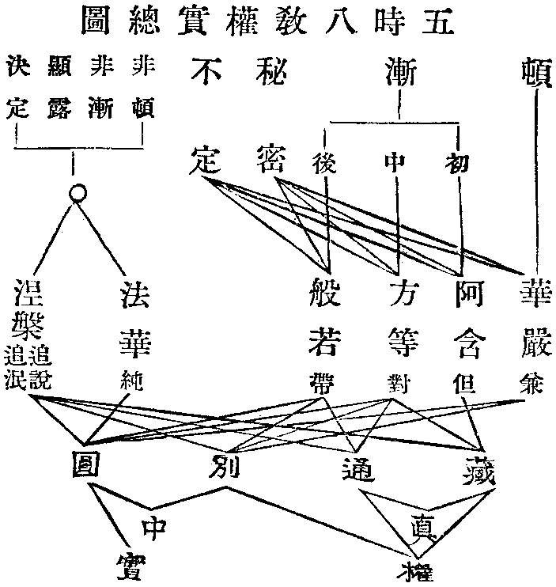

# 教观纲宗



> **藏经**：大正新修大藏经（大正藏）　**册次** 第 46 册（T46）　**编号** No. 1939（T1939）　**部类** 经疏部　**卷次** 1 卷　**篇幅** 8,540 字

> **卷／品**：0 卷 · 0 品



---



教观纲宗(原名《一代时教权实纲要图》，长幅难看。今添四教各十乘观，改作书册题名。)



北天目蕅益沙门智旭重述



佛祖之要，教观而已矣。观非教不正，教非观不传。有教无观则罔，有观无教则殆。然统论时教，大纲有八，依教设观，数亦略同。八教者，一、顿，二、渐，三、秘密，四、不定，名为化仪四教，如世药方；五、三藏，六、通，七、别，八、圆，名为化法四教，如世药味。当知顿等所用，总不出藏等四味。藏以析空为观，通以体空为观，别以次第为观，圆以一心为观。四观各用十法成乘，能运行人至涅槃地。藏、通二种教观，运至真谛涅槃；别、圆二种教观，运至中谛大般涅槃。藏、通、别三，皆名为权，唯圆教观乃名真实。就圆观中复有三类，一、顿，二、渐，三、不定也，为实施权，则权含于实。开权显实，则实融于权。



良由众生根性不一，致使如来巧说不同，且约一代略判五时。



一、华严时，正说圆教，兼说别



> 五时八教权实总图







教。约化仪名顿。



二、阿含时，但说三藏教。约化仪名渐初。



三、方等时，对三藏教半字生灭门，说通、别、圆教满字不生不灭门。约化仪名渐中。



四、般若时，带通、别二权理，正说圆教实理。约化仪名渐后。



五、法华涅槃时。《法华》开三藏、通、别之权，唯显圆教之实，深明如来设教之始终，具发如来本迹之广远。约化仪名会渐归顿，亦名非顿非渐。涅槃重为未入实者，广谈常住，又为末世根钝，重扶三权。是以追说四教，追泯四教。约化仪亦名非顿非渐。而秘密、不定二种化仪，遍於前之四时。唯法华是显露，故非秘密；是决定，故非不定。



然此五时，有别有通，故须以别定通、摄通入别，方使教观咸悉不滥。今先示五时八教图，次申通别五时论。



通别五时论(最宜先知)



《法华玄义》云：「夫五味半满，论别，别有齐限；论通，通於初后。」章安尊者云：「人言第二时十二年中说三乘别教。若尔，过十二年，有宜闻四谛、十二因缘、六度，岂可不说？若说则三乘不止在十二年中，若不说则一段在后宜闻者，佛岂可不化也？定无此理。经言为声闻说四谛，乃至说六度，不止十二年，盖一代中，随宜闻者即说耳。如四阿含、五部律，是为声闻说，乃讫於圣灭，即是其事，何得言小乘悉十二年中也？人言第三时三十年中说空宗《般若》、《维摩》、《思益》，依何经文知三十年也？《大智度论》云：须菩提，於《法华》中，闻说举手低头皆得作佛，是以今问退义。若尔，《大品》与《法华》，前后何定也？」



论曰：智者、章安，明文若此，今人绝不寓目，尚自讹传阿含十二、方等八之妄说，为害甚大。故先申通论，次申别论。



先明通五时者，自有一类大机，即於此土，见华藏界舍那身土常住不灭，则华严通后际也。只今《华严入法界品》，亦断不在三、七日中。复有一类小机，始从鹿苑终至鹤林，唯闻阿含、毘尼、对法，则三藏通於前后明矣。章安如此破斥，痴人何尚执迷？复有一类小机，宜闻弹斥褒叹而生耻慕，佛即为说方等法门。岂得局在十二年后，仅八年中？且如《方等陀罗尼经》，说在《法华经》后，则方等亦通前后明矣。复有三乘须历色心等世出世法，一一会归摩诃衍道，佛即为说般若。故云：从初得道乃至泥洹，於其中间常说般若。则般若亦通前后明矣。复有根熟众生，佛即为其开权显实，开迹显本，决无留待四十年后之理。但佛以神力，令根未熟者不闻。故智者大师云：《法华》约显露边，不见在前；秘密边论，理无障碍。且如经云：我昔从佛闻如是法，见诸菩萨授记作佛。如是法者，岂非妙法。又《梵网经》云「吾今来此世界八千返，坐金刚华光王座」等，岂非亦是开迹显本耶？复有众生，应见涅槃而得度者，佛即示入涅槃。故曰：八相之中，各具八相不可思议。且《大般涅槃经》追叙阿阇世王忏悔等缘，并非一日一夜中事也。



次明别五时者，乃约一类最钝声闻，具经五番陶铸，方得入实。所谓初於华严不见不闻，全生如乳(华严前八会中，永无声闻，故云不见不闻。至第九会《入法界品》，在祇园中，方有声闻。尔时已证圣果，尚於菩萨境界，如哑如聋。验知尔前纵闻华严，亦决无益。然舍利弗等，由闻藏教，方证圣果，方预入法界会，则知，《入法界品》断不说在阿含前矣。人胡略不思察，妄谓华严局在三七日内耶？)次於阿含，闻因缘生灭法，转凡成圣，如转乳成酪(酪即熟乳浆也)。次闻方等，弹偏斥小、叹大褒圆，遂乃耻小慕大，自悲败种。虽复具闻四教，然但密得通益，如转酪成生酥。次闻般若，会一切法皆摩诃衍，转教菩萨，领知一切佛法宝藏。虽带通别，正明圆教。然但密得别益，如转生酥成熟酥。次闻法华，开权显实，方得圆教实益，如转熟酥而成醍醐。然只此别五时法，亦不拘定年月日时，但随所应闻，即便得闻。如来说法，神力自在，一音异解，岂容思议？又有根稍利者，不必具历五味，或但经四番、三番、二番陶铸，便得入实。若於阿含、方等、般若，随一悟入者，即是秘密、不定二种化仪所摄。复有众生，未堪闻法华者，或自甘退席，或移置他方，此则更待涅槃捃拾，或待灭后餘佛。事非一概，熟玩《法华玄义》、《文句》，群疑自释。



化仪四教说



顿有二义：一、顿教部，谓初成道为大根人之所顿说，唯局《华严》(凡一代中，直说界外大法，不与三乘共者，如《梵网》、《圆觉》等经，并宜收入此部。是谓以别定通，摄通入别也)；二、顿教相，谓初发心时便成正觉，及性修不二、生佛体同等义，则《方等》、《般若》诸经，悉皆有之。



渐亦二义：一、渐教部，谓惟局《阿含》为渐初(凡一代中，所说生灭四谛、十二缘生、事六度等三乘权法，并宜收入此部)，《方等》为渐中(凡一代中，所说弹偏斥小、叹大褒圆等经，及餘四时所不摄者，并宜摄入此部。如增上缘名义宽故)，《般若》为渐后(凡一代中。所说若共不共诸般若教。并宜摄入此部)；二、渐教相，谓历劫修行、断惑、证位次第，则《华严》亦复有之。《法华》会渐归顿，不同《华严》初说，故非顿；不同《阿含》、《方等》、《般若》隔历未融，故非渐。然仍双照顿、渐两相。



秘密亦有二义：一、秘密教，谓於前四时中，或为彼人说顿，为此人说渐等，彼此互不相知，各自得益(《法华》正直舍方便，但说无上道，故非秘密)；二、秘密呪，谓一切陀罗尼章句，即五时教中，皆悉有之。



不定亦有二义：一、不定教，谓於前四时中，或为彼人说顿，为此人说渐，彼此互知，各别得益。即是宜闻顿者闻顿，宜闻渐者闻渐也(《法华》决定说大乘，故非不定教相)；二、不定益，谓前四时中或闻顿教得渐益，或闻渐教得顿益，即是以顿助渐，以渐助顿也(随闻《法华》一句一偈，皆得受记作佛，故非不定益也)。



顿教部，止用圆、别二种化法；渐教部，具用四种化法。显露不定，既遍四时，亦还用四种化法。秘密、不定，亦遍四时，亦还用四种化法。顿教相，局惟在圆，通则前之三教，亦自各有顿义，如「善来」得阿罗汉等。渐教相，局在藏、通、别三。通则圆教亦有渐义，如观行、相似、分证、究竟等。秘密教，互不相知，故无可传。秘密呪，约四悉檀，故有可传。不定教、不定益，并入前四时中，故无别部可指。



　约化仪教复立三观：谓顿观、渐观、不定观。盖秘密教，既不可传，故不可约之立观。设欲立观，亦止是顿、渐、不定三法皆秘密耳。今此三观，名与教同，旨乃大异。何以言之？顿教指《华严经》，义则兼别。顿观唯约圆人，初心便观诸法实相，如《摩诃止观》所明是也。渐教指《阿含》、《方等》、《般若》，义兼四教，复未开显。渐观亦唯约圆人，解虽已圆，行须次第，如《释禅波罗蜜法门》所明是也。不定教，指前四时，亦兼四教，仍未会合。不定观，亦唯约圆人，解已先圆，随於何行，或超或次，皆得悟入，如《六妙门》所明是也(此本在高丽国，神州失传)。



问：「但说圆顿止观即足，何意复说渐及不定？」



答：「根性各别。若但说顿，收机不尽。」



问：「既称渐及不定，何故惟约圆人？」



答：「圆人受法，无法不圆。又未开圆解，不应辄论修证。纵令修证，未免日劫相倍。」



化法四教说



法尚无一，云何有四。乃如来利他妙智，因众生病而设药也。见思病重，为说三藏教；见思病轻，为说通教；无明病重，为说别教；无明病轻，为说圆教。



三藏教，四阿含为经藏，毘尼为律藏，阿毘昙为论藏。此教诠生灭四谛(苦则生、异、灭三相迁移，集则贪、瞋、痴等分四心流动，道则对治易夺，灭则灭有还无)，亦诠思议生灭十二因缘(无明缘行、行缘识、识缘名色、名色缘六入、六入缘触、触缘受、受缘爱、爱缘取、取缘有、有缘生、生缘老死忧悲苦恼。无明灭则行灭、行灭则识灭、识灭则名色灭、名色灭则六入灭、六入灭则触灭、触灭则受灭、受灭则爱灭、爱灭则取灭、取灭则有灭、有灭则生灭、生灭则老死忧悲苦恼灭)，亦诠事六度行(布施、持戒、忍辱、精进、禅定、智慧)，亦诠实有二谛(阴入界等实法为俗，实有灭乃为真)，开示界内钝根众生，令修析空观(观於地、水、火、风、空、识六界无我、我所)出分段生死，证偏真涅槃。正化二乘，傍化菩萨。



亦得约当教，自论六即。



理即者，偏真也。诸行无常，是生灭法，生灭灭已，寂灭为乐。因灭会真，灭非真谛，灭尚非真，况苦集道。真谛在因果事相之外，故依衍教判曰偏真。



名字即者，学名字也。知一切法从因缘生，不从时、方、梵天、极微、四大等生，亦非无因缘自然而生。知因缘所生法，皆悉无常无我。



观行即者，一、五停心，二、别相念，三、总相念，外凡资粮位也。五停心者，一、多贪众生不净观，二、多瞋众生慈悲观，三、多散众生数息观，四、愚痴众生因缘观，五、多障众生念佛观。以此五法为方便，调停其心，令堪修念处，故名停心也。别相念者，一、观身不净，二、观受是苦，三、观心无常，四、观法无我。对治依於五蕴所起四倒也。总相念者，观身不净，受、心、法亦皆不净；观受是苦，心、法、身亦皆苦；观心无常，法、身、受亦皆无常；观法无我，身、受、心亦皆无我也。



相似即者，内凡加行位也。一、煖，二、顶，三、忍，四、世第一，得色界有漏善根，能入见道。



分证即者，前三果有学位也。初须陀洹果，此云预流，用八忍、八智，顿断三界见惑，初预圣流，名见道位。二、斯陀含果，此云一来，断欲界六品思惑，餘三品在犹润一生。三、阿那含果，此云不还，断欲界思惑尽，进断上八地思，不复还来欲界。此二名修道位。



究竟即者，三乘无学位也。一、小乘第四阿罗汉果。此含三义，一、杀贼，二、应供，三、无生。断三界见思俱尽，子缚已断，果缚尚存，名有餘涅槃。若灰身泯智，名无餘涅槃。二、中乘辟支佛果，此人根性稍利，逆顺观察十二因缘，断见思惑。与罗汉同，更侵习气，故居声闻上。三、大乘佛果。此人根性大利，从初发心，缘四谛境，发四弘誓，即名菩萨修行六度。初阿僧祇劫，事行虽强，理观尚弱，准望声闻，在外凡位。第二阿僧祇劫，谛解渐明，在煖位。第三阿僧祇劫，谛解转明，在顶位。六度既满，更住百劫，修相好因，在下忍位。次入补处生兜率天，乃至入胎、出胎、出家、降魔、安坐不动时，是中忍位。次一刹那入上忍，次一刹那入世第一，发真无漏三十四心，顿断见思，正习无餘，坐木菩提树下，以生草为座，成劣应身(如释迦丈六、弥勒十六丈等)。受梵王请，三转法轮，度三根性，缘尽入灭。与阿罗汉、辟支佛究竟同证偏真法性，无复身智依正可得。



此教具三乘法，声闻观四谛，以苦谛为初门，最利者三生，最钝者六十劫，得证四果；辟支观十二因缘，以集谛为初门，最利者四生，最钝者百劫，不立分果，出有佛世名缘觉，出无佛世名独觉；菩萨弘誓六度，以道谛为初门，伏惑利生，必经三大阿僧祇劫，顿悟成佛。然此三人，修行证果虽则不同，而同断见思，同出三界，同证偏真，只行三百由旬，入化城耳。



十法成乘者，一、观正因缘境，破邪因缘、无因缘二种颠倒；二、真正发心，不要名利，惟求涅槃(二乘志出苦轮，菩萨兼悯一切)；三、遵修止观，谓五停名止，四念名观；四、遍破见爱烦恼；五、识道灭还灭六度是通，苦集流转六蔽是塞；六、调适三十七品，入三脱门；七、若根钝不入，应修对治事禅等；八、正助合行，或有薄益，须识次位凡圣不滥；九、安忍内外诸障；十、不於似道而生法爱。是为要意。利人节节得入，钝者具十法方悟。



通教钝根通前藏教，利根通后别、圆，故名为通。又从当教得名，谓三人同以无言说道体法入空，故名为通。此无别部，但《方等》、《般若》中，有明三乘共行者，即属此教。诠无生四谛(苦无逼迫相，集无和合相，道不二相，灭无生相)，亦诠思议不生灭十二因缘(痴如虚空，乃至老死如虚空，无明如幻化不可得故，乃至老死如幻化不可得)，亦诠理六度行(一一三轮体空)，亦诠幻有、空二谛(幻有为俗，幻有即空为真)，亦诠两种含中二谛(一者幻有为俗，幻有即空不空共为真，是通含别二谛，故受别接。二者幻有为俗，幻有即空不空一切法趣空不空为真，是通含圆二谛故受圆接)，亦诠别入通三谛(有漏是俗，无漏是真，非有漏非无漏是中)，亦诠圆入通三谛(二谛同前，点非漏非无漏，具一切法，与前中异)。开示界内利根众生，令修体空观(阴界入皆如幻化，当体不可得)出分段生死，证真谛涅槃。正化菩萨，傍化二乘。



亦於当教，自论六即。



理即者，无生也。诸法不自生，亦不从他生，不共不无因，是故知无生(此四句推检，通、别、圆三教皆用作下手工夫。但先解不但中者，即成圆教初门；先闻但中理者，即成别教初门；未闻中道体者，止成通教法门)。解苦无苦而有真谛。苦尚即真，况集灭道。



名字即者，幻化也，知一切法当体全空，非灭故空。生死涅槃，同於梦境。



观行即者，一、乾慧地也，未有理水，故得此名。即三乘外凡位。与藏教五停、别相、总相念齐。



相似即者，二、性地也，相似得法性理水，伏见思惑。即三乘内凡位。与藏教四加行齐(藏、通指真谛为法性，与别、圆不同)。



分证即者，从八人地至菩萨地，有七位也。三、八人地者，入无间三昧，八忍具足，智少一分。四、见地者，八智具足，顿断三界见惑，发真无漏，见真谛理。即三乘见道位，与藏须陀洹齐。五、薄地者，三乘断欲界六品思惑，烦恼渐薄。与藏斯陀含齐。六、离欲地者，三乘断欲界思惑尽。与藏阿那含齐。七、已办地者。三乘断三界正使尽，如烧木成炭。与藏阿罗汉齐。声闻乘人止此。八、支佛地者，中乘根利，兼侵习气，如烧木成灰。与藏辟支佛齐。九、菩萨地者，大乘根性，最胜最利，断尽正使。与二乘同。不住涅槃，扶习润生，道观双流，游戏神通，成熟众生，净佛国土。此与藏教菩萨不同。藏教为化二乘，假说菩萨伏惑不断，正被此教所破。岂有毒器堪贮醍醐？



究竟即者，第十佛地也。机缘若熟，以一念相应慧，断餘残习，坐七宝菩提树下，以天衣为座，现带劣胜应身(分段生身故劣，如须弥山故胜)，为三乘根性，转无生四谛法轮，缘尽入灭，正习俱除，如劫火所烧炭灰俱尽。与藏教佛果齐。



此教亦具三乘根性，同以灭谛为初门。然钝根二乘，但见於空，不见不空，仍与三藏同归灰断，故名通前。利根三乘，不但见空，兼见不空，不空即是中道，则被别、圆来接，故名通后。中道，又分为二，一者但中，唯有理性，不具诸法。见但中者，接入别教。二者圆中，此理圆妙，具一切法。见圆中者，接入圆教。就此被接，又约三位。一者上根，八人、见地被接；二者中根，薄地、离欲地被接；三者下根，已办地、支佛地被接。就此三位被接，又各有按位胜进二义。若按位接，或同别十向，或同圆十信。若胜进接，或登别初地，或登圆初住。既被接已，实是别、圆二教菩萨。於当教中，仍存第九菩萨地名。至机缘熟，示现成佛，乃是别地圆住。来示世间最高大身。非由通教教道得成佛也。通教尚无实成佛义，况藏教哉？藏教佛果，亦皆别地圆住所现劣应身耳。



十法成乘者，一、明观境，六道、阴、入，能观、所观，皆如幻化；二、明发心，二乘缘真自行，菩萨体幻兼人，与乐拔苦，譬於镜像；三、安心如空之止观；四、以幻化慧破幻化见思；五、虽知苦集流转六蔽等皆如幻化，亦以幻化道灭，还灭六度等通之；六、以不可得心，修三十七道品；七、体三藏法无常苦空，如幻而治；八、识乾慧等如幻次位，而不谬滥；九、安忍乾慧位内外诸障，而入性地；十、不著性地相似法爱，而入八人见地证真。利钝分别，如前说。



别教谓教理、智断、行位、因果，别前藏、通二教，别后圆教，故名别也(教则独被菩萨，理则隔历三谛，智则三智次第，断则三惑前后，行则五行差别，位则位不相收，因则一因逈出、不即二边，果则一果、不融诸位差别)。此教诠无量四谛(苦有无量相，十法界不同故；集有无量相，五住烦恼不同故；道有无量相，恒沙佛法不同故；灭有无量相，诸波罗蜜不同故)，亦诠不思议生灭十二因缘(枝末无明为分段生因，根本无明为变易生因)，亦诠不思议六度、十度(於第六般若中，复开方便、愿、力、智四种权智，共成十度。一一度中，摄一切法，生一切法，成一切法，浩若恒沙)，亦诠显中二谛(幻有幻有即空皆名为俗，不有不空为真)，亦诠圆入别二谛(幻有幻有即空皆名为俗，不有不空一切法趣不有不空为真)，亦诠别三谛(开俗为两谛对真为中，中理而已)，亦诠圆入别三谛(二谛同前，点真中道，具足佛法)。开示界外钝根菩萨，令修次第三观(先空、次假、后中)，出分段、变易二种生死，证中道无住涅槃。



亦於当教，自论六即。



理即者，但中也。真如法性，随缘不变，在生死而不染，证涅槃而非净。逈超二边，不即诸法。故依圆教，判曰但中。



名字即者，解义也。仰信真如法性，凡不能减，圣不能增，但由客尘覆蔽，而不证得，须先藉缘修助发真修，方可剋证。



观行即者，外凡十信位也，一、信心，二、念心，三、精进心，四、慧心，五、定心，六、不退心，七、回向心，八、护法心，九、戒心，十、愿心。既先仰信中道，且用生灭因缘观，伏三界见思烦恼，故名伏忍。与通乾慧性地齐。



相似即者，内凡三十心三贤位也。初十住者。一、发心住，断三界见惑，与通见地齐。二、治地住。三、修行住。四、生贵住。五、方便具足住。六、正心住。七、不退住，断三界思惑尽，与通已办地齐。八、童真住。九、法王子住。十、灌顶住，断界内尘沙，与通佛地齐。此十住名习种性(研习空观)，用从假入空观见真谛，开慧眼成一切智。行三百由旬，证位不退。次十行者，一、欢喜行，二、饶益行，三、无瞋恨行，四、无尽行，五、离痴乱行，六、善现行，七、无著行，八、尊重行，九、善法行，十、真实行。此十行名性种性(分别假性)，用从空入假观，遍学四教四门，断界外尘沙，见俗谛开法眼，成道种智。次十回向者，一、救护众生离众生相回向，二、不坏回向，三、等一切佛回向，四、至一切处回向，五、无尽功德藏回向，六、随顺平等善根回向，七、随顺等观一切众生回向，八、真如相回向，九、无缚解脱回向，十、法界无量回向。此十向名道种性(中道能通)，习中观伏无明，行四百由旬，居方便有餘土，证行不退。



分证即佛者。十地圣种性(证入圣地)及等觉性(去佛一等)也。初、欢喜地，名见道位。以中道观，见第一义谛，开佛眼成一切种智。行五百由旬，初入实报无障碍土。初到宝所，证念不退，得无功用道，随可化机缘，能百界作佛，八相成道，利益众生。二、离垢地。三、发光地。四、焰慧地。五、难胜地。六、现前地。七、远行地。八、不动地。九、善慧地。十、法云地。各断一品无明，证一分中道，更破一品无明。入等觉位，亦名金刚心，亦名一生补处，亦名有上士。



究竟即佛者，妙觉性也(妙极觉满)。从金刚后心，更破一品无明，入妙觉位，坐莲华藏世界，七宝菩提树下，大宝华王座，现圆满报身(量同尘刹。相好刹尘)。为钝根菩萨，转无量四谛法轮。



此教名为独菩萨法，以界外道谛为初门(藏、通道谛，即界外集；藏、通灭谛，即界外苦。故以界外道谛治之)，无复二乘而能接通。通教三乘，既被接后皆名菩萨，不复名二乘也。



十法成乘者，一、缘於登地中道之境，而为所观，逈出空有之表；二、真正发心普为法界；三、安心止观定爱慧策；四、次第遍破三惑；五、识次第三观为通，见思尘沙无明为塞，传传检校，是塞令通；六、调适三十七道品，是菩萨宝炬陀罗尼，入三解脱门，证中无漏；七、用前藏通法门，助开实相；八、善知信、住、行、向地等妙七位差别，终不谓我叨极上圣；九、离违顺、强软二贼，策十信位入於十住；十、离相似法爱，策三十心，令入十地。



圆教谓圆妙(三谛圆融不可思议)、圆融(三一相即无有缺减)、圆足(圆见事理一念具足)、圆顿(体非渐成)，故名圆教。所谓圆伏(圆伏五住)、圆信(圆常正信)、圆断(一断一切断)、圆行(一行一切行)、圆位(一位一切位)、圆自在庄严(一心三谛为所庄严一心三观为能庄严)、圆建立众生(四悉普益)。此教诠无作四谛(阴入皆如，无苦可舍；无明尘劳即是菩提，无集可断；边邪皆中正，无道可修；生死即涅槃，无灭可证)，亦诠不思议、不生灭十二因缘(无明、爱、取、烦恼即菩提，菩提通达，无复烦恼，即究竟净，了因佛性也。行、有、业即解脱，解脱自在，缘因佛性也。识、名色、六入、触、受、生、老、死苦即法身，法身无苦无乐，是大乐，不生不死是常，正因佛性也。故大经云：十二因缘名为佛性)，亦诠称性六度、十度(施为法界，一切法趣施，是趣不涡等)，亦诠不思议二谛(幻有幻有即空皆为俗，一切法趣有趣空、趣不有不空为真。真即是俗，俗即是真。如如意珠，珠以譬真，用以譬俗，即珠是用，即用是珠。不二而二，分真俗耳)，亦诠圆妙三谛(非惟中道具足佛法，真俗亦然。三谛圆融，一三三一。如止观说)。开示界外利根菩萨，令修一心三观(照性成修，称性圆妙。不纵不横，不前不后，亦不一时)，圆超二种生死，圆证三德涅槃。



正约此教，方论六即(前三虽约当教各论六即，咸未究竟。以藏、通极果，仅同此教相似即佛；别教妙觉，仅同此教分证即佛。又就彼当教，但有六义，未有即义，以未知心佛众生三无差别故也。是故夺而言之。藏、通极果，别十回向，皆名理即。以未解圆中故。登地同圆，方成分证)。



理即佛者，不思议理性也。如来之藏，不变随缘，随缘不变，随拈一法，无非法界。心、佛、众生三无差别。在凡不减，在圣不增。



名字即佛者，闻解也，了知一色一香无非中道。理具、事造两重三千，同在一念。如一念一切诸念，亦复如是。如心法一切佛法及众生法，亦复如是。



观行即佛者，五品外凡位也。一、随喜，二、读诵，三、讲说，四、兼行六度，五、正行六度。圆伏五住烦恼，与别十信齐，而复大胜。



相似即佛者，十信内凡位也(名与别十信同，而义大异)。初信任运，先断见惑，证位不退，与别初住、通见地、藏初果齐。二心至七心，任运断思惑尽，与别七住、通已办、藏四果齐，而复大胜。故《永嘉》云：同除四住，此处为齐。若伏无明，三藏则劣也。八心至十心，任运断界内外尘沙，行四百由旬，证行不退，与别十向齐。



分证即佛者。十住、十行、十向、十地、等觉圣位也(名亦同别，而义大异)。初住断一分无明，证一分三德(正因理心发，名法身德；了因慧心发，名般若德；缘因善心发，名解脱德)，一心三观，任运现前。具佛五眼，成一心三智。行五百由旬，初到宝所，初居实报净土，亦复分证常寂光净土。证念不退，无功用道。现身百界，八相作佛。与别初地齐。二住至十住，与别十地齐。初行与别等觉齐。二行与别妙觉齐。三行已去所有智断，别教之人不知名字。



究竟即佛者，妙觉极果，断四十二品微细无明永尽，究竟登涅槃山顶，以虚空为座，成清净法身(一一相好等真法界)，居上上品常寂光净土，亦名上上品实报无障碍净土。性修不二，理事平等。



此教名最上佛法，亦名无分别法，以界外灭谛为初门，当体即佛，而能接别接通。接别者，上根十住被接，中根十行被接，下根十向被接。按位接即成十信，胜进接即登初住。接通已如通教中说。故曰：别教接贤不接圣，通教接圣不接贤。以别若登地，乃名为圣，证道同圆，不复论接。通八人上，便名为圣，方可受接。若乾慧、性地二贤，仅可称转入别圆，未得名接。若藏教未入圣位，容有转入通、别、圆义，已入圣后，保果不前，永无接义。直俟《法华》，方得会入圆耳。



十法成乘者。一、观不思议境(其车高广)，二、真正发菩提心(又於其上张设幰盖)，三、善巧安心止观(车内安置丹枕)，四、以圆三观破三惑遍(其疾如风)，五、善识通塞(车外枕亦作轸)，六、调适无作道品七科三十七分(有大白牛肥壮多力等)，七、以藏通别等事相法门，助开圆理(又多仆从而侍卫之)，八、知次位，令不生增上慢。九、能安忍，策进五品，而入十信。十、离法爱，策於十信，令入十住乃至等妙(乘是宝乘。游於四方。直至道场)。上根观境，即於境中具足十法；中根从二展转至六，随一一中得具十法；下根须具用十也。又复应知，说前三教为防偏曲。文意所归，正归於此。



附转接同会借说



转



○藏七贤得转入通、别、圆。



○通乾慧、性地，得转入别、圆。



○别十信得转入圆。



○此三皆不名接，以仅在初心脚跟未牢，故但名转。



接



○通八人、见地、薄地、离欲、已办、支佛，得接入别、圆。



○别住、行、向，得接入圆。



○根有利钝故，接有迟速。如以好桃李接彼平常桃李，故名为接。



同



○别十地证道同圆，不复名接。但存教道之粗，以待法华开会成妙。



○别初住、通见地、藏初果等，亦得约所断惑名同。



会



○开藏七贤，通乾慧、性地，别十信，即圆五品。



○开藏初果、通见地、别初住，即圆初信。



○开藏四果、通已办、别七住，即圆七信。



○开别十向，即圆十信。



○开别十地，即圆十住(初在法华)。



借



○欲接通入别，先借别明通。如云欢喜地断见惑，远行地断思惑等。



○欲含别於通，必借通明别。如云须陀含若智若断，是菩萨无生法忍等。



○欲接别入圆，先借圆明别。如云初住能现八相，犹有微苦等。



○欲含圆於别，先借别明圆。如云三贤、十圣住果报等。



问曰：「但依圆教直指人心见性成佛，岂不痛快直捷？何用此葛藤为？」



答曰：「六祖大师不云乎：法法皆通，法法皆备，而无一法可得，名最上乘。倘有一法未通，即被此法所缚。倘有一法未备，即被此法所牵。既被缚、被牵，故於不可得之妙法，误认为葛藤耳。临济云：识取纲宗，本无实法。汝乃欲舍葛藤而别求实法耶？永明大师云：『得鸟者网之一目，不可以一目而废众目。收功者，棋之一著，不可以一著而废众著。』法喻昭然，胡弗思也。」



问曰：「藏、通同诠真谛，何故藏以四果为究竟，通必佛地为究竟耶？」



答曰：「藏教正为二乘，通教正为菩萨故也。」



问曰：「一般断见思惑，何故藏、通名圣，别、圆名贤？」



答曰：「藏、通诠真，故见真即得名圣。别、圆诠中，故见中方得名圣，见真仅可名贤也。」



问曰：「藏四加行、通性地，既称相似，何故仅齐别、圆观行？」



答曰：「藏、通圣位，既成别、圆内凡；则藏、通内凡，仅成别、圆外凡。复何疑哉？」



教观纲宗(毕)

