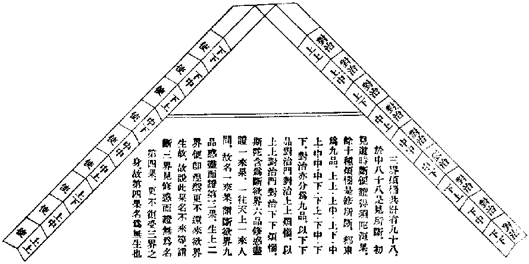

# 三界图



> **藏经**：大正新修大藏经（大正藏）　**册次** 第 85 册（T85）　**编号** No. 2840（T2840）　**部类** 经疏部　**卷次** 1 卷　**篇幅** 594 字

> **卷／品**：0 卷 · 0 品



---



三界图



无色界



无明  

慢



贪



修



无明  

慢



贪  

疑  

戒禁  

见取  

邪见



道



无明  

慢



贪  

疑



见取  

邪见



灭



无明  

慢



贪  

疑



见取  

邪见



集



无明  

慢



贪  

疑  

戒禁  

见取  

邪见  

边见  

身见



苦



色界



无明  

慢



贪



修



无明  

慢



贪  

疑  

戒禁  

见取  

邪见



道



无明  

慢



贪  

疑



见取  

邪见



灭



无明  

慢



贪  

疑



见取  

邪见



集



无明  

慢



贪  

疑  

戒禁  

见取  

邪见  

边见  

身见



苦



欲界



无明  

慢  

瞋  

贪



修



无明  

慢  

瞋  

贪  

疑  

戒禁  

见取  

邪见



道



无明  

慢  

瞋  

贪  

疑



见取  

邪见



灭



无明  

慢  

瞋  

贪  

疑



见取  

邪见



集



无明  

慢  

瞋  

贪  

疑  

戒禁  

见取  

邪见  

边见  

身见



苦



欲界见断烦恼三十二修断烦恼有四。



色界见断二十八修断有三。



无色界亦然。三界共计有九十八。



谓彼四谛十六门差别违立名安谛。十六门者。即四谛下各四行相。苦谛四者谓即非常苦空无我。集谛四者因集生缘。灭谛四者灭净妙离。道谛四者道如行出。释云。有生灭故非常。逼迫性故苦。违我所见故空。违我见故非我。能生法故因。有多种故集。恒资产故生。各别助故缘。诸蕴尽故灭。三相息故净。无众患故妙。脱众灾故离。通行义故道。契正理故如。正趣向故行。能永超故出。



苦谛有四智。一苦法忍。二苦法智。三苦类忍。四苦类智。对治身见等十种烦恼。餘三谛亦然。集法忍集法智集类忍集类智。对治邪见等七使。灭法忍灭法智灭类忍灭类智。对治灭谛烦恼。道法忍道法智道类忍道类智。对治道谛烦恼。修断者。於四谛上各各比忍比智。对治欲界贪瞋慢无明四个烦恼。





