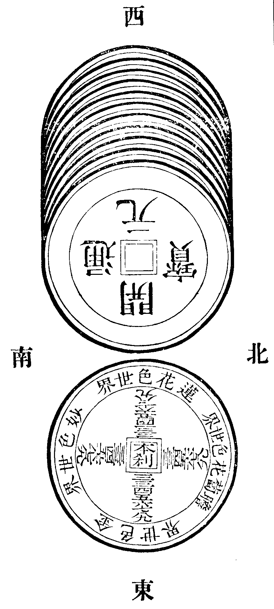
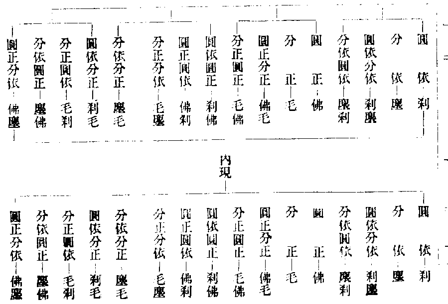
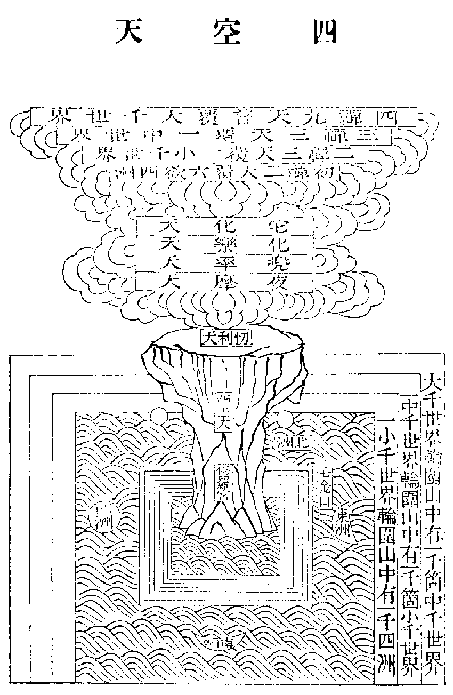
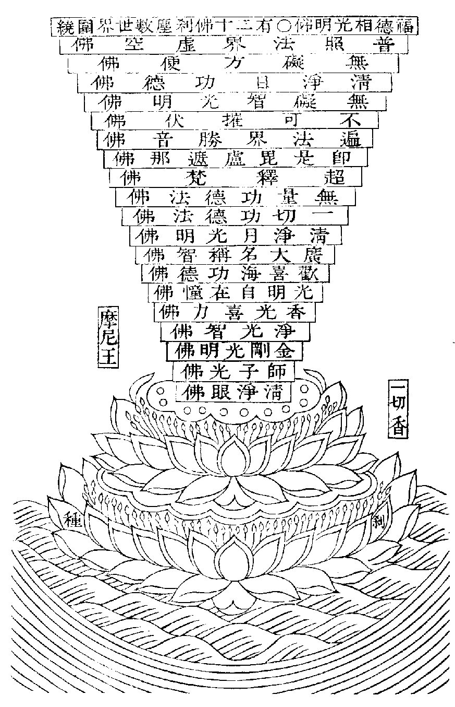
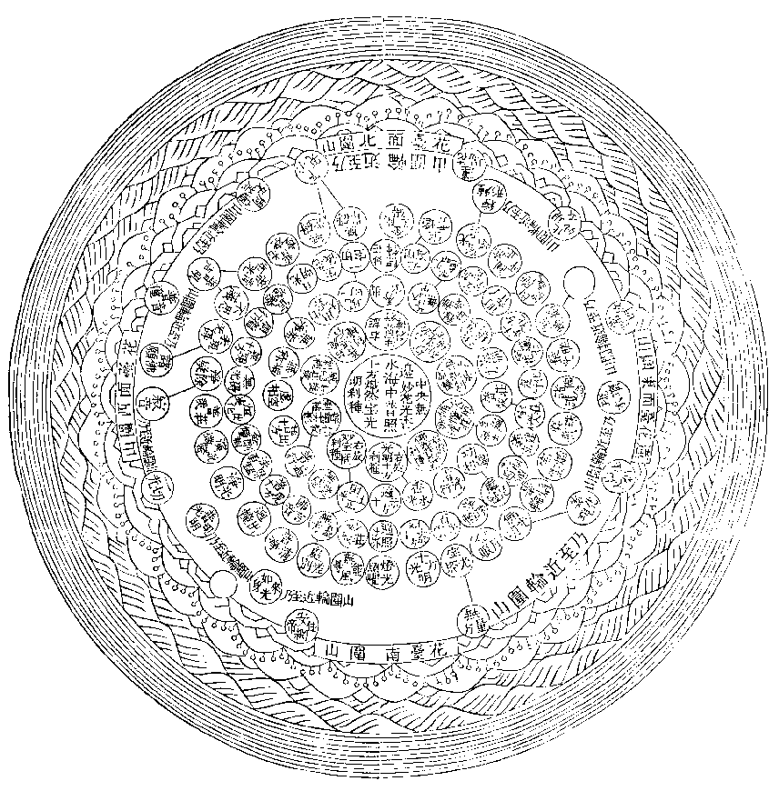

# 华严悬谈会玄记



> **藏经**：卍新纂大日本续藏经（新纂卍续藏）　**册次** 第 8 册（X08）　**编号** No. 236（X0236）　**部类** 经疏部　**卷次** 40 卷　**篇幅** 553,138 字

> **作者（译者）**：苍山再光寺比丘　普瑞集

> **卷／品**：40 卷 · 0 品



---



## 目录



- [华严悬谈会玄记卷第一](#华严悬谈会玄记卷第一)

- [华严悬谈会玄记卷第二](#华严悬谈会玄记卷第二)

- [华严悬谈会玄记卷第三](#华严悬谈会玄记卷第三)

- [华严悬谈会玄记卷第四](#华严悬谈会玄记卷第四)

- [华严悬谈会玄记卷第五](#华严悬谈会玄记卷第五)

- [华严悬谈会玄记卷第六](#华严悬谈会玄记卷第六)

- [华严悬谈会玄记卷第七](#华严悬谈会玄记卷第七)

- [华严悬谈会玄记卷第八](#华严悬谈会玄记卷第八)

- [华严悬谈会玄记卷第九](#华严悬谈会玄记卷第九)

- [华严悬谈会玄记卷第十](#华严悬谈会玄记卷第十)

- [华严悬谈会玄记卷第十一](#华严悬谈会玄记卷第十一)

- [华严悬谈会玄记卷第十二](#华严悬谈会玄记卷第十二)

- [华严悬谈会玄记卷第十三](#华严悬谈会玄记卷第十三)

- [华严悬谈会玄记卷第十四](#华严悬谈会玄记卷第十四)

- [华严悬谈会玄记卷第十五](#华严悬谈会玄记卷第十五)

- [华严悬谈会玄记卷第十六](#华严悬谈会玄记卷第十六)

- [华严悬谈会玄记卷第十七](#华严悬谈会玄记卷第十七)

- [华严悬谈会玄记卷第十八](#华严悬谈会玄记卷第十八)

- [华严悬谈会玄记卷第十九](#华严悬谈会玄记卷第十九)

- [华严悬谈会玄记卷第二十](#华严悬谈会玄记卷第二十)

- [华严悬谈会玄记卷第二十一](#华严悬谈会玄记卷第二十一)

- [华严悬谈会玄记卷第二十二](#华严悬谈会玄记卷第二十二)

- [华严悬谈会玄记卷第二十三](#华严悬谈会玄记卷第二十三)

- [华严悬谈会玄记卷第二十四](#华严悬谈会玄记卷第二十四)

- [华严悬谈会玄记卷第二十五](#华严悬谈会玄记卷第二十五)

- [华严悬谈会玄记卷第二十六](#华严悬谈会玄记卷第二十六)

- [华严悬谈会玄记卷第二十七](#华严悬谈会玄记卷第二十七)

- [华严悬谈会玄记卷第二十八](#华严悬谈会玄记卷第二十八)

- [华严悬谈会玄记卷第二十九](#华严悬谈会玄记卷第二十九)

- [华严悬谈会玄记卷第三十](#华严悬谈会玄记卷第三十)

- [华严悬谈会玄记卷第三十一](#华严悬谈会玄记卷第三十一)

- [华严悬谈会玄记卷第三十二](#华严悬谈会玄记卷第三十二)

- [华严悬谈会玄记卷第三十三](#华严悬谈会玄记卷第三十三)

- [华严悬谈会玄记卷第三十四](#华严悬谈会玄记卷第三十四)

- [华严悬谈会玄记卷第三十五](#华严悬谈会玄记卷第三十五)

- [华严悬谈会玄记卷第三十六](#华严悬谈会玄记卷第三十六)

- [华严悬谈会玄记卷第三十七](#华严悬谈会玄记卷第三十七)

- [华严悬谈会玄记卷第三十八](#华严悬谈会玄记卷第三十八)

- [华严悬谈会玄记卷第三十九](#华严悬谈会玄记卷第三十九)

- [华严悬谈会玄记卷第四十](#华严悬谈会玄记卷第四十)



---



## 华严悬谈会玄记卷第一



**译者**：苍山再光寺比丘　普瑞集



将明一部《悬谈》，启以二门分别：初总解题目，后逐难释文。初又分二：初别解法题，以经、疏、科、钞题各别故；后通解人题，以疏、科、钞中人无异故。今初，大凡开演，不越其四，谓：先科，次经，次疏，后钞。所以然者，欲知经、疏大纲，非科不能，故先科释；虽知大纲，在文难晓，故次举正经；正文虽见，非疏何知，故次解疏释；疏释虽明，而多总、略，故以钞文补而备之。如是四种，理应尔故。若约生起次第，佛先说经，依经造疏，依疏有科，随科钞释。今释题目，当依生起次第，示有由渐故；后逐难释文，依开演次第，不越常规故。然法题不同，有其四题，分为四段：初、经题，二、疏题，三、科题，四、钞题。



且初经题即大方广佛华严经，然此七字廼无尽修多罗之总名，义门极广。下虽广释，今入文之先理应略陈，且以七门分别为顺七字之题故：一、明来意，二、华梵对翻，三、依题列对，四、出名义体，五、六释分别，六、辩其异名，七、释通妨难。



▲且初来意者，华严大教称性极谈。我佛世尊初成正觉，遍观众生皆具性德，以妄覆故，不能证之。於是称性顿演斯经，明各人本地之风光与佛无异，庶其一切共证之也。



▲二、华梵对翻者，佛出西天，教流东土，若不翻译，无由解会。讲学之者，首先明之，表教来有自。然有总翻、别翻。若总翻者，梵语摩诃毗佛略勃陀徤拏骠诃修多罗，唐言大方广觉者杂华严饰经。若别翻者，摩诃云大，毗佛略云方广，勃陀云觉者，徤拏云华，骠诃云严饰，修多罗云经。其中觉者，即是佛字，略存梵音，以生信心。又略杂饰二字，不令繁广，具以七字为名。



▲三、依题列对者，七字一题，列为十事五对：一、教义一对，经之一字是能诠教，大等六字是所诠义故。二、就上义中，法、喻一对，谓大等是法，华严是喻。三、就上法中，人、法一对，谓大方广是所证之法，佛字是能证之人，亦名境、智对。四、就上法中，拣、持一对，大之一字是拣，方广二字是持，即拣大异小、拣实异权、拣果异因，亦是体、用一对，或性、相一对。五、就人中，借下华字以喻其因，即因、果一对，佛是果故，是以单华字但喻於因，若合华严二字，亦喻上之四字。



▲四、出名义体者，大以当体得名，常徧为义。常则三际莫易，徧则十虗无外，即以全有全空实相为体。方以就法得名，轨持为义。双持性相，轨生物解故，即以六相、十玄为体。广以从用得名，包博为义。包则广容，博则广遍，即以染净依正即入重重为体。佛以就人得名，觉照为义。照则朗万法之幽邃，觉则悟大夜之重昏，即以十身无障碍身云为体。华以从喻得名，感果严身为义。感果则万行圆成，严身则众德备体，即以行布圆融行愿为体。严以功用受名，资庄为义。谓资广大之体用，庄真应之佛身，即以无障碍大智为体。经以能诠得名，摄持为义。持性相之无尽，摄众生之无边，即以身名句文为体。



▲五、六释分别者，此有四番离合，通其三释，谓依主、持业、有财也。一、大方广，所证法也，此通依主、持业二释，谓大之方广有体之相用故，方广之大有相用之体故，此约依主则行布义。又大即方广，方广即大，体用相即，此约持业则圆融义。二、佛华严，能证人也，亦具二释，谓佛之华，拣非因位之行故，华之佛，拣非餘行之佛故，此亦依主行布。若持业圆融，相即可知。三、大方广之佛华严，拣非权小之佛等故，佛华严之大方广，拣非因位所得法故，相即可知。四、大方广佛华严之经，拣非《涅槃》等经，经之大方广佛华严，拣非论中所明，此则依主。若持业者，文随於义，义随於文，诠旨圆融故。又上教望於义，人望於法，通有财释，并可思准。



▲六、辩其异名者，如《摄论》中名百千经，此约数为目，以此经具本有十万颂故。《涅槃经》中名杂华经，此约喻为目。《智论》之中名大不思议解脱经，此约法为目故。又〈出现品〉及〈离世间品〉皆有十名，具如后示。清凉云：「前三异名，义多总略。二品十目，多从别名，又局当品。故今译者具以七字为名，则人、法双题，法、喻齐举，具体具用，有果有因，理尽义圆，故标经首。」



▲七、释通妨难者。问：如大方广三字，餘经多同。如《三戒经》、《十轮经》、《宝箧经》、《圆觉经》等十有餘部，皆有大方广言，则与此经为同为异？若言同者，何独此经以为圆教？若言异者，其相云何？答：圭峰云：「配属三大则同，释义随宗则异。」谓《圆觉》大虽配体，唯明自体常徧。此经则若相若用等，皆同真性而常徧。又彼方亦配相，但任持自性，轨生物解。此则双持性相，具十玄门，一一诸相皆轨生物解。又彼广亦配用，不能即体；今此则全德相之业用也。故后序云：「冥真体於万化之域，显德相於重玄之门，用繁兴以恒如」等。故与诸经异也。释经题竟。



次释疏题，即大方广佛华严经疏卷第一并序。释此一题，初作对，二解释。初中先将并序二字，望上大等十一字，为能序所序对。二以第一二字，望上大等九字，为能记所记对。三又将卷字，望上八字，为能依所依对。卷为所依，八字为能依。四疏之一字，望上七字，为能释所释对。二解释者亦二：先解义，后六释。先解义者，经题七字，如上所释。疏者，疎也，决也，开也，通也，谓经中义理深奥之处。疏以疏明经旨，决择疑惑，开而显之，通而达之，故云疏也。又是疏理之义，如卢仝云：「人有发兮，旦旦疏理；身有心兮，胡不如是？」今即疏理经中之文义也。卷者，舒卷为义，舒则阅之，卷则思之，展卷无碍，故谓之卷。第谓次第，一乃数之极首，盖此疏有二十卷，今记其次数，令不差互，故云第一。言并序者，并者，兼也，及也；序者，绪也。如茧得绪，绪尽一茧之丝；若疏得序，序尽一疏之意。又序者，《尔雅》云：「东西墙谓之序。」(所以序别内外也。)见墙所以别宅舍之浅深，观序所以知作者之意旨。又序者，叙也，谓叙述经疏之大意，纂於文前，令学者顿观其大旨，故云序也。上解义竟。后六合释者，一、疏字望上七字，即能、所释之依主也。或通拣别依主，谓大方广佛华严经之疏，拣非论等故。或作通别依主，疏字通故，以经别之。二、卷第一三字作释，有其三说：一、总别依主释，卷字是总，第一是别。卷有二十，第一唯一，总中有别，卷之第一。二、体用持业，卷字是体，第一是用。以体就用，卷即第一。三、带数释，卷字是法，第一是数，卷法带起第一数故。三、以卷字望上八字，所依纸素之卷，从能依疏以彰名，谓大方广佛华严经疏之卷，依主释也。四、第一两字望上九字，能记从所记以彰名，亦依主释。五、并序二字望上一题，作相违释。释疏题竟。



三、释科题，即大方广佛华严经疏科文卷第一。释此科题，初列对，后释义。初列对者，上之八字以为所科，下之五字以为能科。卷字望上为能所依，第一望上为能所记，如前可知。后释义者有四：一、略解名义，二、古今对辩，三、义类分别，四、六释料拣。且初略解名义者，所科八字如前已解。能科五字者，卷第一三字义不异前，科文二字今当略释。先释科字，后释文字。且释科字有其二义：一、依义训，二、依字形。依义训者，诸说不同，今略显示。一云：科者，分齐义，令文及义有分限故。一云：科者，类聚之义，若文若义随其所应，约一类聚而收摄故。一云：科者，断也，定也，断量楷定，分是非故。一云：科者，开通为训，若见科文，义开通故。一云：科者，略聚为义，以少言词括多义故。一云：科者，次第为义，若无科文理必丛杂，若标判已有次第故。已上六解并依义训。二、依字形者，科字形状禾边从斗，文义如禾科文似斗，禾得斗而知数，文得科而义明。后释文字者，文即是字未改转位名，字已改转位名，文为名句所依，今言文者摄名句故。二、古今对辩者，科判之义本出佛经，或名品、或名章、或名分，皆科之异名，如今经有三十九品等也。若就迹而言，此土以道安为始，以魏帝(或云秦主)请诸德入内讲《楞伽经》已，问曰：「朕闻佛法幽深，至理玄奥，向观所谈，都无科次，何耶？」诸德无对。时道安在襄阳闻之，遂将华夏大小诸经科为三分，当时举朝不许。后唐三藏译亲光菩萨所造《佛地论》，释《佛地经》科为三分：教起因缘分，圣教所说分，依教奉行分。尔来经无丰约，科为三分，今古同遵。然后诸师或多或少，各各不同，不劳繁述。三、义类分别者，凡科判者，有其二类：一、三义门，二、四义门。且三义门者：一者文科，随文而判故；二者义科，随义而分故；三者文义科，双约文义而断故。言四义门：一、以文从义科，谓此约所诠之义而科判，不拘於文故；二、以义从文科，谓此就能诠文段而科判，不拘所诠义故。三、义类相从科，如题目中虽有人法之异，同为题故，总为一科；本文之中虽有序文、本文之异，同是本文，故亦合为一等也。四、分别不同科，如人法之题虽同题目，人法异故，分之为二；本文之中，序疏别异，亦不可同，须分开等。四、六释料拣者，科文二字，文体科用，科即是文，持业释，餘可思准。释科题竟。



四、释钞题，即大方广佛华严经随疏演义钞卷第一并序。释此亦二：先列对，后解释。且初列对者，一、能释对，疏义二字并上七字为所释疏，随演钞等八字为能释钞；二、随疏二字约能诠文，为能随、所随对；三、演义二字约钞家能诠、演疏家所诠，为能演、所演对；四、随疏二字对演义二字，为随文、演义对；五、上四字为用，钞字为体，即体、用一对；六、卷字望上，为所依、能依对；七、第一望上，为所记、能记对；八、并序二字望上一题，为能序、所序对。后解释者有三：初、释义，二、六合，三、问答。初释义者，随谓随顺，即无违义；疏谓疏文，谓不违经之文故。演谓流演、开通之义；义者，义理，即经疏所诠；钞者，钞略备缺之义。总此意云：随顺本疏，加言解释，使经疏玄义流演、开通。钞其略而补其缺，正其异而采其要，故云随疏演义钞也。餘义准思。二、六合释者，初对即能、所依主释，以能释钞从所释经疏以彰名故。第二一对，能随名随疏之随，所随名随疏即随，依主、持业二释如次。第三一对，能演名演义之演，所演名演义即演，二释亦然。第四一对，随文与演义异故，作相违释。第五一对，作持业释，或作同依释，二用同依一钞体故。或通通、别依主，谓钞字通於诸钞，以随疏演义而别之故。餘三对作释。准前可思。三、问答。问：何故随对於疏，演对於义，而不得互对耶？答：疏约能诠，钞但随顺；义约所诠，钞须演唱。故不以互对也。问：准诸家章疏体例，经题之下应安疏字，於疏字下方立钞号。今何不尔？答：以钞题中所随已有疏字，影取疏题也。若上更安疏字，则一题之中有二疏字，文则重并，非立名之巧。今唯一疏字，互望，上、下，二题双足，立名之妙固在是矣。释钞题竟。上来四段别解法题竟。



后通解人题：清凉山大华严寺沙门澄观撰。释此一题，大分为二：上之七字是所依处，下之五字是能依人。於所依中，又上三字所依之总名，下四字所依之别号。所以双举二者，有其二意：一、举山令远人知，举寺令近人知故；二、以则天弘大经，故多改华严寺号，贤首居处皆标此名。故今标山以拣之也。言清凉山者，即岱州鴈门郡五台是也。以岁积坚氷，夏凝飞雪，曾无炎暑，故曰清凉。山峰耸出，顶无林木，有如垒土之台，又曰五台。即本经所谓东北方有处名清凉山等。又《宝藏陀罗尼经》云：「我灭度后，於赡部州东北方有国名大振那，其国中间有山号为五顶，文殊师利童子游行居住，为诸菩萨众於中说法等。」又准《大钞》云：「离、坎、乾、坤，得其中理。此以八卦通配清凉一山。五台近西，是以东台在离、坎二卦之间，北台在坎、乾二卦之间，西台在乾、坤二卦之间，南台在坤、离二卦之间，故中台在离、坎、乾、坤四卦之最中，通表中道之理。」又云：「其山磅礴数州七百餘里，左邻恒岳，右接孟津，北临绝塞，南拥汾阳，回泊日月，蓄泄云龙。虽积雪严寒，而名华万品；寒风劲烈，而瑞草千般。」乃至云：「白云凝布，夺万里之澄江；杲日将升，见三尺之大海」等。言大华严寺者，即古大孚灵鹫也。按《感通传》：「南山问天神曰：『今五台山东南三十里现有大孚灵鹫寺，两堂旧迹犹存。南有华园，可二顷许，四时发彩，人莫究之。或云汉明所立，又云魏文所作，互说不同，如何？』天答曰：『俱是二帝所作。周穆王时，已有佛法。此山灵异，文殊所居，周穆王於中造寺供养。及阿育王，亦依置塔。汉明帝之初，摩腾天眼亦见有塔，请帝立寺。山形似於灵鹫，故号为大孚灵鹫。孚者，弘信也。帝信佛理，立寺劝人，华园在寺前。后之君王，或改为大华园寺。』」《珠林集》云：「每春首至秋末，异华间发，光曜人目。四边树园，以爱华奇，人间无有，移栽不生，乃至移树园外，亦不生等。至则天时，与于阗三藏译《华严经》，见菩萨住清凉山，因改大华严焉。寺者，司也。天子置九司，以置九卿：一、太常寺，主礼乐；二、宗正寺，主六亲昭穆；三、大理寺，主刑狱；四、光禄寺，主膳羞；五、司农寺，主仓储；六、大府寺，主平准；七、太仆寺，主车轝；八、卫尉寺，主器械；九、鸿胪寺，主宾客。此寺凡有外方使命，皆止其中。汉明帝时，摩腾、竺法兰二三藏初至此土，令鸿胪安下。尔后僧居之处，因以名焉。」次释能依人者，沙门二字，释子之通称。梵语具云沙迦懑曩，此云息恶。《瑞应经》云：「一切诸法中，因缘空无主，息心达本源，故号为沙门。」然有四沙门：一、胜道沙门，二、活道沙门，三、示道沙门，四、污道沙门。义如别章。然今疏主据本而说，即胜道沙门；依迹而论，即示道沙门也。



▲澄观二字，即疏主之别号。澄者，定也。观者，慧也。表和尚定慧双修故。按《妙觉塔记》云：「法号澄观，字大体，俗姓夏侯，越州会稽人也。法界孕灵，随缘於帝禹之族。诞若剖珠，洞鉴邻室。稚岁趋庭，厥考授与六月之诗，即曰：『可畏而敬。』每童戏聚沙建塔，或诫之：『汝聚沙安避尘垢染？』即鞠躬对曰：『沙无自性，揽真而成。真岂染矣？』夙习警矣？年九岁，礼本州宝林寺禅德体真大师为师。岁曜一周，解通三藏。至十一，奉恩得度。才服田裳，思冥理观，乃讲《般若》、《涅槃》、《白莲》、《净名》、《圆觉》等一十四经，《起信》、《瑜伽》、《唯识》、《俱舍》、《中》、《百》、《因明》、《宝性》等九论。年满，具戒於昙一大师门下，受南山行事止作，遂讲律藏。又礼常照禅师，授菩萨戒。原始要终，启厥十誓：体不损沙门之表，心不违如来之制，坐不背法界之经，性不染情碍之境，足不履尼寺之尘，脇不触居士之榻，目不视非仪之彩，舌不味过午之肴，手不释圆明之珠，宿不离衣钵之则。遂参无名大师，印可融寂，自在受用。即曰：『明以照幽，法以达迷。然交暎千门，融治万有，广大悉备，尽法界之术，唯《大华严》。』乃依东京大诜和尚听受玄旨，利根顿悟，再周能演。诜曰：『法界全在汝矣。』」



▲「至〈住处品〉，审文殊随事观照五顶，遂不远万里委命(《大抄》云：途虽五千，反复万里。当时逆寇乱常，兵戈锋起，不惮而游，故云委命也)，栖托圣境。相仍十稔，挂锡于大华严寺。山门真侣，恳命敷扬。遂思五地圣人，身栖佛境，心证真如。於后得智，起世俗心，学世间解。廼却览诗礼、传籍、图谶、道德寓言、四科十翼、百家祖述、周易子书、华夏古训、竺乾梵字、诸部异计、四围五明、显密轨注、二王笔法，悉焕然氷释。即於般若院启曼拏罗，优游理观，祈圣祐之。梦一金像，挺特山岳，月满毫相，卓立空际。仍於𥧌内，捧咽面门。及觉久如，遂下鸿笔，恍若有神。是月也，设无遮以庆之。疏成将阐，忽梦为龙，头枕南台，尾蟠北台，鳞𩮻辉空，光逾皎日。须臾奋迅，化成多龙，分照而去，流通之兆也。后制《随疏演义钞》四十卷、《随文手镜》一百卷、《华严纲要》三卷、《法界观玄镜》一卷、《三圣圆融观》一卷、《华严》、《圆觉》、《四分》、《中观》等论关脉三十餘部、《七处九会华藏世界图心镜说文》十卷、《大经了义备要》三卷、七圣降诞节对御讲经谈论文兼一家述诗表牋章总八十餘卷。后奉德宗诏，与般若三藏译乌盘所进《华严》。后分译就，帝请讲之。讲已，上曰：『诚哉是言，微而显抚。』廼赐紫衲方袍，兼礼为教授。和尚奉诏述疏十轴，诞圣节赐辇，迎之内殿谈法。帝命广敷新经，厥旨要曰：『大哉真界，万法资始(云云)。』帝时默湛海印，朗然大觉，诫於群臣曰：『朕之师，言雅而简，辞典而富，扇真风於第一义天，能以圣法清凉朕心。』仍以清凉赐为国师之号。是时内外台辅重臣，咸以八戒礼而师之。后答顺宗经义，帝於兴唐寺为造普光殿、华严阁，塑华严图、法界会。次因答宪宗法界，帝为铸金印，迁国师，统冠天下缁侣。穆宗、敬宗，感仰巨休，悉封大照国师。以开元二十六年戊寅岁生，天宝戊子岁出家(玄宗年号)，至德(肃宗年号)丁酉年心印受戒。代宗大历戊申年，诏入内与辩正三藏译经为润文。大德兴元元年甲子岁造疏，贞元丁卯岁功就，贞元丙子年翻经赐紫，己卯年授清凉国师号。宪宗元祐五年庚寅岁，授僧统印。文宗大和辛丑岁，帝授心印於师。至开成己未年春三月六日旦，诏上足三教首座宝印大师海岸等，付法嘱𠼱竟而卒。历九宗圣世，为七帝门师(代宗、德宗、顺宗、宪宗、穆宗、敬宗、文宗)。俗寿一百二，僧腊八十三。形长九尺四寸，手垂过膝。目夜发光，昼乃不瞬。言论清雅，动止作则。学赡九流，才供二笔。凡著述现流传者，总四百餘卷。尽形一食。《大经》始终讲五十遍。无遮大会十有五，设弟子为人师者三十有八。海岸寂光为首，禀受学徒一千。唯东京僧睿、圭山宗密，独得其奥。餘即虗心而来，实腹而去。蜕经三七，颜光益润，端身凛岳，自证之力也。其月二十七日，恭承遗旨，迁奉全身於终南山石室。皇帝辍朝，重臣缟素，其餘即可知也。初朞，有西域梵僧在葱领，见二使者步履虗地，以呪止而诘之曰：『余北印土文殊堂之神，东土取华严菩萨大牙供养。』及至，奏启石室验之，果无大牙，唯三十九璨然如霜。遂阇维灵骨，得舍利数千粒，明白光润，舌红如莲，火不能变(上略记文)。」又大宋《高僧传》中，有赞宁僧统所述之传，事多错谬，不须繁引。



▲撰者，集也。采录众文，集成章句，释此一经，故名为撰。有本云述者，盖述而不作之义也。《乐记》云：「知礼乐之情者能作，识礼乐之文者能述。作者之谓圣，述者之谓明。」已上离解。若合释者，清凉之山，大华严之寺，皆通别依主。或山有清凉之德用，寺中兴於华严，故以为名者，持业、有财二释如次。或经显菩萨住处在於清凉，而寺在山中，故以华严为名者，即隣近释。又清凉山之大华严寺，大华严寺之沙门，二释皆是总别依主也。清凉山大华严寺沙门，即澄观沙门之澄观，澄观即述澄观之述，二释皆得。问：科疏钞中各有人题，今何唯解一题耶？答：虽有三题，一人无异。故於一处通明，餘二不劳繁迷。释题目竟。



后逐难释文中，先解钞序。



「至圣垂诰，镜一心之玄极」者，显如来说经也。释之分三：初列对，二消文，三五教辩明。且初二句序文，十事五对：一人法对，至圣是人，餘皆是法。二法义对，垂诰是法，一心等是义。二总别对，一心是总，玄极为别。四法喻对，镜字是喻，垂诰为法。五拣持对，至字能拣，圣字能持。二消文者，至者极也，圣者正也。见道已去，虽名为圣，唯至佛果，方名至圣。垂者布也，诰者典诰。《书》云「典谟训诰」，皆经诰之别称。镜者喻上诰字，法者典诰，能明示一心，鉴微玄极。喻中如秦镜至明照人心。故朱铠诗云：「西国有秦镜，其光世所希，照人见肝胆，鉴物穷幽微。」今正取此。故后疏云：「以圣教为明镜，照见自心」等。无二无三谓之一，坚实灵明谓之心。玄即幽玄，极谓至极。意云：我佛世尊，布教如明镜，洞鉴一心之中幽玄至极之自理也。三五教辩明者，一小教，至即生空理，圣即生空智。菩提树下，断结成佛，名为至圣。垂者设也，引也。权设小法，引二乘故。诰即《阿含》、《缘生》等经。言一心者，即假说一心，谓实有外法，由心转变，非皆是心(谓世出世间染净等法，由心造业之所感，故改转变动，而非皆是心也)。二始教者，至即二空理，圣即二空智。色究竟天上成正觉者，名为至圣。垂者，说也，悟也。根本智中流出后得，从后得智起大悲心，为物宣说，令二乘人悟唯识故。诰即《深密》、《楞伽》等经。言一心者，即本识也。然有三类：一、相见俱存名一心，二、摄相归见名一心，三、摄所归王名一心。玄极者，根本智名玄，二空理名极也。三、终教者，至即本觉理，圣即始觉智。始本不二，名为至圣。垂者，赐也，显也。等赐一乘，显理事无碍故。诰即《法华》、《涅槃》等经。言一心者，即如来藏名一心。此亦有二：一、摄末归本(摄前七，归第八)，二、摄染净归如来藏。寂照即以真妄和合名一心，指玄即以真妄不二名一心，各唯得一义也。言玄极者，即始本二觉也。四、顿教者，至即无理之理，圣即无智之智。以无佛无不佛，名为至圣。垂者，传也，彰也。单传心印，彰绝待理故。诰即《金刚》、《思益》等经。言一心者，泯绝染净，名为一心。绝待之智曰玄，绝待之理曰极。五、圆教者，至即无障碍理，圣即无障碍智。十身无碍身云，名为至圣。垂者，布也，安也。通方之说，布於法界，安立四种法界义故。诰即《华严大经》。言一心者，即无障碍一心也。此亦有三，谓融事相。入融事相，即帝网无尽(已上五教具十种一心，如《行愿钞》等说)。言玄极者，亦无障碍之智与理也。



钞：「大士弘阐，烛微言之幽致」者，菩萨造论也。释之分四：初、列对，二、消文，三、五教分别，四、会餘仪。此二句序文，亦十事五对：一、人、法对，大士即人，弘阐等即法。二、经、论对，或云本、末对，微言即经，弘阐为论。三、教、义对，微言即教，幽致即义。四、法、喻对，弘阐是法，烛字是喻。五、拣持对，大者能拣，士者能持。二、消文者，士谓士夫，通目於人。然凡、圣不同，有其四种：凡夫唯名士，二乘名上士，菩萨名大士，佛号无上士。今拣餘三，故名大士。准《智论》中释，大士有十义：一、依大乘教，二、起大信心，三、发大愿，四、具修大行，五、备历大位，六、起大智，七、断大惑，八、圆证大理，九、当成大果，十、当度大生。总相而言，谓依大教，发大心，行大行，证大果，故名大士。问：大士若唯菩萨，如何通小教耶？答：小乘诸论多菩萨造，如世亲菩萨晦孤明於《俱舍》，造五百部小乘论等是也。弘谓弘扬，阐谓宣阐，谓宣阐，即目菩萨所造诸论。烛者，喻上弘阐之论，如经云：「譬如暗中宝，无灯不可见，佛法无人说，虽慧莫能了。」法中经无菩萨之论，不能见其幽致，喻暗中宝，若无灯烛，不可见而取也。微言者，即上垂诰之经。幽致者，幽谓幽深，致即致趣，即上微言中所诠之义也。意云：菩萨大士造论弘阐，皆照烛佛经之中幽深之致趣也。三、五教分别者，小教即天亲、世友等大士，弘阐《俱舍》、《婆沙》等论文，释《阿含》、《缘生》等经六识、三毒、七十五法等之幽致也。始教即无著、天亲等大士，弘阐《瑜伽》、《唯识》等论文，释《深密》、《楞伽》等经八识、十如、百法之幽致也。终、顿二教即马鸣、龙树等大士，弘阐《起信》、《摩诃衍》等论文，释《法华》、《涅槃》等经二门、三大、九相、染净等法之幽致也。圆教即世亲、龙树等大士，弘阐《十地》、《不思议》等论文，释《华严大经》六相、十玄之幽致也。



钞：「虽忘怀於诠旨之域，而浩汗於文义之海」者，释妨也。妨云：理本无言(蹑前垂诰及弘阐也)，义绝疆域(蹑前一心及玄极幽致也)。大觉能仁及诸菩萨，以忘分别情怀，证真成果。今复说经造论，诠义差别，岂为允当？故此释也。虽字文舍纵夺，上句纵，下句夺。意云：佛及菩萨於一真法界之中，虽无心怀於诠旨之疆域，而不妨以无缘慈愍生未悟，浩浩污汗起广多之文义，如海之深广也。



钞：「葢欲」下二句，显意也。问：既忘怀於诠旨之域，何不忘言而契道，而反浩汗於文义耶？故今云尔。意谓道本无言，非言何以传；理本无象，非象何以显。故假寄所诠之义象，能诠之言系，使学者因其迹而穷无尽真趣矣。象系之言语出《周易》。象谓爻象，以喻所诠。系谓言系，以喻能诠。即因言以得象，因象以得意，得意以忘象，得象以忘言也。或可迹谓兔象迹，如因迹而得兔得象，因文义而证玄趣矣。准此系字，或目系象蹄之索也。或《周易》中大象、小象，上系、下系，孔子寄以显易理。



钞：「斯经」等者，上该通诸教，此下唯显此经能诠之文。所诠义理，甚深广大，不可得称。此借《论语》文。彼云：「泰伯其可谓至德也已矣！三以天下让，民无得而称焉。」今显深广之极也。谓文该三部，理极十玄故。问：诸家外，钞通前段，皆赞当经，则此段唯属结叹之文。今所以前通诸教，此别赞当经耶？答：此中唯云斯经文理故。若结叹前者，应云斯经、论文、理也，则有收文不尽之过。是以前通此局，其理明矣。



钞：「晋译」下，别明造疏。此明造疏所由有二：今初、晋译得门，谓晋朝翻译之经，幽玄秘密，虽光统、灵裕等诸师皆伸疏解，唯贤首大师《探玄》一记可得其入理之门也。《论语》云：「夫子之墙数仞，不得其门而入，不见宗庙之美，百官之富。得其门者亦寡矣。」今借用之。



钞：「唐翻」下，唐经迷奥也。谓唐时所翻灵妙之篇章(或此经多灵应，如译时双童现瑞，甘露呈祥等，故云灵篇)。贤首造新修《略疏》至十九卷，大愿不终。后时贤哲静法苑公刊定而释之，大义屡乖，微言将隐，未得窥覩其玄奥尔。奥者，即堂之西南隅也。然其上句互影，谓得入门者，必覩其奥；若未窥其奥者，由不得其门也。上来新经比旧经文义多全，而缺得意之疏，学者无由趣入，故疏主不可缄默。斯造疏之缘也。



钞：「澄观」下二句，谦己述作也。揆者，度也。言肤者，皮肤浅近之谓也。意云：我不自揆度，学未至於骨髓，但及皮肤浅受之学，輙便造疏，阐扬大经玄微之旨也。肤受之言，见《论语》。



钞：「偶溢」下二句，庆疏流通不期而然，谓之偶。溢，谓溢满。意云：但随力通经，何期大行於世，偶然盈溢中夏九州，蛮夷四海。言九州者，《尚书．禹贡》中云：「禹别九州。」《尔雅》云：「两河之间曰冀州。」(自河东至河西。彼疏云：两河间，其气清，厥性相近，故曰冀。冀者，近也)，河南曰豫州(自河南至汉，其气著密，厥性安舒，故曰豫。豫者，舒也)，河西曰雝州(於用切。自河至西黑水，其气蔽壅，厥性急凶，故雍。雍者，壅也。兼得梁之地，西北之位，阳所不及，阴壅也，故曰雝州)，汉南曰荆州(自汉南至衡山之阳，其急似厂，禀性强梁，故曰荆。荆者，祖也)，江南曰杨州，(自江南至海，其气燥劲，厥性轻〔杨〕。又阳气奋扬之地，故名焉)，济、河间曰兖州(自河东至济，其气专贤，厥性谦信，故曰兖。兖者，信也)，济东曰徐州(自济东至海，其气宽舒，禀性安徐，故曰徐。徐者，舒也)，燕曰幽州(自易水至北狄，其气深要，厥性剽疾，故幽。幽者，安也)，齐曰营州，亦名青州(东方少阳，其色青，其气清，岁之首，事之始，故以青名焉。自岱东至海)。言四海者，东夷(东方之人好生，万物触地而出。夷者，觝触也)，西戎(斩伐杀生，不得其中。戎者，凶也)，南蛮(君臣同川而浴，极为简慢。蛮者，慢也)，北狄(父子嫂叔，同穴无别。狄者，僻也)。而言海者，海之言晦，以晦暗於礼义也。



钞：「讲者」下，学徒陈请。初二句标请人。疏主常千徒拥座，今言盈百者，谓或面言心受，或悬悟幽宗。已能讲者其数盈百，即僧叡等为首也。咸者，皆也。叩者，以头叩至地也。「大教」下，叙其请意。先二句按定经、疏，文理深远。「亲承」下二句，谓面禀微得相近。言髣髴者，相近也。於此经之宗旨，不敢言得，故云髣髴近宗也。若垂布疏文轨范於千古之下(《庄子释音》云：古者，久也)，我等思虑：若无钞文，恐后代学者迷惑疏主高大悟解之疏文也。「希垂」下二句，正伸请。希望垂慈造钞，重再分剖，得覩经、疏之光辉。言再剖者，前以造疏剖於经，今复造钞剖於疏故。言光辉者，喻经、疏之玄义也。



钞：「顺斯」下。显述钞文也。分三：初、述钞安名。谓随顺百人清雅之怀，故再造此钞。言条理者，书云：「如网在纲，有条而不紊。」今谓再治其条贯，则教纲不紊矣。立名可知。



钞：「昔人云」者，二、显述钞意，分二：初、引古难易，语出杨子。彼云：「杨子先生游於锦江，见一妇人抱子而泣，乃问其故，曰：『我夫在日，以藤、漆、铁、木，善能造船。夫今亡没，王取其船，村人逃避，子母虑亡，故我泣之。』杨子叹曰：『人在则易，人亡则难。』」今此意云：若我在世，则易为諮诀；若吾没后，或有疑昧，难为解也。



钞：「今为」下。二、显钞有益。谓此钞兴虽同一时一处，望远於四方，终於千古，学者见之，皆如对我面而解会也。



钞：「然繁则」下，三、造钞体式，分三：初、繁简有失。谓章句繁多，则学者或生厌倦，望涯有退屈之心；章句简略，则经疏或昧源流，正解无由而起。



钞：「顾此」下，二、谦无折中者，无过繁简不及之谓也。顾此之才实难，无此之才而輙伸钞释，故为愧也。此亦钞主自谦耳。理实疏钞皆得其中矣。才难二字，文出《论语》，彼云：「才难，不其然乎。」今借用之。言折中者，中之一字通平、去二音。今以序文平、仄音律定之，宜作去声呼也。



钞：「夫意」下，三、正显体式。问：既无折中之才，云何造钞耶？答：我今之意，使后学者见此钞文一人所作其钞言辞，而於疏文不支离矣。《易》曰：「中心疑者，其辞支。」或但令后学遣疑，即钞之式也。释钞序竟。



------



## 华严悬谈会玄记卷第二



**译者**：苍山再光寺比丘　普瑞集



疏：「往复无际」等者，〈回向品〉说回向众生，即往复无际也；回向实际，即动、静一源也；回向菩提，即含众妙而有餘也。彼疏中广以十门三义配三回向，今略引彼配释此文。一、依三法：初句眷属般若，次句实相般若，三句观照般若。既是即寂之照，何德不具？而照功无涯，故云有餘。次句融拂，末句结属。下皆准此。二、灭三道：初句灭业道，次句灭苦道，三句灭惑道。三、净三聚：初句饶益戒，来、往不息故；二句律仪戒，动、静皆寂故；三句善法戒，广含众德故。四、显三佛性：初句缘因，万行无际故；二句正因，一源清净故；三句了因，智含万德故。五、成三宝：初句僧宝，众多和合故；二句法宝，理、法为最故；三句佛宝，佛含众妙故。六、会三身：初化，次法，后报，可知。七、具三德：初句恩德，化生无穷故；次句断德，证真无惑故；三句智德，智为能含故。八、三菩提：初句方便菩提，一切菩提树下示成正觉故；二句实相菩提；三句实智菩提。九、证三涅槃：初句方便净涅槃，隐迹双林，根尽应移故；二句性净涅槃；三句圆净涅槃，万德俱圆故。十、安住三种秘密藏：初句解脱藏，往复自在故；二句法身藏；三句般若藏。可知。《大疏》又云：「十内举一为首，展转相由，成三百门，乃至无尽。随一一义，具摄德用，即入无碍」等。故知五句摄义无边，历劫宣演亦莫能尽。故经云：「欲具演说一句法，阿僧祇劫无能尽。」斯之谓也。问：此十门三义，准《会解记》云：「是终顿宗义，不可配圆宗标举宗体。」今何故又配而释之耶？答：若据各门本义，实唯同教一乘之宗，不可配法界之宗体也。今各以第四句而融、拂之。融，则三一无碍；拂，则三一双寂。二义同时，岂非法界宗体？故《大疏》云：「随一一义，具摄德用，即入无碍」等。



钞：「顺经四分」等，准《大疏》科经，有其十例：一、本部三分科，二、问答相属科，三、以文从义科，四、前后𫌇叠科，五、前后钩鎻科，六、随品长分科，七、随其本会科，八、本末大位科，九、本末徧收科，十、主伴无尽科。虽具十例，以无尽然，正释文时唯用前二例科，故今科疏亦以此二例也。其问答相属科即四分故，谓准经，大位问答总有四番：第一会中大众起四十问，或当会答尽，名举果劝乐生信分；二、从第二会有四十问，至第七会末答尽，名修因契果生解分；第八会初起二百问，当会答尽，名托法进修成行分；四、第九会初起六十问，如来自入师子嚬呻三昧，现相答尽，名依人证入成德分。问：依贤首说，善财求法，别问别答，名渐证分。立其五分，今何不开？答：清凉意以顿、渐虽殊，证法界是同，故总立一分也。问：何故有此四分？答：入法方便，信、解、行、证，理应尔故。今疏顺此，故科为四。



钞：「若顺序、正」等者，三分之始，自道安法师，如前已叙。经三分者，以初品为序分，三世间庄严是起法之由绪故；〈现相品〉已下为正宗分；〈法界品〉内善财已下为流通分。今疏三分，可知。



▲钞：「今初，总序名意」者，名即一部疏文，意即纲领大义。言亦名教迹者，如寻象迹，必获象身；寻此疏序，得疏本意故。或可名、意、教之三言，皆通大经，以虽是疏序，而疏正释经故。谓经序唯序经，疏序该序经疏，钞序通序经疏钞，故通亦无妨。



钞：「顺无尽」者，回向钞云：十是一周圆数，顺无尽故。



▲钞：「言意多含」者，前於疏中已解四义，今於钞外又申六解，足其十意，以彰无尽。一、顺一、多无碍义故：初句一、不碍多，二句多、不碍一，三句一、多双融，四句一、多双泯，五句结属法界。二、顺法界缘起义故：初句诸缘各异；次句互徧相资，以一切法同一源，故互相资也；次句俱存无碍，不坏相资故含众妙，不坏各异故有餘也；四句废识从智；末句结属。三、顺经宗十一字：初句即因、果二字，次句即理、实二字，次句即法界缘起四字，次句即不思议三字，末句结属。四、顺题中所证法故：初句广字，次句大字，三句方字，四句融拂，末句结属。问：此与钞配三大何别？答：钞泛就三大说，不约经题，故异也。五、顺因门果海故，谓前三句是普贤因门缘起法界，第四句是遮那果海，离言即同因、果法界，末句结归。六、顺先解、后行故：前三句约解，故如前五门所释，以为解境；第四一句约行说，故言思斯绝也；末句结属，可知。



▲钞：「初句明用」者，问：配释三大，何不次耶？答：含餘法界故，显圆融相故，彰无碍理故，随作者意故。表摄末归本，先用，次体；后表依本流末，中体，后相故。又以义就文故，此本标举宗体，显法界义，故以法界为次。今以义相当，故略配二大耳。三大正义在后，冥真体於万化之域等故。如后说仪周普中配十身，亦不次之例也。



▲钞：「往者去也」下，钞释用大一句序文，义如繁杂，而各有所归。今以科分，庶令易见。



钞：「无际有二」下，此总说事、理二种无际。下三解中随义别分，乃成异义。问：若即事同真，岂不滥於体大耶？答：此有二师所说不同：一、助正师云：唯取能同事相，绝於边际，名为无际，亦约事、用(意云：前无际约成事之体，此无际约体空事、用)，非取所同之理，故不滥体。二、寂照师说：此但当下静义，非即真体一源，方是体大。今又助解：此别教三大，许相即故。若用中无体、体中无用，与终、顿何异？故体大中亦有广、多无际之用也。问：岂不相滥？答：为门不同，亦无杂乱。



大科分三初散训略释(二)初三对释往复(往者)  

后二义释无际(无际)



二总徵广释(二)初徵列(何法)  

二别释(三)初双约迷悟说(二)初具释往复(二)初合明二对(今初)  

二别明起灭(二)初明妄(迷则)  

后明真(二)一随缘有起灭(然真)  

二不变无起灭(二约)



后略释无际(言无)



二唯约妄说(二)初标(二唯)  

次释(二)初往复无际合明(二)初广多无际明往复(二)初竖(一竖)  

次横(二约)



次绝际无际泯往复(若约)



次引证(二)初证竖绝际(中论)  

次证横无际(横寻)



三返不还源说(二)初释往复(二)初对前唯复(二)初正对显(三约)  

二引外文(故属)



后有往复(三)初总标(就此)  

二引证(故文)  

三结释(释曰)



后释无际(此中)



三结法所属(然上)



钞：「何法往复」下，徵列也。问：何故唯徵往复，而略无际耶？答：往复是法体，无际是义用。今但徵体，义用自来；或但要言词稳便故。



钞：「今初、迷法界」下，具释往复三对六义。以前二对诸教少说，又去动属迷，来静属悟，其义无差，故先合明。起、灭一对诸教多谈，而又起、灭俱通迷、悟、真、妄，其义有差，故后别显。言迷者，能迷法界。所迷、能迷之体有其二说：一云根本无明、三细、六麤十重惑也；一云所迷既无尽法界，能迷亦帝网之惑。六、趣者，毗昙论云：趣者，名到，亦名为道。谓彼善、恶业因，道能运到其生趣处，故名为趣。又趣者，归向之义，谓所造业能归向於彼天乃至地狱也。言悟法界等者，悟为能悟，法界所悟。能悟之体亦有二说：一云翻十重染，灭、异、住、生四位始觉，为能悟体；一云所悟既无尽法界，能悟亦是无障碍智，不同起信之分齐也。言复一心者，即众生之自心，前法界之异名也。就寂，名法界；就照，名一心。又一心有轨持，名法；一心有性分，名界。其体无异也。



▲钞：「皆法界用也」者，略结二对也。谓如同教中，准《起信》等说，唯以出生世间、出世间善因果为用。大则拣其恶染，不拣善染。今此别教，一切染、净、迷、悟，乃至六趣旋还，披毛戴角，皆法界用也。故知同、别之义，亦天隔矣。问：此用大中有三义，而第一义中亦有三对、六义及二无际等。今唯明初、二对之义，文义未尽。何故便有此结文耶？答：有二：一云、此中间结，该初、后故；二云、此上迷、悟，义已略毕。后不出此，故略结也。



▲钞：「迷则」下，此妄法起、灭。虽唯妄有生、灭，而妄灭由悟，故属双约迷、悟也。「然真」下，约真说起、灭也。然字，不尽之辞。意言妄法无体可言生、灭。真则不尔，有二义故，故云然也。问：初随缘中既有妄生、灭言，何故科中唯判属真？答：虽有妄言，对显真故。标中亦唯云真，有二义故。问：既约真说生、灭，何属双迷、悟？答：真生即悟，真灭即迷，亦双之义也。言随缘者，能随即真，所随即染、净二缘也。此有二义：若同教义，无性真如随无明缘，成十重染法，即真灭妄生；悟即反此。若别教，无障碍理随缘，成无尽染法，即性起之义。故所起染，如帝网重重，此染缘起。若净缘起，无障碍理起无障碍智，灭帝网惑等。此则真、妄虽有生、灭，皆以不生生为生，不灭灭为灭，皆法界用也。问：三对六义，何唯起、灭中明真随缘，餘二对不说耶？答：起、灭既尔，餘二亦然。谓随染缘起，而真往六趣，亦去，动也；随净缘起，而真复一心，亦来，静也。但二对别说，起、灭通说，为异耳。



钞：「二、约不变」下，具足应云：迷悟、动静、生灭、来往，纷然真界，湛若虗空，体无生灭、去来、动静。谓此不变义非唯约生灭中说，亦该前二对之中皆不变也。



▲钞：「此义在下体中」者，问：此明用大，何故显体义耶？答：有二。一云：真如有随缘、不变二义，今相对以立，因便明之。二云：理实随缘、不变二义俱是用大，即二无际故。所依无障碍体，方是体大。若尔，如何指在体中？答：真如二义。一、随缘义，是违自顺他，与体疎，故不属体；二、不变义，是违他顺自，与体近，摄属体也。如《唯识》中，识以了别为行相(如不变属用大)，亦复用彼显自性，云识以了别为自性(如更以用属体大)。问：妄亦有体空、成事二义，何故不明？答：理合具明。今以真不变即妄体空，真随缘即妄成事，故影略耳。



▲钞：「言无际」下，略明无际理实。此中具八无际，迷、悟、横、竖各二种故。今此唯二，影取餘六。谓迷中一义，唯约竖论，广多无际，影取竖中绝际及二横也。若具作者，应云：钞中有一、迷来无始，即无初际；二、迷无迷源，竖无初际。既无有始，岂得有终，绝初、后际？上二竖论。若约横说：一、迷心障翳，广无边际；二、横寻迷心，不在内、外，故亦绝际。上四皆迷。若悟四者，钞中一云：悟绝始、终，即无后际。此唯竖论绝际，影取餘三。若具作者，应云：二、竖论去、来，洞彻三际，广无初、后。上二约竖。若约横者：一、横说悟心通廓，浩无边际；二、横寻悟心，不在内、外，故亦绝际。问：何故钞家行文如此影略？答：欲使学者虗己而求，发生观智故。往复三对，与二无际前后具阙。下皆类此。其与夫寻文数字之流，不可同日而语也。



钞：「二、唯约妄说」等者。问：此中何以但释无际，不解往、复？答：六趣往、复，即唯约妄也。易故不言。承上相传，於此皆说七十二往、复。谓六趣相望，举一望六，皆有往、复，则每一趣中亦十二往、复。六趣总论，具七十二种矣。如人往人趣，复人趣；往天趣，复天趣等。餘趣亦然。又若约妄心，则缘彼境时为往，缘此境时为复。妄念攀缘，往、复何限？故下钞云：「动即往、复，有去、来故。」问：往、复二字各有三训，何故双约迷、悟中具配释之，唯约妄中全不说耶？答：应准知故。若具说者，去、来约处，起、灭约时，上皆动、乱。静即体虗，而随缘真如，亦随妄起、灭。去、来、动、静约不变，则迷、倒、动、静，起、灭、来、往，纷然真界，湛若虗空，体无生、灭。去、来、动、静，此义在下体中。



▲钞：「过去无始，未来无终」者，问：如《起信》云：「以从无始已来，念念相续，未曾离念，故说无始无明。」今言无始，则可。然妄有断尽之时，生死有终。又言无终，何耶？答：略有三义：一、约一人，则可终；通一切，则无终。二、若言有终，以彼定执，长邪见故。三、此约妄为门，故无终。



▲钞：「《中论》云」下，即彼〈本际品〉文。〈十藏品〉疏，钞释云：初偈引教立理，显无始、终。次偈二句仍上遣中，以无始、终可对待故。二句遣先、后共，略有三义，谓有问言：生、死二法为先生后死？为先死后生？为生、死一时？一时名共。今且总非。下偈出所以，云：「若使先有生，后有老死者，不老死有生，生不有老死。若先有老死，而后有生者，是则为无因，不生有老死。」释曰：前偈破先生后死，生必因死。今先有生，则不因老、死而有，故云不老死有生，则亦令生无有老、死，先独生故。后偈破先死后生，生者是死因。今死在前，为无因矣。次破一时，偈云：「生及於老死，不得一时共，生时即有死，是二俱无因。」释曰：以生不因死，死不因生故。后结法空，云：「若使初后共，是皆不然者，何故而戏论，谓有生老死。」既言本际不可得，亦不应定谓无始无终，况有始、终之见邪？故证前妄无妄源，竖无初际等也。



▲钞：「是以远公云」者，准远公传云：远闻罗什入关中，即遣书通好(云云)。什答书中有偈一章，问其所解法云：既已舍染乐，心得善摄否(此二句问戒)？若得不驰散，深入实相否(二句问定)？毕竟空相中，其心无所乐，若悦禅智慧，是法性无照，虗诳等实无，无非停心处(六句问慧)。仁者所住法，幸愿示其要。是以远公复以书遣什，并报此偈也。「然迷途非一致」下，更有四句云：时无悟宗匠，谁将握玄契，来问尚悠悠，相与朝暮岁。今引此者，有二意：一、寂照意云：通证上四种无际：初二句证妄无妄源等，竖论绝际；次二句证横说中妄念攀缘，浩无边际；次二句横寻妄心，不在内、外等；后二句证竖论过去无始，未来无终等。以「致」字有本，为「世」字故。二、玄镜及助证等，唯证妄心，不在内、外，一义也。谓虽有上、下诸句，唯以触理自生滞一句为引证之本文也。餘句皆是兼来，无劳异说。后义为正。然上四种无际，犹是总相。据实，迷中往复，皆各具四，以为八种也。



钞：「初义是总」下，谓三义对说，约横、竖以分异也。泛言横、竖，而有二义：一、约时、处论横、竖，如常，可知；二、就法论横、竖，谓约彼、此论也。横，则彼、此不相望；竖，则彼、此相望也。今钞中三义，就法论横、竖也。横论，则三义不相望，各各具往、复，以钞中三番消释往、复无际一句也。若各不具，则释文不备故。若约竖论，彼、此相望，则总、别有异。故初义为总，二、三别也。



▲钞：「复本源」者，影取往流转故。「斯即静义」者，影取妄中，斯即动义。此唯竖论，故六义中真、妄各一，生、灭二义皆通真、妄，故此不论。



▲钞：「故《周易》复卦云」下，双引二卦证其复字。初复卦者，彼疏云：「天地养万物，以静为心。不为而物自为，不生而物自生。寂然不动，此天地之心也。」今引已证静义。泰卦跮云：「天体在上，此卦阳爻居下；地体在下，此卦阴爻居上。即天地气相交而生万物。天体将上，地体将下。故云无往不复。」今证无但迷往而不悟复也。然天地上下、阴阳往复具十二卦，今当略示：正月为地天泰



，二月为雷天大壮



，三月为泽天夬



，四月为纯乾



，五月为天风遘



，六月为天山遁



，七月为天地否



，八月为风地观



，九月为山地剥



，十月为纯坤



，十一月为地雷复



(谓阳已徃而初复一爻，故云然往必复)，十二月为地泽临



。其阴阳往复，终而复始，盖如此也。故以为证。



▲钞：「此一义」下，约横论影取。前唯约妄，中亦往复也。



▲钞：「故文殊」下，问：前唯约妄中，不引经证往、复义；今返本中，焉何引证？答：前妄中往、复易知，故不引证；今返本中，意在勤修，故广引证。言文殊初说双行之行者，彼经云：「菩萨虽不舍生死，而不为生死诸过恶所染」等。释曰：此约生死、涅槃也。彼又有六对双行之行：一、有为、无为，二、大、小乘，三、空、有，四、相、无相，五、愿、无愿，六、生灭、无生灭。故名说双修之行。「次云」下，标、徵、释、结，可知。菩萨往、复之道，义通诸位；有以局配，则非也。言修空、无相、无愿者，准第七下，钞云：三解脱门亦名三三昧。三昧即当体受名，解脱即依他受称。此三能通涅槃、解脱，故名为门。但是一法，以行因缘，说有三种：观诸法空，名空门；空中不取相，转名无相；於无相中无所愿求，转名无愿等。如《智论》说：「应度者有三种故：一、见多者，为说空门；二、爱多者，为说无作门；三、爱、见等者，为说无相门也。」言三种觉、观心者，有二解：一云：是三解脱所对治故。言觉、观者，疏主云：觉、观，旧名，新译为寻、伺。《唯识》云：「寻谓寻求，令心怱遽於意，言境麤转为性；伺谓伺察，令心怱遽於意，言境细转为性。」皆以思慧为体，即觉麤观细也。今三皆空、无，故断觉、观也。一云：准《瑜伽》第十一云：「以不净治欲，以慈治恚，以悲治害。」如是对治三种恶觉、观，故即能治，非三解脱也。



钞：「皆上句自利」者，问：初义云：观诸众生心之所乐，应是利他，何言自利？答：有二：一、虽观於他，成自观行故；二、云以少从多故。言往涅槃故者，涅槃岂有方所？以己求诸，义言往耳。生死无始在中，对前往，故名复。



▲钞：「虽往、复」下，问：正明复义。何故上说往、复？钞中答也。影取妄中虽有往、复，总为妄往流转矣。问：前散训字义中，往、复各有三训。今属法中，何以全不言耶？答：可以意得故。若具说者，应云：去、来约处，起、灭约时。上皆动也，静即上皆相待寂故。而随缘真如，亦随悟心去、来、起、灭；动、静约不变，则悟心动、静、去、来、起、灭。纷然真界，湛若虗空，体无动、静、去、来、起、灭。此义在下体中。



▲钞：「此中无际」下，唯略显总二义，影取横、竖。若具作者，一、菩萨行海，穷劫而行，竖论无际；随一一行，遍尘方修，横说无际。上二广、多无际。二、二称真，即前二无际皆称真，故名绝际无际。自利、利他，又各四种，亦具八也。



▲钞：「对上三义」等者，问：释体要对用三义，释相大何不对耶？答：体、用相翻，义可尔故。疏之文势，理亦通故。相大不然。



▲钞：「所迷真性」下，影取所悟真性。言一源莫二者，〈离世间品〉疏云：随客尘去而莫归，见本往则还源返本。有还有去，皆是起心。还、去两亡，寂然不起。起，则诸善失坏；不起，则出离盖、缠。触境寂知，方冥真体。



钞：「动即往复，有去来故」者，此证影显前用大唯妄中有往复三对义故。「言静即体虗」下，谓往必对复，来必对去。既相待立，故知体虗无自性也。应知动即前随缘义，静即前不变义。所依无障碍体，方是一源也。



▲钞：「不释动」下，即肇公《物不迁论》。注：释者，舍离也。此则成事与体空一相，不相舍离也。「则动、静名殊」下，方归体大。



▲钞：「自利，静也」者，亡心遗照，定、慧兼修故。利他，动也者，涉有化生，拕泥带水故。又前十对之中，以自利为往，利他为复。而前总配中，以往配动，以复配静。今不尔者，约对，往涅槃为静，复生死为动故也。又前约用大，生死无始在中，故涅槃云往，生死云复。今约体大，众生本具，故涅槃云复，生死云往。化而无化者，影修而无修。「不失一源」下，归体也。问：何故对上用大三义释於体耶？答：此中意欲摄用归体，谓初摄迷、悟、动、静之用，次摄唯迷动、静之用，后摄唯悟动、静之用，同归一源体也。



▲钞：「若对上二种无际」下，总就事、法明。广、多无际，具十二种别；约一一事，皆有分齐(谓前双约迷、悟中，迷、悟各具横、竖二种，成四；唯约妄中，往、复各具横、竖二种，为四种；返本还源，自利、利他，各具横、竖二种，为四种。总为十二种也)，而各即事同真际，即无际亦有十二种(三义横、竖亦然)。又前散训略释中总明二种，即依总开别；今此二种，即摄别归总。总、别合论，有五十二无际也。



▲钞：「动静无碍」下，明混无障碍，方显一源之体。意融二无际义为一源故。言际与无际者，谓前事、理二种各各有际，及与二种无际亦相待而立。既无定异，方显一源之体也。



钞：「清净法界，杳杳冥冥」者，即性净无障碍理，以为能含之体，如金含器故。恒沙二字释众字；「性德」下，释妙字。上虽举能含之体，意在所含之相。又或带因以明也。「相依乎性」下，释有餘二字。问：如言常德，其体皆常，何所不遍，而言有餘？答：性德无外，无德非体。今别举其德，显体有餘。问：真体为是常德否？若不是常德，何称无外？既非无外，望相德，何名有餘？答：相离体无，故无；德而非体，故称无外。相虽恒沙各具，随名数异，故体有餘。若尔，体若是一，何非有名之数？如其多法，为难亦尔。答：真理寂寥，不堕诸数。设说为一，为欲破数，强曰一源。如《法句经》「一亦不为一，为欲破诸数」等。



▲钞：「恢恢焉」下，借《庄子．养生篇》文，具云：庖丁为文惠君(粱惠王也)解牛。彼节者有间，而刀刃者无厚。以无厚入有间，恢恢焉其於游刃必有餘地。是以十九年而刃若新发於硎。



▲钞：「阿僧祇品」等者，上能、所含犹带因以明，此正约宗以证。故释所以中还带因论，故云毛约称性等。兼前总涉三义：初由理、事无碍，故得事、事无碍；此复约法性融通以释所以，即别教因也。然此等三句含於同、别，故作此释也。问：准前段，则体大甚深；相大，则有名之数。有名之数不遍无外之体，何名众妙称大耶？答：常、乐等即是大义，而不妨名、相各异，显体有餘。虽称体无涯，而名、相分齐各异，故云众妙。



钞：「然此略有二义」下，文外别明相之同、别，体、用准知。谓：无障碍理为别教体大，无性真如为同教体大，全法界真、妄为别教用大，世、出世善为同教用大。言本自具足者，拣非业用故。



▲钞：「亦老子意」者，前则众妙二字意目佛教相，大恒沙功德不为佛教，意亦老子，前则义意，此则文意。又前引内教证，此引外教证，故云亦也。或可有餘是道教文意，众妙亦道教之文，故云亦也。「道可道」下，因具引章。释曰：下具释彼意。言以一真法界为玄妙者，问：准下别叹能诠中说，於一真法界义分心、境，境中大、方广即是三大。何故今以一真法界而为体耶？答：以全总法界作体大故。谓彼以义门阶降，此据法体不分，故不相违也。依此总门，或可全作相、作用等，思之。



钞：「融，则三、一互收」者，问：三中举一摄二，应云一、二互收。今何尔耶？答：别得总名故，亦犹七处中菩提场遍餘六处。下钞云：普光、忉利等七处皆有菩提场，亦是餘六别得总名故。彼既得尔，此亦应然。故《纲要》云：体、相、用三非异，犹一宝珠。宝珠之体，圆满之相，鉴照之用，三无离理。举一全收。



▲钞：「云何超」下，具徵释一句义也。而但云超者，从文便当略而言也。



▲钞：「并皆超之，故云逈出」者，显超、逈二字唯一重释也。



钞：「何者」下，释融、拂相也。融存拂泯，既莫能覊，岂言象之能到其法？故云逈出。即以逈出二字释其超字。然所以超者，有三义故：一、於人超，权教菩萨及凡、小故；二、於心非，三慧及报生智之境故；三、显法体，佛、菩萨亦不思议故。



▲钞：「又借斯」下，显超及逈出，作二重释。谓前超唯超言、思，今又逈出上超言、思也。「故经云」下，上句证超言、思，下句证逈出言。「况言、相本绝」下，进显一义。谓前遣犹带诠明，况言、相本寂，何待遣之？故云亡绝亦亡。「斯则」下，约相待门遣拂。前但直遣，故不重繁，但可清耳。虗襟自冥契矣。



▲钞：「具上诸德，独在法界」者，问：上迷法界而往六趣等，岂法界德耶？答：约具德门，无法、非德。今既融拂无碍，全称法界，何非德耶？虽悟法界，而情谓不忘，何名德耶？



钞：「初句从本起末」者，此有二说：一云：依无际理体为本，起往复之事为末。一云：此句疏中但有其末，非谓无际是理。问：既无其理，何言依本起末耶？答：岂不前云言意多含也？言不动真际建立诸法及不坏假名而说实相，此四句即《大品》及《智论》等文也。各一句本，一句末，思之可见。然此本、末不同前三大，释但以理、事为本、末也。第三句能含为本，所含为末。第四一句融拂理、事，或生佛性、相，生死、涅槃等，准上释之。



▲钞：「末后结属，通四义焉」者，若通具上四，即同教意；若取法界普融四句，随举一句，即摄四句者，亦别教意，文、意双含故。



钞：「法界类别中言：第三、无障碍法界」者，即事、理无碍法界。言属上三法界者，以上三法界融拂自在，归总无障碍法界也。上属四法界、五法界，准此，可知。



▲钞：「往复与动」下，《纲要》云：有为即事法界，无为即理法界。依理成事，事能显理，即亦有为亦无为法界；真理夺事，事能隐理，名非有为非无为法界。此二由上事、理无碍法界而生。言含众妙而有餘，即无障碍法界者，即事事无碍法界。亦由事事无碍，故总融上四为斯一界，混然不乱，重重无尽。此犹归别门，名事事无碍法界。不同下所归无障碍法界，无得相滥。今约圆融门，故非普摄门也。然法界二字，义含多类，故上四句配释种类不同故。疏主下云：然法含持轨，界有多义。《梁论》十五云：欲显法身含法界五义，故转名法界：一、性义，以二无我为性，一切众生不过此性故；二、因义，一切圣人四念处法缘此生故；三、藏义，一切虗妄法所隐覆故，非凡夫、二乘所能缘故；四、真实义，过世间法，以世间法或自然坏，或对治坏，离此二坏故；五、甚深义，若与此相应，自性成净、善故；若外不相应，自性成染故。上五义，皆理法界。复有持义、族义及分齐义。然持曲有三：一、持自体、相，二、持诸法差别，三、持自种类，不相杂乱，与法义同。族者，种族，即十八界。上二并通事、理。分齐者，缘起事、法不相杂故。於中，性通依主、持业，因唯依主，后六唯持业(上下疏文)。今事法界并有为法界，皆分齐义；并持诸法差别与持自种义及无为法界，皆性等五义及持自体义。种族中，意识所知，名为法界，摄十六法，谓受、想、行蕴及五种色(谓极略色、极逈色、受所引色、遍计所起色、定自在所生色)，并八无为(谓六无为中开真如为三性也。《杂集》第二言：无为法有八种，谓善法真如、不善法真如、无记法真如、虗空、择灭、非择灭、不动及受、想灭)。今取所知八无为为无为法界义，唯取真如无为为理法界义。其理、事无碍法界，并两亦双非法界，皆通上义而无碍也。其无障碍法界，以性、义融餘义故，皆无障碍。由法界具如是义故，所以种类不同也。「其配五法界」下，疏具云：随义别显，略有五门：一、有为法界有二：一、本识能持诸法种子，名为法界。如论云「无始时来界」等。此约因义，而其界体不约法身。二、三世之法差别边际，名为法界。〈不思议品〉云「一切诸佛知过去一切法界悉无有餘」等。此即分齐之义。二、无为法界亦二：一、性净门，在凡位中性恒净故，真空一味无差别故。二、离垢门，谓对治方显净故，随行浅、深分十种故。三、亦有为亦无为法界有二：一、随相门，谓受、想、行蕴及五种色并八无为。此十六法唯意所知，十八界中名为法界。二、无碍门，谓一心法具含二门：一、心真如门，二、心生灭门。虽有二门，皆各总摄一切诸法，然其二位恒不杂乱，其犹摄水之波非静，摄波之水非动。故第四回向云：「於有为界示无为法，而不灭坏有为之相；於无为界示有为法，而不分别无为之性。」此明事、理无碍(今钞唯无碍门)。四、非有为非无为有二：一、形夺门，谓缘无不理之缘，故非有为；理无不缘之理，故非无为。法体平等，形、夺双泯(今钞唯此门)。二、无寄门，谓此法界离相离性，故非此二。又非二诸故，又非二名言所能至故，是故俱非(形夺门要二相假，无寄门则当法自离，故不同也)。五、无障碍法界二：一、普摄门，谓於上四门随一即摄餘一切故。是故善财或覩山海，或见堂宇，皆入法界。二、圆融门，谓以理融事故，令事无分齐。微尘非小，能容十刹；刹海非大，潜入一尘也。以事显理故，令理非无分。谓一、多无碍，或云一法界，或云诸法界。然由一非一故即诸，诸非诸故即一，乃至无尽。上五门十义，恐学者要知，故笔於此也。



▲第四、总彰立意者，前三番别消疏文，此一番总出初立法界之意。言先叙如来为物应生者，如《梵天请问疏》云「如来大悲，随机摄诱，兼齐十恶，非直五乘。所以化创憍陈，道终须䟦是也。」言先小后大者，彼疏又云「或谈权道之三乘，乃分羊鹿之殊驾；或论究竟之一实，复合白牛之同体」是也。言或无像现像者，如《上生疏。序》云「原夫性质杳冥，超蹄象而含摄；觉体玄妙，绝视听而融贯。方智云於縠月，察神理而犹迷；假慧刃於丛筠，揆灵机而不测。乃至然后俯提十地，疎海月於宝方；下控三乘，挺山仪於垢域」等是也。言无言示言者，如《唯识疏．序》云「无言之言风警，韬遂彩而月悬」等是也(上并依《集玄记》中引释)。



钞：「答云：以是此经之所宗故」者，此经正宗法界故。言又是诸经通体故者，如《摄论》云：「多闻熏习从最清净法界所流」等。释论云：所流者，正说正法，谓十二部经。疏主下云：「佛证体智，证最清净法界，而於后得安立教法，名为所流。」故知十二部经皆从法界流出，故是诸经通体也。又是诸法之通依故，是即依理成事故，所以根本法界与一切事法为通依也。言一切众生迷、悟本故者，以真如法界为迷、悟依故。一切诸佛所证穷故者，以未证无碍法界未证穷故。诸菩萨行自此生故者，不悟法界，行非真流，但名假名菩萨尔。初成顿说等者，不离菩提树，顿彰七处、九会等。既非权、渐之教，故先叙法界也。故云不同餘经有渐次故。言最后一意正答初问者，以上问何不先叙为物应生，先小后大等故；今正答由顿说故，非叙渐次也。而前诸意共成后意者，恐有问云：初成顿说，故不同餘经，此则闻命矣。何不别叙餘法，而便叙法界耶？答云：以此法界此经宗故，所以顿说。又法界是诸经通体故，所以顿说；乃至诸菩萨行自此生故，所以顿说。问：若尔，何不先答后意耶？答：欲以前六意成於第七意，故正意答之於后也。



------



## 华严悬谈会玄记卷第三



**译者**：苍山再光寺比丘　普瑞集



疏：「剖裂玄微，昭廓心境」者，玄微与心境即所诠之义，剖裂与昭廓即能诠之经。钞外略申三解：一、拣偏显圆释；二、上通下总释；三、迎前带后释。初者，如五教相望，小教诠生空等，虽曰玄微，望始教二空，则为浅近也。如次终教理、事无碍，顿教绝待真理，虽曰玄微，望《华严经》，皆浅近也。故独此经得剖裂玄微之称。言昭廓心、境者，小乘心外有境，始教虽摄境唯心，犹存八识；终、顿虽明真心，然犹未得心、境无碍。一即一切故，独此经昭廓心、境。二、上通下总释者，上句通指上法界宗、体，剖裂在於经中；下句总廓心、境，收一切法。故钞云：「因果万法，心、境普收。」三、迎前带后释者，以今玄微心、境即上法界宗、体，必迎前所诠，目此能诠。又剖裂、昭廓虽是能诠，若不带后说，主是谁剖等？



钞：「故难思议」者，以上所诠难思议，故能诠亦难思议也。谓以虽昭廓而言无在，而昭廓等不可作言与无言之思议也。



▲钞：「谓於无障碍法界」者，然此法界，非界、非非界，非法、非非法，无名相中强为立名，名为无障碍法界。问：上云玄微，即前法界多义。今剖玄微为心境，何独剖无障碍法界耶？答：上虽有多义法界，皆不离无障碍法界。约能归有多，所归唯一故。



▲钞：「一真法界」者，未分理、事等殊。绝待曰一，非妄曰真。问：上云无障碍，今云一真，有何异耶？答：无异也。约离过义，名为一真；约具德义，名无障碍。体即一也。体绝对待，本无内心、外境，一理、多事等殊。为引生悟入，义分心、境，为趣入之门也。



▲钞：「故下裕公云」者，下宗趣疏中引，即灵裕法师也。彼谓法界门中义分为心、境，诸佛证之以成净土；法界即是一心，诸佛证之以成法身等。此但证义分心、境，非证能、所证也。从「则二皆所证」下，是钞出彼意也。问：上立义，以心为能证，境为所证。今引证，如何却以心为所证耶？答：心有王、所不同。若总望境为言，则王、所皆名心，故得为能证；若约人运智，则王、所别明，故心为所证，心所中智为能证也。故诸佛语其总体尅性，唯智能证，心、境皆为所证。此所证唯在果。



▲钞：「所证之境」下，却以心为能证也。能、所证通因、果，故以佛华严为能证也。



▲钞：「文中广说」者，既配一题，此即经字。准此，则亦剖裂於心境及前法界多义也。



钞：「若凡」等者，地前为凡，地上为圣；等觉已下为因，妙觉为果。此等心、境广明故。



▲钞：「〈出现品〉」下，以佛果心境例餘心境也。佛境者，经云：「云何知应、正等觉境界？佛子！菩萨摩诃萨以无障无碍智慧知一切世界境界是如来境界：(一)一切三世境界，(二)一切刹土，(三)一切法，(四)一切众生，(五)真如无差别，(六)法界无障碍，(七)实际无边，(八)虗空无量，(九)无境界之境界是如来境界，(十)一切世间境界无量，如来境界亦无量，乃至无境界无量。」又云：「应知如来智海无量，从初发心，修菩萨行，皆佛境界。应如是知。」疏云：「正显分齐之境，兼辨所缘之境。」分齐，即因、果、理、智；凡、圣；有、无等，即无分齐之分齐境；所缘，则齐佛所知。二义相成，皆难思之境界矣。如来心者，〈出现〉亦云：「如来心、意、识俱不可得，但应以智无量。」故知如来心譬虗空，为一切物所依，而虗空无所依；如来智慧亦复如是，为一切世间、出世间智所依，而如来智无所依等。总有十相，如经。



▲钞：「诸位心、境例此可知」者，如三、四、五会明内凡三贤心、境，第六一会明十地菩萨心、境，第七会初六品明等觉心、境。广如经说。下皆准此。



▲钞：「如云欲知」下，亦以观佛心例餘也。此偈即〈出现品〉如来心也。长行如次上所引。疏云：「诸乘之智依佛智生，而佛智果满，更不依他。」问：岂不依心及依理耶？答：此中王、所无二故，无智外如故。然此中言令观佛心者，如何观耶？钞主云：欲言其有，同如绝相；欲言其无，幽灵不竭；欲言其染，万累斯亡；欲言其净，不断性恶；欲言其一，包含无外；欲言其异，一味难分；欲谓之情，无殊色性；欲谓无情，无幽不彻。口欲谈而词丧，心将缘而虑亡，亦由果分不可说故。是知佛心即有、即无，即事、即理，即王、即所，即一、即多；心中非有意，亦非不有意；意中非有心，亦非不有心；王中非有数，亦非不有数；数非依於王，亦非不依王。一一皆示圆融无碍，即观佛心义也。



▲钞：「又云：若有」下，〈出现品〉偈。后空心、境中亦引，当具释之。疏云：「初二句总以喻显，后二句约法别显。」别显有二：妄取，如彼净空，无云翳故，斯则真止；二、触境无滞，如彼净空，无障碍故，斯即真观。此观不作意以照境，则所照无涯；此止体性离而息妄，故诸取皆寂。若斯，则不拂不莹，而自净矣。无净之净，则暗蹈佛境。此为心要。后学思行。既远离妄想，空能观之心及空所取之境，令心所向，皆得无碍。



▲钞：「又云：若有欲得」下，〈十地品〉文。疏云：「劝修利益。」初句所求，次句空妄心也，次句不许断、常通达平等空妄境也。亦无平等之念，以远离微细念故。能如是修，疾作人、天大导师也。



▲钞：「云何张小」下，意云：心、境不互全收，皆名为小；心、境互收，张小使大也。故下经云者，即〈回向品〉文。疏中自有三释：一、约如体性空，故如外无智等；二、如智一味，同一真体，安得智外更有如耶？三、事事无碍，举一全收。佛智称真，收法界尽。差别事法，皆随所依，理在佛智中。况所证如，宁在智外？评曰：第一义顺前心、境空义，次义即下终教中所引义。今正用第三义，故证如智相收也。



钞：「真心、真境」下，通难也。此牒难辞。然此难与答真、妄影略问。准答妄具难，应云：真心、真境本自无涯，无可张小；妄心、妄境本自局小，如何使大？答中应云：真体虽尔，若非经说，无由得知。妄随情局，经说即真，名张小使大也。



▲钞：「经云」下，〈问明品〉文。疏云：「上句总标体深，次句分量广大。」故《佛地论》引经释云：「诸佛境界，唯除虗空，无能为喻。」下二句云：「一切众生入，而实无所入。」



▲钞：「又云」下，〈法界品〉文。疏释云：「即二十一种功德中於所知一向无量转功德也。」谓佛无障碍智，於一切事品类差别，无著无碍故。今唯取其如空广大之义。下句云：「其心本来常清净。」



▲钞：「知妄本自真」下，〈须弥偈赞品〉文。《疏钞》云：「遍计所执，理本是无。」今既知妄本真，则见依圆名，见佛清净也。



▲钞：「如心佛」下，晋经夜摩偈赞文也。下释云：心为总体，悟之名佛，成净缘起；迷作众生，成染缘起。虽有染、净，心、体不殊。然上三各有二义：总心二者，一、染，二、净。佛二义者，一、应根随染，二、平等违染。众生二者，一、随流背佛，二、机熟感佛。各以初义成顺流无差，各以后义为返流无差。上约横论。若约一人，心为总相，佛即本觉，众生即不觉。无差，可知。



▲钞：「皆张妄心」者，影取妄境故。以上文中亦有妄境即真之义也。或云：此约唯心门，境不离心故。



▲钞：「因果万法」等者，问：经中昭廓无边之法，何以但言心、境？故此答也。如或有别说不同，则随一一事，皆有张廓也。准此，则前三义别说，因果万法亦然。



疏：「穷理尽性，彻果该因」者，大意如钞。今钞外别伸二解：一、望前总、别解，二、望后拣餘解。初者，科云别显深、广者，由上总明能诠剖裂玄微，昭廓心、境，然未知玄微心、境穷理尽性，彻果该因否？故此别显前总中玄微等，理无不穷，性无不尽，果无不彻，因无不该，故云尔也。二、望后拣餘者，对下结法所属。唯华严有穷理尽性等，反显餘经於理未穷，於性未尽，於果未彻，於因未该也。如《法华》等，尚於事事无碍理趣未穷，况餘权教耶！又餘经虽明佛性，未显法界性；虽明三身之果，未彻十身满果；又彻果唯属果，未能属因故。又虽该因，未彻五周圆融之因；又该因唯属因，不能属果故。并非深、广，以拣之也。



钞：「理谓理趣、道理」等者，理、性各二义释。然理虽通真理，今对性字，故唯目理。理二训：然理趣，则义有所归；道理，则但可诠显。如言火，但诠显火，而非水等，名道理；若言要火，本欲成食、温身等，名理趣。餘则例然。今皆穷极，故云穷理。性二训，约法、约心，分二义也。如在有情数中名佛性，在无情性中名法性之类也。其体是一。然下疏云：「法性者，法谓差别、依正等，法性即彼法所依体。性即法之性，故名法性。又性以不变为性，即此可轨，亦名法性。此则性即是法，故名法性。」此二并不变释。一切法各无性，故名为法性，即随缘之性，法即性也。钞释云：「法性三义，前之二义虽依主、持业不同，然皆与法不得相即，以不变之性非妄法故。第三、随缘与法不离，不即不离，方为真性。」评曰：今通此三，故约深也。二、心性者，若与妄心为体，故云心性，即心之性；若与真心为体，心即性故。依主、持业二释，如次。上之二性，今经皆尽，故云尽性也。



▲钞：「昔者，圣人作易」下，彼疏云：「昔者，圣人之畫卦作易也。」本意将此易卦以顺从天地生成万物性命之理也。



▲钞：「注云」者，即韩康伯注也。言生之极等者，有本以「极」字皆是传写误耳。准《易注》，皆「极」字。彼疏释云：「命者，人之禀受有定分，从生至终，有长短之极，故云命者，生之极也。此所赋命，乃自然之至理，故穷理则尽其极也。」



▲钞：「即以极字」下，钞主释也。言取意即别者，即上二理二性也。



钞：「言彻果该因」等者一段，钞文准指玄略，为科排分二：



初今四字通深广二义(二)初略标二义(言彻)  

后广释二义(二)初证释成(二)初释广(彻究)  

后释深(若云)



后重料拣(二)初辩其广义直目能诠经(上约)  

后释其深义转归能诠经(二)初证释却是所诠(今约)  

后通妨转归能诠(而其)



后古八字唯局深一义(然因)



钞：「言彻究五周之果」者，一、所信因、果(即初会六品，后二品是)，二、差别因、果(从第二会至七会中〈随好〉已前是也。谓第七会中前之六品并前六会是因，〈不思议〉等三品是果，亦名生解因、果)，三、平等因、果(即第七会中后二品也。〈普贤行品〉为因，〈出现品〉为果，亦名出现因、果)，四、成行因、果(即第八，初明六位之因，后明八相之果，亦名出现因、果)，五、证入因、果(即第九会中，初明佛果大用，后显菩萨起用修因，因、果二门俱证入故也)。言六位之因者，即第二会十信、第三十住、第四十行、第五十向、第六十地、第七等觉。



▲钞：「若云因该果海」等者，释深义。初发心时，便成正觉，即〈梵行品〉意，具如下引。言虽得佛道，不舍因门者，〈法界品〉意。位后普贤，故寂照云：文殊虽已果满，反为佛子(证果彻因源也)；迦叶上位菩萨，却礼初心(因彻果也。以《涅槃》中彼说偈云：「发心毕竟二无别，如是二心初心难，自未得度先度他，是故敬礼〔而〕发心」等是也)。



▲钞：「上约广义」等者，指玄云：上字缘文隔越，指前广义名上；今字无隔，指上深义名今。言以因彻彼果故者，「彻」字误书，应是「该」字。上释彻果，此解该因故。或是行文，影略互显，不错无妨。



▲钞：「而其能诠」者，释妨也。问：既深义约所诠者，如何科云别叹能诠？故云尔也。



▲钞：「然因该果海」下，显用文字。以上句用易，即全用其文，而不取其意。下句用古人之言，然欲含其深广，故略彼四字也。



疏：「汪洋」等二句，既结且叹。上句别叹深、广，下句总叹深、广。虽广、大悉备，合当广义。然约深、广，皆悉备谈，故云尔也。谓上句四字即为四句：汪即是深。洋即是广。冲即非深非广。冲者，中也，以双遮显中故。融即亦深亦广。下句即四句皆备也。



钞：「冲亦深也」者，以双非故深。言中也者，准道教，则道体离天地之二边，故中。今以离理事二边，故中也。和者，唯准道教释也。



▲钞：「老子云」者，即彼道冲章第四中文也。彼注云：道出冲和之气而用生成，万物有生成之功而不盈满。云或似者，於道不敢正言。彼疏云：冲，虗也。谓道以冲虗为用也。



▲钞：「融者，融通」下，无不融通谓之广，难穷源底谓之深。



▲钞：「故肇公云」下，即《涅槃无名论》意也。意云：汪哉，甚深！洋哉，甚广！四生九类，何有不由此本性清净之涅槃也？



▲钞：「《八师经》」者，梵志，此云净行。言暗旬者，捡本即耶旬，或是别译，但梵音轻重耳。彼经次云：「巍巍堂堂犹星中月，神智妙达众圣中王，诸天所不及、黎民所不闻，愿开盲瞑释其愚痴，所事何师以致斯尊？天尊答曰：『快哉斯问！发开大行。吾前世师，其名难数。吾今自然神曜得道，非有师也。然师有八，谓：一、杀，二、盗，三、婬，四、妄，五、酒，六、老，七、病，八、死。吾见此八事多诸过患，因而修道，离苦获安，故曰八师。』」释曰：前五即戒，防非故，无六道之业，断集也；发善故，为出世之因，修道也。后三由见苦果，即知苦也；以斯成道，即证灭也。今但取其汪洋之言所出耳。



▲钞：「亦如冲和」等者，上唯引文所出，此下方配释经。谓所如即冲和之气，用生成万物，无有盈满。能如之经，即出生无尽义理，无有盈满时也。问：上引三文证其汪洋，冲之三字何故唯约《老子》配释？答：虽引三文，餘二文约法显其深广，故不须配。唯《老子》冲字对此是喻，故须配释也。



▲钞：「融通」下，出上融字深广之相也。上句广，下句深故。



▲钞：「兼三才」者，〈说卦〉云：「立天之道，曰阴与阳。立地之道，曰刚与柔。立人之道，曰仁与义。兼三才而两之，故易六畫而成卦也。」彼疏云：八卦小成，但有三畫。於三才之道阴阳，所以重三为六。立天之道，有二种之气，曰成物之阴於施生之阳。立地之道，有二种之形，曰顺成之柔於持载之刚。天地既立，人生其间。立人之道，有二种之性，曰爱惠之仁与割断之义也。



▲钞：「强配之」者，明非正义，遮后人之妄解也。



▲钞：「九会玄文」下，有二意：一云、只现行经，权小不测，故难思深广，故称海也。二云、无尽时会之大经，名难思教海，於现行八十卷中可见。难思之经，如观牖隙，见无尽空故。



▲钞：「说真妄」等下，通人及法。上句人，下句法也。



▲钞：「《法华》佛知见一义」者，即〈问明品〉文殊答九首菩萨问佛境界之知偈也。偈云：「非识所能识，亦非心境界，其性本清净，开示诸群生。」《疏钞》云：了别，非真知；了见心性，亦非真知。故云非识。此遣学南宗失意之病。意谓真知唯无念方见，故瞥起；亦非真知起心看心，令心不起，亦是妄想。故云非心境界。此遣学比宗失意之病。是以真知必忘心遗照，言、思道断矣。心体离念，即非有念可离，故云本性清净。众生等有惑翳不知，故佛开示，皆令悟入，谓开除惑障，显示真理，令悟体空，证入心体。即《法华》一经不离开、示、悟、入佛之知见也。



▲钞：「一章必尽其体用」者，即〈出现品〉出现涅槃一章，有其十相：一、体性真常，二、德用圆备，三、出没常湛，四、亏盈不迁，五、示灭常存，六、随缘起尽，七、存亡互现，八、大用无涯，九、体离二边，十、结归无住。此一章必尽《涅槃经》圆净、性净之体及方便净、应化之用也。



▲钞：「三天偈文」者，谓般若多明性空。忉利、夜摩、兜率各十方来集菩萨说偈赞佛，多明性空义也。以般若是意，此赞佛知，故同也。



▲钞：「一大藏教」等者。盖别说难尽，故总收之。以藏教虽广，皆此所流，末不离本。又一部之经，亦不离本题故。谓有人、有法，有体、有用，有因、有果，有喻、有法，摄义无边故也。「是谓」下，约佛及性、相以结叹也。上约收教，此约收宗，故云广大悉备者矣。



疏：「故我世尊」等者，故字蹑前能、所诠而起。我者，疏主自称。《寄居传》云：「西域、南海称我，不是慢词；设令道汝，亦非轻称。但欲别其彼、此，故不并神州，将为鄙恶。若其嫌者，改我为今。(上会解意)」寂照则云：我者，尊仰之称。如言我国家等，即他邦君王非我国主，天魔、外道非我所尊(后意为优)。言世尊者，目遮那也。此有三释：若顺常途，具上九号，为世所尊，故曰世尊；若顺下经，即菩提身具无边德，为世所尊。或亦可世即三世间，佛为尊故。言十身初满，正觉始成者，以经中释初成正觉之相，别有十德。疏主以配十身：一、三业普周(即钞所引经是也。此别当菩提身)，二、威势超胜，三、福德深广，四、随意受生，五、相好周圆，六、顺身演法，七、化身自在，八、法身弥纶，九、智身穷性、相之源，十、力持身持自、他、依、正。若顺经义，应云始成正觉，十身初满。今顺文之平、仄，故倒举也。问：既云始成，何故下经云「我见释迦成道已，经不可思议劫」？答：旧佛新成，新佛旧成故。况念劫圆融，初、后一际者哉！



钞：「该下二段」者，即此说主难思，兼下说仪周普。二文之中，前具四身，后有六身，十身具矣。今疏初句约菩提身上总标十身，下二段别释十身，则始成正觉一句别为菩提身之相也，总中有别故。



▲钞：「此下当列」，远则依主中列，近则次二段文中列也。



▲钞：「经云」下，〈妙严〉文也。此即三业普周之文。而言等者，等餘九身经文也。经次文云：「譬如虗空具含众象，於诸境界无所分别；又如虗空普徧一切，於诸国土平等随入(上即喻三业也)。身恒徧坐一切道场，菩萨众中威光赫奕，如日轮出，照明世界(即威势身超胜也)。」乃至云：「三世诸佛所有神变，於光明中靡不咸覩；一切诸佛不思议劫，所有庄严悉令显现(即第十力持身，持自、他、依、正也)。」故知等字等如是经，方是十身初满之相。故钞断云是初满也。问：钞中何不具引以释十身初满之义？答：钞见后二段之中显其九身之义，故不必具引重释也。但引菩提身以释始成正觉一句也。言别语菩提之身者，以对初句为别故。言以是总故者，出所以也。问：既是十身初满，何故别说此身？故此答也。谓要成正觉，餘之九身方圆满故。言始觉下，但终教义。言下当广释者，三业普周之文，本文广释，今当粗引。疏云：「具无尽德，为世所尊(释世尊也)。座相现时(释尔时也)，身即安处(经云：其师子座高广严好，摩尼为台，莲华为网，清净妙宝以为其轮，众色杂华而作璎珞，乃至广说庄严之事，故安处此座也)。」又智处诸法，无前后故(上释处于此座也)。言於一切法者，示所觉境，即二谛三谛无尽法也。成最正觉者，示能觉智，开悟称觉，离倒曰正，至极名最，获得名成。此当相解。若拣别者，一对凡名觉，对小名正，对因名最，对满名成。二对凡曰觉，对外道曰正，对小曰最，对因曰成。我佛独具，故云成最正觉。言智入下，一、意业也，即二智、三智、四智、无障碍智。二智者，一如量达俗名入三世，二如理达真名悉平等。言三智者，一俗智觉三世，二真智觉平等，三中道智觉三世平等。言四智者，四智通缘三世境故并入三世。言悉皆平等者，镜智，离分别故依持平等，现行功德之依、种子功德之持故；平等性智，自他平等；妙观察智，观一切法自相共相平等；成所作智，普利平等。四智圆融无二性故，修生本有非一异故，不失经宗。「其身」下，二、身业也。以是十身之总故，此其身之言通於三身，十身充满三世间故，并是圆遍非分遍也。谓一一刹土一一尘等，佛皆圆遍非分遍也。总看亦现，别看亦现。「其音」下。三、语业也。一、顺异类音。经云：「一切众生语言海，一言演说尽无餘。」二、顺所宜。如来於一语言中，演说无边契经海。三、顺遍。佛以一妙音，周闻十方国。又圭峰《华严纶贯》中云：「智入三世平等，充满一切世间，普顺十方国土。其身入三世平等，充满一切世间，普顺十方国土。其音入三世平等，充满一切世间，普顺十方国土。」经各举一边，互影略故。言正觉始成者，则有五教不同。小乘三十四心，断结五分，法身初圆，名始成正觉，是实非化。大乘之中，约化，八相示成；约报，十地行满，四智创圆，名曰始成正觉。据实，即今古情亡，心无初相，名之曰始；无念而照，目之曰正；见心常住，称之为觉；始本不二，名之曰成。约顿，则法身自觉，圣智无成无不成。若依此经，以十佛法界之身云，遍因陀罗网无尽之时处，念念初初，为物而现，具足主伴，摄三世间。此初，即无量劫之初，无际之初，一成一切成，无成无不成(一觉一切觉，无觉无不觉)。言穷虑绝，不坏假名，故云正觉始成也。释曰：前二成事，次一事同理成，次一唯理，后一皆无碍也。



疏「乘愿、行以弥纶」者，应先问云：果满十身，由何致耶？故此答也。愿以希求为义，欲、胜解、信三法为体，即四弘誓愿等也。行即六度万行，无尽之因行也。言弥纶者，双彰愿、行、果用普周之状。意云：昔愿、行既普周法界，故佛身则徧刹利生也。



钞：「即是愿身」者，然愿不是身，是愿之身，依士释也。问：乘、因有二，何独以愿立身？答：行由愿立，从其本故，但是愿身。十身之中不立行身者，义亦同此。



▲钞：「易与天地准」者，彼疏云：准者，准拟。如乾徤以法天，坤顺以法地之类也。弥者，弥缝补合。纶谓经纶牵引，能补合牵引天地之道也。今则取其包徧之义，可知。



疏：「混虗空为体性」者，因上愿、行弥纶，故得佛身同空包遍。下说虗空有四义同於佛身：一、含摄义，二、无分别义，三、普遍义，四、遍入义。〈出现品〉身业第二喻云：「譬如虗空宽广非色，而能显现一切诸色，而彼虗空无有分别，亦无戏论。」合中云：「如来身亦复如是，一切众生诸善根、业皆得成就(即含摄义)，而如来身无有分别(即第二义)。」又云：「譬如虗空徧至一切色、非色处，非至，非不至。如来身亦复如是，徧至一切法、一切国土等(即普徧义)，亦非至、非不至(即平等徧入义)。」若约法、喻说，即法性身；若唯约法说，即虗空身。如钞所明。



钞：「亦有二义」者，初义。钞亦有二：一、「故下经云」下，约诸法本空，故云混虗空，即是性空之义也。此性空即法身，疏中虗空即体性也。二、「又云」下，约喻以明，即虗空之体性也。法身离垢清净，故以虗空为喻也。上即理空，此即事空，俱目法性身也。「二者、约外空」下，唯约事空为虗空身，亦虗空即体性也。下八地《疏钞》云：「虗空不可见，今世人见者，但见空一显色。」《成实论》及《涅槃经》说：「虗空唯一，不可眼见。世人见者，但见空中光明之色。想心於中知无实物，作虗空解，便谓见空，其实不见。」又下经云：「知虗空身无量相、周徧相、无形相、无异相、无边相、显现色身相。」今混此六相为佛体性也。



疏：「富有万德，荡无纤尘」者，《孟子》云：「富有天下。」《系辞》云：「富有之谓大业。」今遮那富有法界无尽之德，可谓大业也。万德据法，纤尘约喻。又万德据总数以彰无尽，纤尘约微细以例麤惑，乃文之巧妙也。



钞：「故下经云」下，即〈法界品〉末一偈，假设四喻以赞佛德也。



▲钞：「尘沙、无明」等者，谓无明之数广有尘沙，而皆有种子、现行及习气三也。然习有二：一、业习，如阿难、迦叶；二者、烦恼习，如迦留陀夷有贪习，身子有嗔习，周利盘特有痴习，毕陵伽婆蹉有慢习等。今佛位中，三皆断尽故。



▲钞：「总即二障」等者，问：尘沙、无明与二障何别？答：此有二义：一云：尘沙、无明即别，以所障非一，能障亦多，不唯二障故。言二障者，即总束也。其中障菩提者，皆为所知；障涅槃者，皆为烦恼。故云总也。二云：尘沙是总，约大数故，通二障也。所障不同，分二障别。今约初义。



▲钞：「细中之细」等者，用《起信》文势，释前种现习气麤、细之异。《起信》则约六染以成四句：一、麤中之麤，凡夫境界(谓六染中执相应染，是内凡、三贤所觉境故)；二、麤中之细(谓不断相应染及分别智相应染)；三、细中之麤(谓能现、能见二不相应染也)，菩萨境界(十地已还菩萨所知境也)；四、细中之细，是佛境界(根本业不相应染，唯佛能了故)。今此三种分四句者，种子一义，独得二句，谓望现行，是麤中之细；望习气，即细中之麤。餘二各当一句，故云等字，可知。



▲钞：「若总配三德」等者，问：智断恩与般若等三德何别？答：智断恩唯果德，般若等通性德也。问：下断德可当法身，今何二句皆福德身耶？答：若三德别配，三身则尔。今约三皆名德，即福德身也。问：既上下诸句皆是别德，应皆是福德身？答：虽皆是德，然约别义配於餘身等，但以总句为福德身也。问：万德为总，以含诸德，何要解脱、法身配上下句？答：就文显故。



疏：「湛智海之澄波，虗含万象」者，科云所依定，即海印三昧也。三昧，此云等持，平等持心趣一境故。若言定者，谓心一境性。今云三昧，科云定者，疏主云：然三昧为定，虽非敌对，由平等持心至一境故。义、旨相顺，故略云定。义如钞释。



钞：「今初、说经所依三昧」等者一段，钞文前后广略。



口科分二初悬明疏意(二)初例举诸教(今初)  

二正明此经(二)初标名指广(今说)  

后略示相(二)初约喻(二)初远喻(今略)  

后近喻(亦犹)



后约法(二)初现所应根(二)初正释(如来)  

二引证(故下)



后现能应象(二)初正释(非唯)  

二引证(贤首)



后正消疏文(然此)



钞：「无量义处三昧」者，彼经云：「尔时世尊四众围绕，供养，恭敬，尊重，赞叹，为诸菩萨说大乘经，名无量义教菩萨法，佛所护念。说此经已，结跏趺坐，入於无量义处三昧，身、心不动等。」《玄赞》云：「观无相理定，名无量义处三昧。处谓处所；无量义者，是教所诠众义。因真理故，说真理名处。」言依等持王三昧者，彼经云：「尔时世尊於狮子座上自敷尼师坛，结跏趺坐，端身正愿，住对面念，入等持王妙三摩地。诸三摩地，皆摄入此三摩地中，是所流故。」贞元疏云：「《大智度论》说：『一切三昧，皆入此中，故名为王。体即如如，如如本寂。真智契此，故名三昧。』」言说涅槃等者，彼经第三十卷云：「我於双树间入大寂定。大寂定者，名大涅槃。」今钞云不动三昧者，依下经〈出现品〉云：「佛子！如来、应、正等觉示涅槃时，入不动三昧。」疏云：「究竟灭也。」由寂无动故，无所不动耳。则名异义同。问：若尔，何以《智论》说降魔已，得不动三昧，成无上道，则应说《华严经》亦依不动三昧？答：已却诸魔，成无上道，孰可动耶？与入涅槃时不动三昧，名同义异；望说《华严》，时同定别。



▲钞：「海印三昧」者，海印之三昧。海印即三昧。二释皆通。问：经中诸会入定，但有藏身等定。曾何言入海印，而说此经耶？答：如藏身等定，当会别义。今海印定即一部通义。此应古德义取海印炳现，以为所依。不然，岂得诸会皆一念顿演耶？故指涅槃不动，亦以此经之文义显他经之意。故知义取尔。



▲钞：「〈贤首品〉疏广说之」者，彼疏云：「今以十义释之，以表无尽：一、无心能现义，经云：『无有功用，无分别故。』(此句即〈贤首品〉)。二、现无所现义，经云：如光影故。〈出现品〉云：『普现一切众生心念、根性、欲乐，而无所现故。』三、能现与所现非一义。四、非异义，经云：『大海能现，能、所异，故非一；水外求像，不可得，故非异。』此显定心与所现法即性之相，能、所宛然；即相之性，物、我无二。五、无去来义，水不上取，物不下就，而能显现。三昧之心亦尔，现万法於自心，彼亦不来；罗身云於法界，未曾暂去。上之五义与镜喻大同。六、广大义，经云：『於一念顷徧十方，悉能包含，无所拒故。』明三昧心周于法界，则众生色心皆定心中物，用周法界，亦不离此心。七、普现义，经云：『一切皆能现故。』〈出现品〉云：『菩提普印诸心行故。』此与广大义异者，此约所现，不拣巨、细；彼约能现，其量普周。又此约所现，无类不现；彼约能现，无行不修。八、顿现义，经云：『一念现故，谓无前、后，一念顿成。』九、常现义，非如明镜有现、不现时。十、非现现义，非如明镜对至方现。经云：『现於四天下像故，谓四兵罗空，对而可现。』(此拣也。如经云：『如净水中四兵像，各各别异无交杂』等)。四天之像不对而现，故云非现现也。以不对待故，是故常现，该三际也(释成横、竖，九竖、十横所以异也)。具上十义，故称海印。诸佛穷究，菩萨相似。」



▲钞：「今略示其相」者，法、喻交互，亦略具前十义。初远喻中，即前第十兼第九义。问：凡镜水、印物，对至方现。如何海印不对而现耶？答：此即海上有希奇之德也。〈贤首品〉经云：「海有希奇殊特法，能为一切平等印，众生宝物及川流，普悉包含无所拒，无尽禅定解脱者，为平等印亦如是」等。



▲钞：「亦犹」下，以香水海，世人不能见，故再举近水以喻之。无来无去，即前第五义；非有非无，即第二义；非一，即第三义；非异，即第四义。



▲钞：「如来智海」下，约法说。此中具四义：无心，即第一义；顿现，即第八义；「一切众生心念根欲」下，即六、七二义。虽十义无遗，而不广释，故云略示。又法、喻影略而示，故云略示也。



▲钞：「故下经云」者，即〈出现品〉偈，唯证第七义。



▲钞：「非唯」下，上句显前有缺，下正显本义。



▲钞：「〈贤首品〉云」下，然经有六偈，纯显现十法界之化用。具云：或有刹土无有佛。於彼示现成正觉。或有国土不知法，於彼为说妙法藏。无有分别无功用，於一念顷徧十方。如月光影靡不周，无量方便化众生。於彼十方世界中，念念示现成佛道。转正法轮入寂灭，乃至舍利广分布(此三偈顿现佛化用)。或现声闻独觉道，或现成佛普庄严。如是开阐三乘教，广度众生无量劫(此一偈现三乘化用)。钞中二偈(初偈现餘六类化用，后一偈总结大用所依之定)，意明顿现十法界能应之身，应一切众生心、念、根、欲故也。



▲钞：「能应、所应，皆为万像」者，前义即所应，后义即能应。二义同时，方为智海含万像也。



疏：「皎性空之满月，顿落百川」者，问：新经疏序云：「星罗法身，影落心水。」钞约感、应相对分四句中，今此疏文唯有一、二两句，缺三、四两句，谓：一、一星落一川，如一佛应一机；二、一星落百川，如一佛应多机(此二句今疏可说)；三、一切星落一川，如多佛应一机；四、一切星落一切川，如多佛应多机(此二句今疏义缺)。今文既缺，岂得称满？答：今所以不同彼者，唯取一、多无碍义故。虽有多佛，本唯一无障碍身云故。兼顺彼文，不起树王罗七处之义故。又新、旧影显，义方足故。



钞：第二、明能应身。



一段钞文口科分二初略消疏文(此之)  

后具释疏意(二)初喻显(谓若)  

二法合(二)初能依所依异(三)初总法合(能空)  

二引证(二)(故一)初月喻身(二)初水喻机(故出)  

后水喻刹(智幢)



后月喻法(若准)



三结显(上皆)



二能依所依同(三)初总法合(若以)  

二引证(二)(故一)初月喻身(二)初水喻机(故出)  

后水喻刹(智幢)



后月喻法(若准)



三结显(则空)



钞：「唯性字是法」等者，影显前对，亦智字是法，餘皆是喻。以智该之，皆含法、喻也。今言以性该之，餘文皆含法、喻二意也。含喻，可知。含法者，以法性为所依，有报圆之智月，分百川之应化月影也。无劳异说。



▲钞：「若秋空」下，喻及法中皆三身，对详可了。



▲钞：「譬如」下，以月喻身，唯证化身也。喻中四义：一、映众星光；二、随时圆缺；三、澄净水中，影无不现；四、一切见者，皆对目前。法中亦四：一、智圆映二乘众；二、常身随宜，现寿延促；三、净心器中，影无不现；四、见佛之者，皆谓对前。



▲钞：「智幢偈云」者，双证报、化二身。喻及法中，各初、后一句是报身，中间二句皆化身。言水亦喻刹者，前以百川喻物根，明有善皆见；今亦喻所依刹，显无所不周。



▲钞：「若准〈离世间品〉」下，若依前自具十身故，下钞配为化身，则唯证化身。若依融三世间为十身，则此偈证菩萨身及法身之二身也。以经云菩萨净法轮故，或唯证法身是菩萨之法轮，故唯取法轮喻月也。言不为世所杂者，悲不失智，故虽处世而无染。准此，则水亦喻於世间。



▲钞：「若以相归性」者，喻中如摄月归空，离所依空，无能依月故。言空亦名佛者，即性空真佛也。



▲钞：「则空色照水」等者，以空天之色照现净水，则天之晴空影落净水。言天犹空也者，此中晴天字即疏中空字也。若次第归者，月影化身归本月报身，本月报身归晴空法性。物根及刹土、净水与晴空一际，则唯一法性也。又若唯前义，则似法、报相分；若唯次义，则法、报冥一。今双明二义，不即不离，方为圆畅。



------



## 华严悬谈会玄记卷第四



**译者**：苍山再光寺比丘　普瑞集



疏：「不起树王罗七处於法界」者，问：若据经，唯三天有不起之言，何以今言罗七处耶？答：据实，七处皆应有不起之言。经中欲显异义，故只约三天说也。谓初、二会相邻接，故不假带前；此三天中人、天隔越，故须连带。又此三会同诠三贤位：第六已入证，不假带前；第七即位中普贤，居然不假；第八顿成诸行五位，体、用已融；第九唯明证入，体、用一味。故并皆不假也。今约通义，故云尔也。



钞：「此树高耸」等者，案《西域记》：长一百尺，毕钵罗树於下成菩提，故云菩提树也。



▲钞：「而升忉利天」等者，此云三十三天。以须弥顶四面各有八天，帝释居中，故云三十三天也。等字，等餘六处，可知。



▲钞：「故下经云」，此是四句中第一句。下疏云：「经中欲显一、多相即，故举初句。」钞释云：显经中不尽之由。若云不离一树而升一天，难思之相不显；若言不起一树而升一切忉利天者，则不显本会圆徧；若言不离一切树而升一切天，则无一、多无碍之相。故唯出初句。下法慧例云：十方悉亦然，则方有升一切天之句也。



▲钞：「三天皆有不起而升之言」者，忉利如前。夜摩，经云：「尔时世尊不离一切菩提树下及须弥顶，而向於彼夜摩天宫宝庄严殿」等。兜率天，云：「尔时世尊复以神力不离此菩提树及须弥顶夜摩天宫，而往诣於兜率陀天一切妙宝所庄严殿」等。问：动、静相违，去、住悬隔。既云不离，何得言升？答：佛得菩提，智无不周，体无不在，无依，无住，无去，无来。然以自在即体之应，应随体徧，缘感前、后，有住，有升。阎浮有感，见在道树，故云不离觉树；天中有感，见升天上，故云而升。非移觉树之佛而升天宫等。譬如澄江一月，三舟共观：一舟停住，二舟南、北。南者，见月千里而随南；北者，见月千里而随北。停舟之者，见月不移。是为此月不离中流，而往南、北。设百千人共观，八方各去，则百千月各随去。诸有智者晓斯旨焉(上皆〈须弥品〉疏文也)。



▲钞：「故成四句」者，即〈升须弥品〉中也。



▲钞：「言如前经文」者，即前长行全法慧偈中前一偈半也。



▲钞：「取其结例之文」者，即法慧偈中后半偈内上一句也。其如来自在力一句，通四句之因也。然此结例一句，自有二说：一云：结与例别，所升有二，谓一及一切。不但升一须弥顶，总结分齐，则十方须弥顶也，皆例同此一须弥顶为所升处，云悉亦然。问：若尔，二、三两句皆能升中无文，所升中有文，何偏言第三无文也？答：其第二句既许，第三句更易，宁不许耶？故云易故文无，义必合有。此云无文，非一向无，但以易故曰无。若或取之，亦有文也。一云：此结与例不分二别，此句所升唯一切，而无一也。意云：钞中取长行全并偈前六句为初句，次以十方悉亦然一句为所升一切，取上能升中别一及总一切相对成二、四两句。问：何不亦取能升中一及所升一为第三一句文耶？答：此第三句於结例中无所升一，与四、二两句义不齐故。谓第四一句能升、所升皆有文故；第二一句能升无文，所升有文故；第三一句能升、所升皆无文故。所以不同也。故云其第三句易故文无，义必合有。问：二释何优？答：随情去取。若以前长行及所例偈中有所升一为第三句文，前解为胜。



▲钞：「是则」下，总释疏意，则不起法界。菩提树王该罗遍於法界七处，则为一重。佛为能遍，七处为所遍也。



▲钞：「今言罗七处」下，七处二字，上为所遍，今为能徧，通二义。



钞：「略有二意」者，一、即七处平徧，如七星总遍百川；二、即七处互遍，亦云别遍，如七盏灯，一一遍餘六灯，更遍一室。



▲钞：「旦初义者」下，此亦有二：一、即次第遍，二、直徧。且初中言说处中十重者，一、阎浮提七处，二、同类百亿，三、异类，四、刹种，五、华藏，六、餘刹海，七、前六类尘，八、虗空容尘之处，九、犹帝网，十、餘佛同。



▲钞：「然下十重」下，拣别前后也。「所依」下，进显难易也。



▲钞：「今直」下，显直徧之相。以五重与法界合说，故云直就徧法界也。



▲钞：「二、徧异类刹中」者，此上缺「法界」二字。此重即收后十重中四重，谓异类刹、刹种、华藏、餘刹海之四重也。餘四各当其一。



▲钞：「二、令一一」下，释七处互徧也。有本改等七处与徧七处亦徧非七处之处，并一一皆徧七处，此四个七字皆为六字，并非也。此是第二番约互遍释，疏罗七处於法界也。若改作六，有所缺故。今以义求，能遍却为所遍故。或别得总名，故不可改也。



▲钞：「色界十八」者(谓初禅有三天，二禅有三天，三禅有三天，四禅有九天。义如常说)。等者，等餘三州及四空等，并非说经处故。



▲钞：「更细而论」下，进显七处之尘徧也。如菩提场中一一尘徧上五重，是则能遍一处中有一切处。亦以餘六处一一尘俱遍菩提场中，则菩提一处有一切处也。如菩提既尔，餘六处亦然。



▲钞：「前三约事」等者，此就所徧为言，故单约事。其第三重虽徧尘中之刹，然是一重平徧，意在所遍刹故。或可前之刹字应回置微字之上，碎刹为尘，徧所碎之尘，故唯约事也。若能、所合论，皆事事无碍。唯徧第四，似兼理事无碍，有理空故。



▲钞：「由事」下，显徧因也。即法性融通之因。



疏：「无违后际，畅九会於初成」者，上句圆融不碍行布，下句行布不碍圆融。畅者，敷扬之谓也。故《易》曰：「宣扬发畅。」《孝经．序》云：「约文敷畅。」问：今言初者，尚总是几日之初？答：淮下，疏有三意：一、约不坏前后相说，才成初七日说前五会，第二七日说十地等，第九一会在后时说；二、顺论释，皆在二七日后，二七日非久，亦名始成；三、约实圆融释，皆在初成一念之中，一音顿演七处九会无尽之文。今此初成之言虽通三释，今文正取第三一念之初畅斯九会也。然即十世隔法异成门，初句十世隔法九会前后不同，下句即异成也，一念顿演故。所以初说者，论云：示法胜故，及胜处说故。不同餘教三七等别。虽《普曜》、《弥沙塞》等，皆言二七说，此表末不离本故。



钞：「谓菩提流支」者，约文理，分为三时。以经初云者，证初会是初成；说三天下，证第三、第四、第五会，皆在初说。其第二会义，准应在初时说。言婆伽婆者，《涅槃》云：「能破烦恼，名婆伽婆，即断德法身。」亦举此具摄十身也。即《佛地经》说婆伽梵，但梵音小异，而自在(示不系属烦恼故)、炽盛(猛燄智火所烧炼故)、端严(三十二相所庄严故)、名称(一切殊胜功德圆满，无不知故)、吉祥(一切世间亲近、供养，咸称赞故也)、尊贵(具一切德，常起方便，利益、安乐一切有情，无懈倦故。上依本论付也)之六义也。七、八一会在〈十地品〉后，亦在第二七日后说。例此，前说则第九会在后时说。「以有」下，出所以也。言有身子等者，《十二游行经》云：成道五年，方度身子(彼云：「佛成道第二年度五比丘，第三年度迦叶兄弟三人，五年度身子、目连。」)。准此，祗园又在身子之后。以佛在王舍城，舍卫国须达长者为子娶妻，至於王舍城，遇佛，发心请佛往本国。佛敕目连相与偕行，先造精舍等。



▲钞：「贤首」等者，准《探玄记》，即取第二七日顿说九会，不许五会在初及第九在后也。故彼破云：「以初七日并不说法。」《十地论》云：「思惟因行、缘行故。」设有救言：只不说十地，非不说餘法，则不得言思惟也。下论又释：为显己法乐，是故初七定不说尔。又第九会(彼云第八，今顺唐经)亦非后时，何得於一部经前已说半，中说餘经，后方始续？岂令佛无陀罗尼力，不能一念说一切法？是知此经定是第二七日所说。问：据此，则贤首是第二七顿说此经，何故今云初成顿说耶？答：贤首之意不定二七。谓若约论文定，则初七不说；若约法定义，初成顿说。故《旨归》云：「初唯一念，二尽七日。」纵约二七去，成道未久，亦初成顿说也。不同流支三时，故所以异也。



▲钞：「今疏会取」下，正会取贤首、无违流支。意云：既《旨归》前后际而无涯，流支第九在后五年，亦有何过？然疏主亦用贤首意会，故引《旨归》证之，明非新意也。



▲钞：「分於三时，约所表」者，〈妙严品〉《疏钞》云：「疏初五会，信、解、行、愿最在初故，皆云不离道树。第六因地证位，居其次深，故无不起菩提树。言法界极证，最在后故，亦显二乘绝见、闻故。」问：华严教旨，时乃圆融，要历三时，岂通玄趣？答：常、恒之说，说无息时。后时不说，岂名常耶？问：一音顿演，何要三时？答：虽能顿演，表法浅、深。问：若表三节，三七日中，一七一节足得成表，何要第九、五年后耶？答：三七未有身子等声闻，不能显於不共教，故须后时。问：时不圆融，岂顺经旨？答：正融於异时，故作此会也。



▲钞：「又分三时」等者，〈升夜摩品〉疏云：「时而后言，闻者悦伏；时而后动，见者敬从。」



▲钞：「上之二段」者，处与时也。皆分十，故云广辨也。



疏：「尽宏廓之幽宗，被难思之海会」者，上句能被教，皆科云所被机者，约能目所故；下句所被众，言会者，聚义，聚集多人，共在一处，名会。餘义如钞。问：据下列众，初会四十二众，或四十五众(同生一，异生三十九，师子座众一，兼菩提树中所流一，及宫殿中无边菩萨及新集众、眉间众，总有四十五众也)。总九会，都数有一百七十五众。既可标列，那云难思耶？答：只由此众，故说难思。下疏云：「然此诸众，或总为一，一乘众故；或分为二，以有实众及化众故；或可为三，人、天、神故；或可为四，佛、菩萨、人、非人故；或五，非人开天神故；或六，加畜生故；或七，天分欲、色故；或分八，菩萨有此界、他界故；或九，他方有主、伴故；或十，加声闻故；或一百七十五，加前说故；或无量无边，义类多方故。一一或以刹尘量为数故。又如新集菩萨毛光出众，例上皆尔。故一一众，皆无分齐。」此犹约相别。若融摄，一一会中皆具一百七十五众，以称法界缘起之会，互相在故。上且约一界。若通十方及异类刹尘、帝网，无尽无尽，是为华严海会众数。据此，则足见难思也。



钞：「宏者，大也」者，即事法界。廓者，空也者，即理法界。幽者，深也者，即后二法界也。以四法界为能被之宗教，故上指在旨趣玄微之中。



▲钞：「谓普贤」等者，问：说法岂欲被普贤等耶？答：〈出现〉疏云：所谓圆根，不拣凡、圣，以法为师。何非所被？问：《涅槃》云：诸佛所师，所谓法故。则遮那亦成所被耶？答：遮那以为教主，则不谓所被。问：十方诸佛为所被？答：是遮那类，故非所被。问：普贤、文殊道圆上果，何成所被？答：今就迹门，故为所被。经云：「普贤行人，方得入故。」但善财等成所被义增，普贤等稍隐，皆为所被。此应与下所被根互有影略。今且说当时海会耳。



▲钞：「数广刹尘」者，或菩萨数广，或上德数广，通二义故。



▲钞：「真应权实」者，真谓海会真实本身，应是海会应现杂类之身。权乃权巧佛果，权现杂类之身。或权即上应，实同上真。言类例多端者，应类上深广相夺说也，谓即真而应等。又有因果本迹等，类非一故。言尤不可思者，以果海离念，此等菩萨细念已亡，故尤不可思也。又已该彻果海，是不舍因门之人。



▲钞：「故初会」下，示难思之文也。略列四十二众者，一、海易等十菩萨同生众(同配初发心住)，二、执金刚神，三、身众神，四、足行神，五、道场神，六、主城神，七、主地神，八、主山神，九、主林神，十、主药(已上如次配十住)，十一、主稼神，十二、主河神，十三、主海神，十四、主水，十五、主火，十六、主风，十七、主空，十八、主方，十九、主夜，二十、主昼(已上十行)，二十一、阿修罗王，二十二、迦楼罗王，二十三、紧那罗王，二十四、摩睺罗伽王，二十五、夜叉王，二十六、龙王，二十七、鸠盘茶王，二十八、乾闼婆王，二十九、月天子，三十、日天子(已上配十回向)，三十一、忉利天王，三十二、夜摩天王，三十三、兜率天王，三十四、化乐天王，三十五、他化天王，三十六、大梵天王，三十七、光音天王，三十八、遍净天王，三十九、广果天王，四十、大自在天王(上十地也)，四十一、师子座众(配等觉位)，四十二、眉间众(配妙觉位)。言皆以刹尘等者，经云：「有佛刹微尘数执金刚等。」



▲钞：「况口光所召」下，进显广多。〈现相品〉说：「佛口众齿放佛刹尘数光明，照十方各一亿佛刹微尘数世界海中菩萨众，一一菩萨各领世界海微尘数菩萨为眷属来。其诸菩萨身毛孔中一一各现十世界微尘数宝光，一一光中复现十世界海微尘数菩萨(此即毛光重现)，此诸菩萨徧入法界诸安立海所有微尘(此即周入刹尘)，彼一一尘中皆有佛刹微尘数诸广大刹(此即依作用也)，前广大刹中皆有三世诸佛，此诸菩萨悉能亲近、供养(即正作用也)。既皆供养三世诸佛，故云该摄三际。」此等之义，大位菩萨尚不能思，况凡情可测耶！可谓义深难信，思惟难解，应教难说，数极难量。是故总云难思海会。



疏：「圆音落落，该十刹而顿周」者，《起信疏》云：「一一语音徧穷生界(即圆义也)，而其音韵(恒不杂乱，即音义也。若音不徧，是音非圆；若音等徧，失其韵曲，则是圆非音。今不坏曲而等徧，不动徧而韵差，此是如来)圆音非是心识思量境界。」



钞：「说经本」者，即说经之本也。以言音乃经教之本，非即是经教，以教自在机故。言疎远者，远近听之，无大小故。



▲钞：「经列二十」者，〈华藏品〉中具列，谓：回转形世界(𫌇褺，往来之形也)、江河世界旋流形(河海深渊之处，水施流也)、轮辋形、坛𫮃形(筑土曰坛，除土曰𫮃)、树林形、楼观形、尸罗幢形(此云美玉，以玉为幢也)、普方形、胎藏形、莲华形、佉勒迦形(此云𥬵。《淮南子》云：𥬵，𥫱也。以判竹围器，可以盛谷也)、众生形、佛相形、圆光形、云形、网形、门闼形(内门也)、须弥形、严具形。言结有十佛刹者，以经中上一一形各结有十佛刹尘数，如言有十佛刹尘数回转形世界等。问：既经列二十异类，何以疏中但云十刹？钞答云：举十以彰无尽故。



▲钞：「圆音之义」下，当广说者，即〈出现品〉中十喻广说：一、劫尽唱声喻，喻如来说法音声无主；二、响声随缘喻，喻如来音声无生灭，或云无示；三、天皷开觉喻，喻如来音声无断绝；四、天女妙声喻，喻如来音随根信解；五、梵声及众喻，喻如来随时分音；六、众水一味喻，喻如来无邪曲音；七、降雨滋荣喻，喻如来随乐欲音；八、渐降成熟喻，喻如来无迟速音；九、降霔难思喻，喻如来音虽差别，同一性故；十、徧降种种喻，喻如来音普徧，或云随类音。又彼文有六句料拣，谓：非量(第九)、非无量(四、五二义)、非主(第一)、非无主(第六)、非示(二、三两义)、非无示(七、八、十三义也)。初对约相双存显中道，次对约体双非显中道，后对约用双非显中道也。经文极广，不能具引，须者往检。



▲钞：「一音之中，具一切音」者，准《梵摩喻经》，有八种音：一、最好音，如迦陵频伽故；二、易了音，言辞辨了故；三、柔软音，无麤犷故；四、调和音，大、小皆中故；五、尊慧音，无战惧故；六、不悮音，无错悮故；七、深妙音，脐轮发声故；八、不女音，其声雄朗故。然此且约一相而说，理实前十喻之音，一具一切，方是圆音之义也。



▲钞：「佛演一妙音」等者，〈现相品〉偈也。《疏钞》释云：「初句唯一妙音，即天竺一梵音故；次句称性，故遍闻(音问声四达曰闻)；次句理融，故一具一切；次句彼一一音雨多法雨，四谛、缘生、六度等法悉充满故；次句随说一法，文词深广故；次句随前一音，外通物、情之类故；次句此音各各遍一切处故；末句所说各显性净之理故。」



疏：「主、伴重重，极十方而齐唱」者，餘经随机别说，无此重重极於十方，故唯此经说仪周普也。问：七科皆云说仪普周，何故此科独得说仪之名？答：由此六科辨定身、处、时、众音，皆周法界，故方得有此主、伴重重。故前前别说，此得通名，理实前六皆说仪也。或可上约遮那一佛说仪，此则别是通方说法仪式。



钞：别示说仪中一段，钞文口科，分二：



初正释此疏(三)初总标(谓是)  

二牒释(二)初释主伴(然相)  

后释重重(二)初互望论重重(言隣)  

后互遍论重重(三)初此佛为主重重(二)初约第二会显重重(三)初标(略有)  

二释(二)初布定主伴远近(谓遮)  

二释成法喻重徧(二)初压东一重(三)初法(若此)  

二喻(如是)  

三合(义当)



二显餘重重(二)初法(如是)  

后喻(如人)



三结(说一)



二例诸会显重重(如是)



二彼佛为主重重(十方)  

三彼此相望重重(如是)



三结指(故云)



二通前配属(然上)



钞：「谓是通方之说」者，释齐唱，亦释科中别字。



▲钞：「略有三句」者，皆约说者为主，证者为伴，非约听者。约主唯一，约伴须多。然因人、果人虽皆通主、伴，而主、伴不杂。故下疏云：「主、主不相见，伴、伴不相见。主、伴、伴主，则互相见。若不相见，则各徧法界；若互相见，则同徧法界」等。所言齐唱者，亦约互为主、伴义边，同时徧法界，故得十方齐唱也。言果主、果伴者，问：若果主、果伴齐唱者，僧祇随好是佛说，餘是菩萨说。岂遮那并十方佛皆说耶？答：〈发心品〉说十方佛同名法慧。证言：我等诸佛亦如是说。诸佛既说，此佛岂独不说耶？故知但约所表，如前已明。言因主、因伴等者，准《会解》及《指玄》等，以说者为主，听者为伴。此中何不指海会为伴，而独指十方法慧菩萨耶？故知此方说者为主时，十方说者证之为伴；十方说者为主时，此方说者菩萨证之为伴。故云主、伴齐唱。然海会等只得为听众，不得望说者为伴。故果主、因伴之中亦唯言普贤等，不言餘海会也。又《旨玄》云：对属为文，前句顿字唯约说者，此句齐字亦为约说者。顿之与齐，周徧十方，非渐次故。前句所该中名顿，今亦所极中名齐。若后能先所，则有不对之失。今详如此消释，似不得疏文之意。上一极字已明遍於十方，今又齐字目遍，则有重繁之失。故知前该与顿，约横、竖异；此极与齐，约能、所别。智者详之。言果主、因伴者，问：前果主、果伴，因主、因伴，十方互望，可曰重重。今但遮那为主，普贤等为伴，岂有重重极十方耶？答：此是一重。普贤更与阿閦为伴，二重。如是望於十方，亦有重重义也。问：若果主、因伴齐唱者，僧祇随好果说因不说，餘品因说果不说，岂得齐唱？答：佛义如前。菩萨亦说二品者，以表细显超，故云佛说，亦不碍於菩萨同说也。问：如说十地，佛与金刚藏皆说，岂不杂乱？答：〈普贤三昧品〉说十方诸佛同声赞於普贤，岂其同声亦杂乱耶？多既不杂，二人齐唱，岂成杂乱？如诸菩萨同时应於万类，尚不杂乱，况此杂乱耶？



钞：「如法慧」等者，问：如法慧说法，十方佛证，何不亦有因主、果伴？故此答也。问：其十方佛应阙伴义。「设尔」下，答也。问：四句圆融，方为圆故。今何阙此句耶？答：理实亦具。今约不坏尊、卑之相，顺轨仪故。如下真、妄交彻，而但云即凡心而见佛心等。



▲钞：「此界之东」者，即妙喜世界阿閦如来(此云不动)，即知为主须一，为伴须多也。



▲钞：「有法界诸佛重数」者，上唯约十方诸佛，则唯十重。此以法界诸佛相望，则有法界无尽重数。思之。



▲钞：「如十人」下，正喻果主、果伴。亦可兼喻下之因主、因伴，不喻果主、因伴。



▲钞：「佛主、菩萨伴亦然」者，问：因主、因伴有互望义，可云亦然；其果主、因伴无互望义，云何例云亦然耶？答：诸说法菩萨不但望於本佛为伴者，更与餘佛为伴，乃有无尽重数，故云亦然。斯则言总意别。



▲钞：「自有三义」者，结上三句以为三义也。



钞：「二者、遮那一佛」下，此约互遍论重重也。然且约三句中，果主、因伴一句徧也。



▲钞：「遮那处普光堂」者，说第二会处也。然有三释：一、殿是宝成，光普照故；二、佛於其中放普光故；三、佛於殿中说普法门，慧光照世，故立斯名。初义依主，后二有财。言东方等者，经列十方：东方如文殊，南方妙色世界觉首菩萨，西方莲华色世界财首菩萨，北方瞻葡华色宝首，东北方优钵罗华色功德首，东南方金色目首，西南方宝色精进首，西北方金刚色法首，下方玻璃色智首，上方平等色贤首。如是十方，皆去十佛刹尘数界外而来普光堂也。此即布定主伴、远近。



○钞：「若此主佛向东一界」下，此略示压东一重之相也。有法、喻、合，此法说也。如佛初坐普光堂，文殊去十佛刹而来。今佛向东徧一界，已压第一重伴刹，应文殊过九佛刹尘数界外而来。然以主、伴皆徧，故文殊还去十刹尘外也。



▲钞：「如长空」下，此喻有二意：一、略喻上主、伴。诸刹远、近常定，故云月如主佛，列宿如伴。二、略喻主、伴不分而徧，故云一一水中远、近皆现。谓且如此一溪中所现星、月，远近如此。若移此星、月更近东一溪，所现星、月远近亦然。是知是中移者不动此界，初一重主、伴更移近东一界。然此喻虽有不分而徧之义，无相压重重之理，故云略也。



▲钞：「义当」下，合也，可知。



钞：「如是主佛」下，显餘重。先明东之十重。以佛初坐普光堂时，文殊自十刹尘界外来。今主佛徧东，正当文殊住处。金色依前近东，还十刹尘界，其西莲华色应远二十刹尘界外。今亦不然，唯十刹尘界外而来。言如是主佛极於东方等者，如去金色之东十刹尘界外，则金色应在於西十刹尘界外。言终不见文殊下，遮妄解也。妄解云：主佛既极於东，文殊应从西向佛。今遮也。意谓文殊亦从东十刹尘界外来近主佛。又妄解云：莫不文殊从西而来，於佛前过东边去，方却从东向西来近主佛。故今遮云亦不见文殊等。然此两节文有解：前遮佛不过文殊向东，后遮文殊不过佛向西。然不及前解。餘方妄解，例此，可遮。



▲钞：「如是主佛极西方」下，明西之十重。例上，可知。十方皆然。



钞：「如人以十钱」下，且约大数理实。先以十一钱布地向东，餘方各十，总有一百一也。法、喻方齐，每一文钱心如此界，主处钱边缘如金色等，伴处开通元宝等如相去十刹尘界也。言第一钱当中者，如第一重，主、伴远近分量皆尔。以第二压第一钱上者，此第二钱望下一钱开通元宝分量，十分之中移近东一分，故云近东一缘之地，则开通元宝等亦近东一缘之地，喻主佛近东一界，餘伴刹亦各相去十刹尘界而各近东一界，如此次十钱相压皆尔。有以开通元宝一字喻一佛刹尘界者，重重之义称隐。又主佛至金色处时，莲华色界当娑婆处之义不成也。今以图示。







钞：「如第一会重重」下，前犹各各自会论重重，今则诸会重重者，复相望论重重也。若四十八会者，下品经有十万偈，四十八品即以一品为一会也。中本一千二百品，应成一千二百个重重。言无尽品者，即上本经之品也。



▲钞：「如是诸佛重重相望」者，此佛为主重重，望彼佛为主重重；影此菩萨为伴重重，望彼菩萨为伴重重。亦互相徧，具上三义。故疏云主、伴重重等。问：上说三句主、伴，今何唯就果主、因伴论此重重？餘何不尔？答：义准知故。然上犹约显而说。若更细而论，如於此处见佛坐一切尘中悉亦然，故名主、伴重重，则固难思议矣。



▲钞：「餘义至」下，即依处中十重明徧，则此佛与彼佛同徧，各徧前九重也。



▲钞：「然疏本意」下，问：说经处为意生身等，岂不义成曲、巧耶？此答也。言全不昭著者，《集玄》云：说处配意生身。此举所依处，显能依身。又说经时，举所持时，显能持身。又被海会，举所被众，显能被身。如此二、三身，既非直显，故云全不昭著也。



疏：「虽空空绝迹」下四句，虽字义含纵、夺，意该两对。此由前科道理虽玄，义多涉迹，恐不了者以本末相乖为难。故今初句纵其空无朕迹，下句夺其空不乖相；下对上句纵其理本无言，下句夺其不碍言。然此两对，皆含法、喻，皆可意得。言浩瀚者，有本云浩尔，以对上灿然，故后人改为浩瀚，取其读便也。



钞：「恐有难言」等者，难意：以无相无言之本，难有相有言之迹。答意：要由相故，方显无相；要由言故，方显无言故也。须知大意。言大象无形，大音无声者，此借《老子．德经》文而立理也。彼本云「大音希声」，今以下句云希微绝朕，恐文涉重，故改为无声也。言希微绝朕者，义引《老子．道经》视之不见章文也。彼云：「听之不闻曰希」，注云：希，声之微也。道非声，故听之不闻。「搏之不得曰微」，注云：搏，执持也。微，妙也。道无形，故执持不得。以况佛教至理甚深，难可思议。



▲钞：「则心绝动摇」等者，即《大般若．那伽室利分》中文也。(梵语那伽，此云龙；室利，此云吉祥。)以龙吉祥欲入城乞食，妙吉祥曰：「随汝意往。然於行时，勿得举足，勿得下足，勿屈，勿伸，勿起於心，勿兴戏论，勿生路想、城邑聚落想、大小男女想。所以者何？菩萨远离诸所有想，无高，无下，无卷，无舒，心绝动摇，言忘戏论，无有数量。」今唯用一对耳。言「何用」下，总结相违。



▲钞：「故今释」下，总答前难也。不因教说，至理无言，何以知乎无言？不因今容焕目，何以知真身无相？则因言入理，藉像表真，理必然矣。



▲钞：「〈十忍品〉」下，引诸文证，指配甚明，不劳更释。



▲钞：「今疏」下，上即束义悬明，此下方按文随释。



钞：「法性本空，空无诸相」者，直谈真性绝相曰空。言缘生之法无性故空者，又推一切法既假缘成，当知无性故空，复有何相(上自性空，此缘生故空)？皆释上空一字，借空下释下空一字。



▲钞：「《中论》云」者，本颂即龙树造。青目菩萨释云：「为破六十二见及无明等烦恼，故说空。若人於空复生见者，是不可化。」譬如病，须服药可治；若药复为病，则不可治。如火从薪出，以水可灭；若从水生，为用何灭？



▲钞：「经云」下，即〈须弥偈赞品〉文，无上慧菩萨偈也。《疏钞》释云：初句牒无二之迹，以此前经云此中无有二，故今牒云无中无有二。次句遣之。言无二者，但言无有二，非谓有无二，即执成病。若存无二之见，则还成二。以无二必对二，故遣之。又遣之以至於无遣，故云三界一切空，谓第一义空，诸佛同见，故云尔也(此段准寂照，唯证上空字，即钞中云即空空也者，应剩一空字。今详应双证二空字。思之，可见)。



▲钞：「次云」下，疏云：「正显令住无住之觉。身即非身，故无可悟。身、见两亡，真法身也。观身实相，观佛亦然。」以悟自身，故云则空，亦无所住矣(寂照唯证后空字。今详亦证二空：上二句证初空，下二句证后空)。



▲钞：「又上无中无有」下，问：何以重释此文？答：有二意：若寂、照等意，前唯证初空一字，今又证空空也。若今解者，前已证二空义，今又成真空，以胜前二空，故云三界一切空即真空也。真空即第一义，故前二有所遣，到此无所遣也。即下绝迹之义也。



▲钞：「言绝迹」下，若不得意，千里遣之，未免於迹。如以楔出楔，以贼逐贼，无有已时。故云有所得故，如鸟履沙；无所得故，当句即绝。



钞：「若碍於言，身子被呵」者，《净名经》中舍利弗问天女曰：「止此室，其已久如？」答：「我止此室，如耆年解脱。」舍利弗言：「止此久耶？」天女曰：「耆年解脱亦如何久？」舍利弗默然不答。天女曰：「如何耆年大智而默？」答：「解脱者，无所言说。故吾於是不知所云(此上即若碍於言也)。」天曰：「言说文字，皆解脱相。所以者何？解脱不内，不外，不在两间；文字亦不在内，不在外，不在两间。是故舍利弗！无离文字说解脱也。所以者何？一切诸法皆解脱相(则身子被呵也)，不碍於言。」文殊攸赞者，文殊问净名：「何等入不二法门？」净名默然。文殊赞言：「善哉！善哉！乃至无有文字言说，是为真入不二法门(如下第六钞中具明)。」意云：若一向无言，为是文殊亦应默然，不应以言而赞也。



钞：「况文字」下，不但如前无言不碍言，况此言来无所从性，不可得故，即言时亦亡言也。故虽性本无言，而不碍性海之中言教波澜浩瀚。今言教海对上义天，欲成文故。或可言教深广，亦如海也。言「是以」下，收成上义。言八音者，即《梵摩喻经》所说八音，如前已引。言演大藏於龙宫者，谓佛灭度后，所说教法大分隐於龙宫。至龙树时，方入搜求，流布中、外。或云：龙宫藏者，从喻彰名。龙宫多珍宝，法藏具无边义故。



钞：「故知」下，结劝也。言至趣非远者，无相秪在相中，故非远。下句即相亡相，故心无所得而得之，则触处甚深而莫测，反显未得意者，虽近而莫覩。言象易知，而浅近恒寂，故非近，即言不碍无言也。下句即言亡言，云：若亡情体之，则目击之事无不幽矣。目击之言，语出《庄子》。彼云：「孔子欲见温伯雪子久矣。及见，绝无一言。子路恠之。孔子曰：『如斯人者，目击而道存，何用容声矣！』」「言绝」下一句，成上至趣非远，无相不碍相也。「繁兴」下一句，成上言象非近，言不碍无言也。言故，即言亡言也者，成上一边影取，即相亡相。言融常心言者，谓上圣人言象既尔，融通我等常途心所缘相及诸言说，理皆如是。故云无所遗矣。



疏：「若乃千门潜注」下，初二字则引文之词。初句垂末，下句归本，并如钞释。



钞：「以华严为根本法轮」者，此约部帙明本末，不约五教而说。不尔，岂独《华严》一经占尽圆教(有以圆教为此中本，前四为此中末者，非正义也)。



▲钞：「开渐之本」者，所开即渐，能开即佛，所依开处即华严本教。言如海等者，指文所出，即〈出现品〉意。彼云：「譬如大海潜流四天下地，有穿鉴者，无不得水。彼喻佛智普入一切众生身、心。」今借喻华严根本法轮，潜注众典故。



▲钞：「九流」下，亦指文所出，即肇公《涅槃无名论》文也。九流者，有二：一、瑶公注云：即九类众生也。此依圣教说，即九有也。二云：即儒家流、道家流、阴阳流、法流、名流、墨流、纵横流、杂流、农流。前义为正。以三界九类众生会归於涅槃，三乘圣人於此涅槃亦冥然而会。故《智论》云：「鱼归於水，鸟归於林，圣归涅槃，法归分别。」



▲钞：「故论云」下，即《摄论》文。彼明三身从法身流，上句证开渐，下句证归本。



▲钞：「故《法华》云」下，证开渐。言一佛乘即华严者，约所诠目能诠也。「会三」下，证归本。



▲钞：「第五、经」者，即〈从地涌出品〉也。由上首四大菩萨问佛云：「如来安乐，少病少恼，诸众生等易可化度，不令世尊生疲劳耶？」故佛答云：「始见我身等，是众生易度，无疲劳之相也。」言《法华》摄餘经归《华严》者，天台宗中《法华补注》有破此文，立其四难：一、归彼不归此难，谓《法华》摄於餘经，何不归自而归《华严》？二、当部无文难，谓《法华》部内实无入《华严》之文。三、自语相违难，谓是经之言既云《法华》，何谓之归《华严》耶？四、纵圆夺别难，谓若《华严》便说一极者，圆教可尔，兼别如何(彼以华严兼别说圆)？准会解，皆为通之。且通初难者，若《法华》不归《华严》，而别归自《法华》者，应佛慧有二：以前始见我身入佛慧是《华严》，我今亦令得闻是经入佛慧是《法华》，则有二佛慧也。通第二难者，即今此令入佛慧，岂非当部之文耶？又〈信解品〉中初见其父踞狮子床，如说《华严》；后认天性之父子，如说《法华》。然则此父岂非昔父耶？此亦当经文尔。通第三难者，既因是经即是《法华》，其终入於佛慧既与始入无殊，岂非《法华》是经摄末，归《华严》之本耶？明知自语前后相契。通第四难者，不善他宗也。兼别之说，唯汝自宗中义，只由汝自宗中不合以《华严》兼於一别，故失圆融具德宗旨。今亦以此为难，不亦悲夫！问：如上所通，义皆可见。然经但云「入於佛慧」，如何乃云归《华严》耶？答：此约所诠显能诠也。如上云一佛乘者，即《华严》也者，同此义尔。以《华严》正诠法界，法界即是一乘，一乘即是佛慧。今归所诠佛慧，即是归能诠《华严》也。是中摄末归本四字，若作释者，能摄是《法华》，末谓餘经，是末之摄，能摄名摄，摄末即能归，摄末归之本，名摄末归本，以《华严》为本，依主、持业可知。又所摄即末，所归名归，摄末之归，摄末归即本，名摄末归本，亦以《华严》为本。言餘如下说者，即下教摄中及为教本中说也。



------



## 华严悬谈会玄记卷第五



**译者**：苍山再光寺比丘　普瑞集



疏：「其为旨也」下，此句虽标在初义，贯下二种无碍。言「冥真」下，方示三大也。问：此三大文有四句，前三句三大互在，第四句止、观双流，何以科中皆云三大耶？答：三大是境，止、观是心。今科但云三大者，举境摄心也，或影略故。问：《华严》三大应与终教等别，今何约理、事无碍中示三大耶？答：若别示三大之相，相、用二大皆具十玄，正当事、事无碍，虽体大中亦全相、用而常徧。今由明三大互在，事、理相融，故当理、事无碍。然胜德之相、繁兴之用约不碍真体，虽属事、理无碍，而相、用中常含同、别之旨，亦即同中必有别义也。即有其所通，无其所局。



钞：「虽此经中」等者，问：经诠四法界，何以但明后二，不说前二事之与理耶？故此答也。言此门即义分齐中意者，彼虽四门，今略叙二，於二义亦略叙之，复与彼文互相影略。彼开十门，多明所观；今三止观，即凡心而见佛心及理、事双修等，多明能观。应以此之能观亦观彼所观，以彼之所观亦对此能观等也。



▲钞：「今约能诠」等者，问：此下旨趣玄微，即是所诠，何言能诠经中？答：经为能诠，诠三大之义，岂非所诠？问：既是所诠，前往、复等亦是所诠，如何不同？答：前约收归宗、体，此约泛明所诠。如下宗、趣通、局，岂滥义、理分齐？



钞：「今明三大所在」者，问：前云三大独在法界，此亦明三大所在，云何成异？答：前别明三大相中，不言在处，至最后方结归法界；此别说三大，便明所在，即三大互在，故不同也。



▲钞：「为成己宗」者，不对於他，故名己宗。此对他以辩，故云遮异释也。此正是作文之意。以彼《刊定》立德相、业用各十玄门，德相唯净，业用通染。故彼叙体，即通於事；叙相，则无相作、相入(不通用也)；叙用，方有相入、相作(不通相也)。故疏主破云：使德相无相入、相作，即用之体不成；德相不通，染门交彻之旨。宁就今正遮此也？



▲钞：「无去无来」者，离三世，故名常，影取现在也。以不生为无灭等者，离四相，故名常，影取住、异二相。等字，等於餘文。彼次文云「事包万类理极一如，理无事而不融，事无理而不彻」等。问：准此文，则《刊定》之体亦通事也。与此冥真体於万化之域正同。何云遮异释耶？答：体虽通事，相、用各别，不许互通。今约相、用，故遮异释。或可彼云：虽有今之所引等下之文，彼意唯以钞中所引能等之文为体，不取所等。故今遮之。



▲钞：「同、异类」下，别显德、相中二门也。钞文超间，读之则显。初即第九微细德。此约同类、异类体别，各能微细容持。一能容多，多是所持，故喻芥瓶。下句即第十因陀罗网德也。虽德、相具十玄，唯举后二，例初、八也。



▲钞：「其为用也」下，若约《刊定》业用十玄配者，不分而徧，不去而臻，即第六纯、杂用。不分名纯，而徧即杂。一、多、大、小而互为，即第五相作用。延、促、静、乱而相在，即第三相在用。或通第七隐、显用，以静、乱相在，如东方入正定，西方从定起等。等字，等其餘文。彼次文云：「多劫入於一劫，非卷非舒；微尘纳於世界，无增无减。」释曰：上句第四相入用，下句第九微细用。此通举业用六玄，略餘四门也。有以钞大、小互为配广、狭门，延、促相在配十世门者，非也。彼不立广、狭，唯取纯、杂；不立十世，以时为所依体、事。故不可以此之十玄配彼之用大也。思之。问：岂以事理无碍之浅义能遮事事无碍之深义耶？答：不遮相、用二大中各明事事无碍，但遮彼体、相、用三互望，不明无碍。故今遮之，恐令三大一向别故。



▲钞：「今但明」下，上皆标举问答，叙其所遮；此下方是别释疏文。言深玄者，谓前设明十玄等，亦皆名事；若相用平等，总明为理。此二无碍，方为深玄。故前钞云：「虽广说事及说於理，而皆无碍故。」不尔，但是同教事、理无碍，岂是此经旨趣玄微？



▲钞：「万化乃事法之总名」者，如十对体事，皆名为事，皆归真性，而为体大。其体大还在万化事中。



钞：「原夫」下，一句总标；「萧然」下，别释。言萧然空寂，即离言；湛尔冲玄，即离相。「玄之又玄」下，无相不碍相，表者外也；「寂之又寂」下，无言不碍言。「非象表也」下，相即无相。「在言里也」下，言即离言。言五目者，《纂要》疏云：一、肉眼，肉团中有清净色，见障内色，名为肉眼(依肉之眼，名为肉眼)。二、天眼者，於肉眼边引净天眼，见障外色(依《大般若》，佛肉眼能见人中无数世界，不唯障内；佛净天眼能见诸天所有细色，除见天外，见人事等，名肉眼也)。三、慧眼者，以根本智照真理故。四、法眼者，从后得智，说法度人故。五、佛眼者，前四在佛，总名佛眼；又见佛性圆极，名为佛眼。言四辩者，圭峰云：「一、法无碍辩，谓诸法自体；二、义无碍辩，谓法上之义；三、词无碍辩，谓得彼方言，依彼词句，为他说故；四、乐说无碍辩，於上三种智，随他所喜，种种义语，乐说无尽。故初心习学，九地渐成，佛能究竟。」



▲钞：「今疏」下，问：若唯非异，无碍义成；若言非一，理、事各别。何名无碍？答：若唯非异，无可融通；若唯非一，不成无碍。今由二义同时，故成无碍义也。



钞：「明相不碍体也」者，亦相大与真体具，非一非异故也。



▲钞：「明用不离於体」下，亦具非一非异义故。问：三大互在，何不说相、用互在之义耶？答：理实三大互在，合明相、用互在之义。以体、用互在，及体、相互在，义顺理、事无碍，故此明之。若相、用无碍，义通事事，故略不显也。



▲钞：「上体、相、用三大」下，结前生后也。



钞：智周鉴而常静下一节，钞文口科分二：



初标义指文(疏智)  

二分门别释(二)初直约止观释(三)初於当句直配止观无碍(二)初直配止观(若当)  

后亦配权实(亦权)



二通对三句明镜智无碍(若对)  

三别对三句明镜智无碍(若别)



二别约三大释(三)初三观周鉴(若作)  

二三止常静(对此)  

三止观归心(三止)



钞：「能证能观」者，证唯亲证，观通比解，上境例知。上即标义，《系词》亦云「智周乎万物」故。



▲钞：「止、观无碍」者，即行者通达无碍智也。言事、理遍观者，无幽不烛故。以相别异义，故名事；忘心体合，故名理。言惑、相皆寂者，触境无念，理、事等障，皆止、寂也。二义混然，名止、观无碍，亦理、事无碍也。



▲钞：「亦权、实无碍」者，权即俗智，实即真智，二智俱融，故名权、实无碍。



▲钞：「若对上三句」下，〈妙严品〉《疏钞》云：「境即真、俗不二，智即权、实双行。若融境、智，方为一味。」问：前三句明三大无碍，今何但言体、用无碍耶？答：开即三大，合为体、用，如大、方、广即是三大。若合之，则大、方是体，广即是用。今对止、观，故合为二也。



▲钞：「若别对」下，三体皆理，三用皆事，亦理、事无碍也。问：观云能观，可也。止字何名能观智耶？答：止、观虽殊，皆名观智。故《起信》云：「所言止者，谓止一切境界相，随顺奢摩他(此云止也)，观义故。所言观者，谓分别因缘生灭相，随顺毗钵舍那(此云观也)，观义故。」故知止、观皆观义也。今此真理寂寥，与止、寂相顺；俗谛流动，与观、照相顺也。三大皆然。



▲钞：「若作三观」下，先单以智别鉴前三大，此唯释其智字。言空观等者，《智论》中分别色等假观、性空寂灭空观，此二不二难思中道观也。今别对三大，以相为中者，以居体、用之中，融摄体、用故。言三谛齐观者，释其「周鉴」二字。



▲钞：「对此三观」下，言体真等者，体真，理与理冥故，即理止也。方便随缘止者，方便涉有，随一一缘，无取故止，即事止也。离二边分别止者，即无念而止，妄不取有、无等二相也。



▲钞：「三止、三观」下，即一而三，智体随智相、用故；即三而一，智相、用即智体。双照一三，智体、相、用显然；双遮一三，互夺相尽。智体同智相、用，故非一；智相、用同智体，故非三。三止既尔，三观亦然，混融无碍，为一心观故。



钞：真妄交彻一段，钞文依《指玄记》，易处麤科，难处细科，分二：



初泛科两段疏(疏真)  

后正释当段文(二)初略消两句疏(二)初释初句疏(二)初释真妄(今初)  

后释交彻(言交)



后释后句疏(二)初约实互即(若依论)  

后依文徧即(二)初不坏相(今云不)  

后约有益(又凡此)



后广释前句疏(二)初广陈(二)初义标(二)初总彰四义为交彻之所由(然其)  

后别开六句分交彻之行由(然或)



后逆释(二)初释六句交彻(二)初总徵(此义)  

后别释(二)初示六句(二)初二门出体(二)初标(且说)  

后释(二)初三性门(一约)  

后二谛门(二者)



后依门配句(二)初依三性门(二)初唯识(如唯)  

后涅槃(若涅)



后依二谛门(四)初二谛(若依)  

二随俗(若以)  

三通二(若约)  

四触物(若约)



后辨交彻(二)初直约他无(问真)  

后依此方得(二)初标(今就)  

后释(二)初依前三性门(二)初对唯识(如约)  

后对涅槃(二)初正涅槃(若约)  

后与引例(二)初中观(故中)  

后此经(此经)



后依前二谛门(四)初二谛(二)初正依彼论略说(若依)  

后广引他教释成(二)初引(故彰)  

后释(二)初此句(即真)  

后例餘(餘可)



二随俗(若约)  

三通二(真妄)  

四触物(若触)



后释四义所由(次明)



四后总结(是知)



钞：「真谓理也」等者，真、妄二法作三对释：理之与惑，能、所障对；生之与佛，能、所化对。此言众生，等觉已下，皆名众生。以第八识为趣生体，此位之中犹未转成圆镜智故。问：何以生、佛为真、妄耶？答：肇公《无名论》云：「真由离起，故佛名真；妄由著生，故生名妄。」《楞严》亦云：「由妄有生，因生有灭，生灭名妄，灭妄名真。」生死、涅槃流转还灭对。已上三对，皆悉交彻，但是义分齐理、事无碍门中别义。



▲钞：「真该妄末」者，上三对真皆为源，妄皆为末。言「如波与湿」下，喻显波喻妄，湿喻真，交彻可知。



▲钞：「今云尔者」下，问：既合云凡、圣互收，今何不尔？故此答也。以不坏相及有益二所以故。言不坏相者，约修证义说，不坏圣相故。若坏圣相，修行之人何所希望耶？有益者，於生有益。二义各从一边说也。问：前释真、妄以为佛生，今此何云凡、圣？答：欲显真、妄通生、佛，与凡、圣有互宽、狭故。前言生、佛，即真狭妄宽，等觉已下，皆为生故；今言凡、圣，即妄狭真宽，三乘见道，皆为圣故。问：三乘见道已上，何得名真？答：俱见理故。前对既已理为真见理，圣人岂不即真？或可圣谓至圣，唯目佛也。凡虽总举地前，意显难思，亦不遮等觉已下为众生也。谓地前之妄尚得即真，等觉下岂不即耶？二释皆通。问：若依前释，何云圣无烦恼？答：唯无分别，故不同凡。



▲钞：「於凡有益」者，令不自欺故，亦於他无慢故。言令人妄解者，谓却沉沦故，还迷妄故。问：即凡见佛，岂不叨滥圣流，亦误敬於麤人？若即佛是凡，方知德用自在，进退无滞。此责既齐，如何遣通？答：为遮於妄解，方便化根。今又作斯谬执，岂为正解耶？已上略消二句疏竟。然上但说生、佛一对交彻义，其理、惑一对，生死、涅槃一对，准上说之。



▲钞：「然其真、妄」下，上虽略释其真、妄交彻一句，义犹未尽，故有然字。然者，不尽之词。先彰交彻所以，有六故字。有云：二、三合故，有五所以。有云：理实五、六亦合，但四所以，四者为正。今立云：一、不离一心故，二、真、妄相依故，三、无有二体故，四、真、妄相收故。以此四因，故得交彻也。



钞：「然或说」下，明交彻之行相，有其六句：一、妄空真有，二、妄有真空，三、真、妄俱空，四、真、妄俱有，五、真、妄俱非空、有，六、真、妄俱通空、有(五双非，六双是)。三对皆先空后有者，顺性宗故。



▲钞：「一、约三性」下，总束真、妄法体为三性，即前三对真、妄。理及涅槃唯是圆成，佛通依、圆，生死及惑皆通於依、计，或惑唯遍计，具二执故。



▲钞：「二谛多门」下，文中广说。八谛区分四重，二谛各各不同。今具约理、事以配二谛也。言「设净分」下，问：前三性中，依他净分同真，染分为妄。今若俗谛为妄者，无漏五蕴净分依他之事亦妄耶？故此答也。言妄未尽者，有三意：一云：如《楞严经》云：言妄显诸真，妄真同二妄。今净对染以立，对待未忘，故云未尽。二云：虽体是无漏，由假缘成，岂有实耶？三云：净分依他，依相教有实五蕴有为之法。今以不即无，妄未尽故。



▲钞：「如《唯识》」下，依门别配。前空、有六句，而不次第，但随义故。今《唯识》中依三性以明二句：一、遍计对圆成说第一句(妄空真有)，二、以染分依他对圆成及净分说第四句(真、妄俱是有)。此约相教。



▲钞：「若涅槃」下，此约性宗，故不同《唯识》染分为有。故云：染分为空，是生死法故；净分依他，是涅槃果德。故与圆成皆有。亦即初句(前《唯识》约遍计对圆成为初句，今取《唯识》第四句义成初句也。对思，可了)。问：若以染分为妄、净分为真，论交彻者，岂非事事无碍？答：岂前不云净分同真耶？亦即事理无碍也。已上三性中配初、四二句讫。



▲钞：「若依三论」下，即《中》、《百》、《门》三论也。此空宗义，下四皆是也。虽彼宗大分明空，亦含性义。故疏主云：「以三论宗，四谛品前，以空遣有；四谛品后，以空立有。乃至三观齐驱，三谛无碍。岂独空耶？」有云：学龙猛宗，堕恶趣空。斯言可怖！约俗虽有，就真唯空。谓世谛妄有、真谛真空，即第二句妄有真空。此则二谛别论。故影公《中论．序》云：「俗谛，故有；真谛，故无。」



▲钞：「若约随俗说」下，假说妄世俗、真胜义。如是二谛，则第三句真、妄俱空。如长、短相形，但随俗假说二谛也。问：前云世谛故有，何故随俗名为空耶？答：以不但为有。既曰随俗，故知俱空。问：何故不随真说二谛耶？答：若随真说二谛者，此理不应。何者？若真上说二谛，真、妄俱空者，俗可言空，真不可言空故；若俱有者，真可言有，俗不可言有故。若言妄空、真有者，滥此后真、妄俱通二谛空、有义故。若言妄有、真空者，唯真之上，云何妄有？故不随真说二谛也。



▲钞：「若约真、妄俱通二谛」者，第六句(双是)。然此有二释：一云：真、妄俱真谛时，俱是空；真、妄俱俗谛时，俱是有。二云：真、俗二法皆通於真、妄、俱空、俱有。盖其诸法，准一乘章，皆有空、有二义。用者，临时或单或双，俱存俱泯，随取皆得。如三性法：遍计，情有、理空；依他，相有、性空；圆成，性有、相空。餘皆准此。故真、俗二谛皆通空、有二义。二释皆通。



▲钞：「若约触物皆中」者，已上约二谛俱存中道，此约二谛俱泯中道。既离空、有二边，故真、妄皆非空非有，第五句也(双非)。问：前总束中但明二谛，今配句中何说三谛耶？答：中道无别法体，但依二谛说之，亦不相违。



▲钞：「约宗以明」下，拣餘宗。然有二义：一、唯拣唯识等字，内等不拣涅槃。三论以望《华严》，虽大同小异，亦得交彻，故不拣也。一云：三皆拣之，约不俱德，拣亦无失。等字，外等唯识不彻，可知。涅槃不交彻者，空是生死，不空涅槃，二义对论，故为不交彻也。三论虽谈中道，今此别约双非空、有，无可交彻，故皆拣之。问：彼既不明交彻，何以引其文成前六句耶？答：用《唯识》等文成华严义，妙之至矣！以引彼根，令入圆法故。



▲钞：「今就华严」下，总收前法，皆得交彻也。「以具一心」下，总出所以也。



钞：「如约遍计」下，以三性各有二义，故圆成不变随缘，依他相有性无，徧计情有理无。今先约徧计二义，故得交彻，不同《唯识》唯是空也。此下但随义明，不拘次第。此即於第二句妄有、真空交彻义也。若依前第一句妄空、真有明交彻者，合云遍计妄空，即圆成真有，妄彻真也；圆成真有，即徧计妄空，真彻妄也。



▲钞：「若染分」下，此亦於上第二句妄有真空明交彻也。而前约遍计，此约依他，二义不同。若依第四句真、妄俱有明交彻者，应云：染分依他妄有即圆成真有，妄彻真也；圆成真有即染分依他妄有，真彻妄也。然上三性中唯约徧计及染分依他说。其圆成二义、净分二义，思之，可了。



▲钞：「若约生死」下，即前涅槃中义。今亦交彻，亦依初句妄空、真有明交彻也。钞：「故《中论》」下，引证，即〈涅槃品〉文。本文云：「涅槃与世界，无有少差别；世间与涅槃，亦无少差别。涅槃之实际，与世间实际，如是之二际，无毫厘差别。」今义引耳。问：前拣《中论》，不得交彻；今证交彻，何引《中论》？答：前是《中论》一分俱非义，此是二分无碍义，故引之也。长毛曰毫，十毫曰厘。问：涅槃与实际何异？答：涅槃依还灭门而立，实际不属诠门，故以实际融之，即兼显真、妄二法同依一心之所以也。



钞：「此经」下，亦证前生死、涅槃二交彻也，即〈须弥偈赞品〉文。《疏钞》云：烦恼名诤。触动善品，损害自、他，故名为诤。此有漏法，诤随增故，名为有诤，有彼诤故。故生死者，有漏为体；无彼烦恼，故称涅槃。但因烦恼有、无，假立其名，何有真、实？二互相即，举一全收，故生死即涅槃，涅槃即生死。若对前六句者，有二师义：若寂照云：此及《中论》皆正证前涅槃第一句妄空、真有交彻义也。言亦俱空、俱有者，若四句同时，亦可兼证第六双是句；若前二句明俱有，后二句明俱空，不得一时，即证三、四二句交彻义也。若指玄及《会解》，正证第三、第四二句交彻义也。以初二句为俱有，后二句为俱空。二释随取。若以此唯证前涅槃之义，前解为正。涅槃前正释中唯第一句，故唯要前二句经文为证也。钞家以文便兼引四句，故有亦言。亦者，兼也。岂可以为正证耶？指玄释云：亦者，不定之义，不唯依於涅槃第一句摄；更约此经，亦在第三、第四句摄。今详指玄既云不唯及与亦在者，寂照以释初句为正，三、四为兼，有何过耶？指玄又云：如解《唯识》，不必句同。今详《唯识》，约其本义，随其前后，其理无差。今约引证，若句不同，何所证耶？智者详之。



钞：「以妄为俗谛」下，第二句、妄有真空，明交彻也。



▲钞：「故影公」下，即昙影法师，乃什公弟子，即八哲之一数。此即所作《中论．序》也。言乃至者，次文云：不滞於无，则断见绝息；不存於有，则常见氷消。俱、不俱等，何由而有？诸边都寂，故云皆离(今云寂此诸边，故名中道)。钞主释曰：此当俗有真空义也。意云：然统收其要妙所归，则融会通达於二谛。以真谛故无，有真空也；俗谛故无，无妄有也。真虽空而妄有，故不滞空，断见绝息，则真彻妄也；妄虽有而真空，故不著有，常见氷消，则妄彻真也。问：此妄有真空，与前情有理无名妄有真空，并前缘生无性妄有真空，何别？答：初约遍计，次约依他。此约二谛，故不相滥。



▲钞：「餘可思准」者，有多意：一云：此文亦可具於餘句，如寂此诸边，即第五俱非句，故云思准。或可思准乃至之文，如前已引。或可此文准后钞主释之，有四类、四对等义，今但证其妄有真空。餘释可准，思之。具如《会解》中引。



钞：「若约随俗」下，第三句，真、妄俱空，交彻义也。由无定实，故得交彻。



▲钞：「真、妄皆真」下，有二师义。若寂照，唯明第三句真、妄俱空交彻义也，即属三论第二义中之别义。前约二谛随俗，此约随真，故是第三句。若指玄，即前三论中第三义，然不全牒前文。言真、妄通真者，影取通、俗故。言一味者，是双照空、有为一味故，即明第六真、妄亦空亦有之句也。后解为正。依前解者，文有漏落故。



钞：「若约触物皆中」下，即第五句真、妄俱非，空、有交彻义也。以俱非二边，双泯中道，故交彻。



▲钞：「若逐假名字」下，谓若但随逐生死、涅槃假名字。执取、坚著此二法者，次经云：「此人不如实，不知圣妙道。」言「颠倒」下，〈须弥偈赞〉，钞云：谓佛已成道，功德难量。我心妄惑，则名为劣。虽无叨滥，不了真源。心、佛、众生三无差别，为颠倒耳。



▲钞：「此亦法性宗」下，拣法相宗。虽摄一切法归如，仍非即如。此法性宗，一切法即如，岂妄外有真耶？「则该」下，释上也。或可上约反成，今约正显，皆法性宗，故置亦言也。



▲钞：「则该妄之真」下，上句真即妄而不碍真，下句妄即真而不碍妄也。



疏：「事、理双修，依本智而求佛智」者，上句标，下句释。依本智即修理，求佛智即修事。本智即佛境界知，经云：「非识所能识，亦非心境界，其性本清净，开示诸群生。」佛智即佛境界智，经云：「诸佛智自在，三世无所碍，如是慧境界，平等如虗空。」亦名权、实二智，亦根本、后得二智，亦理、量二智，始、本二觉也。



钞：「上来交彻」下，有二意：初、蹑上显文意，以前云即凡心而见佛心，恐人误执我心既即佛心，不必修行也。故此举双修之行。



▲钞：「亦由」下，第二、直显文意。谓学南宗失意者，习三论不得意者，谓依本智性，即身是佛，何用修於万行？六祖既言镜本自明，不拂不莹，岂为不了？但恃天真，不须用力。溺斯见者，近代尤多。斯则懒不修断，一切法门犹未通达，即守默之痴禅。学北宗失意者，或义学不通之者，及不参问善友，不听经、论，但以善心修行者，执教法中说修行方便，要须起於事行，自心之外别求如来，依他胜缘以成自己功德，乃寻文之狂慧。故云并为偏执。



▲钞：「无漏智性本自具足」者，《起信》云：「性自满足一切功德，所谓自体有大智慧光明义等」故。



▲钞：「无所求中吾故求」，即《大方等陀罗尼经》中佛为雷音说华聚菩萨往昔因缘云：「昔有菩萨，名曰上首，入城乞食。时有比丘，名曰恒伽，问乞士曰：『汝从何来？』答曰：『我从真实中来。』又问：『何谓真实？』答曰：『寂灭相，故名真实。』问：『寂灭相中有所求耶？无所求耶？』答曰：『无所求。』又问：『既无所求，何用求耶？』答曰：『无所求中，吾故求之。』乃至又问：『菩萨於何处求？』答：『於六波罗蜜中求。』恒伽闻已，卖身供养。」此则求无所求，分别俱亡。虽终日求，而无所求也。言「心镜」下，责前禅宗不拂不莹之义也。「又理不碍事」下，双结成二修也。



疏：「理随事变」下，圭山释云：「两对皆上句明所以，下句正明事事无碍。虽一、多缘起，似滥所以，然唯约无碍宗说。」问：何故钞中皆判为所以耶？答：以上二句该下二句，皆性、理融通因也。



钞：「亦分为二」者，有二意：一、望上理、事无碍，亦分二故；二者、望下义分齐中周徧含容，亦分二故。



▲钞：「所以事事」下，总徵所以。以理融事故一句，总答也。是当门因言。「初句」下，正释二义。初义为异门因。一即是理，多即是事。缘起，可知。「若事」下，反显。「今由」下，顺明。言「下句」下，明当门因言。「理既融通」下，谓此事与彼事中理非一非异，故融一切事亦非一非异也。言餘至下明者，义、理分齐，具明十因故。



疏：「故得十身」下，科云相即，疏云相作者，欲会《刊定记》主相即、相作二种玄门，无别异义，归此一门，故科及疏互言即作也。



钞：「古今名异」者，古即至相有此名也。今即贤首改为广狭，至下自会。



▲钞：「即第八地」等者，《疏钞》释云：由第一义智不分别自身、他身，故住平等理。离分别言，非唯照同一性，亦乃能、所照亡。「此菩萨知」下，世俗智也。所知十身皆是毗卢遮那正觉之体，三界、五趣、无尽刹土能招身、土、业及烦恼。今虽言报，唯取能招四向、四果、自悟、缘生、三贤、十地、妙觉果人、世出世智，一切教、理、行、果，理空、事空，如次是十身之体。《十地论》摄为三：初三染分，次六净分，后一不二分。然国土身合通於净，且从一类以判为染；次六总以三乘为净分。於中，前四是人、佛、菩萨，但因、果之异；次一是能证智；后一是所证理。问：内十身中理、智，与此理、智何别？答：宽、狭异故。谓外十身中理、智二法通於五教、三乘差别之智及教、理、行、果一切诸法之理，故宽；内十身中理、智，唯当乘所具法性之理、无碍之智，故狭也。问：既是遮那十身，岂可为八地菩萨俗智境耶？答：为对上之第一义真智真境，且名为俗。若直说遮那之身，真俗岂局耶？盖顺义无方故。问：《唯识》云：「虗空但依识假施设有，未曾闻说虗空名，随分别有虗空相」等。《楞严》亦云：「一人发真归源，十方虗空悉皆消殒。」何用虗妄无体之义为佛身耶？答：圆教明此事体性难思，故得为佛身也。言「知诸众生」下，先明相作所由，由随机故。或是相作之意，意欲摄生故。言「能以」下，别显相作，略为四番。问：法身中理，法智身、虗空身，此三皆无形质，云何言作？答：若约自智证，於法自然应现，令於虗空忽见自身，即是作义。若约机明，菩萨令众生契合理智，混同虗空，便是作义。依止义边，得名为身。问：作众生时，亦如染众生，有苦恼否？答：如世游戏，无损动故。今文虽举四番，理应具十，成一百身，言自身即菩萨身故。若自身唯八地菩萨，望诸菩萨别，则有一百一十身也。



▲钞：「不坏相」者，约行布也。相作二字，即约圆融。二义无碍，方立玄门。



▲钞：「其犹」下，即《净名经》。以小例大，明不坏义，非证相入。七十七经所证亦然。言住处者，是弥勒菩萨住处也。



▲钞：「是菩萨游戏」者，〈离世间〉疏云：「如世游戏，无损动故。」言「於涅槃」下，问：上证理、事无碍，今何证事事无碍耶？答：约差别义，何非事事无碍？



▲钞：「六位」等者，具如后彰地位中说也。



○钞：「虽有即、入，意取广、狭」者，即、入是因，广、狭是宗，以因显宗故。此中大身、大刹，入尘、入毛，即异体广、狭。「晋经」下，即同体广、狭。言至大有小相，即法无定性因也。



疏：「炳然齐现已」下，八玄皆约喻明。今喻芥缾法中，如经云：「於一微细毛孔中，不可说刹次第入，毛孔能受彼诸刹，诸刹不能徧毛孔。」毛若琉璃缾，刹若芥子。法喻，可知。



钞：「一能含多」下，设所含中却取一法为能含，亦是一能含多，故曰相容。



▲钞：「此即如来」下，辩喻所出。由此喻古来未有，贤首只有束箭喻，故今示所出也。经云：「尔时世尊在三昧中放眉间光，名大显发所有一切功用。未证十地诸菩萨等遇斯光已，悉见空中诸毛端处及微尘中无量佛刹，如琉璃缾盛芥子，观者悉见(意取历历区分，不错乱之状也)。」一本云：白芥子者，即《大方广佛华严经．佛不思议境界分》云盛白芥子。餘文全同。言琉璃者，《一切经音义》云：「具云吠琉璃耶，此云不远山。谓西域有山，去波罗柰城不远，此宝出彼，故以名之。」义净三藏翻云绿色宝，又云青色。



▲钞：「亦是缘起实德」者，拣业用也。理实此门亦通业用，今拣人、天之业用故。言非人、天所作者，《瑜伽》五十四说：「色、无色天变身万亿，共立毛端，皆定通力，随心所作。」今正拣此也。但似而非真，曾不说言真如具无尽德等。



▲钞：「如八相」下，经名微细，故立此微细门，即〈离世间品〉文。经云：「佛子！菩萨摩诃萨有十种甚微细趣。何等为十？所谓：在母胎中自在示现初发菩提心，乃至灌顶地；在母胎中住兜率天；在母胎中示现初生；在母胎中示现童子地；在母胎中示现处王宫；在母胎中示现出家；在母胎中示现苦行；在母胎中示现诣道场，成等正觉；在母胎中示现转法轮；在母胎中示现般涅槃；在母胎中示现大微细，谓一切菩萨行、一切如来自在神力无量差别门。」释曰：在母胎中，一相、八相皆具，万德斯圆。如一相既尔，相相皆然也。然亦通德相、业用。今引此，但证德相尔。言能含微细者，如一毛、一尘、一相等。难知微细者，微尘不大，刹不小等，而能容故。



▲钞：「随一法摄无尽法」者，当门具也。即教、义等十对体事，无法不收故。及下九门者，以列次，则此门在初。故下九门，能具门、所具法，皆此门中具也。「以此」下，出总具所以。若唯具当门，义不成总故。



▲钞：「潮不过限」者，五十二经说：「四天下有二万五千河，流入海中。又有八十亿诸龙王宫，各有其水，流入大海。涌出有时，故潮不失时。」又准五十一经：「海有四大宝，能消众水，故海水无有增减：一名、日藏，二名、离润，三名、火𦦨光，四名、尽无餘。若无四宝，从四天下乃至有顶，其中所有，皆悉漂没。」准《婆沙论》说：「阿鼻地狱火气，能吞消海水。」及儒教说沃焦石者，皆非尽理也。



▲钞：「《涅槃经》」者，即〈高贵德王菩萨品〉十功德中第六功德也。彼喻修金刚三昧已，修一切三昧。今借喻此，可知。



疏：「等虗空之千光」者，《圆觉》云：「如百千灯，光照一室，其光圆满，无坏无杂。」即喻所出也。



钞：「互为缘起」者，缘起相由门意。一切法上有有力能成义边为缘，无力所成义边为起，名力、用交彻也。「故得」下，正明相入，方是玄门。言是曰相容者，与微细相容不同。上唯一容多，此一、多互容也。



▲钞：「亦可喻相即」者，以前相即亦有相入义，但取相即为门。今此喻中亦含相即，但取相入为门也。



------



## 华严悬谈会玄记卷第六



**译者**：苍山再光寺比丘　普瑞集



疏：「隐、显俱成」等者，经云：「譬如月轮，阎浮提人见其形小，而亦不减；月中住者，见其形大，而亦不增。」释曰：见大，则大显、小隐；见小，则小显、大隐，而无增、减。前是秘密俱成。餘一切法，类此可知。



钞：「八、九夜月」者，下疏云：「月者，缺也，有亏缺故。」下面颇胝迦宝，水精所成，能冷，能照。《长阿含》云：「其城方正一千九百六十里，高下亦尔。王座二十里，遥看似圆，而实方正(日天同此)。」《俱舍》云：「近日日影覆故见月轮缺(以日行稍疾，月行稍迟，行度有异。如月时尽，渐近日轮，日光赫奕发辉，照彼月轮，映夺不现)。乃至对照，或隔须弥，不被照时，即全体现。」今取映夺一半之八、九夜月为喻也。言不同晦月者，《初学记》云：「晦者，月尽之名；晦者，灰也。火死为灰，月光尽而似之也。」《弘决志》云：「晦者，暗也。」言望者，《初学记》云：「望者，满月之名，日月相望也。」然此喻有二种隐、显，从上喻及法合，异体隐、显也。「如东方」下，先对异体；「而东方入处」下，彰其同体。或但喻其隐、显，并通同、异体义。



疏：「重重交映」下，今疏虽八皆举喻，若就门为言，唯此一门从喻受名；若就法立，应云重现无尽门。



钞：「亦如」下。以喻显喻也。以重现之理，深远难测；帝网之喻，世不见形。故以近事以况远旨。



疏：「念念圆融」下，意谓念劫圆融。今随文对，故言念念。然念与劫皆有相即、相入等义，而与诸门异者，餘就所依法，此约能依时。所依之法既自融通，能依之时亦融通也。



钞：「十种说三世」者，应云：以三世说为十种也。



▲钞：「现在说平等」者，下疏云：「现在即事，可见。故但对前、后，立现在名。」言未来说无尽者，下疏云：「未来是续起法，故未来之未来名为无尽。」言三世说一念者，下疏云：「现在一念是过去家，未来是未来家。过去则自具三世。」言三世相因者，此三世中，现在因过、未，现中有过、未；过去因现、未，过中有现、未；未来因过、现，未中有过、现。以果从因出，不异因故。则九世为别，一念为总也。



▲钞：「一夕之梦经於数世」者，如黄粱、南柯之梦，亦如下钞西域隐士等事，可检於此说之。言庄生者，即〈内篇〉云昔庄周梦为蝴蝶，翔翔然蝴蝶也，自喻适志欤，不知周也等。言假寐者，《毛诗》注云不脱衣冠而眠也。



疏：「法门重叠」等者，随举一法，即是一切无尽法门，如云起空，欻然重叠徧空故。



钞：「下经云」者，有指回向者，经无显文。今义引〈升兜率宫品〉，由彼有三段经文含於四义，谓：初一段文有十句，明多因以成多果。经云：「百千亿那由他先住兜率诸菩萨众，以从超过三界法所生、离诸烦恼行所生、周遍无碍心所生、甚深方便法所生、无量广大心所生、坚固清净行所生、增长不思议善根所生、起阿僧祇善巧变化所成就，供养佛心之所现，无作法门之所印(即多因也)，出过诸天诸供养具(多果也)，供养於佛。」释曰：上即多因生多果也。若取前多因，一一别生诸供具，即第四句多因生一果(即今钞意也)。然钞中即义引彼第二句一因生一果文尔。文云：无生法忍所生一切衣。今举此华从无生法忍所生者，即义引也。又加等字，为多因故。下疏所引，倣此可知。



▲钞：「非是托此别有所表」者，不同《法华》等，衣表忍辱，室表慈悲，但以一事表於一义，复离能表别有所表故。今明一事即人，即法，即依，即正，具无尽德故。



钞：「至相」等者，终南山至相寺，唐时智俨法师，华严第二祖也。禀受於文殊化身杜顺和尚。心既精通，自有文释，勒成一卷，立十玄门，中有纯、杂。贤首即其门人也。故教义中仍立纯、杂。至《探玄记》，方改为广狭门。言「然有二意」下，出改之意也。初意中复有二意：初滥理、事无碍；「设如」下，假设牒彼救词，亦滥单约事说。「二者」下，纵成事事无碍，而复夺其滥於即、入。



▲钞：「今以至相约行为异」者，清凉出至相意，应例前难云：一者、事如理徧故广，不坏事相故狭，亦滥事理无碍。答：取其能如理者与不坏相明无碍，何滥理事无碍？若尔，至相亦取能契理明无碍故。问：其能如理之事，如理广徧，更无餘法；不坏相故，则有餘法。此二门异，亦不成事事无碍。答：即广即狭，何有二门异耶？若尔，至相亦即纯即杂，何有二门异耶？二者、如金刚围山数无量悉能安置一毛端。如是广之与狭不相障碍者，则事事无碍义成。而复毛中存诸山相，入门也；若毛即山相，即门也。答：虽有即、入，意取广、狭无碍故。若尔，虽有即、入，意取纯、杂无碍。若如向说，其理则齐。今以贤首通一切法，至相但约行以明，义则似局。故圭山云：「纯、杂约万行，与贤首为小异耳。」今以主、伴一门在前说仪周普之中，欲成十义，故复出之，即不遗古德之义，以妙理无方故。已上辨古、今取舍。言「比华开」下，方消疏文。万行芬敷披拆，比况华开於锦上。虽青、黄等五色之线相间宣通锦上，而华色各异，喻纯、杂也。



钞：「总显高、深」者，高约权，深约小。然可互通，亦由深，故权不测；高，故小绝闻。故新经序云：一、极唱高，二、乘绝听。今约义顺，故作此明。由法门高远，权虽闻而不信；由法门深妙，故小虽在坐而不闻。所以分此高、深，而不互通也。



▲钞：「又前」下，问：此大段既明成益，何前二而非益耶？故此答也。言反劝者，未入权小，不令入彼，令於圆教生信仰故。入者，回令入圆，即成益也。



▲钞：「泰华倚天」者，泰、华即五岳之二。泰山为东岳，言万物皆相通泰於东方也。华山为西岳，华之为言获也。言万物生熟可得获也。言岷峨拂汉，岷、峨亦二山之名。汉谓天汉、河汉。倚天、拂汉，皆言其高也。言《论语》云者，即子罕第九篇，颜渊喟然叹曰：「仰之弥高，钻之弥坚，瞻之在前，忽焉在后。」彼美夫子之道，今借初句赞此经之高也。



钞：「〈出现品〉云」下，疏云：「文先反显设有之言」，似当假设。望慈氏赞善财言：「餘诸菩萨於百千万亿那由他劫乃能满足菩萨行愿，今善财一生即能净佛刹」等，斯则举权显实，非假设也。言那由他者，十万为亿，十亿为落叉，十落叉为俱胝，十俱胝为那由他。《刊定记》云：「第九数当万万也。」言大威德法门者，《镜心录》云：「即一真心也。」问：若实有此菩萨，为在何位？下疏答云：义当三贤，以入证圣，必信圆故。若约教、道，三祇亦未入玄。故下钞云：若约教、道，施设三祇，教、道既未真，则成佛义亦非真也。教不实故，以心存妄念。带此妄念，修行多劫，虗事劬劳，毕竟不成佛果。若约证、道，三祇修行，必已尅证。修权既深，入见道后，则能入实，方始证知妄念本空等。所以凡夫顿能信者，宿因闻熏为种别故。今更不信，当来岂闻？言「若得闻」下，后顺释。言生如来家者，《摄论》云：「於真如证会，名生佛家。」言等字者，等餘文云随顺一切如来境界，具足一切诸菩萨法，安住一切种智境界，乃至深入如来无量境界等。



钞：「如鱼登龙门」下，《吕氏春秋》曰：「龙门未开，河水于孟门东大溢，是谓洪水。禹凿龙门，始南流。今绛州龙门县是也。」《尚书》注云：「龙门山在河东郡之西界。」其山高五千仞(七尺曰仞)，而有三级，其水流注於下。赤色鲤鱼，每年於春暄之际，会此山下，逆水而上，若有分者。登过龙门，自有天火烧尾脱鳞，驱雷驾电，兴云致雨，得化为龙(如入华严之机也)。若登不过者，自有红朱点额，不得再登，曝腮於龙门之下(如此假名菩萨)。故谢玄晖诗云：「戢翼希骧首，乘流畏曝鳃」，即其意也。



疏：「深不可窥」下，即〈法界品〉初如来入频呻三昧，会中菩萨、大众皆见逝多林及宫殿、虗空三处有种种庄严境界事，又闻不思议等法，诸大声闻不见不闻，故云尔也。言嘉会者，《易》曰：「亨者，嘉之会也。」又云：「嘉会足以合礼。」今借以目如来说经之会也。



钞：「悉觉真谛」等者下，《疏钞》云：然此声闻皆是菩萨，欲显深法托为声闻，故所叹德，言含本迹。今释为二门：一、就迹约小，十句皆声闻德：一、得现观，於四真谛善觉了故(即《俱舍》见、缘、事三现观也。正是初一，兼其后二)。二、皆证实际者，即入正性离生，无方便慧已作证故(烦恼如生食在腹，已行纯熟，无生、澁故)。三、深入法性者，所觉已穷。故《法华》云：「我等同入法性」，即三兽度河，理无二故。四、永出有海者，生分已尽，由阙大悲，故自永出(如鹿、獐透围)。五、依佛功德者，有为、无为(有餘依、无餘依)之德依佛成故，即逮得己利。六、离结、使、缚者，即已尽有结，谓九结(爱、恚、慢、痴、疑、见、取、嫉、悭也)、十使(即根本十烦恼。难解，故名结；役心，故曰使)，现行离故。七、住无碍处者，无烦恼碍，种子亡故。八、其心寂静，犹如虗空者，即心善解脱(离定障故，又彼相应心得离缚故)，寂如虗空。九、永断疑惑者，即慧善解脱(离性障故，又离无明、贪等体故)，於佛无惑(由证此二，获得有为、无为二种功德)。十、於佛智海深信趣入者，即明非定性，皆可回心信入佛智(「法华」云：「舍利弗尚於此经以信得入」，况餘声闻？经即佛慧)。二、约本就菩萨叹者，明此皆是权故：一、觉第一义，二、方便已具，善能入於无际际故(《智论》云：「法性为实，证实为际。」凡但有实而无际)。三、二空真理，穷其源故。四、具足大悲，能入不染，方永出故。五、依十力等，离小见故。六、不断不俱，方能离故。七、已净所知，无二碍故。八、处乱恒寂，了本空故。九、佛不共德，虽未证得，亦无疑故(〈发心品〉中，菩萨於佛十力，虽未证得，亦无疑故)。十、一切种智，证信入故(初地已上，皆依佛智海故)。问：既具本门之德，何得聋盲耶？答：下疏云：然皆废本从迹，以显一乘因果不共深玄故。



钞：「逝多林」者，唐言战胜，即波斯匿王所立太子。太子初生，王战得胜，故以为名。以须达买太子之园以施佛，太子施林，是以名焉。表依善友胜出魔军及凡小故。



▲钞：舍利弗(此云鹙子，或云鹙鹭子。大乘法师云：是百舌鸟，亦云春鸎。其母眼睛明利，似彼鸟故。从母立名，具云舍利弗。怛罗即子也。《增一》云：「智慧无穷，决了诸疑第一」)、大目犍连(此云采菽氏。上古有仙居山食豆，母是彼种。拣餘此姓，云大。《增一》云：「神通轻飞，能到十方第一」)、摩诃迦叶(此云大饮光。本族仙人及尊者身光，饮蔽日月。《增一阿含》云：「罗阅祇大富长者名迦维罗，妇名檀那，子名毕钵罗，子妇名婆陀。其家千倍胜缾沙王，十六大国无与为隣。毕钵罗即迦叶名也。其父祷此树而生故。」《付法藏传》云：「毗婆尸佛灭后，其塔像金色缺坏。贫女得金珠，请匠为薄金师，欢喜治莹。佛毕，立誓为夫妇。九十一劫，天上、人间身恒金色，恒受快乐。最后为迦叶夫妇，畏胜王得罪，减一犁，但用九百九十〔双〕牛金犁。」又云：「其家有㲲，最下品者直百千两。金以钉钉，入地十尺，㲲不穿破，如本无异。六十库金粟，一库管三百四十斛。」又云：「〔欻〕浮耶陀金在浊水底，光彻水上；在暗，暗灭。迦叶身光胜於此金，光照一由旬。」《增一》云：「佛法中行十一头陀行，大迦叶第一。拣餘迦叶，故云大也」)、离婆多(此云星室，祀之生故。亦云假和合，悟之得道。《智论》云：「此人於空亭止宿，见二鬼争尸，皆言：『我先持来。』二鬼共言：『取其分判。』此人实见小鬼持来，及被鬼问，窃自思惟：『我随言一持来，彼不得者，必当见害。我宁实语而死，终不以虗而终。』遂如实答：『小圣者持来。』被其大鬼援其手足，随而食之。得尸之鬼便取其尸，手足随安。彼鬼食竟，拭口而去。及明忧恼，不测谁身，言假和合。初常疑云：『若我本身，眼见损去；若是他身，复随我行住。』疑惑犹豫，逢人即问：『见我身不？』众僧见之云：『此人易度。』而语之云：『汝身本是他之遗体，非己有也。』悟此假合，因即得道。」以常问故，亦云常作声也)、须菩提(此云善现、善吉、空生。生而室空，相师占之，见善相故。解空第一)、阿㝹楼䭾(此云无灭。《贤愚经》说：「弗沙佛末世时饥馑，有辟支佛名利咤，行乞空钵无获。有一贫人见而悲悼，白言：『胜士能受稗不？』即以所噉奉之。食已，作十八变。后更采稗，有兔跳抱其背，变为死人，无伴得脱。待暗还家，委地即成金人，拔指随生，用脚还出，取之无尽。恶人告王，欲来夺之，但有死尸，而无所覩，即是金宝现报。如是九十一返，天上人间财宝，无有灭尽也」)。难陀(此云欢喜，性极聪敏，音声绝伦，即牧牛难陀也。根本乃牧牛之人，问佛放牛事，佛答牧牛有十一事：一不在高山，二不居深㵎，三草无硬澁，四水有三德，不令冷热咸，五住处须平，六头六加刷，七向水徐行，八一日三饮，九一饮三歇，十出入须明，十一主常随后。彼因知佛具一切智，遂求出家，获阿罗汉果)。劫宾那(此云黄头，仙人之族，又译云房宿。有二义：一父母祷此宿，感此子故。二云与佛同房宿故。谓初诣佛所，欲出家时，夜值雨，寄宿陶师房中，以草为坐。晚又有一比丘寄宿，即推草座与之，自在地坐。夜中相问：「欲何之？」答曰：「覔佛。」后比丘即说法辞去，豁然得道。后比丘即佛也。《增一》云：「善知星宿日月第一」)。迦旃延(此云剪发种，〔止〕古多仙，山中静处。年岁既久，鬂发稍长，无人为剃。婆罗门法，要剃发故。一仙有子，兄弟种人，觐父小者，乃为诸仙剃之，诸仙愿获后成仙道。尔来比亦皆称剪发。《增一》云：「论议第一」)、富楼那(又具云弥多罗尼子，此云满慈子，又云满愿。父於江边祷梵天求子，正值江满，父梦七宝器盛满中宝入母怀，母遂怀子，父愿获满，从此立名。又四围陀中有慈行品，其母诵之，以为母名。《增一》云：「说法第一」)。「皆悉不见」下，疏云：「神力(十力等)、严好(六根、二业除意)、境界(分齐所缘)、游戏神变(重阁同空等，神变也；不坏本相，游戏也)、尊胜(智最胜故)、妙行(悲、智无碍，无功用行)、威德(四无畏等)、住持(谓胜力住持，令有所作)、净刹(华藏世界)。」「亦复」下，明不见因。初总即分齐境。「大会」下，别显(会通新、旧)。入(身徧刹尘，智入诸法等)、至(即新来众也)、诣(即此往彼。皆言普者，一、横竖普徧故，二、一即一切故)。餘句可思。「何以故」下，释不见所由，善根不同故。一句总标(以大、小善根不同故)。初明不见佛果之因，次二句不赞果，餘句不修因等，不见菩萨之因。言「劣者不见」下，结疏意也。是知日月丽天，盲者不覩；雷霆震地，聋者不闻。道契则隣，不在身近。菩萨自远而来，声闻在会不知者矣。



疏「见、闻为种」等者，《十地论》云：「转生难处益，谓具金刚种虽八难而闻经，以彰闻经益深远，种子无上故。」言八难者，一、地狱，二、饿鬼，三、畜生，四、北洲，五、盲、聋、喑、哑，六、佛前佛后(此是古说。若新译，云法前法后，后译胜也)，七、世智辩聪，八、长寿天。故论云：「以不堪受教难入佛法中，谓於此身中不能入三乘圣道。」难之言障，障圣道故。今疏意有二：一、难不障闻，谓虽在八难，而见、闻得坚种故；二、难不障圣，若已熏种者，虽居八难，而得成圣。故云十地之阶也。



钞：「即〈随好品〉乃至及初地云」等者，引据也。以此经八难容闻，唯凭此二段经为证故。问：若据此二文，则唯地狱、畜生并长寿天，何故便以此通八难耶？答：此由天亲论以海水为畜生，即恶趣；劫火为长寿天，即善趣。故诸祖取此义通八难容闻也。何者？论中经偈云：「虽在於大海，及劫尽火中，决定信无疑，必得闻此经(今经上半顺明，下半反显，论经唯顺明也)。」今经堪受，即决信义。《疏钞》中释云：若有信有机为堪受者，无问恶道、善道难处生，皆得闻经。以难不障闻，故言虽也(以不信障闻，非难障闻故)。海水、劫火，即是转生时难处也。



钞：「海水是龙」等者，海水即是恶道畜生趣。故论云：「龙世界长寿亦得闻此经。以昔见、闻修一乘观，有餘恶业，故生恶趣。」问：既堪闻法，何生难处？答：一、乘缓戒急，事戒不犯，三种观心，了不开解。以戒生人、天，虽见佛，不能开解，冀善知识化导修乘，即得解脱。今不修乘，百千佛出，终不得道。二、乘急戒缓，德薄垢重，事戒既犯，专守离相之戒，观行相续。故佛会中多列龙、鬼等。三、乘戒俱急，事、理之戒无瑕，妙观相续，即於今生便应得道，必当升善处。闻华严等、四、乘戒俱缓，具犯众戒，永堕泥犂，神明暗塞，无得道期。勉旃学徒，愿留心法要！故《涅槃》云：「於戒缓者，不名为缓；於乘缓者，乃名为缓。」



钞：「劫火是天」者，即是善趋。而言长寿天是难者，如有经说：右脇著地，未动之间，已经贤劫，千佛出世。更一转亦尔。但暂卧息尚尔，况其一生！言「火灾及初禅」下，论云：「虽在色界光音天等，亦得闻此经。」此即指二禅已上为长寿天也。问：论释劫火无长寿天之言，今何判劫火为长寿天耶？答：此中虽无长寿言，而前龙趋下却有长寿二字。且三恶为难，不必长寿，恐是译人悮将此中长寿入前文故。问：劫火唯在初禅，何故论释於二禅闻经耶？答：以火起时，初禅无人，二禅不为其坏，於中得闻故。论言等字，等取三禅、四禅免水灾、风灾、长寿天难，乃至无色亦是得闻。今举初摄后及对水成文，故云劫火(谓火至初禅、二禅已上闻经；水坏二禅，三禅已上闻经；风坏三禅，四禅已上闻经，故云劫尽火中等也)。案：《智论》通上二界，除五净居，皆长寿难(然《智论》有四师义异：一云：长寿天者，非想非非想处八万大劫。二云：一切无色定通名长寿，以无形可化，不任得道，常是凡夫处故。三云：或通无想天，亦无心任得道故。四云：初禅至四禅，除五净居，皆名长寿。以着禅味，邪见不能受道故。梁《摄论》及《成实论》，皆同第三师说。然上诸论，皆以上二界为长寿天)。今《地论》不取初禅者，以(彼有梵王，多好说法)有觉有观，闻法障轻(一因也)。又正已烧，故不说之(二因也)。然三灾坏三禅者，以初禅同下界，有寻伺故，火灾坏也。二禅同下界，有喜受故，水灾坏也。三禅同下界，有出入息故，风灾坏也。今初禅以前二因，故非难也。言光音天者，即二禅第三天也。二禅三天：初名少光，二名无量光，三名光音。《智论》亦云：「第二禅通名光音，彼天语时，口出净光故。」有云：彼无寻伺言语，亦无用光代语，故名光音。《瑜伽》名极光净，谓极光徧照自他处故。以此天已上为长寿者，少光天寿二劫，无量光天寿四劫，光音天寿八劫。从此已上，三禅三天，四禅九天，倍倍增长。至色究竟天，一万六千劫。初空二万劫，二空四万劫，三空六万劫，四空八万劫，故云长寿天也。上顺论释八难之中，善恶二趋，已成二难。



钞：「地狱天子」者，从地狱出，得生天上，故从旧立名，即拣别依主也。



▲钞：「佛会鬼神」等者，前三难依文有据，此下五难以理而言也。然准下疏云「修罗、地狱容在海中鬼神」，亦有文也。言火灾之时，兼佛前、佛后者，下疏云「劫坏之时，无佛出故。」准此，则亦有文也。故下《疏钞》释劫火一义，不唯约长寿天也。疏云正在火中，亦容得闻众生见烧，烧处有不烧故。钞云：「即《法华》意。」〈华藏品〉云：「劫烧不思议所现，虽败恶其处常坚固」，即明火中闻也。如火浣之布，火中之鼠，炎铁团内，而有虫生。众生业殊，岂妨火中闻法？方对海水之内，正在其中也。言人、天异道者，下钞但云世智辩聪，亦不妨闻。言聋者目视者，下钞云其盲等正绝见、闻，不可说闻，但潜益耳。忽生耳、目，亦容见、闻。今且约其分缺者说耳。



钞：「皆容见、闻为种之义」者，已上难不障闻。言为种者，所熏种子，性、相不同。若依相宗，前七王所俱为能熏，唯第八识独为所熏。其色、心种体胜义之法，不可诘其形相。若依法性，自有三说：一、终教，则二法缘起，真、妄互熏，即有染、净。缘起有二：一者、无明熏真如，成三细等染缘起；二者、真如熏无明，有始觉等净缘起。真、妄互熏，为因义边以为种体。二、顿教中有二：一、若约从终入顿之种，如前终教；二、若直就於顿，则无种之种也。三、圆教中二法缘起，一切诸法唯一心现故。亦二：染缘熏时，令真如上有一分随染气用现诸染法；净缘熏时，令真如上起一分随净气用现诸净法。则以真如上一分染、净气用以为种体。若不尔者，何为种耶？今言见、闻为种者，则以见、闻为能熏，法界理体为所熏。由见、闻熏故，即於法界理体之上起一分明朗智用以为种体。用不离体，故后经中有食少金刚喻，要穿其身，出过於外，不与肉身杂秽居故。是以或遇光，或圆修，有顿超、圆证之益也。种体甚深，何教及之？问：然此八难中，种有二类：一、由昔有闻种，今方难处获闻。坚种既成，出难证入，如下地狱、天子等。地狱既尔，餘八亦然。二者、或昔未闻，今虽处难，而获闻以为坚种，乃经之通意也。



▲钞：「超十地之阶」下，释难不障圣也。问：证圣之时，非在难处，何云难不障圣？答：有二意故：一云、望其本故，如云地狱天子等；二云、虽出难，方证圣，由前难中闻经之力而方证圣故。



钞：「宝手菩萨」者，当令宝重，起信手故。言足下者，推下苦趋，放足轮光(《瑜伽论》云：「於父母种种供养，於诸有情诸苦恼事种种救护。由往来等动转业故，委悉修故，得足下千辐轮相」)。言圆满王者(德用周备，摄益自在)放四十光者(表四十位无不照故)。清净功德者(净感成德)。「能照」下(所照分齐)。「随诸众生」下(显净感成德之义)。「阿鼻」下(以重况轻)。此中略无堕狱之因，必前修乘戒行宽故。



▲钞：「尔时诸天子」下，当果获益。准下疏科，此文为二：



先一重益(尔时)  

二展转益(二)初闻香益(又云其诸)  

后见盖益(二)初正明得益(次云若有众生)  

二摄化转益(后又复云是)



言得十地故者，故字义似牒前为因，见佛为益。然前来未有得十地等处，为何所牒？是以晋经皆无故字。应将初句故字安回向下，得字之上加一便字，下句去其故字。应云闻说普贤广大回向故，便得十地。获诸力庄严三昧等，即上句得位，下句成行，分得十力为庄严故。言「以众生」下，即见佛益。於中忏悔，即见佛因(即忏见佛之障，以无尽三业徧法界忏故)。「即见」下，正见佛也。言乃至者，中间经云：「彼光明中有众生数等诸佛，随众生心而为说法，而犹未现毗卢遮那菩萨离垢三昧少分之力。」言以华散菩萨上者，即敬心兴供也。经云：「化作众生数等众妙华云，散於毗卢佛身上住(顺下正科，此中应云第一重得十地也)。」言又云等者，依前经中，诸天子闻天鼓音已，化作供具，中有一万华云、一万香云、一万盖云、一万音乐云、一万幢云、一万歌赞云。今即其香云成益也。具云：身蒙香者，其身安乐。譬如比丘入第四禅，一切业障皆得消灭。言乃至者，中间云：「若有闻者，彼诸众生(上身触，此鼻闻)於色、声、香、味、触，其内具五百烦恼，其外亦有五百烦恼。贪行多者，二万一千；瞋行多者，二万一千；痴行多者，二万一千；等分行者，二万一千。了知如是，悉是虗妄。」「如是知已」下，与钞引同。今云灭八万四千者，约总数说也。谓根本烦恼：一、贪，二、瞋，三、慢，四、无明，五、疑，六、身见，七、边见，八、邪见，九、见取，十、戒禁取。然一惑力复各有十，即为一百，计应分为九品。上品重故，开为三品；中、下轻故，各为一品，合为五百。於自五尘总起五百，於他五尘总起五百，名本一千。又於自、他五尘一一各别起五百为五千，别迷四谛为二万，并本一千为二万一千。依三毒各增及等分(如上经说)，各有二万一千，故成八万四千也(《对法》十三云：「谓有猛利长时贪欲，虽下劣可爱境，起上品贪故。嗔、痴亦然，名三毒各增。等分行者，随境势力，烦恼现行，故惑与境等，名等分行也」)。问：经但云了知是虗，今钞何云灭也？答：了惑本虗，则居然不生，不生即灭。言香幢云者，即九地也。《璎珞经》云「九地白云宝相轮」，晋经云「白净宝网」，今经有云字，合成璎珞白云宝义也。惑亡故清净，智显故自在，光明善根成就



▲钞：「释曰：此即第一重得十地也」者，问：此上一节经文，准前科，是第二展转益中义。今钞何断属第一重？答：若正得益与展转益相对，此合是第二重，故前依下疏科判。若依此闻香所得益相，准《璎珞经》，但第九地进，不同第二重轮王得十地退，非是第一重天子得十地。今以得十地为三重顿圆，故摄入第一重，即第一重十地后转化义尔。故下疏会云：「此品总有三重得十地：一、谓诸天子闻天鼓说法，得十地；二、此天子毛孔化出华盖，见者，得轮王位，即是十地也；三、轮王放光，遇者，后得十地。此三位皆齐等，同时顿成。」据此，与今三节全同。



钞：「种清净金辋轮王一恒河沙善根」者，下文广释。今撮略以明，大分为二：一、且顺晋经释，二、直就今经释。且初顺晋经释者，盖诸经中十信寄铁轮王，十住寄铜轮王，十行寄银轮王，十向寄金轮王。初地已上但增宝相：初地七宝，二地八宝，三地九宝，四地十宝，五地十一宝，六地十二宝，七地十三宝；八地已上不增宝数，但云大应宝；九地三经有异。《璎珞》白云宝相轮，晋经白净宝网，今经香幢云自在光明；十地百万神通宝光，《璎珞》无畏珠宝相轮。今若会者，晋经云「种一恒河沙转轮圣王所种善根，所谓白净宝网轮王」等等者，据此经文，是多个轮王之善根，非一轮王之善根也。其白净宝网轮王等者，是寄第九地菩萨位故。若依此经，第九地香幢云自在光明清净善根；若依《璎珞》，第九地是白云宝相轮王，则晋经白字、今经云字合成璎珞经白云宝也。《璎珞》白云既是第九地菩萨，则知晋经白净之言是第九地也。此则晋经等字从第九地白净宝轮王向下等白净为能等，一恒河沙轮王是所等；以第十地菩萨为能种，白净宝网轮王下一恒河沙轮王善根为所种，则今经金网之言以为所等数也(已上依晋经什)。若依今经金网顺晋经释者，准《璎珞经》，金网之言寄十回向位，从十回向位当中，向上等金网却为能等一恒河沙轮王，及晋经第九地白净宝网却为所等，亦晋经得金网等一恒河沙轮王所植善根也。以第十地菩萨为能具，金网等一恒河沙轮王善根为所具，则金网无失。二直就今经释者，则金网之言便是第十地菩萨，是一轮王有多善根也。若如是，则金网非能等亦非所等，是第十地菩萨也。何者？有三义故证成：一《璎珞经》中第十地菩萨名无畏珠宝相轮，其无畏珠者是清净义故。二以摄化分齐同第十地，故次经云住此转轮王位，於百千亿那由他佛刹微尘数世界教化众生，正同《十地经》中第十地摄报果中所化分齐也。三以转益文证成，即次下经文此王放光，遇者尚得十地位，故知此王即是第十地也。但经金字，《璎珞》虽无，餘经或有，故《金刚顶经》广说金轮佛顶故。其义交杂，故须略释，勿厌繁文。



▲钞：「后文云」下，此节文前更有一节经俱，此在其后，故云后文云也。然俱是第三重得十地之意，不劳繁引。



钞：「十种清净眼」者，一、肉眼，见一切色故；二、天眼，见一切众生心故；三、法眼，见一切众生诸根欲故；四、慧眼，见法实相故；五、佛眼，见如来十力故；六、智眼，知见诸法故；七、光明眼，见佛光明故；八、生死眼，见涅槃故；九、无碍眼，所见无碍故；十、一切智眼，见普门法界故。言十种清净意者，一、上首意，发起一切善根故；二、安住意，深信坚固不动故；三、深入意，随顺佛法而解故；四、内了意，知众生心乐故；五、不乱意，一切烦恼不离故；六、明净意，客尘不能深著故；七、善观众生意，无有一念失时故；八、善择所作意，未曾一处生过故；九、密护诸根意，调伏不令驰散故；十、善入三昧意，深入佛三昧，无我、我所故。乃至之言，超中间四根，皆清净故。



疏：「解行在躬，一生圆旷劫之果」者，在躬，语出《礼记》。彼云：「清明在躬，气志如神。」言旷劫果者，是行布教中多劫所成之果，今一生皆圆故。



钞：「慈氏赞善财云」等者，疏云：「解心顺理曰善，积德无尽曰财。」言「乃能满足」下，愿即十向，该地前诸位；行即十地；亲近诸佛即等觉也，以近妙觉佛果故。於一生内者，约圆融说，即凡身一生。问：约法圆融可尔，岂实有凡身一生成办？答：依实教修，悉皆能尔。朗不勉旃！千年之鸟不及朝生之凤，普贤生位互融摄故(普贤即等觉位，善财亦至此位，因满之果故。由普贤位与众生位互融摄故，故云尔也)。约行布说，亦解行生。由前世是见、闻生，入地为证入生。言「则能」下十句者，初二句总明通诸行位，三、入十住，四、五入十行，六、入十回向。后之四句有二说：一云通诸地位，一云第七句十地位，后三句等觉因圆也。



▲钞：「及大威」等者，即〈毗卢遮那品〉说，一生历事四佛，而得因圆。言大威光者，有大威德，其道光明。故经云：「初逢一切功德山须弥胜云佛，见光，即时证得十种法门；次闻法，获得彼佛宿世所集法海光明，又得一切法聚平等三昧智光明，又得一切法悉入最初菩提心中住智光明等十一种光明。」疏云：「初发心时，便成正觉故。」二、遇波罗蜜善眼庄严佛，先得十千法门；次与眷属等同得清净智，名入一切净方便等十法门。疏云：「达一切法本来清净，名清净智；不取净相，是名方便。即初地入证之智。」下九句即餘九地。三、遇最胜功德海佛，得三昧，名大福德普光明。疏云：「五度皆福，定为最大；寂无不照，名普光明。遇於初佛，但得十者，自力未胜故；次佛十千者，道转深故；今唯一者，道已满故。」四、遇名称普闻莲华眼幢佛威光，命终为忉利天王，供佛，闻法，得三昧，名普门欢喜藏。疏云：「以闻此佛说大方便普门遍照经，正受安住，法喜无尽，故名曰藏。由此证达诸法实相等。然初劫之中，十须弥山尘数如来，经但列四，又阙结会、现证、得益等。」疏主云：经来未尽。若结会者，应云：尔时威光太子者，毗卢遮那身是等。



▲钞：「上二皆明速证」者，结前见闻、解行二段也。以顿超十地圆旷劫果，於见闻、解行之中，皆是速证之益。故总科云：成益顿超。然此二所明之证，由见闻、解行为因得果，非佛果名果(此二望佛果为远因，非近因也。佛果唯取等觉位行为因故)。



钞：「又此经宗」下，蹑前速证明三生义。恐有难言：若上二皆明速证，何殊第三顿证耶？故别分三生。前二虽有速证，意成见闻、解行之益，故第三科方是正明证、入之义也。然此三科下句皆是速证益，三生不同，为门别也。贤首云「：约报明位，唯有三生。」如约善财明三生者，一、见闻位，即善财次前生身见、闻如是普贤法，故成顺解脱分善根(《法华．分别功德品》云：「又复如来灭后，若闻是经，而不毁訾，起随喜心」等。天台云：此下明五品：一、直起随喜心，二、加自受持、读诵，三、加劝化受持、读诵，四、加兼行六度，五、加正行六度。在十信前，自行名弟子，化他名法师)。二、解行位，顿修此住、行、向、地、等觉之五位行法，如善财此生所成，至普贤位是。三、证入位，即因位穷终，没同果海，善财来生是也。清凉云：「此解甚顺经宗。但更有一理，谓：历位而修，得见普贤，一时顿具。」据此，一生历诸位，是解行；普贤身中顿证法界，为证入生。故今次文众海顿证，即为证入生，不必要没同果海也。



▲钞：「上二句至即下二句」者，有二意：一云：前二段中各上二句为见闻、解行二生，各下二句为证、入也。二云：上二句即总目前二科也。虽各有速证之言，但从见闻、解行而说，故属前二生。下二句即顿证超权二句，总目为证、入生也。后意为胜。



------



## 华严悬谈会玄记卷第七



**译者**：苍山再光寺比丘　普瑞集



疏：「师子奋迅」等者，此第九、逝多园林会。本会顿证法界，故上句教主入定，下句当机权益。



钞：「尔时世尊」下，疏文分三：初、一句入定缘，领前海众念请故；二、「大悲为身」下，入定因，有其四种悲以为入定益物之本。各有二义：初、身二义者，一、是入定所依之身，悲所熏故；二、身者，体义、依义，欲深入定，全依大悲而为体故。二、门二义者，一、佛有大智、大定、大悲门等，今欲益生，唯依悲门令物入故；二者、定为所入，悲为能入故。三、首二义者，一、首初义，凡所益物，皆以大悲为先导故；二者、胜上义，谓非不用智、定之门，此增胜故。四、方便二义者，一、悲、智相导，互为方便，今以悲为入定益物之方便故；二者、以是即智之悲，故不滞爱见，故名方便，方能令物普入法界。此上四悲，皆遍虗空，亦有二义：一、广周故，二、无缘故。三、「入师子」下，正明入定，以定业用从喻为名。师子乃兽中之王，哮吼一声，百兽脑裂，以喻法中王也。言频呻者，展舒四体通畅之状。此言犹通於人，如婆须密女亦云见我频呻也。言奋迅之义，就师子说者，即奋跃迅起，自在无畏，正就师子，以义显故。约法，即用之体，寂而造极，则差别万殊，无非法界；即体之用，不为而普周，故大、小相参，缘起无尽，名嚬呻自在之义。



▲钞：「普贤开发」者，由佛入定，现於净土，显於法界。普贤主法界故，方能开发也。经云：「普贤菩萨为诸菩萨以十种法句开发、显示、照明、演说此师子频呻三昧。何等为十？所谓：演说能示现等法界一切佛刹微尘中诸佛出兴次第、诸刹成坏次第(云云)。」然上佛入定现相，令众覩亲证。今假言开显，使未证者寻言契实也。



▲钞：「言如来眉间放光」者，经云：「尔时世尊欲令诸菩萨安住如来师子嚬呻广大三昧，故眉间白毫放大光明。其光名普照三世法界门，以不可说佛刹微尘数光明而为眷属。」释曰：眉间放者，表即法界中道无漏正智，方能证前所现之法界，故令寻智光以为能证。



▲钞：「尽法界、虗空界」等者，下疏云：「空即事空。法界之言，义兼理事。谓非但遍空，亦遍空内色、心等事，及空有称真之理。」又云：「深等法界，广齐虗空。」



▲钞：「是故皆得」等者，因昔善根故，能顿尔证见故。有十一句：初总，餘别。别十句，显无尽故。



▲钞：「广说以十能入」者，经云：「彼诸菩萨以种种解(一、鉴达非一故)，种种道(二、正道无量故)，种种门(三、无常集门故)，种种入，(四、所证差别故)，种种理趣，(五、意旨不同故)，种种随顺，(六、无根不顺故)，种种智慧(七)，种种助道(八)，种种方便(九)，种种三昧(十)。」下疏云：「即此能入，亦是所益。」钞中云：「此有两重能、所：一、遮那光照是能益，得解等十即是所益；二、此解至三昧等是能入，法身、色身等是所入。不因佛光，不得能入，安得所入？故能、所入，皆是成益也。」



疏：「象王回旋」下，上句化主回观法器，下句当根得益。象王，即六牙香象也。以高大，故称为王。履地，则知其虗实；度河，则彻其源底。今唯取其回旋为喻也。具如钞中。



钞：「超权益」者，有三义：一者、小乘自位名权；今小乘人超出自权，入华严实，名曰超权。二者、权即始、终、顿三教，理应小乘回心先入始教，次入终，入顿，后入圆教；今超三教而直入华严实教，故云超权，同教一乘亦为权故。三者、权唯目三乘权教，谓权教中说纵无学回心但得十信；今华严二乘见道前回心直得十大法门、十地，后十通之用等，故云超权也。



钞：「末会之初」者，望本会为末，从佛本会而流出故。然於末会之中复有三会：初、六千比丘会，显小入大故；二、诸乘人会，通收诸权入实故；三、善财会，显纯一乘根故。今此当其初也。言六千比丘者，表六根性净，可入法界故。贞元疏云：「前之六信可不退故(以第六名不退)。千表无尽，该果海故。」比丘五义：一、怖魔，出家时魔宫震故；二、「乞士」下，从檀越乞食以资身，上从诸佛乞法以练神；三、净持戒，渐入僧数，应持戒故；四、净命，三业无贪，不邪活命故；五、破恶，渐依圣道，灭烦恼故。经云：「出家未久。」疏云：「未证实际，易可回故。」言身子！令六千比丘等者，初、文殊辞佛，往於人间。时舍利弗承佛神力，与六千比丘辞佛同往。此六千比丘是舍利弗自所同住，所谓：海觉、善生、福光大童子、电生、净行、天德、君慧、梵胜、寂慧等。其数六千，悉曾供养无量诸佛，深植善根，解力广大，信眼明彻，其心宽博，观佛境界，了法本性，饶益众生，常乐勤求诸佛功德，皆是文殊师利说法教化之所成就。时舍利弗在行道中观诸比丘，告海觉言：「汝可观察文殊师利菩萨清净之身相好庄严(经文稍长，今当录其十德科名)。一、身相胜德(即上经文)；二、常光胜德；三、放光胜德；四、众会胜德；五、行路胜德，表常依八正道故；六、住处胜德，举足、下足无非道场，随心转故；七、福庄严胜德，常观心地之下如来藏恒沙性德，无心亡照，任运寂知故；八、树林胜德，表树立万行，严法体故；九、自在胜德，於我、无我得不二解，自在主中为尊胜故；十、摄上胜德，心常上摄诸佛法故。」言「六千请往」下，经云：「即白尊者舍利弗言：『唯愿大师将引我等往诣於彼胜人之所！』时舍利弗即与俱行。至其所已，白言：『仁者！此诸比丘，愿得奉觐！』」「尔时」下，回观法器。言如象王回旋者，身、首俱转，无轻躁故；表令向机，无遗隐故。言比丘与愿之者，如仁所有如是色身、如是音声、如是相好、如是自在，愿我一切，悉当具得！言十种无疲厌心者，一、积集一切善根，心无疲厌；二、见一切佛，承事、供养；三、求一切佛法；四、行一切波罗蜜；五、成就一切菩萨三昧；六、次第入一切三世；七、普严净十方佛刹；八、教化、调伏一切众生；九、於一切刹、一切劫中成就菩萨行；十、为成就一切众生故，修行一切佛刹微尘数波罗蜜，成就如来十力；如是次第为成熟一切众生界，成就如来一切力(下九皆有心无疲厌)。下疏释云：法门无尽，众生无边，取相而修，多生疲厌。厌，则退堕二乘。若无爱见而修，则无疲厌矣。无疲厌，则佛果非远，况我身耶！言得三昧，名无碍眼者，疏有三义：一、能见离障故，二、所见无拥故，三、一具多用故。谓一无碍眼中有天眼、天耳、他心、宿住等多用也。虽具此能，而无见相，故云三昧。言「得此三昧故」下，别明定用，有四：一、「悉见」下，天眼用；二、「及亦闻」下，天耳用；三、「亦能观」下，他心用；四、「亦能忆」下，宿住用。下疏云：「一眼具斯四用，故称无碍。」言十转法轮者，一、具足清净四无畏智；二、出生四辩随顺音声；三、善能开阐四真谛相；四、随顺诸佛无碍解脱；五、能令众生心得净信；六、言不唐捐，能拔诸苦；七、大悲愿力之所加持；八、随出音声普遍一切世界；九、阿僧祗劫说法不断；十、生起根、力、觉、道、解脱、三昧等。言十种说法者，一、皆从缘起说一切法，二、皆悉如幻，三、无有乖诤，四、无有边，五、无有依止，六、犹如金刚，七、皆悉如如，八、皆悉寂静，九、皆悉出离，十、皆住一义本性成就(上九皆有说一切法四字)。言十辩才者，一、无分别辩才，二、无所作，三、无所著，四、了达实，五、无碍暗，六、佛加被，七、自觉悟，八、文句分别善巧，九、真实说，十、随一切众生心令欢喜(上九皆有辩才二字)。贞元疏云：「神境、漏尽等，义在结中。」《集玄记》云：「今钞有六通，前四可知。」「又即」下，漏尽通。「尔时文殊」下，神足通。开六成十，故有十通：天眼约现、未，分成二、四(二、天眼通，四、尽未来际劫)；天耳约音声、言词，分出五、七(五、无障碍清净天耳，七、善分别一切言词)；神足约业用色身，分成六、八(六、无体性，无动作，往一切刹，八、入无数色身)；漏尽约定、慧，分成九、十(九、一切法智通，十、入一切法灭尽三昧)。一、三不分(一、他心通，三、知过去宿住通)，故六成十。上依《集玄》。若寂照意，「又即」下，通显多门无二定之用。既尔，多门无尽例然。言十千菩提心者，谓：四无量心(大慈、大悲、大喜、大舍)，六波罗蜜(布施、持戒、忍辱、精进、禅定、智慧)为十，十十相资为(百，百百相资为千，千千相资为)万，万即十千也。言十千三昧者，一、普光明大三昧，二、妙光大三昧，三、次第徧往诸国土，四、清净身、心行，五、知过去庄严藏，六、智光明藏，七、了知一切世界佛庄严，八、众生差别身，九、法界自在，十、无碍轮(下八皆有大三昧言)。亦十十相资，为百，为千，为万，亦然。十千波罗蜜者，约十度说，可知。言「尔时文殊」下，授胜进法，亦二：先教劝。上但明大心无疲，今令广住行愿，进取普修。言「以成就」下，明展转获益。问：此六千比丘望前三位，何位所摄？答：有三说：一云：准下疏云：末会三类之机，前二会(比丘、诸乘会)居信未久，尚不定故；善财信终，可入证故。故六千位虽居十信，见、闻生摄。问：若尔，何能得地后之十通耶？答：圆教摄根，创立大心，以始摄终故。二云：义当解行生，徧摄於五位法，故得至十通等也。若唯位居十信，即同权教回小入大。但从十信次第而修，岂得云超权耶？问：若尔，下疏所说，当云何通？答：下疏以前二会机，不历参善友，故表居信未久等；善财徧参，表当终心。此约表法一义，不坏次第，故当信位。然此信位徧摄五位，故异餘宗。由顿具一切法故，方曰道成，非十信定位也。故钞约具十通，用成就一切佛法，即是道成。三云：即证、入、生也。前钞已云三证、入、生，即下二句，岂非顿证、超权二段为二句耶？若唯以顿证疏文为二句者，即有上、下二句不齐之过。上二句已兼二益故，故知兼指此段为证、入、生也。问：准此，唯徧摄五位，至於十通。十通即等觉位故，何有证、入之义耶？答：其无碍眼虽唯徧摄五位，其胜进法中云住普贤行，住普贤行已，入大愿海，乃至成就大愿已，心清净等，岂不同善财於普贤身中顿证法界之义耶？然此三说，各据一理，任情去取。约今钞意，后解为胜。



疏：「启明东庙」等者，《毛诗》云：「东有启明。」《尔雅》云：「明星谓之启明。」注云：太白星也。晨见东方为启明，昏见西方为太白。据此，今启明即东方明星之名也。今顺福城东，又启发善财之智明，故特云启明也。表初启智明，信心创立故。庙者，貌也，先祖形貌所在也。今塔中即世尊形貌所在，故云庙也。庙在福城之东，故云东庙。下句即智照无二相，具如钞释。



钞：「劝发心」等者，即不坏相，六千当发心位也。下疏云：「如〈发心品〉说。」既指如〈发心品〉，虽是初心，即摄位究竟，不同三乘发心也。



▲钞：「福城」者，其城居人多有福德，故曰福城。城表防非，即一真法界，一切众生自此出故。真界中居人有福，遮防过非故。东为群方之首，亦启明之。初表顺福分善，十信入道初故；又表福、智入位本故。娑罗，此云高远，以林木森耸故；表当起万行，庄严摧伏故。「往昔诸佛」下，表所依法界。本觉真性，诸佛同依。言大塔庙者，即归真之所。梵语窣堵波，此云高显。昔云塔波，义曰归宗之所。日照三藏云：「此城在南天竺城东，大塔庙是古佛之塔。」佛在世时已有此塔，三藏亲到其所。其塔极大，东面鼓乐供养，西面不闻，於今现在。此处居人多唱善财歌。此城内人并有解脱分善根三贤，堪为道器。



▲钞：「文殊师利童子」者，前云菩萨，此云童子者，表创入佛法故，亦显非童真行不能入故。《释名》云：「儿年十五曰童。童者，独也。自七岁至十五岁，皆称童者，以太和未散故。」然经中呼文殊、善财、宝积、宝月等诸大菩萨为童子者，即非稚齿。如《智论》云：「如文殊师利十力、四无畏等，悉具佛事，故住鸠摩伽(此云童子)地。」又云：「若菩萨从初发心断欲，乃至菩提，是名童子。」又有释云：内证真常，而无取著，如世童子，於色无染故。言五百优婆塞等者，下疏云皆五百者，表五位证入，通四众故，共成二千普贤行也。言善财是一者，正生时财现，是其善相，称曰善财。小圣尊空，生而空室；大士贵德，生多法财。又解心顺理曰善，积德无尽曰财。言别观等者，知其不群，特回圣眷。善财名会，因此而立。言又令忆念等者，使不自轻故。言随宜说法者，餘非此根，随宜更演故。言而说偈言者，偈云：「三有为城郭，憍慢为垣墙，诸趣为门户，爱水为城壍。愿轮大悲毂，信轴坚忍辖，功德宝庄严，令我载此乘」等。然此中文殊自往福城者，以根尚微故，未发心故，大悲深故。德云已去，善财往求者，机渐胜故，已发心故，显重法故。末后普贤不就，善财不往，显法界位满，无去、来故。



▲钞：「言智、照无二相」者，谓行圆究竟，朗悟在怀，照前行等，唯一圆智，更无前、后明、昧等殊故。其犹尘尽镜明，何有前、后明、昧等殊？



▲钞：「经云是时」下，信、解双绝，故不见现身而返照；未移信心，故伸右手。又不见乃为真见，但了自心空般若故。言过一百一十由旬者，表十地及等觉一一皆具诸地功德故。三贤行相不殊十地，故不开三贤。若以等觉为十地胜进，即开十信。言过者，彻过前位，故始信；该於极果，故曰遥申；随顺行成，故曰右手。然超数量，故过由旬。按顶表於摄受，亦以普法置於心顶，信至极故。「作如是言」下，诲示法门，即举失显得。文有九句：前七阙因：一、阙行本；二、求小故心劣，处生死而忧悔；三、横一不具；四、竖不进；五、滞一善；六、不广求；七、不起无住行、愿。后二阙缘，可知。然此九种以初为本。若阙初一，餘八皆阙。虽举后八，意在最初。此中反显赞初信心是经大意也。思之。言「不能了知」下，亦显若阙信心，不能成益。有十五句：前五约所知理、事，即教、理、行、果四法也。初句真谛理，次句俗谛理，三句教，四句行，五句果。后十约能知分齐，思之，可知。



▲钞：「信、智无二」者，修生之信心与圆满之终智无二也。言若约不动智为初者，即文殊本事。佛名不动，表本觉智名初，始觉名后。以始合本，故亦无二。



疏：「寄位南求」等者，善财为能寄，诸位为所寄，诸善友为寄处。若约别明，分为五相：从文殊师利乃至瞿夷四十一人，名寄位修行相；二、从摩耶已下十一人，名会缘入实相；三、弥勒一人，摄德成因相；四、再见文殊，名智、照无二相；五、见普贤，名显因广大相。今约通明，上句始见文殊，寄十信；下句终见普贤，表因圆。言南求者，疏主云：「地前知识，多在南方；地上无方，地后兼二。」然云南者，古有五义：初一约事，餘四约表。一、举一例诸，一方善友已自无量，况餘九方！二者、明义，表舍暗向智。南方之明，万物相见；圣人南面，盖取於此。三者、中义，离邪僻东、西二边，契中正一实道故。四者、生义，南方主阳，生长万物，表善财增长行故。五、随顺义，背左向右，右即为顺。西域土风、城邑、园宅，皆悉东向；自东之南，顺日、月转(今始於福城之东发心，次南方进求，背左、北而之右)，显於善财顺教、理故。地上正证，离於证相，不以南表；地后业用，有、无无碍。今亦约通义，皆云南求也。故新经序云：「明正为南方尽南矣。」言「因圆」下，如钞。



钞：「德云」者，即初住善知识也。下疏云：「具德如云故。云有四义：一、普徧，二、润泽，三、荫覆，四、霔雨。如次配於定、福、悲、智也。」言至瞿波者，超中间三十八人也。谓：至慈行，寄十住；从善见比丘至徧行外道，寄十行；从鬻香长者至安住地神，寄十向；从婆珊夜神至瞿波，寄十地。瞿波既是佛妃，此云守护。大地在家，为父母守护；太子储备，守护国地。既为其妃，依主得名，表十地既圆，无地不护。然太子有三妃：一名瞿波，二名耶输陀罗，三名摩奴舍。今因位之极，故取其第一。



▲钞：「摩耶已下」者，即是佛母，具云摩诃摩耶，此云大术。了法如幻故，故得大愿幻智解脱门，为会缘入实之总相。后九参为别相，谓：天主光天女得幻智念力，徧友童子得幻智师范，众艺童子得幻智字母，贤胜优婆夷得幻智无依，解脱长者得幻智无著，妙月长者得幻智智光，无胜君长者得幻智无尽相，最寂静婆罗门得幻智诚愿语，德生、有德得幻智智归幻门。故总十参十一人，为会缘入实相。今约通说，兼次弥勒，并见文殊二相，皆为等觉也。



▲钞：「文云」下，同普贤化生。「又云」下，较量所入刹海。言毛孔刹中等者，总结平等周徧(如是而行下，总结亦不於下平等念念周徧下周徧)。言如是而行者，以前经云：「善财於一毛孔刹中行一步，过不可说不可说佛刹微尘数世界。如是而行，尽未来劫，犹不能知一毛孔中刹海次第」等。言亦不於此刹没等者，以没、现相如法性故。斯则没而无没、现而无现，真法性中无出、没故。此约事理无碍。此、彼相即，故即事事无碍。相即有三：一、此刹即彼刹，一刹即多刹；二、此步即彼步，一步即多步；三、一念即无量劫。又此、彼相炳然具故，秘密、隐、显俱成故，此彼、时处互相在故，帝网重重同时具足，皆不动故。



▲钞：「当是之时」下，明位满齐佛。初句自得，餘皆等上。初一等因圆，次一等果满。「一身」下，别显等相。下疏云：「此即义当等觉，以等佛故。因位既满，更无所修，故但说等，不更趣求。斯则一生顿成因、果，行布亦足，非唯理观初、后圆融。」



疏：「剖微尘」下，尘喻情念，经喻佛智。喻中既剖一一尘中之经法中念念相应果智，则众生情尘因中显斯果智。故科云：显因成果益也。新经序云：「情尘有经，智海无外。」



钞：「〈出现品〉」等者，即彼品意业中文。言大经者，佛智无涯，性德圆满也。量等三千界者，智如理故。言三千界者，《俱舍》颂云：「四大神洲日月，须弥六欲天，梵世各一千，是名小千界，此小千千倍，是名中千界，此千倍大千，俱同一成坏。」言在一尘中者，一、妄覆真故，二、小含大故，三、一具多故。一切尘亦然者，无一众生不具佛智故。「有一聪慧人」下，出经益物。「佛智」下，合显因也。妄想合尘，诸佛合聪慧人。「令其」下，合成果为益。「又经云」下，示念念果成之文也，亦即彼品出现菩提中文。下疏云：「明普遍诸心，念念常成，无有际畔，故此徵释。」云不离者，有二义：一、众生身、心即佛所证，故显因也；二、全即菩提性，故念念与此菩提之性相应，则念念成菩提矣，成果为益也。



钞：「成就行愿益」者。问：餘教皆云众生无边誓愿度。何独此经，彼岂不成益耶？答：彼虽尽生之愿与今同，则无尘尘行满之义，故异也。以彼不约一切尘中诸刹内穷劫化生以满其愿故。若尔，餘教岂虗其愿耶？答：不然。但於诸刹中修行以化生耳。今约尘尘称性，故得徧诸刹尘。思之。言故〈十地品〉云者，即彼正说分初地中有十种大愿，结无尽中文。彼有十种无尽，今唯举其一耳。「今众生界虽无有尽」下，通难。问：生界既无尽，菩萨何发尽生界之愿耶？故此答也。普开之者，发十大愿，欲尽无尽之众生也。



钞：「常恒之说」者，贤首旨归文也。「无有一国」下，〈十地品〉文。经文：「佛子！我不见有一佛国土，其中如来不说此十地者。」言有说、不说者，总结上二，通时及处皆常徧故。言一一称理故者，〈出现品〉云：「随顺法性，演说如来出现不思议故。」「我法海中」下，下疏云：「先返显无不能舍。一文尚无所不舍，况一部耶？以一文是即一切之一，如海一滴故。」



钞：「即智明映夺喻」者，约法目喻也。能喻，应云日光夺曜喻。言初升之日谓之杲日者，日在木下曰杳，日在木中曰东，在木上曰杲，即升明之义也。言丽者著明者，《周易》离卦彖曰：「离，丽也。日、月丽乎天，百糓、草、木丽乎土。」注云：丽，犹著也。言日、月著於天，得其所著之宜也。今用其意耳。言「此经犹如杲日」下，问：上云智明映夺，则杲日喻智，今何喻於经耶？答：约此经所诠之智境界以夺餘经也。「即大明」下，法、喻合释。问：说此经时未有餘经，何言斯经大阐，众典无辉？答：有二义：一云、约后时说，故疏云：「寻斯玄旨，却览餘经。非约说时先、后也。」二云、约说时，亦可映夺诸乘也。又〈出现品〉夺假名菩萨，〈法界品〉夺在座声闻等。能依之人既夺，所依之教居然夺也。



钞：「高胜难齐喻」者，亦约法目喻。能喻，应云山王形夺喻。前喻其明，此喻其高。既高且明，无若是经也。须弥，亦云苏迷卢，此云妙高。妙有十义：一、体妙(谓四宝所成)。二、相妙(谓八方四级)。三、色妙(谓四正色：北、金，东、银，南、吠琉璃，西、颇胝迦。一切草、木、鸟、兽等物，随所至处，即同其色，自常不变也)。四、德妙(谓八方猛风不能动故)。五、眷属妙(谓七金山，七重围绕；七香水海，海印漩流也)。六、依持妙(唯天依住，得通者居)。七、作业妙(不离本处，而镇四洲；映蔽日、月，而成昼、夜)。八、生果妙(谓波利质多，能益天众)。九、为首妙(於四洲地，最在先成)。十、坚固妙(於轮围中，最在后坏)。言高者，高八万四千由旬，入水亦尔。下据金轮，上隣空界，顶上纵、广量亦如之。独出九山，故称妙高也。言群峰者，即餘九大山也(一、雪山，二、香山，三、鞞陀利山，四、神仙山，五、持双山，六、马耳山，七、持边山，八、轮围山，九、计都末底山)，今并其高也。法中，可知。言七金等者，《俱舍》颂云：「苏迷卢处中，次逾徤达罗(此云持双，以山顶有二道脊，山能持此，故以为名，夜叉居)、伊沙陀罗山(此云持轴，山峰上耸，犹如车轴，山顶持故)、竭地洛迦山(《俱舍》疏云：此即西方，树名檐木，山上宝树形似彼故)、苏达梨舍那(此云善见，见者称善，即五通神仙居住)。」案湿嚩羯拏(此云马耳，山形似彼，故出一切诸果)、毗那恒迦山(此云象鼻，以形似故)、尼民达罗山(《俱舍》疏云：鱼名，其鱼觜尖，山形似故。《华严音义》释云：此云持边山，大力龙神所居)。於大州等外，有铁轮围山，前七金所成(即上七山，因此名七金山也)。苏迷卢四宝，入水皆八万，妙高出亦然(七金入水与须弥同，出水即不同也)。餘八半半减，广皆等高量(谓持双山出水四万，乃至轮围出水三百一十二逾缮那，广量各与出水量等，无差别也)。言培𪣻者，上蒲口切，下郎斗切，谓小阜也。问：《法华》亦云如须弥，岂不相违？答：彼约破小显大，会权归实，难信难解，诸经莫比。此约为诸教本，圆极不共，最为胜故。各据一理，故不相违。



钞：「五百年」者，合云六百年。有云：佛去世三百年后出，寿七百岁。若尔，亦应六百年方入龙宫尔。新经疏云：「大师晦迹，六百年后，方出五天，千二百年始传东夏(谓佛涅槃至晋义熙十四年，经千二百岁也)。」《探玄记．序》亦云：「舍那创陶甄於海印，二七日后爰兴；龙树终俯察於虬宫，六百年后方显。」言龙树者，亦云龙猛。然龙猛二字皆唐言，树字通唐梵。义净三藏云：「阿离野(此云圣)那伽(此云龙，或云象)曷树那(义翻云猛)。」按《别传》云：「其母树下生之，以龙宫成其道，故曰龙树。」即二字皆正翻也。天台云：树生生身，龙成法身。今从此也。



▲钞：「事如《别传》及《纂灵记》」者。传中唯有入龙宫缘，《纂灵记》中却有搜求得经之缘，故今双引以证也。如下传译感通中具引。



钞：「正取觉贤」者，梵云佛度䟦陀罗。此师所译此经於东晋，故正取也。所以科云弘阐元由。言兼餘等者，以晋经是智俨亲往西域，从佛陀先受禅法，因请觉贤归东夏译此经故也。而慧严、慧观润文，法业笔授。日照三藏次於大唐永隆元年译晋经脱文。实叉难陀，此云喜学，於证圣元年翻译唐经。言等者，等取同译诸师，谓义净、弘景、圆测、神英等师也。



钞：「神洲大夏」者，下钞亦云：「葱岭之东，地方数千里，曰赤县神洲，即有唐中华之国也。」《唯识枢要义苑钞》云：「言神洲者，谓此东土燧古已前，未有人民，唯鬼神所居，故名神洲。」言大夏者，存三代时国号也。言一文一句者，即海云所持普眼经；一偈，即觉林菩萨所说若人欲了知等；一光，即地狱天子三重顿圆之光也。广如下说。



钞：「何幸像法」等者，《论语．疏》云：「凡事应失而得曰幸。」「生居」下，应失也；「反顾」下，而得也。自幸之义，例此可知。言不减正法等者，《世尊别记》「正法一千年(有教，有行，有得，果证)，像法一千年(有教，有行，而无果证)，末法一万年(有教，无行，亦无果证)。由度女人，正法减半。」然有二说：一云：虽说八敬，不减正法；由彼不行，正法还减。二云：若不说八敬，全无行者，正法欲灭；即有行者，正法依定(上萨婆多宗，下大众部说)。今依后义也(八敬法者，后当具示)。



▲钞：「大师涅槃」等者，周昭王二十六年四月初八日生，周穆王五十二年壬申二月十五日入灭，至今大元致和元年，岁次戊辰，计二千二百七十七年。正当末法之际，翻闻难思之经，亦庆幸之致也。



钞：「《大集．月藏分》」等者，《金刚刊定记》云：「前前胜，后后劣。」解脱者，证也，即三乘圣果。禅定者，行也，即漏、无漏，大、小乘，事、理等定也。多闻者，解也，即顿、渐，偏、圆，空、有等(上三，前必具后，后未必具前也)。塔寺者，不求至道，多好有为，以身外资财，修世间福业等。鬪诤者，此明佛法之中，多有诤论。且如西天大、小乘，分河饮水。大乘之内，性、相又殊；小乘之中，二十部异。各皆党己，自是他非。爰及此方，未免於是。若相，若性，南宗、北宗，禅、讲相非，彼此朋党，互不相许，名鬪诤也。言牢固者，人多相袭，决定不舍。然此但就增胜而说，非不相通。佛灭后一百年，育王造塔，岂局第四耶？又《菩萨藏经》云：「后五百藏，无量善人修禅定、解脱。」岂唯一、二、三耶？



钞：「今值圣明天子」者，即唐德宗也。《塔记》云：「兴元元年甲子岁造疏，贞元丁卯岁功就。」皆德宗年号。以贞元得二十一年，故至贞元丙子岁方译新经。次造疏，名新经疏，亦贞元中作也。言列刹相望者，梵语掣多罗。西土更无别幡竿，即於塔覆钵柱头悬幡。今云刹者，讹略也(此寂照解)。《玄赞》中亦如是说。又《要览》云：「梵语剌瑟致，此云竿。今略名刹，即幡柱也。」言相望者，望者，无放反。《说文》：「出望在外，望其还也。」若音无放反，《说文》：「月满与日相望也。」今取后音。言钟、梵交响者，梵即梵呗。《要览》上卷云：「梵云呗匿，华言止断。由外事已止已断，尔时寂静住为法事。」又云：「诸天闻梵，心则欢喜，故须作之。」《法苑》云：「夫呗者，赞咏之音也。当使清而不弱，雄而不猛，流而不越，凝而不滞。远听，则汪洋以峻雅；近瞩，则从容以和肃。此其大致也。昔魏陈思王曹子建游鱼山，忽闻空中梵天之音，清响哀婉，其声动心。独听良久，乃摹其节，写为梵呗，撰文制音，传为后式。梵音兹为始也。」



钞：「闲居学肆」者，此一句是肇公《涅槃无名论》文。光瑶注云：「肆者，陈也。周孔云：(有说周公孔子，未敢详定，疑是周礼也。)学中陈列书史，如市肆陈列货物也。今陈列圣教，以为异耳。」《要览》云：「后汉张楷，字公超。学徒随之，所居为市。故今学处而称肆焉。」言探赜玄门者，探字他含反。探者，甞试取其意也。赜字士责反。刘献注《周易》云：「赜，幽深之极称也。」玄门可知。



钞：「得在灵山」下，问：清凉山何名灵山耶？答：以古有大孚灵鹫寺，即山形似鹫鸟故也。西域灵鹫山亦略云灵山，今亦略云灵山也。或可此山灵应既多，故曰灵山。



▲钞：「大圣虽周」下，即举总称别。尊其德故，不指其名。如今山中称念，只云大圣菩萨也。



▲钞：「万圣幽赞於五峰」，即菩萨住处品文殊与一万菩萨住清凉五峰之内等。言百祇者，如南山《感通传》：「时有天人，姓陆，名玄畅，诣宣律师所。师问清凉山文殊之事。答曰：『文殊是诸佛祖师，随缘利见，应变不同。大圣之功，非凡境界，不劳评薄。但知多在清凉五台之中，往往有人见之，不得不信。又周穆王时已有佛法，此山灵异，文殊所居。穆王於中造寺供养，阿育王亦依置塔。』」如斯不一，故云百祇传庆等。言大孚等者，即汉明帝所立。言大孚者，弘信也。如前题目中已说。言一介微僧者，周易法云：介，纤介也。盖自谦德之柄也。言爰媿多生者，有二解：一云：爰者，於也；媿者，荷也。感荷於多生善根之力，今得滥居胜处(多生属过去)。二云：爰者，发语之词。荷宿善之力，今居胜处。此之庆幸，多生岂能忘耶(多生属未来)？言不入餘人之手者，〈出现品〉云：此法门不入一切餘众生手。疏云：「权小於斯，无圆信手，不尽能受，是故不为。」言何幸者，《法集经》云：「是经虽行阎浮提，於能信深法者，常住如是众生心手中行。」言手舞何阶者，子夏《诗．序》云：「情动於中，而形於言。言之不足，故嗟叹之；嗟叹之不足，故咏歌之；咏歌之不足，不知手之舞之，足之蹈之也。」疏主意云：此虽为极喜，亦不及我庆跃。餘莫能知我心，唯圣贤之能知也。



钞：「下有十门」者，一、通显得名，二、对辨开、合，三、具彰义类，四、别释得名，五、展演无穷，六、卷摄相尽，七、展卷无碍，八、以义圆收，九、摄在一心，十、泯同平等。言字各十义者，即第三、俱彰义类中也。言略有六对等者，问下广释，但有五对。此有六对，则此广，彼略？答：释此疏文解题目七字．祇以二义释之，对下言略，钞中作对，疏外叙之。又此六对，与下互有具阙。今但直作对，更不广释，下乃释之。总、别一对者，纲要说严，通能、通所，通人、通法，故总；上五字各据一义，故别。性、相一对者，问：前云上二字是体，方字是体，今何却为相耶？答：以相归体，俱名体；体、相别分，则是相。



钞：「故此七字即七大性」者，故字蹑前而起。上说六对，何得蹑此而为七大性耶？应合云又字，或云然字，必恐后人传写悮耳。言七大性者，下疏云：「如《摄大乘论》等，七种大性不离於此。」下钞释云：等取《杂集》、《瑜伽》、《般若》，大同小异。《瑜伽》云：「一、法大性，二、发心大性，三、胜解大性，四、增上意大性，五、资粮大性，六、时大性，七、圆证大性。」若无著《般若论》，第七云果大性。《杂集》十一说：「七大性者，一、境，二、行，三、智，四、精进，五、方便善巧，六、证得，七、业(七皆云大性)。」今体大，即第三智大之中所知无我之理；二、相大，亦所知摄，亦法大性，即境摄故；三、用大，即方便大，而是即体之用，亦摄境故；四、果全同；五、因大摄。其五大性：一、发心，二、胜解，三、行大，四、精进，五、资粮，六、智大全同；七、教大即是境。由是义故，今云七字即七大性也。言七字皆相者，依下疏，合云七字皆法。今对上大即体，故云相也。等字、七字，皆广等也(上是下对辨开、合，及具彰义类中少分之义。钞家因便叙之，欲彰今疏略义)。「今各以」下，正释疏文。



▲钞：「故下经云：法性遍在一切处」下，问：其第三句应是常义，云何证遍义耶？答：於时中皆遍，何失？或可但取上半因便故来耳。言「法性无作」下，引〈出现品〉文。上半是本文，下半义引也。彼云：「诸佛性净亦如是，本性非性离有无。」释曰：无作，故无前际；无变易，故无后际；如虗空，故如中际。既如三际，即常也。



钞：「并持自性，通上二义」者，释疏自持二字，以正、法二义有其通、别。别则正者无偏，法者轨范；通则并是持自性义。言恒沙性德者，举同影别故。言不偏伪者，不偏拣小，不伪拣外故。言佛令住正法者，双证上二义，亦唯要上半为证也。



钞：「然亦二义」下，疏文语略，故言周，即是偏义，而不言包义。然此包、遍二义，前体大中包、遍相须，故合为一，并出常义以足二义。今用称体，亦应具常、遍二义。以常义就用说，则隐也；且就显相论，故开包、遍为二义。理实用大，亦有不断，常亦互影故。言犹如虗空者，〈妙严品〉文也。具云：「譬如虗空具含众像，於诸境界无所分别。」下疏云：含摄喻也，无所不包故。「遍至一切」下，〈出现品〉文也。具云：「譬如虗空遍至一切色、非色处。」疏云：「虗空周遍喻，此以事空况於理空。上皆是体，包、徧二义为所称。今是即体之用，还称其体，亦具包、徧二义。上体中引涅槃无性真如为体，当经即无障碍理为体。相中恒沙性德，举同影别；用中一尘包无边世界时，遍无尽法界，举别影同。同、别无碍，皆圆教之三大也。又三大互望，亦复无碍，咸为所证无障碍法界也。」



▲钞：「为妙觉」者，三谛相融为妙，三觉无碍为觉。亦可俱通，以三谛是所觉，故能觉、所觉皆玄妙故。



▲钞：「感果」等者，下疏云：「华有二义：一、草木华，喻万行因；二、严身华，通金、玉等，喻於神通众相等，唯与果俱故。」今引证中以神通众相证也。



钞：「严上大方广」下，大方广法虽性本净，若非万行，无由可显；如镜虽本明，若非磨莹，终不能显。言成佛果人者，凡非是佛，以万行功德成佛；如玉不是像，犹雕琢故成像。则饰本有法、成修生人，为二义也。言又饰本体等者，能饰万行，皆契大方广之本体，以称本性修故；如像严饰金，本体无二故。言以行等者，以万行为因，成佛果之人，因不即果，因、果殊故；如巧匠能造像，匠非是像，其体异故。则能饰、所饰不异，能成、所成不一，为二义也。又上能莹、非所莹，喻行饰本体，而行即本体，故而二；像饰金体，喻能饰、所饰不二(饰法二字具不一、不异二义也)；器离玉无，喻行成人，而即人，故不二；巧匠非像，喻能成、非所成，故而二(成人二字亦具非一、非二二义)。然上消文，且约一相。如其就法，亦有新义，从本非内、外等中，约义分心、境等故；佛亦有本义，佛果海中旧来益竟故；其能饰之行亦有本义，随顺法性修檀等故，非真流之行不契真故；亦有新义，由人立故。准此，则前四句喻：初句约法，本有修生；二句约人，修生本有；三句约行，本有；四句约行，修生。四句圆融，方为严矣。



钞：「然亦唯二」者，中间二句也。初句涌泉即是所摄义、味之者，即贯中收也。问：何不言所贯义、味耶？答：显二义互通，摄亦摄义，贯亦贯机，故言常。乃通於上三者，贯、摄皆常故。言餘处释云者，即慈恩《法华疏．序》也。彼钞云：「轨者，轨则规模之义。百者，十之极数，取极多义。人中最胜，无尊於王，故云百王。以百王皆用此经而作规模，故云经者为常。常者，恒也。百王不易，以恒定故；理契至真，无易义故。」言法眼常全，无缺、减等者，〈贤首品〉文也。下疏云：「智眼证如，如永常故。既如证而说，岂不常耶？」常、恒下，以旨归文意而释成也。言终古不忒者，借《庄子》文也。彼云：「日、月得之，终古不忒。」郑玄注《周礼》云：「终古，犹言常也。忒，差也。」常说，则无其差忒，故云可得称常。



钞：「即三世间」者，世谓时也。谓诸有为法堕去、来、今三世中间，名为世间。具於三义，谓：性有为，可破坏，隐真理，故名世间。其世间别有其三种，名三世间，带数释也。言一、众生世间者，众生即世间，即所化机。二、器世间者，若感者，所变器界，器即世间；若佛器界，世谓隐覆，从真性起，同无为法，即隐覆有为，可破坏。世亦器，即世间，即所化处也。三、智正觉者，若入见已上、等觉已下，智正觉与世间异，作相违释。以五、八二识犹有漏，故堕去、来、今，名为世间；无漏之智正觉性，故名智正觉。若佛是智正觉，是世间之智正觉，约所化以彰名，依士释也。即能化之主，言主谓君主，即佛及王下，释主字也，器世间之主，众生世间之主。或众生世间即主，以位在等觉已还故。智正觉世间，即依主、持业释也。言亦总化上二者，应有问言：众生与器可名世间，佛非世间，何故云并称世主耶？故此答也。言上二者，有二意：一云、众生及器名二也，二云、众生主及器主为二也。后解为胜，统遍前三，方该前三世间故。



钞：「法门为能严，唯局於主」者，如各自主所得法门，唯局主故。言「自严己众」下，此有三重能、所严：一、谓各别法门为能严，自主为所严；二、复将上主及法门为能严，自众为所严；三、一切众生主及众法门皆能严，佛为所严。故云并用严佛。问：成佛说经，何要三种世间皆严耶？答：众生不严，不感佛兴；正觉不严，不能为主；器界不严，非真佛处。复由佛严，显遇者有德；众生严辅，显佛超胜。如是互严，方为妙严也。



钞：「用当诸经之序品」者，有二意：一、云已上疏序已竟，用当诸经序分也；二、若会解，则以〈妙严品〉当诸经之序分。此解难依，前解为正。释教迹竟。



------



## 华严悬谈会玄记卷第八



**译者**：苍山再光寺比丘　普瑞集



自下归敬，请加。



钞：「归敬三宝」者，归必归三，要须尽寿及未来际等。敬但随於一宝，容暂敬故。归必兼敬，敬未必归，二相不同。问：既请威加护，何不序前致敬？答：序但兼述，非为正故，所以前云并序。



▲钞：「显能归相」者，《起信疏》云：「归者，是依投趣向义。命者，总御诸根，一身之要，人之所重，莫不为先。举此无二之命，以奉无上之尊。又归者，是还源义。众生六根从一心起，而背自源，驰趣六尘。今举命根总摄六情，还归一心。一心即一体三宝也。」今云无尽三宝，同、别有异，大旨不殊。



▲钞：「但云」下，问：既但云命，何有三业？故以者字牒之释此。答意有二：一云：身即是命。故钞云：「人之所重，莫过身、命。」今举身、命之重，以摄语、意之轻耳。二云：命者是意。以审察、虑知三宝胜田决定堪归，乃以最极宝重持身之命而归敬故，表意极重(即审虑思及决定思是意业也)。举重摄轻，必兼身、口。展五轮而投地，敛十指而当胷(能动身、思，名为身业)，发下赞述之语(能发语、思，名为语业)，以此二业，周穷时、处，普伸归敬。前义稍胜。以命者命根，身之所依，连持色、心为自性故。以身释命，义必正也。钞中亦云莫过身、命故。



钞：「初中尘、刹有其二义」者，问：上处极十方、时、世界、际，何故复云尘、刹耶？故此答也。一、成所依处有三义：一、上十方三际为总，一一尘中刹等为别；二、上十方之刹，其数如尘；三、又上十方刹唯约麤说，今兼麤及细故。然上第二义及第三义唯约事说，俱缘无性，皆理也。故下钞云「理是佛所住，文影略故。」或在下法界中，上二融通，故事理无碍；第一义即事事无碍也。具四法界，方为华严之所依处也。言尘数如来者，属下句也，约能数以明故。



▲钞：「亦无德不圆」下，有二释：一云：复是别一义释也。一云：前直彰二果之体，此以用表之。不尔，何言亦耶？二、释随通。言上二自利者，或依、正二报，或菩提、涅槃，皆自得之利益故。



钞：「通利自、他」者，即是自利，故通二利也。言十号之一者，一、如来，倣同先迹号；二、应供，堪为福田号；三、正遍知，徧知法界号；四、明行足，果从因得号；五、善逝，妙往涅槃号；六、世间解，达伪通真号；七、无上士调御丈夫，降生成道号；八、天人师，应根说法号；九、佛，三觉圆明号，十、世尊，出世独尊号。今即调御与师不分二别，即为一号，即应根说法号也。有云：师即天人师，即应根说法号；调御，即降生成道号。则应云十号之二。前解为正。钞主既自言一，何强分二耶？或传写笔悮，后解为胜。言调御者，即调和控御。《涅槃》十八云：「如御马者，凡有四种：一、触毛，二、皮，三、肉，四、骨。随其所触，称御者意。如来亦尔，一、说生，令受佛语，如触毛；二、说老，三、说病，四、说死，如触皮、肉、骨，名调御丈夫也。」



钞：「成上依处」者，上尘中刹若无法界，岂能成耶？言似当约事者，前三义中唯第一义约事事，第二义及第三义中似当约事即分义。今法界言义兼理事，即性分具足。有四法界，如前可思。言「佛身充满」下，〈现相品〉文。「又充满」下，〈妙严品〉文。两处疏释，俱云：所遍法界，皆通理、事。然理实应通四法界等。言「二者」下，即功德大悲云，一一称四法界故。



钞：「亦圆明中别义」者，谓圆明是总，即当菩提、涅槃二依之果，具於有为、无为二种功德。有为功德即是菩提所收，无为功德即是涅槃所摄。今是有为功德，故云圆明中别义。



▲钞：「十力」者，一、处非处力，二、业力，三、定力，四、根力，五、欲力，六、性力，七、至处道力，八、宿命力，九、天眼力，十、漏尽力。言四无畏者，一、一切智无畏，二、漏尽无畏，三、说障道无畏，四、说尽苦道无畏。言十八不共法者，一、身业无悮；二、无卒暴音；三、无种种想；四、无不定；五、无忘失念；六、无不择舍；七、欲无退；八、念无退；九、精进无退；十、定无减；十一、智慧无减；十二、解脱无减；十三、身业，智为先导，随智而转；十四、语业，智为先导，随智而转；十五、意业，智为先导，随智而转；十六、知过去，无著无碍；十七、知未来，无著无碍；十八、知现在，无著无碍。有云：依《杂集论》，用十力、四无畏、大悲、三念处为十八法者，二释皆通。言百四十种功德者，有二释：一云：三十二相、八十随好、十力、四无畏、十八不共，合一百四十四。钞举大数，云百四十也。二云：诸契经、论皆说如来百四十不共功德，谓：三十二相、八十随好、四一切种清净(一、一切所依清净，谓烦恼麤重并诸习气於自所依无餘永灭故；二、一切种所缘清净，谓种种变化所现，一切所缘皆自在故；二、一切种心清净，谓烦恼已离，善根积集故；四、一切种智清净，谓如前一切无明麤重已灭离故，一切所知境中智无障碍自在故)；十力、四无所畏、三念住(一者、一心听法不忧，二者、一心听法不喜，三者、常住舍心)；三不护(一、恶心都绝，二、不依止名闻，三、不依止利养)；大悲、无忘失法、永害习气及一切种妙智也。此上功德虽通诸教，今皆无尽，以属当教。二解之中，后义为胜。前解，则文无所据；后解，则依《瑜伽》等诸经、论，故数亦齐故。



▲钞：「大悲普覆」下，於上无尽德中别赞大悲，而有三义，似於云故：一者、无缘大悲覆一切；二者、徧一切而不分别；三者、遐霏法雨，等润群萌。故以云为喻也。



钞：「毗卢一句别归本师」者，此句全是现相品文。问：何故一句归本师？答：承恩重故。



▲钞：「上云功德」下，问：前云圆明中别义，此言总该无尽，其故何耶？答：圆明是总体，故前云功德是圆明中别义。若但云功德是总，复分悲、智等为别，故有两重总、别也。言别语最胜者，果位智强故。



▲钞：「顺於光明遍照义故」者，准下疏释於毗卢遮那，有其三释：一云：毗者，遍义；卢遮那，光明照义。回就此方，应云光明遍照。然有二义：一、身光徧照，云尽空尘道；智光徧照真、俗重重法界。二、身智、能所合为一身，圆明独耀，具德无边，故立斯号。二云：毗者，种种义；卢遮，障义；那者，尽义。即种种障尽，种种德圆故。三云：毗者，广大也；卢遮，生也；那者，息也。谓广大生息。此亦二义：一、修成，谓慈、悲无边，故广；智、慧无上，故大；生相已尽，故生息。二、本性，谓藏识包含种子，建立生趣，故广；本觉现量与佛等，故名大；新新生，故名生；染、净、苦、乐所不能动，故名息。此亦真应合论。今顺初义故，然唯顺智光明也。言深广故者，《法华．方便品》文：「假使满世间．皆如舍利弗．尽思共度量．不能测佛智。」深也。又云：「而能究尽诸法实相，唯佛与佛乃能究竟。」广也。言大悲深广者，无待无缘，故深；周徧利乐，故广。言智亦如云者，《法华》云：「慧云含润，雨大法雨故。」然亦具上三义，谓：普观一切，而无分别，含润法雨故。「又前言功德」下，言虽总该，别属福故。又诸佛所依处中云尘、刹、法界等，本师亦然，文影略故。



疏：「所住」下，言甚深真三字者，以法性通诸教，故此三字拣之。如法性真常离心念，二乘於此亦能得，今以甚深二字拣之。如权教菩萨亦住此法性，通以三字拣之，显所住法性之极也。又修多罗亦总该乎一藏，今以圆满字拣之也。



钞：「二句归法」下，问：前云十方已下，所归分齐。佛宝中别云尘刹等，今法宝中何不别言其处耶？答：影显示故。问：甚深真法性为能依法宝，与前所依处中理法界云何分别？答：为教所诠，名理法；是法宝所依，名理法界。亦犹法性身为能依，法性土为所依也。



▲钞：「但归别相」下，问：何不但归别相，而蹑前起后，亦归於同相耶？故此答也。《涅槃》云：「若能知三宝，常住同真谛，此即是诸佛，最上之誓愿。」故亦归於同相也。



▲钞：「然三宝」下，承前别列，初深、后浅为次。今口科分三：



初标(然三)  

二列(一同)  

后释(二)初正释三类(三)初别相(且别)  

二同相(二)初义门别释(三)初约事就义门(二)初正明同相(三)初佛三(言同)  

二法三(二法)  

三僧三(三僧)



后皈今疏文(今举)



二会事从理门(二)初正明同相(二约)  

后皈今疏文(今举)



三以理融现门(二)初正明同相(三约)  

后皈今疏文(由此)



后引证结释(二)初结名引证(三门)  

后结义通难(二)初结释(是故)  

后通难(义说)



三住持(三住)



二显皈分齐(三然)



钞：「一、约事就义」下，於别相事体之上，就义各有三宝。言即以无漏界功德为体者，逐难出体也。前言佛体上有觉照义，故为佛者，不知佛以何为体，故此出体也。十地，钞引《唯识》释云：此即无漏界二转依果。诸漏永尽，非漏随增，性净圆明，故名无漏。界是藏义，此中含容无边希有大功德故；或是因义，能生五乘世、出世间利乐事故。



▲钞：「法有觉性」者，色性、智性无二性故。知一切法即心自性。谁非觉照？教、理、行、果皆有觉性故。



▲钞：「在众无违」者，僧以和敬为义。和通事和、理和。事和之有六，谓：身和同集，口和无诤，意和无违，见和同解，戒和同奉，利和同均。理和即证理圣人，谓三贤、十地、八辈上人等。敬谓八敬：一、百夏尼礼初夏比丘足；二、尼不得骂谤僧；三、不得举僧罪，说其过失；四、已学六法，从僧受大戒；五、尼犯第二篇罪，应向二部僧(大僧二十，大尼二十)中行摩那埵(此云折伏贡高也)；六、尼半月常於僧中求教授人；七、不应於无僧处安居；八、夏讫，当於僧中自恣。言无违众生者，即十行愿中恒顺众生愿也。彼疏云：「随顺众生种类、根性，饶益成就。」



▲钞：「今举佛所住」下，归今疏文，唯约上说也。略法上僧，各三宝义。言理是佛所住者，即智证如如，故无漏色、声等皆属如也。〈十地品〉：「佛住甚深真法性，寂灭无相同虗空。」所住与能住而不定异，所流与能流亦不定殊，故名同体。此以教法归佛，佛归理、法，略不明僧。或所住、能住，能流、所流，无相违反，即僧义也。



钞：「二、会事」下，会别相。三宝归一理故，如波依湿；三皆依真，无如外智能证於如，佛归如矣。十二分教从真流故，亦归真性；理和之僧亦因见理而曰僧故，亦归真理。



▲钞：「今举」下，亦归疏文。言皆归真性者，上句显佛归真，下句显法归真。问：何不摄僧归真？答：疏文略故。如以真如随净缘起，有三乘僧等。佛、法既皆依真，僧亦例之，可知。经云：「普贤身相如虗空，依真而住非国土。」即僧同真也。



钞：「三、约理融理」下，约现体。上义别有三：三义朗然曰现，通无异体曰融。故经云：「於佛性中即有法、僧。」



▲钞：「由此一门」下，亦归疏文也。以第一单约事，第二单约理，第三一门理、义融，故令如来住真法性。「若无」下，反显。问：第二门摄佛归真，亦令佛住真法性，与此何别？答：第二门所归虽亦法性，然通但空，无理融现之义也。思之。



▲钞：「三门虽异」下，结名也。初俗，次真，后中。三谛虽异，而第一以事就义，故同；第二会事从理，故同；第三融理、事，故同。故并称同体也。「《净名》」下，引证，即彼〈不二法门品〉文也。彼疏云：「智无生，佛也；理无相，法也；行无修，僧也。」正证第二门，义证第三门。



▲钞：「是故」下，结释也。或唯结初门，或总结三门。



钞：「义说」下，通难。问：既云同体，何故说三宝耶？上二句通也。问：既有三宝义别，何故复云同体？下三句答也。



▲钞：「佛则横该一切」者，法界诸佛为横，各具十身名竖，即别教义。言略举理教者，亦举胜摄劣，故云甚深真法性圆满修多罗佛，即是果行，乃属僧影显示故。僧虽该摄者，泛言尘方佛会中，则该通大、小。今云普贤等，且徧语大乘僧。求一切智，故归佛；求证真法，故归法；求入圣证，故皈僧也。



▲钞：「住持三宝」下，由前别相、同体、真实三宝餘势力故，令舍利形像凡僧相续不绝，故名住持。又以此持彼，即摄彼二，以住持持同体、别相。言住持之僧含在菩萨中者，即出家五众。文不别说，含在诸大士三字之中。问：如形像致敬损坏，於何处得罪、福？答：以像表真，於真边得。若尔，害凡僧，应圣边得罪耶？答：像无心、命，乃从其表；僧有心、命，故不从圣边得罪。



▲钞：「然三三宝」下，显归分齐。言通於诸乘者，若同相三门：第一门唯除人、天，通餘四乘，但浅、深异尔；第二门兼除小乘，通后四教；第三门兼除权教，通后三教。若别相住持，皆通五乘。然就诸教，胜、劣不同。今归圆教之胜，故云以义料拣，归胜非劣。此显深义，故拣餘乘。言「一理统之」下，此显广义，谓以一真无障碍法界统之，则普收诸乘三三宝也。具此深、广二义，为所归分齐也。



钞：「初句明处」下，问：前云十方尘刹法界等，今何但云尘耶？答：亦影显示故。言「况一一」下，〈普贤三昧品〉云：「如此界中普贤於世尊前入三昧，如是尽法界虗空界一切国土尘中一一佛前有世界海尘数普贤所住等觉之位，名普贤位。不但普贤一人，海会菩萨莫不皆尔。」言「以是海会之上首」下，问：上首岂唯此二菩萨？法慧、金刚藏等岂非上首耶？答：有所表故，不徒然也。《理趣经》云：「一切众生皆如来藏，普贤菩萨自体遍故。」此表理也。下经云：「文殊常为诸佛之母，般若以为母故。」此表智也。理、智冥合，即是遮那，三圣圆融故。问：佛、僧二宝俱就人，何不立人、法二宝？答：因、果异故。问：法中亦有因、果异，何不立四宝？答：人用强胜，能秉持法，是故分二；法不自弘，合为一宝。问：法中果法与佛、行法与僧，各何别耶？答：约如来所成义边，总属佛宝。约诸菩萨施学义边为僧，下地所学义边为法宝。但约义别，体不殊也。问：此三宝何故称宝？答：依《宝性论》，有六义故名宝：一、希有；二、明净；三、势力；四、庄严；五、最上；六、不变。六义似世之宝，故称三宝。问：三宝次第何故如是？答：约胜劣次第，谓佛、法、僧。能觉彼法，所觉随受，有胜劣故。若因果次第，谓僧、佛、法。由僧先修，次佛圆满，后得法果。若境行次第，谓法、僧、佛。以法为境，僧修胜行，佛果圆满。若师资次第，谓法、佛、僧。法是佛师，法先佛次，后说僧宝。若随信次第，谓僧、法、佛。见僧威仪，次信所证，然后师佛。若示现次第，谓佛、僧、法。先本是佛，次示为僧，法说於后。



钞：「通显归意，乃有众多」者，准《起信疏》，有六意：一、荷恩德故，二、请加护故，三、令生信故，四、为仪式故，五、表尊胜故，六、显益物故。《行愿钞》有七意：一、显示吉祥故，二、令生信故，三、令知恩德故，四、为仪式故，五、表有禀承故，六、请威加护故，七、随顺先圣故。通上开、合，总有十意(谓后二与前三同，后四与前四同，后六与前二同也。今总相下，乃有三意。然就中亦可分为十意：第二意中有四意故，第三意中有五意故。细寻，可了)。



▲钞：「三宝吉祥」者，第一意也，同《行愿钞》第一意行愿，钞云：「三宝功德，第一吉祥，最初归敬，欲令所制久久流通。」《成实论》云：「三宝最吉祥，故我经初说。」言有归依，能办大事者，第二意也。然此二句为一意，下三句各一意，即具四意也。思之。《智论》云：「佛如良医，法如妙药，僧如看病者，故不增减。」准此，三宝能疗一切烦恼之病，能办世、出世间诸利乐事，即论疏第六意也。能生有漏、无漏者善根，故究竟令离二生死苦，得大圆寂。「又一切经初」下，第三意。然其别论亦有五意，具论疏二、三、四意，并《行愿钞》二、四、五、六、七之五意也。初二句为一意，例六成就，令物生信故。如是即法宝，佛字即佛宝，与大比丘众等即僧宝。乃结集者，依佛教敕，作斯安立，令人生信、结集。佛经既尔，今造疏应然。二、有五句，第二意也。暨佛灭后，造论诸师亦先皈三宝，显示所学有可宗故。三、有二句即第三意，不率胸襟，无我慢故。四、有一句即第四意，求请三宝，威力加被，护令无难。五、有一句即第五意，使契合故。总唯三意，别则具十，以表无尽。



▲钞：「然上句自谦」下，前总出意，今别消文。言「一毛测空」下，〈回向品〉云：「一毛度空，可得边。」〈十地品〉云：「一毛度空，可知量。」皆《涅槃》八种喻中非喻喻也(八喻者，一、顺喻，二、逆喻，三、现喻，四、非喻，五、先喻，六、后喻，七、先、后喻，八、遍喻)。彼设能尔，今凡智测法，何能穷尽？



钞：「但请同体之慈」者，谓三宝与我，师资虽殊，性无二体，故名同体。而言冥等者，以疏释经，甚有分别契合之处。今言冥暗而契者，故云谦词。



钞：「第八回向」者，问：何不令生等佛，而等普贤耶？答：第九回向唯欲等普贤故。问：何故第九回向唯要等普贤耶？此牒难词而通也，即无著无缚回向。此三十一卷皆说愿等普贤，故云尔也。言「良以」下，出所以也。言该因者，〈妙严〉疏说：「曲济无遗曰普(大悲行也)，隣极亚圣曰贤(将至见道，大智行也)。此约诸位普贤(地前诸位)。」〈世界成就〉疏云：「一、位前普贤，谓但发普贤心者即是。」言彻果及佛后者，又云：「果无不穷曰普(故云彻果)，不舍因门曰贤(故云佛后)。」言佛前者，德同法界曰普，至顺调善曰贤。此约当位(等觉位也)。〈成就品〉疏云：「位中普贤，即等觉位故。」言诸佛本等者，体性周遍曰普，随缘成德曰贤，即理事无碍也。又云：「一即一切曰普，一切即一曰贤，事事无碍法界也。故云诸佛本故，法界体故。」



▲钞：「以斯经」下，由此经所明法界等义，皆佛亲证，即如证而说，故是一切教之根本。诸教咸以此经而为规模，随根渐设，故云根本法轮。



▲钞：「而圣后所翻」者，即唐第四帝武后，则天顺圣后皇帝也。元是高宗之皇后。《白虎通》云：「天子之配谓之后。后者，君也。天子之配至尊，故谓之后也。」其朝所翻之经有八十卷，文富义博。贤首造新修略疏，才至夜摩会(《法界观钞》云：「造疏才五卷」)，忽然归寂。奄者，忽也。



▲钞：「慨」者，无声之叹也。瑕，玉病。类，丝病也。黩，《切韵》云：蒙也，暗也。



钞：「疏中欲掩」等者，后之九段，皆指其瑕疵，而疏中欲掩也。问：既疏中欲掩，何故今钞叙之？「传者」下，答也。有二意：一、恐后学者要知得失，务生正解故；二者、诸徒坚请，於理难违故。问：若尔，何不随疏合说之处而即说之？答：大经文义浩博弘通，动便长时，何烦频数叙述？叙之，恐迷宗滞迹耳。



钞：「世路以多岐亡羊」者，《列子》第八云：「杨子之隣人亡羊，既率其党，又请杨子之竖。童竖追之。杨子曰：『嘻。亡一羊，何追者之众？』隣人曰：『多岐路。』既返，问：『获羊乎？』曰：『亡之矣。』曰：『奚亡之？』曰：『岐路之中，又岐路焉。吾不知所之，所以返也。』杨子戚然变容，不言者移时，不笑者竟日。门人恠之，请曰：『羊，贱畜，又非夫子之有，而损言笑者，何也？』杨子不答。门人不获其命。孟孙阳出，以告心都子。心都子他日与孟孙阳偕入而问曰：『昔昆弟三人，游齐鲁之间，同师而学，进仁义之道而归。其父问曰：「仁义之道若何？」伯曰：「仁义使我爱身而后名(身体发肤，不敢毁伤)。」仲曰：「仁义使我杀身以成名(无求生以害仁，有杀身以成仁)。」叔曰：「仁义使我身名并全(既名且哲，以保其身)。」彼三术相反，而同出於儒，孰是孰非耶？』杨子曰：『人有濵(水际)河而居者，习於水，勇於泅(音囚，水上浮者也)，操舟鬻渡(卖渡)，利供百口。裹粮就学者成徒，而溺死者几半。本学泅，不学溺，而利害如此。若以为孰是孰非(若者，汝也)？』心都子默然而出。孟孙阳让(责也，请也)之曰：『何子问之迂(音于，曲也)，夫子答之僻。吾或愈甚。』心都子曰：『大道以多岐亡羊，学者以多方丧志。学非本不同，非本不一，而未异若是。唯归同反一，为亡得丧。子长先生之门，习先生之道，而不达先生之况也。哀哉！』」今借意用之。



▲钞：「特由」下，如其理浅，一人解释，已尽其旨。今大经旨趣既深远微妙，岂但一途能尽其玄？言以光法施者，《智论》云：「依随经、论，为立名字，皆名法施(运清净心，无希名利之垢，以法施他也)。」昔可尚也者，举例标之故。



▲钞：「五百比丘」下，释成，如下第六钞引。言下经之中者，即〈世主妙严品〉中说也。言经有多家论者，如十地经，龙树、世亲等释不同；《金刚》一经，无著、天亲论释有异。言「论有」下，《唯识》一论，十师造释(一、护法，二、德慧，三、安慧，四、亲胜，五、难陀，六、净月，七、大办，八、胜友，九、胜子，十、智月)。言如㭊金杖，即脇尊者答徤陀罗王义也。具如第六钞引。言或登地者，如无著等；或加行者，如天亲等；时英，如智光、戒贤等；悬记，如龙树。《楞伽》云：「大慧汝应知，善逝涅槃后，未来世当有，持於我法者，南天竺国中，大名德比丘，厥号为龙树，能破有无宗，世间中显我，无上大乘法，得初欢喜地，往生安乐国」等。言「依之修行」下，亦脇尊者言也。足字(子句切，添物也)。



钞：「故经云」者，即《金刚三昧经》也。汝非定心证而说，故文语非义；我如证而说，故义语非文。「况《华严》」下，以劣况胜。彼枝末经尚不离定心，况《华严》海印定中所演，菩萨定心所受，而不示观心耶？言亲所发挥者，《周易疏》云：「动发挥散。」意云：宣说显示也。言不参善友者，谓修行之人我慢所覆，不参善友。而但贵尚寻文以求通决者，岂自根器胜过善财童子等耶？《宝积经》七十二云：「得人身者，彼应依善知识听三世佛平等法。闻已，应发勤精进，依城邑、聚落与大众共居，具四部处，更互相与论量佛法，学问难答，三世佛平等法得现在前，解一切法无有自性。修此解故，烦恼渐除」等。经既云尔，何以不参善友，但尚寻文耶？言不贵宗通者，《楞伽经》宗通自修行，说通示未悟。今宗不通，唯攻解释言说，缀连文字等。故僧史云：注之者，务其词义；科之者，逞其区分。执尘(鹿之大者曰尘。群鹿随之，皆看尘所往，随麈尾所转为淮。今讲者执之，象彼有指挥也)、摇松(生公摈在虎丘时，执松枝为谈柄。古诗云：听徒千个石，谈柄一枝松也)，但尚其乘机应变，解分挫锐。唯观其智刃词锋，都忘所诠，不求出离。即其义也。言「不能以」下，肇公《宝藏论》云：「古镜照精，其精自形」(《抱朴子》曰：「昔张盖蹋及偶豪二人，精思於蜀云台山石室中。忽有四人，黄绢单衣葛巾，往到其前曰：『劳乎道士，辛苦幽隐。』二人顾视镜中，乃鹿也。」《搜神记》云：「林虑山下有一亭，人每过此宿者，或病死。时有郢伯夷宿於此，明烛而坐。夜忽有十餘人来，自共蒲博。伯夷密以镜照之，乃是群犬」)。古教照心，其心自明。如人有眼耳，无由自见，以镜照之则见。众生自性亦尔，无由自见，因闻圣教，依教反照，方得见也。今既不能，何可照理照心？言玄言理说，并谓雷同者，即祖师门下开决之言，不关常习义路。理特深隐，谓之玄言(加截断言思等语句也)。若依义路(寻之转不相应)，如〈法界品〉，善财入弥勒楼阁，见无尽境，出已不见。善财问曰：「此庄严事，何处去耶？」弥勒答云：「於来处去(经中之玄言也)。」理说者，即训文释义，接引学流，乃义学之所习者也。此既朗然成异，何以一盖俱同？《曲礼》云：「无雷同」(注云：雷之发声，物无不同。时应而生芽者，取一盖不分之意)。问：既破他为雷同，自立顿教，兼收南、北二宗，禅教不分，岂非雷同？答：经中具有玄言、理说，今但破其释时雷同不分。今虽一教之中顿、渐亦异，禅、教各别。如一百法，俱为始教所诠，而五位依圆成异。此亦应尔。故言不知万行等者，〈须弥偈赞〉云：「不能了自心，云何知正道，由彼颠倒慧，增长一切恶。」解脱长者诫善财云：「善男子！应以善法扶助自心，应以法水润泽自心，应以境界净治自心，应以精进坚固自心，应以忍辱坦荡自心，应以智证洁白自心，应以智慧明利自心」等。故知万行皆了自心也。言「一生驱驱」下，〈问明品〉云：「如人数他宝，自无半钱分，於法不修行，多闻亦如是」(疏云：但说佛、菩萨功德，不能求诸身、心，故其无分也)。言「或年事」下，《大法炬陀罗尼经》云：「说法者应常宣说法，不得休懈。若常说法，法则增长，利益人、天；若不宣说，法则衰殄。」今既弃教，则违抑佛心也。言误后学者，如自落坑，引他坠井。



钞：「今皆反此」下，应皆反上说之。谓已参善友，要自宗通；圣教照心，智达经旨。玄言、理说，各别区分。先了自心，复在勤行。自少及老，禅、教双行。岂唯上顺佛心，抑亦为物轨范。故制兹疏。言即事即行者，即所说事而能行之，如说而修行，如行而说故。言「用以心传心」下，以禅会教也。然心非个物，乃不可传，但以符契义言传耳。南宗，则慧能之禅；北宗，则神秀之禅。虽顿、渐有异，而见性无殊，故皆会之。天台山即智者大师，衡山即思大师，皆宗空、假、中三观之玄趣，而疏文撮以释经。言使教合亡言之旨者，教说契於禅心。心同诸佛之心者，禅心合於教意也。「无违」下，禅、讲兼备也，亦是通妨。妨云：上难苑公玄言、理说不分，今禅、教契合，岂非雷同？此答也。言「不假更看」下，《瑜伽》八十六云：「不观他面，不看他口，於此正法毗奈耶中，一切他论所不能转。」意云：既自通达，不随他语，亦不看他颜面，别觅一句一偈，谓是忘机之法门，以依法不依人故。但解此疏，自然诸疑顿息，内照自明也。言彰乎大理之言者，或圣教彰大理之言，疏为辩明，令人易了。文处盖多，难可具述。解字(隹买切)。



钞：「三、扶昔大义」下，以《刊定记》破昔成非。今疏扶昔贤首大义，不欲掩昔贤故。言幽旨包博等者，比唐经多缺，比餘经全盛故。言贤首方周者，以光统律师、灵裕法师、慧远法师等，皆有疏释，唯《探玄》二十卷妙义方周故。言讲得五云凝空者，即讲唐经时祥瑞也。以讲经时口出光明，须臾成於云盖等。然有三度放光，如下具示。言六种震地：一、动，二、起，三、涌(此三约相)，四、震，五、吼，六、击(此三约声)。或东涌，西没，南涌，北没，中涌，边没，六相也。即证圣二年十二月十二日晚讲至华藏世界海震动之文，其讲堂内及寺院中忽然震动。于时道、俗数千共覩，叹未曾有。有处说四簷垂地，故大敬爱寺碑云：「祥光瑞彩，郁郁哉齐日排空；佛殿法堂，隐隐然垂簷接地」等。言「虽入」下，前列子中事；「徒过」下，《法华经》中系珠喻也。言大义屡乖者，《孝经．序》云：「嗟乎！夫子没而微言绝，异端起而大义乖。」今借用之，可知。言立四教者，一、迷真异执教，二、真一分半教，三、真一分满教，四、真具分满教。以圆、终二教为第四，始教为第三，小教为第二。不立顿教，更加第一，以当异教，故云杂以邪宗。言使权、实不分者，三是权，四是实，而皆云满，故不分也。言顿、渐安辩者，不立顿教故。言「㭊十玄」下，彼立二种十玄，谓德相、业用。问：相用区分，岂无异辙？答：如《百法》中八识通漏无漏，不须分为两重。彼既不尔，此云何然？言「使德相」下，德相无相即相入二门，业用中却有之。然体是即用之体，今既体无入即，体用不相即也。彼立德相唯净，业用通染，二门既别，无真妄交彻之义也。言「出十玄」下，既立德用二玄之果，所由之因却但唯一真如，即德用二门何别？自语相违也。问：准下理性融通具德用二义，何故以此难耶？答：非不许理性之因具於德用，但不许立二玄别也。言「以缘起相由」下，如〈光明觉品〉云：「一中解无量，无量中解一，了彼互生起，当成无所畏。」《刊定》云：「了一多互生，一多念息，一多平等。」此会差别归平等性，即理事无碍，非事事无碍。破贤首云：「应审思其文，勿谬解也。」即理性融通义。清凉云：「以一有力一无力不相违故，有此恒相在也。缘起(法界理)数常尔，称斯而见，何所畏哉？」即扶贤首大义耳。若约前释，则大缘起门隐矣。今申上古下新疏，谓清凉所造之疏也，对《刊定》之旧故。问：新疏中多有同《刊定》之文，莫不扶《刊定》否？答：有同彼文者，彼亦用贤首之文，今亦同用之矣。



钞：「使质而不野」者，《论语》：「质胜文则野，文胜质则史。文质彬彬，然后君子。」今借用之。意云：言虽简而理诣，故质而不野。故《春秋．序》云：「言高则旨远，词约则义微」也。



钞：「多不穷其始末」者，或置后引初，或隐首露尾，但事偏词，竟无正理。言或用法相者，且法相名义，诸宗皆有，岂可尽为权耶？言又不分其通局者，如三性、二谛等，若融则通，不融则局。言意态者，名训双举也。



钞：「当得佛故」者，经云：「以发心故，常为三世一切诸佛之所忆念，当得三世一切诸佛体性平等(云云)。何以故？以是发心当得佛故。」疏云：「徵意云：何以发心即得果耶？释云：以是发心为因，决定当得佛故。望圆极之果，故定当成；约见性成智身，上品云即得(即〈净行品〉初发心时便成正觉之义)。故晋经、梵本此中皆云即是佛故者，当此义也」。钞释云：当字是译人意欲不坏初、后，故作此译。今意例显《刊定》不晓，便以《探玄》即义释今当字。以此为例，上、下多尔。言十行已前，贤首新修略疏唯至第十九卷故。



------



## 华严悬谈会玄记卷第九



**译者**：苍山再光寺比丘　普瑞集



钞：「百四十一愿」者，乃十信中行也。疏云：「表十信圆融，一一具十，故百三贤、十地、等觉四十一也。明此诸位惑障由此能净，所有胜行由此能行，故分为十类：一、有一十愿明在家时愿，二、有十五愿明出家受戒时愿，三、有七愿明就坐禅观时愿，四、有六愿明将行披挂时愿，五、有七愿明澡漱、盥洗时愿，六、有五十五愿明乞食行道时愿，七、有二十二愿明到城乞食时愿，八、有五愿明还归洗浴时愿，九、有十愿明诵习、旋礼时愿，十、有三愿明寤寐、安息时愿。故总有百四十一愿也。」



▲言梵行品四果者，经云：「若僧是梵行者，为预流向(始起凡地，预圣流故)是僧耶？预流果是僧耶？一来(修惑三品未尽，一度来生欲界故)向是僧耶？一来果是僧耶？不还(欲惑已尽，更不还欲界故)向是僧耶？不还果是僧耶？阿罗汉(一云杀贼，已断烦恼故；二云不生，三界之生分尽故；三云应供，应受人天供故)向是僧耶？阿罗汉果是僧耶？」疏云：「且依小说(云云，但略释名而已)。今则欲明梵行，粗陈名目。若广引《婆沙》、《俱舍》等论，清净梵行累於名数矣。」



▲言〈问明品〉等者，即文殊问法首菩萨章中，谓随贪、嗔、痴，随慢，随覆，随忿，随恨，随嫉，随悭，随诳，随谄，执力所转等文。彼全钞《唯识》释之，今疏但略释其根随而已(前四根本，后十随惑)。



▲言三倒者，想、心、见三倒也。疏云：「依前七识，义分三倒。谓七识妄心，性是乖理颠倒之法，名为心倒。依是心故，便有一切妄境界生。如依梦心，有梦境起，即於彼境妄取其相，说为想倒。於所取法，执实分明，说为见倒。」依此三倒，於为、无为境，起常、无常等八种颠倒也。



▲言二十一种功德者：一者、一向无碍转功德；二、於有无无二相真如最清净能入功德；三、无功用佛事不休息功德；四、於法身中所依意乐作事无差别功德；五、修一切障对清功德；六、降伏一切外道功德；七、生在世间不为世法所碍功德；八、安立正法功德；九、授记功德；十、於一切世界示现受用变化身功德；十一、断疑功德；十二、令入种种行功德；十三、当来发生妙智功德；十四、如其胜解示现功德；十五、观察如来无量所依调伏有情功德；十六、平等法身波罗蜜多成满功德；十七、随其胜解示现差别佛土功德；十八、三种佛身方处无分限功德；十九、穷生死际常现利益安乐一切有情功德；二十、无尽功德；二十一、究竟功德(此中云古人者，兼弹贤首也)。



▲言又〈离世间品〉下言具含诸位者，初二十问答明十信，二有二十问答明十住，三有三十问答明十行，四有三十问答明十回向，五有五十问答明十地，六有五十一问答明因圆果满。言名异义同者，明一一位中名言与前六会经文有异，於义乃同。或前六会中名义广，此中名义略也。



▲言於四十二位者，「四」字误书，应五十二位也。



▲今具引六会经文者，从第二会明十信，乃至第七会明等、妙二觉也。



▲言臆说尤多者，下钞云：「《刊定》将此分为六位，从十住已去，不取十信而开等妙，与此全差。以十信文为十住，十住文为十行等。此判既乖，即知苑公於此一品不解一句，以判六段尽皆错故。」



▲言「五眼」下，〈离世间品〉云：「有十种眼：一、肉眼，见一切色故(《疏钞》云照烛名眼下，释五眼，皆《智论》文。彼见麤近，明前障内色；今见一切色，已通肉、天二眼也)。二、天眼，见一切众生心故(彼见细远，暗后障外色。上二眼是清净四大，不可见有对色为体，但人、天趣别耳。今见心通性、相)。三、慧眼，见一切众生境界(彼见理，以彼慧眼不能见众生尽、灭、一、异，不能度生。今显实过权，此明能见亦能见理)。四、法眼，见一切法如实相故(彼中法眼虽知於法，不能徧知众生方便道。今反此，故明知一切法通事实、理实，意欲异权故。若尔，何分法、慧？答：法眼从所知，亦通於理；慧眼从能知为名，则法、慧俱通。根、后得名异，故分二)。五、佛眼，见如来十力故(彼细无不知。今亦同彼，显唯属佛，故举十力)。六、智眼，知诸法故(见事，法眼中开出也)。七、光明眼，见佛光明故(通身智光，义兼法、慧)。八、出生死眼，见涅槃故(绝见方见)。九、无碍眼，所见无碍故(总见诸眼境，皆无碍故。此即一眼具多，为不坏相，故须列十眼)。十、一切眼(即是普眼。非但见法界重重，亦乃法界即眼，故为普眼。故知十眼全以无障碍法界为体也)。」



▲言六通者：一、他心通，二、天眼通，三、宿住通，四、天耳通，五、漏尽通，六、神足通。开六为十，如前已明。言十身及智入等，如前教迹中已略示。言众海解脱者，如妙色陀罗延执金刚神。疏云：「陀罗延，此云坚固。由见佛妙色皆不可坏，故受此名。」以此神得如来示现无边色身解脱门，故为此释。餘可例知。



▲言「以九门六度」下，疏云：「《瑜伽．菩萨地》说六度各有九门：一、自性门(谓出行体)，二、一切门(谓能具行)，三、难行门(谓就中别显)，四、一切门门(谓行差别)，五、善士门(谓作饶益)，六、一切种门(谓遍摄圣教)，七、遂求门(谓随所须)，八、与二世乐门(谓於现在作大饶益，令未来广大安乐)，九、清净门(谓离相成波罗蜜)。」六度即：一、布施，二、持戒，三、忍辱，四、精进，五、禅定，六、智慧。十度即於智慧中开后四也，谓：七、大愿，八、方便，九、大力，十、大智。



▲言十忍者，经云：「音声忍、顺忍、无生忍、如幻忍、如𦦨忍、如梦忍、如响忍、如影忍、如化忍、如空忍。」言五忍者，即《仁王经》说：「伏忍、信忍、顺忍、无生忍、寂灭忍。」各有三品，如次配三贤、十地、等妙二觉。《疏钞》云：然此忍行十忍，约位即等觉后心，为断微细无明。若约圆融，实通五位，寄终极说，虽是一无生智，随义别说。二(谓二我空忍)、三(《佛性论》说三无性忍，《持地论》说信忍、顺忍及无生忍)、四(《地论》中有四无生：一、事无生，二、自性无生，三、数差别无生，四、作业无生。又《思益经》说四忍：一、无生忍，二、无灭忍，三、因缘忍，四、无住忍)、五(如上《仁王》)等(等《璎珞经》说六忍，谓信、法、修正、无垢、切智六也。又等上十忍，八地十四忍等)。又依五忍位，当寂灭十忍中无生者，《持地论》说三忍：信忍、三贤顺忍加行、无生忍。正证已去，总名无生。今当此无生之因满位，非五忍中无生。彼当七、八、九地顺忍，等觉位中无生忍加行(十忍中顺为十中无生之加行)。通顺理事，不同五忍中顺忍，四、五、六地亦不同。三中顺忍属四加行位，音声忍亦等觉中加行。后七喻中，前四喻音声，影、化喻顺忍，空喻无生忍。



▲言十身融三身者，下依主中明。言十智融三智者，〈离世间品〉说十种善巧智明：一、知一切众生业报善巧智明；二、知一切众生境界寂灭清净，无诸戏论善巧智明；三、知一切众生种种所缘唯是一相，悉不可得，一切诸法皆如金刚善巧智明等(等后七也)。疏云：「初事，次理，次即事归理。此依显相。然皆权、实无碍之智，故称善巧。即一、权，二、实，三、无碍，名为三智。」



▲言十门涅槃者，一、体性真常门，二、德用圆备门，三、出没常湛门，四、亏盈不迁门，五、示灭妙存门，六、随缘起尽门，七、存亡互现门，八、大用无涯门，九、体离二边门，十、结归无住门。然斯十段，随义虽殊，皆含体用，互相交彻，显大涅槃。



▲言四种涅槃者，一、自性清净涅槃，二、有餘依涅槃，三、无餘依涅槃，四、无住处涅槃。然上十中，体摄性净，用摄餘三，故云会通。



▲言「十种佛智」下，〈出现品〉疏云：「一、无依成事智，二、体无增减智，三、体均益生智，四、用兴体密智，五、灭惑成德智，六、依持无碍智，七、穷劫利乐智，八、知无不尽智，九、巧令留惑智，十、性通平等智(上十智融三智中，亦可以此十智皆达事名融权，照理名融实，无碍名融中)。」



▲言一智融於四智者，四用兴体密智中，经云无染著巧方便大智慧宝，即大圆镜智。离诸分别，名无染著。所缘行相微细难知，不忘不愚一切境相，名巧方便。经善分别有为、无为法，即平等性智。观一切法若为、无为，自他平等，名善分别。经分别说无量法而不坏法性，即妙观察智。雨大法雨，观察诸法自共相故，说无量法而不坏法性。经知时、非时，未曾误失，即成所作智。知根知时，作所应作故。问：何故将法相释法性耶？答：今一具四，岂得同耶？欲显包融，故用释之。一智融四，则永异餘宗。



▲言「若为成种智」下，问：广立章句，令后学者成种智境，复有何过？答意可知。



▲言「若《华严》」下，问破他广立章门。



▲「何以」下。疏释十度、十力等，亦立章门，故此答也。意云既经中广明，非是傍求，故须总撮一章，令顿晓其旨也。



▲言「如〈十地品〉内」下，此中略於初地。问：何故略初地耶？答：以欢喜地名，约证真立，非他施度，不同餘九，故偏略之。或初地观行，在地前故。言不了三聚者，经云：「性自远离一切杀生(即律仪戒)，不怀怨恨，有惭有愧，仁恕具足(即摄善法戒)，於有命者常生利益慈念之心等(即饶益有情戒)。」盗等戒准知。以是三义，就类分之，各有众多，故名为聚。



▲言离垢者，《瑜伽》云：「由极远离犯戒垢故，谓性戒成就。」今云不了，岂知皆反显也。



▲言八禅者，禅即梵语，此云定也，通色、无色。若云禅那，此云静虑，唯色界四。故《弘决》第六云：「别而言之，四色(定生喜乐定、离生喜乐定、离喜妙乐定、舍念清净定)、四空(空无边处定、识无边处定、无所有处定、非想非非想处定)，通云八禅，或云八定。」定对欲乱，禅亦名静，故诸圣教随用不定。



▲言发光之行者，《唯识》云：「成就胜定大法总持，能发无边妙慧光故。得胜禅定，发修慧光，得总持教法，发闻思光，照大乘法」等。言不晓宁知，亦反显也。



▲言四地道品者，即三十七品菩提。然有七类，疏云：「一、对治颠倒道品，即四念处(身、受、心、法)。二、断诸懈怠道品，谓四正勤(未生恶令不生，已生恶令断除，未生善令生，已生善令增长)。三、引发神通道品，谓四神足(欲仰所求神足，专勤修习神足，即心是定神足，思慧拣择神足)。四、现观方便道品，所谓五根(信、进、念、定、慧)。五、亲近善观道品，谓五力。六、现观自体道品，谓七觉分(念、精进、择法、轻安、定、喜、舍)。七、现观后起道品，谓八正道(正见、正思惟、正语、正业、正命、正念、正定、正精进)。此七次第者，若闻法已，先当念持，次劝勤修，摄心调柔。调柔故，信等成根，根增为力，七觉分别，八正正行。」



▲言成无生之慧光者，《唯识》云：「安住最胜菩提分法，烧烦恼薪，慧𦦨增故，名𦦨慧地。」



▲言五地诸谛者，经中先令观四谛，后就此四明十观门，观於四谛化生差别(广如经说)。



▲言穷真、俗以化物者，《摄论》云：「真、俗两智，行相相违，合令相应，极难胜故，名难胜地。以斯妙智，普利群生。」



▲言六地般若等者，逆顺观察十二因缘，有十门：一、有支相续门，二、摄归一心门，三、自业助成门，四、不相舍离门，五、三道不断门，六、三际轮回门，七、三苦集成门，八、因缘生灭门，九、生灭系缚门，十、随顺无所有尽门。



▲三观者：一、相谛差别，观空自利。二、大悲随顺，观假利他。三、一切相智，观中道通。二利略显十重，穷究性相以显无尽，并以三观次第释之。融此三观，唯在一心，甚深般若於是现前，名现前地。



▲言非是悬指昔三等者，《华严》望后，故名悬指；《法华》望前，故云昔三。谓此地十二缘生，非法华之前四十年中中乘缘觉所见缘生义也。



▲言「七地穷一切」下，谓经中显此菩萨具修十度、四摄、四持、三十七品、三解脱等，名穷一切，於念念中皆悉圆满，以功用后边胜前诸地，后无功用以此能成，故亦胜也。



▲权实双行者，即止观齐运故。



▲言「八地下，七劝」者：一、劝修如来胜调御智(自德未成劝)，二、劝悲愍众生(生愿未满劝)，三、劝成其本愿(本愿未充劝)，四、劝求无碍智(自德未胜劝)，五、劝成佛外报(化业广大劝)，六、劝证佛内明无量胜行(法门未穷劝)，七、劝总修无遗成徧智道(增进众德劝)。问：始行之流尚修无住，岂深智地取灭须劝？颇有一人佛不与智便取灭否？答：有四义故，所以须劝：一、为引斥定性二乘，明菩萨此地大寂灭处犹有劝起，况彼所得宁为究竟？二、为警觉渐悟菩萨乐寂之习，三、为发起始行无厌上求，四、为显此地甚深玄奥难舍，所以须劝也。但有此深奥法处，必有诸佛作七劝修，故无一人便取永寂。又设佛不劝亦无趣寂，为显劝益假以为言。



▲言方见无功之道者，经云：「即舍一切功用行，得无功用法。身口意业，念务皆息。智冥於理，无相无功。旷若虗空，湛如停海。心识妄念，寂然不起，名不动地。」由前七劝，方知此故。有本云：七分者，即本地七分经文也(集作地分、净忍分、得胜行分、净土分、自在分、大胜分、释名分为七分故)。然不如七劝，通诸教故。



▲言「九地」下，经文作大法师具法师行，善能守护如来法藏，以委穷根病之浅深，设法权实而契当。



▲言四十辩才者，一、法无碍辩，二、义无碍辩，三、词无碍辩，四、乐说无碍辩。各有十相：一、依自相，二、依同相，三、行相，四、说相，五、智相，六、无我慢相，七、大小乘相，八、菩萨地相，九、如来地相，十、作住持相。理实该通一切，且约圆教以列十门，故成四十。流於听表曰辩。巧应物心曰才。以美妙音演说法义，名四无碍辩。内由智起，名四无碍智，无漏后得为体。然义无碍或通根后，以此教化众生，名善慧地。言不将何以，亦反显也。



▲言「第十地」下，经云：「一切种、一切智智堕在佛数。」疏云：「如初出家，堕在僧数。」



▲言「并称观行」下。本为成就观行，契真法性，依之修行，方是佛意，不徒说之解之而已。学者思之。



▲言若不了法相者，问：何不唯明真观，而广陈法相名义？故此答也。《智论》云：「有智无多闻，是不知实相，譬如暗夜中，有目无所见。多闻无智慧，亦不知实相，譬如大明中，有灯而不目。多闻有智慧，是所说应受；无闻无智慧，是名人中牛。」则双美闻行也。



▲言寻文自知者，寻下疏文自知，明示法相也。



钞：「始成正觉」等者，言初成佛，文则易也；而含五教等，义趣深也。言智入三世，文则易也；而有二、三、四智等，义趣深也。如前教迹中示。



▲言兔章者，未详何人所作，即〈十忍品〉，如幻忍中引也。下疏云：「法、喻各有五。喻中五者，如结一手巾作一兔：一、有所依之巾，二、幻师术法，三、所现幻兔，四、兔生即是兔死，五、愚小谓实。法中五者：一、圆成法性；二、因缘，谓业、惑；三、依他，即众生等；四、依他无性，即是圆成；五、执为实人、法，即徧计所执令悟。第三、依他成；第四、即事归理遣；第五、遍计情亡，归第一、圆成理显。」



▲言「如影」下，此引《摄论》所说三影，以释如影忍也。一、油水现日月影，喻定地所引境界，以水有润滑澄清性故。镜等影像阙此润等，喻非定地(亦日月喻菩萨悲智，水喻机心，水中之月喻定地境界，谓见佛等)。二、身对上日月为光影，喻身映日等而有影故。而弄影多端，故喻於诸识。影乃随身，不於日内而现，喻诸识虽托境生，异自在我，非在於境(亦日月喻菩萨悲智，身喻物机，日照发影以喻现身等)。三、镜影喻，喻散地果报。以影离质别现镜中，喻报与因其处别故(镜喻本识如来藏性，本质喻无明业等，像喻果报。又如〈问明品〉，镜像亦喻菩萨现身，则镜喻菩萨，本质喻机，影喻菩萨应机之身)。



▲言「第七回向」下，经云：「刹平等不违众生平等，众生平等不违刹平等。」下疏释有五种四句：第一四句者，一、刹相，二、众生相，三、刹无性理，四、众生无性理。第二四句者，一、刹相即无性，以事不存故；二、刹相不即无性，以不坏事故；三、刹无性即刹相，以不守自性故；四、刹无性不即刹相，以性不变故。第三四句者，众生与无性亦同刹说。第四四句者，一、刹无性即众生无性，以无二故；二、刹无性不即众生无性，以无可即故；三、刹相即众生相，理性融故；四、刹相不即众生相，不坏相故。第五四句者，一、刹相即众生无相，二、刹相不即众生无相，三、众生相即刹无性，四、众生相不即刹无性。后四重四句中，初及第三句是相融义。二、四两句当句为门，虽不相融，与彼相即同一缘起，故成无碍。然为门不同，有多差别，理、实诸句无不融通。



▲言「第八回向」者，经云：「佛子！菩萨见可爱乐国土、园林等(云云)。」历国等境，发三十一愿。疏作两番释之：先横对一，若见国土，当愿众生见法性土等；后竖配地位一，最初发心，同佛见理，即信位等。



▲言三天者，忉利、夜摩、兜率各有十方菩萨偈赞佛德，多明破相、空义、顿义、事理无碍义。十回向中，第一、救护众生，离众生相。回向亦依真理等明，故以般若等文理通释。



▲言普贤三昧者，「三昧」应是「行品」二字，传写之误耳。以此品与〈出现品〉是平等因果，前后因果已是玄妙，今此二品又明平等，则玄中之玄，妙中之妙也。又〈普贤行品〉明所治广多，一障一切障；能治深妙，一断一切断等故。



▲言法界深观者，即祖帝心所作《华严藏深观旨归》，义理分齐，并贤首造。又灵裕法师亦有《华严旨归关脉》者，未详。准《纂玄》云：「文超法师作也。《关键》亦文超法师造。」



▲言关中，即京兆府生、肇、融、叡四圣等所作章疏也。有唯指《维摩疏》者，局也。此四圣所述，今疏所用，岂独《维摩疏》耶？《涅槃心镜钞》云：「生公造涅槃五十餘纸，唯盘根错节难解之处，於是经宗大开奥藏，称为关中疏。」



▲言系表者，谓出於言系之表。或唯目於关中，或通前诸文，或更有古人玄妙章门，皆经论文外深玄之理，故云系表。《宗趣钞》云：「希领文系之表也(表者，外也)。」



▲言三玄者，下钞云：「然此方儒道不越三玄，《周易》为真玄，《老子》为虗玄，《庄子》为谈玄，此皆是有格之言故。」



▲或格言者，指餘《诗》、《书》等疏皆借用之，所谓绝妙好辞，莫不竭斯经疏，故云有美斯经等。



▲言「亦有」下，通难也。问：上斥他指在别章，今观下疏亦有指别章者，故此答也。



钞：昔人胜负气高者，《弘决志》云：「负者，不尅。负者，问不测答，答不称问，皆名为负。又负在背，为他所负，故名为劣。」



▲言如破娑婆形，下经云：「状如虗空，以普圆满天宫殿庄严虗空而覆其上。」下疏云：「静法云：大小乘经并说虗空体无形质，不可见相。今云有形者，回文者误。梵云：三曼多(周圆)、第嚩皤嚩[嚷-〦+口](天宫)、伽伽那(虗空)、阿楞伽罗(庄严葢覆)、僧怛那(形状)。回文应以形状置周圆之前，虗空安天宫之上，然后合缀饰云：其形周圆，以虗空天宫庄严之具而覆其上。」静法此证，深有理致。今依经通之，亦有理在。谓空虽无形，随俗说故。以俗典指空为天，谓天为圆穹，其形如𨫼，故说天势圆平野。亦如《法华》云：「梵王为众生父。亦随俗说耳。」钞云：「今疏意非不许苑师，但已著在经。小有可通，即为会释，不欲使人轻毁圣教耳。」



▲言一朝至此者，文通两势，若属上是《刊定》言，若属下作清凉语。



▲言先师者，指贤首也，是静法之先师。故以静法造疏时，贤首已入灭，故指为先师。有通指译场诸德为先师者，非。若非师资，破亦何咎？故后云须存礼乐也。智者详之。



▲言「又如十行」下，第八、难得行文也。唐经云：「譬如船师，不住此岸，不住彼岸，不住中流，而能运渡此岸众生至於彼岸，以往返无休息故。菩萨摩诃萨亦复如是，不住生死，不住涅槃，亦复不住生死中流，而能运渡此岸众生置於彼岸，安稳无畏。」晋经云：「譬如河水，不至此岸，不住彼岸，不断中流。」《刊定记》释中，先引古云：「远公云：前不趣二处，是离有；后不住中流，是离无。谓生死无处，名断中流；不住无故，云不住中流也。二、贤首云：如东流水，不住南岸，不住北岸，亦得说言不住此岸中流。以中无别体，约岸分故。若尔，南岸亦得，何以不言涅槃中流？由所度生在此岸故，所以偏就生死而说。」而《刊定》引竟，乃云：「今助释之，意乃有二：初会文，后释义。初中，新旧经本说喻不同。谓旧经约河水不趣两岸，不断中流为喻，喻菩萨以离有无悲智度生也。新经约船师不住两岸为喻，喻菩萨以无住悲智度生也。」问：若尔，梵本岂有二耶？答：梵本是一，由译者异。谓此梵本虽云河水，意属船师，即是於能依声处作所依声说。译者若善文，则会意译之为船师；若但知文，则按文谓之河水(清凉云：「上《刊定》意会梵本双出二经之意，及其答，结成晋经失旨，以从今经义则善矣。」此上许之也)。二释义者，即准此文有二种中流：一者生死中流，谓南岸中间处自别故，此则存二之中名生死中流，如是见者不绝生死；二者涅槃中流，谓离此彼岸即为中流更无别处，此则泯二之中名涅槃中流，如是知者必证涅槃故。今此喻中喻菩萨大智故不住生死，大悲故不住涅槃，悲智唯是一心，不住生死时即不住涅槃，以无住故故但云尔(清凉云：「上《刊定》意，以存二岸为生死中流，亡二岸为涅槃中流，由不存二岸是则住於涅槃中流，则不顺不住中流之义，故不取也」)。清凉释云：喻中初句喻能化，次三句喻悲智不住之行相，后「而能」下三句喻不住之功能。初二句正於功能，以往返不休息一句结能度所以。后法合中二：先正合，后徵释。前中具含三段，生死即此岸，涅槃合彼岸。合上中流亦言生死者，以发心之后成佛之前，十地菩萨尚居二死，是以中流即是生死，故云生死中流，非生死涅槃之中间名生死中也。文旨显然，晋经失旨，不应广引。



▲今言古释词枝者，通指远公及贤首也。今文分明者，就船师说故。然犹贤首、《刊定》、清凉三释，今经生死中流一句，义各别也。学者细详，皆有深理，故并引之，勿厌繁文。



▲言凡破等者，先喻后合，「其犹」下，喻也。《文选》云：「夫系蹄在足，则猛兽绝其蹯；蝮蛇在手，则壮士断其节。何则？以所全者重，所弃者轻。」



▲言毒蛇者，毒虫也。螫者(舒亦切)，《说文》云：「虫行毒也。」



▲言毒树生庭者，《斫毒树经》云：「舍卫国有宫园，生一毒树。男女游观，停息其下，或头痛欲裂，或腰脊疼痛，或於树下终。守园人施柯长丈餘，遥斫去之。未经旬日，生已如故。如是过多，枝叶随复如旧，团圆树中之妙。众人见者，无不欢喜，不知忌讳，皆来遭毒。园人亲族贪乐树阴，尽取命终。园人只立，昼夜忧愁，号悲行走。智人语云：『当尽其根柢。』适欲掘根，复恐定死，更进思惟，出家学道。佛言：『伐树不尽根，虽伐犹复生。伐爱不尽本，数数复生苦。』心悟尅责，即得初果。」今借喻破邪义也。



▲「若邪解」下，合上喻也。言「若似正」下，先法后喻。此法说也。应智眼审观，依准教理，详而决之。「如欲」下，喻，可知。言「盖不获已」下，明破斥之体式也。言「纵有」下，问：准下疏文，亦可举非显是，何故破他有是非耶？故此答也。衒媒，皆自卖者也。



钞：若更广等者，先广开列章门，悬叙义旨，及至本文消释之次，触途疎略，则圣教幽旨遂多沉隐。言使初、中、后善者，《瑜伽》云：「初善，听闻时生欢喜故；中善，修行时无艰苦，离二边中道故；后善，究竟离苦故。」言「略述」下，总结也。「本意」下，归前疏文，然犹略归后句义也。理实上句大智，下句大悲，亦悲、智大义也。



疏：「回兹」下，证常乐果，即向真如、实际。上二句向餘二处，可知。



钞：「三、二句」下，疑云：前言尽众生界如普贤，今又回施众生，岂不重繁？故此答也。言及所成德者，疏主修成之功德也，或造疏益生所成之德。今通回施众生，得菩提、涅槃二转依果也。大觉圆明即无上菩提，涅槃常乐即无上涅槃，各上二字体，下二字德也。



钞：「故举藏之总名含摄华严之别教」者，此非同、别之别，乃对上三藏十二分教之总。《华严》乃藏教中一部，故云《华严》之别教，则总、别之别也。



▲钞：略廼百千者，问：准部类品会，晋、唐两本皆称略本，百千当其下本。何以此云略乃百千？答：此但对上，广则无尽，故以百千为略。下以百千为具本，则晋、唐是彼略故。



▲钞：「九、大旨」下。准此，则前八门为悬谈，义乃优也。圭峰云：「经文浩博，难见首尾。故须撮略关节，以示后学。」



▲钞：沉隐之义彰乎翰墨者，使经中沉幽隐密之义，疏文释之，彰乎能诠翰墨之间。文外宗通之理，见乎文字百千偈之内。此正显疏之功能，而助正以此为如来说经，则一时之误也。然上十门生起次第，用《易，序卦》文势也。彼云：「有天地然后万物生焉。盈天地之间者唯万物，故受之以屯。屯者，盈也。屯者，物之始生也。物生必蒙，故受以蒙。乃至有过物者必济，故受之以既济。物不可穷也，故受之以未济终焉。」今体此文也。



钞：《智论》中者，诠般若故，名为智度论，即龙树菩萨造，释《般若经》。今即第一卷中文也。言须弥山王不以无事及小因缘者，为显动必有因，略说十种：一、菩萨降神，二、入胎，三、出胎，四、十方各行七步，五、二月八日逾城出家，六、正月八日成道，七、八月八日转法轮，八、二月十五日入大寂，九、修罗与帝释共战，十、金翅鸟食龙。时有此大事，方震动也。



钞：「今开须弥」下，释上转势之义也。此有三转势：一、《智论》须弥喻所说，今开为能说；二、《智论》唯约动山喻所说佛智，今约动海喻所说佛智；三、《智论》智唯所说，今智通能说故。问：《智论》中乃说般若缘，今何用为华严缘耶？答：并即不共般若。此句二解不同。若《会解》意云：「《华严》与《般若》并是不共般若，故今用之。」若寂照云：「虽引彼缘，今转势用之。故此中能、所说身、智并是不共，般若不同。《智论》是共，《般若》显胜，故名不共，即是别教一乘。」后解为胜。言「又於」下，於前三转外又添一意，以为四意转势用也。谓摇须弥亦可喻所说身，此经广说十身故。餘三可知。然《会解》云：「此贴意释，非转势也。彼般若为所说，今佛身、佛智为所说，文、势皆同，非转用也。」今详彼法中，佛智为所说虽同，通能说及转喻於海，则异也；彼喻中，摇山喻所说虽同，彼喻智、今喻身，则异也。亦转势用者，明矣。不劳异释，学者详之。



钞：一大事因缘者，问：经云非以一因等，即多因缘也，《法华》唯云一大事因缘者，岂不相违？答：非以一缘明能起之因缘，则须具多如此十因、十缘等出现为果。唯以一大事因缘，大事即因缘，因缘即是佛之知见，故因缘名同，义则别也。言一大事即华严佛智者，转通妨也。妨云：一大事因缘即《法华》佛之知见，何预於此？故此通也。以《法华》佛之知见本为《华严》佛慧，为未了者开顿说渐，后会归时，即先佛慧，故云：「我今亦令得闻是经，入於佛慧。」



疏：「先因后缘」者，亲能起教曰因，疎能助起曰缘。



疏：夫王道坦坦者，夫者，发语之端，如水之先润，火之先烟，雨之先云也。王者，贯三才，主万物，无为化世，有道恩民。坦坦者，平广也。既平且广，千古之下，孰不同规？以况法王一乘，至道徧穷，时处说法，性用咸同。故《还源观》云：「今古常然，名为法尔。」即知不待别遇外缘，牵之本来，法尔常起也。



钞：故不思议等者，经具十力。《疏钞》云：「此即第五、即常徧演法力。那罗延幢即帝释力士之名。」文中有二：初明一身转；后「如是一佛」下，明多身转。前中三：初所说多；次「如是演说」下，明所说常；后「所谓」下，示所说体。后多身，可知。此即不退(即不退力也)，言音无变，无断尽故。是则常、恒之说，前、后无涯。问：约化显及神通力，此是业用；法尔，应是德相。何故引此文耶？答：就机，虽是业用；约佛，无非德相，以德上用故。问：经云：「法界众生，靡不皆闻；其中众生，皆得解了。」我等何不闻解耶？答：生育之徒，对而莫覩，审此省躬。



钞：结释经文者，前经如是尽法界一一毛端分量之处有不可说不可说佛刹微尘数世界(此则处以毛端横该法界)，一一世界中念念现不可说不可说佛刹微尘数化身等(此则时以刹那竖穷劫海)。言「处则」下，覆释者，覆释前处及时也。非有渐次曰顿，无有间断曰常。言不待别因者，但佛穷证，於时、处中法尔顿起、常起，不同餘教，要别有因牵，故方起也。问：既不待别因，何须餘九因耶？答：此显法尔之功力为总为胜，不妨待别因也，餘九别因相对起故。既总、别有异，不可准例难也。或可时、处既常既顿，皆因法尔而有，斯则时、处不须待於别因，非是法尔所起之教不待别因也。上二皆助正解。今又助释，谓法尔之教不待别因，约可流传，故须餘九。或可云何法尔不待别因？宿因深故。故虽有餘九，皆成法尔不待别因之义也。各有深理，学者细详。



钞：「有伏难云」下，难云：在钞答文，在疏则应先钞后疏(后皆淮此)。言九会之终者，且约现行经说。



疏：「但随见、闻」下，即下顺机感意。但随圆机见、闻初成之迹，九会之终，乃文殊、阿难海等於常徧无尽说中略此流传於世也。故在机，则有始有终；约佛，则无始无终。



钞：「以见理」下，既见真理，自含众妙时、处。「既一、多」下，以所依时、处例能依法也。一中含多，即深不思议；一不碍多，即广不思议也。



疏：「二、酬宿因」下，问：既云宿因深故，法尔而转，何得上云不待别因？答：上云不待别因，乃不待现因；今显昔因，方能显於法尔。故不同也。问：若尔，既由昔因，安成法尔义耶？以有昔因，故应非法尔也。答：非是籍此宿因，方能法尔。今云尔者，以佛宿因初入修行之路，先悟法尔心性常徧演法之德，遂发悲、智、愿二利之行。称性行、愿既备，诸惑断尽，证真涅槃，成大菩提，还得如性之用，常徧演法。此即悟、修、断、证、说法、利生，皆符法尔之性，则以称性行、愿而为因体。但由昔因称法尔性，非由宿因方能法尔。亦非宿因，谁穷法尔也(此上通用一段疏文，答上难也)？



疏：「夫根深」下，科云：标因深广。据疏云：宿因既深，教起亦大。次段牒云：深大云何？等似此科合云标示深广，其广字即疏中大字也，此属教大也。以今标、释二科通能起因、所起教，不应独科云标因也，恐后人笔误耳。然言宿因既深，教起亦大者，因亦可大，教亦可深，互影略故。下释亦然。



疏：「深大云何」下一节，疏文钞无消释，诸家外钞纷纭不定。今亦略解：先科，次释口。科分二：



初徵深大  

后释(二)初因深(二)初悟修(二)初悟(我佛)  

次修(悲智)



后断证(二)初断烦恼证涅槃(是以)  

后断所知得菩提(灵鉴)



后教大(乃以)



言我佛世尊者，是举果人以显昔因也。言「创蹑玄踪」下二句，先悟毗卢法界也。上句即寂之照，玄者寂也，踪者照也，即初发心时创蹑便成正觉(玄踪之义)。问：玄为寂则可矣，踪字何以为照也？答：踪者迹也，若绝其迹则玄之又玄，今既有其照用之迹，故知其为照也。下句即照之寂，寂照无碍非照非寂，乃初悟之心便同极果，后之断证亦不离此。言「悲智」下，即后修普贤行门，大悲般若常相辅翼成无住行，行愿无方故云齐周。言「是以妄想弗剪」下，是以二字蹑前修起，文虽在初义通下句，由行愿圆满烦恼本空不断而断，契前即照之寂证真涅槃，故云廓彻性空。由前行愿得圆满故，所知本寂弗磨而磨，契前即寂之照得大菩提，故云顿朗万法。二义同时为真断证，以此因深教起亦大。



------



## 华严悬谈会玄记卷第十



**译者**：苍山再光寺比丘　普瑞集



疏：「诸会佛加，皆言愿力」者，即一、三、四、五、六，此五会入定有加；二、七不入定，故无加；第八入定无加，而有发起；第九会佛自入定，故无有加；唯五会有加。其初会经云：「毗卢遮那如来本愿力故，亦以汝修一切诸佛行愿力故。」第三、四、五、六，此四会皆云：「亦是毗卢遮那如来往昔愿力、威神之力(唯第六会遮那如来下，加应、正等觉本愿力故)。」乃至「入是三昧，令汝说法。」言及餘诸文者，散在一经，故云非一。



疏：「主山神」者，即开华匝地主山神也。



疏：「故兜率偈云」等者，即精进幢菩萨所说偈也。上半偈云：「譬如一切法，众缘故生起。」下半合，可知。言告功德林者，由功德林入菩萨善思惟三昧，十方诸佛皆号功德林，而现其前，告功德林菩萨言：「此是十方同名诸佛同加於汝，亦是毗卢遮那如来往昔愿力、威神之力及诸菩萨众善根力，故令汝入是三昧，而演说法。」第五会加金刚幢菩萨，亦云：「及由汝智慧清净故，诸菩萨善根增胜故。」言解脱月等者，即请金刚藏菩萨说十地时，明机感故。言志解悉明洁等者，等有二意：一、等餘二句，文云：「承事无量佛，能知此地义」；二、等餘处经，文如〈问明品〉云：「其心本清净，诸愿皆具足，如是明达人，於此乃能覩。」亦如兜率天子、六千比丘、善财童子等，皆云於如来所种诸善根等，故今云等也。



疏：「广显机感」下，以根感为因。「教方得起」下，即以法被根。义有左、右，故分二门；由体无别，故指彼说。



钞：「〈发心品〉中十方法慧同白佛言」等者，经云：「十方各过佛刹微尘数世界外，有万佛刹微尘数佛，同名法慧，各现其身，在法慧菩萨前，作如是言：『汝能说此法，我等十方佛刹亦说是法，乃至我悉当护持(云云)。』」准此，钞中「白」字误书，应是「名」字。下疏云：「后益末世，今信仰故。今之闻者，皆由佛愿力，深愧信行。」



疏：「四、为教本」者，教谓末教诸经，本即此经。此经上有为本之用，是教之本，名为教本。以此为能起因，牵起自体为所起用。虽体、用齐时，而因、果义分。然此为本之义有二说：若玄镜、集玄等记，所开、所摄三乘等教为末，能开、能摄一乘圆教为本。若寂照意，但约部帙以论，不约五教而说。不尔，以义分教，一代时教中但有圆义者，皆是圆教，岂以圆教而为本耶？故次云：「先示本法，顿演此经。」明知约部帙为本也。后解为正。



钞：「非本无以垂末」者，法说者，显前句约喻，次句约法。然钞释四句中，前三句转以喻释，第四句方正约法释也。此文本出肇公《维摩注．序》，彼云：「然幽关难启，圣应不同，非本无以垂迹，非迹无以显本。本、迹虽殊，不思议一也。」彼以体、用为本、迹。今借其言，不用其意，但以此经为本，诸教为迹也。



疏：「将欲」下，问：若云将欲逐机，故先示本法者，则说华严本意应正在逐机耶？答：若但赞佛乘，众生没在苦。今欲开顿说渐，故作此言。就佛本意，纯说一极，此意在前法尔中也。



钞：「天台指为乳教」者，补注中破云：天台但判顿部在初，喻之乳味，何曾指部为根本也？今据《妙玄》云：「呼为乳者，意不在淡，以初故、本故。如牛新生，血变为乳，纯净在身。犊子若𠻳，牛即出乳。佛亦如是，始坐道场，新成正觉，无明等血转变为明。八万法藏、十二部经具在法身大机，犊子先感得乳。乳为众味之初，譬顿在众教之首，故以华严为乳耳。」评曰：既云初故、本故，又云众味之初，此初即是本也。岂非指部为本耶？又众味不从乳出，因何而有耶？此但顿、渐对说，岂不得然？



钞：「彼文云」等者，《疏钞》云：喻菩提身初成(经有十喻，疏会十身，今当第四喻菩提身)。先照须弥等，约根说异，则照高未能兼下；若照卑山则照高山，故说《华严》是照高山。菩萨如高山，二乘不预说；《阿含》，菩萨常闻。餘例可知。缘觉如黑山，无法空之慧光故；声闻如高源，《净名》、《法华》皆以高源况声闻，不生佛法莲华故。大地通喻三聚：决定能生喻决定善根众生，名正定聚；得缘方生喻不定聚；砂、卤等地喻邪定聚。然亦不舍，故皆普照。问：日光是一，佛智万殊，岂为同喻？答：岂不向说随地高、下？故知但随众生智慧高、下。佛智无二，不违前喻。问：先照菩萨，岂非正定？次照缘觉，岂非邪定？今更言三聚，岂不重耶？答：邪定岂唯二乘收耶？除却二乘，先已照故，取餘无善凡夫为今邪定也。又先说二乘是愚法者，《阿含》中所被故；今三聚中取广慧二乘，是三乘通教所被故。其先照菩萨是圆根，今三聚中正定不定是偏根通教所被，故乃不重也。又此但愿普被，故言通照三聚，不必与前拣辨属配地位也。问：所被机既不同，能被的指何经？答：先照菩萨下，能被教，即《华严》也。次照缘觉下，能被教，即《阿含》也。后照决定下，能被教，即《深密》、《般若》等经也。问：喻中从高至下胜劣为次，法中《阿含》等所被二乘是愚法，最后三聚中二乘是广慧，况正定聚中亦有机教大乘，并三中一，三后一乘菩萨，通以大地喻之，却先劣后胜，云何不齐耶？答：愚法二乘能被教异，故先喻别之。广慧二乘与权教菩萨，以般若等通教被故，是以一种大地通喻三聚也。设有三中一、三后一，亦是三乘通教，以始终顿三教俱名三乘教，皆为三乘人所得故，未显不共，不名别教一乘故。又渐中先小后大为次，故以经合文甚明。



钞：「《华严》未有」等者，且约初时说《华严》故。「以《法华》」下、如海流，万派百川还归於海，源无二故。



钞：「义取出现」下，钞云：经但有先照高山之言，而无后照高山之语。今以义求，必有之矣。会权归实，先弃人、天，非出离故，如平地落照。此约前互相影略，不开三聚故。次舍声闻，令自悟故，如高源无光。次舍缘觉，令起悲故，如黑山掩曜。次舍三归一，如山啣夕阳，故云还照高山。问：准经合文，缘觉、声闻为末可尔，何故今云舍三归一？答：经但言其大格，不遮《华严》之后说大乘故。故前正定聚中兼有大乘也。问：或台宗学者难云：既无其文，何所据耶？答：亦智者意。故《妙玄》云：「夫日初出，先照高山；日若垂没，亦应餘辉峻岭」故。问言：《法华》、《涅槃》唯闻一极照菩萨者，何言归於《华严》？答：二经一极所入佛慧，即《华严》佛慧也。义如前释。问：补注难云：是则最后醍醐上味归最初华严之乳。此云何通？答：乳为众味之本。此取先、后，喻前开渐之本，不约浓、淡为言。然华严之乳亦纯醍醐之乳也。《涅槃》云：「雪山有草，名为忍辱，牛若食者，纯出醍醐。」《华严》不说餘乘，即纯出之醍醐也。故《法华》钻成醍醐浓味，却与《华严》顿出醍醐理同，即归华严义也。故《妙玄》云：「《法华》开佛知见，得入法界，与《华严》齐。」又云：「菩萨因《法华》入法界，与《华严》合。」皆此义也。



疏：「无不从此」等者，梁《摄论》云：「由如来昔时学三乘十二部经，后成佛时，各观一切法，无不从此法身生，无不还证此法身，故一切法门同一法身为味。由见修多罗、祇夜等经同一法身味，是故生喜。」今转生为流字，转证为归字、身为界字。问：生、证、转言流、归，其义相顺，何转身为界耶？答：彼论复云：「诸佛法界，恒时应见，有五义释。」论曰：「此中明法身义，而言诸佛法界者，欲显法身含法界五义故，故转名法界(一、性义，二、因义，三、藏义，四、真实义，五、甚深义。前已引释)。」评曰：今欲显归华严法界具足五义，故亦转名界也。故下入法界，正用此五义释界字。



钞：「此以义证教」者，法身、报、化是所诠义，《华严》诸经是能诠教故。言报、化等身者，等字，等一切法也。此论明三身，皆依止法身中正说。由五因故，佛具五喜。偈云：「由能无量作事立，由法义味能德成。」一、因自能无量，故喜；二、因作事立，故喜；三、因法美味，故喜；四、因欲成，故喜；五、因德成，故喜。今此是第三门法美味，故喜中文也。



钞：「故吉藏」者，即隋末唐初会稽嘉祥寺吉藏法师也。问：彼师立教，后既不许，何故得证此耶？答：彼立三种法轮，欲收一代时教义，故稍有违。今但证此经为本之义，则有理也。



钞：「《法华》指此」下，以始见入佛慧，即是此经；今闻《法华》，令入佛慧，即《华严》佛慧如海无二。故前钞云：「以《法华》摄末归本，归华严故。」意表二经佛慧是同，勿谓《法华》唯是终教。教义释法华云：我有如是七宝大车，其数无量，为主、伴门。为是何教？《妙玄》亦云：「始见我身，入如来慧；今闻是经，入於佛慧。」初、后佛慧圆顿义齐。



▲钞：「既不指」下，遮难，可知。问：《梵网经》云：「初坐菩提树下成无上道已，初结菩萨波罗提木叉」等，岂非鹿野之前一乘耶？答：彼但明戒，非一代时教本。故《教迹钞》云：「未有一事一理而不极」等。问：《无量义经》云：「佛一切时说大、小」等，如何会通？答：若尽理明，下有十门仪式。今且为成为本一边之义，不违《无量义经》等。问：《密严经》上卷云：「十地华严等，大树与神通，胜鬘及餘经，皆从此经出，此经最殊胜，餘经莫能比」等。准此，则彼经为诸教之本。今经亦无显文说为诸教之本。设依义判，亦违彼经(答：彼经以《密严》)是法性土与诸法为本。言诸经皆从此经出，亦犹无量义者从一法生，同教迹中理、事相望，论本、末也。今言为教本，依佛化仪，先说此圆极之经，后方说餘经。明为教本，同教迹中诸教相望，论本、末也。若唯此为本，遮餘为本，胶柱何甚(十二国史：「赵王正鼓瑟，遣使之楚，诫之曰：『至楚之时，必如吾言。』使者曰：『王之鼓瑟，何其美也？』王曰：『瑟方调矣。』使者曰：『瑟美如此，可书记胶粘其柱。』王曰：『宫商移徙，不可常定。』使者曰：『明君、使臣不制其辞，逢吉则贺，逢凶则吊。如王瑟柱，不可常定矣』」)。



疏：「五、显果德」者，以所显果德为因，能显教法为果。谓欲彰显果德，故有能诠言教。问：教不唯言为体，通摄所诠为体。因、果何分？答：但以能诠为门，一切皆教。若以所诠为门，何法非是所诠？虽举一全收，而为门自异。问：若以所诠为门，下地位、胜行等皆是所诠，云何成异？答：虽俱是所诠果德，唯明佛果地位咸通，因果宽狭不同，胜行、真法等各别。准知。言不识宝玉者，或连城刖足(六国时，楚国有姓卞名和者，别玉荆山。昆冈谷中得一玉璞，将献楚文王。文王不别，谓和欺诳，刖其左足。文王崩，武王立，和又进王。武王责曰：「和昔欺吾先君，今又来诳我！」复刖其右足。和见二王不识此玉，遂抱玉泣於荆山下，眼中泣血，感得山为之颓。武王卒，子成王立，召而问之曰：「刖足者众，何独怨乎？」和曰：「臣不恨刖足，所恨真玉为石，忠士为慢，所以悲耳。」王乃使玉师剖其璞，果得美玉。王使挚玄估其价。挚玄曰：「此玉无价。若欲知此玉价，大王出楚城外，使人运金满一城，不博得此玉也。」王乃号为量城之玉。后楚迎赵女，玉归於赵。秦王闻，欲得之，割十五城博赵王之玉。故云连城之玉也。诗云：莳兰莫当门，怀玉莫向楚。梵无别玉人，门无莳兰所也)。或夜光按劒(隋矦出行，见郡牧儿打一蛇，伤破，血流沙中，宛转命将欲死。隋矦怜之，取着水中，洗以神药，封其患处得活，遁然入水。蛇是南海龙王之子，后啣七寸珠来报与隋矦。矦於夜庭中忽有光明，谓是贼来，遂乃按劒向门而立，久之不见。开户看之，乃一蛇子啣珠在户外，吐珠在地。隋矦问之，答曰：「我是海龙王子，变作蛇身，草中游戯，遇〔郡〕儿无故打伤。先生救命，故以明珠报德。」隋矦得珠，乃进楚王。王夜中安殿上，见光明如昼，即珠称夜光也)。或执石为宝(《春池喻经》云：「臂如春时，有诸人等在大池浴，乘船游戯，失琉璃宝，没深水中。是时诸人悉共入水，求覔是宝，竞捉瓦石、草木、沙砾，各各自谓得琉璃宝，欢喜持出，乃知非真。是时宝珠犹在水中，以珠力故，水皆澄清。於是大众乃见宝珠」等)。或掬泡为珠(指《水上泡经》云：「昔有国王女为王所爱，未曾离目。时天降雨，水上有泡。女见水泡，意甚爱敬，白王欲得水泡为头上鬘。王使群匠作水泡鬘，竟无能者。王曰：『若不能作，当斩汝辈。』有一老匠白王女言：『我素不别水泡好丑，伏愿王女躬自取泡，我当作鬘。』女寻取泡，随手破坏，不能得之。如是终日，自生疲厌而舍之去等。」)。今欲还源，要须明解。解不造极，行非正道。故云不知此德，安能仰求？



疏：「然果德有二」等者，依果，即世界海。此有三类：一、莲华藏世界海，具足主、伴，通因陀罗等；二者、十种世界海(一、世界性，二、海，三、轮，四、圆满，五、分别，六、旋，七、转，八、莲华，九、须弥，十、相。此上九，皆有世界言)；三、无量杂类，树、行等刹，皆徧法界。上三，皆是一舍那十身摄化之处。故今文云谓华藏世界海等。言如来十身等者，等融三世间十身也。



钞：「其相即相入、相在」者，下云：相在是相入也。或是微细门，以今六句多是此门，以约一毛一尘现依现正也。然由科云约用互在故，即一、多相容门也。



○钞：「若约圆说，应言」等者，理实分圆，交互具二百五十六句。今以图示根本十六句，每一句中具十六句，则有二百五十六句也。分为十六：







钞：「相即、互亡」下，问：前相入有六句，今相即何唯四耶？故此答也。问：准义分齐，相即乃有八句，彼不相即、互亡耶？答：作句体式异故。彼云：一者、一即一，二者、一即多，三者、多即一，四者、多即多，五者、一即多一，六者、多即一多，七者、多一即一，八者、一多即多。欲明义别，故有八句。今以四句明义。其第四句佛即刹，故非佛；刹即佛，故非刹。以相即、互夺，故云相即、互亡。此不同前第四句多即多，以不互夺、双亡，可加为八句。然前相入第四亦不互夺，故有六句。下义分齐相入中第四句云非摄非入，以入即摄，故非入；以摄即入，故非摄。亦相即、互亡，故无六句，则前、后互影体式耳。



▲钞：「佛体即是法性土」者，出《佛地论》云：「唯以清净法界而为法身，亦以法性而为其土。性虽一味，随身、土相而分二别。」又《唯识》云：「虽此身、土体无差别，而属佛刹，性、相异故(谓法性属佛，为法性身；法性属刹，为法性土。性随相异，故云尔也)。」今以佛体即土体，故即事事无碍法界。以约差别义，名为事故。言废己从他，佛体虗故者，从缘起相，由出所以也。「土外无佛」下，理、性融通因也。或可三句故字，后后出前前之所以也。如问：何故佛即刹耶？答：佛体即是法性土故。问：何故佛体即法性土耶？答：废己等，可知。



▲钞：「刹即佛」下，准前，可知。三、俱者，合上二句俱时无碍故。佛即刹，故有刹；刹即佛，故有佛。四、泯者，约互夺故。然上四句俱时为诸法相即自在门。有以初二句为相即门，后二句为隐、显门者，义殊有滥。岂相即门中无四句之义耶？况科云约体相即，故无劳异说。



钞：「双结体、用」者，体、用约因，即、入从果。言体外无用等者，实唯一法。约义引根，随门似异；其实就法，举一全收。二门同时，可为隐、显门。以相即故，依、正双隐；以相入故，依、正双显。正显即隐，正隐即显，故曰俱成。



疏：「六、彰地位」者，以所彰妙位为因，能彰言教为果。言一道者，圭山云：有三义：一、唯向南；二、唯一因、果；三、万圣千贤，皆修万行，更无异路(即《行愿钞》中说)。



钞：「天地之大德」等者，注云：施生而无为，故能常生。彼疏云：「欲明圣人同天地之德，广生万物之意也。言天地之盛德在乎常生。若不常生，则德不大。以其常生万物，故云大德也。」言「注云」下，唯解下句也。彼疏云：「圣人大可宝爱者，在於位耳。位是有用之地，宝是有用之物。若以居盛位，能广用无彊，故称大宝。以况三贤十地位可宝，故行有其成益也。」



钞：「先释行布」等者，圭山云：「发意修习，念念在圆(行即顿修)，有成、未成，位分因、果。未成之中，复以尘习厚、薄，惑障浅、深，根有利、钝，修习进、怠，致令位次阶降不同。若不知之，恐叨滥上流，或得少为足。」言如第二会等者，第二、普光明堂会说十信者，一、信心(信佛常住大乘教法，归心不二，决定无疑)；二、念心，(於六念处无念)；三、精进心(如念而修，懃行止、观)；四、慧心(双观人、法二种无我)；五、定心(解空处寂，止心理静)；六、不退心(止、观双融，心不退没)；七、回向心(善会平等，回向於舍)；八、护法心(解理坚固，受持不坏)；九、戒心(善护身、心，三业齐清)；十、愿心(以三业愿，正求菩提)。第三、忉利天宫会明十住者，一、发心住(十千劫来修信行愿，入位不退，起慈悲心)；二、治地住(常随定心，净诸法门，练治心地故)；三、修行住(巧观空、有，增修正行)；四、生贵住(生佛法家，种姓尊贵)；五、方便住(带真随俗，习无量善巧，化无住故)；六、正心住(成就般若，闻彼赞毁，真正其心，令不动故)；七、不退住(入於无生毕竟空性，心心常行空、无相、愿，正观双运，缘不能坏故)；八、童真住(心不生倒，不起邪魔，破菩提故)；九、法王子住(从法王教生，甞绍佛位故)；十、灌顶住(从上九住，常观空理，得无生心，最为尊上。诸佛法水，灌心顶故)。第四、夜摩天宫会，明十行者：一、欢喜行(三世因果，皆悦自他，始入空位，离邪见故)；二、饶益行(三聚净戒，益自他故)；三、无违逆行(忍顺物理，无所违故)；四、无屈挠行(勤无懈怠，不屈弱故)；五、离痴乱行(以慧资定，离沉掉故)；六、善现行(慧能显发三谛之理，般若现前故)；七、无著行(不著理事，远离於我及无我故)；八、难得行(成大行愿，乃能得故)；九、善法行(说法授人，动成物轨，则同於九地法师位故)；十、真实行(言行不虗，称二谛故)。第五、兜率天宫会，明十回向者：一、救护众生离众生相回向(大悲广济名曰救生，大智无著名曰离相)；二、不坏回向(於三宝等，不坏信故)；三、等一切诸佛回向(学三世佛所修回向故)；四、至一切处回向(愿令善根共具，徧周时处故)；五、无尽功德藏回向(缘无尽境，成无尽善根功德之行，得十无尽藏之果故)；六、入一切平等善根回向(顺理修善，事理无为，入於平等故)；七、等顺一切众生回向(以善根等心，随顺益生故)；八、真如相回向(善相合如，同如体相，无尽得故)；九、无缚无著解脱回向(不为相缚，不於见著，作用自在，故名解脱)；十入法界无量回向(称性起用，向法界故)。第六他化天宫会，明十地者：一欢喜地(初获圣性，具证二空，能益自他，生大欢喜)；二离垢地(具净尸罗，远离微细犯戒垢故)；三发光地(成就胜定大法总持，能发无边妙慧光故)；四焰慧地(安住最胜菩提分法，烧烦恼薪，焰慧增故)；五难胜地(真俗二智，行相互违，难合能合，极难胜故)；六现前地(住缘起智，引无分别最胜般若，令现前故)；七远行地(至无相住功用后边，出过世间二乘道故)；八不动地(无分别智，任运相续，相用烦恼，不能动故)；九善慧地(成就微妙四无碍辩，能徧十方，善说法故)；十法云地(大法智云，含众德水，譬如虚空麤重，充满法身故)。第七重会普光明殿会，明等妙二觉者，以第七会有十一品，〈十通〉、〈十定〉、〈十忍〉、〈阿僧祇〉、〈如来寿量〉、〈菩萨住处〉六品明等觉(体空大寂，安心平等，照齐种智，一相无二故)，〈不思议法品〉、〈十身相海品〉、〈随好光明品〉，此三明妙觉(谓圆照内穷，融鉴法性，体无始终，穷微尽极，故名妙觉)。上皆行布因果。更有〈普贤行品〉、〈出现品〉二品，此二是平等因果，即圆融义，非此所明。



钞：「后释圆融」等者，谓前诸位皆不离普贤法界。然此法界圆融无限，随在一位，即具一切。如十味香，才烧一丸如小芥子，十气齐发；若有闻香，十味齐得。若得沉气，即得檀气；若得苏合，则得龙脑等。服者齐得，亦准此知。问：若初、后相，即应坏因、果之相？答：若以因取，常是菩萨；若以果取，恒即是佛。随门不同，名因、名果。体无前、后，故得圆融。或双存(亦因亦果)，或俱泯(非因非果，果海离言)，具足四句，自在难思。



疏：「一一位满，即至佛故」者，〈十回向〉《疏钞》云：然斯位满，总有五重：一、约信满，如〈贤首品〉说，便得灌顶而升位等(经偈云：「若得十地十自在，修行诸度胜解脱，则获灌顶大神通，住於最胜诸三昧。若获灌顶大神通，住於最胜诸三昧，则於十方诸佛所，应受灌顶而升位」等)。二、约解满，如灌顶住及海幢处说(灌顶住，经云：「此菩萨应勤学诸佛十种智。何者为十？所谓：三世智、佛法智、法界无碍智、法界无边智、充满一切世界智、普照一切世界智、住持一切世界智、知一切众生智、知一切法智、知无边诸佛智。」下疏释云：「即学佛一切智、一切种智，以当位满，灌顶成佛」)。三、约行满，如第十行，入因陀罗网法界等(经云：「得佛十力，入因陀罗网法界，成就如来无碍解脱人中雄猛大师子吼，得无所畏，能转无碍清净法轮」等)。四、约愿满，如第十回向，穷证法界故(经云：「此菩萨以离垢缯而系其顶，住法师位。」下疏云：「同第十地离垢三昧，受职灌顶」等)。五、约证满，如第十地，堕在佛数故(经云：「名为已得受职之位，入佛境界，具足十力，堕在佛数」等)。此五重内，随一成处，必具理行，内相应故，皆名位满。然信、解等殊，故不相滥。



钞：「明五位互摄」者，问：何故标云五位互摄，释中但名三贤十地之四位耶？答：下疏并就因满位说。若普贤、等觉作用，大分同心佛，犹未是佛，故合等觉入第十地，故言五位，即第五位在十地中。或可五位之中，前四能成，后一所成，亦具五位。或可此虽有四，后引证中信该果海，影在后故，兼信为五，后义为正。



▲钞：「如初住摄於初行」等者，疏主云：然三贤如次，似於十地等故。言故第十住满等者，前五重满中成佛中，此唯略叙第二重住满成佛义也。言十住满称灌顶者，明证相似，唯举其初、后摄中二也。「十行智度圆」下，明行相似。其住、向二位第十，不与行、地二位第十智同，故略不言也。或可此中略显二重位满成佛：初住满，后行满。住、行既尔，向、地例然故。



钞：「海幢比丘」等者，上住满成佛，唯约义配；今约事证明。言海幢者，下疏云：「业用深广，而高出故；正心不动，如海最高胜故。」即善财所遇，寄第六住善友。善财始见海幢身住三昧，於诸身分现十四类圣、凡之众，谓：足现(长者、居士)，两膝出(刹帝利、婆罗门)，腰间出(仙人)，两脇出(龙及龙女)，卍字出(阿修罗众)，背上出(三乘众)，两肩出(夜叉、罗刹)，腹上出(紧那罗众)，面门出(转轮王众)，两目出(日轮)，眉间出(帝释)，额上出(梵天)，头上出(诸菩萨众)。顶上，经云：「从其顶上出无数百千亿如来身，其身无等，出妙音声，充满法界，示现无量大神通，为一切世间普雨法雨(有三十二种法雨。前十二法雨为菩萨，谓：初一为等觉，二为灌顶住，三为法王子住，乃至第十一为发心住，十二为十信位。餘二十法雨为杂类众生云云)。」所谓：为坐道场诸菩萨雨普知平等法雨(为等觉也)，为灌顶位诸菩萨雨入普门法雨(第十住)，为法王子位诸菩萨雨普庄严法雨(第九住)，乃至为初发心诸菩萨雨摄众法雨(初住)，为信解生菩萨雨无尽境界普现前现雨(十信)。餘二十法雨(云云)，即杂类众生也。今云顶出诸佛，灌顶住后明佛者，是逆次明也(彼从胜向劣，此从劣向胜，故逆彼次也)。下疏云：「次十法雨即十住者，圆教位中十住满位便成佛故(意云：彼等觉后便明第十住者，以住满成佛故)。」



钞：「前唯约理、行圆融」下，双出前二所以也。言理、行融通者，理谓法性融通，行即缘起相由。又有二义：一、谓四十二位之行得理融，故随一行具一切行。行既圆收，位无别体，揽行以成，随能成行，亦一位中具一切位故。二、谓真流之行，故名理行。能流之真既融诸法，混无障碍；所流之行称能流理，还融六位，随一位中具一切位等。故前发心住即摄餘九及摄行向地等。问：若初住摄诸位，何用餘位耶？答：若无餘位，为融於何？问：虽有所融，皆发心位全收一切名成佛？为后更修进否？答：分别心未忘，何能收一切？如上所说，方便为门。故下作句，皆云行起解绝，况实证耶！言行、证相似者，以约五位所修之行相似及契证相似也。问：前三贤何云证？答：宗说不同，不应局执。尚得成佛，岂非证耶？问：上二圆融，何义为正？答：初义为正，故钞云「兼明行、证」等也。



疏：「初地云」者，「地」字传写之误，合云初「经」也。亦可云初卷，以是晋经第一卷叹菩萨德中文也。彼文正云：「在於一地，普摄一切诸地功德。」



钞：「以一例诸」者，此证上总辨相摄。然文中正说十地中一地摄诸地，故以此例餘四十二位，随一能摄，一切皆然。上正引文者，对次科义，引为证故也。



钞：「信该果海者」下，乍观似初发心时总摄至果。今详钞意，即是五位互摄中信位满成佛之义。前出四位，今引信满，五行具矣。然有二师异说。若寂照云：「经不别说十信、观次第，与三贤等相梯明摄，以未成位故(上依终教)。设依始教，说信为位，於行布义亦许杂修，故不拘次第。不同住等有次第修义，故但总为一位。望三贤、十地，名为五位，合等觉入第十地中故。」若指玄云：「则应五位十番梯梯别摄，行、证相似，即以五个前九为行，五个第十为证。」二释随取，显义无方故。然但指玄配其行、证，义似大局，以五个十番皆有行、证。如初信乃至摄於初地，岂无所行及所证耶？学者详之。然信字望果，亦有二说。寂照应知：「此果海言，唯大分同佛名果，非究竟果海故。」若指玄云：「唯第十梯中果也。五位应为五果，今合为一果，即究竟果也。非是常途因该果海。彼是初门融摄义故。」后义为正。然应以第十梯信望第十梯果。若唯以第一梯中信望第十梯中果者，非也。此当后以初摄后义故。思之。言〈贤首品〉中等者，文如前引。有本钞云：则得灌顶而升位者，「则得」二字误书。准前经文，是「应受」二字也。



钞：「正明以初摄后」者，意云：初发心时，便成正觉，正意只是初心摄后。究竟位义兼，则通二种初、后之义。然指玄以此初、后义为约时说，前二唯约法说，故兼前二义之中各含法、时二义。故此兼证前二门也。虽少有理，然详文意，恐不如是。大凡初、后通一切法，岂唯约时？如言初心、后心，初地、后地等，岂约时耶？今此正约初、后位也。此位初、后有其二义：一、总，二、别。总初、后者，今第二义；别初、后者，今第一义。五位之中别，别有初、后故(如初住为初，十住为后，乃至初地为初，第十地为后等)。智者细详。



钞：「若住、满成佛」者，以初发心是初住，望当位后第十住满成佛，故云便成正觉。然此所证前之二义，诸师各异。若寂照云：「此从前第一总辨相摄中开出，故兼后义，皆证初门。以前钞云当地之中自互相摄，亦证初故；今亦当位以初摄后，故此二门皆证前初门也。」此解即有缺漏之失，以钞云「通於二义」故。若助正及指玄，此门证初义同前，后门即证五位互摄也。故指玄云：「详钞当位字、异位字，便可了知同前。钞当位五位之言，如次配其二门。今详此中当位之言，非是当位一摄一切，只是当位以初摄后。虽含一摄一切之义，此中不用，只约十住以初摄后，住满成佛，证前五位互摄义中一分住满成佛义也。钞文若住满成佛一句，是举前所证，即是当位下，方合能证也。」



钞：「若究竟成佛者」下，此总初、后，故证前初门正是梵行经意。指玄以证五位互摄，悮也。如初发心住，即摄餘九住及行、向、地等，至究竟佛果，故名异位，即四十二之异位，非五位之异位也。若唯证五位，则后引证亦有隔越之失，及能引证经中亦不该四十二位之失。思之。然此中究竟，望所摄名究竟(摄至妙觉之果故)，非能摄名究竟。此能摄亦大分同佛，非究竟也。问：此望前初地文，有何所异？答：前约当位，一摄一切；此通异位，一摄一切。故非重证。或可此二义不必证前二义：前约一、多二义，此约初、后，自具二义，为门别故，义不全同。若约证前，招难尤多，不证为正。



▲钞：「如四十二字」下，引证，即善财所遇第四十五众艺童子所得法门：一、阿，二、多。乃至四十二茶。下疏云：「表四十二位。」故钞云：「若初发心，便成正觉，则初阿(上声短呼，是无生义，以无生义摄万法故；后四十一字，若言若义，皆从此字而生，即表初发心住也)具后茶(即究竟处，表妙觉位)。」故唯证第二初、后义也。然准指玄云：「且有具字，具一切也。」亦可证五位互摄义，或通直证二门。以初摄后者，既下疏明又若此，不劳异说。况四十二字，岂五位耶？



钞：「上来」下，总相料拣。意云：若圆融诸位相摄，岂独止前二义耶？故此料拣也。言五十二位者，开十信故(以梁《摄论》、《佛性论》、《仁王经》皆说十信名位故)，影显示故，即初品意。二、举一位下，亦开十信合等觉，即〈贤首品〉意。三、举初下，即〈梵行品〉意。此有三文，故为三义。问：前初、后中既有二义，今何合为一义？答：虽总、别二义，皆是以初摄后，亦约证文同故，故合为一义。问：一、多二义，亦皆以一摄多，何不合为一义？答：约义少异，证文亦异，故不合为一义也。



▲钞：「复应」下，约义应然故。然由前三义有二种四句：初、后一义别生初、后四句。前之二门，五位及五十二位总目於多，故合生一、多四句，义方周、圆。其初、后四句中，初之一句，文不隔越，故不别例；一、多之中，第一句，一摄一切。虽义不异前，由文隔越，故须具列也。餘义可思。



▲钞：「上云初发」等者，上皆显义，此下指文所出也。言正引经文者，亦对前义引耳。



钞：「〈梵行品〉云」下，下疏释之，分二：先、牒前因深。初、总指前文。不思不造，万行沸腾，不但心观圆明，复应广习佛智等，故云若诸菩萨，乃至相应。言不生二解者，别举其要，即所行无二。二、「一切」下，酬其果满。先标，后释。今初，一切佛法疾得现前者，标也。由理观深玄，了性具足，万行齐修，故令大果无边德用现证。在即一切，明其果大；疾得现前，语其速证。后释者，先释疾得之言，后释现前之相。今初，上言疾得，得疾在何时？故云初发心时何法现前，谓无上菩提也。后释现前之相，亦是出其所因。何者？夫初心为始，正觉为终。何以初心便成正觉？故今释云：知一切法即心自性，故觉法自性，即名为佛。故〈离世间品〉云：「佛心岂有他？正觉觉世间。」此良证也。斯则发者是开发之发，非发起之发也。从初信心始入佛法，发心趣求如来果位，寂照双流，常观心性，精修六度。功行既著，至此豁然开悟。如发金藏，了见分明。何谓现前之相？夫佛智非深，情迷谓远。情亡智现，则一体非遥。既言知一切法即心自性，则知此心即一切法性。今理现自心，即心之性，已备无边之德矣。言成就慧身者，上观法尽也，正法当兴。今诸见亡也，佛智爰起。觉心则理现，理现则智圆。若镜净明生，非前非后，非新非故，寂照湛然。言不由他悟者，成上慧身，即无师自然智也。(《心镜钞》云：「诸佛因中，皆师善友。何名无师自然？答：直谈性德，本自圆明。今情亡契性，故云尔也。不遮近善友」等)。又不由他悟，是自觉也。知一切法，是觉他也。成就慧身，是觉满也。成就慧身，必资理发。见夫心性，岂更有他？若见有他，安称为悟？既悟心性，自亦不存。寂而能知，名为正觉。岂唯定之方寸，不取於人哉？况初后圆融，不待言也。



钞：「圆融本是一理」者，问：既曰圆满融通，岂但一耶？答：对无量且言一，故非有定诠。



钞：「故世亲」等者，〈十地品〉云：「摄诸波罗蜜，净治诸地。」总相，别相，同相，异相，成相，坏相，《十地论》释之，清凉、贤首等演之。十地，钞云：「通显法之体状，目之为相。法带六数，故名六相。」贞元疏云：「今且约位明总相者，一、位含多德故，即普贤位。二、别相者，多位非是一位，故含多位之一位故。谓信、住等依止於总，满彼总故。三、同相者，多位不相违，同成总故。谓信、住等同名普贤位，不作餘故。四、异相者，横以诸位相望，各各异故，如信、非住等。由此异故，方能同力名普贤位，不望总名异，故与别相不同。五、成相者，由此诸缘，缘起成故。由成普贤位，信、住等名缘。要欲由信等互不相作，方成普贤位。六、坏相者，诸位各各住自性故，谓信、住等守信自性。若失信等性，则不能成普贤位故。故由六相有圆融义。」又云：「依总同成，则说圆融；依别异坏，则说行布。」下钞云：「亦犹梁等共成一舍，总则一舍，别则多缘；同则互不相违，异则诸缘各别；成则诸缘办果，坏则各住自法。」又云：「亦可总则揽别而成总，别则分总而为别；同则别、别带总，异则别、别互乖；成则双揽同、异，坏则各住自性。」广如下释。言若望经，则唯是下者，〈十地品〉初地中文也。「若望疏文」下，通指解一经上下疏文也。



------



## 华严悬谈会玄记卷第十一



**译者**：苍山再光寺比丘　普瑞集



疏：「七、说胜行」者，以所说胜行为因，能说言教为果。若不修行，成道无日。如数他宝，自无其分；说食与人，终不能饱。匪知之艰，而行之艰。经云：「不如说行，於佛菩提则为永离。」「故君子」下，君子者，大人也。贤智有德，谓之君子。上敬尊长，如臣事君；下恤万民，如父育子。故曰君子。彼疏云：「不忧无禄位，但忧无立身之才学耳。以况行人不忧无圆融行布之位，但忧己德行不立。」



钞：「包氏」者，《后汉．儒林传》云：「包咸，字子良，会稽曲阿人也。少为诸生，习鲁诗、论语。举孝康，除郎中。建武中，入授皇太子论语，又为其章句。拜谏议大夫。永平五年，迁大鸿胪。」彼疏云：不忧无人知见於己，求善道而行之，使己才学有可知重，则人知己也。今引上二句行成得位，证此由行，故得位也。求为可知者，行成得名，以行为能立，名与位皆所立。人为能立，行为所立，故云及所能立，皆是行也。下两句行成得名，非今所用。「今为」下，疏欲证前由行得位，故但引前两句耳。



疏：「一、顿成诸行」者，新经疏云：此复有二义：一、约心观，二、约性融。今初，谓一念相应，能顿具故。谓知此心即是佛智，佛智即是无念。无念心体，内、外无著：一、诸过自防，(二)、忍可谛理，(三)、离身、心相，(四)、寂然不动，(五)、了见性空，(六)、善达有、无，(七)、进诣妙觉，(八)、是真信习，(九)、决断分明，(十)、十度具矣。十度既具，餘行例然。故修一行成一切行。二、约性融者，以修一行称法性故，性融摄故，令此一行如性普收，无行不具。



疏：「〈十住品〉云」下，言等者，次云：「文随於义义随文如是一切展转成此不退人应为说。又弥勒告大众言：餘诸菩萨经无量百千那由他劫，乃能满足菩萨行愿，乃至此长者子於一生内，则能净佛刹，乃至则能具足普贤诸行。」皆一行即一切行义也。



钞：「等取一障，一切障」等者，问：今证一行，一切行何证？以断障、修证耶？答：以此皆行中别义。障是行之所断，断以行为能断；修正约行，证则行之所证故也。



▲钞：「初、说十句」等者，此指一断一切断等文也。经云：「欲疾满足诸菩萨行，应修十种法，所谓：心不弃舍一切众生：一、於诸菩萨生如来想，(二)、永不诽谤一切佛法，(三)、知诸国土无有穷尽，(四)、於菩萨行深生信乐，(五)、不舍平等虗空法界菩提之心，(六)、观察菩提，入如来力，(七)、精进修习无碍辩才，(八)、教化众生，无有疲厌，(九)、住一切世界，心无所著。(十、此即初说十句也。)」次有五十句，谓：十种清净、十种广大智、十种普入、十种胜妙心、十种佛法善巧智(即今顿成五十种胜行。有本云五十二种，「二」字似剩也)。下疏云「能治深妙」(若所治，即下百万障是也)。后五十展转，依初十是为初，即摄后一治一切治(即今云一断一切断，此唯约能断也)。说有前后，得即一时。评曰：别是一断一切断，并一修一切修，通一行则一切行也。



▲钞：「一念嗔心」下，即所断也。经云：「佛子！我不见一法为大过失，如诸菩萨於他菩萨起嗔心者。何以故？佛子！若诸菩萨於餘菩萨起嗔恚心，即成就百万障门故。所谓：不见菩提障，不闻正法障，乃至远离三世诸佛、菩萨种性。」下疏云：「《决定毗尼经》云：『宁起百万贪心，不起一嗔，以舍众生违起大悲，莫过此故。』」既一惑成百万障，则一障、一切障义，惑惑皆然。今从重说。虽标百万，略列百门。古人寄位分五(谓十信行、十住行、十行行、十向行、十地行。此五约所障，惑是能障)，是知通障一切。信尚不起，况诸位耶？又所障法界，如帝网重重，能障同所亦无尽。故知百万犹是略明。问：上之断惑，约何位断？答：准《教章》云：「准上下经，文有四种：一、约证，谓十地中断；二、约位断，十住已去断；三、约行，十信终心断；四、约实无可断，以本来清净故。」



▲钞：「故偈中」下，约所依显能依行。时既延、促自在，行亦一、多圆融。〈妙严品〉约法显行，可知。



疏：「乃至等觉中行」者，问：前彰地位中直至妙觉，此说胜行秪至等觉，其故何耶？答：位是所得，通因及果；行为能得，唯至因圆。以等觉因圆，便能至果，故行不说妙觉。〈净行品〉《疏钞》说约行修有障等，但四十一位行；妙觉位是所求，无障，非行故。



钞：「体即三心」者，是《起信》文。疏云：「一、体直心，即大智。无所执著，绝能、所念，名念真如。后二心以其为本。二、深心者，乐修诸善，谓四弘愿等。虽发此愿，而无分别，契前直心；诸行相中不可称量，故名深心。三、大悲心者，见受苦众生，方便救拔；见得乐众生，护令不失。虽发此心，而无爱见，即无缘悲，故曰大悲，亦顺直心。又以前二心皆为众生，则无心非悲。以悲、直二心，皆顺深心，则行、愿无涯。说即三心次第，发必不得单行。」言四弘等者，等一切愿也。贞元疏云：「以大愿为主。然愿无量，而多说四弘者，对於无作四谛理故：一、众生无边誓度者，度於苦源；二、烦恼无边誓断者，断於结集；三、法门无边誓学者，学於道谛；四、佛道无上誓成者，证於灭理。」言无作者，不同小乘有生、灭，谓造境即中，无不真实。阴、入皆如，无苦可舍；烦恼即菩提，无集可断；边、邪皆中、正，无道可修；生死即涅槃，无灭可证。无苦，无集，即无世间；无灭，无道，即无出世间。不取不舍，直趣真实。若更深入，应知：一苦，一切苦，则一度，一切度，事事无碍故；一惑，一切惑，则一断，一切断；一道，一切道，则一修，一切修，万行一体故；一佛，一切佛，一成，一切成等。然此深义是上圆融行之愿也。上圆融虽约行说，此约愿说。思之。



▲钞：「七十八经云」者，即慈氏章中文也。言大悲为油者，约喻，即油不尽而灯不灭；约法，则大悲无尽，大愿无穷，智光不息，恒照法界。〈行愿品〉云：「是故菩提属於众生。若无众生，一切菩萨终不能成无上菩提。」言上求，即直心；下化，即悲愿。照理起行亦然，故云不出此故。



钞：「言相者」下，释疏中相字，而有四义：一、无相为相者，以《发心文》云「今所发觉心远离诸性、相故」；二、同法界相者，同理事无碍法界，事事无碍法界故；三、无分量相者，无分齐头数等行相可称量故；四、无齐限相者，贞元疏云：「若约悲、愿二心无齐限，尽度众生，尽修诸行故；约直心无齐限，下无众生可度，上无菩提可求，中无万行可修，亦无真如而为所念。」《净名》云：「舍於分别菩提之见。菩提者，不可以身得，不可以心得，寂灭是菩提，灭诸相故。」若融上三心，则度而无度，修而无修。故〈光明觉品〉经云：「若於一切智法发生回向心，见心无所生，当获大名称。」



钞：「言功德」下，释疏中功德字。言无德不收者，贞元疏云：「经云：『一切功德皆在最初菩提心中安住故。是以语其智，等虗空而非类；论其德，碎尘刹而难量。极念劫之圆融，尽法门之重显。初心契於佛智，岂有边涯；微滴入於天池，齐无终始。』」



▲钞：「〈发心品〉十种大喻」下，经云：「佛子！假使有人以一切乐具供养东方阿僧祇世界所有众生，终於一劫，然后教令净持五戒。南、西、北方，四维，上、下，亦复如是。」乃至云：「教令住辟支佛果。比发心功德，百分不及一，乃至优波尼沙陀分亦不及一。」此即第一喻利乐众生喻也，二、速疾步刹喻，三、知劫成坏喻，四、善知胜解喻，五、善知根性喻，六、善知欲乐喻，七、善知方便喻，八、善知他方喻，九、善知业相喻，十、善知烦恼喻，十一、供佛及生喻。随一喻而十者，十门校量显胜，总有一百一十门。今云十喻百门者，约大数耳，亦寄显圆义故。问：如第十一喻中云：有人以不可说不可说供具念念供不可说佛及众生，经不可说劫。此之功德全比，容许不齐，何以不及少分？答：有三义：一、无时、处齐限故，二、称法性故，三、事事无碍故。问：此发心功德既尔，岂是行布行耶？答：是即圆融之行布故。



▲钞：「独觉、声闻」下，问：起一念二乘意，退菩提心(《智论》中说：「有一阿罗汉领一凡夫沙弥。沙弥随从行，忽作念发大乘心。罗汉观知，便於沙弥身上取衣、钵自擎，令沙弥前行。行经数里间，沙弥心念：『菩萨苦行，难成佛果。』遂却拟修小乘法。罗汉又观知，却过与衣、钵，还令随后。沙弥都不知意，而问罗汉。罗汉方与说其意也。」)，何以菩提心出，二乘安乐？答：由佛出世，说二乘法，方有二乘得道。佛因菩提心得，据本为言，亦从菩提心出。有解云：菩萨发心，非但出生如来，亦令二乘回心向大，得大乘安乐之果者，非也。今云二乘之安乐，故问：独觉自悟，出无佛世，岂由佛出？答：说得果时，云无佛世，必前世已见佛闻法，推本亦由佛出故。又佛昔依一乘发菩提心，今於一乘分别说二乘，亦依菩提心出也。故《十住婆沙论》第二云：「一切声闻、辟支佛，皆由佛出。若无诸佛，何由而出？」



钞：「此上三事」下，贞元疏云：「体、相、德三，不相舍离。犹如日轮，体是珠宝，其相圆明，德无不照，成熟糓稼，廓彻虗空，三无离理。」言为万行之本者，〈离世间品〉云：「忘失菩提心，修诸善根，是为魔业。」善财求友，先陈已发菩提心者，是法器故。弥伽翻礼於初心，若敬白月之新吐(《法界无差别论》云：「敬礼菩提心者，如人礼白分初月，不礼满月，以希现故，满月由此故。」又《宝积》云：「如是，迦叶！世间人月初出时，恭敬礼拜；至其盛满时，而不恭敬。何以故？从初至满故等。」又《涅槃》三十八云：「发心毕竟二无别，如是二心先心难，自未得度欲度他，是故敬礼初发心。」)，海云惊其初发，美青松之始萌(下经中善财先陈已发心已，海云告言：「善男子！汝已发心耶？」善财言：「唯已发心。」然后海云赞叹等下，疏云：「先赞法器，以发心者难故。若不发心，不堪受法，非法器故。如青松之始萌，人爱彼美，大松依此成故。」)。不有凌云之心，岂展垂天之翼？若无等佛之志，岂成妙觉之尊？长流生死凡夫初发此心，为后万行之本。言即此发心，便名为行者，问：此中说胜行，何言发心耶？故此答也。十信已上，即此发心，便名为行；乃至十度万行，皆名行相。问：〈净行品〉疏云：「夫妙行者，统惟无念。」历修万行，疲役身心，岂当为道？答：若斯见者，离念求於无念，尚未得於真无念，况念无念之无碍耶？



疏：「此二无碍」者。问：圆融行布，复说无碍，即可如实能行，云何？答：始则圆布，别修淳熟，自然双具。亦犹前之四地，真、俗别观；至五地中，真、俗双运。若尔，何殊有作之修，终成败坏？答：善用其心不已，故能无心体极。本不以有作为是，则非认贼为子也。问：既无心体极，何须断恶修善？但以无心体极，善、恶无碍行之，复何碍耶？答：为实无心体极，谓如能渡水之人，逆、顺、出、入自在者，得无碍行之。其有力未任者，心虽欲得逆顺、出入自在无碍，以力未任，入必沉没，难得出离。幸须冷暖自知，慎勿欺心而已。故圭山云：「世有非法之人，假为菩萨之行，诳惑愚夫，说空、无相之言，不拘斋戒，以麤行为大乘，以真修为小教。愚人不晓，却敬彼麤人，不知弟子有择师之分。既闻彼说已，仍须勘以圣教，合者名正，不合者名邪。又须日夕体之，心在佛道，大悲利生，方堪归依。无得杜顺和尚食肉，便乃食肉，彼却食臰尸，汝何不食？志公食鱼鲙，吐之水盆，鱼跳跃；食鸽，口中飞出(志公就人求生鲙，人为办之，致饱，乃至还视盆中，游泳如故。日令弟子煑鸽一只，而自食之。忽於时有弟子，先食彼鸽一足之肉。志公既觉，曰：『汝无惭也。』弟子背面窃讼之曰：『我食一足，便谓无惭。和尚每日吞取全身，德行如何？』志公知已，复告之曰：『汝所食者，与我不同。』乃自张口，据所食鸽，从口中飞出。最后一鸽，落之在地。乃令看之，唯无一足。於是时人咸皆惊异)。汝等为能如此自在否？若更纵无知之心，阿鼻地狱，何门可逃？」



疏：「八、示真法」者，所示真法为因，能示言教为果。「欲成」下，蹑前起后。「不体」下，我等无始至今亦曾修善，云何犹不出离？良以未能深心体达理、事等真实之法，所修之善得人、天果，皆生死之业也。今仍不求学通达，如何解脱故？言「故兜率」下，上二句云：众生无始来生死久流转(即法幢菩萨偈)。言「此亦」下，贞元疏云：「示四法界，今略言二也。」



疏：「九、开因性」者，开即开说、显示之义。以所开因性为因，能开言教为果。言上因、果、理、事者，因即第六、第七，果即第五，理、事即第八。既皆性有，不唯但具性功德尔。《行愿钞》「徵云：如何开耶？答：如〈出现品〉云：『佛子！如来智慧无所不在。何以故？无一众生而不具有如来智慧』等。即开因性也。」「若性非」下，喻上性有，可知。



疏：「良以」下，盖为我等具足包含恒沙功德为体性，即本有涅槃；全依本觉佛智之海以为根源，即本有菩提。义分理、智，实无二体(此释因性二字也)。



钞：「初明因义」下，恒沙性德即举所具德，显能具体，即涅槃也；本觉、佛智约自体说，即菩提也。此无二体。又本觉因性与佛果智本新似异，然佛果智亦本有故，故云无二体。故疏云：「因、果、理、事，皆由众生性有。」问：此何举同教沙德本觉之因性耶？答：此性、德、智海实通别教，今且约同教一分以释相也。或可然在众生有之，故非同教因性之义。问：何以下，引《涅槃》、《法华》为证？答：用《涅槃》、《法华》之文成《华严》之义，引同入别。众生既全，包此为身，故众生与理、智而无二体。



疏：「但相变」下，但真性随缘受五趣身，名相改变。执此凡相，谓别有体性，以是虗妄。情执既生，本智斯隔而非(先觉，后不觉。故圭山云：「譬如福德端正之人，忽然梦见贫贱、病苦之身，即相变也；不见本身，即体殊也。执认病身是我身者，情生也；不信自身福德、智慧，即智隔也。」)。



钞：「覆彼因义」者，虽具理、智之因，由相变情生，全不觉知，即隐覆义。故须说经开示。言「迷真如」下，以《楞伽》五法释此二段文也。以《瑜伽》七十二亦有五法：一、相，二、名，三、分别，四、真如，五、正智。分别即是妄想异名。下疏云：「迷如以成名、相。妄想是生悟，而名、相本如，执翻成智。如外无智，智体即如。此二犹空，寂照无碍。」言上对约境者，迷真境以成妄境故；下对约心者，失真心以成妄心故。本唯一体，遂成五法。既知如此，须开示之。此释开字之因也。



钞：「今令」下，正释开字，以能开言教为果。言知心空寂者，经中显说令我等知妄心空寂，则无所变名、相之境，故合体也。言「达本」下，通达本有智慧，元不於境住著，则妄想亡灭，而正智生。如前睡梦之人有觉者，警之令寤，即梦见恶身，便是好身，即合体也。岂有能合、所合？是故圣说真智证理之时，无能、所相故。



▲钞：「真本」下，重释上文。真本约性，深源约智。亦可反此。如前作梦之人好身，何假功成？觉时则亡。功本就觉，故正智何假外求？如作梦之人不颠倒心，何假功用方成觉？如行尽源成。言「若寂照」下，融理智也。若寂然绝相，朗鉴居怀，行者能尔，则因性开矣。由教令人开故，或众生亦具开义。言性即知见者，即上因性之理智，即佛知见也。本有涅槃，知见性也；本有菩提，知见相也。既能寂、照双流，所以并皆显现。「言故谈」下，显教为能开也。



钞：「如示贫女」下，《涅槃》云：「如贫女舍内多有金藏，无有知者。时有一人善知方便，语贫女言：『汝舍内有真金藏』等。」彼疏云：「凡夫无德称贫，能生真解名女，五蕴名舍。即荫有性，故言舍内有多金藏。不觉自身有如来性，名无知者；善知造修显胜之法，名知方便。故经合云：众生佛性亦复如是，无有知者。」如来普示众生诸觉宝藏，所谓佛性。此但知有佛性，未见未证，则教能指示令知，故云唯明示义。



钞：「二、使其」下，释疏第二义中具开、示、悟、入四义。使其行者，修行义通开、示二义。能铨教法，使其修行，如令掘宝藏，示义也；能令行者见佛性，是开义。开说名开，即开、示二义俱是能诠。言教行者，先来不分明了知，今明了知之，名悟；因悟证达，名入，即悟、入二义俱是行人。言「显现之言」下，即教开说，朗然显现，对四义中开示义也。或众生悟入因性，显现分明，则对上能诠开显，故云显现之言等。



钞：「经云：如有大经卷」下，证上开示义。下疏释云：「大经者，佛智无涯，性、德圆满故。」潜入一尘者，略有三义：一、妄覆真故，二、小含大故，三、一具多故。一切尘者，无一众生不具佛智故。「有一聪慧人」下，出经益物，喻上离妄现前。「佛智亦如是」下，合也。佛智合上大经，众生身及妄想俱合上尘。「诸佛」下，合出经益物，可知。



钞：唯以一大事因缘下，解疏文一句。钞：文分二：



初指他经(疏唯)  

二正解释(二)初依慈恩且解事字(大乘)  

后自清凉具解一句(二)初解一大事(今略)  

后解因缘家(二)初因缘无别属於如来通於因果解(言因)  

后因亲缘疎属於大事因缘唯因解(二)初具释(二)初属大事(又因)  

后解因缘(正因)



后料拣(斯则)



钞：「大乘法师」者，即玄赞疏也。言随应皆得意者，此段大意但释知见大事，亦可约义曲配事、物等四义也。次文又云：「为此大事因缘，所以出现世间。」大事，体即知见(总出大事体也)。真如所证义理境界，俱名为义。证智，能证、能知义理真境，即能证所证、能所知见，并名知见(上约理、智解也。此上理为事义。教所诠名义，理智所证名境界。上智为道理，以能证真境、能知义、理故)。或知正体智、见后得智，此二是用，此二本性即是真如，合名知见(即依本、后解也。上二句应配前事、物义，本后、一异别故。言此二是用者，是智体家用故。下三句应配上体事也。以难云二智有为，应非法性知、见，故此通也)。菩提体是有为，本有种子，多闻熏习，因修增长，体即四智。其涅槃性，体是无为，本来而有，自性清净，后逢善友，断障所显。虽一真如，逢缘证别，名四涅槃(约菩提、涅槃释开知、见也。前当因性，此当开字)。



钞：「今略释」下，绝待名。一、佛因佛果者，真菩萨正行为因，如来实报名果，故称为大因果。并有干事之能(《周易》曰：「贞者，事之干也。」有干，即能有为事)，所谓令物皆得究竟解脱。



▲钞：「言因缘」下，谓因由、缘由所以之义，不分二别，但为前绝待因果干能，故佛出现耳。



▲钞：「又因缘」下，此因缘属法，分其疎、亲。言属大事者，以狭即宽故。因缘即大事中因义故。言正因佛性等者，此出《涅槃经》。今引祖据，知彼经文。次释今钞。彼经二十八云：「善男子！因有二种：一者、生因，二者、了因。能生述者，是名生因；灯能照物，名为了因。烦恼诸结，是名生因；众生父母，名为了因。糓子名生，水、土名了。六度阿耨菩提，名为生因；佛性阿耨菩提，名为了因。复有了因，谓六度波罗蜜多佛性；复有生因，谓首楞严三昧阿耨菩提；复有了因，谓八正道阿耨菩提；复有生因，谓信心六度。」又云：「善男子！因有二种：一者、正因，二者、缘因。正因者，如乳生酪；缘因者，如酵、暖等。」又云：「正因者，名为佛性；缘因者，发菩提心。」又云：「正因者，谓众生。善男子！僧名和合。和合者，名十二因缘。十二因缘中亦有佛性。十二因缘常，佛性亦常。是故我说僧有佛性。」(清凉云：「前有六对生、了二因。前三对以因为生因，缘为了因，此就能生；后三对以因望果，以论生、了。」)下疏云：「然则缘因即是了因，了因未必是於缘因，有亲、疎故(疎者是了，亦是缘因；亲者是了，非是缘因)。善友是於缘因，而必是了(善友是疎，亦缘亦了，如酵、暖等是酪。了因亦是缘因)。佛性名为了因，未必是缘，此约智慧性故(以无漏智性本自具足，本有真实识知等义，当体名了。又约有性，居然是了)。若以第一义空为佛性者，唯是正因，而非了因；但为了因所了，而非生因所生。(拣异智慧为性也。然《涅槃》云：『佛性者，名第一义空；第一义空，名智慧。此二不二，以为佛性。然第一义空是佛性，性名为智慧，即佛性相。第一义空不在智慧，但名法性；由在智慧，故名佛性也。』)若以智慧为佛性者，即是了因(结成上义，生次文也)。若以五蕴为佛性者，名为正因，亦名生因(五蕴是正、是生，不得名了。五蕴名生者，能生诸法，故明生因。今因五蕴能得菩提，岂非生因？如乳生酪，如糓生芽，皆生因故)。然复生必对了，正必对缘(以上疏文参用。今依《涅槃》明义，有二对，并如上引)。」又云：「五蕴相续即是正因，亦名生因。言正因者，是中道义，中道即是佛性(上引祖据讫)。」次释今钞者，此有二对：初、正缘对。言正因佛性为因者，即上《涅槃》云：「正因者，名为佛性。即中道佛性也。望六度行，名为正因(亲故名因)。缘因佛性者，即六度行也(疎故名缘)。言了因下，二、生了对也。即般若为了因，意令行者修学般若，了第一义空之性为因，如灯了物故。」(下疏云：「今以了因了被正因了，即般若亦缘因也。」评曰：了因为能了，正因为所了。所了从能了，以彰名了因之所了。了因所了即因体，即正因佛性。若以本智为了因，则了因即所了。了因所了即因体，即本智也。然今以六度中般若为了因，故亦即缘因也。)言「生因」下，即前五蕴为生因也。欲励行人依今五蕴(五蕴名生因)发菩提心，修菩萨行为缘，如种生现(上寂照义)。若《会解》云：「生因亦名正因，如谷生芽，正因摄故。今由佛种起成菩提，故云生因，所生为缘也。所生即菩提，此是果义。今约以所生目能生，故属因也。」评曰：上二解，前解以能生通缘因(五蕴为正因，发心等通缘因)，后解能生唯正因。前解为正，若单谷无土等，不能生芽故。



▲钞：「斯则」下，结拣也。通拣四字。大事则因果干能，故宽；因缘但说大事中因义，故狭也。



▲钞：「故彼经云」下，证也。佛种，正因佛性也。万行为缘，通於缘了，起斯佛种，成菩提故，即是生因。故一句经，四因皆具也。问：准下钞引此文释之，有因、果二种性。今何但证於因耶？答：此中且说初义，於初义内复分二种因、缘。彼但是此中后义，盖影略以明也。



钞：「广释如别」者，应指天台《文句》并慈恩《玄赞》，亦未可详定。而天台《文句》初广引十餘家解，次开《法华论》意，以为四释：一、约四位释。开者，即是十住初破无明，开如来藏，见实相理，缘修惑破，名使得清净。示者，惑障既除，知见体显，体备万德，法界众德显示分明，故名为示，即是十行位也。悟者，障除体显，法界行明，事、理融通，更无二趣，故名为悟，即十回向位也。入者，事、理既融，自在无碍，自在流注，任运从阿到茶，入萨婆若海，即是十地位也。然圆通妙位，一位之中即具四十一地功德，秪开即具示、悟、入，更非异心。二、约四智释：一、道慧，见道实性，实性中得开佛知见也；二、道种慧，知十法界诸道种别解惑之相，一一皆示佛知见也；三、一切智，知一切法一相寂灭，寂灭即悟佛知见也；四、一切种智，知一切法一相寂灭相，种种行类相貌皆识，即入佛知见也。又道慧如理名开，道种慧如量名示，一切智理、量不二称悟，一切种智理、量双照为入。此亦约实理无浅深中而浅深分别也。三、约圆教四门横释四句者，空门一空一切空，即开佛知见；有门一有一切有，即示佛知见也；亦空亦有门一切亦空亦有，即悟佛智见也；非空非有门一切非空非有，即入佛知见。能通则四，所通则一，开、示、悟、入是能通之门，所知、所见是所通之理也。四、约观心释者，观於心性三谛之理不可思议，此观明净为开。虽不可思议，而能分别空、假、中心，宛然无滥，名为示。空、假、中心即三而一，即一而三，名为悟。空、假、中心非空、假、中，而齐照空、假、中，名为入。是为一心观而分开、示、悟、入之殊也。所以四释者，见理由位，位立由智，智发由门，门通由观。观故则门通，门通故智成，智成故位立，位立故见理，见理故名为理一也(恐要知天台宗义，故笔于此)。言略释如下者，下钞云：「古有多释：一、《法华论》云：『开者无上义(论标名也)，谓除一切智更无餘事(即双开菩提、涅槃二无上果，谓知见之性为涅槃，知见之相为菩提也)。示者同义，三乘同法身故(别示涅槃即法身也)。悟者不知义，不知唯一实事故(今令知成报身故，即别悟菩提也)。入者令证不退地故，即是因义(谓证初地已上菩提、涅槃因故，登地证如为涅槃因，能证地智为菩提因。』清凉云：『论意即初深后浅，以入约因故。然上初三句约果中，初句总，第二、第三句别，约果也，第四即因也。』)二、嘉祥云：『开示约能化，悟入约所化。能化有大开之与曲示(但说有性为大开，言此是凡夫性，此是圣人性，因果理行即曲示也)，所化有始悟之与终入，(豁然了知故名为悟，修行契证目之为入，即始浅终深也。)』」然此天台破云：「经明四句，皆云为令众生语意为主。前机得益，非开化主，应作所化人开悟，那即分两句作能化开示耶？」今为通云：如经第二句云欲示众生佛之知见，岂非佛为能示？又《法华论》牒初句云如经欲开知见，令众生知得清净，牒第二句云欲示众生佛知见故，皆为约能开示说也。若牒第三句，则云如经欲令众生悟佛知见故，牒第四句欲令众生入佛知见故，此二句约所化悟入说也。故经论正意自约能所明义，那忽破云四句皆云为令众生耶？《华严》亦云其性本清净，开示诸群生，亦佛为能示也。只由此故，吾宗多引嘉祥此义也。又清凉略释云：「谓开除惑障，显示真理，令悟体空，证入心体也。」又禅门释者，北宗云：「智用是知，慧用是见。见一心不起名智，智能知五根不动名慧，慧能见是佛知见。心不动是开，开者开方便门；色不动是示，示者示真实相。悟即妄念不生，入即万境常寂。」南宗云：「众生佛智妄隔不见，但得无念，即本来自性寂静为开。寂静体上自有本智，以本智能见本来自性寂静名示。既得指示，即见本性佛与众生本来无异为悟。悟后於一切有为无为、有佛无佛常见本性，自知妄想无性，自觉圣智，故是菩萨前圣所知，转相传授，即是入义。」上二各是一理(上略释是钞主意，由钞中指，故依《会解》繁引。)



疏：「十、利今后」者，贞元疏云：「诸佛设教，起则有始，用乃无终。若雨滴沧溟，与海俱竭；一言称性，与性齐终。法界无终，斯教何尽？故广利无边。」然能利是经，所利是机。今取能利为因，不同前机感取其所也。



疏「〈发心品〉云」等者，此品次前文中，由法慧说此法时，诸佛证已。次经云：「汝说此法时，有万佛刹微尘数菩萨发菩提心。我等今者悉授其记，於当来世过千不可说无边劫，同一劫中而得作佛，出兴于世，皆号清净心如来。所住世界，各各差别。我等悉当护持此法，令未来世一切菩萨未曾闻者，悉皆得闻。」下疏释云：「汝说下，显益证成，通二世：初显现在；后我等下，显及当来。今初，清净心者，以闻菩提，见心性故。而经多劫者，然餘教说定三僧祇。此宗所明劫数不定，略有四类：一、或展，则无量不可说不可说刹尘劫，如〈法界品〉说(即瞿目波仙人暂时执手，时经多劫等是也)。二、或千不可说或减或增，如大威太子及此中说。三、或一生，二生，如善财童子、兜率天子。四、初心即得，如前文说(即〈发心品〉前文，以是发心即得佛故。并才发心时，即得一切佛智慧等)。所乘之法既自在圆融，能乘之人亦迟、速不定，念劫融故。故弥勒云：『一切菩萨无量劫修，善财一生皆得起信。』则以若迟，若速，皆为方便。此宗楷定为权，并有圣言，无烦固执，不以长时而生退怯，不以速证而起轻心。若迟，若疾，誓要当尅，是佛意也(今以起信宗以迟、速为方便，则定三祗，故皆判为权。今圆宗迟、速四说，并皆实也)。」



钞：「等取餘经」者，是疏引不尽自餘经文，非是他经。疏云：吞服金刚喻，喻智德，智慧破惑，如金刚故。以有智者，必无烦恼，故不共住(彼有三喻，喻於三德。此即第一、喻智德也；第二、小火烧多，喻断德，了惑本寂故；第三、药王徧益喻，喻恩德，种种利生故)。



疏：「设有菩萨等」者，如教迹中释也。言「生如来家者」下，疏云：「初住见心性故，故名生家；四地寄出世故，生道品家；八地无功用故，生无生法忍家。」今此通三，兼显凡夫解心，亦名生家，因、果无碍故。



钞：「乃至深入」下，下疏云生如来家为总，乃至所引九句为别：一、以如境为家，无性《摄论》云：「谓佛法界，於此证会，名为生家。」二、以行法为家，具家法故(行是如来家法故)。三、俗境为家，世亲《摄论》云：「由此令佛种不断故。」(谓由后得智，了达俗境，观机审法，说教化生，令生依行成圣，佛种不断故。)四、远离非家(远离世间，不是如来家法故)。五、以佛行为家(第二说菩萨行，此说如来行，故不同也)。《十住婆沙论》云：「初地菩萨行如来道，相续不断故。」六、菩萨法性为家故(下疏云：「亦是佛种性故，亦同如来一如境故。」)。七、当净佛家(当来至佛位中，所得自在上，心无疑惑，故净也)。八、住本佛家(住本有性，不从师得之佛家也)。九、因果理事无碍家：前六自分家(但就因位说，通诸地)，后三胜进家(约果位说也。因是能胜进，果是所胜进)。



疏：「良以有非」等者，《镜心录》云：「依八识生灭有作之心修於万行，则见有实惑可断，实行可作，当果可求，名为有作。既依生灭有作心修，故所修万行尽属有作。如木作器，器器皆木。若顿悟真心本净，妄心本空，故所修万行尽是真心(既属真心，则名无作)。如金作器，器器皆金。非谓全不修作，名为无作。若全不修作，即是修外；求於无修，乃外道见也。」言无心体极者，既悟妄心本无，真心本净，故所起心皆是无心。何以故？谓知己所起之心本无，妄心元是真心也。又若但无心，亦未能体极，亦不能一念契证也。如肇公破支慜度心无义云：「心无者，无心於万物，万物未甞无。此得在於神静，失在於无虗。」今云一念契者，若三乘望理，为一念契佛家；今圆教中，一念即无量劫。故一念契时，即已究竟生无生法忍家矣。故新经序云：「失其旨也，徒修因於旷劫；得其门也，等诸佛於一朝。」言「〈贤首品〉」下，上半证有作之修，下半证无心体极。由信该果海，故胜前福也。下疏云：「唯明诵持，餘略不说。亦显所行真行不可校量也。即如说而修行，其福不可限。」



疏：「成见、闻益」者，以成及益，皆通能、所。能成能益，谓法尔常徧之因；所成所益，谓物之机。见、闻唯局所益，谓能成名成，成之见、闻；所成名成，成即见、闻。依主、持业二释如次。益字例知。下九亦然。而皆言闻者，望果闻因故。



钞：「所以辨异」者，亦为拣滥等者，以此十因亦《探玄》中义，而此利今后是清凉新加，恐人滥于顺机感中，故此辨异也(《探玄》十因者，谓前六与今文全同；第七云开发故，即今第九开因性；第八云见闻故，今广为第十利今后也；第九云成行故，即今第七说胜行故；第十云得果故，此中略无摄在利今后中。故今加利今后，合探玄第八、第十也)。言前但约时者，问：感者善根岂非行耶？何得言但约时？答：以善根约时中说故。言又顺机多约於所等者，谓顺机约所顺之机善根为因，感能顺教为果。今此以能顺教上有能利今后功用为因，起教法之体为果，故不同也。既云多约，有互通、少分二世义故。言又顺机但是别义者，即利益总、别也。



钞：「此十种益出於《旨归》」者，彼有十门，此是第九门，明经益中文也。言从浅至深者，准《旨归》意，前五从浅至深，皆自利：初、见、闻但泛尔，故最浅；二、因见、闻而发心，故次深；三、由发心，乃起众行，故复深；四、由行成，即摄於位，更为深；五、由具位，速证圆满，故最深也；六、令他灭障(《旨归》云：「地狱天子，香云普熏。其蒙香者，灭八万四千烦恼等，故名利他也」)；七、令他展转得益。上皆泛明。(问：如灭障已，指蒙香者，何言泛明耶？答：虽说蒙香灭障，不的指是何人，故云泛明。)八、如善财童子，九、如六千比丘，此二别彰得益之人。第十、总具深浅(前五)、自他(前五自利，六、七利他)、总别(第十为总，前九为别)等义(等前七泛明，八、九别指)。故钞云自利、利他等，而为其次等字，亦等其总、别，泛明别指六字也。问：造、修与起行何异？顿得与速证何殊？答：体虽无异，而义不同。造修对劣显胜，(《旨归》云：「一切菩萨无量劫，善财一生皆得。」)起行直彰其妙，(《旨归》云：「若起一普贤行，遍一切行位，一切功德，一切法，一切处，一切时，一切因，一切果，皆悉穷尽，具足一切，如帝网等。」)顿得通得诸益，(《旨归》云：「六千比丘顿见如来十眼境界，逝多林中菩萨顿得无量自在法海。」)速证则别明入地。(《旨归》云：「依此普门，一证一切证，速入十地，如〈随好品〉兜率天子顿起十地等也。」)或可约自起行，令他造修，自速证，令他顿得(自利利他异也)。又起行总指不拣何人，造修别指善财，速证总明不拣何人，顿得别指六千等。或可起行约初修，造修约成就，则胜劣有异。速证约疾，顿得约齐，则宽狭有异(虽有四意，初意为正，《旨归》有文，故后之三意共成初意)。



钞：「然见闻」下，通妨也。妨云：详此十益，随举一益，可具十因；或随前一因，可通成十益。今何故以一因为一益耶？故此通也。初二句领妨，后二句通妨也。



▲钞：「便能触目对境」者，如〈不思议品〉云：「一一毛端处有不可说不可说佛刹微尘数世界，一一世界念念有不可说不可说佛说法」等，是知何有不说法之时、处耶？言常如法见者，如犹称也，称法而见故。言所引经文如前总中者，即前法尔因中《疏钞》所引〈不思议品〉第四十七卷经中文也。此言总者，意显法尔因直谈法性，不待别因名总。下九因各是别义，不同前利益总、别。不尔，何处更明法尔常说、徧说为总耶？(此有二义：总、别。约法性，则初一为总，后九为别；约利益，则第十为总，前九为别。思之。)问：十因之中，法尔为深；十益之中，见、闻为浅。何以对深因而成浅益耶？答：理实法尔，皆成十益，深、浅皆具。今以常、徧说上见问义显，且作是配，非不该於深也。下九皆尔。



音释



酵



(古孝切，酒酵也。)



------



## 华严悬谈会玄记卷第十二



**译者**：苍山再光寺比丘　普瑞集



钞：「又〈出现品〉」下，下疏云：「药王遍益喻，喻恩德种种利生故。然法、喻皆说六根清净，不唯局见、闻也。今但证於见、闻，故但引见、闻经文等餘文也。具云：若有齅者，鼻得清净；若有甞者，舌得清净；若有触者，身得清净；若有众生取彼地土，亦能为作除病利益。合中具云：若有得齅如来戒香，鼻得清净；若有得甞如来法味，舌得清净，具广长舌，解语言法；若有得触如来光者，身得清净，究竟获得无上法身；若於如来生忆念者，则得念佛三昧清净；若有众生供养如来所经土地及塔庙者，亦具善根，灭除一切诸烦恼患，得贤圣乐。佛子！我今告汝(云云)。」



▲钞：「又云佛子」下，疏云：「《如来秘密藏经》明骂药，服之得力；骂沉，烧已还香(沉香，彼经云赤栴檀，今义引耳。又彼经又举骂灯，烧之亦能除暗)；骂佛，亦胜敬诸外道。若尔，岂无骂罪耶？骂罪非无，今语远益。故《法华》中䟦陀婆罗(此云贤护)等骂不轻，千劫堕於阿鼻地狱，受大苦恼；毕是罪已，还受不轻菩萨教化。谤尚远益，况深信解，行证悟耶？弘持之者，勉思此文！」



▲钞：「上虽明」下，应有问言：如上引经是见闻佛益，将此证上见闻法益。佛、法既异，为证不成。故答此也。上虽说见闻佛之益，乃是《华严》中所说无碍法界身云，即教、理、行、果四法中果法也，以经为门故。如谤常不轻菩萨，却名谤《法华经》。例此，可知(因不轻记四众修菩萨行，即四法中行法也)。



▲钞：「舌根甞法味故」者，有二意：一云：亦答前难也。以连前有二，故自为二，所以答前难也。此意谤佛时，舌根甞法味故。虽谤佛，亦成闻法益也。二云：别通一难也。谓有难云：既有毁谤，云何成益？故此答也。意云：口道佛名，方起谤故。生公云：「佛名起自闻谤之日」(即《涅槃经》意。彼云菩萨，今随义宗，改为佛名也。意云：后时成佛，得佛之名。由今日谤时，称佛名而起也)。



钞：「〈贤首品〉」下，证闻法益也。下疏云：「佛出悬远，(《金刚刊定记》云：『如释迦、弥勒中间相去一千一百万餘年也。』)已难可遇，唯初成顿说，故希有也。奇谓初能具后(根本法中一代枝末教也)，特谓逈出诸乘。此句赞也，下文劝也。闻谓遇经，忍可谓信因，(《百钞》云：『忍可者，所谓胜解。』谓於诸理、事审决印持，故是信因。)信则心净。受谓领文、领义，赞乃通言、通笔，说唯约言。上皆所作，总说皆难。」今意若闻已甚难，即显闻已，其益深矣。



▲钞：「〈兜率偈赞品〉」者，亦证闻法益也。下疏云：「初偈反显，次偈顺明由闻实法能成行法，后偈由闻理智成於果法。」



钞：「设有发心」下，若依权教，设尔，发菩提心亦不真实，以所诠未臻极故。



▲钞：「获於十眼」者，经说：「得三昧，名无碍眼。」义含十眼，如前教迹中引。今但约义言之。言善财童子者，问：准《旨归》，善财在造修中，今何在顿得内？答：《旨归》约对权，故在造修；今约一生，顿能圆满，故在顿得。又贤首以善财为解行生，故在造修；清凉以善财兼证入，故在顿得。或可所望别故，望寄位修行，在造修中；望一生圆满，在顿得内。



▲钞：「如〈随好〉下以等法界三业」者，疏云：「由昔起过，既徧诸境，今悔昔非，故运三业等众生界，一一佛前及众生前发露忏悔。」夫忏悔者，须识逆、顺十心(此依天台止观第三中意)。顺生死十心者，一、妄计我、人，起於身见；二、内具烦恼，外遇恶友劝惑，我心隆盛；三、内、外既具，灭善心事，不喜他善；四、纵恣三业，无恶不造；五、事虽不广，恶心遍布，犹如猎者，万般禽兽，总带杀心，悭贪之者，举世资财，无一不要，事未必遂，恶心遍布；六、恶心相续，昼夜不断；七、覆讳过失，不欲人知；八、虏扈(不惭，不顺之貌)抵突，不畏恶道；九、无惭，无愧，不惧凡、圣；十、拨无因、果，作一阐提。次起十种逆生死心，从后翻破前十：一、明信因、果，终无自作、他人受果；二、深自尅责，天见我屏处罪，人见我显处罪，生惭愧心；三、怖畏恶道，人命无常，一息不追，千载长往，岂可安然坐待酸痛？四、不覆瑕、玭(玉内有病为瑕，玉外有病为玭)；五、断相续心，已能吐之，云何却噉？六、发菩提心；七、修功备过，翻昔三业造罪，不计昼、夜；八、随喜他善；九、念十方佛，翻昔亲狎恶友，信受其言；十、观罪性空。



▲钞：「结云：若如是知」下，罪性非有，从颠倒生，无所从来，亦无住处；非无，如幻如影，招妄果报，而不差失。离断、常故，深达罪、福相也。故《涅槃经》中阿阇世王云：「若我知是法，毕竟不造罪。」故圭山云：「虽悟理而不息业。云欲忏悔，竟何益欤？」



▲钞：「说此法时」下，餘众获益。经具云：以三昧力，声普闻故。



▲钞：「又诸」下，是前所说地狱天子所持供具。言而成大益者，闻香得九地，见盖得十地故也。言其身安乐者，由脱障故，得解脱乐，故喻四禅无八灾患(初禅出忧，二禅出苦，三禅出喜，第四禅出乐。二禅已上无寻及伺，第四禅无出、入息也)。言「若有闻者」下，合由灭障故，得净善根，是为益相。「彼诸」下，所灭八万四千，如前已辨。言了知等者，能灭，谓惑本虗，居然不生。



钞：「〈出现品〉云」下，疏云：明因、果交彻。此中若是事成，云何同一性？若是理成，云何成正觉，入涅槃耶？此是华严大节圆宗之义，不对诸宗，难以取解。然诸众生若於人、天位中观之，具足人、法二我。小乘唯是五蕴实法；大乘或说但心所现，或说幻有即空，人、法俱遣，或说唯如来藏具恒沙性德，故众生即在缠法身。法身、众生，义一名异，犹据理说。更有说言：相本自尽，性本自现，不可说言即佛、不即佛等。若依此宗，旧来成竟，亦涅槃竟(理不碍事，八相成故；事不碍理，皆同一性。又理不碍事，一成一切成；事不碍理，都无所成。以理融事，故一成一切成。答前若是事成、若是理成，双关之难也)。若尔，何以现有众生，非即佛耶？答：若就众生位看，尚不可见唯心即空，安见圆教中事？如迷东谓西，正执西故。若诸情顿破，则法界圆现，无不已成。犹彼悟人，西处全东。若尔，诸佛何以更化众生？不如是知，所以须化。此名究竟化。(《广钞》第十二云：「一、约理观他是佛，约情观己是凡，已成恭敬之行。二、约情计观他是凡愚苦身，约悟解知我同佛智，可谓能救，以成大悲之行。三、俱约事相观佛胜，以增自利之行。观众生劣，以增利他之行。四、俱约性以成无我平等究竟解行。自利利他，依此方为究竟。」)随门不同，种种有异。约成佛门，一切成也。言皆同一性者，同一无性，故得现成。妄性本虗，生元是佛。真性叵得，非今始成。



钞：「所望处别」者，前望灭障处，为灭障益；今约地狱天子得益竟，展转得益，为转利益。言「第三重者」下，问：前教迹，此是第二重得十地，今何云第三重？答：若三重得十地，闻香但得九地，故摄属初重；转益、见盖得十地，故为第二重。今约转利益，则闻香、灭障已，当第二重；见盖、遇光合为一重，故为第三重也。问：闻香、见盖，理合第二重；遇光却是见盖之转益，当第三重。今何云尔？答：理实应尔。今以闻香唯得九地，见盖及遇光同得十地，约其益相同，故合为一重也。或可第三重字，文虽在初，意目遇光为第三重，举其能益，显转益尔。则见盖者，望前第一重为转益，望第三重为能益也。故钞云「上下影显」，思之。



钞：「会释经文」等者，以今疏会释〈发心品〉中文也。所以会释者，以法慧说十住等时既有此十因(此因通於因、缘二也)，会今释说大部经，必有所由。今开於因、缘，各有十义，不同彼因、缘相叅。若以疏文对会彼十因，则因、缘易知也。世尊本愿力故，即酬宿因也。由愿起行，行含愿中。次句欲说佛法，利今后故；次句以智慧光普照、解了一切佛法，方能行胜行故；次句开阐性、习二性，生菩提故，为真实义，是因性故；次句证得法界之性，法尔常徧说故；次句知众生根，顺其机感，说法令喜故；又示众生真、俗性相，名为真法，以令解了，悉欢喜故；次句由离障故，入佛法位，至因圆故；并次句是果满，皆名地位故，又既已果满，果德具足故；次句契证、了达甚深法界，为诸教本；末句说如是法，明是说因。此上，皆取下《疏钞》意说之(上约寂照，具配十因)。若《会解》意，第二句全同下八句，但皆是因。然文不全同，不必配今九因。若配，非今钞意。今既以下《疏钞》意配释，配亦无妨。



▲钞：「十因举二」下，问：神力即缘中加者，何名因耶？答：因、缘望所起果，俱得名因；於能起中亲、疎之异，名因名缘。



疏：「说时、方、人」等者，时、方、人各各不一，故致等言。此即内等名等，非外等名等。



钞：「信、闻二种」等者，如是者，信成就也。《智论》云：「佛法大海，信为能入，智为能度。信者，言是事如是；不信者，言是事不如是。」故肇公云：「如是者，信顺之词。我闻者，闻成就也。我，即阿难五蕴假者；闻，谓耳根发识，亲自听闻。」言在佛灭后者，以佛临涅槃时，阿难请问四事，佛一一答之。此问：一切经首当安何等？佛言：当安如是我闻等六成就也。此二成就虽佛敕令安，然在结集时方安此言，故非起经之缘。



疏：「一、依时」者，十缘皆言依者，教依此十为缘，方得起故。又此疎缘要依亲因，方始有力，能起果故。具斯二义，故皆云依。



疏：「夫心冥至道」者，心谓真智，至道即至极之道，体目真如。道是游履义，以是根本智所游履故；又是出生义，以智冥理，出生万德故。此文通后三教之义：终教，则始觉契於本觉；顿教，则绝待智契绝待如；圆教，即无障碍智契无障碍理。言浑一古今者，浑者，融也；一者，《周易》云：「一阴一阳之谓道。」彼疏释云：一谓无也。今意真智契理，浑融无古今也。



钞：「拂迹显实」者，拂可得迹，显真实理故。



▲钞：「故肇公云」者，即《涅槃无名论》。注云：古今通体，始终同源，穷本极末，未曾有二，同一真体。



▲钞：「生公」下，即《法华．见宝塔》中意，释二尊并坐之文也。彼云：多宝在塔，全身不散，表本觉不动智；释迦从外同入坐者，表始觉智而契本觉。古亦今也，多宝即释迦；今亦古也，释迦即多宝。彼表始、本非一非异，今但取无定古、今之时也。



▲钞：「无生，即无三世」者，泛论三世，即有五种：一、刹那三世(前刹那为过去，后刹那为未来，中刹那为现在)，二、长时三世(如有情未生已前，初生至死，身谢已后，为三世也)，三、神通三世(谓现在识能缘过去、未来事，故假立三世)，四、唯识三世(谓观现在业行，比知当来之果报，名为未来；观现在苦、乐等报，凡知过去之因，便於识上变起)，五、道理三世者(谓随一种子，上以道理，故说三世。谓随前念、后念，引起道理，为三世也)。今於五中，五种皆无，而偏云刹那，安有时分者？细者尚无，况其麤耶！



▲钞：「〈出现品〉」等者，总引三文，证於二义：初、〈出现品〉证，约法显实。意云：真如所证之法既无生灭，岂有三世之时？



钞：「下经偈云」下二段，证约人显实。此宝幢偈，正如钞引。言略举人证者，疏中缺约法证故。言宝幢者，下疏云：「以圆净智照平等理，不碍应现，随顺一切，如摩尼宝故。」「众生如是」下二句，牒妄情。「如来」下二句，佛非世法，故不系日。



▲钞：「〈法界品〉云」者，应义引，即七十三经大愿精进力救护一切众生夜神所说文也。善财问发心久如，夜神答之。经正云：「善男子！菩萨智轮远离一切分别境界，不可以生死中长短、染净、广狭、多少如是劫数分别显示。何以故？菩萨智轮本性清净，远离一切分别网，超越一切障碍山，随所应化而普照故。」(今钞引文前却又多数字，致前三句宛似偈文。以经对钞，可知。)次喻之云：「譬如日轮，无有昼、夜，但出时名昼，没时名夜。菩萨智轮亦复如是，无有分别，亦无三世，但随心现，教化众生。」言其止住前劫、后劫。然他宗以今成为近迹，昔成为远本，乃广辨本、迹，以本独为胜。不知久、近对论，皆是迹尔。如《法华》中，弥勒与大众皆疑佛成道方四十年，是菩萨执近迹，而不知此理。故佛以久成，以断彼疑，是随机对说。今此经佛与菩萨约人、约法，皆以契实，即无古、今；随机，即有古、有今。久、近虽殊，然皆是迹。故今并拂以显实也。



钞：「就德显圆」者，前拂迹显实，尚通实、顿二教，彼亦离时故。况圆教具德圆融耶！无涯彻於三际，事也；称性常、恒，理也。一念即摄一切劫。理能融事，理事无碍；念、劫圆融，事事无碍。四义浑然，故德圆妙。不尔，何名就德显圆耶？



钞：「自受法乐」等者，《十地论》说，即所得智慧寂静乐也。何故显己法乐？为令众生於如来所增长爱敬心故；复舍如是妙乐，悲慜众生，为说法故。



▲钞：「《旨归》但云」等者，彼正云：「四、摄同类，五、收异类，六、念摄劫，七、复重收，八、异界时，九、彼相摄，十、本收末。」(今钞即全依疏书之者，非也。若尔，如何结云今加一字耶？)



▲钞：「於前无边」下，以遍三际中，前、后际各无边劫，同类相摄等。



▲钞：「如今娑婆」下，问：初唯一念，二尽七日，皆徧一切。今何云上七重且约娑婆耶？答：今就此界闻说以为其首，则起处之时在此，而徧无尽，故言今辨。「树形」下，问：时无别体，依处等立。次说处中异类界，后明刹种等。今何不尔？答：异类之言已摄刹种等。又时中初唯一念，处中应明一尘，如教迹中一尘遍五类法界等。十、以非劫为劫，应次明非处为处等。皆义无方，影显示故。应审思择。



▲钞：「刹既同处」等者，刹该同类、异类也。既同类刹、异类刹同是处所，而有同类、异类形相不同，故同类刹、异类刹中时亦同是时分。不妨同类、异类界时各别分齐，非谓同处之言定是娑婆界中之异类界为同处也。其异类刹有二师义。一云：唯一同类界外异类。若助正云：其异类界之言，有在娑婆等同类刹中，有在同类界外，各别安布。故下依处，▲钞中云：「向明异类，且举百亿中异类。」既云且举，不必定尔。此中异类界时，通於二义：有在同类界内，有在同类界外。后依处，钞中第三唯明同类界中异类，第四徧刹种方该同类界外之异类也，欲显前狭后宽故。此中通二义者，无后相对故。然有十异，至后当会。



钞：「九、彼此相入」下，二义释之。「即彼」下，标初义；「若念若劫」下，释初义(此段两用，今用什初)。且如树形世界中同类劫相摄，四、异类劫相摄，五、以念摄劫，六、念、劫重收，七、重重无尽。同前娑婆一类界中四、五、六、七。树形既尔，江、河形等，准知。言「或同、异类界时」下，标第二义。若念若劫等，复更释之，谓前七娑婆同类界时与第八异类界时，彼此各有摄、入之义：以同类界中长劫摄异界长劫，短劫摄短劫，彼摄於此亦然(同前第四)。同类界中长劫摄异类界中短劫，短劫摄长劫，互入亦然(同五)。以同类界中念摄异类界中劫，以异类界中念摄同类界中劫(同六)。又以所摄劫中各分为念，亦各摄劫等，重重无尽(同七)。钞以非劫为本者，以时、劫称性，离分限而常契理，故云本也。劫即为末者，以劫波，此云时分，说彼差别，此即事也，为末。今以本收末，故令末中一切时分皆如理融摄，故得一一摄一切时也。此则由第十义故，方得前九随义融摄，皆自在也。言离分限者，出非劫所以也。



钞：「如华藏」下，举一例显也。以〈华藏品〉经云：「华藏世界海，法界无差别，故劫即非劫、念即非念。」约不坏相，不妨有劫念等。华藏既尔，例餘华藏之外十方无间刹海所有时分亦然。言以时无长、短等者，释成非劫为劫所以也。初句释成非劫，而言以染时分者，释成为劫也。以染形彼净故，谓华藏无三灾、成、坏等，故以染界拟之，而说劫数耳。有本钞云：以离(非染字也)时分说彼劫故者(不必作形染什)，乃蹑上非劫而结成为劫也。言「以时无别体」下，复通释非劫为劫，劫即非劫义也。时既法上假立，别无自体；今法既融通，能依之时亦融也。所以得云非劫为劫，劫即非劫尔。



▲钞：「〈离世间品〉」下，疏云：「即无等智，由照彻故，不偏住著，双住理、事，名无与等。」经说十种，此当第六故。



钞：「又此一部」下，释前重通再难也。谓前难云：略本至少，安穷无尽耶？故此答云：又此一部等，此即与前如观牖隙，见无际空等，义意无别。上依助正。若寂照，即於前法尔意外更有此意，谓：此一部即无边，结通无尽，勿滥前义。不尔，既已如前法尔，何云又耶？今详二解。前释近宗，前法尔中通二重难。今疏唯举初重，钞云又者，通第二重也。



钞：「难云」等者，等字等七七、八七，并五十个七日也。下疏云：「法华过三七日方说小。」(经云：「我始坐道场，观树亦经行，於三七日中，思惟如是事。」)《四分律》中说：「六七日方说法。」《兴起行经》七七日方说。《五分律》八七日。《智论》五十个七日。有云：与《十二游行经》一年大同。言《四分》六七日。《四分律》云：「佛坐菩提树下，七日受法乐。起已，受二贾客𪎊、蜜。食已，即於树下趺坐，七日游解脱三昧，起定。由食𪎊、蜜，身内风动，有树神献诃梨勒果。食已，风除，复坐树下，入三昧。起已，至一郁鞞罗村乞食，婆罗门施食。食已，更诣一离婆那树下，七日思惟。起已，复至彼村，婆罗门妇奉食。食已，复诣前树下，复七日不动。起已，还至彼村乞食，时婆罗门男、女奉食。食已，即诣文𬴊水龙王宫文𬴊树下跏趺，七日一思惟。时天雨极寒，龙出宫，以身绕佛，举头为荫。过七日已，龙化作少年，礼佛，赞叹已，佛起龙树下，便诣阿逾波尼拘律树下坐，而作是念：『我法甚深，何器可受？』思惟，默然。时梵王等遥知，即往礼请转法轮等(上皆撮略彼文)。」



▲言兴起行经七七日者，《会解记》云：「尝读此经，即无此说。后读《出耀》，方见此文。《出曜经》第八云：『佛受二贾客食呪愿已，尔时世尊七七四十九日默然不说法，内自思惟，欲使前人自来请受。时摩竭人民闻菩萨已成佛道，昼夜恳恻追念如来。』(教章亦指《兴起行经》，似失检对，误书经名尔。)」



▲言五分八、七日者，然《五分律》与《四分律》虽引事不同，皆是六、七教章。又指《十诵律》亦无此说。如《五分律》第十四云：「佛敷草座已，系念道品，三明洞然。趺坐七日，受解脱乐。从三昧起，受提谓、波离二人𪎊蜜。呪愿已，复至一树下食。食已，复入三昧。七日后起，到文𬴊龙王所，坐一树下。龙奉食。食已，复入定。七日起已，到郁鞞斯那聚落，入村乞食。须阇陀女奉美食。食已，还菩提树下。三昧七日起定，复至其舍。姊妹四人奉施食。食已，还菩提树下。三昧七日复起，向阿豫波罗尼拘类树中。路见一女人钻酪作酥，就乞。食已，复至树下。三昧七日过时已，后从三昧起，作是念：『我所得法，甚深微妙，难解难见，非愚所及。』佛即默然。梵王等遥知，即请转法轮，方往鹿园度五人也。(上亦撮略彼文)」疏中答意云：皆是说此经之时，随根见闻，故各不同也。



疏：「广如《旨归》」者，彼更问云：若尔，何故佛有涅槃耶？答：本不涅槃。〈法界品〉说开旃檀塔(鞞瑟胝罗参中意也)，见三世佛无涅槃者。既尔，何现涅槃？答：涅槃亦是说法摄生，与成道说法无别故。



钞：「〈普贤三昧品〉」等者，疏云：「身相如虗空法性身，而住法性土也。假说能、所，而实无差，云非国土。」



▲钞：「无能、所依，尚通实、顿」者，会之，泯之，故分二教。皆是拂迹，故云通也。「况於」下，举劣况胜也。



钞：「刹尘即、入即」下，通、局交彻。二四句者，即此一界摄一切，此一界入一切等第二种四句。又一尘摄一切刹，一尘遍入一切刹等四句，即下疏云：「又以一尘例刹，亦有四句义，兼初一重四句，初重四句无即、入故；第二重四句但例即、入，以尘例刹，方有刹尘即、入义故。」对下《疏钞》，可以详审。



钞：「不坏相故，不妨立时」者，以牒不坏相言，即是牒疏中不坏所依。疏牒不坏所依之处，故须云不妨立处。今以前依时中意例依处，故有本中是处字，其义彰显。



▲钞：「然《旨归》」下，会时、处先后。问：《旨归》中先依处、后依时，何以今先依时、后依处？故此答也。意云：《旨归》以七处等先已有故，佛出於世后，方始说经。今疏意欲顺经，初言一时，后言住阿兰若、菩提场中等故。问：今顺六成就者，何不依时、依主、依处为次耶？答：今顺六成就中先明说时，便明说处者，即以时、处为一对，依主是人，依三昧、依现相是法，即人、法为次，却疎依主为第三也。又以有所依之时、处，方有能依之人为次也。问：六成就中何以先时、后处？答：言且便故。



疏：「摩竭」者，此云无毒害。《法华钞》云：「上古有王，率领此国，赋性仁慈，有犯罪者，不行杀戮。轻者，以宝赎之；犯重罪者，被駈出国，不行毒害。因此为名。」又云：「摩者，遍也；竭提，聪慧也。聪慧之人遍其国内。」言华藏者，莲华含子之处，目之曰华藏。今刹种及刹为大莲华之所含藏，故云华藏。



钞：「娑婆」者，此云杂会，杂恶众生共会一处故。又正曰索诃，此云堪忍，谓诸佛、菩萨於一切杂恶众生中行利乐时，多诸怨嫉、众苦逼恼，堪耐劳倦而忍受故。如提婆达多数欲害佛等，欲彰所化弊恶、能化悲深，常以警之，故立斯名。言欲界者，下地贪著弊欲，曾无厌足，唯此为界，故名欲界。



▲钞：「华藏世界六种震动」者，诸会结通之中皆有此文故。言其地坚固者，廼〈世主妙严品〉第一卷初文也。言娑婆廼是土石诸山者，即《法华经．妙音菩萨品》文也。



▲钞：「亦如螺髻」下，即《净名经．佛国品》中意。梵云尸弃，此云宝顶，或云宝髻，亦名螺髻，即初禅梵王也。自在天宫，即第六欲它化自在天宫也(为有胜天，令它劣天变化五尘，於中受乐，显己自在，故以为名)。肇公《关中疏》云：「舍利弗在人，而见土石；梵王居天，见如天宫。」问：螺髻是初禅梵王，应例如色界，何故如六天耶？答：有二意：一云、灵鹫等处正在欲界，且指欲界最妙之处以为例耳；二云、以身在欲界佛会中，若言如初禅天宫，欲界人、天不能了知，为欲令欲界人、天俱了知故，且就欲界最胜为论。问：梵王见虽同欲天，尚是秽土，何以证净义耶？答：虽非是净，但证前随根所见不同之义。且佛土真净，超绝三界，岂真如天宫世净而已哉(设有七珍秽众生住，故亦非净土也)！此盖齐其所见而为言耳。



▲钞：「〈华藏品〉」下，正引当经证也。下《疏钞》云：「喻众生同处异见。佛本无二，金色、银色；刹本是一，见净土、秽土。」钞「即二、四句」下，即第二重净、秽无碍四句中第三一句。净、秽隐、显无碍，胜、劣二根同见故，刹体自在故。未能穷究四句融通玄妙之义，故云近宗。若尔，前二义亦净、秽无碍。初重四句中，初师得初句，第二师得第二句，何以偏此近宗？答：虽各得一句，前二师净、秽各异，义局浅故；后一师且知刹该净、秽，稍深於彼，故云近宗。



钞：前一四句以本刹、末刹相望成四句，下一节钞文释此四句，作二种本、末。口科分二：



初理事别说事刹具本末(二)初前三约事(二)初别释(二)初释初二句(二)初正释(华藏)  

二拣滥(二)初拣非(然未)  

后显是(今论)



二释第三句(二)初正释(第三)  

二拣滥(二)初拣非(不同)  

后显是(今要)



二总结(上三)



次第四约理(第四)



后理事相望事刹皆为末(二)初正释(若理)  

二引证(故华)



钞：「华藏为本刹」等者，问：华藏既含诸刹，何言净耶？答：〈成就品〉疏云：「就佛言之，故无国而非净也。一切净、秽等土，皆是如来通慧力成，为物而取，拟将普应。」



▲钞：「若宽、狭相望，自属通、局」者，此有二意：若泛论宽、狭，则本刹通，末刹局；若以本刹唯净，末通染、净，则本局，末通。虽有二意，皆属通、局，非此所论。



▲钞：「上三皆约事」者，第三秪论娑婆在华藏中亦非无碍，故云皆约事明。



▲钞：「故〈华藏品〉」下，疏云：「初句标名；次句不坏分量，即同真性；次句具德庄严；末句无碍安住。」今此中意：初句望第二句，证事末不碍理本；第二句望后二句，证理本不碍事末。或可通证染净、本末：华藏不坏分量，应劣根故染，证初句。极清净故净，证第二句。不坏总分量故，华藏不坏；别分量故，华藏内娑婆，证第三句。皆即同真性，染、净相尽故，证第四句。既全不坏，即同真性，明知四句浑融无碍。



钞：「不论本末、染净」者，不滥前四句故，亦拣非也。「今正约」下，显是也。以前四句，此娑婆对华藏，故唯称染；今於娑婆再分，故通染、净。亦作二解：初、约刹体隐、显论，二、就机见胜、劣说。言俱约二人同见者，谓胜机所见，净显，秽隐；劣机所见，秽显，净隐，同时无碍。所以然者，刹土体性自在故。



钞：「前四句约一重」等者，不论相摄。又约人望处说：一、在此界七处说；二、十方诸刹有佛与此齐，说上二事也；三、即此一佛七处，如月入百川，不分而遍，事事无碍也；四、以前三句归理，后四句摄入无碍。前三句事事无碍，第四句以前三句归理平等。



钞：「以麤例细」者，问：疏云以尘例刹，科中何言以麤例细？答：疏中先言所例，后说能例；科先举能例，后说所例。前后虽异，大意无差。言引文如前者，即依中现依等中，引第六经偈云：「佛刹微尘数，如是诸国土，能令一念中，一一尘中现。」若作四句者，一、或局此一尘摄一切国故，二、或通此一尘入一切刹故，三、俱即摄即、入故，四、泯形夺相尽(平漫四句例知)。



钞：「四、遍尘道」者，即空中尘往来游履之道。虽举所游之道，意取能游之尘也。《旨归》云：「谓十方虗空界中一一尘处，皆有彼刹，悉於中现，演说此经。即取十方与裟婆同类中尘道也。」六、该刹尘者，《旨归》云：「谓尽虗空界一一尘道，各亦同前，摄自同类无量刹海，而於其中亦说此经。」八、重摄刹者，《旨归》云：「谓於此华藏一一尘中，皆摄无边诸佛刹海，皆於其中说此经法。」



钞：「以归华藏」等者，《旨归》云：「谓此等一切杂染世界各皆同尽，唯是华藏世界海。」即此前钞云「事尽理显，染相尽故。」虽略无佛净相之文，义含在中。「今言《旨归》文云」下，义引也。今疏加第五遍华藏，但取事、相，不约同真之义。



▲钞：「此亦贤首」下，通妨。问：既破《刊定》不依贤首，今何不取《旨归》中义？故此答也。谓中间六义虽有取舍、离合、排次，初二及后二与《旨归》同。中间六意亦是贤首八十卷经新修略疏中〈光明觉品〉疏意，参详用之耳。



钞：「菩提树」者，《西域记》云：迦维罗卫国於前正觉山山西南十四、五里有毕钵罗树。昔佛在世，高数百尺；屡经残伐，犹高四、五丈。佛坐其下，成等正觉，因而谓之菩提树焉。言阎浮提者，新云赡部。《俱舍》云：「无热恼池侧有赡部林，其形高大，其果甘美。」提言洲也，水中可居曰洲。依此立名。言七处皆尔者，经既云一切阎浮提及十方须弥顶亦然，即显初会及第三会已遍法界。餘则类此，故云七处皆尔。谓佛遍此界七处，亦遍尽法界中之七处。故疏云：「初、此阎浮七处周法界起，自此界七处故最狭。而他界中但有七处，俱为能遍法界，为所遍此所遍法界最浅。」下说能遍、所遍，准此明之。而能遍渐宽，所遍渐深。言「文中但三贤」下，即须弥、夜摩、兜率三天也。言义如下疏者，〈须弥品〉疏云：「初、二会相隣接，故不假带前赴后；此三人、天隔越，故须连带。又此三会同诠贤位，第六会已入证，不假带前；七即位中普贤(又略策云及於妙觉)，居然不假；第八顿彰五位，体、用已融；七、八亦在普光，与菩提场相隣。人、天隔越尚尔，况相隣，岂不融耶？第九唯明证、入，体、用一味，故不假带前赴后。上皆明佛不起而遍。」



钞：「大海铁围」者，〈光明觉品〉疏云：「大海，即七重金山外咸海也。」(《百抄》云：「海濶三亿二万二千逾缮那量。」)一四天下，一小铁围(周围三十六亿七百五十逾缮那量，四边面各五万六千二百五十逾缮那量)。四州者，东云胜身，胜餘洲故(形犹半月)；西云牛货，以牛货易故(此洲相圆)；北云胜生，寿定千岁，衣、食自然故(此洲相方)。欲界六天(四王、忉利、夜摩、兜率、化乐、它化)。色界十八(初禅三天，谓梵众、梵辅、大梵；二禅三天，谓少光、无量光、极光；三禅三天，谓少静、无量静、遍静；四禅九天，谓无云、福生、广果、无想、无烦、无热、善现、善见、色究竟天)。无色界四天(空无边处、识无边处、无所有处、非想非非想处)。言各有百亿者，已上数各百亿故。此依黄帝算法。下等数法(彼有二等数法：下等，十十变之；中等，百百变之；上等，倍倍变之)，十十变之。从千已上，依中等数法，百百变之。谓百小千方为一万(若约小数，十万是一亿，谓十小千为万，百小千为亿也，则有)千个小千为中千，方是十万(约小数，百万即十亿，则有)十个中千始为百万(小数千万)方是一亿(小数有亿)。既十中千为一亿，百中千为十亿(小数千亿)，今有千个中千，故有百亿耳(小数万亿)。下钞云：「若以小数计，有万亿也。」



钞：「百亿色究竟天者」下，钞云：「初禅量等四天下，二禅量等小千界，三禅量等中千界，四禅量等大千界。是知三千世界中有百亿初禅、百万二禅、一千三禅、唯一四禅。」问：准此，唯一色究竟天覆三千界，何故亦言百亿耶？答：且如二禅，直语其量等千初禅，以千初禅向上取之，则有千二禅。如是百亿初禅向上取之，则有百亿四禅。譬如夏云普覆九州，若以州取，则有九云；若以郡取，则有四百餘云；若以县取，千数未多。或云一云普覆或万国，或言万国各有夏云，思之可见。然此百亿世界在华藏最中央刹种之中，当第十三重。今略图示其相。



四空天







钞：「三、遍异类等刹」者，此一遍字即佛遍树形等刹。树形等刹为能遍，法界是所遍。今且以娑婆望彼，名异类。若以一类树形望娑婆等，娑婆却为异类。不尔，何以娑婆独名同类耶？言结不可说不可说等者，此中多一不可说字，经正云：「有不可说佛刹微尘数。」此正是最中刹种所持。



钞：「且举百亿中异类」者，此有二释。若寂照等云：是最中一刹种中所有一类，娑婆世界中异类之刹(谓如娑婆世界中同有百亿世界，不妨有形状不同之异类刹也)。今方总明刹种(此兼娑婆界外异类)，此意同前助正，有二异类。若《会解》云：「且举百亿同刹种所持中异类，非是百亿界中自有异类也。」评曰：今详异类之言，有其四类：一、小刹异类，如百亿界中自有异类也；二、大刹异类，如一刹种中二十重刹相望有异类也；三、刹种异类，十不可说佛刹微尘数刹种相望论异类也；四、刹海异类，即十方无间尽法界之刹海相望论异类也。故此下云：「异类之言虽通华藏」等，今此异类该前二异类也，谓小刹及大刹。百亿中言含二意故：若在内为中，即小刹异类；若同处为中，即大刹异类。前二释皆取，方为正义。



▲钞：「然异类言虽通华藏」下，通难也。问：但言异类，岂不通华藏耶？答：异类言总，虽通华藏而意别，唯取小刹、大刹异类耳(此影刹种问答)。



钞：「言遍刹种者」下，疏释种义，云：积多世界共在一处，摄诸流类，故名为种。问：若尔，前异类中已遍所摄多种世界，今遍刹种，将何所遍？答：下疏云：「虽依种类以立种名，何妨此种别有其体？如多蜂孔共成一窠，岂妨此窠别有其体？」又云：「种亦名性(性是因义)，依此种性能生世界，如依一禾生多谷粒。」旧经云性，多取此义。恐滥体性，故改为种。今此最中之种即双揽第二同类、第三异类，并是此中刹种所持。若约与前宽、狭异者，第二唯同类，三唯异类，此中双取为种。若尔，但双揽前二，云何次宽於前二耶？答：岂不前云此种别有体，为前世界依起，所以宽於前也？



音释



郁



(於物切。)



鞞



(毗移切。)



𬴊



(力振切。)



豫



(弋庶切。)



肇



(直小切。)



窠



(口和切。)



------



## 华严悬谈会玄记卷第十三



**译者**：苍山再光寺比丘　普瑞集



钞：「即取最中无边妙华光香水海中普照十方炽然」等者，第八经说：「有十不可说佛刹微尘数香水海，在华藏世界海中，如天帝网分布而住。其最中央香水海名无边妙华光(疏云以多华发光故，亦由菩萨行华而为因故)，以现一切菩萨形摩尼王幢为底，出大莲华，名一切香摩尼王庄严(以香摩尼严此华故，又从摩尼底而出生故。约法，即万行圆明之所成故。海能有华，故受华名；华依於海，取海底称)。有世界种而住其上，名普照十方炽然宝光明(约事，宝光远照故；约法，其世界种正是所含种子，一一皆有大智光明遍照法界义故)，以一切庄严具为体(性、德互严故)，有不可说佛刹微尘数世界於中布列等(已下说二十重世界)。后下至上列二十重：第一重主刹，有一佛刹尘数世界围绕八方；过一佛刹尘数世界，方至第二重主刹；如是至第十九重，云过佛刹尘数世界，方至第二十重主刹。其上、下但有十九佛刹尘数主刹。第二十重有二十佛刹尘数世界围绕，总结主刹、伴刹有不可说等，方是一个刹种中事。」下钞云：「下狭上濶，如倒立浮图、倒安象齿等，急备引吞海集中有此图样(中央刹种既尔，餘十不可说佛刹尘数刹种一一皆有二十重刹，下狭上濶，形相亦然)。」







钞：「遍华藏」者，不同《旨归》，如文具之。然华藏世界海者，廼是本师修因之所严净。准第八、九、十经，略示其相。其下有须弥山微尘数风轮。最下风轮，名平等住，能持其上一切宝𦦨。乃至最上风轮，名殊胜威光藏，能持大海，海名普光摩尼香水海。海生莲华，华名种种光明蘂香幢。莲台面上，边有金刚轮。围山中央，至围山台面，十方总有十不可说佛刹微尘数小香水海。一海有一刹种罗网。台面一一小海外，有一四天下微尘数香水河遶。一一刹种内，皆上下二十重刹及围绕刹。最下一刹，有一佛刹尘数伴刹围绕。最上一刹，有二十佛刹尘数伴刹围绕。且增观智一至二十，据实上下皆二十也，如网孔故。若论庄严，一一佛刹，云台、宝网、园林、器具、一切众宝，有佛刹尘数之庄严。一一庄严，各放佛刹尘数光明。一一光明，各皆互现，如上华藏世界及庄严事，及现过去、未来一切劫中刹海事中。餘者易知。唯华台上有十不可说刹尘数之刹种，经文长远，难以顿见，今以图示。







图中乃至处经中，皆是不可说佛刹微尘数言，故有十不可说佛刹微尘数世界种也。经中唯列一百一十一个，而缺两个，图中白环者是也。上下二十重，亦有列不列者，据实皆二十重，如网孔故。若续此图，先从中央种，次读次东种，次读次南种，如是右旋十种讫，还读东次下十种，次南下十种，如是旋转读之，方是经之次也。检经八、九、十三卷具说。下钞喻如一盘中盛於十楪，十楪之中各盛十弹子，一盘如刹海，十楪如刹种，弹子如一刹。



钞：「六、遍餘刹海」下，约华藏不坏分量义故。有餘刹海等，刹依刹种，种依刹海，宽、狭可知。「华藏之外」下，〈现相品〉疏云：「是华藏隣次之刹海，故云无间。起自十方十亿佛刹尘数刹海，而尽十方无尽刹海俱为能遍，法界为所遍。」



▲钞：「一一尘中，皆有佛刹」，前但取所成麤刹，今说彼能成尘中复有刹也。



▲钞：「此不论成刹之尘，但取容尘之处，遍於空矣」者，意云：今明於处，合约成刹之尘。今第八但取容尘处之空，亦得名处，故云兼於空矣。言如二界中间者，如娑婆界东轮围之外，未至阿閦佛国轮围之际，中间唯是虗空。今不但取唯空无物处，今取尽虗空界但是容尘处，佛皆遍其中说经。



▲钞：「彼一一微尘等」者，彼字二师异说。助正云：「指前第七一一微尘也。所以不指第八者，取虗空难显重重之义故。」若寂照云：「即指第八中一一尘各摄无边刹海，即所含刹各各为尘，复有刹海，故至重重无尽。」前义为正义。八兼於空，但取虗空一一容尘之处为能摄耳，不言一一尘也。今云彼一一尘，正指第七。问：八中容尘之处则宽，九唯尘中摄刹以至无尽则狭，如前也。答：前能摄似宽，所摄但是一重。今能摄虽狭，而所摄重重无尽，亦不违从狭向宽之义。



疏：「然上十类等」者，问：十中，前七为能遍法界，为所遍，可尔；后三为能遍与所遍，宽、狭云何？答：所遍通四法界，能遍各是一义。问：前六事法界；七、九事事无碍法界；八、若理空，即理法界；理空有刹，即事理无碍法界；若事空有刹，即事事无碍法界。其第十例餘佛同。总例同前九，则具四法界而为能遍，更何是所遍法界耶？答：总言四法界，则无所不该。此上虽有四法界，而但是器界，且非是佛及众生等处。故下疏云：「此犹约器世间说。」钞云：「未说佛毛及众生毛孔事。」问：若云前九正是遮那说经之处者，何故前后皆云说处有十？答：有二义：一云、以义相从，自佗通收，而有十处；二云、别说前九是遮那处，总合为一是餘佛处，总不离别，皆为遮那说法之处也。



钞：「若忉利」等者，先按定经说；「既遍」下，依前第八为难也。言处则杂乱者，上违理也；「何以」下，违教也。言隐显门者，义分齐中云摄佗，佗不尽不现，即隐显门，且是一相之言。



钞：「若约为门」等者，蹑迹难也。如十住为门，显时与十行等隐者，为复相见否？若相见者，还成杂乱，以夜摩天等说十行等时，亦说十住等故。若不相见，何以知遍者，以不见夜摩等说十住故。何以知遍？



▲钞：「餘位如虗空」者，非是断灭，但十住为能成，十行等为所成。离能成外，别无自体，云废己同佗。以废己，故非常；是所成，故非断。其能成者，既有体能成佗，故非断；对所成方有能成，故非常。既皆非断、常，方是玄门，以诸法极於有、无故。



▲钞：「而有主、伴」者，正明相入带主、伴门，令明显故(显文含多义故)。言但隐、显不同者，以隐、显料拣相即，令易了故。言「亦名」下，复以纯、杂门融，即入二门，恐二门定为天隔故。



疏：「十、餘佛同」者。问：处则佛佛德用，说法皆同。前依时中，何不说耶？答：影显示故。



钞：「故经云」者，即〈十地品〉文也。疏中引横遍，今钞证竖穷。



▲钞：「餘佛说处」者，如人人唯识所变之处，系属各别，故为此问(相宗自识，缘佗变器，乖唯识义，故以为例)。言若相见，即乖相遍者，《广钞》云：「则乖圆遍难也。」答中言二互相见，主、伴义成者，如遮那说处为主，餘佛说处为伴。二互相见，遮那亦遍伴处，主、伴无碍，故圆遍义成。各遍，如乳投水中，但名水遍。水遍之处，乳岂不遍？以全一味，但名水遍，却以水投乳，准上应知。此名不相见，定非隔别。同遍，如众灯光同在一室，此光遍，餘光亦遍，即相见不乖相遍。



钞：「文具」下，消文。为主须一，为伴多故。此正约主、伴门，而兼带隐、显。如此佛为主，显时；餘佛为主，隐等。为伴，隐、显亦然。言「非谓」下，遮妄解也。上皆举人显处，於人明主、伴。如主、伴重重处已说。



疏：「又上十处」下，恐斯十义而定超然，故此融之。初句缘起相由门，后句法性融通门。且初此阎浮提七处，而周法界收餘九者，岂餘佛同不是遮那说经处耶？餘佛说处，准遮那说。而又餘佛不必初阎浮提等，遮那亦且约此界故，则理出文外。



疏：「而随前」下，有二：初以别时望总处；「又字」下，别处具总时。言顿说此经者，以十种时随一圆收，今具以一念摄餘九，故云顿说。又以一一时各收餘九时，遍别别十处，亦偏举一处收餘九处。又随一一处各收餘九处，皆具前举一全收之十时。



疏：「并是遮那说经之处」者，总摄三世间无尽之处，皆是遮那一佛说经之处。问：唯识道理，佗变器界等相分，自识不能亲缘。如其缘者，识外取法，乖唯识义。云何佗变之处亦为自说经处？答：〈十通品〉疏说：若不亲缘佗，却失真唯识义。以真心自性、自佗不定异故。经云：「知一切法即心自性。」尚即心之自性，岂不亲缘耶？况六相、十玄、十所因中无有不融通之法也，岂可局执？



钞：「对时显处」者，影取对处显时，义属前段。不尔，此义岂唯在处耶？以互为能显、所显故。



▲钞：「普贤！若如」下，以等觉位第八识犹有漏故，成趣生体，故名众生世间；以起二空无漏智，故名智正觉世间(前持业，此相违什)。「又举普贤」下，且举因极，以胜摄劣故。



疏：「夫真身寥廓」者，且对执迹非真名之为真，非拣化身等名真。穷源莫二者，且对下执迹多端为莫二故。下云：「一身亦在执迹之中，设执十身亦非真故。」



钞：「唯一，无障碍」等者，唯乃拣其多执，一则破数之称，故云无障碍身。故贞元疏云：「一亦不为一，为欲破诸数故。」此总释疏中真身乃至莫二也。言随机教异一句，总释执迹多端；已下三句，总相收束，义不出此。自下乃随文委曲指陈，展演明之。



▲钞：「若以法界为身」者，此总含四法界为身。既法界即身，不应言合体。故〈普贤三昧〉疏云：「一、依《佛地论》，以清净法界为法身(约理)；二、依无性《摄论》，以无垢无罣碍智为法身(约智)；三、依梁《摄论》及《金光明经》(如如及如如智)独存名法身(双合)；四、经云：『如来法身，非心非境。』则境、智双泯；五、此上四句合为一无障碍法身；六、此上总、别五句相融形夺，兹说逈然无寄；七、通摄五分(一、戒香，谓道具无表戒；二、定香，言即入地无漏定；三、慧香，即别境五中无漏慧；四、解脱香，谓尽智、无生智俱时胜解，以能印证四谛理时离缚增故；五、解脱知见香者，即本、后二智，谓与胜解心所同时离缚证理，行相增故)，自利利佗悲愿所行恒沙功德，无不皆收，以修生功德必证理故，融摄无碍(以报身归法身，二身无碍为佛身)；八、《摄论》云：『通收报、化色相百四十不共功德』等(通收报、化，皆法身矣)；九、通摄三世间，具十身故。唯此华严十身，上分权、实，唯第九属此经。若融摄及摄同教，总前九义为一总句，是谓如来无障碍身。随义隐、显，不可累安。达者寻文，无生局见。」



▲钞：「今以无障碍」下，含具前义。无障碍智即第二义，如字即第一义，冥一即第三义。其四、五、六以义含之，但依前三，义别说故。言如如者，不倒也。以离依计二倒及如如智者，从境彰名。或可智自不倒，依主、持业如次。如收一切智等亦如故；复云唯智收，一切如等亦智，故云独存。义各孤立，故加及字。二义无违，曰共为真身。言即令色相功德者，即七、八二义，亦《金光明经》意也。彼《合部光明经》云：「唯有如如及如如智，是名法身。何以故？离法如如无分别智，一切诸佛无有别法。何以故？一切佛智慧具足故，一切烦恼究竟灭尽，得净佛地故。」是以法如如、法如如智摄一切佛法故，即今色相功德合如如佛身也。



▲钞：「故令佛身」下，即九十二义。亦无不包，影取亦无不在，释疏罗字。



▲钞：「以如来」者一句，全是〈出现品〉文。言假言齐者，以一切法即是佛身，法外无身。今言齐者，假言齐耳。



钞：「上二义」下，此总为体、用释之。混万化用，即真体故。言会精、麤一致者，会无为功德之精妙，有为功德之麤显，为一真身之致也。或报化为精、麤，或该一切法之精、麤。言圆融无碍者，归前总束，唯一无碍身也。



▲钞：「故次疏云」下，明知莫二，非是定一。「谓若」下，法、喻，皆遮异执，释莫二之言。谓初二句法说也。问：下句是喻，何言法说？答：以喻显法，故不同后四句唯是喻明。喻中，初二句喻摄末归本，下二句喻依本起末。言三江者，准《尚书．地理志》中，而有三名：一、吴松江，二、钱塘江，三、浦阳江。有本云千江者，无定名相也。



▲钞：「不知多端」下，以不知应迹，故成执也。了知，则不执。经、论当根，因随成益。即设教功深，餘劣见、闻遂生局执，故须遮遣。故结云：若识其源，一、多无碍。故〈普贤三昧品〉钞云：「如说海水异於百川，不摄百川非海水故。」随文布列，乃有不同；得意而谈，一一融摄。



▲钞：「故〈光明觉品〉」下，疏云：「初偈变化智自在，上半一、多无碍，下半随器普现。后偈明一、多无所从，以无生智随物而感，谓一身、多身但由众生分别心起，故无积无从。其犹并安千器数步，而千月不同；一道长江万里，而一月孤影。情隔，则法身成异；心通，则玄旨必均(云云)。」自佗於佛何预？



▲钞：「此经云」下，即〈问明品〉。下疏云：「所证法界，体同为一。八识、心王，俱不可知，故一；四智、三智、二智、一智，皆无别，故一；十力、四无畏，亦无别，故一。此五略摄诸德。」而言等者，等此经中餘之经文。如〈现相品〉云：「诸佛同法身无依无差别。」下疏云：「体、相皆同。同义有二：一、本住法身体同，言无依者，无住本故，体无二故(此体同，故诸佛同法身也)；二、已证法身相同，力、无畏等，皆无异故(言相同者，即相似名同，非体故也。今钞亦具二同，故云法身、力、无畏等)。」



▲钞：「〈佛地论〉」者，论具云：「佛有二种身：一者、生身，二者、法身。若自性身，若实受用，俱名法身，诸功德法所依止故，诸功德法所集成故。若变化身，若佗受用，俱名生身，随众所宜，数现生故。」今钞云实功德法故者，唯释实报是法身义也。自性名法身义易，故不释也。



▲钞：「又般若」等者，即天亲论释《金刚经》弥勒颂云「应化非真佛，亦非说法者」之义也。



▲钞：「又云：佛以法为身」下，〈现相品〉文，华焰髻普明智菩萨偈也。下疏云：「上半是体，客尘不染故；下半是用，随物见异故。亦释疑难，谓：虽为物现相，不乖如空；若不现相，云何悟於无相？」



▲钞：「《金光明经》又说四」下，即合本经(《最胜王经》亦说)三身。〈分别品〉正云：「分别三身有四种：有化身非应身，如来已般涅槃，以愿自在故，随缘益物，如是之身即是化身(即随六道化身，无诸相好故)；有应身非化身，是地前身(决定能令受用法乐，应用胜故，不立化名)；有化身亦应身住，有餘依如来之身；有非化身非应身，是如来法身(彼说〈三身品〉中法身者，皆是理、智合说，即为真身也)。」今钞标名，即随释也。言四善根，即暖、顶、忍、世第一也。以为见道加行，名顺决择分。善根所见之佛，王一三千大千世界，千丈大化身也。言人、天同类，即丈六金身也。



▲钞：「《佛地论》中亦说有四」者，此所引全是论文。「是则」下，拣别经、论二四身义也。言「合法、报」下，此经后一是法身自报，不说佗报化身，开为三类。言「今约」下，三身各别，云俱开。复於报身开自佗受用，故曰复重开於报也。言虽有四义，理不乖三者，唯释佛地中虽四，不乖三身也(则失该拣光明之意)。有本钞云理不乖此者，意云：彼二经、论虽各说四，不乖此之拣异也。有本钞云：虽有四义，理全乖者，谓二经、论虽各说四，经全乖论，论全乖经。谓经中合法、报为一身，实教义也；论开理、智而为法、报，不得相即如教义也。又经无佗报，论别立身，全乖异也。后义为正。



钞：然叡公下，诸释(云云)不可详定。今科之为二：



初列名(然叡)  

二解释(二)初叡公唯法身(二)初约体唯一(详而)  

后约义分五(二)初别释三身义(二)初二约因(二)初正因(何者)  

二缘因(推其)



后三约果(三)初应感(就其)  

二弥纶(称其)  

三妙相(语其)



后逆次通妨难(二)初总通三果难(二)初牒难总答(所以)  

二约喻以明(何者)



后别通二因难(二)初二皆为因(二)初通功德生三果难(二)初因果对明(二如来)  

后别约果异(二)初二身别说(功德)  

后体用无二(是为)



后通法性生三果难(二)初法(以有)后喻(如冥)



后功德成果(若直)



后清凉归三身(若以)



钞：详而辨之。一、法身者，随义不妨分五，据体则无有二。此实教、理、事无碍义也。



▲钞：「本有之法性」者，此《涅槃》生因，亦是正因，如乳有酪性故。法性二字即能生因，身字即所生果，即下三身也。



▲钞：「推其因是功德所成」者，即《涅槃》缘因及了因体，即万行也。上二身皆举因目果，故皆为佛身也。



▲钞：「三、就其」下，三皆约果为佛身也。然为约应、大、妙三字，分三义也，体即无二。



▲钞：「所以」下，问：三果之中，五、四二果既为佛身，何有第三变化身耶？前三句牒难，下一句总答。意云：后二约体，虽即无相如空；第三约用，就机应别。「何者」下，约喻显也。三有之形，精、麤、小、大等，喻变化身；业因胜、劣，喻机缘胜、劣也。胜机感，则现细；劣机感，则现麤。大、小亦然(准叡公意，此通佗受用及化身；准清凉意，唯化身也)。



▲钞：「如来法身」下，约第二身通妨难。此有二重通难，应先问言：前云功德法身，功德是因，何以名果法身？初二句答也。意云：以法身功德之果，以因目果，故号法身。次问：能成之因既一功德，所成果相何有三耶？「功德无边」下，答也。言功德无边者，随顺法性，修檀、戒等万行之因，无有边际。故虗空法身，果亦无边。言功德无相者，称性之行，岂带相耶？如行施时，三轮清净业，故得实相法身，逈绝诸相。言功德方便者，昔因善巧，普应群机；故今应身，随宜赴感。



▲钞：「无边故」下，约义，则三身不同。「是为」下，收归体、用无二，即第三是后二体外无用，即后二是第三用外无体。故云非有非无等也。



▲钞：「以有此身」下，约第一身通难也。问：能生之因既一法性者，所生之果何有三耶？故此答也。意云：正因佛性以为生因，理实唯合生一法身。然以此法身为万化之本，故有变化等身也。「如冥室」下，曦光唯一，喻所生法身；随孔万殊，喻变化等也。



▲钞：「若直指」下，上以功德为因，今直指功德为果，即实功德法，故名法身也。亦通前功德中初重难也。言假说为身者，身者，体义，聚义，依义。今但以依、聚二义假说为身，非同法相以色相为功德报身也。



钞：「若以」下，钞主别配三身，不同前叡公义也。言初二为报，此不约因说，唯就果明也。初一佗报身，《起信》云：「所现之色无有分齐，乃至非心识分别能知，以真如自在义用故(今云法性生身，义正同也)。」功德法身即自报身也，即不空如来藏修成万行功德为因，方显为真实报。下三配二身，可知。



▲钞：「又有义」下，寂照云：「亦实教义。」《会解》指集玄云：「即天台四教中第三别教义也。三身体上，各义说三，然是历别，未会圆融。」



▲钞：「如《胜天王经》说」者，彼经具云：「胜天王问：『菩萨在何位中得如来十种身？』佛答：『住初地，得平等身。何以故？离诸邪曲，通达法性，得平等故；住二地，得清净身，戒清净故；住第三地，得无尽身，离嗔恚故；住第四地，得善修身，常精进故；住五地，得法性身，说谛理故；住六地，得离觉观身，观因缘非觉观所知故；住七地，得不思议身，具足方便故；住八地，得寂净身，离一切戏论，无烦恼故；住九地，得等虗空身，遍不可量一切处故；住十地，得妙智身，成就一切种智故(下九皆有何以故言)。』」问：此明依主，何明十地之身？答：以彼经云：「菩萨行深般若，十地能得如来十身故。天王问曰：『佛、菩萨身应同？』答：『功德有异。佛具德故，菩萨不尔。』」今就佛说也。



钞：「已含前、后」者，前即前段所叙，后即下说正义处，皆不出真应、一多故。若真、若应，两互相融；或一、或多，二俱无碍。今以四义各别而徵。



钞：「或云毗卢遮那」者，此云光明遍照，义如前归敬中释。疏云舍那，钞云遮那者，意显但梵音小异，不同餘教约法、报定分也。释迦牟尼者，此云能仁寂默。能仁是姓，我佛上代从劫初时立共计王，至净饭王，计八万四千二百五十五王。昔有懿师摩王，次夫人有四子，并皆聪慧；大夫人有一子，顽薄丑陋。大夫人恐其四子夺其国祚，以情惑王，令驱四子出国。王依言驱摈。时四子奉命，其母共同生姊妹咸愿同去，一切人民多乐随从。至雪山北舍夷林中，其地平广，遂筑城居焉。人慕德风，归者如云，郁成大国。遂立小弟为王，名尼楼。数年之后，王问四子所在，傍臣具答。王叹曰：「我子释迦！」从是已后，姓释迦也。寂默是名，契寂理故。



钞：「餘三皆应，第四句常在此处，餘三句即佗处」者，问：中间二句既是应身，却言即佗处者，岂不违前钞云以应故在此耶？答：前约一相义说，今亦应影取真身在此处，以理实真、应皆在此处、佗处故。问：真、应与一、多如何配属？答：真、应尽具一、多，一、多皆有真、应，乃互通耳。



钞：「又云」下，〈现相品〉文也。疏云：「坚、密者，齐佛体、用。坚即金刚之身(《决择记》云：四相不迁，三世不改)；密谓身秘密也(三贤不测，十地莫量)。佛有三密，所谓：非色现色，摩尼不能喻其多；非量现量，应持不能穷其顶；不分而遍，一、多不足异其体；全法为身，一毛不能穷其际。此身秘密也。佛言声也，非近、非远，目连寻之而无际，身子对之而不闻；非自、非他，若天鼓之无从，犹谷响之缘发；无边法海，卷之在於一言；无内圆音，展之该於万类。是谓佛口密也。意则无私成事、等觉尚不能知，密之至也。今即初密故。」



钞：「〈光明觉品〉」下，疏说十义：一、多机於异处各见佛身不同(钞云：「今寄五台求见文殊，以况法界见佛差别，总有十义。今初也。如有五人，名为多机；各在一台，名为异处。一人南台见菩萨，一人西台见师子，一人中台见万圣，一人东台见化佛，一人北台见圣僧。是各感见，一也)。二、或同处各见(如五人同在中台，故云同处；一见菩萨，一见师子等，故云各见也)。三、或异时别见(如一人朝见菩萨，暮见化佛是也)。四、或同时异见(上异时别见，不局一人、多人。今此要是多人，谓二人同於晨、朝，一见化佛，一见菩萨)。五、或同时异处见(亦约多人同於晨、旦，一於东台见，一於北台见。所见之境，或同，或异。或同见菩萨，亦是同时异处见；或则一见菩萨，一见化佛，亦同时异处见也)。六、或同处异时见(同於中台，朝见，暮亦见。而能见亦通一人、多人，所见亦通一境、异境，但取处同时异耳)。七、或异时异处见(时，则朝、暮不同；处，则东、西台别。而能见亦通一人、多人，谓或一人朝於东台见菩萨，暮於北台见菩萨。多人可知。然多约一人，其所见境亦通同异。同见菩萨，如上已明。或一人朝於东台见菩萨，暮於北台见师子。然多分，且约一境也)。八、或同时同处见(亦约多人同在中台，同於中时见菩萨。所见亦通同异，且约同说)。九、或一人於同异交互时处见多人所见(谓同时异处，异时同处，名交互时处。然同时异处即是第五，而要是多人。异时同处即是第六，通一人多人。今唯一人顿见前多人所见，此机亦是不思议人能於同时异处见故。谓一人於晨朝时在中台见中台或北台，多人所见。又於中台於朝於暮见多人所见)。十、或一人於同异俱时处见一切人所见，以是普眼机故(谓同时同处，异时异处，名同异俱时处。既是一人，时该多时，处遍诸处，见通诸境，故是普眼机也)。然佛不分身，无思普现故(不分而遍，无思普现，顿应前十也)。」今钞中但有八、七、五、六、九之义也。等字等餘五句，钞中唯用第九一句，餘皆非用，故不繁引也。



▲钞：「一身圆满，即是真身」者，以真无不在，故言圆满。



▲钞：「如一身中现多头」者，即〈不思议品〉一身现不可说不可说头等，即所现分也。义如前引。言「头中有佛」下，即〈法界品〉海幢比丘顶出诸佛，亦如前引。头字应是顶字，以经说头出菩萨，顶出佛故。或但总相，言头亦得。腰现仙人等者，能现之处分也。今并拣之，故云皆全现故。即能现、所现，皆要全也。全义既成，分现之义自立，明非一向遮分现也。



钞：「以离心缘相故」者，此一句是《起信论》真如门中文也。



▲钞：「无能测身」者，〈离世间品〉文也。下疏云：「即是第十四、如其胜解示现功德，谓诸有情种种胜解现金色等身。虽现此身，而无分别，如末尼等，故无能测。」



▲钞：「第八十经」下，《疏钞》云：明平等法身波罗蜜多成满功德，而具《摄论》五种相(《摄论》释法身具五种相故)。初句白法相，以是极果圆满，自在转故。次二句不思议相，谓真如清净，自内证故；无有世间，喻能喻故；非诸寻、伺，所行处故。次一句无二相，由一切无所有故空，所显相是有故有，即为、无为无二相。次一句无依相，虽无所依，灭染分依佗；无不住，得净分依佗。次句常住相，虽无不至，即应化普周，受用广遍。相续不断，二身常义；而不去自性身，凝然常义。五相相融，为法身体。次二句喻空，畫喻无依相，梦喻有、无无二相。贞元经云：「如空白日亦如梦。」空喻无依及常住二相，白日喻白法相，梦喻无二相。欲言其有，觉竟无实；欲言其无，梦境历然。故非有、无，为无二相。其不思议相者，即次经云：「三界有无一切法，不能与佛为比喻，譬如山林鸟兽等，无有依空而住者。」



▲钞：「〈光明觉品〉」下，次前经云：「如来非以相为体，但是无相寂灭法，身相威仪悉具足，世间随乐皆令见。」乃至云：「非是和合非不合，体性寂灭无诸相」等。谓以佛为有，成增益谤；为无，是损减谤(初偈遣也)；为亦有亦无，是相违谤(次二遣句)；为非有非无，成戏论谤(此二句遣)。《中论》云：「戏论破慧眼，是皆不见佛。」故今遣之。谓妄惑不生，故非蕴聚；起心则生，便成戏论。



▲钞：「又云」下，亦〈光明觉品〉文。《疏钞》云：「无染，无所著，是三念住：一者、一心听法不忧，二者、一心听法不喜，三者、常住舍心。谓有忧、喜即染，不住舍即著。今无忧、喜之杂染，安住舍，故无所著。言无想，无依止，是三不获：一、恶想都绝，云无想；二、不依止名闻；三、不依止利养，云无依止。次二句虽体叵量，具相好，故称叹。」



▲钞：「既云菩萨」下，问：疏主下说平道教根，无论凡、圣，许见十身。何故此中云菩萨不能思，明唯佛境？答：等觉已下，犹似隔罗縠观月故。此云不能思，以未穷源故。下平道教根胜许分见十身，未必究尽其妙，但容见耳。



疏：「融三世间为十身」者，如前教迹十身相作中说。



钞：「前十身各有十相」者，下疏云：「别显智相中十身为八，以三身合故。」然其类例应具十，文或阙略，且从显说(上䟽科分显意，下引经示相，逐段以《疏钞》注之，庶知其根本也)。经云：此菩萨知众生身、集业身、报身、烦恼身、色身、非色身。(疏云：众生身有五相：初三业生烦恼、妄想、染差别，此约总明三界；后二约上二界，就报别开。若总开三界、五趣，则具十矣。钞云：色身兼欲、色二界，加无色为三界，集业、烦恼为二，报身即五趣报。故为众生身十相也。)又知国土身小相、大相、无量相、染相、净相、广相、倒住相、正住相、普入相、方网差别相。(疏：二、国土身具有十相：前八一切相，后二真实义相。前中，初三分齐相，即小、中、大千；次二染、净差别；次广即宽、狭差别，此略无狭；次二依住差别。真实中，一重顿入，名为普入；十方交络，故云方网。又重重现故，多同初地。钞云：即初地如帝网差别，故为真实义故。)。知业、报身假名差别，知声闻身、独觉身、菩萨身假名差别。(疏：三、四二段共有四身，皆云假名差别者，但有自相、同相差别，假名分别，实无我、人；餘亦假名偏语。此四者，业因尚假，苦果可知；圣人尚假，况於凡类！又三乘圣人，方能知假；佛德超绝，不得云假。)知如来身有(云云)，即疏所列(疏：五、知佛身有十相。餘之九身既是佛身，一一有此，则已成百。若更相作，则重重无尽。菩提身者，示成正觉故；二、𮨇生兜率故；三、所有佛应化故，拣异猿、猴、鹿、马等化，故云应化，即王宫生身；四、自身舍利任持故，上四於三身中皆化身摄；五、所有实报身无边相海等，拣三十二相等，故云实报，即三身中报身；六、所有光明摄伏众生，故云威势，即通报、化，论经名光明身；七、意生身，论云所有同、异世间、出世间心得自在解脱故者，同谓同类，异谓异类，世即地前，出世地上，谓若凡，若圣，若同，若异，由得自在解脱，故随意得生，即种类俱生无作行意生身也。此通变化及佗受用。八、福德者，所有不共二乘之福，能作广大利益因故，故种少善根，必致佛果。九、法身者，所有如来无漏界故，斯即所证法体故。〈离世间品〉十佛中有名法界佛，诸漏永尽，非漏随增，性圆明故，名无漏界。是藏义、生义，含无边德，生世、出世诸乐事故。十、智身者，所有无障碍智，谓大圆镜智，已出障垢，证平等性故。次云此智能作一切事者，即成所作智；彼事差别，皆悉能知者，即妙观察智。此通四身，但两重十身，一一圆融，故异诸教。钞云：智冥於理，同法性身。大圆镜智现自受用，平等性智现佗受用，成所作智现变化身。则智通四身也。又妙观察智亦通四身。)知智身善思量相、如实决择相及果行所摄相、世间出世间差别相、三乘差别相、共相、不共相、出离相、非出离相、学相、无学相。(疏：智身有十一，相摄为三：初二约体分别：初通闻、思；二即修慧，俱通理、教；次果行相，因、果分别。行即是因，通於三慧；果唯证入，相离前三。餘有八智，皆约位分别。於中，初一是总。世间俗智，名之为世；三乘圣智，名为出世。又道前名世，见道已去名出世。五、三乘者，於出世中大、小分别：小乘十一智，中乘七十七智等；大乘权、实无碍。六、七二相，於大乘中麤、妙分别。甚深般若不共二乘相似般若，是则名共。八、九二相，通就三乘缚、脱分别，於新薰性智习、未习故；后二通於三乘，修成分别。)知法身平等相、不坏相、随时随俗假名差别相、众生非众生法差别相、佛法圣僧法差别相。(疏：知法身，前能知智，此所知法，并通一切智法，不同前佛法智唯局如来。又有五相：一、平等相，即是法。论云无量法门明等一法身故者，谓法门虽殊，同诠平等法身，生、佛无二故。拣理异事，皆世诸门摄。二、不坏相，即是行法。论云如闻所取故，谓称理起行，名如闻取；行符乎理，则冥之菩提，名不可坏。三、即教法，随所化生根、性相应时说差别故。理本无言，假言显理；若权若实，皆是随俗假名。四、即重显理法所遍之境。此通染、净平等法身，遍情、非情。五、即果法，唯约於净。论云：第一相差别，三乘同证第一义故。随智有异，三种不同，故所显理亦说浅、深。若约功德等异，如常之所辩也。)知虗空身无量相、周遍相、无形相、无异相、无边相、显现色身相。(疏：知虗空身，文有六相：无量相，芥子中空亦无量故；二、遍至一切色、非色处故；三、不可见故。今世人见者，但见空一显色，想心谓见。故涅槃经中广破见空。又此含无为空，故亦不可见。四、无异相者，无障碍故。不同色法，彼、此相异，有障碍故。五、无边相者，谓无始、终起尽之边故。六、能通受色相，持、所持故。故下经云：譬如虗空宽、广非色，而能显现一切诸色。既因色分别彼是虗空，则知因空显彼为色。钞：空一显色者，谓青、黄、赤、白等显色。《成实论》中虗空唯一，不可眼见。世人见者，但见空中光明之色，想心於中知无实物，作虗空解，便谓见空，其实不见。《涅槃》中同《成实》说。)评曰：据上，十多阙略。今云各有十相者，理各合十，但文阙略尔。十身相，作前引释竟。言释相并在下文者，即上引文，正是释相也。



钞：「彼亦会释」者，疏云：「然此十佛与下十种见佛，名、义全同，与前十身，名有同、异，而义亦不殊：一、成正觉佛，示成正觉，故是菩提身；二、愿佛，愿生兜率，故是愿身；三、业报佛，万行因感，故是相好庄严身；四、住持佛，自身舍利，故是力持身；五、涅槃佛，化必示灭，故是化身；六、法界佛，真无漏界，故是法身；七、心佛，是威势身，虽光明，亦能摄伏，心伏胜故，如慈心降魔等；八、三昧佛，常在定，故是福德身，定为福之最故；九、本性佛，了本性，故是智身，大圆镜智、平等性智，皆本有故，故下云明了见；十、随乐佛，随所欲乐，无不现，故是意生身。晋经云如意佛。然佛就内觉，身多就相，故立名不同耳。」



钞：「十种见佛」者，疏云：「一、安住世间，故不著涅槃；成正觉，故不著生死；乘无住道，示成正觉，故名无著。菩萨称此而见。无著之见，依主为名，非谓菩萨於彼不著。下九准知。二、乘愿出生故，故无不现；又乘此愿，能生功德故。三、报即相好庄严，业即万行之因，而深信为首，故别言之。四、随顺众生，住持舍利等故；又随众生，以圆音周遍三世，住持佛法故。五、化身示灭，故名涅槃。深入涅槃，故能示灭；深入生死，故示灭非真。六、法身充满於法界，故法界为佛体故。七、湛然安住真唯识性，是心佛故。八、寂然无依，心言路绝，即三昧义；触类皆然，故三昧无量。九、平等性智，了本性故；本觉真性，性本了故。十、随自佗意，无身不受故。依上十见，则真见佛。既知十佛总、别，六相圆融，则亦十见无有障碍。」又此十重五对：一、所出能出对，二、正报住持对，三、真常普遍对，四、内住外寂对，五、体深用广对。如文，思之。上十佛、十身，类此成对。



钞：「然无著等复有十义」下，无著十者，〈离世间品〉云：「於一切世间无著，於一切众生无著，於一切法、一切作、一切善根、一切善处、一切愿、一切行、一切菩萨、一切佛上，皆有於无著之言。」二、出生十者，如〈不思议法品〉中说十种念念出生智。三、深信十者，如〈十藏品〉说十种信及十地中十种信也。四、随顺见十者，即〈不思议品〉十种为众生作佛事。五、深入见十者，如〈出现品〉十种涅槃也。六、普至十者，如至一切处回向说及〈不思议品〉十种普遍。七、安住十者，如〈不思议品〉十种无量住。八、无量无依十者，如〈不思议品〉说十种无量不思议佛三昧。九、明了见十者，四十七经世尊十种知一切法尽无有餘。十、普受见十者，四十六经诸佛有十种佛事。此上诸十，经文繁广，不能具引，要者寻检，故钞云「至下当明」。



疏：「用周无碍」者，以佛即体之用，周於上十重无碍之时、处。《疏钞》引证，多是用周於处。但恒、转二字中略言周时，无所不通，故称无碍。「经云」下，〈妙严品〉文。《疏钞》云：「总佛身遍别尘中。」



钞：「佛身无去亦无来」下，疏云：「体、用无碍。无去、来，体也；现诸土，用也。亦总身遍总土中。」



▲钞：「如第六经」者，身业用也。法界及国土约处，恒字约时。「又云」下，亦〈现相品〉文，意业用也。疏云：「於染无碍尘中证法而周行故。」「又云：佛演」下，语业用也。如教迹中已明。



▲钞：「或现威仪」者，〈梵行品〉直释记有十威仪：一、三业勇猛，名威；三业调柔，名仪。二、三业垢障尽，魔怨斩灭，名威；三业功德，觉华荣茂，名仪。三、佛戒智光来烛，名威；佛戒慈泽来润，名仪。四、法门障灭，名威；法海云开，名仪。五、圣众悉加，名威；望众悉喜，名仪。六、众魔惊怖，名威；诸天恭敬，名仪(上唯自利，下兼二利)。七、摧魔，名威；善化，名仪。八、律仪，名威；摄善，名仪。九、大智益生，名威；大悲利物，名仪。十、戒海清净十身，名威；戒海圆满万德，名仪。



疏：「相遍无碍」者，相字平声呼，谓於前无边用中互相摄而遍也。亦应各相摄无碍，言各摄一切业用故。或正摄即遍，故云无碍。问：如钞中母胎一相，八相皆具，万德斯圆，故云相遍者，据此，相字应去声呼耶？答：若但明八相互遍，可作去声；今兼四仪、三乘、五道等互摄相遍，故平声也。其义甚明。



钞：「如〈不思议品〉」下，是举用周也，表一坐成正觉故。跏者，重也，谓累足而坐：一、降伏坐，以左押右；二、吉祥坐，以右押左。《智论》云：「若结加趺坐，身安入三昧，威德人敬仰，如日照天下。除睡懒覆心，身安不疲懈，觉悟亦轻便，安坐如龙蟠。见畫跏趺坐，魔王亦惊怖，何况入道人，安坐不倾动。」言「今明即此坐中」下，显其相遍义也。



钞：「岚毗尼」下，〈法界品〉文。岚毗尼者，此云胜乐圆光。昔有天女下生此处，因以为名。此园在迦维罗城东二十里，是摩耶生佛之处。言「当我见」下，则横竖无穷，但是一重之遍，属前用周无碍。「今明」下，方是相遍无碍。对前释此，令易了故。言如三十一经者，〈回向品〉文，显一相具多法门。「又〈离世间品〉云」下，正显一相具八相也。准下疏云：「初一通显地位，后一总结多门。中间八相，童子属王宫相，或出家属苦行相，则为所现七相(一、住天，二、初生，三、处王宫，四、苦行，五、成正觉，六、转法轮，七、入涅槃)，并一相中同时齐现，深密难知，故名微细。」言「又上」下，示三乘，即用周也。一乘具三，明相遍也。五道、六尘，例此，可知。



疏：「寂用无碍」者，前二皆用中自明无碍。今於前或一重周遍之用，或互摄相遍之用，皆正用时恒寂，正寂时常用，故云寂用无碍也。



钞：「若取义显」等者，无思惟之心，而寂、用无碍义得成。今用无私隐，不偏在寂在用故。亦以无方利物而恒寂，则无分别之心也。言「摩尼」下，《旨归》云：「如摩尼雨宝，天鼓出声，皆无功用，任运成就故。」言「不思议」下，一切诸佛於一念中，是唐经悉能示现；乃至不可思议境界，是晋经，由其梵本互阙故。今钞家以义取之，其理方足。仍以此文勘晋、唐二经，亦有数字加减不同，但欲令人易解故。晋经在三十二卷初，唐经在四十六卷初，皆〈不思议品〉。今证即定即用，即用即定也。「又第一经」下，《疏钞》云：「依法身(寂理名寂，而不碍化身也)，现应化色，还如法身。在此即是在彼，不待往来。」「第四经」下，证入无生，不碍严刹。



钞：「无心顿现，海印力故者」下，钞作二释。「谓虽寂用无心」下，第一意也。谓无心顿现是上寂用，即当所起所现也。彼但无心成事，别无所依。海印力故一句，即当所依能现也。正无心成事时，不妨依海印定力故。问：前钞云常在三昧为寂，即定即用，岂非所依定耶？答：前虽云定，但取能入之心，今取所入定也。或可前以无心为定，即别定也；今以海印顿现为定，即总定也。总、别异故。言「又正依」下，第二意也。谓无心即是海印以为所依，顿现之用即是所起。二释虽异，同以第三为依，第四为起。谓正依海印定时，归所依名依，即起前寂用无碍所起名起，故云无碍。则前别此总，殊不相滥(《会解》即以摄用归寂为第三，即寂起用为第四。是此第二意者，殊失钞旨。钞云依定起用，是起寂用无碍之用故。又此钞文但释疏中无心顿现一句，疏文含二意，作两解也，非解依起二字为两解也。思之)。不尔，寂用无碍，岂不依定而起用耶？言「〈贤首品〉」下，总证依起也。现十法界，如前教迹中明。阿修罗，此云非天，福力如天，无实天行故。摩睺罗伽，此云腹行，蟒神之类。



疏：「应即同法」者，以此宗理、智合为真身，亦名法身，故云同法。所以不言法同应者，欲显身为教主故。下皆例此。



钞：「吾令此身」下，引佗经证成，即《涅槃》中意也。言「第五经」下，疏云：「初句性净法身。言无相者，示真如相。身即体义，在缠不染，出障非净。凡、圣必同，故云平等。次句出缠法身，即真如。出烦恼障，故云离垢；出所知障，故云光明。又尘、习双亡，故云离垢；真智圆满，故曰光明。净法身拣於在染(上二真身)。后半体、用无碍。约因，即止、观双运故；得果，则寂、照为身。即用之体，故寂；即体之用，故智。体、用既无，不在佛身，何有量耶？故能普应十方(第三句真、应无碍，第四句正明化用)。故经云：『水银和真金，能涂诸色像，智慧与法身，处处应现往。』(金如法身，水银如般若。以般若照根，真身随应)」言「〈光明觉品〉」下，疏云：「上半深，随一一相称真无边，即无相故；下半广，十莲华藏尘数之相，无相之相故。然以二义故广：一、无限因成故，二、应根普现故。」



钞：「〈法界品〉云」下，及〈妙严品〉下，勘经，皆〈现相品〉文，第六经中也。「以一毛」下，钞出所以也。理性融通故。言「〈出现品〉」下，疏云：「一毛含多同类，释以不生，则如理而含。」言「如一毛孔」下，上释支分能现，此释支分能遍，即具遍、摄二义也。言「又如来眼」下，即〈不思议法品〉说一切诸佛有无边际无障碍眼，於一切法悉能明见等。耳、鼻等亦然。乃至结云：是为如来普遍法界无边际法。言「若分与圆异」下，反显。「以分、圆无碍」下，顺明也。言「又〈法界品〉」下，上明佛分具、圆，此明因分具、圆。虽有此义，然非因、果无碍，但取分、圆义耳。或普贤一毛之分，具自普贤及诸菩萨之圆故也。不滥后义。



钞：「一一毛孔」等者，谓佛果毛孔现自因行本生，即十二分之一数，如大威光太子数数转身值佛等。言所成事者，即十二分之本事，即行菩萨行所成之事也，如威光所成事业等。言「亦现」下，自果现佗因。第六经眉间出胜因者，〈现相品〉文也，亦现佗因。「又第一经」下，通现自佗。下疏云：「是力持身，能持自佗。」正报神谓妙智，变谓现身。转、变、现，俱名为变，皆能持之。尚持於佗，况自事耶？若转变佛身为菩萨身，自也，因也；变现佗菩萨为佛身，佗也，果也(上寂照意)。集玄解云：「光明中现过、现佛神变，即现果也；若现未来佛神变，即现因也。」助正意云：「神变目因，光明目果，即取神通，乃因人修行利物故。」今以前解为正。既云未来诸佛及诸佛神变，岂即因耶？「第五经」下，现自因也。「第六经」下，现佗因也。疏云：「海慧菩萨能入胜处诸佛身中修净国故，说则自、佗义异，佛心岂有隔耶？故称无碍。」



钞：「如上说因中释」者，问：既指同前因者，因、缘何异？答：前约果德，是所显之法，是佛所为，故为因也。今明依、正，自目说主，故为缘也。「故经云」下，即晋经〈贤首品〉文。



音释



曦



(虗宜切，日光也。)



郁



(於屈切，盛也。)



縠



(故谷切，罗縠也。)



飏



(弋章、弋尚二切，风也。)



郁



(於六切。)



遏



(於曷切。)



砰



(披萌切，大声也。)



磕



(苦阖切，又苦盖切。)



------



## 华严悬谈会玄记卷第十四



**译者**：苍山再光寺比丘　普瑞集



疏：「丸潜人无碍」者，从五至十，前局后宽，谓五局全身；六具分圆，然唯局果；七该因、果，然局於正；八又通依，然唯局於因果、依正；九遍入生界，则宽於前；十则普该，可知。



钞：「众生真心」下，以实教义喻别教义也。故《胜鬘经》者，不变即随缘，故不染而染；随缘即不变，故染而不染也。皆非妄心可拟，并云难可了知。真心如佛，随缘如入众生界等。言若转以喻显者，转将海波之喻显实教法，方将前法为喻喻别教义，故云转喻。若别是一喻，喻佛入众生则一，何须转字也？思之。言「此以众生」下，重显法喻也，可知。



钞：「此以智身」等者，以智身别义。潜入既尔，证十身通义，理准应然。问：若融三世间，十身是能潜入，更何有所潜入众生耶？荅：全此全彼，故言佛身随化。文处盖多者，如云：「普现一切众生前，而恒处此菩提座。」又云：「了知诸世间，现形遍一切。」如此之文遍於一经，故云葢多。今要其潜入义显，故引〈出现品〉文。疏云：「大海潜益喻」。言八十亿小州者，以四洲中有八十亿个诸小旱滩，谓之小洲也。言「又云众生」下，疏中是义引经正云：「菩萨摩诃萨应知自心念念有佛成等正觉。何以故？诸佛如来不离此心成正觉故。等即它果在我之因，非约因人自有佛性。此文正辨佛、菩提故。」



疏：「善化天王」等者，〈妙严品〉文，即化乐天王也。疏云：「乐自变化，作诸乐具，而自娱乐。又但受自化作，不犯它故，名为善化。小现大，一现多，无边品类，一毛顿现故。」



钞：「圆通无碍」下，先总出意；「若指相别说」下，别示其相。初总出意中言遮那佛等者，全以四法界混融，总为佛身。而无能融之者，即前总彰大意中法界无不包，亦无能、所包，以无所不具义，名为包也。



▲钞：「若指相」下，别示其相。初对全事全理，故云全同法身。二中，初义以真为一，以应为多，此通同教。次义唯就应中明一、多，自有二义：初约一即是多。言亦以体融者，出所以也。以一、多之应全依真体，真体既融，应亦融也。又即下一应重化多应也。故异於前〈光明觉〉文证后义也。



钞：「即依即正」下，第三对也。亦有二义：初义如前因中约体四句处，明通同、别二教意，今取别教义也；次义约融三世间说，而云等者，等众生世间，皆约正故。



钞：「证法成人」者，由证无漏法成菩萨等人，故法即人。佛既以法为身，故人即法也。



钞：「不离菩提树」下，前一、多应身明互即，此以身约处明相即。言「既亦」下，随缘赴感靡不周，而恒处此菩提座故。「又即此」下，前约一佛上论，今约多佛上论。以诸佛如众灯光，互无碍故，自、它不定异故。



钞：「即非情者」下，有四所以：一者、同色性故。《起信论》云：「色性、智性无二性故。」二者、以有情佛身作非情河池等故。此同前依、正无碍中。又此身云作一切器世间等故。三、非情之法是有情佛体也。初、约性同，次、约相同，三、约体同(体通事体，非唯约性也)，四、蕴、界、入等。若虗空故者，三科等情，缘生无性，同虗空故。情即非情。



钞：「即深即广」下，自有二释：初身同空无相，故深；同空包色相，故广。次义合前深、广，为广离广相，故深。「〈问明品〉」下，疏云：「初句总标体深，次句分量广大，次句释上广，后句释上深。然有三义：一、约一切众生即如来藏，更何所入？二、约理，则非即非异，故云入无所入。三、约心、境，心冥真境，故说为入。若有所入，境智未亡，岂得称入？实无所入，方为真入。即广之深，本超言念；即深之广，安测其涯？」「〈出现品〉云」下，疏云：「虗空周遍，喻况周遍十方身。」言「非至」下，亦〈出现〉文，具云：「非至非不至，虗空无身故。」疏云：「由无身，故无可至；亦以无身，无所不至。如色中空，空若有身，身即质聚，便碍於色。如铁入水，水不入铁。今由无身遍入色中，法准喻知。」言「又如虗空」下，亦〈出现品〉，义即广也。等字等取。次经云：「而彼虗空无有分别，亦无戏论。」即身义也。或上云非色，亦深义。等即内等。故合中经云：「佛身亦复如是，以智光明普照一切众生，令世、出世善根皆得成就。」广也。「佛身无分别，亦无戏论。」深也。「又〈妙严品〉」下，疏云：「初二句遍四法界，则十身皆遍。言无穷尽者，一、出现无尽，若高山之出云；二、非灭尽法，犹虗空之常住。广也。次句由无性故，不可取为一、异、俱、不俱等。深也。后句寂无寂相，不碍大用，故深也；内同真性，不碍外应群机，故广也。」



钞：「若以佛身上」等者，菩提、愿、化、力四，皆化身摄意生身。约一往说，亦属化(今约此义，乃属化)。若如上引配论意，通它受用相好身。若别配者，唯是实报，以约无边相海故。今约通义，故通化身，以三十二相亦相好故。福德亦通三身，今据一理，故唯报、化。智身义通三者，是四智故，即理之智，故义通三身。若取配本佛，以大圆镜、平等性智亦本有，故唯局法、报也。有本云：局唯报身，以化身但是成所作智、所现影像，法身是所证，理能、所别，故不取也。然餘教三身有所局，故不摄十身；今约当教有所通，故能摄十身。



钞：「如来身通三身」者，具前十身故。智身亦通三身者，具四智故。法身虽通教、理、行、果，然皆是法；虗空虽通事空、理空，并是法也。故当法身。言「餘六通法、化」下，法身是众生身等六身，真体性故即法身；随物随情应现国土等六身，故即化身。此化身义有异餘宗。然上三十互摄，各据一理。如此配摄理、实二种十身，每一各具三身，方为尽理。



钞：「即以无障碍」等者，此以佛为门，全收一切，而不妨碍有所说之法化根等。若以教为门，则未有一法而非教体等。



钞：「会《起信》、《唯识》等文」者，等取对法，并《地经》、《地论》等也。一段钞文，科分为二：



初贤首释为它报(二)初释起信(三)初起信本文明二报(二)初标(二)初自报身(起信)  

后它报身(於色)



后释(二)初自报身(谓以)  

后它报身(自然)



二疏引地论释二报(二)初释自报(藏和)  

二释它报(二者)



三问答别会它报(二)初问(自问)  

后答(二)初正解(二)初泛分十地(一义云)  

后正要第十(然第)



后指繁(二)初正指繁(餘义)  

后钞补释(天宫)



二会唯识(二)初彼为实报(唯识)  

后会为它报(二)初指为它报(此示)  

后会为释报(唯识)



后清凉会为摄报(疏今)



钞：「功德成满」者，疏云：「因位穷也。」钞云：「已具佛德，进同佛位故。」



▲钞：「於色究竟」下，疏云：「果位彰也。」钞云：「现十重报，化万类生。」彰表果位堕在佛数。言一切世间最高大身者，《急备录》云：「色究竟天身量一万六千由旬。」(《俱舍》颂云：「色天瑜缮那，初四增半半，此上倍倍增，唯无云减三。」谓色界十七天，初四天各半瑜缮那，至第四天方二瑜缮那。此上倍增者，谓第五、四，第六、八，第七、十六，第八、三十二，第九、六十四，第十、合一百二十八。由第十是无云天，欲成都数，故减三也，则有一百二十五：第十一、有二百五十，第十二、五百，第十三、一千，第十四、二千，第十五、四千，第十六、八千，第十七、一万六千。然第十七即色究竟天，故身高一万六千由旬也。)自在天身量三万二千由旬。十地菩萨为大自在天王，身量倍增故，故云最高大也。



▲钞：「谓一念相应慧」者，疏云：「一念始觉，至心源时，契於本觉。又无间道也。」钞云：「始、本相应也。」言无明顿尽，名一切种智者，疏云：「无明顿尽，显照诸法，名一切种智。又解脱道也，根本无分别智也。」此释上自报自利行满，真实成佛，不言方所。



▲钞：「自然而有」下，彼科云：「利它德显。」疏云：「不待功用后得智利他。」即释上它报。



▲钞：「《地论》」者，《十地论》也。现报利益者，彼钞云：「於此身中，二严自利功德圆成，欲明因圆处即自利之报也。此自报实身无有方所，由义沉隐，以因圆显果满也。」



▲钞：「后报利益」者，彼钞云：「依自利报起利它报，故名后报。谓依前因圆所显自利之实报，起利它后报故。又穷未来际，故名为后。」言摩醯首罗智处生故者，清凉释有二义：一、摩醯首罗智自在故(即就摄报之身智自在。故〈贤首品〉云：「摩醯首罗智自在，大海龙王降雨时，悉能分别数其滴，於一念中悉辨了。」即其文也。又《百福庄严经》云：「如器界将成，於第四禅降大雨，经五中劫不断，水遍三千，上至梵世。如是雨滴，大自在天王悉能得知。」则智弥广矣。然此天何以为智处耶？以下天定少，四空定多。以四禅中定、慧均等，以是色界中极，故为智自在天也)。二、摄报智满，成种智故(约未成佛，但是十地摄报。居彼天中，智度已圆，故云摄报智满。后於彼天上成大菩提，具足种智，故为智处。然论成佛，通说有三：一、寄化显实，在阎浮提，即周法界；二、寄报显实，在色究竟成，便遍法界；三、就实显实，妙出三世，不可定其时、处、身、相。今就中义)。



钞：「寄报十王，显别十地」者，《仁王经》说：「十信菩萨铁轮王，王一阎浮提；十住铜轮王，王二天下；十行银轮王，王三天下；十回向金轮王，王四天下。初地阎浮王，王百佛土；二地忉利王，王千佛土；三地夜摩王，王万佛土；四地兜率王，王亿佛土；五地化乐王，王百亿佛土；六地它化王，王千亿佛土；七地初禅王，王万亿佛土；八地二禅王，王百万亿佛土；九地三禅王，王千万阿僧祇佛土；十地菩萨四禅王，王不可说不可说佛土；如来法界王，王无量佛土，说一切法门。」彼经有十三法师，兼信十四及佛十五。今此唯明十地，故言十王。



▲钞：「当此天王」者，问：作此天王但是菩萨，云何受佛位耶？荅：即转彼菩萨身为佛身，是第十重它报示成佛。真佛成无方所，今在彼天有所化故。是知天王身有二种：一、已实成佛，化作天王，转天王身而作第十种它受用佛身，即是能化，云即於彼身示成菩提等(贤首约此义也)。二者、第十地菩萨未成佛，摄报果作此天王，即是所化，故云第十地寄当此王。不尔，谁是所化(清凉约此义)？今云示成菩提，即取初义也。



▲钞：「天宫抄」者，寂照云：「准慈恩传，洛州天宫寺，应是此寺法师所撰钞也。未见其本，不敢详定。」四智圆满者，即前释摩醯首罗智处第二义也。然全现行抄补别说有五义：一云：以二乘人报化身为真佛，不信别有圣人。然信第四禅是圣人生处，欲令其知八相非真，於彼示成也。二云：由三灾不及故。三云：由欲界、色界质麤，是有；无色界都无色质，是无。表离有、无，契中道故。四云：以摩醯首罗面有三眼，表证三德涅槃故。五云：下界慧多定少，上界定多慧少，表定、慧平等故。



钞：「《唯识》即实报成佛」者，然一节钞文，诸释不同。或为天宫抄文补答前意，便为会释《唯识》。今详钞大科云：一、会《起信》、《唯识》，即是大科会释之文也。属天宫钞之餘文，殊失钞旨。或以天宫抄，亦是指辞曰餘义(云云)。今作二字，即两点点也。即四智圆满五字连下唯识，是今抄辞，亦非正义。既无补义，引之何为？即下五字凭何而起？无所系属故。今详即下五字是天宫抄补。第二、答唯识已下，即是疏主对贤首《起信》会释《唯识》义也。然有问云：《唯识》之中以为实报，今释《起信》，何为它报耶？故此会也。三段如科。言《唯识》即实报成者，《唯识》第七云：「谓诸异生求佛果者，定色界后，引生无漏。彼必生在净居天上大自在宫，得菩提故。」彼疏云：「顿悟异生至八地，要生第四禅得胜身已，方受变易身故。」大自在天宫者，谓净居天上有实净土，即自受用身，於彼初起证等。据此，即实报身也。



▲钞：「《唯识》为引」下，问：彼既它报，《唯识》诸师何为实报耶？答：以二乘人取菩提树下三十四心断结成佛者为实报。今《唯识》为引摄二乘，令知彼取非真，故且权指此为实报也。



钞：「今抄据二文之意」者，或《起信》、《地论》为二，或《起信》、《唯识》为二。有以贤首、天宫为二者，非也。天宫但释贤首之餘，文同贤首，为一文也。言十地经通云得一切世间最高大身，故《十地论》科为菩萨尽，即第十地。疏云：「色形中最大，故云高大。故今解但是十地摄报(《十地䟽》云：『酬因名报，因成纳果，故名为摄。』)，示成菩提，非实果佛现它报身。以此经云『以摄报多，作此天王』，亦不必作。何定彼天成佛？故云约摄报说。又设居彼天，智度已圆，纵於彼天得成菩提，具足种智，亦是於十地摄报之身得也。」评曰：上释色究竟，三师有异：贤首是它报，慈恩是实报，清凉是十地摄报。《唯识》三亦尔，《起信》例应然。



钞：「十事功德」者，《涅槃》二十四说：一、供养功德，二、转法轮功德，三、受持功德，四、修行二利功德，五、成熟众生功德，六、承事功德，七、净土功德，八、不离功德，九、利益功德，十、成正觉功德。准此，则是第七功德也。言悉皆平等者，诸佛所变，纯无漏故，皆称性故。言非但我今者，即诸佛化身，如众灯光，不相障碍；随诸众生，各见不同。



钞：「鸯崛摩罗，此云指鬘」，经有四卷。初卷中明舍卫城北有村，名萨那。有一贫穷婆罗门女，名䟦陀罗。女生一子，名一切世间现，少失其父。厥年十二，聪明慧辨。复有异村，名婆罗诃私。有一旧住婆罗门师，名摩尼䟦陀罗(下取意引)，世间现从其受学。师受王请，留其守舍。师妇年少，染心逼之。世间现不受，其师妇自悬毁害。师妇言：「世间现强逼。」师言：「汝已为恶，当杀千人，可灭汝罪。」即杀千人，还归见师。师怪其存，又令杀千人，各取一指作鬘首冠，唯欠一人。母为送食，便欲害母。世尊现前，舍母趣佛，为佛所降。广显深妙，具如彼说。言不言严净华藏等者，五段会教，皆应说之。



钞：「通《梵网》」等者，等取《仁王经》也。《仁王．受持品》云：「尔时月光心念，口言：见释迦牟尼佛现无量神力，亦见千华台上宝满佛是一切佛化身主(此应是舍那，以旧翻为净。宝满，即净义也)，复见千华叶世界上佛，其中诸佛各各说般若波罗蜜(此与钞引《梵网》偈同，但所说法异也)。」言周匝千华上复现千释迦者，千叶中每一叶是一大千世界，一尊千丈化身所王，总有千尊千丈释迦。每一大千界有百亿阎浮提，每一阎浮有一释迦，是小化身，则有千个百亿释迦也。言本源卢舍那者，以第二重它报是千个大化及一千个百亿小化之源故。「言亦不言」下，约文总拣也。「此经述」下，举况别拣也。即〈十定品〉云：「此菩萨摩诃萨有一莲华，其华广大，尽十方际，以不可说叶庄严」等。此是等觉菩萨莲华，以位中普贤即等觉故。言十地菩萨之华等者，即〈十地品〉但语其量，不言叶数。经云：「其最后三昧名受一切智职位。此三昧现前，有大莲华忽然出生。其华广大，量等百万三千大千世界，以众妙宝间错庄严，乃至十三千大千世界微尘数莲华以为眷属。尔时菩萨坐此华座，身相大小正相称可」等。言况如来耶者，等觉十地之劣尚尔，况如来之胜莲华止千叶耶？「明知」下，定义也。初定所为之机，二地戒度圆故。「以初地」下，定能为之佛，此以义说。若经中不言初地百叶、二地千叶等，但云得百三昧、得见百佛、知百佛身、能动百佛世界、能过百佛世界、能照百佛世界、能教化百世界众生、能住寿百劫、能知前后际各百劫事、能入百法明门、示现百身，於一一身能示现百菩萨以为眷属(初地既尔，二地至十地但增倍数，皆有上事也)。今以诸事例知，初地百叶华，二地见千叶华等也。然此所引钞文有数字传写差悮，如三地应云百千叶(钞云万叶)，八地应云百万三千大千世界微尘数(钞云百千万)，九地应云百万阿僧祇(钞云百千万亿)。言犹是略说者，今以十地摄报果得不可说等叶，望上所引受职中尚是略说尔，明知《梵网》摄二地也。



钞：「若直说」下，此中总有三例配释：初、三大直配三身；次、依贤首，体、相二大为法身用，大开报、化，然报唯它报。三、清凉，相大亦是自报身用中二义：初纵成它报，后夺亦唯化。大意如此，对详可了(初、后清凉义中是贤首义)。言随胜业约自体大用等者，谓报、化二随机缘胜业，现麤、细二用也。随地上机现细用，即报身；随地前机现麤用，即化身也。有本云随染业幻者，彼钞云：随所化众生染缘，起利它之业，幻作六根境界等。言体、相二大俱名法身者，以此宗如外无智，不立自报，唯一法身也。然清凉约真报，故相大为报身也。



钞：「拣滥」者，为拣权外立实，滥於会权立实也。泛言三身，随根约教，权也。体即十身，何定权耶？泛言十身，约教对它，实也。何碍三身，岂定实耶？或可约全拣故，三身权也；约全收故，三身即实。若一向拣权立实，故失圆融宗也。上皆随义会之。就佛自体，孰可思议？



钞：「一、此三昧是法体」等者，〈十住〉钞云：一、是所证法体。欲说此法，要须心冥此体。二、拣异。未证之人亦许比量，心合法故。「则是生灭」下，即《净名经》(彼疏云：「实相幽玄，妙绝常境，非有心之所知，非辩者之能言。如何以生灭心行而欲说云乎？」)。三、绝思方说，亦通未证。明要亡心，方能契上所证法体之义也。言前约显实，此约遮过者，二师异释。若寂照云：「前即第一约直显所证之德，此二、三两义皆约遮过，同有非字故。」若指玄，则云：「此唯拣别二及三也。以同有非字，似重繁无别之过，故偏辨耳。前第二表显，此三遮显，故不重也。初义易知，不须辨别，无非字故。」后释为正。言「然上三义」下，以绝思量故证，证则契於法体，故云后后释於前前。然上三义即《十地论》意也。「四、观根审法」下，〈十住〉钞云：「观根，则识病所宜；审法，则知药功力。不观人根，不应说法；不审而说，理、事或乖。应病与药，则得服行。」五、散心不能堪任，诸佛加故。言因缘和合者，是入定之因缘。和合，方能入定；从定而起，方可说故。言六、成轨仪者，〈十住〉钞云：菩萨常定，但为物轨。菩萨将说，尚须入定，况凡夫耶！



钞：「今疏含具」者，上悬释疏意，此下方消疏文。言含前四意(标也)：静者，离思量(第三)；鉴者，证(能证也，第二义)法体(第一也)；静鉴前理，观机审法也(第四也)。上依指玄。若寂照云：「静鉴前理一句，唯含三意，并前示轨后徒，即第六意。为含四意：静者，离思量也(第三意)；鉴者，证法体也(第一义，举能证，显所证也)；静鉴前理，观机审法也，前字兼机故(第四意)。若但言前，则观根也。以前字含二义，故云兼根，谓两兼故，即第四意。其第二意自在下文二释之中。」寂照为正，钞文隔断，甚分明故。若指玄意，分离钞文，似穿鉴也。然指玄破云：「寂照前四有第六者，难用前字。今以钞文大段之前非六中之前也。」又破云：「抄别牒静鉴前理一句，如何含得第六义耶？以第六在於物轨句者，今详虽别牒一句，而示轨一意在前已释，故兼前段为四意也。」智者详之。



▲钞：「言佛加，可知」者，即第五意，易故不释。



▲钞：「非证不说」者，寂照即第二意，指玄反结第二意，不是正配第二。今详前二正文是非证不说，今钞亦云非证不说，何有反结义耶？若以抄有亦字为非正配者，非是前文已配，今又配之为亦，以对下进显一义之亦，故云亦也。以两句疏文含二义，故抄作两释，故云亦也。指玄又以申二解，故非正配者，前静、鉴二字两用，何亦正配？思之。



钞：「第一会」下，具云入一切诸佛毗卢遮那如来藏身三昧。言普贤入者，以说普法故，显佛普德唯普贤故。心冥於境，故称为入。毗卢遮那者，此云广大生息，慈悲无边，故广；智慧无上，故大；生相已尽，故云生息。《涅槃》云：「离有常住，故名如来；万德含摄，是谓藏身。」即出缠之法身也。三昧，此云等持，远离沈、掉，平等持心，趣一境故。又云正受，不受诸受，名为正受。又云正思，《瑜伽》云：「谓於所缘审正观察心一境性故，则无正、不正亡思之思，但为引於邪念。又不同於虗空无思，强号为正思故。」若以光明遍照解者，毗卢遮那即能观大智，如来藏身即所观深理。凡虽理有，佛智方照。又毗卢遮那亦通本有真实识知，遍照法界义故。斯即本觉，迷而不知，不得其用。唯佛觉此，能无不为，故云一切诸佛，拣非凡及因也。显於依、正离如来藏，无别自体，故入此也(第一会说所信依、正故也)。



▲钞：「第三会」下，法慧入者，是众首，故显十住。法慧能说，故慧住深，理寄圆说。十心诣於法，云入。拣异果定，故云菩萨。任性能知，观解善巧，故名方便。十住各摄多门善巧，故云无量心。



▲钞：「第四会」下，表说十行，众德建立故。拣因异果，故曰菩萨(下二，准思)。巧顺理、事，拣择无碍，无心成事，名善思惟。



▲钞：「五、金刚幢」下，表归向，高出等故。智即是体，谓根本智光有三义：一、智光前相，如明得定等。此约寄位，在贤终故。二、光即根本智，用对治无明故。三、光即后得智，了所缘故。二、智无碍，朗照法界故。此约金刚幢自体释之。



▲钞：「六、金刚藏」下，表地智。善根坚实，能坏一切难坏烦恼，有坚利义，如金刚故。含摄众德，出生因、果，名藏。智、慧是体，光明就用。照二无我，证如名慧，照事名智。此二无碍见道，能破见惑，乃至十地，断无明故，名曰光明。大有二义：一、拣异凡、小、地前菩萨，故名为大；二、能断大惑，证大理，成大果，故名为大(前对它名大，此当相名大)。智与理冥，云入。有本钞略无大字。



▲钞：「七、如来自住」下，此会等觉。上同佛位，与妙觉同会，故佛自入。住即入义。经云：「入刹那际诸佛三昧故」，即穷真源。谓时之极促曰刹那；穷彼刹那，时相都寂，无际之际，名刹那际。此就能入佛释。所以此中特名刹那际者，为显将说等觉位故。菩萨地尽，唯有果累，变易生死，生相未寂，犹名识藏，尚有刹那。若以无间智觉心初起，心无初相，远离微细念故，即无刹那，名刹那际。此是等觉。言诸佛者，若入此际，即见心性常住，名究竟觉，故云诸佛三昧。此会亦说妙觉故。



▲钞：「八、普贤入」者，是会主故，说普行故。佛华严者，万行披敷，严法身故，即以法界行门心海为体。三昧者，理、智无二，交彻镕融，彼、此俱亡，能、所斯绝故。经说二千行，具因、果故。



▲钞：「九、如来」下，表证法界，唯佛穷故。以定业、用从喻为名，展舒四体通畅之状。即用之体，寂而造极，则差别万殊，无非法界；即体之用，不为而普周，故小、大相参，缘起而无尽。故曰顿申自在之义(前已具引)。钞：「未入位」下，以十信位性不定故，犹如轻毛，於资粮等五位之中未入正信故。言说世间法者，有二师义：助正约餘教说：人、天、因、果尚须入定，况此经十信耶！寂照则约此经，然有二义：一、约行布，三贤有漏比观是外凡，名世间故。〈夜摩偈赞〉钞云：「地前名世间，登地为出世」故。以况圆融十信为出世信，该果海故。下钞云：「约相名世间，约性为出世」故。二、云初会世界成就等，说众生业力所感世界及华藏中杂染众生所居末刹有漏世间，尚须入定，况十信中得灌顶而升位等甚深法门耶！三释随取，但显文缺漏耳。



疏：「有不入者，至文当辨」者，〈名号品〉疏：「问云：云何不入定？答：以未入位，性未定故。」若尔，后十定等岂散善耶？然说法之仪通有四句：一、定后说，如诸会；二、说后定，如说《无量义经》已入无量义处三昧；三、定中说，如第九会，无出言故，表唯证智，能说一得永常，不碍起用故；四、不入说，如此信中及第七会，诸文非一，第七为表常在定故。又入为受加，彼不须加故；说后入者，说在行故，将起行故。是故动、寂唯物，圣无常规(钞指向说，唯向十信不入义也)。



钞：「故下经云」者，即〈光明觉品〉，如真应无碍中已释。但此要无相、不碍相义，与前不同，以经含多义故。



▲钞：「十地经云」下，下疏云：「证穷性、相。初半偈证体无相；次半偈起用相也，合上二无相不碍相；次半偈用不离体，相即无相；后半偈体、用泯绝，以无相之义亦不当情。若见无相可得，亦是有相，以不能亡情，境牵心故。岂是真无相耶？真实无相，宁容情拟哉？」



钞：「如说《法华》」等者，彼经云：「入於无量义处三昧，身心不动。是时天雨曼陀罗华而散佛上(即雨华也)，普佛世界六种震动(即动地也)。尔时佛放眉间白毫相光，照东方万八千佛土」等(即放光也)。



▲钞：「将说《涅槃》」下，即声与光遍告也。经云：「临涅槃时，出大音声，其声遍满，乃至有顶，普告众生：『如来今日将欲涅槃，一切众生若有疑者，今悉可问，为最后问。』又於口放众光，遍照三千大千世界，遇者灭垢，啼集双树。」彼疏云：「面门放光，多为授记。下说众生皆有佛性，悉当作佛，即普授记。」



▲钞：「如说《般若》」下，经云：「出广长舌，放无量杂色光。一一光中现宝莲华，千叶金色，严丽鲜馨。华台各有化佛说般若遍十方十殑伽沙世界」等。



▲钞：「六种震动」者，谓动、遍动、普遍动，起、踊、震、吼、击，各如上三相。疏云：「摇飏不安曰动，自下渐高曰起，忽然腾举为踊，隐隐出音为震，雄声郁遏曰吼，砰磕发响曰击，唯一方动直尔名动，四方动名遍动，八方动名普遍动。起等，准知。六中，前三是形，后三是声。各举初一，故云震动。《胜天王梵天经》说：所为有七：一、令诸魔怖故，二、为说法时大众心散乱故，三、令放逸者生觉知故，四、令众知法相故，五、令众生观说法处故，六、令成熟者得解脱故，七、令随顺闻正法义故。若约心地、圣贤地、法性地，亦有震动等义，可以虗求。」



▲钞：「华云、香云等」下，疏云：「然诸供养具皆称云者，乃有多义，谓：色相显然，智揽无性；从法性空，无生法起；能现、所现，逈无所依；应用而来，来无所从；用谢而去，去无所至；而能含慈润，霔法雨，益万物，重重无碍，有云像焉。」



钞：「〈现相品〉五相」者，一、面门光相，召十方众；二、眉间光相，示说法主；三、振动刹网，以警群机；四、佛前现华，表说依报；五、白毫出众，表教从佛流。



▲钞：「加於妙德」者，即〈如来性起〉妙德菩萨也。下疏云：「所以加此菩萨者，如名所显故。性有二义：一、种性义，因所起故；二、法性义，若真若应，皆此生故。」亦有释云：此云妙德，即是文殊说此法门加性起称。此释无违大理，以文殊大智为能显，普贤法界为所显，共成遮那之出现故。亦是解行满故，佛出现行也。



▲钞：「白毫光明」者，白为众色之本，毫即毛也。依《观佛三昧经》：「太子初生时，舒长五尺；树下之时，舒长一丈四尺五寸；成佛已后，长一丈五尺。色如珂雪，皎洁分明故。」



▲钞：「初、面门」等者，疏云：「面门即口，言众齿故。表教道遐舒，即教智光故。」言从佛口生者，《法华》云：「从佛口生，从法化生，得佛法分故(上表教遍，此表根胜)。」言总处者，口为说法处，一切法门总从此演故。「又表」下，约齿义明(上约口故)。等者，等取齿，有四十问故。



▲钞：「通表一乘」下(以初会是总明，九会皆然，云通)，於体不计有、无二边；於义不著常、无常等诸法相边；於行不习苦、乐二边(断见计乐行，常见计苦行)；於道不住邪、正二边，正因邪说，无邪、正不立故；於人不执，因、果交彻故；於教不说世、出世二边，相待立故；於谛不见真、俗二边，二谛非一非异故；於化不定权、实二边，权、实相即故。故佛於眉间放光也。



▲钞：「为行本」者，《智论》云：「身得住者，皆由於足。」言「信该果海」下，轮者，圆无缺故。



▲钞：「足指安住」者，足指拒地，得住有力，成位不退，而行有恒。



▲钞：「依行故」者，足上谓趺，背行必动故；背依轮指，得有用故；表行信解，而成用故。



▲钞：「膝轮」等者，位渐高故。又表回因向果等，有屈、伸、进、退之相故。又悲、智相导，屈、伸无住故。大智照极，令称法界，故伸；虽广化众生，而自智居怀，故屈。虽智居怀，而令悲无缘，故伸；虽悲用外施，而令智不沉寂，故屈。又悲、智相导故，或屈或伸，皆不离身，并向实际，故无住。



▲钞：「出现」下，表证道离有、无二边，无住道离真、应二边。白毫表所出现，性无垢故，能诠出现诸教本故，入如来性起妙德菩萨顶中令请法故。



▲钞：「又口放光」下，表教道传通，故入普贤口中。教以传故，如佛说故。



▲钞：「第八会」下，由二千行依前六会修因契果之法，生智解之光，方成行故，不须放光。或经文缺略，故无也。



▲钞：「表证」等者，令寻智光为能证故。表即法界中道无漏正智，方能证故。言广如下疏者，即今所引者也。



钞：「拣同、异」者，若约起后是同，以为教缘；若约庆前是异，不为教缘。今取其同，不取其异。言说此等者，疏云：「如来现相显说无功用行，无动之动难思议故，特此现通。」今义兼起九地法门，故为缘也。



钞：「然法有四种」下，且就一相说：教、理无废、兴，行、果有废、兴。理实四皆约法无废、兴，就人有废、兴。何者？由人弘故，教、法流行；由人修行，理、法彰显。行、果亦许性具，故前疏云：「因、果众生性有。」又《起信》说：「法性本无，悭贪等为六行故。」又以三大、三身是本有果故。



▲钞：「今取传化」者，《心镜钞》(远公《涅槃疏》上钞也)云：「由比丘不知密藏，懈怠懒堕，不能读诵，亦不为它宣扬、分别是如来法将灭尽相(用涅槃经意也)。」



钞：「即第十六」下，〈须弥偈赞品〉文也。本疏云：「暗中宝者，正因佛性也。圆明可贵，所以称宝。居於无明五荫室内，如在暗中灯，喻缘、了之因。下半法合。无人说者，阙於缘因，虽慧莫了。义含二意：一、本有慧，即正因，合上宝也。阙於善友缘因，故不能了。二、佛法即宝，以阙善友缘因，虽有修生微劣慧眼，不成了因，不见真性(此则喻中缺眼)。」



疏：「今此能说通三世间」者，问：前说主融三世间，与此说人何别？答：前则佛为教主，无法非佛。虽举佛身，全收一切，仍是教主为门。今约能说，乃通一切，不必为教主。与前体虽是同，而义各异。问：正觉与众生可名说人，而器界等何名说人？答：菩提树乃至四大微尘恒演法门，如正觉及众生，故得名人也。



钞：「为三乘」者，然据前、后所辨智正觉或局佛，以普贤等望主佛，亦众生，世间摄故；或普贤等亦智正觉摄，以望众生说故。今通三乘，圣人皆正智、觉者，以佛、菩萨、声闻各证自菩提故；凡夫未证，故唯众生摄也。然又大乘分二，谓因与果。缘觉摄在声闻之中，亦三乘故。



音释



蟾蜍



(下音余。)



挺



(远𣇄切，拔也。)



揩



(可皆切。)



------



## 华严悬谈会玄记卷第十五



**译者**：苍山再光寺比丘　普瑞集



疏「普贤行品云」等者下，疏云：「一、颂知四种说法，而刹说等者，略有三义：一、约通力；二、约融通，一说一切说故；三、约显理，是说菩萨触境，皆了知故。则触类成教，如香、饭等。」钞中云：「即三世间及时为四。若时分三世，则成六种；若於三世各三世间，则有九种。总一切说，即是十义。」



钞：「有情者」下，佛名有情。虽无情爱等，而有情爱识纯无漏故。



▲钞：「上之七」下，问：下明三世佛说等者，则但是上之七种，何有十耶？若於七外唯取三世，并上七种开十之义，则成为复三世。说义云何？答：若不言三世，但为上七，一时之间可有说义。今尽於三世中取上七种，皆恒说故，则别为七。总为三时中取法，於义异故。



钞：「三、俱融」者，疏云：「人、法同一缘起，随义相分，融摄无二。四、俱泯者，谓平等果海离於言数，缘起、性、相俱不可得。若尔，何有说义？答：令当根解俱泯之义，已名为说。五、无障碍者，谓合前四句，於彼人、法，一、异无障，存、亡无碍，自在圆融故。」



▲钞：「初门十」等者，一、事法界，谓十重居宅等；二、理法界者，谓一味湛然等；三、境法界，所知分齐等；四、行法界，悲、智深广等；五、体法界，谓寂灭无生等；六、用法界，谓胜通自在等；七、顺法界，谓六度正行等；八、逆法界，谓五热无厌等；九、教法界，谓所闻言说等；十、义法界，谓所诠旨趣等。此十法门，同一缘起，无碍镕融，一具一切。



▲钞：「人法界」等者，疏云：「此十并缘起相分，参而不杂。善财见已，便入法界，故名人法界。」



▲钞：「外道」者，即遍行外道也。餘皆可知。



▲钞：「百一十城」者，即善财所经之处。问：今此说友，何举城耶？答：下疏云：「有二义：一者、友必依城，则一城一友；二者、於一城值於多友，或求一友历於多城，而要一百一十，以顺表法故(表法如前)。」然此一百一十善友，诸说不同。一云：理应具有，但文脱漏。二、贤首前后诸友总五十四，分出德生、有德为二，则五十五人各有自分胜进，故有一百一十。《刊定》破云：「经言一百一十已，方至弥勒。弥勒等三非一百一十之数，明矣。」三、《刊定》解云：「成数十耳，实唯一百八人。谓此前除遍友，但五十一人，各有主、伴，成百二人。遍友指示众艺，虽非主友，而是伴友，为一百三。更加无厌足王处空天、瞿波处无忧德神、摩耶处莲华法德身众神及妙光明神、守护法堂善眼罗刹，合前总有一百八。以空天等相问答，故得在友数，非前主友称名指示，故非主友，但名伴友。」清凉破云：「若尔，违下餘城之言。」下自释云：「前至童子、童女已经一百一十。今更后文殊所，故云餘也。谓若此为百八，加慈氏尚始百九，并后文殊方至百十，何有餘耶(上皆叙昔)？」四、清凉会释云：「若会通者，三释皆得一种取。更加不动优婆夷处觉悟菩萨、如来、使天，足成一百一十，则餘亦成。以彼二圣亦教善财，故得为伴友。」



▲钞：「三千知识」者，再见文殊已后，即见三千大千世界微尘数善知识，皆亲近受法，修习成熟，断障证真等。



疏：「声闻说」者，即舍利弗为六千比丘广叹文殊十德等。



钞：「经云」等者，〈妙严品〉文也。疏云：「以如如力，则智演法音。音还如性故无尽，极广多故无尽，竖长故无极，无间故称恒。」



▲钞：「师子座说」下，亦〈妙严品〉文也。疏云：「人中师子处之，又说无畏之法。得法空者，何所畏哉？说即教从法空所流。」问：此等无情而得说者，贞元疏云：「略有四意：一、业用，佛、菩萨力故；二、德相，法尔能如是故；三、显法，则常是说；四、性融，以性力故，一无不具。是故一说即一切说。以性从相，有说、不说，会相归性，都无所说；以性融相，一说，一切说，无说，无不说。若约观心，但随自心，有说、不说。」



▲钞：「善慧地云」下，以居大法师位，故能演法自在。



疏：「略有十类」者，〈妙严品〉疏：「一、影响众，诸佛、菩萨为主、伴，如影之随形，响之应声；二、常随众，如普贤等作辅翼；三、守护众，如执金刚神等，诸佛住处常勤护故；四、严会众，如道场神等，常为严净佛宫殿故；五、供养众，如偈赞、法供、华幢、财供等；六、发起众，如解脱月等诸请难者；七、当根众，且言即时在会者，若准根感，通现、未来根；八、表法众，十首表信，十林表行等，及座出菩萨等，显容持故，亦通表万行俱成佛故；九、证法众，证法佛、菩萨等，证说不虗故；十、显法众，如声闻显法不共。除当机，是因中机感，以亲能起教，故为因；餘九非正，是所化疎，能起教，名为缘。」



钞：「《列子》云」等者，操(七到切)勘彼文，有少加减。此云：必得之。彼云：必善得其意。又游泰之阴者，彼云：过於泰山之阴。音曲每奏，彼云：曲每奏，贵令易解耳。夫志想象，犹吾心也者，彼注云：言心暗合，与己无异。



▲钞「《文选》」等者，即《司马迁报任少卿书》，具云：「盖鍾子期死，伯牙终身不复鼓琴。何则？士为知己者用，女为悦己者容。若仆大质之亏缺矣，虽才怀随、和，行若由、夷，终不可以为荣，适足以见笑而自点耳。」



疏「然唯约说者」下，唯约能说所有智慧等。则前依说，人是总体；此依德，本是别法。问：何不依教主之德？答：教主之德是果德故，当行人所求是经所诠，故属说因也。问：说者前人、此法而俱是缘，教主是人宿因，行、愿是别法，何故人属说缘，法属说因？答：以宿因故，令佛出世，宿因胜，故属因；令说者别法，廼是助佛，说教疎，故为缘也。



疏：「智慧最为首」者，为人说法，若非智慧明了，何以说耶？故为最胜。问：智既最胜，何不别开？三昧亦是说人，别法何以别开？答：智由三昧深照所缘，亲冥法性，外感诸佛三业加被，有此胜能，故别开明。从定起已，对根说法，智慧最胜，并餘行、愿，并为德本。餘行、愿者，此一餘言，而有二意：一、前智慧之餘，以非最胜故；二、化主行、愿之餘，以非根本有力故。



疏「若感者，善根」下，拣疑滥也。前疏云：「所修诸善根力，恐滥相感中善根。相感中善根望所说教有力，亲故为因；此德本中善根非正有力起教，疎故为缘。」又前疏云：「汝修一切诸行愿力，恐滥化主行愿。故此拣也。智慧无滥，故不拣之。」问：显果德中正果，彰地位中果位，与缘中依主及加者何别，而分因、缘不同耶？答：果德乃当根所求，此是别义；地位则行人所历，是其总义。总、别既异，所以分之。此所诠义望能诠教，亲故为因；依主但遮那一佛，故别；望根心上起教，但增上缘故；加者通十方佛，故总。是以分之。加者与说人之力展转更疎，故并为缘。



钞：「五性通焉」者，《论语疏》引《白虎通》云：「五性者何？谓仁、义、礼、智、信也。仁者，好生爱人；义者，宜也，断决得中；礼者，履也，履道成文；智者，知也，於事见微知著；信者，诚也，专一不移也。」紫玉精歌者，不知所出。今引意者，有云：称其风、云、水、山四德。凄凄者，风之德；溶溶者，云之德；潺潺者，水之德；苍苍者，山之德。今详四德，皆显玉之德，释疏中山有玉而滋润之义，以况说者内有德本，方能说故。



疏：「〈现相品〉当辨」者，《疏钞》云：「请有二种：一、言请，二、念请。答亦二种：一、言答，二、示现答。交络相望，应有九句：一、言请言答，即第一会中三昧品内以言重请，下之三品亦以言答及第八会(普慧二百问，普贤二千答)；二、言请示相答；三、言请言及示相答；四、念请言答；五、念请示相答，即第九会，显以心传心，唯证相应，离言说故，又令目击而自证故(海会念请如来入定，示相答也)；六、念请言及示相答，如第二会海会念请佛，示相答，菩萨言答，佛心自在，不待兴言，佛力殊胜，现相能答；七、言念请言答；八、言念请示相答；九、言念请言及示相答，如第一会〈现相品〉长行念请，共声言请，初光示法主，现华表义，现众表教，即示相答。在文唯四，约义有九，故云诸会有、无。然其有、无所以者，初二、后二有问，中间五会无问。」下疏云：「初会标果起因，故问；第二寻因至果，故问。但因有差别，寄六会以答之；果无差别，第七当会答也。然诸会更有问者，并当会别义以总收之。或重明於前，非大位问。第八会因、果纯熟，故须有问。谓修行无碍，六位顿成，故当会答。第九会明称性因、果，故别有问。谓俱入法界，无差别故，亦当会答。四处都有三百一十句问，为初及第二各四十问，第八二百，第九三十。中本、广本，问则难思。」问：大众同请，岂无当根？又如来请，为此摄否？答：当根、善根，即是因收。以内有根，外陈言请，义相稍疎，故在缘收。如来请者，疏云：「不以常口求请，而以云台发言；不以常身展敬，而以光业代者，为不轻尊位故。要复请者，为重法故。光台说偈，请名为加。请复是教主上别义，故请人中摄。」约与说者之力，即是加者，〈十地〉疏说：「前加分中，遮那但意加；今具身、口，故复重加。或以加从请，但请者中摄。」故彼疏云：「因加劝说，目之为请。加即是请，故云加请。」



钞：「民罔常怀」等者，彼注云：「民所归无常，以仁政为常，鬼神不保。一人能诚信者，则享其祀故。」「以下文中」下，即〈十住品〉，疏云：「谓无作三昧显自觉智，寂不失照，同契佛心，故现三业加也。」



疏：「然佛若」等者，僧祇随好，皆佛自说，不待加故，如第七会。其中除上二品，餘品普贤等说，要假佛加，仍是冥加，无显加(有本云第九会者，误书也)。言：「第八会」下，说所成行，依前六会之法而修。前六既已有加，此不异前，故略无加；或可略，故无加。别为一义，经文缺略也。言二、七等者，第二会不入定，无有加。言「七」字亦误书，应是「九」字。下疏云：「普光法界无显有冥故，以第九会佛虽入定，菩萨不入，而普贤、文殊二圣开发，皆云承佛神力，故有冥加，而无显加。」已上二、七、八、九之四会，约无显加，故云无加也。



钞：「皆与智劝说」者，与智，故意同；劝说，故说同也。



▲钞：「上显通方」下。既此方说与十方佛同说，故知是通方之法。此一人说，即是一切佛说，显圆融无碍之教也。



▲钞：「故〈十地经〉云」下，上二句云：一切佛神力咸来入我身。「论释云」下，全是论文。下疏云：「若直望论意，即指义大为果分，故不可说；说大为因分，是则可说。更以义取，略有二种：一、唯就十地以明，以证智为果分，方便寄法等为因分。此复二义：一、以修、证相对，则方便造修为因分，息修契实为果分；二、以诠、表相对，则以守法显地差别为因分，真实证智为果分；二、约究竟佛果对普贤因说，义通一部，谓即此证智冥同究竟果海为果分。如迹处之空，不异太虗；地相之因，同普贤因。以广说，则有无量差别事；以胜愿力，复过於此故。是则迹处之空随於空处之迹。亦有说地智，亦可寄言标举故。」



疏：「若尔，僧祇」等者。若诸佛同加，即同说及一说一切说。佛不说，显果海无言；加菩萨说，表因相可说尔。〈僧祇〉、〈随好〉二品，皆佛自说，应非一切佛通方之法，亦非一说即一切说，亦应表果海可说，因相不可说。此上蹑迹相翻例难也。



钞：「对前同说」等者，以初意答前二难：〈僧祇〉微细，〈随好〉难知，故佛自说；或可〈僧祇〉难知，下位难知故；〈随好〉微细，法深益胜故；或可双通二品，钞各举一隅耳。言僧祇数量重重者，疏云：「是圆教所明，深广无涯，唯佛方测，不同凡、小所知。如黄帝筭法，但有二十三数，始从一、二，终至正载(谓一至十为十，次有十三数，谓十十为百，十百为千，十千为万，次亿、兆、京、秭、垓、壤、㵎、正载是也)。已说天地，不容小乘六十已至无数。此有百二十四倍，倍变之故，非餘测故。数终寄不可说，况复偈初更积不可说，历诸尘刹，以显无尽！所以佛自答者，正表难思故(此与今初意同)。又明此品统语因位终德，故佛说之(此等觉位，故云终德，别是一表也)。」随好光明者，下疏云：「佛自说者，有二意故：一、〈僧祇〉因终，此品果终(二品说果，〈随好〉最后)故；二、皆佛说二，好用劣相(足下一光)，而用难思(三重顿、圆)，恐物不信，故佛自说(初意别是一表，后意即今初意)。」



▲钞：「超出因、果」下，后意答后一难。若一向加菩萨说，则说与不说二相定然。今以相待意答。



▲钞：「如鸟迹同」者，《地经》云：「如空中鸟迹，难说难可示。」



钞：「约表小异」者，由法理微隐，故托事以表彰。应知大意必均，何得触途生滞。



疏：「加有二种者」下，疏：「问云：加之与定，何先？何后？若先定后加，则不应言：汝能入是三昧，此是诸佛共加於汝。若先加后定，则不应在三昧分后。又散心不能受加，古人通云：加、定一时。难云：为因不成，不同俱有因义，加、定可分故。示正义云：加有二种，谓冥与显。冥加在定前，加令得定；显加在定后，要得定，方堪受加故。」



钞：「然意与智」等者，《广钞》第一云：「由身、语表意，意亦成显加也。」冥唯与智者，意加为冥，无身、语显时，与显具三业不同。



钞：「二、七两会」等者，二会如前第七会。佛入定，普贤等说；主不入定，说〈十定品〉等，皆承佛威力，故唯冥加。



▲钞：「第八会」下，问：前释入定为受佛加，今第八会普贤既入定，何无佛加？故此纵答也，以缺佛加一分经文故。「但有」下，唯有一分发起作用经文。经云：「入此三昧时，十方一切世界六种、十八相动，出大音声，靡不皆闻。」疏云：「动地，警群根故；出声，令闻法故。前诸会表解可从它得，故有它加；此表行由己立，故自力发起。又表行依解起，无别法，故无显加。」问：既无加，何须入定？答：摄解成行，亦须入定。是故圣旨多端，不可一准。



▲钞：「〈法界品〉」下，释〈法界品〉无显有冥。然有二义：初、显无，以是如来自说，非唯无显，亦无冥加故；二、「普贤、文殊」下，显有冥加，即如来入师子频呻三昧已，次下普贤开发，文殊述德是也。有本云第七普贤，第二文殊者，悮也。此由后人不晓钞意，悮有改作。次前已说(由二七不入定等是也)，今何复云又此释法界无显有冥？既如来自入三昧，不可有冥加，岂成释疏耶？「故知此示」下，开发述德。经中皆言承力，故是〈法界品〉中无显有冥义也。



▲钞：「以如来」下，佛有力能与，有慈能普，常有冥加，即是通义；申未入定，缘缺无显加，即是别义。上释前冥，即未必有显。



▲钞：「显加之时」下，释上显必有於冥也。显加之时是别义，冥常不舍即是通义。此恒加也。



▲钞：「有多义门」下，如《随经疏》会说之，故云随文具显也。



钞：「各以异名拣之」者，谓世亲《摄论》、无性《摄论》、梁《摄论》。



▲钞：「即十胜相」者，谓：应知依止胜相(体即阿赖耶识相也)，二、应知相胜相(体即依圆计三自性)，三、应知入胜相(体即唯识性也)，四、应知彼入因果胜相(体即六波罗蜜)，五、应知彼修差别胜相(体即十地)，六、应知修差别中增上戒胜相(体即菩萨禁戒)，七、应知增上心胜相(体即三摩地)，八、应知增上慧胜相(体即无分别智)，九、应知果断胜相(体即无住涅槃)，十、应知果智胜相(体即诸佛三身)。故钞云等十相皆言应知者，即理、事等法皆应知也。皆言胜相者，以能说主、所说法皆殊胜故，或能、所诠皆胜故。然此十胜相即正标论中所摄义也，非该二、三藏义。



▲钞：「疏家转将」者，《摄论》及《庄严论》释藏者摄义。疏转释云：「摄者，包含义故。标云藏者，以含摄故。」



疏：「正翻为线」等者，《探玄记》第一云：「正翻名线。何故称经？谓线能贯华，经能持纬，义用相似。但以此方重於经名，不贵线称。是故翻译逐其所重，废线存经。《唯识疏》亦云线华奥旨等，则知先古诸德多同此译。」故次钞云：「此中总举先古诸德，不唯贤首一师。」



疏：「五印度」者，梵语也。《一切经音义》云：「天竺者，相承音竺，准梵声合云笃也。古云身笃，或云贤豆，新云印度，皆讹传也。正云印特迦罗，此翻云月也。彼方月有千名，斯乃一称，如此土蟾蜍、桂影等也。」《西域记》云：「良以彼土佛日既隐，贤圣挺生，相续开导，如月照临，故以彼国而得此名。」



钞：「有三失」下，一、经是敌对，言非敌对，故失；二、契字是义，不是名，而以为名，故失；三、三藏十二分各有两重总、别，但分一重，故以修多罗为别名，非总名，故失。



▲钞：「既无欲底」下，结难也。既梵语中无欲底二字，但云修多罗，明知名中本无契字。



▲钞：「集起」下，即第八识，集诸种子起现行故。讵者，何也。



▲钞：「《刊定记》文犹似难见」者，以彼将藏与部合说，似觉文难，故清凉为释分藏、部别，各分两重，义即易见。



▲钞：「虽标总称，即受别名」者，如云：第一契经藏对三藏言，但是一藏，故别对餘二藏。亦有贯穿所应说义，摄持所化生故。即修多罗却得总名，以用贯、摄二字释修多罗名故。十二部中修多罗总、别，准知。



▲钞：「若不通」者，结难也。言契理合机者，以契理释前贯字，合机释前摄字，非以契字为修多罗名也。



钞：「今谓」下，清凉自释也。亦是破《刊定》之义。然三藏中但有一重总、别，十二分中却有二重总、别，皆破《刊定》各於后重总、别中各有一失：初约十二部中后重以通为局失，谓十二部中修多罗本通自餘十一部及於三藏，故《涅槃》云：「佛说十二部经，出修多罗」等。故知十二部中修多罗为本，而彼局唯通自十一部，不通三藏，故有此失。其《刊定》所立总、别亦不得成。何者？总则不该三藏，总不成也；别则本通餘三藏，对彼名别，而汝不通，别不成也。后约三藏中后重以局为通失，以三藏中修多罗唯通当藏十二部，不通餘二藏，故局；而《刊定》却通餘二藏，故有此失。其总、别亦不成也。以依十二部中部帙分成三藏，故三藏中各有十二分。一代时教，总分为十二分，如十二味香；分为三藏，如香分为三丸；三藏中各有十二分，如三丸中各有十二味。今修多罗藏唯通当藏中十二分，如第一丸自通当丸中十二味。由部帙各别，故不通餘二藏，如第一丸不通餘二丸，故三藏中无第二重总别。问：餘二藏中有契合义否？答：虽有，属总十二分中修多罗分通之。问：修多罗藏从总十二分中分之，通当藏中十二分，餘二藏亦从总十二分中分之，何不亦通当藏中十二分？答：以名中云修多罗藏，故餘二藏不例。问：修多罗皆通当藏中十二分，应复是一重总别？答：若欲作十二分中总别，今以修多罗藏通之，故义不成。欲作三藏中总别，又不通餘二藏，故不更为一重总别。问：三藏中各以修多罗分通各自当藏中餘十一分，更作一重总别，复有何妨？答：前以总十二分中修多罗一分通总十二分中餘十一分竟，义已通尽，何须更说？问：三藏不出总十二分，既前已通十一分，何要更通三藏？答：一代时教大分为二：一、十二分者，义类别故；二、三藏者，部帙异故。故皆通之。



▲钞：「破於远公三修多罗」者，次下引当。



▲钞：「初、全纵」者，约名敌翻，则四句皆敌。而古德以言线为敌，言经非敌，则古德之义如其所破。



钞：「二、半夺也」者，若约义翻，一敌三非，而《刊定》但言经线皆敌，不言敌是圣教，故半夺也。



▲钞：「今引意者」下，即本论假修多罗名，欲拣尽滥释。论云圣教，明知是翻译修多罗为圣教也。



钞：「儒即儒教」等者，《庄子疏》云：「昔有郑人名绥，学於求氏之地，三年艺成，而化为儒。儒者，祖述尧、舜，宪章文、武，行仁义之道，辨尊卑之位，故谓之儒也。而绥弟名翟，绥化其弟，遂成其墨。墨者，禹道也。尚贤崇礼，俭以兼爱，摩顶至踵，以救苍生，此谓之墨也。」言九经，五经者：一、《周易》，二、《尚书》，三、《毛诗》，四、《礼记》，五、《春秋》(五经)，加《周礼》(六经)，又加《论语》、《孟子》、《孝经》，为九经也。



▲钞：「双含二义」者，一、此方既以圣人言教，方得称经。今译佛教经，各不失圣教之义。二、四实中，经能持纬，今经亦能持法、持根，故但言经。双含此二义也。言俱顺两方者，顺北方名，顺西方义故。或可顺此方常也、典也之二义，亦顺西方席经、圣教之二实也。



▲钞：「古人既以」等者。蹑上所说，通前以义为名，失也。古人既以敌对单立线名，无有契字。明知古人经上加於契字，是半从义耳。问：准前所释，若直译为圣教，诸过皆离。何须委曲作此解耶？似涉穿凿。答：故〈妙严〉钞说：「苟文小左右，贵为旨不乖中。有理可通，则为出意释之，使夫后人不轻圣教。若理不可通，则正之以梵本，须为辨明，令邪正区分。」今既有理可通，故出意释之。



疏：「意义相似」者，泛言皆有贯摄之义。今以圣教上贯摄义取之，含具上三实之义也。



疏：「义同井索」等者，经中义味无竭，展转无穷，本为汲引有情，令通达法性故。揩定邪正者。若不依圣言取决，邪正何由定耶？言能持於纬者，即摄持义理及摄持根心故。言线能贯华者，即贯穿法相及贯穿根行故。并前无竭滋多，汲引有情，皆是圣教贯摄，显理度生之意。故上云义意相似，圣教一名，义多含也。



钞：「依古疏」等者，即《探玄记》也。言取义便者，先涌而后出也。然是古人依附论文助意，以义为次，欲令易解，非是后人理长於论主也。



▲钞：「一、通，二、局」者，由论云：「能贯，能摄(上通举能贯、摄)所应说义，所化生故(此并举所贯、摄)。」既能、所并举，故初约通释。然诸家疏钞多唯约局说，则分贯穿对所应说义，摄持对所化生也。故《探玄》唯云：「贯穿法相，摄持所化。」《圆觉疏钞》亦唯局义，故下引论释，贯穿唯约贯穿法相尔。



▲钞：「说经因缘」者，所被机是因，十方佛是加者，解脱月是请者，此二为缘。此唯约人中说因缘也。故此引梁《摄论》云是人。又笈多所译《摄论》云：「依处，依人，依所为故。」



▲钞：「即说经意」者，问：〈发心品〉文，准前第二钞释，俱是因缘中收。何以此文不名因缘，而名说意耶？答：总说因缘，此之三义不出因缘。今又立：一、说经处；二、根为因，加之与请为缘；三、以所说法为欲利益无尽，智照诸法，令行妙行故；开本新佛性，令至佛果，为实义故等。俱为经家所贯穿之法，故异於前。然前十句中，「佛神力故，世尊本愿力故」二句属前佛加，故今唯引「为欲」下诸句也。等字，等餘五句。言是用者，利生行行，开显佛性，是经胜用故。



▲钞：「言相者，乃至更无餘相」者，问：经说三谛等义，云何更无餘相？答：中道谛亦依二谛，但义别故，亦不离三谛。又第一义谛依真开之，或二谛通所依体，体不离义故。



钞：「一一皆通二谛」者，约八谛四重，前后相望，故一切诸法皆通二谛也。言蕴即五蕴者，〈光明觉〉钞云：「色、受、想、行、识五名蕴者，积聚义也。若过去，若未来，若现在，若内，若外，若麤，若细，若劣，若胜，若近，若远，如是一切略为一聚，名蕴。一、色蕴中，可见有对色为麤，不可见无对为细；又不可见有对望上为细，望不可见无对为麤；不可见无对色唯是细，染污名劣，不染污名胜；现在名近，过、未名远。餘蕴例然，但麤、细一门有异，谓意相应四蕴为细，五识相应四蕴为麤，依五根故。或约九地，下地为麤，上地为细。广说八蕴，谓色四地：水、火、风；心四：受、想、行、识。中说记蕴，略说二蕴，所谓色、心。」言十八界者，谓六根、六境、六识也。界者，一、种族也，是生本义；二、族类义，种类自性各不同故。十二处者，谓六根、六境也。处者，生门义，谓六根、六境是心所长处，亦名十二入。《璎珞经》云：「六根、六境为识所入处故。」然上三科，愚心所为我故说蕴，愚色说处，愚心、色说界。又上根闻略得悟说蕴，中根闻中得悟说处，下根闻广方了，故说十八界。又乐略、乐中、乐广，故说三不同。言十二因缘者，谓：一、无明，即根本烦恼，内痴一法为体；二、行者，造作为义，以身、语、意三业、思为体；三、识者，了别义，然唯种子，约当生、现行位，言有了别。次下四支，义准於此，即取第八识亲因缘种子为体。四、名色者，四蕴心、心所种子为名，色蕴种子为色。五、六处者，即内六根，是六识生灭之处故。六、触者，以能触对前境故，取第八识相应触及前六识一分异熟无言说触种子为体。七、受者，谓缘境时有领纳义，亦取第八相应受前六一分异熟无记受种子为体。八、爱者，躭染於境名之为爱，唯取贪一法为体，此通取现行能所生种子也。九、取者，执著追欲义也，即全界烦恼为体。十、有者，即识等五现行果法事，是三界所有名有。十一、生者，起义，即有支种子生起现行故。十二、老死者，坏灭义，将死正死故名老死。言四谛者，苦以逼迫为义，集以增长生死为事，道以除患为功，灭以累尽为名，四皆真实故名谛也。言食即四食，如世亲论第十初说者，论云：「四种食者，一、不清净依止住食，谓段等四食(等於触思识之三食，即通说之四食也)，令欲缠有情不净依止而得住故。二、净不净依止住食，谓触等三食(等思识也)，令色无色缠有情净不净依止而得住故。由此依止，已离下地诸烦恼故说名净，未离上地诸烦恼故说名不净，是故名净不净依止。如是依止，由触意思食而住。三、一向净依止住食，谓段等四食，令声闻等清净依而得住故。四、唯示现依止住食，谓即四食，诸佛示现受之得住，是故诸佛食此第四。示现住食者，为令能施诸有情类净行为因，福德增长，虽现受食，不作食事。如来食时，诸天受取，施佛意许诸餘有情。由此因故，彼诸有情速证菩提(上皆论文)。」若《起世经》云：「何等众生段食？如阎浮提人豆𪎊等，餘三天下食细段食，六欲天亦然，色界以禅悦为食也。二、触食，即一切卵生得身者也。三、思食，如鱼蛇等，以意思而润身也。四、识食，即地狱及识处天也。」评曰：前《摄论》段等四食，义通凡圣，唯色、无色界无段食。《起世经》约别义各说，乃增胜义边，非不通凡圣也。言四静虑者，一、有寻有伺静虑，二、无寻无伺静虑，三、离喜静虑，四、离乐静虑。《俱舍》颂云「初寻伺喜乐，后渐离前支」是也。言四无量者，即慈、悲、喜、舍。缘无量有情，起无量行，解感无量果，故名无量。言四无色者，即四空处：一、空无边处，二、识无边处，三、无所有处，四、非想非非想处。言八解脱者，一、内有色想外观色解脱(谓於内有色想贪，为除此贪，观外不净青淤等色，令贪不起，故名解脱)，二、内无色想外观色解脱(谓於内身无色想贪，离已除贪，为坚固故，观外不净青淤等色，令贪不起，名为解脱)，第三、净解脱身作证具足住(谓观净色，令贪不起，名为解脱。观净色者，显观转胜。此净解脱身中，证得具足圆满，得住此定，名具足住)，四、空无边处解脱，五、识无边处解脱，六、无所有处解脱，七、非想非非想处解脱(四无色定，为此次四解脱，各能弃背下地贪，故名为解脱也。)第八、灭受想定解脱，身作证具足住(弃背受想，名为解脱)。此八亦名八背舍，谓未发真无漏慧，断三界诸业，即名背舍。断已，即名解脱。言八胜处者，《华严孔目》云：「胜於境界，胜於烦恼，故名胜处。」《智论》云：「譬如人乘马，能破前阵，亦能自制其马，故名胜处。」亦名八除入(谓於前八背舍后，次入是观也)。一、内有色想，外观色少，好色恶色(谓用前观而不多观者，若缘多，则长而不能转变，故不得随心自在。少则能观不净，心得自在，不起憎爱)；二、内有色想，外观色多，好色恶色(心既调顺，则观多无妨，得自在，通达不净境故)；三、内无色想，外观色少，好色恶色(义意如前)；四、内无色想，外观色多，好色恶色；五、内无色想，外观青色，青观青光(观青色转变自在，少能多，多能少，光色照耀，胜於背舍所见青相，亦不起法爱)；六、黄，七、赤，八、白，准上言之(初二如初解脱，次二如第二解脱，后四如第三解脱。谓初二解脱，各分多少有四，后四即青、黄、赤、白，伏心境胜前故)。言十徧处者，谓青、黄、赤、白，地、水、火、风、空、识，观十方青等十法，无二无量，故名徧处。言三十七品者，即四念处、四正勤、四神足、五根、五力、七觉支、八圣道，如前已明。四无碍解者，法、义、词、乐，亦如前辨。无诤三昧，即空定也。既逈绝诸相，岂有诤耶？



钞：「如说一切」等者，不显了，故名密；所说三性等，即显了说。言四意趣者，〈普贤三昧〉钞引《摄论》无著说：「一、平等意趣，谓如说我昔曾於彼时名毗婆尸(此云胜观)。正觉等者，无性释云：『谓一切佛由资根等互相似故，说彼即我，非昔毗婆尸，即今释迦。』《楞伽》中约四义释：一、意等，二、语等，三、身等，四、法等。云真实，故说即彼，而实非彼。二、别时意趣，谓如言：若但诵多宝如来名者，便於无上菩提已得决定。又由唯发愿，便得往生极乐世界。无性释云：『谓观懈怠，不能於法精勤学者，故作是言：此意长养先时善根。如世间说：但由一钱，而得千钱。』解云：以后别时得彼千也。以一钱为千钱因，念佛为菩提因，发愿为安乐因。三、别义意趣，谓如说言：若己逢事尔所殑伽沙佛，於大乘法方能解义。无性释云：『意约证相大乘，不约教相大乘，故作是说。』四、补特伽罗意乐意趣，谓如如来先为一人赞叹布施，后还毁者，谓随此人得成何心故。若人於财物有悭悋心，为除此心，先为赞施；若乐行施，施是下善，欲令渴仰餘胜行故。毁之不达者，言互相违，餘行例然。此等皆佛意趣耳。」言四随者，出於《禅经》。〈问明〉疏云：「一、随乐，将护彼意，称乐其心故；二、随宜，附先世习，令易受行，习已成性故；三、随治，观病轻重，设药多少故；四、随义，随根熟时，闻即悟故。等字，等取四悉檀。」《智论》第一云：「有四悉檀(此云义宗也)，总摄一切十二部经、八万四千法藏，皆悉是实，无有相违。一、世界悉檀，有法从因缘和合，故有、无别性；人亦如是，五众和合，故有、无别人。二、各各为人悉檀，观人心行而为说法，於一法中或听、或不听。如为断见人说杂业，故杂生等；为常见说无人，得触、得受等。三、对治悉檀，对治则有，实性则无。如酸、醎等，於风病名药，餘病非药；不净等，於贪等亦尔(治贪是药，治嗔非药)。四、第一义悉檀，一切法、一切言论差别，皆悉平等一味。」又《广钞》云：「天台释意分别，令称根适悦是世界，令生善心是为人，令恶除灭是对治，令入圣道是第一义。」又云：「双说空、有是世界，单说有为人；单说空是对治，非空、有是第一义。义等无方也。」



▲钞：「所作事名、义」者，既云所作事故名、义，则显非所诠名、义也。



钞：「谓佛、世尊於彼方所」者，即前是处也；为彼有情者，即前由此也；依彼所作诸行差别者，即前为此也。上三同摄论依故。演说无量蕴相应语，乃至广说者，即摄论相故，法故也。何者？前云：蕴等诸法，一一皆通二谛，即是相故，蕴等即法故(其表故在乃至)中。或即次云：能引义利，是前义故；前义故，是次义利。故前义为正。



钞：「名为法本」者，经云：「法轮者，法本如，重颂如，受记如，不诵偈如，无问自说如，乃至十二部经皆云如。」既十二部中初合云契经如，而云法本如，明知译修多罗为法本也。〈十藏品〉疏：「远公以五义释之：一、教为理本，二、经为论本，三、总为别本，四、初为后本，五、略为广本。后三即三修多罗也。」名直说言者，总相而言，名为直说；一一语言，多义分别，名非直说。圣教及经，义如前说。



▲钞：「又远公」下，一、总相，谓《涅槃》十五云：「始从如是我闻，终至欢喜奉行，皆名修多罗。」即总为别本。二、别相，谓就前总相分出十一，餘十一不收者，还复摄在修多罗中，名为别相。用斯别相望祇夜等为其本，故名初为后本。三、略相，於彼别相十二分中，初总标举，名修多罗；后广释者，随别名之。如言色者，即是根本略相；复云青、黄等者，是名广相。故云略为广本。《刊定记》破於后二者，彼云：「别相无圣教，亦乖正理；略相违《杂集》。《杂集》云：『修多罗者，谓长行缀缉，略说所应说义。』」《刊定》释云：「略说所应说义者，即是长行缀缉，曾无先略标举，后广释之相。当知略者，总之异名(谓修多罗一分是总)，餘十一分是别。今修多罗依藏部中总相业用而立其名，餘藏部名依藏部中别相业用。所以者何？修多罗业能贯摄故。餘藏、餘部所诠所化，由此贯摄，彼方成故。《涅槃》十五云：『始从如是我闻，终至欢喜奉行，皆修多罗故。』」评曰：此即《刊定》立破意，许其总相修多罗无后二修多罗也。准知前立二重总、别中，后重总、别亦取远公总相之意，非新自立也。言并在十藏品中救之者，下疏云：「然其后二不违《杂集》长行缀缉等(言缀缉即是十)一所不摄者，如〈贤首品〉云：『尔时文殊师利说无浊乱清净行大功德已』等类，名长行缀缉。此是结集缀缉，非佛正说，故云十一所不摄者。若长行缀缉即是总相修多罗尔，既即总相，何但言长行拣偈颂耶(此成别相)？其略说所应说义者，即是略为广本，如贤首品欲显示菩提心功德故，即其类也。即是略相，略标下之所说，亦顺《成实论》名直说语言。此通十二分皆有此一，则不违《杂集论》也(此成略相)。若十二分中修多罗并通前三种，若三藏中修多罗唯局总相，但开《杂集》别义以成后二。有不晓者，妄非先贤等。」问：有总相处必有别、略二相，何以三藏中修多罗唯局总相？答：据义合尔，理已极成。今欲彰十二分中修多罗具通餘十一分及於三藏，故云具三相。以从总相立於经藏，拣异二藏名局，故不通二藏。设有别相、略相但局当藏中者，不能收餘二藏中别相、略相。又此三藏中总相修多罗，若望总十二分中修多罗，亦但是少分。若尔，餘二藏中岂无总十二分中修多罗之分耶？答：虽略有少分，而立调伏对法之名，不名修多罗。故〈十藏〉钞云餘二藏有契合者，即十二分中修多罗耳。此约义该，何须更立两重总、别？则三藏中修多罗为唯总相，是故不通餘二藏也。是知三藏中修多罗虽言总相，仍狭如十二分中总相，此即言总意别也。



疏：「调练通於止、作」者，於三业不行恶曰止，行恶曰作。此约恶而言止持、作犯也。又於三业行善曰作，不行曰止。此约善而言作持、止犯也。故南山云：「言止、持者，方便正念，护本所受，禁防身、口，不造诸恶，目之曰止；止而无违，戒体光洁，顺本所受，称之曰持。言作持者，恶既离已，事须善修，必须策勤三业，修习戒行，有善起护，名之为作。持义如前说。言作、犯者，出家五众，内具三毒，我倒在怀，鼓动身、口，违理造境，名之为作；作而有违，污本所受，名之为犯。言止犯者，痴心怠慢，行违本受，於诸胜业厌不修学，故名为止；止而有违，反彼受愿，故名为犯。」然今疏意通上义，文唯止恶作善，故云通於止、作等。言契经藏中类有此释者，应云：能诠藏上有契理合机之功能，名有财释也。



钞：「准《刊定记》」者，辨异翻也。言证称为律者，《弘决志》云：「不取律吕之律，但约如世律令，陶虞所造，萧何以为九章渐分，轻重委悉故也。《尔雅》云：『法也。法律所以诠量重轻、犯不犯等。』虽举此，欲令人知不犯。」此正依素律师也。



▲钞：「素律师」者，名怀素。按《开元释教录》云：「俗姓范氏，京兆人，世袭冠冕。真观九年出家，投礼袭三藏为弟子。立性聪敏，专寻经论。进具之后，偏肆志毗尼。依道成律师学《四分律》，不淹时序，而为上首。先居弘济，后住太原。学侣云奔，教授无辍。以先德所集，多不依文，率己私见，妄生增减。乃检寻律藏，出《戒心》、《羯磨》，任取成文，非妄穿凿。可谓嗣徵迦叶，继轨波离。又控《四分记钞》兼经论疏记等五十餘卷，现行於世。今此即四分律疏第一卷中文也(此与章书怀素但名同尔。彼与颜鲁公同时，与素律师相去近於百年)。」言或云是鞞泥迦毗那耶等者，《律钞》解云：「《明了论》言：『本音毗那耶，此略言毗尼，有五义故：一、能生种种胜利，谓引生世、出世善；二、能生身、口二业清净及正直；三、能灭罪障(此同次疏)；四、能引胜义，在家者引令出家，乃至引到梵住、圣僧住、无餘涅槃；五、胜人所行事，谓最胜人是佛，次独觉及声闻。是胜人等，皆行其中。若凡夫行者，亦是胜人，方能行故。』」言传有讹略者，下三讹，上一略，俱不得其正名。



钞：「东塔又云」者，以素律师住东塔寺故，亦第一疏，故言又云。



▲钞：「释曰」下，清凉评义也。今既毗腻多，此云已调伏，是灭义。准《母论》，毗尼翻为灭，则毗尼是毗腻多之略梵语也。与前段云毗尼是毗奈耶之讹略，翻为调伏之义有乖。此即难意也。「而上又云」下，蹑前释之。既毗尼含调伏与灭二义，故前段云毗尼是毗奈耶之略称，即翻为调伏。今第二解，又以毗尼翻为灭也。故疏云：「毗尼或翻为灭，或是不定之辞，故不可定取也。」



▲钞：「灭有三义」下，谓律行之体非即是灭。今云灭者，前二义从灭得名，后一义从所得果为名，故云灭也。言不杀、盗等者，即三业、七支等灭未起之非也。



钞：「故律中有犯毗尼，有诤毗尼」者，亦彼疏文也。然有本钞云：有净毗尼者，「净」字悮书也，「诤」字为正。故《四分律》：「毗尼有二种：有犯毗尼，有诤毗尼。」如四十七、八卷中广说。今当略示其相，谓所灭之病是其四诤：一、言，二、觅，三、犯，四、事。能灭之药是七毗尼，谓现前、忆念、不痴、自言、治多人语、罪处所、草覆地。此七毗尼能灭四诤，名七灭诤也(即有犯毗尼也，示灭七种违犯之过故)。一、言诤者，谓辨法相是非、邪正，各执己见而生其诤。诤由言起，故曰言诤。二、觅诤者，比丘犯过，理须为除，制有三根(无贪、无恚、无痴，是为不诤根)、五德(有二五德：一、自恣五德，二、举罪五德。如常)，举彼同来诣僧，伺觅前罪，令其除殄。因举彼犯，遂生於诤。诤由觅生，故曰觅诤。三、犯诤者，有过在怀，宜须忏荡。罪相难识，词各纷纭，遂生诤竞。由犯起诤，故曰犯诤。四、事诤者，羯磨彼事，义在精明，片有乖违，即不成遂。独情忍易，同和理难，各执一见，无能辨事，因斯致诤。诤起由事，故曰事诤。上四是病起之源。有犯毗尼，即七灭诤者。一者，应与现前毗尼，当与现前毗尼缘中，如佛在舍卫国，迦留陀夷与六群比丘往阿夷罗跛提河中浴。时迦留陀夷先出，错著六群比丘衣去。六群后出，不见衣，止见迦留陀夷衣，即言：「迦留陀夷偷我衣。」人不现前，便作灭槟羯磨。迦留陀夷闻已有疑，即往佛所，以此因缘白佛。佛言：「汝以何心取？」答言：「谓是我衣，不以贼心取。」佛言：「不犯。不应不看衣而著，不应人不现前而作羯磨、呵责羯磨、灭槟羯磨等。乃至自今后，谓诸比丘结现前毗尼灭诤，应如是说现前毗尼(灭於言诤，即无其言也)。」二者、应与忆念毗尼，当与忆念毗尼缘中。佛在舍卫国。时沓婆摩罗知僧事，六群得恶房、卧具、恶请处，起嗔谤言：「有爱、有恚、有怖、有痴。」遂将婬事诬诤。亲於众中，僧问处实。彼言：「我从生来，乃至梦中，不行此事，况於觉悟？」比丘以事白佛，佛令反结问。六众便言：「沓婆摩罗清净，无如是事。」佛言：「沓婆摩罗无著人，无有故犯。应白四羯磨，与忆念法也(此灭覔诤，为举人过，须令忆念)。」三、应与不痴毗尼，当与不痴毗尼缘中，佛在舍卫国，难提比丘得癫狂病，往来出入，不顺威仪，多犯众罪。比丘诘问，便言：「病时造罪，病瘥不作。」以事白佛，佛言：「有三种痴：一、常忆来，二、不忆不来，三、或忆不忆，或来不来。此人应白四羯磨，与不痴毗尼。正病时造罪，非犯。瘥后不作，应僧清净，得足僧数，故因制法(亦灭覔诤也)。」四、应与自言治。当与自言治缘中，佛在瞻波国，僧说戒时，佛在众中坐，默然不说。阿难请佛说戒，佛言：「欲令如来於不净众中说戒，佛无有此理。」时大目连入定，观见犯戒者近佛而坐，即以牵出，白佛：「众已清净，应说戒。」佛言：「从今后不应如是。为凡有犯，须取自言，方得治罚。因制此法(灭犯诤也)。」五、应与多人语，当与多人语缘中，佛在舍卫国，时诸比丘诤事不息，遂至僧中，断不可了。白佛，佛言：「应与多人语。为诤法不定应行，除取多人语。行时有三：一、显露，二、覆藏，三、耳语。若上座向如法人显露，贵望多人俱随；若向非法人覆藏、耳语行，恐多人随之(此灭诤也)言。」六、应与罪处所，当与罪处所缘中，佛在婆兜释翅搜国，象力释子能善论议，得外道问，前后相违，僧中亦尔。比丘以事白佛，佛言：「应白四羯磨，与彼羯磨治，取本罪，夺三十五事。若伏首本罪者，应白四羯磨，如法为解，故立此法(亦灭覔诤也)。」七、应与如草覆地，当与如草覆地缘中，佛在舍卫国，比丘共诤，七年难灭。以事白佛，佛听彼二众相对共忏。各众上座互白云：「我等行来出入，多犯诸罪，共长老作草覆地灭。」白已，彼此和合，罪诤俱灭，更不相举。如草覆地，不得举起，有斯制也(此灭犯诤。若灭事诤，通上七毗尼也)。



钞：「是发业之本」者，业是所发，即前七支等业，皆以烦恼为本。烦恼即发业之无明也。言调伏贪等者，等痴、慢、疑、恶见，即六根本发业烦恼也。灭此令尽，故灭烦恼。



钞：「三、得灭果」者，《律钞》云：「萨婆多言：毗尼四义，餘经所无：一、戒是佛法平地，万善由之生长；二、一切佛弟子皆依戒住，一切众生由戒而有；三、趣涅槃之初门；四、是佛法璎珞，能庄严佛法。具斯四义，功强於彼。」今即第三义也。言便得第一等者，即得灭果也。



钞：「或名尸罗」下，疏翻云清凉。《律钞》云：「尸罗言冷，无破戒热及三恶道热故。」《探玄记》云：「三业过非，由如火然，戒能息灭，故云清凉。」又素律师疏云：「恶能令生心热恼，戒能安适，故曰清凉。又恶能招恶道热恼，戒招善趣，故曰清凉。又究竟解脱，寂然常乐，清凉果也。」故云双从因、果得名。



钞：「非是定共」者，具云定共戒，新云静虑律仪，以法尔一切上二界有漏定俱现行思上有防欲界恶戒功能为体。道共者，具云道共戒，新云无漏律仪，亦名圣所受戒，以法尔一切上地所有无漏道俱现行思上能防欲界犯戒功能为体。《唯识》云：「戒依定中止身、语恶，现行思立，故是假有。」本疏述曰：「谓依定中止身、语恶，现行思上立定道戒，不约种子，此名随心转故。现行思可尔，种子不尔。故止身、语恶者，假色为色所由(由此势力，遮防身、语恶色杀、盗、妄等，令不现前，遮防色故。此无表假立色名)。」言「是远离」下，此释能拣之别解脱戒。谓於师前虔恭合掌，口陈乞戒之词，心所熏种羯磨竟时，种体之上防非发善功能倍倍增长。此防发功能是别解脱体。问：此三种戒虽种、现不同，何故皆取思之一法？答：以造作义名思，力最胜故。以此戒异定、道之戒，故云为别。别，则别於他定、道戒有餘胜能，复立别名。然此疏中第二意名三业七支别，别防非等者，谓随一一戒，各能遮防一种过非，令不起故，名别三业诸过。能令行人不得自在，故如覊缚，招果不失，谓之业缘。由是无始至今，不得出离。今以此戒悉能远离，故名解脱。



钞：「即第三名中别义」者，是唯从果为名也。疏中有为、无为二种解脱果者，即有餘、无餘二涅槃果也。示可理智名无为、有为种体之上，防非发善，功能随顺此果解脱名。前解自体，名解脱；此解从他，名解脱。「故《遗教经》」下，证唯从果为名也。「又《相续解脱经》云」下，亦可证双从因、果得名。「依此」下，钞释也。依此经故，五分法身及涅槃名解脱果。由受持此戒为殊胜因，能得彼果，故以随顺为因也。然此第三名后，疏中有第四名，曰性善者，性能发善故，又能止恶故。言守信者，是第四名中别义也。昔於师前期心受戒，性遮并护，始、卒无亏，以文义易故，钞不释也。



▲钞：「又《刊定》」下，皆是四异名外，更有异名：初离障解脱，次作用解脱。后之三名非今所用，因便拣之。



钞：「谓制伏过非」等者，一、灭业，非不杀、盗等也；二、灭烦恼，调伏贪等令尽故。即皆是止行。调练三业者，即前疏云：「调练通於止作，如跳行、倚住、不跏趺坐、左脇卧等，应止而不行；行倣象王之步，住如山王不动；坐必跏趺卧、右脇等，此皆应作。口则不风邪言，非顺道等，此应不说有益，始发言故；意则妄念分别，止令不起，出离观行，勤而行之。」言性善守信，通於止作者，谓受持衣、钵等，应作之；离衣、畜长等，应止之。故云通於止作。言毗尼以止恶作善为宗者，是恶应止，是善应行，如前所说。应止者，止即成持，作乃成犯；应作者，作乃成持，止乃成犯。故云律宗。其唯持犯等，此上总意。下虽别说，示不出此，故云总为显相。



钞：「五众罪」者，笈多译云五篇罪。今云五众，约能犯之人以目所犯罪也。即比丘、比丘尼、式叉磨那、沙弥、沙弥尼，各有所犯，如比丘犯二百五十戒等。或云：於五篇中有多条数，故云众也。然五篇名义繁广，恐学者欲知，当依《律钞》，各示其相。南山云：「五篇七聚，约义差分，正结罪止树六法。」今依六聚，且释其名：一、波罗夷，二、僧伽婆尸沙，三、偷阑遮，四、波逸提，五、波罗提提舍尼，六、突吉罗。此上六名，并无正译，但用义翻，略知途路(又云：今五、七不同，具有三义，则入五中：一者、名均，二、则体均，三、则究竟均。不其此三通，义入聚摄。而六、七差别者，六合吉罗，以同体故；七离於恶说，以过多故。身名恶作，口名恶说。此聚分二也)。初、波罗夷者，义当极恶，三意释之：一者、退没，由犯此戒，道果无分故；二、不共住，非但失道而已，更不入二种僧数说戒、羯磨；三者、堕落，舍此身已，堕在阿鼻地狱故。《十诵》云：「堕不如意处。」《四分》云：「譬如断人头，不可复起。若犯此法，不复成比丘。」二、僧伽婆尸沙者。《善见论》云：「僧伽者为僧，婆者为初，谓僧前与覆藏羯磨也。言尸沙者，云残，谓末后与出罪羯磨。若犯此罪，僧作法除，故从境立名。」《婆沙》云：「僧伽者为僧，婆尸沙者是残。若犯此罪，垢缠行人，非全净用，有残之罪，由僧除灭故也。」《四分》中，证明僧残，便成上解。又云：「有餘，以行法不绝为名也。」《毗尼母》云：「僧残者，如人为他所斫，残有咽喉，故名为残，理须早救。故戒律云：若犯此罪，应强为波利婆沙等。由隣重罪故也。」三、偷兰遮者，《善见》云：「偷兰名大，遮言障善道，后堕恶道，体是鄙秽。从不善体以立名者，由能成初、二两篇之罪故也。又翻为大罪，亦言麤恶。」《声论》云：「证音为萨偷罗。」《明了论》解：「兰为麤，遮那为过。麤有二种：一、是重罪方便，二、能断善根。所言过者，不依佛所立戒而行，故言过也。然偷兰一聚，罪通正从，体兼轻重。律列六聚、七聚，并合偷兰，或在上下。」四、波逸提者，义翻为堕。《十诵》云：「堕在烧煑，覆障地狱故也。」《四分》：「僧有百二十种，分取三十，因财事生，犯贪慢心，强制舍入僧，故云尼萨耆也。餘之九十，单悔别人。若据罪体，同一品忏。」《出要仪》云：「尼萨耆，旧翻舍堕。」五、波罗提提舍尼聚者，义翻向彼悔，从对治境以立名。《僧祇》云：「此罪应发露也。即此律戒本中，具明悔过之辞。」六、突吉罗聚者，《善见》云：突者，聚也。吉罗者，作者。声论正音突悉吉粟多。《四分律戒本》云：「式叉迦罗尼，义翻云应当学。」胡僧云：守戒也。此罪微细，持之极难，故随学随守以立名。《十诵》云：「天眼见犯罪比丘，如驶雨下。」岂非专玩在心，乃名守戒也。然七聚中，分此一部，以为二聚。身名恶作，口名恶说者，或云突吉罗、恶说也。然二不定法，托境以言，通该六聚。若论罪体，生疑不信，是突吉罗。又影三罪、二罪者，略举生疑之事矣。七、灭诤中，罪亦通有。但为竞於四诤，彼此未和，故制七药，用以除殄。而僧尼同数，共成通戒焉。



▲钞：「等起」等者，释中由四因故而犯诸罪，则四因皆能等诸罪：一、无知故者，从受后不学律，故无知。或可虽学，以愚暗故，无所知识。二、放逸故者，放纵逸荡，不检三业故。三、烦恼盛故者，以贪、嗔等增盛，不能制故。四、不尊敬故者，以无惭、愧故，不尊重、敬爱如来所制清净禁戒。或可四义相蹑而起：由无知，故放逸；放逸，故烦恼盛；烦恼盛，故无惭、愧也。



钞：「还净」等者，上二约犯，此下约治也。言由意乐者，二师异说。寂照云：「谓设有违犯，悔惧交至，自陈所犯不由他举，方受治罚。如昔所受律法仪式，随犯轻重，诚心忏悔。既洗涤已，戒还清净。」此是通相之意。若《会解》云：「由意乐者，以造业时，但起心念，未曾发动身、口故；忏悔时，但须责心，不须治罚。故律钞云：若不动身、口，则轻，责心即灭；若动身、口，则重，对人方灭。」今初义也。又云：轻罪者，但云：「不应起如此心。」是名责心忏悔。又云：行婬时，先起心，未动身、口，责心即灭。即今由意乐，不由治罚也。故笈多译论云：「由心净，非治罚。」言如受律仪者，次引梁论云：如本受持时受持由责心。即对治故。二释之中，后释近宗，先治轻，后治重故。



钞：「出离」等者，七种中，一、各各相对者，如犯第五篇罪，二人各各对首发露，遮相续故。《律钞》云：「提舍尼，此翻为各对，应说对人说所作罪也。又吉罗中动身口罪，亦对人忏灭也。」此二望前诸聚，亦唯出离轻罪尔。二、誓受治罚者，此治重罪。如僧残罪，请二十僧六夜行摩那埵，供给承事(摩那埵，此云折伏贡高，亦名下意，谓承事众僧。《僧祇》云：「折伏下意，即今誓受治罚之义也。」)。七日满，僧为羯磨除罪，还令戒净，如本所受等，故得出离。三、等有妨害等者，谓等所制有罪，则妨餘事(如制僧不得故弄阴出精，后有僧梦遗疑犯，复开云：除梦中。又如尼萨耆中制不得畜长衣，后阿难得一贵价纳衣，欲与迦叶，十日方还。后佛开云：过十日不净施，犯。律中先等制，后有妨害餘事，复开者极多，故云等有妨害)。亦如律中，比丘不得畜八不净物(一、田宅，二、种植，三、贮积糓帛，四、畜诸奴仆，五、畜养群畜，六、钱宝，七、象牙毛毯等，八、银铁钗钏等)。言还开许者，如第一田是妨道，别人不开。《善见》云：「居士施田宅地，别人不得用，若供养僧者得受。」二、种植中，除供佛、供法、供僧，为僧得也。三、贮积糓帛者，《僧祇》云：「若比丘斋时作念：此后时恐贵，今籴此糓，我当依是得诵经、坐禅、行道。」四、畜奴仆中，《僧祇》云：「若人言施，供给僧男净人，听受。若施别人，一切不得。若施净人，若料理僧故，别人得受。」五、畜畜生中，若人施畜生，不应受，谓马、驴、猪、羊等。若见比丘不受，云我当杀之，应语：「今自施水草，勿令伤害」等。餘皆例之。四、别立等者，谓随时随处，众僧和合立所制法，则后还舍众所制法，即是随方毗尼。众既制已，犯必有罪，如今堂仪等。后僧和合，还舍所制，先犯罪人，是时出离。此意出梁《摄论》。又如律中，佛听旷野中行多比丘，於布萨日应和合，当下道集一处，结小界，说戒，白二羯磨(即别立止息也)。结界说戒已，还作白二羯磨，以解小界而去(即僧和合已，舍所制也)。五、转根者，集玄云：「比丘、比丘尼共住，犯不共罪。若转男根以为女时，与尼共住，即无所犯。尼转反上。」六、真实观者，上五约事云离，今六、七兼理观证道也。嗢拖南，或云郁拖那缊陀南，此云集施。又集总散，又总摄，又散又摄。施与集法，义施他也。或云邬拖南，此云标相。无常是有为法标相，苦是有漏法标相，无我是诸法标相，涅槃寂静是无为法标相。或名四法印，能作无常等观，出离众罪。故《瑜伽》四十六云：「复次有四种嗢拖南，诸佛菩萨欲令有情清净，故说四种，如前无常等。」故钞云：「诸行相观」等。七、由法尔等者，即见道位，见谛理故，任运出离诸罪也。



钞：「毗奈耶复有四义」者，此别明戒相也。补特伽罗，此云数取趣，数数造业，取诸趣故。此虽名总，别目人趣，即是约人律仪。唯局人中制所学处，声闻之戒不许餘类故(天多乐逸，地狱苦逼，鬼处羸苦，畜生痴暗，故不能受持律仪，唯人是法器故)



▲。钞：「白彼补特伽罗所犯」者，如第二篇中第一故。弄阴失精者，佛在舍卫国，迦留陀夷欲意盛於房中漏失。比丘白佛，因制此戒。五篇皆有缘起，即因彼彼人所犯已，大师集僧，制所学处。而言处者，《瑜伽》云：「一、自利处，二、利他处，三、真实义处，四、威力处，五、成熟有情处，六、成熟自佛法处，七、无上证等菩提处。由尸罗不清净，三昧不现前，以依定故，方得法慧。是故偏得学处之名。根本能生，故名为处；是处应学，故名学处。」故《遗教经》云：「戒是正顺解脱之本故。」



▲钞：「三、分别」者，如十二年后，方制广戒是也。



▲钞：「四、决择」等者，集玄云：「如杀戒中，杌作人想，坏而有罪；人作杌相，坏而无罪。又如鲜白比丘尼远道诣佛路，遭强者逼，而无乐想，故亦无罪。」此等之类，皆决判所犯也。



钞：「然《明了论》」等者，此释前第七出离中小、随小之义也。此依彼论取义释之。如论正文云(论具名《二十二明了论》)：偈云：「解小随小非小戒。」释曰：佛世尊立戒有三品：一、小戒，二、随小戒，三、非小戒。小戒者，僧伽胝施沙等(即僧伽婆尸沙也。论有等言，应等餘篇罪也)。随小戒者，是彼不具分罪(今钞云：二种方便者，以是第二篇方便，故云彼不具分。言二种方便者，偷兰遮、突吉罗也。《律钞》云：「一、远方便，如行婬时，先起心，未动身，口责心，即灭。二、次方便，谓动身就彼，或说欲作，此等对人忏，即灭。通名吉罗。三、近方便，至彼人边，或欲磨触，身未交通，是偷兰遮。期行婬事故磨触，非为戏乐故偷兰遮，不成僧残。此对人忏除。」评曰：初、次二方便皆是吉罗，近方便即偷兰遮，为二种方便。既云不成僧残，即今论云彼不具分罪也。然偷兰但为一方便，唯有吉罗为二方便。故《律钞》云：「〔彼〕逸提三十九，故成一百二十，而无偷兰，有二吉罗。」今为第二篇方便，故通兰、吉也)。非小戒者，四波罗夷(今唯前二)。复次，小戒者，诸戒中性罪(今但云性罪，然是餘四篇中性罪，非是四波罗夷之性罪也)。随小者，诸戒者所有制罪(与钞文不受持衣钵，因佛制之，方成罪也。问：性罪是小罪，云何是大耶？答：望四波罗夷名大罪故，故次文而云)。非小罪者，四波罗夷等(上二、二释异，第三、二释同)。然彼论释性罪、制罪云：「佛所立学处有三种：一、性罪，二、制罪，三、二罪。此中性罪者，若是身、口、意恶业所摄，或由随及惑等流故犯，复於此过犯中故意所摄，有染污业增长，与此俱有罪相续流，是名性罪。异此三因所犯，或由不了别戒，或由失念，或由不故意过犯，此中若无惑及惑等流，及无念念增长，是名制罪。若具二相，是名制、性二罪。」准此，今云性罪，则诸罪中三业烦恼等俱念念相续，故名性罪。见谛道中断分别烦恼，故无此罪。其四波罗夷，律中虽有忏辞，然现身不得道果(故今七种出离，唯约后四篇也)。



钞：「那引小教」者，以虽引《摄论》等文，皆是论中明小乘戒相，故此难也。答中「今更」下，以菩萨摄律仪戒亦以七众戒为体，但持心异戒条，名意大同，故得引小乘戒相。「又上所引」下，是钞主第二意也。次大乘律中，此土多阙故。



钞：「又上云者」下，逐难释之。即如初受戒，后而持之；其或有犯，如其轻、重，治令清净故。疏「相者，性也」下，体、性有同，有异。异者，相据於外，性主於内；体者，性、相之通称，则宽、狭之不同。然今性是体性，故名相也。问：所对法中既唯四谛之境，涅槃之果何太局耶？答：然以四谛有生、灭、无量、无作不同，通大、小乘、权、实等义。又涅槃通三乘所证，故对法藏中四谛等摄一切法尽也。



音释



沓



(徒合切。)



覊



(居宜切。覊，绊也。)



籴



(他吊切，买米也。)



荡



(徒党切，涤器也。)



嗢



(乌没切，咽也。)



缊



(於云切，又於粉切。)



杌



(五骨切，树无枝也。)



绥



(先唯切，止也，安也。)



身



(音乾。)



笃



(元是毒字，或笔悮也。)



绥



(先唯切，安也。)



驶



(也疾。)



------



## 华严悬谈会玄记卷第十六



**译者**：苍山再光寺比丘　普瑞集



疏：「对向」者，《俱舍论》文，向前涅槃，疏配释也。对观亦论文，观前四谛，亦疏配属。问：何故望涅槃名对向，不名对观耶？望四谛名对观，不名对向耶？答：《探玄》第一云：「一、对向，谓因智趣向涅槃；二、对观，谓果智观证涅槃灭故。虽因智亦有对观，然仰求进修，故但名对向。」



疏：「及相应心所」等者，慧亦心所，则别境中一数。今无漏慧起时，必与餘心所相应而起，谓餘徧行五、别境五与善十一也。言等者，等取五蕴故。钞云：「总说无漏五蕴为对法，此约总说别；正取净慧五蕴，即随行尔。」



钞：「故为此通」者，由对涅槃果，故云对向；对四谛境，故云对观。此清凉意。对向唯见道已去因，对向涅槃果，对观通因果智对观四谛境。不尔，因果智对观四谛，岂非境耶？言拣滥者，恐能对慧既持自性，何不亦名法耶？滥所对故。言「若据法能持自性」下，此是通相之意。慧是能对，但名为对；非所对故，不名为法。为分能、所，即是别义。如斯拣也。



钞：「慧依於法，慧为主故」者，以论藏研穷性、相，正为发生无漏智慧，故云慧为主故。即是名中对字，非依主释中主为法体。主为法体，即是今法字。或可上句出法论所以，下句出慧论所由，学者任意。言出其异名者，此因便故来，以辨异名在后段故。应是阿毗云无比，达磨云法。兼，犹更也，更成立上慧义故。



疏：「对义同前」者，论但云此法对向无住涅槃，能说谛、菩提分、解脱门等故。「数者」下，皆是论文。



钞：「如十地疏明者」下，疏云：「自相者，色、心等殊故；共相者，同无常、无我故。又自相即俗谛，共相即真谛」等。



▲钞：「亦如初地中辨」者，《瑜伽》四十五云：「一、论体有六：一、言论，二、尚论，三、诤论，四、毁谤论，五、顺理论，六、教导论。一、言论者，谓一切言说、言音、言词，是名言论。尚论者，谓一切世间随所应闻所有言论等。诤论者，谓或依诸欲所起自、他所摄诸欲相侵夺等，或因恶行所起自身恶行他讥毁等，或依诸见所起。毁谤论者，谓怀愤发者，以染心振发威势，更求摈毁所有言论。顺理论者，谓於善法、律中为诸有情宣说正法，随顺正行，随顺解脱故。教道论者，谓教习增上心学、增上慧学、增上戒学等。」此六论中，最后二论是真实能引义利所应修习，中间二论能引无义，故应远离。初之二论，应分别之。第二、论处所者，有六种：一、於王家，二、於执理家，三、大众中，四、贤哲前，五、於解法义沙门、婆罗门前，六、於乐法义者前。第三、论据有十，即依义所依有十也。其中所成立有二：一、自性，二、差别。自性，谓有立为有，无立为无；差别者，有常、无常等。能成立法有八：一、立宗，二、辨因，三、引论，四、同类，五、异类，六、现量，七、比量，八、正教量(云云)。第四论庄严，略有五种：一善自他宗，谓於彼此毗奈耶中，读诵受持，思惟纯熟。二言具圆满，谓凡有所说，皆以其声，不以非声。声具五德：一不鄙陋，二不轻易，三雄朗，四相应，五义善。三无畏，谓在大众中，心无劣惧，身无战怖，语无謇弱。四敦肃，谓如有一人，待时方说，而不儳速。五应供，谓如有一人，为性调善，不恼於他，乃至言语柔软，如对善友。第五论堕负者，有三种：一舍言取意，谓词谢对论者言：「我不善论，汝论为善」等。二言屈，如立论者，为对论者之所屈伏，或托餘事方便而退，或引外言，或现发愤，或默然等。三言过，谓杂乱、麤犷、不辨了、无限量、非义相应、不以时、不决定、不显了、不相续等。第六论出离者，谓立论者，先应以彼三种观察论端，方兴言或不兴论，名论出离。谓一观察得失，二观察时众，三观察善巧及不善巧。观得失者，谓我立论，将无自损、他损、具损等耶？观时众者，有僻执耶？有正见耶？观察善巧不善巧者，谓自我於论体论处等，为善不善等。第七论多所作法者，有三种：一善自他宗，二勇猛无畏，三辩才无竭。由有此三，能善酬答，故名多所作法耳(上皆《地经钞》文)。



▲钞：「立、破二能」者，即双释上能立、能破之所以也。所以者何？故释云：由正说依止等方便故。言依止等者，即前所引依止胜相等十胜相也。



钞：「言迦多演尼子」者，亦名迦栴延子。传云：佛灭后五百年中，有阿罗汉名迦栴延子，母姓迦栴延，从母为名。先於萨婆多部出家，本是天竺人，后往罽宾国。国在天竺之西北，与五百罗汉及五百菩萨共撰集萨婆多部阿毗达磨，制为八迦兰陀，此云八结，亦云《八犍度》，亦曰白节。谓义类各相结属，故云结；又摄义令不散，故云结；义类各有分限，故云节。亦称此文为支慧论。以神通愿力宣告远近：「若先闻佛说阿毗达，随有多少，可悉送来。」於是人、天、龙、神乃至阿迦尼师咤天，有闻佛说乃至一句一偈，悉送与之。迦栴延子共诸罗汉及菩萨拣择其义，若与修多罗、毗那耶不相违背，即共撰录，违者弃之。所取文句，随义类相开；若明慧义，别安置结中。餘类悉尔。八结各有五万偈。造八结竟，复欲造《毗婆沙》释之。马鸣菩萨是舍卫国婆枳多士人，通八分毗迦罗论(此云字母)等，及三藏文字学府先仪所归。迦栴延子遣人往请马鸣解八结，阿罗汉、菩萨等即共辨义。意若定，马鸣随即著文。经十二年，造《毗婆沙》方竟，凡百万偈。毗婆沙，此云广解，又云种种说。评曰：既云集佛所说阿毗达磨，故云迦多演尼子讽诵而已。既是彼撰集，故云亦是彼说。



▲钞：「是则论藏」下，定断其义。上小乘论，或佛自说故，或菩萨说。今大乘论亦是佛说，即阿毗达磨经等。有是菩萨取经中义等，即《瑜伽》、《唯识》等。若依后义，以佛经为本，统菩萨末论，末不离本，亦佛说三藏也。



疏：「略二门」等者。问：尅性门，三藏何诠法多寡不同？答：以三藏自性宽狭不等故也。问：何故古《起信疏》尅性门各诠一学兼正门？依《杂集论》第十一，经诠三学，律诠戒、定，论诠慧耶？答：乃古疏传写误耳。以论唯诠慧，何有兼正义耶？应以今疏为证。



钞：「又能说三学」等者，三学俱诠，以根本故；福、慧俱诠生，立素怛缆藏。言能成办等者，诠戒、定者，立毗奈耶藏，以戒净无缺，身、心安净，后不忧悔，渐得定故。《涅槃》十一云：「爱见罗刹全乞浮囊，如犯夷；半，如僧残；三分之一，如兰；手许，如堕；尘许，如吉罗。囊全能度海，戒全出生死海。」此即轻、重等持之意。以是渐得深定，心一境性名定，故云心学。言即无悔等者，等取眠、寻、伺，此四即四不定法。今由尸罗无此四不定，故得三摩地也。言能成办增上慧等，唯诠慧者，立阿毗达磨藏，谓能决判、拣择，无颠倒义味故。问：戒净、无悔，渐次得定，诠此二，故立毗奈耶藏；理应依定发慧，诠二，故立阿毗达磨藏。答：戒定俱福类，诠生并调伏，定慧福智殊，生诠异藏收。问：定慧类殊别藏摄，理应定散异故非调伏，以别解脱戒是散善故。答：定散虽殊俱是福，不能断惑俱调伏，福智二种专择异，断惑有差别藏摄。问：三藏次第经律论，云何三学次第戒定慧？答：三藏约本末宽狭为次，三学约难易修习为次。戒易修故，定稍难故，慧最难故。从浅至深，修行法尔。又无次第，随宜说故。为利根备说三学，而能成办三学。后二不言能说，影取后二亦有能说。后二言成办，影取初一亦有成办。为纯根者说戒心二学，而能成办戒心二学。既戒净得定，为说慧学，而能成办慧学。此在实成办，故名尅性，非但诠说而已。故论有成办之言，成由言说，故名所诠。



钞：「兼各通三」者，经、律、论各证诠一，多分说故；兼餘诠二，少分说故。则易知。「毗尼增三」下，释律兼三也。《楞严》云：「毗奈耶中宣说修行三决定义，所谓：摄心为戒，因戒生定，因定发慧。」三学皆云增上者，以行有万差，此三最极增上。此三既立，万行自成。故《法华玄义》云：「佛法旷海，此三摄尽。」复名三学者，诸佛本意欲令行人学戒、定、慧，非谓欲令学於文字、言教而已。纵始实广解名数，问即皆知；善於立破，转增我相，轻侮餘人。故昔人云：自经、论学出世因，解来翻更长贪、嗔。犹火出水中，云何可灭？则甘露反为毒药，非自咎为谁？学者当审此言，体三学之意也。等字，等取论兼三也，可知。



疏：「诠示声」等者，能诠示即教，所诠示即理、行、果，四法具矣。言《摄大乘》同此者，彼论云：「如是三藏，下乘、上乘有差别故，则成二藏：一、声闻藏，二、菩萨藏。」



疏：「此就二乘，理、果同故合之」者，生空，理同故；有餘二种涅槃，果同故。《瑜伽》八十二说：「声闻理者，生空偏真也；行者，次位；果者，有餘依、无餘依二涅槃。菩萨理者，二空；行者，六度；果者，无住涅槃。」教、行别者，四谛、十二因缘教、行别故。问：既教、行别，何不别立藏耶？答：独觉教少於声闻，又初入法多依声闻教。又四法之中所贵为理，果是所求所得故。既理、果同，故不别立。问：因人立藏，曰菩萨藏；佛是果人，何不别立，曰如来藏？答：因、果虽殊，四法无异，不别藏。欲显行愿深大，偏从菩萨立也。



疏：「如《普超》等经」者，《普超三昧经》云：「如此大乘中亦有三乘，则为三藏，谓：声闻藏、缘觉藏、菩萨藏。唯大乘中得有三藏，餘二乘中则无此也。」《入大乘论》中亦同此说。



疏：「摄属声闻」者，下云：然缘觉、声闻各有二类，总相而说：声闻观四谛，缘觉观因缘；声闻依声，缘觉依现事。而各成二者，一、声闻声闻，谓本求声闻，亦观四谛，於最后身值佛成果；二、缘觉声闻，谓由昔缘觉观十二因缘，於最后身值佛，为说十二因缘，教依声悟，故名缘觉声闻。言缘觉二者，一、缘觉缘觉，谓本求缘觉，於最后身不值佛世，自藉现事因缘得道；二、声闻缘觉，谓先求声闻，悟得初果，未现涅槃，人、天反七反满已，值无佛世，藉现事缘而得道果。评曰：今即四中第二缘觉、声闻，既皆声闻教，故声闻摄。《探玄》：「问云：等是下乘，何故独名声闻藏？答：以缘觉亦有出无佛世，无教故；声闻不尔，故偏得名藏。」评曰：此意约缘觉不定在佛世，又多不藉世间经，故偏云声闻藏也。



钞：「小乘经、律、论别」者，「别」字有本作「引」字，误书也。准此分之，当知藏约部帙。言四阿含者：一、增一阿含，二、中阿含，三、长阿含，四、杂阿含。皆言阿含者，此云教，或云传。言五部律者：一、昙无德部(此云法蜜，亦云法藏，亦云法镜，即《四分律》部主也)，二、萨婆多部(此云一切有，即《十诵律》部主也)，三、迦叶遗部(此云重空观，即解脱律主。《要览》云：「未至此土。」)，四、弥沙塞部(此云不著有观，即《五分》部主也)，五、婆麤富那部(此云犊子。《要览》云：「即《僧祇》。」《显用记》云：「律本未至。」)。



钞：「即出涅槃」下，彼疏云：「长者喻佛，圣意愍念，名常怜爱。以大根未熟，悬委当佛教化开导，云：将诣师所，欲令受学，虑彼賖晚。名惧不速成，摄之从己。名寻便将还，劝学小教，名教半字。未授以大，故言而不教诲。」毗迦罗论，《弘决志》云：「毗伽罗者，世间文字之根本也。典藉音声之论，宣通四辩，呵责世法，赞出家法，言词清雅，义理深邃，将是善权大士之所为也。」故以此论喻方等经(然《寄居传》云：「五天俗书，总名毗何羯剌挐。大数有五，同神州之五经，即五明是也。旧云毗伽罗论者，讹也。」)。言半字谓九部经者，於十二部中除三部故：一、除记别，以无授记作佛故；二、除自说，以小无为不请友故；三、除方广，以小无广大利乐故。然十二部经各有二相，今约一相说，以乘中无此三相故也。餘如此说。言何名为藏者，彼疏云：「悋惜名藏，根熟时为说大乘，故无秘藏。」「何」字应是「可」字，即反显也。陀罗尼者，此云总持。言五明论者，一、声明，释诂训字，诠目疏别；二、工巧明，技术机关，阴阳历数；三、医方明，禁呪癎邪，药石针艾；四、因明，老定正邪，研核真伪；五、内明，究畅五乘因果妙理。如西域记说。



疏：「正唯修多罗摄」者，此约部帙，唯修多罗藏摄。此经兼诠戒、慧，亦通餘二藏摄，约彼、此义同故。故《探玄记》第一说：或第二、第三藏摄。此约同教辨。言「若就修多罗」下，约别教说。或上约自、他分彼、此，此约自经中复分彼、此以摄也。言以义拣教者，以三藏是教，即言教非教，摄中教也。而三藏名通权、实，上辨兼证，乃约同教故。今以无尽之义拣同取别，唯信第十藏摄此经也(自、他准说)。《探玄记》云：「对下文十藏所摄，以主、伴具足，显无尽故。」此约别教。又《纲要》云：「若依此经，〈十藏品〉中自明信等十藏为实，摄於此经(言十藏者，谓信、戒、惭、愧、闻、施、慧、念、持、辨十，皆云藏)。」问：何以〈十藏〉一品却摄一部耶？答：说处虽在一品，约义该摄一切，以皆明具足主、伴等(十玄举初、后二门摄中间之入门，故疏中准知)。则此经流类之经及《十地》等论，皆十藏摄。问：三藏能诠是教，十藏是义，如何以义而摄教耶？答：小乘教、义俱不融；三乘义融，教不融；一乘教、义俱融，故得摄耳。意云：十藏之义即能诠教，或可诠到十藏义之能诠方摄此经，非诠餘义之能诠可摄此经也。故云以义拣教。



疏：「通相十二分教等者」下，《疏钞》云：「旧名十二部，恐滥部帙，改名分教。」各有二相：一、唯修多罗，或二，或三(如前已引。)二、祇夜，此云应颂：一、与长行相应之颂，由於长行说未尽故。《杂集》云：「不了义经，应更颂释。」如〈十住品〉发心住颂，即其类也。二、为后来应更说故。如《涅槃》云：「佛昔为诸比丘说契经竟，尔时复有利根众生为听法故，后至佛所，即便问人：『如来向者为说何事？』佛时已知，即因本经，以偈颂曰：『我昔为汝等，不识四真谛，是故久流转，生死大苦海』等。」三、授记，梵云和伽罗那，亦云记别。授者，与也；记云，录也；别者，分别。佛与记故：一、记弟子生死因果，其文非一；二、记菩萨当成佛事，如记弥勒云：「未来有王，名曰禳佉，当於是世而成佛道」等。〈发心品〉中及〈出现〉内，并有此类。四、伽他，此云讽颂，即是孤起颂。旧云偈：一、为易诵持故，二、为乐偈者故，三、天偈赞，皆是其类。五、尼陀那，此云因缘：一、因请方说，为重法故，如〈十地品〉三家五请；二、因事方说，知本末故，如观善财。又《杂集》云：「又有因缘制立学处。」即因事制戒，亦第二摄。六、优陀那，此云自说：一、为令知而请法故，如十地本分等；二、为令所化生慇重故，念佛慈悲为不请友，如〈普贤行品〉等。七、本事，梵云伊帝目多伽：一、说佛往昔事，如威光太子等；二、说弟子往事，如说诸善友因缘等。八、本生，梵云阇陀伽，谓说昔受身：一、说如来，如说威光数数转身值佛等；二、说弟子诸善友等。然其本事但云其事，除所生事，本生要说受身。九、方广，梵云毗佛略：一、广大利乐故，二、正法广陈故。此经一部全受斯称。《涅槃》云：「所谓大乘方等经典，其义广大犹如虗空。」《杂集》开为五义云：「方广者，谓菩萨藏相应言说，亦名广，破一切障故；亦名无比法，无有诸法能比类故，一切有情利益安乐所依处故，宣说广大甚深义故(释曰：开总菩萨藏相应言说为四，并总为五也)。」十、未曾有，梵云阿浮达磨，亦云希有法：一、德业殊异故，如初生即行七步，斯经不起而升四天等；二、法体希奇故，谓菩萨不共功德，经文非一。十一、譬喻，梵云阿波陀那：一、为深智说，似令解真故，如《法华》云：「诸有智者以譬喻得解。」如〈出现品〉一一喻明。二为浅识，就彼类诱令信故。如为担人说二蕴等，此经所无。故《僧伽咤经》云：「色为一头，心为一头，身为重檐，甚可怖畏。三毒所压，不可得胜。去来常檐，不能远离(法喻各有六事。喻六事者，一檐头为二，三檐身，四檐中物，五打檐人，六去来常檐。法六事者，一心，二色，三连合色心为身，四三毒，五二蕴假者，六六道去来不离。其所压之言中，含第五事也)。」《杂集》通说，为令本义得明了故。十二论议，梵云优波提舍。一以理深故，二义不了故。并须循环研核，或佛自说，或菩萨相论，如〈问明品〉等。然契经望餘总相略相，则许通有，别相则无(此下料拣十二互有无也。今契经二相，通者可知，无者以长行缀缉，是餘十一所不摄故)。应颂、讽颂，互望并无。本事、本生，互望亦无。本事、本生，望於记别，亦是互无，上二过去，记别未来故。自说、因缘，容得互有，如因事说，不由请故。除上所除，餘皆互有(谓如应颂，除讽颂，餘皆有；讽颂，亦除应颂，餘皆有。乃至本事，除本生及记别，餘皆俱有等。餘义准思)。问：此十二分於大、小乘为局？为通？若皆大者，何以《涅槃》云：「护大乘者，受持九部。」(经俱云：「若有比丘供身之具亦常丰足，复能护持所受禁戒，能师子吼演说妙法，谓修多罗、祇夜、受记、伽佗、优陀那、伊帝目多伽、阇陀伽、毗佛略、阿浮达磨，以如是等九部经典为佗广说，利益众生」等。)《法华》第一云：「我此九部法，随顺众生说。」《瑜伽》等论说声闻无方广故。答：然诸经、论且约一相，故作是说。如实大、小皆具十二分。《解深密经》说菩萨依十二分教修奢摩他，《瑜伽》云佛为声闻具演十二分教，故今疏云通相。十二分教亦分大、小，对下随人各立之教，故名通相。於十二中虽大、小乘增、减不同，亦圣教自分，但是通相之义，实通有十二分故。然《涅槃》中但有九者，依三部中之小相故，谓因缘中因事制戒、譬喻中诱引浅识、论议中约非了义，故唯有九。《法华》小乘唯有九者，三部中大相故，於记别中记当成佛、自说中为不请友、方广中广大利乐，明知且约一相。然此经之中具十二分，义如上引。



钞：「由前经藏」等者，三藏、二藏等，皆有权、实。此即蹑前起后也。随其自宗不同，各自立教异故。钞：「略语深」者，以海喻深、广，冲深但语深也。言法云、智光略明深、广者，以此深、广，说之难尽，故且略明。法云约横明广，智光约竖显深。言「下经云」下，义引〈十地品〉文。下疏云：「从所受处名法云地，谓佛身云遍覆法界，法雨亦多(释弥漫也)，唯此能受。若直从所受法，应名法雨地；若从能受，应名法海地，以此法器广大如海故。」能安者，堪能安受文故。受者，信受故，上二受文。摄者，思惟摄取义故。持者，持取彼文、义，成二持故(文持，义持)。云雨说法故者，次经明法云地菩萨自以愿力起福、智、悲云，普霔法雨，灭惑尘𦦨，生善益根故，即从自受名。今既云雨说法，用证上法云也。



钞：「夜摩」下，疏云：「悟说胜义甚深之法，表十行建立，故云胜林。赫日之言，但取阳光时长，难穷其际。」言孟夏者，《礼记注》云：「孟者，长也；仲者，中也；季者，少也。」此乃取意译也。梵本敌对，翻后热月，即四月十六日至五月十五日也。西域一岁立为三际，谓热、雨、寒。从正月十六日至五月十五日为热时，从五月十六日至九月十五日为雨时，从九月十六日至正月十五日为寒时。今后热月兼得此方孟夏后半，故合中明佛德广博。经云：「功德总该一切。」疏日智光，且从胜说，以果位智强故。



▲钞：「妙辩叵穷」下，拂迹明玄(四辩八音，具如前明)。



▲钞：全依体上等者，无言真体，性不变易，体全为用。说法应根，说无休息，故非是无言。言中求体，竟不可得，故非在言。「然能说之妙」下，明不可取文字；「所说之深」下，以言不及故。



钞：「故经云」下，即〈十忍品〉。前二句了体，而能示言说起用也。如响徧世间者，疏云：「一、空谷，二、有声，此二是缘；三、声击空谷，便有响应，此明所起；四、有而非真，此彰无性；五、愚小谓有谷喻如来藏，声喻缘感。以如来声不违法性，而能随类，故徧世间，令闻响之教，了如响之声，通达性、相无碍之法。上皆深，故叵穷也。」



▲钞：「故下经云」下，〈妙严品〉文。下疏云：「初句即能照法门。如一日宫，千光并照，随举一法，有无量门。然有二义：一、约相类。如一无常门，有生、老、病、死、聚、散、离、合、得、失、成、坏、三灾、四相、外器、内身、刹那、一期、生、灭、转、变、染、净、隐、显，皆无常门。餘亦如是。二、就性融，不可尽也。次二句普运照义。一日周天，则日日无尽；一门历事，则劫劫无穷。方便多门，终归一极。广者，无边；大者，无上。末句普运光明。日天子了达前法，故能说多端也。」



▲钞：「所感非一故」者，能感、所应之根既无穷尽，所感、能应之教亦非一故。助证云：「『感』字误书，是『应』字，则所应非一故。以上句能说多端，下句所应非一，正相对故。或可『依』字不改，是顺寻常语言。如云所生父母，父母岂是所生？此以所目能耳。今虽言众生所感，亦目众生之能感耳。」义虽可通，然今以能应之教为门，上句能说多端，此句能应非一。所感即能应，故前释为正。言「九地云」下，疏云：「问答成就，以居法师位，故能普应也。故肇公云：『般若无知，对缘而照。万机顿赴，而不挠其神；千难殊对，而不干其虑。若守分别之情，何能顿领殊难？自非般若之功，孰可断疑令喜？』即证所感、能应之教非一也。」「菩萨尚耳」下，举劣况胜，可知。



▲钞：「〈出现品〉云」下，亦证能应叵穷也。故下但结如来教法能深等。言如来音声者，次前经云：「佛子！如来法轮悉入一切语言、文字，而无所住。譬如书字，并入一切事、一切语、一切筭数、一切世间、出世间处，而无所住。」今但引其合文也。下疏云：「无住，故用而常寂，即无变也；遍入，故寂而恒用，即之变也。上皆广，故叵穷也。」



▲钞：「是知」下，总收上义。深、广即前二义。高而无上，犹孤峰四绝，喻法以四边不可入故。可仰，则但可知其高胜；叵升，则莫能穷究其极。远而无边，犹大海周天，虽涉而难越度，喻虽趣入，其法难尽。边涯又高远，故叵穷也。



疏：「极位所承」等者，承者禀受，挹者酙酌。



钞：「十地菩萨」等者，十地名因。位极者，约不开等觉故。娑竭罗，此云大海。於海中，此为最尊，独得其名。言唯除者，唯海能安受一切水故。受者，不浊，故浊；如不信合信，故不浊。摄者，餘水数入，失本名故。持者，用不可尽故。如来秘藏者，意取法明照雨，蕴在法界藏，故所受法妙。言大法明者，论云：「性故，谓三慧所知，名法自性。」大法明是闻、思二慧摄受故，照是修慧所摄受故。大法雨者，论云：「作故，谓说授众生，如云与地雨雨故。」言「皆不能」下，能安受文故，如前已释。



▲钞：「第五、经」下，〈妙严品〉文也。言佛子者，下疏云：「一、外子，谓诸凡夫，未能绍继佛家事业故；二、庶子，谓诸二乘，不从如来大法生故；三、真子，谓大菩萨，从大法喜正所生故。即九地已下三种佛子，皆不能测。」言「精进力」下，即〈法界品〉说大愿精进力主夜神也。善财见彼虽寄第八地，应是极位菩萨，示居八地也。有本云喜目者，误书也。



钞：「应有难云」者，蹑迹难也。答意云：若凡自力，诚不能测。今依圣教及正理，方能知故。



▲钞：「故涅槃」下，问：前云九地不能安等，今具缚，何能知耶？答：前明一切佛云雨说法，故不能尽知。今凭教理少分比知，故不相违。



▲钞：「即仰推之智」下，即《胜鬘经》意。彼经有三种人，於甚深法义离自毁伤，生多功德：一、成就甚深法智，二、成就随顺法智，三、或有於甚深法不自了知，仰推如来所知非我境界。彼疏云：「初是地上菩萨证理，次是三贤顺法而行，后是十信高推信仰。故既推佛，能穷究知之。」今但深生净信，比解佛教证理，斯言无过矣。



钞：「如龙树」下，谓龙树造《智度论》，释《大品般若》；无著造《能断金刚般若论》，释《金刚般若》；僧肇等造四圣疏，释《净名经》等。言生公之立四轮者，彼云：「始於道树，终至泥洹。凡论四种法轮：一、善净法轮，谓始说一善，乃至四空，令出三涂之秽，谓之善净；二、方便法轮，谓以无漏道品得二涅槃，谓之方便；三、真实法轮，谓破三之伪，成一之美，谓之真实；四、无餘法轮，斯则会归之谈，乃说常住妙旨，谓之无餘。」餘至下文，当知。



钞：「《周易》」等者，义引〈系辞〉证云：「天下同归而殊途，一致而百虑。」(注云：夫少则得，多见惑。涂虽殊，其归则同；虑虽百，其致不二。苟为其要，不在博求。一以贯之，百虑而尽矣。)今顺疏中同归，故引前却耳。



▲钞：「谓若」下。举况也。《尔雅》云：「一达谓之道路(长道)，二达谓岐旁(支道旁出)，三达谓之剧旁，四达谓之衢(交道四出)，五达谓之康，六达谓之庄，七达谓之剧骖(三道交，复有一岐出)，八达谓崇(四道交出)，九达谓逵(四道交出，复有旁通)。」今言此等虽异，所入王城不异也。言九流者，《前汉．艺文志》说：「全身保国，凡有九流：一、儒流(祖述尧舜，宪章文武，宗师仲尼者也。本出司徒)；二、道流(绝礼乐，去仁义，独任清虗者也。本出史官)；三、阴阳流(敬顺昊天，历象日月，本出於羲和之官)；四、法流(信任赏罚，以补礼制者也。本出於理官)；五、名流(名位不同，礼亦异数，出於礼官)；六、墨流(推兼爱之意，出清庙之官)；七、纵横流(言其当制，宜受命而不受词者也。出於行人之官)；八、杂流(兼儒墨，合名法，出於议官)；九、农流(播百谷，劝耕桑，以足衣食者也。出於农稷之官)。」言百氏者，即诸子百家。虽文说异，而大道何殊？



▲钞：「今疏借用」下，合释。言一、约教者，始则四十年前教随根异，故殊途；终则《法华》一极，故一致。二、约根者，不拣何时，而至理常一。三、约体者，一实体外无三权等。



钞：「一音即是」下，〈佛国品〉文也。彼经云：「佛以一音演说法，众生随类各得解。」言药草喻者，《玄赞》云：「去疾神功名药，禀润之形曰草。喻行药草，禀教修生。品中诠此，故云〈药草喻品〉。」〈妙严品〉钞引彼经释云：「三草者，谓小草、中草、上草。二木，谓小树、大树。以人、天为小草，经云：『或处人、天、转轮圣王、释、梵诸王，是小药草。』二乘为中草，经云：『知无漏法，能得涅槃，起六神通及得三明，独处山林，常行禅定，得缘觉证，是中药草。』菩萨为上药草，经云：『求世尊处，我当作佛，行精进定，是上药草。』」此通说大乘为上。以大乘登地已上，慈荫义广，复加二树。七地已前小树，经云：「为诸佛子，专心佛道，常行慈悲，自知作佛，决定无疑，是名小树。」八地已上为大树，经云：「安住神通，转不退轮，度无量亿百千众生，如是菩萨名为大树。」佛平等说，如一味雨。



钞：「如来知是一相」下，证成上法雨一味也。一相者，无异相故，无相相故。《般若》云：「皆同一相，所谓无相。」《无量义》云：「一相无相。」一味者，一无漏味，殊胜资益，无别体故。何者是一相一味之体？「所谓」下，出其体也。文有五句：前四德，后一一性。解脱相者，我德(脱二障缚，得自在故)；离相，乐德(离变易众苦故)；灭相，净德(性绝妄染故)；常寂灭相，常德(四相不迁故)。终归於空者，即四德不空藏，同归空藏为体，是一相一味也。



▲钞：「原圣本意」等者，原者，鞠穷之义。若据机缘请说，即随机胜劣，亦三乘浅深。若欲鞠穷我佛出世本意，唯为一佛乘。故彼经云：「诸佛世尊唯以一大事因缘故，出现於世」等。



钞：「如经说一无常」下，文有六义，乃含多意：一、以生灭代谢等者，有二说。《会解》云：「即小乘中意，尚通人、天乘。」寂照则云是小乘义，并立相始教。二、或云：无彼常，故名为无常。《会解》二释：「一、於依他法上无餘性释，谓依他法上无彼徧计常无相之常，无彼圆成常有相之常，故云无彼常，是无常也。二、亦於依他中约染分同徧计，故无；彼净分同圆成之常，故云无彼常，故名为无常。初意即大乘初教中义，后意通实教义。」寂照则云：「於依他上无圆成常，亦始教义。」三释皆通。三、或云：不生不灭，名为无常者，此具一论、二经之文，即有多意。一论者，即《中边论》。故下疏云：「依《中边论》，约三性说，则初、后二性不生不灭是无常义，谓徧计无可生、灭故，圆成体常湛然故。约二性说，不生不灭是无常也。此有二义：若依他无性，即是圆成，即实教义；若以即空即破相，始教义。」言二经者，《净名经》迦栴延章云：「诸法毕竟不生不灭是无常义。」肇公释云：「小乘观法以生灭为无常义，大乘之士以不生灭为无常之义。无常名同，而幽致殊绝。」乃至云：「以遣常故，故言无常，非谓有无常。无常常无，故云毕竟不生不灭是无常义。」即破相意也。生公释云：「无常者，以事验之，终归有灭，始无然乎？始若果然，则生非定矣。生不定，生、灭孰定哉？生、灭既其不定，真体复何在哉？推无在之为理，是诸法实义。实以不生灭为义，岂非无常之所存乎？」此则正就生灭推之，即无生灭(寂照通破相，《会解》唯实教。)二、即《庵提遮经》云：「若知诸法毕竟生灭、变易、无定、如幻相，而能随其所宜，有所说者，是为无常义。」乃至云：「若知诸法毕竟不生不灭，随如是相，而能随其所宜，而有所说，是无常义」等。故下疏云：「《庵提遮经》说不生不灭是无常义，生灭即是常义等。」钞云：「此意正显性、相交彻，二义相成。生灭相尽，无常即常，故不生不灭是无常义；随缘不变，常即无常，是生灭义也。又性即相，故不生不灭是无常义；相即性，故生灭是常义。互夺，则双非；互成，则双立。」释曰：今唯取性即相故，即终教义也。「四、或无法可常」者，《决择记》云：「绝待真理，无彼对待可常，故名无常。是故真如门随顺，但具非常非无常之言念尔。今遮可常，故名无常。或即无法可常者，约真望俗，俗谛门中无有一法可谓常者(初即顿教义；次通相，真、俗相望)。」若寂照云：「约徧计，无法可常，以理无故(亦通相，约诸教说也)。」「五、或云真如」下，即终教意。「六、或闻无常」下，即双非显中，是顿教义。言等者，等取圆教中义。下钞云：「若华严宗，一切法趣无常，无常摄法无遗，义理无尽，方真无常。总收诸义以为一致，皆是此宗一义所收也。此则一无常言自含五教，摄乎多义，如何定分耶？」「明知」下，但随人解，不同法元无异。无常既尔，餘若空等例然。如〈十住〉《疏钞》具明。



▲钞：「乃有四种」者，即生灭、无生、无量、无作四种也。如下天台教处说。



▲钞：「十二因缘」下，此通相之意，不同别义，唯缘觉观缘生故。二乘不见佛性，利、钝分二；十地见佛性，不了了。佛了了见，故因、果不同。菩提者，皆无漏智也。



钞：「又如〈中论〉」者，即天台四教所化之根，各缘三谛之境，以成三观之解。「即四或字」下，为四教也。初藏教中，缘生色法，其体不无，析尽方空。谓呼析尽之空，方为空也。「十」字即剩，或可不剩。意云：但析色明空，不得即空。十方虗空，方可呼为即空也。言赖缘故假，非施设之假者，假，犹藉也。以彼不了法空，不知从空施设权假，以利有情。故《弘决志》云：「今此虗假，赖众缘成，非从空出，设权利物。」言离断、常故者，离外道断、常二边名中。因缘生，故不断；析之空，故不常。然但约有为事中，离断、常尔，非佛性中道也。言虽三句皆空者，初、析法空，故空；二、无实，故空；三、无边，故空。初一自体名空，次二空他名空。尚不能成通教即空之浅义，况别、圆教即假即中之深义耶？



钞：「或云因缘」下，第二、通教机解也。言体即是空者，体达缘生之法无性，故即空；而不得即假即中者，斥无法性妙假妙中。「设作」下，许有自义，以设作假、中之解，皆顺入但空故。言离断、常二边者，一切诸法当体即空，故非常；空非断灭，故非断。既离断、常，故云中亦即空。或云离断、常云中者，亦即离空之断，离假有之常。故此通教即色明空；即色，故非断；明空，非常也。言三兽渡河者，《优婆塞戒经》云：「佛告善生：『如恒河水，三兽俱渡：兔不至底，浮水而过；马或至底，或不至底；象则尽底。即十二因缘河也。声闻渡时，犹如彼兔；缘觉渡时，犹如彼马；如来渡时，犹彼香象。』」今钞借意证此通教三乘同禀，明依此教三乘之人作是解，故不遮。其中解心复有浅、深，成三乘故。或可证此《中论》一偈四教机解浅、深不同。然前解为正。



钞：「或谓即空即假」下，第三、别教机解也。言迤逦者，展转之义。以三空、三假、三中而义各异，故名别教，如观一缘生色法。上论三空者，《弘志》云：「无住故空，真谛中空也；虗设故空，俗谛中空也；中理无边故空，中道谛中空也。虽似一空一切空，然不无次第，故属别教。」言同有名字故假者，以有空名、假名、中名，故三皆假。然亦三名不同，故属别教。言三种皆中等者，真谛离有、无，故中；俗、假涉有，就根施设化用，不住爱见悲化之边，不住沉空不化之边，故中。言「约一实」下，色等实性真如寂诸边，故中也。



钞：「或谓即空，即假，即中」下，第四、圆教机解也。「即空」下，标；「虽三」下，释。如一缘生色等，义虽有三，据体一故；虽是一体，不碍三故。言思道断者，以诠缘无寄，即不思议空也。但有名字者，圆融三谛，假名诠说；设圆融之言，亦假设故。但有名无实，即是相故者，谓空有中义，即是实相佛性中道之体，则触处皆中。此上总意。「但以」下，别释。但用空一名，即具假、中之义；悟彻空义，即悟假、中之实，以理、事等皆融通故。言餘亦如是者，谓但以假为名，即具空、中；悟假，即悟空、中。但用中为名，即具空、假；悟中，即悟空、假。故云餘亦如是。



▲钞：「是知随闻」下，总结前说，可知。



▲钞：「〈法界品〉」下，即守护一切城主夜神说。皆因时法海雷音光明王佛涅槃之后，法欲灭时，有千部异执，千种说法等。



钞：「夫子云」等者，《论语》第二篇文也。注云：攻者，治也。善道有统故(殊途而同归，异端不同归)。彼疏云：「此章禁人邪学异端诸子百家之书也。言人若不学正经善道，而治乎异端之书，斯则为害之深也已。」「可得」下，释成，可知。圭峰云：「即留支、罗什一音教，是此意也。」



钞：「今欲分教」等者，诠义浅、深不同，故教权、实成异，欲使不迷耳。故处处经中皆云依了义经、不依不了义经，故须分其权、实耳。



钞：「一音但是教本」等者，佛一妙音是今之教本故。故佛音声非即是教，教乃在根所闻。今分随根不同，岂遮异教？



▲钞：「长风是一，百窍异吹」者，喻显也。先顺后岂，以下反显。《庄子》云：「独不闻之翏翏乎(良救反，即长风之声)；山林之畏佳(子唯反，即扇动之貌)，大木百围之窍穴，似鼻，似口，似耳，似枅(音难，又音扇，即屋㯭也。似)圈(具院反，如羊豕之阑圈也)，似臼(其九反)，似洼者(於华反，谓曲而拥膧)，似𬇗(音乌，即𬇗下而不平)者(上八举形势之不同，下八言音声之有异。)激者(经历反，如水湍激声也)，謞者(音孝，如箭镞头孔声也)，叱者(昌实反，咄声也)，吸(许及反，如呼吸声也)，叫者(吉吊反，如叫呼声也)，譹者(音豪，哭声)，宎者(於尧反，深也，若深谷然也)，咬者(於交反，哀声也)。」广如彼说。言百窍齐响者，即是不分清浊高下等音，名为齐响。《广钞》云：「便为百窍为一音响，非是同时响为齐响也。即显清浊等各异也。」



▲钞：「以一音一雨」下，应有问言：前不分教疏中双明音、雨，今分教疏中何但言一音，而不言一雨耶？故此答也。意云：前彰义有所凭，故双引二经。今以一音是法，一雨是喻，义相不异也。



钞：「一、随自意语」等者，如《华严经》；二、随他意语等者，如《阿含》等经；三、随自、他意语等者，如《净名经》等。言不分初一者，若约一实异权等三，亦是分也。



钞：「如前所引」者，谓无常、四谛、缘生等。然此亦约一往而言。若约如无常中，各随异义，并四谛等。天台分为四教，岂曰不可分耶？故今犹半纵之，未是全夺故也。



▲钞：「若说二空，此可名大」下，问：下叙通教，云二乘同学二空。又《阿含》云无是老死，无谁老死，亦明二空。彼何名小耶？答：通教广慧，二乘得学二空；今据愚法，不明二空。《阿含》少分明法空；今从多分，但明人空。又虽说法空，而未明显；今就显了，唯明人空。



钞：「一、善会佛意」等者，佛意说权，乃是随机；佛意说实，乃是称理。佛意如是，要善解会。既佛意虽分，而不成枝流，故不执异而迷同也。二、有开、显等者，以教中佛自说於开、显。然开字有二义：一、於一佛乘分别说三，名之为开，即是从本流末；二、开者，开除、开发故。是则说三为方便，归一真实，即摄末归本也。今约后义，岂成枝流？



钞：「涅槃第九」等者一段，钞文义科为三：



初引经(三)初标(涅槃)  

二释(三)初标(转中)  

二释(四)初水(若王)  

二盘(若王)  

三器(若王)  

四马(若王)



三结(如是)



三合(三)初标(是大)  

二释(五)初约佛说无常(若佛)  

二约法说苦(或复)  

三约僧说无我(又复)  

四约空具四义(或复)  

五约佛性显真常(或复)



三结(是诸)



二疏释(三)初彰古释(然彼)  

二今别释(二)初明释中次第(二)初明喻次第(今谓)  

后明合次第(三)初总明王义(三)初前三明三修(合中)  

二第四明四空(四合)  

三后一意妙有(而最)



二别明后二(然空)  

三什成密意(由於)



后明标中次第(又初)



后显同异(故此)



三出引意(然引)



钞：「先陀婆」者，彼疏云：即是山名。此山出好盐器、水马，以处、目、物四种，同名先陀婆也。此从重至轻，以苦、空、无常、无我为次也。



▲钞：「释中，一、水，二、盐」等者，此依王所作事业为次，法中无常、苦、空、无我为次也。总举一名，别索四物，故名密语法中。如一无常，名含苦等四义；一解脱，名含常等四德也。



▲钞：「是大乘经」下，合也。言有四无常者，彼疏云：「一、分相门，唯一无常，苦等则非。二、摄相门，无常为主，统摄诸义，悉成无常，苦等亦然。四权既尔，四实准知。今据摄相，四俱名无常。如三空门，以空为首，故名三空。」大乘菩萨，如智臣也。



▲钞：「为众生说如来涅槃」者，此下法、喻有似不齐。喻中先陀婆一事，法中云佛涅槃等四名。然但约同是密语，不约数齐。或此四约摄相门，皆得一无常名，则法、喻正齐也。然其次第与前标别，此约其三宝修、证次第故(前三修，第四证)。



▲钞：「为计乐者，说於苦相」者，由法灭故，人多造恶，受诸苦报，故偏受之，以明苦也。破计生死为乐，故说名苦。



▲钞：「我今病苦」者，举佛助显，众僧破坏，虗假义显故。就之偏明无我，令修无我之观。〈十住〉钞云：「略不说空，即是三修所略空义。为计生死为净，故观为空。如常多说不净观，治计为净。今此复是别门，随根异故。又义深於不净故，而无不空之德(不如翻不净而有净德也)，故名权行。」〈十住〉钞云：「空亦不净，是有为故，即心所变之空相。故《涅槃》云：『净者，诸佛、菩萨正法，名为善有。』」此中应问云：且如空行为净，有为不净？若是净者，与本倒之净、实德之净既同是净，如何翻对？若是不净，却违《般若》等教空是净义故。又问：实德净与本倒净，为空，为不空？若空故名净，本倒如何计空？若有故名净，却违《般若》等教净是空义故。答：空与净皆通二义：空通净、不净二(对本倒名净，对实名不净)，净通空、有二(本倒、实德皆通空、有)。但诸教临时各取一义，不可互准为难。且如空行为不净者，真理离边，空、有皆绝。若言空者，即著空相为不净，污真净理故。实、净对破之。餘义易知，思之可了。



▲钞：「所谓空者」下至「不变清凉」，《涅槃疏》意，但是权行中空义，清凉意具无我等四义。「所谓」下至「则名为空」，空属生死无常故。次钞云：「由於生死无常等中密显常等，故为密语，即非一切法中正解脱。」〈十住〉钞云：「一切法属有为，故正解脱。既非一切法，明是无为。」於此中无权四行彰其四德，故为密语。言无二十五有者，《舍利弗毗昙论》偈云：「四州四恶趣，梵王六欲天，无想与净居，四空并四禅，此等计我今，无二十五有。」以明无我法中密显真我故。言是解脱中无有苦者，《起信》云：「觉即不动，动即有苦。」今既不动无苦，密显乐也。言无有色、声等者，色等为相，相即不净。设净分之事，妄未尽故。今无相故，密显净也。〈十住〉钞云：「若有处所，则非清净。净无净相，方真净故。」言常、不变易等者，起尽，故无常；不安隐，故热恼；不恒，故变易。今无彼无常，故常；无热恼，故清凉；无变易，故不变。皆是常义，故具权、实八义。



▲钞：「一切众生」下，《涅槃疏》意彰实、常义，隐权、无常，清凉意具常等四德。



▲钞：「是诸比丘若能如是」下，总结，令顺学为佛真子。故〈十住〉钞云：「以绝常、无常之净心，照常、无常之圆理。」苦、乐等，准知。即定即慧而双修，依此法生，是真佛子。



钞：「彼经疏」下，一、就佛明无常，二、就法明苦，三、就僧明无我，四、就解脱明空，五、就佛性说常。此五中皆有权、实：前四彰权隐实，后一彰实隐权。



▲钞：「今谓」下，清凉释也。先明喻中次第。言当其空，有器之用者，语出《老子》三十幅章。彼云：「当其无，有车之用。」河上公注云：「器中空虗，故得有所承受。」下钞云：「器中不虗，即无所用，故器喻空。马由人策，不自在故，故喻无我。」此上直喻无常、苦、空、无我，四义如次。



▲钞：「合中无常、苦、无我是三修法，属生死」者，意云：若顺喻次第，第三合器，当说於空。今顺三修为次，故立空义，却为第四也。然《涅槃》有劣三修，即无常、苦、无我；有胜三修，即常、乐、我。下钞云：「《涅槃．哀叹品》有三修：比丘修苦、无常、无我。经云：『我不但修我无想，亦修习其餘诸想。』无常想、无我想略不说空，故云三修。然空非生死，是三修法。依生死法修三观故，故云属生死。」



钞：「四、合空」等者，是正解脱中空彼无我，空彼苦，空彼不净，空彼无常，一向空他。四义并以器之空义喻矣。言即是常者，语略，应云：即是常、乐、我、净故。以连带无常之言，故但翻云即是常故。又或可以常义显，约摄相门，乐、我、净等，皆常也。



▲钞：「最后佛性」者，即前云或复说言一切众生有如来性等。此中妙有者，非情谓之有。《涅槃》云：「有名执著，无名虗妄。当知难拟，故称妙有。」此对前第四，但明空义，故云妙有。即合前马者，马是喻依。喻体有三：一、由人策，不自在故。我者，自在；既不自在，故喻无我。二、不无义，以喻妙有。前取初义，今取此义。三、进止无滞义，后文说之，以喻真我。



钞：「然空中四义」等者，别明后二义也。以释此二义与彼疏不同，故须别明委释也。或可通重繁妨。妨云：空中已有四实，与第五节岂不重耶？释意：遮、表异也。第四真空实德四义遮权四行，第五佛性妙有直显四德，故为异也。言「亦应具」下，亦重通妨。难云：既遮、表别，遮中既有四德，表中何但云常？故此答也。意云：但经文略故，亦应具说我、乐、净故。此约别相门答也。若摄相门，如上已明。或含在正解脱中，故略不说。(此别作一义答，遮、表不分，同彰八行故。)何者？遮中不动故乐，无相是净，无变下是常，与佛性真常无异马。又我义者，即前第三义，以自在故喻真我，即前遮中无二十五有无我中密显真我也。是则此正解脱中具彰八行，在境名德，在心名行，皆是观行故也。是则寂而常知常、无常等，既不生二解，朗鉴居怀，岂非妙行耶？



▲钞：「由於生死」下，释成密意，可知。



钞：「又初标中」下，释初标中次第也。有漏皆苦，我所咸空；有为无常，非实主宰，故云无我。从重至轻，以为次也。



▲钞：「然引此文」下，总收前说，令解达诸教。随所言说，须善得意趣，何碍分耶？



▲钞：「不能正修」下，既解初心作佛是方便权说，即不能如法正修。言高推圣境者，如云：此是入理圣人境界，我何能耶？即不能速证果也。幸有善财、龙女等能正修行，速证菩提。言失大利者，以深为浅，而复自欺故。



▲钞：「数息看心」者，由散心难制，佛令数出息一，入息二，乃至出息九，入息十。数了，却从一至十，不限番数，使出、入无差，数自不错等。然数时有四行相：一、以一为一，二、以二为一，三、顺数，四、逆数。言以一为一者，入息为一，出息为二，如上所明。二、以二为一者，即将出、入二息合为一数，亦从一至十。三、顺数者，上之二义，从一数至於十。四、逆数者，从十数至於一。如是观时，以一为数亦得，以二为数亦得。於顺、逆次第，终而复始。但无三失：一、数减失，谓於二为一，於三为二等。二、数增失，谓於一为二，於二为三等。三、杂乱失，谓於入为出，於出为入等。又顺正理师又有三失：一、太缓失，为修观时，加行心缓，因此观行不得成就。二、太急失，修此观时，由加行心懆急，因此内身风大不调，脉候不安，而便病生。三、散乱失，谓修观时，心多散乱，由此为缘，却生烦恼等。此乃意令看守其心，令不餘转。修学既久，乱想皆绝，其心寂然。行人不了，躭以为真。虽勤苦久修，只得小乘之果，不得大涅槃一日之价。《法华》云：「我等从佛得涅槃一日之价。」意云：三祇方得大涅槃。今三生六十劫，拙度小果，但得大涅槃一日之价。钞云不得者，显因异果也。其犹求利之人，自身负担，货迁有、无等，用功虽多，所获至少，盖法浅也。或得仙方，使瓦砾为宝等，用功极少，所获甚多，盖法深也。



钞：「谓分析权、实」等者，三乘是权，一乘是实。空即破相，有即二乘，顿、渐等为偏、圆教，可知。取、舍之言，通上及下。若浅之深，舍权取实。此言舍者，非谓厌弃，但知是方便，不夺方便之意故；此言取者，非谓执取，但可依之修学故。一乘、三乘等取、舍，准知。迟、速者，通上权、实、空、有、偏、圆。小为速，三生六十劫，四生一百劫，但得小果故；大为迟，修行长劫，得大果故。三乘迟，一乘速，龙女速成，是一乘故。又破相名迟，《般若》五百八十四云：「若诸菩萨起心：『我当精勤经尔所劫流转生死，定当引一切智智！』若起此心，不能证得一切智智。」问：心作分限，有何过耶？答：是诸菩萨厌怖生死，速求菩提。由心速故，便作分限，不能圆满自、他善根。由怖生死，或随二乘；若作分限，设经殑伽沙数大劫，不满六度。以六度皆无边故，一切智智亦无边故。始、终二教名速，三祇必成佛故。又始、终名速，顿教一念不生即佛，故速。又偏教定迟、定速，圆教迟、速无碍。义是前说。如此分析，方知佛法无不包也。「譬如」下，托喻反显也，可知。「又若」下，重释。若不分，则人以邪、正为一例也。今正中尚有深、浅，儒、道岂可同佛教耶？



钞：「《深密》、《解节》、《金光明》经」者，义如下说。涅槃半满，如向所明。言又约五味之差者，《涅槃》十四云：「譬如从牛出乳，从乳生酪，酪出生酥，生酥出熟酥，熟酥出醍醐。佛亦如是，从佛出十二部经，从十二部经出修多罗，修多罗出方等，方等出般若波罗蜜，般若波罗蜜出大涅槃。」然此经古德取意不同：远公以佛即应身，十二部经即小乘经，修多罗即大乘相教，以方等经即大乘空教，以般若即离相证实之慧；若约行辨教，即《般若经》，以大涅槃即了因所了实性；若约实辩教，即《涅槃经》。若南中诸师以乳为有相教(即小乘合十二部经)，以酪为无相教，以生酥为方等褒贬教，以熟酥为同归教，以醍醐为常住教；若天台以乳为《华严》，酪为《阿含》，生酥为方等，熟酥为《般若》，醍醐为《法华》、《涅槃》(天台所用，转变不定。此配五味，多约此说)。然上诸说对於经文，义多不顺。如远公以方等为空教，复以般若为《般若经》，般若又是何教？南中诸师以熟酥合般若之教，以为《法华》等。天台修多罗为小乘，以涅槃为《法华》，文多不顺。〈现相品〉钞：「清凉释云：佛自拣此经异於小乘，今牛出乳是大乘教。若尔，何成五味？谓十二部经辨所说教出修多罗者，出生契理合机之义。由契理故，显出真理，广陈为方等；依理生智，故出生般若；般若以智契理，成极果故，出大涅槃。此意明智契理为大涅槃。经正诠此，即实教义。」此释多顺经文之意。然今文约五味之差，皆佛自分，即前诸师配属诸教无失，但各是一意耳。



▲钞：「无著之扶五性」者，无著所造《显扬论》第三云：「可救者，谓三乘寂灭法性；不可救者，谓无三乘寂灭法性。其不定性从在三乘之中。若以此为极，则三时之义自立。」言龙树之判四门者，即《智论》开空、有、两亦、双非为四门，及共般若、不共般若等也。



疏：「后魏菩提流支」者，即北朝元魏时也。拣於曹魏，故云后魏。姓托䟦，都云中。至孝文帝时，迁都洛阳，改姓元氏，复名元魏。菩提流支，此云觉希，亦名道希，亦名觉爱，北印度人。徧通三藏，妙入总持，志在弘法，广流视听。宣武永平元年，岁次戊子，至洛阳。武帝亲慰劳，住永宁寺，供给七百梵僧，以流支为译匠。凡译经、论三十九部，梵本万夹，笔授草本满一间屋。洞善方言，兼工杂术。常坐井口，操罐置空，或呪井令涌，酌而为用。言同时报万者，报者，告也。《探玄记》第一并《教义》云：留支立如来一音，但随根异。而今疏云者，应是流支。义亦不定，互说不同，今且叙一边耳。



疏：「二、姚秦罗什」等者。姚秦亦若后秦，以符坚号前秦也。姓姚氏，正姚兴时也。具云鸠摩罗什，此云童寿，东印土人。父以聪敏见称，龟兹王闻，以女妻之，而生於什。什居胎日，母增慧辩。七岁出家，日诵千偈，义旨亦通。至年九岁，与外道论义，辨挫其邪锋，咸皆愧伏。年十二，有阿罗汉奇之，谓其母曰：「常守护之。若年三十五不破戒者，当大兴佛法，度无数人。」又习五明论、四韦陀典，阴阳星筭，必穷其妙。后习大乘，数破外道，远近诸国，咸谓神异。母生什后，亦即出家，聪拔众尼，得第三果。什既受具，母谓之曰：「方等深教，应大阐秦都，於汝自身无利，如何？」什曰：「菩提之行，利物亡躯，大化必行，𬬻镬无恨。」从此已后，广诵大乘，洞其秘奥。西域诸王请什讲说，必长跪座侧，命什踏而登之。符坚建元九年，岁在丁丑，太史奏云：「有德星现外国，当有大德智人入辅中国。」坚曰：「朕闻西有罗什，襄阳有道安，将非此耶？」后爰遣将军吕光率兵七万，西伐龟兹，得什同归。至凉州，闻坚为姚长所害，因据西凉，亦请什同留。至姚兴弘始三年，兴灭西凉，得什方入长安。秦主兴厚加礼之，延西明阁及逍遥园别馆安置，敕僧叡等八百沙门諮受什旨。兴卑万乘之心，尊三宝之教，於草堂寺共三千僧，手执旧经而参定之，莫不精究，洞其深旨。时有僧叡甚嘉什所译经，叡并参正，凡译经、论九十八部。



钞「则顺下〈出现品〉」等者，经云：「应知如来音声遍至，普遍无量诸音声故(䟽云：一、随类音)。随其心乐，皆令欢喜，说法明了故(二、随乐欲音)。随其信解，皆令欢喜，心得清凉故(三、随根解音)。化不失时，所应闻者，无不闻故(四、随时音)。无生无灭，如呼响故(五、外随缘，如我无生、灭)。无主，修集一切业所起故(六、内集缘成，何有主、宰)。甚深，难可度量故(七、非一非多，能一能多，故甚深也)。无邪曲，法界所生故(八、纯称法界故)。无断绝，普入法界故(九、横入无断故)。无变易，至於究竟故(十、竖归一极。上即圆音十义也)。」复有十喻，如教迹中已辨。言六句融通者，次经云：「应知如来音声非量，非无量，非主，非无主，非示，非无示。」疏云：「一、莫穷其边，故非量；二、随根、随时，有闻、不闻，故非无量；三、多缘集，故非有主；四、纯一法界生，故非无主；五、当体无生，故无能示；六、巧显义理，故非无示。」言初师善口天女等者，即第四喻，合前第三随根解音也。言后师顺如水一味等者，即第六众水一味，喻第八无邪曲音。经云：「譬如众水同一味，随器异故。水有差别，水无念虑，亦无分别。佛音亦尔，一解脱味，随根差别。」言齐、楚俱失者，有二说：一云：《庄子．徐无鬼篇》云：「齐人蹢子於宋者，其命阍也不以完(疏云：阍，守门也。齐之人弃蹢其子於宋，仍命守门者，形全自以为是)，不其求钘钟以束缚，其求唐子也而未始出域有遗类(钘，音形，小钟也。唐，亡失也。求覔亡子而不出境域，束缚钘钟，恐其损坏贵器，以为不慈。遗其气类，亦言我是)。夫楚人寄而蹢阍者，夜半於无人之时而与舟人鬪，未始离於岑(岸也)而足以造於怨也(楚郢之人，因子客寄，近於江滨之侧，救蹢守门之家。夜半无人之时，輙入他人舟上，而舟未离岑岸，已共舟人鬪打。不怀恩德，更造怨辞，亦云我是。慧子之徒，此之类也)。」二云：即《子虗》、《上林》二赋之意。初，《子虗赋》中夸楚之云梦高奢显侈，而焉有先生又说齐地之大，云吞若云梦者八九，於其胷中曾不蔕芥。此齐楚相夸，则今云互不相许也。至《上林赋》初云：「亡是公听然而笑曰：『楚则失矣，齐亦未为得也(此则齐楚俱失也)。且夫齐楚之事，又焉足道乎？君未观夫巨丽也，独不闻天子之上林乎？』(云云。)」此则并夺之也。二释随取，但取其并夺之喻耳。以此二师既不通达十义无碍，六句融通，故并夺之。然此犹纵其各得圆音一义，犹半夺也。「又并为教本」下，望於分教圆音，但是说教之本，非即是教，又都夺之可知。



音释



愤



(扶粉切，懑也。)



謇



(居件切，难乞吃也。)



儳



(仕咸切。儳，互不齐也。)



诂



(姑五切，训古言也。)



挠



(女巧切，搅也。)



挹



(於入切，酌也。)



骖



(音参。)



迤



(音以。)



逦



(音里。)



賖



(式车切。不交也。又远也。)



侮



(亡甫切，侮慢也。)



龟兹



(上音丘，国名也。)



𬬻



(落胡切，𬬻冶也。)



镬



(胡郭切，鼎镬也。)



翌



(与职切，明日也。)



阍



(呼昆切，守门也。)



蹢



(呈亦反，投也。)



蔕



(勅戒切。)



听



(鱼谨切。)



------



## 华严悬谈会玄记卷第十七



**译者**：苍山再光寺比丘　普瑞集



疏：「西秦昙牟谶」者，西秦即乞伏氏，或云乞佛氏(姓也)。据金城苑川，自号西秦，当晋武帝大元十二年立。号昙牟谶，亦云摩谶、无谶，此云法丰，以道法丰盛，故为名。即中印土人。别传云：是伊波勒菩萨，六岁出家，日诵万言。初学小乘、五明诸论。后因遇白头禅师，教以大乘，十旬(或云十日)交诤，方悟大旨。遂得树皮《涅槃》经本，因专大乘。谶明解呪术，所向皆验，西域号为大神呪师。以北凉沮渠蒙逊玄始元年岁次壬子至姑臧，賷《涅槃经》前分十卷并《菩萨戒》，止於传舍。虑失经本，枕之而卧。夜乃有神牵谶堕地，谓盗，如是三夕，乃闻空中声曰：「此是如来解脱之藏，何为枕之？」谶惭悟，乃安高处。果有盗者，夜捉提举，竟不能胜。明旦，谶持，不以为重。盗谓圣人，悉来拜谢。而蒙逊(北凉王名也)闻谶名，厚遇请译。遂以玄始三年岁次甲寅起译，至十年辛酉，译《大般涅槃》等经二十三部。然初译《涅槃》，品数未足。更至于阗，得经中分。复诣姑臧，译之。后又遣使于阗，寻得后分，续译为三十三卷。后以呪袪疫鬼出境，逊益加敬事。至承玄二年，蒙逊济河伐乞佛暮末於抱罕(即西秦也)，以世子兴国为前驱，为末军所败，擒兴国焉。后乞佛失守，暮末与兴俱获於赫连定。定后为吐谷军所破，兴国遂为乱兵所杀。逊大怒，谓事佛无应，即遣斥沙门。谶又格言致谏，乃止。时魏虏托䟦焘闻谶道术，遣使迎请，但告逊曰：「若不遣谶，即便加兵。」逊既事谶，未忍听去。后又遣太常高公李顺策拜蒙逊为使持节、侍中、都督凉州西域诸军使、太傅、骠骑大将军、凉州牧、凉王，加九锡之礼。又命逊曰：「闻彼有昙牟谶法师，博通多识，罗什之流；秘呪神验，澄公之疋。朕思欲讲道，可驿送之。」逊与李顺醼曰：「天子信纳佞言，苟见促迫，前遣远求，留昙无谶。而今更来徵索，此是门师，当与之俱死，每不惜残年。人生一死，讵觉几时？」顺曰：「王颕诚先著，遣爱子入待，朝廷钦王忠续，故显加殊礼。而王以此一胡道人，亏山岳之功，不忍一朝之忿，损由来之美，岂朝廷相待之厚？窃为大王不取。」逊曰：「太常口美如苏秦，恐情不副词耳。」逊终吝谶不遣。至逊义和三年二月，谶固请西行，更寻《涅槃》后分。逊忿其欲去，乃密图害之。伪以资粮发遣，厚赐宝货。临发之日，谶乃流涕谓众曰：「谶业对将至，众圣不能救矣。以本有心誓，义不容停。」比发，逊果遣刺客於路害之。春秋四十九(准此，则元在北凉。今疏谓在西秦，再详)。言立半满教者，纂玄云：「依《涅槃经》，判一代圣教不离半满。谓初直明《华严》之满开半，次方等形半明满，次《般若》待半明满，次《法华》舍半明满。始则从满开半，终则废半归满。故知一代圣教，其唯半满。」言随远法师者，即大远也。名慧远，姓李，炖煌人。述《持地疏》五卷、《华严疏》七卷、《涅槃疏》十卷。《维摩》、《胜鬘》等皆有所述。又制《华严十地记》十卷。梦登须弥，四顾周望，唯见海水。又见佛像，身色紫金，在宝树下，北首而卧，体有尘埃。远初见礼敬，后以衣拂，周徧光净。觉知所撰文疏，颇顺化之益。今判半满，依彼《涅槃疏》云尔。



钞：「但顺通相之意」者，但顺一代时教通途形相，不出大小故。



疏「隋延」等者。《高僧传》云：「延幽居静志，欲著《涅槃疏》。夜梦有人被於白服，乘於白马，𩦲尾拂地，而谈授经旨。延手执马𩦲，与之清论。觉后谓马鸣菩萨授我义端，执𩦲知其宗旨，便述成疏，卷轴放光。塔中舍利放光明，三日三夜，合境望光，皆来拜谒。遂於延兴寺讲之，天雨四华等。」



钞：「半满顺、违，即此顺、违」者，谓顿即前满；渐中二乘是半，大乘是满。虽有二大乘，於中不分权、实，故成违也。《探玄记》第一云：「远公亦立顿、渐二教，与延公同。」



疏「唐初」等者，《探玄记》第一云：如江南敏法师、印法师等。《华严疏》中说。



钞：「《华严》、《梵网》」等者，此恐后人悮添「梵网」二字。以下正申难处，全不言《梵网》故，《教义》及广略钞疏亦只言《华严》故。问：《探玄记》第一云：「如华严等」，《梵网》既在华藏，舍那佛说，明亦平道。答：《探玄记》说，彼师自释四异中此平道是舍那十身所说，岂《梵网经》是十身说耶？又众异云极位同说，即《华严》中文殊、普贤与佛同说，岂《梵网经》佛与菩萨同说耶？而言等者，即等取《修慈经》、《金刚鬘经》等。言对治行法等者，如对治贪，作不净观等。评曰：上《刊定》之意，以如来藏性真常之理，名为平道；以四谛、缘生、随顺、调伏对治行法等，名为屈曲。故作是难也。



▲钞：「又一时顿演」下，第二、义答。上则称性，此则顿宣。既一切法门并一时顿说，平道之义尤彰。问：《圆觉疏》云：「本、末无遮顿演说。」钞云：「所说末，皆是即本之末，未曾遮本；说本，皆是即末之本，未曾遮末。本、末俱说，相即无碍。」此得为平道否？答：虽本、末相即，要须泯末归本，亦屈曲收，不同《华严》若本若末，皆是海印定中同时顿演，无尽无尽等。



▲钞：「又说随众生」者，疏外更进义答，即指餘教随根意。以法逐机差，务在益物调生故。问：彼引〈普贤行品〉经文，具云：「佛子！如向所演，此但随众生根器所宜，略说如来少分境界。」本疏云：「指前差别因、果，逐根就病，未尽法源，故名少分。」则指当经。何云非此经中是随根说？答：今且约拣义，故作是说。故〈名号品〉云：「十方世界一切诸佛知诸众生乐、欲不同，随其所应，说法调伏。」欲分曲、平之异故。问：说华严时未有餘教，何言餘处随机？答：有二义：一、约本、末同时，亦有随根教故；二、约依本起末，不妨后时有随机故。



钞：「不同华严权、实齐彰」者，圆必摄四，岂可不具权耶？问：如下云：「权、实齐明，如诸《般若》」，此亦平道不？答：《般若》虽权、实齐明，而不相即，故当屈曲也。



▲钞：「若同若异」等者，同谓一乘，异谓三乘。空、不空等者，等常、无常等。问：如《涅槃》云：「空者，所谓生死；不空者，所谓大涅槃」等。岂非空、不空等一时顿演耶？若尔，亦应云平道教。答：《涅槃》虽空、不空，常、无常等双明，要皆会异(无常、苦、空)，同归常住。不同《华严》全性全相，措举一法，即同无尽。



钞：「日月灯明佛」等者，《法华．序品》说：「昔日月灯明佛，(《玄赞》云：『日有二能：一、导明，二、成熟。月有二能：一、除热，二、清凉。灯有二能：一、破暗，二、传照。显佛能导迷至觉，成器熟根，除烦恼之热，得涅槃之凉，永破愚痴，化生传法，表此义也。故立其名。』《楞严搜玄抄》云：『名日月灯者，喻三智也。谓一切智、道种智、一切种智。三智备足，亦三德圆满也。』)为众说《法华经》六十小劫已，便云：如来於今日中夜而般涅槃等。古德解意，於六十小劫最后一日晨旦说经竟，中夜便灭度。故《涅槃经》或不说也。又迦叶佛时亦尔，悉不说涅槃。今此时根钝，故於《法华》后更说《涅槃》。」



▲钞：「究竟不破」者，以一乘根未熟故，则《法华》或不说也。问：《法华》、《华严》同是一乘，既唯说三乘，则应不说《华严》，则《华严》亦成屈曲之教。答：此约机未熟，故不说。《法华》破三，《华严》称性，不妨徧说。岂以约机而难称性耶？若无称性，一乘为本；约机，三乘之末从何所流？故《法华》虽说一乘，乃名破异一乘，须就机而说。《华严》明真体一乘，以称性故，无有国土不说。例如本、末差别门中，始、终俱三，终至涅槃，亦唯三乘。岂妨《华严》常说、徧说耶？



▲钞：「我不见」下，即〈十地品〉。既常既徧，故为平道。《法华》、《涅槃》虽是一乘，亦不言常说、徧说。



钞：「〈发心品〉中亦同此说」者，经云：「汝说此法时，有万佛刹微尘数菩萨发菩提心，我等诸佛悉授其记，於当来世过千不可说无边劫，同一劫中而得作佛，皆号清净心如来(疏释如前已引)。」〈出现品〉亦云：「我亦与授记，於当来世经不可说佛刹微尘数劫，皆得成佛，同号佛殊胜境界。」



▲钞：「恐有破云」下，〈名号品〉云：「或名释迦，或名遮那」，似涉疑故。应曲、平二教，其主不异，故今通云。下意云：若约当经，二身相融；若约餘经，但约化身。以当经具於十身，总得具别，别不具总，故二主异。问：《涅槃》岂不说吾今此身即是常身、法身？答：纵许互融，亦但约理事无碍义说，曾不说言十身无碍等。问：《圆觉经》标婆伽婆，彼疏释为报、化不分之身，今何言是释迦化身说耶？答：以少从多故，又以十身拣故。



钞：「餘处王城、舍卫」者，谓说餘经处，王舍城、祇阇崛山、舍卫国、给孤独园等，未曾言是华藏中娑婆，亦但教说，不直明刹体。今说此经七处，於自宗中有二义，故得同华藏。言亦是华藏界中第十三重者，即最中央刹种二十重中第十三重也。如前图示。问：既只在中，岂是同耶？答：餘经不明娑婆在华藏中，则一向局故。今明华藏之内娑婆，如庄严城中举一小室，同一城故。问：如《法华》说三变土由八方严净，《圆觉》、《佛地》等经皆居净土中说，亦非娑婆界内，岂非平道教耶？答：以少从多故。又《法华》正宗分但是娑婆木树、草座说，至流通分欲容分身佛变为净土，仍有分限，亦不言华藏。又《圆觉》等纵是净土，但是随机别设净土，亦不言华藏本刹故。《佛地经》为地上菩萨说佛地功德，故在三界外受用土中，不言即华藏等故。



钞：「岂非菩萨之器」者，反显是菩萨之器也。又况此经初发心时，便成正觉；正觉尚成，况不是菩萨耶！既是菩萨，何所难哉！问：若有难云：此经唯被菩萨者，何故第九会中却有声闻？此云何通？答：彼中列声闻者，有二意：一、寄对显法故，为示如聋如盲，显法深胜也；二、文殊出会所摄六千比丘等，非是前所列众中唯菩萨故。



▲钞：「其说异」下，谓所说一事、一义、一品、一会，皆结通十方。一切世界，皆同此说。主、伴具足，他经所无，无可涉疑难之处。他又不破，故此不救。



钞：「一、教门仪式异」等者，此一中别分六义：一、全依海印，无出定、入定故。下经虽说入、出，皆随机感见。以动、静唯物，圣岂然乎？曾无出、入。问：《净名》岂不亦云不定不乱？答：彼曾不说海印玄微故。问：《大集经》中岂不亦说海印定耶？答：彼虽说之，德用不具。〈贤首品〉钞云：「《大集》等三贤位中能现八相，故得海印。依此经中具十义故。且如九十二义，若非德相，为是何耶？」具如前引。二、一时顿演，一语言中演说无边契经海等故。三、放光数目一、多异(一、多二字属上放光)。〈现相品〉云：「即於面门众齿之间放佛刹尘数光，一一复有佛刹尘数光以为眷属。异与餘教，如《法华》唯放一白毫光」等。四、集众通、局异(通、局二字属上集众)。次经云：「其光普照十方，各有一亿佛刹尘数世界海，有十亿佛刹尘数菩萨，一一各有世界海微尘数菩萨围绕，而来集会」等。五、请有言、念，答有现相及言异等。字等取义有九句，与餘教不具此请、答，故异也。六、道场庄严胜、劣异。广博严丽，极於空界，有重重诸供养云，略列各有百万亿为量等(具如〈妙严品〉及〈现相品〉也)。



▲钞：「二、所诠理致异」。此下释文之中多唯约平道说，形对屈曲之彰其异，思之可了。



▲钞：三、「成佛迟、速异」者，〈发心品〉疏云：「《起信》则以若迟若速皆为方便，此宗则以楷定为权。略有四类：迟、速自在，义如前引。言或唯一念者，如初发心时便成正觉等，如〈发心品〉说。或无量劫，亦如上引〈法界品〉等说。但念、劫圆融，迟、速自在，不定同《瑜伽》、《起信》等三祇实成及初发心住现八相应化之佛，故非实成也。或屈、曲中三祇是迟，应化六年故速也。」



▲钞：「四、见佛通、局异」下，此经之根，三贤、十地皆见十身无碍佛，不同餘教地前但见大、小化身，入地方见佗报等。



▲钞：「始成即说」下，问：与前一时顿演何别？答：前说一时，且为对前后次第，以时不同。今虽标始成即说，乃具明十重之时也。三、七等，如前。



▲钞：「六、见境宽、狭异」者，约所化人所见有异。言地狱天子者，经云：「得十种清净眼」等。又彼经云：「如以亿那由他佛刹碎为微尘，一尘一刹复以尔许尘数佛刹为尘。如是微尘持以东行，过尔许世界，乃下一尘。如是东行，尽此微尘。南、西、北方，四维、上、下，亦复如是。十方所有世界若著微尘及不著者，悉成一佛国土。又以千亿佛刹尘数如上所说广大佛刹抹为微尘，以此微尘依前譬喻，一一下尽，乃至集成一佛国土，复抹为尘。如是次第展转，至八十反。宝手！若人闻此譬喻而生信者，我授彼人无上菩提记等。如是一切广大佛刹所有微尘清净金刚转轮王位菩萨业报清净肉眼，於一念中，悉能明见。亦见百亿广大佛刹数佛，如玻璃镜，光照十佛刹微尘数世界。」疏云：「菩萨顿证未转凡身清净肉眼，见如是境。肉眼尚尔，餘眼玄妙，不可说也。」「如玻璃」下，明见之相，以无心，无去、来故。言六千比丘，则得三昧，名无碍眼。故经云：「悉见十方无量无边一切世界种种差别，亦见一切世界微尘」等。言不具三千者，〈离世间品〉钞云：「凡夫肉眼见百由旬，二乘肉眼同凡夫见。如《大品》说：『菩萨肉眼极远见三千界，如来肉眼与菩萨同，见境分明。』等。」



▲钞：「七、因果行位」等者，如前彰地位及说胜行中广辨。



▲钞：八、「此经语广，则无量乘；语深，则一乘」，一、多无碍，故不同无漏定立三乘，兼有漏定立五乘也。



▲钞：「尘尘刹刹」下，〈随好品〉说：「一随好中常放四十种光，一光照亿那由他佛刹尘数世界，随诸众生种种业行、种种欲乐，皆令成就。」一光既尔，况四十光耶！一随好尚尔，况十莲华藏尘数之相各有多随好耶！故利益无尽。餘教虽说利益，多劣於此，故云胜、劣异耳。



▲钞：「诸佛亲护」者，〈发心品〉等说证法尘数诸佛亲护，穷未来际，不同餘教小乘、杂类等护持。



▲钞：「过此更有」者，如亲起十因异、疎起十缘异、所起教体异、所显宗趣异等，故云多异也。



钞：「既不判」等者，违理，可知。问：上遮他破，今何自破？答：以无过处破有过，此妄破也；今破有过处，非妄破也。其犹病者患热，愚医言是冷疾，岂名识病？智医授以凉药，岂非允当？疏「隐士刘虬」等者，姓刘，名虬，字百龙。形虽隐俗，道高真侣。传云：初发心菩萨也。言鹿苑者，佛昔为鹿王时，林中多鹿。一日，一鹿以供人王之膳，鹿王以身代一姙鹿。人王重其至德，遂施林苑与鹿，名为鹿苑。佛於此处初为五比丘说法，不忘其本，仍名鹿苑也。言双林者，佛涅槃时，於四双、八只林树之间说《涅槃经》，故云尔也。



钞：「前来以引」者，日照高山喻以证顿义，如为教本中已引；慈龙降雨证渐义，前无引文之处。若约义引，即为教本中已引。故经云：「如摩那斯(此云慈心，或云意慈)龙王将欲降雨，未便即降，先起大云，弥覆虗空，凝停七日，待诸众生作务究竟。何以故？彼大龙王有慈悲心，不欲恼乱诸众生故。过七日已，降微细雨，普润大地。佛亦如是，将降法雨，未便即降，先兴法云，成熟众生，令其心无惊怖；待其熟已，然后普降甘露法雨，演说微妙甚深善法，渐渐满足一切智智无上法味。」疏云：「渐降成熟喻，先小后大，即是渐圆。」



疏「南中诸师」者，天台云：南谓南朝，即京江之南也。以当宋、齐、梁、陈之间诸师，以此四代皆都建康，而曰南朝故也。《略抄》第二云：「齐、梁、晋、宋之间，南中诸师也。」



疏：「六年之内」者。《玄义》云：「成道之年，即说《鸯崛摩罗经》。」言偏方不定者，非正所谈，故名曰偏。方者，法也，即偏法也。或偏者，傍也。正说小时，傍说大法，故云偏方。



钞：「波斯匿」者，此云和悦；末利，此名为鬘；有德曰夫人。夫人之女摩利室罗，此云胜鬘，以相好胜母故；或王赞此女妙胜华鬘，故以名也。娉与阿阇世王为新妇，相去千里。彼初无佛法时，佛初成道未久，於祇洹说法。夫人见佛，闻法生信，王亦受化，遂忆女聪明，寄书叹云：此有佛出，广叹功德。女得母书，则说偈言：「今闻佛音声。世所未闻有。所言真实者，我今应供养。仰惟佛世尊，普为世间出，亦应垂哀愍，必今我得见。」即生此念时，佛於空中现，普放大光明，现於无比身。胜鬘及眷属，头面接足礼等。



钞：「《金光明经》既非第一顿教」等者，据天台《光明玄义》云：「旧明此经非会三，非褒贬、非无相，不列同闻众，但云是时如来游於无量甚深法性等。既无常随等众，故非次第之教也。」若尔，既信相疑佛寿八十入灭，岂非末后明常住耶？答：据真谛云：「此经是《法华》之后，《涅槃》之前九十日说。引《涅槃》云：『佛告波旬：「却后三月，吾当涅槃。」信相闻斯，知八十应灭(以真谛但立三法轮，从三十年后，皆持法轮摄。故《法华》、《光明》至《涅槃》，皆持法轮，不同南中第五方明常住也)。』」据此，则《光明》在《法华》之后，《涅槃》之前，退非同归，进非常住，故属不定收也。若天台判属方等部收，却在《般若》之前。《会解》以约前义为不定。今详抄意，似约后义为不定也。以在有相之后，无相之前，而说常住，故云不定。



钞：「二种如来藏」者，经云：「世尊！有一种如来藏空智：世尊！空如来藏，若离，若脱，若异，一切烦恼妄染本空；世尊！不空如来藏，过於恒沙，不离，不脱，不异。」《心镜钞》释云：「一切，不相离也；一德之中具含万德，不遗脱也；体常无边，不改异也；不思议佛法性德本具，即佛性妙理也。」言又叹佛三身者，即胜鬘夫人赞佛偈也。「如来妙色身，世间无与等，无比不思议，是故今敬礼(则赞化身)。如来色无尽，智慧亦复然(赞报身也)，一切法常住，是故今归依(赞法身也)。」了一切法即常住性，即见、闻、觉、知等，无非法身。敬礼化身，影取三身皆敬礼；归依法身，影取三身皆归依。敬礼但约投诚措想，由其暂尔故；归依言：愿从今身尽未来际，故二不同。《法苑》有七义拣别，不能具引。



钞：「广说法身常住」者，经云：「法身者，非是行法故，异无有故，是自本故，犹如虗空。故说为常。」乃至广说(云云)。



疏：「或分为二，即是半满」者，此与无谶名同。彼通，此局，以此唯就渐中分尔。今不指前判人者，天台《法华玄义》云：「菩提流支明半满教，十二年前皆是半字，十二年后皆是满字(彼云：南、北通判顿、渐、不定三教，渐中开、合不同。此正渐中分半满也)。」然彼列在北地判教中，今谓南中，故略不指人名也。



疏：「武丘」等者，此叙全是《玄义》中文，但彼云虎丘耳。言见有得道者，问：小乘见人空得道，何言见有？若见有，应同外道。答：有二义。一云：有相四谛，但是调心方便，实不得道。须见空时，方得道也。此言有者，以法有也。二云：二乘虽见人空，而执实有能证、能断智、所证理、所断惑等之法，故云见有也。



▲言最后双照等者，以双照破情计之空、有，不除其法故。次疏云：「持前二故，即空、有二法也。」《法华玄义》云：「虎丘岌公顿与不定如前，渐更为三，最后双林明一切众生佛性等。今既云齐至《法华》，明知《法华》亦常住教中收。」



疏：「唐三藏」者，名玄奘，姓陈氏，汉大丘仲弓之后也，洛州缑氏人。有兄素，出家，即长揵法师也。以奘少㦬穷酷，偏意携守。年十一，诵《维摩》、《法华》，东都恒度为僧。后入蜀受学，复别兄徧往参学。尝叹曰：「余周流吴蜀，爰逮赵魏，未及周秦，颇有讲延，率皆登践已布之言。今虽蕴𮌎襟未吐之词宗，解签无地。若不轻生殉命，誓往华胥，何能具觌成言，用通神解，一覩明法了义真文？」要返东华，传扬圣化。於是励志得达印度。於那烂陀寺戒贤论师处留五年，学《瑜伽》、《显扬》、《对法》诸论。又停二年，於钵伐多国学正量部《根本论》、《摄正法论》等。却往杖林山胜军论师居士所，学《唯识决择论》、《意义论》、《成无畏论》等。首尾二年，又先於曲女城学《佛使》、《日冐》二毗婆沙，於毗耶摩那三藏所经于三月。后在杖林，夜梦寺内及外林邑火烧成灰，见一金人告曰：「却后十年，戒日王崩，印度便乱，当如火汤。」觉已，向胜军说之，奘意方决，严具东返(后永皆之未，戒日果死，世并饥荒，如梦所见验矣)。时贞观十九年正月二十四日，届于京郊。后所翻经论七十五部，计一千三百三十五卷，享寿六十五岁。序云：「春秋寒暑时，经一十七年。耳目见闻处，越百十七国。虽徧参学，而偏宗戒贤。」故依彼判三时教，如下具述。时在印度造《会宗论》三千颂，会融《瑜伽》、《中论》之旨。又造《制恶见论》一千六百颂，制十八部小乘，破九十五种外道。后戒日王欲为流通，於曲女城集十六国论师，断云：「能破一偈，当截舌为谢。」经十八日，无敢破者。故西域称为脂那大乘天也。其见重西域也如是。况归此国，王臣钦敬，亦可知也。今言大同者，初有，次空，后中。然彼通判一切，此局在渐中，故有异也。



疏：「真谛三藏」者，梵云拘罗陀，陈言亲依。或云波罗末陀，此云真谛。并梵文之名字也。本西印土优禅尼国人，以梁武太清一年届于建业，顷属梁季崩乱，不果宣传。虽翻经论，拪遑靡托。逮陈武永定二年七月，还返豫章，又上临川、晋安诸郡，虽传经论，本意未申。更观机壤，遂欲泛舶往楞伽修道。道俗挽留，遂停南越。与前梁旧齿，重覆所翻。至文帝天喜四年，杨都建元寺沙门僧宗、法集、僧忍等，并建业标领，远浮江表，亲承访问。帝欣其来意，乃为翻《摄大乘论》，首尾两年。又舶至梁安郡，欲返西国，学徒追逐续留。至三年九月内，发自梁安，从舶西引，夜风飘还广州。十二月中，上南海岸。刺史欧阳穆公欲延住制旨寺，请翻《广义法门经》、《唯识》等论。后穆公薨，世子纥重请传经。而神幽通，量非情测。甞居别所，四绝水州。纥往造之，峻岭涛涌，未敢凌犯。帝乃铺舒坐具，在水上跏坐。其内如乘舡马，浮波达岸。帝既登接对，而坐具不湿。或以荷𦶑水，乘之而渡。神异例多。至光太二年六月厌世，愿生胜壤。遂入南海北山，将捐身命。时智恺正称《俱舍》，闻知驰往。道俗奔越盈川，三日未肯回。请迎还，止于王园寺。时宗恺诸僧，欲迎还建业。会杨辇顾望，恐夺时荣。乃奏曰：「岭表所译众部，多明无尘唯谛。言乖治术，有蔽国风。不隷诸华，可流荒服。」帝然之。故南海新文，有藏陈世。以泰建元年染疾，正月十一日午时迁化，年七十有一。明日，於潮亭焚身起塔。十三日，僧宗等各赍经论返匡山。自帝来东夏，虽出众经，而偏宗《摄论》。从陈武永定二年，至孝宣泰建元年，译经论三十八部。餘有未译梵本，并多罗树叶，凡有二百四十夹。若依陈纸翻之，则列二万餘卷。今正译讫，正是数夹之文。并在广州制旨寺、王园寺。其法宝弘博可知矣。



▲言依《金光明经》者，即真谛所译七卷中〈业障灭品〉文也。经云：「顶礼一切诸佛世尊，现在十方世界，已得阿耨菩提者，转法轮，照法轮，持法轮，雨大法雨，击大法鼓」等。问：上钞云依《解节》、《金光明》经，今疏何不言耶？答：解节二字，相传皆云别有解节金光明经。然今大藏既不收此经，不可为定。然别有《解节经》一卷，亦真谛所译，而不说三轮之事。准《大周目录》云：「解节经一卷，见《解深密》第四一品，十纸。」据此，则是《解深密》之别名。但真谛目为解节，即於义节。唐三藏译为解深密，即解义之深密也。准此，则真谛立教不唯《金光明》，亦依《解深密》也，以彼第三教指《解深密经》故。今疏略故，唯言《金光明》也(《深密》二时如后)。



钞：「疏文稍略，彼云」等者，即真谛《部异执记》说也。言转四谛法轮者，自我之彼名转，法即轨持，流演圆通名轮。又如王轮宝：一、圆满义；二、摧坏义，摧坏烦恼，如摧未伏故；三、镇遏义，已伏烦恼，令势转远，如镇已伏；四、不定义，从见至修，修至无学，从自至他，他信至解，解至行、果等。又动宣言教，显扬妙理，运圣道於声前，起真智於言后，圆摧障恼，名转法轮。如此是教、理、行、果。一、示相转，言此身是苦，业、惑为集，此灭为灭，能灭此为道。尔时生圣慧眼，由依去、来、今有差别故，如次名智、明、觉。此之一智，总名为眼；有三行相，名智、明、觉。依诠证灭，说通三世，非是灭谛通三世也。又四谛各有智、明、觉，明十二行，则三转各有十二行也。二、劝修转，云：此是苦，汝当知；此是集，汝当断；此是灭，汝当证；此是道，汝当修。亦生眼、智、明、觉。三、作证转，此是苦，我已知；此是集，我已断；此是灭，我已证；此是道，我已修。亦生眼、智、明、觉。又三转四谛为十二行相也。《成实论》师初转生闻慧，次转生思慧，后转生修慧。言谓转照法轮者，转义如前；照谓以空照破有执，令舍小取大。言又於三十年后者，准《探玄记》并下疏，皆云三十八年后说《解节经》。今《疏钞》并云三十年后，未审何者为正。《探玄》又云：「真谛此说，必有圣教，岂可自立年数？」则知《光明》但有三轮之名，分其年数，又别有所据。又今云解节，即真谛目《解深密经》。然《深密》自在净土说，非鬼王法堂。今作此指者，应指三十年始於鬼王法堂说。餘第三时经教非《解节经》，《解节经》乃至三十八年后说也。例如第二时教在智慧河边说，然《般若》十六会四处说(鹫山祇薗摩尼藏殿白鹭池侧)，皆不在智慧河边，亦是指七年之始耳。或可解节非是《深密》，乃别是一经。此土未至，真谛依梵本判耳。多闻阙疑，任情去取。毗舍离，此云广严。言具有转照及持者，转照如上；持者，双持空、有，离执寄诠，明空、有故。若就遮过，即双照破空、有之执也。皆云法轮者，一、法轮自性，谓八圣道具轮、毂、辐、辋故。正见、正思惟如毂，是根本故；正语、正业、正命如辐，由毂有故；正念、正精进、正定为辋，摄录餘故。二、法轮因，谓能生后圣道诸教，闻、思、修等诸经、论中多说佛教为法轮故。三、法轮眷属，圣道助伴五蕴诸法。四、法轮境，圣道所缘四谛因缘、三性等理。五、法轮果，谓道所证菩提、涅槃。具如普贤行愿钞请转法轮中说。



疏：「即宋朝岌法师」者，前约处标拣，故云武丘；此约朝代标拣，故云宋朝。二师各未详上字。然天台《玄义》云：「宗爱法师顿与不定同前，就渐更判四时。即庄严曰：『文师所用三时不异前，更於无相后常住。』前指《法华》会三归一，万善悉向菩提，名同归教。」此叙与今疏全同，但标人有异。



钞：「应具列之」者，一、有相，二、无相，三、同归，四、常住。



疏「道场慧观」等者，《玄义》叙玄定、林柔此二师及道场观法师，顿与不定同前，更判渐为五时，即开善、光宅所用也(云云同今疏)。今云等者，等取次二师也。



钞：「上元道场寺僧」者，传云：「宋朝京师道场寺慧观，清何人，姓崔氏，弱岁出家，咨禀远师什公入关，乃之什所，参扣研核新旧经旨。宋元嘉年中卒，年七十一。」言抑挫等者，《止观》云：「若以大破小，如《净名》所斥，取其不见中理，与外道同，非是夺其方便之意。」



疏：「即前刘公」等者。《玄义》云：「北地师亦作五教，而取《提胃波利》为人天教，合《净名》、《般若》为无相教，餘三不异南方。」据此，则北师所判。今云刘公者，乃是荆州隐士，正在南、中。此则南、北皆有立耳。



钞：「上来诸师从二至五」等者。然上所叙诸师，非皆立不定之教。如唐三藏唯分三时，本不立顿与不定故。又真谛亦立顿、渐(即同前隋延顿、渐)，然不立不定。刘虬亦无不定教。然虬与谛，顿、渐之义所立亦别，如上已辨。然上三师皆无不定，则招难尤多。除此三师，餘立不定者，而於所立名义之中有多难也。



疏：「初明十二年前」下，此中四段破文全依《玄义》。言自违成论者，《玄义》云：「则《成实论》师自诬己论也。以有相教是小乘，《成实论》亦是小乘，故云自违。」



钞：「不可不见」下，前即违教，此则违理。意云：若不证见空理，何名得道？以生空理是真实证故。准《玄义》云：「复次十二年前名有相教者，为得道？为不得道？若得道，则乖《成论》。论师云：有相四谛是调心方便，实不得道。须见本，乃能得道。既言有相，那忽得道？若不得道，用此教何为？又若得道，教同无相；若不得道，教同邪说。又若得道，得何等道？若见空得道，还同无相；若不见空得道，亦同九十五种非得佛道。有相之教，具有二过(云云)。」



钞：「经文相续云」者，次前文云：「说是老死，谁是老死，二皆邪见。」《玄义》云：「三藏经中自说二空，二空岂非无相？」言此即十二因缘人、法空义者，如《杂阿含》云：「十二因缘从无明至老死。若有人言是老死，若言谁老死，皆生邪见。乃至(逆推)无明亦复如是。若说无谁老死，当知虗妄，是名人空；若说无是老死，当知虗妄，是名法空。乃至无明亦复如是。」



疏：「言十方空为大空」者，《智论》云：「何等为大空？东方、东方相空，非常非灭故。何以故？性自尔故。东、西、北方，四维、上、下，南、西、北方，四维、上、下空，非常非灭。何以故？性自尔故。是名大空。」小乘法空为大空，可知。



钞：「彼释十八空」者，论云：「不为内空，彼般若波罗蜜；不为外空、内外空、空空、大空、第一义空、有为空、无为空、毕竟空、无始空、散空、性空、自相空、诸法空、不可得空、无法空、有法空、无法有法空，故行般若波罗蜜」等。



疏：「十二年后方制广戒」者，此疏主新加，《玄义》所无。



钞：「善护於口言」等者，口过易成难防，故令善护。举心，则妄念攀缘，应须自净。身诸恶行，杀、盗、染等，动则多不饶益，自、他俱损，故应检束。言大仙道者，即佛道也。言此是释迦等，即《四分律》七佛略戒中释迦略戒偈也。一、毗婆尸佛偈云：「忍辱第一道，佛说为无最，出家恼他人，不名为沙门。」二、尸弃佛云：「譬如明眼人，能避险恶道，世有聪明人，能远离诸恶。」毗舍浮佛偈云：「不谤亦不嫉，当奉行於戒，饮食知止足，常乐在空闲，心定乐精进，是名诸佛教。」四、拘留孙佛云：「譬如蜂采华，不坏色与香，但取其味去。比丘入聚然，不违戾他事，不观作不作，但观自身行，若正若不正。」五、拘那含牟尼佛云：「心莫作放逸，圣法当勤学，如是无忧愁，必定入涅槃。」六、迦叶佛云：「一切恶莫作，当奉行诸善，自净其志意，是则诸佛教。」七、释迦佛，如钞。言为无事僧者，不因犯方说故。从是已后，方因犯广说戒。故知明有。



钞：「通说般若」者，常说，名为通说也。言般若明空之智故者，又《大论》云：「从得道夜至泥洹夜常说《般若》，即空慧故。」



钞：「第二、破不明常住，於中四」者，前三皆《玄义》意。言初反质破者，即反徵破也。《玄义》云：「若不明佛性、法身常住者，共般若可非佛性、法身常等，不共般若云何非佛性耶(今改彼不共为实相也)？」



钞：「此即圣言量」者，《玄义》云：「《大经》云：『佛性有五种名，亦名首楞严，亦名般若，乃是佛性之异名。』何得言非？彼若救言：『经称佛性，亦名般若，是三德之般若，何关无相之般若？』若尔，《涅槃》第八何意云：『我先於摩诃般若中说：我与无我，其性不二。不二之性，即是实性；实性之性，即是佛性。』如此遥指，明文若是，何意言非？」



钞：「谓二种般若即二佛性」等者，《玄义》云：「故得法性实相是正因佛性，般若观照即了因佛性，五度功德资发般若即是因缘佛性。此三般若与三涅槃佛性复何异也(以三般若是天台所立，故有资发般若。今但用二，次下广破。今疏不引，故此不录)？」钞：「第四、纵夺破」者，此疏主新加也。言理绝百非者，准《起信论》中，谓：一、异、空、有四句为本，本各有四。一有四者：一、非一、亦一亦非一、非一非非一。一既有四句，餘三例然，故成十六。随三世各十六，共成四十八。断、常各具四十八，成九十六。并本四句，乃成百非。已上且如是配。如实言者，以诸经中所有之非，不但百数。今言百非者，总相而言也。言若但以空为般若，非真般若者，问：圭山多指八部般若为始教，岂非唯约空说？答：彼约多分，故通目之，非谓无餘本义也。但近人不晓，坚谓唯空，岂一经不具多教耶？言般若非有相等者，释离四句也。



钞：「餘文可知」者，上但释存有一句，引证经文也。其餘三句，文虽不引，其义可知。谓既般若不坏体色明空；虽不坏有，以无自性故，亦非有故。双取，则两亦；互泯，则双非。故云可知。言则四句皆实者，《中论》亦有此偈。青目释云：「一切实者，推求诸法实性，皆入第一义平等一相，所谓无相。一切不实者，诸法但众缘合，故有三俱、四泯。於四句无戏论，闻佛说，即得道。」



钞：「有遮，有表」者，於即中上说遮、表二四句：亦空亦假名表，非空非假名遮。即空为第一句，即假为第二句，并於一缘生色上说四句也。「是知」下，以各执句为是。设四句俱取，有所得故，皆成谤也。无念而知，寂照居怀，得旨而成四德。故古人云：「般若如大火聚，四面不可趣」，如失意也。「般若清凉池，四门皆可入」，如得意也。



钞：「结立正义」者，疏中「是知」二字结前，餘皆立正义也。言各得之意者，小乘四门唯得初有一门，大乘四门得次空一门，故云各得也。



钞：「阿毗昙」者，亦云阿毗达磨，此云对法，如前释。俱舍，此云藏，即库藏之总名。一切有部即萨婆多部，是《俱舍》所宗故。然《俱舍》题具云《阿毗达磨俱舍论》。言毗勒论者，此云箧藏，有三百二十万言。佛在世时，大迦旃延之所造也。佛灭度后，人寿转减，忆识力少，不能广诵，诸得道人撰为三十八万四千言。若人入毗勒门，论义无穷。其中有随相门、对治门等。言车匿者，《法华明钞》云：「藏释迦，旧云车匿，讹也，即仆夫也。恶口者，以太子性善，国王使恶仆侍之，令熏习故。」《经音义》云：「本是守马奴之名也。出家之后，自恃王种，轻诸比丘，不遵僧事。」《智论》云：「如《解脱戒经》说：身、口、意业，应如是行：车匿比丘！我涅槃后，如梵天法，应当治(谓默摈也。以梵天中治罪之法，别立一坛，其犯罪者，令入此坛，诸天不得与语。今亦如是故)。若心柔软，复应为说那陀旃延经(或云边旃延经)，离有离无，乃可得道。」今以教中不言何处解释此离有离无之法，故云未见论文。言有云犊子部者，以梵云婆麤富罗，此云犊子。此部我非即是蕴，亦不离蕴而有实我(非即是蕴，是非有义；非不离蕴，是非空义。故云亦计我非有非无也)。以此部律文未至此方，难以核定，故云恐未指定。



钞：「如《涅槃》」下，言如乳有酪性者，应言有酥性，恐是后人传写之误。或等字等酥，无妨。经文具云：「善男子！譬如有人，家有乳、酪。有人问言：『汝有酥耶？』答言：『我有。』酪实非酥，以巧方便定当得故，故言有酥。众生亦尔，悉皆有心。凡有心者，定当作佛。以是义故，我常宣说：一切众生悉有佛性。」言石无金性者，即现因无果性也。经云：「譬如众石，有金，有银，有铜，有铁，俱禀四大，一名一实。而其所出，各各不同。要假众缘，众生福德、炉冶、人功，然后出生。是故当知：本无金性，不名为佛。以诸功德因缘和合，得见佛性，然后得佛。」言乳无酪性者，经云：「善男子！如其乳中有酪性者，不应复假众缘力也。如水、乳杂，卧至一月，终不成酪。若以一滴颇求树汁投之於中，即便成酪。若本有酪，何故待缘？众生佛性亦复如是，假众缘故，即便可见。若待众缘然后成者，即是无性，能得无上菩提。」言「众生佛性犹如虗空」下，经云：「义引修大涅槃，於一切法悉无所见。若言见空，空是无法，为何所见？我在迦维罗城告阿难言：『汝莫愁哭！』阿难言：『今我眷属悉皆死丧！时琉璃王以害释种，以五百释种长者共与世尊造立讲堂，自相誓曰：「沙门、梵志乃至群黎，不得先佛妄升此堂。若有违者，罪在不测。」舍卫太子名曰琉璃，自省定外氏，见堂高丽，憇止于上。贵姓闻之，遣使骂辱，催逐令去。太子怀忿，敕太史记之：「须吾为王，当诛此类。」於后即位，领兵伐迦维罗国，杀舍夷人三亿。乃至佛言：「彼琉璃王却后七日当入地狱。」王闻恐怖，造舡入海，冀得自免。水中火出，自然烧灭等。云何不愁啼耶？我与如来同生此城，俱同释种，云何如来独不愁恼？』佛言：『汝见迦维罗城真实，而我见空寂。以修空故，悉无所见』等。」「又云众生」下，经云：「即一切众生定有佛性，是为执著。若无佛性，是名虗妄。智者应说众生佛性亦有亦无。」(彼疏云：「恐不修行，故云定有者，则为执。恐不信有，故云若定无者，则为虗妄。」)言「非有如虗空」下，经云：「善男子！众生佛性非有非无。所以者何？佛性虽有，非如虗空。何以故？世间虗空虽以无量善巧方便不可见，佛性可见，是故虽有，非如虗空。佛性虽无，不同兔角、龟毛。何以故？兔角虽以无量善方便不可得生，佛性可生，是故虽无，不同兔角。是故佛性非有非无(彼疏中见、生二义，约法、报二佛说)。」言百非斯遣者，别说则百非斯遣，总论乃不出有、无。故总双非，以明中道。



钞：「若取经、论」下，上约大乘，一经具四；此下通约大乘，经、论具四，对前小乘故。言唯识多明有门等者，以诸义互有，皆就多分，各但判属一门也。



疏「《净名》云：佛身无为」等者，《玄义》云：「佛身无为，不堕诸数。金刚之体，何疾何恼？为度众生，现斯事耳(即阿难章文)。又辨金刚言犹是无常、涅槃，亦辨金刚那忽是常。」又云：「观身实相，观佛亦然。」又不思议解脱有三种真性，实慧方便即三佛性义。且复尘劳之俦是如来种，岂非正因佛性？不断痴、爱，起诸明、脱，明即了因佛性，脱即缘因佛性。三义宛然，判是无常。《涅槃》三种佛性何得是常耶(今疏但略用前意也)？《玄义》又破彼非第三时之说《般若》时，诸大弟子皆转教法，虽不希取，咸以具知菩萨法门，何得被呵？茫然不识是何言，不知以何答。故知褒贬不应在《般若》之后，非第三也(彼意以《净名》在方等部中，故破彼不合在《般若》之后。今疏主但破不明常住，难其立名而已，不妨是第三时，不破其次第也)。《玄义》又云：「净名所呵，事在往昔追述，以乱不堪。当知十二年前已应被呵。」(意云：抑扬在前，《般若》之前也。今应问彼云：如阿难是佛成道夜生，二十出家，三十命为侍者。彼宗十二年说《阿含》，八年说方等。是则说方等时，阿难尚未出家。那十二年前，阿难亦被净名呵？故知天台此说甚违道理。今疏主不取，故上抄云：「於所立名义中，皆有难也。」)



疏「《般若》亦云」等者，《玄义》云：「若言般若无弹呵者，《大品》云：『二乘智慧犹如萤火，菩萨一日学智慧如日照天下。』又十三卷云：『譬如狗不从大家求食，反从作务者索。当来若善男、女人弃深般若而攀枝叶，取声闻、辟支佛应行经。』岂有弹呵更剧於此(次下更有破，若不合在第二时，以彼宗立在方等后也，不劳繁引)？」



疏：「亦未明常住」等者，《玄义》云：「第四、同归教，正是收束万善，入於一乘，不明佛性神通延寿。前过恒沙，后倍上数，亦不明常(上条所立之义)。破云：若言常住语少者，如天子一言，可非敕耶？文云：『世间相常住。』又云：『无量阿僧祇寿命无量常住不灭。』伽耶城寿命及数数示现，是应佛寿命；阿僧祇寿命无量者，是报佛寿命；常住不灭者，是法佛寿命。三佛宛然常住义(上破不明常住，今疏正同)。又云：『我不敢轻於汝等，皆当作佛。』即正因佛性。又云：『为令众生开佛知见。』即了因佛性。又云：『佛种从缘起。』即缘因佛性等(上破不明佛性也)。」



钞「许其涅槃是常住义」等者，约时破也。此疏主新加，不用天台，以彼破全无理故。彼文云：「第五时教双林中常住，众生佛性，阐提作佛者，问：《成论》师依二谛解义，第五时教为二谛摄否？若二谛摄，与诸教同。后二谛犹是无常，双林二谛何独是常？若双林不出二谛，能照别理、破别惑，得是常者，前教所明二谛亦然。照别理、破别惑，那忽无常？众生佛性，阐提作佛，例如此难。故知明理不异前时，据何为常住耶？此破全无理也，以独据《成论》故。今以涅槃多分正明常住，故云许其等，责其涅槃无有小乘者。」然准《圆觉钞》说小不定故，涅槃时度须䟦及小乘见等。此则南中自立。此义收在不定教中。今疏主以此破者，恐南中本无小不定义，圭山以意加之耳。以《玄义》与今疏，只言不妨初时正说小教，亦说大乘，故以为不定教也。



钞：「纯陀」等者，纯陀，此云妙解义，工巧之子，作优婆塞。栴檀者，《音义》云：「此云与药。以白檀治热病，赤檀去风肿，皆能除病，故名与药。」后患脊痛者，《兴起行经》说：「佛昔凡地作刹利，姓力士，与婆罗门种力士大节会日，对王相扑，拆损他脊，因、果不亡。故涅槃时，现患脊痛」等。拘尸者，此云软草，或云香茅，以多出此草故。那者，具云那伽罗，此云城。今略云那，复言城者，唐、梵双举故。此城在中天竺，周千餘里。



言逆顺者，《俱舍．定品》云：「往上名顺，谓从初禅入，出已入二禅，二禅出入三禅，三禅出入四禅。还下名逆，从四禅入，出已入三禅，乃至二禅出已入初禅。或逆或顺，超中二一等，最后於第四禅中入火光定，化火烧身。」舍利者，具云舍利罗，此云身骨，恐滥凡夫身骨，故存梵语，实能生六道之福。今从胜说，故云人天，故知第五时亦说小乘。



------



## 华严悬谈会玄记卷第十八



**译者**：苍山再光寺比丘　普瑞集



疏：「提胃虽说戒善」等者，《玄义》云：「彼经但明五戒，不明十善，唯是人教，则非天教。纵以此为人天教者，诸经皆明戒善，亦应是人天教耶？又彼经云：『五戒为诸佛之母，欲求佛道读是经，欲求阿罗汉读是经。』又云：『欲得不死地，佩长生之符、服不死之药、持长乐之印。』长生符者，即三乘法是；长乐印者，即泥洹道是。云何独言人天教耶？又云：『五戒，天地之根，众灵之源。天持之，和阴阳；地持之，万物生。万物之母，万神之父，大道之元，泥洹之本。又四事本(四大)，五阴本，六衰本(六尘)。』四事本净，五阴本净，六衰本净。如是等意，穷源极妙之说。云何独是人天教耶(餘引不起等，与今抄同)？」言又违《密迹经》者，疏主新加也。



钞：「提胃、波利」者，《行集经》云：「一名帝利富婆(此云胡苽)，旧名提胃；二名跛棃迦(此云金挺)，旧名波梨。」此二居士者，身居俗室，道同真侣，即居家士夫也。《百法钞》云：「是碎叶国人，因与五百贾人南海采宝，遂至如来成道之处。菩提树神现霖霪，车马泥滓，不能前进。遂祭树神，欲希止雨。树神报言：『悉达太子於此成道。汝若供养，功德无穷。』提胃闻已，即往佛所，说偈问言：『未审谁家子，亲族是何人？安然寂不动，今者何所须？』世尊答曰：『我是金轮王，净饭王太子，成道来七日，无人施我食。』於是提胃即献蜜𪎊。如来受已，即说三归、五戒」等。言钻龟易卜者，是将此土阴阳之名，以目西域阴阳之法也。



▲言四天王奉钵者，梵语钵多罗，此云应量器，是过去维卫佛钵。入涅槃后，龙王将在宫中供养。释迦成道，龙王送至海水上，四天王欲取，化为四钵，各得一钵，以奉如来。如来受已，重叠四钵在於左手，以右手按，合成一钵。此是绀琉璃石钵也。



▲钞：「此约小乘相」者，结前虽说戒善也。



▲不妨为大者，起后得道，皆通三乘也。



▲言五逆者，《法华疏》引《萨遮尼乾子经》云：「一、破塔坏寺，焚烧经像，窃盗及用三宝财物；二、谤三乘法，言非圣法，障碍留难，隐蔽覆藏；三、於一切出家人所，若有戒、若无戒，持戒、破戒，打骂诃责，说其过失，禁闭牢狱，或挽袈裟，逼令还俗，责役駈使，责其法调(餘处或云课调债负)，断其命根。故《大集经》云：『说一破戒比丘过，过出万亿佛身血』；四、杀父，害母，杀阿罗汉，出佛身血，破和合僧；五、起大邪见，谤无因果，长夜修行十不善业。」此是大乘五逆。若小乘说五逆者，即是此中第四所摄。言四大本净者，净是空义。寂照云：「皆了本空故。」《决择记》云：「悟彼性空，举体即真。」《百法钞》云：「於四大等中，二我本无，故云本净。」



▲钞：「得不起法忍」者，即无生忍。菩提留支云：「即是初地无漏智印，忍无生之理故。」或是八地，《仁王》五忍中第四无生忍三品，是七、八、九地，此当中品。柔顺忍者，顺后无生，即四、五、六地，分顺忍为三品故(五忍者，一、伏忍，二、信忍，三、顺忍，四、无生忍，五、寂灭忍)。明知不只是人、天教也。



▲言三百龙王得不起法忍者，问：龙趣难身，何能入圣？答：愿力为龙，非是业系，岂碍圣道？亦犹独觉出无佛世，岂为难耶？



▲钞：「又《普曜》」等者，经具云：「佛宿夜七日，不从坐起，观察道树，化七十一亿，令生道心。思惟寂然，地六种震动。时有梵天，厥号识乾，见佛新得道果，快坐七日，未有献食者。时有离胃波利五百贾人，以识乾力故，使踬不行。天说偈言：『如来成佛道，所愿已满足。汝等贡上食，因是转法轮。』时五百贾人献佛𪎊蜜，四天王奉钵。如来呪愿毕已，即食。食已，即为授记言：『已是得本，於将来世，诸贾客等，当得作佛，名曰密成如来，十号具足。』(今云齐成，应是密字)」



▲钞：提胃塔者，《探玄记》第八云：「真谛三藏引《十二因缘经》，八人应起塔：一、如来露盘八重已上，二、菩萨七重，三、缘觉六重，四、罗汉五重，五、那含四重，六、斯陀含三重，七、须陀洹二重，八、轮王一重。见轮王塔，不得作礼，非以圣人故。」今提胃已得不起法忍，即初地等，应起七重露盘之塔，故钞偏举之。不尔，何忽言其塔耶？



▲钞：「此经即大宝」等者，此经总四十九会，百二十卷。今疏所引别行经，检《大宝积》当〈密迹金刚力士会〉，四十九会中当第三会也。言卷当第八者，然第三会起自第八卷，今所引者，即第十一卷末，并十二卷初文也。经文稍广，不能繁引，要者寻彼。是西晋竺法护译。



钞：「拣去不定」等者，寂照、《会解》皆引《广钞》云：初空后有，先大后小，是不定也。今拣去之，则先小后大，初有后空之判无失，非谓指前不定教也(指玄等正是指前不定教也)。彼於渐、顿中不定，故前抄云：「《金光明经》既非第一顿教，又非第二渐中末后而明常住，明是不定，故顿、渐中不定也。此唯渐教五时中不定也，故云拣去不定，则无尅定之失。」评曰：今详抄意，指玄之义似长也。既前抄云「又非第二末后而明常住」，岂非亦约渐教五时明不定教耶？况今抄云「不违《密迹》等经」者，以上难五时之教有二例难：一、约所立时难，二、约所立名义难。初、约时者，如难第二时中云：十二年后，方制广戒。又云：「始从得道，乃至涅槃，常说般若。」难第五时，有小乘见。难人、天教，即引《密迹经》。钞举第四等上三难，意云：此之四难，皆拣去之，以属前不定教摄故(非谓拣去前不定故，而不用之也)，故云拣去不定。故集玄云：「显不定教顺理也。」二、约所立名义难者，如第一难有相教，而言有空等；乃至难《提胃经》，谓通三乘等。今从多分说，亦不成过也。故抄云不违自所立名义也。



疏「后魏光统律师」等者。传云：慧光，姓杨氏，定州卢人。年十三，随父入洛。四月八日，往佛陀禅师所，从受三归。陀异其眼光外射如𦦨，深惟必有奇操，留之诵习博通，人号圣沙弥也。陀曰：「此沙弥非常人，若受大戒，先宜听律。律是慧基，若初依经论，必轻戒纲。」於道覆律师所听习。后从辨公参学经论，声扬赵郡。会佛陀任少林寺主，勒那初译《十地》，光预其席。自此《地论》流传，命章开释。《四分》一部草创，并其《华严》、《涅槃》、《维摩》、《十地》、《持地》等，并疏其奥旨。初在京洛，任国僧教，后转为国统，故云光统。



钞：「孝文见重」等者，传云：孝文敬隆诚至，别处禅林，凿石为龛(云云)。见本传。后随帝南迁，定都伊洛。复设静院，敕以处之。而爱幽栖，林谷是托。属往嵩岳，高谢人世。有敕就少室山为之造寺，今之少林是也。后知则天所取，遂指山水，透谷而西流，寻水而西去。时又入洛，将度有缘。时慧光年十二，在大街井栏上反蹋蹀堶(音陀，抛砖戏也)，一连五百。众人諠竞，异而观之。佛陀因见而恠曰：「此小儿世戏有功，道业亦应不昧。」意欲引度，权以杖打头，声响清彻。既善声论，知堪法器，乃问：「能出家不？」光曰：「固其本怀耳。」遂度之(前传云四月八日徃少林者，应今许后十三岁方出家也)。又令弟子道房度沙门僧稠。此化行东夏，唯此二贤。得道之记，谅有深拟。言稠禅师得道者，传曰：僧稠姓孙，元出昌黎，末居鉅鹿之瘿陶焉。幼学世典，备通经史。徵为大学博士，讲解坟索，声盖朝廷。将处观国，羽仪庙廷，道机潜扣，欻厌世烦，一览佛经，涣然神解。时年二十有八，投鉅鹿景明寺僧寔法师出家。初从道房禅师受行止观，房即佛陀之神足也。既受禅法，北游定州嘉鱼山，敛念久之，得定。常依涅槃圣行四念处法。居五夏，又诣赵州漳洪山道明禅师受小六时胜法。钻仰积序，节食鞭心。九旬食米唯四升，石上单敷，不觉晨夕。布缕入肉，挽而不脱。或煑食未熟入定，并为禽兽所噉。又常修死相，遭贼所之无畏，仍为说诸业行，皆摧弓箭，受戒而去。又尝於鹊山静坐，有神来娆，抱肩筑腰，气𭊌项上。师以死要心，因证入深定。经九旬起定，情想澄然，觉世间全无乐者，便诣少林，呈己所证。佛陀曰：「自葱岭已东，禅学之最，汝其人矣(故今云得道也)。」乃更授深要，住嵩岳寺等。后诣怀州西王屋山，修习前法。闻㵎下两虎交鬪，咆响震岩，经日不已。遂持锡解之，虎各分退。广如彼说。



疏：「上达」下，上妙智慧了达，随分阶升，佛境界人也。解脱者，即作用解脱，或通离障。究竟果德者，拣因德也。圆极者，拣偏也。秘密者，权、小不测故。六相、十玄等，名自在法门也。



钞：「不同延公大小」等者，以后《刊定》难中，正约机难顿渐，故今拣此不同。延公约机，今亦约化仪以立，故致《刊定》所难皆通也，故今预拣之。



疏：「此亦约化仪以立」者，以前南中诸师所立三教约於化仪故。此云亦更有一义，如抄中释二句，疏文有二义释：一云：上句总标二教，故标宽也；下句唯局渐教，故释狭也。二云：言前、后者，通释三教，前渐，次顿，后圆，但说有前、后故。



钞：「义多顺理」者，以判《华严》为圆。此师创意多顺道理，故且不辨其违。然於渐中不分权实，亦有小违，非全无也。



▲钞：「同时说空、不空」者，只是一会中说，故名同时。非一念中名同时说，不滥圆教。



钞：「今不以根定於顿、渐」者，意云：既昔曾受化，名为根熟，即显根熟不约顿立。根熟既非由顿立，根生亦不约渐故。



▲钞：「况初心」下，进显一也。问：上达分阶佛境，分为二义，似涉穿凿。答：前义但置。汝举发心，谓非分阶佛境。然经自说：「初发心时，便成正觉。」岂不名分阶佛境人耶？又准《法华玄义》云：「光统亦判四宗教：一、因缘宗，指毗昙六因、四缘；二、假名宗，指《成论》三假；三、诳相宗，指《大品》三论；四、常住宗，指《涅槃》、《华严》等。」



疏：「隋末唐初吉藏法师」者，传云：吉藏俗姓安，本安息国人。祖世避仇，移居南海，遂家于交广之间，复迁金陵而生藏。年在孩童，父引见真谛三藏，乞名詺之。谛问其所怀，可为吉藏，遂名焉。后出家为道(云云)。故内学之长，勿过於藏，注引宏广，咸由此焉。讲三论一百餘遍，《法华》三百餘遍，《大品》、《智论》、《华严》、《维摩》等各数十遍。春秋七十五，武德六年五月坐灭。详本传。



钞：「依《法华》」等者，七卷成部者，当第五；八卷者，当第六。言从地涌出者，《玄赞》云：「涌谓上升，出谓显现。明依四安乐行，以持经涌出生死之地故(四安乐：一、正身行，二、正语行，三、意离恶自利行，四、正修诸善利他行。远怖曰安，适悦身心曰乐)。」言问讯世尊者，执言曰问，通问曰讯。讯者，辞也。言少病少恼等者，《法华钞》云：「依佛化相身，顺世俗而问也。佛金刚体，何有病、恼？」言安乐行者，行字通平、去二音。若平声者，即问四威仪安乐行不；若去声者，依化身相，顺世俗为问也。如有病、恼，即迁流造作义，故名行也。即是目於五蕴，亦名五行故。盖问佛之身安乐不，故云安乐行不。《法华文句》云：「一、问如来安乐，二、问众生易度。如来答安乐、易度，两事相成。易度，则安乐；安乐，则易度，为二：一、根利德厚，始入佛慧；二、根钝德薄，后入佛慧。」餘如前释。



钞：「唯有大、小」等者，以初、后皆大，亦不判权、实；中间、枝末，唯指学小乘者。今以此判於《法华》已前诸经，应皆是小乘，故致违理。故前半满顺、违，即此顺、违。



▲钞：「《法华》别为一类滞小之机」者，如下立十门化仪，此但摄末归本门中一类机尔。此一类机虽历前二、三等时，然皆滞於小见。言执三疑一者，亦由小见不除，故执三乘为了。三若为了，即存小乘，故成彼见小。今皆显实，小见方除也。若不执小见者，在前二、三时中宜得大益，则非《法华》所会也。而天台亦然，根钝后熟，令入佛慧，故如《法华》，唯为一类钝根耳。言则抑诸大乘者，以经但云除小乘故。



▲钞：「开宗立教中收」者，若考之下文，正是总相会通中依本起末门、摄末归本门中收之。初门先大后小，即今根本法轮，后起枝末也。次门先小后大，即今摄末归本也。今云开宗立教中收者，恐失对会故。或可立教中：三、终教说二乘得成道，收此中学小乘者，今闻《法华》，入於佛慧；五、圆教中收《华严经》一分为本之义，小教即是枝末法轮故。此约义说，而无显文。言「先出经意」下，即前钞文「《法华》别为一类」下是也。正是会小归大，即摄末归本也。



疏：「梁朝光宅法师」者，润州江宁县，梁武帝潜龙时，宅甞七日夜放光。帝曰：「非我所居。」乃舍为寺。今约处称名，故云光宅法师，即释法云也。姓周氏，宜兴阳羡人。晋平西将军处士之七世孙也。母吴氏，初产在草，见云气满室，因以为名。七岁出家，更名法云。从师住庄严寺，为室亮弟子。亮每曰：「我之神明，殊不及也。方将必当栋梁大经矣。」年三十，建武四年夏初，於妙音寺开《法华》、《净名》。学徒海溱，时人呼为作幻法师矣。讲经之妙，独步当时。齐中书周颙、琅琊王融、彭城刘绘、东菀徐孝嗣等，一代名贵，并莫逆之交。孝嗣每曰：「见云公俊发，自顾缺然。」初云年在息慈，雅尚经术。於《妙法华》，研精覃思。品酌理义，始末照览。乃往幽嵓，独讲斯典。竖石为人，松叶为拂。自唱自导，兼通难解。所以垂名梁代，诚谓有闻。甞於一寺，讲《法华经》，忽感天华，状如飞雪，满空而下，延於堂内，飘飖不坠，讫讲方去。有宝志神僧，道超方外，与云互相敬爱，呼为大林法师。每来云所，辄停住信宿。甞言：「欲解师子吼，请法师为说。」即为剖析。志便弹指赞言：「善哉，微妙微妙矣。」仪同陈郡袁昂云：「有常供养僧，学云《法华》。日夜发愿，望得慧解等之。忽梦见一僧曰：『云法师灯明佛时，已讲此经，那可卒敌也。』」大通三年三月二十七日，卒于住房，春秋六十有三。两宫悲恸。琅琊王筠作铭志，湘东王萧译为制文。



钞：「四衢即四谛」者，此亦智者意。《文句》云：「四衢道中者，旧云：四浊障除，如四达路；更得一浊除，如露地坐(以经云：於四衢道中露地而坐故也)。」今谓不尔。五浊直明垢、障之法，未论治道，不应譬衢道。衢道正譬四谛。四谛观异名，名四衢。四谛同会见谛，如交路头。见惑虽除，思惑犹在，不名露地；三界思尽，名露地。住果不进，故云而坐。故今用之以譬四谛。《大般若》中说四衢道为四谛，故今就三乘同观四谛理中引入真实一乘也。



钞：「有三所以，故三乘是权」者，由古人多不许三中大乘不得车，故是权，故立多难。今出三所以，辩大乘通索，皆是权也。言而义势连环者，何以三皆是权？一、俱不得故。云何不得？二、并无体故。何以得知无体？三、诸子皆索故。



▲钞：「昔指三乘三界门外」者，《法华疏》云：「三乘之教合为门，理出教外，故名门外。」言菩萨出三界，岂有真实证者，但约教说人，见道后出界，实未出界。



▲钞：「尽智、无生智是二乘车体」者，出三乘体也。据天台《文句》，出此体云：「旧解：小车者，小果也。果有有为、无为功德，正取有为以譬车运，运入无餘也。有为果中具有福、慧为正福，属餘度具。其慧有十，而八通因、果(一、法智，二、类智，三、苦智，四、集智，五、灭智，六、道智，七、它心智，八、世俗智。此八通因、果。九、尽智，十、无生智)，尽智、无生智唯是果位，乃取二智以譬车果。以是义故，车在门外。若依《大品》云：『是乘从三界出，到萨婆若中住。』若未出时，已乘是乘，争出火宅？何故复言车在门外？若先在门外，乘何而出？然但乘通因、果。三十七品断见、思惑，皆是因乘；尽智、无生智，皆名果乘。要因因乘断惑尽，方得果乘尽智、无生智，故言车在门外。若内因断结，运义名乘；外果不运，云何名乘？然果无断惑之运，要以尽、无生智入无餘涅槃，方是妙运也(上皆彼文)。」评曰：天台引古释，亦应光宅等义也。故今亦以尽智、无生智为体。然尽、无生二智通大，通小。《十地疏》云：「因亡曰尽，即尽智也；后果不起，名为无生，即无生智也(上大乘义)。智小乘者，现在惑亡，名为尽；利根之人保彼烦恼更当不起，名曰无生。此尽、无生是其灭体。无学之智，如是而知。今取小义，即是果乘车体。」言丈六浅智(有本云权智，义或通也)是牛车体者，问：此约何智名丈六浅智耶？答：亦尽、无生智，但拣小乘不成丈六果佛，故云丈六智也。问：云何知是尽、无生耶？答：如光宅尚以大白牛车亦尽、无生智为体，况三中大乘不指此耶？光宅云：「佛果究竟尽、无生二智为车体，达出五百由旬之外，对昔为高；具含万德，对昔为广(以经云：『各赐诸子等一大车，其车高、广』等也)。」以此推之，古师凡论车体，皆以尽、无生智为体，以此二智皆通大、小乘。今取大乘义也。又唯约果说乘义，虽通因、果，然今正约果论，故唯此也。问：此丈六浅智是大乘中佛耶？小乘中佛耶？答：此丈六应佛，通大、小乘。如天台藏、通二教，但是界内教，并以门外三乘为自位果。但机有利、钝，分二教，谓一拙、一巧也。如藏教㭊色明空，故拙；通教体色明空，故巧。虽巧、拙不同，而同断见、思，同出分断，同证偏真故，故通教果头佛与藏教果头佛齐。故今通约一类，从界内出至门外，为三乘自位果也(上《会解》意，丈六与浅智不分)。若寂照释云：「小乘中说大乘菩萨三十四心成丈六佛身，获生空权智，是牛车体。」唯《广钞》第三云：「丈六佛智是牛车体，及《般若》中说菩萨二空果智，大乘自说大乘四智菩提，皆名权智。以体是有为，非真实故，皆是牛车体。」(准此，则有三种：大乘中说大乘，《般若》中破相大乘，《深密》等中法相大乘。今抄唯言初一影后二也。三皆是权，为牛车体。)若助正云：「丈六是化身，权智是报身，法身是所证之法。此出果体唯约於智，不可言於法身，故云丈六权智。而言权者，对一乘实，故昔大为权耳。」评曰：上之解，初师则有昔三无法相大乘之失，次师则钞文有缺略之失，后师则有昔三无破相之失，亦违光宅本义。故今三师总取解之。丈六者，通小乘中说大乘成佛，及通教中拣小乘不成为自乘成佛也。言浅智者(有云权智)，亦通三义：或破相二空果智，或法相四智菩提，皆望一乘深智为浅故。言二乘之智既非真实等者，二乘果智若就自乘各实证得，即有其体。今以一乘佛慧映夺，但是佛智少分功能，故得出界。恐认为究竟，故夺云无体；丈六权智等，皆谓是实。今以一乘佛慧映夺，亦云无体，非如兔角名并无体，无有一人唯成丈六佛及《般若》、《深密》等中所说佛果也。故知皆入一乘。如戏场内加三人为官，二为小官，一为大官，执为实有。后实官者，云：「二小官劣，既非实得；大官更胜，岂实得耶？」法合，可知。



钞：「然上不得」下，拣一、二两所以成别也。「不得」二字指前第一所以，非是遮词。有解云：是遮词也，即不得约人就法者。误也，以正是约人就法故。



▲钞：「羊车、鹿车」下，彼疏云：「羊多附人，如声闻；鹿多静处，如独觉；牛能负运，如菩萨二利。」(彼抄云：「因位牛车者，根本智名。牛有二功能：一、能证理，二、能引后智。初如能负，后如能运等。」)钞：「一者、机索」者，即密索也；二、口索者，即显索也。



▲钞：「三乘之人以佛教门」下，寻言趣理，出三界苦故。问：三乘出界，俱至本果不？答：二乘到极果，菩萨未到极果。问：三乘皆虗指，何以偏二乘至果，菩萨不至耶？答：二乘不求作佛，得至小果。菩萨意欲成佛，至法华时，三祇之行未满故。问：既菩萨未至果，何故此中谓究竟？答：小乘已得果，谓为究竟。菩萨但闻，故说谓为究竟。此时虽未解索一乘法，已被三乘法门淘炼既久，堪受一乘根器，发起上扣击，於佛心密有索义也。



▲钞：「三根」者，身子为上根，第一周法说即解故；四大声闻(须菩提、迦旃延、迦叶、目连也)为中根，第二周喻说方解故；富楼那等五百声闻等为下根，第三周闻宿世因缘始解故。言求法、求记者，如〈方便品〉舍利弗三请，即求法也；如四大声闻等闻舍利弗授记，而有以譬喻等，皆是求法、求记也。如〈方便品〉开示、悟入，即为说也；如〈譬喻品〉授鹙子记等八处授记，即与记也。问：二乘自知小果非真，求记可耳；菩萨自知当得大果，何故亦求记耶？答：《般若》、《深密》所化菩萨在见道前，元意各趣当教之果。今自生疑悔，故别求一乘记也。



▲钞：「弥勒序品陈四众疑」者，由佛放光，弥勒与四众咸疑，问文殊(云云)：「何缘世尊现斯神变，放光照东方等？」徵佛定因也(欲回未达，令入实故。岂弥勒犹有疑也？应知菩萨出界，方始求记，亦但约教道。若约证道，修进记深，入地之后，心入实故)。又偈云：「佛坐道场，所得妙法，为欲说此(即求法也)，为当授记(即求记也)。」即一人发言，言三人之心也。



▲钞：「诸求三乘人」等者，若非三乘皆索，比中文殊何故许断三乘人疑也？



▲钞：「开权显实」，已是略赐未曾有法，亦是许与菩提之记。



▲钞：「法说索车」者，此直就法索一乘，是当可闻可得故索，不合前喻，故云法说。亦不同前喻中不见三车，故索三车。身子三请在前〈方便品〉故；喻索三车在后〈譬喻品〉故。



▲钞：「腾疑白佛」者，时舍利弗既得授记，复白佛言：「我今无疑，亲於佛前得记。是诸千二百心自在者，昔住学地，佛常教化言：『我法能离生、老、病、死，究竟涅槃。』而今於佛闻所未闻，皆堕疑、惑。善哉，世尊！愿说因缘，令离疑、悔！」即腾举众疑，启白世尊：「请说譬喻之车，除彼疑、悔！」



▲钞：「弥勒陈疑」者，以下方菩萨从地踊出，而佛言：「皆是我化。」时弥勒及无数菩萨心生疑惑，恠未曾有：「云何世尊於少时闻教化无量无边阿僧祇菩萨，令住菩提？父少而子老，举世所不信。」



▲钞：「开示知见」者，答前身子三请。说佛寿量，答前弥勒请说果车。由佛三身寿量长远，故能化尔许菩萨也。等字，等於〈譬喻品〉火宅喻。等赐牛车，答前请说喻。



▲钞：「菩萨闻是法」下，即〈方便品〉文，亦酬前身子之请。即彼第三请中云：「及餘求佛者，是等闻此法则生大欢喜。」今既闻已，即疑网除，故云欢喜。既云菩萨疑网除，明是地前菩萨疑唯分别，入见即除故。



▲钞：「故合喻云」下，初、得佛知见。中道智光如日，无明在如夜；自得中道智光如日，慈、悲入生死如夜。常行悲、智二法，劫数游戏，三乘之人同入佛智，故云与诸菩萨及声闻众、缘觉摄在声闻之中。



疏：「此则前三」等者，此师以《法华》之前皆名三乘权教，由未明说唯为一事出现於世，一切众生皆得成佛。《法华》名实教一乘，则依乘及时以立四乘。今一昔三，权、实异故，不违教理。



钞：「则抑昔大乘了义之经」者，《华严》、《圆觉》等了义大乘，皆悉为权。彼亦说一切众生皆得作佛等义，何抑为权耶？



钞：「若尔」等者，若昔大明权、实尔(即蹑前答问，转有此难也)。应超间读文。若会三归一，昔应无实；无实，廼不抑昔时圣教故。若会二归一，昔应无权；无权，则四乘之义不成。汝何许我四乘义耶？此是光宅难清凉所辨顺、违，皆不应理(超下)。「故为释云」下，清凉答也。会权归实，则是会三为一，昔时有权教大乘，故许汝四乘之义为顺理也。若破小显大，即是会二归一，明昔有实教大乘，而汝抑昔圣教，故名违理也。昔之权、实，二义亦存。汝何不分昔大权、实耶？言尔耳者，上言尔，即如是也，乃指此段疏文。下言耳者，即是语助(超上)。



▲言若作此宗难者，清凉复难光宅：昔有权教大乘，故说会三归一。昔既有实教大乘，会二归一，义则分明。汝何不说耶？然有本钞是「北」字，若北宗难者，即唯识宗也。对光宅是南宗，故云北宗。此二宗皆难清凉也。所以知者，以天台然师云：「今时言北宗者，谓俱舍、唯识。」据此，然师与清凉同时，则北宗正是唯识也。难意云：既昔有实，昔三中大乘是实，唯会二归一，义则明矣(以彼宗不立四乘故)。今答意云：约昔有实唯会二，约昔有权则会三，二义俱成等，汝宗何独立三乘耶？准此，则「北」字为胜。若作清凉难光宅，则与答文不相应也。



钞：「谓有问言」等者，此一段钞，科分为二：



初文前悬辨(二)初问答总明二段大意(二)初问(谓有)  

后答(二)初为取二字约理行(二)初正明(故今)  

后释意(初会)



后通废二字约教果(二)初正明(后明)  

后释意(若约)



后泛明四字以彰通局(二)初约局(然开)  

后约通(二)初总明通义(若约)  

后别释开字(言开)



后正消疏文(今疏)



钞：「约会取则」下，释为取之意也。问：今言为取昔之三乘，为取何乘？故此答也。问：三乘是权，一乘是实。权、实既异，何故取权为实耶？「以其理不可分」下，答也。理、体无二故。行虽曲、直不同，皆是一乘佛因故。



▲钞：「若约废昔」等者，释归废之意也。问：言废昔归今者，昔三乘中为废何乘？故此答也。问：权外无实，何须废耶？「以其约教」下，答也。彼教但假名引导众生，故废；果但虗指化城，故废。



▲钞：「然开、废」等者，以科有为归二字，疏有开、废二言故。钞：「复泛明四字」，以彰通、局也。或可上总明中但有会、废二义，於会中含开，於废中含归；今明通、局，则分或开会、废三，於会中复有会为、会归。故成四义，以对教、理、行、果四法也。言约教，则废者，昔三乘之教虗设，故废，别立一乘。言教，昔所未说，而今说之，令证入故。言约理，则开等者，《广钞》云：「各以所证为真实，则无由见圆通法性故。」言约行，则会三为一者，以三乘之行各趣自果，今会为究竟佛因。既达真理，人、天、施、戒尚皆佛因，况三乘行耶？故云「汝等所行是菩萨道」等。言「约果，则会三归一」下，大乘教说之果，皆是究竟佛果少分之义。夺果成因，咸归一果，故全性之果无别新生。二乘之果但是三昧权教，大乘之果但举之以为所忻，作起行方便，究竟无实。故《华严》中说修因契果行相，方名生解。望当所证一乘之果，皆为方便，故俱名因。但前行为远因，今夺果为因，义稍近故，以为异耳。



钞：「若约通者」下，废但配教，此犹是局。谓三乘教是虗设，一向须废，别立一乘，令入证故。问：准前后说，废通於果，今何唯教？答：果有二义：一、约果相虗设，则废；二、约果体为因，则不废。今从后义，前后废果，约初义也。言开、会等言者，等取会为会归(准此，则「为归」二字等会字开出，故举会字从其二字)，即以开为归。三义通配理、行、果三法。今言并通四种者，「四」字误书，应是「三」字。《广抄》中亦是三字。彼疏云：「废立局教，餘三通三。」钞释云：「初句犹局，谓三乘教是虗设，名言已定，一向须废，不可开会，唯立一乘，令证入故。次句方通也。言餘三者，开、显、摄、会为会归等也。言通三者，理、行、果。以此照之，义甚明矣(上寂照及《会解》等意)。」今详《广钞》，别是一理。今钞既是四字，不可不同《广钞》判为错也。不错，无妨以此标云约通。今废字已局，餘三不通於教，则又局矣。其通义安在？如经云：「此经开方便门。」岂不约教为开？岂非开字通於教耶？又前云：会於昔三，归今之一。归字亦通於教。其为字者，三乘之教所诠行、果，亦许为因。其能诠教，岂不许为一乘因之能诠耶？又经云：「如世间一切语言，皆与实相不相违背。」世间语言尚取，况出世三乘言教耶？故以四字为正。问：次段开字通中，何不言通教耶？答：教上有二义：一、局定义，二、为因能诠义。今约后义，次约初义，例如果上二义故。钞欲具显二义，故前后互彰也。智者详之。言今疏从此者，从此，通义也。但於疏文若开权显实，则三是一，更无别一等中含此通意。



钞：「约开三显一」者，此有二释：一云：取义牒疏也。若开三(疏中权字)显一(疏中实字)，则三即是一(与疏文同)者(正牒疏文)。一云：牒通义中开字释通，以例为归二字也。后义为正，以在后方牒疏文分科故，然犹悬释疏意也。二义无别，以今疏从通义故。言今示法身是同者，《法华论》云：「示者，同义。」二义可知。已上开义通理、行、果，三法皆开，无别诠取其体故。若例为义通三法者，以三别理、别行、别果皆为一理、一行故。昔三果为能成一果之因，二乘取其果体，大乘取其教说佛果，皆以三别而为一总。若例归义通三种者，以昔三乘理、行、果咸归今一乘理、行、果，其犹众流归海，同一海故。钞疏先明已上悬解，此下方消疏文。



钞：「后彼经云」下一段，钞文科分为二：



初悬明两节引文大意(二)初总指二段经义(彼经)  

后别显所会大意(二)初总标(良以)  

后别释(二)初会自行不成佛(一谓)  

二会大行非已有(二谓)



二引彼经文次第正释(二)初药草品(二)初引(今初)  

后释(二)初正释(释曰)  

后会疏(今但)



二信解品(二)初引(言先)  

后释(二)初正释(释曰)  

后会疏(今疏)



钞：「故净名云」下，即彼经〈不思议品〉，仍是义引。文云：「一切声闻闻是不思议解脱法门，皆应号泣，声振三千大千世界。一切菩萨应大欣庆，顶受此法。肇公云：『所乖处重(小乘之人尚不许唯心变一切法及即空之浅义，况今闻室容高座等不思议法，岂不乖处重耶)，故假言应号泣耳。二乘忧、悲永除，尚无微泣，况震三千乎？以抑扬时听故。』然上云不思议解脱法者，即室容高座、芥纳须弥等法也。」言我等何为永绝其根者，彼抄云：「永绝其根者，大乘菩萨心根也。言败种者，朽败种子，种之不生芽也。今不能发菩提心，义亦如是矣。」



▲钞：「今但引」等者，会疏也。问：经说行、果二义，疏何但引会行之言？故此答也。意云：欲明三乘行，今会之，即为一乘行故。若约果者，三乘果非即一乘果，但为因故，故疏不引(淮此，故知果、教皆有二义，前后互彰)。又废果是废权，约局中义。今约通义开权，故不引也。



▲钞：「复经少时」下，天台疏云：「鄙弃先心，欲求大道，大根发也。」何名少时？一云：说般若竟，於异处游观，寻思所领大乘法门，心生贪、乐，为失？不为失？如此寻思，即是大机发时也。此时去《法华》未远，故言少时。又当说《无量义》时，大乘机发。既闻《无量义》者从一法生，思惟昔三皆从一法生，如是三乘亦应入一。如是思惟，渐已通泰，大心即发，故云成就大志。昔受化者，名子；法身菩萨、影响者，为亲族。诸经益根，兴废有时，部部不同，名国。皆言第一，即王；弥勒等，皆是等觉，为大臣；初地至九地为刹利，法王种姓中生故；三十心为居士。实从我受学，从我起解，是我所生。我实曾於二万亿佛所曾教大法，故实是父。背此大乘，起无明暗，遁入生死，故言舍吾逃走。伶偋者，《切韵》云：「行不正也。」备经六趣，故云五十餘年，以修罗或天趣等摄故。「复言餘昔在」下，自昔法身地中常以二智观觅可化之根，始於今日感应道交，故曰忽於等一切财物万德万行也。



------



## 华严悬谈会玄记卷第十九



**译者**：苍山再光寺比丘　普瑞集



钞：「金、银」等者，彼疏云：「金即别教理，银即通教理。」《大品》所明真谛，不出共、不共二。而云多者，约种种门言多。如破十八计，名十八空，此即取三乘理；令一切众生当得究竟诸法实相，为一乘理。一切法门皆是珍宝仓，即定门百八三昧库，是慧门十八空境也。通、别两种定、慧仓库，包藏一切定、慧，无有缺少。内充外溢，故云盈溢。言其中多、少者，说於般若，则有广、略二门。菩萨行般若广、略相，略则为少，广则为多；自行为取，化他为与。《大品》中云：「汝(呼善现也)当为菩萨说」，故云汝悉知之。言慧命者，《玄赞》云：「在俗之徒，皆爱身恒之寿；圣者之辈，并宝智慧之命」故。



▲钞：「今疏」下，会疏意也。问：此文通会理、行二法，以金、银喻理故。何故疏中但引会行之文耶？故此答也。意云：欲会三因为一因故。前虽有果，此虽有理，疏中皆唯会行。言餘略不引者，以正明中义通理、行、果三，今引证中二文，皆有三行为佛因，是约行中开权显实，故今云餘略不引也(准疏中，引为果；准抄，引中会理、果二法亦具也)。



钞：「义说为四」者，以但废昔三教下，纂玄说云：「此准前科，合双会教、果。三果归行，前文已会，故此钞更不言但会教也。」准寂照，则双会教、果。钞中但废下，会教也。但三为别：一为总耳者，即会果也；二释随取。今依后义。初、废教者，如何废耶？三乘但是假名字引导众生，则废昔三教。故言昔三是权，即今一实使显。以昔三教互不相见，故权；今会归总成一教，即是实也。故〈方便品〉初云「吾从成佛已来」等，既言方便令离诸著，故三乘教皆是权。今合前教，便显一乘。故经云「知诸众生有种种欲深心所著，乃至方便力故而为说法如此皆为得一佛乘」等，故三外无实之法(前约教亦会取，正依此也)。



▲钞：「但三为别、一为总」者，如二乘已得之果，权教大乘之果，互不相见，故权；今三乘，故果。皆全是一实相之果，则废三别而成一总。故云但三为别、一为总耳。则二乘果智为因趣大乘果，以因地心与果地心同，亦令二乘皆得大果，岂非即是一乘果耶(意云：以二乘果智是一乘因地中本觉真心少分之用，此因地心与一乘果地觉心同一体故。故云以别果为总果也)？权教大乘菩萨比观所解四智等大果，皆实教佛果少分之义，故亦是一乘果。



▲钞：「此喻至〈出现品〉」下，彼钞云：「《涅槃》第二云：『我今当令一切众生及以弟子、四部之众，悉皆安住秘密藏中。我亦复当安住是中，入於涅槃。何等名为秘密之藏？犹如伊字，三点若并，则不成伊；纵亦不成，如摩醯首罗面上三目，乃得成伊；三点若别，亦不成伊。我亦如是，解脱之法亦非涅槃，如来法身亦非涅槃，摩诃般若亦非涅槃，三法各异亦非涅槃。我今安住如是三法，为化众生，名入涅槃。』」然有云：伊字如品字。有云：如倒书品字。后义为正。由此见异，古德解义，取舍不同：或二德在上，一德在下(《百法钞》云：淄州沼法师云：「此约胜、劣依止次第而作是说。两点在上：左喻般若，右喻解脱，左胜而右劣故。一点在下者，喻於法身，上二是能依，法身是所依故。」)；或一德在上，二德在下(沼法师：「此约能、所证次第。一目在上，犹如般若，以是能证故；二目在下：左喻法身，右喻解脱，俱是所证，故在於下。」)。并不得意。西方伊字，二点在上。天目之喻，不可二目在一目上。如来恐人悮作此解，故以天目转喻伊字，则不得定一二上下，但取不可纵横及并别耳(《百法抄》云：「平迷哲法师云：『举斯二喻，况於三事。而互说不定者，非约胜劣依止及能所证次第而释三事，但显三事一时而得。』」)。若定说一上二上，非唯义理不得圆妙，致令二喻自互相违。谓梵书者二，此西方伊字，三目之一，当於眉间，此其状也。诸公何惑等？又云：然此二种，不离一如，德用分异。即寂之照为般若，即照之寂为解脱，寂照之体为法身。如明净圆珠，明即般若，净即解脱，圆体即法身。约用不同，体不相离，故此三法不纵。若法身本有，次修般若，后得解脱，名纵，亦名三为别法。异体同时为横，亦名为并。对纵为横，对别为并。故经云：「若并纵别，则不成伊。」一一异体为别，今三但不思议，焉可为纵横并别耶？以即一而三，即三而一，非三非一，双照一三，焉可作一三等思？若作体一用别，而未免於并别也。



▲钞：「昔三既别」下，昔般若等虽明实相、佛性等实法，而不兼权。设二乘之根亦皆具证此实法，咸得作佛，名不兼权。此如伊字中但是一点，声闻如一点，缘觉如一点，云点别非伊。非今一乘全兼昔三，皆当作佛等。如伊具三点，合三为一，无三各别，云废三虗(上喻及合中，义通教、果也)。



疏：「今昔有异」者。异字有三意：一云、今法华一乘别有法门全异，昔是三乘，非是合三为一，拣异前段会昔成今，义说为四之义也故。



钞云：「前但合三为一」等，二者、彰今异昔。今《法华》一乘异昔一乘。今一乘兼会三权，对三立一；昔一乘不兼会三乘，非是对三立一。由此对三立一，则三权一实，四乘义成；其不对三立一，则於昔权外别为一类。一乘之机说於一乘，故昔实不滞方便，《法华》不会也。意显四乘义成，是顺之由；三权之外别有一实，是违之由。此为疏文之意，非昔实亦会尔。



▲钞：「前但合三为一」下，对前拣异也，即前第一意。昔字指前三乘。言昔所未说者，《法华经》文也。言「谓昔日虽有」下，乍观谓字，似重释前义。观其所释，与前义别。前但拣别三乘外别有一乘，此释今一乘与昔一乘义别，即前疏中第二意也。学者细详，勿滥二意。谓有妨言：昔日实教大乘，亦诠如来藏性、涅槃、法身真常之理，与《法华》是同。何言《法华》方说昔所未说等耶？故以此第二意答也。意云：显说、不显说，而今、昔有异。言未曾显说者，明昔虽是实，不及《法华》之实也。言「则一乘、三乘」下，通结上二意，皆成四乘义也。如向所明。



▲钞：「叡公」者，传云：僧叡，魏郡长乐人。司徒姚嵩深相礼贵。姚兴问嵩：「叡公何如？」嵩答：「实邺、卫之松栢。」兴曰：「乃四海之标领，何独尔耶？」什公翻经，叡并参正。《正法华．受决品》云：「天见人，人见天。」什译至此，乃曰：「此语与西域义同，而在言过质。」叡曰：「将非人、天交接，两得相见？」什喜曰：「实。」然后出《成实论》，令叡讲之。什曰：「此诤论中有七处文破毗昙，而在言小隐。若能不问而解，可谓英才。」叡启发幽微，果不諮什而悬会。什叹曰：「吾传译经、论，得与子相值，无所恨矣！」叡常修西方，临终，沐浴，向西合掌而卒。是日，同寺咸见五色香烟从叡房出。春秋六十七矣。今引所说，但证昔实。悟物虽弘，未曾显说佛之知见，不及《法华》之显说也。有以证昔权今实者，非也。岂可《般若》等深经尽为权耶？此中虽有善权之言，非是指为权教，但对体、用分权、实耳。岂可疏主自语相违耶？言道者，即指学道之者也。言乘者，即能乘之人也。言实体不足者，以昔实未曾显说众生皆有佛性，故实体不足也。皆属《法华》者，即今《法华》一实具足显说也。



▲钞：「根败之士」下，即《净名经》中〈佛道品〉文也。即眼等五根随有败坏之者，其於色等五欲尘境不能缘了受用，利益身心。喻於声闻已断烦恼障，不能留惑润生，於生死中广利群品，不能成佛果。故彼经次云：「正使声闻终身闻佛法、力、无畏等，永不能发无上道意。」发心尚不能，岂得当成佛果？言岂非不兼权耶者，以《净名经》中既说二乘不得成佛，即显昔日实教，岂不是不兼会於权？反显昔实虽妙，不兼会於昔权(非谓昔实自兼於权也)。今法华兼会权，故今、昔有异。昔劣今胜，是其本意也。



▲钞：「又云」下，亦《净名．不思议品》文(如前引释)。於大乘中无所堪任，故已如败坏种子，不能生芽。显烦恼障已断，不能留惑润生，反入生死，化众生也。故《净名．佛道品》又云：「当知一切烦恼是如来种。」肇公注云：「凡夫沉沦五趣，为烦恼所蔽，进无无为之欢，退有生死之畏。兼我心自高，唯胜是慕，故能发迹尘劳，标心无上，树根生死，而敷正觉之华」等。



疏：「於文有据」者，於《法华经》文有所据所立之义，而亦极成，以至理须然故，彼此共许故。



疏：「天台智者承南岳大师」者，南岳名慧思，俗姓李氏，武津人。甞梦梵僧劝令出家，时慧文禅师聚徒数百，乃从受正法。累夏习禅未有所证，伤己昏沉放身倚壁，背未至间豁然开悟法华三昧大乘法门，一念明达十六特胜，背舍徐人便自通彻，不由他悟。因此学徒日盛，摄自他众杂以精麤，由此是非锋起，怨嫉鸩毒毒所不伤，异道兴谋不能为害。乃顾徒曰：「大圣在世不免流言，况吾无德岂逃此债？债是宿作来时须受，然我佛法不久应灭，当往何方以避此难？」时冥空有声曰：「若欲修定可往武当。」南岳是入道山，以齐武平之初背嵩阳领徒南游，至光州值梁孝文倾覆，权止大苏数年，归从如市，造金字《法华》、《般若》，后命江陵智𫖮代讲金经，至一心具万法处，𫖮有疑焉，思释曰：「汝向所疑，此乃《大品》次第意耳，未是《法华》圆顿旨也。吾昔夏中一心顿发诸善，吾既身证不劳致疑。」后因烽警山似栖遑，遂趣南岳，告众曰：「吾寄此十年，过此必事近逝。又吾前身履此，即古寺也。」因掘得故基，遂立寺行道，神应极多。终於陈大建元年六月十二日，正住此山十年，如初言也，春秋六十四。或諮师位应是十地，思曰：「非也，吾是十信铁轮位耳。」



言智者，名智𫖮，字德安，姓陈氏，颕川人也。有晋迁都，寓居荆州之华容焉，即梁散骑益阳公起之第二子也。母徐氏，梦香烟五彩，萦回在怀，欲拂去之，闻人语曰：「宿世因缘，寄托王道，福德自至，何以去之？」及诞育之夜，室内洞明，信宿乃止。内外相贺，盛陈鼎爼，火灭汤冷，为事不成。忽有二僧扣门曰：「善哉善儿，宿德所重，必出家矣。」言讫而隐，宾客异之。隣室忆先灵瑞，呼为王道，兼复用名光道，故小立二名，参王称之。眼有重瞳，二亲藏掩，时人已知，卧便合掌，坐必向西。一年已来，口不妄噉，见像便礼，逢僧必敬。七岁喜往伽蓝，后寻明师，冀依出家。年十有八，投湘州果愿寺法绪出家。后诣光州大苏山思禅师受业心观(云云)。思令代讲，躬自听之，语学徒曰：「此吾徒之义儿，恨其定力少耳。」及学成辞师，思曰：「汝於陈国有缘，往必利益。」思游南岳，𫖮往金陵，绵历八周，讲《智论》等。次说禅门，用清心海。后往天台，有问其位者，答曰：「汝等懒种善根，问他功德，如盲问乳，蹶者妨路。吾不领众，必净六根，为他损己，只是五品内位耳。」春秋六十有七，开皇十七年十一月二十四日，坐蜕於天台山大石像前。东西垂范，化通万里。所造大寺三十五所，手度僧四十餘人，写一切经一十五藏，金檀像并畫像十万许躯。五十餘州道俗授菩萨戒者，不可称纪。传业学士三十二人，习禅学士散流江汉，莫限其数。沙门灌顶，奉付弟子也。



钞：「陈朝一帝，即是后主」者，𫖮师已在天台行道，陈后主意欲面礼，顾问群臣：「沙门谁为名胜？」陈宣奏曰：「瓦官禅师德迈风霜，禅镜渊海。昔在京邑，群贤所宗。今高步天台，法云东霭。愿陛下诏之还都，使道俗咸荷。」因降玺书，重沓七反，皆帝手疏，方肯出山。迎入大极殿之东堂，讲《智论》。帝躬设礼候，延於灵耀寺。学徒云拥，灵耀褊隘，更求闲静。忽梦一人，翼从严正，自称名云：「余冠达也，请住三桥。」𫖮曰：「冠达，梁武法名。三桥，岂非光宅耶？」乃移居之。其年四月，陈主幸寺，修行大施。又讲《仁王》，帝於众中起拜慇懃。储后已下，并崇戒范。有受法文，其末云：「今奉请为菩萨戒师。」便傅香在手，而脸下垂泪。斯亦德重人主也如此。言晋王请为菩萨戒师者，传云：隋主躬制请为菩萨戒师之文。及受戒时，师白：「大士为度，远济为宗，名实相符，义非轻约。今可为总持，用摄相兼之道也。王顶受其旨。」帝曰：「大禅师禅慧内融，导之以法泽，輙奉名为智者。」故下云「帝为立号」等。



钞：「言天台山名」等者，传说初至金陵，梦岩崖万重，云日半垂。其侧沧海无畔，泓澄在下。又见一僧，遥伸手臂，挽师上山。觉谓门人，咸曰：「此乃会稽天台山也。昔僧光、道猷、法兰，晋宋英达，无不栖焉。」因与慧辨等二十餘人，挟道南征，隐沦斯山。先有青州僧定光，久居此山，积四十年，盖神人也。𫖮未至二年，预告山民曰：「有大善知识当来，宜种豆造酱，编蒲为席，更起屋宇，将以待之。」后往天台，与光相见。光曰：「忆吾早年山上遥手相见否？」𫖮方知梦之详也。遂卜居焉等。



▲钞：「韦虗舟」下，即韦虗舟侍郎所撰《传》也。



▲言「又入道场」下，𫖮初到大苏见思，思便云：「灵山同听。」即示𫖮普贤道场，为说四安乐行。𫖮乃於此山行法华三昧，始经三夕，诵至〈药王品〉「心缘苦行，至是真精进」句，解悟便发。见共思师处灵鹫山七宝净土，听佛说法。思大师云：「非汝不证，非我不知。」又在熈州白沙山，如前入观，於经有疑，輙见思来，冥为披释等，广如彼说。



钞：「广如四谛品」者，疏云：「四圣谛者，圣者，正也，无漏正法得在心故。谛有二义：一者、谛实，此约境辨，谓如所说相，不舍离故，真实故，决定故，谓世、出世二种因、果必不虗妄，不可差失；二者、审谛，此就智明，圣智观彼审不虗故。凡夫虽有苦、集，而无审实，不称谛；无倒圣智审如境故，故名圣谛。《瑜伽》云：『由二缘故名谛：一、法性也(此诸法自性也)，二、胜解故。愚夫有初无后，圣具二故，偏说圣谛。』」钞云：「谛通二义，圣之一字唯属审谛。《瑜伽》：『法性是实义，胜解是审义。』今皆云四真谛者，即实义也。」其四种四谛，随下四教中各为引释。



钞：「苦以逼迫为义」下，释名、相也。然此名、相正在小乘，亦通大乘，以大乘但推此相无生、无量、无作尔。故下疏云：「四谛性、相云何？逼迫为苦(释名辨相也)，即有漏色、心(出体性也)；增长为集(释名相也)，即业、烦恼(出体也。下倣此)；寂静名灭，谓即涅槃；出离名道，谓止、观等。等正八道。此约相说，通大、小乘。」《智论》云：「小乘三是有相，灭是无相；大乘四谛，皆是无相(此但约通教义拣。若无量、无作，即后二义)。」对今钞云：「但灭、道，释名有异。然出离与除患，则名异义同；累尽及寂静，通、局有异。累尽，唯局灭惑。《成实论》说：『譬如灯灭，则膏、明俱竭。若言寂静，非唯灭惑，实乃法身常住。寂静为灭，即本来灭故。』」钞：「言灭」者，非先有今无名灭，但未修道、未证得，理现无，故名灭。言正道生者，现起证得，故名生。言「故得名真者」下，谓若谛实名谛，真即是谛；审谛名谛，真与谛异，境、智别故，二乘审知是苦等故。《玄义》第二云：「四种四谛者，出《涅槃．圣行品》，约偏、圆、事、理，分四种之殊。所言生、灭，迷真重故，从事受名，而狭於无量(即一、偏事，二、偏理，三、圆事，四、圆理也)。」



疏：「通教言三乘同禀」者。问：与藏教三乘何别？答：巧、拙不同，利、钝不等。以三藏析色明空，故拙；通教体色明空，故巧。故分利、钝也。问：若尔，何用二乘同禀？答：引小乘渐入实故。



钞：「从缘生法，无性即空」者，问：灭谛是无，何名缘生耶？答：因灭惑显，亦是从缘。



钞：「无生四真谛」者，《玄义》云：「迷真轻故，从理得名，而不具德。为偏缘无性故空，名之为无，非断无也。」



▲钞：「谓解苦无苦」等者，义引《涅槃》也。经云：「诸凡夫人有苦无谛(以无审谛妄计为乐也)；声闻、缘觉有苦有苦谛而无真实(无无生也)；诸菩萨等解苦无苦，是故无苦而有真谛(有无生谛)。凡夫人有集无谛；声闻、缘觉有集有谛而无真实；诸菩萨等解集无集，是故无集而有真谛。声闻、缘觉有灭非真；菩萨有灭有真谛。声闻、缘觉有道非真；菩萨有道有真谛等(菩萨四皆言真谛者，即四无生理也)。」然言解苦无苦等者，《玄义》云：「苦无逼迫相，集无和合相，道无不二相，灭无生相」等。言「不同初教」下，对前彰胜；「是摩诃衍」下，对后彰劣。言未彰妙有中道者，以未彰妙有，故劣於第三；未彰中道，故劣於第四也。或可后二教虽即、不即异，皆明中道；此虽亦明中，皆顺入空故。故前钞云「中亦即空」等。



钞：「遣荡小乘执心」者，以此教三乘同禀，令三乘分达二空。然犹成己见，故云傍为。言令渐通泰者，《法华经》文，如前已引。



钞：「此双证名及所被机」者，先出证意；「既三乘」下，证名二乘；「既学」下，证机；「云何」下，徵释疏文也。



▲言「声闻学无生」等者，以二乘分解法空而不取证，故下云「以此义推，二乘学二空」也。言但欲趣寂者，《法华．信解品》声闻自述好灭沉空故。言「若闻无生」下，缘觉之人知其从缘生灭，即显诸法无有自体。言即生灭而无生灭者，缘生无性故。不碍於生灭者，无性缘生故。



▲钞：「罗汉得之」者，《金刚经》云：「实无有法名阿罗汉。世尊！若阿罗汉作是念：『我得阿罗汉道。』即著我、人、众生、寿者(此四种统唯我相，是主宰义。但由展转约义，故有四名。迷识境故，谓取自体为我相，计我未来展转趣於餘趣为人相，计我过去从无始来种种生死为众生相，计我现在一报命根不断而住为寿命相)。」缘觉例上知之。言「菩萨得知」下，即《般若心经》云「以无所得故，菩提萨埵依般若波罗蜜多故，心无罣碍故，无有恐怖，远离颠倒、梦想，究竟涅槃」等。



钞：「通则上通别、圆」下，《四教义》云：「通前藏教，通后别、圆，故名通教。又从当教得名，谓三乘人同以言说道体，色即入空，故名通教。」据此，则正释并引证是当教得名，故疏云：「通者，同也。今此通妨，是约通前后名通也。所以尔者，以此教菩萨中有二类根故，谓利与钝。钝则但见偏空，不见不空，止成当教果头，显佛行因虽殊，果与藏教齐故。即今云下通二乘。若利根菩萨非但见空，兼见不空，即中道分二种，谓但中、不但中。若见但中，别教来接；若见不但中，圆教来接。故今言上通别、圆，只由此义，故立通名，不名共也。」问：既通餘三，岂不相滥？答：下疏云：「若核其定实，餘不成，唯成当教中义也。」



钞：「又言皆通者」下，牒疏释也。又别显一意释通(上唯约机，今正约法)。然有二意：一云：教、理等八法，上通别、圆，下通藏教，以餘三教亦皆有此八法故。此但名通，非约义通。二云：此之八法，三乘同学，同修，同证，故名通教也。一、教通等者，约后义释，此唯通浅义也。言偏真之理者，即生空也(圭峰悟我空偏真之理。《瑜伽》八十二云：「声闻理者，生空偏真也。或但明空，未显不空之德，亦曰偏真。」《涅槃》云：「声闻但见空，不见不空」等)。



▲言巧度一切智者，《大品》三智中即一切智也。《止观》云：「从假入空，空慧相应，即能破见思惑，成一切智，能得真体。对愚法二乘拙度，故云巧度(拙折巧体故)。」



▲钞：「界内惑」等者，以烦恼障发业润生，不出三界，故云界内。见道、修道位，断见、思二惑，二教同也，但巧、拙异故。



▲钞：「五、行通」者，虽谛、缘、度不同，而入见、修位中，通是无漏行故。



▲钞「六、位通」等者下，钞引《智论》及天台意云：「一、乾慧地，三乘初心通名乾慧，大乘即是三贤。若小乘说：一、五停心观(《法华玄义》第三云：『有定，故言停；有慧，故言观。观能翻邪，定能制乱。一、数息治散，二、不净治贪，三、慈悲治嗔，四、因缘治痴，五、念佛治障道。』《广抄》第十一云：『界分别治者，我不说念佛治障道。应教说不同，亦不相违。』)，二、别相念处观(色蕴不净，受蕴是苦，识〔滥〕无常，想、行二蕴为无我。各别配，故云别)，三、总相念处观(总观五蕴无常、苦、空、无我)。已上三种，总观无生四真谛理，故名乾慧。」意云：未得定水，故当外凡位。「二、性地，自下定种性故。性但修得，非本有故。《玄义》云：『得相似无漏性水故。若用总相念，成三十七品(如以无常为门，修四念处，勤修四观，名四正勤；定心中修，名四如意；五根生故，名五根增长；遮诸恶法，故名五力；定、慧调停，名七觉分；安隐道中行，名八正道。苦、空等，例上可知)。初发有漏善，入暖、顶、忍、世第一法，皆名性地，成内凡位。三、八人地，谓随信行人、随法行人，体见假以发真，断见惑在无间道。』(远公云：『古婆沙说须陀洹向以为第八，对前七方便名第八故。又从罗汉数之亦第八。』又《心镜钞》云：『见道八忍为无间道，智为解脱道，忍力大故，唯八忍名八人。智随於忍不别为一，即第八忍名八人地。』依《智论》第五十卷说)。四、见地，即是三乘同见第一义谛之理，同断八十八使尽也，当初果(《俱舍》颂云：『苦下具一切，集灭离三见，道除於二见，上界不行恚。』释曰：见道苦谛下具十烦恼：一、贪，二、嗔，三、慢，四、无明，五、疑，六、身见，七、边见，八、邪见，九、见取，十、戒禁取。集、灭二谛下各除身见、边见、戒取，各断餘七，合十四。道谛下断八，除边、身二见。此上皆欲界四谛下共断三十二，上二界四谛下各除一嗔，於前三十二中除四，各有二十八，共五十六，并前三十二，故成八十八，皆见道所断。如《俱舍论》第十九说：『问：下三谛何意无身、边二见？答：身、边二见唯於苦果处执身为我，名为身见；执身断常，名为边见。三谛非身，故无二见。问：戒取之人何故迷苦、道二谛耶？答：戒体是苦，取以为净，故迷苦谛；邪戒非道，取以为道，故迷道谛。问：何以戒取，集、灭处无？答：戒取有二：一、非因计因，迷苦果起；二、非道计道，迷道谛起。故集、灭二谛无成禁取。』如《弘决》及《净名疏钞》、《心镜钞》说。《广钞》：第九云：『集、灭、离三见者，身、边二见及戒禁取。身是苦本，观苦谛时已断；边见依身，故亦随断。集谛不计非道为道，灭谛又非修行之位，故皆无戒取可断。戒禁取者，非道计道也。』又《成实论》意云：『唯计戒为得道之因，不知得果在於达理而修观行，则是戒取；非狗、牛等戒，方为戒取。』)。五、簿地，发六品无间道，断欲界俱生烦恼。六品证第六解脱，欲界烦恼簿也。当第二果。六、离欲地，谓断欲界五下分结，尽离欲界烦恼也。当第三果(一、身见，二、戒取，三、疑，四、欲贪，五、嗔恚。《俱舍》二十一云：『何缘此五名顺下分？顺益欲界，由贪、嗔不起。欲界设有能起，由身见、戒取及疑还下。』故颂云：由二不起，由〔欲〕三复还下。故云顺下分)。七、已办地，发真无漏，断五上分结(一、色爱，二、无色爱，三、上二界掉举，四、二界慢，五、二界无明。贪过重故，二界别明；餘三轻故，二界合说。有此五结，不起上界，名顺上分。《俱舍》二十一云：『此五顺益上界，故名上分。』)，并八十八使，见、修断尽。此三界事究竟，故云已办。不能侵习气故，当习四果。八、辟支佛地，缘觉功德力最大，能侵除习气故，如烧炭成灰。九、菩萨地，从空入假，道观双流，深观二谛，断习气色、心等无明，得界外法界道种智，游戏神通，学佛十力，净佛国土等故。十、佛地，机缘若熟，以一念相应慧观真谛究竟，顿断残习，坐七宝菩提树下，以天衣为座，现带劣、胜应身成佛，为三乘根性，转无上四谛法轮。缘尽入灭，正习俱除，如炭、灰俱尽。故《智论》云：『声闻智慧力弱，如小火烧木，虽然，犹有炭在；缘觉智力强，如小火烧木，然炭尽，餘有灰在；诸佛智力大，如劫火，炭、灰俱尽。』」等。问：今钞何故唯齐辟支佛耶？答：《大品》云：「菩萨从乾慧地至菩萨地，皆觉而不取证；佛地亦觉亦证。」据此，后二地非二乘所证，故唯齐第八也。问：若尔，菩萨、佛地既异二乘，何言通耶？答：名虽有异，同是无学，应共得二涅槃，共归灰断。证果是一，名、义不殊。是名同，义究竟同也。



▲钞：「九无间同」者，亦名九无碍，即无碍即无间道。取断非想一地九品思惑时，名有一无间道，正断惑也。以前八地或与声闻伏、断不同，唯此因通也。言九解脱者，即解脱道亲证果时，或前智断惑已，有离缚义故。二种涅槃，有餘依、无餘依，二种同也。



▲钞：「通义有八」下，通妨。谓有问言：通义有八，何不言通理、通智等，而偏名通教耶？故此答也，可知。



疏「无量四真谛」者，前通约理智，许二乘同学无生；此约量智，拣於二乘知麤相相，不知苦等，各有无量。故《涅槃．圣行品》云：「迦叶白佛言：『世尊！昔佛一时在恒河岸尸首林中。尔时如来取其树叶，告诸比丘：「我今手中所捉叶多？一切因地草、木叶多？」诸比丘言：「因地草、木叶多，不可称计。」佛言：「我所觉了一切诸法，如因大地生草、木等叶；为诸众生所宣说者，如手中叶。」迦叶难云：「如来所了无量诸法，若入四谛，则为已说；若不入者，应有五谛。」佛赞迦叶：「今汝所问，能益众生。善男子！虽复入中，犹名不说。何以故？善男子！知圣谛有二种智：一者、中，二者、上。中者，声闻、缘觉；上者，诸佛、菩萨。善男子！知阴为苦，名为中智；分别诸阴有无量相，悉是诸苦，非是声闻、缘觉所知，是名上智。善男子！如是等义，我於彼经竟不说之。」』」次历入、界，如阴所说。又别历色等五阴，一一皆言有无量相。其集、灭、道，各有无量相也。



钞：「即第三、四谛」者，《玄义》云：「无量者，迷中重故，从事得名。苦有无量相，十法界果不同故；集有无量相，五住烦恼不同故；道有无量相，恒沙佛法不同故；灭有无量相，诸波罗蜜不同故。」又《涅槃疏》云：「苦、集该於分段、变易二种因、果，灭、道统收分段、变易两种对治。观法宽、广，故云无量。不同小乘苦、集只在分段因、果，灭、道但是分段因、果对治，而宽於生、灭。」



疏：「如聋、如盲」者，彼四教中言如聋、若哑，以〈信解品〉云：「见父踞师子床故。」今用〈入法界品〉云：「如聋、如盲。」然天台以此不涉二乘名别；而吾宗亦以此聋、盲故名别。二别字虽同，而二义天隔，学者知之。



疏：「圆以不偏为义」者，不偏即满，故证以圆满经。而《四教仪》云：「圆明、圆妙、圆满、圆足、圆顿，故名圆教也。虽以五字释云：皆以不偏之义，谓偏则不明，偏则不妙等也。是则不偏是通释名，明、妙等是别释名也。」



钞：「略无无作四谛之言」者，以前钞总标四种，今疏略无。若欲释者，下疏云：「又此四谛非唯但空，使为真实。今了阴、入皆如，无苦可舍；无明、尘劳，即是菩提，无集可断；生死即涅槃，无灭可证；边邪皆中正，无道可修。无集、无苦，即无世间；无灭，无道，即无出世间；不取，不舍，即同一谛。」钞释云：「即无作四谛也。」



▲言非唯但空者，拣上无生，但显空义，便为真实，正是所宗。今言阴、入皆如者，前云即空，今云即如，理已别矣。又言无苦可舍，非是空故，无有可舍。今体即如，如外无苦，何所舍耶？此句言如，如尚似空。集谛言无明、尘劳皆即菩提，岂同前空？菩提体外无别可断，不同无生空无可断。前则空中无华，云何可摘？今则波即是水，不得除波。下二谛例然。生死即涅槃，非是体空无生灭也。边邪皆中正，非离边外有中道，非离邪外有正道，亦非无边无邪无可修也。细寻，可见。勿滥无生(上皆下《疏钞》云)。《法华玄义》云：「迷中轻故，从理得名，以迷理故。菩提是烦恼，名集谛；涅槃是生死，名苦谛，以能解故，烦恼即菩提，名道谛；生死即涅槃，名灭谛，而具德故。」为圆释签第三云：「即事而中，无思无念，无谁造作，故名无作。又无作，约行望后，更无餘观可作，名为无作，以究竟故。」



▲钞：「言不思议、因缘者」下，以不思议言贯通两处。此贯通佛性、中道。「二、又因缘」下，贯於因缘。言「二谛即真、俗」下，释二谛中道义，有共两释：一、约三谛各别释，如《起信》依第一义谛之一心，开真如、生灭二门，名真、俗二谛。二、言又融二谛即是中道者，只融二谛，便是中道，更无别体。言「不似」下，拣前。通教无相，多约真谛以明，虽有俗谛，有义少分说故；别教历历区分，多约俗谛以辩，虽有真谛，无相少分说故。



▲钞：「通多约理」下，问：与前何别？真谛与理，通教是同；俗谛与事，别教有异。如《唯识》等说百法、三科等，皆约俗谛明异，即事、理皆异。《唯识》云：「前所说唯差别相，依理世俗，非真胜义。」今事唯有为，事、法与俗不同也。又真、俗二谛明浅、深无谬，云谛理。事语其体，故不重也。言「无理不明」下，重释具足义也。上之无碍，亦具足义故。



钞：「即圆融之机」者，以心智融通，无阻滞故，堪可信受圆融之法，故以名也。



钞：「即晋经」者，彼经〈入法界品〉：「善财参愿勇光明守护众生主夜天(今唐经云大愿精进力救护一切众生主夜神也)，彼天为说过去本生时为善伏太子，於宝光世界中有阎浮提，中有城，名宝庄严；彼有大林，曰善光明；中有道场，名善华；有佛出世，名法轮音声虗空灯。时城有王，名胜光，人民多造罪业，犯王法故，囚执囹圄。太子慜之，往父王所，以身代救。大臣谮故，王欲诛之。夫人白王：『愿与半月假，随意布施，后受苦楚。』太子往城北大林，名为日光，於彼设大施会。时佛知众根熟，大众围绕，即往彼林，为太子并众会说法门，名圆满因缘修多罗。时八十那由他众生皆起离垢清净法眼」等。故颂中有此疏中偈也。



▲言今当七十三经等者，勘经以圆满音说修多罗，名普照因轮。今能说音与所说法合为其名。又「圆满」二字出晋经，「因轮」两言依唐译，故以名也。又唐经言因者，即晋经因缘义；言轮者，即晋经圆满义。普照二字即晋经所缺，亦即圆满义。以今经颂中唯言法灯普照，即晋经圆满义也。故云义即大同，名有小异。



钞：「对前结成」者，以圆、别对前通教，应说八事故。八名虽同，义随教异。意在后教被接於通教中胜机，故皆说八也。「一、教别」下，谓恒河沙数大乘佛法唯被菩萨故。「二、理别」下，集玄云：「如来藏真识体上有恒沙性、德、行、相，各别对体，真谛一味，名俗谛故。是教所诠，故名理(即义理名理也)。或是种智所了，故名理。」「三、智别」下，即法空、加行、后得智。以生空、法空、俱空，皆有加行、根本、后得；今欲别於二乘，故但云法空。又别教多约於事，故唯言加行、后得，不言法空、根本也。又或道谓无漏，种谓所知，种类非一。道智於种类诸法无所不知，种之道智，故道即是智。或道者，一切道。《般若》云：「菩萨应学一切道，谓声闻道、缘觉道、菩萨道、佛道。於此诸道，速令圆满，而不令其证於实际，以要严净佛土，成熟有情，修诸大愿故。」准此，则所知之道种类不一，故云道种。道即是种，道种之智。二释，可知。四、断、别等者，别断所知障也。见断分别，修断俱生，由此障故，不达诸法，故云无知，即不染污无知也。此乃所知障，以不招生死，故曰不染污，即界外迷事惑也。头数广多，故曰尘沙；以非正发润，招生三界，故曰界外。又言无明，即迷理惑也。《止观》云：「若从空入假分别药病种种法门，即破无知成道种智能得俗体。」此双证知断也。「六位别」下，别教有七位：一信位，伏见惑，当通教初三地，谓乾慧地、性地、八人地。二住位，此位初住顿断八十八使见惑，当通教四见地。次住至七住断思惑，当通教五六七八地。后三住分断尘沙，当通教九菩萨地。三行位，全断尘沙，当通教十佛地。四回向位，习中道观伏无明。今约通相三十心皆伏无明，然约别二乘故不言断惑，唯言伏断无明也。言三十心，即十住、十行、十向皆未起无漏真智，以有漏道伏无明故坚强不退(贤者坚也)。又《玄义》云：「定慧均名贤，不均非贤。如世贤人智德具足，智则无所不闲，德则美行无缺，许由、巢父乃可称贤。贤名贤能亦名贤善，善故有德，能故有智，能善具足故称贤人。五十地位破十重无明，谓从欢喜地已去发真无漏智，方断无明获圣性故。圣者正也，以真正故。」六等觉位破十一重无明，七妙觉位破十二重无明。今抄略初一后二，但拣别二乘故。「七、因别者」下，谓十地满心等觉位后，前念金刚道为因，后念解脱道为果，今取前故。「八、果别」下，解脱二字取生后念，对金刚之因故。涅槃四德者，即常乐我净四德，异二乘二种涅槃也。



钞：「一、教圆者」下，言教圆妙，不偏、局故。「二、理圆者」下，虽说二谛，无不皆契中道，圆融理故。「三、智圆」下，一切智即真智，种智即俗智，双融真、俗二智为一智，名一切种智也。《镜玄记》云：「以真理周徧一切色、心等法，与彼为性，根本智能证此一切法所依真如理故，依主为号，名一切智。又有为法，色、心种类有众多故，以后得智能知种类法故，从境为名，是种之智，名为种智。亦依主释。」又《楞严钞》云：「道种智见俗谛理，一切智见真谛理，一切种智见中道谛理。」「四、断圆」下，无漏智起时，性、相无碍，方能断结，故云无明惑断也。「六、位圆」下，彼说圆教有八位：一、五品弟子(一、见闻随喜，二、读诵思修，三、说法利生，四、兼修六度，五、正修六度)，能伏见惑；二、十信位，初信断见惑尽，二至七断修惑尽，后三断尘沙惑尽；三、十住位，四、十行位，五、十向位，六、十地位，七、等觉，八、妙觉。此四十二位断四十二种无明尽，成佛也。然能一位具足一切诸位功德，故为圆也。「七、因圆」下，言自然流入者，皆契中道，不假功用，流入佛果海。故《止观》用《缨络经》云：「二观为方便，得入中道，双照二谛，心心寂灭，自然流入萨婆若海。」「八、果圆」下，三德之果，如前三点成伊处已引释。问：何故后三教各分八义，唯藏教不分八义耶？答：彰其最浅，故不明其八事，但从能诠立藏教名。



------



## 华严悬谈会玄记卷第二十



**译者**：苍山再光寺比丘　普瑞集



疏：「又此四教由三观起」等者，由依假空中浅、深法门及其观行优、劣不同，起言、诠说亦有差别，乃为四教。



钞：「然依《中论》，三观之偈」者，出其所宗也。《止观》第一云：「智者师事南岳，南岳事慧文禅师，文师用一心依《释论》，是龙树所说，即以龙树为彼宗高祖师也。」是则智者已前但传观而已。依观立教，智者方周，故但云天台四教也。



▲钞：「三、离、合用之」等者，只用初二句成初二教，名离；通用四句成后二教，名合。若尔，何以次文今合初二句成初二教？答：对四句各别，故此名合；若对后通用四句，却名为离。言「如云从假入空」下，牒疏。此直语因缘所生色、心等为假入，析之无体，方为即空。或说色、心等从缘，故假；无性，故即入空。言「义同」下，以此师所立之义同彼论文。下皆准知即、离用也。「从空入假者」下，我说即是空入，亦为是假。名此空后，明假深於空也。即从空出假，权、实施设，故不同藏、通二教直语因缘所生为假。复从假入中，此次第入，故为别；一心俱入，故名圆。故云通用四句为别、圆二教也。问：《中论》此偈为是何教中收？答：是圆教兼餘教义。似此例者，岂可定判？



钞：「言从假入空，析体异者」下，已上总明大意，此下别消。疏：「文谓观」下，总标；「云何」下，徵释。初析色中有二：初总相分，析一色蕴为十一分，故色蕴空；「又於」下，别相析法为空，谓观一眼清净色根能造四大、所造四尘，离八微外，而无色根百法。钞云：「且能造中地大极微，未来世中而有无限，各各别住。若为能造时，便迁至现在，七个合为一微，而有方分，作用俱起，方名能造。地大既尔，餘三大亦然。所造色、香、味、触皆尔。如色尘极微，未来世中亦有无限，各各别住。若合为所造时，便迁至现在，七个合集一处，方名所造。色尘既尔，餘三亦然。每造一尘时，便有一具四大，至如欲界一小色法，有一百四十个极微所成。且如所造中有四尘，每尘各有七极微，成四七二十八。又所造四尘，每一尘中皆有一具四大，每造一大中有七极微，成还有二十八。四具四大，足成一百一十二。兼前所造二十八个极微，足成一百四十个极微。而言微者，是极少义。或有颂云：『极微微金水，兔羊牛隙尘。』此为八微，今析故成空。说此观行之言，名为藏教。」



▲钞：「若云因缘所生」下，谓此色根向若有体，不应假缘方有。既假缘有，故知性本自空。何须分析，方始空耶？故云即空。问：此中何以离用初之二句成藏、通二教，不合用四句耶？答：藏教明因缘生法犹是假有，更深推究，要析尽，方得名空。即成之义尚且难成，况空入假等耶？是知藏教正唯初句兼次句也。复何能入三、四句耶？通教虽体达即空，亦无任运施设权宜化用之假。虽有中名，终归空理。故《弘决志》云：「许有当教假、中二名，未见别理，唯成但空」等。



▲钞：「三观迤逦」者，次第观察，展转造极。言动、寂无二者，约能观心。远离空、有者，约所观境。所观远离空故，能观心不沉寂；所观远离有故，能观心不动乱。不寂故，虽廓尔无相，而应动无方；不动故，虽严土利生，而毕竟无相。依次第观察之法门，以言宣说故，故云别教。



▲钞：「三观一心」下，以无念之一心寂照居怀，三一互融而俱存，三一双亡而无在。一心通达既尔，念念皆然。依圆融观行法门以言显示，故名圆教。《止观》云：「为破二边，名中；为破次第三观，名三观一心。实无中及一心定相。」



钞：「餘师或云」等者，刘公等、慈恩慧观等、光统等，如次配云，皆局定一经，故为所拣。「故彼师云」下，此约部帙，具教多少。言三藏但者，小乘经设说大乘之义，亦多分小乘义相，故名为但。即《阿含》等经、五部等律、《俱舍》等论，但名小教。故《法华玄义》云：「三藏客作，但是方便，唯半不满(释经中客作贱人等意。以长者引之方便，且令客作不得升堂，喻如来随机方便等)。」言「方等对」下，对小而存愚法。《玄藏》云：「方等弹呵，则半、满相对。」言「般若带」下，广慧之小，《大品》领教，带半论满，半则通为三乘，满则独为菩萨。言华严兼者，以彼宗迷《华严》一分行布之义，谓兼别说圆也。言「法华无复」下，以正直舍方便，但说无上道，故唯圆教。《玄义》云：「法华富财，废半明满。若无半字方便，调熟钝根，则亦无满也。」



钞：「《净名》云」下，言是身无常等者，《决择记》约生、老、病、死配之。缘初起名生，本无今有，故无常也；老夺盛色，故无强也；病为疾苦所侵，故无力也；死来灭坏，故无坚也。此约麤事无常，亦云一期无常。言速朽之法，不可信也者，此约细相无常，亦云刹那无常。若悟此生、灭无常，得四沙门果故，即藏教义也。言不生不灭是无常者，天台疏云：「若了诸法非生非灭，横计生、灭，故以四句检生叵得，即无有灭。是则不生不灭即无常义。」餘义如前。言富楼那章等者，非富楼那为诸比丘说法时，净名责云：「唯先当入定，观此人心，然后说法。无以秽食(喻如小法)置於宝器(喻如大根)，无以瑠璃(喻小乘法也)同彼水精(喻大乘法)。」乃至净名入定，令诸比丘自识宿命，皆发大意等，正别教也。反显大法，小根不预故。言「须菩提章」下，断婬怒痴，乃声闻也；与婬怒痴俱，乃凡夫也。大士了婬怒痴即是涅槃，所以不断不俱。又即性故不断，即相故不俱，是则断之不断，不断之断，方为真断也。言不坏於身，而随一相者，以声闻人由灭诸见，方同无相故；大士达身见空，即是一相也。又理不碍事，故不坏身；事不碍理，故随一相。言不灭痴爱等者，声闻以痴曀智，要灭痴以方明；以爱系心，因除爱而方脱。大士了达痴爱性空，即明脱也。又明与无明，性无二故，不灭痴而起於明；了本无缚，真解脱故，不灭爱而起於脱。又彼疏云：「不断等二句，了惑即性，为集谛；不坏等二句，悟阴即理，为苦谛；不灭痴起於明，漏即无漏，为道谛；不灭爱起於脱，缚本无生，今则无灭，为灭谛也。是为无作四真谛，圆教义也。」而抄言等者，等取以五逆相而得解脱，亦不解脱；不缚以真随妄，缘而即性，故得解脱，亦灭谛也。



▲钞：「般若部中唯有三教」下，问：前云般若带小说大，既是带小，岂无藏教耶？答：般若带小说大，小是通教之小，非藏教之小，故无也。有通教者，三乘皆学般若故；有别教者，虽广说佛德，二乘无分故；有圆教者，有色即空等义故。



钞：「《涅槃》十仙，果证罗汉」者，彼经三十九及四十云：「阇提首那等十仙外道闻佛说常、乐、我、净，聚众白阿阇世王。王领外道同见佛，论议，各各词屈，求法出家。」十仙者，一、婆罗门阇提首那，二、梵志婆私咤，三、梵志先尼，四、梵志姓迦叶氏，五、梵志富那，六、梵志净名，七、犊子梵志，八、纳衣梵志(上八皆证阿罗汉果)，九、弘广婆罗门(发菩提心)，十、须䟦陀罗(亦证阿罗汉果)。彼疏云：「初二人邪见外道(说涅槃法为无常故。次二人我见外道，富那及净名边见外道。犊子是疑心外道，疑道有、无，并疑得者。纳衣是自然外道说)，一切法皆自然有，亦边见摄。弘广及须䟦，戒取外道，弘广执取乞食为道，须䟦执取苦行为道。」问：既皆外道，何以速能得道？答：《止观》云：「若福德法，升天甚易，取道则难；见是慧性，沉沦亦易，悟道甚疾。」



▲言具於四教者，会解十仙一发大心。然从多分云皆证阿罗汉果，即唯当藏教，餘略不指。寂照则十仙之中自具四教，谓净名梵志求法，佛说：「舍故不造新，是人能知常与无常。」梵志云：「已知已解。」佛徵：「云何知解？」答云：「故名无明与爱，新名取有。若人远离无明爱，不作取有，真实知常无常。」半月后得罗汉果。即藏教也。须䟦陀罗求法，佛答：「一切法皆是虗假，随其灭处是名实相，乃至三乘观故得三乘菩提。」即通教也。弘广婆罗门问法，佛答云：「八圣是真，涅槃是常。如一城无孔窍，唯有一门。其守门者聪明有智，善能分别，可放则放，可遮则遮。城喻涅槃，门喻八正，守门喻佛。」婆罗门言：「如来善说微妙法义，我今实欲知城知道，自作守门，乃至此贤劫中当得作佛。」此别教也。犊子梵志问法，佛答：「若人修习止观，得十地乃至首楞严三昧(此云一切事竟。《楞严抄》云：『此之三昧能观三科七大等诸法皆如来藏，故云尔也。』)、无上菩提。」此圆教也。



疏：「又更以四种化仪收之」者，上以义类分判一代时教，今又判一代时教有四种化生仪轨法式，此总判部帙渐说、顿说等。言收之者，以此四仪收前四教，故顿仪收圆、别二教，餘三仪各具收四教。然智者於《妙玄》初亦同南中诸师，唯立顿、渐、不定三教，后方开於不定，复成秘密，故有四义。问：《探玄》云：「一、三藏教亦名小乘教，二、通教亦名渐教，三、别教亦名顿教，四、圆教亦名秘密教。」其故何耶？答：复是一理，亦但傍义立名。虽有六度菩萨说在小乘，故从藏入通名渐、别，望直入大乘名顿、圆。以声闻如聋如盲，故名秘密。无执一文为定也。



钞：「二、始从鹿苑，终至鶴林，三乘、一乘并称为渐」者，此与《四教仪》异。彼云：「渐教者，即以《阿含》、方等、《般若》为渐教，不至《法华》。」说《法华》云：「开前顿、渐，会入非顿非渐」等。今钞意者，天台顿、渐二仪既用前刘公等义，刘公所立渐义本如是故。又况智者《妙玄》第十释渐教相云：「如《涅槃经》十三云：『从佛出十二部经，从十二部经出修多罗，从修多罗出方等，(〔从方等出《般若》〕，)从《般若》出《涅槃》。』如此等意，即是渐教相也。」又始自人、天、二乘、菩萨、佛道，亦是渐也。即以五味，皆名为渐，故至涅槃，皆称渐教。不入，则四化仪教收经不尽也。



▲钞：「然此二教」下，问：此顿、渐二教本是刘虬所立，何故疏云「同前岌公」？故此答也。意云：以南中诸师於顿、渐外加不定，以为三教已，复於渐中开之。初开有三(对唐三藏等，故云初开之)，谓有相、无相、常住，即是岌公所立。此开渐仪中所收藏教同彼有相，通教同彼无相，别、圆同彼常住，以常住教有圆融、历别二仪故。刘虬所立顿教，岌公亦许立之。若指刘公，顿义可同。渐中既分五时，义乃多别，故云渐、顿如前岌公。或可刘公唯顿、渐二教，岌公兼有不定。今天台亦有不定，故唯指同岌公顿、渐也。立不定教，唯有多师。然渐中开、合，岌公首有名字，故指同也。



▲钞：「而与前不定不同」者，前约时，前、后、大、小不定；此约随说一法，二根互闻不同。即本质教不定大、定小，二根互知，影像亦不定也。互不相知者，但影像教上有秘密之义也。问：若大、小互之，何有别教？答：闻小者，但总相知。彼人闻大，何能委知其法门？纵许皆知，自亦无分。问：大、小互不知，何有通教？答：闻大者，一类通教法门不遮，广慧二乘亦修学故。



▲钞：「大师判教本意如是」者，以荆溪禅师已来，但以《法华》为非顿非渐，故於今宗大师本意也。后来宗徒失天台之本意也。致使四仪不收尽一代时教也。



▲钞：「又詺圆教，亦名为顿」者，此约化法中圆即顿。以非渐次、历别为顿，即圆融之义名钝。故彼释名云：「圆谓圆明，乃至圆顿(同前)，故名圆教。若化仪中顿，不得即圆，唯是顿义也。」言《止观》云者，证成圆即是顿。以彼立三重止观：一、渐次，二、不定，三、圆顿。释第三云：「菩萨闻圆法，起圆信，立圆行，住圆位，以圆功德而自庄严，以圆力用建立众生」等。皆〈华严．贤首品〉意也。



▲言华严为顿顿者，上「顿」字化仪，下「顿」字化法圆，即是顿义也。



▲《法华》名渐顿者，「渐」字化仪，「顿」字化法，亦圆即顿义也。「以是」下，释成，可知。然《法华补注》义师破此义云：「根本闻是《法华》一乘圆顿止观，清凉弃之，别立《华严》名为顿顿，形斥《法华》谓之渐顿，遂立三重止观之外，别立一种顿顿观门。乃弃於《法华》根本之实，而随《华严》兼别之权，抑实扬权，何有利益？以天台判四时顿渐，并是所生枝末之法，清凉不晓，却立《华严》以为顿顿，岂非乃是随於末见耶？又《华严》历别及以圆融，经文显然，妄谓顿顿一槩圆融；《法华》开显微妙一乘，谬言渐顿劣於《华严》(上全是彼破文)。」《会解》评曰：「义师为曾见此中顿顿义故，作此破者，是不晓清凉之意，可谓大无识度也。若曾不见此文而破者，妄生破斥，无根之谈，是可笑也。此中清凉出汝天台大师之本意，何曾自教中别立顿顿观门？顿顿观门却是汝自宗立也。若清凉自宗华严圆教，具圆融行布同别二门十十无尽，汝宗三观三谛之圆，尚但唯得同之一门，况欲与之齐耶？今明顿顿是汝宗大师本意，以汝后人不识汝大师本意，以《法华》为非顿非渐，故特出大师本意尔，何以妄救耶？又汝若以《华严》为末者，《玄义》辨二经十异竟，结云种智法界等无差别，岂以华严法界无末耶？又智者既以《华严》为顿教，餘经为渐教，开顿说从《华严》，开出渐教令渐入顿，会渐还入顿教，即《法华》也。又判渐教五味皆渐，《涅槃》在《法华》之后，说正当第五味，岂非《法华》亦渐耶？若《法华》非渐，属何化仪所收？若言化仪唯收枝末者，则四仪有摄经不尽之失，《法华》亦有无化仪失也。」当亡情体之。



疏：「义似小滥」者。约《刊定》意，教义实有滥；约下会通，故云似也。



钞：「特违至教失」者，即《法华》云：「不得亲近小乘三藏学者。」



钞：「文有四节」下，「一、出三藏」下，通滥涉大乘失，特违至教失；「二、立三藏」下，称通滥涉大乘失，及不定失；「三、明后三」下，通大无三藏失；「四、明不名」下，别通不名小乘难也。已知总意，次别消文。



▲言滥涉之失，不在於己者，此但假设出意，若作此救，亦未免过故。前云正许初失，以难中故。今推过不在己者，以依二论故。



▲「若有难言」下，二师异说。一云：言随自宗者，随小乘自宗。随他宗者，随大乘他宗。以大乘傍呼彼小乘名三藏，非共许名也。一云：自宗即大乘自宗，呵彼之语，名为小乘。他宗即是小乘，随他小乘宗中赞美之言，故云三藏。既大乘随小乘云三藏，则非大小共立三藏名也。二释之中，前解似胜。若依后义，则不成难。大乘既随小乘他宗名三藏，小乘自论亦名三藏，岂成违耶？今以大乘名三藏者，是随他大乘中宗说，岂小乘自宗亦名三藏耶？故成难也。思之。故今答意云：若《智论》中三藏名是随大乘他宗名，尔《成实》论是小乘，云何亦言我今欲说三藏中实义？此三藏名岂是随他大乘宗耶？由此义故，滥涉之失亦不在己。



▲言即由上义，不违至教者，即由上《智论》及《成实论》皆但云三藏，无小乘言，故不违《法华》至教也。或《法华》言小乘三藏，亦但如《智论》随自他宗立名，非是以小乘言拣异大乘，故不违至教也。



▲言以罗什等者，问：上说《智论》随自他宗，何干《法华》，而会云不违至教耶？故此答也。或可唯依《智论》随他宗云三藏，今欲成文，故加小乘尔。问：为欲成文，何不加於三藏之义，而特加「小乘」二字耶？「小乘之过」下，答也。不诃所诠三藏，但责狭小之心，故加「小乘」二字尔。



钞：「亦犹五尘皆色」等者，五尘通具变碍义，故总称色也。而眼所缘者是可见有对，由麤显故，独得总名；餘者是不可见有对等，不显著故，各受别称。



▲钞：「言即《涅槃》第二」等者，彼经云：「譬如国王，暗钝少智。有一医师，性复顽嚚，而王不别，厚赐俸禄。疗治众病，纯以乳药，亦复不知病起根源。虽知乳药，复不善解。或有风病、冷病、热病，一切诸病，悉教服乳。复有明医，晓八种术，善疗众病，知诸方药。从远方来，却为王说种种医方。王闻，敬信。旧医痴𫘤，驱令出国，令众断乳，以种种药疗治众病，皆得安乐」等。



▲钞：「狗等戒者」下，钞云：「《十住毗婆沙》云：『多知外道有持牛戒者、鹿戒者、狗戒者、马戒者、象戒者。』释曰：此皆外道所持恶戒，通由二因，生此妄计：一、由天眼见有众生从鸡、狗等，即生天上故；二、由非理寻思，妄生此计。《婆沙》一百四十四：『有二外道：一名布剌拏憍雉迦，受持牛戒；二名颇制罗栖你迦，受持狗戒。二人异时往诣佛所，种种爱语相慰问已。时布剌拏先为他问：「此栖你迦受持狗戒，修学已满，当生何处？」世尊告曰：「汝止，莫问！」复再三请。佛以慈悲告言：「谛听，受狗戒！若无缺犯，当生狗中；若有缺犯，当堕地狱！」闻佛语已，悲泣哽噎，不能自胜。世尊告曰：「吾先告言：『止，不须问！』今果怀恨。」时布剌拏白言：「不以此人当生狗趣，故我悲泣。然我长夜受持牛戒，或恐亦当尔耶？唯愿大悲，为我宣说！」世尊告曰：「(准前应知)，此等皆由不了真道。」婆沙又问：「云何受持狗戒、牛戒，名无缺犯？」答：「一如狗法，一如牛法，名无缺犯也。」』」



▲钞：「十善道」者，不杀，不盗，不邪染，不妄语，不绮语，不恶口，不两舌，不贪，不嗔，不邪见。钞：「九十五种」者，萨婆多部律说：「外道六师，各有十六种所学法：一法自学，餘十五种各教十五弟子。师徒合有九十六外道，一种顺正，故言九十五种也。即九十五种外道所说鬼神之法，皆从邪定而起，或於定中知世凶吉，现神变相也。」



▲钞：「四无量」者，即慈、悲、喜、舍。此四定为生色界因，亦能发天眼、天耳、它心、宿住、神境五通也。



▲钞：「言因身边见」下，执五蕴身为我、我所，是名身见；执身常、断，是名边见。由计我身既有断、常，故起断见，拨无因、果也。次正慧中见我身而有断、常，必有因、果相生，故起世智，说有因、果也。然上旧医各有邪、正三学者，全乖正理，名邪；似邻内教，名正。《智论》云：「十善戒，佛不出世，世常有之，故名旧戒。凡夫亦修八禅，故名旧定等。对今佛出，故称旧也。」



▲钞：「言即是新医从远方来」者(经文如上)，彼疏云：「明医喻佛能宣治法，故说为医。晓八术者，一、知病体，喻佛知烦恼轻、重；二、知病因，喻知烦恼起因，谓不正思惟及邪师教；三、知病相，喻知烦恼相，如《瑜伽》说贪心即下，慢心即上等；四、知病处，喻知烦恼起处，谓顺、逆境等；五、知病发时是如是病，喻知烦恼起时，少时，老时，贫、富，寒、热，饥、饱时；六、知其药体，喻佛知不净观等；七、知此药治如是病，喻如不净治贪欲等；八、知禁如是病，忌如是食等，喻知不净观时，不应取彼顺情境等善疗知方。八种差别，如《阿含》中具说。」言从远方来者，真理难见，喻之为远；应能随感，故名为来。



钞：「五种得戒」者，一、善来得，谓佛命善来比丘时，尔时得戒，即尊者耶舍。二、见谛得，谓五比丘：一云此时得，二云见谛已后为受，从见谛为名。初解为胜，受时未有僧故。然唯初非后，后已有僧故。三、三归得，六十贤部共集受戒等。部者，类也。此六十人是尊者耶舍少小朋友，闻尊者耶舍归佛出家，遂亦出家。闻三归时，即得具戒。四、八敬得，即敬受八法，谓大爱道尼。此时未有尼故，唯此一人或及眷属五百同得。已后不得，以有尼故(八敬如前)。五、羯磨得，此云办事，能成办一切比丘、比丘尼僧事故。即中国十僧、边国五僧，羯磨方得戒也。言一切律仪者，律者，法也；仪者，式也。无作、有作者，旧译也。新云有表、无表。依《俱舍》说：「一师云：表色有变碍，无表随彼亦受色名。第二师云：所依大种变碍，故无表业亦名为色也。」《涅槃》云：「菩提王子意疑比丘善心受戒，至恶心时失比丘戒。佛言：『戒有七种，从於身、口有无作色，以是无作色因缘故。其心虽在恶、无记中，不名失戒，犹名持戒。以何因缘名无作色？非异色因、不作异色因果。』」释曰：此有两重答问之意。前答不失戒因，因无表故；后「非异色因」下，自释无表得名色所由。言非异色因者，明以色为因，不是异色之外别为因也。言不作异色因果者，特明作色果也，不作异色之外别物之果。既以色为因，不异色作果，故无表戒得成色也。



▲言如五部毗尼者，如前所引。



钞：「八背舍」者，一、内有色，外观色背舍；二、内无色，外观色背舍；三、净背舍，身作证；四、无色定及灭受想定为八背舍。《止观》云：「断惑究竟，名解脱。若惑未尽，定未备，但名背舍。背者，厌下地及自地净洁。」五、欲舍者，舍是著心故。或果中说因语。八解脱为八背舍，义亦可通。《弘决》十四云：「若言背舍、解脱但名异者，乃成大妨，违《婆沙》等故。」



▲言九次第定者，四色、四无色及灭尽定为九。行者自试其心，不令异念得入。於此功德心柔輭，善断法爱，故能心心相次。如《智论》第二十四卷声闻法中说。



▲言发六神通者，《百法钞》云：「六通以慧为体，故依定发也。」且初明天眼、天耳通者，先要得四禅定。修加行时，於近色声而作远想，於远色声而作近想。障内者作障外解，障外者作障内解。问：若尔，应成颠倒。答：以不妄分别，实计为内外等，故非颠倒。由此加行极净修持，至成满位，势力所引，法尔便能依根发通，见闻障内、障外，远、近色、声。二、辨他心通者，於加行时，先观他人善、恶二色，比拟他心善、恶二事。由此加行极净修持，势力所引，至根本位。若观他心时，变起依心相分，即於如是相分之中，便能达於他人之心善、恶等事。三、明宿住通者，於加行时，先要假想於过去一生、两生，或大、或小，住胎、出胎，善、恶等事。由此加行极净修持，势力所引，至根本位正发通时，法尔能现过去等相，於相分中而能观达过去一一生事。四、明神境通者，於加行时，想於自身，如同飞华，轻举自在。由此加行修持圆满，势力所引，至根本定位，任运复能发生神通，飞腾虗空，若铁、若金不能障碍。五、辨漏尽通者，随三乘性，於加行位作四谛、十二因缘、三性、三无性等观，伏除二障。由此加行修持圆满势力，所引后至根本定位，任运能生漏尽通法。问：如是六通，於后四禅八定之中，是何等定能引发耶？答：有大小乘所说各别。若小乘说，前五通依四禅根本定起，以势力广大能引发神通。未至、中间慧多而定少，四无色定多而慧少(又云：发通必依止观均地，欲界散地无劳简辨。四禅定近分观多止少，四无色地止多观少，是故唯依四禅根本。又云：欲界散地无通，四禅近分无别处所。无色界无色皆无眼耳通，是故唯四根本也)。若漏尽通，四禅根本、未至、中间、下三无色皆能引起，皆许有无漏。若大乘说，前之五通与小乘同。若漏尽通，上二界八地总有，以有顶地游观，无漏不无等(问：初禅有中间禅，及未至近分何别？答：中间禅即大梵王天，在有寻有伺地上、无寻无伺地下，两中间故中间禅。言未至定者，即加行定，未至根本故。近分者，亦加行定，於根本分有通悦义故。即初禅未至近分，体一义殊而有二名。若二禅已上，但名近分不名未至，已有定故)。



钞：「身、边二见」者，《唯识》云：「萨迦耶见，谓於五取蕴执我、我所，一切见趣所依为业」等。彼疏云：「具云萨迦耶达利瑟致。经部云：萨是伪义，迦耶是身，达利瑟致是见。身是聚义，即聚集假。应言：缘聚身起见，名为身见。萨婆多云：萨是有义，迦耶等如前。虽是聚身，而是实有身者，即是自体异名，应云自体见。大乘云：僧吃烂提底萨，便成移转义。以心上所变之法，故言移转身见。依五蕴起此我见，诸见得生，执断、常，名边见。」



▲言六十二见者，《对法》第一云：「如计色是我，我是色，色属我，我在色中，一蕴有四，五蕴有二十句，三世各有二十，为六十加身，即我见、我异身见为六十二。又计常、无常等为六十二见。」



▲言十一智者，〈离世间品〉疏云：「一、法智，二、比智，二、它心智，四、世智，五、苦智，六、集智，七、灭智，八、道智，九、尽智，十、无生智，十一、如实智。」《止观》云：「世智、它心智照俗，八智观真，如实智观中道。」问：《法华释签》第四云：「《大品》说十智小乘，第十一智属大乘。」答：此是局义。次云：「大、小通立如实智。」今依通义，故亦缘小乘中道。此是天台意也。



▲言三无漏根者，〈回向〉《疏钞》引《俱舍》说：一、未知当知根，谓在见道八忍、七智。如苦法忍，与疑得俱，未知苦谛，名未知；后至智位，必当知故，名未知当知根。如苦忍既尔，餘七忍亦然。中间七智虽能证知，良由知谛未遍，中间起故，亦名未知当知。於已知根道有增上用，见道引修道，故名根。二、已知根，从道类智已去，乃至金刚喻定，皆修道。上、下八谛总已知竟，无未曾知，但为断除迷事烦恼贪、瞋、痴、慢四随眠故，於四谛境复数起智知，名为已知。於具知道有增上用，引无学，故名根。三、具知根，在无学道，谓尽智、无生智，作知己已知之解，故名为知；有此知者，名为具知。於涅槃有增上用，由具知根(心得解脱，心若解脱)方证涅槃，故名为根。



钞：「《法句经》」者，后经六度，皆融至空寂。今唯证三学，但引二偈以证戒、定耳。如施云：「说诸布施福，於中三事空，究竟不可得，施福如野马。」忍度云：「若见嗔恚者，以忍为鞿鞅，知嗔等阳焰，忍亦无所忍。」进云：「若起精进心，是妄非精进，若能心不妄，精进无有涯。」般若云：「森罗及万像，一法之所印，云何一法中，而生种种见。一亦不为一，为欲破诸数，浅智之所闻，见一以为一。」其戒、定二偈，如钞言「无智无得」，即《般若心经》意也。或暗用法句经，一亦不为一，即是无智亦无得也。



▲言般若无知者，即肇公《般若无知论》意也。既般若无知，何有慧相可得？



▲言意融三者，融其执定相三故。



▲钞：「一一法门」下，此以三学既皆不离法性，又以一性统之。三学中别明一一法及自餘一一法，岂定别耶？亦不令其无碍。以是别教历别修故，不同圆教；明无碍故，不同通教；融至空故，不同藏教。「三学迢然，故论云」下，《起信论》也。五欲，谓色、声、香、味、触。此皆能令有情起贪欲过，故名五欲。以知等三句，皆是解；随顺等三句，皆是行也。论中亦说六度，今唯证三学，但引三度也。



▲言等者，等取诸经似此者故。



钞：「三僧祇劫」者，从初发四弘愿：一、未度者令度，缘苦谛；二、未断者令断，缘集谛；三、未安者令安，学法也，缘道谛；四、未得果者令得果，缘灭谛。且第一僧祇，如释迦菩萨，从古释迦佛所(《婆沙》云：「过去久远，人寿百岁，有佛出世，名释迦牟尼。刹帝利姓，释种中生，母名摩耶，父名净梵，子名罗侯罗。所居之城，侍者、弟子出五浊时，皆如今佛。时彼世尊化道有情，恒涉道路，为风所薄，肩背有疾，令阿难陀往陶师家求胡麻油及以煖水，以为吾涂洗。时彼侍者至陶师家，广赞佛德，求索油、水。时彼陶师名曰广识，办胡麻油及以香水，为佛灌洗，风疾除愈。佛为说法，彼闻欢喜，即发愿言：『愿我未来当得作佛！名号、眷属、时、处、弟子如今世尊，等无有异。』彼陶师者，即今释迦是也。」)，至罽那尸弃，此云宝髻佛，值七万五千佛。初劫满，离女身及恶道，识宿命，惟望二乘。当五停心，总、别念处，以慈悲心行六度，名外凡。第二僧祇，自尸弃佛至燃灯佛，值七万六千佛，名劫(满，得受记，当来作佛)。当暖位解，修六度，名内凡。第三僧祇，自然灯至毗婆尸，此云胜观佛，值七万七千佛，名劫满，当顶位修六度。故《俱舍》云：「八十中大劫(是劫有三无数：一增减为一中劫，火灾坏世界时为八十中劫。今此中劫有三无数，故云三僧祗也)，此后更有百大劫修佛相好。」然释迦菩萨由精进故，超过九劫，唯九十一劫修相好成(如契经说：「过去有佛，号曰底沙。有二弟子：一名释迦，二名慈氏。彼佛观二弟子谁根先熟，慈氏先熟。复观二人所化有情，释迦所化先熟。念欲令彼机感相遇，故舍二弟子入山。后释迦寻见师龛中，入火界定，忘下一足。经于七日，说一偈赞云：『天上天下无如佛，十方世界亦无比。世间所有我尽见，一切无有如佛者。』由此精进，超过慈氏九劫，但九十一劫成佛也。」)。言别修六度各有满时者，如尸毗王代鸽檀满(依《贤愚经》：「毘首天化为鸽，帝释化为鹰，逐鸽至尸毗王前，入腋下。鹰索鸽，王割肉代之。与鹰转秤转重，王割肉无吝。天复本形，验知将来必当作佛故。」)，普明王舍国尸满(此依《仁王经》说。若《智论》，乃是须陀摩王，即华梵之异尔。此王持戒，常依实语。欲出游观，始至城门，有一净行来乞。王曰：「待我还国。」时有马王，名曰鹿足，与山神誓取千王，唯少一王，飞来捉王将去。时王涕泣，鹿足语曰：「汝大刹利人，何故泣耶？」王曰：「我不畏死，以不曾妄语。适来出城，许一净行施，今失信矣。」鹿足放令还。七日复来，鹿足〔坐〕信，即放千王也)，羼提仙人，为歌利王割截，无恨忍满(如常可知)。大生太子，抒(神与切，训除也，酌也，酌海水也。)海进满(即大施太子，为国人民，入海采宝，得如意珠。海神因其寝卧，夺珠还海。太子发愿，抒海求珠，以济众生。诸天问之，答以生生不休息。诸天念其精进，故助其神力，抒大海水减半，龙即还珠)，尚阇黎鹊巢顶上禅满(螺髻仙人，名尚阇黎。此仙人得第四禅，无出入息。端坐一树下，兀然不动。鸟见不动，谓之是木，於顶上生卵。仙人定起，乃觉其鸟生卵顶上。即思惟曰：「我若起行，鸟母不来，卵必破坏。」乃再入定，鸟子飞去，方起游行也)，劬嫔大臣，分阎浮提七分，息诤智满(具云劬嫔陀婆，罗门大臣，分阁浮提大地作七分，若干城邑聚落村民，尽悉皆作七分)、即菩萨大心思惟分别也。此是事禅智，但能伏惑故。此六度满，望声闻位，是下忍位也。



▲言「皆是有漏」者，以三祇六度满望声闻位，方当下忍位。次入补处，生兜率天，托胎、出家、降魔，安坐不动，为中忍。次一刹那入上忍。皆是有漏，故云未入见道。



▲言「以无常狼」者，此约喻显法。《毗奈耶．杂藏事》云：「昔有国王，号曰重兴，曾於一时欲试诸臣谁有智慧，便以诸羊，人与一口，敕令看养，肥盛其肉，不得有脂。诸臣无智，皆养令肥。时有一臣，名为大乐，颇有智能，与羊饮食，食令其饱，然后刻木以为豹狼，时来恐怖。羊虽得食而肥，怖故乃无脂也。」法中菩萨亦尔，以无常、苦、空狼令结使脂消，诸功德肉肥，能伏惑障，皆名有漏。



▲言「直至菩提树下」等者，以降魔安坐已在树下，次进一刹那入世第一位，即发真无漏见道成佛也。准《俱舍》、《婆沙》意云：谓下八地修惑，初修禅时先已断竟，唯非想一地九品见思全在，故入无漏见谛时与见惑一时顿断也。十六心断见惑，十八心断非想一地思惑，故合三十四心一坐之间，故名一时。若《智论》云：「下地诸惑因时未断，至树下时乃以九地九品思惑通名一九，下八地俱生惑虽六，行事观伏犹未名断，故三藏菩萨位同凡夫，以九无间、九解脱合为十八，见道中八忍、八智合十六心成三十四心。」今准《俱舍》等说也，兼《智论》意故有等言，以前言皆是有漏，密显《智论》意也。若因中，已断下八地思惑，岂皆有漏耶？故双存二意。言「涅槃中」下，第二十一卷，詺二乘执此为实成，故云二乘曲见也。



疏：「故藏、通、别、圆之义」下，此由四教立义名定。如三藏正目初教，餘三教皆有戒、定、慧故；如无生理正是通教，别、圆亦显此故；如道种智是别教，餘教皆有此智故；如一切种智是圆教，餘三亦说。故但名同随教，诠显义别，故四教名、义不得互显也。大意如此。



钞：「虽有同禀」等者，虽同禀无常，乍似通教愚法。二乘闻无常，一生得发真智断结，乃至便入涅槃，可是禀教见无常理。藏教菩萨三祇犹不发智断结，岂见无常之理？故虽皆无常，通义不成。



▲言「虽为菩萨别说」下，谓虽明菩萨四弘六度有似别教，而不诠如来藏恒沙功德之别理，不断所知障之别惑，由依生灭四谛之理起於智解，断烦恼障，何得名别教？



▲言「虽说一切种智」下，谓虽说此智，而不得因果无碍故。又但照真俗各别，不能无碍，契於中道故，何得名圆？故《止观》云：「三藏但明二谛，菩萨初心中缘真伏四住(见一切住地、欲爱住地、色爱住地、有爱住地。初一三界分别，后三如次三界俱空也)，令烦恼脂消，功德身肥，百劫种相好，获五通，得法眼照俗。后三十四心断见思，但有中道谛，名无别体。」



▲钞：「虽说三藏」下，有定、戒、慧，三名异故；而融至空寂，无三迢然故。



▲言「已得故」者，谓前三藏教已立其名故。或依渐仪从藏入通，故云已得，即从新得之胜彰名。虽说道种智，而只照界内有漏俗谛假有，不照如来藏恒沙出世功德故。虽说一切种智，而只照俗有真空之二谛，不照契中道不思议之二谛故。亦不因中即具一切种智。



▲钞：「虽说三藏」下，亦有三藏名故。而恒沙佛法皆依法性，无量戒、定、慧顺法性修，异於小乘，不契法性，名生、灭三。虽说无生空理，有似通教，而是不可得空。问：通教空理，岂许可得？答：彼不可得，只是但空。今非但空，二乘同见，唯菩萨可证空性真胜义故。《纂玄记》云：依四教所断之惑而说四空：一、藏教由析法，故名为断空；二、通教由体法，故名但空；三、别教由三观迢然，故是不可得空；四、圆教由三观一心，故名不思议空。虽说中道一切种智，亦不许因、果圆融故。



▲钞：「虽说三藏」下，言皆约真如等者，虽有三藏之名，皆约真如等，性本具故，浑无障碍。或称性修学，亦三一无碍故。虽有真空之理，似於通教，而即佛性真空等故。虽说历别阶位法门，而一位具足一切位故。



钞「迷其行布，谓为别教，但取圆融以为圆教」等者下，疏：「问：云何为地前显圆融德，地上行布彰劣耶？答：显一乘故。云何显耶？三乘之位，地前行布，地上圆融。今一乘位，地前、地上俱有行布、圆融。若俱双辨，则前、后不异。若地前行布、地上圆融，则全同三乘，前浅，后深。又似行布、圆融各别教、行，不知法性教、行非即非离，故於地前但显圆融已过三乘，地上多明行布以显超胜。胜相云何？谓贤位始、终，圆融自在。登地已去，则甚深，言所不至。若不寄位，何以显深？不包三乘，何以显广？故虗空鸟迹，迹迹合空；大海十德，德德皆海。地地之中具摄诸地功德，文文之内皆云：若以殊胜愿力，复过於此，不可数知。刚藏俟五请方说，世亲以六相圆融，意在斯矣。」又云：「地前乃我地之前，安得云深异於地上？此正破天台也。以彼不得《华严》一乘之意，将圆融、行布离成二义，故失圆宗。」



▲钞：「若与之者」下，与者，纵也，即将固夺之，必固与之，则别教之名、行布之名不同，故云名异。皆是历别之义，故云义同。故无大过者，此虽与之，亦显非不有小过也。此有二过：所立圆教不该行布，但得圆融，一过也；《华严》本宗唯一圆教，而云兼别，二过也。



疏：「唐初海东元晓」者，姓薛氏，东海相州人也。艸发之年，慧然入法，随师禀业，游处不常。勇击义围，雄横文阵，仡仡然，桓桓然，进无前却，彼土谓之万人之敌。尝与湘法师入唐，厥缘既差，息心西往(义湘乃海东华严初祖，同晓入唐，夜宿古塜，因达唯心，故晓回国。湘入唐，往终南，同贤首国师。师至相，传华严归海东大弘耳)。无何，言语狂逸，举措乖疎，同居士人酒肆倡家，若志公持金刀铁锡，或制疏以讲《杂华》，或抚琴以乐祠宇，或闾阎寓宿，或山水坐禅，任意随缘，都无定验。时国王置百座讲仁，王徧搜硕德，本州具以名望举进之。诸德恶其为人，谮王不纳。未几，时王夫人脑婴肿，医工绝验，祈祷无灵。俄有巫觋曰：「苟遣人它国求药方瘥。」王发使泛海，入唐求医。溟涨中，忽见一翁由波跃出，登舟邀使入海，见龙王名铃海，谓使者曰：「汝国夫人是帝青第三女也。我宫中先有金刚三昧经，今托仗夫人之病，为增上缘，欲附此经，彼国流布。」於是特三十来纸，重沓散经，付授使者。复曰：「此经处渡海，恐罹魔事，今持刀裂使者腨肠而内于中，用蜡纸誊之，以药传之，其腨如故。」龙王言：「可令大安圣者铨次缀缝，请元晓法师造疏解释，夫人疾愈无疑。」龙王送出海面，正遇入唐船回，遂登舟归国。王闻欢喜，乃召大安圣者粘次焉。大安，不测之人也，形服特异，每在市鄽，击铜钵唱言大安大安之声，故号之也。安曰：「速将付元晓讲得，餘人则否。」时晓在湘州，谓使者曰：「此经以始本二觉为宗，为我备角乘，将按几在两角之间，置其笔砚。」始终於牛车上造疏成五卷，又造略疏三卷，於黄龙寺敷演。王臣道俗，云拥法堂，乃宣吐有仪，解纷可则。复唱言曰：「昔日采百椽时，虽不预会；今朝横一栋处，唯我独能。」时诸名德，俯颜惭色，伏膺忏悔焉。初晓示迹难知，化人不定，或掷盘而救众，或噀水以扑焚，或数处现形，或六方告灭，亦杯渡志公之伦也。《探玄记》云：「元晓法师造此经疏，立四教等。」言四谛缘起经等者，即《四谛经》也，各一卷等。餘小乘经，诠生空理者也。



疏：「大同天台」等者，前二依天台藏、通而小异，但合别、圆者，以天台以华严兼别，今晓公以华严总名为满，即总是圆满义也。其《梵网》名一乘分，是晓公新加，故云大同也。



疏：「非谓此四」下，以法海无边，合见、闻者，犹一滴耳。善哉，大常！斯言无过。四、贤首弟子等者，《涅槃疏》云：「学在我后名弟，德从师生名子。」传云：释慧苑，京兆人也。少而秀异，蔚有茂材。厌彼尘寰，投于净域，礼华严宗法藏为师，陶神练性。未几，深达法义，号上首门人也。有勤无堕，内、外该通，华严一宗尤成精博等。



疏：「四者、初心菩萨」者，彼论具云：「四者、初发菩提心菩萨，即三种空乱意菩萨：一、有法断灭，后时得涅槃；二、以空为有；三、离色等法，别更有空。皆失空如来藏修行」等。



疏：「二、谓小乘」等者。彼以不变为一分，随缘不变为具分，生空为半字，二空为满字。是则第二教於一分不变中唯得生空、半字；第三具明二空为不变、满字，未许随缘复名一分。则二、三两教一分之言虽同，而不变一分中半满、宽狭有异；第四具明随缘、不变并二空理，故云具分及满也。言广如彼说者，即《刊定记》也。



钞：「彼疏又明」等者，由所诠义别，能诠成异。言次一法性分显者，生空不变，一分显故；三即分隐者，二空随缘不显故；四即全显，不变随缘故。问：法性是一，云何分四教耶？「法性虽一」下，答也。言「若约乘」下，以乘收束。言多同光宅者，二、三两教皆三乘故，四即一乘。此约根与所诠法性而立，彼约时及乘立，故小异也。



钞：「九流七经」者，九流如前。七经者，古以《易》、《书》、《诗》、《礼》、《乐》、《春秋》为六经。至秦焚书，《礼》、《乐》经亡。今以《易》、《书》、《诗》、《礼》、《春秋》为五。然《礼》有《周礼》、《仪礼》、《礼记》曰三礼，《春秋》有左氏、公羊、糓梁三传，通为九经。今云七经者，应开三礼为三，合三传为一，故有七经也。或可於五经之上加《孝经》、《论语》也。



▲钞：「或十宗」等者，《法苑》中依《瑜伽》、《显扬》叙外道有十六宗。今脱其「六」字。或可十一宗以下，合九十五种外道，通为十一宗也。一、数论宗，二十五谛等。二、胜论宗，六句法等。三、涂灰外道，并诸婆罗门共计自在天是万物之因。四、围陀论师，计从那罗延天脐生大莲华，华上有梵天祖翁等。五、安茶论师，计世间最初唯有大水，时有大安茶出生，形如鸡卵，金色。后为二段：上为天，下为地等。六、时散外道，计一切物皆从时生。七、方论师，计方生人，人生天、地，灭后还入於方等。八、路迦耶论师，计色、心等法皆极微所作。九、因力论师，谓虗空为万物因等。十、宿作论师，计苦、乐、报皆随往日本业等。十一、无因论师，计一切万物无因无缘，自然而生等。具如下宗趣中明。今举其大数云十耳。



▲钞：富单那，此云满。迦叶，云饮光。末迦棃，云常行，不暂住故。俱奢棃，云牛舍，母生处也。删阇夜，云圆胜，自称我最圆胜。毗罗胝，云空城，母生处也。阿耆多，云无胜弊衣者，著麤弊衣，故以名也。迦罗鸠䭾，云默领，随人问也。迦旃延，云云剪发。尼揵陀，云无系，以裸形故，是出家外道总名。若提，云亲友。



▲六师之计，具如《涅槃》说。彼云：「富楼那(即富单那也)说：无无黑业，无黑业报；无白业，无白业报；无黑白业，无黑白业报；无有上业及以下业(即今无君臣父子等也)。二、末伽棃说：一切众生身有七分。何等为七？地、水、火、风、苦、乐、寿命。如是七法，非化非作，不可毁害，如伊师迦草；安住不动，如须弥山；不舍不作，犹如乳酪；各不诤讼，若苦若乐，若善若不善，投之利刀，无所伤害。何以故？七分空中无妨碍故。命亦无害。何以故？无有害者及死者故。无作、无所记、无听、无有念者及以教者，常说是法(今云不由行业，性自有之，即七分定故，不可改易也)。三、删阇夜说：一切众生若为主者，自在随意造作善恶，悉无有罪。如火烧物，无净不净(下取意引)。如地普载，如水俱洗，如风能吹，乃至如秋髠树，春则还生。虽则髠斫，实无罪。一切众生亦复如是，此间命终，还生此间。以还生故，当有何罪？一切众生苦乐果报，悉皆不由现在业果。因在过去，现在受果。现在无因，未来无果。以现果故，众生持戒，勤修精进，遮现果恶。以持戒故，则为无漏，尽有漏业。以尽有漏业故，众苦得尽。众苦尽故，便得解脱(似与下第六师义同。此下第六计却与今第三同，未审以何处为定)。四、阿耆多说：若自作、若教化作，若自斫、若教他斫，若自炙、若教他炙，自害、他害，自偷、他偷，自婬、他婬，自妄、他妄，自饮酒、他饮酒，自杀一村一国，以刀轮杀一切众生。若恒河南布施、河北杀生，悉无罪福，无施、戒等(此计无罪福，应自苦行，即得解脱也)。五、迦罗鸠䭾说：若人杀害一切众生，心无惭愧，终不堕恶，犹如虗空不受尘水；有惭愧者，即入地狱，如大水润湿於地。一切众生悉是自在天之所作，天喜，众生安乐；天瞋，众生苦恼。一切众生若罪、若福，乃是自在天之所为作，云何当言人有罪福？譬如工匠作机关木人，行、住、坐、卧，唯不能言；众生亦尔。自在天者，譬如工匠；其木人者，譬众生身。如是造作，谁当有罪(由自在天作，故言有无常定，与今第五正同也)？六、尼揵陀说：无善、无施，无父、无母，今世、后世，无阿罗汉、无修道。一切众生经八万劫，於生死轮自然解脱；有罪、无罪，悉亦如是。如四大河，所谓辛头、恒河、博叉、私陀，悉入大海，无有差别；一切众生亦复如是，得解脱时，悉无差别(此却同今钞第三，前第三却同今第六钞也)。」上依第六地钞引也。



钞：「破后三教」者，但破第三教也。约总相说，故云后三。或可即后之第三教也。言乃有二义者，一、「若约」下，以分破满，正破第三教故。意云：涅槃满字具二种满：一、生空、法空义，二、不变随缘义。今言唯有不变一分，不应言满也。二、「有救言」下，遮救。言空者，「所谓生死」下，意显涅槃非唯以二空为满，兼显妙有随缘为满也。则知涅槃半满有二用：若对小乘，以生法空为半满；若对权教菩萨，则以空、有、具、不具为半满。是则即《刊定》立半满唯约二空，谓第二教半唯约生空，第三、第四教满唯约二空，故成违也。



------



## 华严悬谈会玄记卷第二十一



**译者**：苍山再光寺比丘　普瑞集



疏：「波颇三藏」者，按传云：波罗颇迦罗蜜多罗，唐言作明知识。或云波颇，此云智光，中天竺人也。本刹利王种姓，十岁出家，随师习学，诵一洛叉大乘经，可十万偈。受具已后，便学律藏，博通戒网，心乐禅思。又随胜德修习定业，因循不舍，经十二年。后复南游摩伽陀国那烂陀寺，值戒贤论师盛弘十七地论，因复采听。以论中兼明小教，又诵一洛叉偈小乘诸论。传灯受教，同侣所推。承化门人般若、因陀罗、䟦摩等，学功树𪟝，深达义网。今见领徒本国匡化，王臣所钦。波颇与道俗十人展转北行，达西面可汗叶护衙，为戎王信伏。时武德九年，高平王出使入番，因与相见，将使东归，而叶护君臣留恋不许。王即奏闻，下敕徵入，乃与高平王同来谒帝。以其年十二月达京，敕住兴善寺翻译等。然今钞引《般若灯论．序》云贞观元年，即武德九年，改贞观元年也。



钞云：十一月二十日，传云：十二月。传且通举耳。钞云：顶戴梵文，至于京辇。传由高平王奏请宣入，有小异耳。



▲钞：「波颇蜜多」，亦梵语之略，且如上传。唐言朋友者，传云作明知识，知识即友义也。



▲言附杙(音亦，橛也)传身，举烟召伴者，据《昙无竭传》说：过龟兹、沙勒诸国，登葱岭，度雪山。障气千重，层氷万里。下有大江，水急若箭。於东西两山之脇，系索为桥，十人一过。到彼岸已，举烟为识。后人见烟，知前已度，方得更进。若久不见烟，则知暴风吹索，人堕江中(故此云举烟召伴也)。行经三日，复过大雪山。悬崖壁立，无安足处。石壁皆有故杙孔，处处相对。人各执四杙，先拔下杙，手攀上杙，展转相代，三日方过。乃到平地，至罽宾国(即附杙传身也)。上传说昙无竭往西域，今叙三藏自彼而来。故先附杙传身度雪山，而次过索桥也。



▲言冐氷霜而越葱岭者，据《法显传》云：「葱岭冬夏积雪，有恶龙吐毒，风雨沙砾，山路艰危，壁立千仞。」奘三藏又云：「葱岭据赡部洲之中，南接雪山，北是热海，东渐乌铩，西极波斯，纵广统国，各数千里。冬夏积雪，岩崖隘崄，过半已下，多出山葱，故用名焉。昔人云：葱岭停雪，即雪山也。今亲目覩，则知其非雪山，乃葱岭之南。」



▲言犯(干也，侵也)风热而度沙河者，《法显传》云：「自长安西度流沙，上无飞鸟，下无走兽，四顾茫茫，莫测所之。唯视日为准，东西人骨以标行路耳。屡有热风恶鬼，遇之必死。」今三藏自彼而来，先过葱岭，次度流沙也。



▲言娵觜者(上子于切，下音咨)，《尔雅》云：「娵觜之口，营室东壁」也。注云：「室东壁(营室即室宿，合是壁宿，在室宿之东，故云营室东壁)，星四方似口，因以为名。其年壁宿直岁，即下亥年也。」



▲言秦徵童寿等者，传云鸠摩罗耆婆，此云童寿，以童稚时已有耆寿之智。或云罗什，罗字，梵语之略也。以其善解文什，故云罗什，即华梵相兼也。言苦用戎兵者，以前秦符坚时，有德星现於外分野，遣吕光伐龟(音丘)兹(音慈)，取什公，已如前引。



▲言汉请等者，汉明帝梦金人飞空而至，明旦召之。通人傅毅曰：「闻西域有神人，其名曰佛。陛下所梦，将必是乎？」帝悦，即遣郎中蔡愔、博士秦景等往天竺寻访佛法。行至中途，果见摩腾、竺法兰，白马䭾经像而来，乃同至洛阳，教法始兴也。「讵可」下，比对显胜(奏见，音现也)。



钞：「耆阇法师」者，《法华玄义》云：「耆阇寺凛法师立：一、即《毗昙》；二、即《成实论》；三、即《大品》三论；四者、《法华》云：『世尊法久后，要当说真实』；五、即《涅槃》、《华严》等常住佛性，本自湛然也；六、即染、净俱融，法界普圆义。」



▲言前四名即衍公四宗者，即隋朝大衍法师所立。然以后二宗不同，故今但云前四名即衍公也。此凛法师但以如幻法名不真宗，真空理为真宗，并是衍公不真宗故。故次破云：「其三与四，但法、喻之别也。衍公真实宗，明法性、真理、佛性等教，即凛法师常宗也。」



▲言在立宗之初者，宗趣通局之初也。彼当破之。言「又真宗」下，《玄义》亦云：「真若非常，真则生灭。常若非真，常则虗伪。」



▲言但法、喻之别者，三不真宗但以幻化等喻显真理，即与第四真宗但法、喻异耳，何分二宗耶？以有此等妨难，故疏并不引也。



疏：「第二、明西域」等者，《探玄记》云：「即西域本立性、相二宗，今现传性、相二宗，依附於彼，多异少同。」



钞：「然真谛」等者，问：真谛等亦是西域法师，何以叙此方中收？由《探玄记》科属西域，故以「然」字牒之而答也。以亲到此方判教，故属此方中收。下二大德只在西方分教，不来此土，故别为西域耳。言笈多者，具云达摩笈多，此云法密，隋开皇中至京城。然前不叙此师，今所以指者，以下立宗中叙故。



▲钞：「那烂陀」者，此云施无厌者，按《唐三藏传》云：「赡部洲中，寺之最者，无高於此矣。五王兴造，供给倍隆，故因名焉。其寺有五院，或云九院，同一大门，周围四十八里。阁高八丈许，并用甎垒。其最上壁，犹厚六尺。廓三重墙，亦甎垒，高五丈许。中间各绕极深池壍，备有华畜，严丽可观。自置已来，防卫清肃，女人非滥，未曾容隐。常住僧众四千餘人，外客道俗，通及邪正，乃出万数。皆周给衣食，无有穷竭。故复寺号为施无厌也(以前云庵没罗园中有池，池中有龙，名那烂陀。寺近龙池，从彼立名。又云：佛昔为王，建都此地，常行惠施，物念其恩，故名也)。中有佛院，备诸圣迹。精舍高者二十餘丈，佛昔於中四月说法。彼国常法，论师有智识清远，王给封户，乃至十城，渐降量赏不减三城。现有受封大德三百餘人，通经已上，不掌僧役。自乌耆已西，被於海内，诸出家者皆多义学，任国诸师，皆无隔碍。故学徒博闻该赡也。」



▲言按《唐三藏传》，似智光乃戒贤弟子者，故传说南印土般若曲多明正量部造《破大乘论》七百颂。时戒日王讨伐至乌茶国，诸小乘师宝重此论，以用上王，请与大乘师决胜。时王作书与戒贤，可差四僧善大小内外者诣行在所，拟有议论。时戒贤差弟子海慧、智光、师子光及奘应命而行。评曰：此智光决戒贤弟子也。又按传说，那烂陀寺大德师子光等立中百论、破瑜伽等义。奘曰：「圣人作论，终不相违，但学者有向背耳。」因造《会宗论》三千颂以呈戒贤，诸师称善。准此，则奘师在彼时，师子光等已立中百论宗。既云师子光等，必智光亦在其中。奘师虽为会通，应后时智光中百论盛行，故与戒贤同时在那烂陀寺弘宗也。若今钞两楹，犹未定断。



钞：「无行禅师书云」等者，正证西方有其二宗，兼证其胜劣也。言玄飚才举者，龙猛持亦幡，五天立论，无有胜者。今云玄飚，恐是斯类。言无著牵羊者，意说无著宗义堕故也。此用《左传》，彼云：「宣公十二年春，楚子围郑。旬有七日，郑人卜行成，不吉。卜临(去声，呼也)于太宫，且巷出车，吉。国人大临(去声)，守陴者皆哭。楚子退师，郑人修城。进复围之，三月克之。入自皇门，至于逵路。郑伯肉袒牵羊以逆，曰：『孤不天，不能事君，使君怀怒以及敝邑，孤之罪也。敢不唯命是听。其俘诸江南以实海滨，亦唯命。其翦以赐诸侯，使臣妾之，亦唯命。若惠顾前好，徼福於厉、宣、桓、武，不泯其社稷，使改事君，夷於九县，君之惠也，孤之愿也，非所敢望。敢布腹心，君实图之。』左右曰：『不可许也，得国无赦。』王曰：『其君能下人，必能信用其民矣，庸可几乎。』退三十里而许之平。潘尫入盟，郑伯之弟子良出质。又宋微子启，纣之庶兄。武王既克殷，启乃持祭器造于军门，肉袒面伏，左牵羊，右把茅，膝行而前。武王乃什之(注曰：肉袒牵羊，示为臣仆也)。」言翎羽暂腾者，翎羽即羽扇也。此用诸葛武侯秉白羽指挥三军令。龙树宗论义亦然也。言陈那乱辙者，亦《左传》鲁庄公十年春，齐师伐我。公将战(即庄公也)，曹刿请见。其乡人曰：「肉食者谋之，又何间焉？」刿曰：「肉食者鄙，能未远谋。」乃入见。问：「何以战？」公曰：「衣食所安，弗敢专也，必以分人。」对曰：「小惠未徧，民弗从也。」公曰：「牺牲玉帛，弗敢加也，必以信。」对曰：「小信未孚，神弗福也。」公曰：「小大之狱，虽不能察，必以情。」对曰：「忠之属也，可以一战，战则请从。」公与之乘，战于长勺(音杓)，公将鼓之，刿曰：「未可。」齐人三鼓，刿曰：「可矣。」齐师败绩。公将驰之，刿曰：「未可。」下视其辙(车迹也)，登轼而望之，曰：「可矣。」遂逐齐师。既克，公问其故，对曰：「夫战，勇气也。一鼓作气，再而衰，三而竭。彼竭我盈，故克之。夫大国难测也，惧有伏焉。吾视其辙乱，望其旗靡，故逐之。」



▲钞：「躬亲问之」者，《探玄记》说：贤首自问日照三藏云：「西域诸德，於一代圣教，颇有分判权实以不？」日照云：「近代天竺那烂陀寺，同时有二大论师，一名戒贤，一称智光。并神解超伦，声齐五印。群邪稽颡，异部归诚。大乘学人，仰之如日月。独步天竺，各一人而已。以所承宗别，立教不同等。」



疏：「戒贤远承弥勒」等者，先有室商佉王，威行海内，酷虐无道，摧残释种，拔菩提树，绝其根苗，选拣名德三百餘人坑之，餘者悉充奴隶。时戒贤将就坑，为贼擎出，潜沦草莽。后复於那烂陀寺盛兴佛法(其室商佉王即为戒日王所灭。戒日王因至菩提坑，发愿：「若我有福，统临海内，堪见佛法，愿菩提树从地而生。」言已，寻视菩提已萌，坑中上踊，遂举其诛室商佉王也)。当奘师见时，已年一百六岁，众所钦重，号正法藏戒日王，增邑十城，科税以入。戒贤以其所得，成立寺庙焉。言远承弥勒、无著者，无著初得小乘空观，意谓未安，因乘神通往兜率天諮问弥勒菩萨，为说大乘空观。还阎浮提，如说思惟，即便得悟。时地六震，既得空观，因此立名阿僧佉，此云无著。尔后数至兜率问大乘经义，还人间为人说之，人多不信，因发愿请弥勒下阎浮提解说大乘。弥勒如其愿，夜下人间放大光明，广集有缘，於说法堂诵出十七地经，随诵随解，经于四月夜解之方毕。虽同一堂听法，唯无著得近菩萨，餘人但遥闻声，无著夜闻昼即解说。释曰：戒贤盛弘十七地论(即《瑜伽论》是也)，本因弥勒诵出解释，无著复申解说，故云远承也。言近踵护法难陀者，据二师注唯识等义，西域弘唯识者乃杖林山胜军论师，亦奘师所宗。今云戒贤近踵者，以《瑜伽》、《唯识》并法相宗，《唯识》乃《瑜伽》十支中高建法幢一支也，故作此叙耳。或护法、难陀非唯弘《唯识》也。



钞：「护法、难陀未有得圣之文」者，准《唯识抠要》云：「护法菩萨临终之日，天乐霄迎，悲声动域。空中响报婆罗门曰：『此是贤劫千佛之一佛也。』」若尔，乃权菩萨也。今就迹而言，亦当时英彦尔。英谓英杰，彦谓俊彦。言近踵者，足踵，谓后人蹑前人之踵迹也。



钞：「具如《西域记》及《三藏传》广说」者，传云：奘历诸国，风声久远。将至其寺，众差大德四十人迎奘至庄宿，即目连本村也。明日食后，僧二百餘、俗人千餘，擎舆幢盖，迎引入都会。与众相慰问讫，唱言：「令住寺。」又差二十人引至正法藏所，即戒贤论师也。年百六岁，众所钦重，故号正法藏。博闻强识，内外大小一切经书无不通达。奘礼赞讫，并命令坐。问：「从何来？」答：「从脂那国来，欲学《瑜伽》等论。」问已涕泣，召弟子觉贤说旧事。贤曰：「和尚三年前患困如刀刺，欲不食而死。梦金色人曰：『汝勿厌身，往作国王，多害物命，当自悔责，何得自尽？有脂那僧来此学法，已在道中，三年应至。以法惠彼，彼复流通，汝罪自灭。吾是曼殊师利，故来相劝。』和尚疾今损矣。」正法藏问：「在路几时？」奘曰：「去三年矣。」既与梦同，悲喜交集。礼谢讫，寺素立法，通三藏者员置十人，由来阙一。奘风闻，便处其位，日给上馔二十盘、大人米一斗(即粳米也，大如乌豆，饭香百步，唯此国有王及知法者预焉)，槟桹、豆蔻、龙恼香、乳酪、蜜等净人。四婆罗门一行乘象舆，三十人从。然唯二十日，过此渐减。通一经者，犹给五盘。五日过已，复依僧次。奘请戒贤讲《瑜伽论》，听者数千人，十有五月方一徧。重为讲，九月方了。自餘《顺理》、《显扬》、《对法》等，并得咨禀。然於《瑜伽》偏所钻仰，经於五年，晨夕无辍。将事博识，未忍东旋。贤诫曰：「吾老矣，见子殉命求法，经途十年，方至本国。今不辞老朽，力为申明。法贵流通，岂期独善？更参他部，恐失时缘。智无涯矣，唯佛乃穷。人命如露，非旦即夕，即可还矣。」便为奘俶装赆送，付给经论。奘因至西钵伐多国，停二年，学正量部《根本论》、《摄正法论》等。却东还那烂陀，参戒贤已，复往杖林山胜军论师居士所，学《唯识决择论》、《意义论》、《成无畏论》等，首尾二年，从於此方渐东旋也。准此，奘师所学非一，师归本国，偏宗戒贤，故云即唐三藏所师宗也。



疏：「第二时中」下，疑云：第二时中即依遍计说一切诸法自性皆空，而实依圆是有。何故但说於空，不说依圆是有耶？释意云：「第二时虽依」下，纵；「然依佗」下，夺。或上彰胜前，下彰劣后，可知。



钞：「至下当辨」者，三性空、有，即、离义中辨也。言此有两重者，初说因缘，故诸法生，明是依佗，故有；次说诸法皆空，即约徧计，故咸空(上疏云：「依徧计所执，说诸法皆空。」)。三、具说三性，徧计所执都无体、用，故空。依佗、圆成，离执寄诠，名有二智境界故(依佗，俗智境；圆成，真智境)。此以第三时疏中三性一句解前二时之意。



▲「二者」下，第二重双取。疏中具说三性、三无性等二句为一对，影前第二时三无性皆空，第一时三性皆有，第三时双具三性、三无性，故非空非有也。初时三性皆有者，如所执实我为遍计，色、心等法为依佗，生空之理即圆成也。餘二教可知(上释两重大意也)。



▲「故《唯识》云」下，释三无性义也。清凉释云：「谓依遍计所执性说相无自性性，由彼体相毕竟非有，犹如空华绳上蛇故。依佗起性立生无自性性，此如幻事托众缘生，无所妄执自然性故。依圆成实性立胜义无自性性，谓即胜义，由远离前遍计所执我法性故。既依三性无立三性，未说三性亦有，而但说三无性空，故云佛密意说也。」



▲谓若显了说者，成立第三教也。对前密意云显了，对前不具云双明。谓不碍缘生故说有三性，不碍无性故说三无性，方是不即不离为中道也。



钞：「下说十重」者，即别会二宗之初，疏标十重别是也。言且就《深密》，略有四义者，十重犹约宗通论，四义专在《深密》，望前二时说也。一、即前钞之中第二重，二、即第一重。问：前及下钞皆云三性空、有，此标何言心境空有耶？答：有二意：一云、三性心、境影略而明，谓《深密》三时约三性立，妙智三时约心、境立，故互影取，各具二义也。二云、彼宗三性亦约心、境也。依圆为心是有，以五位百法皆唯识故，总名为心，识自性故(八识心王)，识相应故(五十一位心所)，识所变故(十一种色法也)，识分位故(二十四种不相应行)，识实性故(六种无为)。五位之中，前四位依佗有，后一位圆成有。遍计所执我、法等，皆名境心外境，故俱空也。准此，前正立中应云：前二时教不说唯识，故或有或空；今第三时俱明唯识，则境空心有，为中道也。



钞：「此中且约」下，正释疏中徧计空、依圆有，对二时论了、不了也。且者，不尽之义。此正立中虽标四义，且约前二义明故。今约第二义，合前正立中明第一义，故有二义也。有本钞云属第三时，含约三性、三无性论者，义亦通也。以前第三时中含两重义，故正属此义也。言「餘二门」下，即别会性、相二宗中一乘、三乘别，一性、五性别中显、隐以明。谓性显，则相隐；相显，则性隐也。然约《深密》，此四门中双具三性、三无性为了，但说三性等为不了；境空心有为了，心、境俱空为不了；一乘为不了，三乘为了；一性皆成佛为不了，五性有不成佛为了也。若后妙智，於四门义皆反此，以论了、不了也。



疏：「此依《深密》所判」者，即第二卷云：「世尊初於一时在施鹿林中，唯为发趣声闻乘者，以四谛相转正法轮，虽是甚奇，而有上有容，是未了义。世尊昔在第二时中唯为发趣修大乘者，依一切法皆无自性，无生，无灭，本来寂静，自性涅槃，以隐密相转正法轮，虽更甚奇，亦是有上有所容受，犹未了义。世尊於今第三时中普为发趣一切乘者，依一切法皆无自性，无生，无灭，本来寂静，自性涅槃，无自性性，以显了相转正法轮，第一甚奇，无生无容，是真了义。」



疏：「二、智光论师远承文殊」等者，以文殊诸经中说法多显般若旨趣，而龙树造《智论》、《中论》，正申般若旨趣，故云远承也。



▲近禀青目、青辨者，贤首本云近禀提婆、青辨，故无行书亦云龙树、提婆也。今所以改之者，龙树第十三、提婆十四(二十八祖中)。今分远近，不可以提婆为近禀故。又提婆造《百论》，今取青目、青辨，对护法、难陀等，皆是注家，故今改作也。《中论．序》云：「天竺诸国，敢预学者之流，无不玩味斯论，以为喉襟。其染翰申释者，甚亦不少。今所出者，是天竺梵志，名宾罗伽，秦言青目之所释也。其人虽信解深法，而词不雅中。其间乖僻烦重者，法师皆裁而裨之(法师即什公也)。」《西域记》云：「清辨论师，外示僧佉之服，内弘龙树之学。闻护法菩萨在菩提树宣扬法教，乃命门人往问讯曰：『仰德虗心，为日久矣。然以宿愿未果，遂乖礼谒。菩提树者，誓不空见，见当有证，称人天师。』护法菩萨谓其使曰：『人世如幻，身命若浮，未遑谈议。』竟不会见。论师由是乃还本土，静而思曰：『非慈氏成佛，谁决我疑？』遂於观音像前诵随心陀罗尼。经涉三年，菩萨现身，谓曰：『何所志乎？』对曰：『愿留此身，待见慈氏。』菩萨曰：『人命难保，宜修胜善，生覩史天，乃见慈氏。』论师曰：『志不可夺也。』菩萨曰：『若其然者，宜往䭾那羯𥖜国城南山岩执金刚神所，至诚诵持金刚陀罗尼，当遂此愿也。』於是往而诵之。三载之后，神出问曰：『伊何所愿？』论师曰：『愿留此身，待见慈氏。』神曰：『此岩石内有修罗宫，如法行请，石壁当开，开即入中。慈氏出世，我当相报矣。』於是又诵持三载，乃呪芥子以击石壁，壁乃开。论师乃与六人入石壁，入已还合。」



钞：「等取《涅槃》、《法华》」等者，若心、境皆从缘生，即空、无性，平等一味。不碍二谛者，显依《般若》及《中观论》、《十二门论》、《百论》、《智论》等，兼《法华》、《涅槃》等。若今趣寂，二乘等普得成佛者，显依《法华》、《涅槃》等，兼依《智论》等也。



疏：「心、境俱有」等者，《广钞》云：「心为能缘，即第六识；心、境为所缘，即四谛理等。各执为有故。」



▲境空心有者，谓唯识观遮外妄境名义自性差别，唯有心也。唯遮境有故境空(即徧计所执心外实我法皆空也)，识拣心空故识有，故云唯识道理。



▲言心境俱空者，谓所缘若名义等。境既空，能缘识心不立。故《中边论》云：「以尘无有故，本识即不生。」



钞：「上约心、境空、有，乃至盖影略耳」者，准此，故知二宗所立，各有心、境三性二义，故前后影略也。言今约三性空、有者，初教缘生定有，即是遍计，以言总相，执为定有；为破执实我，故说缘生法决定是有。次教依他似有。后教缘生即空，平等一味，是圆成也，从浅至深故。是则前约合故，但名心、境；今就开义，分为三性。故如上二宗中，前约於心、境，此亦约於三性，故云影略也。或可就自宗中，前亦约於三性，今亦约於心、境，故云影略也。



▲钞：「如空泽之空者」下，有水曰泽。今以小乘闻空时，如旷野中空无水草之空也。言故经者，即《广百论》所引契经也。《弘决志》指为《楞伽经》第四〈无常品〉中文也。《经音义》云：「宁者，愿词也。」



▲钞：「但除其病」下二句，即《净名经．问疾品》中文也。天台疏云：「如火是烧法，若触烧痛，谨慎不触，即是除病。不可除火，除则失温身、照暗、成食等用。以况但除小乘缘生实有之执，而不除缘生之法。」



▲钞：「不存依佗」者，不同相宗存於依佗，但空徧计也，显依佗亦空故也。



▲言「平等一味」下，此中含二义：一、法性宗，缘生无性故空，空即圆成。更无二体，则依佗性上无徧计性，故依佗即空，空即无性之理。故《密严经》云：「名为徧计性，相是依佗起，名相二俱遣，是为第一义。」圆成真空，依佗缘有，二体既同，何故法相要留依佗，但空徧计耶？二、空宗，三性如空华依病眼，第二月依捏目及本月而有，故名依佗。迷情计为实有，即是徧计。二义虽别，所目之法不别。此等皆无所有，方名圆成。但约依佗徧计空理而说，亦无其体，故说三性皆无性，不同法相宗依於三性。密意说三无性，如《广钞》说。已上亦以第三时教意释前二时教也。



钞：「题云分别明菩萨」者，题谓人题，显造论人也。言人译异者，翻译之人异耳。谓分别明是波颇所译，智光是日照所译也。或译造论之人，名成异耳，会义即同。言《释论》称般若灯者，问：既释《中论》，云何称般若灯？故此答也。意显本论释般若故。故今本论中般若之理，幽隐难彰之处，如灯照了般若之灯。《释论》从本论以彰名，依主释也。



▲言体即般若者，论中所明般若云智，体也；照了诸法如灯，用也；般若如灯，持业释也。故彼论序云：「借灯为名者，无分别智有寂照之功也。」然《般若灯论》即《中论》异名，彼序云：「《般若灯论》者，一名《中论》，有五百偈，龙树菩萨之所造也。」准此，则以全所释论名为能释论目也。以今有十五卷，分别明菩萨造，故异本《中论》也。



▲钞「但依贤首引耳」者，《探玄记》云：「此三次第，如智光论师《般若灯论》释中具引《苏若那摩诃衍经》说，此云《大乘妙智经》。此昔所未闻也。然今波颇所译论中即无是说，恐是日照引出说耳。」



▲言或云即般若经等者，若据论说，频引诸部般若，皆逐一标名，岂独此经而转名大乘妙智耶？故钞主疑之，而言或云也。问：论标为分别明菩萨，今以义会，乃是智光，未审是戒贤弟子智光否？答：据波颇亲依戒贤学《十七地论》，当贞观之初至此方，奘师亦贞观之中往天竺，而师子光等已造论破《瑜伽》，恐是时智光已有释论解《中论》偈，而波颇於彼传来，故译也。所以不妨智光是戒贤弟子，而同时弘宗於那烂陀也。



钞：「然此二、三时」下，第二、辨顺违下一段，钞文科分为二：



初总相和会(二)初贤首正会(二)初问(然藏)  

后答(二)初总答(自答)  

后别释(二)初无会(言无)  

二可会(三)初总标二门(言无)  

二别释二门(二)初深密二意(二)初摄生宽侠(初门)  

后言教具缺(二约)



后妙智二意(二)初益物渐次(第二)  

后显理增微(二显)



后总结上意(依此)



后清凉出意(三)初总解二了胜劣(今观)  

二翻相宗了为不了(三)初总明(二者)  

次别释(二)初摄生宽成不了(四)初牒彼所立(何者)  

二约喻反难(则得)  

三约法反难(纯菩)  

四结成不了(是故)



后言教具成不了(四)初牒彼所立(又如)  

二约喻反难(言皆)  

三约法反难(法华)  

四结成不了(是故)



三结成(上二)



三出疏不引所以(恐法)



二别消疏文(疏文)



钞：「藏和尚起信疏」者，此圭峰未移疏於论文下作注以前之古疏也。当上卷伍张中文钞。



▲各合为人悉檀者，悉檀，梵语，此云义宗。然有四种为佛所说法，有此四宗义类故：一、世界，二、为人，三、对治，四、第一义。若天台云：「悉者，布也。檀者，此云施也。若会此二义者，以四义宗布施於众生，皆令沾益。」今言各各为人者，谓或闻说空，则戒、定、慧增长；或闻说有，则戒、定、慧增长，以为众生便宜不同故。天亲、龙树等宗师得佛意故，不假和会。亦《摄论》四意趣中众生意乐意趣也，於一法中或赞或毁等。又《成实论》云：「佛说内、外、中间之言，遂即入定。时五百罗汉各释此言。佛出定后，同问世尊：『谁当佛意？』佛言：『并非我意。』诸人愧，复问：『既不当佛意，将无得罪不？』佛言：『虽非我意，各顺正理，堪为圣教，有福无罪』等。」故，不须会也。



▲钞：「即可会」者，以护法、清辨等立宗诤故，所以会之。



▲钞：一、约摄生宽狭(约人)，言教具阙(约人及法)；二、约益物渐次(约人)，显理增微(约法)。钞：「既皆二义」下，法相宗中摄生宽，故了；言教具，故了。故云二义了。摄生狭，故不了；言教阙，故不了。故云二义不了。法性宗中益物皆当作佛，故了；显理相尽，故了。故云二义了。益物不等，故不了；显理未尽，故不了。故云二义不了。则二宗相对，各有二了、二不了，於理则齐。《探玄记》云：「二说各据别门，互不相至。岂有相违？」



钞：「今观贤首意」下，《探玄记》叙初门竟，断云：「戒贤所判，亦有道理。」叙后门竟，断云：「智光所判，甚有道理。」既彼但云亦，此云甚者，意似偏许智光，故今作此出贤首意也。钞：「凡、小同居」下，以《深密》云「普为发趣一切乘者，凡以人、天乘化，小以四谛缘生化，大以三性等化，则菩萨与凡夫同居也。」次云：「彼三且约出世为言(意显实被五乘机故)。」



▲钞：「杂以无稽」者，《尚书》云：「无稽之言勿听，弗询之谋勿庸。」注云：「无考，无信验也。不询，专独也。终必无成，故戒无听用。」疏云：「为人君不当妄受用人语。无可考验之言，勿听受之。不是询众之谋，勿信用之。」问：彼依《深密》等立此三时，何言杂以无稽耶？答：以彼引《胜鬘》证一乘，是密意破句读文。引《楞伽》证五性，不晓无性之义，成立趣寂声闻，便判《法华论》错。此等皆考之失据，并无稽之言，故云杂以也。



钞：「上二本是」下，即摄生宽为了，言教具为了。今成二不了。言「后二又成」下，即《深密》中显法性狭，阙二不了。今翻成了，谓摄生中，彼以唯大名狭，以无小及人、天故；今小及人、天，凡有心者，皆当作佛。何名狭耶？则汝谓狭，此亦名了。彼以言教唯大名阙，以不具五乘故；今以方便有三乘，实唯一故。何名阙耶？则汝为阙，此亦成了。对前益物作佛为了，及显理相尽为了。故下云：「四种了义，皆在法性。」



▲言四不了皆属前宗者，益物不等故不了，显理不尽故不了，并此摄生宽故不了，言教具故不了，为四不了也。其二宗所立，初时一教彼此无诤，故并不言，但明中后二教耳。



▲钞：「恐法相」下，问：恐生是、非，故疏不引。今钞引之，何不恐还生是、非耶？答：疏文不引，实乃恐生是、非。今还引者，当体斯意。盖法、义当途，故难默耳。反生是、非之情，岂当文意？《佛地论》第四说：「声闻藏去佛世百年后，即分二十部。而菩萨藏千载已前，清净一味，无有乖诤；千年已后，乃兴空、有二种异论。故说正法一千年也。大乘宗、义，随教无边。且论空、有二宗，佛灭后，各随所乐，结集流行，造论弘传，破执生解。后学不知根源，随学即当，故有异、同。」故《智论》云：「佛以无倚心说，弟子以无著心受，能得解脱。非如外道说、听，皆以著心，现世鬪诤，死入地狱。」当慎诫之！



▲钞：「不可受一非餘」者，〈离世间品〉云：「受一非餘，魔所摄持」，故言不可。二、文双取者，圭峰云：「如一人访路，一令南行，一令北往，不可双取。」



钞：「其如二经」等者，《深密》、《妙智》各有三时之文，何故皆不许耶？「今为」下，答，可对疏文出二经之意，以善通达故。



钞：「若得经意」下，是知圣教在乎得旨，除患为功。如二仪互阙，故云离之两伤；犹目足更资，故曰合之双美。是以昔人云：通则文文妙药，执则字字疮疣。



疏「然欲会二宗」等者，已上西域本立竟。自下明今现传此方性、相二宗。或可上唯约二经对辨，但明二经之意各别为机；此约宗计，所宗非唯一经。其意宽通，故别会之。



疏：「三一权实」者，三一皆通权实也。



钞：「以有声闻」等者，一切有情大分五类：一、从无始来，第八识中或惟有声闻菩提无漏种，以声闻乘法化之；二、或唯有缘觉菩提无漏种，以缘觉乘法化；三、或唯有菩萨菩提无漏种，以菩萨乘法化。四、不定性复分四别，以无漏种本有宽、狭故。谓三乘菩提种性中或有二有三，而发心、修行先后不同：一、声闻、缘觉不定，以声闻、缘觉乘法化之；二、声闻、菩萨不定，以声闻、菩萨乘化之；三、缘觉、菩萨不定，以缘觉、菩萨乘法化之；四、声闻、缘觉、菩萨不定，以声闻、缘觉、菩萨乘法化之。今钞只就此宽处，云不定性人通成三乘。五、总无前三乘无漏种子，名无种性，以五戒人乘法化，或十善等天乘法化也。



疏：「又初二卷」等者，《探玄》引第二云：「乃至更说法要，谓相无自性性、胜义无自性性，乃至诸声闻乘种性有情亦由此道、此行迹故，证得无上安隐涅槃。一切声闻、独觉、菩萨皆共此一妙清净道，同此一究竟，更无第二乘。依此，故密意说言唯有一乘，非於一切有情界中无有种种有情种性或钝根性、或中根性、或利根性有情差别。解云：此约三乘同一所观无性道，故密意说此名为一乘。理实三乘各证涅槃，非是一也(上并是《探玄》文)。」



钞：「虽明有性、无性」者，通妨也。妨云：此科正明三乘为了，何故引经言有性、无性耶？故此答也，可知。



▲钞：「小乘中说」者，《佛性论》第一云：「萨婆多等诸部说：一切众生无性得佛性，但有修得佛性。菩萨十回向已上，即得佛性。今约不许有佗方佛者，云：释迦一人有大觉性。」(准《百法钞》，此宗但许一三千界中有佛出现，不许餘三千界别有佛出。不唯同时，别无亦立，理唯一世尊普於十方能教化故。若不尔者，於薄伽婆功能有碍。又若有一处一佛，於中无教化能，餘亦应尔。此引证云：契经说：无处无位、非前非后，有二如来出现於世。此会违者，问：若餘三千世界无佛者，何故《梵王经》说：「我今於此三千大千诸世界中得自在转？」有宗会云：「彼有密意，谓：若世尊不起加行，唯能观此三千大千；若时世尊发起加行，无边世界皆佛眼境。故无相违也。」)



▲钞：「次一向成」下，圭峰云：「此是彼宗，指法性唯说一乘。一切众生皆有佛性，皆得成佛，为第二时教，非《深密经》本文。《深密》判第二时但说空也。」钞：「有性皆成」下，唯有菩萨、菩提无漏种者，名一分；及声闻、菩萨不定，缘觉、菩萨不定，名半，以不定性中非全故。即一分半众生皆有大乘性，故成佛，非不及也。声闻定性、缘觉定性无种性，此名三分；及四不定性中声闻、缘觉不定，云半。即三分半众生无大乘性，故不成佛，非大过也。



疏：「又《胜发经》」等者，经云：「若如来随彼所欲而方便说，唯有一乘，无有二乘。」《法苑》云：「此意即显摄二乘人说一乘者，随他意语，彼宜闻故，亦是方便说有一乘。」又《玄赞》云：「如《胜鬘经》所说，一乘是权，三乘实故。」



疏：「《大般若》」下，以经初善勇猛请说般若等，如来赞叹已，复问言：「汝以何意请问般若？」菩萨言：「我欲一切有情利益、安乐事故，请问般若。何以甚深般若通摄声闻、独觉、菩萨乃至正等正觉一切法故？」等同疏文。陈此意毕，如来方说般若空义。《玄赞》疏云：「诸论虽说，圣亦回心。今说不受变易生死，以回心者，故言未入正性离生。」又《大般若》四百六十五云：「若成第八，已成预流、一来、不还、阿罗汉、独觉，能入菩萨正性离生，无有是处。乃至成预流、一来、不还、阿罗汉、独觉已，能入菩萨正性离生，必无是处(言第八者，以见道苦法忍望前七方便，名第八也)。」



钞：「五段引经」等者，前三段单引经；四、引《楞伽经》、《庄严论》、《瑜伽论》，依附经文，例引出之；五、引《善戒经》、《地持论》，附之而出。虽此段中亦附《瑜伽论》，然与前第四段中《瑜伽论》合，故但是附出《地持论》。是以下云三论附出也。



▲钞：「不定性人」下，梁《摄论》第十五云：「小乘说：声闻若至顶位，不定性，以不免四恶趣故；若至忍位，名为定性，以免四恶趣故。」(《百法钞》云：「加行四位中，初位具造三界五趣业，第三忍位但造人、天业，不造三涂业故。」)故《俱舍》二十三云：「转声闻种性而成佛，三餘麟角，佛无转一坐成觉故。」长行论释曰：声闻种性暖、顶已前(煖、顶二位名不定性)，容可转成无上正觉。若得忍位，无成佛理，谓恶趣已超越故。菩萨利物为怀，必往恶趣。彼忍种性不可回转，是故定无得成佛义。声闻种性暖、顶、忍三，皆有可转成独觉义，在佛乘外，故说为餘。麟角，佛言，显麟角喻及无上觉。暖、顶、忍，世第一，并无移转向餘乘义，皆以第四静虑为依，一坐便成自乘觉故。此以四善根为缘觉及菩萨定性。



▲今言未入见道者，声闻忍位已前，缘觉及小乘六度、菩萨暖位已前，为不定性也。言若入见道者，问：若言入见道为正定者，何故下钞说世第一位为正定耶？答：下钞约世第一决定，近能引入见道，故作是说。问：《净名》云：「若见无为正位者，不能覆发阿耨多罗三藐三菩提心。」生公注云：「苦法已上也(谓见道十六心、苦法智忍已上、八无间、八解脱，证入择灭无为，得初果也。此上方为正定位也)。」则与今钞正同。何故前梁论等说入忍位为定性耶？答：前诸论等约尅体而言，云至忍位定性也。《净名》及今钞皆约声闻定性者，相显处说，云见道已去定性，故不相违。是以梁论亦云：「小乘说：若得未知欲知等三根(见道已去)，则名定根，已得圣故。若未得定根性，则可转小为大；若得定根性，则不可转小为大。」若尔，梁论前文何故说至忍位名为定性耶？答：以免四恶趣故。问：准《涅槃》说五果回心，八、六、四、二万十千劫方至十信，何故钞今依般若未入正性离生之言说声闻见道，终无回心作菩萨人耶？答：此般若经为约渐悟(从小至大名渐)、二乘劣根(广慧二乘对大乘名劣)说大乘法，未显大乘特(奇也)、异(未说五果𢌞心故)，犹尚随彼小乘宗转变理门(随顺彼宗转大乘理，且作是说故也)，带小说大，故云入见道后不许回心。理实二乘五果皆许回心，则《般若》、《涅槃》各别约一类不定者说也。钞：「至下更释」者，〈离世间品〉疏抄云：「正性离生，即见道异名：一名圣谛现观，一名正性离生，一名正性决定。」言正性者，有释云：正性即是涅槃之理体，性离邪妄，故名为正性。言离生者，即见道无漏智，名离生。生者，谓道所迷烦恼能令有情三界受生，故名为生；或能令有情善根不熟，名生故。离生有二：初、离却生，二、离生澁等。



疏：「深密第二，大意同此」者，即前《探玄》所引非於一切有情界中无有种种有情种性等。此大意与《大般若》同也。



疏：「又云一切」等者，此文连前《探玄》引文也。连次云：何以故？由彼本来唯有下劣种性故，一向慈悲薄弱故，一向恐畏众生故。



疏「又《十轮》」下，《地藏十轮经》第九云：「为声闻乘补特伽罗说声闻法，不为彼说独觉乘法及大乘法；为独觉乘补特伽罗说独觉法，不为彼说声闻乘法及大乘法；为於大乘补特伽罗说大乘法，不为彼说声闻法、独觉乘法，随诸有情根器所能说法。」释曰：既随根器定故说三乘法，故疏云：「皆性定五故。」



疏：「故《楞伽》」下，四卷云：「有五种无间种法性。」七卷云：「有五种种性。」十卷云：「我说五种乘性证法。」三经广释，大同小异。其「第五无性」下，性宗中引释，即十卷文也。



▲言《大庄严论》者，即〈种性品〉。论云：「种性有体，由四种差别：一、由界，二、由信，三、由行，四、由果。由界差别者，众生有种种界差别，应知三乘种性有差别。由信差别者，众生有种种性，信可得於三乘，随信一乘，非信一切。若无性差别，则无信差别。由行差别者，众生行行，或有能进，或有不能进。若无性差别，则亦无行差别。由果差别者，众生菩提有上、中、下，因、果相似故。若无性差别，则亦无果差别。」(次下论释有性竟。次释无性有二种，谓时、边、毕竟，即下疏引者。是今同《楞伽》，皆顺相宗引也。)



▲言及《瑜伽》者，三十七云：「补特伽罗成就者，略有四种：有声闻种性者，以声闻乘而成就之。有独觉种性者，以独觉乘而成就之。有佛种性，以无上乘而成就之。无上种性，以善趣而成就之。」



疏：「《善戒》、《地持》」者，即《菩萨善戒经》并《地持论》也。据《开元录》云：「菩萨地持经亦名菩萨戒经，亦名菩萨地持论。今编入律中，存其经名，除论录目。」故今在律藏中，名《地持经》也。今钞引者，名论尔。若《善戒经》，即〈善行性品〉。经云：「菩萨发菩提心，名之为支。菩萨随发心行具足，得阿耨菩提，是故名支。」(由经标十法摄一切善法，第一名支。若《地持》，第一名持。上即有种性者也。)若菩萨性者，虽复发心、勤修、精进，终不能得阿耨菩提。是故当知：非因发心、勤修、精进有菩萨性。以是义故，菩萨性者，名之为支。若《地持论》，即〈种性品〉。文云：「初发心，名为菩萨行方便持。菩萨依行方便，满足阿耨菩提。是故当知：虽不发心，不修行方便，犹得名为种性持。」评曰：经、论大同小异，疏中撮略二处文尔。其但以人、天善根而成熟之者，此清凉义用《瑜伽》等意，非《善戒》、《地持》等文故。然次疏云「无性瑜伽亦同此说」者，意虽似言上《瑜伽》三十七云无种性者，以善趣而成熟之，亦同此《善戒经》说，其实以《善戒经》同《瑜伽论》中说也。思之。



钞：「彼论云：种性有二：一、有种性，二、无种性」等者，若《地持论》云：「云何种性？略有二种：一者、性种性，二者、习种性。性种性者，是菩萨六入殊胜，展转相续，无始法尔，是名性种性；若从先来修善所得，名习种性。」若《菩萨戒经》云：「云何名性？性有二种：一者、本性，二者、客性。言本性者，阴、界、欲、入次第相续，无始无终，法性自尔，是名本性。客性者，谓所修集一切善法得菩萨者，是名客性。」然钞举有、无二性，恐是性、习二性，未敢详定。



▲言无始法尔等者，法华明钞：「言总意别故，意显第六意处中第八识内(以三科摄百法中，十二处摄法，第六意处收八王故，故八在六内)，含藏无漏胜种子故，不同自餘有漏诸法，故名殊胜。自无始来，法尔而有，展转相续，穷未来际，相续不尽(种子引种子故)，即性种性也。以此种子在藏识中，第八识体属意处摄，是故总名六处殊胜。」而言「亦云」下，正是七卷《楞伽》第二云：「五者、无性。复次大慧！此中亦阐提。何故於解脱中不生乐欲？已舍一切善根故。谓谤菩萨藏，言：『此非随顺契经调伏解脱之说。』作是语时，善根悉断，不入涅槃。」十卷《楞伽》云：「不得涅槃。」四卷《楞伽》第一云：「不般涅槃。」故《善戒》等不能得无上菩提之言，全同《楞伽》不得涅槃之义。以前段疏引，但言五者、无性，不引彼《楞伽经》释无性之义经文，故今例释。疏家不欲繁文，但言亦云也。



音释



𪟝



(子亦切，功也，积字。)



仞



(如震切，八尺曰仞。)



砾



(力的切，小石也。)



锻



(所界、所𭶑二切，矛也，音晒。)



崄



(鱼检切，山崄也。)



毅



(鱼记切，致果也。)



愔



(於斟切，安和悦皃，音音字。)



隋



(旬为切，国名。)



垒



(音累垒，山名。)



飚



(布遥切，狂风也。)



陴



(婢支切，城上女墙也。)



逵



(奇归切，九逵道也。)



俘



(芳符切，云军所获也。《左氏传》曰：「以为俘馘。」)



翎



(鲁丁切，箭羽也。)



徼



(古么切，要也，求也。又古吊切，骁字。)



刿



(居卫切，利伤也。)



杓



(甫遥切，杓柄也。)



------



## 华严悬谈会玄记卷第二十二



**译者**：苍山再光寺比丘　普瑞集



钞：「长分十段」者，横长名长，非竖长也，如下疏释。〈夜摩天宫〉一品经总作十段，亦云长分为十也。



▲钞：「即第一方便品偈」者，卷当第一，品当第二，故言上三句正立下一段钞文。科分为二：



初总科四句(上三)  

后别释(二)初明第三句(二)初叙古释(三)初慈恩(二)初正引彼文(言无)  

二断其失旨(此即)



二公生(二)初正引彼文(生公)  

后具显其意(意云)



三天台(若天)



后彰今解(若望)



后释第四句(二)初疑(下句)  

后释(故今)



钞：「大乘法师云：二即第二」者，缘觉乘也；三即第三者，声闻乘也。



▲钞：「此即生公意」者，显彼所凭。而未尽其旨者，断其失意也。虽依生公之文，未善生公之意。以生公意亦应无第一，彼则不无第一。生公义有四乘，彼唯三乘。所以失生公之旨也。



▲钞：「意云」下，钞主具显生公之意。言「既未融餘二」下，由昔大乘不通二乘皆当作佛，故立为权。然所说悲、智万行，不违今《法华》一乘，故《法华》不言无之。言以不收二乘故者，出「一亦去矣」一句所以也。以昔大乘不收声闻、缘觉亦令作佛，故昔第一亦不存之。又「权指故」下，更有二所以，如前可知。



▲钞：「天台」下，问：《玄赞》云：「勘梵本，云无第二、第三。」今翻之，略云无二，亦无三也。如何会通？答：如云大乘、小乘、声闻、缘觉，岂非第二？声闻乘、缘觉乘、菩萨乘，岂非第三？以大乘尚无，何有声闻、缘觉？故云总无昔日三乘。然勘天台《法华玄义》，与今钞所叙不同，未可会同。或天台餘处有此释，未敢详定。然纂玄引《法华文句》第四云：「光宅说无声闻、缘觉之二，无偏行菩萨之三。」更引多释，乃至「天台云：今言但以一佛乘者，纯说佛法之圆教一乘也。无二者，无般若带二。无三者，无方等所对之三也。如此二、三皆无，故经云尔。又云：无二者，无通教中半、满相对之二；无三者，无三藏中之三故。」



▲钞：「若望」下，清凉自释。但总出经意，不别消文。言趣举者，趣与促同，急举而不及他之谓，故不指定是大是小也。



▲钞：「无有虗妄」者，疑云：初说三乘，后说一乘，如何不成妄语耶？答：初说三乘者，随机渐诱，盖不得已；根熟方说一乘，本不欺他，故非虗妄。



▲钞：「释曰」下，问：何知后以大乘非昔三中大乘耶？答：《华严．不思议法品》云：「或时为说差别三乘，或时为说圆满一乘。」故知应耳。言「纵饶」下，此纵法相会二归一之义，亦是会三为一，以经具斯二义故。或可纵汝相宗说。此中经意，会二为一，昔权不会，今实方会，亦三权一实尔。



钞：「初引第一、未来佛章」者，即第一卷，亦〈方便品〉。彼有三章：先过去佛章，次未来佛章，后现在佛章。今引三偈，皆未来佛章也。然此段钞文先伸科判，后逐难消释。大科分二：



初引经(二)初正引经文(故彼)  

后出疏所以(今但)



后解释(二)初依文正释(三)初释第一偈(然上)  

次释第二偈(二)初略明大意(次偈)  

二具释三句(三)初别明第二句(二)初散释所目(知法)  

二徵释显意(云何)



二合明第二句(二)初因种种(三)初明第三句(三)初佛种(佛种)  

二从缘(缘即)  

三起字(起彼)



二明第四句(是故)  

三重显种性(体同)



后果种种(二)初别明一句(二)初佛种(二果)  

二从缘起(果之)



后合明二句(故释)



三重明第二句(二)初指同此经(比中)  

后以胜况劣(准於)



后释第三偈(二)初总指释前(后偈)  

二别明四句(四)初句法即同真(言是)  

次句无常即常(世法)  

三句道场证得(令於)  

四句方便宣说(以方)



后结归疏意(故知)



钞：「诸佛两足尊」者，一云：福、智二严，悉满足故。二云：诸有情中，人、天为胜，皆有两足，不同餘类，有、无不定，多、少复殊。佛为人、天师，云两足尊。



▲钞：「知即证知」者，知通根、后二智，或理、量二智。法谓所证知法者，即俗谛法也；常无性者，真谛法也。言即真如无性之理者，称无性理，而无异味、觉、色、心等诸法。故《起信论》云：「是故一切法，从本已来，离言说、名字、心缘等相，毕竟平等，无有变易，不可破坏，唯是一心，故名真如。」即其义也。



▲钞：「云何常无性」下，徵释，显上义也。言非自，非他者，非自，性谛生故；非他，梵王等作故；非具，合前二故；非离，非无因、自然故。或可非自因，非他缘，非因缘共，非离自因、他缘。因缘无定，显法无生，即无性也。言无性者，有二义故：一者、一切法从本已来自无体相，唯一真性，故曰无性；二者、诸法无有差别自性，故曰无性。即此无性之处便是真理，故以无性目於理也。



▲钞：「因种即正因佛性」者，释经中「佛种」二字也。正因佛性，如镜本明；缘因佛性，如新显明。由此二为因，成佛为果。言「故《涅槃》云」下，正证佛种是正因佛性义也。言中道者，以佛性非有、无等边故。言种子者，具为因义故。言「此种即前」下，指种同性也。此约种、性不分二别，故种即佛性，种即无性也。「故《涅槃》」下，证此种即无性，亦证佛性、无性二义无别也。



▲钞：「缘即」下，释经中「缘」字，可知。



▲钞：「起彼」下，释「起」字。以始觉显本觉，无复始、本之异，方得成道。是「起」字义也。然正因无来、去。今言起者，由新明显本明，假言起耳。实无能起、所起之二法，以本觉性自灵知故。



▲钞：「唯以佛性」下，归说一乘所以也。



▲钞：「体同曰性」等者，重显种性之义，或遣妨也。妨云：《法华》云佛种，何引《涅槃》佛性释耶？故此通也。言体同曰性者，始、本无异，故名为佛种，即佛性也。相似名种者，因、缘互相似故，六度、万行依真流故，还契於真故，种类也。故以佛性名为佛种。故关中云者，此取四圣疏中释也。言关中者，即禹贡雍州之域，东函谷关，南有武关，西有散关，北有萧关。四塞之地，故曰关中。言稻自生稻者，证体同曰性，同是稻故。「萌干」下，证相似名种，始、终唯稻，无别类故。故云其类无差。望所成果，俱为因种(有说一段钞文标下果种性者，非也。然有三字标故)。



钞：「二、果种性」下，先释「佛种」二字。然有二释：初、约性释。本觉出障，果佛名佛；佛真报其理，道理不差名性。此直谈体性也。「说法度人」下，二、约种释。释谓种类，他报化身，佛佛种类相似，故云类皆相似。



▲钞：「果之种性」下，释「从缘起」三字也。谓前二利果(自利约性，利他约理)，依真理起，故云从缘起也。



▲钞：「故释此偈云」下，合明二句归说一乘所以也。「意云」下，钞主重显关中意也。



▲钞：「此中知法」下，重释第二句，会同此经。下疏云：「准如来藏具恒沙德众生，即在缠法身。法身、众生，义一名异，故见一切皆成。若尔，诸佛何以更化众生？不如是知，所以须化。如是化者，是究竟化，无不化时。以经释云知一切法皆无性故，即同前文知色、心等法无性。餘如十因最后中释。」



▲钞：「准於」下，举胜况劣释也，可知。



▲钞：「住真如正位」者，以一切法住真如正位，故皆无常性也。玄赞云：「真如住诸法之中，体性常有，名为法住。法有染、净，离染得净，分位显之，故名法位。」与今钞意异也。故《智论》下，引证。以真如在一切法之中，性无改变，曰法性；为一切法因，曰法界；一切法在中，曰法住；是一切法正位，曰法位。故为真如异名也。



▲钞：「故《涅槃经》况之二鸟」者，经云：「娑罗娑鸟(《音义》云：此云共行，亦云白鶴)及迦隣提鸟(此云可爱，是水鸟、鸳鸯之类，各二必俱)。」彼疏云：「诸佛如来得涅槃，不舍世间；不舍世间而入涅槃，无常共常，常共无常。如二鸟游止共俱，不相舍离。」



▲钞：「今於道场」者，玄赞释云：「於金刚座道场中证此诸法本体性已，於无名相法中道师方便以名相说等。」言悬镜高堂者，即生公之意也。下钞中清凉释云：「言悬镜高堂者，即无心虗照。」万像斯鉴者，不拣研、媸故。以绝常、无常之静心，照常、无常之圆理，故云二而不二。证道幽微，故云不可言宣。



▲钞：「故知」下，结归疏意。上之三偈虽皆一性之文，疏中要略唯引一句耳。问：前钞云今但引两句，准疏亦有两句，今何言唯一句耶？答：前兼能证人，今正要所证一性，故说一乘也。



钞：「一相一味之法」者，先标一相是法，一味是喻。「所谓」下，释。且约四德者，解脱我德；离相乐德，离三有为(生、住、坏相，以灭、异二相同坏相，故唯三也)、五尘、男、女(即离十相故)等相故；灭相净德，灭二障等故。下二句常德。言究竟涅槃者，是方便净也，从因方便而修得故。言常寂灭相者，即性净涅槃。本性净故，终归於空，显一相无相之义也。言「解脱者」下，再牒释解脱相也。是真解脱者，拣异离妄系缚等解脱也。「故第二经云」下，证其拣异也。言但离虗妄者，离分段生死，故得解脱；但证得有作四谛故，故云未得一切解脱也。释曰：一切解脱即真解脱等者，对会二经也，亦会前法、喻二名。「又云常寂灭」下，对会前二文也，可知。



钞：「非但」下，蹑其科文以释经意也。意明佛性即是一乘，而况乘、性岂不相成耶？



▲钞：「毕竟有二种」等者，彼疏云：「望小、大极，故名毕竟；因、果不同，故分二种。因能严果，故曰装严；果德穷满，称曰究竟。世及出世，约位分异。十地已还，通名世间，皆是变易世间摄，故佛名出世。六波罗蜜显因毕竟相，一切众生所得一乘明果毕竟性。」言一乘名为佛性者，经云：「如人有酪，有人问言：『汝有酥耶？』答言：『我有。』酪实非酥，以巧方便定当得故，故言有酥。众生亦尔，悉皆有心，彼疏合有酪。凡有心者，定当得成无上菩提，合有人问言：『汝有酥耶？』答言：『有。』以是义故，我常宣说一切众生悉有佛性，合以定得，故言有酥。凡有心者，皆有真识觉知之性，故定得菩提。以有真识觉知之性与菩提不定异故，即是二乘，名为佛性。」释曰：下有二义，故佛性即是一乘：一、约皆有故，即是一乘，此即智慧之性为一乘；二、「又佛性者」下，约理运弥载，故即一乘，亦〈师子吼品〉文也。彼疏云：「佛性具无边义。」今就一空门说：一、离相名空，如心无大小、长短等相；一、离性名空，具恒沙德，别守自性。依此深理，运因至果，即是乘义。



▲钞：「则是野干鸣」者，亦是彼经文也。《音义》云：梵语悉伽罗，此云野干。青黄色，形如狗，群行，夜鸣，声如狼也。《庄子》注云：「野干能缘木，然与狐异。」《禅经》云：「见一野狐，又见一野干。」故知异也。



▲钞：「三十三又云」下，勘经是三十二。言果亦同者，同一解脱，同一甘露，皆果同也。言海八德者，三十二经云：「一者、渐渐转深，二者、深难得底，三、同一咸味，四、潮不过限，五、有种种珍宝藏，六、大身众生在中居住，七、不宿死尸，八、一切大雨投下不增减。」言「一甘露者」下，约喻明果同。故什公注《净名》云：「诸天以种种名药著海中，以宝山磨之，令成甘露，食之得仙，名不死药。」今以涅槃如甘露，真不死药也。



钞：「结会世尊所化弟子」者，以经说：「佛昔於大通智胜佛所为十六沙弥之一，於八万四千劫广分别说《妙法莲华经》，化六百万亿那由他恒河沙等众生，示教利喜。」今是结会此也。故经尔时所化众生等，与钞引同。「我灭度后」下，与疏全同。



▲钞：「方便有餘土」者，天台《净名疏》云：「二乘恒沙别惑，无明未断，舍分段身，受变易身，所居之土，名有餘土。」言常、寂、光土者，《掌珍记》云：「常即法身，寂即解脱，光即般若。三事不一不异，众圣冥契，故云土也。」



▲钞：「论曰」下，即分段身灭也。「有净佛土」下，受变易身处。言乃无烦恼之名者，问：《弥勒所问经论》及《楞伽经》云：「一切声闻、辟支佛不能究竟断诸烦恼，但析伏一切烦恼」等。云何无烦恼名耶？《教义》答云：「愚法者(即不了法空，即法执也)不断，广慧者断。」今据广慧，理不相违。问：不闻《法华》，不知不觉菩萨所行，岂是广慧？答：《智论》三十八云：「我成佛国，无三毒及名。既无三毒，何以佛出？答：三毒即涅槃故。」准此论意，愚法二乘望其当分，断烦恼故，出三界外。今约不知即是涅槃，故云但折伏也。今以回心之后，闻一乘法，方知烦恼即涅槃，无实烦恼之名。



▲钞：「法性身」者，变易身也。以证法性后所受细身，从所证法性以立其名。法性之身，依主释也。言稽留者，迟滞之义。言舍众生者，无大悲心故。及舍佛道者，无大智心故。言不如直往者，罗汉回心二万劫，方至十信；直往但一万劫，至十信故。问：应同独觉。答：独觉已，疾修四生(《心镜钞》第二云：「四生义有三：一、遇四佛，二、四生报，三、经四增减劫。」后义为胜。声闻三生，准此知之)，迟百劫，方得独觉果；回心后，又经一万劫。故亦不如直往。言直往者，超卓大方，不历二乘，速成正觉。《涅槃》云：「初果回心八万劫，乃至独觉回心十千劫，得到阿耨菩提之心。」《教义》解云：「此明最钝。初果人受七生已，方入涅槃；灭心、心法，始入灭定；复经八万劫，乃得生心；受佛教化，发菩提心。若於一身得第二果，受二生已，即入涅槃，经六万劫，方能发心。若於一身得第三果，不还欲界，即入涅槃，经四万劫，能得发心。若得罗汉，即现入灭定，经二万劫，即能发心。若独觉利根，经一万劫，便能发心。」又有义云：「前五人从凡得小果，入涅槃后，起回心，修十信行。满信心已，堪入十住。发心住位已来，随根利、钝，各经彼劫(但从涅槃起，后经彼劫也)，未必一向在涅槃中经尔许劫。」上明迟者。若疾者，如《法华经》云：「我灭度后」等，引文同此。问：若依疾者，何言不如直往？答：直往修十千劫，至十信满。或未必十千劫，如龙女等。故《璎珞经》云：「若一劫、二劫、三劫等，不同声闻已，疾者三生，迟者六十劫。修得极果已，入灭之后回心，故亦不如直往。」若尔，有学必无回心之者。答：今且说无学，谁遮有学？如阿难是初果，岂不回心耶？问：何故回心劫数如是？答：《心镜钞》云：「二乘灭分段为涅槃。然行苦极长，无过非想八万大劫。二乘厌苦忻寂，住寂时量与非想同。六、四、二万，如次可对。无所有处、识处、空处，取八十增减劫为一火灾劫，经此八万等，应知。此即总其极者，故八万劫等方便显示。回心者，利、钝不同，明不必尔。故有现世回心之者，如舍利弗等。」问：彼是应化声闻，不同实者？答：权必化实故。钞：「故疏结云决定回心」者，问：《智论》九十五云：「复次佛法於五不思议中(一、众生多少，二、业因果报，三、坐禅人力，四、诸龙力，五、诸佛力)最第一。」今言漏尽阿罗汉还作佛，唯佛能知，论议者正可论其餘事(准《法华游意》引云：「止可论其餘事。」今论本应脱一餘字也)，不可测知，是故不应戏论。若得佛时乃能了知，餘可信而不可知。《涅槃》三十四云：「声闻得佛道、不得佛道，如是诤讼。是佛境界，若於是中生决定者，是名执著。」何故疏云决定回心？答：疏依教理深信，亦不言如实证知。此但仰推之智，信解知之。为遮趣寂定不回心，云决定回心也。又《教义》「问云：《瑜伽论》等说声闻、独觉入无餘依涅槃者，本、转二识皆灭无餘，后生心时，以何为因？无因而生，不应理故。答：彼论依始教门，引小乘故，所立赖耶行相麤显，不从真起，故说有灭。一、又为顺小乘故，亦许彼涅槃，故说入已，不复起也。二、今终教中，就实而说，既根本无明熏如来藏，成阿赖耶，彼二乘人於此二法俱未断、证，何因得灭阿赖耶识？三、又由於彼无断、证故，所得涅槃岂为究竟？化城同喻，亦应有失。四、由上四因，故得心生也。」



钞：「一、决定声闻」者，《玄赞》云：「亦名趣寂。」二、增上慢声闻者，此是凡夫，但得第四禅定，便谓得第四果(如经云：「无闻比丘妄言证圣，天报已毕，衰相现前，谤阿罗汉，身遭后有，堕阿鼻狱。」)，未证谓证，名增上慢也。三、退菩提心声闻者，谓先发大心，后遇违缘，退归小位。四、应化声闻者，诸大菩萨及佛等，示化为声闻故。



▲钞：「即如身子」者，〈譬喻品〉云：「佛告舍利弗：『吾今於大众中说：「我昔曾於二万亿佛所为无上道故，常教化汝。汝亦长夜随我受学。我以方便引道汝故，生我法中。舍利弗！我昔教汝志愿佛道，汝今悉妄，而便自谓已得灭度。我今还欲令汝忆念本愿所行道故，为诸声闻说是大乘经」』等。」又《优婆塞戒经》说：「舍利弗曾於六十劫行菩萨道。有婆罗门从其乞眼，鹙子与之。彼得观已，投之於地，双足践踏，骂詈而去。鹙子悔恨，遂退大心。」言我今还欲令汝等者，既云汝等，显非一人而已，故云非独身子。然准上经，文无「等」字；或疏主所见，经本有「等」故。设依无等字释，但义引之，如前已引。结会昔所化者无量恒河沙等众生，岂独身子耶？问：前结会所化者，但云声闻弟子，何义引退菩提心者？答：经云十六王子、菩萨、沙弥各令六百万亿那由他恒河沙众生发阿耨多罗三藐三菩提心者，岂非今声闻皆昔发菩提心者耶？



▲钞：「四大声闻」下，〈信解品〉云：「慧命须菩提、摩诃迦旃延、摩诃迦叶、摩诃目犍连，自说穷子喻，舍佛慈父，往五道」等故。文如前引。



▲钞：「第三周中」者，谓《法华经》有三周，谓：法说一周，喻说一周，宿世因缘说一周。此当第三也。文如向引。



▲钞：「罗睺罗」者，此云障月。佛言：「我法如月。此儿障我，不即出家；世世障我，我世世舍(以王言：『汝若有子，听汝出家。』)。」然处胎六年方生，有二缘起：一、曾塞鼠穴，经六日；一、昔曾为王，甞召一沙门，处於门外，经於六日。忘不问及，故招斯过。



▲钞：「故知夫」下，即生公之言也。「而独言」下，遮玄赞疏意。彼云：「应化声闻者，应化非真摄大乘说，诸大菩萨及佛等化示为声闻故，引实声闻向大乘故。如富楼那，即其类也。」故今遮云：「餘阿罗汉岂非应化而抑之耶？」



▲钞：「汝等皆当作佛」者，《法华论》说六授记：一、别记，二、同记，三、后记，四、怨记，五、通行记，六、具因记(具如《玄赞疏》释)。今此是第六、具因记也。



▲钞：「安国法师」者，《会解》云：「即安国寺元康法师，於贞观中游学京邑，有彭亨之誉。形拥肿而短，然其性情勇猛，一闻多悟，群辈所推。帝闻之，喜曰：『何代无其人！』诏入安国寺讲三论。」寂照引《广钞》第二云：「即安国寺利涉法师。」然未知孰是。彼所以不许者，有二意：一、不轻之记在昔故；二、唯记药王等成佛，不记声闻故。「即诸」下，安国有自释也。亦具二意：一、药王等在今法华会故，今记不在会声闻故。释曰：下清凉扶昔论义也。亦有二意：一者、此是举昔例今，谓昔日菩萨与众生记，例同今日菩萨与现今声闻授记，非是不轻直记今日声闻。二者、或昔闻不轻记者，即今在会声闻，世世已来常受我化等。言何得不依者，斥安国也。亦有二意：一云、能立能释，皆是天亲，何得不依？二云、天亲是法相宗主，安国是法相后辈宗师。天亲之言，汝尚不依；餘人化导，汝肯依耶？



钞：「若大乘云」者，《玄赞疏》云：「其增上慢既是异生，菩萨记令信有佛性，令渐发心，修大行故。其趣寂者，元无大性，何得论其熟与不熟？应言：趣寂由无大性，根不熟故，佛不与记。由趣寂者，与增上慢合一处说。译主同言：根未熟，令其发心；令增上慢者，发菩提心；令决定者，发信大心，不愚法故。若言趣寂，后亦作佛，违《涅槃》等处处教文故。」疏「结弹云」下，问：此一未字可尔。论云如来不与记，岂非佛永不与记耶？答：菩萨与记，令发菩提心；既得发心，必当成佛。至如佛永不与记，复有何过？以为慈恩改未字为不字，且作是说：此乃即是根不熟，即时不与记，亦不违理。如彼经云：「大通智胜佛，十劫坐道场，佛法不现前，不得成佛道。」岂永不现、不成佛耶？故《探玄记》云：「但言未熟，不言无根。」圭峰云：「若定不成佛，论则应言：餘二声闻根性无故，佛不与记。设云不熟，亦非无根，但是根性不熟故。」(此遮《玄赞》云：「应言趣寂由无大性，论既不说，何得加诸？」)



▲钞：「得决定心」者，由菩萨授记，故得决定成佛之心，是方便令发心也。既发心已，进修妙行，非谓己能证会成就二空法性真而与授记，故亦不如菩萨得授记也。



疏「《入楞伽》」下，第二云：「大慧！诸声闻、辟支佛畏生死妄想苦而求涅槃，不知世间、涅槃无差别故，分别一切法与非法而灭诸相，不取未来境界，妄取以为涅槃，不知内身证修行法故，不知阿棃耶识转故。」第四云：「大慧！声闻、辟支佛若离一切诸过熏习，证法无我，尔时离於诸过三昧无漏醉法；觉已，修行出世间无漏界中一切功德；修行已，得不可思议自在法身。」偈云：「味著三昧乐，安住无漏界，无有究竟趣，亦复不退还。得诸三昧身，无量劫不觉，譬如昏醉人，酒消然后寤，得佛无上体，是我真法身。」第七云：「大慧！声闻、辟支佛於第八菩萨地中乐著寂灭三昧，乐门醉故，不能善知惟自心见，堕自相、同相熏习障碍故，堕人无我、法无我见过故，以分别心名为涅槃，而不能知诸法寂静(第二云妄取以为涅槃，第四文显，第七云以分别心名为涅槃故，皆无实故也)。」



▲言《胜鬘》等者，彼经云：「唯如来、应、正觉得涅槃，成就一切功德故。阿罗汉、辟支佛不成一切功德。」言谓涅槃者，是佛方便。唯有如来得般涅槃，成就无量功德故。二乘之人成就有量功德，言得涅槃者，是佛方便。唯有如来得般涅槃，成就不可思议功德故。二乘之人成就思议功德，言得涅槃者，是佛方便。唯有如来得般涅槃，一切所应断过皆悉断灭，成就第一清净。二乘之人有餘过故，非第一清净，言得涅槃者，是佛方便。是故阿罗汉、辟支佛去涅槃界远。言《无上依经》等者，《无上依经》，如钞备引。其《宝性》第三(钞云第四者，悮)与《无上依经》文势大同，故此不录，须者往捡。其《佛性论》第二广说，亦与《无上依经》大同。其释四种生死，略如下引〈名号品〉疏说者，是故二论皆不具录也。言《密严》等者，言於中入灭二乘於三界外更受变易者，贤首云：「一切二乘皆回心，以悉有无漏性力为内熏因故，如来大悲力外缘不舍故，根本无明犹未尽故，小乘涅槃不究竟故，是故一切无不回心向大菩提也。然当回心时，於界外即受变易也。又其回心有迟有速。速者，如前引《法华》餘国受化；迟者，经劫乃起。若别说之，如《涅槃》八万、六万、四万、二万、十千等劫别故。正当回时，即入十信位，次第修行大乘。」



▲言变易者，《唯识论》云：「不思议变易生死，谓诸无漏有分别业，由所知障缘助势力，所感殊胜细异熟果。」二死章云：「即以无漏业所知障，欲、色二界异熟五蕴而为体性。谓诸圣者以悲、智修心，有悲故欲下化众生，有智故拟上求佛果。念斯分段短促无堪，不能长时远征大劫修其胜行，遂以所知障为缘，无漏业为因，冥资故业。故业被资，便能熏识等五支种子。既被感已，生现功能而复殊胜。功能既胜，所生现行身之与命而有改转。由是改麤身为细质，易短寿为长年，然后方能广修胜行，趣无上觉，是故得有变易生死也。然此身亦名不思议身，谓由无漏定愿之力，感得其体微细难测，非是凡夫、二乘、下位菩萨所知境界。」故论云：「无漏定愿正所资感，妙用难测，名不思议身。亦名意成身，旧云意生身。」论云：「随愿成故。亦名变化身，麤浅分段被无漏定愿资成，改转异本。」故论云：「无漏定力转令异本，如变化故。」



钞：「入楞伽王城」者，楞伽，此云难往。此山居海之中，四面无门，非得通者莫往故。言望其当分者，彼经第二卷云：「而作是言：『我生分已尽，梵行已立，所作已办，不受后有。』如是等得入人无我，乃至生心已为得涅槃故。」言但是深入三昧者，前引偈云味著三昧乐等(云云)。



▲钞：「七譬喻」者，即勒那摩提译本也。论标云：「次为七种具足烦恼性众生说七譬喻，对治七种增上慢应知，七种增上慢应知。七种众生者，一、求势力人，二、求声闻解脱人，三、大乘人，四、定人，五、不定人，六、集功德人，七、不集功德人。七种喻者，一、火宅喻，二、穷子喻，三、药草喻，四、化城喻，五、系珠喻，六、顶珠喻，七、医师喻。七种增上慢者，一、颠倒求功德增上慢，二、声闻一向增上慢，三、大乘一向，四、实无而有，五、散乱，六、有功德，七、无功德(后五皆有增上慢言)。今当第四喻为定性人，对治实无而有增上慢也。」若菩提留支译本乃云：「实无，谓增上慢心，以彼七种皆云慢心。」故知今云增上慢人者，非四种声闻中增上慢声闻也，乃为定性人尔。肇公云：「二乘虽无结慢，然卑生死、尊涅槃，犹有相似慢也。」言有世间有漏三昧者，二本论皆无「有漏」之言，今以实夺权故义加耳。亦由虽复名觉即是不觉，在小乘故虽曰涅槃，大乘望之故云世间。《弥勒所问经论》云：「彼不能究竟断诸烦恼，既未断烦恼故是世间。所以云无实涅槃也。」三昧亦云三摩地，此云等持，平等持心趣一境故。言三摩䟦提者，亦云三摩钵底，此云等至。《瑜伽》释论(最胜子菩萨造)云：「三摩地目心数中等持一法，通摄一切有心位中心一境性，通定散位。三摩䟦提此云等至，通目一切有心无心诸定位中所有定体(今取一分无心定故)。三摩呬多此云等引，通目一切有心无心定位功德，三名宽狭耳。」



钞：「《无上依经》第一说云」等者，先科分，次随难释。分为三：



初约人标能所障(无上)  

二约法释能所障(三)初例释能障之相(二)初标列(一者)  

二释成(何者)



二正释能障所障(四)一生缘障净德(由无)  

二生因障我德(因无)  

三有有障乐德(缘无)  

四无有障常德(若未)



三例释所起生死(二)初标能列(阿难)  

后正对释(无明)



三约人结成得失(阿难)



钞：「一、生缘惑」者，生字体目。变易受生之缘，即所知障，望果疎，故为缘。生缘是体上有一分障涅槃净德之用，名惑。所生之缘，缘生即惑。二释如次。二、生因惑者，生体亦即变易。其受生之因，即无漏有分别业。以缘事智取相分别，菩提可求，有情可度，拣异根本无分别故，故云有分别业。体即是定、愿同时慧也，望果亲，故为因。生因是体上有一分障涅槃我德之用，名惑。或可惑字目体，因缘目用。问：既是无漏，云何名惑？答：《起信》云：「虽复名觉，即是不觉故。」二释例前。上二是变易生死之因缘，未是生死之果。三、有有者，上「有」字即上生死因缘，如十二因缘下有支。下「有」字正是三种意生身，此是有果。故《佛性论》云：由前因缘惑得变易异熟有果。或可上言有者，谓三种有；复言有者，五蕴不无名所有，即有名为有有。有体上有一分障大涅槃乐德之用，名之为惑，二释如次，今略惑字。四、无有者，於变易生死中即生即灭，故云无有。如十二因缘中生缘老死，亦约念念迁变。故〈名号品〉钞云：「即改变易脱。」或此后更无有有，故名无有；此生之后，便成佛故。无与有异，相违释也。无有体上有一分障涅槃常德之用，名之为惑。无有即惑，持业可知。



钞：「如何」下，释成也。然以三界分段因、果为例，释成变易因、果也。言无明住地生一切诸行者，但取能生，不取所生。举例中亦尔，唯取无明，不取业也。生因惑中唯取所生诸行，不取能生无明住地。举例亦然。有有中亦但取所生，不取能生。举例亦尔。



▲言三种意生身者，下疏云：「然此身类有其三种：一、三昧意乐，二、觉法自性乐，三、种类俱生无作行。」初云：「《楞伽》第四云：『谓入於三昧，离种种心，寂然不动，心海不起转识波浪，了境心现，皆无所有。云何觉法自性？谓了法如幻，皆无有相。心转所依，依如幻定及餘三昧，能现无量自在神通，如华开敷，疾速如意，如幻、如梦、如影、如像，非造与造相似，一切色具足庄严，等入佛刹，了诸法相故。云何种类俱生无作行？谓诸法相。』释曰：初从所依定为名；次从所依智立名；三、自证法相，义兼定、慧及法性尔，故名种类。由此，故能随众生类种种，一时现生，任运而成，云无作行。若依地位，初则五地前，次则八地前，后则八地后等，即其义也(上皆䟽文)。」



▲言四取为缘者，举分段也。《唯识》云：「缘爱复生欲等四取。」彼疏云：「欲取、见取、戒禁取、我语取。言欲取者，谓取五妙欲境故。《瑜伽》第十云：『欲取，谓於诸欲所生贪欲。见取，谓餘萨迦耶见於所见有所贪欲。戒禁取，谓於邪愿所有贪欲。我语取，谓於萨迦耶见所有贪欲。』又云：欲取唯生欲界苦果，餘三通生三界苦果。」



▲言三有漏业者，即善、恶、不动三业也。起三种有者，即三界果也。言三种意生身不可觉知等者，不取所依身，唯取能依细生灭也。下举分段易知。



钞：「由无明住地，一切烦恼是所依处」等者，正释能、所障义。四德所障，四惑能障。然以惑障德，曲有四义：一者、通障，随举一惑障四德故；二者、别障，即以一惑障一德故；三、相顺障，如以细惑障细德，麤惑障麤德；四、相违障，如以麤惑障细德，细惑障麤德等。故此文所说，即别障及相顺障，非餘二障也。今初者，无明是根本，烦恼是枝末。举末显本，故云依处。言烦恼垢浊等者，即所灭尽染。无此染，故名净。今染本、末未尽，故障大净也。



▲钞：「轻相惑」者，即是不觉，名轻相惑。言虗妄行者，有分别故，未真实故。《搜玄记》云：「由无漏行与虗妄杂，故呼无漏业为虗妄行。如杂鑛金等，以为能招作行，故障无作行真自在我也。」



▲钞：「缘无明」下。以由前缘因二惑有意生身五蕴苦果，故障乐德也。



▲钞：「若未能得」下，此一、断障与德相间。杂说例前，应云：变易生死，体上断续，流灭无量，未能除尽，故不得至见。是诸如来为甘露界极无变易大常波罗蜜，湛然不易，名为大常。今所说，此先总收於前惑、业、苦三皆永尽处。(纂玄云：「此钞中具四：烦恼即缘，诸业即因，生即变易体也，难即体上细四相也。」)为甘露界即真常处，以惑、业、苦皆是无常之法故。即通相之义，显於常义，故云尔也。



钞：「阿难」下，标分段四难以为能例，例此四种生死也。问：此中所例四种生死与前何别？答：前名惑，此名生死，但名异故，其体无殊。又无明住地是总所依，此四皆是所起故。



▲钞：「无明住地所起方便生死」者，依体起用也。集玄云：「是变易生死之方便，故依主释也。」〈名号品〉《疏钞》(下钞云：下疏明四种生死，可检於此。故今引之，就明此也)引《佛地论》第二云：「一者、方便生死，谓生死缘即无明住地惑，能生新无漏业(拣异法相资有漏，故业也)。以惑生智同类故，故名方便(虽有所生，取能生惑)。譬如界内无明生行(即取能生，亦烦恼障)。言因缘生死者，是生死之因缘，故亦依主释。」〈名号〉疏云：「谓生死因即上无明所生无漏有分别业，但感同类，故名因缘(唯取所生)，譬如无明所生行业(亦取所生)。」言有有生死者，有有如前释，有有体即生死，持业释也。〈名号〉疏云：「由前因缘感得变易生死异熟果，如三界内有漏业感六趣身。言有有者，未来生有，更有一生故。」言无有生死者，无有如前释，无有即生死，持业释也。〈名号〉疏云：「无有生死即改变易脱，譬如生为缘，有老死等过患。其报谢更无有有，故名无有。」今言过失难者，即生、老死也。



钞：「如何断言永灭无餘」者，责法相宗也。问：上来所说，宁知非是不定性人受变易耶？答：十卷《楞伽》第二云：一、声闻性，二、辟支佛性，三、如来性，四、不定性，五、无性声闻性者，乃至堕不思议变易生死故。明知是释定性声闻。七卷、四卷大同此说。问：既受变易，何名定性？答：且就长时，故名定性。义如下说。



音释



勘



(苦绀切，覆定也。)



研



(五坚切，磨也。)



强



(赤脂切。)



肿



(之勇切，㿈也。)



麤



(千胡切，疎。)



纂



(子缓切，组类也。)



------



## 华严悬谈会玄记卷第二十三



**译者**：苍山再光寺比丘　普瑞集



疏：「彼经第五性云」等者，即十卷《楞伽》中文，当第一卷(其四卷、七卷之经，文势大同也)。文云：「大慧！何者无性？谓一阐提无涅槃性。何以故？於解脱中不生信心，不入涅槃。大慧！一阐提者有二种：一者、焚烧一切善根，二者、怜悯一切众生，作尽一切众生界愿。大慧！云何焚烧一切善根？谓谤菩萨藏，作如是言：『彼非随顺修多罗、毗尼、解脱。』舍诸善根，是故不得涅槃。大慧！怜悯众生，作尽众生界愿者，是为菩萨。大慧！菩萨方便作愿：『若诸众生不入涅槃者，我亦不入涅槃。』是故菩萨摩诃萨不入涅槃。大慧！是名二种一阐提无涅槃性。以是义故，决即一阐提行。」大慧菩萨白佛言：「世尊！此二种阐提，何者一阐提常不入涅槃？」佛告大慧菩萨摩诃萨：「一阐提常不入涅槃。何以故？以能了知一切诸法本来涅槃，是故不入。非舍一切善根阐提。何以故？大慧！彼舍一切善根阐提，若值诸佛、善知识等，发菩提心，生诸善根，便证涅槃。」(从「若值诸佛」下，四卷、七卷同云：「役以佛神力故，或时善根生。」今䟽中唯此二句用餘二经之文，餘皆十卷文也。)



▲言「此意则明」下，疏主释也。意云：大悲菩萨知自本来涅槃，故云不入。不舍众生界，化无尽故，故云不入。



▲况经自云者，四卷、七卷文也。



▲言《庄严论》第五，无性者，彼论第一云：「无涅槃法者，是无性位。此略有二种：一者、时边般涅槃法，二者、毕竟无涅槃法。时边般涅槃法者，有四类人：一者、一向行恶行，二者、普断诸善法，三者、无解脱分善根，四者、善根不具足。毕竟无涅槃法者，无因故，彼无般涅槃性。此谓但求生死，不乐涅槃人。」



钞：「大涅槃日」下，经如日故；开发善心，如华开故。光即教光。彼疏云：「众生善根狭小，受法之器犹如毛孔。」如蚕处蠒者，蠒呤罪姤，蚕喻佛性，即《胜鬘》说在缠如来藏也。



▲钞：「即《涅槃》三十六、南经三十二」者，然经有南、北者。初，昙无纤晋末於姑臧为北凉沮渠氏蒙逊译本，有四十卷。语少朴质，不甚流靡。宋文帝世，元嘉年初，达于建康(谶元译《般涅槃》三分之一，前后首尾，来往追寻，涉历八年。经三度译，乃周四十卷，尚多所阙。正当宋武帝永初二年。至元嘉初，方至建康故也)。时有豫州沙门范慧严、清河沙门崔慧观共陈郡处士谢灵运等捧玩探赜，乃谓文繁语鲁，有繁处欲略之。夜梦神执铁钳曰：「此经三世诸佛所证圆宗，十方大雄常乐解脱金刚宝藏。汝是何人，辍欲删略？今拟拔舌，可速展之。」灵运惊惶，则共虔诚悔前专，輙慇懃请曰：「此经文质品疎，今欲加润，渴仰灵祇，未知许否？」又梦神曰：「加品莹文或可耳。削减经文，事必不然。」(然有说改治已毕，有数本流行，方梦神责，欲集僧收之。又梦神曰：「汝弘经之力，必当见佛。」然不如此说。)即加品莹文，如改啼泣、面目肿为恋慕、增悲恸等。北本十三品外，依六卷《泥洹经》本，加一十二品为三十六卷。道俗皆不信受，对帝焚经取验，而启告曰：「上契佛心，愿无所损。义有乖谬，请从火化。」遂轴放光，姿分数道，乃至火灭，经色宛然。众谓奇绝，流布海内。南、北二名，因斯而立。



钞：「经云：善男子」下，科分为二：



初引文(经云)  

二释义(三)初彰正释(二)初指能释人(此一)  

二正明解释(二)初别明五种佛性(彼疏)  

后对此四句配属(二)初别明四句(本言)  

后料拣有字(此中)



二破异解(二)初叙彼解(然有)  

后正申破(二)初总非违经(此释)  

二显所违经(二)初违次上经(二)初引经(故上)  

二显违(是则)



二违今正文(三)初蹑前起后(申善)  

二明经正意(此中)  

三结弹显违(谈文)



三归正义(三)一约时总辨有无(二)初约一时(今此)  

二约先后(始末)



二佛与阐提对辨有无(佛与)  

三结归阐提有佛性(二)初正明(故阐)  

后引证(二)初引上经文(又上)  

二释归有性(解曰)



钞：「荐福」者，《心镜钞》云：「荐福寺法宝大师，览唐三藏所译《婆沙论》，徵难数节，三藏乃改治论文。」



▲钞「今准经明佛性，略有五种」等者，即此卷经云：「善男子！夫佛性者，不名一法，乃至不名万法。未得无上菩提时，一切善、不善、无记，尽名佛性。」〈师子吼品〉等云：「第一义空，名为佛性。」即理也。此卷经初又云：「如来佛性，所谓力、无畏、三念处、大慈大悲、首楞严三昧、五智印(即五非常观，谓无常、苦、空、无我及寂静也)、三十二相、八万亿诸三昧。如是等法，皆是佛性。如是佛性，则有七事：一、常，二、我，三、乐，四、净，五、真，六、实，七、善等。即果也。然佛性约体是一，约相分五。佛性在善中，名善佛性；在不善中，名不善佛性等。」问：不善、无记，何名佛性？答：皆有真实识知之性故，与佛菩提不定异故。



▲钞：「一、是离欲之人」等者，一云：伏欲界惑，得初禅等。一云：离三界欲之阿罗汉等，岂有不善性也？即是二乘离欲善根人故。二、释随取，言二是五住等者，准《涅槃疏》云：「五住之名，经文不列。准义论之，则有三说：一者、一种性住(十信)，二、解行住(三贤)，三、净心住(初地)，四、二地已上行迹住，五、八地已上决定住。谓发心住已去，不造新不善业，故无不善性也。故〈十住〉疏云：『初、发心住者，《璎珞》云：「是上进分善根人也。」』第二义者，地前为一，名为信地；净心为二，行迹为三；八地、九地决定为四；十地毕竟以为第五。第三义者，依彼五忍分别，地前伏忍合以为一，初、二、三地信忍为二，四、五、六地顺忍为三，七、八、九地无生忍为四，十地寂灭忍以为第五。三释皆得。然《助正记》云：『即十住位中五住已上大乘菩萨无不善性也』者，非也。总有二失：一、经说五住不通诸位失，二、十住前五犹有非善失。则违前《璎珞经》也。」



钞：「然有人」下，明异解，应法相宗中解也，顺阐提无性义故。意云：善根人有二类(今云分)：一类有佛性，一类无佛性。阐提人亦有二类：一类有佛性，一类无佛性。故分四类。钞文从略，但显无一边故。言「以经」下，用经不同意，显经初句举阐提，初类善根，后类相对；次句举善根，初类阐提，后类相对。言俱有者，前二人有故；俱无者，俱后二人无故。对详，可了。



钞：「是则」等者，以经中上从佛，下至阐提，皆有有、无二性。既有有、无二性，岂有全无性之者？



▲钞：「由善根人」下，蹑前段经，起后段经也。由前段上从佛，下至阐提，皆有有、无二性。故今约善根人及阐提之有、无相望论四句也。



钞：「此中明」下，钞主依荐福解经，出正意也。此以法望於人说故。经家佛性在上，人在於下，明多种佛性故；「不明」下，显非前分四类众生故。若依法相所解，经中应人在上，法在下以明也。然此段虽正明经意，亦兼显其违也。



▲钞：「故谈文尚不识颠倒」者，结弹也。以或有之言连佛性二字，即明佛性有多种，阐提及善根人有无不同。则佛性在上，人在於下，而不以或有之言连阐提及善根人故。今汝以人在上，佛性在下，文尚不识颠倒，於义何能正耶？



▲钞：「始末以明」下，但言一切众生，影取一切诸佛，总论方具一切也。



▲钞：「佛与阐提」下，上皆圣教量。此钞主约理量为四句，以前经佛至阐提，皆有有、无二性；次经以善根人望阐提，论有、无四句。理实亦应佛望阐提，善根人望佛，各论四句，故钞约理说也。言善因性者，佛唯界善，阐提断善，故俱无也。若约善根人与佛论四句者，一、佛有，善根人无，谓果性；二、善根人有，佛无，谓善因性；三、二人俱有，谓理性；四、二人俱无者，谓不善性。



▲钞：「故阐提决有佛性」者，问：经云：「不应难一阐提人定有佛性，定无佛性」，何言决有？即答：经遮总有五种佛性，总无五种佛性；不遮有理及不善、无记佛性，故云决有。若尔，岂非一向作解耶？答：既不定执总有五种佛性，何名一向作解耶？



▲钞：「今释所引，还成有性」者，以彼但依经总标中一阐提者，无涅槃性一句以立。今以经后文大慧徵释中义，还成有性。问：若尔，此经标、释何以相违？答：标中抑故，言不入涅槃，使欲作阐提者不作；释中复许当成，令已作阐提者而不自欺，可还生善故。



疏：「故云定无」者，定性无性也。故《宝性》、《佛性》者，各四卷，皆世亲菩萨造也。《宝性》中「问云：向说一阐提常不入涅槃，无涅槃性。此义云何？答：欲示谤大乘因故。此明何义？为欲回转诽谤大乘心故。依无量时，故如是说，以彼实有清净性故。」《佛性论》中「问云：佛说众生不住於性，永无般涅槃耶？答曰：若憎背大乘者，此法是一阐提因，为令众生舍此法故；若随一阐提因，於长时中轮转不灭。以是义故，经作是说；若依道理，一切众生皆悉本有清净佛性。」此上皆是论文，理极分明。



钞：「故世亲造於小乘论」等者，即造《俱舍》等所明法、义，不关涉大乘。说般若宗，即《金刚般若论》，明性空寂灭。建立唯识，即《三十颂唯识》，决择性、相，历然有归。及其解释《法华》，造《法华论》，一乘玄旨，昭然显著。解《十地品经》之论，即《十地论》，明六相圆融。此一菩萨随经弘阐既尔，餘诸菩萨例然。盖以佛随众生根、性之缘不同，立教有异；菩萨随佛，亦显浅、深之理。如是了知，复何乖竞？



钞：「彼不立为第二教」者，《玄赞疏》第四云：「一乘是密意说故。」



▲钞：「彼引《摄论》」者，亦《玄赞疏》第四中引也。言任持所餘者，任持，犹如摄持。言所餘者，不定性菩萨是定性菩萨之所餘故。言彼有十意者，上云等字，等取下偈云「法无我解脱」等，故性不同得二意乐化究竟归一乘。初偈二意，后偈八意。一、二如钞文。三、法等故，谓真如，诸声闻等虽同趣真如，无有差别，故说一乘。四、无我等故，谓补特伽罗无我同，故说一乘。五、解脱等故，谓三乘於烦恼障解脱无异，故说一乘。六、性不同故，谓诸声闻不定种性有差别故，谓回菩提声闻身中具有声闻种性及佛种性。由此道理，故说一乘。七、谓诸佛於一切有情得同体意乐，彼、我无殊，故说一乘。八、世尊法华会上诸声闻等授佛记，得如意乐，与佛无二，故说一乘。(世亲云：「得法如平等意，未得佛法身。若得此法如平等意，彼作是思惟：『如来法如，即是我法如。』由此意，故说一乘也。」)上二即偈得二意乐。九、谓佛、菩萨化作舍利弗等声闻，为其授记，欲令已定根性声闻更练根为菩萨，未定根性声闻令直修佛道，由佛涅槃。由如此意，故说一乘。十、依究竟，故说一乘，非无归别。由过此外无别胜乘，唯此一乘最为殊胜，故佛说一乘。由上十义，法相宗中说一乘是密意也。



钞：「据上二文」者，即上所引二处文，皆《玄赞疏》第一卷文也。言义、语相违者，依一乘义，属第二时；依彼疏语，却判为第三时，故成违也。或云：一乘经义及经之语成相违者，义虽可通，然不如前解。



钞：「但由不信」下，复逆遮之。恐云：判为不了，何名谤经？今以䟦陀婆罗菩萨等在昔，但由不信皆当作佛一乘之言，岂要不信经文非是佛说等，方为谤耶？故《智论》云：「谤有二种：一、言此非佛说等，即为深重，堕大地狱；二、说不契理，并为谤法。」今以深为浅，即当第二也。



疏：「言《解节经》」者，即《解深密》之别名，义如前会。言《无量义》云四十年后说《法华》者，若《无量义》但云四十餘年，未显真实，令此三昧起，即说《法华》，与《无量义》连接。故今云四十年后说《法华》尔。



钞：「释论释曰」下，释有二义，可见。言「一、立小乘」下，《探玄记》云：「二、立大乘」，有本云：「二、立三乘」，皆通也。



▲钞：「即《宗轮论》之异名」者，以真谛译名《异执论》，而玄奘译名《宗轮论》，故当名别。然今所引即《部异执记》，即真谛记释《部异执论》，於记中作此说也。



钞：「临终之言宽」等者，《玄赞疏》云：「今法华会去涅槃时才有五年，名将临终。清凉见此，恐彼非是救也。」言此后毕定不说别经者，问：《阿阇世王受决经》说：「因王请佛，敕诸园监送华。有一园监，半路遇佛，以华施佛。佛授记：『当来作佛，号觉华。』王知其事，以宝作华，欲施於佛。有臣白王：『佛已灭度。』耆婆曰：『志心可见。』王诣佛所，见佛施华。佛授王记已，王始还宫。寻回视佛，不见佛会，祇覩灵山」等。即灭后说此经也。云何会释？答：前钞但说一相兴化，如云佛八十岁入灭等。彼王见佛闻法，复是随根隐显，如常在灵山等也。「而涅槃」下，明同《法华》，故得引之。



钞：「《法华》显中道」者，纵其第三时显，亦空亦有中道，故约多分许之。若约破三，还同第二故也。既进、退有妨，故知《法华》在《深密》后也。



钞：「故能决了有餘义」者，一代时教有餘之义也。



▲钞：「如前叙西域」等者，即前疏云：「《深密经》意，为於一类飡般若者，闻平等空，拨无因、果，不了空、有无二，故第三时为其分析於一法上空、有之义。故但显斯一类之义，何能总判一切圣教？」问：此中总科皆叙西域，何故别指前段为叙西域耶？答：今总判虽属西域，廼别会此方、现传二宗耳。义如前示。



钞：「《胜鬘》所说如来藏」者，《胜鬘》云：「空如来藏，若离，若脱，若异，一切烦恼藏故；不空如来藏，不离，不脱，不异，不思议过恒沙佛法故。此二藏即性，故许皆有。」《玄赞疏》云：「一、烦恼有漏，虗妄不实，能覆真如，名空如来藏；二、涅槃无漏，体是无为，非虗妄法，烦恼覆位，名不空如来藏。」



▲钞：「《楞伽》所说如来藏」者，彼经云：「大慧！七识不流转，不受苦、乐，非涅槃因。大慧！如来藏受苦、乐，与因俱，若生，若灭等故。」《释摩诃衍论》云：「三者、与行如来藏，与流转力法身如来藏。今覆藏故。」《楞伽》契经中说：「如来藏为善、不善，固受苦、乐，与因俱，若生，若灭，犹如伎儿故。此经明何义？所谓显示生、灭一心，於惑与力，於觉与力，出现生死、涅槃之法。」释曰：此正同法相「无始时来界，一切法等依，由此有诸趣，及涅槃证得」之偈也。故当行性。若《玄赞》云：「藏识虗妄不实，故名为空；能含一切无漏，故名如来藏。四智种子体是无漏，非虗妄法，名不空如来藏。」意云：前《胜鬘》二藏皆理，《楞伽》二藏皆行。理者皆有，行者或无，三分半众生无行性故。



▲钞：「故《涅槃》云」下，疏引或有佛性，善根人有，阐提人无，即是行性也。问：岂善根人皆有四智种耶？答：前已引《涅槃》五住各善根人，即是有四智种者。若尔，其离欲善根人但伏欲界不善，得初禅等，岂是定有四智种耶？且举有者为言。问：前钞云「善根人有，阐提人无者，此是善佛性也。」彼意即说现缘所起善法名善法性，何关四智种耶？答：彼宗虽说为本有，於义实是新熏。义如下说。



疏：「凡是有心」等者，《教义》云：「如有难云：若谓有心，悉当作佛；佛亦有心，亦应当得。若言佛虽有心，更非当得，是则无性众生虽是有心，亦非当得。答：经自以为拣滥，故但云：众生亦尔，悉皆有心。不云佛也。」



钞：「既皆作佛」下，蹑上阐提有理性，必定当作佛因，便显趣寂声闻若有理性，何以不成佛耶？若云有理性，不成佛者，岂得成就经中有心定当作佛之言耶？



钞：「谓阐提实不作佛」等者，若秪作阐提，实不作佛。今言阐提作佛者，以发心之后实非阐提，故仍从旧名，云阐提作佛。故《涅槃》云：「一阐提辈亦得阿耨多罗三藐三菩提。所以者何？若能发菩提之心，则不名一阐提也。」



▲钞：「亦如女身，不得成佛」者，即女人五障之一也。《超日月三昧经》说：「净修四禅为梵王，淫恣无度受女身，故不得作梵王；勇猛少欲作帝释，杂恶多态受女身，具十善，敬三宝，事父母，谦年长，得作魔王；轻慢不顺，毁失正教，故受女身。行菩萨道，慈悯群生，供三宝师长，乃作轮王；无净行为女身。具菩萨行，方得作佛。女无此行，故不作佛。」审前经文，宜可省躬。男、女无他，皆二行致。问：《菩萨处胎经》云：「界名火𦦨，佛名无欲，一切人民悉受女身，了苦、空、无常、无我，七十万二千亿女行三解脱，同时成佛。名不舍女身，受身成佛。复明餘皆不舍女身，受身成佛。偈云：法性如大海，不说有是非，凡夫贤圣人，平等无高下，唯在心垢灭，取证如反掌。」如何会释？答：前说为障，令厌女身，知昔行非。嫉妬、姿态、多欲等业，使永断故；修丈夫行，决定真实，无退转故。言不转女身者，至理无定故。由心垢净，身何能拘？是知无见一文，便生局执。



▲「今言龙女」下，即《法华经》说。《文句》云：「龙女献珠，表得圆解。圆珠，表修得因圆；奉佛，是将因克果。佛疾受之，一念获果也。故云龙女作佛。女身实不作佛，以变成男子，方能作佛。从其未变身前，名龙女作佛，例上可知。」



▲言「此约成佛」下，拣妄解也。妄解云：正作阐提时，定无佛性。若发心后，改了阐提，才有佛性，方能成佛。故今拣之。意云：此约成佛，故说阐提不能作佛。若约佛性，理本有之。正作阐提时，亦具理性也。



▲钞：「未作阐提，令其莫作」等者，下云：「故应问言：颇有新作一阐提否？复阐提后生信否？若有新作，未作之时有佛性否？若未作时有，作时无者，佛性可断。若先无者，则不由於阐提无也，本自无故。后生信心亦复如是。若有佛性，是可生之法。前则本有今无，此则本无今有。若发信心亦无性者，此亦不干阐提故无。故知但是约於长时未成果善，抑言无耳。谓抑令恐怖发大心，未作阐提，令其莫作。故皆诱物，何定言无？」



钞：「生公」等者，传云：宋龙光寺竺道生，本性魏鉅鹿人，寓居彭城，幻而颕悟。父知非凡器，爱而异之。后值沙门竺法，遂出家。后与慧叡、慧严同游长安，从什公受业。关中僧众，咸谓神悟。后止青园寺(即晋恭思皇后褚氏所立，本种青据，因以为名也)，因立善不受报、顿悟成法身、无色佛净土等义，守文之徒，多生憎嫉。次因说阐提成佛义，旧学以为邪说，讥愤滋甚，遂大众摈而遣之。(《心镜钞》云：「生公与智法师论议，智虽有文而屡屈，生虽无证而得胜。智既被屈，诸德咸共嗔生，表奏秦主，遣居虎丘山寺。时有五十硕德名僧，从生入山，资受深要等。」)生於四众中，正容誓曰：「我若所说反於经义者，请於现身，即表疠疾。若与实相不相违背者，愿舍寿之时，踞师子座。」言竟，拂衣而去。初投吴之丘山，旬日之中，学徒数百。其年雷震青园佛殿，龙升于天，光影四壁。因改寺为龙光。时人叹曰：「龙既已去，生必行矣。」俄而投迹庐山，销影岩岫。后《涅槃》大本至于京南，与前说合。寻即请生讲说。以元嘉十一年冬十一月庚子，於庐山精舍，升于法座。论议数番，穷理尽妙，观听欢悦。法席将毕，忽见麈尾纷坠，端坐正容，隐凡而卒。颜色不异，似入于定。京邑诸僧，内惭而疾，追而伏信。(今经轻舟迎还，传中不说所以也。《心镜钞》云：「众乃表请生公返锡讲《涅槃》。讲毕，高座上辞曰：『良以此经大本未至，由斯道生忍死来久。今事得符契，言无谬误，不惑僧众。即此奉辞，愿善流。』言讫，奄从物化。咸号为固死菩萨。」)



言扼腕者，握腕而悔也。「何以至今」下，意云：昔之生公徵证显然，何故至今犹存无性之义？又《慈恩传》第三说：「西域有山精舍雕檀观自在菩萨像，威神特尊，所奉香华遥掷住手臂为吉祥，法师求愿，买种种华贯为华鬘，至诚礼赞跪发三愿：『一、於此学已得归平安，华住尊手。二、所修福慧愿生知足，华住两臂。三、教言一分众生无佛性者，玄奘自疑不知有不？若有佛性修行可成佛者，愿挂尊颈。』语讫以华遥散，咸得如言。同见者喜而言曰：『未曾有也。若成道者，愿忆今日因缘先相度耳。』」准此，宗主既其亲验，后学宜应改辙。



钞：「是应化声闻」等者，彼疏云：「即为调伏所化声闻，佛、菩萨等，自化其身为彼同类，於无餘依现般涅槃，经百千劫，躭寂灭酒，醉逸而卧，后必得起，现受佛记。令诸不定种性二乘作如是心：『往昔耆尊入涅槃者，今皆复起，现授佛记。况我今日不希作佛而入涅槃！』」评曰：彼以变化权声闻得起者，为引不定性，令不入涅槃，非定性入灭复起也。



钞：「如有定性声闻」者，有本云「不定性」，「不」字剩也。若言不定，与彼义同，何成所难？若定性回心，化为有益；其不定性不化，亦定当回心，以有大乘性，故不必化也。今汝宗定性虽化不回，故化成无用耳。



钞：「纵其有化」下，前夺其能化无用，不能化定性故；今纵其能化有用，化不定性故。然能化本欲益彼，今能化翻成损他。汝宗入灭纵不定，不许更起；其怯弱者永沉寂灭，不得更起者，岂非能化之所悮耶？



钞：「大患莫若」下，即《涅槃无名论》文也。光瑶注云：「形为罪薮，故欲灭身；心为恶源，故欲灭智。」沦者，没也，没同虗空故。此上别明智，以下身、智互因为患。心为诸恶以为其身，身之苦恼皆由心造。善通非想，恶极无间，升而复沉，无始无际，故云轮转修途。既知疲苦，餘不能止，但忻入灭，故云不如寂灭，诸患永亡。佛随根欲，言有永寂。



▲钞：「不在此会，亦为宣陈」者，经云：「迦叶！汝当知五百自在者，餘诸声闻众亦当复如是，其不在此会，汝当为宣说。」清凉释云：「据此，五千佛席增上慢者，应是声闻；不厕灵山法华胜会者，今此声闻，菩萨转为授记。」言「第一周」下，犹云难得，显未受其化。及至第三周受化者，以有宿世因缘故也。



疏：「又《胜鬘》」下，彼经次前云：「何以故说一乘道？如来四无畏成就，师子吼说；若如来随彼所欲，而方便说(云云)。」此经初句徵说一乘道；次二句顺释，由如来成四无畏，能师子吼说，此师子吼说即一乘道，故此经题具曰《胜鬘师子吼一乘经》，故知师子吼说是一乘也；次二句及释，若如来随彼二乘所愿，而方便说者，意谓不名师子吼说，故名而方便说也。只由此义，故次云即是一乘，无有二乘等也。



钞：「意云：若随欲说」等者，问：此钞释词有似缭绕，其故何耶？答：此《胜鬘经》是《大宝积经》别行。当大部中〈胜鬘夫人会〉第一百十九卷云：「若诸如来随彼所欲而方便说於二乘，即是一乘。以第一义无有二乘，二乘者同入一乘，一乘者即胜义乘。」既云而方便说於二乘，故知应尔。



▲钞：「若以名中」下，恐有难云：既一乘是真实，何以经题云「胜鬘师子吼一乘大方便」？方广经之《法华》正说一乘之处，名〈方便品〉。其故何耶？此是下释也。下疏云：「方便之言，略有三种：一、无实权施，曲巧方便也(下钞云：『如无三乘，说有三乘，虗指三车，出门不获』是也)。二、理本无言，假言而言大方便(《法华》云：『诸法寂灭相，不可以言宣，以方便力故，为五比丘说』等是也)。三、权实无滞，亦大方便(即涉有未始迷空，观空不遗於有，即如来方便、知见、波罗蜜，皆已具足等)。今是第三及第二也，可知。」



钞：「以四十餘年」等者。约渐悟根，先说三乘；唯至《法华》，独显了说，但有一乘，无彼三乘。熏习既久，忽然更改，故难信解。



▲钞：「而此经」者，由前《深密》等立有三乘为极，而今被《法华》破。其三乘之人习已性成，故被破而生怨嫉。佛现在时，根俱胜，由顿革旧习，尚生嫉姤之心，况佛灭后，时根并劣！封执已闻，故拨深宗也。言「涅槃之中」下，释疑也。疑云：涅槃亦明一乘以为真极，何易信耶？故此释也。获(胡郭切，刈也)。「故《涅槃》三十六」下，引证。检经，即第九卷。然亦义引。



▲钞：「若依难信」下，此不分顿、渐，但总论之，故该《华严》。此约能信解人有难信解、易信解别，非约法对明。但《华严》纯为上根，上根无疑，故易信解；《法华》对昔权小钝根，滞迹多时，疑心难决，故云难信难解尔。



▲钞：「诚哉斯言！即结定前经」者。佛昔悬记，今果验矣。问：今闻《法华经》名，尚皆信敬，何云难信耶？答：以宗五性、三乘之人，不信一切众生皆同一味。如来知见，记斯一类，为难信解。



钞：「昔有一聚落」下，多人所居之处，谓之聚落，以喻三界。美水喻涅槃，佛性王喻佛，村人喻一切众生，使送美水以喻修行。五由旬是喻所依法，五数是喻体，合於五道。又实五由旬，实义是喻体，喻实义是一乘。疲苦欲避，喻倦；修行，故退。村主喻菩萨。五改之作三由旬是喻所依法，依实方便假说之义即是喻体，喻於一乘方便假说三乘。后闻实五由旬，无改作三由旬，但言改作三由旬；不信实五由旬，信王方便语故。终不肯舍，喻后闻实是一乘，无方便三乘，但言三乘；不信实是一乘，信佛方便语故。



钞：「然此会者」下，先总出意；「於中有二」下，别科释也。言恐於后学者，以此土承习西域二宗，各党具宗。然晋、魏已来，犹崇理观，译经贵意，传教宗心。是以大德架肩，高僧继踵。爰及贞观，名相繁兴，展转殽讹，以权为实，重论轻经，法药流布，惑病唯增。既性教蔑然，亦道流閴尔。自相教大兴，僧中修证转少，反求名利，都无理观。研穷教理，本希智眼开通。因习一宗，遂生偏局执见，自是非他，强此弱彼，过患尤增。犹无善巧，欲渡反溺耳。故天台云：「执己为实，餘是妄语；此有彼无，是非互起。故复会通，令息过患。」言「虽复」下，释疑。疑云：若为会通，莫不权、实相滥不？故此答也。



钞：「然准法相，新熏者亦有五」等者，下钞云：「依《唯识论》，本有、新熏，三师异说。第一、净月等即唯立本有，故论云：『有义：一切种子皆悉性有，不从熏生，由熏习力，但可增长。』第二、难陀唯立所熏教，论云：『有义：种子皆熏敬生，所熏、能熏俱无，如有；诸种子无，如成就。』第三、护法正义，论云：『有义：种子各有二类：一者、本有，二者、始起。乃至云：由此应言：有诸有情无始时来有无漏种，不由熏习，习尔成就。』又云：『其闻熏习非唯有漏，闻正法时亦熏本有无漏种子，令渐增盛，展转乃至生出世心。』今依第三师正义，故新熏、本有各有五也。言不依其义者，本有唯一故。又新熏约习说，故与彼异也。」



▲钞：「故法华安乐行」下，谓若是定性菩萨，纵近声闻，不能成声闻性；若是缘觉性，亲近声闻，复有何过？若声闻性，正应亲近；若不定性，亲近亦应。若无种性，亲近何违？今所以不许者，由本等有佛性，皆当作佛。亲近染习，恐难回心，於菩萨道深为障故。明知五性皆是新熏。故《圆觉经》云：「一切众生由本贪欲，发挥无明，显出五性。」明是新熏也。言故说定当作佛者，问：何不直言理性，而言有心耶？答：拣非瓦砾，但是有心，定当作佛。以在有情为佛性故，不直云理。



▲钞：「浅智著诸法」者，以一为是，本欲作深解之。今佛言呵为浅智，何得计一耶？或云：我但说为一实，何名计耶？今既取之不舍，非计如何？



钞：「亦如脇尊者」下，《西域记》云：「尊者年至八十，方始出家。少年者诮曰：『出家者，一、习定，二、诵经。汝滥处清流，但图饱食耳！』因而誓曰：『若不通达三藏，得证圣果，脇不至席。』未久，得遂其志。时美其德，谓之脇尊者。」准《俱舍疏》第一云：「徤陀罗国王名迦腻色迦，敬信佛经，味道亡疲，传灯是务。有日，请僧入宫供养。王因问道，僧说莫同。王甚恠焉，问脇尊者曰：『佛教是同，理无异趣。诸德宣说，奚有异乎？』尊者答曰：『诸部聿兴，虽复万途，津梁一揆。是故大圣喻析金杖。』(云云同钞)」



▲言「析金杖」者，彼钞第一卷引经云：梦见金杖分为五段，表佛正法分为五部。《大集经》云：「譬如有人分析金杖以为多段，虽失杖相，然段段皆是真金。」又《寄归传．序》注云：「频毗娑罗王梦见一氎裂为十八片，金杖析为十八段，怖而问佛。佛言：『我灭度后一百餘年，阿输迦王威加赡部，时诸比丘教分十八，趣解脱门，其至一也。此即先兆，王勿见忧耳。』」又《俱舍论》云：「过去迦叶佛时，佛父讫栗枳王作十种梦，白彼佛。佛言：『此表当来释迦如来遗法弟子之兆也。』其第九梦云：『见一衣坚而且广，有十八人各执少分，四向争挽，衣犹不破。』『此表释迦弟子分佛正法成十八部。虽有异执，而真法尚在，依之修行，皆得解脱。』」餘九文繁不录。



▲钞：「《大集》五部」者，彼经二十四说：一、昙摩毱多，二、萨婆多，三、迦叶毗，四、弥沙塞，五、婆蹉富罗。若《舍利弗问经》云：「摩诃僧祇部：勤学众经，宣说其义，以处本居中，应著黄色衣。昙无德部：通达理味，开道利益，表法殊胜，应著赤色衣。萨婆多部：博通敏达，以导法化，应著皂色衣。迦叶弥部：精勤勇猛，摄护众生，应著木兰色衣。弥沙塞部：禅思入微，究畅幽密，应著青色衣。」



▲钞：「如来所说十二部」者，由经先因说云：「若言众生定有佛性，名为执著；若言定无，是则妄语(义如前引)。」接后便云：「善男子！如来所说等也。」言我为欲界众生等者，问：此应是随他意语，何名随自耶？答：亦佛自证知，如证而说。云随自意说，为门别故。言云云者，经文云：「如我答把咤长者：『瞿昙知化，应是幻人。』佛反问言：『汝识王舍城王气嘘旃施罗否？』答言：『我知。』佛言：『汝知旃陀罗，而非旃陀罗；我知幻者，岂是幻人？』是名随他意语。世智说有，我亦说有；世智说无，我亦说无。是名随自、他意语。」疏中云：「餘意次下当会」者，前列十义，上但会初二，餘八至始、终二教对明中会也。



音释



蠒



(古典切，蚕蠒也。)



呤



(力丁切，小语也。)



姤



(古候切，遇也。)



沮



(七余切，水出房陵。)



探



(他含切，探取也。)



赜



(仕革切，幽深难见也。)



删



(所班切，定也，除也。)



扼



(於革切，持也。)



殽



(胡交切，杂乱也。)



㲲



(音牒。)



------



## 华严悬谈会玄记卷第二十四



**译者**：苍山再光寺比丘　普瑞集



疏：「以义分教」者。《教章》云：「就法。」圭山云：「法对能诠之文，总名为义；对后展转解释之义，即名为法也。」清凉云：「法约自体，义约差别是也。」今文正立教辩所诠，当处即明，故直云以义分教。《探玄》亦然。故云法云义，不无所以然，皆所诠之义，但於所诠中约自体、差别之异，故有法、义之名。是则虽云法云义，皆约所诠深、浅以分能诠教殊也。



▲言教类有五者，《易》曰：「各从其类。」则於一代圣教，以类相从，唯有此五，故无增减也。



▲言即贤首所立者，然草创云华，周流贤首，而但言贤首立，以取文义大备，故云尔也。言贤首者，传云：释法藏，字贤首，姓康，康居国人也。风度奇正，利智绝伦，薄游长安，弥露锋颕。属奘师译经，应名僧义学之选，始预其间。后因笔受，证义润文，见识不同，而出译场(此段与《纂灵记》异，至下当会释)。至天后朝，实叉难陀賷《华严》梵夹至，藏与义净、复礼，再登其职。寻於义净译场，又与胜庄、大仪充证义。昔者炖煌杜顺作《华严法界观》，传弟子智俨讲授，此晋译之本，俨后附藏。尝与则天说帝网义，帝於此茫然，乃指镇殿金师子为喻，使径挺易解，帝闻开悟。洎诸梵僧罢译，帝於圣历二年己亥十月八日，诏藏於佛授记寺讲新经。至〈华藏世界品〉，讲堂及寺中地皆震动，都讲维那僧弘景具表(云云)。所以华严一宗，推藏为第三祖也。



▲言广有别章者，即《华严一乘教义分齐章》也。



▲言大同天台，但加顿教者，以下云：「初即藏教，二即通教，三即别教，第五名圆。」唯顿教新加，故云尔也。虽大同，不无小异。若圭山云：「相及三、四，皆是别教。」自释云：「始教中法相宗行布，历别而修故。终教依一如来藏性，显戒、定、慧等，历别故。顿教逈显真性，不融通性相故。」评曰：此约少分义同，故作此配。今约大同，故逐一别配，各一义耳。



▲言今先用之后总会通者，今先用贤首五教，后总会上来诸师违顺中顺义，显不违前师。如云华创立名义未周，故贤首改之尚未全备，至清凉别不立教，但於贤首五教中其未至者改诸，庶反扶古德也。此如始教中合《深密》二时始分皆通空相，后总会通易於《探玄》，《教章》以中间三教为三乘，但判第三教为一乘尔。又如下立宗中餘易七八九门，被机中以权为易於转为，如此等义皆是为改易也。易之令名义周备，反成贤首教也。故下宗趣中亦云依后二师而颇为改易，亦改贤首义也(二师一即光统也)。



疏：「一、小乘教，二、大乘始教」等者，此约大、小分二，则大乘字虽标始教之初，义贯下之四教。若圭山列云：「四、一乘顿教等，此约前三为渐，始、终皆是大乘；第四为顿，有异於渐，故别标一乘也。」



疏：「初即天台藏教」者。此约义同而名异，故云初即等。至相立云愚法二乘教，此约褒贬拣显立名。既言愚法，故即显不愚人空，此褒也。又既云愚法，是未达法空，此贬也。所以贬也，拣下始教中二乘分解法空故也。贤首《教章》中犹存此名，至《探玄》中改为小乘。今依《探玄》也，谓小大对立，拣贬亦彰，不必更加愚法也。但下释所诠中，此义自显故。



钞：「初、小乘教易，故不释」者，如下四教，皆有释名一科。此小乘之名，其名易见，故疏不释。至如《教章》，约所诠义，尚云小乘异大乘，理无疑故，不待说也。同今立名，易故不释。



▲言以见天台等者，问：彼立藏教之名，为有六度菩萨三十四心断结成佛大乘之义，不名小乘，乃云藏教。今却立为小教。小教，其义云何？答：若望大乘，皆属小教。问：《广钞》第三云：「但不收六度菩萨，故唯云小。六度菩萨却入始教化相中收。」若许尔者，何以此说所摄法门不异於彼？答：若据七十五法则同，言总意别故。又天台意云：义似大乘，唯藏教中说，故属藏教。大乘化相复深於此。贤首意云：是大乘化相，欲引小乘，复浅说之。以二乘无分，故属始教。此约夺之。又《探玄记》云：「彼宗所断、所证、所入涅槃，亦与小乘无差别故。」此约与之，不应一准。



疏：「《深密》二、三时合为一教」者，然《教章》以《深密》第二时为始教，第三时说三性不空理立为终教，与《探玄》中方以第三时定有二乘与第二时合为始教。今依《探玄》，故云尔也。问：《深密》三时中第二时说一乘，何言同许定性二乘具不成佛？答：以彼判《般若》为第二时教。今详《般若》之中亦有五性之义，故合为一也。故圭山云：「《深密经》中判三时教，第二、第三时教中皆说众生有五种性故也。」若尔，彼第二时如何说众生有五种性耶？答：彼经第二云：「乃至更说法要，谓相无自性性、生无自性性、胜义无自性性。乃至诸声闻乘种性有情亦由此道、此行迹故，证得无上安隐涅槃。一切声闻、独觉、菩萨皆共此一妙清净道，皆共此一究竟清净，更无第二。我依此故，密意说言唯有一乘。非於一切有情界中无种种有情种性或钝根性、或中根性、或利根性有情差别。」解云：此约三乘同一所观无性道，故密意说此名一乘。理实三乘各证涅槃，非是一也。评曰：此是《深密》第二时许二乘俱不成佛，故与第三合为始教也。问：《深密》第二时是破相，前益物渐次中皆许成佛，今何尔耶？答：人、法不同。今疏直依《深密》中自指二、三两时之教，非是指两宗之人为同许不成佛义也。又空宗人自说属第三，故非以智光宗为《深密》第二也。问：智光宗说皆成佛，正凭《般若》。《般若》既有五性，岂不违自一性宗耶？答：兼、正有异。成佛一性义正凭《妙智经》，空义正明《般若经》。问：既宗《般若》，《般若》五性之义终违自宗一性义故。答：权、实不同。清凉会云：「般若是权、实双行，带权说实之教。权说五性，实唯一性。」问：《般若》既有五性，同《深密》第三时，何却判为第二时耶？答：彼从多、少分故。夫判教者，就正不就兼，就多不就少。《般若》空义多，故在第二时；五性义少，不属第三时。问：准此，则空、相二宗皆是始教，性宗在於后三教摄。何故前说此方性、相二宗源出西域二师之下？应其空宗在於性宗，何判为始？答：总相出彼，不言全同，故无违也。



钞：「以趣寂难成」下，阐提虽亦难成，犹且有法体趣寂，二乘一向落空，成义更难，故偏举耳。其一分不定，亦不许成，略故不言。



疏：「此既未尽」下，《起信钞》说：「破相云始，法相云分。」即贤首意。故《起信疏》云：「但说诸法皆空，未尽大乘法理，故名为始；但说一切法相，有不成佛，故名为分。」今此疏清凉意，破相、法相各得始、分之名，故上云颇为改易也。谓各约法，有未尽理，名始；各约人，有不成佛，名分。然《探玄记》第一云：「二、始教者，以《深密》第二、第三时教同许定性二乘，俱不成佛，故合之总为一教；未尽大乘法理，故名始教。」准此，亦非清凉新意，清凉但加分义耳。



钞：「谓何名初教」等者，科分为二：



初双徵(谓何)  

二双释(二)初释成二皆名始(二)初别为解释(三)初总答(由合)  

二别释(言未)  

三总结(故初)



二种为徵释(二)初破相名始(云何)  

二法相名始(若尔)



二释成二皆名分(特由)



钞：「以《法皷经》中以空为始，不空为终」者，问：引彼经证，但说空理，名有餘说；唯是此经，是无上说者，何不第二名有餘教，第三名无上教，而言始、终耶？答：诸祖皆言始、终之名依《法皷经》立者，正例同天台通、别二教依《智论》共、不共立，转名通、别二教。今依有餘、无上，转名始、终，以天台欲兼通餘义故，今欲避妨难故。何者？若云有餘教，应有难云：三、四二教岂非有餘？以未显圆故，何得第二独受此名？又小乘亦是有餘故。又若第三名无上教者，应有难言：此后更有二教，那云无上？故转名始、终也。今钞皆云初者，即转释始名初也。



▲钞：「特由此义」者，特由第三时未显一极为初，不及第二时以空为初。为此义故，加分教名。意显虽依第二时有不成佛立分教名，不及第三时有不成佛立分教也。此中意显虽空、相皆通始分，约空始，正分兼；约相分，正始兼也。思之。问：何故约空法与未显一极法上不立分名，及约有不成上不立始名耶？答：人、法异故。人上有分成义，故立分名；法上有未尽理义，故立始名。疏文明有所属，不可相滥(指玄以互通者，非正义也。)



疏：「定性二乘」等者，定性菩萨及不定性菩萨，前教已许成佛，故不言之；定性二乘、无性阐提，前教不说成佛，故偏举之。又一分不定性亦许成佛，以通从别，故略不言，又从显说故。



钞：「亦对第二、教二义」下，亦科，分二：



初双标能所对(二中)  

二双释能所对(二)初牒所对二名(由前)  

后释能对二名(二)初终单对始(今既)  

后实双对二(立实)



钞：「故名为分，亦名为始」者，钞家行文影略，应言：未尽法、理，故名为始。以影在能对之中，故此略也。诸家外钞不知此影略，故言有不成佛之义。义通始、名，致今释义繁杂，误之甚矣。问：上疏云：「二、始教，亦名分教。」今何反之耶？答：今对疏中先言成佛，后言尽理，故作此举也。



▲钞：「今既尽理，所以名终」者，终字唯对始字立故。然若别对前空、相二始者，说但空，故名始；说妙有尽理，故名终。说三乘隐一极，故名始；显说一极方尽理，故名终。然有说此终名亦对分得名者，非也。



▲钞：「立实教名，双对前二」者，若前终名亦对二者，何故此中方标双对前二？以拣异也。故知终名单对於始，实名双对始分。以前始分虽别，皆是权教，故一实名双对前二也。



▲言「非唯说空」下，对始名实。然唯约空始，说影相始也。若约对相始名实，应言非唯说於三乘，复说一极，故称实理。



▲言「既非分」下，对分为实，通空、相二义，易故可知。问：既始分二，各皆对实名权，何不前教亦名权教？答：有深理故。谓若三乘约为权，一乘为实，前二教皆权，非唯第二。若约顿、渐分权、实，则前三皆权。若约偏、圆，前四皆权。所以第二不偏受权称也。若尔，其实教名亦通后二，何独第三受是称耶？答：以此教初尽理故，独受此名。后二教虽不立是名，不妨是实也。例如见道，初照理故，独受见名，非后地不见道也。权教不尔，故不独称。



疏：「上二教」下，所以结前者，初小、大为对，次始、终为对。今以顿教双对，前二俱约地位为渐，故第四无位名顿。此之顿、渐，直约化法以判也。



疏：「四、顿教者，但一念不生」等者，但者，约截之词也。意云：约截而言，最初一念根本妄心不生，即此便名为佛。故经云：「离妄即觉，亦无渐次。」即是顿义也。



钞：「心有也」等者。妄心不有，永不复生。若得真实刹那正觉，复何疑耶？恐但寻言生解，故经遮云不可得思量也。



钞：「文显易了」者，言得诸法正性者，证前一念不生义；言「不从」下，证前不依地位，可知。



▲钞：「於第一义」等者，谓第一义中无有次第相续之所说。既无所说，即是无所有妄相之寂灭法也。或可「说」字属下，其义甚妙。言同证如矣者，以此二地是因位证如之始、终，故偏举耳。言初地不为烦恼所动者，初地分别烦恼不动，八地俱生烦恼不动，同不动故。言第九、同第七、无生忍者，约《仁王》五忍配也：一、伏忍，当地前三贤；二、信忍，当初、二、三地；三、顺忍，当四、五、六地；四、无生忍，当七、八、九地(上之四忍，各各分上、中、下，故皆有三也)；五、寂灭忍，当十地佛地(此合等觉在第十地，唯有上、下二也)。今文所用，对此，可知。言七、八二地同纯无相观者，即《唯识》意。然有少异，故分二地。彼论云：「第七地中纯无相观，虽恒相续，而有加行；八地已上纯无相道，任运起故，又无加行」等。言颂上经文者，以颂对上长行也，可知。言一句之要者，以初句十地即为初，深即为浅，难见超间之相；唯第二句超间义显，故云要也。然正意在无所有，何次？谓本无所有，何论次第耶？即是无位之义。言等餘经文者，谓上唯引四卷《楞伽》中文，等餘七卷、十卷中文，或等一代时教中似此之文，皆顿教中摄故。



钞：「若诠三乘」下，《广钞》云：「先小，后大，先空，后不空，先相，后性等，即是渐教。若诠事事无碍，何所不通？故云即是圆教。」今顿诠言绝之理，立名顿教，故皆从所诠立名也。言「何得难言」及「迷之甚矣」者二句，钞主责《刊定》也。中间「更何是理」一句，牒其难词。有本云是教，然理字为正。「又复难言」下，更叙彼二种难也。亦是遮救，可知。言但用一句，诸难皆破者，但用疏中顿诠此理，名为顿教一句，则诸难皆破。何者？以贤首不约即言、亡言等立故。或前难既破，遮救自亡也。



▲钞：「形虽入室」等者，《论语》云：「回也升堂，入於室也。由也升堂矣，未入於室也。」今反用此。



钞：「四教分之」者，非是以贤首顿教分为四分，各配天台四教。天台四教虽各有绝言之理，随教浅深不同，所以悟者得益，胜劣亦异。言并令亡诠会旨者，即当教下得意忘言，犹得鱼忘筌尔。



▲钞：「今欲」下，明於前四绝言之外，别有甚深绝言顿理；於彼四教根外，别为一类离念顿根也。不尔，岂天台预分后人贤首义耶？何言不有此门，逗机不足耶？



▲钞：「即顺禅宗」者，《禅源诠》云：「经是佛语，禅是佛意。诸祖相承，观风化物，无定事仪。未有讲者毁禅，禅者毁讲。达磨见此方学人多未得法，唯以名数为解，事相为行，令知月不在指，法在乎心。故但以心传心，不立文字，显宗破执，故有斯言。今时学禅者，以经论为别宗，讲说以禅门为别法。闻谈因果修证，便推属经论之家，不知修证正是禅门之本事；闻说即心即佛，便推属𮌎襟之禅，不知心、佛正是经论之本意」等。



▲钞：「若不指一言」等者，谓标与其名曰心，直示其体曰知。如达磨令二祖绝诸缘。诸缘绝已，问：「断灭否？」答：「虽绝诸缘，亦不断灭。」问：「以何证验，云不断灭？」答：「了了自知，言不可及。」师即印云：「秪此是自性清净心，更勿疑也。」若所答不契，即但遮诸非，更令观察。终不先言知字，直待自言，方验实是亲证其体。然后印之，令绝餘疑。故云默传心印。问：今钞有「即心是佛」四字，应非一言？答：然一言有二义。如子贡问：「一言而可以终身行之者乎？」子曰：「其恕乎！」又五言、四言诗等，皆以一字为一言也。二、如云：「诗三百，一言以蔽之，曰：思无邪。」及「如知为君难，不几乎一言而兴邦乎！」皆以多字为一言。故知指四字、一字，皆有理。若约今文，四字为正。



钞：「南、北宗禅」下，《禅源诸诠聚玄记》云：「慧能大师俗姓卢氏，少失其父，负薪供母。因店闻客诵《金刚经》，心有所悟，感客奉银供母，令往黄梅参五祖忍大师。因呈心偈，知有所悟，密付衣法也。神秀大师俗姓李氏，五祖门下众之上首。秀弟子普寂伪称师为第六祖，为帝所重，敕号大通禅师也。此之二师虽俱受达磨之心，而所禀开导之门顿、渐不同。谓能大师禀顿门，而开示众生自心本净，元无烦恼，无漏智性本自具足，此心即佛，毕竟无异，以此传心；秀大师而禀渐门，开示众生虽本有佛性，而无始无明覆之不见，故轮回生死，依师言教，息灭妄念，念尽觉悟，无所不知，以此传心。故唐宣宗问弘辩禅师曰：『禅宗何有南、北之名？』师曰：『禅门本无南、北。自如来附法，传至五祖忍大师，东山开法，有二弟子：一名慧能，受祖衣法，属岭南传法；一名神秀，北地扬化。』所得法虽是一，开导发悟有顿、渐之异，故曰南顿，北渐。」问：南宗是顿，可尔；北宗既渐，云何？答：此宗多渐少顿故。又虽渐调伏，然亦不住名言地位。故贞元疏云：「今诸禅宗多依此教被离念之根，理极显故。」



疏：「圆教中立名约位相，即具足主、伴而立」者，以立教必须类证，阶、位等殊，故正约此。亦由前渐教五位次第不同，顿教一向无位。今此不尔，故云一位即一切位等也。



▲言十信满心等者。问：既一位即一切位等，何不十信心皆摄五位，须信满耶？答：《教义》云：「若自别教，则不依位成。今寄终教位说，以彼教中信满不退，方得入位。今则寄彼得位处，一时得此前后诸位行相，是故不於信初心说。以未得不退，不成位相，但是行相故。」若尔，应云住位成佛，何名信满？答：由信成故，是行佛，非位佛也。故就能成信说，非初住成佛也。餘如前教起因缘中说。



疏：「如此经」等者，等义有二义：一、等《华严》支流等经，二、等一代时教中但有圆融具德之经。皆此圆教中收。



钞：「大同诸师圆教故」者，诸师所立圆教，皆依晋经显现自在力为说圆满经。今既立圆，亦取此耳。然义理分齐，逈异诸师，故但名同，云大同也。是知上之五教，小则劣於大，大则深於小；始则对於终，终则终於始；分则权於实，实则会於权；渐则显於顿，顿则融於渐；偏则偏於圆，圆则圆於偏。上依总相相待，或作异门相待，重数极多(谓隔越对，如小终、小顿、小圆、始顿、始圆等，隔二、隔三相对也)，若依当相，一一绝待(五教一一不对餘四、五也)。全对待而全绝待，皆六句融之。应结颂云：「行者住是绝待法，於中相待不可尽，入此绝待甚深处，待与非待皆寂灭。」於诸教法，应如是知。以圣人垂教，无非甘露矣。



钞：「五类法」者，一、色，二、心，三、心所，四、不相应行，五、无为。此数不等，故有多、少也。问：列数次第，何小乘先色后心，大乘先心后色耶？答：小乘心外别有色故，积微所成，麤显先说；大乘之中心外无法，故先心后色也。然此中七十五法，全依《俱舍》颂文。今依彼论长行，略释名义。



初「色法中言五根」者，颂云：「彼识依净色，名眼等五根。」释曰：谓彼眼耳鼻舌身识所依五种净色，名眼等根。是眼等识所依止义，故云五根。言五境者，即是眼等五根境界，所谓色、声、香、味、触。颂曰：「色二或二十，声唯有八种，味六香四种，触十一色性。」释曰：言色二者，一显、二形。或二十者，谓青、黄、赤、白(此四显色也)，长、短、方、圆、高、下、正、不正(此八形色也)，云、烟、尘、雾、影、光、明、暗(此八显色所摄差别也)。有餘师说：空一显色第二十一。言声唯有八种者，谓有执受大种为因(如手等皷所发声)、无执受大种为因(如风林河等所发音声)，及有情名声(如语表业等)、非有情名声(除语表业，餘声是也)。此四为别，复可意及不可意差别成八(於前情无情中各有此二，故成八也)。言味六者，谓甘、酢、醎、辛、苦、淡别故。言香四种者，谓好香、恶香、等不等香，有差别故。言触十一为性者，谓四大种为四，滑性、澁性、重性、轻性及冷、饥、渴。言及无表者，颂曰：「乱心无心等，随流净不净，大种所造性，由此说无表。」释曰：此无表虽以色业为性，如有表业，而非表示令他了知，故名无表(此释总名)。言乱心者，谓此餘心。无心者，谓入无想及灭尽定等。言显示不乱有心相似相续说名随流，善与不善名净不净。为拣诸得相似相续，是故复言大种所造。言由此说无表者，略说无表业及定所生善不善色名为无表(上释偈无表相)，谓无表色应不名色(上问下答)。有释：表色有变碍故，无表随彼亦受色名，譬如树动影亦随动(此杂心师所立，下论难云)。此释不然，无变碍故，有表灭时无表应灭，如树灭时影必随灭(上第一师义)。有释：所依大种变碍故，无表色亦得色名(此有宗所立义)。若尔，所依有变碍故，眼识等五应亦名色(此外难，下论主通云)。此难不齐，眼识等五所依不定，或有变碍谓眼等根，或无变碍谓无间意。无表所依则不如是，故变碍名色理得成就(此论主成第二有宗，虽有二义，并依色成无表色也。上依清凉注释)。



言二心法一即是意识者，圭山云：「虽云六识，但是一意识，於六根中应用，故名六也。然以大乘各别出体，小乘心心所法同一体性，故云尔也。」《俱舍》偈云：「心意识体一。」释云：集起故名心，思量故名意，了别故名识。复有释言：净不净界种种差别故名为心，即此为他作所依止故名为意，作能依止故名为识。故心意识三名所诠，义虽有异而体是一(心所一体略不引也)。



言三心所有法等者，颂曰：「心所具有五，大地法等异。」释曰：诸心所法具有五品：一大地法、二大善地法、三大烦恼地法、四大不善地法、五小烦恼地法。地谓行处，若是彼所行处，即说此为彼法地。复有此餘不定心，所谓恶作等(故钞通说六类)。



初大地法(即钞徧大地也)。大法地故，名为大地。此中若法大地所有，名大地法，谓法恒於一切心有(《俱舍踈》云：「此言大者，目受想等十心所也。以受想等通三性等一切心品，故名为大。言地者，行处一，即目心王，是诸心所行处，故名为地。是大之地，依主释。法之一字，还目心所。是大地之法，亦依主释。故论云：『此中若法是大地所有，名大地法也。』」)。颂曰：「受想思触等」者，释曰：如是十法，诸心刹那和合徧有。此中受谓三种领纳，苦乐俱有差别故。想谓於境取差别相。思谓能令心有造作。触谓根境识和合。生谓能有触对。欲谓希求所作事业。慧谓於法能有拣择。念谓缘明记不忘。作意谓能令心警觉。胜解谓能於境印可。三摩地谓心一境性。言遍於一切心者，释独得大地法名也。



二、善法地，名大善地。此中若法是大善地所有，名大善地法，谓恒於诸善心有。(疏云：「大，即遍义。谓信等十心所法，徧一切善心，得大善名。心王名大善地者，是大善法所行处故。大善之地，依主释也。故大善地言，唯目心王也。法字还目信等心所，是大善地之法，亦依主释也。」)颂曰：「信及不放逸」等。释曰：如是诸法，唯徧善心。此中信者，令心澄净。有说：於谛实业果中，现前忍许，故名为信。不放逸者，修诸善法，离诸不善，能守护心，名不放逸。轻安者，谓轻利安适，於善法中，心堪任性。舍，谓离诸沉、掉，心平等性，无警觉性。惭、愧二种，谓於所造罪，自观有耻，观他有耻，於罪见怖。二根者，谓无贪、无瞋。其无痴善根，慧为性故。前大地法中已说，此不重出。言不害者，谓无损恼。勤，谓精进，令心勇捍为性。言唯遍善心者，一、唯是善性，二、遍一切善心，故名大善地法也。



三、大烦恼地。此中若法大烦恼地所有，名大烦恼地法，谓法恒於染污心有。(疏：「谓痴等六，恒遍染心，目之为大。大即烦恼，持业释也。」)颂：「痴、逸、怠、不信」等。释曰：此中痴者，所谓愚痴，即是无明，迷诸境起，无智无显。逸谓放逸，不修诸善，是修诸善所对治法。怠谓懈怠，心不勇捍，是前所说勤所对治。不信者，谓心不澄净，是前信所对治。惛谓惛沉，即身重性、心重性、身惛沉性、心惛沉性也。掉谓掉举，令心不静。此地法唯六，唯徧染心俱起，非餘故。言恒唯染者，一、唯染，二、徧染，故独得大烦恼名也。



四、大不善法地，名大不善地。此中若法大不善地所有，名大不善地法，谓法恒於不善心有。(疏云：「谓无渐等恒徧於彼不善之心，是不善之大，或大即不善。依主、持业，随应如次。」)颂曰：「唯徧不善心，无惭及无愧。」释曰：唯二心所，但与一切不善心俱，谓无惭、愧，故唯二种名此地法。谓於所造罪，自观无耻名无惭，观他无耻名无愧。然有二义得大不善名：一、唯不善性，二、遍一切不善心故。



五、小烦恼地法，名小烦恼地。此中若法小烦恼地所有，名小烦恼地法，谓法小分染污心俱(疏云：「忿等十心所，不遍一切，故名为小。小即烦恼，小烦恼即法，持业释也。」)。颂曰：「忿、覆、悭、嫉、恼」等。释曰：如是类法：一、唯修所断，二、意识地起无明相应，三、各别现行。俱此三义，名为小烦恼地法。谓依对现前不饶益境，愤发名忿；於自作罪，恐失利誉，隐藏为覆；耽著法财，不施名悭；但欲自利，不愿他荣，妬忌为嫉；忿恨暴热，很戾为恼；於诸有情，心无悲愍，损恼为害；由忿为先，怀恶不舍，结冤为恨；罔冒於他，矫设异形，俭曲为谄；诈现有德，以求利誉，名之为诳；心生染著，醉慠为憍(上地法，下餘不定法)。



六、不定法有八等者(此八不同上五地，以上徧大地法定通三性，大善地唯善性，大烦恼通不善、无记、大不善性，其小烦恼少分不善性故。今此八法於三性容不定故，不定入前五地。故彼钞云：「此八不定入前五地，名不定也。且如恶作通二性故，不定入初地及二地；非不善故，不定入三地；以通善故，不定入四地；不具三义故，不定入五地。睡眠等随应准释。」)。论曰：已说五品心所，复有餘不定心所、恶作(即悔也)、睡眠、寻、伺等法。此中应说於何心品、有几心所决定俱生？颂曰：「欲有寻伺故，於善心品中，二十二心所，有时增恶作。(此善性所摄也。然欲界心定有寻、伺，故善心品必二十二心所俱生，谓十大地法、十大善地法及不定二，谓寻与伺。非诸善心皆有恶作，有时增数至二十三，谓所善、恶、不作，作中心追悔性为善，与此相违名为不善，此二各依二处而起。)於不善不共，见俱唯二十，四烦恼忿等，恶作二十一。(此不善性所摄也。谓若於不善不共心品有二十心所俱生，谓十大地法、六大烦恼等地法、二大不善地法，并二不定，谓寻与伺。言不共心者，谓此心品唯有无明，无有所餘贪烦恼等。若於不善见相应心品，亦有二十心所俱生，名同上说。言不善见相应心者，谓此心中或有邪见、或有见取、或有禁取。若於四不定贪瞋慢疑烦恼品，亦有二十一心所俱生，二十如上，加忿等随一。若於不善恶作相应心品，亦二十一心所俱生。)有覆有十八，无覆许十二。(此无记性所摄也。谓若於无记有覆心品，唯有十八心所俱生，谓十大地法、六大烦恼地法，并二不定，谓寻与伺。欲界无记有覆心者，谓与萨迦耶见及边见、执见相应故也。若於餘无记无覆心品，许唯十二心所俱生，谓十大地法，并不定寻伺，或恶作亦通无记，便有十三心所也。)睡眠徧不违，若有皆增一。(应知睡眠与前所说一切心品皆不相违，通善、不善、无记性故。随何品有，即说此增，谓二十二至二十三至二十四。不善无记，如例应知。上皆欲界所摄。论更说上二界所摄，略不录之。上来不定性难见，故略录之，勿厌繁文。心所摄竟。)」



四者不相应行法等者，颂曰：「心不相应行，得非得同分，无想二定命，相名身等类。」论曰：「如是诸法心不相应，非色等性行蕴所摄，是故名心不相应行。」一得、二非得者，论曰：「得有二种，一者未得、已失今获，二者得已不失成就，应知非得与此相违。」三、同分者，论曰：「有别实物名为同分，谓诸情转类等亦名众同分。此复二种，一无差别、二有差别。无差别者，谓诸有情有情同分，一切有情各等有故。有差别者，谓诸有情界地趣生种性男女近事苾𫇴学无学等各别同分，一类有情各得有故。」四、无想异熟者，论曰：「若生无想有情天中，有法能令心心所灭，名为无想。是实有物能遮未来心心所法，令暂不起如堰江河，此法一向是异熟果。」五、无想定，论曰：「如前所说，有法能令心心所灭，名为无想。如是复有别法能令心心所灭，名无想定。无想者定名无想定，或定无想名无想定。由彼执无想是真解脱，为求证彼修无想定。前说无想是异熟故，无记性摄不说自成。今无想定一向是善，此是善故能招无想有情天中五蕴异熟(前无想异熟是果，此无想定是因)。」六、灭尽定者，论曰：「亦有别法能令心心所灭，名灭尽定。如是二定差别相者，前无想定为求解脱，以出离想作意为先；此灭尽定为求静住，以止息想作意为先。前无想定在后静虑(即第四禅)，此灭尽定唯在有顶，即是非想非非想处。前无想定唯异生得，此灭尽定唯圣人得。」七、命根者，颂曰：「命根体即寿，能持煖及识。」论曰：「命体即寿，谓有别法能持煖识相续住因，说名为寿。」八生至十一灭者，颂曰：「想谓诸有为，生住异灭性。」论曰：「由此四种是有为想，法若有此应是有为，与此相违是无为法。此中於诸法能起名生、能安名住、能衰名异、能坏名灭，性是体义。」十二、名等者，颂曰：「名身等所谓，想章字总说。」论曰：「等者，等取句身、文身。应知此中名谓作想，如说色声香味等想。句者谓章，诠义究竟，如说诸行无常等章。或能辩了业用德时相应差别，此章称句。文者谓字。云何名等？身谓想等总说。言总说者，是合集义。」



五、无为等者，论曰：「虗空但以无碍为性，由无障故，色於中行。」(清凉云：「小乘说三虗空，则就外空，复记三皆实有。」)择灭即以离系为性，谓诸有情法，远离系缚，证得解脱，名为择灭。择谓拣择，即慧差别，各别拣择四圣谛故。择力所得灭，名为择灭，如牛所驾车，名曰牛车。永碍当生，得非择灭，谓能永碍未来生法，得灭异前，名非择灭。得不因择，但由缘阙。(清凉云：「当来生法，缘会则生，缘阙之时，得非择灭。碍当生法，令永不起，名毕竟碍。故偈云：『毕竟碍当生，别得非择灭。』言别得者，谓非择灭有实体性，缘阙住中，起别得故。非择灭得，不因择灭，但因缘阙，名非择灭。」)



疏：「但说人空」等者(或云我空，或云生空，具如《圆觉钞》会释)，《杂阿含》云：「十二因缘从无明至老死。若有人言是老死，若言谁老死，即生邪见，乃至无明亦复如是。若说无谁老死，当知虗妄，是名法空，乃至无明亦复如是。」(天台《补注》云：「他宗明小乘但有生空，请读此文，自知他悮。」评曰：今既云纵少说法空，亦不明显，正密用《阿含》以前。将此破南中有教第四钞说，义已分明。今但密用，谁谓秪有生空？但约多分显了义说，故云但说人空尔。若《补注》引此证小乘双具二空，不取少分、多分义者，与大乘说二空有何异也？过归自己，最可笑耳。)



钞：「根劣，未堪闻说二空」者，释成至相所立名中愚法之义。故引二论，皆云：钝根即愚钝。而前立名不云愚法者，此中释也。以若加愚法，乃至以义为名，故但改为小乘教也。



▲钞：「《起信》云」等者，彼疏云：「一、执缘，意明但知人无我故，唯有法我见故。」次论云：「以说不究竟见有五蕴生灭之法」等，疏云：「二、执相，意明正是法执行相，对彼人空以说。引此以证小乘但说人空。」问：既纵其少说二空，何不大乘中收？答：而不分明说由断法执等义，名为法空。但略标其名，在小乘中说，故小教中收也。



钞：「一、计识心」等者，「识」字应是「色」字。《广钞》第三云：一、计色心，如《顺正理论》等，以次释云「现在色心故」。然彼论此卷通说十八界根、境、识三为染、净因，故云现在色(相境)、心(识也)也。



▲钞：「二者、三毒为因」下，如世有冤毒，能丧物命。此三种法损害自、他，处宽长时，为患之甚，且喻为毒。故《本行经》云：「世间之毒，莫过三毒。」言以三毒因缘起於三业等者，此但总说。若别说者，谓感欲界人、天善行，名福业；感四恶趣恶行，名非福业；修色、无色定，名不动业。各感依、正等法，故云有一切法。言《中论》十二因缘颂等者，颂行支中文也。言众生痴所覆者，既不明了，犹物覆心，造有漏业，受六道苦，轮转不息。如昏夜时行旷野中，见杌木谓鬼等，遂作方便欲敌，而生恐怖等苦，皆因不明了故。是故圣说无明发行，行能感苦。此明发业，故但说痴毒为染根本也。《起信钞》云：「影取三善根为因，断烦恼，出三界，为净根本之义。」三行亦三业也。



钞：「然似参经意」者，此小乘义有能、所熏，似参滥大乘经意也。「而不同」下，拣之。言纵说赖耶等者，既但有名，即无其义。故《唯识论》云：「复有一类(即《增一阿含》中说也)，谓簿伽梵所说：『众生爱阿赖耶，乐阿赖耶，忻阿赖耶，喜阿赖耶。谓阿赖耶是贪总、别三世境故。乃至广说。』此中五取蕴说名阿赖耶，有餘复谓贪俱乐受名阿赖耶，有餘复谓萨迦耶见名阿赖耶。此等诸师由教及证愚於阿赖耶识，故作此执。如是安立阿赖耶名，随声闻乘安立道理，亦不相应。若不愚者，取阿赖耶识，安立彼说阿赖耶名。如是安立，则为最胜。云何最胜？若五取蕴名阿赖耶，生恶趣中一向苦处，最可厌逆。众生一向不趣爱乐，於中执藏不应道理，以彼常求速舍离故。若贪俱乐受名阿赖耶，生第四禅、静虑以上，无有具彼有情常有厌逆，於中执藏亦不应理。若萨迦耶见名阿赖耶，於此正法中信解无我者，恒有厌逆，於中执藏亦不应理。故云但有名字，皆不明赖耶正义也。」然言非第八为所熏，非第七为能熏等者，反显大乘七、八为能、所熏。如何熏耶？(虽非此中正义，恐学者欲知，故笔於此。)下钞云：「相宗赖耶以为所熏。所以得为所熏者，具四义故。论云：『一、坚住性。若法始终一类相续，能持习气，乃是所熏(习气即种子也)。此遮转识及声、风等性不坚住，故非所熏。二、无记性。若法平等，无所违逆，能容习气，乃是所熏。此遮善染势力强盛，无所容纳，非是所熏。由此如来第八识唯带旧种，非新受熏(此极善位)。三、可熏性。若法自性非坚密，能受习气，乃是所熏。此拣心所及无为法依他坚密，故非所熏(心所不自在，无为性坚密)。四、与能熏共和合性。若向能熏同时同处，不即不离，乃是所熏。此遮他身刹那前后无和合义，故非所熏。唯异熟识具斯四义，可是所熏，非心所等(非八识同时五种心所等取，所餘如上所拣)。』前七转识以为能熏，亦具四义故。论云：『何等为能熏四义？一、有生灭。若法非常，能有作用，生长习气，乃是能熏。此遮无为前后不变，无生长用，故非能熏。二、有胜用。若有生灭，势力增盛，能引习气，乃是能熏。此遮异熟心、心所等势力羸劣，故非能熏(彼疏云：「言用者，谓前七识可是能熏。拣前六识异熟生者，及第六心王、心所，虽是能缘，而不强盛，故不能为胜，故非能熏。」)。三、有增减。若有胜用，可增可减，能摄植习气，乃是能熏。此遮佛果圆满善法无增无减，故非能熏。彼若能熏，便非圆满，前后佛果应有胜劣。四、与所熏和合而转。若与所熏同时同处，不即不离，乃是能熏。此遮他身刹那前后无和合义，故非所熏(自他不得熏，前后不得熏)。唯七转识及彼心所，有此胜用而增减者，具斯四义，可是能熏。如是能熏与所熏识俱生俱灭，熏习义成，令所熏种子生长，如熏苣胜，容有熏习(苣胜即胡麻，以诸华香草和罯苣胜子，令香以压油，名为熏油。此苣胜本不香，由香草罯故香，故云熏苣胜)。』」



疏：「未尽法源」等者，谓不达如来藏心，未尽净法之源；不了根本无明，未尽染法之源。尚不知七、八，况餘者也！《圆觉钞》云：「以随他语，故说诸法数一向差别。佛若便说了义法，云一切皆真，即邪、正不分，真、妄浑滥，何因改心悔过？故说染、净之别，善、恶云泥，令知善、净可忻，染、恶可厌，知贤圣功德、凡夫过患，发心立志，修因证果。」言故多诤论者，问：教是佛说，云何多诤？答：就佛说有，元是即空幻有，真理随缘故；就佛意即通，以随根故，言教即隐。后宗习者，随言执理，随相执体，造论弘传，相承不绝。有二十部互执不同，故多诤论。



音释



圭



(古畦切，瑞玉也。)



夹



(古洽切，近西厢也。)



奘



(昨朗切，大也，盛也。)



炖



(徒昆切，火盛也。)



挺



(达鼎切，拔也。)



褒



(布刀切，衣博裾也。)



铨



(七全切，诠衡也。)



蔽



(甫制切，障也。)



堰



(於幰切，壅水也。)



苣



(勤侣切。苣胜，即似胡麻也。)



罯



(於感切，覆也。)



𨷂



(音阙。)



------



## 华严悬谈会玄记卷第二十五



**译者**：苍山再光寺比丘　普瑞集



疏：「故少诤论」者，《唯识》但有十师之异，不同小乘有二十部，故云少也。



钞：「以相多性少」等者，所诠法数不过百法，九十四是法相，唯六无为是法性，亦作法相名数罗列。《探玄记》云：「法相名数多同小乘，故非了义。宗意显相，云法相宗。」



▲钞：「心法有八」者，於小乘一意识外加眼等五识及七、八二识，以八识各别出体，得差别也。言心所有五十一者，谓恒依心起，与心相应，系属於心，故名心所有法。如属我物，立我所名，通有财、依主二释。於中亦有六类不同，而不同小乘：一、遍行有五(谓此五徧性地时俱也。性即三性，地即九地，时即同时，俱即与八识俱，故云徧行也。即持业释)：一、作意(警心为性，引心为业)，二、触，三、受，四、想，五、思(可知)。二、别境有五(谓此五缘境别故：欲缘所乐境，胜解缘决定境，念缘曾习境，定缘所观境，慧缘所缘境。故云别境。亦持业释也)：一、欲，二、胜解(即境为性，引转为业)，三、念，四、三摩地(此云等持，於所观境令专住不散也)，五、慧。三、善有十一，谓此世、他世俱顺益故，性离𠍴秽，胜过恶法故，名之为善：一、信，二、精进，三、惭，四、愧，五、无贪，六、无瞋，七、无痴(於前十外加之，体异慧故)，八、轻安，九、不放逸，十、行舍(精进三根，令心平等为性，对治掉举、静住为业也)，十一、不害。四、根本烦恼有六，能生随惑，名为根本。烦者，扰也；恼者，乱也。扰乱有情，恒处生死，名为烦恼。根本即烦恼，烦即是恼。俱持业释。一、贪，二、瞋，三、慢，四、无明，五、疑，六、不正见(加此一法，小乘是慧，故不别立。今有别用，故别立之。於中若开五见，即成十使惑也)。五、随烦恼有二十：一、忿，二、恨，三、恼，四、覆，五、诳，六、谄，七、憍，八、嫉，九、害，十、悭(小随)，十一、无惭，十二、无愧(中随)，十三、不信，十四、懈怠，十五、放逸，十六、昏沉，十七、掉举，十八、失念，十九、不正知，二十、散乱(大随也。《唯识》云：「是烦恼分位差别等流性，故名随烦恼。」释曰：谓忿等十及失念、不正知、放逸等，叙染心所，是贪等差别分位，名随烦恼。无惭、无愧、掉举、昏沉、散乱、不信、懈怠七法，虽别有体，是前根本之等流，故名随烦恼也。由烦恼为因，得有此故。论云：「此二十种类，别说有三：谓忿等十，各别起故，名小随；无惭等二，徧不善故，名中随；不信等八，徧染心故，名大随。」释曰：由忿等十，自类相望，各别而起，非不共他中大惑俱行，位局故，名之为小。无愧、惭二，自类得俱，行通忿等，唯偏不善，位局后八，但得名中。不信等八，自得俱生，但染皆徧，得俱生故，不名小随；染皆徧故，不得名中。二义既殊，故八名大也)。六、不定有四(谓於三性不定故也)：一、睡眠，二、恶作，三、寻，四、伺(此上六类，名心所有法)。言色有十一者，准《百法疏》，而有四义：一、识所依色，唯属五根；二、识所缘色，唯属六境；三、总相而言，质碍名色；四、又色有二：一者、有对色，即五根、五境是；二者、无对色，即法处色是。言五根者，释有通、别。初通名根者，增上出生，名之为根，五识藉彼为增上缘而得生故。次别名者，一眼者照烛义故，二耳者能闻义，三鼻者能齅义，四舌者能甞味能除饥渴义，五身者积聚义依止义。虽诸根大造并皆积聚，而身根与彼多法依止积聚，其中独得身称是眼，即根持业也。餘皆如是。言六境者，色声香味触法也。眼所取故名之为色，乃至第六意所取故名之为法。前十可知。法处所摄色者，《杂集》第一云：「法处所摄色者有五种，谓极略色、极逈色、受所引色、徧计所起色、定自在所生色。极略色者，谓极微色。极逈色者，离餘碍触色。受所引色者，无表色。徧计所起者，谓影像色。定自在所生者，谓解脱静虑所行境色(释曰：小乘十一谓无表色，即今五中但是受所引色也。大小摄法宽狭可知)。言不相应行有二十四者，此有二释：一言行者，即行蕴。行蕴有二：一相应行，即心所法；二不相应行，即是得等。今言不相应行，拣异相应行也。二云具足应言非色不相应行，即拣四聚(心王、心所、色及无为)，如理应思行，即不相应，持业释也。或拣四聚亦相违释：一得(於一切法成就用故)、二命根、三众同分(同类相似故，依诸有情相似分位众同分，人相似故名人同分，天相似故名天同分也)，四、异生性，五、无想定，六、灭尽定，七、无想异熟，八、名身，九、句身，十、文身，十一、生，十二、老，十三、住，十四、无常(上十四同前，此下加前)，十五、流转，十六、定异(因果各无杂故)，十七、相应，十八、势速(行转疾速)，十九、次第，二十、时，二十一、方，二十二、数，二十三、和合性，二十四、不和合性(有为诸行聚散缘别故)。言无为有六者，略有四释：一、不生不灭，拣四相故；二、无去无来，非三世故；三、无彼无此，皆离自他故；四、无得无失，不增减故。即显无为。离此四种，无造作故，名曰无为。或拣有为，名曰无为。无为两字，即无六释：一、虗空无为(即五蕴身无处所，显真理无其障碍，名曰虗空，非取事空也)，二、择灭无为(有拣择之能灭，〔显〕恼、所知二障也。言无为者，即二障灭处所〔烦〕真理，名曰无为)，三、非择灭无为(不生灭本自有故，不由择智灭惑而有也。其本灭，即无为也)，四、不动无为(即第四禅出八灾患所显之理，名不动无为。言八灾者：一、忧，二、苦，三、喜，四、乐，五、寻，六、伺，七、出息，八、入息。此八动转有情故。自此以下三义，加於前也)，五、灭受想无为(言受想者，即二心所也。灭者，不生也。即无所有处天中，麤想受不行，名之为灭。所〔烦〕真理，名曰无为)，六、真如无为(即真如理也。今且略释离见，其如《百钞》中广释也)。」



钞：「而皆如次对前」等者，即后七义。但先、后如次，非排次数同，故云如次，以合十为九故。唯此第一唯心生、灭，即当前十对中第三唯心真、妄别中妄义；此第二一性、五性，当前第一对一乘、三乘别中三乘义及第二对一性、五性别中五性义。所以尔者，以第三心为所依，欲对前小乘六识为所依，故置在初也。



▲钞：「说有八识为所依」等者，前六转识随六根、境，种类异故，名为眼识，乃至意识是眼之识等，依主释也。前五与三十四心所相应，颂云：「徧行别境善十一，中二大八贪瞋痴。」第六识总与五十一种心所相应。第七末那，具足应云讫黎瑟咤耶。末那，此云染污。意与四惑俱，名为染污；恒审思量，名之为意。与十八心所相应，颂云：「徧行别境慧，四惑八大随。」第八阿赖耶识，此云藏识，识能含藏诸法种故，又具能藏、所藏、执藏三藏义故。由斯三义，得藏识名，唯与徧行五所相应。



▲钞：「下文广说」者，〈问明品〉钞云：「《摄论》释云：无始者，无初际故。界者，因义，即种子也。是谁因种？谓一切法。此唯杂染，非是清净，即有漏三性种子，非无漏种。」彼一切法本等所依者(第八识自证分)，能任持故；非因性义所依(无覆无记)能依(三性)，性各异故。其本有无漏种子，并习所成，能资无漏闻熏习种，寄在异熟识中，非阿赖耶自性，是彼阿赖耶无分别智种子故。故第三论云：「此中闻熏习谓是阿赖耶识自性，为非阿赖耶识自性？」下论答云：「此闻熏习随在一种所依转处，寄在异熟识中，与彼和合俱转，犹如水乳。然非阿赖耶自性，是彼赖耶对治无分别智种子性故。」下二句易知。



钞：「三乘但是化法」等者，转通难也。恐有难云：既乘性、相成，何不但名三乘，则有五性耶？故为此通。意云：一乘、三乘是化法中总名。今明别义，故唯说五性等也。



▲钞：「故《瑜伽》」下，以菩萨性例显餘三成有种性义也。一、本性住等者，谓法尔时来，本有大乘种性住於藏识，名本性住。二、习所成者，谓於大乘熏习所成，名习所成。餘如前释。



▲钞：「《显扬论》」下，通证五性永别。论具云：「云何种性差别五种道理？答：一切界差别可得故，无根有情不应理故，同类譬喻不应理故，异类譬喻不相应故，唯现在世非涅槃法不应理故。云何一切界差别可得故？谓佛所说诸有情界有种种，非一有情界，有下劣、胜妙有情界，有声闻乘等般涅槃种性有情界，有不般涅槃种性有情界等(餘四所以，具如彼说)。」



钞：「现行第八名异熟识」者，有三义故：一、变异而熟，要因自体变异之时，果方熟故；二、异类而熟，谓因通善、恶，果唯无记；三、异时而熟，谓前世造业，今世果熟故。



▲言由过去烦恼等者，〈问明品〉钞云：「谓第六识人执无明，迷真实义、异熟理故，名惑。以善、不善相应思，造罪等三行，名业。熏阿赖耶，能感五趣爱、非爱等种种报相，名苦。即三杂染。」(但云第六者，谓五识无执，不能发润，故非迷理；无推度故，不能造业。虽造满业，亦不自能，但由意引，方能作故。)



▲言酬引业故等者，《唯识论》云：「异熟增上缘感第八识，酬引业力，恒相续故。」彼疏云：「胜业名引，引餘业生故。报亦名引，引餘果故。成满果事名满，因、果皆有满义。引业能招第八识，名真异熟，恒相续故名真。因通善、恶，果唯无记，故名异熟。满业能招前六识中极劣无记，名异熟生，有间断故。」〈问明品〉钞云：「能招第八引异熟果，故名引业；能招第六满异熟果，名为满业。然其引业能造之思，要是第六意识所起。若其满业能造之思，从五识起。故此引业亦名总报业(如持五戒，招得人身)，满业亦名别业。又引业如畫师作摸，满业如弟子填彩。所以不言第七识业惑生者，以第七识非异熟故，不从业招。而今皆云业惑生者，以七、八互依，有第八时必有第七故，或从多分故。」



钞：「故《唯识论》第八云」下，一段钞文，科分为二：



初引论释文(二)初引论(故唯)  

二解释(三)初总科分(此中)  

二别解释(三)初一偈遍计(二)初总科分(初中)  

二别解释(三)初能遍计(其能)  

二所遍计(其所)  

三所执性(二)初安慧(若安)  

二护法(若护)



次一句依他(二)初正释上句(二句)  

后对显下句(二)初唯染分(颂言)  

后兼染净(或诸)



后二句圆成(二)初释圆成实三字(三)初正释(二)初总标释(二句)  

二重配释(释曰)



二拣别(二)初徵(若尔)  

二释(二)初引论总答(故次)  

后为释论意(释曰)



三总结(上来)



后释於彼等七字(二)初总显大意(次释)  

二别解七字(说於)



三显所依(上来)



二显今疏意(今疏)



钞：「其能徧计，正义唯六、七二识」等者，拣不正义。故论云：「有义：八及诸心所有漏摄者，皆能徧计，虗妄分别为自性故，皆似所取、能取现故，说阿赖耶以徧计所执自性妄执种为所缘故(上皆论文)。」然今说正义，乃义引彼论。论具云：「有义：第六、第七心品执我、法者是能徧计，唯说意识能徧计故，意及意识名意识故，计度分别能徧计故，执我、法者必是意故，二执必与无明俱故，不说无明有善性故，痴、无痴等不相应故，不见有执导空智故，执有、执无不俱起故，曾无有执非能熏故，有漏心等不证实故。一切皆名虗妄分别，唯似所取、能取相现，而非一切能徧计摄。勿无漏心亦有执故，如来后得应有执故，经说佛智现身、土等种种影像如镜等故。若无缘用，应非智等。虽说藏识缘徧计种，而不说唯，故非诚证。由斯理趣，唯第六、第七心品有能徧计。」(此即意云：能执我、法，即得徧计；若不能执我、法者，即不能徧计。八识之中，前五、第八不执我、法，不能徧计；六、七二识俱执我、法，皆能徧计。)



▲言所计有多者，释成「彼彼」二字。彼论云：「识品虽二，而有二、三、四、五、六、七、八、九、十等徧计不同，故言彼彼。既所计有多，故云彼彼者，何故前云初句能徧计？答：今以所计对显能计有多种，故属能计摄。」



▲其所徧计，正唯依他。下论具云：「是依他起徧计心等所缘缘故。圆成实性宁非彼境？真非妄执所缘境故。依展转说，亦所徧计(以圆成与依他为所依故，亲缘依他时，亦疎缘圆成也)。」



「其所执性」下，论先徵云：「徧计所执其相云何？与依他起复有何别？从此方说安慧所立也。安慧立意，以一切有漏心王心所，各唯一自证分，是依他起。由无始熏习故，各似见分相分生起，但随妄情而有，道理实无，皆徧计所执。」言虽各体一者，王所非一，故曰各。各各唯立一自证分为依他，故曰体一也。言「其所依体」下，即前体一义也。餘文可知。



▲「若护法」下，意云：一切心王、心所，各能变自证分及所变见相二分，俱从缘生，故名依他起性。依此见相二分，虗妄坚执决定真实、是有是无、亦有亦无、非有非无、是一是异、亦一亦异、非一非异。此二种四句，方名徧计所执。彼破安慧云：「若依二分是徧计所执，应如兔角等非所缘缘，徧计所执体非有故。又应二分不熏成种，后识等生应无二分。又诸习气是相分摄，岂非有法能作因缘？若缘所生之内相见非依他起，二所依体例亦应然，无异因故。」(论中便蹑此释依他性，全同今钞。)



钞：「众缘所生」下，此下唯依护法正义也。论中云：「由斯理趣(由破前之理趣)，众缘所生心、心所体」下，全同钞文。



▲钞：「颂言分别」下，彼疏云：「杂染诸法名为分别，依他因缘之所生故，或染依他为分别缘之所生故。唯杂染故，名染分依他。无漏诸法名净分依他，亦名圆成实性，属无分别智，不可言分别缘所生也。故知唯约染分为言。」



▲钞：「或诸染、净」下，彼疏云：「或诸漏、无漏心、心所法，俱能缘虑故，皆名分别。若尔，染、净色不相应，则非此中依他起摄；不能缘虑，非分别故。答：不离心故，唯识门故。若尔，论文何故置能缘言？答：能缘心遍诸染、净，皆名分别，并能虑故；非缘虑言，拣除色等，不离心故，亦此门摄。」



▲钞：「二句、圆成」下，彼疏云：「依二空所显真理：一、圆满，二、成就，三、法实性。具此三义，名圆成实。」



钞：「释曰」下，重配释也。一、体周遍故圆满，拣自相。色、心等一切诸法，自相局法体，不通於餘，故不圆遍。二、体常住故成就，拣共相。共相，苦、空、无常等，虽遍而非常住成就也。三、体非虗谬，故云实性。非虗空非谬，故拣妄我。以小乘执虗空，外道执实我，亦体是常是遍。「等」字，等取自性、冥谛等也。亦皆计为常遍，今以实字拣之。言此一体言贯通三处者，谓：一、体遍，二、体常，三、体非虗谬。如上可知。



▲钞：「若尔」下，拣别前净分依他也。先假难徵起。此难论文中无，乃钞主义加也。意云：若依上三义释圆成实，则净分依他无上三义。何以前云净分依他亦圆成实耶？



▲钞：「故次论云」下，彼疏云：「净分亦具三义：一、离倒，体非染故，谓离虗妄颠倒，故名实；二、能断诸惑染是究竟，故为成；三、殊胜作用，周遍名圆。」



▲钞：「上来论文」下，结前已释颂中「圆成实」三字。



钞：「次释餘文」下，能於、能远离即二空所显真如性，所於即依他起性，所远离即徧计所执性。



▲「说於彼言」下，彼疏云：「言於彼者，显此与依他不即不离。依他是所於，真如是能於，显如与依他体非即故。若是即者，真如应有灭，依他应不生。言不离者，即於依他上有真如故，非不於彼不可言离。若全离者，如应非彼依他之性，应离依他别有如性，云何言於彼？故於彼言显不即离。」言理非常有者，谓虗妄徧计所执实为能取所取，於道理中恒非是有，故言常远离也。言性显二空非圆成实者，彼疏云：「此圆成实，依他起上无徧计所执。二我既空，依此空门所显真如为其自性。梵云瞬若，此说为空；云瞬若多，此名空性。如名空性，不名为空。故依空门而显此性，即圆成实是空所显。」意言真如是空之性，非即是空。真如离有离无，岂以空义为真如耶？但以空为能显，如为所显，故此云性字也。



▲钞：「上来所释一依《唯识》」者，显所依也，并护法义。若下，钞亦不全依。故下钞云：「论意分前性字，二义不同。远离前言，已空徧计，故是离有；而言性者，自属真如，故能离无。是故结云真如离有离无义故(上顺彼义释)。设顺彼宗离有离无，远离前性，离徧计有。又次偈云：『此诸法胜义，亦即是真如，常如其性故，即唯识实性。』此则离无未失彼宗，何须伤巧离前性字？」故今结云一依唯识者，显下亦有不依者也。



▲钞：「言影出圆成」者，以疏中但举依他，非即无性便是圆成。此意正拣法性宗依他无性即是圆成故。疏中不正说圆成，乃是影带其名耳。言二性不空者，以依他似有，圆成实有故也。



钞：「守众生界」等者，《广钞》第二云：「三分半众生决不成佛，名不减始、末。而言具佛性者，久、近之间皆得成佛，名佛界；无性之人毕竟不出生死，名生界。趣寂种性，久、近之间皆入寂，故非生界，非佛界。是故生界、佛界不增不减。」



钞：「四种胜义」等者，准《法苑》云：「初释名，后出体。初释名，复二：初释总名，次释别名。释总名者，护法释云：胜义者，胜谓殊胜。义有二种：一、境界名、义，二、道理名、义。第三、胜义，诸论多说即是胜义；或四胜义，皆胜之义。论说依他、圆成二性，随其所应，根本、后得二智境界故。其无漏真智，随在何谛，亦以胜为义，真如为境故。通其有财释第四胜义，多依於道理名、义。废诠谈旨，非境界故。前三胜义，境界为义。谛者，实义，事如实事，理如实理，理、事无谬，名之为谛。胜义即谛胜义之谛。二释如次。世俗者，世谓隐覆空理，有相显现。如结巾为兔等物，隐本之巾，兔相显现。此亦如是。今随古，名世俗谛。又复性随起尽，名之为世；体、相麤显，目之为俗。世即是俗，名为世俗。或世之俗，义亦相违。谛者，实义，有如实有，无如实无，有、无不虗，名之为谛。世俗即谛，世俗之谛。二释如前。次释别名者，一、言世间胜义者，事相麤显，犹可破坏，名曰世间；亦圣所知，过第一俗，名为胜义。二、道理胜义者，智断证修因、果差别，名为道理；无漏智境，过第二俗，名为胜义。三、证得胜义者，圣智依诠，空门显理，名为证得；凡愚不测过第三俗，名为胜义。四、胜义胜义者，体妙难言，逈超众法，名为胜义；圣智内证过第四俗，复名胜义。此中世间即胜义谛，乃至胜义即胜义谛，皆持业释。或胜义之谛，依士无失。四世俗中，一、世间世俗者，隐覆真理，当世情有，堕虗伪中，名曰世间；凡流皆谓为有，依情立名，假言世俗。二、道理世俗者，随彼彼义，立蕴等法，名为道理；实相显现，差别易知，名为世俗。三、证得世俗者，施设染净因果差别，令其趣入，名为证得；有相可知，名为世俗。四、胜义世俗者，妙出众法，圣者所知，名为胜义；假相安立，非体离言，名为世俗。此中世间即世俗，乃至胜义即世俗，皆持业释。次出体者。第一、胜义体者，《成唯识》说：谓蕴、处等事。《涅槃》亦云：有名无实，名第一义；蕴、处、界等，亦是胜义。第二、胜义体者，《成唯识》云：谓四谛等因果体事。《涅槃》亦言：苦、集、灭、道，名第一义谛。第三、胜义体者，《成唯识》说：依诠门显二空真如。《涅槃》亦言：无八苦相，名第一义；总观诸法，为二无我，故无苦等八，名胜义也。第四、胜义体者，《瑜伽论》说：谓非安立一真法界。《涅槃》亦言：实谛者，即是如来虗空佛性。又言：无烧割等名第一义，不依无我而显真故。前三胜义有相故安立，第四胜义无相故非安立。第一世俗体者，《显扬论》说：谓所安立瓶军林等(等於衣饮食车兼严具城舍等一切物也)，我有情等，或无实体，或体实无，但有假名，都无体性。然通有用、无用二法，瓶等有用，我等无用。《涅槃》十三云：有名无实，如我众生乃至旋火之轮及名句等五种世法，是名世谛。众生等无用，火轮等体无。第二世俗体者，《瑜伽论》说：所安立蕴处界等。《涅槃》亦云：诸阴界入名世俗，即有为诸法体事有别，体用异於初俗。第三世俗体者，《显扬论》说：谓所安立预流果等及所依处，即诸圣果四谛理等。《涅槃》亦云：有八苦相名世俗谛。第四世俗体者，《瑜伽》说：即所安立胜义谛性。《涅槃》说言：若烧若割若死若坏名为世俗。由可烧割等无有常一我法等相，即二无我名为世俗谛也。第一世俗体假安立，后三世俗体有相安立也。」



钞：「又四重中」下，《法苑》又云：「初一世俗，心外境无，依情立名，遍计为体；第二世俗，心所变事；后二世俗，心所变理，施设差别。即前三真，皆依他为体；其第四真，唯内智证，非心变理，圆成为体也。」



▲钞：「意云」等者，谓若前念能引者为因不灭，与后念所引之果相见，则前念者为常；今由因灭，故非常。若后念所引之果不续，即前因无所生，则为断；今由果生，故不断。既非断、常，故名中道。言广如《唯识》者，论具云：「问：阿赖耶识为断为常？答：非断非常，以恒转故恒，谓此识无始时来一类相续，常无间断，是界、趣、生，施设本故；性坚持种，令不失故。转，谓此识无始时来念念生灭，前后变异，因灭果生，非常一故，可为转识熏成种故恒。言遮断，转表非常，犹如暴流，因、果法尔。如暴流水，非断非常，相续长时，有所漂溺；此识亦尔，从无始来生灭相续，非常非断，漂溺有情，令不出离。又如暴流，虽风等击起诸波浪，而流不断；此识亦尔，虽遇众缘起眼识等，而恒相续。又如瀑流，漂水上、下、鱼、草等物，随流不舍；此识亦尔，与内习气、外触等法，恒相续转。如是法喻，意显此识无始因、果，非断、常义。谓此识性，无始时来刹那刹那果生因灭。果生，故非断；因灭，故非常。非断非常是缘起理，故说此识恒转如流。」



疏：「同时四相，灭表后无」者，上句对举终教，下句显彼不同。或可二句皆彼宗义。《唯识疏》云：「相谓相状，标印名相。由此标法，知是有为。俱於现行法上立此四相，故云同时四相。其灭一种，法归过去，方始显故。若尔，何言灭表此法后是无？答：对生等相名后，即现在法於后无时，名之为灭。假言过去，过去体无，实非彼世。」



钞：「《成唯识》」等者，一段论文，准今注及彼疏意，科分为三。



初标立相意(成唯)  

二释成四相(四)初别说四相(本无)  

二约世拣小(前三)  

三释通外难(如何)  

四述相所表(生长)



三结成是假(故此)



钞：「生位暂停」等者，论云：「生已相似相续，名住。即此相续转变，名异。」彼疏云：「法暂停名住。与前、后念法别，名异。生、灭，可知。」今以疏文为论文也。



▲钞：「注拣异小乘」等者(彼疏但科云约世辨)。《百法钞》云：「小乘说未来世中所相，彼生相迁流入现在，名生」等。《俱舍论》云：「本无今有生，相续随转住，前后别住异，相续断名灭。」(此颂四相行相与大乘同，但约时异。)长行云：「四相虽许俱有，用时别故。谓生作用在於未来，现在已生，不更生故。诸法生已，正现在时，住等三相作用方起，非生用时有餘三用。故虽俱有，而不相违(上皆论文)。」释曰：由此论故，《唯识论》中次今引论文之前。先破有宗云：「若生等相，体俱有者，应一切时齐兴作用。若相违故，用不顿兴、体亦相违，如何俱有？又住、异、灭，用不应俱；能相、所相，体俱本有。用亦应然，无别性故。若谓彼用更待因缘，所待因缘应非本有。又执生等便为无用，所相恒有，而生等合，应无为法亦有生等，彼此因果不可得故。又去、来世非现非常，应似空华非实有性。生名为有，宁在未来？灭名为无，应非现在？灭若非无，生应非有。又灭违住，宁执同时？住不违生，何容异世？故彼所执进、退非理。」(此下连然有为法因缘力故，同此钞引。彼疏大段科云：自下第二、述自义也。)



▲钞：「如何无法」等者，彼疏云：「此外人问：灭若是无，如何与现在有体法为相？」「表此后无」下，彼疏云：「此论主答：不表法现有，但表法后无因。明者说无，得为无因，故亦无过。若尔，即龟毛等应立为相。答：此不同彼，非后无故。本无今无，故非是相。」



▲钞：「别释表义」者，彼疏云：「此文正述说相所由及相所表，意义可知。」



▲钞：「依此刹那，假立四相」者，次后论云：「一期分位亦得假立：初有，名生；后无，名灭；生已相似相续，名住；即此相续转变，名异。是故四相皆是假立。」(此假破有宗，四别皆实。然有宗亦依一刹那立，但有实为异也。)问：一刹那中何得四相名、义如是差别？时既极促，理亦难知。答：古人有锥插纸，喻如百番纸，用利锥一插，插则同时，而百番皆透。其锥必次第而透，应有百重生、住、异、灭，皆同一时。必见一刹那中有四相前、后，理应然也。故《仁王》说一刹那中有九百生、灭也。问：灭表后无，应属未来，何云过去耶？答：以灭位是无，故云过去，以现在落谢故也。若望次一刹那中生相等却在未来；正当生时，还属现在，故异小乘。思之。



钞：「因明断证，复说缘境」下，口科，分二：



初总标三义(因、相)  

二别释三义(三)初缘境别(二)初泛明别照(根本)  

后依疏具释(二)初双观(义说)  

后别照(以其)



二断惑别(二)初正释断义(二)初自宗断惑(二)初正释断别(二)初有断无释(言断)  

后二俱有断释(二)初成立后得有断(护法)  

后引论具证(二)初引论(故瑜)  

后释义(相传)



后结显不断(断迷)



后拣异性宗(不同)



后显疏文略(北中)



三证理别(二)初别显能证(二)初正辨(言以)  

后拣异(土明)



后双释能所(二)初拣异(前缘)  

后正释(能证)



钞：「了俗由於证真」等者，此暗用《唯识论》意，正当四智缘境中大圆镜智缘境之文。今当引之，对文自见。论云：「大圆镜智相应心品，有义：但缘真如为境，是无分别，非后得智，行相所缘不可知故。有义：此品缘一切法。《庄严论》说：『大圆镜智於一切境不愚迷故。』《佛地经》说：『如来智境，诸处境识众像现故。』又此决定缘无漏种及身、土等诸影像故。行缘微细，说不可知，如阿赖耶亦缘俗故。缘真如故，是无分别；缘餘境故，后得智摄。其体是一，随用分二：了俗由证真，故说为后得(上皆论文)。」今正用此意，谓：既后得智了俗由於证真，即显后得智有双观义；由根本智证真，方能了俗，即显根本智有双观义。故二智皆双观也。



▲钞：「根本智断迷理随眠」等者，〈十地〉疏云：「眠伏藏识，随逐缠绕，故迷事、理、境，故立二名。体即二障种子。然虽亦断现行，约正断时，现行已伏，正断种子故也。」然此段钞文，全依《唯识》第十释能断道中文。有二师义，今当逐段具引论文。初有断、无断者，论云：「有义：根本无分别智，亲证二空所显真理，无境相故，能断随眠。后得不然，故非所断。」(唯此，今钞应云：根本智断迷理随眠，后得不断。今不尔者，应是后人随意加之，或别有所据。今且依论科之。)



钞：「护法云」下，即二智俱有断也。论云：「有义(即护法正义也)后得有分别智，虽不亲证二空真理，无力能断迷理随眠，而於安立、非安立相明了现前，无倒证故，亦能永断迷事随眠(成立后得有断也)。」意云：后得智不断者，不能断迷理随眠，不亲证理故。而於安立四谛之理无颠倒证，知体是依他，故但断迷事随眠。被疏云：「迷理随眠行相深远，要证彼理，方能断之；迷事随眠行相浅近，虽实有相观，亦能断之。准《百法》。」



钞：问：后得智能断惑者，未审能断何惑？答：慈恩有二解：一云：但约二乘后得智能断俱生中迷事随眠，不约菩萨说也。即显烦恼通本、后二智能断。若所知障，唯根本智断。二云：菩萨后得智亦能断所知障。所知障中有迷理、迷事。迷理执，故难断，唯根本断；若迷事非执，易断，后得亦能断。



钞：「故《瑜伽》说」等者，即护法引论为证也。具云：故《瑜伽》说：「修道位中有出世断道、世出世断道，无纯世间道。永害随眠诸见所断及修所断迷理随眠，唯有根本无分别智亲证理，故能正断；彼餘修所断迷事随眠，根本、后得俱能正断(上皆论文)。」释曰：此护法引《瑜伽》出世断道证根本智断迷理随。(根本智名出世间者，《唯识》第九云：「是出世间无分别智，断世间故，名出世间。二取随眠是世间本，唯此能断，独得出名。或出世间依二义立，谓体无漏及证真如。」此智具斯二种义，故独得出世，即十地中无分别智也。今由此智断迷理，故名出世断道也。)引世、出世断道双证根本、后得断迷事随眠。言世、出世者，拣纯世间故。意言：是世之出世，故云世、出世。此约修道位中云迷事惑，目之曰世；拣纯世间，复云出世。此断道既通二智，故引为证也。或可此迷事是后得所断道，曰世；亦是根本所断道，故复云出世也。



钞：「相传释云」下，正体者，即根本智。释上，可知。



▲钞：「断迷理时」等者，虽明缘境，意显断惑不即也。此明所缘不即。「既言」下，明能断不即，亦显所断不即也。



钞：「不同法性，一断一切断」者，此言法性，即是终教。终教理、事相即，二智双融。若根本既即后得，正断迷理时，亦能断一切迷事，即是一断一切断；若后得智亦即根本，亦能证，如正断迷事时，一切迷理亦断，亦是一断一切断也。此约理、事无碍，不约圆宗事事无碍，言通意别故。又准《教义》说，终教菩萨於二障中不分俱生及分别，但有正使(即是种子正所断故。〈十地〉疏引《十地论》云：「随顺逐缚义故。如世公使随逐众生，得便系缚。」又《楞伽》云：「如鼠毒发。」〈回向〉钞：「《楞伽》云：『西方有鼠，囓人甚，毒在身中，其疮虽差，忽遇雷声，其疮还发。正使亦尔，忽遇境雷，则还发动。』」)及习气地前伏使，现行初地断使，种子初地已上除习气，佛地究竟净(此上总明，下别释云)。然三贤位中，初既即不堕二乘地，故烦恼障自在能断，留故不断，为除智障等故。故梁《摄论》云：「十解(即十住位已去)得出世净心。」又云：「十解已上名圣人，不堕二乘地。」《仁王经》说：「地前得人空而不取证」等。又《起信》云：「得少分见法身作八相」等。皆此义也(此留惑义，此法相宗较一增祇劫光也)。以此菩萨唯怖智障(即所知障)，故修唯识真如等观，伏断彼障。然於烦恼障，非直不怖不修对治，亦乃故留助成胜行，是故二障不分见修(不同法相，见道断分别，修道断俱生)。至初地时，正使俱尽，名一断一切断。《弥勒所问经论》云：「菩萨见修道中，一切烦恼能障利益众生行故，即见道中一切俱断。地地之中，但除习气，至佛果位，习气俱尽。」准此，则餘说四相等，随位别断，皆是寄惑麤细，显位优劣。



▲钞：「唯约根本断惑而说」者，出能证体。「唯」字拣非后得，后得不证理故。



▲钞：「上明」下，拣异也。问：根本断惑，上已辩明，今何重耶？故此拣也。



音释



谬



(靡幼切，误也。)



瞬



(式闰切，目动也。)



锥



(之惟切，针也。)



插



(初洽切，刺入也。)



较



(古教切，兵车也。)



------



## 华严悬谈会玄记卷第二十六



**译者**：苍山再光寺比丘　普瑞集



疏：「四智心品」者，意云：四智是识心相应品故。所以论云：「此转有漏八、七、六、五识相应品，如次而得。智虽非识，而依识转，识为主故，说转识得。又有漏位中，智劣，识强；无漏位中，智强，识劣。为劝有情依智舍识，故说转八识而得此四智。大圆镜智相应心品，解脱道时，初成佛故，乃得初起；尽未来际，相续不断，持无漏种，令不失故。平等性智相应心品，菩萨见道，初现前位，违二执故，方得初起；后十地中，执未断故，有漏等位或有间断；法云地后，与净第八相依相续，尽未来际。妙观察智相应心品，生空观品，二乘见位亦得初起；此后展转至无学位，或至菩萨解行地终，或至上位；若非有漏，生空或智果无心时，皆容现起。法空观品，菩萨见位，方得初起；此后展转乃至上位；若非有漏，法空智果或无心时，皆容现起。成所作智相应心品，成佛方得初起，而数间断，作意起故。此四种性虽皆本有，而要熏发，方得现行；因位渐增，佛果圆满，不增不减；尽未来际，但从种生，不熏成种。」



钞：「皆是真如体相差别」者，谓涅槃体上三德、四德等，皆是真如体上无为功德之相差别不同也。有为功德，四智所摄者，有二义故，四皆所摄：一、智用强故，二、以智名显故。「一切种心」下，约就实及麤相二义以释四智所摄也。言及彼品类者，即四念住等，是彼心、心所家品类故。



▲钞：「四、所转得」等者，准唯识，修习位中分二：一、十地因，二、转依、果。后文分四：一、能转道(此有二：一、能伏道，当地前；二、能断道，即前科所引者是也)，二、所转依，三、所转舍，四、所转得。今此当第四所转得中所生得义也。言乃至者，超过餘文。具足应云：云何四智相应心品？一、大圆镜智相应心品，谓此心品离诸分别所缘行相，微细难知，不忘不愚；一切境相，性相清净，离诸杂染，纯净圆德；现种依持，能现、能生身、土智影，无间无断，穷未来际，如大圆镜现众色像。二、平等性智相应心品，谓此心品观一切法，自、他有情悉皆平等，恒共相应；随诸有情所乐，示现受用身、土影像差别；妙观察智不共所依，无住涅槃之所建立，一味相续，穷未来际。三、妙观察智相应心品，谓此心品善观诸法自相、共相，无碍而转；摄观无量诸法总持定门及所发心功德珍宝，於大众会能现无边作用差别，皆得自在；雨大法雨，断一切疑，令诸有情皆获利乐。四、成所作智相应心品，为此心品为欲利乐诸有情故，普於十方示现种种变化三业，成本愿力所应作事。如是四智相应心品虽各定有二十二法，能变、所变、种、现、俱生(二十二法者，谓徧行五、别境五、善十一，并四智各随一心王也)，而智用增，以智名显。故此四品总摄佛地一切有为功德皆尽。



▲钞：「况能生识」下，即无漏第八识。体是生、灭，依识生智(是增上缘)。何非有为？带无漏种子为亲因缘，能生於智，故智有为也。



▲钞：「四智摄於三身」者，论云：「此四心品虽皆徧能缘一切法，而用有异。谓镜智品现自受用身净土相，持无漏种；平等智品现他受用身净土相；成所智品能现变化身及土相；观察智品观察自、他功德过失，雨大法雨，破诸疑网，利乐有情。」《百法钞》云：「大圆镜智摄自受用身，以含持种子亲变根身，为众色、心总所依故；平等性智摄他受用身，返因立号，观自、他平等，现十平等身，行相胜故；妙观察智能观诸法自、共相故，於净、秽二土说法断疑最为殊胜，二身皆摄。若成所作智摄变化身，谓即此智偏能成就昔时所作利他愿故，现三种化身，义为胜故。」今钞但言自报，不言餘二者，餘二非实报故，或举胜该劣故。



疏：「如是义类」下，问：前正明立教中始教有破相、立相二义，今约所诠辩异，何以唯彰立相，不说破相耶？答：此约所说法相明异，破相不明法相等异，故不说之。问：顿教中总不说法相，唯辩真性，何故前疏标云若约所说法相者耶？答：顿教不说法相，故异餘教。亦是约法相有、无等以明教别耳。问：顿既不说法相，犹广明不说之义，唯辩真性；破相始教，何不然耶？答：今准知故，但顿教则辩真性，破相则唯显但空，如《圆觉疏钞》广有十门。



疏：「少说法相」等者，《探玄记》云：「不论百法名数，又不同小乘，亦无多门料拣，故云少说法相。一切诸法皆是真如随缘建立，故云多说法性。所说法相别无自体，皆即法性宗意显性，故云性宗。」《广疏》钞云：「然大、小乘法相所诠法义，则末广本略。如《俱舍》等明起业受果三界六道依、正之相甚广，《唯识》等说六识中二执、二障亦广，八识三细所依根本则略。其本、始二觉、三大及真如门乃至一真心源之义，浑不分析行相。若《起信》等，则於此开章广辩。其六麤障执之义，皆略说之；起业受果，但列名而已。由此应成四句：一、终教，即本广末略；二、小教及立相始教，则末广本略；三、顿教中，非本非末；四、圆教中，全本全末。」



如说五蕴等者，即《般若经》，只如《心经》已广破之，况大部耶？



▲钞：「下文云」等者，即〈夜摩偈赞品〉文也。彼《疏钞》云：「蕴是世间，缘成寂灭，即出世间。一体说二，故云假名。」《净名．不二品》说：「那罗延菩萨曰：『世间、出世间为二。世间性空，即是出世间。其中不入，不出，不溢，不散，是为入不二法门。』」是也。



▲钞：「又云：有诤」下，〈须弥偈赞品〉文，如前真妄交彻中已释。此中意取生死、涅槃皆是从缘，俱名法相，俱不可得，以即法性故。



▲钞：「如说心」等者，即《起信论》说：「依如来藏，故有生、灭心」等。言心体离念者，论云：「谓心体离念。离念相者，等虗空界，无所不徧。法界一相，即是如来平等法身。」彼疏云：「显即性故，离於妄念；显无不觉，法界一相。谓在缠、出缠，恒无二故。」



▲钞：「华藏世界」下，即〈华藏品〉文。彼疏云：「初句标名，次句不坏分量，即同真性。然上来所引当经，皆是圆中同实教一分之义；所引他文，正是终教。能同、所同，不定殊故，所以双引其文。」又圭峰《圆觉钞》云：「故无诤论，以《起信》、《智度》、《宝性》等三论，皆无诸师诤竞之异。」



钞：「然法性宗」下，预出引文之体例也。言同教中义者，以此教经同顿同实，今此同实义故。至下理事无碍中引本文释，今终教中引他文释也。



▲钞：「故《楞伽》第一云」下，即是《起信论》中无明为因，生三细；境界为缘，长六麤中，此经当其后义。前偈喻明，后偈法合。以巨海喻常住识海，猛风喻於境界，波浪喻前七转识。此中引意者，取藏识即是常住，显证第八通如来藏，不唯生、灭，以有常住言故。



▲钞：「即《起信论》文」等者，本疏云：「不生不灭是如来藏清净心，因无明风动作三细，第八识生、灭不相离故，故云和合。非谓别有生、灭来与真如合，谓生、灭之心，心之生、灭无二相故。真如全体动，故心与生、灭非异；而恒不变真性，故与生、灭非一。则第八识中已含动、静(三细即第八识内三分也)。」又依《楞伽经》，七识染法为生灭，以如来藏净法为不生灭。此二和合为阿赖耶识。以和合故，非一非异等。



▲钞：「广如〈问明品〉辩」者，散在此品上下之文说尔。



钞：「广如前说」者，即前十段引经，诸论附出也。然准《佛性论》说：「除五失，生五德，故说一切众生悉有佛性：一、下劣心，不发菩提心，故知有佛性，能起正懃心故；二、慢心，谓我有佛性，他无佛性，故知皆有佛性，能生敬慕心故；三、妄起二执，迷二空，故知有佛性，能生真般若故；四、由法执妄，见真谛，故知有佛性，能生俗智，显实智故；五、由我执妄，见彼、此，故知有佛性，能生大悲心。乃至故说一切众生皆有佛性，是故唯以一佛乘化之。」



钞：「《楞伽经》云」者，即第四经，具云：「大慧！如来藏是善、不善因，能徧兴造一切趣生。」乃至云：「为无始恶习所熏，名为藏识」等。〈问明品〉钞说：「如来藏性为无始根本无明虗伪恶习所熏，成第八藏识。」



▲钞：「又云如来藏」下，即第四经，具云：「大慧！七识不流转，不受苦、乐，非涅槃因。大慧！如来藏受苦、乐，与因俱，若生若灭。」〈十忍品〉钞云：「七识念念生灭无常，当起即谢，如河流转，自体无成，故不受苦、乐。既非染依，亦非无漏涅槃依矣。其如来藏真常普徧，而在六道。迷此，能随缘成事，受苦、乐果，与七识俱，名为因俱。不守自性而成，故七识依此而得生、灭，云若生若灭。此明如来藏即是真如，随缘受苦、乐」等。



▲钞：「《起信》亦云」下，彼疏云：「真随妄转也。以净心不能自动，要因无明之风动也。」



▲钞：「而疏云但是」下，意明众生但是真如，随缘成立，是故众生皆有佛性，则复成一性之义。



▲钞：「对上始教」下，遮妄解也。以法相说，法性宗中但有随缘，无不变义，故此遮也。《教义》「问云：真如既云常法，云何说得随熏起灭？如何复说为凝然常？答：既云真如常，固非如言所谓常也。何者？圣说真如为凝然者，此随缘作诸法时，不失自体，故说为常。则不异之常，名不思议常。非谓不作诸法，如情所谓之凝然也。乃离诸情执，故经云难可了知。」



▲钞：「由不变」下，略释。「何者」下，广释。谓若乃至真如随缘，释由不变故，始能随缘。若不乃至何成不变，释由随缘故，方能不变。「是以」下，总结。「故胜鬘」下，引证，可知。问：真随缘时，为动、不动？若动，应是个物，复有方所。故《涅槃》说常法无处住故。又《圆觉经》云岸实不移等。若不动而不违他缘，故名随缘，则应如虗空顽凝，不能随转。海水、金性等喻，云何似耶？答：动与不动，犹两头语。设双存二义，难免相违。或俱非两边，宁逃戏论？问：毕竟如何？答：圆成真理，非凡境故。玄极，则名言不及；见异，则展转无穷。故《圆觉经》云：「虗妄浮心，多诸巧见，不能成就圆觉方便。」



钞：「三性空、有」等者，依他、徧计皆空，不但空。徧计，即空、有不同。言空即圆成者，问：法相、真如离有离无，此何空即圆成耶？答：此依他无自性，即第一义空。事即理故，为无碍理，更无二体，是故相融。则不异缘生有之空，非断空也。



▲钞：「此中无性即无徧计」者，别释疏中「无性」二字。能无即圆成空义，所无即徧计性。由依他上有徧计性，依他不空；今依他上无徧计性，故依他即空矣。不同法相但空徧计，不空依他也。



▲钞：「法性宗中」等者，《摄论》云：「阿毗达磨修多罗中，世尊说法有三种：一、染污分，二、清净分，三、染污清净分。依何义说此三分？於依他性中，分别性为染污分，真实性为清净分，依他性为染污清净分。依此义说三分。」《释论》云：「阿毗达磨修多罗中说：分别性以烦恼为性，真实性以清净分为性。依他性由具两分，以二性为性。故说法有三种：一、烦恼为分，二、清净为分，三、二法为分。依此义故，作此说也。」贤首释云：「此上论文明真该妄末，无不称真；妄彻真源，体无不寂。真、妄交彻，二分双融。」



▲钞：「故《密严》」下，引证。名、相二俱遣者，证遍计、依他皆无性也。名、相妄境既遣，分别妄情自息；正智能遣，还冥第一圆成。故云是为第一义空，即圆成真性也。



▲钞：「一、因缘」下，如因缘所生一色法。当情现，故遍计；即空如幻，故依他；但有假名，逈超空、假，故圆成中道。如《略钞》第二说。又空即假，假即空，空即中，中即空，假即空，空即假，假即中，中即假，中即空，空即中，中即假，假即中，空即假中，假中即空，假即空中，空中即假，中即空假，空假即中，三一无碍，存、亡互摄，如一缘生色法。如是甚深，情执安寄？故非妄想。洞然通解，故非无记。无念而知，知而无念，万法皆然。三性圆融，观行可以留神。



疏：「一理齐平」等者，问：既分生、佛不同，何名平等？答：不分生、佛，言谁平等？界者，性义，生、佛同一性故。问：若云性者，何说生、佛？答：离生、佛外，说有何性？问：何故不得分义名界？答：假是分义名界，亦无增减。如东方虗空为生界，西方虗空为佛界，虽分齐各别，皆无边际。设东方更行极多劫数，亦不可言西方虗空增多也，东方虗空减少也。假使无量胜神通者，各无量劫飞行虗空，求空边际，终不可尽。非以不尽，不名游行；非以游行，令其得际。胜神通者，如佛飞行，如化生已过之空，如所化得作佛者未到之空。如未作佛者，虽不住过虗空，亦不说已过之空增多，未到之空减少。当知此中道理亦尔。若立一分无性有情守众生界，妨难极多。



钞：「《不增不减经》」等者，彼经云：「舍利弗问佛：『一切众生从无始来轮回生死，此众生聚为有增减？为无增减？此义甚深。若人问我，当云何答？』佛言：『大邪见者，所谓：见众生界增，见众生界减。以是见故，生盲无目。是故长夜妄行邪道，於现在世堕诸恶趣。舍利弗！大崄难者，所谓：取众生界增减，坚著妄执，於未来世堕诸恶趣。』」



▲言《大般若经》者，通指八部般若。《文殊般若》云：「假使一佛住世，如是无量诸佛各度无量众生皆入涅槃，而众生界亦不增减。何以故？众生定相不可得故。」而言等者，等餘经也。〈十行品〉云：「菩萨不著多众生，舍一众生，不增众生界，不减众生界。何以故？菩萨深入众生界。如法界、众生界无二，无二法中无增无减。何以故？菩萨了一切法、法界无二故。」



钞：「疏第一义空」下，大科分二：



初束义总明(二)初标科通难(疏第)  

后引文释义(二)初引二文(二)初仁王(二)初俱有相即问(故仁)  

后俱无相即答(佛言)



后涅槃(二)初详问略答(涅槃)  

后问略答详(佛言)



后对前辨异(三)初标(以上)  

二释(三)初所对八谛(前教)  

二能对二经(今此)  

三结断其意(二)初结断(斯则)  

后引文证(三)初引昔人双结二经意(故昔)  

二引生公别成涅槃(生公)  

三引梁论斥法相失意(梁论)



三会(然法)



后按文销释(二)初四句明二谛(二)初二句二谛不即(然疏)  

后二句二谛不离(二)初影略释(真非)  

后不坏相释(而不)



后二句明中道(三)初蹑前标拣(疏虽)  

二依文广释(五)初指文所凭(此即)  

二正销疏文(二)初难空不断(二)初正释本义(且约)  

后别拣法相(不同)



后虽有不常(虽有)



三引论为证(故中)  

四结显中道(非断)  

五拣别法相(若成)



三结显文义(二)初显结(上则)  

后反结(若其)



钞：「《仁王经》」等者，罗什所译。「第一义谛下，乃至智不应二」者，以智难谛，既有真、俗二智，谛不应一。次若言有者，智不应一者，智既是一，谛不应二。一谛、二谛之义，其事云何？或可一智、二智之义，其事云何？以约二谛俱有，故相违也。



▲钞：「佛言」下，以二谛俱无，故相即也。谓汝、我相分，即有二谛二智，第一义中有世谛也；说、听皆无，即是一谛一智，第一义中无世谛也。故云即为一义、二义。「偈云」下，有四偈：初偈双标真、俗，(初句标真，无相为真故；次句拣自、他因缘，以真本无相，非因缘故；三句标俗，因缘为俗，是本有故；四句拣非外道自性等及梵王等缘作也。)第二偈释成真、俗，(上半释成真谛本无，上句释成无自无他作；下句释成无相，下半释成俗谛本有。言诸有者，略唯三有，广则二十五有。又即一切有为诸法也。此因缘自尔有，故云本有法。言三假者，下踈云：「假有三种：一、因成假，二、相续假，三、相待假。因成有二：一、五蕴和合，假名某甲，则入生空；二、阴亦因缘而有，则入法空。言相续者，前阴灭，后阴续生，念念相续，假而非实。言相待假者，待非众生以说众生等。」又或云：三假者，即名假、法假、受假。彼注云：「名假如响，法假如幻，受假如梦。」今意云：但三假集故，因缘本有。俗谛之法，非自性我作，亦非梵王等作，即因缘假相，自尔而有也。)第三偈，释成一谛二谛义。(初句有相世俗，无相第一义，本自二故，即约法说二。次句约喻说二，如牛二角，相待而立。第三句约智为一。第四句约境为二。或第三句释成一谛，既相待立，岂定二耶？第四句释成二谛，常无二，不碍常二，故云二谛常不即耶。)第四偈，结成一谛二谛之义。(初句结成一谛，约智为一故。次句结成二谛，约境常二故。第三句融於境智，通达一谛，二谛无二，真入第一义也。)



钞：「《涅槃经》」下，言所说世谛等者，此牒总徵。次前佛说，中智总知世谛，上智别知无量(彼踈中知真实如来藏恒河沙佛法)。「世尊」下，正申难也。难意云：如其相有，即是一谛，何有二谛？如其相无，将非如来前文但虗妄说有二谛耶？佛言：「善男子！世谛者，即第一谛」者，彼疏云：「以相即故，互得相有。」言「世尊！若尔」下，总徵也。既二相即，便无二谛。「佛言：有善」下，总明有二也。「若随言说」下，别显二相。先标列二名；「善男子」下，广释二相。言五阴和合者，谓凡夫随名取相，释上世人所知浅近，即上世法是名世谛。若解五阴法无某甲名字，又推一一阴中皆无某甲名字。一阴若有某甲名字，餘四何无？若皆有者，应五个某甲名字，即如其体、性知解。离五阴法，亦无某甲名字，假合强立故。此即如称其性、相而知之，释上出世人所知深远，即上出世法名第一义谛矣。言某甲者，亦名字也。《祖庭事苑》云：「某如甘在木上，指其实也。然犹未足以定其名、甲次第之言，故云某甲也。」言名字者，《净名集义钞》云：「俗说：父母立名，朋友立字。名以定体，字以表德。」言阴者，〈十藏〉钞云：「阴者，覆义。」圭峰云：「覆真理故。」言第一义谛者，即叹胜之名。理法微妙，名为第一；深有所以，名之为义。义实名谛。



▲钞：「对前二论」者，即《唯识》、《瑜伽》二论也。



▲钞：「《涅槃》本唯一谛」者，以上总答云世谛即第一义，故唯一谛。解惑分二者，出世人达解，名第一义谛；世人惑倒，名为世谛。



▲钞：「斯则二而不二」者，断《仁王》意；不二而二者，断《涅槃》意。一、二自在为真二谛者，双断二经，结成无碍也。或可此中有四句义：初二句，可知。言一、二自在者，若亦一亦二为自在，即第三句；非一非二为自在，即第四句。遮过具德，四句融通，可知。



▲钞：「昔人云」下，证前双断二经之意也。二谛并故二，非双故不二，证断《仁王经》也。未曾各故不二，恒乖故而二，证断《涅槃》意也。



▲钞：「是非相待」下，如前出世人知解为是，世人倒惑为非。相待，故有真谛、俗谛名生。言一谛为真者，以前云世谛即第一义谛，故一谛为真也。言二言成权者，是非相待，非权而何？有本云：四言成权，即指法相四真、四俗为权也。然今顺《涅槃》意，不及二字。



钞：「梁论」下，斥法相失意也。以彼宗八谛区分真、俗，别执者皆由智障覆。故论意云：「由所知障覆所知境，令智不生，甚於盲瞑，都无所识。既其真、俗别执，岂为识真、俗耶？」



▲钞：「然法相」下，会也。问：上引梁论岂法相不见，此文理准。《法苑》亦云：「二谛不定同定异。」此云何通？故此会也。意云：法相专务分析，使法相昭彰故；法性不无分析，务在融通，使不生局见故。又法相岂令生局见耶？法性一向不分析耶？乍观，则文同水、火；审推，乃义符胶、漆。何者？如其不委分析，何以明法相？不混然融通，何以袪法执？融则融於分析，析则析於融通。非唯不互相违，抑亦递相成立。不尔，圣人设化，本欲利根，岂所说法互为矛盾？此则各据一趣，入之义门。但冀通玄理应，勿生偏滞也。



钞：「真、妄俱空」下，以此科正辩二谛空、有，即离别今初二句，疏文正辩二谛空、有别义也。此中有三宗之义不同：此真、妄俱空一句即性宗义，释疏二句以为能别；「非独」下二句所别二宗义。空宗，则真空妄有，以上《仁王》及次下《中论》、《智论》皆明俗有真空故。言妄空真有者，法相宗义也。以初俗则空，后三俗及四真皆有故。今云真、妄俱空，则二谛空、有与餘宗别也。



▲钞：「真非俗外」下，释疏中次二句文，明二谛即离、别中即义也。其中有二例释：初、约义齐，故影略以明之；「二、则」下，约义不齐，不坏相以释也。以妄必真，无自性故，即俗可言真也。如说波即湿，亦有真非妄，即真如不变也；有湿非波，即静水故。佛已证故者，上约法释，此约人说，以佛所证之真不可言即妄也。「但言」下，成前引证，可知。



钞：「由上二谛」下，蹑前二谛，略标法性宗中道，以拣法相中道，亦应名中道别也。



▲钞：「且约空为真谛」下，以二谛多门，故云且约。



▲钞：「不同始教，如龟毛」等者，此拣法相妄空义。以彼说徧计情，执此一如龟毛、兔角，是以为空。依他似有，此性不空。今以依他有法因缘，无性即空，空即圆成而不坏因缘，故虽空不断，为即俗之真，故拣不同彼也。言「若有，定是有」下，更以境对心明之。影取前段若空，定谓是空，便堕断见。



▲钞「《中论》」下，引证。双证上即有之空，即空之有，及以境对心之义也。



▲钞：「非断非当」下，结成中道，可知(已上皆释上标中不断不常四字也)。



▲钞：「若灭故」下，拣别法相，释上标中中道妙旨，不唯约事八字也。



▲钞：「上则」下，顺结也。言不坏有、无而离有、无者，即结上释中即有之空，虽空而不断；即空之有，此有非常等文也。言有之与无，非一非异者，结上非断非常即中道之文也。餘文可知。



钞：「以性灭为灭」等者，谓所相有为诸法体性，当体即灭，非谓真如体性即灭也。以有为法体性即灭，方归真性，拣别法相有为法前生后灭。今以全性随缘成万法时，即生即灭，以全无自性故。言不为愚者说者，以灭义甚深，故无智之人难生信解，恐谤法，堕恶道故。



▲钞：「《净名》云」下，即《菩萨品》弥勒章文也。言「三世皆空」下，钞词。明生等皆无定相，会三世相，即归性空也。



▲钞：「故《起信论》云」下，但取四相俱时，而有一句证成四相同时也。彼疏云：「若至心源，得於无念，则能遍知一切众生一心动转、自相差别，以一切众生皆同本自无念故。又四相中各即无念，故云以无念等故。所觉四相本来无起，待何而有始觉之异？以四相一心所成，无有前、后；离净心外，无别自体；无自体故，本来平等，同一本觉。然本觉者，如梦四相，唯一净心，无有体、性可辩前、后，说言俱有。且为融其前、后，则同时亦假施设。是故不唯诸惑四相同时，一刹那中四相皆尔。」



▲钞：「所相法体」者，一切有为法也。此有为法无自性，故随法性而融通也。言能相之相者，生、住、异、灭。此能相於有为法上有生、灭等相。有为法既随法性融通，故能相生、灭之相亦即生即灭无碍也。



钞：「疏缘境断惑」等者，易处大科，难处略科。大分为二：



初、总出教意(疏缘)  

二消释疏文分(二)初总科两段(而疏)  

二别释分为(三)初影出缘境(今初)  

二依文断惑分(二)初不二而二(二)初牒定能所(若约)  

二方释两义(二)初不二(今且)  

后而二(无二)



后二而不二(二而)



三别明证理(二)初顺明(二)初惑即能证(照惑)  

后智即所证(言照)



后反显(非智)



钞：「故《十地经》云」下，以断惑之义称难，故先出教意也。经文正显证智唯据甚深缘性不可说义，故皆非三时也。言「此智漏尽」下，且就见道智断惑，分为三时：如灯焰，非唯初、唯中、唯后燋炷，一一推徵，三皆不断。已上经则约性，故不断。如灯焰，初、中、后总取，方能燋炷；前、中、后取，故三时总取，方说能断。已上论文则约相，故断。《大品》云：「菩萨非初心得菩提，亦不离初心；后心亦尔，而得菩提。譬如燃灯，非初焰燋炷，亦不离初焰；后焰亦尔，而炷实燋。」龙树判云：「佛以甚深因缘答。」《涅槃》二十亦云：「五阴虽念念灭，而有修道；如灯虽念念灭，而有光明。」故上经、论皆显性、相无碍。无断之断，大意可知。



▲钞：「而疏有二节」下，疏虽有一节，约钞释中影出一义，以对前始教中三义，故今科为三节也。



▲钞：「若约缘境」下，真体无二，故不二。不碍能缘、所缘，故云而二。又双照真、俗无碍境。复有即真即俗双照中道之智，及非真非俗双遮中道之智，遮、照亦复无碍故。又总上之心、境不同，云二；其性无殊，云不二。如是缘境，即是名证如也。



▲钞：「若约断惑，不二而二」下，性不碍相也。



▲钞：「二而不二，说为内证」下，相不碍性也。寂照以此段属证理者，非也。此正明断惑，故以性宗断惑有断而不断(当二而不二也)、不断而断，方名断也。具两句故，故前引经、论有三时断、三时不断，方名为断也。问：若是断惑，何有内证之言？答：以此中能合所故，惑即如故，方为真断；若能不合所，惑不即如，非真能断。故以内证释真断也。何独断惑？前缘境中亦具内证；若不内证，非真缘境。思之。言能合所故，惑即如故者，有二师释。寂照等云：上句释二而字，下句释不二字。若助正云：二句合释二而不二也。上句能及下句惑，即名为二；上句所及下句如，唯是一性，故名不二。二释随取。若约惑、智对说，后释近宗。



钞：「疏照惑本无」下，第三、别明证理。指玄以此段科为别明。二而不二，非证理者，对前相宗三义，义不足也。问：既明证理，何言照惑无本耶？答：此中钞说智有二能：一、能断惑，二、能证理。上说断惑，今明证理。以「上」字为初节，「今」字为后节。明文若斯，无劳异执。又照惑无本，岂非证理耶？然有本云：二智各有二能，即真、俗二智，或权、实二智也。言寻此妄惑，都无根本者，惑自无本，故无住体。上自有本智能知，此为能断智之本体也。言非内非外者，即《净名》优波离章意也。彼云：「罪性不在内，不在外，不在中间」等。言「三世推求」下，〈梵行品〉意。彼云：「过去已灭，未来未至，现在空寂，无作业者，无受报者」等。言从无住本等者，《净名经》云：「善、不善法孰为本？曰：身为本。乃至颠倒想孰为本？曰：无住为本。又问：无住孰为本？曰：无住即无本。文殊师利！从无住本立一切法。」言惑体、智体无二体者，惑既以无住为本，无住即实相异名，故与能断无分别智，其体不异也。



钞：「疏照体无自」下，能证即所证也。言「即此智体」下，《起信论》意也。论云：「依本觉故，说有不觉；依不觉故，说有始觉。」乃至云「无复始、本之异」等。言「若以」下，拣法相宗，能证、所证不即也。能证有为，所证无为，既分能、所，非证如矣。



▲钞：「即〈回向〉经文」者，彼《疏钞》云：「自有三意：一、约如体性空，智外无如；智体性空，如外无智。二、如智一味，同一真体，安得智外有如耶？三、约事事无碍，举一全收，谓佛智称真，收法界尽；差别之事，皆随理在。佛智中所证如，宁在智外？」此约相入门。又佛智即一切，一切即佛智，相即门也。上二约理事无碍，后一约事事无碍。全约如理，举一全收，即第二如智一味，同真体义也。



▲言「更有文云」下，亦〈回向品〉文。彼疏云：「一、约离相，能证相离，不能证於佛境。所证体空，故无少法与能证智同止，冥契无二故。故《楞伽》云：『远离觉、所觉。』二、约体融，佛即法界，不应以法界更证法界。故《文殊问经》云：『若以法界证法界，则是诤竞。如、智一体，如外无少智为能证，智外无少如为所证，故无可同止。』影公《中论疏》云：『法性不并真，贤圣无异道。』即斯意也。」



▲言「如斯断证」下，总结拣也。缘境之义，亦应结拣，但言略尔。又但能如前缘境，即能如前断惑。若能如前断惑，即能如斯证理。上之三义，鼎之三足，不可缺也。



钞：「世、出世智」者，有漏始觉地前名世间智，无漏始觉地上名出世智。又根本智名出世智，契真体故；后得智名世(智，达俗谛故。已上)根、后二智，单就始觉说也。



▲钞「始谓始觉」下，双就本始说。本觉即上如来藏，始觉即上二智。有以始觉为世智，本觉为世、出智者，非也。本觉即所证故。言始觉修生，义同无常者，据其修生义边，且许同於无常，其实岂是无常耶？故次云：「今以始同本等，如镜新明合旧明，岂有能以合之二体？」此中即义亦无能、所，但义分之。遮彼异解，故复言即。



▲钞：「恐人谓言」下，遮法相释也。以彼宗立三常义。《庄严论》云：「常有三种：一、本性常(即凝然常)，谓自性身本来常住故；二、不断常，谓受用身恒受法乐，无间断故；三、相续常，谓变化身没已复现，化无尽故。」今遮之也。



▲钞：「《净名经．弟子品》云：佛身无为，不堕诸数」者，彼疏云：「有为之身，四相所迁，数也。」〈兜率偈〉疏云：「数有二种：一、数量，二、色心。有为，皆名为数。佛身无生，离生、灭相，常也。」言以诃阿难者，以阿难晨朝持钵，於婆罗门下立。维摩问其故，答曰：「世尊身有小疾，当用牛乳，故来至此。」时维摩诘言：「止！止！莫作是语！如来身者，金刚之体，当有何疾？转轮圣王以少福故，尚得无病，岂况如来无量福会！如来身者，即是法身，非思欲身。佛身无漏，诸漏已尽；佛身无为，不堕诸数。如此之身，当有何疾？默往，阿难！勿谤如来！莫使异人闻此麤言」等。天台云：「无病言病，增谤也；德圆言减，损谤也。佛身无生，应物现生。有身，则有病。小乘执实，故言谤也；大乘知应，故非谤也。岂复离此现疾，别有不谤法身哉？」



▲钞：「若体外有智」下，体谓法身真体，智谓自报实智。钞：「涅槃第二」下，彼疏云：「初劝愚人一切莫说，良以愚人心未见法，言多谬失，是故劝其一切莫说。次教莫著，唯当自责：我今愚痴。劝舍解心。如来正法不可思议，教生信心。」「是故」下，结劝莫说。是如来身不可思议，故不应定说有为、无为。「若正见」下，劝智者定说无为，以理正劝。「何以故」下，先问，后答。由说无为，令人正解，起修趣向，名生善法。佛身无为，而无不为。虽现身云，而不堕诸数，即无为义。为遮是有为，云定无为。无为之义甚深(若见无为是可得者，中间相分亦是有为)，如斯果德堪趣向故，名生善法。不说有为，令人舍谤，不堕三恶，名生怜慜。言如彼女人者，以前经有喻云：「譬如贫女，无有居家救护之者。加复病苦，饥渴所逼，游行乞丐，止他客舍，寄生一子。是客主驰逐令去。其产未久，携抱是儿，欲至他国。於其中路遇恶风雨，襄苦并至，多为蚤、虱、蜂螫、毒虫之所唼食。经於恒河，抱儿而渡，其水漂溺，而不放舍。於是母子遂共俱没。如是女人慈念功德，命终之后，生於梵天。即接今所引善男子！欲护正法」等文也。今此以法合於喻也。先举喻；「善男子」下，合。言「以说如来」下，法说。「如彼」下，喻明。「何以」下，显护法相。「如是之人」下，得果自然。前经云：「慈念功德，命终之后，生於梵天(以慈、悲、喜、舍名四梵行，此当慈故)。」本无求梵天之心，名曰自然。又《心地观经》说：「是女人以慈善根力故，生色究竟，作大梵王。当知慈心功德广大，应善修学。」言乃至云者，中间经云：「文殊师利！如人远行，中路疲极，寄止他舍。卧寐之中，其室忽然大火卒起，即时惊寐，寻计思惟：『我於今者定死无疑。』具惭愧故，以衣缠身，即便命终，生忉利天。从是已后，满八十返，作大梵王；满百千世，生於人中，为转轮王。是人不复生三恶趣，展转常生安乐之处。以是缘故，文殊师利！若善男子有惭愧者，不应观佛同於诸行。」「文殊师利！外道邪见」下，与钞引同。彼疏云：「此教劝文有三对：一、邪、正对(有惭愧者是正，外道是邪故)；二、持、犯对，(持戒比丘下，是持。若言如来乃至死入地狱，如人自处於己舍宅，犯也)；三、止言对(如来真实是无为，不应言是有为也)。」经次后云：「汝从今日於生死中应舍无知，求於正智。当知如来即是无为。」(踈云：「结劝令舍邪心。」)钞：「诸经皆有」下，《无上依经》云：「若计诸行无常，是名断见；若计涅槃常住，是名常见。」《胜鬘经》云：「见诸行无常，是断见，非正见；涅槃常，是常见」等。言餘义至下当明者，常、无常义具足两重，四句至下自明。



钞：「但诸经中一向辩真性处」者，此贤首、清凉正立，唯此义尔，所以异天台等师。而《圆觉疏钞》多明不落三时、五时，指《圆觉》等二十餘部经为顿教。此约化仪目化法，乃圭山之意，学者不可不审。



▲钞：「亦无八识」下，则无如始教所说。谓八识自性，谓自证分，尚无差别，况心所变现相分等，岂当有耶？相应分位固不在言。



▲钞：「心生」下，《起信论》文也。彼疏云：「真心随缘故生，妄境亦生。若无明灭，境界随灭，诸识分别，皆灭无餘。故云心灭，则种种法灭。此即无如终教所说真、妄和合八识及诸境界差别之相也。」



▲钞：「故《起信论》」下，彼疏云：「如依病眼，妄说空华。」「若离」下，应疑云：何以得知因妄念生？释云：以诸圣人离妄念故。既无此境，即验此境定从妄生。又若此境非妄所作，定实有者，圣人不见，应是迷倒；凡夫既见，应是觉悟。如不见空华，谁是病眼？「是故」下，结真离妄，是所执本空故，真心不动故。由一切诸法皆即真如，非音声之所说，非如文句之所诠。言语路绝，表非闻慧境也，非意言分别故；心行处灭，非思慧境。「毕竟」下，非修慧境。体遍染、净，而恒无二。所以得无二者，以在缘时，始、终不改变；所以在有为中得不变异者，以不同有为可破、坏故。此则在染不破，治道不坏。唯是一心，结归法体，唯正智相应故。「上来离言说」下，离伪名真；「毕竟」下，离异相名如。故云故名真如也。言「以一切言说」下，明言教非实，不可如言取也。言「但随」下，释成无实所以。上云离名字相，何故复立此真如名？释曰：假无实也。



音释



崄



(虗俭切，崄巇也。)



胶



(音交。)



漆



(音七。)



析



(音昔，分也。)



袪



(去居切，𧚅却。)



抑



(於陟切，损也，按也。)



丐



(音葢。)



襄



(音厢，襄水也。)



蚤



(音早。)



虱



(音瑟。)



螫



(施只切，虫行毒也。)



------



## 华严悬谈会玄记卷第二十七



**译者**：苍山再光寺比丘　普瑞集



钞：「次文即云」下，彼疏云：「良以名依相立，但是徧计所缘。故《楞伽》云：『相名常相随而生诸妄想。』故名、相双遣。」「言说之极」下，约名释疑。疑云：若假立名，何故不立餘名，而立真如名耶？释云：真如者，言说之极，此后更无有名。故《摄论》谓真如为究竟名，故云言说之极。立此极名，为遣於名，如以声止声。若无此名，无以遣名；若存此名，亦不成遣名。如能止之声不歇，何名能止耶？故云因言遣言。言「此真如体」下，〈回向〉钞云：「今谓此即非安立真如。若安立说，遣妄曰真，显理为如，同《唯识》意。今正拂此二。无法非真，何妄可遣？则真非真矣。无法不如，何理可显？故如非如矣。此则无遣无立，为非安立真如也。唯就遮诠，顿彰真理。此上明一切法界分义，名、界皆即真如，故云唯是绝言。」今结云皆是绝言者，「皆」字(疏中是「唯」字也)即前疏中「一切法界」字，此约义结也。



钞：「界皆性义，以一切法性皆离言」者，此更不待遣之，方始绝言，以一切法本性离言故。又前但总云一切法，此别开四法界。「名无得物」下，事法界绝言也。如色、心等，名无得彼物体之功能。「色、心等物，无当在名言」下，为所召实，(下钞云：「如人虽闻名，竟不识面，召火不烧口，说食不饱等。」)故事法界本性绝言。理本无言，故理法界绝言也。「事、理交彻」下，理、事无碍，法界绝言也。理既彻事，何言理耶？事既彻理，何名事耶？故知理、事圆融，本性绝言。「事事相即」下，事事无碍，法界绝言也。一既即多，不可名一；多既即一，不可名多。故知事事无碍，本性绝言。问：此事事无碍既是圆教所诠法门，何为顿中说之？答：《教义》云：「於三乘中(始、终、顿三教为三乘，以此智为三乘人所得故。意明未为不共，但同教意也)，亦有说因陀罗微细等(如《净名》不思议解脱，纳须弥於芥子等也)，而主、伴不具等。此一乘乘於三乘，引摄成根欲性，令入别教一乘故。今此但取绝言之义，不明自餘深玄也。」言名名不尽等者，重释前三法界绝言，以第四法界不思议义显，不更重释也。言名名不尽者，且如一色，或名所缘、所造、所变、所生、所乐、所厌、所依、所招、所迷、所悟，若别对漏、无漏，心、心所，或名所受、所想等，随意立名，名不可尽。若以一名目之为是，餘应悉非。故事法界离名言也。餘二可知。



钞：「谓迷真如」下，由迷妄之心迷如如性，以成能诠，名所诠相。此谓所缘妄境，即前迷心，名为妄想；还缘此妄境觉智，悟名、相无体，本即如如，此为真境；即翻前妄想，便称正智。则无名、相之妄境及其妄想，唯如境智心。智心因如境方立，则智体亦空；如境假智心方明，本来寂灭。相待无性，故名空矣。问：疏云五法、三自性俱空，今钞何不释三自性空义耶？答：由义异，故疏别言之；以体同五法，故钞更不释也。言三自性者，即遍计等三性也，即三无性义，故云俱空，即相无自性性、生无自性性、胜义无自性性也。今言体同五法者，四卷《楞伽》第四云：「名、相是妄想自性，妄想生心、心法，名缘起自性；正智如如不可坏，名成自性。」又前三性、相即中，引《密严经》云：「名为遍计性，相是依他起，名相二俱遣，是为第一义。」即圆成实也。前《楞伽》意，名、义相属为遍计；今《密严》意，约所遍计为依他也。皆开之，则成五法，如前已明；合之，名为三性，如今所用。五法既空，三性何有？



钞：「况八识约事」等者，举胜况劣也。如、智二法是理，尚乃空寂，况八识之事耶！问：前云亦无八识差别之相，今何重遣耶？答：以八识是自性，唯识学法之者，其相难忘，故重遣拂。既许四缘辨生，为何缘生？若一一能生，何故唯生一法？若各不能生，果云何有？若和合能生，当知无性。故《广百论》云：「如人执灯入暗，求暗性相。世俗诸法，众缘所成，不任思求，求即散灭。」相应所变分位等法，准此知之。



▲钞：「因有我、法」下，谓因有妄执人我、法，教说二种无我。我是当情显现，於理推之，尚不可得；无我但是空诠，岂可得耶？此中五法与三自性、八识、二无我，皆《楞伽》、《密严》等文。问：何不说餘法，而说五法等？答：楞伽云：「五法乃至二无我，一切佛法悉入其中。」令皆遣拂也。



钞：「以心传心」下，即达麼祖师之言。但以契之，义名为传。玄出文外，云不在文字也。此因可和尚諮问：「此法何有文字教典习学？」达麼答云：「我法以心传心，不立文字」故也。



▲钞：「成上诃教」者，教说本令理达，而因闻教，迺著言生解，故诃执教也。



▲钞：「法虽无量，不出色、心」者，如五蕴摄百法，一蕴是色，四蕴是心也。



▲钞：「凡是有相」下，《金刚经》意也。「泯心」下，以相待意，明是心皆泯。「心、境两二」下，双拂。言心无心相者，即二祖求安心，达麼曰：「将心来，与汝安。」於是推求，竟不可得，曰：「心无心相。」曰：「即是安心也。」「故说生心」下，合归疏文。「言生心」下，覆疏上义。非但生於不出离心，唯正念之餘，故云餘心也。「纵生」下，拂其细念，有所得故。



▲钞：「故下经云」下，〈须弥偈赞品〉文也。《疏钞》云：「一、事无生，缘生之相即无生故。二、圆成无生，实本不生，故遍计亦无生。既本无生，故亦无灭。诸法如即是佛，如无生、灭，佛体本当。观称於如，则佛常现如，自性不生。解法契之，名为如法心如。其法不生，则了了常知，而无分别。了解行相非谓空，秪解於不生之义耳。」



钞：「为迷众生，乃至无佛无众生」，明疏中无佛义也。「执佛言无佛」下，明疏中无不佛义也。「又只詺」下，别是一义，显无不佛。前显遣无，若执无佛，即有少法可得，故云无不佛。乃以无不佛为能遣，非取无不佛也。今云无佛为真佛，即詺上无佛便为真佛，故云无不佛也。



▲钞：「性空即是佛」下，证后义也。亦〈须弥偈赞品〉文。疏云：「心冥性佛故，止绝思求故。造心皆妄，绝念方真。念本无自，斯绝亦灭。」



钞：「若有生心」下，明疏中无生。「佛尚不有」下，明疏无不生。亦有二义：初、执无生为是，故以无不生遣之；「又一切法」下，二、约表义。法既不生，则般若真生，故云无不生也。言生与不生反覆相遣者，以般若真生遣一向无生，以法无生遣妄心生。言反覆相成者，以般若真生显法无生，以法无生显般若真生故。



▲钞：「唯亡言」下，乃什公悟玄叙文也。具云：「夫玄道不可以设功得，圣智不可以有心知，真谛不可存我会，至功不可以营事为。唯亡言者，可与道合(同今所引)。虽云道合，无心於合，合者合焉；虽云圣同，不求於同，同者同焉。於无心於合，即无合无散；不求於同，即无同无异。超非於百非之外，非所不能非焉；忘是於万是之内，是所不能是焉。非所不能非，则无非矣；是所不能是，则无是矣。无异无同，故怨、亲无二；无是无非，故毁、誉常一。夫然，则几於道矣。」〈问明〉钞释云：「亡言者，舍筌蹄也。道者，虗通玄道。虽云道合，无心於合，合者合焉。虗怀者，离取著也。理拣於事。冥心者，不己见也。真拣於俗。遣智者，泯能证也。圣拣於凡。虽云同圣，不求於同，同者同焉。怨、亲无二，毁、誉常一，夫然，则几於道。道、理，真、圣，大同，小异。然上三即法，后一约人。」又《禅经．序》云：「遇非其人，则幽关莫辟；得意亡言，则中途授与。故云唯亡言者，可与合道」等。



钞：「然《净名》第二」等者，彼疏「问云：亦有餘数，云何独说不二？答：夫众患者，有待攸生，故总云二。」〈兜率偈赞〉疏云：「乃至百千，亦名为二，以皆相待故，今乃以不不之。此法可轨，所由称门，悟达云入。维摩问众菩萨曰：『云何入不二法门？』法自在菩萨曰：『生、灭为二。法本不生，今则不灭。得此无生法忍，是为入不二法门。』如是三十二菩萨所说不二之理大同。皆说已竟，俱问文殊。」「文殊」下，答也。彼《疏钞》云：「明真体离言，故不可说；无物晓示，故不可识。是以离诸问、答。」言「默然」下，一、显语、默平等，二、恐执言是而默非故。「叹曰善哉」下，肇公云：「默领者，文殊其人也。为众待言，所以称善。」生公云：「言迹尽於无言，故叹其为真也。」



钞：「然此经意」下，直就所显，宗同前、后，共显不二中道玄旨。言若辩优、劣者，明迹有浅、深：一、诸菩萨以言显实相法。二、文殊言既能遣言，斯之为言，言之至也。三、维摩无言显理。肇公曰：「有言於无言(文殊言也)，未若无言於无言，所以默然。」四、文殊以言印可彼默故。又明能赞之言即所赞无言，以称无言为善，岂自言存耶？乃是言皆无非要一向离言恒默也。「若欲合者」下，除三十二菩萨故。言但为一义者，明异迹同归故。初文殊以言显无言，令因言契实；次净名以无言印文殊所显无言；后文殊以赞言印可净名所印无言。初一所显，后二所印，岂有异耶？斯则圣人悲深，接物善巧，但可萧然无寄，理自玄会。言「后二大士」下，净名可尔。文殊虽言，犹如打静止声，声既止已，静岂打之？故虽言亦名无言，本不在此言故。言「若无诸菩萨」下，反显相成。若无以言遣二空有，绝言深理何由以显？此亦三十二菩萨於理之要，故不除之。故东坡有赞，略云：「我观三十二菩萨，各以意谈不二门，而维摩诘寂无言，三十二义一时堕，我观此义亦不堕，维摩初不离是说，譬如油蜡所成烛，不以火照终不明。忽见默然无语处，三十二说皆光焰。」正同此义也。言言与无言双亡者，以相待故，皆无自立，本来平等，故云皆真，入不二故。言虽三节者，从最初三重说，故除后文殊赞也。文虽三节，至理唯一，今取最后净名默住为顿教义，理极显故。



疏：「五、圆教唯是无尽法界」，此句总标。次二句略出因由：初句约性，后句约缘，即法性融通门、缘起相由门意也。「相即」下，略提宗法，即十玄门。五门可以意得。「十十」下，总结餘义。「义分」下，指广，可知。



钞：「十十法门」下，总指经文。十数、十身乃至十通，即经所明十也。「十种玄门」下，即疏所立十也。以顺教理，表义无尽，圆而复妙，彰异餘宗，显别教故。言多皆十句者，不必定尔，故云多也。但取表故，一一更以六相圆融，诠说至此，方显圆教。问：法相宗中说，以昔诸师立教，皆无圣言可凭，故不依之。《深密》三时，文明理正，今判为五教，依何圣典？若无教可凭，还似昔人；如其有教，何者是耶？答：向来一一引教证成，何以言无？问：散说之教可有，总依一典是何？答：彼立唯识一宗，尚引六本大乘经、十一部大乘论，况今判一代圣言，岂一经一论而能尽？又彼亦立顿、渐二教，复依别文，故知采集众典，理弥宏远。



疏：「总相会通」等者。《探玄记》并《一乘教义》，皆正立教中云：「然此五教有开有合，亦有五重」等，与今疏同。清凉巧用贤首之义，复颇改易，会古诸师所立令不相违，是知五教亦不定五。



▲言亦会取诸说者，但会前顺，不会上违，只由此会，故知诸师各窥一班，今立五教，方得全豹也。



▲言「或总为一」下，《广疏》钞云：「圆教摄於前四，一一同圆。如海中百川，滴滴皆具十德及百川味，不同江河虽千万里，终无海之一德，则唯是如来一大善巧一音演说。」



疏：「或开为二」中，《探玄记》唯一义，今疏三义，而第三用《探玄》而复改易。故《探玄》但云：「或开为二，谓一乘、三乘。前诸教中虽有存三、泯二不同，然皆通三乘趣入，故名三乘教。后一直显本法，不通二乘，唯是一乘，即《智论》中诏共教、不共教。此亦同上印公等立二教也。」评曰：《探玄》三一，则前四皆三乘，后一唯一乘。今疏若第二义立三一，则约对权显实，前二是三乘，后三是一乘。今第三义方同《探玄》，然不曰三一，乃谓平道屈曲尔。故彼疏云：「然皆通三乘趣入，故名三乘教。」此改云：而对三显一，曲巧顺机意。三、四二教虽泯二异前，而非三乘。然曲巧对三显一，非是直显本法，故同屈曲也。而《探玄》意云：通三乘趣入之一乘，既通三入，非是直显本法。虽云泯二，然通三乘，故前四皆三乘教也。后一唯一乘，故配印公二教也。故此科兼下二科，以乘就教，义多改易。故上疏云：「今先用之，后总相会通，有不安者，颇为易改。」正指此等也。



钞：「虽则泯二」等者，无声闻、缘觉之二乘，以皆有佛性，咸归一乘故。言同前二教者，以终、顿之一乘同前小、始，俱为屈、曲，皆对根曲巧说故。



疏「三、或分为三」等者，此科亦用《探玄》，仍有改易。故彼文云：「三分为三，谓小乘、三乘、一乘。《智论》既将此经为不与二乘共，故名不共，即是一乘。《大品》等通为三乘，同观得益，故名为共，即是三乘。义准此四。《阿含经》既不共菩萨，亦名不共，即是小乘(餘会梁论等，同此疏)。」评曰：今疏明言次一三乘，后三一乘，或於中、后一是不共一乘，则显三、四亦破异一乘也。而《探玄记》既以此经为不共，即是一乘，故知唯后一教是一乘，中间三教为三乘。此同《教章》显法本、末，上开一乘，下开愚法也。故今疏以乘就教，已改《探玄》也。又以今文验知，会梁论、《妙智经》、《部异记》，亦以乘就教，文同意异也。宜审详之。



钞：「即三乘中小乘」者，如临门三车引诸子得出，即愚、法二乘得出，则共得此三车，故云尔也。



▲言后三是一乘者，疏有二意，一通是一乘，今取通意，故云后三是一乘也。



▲言前会三乘、一乘已引者，有本云二乘、一乘，悮也。又疏云部异执，疏前云部异执记，是知即《部异执论疏》第二卷说也。



疏：「四、或分为四」等者，《探玄》云：「或分为四，此有二义：一、於上共教中约存三、泯二、开二教，故为四(云云)。」评曰：今疏但改於上共教中约在三等，云中间三教存三等也。所以改者，亦由以乘就教，与《探玄》不同故。彼分三中，以中间三乘为共教三乘。前未开三、四二教，亦是一乘。此方就上共教三乘中存三、泯二，别以《深密》等存三为同教三乘，《法华》等泯二为同教一乘。故知《探玄》唯此一科，以三、四二教为一乘也。若《教章》直以中间三教为一三乘教，及分四教，但有小、渐、顿、圆，无此义也。所以无者，以《教章》正以《深密》后二时为始、终二教，至《探玄》方自改《深密》后二时皆始教，故《探玄》方有同教三乘约《深密》也。今疏不云共教，而改云中间三教者，由前以三、四二教是一乘，不同《探玄》於三乘中开出，不可云共也。却以三、四二教与始教为中间三教也。於此约存三、泯二，分三、一也。



▲言同教三乘者，取三乘同得之义，故第二、第三皆名同教。同教三乘得三乘果；同教一乘。三乘人皆得一乘果。问：同教一乘许二乘回心皆入一乘，故名同教。别教一乘岂不许二乘人回心得入别教一乘耶？既许得入，亦应名同。答：虽许得入，欲显不共，乃称别教。故声闻在会，如聋如盲。又显胜云别。若尔，别教小乘亦应有显胜义。答：彼唯小，故云别，则名同义异也。



疏：「二、约历位」下，《探玄》、《教义》，皆同教引。《楞伽》云：「如庵摩勒果，渐熟非顿；如镜中像，顿现非渐。」依此立名也。



钞：「始、终二教，皆悉历位」者，《教义》云：「始、终二教所有解行，并在言说阶位次第。因、果相乘，从微至著，通名为渐。」



钞：「前立教中」者，即上分四教中以《法华》为一乘同教。等字，等取《深密》为三乘同教，《阿含》为别教小乘也。通意，可知。言容有多教者，容许有多，不必定多。



▲钞：「上来开合」下一段钞文，科分为三：



初结前生后(上来)  

二立教分宗(二)初立教(二)初泛分二教(三)初正立(若欲)  

二引据(故法)  

三指同(亦即)



后勒二门释(二)初总叙二门(二)初对小显大(然诸)  

二对权显实(若对)



后逆释二门(二)初对权显实(二)初方便教(则於)  

二真实教(就真)



后对小显大(二)初方便教(又小)  

二真实教(大乘)



二分宗(若就)



三谦赞从古(教如)



钞：「上来开、合徧收，理无不尽」者，结前贤首所立，或开或合，会昔诸师开、合理尽。「依此亦可」下，生清凉新明立教之大意也。



▲钞：「然诸经中」下，以前泛指二教同於半、满，或随自、他意，或三乘、一乘，无定所属。今勒定为二门释也。



▲钞：「行布即始、终之教」者，此有二释：一云：由始教望小乘为大乘，属方便中收；若望圆融，与终教同是行布，亦属真实中摄，亦如半满意也，即一乘真实中兼大乘真实义也。二云：「始」字误书，即终、顿二教也，即一乘真实义。故贞元疏亦云：「实教、顿教并皆不融，为同教一乘；圆教圆融具德，名别教一乘。故二教皆行布也。」问：终教可尔，顿教何名行布？答：一理不融，故亦行布也。准此，则对权显实中开二为四：若列名者，一、小乘教，二、大乘教，三、行布教，四、圆融教。



钞：「大乘之中有多差别」者，开大乘为七例也：一、直显一乘者，不对昔权故；二、开权显实者，开除方便，显真实故；三、会权归实者，会昔有餘，归一实故；四、斥权赞实者，斥小权施，赞大实故；五、权、实双明者，法实、乘权，二义齐立；六、带权说实者，本欲明实，以根犹劣，仍带权说；七、带实明权者，以是三乘权教垂实中渐引摄故。然五、六、七皆般若者，以不同《法华》等开会以明一实；而般若既未破会，故致权、实体例有三。虽有三例，皆具权、实故。言《胜鬘》小似《法华》者，彼经云：「若如来随彼所欲而方便说(开权也)，即是一乘，无有二乘(显实也)。」又云：「决定了义，入一乘道。」以开权显实，故云似《法华》也。而不明说十方国土唯有一乘，无二，无三等，故唯小似也。言「《央崛经》小似《涅槃》」者，彼经偈云：「一切众生命，皆由饮食住，则是声闻乘，斯非摩诃衍。离食常坚固，云何名为一？谓一切众生，皆是如来藏，毕竟恒安住。」乃至云：「是故说一乘，唯一究竟乘，餘悉是方便。」释曰：总有三十九颂，具十一门：一、饮食门，二、众生门，三、名色，四、三受，五、四谛，六、五根，七、六入，八、七觉分，九、八圣道，十、九部经，十一、十种力门。门之内皆先明声闻之权，后会入一乘之实，最后结云：「唯一究竟乘，餘悉是方便。」然犹未显说一切众生皆有佛性，凡所有心定当作佛，故但云小似也。言「於上七中」下，谓上已略指，自餘诸经等，或有全似或小似等。上之七类者，各以偏增类例摄之成异也。上来约对小显大中开成八教，小一大七列名可知。



▲钞：「若就大乘」下，上约所诠立教，此从所尚分宗，即用《起信疏》五宗义也。彼云：「一、随相法执宗，二、真空无相宗，三、唯识法相宗，四、如来藏缘起宗，五、圆融具德宗。」今唯后四宗及空、相二空迁其次耳。问：何不列第一随相法执宗耶？答：是小乘诸部，故前钞亦云小乘。居然易别，故不列也，唯就大乘分后四宗耳。



▲钞：「如来圣教」下，圣人垂教，理趣深远，广无边涯。虽如此分判，不可局执为是，即疏主谦赞从古判也。



疏：「第二、化仪前后」者，然上总标云：后会化仪前后。贞元疏云：「或谓初成说小，或初说大，后方渐次；或初有，次空，后中等。异解不同，故今会通一代时教，且略启十门。」



疏：「本、末同时」者，《教义》说别教一乘为诸教本、末，谓三乘、小乘从本所流故。又大乘为本，小乘为末。此但义言本、末，非先本后末等。



疏：「初度陈如」等者，《大智度论》二十六说：「佛语诸比丘：『乃往过去无量阿僧祇劫，有大林树，多诸禽兽。野火来烧，三边俱起，唯有一边而隔一水。众兽穷逼，逃命无地。我尔时为大身多力鹿，以前脚跨一岸，以后脚距一岸，令众兽蹈脊上而度，皮肉尽坏。以慈愍力忍之，至死穷。后一兔来，气力已竭，自强努力，忍令得过。过已，脊折，堕水而死。如是有久，非但今也。前得渡者，今诸弟子；最后一兔，须䟦陀罗是也。』」



▲言如《密迹经》等者，《探玄》具云：「如《密迹力士经》，佛初鹿苑说法之时，无量众生得阿罗汉果，无量众生成辟支佛道，无量众生发菩提心，住初地等，乃至广说。」《大品》亦同此说。以此义故，后时亦具说三乘。以诸大乘经於中虽有权实不同，皆具三乘。



▲言其中不通小乘者，问：圆教语广，尚说无量乘，岂独无小乘耶？答：此但无局执之小乘，故经云：「但破彼执，不破彼乘，融通之者，谁遮无量？」言更无异说者，显深一乘、广无量乘圆融无碍，是此所说更无局执之异说也。



疏：「此有五类」等者，问：人有五类，法有几种？答：〈十地品〉云：「又知众生正定、邪定、不定相等。」五种三聚，《十地论》中备释。下《疏钞》云：「一、三乘圣人定有性，即正定聚；外凡及定无性(一期久远，非究竟无)，即邪定聚；内凡不定聚。二、正见(即无痴也)定起善，名正定聚；邪见定起不善，名邪定聚。」《涅槃经》说：「邪见定起恶业，无贪，无瞋；不定起善，无正慧决择。又不拨无因果。率之，则清升；任之，则鄙替。故曰不定(下言不定，准此知之)。」三、五逆，招恶道邪定；信等五根，招善道正定。非此二，名不定。四、翻八正，名八邪：外道，邪位定；声闻正性离生，正位定；暖、顶、忍，名不定。五、妬恡：恶行不转，邪定相；修无上圣道，正定相；离此二，不定相。今疏中四为善根众生义，当前正见定起善，及信等五根定招善道，并修无上圣道，名正定聚。故〈出现品〉云：「决定善根众生，能被之法通於五乘。」今疏中为邪定者，无种性，名邪定；能被之法，即人、天乘。或通前五种邪定，能被之法亦通五乘。故其不定聚通五乘法，被从在正定、邪定，故不言之。是以日照高山喻中经云乃至邪定，即超此不定聚也。若尔，何故〈出现〉钞云会权归实，先弃人、天，非出离故，如平地落照耶？答：此且约显相，故作是说。岂邪定聚人但堪闻人、天之法耶？自浅之深，且配人、天乘法，亦非尅定。



▲言如〈出现品〉日照高山喻者，如前为教本第二钞中已释。言三千初成喻者，经云：「譬如三千大千世界初成时，先成色界诸天宫殿，次成欲界诸天宫殿，次成人、天及餘众生诸所住处。如来出现亦复如是，先起菩萨诸行智慧，次起缘觉诸行智慧，次起声闻诸行智慧，次起其餘众生有为善根诸行智慧。」此明佛在世时，以大乘为本，小乘为末。言「十八及本二」下，即《文殊问经》也。明佛灭后，二十部亦以大乘为本也。又於自小乘中，大众、上座二部却为本，餘十八为末也。



钞：「故摄末归本」等者，因述所拣乘文，便解次段疏文。言如四大声闻者，即须菩提、迦旃延、迦叶、目连也。此人初从在佛会，随佛至法华，方悟入故，故云备历小、大。二者、先禀小等者，以先受小法，此世未回心入大故。若尔，岂不滥本、末同时中，始、终俱小耶？故钞答云：「而闻后时说大等。若始、终俱小者，不闻后时说大也。」贞元疏云：「由此类故，如来灭后，学小乘者不信大乘，谓佛一代时唯说小，故今非其类也。后禀受大乘人，此世中未必从小乘来，以有今世顿悟入大乘根故。」问：岂不滥前始、终俱大义耶？钞答可知。



疏「依《无量义》」等者，经云：「初说四谛，为求声闻人，八亿诸天来下听法，发菩提心(今正取为声闻人也)。中为处处演说甚深十二因缘，为求辟支佛人(即疏中次说中乘也)。无量众生发菩提心(此顿悟人中禀大也)，或住声闻乘(此后时闻中乘，声闻性定者)，次说方等十二部经、《摩诃般若》、《华严》、《海空》，宣说菩萨历劫修行(即疏后时说大也)，而百千比丘、无量众生发菩提心(此通二类：若历中小、大，即是初类；若今顿悟大乘，即次类也)，或住声闻，万亿人、天得须陀洹乃至辟支佛因缘法中(此即未必后时禀大，以小性定，故一类也)。」



▲言「《深密》、《妙智》虽复二时，三一不同」者，谓《深密》第二时说一乘，第二时说三乘；《妙智》第二时说三乘，第三时说一乘。而皆第一时说小，后二时说大。於中有小乘为末，大乘为本；有小乘及三乘为末，一乘为本也。《探玄》拣云：「此即《无量义经》合大开小，《深密》等合小开大。谓为於大乘开於权实，然於先小后大，义则同也。」



钞：「五众之生灭」者，从疏云：「般遮塞建陀，此云五蕴，具十一种义。积聚义，故名蕴。」(彼少引《对法》云：过去已灭色，二、不来未至色，三、现在生未灭色，四、云五根色，五、外五尘色，六、尘有对色，七、缅无对色，八、劣不可茛色，九、胜可意色，十、近可见处色，十一、远不可见处色。色之蕴尽有此十一种色。此十一虽不可总聚其体，以俱是色故。若名若义，略为一聚，故名色蕴。受、想等蕴，类此可知。)今名为众，众是聚义，依五蕴法以辩四谛。今说舍权就实难解之法，言少能信。权、实相违，法深奥故，则以一乘为本，小乘为末，可知。



钞：「所以此中」等者，问：前标列十门，何以才释四门已竟，乃总结之？答：以前四门义已略周，藏和尚立但有前四者，即《探玄记》说。今叙亦有改易下之六门者，即收《教义》等异说。前四门之外，更有别义明十，以显玄奥，亦不但此十为尽。又前疏科云会化仪前后，此且会诸教所说及诸师立化仪，如依本起末等，会前吉藏。故前疏云：「此判全约化仪及光统顿、渐，刘公顿、渐，印公曲平等。」不但如斯，更傍收异义，如下具明。



疏：「或从小，次入三乘，后入一乘」者，此如梁论如来成立正法中说。此与摄末归本门别者，彼约先小后大通相而言，今约机不定小三一乘次第而入也。言亦有从小直入一乘者，据贤首五为中转，为要从小转，为共教菩萨方入一乘，无从小直入一乘。故下疏主改为权，为令小乘下见闻种直入一乘，未必皆从三直入一乘也。言随闻一句，异解不同者，如前一无常为耶多种解者是也。



疏：「若异闻」等者，根解万差：五有多知、小知、全知，望知者为不定、互不知者；有少不知、多不知、全不知等，望不知为秘密、显密，亦得同时。



钞：「天台八教」等者，其顿、渐二仪，如第四门，初根闻顿，后根从浅至深。



疏「七、上来诸门一时顿演」者，问：如初门始、末常定，次门异时常定等，如何一时顿演？答：多劫尚不乖刹那，如前所说，岂可碍耶？以一念即多劫，故不妨始、终一化及异时常定。多劫即一念，故一时顿演。问：前本、末同时门中，始、终一乘已摄九世，该前、后等，此一时顿演门如何摄耶？答：彼摄九世等义，皆此一时顿演。



钞：「《净名》第一」等者，肇公云：「无说，岂曰不言？谓无其所说，亦无所诠示，法终日说示而未曾说示。无闻，岂曰不闻？谓能无其所闻，亦无所得之法，故终日闻而未甞闻，终曰契法而未甞得法。」



▲钞：「知诸语言皆谓是邪」者，或唯攻言说，或执言不舍，皆失正道，非邪而何？



▲钞：「故第三云」下，即四卷《楞伽》第三也。「如世尊所说」下，大慧菩萨牒先说。言不说是为佛说者，不即无也。言无说是佛说也。「大慧白佛」下，徵其因由。「佛告大慧」下，为彼开释。言缘自得法者，缘即缘由义也。此字贯二句，谓缘自得法、缘本住法也。谓因此二法，故不说是佛说也。言自得法者，谓如来自所获得离言念之法性，即是证道。佛、佛证道，皆等离言说垢，显实德故。《止观》云：「缘自得法，是证真谛性也。」言无增无减者，法身体同故。言离言说妄想者，不思议也。离文字者，离假名也。离二趣，离说、所说，想、所想，名、所名等二也。言「云何本住法」下，本住法即诸法自性，本自无说，不碍圣说。虽不违法本自性、即是教道。言古圣道者，即古圣所行教道，谓一切圣人皆从诸法自性本自无说、教之道也。如金、银等性者，喻教道恒常住世，今、古无差。若佛出世，若不出世，教道常住故。言「如趣」下，更以喻显，双喻前二也。城喻自得证道法，道喻本住教道法。喻则从道向城，法则依教悟理。



▲钞：「有云」下，通明无色、声所以。上唯辩无说所以尔。言「十卷《楞伽》」下，以堕文字法证上过患之色、声，不堕文字法证上无过患之色、声也。佛既不说堕文字法，受法者执著文字，岂闻深法耶？言是妄语者，以所说不真正故。



▲钞：「三、传古」下，但传述古佛之教，故有说；非於古佛所说法门之外更有新说，故不说。



▲钞：「然即以此为他、为自」下，上为自，去声呼之，因也，将也；下为字，平声呼之，是也，作也。即此无尽三业以悲愿为因，由他众生感为缘而有应。众生之无尽三业非是佛正所感之果，即此无尽三业便是作自佛之三业。故云为他，为自也。「下经文」下，〈兜率〉偈文，证上悲愿所成也。



▲钞：「五、本质影像」者，谓佛平等三业为本质，差别色、声为影像。即此本质与影像为增上缘，众生善感为亲因，而有差别影像得起。言无彼差别者，即佛无彼众生心上所现差别影像色生，故说非有，即不说法也。佛果大悲、大智，而能与众生差别见、闻为增上缘，故云因质。言有影者，令彼所化根熟众生心中现佛色、声说法。是故圣教唯是众生心中影像。问：准教体中，此名唯影无本。何故言因质有影耶？答：此言质者，不同法相妙观察智、相应净识之所影现，名本质教。今以佛果大悲、大智为众生所托，义名为质。故次钞云：「本质无者，顺自所证故。」其影像若属众生，是众生境界；若望於佛，托佛为质，方能得起，是佛即体之用。故次钞云：「影像有者，顺古圣人即体、用故。」既通两向，不同前影像但属众生。



▲钞：「所以疏不引」下，难云：既有五义，疏何不说？答：以不出楞伽二因故。言「宗通」下，双证上缘自得法及本住二因也。「不出此二」下，总结也。问：既不出二因，疏何不说二因？答：但引不说经文，即知有向来不说之义。若尔，钞何故广说？答：小有异相，故今叙之。问：上言无说，岂一向无说耶？答：上虽解说默然因由，皆兼带有说旨意也。「《思益》」下，引证兼有说也。「斯皆」下，总释经意。贞元疏云：「约心、智正说法时，即常无说，以佛无心当此说故。由此六义(彼立六义，前五同《刊定》，第六即此约心、智也)，故说如来不说一字。不说，即真实说也。如来教门示人无诤法，消者成甘露，不消成毒药等。」



疏：「九、此上诸门」等者。前八门但明一代兴化为门，今尽通三际皆然。



疏：「十、上之九门」下，以一念中摄重重无尽时中、重重无尽化仪。一念既尔，念念皆然。一尘中摄重重无尽处、重重无尽化仪。一尘既尔，尘尘亦然。又以时中具处，处中具时等，则玄之又玄矣。言「融取前八」下，贞元疏云：「若离前，无可重重故。」



音释



缅



(弥善切，微丝也。又思也，远也，轻也。)



茛



(古恨切，草也，又居万切。)



------



## 华严悬谈会玄记卷第二十八



**译者**：苍山再光寺比丘　普瑞集



疏：「未知圆义」等者，问：既云圆义，岂有分齐？既云分齐，岂得称圆？答：下说四门，皆随其一门摄义无遗，故各立十门以显无尽，乃至一尘何所不具？故〈回向品〉云：「得解义趣无尽藏，善知诸法理趣分齐」等。



钞：「谓前教摄中不别明摄」等者，通妨也。妨云：如前藏摄，先明藏，后明摄；其教摄中唯明教，不别明摄。何故今疏云已知此经总属圆教？故此答也。然唯约彼五教摄於此经。若约此经摄彼五教者，则此经总摄五教，以能包含无量乘故。故此疏云：「乃至人、天总无不包。」如前藏摄中，疏云：「若约此摄彼，乃至声闻亦此经摄，此能包含无量乘故。」



疏「然此教海」等者，教海之言，二说有异。若决择、玄镜等记，即指上圆教也。以上徵圆义，此牒释圆义故。若寂照等，则指此经为教海也。谓此部经、教所诠法门如海，宏广深玄，故云包含无外。若此指圆教者，何以钞释其义，云即下四门之二等？以四门是此经之分齐故。前文虽徵圆义，亦徵此经之分齐故。思之。言横收者，约深、广以分横、竖也。言五教者，总相而言也。



钞：「初二句总标」下一节，钞文释九句法说之。疏：口科分三：



初二句总标深广(初二)  

次五句别释深广(二)初二句释深(二)初标牒(色空)  

二正释(二)初一句具法喻明深(二)初标具法喻(然言)  

后别释法喻(二)初喻说(二)初第二门义(如海)  

后第三门义(空微)



后法说(二)初第二门义(总摄)  

后第三门义(疏事)



后一句别约法明深(总用)



后三句释广(疏诸)



后二句双结深广(总无)



钞：「然上二句言含法、喻」者，「二」字误书，应是「一」字。言含法、喻者，此段大意虽是法说，然於此句言含法、喻也，以前标中言教海故。



▲钞：「如海」等者，此喻诸说不同。若决择及寂照记，连天一色者，色即海色，空即天空。下海，上天，相连一色，一际难分取。疏中空、色二字喻第二门，摄归真实。若《集玄记》，色即天色，空即海空，相连一色为喻，可知。若《会解记》，双取上二色，则双取天色、海色。谓海中所现天之青色与天上青色，上、下相映，混同一色，非唯约海色，亦非唯取天色。而空字亦双取海中空、净，与天色空、净同一虗明，故云一色也。非正目海空，亦非但约天空等为喻，同前。



▲钞：「空彻海底」者，喻理不碍事；海映空天者，喻事不碍理。即疏中全取一句，喻第三门理事无碍。



▲钞：「德用重重」下，问：上已标二句释深，今又标即唯明深，岂非重耶？答：此拣别前句，故言唯也。廼有二意：一、前句兼喻显之，此深唯就法说；二、前深兼通同教，此唯就别教也。通德相、业用二种十玄等故。问：下语深，一乘中立四门，何故释深但说后三门，不言所依体、事耶？答：理实圆教，事法界亦极深玄，但於常情深义不显，故略不言。又初门是法，后三是义，义依法立，明法不离义，故略不言。故玄镜云：「法界之相，要唯有三，而总具四种。其事法界历别难陈，一一事皆可成观，故略不明。总为三观所依体、事，随一一事，皆为三观之所依止(此释法界观意，已兼纵夺之义)。」



▲钞：「释上广也」等者，即此一部经中全收五教之义。问：本以义分教，不约部帙而判。今此经既有五教之义，合分为五教中摄，何故只在圆教中收？答：以此经所说五教义与餘经中五教义为本，而皆混融无碍，故总属圆教。言「如二地」下，指经说处。经说：「十善戒法，人、天心受持，名人、天乘戒。声闻、缘觉、菩萨、如来，准上言之，但是一戒，随心成五。」今唯取人、天也。等字等取：初地明施，复显人王，即是人乘；二地十善，十善是欲天乘；三地八禅，是色、无色天乘，明其最劣。故疏云：「乃至人、天，总无不包。」问：人乘、天乘，五教何收？若小乘中摄，既言全收五教，何有人、天教耶？如其不摄五教，何能摄法尽耶？答：下宗趣中，《疏钞》说立教必须断、证阶位等殊。位等无多，故但有五。人、天乘既无断、证等义，故不别立为教。以是渐入小乘方便，从在小乘中收。今以世、出世法异，故於五教外特云乃至人、天等也。思之。



疏：「其犹」下，正喻广义。然是即深之广，故异百川也。



疏：「前之四教不摄於圆，圆必摄四教。」问：上云教海，即指此经。今法合中，何故合於圆耶？答：虽举圆教，亦目此经，以此经总属圆教故。



钞：「以四教合於百川」者，问：前法说中，此经如海，全收五教之义为广，则应五教之义合於百川。此经合於大海，云何不尔？答：若然，则但能显如前所说一义，今更彰异义，故别合之。意明此经所诠五教义中，有能同前四教义，如海内百川之味；所同前四教义，如海外百川；圆教体无不备，义无不周，故如大海。



▲钞：「虽有戒、善」等者，但戒、善名同，而一一戒具德无尽，称法戒故。如持一不杀戒，杀等一切恶俱能防，慈、悲等万善咸发。以事事无碍，故称十玄无碍。观心、行起、解绝之时，何恶不防？何善不发？以一防一切防，一发一切发等。言以彼不能事事无碍故者，终教唯说理事无碍，顿教唯明言、思斯绝之理。故彼但不得事事无碍，尚不同之，况小乘不得始、教之二空，始、教不得终、顿之事、理无碍等耶？言「其犹」下，江喻顿，河喻终，沟喻小，洫喻始。沟、洫者，《论语》包氏注云：「深广四尺曰沟，深广八尺曰洫。」



钞：「约其所通」等者，通者，同也，能同同彼所同故。又复互通，方是能同、所同。不尔，即不名通。因缘，即十二因缘。十如，谓：一、徧行真如，(徧，谓周徧；行，谓有为色、心等。为初地菩萨达一切法无我，证得二空真如。此所证真如徧一切行，无有一法不是真如者。)二、最胜真如，(二地菩萨无漏智，以离破戒垢染，性遮二戒，最胜功德，皆悉具足故。)三、胜流真如，(由证此真如故，便能流出殊胜教法也。)四、无摄受真如，(若四地已前有我执故，即有系属摄受；若至四地断彼我执，所证真如非彼所依故。)五、类无别真如，(若四地中未证此真如，未得无相观，见生死、涅槃，自、他情类皆有别异；至五地内后得智中已得无相观，观生死、涅槃等类而无差别，所证真如从此彰名。)六、无染净真如，(依《辨中边论》，菩萨因证此真如，於诸法上得无染净，所证真如从此彰名。若《唯识论》，即当体彰名真如，随障不染，随智不净，如玉性洁，泥不能染。)七、法无别真如，(依《唯识》说，法即能诠教法，无别即所诠真如，真如不随能诠教法而有差别故。若《辨中边论》，菩萨证此真如已，得妙无相道，能达诸教法体差别，故立名也。)八、不增不减真如，(如诸圣人断诸染法时，真如亦不减，又诸人修诸净法时，真如亦不增。)九、智自在所依真如，(智即能依，真如即所依，能依之智证此所依真如已，便於四无碍解而得自在，故为名也。)十、业自在真如(业即菩萨事业，谓神通、陀罗尼及三摩地，并身等三业，谓此菩萨随欲化作种种利乐有情之事，皆悉无滞，名谓自在也。)。如次配於欢喜地等十地证得。



钞：「如海有百川之水，水义同也」者，谓海中百川之水与海外百川之水，水义同也。海中所以有百川水者，由百川朝宗于海故也。问：此但收自圆教中能同前四教义。既不收所同，何名全收？答：《教义》说圆教具四教，以摄方便故。意以圆教中有同前四教义，欲引摄前四教根，方便令入圆故。根既入圆，教亦入圆，如百川恒入於海。依於本法，恒流出前四教末法，渐化彼根；如海恒流出百川，恒出恒纳，何有一滴非海水耶？则无有一法而不收也。故《教迹钞》云：「如海潜流，四天下地有穿凿者，无不得水，则皆海水。」是知无有一法而不具德圆妙。若不收所同，何以须言水义同也？此言成无用故。若《择决记》，唯收能同。此释难依。言「无其所病」下，有本云「局」字亦通。无小乘唯证人空理，唯行自利行之局病；无始教化五性之根，说三乘法之局病；无终教唯明事理无碍，不说德、相、业、用，该彻五收之局病；无顿教唯明绝待真理之局病。如海外之百川，不同咸味，不具十德等，可知。



疏：「语广，名无量乘」者，无量乘有二义：一、约一切法门，但有运载义者，皆得称乘，故云无量乘；二、约事事无碍，一即无量等，故云无量乘。经云：「或有国土说一乘，或二或三或四五，如是乃至无量乘。」今约初义，此广义中从一至无量皆具故。若语深玄，唯显一乘也。问：教与乘何别？答：一、由名、义不同；二、则言教必是能诠，言乘乃是所诠，但非所诠别义耳。



疏：「一乘有二」等者，然别教名、义，诸说义同。同教名、义，总有四说：一、若《教章》中谓同教一乘者，要一乘、三乘和合不异。若唯三，名三乘；教唯一乘，即别教具三一，名同教也(此约三一具，故名同)。二、若前总相会通分四教中第三名同教一乘者，要终、顿二教同泯二，故名同教一乘也(此约终、顿一教泯二是同，非只合终、顿为同也。正约终、顿同无二乘，故云同教一乘也)。三、此中同教，要圆教与终、顿二教义类相似，故云同也(此中圆教同彼终、顿，故云同教；不约终、顿，亦名同教。若云终、顿二教名同教者，彼有其所病，不能同此圆教，以此同中必有别义故。若约终、顿二教自相同者，渐、顿有异，安得是同？若约泯一是同，自非今义，亦不是合终、顿为同，但约同泯二，故同也。所以辨此义，决择、集玄所同二教，亦得称同教一乘。是则江水应同海水，现是江水不咸，岂有同义？故知海有江水，可得称同；江无海水，不得同也。法中可知。又知终、顿二乘合为同教，顿、渐自殊，将何合耶？此义甚显，宜得悉之)。四、此中全拣前四，不摄於圆，约别义说。若此中全收，圆必摄四，约同教义说。故〈行愿〉钞作此指也。此约圆教收前四教，同成一教，故云同也。故下钞亦云：「若同诸乘，约融通说，乃至以圆教如海包含，无不具故。」(此义亦同《教章》所诠差别中收前四教为同教也。若以前四并是三乘，亦是初义，以初义具三乘、一乘，故少异全收。以全收必约如海具百川说，收少异三一，故以《法华》为同教也。然大旨是同，故云少异。)然上四义收摄同教，体势略尽。有同此类，以义收之，则无所滥涉矣。又餘三义，诸祖共有，同顿同实，清凉新加，唯约一乘深义说也。又泯二是同，目《法华》等，餘三皆华严义也。



钞：「谓终、顿二教虽说」下，若一性、一相，无二无三，此通二教(一性即因同，一相即果同)。若理事无碍，唯是终教；言、思斯绝，唯是顿教。此中虽举所同，意取能同，为同教一乘也。



疏：「以别该同，皆圆教摄」者，以《华严》皆是不共之旨。於中约义类，虽同终顿，而能同之教常自具德也。问：既於一圆教分同、别者，应成三教耶？答：而同、别但教拣收二门尔。由别教故，逈异餘宗；由同教故，普收一切自在也(此约一乘深义，且收终顿尔。普收如前)。



钞：「如事理无碍，必有事事无碍」者，乃有二类：一者、圆教中理事无碍，必有事事无碍，如海内之江河，必有海故；二者、实教中事理无碍，无事事无碍，如海外之江河，无有海故。今当初类不尔，岂事理无碍深於事事无碍？且如事即理门，即是事事无碍者，是诸法相即自在门也。以十对体事中有理事一对故。此即相即，故成事事无碍也。问：何故贞元疏云：「若理事一对明无碍，即事理无碍。」餘九对明无碍，岂事事无碍耶？答：且依显相一义说故。不尔，相即玄门岂阙理事一对耶？问：能同终教义可尔，能同顿教义如何？答：且如顿教中理，体绝安立，如性双遣，与终教无性，理不相碍，亦名事事无碍。乃至顿理与餘四教理，皆有无碍义，以五理各别名事故。下云理广、狭等，文理昭然，复何疑也？



疏：「今显别教」下，问：今显别教一乘，应唯周徧含容，那得四门皆别教耶？答：有二义：一者、今云显别教一乘有四门者，初门为十玄体故；次欲得前十对体事皆为十玄体者，须摄归真实，既皆归实，方於实体显无碍用，故得第四门正显十玄。此则前三门显别教一乘之由，第四一门正显别教一乘。故今标云今显别教一乘也。二者、言别必该於同，令同皆别，如海中论百川，皆具咸味也。故结云各有十门，以显无尽。



疏：「教即能诠，即五教」等者。问：此名、义、理分齐，何故能诠教在所诠中收？答：为门别故。亦犹《百法论》，论是能诠，一百法是所诠，其百法中声、名、句、文亦是所诠中收。彼既得尔，此何不然？问：当教可尔，何言五教？岂此一经尽诠一代时教？答：如前声、名、句、文，岂只局当论，则一切声、名、句、文皆在中收。若尔，《百法论》所诠声、名、句、文则宽，不拣何等声等，故此唯局五教。故自餘世俗声等应非此经所诠，此乃收法不尽。答：彼设通一切，但是从种生始教声等。今言五教，尚约显处言之，实则无所不收。故〈出现品〉云：「一切众生种种语言皆悉不离如来法轮」等。况十重教体无所不该！故下疏云：「未有一法而非教体。」若尔，既皆是教，何有所诠义耶？答：此宗以教彻源，则无法非教；由义深玄，则前教皆义。今又以经为门，则前教、义等皆名所诠。於十对中若通达教之一字，何所不具耶？是谓一言无不略周，殊说更无异盈，一字法门海墨书而不尽也。问：若此尽理，何待於餘？答：若碍於餘，何名尽理？若一向离此傍求，何名称性法门？



▲言理即生空等者，问：五教之理，何故皆名体事？答：约差别义，则无法非事。故贞元疏云：「虽通於理，取差别义。」又玄镜云：「事法名界，界即分义，无尽差别之分齐故。」问：真理平等，何名差别？答：平等必对差别，平等亦差别。问：顿教之理，绝待岂名差别？答：绝待亦对於对待，何非差别？故〈出现品〉钞云：「相待、绝待，尚是相待」等。是则以差别为门，无法非差别。



钞：「十、对法」等者，即前一乘、三乘别，一性、五性别等。



▲钞：「具五教理」下，若总相说，但是五种理，不收餘法；若尽理明，且终顿教中理，何有一法不是如耶？圆教理总融诸法，无有障碍，何有不收之法？但是以理为门，亦不滥餘法。



▲钞：「事即色、心」等者，亦从显说，但是有为之法。细论，如心有五教所明之心等，身亦十身在内，六道、四圣等(声闻、缘觉、菩萨、如来)，则何所不摄也？下八对，例准，可解。



钞：「他心等十智」者，〈离世间品〉明智章中引《华严孔目》第四云：「小乘十智：苦智、集智、灭智、道智、法智、比智、等智、他心智、尽智、无生智。前四智四谛：知欲法，名法智；知色、无色法，名比智；知一切法，名等智，即有漏智也；知他心法，名他心智；知烦恼尽，名尽智；知烦恼不生，名无生智。」问：何故前藏教中说十一智，此但明十智耶？答：彼说六度菩萨成佛，亦有第十一智如实智，观中道谛。今以六度菩萨成佛属始教收，故但言十智。



▲钞：「五教修行不同」者，小乘四谛之行，始教六度万行，终教亦然。然皆理事无碍。顿教无行为行，圆教一行一切行。言得位差别者，小乘资加等五位，始教亦然，终教以三贤、十圣等六位为位，顿教无位为位，圆教一位一切位。



钞：「如七方便」下，小教因、果也。七方便者，一、五停心观(如天台立教中已明)，二、别相念观(《涅槃疏》云：「一、观身、色蕴不净，二、观受蕴是苦，三、观识蕴无常，四、观想、行二蕴为无我。此四次第者，初於身处贪，次忻乐受，次由心不调，后由未断惑法中摄惑，故次第如是。又於想、行计我强，於色计净强，於心计常强，於受计乐强，故名别想念观。」如天台《止观》等广说)，三、总相念处观(《涅槃疏》云：「总就五蕴或十二因缘为四：一、不净，二、苦，三、无常，四、无我。」《法华玄义》云：「前别想念慧别破四倒，今深细观慧总破四倒。或境总观总，境别观总，境总观别。或总二、三、四五蕴，皆名总相观。」已上皆外凡位)，四、暖(以别相念观，故能发似解观。苦谛，无常、苦、空、无我；集谛，集、因、生、缘；灭谛，灭、净、妙、离；道谛，道、如、行、出，得佛法气分，如钻火烟起，以慧钻境，发相似解也)，五、顶(十六行相观成满，如登山顶，观瞩一方，悉皆明了，故名为顶)，六、忍(於四谛中，堪忍乐欲，下中一忍，皆名忍位)，七、世第一(缘欲界苦谛一行相，唯一刹那，即是上忍，於凡夫所得善根中最胜，名世第一。已上内凡，如《俱舍》二十三，《法华玄义》第四说)。等言，等取四向，俱为因也。须陀洹，此云预流，初预入圣人之流类故。等字，等后三果。言等觉已下为因，妙觉为果者，始终二教因果也。二教皆以等觉已下为因，妙觉为果，然有少异。始教以圆明四智，无漏五蕴，为妙觉果。终教则以始本不二，相尽理现，体相二大，不一不异，为妙觉果。因则大同。等字，等取顿圆二教因果也。顿以非因为因，寂照现前，无果为果。圆以彻果六位为因，该因十身为果。



▲钞：「依即国土」下，若随五教说者，小乘以变化土为依，丈六佛及三乘六道身等为正；始教以变化受用法性土为依，以自、他受用佛及众生等为正；终教通前三土及方便有餘土为依，佛生等身为正；顿教无依为依，非正为正；圆教以依、正无碍为依，为正。如前，可知。



钞：「体则法、报」下，亦总相说也。若别明五教者，小教以五分法身、丈六报身为体，随形六道为用；始教以凝然法身、四智报身为体，十三类相分身为用；终教以体大法身、相大报身为体，以用大十类相分身为用；顿教以非体为体，绝用为用；圆教则全体全用。



▲钞：「人即觉者」下，亦总相说也。小教四圣、六道为人，四谛、理、智等为法。始、终二教，人即生、佛，法即百法及九相染法、三大净法。顿教以无人为人，非法为法。圆教则全人、全法也。



钞：「九、逆则婆须密」下，唯约圆教说也。小乘以六群比丘为逆，(二人善解阴阳算数，论说法义，而性多欲，难陀、䟦难陀是。二人善於音乐种种戏笑，说法论议，而性多瞋，马师、满宿是也。二人深通射道，善解毗昙，而性多痴，迦留陀、夷藏陀是也。)十大声闻等为顺。始、终二教皆以大尼犍子为逆，(尼犍，此云离系，是外道露形不耻，名为无惭。本师称离系是彼之子，故名子也。)诸菩萨等为顺。顿教则非逆非顺。圆教如文。言婆须者，具云婆须密多女，此云世友，亦云天友，随世人、天方便化故，即善财第二十六善友也。言无厌者，即无厌足王也。如幻方便化，无所著故，无疲厌心，即第十七善友也。等字，等取第十善友胜热婆罗门等也，或等取餘四教之逆也。言观音正趣者，即二十八、二十九二善友也。观其音声，皆得解脱，正法适趣众生故，以智正趣真如相故。等字，等取文殊、普贤、弥勒等也，或等餘四故。顺者，如上，可知。



钞：「十、应即赴感」下，亦总相说。应谓圣人六通赴缘，摄利难思等；感谓根熟，善芽生长等。若随五教辨差别者，小教化身佛、菩萨为应，声闻、缘觉、人、天等为感；始教以真佛悲愿起报、化身等为应，三贤、十圣等为感；终教亦以如来大定智悲起报、化身等为应，亦以贤、圣等为感；顿教非应非感；圆教以十身诸善知识为应，最上利根圆器为感。



▲钞：「各随五教以辨差别」者。由上别约五教，唯释前三对。从行位已下，钞文略之，具如上指。



钞：「又此十对，初一为总」下，是分总、略也。言即性及相，无法不摄者，问：性、相与理、事何别？答：《通玄记》云：「性、相则竖而狭，理、事乃横而宽。理具四义，谓：体、性、空、寂。所依曰体，不易曰性，无相曰空，离念曰寂。事者，万差之总名，该罗一切，故横而宽也。性、相狭者，但依、正中且取一人五蕴乃至毛孔分齐曰相，无性为性。斯乃竖而狭也。义门虽异，今就体同，故云即也。」言「若依后后」下，复重释也。言「如是相望」下，似有展转开义。「不必全尔」下，遮妨也。恐有妨云：既有如是之义，疏中何不作此释耶？故此遮也。谓只有初一为总，后后渐略之异故。



钞：「以为十玄所依体、事」者，且约显处而说。既彰其无碍中依理、事一对明无碍，亦兼与理、事无碍为所依，亦与摄归真实为所依。依此，方显彼故。故玄镜云：「总为三观所依体、事。又随一一事，皆为三观之所依止。是知初一门是法，后三门是义也。」



▲钞：「如下胜音莲华处说」者，即下〈现相品〉，经云：「尔时佛前有大莲华忽然出现。其华具有十种庄严，一切莲华所不能及。乃至此华生已，一念之间，於如来白毫相中有菩萨摩诃萨，名一切法胜音菩萨，与世界海微尘数菩萨众俱时出现。胜音菩萨坐莲华台，诸菩萨众坐莲华须」等。疏云：「通表所诠，佛华严故；别表华藏，佛所净故。故於佛前出此莲华。既通表华严，亦具同时等十玄及教义十对。」言故下但约等者，即十玄初云：「如下文中一莲华叶或一微尘，则具教等十对也。」



钞：「杜顺和尚《法界观》中」者，《观钞》云：「自晋至唐将四百年此经未兴，以理出常情、言惊凡听，初心成佛举众咸疑，善财一生但谓权设，和尚即文殊化身叹曰：『大哉法界之经！』特设观门以为开示，清凉造《玄镜》解释」等。言一、真空绝相观者，《玄镜》云：「非断灭空、非离色空，即有明空亦无空相，故名真空。」最后结云：「总成真空绝相观也。」



▲钞：「前二各四，故为十门」者，前二各四为八，加第三、第四，故为十门。钞：「一、色不即空」下，拣断空之情也。言断空者，虗豁断灭也。此有二种：一、谓离色明空，空在色外，如墙处不空，墙外是空；二、谓灭色明空，如穿井除土，出空须要灭色。此二皆为断空也。今正以下真空之法拣之。故《中论》云：「先有而后无，是即为断灭。」然外道、二乘皆有断灭。外道断灭归於太空，二乘断灭归於涅槃。灰身灭智，橃丧无餘。若谓入灭同於太虗，合同外道。故《楞伽》云：「若心体灭，不异外道断见戏论。」今意谓诸经中言色即是空者，不是即於此断空也。以即真空故，谓即於心体离念之真空也。何者？谓诸色法本从真心所现故，推之一一无体，理合还归真心之空，不归断空，以本非断空所现故也。



▲钞：「二、色不即空」下，拣实色之情也。言实色者，约妄情计，为确然实有自体故也。不以形显，而非假实；约情计，於形显俱为实故。今以下句青、黄无体幻色之法，拣上句青、黄实色之情。谓诸经言色即空者，此色是真心所现虗幻之色，非谓定有实色可说空也(以情计者，闻色空不知性空，使执色相以为真空，故须拣之也)。由是真心所现无体之色，故下句云即是真空。



▲钞：「三、色不即空」下，双拣，以逆次拣也。上句拣实色，下句拣断空。言空中无色等者，真空中无实色可即，故云色不即空(拣实色也)。以会色无体，归於真空，故云以即空故(拣断空也)。



▲钞：「上三以法拣情」者，《广钞》云：「法是所执之境，情是能执之心。由见有境，故执计之。但拣诸境本无，了悟法空，自无情执。故云以法拣情。」今解：法是能拣，情是所拣。如以真空拣断空，幻色拣实色等。以能拣之真法，拣去妄计之情执。故云以法拣情也。



▲钞：「四、色即是空」下，直显理也。下句出其所以。依他无性，即圆成故。



▲钞：「如色既然，万法皆尔」者，例结诸法也。《玄镜》云：「上之四门，但明色空。色即法相之首，五蕴之初。故诸经论，凡说一义，皆先约色，如《大般若》等。从色已上，种智已还，八十餘科，皆将色例。若略收法，不出十对，体事无不即空。皆须以法拣情，显即事归理也。」



▲钞：「但翻云」等者，《玄镜》云：「但文势相翻，义则大同。一、空不即色下，拣断空也。以断空不即幻色，真空方即幻色故。」



▲钞：「二、空不即色」下，拣实色也。以真空不即实色，真空必不异幻色故。



▲钞：「三、空不即色」下，双拣也。以真空是幻色所依，非与实色为所依，故云空不即色。此句拣实色也。以真空之理必与能依幻色为其所依，故云以即色故。此句拣断空也。如镜中之明，无实影像，拣实；而能现影，拣断。思之，可了。问：前云：空中无色可即空。若翻彼，应云：色中无空可即色。今何不尔？答：空中无色，有理、(真空绝相故。如水中现火相时，水中必无火故。)有文。(经云：是故空中无色，无受、想、行、识等也。)色中无空，文、理俱绝。(未曾见有此经文故。真体徧法界，未曾於一法中无真空故。)故但约能、所依持而拣之也。



▲钞：「上三拣情」者，如前可知。



▲钞：「四、空即是色」下，直显解。(上会色归空，故云显理。今明空即色，只云显解。)此下应结，例云：如空色既尔，一切法亦然。钞文略也。



钞：「第三、空色无碍观」下，即《般若》云：「色不异空，空不异色。」言色举体是真空者，标无碍所以也。「色不尽」下，出无碍之相。以色不碍空，故色不尽也；即是色之空，故而现空也。言空举体不异色故者，亦标无碍所以也。「空即是色」下，出无碍之相。以空不碍色，故空即色也；而是尽色之空，故空不隐也。此中虽有色、空二字，本意唯归於空，以色是虗名、虗相，无纤毫之体故。修此观者，意在於此。故文中举色为首，云空现；举空为首，不言色现，还云空不隐也。故虽有空、色无碍，但名真空观也。言不尽者，准观文，是色尽。圭峰注云：「有本云不尽，於理亦通。」



▲钞：「第四、泯绝」下，大意但拂迹显圆。若别消文者，谓此真空者，总标也。不可言即色、不即色者，逆次拂前第二观也。不可言即色者，正拂第四句。不可言不即色者，拂前三句也。以空、非空，故无可言即色、不即色也。又理本绝言，故约观心，则心真真极故。言即空、不即空者，以上不可言三字贯之，拂前初观也。不可言即空，正拂第四句。不可言不即空，亦拂前三句。亦由色、非色，故无可言即空、不即空等也。言一切法皆不可者，拂上二重结例也。非独色空，万化皆然。言不可亦不可者，又拂上不可之迹。上二字所拂，下三字能拂，亦无四句可绝之义当情故。言此语亦不受者，重拂上亦不可也。能拂却为所拂。此语者，指上亦不可之语也。言逈绝无寄者，二边既离，中道不存；心、境两亡，亡绝无寄。般若现前，非言、解之能到也。言、语道断，故言不及；心、行处灭，故解不及也。「以生心」下，释成也，可知。



▲钞：「以前八门」下，总结四门。言拣情显理者，《通玄记》云：「虽言显理，不及显解，辨心观故。」言解终趣行者，《通玄记》云：「行是无分别正行。然则解亦般若之行。且约初二句，观空未知有，照有即违空。初习未圆，但名见、解。至第三句，空、有齐照，方明趣无分别之解。」言正成行体者，即正念圆成，无寄对故。然云前八门，并前总标中亦云四句、十门，皆句大门小。今云第四门，亦应门、句互通，门大句小等。



钞：「所以疏中不广引」下，释妨也。妨云：彼既如向广明，何故疏不引之？答：有二意：一、恐滥，故不引。以于疏第三空、色无碍，恐滥彼大门第二事、理无碍观，故问彼祖师所以立者。「彼所以」下，答也。问：准此，疏应但云泯绝无寄，何言真空绝相耶？「今但取一门」下，答也。意云：真空绝相亦即是泯绝无寄也。「二、又欲」下，为成四法界，故不引，可知。



疏：「然十对皆悉无碍」等者，此究竟实义。今依排次，且约事、理以显无碍，亦无法不摄故。然前色空观中亦则事、理无碍，而不得此名者，有四义故：一、虽有色名事，为成空理，色空无碍为真空故；二、理但明空，未显真如之妙有故；三、泯绝无寄，亡事、理故；四、不广显无碍之相，无为而为，无相而相，诸事、法与理炳现无碍，双融相故。以上四义，故不得名理、事无碍，至此独受其名。



钞：「三、行位无碍」者，应云：三、境智无碍，四、行位无碍。恐传写误尔。言是所诠法之中总故者，即性及相，无法不摄故。又诸教多明理、事无碍，今经亦多明理、事无碍，为能同故。又此并餘三，为成四法界故。



钞：「后会前义」等者，以能同同所同，引劣根入胜故；会所同入能同，究竟归处故。又明前所同十种之义，依此总门义别分之。今会前十种别义，入事、理无碍之总门故，故此中重会也。言或一门中会一义者，即事能显理门中会三性、相，即以理夺事门中会生、佛不增减等。或二门同会一义者，如初二门同会一性义，兼一乘义，以乘性、相成，合为一义。或一门会多义者，如依理成事门中会具分唯识、真如、随缘等。故云至文当知。



钞：「谓理不可分」下，性空真理一相无相，故不可分，即无分限。「事随缘别」下，随诸缘成分位差别。「而不相离」下，释成所以。「今明」下，正明遍义。故经云：「法性遍在一切处，一切众生及国土，三世悉在无有餘」等。



钞：「若不全遍」下，反显非如浮云遍空，随方可分。言「事不全摄」下，以所遍望能遍，反显如遍一。纤尘既然，诸尘等事亦尔。



钞：「还如理故」者，谓前门理既遍事，此门事还如理。「若不全同」下，反显极成之义。法本真故，至理应然故，彼此共许故。言超情难见者，以道理深故。然「难」字，准观文中是「离」字。圭峰注云：「有本云：难见，似明容有可见之分，然不及离字。」「何者」下，徵释难见所以。「今明」下，示正理。若约事望理，以非异即非一，故事全同理，而不坏有分；以非一即非异，故虽不坏有分，而得全同真理。约理望事，反上可知。二义同时，故得相徧。言「如海之波」下，借喻通玄。以海喻理，以波喻事。海虽宽、广，犹存边量，岂能全喻法耶？而但以海喻理、位，喻宽、广故；波指事、位，喻差别故。非全喻法，但令识达者因小见大，亡言领旨。以海对一波，一波对海，喻理对一事，一事对理，明大、小无碍。文但举喻，略无法合。若对说者，一波何以全徧大海？以同海故。一尘何以全徧於理？以事同理，故事徧於理门也。大海何以全在一波？以海无二故。一理何以全在於事？以理无二，故理徧於事门也。大海何以全在一波，亦全在诸波？同一海故。一理何以全在一尘，亦全在诸尘？同一理故。即前段正徧，此时不妨徧餘等。



钞：「五性约事」等者，五性但依有情无漏种子，有、无不同，分为五类，即事中别义。理即乏尔，总明说为一佛性。「今理遍」下，释相。一性从缘、新、熏为五，此五岂有实性？复令此五归於一性，故云互该彻也。有本「手」字，应是「互」字。



疏：「故〈出现品〉」等者，《疏钞》云：「同一性故，故得现成。既无二性，佛证一性，而得成佛。故生随一性，皆成佛矣。又妄性本虗，生元是佛。生自有妄，见生非佛；佛了妄虗，生何非佛？又真性叵得，非今始成；若有可得，令得成佛。证性叵得，佛非始成；佛非始成，佛本是佛。佛之本佛，何异生佛？是故一成一切皆成；以一性故，一成一切成。亦不为当果之因，性是果故。明即此同中必有别义。」



钞：「故证事、理无碍」等者，佛依一性，故得成佛。今由一切众生随能徧理，俱在佛中，理无二实，故一切皆成，皆由理徧於事也。



钞「谓理无二实」等者，佛既证理，至果云实。由理体徧该多事，故说一切皆成。故云理无二实而皆成也。「理如虗空」下，约绝相义，故无成。



钞：「文云佛子」下，疏云：「体离亏盈，虗空无生故。」(问：《楞严》云：「迷妄有虗空，依空立世界。」何云虗空无生耶？答：一、《唯识》云：「假施设有，谓曾闻说虗空等名；随分别有，虗空等相数习立故。心等生时，似虗空现。此所现相，前后相似，无有变易，假说为常。」准此，则随世俗，故言生也。)体无增减，菩提无相，成不宁殊？无相无非相，离二边故，成遣之又遣之。「无一」下，不堕诸数故。「欲成」下，但随智说。「成与不成」下，唯成则坏，以有成定坏；故唯不成，无以仰求。既不为二边所缚，故云自在无碍。



音释



沟



(古侯切，广深各四尺曰沟。)



洫



(呼域切，广八尺曰洫。)



豁



(音活，空也。)



橃



(补达切，治也。)



确



(口角切，坚固也。)



㸦



(音互，义同。)



------



## 华严悬谈会玄记卷第二十九



**译者**：苍山再光寺比丘　普瑞集



疏：「一性、无性」等者，蹑前〈出现品〉以明佛性。上来展转三义，皆於一性义分。



钞：「十住菩萨」者，即十地菩萨也。



▲钞：「答中答第一问」等者，以经中第一义空，即是佛性之体；名为智慧，即是佛性之相。故有本前注云「一问体、相」，此为正义也。



▲钞：「荐福释云」下，荐福寺法宝大师疏释也。言「有自性遍照」下，即《起信论》文。彼疏云：「心性不起，即是大智慧光明义故(既起念，即是不觉无明故；不起，即是本觉智明)。若心起见，则有不见之相(妄见不周)。心性离见，即是遍照法界义故(真照圆明)。」钞：「明修得性」等者，以经云不见空与不空，故释为修得也。离有、无相故者，即以所观双遮。「《辨中》言空即遍计」下，所观真、俗，能观双照，故名中道。空、不空等既尔，常、无常，苦、乐，我、无我，准上知之。言亦有深理者，明不全非之。但者字约人，有少异耳。



钞：「今正释者」下，清凉更释也。言该通心、境者，释上双标所以也。问：何不但名第一义空，复名智慧耶？故此答也。以性从缘，情、非情异，为性亦殊。今言智慧，拣异瓦砾，非情无觉性故。故《智论》云：「在非情为法性，在有情名佛性故。」



▲钞：「以空、有双绝」者，释义故云不见空与不空。此非性见、修见，但以不见空、有表绝空、有，名第一义空也(荐福为修得者，非也)。



▲钞：「若具应云」者，问：经既不言，何知应尔？答：释前第一义空，牒云所言空者。今例准，应云所言智慧者，牒前标词故。言能见於空及与不空者，问：第一义空双绝空、有。今既是即空之智，何故双见空、有？答：第一义空约遮诠显示。云绝空、有，明非相违智慧；双见空、有，明非戏论，亦应非增益、损减。既离四句，百非斯遣，方真佛性。



钞：「若无本智」下，反显释成。若无本智，不见空、不空；修生智，何能知空、不空？即今虽义归本有，以修生显之。亦犹镜之本明，能鉴青、黄；新明，方能鉴青、黄耳。则功归於本也。我、无我等，等取常、无常；苦、乐等，亦尔。



▲钞：「今以即智明空」下，逐难重释。前佛性者，名第一义空。即空之智释前第一义空，名为智慧，方是常、恒。「智性」下，释佛性常、恒，无有变易。



▲钞：「空等二文」者，即前古德引云佛性云何为空等，是一处文。下文云一切诸法等，是一处文。今观却是证空如来藏义。以经言随其灭处等，故是空藏。言「云何非空」下，即从前所引云何非空，以其常故；云何非空非非空，能与善法作种子，故方是证，名为智慧，即不空藏义。言「空智」下，双具二藏，方为真佛性义。「则知」下，明二义相须。



钞「又言第一义空者」下，上约空、有二谛，释成二藏不相舍离，空、智相成故；此约三谛，复释是第一义谛上论空、有。故前明第一义即空，此明第一义之空。既第一义贯通空、有，故空、智相融，无有二也。言故初言即是第一义空者，引证也。即前荐福引两段经，於初段中文云：「一切诸法皆是虗假，随其灭处，即是第一义空」等。既云灭处是第一义空，即显第一义是第一义谛。虗假寂灭，即是於空，则证成第一义谛上论空也。



▲钞：「又云：见一切空，不见不空，乃至名为佛性」者，因前荐福，释此段经中疏云：「诸佛、菩萨真、俗双观，有、无齐照，故名中道。」由是故清凉牒经，以难荐福也。上即牒经。「若尔，双见」下，正中难。「故知」下，申今正义。如上可知。上来所明，多就所同义释，欲会彼故。若与前段勾鎻，以唯一性，故说一成一切成，即会同入别也。



疏：「又出现云」等者，疏云：一、明无一众生不有，则知无性者非众生数，谓草、木等过五性之见。此即所会。二、众生在缠之因已具出缠之果，故云有如来智慧。非但有性，后方当成，亦非理先智后。是知涅槃对昔方便，且说有性。后学尚谓谈有藏无，况闻有果智，谁当信者？即能同中别义也。三、彼因中之果智即他佛之果智，以圆教宗自、他因果无二体故，非《华严》无有斯理。「无不有者」下，即是疏词，由一性故，成一乘也。



钞：「以诸缘起」等者，由诸法既托缘方起，明皆无自性，即以缘生无性成下无性缘生。故《中论》等者，但证无性缘生义，正所用故。「又离真心」下，别就真性坚实灵明名心，以催妄心也。



钞：「以不生灭与生灭和合」下，即《起信论》文，如立教、开宗、终教所诠中已释。「即是具分」下，即钞词释成会意也。



▲钞：「有云」下，叙异解，拣具分之名也。今以真、妄和合为具分，不同法相以质影、俱影为具分也。然法相、质影义者，若决择云：「小乘宗中除正量部，餘十九部说以自相如镜中影，得名唯识。本质在於识外，不名唯识。取之不全，故号其半。大乘若影若质，皆从心变，咸名唯识，乃号具分。」若集玄及纂玄云：「影即前七所变相分，如明镜上所现影故。虗而不实，故名为影。质目第八相、见二分，谓前六识托第八识所变相分以为本质，中间别变相分影也；其第七识托第八识所变见分以为本质，亦中间别变相分影也。如是七识所变相分，各从自识之所变起，名为唯识。质非七变，而在影外，故半非唯识，名半头唯识。若第八识所变相分，望前七识以为本质，望第八识顿缘变时，亦名影像。以此质、影同是第八识之所变，俱得名影，故云质影、俱影。质非影外，故云具分。」寂照又云：「第八识所变相分，望自识自证分，亦名影像。是故本质、影像，俱名为影，为具分唯识。上来总是法相宗之具分，故不同此也。」



钞：「觉林偈」者，疏云：「照心本、末，名为觉林。」言先有喻者，即疏所引偈最先有此总喻之偈也。彼疏云：「初句总喻一心；次句喻随缘熏变成依他；次句不了依他，故成遍计；末句喻依他相尽，体即圆成。」言初句合譬如工畫师等者，彼《疏钞》云：「初句总相，心也，含真含妄，有能有所。诸世间者，即诸彩色。此句为总。下出诸相，即蕴、界、处，故云无法不造。」言次引证，亦合分布诸彩色者，彼疏云：「谓如世间五蕴从心而造，诸佛五蕴亦然；如佛五蕴，餘一切众生亦然，皆从心造。然心是总相，悟之名佛，成净缘起；迷作众生，成染缘起。缘起虽有染、净，心、起不殊。然佛果契心，同真无尽；妄法有极，故不言之。」若晋经云：「心佛与众生，是三无差别。」然应云：心佛与众生，体性皆无尽。以妄体本真，故亦无尽。是以如来不断性恶，亦犹阐提不断性善。若约一人，心即总相，佛即本觉，众生即不觉，乃本觉随缘而成。此二为生灭门。应知佛与心等，此二体性无尽，即真如门，随缘不失自性故。正合前文大种无差别。若谓心、佛、众生三有异者，即是虗妄取异色也。准此，即合下半。今钞云亦合分布诸彩色者，犹成前诸言，故合分布诸彩色。复进义释，故致亦言。言「并如」下，向已略明。



疏：「心性是一」下，彼疏云：「自性清净心既一，云何而有五趣、诸根？总、别报殊，故云种种不同。」言即缘性相违难者，是疏释词也。「觉首答云」下，彼《疏钞》云：「初句即上心性是一，是不变义；次句答上云何见有种种差别，是随缘义。唯心变现，全揽真性，以离如来藏无有实体为能、所熏。以生非实生，故云示现。谓既揽真生，生相即虗，故云示生。」言即真如随缘答者，亦疏释词。「又云」下，彼疏云：「言诸法者，总该一切有为法也。果从因生，果无自性；因由果立，因无体性。因无体性，何有感果之用？果无体性，岂有酬因之能？又互相待，故无力也；以他为自，故无体也。」言「明随缘不失」下，亦疏什词也。



钞：「缘从真起」者，能成诸法之缘，皆从真起，故一切法皆依理成。此言依者，如波依水。「离如来藏」下，释成上义。「如〈问明品〉」下，前已略明。



钞：「明非但无徧计」下，拣法相宗也。此有二义拣别：一、彼但空徧计，不空依他故；二、彼宗三性，不相即故。



钞：「力林菩萨偈」者，彼疏云：「智了三种世间性、相，诸边不动，故名力林。」三偈连绵者，彼疏云：「初二句徵蕴名体。世以蕴为体，蕴以何为体？次二句标答。上句答体，下句答名，应名无生五蕴。次偈释成空故不灭，亦非事在不灭，即染分依他无性，即是圆成。则知本自不生，是无生义。后偈例出世间，显智正觉。世间亦应缘无自性，应身净分依他无性，即圆成也。然世间有二义：一、约事，地前为世间，登地为出世；二、约相名世，约性名出世。今当后义。又证无性之理为自体，故真身无性也(此约真身论无性也)。」



▲言即如响忍者，彼疏云：「准晋经及《大品》，喻一切法：一、谷，喻如来藏圆成也；二、声，喻无明习气，此二是缘；三、响，喻依他也，即所起一切法；四、有而非真，此彰无性，依他即圆成也，故云而与法性而无相违；五、愚小，谓有徧计所执也，既亦与法性无有相违，则徧计亦即圆成也。」



▲言「即胜慧」下，彼疏云：「以解佛胜智，随空心净，故以为名。今有了因，翻於外取，谓了一切法即心自性，性亦非性。」此释疏中二句：了一切法，依他性也；即心自性，别无所有，即圆成也。「下半云」下，彼疏云：「情破理现，则见舍那称於法性，无内、外也。亦徧计妄情既破，真理显现，令计所执，即圆成实，名见舍那真法身也。」「此前有一偈」下，彼疏云：「取内蕴相，不了蕴性，故不见佛。若缘取，即依他；若执取，即徧计。不了蕴性，即不了圆成，则是三性不即之失也。亦是愚法小乘，故名无知者。」「其中深旨」下，如上略明。



钞：「佛子！假使」等者，彼疏云：「明相无增减。初举喻问答，以化现无形喻成、否莫异，化多心者喻修多因，化成多佛喻证多果。普贤下，赞善以合。」



钞：「言虽小异，文义多同」者，彼经云：「舍利弗！大险难者，所谓：取众生增，坚著妄执；众生减，坚著妄执，未来世坠诸恶趣。一切愚痴凡夫不如实知一法界故，不能实见一法界故，起邪见心，谓众生界增，众生界减」等。



钞：「即随缘之中」等者，前依理成事，正是随缘义。今事望於理，能隐真理，兼有随缘，故名别义。以随缘成事，犹蹑於前。言「此事遍於真理」下，《法界观》云：「然此事、法既违於理，遂令事显，理不显也。」玄镜云：「既违於理，故隐也。」有本云：「既匝於理」，然不及「违」字。今遍字与匝字义同，以此是相害对，故称违也。故事彰显，隐於真理。



钞：「即法身，《不增不减经》」下，法身随缘，名曰众生。法身、众生，义一名异。从本已来，未曾动、静，亦无隐、显；以名异故，互有隐、显。言「即〈问明品〉」者，彼《疏钞》云：「依言论令寻思名等入如实观，谓了名、义唯是意、言，分别无别，名等何缘？意谓意识分别，言即名言。名、言既唯意之分别，名下之义亦无别体，故所言论以兼名、义。既随分别，则意流妄计外尘，皆是世论。尚未了唯心，安入法性？(上顺经释已，今反显入云：)若能如是自觉通达，不受外尘，即非世论，是入唯识之方便也。即复此心无相可得，妄想不生，便入法性。上约心乖，体非不即。又不入者，妄想体虗，无可入故。」释曰：今约事能隐理，正是约心乖义也。钞云体虗，兼显别义故。



疏：「以是法无我理故」者，出所以也。若是但空出於事外，则不即事。今以即法为无我理，离於事外，何有理耶？故理虗无，全将事法本来虗寂为真理。故理即事，全为一耳。空即色故，般若经文。「理即事」下，体无别故。



钞：「以事必依理」者，蹑第三门。理虗无体故者，蹑第六门。「是故」下，方成此门也。



钞：「具云」等者，彼疏云：「初对约所相之法体论性、相无违，后对约能相四相辨无违，略举一生耳。性不违相，真理即事也。」



疏：「谓缘集」等者，无自性即显理之诠，与所显理合，故云举体即真。故《中论》云：「若法从缘生，是则无自性，若无自性者，云何有是法。」无自性者，即真理也，故事即理。



钞：「即精进林」者，彼疏云：「勤观理、事无差，离身、心相，故名精进。」言「诸法无差别」下，约法双标能知、所知。初句标所知心、心所等五类之法，皆无差别；餘三句对人以显；次句拣非餘境；下半唯佛究尽。「如金与金色」下，释所知，即体色无别喻。上半喻，下半法。言「一善法」下，横论。异法相望，即事事无差。虽顺标中诸法之言，非今所用。「二者」下，竖约事、理交彻。法相为法，轨生物解故；法性为非法，理绝行解故。如金之黄色与金体斤两，性无差别，随取互收，故喻二谛相即。



钞：「故《密严经》」下，上半法说，下半喻释。指镮即约形色、名色，其性无差别，真、妄和合故。



疏：「〈须弥偈〉云」下，正取初二句证成四相同时义，餘句皆因便引来。言凡夫行者，迁流名行，取细四相。莫不速归尽者，显四相同时也。「若依」下，疏释云：「初偈正显尽即有为，诸行无常，速起灭故；有为之性湛若虗空，便是无为，体常徧故。后偈拂迹入玄。初二句拂前无为，谓既如虗空，何有无为之相？后二句拂前有为，谓既约自性论无尽，则不坏於尽，故曰难思尽也。」「则同时」下，疏词释成。不待后无，即拣法相。



钞：「以事虗无体故」者，即正生便虗，无体故灭，故得同时。善慧菩萨者，疏云：「成就般若，慧鉴不动，可谓善矣。」



钞「亦令究竟」等者，以尽理，故名究竟。「然引十地」下，证成离能、所断也。如立教开宗中、终教所诠中已明。言三时无断者，相即性故；方能断故者，性即相故。言后一句是般若相者，以初句断惑，通於二智；此句证理，唯一无分别智。此智正是证理之智，兼於断惑，故云亦为能断故。「谓无分别智」下，释论意也。言不同声闻者，拣劣显胜也。谓声闻之人依於声教，真智得起；此则真智内发，故不同也。《涅槃疏》第一云：「入佛法有三门：一、教，二、义，三、行。教浅，义深，行最胜。声闻根劣，从教为名。声者是教，飡声悟解，故曰声闻。缘觉次胜，从义立称。缘者是义，於义悟解，故名缘觉。菩萨故胜，从行彰名。以能成二利之道，故名菩萨也。故《优婆塞戒经》云：『从闻、思、修，立三乘名。』」「既为」下，结归能断。



▲钞：「《回向品》」下，言亦证断惑等者，然观疏意，似引〈十地品〉证断惑，能、所不二；引〈回向品〉证证理，能、所不二。今云亦者，意云：非但只证证理，亦证断惑。谓既能、所证无碍为事、理无碍，其能、所断无碍亦理、事无碍也。或可钞本意者，只是二段引文，皆证证断不二，故云亦尔也。言义如前说者，前终教所诠中已明。



钞「谓即事之理」等者，此门明随缘即不变非异处，辩非一也。故《玄镜》云：「此门即随缘非有之法身，恒不异事而显现；后门即寂灭非无之众生，恒不异真而成立。又此门理望於事，而有三对：一、是真，二、是实，三、是所依。则显第十门是妄，是虗，是能依故。」「如即波之水」下，喻；「是则」下，合，可知。



疏：「惭愧林偈」者，疏云：「拒妄崇真，拒迷崇悟，名为惭愧。一、非色谓心，缘虑质碍，体性不同，故借喻理、事不同；二、理、事相反，生死、涅槃，真、妄相反。虽同一体，分别义门不相是故。」



钞：「谓全理之事」等者，此门体空即成事，即全不异之异也。性、相异故者，并前对二门，应各有四对，互影略故。「是故」下，收结。如全水喻、合，反前，可知。



疏：「第四、回向云」等者，疏云：「若约相即，为即无为，无可灭坏；无为即为，亦无可分别。又事能即理，而非理；理能即事，而非事。事、理相即，性、相历然，故为、无为非一非异。示，谓显示有为界分、无为界性。」



钞：「用前四门」等者，为法性佛身有为，且言无为。若约显深，则非有为，非无为也；若约具德，何所不通？「然大品」下，初善吉双问。言「无高、下」者，在圣不增，故无高；在凡不减，故无下。后佛答双融，不合，不散，非一，非异。



疏：「上之十事同一缘起」者，以理、事无碍，要具十门；苟阙一门，非真缘起。如无理徧事门，则真理不全徧事中；若无事徧理门，则一尘不徧法界。餘门例然。故知十事同一缘起无碍也。问：十门皆约理、事，何得但云十事耶？答：以约义门，通云十事；或十门各别，故云十事。又如所依体、事中有理、事一对，亦通标体、事。皆斯义也。



钞：「理望於事」等者，皆先明理，尊於理故。



▲钞：「上来相参」下，以但约义相当，不依十门次第，故云相参。理望事，有成事、坏事一对，即事、离事一对；事望理，有显理、隐理一对，与是一、是异一对。故云四对八义。「而初相徧二门」下，通妨也。问：前别释中具说十门，今收束中何唯八义？故此答也。理、事相望，但言其徧，故云相似。非如一理成事，一理坏事，义门相翻，等取即离。隐、显，一、异，皆义相翻，故不显相徧二门。问：既不显相徧，应是但束八门以成八字，何言束十门耶？「又相徧」下，答也。既由互相徧，方有成、坏等八义。文虽会后八门，义已备於十门。问：若由相徧互有关涉，方有成、坏等。尔理不成事，何能徧事等耶？「若欲摄」下，答也。有二义故，摄相徧二门：一、事、理相即，二义所收；二、不即，二门所摄。



▲钞：「依理成事」下，谓第三成第七，即理顺事也；五、夺，九、非理逆事也；四、显，八、即事顺理也；六、隐，十、非事逆理也。《玄镜》云：「其相徧言，亦是顺也。随一一对，各别得俱，故云同时。四对总无前、后，故云顿起。」



▲钞：「上约义别」下，总结也。已上多约不齐义释，故有八字。「若统收」下，不以义参，但次第约义齐释，直成五对理、义於前。二、相成对者，问：前说事但显理，不许云成。今何故成耶？答：若但依前义，何须重说？此依相待、相成并立之意。对事方能说理，岂非成耶？又由事方能显理，何无成义？三、相害对者，此不依本门之名。问：前云真理常住，故但云隐。此中何与事齐言害？答：此约相待、显空双拂之意。



钞：「五中，前四」下，收归不即，不离，为入理事无碍法界之诠门故。〈夜摩偈赞〉疏云：「然实事、理，若约相成，二门峙立；若约相夺，二相寂然。双照此二，非即，非离。若说一者，离之令异；若云异者，合之令同。善须得意，勿滞於言。上来所说非一、异等，亦是假言。」又《玄镜》云：「不即，不离，成缘起相。」



▲钞：「又五对之中」下，收五对以成三义。言成显一对者，依本门名。若依五对，是相成对。今为相作对(下皆准知)。



▲钞：「又由第二」下，显五对相由也。准《玄镜》云：「又由相徧，故有相作；有相作，故有相即；由相违，故有不即。又若无不即，则无可即，乃至相徧；由相徧，故相对皆成。」评曰：生起义顺，当以《玄镜》为优。以《玄镜》作於纵心之岁，后自改也。



▲钞：「故说真空」下，承前起后。理望於事，以理为己，以事为他。四、自、他俱泯义中，问：真理即事，理泯可然，事云何泯？「由其即故」下，答也。理既废已同他，事对谁立？故亦泯也。问：真空四义，岂不收理徧於事门耶？「又由初」下，答也。由初废己成他义及第三自、他俱存义中以真理自存，故举体成他，是故真理徧於事也。



▲钞：「后事望於理」下，以事为己，以理为他。「四、自、他俱泯义」下，问、答如前。「又由初」下，准前，可知。



▲钞：「故说妙有」下，总结甚深有本。是「幻」字，妙有约法，幻有约喻，但法、喻之别尔。有以幻有劣於妙有者，非也。



疏：「深思」下，《玄镜》云：「祖师激劝，令修成观，学而不思，罔无所得(即《论语》文。意云：学不寻思其义，则〔冏〕然无所待)；体达於心，即凡成圣」等。



疏：「第四、周徧含容」者，此名带因明宗，故钞云：「以理有普徧、广容二义，融於诸事，皆能周徧含容。所以《法界观》云：『事如理融，徧摄无碍。』」《通玄记》云：「前但明一真理体有缘起用，故与事、法融通无碍。此犹约理而谈妙用。今则一一事、法如理融通，包徧自在。此约差别事、法而论体、用也。若释名者，谓一一事、法竖无不穷曰周，横无不极曰徧，外无不包曰含，内无不摄曰容。」



钞：「然《法界观》立十观名」者，一、理如事门，二、事如理门(此二犹兼事、理无碍。有此二，故有事事无碍，故属事事无碍摄)，三、事含理事门，四、通、局无碍门，五、广、狭无碍门，六、徧容无碍门，七、摄入无碍门，八、交涉无碍门，九、相在无碍门，十、普融无碍门。故云与十玄不同。然《玄镜》中以十门指配十玄，云：「第十观总融前九，即同时具足相应门；九、即因陀罗网境界门，由第八交参，互为能、所，有隐、显门；第七、即即相入门；六、具相即、广狭二门；五、即广狭门；四、不离一处而徧有相容门，即一、多相容，不同门中一入多、多摄一义；三、事含理，故有微细门；前二总成，谓理、事相如，故有纯、杂门；随一为首，故有主、伴门；现於时中有十世门，以诸法皆尔，故有托事门。是故十玄亦自於此出。」以十观门文隐义深，后学难解，故且依贤首十玄也。



钞：「全依贤首」者，依《探玄》中也(亦恐全钞新修略疏)。而《教章》等中尚从至相，后方改易故也。



▲钞：「其第二、广狭自在门，同《法界观》」等者，即当观中第六徧容无碍义。然观中第五虽云广狭无碍门，正明不坏一尘而广容法界，唯广容义耳。今以不坏一尘广容法界为即广之狭，即此一尘普徧法界为即狭之广，故云自在。此但义同，故云而名小异也(上《会解》义)。若寂照云：「同《法界观》广容、普徧总义中一分之义。问：普徧如广可尔，广容同狭不？然以《玄镜》释广容义云：『一一包含无外，无有一法出纤尘故。』下释狭义云：『华叶不坏本位故。』狭岂得同耶？答：既由广容、普徧二义，乃有十门，故是总义。今者狭义但取广容中不坏本位义，不取容他义，但少分同也。其普徧义亦但分同，以普徧义中有多义故。」评曰：寂照分同其总义，《会解》则别同第六门。各有所以，二释随取。



▲钞：「此门贤首新立」者，问：《法界观》以立第五广、狭无碍门，何言新立？答：以至相不立广、狭，唯立纯、杂，令改纯、杂，别立广、狭，故云新立。又今广、狭与《法界观》诠义不同。观中唯就广容，约不坏相立广、狭义。今具徧、容二义，亦新立也。「意云」下，出贤首以广、狭替纯、杂之意也。实不滥，但恐有滥，所以改之。义如《教迹》中说。



▲钞：「主伴一门」下，明贤首特立，至相未立，而至相别立唯心回转善成门。故《教义》中犹存此门。(彼下卷云：「九、唯心𢌞转善成门。此上诸义，唯是一如来藏自性清净心转也。但性起具德，故异三乘耳。一心亦具足十种德，乃至此上诸义门，悉是此心自在作用，更无餘物，故名唯心𢌞转」等。)至造《探玄记》，乃为玄门所以也。



钞：「彼云」下，至相十门次第也。《广钞》第四云：「俨尊者禀受於文殊化身杜顺和尚，既精通，自制释十玄之文一卷，云：一、如海一滴，具百川十德；二、一中有一切，一切中复有一切，重重无尽；三、约缘说，此有力不得与彼有力俱等；四、约相说，一切法於一法中炳然齐现；六、约万行；七、约理(如一、多缘起，皆是法界，实得法性也)；八、约用(彼、此全相作故)；九、从心；十、从智。」餘如《广钞》所引。



▲钞：「今不依」下，明取、舍之意。「一、同时」下，出次第行相。言以是总故者，同时明无前、后，具足明无所遗，相应显不相违。故下云：「具餘九门义等，方成此门。」问：此既具下九门，何故更说餘九门耶？答：若无下九，此具於何？若不具下九，云何名总？冠者(音贯)其犹冠冕，必冠(音贯)束於首、发，故喻置九门之初也。



▲钞：「是别门之由」者，以具广容普徧之义，故为别门事事无碍之由也。言「由上事、理无碍中」下，举例也。既由理、事相徧，得有下八门理、事无碍，例今广、狭门。且广容普徧，故得有后八门事事无碍。「且如」下，且约普徧释广、狭也。若作广容释者，且如事如理容，故广；不坏事相，故狭。具此二义，故为别中之始。



▲钞：「所徧有多」下，蹑前徧义。以能徧之一为己，望所徧处为多也。以所徧是能容，所容即能徧，故成一多相容门。言「相容，则二体俱存」下，明相入，约力、用说也。问：既云力、用交彻，何言二体俱存？答：为拣相即门，必须一有体，一无体也。今但力、用交彻，二体不泯，故云尔也。



▲钞：「四、由此容彼」等者，第四蹑第三成也。一容多，故多即一；多入一，故一即多。由相徧，故成相即也。



▲钞：「五、由互相摄」下，五由四起也。谓摄他，他可见者，此非眼见，但表不泯，故云可见。或以智见名见也。不尔，业用可然，德相岂待见之，方名显耶？以十对法俱可以智知，岂皆眼见？言摄他，他虽存，而不可见者，亦欲彰隐义，非待不见，方名为隐。故《广钞》云：「隐、显门约缘说，岂佛证此有所不见？但约法体之德，不可见故。问：既佛皆见，何名为隐？答：若但证显，而不知隐，何名一切智耶？」言「以为门」下，即前三以为义，门各别故。虽泛言摄乍同，於义各异。欲令三门不同，故作是说，非为定耳。如下缘起相由中云即显入隐，同显异隐等，岂待摄耶？无执一文以为定量也。



▲钞：「六、由摄他」下，六因五成。此要一能齐摄一切。彼所摄中，随一为能摄。其义亦然。



▲钞：「七、由互摄」下，七因六起。由六互摄，乃重现无尽。「八、由」下，由重现故，随应依托一法，即是一切无尽之法。九、总由前八所依之法为门，既融通无碍；次辨能依之时为门，亦融也。十、由上诸法皆融，故随举其一：有力为缘者，名主；连带无力者，为起，名伴。



▲钞：「此四互出」下，纵、夺以明各互出其所以故。纵云：其德、相、业、用，各有十门。夺云：若以德、用互历，同者合之，异者开之，便成十二。何其增耶？有本云：二十亦只纵也，然不如十二。问：德、用各立十玄，於义朗然，何以不许？「今明」下，答也。其犹百法中唯立八识通漏、无漏，而不须立有漏八识、无漏八识也。例此可知。



钞：「德相亦有」下，问：前说四门，彼有德、用，互无所以。此云何通？故此答也。以入作不唯局业、用。「依此」下，纵；「统其」下，夺。以体、事无别，德、用互融故。「是知」下，总结。



▲钞：「又德相不能入作」下，上正理量，此下圣可量也。或可以果翻难於因也。以德相之原不无入、作，则能融真如之因；应缺此德，翻显真如之因。既不缺此德，则德相之果亦有作、入也。「不应有」三字，文虽在初，义贯次一。言「普摄」下，正引真如相。回向中经云「真如普摄诸法」，即百门德中第四十三德。真如既本具普摄诸法之德，故随一事、法，称性亦普摄诸法，即摄他入己也。「及字」下，经云「真如徧在一切处」，即第一德。疏云：「显在缘中无不徧故，事亦称理，舒己入他。此证德相中有相入义。」言「亦应」下，以「无有」二字贯下三德。能安立者，经云「真如有能守立」，即第九德；经云「真如持诸世间」，即第五十五德；经云「真如成就一切诸佛、菩萨」，即第九十九德。安立、成就，作之异名；持，则作已不失。事、法称理，亦本有作义。此证德相有相作义。「故常入作」下，结也。或上句结圣言量，下句结正理量。



钞：「如有颂」下，重引圣教，证德相常入。「又真如」下，通指当经及餘经等，证前作义。



▲钞：「其同体成即」下，会彼德相中，六、七同此托事，帝网等此托事等。既通德、用，彼何局在德、相？又若唯德、相，不应根者，今何知耶？今既了知，岂不应根？「又彼」下，明不依贤首，似依至相。欲同至相，而分德、用以为二门。言「而彼」下，《刊定》二种十玄，皆无十世门。彼用时为所依体、事，不为玄门。「故彼」下，《刊定》亦立所依体、事。「则摄」下，总许其立。今明时无别体，故不别立为所依体、事。以但依色、心等法分位差别而立於时，故入玄门耳。亦如下本门会之。



钞：「以近初列，故不标次」者，疏中以近初段列十门，故不标云一，如下文等。言「此中正意」下，即一莲叶，具前十对体、事。「略而言之」下，以法性融通之因最显故。



▲钞：「然古德」下，叙异义也。此中正意，一华顿具十对事、法。今但就一华上，义有十对，似但同体，而不收餘十对体、事。言表令生解者，於此一华，五教之根生解各异：小教生缘亦无我之解；始教生唯识所变之解；终教生真如随缘所成之解；顿教生相本自尽、性本自现之解，如世尊拈华、迦叶破颜等；圆教生容、摄等无碍，及华严华藏之解。言如下胜音菩萨莲华处说者，〈现相品〉云：「尔时佛前有大莲华忽然而现。」疏钱示通，表《华严经》。「有以此经」下，展例释也。既可以内行之智为外事之境，应以所观之境为能观之智，以色性、智性无二性故，又知一切法即心自性故。四、是万行华，随成位别故。如〈净行品〉者，经云：「若见华开，当愿众生神通等法，如华开敷」等。五、谓此华望后果为因，望前因为果故。「六、如国土身」下，以国土身佛坐莲华座故。「八、全揽为人」下，如依说人中引经云「刹说众生说，及与国土说」等，皆名说人故。又国土身等亦人，故《集玄》云：「恒融作人，不坏轨持故。」「九、逆」等者，《集玄》云：「生染名逆(如将华庄严女人生欲染，故名逆也)，生净名顺(如将华严献佛等生净，故名顺也)。或约性同故，或约缘起相由故，融逆即名逆，融顺即名顺故。」言五热者，如胜热婆罗门四面火炙，上有日炙，华向日开，故亦同也。「十度如」下，释起中华有十义，同十度故。十华为能应赴群机戴献等事故，华为能感感激众生令生贪爱好乐等心故。



▲钞：「如异自十对既尔」等者，谓如一华事，具自义说。十对既尔，彼华叶且前异体。十对体事，十门亦然。



▲钞：「释曰」下，清凉义断也。明一事华，则具十个十对(於上十门体事十对，上一一说於十对故也)。「亦有」下，纵。「今此疏意」下，夺也。明今但直具前异体十对，体事已无，不收不须也。华上约义说十对也。



钞：「若唯具当门」等者，问：前具当门，已无不收；今者何以更具餘门？答：若约实义，但具当门已无不收；今欲彰总义，更以具餘方便显之。或可前无所不收，是收当门中义；今收餘门中义，方为总故。后义为胜。



▲钞：「然九门具教」下，法体虽同，义门则别。教广、狭者，一语言，狭也；演说无边契经海，广也；〈十地品〉云「於一一句法无量劫说不尽」，义广、狭也；〈回向〉疏云「正在一法取不可尽，如芥子之空」，即理广、狭等。



钞：「即普智眼」等者，疏云：「即第四禅、第三天。於异生善果，此最广故；所有功德，胜下三禅。故长行云：『得入普门观察法界解脱门。』上半偈云一切法门等，即是普门，一门普摄一切故。如是法性，佛所说，即观法界。末句义兼於入。」



钞：「华藏偈」下，疏云：「一一称性故，即同时具足相应门也。心、尘准思。」「今但引」下，释。疏只引上半偈意，以所所具教、义等及能具广、狭等，即总无彰碍法界故。「问：但言」下，恐为尘但含理法界，即事理无碍，非事事无碍也。「下半云」下，疏云：「宝光现佛者，次前经云一切宝中放净光，於宝光中现也。依、正互融故。问：宝光为依？现佛为正？互融无碍，即事事无碍，何开尘含法界？答：但以宝光现佛、事事无碍义释尘所含法界中一分之义，故前钞云教、义等，广、狭等，即法界故。」若直用文，应是尘合事事无碍法界。今取差别义，故云含事法界也。



钞：「举细况麤」者，尘细叶麤，约分量言之。上来消疏已竟。



▲钞：「〈妙严品〉」下，复广引经证，明非臆说。明文甚广，故可依行。疏但束为一门，令顿晓其旨，使随见经文，即能解义。下同此者，皆可准知。「又晋经」下，初二句举时取法。次根等，名诸根。上言心，即心王；下言心法，即心所有法。次句别说难尽，故云一切；拣上佛法，云虗妄法。次二句上皆现於佛身。次句承前说佛之心，亦能现诸法。以经言「是故」二字，明所现如前故，菩提即佛心故。次句近言佛智无量，远亦通上佛身无边，亦约下钞词。



▲钞：「又普贤」下，疏说普贤入如来藏身三昧，内含因、果智力，外令尘容法界。法界之言亦无所不具，由尘全依法界藏现，同真性故。「据能令」下，即由上入三昧力。由深定用，故名业用。总由德相者，即上入依法界，同真性故。法性融通，名为德相。此即定之业用。依藏性，德相方起。藏性本然，名德相；定令根见，名业用。言下业用准之者，同时门既尔，下九门例然。或随门所引，经文虽有，但似业用，亦皆由德相本然。以此为例也。



▲钞：「第十行云」下，即真实行菩萨，疏云：「身中现刹等，皆得性融故。此明菩萨由证法性融，彼三世间於自身现，同时具足故。」



▲钞：「八十经云」下，即义引〈法界品〉，经文甚广。疏云：「观见奇特，即毛内合三世间也。」言「斯并」下，上来别引诸文，皆归一门总意。



钞：「出其所以」等者，法性融通因也。即此分限事、相能如理，故无分狭，不碍广也。以前广，故名无分；即不坏相，故名分广，不碍狭也。此上皆是同体广、狭，以但一华、叶上明广、狭无碍，不望餘法故。



音释



镮



(胡关切，脂镮也。)



纤



(息尖切，微细小也。)



冕



(音免，冠冕也。)



激



(公的切，感激也。)



峙



(直里切，峻峙也。)



纵



(音从，七十曰从也。)



------



## 华严悬谈会玄记卷第三十



**译者**：苍山再光寺比丘　普瑞集



疏：「〈十定〉云有一莲华尽十方际」者，证上狭不碍广也；而不妨外有可见者，证上广不碍狭也。



钞：「第十无碍轮」等者，疏云：「三轮摄化，皆自在故。又得十无碍，满佛果故。无尽大用，一一无碍，皆悉圆满，能摧伏故。寻初、后际，不得边故。当第四十三卷。」「佛子」下，疏云：「等觉菩萨过前十地，故穷十方际。」「众生见者」下，疏云：「自内而观，量周法界；自外而观，许众生见。斯乃即大之小。」



▲钞：「七十七」下，「不动」下，狭也；「普诣」下，广也。明此楼阁是具广、狭无碍德者之所住处。「七十六」下，疏云：「令身难思，谓不大而容十方故。形不逾本，即量同空，同体广、狭；身容十方受生宫殿，即异体广、狭。」



钞：「是故或唯广」等者，承前所说，以明六句习观行人理应自浅之深。初句事望於理，即非异而非一，云事如理而广。二、广后不坏本相，故狭不同，直明事为狭，故深於广。三、上二俱存。四、互夺双亡，以广即狭，故非广；狭即广，故非狭。五、顿解前四。前之四句虽次第解，解未造极，不与解名。六、绝前五，方为真行。若解不绝，妄想未忘；真行不起，难逃无记。然须解成行，行起解绝。问：十门无碍，何但广、狭等四门作句？答：虽皆无碍，於义各别。餘无可作句数、行相，故不作之。



钞：「以古十玄」等者，即至相所立。「贤首」下，出废纯、杂之意。一行、长行与餘行各别，云单约事，故昔贤首废之。「今欲」下，清凉会取。言「即事同理」下，如即此事华，同理而遍故。不唯广义，亦可名纯，不坏相故；不唯狭义，亦此一法与餘多法异故，故得名杂。「则亦」下，结也。



▲钞：「如以入门」下，则十对体、事皆入，名纯；不坏十对等法，名杂。故纯、杂无碍。



▲钞：「如〈妙严〉」下，引证也。餘同生、异生众，各得一解脱门，唯普贤得不思议解脱门。故疏云：「数过图度，理绝思议故。」问：此既随人所得，复何相预名无碍耶？答：疏云：「诸众各一解脱，犹如百川入海。今普贤以总入总，如海入海，同趣如来智海，融无碍故。况具十所以，何有不融之法？」



▲钞：「慈行童女」下，疏云：「知众生根，令其调伏，慈为行故。智中生悲，便能处世无染，故谓童女。六度之中一一具六，故为三十六，皆恒沙性德本觉中来，故云佛所求得。」般若普庄严者，一、由般若照一切法，依中有正，一中有多，故所得依报无所不现。般若中云了色是般若一切趣色，即其义矣。二、由能证般若已具诸度庄严，故所证所成亦庄严无尽。故经云：「彼诸如来各以异门令我入。」此总摄三十六恒沙之别，归於普门，则一严一切严，故名普严，即纯、杂无碍义。或可各以异门杂也，所入普门纯能、所契合，即无碍矣。



▲钞：「我唯知此」下，各前友自谦，知一谦德之柄，故无不行者也。推他后友，知多令善财胜进求学，故能推、所推。云自、他虽异，但示轨后徒，实则诸友一、多并晓，故云然属一身。有本云一，义或通也。如大愿精进力夜神所救狱囚，即贤劫千佛等，尚云我唯知此教化众生令生善根解脱门，如诸菩萨(广说众德)，乃至云我今云何能知能说等。次指岚毗尼林神令善财进求等。



▲钞：「又善财」下，善财一身为纯，普获诸友。解即十住，行即十行，德谓十向，证谓十地等，杂也。故纯、杂无碍也。



▲钞：「并通单约事明」者，若约行，如上纯、杂无碍而说，即事事无碍；若约纯、杂各异而说，便是单事。故云通也。言然通德、相者，如上明业、用，皆由德、相本然故，故通德、相也。



▲钞：「若准」下，即第九回向。《疏钞》云：「一、由离凡故，不为生死所缚，以出小乘，不著二乘。二、离六识取，不缚外境；离第七执，不著於内。三、离现惑缚，无所见种子著。四、不取有缚，不执空著。五、无惑障缚，无智障著。皆缚麤著细。由此皆无，即名解脱。又作用自在，名解脱。於一门中示现，经劫无尽，普现其身於一切佛前，纯也；於种种门中示现，杂也。皆无碍故。回向一行既尔，万行例然。」



▲钞：「万行例然者，即约行说」等者，由疏中会於纯、杂，约事华上说，故此句例於万行也。以至相所立，此门唯约所说，故次前钞引数段经，皆约行明纯、杂也。今虽会取，然亦义通三意，故正立广、狭门也。言「如一施行」下，《般若论》偈云：「檀义摄於六，资生无畏法，此中一二三，是名修行住。」(谓六度中第一即资生施，第二、第三即无畏施，四、五、六度皆名法施，故云尔也。)



疏：「是故镕融」者，镕者，镕冶，即初销之义；融谓融和，即终成之义。以理镕事，令事融和。故约义料拣，乃有四句；对心以明，而有六句。



钞：「即如理之徧」等者，即能如之事，具广容、普徧二义故。言例上广、狭者，大体同故。



▲钞：「一、或唯入」下，若对前广、狭，广、狭，则单广、单狭等。此以一入於一切则复也。三、即一入多时，即一摄多，俱存前二句故。四、以一入多，即一摄多，故非一入多也；以一摄多，即一入多，故非一摄多也。以双夺前故。五、「或具」下，以解心具了前四为境故。六、「或绝」下，心与境冥，智与神会。冥心遣照，方诣斯境。明唯行能臻，非解境故。又上真行，行即是境，行分齐故。前解所缘，名境解之境故。



钞：「以一佛土」等者，一入多也。十方土尽入於一土，多入一也。「世界本相」下，明虽互入；「而历然无比」下，推归佛德。



▲钞：「即当〈华藏〉偈云」下，疏云：「一、多互入，入而无入。入，则坏缘起；不入，则坏性、用。又要不入，方能入耳。又约体，本空无入；约相，不坏如本无差。以性融相，故得互入。无等与前无比，皆属佛故。」



▲钞：「〈普贤行品〉」下，疏云：「事随理融，本来即入；智了法尔，无境不通。」



▲钞：「〈离世间品〉」下，十种无碍用者，谓众生无碍用(一)、国土(二)、法(三)、身(四)、愿(五)、境界(六)、智(七)、神通(八)、神力(九)、力(十)。后九皆云无碍用。上皆普慧问也。普贤皆答十义。今即答身无碍十中文也。经云：「以一切众生身入己身无碍用，以己身入一切众生身无碍用」等。



▲钞：「六十云」下，是通赞十方菩萨德行中文。「上」字应是「十」字。



▲钞：「入一切无诤境界」者，经云「以知诸法性无生无起」，即法性融通之意，自在无碍。岂有违诤耶？



▲钞：「〈十行品〉」下，义引上半下半各是一处之文也。



▲钞：「如是等文，多约业用」者，以前经文有能令等言，云多约业用。「或通」下，若非本然，用岂能尔？业用繁兴，岂离法性？此则实义。「或各」下，通释，如前无比功德。故能尔者，即局德相。「无碍用」下，即局业用。以泛消显，文可容尔。故至理实义，可以意得。



钞：「谓上来约一华叶」下，对前拣异也。谓上作六句，摄、入相间(一异)。然谓是一叶，望餘一切，但有一入、一摄(二异)。言多入、多摄之义者，此有三释：一云：多入释上一摄(一摄即多入也)，多摄释上一入(一入即多摄故)。二云：前文虽但说一，重影取多入、多摄，亦有六句。如前一入，一摄六句，可知。今方重料拣也。三云：但后来传写脱一无字耳。应云：上来但有一入、一摄，无多入、多摄。今欲显多入、多摄，故分二种四句也。言今更对餘一、多者，谓上能摄入唯一，所摄入唯多；今能入、能摄亦具一、多，所入、所摄亦具一、多，故云餘也。或可上约一华望一切说，今更於一切中别取一佛或一菩萨(名餘一也)、多佛、多菩萨等(名餘多也)。



▲钞：「如前初句」者，即前六句中初句也。此一切言，但除一华、叶为能入，餘法皆为所入，少分一切也。即交络说第二句，但翻初句，亦交络说第三句，即相梯说第四句。此两个一切亦少分一切，复狭於前。此第四句既非后一、多双亡，例下相即，应第四句后加一入一多、多入一多、一多入一、一多入多，为八句也。次互摄中，准此加之。例准，亦应有解行境，而但解摄入、绝摄入、不解非摄非入、不绝非摄非入，乃文广而义狭也。约智，则容有此。不但精通最初六句，何须广明餘义？



钞：「今摄亦四」等者，约己以摄他而说，即是容义。能容即所入，所容即能入，故一与一切各有摄、入。二、能彰入时，不彰摄；明摄时，不明入。故摄、入各有四句也。



▲钞：「此二重四句」下，问。初作六句，前疏总指，但云思之。此二重四句，疏何别说？故此答也。



钞：「是相即义」等者，以一华叶废己自体，全是彼所，即一切法彼此为一，是相即义。言「以上相入」下，对上相入，以显相即异於相入也。「如两镜」下，喻也。问：既但力、用交彻，体元不入，何故前钞云入门则一切皆入？答：以用互入是先已许，而喻诸法各别，亦互入故。此则将其所易喻其所难。如日以火珠为体，影现镜中，而能出火。若但是影，何能烧等？诸法体、用何能思议？故〈十定品〉山间山上日影喻中，经云「但此日影更相照现，体性非有，亦复非无」等。



▲钞：「今此」下，正明相即。已无体者，全是他成，离能成外，全无自体故。言无是能成，故名有体。一切法皆互有能成、所成义，即缘起门意。彼此全一是相，即玄门义。言「亦如」下，举例释成。《法界观》云：「如波动相，举体即水，故无异也。岂待波无，然后即湿？」当知言废，义极深玄。



钞：「初句结前」等者，结前段所说即义含於四句之义。言「亦由一、多相即」下，通难也。难云：疏言一、多相即，此上三句於中含之可尔，何有第四非句耶？故此答也。虽是俱非之句，亦由一、多相即，互相夺故，方成此句。



▲钞：「然约同一类法」下，前则总该一切，是总意也；已下或同类法相即，异类法相即，皆是别义。例此可知者，例上总意四句、六句，可知。言「复应」下，例前相入中重料拣也。具足应云：先相即四句，后相摄四句。以此门所即者，为有体能摄故。准此，前相入门例，亦应有同体、异体摄入之义。



▲钞：「以今」下，问：既应有同、异类义，及例前相入二、四句义，疏何不广说耶？故此答也。疏但约一华叶望一切法相即，故略不言。问：钞中何故却指例耶？「故下结例」下，答也。以下第三、结例。成益中云：举华既尔，一尘等事亦然。故知具上同、异类及四句等。



▲钞：「或复有六」下，於前第四一切即一切，或一切摄一切，后加单、复相望四句，亦应此后有解行境，故为十也。虽具二种十句，而义狭於总意六句，谓但解即、绝即，而不解非即、不绝非即等。思之可见。故云并不出前总意四句(䟽所作者)，故疏不例也。



▲钞：「多一既尔」下，别例一切法也。问：既大、小相即，岂不滥广、狭门？答：此明相即无碍，彼取广、狭无碍，故不相滥。



▲钞：「然《刊定》」下，彼将自所立相即德玄门拣异自所立同体成即德。相即德如异体，成即德如同体。「若尔」下，不取即义，但难同托事也。「今疏」下，据其即义，却难归相即门也。故同体成即德，但当相即门中同体一分之义，故於此门特分同、异体耳。



钞「即〈十住品〉」等者，即第七不退住中文也。故云为不退人。《疏钞》云：「约事事无碍，有同体、异体义。由文成义，则文全摄於义；由义成文，则义全摄於文。」「既言」下，总释，显明异体密含同体。



▲钞：「初、〈发心品〉」下，亦义引。疏云：「知心性故，与佛平等。即由唯心所现，故得然也。」



▲钞：「七十八」下，疏云：「具云迷帝隷，此云慈，即其姓也。然有三缘：一、由过去值大慈如来，因立大愿，愿得斯号故；二、由此得慈心三昧故；三、由母怀时有慈心故。」餘如《教迹》解，行在躬中释。



▲钞：「又如菩萨」下，文处盖多，总指一经上、下。如〈十忍品〉云「菩萨虽不往诣十方国土，而能普现一切佛刹」等。



钞：「若摄他，他不尽不现」等者，总有四义：一、不尽不同相，即不现不同相。入处两中间，方是隐、显门。「二、故至相」下，如第一钱为能即义，显二、三至十虽各有能即，义隐不彰。(然即字有二义：一、能即能摄义，一之当体即是餘多之法，更无别餘之法，一是能即能摄，名显；二、能即所摄义，一即在餘多法之中，一是能即所摄，名隐。今是初义，后作句中是后义也。)「三、亦如」下，以见、不见明隐、显义。上皆异体隐、显。「四、亦如一人」下，即同体隐、显。〈十地〉钞云：「言六亲者，即父母、夫妇、兄弟之亲也。若父母望之，子显，餘隐；若兄望之，弟显，餘隐。餘亦如是。」「由此隐、显」下，结释也。「显俱则」下，遮非也。「然隐、显」下，显正也。并可知。



钞：「二、句数料拣」等者，但依前段四义中初义作句。此有两重六句：一、例前相入，则：一、此一华摄多，即一显；二、彼多摄此一华，即一隐；三、一华即隐即显，合上二故；四、非显非隐，具四绝故；五、二一华摄彼，即此显彼隐；二、彼全摄此一华，即彼显此隐。「第三句」下，谓此一叶正摄彼一切法时，不妨彼一切法摄此一叶故，则一叶亦隐亦显，一切法亦隐亦显，以合上二句故。泯即第四句。下文中但泯一显多，隐足显一多。隐、显俱泯，文巧略故。若具释者，此摄彼为显时，则此显彼隐，即是彼摄此故，此显则泯也；隐取彼摄此时，则彼显此隐，即是此摄彼故，则彼显、泯也；彼为此摄为隐，则彼隐此显，即能摄此，故彼隐、泯也；影取此为彼摄为隐时，则此隐彼显，即能摄彼，故此隐、泯也。故是一法与一切各非隐非显义，以夺尽第三句故。



疏：「下云东方」等者，〈贤首品〉文。云疏约菩萨身不分，谓在东之身即是西身。所以尔者，以所观之法，事随理融，隐、显自在故。



钞：「以此但见」等者，证前四义中第三义。「於眼根中」下，亦〈贤首品〉文。其即是显，即是隐，古人释词。言例上可知者，例上见入定为显，不见起为隐也。



钞：「暗处为隐」等者，隐其明，故为隐；以喻彼为此摄为隐。「又暗处有明」下，上但一重隐、显义。今明处为显明义，明下有暗，隐而不彰；暗处为显暗义，暗下有明，隐而不彰。此喻亦以见、不见明隐、显。如东方入定，入显起隐；西方起定，起显入隐。一半明如入，一半暗如起，而俱有隐、显，可知。前法说中不说此义，隐略以明也。



▲钞：「亦如」下，引文。「则见」下，释义。此则佛体非隐非显，能隐能显，应知言徧亦难思议。



▲钞：「〈十定品〉云」下，亦引文。「则见」下，释义。如月轮者，《阿含经》云：「其城方正一千九百六十里，高下亦然」等。



▲钞：「摩耶」下，义引。「亦隐、显」下，解释。言例有一显者，於此一处为母显也。言若约智幻者，摩耶证幻智解脱门故。极位，则位寄等觉故。



钞：「一、所含微细，犹如芥缾」者，虽举於缾，但取芥为所含，以称性故云微细。「以毛孔」下，〈僧祇品〉文，谓诸刹若不微细，应徧塞於毛孔。今既诸刹不徧毛孔，显所含微细也。「二、约能含」下，亦以称性，故能含诸刹，故云微细。「三、难知」下，亦称性，故难知也。言法法皆尔者，释相容字。然此门唯一含多，今云法法皆尔者，谓上一能容含多既尔，餘之多法一一能含多亦然也。「一、多不坏」下，释安立字。



▲钞：「初、即晋经」者，「於一尘中」等一段，即晋经文也。「又於一毛端处」下，义引唐经正文，即第十回向偈也。言「普礼」下，举世暗冥，佛能明照，故如灯也。普礼之言，菩萨正行。



▲钞：「第九回向云」者，牒疏「第九回向」四字中所指经也。经正云：「以无著无缚解脱心，成就普贤深心方便，於一念中现一切众生不可说不可说劫念心。」疏云：「以契理深心故，於一心能现多心。」



▲钞：「十、微细」下，牒疏「微细」二字中所说经文也。(有以疏中第九回向微细为一句读，而以疏文但指第九回向中十门微细容持甚深德一段之文者，义虽稍通，然详钞意，是两处文，故各别引，当以钞文为定也。)即〈离世间品〉「菩萨有十种甚深微细趣，谓：在母胎中示现初发心，乃至灌顶地(一)；在母胎中示现住兜率天(二)；初生(三)；童子地(四)；处王宫(五)；出家(六)；苦行，往诣道场，成等正觉(七)；转法轮(八)；般涅槃(九、从三至九，皆云在母胎中示现。)在母胎中示现大微细，谓：一切菩萨行、一切如来自在神力无量差别门(十。具如《教迹》中说)。」言通德相、业用者，此十若法界缘起实德，即德相门；若约对根而现，即业用门。



钞：「然《刊定》」下，彼开贤首所立微细门，以成相在德微细德。言「而自」下，《刊定》自拣此微细别於相在也。「若尔」下，清凉难。谓但当法上齐具一切，名微细尔者，此一切法下，双问。若是下，双关难之。言德相之中，则无微细者，谓汝《刊定》德相之中无微细也。汝何立微细耶？言「若是真者」下，假设纵彼为难也。其实一法之中岂有真实自一切法离法界、法外耶？又同时门岂是一法之中别自有一切法耶？故知但且假纵彼为难也。实唯以彼自释微细门，亦名普门，故成滥同时也。「七十七中」下，彼自引证。「既言」下，结难滥也。「若言」下，逆遮彼救。恐彼救云：其微细门但摄同类一切诸法，不摄体外异类诸法，岂得同於具足门耶？故此遮也。「如十微细」下，引教难也。言「况一尘中」下，亦遮救也。恐彼救云：八相虽异，同是果德应现，岂非同类？故且置之。况一尘中现一切法，岂非异类？即上疏中所引晋经也。问：前引文云一切国土与尘同是依报，亦是同类。答：正报中尘岂不能现耶？言「明知」下，结明知别体。别体相望，相在即是微细。「是故古德」下，明微细相容，则知异体相望说之。以彼立相在，依此微细开之故。此上废己从他难也。「设此」下，复纵设许此微细门不摄彼相在，即是相入门中所收，如前列名中及释相入门中已会。言「设有小异」下，复纵其相在是异体，微细是同体，有此小异。夺云：皆贤首本微细门中收之，以彼元依此门开故。问：此门何不立句数？答：此但有一容多，故不立也。



钞：「第九、因陀罗网」等者，〈妙严〉疏云：「具足，应云释迦提桓因陀罗，此云能仁天主。」又〈华藏〉疏云：「谓帝释殿网贯天珠成，以大珠当心，次以其次大珠贯穿匝绕，如是展转递绕，经百千匝。若上、下、四面、四角望之，皆行伍相当，喻诸法重重互现以为境界。」



▲钞：「一华、一尘」下，总释诸法，皆能含摄故。言「何有一法」下，既皆称性，何有一法而不为能摄耶？何有一法而不为所摄耶？是故能摄、所摄，互摄重重。言欲令易见者，谓尽理应以一尘称性，摄餘一切诸法；诸法亦须称性，复摄一切诸法，以辨重重。今不尔者，以尘对法，散漫难见。今欲令易见耳，以一尘望餘尘，以辨重重耳。言犹如镜、灯者，如一方镜、一圆镜相对中置一灯，方镜中现圆镜影重重无尽(及灯影重重无尽，圆镜中现方镜影)及灯影重重无尽。此但况重重互现之义也。故下疏中以喻重喻，以镜、灯喻帝网，以帝网喻玄门。取己见边，况所未晓故。



钞：「一珠现於多珠」等者。然此义未成重重。今以对前一珠现万像，只是一重；此一珠更现一切珠及一切珠中万像，故方成重重之义。如文可见。



钞：「即是初地」等者，《疏钞》云：「愿往诸佛土，常见诸佛，恒敬事听受故。」「文云」下，明疏中但义引耳。言又发者，初地菩萨发十大愿，此当第六，故致「又」字。愿一切世界者，总也。「广、大」下，别。别有三相：一、一切相。於中又三：初明分量。广是小千界，大是中千界，无量是大千界。次明体、质麤妙，谓报、应等殊。论云：「细者，随何等世界，意识身故，无色界为细；麤者，随何等世界，意识色身故，下二界为麤。」「后乱、住」下，安布不同。乱，则不依行伍；倒，则覆刹；正，则仰刹。入，则摄他入已；去，则为他所摄；行，则往来不住。故如帝网，正喻於此。一、如帝网差别，即真实义相。土、土同体，不守自性，互相涉入，如彼帝珠，故名真实。「三、十方」下，无量相，谓前二相周徧十方。又上说不尽，故结云无量。《大菩萨藏经》说：「虗空中世界重数多於大千所有微尘，但由业异，不相障碍。一处重重尚尔，况复横周！」上皆所知。「智皆明了」下，辨能知。若真实义相，唯智能知，餘一切相可现眼见。「如帝网」下，论牒经也。即真实义相者，论释义也。「意明」下，钞词转释。真实义相是土体及性、相，相融世界实尔，云真实义



钞：「然《刊定》」下，彼於贤首所立帝网门中开出具足无尽德。谓一一下，乃至非约解脱等业用者，俱是《刊定》记文。然从谓一一下，彼自拣具足无尽德，不同帝网，不同微细。「〈妙严〉」下，彼自引证。「彼自释云」下，释前所引，可知。「古德」下，清凉出贤首等意也。初以因陀罗网门收之；「若微细」下，复以微细门收之。彼正拣此二门，今却以二门收之。「纵云」下，遮救也。恐彼救云：微细则一法顿现无尽，具足是当法出生无尽，所以异也。故此遮云：具足纵是出生无尽，亦不出於微细顿现之法界也。言「若细分别下」下，纵夺释成。以彼说具足无尽是入一重无尽及出生无尽，如前所引小器出生，非约顿现；帝网则重现无尽；微细但一法中一切齐现，岂非三门之异？夺之，则但取无尽义同，复於帝网本门中收。故今依贤首，不分二别也。



钞：「以重现之理」等者。法既深玄，未可直解，故经以海会大众先所了者帝网之事为喻显之。对於我等，翻成未晓，故以镜灯与佛重重互现之近事，用况深玄之旨也。



钞：「二、拣滥」等者，以门名显法二字，似有表法。显之与表，如眼、目殊称，故恐相滥也。「以事」下，总指也。「如衣表忍辱」下，引《法华经》释成等言，等取餘教。如此例者，皆是所拣。言即人即法等者，虽言即字，不取即义，但取依托一事，显无尽法界差别之法，生此无碍寂照之解。以斯为门，通於玄趣。「从无尽因」下，缘起相由因也。



疏：「下文云此华盖」等者，但义引经，正取多因生一果，如一华盖从无生忍等多因生故。



钞：「彼有三段，文含四义」者，下疏云：「菩萨兴供中，先明行成依报供二十七句，文分三：初十句多因成多果之供，次八句一因成一果供，后九句一因成多果供。应有四句，多因成一果摄在初段，以多因能一一成故。又初段即一切中有一及一切中有一切，次段即一中一，后段即一中一切也。今初，十句一时并举多因，后通成诸供(以所生显能生，故句句皆云所生等也)。」言出过诸天者，胜故，多故。餘可知(以经前列诸天供具，今指胜彼也)。



▲「次八句」下，第二段引经，皆因、果相似。疏云：「一、盖以障尘，度能除蔽。二、帐以庇荫，若悲为佛境；华以开敷，如觉、解清净。三、法忍和悦，用严法身，乃至中超中间四句，经云：『入金刚法无碍心所生一切宝铃，解一切法如幻心所生一切坚固香，周徧一切佛境界如来座心所生一切佛众宝妙座，供养佛不懈心所生一切宝幢。』」「解诸法如梦」下，同今所引。疏云：「四、演教网，则震金刚之妙音，观教网不碍文而见理。五、香气，闻而不见，见而不可揽；从幻法，见而不可取，取而不可得。知幻无坚，以成坚法。六、周徧法空，是佛智身所依之境，座之义也。七、摧懈慢幢，树法胜幢。八、诸法如梦，是佛栖托之所也。」「既以」下，钞释也。



▲「后有九句」下，第三段，引经。言等九云故者，经：「一切种色妙衣云、一切坚固香云、一切无边色华云、一切种种色妙衣云、一切无边清净旃檀香云、一切妙庄严宝盖云、一切烧香云、一切妙鬘云、一切清净庄严具云，皆徧法界，出过诸天供养之具，供养於佛。」疏云：「第三、无著下，一因多果供。无著无生但一义，无生约理，无著约智。此二契合，方成一因。文中九句，可知。」言「应有」下，已上引文。准此义故，应有多因成一果，於四句义岂偏阙？此文不说者，以摄在初段故。「今约多因」下，结归缘起相由义也。「况此」下，法性因也。



钞：「金色世界即是本性」者，即目真如来觉自性。〈名号品〉疏云：「心性无染，与缘成器，为自体故。」言弥勒楼阁等者，经云：「善财入楼阁，入已还闭，见一楼阁下百千楼阁，彼百千楼中一一各现百千楼阁，一一楼阁前各有弥勒，一一弥勒前各有善财。」疏云：「见所证境。此明楼阁全体即是理、事、依、正、主、伴，即入无尽法门。」言胜热等者，疏云：「於五热中成胜行故，体烦恼热成胜德故，不染烦恼成净行故。四面火聚者四句，般若皆烧惑薪故。中有刀山者，无分别智最居中道，无不割故；高而无上，难可登故。投身入火者，从无分别智徧入四句，皆无智故。又释：刀是断德，无不割故；火是智德，无不照故。投身下者，障尽证理故，即刀山为能证，火聚为所证故。此火等即是法门，不须别表，现所用故，称性事故。此为甚深难解，不可轻耳。」



钞：「故立具足无尽德不出於此」者，《会解》云：「据前总指云其同体成即德，乃此中托事显法生解门，但名异耳。」乃至总结云：「并如下会。」若尔，今合会同体成即德，而前标，此结，皆会具足无尽德者，似与前总指不同。况具足德，前第七门已会，但恐后人悮改之耳。今详钞意，前后意别。前总指中，以彼自释同体德云：一一即是一诸法，故同托事。今以彼释具足德云：但就当体，即具无尽，亦同此门。一一事法即是无尽之法，故亦於此门会之。故托事门会其二德。前虽结云「并如下会」，未必所会与前同也。智者详焉。



钞：「三世区分」等者，即三个三世区分各异，与一念复别，云隔法。上之十世而互相在，无障碍，故云异成。如九世之异因，一念之异因，九世成等，互为缘起相成，故得互相在也。言「疏中但作」下，谓不说隔法异成也。



▲钞：「即〈离世间品〉」下，义引经文。《疏钞》云：「前九别，后一总。三世各三，故成九世。未来是续起法，故未来，未来名为无尽；过去已起，故过去不名无尽。现在即事，可见。例过去之现在，故云平等；过、未之现在非可见，但对前、后立现在名。」已上略消经文。言「不言一念」下，即此一念。现在是过去家，未来是未来家。过去则自具三世：现在因过、未，现在中有三；过去因现、未，过去中有三；未来因过、现，未来中有三。故为九世。本之一念，故为十耳。以一融九，虽九而常一；以九融一，虽一而常九。九、一无碍，没果绝言。假十圆融，为九门矣。言「然依」下，叙昔。「义当」下，总指。言正在第三日者，具三世故：过去家未来，现在家现在，未来家过去。前望取二日，具三世，谓：第一日唯是过去家过去，第二日是过去家现在，现在家过去。后望取二日，具三世：第四日是现在家未来，未来家现在，第五日唯是未来家未来。「故有」下，结也。「义似」下，释也(下疏正云：若依此释，进无九世之体，退过三世之数，云何一念得具九世)。



▲钞：「今但」下，伸正义。「谓如因」下，释成三世互为缘起故。言「法从因出」下，引证释成。谓现在果法从过、未因出，以现在之因，则现在中已有过、未也。本是《中论》之文，具云：「异因异有异，异离异无异，若法所因出，是法不异因。」言餘二因二等者，谓餘过、未二因，过、现及现、未二，例上现在，可知也。



▲钞「即《中论》」下，解妨也。妨云：上所引者，即是《中论》破时。果中有因，因中有果，皆成杂乱。既不相有，明无定时。今何将过以为德耶？故此答也。遣执成德，二义悬差。若执三世定有性者，尚不见无性之理，安知一中即具三耶？今由无性，方互相由，成无尽耳。以病成药，岂不良哉？其犹良医以毒为药。



▲钞：「广如〈离世间品〉」者，上已引之。彼复有一义云：具缘九世缘起相由，如用九日而为九世，互为缘起；望於一念，亦互为缘起。故德互相无碍。



▲钞：「芳春」等者，初学记云：梁元帝纂要曰：春曰青阳(气清而温阳)，亦曰发生，芳春、青春、阳春、三春、九春等。夏曰朱明(气赤而光明)，亦曰长嬴(以征反)、朱夏、炎夏、三夏、九夏等。秋曰白藏(气白而收藏万物也)，亦曰收成，亦曰三秋、九秋、素秋、素商、高商等。冬曰玄英(气黑而青英)，亦曰安宁，亦曰玄冬、三冬、九冬等。



钞：「非长亦非短」等者，过、未各无量劫，皆置现在中，故非长；现在一念能容过、未，故非短。离长、短等分别，名解脱人智行斯境。言「此偈前文」下，亦是唐经。虽无量劫，以通达故，即是一念。次句拂迹入玄，末句总结。「如《十地》」下，义引经文也。



钞：「三、拣滥」者，以《刊定》如时为所依，体、事杂滥。疏家以时为玄门，故拣之也。言斯亦有理者，不违教理故。「古意」下，出贤首等意。然有二意：一、时是假法故。问：十对事中位之一法亦是不相应行中次第一义，何为所依耶？「二、又缘」下，恐滥外道，可知。



钞：「即主伴所由」者，缘起相由因也。



钞：「其最后」等者，经说得百万阿僧祇三昧，此是最后一三昧也。疏云：「将说受职位分故。一切智者，佛无分别智也。堕在佛数，如始出家；堕在僧数，而不具戒，不名大僧；未具佛智，仍名菩萨。」



▲钞：「又〈现相品〉」下，义引。「佛放眉间」下，〈出现品〉文也。「又法界修多」下，〈毗卢遮那品〉文也。「故随」下，总结。



▲钞：「若以」下，拣辨。此且约部帙以拣。若餘经有诠圆教义处，不遮亦有主、伴之义。故《教义》释《法华》云：「我有如是七宝大车，其数无量，为主、伴门。今但为眷属，是此所流故。以随根局，不得却为主故，即是伴类。餘经准知。」「今言」下，互为主、伴故。然言眷属者，相亲曰眷，相顺曰属，即人眷属。法似於人，亦得此名。准《集玄》，应作四句：一、有唯主、伴，非眷属。如此方十住法门为主，餘方为伴。以非附本相从，故不名眷属。二、有是眷属，非主、伴。谓如餘经，但与《华严》为胜方便，故称眷属；不与《华严》俱时相带，圆融而起，不称为主、伴。三、亦主、伴，亦眷属。谓法界修多罗起时，摄刹尘契经同起，与法界经为辅翼，故名眷属；而主、伴起，复名为主、伴。四、非眷属，非主、伴。谓餘经相望，或外典等。



钞：「三、重以例释」者，前正释中但明主、伴，不说见与不见，故此重例释也。「谓此方法慧」下，若此方法慧为主时，必十方法慧为伴，是故此方不得为伴。无主可对，是谁伴耶？此释伴、伴不相见。言「十方法慧」下，十方法慧为伴时，必此方法慧为主，是故十方法慧中有为主义，不得与此方法慧相见。此释主、主不相见。「故此」下，覆释此为主不与彼为主相见。「彼为主」下，彼为主不与此为主相见。影取此为伴不得与彼为伴相见，彼为伴不得与此为伴相见。然为主须一，为伴容多。言餘如教迹中说者，上来所引，随一一法，皆有主、伴，明知教迹且约佛、菩萨说法仪式以明主、伴也。



钞：「谓上广说」等者，若泛说时，随其一门，总依十对体、事以明无碍。今历别以论，乃唯约事华为总门，具餘体、事为同时，乃至主、伴门。又此事上有教义别为门，具餘体、事为同时门，乃至主、伴门等。乃至百门，皆以事为首。问：既言一切事同时具足，则理等诸法不在此中同，何有十对具足圆满？答：〈现相品〉钞云：「凡举一事，必具十玄；凡一玄门，必收十对。泛明一法，一一圆收。」准此，则一事法圆收一切，教义乃至感应皆圆收一切。然为门各别，故不相滥。



钞：「第二、以事所依」等者，已上於十对中唯说一事，不说其理；餘之九对相合说之，以理为门。义沉隐故，且略不说。



钞：「例能依玄门，亦成千门」者，问：前体、事为首，有一千玄门；今以玄门为首，应有一千对体、事，何故亦成一千玄门？答：前体、事别别为首，乃有一千玄门；今以别别玄门望十对体、事，则成千玄门，且欲展玄门至无尽故。言具同时教义等者，此以玄门为首，故与前别。有本云教义同时等者，传写误耳。或顺亦成千门之义，思之。言「又前分总、别」下，拣前、后不同也。前约十门次第行布，今约十门缘起圆融，各是一义故。



钞：「言重重取者」下，有其二义，重重取之：一者、如初门中下，约其玄门，重重取之。言初门中具十者，如同时门中具十个同时(教义乃至感应也)，十中取一。同时教义亦须具十，对体事十各具十，故成百门。如同时教义具百既尔，餘九同时具百亦然，故具千门，以缘起法互不相离故。言如一既尔，千门各十亦然者，上「千」字，下「十」字，雕写者误，应上是「十」字，下是「千」字。云十门各千亦然，意云：其同时一门具千既尔，其十门各千亦然。例上可知。言「十千之中」下，尽理总言也。「如一千钱」下，正喻总义。上释初义竟。言「又重重」下，第二、意约体事，重重取之也。以十对中，如事有多事，一一各说十玄；乃至感应各有多种，一一各说十玄。彼复更相涉入，以成无尽。



疏：「於此十门」等者。始终备晓曰圆，穷微洞奥曰明。显了之言，但释明义；或究竟名了，亦释圆义。则触目对境，常入法界重重无尽之境。



钞：「以是」等者，但随一一，各具德无尽。此犹是入法之门。「唯普眼」下，〈毗卢遮那品〉，《疏钞》云：「一眼即具十眼，融无障碍。眼外无法，方真普眼。以诸缘发见，即缘各为眼；因没果中，缘皆号眼。故全色为眼，恒见色而无缘；全眼为色，恒称见而非我。非我离於情想，无缘绝於贪求。收万像於目前，全十方於眼际。是以缘义无尽，随见，见而不穷；物性叵思，应法，法而难准。法普即眼普，义通乃见通。体之自隐隐，照之遂重重。」然言上智能入者，问：既上智能入，则中、下无分？答：善财既见文殊，令忆宿世善根，则知前已修习，方成上智。安得自欺，恒守中、下？胜进不已，乃至极位矣。



音释



递



(音地，互也。)



麤



(音粗，不细也。)



------



## 华严悬谈会玄记卷第三十一



**译者**：苍山再光寺比丘　普瑞集



疏：「第二、明德用所因」者，所建十玄之义，皆通德用。今能建立之因由，从所建义以彰其名。德用之所因，依主彰名。於十因中自有德用，乃德用即所因，持业建号。



疏：「因广难陈」等者，《探玄》亦云：「亦彼列十，云：一、缘起相由故，二、法性融通故，三、各为心现故，四、如幻不实故，五、大、小无定故，六、无限因生故，七、果德圆极故，八、胜通自在故，九、三昧大用故，十、难思解脱故。」《旨归》云：「一、无定相故，二、唯心现故，三、如幻事故，四、如梦现故，五、胜通力故，六、深定用故，七、解脱力故，八、因无限故，九、缘起相故，十、法性融通故。」评曰：《旨归》合果德，於因无限中开如梦现，故为十义。《探玄》因、果开成六、七，除去如梦，唯存如幻不实，亦足十义。今疏合取《旨归》三、四为第五，合取《探玄》八、十为第十，故名神通解脱。以胜通即神通，自在即解脱，其难思即由神通解脱自在，故难思尔，故合为第十。别开第六如影像，以足十义。《探玄》所以去《旨归》如梦者，意唯约幻喻例餘喻故也。所以不别列两科。然别开於因、果，义如下会。今疏却约三喻分为二科，以梦、幻义意稍同，故合为一；影像法喻稍别，故别为一(如疏释中自见)。问：如〈十忍品〉总有七喻，今何唯取三耶？答：有二意：一、既疏云因广难陈，略提十类，故唯取三，以足十义；二、亦由此三为十玄所由便故，以如𦦨、如响、如化、如空，多喻诸法不实、不顺，事事无碍，故略明三，所以不取餘也。



疏：「十中前六」等者，若约圆融，实则互通德用；今约行布，显相而说通、局有异。言通约法性者，谓第四是法性。其第一唯心，是法性上觉照义；第二法无定性，由法性所成，故无定性；第三缘起，岂离法性之外？第五、第六皆喻诸法自性不实，亦由法性所成，故不实耳。所以前六通约法性，故局德相也。问：应前六因同一因耶？答：约其收摄，不出法性。若约别义，何妨六因有异？定用神通，待根方立，故后二局业用。言七、约起修等者，若约起修学，即是业用因；若约一一因行，性本具故，即德相因。故得通也。八、以本法从於果人，故局德相。



钞：「谓佛体上之用」等者，《纂玄记》云：「然此德用有法，有人。初约法者，真如具德，名为德相；神通等用，名为业用。若据人者，约佛名德相，即德者相故；约根名业用，令见即、入故。今此文意举人显法，谓约佛，则全用为相，如佛音声、词辨之用，即是德者本具之相；约根，则全相为用，为令众生新新知佛本具之相，故相名用。」



钞：「今明在佛德相，染、净二相皆尽，而现染用」者，亦如性起唯净，缘起通染。而於性起说生、佛交彻，染、净融通，正同此也。问：既能现染，何能染相尽耶？答：举用同体，现而常虗故。言「师子座中」下，引证，恐传写悮。准〈妙严品〉说，乃佛宫殿中现一切众生居处、屋宅。疏云：「众生是正，屋宅是依。妄无自体，还依真现故。」



▲钞：「如〈十定品〉」下，经文具云：「佛子！譬如日出，绕须弥山，照七宝山及宝山间(山间即香水海)，皆有光影分明显现。其七宝山上所有日影，莫不显现山间影中；其七山间所有日影，亦悉影现山上影中。如是展转，更相影现：或说日影出七宝山，或说日影出七山间，或说日影入七宝山，或说日影入七山间。但此日影更相照现，无有边际，体性非有，亦复非无，不住於山，不离於山，不住於水，不离於水。」疏云：「七宝山间有香水海，海现日影，山以净金，亦能现影。谓水中本影现山上影时，此所现影从山上出，来入山间；若山上本影现水中影时，此所现影从山间出，入七宝山上。故正入时，即名为出。所喻可知。」「但此影」下，明重现无尽，喻菩萨帝网身土。(钞云：「古德立帝网义，经有帝网之名，而无广说之处，以昔未有此品经文故。此一段文可诚证也。」)



疏「以一切法无非心故」者，即触事皆心也。言随心回转者，即古随心回转善成门，今为所以也。义如前指。



钞：「心能变境」下，举法相妄心现境之义以况真心也。准《百钞》云：「如一人心上所变现木之与石，则互相碍。如欲界一切有情同变山、河、大地、木、石等，所变之相随心各异。然更相涉入，如众灯光，不相障碍。谓从诸有情共相种生，业力相似，处所无异，而互相摄入也。故论云：『虽诸有情所变各别，而相相似，处所无异，如众灯光，各遍似一。』」(言相相似者，由共业力感相相似也。)问：多人共变，不相障碍；一人第八所变木、石，却有碍耶？答：由昔造业熏种，而有同、异，故使然也。如第六识缘山、河、大地时，不作彼此分别，但熏其种。故后生果时，互相摄入。若木、石等互相碍者，由第六识缘时，定作木、石等差别之解，而熏成种。后生果时，亦各有异。然今但取不相碍者，已上妄心所现妄境尚得无碍，况真心所现具德真法耶？此有两重：一、法界真心能现万境真法，即前十对体、事；「二、故能即入」下，既知此法自性唯心，故立十玄，混融无碍(上辩法因，此辩义因)。



疏：「二、法无定性」等者，如色以质碍为性等。今无此等定性，故云无定性也。「既唯心现」下，蹑前起后。言性、相俱离者，《集玄记》云：「依他事法，缘生虗假，无实体性。体既本无，形量、相状亦不可得，故云俱离。性、相俱空，故大、小不定也。」《玄镜记》云：「无实定性，谓热非定热，湿非定湿，动非定动，坚非定坚等。亦无定相，谓长非定长，短非定短，大非定大，小非定小等。既缘生之法性、相无定，彼此涉入，无有障碍。」



钞：「一、边方中土」者，边即中，中即边，例同广、狭，亦约一法说无碍也。言极轮围边者，即一三千界大铁围山，名曰轮围。言二行不同者，有云：即真、俗二行偏事偏理，故边不同。中道与边相即，约差别义，亦事事无碍。若真不同俗，名为差别。相待立，故名事；中道绝相，故名理。中、边相即，亦通事理无碍。今取前义。有云：如出定、入定二行别，则为边。既不定此二边，亦不定此二之中道，故云事事无碍。若以契理为中，不著定、乱二行为边，即理、事无碍。二释随取。



疏：「三、缘起相由」等者，若果从因以得名，是缘之起；若因从果以得名，是起之缘，名为缘起。缘起即相由。「要具此十」下，理足须然，以十显圆故。



钞：「如外水、土」等者，即非第八识执受。谓诸非情名外，水、土等为缘，而芽等为起(等字如酵，暖人功为缘，而酪得起；泥为轮绳，陶师等为缘，而器得起等)。此则外一事缘起。有情识者，名之为内；无明、行等为缘，识等名起。此则内一事缘起。又此上皆染缘起。三乘之因为缘，三乘之果为起，名净缘起。「今则」下，拣前。上显所拣，今释能拣。有其二义：「一、总收」下，约缘起之法释。即前十对体事，无法不收，故云大也。更互相望，同为缘起。此辩法因以拣之，或多法同一缘也。「二、又即」下，约缘起之义释。即具十玄之义，故云大也。互为缘起，具十玄门。此约建义因以拣也，或一法具多缘也。言「不同」下，重显所拣。由能拣有二，所拣亦有二也。前约缘起法以拣内、外等法，此约缘起义以拣三乘缘生无性之义。若无性即假，拣相教义；若无性即空，拣始教义；若无性即如，拣终义也。



钞：「所以有同、异体」等者，〈十地品〉云：「摄诸波罗蜜，净治诸地总相、别相、同相、异相、成相、坏相。」《疏钞》引《十地论》并《贤首教义》释云：「总者，一含多德故；别者，多德非一故；同者，多义不相违故；异者，多义不相似故；成者，由此诸义缘起成故；坏者，诸缘各住自性，不移动故。别、异、坏，即此中不相由义，诸缘各异故；总、同、成，即此中二相由义，互遍相资故。」言因中不待缘者，《教章》云：「正因待缘，唯有三义：一、因有力，不待缘，全体生故，不离缘力故；二、因有力，待缘，相资发故；三、因无力，待缘，全不作故，因归缘故。」今例因中不待缘，全体生，不离缘力，则自具德义也。二、相由义，例因中待缘，相资发故。言初即同体门，后即异体者，有本云：初即异体门，后即同体门者，其义正同，不须更徵释也。准今有徵释，应是初即同体，后即异体为正也(应是后人误改之也)。「若尔」下，徵也。徵意云：若初即同体者，何以疏云「诸缘各别，不相杂乱」？若第二即异体者，何以疏云「互相遍应，方成缘起」？此疏、钞相违妨也。「释曰」下，答也。意云：要由诸缘各异，方得互相待缘，故异体亦名同体，故云初即同体门；要由互相徧应，方自具德，故同体亦名异体，故云后即异体门(或可此缘起具二义：一、相由，二、不相由，此为异；二、更互为能资、所资。疏约所资，则诸缘各异体，互徧相资为同体；钞约能资，则不相由却为同体门，相由却为异体门。二义合明，其理方足。《纂玄记》云：「疏据因说，钞约果说。诸缘各异，是异体因；为因各异，方得相由，故名同体。互徧相资，是同体因；为因互徧，方不相由，故名异体互相违。」)。所以诸缘各异中生三者：一、互相为无力者名依，依於他故；有力者名持，持於他故。二、互为能成者名有体，形对所成故；互为所成者为无体，为他能成夺为无体故。三、初一约用，次一约体，同时双融故。是知诸缘各异中亦有互相徧应之义，故名同体。互徧相资中亦生三义：互为约用，有力、无力；约体，有体、无体。体、用双融。既诸法互相对望，方能互相徧应，故同体中亦有异体。



▲钞：「即〈光明觉品〉」下，疏云：「即相成义，则一、多俱立。」言「然由相成」下，即异体中有互徧相资义。方各有体者，即诸缘各异义，明不相离也。



疏：「各与彼多」等者。如一应二，则一不异二，而不失本相，故仍名一。乃至应十亦尔。横论，则所应不异；能应，则一全收一切；竖说，则名十个一。皆无别体，故并称同体。



钞：「如十钱」等者，问：此十钱亦是缘起法，何分能喻、所喻？答：以其所易，喻其所难。谁遮皆是缘起法？即晋经〈夜摩偈〉云：「譬如数法十，增一至无量，皆悉是本数，智慧故差别。」故此以十钱为喻也。



▲钞：「若无十一」者，十个一也。谓若无十个一，此由本一遍应不徧，故令本一不具餘九一也。



▲钞：「故随一」下，以随举一法，具法界差别法之头数，同体法也。如《阿含经》说：「鹿头梵志善解诸声，知生死因缘。佛与俱至大畏林中，取一人髑髅。佛问云：『此是何人？』梵志打令出声，答曰：『男子！』问：『何命终？』答：『众病皆集，肢节酸痛，故命终。』问：『何方治？』答：『呵棃勒和蜜治。』问：『生何处？』答：『生三恶道。』又打一曰：『何故死？』『食过差死。』『何方治？』『三日绝食。』『生何处？』『生鬼中。』乃至最后香山南有优陀延比丘，入无餘依界，打髑髅曰：『生何处？』曰：『无本，非男，非女，不见生处。未审是谁？』佛言：『止！止！』梵志问佛，佛具答之。鹿头叹曰：『此未曾有！我观蚁子，尚知来处；观此罗汉，不见生处。如来正法甚奇！甚特！九十五外道，我皆能知；如来之法，不能趣向。』廼投佛出家」等。声之一法既能如是，餘可例然。良由声中本具诸法，故使外道得其少分。冥依其本，日用不知。



▲钞：「真实慧」者，疏云：「心不颠倒，是真实慧。」



疏：「谓凡是一缘」等者，前二门说之，前、后法乃俱时。谓凡是一法为缘起者，具前二义，方成缘起。「以要」下，释具之意。「此上三门」下，后之七门不出同体、异体，故为所生。



钞：「三、或俱存」等者，俱时存住。自，故异体；及徧应，故同体。「亦俱存」下，前直指诸法；此以数言之，故致亦言。「由俱存」下，即夺第三句，成第四句也。



疏：「如论云：因不生」下，即义引《十地论》文也。论云：「非他作、自因作，缘生故。然具有四句。下二句云：不共生，无知者故，作时不住故；不无因生，随顺有故。」《对法》亦云：「自种有故，不从他生；待众缘故，非自生；无作用故，不共生；有功能故，非无因生。」然下疏释此四句，有二意：一、破邪，二、显理。理外计曰邪，邪亡则理显，理显则惑亡，反覆相顺。然自、他等四是计是依，「不」之一字是药是理。穷生之理不出自等，自等若无，生将安寄？故以不不之，则惑亡理显。然其所计，略有三数：一者、外道，谓冥性为自，梵天为他，微尘和合为共，自然为无因。又此四计亦是僧佉、卫世、若提子、勒沙婆也。二、小乘，同类因为自，异熟因为他，俱有因为共，计无明支托虗而起亦曰无因。上计亦通大乘执之者(同类者，因、果相似，如不善五蕴与善五蕴展转相望，为同类因。异熟因者，唯诸不善及有漏善相望故也。俱有因者，如四大种更互相望，为俱有因)。三、约大乘，果法为自，众缘为他，合此为共，离此为无因。又以因为自，以缘为他，合此为共，离此为无因。又从真起为自，众生为他，合此为共，离此为无因。所计虽众，但显正理，诸病计自亡(此有三义：前二法相及无相宗，后一是法性宗。皆执法成，故俱为所破。所计虽众者，但显而为能破，同一不故)。言显理者，初、显无生理，有二解：一、约展转释。从缘，故不自生。既无有自，对谁说他？又一切法总为自故。又他望於他，亦是自故。既无有他，故不他生。自、他不立，合谁为共？有尚不生，无因何生？(凭公云：「以自破他，凡有三种：一、总，二、即，三、相待。」今疏则全有此三：初云既无有自，对谁说他，即第三相待破。无自可对待故，如无长，故无短。次云又一切法总为自故，即第一总义。万法皆自，如百人一处，皆用已为自，则他亦是自。今破一自，则他亦破矣。次云又他望於他，也是自故者，即第二义。谓如二人两立相望，此言是自，指彼为他；他亦自言我即是自，指此为他。故其两人皆有於自，破此人自，他人之自亦已亡故。从「自、他不立」下，即双用自、他破俱生义。如二盲人离不见色，合岂见耶？从因尚不生者，即以三作破无因义。此中非谓是无因不立有因，举况以释因、缘和合。合是生义，尚不得生，岂用无因而立生义？故四句求生，生不可得。无生之理，显无不观。正理既显，计何由生？)二、约因、缘形夺释，故《对法》云「自种有故」(云云，如前引)。论解同此。若尔，自种有故，是则自生，岂曰无生？此假自破他，非立於自。次句他破自，故《中论》云：「如诸法自性，不在於缘中。」下二句例然，惟审详之(即就前计，以因为自，以缘为他，而显理也。「若尔」下，释妨拣滥。古人多以非无因是从因生，故为此问答，引《中论》证，唯证他破自，以破他等，已如前说。下二句者，即以无作用破其非立无作用生，以具破无因，非立因也。此别显无生义，故令详审，使物莫滥也)。次、显无碍理。但因、缘生果，各有二义，谓全有力、全无力。缘望於果，若有力，则因全无力，故云因不生；缘生，故云不自生。二、因望於果，全有力亦然，故云缘不生；自因生，故云不他生。三、二有力不俱，故不俱生。四、二无力不俱，故不无因生(此明理事无碍。无力故无生，有力故不碍生，则生不碍无生，无生不碍生。亦取《对法》偈明之，而用意则别。亦同初门不自生非不自作等，则上三句显无生，第四句不碍三作)。此复有二义：一、约力、用交彻明相入，二、据体有空、不空明相即(云云，全同今疏文也。此约事事无碍。评曰：今踈引《地论》之文，通前诸义。若对法、义，通理事无碍，文唯显无生尔。今正用事事无碍意尔)。



钞：「如《中论》云」等者，即〈观因缘品〉第一中文。「如诸」下二句，全是论文。「以」字下，钞以义释。初反释；「缘中求」下，顺明；下句「以自破缘」下，然《中论》下二句亦云：「以无自性故，他性亦复无。」「今钞谓若」下，反释；「今假」下，顺明，可知。言今正用此意者，若无生不碍生，则理事无碍；今取力、用交彻，事事无碍耳。



钞：「三、反成上义」者，谓反成上全有力、全无力义也。「亦是解妨」下，是因前引证而起问也。如糓子为因等者，此因缘为能生，芽为所生，则三法明义，但取有力、无力以为证成。



钞：「如无一」下，约数以明；「亦如无柱」下，约舍喻以说也。「今法界中」下，此谈本有法也。



钞：「先明一持多依」等者，持为能持，即有力；依无能依，即无力。下皆准知。问：一虽有力，何生多果？多既有力，何生一果？又岂不违前有多果过，一一各生故？答：此无碍缘起，不同於前。何者？由有一故，一切得成；由有多故，一方得立。问：何前释托事有多，因生多果等四句，今但说一、多互成耶？答：彼亦别义分之，不出一、多故。



钞：「恐有难云」下，既一、多俱有有力、无力二义，云何偏一能摄多耶？「故此通云」下，意云：由一有力与多有力，此二有力必不俱故；一无力并多无力，此二无力必不俱故，以皆无待故。问：云何建立有力、无力二义？「以能为」下，答也。一、多各有有力义边为缘，要对一、多各无力义边为起。



疏：「反上思之」者，从「是故」已下，「一」字改为「多」字，「多」字改为「一」字，便是多持一依之义也。



钞：「若总释者」下，有二义释：初、改字总释，亦但改前。疏从「是故，一、能持多」下，乃至「反上思之」，中间「一」字改为「多」字，「多」字改为「一」字。「二、恐不晓」下，补疏具作言反上思之者，亦以今钞多持一下，「多」字改为「一」字，「一」字改为「多」字，便是一持多。「依是则」下，总来前义，两番迢别，以释疑也，欲令义显故。



钞：「三、结成句数，谓上一摄多是第一句」者，是上一望多也。虽举於一摄，该取一入故。多摄一是第二句者，即上多望一也。虽举多摄，该取多入故。唯一四句也。或可此中影略以显，据实应有三重句数：一、谓上一摄多，多摄一；亦一摄多，亦多摄一；非一摄多，非多摄一。二、谓一入多，多入一；亦一入多，亦多入一；非一入多，非多入一。三、谓一摄一入，多摄多入；即一摄一入，即多摄多入；非一摄一入，非多摄多入。「亦可」下，例前成六，则有三重六句，思之。



钞：「今初、为能起义边」等者，立能成为缘，故有体；所成为起，故无体。「如云从缘生法」下，举事理无碍缘起为例释成，但取所生即空为无体义。若一向空，何名缘生法耶？若一向有，何假缘生？是知说法不有亦不无，故名缘生法也。



疏：「由一有体」下，以行文巧妙，前后不同，是故此中先双释；后「是故」下，双结也。



钞：由有、无二义不得并故者，谓由有体有体、无体无体不得并故。「问：一不即多」下，文外反显问答也。言空、有二义等者，空是所起无体义，有是能起有体义。意云：若缘起门中缘有、起空二义不成立者，诸法便有自性有，非缘起有故，即无因常见过；既非缘有，令法断灭，即断见过。或可便有自性断过，非缘起中空义也；亦有无因常过，以非缘起中有义也。故致等言。此上反显，顺明可知。



▲钞：「即前无有不一之多」者，以成上一有体，故摄他多也。有本云：即前无有不多之一者，应举一边影一边故。或即前无有不摄多之一。此但义指，不指前文。下对一无体，准知。



钞：「全同前门」者，同前相入门也。言但改一为多等者，即前段疏从是故一缘是能起能成故有体，乃至反上思之，中间「一」字改为「多」字，「多」字改为「一」字，读之便显。



钞：「第三、结成句数」等者，此但一重四句，或六句。准义，应云：一摄多，多摄一，亦一摄多，亦多摄一，非一摄多，非多摄一，具四绝五。又一即多，多即一，亦一即多，亦多即一，非一即多，非多即一，具四绝五。又一摄一即多，摄多即三，合上二俱存四，互夺双泯，具四绝五。皆可准知。



疏：「六、体、用双融」等者，准已下疏则力、无力，体、无体，即、入等，皆缘起门义。玄门，则直明即、入无碍。今己力、无力，穷源出之，故名所以。唯心所现等，但总相所以。缘起相由，则委细明之。「一、体无不用」下，举一全收为单句。「四、全用之体」下，互夺双亡也，无得相滥。



钞：「此有二义」等者，初是当科，双出所以，故钞云正是今意；后是次科，正释二门，故钞云「次疏具之」。或可初解，亦取所应二等具为同体；后义唯约本一、多一论同体，故为二义也。言其同体二等者，问：准前段及次疏钞说，但似本一与多一互相即、入，名同体即、入义。今何唯言同体二等耶？答：前、后约本一、多一，同体义显故；今约尽理总收，故云二、三等。谓今一应二之时，名二一。此一与本一同体既尔，其所应二与能应一不定异也。能应全是所应，所应全是能应，故名同体。以是缘起互徧相资之法，不全异故。所以上云直说者，直就所应为同体也。「即显」下，约多一能应为由也。餘三、四等，准此例知。「二者」下，第二义，可知。具斯二义，同体方足。



钞：「言餘句者」下，应准前异体中三重六句。下同体相即，亦应有三重六句，并如前说，但有同与前别尔。



钞：「以是总故」等者，但以十门缘起成前十对；「体、事随缺」下，以圆满融通，方为缘起故。



钞：「下之九门」下，例释也。且如由住一徧应故者，是先释义；有广狭自在门者，后结属也。餘皆例之。问：前云广狭，十对皆广狭。今但云住一徧应，何有十对？答：住一徧应，无所不收，如前同体，与所应不殊故。



▲钞：「别取前」等者，以前通取同、异体相入二门为相入门，故今唯别取一门为微细门也。言入通能、所等者，以相入门中能摄者为能容，所摄者为能入，则有能入、能容之二义。今微细门於容、入二义中但取容义，即一能容，多名容，故唯一半也。问：即、入并通同体、异体，微细云何唯异体耶？又次云异体相即具隐、显者，则无同体隐、显之义耶？答：应知此中具是一相之言。



▲钞：「即义如虗空」者，无相可彰，故为隐也。言二义不坏者，由上即泯、入存，恐谓一向。故此中云即、入二义不坏，故正即之时，却无入也。同时俱存、泯，无碍难思也。



▲钞：「同体相入，一中已含於多」者，是本一中已含多一也。言更入异体者，以本一更入异体二，此异体二已摄餘异体一，餘异体一复带於同体多一，故有重重之义。思之，可了。



疏：「菩萨善观诸缘起」下，如幻忍中文也。疏云：「此显幻相，略有二解：一、约相类解，谓解一无实，则知一切皆然，并从缘故。二、约圆融解，复有三义：一、以理从事，故说相即。如马头之巾，不异足巾；说头即足，故一即多。二、以理融事，说一、多相即。如马头无别有即，以巾为头；以巾体圆融，故令头即足。故云一中解多。三、约缘起相由力，则法界同一幻网，故令一、多相即。如幻师、幻术力，令多即一等。」(钞云：「初、即理事无碍，二、即理融事。下两门，事事无碍义。前二门即法性融通门，三、即缘起相由门也。」)



▲言「又云」下，经次前有偈云：「若见佛及身，平等而安住，无住无所入，当成难遇者。」疏释云：「末后一偈知法，成前法会周徧所由。上半标门，即十玄门中一、多相容不同门也。次一句释所由，即十种所由中缘起相由门也。并如义分齐中。缘起法界，理数常尔，称斯而见，何所畏哉？」(此中有破静法义，如前造疏十意中说。)



钞：「一、举体」等者，随举一法，全是异体；具相入、相即，体、用俱融。二、举体，全是同体；具相、入相，即体、用俱融。三、合上二句，随一法上具同体、异体，二义双现，法、体无二故。



▲钞：「故约智显理」下，总结释也。智穷诸法始末，显理各异，故说十门不同。废智照亡，显理之筌，则一切叵说。说与不说，无碍难思。犹是因门，没同果海。言、思安寄？「唯亡言」下，即外亡言象，内绝思、求。「庶几」下，出现。钞引《周易．系辞》云：「颜氏之子，其殆庶几乎！有不善，未尝不知；知之，未尝复行也。」注云：「殆者，危也。庶几，近意，言近道也。」今令后学亡言遗照，亚夫圣贤，庶几於缘起之玄趣耳。



疏：「第四、法性融通」门者，略释法性二义：一、法谓诸法，二、轨持名法；性谓真性。依主、持业，二释如次。



钞：「谓真如」下，蹑真如具德为因，以释门名也。「文中」下，别科释。「是知」下，结弹异释。



疏：「谓不异理之一事」等者，〈发心功德品〉云：「欲知一毛端中一切世界差别性，一切世界中一毛端一体性。」疏云：「以法性融通门释前经说即、入所由，谓一切世界差别性与一毛端体性无二故。是故事随性融，此、彼相即；事揽性起，彼、此相入。各有同体、异体。准上思之(云何异体？一一刹等各有体故。云何同体？差别界体同一体故)。」准此，今谓不异理之一事具摄理性时，即同体义；令彼不异理之多事随所依理，皆於一中现，即异体随同体也。



钞：「今一事全摄於理故」者，一事为能摄，理为所摄。言带一切事入一事中者，理为能带、能入；一切事为所带，一事却为所入也。



钞：「今真理湛然」下，顺明。言若遮此过者，遮此真理可分之过也。言过尤深矣者，谓前虽分於真理，不落断、常；今离事有理，即事堕於常，理堕於断，故过莫大焉。



钞：「十门之义」下，分一：初、是文前指德悬明。言第八回向等者，疏云：「真谓真实，显非虗妄；如谓如常，表无变易。此法相宗。若法性宗云：『不变为真，随缘曰如。』由不变故，与有为法有非一义；由随缘故，与有为法有非异义。而《起信》云：『无遣曰真，无立曰如。』唯约遮诠，顿彰真理。又圭峰云：『真者，实也；如者，似也。色中如实，似受中如。此真、实相似，餘法不能实相似故。』此经百门融通理、事，使重重无尽等。」言「一、譬如真如」下，疏云：「然异从义别，体本常融，但契一如，自含众德。非由作意顺差别如，能同回向，亦融摄无碍。称如起行，体即是如。但人信如德，尚迷回向，故以如德喻回向德。故云譬如真如与一切法等，即第三十八德；及不相舍离者，即第四十五德；具云譬如真如与一切法不相舍离。真如既与一切法相应，且如前一莲华叶。既与理有不异义，则亦与一切法共相应等，一切法具足也。即下九门及彼门中所具十对法等，一一皆有相应之义，云相应也。不相舍离、具足、相应，皆非前、后，故曰同时。以此为门，方便趣入(此疏中密用二德以成一门，下皆准之)。」



▲「二、譬如」下，具云譬如真如。一切法中性常平等，即第三十九德。普摄诸法，即第四十三德。融莲华叶如常平等故，广也，纯也。普摄诸法在此华叶不坏相故，狭也，杂也。具云广狭自在无碍门。自其可在，故云自在。斯言甚深，广狭、纯杂皆无碍也。



▲「三、无所不在」下，具云譬如真如无所不在，即第六十一德。疏云：「随一一法皆全在中，融莲叶亦无所不在，入、在无殊故。」



▲「四、不离诸法」下，具云：譬如真如不离诸法，即第四十德。与一切法同其体性，即第四十四德。融莲叶不离诸法，即同一切法体性，一即多也。不离诸法，故诸法随如，即遍一叶，多即一也。



▲五、无有分限者，义引经云：「譬如真如，遍一切处，无有边际。」即第一德。此中疏文只用此一德成隐、显门。疏云：「显在缘中，故无不遍；在此、在彼，明隐、显故。」恒守本性者，即第三德。疏云：「明随缘即不遍，云守本性。在缘故显，莲华亦显；守本性故隐，莲叶亦隐。诸法皆然，俱成秘密，融无碍故。」



▲六、普摄诸法，即前广狭门中后德，但义不同。融莲叶亦普摄诸法，炳然齐现。故叶为能含微细，诸法为所含微细。莲叶不大，诸法不小，为难知微细。



▲七、毕竟无尽者，具云：譬如真如，一切法中毕竟无尽。即第四十一德。疏云：「正在法中取不可尽，如芥子之空，故融莲叶亦无尽。诸法皆然。」



▲八、与一切等即。前相即门中，后德亦但义别，融此莲叶同一切法体性，托此一事为法界法，令生正解故。



▲「九、遍在昼、夜」下，具云：譬如真如遍在於昼，即第六十三德；譬如真如徧在於夜，即第六十二德。疏中「日」字即是「昼」字，为欲成文，故重言之。疏云：「月者，经云：『譬如真如遍在半月、一月』，即第六十四德。言年者，经云：『譬如真如徧在年、岁』，即第六十五德。言劫者，经云：『譬如真如遍成、坏劫』，即第六十六德。」疏云：「一念长劫，各各收如。故得念、劫互收互入。」钞言二德者，应是五字。或依长、短二相，故唯云二德也。



▲「十、性常随顺」下，具云譬如真如性常随顺，即第十德。及与一切法等者，即前同时门中初德。经无「恒」字，但是义引，以无时不然故。亦义不同，一为主时，餘必为伴，即随顺义，亦相应义。然直数其数是十九德，而有重用之者，若去其所重，唯有十六德。前钞云「十四德」者，应是后来传写误耳。「上皆悬明文中」下，第二、正科释也。然与前悬明对辨，文易可知。故但大科而已，不更消文也。



疏：「如幻师等者」下，疏云：「就法、喻中，各开五法，如结一巾幻作一马：一、有所依之巾，二、幻师术法，三、所现幻马，四、马生即是马死，五、愚小谓有。初、巾喻法性；二、术喻能起因缘，谓业、惑等；三、喻依他起法，即依他等；四、喻依他无性，即是圆成；五、喻取为人、法。今菩萨返此，故云解了。」释曰：今云幻师能幻，即第二义，故合中即约能起业缘也。今云一物为种种等，即第三义所幻诸法。故下合云一、异无碍。若约行人，了此从业缘现所现依他等法无性，故令缘起无碍。有此一、异无碍者，即同前缘起相由门也。若了此从缘无性，以法性融，故无碍者，即同法性融通门也。若但了无性，一、异不定，故令无碍，即同法无定性门也。若了业、幻无性，全真心作，即同唯心所现门也。故五、六约喻，前四约法别尔。故前疏云「前六通约法性，为德相因」也。



钞：「《四十二经》」等者，即〈十定品〉等。言等取耳识所知种种诸声、香、味、触、法，准上言之。「〈十忍品〉云」下，疏云：「一、性无，即体空义，故结云：非是一切种种之物。二、种种非幻下，明其相。有相、即差别义，故云：然由幻故，示现别事。於中，初二句结前生后。种种非幻者，象等非术故。幻非种种，术非象等，通喻为、无为。故《大品》云：『设有一法过涅槃者，我亦说言如幻。』涅槃虽真，从缘显故，遣著心故。是破心中涅槃也。」



钞：「明知业即喻幻师」者，正合疏中业、幻二字。此约能幻，故属幻师；若约所幻，即是幻法尔。



▲钞：「《中论》偈云」下，问：今云如幻，为能幻之师如幻耶？为所幻之法如幻耶？答：二皆如幻，谓业亦如幻，果亦如幻。故下疏云：「然缘亦从缘，故因、果俱幻。《中论》云：『譬如幻化人(云云)。』」钞释云：「谓有难云：若以第二惑、业为缘，令第三依他为无性者，第二惑、业应当是实，不从缘故。故今释云：亦从缘起，谓业从惑生，惑由分别，卒至无住，皆托因、缘。故引《中论》，因、果俱幻。故论合云：『如初幻化人，是则名为业，幻化人所作，则名为业果。』」(旧《杂譬喻经》云：「昔有国王，护持女急。其正夫人语太子言：『我为汝母，生来不见国中，欲暂出观。汝可白王。』如是至三。太子白王，王即听可。太子为御，群臣拜迎。夫人出手开帐，令人得见。太子见已，诈称腹痛而还。寻自念言：『我母尚尔，何况餘乎？』夜便委国，入山游观。道边有泉，泉上有树，太子上树而坐。有一梵志，入水洗浴，出已饭食，吐出一壶，壶中有女，与屏处室。梵志得卧，女人复吐壶，壶中有男，复与共卧，卧已吞壶。梵志觉已，纳女壶中，复吞壶而去。太子见已，归国白王：『请於梵志，作三人食，著於坐边。』梵志既至，言：『我独一人，何须三分之食？』太子曰：『当出汝妇共食。』梵志不得已，吐壶出女。太子语妇曰：『当出汝后夫共食。』如是至三，不得已而吐之。食已，各吞而出。王问：『何因知之？』太子共答所以，而白王言：『女人奸不可绝，放后宫人，各令自在。』王如其言。」今言譬如幻化人者，即如梵志所吐女人也。复作幻化人者，即如后夫也。)



钞：「又〈十忍品〉」下，疏云：「从因缘起者，彰幻所由，由缘生不实故。后於一法下，显其幻相，谓解无实，则知一切法皆然，并从缘故。故云一中解多等。」



▲钞：「偈中云」下半，因便引来。言无依著者，於境无依，故心无著也。「又偈云」下，皆〈十忍品〉。前显所造是幻，此明能造亦幻。「言斯则」下，由偈云业从心生，则业亦是所生。若疏中业唯能生，故今云尔也。问：偈云故说心如幻，此显能生之心亦如幻。尔何判云显业自如幻耶？答：此意由业从心生，不同疏中业是能生，故判所生之业自如幻也。若经意，正由心能生业，此心自如幻耳。此由约妄心因妄惑生业义也。次云有趣者，即业所生果。此三道轮转，皆如幻故。故云：若离此分别，普灭诸有趣。既灭幻因，即无幻果。



钞：「又云」下，即以如幻法化如幻众生，上皆以幻法虗无障碍。故了幻，则无幻之幻方是幻法，绝见之见方为见幻。设融诸法，亦皆方便。上皆如幻，故无定实。如周穆王随于化人，至经多年，实唯瞬息。(《列子》云：「周穆王时，西极之国有化人来，入水火，贯金石，反山川，移城邑。乘虗不堕，触实不硋。千变万化，不可穷极。既已变物之形，又且易人之虑。穆王敬之若神，事之若君。推露寝以居之，引三牲以进之，选女乐以娱之。化人以为王之宫室卑陋而不可处，王之厨馔腥蝼而不可飨，王之嫔御膻恶而不可亲。穆王为之改筑，土木之功，赭垩之色，无遗巧焉。五府为虗，而台始成。其高千仞，临终南之上，号曰中天之台。简郑卫之处子娥媌靡曼者，施芳泽，正娥眉，设笄珥，衣阿锡，曳齐纨，粉白黛黑，珮玉环，杂芷若以满之，奏承云、六莹、九韶、晨露以乐之。月月献玉衣，旦旦荐玉食。化人犹不舍，然不得已而临之。居亡几何，谒王同游。王执化人之袪，腾而上者中天乃止。洎及化人之宫，化人之宫构以金银，络以珠玉，出云雨之上而不知下之据，望之若屯云焉。耳目所观听，鼻口所纳甞，皆非人间之有。王实以为清都、紫微、钧天、广乐，帝之所居。王府而视之，其宫榭如累块积苏焉。王自以居数十年不思其国也。化人复谒王同游，所及之处，仰不见日月，俯不见河海。光影所照，王目眩不能得视；音响所杂，王耳乱不能得听。百骸六藏，悖而不凝。意迷精丧，请化人求还。化人移之，王若磒虗焉。既寤，所坐犹向者之处，侍御犹向者之人。视其前，则酒未清，肴未咈。王问所从来，左右曰：『王默存耳。』由此穆王自失者三月而复。更问化人，化人曰：『吾与王神游也，形奚动哉？』」广如彼注释之。《无尽灯纪年图》云：「化人则文朱与目连耳。」)



音释



纂



(子缓切，组类也。)



硋



(五溉切，止也。)



蝼



(落侯切，蝼蛄也。)



赭



(之也切，赤土也。)



垩



(乌各切，白土也。)



[女*甾]



(奴皓切，乱心也。)



笄



(古奚切，妇人之笄。)



珥



(仁志切，珠在耳。)



纨



(胡端切，累也，结也。)



黛



(音大。)



磒



(尤粉切，落也。)



咈



(孚未切，乾物也。)



------



## 华严悬谈会玄记卷第三十二



**译者**：苍山再光寺比丘　普瑞集



疏：「言如梦者」下，〈十忍品〉疏云：「开此梦义，亦有五法：一、所依悟心，以喻本识；二、所因，谓睡盖，以喻无明习气；三、所见，谓梦相差别，以喻缘所起法；四、此梦事非有而有，但心变故，非现前法，故非有；五、令梦者取以为实有。」钞解云：「一、所依者，若无本识，无所熏故，则无无明等，亦可喻如来藏。喻本识者，诸宗共许故。法相宗明如来藏不受熏故。二、所因者，《智论》云：『复次如梦中无喜事而妄喜，无瞋而瞋，无怖而怖。三界众生亦复如是，无明力故，不应瞋而瞋』等。四、此梦事者，《智论》云：『梦有五种：一、若身中不调，若热气多，则梦见火，见黄、赤；二、若冷气多，见水，见白；三、若风气多，则见飞，见黑；四、又复所闻见事，多思惟念故；五、或天与梦，欲令知未来事故。是五种梦，皆无实事而妄见。世人亦复如是，五道之中众生身力因缘，故见四种我，众色是我所，我中有色，色中有我。如色，受、想、行、识亦复如是。四五二十得实智觉，已知无实。』」评曰：上五法通明梦喻。今取喻体者，正约第三所现梦相差别，不离片时尔。



钞：「梦游天宫喻」者，即是第九本会中二乘不见不闻，故有此喻。释曰：下出此中引义也。昔人云者，即岑参春梦诗也，上二句云：「洞房昨夜春风起，遥忆美人湘江水。」



▲钞：「〈普贤行品〉」等者，钞云：「初偈达众生及器此二世间假名无实，即假观；次偈双离分别及无分别，即空观；次偈解念、无念，即中道观(又云：初偈观，次偈止，后偈双运止、观)。次偈不动游刹，於器界自在故。」「如是自在」下，结上自在。皆由知如梦故，亦通喻为、无为。《大品》云：「设有一法过涅槃者，我亦说言如梦。」如梦既尔，下如影等，准此知之。以此文亦可证知如影故。问：梦境可尔，梦心岂无？答：亦从缘故，何有真实？



钞：「引证便合」者，后二句合前二句故也。言「但言」下，即《摄论》中引经颂耳。「案西域」下，钞转引梦事以证也。彼云：「婆罗痆斯国境有涸池，周八十餘步，一名救命，又谓烈士。闻诸梵志曰：『数百年前有隐士於此池侧结庐屏迹等(云云同钞)。』」言筑坛场者，彼续云：「周一丈餘，命一烈士，信勇昭著，执长刀等。」言达明登仙者，续云：「所执之刀变为宝劒，指麾所欲皆从，无衰无变，不病不死，是人既得仙方等。」言「后得烈士」下，具云：「后於城中偶见一人悲号逐路，隐士覩其相，心甚庆悦，即而慰问：『何至怨伤？』曰：『我以贫窭，佣力自济，其主见知，特深信用，期满五岁，当酬重偿。於是忍勤苦，忘艰辛，五岁将终，一旦违失，既蒙笞辱，又无所得，以此为怨，悲悼谁恤？』隐士命等同此言。」「愤恚而死」下，续云：「免火灾难，故云救命；感息而死，又曰烈士。」



疏：「六、如影像」下，《决择记》云：「影字疑错，应是镜字。寻钞自知，以疏中二义释之。结云：一切法互为镜像，此是喻体，喻一切法皆如镜如像。如镜时为能现，以一真心全体成一切法，故皆如镜，含明了性，而为能现；如像时为所现，谓彼复心、心所法所变境，故为所现也。既释之与结，皆约镜像，何得标名乃云影像耶？故知错尔。」或可不错，标义狭，释义宽，钞自拣故。



钞：「然约镜、像」等者，随前错、不错，二释亦别。若约错字释者，此标拣非今所用。言无镜之能者，镜、像既别，於一一法上唯有所现像虗之义，无能现镜实之义。以能现镜喻真理，故诸法唯有像义。言「今取」下，正显今之所用。但一一法皆有镜、像二义，故互有能、所现也。若依不错字释者，应有问云：疏释中既有镜、像二义，何以标名但云影像耶？「然约」下，答也。意云：若约镜、像为喻，法、喻不齐。喻中镜不是像，像不是镜；镜无虗无之义，像无能现之功。法中不尔，故标名中但取影像为喻，以况性空虗无之义也。问：何以释中却具镜、像二义耶？「今取即入」下，答也。既一切法全真心成，皆亦为能现；有镜之能现，而全为所现。故约镜、像二义释也。二释之中，后释近宗。



钞：「〈十忍品〉」等者，次前经云：「譬如日、月、男子、女人、舍宅、山林、河泉等物，於油，於水，於身，於宝，於明镜等清白物中，而现其影。」「然诸众生」下，与钞同。彼疏云：「由以有、无为有、无，不知即影了不可取，故成执著。」於中，先取有、无为著；后「远物」下，举正义，显上为执，不知此影无远、近故。如执镜临池，池中月出，而此影不近；天上之月去地四万二千由旬，影落潭中，而亦不远。以不可取，故无远、近。上皆是喻。「谓菩萨」下，法合。以自、他无别之身合前现影，於自国土合前近物，於他国土合前远物。谓能现国土虽自、他、远、近之异，菩萨所现之身岂有自、他、远、近之别也？上随喻合，以国为能现，身为所现。若唯约法说，以国为所现，身为能现耳。故彼钞云：「以喻菩萨远在他方，恒住此故；虽在此处，常在彼故。安有远、近之异相耶？一切远、近，皆类此知。」(今取经中明镜现日、月、男、女等，以证前镜像之义。取影不随物，而有远、近，证前如镜互照，不坏本相也。)



▲钞：「偈中云」下，以水喻於世间，以影喻菩萨之身。影於水中，非内，非外；菩萨於世，不住，不出。由入此甚深之境，能於无边之世普化群生。释曰：下不但菩萨如影，亦了世间皆如影也。



疏：「常修缘起」下，约其能等缘起观、无性观、大愿回向，即此三行能於外及餘无量殊胜因故。若约所等缘起、无性等者，一、近等上四二等二观之餘，齐佛所知一切因门也。大愿回向等者，亦等取法界诸因也。问：与前等何以异耶？答：前等约因无限量，此等约一一称同法界，故二别也。



钞：「如一慈门」下，〈妙严品〉云：「清净慈门刹尘数，共生如来一妙相，一一诸相莫不然，是故见者无厌足。」



▲钞：「兼起」下，即缘起相，由观法无定性观。言是法所摄者，即十对体、事，皆用此观门而贯通之。既於诸法中不生碍解，则一切法皆得自在。言「如於昔因」下，果似於因，故佛名为果，究竟为果，菩萨名果。对前修因，今得为果；亦可彻果，得名为果。



疏：「由冥真性，得如性用」者，由佛无分别智冥契真性体、用，证法在己，法尔能令诸法混融无碍故。



疏：「无比功德」等者，具云：以一国土满十方，十方入一亦无餘，世界本相亦不坏，无比功德故能尔。前钞云即约德相之文，此晋经也。然据《旨归》，此证在因无限中。彼解云：无比德者，出所因也。意以无限善根为无比功德，以此为因，即因由之因也。若今疏第七、即昔胜因，此亦《探玄》自改，以分因、果之殊，今疏所用尔。



钞：「无比功德即佛德也」者，拣别《旨归》之意也。以证法在己，超过人天，为无比功德也。



▲钞：「〈普贤行品〉云」下，举劣况胜也。世界名号尚不可尽，况胜智佛法耶？此胜智佛法即佛无比功德。言「前即德相」下，问：前料拣云八唯德相，今何通业用耶？答：有二意：一云、前但约一相耳，非尽理也，尽理亦具相用；二云、虽有业用，约佛用亦称德相，德上用故。



疏：「而彼微尘亦不增」等者，此句与下相连，不与上连，谓与钞中相连，云於一普现难思刹等。



疏：「十神通解脱」者，谓佛灵妙不测之神，於境无拥之通，名为神通。解脱者，是作用解脱，非离障解脱也。言十通者，如造疏十意中已列。由通力故，令无障碍。「不思议法」下，义引略证解脱。疏引《智论》云：「菩萨有不思议解脱(离障解脱)，诸佛有无碍解脱(作用解脱)，所作无障，脱拘碍故。」



疏：「由上十因」下，令十对所依体事之法具上十玄之义，明知十因皆建立无碍义之因，非辨法之因也。



钞：「该取前三」等者，意明虽此疏文正结第四周徧含容，以上十因正是周徧含容之因，故但正结第四一门，而意亦兼取前所依体、事摄归真实，彰其无碍，皆别教一乘义、理分齐。以前标四门，释亦四门，今亦结四门，则标、释、结皆相应故。



疏：「教所被机」者，《志延钞》云：「谓诸众生性欲差别，有如草木，种类不同，则名根也。若众生扣发，如来应会，其犹杼轴，关牵交织，故名机也。」又《楞严搜微钞》云：「机是弩牙。机动，则箭无不发；机感，则应无不往。故谓机也。」



疏：「若明能应」等者，是约能被身教之法，拣定所被之机也。



疏：「前五拣非器」等者，约其兼正，前五俱是所拣；约其引权，远为前五，皆为所被。



疏：「一、无信非器」等者，此五即前劣后胜。贞元疏云：「约非正为，皆成所拣。」



疏：「二、违真非器」等者，以行违真道故。《探玄记》云：「不求出离，庄饰我、人故。」〈离世间品〉云：「於甚深法深生悭悋，有堪化者而不为说，若得财利恭敬供养，虽非法器而强为说，是为魔业。」(且儒教宗意在道德、仁义、礼乐、智信，不在於驰骋名利。所令扬名后代者，以道德、孝义为名，尚不以官禄、才艺为名，况释教宗意在通达自心，精修定、慧，具大悲、智，不在立身业，而却依傍此经以求名利，非魔业而何也？)《大乘方等总持经》说：「我灭度后，四众弟子实非菩萨自谓菩萨，是外道人。曾於过去供养诸佛，发愿力故，於佛、法、律而得出家。随所至处，多求亲友、名闻、利养，恣行秽污，成就恶行，自不禁制，自不调伏，於一切法门及出生坚固三昧，皆悉远离，实无所知。为亲属故，妄称知解，住於谄曲，口说异言，身行异行，无堕此类之中。」思之自省，慎之勿为！言「下经」下，即〈离世间品〉，疏云：「由妄行本，令所修善感生死果，不至菩提，故是魔业。」



钞：「三、乖实非器」下，既如文取义，乖背实理也。《探玄记》云：「虽不巧为，然随自执见以取经文，则超情、理，不入於心。」《止观》云：「如人久住城门(《弘决志》云：『正法所都为城，通法之教曰门。』)，分别瓦、木，评薄精、麤，谓南是，北非，东巧，西拙，自作稽留，不肯前进，非门过也。著者亦尔，分别名、相，广知烦恼，多诵道品，邀名聚众，媒衒求达，打自大皷，竖我慢幢，夸耀於他，互生鬪诤，八十八使真爱浩然，皆由著心於正法门而生邪见，所起烦恼与外道无异。」方等云：「种种问桥，智者所呵。」(《方等陀罗尼经》云：「我於往昔作一比丘，时有居士设大施会，请诸沙门、婆罗门、贫穷下贱，须衣与衣，须食与食，须珍宝与珍宝。我时极大贫穷，而无所有。我时望得财贿，往诣会所。於其中路见一大桥，於其桥上见众多人怱怱往来。时诸人中有一智者，我以愚意问此人言：『此桥何人所作？此河从何而来？今向何流？』问：『此木何林所生？何人所斫？何象所载？青乎，白乎，黑乎？何日所斫？此木松也，栢也，柳也，曲也，直也，有节，无节。破此木鉄，何冶所出？何匠所作？此河咸也，苦也，深也，浅也，何用作此桥也？』我於尔时作七千八百问已，尔时智者便答我言：『咄！痴沙门！居士请汝，汝但涉路至於会所，可得悦意，后不生悔。汝今设问如是等事，於身何利？何用问为？汝今速去，还已语汝。』我时闻此语，涉路而去，便到会所。所食荡尽，财宝无餘。我时见已，〔慎〕恼结恨，还到桥上。时人问言：『汝何憔悴？』我时答言：『以贫穷故，往诸会所，欲求衣食所须之〔置〕，於其中间，以见於汝徒问无益之言，使我不值饮食所须财物。以是因缘，我心生恼。』尔时智者而便答言：『夫为比丘，於身无利，而不应问，何用问为？』乃至广说。」故云种种问桥也。)言「故下文云」下，即〈出现品〉。次文云：「唯除菩萨。」疏云：「明受非受，有圆信手能受众行，故为之权小。於斯不尽能受，是故不为。」《集法经》云：「是经虽行阎浮提，於能信深法者，常住如是众生心手，常於诸佛所护众生中行，於直心不谄曲众生中行等。」又《探玄》云：「若不发菩提心，终日执卷，未曾入手。起惑造业，为名利讲读，遍数虽多，未曾入手。良以此经非是众生流传之缘，故不入手。」



钞：「论云等者」下，疏云：「一、不正信，以随言解，不称实故；二、退勇猛，不能忘相，趣实理故。此二违行。三、诳他，以己谬解，为人说故；丧他慧目，自说魔法故。四者、谤佛，指己谬解，是佛说故。此二违人。五者、轻法，以浅近解，解甚深故；谓法如言，不殷重故。此一违法，应知。岂但熟习文义，便名解了耶？」



疏：「四、狭劣非器」等者，由无大悲，不能下化，故狭；中无大智，不能上求，故劣。或可反此，亦得。五、守权非器者，谓守执权教，行於权行，希於权果者，非此经之器也。问：若约五教，当何教菩萨耶？答：《会解》云：「据下钞，唯圆教因、果，但有实事。前四因中则有，至果皆无，由修权因；若入地后，即归实故，即总拣由闻三教也。」言随宗者，即《瑜伽》、《璎珞》等宗中也。《探玄》云：「谓三乘共教菩萨随自宗中修行未满，初僧祇亦非此器(以第二僧祇入地，即入实也。故唯约三贤非器)。」下文云：「菩萨摩诃萨虽无量亿那由他劫行六度，乃至犹为假名菩萨。」问：《璎珞经》等十千劫修十信行满，何故此中无量亿等不信此经？答：以彼但於行布位中修行信等，於此圆融普贤十信，一摄一切，犹未闻信。由此，故知二宗差别。若不尔者，修行既经尔许劫，不信此经，何名菩萨摩诃萨也？



疏：「后五显所为中」等者，此五即先胜，后劣，为次唯为大乘。「不思议乘菩萨者」下，疏云：「所谓圆根，不拣凡、圣。今云大乘者，拣於小乘；不思议者，拣於权乘。」「谓一运、一切运」下，释上不思议乘也。《探玄记》云：「乘者，运转为义。若依别门，初运至十信，次运至十住，乃至佛果，次第相成，以阶彼岸，名思议。若依普门，一位即一切位，故亦运一切运，名不思议乘。乘此乘者，十信满心，即得六位，如〈普贤品〉等说。又十住等位，皆亦如是，如下文诸会处说。又善财一生具五位等，皆是普法，相收故也。又〈舍那品〉云：『非餘境界之所知，普贤行人方得入。』又普贤诫众生云：『普眼境界清净身，我今演说仁谛听。』如是，可知。」问：何故此法非餘境界？答：卢舍那周徧尘方，普应法界，一切群机称自根器，但各见己所见，闻自所闻，皆不见他所见，不闻他所闻。此普贤机乃见一切所见，闻一切所闻。此尽舍那能化分齐，故云普眼境界。是故当知普、别二机感普、别二法，各不同也。



疏：「二、兼为」等者，《探玄记》云：「谓遗法中见、闻、信、向此无尽法，成金刚种」等。



钞：「约未悟入」者，《决择》云：「谓地狱天子闻天皷说法，顿超十地，乃是正为。今约前身熏种之时，故属兼为。」问：彼时闻经不信，谤经即堕地狱，应属远为。何名为兼？为兼之根已向信故。答：地狱天子而有二义：一、或由谤经，属远为摄；二、或由戒缓，当兼为摄。故无失也。大海、劫火等者，正是难不障闻，故为兼为。



疏：「三、引为」等者，自下还收前所拣者，贞元疏云：「慈云广布，若天无私；不拣荣枯，遐霏法雨。」言借其三乘行布之名者，以十地寄三乘名，显一乘圆融义也。然约无其所局，义言借耳，令不依名、义取著故。若约全收三乘行布名、义，亦非圆教之外，以是一乘所现故。彼谓同於我先所习之法故，后因熏习，方始信入圆融之法。贞元疏云：「其犹药置乳中，乳能愈病(如小儿爱乳而不爱药，故将药置乳中，乳能愈病)。以圆投相，相自亡权。」《探玄记》云：「如前权教菩萨於彼教中多时长养，深解穷彻，行布教源，即当此普法界。既云无量亿那由他劫不信此经，即知过此劫数必当信受，以离此普法，更无餘路得成佛故。经不可说过此劫数犹不信故。问：若彼地前过彼劫数必信受者，即知地上二宗不别，岂彼所信无十地耶？答：於教中具有行布十地，渐次乃至佛果，长养彼根器，务令成熟。极迟之者，至此劫定当信入；如其疾者，即是不定。」



钞：「因果俱有实事」等者，因非曲径，果不虗指故。前四依教修行，皆为入圆方便故。因中则有至自乘果，但有教说，无实证故。此约证道真实，非约教道权施。然此中暗用天台意也。故下钞云：「智者虽说四教，三教果处无有实事，但就教中施设有果，进位后果即便虗无。如别教说三贤、十地修，三贤则有可修及证，十地更无有别(此约证道)。别教十地证位，即是圆教家住耳(此据教道，废别就圆)。即由此义，圆教初住自在过地。」「犹如」下，约喻。前四入圆，终归处故。唯此，则终顿之机亦引为中摄，以依此法出彼教而引摄故。



疏：「四、权为」等者，约能为标所为也。以实是菩萨，权示声闻，以化实声闻也。故贞元疏云：「或示在座如聋如盲，彰其绝分，惊餘欣乐。六千启发悟心，舍劣向胜，令实者知可回心入大，於己亦有分也。」此段本非化大菩萨权作声闻者，但化实狭劣之声闻故。是知五百、六千於十类众中即显法众，是起教缘中收。故前疏云：「除当根众，於皆是缘。」其所化实者，於十类众中即当机众，教起因中收，仍通现、未。故前疏云：「诸会当机，即是现在；今之闻者，是未来机。」然此科是清凉新加，《探玄》本为转为，则《华严》正不为声闻，但约展转为之。今声闻於三乘中转为菩萨，方入华严一乘，无从小乘直入一乘者。故彼文云：「四、转为者，谓诸二乘以根钝故，要先回入共教大乘，舍二乘名，得菩萨称，然后方入此普贤法。故说此经唯为菩萨，不摄二乘。若不尔者，餘大乘经有声闻众为所被机，亦引二乘令其入大；唯独此经众无声闻之机，文无回小之说，何成了义深广之典？设第八会有声闻者，为寄对表法，如聋如盲，非是所被；其六千比丘非是罗汉，故不相违。是故当知一切二乘总无顿入普贤法界。依究竟说，无有二乘而不回入共教菩萨，无彼菩萨而不入此普贤之法。是故展转无不皆是此法之器。」评曰：据此二类，声闻五百非所被之机。六千虽是所被，然非罗汉之器，显是回在共教中来也。故《教章》云：「六千比丘非是前所列众，此等皆是已在三乘中令回向一乘，故作此说。」今清凉不取此说，故改为权为，谓合取二类声闻俱作能为也。以此二类皆权声闻，而正为实声闻也。故疏云：「二乘既其不闻，何况受持(此实声闻也)。故诸菩萨权示声闻(此权声闻，五百、六千为能为也)，彰其绝分(抑也)，知可回心(扬也)。」然但约五百不见闻者，乃彰法深胜，亦是抑令声闻修见闻种。今合二类同为一道化事，显同别分齐(彰聋盲，显别教；在道悟，显同教)，互相抑扬，令其见闻后必趣入也。然则贤首不许声闻直入一乘，故名转为；清凉许声闻直入一乘，故名权为。故前随机不定门，许小乘直入一乘也。问：华严当会有实声闻否？答：但有能为之权声闻，其实声闻不在当会。若是渐机，次第至法华会入。今约不定之机，或於佛世，或在未来，知今二类声闻。其不见闻者，由阙缘种；得悟入者，昔由圆因，故於声闻之身以下圆顿之种故也。以华严无实声闻，二祖意同，但展转入与直入别尔。展转入者，正在声闻时不许见闻，转为菩萨时方许见闻下种后入一乘也。二祖之意，亦抑扬异也。



疏：「故〈出现品〉云」下，下疏云：「药王生长喻，喻佛穷劫利乐智。先拣非器。无为正位，一堕难出，故喻深坑。又无悲水，取灰断故，如彼地狱邪见。拨无因、果，贪、爱浸澜，皆喻於水不容善根。又阙土缘，非生处故。由前经云：『如药王树，能令一切树生长，唯於二处不能为作生长利益，所谓地狱深坑及水轮中。』后收言无厌舍者，上据现恶阙缘，令生厌怖，直进一乘，故除二处；而同有佛性，久久当成，故不厌舍。是知现恶明无，则无恶必有。故《涅槃》云：『一阐提虽复断善，犹有佛性；若能发心，非阐提也。』《法华》云：『决了声闻法，餘诸声闻众，亦当复如是。』有引向所拣证无佛性及定性义，不观次、后不舍之言，况第十喻平等共有！若言三分半众生无佛性者，损减佛性，恐毁谤一乘。愿诸后学当诚慎之，无滞权说。」《决释》「问云：后之所为，即前所拣五类非器。收、拣相违，其犹水、火，如何通会？答：下疏云：『其犹黎庶，以对於王，贵、贱悬隔。以王收人，则率土之内莫非王人。是以若约普收，则一切众生无不具有如来智慧，况於二乘无漏因、果！若校优、劣，则权教久行菩萨尚不信闻，况於二乘！二乘上首尚如聋、盲，况凡夫、外道耶！』」



钞：「二、即彼品见闻利益中文」者，勘经，是〈出现〉意业中文。若第十见闻利益，是亦药王遍益喻，作六根境界，如前见闻益以释，恐传写之误耳。



钞：「然初一正是邪见」下，牒难也。「然邪见有二」下，释成，而有二义：一者、轻、重虽异，俱是邪见故；二者、二、三本非邪见，今欲以经总收摄，合入邪见之数也。



钞：「亦第十、见闻利益」者，以〈出现品〉有十段：一、总辩多缘以成正觉，二、正觉身，三、语业，四、智，五、境，六、行，七、菩提，八、转法轮，九、入涅槃，十、见闻利益。今即第十段中文也。佛子等者，疏云：「明不信益。此显益深，证初无信，亦远为故。《如来秘密藏经》云：『骂药，服之得力；骂沉，烧之还香；骂佛，犹胜敬诸外道』等。具如前释。」言「地狱天子」下，以经不出堕地狱之因故。今两楹而言，故云或由也。或者，不定义。《纂玄记》云：「地狱天子有其二类：一、信向熏种，由戒缓故，即时未悟，故属兼为，如〈随好品〉说；二、谤经熏种，由不信故，非兼为，收终醒悟故，故属远为，如〈出现品〉说。故今前、后各一意也。」言法华等者，彼经说：「昔谤常不轻菩萨所说一乘妙法，故无间地狱长受大苦，经千劫已，方始受不轻教化，即䟦陀婆罗菩萨等是也。」故《涅槃》喻以毒涂之鼓，欲闻、不闻，无不死者。故菩萨之名起自闻谤之口。谤尚远益，况深信耶！况解行耶！况证悟耶！弘持之者，勉思此文！



钞：「经目历耳」者，理实六根遇经，皆能熏种，即五十八经。下〈离世间品〉具云：「复有众生，慢心所覆，诸佛出世不能亲近、恭敬、供养，新善不起，旧善消灭，不应说而说，不应诤而诤，未来必堕险难深坑，於百千劫尚不值佛，何况闻法！但以曾发菩提心故，终自醒悟。」疏云：「明非长没，亦但远益耳。」此成前义，不别为一经。前见、闻利益中经，及后身业中经，为二处经，故前钞云：「先引二经。」



▲钞：「〈出现〉身业」下，疏云：「无信眼为盲。佛无生潜，益身如日。无信至恶，犹有佛性，亦为饶益，令离集、苦故。」



疏：「潜流喻」者，即义引也。经正云：「佛智海水亦复如是，流入一切众生心中。若诸众生观察境界，修习法门，则得智慧清净明了，而如来智平等无二。」释曰：此即以佛智入众生心中，为具有如来智慧。若取今所引，却是破尘喻中法说之文。故经云：「无一众生不具如来智慧，但以妄想执著而不证得」是也。故知前但义引耳。言「若除妄想」下，经偈云：「佛智亦如是，徧在众生心，妄想之所缠，不觉亦不知。诸佛大慈悲，令其除妄想，如是乃出现，饶益诸菩萨。」



钞：「又如大海」等者，引二经，亦二处经。言前已引者，大海潜流，喻潜入无碍中已释；破尘出经，喻教迹中已释。



钞：「言被非情」等者，〈回向品〉《疏钞》说，谓精神化为土、木、金、石，(如劫毗罗仙人化为石，晋张华於燕昭王墓上斫华表化为狐。此情变非情也。)枭镜负块以成为子，(土枭附块为儿，破镜鸟以毒树果抱为其子，子成，父母皆遭其食。此非情变情也。)情变非情、非情变情，思为邪见，不异外道。众生新生，草木有命，故不可也。(钞云：「此为遮妄执一切有情有佛性义。」)若说无情同一有性故，则稍近宗，亦须得意。今显正义，谓：性与相非一非异，情与非情亦非一非异。一、以性从缘，则情、非情异，为性亦殊。如《涅槃》拣瓦砾无觉性。《智论》明在非情为法性，在有情为佛性。二、泯缘从性，则非觉、不觉，真性之中无心、境故。本绝百非，言忘四句。三、二性互融，则无非觉悟。《起信》云：「所谓从本已来，色、心不二。以色即是智性，故色体无形，说名智身；以智性即色性，故说名法身，遍一切处。」今取二性相即融通之义说耳。此上一性义，况心为总相，则无所不摄，即唯心义。又融摄重重，即事事无碍义。配今钞文，行相可知。(又「融摄」下，配钞初义。「三、二性互融」下，配钞第二义。「况心为」下，配钞第二义也。)



疏：「体性难思」者，贞元疏云：「本自寂寥，何深何浅？言亡戏论，非一非多。今以无言之言，彰无体之体。」



钞：「前前浅，后后深」者，以前望后，别别十门有九个浅；以后望前，别别十门有九个深。言「虽有」下，纵夺释成也。问：此教甚深，理应唯深者为体，何说浅耶？故纵云：虽有浅、深，并融为教体。问：何须融浅？答：无浅，何以显包含？非融，何以彰玄妙？



钞：「料拣总有四重」者，《指玄记》云：「总、别、宽、狭、渐次为理，初重是总，后三重别。於后三重从宽向狭渐次行文为理，於第二重内大乘之中分出第三一乘料拣，於第三重内一乘之中分出第四同教、别教料拣。此有深理。」《助正》未许此义者，未之思也(若究此从宽向狭，后当详其取舍)。



▲钞：「一、体性料拣」等者，显体通性局也。以体与性望性、相及理、事二对，有通，有局。体者，性、相之通称，又是理、事之通称；性者，唯局於理。言「相举於外」下，释成体通性、相。性唯局性，未必在外，但彰显为相，易了称外。言性主於内者，不必在内，真理为性，深隐名内。「若言」下，释成体通理、事及性局理、义。言「由后五中」下，释成后五通性也。「是则约性」下，结归疏意，明后五中有理名性，亦即理、体，故名体也。言事但可称体者，前五事、相但可称体，名宽义狭，别属事故。「唯」字，显不通理、性故。若从显说，应云：性、相料拣也。然疏云前五唯体者，此但是一相之言。如下会声等四法，通至圆融显义。体中亦云况华严性海、云台宝网、同演妙音等，岂非通性？今但约总科，故云唯体。亦如唯心体中约同、别四句说、听等义，岂未入实？而第七会缘入实，方云前来六门同入一实。此亦约总科意也。



钞：「大、小乘料拣可知」者，大、小乘为能料拣，十重体为所料拣。谓若以乘望体，小乘唯得前四，大乘通得十体；若以体望乘，后六局大，前四通小。疏约后义(后二重准知)。问：初三通小，可然；第四通小，复有何文？答：下疏云：「若不诠义，教文何用？小乘亦有此理，故亦通小。」



钞：「三乘、一乘料拣」者，问：若前七通三乘者，大乘可尔，小乘云何通五、六、七耶？以前大、小乘料拣中，小乘唯得前四故。答：此有诸师不同。若随文说，第三重内以本收末，故五、六、七之三门却有小乘。返显第三重本、末别分，后六唯是本、大，不摄末、小。若《指玄》者，先难前云：「若尔，不唯二、三两重有相例之难，亦应后重亦有小乘，以有一乘之本摄三乘之末故。」后自释云：「约教约性，故乃不唯。第一重内是约大、小教说，故不许通；第三重内是约一乘、三乘性说，故许通也。」今问：若尔，八、九、十之三门亦有性义，何不通於小耶？今详疏意，言总意别，有其二意：一云：虽言前七通三乘意，亦以前四通小，后三唯大。以乘望体，大乘有七，小乘唯四，是其本意。以前有大、小乘料拣，故此唯总指也。二云：虽言三乘意，唯取权教大乘与一乘为料拣。以彼立三乘，故以为名也。又此中后三重料拣，皆从宽向狭，此唯就大乘中分三、一故。义如前指。若此第三重中更有大、小者，岂非重耶？前已拣故。此有深理，学者细详。言「以会缘入实」下，此有二释：一云、准次科云谓七、八虽一乘等，似钞家直以第七、第八皆一乘，但与九、十同，七、八别。九、十之异，如此疏中合云「前六通三乘，后四唯一乘」，方与今三处钞家相应尔。则疏文「七」、「三」两字误书耳。二云、若顺今疏，不误作前七通三乘释者，亦有二意：一者、实有二义：实是空义，即属破相始教，故疏云前七通三；实是理实，即属顿教，故此钞云「归一实理」，即一乘也。此疏钞二文各据一意也故。二者、若以钞文就疏意不相违释者，钞意谓以乘望体，三乘局前七，一乘通十体，则前七皆有三一义也。若四法与显义体中约行布、不坏相，皆有三一义故。唯心通三一，可知。但此七中约所会，必通三乘；显义所归一理，即是一乘。义难见故，此独释尔。上释皆有深理，随情去取。



钞：「同教、别教相对料拣」，於前一乘中又取终、顿为同教一乘，圆教为别教一乘，以料拣也。言七、八虽是一乘者，纵之，同名一乘；夺之，是同教一乘也。此约深义，乃一乘同也。言前八皆同者，约广义，以通该前八也。约终、顿合为一同教，具有前八门义，故寂照取前之四教皆名同教。以此前八皆同为证者，然钞不言小始，只言终、顿，故又失从宽向狭之理，故义难依准。思之。



▲钞：「於后三重料拣」下，又料拣也。谓若小乘无后六门，大乘必兼具前四门；三乘无后三门，一乘兼具前七门；同教无后二门，别教必兼具前八门。问：何故不说初重耶？答：初重是通相之意。且如体性名深宽通，不取前无后有故。以体性之义通於大、小、三、一等之义故，故钞略之。



钞：「谓佛语言」者，《弘决志》云：「直言曰言，诠义曰语。唱号言词者，即屈曲声中诠名字之言也。言评量论说者，对说是非好恶曰评量，於义犹豫不决，即名论说也。」言「宫商」下，即五音也。谓依五行辨别：木声壅，其音角；火声炽，其音徵；上声宽，其音宫；金声清，其音商；水声浊，其音羽。



▲钞：「十四音」者，兴善三藏《金刚瑜伽字母》云：「一、阿(上)，二、阿(长)，三、伊(上)，四、伊(长)，五、坞，六、污，七、𠴊𠴊(二合)，八、力卢(二合引)，九、噎，十、爱，十一、污，十二、奥，十三、暗，十四、恶。西域字母有三十四字。此十四字即翻字之声势也。」有云：言十四音者，是昙无谶依龟兹国文字。若依中国，唯十二音(除此十、八二音)。今且依古也。



▲钞：「增与是名」等者，语但有声。若云名者，不唯有声，亦诠表得法，故云增胜於语。



▲钞：「〈梵行品〉云」等者，疏云：「音声是语体，吐纳等四辨语相，此五语音，风息等五语缘即语路。吻者，《音义》云：『唇，两头边也。』」「若语业」下，《直释记》云：「由前语体，对缘别施。起居者，所问尊位、动静之谓也。问讯，即入问之词也。高者起居，平交问讯。於总持者，则为略说；於委细者，则为广说；於难晓者，则为喻说；於易晓者，则为直说。於诸功德、精进、柔和等者，则为赞说；於诸过恶、懈怠、刚硬等者，则为毁说；於诸法门次第得入而解脱者，则安立说；於诸浅近、难信、难解、难通达者，则随俗说；於彼一类信根深远、智慧圆通者，则显了说」等。



▲钞：「表亦是业」者，业宽，表狭。又业即取语上功能，事事表取，表显令他生解之义。於义亦异也。言然业有表、无表别者，表谓表示自、他知故；无表谓不能表示他知，唯自知故。言二识所取者，谓语表耳。识与同时意识所取，无表唯一意识所取故。「又三无数劫」下，谓三无数劫修行求此巧妙语表，为生说法故。



▲钞：「而云佛教者」下，牒难而释也。有此三难：一、难云：但言教体便了，何约人举云佛教耶？答：依根本故。教是佛声，故云佛教。二、问：今所见、闻之教，乃在物机，何名佛教？答：依相似故。意谓今所见、闻，似佛昔所说之声故。三、问：既是佛声，何名为教？以教具名、句、文三故。答：依随顺故。钞中自释。言佛依如是等者，意云：佛依名等，欲诠显义，方有所说。今声亦同佛，随彼名等，故云佛教也。



钞：「中是教体」等者，以名句文身为教体也。如言子是某父之子，虽语其父，意在子体。合意；虽言声教，意在名等，亲能显义故。



疏：「评家意取」下，齐此合自为一科，以前正明名等为体。此下对前明取、舍不同，应分：初、正辨当门，二、对前取、舍。以评家意唯取声，《正理论》唯取名等，而《俱舍》双存。二说皆得，故云对前取、舍也。



钞：「如是说者」等，评家双牒前二，取声为正，佛音所说，他耳所闻故。由此二义，声为教体。言《婆沙》是罗汉同集等，《俱舍疏》第一云：「因脇尊者答迦腻色迦王(云云，如前)，是故依之修行，无不皆成圣果。王因问曰：『诸部立范，孰最善乎？我欲修行，愿尊者说！』尊者答曰：『诸部懿典，莫越有宗。王欲修行，宜尊此矣！』王曰：『向承嘉旨，示以有宗。此部三藏，今应结集。须召有德，共详议之。』於是万里星驰，四方云集，英贤备萃。凡、圣及众既多繁乱，不可总为，遂简凡僧，唯留圣众。圣众尚繁，简去有学，唯留无学。无学复多，不可总集。於无学内，定满六通，知圆四辩，内闲三藏，外达五明，方堪结集。故以简留。所简圣众四百九十有九。王曰：『此国暑湿，不堪结集，应往王舍城中。迦叶！结集之处，不亦宜乎？』脇尊者曰：『王舍城中多诸外道，酬答无暇，何功造论？迦湿弥国林木郁茂，泉石清闲，圣贤所居，灵仙游止。复山有四面，城唯一门，枢坚固矣，可结集焉。』於是国王及诸圣众自彼而至迦湿弥国。到彼国已，缘少一人，未满五百，欲召世友。然世友识虽明敏，未成无学。众欲不取，世友顾圣众曰：『我见罗汉，视之如唾，久舍不取。以何尊此，而弃我乎？我欲证之，须臾便获。』遂於僧众便立誓言：『我掷缕丸至空，缕下至地，愿我便证阿罗汉果。』缕未至空，诸天接住，谓世友曰：『大士方期佛果，次补弥勒，三界特尊，四生攸赖，一何为此小缘，而欲舍弃大事？』於是圣众闻此空言，顶礼世友，推为上座。於是五百圣众初集十万颂，释素怛缆藏；次造十万颂，释毗奈耶藏；后造十万颂，释阿毗达磨藏，即大婆沙是也。世友商确，马鸣援翰，备释三藏。五百罗汉既结集已，刻石立誓，唯听自国，不许外传，敕夜叉神守护城门，不令散出等。昔南海滨枯树中有五百蝙蝠，商人至宿，时寒燃火，延及枯树，商人诵论，蝙蝠乐闻，至死不去，因是为人出家多智，即今五百圣者是也。」言一世友等者，《俱舍钞》：「梵云代苏多罗(唐言世友)，印士天祠之名，以菩萨初生，父母责之，恐为鬼神所娆，故取彼为名，冀无恼害。言妙音者，梵语窭沙(唐言能鸣)，西域敷演，令皆号窭沙，谓彼尊者久沉生死，今得圣智，对者沉默，故号能鸣，或能宣唱故。言法救者，梵云达磨恒罗(唐言法救)，谓以法救人故。言觉天者，梵云部陀提婆(唐言觉天)，谓以佛为天，立此号也。应知此之四师，皆非聊尔之人，以评量决定为正义故。」



音释



痆



(女𭶑切，疮病也。)



杼



(持吕切，机持纬也。)



骋



(丑领切，直驱也。)



缕



(力主切，丝缕也。)



缆



(力暂切，维舟也。)



窭



(其矩切，贫无礼也。)



------



## 华严悬谈会玄记卷第三十三



**译者**：苍山再光寺比丘　普瑞集



疏：「牟尼说法蕴」等者，蕴是藏义，具有八万四千。今云八十千者，唯有八万，举其大数耳。



钞：「长行释云」下，有二义：初、色摄八万法阴。言法阴者，阴亦是藏义。此正同评家。二、「有说」下，行阴摄八万法藏。若双取二义，正同《俱舍》。故下结云与《俱舍》同。「又戒」下，释偈下二句也。谓戒是无表色，故色阴摄。定、慧等者，约五蕴摄法，七十三俱为行蕴，故定、慧行阴摄也。



▲钞：「何以当」下，徵释所引也。问义云：此段以名等为体，何以通用四法为体证？「以其」下，答也。用声为体，证初义；用名等为体，证次义。离之，则双证前二；合之，则乃复为第三义。



疏：「《显宗》即第三」等者，即小乘《显宗论》第三卷，亦同此《正理论》说。



钞：「以《正理论》总释《俱舍》六百行颂」等者，《俱舍论》乃世亲菩萨所造，梵语婆苏盘豆，此云世亲，或云天亲。先习有宗，后学经部，屡破有宗，遂讲《毗婆沙论》。若一日讲，便造一颂，如是次第，乃成六百行颂。於《毗婆沙论》，其义周尽，又造释文，凡八千颂，频破有宗。时有悟入尊者之门人，梵语僧伽䟦陀，此云众贤，聪敏博达，宗於有部，知天亲菩萨破於己宗，遂造《俱舍雹论》二万五千颂，凡八十万言，欲与天亲论义。因而有疾，不能前往，遂使门人持书悔过，至世亲所，而致辞曰：「我师众贤已梒寿命，遗书责躬谢咎，不坠其名，非敢望也。」世亲菩萨览书阅论，改《俱舍雹》为《顺正理论》，故云以《正理论》等。



疏：「三者、然《俱舍》」下，有科云：唯声为体。此非也。此有三失：一、对前后，以此当总科第三通取四法。又前钞云：「第三通取四法。」又前钞云：「第三取此为四法之体。」又复大乘第三亦总取四法为体。何得此中唯声？二、失科前段，谓但见次前文，云：「经部意亦唯取声，故作此科。」次前取俱舍四法，如何收得？三、失经部意，亦以疏主引经部唯声为体者，非独取声，故引《正理》能破，云：「不应立名、句、文即声为体。」是经部以声实名假，举声摄名等假，故曰唯声。此不同婆沙评家但取语业。不尔，此中自明总取四法，何得却引经部唯声为体？故知经部以声即名、句、文，以离声无此三故。下云义参大乘也。应科云：四法为体。若欲易见，复分二科：初、依《俱舍》，双取四法；二、依经部，名、句即声。有云：或可此中经部取声，《正理》破彼，不应即声为体，显名等为体。二文合正《俱舍》通取四法体。二、释之中，前解为正。



钞：「引此为成上来」等者，引此《正理论》中破经部师不应说名等即声为之文，为成上来《俱舍论》中通取四法之义也。或引能破，显所破中名即声之义也。



▲钞：「论云」下，口科分二。



初经部立论(论云)  

后正理牒破(三)初总非(此责)  

二别释(四)初徵起二量(所以)  

二牒释二量(二)初圣言量(教谓)  

二现量(理谓)



三引论释成(论下)  

四引例别释(二)初能例(又次)  

后所例(如是)



三总结(此为)



钞：「岂不此三」下，经部师问正理师云：岂不此名、句、文三声为体性耶？既此三法声为性，故但用声为体，色自性摄。妙僧！汝《顺正理论》乃说心不相应行中名、句、文三为教体耶？故《法苑》云：「其经部说名等假声体实。虽彼不立不相应行，仍不单取。声无诠表，故取有漏声(小乘以佛前十五界是有漏故)。上假屈曲能诠以为体性，然声处收。」



▲钞：「大造合」下，谓地等四大为能造；树等体是四微，色、香、味、触为所造也。故树等合能造四大种而成。此则四大种为能造，树等四微为所造。影从树生，树复为能生也。言影由假发者，假者，藉也。谓托於树缘而发於影，而影自有体，是实非假。上即能例之喻。



▲钞：「如是诸文」下，诸文即文身，连合多字而成，故曰诸文。文即字故。此合树等大造合成。言别生名、句等者，此合别生影等也。言「虽由」下，合影由假发，而体非假也。《玄镜记》云：「若依《正理论》，萨婆多说：名、句、文三是实有，离声之外别有自体，非即声也。问：何以知非假耶？答：从文生故，依文显故。如眼根生眼识，非假故；依文生名、句，名、句亦非假也。」



▲钞：「此为」下，总结三段，可知。释曰：上来一段钞文虽引《正理》能破之文，即显经部立名、句、文三，唯假即声实体故。经部虽但举声为体，即摄名、句、文三，故引此於今合四法体中用也。



钞：「三、本母」者，即《对法》异名。故前疏云：「亦名磨怛理迦，此云本母，谓以教与理为本、为母故。」言下广释相者，是《深密》中次广释尔。



▲钞：「四大种所造」者，《法苑》云：「《瑜伽》第三说：由此大种，其性大故，为种生故，立大种名。大有四义：一、所依故(一切所造，皆依能造有故)。二、体广故(遍一切所造中有故)。三、形相大故(眼所见地等，遍一切处故)。四、起大用故(地界能持所造，水界能长所造，火界能热所造，风界能摄所造)。种者，因义。此四为因，起众色故。虗空虽大，不能为因；餘能为因，体性非大。此四亦大亦种，持业释也。虽色等各从自种辨体而生，即亲因缘。依彼大种为增上缘，故名为造。」言「若可意」下，准《百法疏》释云：「情所乐欲，名可意声；情不乐欲，名不可意。非乐非不乐，名俱相违。」餘如次释。言相者，谓耳根所取义。下即声者，可闻义或义之言，即耳所闻之境也。此第一因总建立声也。言说差别，谓世所共成等者，此第四因，立第七、八、九三种声也。言餘三如所应者，论文逐难，但释二因。餘之三因，顺其所起之声，相应而配也。谓第二损益，故立第一闻可意声顺益，第二闻不可意声损恼，第三闻中容声不损不益，即俱相违。故此立三种声也。第二因差别，亦立三种声，谓因执受、不执受，因俱也。第五言差别，立二种声，谓圣言、非圣言也。言「因执受大种」下，别释后九种声也。以前二易，故不释。《百法疏》云：「因谓因由、假藉之义。因彼赖耶之所执受地等四大所发之声，即有情等声是也。因不执受大种者，不因赖耶执受大种所发之声，即风、铃等声是也。因俱大种者，因执受四大、不执受四大共发一声，即击皷、吹螺等声是也。世所共成者，谓世俗间共立言教等所发之声。成所引者，谓诸圣人成立教理引发之声，或成所作智所引言教之声也。遍计所执者，谓外道执心安立言教之声，即《法华经》扬声大叫等声是也。」(《决择》云：「上三如次依他、圆成、遍计三性所发之声也。」)圣言、非圣，如下钞释。



▲钞：「今疏但引」下，皆论文。此下钞主略释也。言思可知者，如上已指。言八种圣言者，圣犹正也。以圣言不虗，若不虗妄，是圣之类相似立名故。或既不虗，即是正故。非圣反此。见、不见约眼说，闻、不闻约耳说，觉、不觉约鼻、舌、身说，知、不知约意说。眼、耳、意三明利用多，故开；鼻、舌、身三钝及用少，故合。又前三离远，能取境，故开之；后三合，方了境，故总说。



疏：「二云以体从用」者，若《探玄》，初名摄假从实，二名分假异实，今故改云以体从用也。体即是实，用即是假。即以实从假，方能诠义，故取名等为体；声未诠义，故从用也。无性《摄论》既不许语为自性(自性即体)，反显取名等为体也。引《成唯识》，亦反显上义。此依《探玄》引，故文反显。若《成唯识》正文，却是顺明，如钞中引者是也。今云亦破彼者，是破经部师。据钞所引《唯识》，疏乃通破正理师，亦破经部师，至钞中自见(若名等不即是声，不同经部；若名等是假，不同《顺正》。今取别义，故但云破彼经部师也)。言「唯识」下，此亦《成唯识》文，却在前段文上，自不应云唯识云，应合云又云也。今既加「《唯识》云」三字，似别是一本论文。今详疏主意，以前文依贤首引，乃是反显；此复自引顺显。欲彰彼、此所引不同，故加「《唯识》云」字隔之也。所以钞中但引《成唯识疏》总相释之，而结大意云：今疏总略，以论对疏，於义分明。此意谓：若了钞文，自见疏中。(有本疏移「《唯识》云」下在前；以「《成唯识》第二破云」下在后。此又不审，由前引《摄论》破经部师，故次云亦破彼也。若「《唯识》云」下在前。既隔此段文，不应却云亦破等也。当如今疏为正。)



钞：「义引论文」者，即疏云能诠诸法自性、差别二所依故，即义引论中显三用殊中文也。



▲钞：「然《唯识》」下，引文稍广，当以义勒。口科分二：



初引彼论疏委曲而释(二)初引论文(二)初破他不正义(二)初问答总非(故彼)  

二结成愚智(下广)



二显自正义(四)初显假差别(下申)  

二显三用殊(名诠)  

三明不即不离(此三)  

四会其相违(由此)



二引疏释(二)初释破他不正义(四)初破萨婆多(准彼)  

二顺正理救(正理)  

三显论中破(故上)  

四疏正结破(故彼)



后释显自正义(二)初假外问(既声)  

后引论答(四)初显假义别(二)初牒论  

二疏释



二显三用殊分(二)初牒论  

二疏释



三明不即不离  

四会其相违(二)初正会相违(二)初牒论(论由)  

后䟽释(述曰)



二蹑迹会违(四)初蹑迹为难(问曰)  

二正引论释(故论)  

三疏释论文(述曰)  

四别会华梵(又梵)



二对今疏文总结大(今疏)



钞：「《唯识》第二」等者，即《成唯识论》，有十卷，护法等所造也。此中麤书即论文，注字即钞主注也。言佛得希有等者，彼疏云：「谓成佛时得未曾有名身等故。」



▲钞：「下广破竟」者，论次前云：「若名、句、文异声实有，应如色等非实能诠。谓声能生名、句、文者，此声必有音韵屈曲。此足能诠，何用名等？若谓声上音韵屈曲即名、句、文异声实有，所见色上形量屈曲应异色处别有实体。若谓声上音韵屈曲如弦管声非能诠者，此应如彼声不别生名等。又谁说彼定不能诠？(上破正理师，此下双破经部、正理云：)声若能诠，风、铃等声应有诠用。此应如彼不别生实名、句、文。身若唯语，声能生名等，如何不许唯语能诠？何理定知能诠即语？宁知异语别有能诠？」(即连云语不异能诠等文也。)言「语不异能诠」下，语即能诠，若人若天，皆共了达(以经部与大乘皆了故)。共知声知能诠，故执能诠之名体异於语。唯汝天爱(唯汝正理师故)，非餘智者。言天爱者，以其愚痴，无可录念，唯天所爱，方得自存。如言此人、天怜汝尔，故名天爱。有本云天受，则言禀受其义也。《枢要》云：「世间之胜，莫过於天；世间之劣，莫过於愚。唤愚为天，调之故也。」问：疏中引论云：「若名、句、文不异声者，法、词无碍，境应无别。」是破彼小乘不异义，自立异义。今云若异义唯愚者，如何却反破自义耶？答：疏中引论明不即，以破经部；今所引论明不离，以破《正理》。以此中具不即、不离二义，双破二宗，故无违也。



钞：「下申正义云」者，钞主欲令知今正义，故加此云尔。若论，即连次也。从「然依语声」下，至「亦各有异」，即下《唯识疏》所牒释四段之文，此但列之尔。



▲钞：「言由声、显生二义」者，谓彼立名、句、文，在未来藏中虽皆有体，须籍因缘而得生起。喉、吻等为缘，声为因。由此因缘，名等生起。「今论主」下，彼疏云：「今论取生破，显类破之。」今钞於「显」字下阙「类破之」三字，以所释论云：「谓声能生名、句、文者，此声必有音韵屈曲。此是能诠，何用名等？」彼疏意云：今论主取萨婆多计名等由声生之义破之。其由声显之义，类例破之。以皆离声别有名等实体，故俱破也。



▲钞：「无始惯习」者，由无始时来，闻他语言，惯熟熏习，谓闻名言前语之声分位力故者，谓前声唱起，如言菩提。若但前言菩，即是字分位；双云菩提，即是名分位，以诠觉故。若言阿耨菩提，是句分位，以诠无上觉故。所以分位之言，自名、句、文也。此中意谓先闻声有名等分位，后意识依此而解。若耳识但刹那则谢，故唯取声，不取文等。



▲钞：「次假外问」云者，亦即彼疏文也。问意云：我宗声不即能诠，故立名等三种差别。汝大乘宗既声即能诠，何有名等分位差别耶？



▲钞：「一、从初」下，即次第牒上四节论文也。此下麤书是论，注字皆疏也。



▲钞：「依声假立名、句、文身」者，疏科云：一、显假差别。言依一切位者，意云：此上分位立名、句、字。依凡夫位，以入地已去，智用自在，不必如是安立故；或拣一切因位，果中方自在故。



▲钞：「外人难言」下，有本云「外又问曰」，即文前问也。论文如前，可知。



钞：「述曰」下，疏释。言二、显三用殊者，科名也。有本云：二用者，谓名诠自性，句诠差别，二用殊也。以字不诠义，故无用。今以字为二所依，亦有用，故为三用也。言「文者彰义」下，与名、句二为依，彰表名、句二故。又文者，显义，与名、句二为所依，能显义故。而字体非彰非显。字者，无改转义。此是字体，如单言斫、言𫇴，未有属目，何所转耶？言「字为初首」下，显生起次第也。「《杂集》」下，引多论证成三用殊也。言字即语故者，以多刹那声集成一字，不离言、说，故说字为言。言广会自、共相义者，问：下论云：「名诠诸法，但得共相，不得自相。」何故今言名诠自性？答：此有密意，谓诸法中自相、共相，体非是徧。有是自相、非共相，如青色等相；有是共相、非自相，如苦、空、无我等。其自性差别，体即徧通。自相、共相，皆有自性；自相、共相，皆有差别。今言诠自性者，即是共相之自性。自性者，体义。差别者，体上差别义。即自相、共相皆有体性及差别义故。问：何名自相、共相？答：若法自体，唯证智知，言说不及，是自相。若法体性，言说所及，假智所缘，是为共相。问：一切法皆言不及，云何言说及者是共相？答：共相是法自体上义，更无别体。又如言火遮非火等，此义即通一切火上，故言共相得其义也，非苦、空等之共相理。若尔，一切法不可言，言不称理。遮可言故，言不可言。非不可言，即称法体。法体亦非是不可言故，何言名得共相之自性耶？答：但遮得自相，故言名诠共相，理实自、共皆不及故。(《百法钞》总此答意云：「下论说名诠诸法，但得共相，不得自相者，以假名诠，但於共相转，不得离言之自性。今言名诠自性者，是共相中自性，非是离言自性，是不相违。」)



▲钞：「声是实有」者，就世俗言实也。



▲钞「论曰：此法词二无碍」下，亦牒前第四段论文也。有本加「百」字，云百论者，悮也。



钞：「述曰」下，疏释也。然准彼疏，此通后段，皆科云四会相违，今以通在后段指故。今分为二，此正会违。外人问者，显其违也。小乘意云：若我离声有，名等是实有，则二境可别。今既名等即声，二境何别？故此会也(疏中反显，故难小乘。今从顺释，是通小难)。言「虽二自性」下，释难也。问：名等与声无二自性，云何说二境差别耶？故此答也。言「法对所诠」下，法对所诠自性差别，故但取名等；词多对根他所闻，故但说於声。以所对显能对，故二境有异也。「耳闻声」下，取意叙之。



▲钞：「问曰」下，即疏家文。前问答显，次下论文，通蹑迹难也。二问，可知。



▲钞：「故论复云」下，答也。即连前蕴、界、处摄，亦各有异之文也。



▲钞：「所引即《净名经》」者，即上云「诸餘佛土亦依光明」等是也。如诸法显义体中钞文具引。言等取触、思数者，以前经文中光明是色，香、味如名，故等触、思二尘，显餘五尘皆得立教也(思即法尘故也)。言以众生机欲对待故假者，意言随机心乐、欲不同，对彼机缘，於六尘境，皆能显义。即色乃至思上有此名等，是假属不相应摄也。然假有三：一、因成故假，二、相续故假，三、相待故假。具如前引。



▲钞：「又梵云」下，别会文句之华梵也。初会文即是味，故《净名》等经詺曰文句味故。味即文也。此便缮那，一名四实，总是显义。如扇显生凉障尘，相好显尊贵，根形显丈夫，味是盐显诸物味。今以文义有意味者，目文为味，此拣显得名也。言古德说名为味者，意云：古德说文之名，目为味也。「对法」下，证文能显义。「恶刹那」下，会文之梵语别也。此约文字无改转，如《对法论》中说也。由是或云字，梵云恶刹那；或云文，梵云便缮那。言钵陀是迹等者，此显句之梵语，於义可知。



▲钞：「今疏总略以论对」下，意谓但寻钞中所引，自知疏义，不必别别对疏，以钞释之。问：准《法苑》中四重出体，无以体从用名、句、文为教体。答：既许摄假归实，以声为体，理应亦有以体从用、名等为体。故《略钞》云：「《唯识》既云此三离声虽无别体，而假、实异，亦不相即声，即知名等能诠，非声能诠也。」



疏「皆有教理」者，前摄假从实，以体从用，理也。二段引证之文，教也。



钞：「亦是第三、〈香积品〉文」者，以前段依光明、妙香等已引，故云亦也。然是〈菩萨行品〉，言「香积」者，误书也。至下显义，体同自见。言义如下释者，《十地经》云：「如空中彩畫，如空中风相，牟尼智如是，分别不可得。」疏云：「举二喻」者，喻旨别故。论云：畫者，喻名字，依相说故。谓畫有相状，如名句之屈曲，能显地相。风者，以喻音声，声无屈曲，如风一相。假、实既殊，故双举之。又假、实相依，阙一不可等。



疏：「正就佛说，容为教体」等者。意谓但在佛正说时，有声之实，得为教体。此只在说时，唯得於近也。若流传后代，既无佛声可闻，应无教体。故疏主意取名等为体，远近皆得。谓正在佛说时，取其诠义，以名等为体，此得近也。又传末代，书之竹帛(以古未有纸时，用竹帛书故)，亦依书以显名等诠义，亦是名等为体，此得远也。此是疏主新意，妙出古今。



疏：「亦与名等为所依」者，谓声既与名等为所依，今书翰之色亦与名等为所依也。故结云：「故亦色蕴摄。」意谓声是色蕴摄，书亦色蕴摄也。故有二亦字。



钞：「显无方理」者，有二：一、以是通方之教，不但局此土故；二、妙理无方，不取常规。



钞：「会通前文」者，亦是通妨。恐有难云：既前引《净名》、《十地》通取四法，今何唯取名等耶？故此通也。言「但言所用」者，谓当时佛说法所用，用此四法流传后代，何必用四？



钞：「大王！是经」等者，经云：「百佛、千佛、百千万佛说名、句、味，於恒河沙三千大千国土中盛无量七宝」等。有本云「亿」及「成」字，恐后人笔误耳。七贤，即七方便也。「不如於此」下，以此一念於大乘法起净信心，当成佛果，普令一切得无上觉。是故超过令他得小果也。一念信德尚尔，何况解一句义！云何解耶？随说何句，而不可得云非句；恐谓为非句，故云非非句。於是不取，明解现前，德转深妙。故彼经次云：「般若非句，句非般若。」「今但」下，出疏略引之意，可知。



钞：「声是心变」者，即心自证分为能变，声是所变相分。於世俗谛，说之为实；依胜义谛，故亦无实。虽从种生，依他如幻，何有实耶？



▲钞：「一、空为初门」下，但佛声等缘生无性，即但空意，破相始教义。二、顿寂声等诸相，显真体故，即绝待真空意。



▲钞：「以其被呵」者，以须菩提舍贫从富，(《镜幽记》引《开玄钞》云：「须菩提过去生中作贫人，时世饥馑，不施辟支佛饭。圣者强化，乃起瞋心，恠辟支佛。佛现神通，腾身而上，虗空而住，便生悔心。为此因缘，九十一劫堕剥皮地狱。从地狱出，承忏悔力，得值遇佛，乃至出家修道，证阿罗汉果。即前生所为讥嫌圣者获大苦果。我今身是罗汉，若向贫人乞，恐娆贫故，如我前生。所以舍贫从富也。」)就净名舍乞食。净名盛满钵饭，手擎未与(生公曰：「恐有悋惜之嫌，故盛满钵。恐不尽言论，故未授与也。」)而呵之。有四义故：一、法食等(言於一切法等者，於食亦等。若能如是，方可取食)，二、染净等(不断婬、怒、痴，亦不与俱等)，三、邪正等(外道六师是汝之师，彼之所堕，汝亦随堕)，四、损益等(入诸邪见，不到彼岸，同於烦恼，离清净法)。乃至若能如是，乃可取食。世尊！我闻是茫然，不识是何言，不知以何答，便置钵欲出其舍(此下便连钞文)。言「不著文字」者，肇公云：「夫文字之作，生於惑取。法无可取，则文字相离。虗妄假名，智者不著。」解脱，谓无为真解脱也。言通圆顿意者，即言亡言，顿寂诸相，顿教意也。即言全收，亡言亡言，全收於言，无尽难思，圆教意也。



▲钞：「以风、畫合空」等者，下疏云：「於空中风、畫以喻《阿含》，所依之空以喻地智。然空中风、畫不可言无，谓若依树、壁，则可见故；亦不可言有，依空不住故。非有非无，故不可说。」



▲钞：「经云」下，标告，反明真空深理。「舍利弗！诸法实空」下，覆明玄妙。「如来以是」下，如证而说。先标念处；次「舍利弗」下，释成念处。「名为」下，所念无处，恐谓非处。无念，无念体也；无念业，无业用也。相应时一聚，无想，无分别，无意具，无意业，无思体，无思用，无法体，无法相。此上皆无和合。有尚无合，说何离散？「是故」下，结归悟者。「是名」下，结上多义，总名念处。经但总说诸法，声等四法，义必应然，故证顿寂诸相故。言何等名为者，有本作「多」字，应是「名」字。言「是名念佛」下，结归正行也。



疏：「文是所依」等者，谓由依六文，方显十义，故总名一切圣说能诠之教。诠理，则无法不尽矣。问：次诸法显义，体岂出於此？何别说耶？答：此以所诠不离能诠，故兼收之。彼以诸法为体，复建名等，别有所诠耳。



钞：「六文、十义」者，《瑜伽》云：「一、名者，名诠诸法自性。此复略有十二种：一、假名(谓於内假立我及有情、命者等名，於外假立瓶、衣等名)，二、实名(谓眼等、色等诸根义中立眼等名)，三、同类相应名(谓有情色受大种等名)，四、异类相应名(诸佛受德及青、黄等名)，五、随德名(谓变爱，故名色；领纳，故名受；发光，故名〔曰〕等)，六、假说名(谓舍贫为富，若餘所有，不观待义，安立其名)，七、同所了名，八、非同所了名(谓共所解相，与此相违，是非同所了名)，九、显名(谓其义易了故)，十、不显名(谓其义难了故，如达罗、弥荼、明呪等)，十一、略名(谓一字名)，十二、广名(谓多字名)。二、句者，诠诸法差别，随义不同。此复六种：一、不圆满句(谓文、义不究竟故。如言诸，则文不圆满；若言诸恶者，则义不圆满也)，二、圆满句(如加莫作，方得圆满也)，三、所成句，四、能成句(如说诸行无常，有起尽法。此中为成诸行无常，故次说言有起尽法，则前是所成句，后是能成句)，五、标句，六、释句(如言善性，标句也。谓正趣善士，此释句也)。三、字者，前名句所依(谓若究竟、若不究竟，名句所依)。四、语者，谓说真正法令乐闻解，如说行证故。略具八分：一、先首语(谓趣涅槃宫为先首故)，二、美妙语(其声清美如羯罗频伽音故)，三、显了语(谓词句文皆善巧故)，四、易解语(巧辩说故)，五、乐闻语(引法义故)，六、无依语(不依希望他信己故)，七、不违逆语(如量说故)，八、无边语(广大善巧故)，五、行相者(谓诸蕴相应、诸界相应、诸处相应、缘起相应、处非处相应、念住相应，如是等相应语，或声闻说、或如来说、或菩萨说，是名行相)，六、机请者(谓因机请问方起言说故)。如是六文总有四相，说名为文：一、所说相，谓名、句、字及行相；二、所为相，谓机请摄二十七种补特伽罗；三、能说相，谓语；四、说者相，谓声闻、菩萨及如来。如是六种皆由能显於义，是故名文。」问：六文之中何有说者？答：机请中所请为说者，或语之能说、或在行相之中故。



▲十义者，一、地义，略有五：一、资粮地，二、加行地，三、见地，四、修地，五、究竟地。二、相者，有五相：一、自相，二、共相，三、假立相，四、因相，五、果相。三、作意者，有七种作意：一、相作意，二、胜解作意，三、远离作意，四、摄乐作意，五、观察作意，六、加行究竟作意，七、加行究竟果作意。四、依处者，略有三种：一者、事依处(此复有三：一者、根本事依处，有六：一、善，二、恶，三、退堕，四、升进，五、生死，六、涅槃。二者、方便事依处，有十二行：一、欲，二、离欲，三、善，四、不善，五、苦，六、非苦，七、顺退分，八、顺进分，九、杂染，十、清净，十一、自义，十二、他义。已上皆有行字。三者、悲愍他事依处，有五：一、离欲，二、宗现，三、教导，四、赞厉，五、庆喜)。二者、依时处(略有三：一、过去言事，二、未来言事，三、现在言事)。三者、补特伽罗依处(谓顿根等二十七种补特伽罗)。五、过患者，以要言之，於应毁厌义而起毁厌，或法或人。六、胜利者，谓应称赞义而起称赞，或法或人。七、所治者，谓一切杂染行。八、能治者，谓一切清净行，如贪是所治、不净为能治，瞋是所治、慈悲能治等是。九、略者，谓名义俱略。十、广者，谓名义俱广。



疏：「又《瑜伽》云」下，即上所引六文，总有四相是也。



钞：「此中有二义」者，以前三义中正取中间第二义为主，向下取第三义，向上取第一义，以一、三两义在第二义之上、下故。故《纂玄记》云：「总此有三：初能说佛，次声、名、句、文，后所诠义。谓声等四法正在其中：一、通所诠，则向下取义；二、通说者，则向上取佛。故云二义也。」



钞：「六尘」者，色、声、香、味、触、法。此六名尘者，数广故如尘，坌污净心故如尘，过累杂沓故如尘，难防故如尘。故昔人云：「看即微微不可防，埋金翳玉渐无光。」体达用斯，皆能入法，故悉为教体。



疏「《净名》第三云」下，证餘之五尘，皆为教体。此段有三：光明等是色尘，衣服、卧具等是触尘，八万四千诸尘劳门等是法尘。餘之二尘，影在结例文中也。而云佛事者，佛所事业，名佛事也。佛以此法为利生事业，故名佛事。下皆准此。下引《楞伽》，但证色尘耳。



钞：「因阿难闻香」等，净名舍内大众飡香、饭已，皆诣庵园佛法会所之时，阿难白佛：「今所闻香，自昔未有，是为何香？」佛为说言：「净名取众香国香积佛饭。飡饭者，身毛孔中出是香也。」因是阿难问净名曰：「此饭久如当消？」言佛为广说者，具云：「此饭势力，至於七日，然后乃消。又阿难！若声闻人未入正位，食此食者，得入正位，然后乃消；已入正位，食此饭者，得心解脱，然后乃消；若未发大乘意，食此饭者，发大乘意，然后乃消；已发大乘意，食此饭者，得无生忍，然后乃消；已得无生忍，食此饭者，至一生补处，然后乃消。譬如有药，名曰上味，其有服者，身诸毒灭，然后乃消。此饭如是，灭除一切(云云同钞)。」言未曾有也者，肇公云：「饭本充体，乃除结缚，未曾闻见也。」「世尊！如此」下，彼疏云：「小乘唯知娑婆一化音声为佛事，未知十方佛化六尘皆为佛事，故有此叹。」佛言如是者，世尊印可。「或有」下，阿难见香饭所益，谓佛事理极於此故，广示其事，令悟佛道之无方也。「以佛」下，释见佛妙光，自入道检。有佛默然居宗，以菩萨为化主。《智论》云：「须扇多佛，晨朝成佛，日暮涅槃，唯留化佛度生等名。佛所化人，菩提树光香形色及出法音，遇者悟道。故昔阎浮提王得佛大衣，时世疾疫，以衣置高表上，示於国人。归命者病除，信敬益深，因之悟道。饭食如众香国，园林如极乐国，林树说法等。好严饰者，示之以相好。好有者，存身以示有。乐空者，灭身以示无。自有不悟，正言因喻。得解者，音声等。如此界者，有其净土，纯法身菩萨，外无言说，内无妄识，寂寞无为，而超悟事表，非是言思所能称量。」「如是」下。以历别难尽，故总举也。法身无为，应物而为，故进止威仪，皆佛事也。言「阿难此」下，犹良医以毒为药。四魔，即贪、瞋、痴及等分也，能生八万四千烦恼。故肇公云：「众生以烦恼为病，而诸佛即之以为药。如婬女以欲为患，更极其情欲，然后悟道。」(《观佛三昧经》云：「波罗奈国有一婬女，名曰妙意。佛将难陀往彼舍乞食，此女於佛不生恭敬，但於难陀偏生爱著。已经七日，女心念言：『若佛遣阿难陀从我所愿，我当种种供养。』佛告二人：『从今日后，莫往彼村。』世尊独至女楼，一日至三日，放金色光，化诸人天。此女不悟。后日，世尊复将阿难陀在楼下行。此女爱二比丘故，遥以华散佛及此二比丘上。阿难告：『汝可礼佛。』女爱阿难，应时作礼。佛化作三童子，年皆十五，面貌端正。女见欢喜，白化少年言：『丈夫！我今此舍，如功德天，富力自在。我今以身及以奴婢，奉上丈夫，可备洒扫。若随我愿，一切供给，无所爱惜。』化人坐床，未及食顷，女前亲近言：『愿遂我意。』化人不违，一日一夜，心不疲厌。至二日时，爱心渐息。至三日时，言：『丈夫！可起饮食。』化人即起，缠绵不〔以〕。女生厌悔，白言：『丈夫！异人乃尔。』化人告言：『我先世法，凡与女通，经十二日，尔乃休息。』女闻此语，如人食噎，既不得吐，又不得咽，身体苦痛，如被杵捣。至四日时，如被车轹。至五日，如铁丸入体。至六日时，支节悉痛，如箭入心。女念言：『我闻净饭王子救济苦人，今日何故不来救我？』作是念已，懊恼自责：『我从今日，乃至命终，不贪色欲。宁与虎、狼、狮子、恶兽同处一室，终不贪欲。复起饮食，行坐共俱，无柰之何。』化人瞋唾云：『弊恶女，废我事业。我今共汝合体一处，不如早死。父母亲族若来见我，我於何藏？宁自缢死，不堪受耻。』女言：『弊物，我不用汝，欲死随意。』化人取刀刺颈，血污女身，亦不能免。死经二日青瘀，三日膖胀，四日烂溃，至七日时，唯存臰骨，如胶如漆，粘著女身。时女发誓愿：『若有能免我此苦者，我持此舍一切珍宝，以用给施。』时佛将阿难陀人天大〔聚〕，诣此女楼。女见佛来，心怀惭愧，取诸白㲲，无量众香，裹其臰骨，即为佛作礼。以惭愧故，身映骨上，臰骨忽然在女背上。女流泪而言：『如来功德，慈悲无量。若能令我离此苦者，愿为弟子。心终不退。』佛神力故，臰骨不现。女人出家，得须陀洹果。」)毒龙以瞋为患，更增其瞋，然后受化。(佛初成道，摩竭陀国降伏毒龙，入於龙室，跏趺而坐。龙即口吐烟焰，猛火害佛。佛入火光三昧，亦以火烧龙，遂乃降伏。此以瞋治瞋也。)斯佛事之无方也。言「不以为喜」下，以深入实相，於净土初见不喜，往生不贪，处之不高；於不净土初见不忧，往生不碍，处之不沉没等。



钞：「然生公」下，释前有此四魔已下经文也。言投药失所者，如失意之者，因法起见，坚执尤增。非唯旧惑不除，抑亦更增新过。此非器之咎也。言「苟曰」下，犹善财遇三毒，而三德圆等；佛如耆婆善医，是草悉药。「苟达下」，释前是名入一切下经也。当器者会之，何患不除？何德不具？「菩萨既入」下，释前菩萨入此下经文。天台疏云：「自有逼迫妨道，则净国安之；或娇奢妨道，则秽土调伏。非谓以秽令生苦恼，亦非以净纵乐不修。应审自惑病。如有娇奢妨道之情，何须求净土？当生此勤修。」以理言之，此土亦非劣尔。既娇奢妨道，净国何定胜耶？或有逼迫妨道之患，宜修净土之因。境净缘胜，而能长道，出离何疑？「所贵」下，结叹。在佛虽则无异，而普应无方，故奇妙耳。



钞：「大慧白佛言」下，是举佛已说为问。非言说有性等者，「非」字贯下读之。非言说有自性者，能诠无性也。非有一切性耶者，所诠无性也。「耶」字，问词。双问二皆无性耶。「世尊！若无性」下，陈相违。言说不生者，举能该所也。「是故」下，结成能诠言说有性、所诠诸法有性。「佛告」下，先答所诠无性。或可是答能诠无性，亦举能该所故。「又云」下，举例显能诠无性。以随界发解之缘各异，方便引摄，何有自性耶？「是故」下，双结能、所诠无性。「大慧见此」下，举近况之，当知无性。释曰：下归此中引意。「然《楞伽》」下，显《楞伽》意。如前可知。



钞「：又与前文影略」者，义如前指。「欲令」下，结归总意。「故经」下，引经属当。什公云：「有因通教，功同说耳。其土非都无言，但以香为通道之本。如此国内，因言通道，亦有因餘事而得悟者也。此三昧力生诸功德，故名为藏。」疏中应云闻妙香而三昧显。「又前文云」下，经说净名入定，以神通力现上方过四十二恒河沙佛土，有国名众香，时香积如来与诸菩萨方共坐食等，释疏中食香饭。言疏中应飡云香饭而发道意，以为文绮互故尔。故下绪云合一处经文。言「未入正定」下，谓声闻未入见道，食已入见道，方消十信；菩萨食已至七地，初得无生法忍后方消。



▲钞：「经文云：舍利弗」下，微风吹动诸宝行树，枝柯相触出声等，故云风柯。念三宝，为正念成也。



钞：「漏月传意於秦王」者，后语云：燕太子名丹，入质於秦。秦不礼而亡归，遂有怨於秦。后燕王病，太子请归侍奉。秦王不听，谓曰：「马生角，乃放还。」太子志感，马遂生角，秦乃放还。太子怨心，求勇士以报之。谋於太傅鞠之武，武乃进田光。光谓太子曰：「骐骥壮时，日驰千里。及其老也，驽马先之。光既老迈，虑不济事。然光晚所善卫人荆轲，志勇可使，愿为召之。」太子悦许，谓光曰：「向者所言，国之大事，愿勿泄之。」光乃辞行，入卫见荆轲，具以太子事告。荆轲踊跃从命。光谓轲曰：「吾闻长者所行，不为人疑。今太子见嘱勿泄言，此疑我也。愿足下速报太子，道光已死，明不泄尔。」遂投轮而死。荆轲乃往见太子，告曰：「光已死。」太子悲感流泪，不能自止。乃以情告荆轲。轲曰：「今行无信，秦不可图。欲为太子计，有秦将军樊於期，愿得其首，及燕国地图，以献秦王，乃可得行事尔。」太子曰：「今樊将军事穷而来投丹，丹不忍杀之，愿更虑之。」轲乃私见樊於期，说之曰：「将军背秦亡燕，妻子宗族皆已殁也。今秦王以千金万餘户，求慕将军之首，奈何。」於期悲欷流泪，叹曰：「吾念此事，病彻骨髓，逃亡失志，计无方出。」轲曰：「今有一计，可以雪燕国之讐，报将军之辱，将军岂有意焉。」於期曰：「於计何为？」轲曰：「愿得将军首以献秦王，必喜而赐见，得近而杀之。」於期惊喜，告祖执劒曰：「吾昼夜切齿，今忽闻命。」乃自刎其首而与荆轲。太子闻之，奔往伏尸，哭不自胜。遂封其首并燕国地图以授荆轲。乃入秦，以武阳为副，勇士十人从之。太子及宾客送於易水之上。荆轲令素所善高渐离击筑，荆轲歌而和之，为壮之声曰：「风潇潇兮易水寒，壮士一去兮不复还。」皆流涕慷慨，发上冲冠。於是至秦。秦王闻送於期首及燕国图，乃赐轲上殿。轲令武阳捧於期首函后。武阳战惧，不敢前进。轲恐事变，乃自下取函而进之。因发函，抽左手擒得秦王，问之曰：「宁为秦地鬼，愿作燕国囚。」秦王惧死，曰：「愿作燕国之囚。」轲乃不杀。秦王谓轲曰：「欲请与别后宫。」轲乃许之。遂置酒与轲食。宫人漏月皷琴送酒，琴中歌曰：「荆轲大醉酒，王掣御袖越屏走。」轲不会琴音，秦王会意，遂掣袖而走。轲以左手击铜柱出火，秦王左右遂杀荆轲在於秦王之宫，故云尔也。言相如寄声於卓氏等者，昔司马相如字犬子，少丧父母，年九岁与人牧猪，闻人传说蔺相如为卿相，乃改名曰相如。村中有学，每日讲书，相如弃猪，主往求觅，乃见学庵前而坐，猪主责之。先生问曰：「汝何与人牧猪而在此戏？」相如答曰：「今听书，拟欲达身为相。」先生知是贤人，留於门下，遗令读书。经十年，先生无书与读。《汉书》说卓文君乃蜀郡临邛富人卓王孙之女，因司马相如以琴调之而奔。相如与驰归成都，家徒壁立。文君久之不乐，曰：「长卿盍归如临邛，从昆弟假贷，犹足为生。」相如至临邛，尽卖车马，置一酒舍，令文君当垆。相如著犊鼻裩，於保佣杂作，涤器於市中。王孙耻之，杜门不出。诸公更谓王孙曰：「长卿才足依，何辱之如此？」王孙乃与文君僮仆百人，钱百万，归成都。后著《子虗赋》，达於武帝。帝召拜为侍中郎将，累迁文园令相。故云尔也。言帝释有法乐之臣者，下疏云：「紧那罗，唐三藏译云歌神。以能歌咏，即帝释执法乐神，谓能乐中演法故也。」言马鸣有和罗之伎者，《付法藏传》云：「马鸣於华氏城游行教化，作妙伎乐，名𪢐咤和罗(《纂玄》云『此云抚琴』)。其音清雅，哀婉调畅，宣说苦、空、无我之法。所谓有为，如幻如化。三界狱缚，一无可乐。王位高显，势力自在。无常既至，谁得存者？如空中云，须臾散灭。此身虗伪，犹如芭蕉。乃至广说，令诸乐人演畅斯言。时诸伎人不能解了，曲调音节皆悉乖错。尔时马鸣著白氎衣，入众伎中，自击钟皷，调和琴瑟，音节哀雅。曲调成就，演宣诸法苦、空、无常、无我。时城五百王子同时出家，王恐国空，止勿复作」等。



钞：「结成说、听」等者，语、默，结《净名》中音声、语言、文字及寂寞无言等；视、瞬，结《楞伽》瞻视显法。此但略结，实具六尘。眼见，耳闻，鼻、舌，身觉，意知，皆根、识等和合缘之悟解，总名为听。言但能得法者，无所依据，卓异象系，而暗与理会矣。



钞：「从眉间出」者，疏云：「表将说中正之道也。」「清净」下，正明体、用。遮那放光，遍照十方，各於十方法会之上空中城台说偈请加等。言「又亦照此」下，是十方佛放光，各各普照十方竟，又照娑婆世界佛及大众等。言佛无等者，疏云：「一、自在胜，所作无碍故，即经初句。由离二障，解脱自在，不染如空，十地已还，皆无等故。重言等者，唯与佛等故，欲显佛、佛等正觉故。二、力胜，即经十力，能伏邪智之怨敌故。三、眷属胜，即经无量胜功德及人间最胜，谓具功德故，堪为无量众首，故云人间最胜。四、种姓胜，即经释师子法：一、释师子是生处胜，谓应生释姓，轮王贵胄，故诸佛同加。偏语释者，以现见故，是主佛故。二、法之一字是法家胜，谓诸佛皆同真如法中住故。由上四义，故称法王，名世中上，加於彼金刚藏，令说十地法故；及加听者，令堪能听受故。」



▲钞：「第一经」下，疏云：「一、座台摩尼，即处中正可依处。摩尼随映有差，法空随缘成异，中道妙理正是可依。二、周座华网，即外相无染，交映本空，故即宝座华网也。」言「复以」下，佛加广演。佛境如空，故云广大。显教皆从法空所流，非智不显，故云佛力。



▲钞：「第六经初」下，即〈现相品〉初前、〈妙严品〉末后。诸菩萨等各兴香、华等供养具云。〈妙严〉疏云：「色相显然，智揽无性。从法性空，无生法起。能现、所现，逈无所依。应用而来，来无所从；用谢而去，去无所至。而能含慈润，霔法雨，益万物，重重无碍，有云像焉。」上下诸文，云义皆尔。言自然出声者，〈现相〉疏云：「前既为法兴供，今乃以供宣心，不因抚击，故曰自然。非无因缘，由菩萨力。」



▲钞：「又第九地」下，无漏智用。以冥真性居法师位，得如性用，说法无碍故。



▲钞：「又〈现相品〉」下，即佛口光所照，十方菩萨身毛孔中各出光明。所说偈文易了。



▲钞：「出说一切」下，疏云：「前众海念请，今示相答。初一句通显所随众生言音；次句答方便海，应显趣求一切智心故。」



钞：「第二、明即事」等者，前则诸法出音声等说法；此即不但六尘，而随一一法即是无尽法界。玄妙法门即十对，体、事皆尔。「以有」下，释成。问：此既是托事门，与下事事门何别？答：为门不同。今取法，皆显义；不取事事无碍也。



钞：「第三、明即事是能说人」者，此中不取十身佛为教主之义，但明一切法尚皆是能说人，况不为教体耶！言以二是劣者，国土身是非情，众生身是凡类，比餘身为劣故。此约分相言之。故《十地论》说此二身名为染分，声闻身等说为净分，虗空身为不二分。故云况餘胜者。



钞：「初、引〈普贤品〉」等者，第六、依说人处，正引经文。今但义引，文云：「佛说众生说，及以国土说，三世如是说」也。



音释



梒



(火含切，水桃也。)



瘀



(於豫切，积血也。)



膖



(普江切。)



骐



(巨基切，马文也。)



骥



(居宜切，良马也。)



驽



(乃乎切，最下马也。)



迈



(莫介切。)



欷



(欣衣切，悲泣餘声也。)



筑



(张六切，乐器也。)



邛



(音穷，临邛，地名。)



垆



(力居切，黑土也。)



裩



(古魂切，或作㡓。)



氏



(音支，华氏城。)



婉



(於远切，媚也，顺也。)



------



## 华严悬谈会玄记卷第三十四



**译者**：苍山再光寺比丘　普瑞集



钞：「前之五体」等者，即前五种体，皆是心所变相分，不离能变心体。言心外无法者，一切唯识故。此上总标；「如声」下，别释。声为教体，是第一音声语言体，即十一种色中之一，是心王、心所，二、所现影像相故。此句是《百法论》文。彼疏云：「谓此色法不能自起，要藉前二(钞云是心王、心所也)所变现故(自证虽变，不能亲缘)，故置影言。言依声假立者，所依声体尚不离心，况依声上假立名、句、文耶？即第二名、句、文身体，是分位唯识也。」(《百法疏》云：「谓此名等不能自起，藉前二位差别假立。」)并前二义，即是第三通取四法体。言其教所诠，即摄第四；「及诸法」下，即摄第五；并离心无体者，总归今第六也。



钞：「唯遮外境」等者，论云：「唯言但遮愚夫所执，定离诸识实有色等。」又云：「唯言为遮离识我、法。」彼疏云：「唯谓简别，遮无外境，识表内心。」下论云：「识言总显一切有情皆有八识、六位心所(徧行等也)、所变见相、分位差别及彼空理所显真如。识自相故，识相应故，二、所变故，三、分位故，四、实性故。此上五位，皆名为识。如是诸法，皆不离识，总立识名。」彼疏云：「识谓能了，诠有内心。」《法苑》云：「遣虗存实识。观遍计所执唯虗妄起，都无体、用，应正遣空，情有理无故；观依他、圆成诸法，体实二智境界，应正存有，理有情无故。」已上释「唯识」二字。



▲钞：「彼引多教，成立唯识」者，释「成」字也。以经及本论俱称唯识，明唯识理故；末论解释名成，安教，理立故。言引多教者，彼论第三「问云：云何应知此第八识离眼等识有别自体？圣教正理为定量故。谓有大乘阿毗达磨契经中说：『无始时来界，一切法等依，由此有诸趣，及涅槃证得。由摄藏诸法，一切种子识，故名阿赖耶，胜者我开示。』《解深密经》亦作此说：『阿陀那识甚微细，一切种子如暴流，我於凡愚不开演，恐彼分别执为我。』《入楞伽经》亦作是说：『如海遇风缘，起种种波浪，现前作用转，无有间断时。藏识海亦然，境界风所击，恒起诸识浪，现前作用转。』」(上引三经，论中皆有长行解释，乃至结云：)已引圣教，当显正理(云云如彼)。言「亦引《华严》」者，即无性《摄论》引也。如下可知。《唯识》无有引文。言广如彼论者，已略如上所指。



钞：「论曰」下。即无著本论也。言未得真智觉者，未入见道人也。



▲钞：「释论」下，即无性菩萨释本论故。言谓彼圣者金刚藏者，即能说人。谓金刚藏所变文义影像，闻者托之，变似彼故。佛灭已后，结集如先所闻书之贝叶，乃至东流译梵从华。如是展转传来，今所闻见。故知各各不离自识。问：本论云薄伽梵说，释论言金刚藏，其故何耶？答：佛加令说，与佛说同，故不相违。言「故论中」下，问：既论皆引《华严》成立唯识，应非属始教耶？答：彼但顺己宗释也。故一卷《唯识论》云：「又复有义：大乘经说三界唯心者，但有内心，无色、香等外诸境界。此云何知？如《十地经》说：『三界虗妄，但是一心作』故。心、意与识及了别等，如是四法，义一名异。此依相应说，非不相应心说。心有二种：一、相应心，所谓一切烦恼、结使、受、想、行等，皆心相应。以是故言心、意与识及了别，义一名异故。二、不相应心，所谓第一义谛常住不变自性清净心故。今三界虗妄，但一心作者，是相应心。」释曰：由此是知，虽引《华严》，亦成始教义耳。



钞：「所引之经」下，问：此文若作此宗，释曰者其义云何？答下，《疏钞》说有十种一心：一、假说一心，实有外法，由心变转，非是一心。二、八识王所，相、见俱存，故说一心，如《摄论》、《唯识》等说，即二分师义。三、王所所变相分无别种生，能见识生，带彼影起，故说一心，如《深密》、《观所缘》、能论《二十唯识》说。四、摄所归王，故说一心，如《庄严论》说。五、摄七唯归第八，故说一心，如《楞伽》说。六、摄八识相归如来藏性，故说一心，亦如《楞伽》。七、性、相俱融，故说一心，如《胜鬘》等说。八、融事、相入，故说一心，由心性圆融无碍，以性成事，事亦无碍。九、令事相即，故说一心，谓依心性之事，心性既无彼、此之异，事亦相即。十、帝网无碍，故说一心，以心性无尽，事亦如之。初一小乘教，次三涉始教，次三就终、顿。上七同前四教，后三别教。上约分相门，十门无碍，方是圆教。此与次〈梵行品〉义合之，皆圆教唯心义也。问下，引当经中何不引此经文。「今由」下，答也。



钞：「二、又此」等者，《楞伽经》云：「不坏相有八，无相亦无相。」〈十地〉疏云：「虽谓此八识皆无自体，唯如来藏平等显现，餘相皆尽(即前第六一心是也)。经云一切众生即涅槃相等，以如如言而说。《唯识略钞》第二云：『禅门先祖有言心即是经者，良因晓会言教展转真实之体，极至於真心。今有后学弃却经教不说，但指於心，云是经教，实为带累禅宗。』」



▲钞：「摩诃衍者」下，彼疏云：「法者，出大乘。法体通於染、净，大位在因。云众生心义者，具三大，名之为大；有二运载，名乘。具摄真、生二门，大位在果，故唯取於净。故云明唯心义讫。」言今取解释分显心性、相者，意谓立义分中已明唯识义含终、顿，即同教分齐。今正取二门交彻，为终教也。心真如门即是心性，是真；心生灭门即是心相，是妄。同是一心所成，理、事无碍，终教义也。



▲钞：「知一切法即心自性者」下，疏云：「夫佛智非深，迷情谓远。情亡智现，则一体非遥。既言知一切法即心自性，则知此心即一切法性。今理现自心即心之性，已备无边之德矣。」言非但相宗心变而已者，理实应亦拣终教云非但性、相无碍之唯心，拣顿教亦非但体绝诸相之唯心，谓是具德唯心之义耳。



疏「一、唯本无影至不知唯识故」者，问：既不知唯识，何以前唯心门中名假说一心耶？答：圆教必亦融彼，故得说之。以根犹劣，且未明唯识之义，渐渐成熟，方为说之。故下疏云：「自浅之深，摄众生故；义须说四，显包含故。」



疏：「亦本亦影」等者。问：作句体式，应先单后复，此何相间而作？答：此依从浅至深以为次第，故下疏结云「自浅之深，摄众生故。」



疏「故《佛地论》第一」下，谓若约本质教，佛利佗善根为因，闻者善根为缘，如来第六意识上文义相生为果，名本质教。若约影象教，闻者善根为因，佛利他善根为缘，闻者第六意识上文义相生为果，名影象教。而云佛说者，就佛利他善根强缘，故名佛说耳。



钞：「以果位中智强，识劣」者，《百法钞》云：「有漏位中智劣，识强；无漏位中智强，识劣。问：何因如是耶？答：因中识强者，为境强故，以识为了别境而生故。问：因何境强？答：为烦恼强。烦恼强者，为智慧劣。因此生死轮回果中智强，识劣者，为境劣故。境劣者，为烦恼无故。烦恼无者，为智强故。因此智强，能舍生死，得涅槃等。」



▲钞：「即真无漏」者，拣异等觉位中尚有餘有漏、劣无漏在(十地中二障餘有漏善法，名餘有漏；十地中所生现有无漏法，名劣无漏)。今明佛果位中，故曰即真无漏也。既是真无漏心所现文、义，故名本质教也；而对下文机心有漏，故所变文、义不真，名影象也。



▲钞：「有漏心变」者，有漏名、义，法相当途。诸论皆云：烦恼现行，令心连注，流散不绝，名之为漏。如漏器、漏舍，深可厌恶；损污处广，毁责过失，立以漏名：一、欲漏，二、有漏，三、无明漏。即以根随三界烦恼为体。虽三界烦恼应名漏，漏於三有之漏故。然下界烦恼多缘欲地，从胜为名，说为欲漏；上界但名有漏，不以餘法彰自行相，名无明漏。上皆慈恩释名。若约性宗出体，则根本不觉三细、六麤，不分三界种、现差殊。以迷，则全染；悟，则全净，无体性故。圆教：迷，则尽法界一切情、非情等，皆是有漏；悟，则如上，皆是无漏。故《华严》缘起平等章云：「约众生门中，生、佛皆是生灭、有无、善恶境界。良以情谓不破，故所见佛亦同情，谓未曾见一佛清净。是故识倒，佛亦倒；情迷，佛亦迷。约佛门，众生、佛皆本空寂。良以情谓都尽，名、相已忘，所见空寂同诸佛，故未曾见一切众生流转。佛心净，故众生亦净，唯心回转也。」评曰：据此，则不应言此是漏，此是无漏也。



钞：「唯识诸师」者，即所等难陀、德慧、安慧、火辩、净月等诸师也。言然此论主者，即十师也。无不说法者，无不说是法也。



疏：「聚集显现」者，《涉钞》云：「有两解：一云：谓闻法时，五心前后相续，多字相起，名曰聚集；分明解悟，名为显现。二云：熏成种子，在本识中，名聚；闻后字时，带前所闻字相，集居现在，名集。所诠之义，於识上现，令第六识生正解心，故名显现。」



疏：「连带解生」者，《涉钞》云：「前心能引后心，后心续前心起，名连；后心能忆前心，带起前相，名带；分明悟理，名解生。即此解心挟所闻名等相，熏成种子，以为教体。」又解：闻诸字时，已熏成种。今闻行字时，带前诸字相，生起现行，合后字相，一刹那间挟行两字相，复熏成种；乃至闻常字时，带前三字相，生起现行，合后常字相，令第六识生正解，故名连带解生。此则闻后字时，带起前相，生起现行，连合后字相，生得自性差别之解，名连带解生，熏成种子，以为教体也。



钞：「别有三师」者，第一师十二心。若取率尔耳识为一，同时意识为二，寻求为三，决定为四，则四字皆有四心，应有十六。今言十二者，应以率尔耳识、同时意识合为一心，以同时意识即率尔意识，通名心故也。(已知大意，次逐难释。)言说诸字时等者，率尔耳识与同时率尔意识同是现量，故唯缘声，故合为一心。问：寻求意识是比量，何不缘名耶？「寻求心中」下，答也。意云：第二念意识，推究此声，虽多刹那未知诸字所目，故不缘字、名也。言此之二心者，率尔及寻求二心也。有本云「三心」者，误书也。若此有三心，并决定为四，四字各四，应有十六。今唯经十二心，故知合率尔及同时意识为一心也。「二」字为正，此亦通外难故。谓有问言：此之二心所变声上已有字、名，何故不缘之耶？故此答尔。言如生等相者，举例释成。如眼等识缘色等时，色等之上虽有生、住、异、灭四相，而不缘之。今亦如是，所变声虽有字、名，亦不缘之，但缘声也。



▲钞：「一云：率尔耳识、同时意识」下，第二师意也。此开率尔耳识及同时意识为二，除决定心故。亦经十二心有十四相，於此不散，方起决定心也。言「寻求」下，出亦缘字名之所以也，是比量故。言三、六、九、十四相现者，谓闻诸字时，有声、字、名三相；闻行字时，亦有三相，并前成六；闻无字时，亦有三相，并前为九；闻常字时，亦有三相，共前为十二。并一句及义有十四相也。下皆准知。



▲钞：「一云：率尔耳识，但缘於声」下，第三师义也。於中曲有二解：初解亦取寻求为数，故有十二心，故与后解异。然同时意亦缘字、名，与前第二师不同。问：既同时意识得缘字、名，何要四寻求耶？「以缘常声」下，答也。意云：虽缘字、名，不能连带，是现量故。至寻求心，以是比量，方能连带，得圆满故。第二解者，不取寻求为数，故但八心。以同时意识许通比量，得缘过去之法。既缘过去之法，岂不许有连带义耶？故唯八心。「问：同时」下，约初解为问答也。问意云：意识既是现量，其时极速，何得缘字、名耶？答意可知。「如理门」下，会相违也。言不缘名、义相系属故者，谓不缘名与义相系属之名等，得缘名自相故。而云相系属者，且如诸名，一切为义，是相系属。以其时速，而不能缘与义系属之名等也。然上所叙总、别四解，从钝向利，惭次为理，与《唯识意灯钞》叙西域释同，而非皆取为正。



钞：「则具一百五相」者，钞文隐略，今依《法苑》具释。言唱诸字时则有二相者，《法苑》云：「说诸字时，餘恶等字并在未来，唯有一字及依一字所成之名於心上现。此则一字成名之义。亦有一字不成名者，非此所明。」(此诸字二相，谓一个诸字，一个诸名。《栖玩记》云：「此且依作法而说，字字皆名。此初一字未有聚集，未知后后所说字故。或亦聚集，说一字多刹那故。」)次唱恶字时有七相者，《法苑》云：「言恶时，餘者等字并在未来。其前诸字虽入过去，现无本质。由熏习力、唯识变力，仍於此念说恶字时心上显现(已下准知)，即有二个一字(一个诸字，一个恶字)，一个字身(一个诸恶字身，以二字已上方为字身故。下皆准知)。两个一字所成名(一个诸名，一个恶名)，一个一字所成名身(合前诸恶二名成一名身。下钞云：『二名已去，即得名身。身者，聚义。』下皆准知)，一个二字所成名(合前诸恶二字所成一名)。」次言者字时有十六相者，《法苑》云：「又言者字时有三个一字(诸字、恶字、者字)，两个字身，一谓诸恶，二谓恶者。以二合说，下应准知。不可隔越合成，故无诸者合名字身(已上五相)，一个三字多字身(谓诸恶者三字合为多字身，以一字已上方为多字，故成六相)，三个一字所成名(诸字名、恶字名、者字名，三名也。为九相)，二个一字所成名。名身如前，字身亦二二合说(诸恶二名为一名身，恶者二名为一名身，并上为十一相)，一个一字所成名多名身(合前诸字名、恶字名者，字名三名为一多名身，计十二相)。论虽二说，今取三字名、名多名身，不取四字者，下应准知(《栖玩记》云：《婆沙论》中有二师说，一云三名已上名多名身，一云四名已上名多名身，其三名者但名身摄。今依前解)。两个二字所成名亦二二合说(谓诸恶二字为一名，恶者二字为一名，成十四相。」《栖玩》「问云：与身何别？答：此约但诠一自性也，身约论二字性相合。问：名身与句有何差别？答：句约只论一个差别，名身自性尚是两个)，一个二字所成名名身(合前二诸恶及恶者二名成一名身，为十五)，一个三字所成名(诸恶者三字所成一名也，故为十六)。」次唱莫字时有三十相者，《法苑》云：「复言莫时有四个一字(诸字、恶字、者字、莫字，为四相也)，三个字身亦二二合说，准前应知(谓诸恶字身、恶者字身、者莫字身，成七相)，两个三字多字身，三三合说，更互除初后一字(谓诸恶者名字身及恶者莫多字身，并上为九相也)，一个四字多字身(谓诸恶者莫四字为一多字身，成十相)，四个一字所成名(谓诸名、恶名、者名、莫名，为十四相也)，三个一字所成名名身，谓二二合说(谓诸恶名身，恶者名身，者莫名身，为十七相)。二个一字所成名三名多名身，谓三三合说，更互除初后一字(谓诸恶者三名多名身，恶者莫三名多名身，兼上为十九相)。一个一字所成名四名多名身(谓诸恶者莫四名多名身，为二十相)。三个二字所成名，谓二二合说(谓诸恶二字名，恶者二字名，者莫二字名，为二十三相)。二个二字所成名名身(谓一合诸恶及恶者二名为一名身，二合前恶者及者莫二名为一名身，成二十五相)。一个二字所成多名身(谓合前诸恶二字名，及恶者二字名，并者莫二字名，为一个三名多名身，成二十六相)。二个三字所成名，更互除初后一字(谓诸恶者三字所成名，恶者莫三字所成名，并上为二十八相也)。一个三字所成名名身(合前三字所成之二名为一名身，成二十九相)。一个四字所成名(谓诸恶者莫四字所成一名也，总为三十相)。」后唱作字时有五十相者，《法苑》云：「又言作字时有五个一字(诸字、恶字、者字、莫字、作字，为五相也)。四个字身，谓二二合说(谓诸恶字身，恶者字身，者莫字身，莫作字身，兼前为九相也)。三个三字多字身(诸恶者三字多字身，恶者莫三字多字身，者莫作三字多字身，成十二相)。二个四字多字身(谓诸恶者莫四字多字身，恶者莫作四字多字身，为十四相也)。一个五字多字身(谓诸恶者莫作五字，为一多字身。已上字及字身并多字身，有十五相)。五个一字所成名(谓诸字名、恶字名、者字名、莫字名、作字名，为二十相)。四个一字所成名名身，谓二二合说(谓诸恶名身、恶者名身、者莫名身、莫作名身，成二十四相)。三个一字所成名三名多名身，谓三三合说(谓诸恶者三名多名身，恶者莫三名多名身，者莫作三名多名身，为二十七相)。二个一字所成名四名多名身，更互除初后一字(谓诸恶者莫四名多名身，及恶者莫作四名多名身，为二十九相)。一个一字所成名五名多名身(谓诸恶者莫作五名所成一多名身，为三十相)。四个二字所成名，谓二二合说(如诸恶名、恶者名、者莫名、莫作名，为三十四相)。三个二字所成名名身(一合前诸恶二字名，及恶者二字名，为一名身。二合恶者二字名，及者莫二字名，为一名身。三合者莫二字名，及莫作二字名，为一名身，为三十七相)。二个二字所成名三名多名身(一合前诸恶二字名，及恶者二字名，并者莫二字名，为一三名多名身。二合前恶者二字名，及者莫二字名，并莫作二字名，为一三名多名身，成三十九相)。一个二字所成名四名多名身(谓合前诸恶二字名，及恶者二字名，并者莫二字名，与莫作二字名，为一四名多名身，计四十相)。三个三字所成名，谓三三合说(诸恶者三字所成名，恶者莫三字所成名，者莫作三字所成名，为四十三相)。二个三字所成名名身(一合诸恶者三字所成名，及恶者莫三字所成名，为一名身。二合恶者莫三字所成名，及者莫作三字所成名，为一名身，计四十五相)。一个三字所成名多名身(谓合前诸恶者三字所成名，及恶者莫三字所成名，并者莫作三字所成名，为一三名多名身，有四十六相)。二个四字所成名，更互除初后一字(谓一个诸恶者莫四字所成名，一个恶者莫作四字所成名，为四十八相)。一个四字所成名名身(谓合前诸恶者莫四字所成名，并恶者莫作四字所成名，为一名身，成四十九相)。一个五字所成名(谓诸恶者莫作五字，为一名也。已上名及名身并多名身，有三十五，并字等一十五，故总有五十相)。通前总合成一百五相。」问：准《法苑》云：「此依一句事究竟说，字、名、句、声都合总有五十一」，聚集何有一百五相？答：就实闻五字竟时，除一句但有五十相。此中且依倍倍增长而作其法，兼於重者，故有一百五相。然上云诸行无常，及今诸恶者莫作，此二全偈，如《婆沙》中具云：「诸行无常，有起尽法，生必灭故，彼寂为乐。」次偈云：「诸恶者莫作，诸善者奉行，善调伏自心，是诸佛圣教。」



钞：「言其五心」下，料拣差别也。准《法苑》云：「一、率尔心，缘不惯习境生，无欲俱故；二、寻求心，与欲俱转，希望境故；三、决定心，印解於境，胜解俱故；四、染、净心，与信等俱，名善为净；与瞋等俱，名恶为染，中容非染、净故；五、等流心，后似於前，平等流类故。」言「初、后」下，约诸识有、无料拣也。率尔心名初，等流心名后。通六识，皆有寻求、决定、染、净名中三心，唯第六意识有也。此依《瑜伽》、《显扬》说。实则六识皆具五心，七、八唯四，无寻求心，无欲俱故。仍通漏、无漏位说之。「又前三」下，三性料拣。此但依有漏位说；若无漏位，一切名善。「又率尔、五识」下，起心不定料拣。「又意识」下，拣别意识。二种率尔，皆可知。言餘义广如别章者，如《法苑》第一卷五心章中，广以十二门解释，不能繁引。问：何故须辩如是五心？答：为令了知心之分位，入法无我，唯识相故。



疏「三、唯影无本」等者，《起信论》云：「谓诸佛、如来唯是法身、智相之身、第一义谛，无有世谛境界，离於施作。」彼疏云：「若废根感论，如来唯是妙理本智，更无应、化世谛生、灭等相。」论又云：「但随众生见、闻得益」等。言「夜摩偈云」下，疏云：「此偈释疑。疑云：为是有法不可闻耶？为是无法无可说耶？上半顺后句疑以答之。次疑云：若尔，何以现闻教法？下半释云：但自心变，非佛证也。又《大法炬陀罗尼经》云：『众生有著法想，是故如来为其说法。其实如来亦无所说。』」



▲疏：「龙军、坚慧」者，龙军，未详。坚慧者，梵云婆啰末底，此云坚固慧。西域相传，此是地藏菩萨於佛灭后七百年时出中天竺大刹利种，后造《究竟一乘宝性论》及《法界无差别论》等。



疏：「非直外心」等者，是对终教释也。直，犹祇也。不秪是众生心外无佛色、声，明前终教单无外质。是故前说但有众生自心内影象，今亦空之。言性本离故者，释成上义。正说听时本影之教性本离故，强云非本非影。实则言、思无寄，故云无教；以绝待教，故云之教。「故须弥偈」下，引证。上半证无影象，下半证无本质。或可无取，证无外；无见，证无内；法性本空寂，证性本自离；不可得思量，证亡言绝虑。「净名」下，易知。



钞：「等取顿教般若」者，以《智论》、《中论》等释《般若经》义，今等其中顿教义也。言此但明空之义者，问：若但取空一义，合当始教，何云顿教耶？答：以是三观融通中取空之一义，是即中之空，非但空故，是顿教也。然上等字兼等始教之空，不尔，摄义不尽。



疏：「此前四说」等者，若约即行布之圆融，总合为一；若约即圆融之行布，自浅之深耳。钞：「融为一味，方顺圆宗」者，此全收前四。《探玄记》云：「此四皆不相妨，以随一门通餘三故。」〈夜摩偈赞〉《疏钞》云：「若依此宗，四句皆用，知一切法即心自性，故质亦自心。此但融前四，即是圆教。」故前疏二通就诸教以成四句。「若约」下，不碍，如前从浅至深四门别辩。摄化众生，令彼随门皆可入圆故。



疏：「一、约同教以成四句」者，上约诸乘，此唯约一乘，故云同也。又上约广义，收前诸乘；此约深义，唯理、事无碍，同顿同实，故云同也。言唯说无听者，问：前终教中唯影无本，今则唯说无听，岂不相违？答：为成四句之义，前后各说一边。理实言之，终教有、无，色、声无碍，方为尽理。



钞：「所以成二四句」等者，由《探玄记》但作一重四句，而有二义，即具今疏二重四句，故今徵起。「以真心融二」下，释。以真心随净缘相尽，性显成佛，故名理；真心随染缘成众生，故名事。不离一心，故得生、佛，说、听全收。或可生、佛皆事，同一真心，故理。由有此义，则似理、事无碍，故须分之也。



钞：「亦可前是相即门」者，则以真心为唯心所现因，则佛亦约相差之义名事即。初四句含同、别二义，后四句唯别教义。



钞：「此以佛果称性故」者，法性融通因也，明与性非异。言全性为佛者，显非分成。既全是真性，所成之佛能成真性，摄法无遗，则所成之佛亦摄法无遗也。



疏：「故〈出现品〉云」下，问：既普见众生成佛，如来何故说法？众生既已成佛，何名果摄於因，复名听耶？答：此见众生本性，令听斯法，未实尅证，故名为因。良以不如是知，故佛为说。此总证佛心摄法，别取收听之义。言「一切众生悉在如来智内」下，正释；「以如如智」下，出所以也。问：此引《佛性论》，应非别教？答：此有二义：若所称如如为所以，众生不出此如如者，亦通理事无碍。今由称此如如，故如来为能摄，众生为所摄，即事事无碍义。但餘经、论有别教义，即入圆教也。故《教章》云：「又前三乘等诸门断惑，若一障一切障，一断一切断，即入此教；若随门前、后，即是三乘。」故今引他论证成别教也。



钞：「并不倒，故名如如」者，《臻疏》第四云：「如有二义：一、不颠倒故，由妄想故，名为颠倒；如如境智远离妄想，故名为如。二、现常住义，虽被烦恼所覆，功德庄严，体无变异，故名为如。」今钞略叙初一义耳。



▲钞：言「如来」下，牒释如来二字。言约从自性来至得果等者，即本觉名如，始觉名来。问：性本是一，何有本、始及如来之别？言「性虽」下，答也。意云：本觉在因，名应得；始觉至果，名至得。故分如来之名也。言「但由清、浊有异」下，彼论续云：「立名不同。」言「在因位时」下，别释二名也。「譬如」下，喻显。「应得」下，法合。「所言藏者」下，牒释藏字，与疏全同。



▲钞：「复次藏有三种」下，复释能摄如来有其三种。此中语略，应云复次如来藏有三种也。言由此果能摄一切众生者，是如来之藏，众生为体。言「今疏」下，出疏略引意也。意云：疏中但引中间之文，而不引前一所摄名藏等文，及后复次藏有三种等文，即略却初、后也。或可疏中唯引中间之文，今钞却略引其初、后文也。二释随取。上来总释一所摄藏义。



▲钞：「下更略引」下，钞家更略引后二藏文也。二、隐覆为藏者，此中应得、至得，俱名如来(不同前段应得名如，至得名来)。彼论云：「从住自性来至至得，如体不变异，故名如来(上释如来)。无漏道前，彼烦恼所隐覆，众生不见，故名藏(此释藏字)。是如来之藏，烦恼为体。」又所隐覆，如来即藏。彼论云：「如来自隐不现，故名为藏。」三、能摄为藏者，彼论云：「至得果地，一切功德名如来，应得之性名为藏。是如来之藏，以因中应得之性为体。」问：应得在因，何能摄果？答：彼论云：「若至果时，方言得性者，此性便是无常。何以故？非始得故。故知本有，是故言常。」言「今取果摄」下，亦出疏意也。



钞：「经云如来」下，〈出现品〉疏云：「用该动、寂。初、举所依三昧。觉不滞寂，故名善觉；觉彼一相，故用为方便。」「二、入已」下，显一身之用。既以一相为方便，则物皆一相，故即现多。「三、如一成正觉」下，类显餘身。如来成正觉时，罗身云於法界，一一皆是广大之身，并如一身之现。言「此一尚字」下，意谓劫、刹等尚一身顿现，况一类听法之人非一身顿现耶？有本云「一显法人」者，「显」字悮也。



▲钞：「正取大智」下，以佛智同空，何所不摄？况一总身而不摄诸法耶！钞：「众生即因」等者，因称理法界，故与法性非异，众生亦摄法无遗。



钞：「后此明佛证下解释」者，是正解〈出现品〉云：「诸佛如来不离此心成正觉故」之文也。言「若尔」下，徵也。意云：若众生心中真如是佛所证尔者，生、佛皆一，真如法相亦有此义，何足为玄？「故复次」下，以疏次文答也。意云：性含真识，生、佛本觉同故。「若尔」下，复徵也。意云：自性法身可同出缠法身，众生未证，与佛何相关耶？意云：出缠法身亦体同故。下皆展转通难，可知。言三大攸同者，攸者，所也。众生及佛为能同，三大为所同。或可彼虽明三大犹是所同，终教分齐，只属自心，各各修证，不说生、佛二无碍故，则有其所局也。今约事事无碍，生、佛全收，则有其所通也。问：上引《佛性论》，便成别教之义。今特拣《起信》者，何耶？答：前佛性义，则少分通；别教大途，亦实教尔。故引而证之，而不拣别。今由《起信》所宗二门三大，於中显体、用处，节节有之，是一论大旨，多分所说。若不拣者，应大分是别教，故须拣之。况《佛性》是明文，今但义取，故亦须拣也。问：何不但依当经显示，而用《起信》文耶？答：以《起信》所明隣於事事无碍，今欲方便引彼教之根，令入圆教，亦摄生之善巧也。故今叹为至妙。上来文迹，后浅至深，於义皆是别教。



钞：「并实非虗」等者，此遮而实生、佛不互全收，但是义说也。「谓初」下，别释也。钞在文似隐者，由文中说法之佛在众生之心中，听法众生在佛心中，故似隐也。言义极分明者，由以一心贯之，虽生、佛之殊，心体未尝有异。由同一心，故生佛、说听虽互在，而得一时，则说、听互相宛然也。次举二喻，在义尤分明也。然师弟镜喻则有三法，以镜融於师第，在法以心融於生、佛也。而水乳喻则有二法，直约生佛、说听互在也。言相徧相摄，思以准之者，谓乳中之水是乳摄水，水徧乳内；言水中之乳是水摄乳，乳徧水中等。言下对反上等者，疏云：「故众生心中乃至说法也。即上对明说，下对明听，故云异尔。」



疏：「两相形夺中引证三文：初二当经，第三他经」，皆证两相形夺。生同佛，故非生；佛同生，故非佛。故说、听斯寂也。然若约因缘无性，故非生；法身体寂，故非佛；一理平等，故不说不度；缘本所住，故不说不闻，即顿教义。今取生、佛各全形夺为所因，令非听非说，即是生全在佛、佛全在生，故方得双非，为别教义也。故知今引证文，皆是非说非听，似滥顿教；而为因不同，故非顿义。又四句圆融，故尤非顿教。



钞：「下半云」等者，经云：「又放光明法清净。」疏云：「外清法境，则法、境咸空。故云：以说其义光如是。」言《大般若经》文前以释者，第八、寂寞无言门中已释。正说、听时，皆不可得，故证双泯之义。



疏：「是故此四」下，科云：第三、总结融通。然既在说、听全收下分之，而第一、总标(既双标二四句)，第二、别释，亦释同、别各四句。今第三、融通，应融前二四句，而疏云「是故此四」，指别教四也。若兼融通、同教，合云是故此二四句，则少个「二」字也。或可科错，应於「说、听全收」下分二：初、总标，二、别释。於别释中分二：初、同教，二、别教。於别教中分三：初、总标，二、别释，三、融通。方顺疏钞正文之意也。



钞：「随举一句」等者，四句中随举一句，则须具四，不相离故；仍为别门，互不相滥。「故随」下，即一切圣教。随应一文等，必具四句。言若大、若小者，以包含无量乘故。此约全收之义。何教不明，近结必具此四句。通该於前同教四句，并本影四句，举一全收，方为究竟甚深唯识道理也。



疏：「一、以本收末」者，以内收外也。会前六门之内小乘，破相始教，立相始教，所明浅近，皆名为末，同入一实本体，即凝然真如也。二、会相显性者，会外即内也。会前六门小始终所明浅近，皆入绝待一实。(初义通权，后义唯实。然初义所入之如，虽非是权，但以所收之教，未说即如，故通权耳。)此上且依同教义释。若约圆别之义，则前六门中，乃至圆融具德、声、名、句、文等，皆摄归无障碍真性。又下说十门融通，是知上下之文，出没始末究竟，方为善说。



钞：「彼疏释云」等者，即《唯识疏》。彼释有二意：初、约所流教释。言由此地中者，即第三地，名发光地也。论云：「成就胜定大法总持，能发无边妙慧光。」故云三慧照大乘法也。言观此教法根本，名胜流真如者，约三慧观教法根本，名为胜流真如。此逆推本也。言「或证此如」下，二、约所说法释。以此地菩萨证此真如，得说法胜；由本胜，故末亦胜也。胜流之真如，皆依主释：初约所流教法以彰名，后约所说胜法以彰名也。



疏：「彼宗虽不立」下，文含纵、夺。若约彼宗为言，则夺；彼不立随缘，则无真流义。若约义纵之，以本收末，亦名如流。所以约宗则拣，约义则收者，以疏主许彼论有随缘义，但弘宗者执真如不变尔。故下疏云：「《唯识》等亦说真如是识实性。但后释者定言不变，失於随缘，过归后辈耳。」如彼论云：「此诸法胜义，亦即是真，如常如其性故，即诸法实性。」既真如为识实性，明知天亲亦用如来藏而成识体。但后释论之人唯取不变，故云过归后辈也。故知此有通实之义，非一向权。不尔，何得此科云会权入实耶？思之。



钞：「故疏通云」等者，以根本智依真如展转引生於后得，乃至有十二分教，义名为流。此即生起次第。言「此大悲」下，问：前云四法，此何说五？答：前约悲、智合说故四，此约悲、智开二故五，即於后得智中开出故也。



钞：「下引《仁王》」等者，证前疏二义中前教法从缘无性，即是真如之义也。法本，即契经长行是也。不诵偈者，即伽陀孤起颂也。餘如前释。言「大王！如如」下，一切文字皆即如如之性。修学契顺如如，能生佛智，故此如如文字名诸佛智母。言乃因缘经中一义者，以十二分皆有二义。此因缘亦有二义：一、因请方说，为重法故；二、因事方说，知本、末故。今言因事制戒者，乃因缘二义中第二义也。言界即因义者，以本生经说昔受身：一、说如来因中受身，二、说弟子因中受身。故云因义也。



疏：「第八、理事无碍体」者，前科会教即如、即是、非异、不离义。然要具不即、不离、非一、非异，义味方备，故今明也。又例前六、七二门，此应收前七门中事、理，而明无碍。「谓一切」下，虽教全即如，事不碍理也；而十二分等宛然，理不碍事也。虽理全即为一切教法，理不碍事也；而真理湛然，事不碍理也。由真理既即性即相而无碍，佛之声教亦顺性而融通，以所施教法皆与能施如智而相应，故具斯无碍。「如前」下，广说。应立事徧理门等十门，如义分齐已明。但彼归所诠为门，此约能诠为门，自不相滥。问：前声、名、句、文等中已明事、理无碍，与此何殊？答：彼声、名、句、文四法，上明事、理无碍，此通明前七门，皆令事、理无碍。问：前料拣中，此属同教，何能令前七门中事事无碍等义皆归理、事无碍耶？答：既名同教，何有事事无碍之义？明知且是一相之言。今约具德门明事、理无碍，则无所不该。



钞：「拣义取文」者，《会解》云：「以疏云文、义皆圆，即拣前义。如前说、听全收等，即是义圆。今双标文、义皆圆，故拣前唯义圆也。」今解：此经文、义俱圆，若所诠义圆，如义、理分齐。今以能诠为门，故拣义圆，取文圆耳。



疏：「即圆音」等者，以能诠声、名、句、文为门故，则无法不摄，故云法雨皆充徧，文、义各不同。於一法中解众多等，普入一切文、义相随，分别诸法不可说等，触事即法，一念顿演，故云皆圆也。言即眷属教等者，餘随机之教是此主教之眷属故。虽不同此方说十住等为主，十方说十住等为伴，亦却得为主。此眷属教亦是伴教之类，俱伴中收，欲显摄法无遗故。



钞：「二者、既言」等者，如前合教二师处已明。言若一直声，昔义非正者，〈出现品〉《疏钞》云：「圆音亦名一音，有三：一、叙昔，二、辩违，三、会通。今初，叙昔，有三义：一云：诸佛唯是第一义身，永绝万像，无形无声，直随机现无量色、声，犹空谷无声，随呼发响。然则就佛言之，无音是一；约机言之，众音非一。而言一音、圆音者，良由一时一会，异类等解，随其根、性，各得一音，不闻餘声，不乱不沓，显是奇特，故名一音。音徧十方，随机熟处，无不闻故，名为圆音。非谓如空徧满，无别韵曲。经云：『随其类音，普告众生。』斯之谓也。二云：就佛言之，实有色、声，其音徧满，无所不徧，但无五音、四声等异。无异曲故，名为一音；无不徧故，名为圆音。但是圆音作增上缘，随根差别现众多声，犹如满月唯一圆形；随器差别而现多影，亦如长风随其众窍。声有多种。经言：『佛以一音演说法，众生随类各得解。』三云：如来於一语业之中演说一切众生言音，是故令彼众生各闻己语，非是如来唯发一言。但以语业同故，名为一音；所发多故，名为圆音。如舍支声尚多，音声齐发，况如来耶？二、辩违者，上来三解，偏取皆失。初第一义无形无声，非音义故；但随他音，非自音故。第二唯是一语，无多音故。一不即多，岂为圆音？有则多亦应有，无则一亦须无，何得一有而多无耶？第三虽但是多，又无一故。若语业同一切众生，岂一音耶？故并非也。三、会通者，上但责偏，不谓全失。合上三义，方是圆音之义耳。谓多即一，若多不即一，则非一音；一复即多，若一不即多，非圆音。二即是空，空即是二，若二不即空，是所执故，不无性故。非圆非一，空不即二，非空非圆，故镕融无碍，即是圆音十中三义(即圆音十义中三义)。谓初是无生灭义，次一是无邪曲义，后一是普至义。是知得正义，则傍收无遗；不得正意，并为乖理。」释曰：今钞所非，即第二师义也。



▲钞：「下引诸经」者，即当部中诸处经文。



▲钞：「三、法雨」下，随一一音说徧无尽之法故，又随一一法门称性故。皆充法界，即徧、充义别也。故下云：三节已含四义，以第三节含上二义故。「一则展一普徧」下，别显四句也。有本云：三、展一普徧者，「三」字悮书。下三句可知。



▲钞：「譬如」下，疏云遍入无住喻。言法喻之中亦自影略者，喻中亦应言普入一切处乃至一切报中，法中亦应云普入一切事乃至出世间处故。「一切众生种种语言」下，摄他入己，亦应摄所诠。皆文影略。「何以」下，徵释法性融通因也。如书字，无事不录(释名云：书者，庶也，𫄙庶物故。亦曰著，著万物故)，则无所不入。寻之，岂有住耶？喻虽互入而无住，可谓玄矣。



▲钞：「随义、名异」下，即容、入义异，立容、入名。容、入体同，即义一也。



▲钞：「譬如自在天王」下，即他化自在天王之婇女也。



▲钞：「已有数重」者，於前一一佛法中，但取一法出妙音声不可说，此是一重；音声转法轮，是两重；法轮复演修多罗，是三重；修多罗又分别法门，为四重；法门又说诸法，为五重。故云已有数重，但说一法也。



疏：「若类通诸法」等者。上说十玄，但依声、名、句、文四法为门以明。若以诸法显义、体例同声等，则何法不是能诠？皆具十玄之义。仍能诠为门，即次此能诠而为所诠，亦具十玄之义。如义分齐说，皆为教体。



疏：「第十、海印炳现」等者，以前九别说，此一门总明也。则三乘、一乘等，皆定中炳现耳。言此约果位者，经云：「譬如大海，普能印现四天下一切众生色相、形像，是故共说以为大海。诸佛菩提亦复如是，普现一切众生心念、根性、欲乐，而无所现，是故说名诸佛菩提。」此是约佛海印定也。言「若约因位」下，圆满信心位，至初住时，亦得印现；或可圆教信位，亦得印现。言「〈贤首品〉」下，具如前辩。



疏：「语之所尚」等者，圭峰云：「就宾主谈论时言之，云语之所尚曰宗，趣谓意趣、趣向，即心意所归趣之处。以所宗尚，必有意之所趣。」



钞：「主也」等者。随其所宗之义为主，餘但兼故。又多分明其所尚之义，餘少说故。



钞：本二者，即上座部、大众部者，南山《戒疏》云：根本二部，如《四分》中，初结集时，选五百人，即是窟内迦叶上座部也；餘不在数，名为大众，即窟外部也。所谓上座、大众，创分结集之初。故《文殊问经》云根本二部，即此是也。后百餘年，摩竭提国王号无忧，统摄赡部，即化洽人神。时有大天者，其未出家时，犯三逆罪，谓杀父，杀母，杀阿罗汉。造已，深生忧悔，欲求灭罪，遂逢窟外大众部僧。既不知其犯逆，便与出家受具。以聪明故，为无忧王之所宗敬。后与上座部乖诤。(以大天说五事偈云：「无学漏失因魔娆，无知疑惑由他度，圣道不起假声呼，是谓如来真净教。」)时大天谓戒经中若灭诤者，当依多人语。时上座部耆德虽多，人数甚少；大众部党内耆德虽少，人数极多。王因以大天为是，是以二部抗行。若慈恩《瑜伽略纂》云：「佛涅槃后第一百年，因彼大天诤於五事。大天名高德大，果证年卑，王贵钦风，僧徒仰道。既而卓荦无侣，遂为时俗所嫉，谤之以造三逆，加之以增五事。竞名角利，今古所同；虗中槅架，是凡共有。由此纷纭，故诸小乘因分别部，黄金数段，白㲲片分。佛悬记之，从斯始矣。」(准此，一百年后方分根本二部。)又《宗轮论》说：「於大众部流出八部，於上座部流出十部，兼本二部，共二十部也。」故彼云：「第二百年，大众部中流出三部：一、一说部，二、说出世部，三、鸡胤部。次二百年，从大众部复出一部，名多闻部。次第二百年，大众部中复出一部，名假说部。次第二百年满，有一外道出家，舍邪归正，名曰大天(非前造逆之大天也)，於大众部出家受具，多闻精进，居制多山，与彼部僧重详五事。五事偈云：『餘所诱无知，犹豫他令入，道因声故起，无慈真佛教。』因此乖诤，遂分为三部：一、制多山部，二、西山住部，三、北山住部。本末合成九部也。二、上座部，从三百年初(大众部耆德小，二百年后便分；上座部耆德多，三百年后方分也)，迦多卫尼子於上座部出家，盛弘一味论，少说经律。既乖部旨，遂分为两部：一、说一切有部，亦名说因部，谓此部立义广出因故也。二、上座部，转名雪山部。上座部弟子本弘经教，说因部起，多弘对法。既闲义理，故伏上座。上座部弱，於后移雪山避之，故依处而为名也。次三百年，从一切有部出一部，名犊子部。次三百年，从犊子部流出四部：一、法上部，二、贤胄部，三、正量部，四、密林山部。次第三百年，从一切有部复出一部，名化地部。次第三百年，从化地部流出一部，名法藏部。次第三百年末，从说一切有部流出一部，名饮光部。次第四百年，从一切有部复出一部，名经量部，亦名说转部。」本末成十一部，并前大众共二十部，皆以二部为本，故云本二也。



▲钞：「无是亦无非」等者，先长行经云：「能令法住，并得四果，三藏平等，如海无异味。如有人二十子，真实如来所说。」上约佛说，以随情执，故无是；四谛等更无异说，故无非。或但各言自是，岂名实是？故云无是。各互非他，岂名实非？故云无非。又既皆从大乘出，何有是、非？或可依之修行，无不获益。故云无是亦无非也。言未来起者，对说经时，名为未来，如来灭度一百年后方起也。具如上说。



▲钞：「以义相从者」下，谓小乘异计有多，十八、本二已是合之。今将二十部以义相从，更复合之，为其六宗，兼诸大乘，故有十宗也。



钞：「早欲参涉大乘者」，以彼假名无定实之义，似参大乘；复以经为定量，不依律、论，故云经部。言「但除」下，即但空之意也。言妙有真性者，谓后不空而为妙有真性，非是即空之有而为妙有也。



疏：「今总收一代时教以为十宗」者，且前四宗外，护身寺自轨法师於前四内加第五法界宗，即《华严经》。又耆阇寺凛法师复为六宗，如前钞叙。皆非今所用。今此十宗即於大乘法师八宗内全收前六，以彼第七胜义俱空宗，今为第八真空绝相宗，以彼第八应理圆实宗，为第七三性空有宗。其第九、第十二宗是疏主，於大乘法师外新加，故有十宗以收一代时教也。



音释



挟



(胡颊切，怀持也，藏护也。)



荦



(吕角切，卓荦也。)



槅



(古伯切，大车轭也。)



胄



(直祐切，裔也。)



------



## 华严悬谈会玄记卷第三十五



**译者**：苍山再光寺比丘　普瑞集



疏「第一、我法俱有宗」等者，《探玄记》云：「谓人、天位及小乘中犊子部等。今不言人、天者，以文略故。又人、天不立有我以为宗，故不言之。」言三聚等者，聚是积聚义，藏是含藏义。五中开有为聚为三世成三，第四名同第五，即非二聚，谓非有为聚、非无为聚，即是不可说为有为、无为也。既非有为、无为法，乃是我也。言「然此部」下，〈回向〉疏云：「内、外道自以聪明读佛经书而生一见，附佛法起，故得此名。犊子读《舍利弗毗昙》，自别制言：『我在四句外(三世及无为法为四句也)第五不可说藏中。』佛说此人不异外道，诸论皆推不受，名外道也。」



钞：「一、犊子部」等者，《宗轮论疏》云：「即律主名也。上古仙人居山静处，贪欲已起，不知所云。近有母牛因染生子，自后仙种皆言犊子，即婆罗门姓也。佛在世日，有犊子外道归佛出家，如《涅槃经》说。此后门徒相传不绝，至此分部，从远袭为名，言犊子也。」二、法上者，律主名也。有法可上，名为法上；或有法出众人之上。《涉钞》云：「此部弘持律藏，自许所弘之法在众部之上也。」三、贤胄者，《纂玄》及《宗轮疏》云：「贤者，部主之名；胄者，苗裔之义。是贤阿罗汉之苗裔，故从所袭部主以为名也。」四、正量者，权衡刊定，名之为量；量无错谬，名之为正。此部所立甚深之义，刊定无邪，自称正量，从所立法以彰名。五、密林山者，部主所居山林蓊郁繁密，从所居以为名。



疏：「谓萨婆多」等者，此云说一切有。言不离色、心者，谓一蕴之色，四蕴之心，即五蕴摄一切法也。言或立三世无为者，除上不可说我故也。言或分五类者，即前小乘五类七十五法，谓心法有一，心所有四十六，色法有十一，不相应行有十四，无为有三，故云五类也。此中唯无有我，而诸法皆有，故云一切有部。



钞：「二、雪山部」等者，义如上释。以一切有部元从中分出，故云多同，但弘对法及经、律有少异耳。三、多闻部者，以部主学通三藏，深悟佛旨，故云多闻。言化地部者，部主昔作国王，化治地上人庶，后舍位出家修道，从本为名，曰化地部。言亦有中有者，此有二解：一云：言中有者，是生、死二有中间之中有也。然准《法苑》化地部说，定无中有，应是末计。今由义异，乃名末计，故云亦有中有。故於钞外别作问答。问：中有身为实有无？答：《涅槃经》云：「有中阴，无中阴，如是诤诵，是佛境界，非是二乘分别所知。若人如是生疑心者，犹能摧坏无量烦恼，如须弥山。若於是决定者，是名执著。」二云：言中有者，是过、未之中间现在法亦有也。然有本钞文加一於字，具云亦於有中有一切法，则是於时有中现法亦有，不必作异解也。



疏：「立正因缘」者，云何名正因缘？由三毒因缘起福等三业，三业因缘起三界法，由此因缘有一切法等。



钞：「今初，九十五种，如第六回向」等者，疏云：「诸处多说九十五，别有九十五种邪论。」萨婆多律说：「外道六师，各有十六种法：一法自学，餘十五各教一弟子、师徒。合论有九十六。」贞元疏云：「别有九十五种外道邪论。」经则九十六中，一是佛道。「然至妙」下，即正理名道。小乘虽未彻源，亦少分见，故出分段生死。不尔，云何有是力用？自此已往，皆名外道。



钞：「自然四德」等者，一、法(《金七十论》云：「法以何为相？夜摩尼、尼夜摩。夜摩尼者，有五：一、无瞋恚，二、恭敬师尊，三、内、外清净，四、减损饮食，五、不放逸。尼夜摩亦五：一、不杀，二、不盗，三、实语，四、梵行，五、无谄曲也。」)，二、智慧(彼论云：「何者名为智？智有二种：一、外智，二、内智。外智者，六皮陀分：一、式叉论，二、毗伽罗论，三、劫波论，四、树提论，五、阐陀论，六、尼禄多论。此六智名为外。内智者，谓三德及我，是二中间智。由外智得世间，由内智得解脱。」)，三、离欲(亦二种：一、外，二、内。外者，於诸财物已见三时苦恼，谓覔时、守时、失时；又见相著杀、害二种过失。因此见故，离欲出家。如是离欲，未得解脱。此离欲因外智得成。内离欲者，已识人与三德异，故求出家。先得内智，次得离欲。因此离欲，故得解脱。因外离欲，犹径生死；因内离欲，能得解脱。)，四、自在(有八种：一、微细极隣虗；二、轨妙极心神；三、徧满极虗空；四、至得如所意得；五、世间之本主，一切处胜他故；六、随欲尘，一时能用；七、不系属他，能令三世间众生随我运役；八、随意住，谓随时处，随心得住。此等四法是萨埵相。若萨埵增长，能伏罗阇及多摩，是时我多喜乐，故得法等四德，是名萨埵相。)言得此智已，依大悲说等者，论具云：「迦毗罗见此世间沉没盲暗，起悲心：『咄哉！生死在盲暗中。』徧观世间，见一婆罗门，姓阿修利(有本云阿修和，和字恐错也)，千年祀大，隐身往彼，说如是言：『阿修利！汝戏在家之法。』说是言竟，即便还去。满千岁已，而复重来，说上言是。婆罗门即答仙曰：『世尊！我实戏乐在家之法。』是时仙人闻已复去。其后更来，又说上言。婆罗门答之，亦如是说。仙人问曰：『汝能清净住梵行否？』婆罗门言：『如是能住。』即舍家法，修出家行，为迦毗罗弟子。迦毗罗为阿修利，略说如此。最初唯暗生，此暗中有智田，智田即是人，有人未有智，故称为田。次回转变异，此第一转生，乃至解脱。阿修利仙人为般尸诃，略说亦如是。是般尸诃广说此智，有六十千偈，传与褐伽，褐伽传与优楼佉，优楼佉传与䟦婆利(钞云和字亦错)，䟦婆利传与婆罗门，姓拘式，名自在黑。得此智已，见大论，难可受持，故略抄七十偈等。」



钞：「因诤世界」等者，谓与东天竺僧论议，彼立世界是常。僧难云：「必今有灭。以世界坏时，世界必灭，故证知今灭。」彼云：「必不灭，如今山等。」僧不能复言。彼王朋外道，令僧乘驴受辱。王重外道，以七十斤金遗(去声，赠也)之。言令誉者，令字去声，美也。(准《唯识疏》，后世天亲出世，乃造第一义谛论，亦名胜义七十论，以对数论而破。彼外道言：「彼非能破宗、因、喻过，我僧并无故。又汝所立因，有随一过。谁言今无灭故，后亦无灭？我僧但言：大地等法，前必有转变灭；后有此故，如灯焰等。汝不解量，乃非我僧。」其时国王遂将世亲此论徧诸方域，宣令流布，无人当者。遂起昔时王及僧佉外道证义者等骸，或缚草为人，拟彼时众，而加挞之。如《天亲传》中说。)



钞：「如十八部」者，彼疏具云：「数论及与胜论，各有十八部异执。」言雨时生故者，《西域记》说：「彼土一岁立为三时：从正月十六日(彼土一月分为黑、白，各十五日，以前半月为白，后半月为黑，以黑为首故)至五月十五日为热时，从五月十六日至九月十五日为雨时，从九月十六日至正月十五日为寒时。今此外道当雨时生也。」言梵音不同者，会《唯识疏》言：「伐理沙与《金七十论》䟦婆和同，是一人也。」数(去声)度(人声)。



钞：「本源即是迦毗罗造」者，以《金七十论》标能造人云：迦毗罗仙人造。此据本源也。实即自在黑造。言长行即天亲菩萨解释者，谓欲破彼宗，先造长行，释七十颂；既善佗宗，复造破论。故《天亲传》云：「造真实七十论，破数论宗，首尾瓦解，无一句得立。故诸外道忧苦，如害己命。」



钞：「神我为主」等者，即《百论．破神品》文，具云：「神为主，常觉相，处中常住，不坏不散，摄受诸法(钞云根字，错也)。能知此二十五谛，即解脱；不知此者，不离生死。外曰：实有。初如僧佉经(即数论也)中说：觉相是神。内曰：神、觉为一耶？为异耶？外曰：神、觉一也。内曰：觉若神相，神无常；若觉是神相者，觉无常故，神应无常。譬如热是火相，热无常，火亦无常。今觉实无常。所以者何？相各异故，属因缘故，本无今有故，已有还无故。外曰：不生，故常；生相法无常，神非生相，故常。内曰：若尔，觉非神相，觉是无常。汝说神常，应与觉异。若神、觉不异者，觉无常故，神亦应无常。」乃至广破(下指《百论》破，故因引释也)。言斯则五大亦为能生者，准此，《百论》所说五大与《金七十论》不同，《金七十论》五大不为能生。餘悉皆同。下例此知。



▲钞：「自性是第一义谛」下，有三异名：「未生」下，释自性；「若生」下，释胜性；「智论」下，释冥。然不知谓为冥谛等者，如前迦毗罗为阿修利略说，最初唯暗生等(云云，如上)。



▲钞：「言我知」者，《百法明钞》云：「我知者，谓神我。神我有知，能思虑故，名我知者。」



▲钞：「慢生五唯」下，彼论云：「慢从大生，故变异能生五唯，故称本；五唯从慢生，故变异能生五大、五根，故名本。」



▲钞：「如热气散空」等者，论正云：「自性实有微细，故不见。譬如烟等，於空中散细，故不可见。自性亦如是，不如第二头、第三手毕竟无，故不可见(云云)。」



钞：「萨埵剌阇答摩」等者，此依《唯识》。若《金七十论》，梵云萨埵剌阇多摩。言旧云新云者，《义景钞》云：「或约此方，今、古所翻，立名各异，故言新、旧；或约西方，数论宗计，今、古各异，亦无妨也。」



钞：「是其色德」等者，《金七十论》云：「轻光微照，名之为喜。若喜增长，一切诸根，轻无羸弱，能执诸尘。是时应知喜、乐增长，心高，不计他人，如醉象欲鬬，故是真增长。若忧增长者，是人恒欲鬬，其心恒躁动，不能安一处。暗德若增长，一切身并重，诸根被覆故，不能执诸尘。」《百法钞》云：「由三德随顺於我转变，起餘二十三谛，成诸世间及众生等。初之转变至五唯法，成微细身，故此细身但有五唯。此微细身生入胎中，赤、白和合，增益细身，以成麤身。细身为内，麤身为外。由与法行相应，喜德增故，即生天中；喜德增故，隐伏餘德，虽有不现。喜者，轻光相故，诸天中轻光自在，多乐，多贪。或忧德增故，即生人中，多忧，多苦，多瞋。若与非法相应，即暗德增，逼伏餘二，即生兽中。暗者，重覆相故，兽多痴暗。若法、非法行有差别，此之三德，二、二双增，或生乾闼婆中、夜叉、罗刹乃至不行众生。若后后时先所法、非法灭，灭时舍此身，身内有地大还外地相应，乃至内空大亦还外空大，五知根还五唯，乃至心根亦还五唯。五唯细身，复往餘处。如是不绝，是谓轮转。」



钞：「偈答云」下，初二句法，第三句喻，第四句合。长行具云：「我求见三德者，我有如此意：我今当见三德自性故。我与自性和合，为独存者(今钞全牒偈句者，恐误)。我是困苦人(颂中说人，即是我义。故论中多云：人，我也)，唯有能见知。今当为彼，令得独存。以是义故，自性与我和合。譬如国王与人和合，我应使是人亦与王和合，王应施我生活，故是王、人和合。由是义故，得成自性和合。义亦如是，我为见故，自性为他独存故。如跛、盲人合者，此中有譬：昔有商侣往优禅尼，为劫所破，各分散走。有一生盲及一生跛，众人弃掷，盲人谩走。跛者坐看，跛者问言：『汝是何人？』盲者答曰：『我是生盲，不识道故，所以谩走。汝复何人？』跛者答曰：『我生跛人，唯能见道，不能走行故。汝今当安我肩上，我能导路，汝负我行。』如是二人以共和合，遂至所在。此之和合，即如自性与我合生世间。至所在已，二人各相离，如我见自性时，即得解脱。是自性谛亦令我独存等。」



钞：「自性先生大」等者，《唯识疏》云：「由我思境，从自性生大。然释大之别名，如钞。彼论问云：大者，何为相？偈答云：决智名为大，法智慧离欲自在，萨埵相翻此是多摩。长行云：决智名为大者，谓是物名碍，是物名人，如此知觉，是名决智名大。是大有八分：四分为喜，四分为暗、痴。喜四分者，一、法，二、智慧，三、离欲，四、自在(并如前释)。此四法是萨埵相，翻此是多摩相。翻法等四相，一、非法，二、非智，三、爱欲，四、不自在。此四是多摩相。」



钞：「大次生我执」者，论云：「我慢有何相？谓我声，我触，我色，我味，我香，我福德可爱。如是我所执，名为我慢。」言亦名五大初及转异炎炽者，偈云：「十一萨埵种，变异我慢生，大初生暗唯，炎炽生二种。初二句谓：若大中喜增长(即萨埵增长也)，则生我慢，能伏通忧、痴。此我慢是喜种(即萨埵种)，圣说名转异。是转异我慢能生十一根，以乐善及轻光清净故，能执於自尘，故说十一名萨埵种。第三句者，若大中暗增长，则生我慢，能伏通喜、忧。此我慢是痴种，故圣说名大初(即五大初也)。此我慢生五唯，故五唯及五大悉暗痴种。第四句者，若大中苦增长，则生我慢，能伏通喜、暗。此我慢是忧种，故圣立名炎炽。此我慢生两种，能生十一根，亦生五唯等。由变异我慢生诸根时，取炎炽我慢为伴侣故；大初我慢生五唯、五大时，亦取炎炽我慢为伴侣故。炎炽生二种也。」释曰：由此义故，钞云：「此意总明，皆从慢生也。若别说者，变异我慢生十一根。若大初我慢生五唯、五大，炎炽通生二种。此约义别生。」若取次第，如钞云：「应先生五唯，五唯生十六」等。此意会《金七十论》与《百论》，总、别虽殊，次第同也。故《金七十论》云：「十六内有五从此生五大者，十六内有五唯，五唯能生五大也。」



钞：「五唯无差别，以微细寂静故」等者，论偈云：「五唯无差别，从此生五大，大尘有差别，谓寂静畏痴。」长行云：「五唯无差别者，从我慢生五，唯微细寂静，以喜、乐为相。此即诸天尘无有差别，天无忧、痴故。从此生五大，大尘有差别者，从声唯生空，乃至从香唯生地，是五大有差别。是差别有何相？一者、寂静，二者、令怖(即偈畏字)，三者、暗痴。此五大是人尘。空、大三相如何？如大富人入内密室，受五欲乐；或上高楼，远观空大，由空受乐，故空寂静。或在空中，冷风所触，空则生苦。或复有人行在旷野，唯见有空，不见聚落，无所止泊，则生暗痴。餘大亦复如是。如是诸天以五唯为尘，一向寂静，故无差别。人取五大为尘，大有三德，故有差别。」释曰：以论对钞，钞应云：「五唯无差别，即是天尘；天无忧、痴，唯以喜、乐故。」今云大者，悮书也。问：前云一一三德合成，何故天尘五唯无忧、痴耶？答：虽有餘德，隐伏不现，故云无也。义如前说。



钞：「有说藉尘有多少」等者，即《智论》指《僧伽经》说。(彼第七十八云：「所谓从声微尘生虗空大，从声触生风大，从色声触生火大，从色声触味生水大，从色声触味香生地大。从空生耳根，从风生身根，从火生眼根，从水生舌根，从地生鼻根。如是等，渐渐从细至麤，乃至如是。」如《僧伽经》广说。)然言五大者，论云：「体用大故，通三世间，谓地、空、天；及三众生，谓兽、人、天。徧皆有故，故名为大。」



▲钞：「声唯生空大，空大成耳」等者，此约《智论》、《百论》等五大，亦为能生说也。



▲钞：「而《金七十论》但云」等者，五大不为能生也。而论正云：「耳根从声唯生。」今多一「唯」字。然云但云者，一、对前参《智论》等意释也；二、对次后徧造义释，故云但也。而论中一一释五唯别生五知根，乃至云：鼻根从香唯生，与地大同类，是故唯取香等。



钞：「若优楼迦仙人」者，即鸺鹠仙人是也。言那求者，《集玄》云：「有云：此云功德。而《百论》多说求那而不翻，即是色家功能也。若《涅槃疏》及《音义》云：此云依论谛，以火依色而为其主，方得立故。义用偏增，故眼唯见色。」



▲钞：「总用五大成」者，「大」字应是「唯」字，以《金七十论》，五大非能生故。论云：「五作根有五事：是舌根(即语具)与知根相应能说名句味，乃至大遗根与知根相应能弃於粪秽。」释曰：语、手、足等，一一与五知根相应。此知根虽五唯别造，而作业根皆与知根相应，故云总用五唯成也。言彼谓身根为皮根者，彼论偈云：「耳皮眼舌鼻，此五名知根(长行云：各取自尘为五知，眼耳远取鼻舌到，知皮通内外，能知至触等)。舌手足人根(即小便处，亦曰男、女根)，大唯五作根(舌能说名、句，手能执捉，足能行步，男能戏乐，大遗能除弃，故名根也)。」



钞：「分别为体」者，论云：「能分别为心根说，有两种分别是其体。此心根若与知根相应，即名知根；若与作根相应，即名作根。是心根能分别知根事及分别作根事。譬如一人，或名工巧，或为能说言。」论云：「分别为心相，有是相即心事。」此二句是论长行中解三自相为事之文。次当具引，自见其义。言亦具五唯成通缘诸境故者，此二句是疏主义说。言又论云：大我慢心事(此句是长行标说之文，具云：「次当说大我慢心境事。」)，三自相为事者，此一句即偈文，具云：「三自相为事，十三不共境，诸根共同事，波那等五风。」长行释初句云：「大事计我为慢相，此相即慢事，分别为心相，是相即心事。」(餘三句非今所用，如论释。)言心能徧取差、无差别境故者，此亦是吾祖义说也。



钞：「唯识、因明皆云」等者，一句全是《唯识论》云。彼疏云：「神我以思为体，故因明说执我是思。」若《因明论》云：「数论说我是思。」彼疏云：「数论立神我谛体为受者，由我思用五尘诸境自性，便变二十三谛，故我是思。」



钞：「如人依身」下，我如能依之人，二十四谛如所依之身。今取能依之人名为依故。



▲钞：「五、独离故者离身」等者，论云：「五、独离故者，若唯有身，圣人所说解脱方便即无所用。故知离身别自有我。若无别我，唯有身者，则父母、师尊死后遗身，若烧没等，如是供养，则应得罪，应无福德。以是义故，知别有我。」释曰：此说离身别有我独存，故云独离。



▲钞：「九不似」等者，今钞约自性异变异释。然彼论约变异异自性，如颂云：「不似有九种」，总标有因(一)，无常(二)，多(三)，不徧(四)，有事(五)，没(六)，有分(七)，依(八)，属佗(九)。「变异异自性也」，结也。今顺此钞释之：一、无因者，谓二十三谛皆有因，如自性为大因，我慢大为因等，自性无有因生。二、常者，大等从性生生，故是无常；自性不如是，故常。三、多人共一者，谓大等则为多，人人不同故；自性唯是一，多人所共故。四、徧一切者，自性及我徧一切处，谓地、空、水、火等则不徧。五、无事者，谓大等诸物欲起生死时，依此十三具能使细微身轮转於生死，伸缩、往还；自性不如是，无伸缩故。六、不没者，大等诸物转末还本，则不可见，是名为没。如五大等转没五唯中，不复见五大等，乃至大没自性中，大等亦不可见；自性不如是，无有转没故。七、无分者，大等皆有分，分分不同故；自性不如是，常无分故。八、不依佗者，谓大等依自性，我慢依於大等，自性不依他生故。九、不属佗者，大等从本生，末不自在故。譬如父母存时，儿不得自在；自性不如是，无本为佗故。



▲钞：「人人各有我故」者，论云：「我者何相？多身共一我，身身各一我。答：我多，随身各有我。偈云：生死根别故，作事不共故，三德别异故，各我义立成。初、生死根别故者，若我是一，一人生时，则一切皆生。今不俱生，故知多我。又若我一者，若一人死时，一切皆死，故知不一。又诸根各异故，若我一者，一人聋、盲时，一切悉应聋、盲等。既不如是，故知多我。」餘三句如论释。



钞：「自性有六义，似变异」等者，偈云：三德(一)不相离(二)，尘(三)平等(四)无知(五)，能生本未似(六)，我翻似不似。相似有六种：一、同有三德，如黑衣从黑缕出。大等末、自性本，皆有三德故。二、不相离、变异与三德不可分离。三德与自性亦然。三大等是我受用尘，自性亦是我受用尘。上约人人说。四大等一切我所受用，如一婢相似，名一也。自性亦一切我所受用，故五大等不能分别。三德、自性亦尔。六、本、末皆能生，故同也。



▲钞：「故总云我翻似、不似」者，彼论云：「变异与自性，有六种相似，我无此相似，是故翻於似。变异与自性，九种不相似，我翻於八种，故名翻不似。」言餘义可知者，谓上释我有八德、二德，餘之自性、变异亦具德有异。准上可知，故云餘义可知。



▲钞：「有云：由三德」等者，此应《智论》意。缚、脱者，约我说也。言「《金七十论》」下，缚、脱约自性说也。言人无缚、无脱，无轮转生死，此二句即偈文以无三德故等三种所以，即长行释所以也。「若尔」下，徵答。轮转及系缚，解脱唯自性，此二句即偈文，与前二句即全偈也。餘即长行释意也。



钞：「广破如《唯识》、《中》、《百》等论」者，《百论》如上引。《唯识论》云：「数论执我是思，受用萨埵、剌阇、答摩所成大等二十三法。然大等法，三事合成，是实非假，现量所成。彼执非理。所以者何？大等诸法多事成故，如军林等，应假非实。如何可说现量得耶？又大等法若是实有，应如本事，非三合成。萨埵等三即大等故，应如大等，亦三合成。转变非常，为例亦尔。又三本事各多功能，体亦应多，能体一故。三体既徧，一处变时，餘亦应尔，体无别故。许此三事体、相各别，如何和合共成一相？不相应合时变为一相，与和合时体无别故。若谓三事体异相同，便违己宗。体、相是一，相应如相，冥然是一；相应如体，显然有三。故不应言三合成一。又三是别，大等是总，总、别一故，应非一三。此三变时，若不和合成一相者，应知未变，如何现见是一色等？若三和合成一相者，应失本别相，体亦应随失。不可说三各有二相：一、总，二、别。总即别故，总亦应三，如何现一？若谓三体各有三相，和杂难知，故见一者，既有三相，宁见为一？复如何知三事有异？若彼一一皆具三相，应一一事能成色等，何用阙少待三和合？体亦应各三，以体、相即故。又大等法皆三合成，展转相望，应无差别。是则因、果唯量，诸大、诸根差别，皆不得成。若尔，一根应得一切境，或应一境一切根所得。世间现见情与非情、净、秽等物，现比量等，皆应无异，便为大失。故彼所执实法不成，但是妄情计度为有」等。言下疏总略破者，从自性谛生一切法，但是随情虗妄计度，名为邪因也。



钞：「立六句义，最为胜故」者，《唯识》云：「自计所造六句之论，诸论罕匹，故云胜论。」



钞：「多年修道」者，修六事观(厌下苦麤障，欣上净妙离)，伏下地惑，得色界等定，依定发有漏五通妄，谓证得菩提。



钞：「既染妻孥」者，《起世因本经》云：「初生忉利天，天子若未见天女之时，前世业果生。此业熟明，见宿世事，遂作是念：『愿我此天死，却生人间，修三业善！后还生此！』以见天女色故，违失正念，著现世欲，唯唱言：『天玉女耶！天玉女耶！』如是名为爱欲之缚。」以此过微而难除，故云卒难化导。



▲钞：「德业不依有性等故」者，不依大有等性，表知但依实也。



钞：「实有九种」等者，《唯识疏》云：「九实体者，若有色、味、香、触，名地，以得地也；若有色、味、触及液，名水；若有色、触，名火；若唯触，名风；若唯有声，名空(依此空大，方乃起声，故说此声空之德也)。别有空大，非空无为，亦非空界色。若是彼此俱、不俱、迟、速，能诠之因及此能缘之因，名时。(过、未名彼，现在为此。两相遇，名俱；两不相遇，名不俱。有滞，名迟；无滞，名速。以时体是实，故以能诠名及能缘心而为其因。餘皆准此。)若是东、南、西、北等能诠之因及能缘之因，名方。若是觉、乐、苦、欲、瞋、勤、勇行、法、非法九德和合因缘，能起智相，名我。」意云：由我与合句作因缘，其合句方令觉等九德与我和合，起於智相。故举和合及所起智以显我体。故《因明》云：「胜论执我以为和合因缘，即斯义也。若是觉、乐、苦等九德不和合因缘，能起智相，名意。」意云：意实不能如我作亲和合九德之因，名不和合起智。非谓九德全不和合而能起智，名意；阙和合之因缘，非我也。上皆以德显体。



钞：「一、色」等者，《唯识疏》云：「诸德体者，眼所取一依名色，鼻所取一依名香，乃至皮所取一依名触。(谓依色等故，眼等方生。色是所依，故名一依。或德是能依，实是所依。今此色等是能依之一数等，故云一依。)一实、非一实，诠缘之因名数。(谓一极微名一实，二、三、四等名非一实。或但是极微名一实，子微已上名非一实。子微具三数：一父，二母，三子也。)量有五种：一、微性，唯二微果上有(二微之果名二微果，即子微也)；二、大性，三微果上有；三、短性，唯二微果上有；四、长性，唯(前二横，后二竖)三微果上有；五、圆性，空、时、方、我四实上有。一实、非一实等差别，诠缘之因名别性。二、先不至物，今至时名合。此合有三：一、随一业生，以手打鼓，手有动作，所生之合业是动作也。二、俱合生，两手相合，俱动作故。三、合生，如芽等生，无有动作，与空等实合时所生之合也。二、先至物，今不至时名离。此亦有三：初、二翻合，如前可解。三、离生，先造实果，由有他缘来别离之，果实便坏，与空等离所生之离，故名离性。依一二等数时方等实，远觉所待名彼性，近觉所待名此性，现比二量名觉(五根取境时名现，见烟知火等名比)，适悦名乐，逼恼名苦，希求色等名欲，损害色等名瞋，欲作事时先生策励此名勤勇，地水和合坠堕之因名为重性，地水火和合流注之因名液性，地水等和合摄因名润，念作二因(现比名念，钻掷名作)，所生数习势用名行，生可爱身因名法(人天出世)，生不可爱身因名非法(邪智等也)，耳所取一依名声。」



钞：「业有五种」者，《唯识疏》云：若上、下虗空等，处极微等，先合后离之因，名取舍业。翻此，(谓先离后合也。)远处先离，近处今合之因，屈业、伸业。翻此(谓先合后离也)有质碍实，先合后离之因，名行业(如人足等，各有质碍，先与地合，后与地离，故名行)。



▲钞：「大有唯一」者，《唯识疏》云：「诸实、德、业体性，非能诠、能缘之因，名大有性，诸法同有故。」



▲钞：「同、异亦一」者，《唯识疏》云：「即实、德、业三种上同、异性，地等、色等别同、异性，互於彼不转一切根所取。」



▲钞：「和合句」者，《唯识疏》云：「能令实等不相离而相属。此能诠缘、因，名和合义。」



钞：「并如《唯识》及疏」者，上即疏文，今更引论破。彼论云：「胜论所执实句义，多实有性现量所得。彼执非理。所以者何？诸句义中，且常住者，若能生果，应是无常，有作用故，如所生果；应非离识实有自性，如兔角等。诸无常者，若有质碍，便有方分，应可分㭊，如军林等，非实有性；若无质碍，如心、心所，应非离此有实自性。又彼所执地、水、火、风应非有碍，实句义摄，身根所触故，如坚、湿、暖、动；即彼所执坚、实、暖等应非无碍，德句义摄，身根所触故，如地、水、火、风。地、水、火三对青色等，俱眼所见。准此，应责。故知无实地、水、火、风与坚、湿等各别有性，亦非眼见实地、水、火。又彼所执实句义中有碍常者，皆有碍故，如麤地等，应是无常。诸句义中色根所取无质碍法，应皆有碍，许色根取故，如地、水、火、风。又彼所执非实德等，应非离识有别自性，非实摄故，如石女儿；非有实等，应非离识有别自性，非有摄故，如空华等。彼所执有，应离实等无别自性，许非无故，如实德等；若离实等，应非有性，许异实等故，如毕竟无等。如有非无无别自性，如何实等有别自性？若离有法有别自性，应离无法有别无性。彼既不然，此云何尔？故彼有性唯妄计度。又彼所执实德业性，异实德业，理定不然。据此亦非实德业性，异实等故，如德业等。又应实等非实等摄，异实等性故，如德业实等。地等诸性对地等体更相徵诘，准此应知。如实性等无别实等，业性实等亦无别实性等。若离实等有实等性，应离非实等有非实等性。彼既不尔，此云何然？故同异性唯假他施设。又彼所执和合句义定非实有，非有实等诸法摄故，如毕竟无。彼许实等现量所得，以理推徵尚非实有，况彼自许和合句义非现量得而可实有？设执和合是现量境，由前理故亦非实有。然彼实等非缘离识实有自体现量所得，许共知故，如龟毛等。又缘实智非缘离识实句自体现量智摄，假合生故，如德智等。广说乃至缘和合智非缘离识和合自体现量智摄，假合生故，如实智等。故胜论者实德句义亦是随情妄所施设。」



钞：「涂灰外道」者，《央掘经》云：「无量阿僧祇劫有佛，号拘孙陀罗䟦陀罗。法欲灭时，有一兰若比丘，名佛慧，檀越施无价衣。因贼劫打破其身，裸形悬手，系于树而去。采华婆罗门见之，起妄执云：『沙门必知袈裟非解脱！』因拔发，裸形外道因是而起。其比丘后得脱，取树皮、赤石涂以自障，结草作拂，用拂蚊虫，出家外道从见是而起。比丘暮入水浴，以牧牛人所弃弊衣障身，即弊衣三日浴外道从见是起。比丘以身疮，蝇等唼食，以灰涂身，涂灰外道因见此起。比丘以火炙疮，疮痛难忍，遂投岩而死。因此事火投岩外道起也。如是九十六种外道，皆因是比丘种种形相而起妄想。」乃钞《唯识》第一云：「有执大自在天体实常徧，能生诸法。」(止此是论文；从「谓彼」下，非论文也。)彼疏云：「一、体实有，二、徧一切，三、是常住，四、能生一切法。如此类计，西方极多。」



钞：「复计彼天有二住处」者，即彼外道经教中说也。言二、在南海末剌耶山者，《义景钞》云：「二、在南海末剌耶山(即补陀罗山也，此云小白华山)。山顶有天所居宫殿，遶彼宫殿有大泉，水入大海。时有外道，名曰涂灰，事自在天，賷断谷药，寻水而上，遂至山顶。见有大城，色如赤铜，门有夜叉大神守护。遂问彼神：『我闻此处是自在天所都宫殿，我欲亲见，颇能为通？』夜叉答曰：『非自在天所都之宫，是观自在菩萨宫殿。』复问：『菩萨在宫殿否？』夜叉答曰：『我但守门，不知在否。但闻空中音乐嘹喨，将谓菩萨来至宫中，我竟不见。』时彼外道既闻此事，遂即还国，舍邪归正，投僧出家。」



钞：「《瑜伽》第七」等者，论中次前文云：「或一沙门，或婆罗门，由既见於因果中世间有情不随欲转，故作此计。所以者何？现是世间有情，於彼因时，欲修净业，不遂本欲，反更为恶；於彼果时，愿生善趣乐世界中，不遂本欲，堕恶道等。」意谓受乐不遂所欲，反受诸苦。由见此故，彼作是思(云云同钞)。



▲钞：「如论广破」者，若《瑜伽论》连前文破云：「今当问彼如何所欲。」嗢陀南曰：「功能无体性，摄不摄相违，有用及无用，为因成过失。」长行云：「自在天等变化功能，为用业方便为因，为无因耶？若用业方便为因者，唯此功能用业方便为因，非餘世间，不应道理。若无因者，唯此功能无因而有，非世间物，不应道理。又汝何所欲？此大自在天为堕世间摄，为不摄耶？若言摄者，此大自在天则同世法，而能徧生世间，不应道理。若不摄者，则是解脱，而言能生世间，不应道理。又汝何所欲？为有用故，变生世间，为无用耶？若有用者，则於彼用无有自在，而於世间有自在者，不应道理。若无用者，无有所须而生世间，不应道理。又汝何所欲？此所出生，为唯大自在为因，为亦取餘为因耶？若唯大自在为因者，是则若时有大自在，是时则有出生；若时有出生，是时则有大自在。而言出生用大自在为因者，不应道理。若言亦取餘为因者，此唯取乐欲为因？为除乐欲，更有餘为因？若唯取乐欲为因者，此乐欲为唯取大自在为因？为亦取餘为因耶？若唯取大自在为因者，若时有大自在，是时则有乐欲；若时有乐欲，是时则有大自在。便应无始常有出生，此亦不应道理。若言亦取餘为因者，此因不可得故，不应道理。又於彼欲无有自在，而言於世间有自在者，不应道理。如是由功能故，摄不摄故，有用无用故，为因性故，皆不应道理。是故此论非如理说。」《显扬论》等皆同上破。若《唯识》中破云：「彼执非理。所以者何？若法能生，必非常故；诸非常者，必不徧故；诸不徧者，非真实故。体既常有，具诸功能，应一切处、时顿生一切法。待欲或缘方能生者，违一因论。或欲及缘亦应顿起，因常有故。」



钞：「围陀云明」者，《甘露疏》：「古翻云智：一、明事火忏法，二、明布施祠祀法，三、明一切鬬战法，四、明异国鬬战法。」《西域记》云：「一曰寿，谓养生缮性；二曰祠，谓烹宰祈祷；三曰平，谓礼义、占卜、兵法、军阵；四曰术，谓异能、技数、禁呪、医方。」《弘决志》云：「昔梵天造围陀论，后白净仙人造四围陀：一、赞诵，二、祭祀，三、歌咏，四、禳灾。各四万偈。」然不知孰是。



▲钞：「那罗延天」者，《一切经音义》云：「那罗，此云为人；延那，此云生本。谓为人生本，即是梵天王也。」言生大莲华等者，《法华疏》云：「劫初，一人二十四手千头，化生水中。脐中有千叶莲华，华中有光，如万日照。梵王因此华下生。生已，作是念言：『何故空无众生？』作是念时，他方世界众生应生此者，有八天子忽然化生。八天子是众生之父母，梵王是八天子之父母，故计能生万物。」言生婆罗门者，《西域记》云：「婆罗门，净行也，守道居贞，洁白其操。刹利，王种也，奕世君临，仁恕为志。毗舍，商贾也，贸迁有无，逐利远近。首陀，农人也，肆力畴垅，勤身稼穑。」言「两脚生首陀」下，彼论续云：「一切大地是修福场，诸华果为供养具，化作禽兽、驴、马、猪、羊，令诸世人以时烹杀，於戒场内供养梵王，得生彼处，明证涅槃。故围陀说梵王名常，是涅槃因。」



钞：「婆罗门是白净色类」者，婆罗门法，七岁已上出家，学四围陀；十五已去，受婆罗门法，游方学问；三十恐绝嗣娶妻；五十入山修道。世俗之中可谓白净。言广破如彼者，彼论云：「谓鬬诤劫，诸婆罗门作如是计。何因故作此计？以是见世间真婆罗门姓，具戒故，贪名利及恭敬故，作如是计。今应问彼：唯餘种类从父母生，为婆罗门亦尔耶？世间现见诸婆罗门从母产生。汝谤现事，不应道理。若尔，汝言诸婆罗门是胜种，刹帝利等是下种，非也。如是造不善业，造作善业，造身、语、意妙行，於现法中受爱、不爱果，便於后世生诸恶趣，或生善趣。若三处现前，是彼、是此，由此入於母胎，从之而生。若世间之巧处，若作业处，若善、不善，若王、若臣，乃至若修梵世已，生於梵世。若复下尔等，又汝何所欲？为从胜种类生，此名为胜？为由戒、闻等耶？若由从胜种类生者，汝论中说：『於祠祀中，若戒、闻等胜，取之为量。』如此之言不应中理。若由戒、闻等者，汝言婆罗门是胜种，餘类是下类，不应道理。是故妄计最胜者，非如理说。」



▲钞：「安茶师计本际」下，问：钞中何不指其破耶？答：以问答前计梵王生故，故同前破，不别指也。故《唯识》中次前破大自在天生。论后续云：「餘执有一大梵，时、方、本际、自在、虗空、我等、常住、实有、具诸功能、生一切法，皆同此破。」



钞：「混沌未分」等者。然此方妄计，亦西天相传之说。案《五帝历》云：「天地混沌，盘古生其中。一日九变，神於天，圣於地。天日高一丈，地日厚一丈，盘古亦长一丈。如此万八千岁，然后天地开辟。盘古龙身人首，首极东，足极西，左手极南，右手极北。开目成曙，合目成夜。呼为暑，吸为寒，吹气成风云，叱声为雷电。盘古死，头为甲，喉为乙，肩为丙，心为丁，胆为戊，脾为己，脇为庚，肺为辛，肾为壬，足为癸。目为日月，髭为星辰，眉为斗枢，九窍为九州，乳为昆仑，膝为南岳，股为泰山，尻为鱼鼈，手为飞鸟，爪为龟龙，骨为金银，发为草木，毫毛为凫鸭，齿为玉石，汗为雨水，大肠为江海，小肠为准泗，膀胱而百川，面轮为洞庭。」《韦昭记》曰：「世俗相传，为盘古一日七十化，覆为天，偃为地，八万岁乃死。」然盘古事迹，正为虗妄。既无史籍，难可依凭。但是古来相传诡妄耳。



钞：「《广百论》云」下，此论即圣天菩萨造，护法解释。言广破如彼者，论次钞中所引，更有能立之文，云：「时、所待因，都不可见；不见因故，所以无生；以无生故，即知无灭；无生无灭，故复言常。为破彼执，故说颂曰：若有体实有，卷舒用可得，此定从他生，故成取生果。」论云：「时、用卷舒，待他方立，故此时、用随缘而转。体、相若无取、舍差别，诸有作用兴、废不成。又时、作用依他而转，如地、色等，定是无常，即以此事为其同法。用所依时，何容常住？故善时者作如是言：业风所引，天种差别，自类为因，展转相续，循环递代，终而复始，随缘不同，冷、暖、触异，分位差别，说名为时。时虽具有因缘生、灭，相似相续，隐覆难知，岂以不知言无因等？」言「《百论》亦云」下，即提婆菩萨造，天亲解释。言此则见果知因者，次论云：「复次以一时、不一时、久、近等相故，可知；有时、无不有时，是故是常。内曰：过去、未来中无，是故无未来。如泥团现在，土时过去，瓶时未来。此时相常，故过去时不作未来时。汝经言：时是一法，是故过去时终不作未来时，亦不作现在时。若过去作未来者，则有杂过；又过去中无未来时，是故无未来。现在亦如是破。」乃至广说。



钞：「百论云：外曰：实有方常相，日合处是方相」等者(有本「日」字作「曰」字，非也)，论续次云：「如我经说：若过去，若未来，若现在，日初合处，是名东方。如是餘方，随日而名。内曰：不然。东方无初，故日行四天下，绕须弥山。郁单越日中，弗于逮日出，弗于逮人以为东方；弗于逮日中，阎浮提日出，阎浮提人以为东方；阎浮提日中，拘耶尼日出，拘耶尼人以为东方；拘耶尼日中，郁单越日出，郁单越人以为东方。如是悉是东方、南方、西方、北方。复次，日不合处，是中无方，以无相故。复次，不定故。此以东方，彼以为西方。是故无实。」乃之广破。



钞：「不越父母」者，所生子微不越能生父母微之分量。故《唯识》云：「其量只与所依父母本许大，如第三子微，如一父母许大，乃至大地与所一本父母许大。极微是常，子等无常。」言亦广如彼破者，彼论云：「此亦非理。所以者何？所执极微若有方分，如蚁行等，体应非实；若方无分，如心、心所，应不共聚生麤果色。既能生果如彼所生，如何可说极微常住？又所生果不越因量，应如极微，不名麤色，则此果色应非眼等色根所取，便违自执。若谓果量德合，故非麤，以麤色根能取、所执果色既同因量，应如极微，无麤德合；或应极微亦麤德合，如麤果色，处无别故。若谓果色徧在自因，因非一故，何名麤者，则此果色体应非一，如所在因，处各别故。既尔，此果还不成麤，由此亦非色根所取。若果多分合，故成麤；多因极微合，应非细，足成根境，何用果为？既多分成，应非实有，则汝所执前、后相违。又果与因俱有质碍，应不同处，如二极微。若谓因、果体相受入，如沙受水，药入融铜，谁许沙、铜体受水、药？或应离变，非一非常。又麤色果体若是一，得一分时，应得一切，彼、此一故。彼应如此，不许违理，许便违事。故彼所执进、退不成，但是随情虗妄计度。」



钞：「《显扬》第九云」等者，彼论第十中破云：「复次计诸极微常住论者，我今问汝，随汝意答。汝为观察已，计极微常？为不观察，计彼常耶？若不观察者，离慧观察，而定计常，不应道理。若言已观察者，违诸量故，不应道理。又汝何所欲：诸极微性为由细故，计彼是常？为由与麤果物其相异故，计彼常耶？若由细者，离散损减，其性羸劣，而言是常，不应道理。若言由相异故者，是则极微超过地、水、火、风之相，不同种类相故，而言能生彼果，不应道理。又彼极微亦无异相可得，故不中理。」乃至广破。言《瑜伽》同此者，第六卷中全同《显扬》也。



钞：「《百论》亦云乃至信有故等，广如彼破」者，其等字等餘能立之文。次云：「世人信一切处有虗空，是故徧；信过去、现在、未来一切时有虗空，是故常。内曰：分中分合，故分不异。若瓶中向中虗空，是中虗空为都有耶？为分有耶？若都有者，则不徧；若是为徧，瓶亦应徧。若分有者，虗空但是分，无有有分名为虗空。是故虗空非徧亦非常。外曰：定有虗空徧相，亦常作故。若无虗空者，则无举、无下、无去来等。所以者何？无容受处故。今实有所作，是以有虗空亦徧亦常。内曰：不然。虗空处虗空，若有虗空法，应有住处；若无住处，是则无法。若虗空孔穴空住者，是则虗空住虗空中，有容受处故。而不然，是故虗空不住孔穴中，亦不实中住。何以故？实无空故，是实不名空。若无空，别无住处，以无容受处故。复次，汝言作处是虗空者，实中无作处故则无虗空，是故虗空亦非徧亦非常。复次，无相故无虗空。诸法各各有相，以有相故知有法。如地坚相、水湿相、火热相、风动相、识知相，而虗空无相故是无。外曰：虗空有相，汝不知故无，无色相是虗空相。内曰：不然。无色名破色，非更有法。犹如断树更无有法，是故无有虗空相。复次，虗空无相。何以故？汝说无色是虗空相者，若色未生时先虗空相。复次，色是无常法，虗空是有常法。若色未有时，应先有虗空法。若未有色无所灭，虗空则无相。若无相则无法，是故非无色者，虗空相但有名而无实。诸徧常等亦如是总破。」



钞：「《瑜伽论》云：何因缘故，乃至立如是论」者，彼论次后云：「今应问彼：汝何所欲？现法方便所招之苦，为用宿作为因？为用现法方便为因？为用宿作为因者，汝先所说：由勤精进吐旧业故，现在新业由宿作因之所害故。如是於后不复有漏，乃至广说，不应道理。若用现法方便为因者，汝先所说：凡诸世间所有士夫、补特伽罗所受，皆由宿作为因，不应道理。是故此论非如理说。」问：彼既说苦、乐由於宿作，与内教同，何不许之？答：《广钞》引《佛名经》忏悔文说：「凡夫於业报中好生疑惑。业有三种，谓：顺现，顺生，顺后。复有四句：一、报定，时不定，二、时定，报不定，三、时、报俱定，四、时、报俱不定。彼但定有宿作不许，餘故不许也。」



钞：「《涅槃经》三十五广破此见」者，即南经也。若北经，当四十经。云：「须䟦陀至佛所已，问佛言：『有诸沙门、婆罗门等作如是言：「一切众生受苦、乐报，皆随往日本业因缘。是故若有持戒、精进，受身、心苦，能坏本业；本业既尽，众苦尽灭，即得涅槃。」是义云何？』佛言：『彼若作是说，我当问之：「仁者！实作是说否？」彼若见答：「实尔。我见众生习行诸恶，多饶财宝，身得自在；又见修善，贫穷多乏，不得自在；又见有人慈心不杀，反更中夭；又见喜杀，终保年寿；又见有人身修梵行，精进，持戒，有得解脱，有不得者。是故我说一切众生受苦、乐报，皆有往日本业因缘。」佛言：「实见过去业否？若有是业，为多少耶？现在苦、乐能破多少耶？能知是业已尽、不尽耶？是业既尽，一切尽耶？」彼答言：「我实不知。我即引喻：如有人身被毒箭，其家为请医师，令拔是箭，身得安稳。其后千年，是人犹忆，了了分明：是医为我出箭得安。仁既不知过去本业，云何能知现在苦行定能破坏过去业耶？」彼若言：「瞿昙！经中作如是说：若见有人豪富自在，当知是人先世好施。如是不名过去业耶？」佛言：「如是知者，名为比知，不名真知。我佛法中或由因知果，或从果知因。我佛法中有过去业，有现在业。汝法不从方便断业；我法不尔，从方便断。汝业尽已则得苦尽；我则不然，烦恼尽已业苦则尽，故我责汝过去之业。若知现在苦行能坏过去业，现在苦行复以何破？如其不破，苦则是常。苦若是常，云何说言得苦解脱？若更有行坏苦行者，过去已尽，云何有苦？当知一切众生有过去业、有现在因。众生虽有过去寿命，要赖现在饮食因缘。仁者！若说众生受苦受乐定由过去本业因缘，是事不然。譬如有人为王除怨多得财宝，因是财宝受现在乐，是人现作乐因、现受乐报。譬如有人杀王爱子，以是因缘丧身失命，是人现作苦因、现受苦报。仁者！一切众生现在因於四大时节土地人民苦乐，是故我说一切众生不必尽因过去本业受苦乐也。仁者！若以断业因缘力故得解脱者，一切圣人不得解脱。何以故？一切众生过去本业无始终故。是故我说修圣道时，是道能遮无始终业。仁者！若受苦行便得道者，一切畜生悉应得道。是故先当调伏其心、不调伏身。是故我经中说：斫伐此林，莫斫伐树。何以故？从林生怖，不从树生。欲调伏身，先当调心。心喻於林，身喻於树。」』」(上皆取要引之，具如经中广说。)



钞：「大乘法师」下，即《唯识疏》文，是有因自然也。「《瑜伽》第七」下，即无因自然也。然彼论次文破云：「今应问彼：汝何所欲？一切世间内、外诸物种种生起，或歘然生起，为无因耶？为有因耶？若无因者，种种生起，歘然而起，有时不生，不应道理；若有因者，我及世间无因而起，不应道理。乃至云：是故此论非如理说。」言此则无因为自然，非别有物者，弹大乘法师也。



钞：「若广分别」下，指在诸论，如前一一引释者是。问：钞中何故不广引耶？答：圭峰云：「缘是偏僻、屈曲之义，却难於深法，枉无限心力。此方既无，不烦广叙破之。若回彼功夫，学大乘深经，自合通其玄妙。」故今指如别说，知与不知，无乖弘阐。然恐学者欲知始末，故前略引尔。



音释



袭



(似入切，合也，入也。)



蓊



(乌孔切，蓊郁也。)



郁



(纡勿切，木丛生者。)



褐



(何葛切，袍也。)



鸺



(音休。)



鹠



(音留，休留，鸟名。)



孥



(乃都切。书传云：孥，子也。)



钻



(子乱、子尤二切，所以穿也。)



诘



(溪吉切，治也，问罪也。)



嗢



(乌没切，咽也。)



垅



(立蹱切，丘垅也。)



股



(公户切。)



歘



(许勿切，暴起也。)



------



## 华严悬谈会玄记卷第三十六



**译者**：苍山再光寺比丘　普瑞集



疏：「统收所计，不出四见」等者，亦即《唯识》意。彼论云：「然诸外道品类虽多，所执有法不过四种：一、执有法与有等性其体定一，如数论等。彼执非理。所以者何？勿一切法即有性故。皆如有性，体无差别。又若色等即色等性，色等应无青、黄等异。二、执有法与有等性其体定异，如胜论等。彼执非理。所以者何？勿一切法非有性故。如已灭无，体不可得，便违实等自体非无，亦违世间现见有物。又若色等非色等性，应如声等非眼等境。三、执有法与有等性亦一亦异，如无惭等(应等勒沙婆也。此云苦行，或是无惭梵语)。彼执非理。所以者何？一、异同前，一、异过故；二、相违体应别故；一、异体同，俱不成故。勿一切法皆同一体，或应一、异是假非实，而执为实，理定不成。四、执有法与有等性非一非异，如邪见等(疏云：若提子，此是六师之数，具云尼犍陀若提子。据此，即尼犍也。故偏云邪见尔)。彼执非理。所以者何？非一、异执，同一、异故。非一、异言，为遮？为表？若唯是表，应不双非；若但是遮，应无所执。亦遮亦表，应互相违；非遮非表，应成戏论。又非一、异，违世共知有一、异物，亦违己宗色等有法决定实有。是故彼言唯矫避过，诸有智者勿谬许之。」



疏：「则因中有果」者，数论计自性谛中有二十三谛，即因中有果也；胜论计大，有离实、德、业外别有一法，即因中无果也。



钞：「皆广如《百论》」者，以彼论有〈破因中有果品〉、〈破因中无果品〉。此二品广申立破故也。其略去：「若因中先有果、先无果，二俱无生。何以故？若因中无果者，何以但泥中有瓶，缕中有布？若其俱无，泥应是布，缕应是瓶。若因中先有果者，是因中是果生。是事不然。何以故？是因即是果，汝法因、果不异故。因中若先有果、若先无果，是皆不生。复次，若因中先有果者，乳中有酪、酥；若果中先有因者，酥中有酪、乳等。若乳中有酪、酥等，则一因多果；若酥有酪、乳等，则一果中多因。如是先后因、果，一时俱有过。若因中无果，亦如是过。是故因中有果、无果，是皆无生。」又云：「若瓶与泥团不异者，瓶生时泥团不应灭，泥团亦不应为瓶因；若泥团与瓶异者，瓶不应生，瓶亦不应为泥团果。是故若因中有果、若因中无果，物不应生物(以上无生破彼执也)。」又云：「外曰：若诸法空、无相者，世间人尽不信受。内曰：是因缘法，世人信受。所以者何？因缘生法，则是无相。汝谓乳中有酪、酥等，童女已妊诸子，食中已有粪。又除梁、椽等，别有屋；除缕，别有布。或言：因中有果。或言：因中无果。或言：离因缘，诸法生。其实空，不应言说世事。是人所执，谁当信受？我法不尔，与世人同，故一切信受。」



疏：「从虗空生，即是无因」者，问：前十一计所等之中自有无因，何故此中指虗空为无因耶？答：前约所等，自有无因；此约能等，十计相望。虗空对餘众情所见，共云无体，故指虗空为无因也。



钞：「无而忽有」下，有二：初略释二因；「得如乳生酪」下，逆。次广明二因：先释邪因；后「一切诸法」下，释无因。配属可见者，指於疏文离佛法外总结释也。



钞：有物混成，先天地生者，唐明皇注云：「将欲明道立名之由，故云有物。言有物混然而成，含孕一切，寻其生化，乃在天地之先。」寂兮寥兮至为天下母者，注云：「有物之体，寂寥虗静，妙体湛然常寂，故独立而不移改。应用徧於群有，故周行而不危殆。而万物资以生成，被其茂姜之德，故可以为天下母。」言不知其名至远曰返故者，注云：「吾见有物生成，隐无名氏，故通生表其德，字之曰道。以包含目其体，强名曰大。妙用无方，强名不得。故自大而求之，则逝而往矣。自往而求之，则远不及矣。若能了悟，则返在於身心而证之。」



▲钞：「注云：因其所大」下，即释上道大，天大，地大，王亦大之文也。



钞：域中者，八极之内也。言人，谓王也等者，《广钞》第七云：「由前所说，人从天地生，天地从道生，故为人王者，还法於本也。」言意在道法自然者，谓钞中由文相摄，虽委细引之，然疏本意唯在道法自然耳。故上虽广说，以自然为极也。钞：「道动」下，释道生一也。「於生物」下，增一名二，释上一生二也。「阳气不能」下，释二生三也。「积冲和」下，覆释上义，以归经文。言「万物负阴而抱阳」下，注云：「万物得阴阳冲气生成之，故负抱阴阳，含养冲气，以为柔和也。」



钞：大宗师篇者，彼第三篇也。注云：「虽天地之大，万物之富，其所宗而师者，无心也。」言有情有信等者，彼疏云：「明鉴洞照，有情也；赴机若响，有信也；恬淡寂寞，无为也；视之不见，无形也。」



▲钞：可传而不可受者，彼疏云：「寄言诠理，可传也；体非数量，不可受也；方寸独悟，可得也；离於形色，不可见也。」



▲钞：「自古以固存」下，彼疏云：「自，从也。存，有也。虗通至道，无始无终。从本已来，未有天地，五气未兆，吾道存焉。」



▲钞：「神鬼、神帝」下，彼疏云：「言大道能神於鬼灵，神於天帝，开明三景，生立二仪，至无之力，有兹功用。斯乃不神而神，不生而生，非神而神，非生而生者也。故《老经》云『天得一以清，神得一以灵』也。」



▲钞：「在太极之先」下，彼疏云：「太极，五气也；六极，六合也。且道在五气之上，不为高远；在六合之下，不为深邃；先天地生，不为长久；长於万古，不为耆艾。言道非高，非深，非久，非老，故道无不在，所在皆无也。」



钞：「狶韦氏」下，彼疏云：「狶韦氏，文字已前远古帝王号也。得灵通之道，故能驱驭群品，提挈二仪。」又作契字者，契，合也。言能混同万物，符合二仪者也。伏牺，三皇也。能伏牛、乘马、伏牺牲，故谓之伏牺也。袭，合也。气母者，元气之母，应道也。为得至道，故能畫八卦，演六爻，调阴阳，合六气也。维斗，北斗也。为众星纲维，故谓之维斗。忒，差也。古始得於至道，故历於终始，维持天地，必无差忒。日月光证於一道，故得始终照临，竟无休息者也。昆仑，山名也。在北海之北。堪杯，昆仑山神名也。袭，入也。堪杯人面兽身，得道，入昆仑山为神，姓冯，名夷，弘农华阴潼乡提首里人也。服八石神丹，得水仙。大川，黄河也。天帝锡冯夷为河伯，故游处孟津大山之中也。肩吾，神名。(司马云：「山神，不死，至孔子时亦有。」)得道，故处东岳，为大川之神。黄帝，轩辕也。采首山之铜，铸鼎於荆山之下。鼎成，有龙垂胡髯以迎帝。帝遂将群臣及后宫七十二人，白日乘云驾龙，以登上天，仙化而去。



▲钞：「又云知天之所为」等者，彼疏云：「天者，自然之谓；至者，造极之名。天之所为者，谓三景晦明，四时生杀，风云舒卷，雷雨寒温也。人之所为者，谓手捉，脚行，目视，耳听，心知巧拙。凡心施为，知天之所为，悉皆自尔，非关造作，岂由智力？是以内放其身，外冥於物，浩然大观，与众玄同，穷理尽性，故称为至也。」



钞：即《庄子》文者，具云：「夫鹄(有本又作鶴，同，胡各切)不日浴而白，乌不日黔(其金切，黑也)而黑(自然各已是也)。」彼疏云：「夫鹄白乌黑，禀之自然。岂须日日浴染，方得如是？以言物性，其义例然。」言亦《涅槃经》者，即第四十云：「纳衣梵志说：『如刺生自然尖，飞鸟自然色别，毒蛇生已自然食土，鱼见钩饵自然吞食，龟陆生已自能入水，犊子生已自能饮乳。谁有教者？』佛言：『善男子！是义不然。若言入水非因缘者，何不入火？若言饮乳非因缘者，何不唼角？』等。」



钞：二、引《周易》等者，下「等者」二字剩也。言系者，系属也下，彼疏云：「谓系词者，凡有二义：论字取系属之义，圣人系属此辞於爻卦之下，故又音为系者，取纲系之义。卦之与爻，各有其辞，以释其义，则卦之与爻，各有纲系，所以音为系也。夫子本作十翼，申说上、下二篇经文。系辞条贯义理，别自为卷，总曰《系辞》。」言此上应加「是故」二字者，以本文中有「是故」二字，故彼文云：「是故易有太极」等。



▲钞：注云者，即韩康伯注也。言孔云者，即孔颕达疏也。「谓混元」下，问：老子一生二，前谓冲气之一生第二阳气，何故今云太极生两仪，即老子一生二也？答：《广钞》第七云：「谓道动出冲元之气，道生一也。於物之理未足，又生阴、阳二气，一生二。阴气下凝为地，阳气上腾为天，和气中为人伦，二生三也。三才成八卦，万物生焉，三生万物也。文通二意，引证家取意有异，故不相违。」



▲钞：彼注云：「质，性也。」又释：太易，指《周易》。太极者，即汉张湛注也。今具书其注文，庶见其始末。《列子》云：「有太易、太初、太始、太素。(注云：此明物之自微至著，变化之相因袭也。)太易者，未有气也。(易者，无凝滞之称。凝寂於虗之域，将何所见？即如易系之太极，老氏之混成也。)太初者，气之始也。(阴阳未判，即下说所谓浑沦也。浑沦者，言万物相浑沦而未相离也。)太始者，形之始也。(阴阳既判，则品物流形也。)太素者，质之始也。(质，性也。既为物矣，则方圆、刚柔、静躁、浮沉，各有其性故也。)」



▲钞：「此则太初，非太易」等者，会孔疏意，谓张湛既指太易是太极，则孔谓太初者非也(以太初是第二名，既同太易，则非第二名也)。然钞文少倒，应云：此则太易(意云是太易也)非太初，便成太极在初。文理方顺，智者详之。



▲钞：「若准易钩命」下，会太极却在后也。然易谓太极，乃取有之所极处，即是无也。《勾命决》谓之太极，取其形质圆具，极处说也。一是有初之极(故上同太易)，一是有终之极(故在四运之后)，故名同义异也。而圭山《原人论》注云：「彼始有太易五重，运转乃至太极(即《勾命》第五重)，太极生两仪。」评曰：清凉两存。故钞云：「虽小异同，皆是元气生天地耳。圭山直以《易》之太极同《勾命决》之太极，似不顺今文。然《勾命决》以一气有五运，则一气同耳，於理无妨。」



▲钞：「谓震木离火」等者，四方，四时也。又巽同下四维也。《说卦》云：「乾为天，为圆，为君，为父，为玉，为金等，故同兑金也。巽为木，为风，为长女等，故同震木也。」言八卦既立者，从西北为首，乾、坎、艮、震、巽、离、坤、兑。若约卦象，



乾三长，



坤六短，



离中虗，



坎中满，



震仰盂，



艮覆椀，



兑上缺，



巽下短。又乾为天，坤为地，离为火，坎为水，艮为山，兑为泽，震为雷，巽为风，此为八卦也。爻象相推者，一卦有八，重八有六十四卦，每一卦有六爻，总计有三百八十四爻。如此相推，有吉凶故。



钞：「一阳一阴之谓道，阴阳不测谓之神」，此二句非连次之文，故钞重牒初句，引注释之也。其阴阳不测谓之神者，注云：「神也者，变化之极，妙万物而为言，不可以形诘者也。故曰阴阳不测。」



疏：「然无因邪因，乃成大过」等者。圭山《原人论》云：「儒道二教，说人畜等，皆是虗无大道生成养育。谓道法自然，生於元气。元气生天地，天地生万物。故愚智贵贱，贫富苦乐，皆禀於天，由於时命。故死后却归天地，复其虗无者。今略举而诘之。所言万物皆从虗无大道而生者，大道即是生死贤愚之本，吉凶祸福之基。基本既其常存，则祸乱凶愚不可除也，福庆贤善不可益也。何用庄老之教耶？又道育虎狼，胎桀纣，夭颜冉，祸夷齐，何名尊乎？又言万物皆是自然化生，非因缘者，则一切无因缘处，悉应生化。谓石应生草，草或生人，人生畜等。又应生无前后，起无早晚。神仙不籍丹药，太平不籍贤良，仁义不籍教习。庄老周孔，何用立教为轨则乎？又言皆从元气而生者，则歘生之神，未曾习虑，岂得婴孩便能爱恶骄恣焉？若言歘有自然，便能随念爱恶等者，则五德六艺，悉能随念而解，何待因缘学习而成？又若生是禀气而歘有，死是气散而歘无，则谁为鬼神乎？且世有鉴达前生，追忆往事，则知生前相续，非禀气而歘有。又验鬼神，灵知不断，则知死后非气散而歘无。故祭祀求祷，典籍有文。况死而苏者，说幽途事，或死后感动妻子，讐报怨恩，今古皆有耶？且天地之气，本无知也。人禀无知之气，安得歘起而有知乎？草木亦皆禀气，何不知乎？又言贫富贵贱，贤愚善恶，吉凶祸福，皆由天命者，则天之赋命，奚有贫多富少，贱多贵少，乃至祸多福少？苟多少之分在天，天何不平乎？况有无行而贵，守行而贱，无德而富，有德而贫，逆吉义凶，仁夭暴寿，乃至有道者丧，无道者兴。既皆由天，天乃兴不道而丧有道，何有福善益谦之赏，祸淫害盈之罚焉？又既祸乱返逆，皆由天命，则圣人设教，责人不责天，罪物不罪命，是不当也。然则诗刺乱政，书赞王道，礼称安上，乐号移风，岂是奉上天之意，顺造化之心乎？故知专此教者，未能原人。」



钞：「即唯大乘」者，问：今以小乘因缘破彼，彼应迷小乘因缘，何故此中亦迷大乘因缘耶？答：若约彼迷，何分大、小？若约破时，但用小乘因缘，是破於彼，何用大耶？言十地有文者，经云：「三界所有，唯是一心。如来於此分别演说十二有支，皆依一心而得成立。」



▲钞：「谓心法刹那」等者，谓第八识心为诸识本，刹那刹那前灭后生，各各自类相续故。无始时界者，界者，因义，即种子识。展转传来，前灭，故不常；后生，故不断。此等心法依凭因缘对待而有，非禀气而成，唯是识心为缘为对故。「岂同」下，显异於彼也。至耶字，文势稍长，而义易知。



▲钞：「即《净名经》」者，上句全是经文，下句义引。言从痴有爱者，痴即无明有爱，谓三有之爱也。此二为本，生死无穷故。言一、无明发业等者，(此明大乘二世一重因、果也。谓无明乃至爱、取、有十支为现在因，生、老死二支为未来果。)言无明发业者，谓能发虽通三毒，无明为正。故《唯识》云：「此中无明唯取能发，正感后世善、恶业者以为其体，即分别全、俱生一分。」言爱能润业者，能润虽该三毒，三有之爱偏增。《唯识》云：「於润业位，爱力偏增。说爱如水，能沃润故。要数溉灌，方生有芽。」言「二、过去」下，(若大乘义，三世一重因、果；若小乘义，三世二重因、果。)大乘义者，《唯识》云：「此十二支，十因二果定不同世(彼疏云：以异熟自非造业，身即受果。故约身死，生为同世，十因二果定不同世)。因中前七与爱、取、有，或异或同(若顺生受业，爱初生时，其世必同；第二生已去，乃至后报业等，世不同也。今身造业，后二世将受果时，方起爱、取故。评曰：若同世，即前二世义；若异世，即今三世义)。若二、三、七，各定同世(生、老死二，爱、取、有三，无明等七，各定同世。由痴发业，熏发报种，即识等五，故前七支必定同世。起爱、取水，润先行识等六种，转名为有，亦非异时。非异时，非起能润隔世，异时方成所润。生及老死，同世可知。若前七在过去，爱、取、有三在现在，生、老死二在未来，即十二支通三世有)。」言小乘唯后义者，说有三世，现在爱、取之义虽同，却有二重因果：谓过去无明、行二支为因，现在识等五支为果；现在爱、取、有三支为因，未来生、死二支为果也。言「虽由三毒」下，释疑，可知。「涅槃」下，引证。



▲钞：「小乘立三毒」下，由贪、嗔、痴发身、口、意，造非福业，感三涂总报恶业及人、天别报苦业。若造福业，感欲界人、天。此上皆在欲界。若造不动业中，修四静虑，感色界报；修四空定，感四无色界报也。



▲钞：「众生痴所覆」下，复说无明为生死本。已上三节：一、痴爱，言发润也；二、三毒，言因之造业受果也；三、无明，言为本胜也。



▲钞：「然外道」下，释疑。疑云：数论立萨埵等三德，亦翻贪、嗔、痴和合能成诸法，与佛教何殊？答意云：彼不知三毒是心王所有相应之心，所能令造业等乃有诸法。又计三德从冥谛而起用，故是邪推求耳。



▲钞：「若大乘说」下，唯心亲种为因，痴、爱发润为缘也。若小乘以痴、爱是根本故为因，能招业等为缘。言亦以者，意显或可业、种为因，痴、爱为缘也。大乘或以业、种为缘，名言种子为因。言亦以者，或通业、种为因故。



钞：「性空通初、顿、终教」者，若因缘生法无性故空，即破相始教义；若因缘所生诸法自性本空，真理挺然露现，即顿教义；若因缘无别自体，即真如随缘而有，今推无性即理，故云性空，即终教义。言妙有即是实教者，此不同前性通权通实，故云即实教也。若以性空融於妙有，交彻具德，即是圆教。



钞：「三、拣滥显邪」等者，总拣此土西方外道言相，滥同释教。盖随己邪思安立，全乖正理。「谓《易》云」下，《系辞》文也。注云：「至神者，寂然而无不应，斯盖功用之母。」此滥佛教真如不变随缘也。



▲钞：「《礼》云」下，注云：「言性不见物则无欲。」亦滥随缘之义。



▲钞：「《老子》云」下，即《道经》窈冥不测，生成之用，精妙甚存。窈冥之精，本无假杂，物感必应，亦滥真如之义也。「《庄子》」下注云：「任之而自尔，非伪也。」有滥一心之义。



▲钞：「如今时成英尊师」者，《奘三藏传》云：「道士蔡晃、成英等竞引《释论》、《中》、《百》之意，用通道经。奘曰：『佛、道两教，其致天殊。安用佛言，用通道义？穷核言迹，本出无从。』晃归情曰：『自昔相传，祖凭佛教。至於三论，晃所师遵。唯义幽通，无不同会，故引解也。如僧肇著论，咸引庄、老，狷白申明，不相为怪。佛言似道，何爽论言？』奘曰：『佛教初开，深文尚拥；老谈玄理，微附佛言。《肇论》所传，引为连类，岂以喻词而成通极？今经繁富，各有司南。《老子》但五千言，论无文解；自餘千卷，多是凿方。至如此土贤明何晏、王弼、周颙、萧怿、顾𫖮之徒，初数十家注解《老子》，何不引用？乃复旁通释氏，不乃推步逸踪乎？』(故知当时亦不许彼引用也)。」



▲钞：「即涅槃经第三」下，先依彼疏科条，后逐难解释。



科文分二



初问(二)初问佛差别(尔时)  

二难使无别(二)初举邪正二常(如佛)  

后就其设难(二)初难佛常同世常(若言)  

后徵世常同佛佛常



后答(三)初明邪异正(二)初喻(七)初过佛说经喻(佛告)  

二外道[穴/耤]法喻(长者)  

三无师自摄喻(贼得)  

四学佛求常喻(尔时)  

五求常不得喻(我等)  

六妄加己情喻(尔时)  

七加情损失喻(以水)



二合分(二)初正合前五喻(五)一合第二喻(凡夫)  

二合第三喻(诸凡)  

三合第五喻(以是)  

四合第六喻(如彼)  

五合第七喻(宝亦)



后重显加水之相(是诸)



二辨正异邪(三)初法(是故)  

二喻(六)一如来出现喻(如转法轮)  

二外道退散喻(福德)  

三正法无损喻(牛无)  

四付人修学喻(时转)  

五修学得常喻(是人)  

六得常广益喻(以醍)



三合(六)一如来出现喻(如转法轮)  

二外道退散喻(诸凡)  

三正法无损喻(尔时)  

四付人修学喻(为众)  

五修学得常喻(菩萨)  

六得常广益喻(复合)



三结劝修学(二)初结(以是)  

后劝(迦叶)



钞：「性常」者，即数论师自性谛常也。后徵中言世性者，《弘决》云：「谓世间由冥谛而有，即冥谛为世间本性也。」



▲钞：「譬如长者」下，长者喻过佛，牛喻行法。行门差别，名色种种，同显一诠，名共一群。委修行者，随缘修习，名牧放人；随逐水、草，为得涅槃，不期餘报，名但为醍醐，不求乳、酪。菩萨如牧牛者，依法思量，说之为搆；得义充神，名为自食。



▲钞：「长者命终」下，过佛示灭，名为命终。诸外道等盗佛正法，安置己典，名为群贼之所抄掠(上楚孝切，夺也；下力约切，取也，劫也)。



▲钞：「贼得牛」下。彼无善巧解释之师，名为妇女。出情图度，名自搆捋。忆想作解，以用充神，名得已食。



▲钞：「彼大长者」下，远寻圣意。「我等」下，学佛求常。「夫醍醐」下，叹其所求。



▲钞：「我等无器」下，外道自忖：身无道机，名无器；依法修善，名为得乳；无有道机录彼善行，名无妄处。外道唯有世俗善机收录彼善，故唯有皮囊，不能观察；破相求实，不知攒摇(正观名攒，旁推名摇)。世善颇生，名浆犹难得；道果绝分，名况生酥！



▲钞：「以醍醐故」下，欲得常果，於生死中妄相建立，宣说自在天等以为常乐。



▲钞：「以水多」下，由加妄情，失於世善，名为失乳；失於贤圣所修道行，名为失酪；不得涅槃，名失醍醐。此等应得不得，故名失也。



▲钞：「凡夫亦尔」下，但合五喻，略不合第一、第四。合第二喻中，先正合；「何以」下，释；「如彼」下，举喻以帖。



▲钞：「凡夫虽得戒、定、慧」者，即说三学文也，合贼得牛。无有方便，不能解说者，合无妇女。



▲钞：「以是义」下，合。浆犹难得，况复生酥？「如彼」下，举喻以帖。



▲钞：「如彼群贼」下，先牒举前喻；「凡夫」下，举法以合。



▲钞：「实亦不得」下，合乳、酪等一切俱失。「如彼」下，举喻以帖。



▲钞：「是诸凡夫」下，人、天少善，如所加乳，妄说常等，名为加水。



▲钞：「如转轮王」者，轮王喻佛出现世间，名出现於世。言「以诸牛」下，喻佛以正法附诸菩萨。言「是人方便，即得醍醐」下，喻菩萨巧修，证会常法，以己所得，化佗同证，令出生死，名无患苦。



▲钞：「所谓如来常、乐、我、净」者，喻中云无患、苦，合中言得常、乐，言左、右耳。



▲钞：「抨驴乳」等者，抨字二切，若披耕切，训弹也。若补耕切，训使也，从也。二训皆通。若训弹，则弹捋之义。若训使，即用，谓故用驴乳，不成酥酪，又从驴出乳，安成酥酪？



▲钞：「依外教修行，但招苦果」者，不能出生死故。如《西域记》第二说：「人寿百岁时，波你尼仙造千颂声明论，盛行於世。后五百年，有大罗汉见梵志为小童诵其声明，不及，乃打之。罗汉因而大哭。梵志问其所以。罗汉曰：『闻昔波你尼仙人否？』彼答曰：『曾闻。今诵声明，即所造也。』罗汉曰：『今小童，即彼仙人后身也。但以强识，玩习世典，不究真理，神智唐捐，流转未息。』」是知习世俗之典，展转愚暗，无所成益。



钞：「然西方」下，已上正消疏文。自下文外别叙，以对外宗之异。先举西方外道之胜，尚去佛道悬远。言真源小差者，由不了自心，何知正道？从颠倒慧增长诸恶，是故诃为邪说。「况此方」下，以全迷三世因果，故又不及西方外道之多。云何三教得同也？



▲钞：「善止一身」者，谓行善只在现在一身。虽《礼记》云：「父母亡殁，君子有终身之忧，小人有三年持孝。」而不虑父母他世之何如。



▲钞：「齐死生，一荣枯」者，《庄子》云：「古之真人不知悦生，不知恶死。」又云：「其有旦夜之常，天之道也。穷达贫富，命也。」言聚散气为生死者，《庄子》云：「人之生也，气之聚也。散则为死。」言归无物者，《道经》云：「绳绳不可名，复归於无物。」(注云：「绳绳者，运动不息之意。妙本湛然，故云复归於无物也。」)此上之说，彼皆为至极之道。若方之释教，如以十岁之童望百岁之老，不合言其同年也。



钞：「弃智」者，亦即《道经》。注云：「弃凡夫智诈之用淳朴，淳朴则巧伪不作。」绝聪者，《庄子》云：「黜聪明。」注云：「内不觉有一身，外不觉有天地，然后旷然与变化为体，而无不通也。」言万行会本者，性本清净，由无明颠倒，故生死长往。能知真净法身、灵鉴真心，即不妄认四大缘虑、身心无边烦恼，秪为此身。既不认此身，即贪、嗔自息；贪、嗔既息，则不造业；无业，则无六道之报。念念离过，念念称性修行，而显恒沙性德，契会本性矣。



▲钞：「以聚气」下，《系辞》云：「精气为物，游魂为变。」注云：「精气氤𣱦，聚而成物。聚极则散，而游魂为变也。游魂，言其游散也。」言死则归天。天地等者，上「天」字误书，应是「夫」字。《礼记》云：「魂气归乎天，形魄归乎地。」



▲钞：「纵言慎其所习也」，如云修身慎行，子张学干禄，子曰：「多闻阙疑，慎言其餘，则寡尤。多见阙殆，慎行其餘，则寡悔」等。此虽言身慎德，秪在此身，岂知习解脱之因，而出生死等也。



▲钞：「蠕飞」者，音輭，又音喘，皆虫动之貌也，即虫类也，飞即羽族也。



▲钞：「四相迁流」者，生、住、异、灭也。言皆由缘力者，由心生、灭等缘，万法岂能常住？又缘聚则生，缘离则灭，非由日、月令迁也。言力负自尔者，即《庄子》云：「藏舟於壑，藏山於泽，谓之固矣。然而夜半有力者负之而走，昧者不知也。」(彼䟽云：「夜半暗冥以譬之，理玄远也。有力者，造化也。夫藏舟於海、壑，正合其冥；隐山於泽中，谓之得所。然而造化之力相负而趋，夔故曰新，骤如游水。凡惑之徒，心灵愚昧而不知也。」)



钞：「故谋未兆」下，《德经》云：「其安易持，其未兆易谋。」(言人正性安静之时，将欲执持，令不散乱；次虽欲起心，尚未形兆，谋度绝之，使令不起。并甚易尔。)其脆易破，其微易散。(欲心初染，尚自危脆，能绝之者，则易破；祸患初起，形兆尚微，将欲防之，则易散。)言故受而喜之者，《庄子》云：「受而喜之(不问所受者何物，过之而无不适也)，忘而复之(复之不由於识)。」疏云：「上句喜所遇，下句反未生也。」言「绝於圣」下，即《道经》具云：「绝圣弃智。」注云：「绝圣人言教之迹，则化无为。」言不住不染者，若心不住著，不染污，道谛也，逈超生死之外；体性离断，离常，灭谛也，高出空、有之巅。又灭谛无在，云不住；性静，故不染，逈超生死之外。道谛离断、常之见，高出空、有之巅。又道於诸境无住，云无住；灭本无其方所，云无住。道能除漏，云不染；灭性本寂，云不染。言「因心」下，依心造业，集也；三界轮回，苦也。「较言」下，明二宗逈异。比较其言，无一可得同也。



钞：「染非染」下，老以等者，《道经》云：「绝仁，民复孝慈。」失道而有兼爱之仁，绝兼爱之仁则复於大孝慈。言「欲害」下，《道经》云：「常有欲以见其徼，常无欲以观其妙。」言「利累於」下，《道经》云：「绝巧弃利，盗贼无有。」注云：「人矜偏能巧，必有争利之心。故绝巧则人不争，弃利则人自足，则不为盗贼矣。」言「礼出於乱」下，《德经》云：「夫礼者，忠信之薄而乱之首。」(注云：「制礼者为忠信衰薄，而以礼为救乱之首尔。」)又《庄子》云：「礼者，道之华而乱之首。」言「理由於道」下，《德经》云：「不出户，知天下；不窥牖，见天道。(注云：垂拱无为，不出教令於户外，是知理天下之道。人事和则天象顺，故不烦窥牖而天道可知也。)其出弥远，其智弥少。(若不能无为，假使出入弥远，其智理天下之道弥少。)不为而成，(不为言教而天下化成。)为者败之。」(凡情不能因任，营为分外，为者求遂，理必败之。)言「得在於时」下，《道经》云：「将欲取天下而为之，吾见其不得已。」(天下者，大宝之位也。有道之者，必待历数在躬。若暴乱之人，将欲以力取而为之主者，故或云吾见其不得矣。)言不在於争也者，有本云「不在於事」，然「争」字为正。言「欲为生死」下，《圆觉》云：「一切众生从无始际，由有种种恩爱贪欲，故有轮回。既能绝之，故超生死。」言教方既别者，方者，法也。二教所诠之法既别，二教全异之理易知。



钞：「归非归异」者，有本云「归异归别」，有本云：「归别归异」，然皆约所归辩异也。言可搴可拔者，搴音褰，又音蹇，皆训取也。言「控御」下，已上皆始末信解，自下并如理修行。言「逈登」下，尅证菩提妙智，无所不达，如登高台而远鉴。故《仁王经》云：「如登高台，普观一切，无不明了。」涅槃具德，圣灵游集，谓之园苑。「湛然」下，覆释二依妙果，存、泯无碍。嶷(鱼力切，高也)。



钞：「生与死命也」下，《庄子》云：「死生存亡，贤与不肖，命也。」「捍(音旱，抵也)则能安处」下，《庄子》云：「是遁天倍情，亡其所受(天性所受，各有本分，不可逃，亦不可加)，安时而处顺，哀乐所不入也(夫哀乐生於得失也。今玄通合变之士，无时而不安，无顺而不处，冥然与造化为一，则无住而所我矣。将何得何失，孰为生哉。故任其所受，而哀乐无所措其间矣)。」言孤劭者，一音翘，二音邵。若翘音，即精意之意。若劭音，即勉也。即孤然得精意於寰中，亦自勉於寰中也。言「澹然」下，《庄子》云：「澹然无极，而众美从之。平易恬澹，则忧患不能入，邪气不能袭(泯然与正理俱住)。故无天灾(灾生於逆天故)无物累(累生於逆物故)。」泊音怕也。言「所归既异」下，总结。以所归究竟既异，能归发迹亦殊。其一人东行，一人西往，相去渺然，何限千里。



钞：「此上之十异，即冀审思慎之深衷」等者，似劝勉於学者思之。然有本云「李思慎之深衷，姓李，名思慎」。故准《弘决》云：「自古先贤久判真伪，近代名德仍因是非，不如儒、俗犹分清浊，如李思慎十异等文。故知姓李，名思慎也。不须异释。言衷者，正也。是此人甚深中正之理故。」言多以小乘等者，钞主断词，显少用大乘。故有本云「多用大乘」者，非也。「况乎」下，方是大乘。故五教可知。



▲钞：「无得」下，遮过。「习邪」下，明损圆。



▲《觉疏》云：宿遇邪宗，既熏其心，积习成种，故於圣道难起信心。「传授之人」下，更偏诫说法之人，於上邪正不善拣择，为人演说。闻者信顺，如指引盲。故《圆觉经》云：「若诸众生虽求善友，遇邪见者，未得正悟，是则名为外道种性。邪师过谬，非众生咎也。」



音释



狶



(音喜，又弋枝切。)



挈



(苦结切，提挈也。)



忒



(他得切，差也，更也。)



杯



(布回切。)



髯



(汝[(土*?)/皿]切，颊须也。)



窈



(深鸟切，於远也。)



狷



(古县切，急也。)



颙



(牛凶切，仰也。)



𫖮



(牛岂切，静也。)



夒



(奴刀切，猴也。)



------



## 华严悬谈会玄记卷第三十七



**译者**：苍山再光寺比丘　普瑞集



钞：「三、法无去来宗中，言都有八全，一少分」者，一、大众部，即窟外结集之大众也。或大天分部时，凡僧多者为大众部。二、说转部，有本云雪转部者，非也。以上座部转居雪山，云雪山转部。此部在前法有我无宗中收，今正是说转部也。此师说有，唯一种子，现在相续，转至后世，故言说转。此部本名经量部，唯依经为比量，不依律及对法。凡所解义，以经为证，名为经量，亦说转也。(然有本钞都有七全，一少分无。此说转部，以根本经部在第一宗中已收，则无者为正。或约别义，此宗又摄，亦无妨也。)三、鸡胤部者，上古有仙，贪欲所逼，遂染一鸡而生子，从所生族，因名鸡胤，即婆罗门中仙人种姓。今部主其族也，故以为名。《文殊问经》云：「是律主姓也。」四、制多山部者，制多，此云灵庙。此多有制多，因以立名。《纂玄记》云：「佛於一世，初生、成道、转法轮、般涅槃，四处皆有灵庙。此即一处山有制多，人依山住，从山立名，即后大天所居处也(餘如上说)。」五、六二部者，制多山西，称曰西山。既与大天不和，因此别住。北山亦尔，制多山北之一山也。此上三部，并从所住立名。七、法藏部者，或名法密部，部主名也。即目连弟子，目连灭后，习师所说故也。然密与藏，义意大同。此师含容正法，如藏之密，故亦名为法护。护亦防护，即密藏义也。八、饮光部者，上古有仙，身光明盛，饮蔽餘光，令不现故。今此部主，是其苗裔，故以为名。言化地者，如上已释。言叙雪转云者，非也，应云说转。言四分律法藏部义者，梵云昙无德，此云法藏，即四分律主名也。言僧祇大众部义者，具云摩诃僧祇，此云大众。此部是总，以行解虗通，不生偏执，顺五部所见故。或云摩诃僧祇，云大众者，此与大众部不同。僧祇大众，即上座窟内大众，故不同窟外大部也。今详既云《僧祇律》大众部者，是大众部同於《僧祇律》也。如上《四分律》同昙无德法藏部故。



钞：「说假部」者，此部所说世、出世法，皆通假名及真实故。言《成实论》先是数论弟子等者，此论是诃梨䟦摩造，在僧法中已造此论。言以所造为能造者，彼宗以五尘为能造，五大为所造，即与我宗能、所造倒故。后入佛法，此论属经部摄也。言「三藏云」下，证成经部师是此宗摄也。言细实而麤假者，《唯识疏》云：「经部十处(十二处中除意、法也)，麤假细实(极微为实，麤色等为假。聚细为麤，故假)；大乘世俗，麤实细假(一切色等皆从种生，由识变故，相分收故。麤实极微，但是观心假想分析而有，故细名假)；萨婆多等，麤细俱实(极微随色等处摄，即和集色等，细从麤摄故)；一说部等，麤细俱假。」今当初句与说假部义稍同，故合为一宗。言「此说假」下，拣之三部异、别后二家所宗之论，以释说假名也。此从俗谛中皆有假、实，故不同一说部不同真、俗一切皆假，不同说出世部真谛唯实、俗谛皆假。故此拣之。言「蕴门中」下，释成俗谛中有假、实也。若法在五蕴门中摄时，是实；若分五蕴为十二处、十八界(谓开色合心为十二处，心、色俱开为十八界)，既开五蕴色、心为界、处，故是假说也(谓既开五蕴积聚为界、处，故界、处名假积聚也)。



疏：「世俗是假」等者，此部明世间法从颠倒生，智是虗妄，故非实有，悉是假名；出世之法不从颠倒起，有道、果故。二空境是真实，一空智亦真实。真实境能生真实智，真实智能通真实境，故是实有，名出世也。此约所立为名，此分通大乘，故钞云「少似《中论》」等。钞少似「中论」等者，谓少似《中论》前一半也。以《中论．四谛品》前以空破有，〈四谛品〉中以空立有。今以二空为真实，似前一半义也。或可世俗是妄，少似因缘所生法；出世为真，少似我说即是空。不得全偈，故云前半。然此言少似，即有少分通於大乘破相始教之义。或可以彼世俗是妄，出世为实，望《中论》前半偈者，亦不全同，故但云少似。以《中论》前二句缘生之法即空者，即世、出世法皆尽空也。今第五宗唯空世间，故世俗是妄；不空出世间，故出世为实。故《中论》前半偈中唯似其空世间之一分，故云少似及向前也。若既全似，则与大乘何别？思之。疏「一说部」者，名即是说，名为一说，说一假名尔。从所立为名，前则出世是真，今则出世亦假名尔。



钞：「既无世间」者，捡论，应云：既无有世间。《探玄记》云：「此亦通於初教之始，即破相始教中初入方便。」



钞：「应理圆实宗」者，《金光明经钞》云：「应者，合也。应正道理，圆满成实，非方便说，显了义故，故名应理圆实宗也。」今以彼虽自为圆实，望后三宗，义非圆满，故改名三性空有宗也。



疏：「谓心、境两亡」者，通但空破相之意及顿教绝相之意。言直显体故者，唯是顿义。今以深从浅，故为此次。若《探玄记》，不立三性空有宗，第七名一切皆空宗，谓大乘初教，八名真德不空宗，九名相想俱绝宗。今以第九合其第七，为第八真空绝相，加第七三性空有以当相教，移彼第八为今第九，收义方足。



疏：「九、空有无碍宗」者，然约大乘宗中，第七是有。虽云徧计空，此约情执空尔。然依他似有，圆成实有，故为有也。故下立为二谛俱有宗，第八即是空。今第九融取空、有，令无碍也。



钞：「不坏相故」等者，前互融，明空、有不异；次双绝，拂空、有之相。今正双拂时，而不坏空、有之相，即遮其断灭也。言「真如随缘」下，以疏中真如二字拣空宗，意谓：既上言互融双绝，而不碍两存，足显终教之宗，何必更言真如耶？故今云：前说空、有无碍，直据空、有而言。若不更说真如，则拣滥不尽。以空、有无碍尚滥但空故，故说真如即空，空即真如。问：就言真如，已拣第八宗，何必更云「随缘」二字耶？答：为拣法相，故又云随缘。问：真如既唯随缘，何成真如之义？「又异但凝然」下，答也。唯以随缘，拣但凝然第七宗也。非无、不变二义双足，方得无碍。言「具恒沙」下，复拣空宗。故圭山立空性十门之异。然西域立性宗，以今空、顿、实、圆，皆名性宗；今则以义分之，浅、深有异。



钞：「今回第七为第八」等者，正明立意。以贤首《探玄》所立，多顺於彼，以第七名一切皆空，第八名真德不空，九名相、想俱绝。虽七始，八终，九顿有异，七、八二宗皆依彼次，但名有异，以释第八义，云：约奘师持法轮中说三性及真如不空理等，以此为终教，然与彼应理圆实之义有滥故。今欲反彼所立，故以彼七为第八，彼八为第七，却加第九融彼七、八，方顺法性故。问：贤首顺彼八宗，何有玄妙？答：但以后二宗超之尔。今有三宗超胜，以第八中有顿义故。言如前西域者，前钞云说假有故，为第二时，即此第七宗；显理至空，会缘相尽，为第三时，即此第八宗等。言符法性者，如前四不了，皆归法相；四了，皆归法性，故回彼七、八也。



钞：「然五、六立在小乘」等者，第五宗立在说出世部，第六宗立在一说部前。钞释此二宗，皆引《中论》，明通大乘。故《探玄记》第一并《教义》云：「此通初教之始。」问：若云此立在小乘，义通大、小者，第三宗中亦应通大乘，以大乘亦说过、未是无，现在是有故；第四宗中亦应通大乘，现在色、心等为实，从自种子而生起故；不相应行为假，依色、心分位假建立故。何独五、六二宗耶？答：第三宗现在为有，第四宗现在之实，皆离识实有，故不通大乘。疏约此义，故不说之。或可与五、六义齐，疏举一隅，令准知之。



疏：「七、即法相」等者，然准《起信疏》有五宗：一、随相法执宗，即小乘诸师依《阿含》等经立造诸部小乘等论；二、真空无相宗，即龙树、提婆依《般若》等经立造《中观》等论；三、唯识法相宗，即无著、天亲依《解深密》等经立造《唯识》等论；四、如来藏缘起宗，即马鸣、坚慧等依《楞伽》等经立造《起信》等论；五、圆融具德宗，即《华严经》，天亲菩萨造《十地论》，立六相圆融义：初一即此前六宗，二、三即此八、七二宗，四、五即此后二宗也。然法相犹存假名，故定是权。无相有二：若缘生即空，平等一味，故是顿实；若但明空，不显不空，故是破相之权。《起信疏》以顿实从在破相权中，故居唯识相宗前，唯识明中道故。今清凉以破相权从在顿实之中，会缘相尽，故居法相之后。故次科云八、即顿教者，隐破相之义不言也。



钞：「以五教料拣」者，此约宗教相当之处配之，不必全取教之次第也。问：若尔，应顿教浅於终教，以前云前前浅，后后深故？答：真空绝相虽是顿教，然亦通始教，但从多分及隐始义，此配为顿也。故清凉云：「况复宗者，从多分说。」今亦多分，故配於顿。前浅后深，未爽通理。



钞：「即清辩菩萨所造」者，《西域记》云：「清辩论师外示僧佉之服，内弘龙猛之宗，欲与护法论议。清辩誓：『不空见菩提树，见当作佛。』护法无暇离菩提树，故不能相见论议。乃云：『非慈氏成佛，谁决我疑？』於观音像前诵随心陀罗尼，绝食，饮水三岁。菩萨现曰：『何志？』曰：『留身待见慈氏。』」(云云，如前已述。)其《掌珍论》有二卷，唯释此二量故。言谓立云等者，《百法》慈恩疏云：「彼胜义谛中有为、无为，二俱是空。第一量云：诸有为真性故空，从缘故，如幻事。」(《明钞》云：「为遮犯世间相违过故。以诸有为学者世间、非学世间皆许有故；诸无为法学者，世间许是有故。若不拣之，故成此过。今言真性依胜义谛，不依世间，故无此过。初量应云：真性有为，前拣，定是空，后说。前陈、后说，互相差别，不相离性，合以为宗。因云缘生。如幻事等喻。」问：真性是胜义者，世俗胜义，其相如何？答：真性义谛，一切都空。世俗谛中，可有色心修证等法。如《金刚经》：「凡所有相，皆是虗妄」，是世俗谛。「诸相非相，则见如来」，是胜义相。问：此应有自教相违过，以违诸教不空义故。如《善戒经》等云：「有为无为，名之为有。我及我所，名之为无」等。答：我亦有教，如前所引。又问：应有自语相违过。谓吾宗言真性，表依胜义。汝宗胜义，诸法都无。复言有为，乃是有义。虽因明法似宗之中，无此有法自语相违之过，於理既乖亦是过也。答：应知真性之言，为防过故，该通二量。但远指初过，总示非正是宗有法。意先指云：我依真性立有为，是有法定空故宗。或欲显示无过道理，故无违也。故应立量云：有为是有法，依真性皆空故宗。便无过也。故《掌珍论》云：「且如眼处一种有为，就胜义其体空」等。)



▲言此中因、喻、前却者，三支次第：先宗，次因，后喻。今颂中先宗，次喻，后因，故云前却(却犹后也)。或是译者回文不尽故。言「二、无为比量」下，《百法疏》云：「诸无为法真性故，非实，以不起故，犹如空华。」《明钞》云：「拣过如上。」又此后量元依胜义谛立，不同前量。或准前量，理亦无违。因云不起故，谓本不生起。诸不起者，皆定无有实，喻如空华。《掌珍论》云：「不说遮止，即不立异喻。」(然准《明钞》二量，皆有自教相违失。今以自亦有教，故不为失也。彼虽以此宗之教为非了，而此宗亦以彼教为非了，故如前西域四不了，皆归法相宗也。故二量皆真能立，亦真能破。况顿是《楞严经》文，岂为似量耶？故护法菩萨所造《广百论》第七中亦云：「诸有为法随缘生故，犹如幻事，非实有体。诸无为法亦非实有，以不生故，譬似龟毛。」明知造论之师情无去取者也。)钞：「即般若三论中一分之义」下，此言般若，乃指诸部《般若经》尔。三即《中》、《百》、《门》也，对前《深密》、《瑜伽》尔。言「故有言」下，弹责他人之言也。此是法相宗，破学龙猛(依《奘法师传》云：「正名龙猛，旧云龙树。」)宗失意之者，非破龙猛宗。不尔，何用更加「学」字？今清凉言斯言可怖者，亦遮学法相宗，恐执此言破龙猛宗也。



▲钞：「即真不碍俗」下，如性、相对辨中已释。「然必融於前」下，如圆教具前四教故。其第十一宗即第十圆融具德之宗，非是诸宗所竞，故疏不言。圭峰云：「十宗皆佛灭后弘显佛经，承习各异，遂各为一宗。」



疏：「教则一经容有多教」下，若圭山《大疏》云：「谓一宗容有多教，一教容有多宗故。又教约佛意，权、实有殊；宗约人心，所尚差别。」然此二义料拣与今不同：初则直以宗、教对论宽、狭，不同今疏以宗、教就经说宽、狭也；次约佛意、人心，亦不同今次段约位所尚也。言「若局判」下，正是吾宗判教之意。唯此义故，胜於餘师。今有指於一经一部以为此是始，此是终等者，所失多矣。



钞：「如一维摩」等者，明一部经通，有五教云通。然疏中容有多者，不必多。或故一经有四教、三教、二教等，《般若》等亦具五者，学者多云：般若但名空教。应审此文，具览彼经，方知不唯空义，恐招谤法之𠍴。而影出宗局者，如《维摩经》多明理事无碍，以斯为主，是所尚故，但名理事无碍宗。言「显明宗通」下，以一宗通多经，故通。而影出教局者，一经之中所有五教等义，各互不相通，故局也。问：餘经可尔，《华严》一经具五教之义，为互通、不互通？通，则违此文；不通，则违前疏，云：斯则有其所通，无其所局。答：此且论餘宗，不说《华严》。若说《华严》，约遮诠，则非通非局；约表诠，则通、局无碍。故云圆融具德也。前云无其所局，且约遮他。



疏：「八辈」者，四果四向也。



钞：难云等者，蹑迹难也。言宗不约此者，宗不约此断、证，以论断、证无多，故教但有五。问：若断、证无多，故但有五教者，声闻、缘觉断、证阶位各别，何不分为教？答：断烦恼障、证生空理大同，虽有位次，小异相从，合为一教。又缘觉出无佛世，以无教故，不别分也。问：破相始教说三乘同有十地，与立相始教明资粮、加行等五位及断、证等亦别，何不分为二教？答：同许定性、无性皆不成佛，亦许三乘断、证阶位大同，故合为一教。问：终教所立时、位等亦同法相，何故别为一教？答：伏断惑障、证理、起行等多异，故别为一教。问：顿教何有断、证阶位而别为一教？答：以无位之位为此教之位，不同渐次，不同圆融，故别为一教。此上且为成五教，故作如是说。若如前於大乘分为七类等，乃至如来圣教，意趣无边，何须局执？宗尚义别，故有十宗。前六宗所尚不同，而疏但言前五者，疏约第六，一切我、法但有假名，而无实体；通大乘义稍显，故言五。钞约前立，在小乘故，故云六宗。而据断惑、证理等义，六宗不离四果、四向，故合为一小教，则教与宗互不相违。



钞：「虽互有兼通」者，问：《法华》岂无佛性等？《涅槃》岂非一乘等？既是互通，何故各别局定耶？故此答也。文含纵夺，可知。



钞：「宗通自修行」等者，经云：「三世如来有二种法通，谓说通及自宗通。说通者，随众生心之所应，为说众经。自宗通者，谓修行者离自心现种种妄想，谓不堕一、异、俱、不俱品，以超度一切心、意、意识，自觉圣境，离因成见相，一切外道、声闻、缘觉堕二边者所不能知。我说是名自通法通。」清凉释云：「初了唯心，谓不堕下，境界则灭；超度一切下，能、所亦无。自觉下，证悟自心，不由他悟，离三量成，故离因成。一切外道下，对他显胜。」



疏：「二、裕法师」者，传云：灵裕，姓赵氏，定州鉅鹿曲阳人。年居童幻，异行感人。每见仪像沙门，必形心随教。后专《华严》、《涅槃》、《地论》。律部有《华严疏指归合》九卷、《十地疏》四卷，广有著述。齐后染患，愿开华严诸统，举裕当之。时有雄鸡，常随众听。逮于讲散，乃大鸣，高飞西南树上，经夕而终。俄而齐后疾愈。斯感通之应也。齐安东王娄叡致敬诸僧，次至裕前，不觉怖而流汗。退问，知其异度，即奉为戒师。其潜德感人如此。至大业元年正月二十二日三更，忽觉异香满室，奄终于演空寺，春秋八十有四。然彼意，初既以法界为所成法身，后复以法界为所证之境界，故法界为宗尔。



疏：「五、敏印」等者，释法敏，姓孙氏，丹阳人也。八岁出家，事英禅师为弟子。后贞观十九年，会稽士俗请住静林，讲《华严经》。六月未正讲，有蛇悬在敏顶上，长七尺许，作黄金色，吐五色光，讲终方隐。至夏讫，还一音寺，有赤衣二人礼敏曰：「法师讲四部大经，功德难量，须往他方教化，故从东方来迎法师。」弟子数十人同见。八月十七日卒。前三日三夜，无故暗冥，恰至将逝，忽放大光，夜明如昼，因尔迁化。春秋六十有七，身长七尺六寸。停丧七日，异香不灭。造《华严疏》七卷。印师，即同判宗者。远师光统，如前立教中已叙。



疏：「笈多三藏」者，具云达磨笈多，随言法密，本南贤豆啰啰(力加切)国人，刹帝利种，姓獘耶伽罗，此云虎氏。开皇十年冬十月至京城，翻经论七部，三十三卷，即《起世》、《缘生》、《药师本愿》，《摄大乘》、《菩提资粮》是也。



疏：「故贤首意取」下，《探玄记》云：「五、依光统律师，以因果理实为宗，即因果是所成行德，理实是所依法界。此虽义具，然犹未显露。今总寻名按义，以因果缘起、理实法界为宗，即大方广为理实法界，佛华严为因果缘起。因果缘起必无自性故，即理实法界；理实法界必无定性，无定性故，即成因果缘起。是故此二无二，唯一无碍自在法门，故以为宗。」



疏：「以事法界有事、理」等者，谓事法界、理法界、事理无碍法界、事事无碍法界，缘起体上之用故者，依四法界为体，缘起是用，即依总体起总用故。



钞：「缘起是总」下，一者、缘起是总该本有、修生之别。但言因、果，即当缘起中修成缘起之一分。如大方广者，是总指也。正取方广业用为本有缘起，非取其体也。或可大即本有之体，方广即本有之用。以业用本有之义不彰，释以称体周徧，故亦是本有。问：本有可然，缘起云何？答：体、用互为缘起故。若唯约业用，则一、多、大、小等互为缘起也。若修成，则因、果、一、多互为缘起。二者、缘起即是义门。总该万法，故总；因、果但是位之一法，故别。



钞：「不应复存因果理实之言」等者，正改贤首意也。言若取次第等者，以顺一题次第也。或可法界即总体，理实即别体，缘起是总体之总用，因果但缘起中别义。但就位说，故以先总后别为次。复以不思议贯前四重，口欲辩而词丧，心将缘而虑忘故。



疏：「观其总题，已知别义」者，谓因前宗中差别之法摄总题，所以观其总题，却已知一题差别之义。或是已知一部差别之义，前义为胜耳。



钞：「故云法界总该前二」者，因上大方即法界体故，方广即法界用故。所以疏中云「法界总该前理实、缘起二也。」



疏「所以龙树指此」下，即疏主依龙树立华严宗也。既不加不思议，则滥於餘经，故知成华严德用、自在、因果、法界皆不思议者，出於龙树而已。又贤首等师依龙树判《华严》为不共《般若》，立为别教，逈异餘宗，则若教若宗皆出於龙树。又始於龙树於龙宫诵出流布，仍造《大论》於西竺，故於西域建立华严，以龙树为初祖，天亲为二祖，以至相於大藏前立誓，抽得华严第一，志欲弘通。后遇异僧来，谓曰：「汝欲解一乘义者，其《十地》中六相之义是也。慎勿轻之，可一两月间摄静思之，当自知尔。」言讫，忽然不见。因即淘研，不盈累朔，於焉大悟，遂立教开宗，制此经疏，时年二十七也。广如传说。既立宗教，由悟六相，而《地经》唯有六相之名，而天亲论中广申义释，则天亲为二祖矣。后至此方，帝心、云华、贤首、清凉、圭峰相承而来，则华严之祖皆有自也。



疏：「《净名》但明」等者，《天台补注》破此义云：「清凉观师云：《净名》但显作用不思议解脱，盖是一分之义，未显法界融通不思议，故不同《华严经》也。」天台学者敢谓清凉此义不然，请以教义判经，方知法门有异：《净名》但显不思议用，《华严》亦彰法界融通。彼此圆妙，皆不思议，复何优、劣於其间哉！别、圆大乘法门正等，但即、不即及具、不具，而分两殊。作此所判，自然无滞。不明斯旨，任运抑扬大乘经矣。思之，后昆慎之！《会解》评曰：「义师何谬至於此耶？一、不知他宗旨归，二、又失本宗言教。不识他宗者，且《华严》具二分义：一者、法界融通(此是德相)，二者、作用解脱(此是业用)。以《净名》阙前义，故云一分。但得《华严》业用一分义，未显法界融通，故云尔也。况真谛谓西域记说此《华严大不思议解脱经》三本，下本十万偈。又波罗颇密多三藏云：『龙树造《大不思议论释》，亦十万颂。』此方《十住毗婆沙论》十六卷，即后秦耶舍诵出，什师译文，亦言是《大不思议论》中一分文也。既云大不思议，明知形对《净名》等为言，如钞说者是也。而谓法门正等者，岂可得耶？二、失本宗言教者，既言但即、不即，具、不具殊者，由不即故、不具故，得一分业用义，失於融通，斯亦见矣。岂有教殊而法门正等？岂不法门随教有异耶？以不思议法门名同，故云等；而具不具义异，故教不同。如汝宗中，凡释一法门，皆约四教义解，岂以法门名同，令教亦同耶？故知法门随教有异，故云一分尔。思之，后昆慎之。又如《涅槃玄义》解不思议，以须弥内芥中义云：『小不自小，亦不由大故小；大不自大，亦不由小故大。因缘故小，大亦不离小，大在内外两中间，亦不常自有不可思议，大亦如是。』通达此理，故即事而真。唯应度者，见不思议须弥之高广，入於不思议芥中之微小，是名不思议之大入不思议之小，住首楞严能建大义，如经广说。若一往明不思议用在於道后，其理亦通。」评曰：设作此解，亦未免一分之义。何者？彼先作三观三谛，即事而真，故大小不思议。此是吾宗理事无碍，故不思议即同教一分义尔，亦未至法界自在融通无尽德相故。以吾宗圆教有二分义：一、事事无碍别教义，二、理无碍同教义。又有二分：一、德相，二、业用。彼《涅槃玄义》有二义：一、即事而真，二、道后作用。若即事是真，即同教一分义；若道后作用，即业用一分义。岂得与《华严》同日而语耶？并名小不思议尔。义师既不审他宗，亦不体自宗，妄申破斥，愚之甚也，可不哀哉！



钞：「有解脱」等者，作用解脱，约法名业用；菩萨住故，即入业用。真如具德，即约法称德相。「佛身不分」下，就人名德相。「故龙树」下，如向所指。若尔，应更加大字。答：彼《净名》但彰业用不思议，狭故为小；今明法界等皆不思议，德、用俱备，则已有大义，故不假言之。



疏：「若就题中」等者，大方则理实为体，方广即缘起为用，佛华严是因果为宗。寻因果之宗，令趣证理实体，故法界总摄体、宗、用三。法界为总，理实缘起、因果皆别，举一全收。所以数配归题者，题为大部纲领，宗要不出一题故。



钞：「若准天台」下，以天台玄义有其五重：一、释名，二、辩体，三、明宗，四、论用，五、判教。故彼云：「寻名识体，体非宗不会，会体自行已圆；从体起用，利道含识。」今是中三义也。彼宗玄义十卷，专明此五，约通、别以释经题。於中释体云：「体者，一部之指归，众议之都会也。今取佛所见为实相正体。」又云：「即一实相印也。」引证序品云：「今佛放光明助发实相义。」又云：「诸法实相义已为汝等说(乃至广引云云)。」二、明宗者，修行之喉衿，显体之要路。如梁柱持屋，结网纲维。提维，则目动；梁安，则柱存。宗者，要也，所谓自行因、果以为宗也。云何为要？无量众善，言因则摄；无量证得，言果则摄。如提网维，无目而不动；牵衣一角，无缕而不来。故言宗、要。然宗之与体，不异而异。约非因非果而论因、果，故有宗、体之别耳。《普贤观》云：「大乘因者，诸法实相；大乘果者，亦诸法实相。即其义也(云云如彼)。」三、明用者，用是如来之妙能，此经之胜用。秪二智能断疑生信，生信断疑由於二智，约人约法，左右互论耳。前明宗，就宗体分别，使宗体不滥；今论於用，就宗用分别，使宗用不滥。何者？宗亦有用，用亦有宗，宗用非用用，用用非宗用，用宗非宗宗，宗宗非用宗。言宗用者，因果是宗，因果各有断伏为用。言用宗者，慈悲为用宗，断疑生信为用用。若论於宗，且置断伏，但论因果；今明於用，但论断疑生信，且置慈悲。若得此意，则知权实二智皆断疑生信，是今经之大用，其义明矣。乃至广说。评曰：实相即理实，因果明同。彼但以断疑生信为用，此中缘起为用，斯不同尔。然次疏明理实因果缘起之义，对彼之义，自然见皂白也。



疏：「今释前义」等者，今释前宗中十一字义也。所以释名但释法界者，以法界名、义差别，故偏释之，或是略故。问：释名且尔，二、显义中何故不具释耶？答：实则理实该於法界，因、果该於缘起。今且约以理实法界之性对因、果之相以明无碍，先显性、相无碍，后因其性、相无碍起事事无碍，故以无障碍法界而为宗趣，故不具释也。言法界名、体，广如本品者，如前第一卷中已明。



疏：「别开法界以成因、果」等者，问：法界何不对缘起以明，而对因、果明耶？答：从文显故。或可体中举总，用中举别，互影略故。言谓普贤法界为因等者，〈成就品〉疏云：「发普贤心，修普贤行，信等诸位，皆名普贤，全依法界分成此因。明知此因体是法界，还称法界，方名普贤法界为因。其果例然。因、果虽异，不离理、实及四法界。」



疏：「下当指文」者，即下疏云：三、以文从义科。於初会中，先显遮那果德；后〈遮那〉一品明彼本因，名所信因、果。二、从第二会至第七会〈随好品〉，名差别因、果，谓先二十六品辨因，后三品明果，亦名生解因、果。三、〈普贤行品〉辨因，〈出现品〉明果，名平等因、果，非差别显故，亦名出现因、果。四、第八会，初明五位因，后显八相果，名出世因、果，亦名成行因、果。五、第九会中，初明佛果大用，后显菩萨起用修因，名证入因、果，一一皆证入故。



钞：「一者、五周」等者，如修所信因为宗，得所信果为趣；举所信果为宗，令修所信因为趣。所信因、果既尔，餘四因、果亦然。此即各自因、果别别互为二番宗、趣，总成十番宗、趣。乃至总修五周因为宗，总得五周果为趣；总举五周果为宗，令修五周因为趣。此为尽理。若能达此最后两番，前诸宗、趣番番尽理，而复五门不同，互不相滥。前互为宗、趣之处，皆可例知。若於前数中取一番具餘等，则无穷尽，以互为缘起，不相离故。又前一一因中有多因故，一一果中有多果故，复互相望以成宗、趣，亦至无尽。



▲二者、所信因果等者，即五周因果各合，互为宗趣。复应以所信因果为宗，令得差别平等因果为趣。举差别平等因果为宗，令修成行所信因果为趣。乃至以所信因果为宗，令得餘四因果为趣。举餘四因果为宗，令成所信因果为趣等。以是具德无尽法门，故经云：「欲具演说一句法，阿僧祇劫无有尽，而令文义各不同，菩萨以此初发心」等。



疏：「以辨义深」等者，由识辨义理深玄为宗，令知言教殊胜为趣。言「举人为宗」下，〈法界品〉疏说：「即举诸善知识、佛、菩萨等为宗，令知解脱等法为趣；举法为宗，令当根得作佛、菩萨为趣。」言五对别明是宗之趣者，约行布说故；五对相即为宗即趣者，约圆融说故。虽六释名同於法相，而义全异尔。



钞：「收前衍、裕」等者，前疏云：一、衍法师以无障碍法界为宗，二、裕法师以甚深法界心、境为宗，总为一真无碍法界。别悟性、相，即事、理法界。若失总义，即不能收此二师所立法界。况因、果无性，既因、果收前四对，今因、果归於理法界，即前四对皆归理法界矣。



钞：「餘四例知」者，后四对各以初一为宗，后一为趣。问：前何互为宗、趣，至此唯一往耶？答：但可以浅为宗，令至深为趣；不可以深为宗，令至浅为趣。如以出缠为宗，不可却令在缠为趣；或可举出缠清净为宗，令信在缠为趣；乃至举修显果为宗，令得修生果为趣。疏欲显有一往之义，不但互为显前，亦应有一往之义。义门无边，不应一准。



钞：「由双融，故俱离」者，由因、果之相与法界之性互相不异，云双融俱离性、相，即下十门中初二门等第五门，但总、别之异耳。此有两重理事无碍(初二门一重，第五门一重)。由双融，故性、相混然俱现，即三、四二门并第六门，亦总、别之异。此亦有两重理事无碍(三、四中一重，第六门一重)。「离不碍存」下，即七、八二门，总为第三重理事无碍。总由上理事无碍成后二门事事无碍，则后二门通由性、相俱离。性、相混然，存、离自在无碍，故标章云尔。「法界虽通」下，释妨，可知。



疏：「一、由离相故」者，《行愿钞》云：「此标所以也。相是因、果，此举缘起如幻之因、果，非妄计定性之因、果也。言因、果不异法界等者，正显法界相也。二、由离性故者，举其所以。此明法界非因、果外定空之法界也。言法界不异因、果等者，正显因、果相也。三、由离性、不泯性故者，出所以也。以第二门离性收第一门不泯性。言法界即因、果时法界宛然者，第二门即第一门也。言则以非下，意取缘起无性之法界，非取因、果外定空之法界也。四、由离相、不坏相故者，出所以也。此举第一门离相收第二门不坏相故。言因、果即法界时因、果历然者，正显法界时不失因、果。言非因、果下，非取法界外定相之因、果也。五、离相不异离性故者，出所以也，即收一二两门同时故。因果法界双泯离相者，即第一门中离相故。不异离性者，即第二门。明由离性故，是以双泯。又亦由三四两门既不相失，随一泯时，一切即泯。六、由不坏不异不泯故者，出所以也。即收三四两门同时故。因果法界双存不坏者，即第四门不坏相。不异不泯者，即第三门中不泯性。既不坏相、不泯性，即随一存时，二皆存也。七、由五六存泯复不异故者，此标所以也。第六明存，第五明泯。此二门既其同时，故无障碍也。亦远收三四及一二门。言超视听及绝思议者，即指离性离相也。言通见闻及未尝碍於言念者，即指不坏不泯也。」(后三门如钞中可知。)



钞：「性则叵坏」等者，通妨也。问：何以性言不泯，相言不坏？而不性云不坏，相言不泯？又何不俱言不泯，俱言不坏耶？答：性不可坏，今取存义，故翻云不泯；相则可坏，今取存义，故翻言不坏。言「二对皆不相异」下，及次相字皆平声呼。言正存即、泯，故复不异者，《行愿钞》说展转有三重理、事无碍：一、初二门由相即，故性、相俱离，次第明无碍；二、第五门合初二门同时，故性、相俱绝，明无碍。又一、三、四两门由相即，故不碍两存，次第明无碍；二、第六门合三、四两门同时，故性、相俱存，明无碍；三、以第七门收第二重俱泯，次第明无碍。合正存即、泯同时，故存、泯无碍入蹑前事理无碍，以为后二门事事无碍之所以。九、蹑事理无碍，总以因、果互摄。十、以前因、果各自有多差别，若分，若全，乃至微细，亦各具摄，重重无尽。(此与《行愿䟽钞》少异，可对详之。)



▲钞：「举相，意欲令亡」下，以初心行人未能亡相造极，故举因、果之相为宗，诱令契入离相为趣。举者，意欲令亡相，故得不异法界，明本不在相。故於正说因、果相处，勿昧此意。(此上初对。)「后对合上离相」下，准此释词。疏中应云举相、离相为宗，则合上宗、趣并为宗故。言「令亡因、果者」下，准此牒词，疏少一「令」字也。言「前离於相」下，拣前对、后对二趣之意别也。或拣后对宗、趣义别，意云：前言离相，明非遣之方离，明因、果之相本离。此上约境，今令离取相之心故。然其言犹略。若具，应云：令离取相心及取离相之心。何者？以宗中离相并为其宗故。或可但离取因、果相之心也。以上约离境为宗，今约离心为趣，故异也。(下九准知。)



钞：「二中应云」等者，钞为补而续之，举法界性为宗，意欲令亡不在於性，故得不异因、果。明法界之性本离为趣，即初对也。「离性」下，后对。准前，应云举性离性，则合上宗、趣为宗。此上约境令离，取著法界性之心为趣也。



▲钞：「三、即离性为宗」下，法界即因、果，故离性为宗；正即因、果时，不泯性为趣。以性本自离，故得即因、果；不待泯，故法界宛然，非断无也。此上初对。「又离性」下，后对合上宗、趣为宗。此上约境令离，取亡法界、不碍法界之心为趣。



▲钞：「四、以离相为宗」下，因、果即法界，故离相为宗。正即法界时，不坏因、果相为趣。相本自离，故得即法界，不待坏故。因、果历然，非定有也。此上初对。「又离相、不坏相」下，后对。合上宗、趣为宗，此约境也。令离取亡因、果，不坏因、果之心为趣。



▲钞：「五、离相为宗」下，以初门离相为宗，不异第二门离性为趣。「由性、相」下，顺文释成。「若异」下，反成，可知。此上初对。「又离相不异离性」下，后对。合上宗、趣为宗，此约境也。今逈超取说，双融性、相，俱、不俱泯之心、言为趣。(以此例前，遣心亦遣於言也。)



▲钞：「六、不坏相为宗」下，以第四门不坏相为宗，即此不坏不异第三门不泯性为趣。「若离」下，但反释，成此初对。「又不坏」下，后对。合上宗、趣为宗，约境说也。令离、取俱存现前之心为趣。



▲钞：「七、双存为宗」下，以第六门不坏相、不泯性，故双存为宗。即此双存，不异第五门离性、离相，故双泯为趣。「以即泯」下，释成此上初对。「又双存」下，后对合上宗、趣为宗。此约境也。令超常情眼视、耳听、心思、口议，以双泯故，通配离性、离相；不碍无念眼见、耳闻、口言、心念为趣，由双存故，通配不坏、不泯言。「然超视、听」下，更别配之。超视、听之妙法，约离相说；绝思议之深义，约离性说；不碍见、闻，约不坏相说；不碍言、念，约不泯性说。此上具依一相。不尔，岂相但超视、听，不绝思议等耶？



▲钞：八、「法界性融」下，以法界性为宗。性融不可分为趣。此上初对、后对，合上宗、趣为宗。此约境也。理应令绝念，知因、果各摄法界为趣。上皆理事无碍。



▲「九、因果各全」下，合上第八后对宗趣为宗，即理事无碍为所以故也。「令因果」下，正明事事无碍为趣。此上，初对后应合上宗趣为宗，此约境也。行起解绝为趣。



▲钞：「十二位」下，因、果二位差别之法，皆各总摄法界为宗，亦事事无碍之所以也。一一正明事事无碍为趣。此上初对，复应合上宗、趣为宗。此约境也，亦行起解绝为趣。已上三门，准钞显文，虽各唯一重，宗、趣据理，亦合具二重也。「以前云」下，九准思故，但文略尔。思之，可知。



疏：「又初一」等者，初以别因、果，全总缘起；次别理、实，全总法界。已上前、后明三，以前二同时，后一总贯前三，皆不思议。「既以」下，明第四门中说因、果、法界融通之义复深於前，则融三门所说因、果、法界，始、末通明，方显玄妙。随义说之，似异一一通彻，故皆一揆。



钞：「会归心观」下，既以第四门融前，故但会第四门中十义归心成观也。则显前三门各十义，皆亦成观。言「在法为离」下，对境释心也。在所观境、法、因、果、法界为离，性本离故；在能观心冥符本离之性为遮；在所观境、法、因、果、法界为不坏(此是通相之意，不同前约性、相分不坏、不泯之异)；在能观心照彻无谬为照。已上总明。「遮即初之二门」下，别配释也。然有二义释：初约十门别别配释；后「又十门」下，总望十门释。今初，遮即初之二门者，初门遮相，次门遮性。照即三、四二门者，三门照性，四门照相。已上四门单照、单遮；然字已下，单遮、单照互即融通。五即合初二门为双遮。六即合三、四二门为双照。七即双照、双遮互融。八即四门一揆等者，以法界性融，不可分故。遮、照、双遮、照之四门(有以四门为四大门者，非也。即疏中即照之遮、即遮之照、双遮、照为四门)，一揆互通，即事理无碍，圆明一观也。九、因果总句各全摄法界，具遮、照、双遮、双照之四门，为一事事无碍观。十、因果别法各各为一句，全摄法界，亦具摄遮、照、双遮、双照之四门，为一事事无碍观也。



▲钞：「又十门齐鉴」下，二、总望十门释也。谓十门齐鉴，非无记曰照；无心於十，非妄想曰遮。此遮、照亦互融，即此释疏中初二句。「双照」下，谓双照，即照前十门齐鉴，无心於十；双遮，即遮前无心於十。十门齐鉴，即释疏中双照、双遮也。言亡虑绝者，即定之极；了了分明者，即慧之极。定、慧既其玄极，则为一总无德不圆、无法不照之观。能与如是观行相应，方契十门之旨，合上四大门之宗，希诸学者领受於文外之意趣也。问：既领於文外之趣，何须广说？答：本图领旨，不为文字事业。问：既曰无心於十，何须齐鉴？答：非齐鉴，无以增智慧；非无心，无以造玄极也。



钞：「三、慧齐备」者，餘说一向多闻，犹涉方便。言《纂灵记》说者，以《华严传记》五卷，本贤首集。文有十章：一、部类，二、隐显，三、传译，四、支流，五、论释，六、讲解，七、𮘗诵，八、转读，九、书写，十、杂述。此贤首初集，后经修饰。至清凉时，有二家，并贤首弟子：一、静法寺慧苑法师修五卷，名《纂灵记》；二、经行寺慧英法师修两卷，名《华严感应传》。又近四明居士胡幽贞纂成一卷。今所引即静法五卷者。若贤首《华严传》，但云：「依《智度论》，诸大乘经多是文殊师利之所结集，此经则是文殊师利所集。佛初去世，贤圣随隐，异道竞兴，乏大乘器摄。此经在海龙王宫六百餘年，未能传於世。龙树菩萨入龙宫，因见此经渊府，诵之在心，遂出传授，因兹流布(上传记文)。」但《纂灵记》经静法修饰，故有增加也。言未见其文者，应是论本有其具阙。言《金刚仙论》者，《广钞》第四云：「金刚仙菩萨造，释《金刚般若经》。既如其说，验必然也。」



钞：「《纂灵记》引真谛三藏《西域记》说」者，即传第一部类中说也。彼乃云：「如真谛三藏云：西域中传记说等，非谓真谛自有《西域记》也。」言亦说入龙宫之缘，广如别说者，此传即什师所译。今既指广，当略引之。传云：「龙树菩萨，南天竺梵志种也。天聪奇悟，事不再告。在乳哺之中，闻诸梵志诵四围陀典各四万偈，偈有三十二字，皆诵其文而领其义。弱冠驰名，独步诸国，天文、地理、围纬、秘谶及诸道术，无不悉综。后结友三人，以隐身术入王宫事。三人遭害，因悟欲为苦本，众祸之根，败德危身，皆由此起。即入山，诣一佛塔，出家受戒。九十日，诵三藏尽，更求异经，都无处得。遂入雪山，山中有塔，塔有一老比丘，以摩诃衍典与之，诵受爱乐。虽知实义，未得通利。周游诸国，更求餘经，於阎浮提中，徧求不得。外道诸师、沙门义宗，咸皆摧伏。外道弟子白之言：『师为一切智人，今为佛弟子。弟子之道，咨承不足，将未足耶？未足一事，非一切智也。』辞穷情屈，即起邪慢心，自念言：『世界法中，律涂甚多，佛经虽妙，以理推之，故未尽。未尽之中，可推而演之，以悟后学。於事不失，斯有何咎？』思此事已，即欲行之。立师教诫，更造衣服，而有小异。欲以除众人情，示不受学。择日选时，当与弟子授新戒，著新衣，独坐静处水精房中(已上即是入龙宫之缘也)。大龙菩萨见其如是，惜而悯之，即接之入海。於宫殿中，发七宝华函，以诸方等深奥深典、无量妙法授之。龙树受读，九十日中，通解甚多。其心深入，体得实利。龙知其心，而问之曰：『看经遍否？』答言：『汝诸函中，经多无量，不可尽也。我可读者，已十倍阎浮提。』龙言：『如我宫中所有经典，诸处比此，复不可数。』龙树既得诸经一箱，深入无生，法忍具足。龙还送出。(天台学者，疑上品华严，大多龙宫无著处。观此传一处函中之经，已胜阎浮提十倍之多，尚未得尽。又云：诸处比之，不可数记。而以情记恻龙宫不可思议事者，亦可笑矣。)於南天竺国，大弘佛法，摧伏外道，乃至广造诸论等。」评曰：此传但有入海见经，通说所诵，并得经而出。虽不具说三部华严，既见经无量，亦可知矣。此但传略故尔。



▲钞：「能破有、无宗」者，既佛记为能破有、无宗，而法相学者以学龙树宗为著空者，未之审也。言唐三藏《西域记》者，大意皆如前传。



钞：「案隋《开皇三宝录》」者，即翻经学士费长房撰。长房，城都人也。房本出家，周废，僧侣反俗。隋及兴复，仍习白衣。时预参传，笔受词义。以历代群录，名唯编经。至於佛僧，纪述盖寡。乃撰三宝，履历帝年。始自周庄、鲁庄，至於开皇末岁。首列甲子，傍列众经。翻译时代，准见纶综。号为开皇三宝录。今钞依《纂灵记》引也。言都萨罗者，此云喜出生。言支法领等者，《开元录》云：「秦晋以前，出家者多随师姓。后弥天道安云：剃发染衣，绍释迦种，即无殊姓。尊莫尊於释迦，乃以释命姓。后《增一阿含经》至，果云：『四河入海，无复河名。四姓出家，皆称释种。』」又《沙弥塞律》云：「汝等比丘，杂类出家，皆舍本姓，同称释子。」既符经律，遂为永式。今此领法师，当晋代人，则从师为姓云支也。捐，弃也。言即东晋朝所译是也者，始因法领请至尔，后因秦沙门智俨至罽宾国，请觉贤至此土。至东晋安帝义熈十四年，方於道场寺译之也。



钞：「然而龙树」下，以入海宫诵具本十万偈，法从於人，上升天竺流布。盖圣人已证，妙穷梵音，故获全宝。法领所得，其犹半珠，遂行东土。由凡夫未证，不善梵音，边远之劣器未任，故犹获半珠沦没也。湑(相居切)，《切韵》云：「露貌。」即隐显之间，才得其少半。仅，犹才也，少也。「又案：今于阗」下，《西域记》云：「唐言地乳。无忧王太子至此建国，齿耆云暮，未有胤嗣，乃祈祷毗沙门天神之庙。像额上剖出婴孩，神前之地忽然隆起，其状如乳。神童饮吮，遂至嗣位，因为国号。」言即上略本者，此虽正释下本，兼明略本从此出故。



疏：「四、上本经」等者，《探玄记》说於可结集经分下、中、上。以此品偈广多，故前钞引《金刚仙论》，说召集罗汉、八十亿那由他菩萨、无量无边恒河沙等，结集此等经也。



疏：「五、普眼经」等者，谓能诠之经如眼，照了普法故；或法如眼经，诠普眼故。故彼疏云：「诠普法故，普诠诸法故。得此法者，一法之中见一切法故。」言海云所持者，彼疏云：「观海为法门，以普眼法云润一切故。」



钞：「如六十二经说」者，谓我住此海门国十有二年，常以大海为其境界，乃至观大海出宝莲华，佛坐其上，身至有顶，为说此普眼法门，於日日中以种种陀罗尼力领受、趣入、分别、开演等各无数品。如是千二百岁。故知品偈尤多。



疏：「同说经」者，谓约同一类世界，同以音声所说之经，名同说经。「如不思议」下，引证，可知。



疏：「七、异说经」，谓约异类世界、异类六尘所显之经，名异说经。



疏：「故下云普眼」等者，〈毗卢遮那品〉云：「波罗蜜善眼庄严王如来为威光说普眼修多罗，世界海微尘数修多罗以为眷属。此言佛刹微尘数者，如一华藏为一佛刹，则别教所明，非如前所引，权、实同许一三千界为一佛刹。」然犹义引，此且依拣义，眷属但是伴类，非即是伴，以不能却为主故。



疏：「十、圆满经」等者，此约收义。如海一滴，具百川味等。



钞：「晋经但名」等者，今经云：「以圆满音说修多罗，名普照因轮。」既言普照，即圆满义；或圆满音说，得名圆满。言「大愿精进力」下，疏云：「无功用道，任大愿风，普救护故。」言善伏太子者，即人寿一万岁时胜光王之太子，应是潜蕴宿善，遇缘当成。太子悲救狱囚，王臣大怒。母请半月行施，才毕，就戮。时至法轮音虗空灯王如来入彼施会，为说此经。



疏：「以晋经」等者。以晋经〈十地品〉后，便至〈十通品〉，则无说经处会。既连〈十地品〉，便谓俱是他化天说。已下十品经文，由阙唐经第七会初〈十定品〉。今经〈十定品〉云：於普光明殿说，明是重会，故别为一会，则成九会。彼以〈离世间品〉为第七会，〈法界品〉为第八会故。



钞：「将欲命乎微言」者，命，犹说也，或请命也。言举其问端者，初、海会举四十问端也。言口光远召菩萨来仪者，第六经中如来即於面门众齿之间放佛刹微尘数光，於十方一切菩萨众会之前说偈。尔时十方世界一切众蒙佛光明所开觉已，各共化现诸供养云，来诣佛所，作礼供养等。言毫光普𪹳等者，经云：「放眉间光(下疏云：即光体也)，名一切菩萨智光明普照曜十方藏(辩光明也)，其状犹如宝色灯云(显光相也)，徧照十方一切佛刹(光业用中所照分齐)其。中国土及与众生，悉令显现(光所现)，乃至显示十方世界中普贤菩萨道场众会(将说普法，令知法王大愿普周刹尘内故)。」言震动刹网者，经云：「普震动诸世界网。」(疏云：「光业用中动刹网也。以诸世界重叠影现，交互相当，如网孔故。」)言「佛前现华」下，经云：「尔时佛前有大莲华忽然出现，其华具有十种庄严，一切莲华所不能及」等。言白毫出众者，经云：「此华生已，一念之间於如来白毫相中有菩萨，名一切法胜音，与世界海微尘数菩萨俱时出现等。」(䟽云：「表教从所证净法界流，为众教源，如白为色本。」)言端倪者，端，绪也；倪者，自然之分也。今言端倪，取其由绪义耳。



钞：「方举依果」者，方者，才也。於所信中分二：上明所信依报果，下三品明正报果。即下十类科中第四前后𫌇叠科。(从后例𫌇，总有十重。其后二重云：九、就前亦二：初明所信佛果法；后〈问明品〉下三品明能依能信菩萨行。十、就前中复二：初会明佛依报果，后名菩等三品明正报果。)言四百亿十千之名者，准下疏云：「今一四天下，一谛有十千名。四谛历於百亿，故有四百亿个十千之名也。」言故授之以〈光明觉品〉者，光明，体也；觉者，用也。此二各二，谓：光有身、智二光，觉有觉知、觉悟。又光有能照、所照，觉有能觉、所觉。如来放身光照事法界，令菩萨觉知见事无碍；文殊演智光双照事、理，令众觉悟法之性、相。由事、理俱融，唯一无碍境，故得一事，即徧无边，而不坏本相。身、智无二，唯一无碍光。《涅槃经》琉璃光菩萨处云：「光明者，名为智慧。知、悟不殊，唯一平等觉悟之心，知无事非理故。」又此二光不异觉境，谓能照之光、所照之境、所成之觉此三圆融，唯一无碍之法界，虽平等绝相，不坏光明之觉。品中辩此，故以名也。言「上之三品」下，结归前后𫌇叠科中第十重意也。



钞：「谓十甚深」者，一、觉首菩萨明缘起甚深，二、财首菩萨明教化甚深，三、宝首明业果甚深，四、德首明说法甚深，五、目首明福田甚深，六、勤首明正教甚深，七、法首明正行甚深，八、智首明正助甚深，九、贤首明一道甚深，十、文殊明佛境甚深。互相激扬者，问者激发，答者显扬。言贤首说此者，贤首菩萨说此一品，从能说人以为名。下疏云：「体性至顺调善曰贤，吉祥胜德超绝名首。贤即是首。贤首之品以当贤位之初，摄诸德故，偏举贤名。」



钞：「体、用无方」等者，以体无在，无不在；用无应，无不应。不离觉树，故非动；而升释天，故非静。言显住体深玄者，疏云：「体即佛智故。将演住门，先陈体性，以住性即佛智，光赞如来。是以三贤、十地等，皆依佛智，有差别故。」言信满入位者，十信位满，方入三祇、五位之数故。言得正定心者，依《仁王经》及《起信论》，即十千劫来修信行满，入位不退等十住，名正定聚故。言别行不同者，随一住之行，各各不同，如前〈十住品〉。若欲通修，复须皆修净行。言观十种境者，所谓：身、身业、语、语业、意、意业、佛、法、僧、戒也。疏云：「梵是西域之音，具正应云勃蓝摩，此翻为净。离染中极，故名为梵；即梵为行，故名梵行。若尔，何殊〈净行品〉？答：前信中之行，随事造修，悲、智兼导；至此纯熟，了心自性。悲、智无二，故小不同。」言说於明门者，疏云：「明是智用，法是理行及果。又所修行法，体离无明」等。



钞：「夜摩天宫」者，下疏云：「夜摩，此云时分。论云：『随时受乐，故名时分。』准《大集经》，此天用莲华开、合以为昼、夜。」又云：「赤莲华开为昼，白莲华开为夜。故云时分。即空居之首，以表十行。涉有化物，宜适其时。时而后言，闻者悦伏；时而后动，见者敬从。涉有依空，即事入玄，记此而说也。」



▲钞：「兜率天宫」者，疏云：「此云知足，亦名喜足。论云：『后身於彼教化，多修喜足之行，故得少意悦为喜，更不求餘为足。』处此说者，表位超胜，是次第故。又上、下放逸，此天知足，表世间行满，故居喜足之天。又彼有一生补处，表菩提之心功行满故。又积功累勋，知阶未足，回勋授子，乃知有餘。菩萨亦尔，勤苦积行，未见有餘，回向众生，乃知自足。又欲界六天，此居其中，表悲、智均平，处於中故」等。



钞：「若四河入海」下，一、兢伽河，二、信度河，三、缚𫇴河，四、私陀河。经疏皆有法、喻、合。今引其合文略示。经云：「佛子！菩萨亦尔，从菩提心流出善根大愿之水，以四摄法充满众生，无有穷尽；复更增长，乃至入於一切智海，令其充满。」疏云：「菩提心合池流出善根，等合四河。依菩提心修四摄行，自善增长，同入如来一切智海。」言宝珠十德者，经云：「譬如大摩尼珠有十种性出过众宝：一者、从大海出；二者、巧匠治理；三者、圆满无缺；四者、清净离垢；五者、内外明彻；六者、善巧钻穿；七者、贯以宝缕；八者、置在琉璃高幢之上；九者、普放一切种种光明；十者、能随王意，雨众宝物，如众生心，充满其愿。佛子！菩萨当知亦尔，有十种事出过众圣：一者、发一切智心；二者、持戒头陀，正行明净；三者、诸禅三昧，圆满无缺；四者、道行清白，离诸垢秽；五者、方便神通，内外明彻；六者、缘起智慧，善巧钻穿；七者、贯以种种方便智缕；八者、置於自在高幢之上；九者、观众生行，放闻持光；十者、受佛智职，堕在佛数，能为众生广作佛事(次第喻十地，渐渐增广，修至第十地)。」言大地十山者，经云：「譬如十大山王，因地而有；菩萨十地，因佛智故而有差别。」言嶷然高出者，〈十定品〉文。《音义》云：「嶷者，宜力切，山峰貌也。」(佛智如大地，十山如十地之智。山从地出，十地之智皆从佛智而有故。)言大海十德，德德该通者，经云：「譬如大海，以十种相得大海名，不可移夺：一、次第渐深；二、不受死尸；三、餘水入中，皆失本名；四、普同一味；五、无量珍宝；六、无能至底；七、广大无量；八、大身所居；九、潮不过限；十、普受大雨，无有盈溢。菩萨行亦复如是，以十相故，名菩萨行，不可移夺。所谓：欢喜地，出生大愿，渐次深故；离垢地，不受一切破戒尸故；发光地，舍离世间假名字故；𦦨慧地，与佛功德同一味故；难胜地，出生无量方便神通，世间所作众珍宝故；现前地，观察缘生甚深理故；远行地，广大觉慧，善观察故；不动地，示现广大庄严事故；善慧地，得深解脱，行於世间，如实而知，不过限故；法云地，能受诸佛如来大法明雨，无厌足故。」(海喻全一佛智之体，而十德不同。德非别物，故云智业。又互相徧，不同於山，其乃无差。别之差别，差而无差。)已上四喻，皆从果品地影像分中文。初、池喻修行功德，二、山喻胜功德，三、海喻大果功德，四、珠喻坚固功德。故下疏云：「四喻喻四功德，以显圆融。初一圆家，渐次喻圆中渐。珠喻即是渐圆，海喻即圆圆也。四喻圆融。」(钞云：「此言自天台生，而小不同。彼处渐圆，是渐教家圆，今亦圆教行布之极耳。圆圆亦与彼不同，乃是初后圆融名圆圆，非是圆教圆满名圆圆也。」)



钞：「〈十定品〉」者，《瑜伽》五十云：「名无碍智三摩地，是其菩萨学道所摄金刚喻定。」彼疏云：「此明因满菩萨位中最后位也。此位亦名等觉。今经欲显开、合无碍，故存其义，不彰其名。第十定，经说此菩萨同三世佛，明是等觉。」言非数(去声)能数(上声)者，始从一百洛叉为一俱胝，是中等数；洛叉是万，俱胝是亿。已下皆上等数法，倍倍变之为俱胝。俱胝为一阿庾多，乃至不可说，即长行意。言又积不可说以至十重校量等者，即偈中意：一、积不可说至不可说(偈云不可言说不可说)，二、不可说劫中说不尽(充满一切不可说不可言说诸劫中说不可说不可尽)，三、上不可说一一是一刹皆碎为尘(不可言说诸佛刹皆悉碎末为微尘)，四、前一一尘皆有不可说刹(一尘中刹不可说，如一一切皆如是)，五、将前诸尘中刹一念遍碎为尘(此不可说诸佛刹一念碎尘不可说)，六、念念碎尘复尽多劫(念念碎尘亦复然，尽不可说劫恒尔)，七、前所碎尘，复有多刹(此尘有刹不可说)，八、即此多刹，复碎为尘(此刹为尘说更难)，九、以多算数，经於多劫，数上诸尘(以不可说算数法，不可说劫如是数)，十、以是诸尘数劫，一一劫复各有十万个不可说劫(以此诸尘数诸劫，一尘十万不可说)。言「校量」下，经偈云：「尔劫称赞一普贤，无能尽其功德量，於一微细毛端处，有不可说诸普贤，一切毛端悉亦尔，如是乃至遍法界。」疏云：「略举三重：一、将上诸劫赞一普贤之德不尽，二、况一尘中有多普贤，三、况遍法界尘皆有多矣。若不以称性之心思之，心或狂乱，等觉尚尔，况佛德耶？」言阿僧祇为大数之首者，阿僧祇，此云无数，为十大数之首。所谓：无数、无量、无边、无等、不可数、不可称、不可思、不可量、不可说、不可说不可说。言「念劫圆融」下，即是僧祇所数之法。上二句约时，即当后〈寿量品〉。下二句约处，即当后〈住处品〉。言以劫为日者，谓经中以前刹之劫为后刹之日，故后后倍前也。言「上就实说」下，即指上尘刹该摄等也。



钞：「即十门出现」者，一、总明出现之法，二、身业，三、语业，四、意业，五、境界，六、所行行，七、成菩提，八、转法轮，九、般涅槃，十、见闻亲近。此上皆有「出现」二字。十门皆从性起，举一全收，故云圆融。



▲钞：「近望上文」者，即上第八会托法进修成行分也。言远取诸会者，信即第一会举果劝乐生信分也，解即第二会至第七会修因契果生解分，行即第八会托法进修成行分。言依人证入者，即第四依人证入成德分也。此但总科一经始末大意，以为四分。若就行人，随其品会，皆容信、解、行、证。具缺随根，固难详议。



▲钞：「顿、渐该罗」者，在文，则本会唯顿，末会则渐。圆根尅证，顿、渐混融，亦不碍顿、渐殊分。披文之次，无迷玄旨，使即心修证，顿、渐无在。故〈法界品〉疏云：「夫圆满教海，摄法无遗；顿、渐该罗，本、末交映；人、法融会，贵在弘通。故非顿无以显圆，非渐无以阶进，非本无以垂末，非末无以显本，非人无以证法，非法无以成人。故前明不异渐之顿多门，而众人同契；后明不异顿之渐一人，而历位圆修。前则不异末之本，虽卷而恒舒；后则不异本之末，虽舒而恒卷。本、末无碍，同入法界。又略以束云末会归菩提场，则十会圆明。」言自此略毕者，良以具本既末，流於东夏，故且云略毕也。



音释



内



(音南入声。)



衿



(居吟切，衣小带也。叉，巨金切，衣结。)



揆



(求癸切，度也。)



仅



(渠镇切，餘也，才也，劣也，少也。)



𫌇



(之涉切，曲也。)



吮



(徂兖切，欶也。)



------



## 华严悬谈会玄记卷第三十八



**译者**：苍山再光寺比丘　普瑞集



疏「《兜沙经》一卷是〈名号品〉」者，后汉中平年月支国沙门支谶於洛阳译。《菩萨本业经》一卷是〈净行品〉者，以一名《净行品经》。吴黄帝年月支国优婆塞支谦译，只有长行无偈。《小十住经》一卷是〈十住品〉者，然此经并下《大十住经》四卷，备捡诸家藏目并《华严传记》，皆无大小之言，唯《探玄记》作大小之别。今清凉依之，此是贤首欲拣地住之别，故加之大小之言，非译经本题有也。何则？如《小十住经》诸译不同：一、西晋沙门竺法护译一卷，名《菩萨十住经》。此师又译一卷，名《大方广菩萨十地经》，亦云《菩萨十地经》(即〈十住品〉)。二、元魏延兴沙门吉伽夜译一卷，名《大方广菩萨十地经》。三、东晋安帝世北天竺三藏佛䭾䟦陀罗译一卷，名《菩萨十住经》(上皆依《大周刊定目录》)。《华严传》文云：「东晋西域沙门祇多密译一卷，名《菩萨十住经》。」已上诸译并不云小也。《开元目录》唯收二译：一名《菩萨十住行道品经》一卷，一名《菩萨十住经》一卷。其《大十住经》四卷，即后秦罗什共罽宾三藏佛陀耶舍秦言觉明译，名《十住经》，亦不云大也。《渐备一切智德经》四卷者，诸目录皆云五卷，今藏中依《开元录》亦五卷，《纂灵记》亦云五卷，此依《探玄》，故云四卷也。是西晋元康七年月支国沙门昙摩罗晋言法护译。言《等目菩萨所问三昧经》，即空法护译。《无边功德经》一卷，具云《显无边佛土功德经》，唐奘三藏译。《如来性起微密藏经》，有译云《大方广如来性起经》，今名上亦有「大方广」字，此略也，即西晋元康年译。二译并不出译人名。《度世经》六卷，即西晋竺法护译。《摩伽经》三卷，即西秦沙门坚公译(或云西晋沙门)，又云曹魏安法贤译，又北凉昙无谶译。又北凉昙无谶译一卷，与法贤译本广略有异，皆〈法界品〉不足也。然一疏所列会释本经，并依《探玄》说也。《大周目录》总有三十六经，皆是支流。《开元目录》只收二十四经，此支流相兼，故有三十六、二十四尔。



钞：「支即支流」下，释总章名支、类二字。先释支字为分，流字属支为派。亦即分流名流，支即是流，名为支流。言「类即流类」下，释类字。流字属类，即相似义；亦流亦类，名为流类。言「小十住」下，即比观之慧住於深理。大即契证，无住住故，具依止、出生等义，或复名地。



钞：「故地影像中」者，以〈十地品〉有十分：一、序分，二、三昧分，三、加分，四、起分，五、本分，六、请分，七、说分，八、地影像分，九、地利益分，十、重显分。今即第八地影像分也。中有四喻，今钞略於山喻，并如前，可知。



疏：「《修慈经》」等者，三本皆有「大方广佛华严」字，下有「分」字，此中略也。并是于阗国三藏提云般若译。《探玄记》云：「近於神都共于阗三藏翻〈华严修慈分〉一卷、〈不思议境界分〉一卷、〈金刚鬘分〉十卷。翻未成，三藏亡没(今藏中只收上二分，其〈金刚鬘分〉翻未足，故诸目录及《纂灵记》皆不收入也)。今现於神都更得于阗国所进《华严》五万颂本，并三藏至神都现译(此是实叉难陀)。其慈恩寺梵本与旧本并同无异，新来梵本品会及文句有小不同，明此大经数本故也。此并大经支流，随品分说。」(据此，则古德既谓大经支流，则知《探玄》不将为流类也。)



疏：「餘如《纂灵记》」者，传云：「《大方广华严入如来不思议境界经》一卷(或无大方广字，是隋北天竺三藏阇那崛多，隋言智德译)。《度诸佛境界智严经》一卷(梁扶南沙门僧伽婆罗，此云僧铠译)。《度诸佛境界智光严经》一卷(失译)。《大方广入如来不思议境界经》二卷(大周实叉难陀译)。上四经同本异译，并云普光法堂说。〈大方广佛华严佛境界分〉一卷(唐载初年于阗三藏提云般若译)。《大方广佛境界经》一卷(大周于阗三藏实叉难陀译)。上二经同本异译，并是树下说。《大方广普贤所说经》一卷(说佛身内不可说世界事，大周三藏实叉难陀译)。《大方广佛华严修慈分经》一卷(唐载初年提云般若译)。右已上《不思议境界》等经，现本《华严》内虽无此等品，然梵本并皆具，固是此经别行品会，为梵本不题品次，不编入大部(上皆传记文。)」



钞：「古德见今经所无」等者，出古意也。然古德不分支流、支类，如前《探玄》及《传记》之中，皆唯支流义故。此或依新修《略疏》判为流类也。或依前《传记》中云为梵品，不题品次，不编入大部，是亦将为流类也。言「本部」下，清凉意云：全部经本来此既其未尽，〈修慈分〉等或是此经分流别行。本部来未尽者，复何可定判为流类？具本到此有之，如何和会？有判为别行？具本到此或无，云何成立？故疏遂致「或言多闻缺疑」者，《论语．为政篇》云：「多闻缺疑，慎言其餘，则寡尤。」彼疏云：「虽博学多闻，疑则缺之，犹须慎其餘。不疑者，则少过也。」今用上句之意，意云：此既未决，应缺之而不言也。无定断之词，为不言耳。



疏：「一、龙树既得」下，《华严传》具云：「波罗颇多三藏云：『西国相传，龙树从龙宫将经出已，遂造《大不思议论》，亦十万颂，以释此经。既冥机未启，不测其指归也。』《十住毗婆沙论》一十六卷，龙树所造，释〈十地品〉义。后秦耶舍三藏口诵其文，共罗什法师译出，释〈十地品〉内第二地。餘文以耶舍不诵，遂阙解释。相传其论是《大不思议论》中一分也。」(又有《十住论》十卷，亦龙树造。后秦弘始年中，罗什法师〔释〕。)



疏：「二、世亲」下，《华严传》云：「婆薮槃豆菩萨，此云天亲，於山中释〈十地品〉，叠本经文，依次消释。菩萨初造论成(云云，如下地震光流)。」至后魏，有北天竺三藏菩提流支，魏云览希，来此翻译。初译之日，宣武皇帝亲自笔授一日。又云：中天竺三藏勒那摩提，魏云宝意，来此共流支於洛水南、北各译一本。其后僧统、慧光请二贤对，详校同异，参成一本。又《别传》云：「天亲造华严经论，既未获具本，此十地或曰随得翻之。」又云：「无著菩萨往兜率，弥勒菩萨教以《华严》等经。自彼宣流，亦其力也。」仍问西来三藏、梵僧，皆云：「金刚军菩萨《十地释论》有一万二千颂，翻前可成三十餘卷。」又坚慧菩萨亦造略释，并未传此土。于阗国现有其本。实叉难陀曰：「以附信索，如得，亦拟翻出。」又《瑜伽．菩萨地》中住品内广写此经，〈十地品〉文次第兼释。良以此经三贤、十圣位分最广，既为诸部之龟镜，是以造释者非一耳(天台以《瑜伽论》谓释《华严经》，因此也)。



钞：「并如《纂灵记》」者，刘谦之本是阉官，但三七日精诚感应，造论六百卷。《华严传》引事判云：「随净影寺慧远法师晚年造此经疏，至〈回向品〉，忽觉心痛，视之，乃见当心毛孔流血外见。又梦持镰登山，次第芟剪，至半山，力竭不能复起。觉已，谓门人曰：『吾梦此疏必不成。』於是乃止。」又拍州休法师听《华严》五十餘遍，研讽文理，转加昏漠。乃自谕曰：「斯闻上圣至言，岂下凡所忆度哉。」详二贤博赡宏富，振古罕俦，於此陶挺，莫能穷照。而谦之寻阅，未尽数旬，注兹鸿论，何其恠也。盖是大圣冥传，不足多恠。



▲钞：「不言清凉」下，多分是随太原一方之人。欲美其自处，故取太原悬瓮山而明之。况传中所明经历数处者，谓清凉寺、悬瓮山、高岩寺，并洛阳东栢堂、徽音殿、式轨殿楼上。首尾五年，方足百卷。



疏：「第八、传译感通」者，贤首《华严三昧观》云：「一、自有众生无识，悬舍圣言，师自愚心，复随邪友，违教修行，巧伪诳惑，此为恶人也。二、有亦背圣教，以质直心谓为出要，勤苦修行，竟无所益。此上二人俱舍圣教，不依义、理。三、唯诵圣言，不解义、意，依傍圣教，惟求名、利，违自所诵，亦为恶人。四、唯逐文句，不知义、理，但以真心读、诵，虽无巧、伪，亦无所益。此上二人俱不舍教，不得义、理。上四皆不可依。五、读诵圣教，分知解、行；多读文句，少有修行。六、广寻圣教，遍知解、行；渐略圣言，取义专修。七、受持得意，唯在修行，不复寻言。八、寻教得旨，知一切法无不称性，是故於教亦不待舍。即此言教称性，约教修行。九、常持称性之言，不舍，不著；恒观绝言之理，不弃，不滞。此上五门犹未究竟。十、寻教得实，教、理无碍。常观理，而不碍持教；常持教，而不碍观空。此则教、理俱融，合为一观，方名究竟。又得旨忘诠，故不可守；忘诠由教，故不可舍。依法修学，感应实繁。」



钞：「迦维摩罗卫国人」者，问：即中天竺国也。何故疏中言北天竺耶？答：准《纂灵记》云：「本迦维罗国人，祖父达磨提婆(此云法天)，商旅於北天竺国，因以居焉。父名达磨修耶利(此云法日)，贤三岁而孤」等。钞言本处，疏云现居，故无违也。言甘露饭王之苗裔者，是佛叔父之苗裔也。少而无父曰孤。外氏即母家。从祖者，或伯叔也。聪敏者，事无再告，无幽不彻也。沙弥，此云求寂。言「同学」下，《纂灵记》云：「年十七，与同学数人俱以诵习为业。众皆用功一月，贤以一日当之。其师叹曰：『贤一日敌三十夫矣！』」言「及受具」下，速解穷微。丝交曰综，即文义绮互，咸通达故。少小之时，习禅明律之声名已播。言「甞与同学」下，《记》具云：「甞与同学僧伽达多共游罽宾国，同处积年。达多虽伏其才敏，而不恻其深至。达多甞密室中闲户坐禅，忽见贤来，惊问：『何来？』答云：『𫏐欲兜率致敬弥勒，故来奉辞。』言终，便失所在。尔后达多屡见神变，深加诚敬，秪问所证，知其已证」等。《探玄记》云：「大乘三果菩萨禅师。」(《庄严论》云：初地预流，八地一来，十地不还，佛地罗汉。菩萨四果，希有诸大乘师。言得果者，多是此果也。)会，遇也。罽宾，梵语或云恶名国，或云毳布国，或云阿谁入。(昔此国为大龙池，人莫敢近。后有一罗汉从龙乞一容膝之地，时龙许之，而罗汉变身渐大，膝满龙池。龙以言信，便舍而去。其后水乾，遂令百姓建国。众人咸言：「非圣人力，阿谁得入？」故为名也。)言交趾者，《山海经》云：「交胫国，人脚胫曲戾相交，则以谓交趾。」言附舶(音白，海中大舡)海行等者，传云：「经一岛下，贤以手指山曰：『可止於此。』舶主曰：『客行惜日，谓风难遇，不可停也。』行二百餘里，忽风转吹舶，还向岛下。众人方悟其神，咸师事之，听其进止。后遇便风，同侣皆发。贤曰：『不可动。』舶主乃止。既而有先发者，一时覆败。后於暗夜之中，忽令众舶俱发，无肯从者。贤自起收缆，一舶独发。俄尔贼至，留者悉被抄害。顷之，至青州东莱郡(上即备经危险)，闻什师在长安，即往从之。秦弘始十年四月也。什大欣悦，共论法相，振发玄微，多所悟益。因谓什曰：『君所释不出人意，而致高名，何耶？』什曰：『吾年老故尔，何必能称美谈。』什每有疑义，必共咨决。秦太子泓欲闻贤说法，乃要命群僧集论东宫。罗什与贤数番往复(若《华严传》云，文多不载。今当具引之)。什问曰：『法云何空？』答：『众微成色，色无自性，故虽色常空。』又问：『既以极微破色空，复云何破微？』答曰：『群师或破折一微，我意谓不尔。』又问：『微是常耶？』答：『以一微故众微空，以众微故一微空。』时宝云译出此语，不解其意。道俗咸谓贤之所计，微尘是常。餘日，长安学僧复请更释。贤曰：『夫法不自生缘会，故生一微，故有众微。微无自性，则为空矣。宁可言不破一微而不空乎？』此是问答之大意也。秦主姚兴专志求佛，供养三千餘僧，并往来宫阙，盛修人事。唯贤守静，不与众同。后语弟子云：『我昨见本乡有五舶俱发。』而弟子传告外人，关中僧咸以为显异惑众。又贤在长安大弘禅业，四方乐静者并闻风而至。但染学有浅深，得有浓淡。浇伪之徒，因而诡猾。有一子因少观行，自言得阿那含果。贤未即验问，遂致流言，大被谤黩，将有不测之祸。於是徒众咸藏名潜去，或逾墙夜走。半日之中，众散殆尽。贤乃夷然，不以介意。时旧僧僧䂮、道恒等谓贤曰：『佛尚不听己所得，先言五舶将至，虗而无实。又门徒谁惑，互起同异。既於律有违，理不同止。宜可时去，勿得停留。』贤曰：『我身若流萍，去留甚易。但怀抱未伸，以为慨然耳。』於是与弟子慧观四十餘人俱发，神志从容，初无异色。识真之众咸共叹惜，黑白送者千有餘人。姚兴闻去怅恨，乃谓道恒曰：『佛贤沙门脇道来游，欲宣遗教。缄言未吐，良用深慨。岂可以一言之咎，令万夫无道。』因敕令追之。贤乃报使曰：『诚知恩旨，无预闻命。』(胡幽贞传云：集京城僧众作法羯磨，而摈弃三藏。即摄衣钵升虗空，现诸神变，腾身坐飞南往，如鸟翔空。举众谔悔，不可复追。又叙前论义云：姚兴与三藏於东宫持论，座下学士有三千餘人。释有生、肇、融、献等，儒有谢灵运、费长房等，皆莫敢举问。什公乃抗声问曰云云。今谓以费长房与灵运为同时，非也。长房本是隋朝，隔宋、齐、梁、陈等数代，故不同时。又灵运是晋人，不在秦国也。故以贤首传说为正也)。於是率侣霄征，南诣庐岳。沙门慧远，久服风名，闻至忻喜若旧。远以贤之被摈，过由门人。若悬记五舶上，说在同意，亦律无犯。乃远弟子昙邕，致书姚主及关中僧众，解其摈事。远乃请出禅教诸经。贤志在游化，居无求安。停止岁许，复西适江陵。遇外国舶至，既而讯访，果是天竺五舶。先所见有倾境士庶，竟来礼事。其有奉施，悉皆不受。持钵分卫，不问豪贱。陈郡袁豹，为宋武帝太尉长史。宋武南讨刘毅，随府届于江陵。贤将弟子慧观，诣豹乞食。豹素不敬信，待之甚薄。未饱辞退，豹曰：『似未足，且复少留。』贤曰：『檀越施心有限，故令所设已罄。』豹即呼左右益饭，饭果尽。豹太惭，即问慧观曰：『此沙门何如人？』观曰：『德量高邈，非凡所测。』豹深叹异，以启太尉，请与相见。甚崇敬之，资供备至。俄而太尉还都，便请俱归，安止道场寺。先是沙门支法领，於于阗(前钞云：遮拘盘国者，即于阗之小国已)得《华严》前分三万六千偈，未有宣译。义熈十四年(云云，如钞)。」然钞既云谢司空寺即道场寺，从檀越呼之，验知寺名正名道场寺。以时人从檀越呼，皆云谢司空寺。疏顺俗易见，故云尔也。又《探玄记》云：「有晋沙门支法领，从于阗国得三万六千偈经，并请得北天竺大乘三果菩萨僧，名佛陀䟦罗」等。胡幽贞传亦作此说。据今钞并《僧传》与贤首《华严传》等，皆云智严请得佛贤。先是支法领请经归国，则法领先请经於于阗，后智俨请佛贤於罽宾，佛贤出关后方译耳。应以今钞与《僧传》为正。《探玄》虽云并请佛贤，应是不欲繁叙，因带而言。胡幽贞本此是而说，因致失绪。以诸《僧史》并《释教录》皆同今钞，故可知也。言餘广如传者，具如上指。而智严者，《开元释教录》云：「智严，西凉州人。入西域，从佛陀先受禅法。请佛贤归止长安，横为秦僧所摈，严与西来徒众分散出关。而严未出家时，甞受五戒，有所亏犯。后入道受具，常疑不得戒，每以为惧。积年禅观而不能自了，遂便泛海，重到天竺，咨诸明达。值罗汉比丘，具以事问。罗汉不敢判决，乃为入定，往兜率启，弥勒曰：『得戒。』严大喜，步归，至罽宾，无疾而卒，时年七十八。彼国凡、圣烧身各处，欲移尸向凡墓地，而尸重不起，改向圣墓，飘然自轻。严弟子智明、智远，故从西域来报此徵，俱还外国。」以此推严，信是得道人也。



钞：「业公，未详」下，以首制《旨归》，创意弘藏，故兼叙之。风格秀整者，风彩格式，秀发齐整。言学无常师者，《论语》云：「夫子焉不学，而亦何常师之有。」司者，主也。南方为明正之义。郁者，盛也。遑，及也。淹，滞也。以其草创，未即及其尽美，或岁月淹久，少见其本。



钞：「八俊之二」者，八俊即道生、僧肇、道融、慧叡、景影、慧严、慧观、道凭也。言备於《僧史》者，《僧史》云：「慧严姓范氏，豫州人。年十二为生，博晓诗书。十六出家，又精鍊佛理。迄甫立年，学洞群藉。风声四远，化洽殊邦。闻什公在关，复从受学。访正音义，多所异闻。后还京师，止东安寺。宋高祖素所知重。高祖伐长安，遂请同行。后著《无生灭论》及《老子略注》等。东海何承天以博物著名，乃问严：『佛国将用何历？』严曰：『天竺夏至之日，方中无影。所以天中於五行土德，色尚黄，数尚五。八寸为一尺，十两当此十二两。建辰之月为岁首。』及讨核分至，推校薄蚀，顾步光影，其法甚详。宿度年纪，咸有条例。承天无所措难。后婆利国人来，果同严说。后与谢灵运等治《涅槃》南本经(如前已说)。春秋八十有一，即宋元嘉二十年卒於东安寺。帝诏曰：『严法师器识渊远，学道之匠，奄尔迁升，痛悼于怀。可给钱五万，帛五十疋。』为文帝见重如此。」言慧观者，姓崔氏，清河人。十岁便以博见驰名，弱年出家，游方受业。晚适庐山，又咨禀慧远。闻什公入关，乃自南徂北方，访核异同，详辩新旧，风神秀雅，思入玄微。时人称之曰：「通情则生、融上首，精难则观、肇第一。」著《法华宗要序》以简什。什曰：「善男子所著论甚快，君小却当游江汉之间，善以弘通为务。」什亡后，乃南适荆州。州将司马休之甚相敬重，於彼立高理寺，使夫荆楚之民回邪归正者十有半。宋武南，休之至江陵，与观相遇，倾心待接，依然若旧。因敕与西中郎游，即文帝也。俄而迁亦至道场寺。观妙善佛理，深究老庄，又精通《十诵》，博采诸部，故求法问道，日不空筵。春秋七十有一。著《辩宗论》，《论顿渐修义》及《十喻序赞》、诸经序等，皆传於世。



▲钞：「从檀越呼之」者，《辨正论》云：檀者，西域之音，此翻为施。越者，度也。若能行檀，当得越度生死，故云檀越。



疏：「大德道成律师、薄尘法师」者(应检传续入)。大乘基法师者，传云：「释窥基，字洪道，姓蔚迟氏，长安人也。考诸宗，唐金吾将军松州都督江由县开国公鄂公，则诸父也。基母裴氏，梦掌月轮吞之，寤而有孕。及为儿时，奘师始因陌上见其眉目，曰：『将家之种不谬哉！或度为弟子，则吾法有寄矣。』复念在印土时，计回程次，就尼犍子边占，得卦甚吉，云：『师但东归，哲资生矣。』遂造北门将军微𮘗之出家。父曰：『伊类麤悍，那胜教诏？』奘曰：『此之器度，非将军不生，非某不识。』父虽然诺，基亦强拒，激免再三，拜以从命。奋然抗声，听我三事，方誓出家，谓不断情欲、荤血、过中食也。奘先以欲勾牵，后令入佛智，佯而肯焉。行驾累载，前之所欲，故关辅语曰三车和尚，即贞元二十二年也。」然基自序云：「九岁丁艰，渐疎浮俗。」若然者，三车之说乃原诬也。「年至十七，遂预缁林，奉敕为奘师弟子，学五竺语，凡百犍度䟦渠，一览无差。年二十五，应诏译经造疏，计可百本。甞谒道宣律师，宣常有诸天侍者执事，或告杂务弥日，基去方来。宣恠之迟暮，对曰：『适大乘菩萨在此，善神翼从者多，我曹神道为他所制故尔。』春秋五十一卒。基齿有四十，根不断如玉，是佛之一相。凡今天下佛寺图形，号曰百本疏主。其符彩则项负玉枕，面部宏伟，交手十指，若印契焉。」复礼法师，京兆人，姓皇甫氏。少出家，住兴善寺。性虗静，寡嗜欲，游心内典，兼博儒籍，尤工赋咏，善於著述，佛流名士皆慕仰之。



钞：「风仪温雅」下，谓风彩形仪，温和清雅；心神机巧，明朗疾逸。负者，担也。笈者(奇急切)，《风土记》云：「笈谓学士所以负书，如冠箱而卑者也。」属，遇也。占者，视也。言龙象者，《中阿含》云：「佛告邬陀夷：『若沙门等，从人至天，不以身、语、意害我说者，是名龙象。』」言「贤首遂与」下，将支法领梵本与日照梵本比对校勘，果获所未有之文。遂请译新文，以补旧阙。言善知识者，〈离世间〉疏云：「未知善令知，未识恶令识故，益我为友，人皆友焉。」言复译《密严》等经者，《纂灵记》云：「更译《密严》等经论，有十餘部，合二十四卷，见行於代。垂拱年中，忽告门人曰：『吾当逝矣。』遂右脇而卧」等。武三思者，则天亲属，封为梁王。伽蓝者，具云僧伽罗摩，此云众园。



疏：「实叉难陀」等者，《开元释教录》第九云：「沙门实叉难陀，唐云喜学，于阗国人。智度弘旷，利物为心。善大、小乘，兼异学论。天后明扬佛日，敬重大乘，以《华严》旧经处会未备，远闻于阗有新梵本，发使求访，并请译人。实叉与经同臻帝阙，以天后证圣元年乙未於东都大内大徧空寺译《华严经》。天后亲临法座，焕发序文，自运仙毫，首题名品。南印土沙门菩提留志、沙门义净同宣梵本。后付沙门复礼、法藏等於佛授记寺译，至圣历二年己亥功毕。又至久视元年庚子於三阳宫内译《大乘入楞伽经》，及於西京清禅寺、东都授记寺译《文殊授记经》。前后总译一十九部。沙门波仑、玄轨等笔授，沙门复礼等缀文，沙门法宝、弘景等证义，太子中舍贾膺福监护。至长安四年，实叉缘母老，请归觐省。表书再上，方蒙允许。敕御史霍嗣光送至于阗。后和帝龙兴，重辉佛日，敕再徵召，方届帝城。以景龙二年造于兹土，帝屈万乘之尊，亲迎於开远门外。景城缁侣，备诸幢幡，逆路导引。仍装饰青象，令乘入城。敕於大荐福寺安置。未遑翻译，遘疾淹留。以景龙九年十月十二日，右脇叠足，终于大荐福寺。春秋五十有九。缁徒悲哽。有诏听依外国塟。以十一月二日，於开远门古外燃灯台焚之。薪尽火灭，其舌犹存。斯是弘法之嘉瑞也。至十二月二十三日，本国门人悲智，敕使哥舒道元，送其餘骸，及斯灵舌，还归于阗，起塔供养。后人复於焚尸之所，起七层塔焉。」故钞云：「具如《开元释教录》第九」者，即上所引是也。言四万五千颂者，不问长行与偈，但满三十二字，即为一颂。言义三藏者，传云：「义净，字文明，姓张氏，范阳人。髫齓之时落发。年十五，萌志欲游西域。勤无弃时，手不释卷。咸亨二年，三十有七，方遂发足。诸有圣迹，毕得追寻。经二十五年，历三十餘国。以天后证圣元年乙未仲夏，还至河洛，得梵本经律论近四百部，合五十万颂。金刚座真容一轴，舍利三百粒。自天后久视，迄于景云，都翻出五十六部，二百三十卷。虽翻三藏，而徧攻律部。先天二年卒，春秋七十九，法腊五十九。然其传度经律，与师抗衡。比其著述，净多文性传密呪最尽其妙，二三合声，尔时方晓。」言弘景禅师者，传云：「荆州玉泉寺僧，姓文氏，当阳人也。贞观二年，敕度听习三藏，一闻能诵，如说而行。撰《了顺义论》二卷、《摄正法论》七卷、《佛性论》二卷。先天元年九月二十五日卒于所住寺，春秋七十九。」言圆测法师者，住西明寺，禀性俊朗。奘三藏初译《唯识论》，基法师后随撰《义疏》将成。无何，西明寺测法师隔於阍者，潜形密听，亦缀疏释通，奘犹敷座方毕。测於西明寺鸣椎集僧，称讲斯论。基闻之，惭居其后。奘勉之曰：「测公虽造疏，未达因明。」乃为讲陈那之论。基大善三支，纵横立破，述义命章，前无与比。又请奘师为己讲《瑜伽》，还被测公私听先讲。其神悟类多如此。言神英法师者(续检传入)、法宝法师者，即奘三藏弟子。奘译《婆沙论》毕，有疑情以非想见惑，请益之。奘别加十六字入乎论中，以遮难辞。宝曰：「此二句四句为梵本有无？」奘曰：「吾以义意酌情作耳。」宝曰：「师岂以凡语增於圣言量乎？」奘曰：「斯言不行，我知之矣。」其慧辩若此。其贤首如下，复礼如上。



钞：「证义译文僧一十三人，俗官五人」者，此不指《释教录》也。如前可知，未详何处说故。言弘景有表者，其文在《玄宗文类》第一卷。言帝於大徧空寺等者，序云：「粤以证圣元年，岁次乙未，月律姑洗，朔维戊申，以其十四日辛酉，於徧空寺亲授笔削，敬译斯经」等。然如上引《释教录》云：「先於大徧空寺宣梵，次附复礼等於授记寺译故也。」言七曜者，即题七字亲题，如七星垂象，丽於日月星三光之明也。言八体者，即书有八体：一曰大篆，二曰小篆，三曰刻符，四曰虫书，五曰摹书，六曰署书，七曰父书，八曰隷书。亦恐是书字有八法，即八法成体，如永字八畫，备於八法之体也。一点为侧，二横为勒，三竖为弩，四挑为趯，五左上为策，六下为掠，七右上为啄，八下为磔(陟格切)。此为侧者，侧也，不得平直其笔。一此为勒，勒如锥戞石，不得卧笔。亅此为竖，竖牵为弩，不得太直，直则无力。丶此为挑，为趯，须存锋势而出。[孑-了]此为策，斫笔背发而仰收。[必-心]此为掠，笔锋左出而须和。㇒此为啄，次疾为之。乀此为磔，不得疾而不得迟。此八势皆通一切字也。以今云八体成文，若取前八体，岂题篇字中有此多体，故复存八法成体也。五义者，即《杂心经》之五义，或五教之义，及九会百城之旨，序中皆彰矣。



▲钞：「先来拟往」者，前云「彼大功德尊，愿速还瞻觐」故。言令后见普贤，亦无因起者，普贤表所证法界，即出缠如来藏。善财再见文殊后，方见普贤，显有智力证理故。言故今有之，诸过皆离者，一、弥勒记言不虗，二、善财依弥勒教，三、先来拟往，今成昔愿，四、具智照无二相义，五、后见普贤，亦有由矣。



钞：「冥卫昭然下，成上二译」等者，冥卫，谓幽冥之神卫护也。纡，劳也，曲也。言「然事即因讲」下，释难也。问：亲纡御笔，应於讲时感应，何故入译经之感耶？答：有二义：一、则天云初译之日等故；二、是讲新译之经，故署书也。省(星字上声)具状云者，后具解了状说之事，故云省状具云。言「斯乃如来」下，显其徵瑞，是如来降迹，以证此经之契符真理也。岂朕庸常无德之人，敢当六种震动之应哉？



钞：「三端妙耸」者，一、文笔，二、武锋，三、辩舌。星劒者，七星之劒也。《西京杂记》云：「高祖斩白蛇劒，劒上有七星珠、九华玉以为饰，杂厕五色琉璃为匣。劒在室中，光影犹照於外。」又崔豹《古今注》云：「流星，劒名也。」魏文帝《典论》曰：「选兹良金，命彼国工精而鍊之，至于百遍，焠以清漳，光似流星，名曰飞景。」今唯取其利义。言广说病源者，《世亲别传》云：「天亲执小乘故，不信大乘，谓摩诃衍非是佛说。无著恐第造论，破大乘故。无著住丈夫国，遣人往阿逾阇国(时世亲在彼造《俱舍论》等)，报天亲云：『我今疾笃，汝可急来。』即还本国，问兄疾源。兄曰：『我今心有重病，病由汝生。汝不信大乘，恒生毁谤，以此恶业，必永沦恶道。我今愁苦，命将不全。』天亲闻已惊惧，即请兄解说。兄即略说大乘要义。天亲聪明，即得悟知大乘理应过小，即就兄徧学大乘义。如兄所解，悉得通达，始知小乘为失。若不信大乘，无三乘果(云云断舌等事)。兄云：『汝欲灭此罪，当善巧解说大乘。』无著死后，天亲方造诸大乘论等。异部及外道论师，闻法师名，莫不畏伏。於阿逾阇国舍命，年八十。虽居凡地，理实难思(上皆传文)。」言而得地动者，《纂灵记》续云：「国王曰：『欲取圣果得否？』答曰：『菩萨之心，誓度一切。吾嫌小果不取，若欲取者，如将一块土掷向虗空，未落之间即得。』其主不信，世亲捻土欲掷空中。时有诸天空中现身，顶礼菩萨，齐唱言：『菩萨发心为救一切，岂为一人取於小果？唯愿圣者哀愍我等，不退大心。』其主闻已，五体投地，礼拜辞退。」



▲钞：「阉官」者，《弘决志》云：「阉者，揜也。揜，闭门也。亦曰黄门。黄者主中，中谓圣人居天下中而通理万民。主黄家之门，亦黄昏閇门，故曰黄门。」言自叹刑餘者，有本云形残，即残缺。



钞：「岁次大梁」者，《一切经音义》云：「大梁者，《尔雅》云昴(音卯，西方星名)也。」案岁星临昴，则乙酉岁也。言餘具如传者，传云：「至二年初，徙居悬瓮山嵩岩寺。时孝明帝灵太后胡氏重道钦人，指请就阙。法师辞疾未赴。至夏首，重命固请。既辞不获免，延入东栢堂。寻迁式轨殿，后居徽音殿，缉论无辍。至神龟元年夏，诏曰：『大法弘广敷演，待人修论。法师灵辩，德器渊雅，早传令闻。可延屈赴宣光殿，讲《大品般若》』。於是四部交欢，十方延庆。讲讫，敕侍中太傅清河王元择安置　师式轨殿楼上，准前修论。夏则讲《华严》，冬则讲《大品》。法师与弟子灵源候时缉缀，忘寝与食。至神龟三年秋九月，其功乃毕。略经广论，凡一百卷。首尾五年，成就十帙(故前云数处是也)。后属时舋，法音中歇。法师息讲全真，避时养道。以正光年正月八日在融觉寺迁化，年三十有六。於是孝明皇帝敕曰：『其论是此土菩萨所造，付一切经藏。』即上目录，分布流行。弟子道泉、灵源、昙显等，慨先师之速逝，痛玄籍之将掩，乃与清信君子敬写净本，流布道俗。此论虽盛传汾晋，末流京洛，长安硕德，每有延望。永淳二年，有至相寺沙门道贤及居士王玄爽、房玄龄等，并业此经，留心钻仰。遂结志同游，诣清凉山，祈礼文殊。因至并州童子寺，见此论本，殷勤同请，方蒙传授，流布京洛」等。



钞：「后魏安丰郡」等者，《纂灵记》云：「元延明也。」准此二人皆姓元，「王」字误书，以二人并是祖宗英俊灵辩之室家，非谓王家宗室也。言五香者，《摄瓶仪》云：「栴檀、郁金、龙脑、麝香、香白芷也。」



▲钞：「僧德圆，餘如传说」者，传云：「楮生三载，香气氛馥。别造净屋，香泥壁地。结坛净器，浴具新衣。匠人斋戒易服，出入必与𣼴熏香。剥楮取皮，浸以沉水。护净造纸，毕岁方成。别筑净基，更造新室。乃至柱梁椽瓦，并濯以香汤，每事严洁。堂中别施方栢牙座，周布香华。上悬宝葢，垂诸玲珮，杂以旒苏，白檀紫沉，以为经按，并充笔管。书生日受斋戒，香汤三浴。华冠净服，状类天人。将入经室，必夹路焚香，呗先引之。圆亦形服严净，执炉恭导。散华供养，方乃书写。圆胡跪运想，注目倾心。才写数行，每字皆放光明，照於一院。举众同见，莫不思感。久之方歇。复有神人执戟，现形警卫。圆与书生同见，餘人则不覩焉。又有青衣梵童，无何而至，手执天华，忽伸供养。前后灵感，杂沓相仍。迄经二岁，书写方毕。盛以香函，置诸宝帐，安彼净堂，每伸顶谒。后因转读，函发异光。至於严洁，敬绝今古。此经递授，於今五代。有清净转读者，时亦灵应昭然。其经今在西大原贤首法师处，守护供养。又复有修德禅师，亦种楮等事，与此相类。」如传云：「唐定州中山修德者，不知氏族。苦节成性，守道山林。以《华严》、《起信》，安心结业。於永徽四年，发心抄写。故别为净院，植楮树，凡历三年。兼之《华严》，灌以香水，洁净造纸。复别筑净台，於上起屋。召善书人沩州王恭，别院斋戒，洗浴净衣，焚香布华，悬诸幡盖，礼经忏悔，方升座焉。下笔含香，举笔吐气，每日恒然。然禅师犹日入净室运想。每写一卷，施缣十疋，一部总六百缣。而尽竭志诚，并皆不受。才写经毕，俄从募化。德以经成，设斋庆之。大众集已，德於众前，烧香散华，发弘誓愿。才开经藏，放大光明，周七十餘里，照定州城。城中士女，普皆同见中山斋众，投身宛转，悲哽忏悔。」准上二传，须知若造经像，理应净洁。若能精至如此，感应实繁。佛在金棺，敬福经像主。若云顾匠，真是天魔。若吃酒肉五辛，虽造经像，数如尘沙，其福甚少。劫烧不入龙宫，不敬之罪，死入地狱。不如不造。



钞：「邓元爽」者，更有雍州万年县人康阿(姓也)禄山(名也)，以调露二年五月一日(高宗年代)入冥，见东市卖药人何容师，为在生煑鸡子故，与七百人入镬汤地狱。容师遂嘱禄山曰：「吾弟四子行证，稍有仁慈，君为语之，令写《华严经》一部。若写此经，七百人皆得解脱矣。」禄山既放，还往东市卖药。何家以容师之言，具告行证。证大悲感，遂於西太原寺贤首法师处，请《华严经》，令人书写。初写之夕，合家梦其父来，喜畅无已。至永隆元年八月，庄严周毕，请僧斋。庆会中，乃见容师等七百鬼从，并来斋处，礼敬三宝，周跪僧前，忏悔受戒，事毕而去。



钞：「僧法诚」等者。传具云：「姓樊氏，雍州万年县人也。幼年出家，以诵《华严经》为业。因遇慧超禅师隐居蓝谷高山，遂屏嚣烦，披诚请益。后於寺南岭造华严堂(云云如钞)。」钞：「悟乃随往」等者，《纂灵记》云：「悟乃严整衣钵，相与而去。悟问所之，答云：『弟子是山神，宅居岩壑，请师勿恠。』遂与蹑迹而进。神曰：『师受持《华严》，得神通未？』答曰：『未。』神即捧僧以腾空，俄至所居。忽见绮宇华堂，广博严丽，庭罗珍馔，拟供千人。将至斋时，处悟高座。悟曰：『更有餘僧否？』神曰：『大有，须臾当至。』悟曰：『贫道夏腊既卑，不应此座。』神曰：『师受持《华严》，理宜尊胜。』俄见异僧执锡持钵，飞空降趾，数过五百，不知何从。悟惊起欲礼，众僧止之曰：『请勿起动。师既受持《华严》，即是我等所尊敬处。』各自默然。食讫，飞空而去，莫测所之。悟告神曰：『幸愿檀越，垂示来途。』其神庭中，有十餘小儿，状可三岁，露形游戏。神语童曰：汝等一人，供侍法师。诸童相推，踟蹰未进。神厉声呼之，一童便即依命，谓悟曰：『请师开口。』既视口中，乃云：『师大有病。』童遂取手爪上垢，投僧口内。须臾复云：『更开口。』见已言曰：『师病略尽。』即跃身飞入口中。童果是药精，悟遂获神通。神曰：『劳师降重，更无厚供，以此轻酬，幸无见责。』悟曰：『惭愧。』於是执别，飞腾云际，经三旧处，跏坐空中，遥语同侣曰：『余《华严经》力，蒙致仙药。神仙位别，不可同居。共住多时，幸施欢喜。当来之世，相见佛前。』於是凌空，渺然远逝。其所诵本，亦随同往，莫知所在。」



钞：「焕如临镜」下。传正云：「梦普贤指授，因忽诵得其文，始终如镜然。更有汾州抱腹嵓一沙门，名慧永，於塔中顶戴此经，三年之后，文义俱晓，时即号此塔为华严塔也。」



▲钞：「樊玄智下，言弱岁」者，《集玄》云：「十五已下，谓之弱岁。」言前后数百粒者，传云：「舍利数百粒，随身供养，或分施诸人。名山胜地，无远必造。后因游止坊州赤沙乡村北谷，有山去村三里，於中有石窟，觉道者所。智止其中二十四载，昼诵《华严》，夜修禅观，优游卒岁，以此为恒。诵经之际，每有杂类鸟兽，咸萃林中，寂然无声，以听音响。豹虎猛兽，时亦驯伏。甞为恶人劫夺，推坠岩下。虽悬嵓百仞，宛然无损。至永淳元年，人见龛内光，恠往观之，乃居士之从迁化。众共出之，光乃随灭。焚尸起塔，时年七十六。」



▲钞：「逆旅」者，《显用记》云：「逆，迎也。关东呼逆，关西呼迎。旅谓覉，旅客之别名，即客店也。」勃者，卒也。抱者，持也。



▲钞：「升天止修罗」下，屡者，数也。䘏者，挫也。屈者，劳也。勍者，强也。言须臾送归者，传中止修罗阵竟，诸天咸曰：「任师所愿，我当与之。」沙弥云：「我不求餘愿，唯求无上菩提。」诸天谢曰：「如师大愿，诚非我力。未审法师更求何事？」答云：「餘非所愿也。」凡经少时，遂即送归。衣染天香，终身不绝。其数载，右脇而卧，无疾而终。自云得生净佛国土。永昌元年二月四日，于阗三藏因陀罗波若在神都魏国东寺亲与贤首说之。



钞：「即解脱和尚」下，言询求定舍者，询问求学禅定所舍之心，谓昏沉、掉举等也。未几者，非久也。言请证此心者，祈请诸佛证盟此悟心也。言餘广如传及或是大圣化身等者，传具云：「闻空中焚香偈已，弥加勇猛。自尔之后，证入愈深，高山景行，是焉攸属。於是远近辐辏，请益如流，咨承教诲，乃盈三百。既而大树爰集，有待成劳，仍策兹四众，俱令一食。其房宇匾隘，露坐者多，遂使瓶、钵、绳床映满山谷。脱循循善诱，随事指挥，务改其所滞，略无常准。故游门之伍，莫不窥其庭奥也。然足不出寺五十年，学成禅业者将逾八百。自后希风景、赖波澜，复过乎数倍矣。又恒岳之西，清凉东南，俗名之大黑山，有清信女，先来目盲，常独在山中坐禅。恒州道俗每六斋日，赍香华、珍味来就供养文殊师利。於正食时，忽闻空中曰：『五台佛光山内文殊师利菩萨在此教化，汝可往彼，必得悟道。』众并闻，莫不倾骇，则依空告，驰往佛光。其间险阻二百餘里，盲女抗手先登，初无引示。脱见之惊起，即授深宗。据斯言说，或大圣之权耳。及将命终，知己诸德经宵疑别。夜有大虫至，脱恒以饮泉，悲号良久。别明日中，如常剃落，礼拜众僧讫，还本禅房，端然坐化。时年八十一，贞观十六年也。道俗哀恸，若丧所天。即於寺内凿龛而处，龛面西南向，咫尺双扉。至今观之，俨如生也。」



钞。「道英，其行迹多，亦广如传说」者，於栢梯寺修止观已，后在京师，住胜光寺。从昙迁法师听采《摄论》，迁特赏异之。听讲之暇，常供僧役。因事呈理，既以调心。常云：「余瞑目坐禅，如有所诣。及开目后，还合常识。故於事务，游观役心，使空有无滞耳。」然其常坐，开目如线，动逾信宿，初无顿𥇒，后入禅定，稍程异迹。常任直岁，与人争地，忽现廛尸，气绝色变。俄欲胮胀，归心启悔，乃言笑如常。又坐池六宿，卧雪三夕，唯言火炙土坌，诚难测也。一日讲《起信论》，至真如门，奄然不语。恠近观之，气绝身冷。众知灭想，即而任之。经于累宿，方从定起。又曾亢旱(云云如钞)。及将终，索求剃发。还坐，披以大衣，告门人曰：「无常至也，不可自欺。」即令诵此经贤首偈。至于属纩，令侍人称佛，奄然神逝。贞观十年九月也，春秋八十。初将终，感群鸟数万，悲鸣房宇。青衣二童，执华而入。紫色如光，从英身出，腾𦦨数丈。及明雾结，周二十里。人物失色，三日方歇。晋州行化之侣，闻变顿赴，如丧重亲。又感所乘之牛吼鸣，泪流不息，断绝水草。经于七日，将欲藏殓。才下一镢，地忽大震。周十五里，皆大骇怖。又感白蚁两道，远属龛柩。白鸟二头，翔鸣随送，至于龛所。详英道开物悟，慧解人神。故得灵相氛氲，存亡总萃。不负身世，诚斯人乎。



钞：「灵干」等者，传后云：「大业三年，置大禅定寺，有敕擢为道场上坐。僧徒一盛，匡救有功。至八年正月二十九日卒於寺，春秋七十有八。及塟於终南之阴。」



钞：「求那䟦陀」下，五明者，一声明，二医方明，三工巧明，四呪明，五因明。此唯世间法，故后崇佛法，下方学佛法也。言餘如传说者，传复云：「元嘉末，谯王屡有恠梦。䟦陀答曰：『京师将有祸乱。』未及一年，元凶搆逆。至若丞相阴谋，预陈三谏之略。世祖遥望，悬知一在其中。策杖江中，神童忽至。焚香楼下，山鬼自移。登御座而齐高，居钓台而极物。若斯盛德，未暇详举。而自幼以来，恒执香炉，未甞辍手。每食辍，分施飞鸟。乌或驯之，集手而食。至太始四年正月，觉体不愈，使与太宗及公卿等告别。临终之日，延伫而望之，见天华圣像满中，遂卒。春秋七十有五。太宗深加痛惜，慰赠甚厚。公卿会塟，荣哀备焉。」



钞：「此云宝意」下，言持笏者，一名手板，品官所执。《释名》：「笏，忽也。有事书其上，以备忽忘也。」都讲者，《僧史》云：「敷宣之士，击发之由，非旁人而启端，难在座而孤起。昔支遁讲《维摩》，许询为都讲。许一问，众谓支无以答；一义，众许无以难。如是问答，连环不尽，是知都讲实难其人。」今之都讲，乃是举唱经文，盖是像古之都讲耳。言焚香者，应侍者之职也。维那者，具正应云羯摩陀那，此云授事，意以众事指授於人也。亦云知事，亦云悦众，谓知其事而悦其众也。言梵呗者，具云梵呗。梵摩，此云静止，具云匿呗，正云婆师，此翻赞叹。《十诵律》云：「亿耳(人名)作三契声以赞佛，虽哀不伤，虽乐不淫，和故为法乐也。」



钞：「杜顺事迹颇多」者，准传记云：「姓杜氏，雍州(即西京京兆府)万年县人也。(西京郭下两县，谓万年、长安。今和尚本住启夏门外数里杜光村，属万年县界。杜光村即杜陵也。)和尚才生三日，有一嬭母自来求乳。养满三月，其母腾空而去。孩童之时，常於宅后冢上为众说法，闻者皆悟大乘。至今说法冢见在。十五代兄行营，十万军众柴水无备，请独知柴水。取水一担，三军备足；取柴一担，众使有餘。於一夜中潜取十万人垢腻衣服，洗濯悉徧，不令众知。乃不举锋刃独降，贼军便退，将士不伤。不乐官荣，请归养亲。至年十八，於魏禅师处而求出家。(即因圣寺弥禅师也。弥俗姓魏，故云魏禅师。)时感地动，禅师亲与落发。忽有地神捧盘承之，禅师叹曰：『释迦如此，岂非圣人乎？』后行化庆州，使君暗请，须臾便去。复有五百贫人相随赴会，使君虑供不备，和尚曰：『但心平等，无有不办。』及斋了，其五百贫人化为菩萨、罗汉，空中而去。有张弘畅者，家畜牛马，性极弊恶，人皆患之，卖无僦者。和尚示语慈善，如有闻，从是已后，更为觝啮。甞引众骊山，夏中栖静，地多虫蚁，无因种菜。和尚恐有损害，就地指示，令虫移徙。不久就视，如其分齐，恰无虫焉。和尚时患肿，脓溃外流，人皆有敬而吮者，或有以帛拭者，寻即瘥愈。餘脓发香，流气难比，拭帛犹在，香气不歇。三原县人曰萨埵者生来患聋，又张苏者亦患生痖。和尚来与共语，遂如常人，永即痊复。武功县僧毒龙所魅，众请和尚救之，即端对坐，龙遂托病僧言：『禅师既来，义无久住。』极相劳挠，寻即释然。故使远近瘴疠淫邪所恼者，无不投造。和尚不施餘术，坐而对之，无不差者。由是神树龙庙见即焚除，巫觋所事躬为屏当。和尚因行南野，将度黄渠，其水泛涨，至而流断，才及上岸，宛尔如初。甞赴斋请，斋主抱一孩儿欲乞长命，云：『前后数子皆不宜育，今特修斋，和尚加持，乞与长寿。』和尚熟视曰：『此汝冤家也，斋了与汝忏悔。』斋餘，令抱孩子至於河边，和尚遂抛子入水，夫妻啼泣尤滞。和尚曰：『汝子不失。』即时以手一指，其孩子化为六尺丈夫，立於波间，责之曰：『汝前生杀我，取我金帛，推我溺水，不因和尚与我解冤，誓不相赦。』和尚甞将鞋履一䩫置於市门，三日不失。人问其故，和尚曰：『吾从无量劫来，不盗他人一钱，报应如此。』於是为盗者悉悔过易心。於终南山集《华严》所诠之义，作《法界观》文。既已成就，聚火焚烧，契合圣心，一字无损。时感海会菩萨现身赞叹，同伸供养。和同笃性绵密，情兼慈爱，道俗贵贱皆事邀请，於毁赞二途未甞采录，所以感通幽显，声闻朝野。太宗皇帝仰其神异，请师入内。皇帝亲迎，帝问师曰：『朕甞寒热所苦，久而不愈。闻师神力，何以蠲徐？』师曰：『圣德御宇，妖何能为？但平治苍生，普伸大赦，圣体必愈。』帝纳师言，择日御按，大赦天下，帝疾遂愈。於赐大师号为帝心禅师，王族及以懿臣归心请戒。以贞观十四年，无疾坐脱於南郊义善寺，春秋八十有四。又重立碑文云：其年於十月二十五日，入内辞太宗皇帝，升太阶殿，隐化於御床，留大内供养七日。同座送于樊川北原，凿埪处之，即今会圣院。京邑同嗟，制服亘野，面色不变，经月愈鲜。安坐三周，身体不散，至今骨鎻犹在，灵异时闻。皇帝归心，王臣敬奉。每年十月二十五日，埪所设会，即华严埪是也。」又《无尽灯记》云：「有一门人，师未终前告假。师问：『将何往？』僧曰：『欲暂往五峰礼文殊去。』师微笑曰：『汝必欲去，吾有一偈，可助汝行色，当消息之。偈曰：游子漫波波，台山礼土坡。文殊秪者是，何处觅弥陀？』僧不喻旨，遂去。至台山，遇老士问：『子何来？』僧曰：『礼文殊来。』士曰：『文殊今不在山，子来何益？』僧曰：『文殊今在何所？』士曰：『在长安教化众生去也。』僧曰：『某是长安人，今长安谁为文殊？』士曰：『杜顺和尚乃文殊耳。』僧闻，耸然失声曰：『杜顺是我师也。』奄忽中，老士乃失。僧审所告不妄，兼道而回。至浐水，水忽瀑涨，凡三日方济。到寺，和尚昨日已化矣。以此方知是文殊应身也。」



钞：「即藏和尚」下，愈者，悦也。能竭其力者，《论语》曰：「事父母能竭其力。」「自是伏膺」下。自，从也。是，此也。伏，俯也。膺，𮌎也。意云：从此之后，申弟子之礼，乃深入《华严》无尽之玄旨。言餘如别传者，若崔志远传甚详，未见其本。若《纂灵记》，即今钞引三度光者是。其餘云：「及俨将去世，贤首尚居俗服。俨语诸德曰：『此贤者盖无师自悟，愿假餘光，共成佛事。大兴华严，其唯此人。』至咸亨中，诸德连状以闻，因之削染，未进具戒。奉敕於太原寺讲《华严经》，名价日高，道俗云集，前后讲三十餘徧。圣历中，奉敕於东都佛授记寺讲《华严》。时感佛殿忽然震动，天子嘉之，命编国史。」《宋高僧传》云：「释法藏，字贤首。(此与今钞同。《纂灵》即曰：则天赐号贤首。《圆觉钞》乃云：帝谥号贤首。)风度奇正，利智绝伦。薄游京师，微露锋颕。属奘师译经，藏应名僧义学之选，始预其间。后因笔授正义润文，见识不同，而出译场。(据《纂灵记》，俨师死时尚居俗，至咸亨中方削染。奘师译经在贞观间，与咸亨相去二十有餘年。贤首为僧，奘已化去久矣。而云应名僧选，与奘同译经，足见《宋传》悮也。而说记事多不亲，不知本何处说。)至天后朝，实叉难陀賷《华严》梵夹至藏，与义净、复礼，再登其职。寻於义净译场，又与胜庄、大仪充证义。(次叙传《法界观》则天说《金师子章》，并置镜灯喻与讲经感地动等，餘名不录。)」然据诸钞记，每说祖师行迹，多指在别卷，少有详者。以年纪浸远，传记互有出没，学者又不编录。恐祖师行迹，后人阙闻，故上来备编首末。唯此一传，半得崔氏广本为恨耳。愿诸达识见者补之。



钞：「《纂灵记》云：京兆人，姓王，名明干」等者，若《华严传》，但云：「文明元年，京师人，姓王，失其名(云云)。」事同今钞。若胡幽贞传，乃云：「垂拱二年四月中，贤首於大慈恩寺讲《华严》。后散讲，谒大德成尘，二律师报贤首云：『今夏贤安坊郭神亮身死。七日后苏，入寺礼拜薄尘，自云入冥，有僧令诵偈，云：若人欲了知(云云)。』时贤首答尘曰：『此偈乃华严第四会中偈文。』尘初不记是《华严》，犹未全信。贤首乃索〈十行品〉捡看，果是十行偈中最后偈也。尘公叹曰：『才闻一偈，则千万人一时脱苦，况受全部讲通深义耶？』」评曰：贤首自叙，乃云亡其名。苑师修《纂灵记》，乃云王明干。而胡幽贞纂慧英所记，乃云郭神亮。今据《华严传》云：「永隆年中，雍州长安县人郭神亮，梵行清净，因忽暴终。诸天引至兜率天宫，礼敬弥勒。有一菩萨谓亮云：『何不受持《华严》？』对曰：『为无人讲。』菩萨曰：『有人现讲，何以言无？』亮后苏，具向薄尘法师叙其事。以此而详，贤首之弘转法轮，亚迹叅圣徵矣。」上传文据此，乃尘公为贤首说，乃郭神亮入天宫之事。而胡幽贞叙作入冥之事。叙事不实，此可见矣。应是苑师於贤首后询得其名。故今叙依《纂灵》为正，故云王明干也。



▲钞：「长耳婆罗门」等者，据《华严传》，乃云：「师子国长年婆罗门，弥多罗第三果人也。此云能友。麟德之初，来仪震旦，高宗、天后甚所尊重。」请蓬莱宫与长手，皆传写之悮。以《僧传》并《华严传》皆云长年沙门耳。



▲钞：「即《十地经》」下，《疏钞》云：「然闻有二义：一、泛尔闻，为远益故；二、不取闻相，故《涅槃经》云：『若有闻经，不作闻相，不作说相，不作句相，不作字相，是一切乃作闻经。』当此宗旨，前后圆融，真实闻故。」言等佛者，此经说佛智慧观境，今能正闻，如彼真观故。言「何况」下，问：闻已等佛，何更况耶？答：况，能等也。以读、诵等，岂不等於佛耶？或可若更读、诵、修行，等多佛故。一、多无碍，方为真极。经下，释妨。问：经中但显於闻，疏中何故云读、诵、思、修耶？释竟，可知。



钞：「餘诸感通」下，今有略举一二。僧眺，姓庄氏，少出家，以小乘为业，驰誉江汉。有象王哲公在龙泉讲三论，心生不忍，曰：「三论明空，讲者著空。」言讫，舌出三尺，鼻、眼、两耳并皆血流，七日不语。有伏律师闻之，曰：「汝太痴也。一言毁经，罪过五逆。可信大乘，方得免尔。」乃令忏悔，舌还入如故。便轝往哲所，唯听大乘。哲之亡，为建七处八会方广斋百日。既满，即往香山神足寺，足不逾阃，常习大乘。四时每讲《华严经》，用陈忏谢。贞观十一年四月三日，在松林坐禅，见有三人，形服都雅，赤衣礼拜，请授菩萨戒。授讫，白曰：「禅师太利根，若不改心，必不信大乘者，千佛出世，犹在地狱。」闻此重励，涕泣交流，大哭还寺，绕佛忏悔。又劝化士俗，造《华严》、《大品》、《法华》、《维摩》、《思益》、《佛藏》、三论等各一百部。至十二年三月九日，佛前礼忏，安然坐化，春秋八十餘矣。终后七日，林树白色，大泉浑浊，过此方复焉。又日照说：「天竺近占波城有伽蓝，名毗瑟奴(人名也)。於中有诸头陀僧，并小乘学。忽有大乘法师持《华严经》一夹，来至其所。诸僧不敬彼师，留经夹而去。诸僧不信大乘，遂持经夹投之井内。后数见井上光明上冲，同於烈火，即复勾取之，其经夹不湿。虽因信大乘是佛说，犹谓不及小乘，遂置小乘经下。至明旦，輙在其上。疑人移之，复取在下，明旦亦然。若数番，诸师方信，投诚忏悔。《华严》一经，盛行诸国。」又日照说：「甞游南天竺，止一伽蓝，名爰居，此鸟名也。见彼诸僧受持《华严》，因问：『此伽蓝何因取於鸟名？』彼僧对曰：『昔有一比丘，饮噉同俗，每诵《华严》，以为己业。命终之后，由破戒故，生於南海，作一鸟身，大可三丈，犹作人语，诵经不辍。时有一清信士，从海采宝，值恶风，飘船覆没，唯执片板，过止一洲，衣粮俱绝，怀忧而住。忽闻树上有诵经声，即便候听，乃见一鸟诵《华严经》，恠叹良久，遂赞言：「善诵，善诵。」鸟闻赞声，即下树语人曰：「汝能为我造一伽蓝否？」答曰：「我身命不终，何能造寺？」鸟曰：「汝若能作，当附贵宝，送汝还乡。」人曰：「如言甚善。」鸟遂负人於背，飞至宝山。此人识宝，乃多取诸珍，因附鸟背，飞空越海，送於天竺，至岸而下。鸟曰：「君为我造寺，还用我名以题寺号。」信士既深思，含悲而别，奉其珍物，以事启王。王乃封邑五百户，令为造寺。由是此寺以鸟为名也。』」已上略举数条，此经感应，实则难思。



音释



芟



(所岩切，除草也，音山。)



挺



(音定，拔也。)



䂮



(音略，利也。)



悍



(胡旦切，勇也。)



趯



(他历切，跳跃也。)



戞



(古扎切，措也。)



舋



(许靳切，罪也。)



僦



(音就，赁也。)



䩫



(音亮，鞋也。)



埪



(苦公切，土埪也。)



------



## 华严悬谈会玄记卷第三十九



**译者**：苍山再光寺比丘　普瑞集



疏：「第九、总释名、题」等者，总字二释：一、所释题为总，故次疏云：「今初，总题包於别义，则一、总题包众多之别义。此对所诠名总。」又疏序云：「大方广佛华严经即无尽修多罗之总名。以虽展至无尽，皆名大方广佛华严经，故名总题。此对能诠名总。」今且约对所诠，故云包於别义，即所释之题名总也。二、云能释疏文为总，故谓十门疏文总解释经之题目。然总有二义：一、总者，略也，对下别解文、义。此释题目，但总、略也。二、总者，广也，对上疏序略释名、题字各二义。今各以十义释之，故即广也。若约所释题目为总者，有所对望，自在下文。二释之中，后释近宗。以疏不云释总名、题，其总字在上，故知后解为正。言后明品称者，以连总题，因便释之。故贞元疏云：「第九、释经名、题中，先解经题，后解品称。」既言释经名、题，明知品称，因便释之。



疏：「今初、总题包於别义」下，上总释名、题，总属於疏文。此中总题者，对於别义，总目於题也。故与上之义不同。言该难思之法门者，即所包之别义。何义不在题中？而一一皆为入法之诠门，故云法门。问：法既难思，何假经疏名、义？答：不因名、义，岂知难思？非知难思，何能入法？故〈十忍品〉云：「了法不在言，善入无言际，而能示言说，如响徧世间。」佛经安立既尔，故今疏释应然。故经於无名之中强立七字之名，疏於无言之内强说十门之义，盖文影略耳。或可「中」字误书，盖是「名」字，不劳异释。



疏：「一、通显得名」者，此有多义，解释不同：一云：谓通显诸经得名之异，对彰此经得名不同，则通在诸经。二云：广明他经得名不同，比对此经得名通、局之异，则通在正题，以理尽圆故。三云：疏文通显一题七字，总从四复、八单之义以得其名。意谓今疏不约七字各别从一法得名，故云通显，则通即是显；通显之得名，则通在疏文。疏中虽举诸经得名，但是对显体式，故钞云并非正要。三解之中，后一近宗。



钞：「以人为名，约明法之所由」者，如《思益梵天所问经》，虽举能问之人，意明所问之法，佛皆为说所问法，故即人为明法之因由也。餘可例知。言「以法为目」下，如《般若经》，虽文词浩博，大意皆在般若正体。餘亦例知。上为人、法立名之总意，下皆别显得名也。



▲钞：「须达挐」者，下疏云：「亦云须达多，正云赈无依，义云给孤独，即长者之称。仁而聪敏，积而能散，拯乏济贫，哀孤恤老。时美其德，故立斯称。」优填，梵语，此云出爱。



▲钞：「如《般若经》」者，般若是实相体故，神足是神通用故。体是其定，定能发通，如足能行步，故云神足。十住是体，断结是用。渐备即十地之因，一切智德即是妙觉之果。



▲钞：「如时、非时经」者，彼经说：「冬、春、夏各四月，每季分为八个十五日，总为二十四个半月，(与今俗法二十四气相似，谓一年四时，每一时中分成两节，谓立春、春至、立夏、夏至、立秋、秋至、立冬、冬至。一节二气有四十五日，八节总二十四气。今准脚影出身法为度。)以辨时、非时。」经云：「冬初十五日，七脚为时，四脚半为非时。(《律钞》说：随人脚影量身影，仍须午前七脚影，名为时；午后四脚半者，即非时。餘可准知。又准《毗罗三昧经》：早起，诸天食时；中日，诸佛食时；晚，畜生食时；暮，鬼神食时。佛令断六趣因。今同三世佛，故论时、非时也。)第二个十五日，八脚为时，六脚八指为非时。第三个十五日，九脚为时，七脚六指为非时。第四个十五日，十脚为时，八脚三指为非时。第五个十五日，十一脚为时，九脚四指为非时。第六个十五日，十二脚为时，十一脚六指为非时。第七个十五日，十一脚半为时，十脚三指为非时。第八个十五日，十一脚为时，九脚四指为非时。(冬四月竟，下取意引之。)春初半月，以十脚及八脚，少三指。第二半月，以九脚半及七脚，少三指；第三半月以九脚及六脚，少三指；第四半月以八脚及五脚，少三指；第五半月以七脚及三脚，少三指；第六半月以六脚及三脚，少三指；第七半月以五脚及三脚，少三指；第八半月以四脚及二脚，少一指。(上皆有时、非时之言，下皆准知。春四月竟。)夏初半月以三脚及二脚，少四指；第二半月以二脚及一脚，少五指；第三半月以二脚半及一脚，少三指；第四半月以三脚及二脚，少二指；第五半月以四脚半及二脚半；第六半月以五脚及三脚；第七半月以五脚半及三脚半；第八半月以六脚及四脚半。(夏四月竟。已上冬初半月，从九月十六日至三十日已下，如次准之。若是时量，午前向西影；若非时量，午后向东影。)乃至如是诸比丘！我已说十二月时、非时，为声闻之所应作，怜悯利益故。」(上皆经文，恐学者欲知，故备录也。勿厌繁文。)然今钞意，但取依所说时立经名也。言如《密严经》者，上卷云：「如是我闻：一时佛住，出过欲、色、无色、无想，於一切法自在无碍，神足力通密严之国，非诸外道、二乘行处」等。故并非正要，下应有问云：既是其类繁广，疏何不广叙耶？答意可知。



疏「如《智论》」等，即彼论《大般若经．嘱累品》处，詺目此经为不思议解脱经。故《智论》第一百卷云：「有不思议解脱经十万偈。」问：《净名经》题下异名亦云不可思议解脱经，宁知非是彼经耶？答：以彼论云十万偈，明是《华严》也。问：彼《净名经》或有广本，宁知非彼耶？答：彼论又云：「佛说不思议解脱经时，有五百罗汉虽在佛边，而不得闻；或时得闻，而不能用。」故知即是《华严》也。



钞：「论曰」下，谓大乘教法有十种义相殊胜，而重言殊胜者，有二义：一、能说主及所说法，皆殊胜故；二、或所诠殊胜，故能诠亦殊胜也。上殊胜是所诠，下殊胜语是能诠。此总标也。下十准知。一、所依相者，谓阿赖耶是染、净诸法所依，故殊胜；以其殊胜，故如来言说亦殊胜也。二、所知相者，体即徧计、依他、圆成，是菩萨所知，故殊胜；如来依此言说亦殊胜也。(下皆准知。)三、入所知相者，体即唯识性，谓闻、思、修三慧通漏、无漏为能入，所知相为所入，今所入中唯识性故。故彼本论释第三入胜相云：多闻所熏习依止，非阿赖耶识所摄，如阿赖耶识成种子，正思惟所摄等。四、彼入因、果者，体即六波罗蜜。彼论释曰：「六波罗蜜虽是世法，能引出世法，能生唯识道故。」(意云：修世间六度为因，出世为果，即此因、果入彼唯识性故。)五、彼因、果修差别者，体即菩萨十地。彼论云：「出世十种菩萨地，名入因、果修差别也。」(意谓：即彼因、果中取十地为修差别也。)六、增上戒者，体即菩萨律仪。论云：「菩萨所受持护禁戒，名於修差别戒学相。」七、增上心者，体即诸定。论云：「首楞伽摩虗空蕴等定，说名心学相。」(《上生钞》云：彦曰：梵语首楞严，此云一切事究竟，或云究竟坚固。国西曰：此是旧梵语。若正，应云首楞严摩三摩地，此云虗空蕴等持。等持即定也。破蕴如虗空，唯有法实性，名虗空蕴之定。从境彰名，即是大乘证法空之定也。)八、增上慧者，体即无分别，名无分别相。九、彼果断者，体即无住涅槃。十、彼果智者，体即三身。论云：「如此三身，是无分别智果。若离自性身，法身不成，譬如眼根。若离法身，应身不成，譬如眼识，离根不成。应知此二，由所依、能依，故得相应。若离应身，已入大地菩萨无受用法乐。若无受用法乐，菩提资粮不应具足，譬如见色。若离应身，化身不成。若无化身，诸菩萨在愿乐位中，声闻瘦澁愿乐初法修行，皆不得成。是故决应有三身言。」由此所说，下对小乘未信大者，故作是说。今疏所引，当第十胜相中论文也。



钞：「〈离世间品〉十名」下，准下疏云：「初一约能诠，依此生行，故名为处；餘九约所诠，功能立称；二、决彼行义，定能感果故；三、证所证故；四、能证分明故；五、有智超胜故；六、悲兴万行故；七、一一圆融故；八、轨则具足故；九、即理涉事故；十、即事而真故。」「故应尊重」下，劝学，可知。言「〈出现品〉十名者」下，准下疏中立为五对：一、内深外绝对，谓内证三德秘密藏故，外则凡、小不能测故。二、证寂开智对。三、现果成因对，谓性净万德即是佛种，今十门出现即示现义。四、越世顺佛对，世尚不知，安能破坏？此十通是佛分齐境。五、净根演实对，知生、佛同源，则能净故；随缘不变之性，诸佛本故。而性、相无碍，因、果圆融，为不思议；过此更无，为究竟法。前九别义，后一总该。



疏：「依今梵本」者，《因明钞》云：「问：彼土之言，何名梵语？答：具云梵摩，此云清净。谓诸梵天远离诸欲，光洁自在，故云清净。昔时世界初成立时，光音天下降阎浮，因食地肥等，飞腾不起，寻便住此，展转染生，以为人种。本是梵胤，故云梵也。又印土人与梵天等言音无异，故云梵也。」本是文本，即贝多之经也。



钞：「毗佛略云方广」者，问：梵云佛陀，此云觉者，此既有佛字，何不翻有觉义耶？答：《精微钞》云：「《神变经》说：一切梵字有界有缘，随缘变生不定。故为佛字是界，餘字是缘。以毗略助之，译为方广；以陀字助之，译为觉者。」有如此方，言字是界。若以人者助之，便为储字；若但以青字助之，便为请字。有此所以，不应致诘。问：勃陀云觉者，存略应云勃，何故云即佛字耶？答：此但梵音轻重，以随此方先已闻佛字生善，故译者顺古，但存佛字，不云勃也。既属果人，则已有者义。华字泛言已含杂，华严亦带其饰义，故皆存略，而义无遗。或可华严是体，杂饰是用，略用存体，以顺唐人，言好略故。言修多罗云经者，问：修多罗何不翻为契经，但译为经耶？答：今就敌体翻名，但译为经。良以梵本无欲底之言，故不译为契。若尔，藏摄中疏亦无欲底，何故译为契耶？答：彼为单经字，恐滥席经，故加契言助以拣之。今言《华严经》，而无滥涉，故不言契。问：何不敌体翻为圣教？答：兼顺此方圣教，亦为经故。



疏：「前三异名」等者，梁论但语其数，《涅槃》等大略呼之。《智论》言其总法，一与三傍呼异名云总，第二不具云略。或三名皆总，相少略也，不须总、略别分二品。十目多分，从别义立名，不能总该一切义理也。



钞：「不得总该」等者，此有三节相蹑而起，显不得为经总名。一、二品十目各从别义立名，一一别名不得总该一部义理，故不可立为经名。应有问云：若十目皆取，得为经名否？第二意答云：不可具举，故亦不可为经名也。意云：不可十种别目皆举，共为一名也。问：若不可具举，准前十名疏中释出现十目云：「前九别义，第十总该前九，皆为不思议究竟法也。」释〈离世间品〉十目云：「初一能诠，具下九故，为具后九所诠一一别义故。」今若举〈世间品〉之第一或〈出现品〉之第十已得其总，何须备举十名，方为总耶？故第三意答云：虽各得其总，唯局当品，不通一部之总名。〈出现〉十名，总、别局於〈出现〉一品；〈离世〉十名，总、别唯局〈离世〉一品。「岂得」下，总结也。



疏：「故今译」等者，以立名本欲呼召一部能诠，《文言》云：「经何故复言大方广佛华严？今由经诠彼义，故以所诠六字而为经名：一、法即大方广，人即佛华严；二、法即大方广，佛喻即华严；三、具体即大方，具用即方广；四、有果即佛，有因即华严。复单悉周，故云理尽义圆。又理尽四复，义圆八单，故标经首。」



钞：「而具前四对之复」者，对前诸经，四对之义皆具故。设有时、处等，虽显文似阙，而约义以含，谓：时无别体，依法假立；时随於法，遍六字中；处有四种：大即法性土，方即自受用土，广即他受用及变化土。则何所不具？问：餘经立名，皆依经说。今此题目，下经而无说处，为依何立？答：以今经阙立名之文，具本之中应具建立。或如《楞伽》等经结集者，立名未可详定。已上但泛论得名。



疏：「二、对辨开、合者」下，谓此疏中以七字相对辨於开、合，於五对中有五重开、合，皆前合后开也。一、合则一题，开为教义能诠，教依所诠，义设教义，互相关涉。(已下作对，皆立关涉，准此明之。)问：若依七字，皆是能诠，何以唯经字是教？若各就所诠，应皆是义，何成一对？答：经字直呼一部能诠，故是教也。大等六字语一部下所诠，即是义也。又六字虽亦能诠，别对经字是所诠故。经义虽通所诠，对上六字能诠义显，故成一对也。二、合则但是义故，开则分为法、喻。又此中若约《教迹钞》说，有总、别一对：严字为总，上五字皆别。《纲要》云：「严字通能、所、人、法等故。」三、合则但是所喻之法，开则分能、所证言，亦名境智一对者，问：梵言佛陀，此云觉者，即有觉之者为能证人，可尔，何亦名智？答：前约结归其主，为能证人；今约克性，唯智能证。故亦名境智一对。亦犹菩萨证得初地，岂是假者证耶？实即智能克证，亦得说言菩萨证得。或取人中别法为能证也。四、合则唯所证之法，开则分为拣持。以方广名言遍转，故以大字拣之，云大之方广也。言「大之一字」下，《探玄记》云：「谓大字是能拣，方广为所拣，此是拣义；理应方广是能持，持於大义，大字所持。」言拣大异小者，谓此言方广於大小中是大非小，故大字为能拣，方广上持此大义。言简实异权者，谓此言方广於权实中是实非权，故大字为能拣。於表是实，以经说广大甚深法，非权宗所明故。此含六重权实：一、破相始教方广为权，立相始教方广为实。以彼但明空，此说中道故。二、或立相为权，破相为实。彼但遍计为空，此明依他亦空故。三、始为权，终为实。四、终为权，顿为实。五、渐为权，顿为实。六、偏为权，圆为实。大字拣上诸权，方广持上诸实。言简果异因者，谓此言方广於因果中是果非因，以是佛所证，故大字为能拣。既是果所证，大非因位法，餘方广无此大，故不名为果。问：下经正法广陈，岂不说因？答：虽说於因，属下华字。今言方广，故为果所证也。言亦是体用一对者，或为体用一对，开合如前。然准《教迹》，方者是相，大字是性，亦性相一对。合亦所证，开为真俗故。五、合则唯人，开则分为因果。谓以上四对，於一题中从下向上七字已毕。今第五对，於前次第之外，别取第三对中人为果，而独不成对。又借下华字以喻其因，即成因果一对也。而云借者，华字以属前喻，今又取华为喻因，故云借也。「是以单用」下，结释华字单合有异。今具对佛字为果，单以华字喻因也。若合华严二字为喻体，通喻上四字互严，谓以人严法，以法严人，以体严用，以用严体，以性严相，以相严性等，皆曰华严也。又单用华字及单用严字亦有互严义，皆可通喻上四字。如《纲要》云：「以德行之华，严大方广之法界，成十身之佛果」等，如彼广说。又准《教迹》，钞亦以华为能严，上四字是所严，即能、所一对。已上前后总有十对。(今疏七对：一、教、义，二、法、喻，三、人、法，四、境、智，五、拣、持，六、体、用，七、因、果。依《教迹》拣出三对：一、总、别，二、性、相，三、能、所。故总为十对。)若约次第说者，一、经字是教，上六是义，即教、义对；二、严字是总，上五是别，即总、别对；三、华字为能严，上四所严，即能、所对；四、华严是喻，上四是法，即法、喻对；五、华字是因，佛字是果，即因、果对；六、佛是能证人，上三所证法，即人、法对；七、佛是能证智，上三所证境，即境、智对；八、广字是用，上二是体，即体、用对；九、大字是拣，方广是持，即拣、持对；一、方字是相，大字是性，即性、相对。故此十对，前能具后，后不具前。皆先泛明为合，随义分异为开。开则教、义等不同，合则为教、义一对等。上来十对，依於圆数，且示方隅。但理可通，随应作之。故《玄镜》云：「大方广，所证法也；佛华严，能证人也」等。



钞：「上德若谷」等者，明皇注云：「上德若谷者，虗㳂而容物。大白若辱者，纯洁而含垢。广德若不足者，大成而执谦。建德若偷者，立功而不衒。质真若渝者，淳一而和光。大方无隅者，不立小圭角。大器晚成者，且无近功。大音希声者，不饰小言说。大象无形者，能应万类。道隐无名者，功用不彰，无名氏也。夫唯道，善贷且成者，虽隐无名氏，而实善以冲和妙用资贷万物，且成熟之。」「意云」下，钞主释也。餘但因便引之，正用大方无隅之一句，故唯释此一句也。言借其言用者，意显不取其义。彼谓大道体无方隅，故学道者不立小圭角。「今大方」下，明今意也。



▲钞：「以严通能、所」下，总标；「华为能严」下，别释。若约三大互严，亦华为能严故。言佛是严成之果者，此有二义：一、望上三大之法，以三大法严成佛果之人，故以佛为所严，三大为能严。此亦应有以人严法，影在上华为能严，大方广为所严之中。二、望下二句，又以因望果，佛亦所严。此中影略，以果严因，以互严故，故云华严。二字合，则亦喻上之四字也。即释严中者，即下具彰义类。释严字中，但互严义以为喻体，至下具明。



疏：「并略以十义释之」者，问：既是具彰义类，又复云略其义，何耶？答：一字法门，海墨书而不尽。虽各具彰十义以表无尽，而云略者，不亦宜乎？然虽各以十义释之，而体式非一，且分五节：一、大、方、广三字，各约义、用、类同释故。大，则十皆常徧，义同；方，则十皆轨持，义同；广，则十皆繁多，义同。二、佛字，约体全同释。以七字配於十义，其体全同，非是义同故。三、华字，法、喻相似释，以十佛义似於十华。四、严字，能、所互严释，字是体同故。五、经字，局於当字释。然次下钞云七字互释，而云经字十义不互释者，言总意别故，体势非一故，显义无定故。或可虽不以餘六字释经字，然以经字释餘六字故。如教、大等，亦互释也。



疏：「一、体大」下，即总融万有无障碍理为体。其相、用等，皆同真性，一一具常徧之义。言即是大字者，意显虽举相、用等常徧，唯释题中大字也。



钞：「古人亦各十义」等者，《探玄记》云：「一、境大，二、心大，三、行大，四、位大，五、因大，六、果大，七、体大，八、用大，九、教大，十、义大。」「今明」下，清凉意。以具德之法，一文即具一切，如海一滴具百川味，亦复此滴非彼滴等。今且於一题明之。一部等文，例可知也。应从义显，且依缘起相由一门消文。今用大字为缘，餘六字为起。所起不离能起，所起全在能起之中，故大字具餘六字，皆是大字中六字。故云则七字皆大，非谓全失餘六字作大字。以常徧为缘，则轨、持等义皆常徧，互不相滥。故《玄镜》云：「具十无尽，故称大也。」若以体大为缘，何法非体？下皆准知。故《行愿钞》云：「於七字中，一一字皆有七字义。」



钞：「《涅槃》云：所言大者下，证上二义」等者，问：经题泛云大字，何知是体大耶？答：当经文阙，取《涅槃》文为例，以彼经佛自释大涅槃经之名。其释大字，既云常徧，明是真如，故知大字即体大也。以《起信》释体大，即真如为体故。是则用《涅槃》、《起信》之文成华严之义，妙之至也。言先证常义，即《涅槃》第三等者，彼疏云：「佛告下，叹教善。随其经文，初、中、后别；为上、中、下，合法称根。能生行心，故名为善。第二句中，义、味深者，名、义为味，不同餘处名、字为味。义能津心，令人爱乐，如世美味，故名为味。第三句中，其文善者，言词才巧，不增不减，故曰文善。第四句中，纯具梵行，明其行圆；宝藏无阙，彰其理圆。亦可纯备，彰其因圆；宝藏无阙，明其果满。经有此胜，故劝奉持。自下第二、辨经名德，令人乐持。先总敕听许；为宣说下，正说中有八复次：初一、正出经。功德大者，名之为常；依於大名，辨其大德。此经具有六义释大，已如上辨(指彼第一疏也)。今且以常义显之。如八大河下，依涅槃名辨涅槃德。先喻(其第三卷〈命品〉云：一名恒河，二名阎摩罗，三名萨罗，四名阿梨罗跋提，五名摩诃，六名辛头，七名博叉，八名悉陀。是八大河及诸小河悉入大海。然此八大河谓阿耨达池四面各出一河为四大河，四河流出去四十里，各分出四通为二十河。今唯言八者，准《胜鬘经》，东之五河人皆具见，餘三大河名称普闻，十二小河不见不闻，故但言八大河也)。后合此经。如是下，破相趣寂。此经所辨同前八河，故云如是降伏烦恼，离烦恼魔及诸魔性，灭餘三魔。然后下，证实舍相。以证实际除妄无妄可在云舍，以相难舍如身命故。或可安放身命，如大涅槃中取契合义。是故下，总结之。」



钞：「故生公序云」者，引证也。正取末文。既云大矣，所以称常，证上大具常义也。故钞云：「正顺今意。若释彼文者，谓自然真理以智证悟之时，亦宜合符契所证之真理。未证之时，真则无差；悟证之后，所证真理岂容改易？不易之体湛然，寂而常照。既其真理悟及未悟无有差别，但从我迷情，则乖背於真理。所以真理之境事不在於我。诚能涉入修求，便返迷归於极。理虽归极，得本实无始起。若实有初始，则必有终尽；若实有始终，真常之理以之暗昧。若寻其旨趣，乃是我初会之非。寂照之体在於今有，寂照之体出於上古，即是莫先於大也，所以称常。既其常矣，必灭於生死之累，故云般泥洹也。般泥洹即涅槃，梵音之轻重也。」



钞：「《涅槃》第二十五」下，明深，故名大。今以深义成前常义故。言以体绝常境者，以虽曰常，而出於念，何可为常境而缘之耶？或可绝於寻常之境，总相显其深义也。言如人最长者，即显胜，故名大。今亦以胜义成前常义故。言无有一法等者，《略钞》第三云：「是义势之先后，非时分之先后。由是最先，故称大也。如人最长，以生在先，故称为大，不约身量说大小也。」「故老子云」下，引证也。有物混成，先天地生，证其先义。强名之曰大，名也。即大名之下，有先义故。「释曰」下，彼以虗无为道，故名大；先於天地而生，故今不取彼义，但以其大及之。言可证此真理为诸法之本，为大为先之义，故引之也。



钞：「〈四相品〉文」下，《泥洹经》云：「佛告迦叶：『菩萨具四德，能为人说大泥洹经：一、自行非邪，二、能正他人，三、随问而答，四、善因缘达识根性。』」尽一卷经唯广徵释此四种法，故云〈四相品〉也。



▲钞：「故远公」下，《涅槃疏》第二云：「先解大义释之。初、言大者，其性广博，以广释大。二、如人下，以常释大，但喻无合，与上文中所言大者，名之为常，其义相似。三、以胜释大。胜有二种：初言是人若住正法，名人中胜，住正，故胜；后备德，故胜。」



▲钞：「彼更有多」下，《涅槃疏》第一、初云大义，有六：一、常故名大，故下文言：「大名为常。」二、胜故名大，如世胜人，名为大人。故下文言：「是人若能安住正法，名人中胜。胜，故大。涅槃如是。」三、广故名大，故下文言：「大名广博。体穷法界，名性广博。」四、多故名大，故下文言「：譬如大藏，多诸珍异。涅槃如是，多有种种妙法珍宝，故名为大。」五、高故名大，故下文言：「譬如大山，人不能上，故名大山。涅槃如是，凡夫、二乘乃至十住不能到，故名之为大。」六、深故名大，如海渊深，名为大海。故下文言：「大者，名不可思议；渊深难测，名不思议。」



▲钞：「今以多即约用」下，通妨也。应有问云：彼经既有多、高等六义名大，何故但引常、徧耶？故此释也。言多即约用者，即三用大中收也。此释体大，故不言多。言高即约果者，即四果大中收也。此释体大，故不言高。其餘深、胜二义，於常义中已含之也。故唯遍、常二义以释体大。



▲钞：「复是别文」者，以疏云「其性广博，犹如虗空」，有似一处经文，故拣别之。上句其性广博，是一处文；下句犹如虗空，别是一处文也。以虗空周徧喻理体周徧，证成徧故名大也。然准彼经合文，言解脱亦尔，似以虗空性无逼迫喻涅槃无逼迫之义。今借其文，但喻遍义。思之可见。



疏：「二者、相大」下，但释同、别之相，而大具常徧，准前释之。



钞：「然远公」下，拣滥也。应有问云：远公约三种涅槃，亦是体、相、用三，与此何异耶？於此拣云：远公三大通於因、果，以性净涅槃，凡、圣皆有故。今明佛所证法中有三大，即唯果有也。



疏：「谓业用普周」等者，《行愿疏》云：「如体包徧。」故彼钞云：「即前无边之相以遍於体，一一如体，故成大用。一一能包能徧，一入一切为遍，一切入一为包。交参涉入，互相无碍，重重无尽也。今周即周徧，普即普包也。」



钞：「南经〈四相品〉」下，彼彼云：「迦叶复问下，牒佛已说为问也。若佛已度下，执迹为难。耶输陀罗者，此云持誉。以是因缘下，执迹疑实。唯愿已下，请佛通释。下佛答之。先呵难词；能建下，释。释意如何？明纳妃生子之事是大涅槃所起德用，非实烦恼。释相如何？泛举涅槃所起德用，类以释之。大般涅槃能建大义者，总举类答。义犹用也，建犹起也。大般涅槃能起大用，用、相非一，名建大义。下广辨之。於中，先敕听劝说，诫莫生疑。下为说之，文别有四：一、举菩萨位大涅槃能建大义，仰类如来；二、我已久住是大涅槃下，正就如来能建大义。初中有二：初、明菩萨证实起化，乃至言菩萨住涅槃者，於大涅槃随分克证，故名为住。所入涅槃性是缘起作用之法，是故入中无心化现。乃至第二、明佛能建义中，初明如来住大涅槃种种化现，已后经文广说化现二十五有」等。(今缺引第四节也。)



▲钞：「彼经即约果用」下，约彼、此以拣别也。言今意明即体之用者，显此经三大相即故。此以广字释大字故。言「下佛果有」下，会释也。此有二释：一、问：彼经既约果用，云何证此即体之用耶？释云：下文佛果有相、用者，皆由本自有故。故佛相、用即是本有相、用，所以将果用证上即体之用也。二、或可问曰：既七字互释，下文释佛字十义，佛果亦有相、用，即与彼经何别？答：此问佛果虽有相、用，皆本有故，与彼别也。二、释随通。



疏：「四、果大，谓智、断、依、正」等者，智即菩提，断即涅槃，依即国土，正即佛身。普周法界者，以徧释大，略其常义。疏：「谓大智为主」下，餘行如盲。智犹有目，以智运行，能到彼岸。故《智度论》云：「说前五度，譬如盲人。第六般若，事同有目。若不得般若开导前五，便堕恶道，不成出世。」



疏：「七者、教大」下，有二意：一、《行愿钞》云：「每说一会，或一位义终，皆结通云十方亦如是说故。」二、《精微钞》云：「谓此经中一文一句尽是通方之说，故遍十方；亦是称性之谈，故通三际。遍十方中，十方通三际，故云重重。」



疏：「八者、义大」十，《行愿钞》云重重无尽，固不在言，随相门中亦浅、深备说。二地中广明十恶、十善，即该人、天乘也；〈四谛品〉及五地十重四谛，即该声闻乘也；六地十重十二因缘，即该缘觉乘也。八部般若不出三天偈文，《涅槃》、《法华》〈出现品〉中一两门说尽。如斯事类，不可具陈。



疏：「九者、境大」下，以所化众生为境大故。十者、业大者，即前能、所文义。化生为境，能化之业常徧故。



钞：「而言等者」下，科此钞文。大分为二：初叙四论大性；后「今疏体大」下，以疏十大配彼七大性故。言等取《杂集》者，本论，无著造；释论，师子觉造，而各别行；后安慧菩萨杂糅，合为一本，名《杂集论》。般若，即无著所造《金刚般若论》也。



▲钞：「不广说之」者，此句是钞词也。以彼以中但总相释相大字，云与七种大性共相应故，而不别别广说之耳。



▲钞：「了知广大」等者，梵言补特伽罗，此云数取趣。谓数数造业，取於诸趣，即目於人、法；目一切诸法，即了人、法二无我理故。



▲钞：「此与《瑜伽》大同」者，一、法全同。二、心，即瑜伽发心。三、信解者，谓信及胜解。《瑜伽》唯胜解，无信。此小异也。四、净心，与《瑜伽》增上意乐名异义同。精纯唯善，故是净心。此心无退，进之不息，即增上意乐也。五、六二名全同。七、果者，即《瑜伽》圆证也。



钞：「若与对法会」者，谓将《般若论》七大会上《杂集》七大性也。一、缘大教法，即法性。然若而为境，故名境大性杂集。二、般若论心，即《杂集》行大性，发心为众行之本故。言即由净心者，「净」字误书，应是「发」字。或可发心离垢，故曰净心。以发心中有大悲，故无沉寂之垢，行利他行；有大智，故无爱、见等垢，行自利行。不错，无妨。三、《般若论》信解，即《杂集》智大性。於境印决，即是胜解瑜伽；於境决断，即名为智杂集。理实则异，无谬大同。信亦澄清，於境何谬？略不言之。不尔，既言信解，岂但胜解一法？或信是胜解之果，以因显果，故不言之。四、《般若论》净心，无恶杂故，即《杂集论》精进大性；《瑜伽论》增上意乐，亦进之无退故。此与前行二利净心不同。五、《般若论》资粮，即《杂集论》方便善巧。由大悲故，不住涅槃；由大智故，不住生死。而为善巧方便，与当所证无住涅槃为资粮故。六、般若时，即《杂集》第七业大性。穷生死际，尽未来时，故云时般若；於是时中建立佛事，而为作业，故云业杂集。七、《般若》果，即《杂集》第六证得大性(《瑜伽》谓圆证也)，谓证佛功德云证得，此即为果，故《杂集》云果。言「《杂集》依体」下，拣别二论六七次第也。问：二论六七云何不次？答：《杂集》约依自证得之体起用无穷，又虽得果而不舍因，故证得居先、业在於后。《般若论》约时通因，因时已能建立佛事，至果极成，乃至穷未来际，即从其因义在前、果义居后。餘五大性，《杂集》、《般若》二论意同。言「依教起行」下，此总论七类大性从因至果之次第也。一依教法为境；二起大行心；三智及信解，於甚深理善通达故；四以纯净心精进长时；五由悲智为无住涅槃资粮，善巧方便不滞生死涅槃二边。「证大」下，还依《杂集》之次，且从一义结故。《杂集》即是对法者，但名异尔，前后互举，勿谓是两论也。以未杂糅时名对法，已糅后名《杂集》也。已上《摄论》但总标七大性，餘三论虽各别明七大性义，而《杂集》论兼广释之，皆大同小异。此上皆是他文。



钞：「今疏总会」下，以疏十大配彼七大性故：一、体大，即彼《杂集》第三智大中，彼取能知曰智，今取所知二无我理曰体也。二、相大者，有二：一、或亦智大所知摄，不离理、体故；恒河性德，相即相入，亦智所知故。二、亦《般若论》一法大性摄，即教所诠，亦为境故。三、用大，即《杂集》第五方便善巧积集资粮，而是即真体之用，为教法之所诠，亦境摄故。四、果大，全同《杂集》证得及般若果故。五、因大。已上疏中释因大之文，总摄彼五大性故：一、前疏云发菩提心，钞云即十信发心故，即《般若论》心大性；《瑜伽论》发心大性亦是《杂集论》行大性及本，故非即行也。二、前疏云起解，钞云即十住位，即摄《瑜伽》胜解大性、《杂集》智大性、《般若》信解大性，以十住位智住真性故。二、前疏云行、愿、证，钞云行是十行，愿是十向，证是十地，即摄《杂集》行大性。虽有三位，通望果、证，皆名行故。「是十地因」下，拣滥也。问：既云是证，何非《杂集》证得大性？故此答也。四、前疏云精勤匪懈，钞云通策於前，即《般若论》第四净心大性及《杂集论》精进大性。五、前疏云成就诸位，即摄《瑜伽》及《般若》资粮大性及《杂集》方便善巧大性。以前钞指云次文当知，故今对以明也。六、智大，全同《杂集》第三智名，而义小异。以彼论释但了二无我性，此通了性、相等故。故前相大亦为所知。七、教大，即《杂集》境大性，《瑜伽》、《般若》法大性。八、义大，通前诸论所说六种大性，但除《杂集》境大，《瑜伽》、《般若》法大性皆是教故。九、境大，名同《杂集》初一境大性，而义同《般若论》时大性及《杂集》方便善巧，皆化生为境故。十、业大，同《般若论》第六时大性，而具含《般若》、《杂集》二论时、业二名。言「为对题中」下，谓题中七字，十大为能摄；今略十大二字，三论七大性为所摄。而云说十者，为对能摄有十，所摄七大亦开为十故也。开、合如上，可知。「故云」下，结归疏文也。言「或相大一种」下，问：向明七大性义，何有恒沙等相大耶？故此答也。此有二义：一云：彼既不说三大，故相大一种，《般若》、《杂集》二论略无。(《瑜伽》既大同《般若》，故略不损也。)上但依义，且为是配。二、又通约十大，唯是当宗。彼明七大随教各殊，故无相大，亦无失也。问：既教旨殊，何得引彼释此？答：而彼不离此，是所流故，以末显本故。今会他文，明本、末交映也。



疏：「用多繁兴」等者，约当字释，即是用多繁兴。若约前十皆多者，但取广多名多，则前十皆多。问：体大何得复名用耶？真性岂是多耶？答：约用为门，则无法非用；无障碍理，岂碍多耶？谓直谈真体，理实是一。今望能依事，法有多故；所依体性，随事局故，亦有多也。「即明一徧一切」下，以广、大二字相滥，故此拣也。大约徧义，广约摄义，以分二字。亦可反此者，谓大摄、广徧亦得。问：大之与广，既皆有徧、摄二义，二字云何差别？答：大则徧摄皆体，广则徧摄皆用，乃成天隔。故《精微钞》云：「以皆业用，一称体徧，二称体摄。能称徧摄，俱名为广；所称徧摄，俱名为大。」



疏：一、广依义者，广在能诠；二、广说义者，广在所诠；三、广破义者，广在所破故；四、广超义者，亦广在所超，以真如理无有诸法能比类故；五、广治义者，广在能治诸行故；六、广摄义者，约所摄名广故；七、广德义者，广在所摄德胜故；八、广生义者，广在所生之果故；九、广绝义者，广在所绝心、识等故；十、广知义者，亦於所知立名广故。



钞言「前四即《杂集》」下一节，钞文科分为三：



初具引二论以配䟽文(二)初引杂集(二)初引论(言前)  

二配疏(释曰)



二引入大乘(二)初引论(言后)  

二配疏(释曰)



二广会二论显其同异(三)初就显会相似(然其)  

二破古失论意(而刊)  

三正显其同异(二)初约大同以四摄六(若欲)  

后约小异并开为十(今取)



三释疑归题以彰互释(二)初释疑(然为)  

后归题(若欲)



钞：「一切有情」等者，谓一切言教繁广为所依处，一切有情当得利益大乘，即是能诠。故疏云：「为生依故，则广在能诠为所依也。」二、宣说是能说广大甚深法，即是所说之义，故广在所依。三、广破诸障，广在所破。故钞云：「《集论》约所破，此约能破，以能破显所破故。」四、无法不超，即广在所超。又所明法、理虽广，皆有无比之义，即广在能超。故《行愿钞》云：「言广超者，有二义：一、德相於世间法，法法超过为广；二、德相之法，法法皆超世间为广。」(上云法法是所超之世法，下云法法是能超之德相。)言此方广等者，结显也。意云：此方广广破无比三名、四义，皆是大乘。由义差别，故立三名也。准此，虽只言方广，已能持大义，可证。前拣持一对中持义，谓今既名无大字，得属大乘；前拣实异权，拣果异因等，虽名无实、果等字，明依义判也。



▲钞：「故对疏四次第无差」者，即前后次第也。但今疏加一、二等，言次之耳。



▲钞：「毗佛略」者，此云方广。是摩诃衍者，《起信钞》云：「具足，应云摩诃衍那。此云大乘，但总拣小乘故。」此与前《集论》结显意同。虽有六种方广，皆是大乘差别名也。言「为诸众生」下，即五广治义。此约能破，能治前诸障故。《集论》第三约所破故，或所治唯是烦恼障故。次钞云：「一、治烦恼。」言「亦有众多」下，即六广摄义。广摄三乘、五乘，故言众多乘也。疏云通摄无边异类法者，即摄无量乘。准别教说，故所摄名广。言「亦以多」下，即七广德义。福、慧二严各具多德，故云多严，亦广在所摄之德故。言「亦能出生」下，即八广生义。能生无量广大果报故。疏云果海者，没同果海故，即广在所生。言「非是」下，即九广绝义。非是一切分别言念所称说度量故，即广在所绝故。次钞云：「体绝众相不思议故。」《行愿钞》云：「以本性照体独立，不可以智知，不可以识识，故拟心即差。」言「断除」下，即十广知义。问：论但云断除邪见，疏何立名为广知耶？答：由断智障，故无所不知，即广在所知。知即能知。或可二论十义中，三广破，五广治，十广知，皆通能、所。但第三总治二障，第五别治烦恼，第十别治所知，以为异耳。



▲钞：「释曰」下，亦但前后次第全同，但疏加五、六等言次之耳。



▲钞：「然其」下，就显会其相似。其字即指《入论》，以近前引，故不引名，但云其也。《入论》第一约所破，《集论》第三约能破，故同。(应更有《集论》总，《入论》别。如上，可知。)《集论》第四约法为无比，《入论》第五约心不能知，故异也。此上四义，唯约名显相似，故拣也。



▲钞：「而《刊定》」下，彼以《入论》第一同《集论》第三，不分能、所及总、别故，一失意也。又以总拣之言为释名之义，二失意也。



▲钞：「若欲」下，以大同故合也，可知。



▲钞：「今取小异」下，由小异故开也。言「《入论》二、约所摄」者，约所说三、五诸乘为所摄也。言「《集论》二、约通辨」下，显二论通、别有异也。以《集论》通明德、果，《入论》别开三、四。三、约二严。言通因者，因亦有故。言四、约能生唯果者，「能」字或错，疑是「所」字，即约所生唯果。若约能生，不唯是果，应是唯因也。或可不错，以钞中显此能生通其二义：若约能生唯因，若约所生唯果，互影略故。故下归题亦以广生为因，故学者细思。言「三、约」下，显总、别有异。《集论》总该二障，《入论》别分二障。言已如前会者，即前钞云：「《集论》约法，不可比类；此约心，不能知。」故并不同。



▲钞：「然，为顺」下，为有问云：上广十义，何不如大方等各十义，皆顺一题之次第耶？故此答也，可知。



▲钞：「若欲」下，即依题及义为次，故字义开、合不同。言十、广说是义者，说即诠说。此有二义：一、若约所诠义为广说，即是上六字；二、若通能、所诠为广说，即通上七字。



疏：「解佛十义者」下。即用一题望於十佛，约体全同，配归十佛，以释佛字，即是七字皆佛也。



钞：「十佛即是十身」者，准〈离世间品〉疏云：「然佛就内觉，身多就相，故立名不同耳。」言三昧佛即福德身者，三昧，福严中胜故。餘义如前依主中辩。



▲钞：「大即法界佛」者，《行愿钞》云：「若心若境，法法皆佛，名法界佛。」言「方是本性」下，以方是称性之德相，智是本性之智德，故全同也。《行愿钞》云：「玄鉴深远故，即众生本觉智慧心性之佛。」言「广即涅槃佛」下，以涅槃化身周徧法界，故广也。《行愿钞》云：「即是化身，化用自在故，化毕归寂故。名涅槃佛，谓应化涅槃也。」言亦随乐等者，随佛大悲意乐及他见佛善根意乐，无不现生故。若贞元疏，广字亦即威势身，威势亦是用故。言「佛是梵音」下，唐、梵正相当故。言「华即愿佛」下，以华喻因，愿及三昧正是其因故。摄因属果，即是佛故。言「严即业报佛」下，取华字，万行因上总有能严之义，成相好庄严身也。言「教法住持」下，以法住则佛住，故教即住持佛也。言心伏胜故者，谓虽威势能伏於他，以心降伏最为殊胜，如慈心降魔等。《行愿钞》云：「万法由心回转，故心为威势，总摄七字。若《玄镜》中又配佛字，以初成正觉，威光赫奕，映菩萨故。」应义通，无执一文以为定也。又前十身配於十佛，亦但依义，文不具说。贞元疏云：「心佛即是化身，随心化故。」明知义无方也。又圭峰《圆觉钞》云：「十佛中，初、五及十局於果位，餘该凡、圣，八简散心，九简虗妄，六、七俱摄。谓法界佛，若心，若境，若性，若相，无非佛故。其心者，万法虽众，不出一心，唯心知、觉故。」



钞：「然此五对一一相属」者，谓以一切智断烦恼障，证一切法性，能自开觉，如睡梦觉；以一切种智断所知障，达一切法相，亦能开觉一切有情，如莲华开。故五对一一相属也。或可初对了俗，由於证真果位之中任运得俱，不同因地有俱、不俱，故五对皆俱，故云相属。



▲钞：「是根本智」者，以所证法性是诸法之根本，乃是一切之智，名一切智；亦根本之智，名根本智。或此智与后得为根本，了俗由证真故，是根本即智。言一切种智是后得智者，由於所证俗谛有诸种类，悉无谬故，亦依主立名。言后得智者，以初入圣起无漏智，必先起真智，后起俗智，亦后得即智。问：五地已去，真、俗双运，何名后得？答：既了俗由於证真，依义次第，名后得智。



▲钞：「二、所断障中」下，非如二乘单断不同因中未究竟断。烦恼障障理，所知障障事。烦恼障依我执起，通於根随烦恼即障；所知障依法执起，与根随类同。然依法起所知，不是障被障、障所知。若据敌体而障，正障其智。今於所缘事境不能明了，应名智障。今从境立名，云所知障，是所知之障也。



▲钞：「三、所证理」下，谓所证理即是境故，亦犹义之言境。故知所证之理不唯真理，谓一切法性即真法性。远离虗幻名谛，一切法种类之相易知云俗；此义不谬，故亦名谛。不同二乘及因位菩萨有未究竟，故以所证二谛为佛也。「以一切智」下，对能证释所证，由所证彰所断，明上之三对复互相属也。



▲钞：「四、所成益」下，自既能尔，令他皆然，不同二乘独善及因中未能必然。言「上之」下，总拣上三对六法也。此有二义：一、通，二、别。初通者，上三对六法，俱通自利、利他。此尽理言之，以能证、所断、所证之中皆有二利故。又自利本欲利他，利他即是自利故。后别义者，从显别配。以一切智由断烦恼，证法性，即自利，上三皆能自开觉；以一切种智断所知障，觉法相，为利他，上三皆是亦能开觉一切有情。即前三对别别相属，此一对总相属也。



▲钞：「五、显觉相」下，显自、他开觉之相也。近显第四对之相。既四包前三，即通以喻显前四对觉之行相也。谓以觉字合一切智及所觉诸法之性；以睡、梦合所断烦恼，即是能自开觉之相也；以华开合种智，断所知障；以莲子合所证法门，即是亦能开觉一切有情之相也。言前即觉察，察深理故；后即觉悟者，悟诸法故。亦可前是觉悟，证悟彻源故；后为觉察，无非审的故。



▲钞：「离觉觉」者，所谓离於能觉及於所觉。虽无能、所，而双非，而无所不觉，不碍两存，故云尽觉。或双泯能、所，没同果海，而尽觉故。



钞：「七事记中」者，即六成就中开闻及我谓二故。言今并起之者，先总释胜义也。「一、能觉」下，别明胜相。天皷但能惊觉忉利天众，令知修罗贼军来去安危；佛令惊觉一切众生种现习气、三种烦恼生灭有无。二、天皷能护自天众，破他修罗，故息苦；佛能救一切众生苦苦、坏苦、行苦之三苦，能破蕴魔、天魔、烦恼魔、死魔之四魔也。三、天皷令天众受色、声、香、味、触五欲之乐；佛令一切众生受涅槃乐。四、天鼓令天众生贪爱、缚著之心；佛令众生起无漏智。或上四佛令众生如次悟苦、集、灭、道，欲令知、断、证、修，故胜天鼓也。「具此」下，总结。



▲钞：「二、不由他悟」下，以真智内发，不从他得，故云无师。〈梵行品〉云：「成就慧身，不由他悟。」疏云：「若见有他，安称为悟？既曰心悟，自亦不存。寂而能知，岂唯定之？方寸不取，况於人乎！」



▲钞：「三、断二无知」下，由二障故，於真、俗谛无由证知，唯佛能尽断故。四、「已过」下，凡夫二障所覆，故唯睡；二乘所知障在，故亦睡。得单身空智，实非究竟，以为究竟是妄智，故亦梦。佛二障尽，故不睡；情谓斯绝，故不梦。「五、犹如」下，涅槃第九说：「如赤莲华为日所照，无不开敷。」即十地无漏行成，如日照；佛智自发，如华开。



▲钞：「六、性净无染」下，本性清净，不能染故。应得之性，因时虽有烦恼，有五义，故不染：一、离一切相，故名为佛。二、性是能对治故，意在能治故。三、佛性非是惑障，安足处故，非惑所住处故。四、性不变故。涅即黑泥，缁谓彩黑，如白玉投於黑泥，而不转为黑色。佛性在惑，而不被染。五、妄惑炽然，不能染实性，如幻刀虽利，不能斫石。言「因时」下，举劣况胜。前应得性时有惑，尚不能染，况至得果时，惑尽无餘，岂当有染耶？



▲钞：「七、具足三义，即是三佛」者，三身也。以化、报、法次第配之，或就一佛身具三义故。



▲钞：「八、具足三德」者，永嘉大师云：「法身不痴即般若，般若无著即解脱，解脱寂灭即法身。」三德圆融，举一全收。



▲钞：「同体三宝」者，谓具觉照义为佛，具轨持义为法，具和合义为僧也。



▲钞：「释曰」下，释疏略指之意。一、觉胜天皷，即一切种智；二、不由他悟，即一切智；三、断二无知，即离烦恼障及所知障等。以有同《佛地论》，故疏略指；然有少别相，故钞具出也。



音释



赈



(音轸，富也。)



填



(徒坚切，塞满也。)



瘦澁



(上所以切，损也。下音色。)



------



## 华严悬谈会玄记卷第四十



**译者**：苍山再光寺比丘　普瑞集



疏：「五、释华十义」者，谓世间之华有含实等十义，具其二意：一、似於十佛，十佛即是一题，故七字皆华也。此非约华以喻於因。二、似於十度之因，感前十佛之果，则十义皆配於因也。钞中具斯二意，故今应皆约二意，意以疏文：一、含实义者，华为能含，实谓子实，以为所含。今取能含是实之含，依主释也。以此即喻清净法界含恒沙性德，即法界佛当题中大字。又取所证目能证，配般若度，证法界故。二、光净义者，喻本有大智明，即自相不昧，如华光义；显则离染清净，如华净义。即本性佛当题中方字。又配智度，於文明显。三、微妙义者，喻万行之用，一一称法界体，如华微妙，称其体故。举因显果，即涅槃佛当题中广字。又既是称体之行，配於方便度也。四、适悦义者，喻於化用，顺物根宜，如华适悦他故。即随乐佛亦当题中广字。(已上二佛俱是应用，皆当广故。)又配尸罗，顺物机故。五、引果义者，喻众行为因，生正觉之佛果，如华引果故。举因显果，即成正觉佛，当题中佛字。又配忍辱，引生佛果故。六、端正义者，喻行愿相符，俱无所缺，如华端正，无缺漏故。即是愿佛，又配愿度，如名易知。七、无染义者，喻万行契寂，动静离过，如华无染故。即三昧佛，又配禅定，如名可知。已上二佛，俱是其因，当题中华字。而言佛者，举因显果故。八、巧成义者，喻所修功德，作业善巧，作业善巧成就，如华安布，巧相集成故。即业报佛，当题中严字，又配施度善巧故。九、芬馥义者，喻众德住持，法眼常全故，流馨弥远，遍益尘方故。如华恒郁烈，馨香远腾故。即住持佛，当题中经字，三宝住持故。又配力度，即力持身故，名同可知。十、开敷义者，喻众行敷荣，本欲令心开觉，如敷华令心开故。即是心佛，总当七字，不离心故。又配精进敷荣，练磨心地故。



钞：「此意亦如」下，意云：以此十华配十度之意，能感前十佛之果。正如下经以十度因成十身果故。「故彼」下，引经属当。「为欲」下，正引经文；「即成」下，钞词指属。(下皆准知。)若配一题，此即严字。布施能严自、他，故施满他心，故相好悦物；自心嘉施，果体庄严故。二、尸罗及七方便，皆广字。戒遍止恶，故净身遍至；亦发一切善，故随自、他意，无不生也。其无边善巧之用广周遍，故化身之色不可覩也。三、忍，即佛字，谛察诸法，深证无生；非佛菩提，何能深证？又〈法界品〉《疏钞》云：「忍兼忍理，故不思议获威势身。以忍德内充，而威势外彰。」今具从一理，故唯配菩提身。四、精进，即总七字。教理益根，无懈息故，威势弥深。又〈法界品〉《疏钞》云：「进策万行故，故能胜成菩提身。」今亦又是一理，为威势身也。五禅、八愿二度，皆华字，并是因故。禅唯一心，故是福度之最；福德之果无等故，故云无与等身也。愿穷来际，住劫无穷，故住一切劫。六、般若度，即大字，照实性故。九、力度，即经字，持令不灭，故力不可摇，悉过一切也。十、智度，即方字，智为性德，故智穷事、法，随物成身。上依义配十字，故不次第。仍照前十佛、十身，理皆可见。



▲钞：「末云」下，上约行布，以十度因，别成十身。此下约圆融，总名多因，成於佛身。则圆融、行布之异也。言「即圆净」下，无行不具，万德顿具，无果不克。言「上约相显」下，指上钞文，以十华义配，配於十度，约其法、喻相显行布义说。若约圆融，则随一一度、一一行，皆圆具十华之义，融通无碍。无劳文说，可以意得。



钞：「其引果华亦喻」下，以疏中引果华喻万行，严身华喻功德。钞中不但如疏，亦德、喻二因也。华字喻因故。言生因者，如种生、现等；了因者，如灯了物故。此二无碍，则逈异餘宗，为圆宗因也。



▲钞：「〈净行品〉」下，但证神通等如华，不约草、木华为证。「然神通」下，释疑。四前果上用，故与果俱。故疑云：神通岂不通因耶？故此释也。「且就金、玉之华」下，如金、玉华与身俱，故神通等相与佛体俱也。



疏：「即上十华同严一佛」等者，谓能严之华，十华总取；所严之佛，十中唯一。仍为严不同，故成十义。《行愿钞》云：「十华即是十度，十度同严一佛。」



钞：「言为严不同」下，是约喻明也。如以十宝严一金佛，次以十宝严一银佛等，能严十宝虽同，望於所严以分能严之异，以严金佛之十宝，但属金佛之能严十宝，非银佛之能严十宝等。法中亦尔，以十华之因同严一法界佛，次以十华之因同严一本性佛等，则十华之因望其所严十佛以分能严十华之因，有异严法界佛之十华，非严本性佛之十华等。故疏云「为严不同，亦有十义」，即是总将十华历徧十佛，故成十义也。此但取庄严之义，不取严字为大智也。



▲钞：「第二、别释」者，又以十种华义次第严前〈离世间品〉中十佛，如：一、含实义，严法界佛；二、光净义，严本性佛；乃至十、开敷义，严心佛。言义同一度成一佛者，同前所引〈法界品〉普眼长者处说之义也。上之总、别二种十义，既即以华义转成严义，配题七字，彰其互释不异於前。思之可了。



疏：「更有十义」等者，前但以华严佛，即华字能严，佛字为所严。今以因、果等皆有互严，故逈异於前。言一、用因严果等者，因为能严，果为所严。此正显所严，故下句云以成人也。下九例知。然言是佛华严者，是总指故。故钞云：「用因严果，是华严之佛故。」



钞：「然亦是」下，谓此十义正取互严义，兼是下文别释得名之中合释之义。疏恐其繁，故钞补之。问：若与下同，与下何别？答：下取释名，此取互严，故不同也。言「若约」下，显作释体式也。以此中持业、依主二释，名同法相，而义全异。持业即约圆融，依主即约行布。五对，可知。言「如第一、用因严果」下，以华为能严，佛为所严，以佛妙果由因得故。此是严义。故佛果从华，因以彰名；是华之佛，名佛华严。作释之后，目於佛故。下皆准知。二、佛之华严，有本钞文，少一「严」字。贞元疏云：「是佛之华严故」，即以果严因也。三、即以人严法，谓昔修殊因，今得果佛，方能严显法之体、用故。四、即以法严人，谓以大方广体、用之法门严彼因圆，令果妙故。五、即以体严用。六、即以用严体。若贞元疏云：「五即大之广，六即广之大。以方广之言，义通开、合。单言广者，用也；合云方广，亦是用也，以对上大字为体故。」亦应准前钞云：「大方为体，广字为用，令准知故。」文虽出没，义、理无违。七、即以体严相。八、即以相严体。九、即以义严教。疏中由所诠难思者，影取难议也；能诠离言者，影取离念也，以互彰故。上皆如疏，可知，故钞不释。十、诸因互严者，以有多义，故略释也。疏举禅、智互严等，取前之四度。钞举前、后各二度等，中间二、六度既尔，万行例然。各有名字，既相关涉，亦可作释，故云多义。然此诸因互严，准贞元疏云：「合在华严二字之中。」



▲钞：「前四成对」下，释疑。疑云：五对十义以显互严，何故前四成对，后一非对耶？故此牒疑情而释之。此有二意：一、不可以能诠之言说彼所诠，方令所诠微妙难思，故不可以教严义。疑者难云：不以言、教诠显，何能令义全彰？故亦有教严义。故第二意释云：举其一边，义应准知。故疏不言更为，欲显诸因互严，故别说之。



钞：「禅非智」下，已上泛释大意，此下别消疏文。问：因有六度万行，疏中何偏举禅、智为体式耶？答：修行之要，常所行用，故偏举之。「谓禅无智」下，反成以智严禅也。「智不得禅」下，反成以禅严智也。言「施不得戒」下，反成以戒严施。《智论》云：「菩萨布施时，应分别知不持戒人。若鞭打、拷掠、閇系，枉法得财，而作布施，当堕马、牛中。虽受畜生形，负重鞭策，覊绊乘绮，而常得好屋、好食，为人所重，以人供给。又如恶人多怀嗔恚，心曲不端，而行布施，当堕龙中，得七宝宫殿、妙食、好色。又如憍人多慢，嗔心布施，堕金翅鸟中，常得自在，有如意珠以为缨络，种种所须，皆得自恣，无不如意，变化万端，无事不办。又如宰官人枉滥人民，不顺治法，而取财物，以用布施，堕鬼神中，作鸠盘茶鬼，能种种变化五尘自娱。又如多嗔狠戾、嗜好酒肉之人，而行布施，堕地行夜叉鬼中，常得种种欢乐、音乐、饮食。又如人刚愎强梁，而能布施，车马代步，堕虗空夜叉中，而有大力，所至如风。又如有人妬心好诤，而能以好房舍、卧具、衣服、饮食布施，故生宫观，飞行夜叉中，有种种娱乐便身之物。如是种种，能分别知。」(上皆无戒，故不严於施也。)言「戒不得施」下，反成施严戒也。言不舍财、法者，《梵网经》云：「乃至不舍一针一草，有求法者，不为说一句一偈，即犯悭重。」即以施严戒也。



疏：「又上来」等者，谓因、果互严等，皆有力、用交彻相资四句，有体、无体相即四句也。言今更约理、行互严者，理、行二释：一、即於前五对之外，以华严二字对上大方广三字，为理、行互严一对也。以非前之五对数，故疏云「更约」也。二、或行，即前人、法一对也。大方广为理，佛华严名行。问：华严名行可尔，佛字何名为行？又下作句，皆言因行，何以佛字亦是行耶？答：〈出现品〉云：「应知无碍行是如来行，应知真如行是如来行。」故佛亦有行也。又佛权、实无碍智，望所证真、俗融通理，亦名为因，非是因位之因。以因智证理，故名因也。问：前有五对，何故唯就人、法互严一对说二、四句耶？答：以就显胜故。行通该因、果，理兼体、相、用故。问：教义最宽，何不依之？答：以能、所诠非是行人行用之要，又缺教严义，故不依之。二释随取。



疏：「一、理由修显」等者，谓行为有力能严，理为无力所严，则以万行之华严於理故，即无不还证此法身，摄末归本故。二、理为有力能严，行为无力所严，则以性起华严修成行故，即无不从此法界流，从本起末故。



钞：「一、此上正释」等者，如珠光彻於珠体，珠体彻於珠光，以交彻互融，故云不二。本、末不坏，理、行历然，故云而二。



▲钞：「上句即反成行融理」者，谓若不从真所流之行，无以契真，体无关涉故；有作之修，终体各别。故成上第一句行融归理，即无不还证此法身也。「次非起行」下，谓若不是发行之真，不从行方，显不相关故，不是行体故，不许随缘。故成上第二句理融其行，即无不从此法界流也。具斯二句，为第三句故。



▲钞：「三、正成前义」者，成第三句义也。以万行从真流，故一一称真。真体，故令因、行悉皆圆满，正成上理融行也。行该真体，故令果满，正成上行融理也。问：题中六字，何故疏但结云佛华严耶？答：乘前因圆果满言故。或可理、果自然，行由人致，故偏言之。又人不得法，何名佛华严耶？



钞：「然上互融」等者，第三句力、用交彻，故不二；不坏两相，故而二。今夺不坏两相令双泯，故云二而不二。是知不二而二、二而不二之言，但存泯异耳。问：泯行可然，理云何泯？答：设言理是本有，亦但对根安立。故疏云：「超情绝想，以双泯故；非严法本，离因故。」恐谓是非严，云非不严，则遣之。又遣上互严之迹，云非严；不坏严义，云非不严。严与非严，两义俱超也。



钞：「以华严像」等者，《探玄记》云：「日照三藏说：西域有一供养具，名为骠诃。其状具有六重，下濶上狭，饰以华宝。一一重内，皆安佛像，杂华严饰。」此是喻依，互严义是喻体。以喻映法者，以喻中但有能严之华，则无所严之像，影取法中大方广佛之四字为喻之所严也。以法映喻者，法中但有大方广佛四字为所严，则无能严之因，影取喻中华字为法之能严也。故云法、喻交映。言以因行严佛者，其言犹略。若约互严，应更云以果严因等也。已上但依理、行作两重四句，尽理言之，五对皆然。思之可了。



钞：「谓一、出生」等者，前疏云：一曰涌泉，二曰出生，三曰显示。前钞引《杂心论》云：「一、出生，二曰涌泉，三、显示」等。前钞云：「疏中依义次第，故云一、涌泉，二、出生」等。问：今钞何不依论次第，又不依前疏次第耶？答：今不取义之次第，但泛引之。贞元疏云：「一、涌泉，注而无竭故；二、出生，展转滋多故；三、显示，显示理、事故；四、绳墨，楷定邪、正故；五、贯穿，贯穿所说故；六、摄持，摄持所化众生，使归本源，不令攀染六尘，轮回六道故；七、常，万古常规故；八、法，千叶真轨故；九、典，正理无邪故；十、径，出生死之径路故。问：上六字十义，皆随义以配一题，彰其互释；唯经字十义，未见配於七字。答：此有多义：一者、经之十义，皆唯能诠；上六字，皆所诠。其义全异，不可配也。二者、但以前配属类例，亦可配之：一、涌泉，即大字，称性无竭故；九、典，即方字，正法之理，无邪谬故。二、出生，即广字，展转广多故。三、显示，五、贯穿，即佛字，如所证法，显事理，贯性相故。六、摄持，即华字，所化是因故。四、绳墨，即严字，邪正区别，庄严正法故。七、常，八、法，十、径，皆经。法眼常全，真可轨则，依斯捷径，速出生死故。或七、八、十，皆通七字：教(题中经字)、理(上之六字)、常、法(七、八)，为所履故(十也)。三者、经无别体，全揽六字声、名、句、文，连合成经。故上六字，皆具经之十义，总名为经。而为门亦无相滥，谓大经、方经等，不同大等十义之中，各别配也。良以义类而有二种：一、别义类，谓上六字，随一字中，各以二义而为流类。如常、徧、称、大，七字之上，具常、徧义，皆名为大等。二、总义类，唯是经字，总以十义而为义类。谓餘六字，具十义故，皆名经也。大具十义，名为体经；方具十义，名为法经等。」此上三意，随取皆得。



疏：「第四、别释得名」者，谓疏文别别解释七字，各各得名也。或可别为解释七字，得名别也。或可此科总以六释钳定一题：前得名，即离释；后释名，即合释。梵云杀贷三摩娑，此云六合。以义加之，应云六离合释。先离，后合，离之解义，合以结名故。若一义为名，理同自体，即不作释，以不能离、合故。故《十住钞》云：「西方释名，有其六种：一、依主，二、持业，三、有财，四、相违，五、带数，六、隣近。以此六种，皆有离、合。若一字名，即非六释，以不得成离、合相故。」言大以当体得名者，若相、若用等，皆归於体。常徧，更无可待，故云常体等。方，则体、相等法，皆轨持故。广，即以相皆包博。佛，即究尽诸法实相，云朗万法幽邃，悟彻二死处。究时长难破之暗，云悟大夜之重昏。华，以万行既圆，能感佛果，证穷法界，故身严德备。严，即以华功用资发，体、用令显，是饰法也；庄真应身，顿超群像，即成人也。经，则无法不诠，无生不化。此上离来解义。



钞：「此中得名，各取前七字别义」者，即具彰义类中体大、常遍二义等，为七字别义也。言类前可知者，类前具彰义类中义，可知；或类前总叙名意中略释名题之义，可知也。



疏：「后释名者」下，即合以结名也。「一、就法中」下，谓大方广一名为所称量，六释为能称量。言体、用相对者，总指离解。大字为体，方广为用。大之方广，谓方广相、用是自名。依於大体，有相关涉，从大得名。合释之后，自於方广名大方广，作依主释。依谓能依，即方广；主谓所依，即大也。依他主法，以彰自名。故钞云：「此约行布，以能、所依等各别也。」下皆准此。(钞：释指同前对辨开、合者，而文互出不同。前疏云：大方是体，大方无隅故。即以相归体，皆名为体。广即是用。依此作释，合云大方之广。今不云者，影显示故。今以大为体，方广为用。前作五对中不说，亦影略以明。)言有体之相、用故者，即於方广相、用自体外说，於大体有、无顺行布义故也。问：上言体、用相对，今云有体之相、用者，其故何耶？答：以相、用总对於体，俱得称用。故上云体、用相对，而於用中相、用不同，故别言之。言「若相即」下，《十住钞》云：「用能显体，体能持用，名持业释。」故钞云：「此约圆融，以体、用一对是所依体事。释中即言与相即理同，故云圆融。」问：法相持业，体、用俱存，彼、此极成。今既同相即门者，能即废己，名为无体，如大即方广。既废大体，则唯有方广之用。相即之义可然，何成持业释也？答：此言能即无体，但以缘起之法不能自立。由方广是能成，故名有体；大是所成，离能成外无自体，故名无体。岂同断无？又若一向无体，缘起何法？今为能成夺之，故云废己同他，故成相即以为一体。大即方广，以体就用，持业释也。或可方广体上持此大用，名持业释。问：大为体，方广为用，离持解义为所依体事。今何方广名体，大为用耶？答：体、用之言不局碍故。如十对体事，体、用一对。在有力、无力缘起中，则名为用；在无体、有体缘人中，皆名体即。临时分其体、用也。今以方广能成义为所即，故名体大；是所成义为能即，故名用即。摄用归体，持业释也。二、释之中，若约三大名义，前解为胜；若约法无定相，后释近宗(上皆约缘起相由因释。若唯心等因，如前，可知)。「二、就人中」下，问：佛之华，华自体，应是因位之行，何言非因位之行耶？答：此是念念得果之因，非是解脱道后所弃舍因位之行故。或可是佛果之因华，非餘果之因华，故云佛之华。今疏且从一理也。言「华之佛」下，即依前因位所得之佛，非餘不得佛行家之佛故。依主、持业，准上可知。「三、以人、法相对」下，今疏望前对辨开、合，亦互出不同。前以大方广为法，佛名为人，即人、法一对。今疏以大方广名法，佛华严为人，亦互影略，作释皆通。言「非权、小」下，以佛华严从大方广得名，故非小权乘之佛华严也。又大方广从佛华严得名，故非因位所证得之法也。上皆拣别依主。问：既云华严，何故非因位？答：以佛字该之故，欲显胜故。



钞：「即前对辨开、合之中」下，以此中所辨法体即前对辨开、合，而前但散明法体，今欲离解其义，合以结名为异耳。「但除」下，彰其具缺。「以法、喻」下，显缺所以。以对辨开、合之中用华严二字通喻大等四字，今於前法、喻一对之中但取佛字为果，华字喻行，与前异也。所以除之。言「四对之中」下，对前开、合，体式有异。此有二义：初、约宽、狭辨异，二、约上、下辨异(更有异义，如向疏中具辨)。言「而前五对」下，通难也。难云：若前五对从宽向狭，从下释上，何故第五分明因、果对耶？非最狭故，又非最上故。故此答谓从宽向狭至简持对中义已尽故，复借华字对人中佛字为因、果一对，故在后明也。



钞：「应云大方广」下，此由离解能、所诠别，则单言经时为是何经。故今经得大方广佛华严之名，即合释后方拣餘经故。又但言大方广佛华严为何教所诠耶？今大方广佛华严得经之名，即合释后拣，非论中所诠皆拣别依主也。行布、圆融，如前可知。言「经中有」下，谓经是自名，上六字是义，本是他名，今取以为经名，即分取他名，有财释也。《十住钞》云：「有财释者，谓从所有以得名。如佛陀，此云觉者，即有觉之者，名为觉者。此即分取他名，如世有财者故。」言「如对藏论」下，举例也。此即全有财释，勾连前文，钞置两个故字隔成二义，明是两意也。不尔，经中有大方广佛华严，即分有财，何有全有财义耶？故《十住钞》云：「如《俱舍》，非对法藏论。对法藏论者，是《婆沙论》名，世亲依彼造《俱舍论》，故此亦名对法藏论。此全取他名，有财也。」准此，以目经名之「经」字，即误书也。应是「自」字，或举例无妨，如准以上六字为名故。言佛华严有大方广者，即人从所有法以彰名，亦分有财释也。若但云大方广，即全财也。



疏：「第五、展演无穷」者，谓始从最清净法界舒展流演，以至无尽也。最清净者，以自性无染，非除障方净，故净中之极云最清净。然下卷文云「乃至一字无字」，今亦应从无字展出一字，一字展为清净法界等，文彰略故。或具在清净之中。《广钞》云清净者，绝相义也。言开为理、智者，开是展演义，故佛为能开，法界是所开处，理、智为所开。或法界等，待前望后，当体自为能开，理、智等为所开。二义皆通，下准此知。



钞：「然此下四门」下，指文所出也。一、展法界等者，此第一、重展法界为上六字也。言「虽有六字」下，谓上以理、智配於六字，而不取六字，但取理、智二法。问：大方广为理，则可尔；佛华严三字，何皆为智耶？答：华能严大方广，严能显大方广，佛能穷证大方广，故皆佛智也。



钞：「即大是体性包含」等者，大举包含，影兼周徧；方广周徧，影取包含。若尔，何分体、用？答：但体性包徧与业用包徧以成异耳。此中疏言总连合等者，即总连合上六字，以诠体、用、果。此所诠之能诠，总云经也。问：贞元疏云：「总连合成诠，即题中七字。」今疏何云总连合成诠，即题中经字耶？答：此有两重能、所诠：一、上六字为能诠，体、用、因、果为所诠；二、经字为能诠，上六字为所诠。贞元疏总就两重能诠，今疏但就后重能诠。各据一理，亦不相违。



疏：「初、会总故」者，根本会故。言大威光大子者，即〈毗卢遮那品〉也。



钞：「一、但〈世界品〉」下，即〈世界成就品〉。初牒前〈现相品〉。今问许答说中已具题目，明於题中展成初会。言「十海者」下，以深、广故，并称为海。



▲钞：「而名小开、合」者，此中二约合明：前中二、五别开，此中九、十别说。前中七约合说，故云小开、合也。故下钞云：「第一智观第一海，第二智观第二海及第五海，第三观第四，第四观第三，第五观第六，第六观第八，第七观第九，第八观第十，第九、第十并观第七。但看前例，次第可知。」言清净智者，下疏云：「离所知障，次断分明。故贯下九句，皆应置清净言。然皆以多故，深故，细故，重叠难知，逈超言念，皆云不思议也。」二、众生即报、类差别，业即善、恶等殊，故十海中开为第二一切众生海及第五一切众生业海。而因、果虽殊，同是所化众生，故合为一。三、即法界都称，或化众生法，谓安立、施设、方便、轨则等。四、能化诸佛数量无边。五、即所化根欲差别难知。六、即所应之时。前就所观，但云三世；今就佛智，故云一念普知。七、称性大愿为现身说法遍化之因。八、应根作用，神变无方。九、转称性大法轮海。十、谓随方施设言音差别。若约所观，摄演说海在法轮中，今此开二。言唯一愿海是因等者，此约能知之智，如是料拣。若约所知，如文可见。问：若约所知，以愿为因，可尔；若约能知，经既云诸佛世尊知一切世界等智，何名因耶？答：疏云称性大愿为现身说法遍化之因，故以此智为因也。言三世通因、果者，因中、果中皆有三世也。



钞：「则题目该於一会」者，以依一会能诠、所诠立於一题，复以一题开成一会，故却该一会也。言「遮那遍中者」下，显疏中遮那遍中之言该其二品：一、遍华藏世界，即〈华藏品〉；二、遍法界中一切世界，即〈世界成就品〉也。「彼偈云」下，〈成就品〉文也。无边刹海既皆遮那严净，故亦遍一切世界海也。「况第六经」下，即〈现相品〉文；「第五经」下，即〈妙严品〉文。下疏云：「前半严净佛土，后半调伏众生。兼显人、法为严之义，为大菩萨从大法喜正所生故。」最妙法者，拣非权、小。昔以妙法净所化心，故所感土亦有清净佛子来生其国，还雨妙法。言皆普徧义者，谓上说依报，法界重重，正报必遍，故并是果德，即佛子也。言「故遮那遍中之言」下，结法所属。谓上虽引四品、五段经文，皆证遍中之言该〈成就品〉也。问：初会具有六品，何故疏中唯约三品以示一题耶？答：以〈世界成就〉、〈华藏世界〉、〈毗卢遮那〉此之三品是初会正陈所说。前之三品但其由序，故不言也。或可疏虽不言，钞文影出，以遍中之言该〈现相〉、〈妙严〉二品文也。如钞，可知。普贤三昧显虽无文，理亦合具，应云：普贤三昧亦佛华严。经云：「入一切诸佛毗卢遮那如来藏身菩萨三昧。」疏云：「此虽果定，菩萨问入，故云菩萨三昧。」故即佛华严也。言「果证法界」下，就圆证说，不遮因中亦分证也。



疏：「又展此会」等者，展总成别，复有四周因、果之异，及广明大方广体、用之法，望因为所修，望果为所证也。四周皆尔。



钞：「总有二十六节放光」者，一、照此一三千界，二、照十方隣次各十世界，三、百世界，四、千，五、十千，六、百千，七、百万，八、一亿(千万为亿也)，九、十亿，十、百亿，十一、千亿，十二、百千亿，十三、那由他亿，十四、百那由他亿，十五、千那由他亿，十六、百千那由他亿，十七、无数、十八、无量，十九、无边，二十、无等，二十一、不可数，二十二、不可称，二十三、不可思，二十四、不可量，二十五、不可说(此上皆有世界之言)，二十六、尽法界虗空界。已上所照分齐。其能照者，即世尊两足轮所放百亿光也。故下疏云：「唯放一光，同时顿照尽虗空界。」但谓言不并彰，说有前、后，随根、心现，节节各见，则如来光节节而照，金色文殊节节而至。乃至法界，各见亦尔。在佛、文殊，节节皆遍，如月普遍，百川各见。言悉皆明现者，谓其一一世界中所有诸法，於光明中，悉皆明现也。



钞：「此云例上」等者，主经为能例，伴经为所例。以上〈光明觉品〉主经已尽法界、虗空界故，为其能例、所例。伴经应知亦尔。



钞：「皆悉重重」等者，第九虽说尘中有刹等，但是一重，今说重重无尽；第六虽遍法界之会，各有重重主、伴，但是同类界中说之，故亦不同也。



钞：「明从一法界」下，应有问云：此中正明於展，何故有举题总收、举本总收之义耶？故此答也。意云：虽言其收，意明展至无尽，皆从一法界无明无相中展成无尽，令知其本。



疏：「第六、卷摄相尽」者，谓法体自能卷摄，非由於他也。卷则以后望前，摄则以前望后，乃至法界之相亦不存，故言相尽也。



钞：「不出九会是第四节」者，若约卷中，当第六节；此指展中，故云是第四节耳。或是六字，甚妙。



钞：「而有二意」等者，初意当疏中非理不智等；「二者」下，当疏中亦摄智从理等。言初摄二为一等者，於第二意中复有其二：初义，可知。



▲「后理体性离，一亦不存」者，当疏中体性自离已下文耳。又准前展等者，疏外以前展为例，释成卷也。言若从七字倒收等者，别明一理，而有二意：初摄归大字，先正释，后引证。「二、大体性离」下，大亦不存也。准此，例前展中亦应尔也。谓从离言绝思，展为大字；又从体展用，为大方广；从法展人，为佛华严；从义展教，以为经等。妙义无方，不应一准。



疏：「上来诸门」者，即指上七门也。言如前已辨者，如前展中已辨也。



钞：「先以法摄」等者，谓人、法中随应举之，以义而言，无不圆收。先指前不出总题者，即前展中疏云「皆不出大方广佛华严」，故今疏云「或以七字摄尽，如前已辨。但前明从一题展至无尽，今以一题收摄无尽，故异也。」



钞：「谓或於无字中」者，谓於无名字中假立一字以摄尽也。或可无字与一字分为二义：初无字摄尽，如前疏云「无字皆摄华严性海。」既以义圆收，何待言其一字？后一字摄尽中，或教，如教体中，何所不收？或义，如义理分齐，亦圆收也。开则万法，合则一性，一切唯心，亦义圆收也。问：此何异於第九摄归一心？答：此但泛明随举一字圆收，第九门中以前八门皆归一心，则总、别异耳。若尔，何名以义圆收？但是别故。答：无有不收之法，故名圆收，以人、法中但是法为门故。况唯是法中一义，尤显成别为门。别故，理各有归，互不相违。



▲钞：「疏有三节」者，一、教义，二、理智，三、人、法。问：疏云或人、法摄尽，此中人摄与次人摄何殊？答：此以法为门，则无非法者，故人亦在中；彼以人为门，则无非人者，故法亦在内。虽各举一全收，而为门自异，故言亦更。应言或法界字摄者，疏外补出也。一部所诠，不离法界故。



▲钞：「顺於后，表三圣故」者，华即普贤，普贤行故；严即文殊，文殊以解起行故；佛即圆解、行之普贤、文殊，证法界体、用之普贤、文殊，成毗卢遮那光明遍照，以行、解、证三字摄尽也。「亦应云」下，此下皆疏外补出也。



▲言从所诠故者，通指入法界及理、行、果也。



▲钞：「教即经字」下，前疏七字摄尽，总举题为能摄。今以教、理、行、果配归一题，欲显四字摄尽。既即总题，总无不摄。「或教、义成处」下，泛言四字该摄一切。言「故总卷之」下，谓上释约其总相，此下於四字中各卷成一法，以摄无尽也。「或信、解、行、证」下，问：但收一部，何名圆收？答：教虽无边，岂出四义？文且配归一部，实则无不该收。言如下当知者，指下别释，文、义中当知也。



▲钞：「谓加一理字」者，或可加一教字，开能诠故，复诠上四。



▲钞：「理即所信」等者，等取所解、所行、所愿、所证、所信，即十信也。



▲钞：「或七字」下，问：前疏已指七字，今何重说？答：前但总指，此约增数。至此复言一题通目无尽法者，乃至十类之经，皆名大方广佛华严经，故此犹约部类言之。既以义收，何法不摄？



▲钞：「或八字」下，以是宗中八字故，义如前说。既是经宗，无不贯故，即摄尽也。「或九字」下，先举总体，言无障碍法界。前法界言虽亦是总，此更表具德加无障碍言，又不开理实故。既约增数以明，故且略其不思议言。又前宗中已说，义在其中故。「或十字」下，即前大字十义，顺文对故，少不次也。十表无尽，至此略毕。又举此为式，餘准知故。



钞：「然有二重：先约人、法对辨二圣」者，谓理、智为法，普贤、文殊名人。或可人即华严，法即大方广，将此人、法对辨普贤、文殊二圣人也。一释之中，后解为胜。若依前解，人及二圣皆是普贤、文殊，云何分别能、所对辨耶？应但言约法辨二圣，何言约人、法对辨二圣耶？问：疏中既有三圣，何言二圣耶？答：佛无别法，合前二成具理、智之人、法故。



▲钞：「后於人、法中各有二圣」下，即华严名人，大方广名法，各有二圣，如疏中配。言「佛字当中」下，疏云「佛即圆解行之普贤、文殊」者，此以佛字向下，取华严二字收人中二圣，第一重也。证法界体、用之普贤、文殊者，此以佛字向上，取大方广三字收法中二圣，第二重也。成毗卢等，通上两重。又唐、梵双言，逐便释故，以成文故。或可佛字当中等言，即通就前二科中释也。以佛字皆於前二科内，皆在大方广法下，华严人上，故云佛字当中，两重总收。前科疏云「佛即遮那，具能、所故」，后科疏云「佛即圆解行」等，此即但说两科以为两重。故前钞标两科，云然有两重。不尔，钞文何不解前科佛字耶？二释随取，以后科中亦有两重故。



钞：「谓心体离念等」下，正是《起信论》显示正义中释觉义之文也。彼疏云：「心体离念者，离於妄念，显无不觉。虗空有二义，以况於本觉：一、周遍义，谓横遍三际，竖通凡、圣故；二、无差别义，谓在缠、出缠，性恒无二故。」言岂非大耶者，即是钞词指属。言一心六度，万行皆起者，前中心体、相、用者，心是所观真心；此中一心六度者，心是能观观心。则能、所有异。言觉心性、相等者，觉者，即上观心也。在因名观，在果名觉，即是能觉。心性、相者，心是能具真心，体、相是所具三大等，即是所觉。言一念相应觉者，谓觉心初起，心无初相；始觉合於本觉，无复始、本之异，故云相应。「故经云」下，即〈离世间品〉文也。言「觉性无觉」下，绝能、所故；「觉相历然」下，不坏能、所故；「此二不二」下，存、泯无碍故。此皆修生之智。



▲钞：「觉非外来」下，明全依本智，全同所觉。全同本智，则新本冥符；全同寂体，则能、所一味。言一亦不为一者，《法句经》文也。具云：「一亦不为一，为欲破诸数。」「如斯」下，总结。谓始则因文悟理，终则观成契入。如其能尔，虽观文字，心无取舍。岂但弃於文字，便为真正？故得逢文、义，俱能发畅；对根宜悉善调伏。故云未曾一念不契华严。问：何故但契华严，不言大方广等？答：华严是能观之止、观。若能止、观双运，证体、相时，即大方广。由证此故，即是佛也。故虽只言华严，便以义具上之四字。或可成文便略，故不言之。然疏中更有「性海」二字，即是归极之所。



疏：「第十、泯同平等」者，谓泯心、境二法同一真如，则举心即境，举境即心，平等无有障碍也。言「为未了」等者，先释泯异归同平等之义。为未了自心者，令了自心，云何了耶？「若知」下，释。既触物皆心，谁为能了？能了不立，所了安在？「故梵行」下，如彰地位中已释。言「然今学法」下，叙此门之来意也。言多弃内而外求者，以弃自内心，而外求他境故。言「好亡缘」下，好亡外缘，而内照自心。执心执境，故并为偏执。今既心、境如如，故平等无碍。



钞：「前八法师所知」等者，此释疏「然今法学」下文也。谓或有依前八门所说，秪寻文解义而已。即法学之者，弃自心而外求，但名解法，与他而为轨范，自乏正行故。若依第九修习禅定，好、乐亡缘，内照自心，为所崇尚，此是失前九门正意，故疏会为偏执，俱滞二边故。



▲钞：「即借帝网」下，喻家喻也。谓镜、灯是能喻，帝网为所喻；帝网为能喻，重现无尽为所喻。今云借者，以彼喻重现无尽，此喻平等无碍，故云借也。或可彼总喻一切法，此别喻心、境，故云借也。



疏：「见夫心、境互照」者，若了上喻之者，则解见心、境而互相照现，实由本觉之智入心入境故。既本智双入，是谓境即心故，心中悟境；心即境故，境上了心。故心、境重重互现，而本觉智性常在於心、境也。



钞：「但取明了之义」者，以灯为喻，但取灯上明了之义，喻於本智。或可两镜一灯，皆明了故。明了即是喻体心、境。本智唯一真心，随义别故，皆有明了之义。言「智性、色性」下，即《起信论》文。以智性证上入心，以色性证上入境。本无二者，证双入也。此文或可亦证心、境俱有明了义也。「知一切法」下，〈梵行品〉文。由本智入心、入境，故一切法即心自性也。则双证二义，可知。「故此」下，释成双入义。



钞：「尊容喻真佛」等者，性本是佛，名真佛故。言「今人只解」下，遮非。或举浅解以显深义也。「今明」下，显正也。虽但言如，为总融万有，即是一心之理，故名如也。言作佛者，如镜新明，合於本明，义言作故，亦无能合、所合。言心佛重重者，境中见重重心佛，心中见重重境佛。疏文语略，但言心佛，又欲成文，义已说故。「而本觉性一」下，即真佛唯一也。今以像喻真，云即尊容之双入。



疏：「皆取之不可得」下，谓上心境二法，皆以心取之，不可得其形相，即成止也。以心照於心境，而不可穷尽，即成观也。



钞：「双融前二」者，两镜互照，虽重重递现；一灯尊容双入，亦影现重重。皆以手取之不可得。法准应然。上来心、境二法重重互现，名为心、境。今取之不可得，名为两亡。故成止也。而照前互现不可穷，心、境交彻，故名观也。



疏：「境、境互望」者，以此境对彼境，本觉之智双入彼、此二境故。此境悟彼境之佛，彼境了此境如来，一一同前。心、心等，例知。



钞：「境有多境」等者，染、净等境，一一互望本智、真佛，皆入等。〈回向品〉云：「阿僧祇净光宝常放无碍大智光明，普照法界」等。言「心有多心」下，善、恶等心，一一互望本智、真佛，双入等亦尔。双泯双融，皆成止、观，与前不别，故疏云「皆一致」也。言「唯证相应」下，上皆因分，假此为门故。若诸行者能与如是观行相应，冥同果海故。



疏：「三、智正觉世间」等者，以众生世间即所化根，谓等觉已还故；智正觉世间即能化主。此不同泛言智正觉世间也。若泛言智正觉世间者，亦通等觉已下十地菩萨，以六、七识已转成无漏智正觉性故。今以能化主言拣之，故唯目佛也。言主则为二者，以器世间主，谓水神、火神等；及众生世间主，谓天王、龙王等。俱名诸王，故唯二也。「佛非世间」下，通妨也。问：佛非世间生灭之法，何名智正觉世间耶？故此答也。既佛之自体非世间，从所统器及众生受世间称者，世间之智正觉，名智正觉世间；智正觉世间即主，名智正觉世间主。依主、持业，二释如次。例前诸王，各分器界及众生故。是器即世间，众生即世间；器，世间之主；众生，世间之主。持业、依主，二释如次。



疏：「妙谓法门」等者，问：前会梵音中翻就此方，而无妙字，何以此言妙耶？答：具云法门威德，乃有妙义。由法门威德令三世间体、用深广难思，故名为妙。此则言简理周，译者善巧。言即主之所得者，即是三世间主之所得故。言其地坚固，并於一切法成最正觉者，皆〈妙严品〉文。言三业周普者，上成最正觉，即意业周普；其身充满一切世间，即身业周普；其音普顺十方国土，即语业普周也。「所以长行」下，总指第二卷已下至第五卷经文，皆长行中说诸王各得法门为严，偈赞中以赞佛德，皆显严佛。上皆明智正觉世间严也。



疏：「众生不严」下。反显也。若顺释者，众者，有法门威德庄严力，方感佛兴。佛以三业周普，众德庄严故，方能为主。就佛所变，事、理相融，重重无碍，方为真佛依处也。



疏：「显遇有德」者，佛严众生也。众生得法，庄严微妙，辅翼如来，显佛超绝，胜过一切，即众生严佛也。亦应更有器界庄严，显化主真极，海会大众堪为法器，义不异前。遇者有德，显佛超胜，故疏略不言有。科云三严相成，故知应尔也。



疏：「今明序已兼正」等，即序分中所明深理已兼正宗之义。「故广赞」下，却归序意。



疏：「谓所得法」等者，谓由得深法，智眼方开，能净三世间故。又所得法可重如眼，亦法本净如眼，不唯自净，复能净於世间故。又净即严义，但名异耳。故今新译为妙严也。



钞：即今法门威德者，兼和会三处也。谓梵本具译云法门威德，晋译云净眼，今译云妙严，名殊义一也。以法门威德即法眼清净故，既能法眼清净，即能妙严世间故。



音释



愎



(音必，恨也。)



钳



(音乾，束物也。)

