# 圆觉经心镜



> **藏经**：卍新纂大日本续藏经（新纂卍续藏）　**册次** 第 10 册（X10）　**编号** X0254　**部类** 经疏部　**卷次** 6 卷　**篇幅** 87,723 字

> **作者（译者）**：前住台州赤城山崇善教寺释智聦述、前住台州赤城山崇善教寺释智聪述

> **卷／品**：6 卷 · 2 品



---



## 目录



  - [No. 254-A 圆觉经心镜序](#no-254-a-圆觉经心镜序)

  - [卷第一自序](#卷第一自序)

- [大方广圆觉修多罗了义经心镜卷第一](#大方广圆觉修多罗了义经心镜卷第一)

- [大方广圆觉修多罗了义经心镜卷第二](#大方广圆觉修多罗了义经心镜卷第二)

- [大方广圆觉修多罗了义经心镜卷第三](#大方广圆觉修多罗了义经心镜卷第三)

- [大方广圆觉修多罗了义经心镜卷第四](#大方广圆觉修多罗了义经心镜卷第四)

- [大方广圆觉修多罗了义经心镜卷第五](#大方广圆觉修多罗了义经心镜卷第五)

- [大方广圆觉修多罗了义经心镜卷第六](#大方广圆觉修多罗了义经心镜卷第六)



---



### No. 254-A 圆觉经心镜序



原圣建名，盖为开深进始，咸令视听俱成解脱良因。寻途趣远，理极元明；绣淡精微，缘无自性。护善遮恶，故曰总持；止散澄昏，名为圆觉。但群生未寤，日用蔽於尘劳；迷失本心，穷露不知旋复。假十二位大士，请发潮音；演二十五定轮，心通法遍。遂使妄情顿歇，空华无结实因由；闻复医除，分别绝缘尘影事。既多弘阐，孰为敷扬？念昔截舌，以赞圆乘；故今投针，似觉有地。(智聪)蚤登台岭，晚会清修，遇慈室每讲斯经，阅圭峰诸家疏记，钩深索隐，各具雌黄。且夫采幽兰者，宁唯於楚泽？求美玉者，奚必於荆山？况摭言辨惑，岂限於宗徒？披砾拣金，何嫌於取舍？媿蠡管之见，不足以道鸣；悲末叶之秋，聊伸於坠绪。惟通心君子，知我於是非之间，亦会我言诠之外。或者曰：理虽无於私隐，妍丑未易彰之，故出《圆觉心镜》以示之。一致於此，孰能隐乎？



时皇宋宝庆丁亥夏六月立秋日，　前住台州赤城山崇善教寺(释智聪)序。



圆觉经心镜目次



------



### 卷第一自序



文殊师利菩萨章  

普贤菩萨章



卷第二普眼菩萨章  

金刚藏菩萨章



卷第三弥勒菩萨章  

清净慧菩萨章



卷第四威德自在菩萨章  

辨音菩萨章



卷第五净诸业障菩萨章  

普觉菩萨章



卷第六圆觉菩萨章  

贤善首菩萨章



圆觉经心镜目次(终)



No. 254



------



## 大方广圆觉修多罗了义经心镜卷第一



**译者**：前住台州赤城山崇善教寺释智聦述



大方广圆觉。



此经迺穷理尽性之书，洁静精微之教，部虽属於方等，教味唯归一圆。瞿昙示因地之良规，妙德启修行之正路，故褒之以大方广，实之以修多罗。今言圆即大也，曰规；觉即方也，曰矩。盖圣人用此模范众生，能成十方诸佛轨则，名善法行也。又圆是圆融，觉是觉性，真觉之性，圆融之道，如大海水，澄湛圆融。《楞严》云：「觉海性澄圆，圆澄觉元妙。」又圆则寂也，觉则照也，照而常寂故曰圆，寂而常照故曰觉。觉取照义，圆取寂义，照而寂，寂而照，寂照同源，故曰圆澄觉元妙。此非独取广大无边之义为圆觉，须知众生旅泊三界，生死结根，无明业识，非圆觉寂照之功，幻翳空华，孰能销殒？故圆觉之义，义尽於斯。



修多罗。



此翻契经，契理契机，故曰契经。



了义。



了义者，《法华》以前圆教之外皆不了义，盖权实未融故也。今既闻开显同《法华》之圆并为了义，所以事理圆融、因果顿足，佛法之妙岂复有过於此？



经。



经者，径也。经由圣人心口，故得万古同遵，百世不易。准《佛地论》解，则能贯能摄。此方儒书，则训法训常。餘如常释，不复繁引。



罽宾沙门佛陀罗译。



沙门，或云桑门。肇云：「出家都名。」《阿含经》云：「舍离恩爱，出家修道，摄御诸根，不染外欲，故号沙门。」〈郊祀志〉云：沙门，「汉言息心。削发出家，绝情洗欲，而归於无为也。」《瑞应》云：「息心达本源，故号为沙门。」梵语佛陀多罗，唐言觉救，北印土罽宾人也。於东都白马寺，译《圆觉》一部，不载岁月。译者，易也。以彼方言，易成华语也。(次序分)



如是！



理无不如之谓是，事无不是之谓如，亦是信顺之词，文如理是也。



我闻。



阿难称我者，非人我之我，谓方法皆备於我之我，本是耳闻，盖我是耳之主宰故也。



一时。



一者，多之所宗谓之一，又一之所起谓之时。又天上人间长短不同，天竺国不分春夏秋冬，只云三际(正月十六日至五月十五日名熟际，五月十六日至九月十五日名雨际，九月十六日至正月十五日名寒际)。今言一时者，已包四季故也。



婆伽婆！



说经教主即佛也，亦曰婆伽婆，亦名薄伽梵。《佛顶》云：「十方薄伽梵，一路涅槃门。」具足六义：自在、炽盛、端严、名称、吉祥、尊贵。如是六德义圆满，应当总号薄伽梵。诸经多称为佛，盖译师取与不同，非有他也。今定说经，定是何身？所说佛有法身、报身、应身。法身有二种：理体法身，用中法身。报身亦二种：有自报、他报。应身亦二种：有胜应，有劣应。今定用中法身，亦曰他报，亦曰胜应，三身一体也。亦云即生身为尊特身佛。盖释迦来此南阎浮提，八千返亲近父母生身，五十年说法，三百会谈经，只此丈六四八之相。《华严》云：「父名净饭，母名摩耶，吾名悉达。」但大小乘机见不同，大乘住地菩萨用业识见之，即此丈六即尊特身，即用中法身。龙女所赞微妙净法身，具相三十二也。二乘凡夫只用六识见是父母生身三十二相。说小乘法，同一座席，二见不同。但此尊特身有二种：一者、示现尊特，如《光明》、《法华》，圆光一寻能照无量，凡穷一相皆不可得，如应持不穷其顶，目连莫究其声。外道欲量佛身，南山斫丈六竹量之，佛头在丈六竹上。古云：斫尽南山竹，仍旧长丈六。二者、现起尊特，如十莲华藏海微尘相好。又《十六观经》真法身高六十万亿，眼如四大海水，眉间白毫如五须弥山，皆是现起尊特也。不思议德岂容凡夫以有思惟心之所测度也？



入於神通大光明藏(至)於不二境现诸净土。



神名天心，通名慧性。大即法身德，光即般若德，明即解脱德。此之三德，会无量三谛法，归秘密藏，包一切善法曰藏。三昧，翻调直定。正受者，即正心行处也。三昧梵语，正受华言。今华梵双举，其实一切圣贤，皆用三昧正受为出入之门。以无分别智，缘无相理，故曰正心行处。光严者，即了因智慧也。住持者，即缘因福德也。一切如来，皆用缘了二因庄严，本有正因而成佛。是诸众生者，诸之一字，不一之辞。该十法界，皆云众生。佛亦谓之无上众生，性净之理，故曰觉地。在佛曰果，在众生曰因。今将佛果对众生因地，并具圆觉妙明之性。无身心相，故曰寂灭。亦无差别相，故曰平等。经中凡言十方，即是十法界也。今言十界，界界融通，入妙圆觉，故曰圆满。只一本觉真如佛性，随染净缘，故曰不二。随顺於不二境，正明现土，即秽为净，即娑婆秽，为寂光净。《行法》云：「释迦牟尼，名毗卢遮那，徧一切处。其佛住处，名常寂光。常波罗蜜所摄成处，我波罗蜜所安立处，乐波罗蜜灭受想处，净波罗蜜不住身心相处，不见有无诸法相处。」又《十六观经》佛与韦提希夫人，现诸净土。或有国土，纯是莲花。或有国土，如玻𭹳镜。或有国土，如自在天宫。岂非即此灵山，便是报国无上报事。不须坏此灵山，突出寂光。恐人狐疑，不免谆复晓之。(以后列名位)



与大菩萨摩诃萨十万人俱，其名曰：



梵语菩提萨埵，秦人好略，略去提埵二字，只云菩萨，翻大道心成就众生，亦可云菩提翻道又翻觉。此十万众皆隣真亚圣地住圣贤，或权或实或显或晦，同入寂光启扬圆觉。此经不入二乘之手，不列声闻缘觉众也。最后流通却列凡夫众，须弥山王并吉槃荼火首金刚等，以知同在灵山，但凡圣所见有异也。



文殊师利菩萨。



文殊久成正觉，即龙种上尊王佛，降尊就卑，佐辅牟尼，又翻妙德，又曰妙首。昔因女人而发道心，又昔为妙光菩萨，化八王子次第成，最后第八王子乃然灯佛。彼时释迦为儒童，买五茎莲花供养然灯，并布发掩泥。然灯与之授记曰：「汝将来於五浊世为佛，号释迦牟尼。」以然灯往望妙光九代祖师瞿昙，乃玄孙也。



普贤菩萨。



曲济无遗曰普，邻极亚圣曰贤，乃东方宝威德上王佛国菩萨也。闻灵山说法花经，法会将终方至。驾白象王，入我娑婆，即《法花经．劝发品》也。



普眼菩萨。



徧观为义，普观法界众生，皆具大圆觉性。



金刚藏菩萨。



金取铦利为义，刚则刚健，喻般若之慧能断众惑。包覆因果善恶曰藏。



弥勒菩萨。



翻慈氏，姓也。阿逸多，字也。昔为国王，驾白象游城外，其象见野雌象而欲性狂发，王几失命，乃惩治调象人。象人答王曰：「其象本自可调，为见野象欲心发生。不然，请王令调之。」象至王前，烧红铁弹丸曰：「汝於王得罪，令吞銕丸。」令象开口吞之，丸从后出，跪而伏调。王见是事发慈悲心，故以姓号慈氏也。王曰：「汝既能调，如何令之有失？」曰：「臣能调象身，不能调象心，其象心非臣之所能调。」王曰：「世间孰有善调心者乎？」曰：「唯有佛善能调心。」王往问佛，佛曰：「世间调心各有方法，调象调牛马若干诸类，欲调之无遏所欲，随其所好而渐调之，如禽畜乌鸢蝼蚁之属皆可调之。」《净名》云：「先以欲钩牵，后令入佛智。」其难调者唯世人心尔。古云：「高可射，深可钓，唯有人心咫尺间，咫尺人心难可料。」所以须菩提首问降心，此经示二十五定轮、三种妙观，正是调心之术。人心散即用止止之，止即息攀缘之心也。昏即用观观之，其昏即朗。止观乃明静之法，明静即寂照，散即止寂也，昏即观照也。以此为药，无明之病不远而复也。



清净慧菩萨。



澄心如月，虗己若潭，月皎潭清，神清慧朗，斯之谓欤。



威德自在菩萨。



圭峰云：「三藏成就，功用猛利，邪魔不能娆，妄惑不侵故也。」今云人之动静，莫过四威仪，行住坐卧，道在乎动静之间。此圣流行如象王，威如狮子，进退以礼，折旋俯仰，威仪详序，以模范后贤，故斯名不朽也。



辨音菩萨。



此菩萨善能辨别随类圆音，故曰辨音。



净诸业障菩萨。



一切业障，尽依四相而生。此菩萨身、口、意三业，如珠玉无瑕玼，泯绝诸恶，奉行众善。



普觉菩萨。



自觉亦能觉他，念起即觉。是也觉，非也觉，觉是觉非。所以针艾随身，膏肓之鬼自惧。



圆觉菩萨。



理无不圆，事无不觉，故曰圆觉。



贤善首菩萨等。



近圣曰贤，顺理曰善，故曰贤。善首一会，法众十万人俱，故曰等。



而为上首，与诸眷属皆入三昧，同住如来平等法会。



十二开士，皆唱导之师，故曰上首。与诸眷属者，则十万人俱是也。后叹德云皆入三昧，即大光明藏也。谓法界圆融，真如清净，因人果人，同住一处，故曰同住平等法会。(已说列众竟，次说申请。○赞许。○伫听。○正答。此四科章章一同，下不重出。申请又分三科：初进问威仪，○二正陈辞句，○三展䖍诚。初释进问威仪。)



於是文殊师利菩萨(至)长跪叉手而白佛言：



诸经皆云尔时，唯此经独言於是者，盖此间不列杂众，首列二六大士名目於前，故临文但云於是，亦蹑上之辞，发语之端。若云尔时，只当尔之时，非列名之始也。圭峰云：「指注之辞。」慈室云：「兼发起，故云於是。」(二、正陈辞句，分二问。)



大悲世尊愿为诸来法众(至)求大乘者不堕邪见。



一问如来本起清净因地法行(此问观法，故云法行增深观)。如来本起因地有二种：一本门因地，如法花本门，寿量如五百千万亿三千大千世界，抹为微尘，一尘为一劫，我成佛来，复过於此，此非凡力所及也。二迹门因地，远推自大，通前覆讲，及遇阿私仙，舍身为床座，采薪汲水，为求妙法，及中间遇然灯，买五茎莲花供养，布发掩泥，蒙记为释迦牟尼，舍身求偈，剜灯问法，饲虎代鸽，如是足迹可寻。今云本起因地，乃迹中因地，此等皆以慈修身，非秽浊之行，故曰清净。法行者，深观也。《法句经》云：「吾博学无厌，奉法不懈，精进持戒，心不放逸，缘是得道，自致泥洹。」此非深观，忍力修心，安能解黏去缚，而成佛道？故得妙德发扬，意在规凡入圣也。



二问：菩萨於大乘中，发清净心，远离诸病。菩萨发心，如善财南，求见五十三善知识，皆云：「我已先发阿耨多罗三藐三菩提心。」又如常啼东，请求般若波罗蜜，卖身割肉，供养昙无竭，闻法证无生忍。菩陀波伦，打骨取髓，以求般若。此等皆是菩萨为法亡躯，远离诸病。《行法经》中，阿难亦发三问：一问：如来灭后，云何众生起菩萨心，修行方等经典，正念思惟一实境界？二问：云何不失无上菩提之心？三问：云何复当不断烦恼，不离五欲，得净诸根，灭除诸罪，父母所生清净常眼，不断五欲，而能得见诸障外事？此三问略尔，广如彼文，同是发清净心，远离诸病。



三问，能使未来末世众生求大乘者，不堕邪见。《法华》云：「此经佛在世时，犹多怨嫉。况佛灭后，去圣逾远。圣贤隐伏，附佛法外道增炽，多学邪空。诃佛毁教，不存土木，毁灭缘生。引不吉人，恣行非法。谓婬怒痴，尽是菩提。岂知一慢尊容，长沦暗道。一轻圣典，永坠邪林。自坠见坑，复引盲者。当此之际，孰能关正。」故文殊不愤，特启激扬。为末世众生，箴此见病，故设此问也。(问毕，三展诚。)



作是语已，五体投地，如是三请，终而复始。



说如上语已，四支及头，如泰山崩，悉投於地。如是头面接足，归命敬礼，周而复始。至于三请者，以表䖍诚之心也。(次赞许叙陈〔诚〕听。)



尔时世尊告文殊师利(至)汝今谛听，当为汝说。



此经意赞其所请，叙其所陈，诚其所听。(次伫听。)



时文殊师利菩萨奉教欢喜，及诸大众默然而听。



圭峰云：「既蒙许说，愿乐欲闻。洁己虗心，収视反听而寂嘿也。」(次入正宗经文，答上三问。)



善男子！无上法王有大陀罗尼门，名为圆觉。



世之为王君臣朝会，统摄万邦光宅天下，法王启运寂默以证真，舍金轮而驭大千，耀玉毫而制法界。《涅槃》云：「法无上者，涅槃是；众生无上者，佛是。」陀罗尼者，天台云：「三昧与陀罗尼乃相成之法，相成乃互具也。」《法花》云：「普现色身三昧与陀罗尼，犹是解一切众生语言陀罗尼。」三昧者，又名三摩提，翻正心行处，亦云调直定，盖从始以来常曲不端，得此三昧故正心行处。陀罗尼，翻能持，集聚种种善法持令不散不失。又云遮持，能遮一切恶不善根令不起故。又翻总持，若名若义行地功德皆悉任持，故号总持。但三昧专论持善，陀罗尼兼遮恶义，或相应或不相应，分二名义。《行法》云：「心纯是法，与法相应。」又此陀罗尼三昧唯佛菩萨所行之法行，持此法门得成佛道，所以不共二乘也。门者未必专取出入为义，自凡修因得入圣果以立门义。有云：方便门、解脱门、普门、婆罗门等，岂专一义？今取遮恶持善，如世兵甲之器，外遮鎗刀，内固名利衣甲，即今之圆觉也。遮其外恶，持其内善，但此觉性俱摄百界千如善恶性相，故得遮六凡之恶，持四圣之善。究论善恶，乃全性之善恶，诸佛所以不断。佛若断此之恶，普现色身从何而立？当知圆融觉性，运一切善，遮一切恶，心、佛、众生三无差别。名为圆觉者，既陀罗尼名为圆觉，圆觉亦可为陀罗尼，但诠名有异，其体本同，如火名热，亦名为烧。陀罗尼遮持义圆者，如珠走盘，圆无际故。觉者乃明义，如十镜环绕，中燃一灯，灯体交参，东西莫辨。须知圆觉以百界千如为体，缘生性具，各各自圆。但迷之为无明，悟之为法性，故云：三千在理，同名无明；三千果成，咸称常乐；三千无改，无明即明；三千并常，俱体俱用。又须知照用同时，众生无始，无明业识非圆照觉相，以何遣迷？以何破障？故裴相国云：「统众德而大备，烁群昏而独照，故曰圆觉。」



流出一切清净真如、菩提、涅槃及波罗蜜，教授菩萨。



圆觉妙心，具足十界百界千如三千世间，生佛依正色心染净诸法，故曰一切。以由圆觉无自性故，遇染则情生，十界俱染；在理则性净，十界俱净。亦非研究而然，乃本来净也。今从净缘修发，不改不变，故曰清净真如。菩提翻道，涅言不生，槃言不灭。大道无形，不生不灭。波罗蜜，翻到彼岸，已摄六度，一一度皆到彼岸。真如，法身德也。菩提，般若德也。涅槃，解脱德也。此之三德，皆从圆觉生，故云流出。菩萨以此为轨则，故曰教授。众生性具此三德，故一念能感。佛证此故，无谋而应。神通用此故，化化无穷。父子得此故，天性相关。知之者，可以脱生死，度含灵。此圆觉之大略耳。(次牒其所间。)



一切如来本起因地，皆依圆照清净觉相。



三世十方，故曰一切。乘如实道，来成正觉，故曰如来。圆照者，照之一字，即三观也。空观破一切法，假观立一切法，中观妙一切法，此三观名三而体一也。故云圆照者，圆融圆妙，三只是一，一即是三，此三立则俱立，破则俱破，亦云始觉。《楞严》云：「妙奢摩他，空一切法也。」觉相者，即真谛、俗谛、中谛三谛也。此三谛亦一体异名，全本觉而起，谓之不思议境也。此之境智，境如砧，智如槌，砧槌𬬻鞴，发跃中间，无明业识，谓之淳朴，安能不变？无明即明，烦恼为菩提，苦道即法身，不得此妙境智，无明不断，佛道如何得成？今人担簦负笈，只笠腰包，行尽无限之山水，坐消数载之春风。达磨到梁，常以四卷《楞伽》为标准，故得十方诸佛、三世如来，莫不皆依圆照清净觉相，是知经教不可偏废也。今恐多有不晓境观，错用身心一生空过，再出境智为入道之要，莫嫌多事。然此境智，人皆知之，所解终成二物相合，盖以不晓境智之体故也。欲知境体，须简顽境及偏小妄心，假立真如，此境安能与智不二？今依马鸣立境体者，所谓本觉；其智体者，所谓始觉。故《起信论》云：「所言觉义者，谓心体离念。离念相者，等虗空界，无所不遍。法界一相，即是如来常住法身，依此法身说名本觉。此觉是性，全性起修，名为始觉。」论云：「始觉者，即同本觉。」既云离念，岂有思议？既等虗空，无所不遍，岂有一时、一尘、一心而非本觉及始觉耶？是故得云：三世十方生佛依正为所观境，三世十方生佛依正为能观智。境智名别，其体不殊，是故能所二非二也。此不思议境智，一切如来皆依圆照清净觉相成於佛道，到此不可不苦口也。



永断无明，方成佛道。



无明因何得断？因圆照觉相也。圆照即三观，觉相即三谛。三谛，真、俗、中道第一义也。三观，空、假、中也。向下二十五定轮，亦只三观也。如世药方治一切众生种种诸病，众生生死结根无明妄识，非此为药治之，无明安得永断？故诸如来以如如智照如如境，境智融融，妄识无逃避处，只得转为法性。妄识，只我见前一念虗妄浮心也。此虗妄虽本是佛天然之性，争柰逐迷。如演若达多晨朝以镜照面，头在身上，放下镜了，不见自头，只一向问人讨头。佛云：「此人虗妄，颠倒心狂，其狂若歇，歇即菩提。」今此妄心若歇，则无达多之狂。要破此迷，始由观力专假因缘。性欲为因，师教为缘，因缘成观，达本三障，无明业识即转为明，名菩提灯。若非感应因缘之力，岂得无明永断？故知成佛全假因缘也。



云何无明？善男子！一切众生从无始来种种颠倒。



一切众生，括十法界。从无始来，迷真逐妄，为风火识。驰此一念无明业识，入父母胎，揽父母遗弃，为此色身，於中颠倒行事。如教中文殊问净名曰：「善不善以何为本？」曰：「身为本。」又问：「身孰为本？」曰：「欲贪为本。」曰：「欲贪孰为本？」曰：「虗妄分别为本。」曰：「虗妄分别孰为本？」曰：「颠倒想为本。」曰：「颠倒想孰为本？」曰：「无明为本。」曰：「无明孰为本？」曰：「无住为本。文殊师利！从无住本，立一切法。」无住即无明，无明即法性。如氷与水，水即是氷，氷水无二也。四大三毒，为身心之病，而常情不觉。今佛反从无住本逆推，从无住生颠倒，从颠倒生虗妄分别，从虗妄生欲贪，从欲贪生身。身造善恶，皆生死本。究其元由，即无明为本。今永断无明，无明破即转为法性，法性即佛道也。(下引喻。)



犹如迷人，四方易处。



喻上无始以来，种种颠倒。东西南北，本来定位。游人自迷，不识定方。遂认南为北，指东作西。非方位之相易，迺迷者之自惑。过在迷人，不在方位。此一节经意，皆因妄动其风火，识驰我入胎，揽其遗弃之时。此时不识本来面目，故生下文妄认。(次明生法二空境。)



妄认四大为自身相，六尘缘影为自心相。



此文正明生法二空境。妄认四大，四大性各自起灭，不同业因缘，故名曰缘生。认之为身，风火抟识入胎，揽赤白二滴，水大也。生发毛爪齿皮肉，地大也。认此为身，生我所相，名色阴也。领纳遗弃，即受阴也。内生苦乐，想阴也。随业造作，名行阴也。识住其中，名识阴也。此五阴亦名五蕴。至此且论在胎受身，谓之生空境。色受想行识，众共而生，故曰生空，亦曰人空。相者，即境也。既认为身相，岂非生空境也。以上未涉根尘识也。至六尘缘影，方具根尘识三。根即六根，尘即六尘，识即六识也。此根尘识，方涉外尘，遂起五欲境界。至此为法空境。六根六尘六识，三六十八，为十八界，谓之诸法空相。既云为自心相，相即境也。此是法空境相。若能觉此四大五阴皆空，根尘识三皆无我相，可谓四病出体。小乘悟此，成阿罗汉。大乘菩萨，造境即中。破无明，证三德，成初住佛。《法华》三周授记作佛，即初住佛也。(下引喻明二空观。)



譬彼病目，见空中华。



无明为病目，全空作华，故曰空华。若观上四大五阴本性空寂，一一皆是圆觉实性，则无是身相，故曰生空。观四大五阴不灭不破，则永受轮回。《楞严》云：「见闻如幻瞖三界。」若空华观成，则身灭三界可出也。



及第二月。



此法空观，只谓妄认六尘缘影为实身心体。眼缘色影，耳缘声影，嗅香、甞味、觉触乃至心缘法尘，此缘尘心皆是虗妄。如揑目人见第二月，错认月外之月廼真月之影为月，非真月也。阿难认听法之心为心，佛咄叱为非心，此乃法尘分别影事。是以《楞严》七处徵心，八还辨见。今认六尘缘影为自心相，如认第二月影为真月，二影无差，皆是虗妄。若能了缘尘二月本如来藏，见圆觉性，是则名为法空观也。如前四大、五阴、六根、六尘，其体皆是无明业识虗妄病源，并是眼病。虽分二空，如药治病，但求虗妄病消。今总归一科，共释病源，不出无明病眼空花二月也。(下直喻前文。)



善男子！空实无华(至)亦复迷彼实华生处。



如人不识真金，认𨱎为金。又不识瓜，认瓠为瓜。金𨱎不辨，瓜瓠不分。不识真空，认华为空。以由迷真起妄，执妄为真。此犹众生不知自己是佛，迷为众生造种种业，轮回生死。若达无明业性本空，则无是生死轮回。病者是无明，只知无明业识，不知是自己真空，故以翳目见是空华。若知花从翳生，则知真空不生花翳。不知瞖目生花，故以惑此虗空自性。若知花从翳有，则不迷实花生处。只缘一著不到处，满盘空用心。(〔以〕出其过恶。)



由此妄有轮回生死，故名无明。



四大五阴，本如来藏，只缘自己主宰，不守自性，妄生爱欲，揽四缘生，为己色身，因是轮回，生死不息。今推妄因业起，极其所起业性，体是无明，无明无体，体是法性，如氷与水，二无二也。若不达性，生死不了，如飞蛾赴明烛，不能自止，故曰无明。(向下穷无明体。)



善男子！此无明者非实有体。



无明无体，以法性为体。无明转为明，如清浊水，浊为本有。又推法性亦无自体，以无明为体。冰以水为体，水以冰为体。若无自性，遇缘成就也。又须知悟了即无明为法性，迷时即法性为无明。其名虽转，其体不转也。总是众生一念妄心。若也离念，则铁床非苦，变易非迁。故我佛圆明之体，即是众生凡夫本具性德。故云，毗卢身土，不逾下凡之一念。阿鼻依正，全处极圣之自心。(下引喻梦中人出无明无实体。)



如梦中人，梦时非无，及至於醒，了无所得。



须知无明有二义：一体空义，二成事义。云梦时非无，乃成事义也。因无明心发，善恶之事成，及至於醒，了无所得，此体空义也。醒时尚记梦中所作事，则事事无实。可见体空者，虽曰无明无体，人人未免全梦作醒，全体作梦。故云：人人尽道此身如梦，何曾梦里知身。(下引喻真妄同源。)



如众空华灭於虗空(至)何以故？无生处故。



此言真妄同源。如众空华，妄也；灭於虗空，真也。空本不曾生华，今何用论灭？言有灭者，已知是妄；既知是妄，灭无生处。妄动而生，妄灭即灭。本圆觉性，谁生谁灭？众生未灭，妄见生灭；诸佛已灭，寂灭为乐。(下明妄动。)



一切众生於无生中妄见生灭，是故说名轮转生死。



一切众生，本来是佛。佛自生迷，迷生为佛。佛若不迷，生即是佛。生若是佛，即无轮回。真随妄转，佛即是生。是故说名轮转生死。(下引己自证因地，达本性空。)



善男子！如来因地修圆觉者(至)非作故无，本性无故。



如来因地为凡夫，入山采樵，遇弗沙佛修火光三昧於岩穴间，以一偈七昼七夜赞佛云：「天上天下无如佛，十方世界亦无比。一切世间我尽见，世间无有如佛者。」因此精进，功超弥勒九劫。今知之一字，即上文圆照觉相也。圆照即观也，觉相即境也。以斯观照斯境，此无明业识不得不转为明。即此空华，全无明作。观此无明，即空华相。全性为华，全华为性。亦无无明，亦无无明尽。乃至无老死，亦无老死尽。无苦集灭道，无智亦无得。证斯境界，即无轮转也。观四大五阴皆空，故曰亦无身也。观六尘缘影亦空，即无心也。既无身心，谁受生死。既无生死，此生死为作故无，为不作故无？须知凡夫性德真常，本无生死。五阴既空，不容主宰所住。既不住生死，亦不住涅槃。亦不住圣，亦不居凡。当知此说，以性夺修，成无作行。生死涅槃，犹如昨梦。故云非作故无，本性无故也。(次展转拂迹，释成正因。)



彼知觉者犹如虗空(至)是则名为净觉随顺。



彼知觉者，知者智也，觉者照也。此之智照，亦云始觉。全本觉起，即是凡夫见前一念无明业识。修三昧者，以此为境，以此为观，为生为住为灭。又此妄觉，则无有体，以无明为体。此无明亦本无体，故云犹如虗空。又须知知虗空者，即始觉也。此始觉复觉虗空，即空华相。此谓之智照於境，境复照智。智照於境，曰空华相。境照於智，曰犹如虗空。所以凡修行者，不可废此境智。若不用此境智，则无始以来无明业识，如何销殒？故云亦不可说无知觉性也。以此知觉性，虽从不觉而起，以全本觉起於修觉，有破惑之功，是不可废也。业惑若尽，如汤消氷，能所俱亡，有无双遣，唯真如智独存。良由修圆觉者，观性德苦乐而兴与拔，以即理毒害为所消伏。修性德三因，名性德行。报应二身，即名法身。盖以性而泯於修，苦则拔无拔相，毒则消无消形，行乃即修无修，佛乃即证无证。故得有无俱遣，方名净觉随顺也。(后彻拂所由，释归圆觉。)



何以故？虗空性故(至)究竟圆满徧十方故。



此节经意，谓前有无俱遣，净觉随顺，明观成相。不动即今刹那之念，而能尽未来际，作三千化事。此之刹那，即法界故，有何穷尽？故云虗空性故。微尘本含法界，芥子常纳须弥，因果互融，色心不二，故曰不动。藏者，即戒藏、定藏、因果藏、佛性常住藏、秘密藏，总取包含为义。此言如来藏性也。藏性即第一义谛，不生不灭，无去无来，通三际，亘十方，岂容有有起有灭？有起灭者，非如来藏，即四大、五阴、根、尘、识，此则有起灭也。若如来藏，无生死，无涅槃，无凡无圣，非如非异，非染非净，故诸佛之所师，众生之体性。经云：「法华经藏，深固幽远，无知见者，无身心相。」如法界性者，法界即十界法，六凡四圣也。大圆觉性，廓十法界，界界互融，出生无尽。自行则净秽亡泯，无不空中化；化则帝网交罗，三千皆假。故曰究竟圆满徧十方，即如上十界也。



是则名为因地法行(结上问因地法行深观也)。菩萨因此於大乘中发清净心(此结上问菩萨发心)，末世众生依此修行不坠邪见(此结上末世修行不堕邪见也)。



已上文殊发此三问，世尊一一答三问。以物来斯现，镜像分明，其间被未晓者老婆心切，重说偈言。



尔时，世尊欲重宣此义，而说偈言：



文殊汝当知一切诸如来(至)修此免邪见。



如来说一代时教，大小乘有九部十二部，此经具有之。即此长行为之散花一部，重说偈为之贯花亦一部。佛世时，人以花来供佛，前风飘去，后以线贯之，故曰贯花也。



○普贤菩萨章



诸经中多先列文殊、普贤者，盖二圣来此土佐辅释迦，凡说经处无不居其左右，如观音、势至辅弼弥陀。二圣乃净土中良伴，文殊已成正觉，号龙种上尊王佛，观世音号正法明王如来，普贤、势至未详所闻也。凡此圣流，皆下乔木、出幽谷，降尊就卑，共成一化，慈熏众生，发明圆觉。今第二章普贤菩萨启请，其意有三，大科分四，不异前章，更不重列。



於是普贤菩萨在大众中(至)长跪叉手而白佛言：



普贤者，伏道之顶其因周徧曰普，断道之后隣于极圣曰贤，又翻徧吉。从座而起，请问世尊仪式，并如前释。(下发三问。)



大悲世尊愿为此会(至)清净境界云何修行。



徧吉因闻前章，知是空华，即无身心，受彼生死，动宿疑情，启扬三问。(一问，以幻修幻。)



世尊！若彼众生知如幻者(至)云何以幻还修於幻。



太虗水月，并喻体空。兔角龟毛，皆况名假。因动背定，比舟行而岸移。由妄迷真，譬云驶而月运。故经云：「心如幻化，驰骋六情。」既知是幻，此幻如何灭之？答意：还以幻智灭此幻心。普贤方且兴难云：既以幻智灭於幻心，必竟以幻修幻，幻幻何穷？(二问：能所有无俱遣，身心幻智俱灭。既无身心，遣谁修行？云何复说修行如幻？)



若诸幻性一切尽灭(至)云何复说修行如幻？



既用幻智，灭自心幻。心智俱灭，幻观幻境俱遣，复谁作主宰？云何复说修行如幻？如古德云：弟子问师：「如何是佛？」师云：「佛在眼前，尔自不见。」曰：「如何不见？」曰：「为汝有我在，是故不见。」曰：「如和尚无我，还能见否？」曰：「才分尔我，转加不见。」曰：「无尔无我，人还能见否？」曰：「既无尔，又无我，教谁能见？」今之幻心，亦复如是。以声止声，如谷答响。(三问：若修幻智，则灭幻心。若都不修者，如幻身心，云何解脱？则此身心，常受生死。)



若诸众生本不修行(至)令妄想心云何解脱。



古德云：「要免心中閙，应须看古教。若不看古教，不免心中閙。」三世十方诸佛，莫不依教修行出尘。若不依教，退失者多。如郁头蓝弗，得非非想定，居山为飞禽所恼，居水边为鱼龙皇惑。念欲杀是禽鱼，后退堕，作飞狸，形如大鹏，一飞何啻九万，两翅収录众生，如夜蝙蝠拾於蚊蚋。善星比丘，往昔为菩萨子，今生近佛，一向毁谤，生身陷入地狱。此等并无师教为缘，纵任妄心，以受轮转。此虗妄心，不依圆照观力，破此业识，则永沉生死。故启三问，慇懃发明。(次请修之方便。)



愿为末世一切众生(至)令诸众生永离诸幻。



真歇科为第四问。今谓此因发上三问，如寻病根。今此愿为，如请药方。若能依此法印，无明心识，氷泮云消，故作结上三问也。今请世尊处方，合药治病，故云愿为末世方便，渐次修习。(次展诚。)



作是语已，五体投地，如是三请，终而复始。



三请为礼，诚至意切(次〔诚〕所听)。



尔时，世尊告普贤菩萨言(至)修习菩萨如幻三昧。



焰幻之名，通於偏圆，今从圆说，一心三幻。《楞伽》云：「如工幻师，依草木瓦石作种种幻，起一切众生若干形色，起种种妄想。」今之如幻三昧，乃依了义大乘圆顿全性起修。如水月精神，本自无体，虽然无体，水月宛然。昔猿猴见月在池底，云：「今夜月死在池内，我等救之。」一人攀树枝，次第相绾，直至池底，树枝忽断，众猿堕水而亡。皆由众生愚痴，探於水月，不识方便，如幻三昧至以生死不息也。



方便渐次令诸众生(至)及诸大众默然而听。



若非诸佛方便点示如幻三昧，究其体性幻实幻虗灭幻法门，则我等永受轮转。故诫之谛听。(次正答。)



善男子！一切众生种种幻化，皆生如来圆觉妙心。



一言幻者，盖三种幻：一者四性无生幻，二者一理随缘幻，三者以性夺修幻。前二种属偏前衍门之幻，为权实未融故也。今之幻者，乃以性夺修之幻。此幻乃圆具诸法，偏发由熏，以性夺修，法法无作，亦谓之性德行。一尘应色，无非法身，自他依正，不逾秘藏，方为色香中道，起对法界。此非虗幻之幻，乃依圆觉妙心而起。此幻为之有本之幻，不同无本之幻也。一切众生者，十法界之众生，即四圣六凡也。众生诸佛，所有依正色心，四大五蕴，六根六尘，谓之种种幻化。此种种幻，全本觉妙明真心而生，故云皆生如来圆觉妙心。如地狱饿鬼，刀山劒树，镬汤炉炭，全是圆觉妙心，大用发生。《观经》云：「地狱猛火，化作清凉风。」调达地狱种性，《法华》授记为天王如来，龙女畜类中身，即往南方成佛。此等经论，若非理毒害性德行，皆以性夺修，如何销释？只谓众生无始无明，强生隔碍，至以生佛体殊，色心不泯。若也顺性圆修，觉观寂照之功，始觉有力，体用显现，成就自性本具圆觉。然后迷悟体用不二，波水湿性无殊。其或不然，精义必无二，至当止归於一也。(次引喻。)



犹如空华，从空而有。



此喻圆觉妙心中，本无众生，亦无诸佛。只为真如不守自性，无明熏发。本觉妙明，转作无明，故有生死。今於生死中，具有菩提种性。遇佛出世，及善知识，教修圆觉寂照。复观生死结根，知是空华。此生死空华，亦复从何而有。此亦全本觉大圆觉性而生，非别有生处。氷从水结，妄从觉生。犹如空华者，空华是妄。从空而有者，且指觉性。但此觉性，亦是妄觉，未可认为真觉。亦是月外之月，其实名为始觉。又如空华，从眼翳生。此翳无根，体是无明。此无明，又从法性而生。故云从空而有，暂指为真。虽为真性，亦是全妄之真。此真名为始觉，有破妄之功。缘被眼翳之累，真还成妄。若始本一合时，无明法性俱遣。境观双亡，无复差别。(次释疑。)



幻华虽灭，空性不坏。



幻翳若灭，幻华亦随灭病除也。空性不坏者，此空性名为始觉，毕竟不坏，且存药方，故云不坏。修显极时，复本妙明，始本一合，有无俱遣，境智双融。金刚云：法尚应舍，何况非法。(次合法谭本义。)



众生幻心，还依幻灭。



幻心，境也，即一念阴心是，此幻阴心，亦起作幻智，还照幻境，亦一念也，谓之境照於境，智照於智，如燃火杖，亦复自燃，智起为幻，灭幻为智，灭幻之智，非智不灭，故云众生幻心，还依幻灭，灭幻之智，智即是幻，如汤消冰，如木生火，斯之谓欤。



诸幻尽灭，觉心不动。



诸幻，指众生四大五阴，色心依正，种种诸法，皆名为幻，故云诸幻也。尽灭者，诸幻从觉生，觉生即幻灭。灭幻之觉，犹如虗空，故云不动。须知诸幻，本从翳生，翳灭幻灭。翳幻本一体，翳幻从觉起，觉还灭幻翳。本是一家人，心生故分二。既是心中病，还将心药医。如以水洗水，以湛合湛，以屑出屑。《佛顶经》云：「舜若多性可销亡，烁迦罗心无动转。」与今文会，如上答。以幻修幻竟。(次问谁为修行。)



依幻说觉亦名为幻(至)说无觉者亦复如是。



此答第二问。问云：若诸幻性一切尽灭，则无有心，谁为修行？偈中亦有三句。初句云：幻从诸觉生。觉只是一，何云诸觉？推其问中云：若诸幻性缘上幻性有种种曰诸。今以幻智灭於诸幻，故觉亦有诸，故云诸觉。依幻说觉，觉亦名幻，故云犹未离幻。此觉，妄觉也，亦云始觉，属修也。今家以性泯之，以性夺之，故修与觉并皆为幻。此觉既从妄而生，还能灭妄，破惑有功，立名始觉。妄既灭了，此觉亦须自灭。如猎犬相似，猎既尽已，其犬自烹；妄既尽已，觉不容住。四大既空，我神无主，但能尘销觉圆，不须复问谁作主宰修行也。说无觉者，亦复如是。上文云：亦不可说无知觉性。若无觉妄之智，如渡无船，安能到岸？须用此妄觉，如火燃木。无此觉智，旧病仍生，众生长受生死。但今文若说有觉者，有觉亦妄，是妄皆除。到此圣凡情尽，若羚羊挂角，灵龟曳尾，绝踪绝迹，方见圆觉。



是故幻灭名为不动。



上问中云：诸幻尽灭，则无有心，将谁修行？今意但除其幻，了其生死，何虑无修行人？偈云：「幻灭觉圆满，觉心不动故，舟乃自行岸，实不动如上。」答第二问竟。(次远离幻化。)



善男子！一切菩萨(至)一切幻化虗妄境界。



此第三问。上文云：若诸众生，本不修行，於生死中，常居幻化，令妄想心，云何解脱？今乃劝云：应当远离。应当，即劝修也。众生若不依教修观，无明业识，如何解脱？则轮回无际也。若依师教，以教照心，则远离一切幻化生死。况生死结根，如铜墙铁壁，非幻智如何得出？故说云：应当远离一切幻化虗妄境界。境界者，即是我等现前六根六尘。故《心经》云：「无眼界，乃至无意识界。」根尘既净，觉圆满故。即上文净觉随顺也。(向下经意，通途徵释。上来三问，总是执心。但去情执，诸幻自灭。不加针艾，其病自苏也。)



由坚执持远离心故(至)得无所离即除诸幻。



以上四离、四幻，皆是徵释幻心执情。执情不遣，幻妄复生。此之幻智，展转微细，眠伏藏识，最为难遣。今为四离离之，诸家解释不同。今用天台解《法华经》，知法常无性；用龙树《大论》缘生四句解，知法常无性。云：无自生性相，无他生性相，无共生性相，亦无无因生性。性相无，相亦无，故曰实相。实相即今圆觉妙心也。今观此四维、四幻，即龙树四句性计也。一者、远离一切幻化虗妄境界，即论中云无自性也。既远离幻化境界，即我一念根尘境界虗妄浮心。若执之不远离，即计自性也。今既以性夺修，即自性计根尘一一无作，六根清净也，即自性离计也。由坚执持远离心故者，远离心即始觉也，亦即从妄中起此觉也，即妄觉之智。此远离心智虽从性起，大似从外而有，似有能觉，即论中计他生性也。既非他生，故云亦复远离也。远离为幻，亦复远离者，此论中共性计也。远离属他，为幻属自，自他共成执计。破云：离时既无，共时安有？既非共生，计执自亡，故云亦复远离。离远离幻，亦复远离者，此论云无因性计。计其无因而生，即非有非无，不因有无而有，此谓之无因，故此谓之计自然执也。破云：此非无因不生，有因缘故，亦可得生。即今文远离是观是智，离幻一句是妄是境。既远离，则无观智；既云离幻，则无有妄心。若执境智，计之为执，今复远离，故云无无因性，亦复远离也。故《大论》云：「诸法不自生，亦不从他生，不共不无因，是故说无生。」如上四离四幻，皆计四性自他共离。四离若有一，计四四十六；四幻亦各有，四计亦有十六。四幻四离，共三十二。今推此三十二，一一无根，皆从圆觉妙心而有。今反观圆觉妙心从我心有，今观我心自空，罪福无主。又观心无心，法不住法，不住结使，不离使海，虽离烦恼，不离烦恼，四病出体，心华发明，故云得无所离，即除诸幻。(下引喻。)



譬如钻火，两木相因，火出木尽，灰飞烟灭。



以木钻木而火生，以幻修幻而幻灭。今云二木相因，所因之木譬妄，执心即为之境也。能因之木喻观，即幻智即能观观也。能所相即，境与观合，境观相研，中间无明阴妄方尽。又中二木可喻砧槌，所因之木曰砧，即境也。能因之木曰槌，即观也。砧槌自分能所，中间无明虗妄即物也。𬬻[錹-月+用]既发，砧槌现前，中间之妄心无逃避处，不得不消。妄心消处，真觉妙明显发也。二木相因，一木是远离，即能观观也。一木是所观阴境，故云一切幻化虗妄境界阴消也。此等自分一重能所也。火出木尽者，火喻空观，能坏一切法，能空一切相。经云：「由坚执持，远离心故。」远离心即上能空观。若更执此能空观，药还成病，故须远离，即二重能所也。灰飞喻空观，本是药能治病，病去药亡。又复执此药，药还成病。药病之执如灰，亦云执空之病。既空一切相，复执於空，此为之空病。圭峰云：「本烟在前灰在后，谓译师之倒。今谓不然，正是灰前烟后。何谓也？此是药病。灰尚有形相，喻远离为幻。此幻尚麤，故以喻灰之，非译师之倒。此药上之病亦须远离，此第三重能所砧槌也。烟灭者，喻上药病。更合新药治旧药病，此是新药病、空上空病，故云离远离幻。有两个离字者，便见药上之病、空上空病。」祖云：「智还成障」，亦此经菩萨为解碍也。可谓大聪明人前，果有三尺暗，故云亦复远离。此四离、四幻，但分麤细。此四离等，如铁、铜、银、金为鎻，虽分贵贱，鎻义是一，并须去除。若於此四外更起计著，又如之何亦须断除？今且云四者，事不过三。(次结四离、四幻，亦是合法。)



以幻修幻亦复如是(至)离幻即觉亦无渐次。



以幻修幻，合两木相因也。诸幻虽离，不入断灭，合上火出木尽。知幻即离，不作方便，合灰飞。离幻即觉，亦无渐次，合烟灭也。(次结幻离。)



一切菩萨及末世众生(至)如是乃能永离诸幻。



此总结普贤三问，若能依此四离四幻修行，故得永离诸幻也。



尔时，世尊欲重宣此义，而说偈言：



> 普贤汝当知，一切诸众生，无始幻无明，  

> 皆从诸如来，圆觉心建立，犹如虗空华。  

> 依空而有相，空华若复灭，虗空本不动。



(此答第一问，此幻修幻。)



> 幻从诸觉生，幻灭觉圆满，  

> 觉心不动故。



(此答第二问，诸幻尽灭，无人修行。)



> 若彼诸菩萨，  

> 及末世众生，常应远离幻，诸幻悉皆离。



(此答第三问，永不修行，云何解脱，后通途引譬四离四幻。)



如木中生火，  

木尽火还灭。



(木火灰烟，四皆并灭。)



觉则无渐次。  

方便亦如是。



------



## 大方广圆觉修多罗了义经心镜卷第二



**译者**：前住台州赤城山崇善教寺释智聪述



○普眼菩萨章



盖闻菩提之为极，神妙寂通，圆智湛照，道绝形识之封，理毕生灭之境。众生无始之病，起自四大、五蕴、六根，喻如人之两足，有足则能行，无足则不能动。是以圣人有以见动足以丧志，举足以失方，於是止而观之，静而明之，使其动而能静，静而能明。普明观众生动而未静，欲息空花之病足，广说如幻之法门，故有此章之来意也。



於是普眼菩萨在大众中(至)长跪叉手而白佛言：



请法式仪，例如前释。(次正请。)



大悲世尊愿为此会(至)演说菩萨修行渐次。



此位菩萨因闻幻化空花如幻三昧，虽闻未知如何思惟，虽思未知如何修行，虽修未知如何取证，故特启问如来思惟修证之法。依经本有六问，摄六归二，且存二问。经曰：云何思惟？云何住持？立二云何见？止是二问。诸宗立说不同，唯慈室云：「两番云何？显是正请也。但思惟必藉方便，住持必摄开悟，故今列二正问，以兼修行渐次，并假设方便开悟也。」



云何思惟？云何住持？



《十六观经》韦提希夫人请修净业，亦有二问，与此大同。彼云：「教我思惟，教我正受。」正受、住持，名异体同。但《观经》云正受，即三昧，非今住院之住持。此云住持，即秘密藏住如幻三昧。经云：「入理般若名为住。」今问思惟修习，亦是正心行处也。佛因韦提希问，答以三种净业，即孝养父母，行世仁慈，受持三归，具足众戒。此经思惟修习，岂越於此三业？彼云教我正受，佛答以十六妙观，观即住三昧也。经云：「诸佛如来以法界身入众生心想中，是心作佛，是心是佛，诸佛正徧知海从心想生。」今之云住持，岂离法界身？此经能证者，虽作止任灭，亦是《观经》是心作佛，是心是佛。心作心是，即与向下作止任灭义意不迷。《金刚》亦云：「应云何住？云何降伏其心？」今云住，即住理。二乘住真谛，菩萨住俗谛，佛住中道第一义谛，亦与诸佛住处名常寂光。寂光即三德也，岂非三德秘藏也？又经云：「以大圆觉为伽蓝，安住平等性智。」岂作世间伽蓝解会也？



众生未悟，作何方便普令开悟？



未悟，即是未闻思修人，未入三昧正心行处人，更作方便，曲巧善权，此是再三勤恳之意。(次为迷真重难开悟人再请。)



世尊！若彼众生无正方便(至)如是三请终而复始。



正方便，《法华》谓之秘妙方便。《十六观经》有异方便，即是如来善权诱引之辞，通谓之方便。盖佛本无身无说，亦无众生，亦无成佛不成佛。一真法界，实相理地，祇为众生迷真逐妄之久，不能觉悟，刚强难化。诸佛慈悲心切，假说方便，立圆觉名。圆无自性，人人本具。此圆觉即佛知佛见。《法华》谓开佛知见，可谓一潮以通百浦也。(次诫其所听。)



尔时，世尊告普眼菩萨言(至)默然而听。(下答起行方便。)



善男子！彼新学菩萨(至)应当正忆念远离诸幻。



正念者，即正心行处三昧也。诸家解不同，多以无念为正念。今谓未然。若论本来无念，何用正之？只缘见今有念，其念虗妄不正，必须以正正之。如世人屋，屋若不邪，何正之有？正之必为邪也。众生无始妄心，六尘缘影。此妄邪念，念念是病。圣人假设法药，以正关邪，其邪必正。如来净圆觉心，本无邪正。只为不守正性，为邪妄熏动。正随妄转，水逐波流。假说方便为筏，以八正为船，度难度者。其念若正，五蕴空花，六根重病，任运自离。故云远离诸幻。但知离幻，方未知幻药实用。故后具出方药。(初修习定。)



先依如来奢摩他行。



圆觉体寂，因元静乃称止；本觉虗照，由常明故曰观。妄风俄动，假妙奢摩他而止之；心珠久昏，须毗婆舍那而观之。散即止，昏即朗。非此法药，觉性何由可显？奢摩他，此云止。《涅槃》名为能灭，能灭一切烦恼。又云能调，能调诸根恶不善故。又云寂静，能令三业成寂静故。又云远离，离众生五欲故。又云能净，能清贪欲、嗔恚、愚痴三浊恶法故。以是义故，名止为定。毗婆舍那，此云观。《涅槃》名为正见，又名了见，曰能见，曰徧见，曰次第见，曰别见，慧之总名也。优毕叉，此云止观平等。《涅槃》名为平等，又名不诤。永嘉云：「奢摩他曰寂而常照，毗婆舍那曰照而常寂。优毕叉，非照非寂。」奢摩他名出《楞严》、《圆觉》，如前所引三名出《涅槃》也。天台出时，《楞严》、《圆觉》未至。后智者自影傍三观，立三止名：体真止(即奢摩佗)，方便随缘止(即三摩钵提)，息二边分别止(即禅那)，亦曰定。此经为之二十五定轮。今依如来因地法行，须明深观。又观即是境。天台云：「对观名境，对止名谛。」其实三止三观，名异体同。如水与氷，氷名为止，水名为观。水性虽流，观也；结而为氷，止也。今先依奢摩他行，此用三止，止其虗妄流动之心，息其攀缘。一念若止已，即止即观，照此幻心，自然消落。幻心离念，一切精神，动静不移，忆忘如一。因地修行，想见其为人也。(次令持戒。)



坚持禁戒。



夫持戒者，精洁如氷壶玉井，立志如节操严霜，秋毫无犯，方曰坚持。戒品有三：一名毗尼(又名毗奈耶，此翻为律，毗尼与律言不并立)，二名尸罗(此翻为戒，即六度中一也)，三名波罗提木叉(此云处处解脱，亦云别别解脱)。天台《戒疏》云：「戒乃运善之初章，却恶之前阵，亦谓之善生符、不死药。」据理先受三归，次受五戒。此三归、五戒，大小乘为发行之初，修观之始。龙树云：「念佛如医王，念法如服药，念僧如看病人，念戒如药禁忌。」故三归之后，方明诸戒也。佛初出世，未转法轮，先为白衣波离提谓二人受三归，次受五戒。若在家佛弟子破此五戒者，则非清信士女。经云：「五戒者，天下之大禁忌。」若犯五戒，在天则违五星，在地则违五岳，在方则违五帝，在身则违五脏，如是世间违犯无量。若约出世间犯五戒者，则破五分法身、一切佛法。所以者何？五戒，一切大小尸罗根本。若犯此五戒，则不得更受大小乘戒也。此五通名戒者，以防止为义，能防恶律仪无作之非，止三业所起之恶。此出天台《法界次第》。今时道俗虽云持戒，岂知有大小乘律仪之殊？今依大智律师《资持事钞》，出小乘僧尼所受五篇七聚名目。五篇者：一、波罗夷(义翻极恶，三意：一者退没，由犯此戒，道果无分故；二者不共住，不得二种僧中共住故；三者堕落，舍此身已，堕阿鼻故。《四分》云：「譬如头断，不可复起。若犯此法，非比丘。」)，二、僧伽婆尸沙(《善见律》云：「僧伽为僧，婆者为初，谓僧前与覆藏羯摩也。尸沙者云残，谓末后与出罪羯摩也。若犯此罪，僧作法除故。」又《毗尼母》云：「僧残，如人为他所斫残，唯有咽喉，故名为残，理宜速救故。」)，三、偷兰遮(《善见》云：「偷兰名大遮，障善道，后必堕恶道。体是鄙秽，从不善体立名。」)，四、波逸提(义翻为堕。《十诵律》云：「堕在烧煑覆障地狱。八熟为烧煑，八寒黑暗为覆障。贪慢心强，制舍入僧，故名尼萨耆。尼翻为尽，萨耆为舍。」)五波罗提提舍尼(义翻向彼悔，从对治境。《僧祇》云：「此罪应发露也。」)如上五篇，更加六突吉罗为六聚。(突者，恶也。吉罗者，作也。《四分》云：「应当学。胡僧翻守戒。此罪微细，持之极难，故随学随守以立名。」)若云七聚者，分突吉罗为二聚：身名恶作，口名恶说。分身口为二聚，故云五篇七聚。《智论》云：禁戒为性，剃发染衣为相，氷洁其心，玉润其德，如前戒品。僧尼所受之法，不通俗人。僧则二百五十，尼则五百，并五篇七聚。持之无犯，证阿罗汉。后出大乘菩萨律仪，通道俗七众人受。大乘三聚戒者：一、摄律仪戒，二、摄善法戒，三、摄众生戒(亦云饶益有情戒)。知则断恶，修善度生。《梵网》云：「戒如明日月，亦如缨络珠，微尘菩萨众，由是成正觉。」又云：「诵我本师戒，甘露门则开。」当知修圆觉者，先依如来奢摩他，定其志，摄其心。次依毗尼轨则身心，然后身开遮，口容说默，意行止观，远离诸幻，到清凉池也。(次资徒众琢磨。)



安处徒众。



道不孤运，弘之由人。圣人制法，假缘进道。如陶家轮作瓶瓦等，先择良处，水草丰便，始立作所。欲结期限，建置坛场，必安处徒众。选良朋胜友，互相䇿发，为同行善知识。如《法华》净藏、净眼与净德夫人，化妙庄严王，飜邪为正，同见宿王华智佛，此皆良友也。所以云：蓬生麻中，不扶而直。安处徒众，意在於斯。(次摄念思惟。)



宴坐静室。



天台依大藏教，立四种三昧。皆先二十五方便，建立坛场。如《棱严》、《圆觉》，皆有期限，制之一处。今宴坐者，安坐以摄身住。身住则心安，心闲则境寂。故摄身心者，必须静室。要知道虽无在，必假缘生。故古之修道者，多於山林树下，阿兰若閴寂之处，薙草结茅，木食涧饮。或依蕙嶂，或友猿鶴，或枯木身心，或韬光晦迹，或飞锡泉涌，或翠峗晏寂。如此圣流，道高龙虎，德重鬼神，岂比今时缨情好爵者。佛在世时，有一沙门过失，遣出外居，绝无衣食。适遇四王会下一神鬼亦有过，遣下人间相会，共言衣食。鬼云：「吾虽有过，神力尚在。汝可上吾肩上，游行世间。人见之，谓是阿罗汉。」每日得食，两共欢喜。忽一日，四王遣神将收录此鬼。鬼急走奔越，肩上沙门堕地，苦恼自当。又如五扇提罗果报，曾不畏哉。思之古人，或得志之后，云房嵓屋，长养圣胎。或黄卷青灯，亦不遗深志。因念此世浪死虗生之徒，偶言及此。(次明生法二空境。初生空境。)



恒作是念：我今此身(至)和合为相实同幻化。



此明生空境。生空者，常作此念，即以空慧观见此身从虗伪生，最初一性与本觉同体。忽为无明业熏，不守自性，随业受报为风火。持此识性入母胎中，错认遗弃如己舍宅，生爱乐心以为己身，生我所相。揽此不净聚成一块，为之色身，是名色蕴。领受此身生苦乐想，是名受蕴。思想苦乐，是名想蕴。因此造作，名为行蕴。识居其中，是名识蕴。如五指头成一拳相，是名身见，又名人见，又名众生。揽此四大五蕴成此色身，故名生空境。推其根本，是无明业识假四大生。风火二大抟识来入母胎，赤白二滴，是名水大。如水生泡聚而为身，是名地大。此四大并无实性，错认为身，故名五阴实法。此四大虽无实体，假缘而生，因缘和合而有，故曰缘生。缘是因缘，於父母有少因缘来生我家。若识去时，息风随去，暖亦随之。地水二大既无火风所养，是故地水自然散灭。前世善业为因，故名为生。生者，成也。因业若谢，则此色身为之果亡。四大分散，故名为死。死者，尽也。魂识荡散，主宰既去，因缘尽矣。发毛者，血之苗也。爪齿者，髓之苗也。皮肉发毛所依之地，次血润之，则有增长。筋骨者，爪齿所依之地，以髓润之，则有增长。凡有三百六十骨节，九万九千毛孔，八万四千户虫，如上总归地大。唾涕脓血便利，水大也。暖，火大也。动转，风大也。父母合气成身，从生至长，及以老死，皆名垢色。地水火风，各自还源，故曰各离。四大既散，妄身即灭。死了烧了，灰飞烟灭。故云今者妄身，当在何处。结上文云：即知此身，毕竟无体。和合为相，实同幻化。结生空境也。佛在世时，有人夜宿空亭。至深夜间，见饿鬼持一死尸来。续有一鬼，随后而至。二鬼争此死尸，互相是非，竞诤不已。遂问空亭人，是谁将来。是空亭人，虑左右或不得者，必来加害，只得实说：「大鬼持来。」小鬼於空亭人，拔去其手。大鬼将尸上手补之。如是一身，都被换尽。二鬼吃了死尸，抹口而去。此人了了分明，见如此事。至天明，默地沈吟，今我此身，被鬼换尽，我自无其身。一向逢人问言：「我今是有身，是无身？」直到祇桓寺，问诸罗汉：「今我身者，是有是无？」圣者云：「此人可度。」於是答言：「尔身从来是无。因缘和合，假名为身。」因此悟道，证阿罗汉。经之所谓实同幻化者，类斯意欤。(次根尘，名法空境。)



四缘假合妄有六根(至)似有缘相假名为心。



四缘即四大。此四假和合，如水生泡，名之为身。此身具眼、耳、鼻、舌、身、意为六根，如眼缘色尘之类。五根亦名有所缘。〈空品〉云：「各各自缘诸尘境界。」中外合成者，於中内六识积聚，似有缘相，假名为心。错认缘影为自心相。又云：「虗妄浮心，多诸巧见。」《涅槃．德王品》云：「譬如有王，以四毒蛇盛之一箧，令人瞻养。若令一蛇生嗔恚，我当准法戮之都市。其人怖畏，舍箧逃逝。王遣五旃陀罗拔刀随之。一人藏刀，诈为亲友。其人不信，投一聚落，欲自隐匿。既入聚落中，不见人物，闻空中声：『今夜当有六大贼来。』其人恐怖，复舍而去。路值一河，其水漂急，即取竹木为筏，截流而过。达彼岸已，安隐无患。菩萨亦尔，闻《涅槃经》，观身如箧，四大如蛇，五旃陀罗五阴。诈为亲友，即贪爱空聚落。六入六贼，即外六尘。河即烦恼。以道品之筏，到於常乐涅槃彼岸。」向下经文，结上根尘。缘尘之心，亦是结上法空境。此与〈空品〉明生、法二空境同。先贤未知，不作此释。(次结法空境观。)



善男子！此虗妄心若无六尘(至)毕竟无有缘心可见。



须知在母胎未生时，四大成身，为之生空境。出胎之后，根揽外色，缘六尘影，名为六根、六尘，方名法空境。以由六根、六尘、六识，总为十八界，谓之诸法，故云法空境。今文正结法空境。根缘尘影，认之为心，故云此虗妄心。若无六尘，则不能有。此结法空，故云无有缘心可见。(次明生空观。)



善男子！彼之众生幻身灭故(至)幻灭灭故，非幻不灭。



此明生空观也。观必对境，故曰生空境。若四大和合，成此色身，名境。复用幻观，观此四大色身，四大有散有灭，故云幻身灭故。幻心本依四大色身而住，既身灭已，无四大身，此心无依止处，故云幻心亦灭。此幻心既灭已，无取尘者，故云幻尘亦灭。灭尘之幻，此幻亦自无体，性本自空，故云幻灭亦灭。灭幻之智，智还成障，此智亦灭，故云幻灭灭故。如燃火杖，亦复自燃，以屑出屑，屑亦顿出，心身俱灭，境观双亡，始本一合，无能合者，故曰非幻不灭，唯真如之智独存也。此智亦如镜中像，有像则现，无像则虗，全修是性，全性成修，性无所移，修常宛尔。(下引喻。)



譬如磨镜，垢尽明现。



此譬生空观，去四大色身之垢，须假圆照观力，幻身方灭。如镜昏须药磨之，垢去明现，圆觉之性，不得磨也。更了垢即是明，明即是垢，无明法性，二无二也。氷水之喻可知也。(次明法空观。)



善男子！当知身心皆为幻垢，垢相永灭，十方清净。



此明法空观。当知身心者，身六根，心即缘尘之影。一心三智，荡一切相，不出六根六尘六识此十八界。而此根识，与尘相偶。用攀缘心，以五爱根，取五欲尘。此五欲境，如花上露，见阳则晞。非真如理观，垢相如何永灭。当知圆觉寂照，如红炉一点雪，岂容暂住。十方即十界，地狱转即天堂，秽邦转即净国。依正不相妨，色心无罣碍。(下引喻五欲根，取五欲境。)



善男子！譬如清净摩尼宝珠(至)见彼摩尼实有五色。



此文正譬五根取五欲尘，珠喻圆觉一性也。圆觉不守自性，随五欲根，取五尘境，如珠映色，随方显现。愚者见色，凡夫自味，二乘自离，如鬼虎龙蛇。菩萨见色，皆是圆觉。色即法界，佛见色非如非异。永嘉云：「心是根，法是尘，两种犹如镜上痕。痕垢尽除光始现，心法双亡性即真。」圣人区区，假说方便，如采花成蜜。(下结法空观。)



善男子！圆觉净性现於身心(至)身心自相亦复如是。



此结法空观。圆觉随缘作一切法，在身则全觉性为四大，地水火风觉性；在心则眼结为色，耳结为声，鼻结为香，舌结为味，身结为触，得非随类各应也。迷者为愚，谓净圆觉性实有身心之相，认之为我生四见心，执之为我妄见生灭，故云亦复如是也。(下总结生法二空境观。)



由此不能远於幻化(至)即无对垢及说名者。



此节经意，即是总结上生法二空，若境若观。众生初中阴来受胎时，只为迷於无明。始无明缘行，终至老死。十二缘中，初认无明错用之始，四大五蕴为生空，六尘缘影为法空。生法二空，是众生妄执之境。今用奢摩他圆觉寂照，名二空观，空此四大五蕴十二入十八界，并无根元。悟空花相，幻化相尘，转为觉明。此圆觉性，性亦本空。无明垢尽，即无对垢。垢既尽已，六度行圆，强名菩萨。平等性中，亦无生佛之名。故云及说名者，是诸法空相。不生不灭，不垢不净，亦无老死。无老死尽，无苦集灭道，无四谛也。无智无得，方可名菩提萨埵。(次明所证法，方见圆觉有力，破迷开悟。)



善男子！此菩萨及末世众生(至)无边虗空觉所显发。



此明当机之众，末世众生，远及如来灭后，后五百岁中，如是修圆觉者，观行功成，众生在迷，如古镜未磨，觉性不显。今用圆观，照於觉相，境观双运，如垢去镜明，百界三千，一时显现。又须知心鉴本明，性德三千本具，但圆觉未显，盖三惑尘垢所覆。今既去尘，影像俱灭，如幻三昧现前，全由性具。到此一切诸法，法法清净，有何方所？故曰无方清净。《佛顶》云：「十方虗空，生我心内。」故曰无边虗空。境智双融，故云觉所显发。觉者观也，所者境也，显发即感应道交。《指要》云：「凡地三千无隔，随一念以俱圆。佛地三千既融，随一尘而尽具。」况生成心中之佛，佛应心中之生，感应之体尚同，权实之益何别？故云：但化菩萨，不为二乘。其有闻法者，无一不成佛。以上观成理显，向下经文，复将所显三千妙法，一一历於色心依正众生。诸佛百千三昧，无量行门，一一无非圆觉妙心。如是则一切众生，皆毗卢体，一切国土，悉常寂光，心佛众生，三无差别。(如下中明，谓之观成历法。)



觉圆明故显心清净(至)鼻、舌、身、意亦复如是。



始觉之智，谓之觉圆明。此之觉智，与本觉合。合起本觉妙明，谓之圆觉。圆觉即佛也。既已成佛，毗卢遮那遍一切处。将此毗卢，历一切法，即摄一切诸法，归己识心。反观诸法，唯心所造。今之历法，要显心具。具无别具，尽是缘生。生无别生，尽是心具。心生心具，法法清净。故云显心清净。《华严》云：「三界无别法，唯是一心作。」心清净，见尘清净。诸经多云心见者，只谓心与眼，在先明之。《棱严》七处徵心，八还辨见。此经亦云：「虗妄浮心，多诸巧见。」见尘属色，色即法界。尘清净故，则眼根清净。浮尘根，即眼是也。《行法》云：「眼渐渐见障外事，岂非净乎？」根既净，识又安得不净？故云识清净。此识乃七识，亦云传送识，如世传言送语也。此则心见一双，故先明也。闻尘即耳根，根尘识三事清净。觉尘即身根，亦尘识三事清净。鼻舌身意，亦皆清净。故云亦如是。经中先言心，后言意，心意一也。觉触即身也。此二并出佛慈，郑重如上。历六根竟。(次历六尘清净。)



善男子！根清净故色尘清净(至)香、味、触、法亦复如是。



此六尘亦云六入，属识所游涉，故亦名六尘。尘以染污为义，以能染污情识，故通名为尘也。在眼曰色，在耳曰声，在鼻曰香，在舌曰味，在身曰触，在心曰法。法即心缘想一切诸法也。此六尘境，大能引人入於恶道。大修行人道俗，须用防谨如家贼。贪欲炽盛者，且当恣其所向。如轮钓鱼，鱼强丝弱，不可强牵。但钓饵入口，其近远亦不久而获於尘。修观亦复如是。如佛在世，在家之人，皆得道果。鸯崛摩罗，弥杀弥慈。末利夫人，唯酒为戒。和须蜜多，婬而梵行。提婆达多，邪见即正。当知恶不妨道，须用之有方。祖师云：「呵五欲者，为障道故。」今经一一历此六尘境，皆是圆觉。婬坊酒肆，柳巷花街，皆是觉性。色本不迷，但人自迷之。酒无醉人之心，人自醉之，圣人见之如毒蛇。许由洗耳，巢父饮牛，先贤尚畏声色，吾何以独不畏哉。所以《金刚经》云：「不著色声香味触法」者，良哉其言矣。(次历四大。)



善男子！六尘清净故(至)火大、风大亦复如是。



此则言一人四大，徧一切处。如《棱严》中，西竺人家，午时无火种，将阳燧取火(阳燧，火镜也)。先将镜擎在手中，以艾安镜前，朝於太阳，须臾自然火出。今穷四大之性，亦复如是。火从天降，为从艾生，为从镜出？若从天降，宫中须有一带火路而来。若从艾生，艾是野径之物，在野不见生火。若从镜出，未取火时，镜在台上，不见火生。如是因缘和合而有。镜、艾、日三各居，不和合时，断不生火。缘者是缘生，缘生中具火性。镜、艾、日三若差别时，虽三各有性，具缘不合时，亦不生火。以此例之，若非圆觉观力，尘终不消。用圆觉照之，是为缘生。因缘和合，尘消觉圆，生死情尽。(次历众生法，依正约多人也。)



善男子！四大清净故，十二处、十八界、二十五有清净。



此历众生法，四大、五阴、十二处、十八界。二十五有者，四洲、四恶处、六欲天、梵天、四禅天、四空处天、无想天、那含天，各有界入根尘。一人妄识，入畫瓶中。〈空品〉云：「其心在在常处，诸根如鸟投网。」如佛世一比丘，树下坐禅，经十二年，心缘六尘，不能觉悟。佛化为一僧，至晚同宿树下河中。忽一龟从河而出，渐至路傍。有野狗搏此龟，其龟藏了六处，狗不得便而去。龟下水，佛问比丘：「汝见否？」曰：「见。」「见甚麼？」「见龟藏六，得活性命。」佛云：「汝十二年贪香味触，攀缘尘境，不能入道，反不如龟能藏，达性反常。」比丘闻之，证阿罗汉果。(次明历佛法依正清净。)



彼清净故十力、四无所畏(至)陀罗尼门一切清净。



十力者，一处非处力、二业力、三定力、四根力、五欲力、六性力、七至处道力、八宿命力、九天眼力、十漏尽力。四无畏者，一智无所畏、二漏尽无所畏、三说障道无所畏、四说尽苦道无所畏。四无碍智者，一义无碍智、二法无碍智、三辞无碍智、四乐说无碍智。十八不共法者，一身无失、二口无失、三念无失、四无异想、五无不定心、六无不知已舍、七欲无减、八精进无减、九念无减、十慧无减、十一解脱无减、十二解脱知见无减、十三一切身业随智慧行、十四一切口业随智慧行、十五一切意业随智慧行、十六智慧知过去世无碍、十七智慧知未来世无碍、十八智慧知现在世无碍。三十七助品者，入道浅深之气类也。四念处(一身念处、二受念处、三心念处、四法念处)、四正勤(一已生恶法为除断勤精进、二未生恶法不令生勤精进、三未生善法为生勤精进、四已生善法为增长勤精进)、四如意足(一欲如意足，二精进如意足，三心如意足，四思惟如意足)，五根(一信根，二精进根，三念根，四定根，五慧根)，五力(即前五根增长，以能破邪信烦恼，破懈怠，破邪念，破乱想，遮见思惑，故名为力)，七觉支(一择法觉支，二精进觉支，三喜觉支，四除觉支，五舍觉支，六定觉支，七念觉支)，八正道(一正见，二正思惟，三正语，四正业，五正命，六正精进，七正念，八正定)。陀罗尼门，广有八万四千(圭峰云：「尘劳既有八万四千，一一对翻，即皆净法故，染与净数无增减故。」)。处中说有五百，略说有三种，有旋陀罗尼，有百千万亿旋陀罗尼，有法音方便旋陀罗尼，皆遮持义，遮恶持善，如完器盛水不漏，如是法门，入圆觉中，一时清净(次明证实相已，登圆初住菩萨，分身百世界作佛，历一切法，悉皆清净，况十行十𢌞向十地等觉，如人入海，渐入渐深，唯妙觉道穷位极，分身〔四千二百〕界作佛，历无尽法，中间诸位次第，证后可知)。



善男子！一切实相性清净故(至)十方众生圆觉清净。



初是登圆初住菩萨，破一品无明，证一分三德，三德即实相也。此菩萨证实相已，分身百世界作佛，岂止一身多身，乃至十方众生，悉入圆觉，圆明清净，况四十二，直至妙觉分身。不可以心思，此是佛正报，正报身是也，以身历一切法也。(下明菩萨历依报，即山河大地草木万象森罗一切法也。)



善男子！一世界清净故(至)一切平等清净不动。



初住菩萨，分身百世界作佛，何止圆裹三世。此圣人力用，三千大千火起，一唾能灭；三千大千荡为虗空，则一吹便成。掷大千於方外，吞万象於胸中。将一毛吞大海水，不挠龙鱼；以芥子藏须弥山，不伤树木。故曰清净不动。(下再明中间行、向、地、等觉四十一位，无明未尽，位次渐深，历法转广，直至妙觉等法界遍历，不可以心测度。)



善男子！虗空如是平等不动(至)当知觉性平等不动。



圆顿极致，本无位次，约所证浅深而立其阶降。今且从圆初住中间四十一位，观成历法，摄一切诸法无遗，不从心外生也。虗空性与觉性平等不动者，《棱严》云：「十方虗空生汝心中，犹如片云点太清里。」十方佛国世界在虗空中，虗空尚在我心，佛国世界又安得不在我心？我心不动，虗空性亦不动。虗空不动，十方佛国亦不动。身不动，心不动，依正二报俱不动。不动即常住，不迁不变，法法如如，谓之诸法寂灭相，不可以言宣。此不动性，非造作令不动，乃觉性天然不动。本性空中，自无动相。四大不动，不出依报，常知觉性。只圆觉之性，非动非不动，不动之动为之动。此不动性，摄八万四千陀罗尼门，皆归不动性中，不宽不窄，常住湛然，性自清净，即空如来藏第一义谛也。(次明妙觉极证，历一切法。)



善男子！觉性徧满清净不动(至)陀罗尼门徧满法界。



此是妙觉究竟果觉历法，故云徧满。且中间四十一位未圆，故不言满。妙觉者，如十五夜月，轮郭既满，更无邪光。诸佛所证，证诸众生根尘见闻觉知。佛即是众生，众生即是佛，况陀罗尼门而不徧满？须知八万四千尘劳，即八万四千法藏，亦八万四千相好。依中现正，正中现依，一毫端上现宝王刹，坐微尘里转大法轮，岂非是大圣历一切法也？或云不然者，下文云彼妙觉性，既指彼者，即前经文妙觉历也。过茶无字，金刚后心入妙觉位，所证既极，一切清净法界含容，本无色像，有何更存往来？故下文显言妙觉。(次再明妙觉。圣人极证，反穷自性相，即是世间性相不坏不杂一法矣。)



善男子！由彼妙觉性徧满故(至)陀罗尼门无坏无杂。



言妙觉，即本觉也。本觉，即见前众生一念性德。此性即本觉性，如氷水无二。此性圆融，徧在众生根尘内，无坏无杂。无坏者，岂可坏了一根，别取一根。只为今人情生智隔不融，见有生灭。十信菩萨，六根清净，不易生身，即是法身。如《法华》云：「父母所生眼，悉见三千界。父母所生耳，闻三千大千世界声。」龙女，即此父母生身，便往成佛。智者大师，悟《法华经》，见灵鹫山，俨然未散，皆是肉眼，可为不坏也。无杂者，且如人眼与耳，不过一二寸，各守界分。眼只能见，不能闻。耳能闻，不能见。鼻舌身意，各各皆然。於内虽通，於外常隔，可谓不杂。松直𣗥曲，乌黑鹄白，亦不相杂。虽不坏不杂，又须知亦坏亦杂。盖佛法中，以非相为相。所以凡所有相者，皆是虗妄也。当知陀罗尼门，即遮恶持善。今论善恶，无坏无杂。恶不坏，如性恶。性恶如水，性善如氷。若去性恶，则诸佛普现色身，从何而立。若去其水，即无其氷，以是知性恶不断。陀罗尼虽云遮恶，恶即是善，何恶之有。恶虽不断，善恶自分明，亦无坏，亦无杂。春风无高下，花枝自短长。世间幻术，尚能即无即有，何况大圣所证真幻之术。幻有，则成一切法。幻无，则空一切相。空而不空，谓之空。有而非有，谓之有。当知心生法生，心灭法灭。吕公尚能撮土为香，况佛能融五岳，枯四海，穷无量劫事，岂可以凡心所测也。(下引喻。)



如百千灯，光照一室，其光徧满，无坏无杂。



《楞严》制坛场，以十镜环绕，中燃一灯，灯体交参，莫分向背。况百千灯光，照于一室。虽百千灯，其光归一。彼十镜灯，光亦归一。妙觉证性，遍入根尘。根性尘性，皆是觉性。觉性满故，根性尘性亦满。陀罗尼门，无坏无杂，故云亦复如是。古云：「镜灯灯镜本无差，大地山河眼里花。黄叶飘飘满庭际，不知砧杵落谁家。」人祇知佛性徧满，殊不知自性徧满。要知自性徧满麼，饥来吃饭困来眠，莫向人间辨是非。(次明历法既徧，诸法平等，无修无证，无生无佛，有法有譬。)



善男子！觉成就故(至)何以故？一切觉故。



觉成就，此指果人。妙觉所证，既极观一切世间之法，无能无所，无缚无脱，当知菩萨指因人。菩萨虽居因地，亦解心虗通，亦见一切法本源，无染无净，无缚无脱，亦不厌生死，亦不爱涅拌。盖此菩萨，虽未得度，先欲度人。《佛顶》云：「自未得度，先欲度人，菩萨发心也。」生死涅拌，犹如昨梦。如昨梦故，持戒毁禁，初学久习，不起憎爱。《文殊般若》云：「清净行者，不入涅槃。犯重比丘，不入地狱。何以故？一切觉故。」此言因人果人，诸法平等，无修无证。(下引喻。)



譬如眼光晓了前境(至)光体无二，无憎爱故。



此且取眼光照前境时，光但直视其物，未分憎爱。盖憎爱从人心生，今取光照物时，不分憎爱。若分憎爱，於我爱者则照之，於我憎者则昧之。光既憎爱，物亦二之。今将光喻菩萨心平等，於一切法上圆满，无欠无剩，不重不轻，不毁不赞。弥勒云：「一钵千家饭，孤身万里游。人无青白眼，问路白云头。」(次明所证所成就法，离四句，绝百非。)



善男子！此菩萨及末世众生(至)生死涅槃犹如昨梦。



此明菩萨功成道辨。所证之法，所成就法，离性绝非，见性本元，达性法界，不从心生，不从外入。所以非修非证，不即不离，不缚不脱。虽佛有出世出没，如石火电光。虽具有梵音语言，如金针玉线。诸佛世界，乱起乱灭，如空中华。生死涅槃，并如昨梦。可谓佛是众生，众生是佛，岂始知本来是佛。(下明证时虽是梦，觉时毕竟无。虽梦事宛然，宛然无实迹。如下再举。)



善男子如昨梦故(至)一切法性平等不坏。



瞿昙毕竟老婆心切，将自己所证之法，换众生所逆之心。大似在梦中与人交易，将黄金换彼顽铁。换时虽知贵贱，觉来物之与人，贵人与贱，皆是梦事。当知生死涅槃，取亦得，不取亦得，为在梦中非实。起灭去来，亦复如是。其所证者，亦如梦中得点铁成金之术。果向梦中，已成梦事。梦事非实，得失取舍，皆不可得。虽不可得，梦事宛然。其能证者，即是观慧。非奢摩佗圆觉妙观，安能证之。点金之术，非易可得。及觉来还在梦中，全梦是空，其梦亦宛然也。到此作亦得，不作亦得。止亦可，不止亦可。任之与灭，亦复如是。复结云：於此证中，无能无所，必竟无证。既无我人，亦无证者。今问证者是谁，谁是证者。梦中说梦，非虗非实。圆觉如梦，梦即是觉，觉即是梦。梦觉即空，空无空相。永嘉云：「梦里冥冥有六趣，觉后空空无大千。」斯之谓矣。(次结普眼所问之事。)



善男子！彼诸菩萨如是修行(至)求如是法亦不迷闷。



结上所问，思惟住持，皆是正修行路。修时不无圆觉，觉后圆觉亦无。证时说有众生，诸佛证了生佛皆空。觉此空花，空花亦是於觉。如是修行，定不迷闷也。(次重颂)。



尔时，世尊欲重宣此义，而说偈言：



普眼汝当知，一切诸众生(至)应如是修习。



此偈实以无说示说。无和合中求和合故，有四大六尘圣凡之合。虽然，皆梦中幻事。



○金刚藏菩萨章



金刚藏菩萨因文殊问：如来本起因地觉心，要与常住果位名目相应，谓菩提、涅槃、真如、佛性、庵麻罗识、空如来藏、大圆镜智等。因地之觉，果位藏性，相容相通，无明法性，本来不二。故得金刚藏以迷叹悟，以事难理，以因难果，以生难佛，是以来意若此。



於是金刚藏菩萨在大众中(至)幻翳朗然慧目清净。



启蒙之初，争得不叙由来蹊迳。请法式仪，例如前释。



世尊！若诸众生本来成佛(至)何时复生一切烦恼。



此之三疑，乃因闻普眼章，始知众生本来成佛。慈室云：「成佛者，佛即觉也。一切无明者，无明不觉也。觉与不觉，不可并立。众生既本是佛，佛即觉也，何故云复成不觉？此第一疑。又无明若本来是有，无明是不觉，又如何复云众生本来成佛，佛即觉也？又云本来是佛，又云本来无明，无明与佛，言不并出？此第二疑。此且指一人，有觉有不觉。下疑十法界众生，十方即十界。若十法界异生，始自诸佛，下至地狱，本来已成佛了，何故后来复起无明？一切如来，何时复生一切烦恼？此第三疑。」今别出《楞严经》中，富楼那亦有此问，大同此意。彼经云：「世尊！若复世间一切根尘阴处界等，皆如来藏清净本然，云何忽生山河大地诸有为相，次第迁流，终而复始？」富楼那(亦云满慈子)再问言：「若此妙觉，本妙觉明，与如来心，不增不减。难云：无状忽生山河大地诸有为相(无状即无故也)，如来今得妙空明觉，山河大地诸有为相，何当复生？若此妙觉，本妙觉明，与如来藏，心不增不减」。金刚藏云：「十方异生，本成佛道是同。」金刚藏云：「复起无明。」富楼那云：「无状忽生山河大地等」是同。会刚藏云：「如来何时复生一切烦恼？」富楼那云：「如来今得妙空明觉等」是同。但金刚藏所问唯属因，富楼那所问兼因果，有此之异(次请通释)。



唯愿世尊不舍无遮大慈(至)终而复始(次世尊戒其所听)。



尔时，世尊告金刚藏菩萨言(至)默然而听(次正答三疑)。



善男子！一切世界始终生灭(至)若免轮回，无有是处。



金刚藏问，因上文众生本来成佛之语，遂出三疑。佛今答之，且从近事，故云始终、生灭、前后、有无、聚散、起止。此言器世界，下至风轮，风驰水，水驰火，火驰金，遂立世界。若有情世界，即世人之色身，四大、五蕴、六根、尘、入等，上至佛，下至地狱，皆是有情世界。此二世界，有情无情，亦谓之依正二报，有始有终，有生灭，有前后，有无聚散，有起止。如是六双生灭之境，念念相续，种种取舍。究理言之，总是众生无始无明业识。无明未破，顺业轮回，趣生趣死，无有休息。若将此无休息之心，欲辨圆觉，则此圆觉，随众生心转，加不休息。(次以湛水转火，月运岸移喻之。)



譬如动目能摇湛水(至)舟行岸移亦复如是。



动目定眼，云驶舟行，此四譬妄动也。水火月岸，此四喻真性也。真即圆觉，妄即无明。无明业识未断，圆觉随妄转为迷。作众生者，破此无明识业为之悟，则无明不觉转为觉。皆是无明识业，次第相番，入海筭沙。若非直截，何时得了。(次答法结二喻意。)



善男子！诸旋未息彼物先住(至)是故汝等便生三惑。



彼物先住者，诸家释意不尽。此说小乘生死涅槃，且二乘住真谛理，此真如𨱎，非真金也。又是无明未尽，菩萨直到等觉，隣真亚圣尚用入重玄之门，倒修凡事。如布袋、丰干、寒山、拾得，皆是倒修凡事。若以四十二品无明节节破之，彼物亦可节节先住。真既未满，故喻尚不可得，况凡夫众生见思惑未断纤毫，常居迷闷无明业识，如大石压草，要显圆觉。今之善知识者，脚未踏实地，得少知见，便生上慢，诃佛骂祖，可谓自作孽也。似此辈如稻麻竹苇，彼物先住者，又是解心虗通，未入品位，亦是菩萨为解碍。如西竺有一罗汉，游俗姓家，见教子不利，打骂不已。尊者大笑，彼云：「比丘慈悲为念，见我打子，反贻笑耶？」问曰：「汝为何打子？」曰：「教读声明论不利。」曰：「论是谁造？」曰：「古仙人造。」「仙人在否？」曰：「不在。」「既不在，打之何益？」尊者曰：「即汝此子，便是仙人，是他所造。」曰：「何以教之不利？」曰：「虗妄心上发少聦明，都属虗妄。如人居暗室，未复灯光，满室皆暗。忽获灯光，室内暂明。油尽灯灭，其暗复存。汝岂不闻，昔南海边有枯木，有五百蝙蝠穴居其中。忽五六人夜宿树下，时遇冬寒，拾柴向火。中有一人念阿毗达磨(翻无比法)，梵音深远，五百蝙蝠谛听乐闻。忽树梢烟焰发生，五百蝙蝠为火闭死。其神生一国土，为五百男子出家，证阿罗汉。造《大毗婆沙论》者，即彼五百蝙蝠，贫道预其一也。」学不达性，不破无明，仍落生死，入无明乡。昔佛在世，女禅比丘得四禅定，谓证四果。以自诳故，堕阿鼻狱。学圆觉者，须要深细求善友决择，不可自任。(前以水火月岸答三疑，后又以二喻答三疑。盖一一喻中皆答三疑，初以翳华答。)



善男子！譬如幻翳妄见空华(至)何时更起一切诸翳。



金刚藏以因难果，以迷难悟。众生在因也，若本来成佛，是果也。众生在因，若便是佛，如花即是果，故有苑果同时之疑。若本是佛，何故复有一切无明？既成佛了，复作众生，莫是颠倒。又难：众生无明既是本有，何因缘故，如来复说本来成佛，却是众生即佛？愈加其惑。本只二疑，为迷真重者，解黏去缚，种种取喻。所疑只是幻翳与空华二物。《楞严》云：「犹如狂华，非从空来，非从日出。」若空来者，既从空来，还从空入。若有出入，即非虗空。空若非空，自不容其华相起灭。若目出者，既从目出，还从目入。即此华性，从目出故，当合有见。若有见者，去既华空，旋合见眼。若无见者，出既翳空，旋当翳眼。究论相状，无物为空，无物为华。空华本无，亦非今有。为之空华，乃眼病见有。欲除空华，须去眼翳。翳既去已，空华自云喻意。见生佛者，都是眼病。眼翳若去，无佛无生。(次明华翳不并出。)



何以故？翳华二法非相待故(至)妙觉圆照离於华翳。



此明翳自眼生，华自空有，此二各尔相知。若二物相对，谓二相待，此二非相待而有。何以故？华自空生，翳在我眼，即非相待。又复空元本无华，亦非待翳而生，只可於翳上寻花，不可於空中而取。盖空本来不曾生华，但愚者迷自翳之华，取空中华相，如渴鹿见阳𦦨，谓是水奔之，终非水也。又只知华灭，不识翳消，复更於华灭处云：此华灭后，何时更生？向本是愚，今愚复甚，故云何时更起空华。此翳在眼，但除眼翳，不须问华。但破无明业尽，佛道现前，圆觉自显，亦不须问今已成佛，何时再作众生，再起无明。华生华灭，自翳中有，不在虗空。虗空本无华相，亦非起灭。当知凡夫生死，二乘涅槃，此二同於华翳。若大乘菩萨修圆顿行，以性夺修，名无作行，皆是性恶法门。直指华翳，生死涅拌，本如来藏，即大圆觉。可谓热𨫼不留蚊蚋足，红𬬻岂容片雪存，斯之谓欤。(二以金鑛答三疑。)



善男子，当知虗空非是暂有(至)而为虗空平等本性。



此言圆觉之性，无起灭，无去来，非新非故，非迷非悟，非虗非实，亘古今而不迁不变。虽以虗空取虗空，无边际义，无穷尽义，即非觉性与虗空等。《棱严》云：「十方虗空生汝心中，犹如片云点太清里。」我心者，圆觉妙心也。含裹十方虗空，在圆觉妙心内，岂可言暂有暂无耶？凡夫生死曰有，二乘涅槃曰无。大圆觉性，非有非无，非虗非实，所以不入凡夫生死，不居二乘涅槃。《楞严》云：「净极光通达，寂照含虗空。」与此大同。故云：况复如来圆觉，平等本性而为虗空。要见圆觉之虗空，非今之虗空。今之虗空属显色，非是真空也。(下引喻。)



善男子！如销金鑛，金非销有(至)如来圆觉亦复如是。



鑛中之金，喻迷中有佛性也。销成之金，喻悟中佛体也。此二佛性，体虽二而不二，在迷此性不迷，在悟此性亦非悟。盖此性本来不曾迷悟，故在迷不迷，在悟非悟，故云众生本来成佛。众生虽有佛性，如鑛中金，待销鑛了出𬬻后，方复本来真佛性也。众生本佛，法喻甚齐，但众生是理成，未是事成，欠缘了二因，庄严修证。在诸佛已成，如入𬬻煆成之金，有修有证，称法界成。始觉本觉一合，无后分张，如出𬬻金，故云不重为鑛也。众生理虽具，如鑛中金，尚在迷，谓之在缠如来藏。佛是离鑛之金，谓之出缠如来藏。二如来藏，体性不殊，但分迷悟也。众生在鑛，佛已成金，又喻氷如鑛中金，金喻氷中水，如汤消氷，氷还成水。不应说言，本非成就。花能成果，若不开花，何由生果？未有不花之果，不果之花。今取果义莫究，花因既成，果不重花。如来圆觉，亦复如是。(次明诸佛所证圆极，验声闻法界未圆。)



善男子！一切如来妙圆觉心(至)无妄轮回及非轮回。



《楞严》中，富楼那以生灭难如来藏云：「清净本然，云何忽生山河大地？」与此金刚藏疑：众生本来成佛，何故复有无明同。如来答云：一切世界始终生灭，若常住真心，自所证法则无生无灭。故彼经云：「我以妙明不生不灭含如来藏，而如来藏唯妙觉明圆照法界。是故於中一为无量、无量为一，小中现大、大中现小，不动道场遍十方界，身含十方无尽虗空，於一毫端现宝王刹，坐微尘里转大法轮，灭尘合觉，故发真如妙觉明性。而如来藏本妙圆心不生不灭。」即斯之义。今云本无菩提及与涅槃，义理一贯。岳师云：「当知用虽万变，体实无渝。是由天动星回，辰极锁居其所；璇玑轮转，衡轴常执其中。能知此者，则知本无菩提涅槃、成与不成、轮回及非轮回，皆归如来大圆觉海。」(次明声闻不达性，终不能至彼之亲证。)



善男子！但诸声闻所圆境界(至)测度如来圆觉境界。



此一节经意，只缘金刚藏本论圆觉妙心、大圆镜智，本无生灭前后有无。因闻上文众生本来成佛，兴起问端，以生灭心法难圆觉不生灭法。吾佛欲打成片，生灭及不生灭，凡夫诸佛，生死涅槃，地狱天堂，皆归第一义谛。空如来藏，於非相上满足菩提。空澄云暗，花笑鸟啼，尽是正法眼藏涅柈妙心。如是则金刚藏之所疑，富楼那之所惑，亦并不离见色闻声。若以色见我，以音声求我，则所邪道。只为声色乃口齿之间，无非生灭，如何可极如来圆觉境界？圆觉虽不属见闻觉知，亦不离见闻觉知。故云：不可以有思惟心而测度之，亦不可以无思惟心而得之。故今文付声闻缘觉所圆境界，只局在身心。经言：「不出断灭之见。」肇师云：「小圣灰身灭智，扫影绝虑。内无机照之勤，外息大患之本。超然与群有永别，浑尔与太虗同体。冥冥长往，莫知所之。」《棱严》云：「三有众生及声闻缘觉，以所知心测度如来无上菩提。」用世语言，入佛知见。(次引喻。)



如取萤火烧须弥山(至)先断无始轮回根本。



萤火，譬小圣之智。声闻缘觉，约惑断见思，初证真谛理。小乘涅槃，所见佛只丈六之身，穷尽八万大劫。若望极圣之智，不啻萤火。况萤光非火，是光尚不能照身，又安能烧物。须弥之大，萤光之小，难能可知也。小圣虽断分段生死，更有变易生死，亦是轮回心。以生灭轮回心，终不能至如来寂灭海。等觉后心，四十二品无明断尽，入妙觉位。如十五夜月，更无斜光。大觉之智，智极於斯。无始轮回根本者，始必对终。无明终者，终尽也。至此妙觉根本无明尽矣，永无生死，遍法界，证一切清净。故云：「三贤十圣住果报，唯佛一人居净土。」(次结三问非正。)



善男子！有作思惟从有心起(至)展转妄想，无有是处。



《法华》云：「是法非思量分别之所能解。」有思惟心，即是分别心也。分别心，即六尘缘影。阿难认之为心，佛咄叱之：「此非汝心，此是法尘分别影事。」如此心病，只在一有字。不合存有心，使落思惟。若无心，即无思惟。《行法》云：「观心无心，法不住法。」又云：「我心自空，罪福无主。」《起信》云：「离念相者，等虗空界，无所不徧。法界一相，即是如来平等法身。空得尽处，方曰离念。」非如木石之无心，顽然之无性。须知现前心识，更不顷改变，别有新识心为离念。但於日用中，无我、无人、无众生、无寿者。四见既无，五蕴消落，四大不拘，将谁缘六尘影？凡有一毫之相，皆是虗妄。若见非相，即见如来。非相者，非凡夫生死相，非声闻涅柈相，非有非无相，是名实相。到此魔界如、佛界如，一如无二如。如此空花空果，皆归佛果。有性无性，齐成佛道。古人云：「江谷春风吹不起，鹧鸪啼在深花里。三汲浪中鱼化龙，痴人犹戽野塘水。」(次斥上滞情，分别过患之间。)



善男子！虗妄浮心多诸巧见(至)如是分别非为正问。



即今见前日用念起者，此是虗妄浮心。此念不实，为之浮心；横生是非，为之巧见。一念嗔心起，百万障门开；一念菩提心，佛道即可成。十善菩萨发大心，长别三界苦轮海。龙女，一念善心相应，幻纯是法，女便为男，凡即成圣，往南方成佛。善星，恶心谤佛，见生身陷地狱。古之所谓天堂地狱门相对，乃在人心一念中。若起颠倒心，生於巧见，终不能成圆觉。盖圆觉如美玉，瑕不能染；圆觉清净，秽不能入；圆觉真实，虗妄不入。又须知圆觉之性，即三千具德之性，亦包藏一切善恶。《棱严》云：即如来藏元明心妙，即心即空，即地即水，即风即火，即耳即眼鼻舌身意，即色即声香味触法，即眼识界，如是乃至即意识界，即明无明、明无明尽，如是乃至即老即死、即老死尽，即苦即集、即灭即道，即智即得、即檀那、即尸罗，如是乃至即常即乐、即我即净，以是俱即世出世间，即如来藏妙明心元，离即离非、是即非即。如何以所知心测度如来无上菩提，用世间语言入佛知见？譬如琴瑟箜篌琵琶，虽有妙音，若非妙指终不能发。汝与众生亦复如是，宝觉真心各各圆满，如我按指海印发光，汝暂举心尘劳先起，不能成就圆觉方便者，说著圆觉亦是方便。一大藏教皆方便门，所以《法华经》谓之开方便门示真实相。且道如何是诸法实相？古人诵法华偈至「诸法从本来，常自寂灭相」，忽然发悟，有云：「春暖百花红，鹧鸪啼柳上。」非为正问，正是结斥。(以上长行谓之散花。未尽之意重宣。)



尔时，世尊欲重宣此意，而说偈言：



金刚藏当知如来寂灭性(至)然后求圆觉。



长行中已是穷理尽性，至重颂如㭊竹，皆迎刃而解，不复雪上加霜。且夫金刚藏是梦中人，释迦老子又於梦中说梦，忽被无心道人一时惊破其梦，元来总是如幻三昧，梦中佛事。



------



## 大方广圆觉修多罗了义经心镜卷第三



**译者**：前住台州赤城山崇善教寺释智聪述



○弥勒菩萨章



至论诸法本元清净，绝名离相尚非是一，何况有诸众生未了常在轮回？圣人哀之，无名相中假名相说，於不二中而辨其二。是故慈氏究轮回根，慇懃启问。



於是弥勒菩萨在大众中(至)轮回境界起循环见。



弥勒补处大士，今居兜率内院，常说妙法。今预斯会，请究生死根本，轮回始末。如鍾在架，非扣之则不鸣。(下正请。)



世尊！若诸菩萨及末世众生(至)教化方便度诸众生。



大寂灭海者，《行法》云：般涅槃海，涅言不生，柈言不灭，即不生不灭也。今言寂者即彼之不生，今言灭者即彼之不灭也。海即无涯，佛以圆觉为性海，若入圆觉而不能了生死者，则佛海中死尸、花林中腐鼠也，岂不自警哉？轮回根本者，《法界次第》云：「生死根本即名色为始，以初受一期妄报歌罗逻时但有名色二法，当知名色即是一切世间出世间之根本，能生一切法、普摄一切法。」《智度论》云：「一切世间中但有名与色。」智者云：「一名者心也，但名字故曰名，是心及相应数法虽有能缘之用而无质碍可寻，既异於色而有心意识及诸数法种种之别也。二色者，有形质碍之法谓之色，是十八界及一入少分皆是质碍之法，并无智觉之用，既异心意识法故指为色。」有几种性者，曰心、曰意、曰识、曰受想行识、曰六根、曰六尘、曰六识十八界也，曰身三、曰口四、曰意三、曰见思、曰尘沙、曰无明，皆是轮回种性。其实八万四千尘劳，恒河沙数烦恼，皆属几种内，不可用心思，不可以数极。既总是轮回根本，只合为一问也。修佛菩提者，佛名曰觉，觉有情也。菩提翻道，即大道心，成就众生也。众生旅泊三界，无由出於火宅。只为迷菩提之路，情著不觉。大圣启大道心，出三界狱，令诸众生，游寂灭海，到菩提岸。依何法门，修行几等？如迷方人，无指路者，终无出期。智者云：「如来未兴於世，尔时虽有十善法之化，是为旧善，未有三宝之可归。大圣初成正觉，先为提谓长者，开授三归，以为入道之根本，进行之初首也。三归正破三邪，济三涂接三乘，出三有。况百千三昧，无量行门，非止一路。故云差别，回入尘劳。」设化度生者，圭峰云：「众生无边誓愿度，即从空入假。或大悲济物，或病既多，方药非一。若无方便，如少汤添氷，恐落爱见大悲，故须问也。」(次结益语。)



惟愿不舍救世大悲(至)圆悟如来无上知见。



慈室云：「慧目即如如智也，心镜即如如境也。智如於境，境如於智，即文殊章圆照觉相也。此非圆觉寂照之功，无上知见永失，亦是赞请之辞。」



作是语已，五体投地，如是三请，终而复始。



圣智慜物，为物作则故，慇懃三请。(次赞许戒听。)



尔时，世尊告弥勒菩萨言(至)汝今谛听，当为汝说。



无生忍非易可阶。忍有多种，有生忍，有法忍。唯无生忍，圆位初住菩萨证之。一品无明既破，一分三德分显。证无生忍，凡遇难缘，如割水吹光，分身百界，救苦众生，何啻挟泰山以超北海。



时，弥勒菩萨奉教欢喜，及诸大众默然而听。



如犊思乳，如蜂依蜜，争得不听？(次答轮廻根本。)



善男子！一切众生从无始际(至)恩爱贪欲故有轮回。



《佛顶》云：「流爱为种，纳想为胎，交媾发生，吸引同业，以是因缘，故有生死。」又云：「汝爱我心，我怜汝色，故有生死。」五欲贪嗔，皆曰种种。若极其漏源，平等性中无生佛名，亦无轮回及不轮回。生死交谢，寒暑迭迁，因於妄动，至有物迁变。今且略陈元始。四明云：「良由众生性具染恶，不可变异。其性圆明，名之为佛。性染性恶，全体起作；修染修恶，更无别体。全修是性，故得迷逆之事，无非理佛。即以此理起惑造业，轮回生死，而全不知事全是理，长劫用理，长劫不知。不由不知，便非理佛。以全是故，名理即佛。今欲穷源，从真起妄。初既是真，如何以变之为妄？此理难明。须知无明法性同体，平等性内具有善恶。但性善，其性则柔；性恶，其性则刚。能刚柔在平等性内，如天地。天性刚，而其柔如霜雪雾露等；地性本柔，亦能刚，如金银铜铁等皆从地生。在平等性中，未分生佛，如水如氷。未分氷水。只为妄动，恶性力强，真如内熏。其性恶，随善缘起，起作净用。若极净，则为佛也。成佛了，恶与妄，无明业性还在性善中，不断纤毫。先君子为小人所化，暂为小人；今遇善人所化，仍为君子，即本来人也。」肇云：「梵志出家，白首而归。邻人见之曰：『昔人尚在乎？』梵志云：『吾犹昔人，非昔人也。』」恶烦恼性，转为性善，亦名性善，亦云理毒。害烦恼本，不动纤毫，为之本来面目。四明《指要》云：「除无明有差别，此性中之恶，与凡夫见行之恶，如何分别？如水与氷，众生情执执氷，不知是水即氷。故云：情生智隔，想变体殊。终日用水，只作氷想，故有天堂地狱之异，净邦秽国之殊。」今且要穷今身从何处来，极轮回本。《棱严》云：「皆由不知二种根本，错乱修习。犹如煑沙，欲成嘉馔，纵经尘劫，祇名热沙。」一者无始生死根本，则汝今者与诸众生，用攀缘心为自性者，即有为生灭心。此心揽妄尘为体，缘会而生，缘散而灭。二者无始菩提涅槃元清净体，则汝今者识精元明，能生诸缘，缘所遗者。由诸众生遗此本明，虽终日行而不觉，枉入诸趣。识精者，廼即今虗妄浮心也。元明者，即如来藏性也。地藏性不合，随染缘则成九法界，随净缘成佛界，故曰能生诸缘。虽染净俱缘，而得失两异。净缘得真性，染缘失真性。今别指染缘，故曰缘所遗者，云枉入诸趣。《涅槃经》亦有二种根本：一者无始无明，二者现在爱欲。意同此经。(次约受生以辨轮回。)



若诸世界一切种性(至)当知轮回爱为根本。



受生别者，且言六道轮回，最初一念，於大觉性，熏起迷妄无明宿业，顺六道性，处处受生。因风火二大，驰我神识，酬其宿债，作福相似，来生我家，皆由起自贪欲。贪属爱，爱欲为因，爱命为果，遂揽父母遗弃，成五蕴色身，故有胎卵湿化四生之始。壳中生曰卵，胞胎生曰胎，润湿而生曰湿，无而条有曰化。天道地狱，纯是化生。修罗具四生，人亦具四生。鬼道胎化生，畜生具四生。人有卵生者，昔西土毗舍佉母，生三十二卵，为三十二子。湿生人者，如奈女於奈树上，生一池水，水中生一女，既无父母，以奈为姓，故曰奈女。值佛证果，亦云庵提遮女。后瓶沙王得之，生一男，曰耆婆天医也。淫是耽染爱著，但是情染，总名为淫。纵是化生，亦初依业有。如斯之类，皆由心染气传，受性禀命。既性命由淫，淫复由爱，故云爱为根本也。(下明欲助成因。)



由有诸欲助发爱性，是故能令生死相续。



众生欲心在内，若未见境，欲心未起。以由境故，牵起欲心。《佛顶》云：「尔爱我心，我怜汝色。以是因缘，生死不断。」如膏助火，宁不转炽？欲助爱心，造业爱报。肇云：「众生所以久流转者，皆由著欲故也。若欲止於心，则无生死。潜神玄默，与虗空合其德，是名涅槃。」《遗教》云：「多欲之人，多求利故，苦恼亦多。」是以镬汤虽沸，不煑无欲之人。如佛弟难陀，著其妻故，佛引之游天宫。见一宫天女胜玅，而独无夫。难陀遂问天女。天女答曰：「佛弟难陀，持戒生此，为我丈夫。」难陀为欲持戒，要生天。佛又引之游大地狱。忽一狱空，陀亦问佛。佛云：「尔自问狱卒。」卒曰：「佛弟难陀，为欲持戒，报尽来生此狱。」以斯念之，五欲无常，如花上露，见阳则晞。若知而不戒，则《遗教》所谓老象溺深泥者是也。(下明展转相依。)



欲因爱生，命因欲有(至)爱欲为因，爱命为果。



《光明》云：「是身虗伪，犹如空聚。」良由众生最初揽阴成身。阴者，五阴和合，假名为身，如揽五指，故有拳名。凡夫不了，执此假名而为我等，广有十六我人知见。今诸经略云：五阴我者，聚阴等法，於中若即若离，计我我所之实。人者，亦於五阴妄计我是行人。众生相者，於五阴中，此五共生，故曰众生。寿者，亦於五阴妄计我受一期报。寿命者，亦於阴法中妄计我命根连持不断。以执此故，计有我身，故名身见。今於十六中具出四见，皆是妄想，并无实事。男托胎时，见母为所取境，见父为所竞境，於母起贪，於父起嗔，父流为是己有。乘兹妄念，故得托胎。女人反此，委在《涅槃经》。男女之名，由是妄想而为始也。此身幻质，名为假名。既由妄想，反从精血以验此身，名为虗伪。如上二空境中，是生空境也。欲谓贪婬，命谓身命。若无爱欲，诸缘不生，身亦不有。当知欲因爱有，身因欲生。既有此身，还生於爱。由爱身故，还为欲因，复感来报生死。如是展转，相续无穷也。(次明恶业苦报。)



由於欲境起诸违顺(至)是故复生地狱、饿鬼。



欲境者，则色声香味触五欲境也。众生见此五境，起违顺相。且如色境，顺则成喜，逆则成嗔。或不相从，谓之境背，背爱心便生憎嫉。即嗔心生，便有打骂杀害。种种恶业，因色而起。餘四知境，亦复如是。顺逆者，色若顺心，而乃耽著淫盗饮啖，侵凌绮语，亦造众多恶业。以此逆顺二业，招恶强报。先堕地狱，次作畜生，后作饿鬼，受三恶报。次生人间，贫穷下贱。复与宿昔究冤僭，始相酬对。(广如《楞严经》文。)此经文，虽无畜生报意，亦含摄之矣。当知色欲，能生於火，烧诸世间。如西竺述，伽婆市鱼为业。一见贵公主出，忽生爱乐，因而久病。其母问其故，说如上事。母由是常供贵人之鱼。公主问其供鱼之意，欲何所求。母乃言，子爱欲事。公主设计，相期於自在天庙，尅日而至。渔者先到，其神以睡魔著之，令彼熟寐。贵人左右求之无有，忽看纸钱堆中，见彼睡著不醒，用物遗之而去。觉未闻异香，见物知贵人来。忽然思念，身上欲火发生。先燃其纸钱，次烧及天庙。故云：欲火烧天庙，将绳系子咽。(出龙树《大论》。下明善业乐报。)



知欲可厌爱业道，舍恶乐善复现天人。



欲者五欲，唯色最初，人畏之焉。若论欲性，本菩提性，如带刀入阵，不独卫身，亦获名利。菩萨用色观色法界，离五欲境，别无佛性。今且论厌欲乐善。如《大论》云：「有须陀洹在人间住，亦有妻，正断欲界九品思。断思尽，即超欲，而於欲境，倍胜常情。妻不喜，每忧之。忽有一圣人至，言及此事。彼云：『吾教汝。但云：「须陀洹果，法应如是。」』妻如其言，语於其夫。夫欲心顿断，如汤消冰，灰飞烟灭。邻人不知其故，和之。夫取一𦘕瓶出，五彩粧成，甚是可爱。云：『若与吾玩此瓶。』妻贪此𦘕瓶，常不释手。夫忽讨此瓶，妻度与夫。夫闪此瓶，堕地破碎，臭秽流出。夫云：『与吾拾此𦘕瓶来。』妻云：『𦘕瓶打破。』夫云：『以吾观汝，犹如𦘕瓶。』复说偈曰：『猛者入定观，身心所兴尘。见已生秽恶，犹如彩𦘕瓶。』」岂非知欲可厌也。又如佛在世时，一妇人生三四子，悉皆死亡。其母以忆子心狂，披发裸形而走。忽一日，直至祇园寺，径造佛前。佛威神故，忽然猛省，无礼蹲地。佛令阿难取袈裟与之。披后归去，同夫来见佛，皆证阿罗汉。若是厌恶乐善极，则止生人天。若於欲深省者，可登圣阶。人天五戒三归，五戒为首。种种福利，皆天人果报也。上来通言人天之善。向下四禅天，初禅梵王，二禅少光等，三禅少净，四禅无云，福生广果等。此四禅天，皆因修禅定得生。(下明不动业报。)



又知诸爱可厌恶放弃爱(至)皆轮回故不成圣道。



入道之门，先须伏爱欲。前云舍恶乐善者，在人间修三归五戒，孝养父母，行世仁慈，修桥布路，写经造佛，扫塔涂地，种种善利，得生天上。初是四天王天，二忉利天，极至六欲天，或生人间富贵，故云复见天人。今云又知诸爱可厌，放弃爱乐(音落)。舍禅是弃者，弃前欲界欲乐麤强，此人厌弃生梵天，若如修四无量心为王。爱者二禅天，此天有四支禅，内净支、喜支、乐支、一心支，既存喜乐，故曰爱禅。乐者三禅天，此禅第一快乐，胜前二禅，亦有五支禅，怡悦之心，名之为乐。舍者四禅天，此天有四支禅，断苦乐故，灭忧喜故，不苦不乐行舍。念净行者，欲离前三禅时，种种呵责於乐，乐既谢灭，则不动之定，与舍俱发，离乐不悔，此心名舍。如上弃爱乐舍，此四反生禅味，著於定心，药反为病，还滋爱本。此上色无色界，非可易登，因离欲故，修增上善，得生此天。虽然，仍是轮回，不成圣道。若望修圆觉者，霄壤之殊，故云不成圣道。(次正欢断。)



是故众生欲脱生死免诸轮回，先断贪欲及除爱渴。



贪欲、爱渴，此二轮回根本，不得不除。贪是三毒之首，爱因此起，乃著物之端。因爱故揽五阴为体，如鳞集仰流。此贪爱六凡皆有，但轻重之殊。杀戮重者即地狱，轻者鬼畜。报爱亦有轻重，胜则生天，劣则人界。贪爱体是无始无明。修圆觉者，能观贪爱皆是佛性。中道终日贪爱，不碍菩提。文殊自云：「我是贪欲师利。」此如抱虎弄蛇，不达性则为物所伤。善达性者，不独入佛，亦能入魔。(下明菩萨用爱，非同凡夫。)



善男子！菩萨变化示现世间(至)假诸贪欲而入生死。



如傅大士、布袋和上、和须蜜多女，如观音为马郎妇、猪头稠树，皆以欲法化人。云门、南泉、德山等，皆用魔法入佛。菩萨慈悲利物，若纯用善，其间恶逆重者，善化不受。示恶入恶，於恶达恶，为性恶法门以摄恶者，此明观行即佛。此位已修圆观，观三谛境，境观融融，虽具烦恼性，能知如来秘密藏，理慧相应，心观明朗。天台智者，正居此位，法华五品位也。今云劳虑永断者，即永伏烦恼性不起。此人解心虗通，故云得法界净，即彼净解。此之净解，如虫蚀木，偶为成字，不知是字非字，故云为自障碍。但用圆觉之观，圆於自心，未圆十界，心未遍圆，故云而不自在。既未断见爱无明，贬之为凡夫，到此觉性，永无退失，故云随顺觉性。(四相似即佛。)



善男子！一切菩萨见解为碍(至)未入地者随顺觉性。



四、相似即佛。天台云：「似者，二物相类，如𨱎似金。若瓜比瓠，犹见火先煖，涉海初平。水性至冷，饮者可知；渴不掘井，听说何为？如《法华》六根清净，即是其相。此位未入分真，位如真金。今居十信后，心相似位，如𨱎比金。今且是𨱎，更入一步，𨱎变为金。」本觉清，皆是菩提。盖麤恶重者，从恶入易；从善入者，不伤物。如把线放鹞，纵未成佛，不失人天也。(下除爱获显益。)



若诸末世一切众生(至)於清净心便得开悟。



欲爱，大小乘俱断未尽，声闻尚有习气。如迦叶闻琴起舞云：「吾於三界五欲，吾已断竟。此是界外胜玅五欲，吾闻之不能自安。」界外五欲，亦云法爱，亦云法尘。今且就末世众生修圆觉人，先降心治性。爱心习漏，如冰清玉洁，不牵轮回。心纯是法，与法相应。更念兹在兹，求圆觉速得开悟。圆觉即止观，散即止，昏即朗，憎爱自然消落。如印印泥，即坏文成。(次明五性差别因依。)



善男子！一切众生由本贪欲(至)依二种障而现浅深。



本贪欲者，即根本无明，具十法界善恶之性。发挥无明，枝末无明也。此无明随染净缘，成凡成圣。凡夫虽迷，而其迷中假实依正未始离性。须知染缘熏於性染，方成染法。净缘熏净，方成净用。性染性净，其体本融，全体而起。随染缘则染净俱染，随净缘则染净俱净。《不二门》云：「三千在理，同名无明。三千果成，咸称常乐。」今此无明具染净缘，发挥显出五性差别不等。五性者，永嘉云：「一阐提性，枝末无明；二决定性、三不定性、四菩萨，根本无明也；五佛性，别教果佛也。」二障全在，信不具者，名阐提性。二破事障见思之惑，名决定性，取灭度想者也。三破见思已，不取灭度想者，如方等会有密求耻小者，名不定性。四菩萨性者，破理障者，破障理无明也。佛性者，就当教究竟破也。此非是被机立五性教，亦非为声闻缘觉立此教名。但佛点出迷圆觉之人，成五差别。亦是惑有厚薄，证有浅深，答弥勒生死根本之问也。(下释二障。)



云何二障？一者、理障，碍正知见；二者、事障，续诸生死。



一名理障者，即根本无明也。能覆出世间真明之惠，而能增长生死，碍正知见，属菩萨断。二名事障者，《起信论》谓之六麤，亦从见爱而起。初受一期妄报歌罗逻时，四大五蕴根尘等，此惑谓之见思，属声闻缘觉所断。若不断者，生死相续，轮回不息。(次徵起五性。)



云何五性？善男子！若此二障未得断灭，名未成佛。



此文诸说不同。圭峰云：「本以发心修证，约断二障，故成五性。此都不断，故非五数。」慈室云：「此总劝，非指根性，於通途敦勗。」又一说云：未曾断惑，不当五数。与圭峰同意。又与《棱伽》五性中无性同。圭峰亦云：若据《棱伽》文，即当第五无性也。诸说不同，在人取舍。今观此文，诸经中有阐提性，未破见思、无明，即今云未破二障。此种性本是佛法，中外人亦有佛性，又有经文贬之为无佛性人。若不是一种性，如何云「善男子！此二障未断灭」等，验此是阐提性也。《涅槃》云：佛告纯陀：若有比丘、比丘尼、优婆塞、优婆夷，发麤恶言，「诽谤正法，无惭愧，不改悔，名为趣向一阐提道。」又〈梵行品〉云：「一阐提者，不信因果，无有惭愧，不信业报，不亲善友，不随诸佛教戒，名一阐提也。」(下明二乘种性。)



若诸众生永舍贪欲(至)未能显住如来境界。



声闻修四谛，缘觉修十二因缘。息诸攀缘，断见思惑，为声闻。更侵息气，名为缘觉。缘觉亦多种不同，有部行、部党而行。如今时社会，有禀十二因缘，先观无明，至于老死尽，此是依教修行人。又一种独觉，春观百花竞秀，夏观万卉咸衰，覩外境荣枯，类内心起灭，谓之独觉也。圭峰云：「虽至长者之家，犹在后园除粪，止宿草庵。」《法华》云：「雇汝除粪」，正二乘也。(下明菩萨性。)



善男子！若诸末世一切众生(至)满足菩提及大涅槃。



此菩萨修圆觉者，独圆之教，不兼於别。发大心，修大行，先当发愿，即四弘誓也。自未得度，先度於人，要心勤断二障无明，业识已伏，若石压草，入品非遥，具烦恼性，能知如来秘密之藏。居此位已伏无明，即能悟入菩萨境界。若二障断，名铜轮位，即十信菩萨。既断见思，谓之事障也。若断理障，即登圆初住菩萨，破一品无明，证一分三德，分身百世界作佛，龙女成佛，即此位也。故云二障永断。永断之言，该四十二位，住、行、向、地、等觉并后心，方无明永尽。破阿梨耶无明业识，最后一品，如贴体汗衫，著时最先，脱时最后，亦云金刚水际。入妙觉位，如十五夜月，更无斜光。古云：「昨夜一轮满，清光何处无？」故云：即入如来微妙圆觉，满足菩提及大涅槃也。(下明不定性。)



善男子！一切众生皆证圆觉(至)根无大小皆成佛果。



圭峰云：「皆证圆觉者，译师讹也。应云证诸众生皆有圆觉。」可谓聪明人前有三尺暗。岂不闻上文云：始知众生本来成佛。成岂非证耶？《法华》云：「一百八十劫，空过无有佛。」既无佛出世，证明众生应无圆觉耶？见今众生有不遇佛，后五百岁众生应无圆觉也。又须知圆觉之性常自现前，只未遇缘，如两木相因，方能生火。修圆觉者，逢善知识，依彼因地法行，修妙奢摩他深观也。观力有浅深，修证有渐次，此渐根性利钝迟速之渐也。若遇真正导师，训以正修行路，以如如智照如如境，境智融融，如入𬬻鞴，念念化成无上知觉。若入此煆，铜铁𨱎鉐化为真金，故云根无大小皆成佛。(下明外道种性。)



若诸众生虽求善友(至)邪师过谬非众生咎。



人之觉道，最初须择师选友。若不别邪正，虽劳苦行，非涅槃因。迦叶尊者尚云：「未闻涅槃，皆名邪见。」何况去圣遥远，邪师充满世间。龙树初觉隐身术，几乎丧命。后遇十三祖，舍邪归正。佛世有二人：一人犯婬，一人犯杀。求优波离忏罪，反为结罪。后求净名忏悔。居士云：「汝将罪来，我与忏悔。」二人覔罪相不可得。净名云：「我与汝忏罪竟。」永嘉云：「有二比丘犯婬杀，波离萤光增罪结。维摩大士顿除疑，犹如赫日消霜雪。」又西土天亲菩萨，先觉小乘，广造众论，毁大乘教。后遇无著，始知大乘，欲毁舌忏悔。无著云：「汝以舌毁，今复以舌赞，何须截舌？」今之邪正，且指两教。二乘三教菩萨都属邪，至《法华》开显、《涅槃》谈常，方名曰正。若是九十五种外道，都是邪法。师徒弟子，总是邪见，即非论。修圆觉者，若是正修行人，须求真善知识，具择法眼。具择法眼者，佛世五品，灭后四依。昔一蛇，头尾争大小。头云：「我是大，我有眼能见，有耳可闻，有舌可𭋌。」尾云：「我是大，我有尾。若我不随你，你终去求食不得。」其尾一日待头将欲求食，以尾馆著树根。其头果然去不得，终日受饥。事无柰何，许尾做大。尾在前行，忽遇溪坑，不知险阻，堕坑丧命。无有慧眼，不择良友正知见者，亦复然也。古云：「亲慕善友，如雾露中行。虽不湿衣，时时有润。」(下结五性。)



是名众生五性差别。



差别者，荆溪云：「遇熏自异，非由性殊。」五种人与圆觉不异，於不异中遇熏自异。仲尼有云：「与善人居，如入芝兰之室；与不善人居，如入鲍鱼之肆。」如今之世，魔强法弱，正废邪兴，一木安能技泰山之颓乎？(下明菩萨出假化物。)



善男子！菩萨唯以大悲方便(至)皆依无始清净愿力。



菩萨从涅槃空，出建立假，破尘沙惑。有五事可出假：一者大悲，二者方便，三者精进，四者忍辱，五者智慧。今此经具二，大悲、方便也。大悲者，慈能拔苦，悲能与乐。如观音七难二求，皆㧞苦与乐；三十二应，皆为众生作则。释迦因地，化为鱼山肉米。唐世民荒，人取螺蚌为食。次年岁丰，人亦取食。忽得蚌长二三尺，打破擘开皆不能。集众送至水处放之。临水，忽自开，内一身佛像。唐文宗皇帝，好吃蛤蜊唇，御厨盈盘而进。忽一擘不开者，帝乃异之。燔香祷祝，忽自开，一身菩萨，形相可敬。如《棱严》云：「佛灭度后，𠡠诸菩萨及阿罗汉，应身生彼末法之中，作种种形，度诸轮转。或作沙门、白衣、居士、人王、宰官、章男、童女，如是乃至婬女、寡妇、姧偷、屠贩，与其同事，称赞佛乘，令其身心入三摩地。」《法华》云：「我本立誓愿，欲令一切众，如我等无异。」凡此皆依宿昔愿力，现同事摄，以设化也。(次劝修发愿。)



若诸末世一切众生(至)证大圆觉妙庄严域。



后五百岁，魔强法弱，非同佛世，人纯道真。故今之时，世红紫乱，朱附佛法，外道炽盛。世间无力量者，随染其化，以盲引盲。所以吾佛付嘱，起增上心，须青白眼，甄别邪正。《棱严》中阿难赞佛偈云：「愿今得果成宝王，还度如是恒沙众。」又云：「舜若多性可销亡，烁迦罗心无动转。」若遇修圆觉人，用寂照止其昏散。昏散既去，心镜自明，恶人邪法，自不入心。用正观观察，心缘大极，目注玄虗，一念法界，含裹十方。佛之与魔，相去几何？邪之与正，有何欠剩？其间云莫值外道及二乘者，此被愿力不深人。迷真重者，无择法眼人也。增上心者，修圆观也。不思议境，境观融融，二障销落。行住坐卧，无非解脱。触目对境，无非圆觉。如登清净殿，入庄严域矣。



尔时，世尊欲重宣此义，而说偈言：



弥勒汝当知一切诸众生(至)便归大圆觉。



○清净慧菩萨章



长安肇法师称：「《摩诃衍论》云：『诸法不动去来处』，是以言常而不住，称其去而不迁也。不迁故，虽往而常静；不住故，虽静而常往。故往而弗迁，虽往而常静，故静而弗留矣。然庄生之所以藏山，仲尼之所以临川，斯皆感往者难留，岂曰排今而可往？」清净慧闻，觉性圆满，本来不动，云何修证者所得差别，而有位次浅深之殊？肇云：「不动者，即诸法实相也。而动者，《法华》三草二木也。」肇云：「虽动而不动」，言照而寂也。又言「虽静而常往」者，即寂而常照也。此章大意，论静中动，故有位次阶降。



於是清净慧菩萨在大众中(至)身心泰然得大饶益。



其间本所不见，眼也。本所不闻，耳也。菩萨慧眼不及佛眼，故云本所不见等。请法仪式，具释前章。(次正问。)



愿为诸来一切法众(至)如是三请终而复始。



清净慧本意问圆觉性，性自圆满，不流不动，不生不灭，可谓满而不溢。及令末世修圆觉者，亦依如来妙奢摩他妙观修之，本合一超直入如来地，与佛相似。何故证得之时，有佛菩萨声闻缘觉之殊？六凡在迷者，亦具圆觉性，有天人阿修罗鬼畜地狱之异？欲佛开显迷悟生佛、三乘五性所证所得阶位高下浅深，使诸末世至不疑之地。(次戒听。)



尔时，世尊告清净慧(至)及诸大众默然而听。(次正说。)



善男子！圆觉自性非性性有(至)幻化灭故无取证者。



圆觉之性，人所难知，有二种性：一者真性，清净真如是也。此乃离无明外，三教果佛所证，如云外月，如水上油。二者即染之性，此性染时，十界俱染，净时十界俱净。此性与无明同体，无明即法性，法性即无明，虽分二名，体即是一，亦谓之理毒害，亦谓之性恶法门。此性显时，从凡夫地上修圆觉妙观，观五阴境空，达本性空寂，到境观双绝处，病去药亡，能所双绝，於双绝之处，融妙三千，一时显现，豁然同皆真净。法法皆实，故曰真；非染碍，故曰净。如是则一切众生皆毗卢体，一切国土悉常寂光。又须知此圆觉之性，非独佛有，九法界众生共之。盖性无定一之性，乃三千之性也。以佛具三千，方摄心生；众生具三千故，方融心佛；我心具三千故，岂隔生佛？若心无佛性，岂能摄佛？佛无生性，何能摄生？故知性体无殊，一切咸徧。《华严》云：「心佛及众生，是三无差别。」今之觉性，乃即染之性。即染之性，乃曰非性。亦可云，凡所有性，皆是非性。若见诸性非性，非性乃真圆觉性。此性既以九界为性，验知不是定一之性。故曰非性。性有者，乃真性随缘，变为一切诸性。故曰循诸性起。此圆觉若寂然不动，则无取无证。於实相中，无菩萨众生差别。亦由菩萨众生，未证实相，未破无明。但幻生幻灭，非实性相，即非圆觉境界，故曰无取证者。若真圆觉性，即染是圆觉之性，则能随染净缘。染则十界俱染，则无佛无众生；若净则十界俱净，即独尊於佛。此佛性随净缘，则四圣起；若随染缘，则六凡起。虽随染净，性不曾变，故曰寂而常照，感而遂通。诸家不知性具染恶，故恶时便作恶会，净时便作净会。先辈多把真如分为两派，错会佛性也。(下引喻。)



譬如眼根，不自见眼，性自平等，无平等者。



圭峰云：「眼能见一切物，唯不能见自眼根。又如眼光照瞩物时，境自万差，见只是一，故云平等。」慈室亦云：「眼只是一，谁为能观？谁为能见？」南岳《止观》云：「眼不自见，水不自湿，刀不自伤。」今言本来自平等，鹄白乌黑，天然之理；鶴长凫短，亦天然理。性自平等，天然也，非造作而有白黑长短也。今言无平等者，无人能平之，然后等也。鹄白非染就，乌黑岂作成？皆无自而然。岂可截鶴之长，续凫之短？假使得成，亦属造作。且人将物帛染为五色，乃造作也。今为圆觉之性，性自天然，非人为之伪也。故云无平等者。(次明功用有殊。)



众生迷倒未能除灭(至)实无寂灭及寂灭者。



未能除灭一切幻化者，此言声闻缘觉、两教二乘、三教菩萨，不独五性差别，亦声闻缘觉等，此等皆於灭未灭人也。今依天台宗明小、衍。小者，明四大实从无明生，实从无明灭。衍教明四大有三教不同：通教四大，体本自空，故本不生灭，由无明故，见有生灭，如幻化生，如幻化灭；别教四大，体是佛性，由无明故，四大生灭，性无生灭，相有生灭；圆教四大，体亦佛性，而性本具九界四大，故九四大若生若灭，皆是法界，是故性相俱不生灭，乃不思议论生灭也，与《法华经》世间相常住，其义宛然(此四明法师之文)。於灭未灭，正二乘声闻，虽断见思，观四大五蕴空，证不生灭，止是三界里分段之身不生灭，故云於灭；三界外无明尘沙有变易生灭，故云未灭。中间三教果头佛、三教菩萨，都是妄功用，但止化城，未到宝所。今有一种不师圣，教人自立己见，硬把身心制缚，纵得一知半见，皆邪法，如持鸡犬戒，教人坐禅，不识法度，从朝至暮，坐得焦枯，转加瞪瞢。梁氏云：「如破块落空谷，如飞蛾赴明烛。」斯言不谬。今大觉预鉴末俗云：众生迷倒，未能除灭一切幻化，除圆佛修证，极自觉圣智，如圆镜虗豁灵通，真证不生不灭地。此之生灭，既归性中，即无生灭与不生灭。如世间人，鎻了自己屋宅，失却钥匙，经多岁月，远游他国，在彼亦别造舍宅居止，终非究竟。后还归本乡，拾得元来鎻钥，开本己舍宅，先所用物，不动纤毫，更非他求，复本家业。大圣终极复本性，元物不动，无明即是无明。四谛十二缘，本来不动，谓之本来面目也。人自不了，自取生灭，纵证小圣，仍非家业。故得妄功用中，自生自灭。吾佛斥非，皆非正路。寂灭随顺者，则始本一合，修性同源，无修无性。《行法》云：「观心无心，法不住法，灭谛寂静。」如上经意，述圆觉者，有五性差别，并声闻、缘觉、诸小菩萨，於妄功用中，随力所证不同。故有浅有深，不明其麤，岂辨其细？以后明圆教，纯圆独妙。但圆顿本无位次，借别教位次以明浅深。今依台宗，立六即位次隔量，不尔，恐凡夫以滥极圣。此节经文，唯四明慈室真解，以明斯义。但其间明义未圆，今依经依祖，分为六段：一、理即佛；二、名字即佛；三、观行即佛；四、相似即佛；五、分真即佛，从初住菩萨，至等觉菩萨，名分真即佛；六、究竟即佛，妙觉佛即者是也。亦云六是，曰理即是也。众生即是佛，故云六是。(一、理即佛。)



善男子！一切众生从无始来(至)故起憎爱耽著五欲。



天台云：「若佛不出世，众生不知自有佛性。若佛不说，无能知者。」一、理即佛者，言圆觉遍一切处，诸法无不明了。虽五无间，皆解脱相。虽昏盲倒惑，其理存焉。斯理灼然，世间常住。有佛不能益，无佛不能损。得之不高，失之不下。故言众生理即佛也。四明云：「然若不知性染性恶，所有染恶，定须断破。如何可论全体即是邪？全体是故，免於退屈。六分别故，免於上慢。六不离即，即不妨六。六即义成，圆位可办。良由众生性具染恶，不可变异。其性圆明，名之为佛。性染性恶，全体起作。修染修恶，更无别体。全修是性，故得迷事。无非理佛，即以此理起惑造业，轮廻生死。而全不知事全是理，长劫用理，长劫不知。」与今经同。从无始来，由妄想我及爱我者，念念生灭，故起憎爱。耽著五欲，妄受生死。不知自己有佛，失本妙明。此谓之理即佛也。(二、名字即佛。)



若遇善友教令开悟(至)即知此生性自劳虑。



此名字即佛。无明长夜，生死巨关，无佛长鎻。故佛出世，开甘露门，照世光明，令知三宝十号是常住味。此光此味，乃从众生心性流出，还使众生解此光味即本性佛。须达闻名，身毛皆竖，昏夜大朗，巨关自辟，名字即佛也。与今文同。若遇善友，即善知识教授之师，从此起修开悟领解也。亦由力熏知本，具圆觉性，发明起灭，但未曾修，未曾证。犹如世人知石有玉质，木具火性，不假雕琢击发之也。知而不为，法体仍迷，纵然求师，真明未发，徒自劳虑。又如世人临河羡鱼，百千计较，若阙筌网，终无获理。此名名字即佛。(三、观行即佛。)



若复有人劳虑永断(以伏为断至)此名凡夫随顺觉性。



此明观行即佛。此位已修圆观，观三谛境，境观融融，虽具烦恼性，能知如来秘密藏，理慧相应，心观明朗。天台智者，正居此位，法华五品位也。今云劳虑永断者，即永伏烦恼性不起。此人解心虗通，故云得法界净，即彼净解。此之净解，如虫蚀木，偶为成字，不知是字非字，故云为自障碍。但用圆觉之观，圆於自心，未圆十界，心未遍圆，故云而不自在。既未断见爱无明，贬之为凡夫，到此觉性，永无退失，故云随顺觉性。(四、相似即佛。)



善男子！一切菩萨见解为碍(至)未入地者随顺觉性。



四、相似即佛。天台云：「似者，二物相类，如𨱎似金。若瓜比瓠，犹见火先煖，涉海初平。水性至冷，饮者可知。渴不掘井，听说何为？」如《法华》六根清净，即是其相。此位未入分真，位如真金。今居十信后，心相似位，如𨱎比金。今且是𨱎，更入一步，𨱎变为金。本觉清凉，其犹冷水，似觉饮之，知消烦热。见解为碍者，此菩萨已断见爱，初信断见，二信至七信断思，八、九、十信断尘沙。虽用圆解断见思，仍住解慧，故云见解为碍。此解为智，智反为障，亦云为碍。解碍解断，犹住见觉。解碍未断，复用觉观。观力既强，解碍自破。虽药治病，病去本药随亡，犹执其药，药反为病。虽以空觉觉其解碍，此觉复为碍。故到此将登圆住，踞涅槃山顶，住虗湛觉观之中，未肯前进。《十六观经》佛现六十万亿之身似位，见此殊相，速进无生，谓之增长念佛三昧。住观觉中，谓之而不自在。故结云：此名菩萨未入地者，随顺觉性。未入地地，借别十地，名为圆十住。此是别初地、圆初住，佛未究竟，故云随顺也。(五、分真即佛。)



善男子！有照有觉俱名障碍(至)照与照者同时寂灭。



五、分真即佛。四明依《起信》并《华严》明初住位。此菩萨破一品无明，证一分三德，分身百世界作佛。大千火起，一唾能灭；大千一空，一吹便成。顿修顿证初发心，发本觉心也。常用寂照，寂而常照，故云寂照双融。破一品惑，证初住；破十品，证十住。今论初住功用，入此住，心法双亡，境智俱泯，寂照同源，无能无所。有照者，观也；有觉者，境也。上文云清净觉相，觉相即境也。若立境观，俱为障碍。此人常觉不住觉，常照也亦不住照，照觉俱不住，境智双亡。如日依空不住空，常境无相，常智无缘，谓之同时寂灭。虽百界度生，无生可度。《金刚》云：「实无众生可度」，真是菩萨。(次引喻。)



譬如有人自断其首(至)碍已断灭，无灭碍者。



此譬境智寂照，不二而二，二而不二，境属所断，智属能断，境智一合，无复分张，谁为能断？谁为所断？以如如智照如如境，境智既融，色心依正同一觉体，八相成道，百界度生，虽是药病，仍以药治，故云则以碍心自灭。诸碍境智亡了，唯有真智独存，故云无灭碍者。(以喻释亡言教。)



修多罗教如标月指(至)已入地者随顺觉性。



修多罗，此翻契经。诠理辨性，莫不由兹。《法华》云：「一百八十劫，空过无有佛。」如何有经可发明？世雄垂慈设教，模范众生，然后成佛。且如孔子不立五经治世，今时如何取士？教如筌蹄，可取鱼兔也。但不可执教，教仍是病，故云标月指。未识月时，假指指之。因指见月，见了须亡指。若执指为月，尚犹不可，何况月非指乎？一大藏教，皆是假施设。《金刚》云：「如我说法，犹如筏喻。法尚应舍，何况非法？」古云：「一兔横身当古路，苍鹰才见便来擒。近来猎犬无灵性，却向枯桩旧处寻。」如来种种言说，亦复如是。已入地者，随顺觉性。初住圣人，入流亡所。所入既寂，动静二相，了然不生，何止於随顺觉性？(六、究竟即佛。)



善男子！一切障碍即究竟觉。



即究竟觉。即者，是也。要见究竟佛，但於一切障碍处见之。障碍，即无明业识、烦恼重障是。要见用佛眼，见用佛智知。《佛顶》云：「如我按指，海印发光。汝暂举心，尘劳先起。」此明究竟佛，亦云妙觉。天台云：「道穷妙觉，住极於茶(音乍)。唯佛与佛，乃能究尽诸法实相。」四明云：「始觉道穷，本觉理极。本始既泯，无以名焉，强称妙觉。后明既乃极证，证一切诸法，尽十法界依正、色心、因果、善恶、净秽，生佛地狱、天堂、魔界、佛界，尽入圆觉性海。亦谓之融通诸法，亦谓之入恶入魔，一如无二如也。」(下标十对，次一得失对。)



得念失念，无非解脱。



大抵世间事，凡在乎有念则为病。若无念者，当时无念而得，今亦无念中失。既无念而得，得之何喜？既无念而失，失之何忧？既乃无念，何喜何忧？既无其念，得失何有哉？解脱者，即绝思虑之心。既绝思虑，得失岂非解脱乎？(次二成破对。)



成法破法，皆名涅槃。



成法生也，破法灭也。涅言不生，槃言不灭。一切诸法，皆因缘而生，亦因缘而灭。非有缘则不生，非有因则不灭。缘生而生，缘灭而灭。须到寂灭为乐处，则不生不灭矣。(次三愚智对。)



智慧愚痴，通为般若。



通为者，愚痴浊水也，般若清水也。清浊虽异，湿性元同。般若之湿性，通愚痴之湿性。《老子》亦云：「大辩若讷，大巧若拙。」(次四邪正对。)



菩萨外道，所成就法，同是菩提。



菩萨翻道，外道亦云。此二道字，但邪正之异。菩萨之道正，正即是邪。外道之道虽是邪，邪即是正。佛之与魔，相去几何。邪之与正，有何欠剩。同是者，邪正归一也。(次五真妄对。)



无明真如，无异境界。



演若达多晨朝以镜照面，放下镜不见其面。问一切人覔头，尔见我头在处。问人，人谓此人狂矣。佛云：「此狂才歇，歇即菩提。」无明者，狂性也。真如者，菩提也。无明若歇，歇即真如境界。即指目前境界，无非真如，无非无明，无异境界也。(次六染净对。)



诸戒定慧，及婬怒痴，俱是梵行。



戒定慧，净也；婬怒痴，秽也。文殊云：「我是贪欲师利。」以理用事，无非梵行；以情用事，善恶不可同日而语。(次七依正对。)



众生国土，同一法性。



依正也。众生正报，人之身也。国土，人之所依，山河屋宅等也。究竟到家，依即是正，正即是依，依正不相妨，色心无𦊱碍。《华严》破一微尘，出大千经卷。又云：「於一毫端现宝王刹，坐微尘里转大法轮。」斯之谓也。(次八苦乐对。)



地狱天宫，皆为净土。



天宫地狱，以事相论之，霄壤之殊。究理言之，不出人一念造。古云：「天堂地狱门相对，只在人心一念中。」净土亦只人一念心也，心净则佛土净。荆溪云：「阿鼻依正，全处极圣之自心。毗卢身土，不逾下凡之一念。」(次九，有性无性对。)



有性无性，齐成佛道。



有性者有情，应蠢动之物，皆有情性。无性者无情，如草木瓦砾之类，皆无情也。成佛了，有情无情，总名为佛。(次十缚解对。)



一切烦恼，毕竟解脱。



烦恼即是菩提。在因地时，烦恼成佛后，变为菩提。众生将烦恼作烦恼用，佛将烦恼作菩提用，有时亦将烦恼只作烦恼用。若能转物，则同如来也。(下明心镜照上十双六即，皆顺觉性海慧。)



法界海慧，照了诸相，犹如虗空。



佛慧如海无涯，能映照一切森罗万象。虽照了诸相皆色相，如水底树影，故云犹如虗空。(次结位。)



此名如来随顺觉性。



如上明六即佛，至究竟即妙觉极圣，无过之者。但圆觉寂照之性，随六即转，在凡在圣，并皆具之。觉性无浅深，随证有浅深耳。今至极证，亦云随顺者，此且约六而言之。若论即字，则是也。一切诸法，无非是者，有甚随与不随。(次指示安心。)



善男子！但诸菩萨(至)是则名为随顺觉性。



但诸且言十二大士，及末世众生，佛灭后后五百岁，亦有修圆觉者。常以寂照，照此妄念，纯是觉性，任运不起。又此妄心，本是圆觉，不须息灭。若息灭者，即无圆觉。去冰求水，无益於求。虽住此妄想，此妄既是圆觉，不属思惟，不属造作，不假修证，本性具故。若向思惟处见，则是了知。今云不加了知，不在修之乃尔。要须知妄想多，则觉性大也，水长船高故也。上虽真妄同体，又须於无了知中，不辨真实。若辨真实，则存了知。到此不存真如，方见本来无也。彼诸众生，末世之人，佛在世时，为真正导师，则无疑诲。去圣逾远，邪法炽盛，龙虵混杂。恐闻此圆觉，即成佛道之语，或生惊畏。所以叮咛，若是正信受持，必不生惊畏。何以故？知本性具，本不改变。踏著故乡田地稳，更无南北与东西。觉徧虗空，觉徧法界。自觉觉他，觉行圆满。故云随顺觉性。(下验果知因。)



善男子！汝等当知如是众生(至)为成就一切种智。



智人多有不知今生富贵，前世种得，一饮一啄，根椽片瓦，莫非修因。况乎闻大乘圆觉，又闻而修，修而证者也。此非供养诸佛，今复亲近耶。阿难与佛，同於空王佛时，发心修行。阿难乐多闻故，未成圣证。释迦精进，今先成佛。如庄严王邪见，五逆调达，皆有缘种，遇灵山得受记莂。



尔时，世尊欲重宣此义，而说偈言：



清净慧当知圆满菩提性(至)皆名随顺智。



------



## 大方广圆觉修多罗了义经心镜卷第四



**译者**：前住台州赤城山崇善教寺释智聦述



○威德自在菩萨章



实相体寂因元静，乃称止；本觉虗照因常明，故曰观。妄风俄动，假妙奢摩他而止之；心珠久昏，须毗婆舍那而观矣。故圣人设教，非秪一端，或止或观，或云谛境，或云止观。病既多端，药亦随转。威德随顺觉性，承佛圆音，启三观雄规，导四门之正路，故有此章之义也。



於是威德自在菩萨(至)不因修习而得善利。



请法仪式，与前释同。(次正问。)



世尊！譬如大城外有四门(至)如是三请终而复始。



实相是一法，佛说种种名。今言四者，且略而言之。四门者，空门、有门、亦空亦有门、非空非有门。佛世有四外道云：「供养佛得福生天，我只要生天，不要证阿罗汉。」一人先去供养佛了便要去，佛云：「诸行无常。」此人掩耳而走。第二人来亦如是，欲去，佛云：「是生灭法。」掩耳而走。第三人亦如然，临去，佛云：「生灭灭已。」掩耳而走。第四人亦如是，供养了便欲走，佛云：「寂灭为乐。」又急掩耳而走。四人去后，共在一处聚，问：「你见佛如何？」一人云：「佛说诸行无常。」一人云：「是生灭法。」一人云：「生灭灭已。」一人云：「寂灭为乐。」四人共闻一偈，俱证阿罗汉。一偈是圆觉，四句是四门，随汝一句而入。云方便者，即渐次。圣人设方便，非止一端，证有渐次。根性既殊，所修差别，所证浅深，阶降不同。大寂灭海，如捣万种香为丸，烧一丸具足众气，众流入海，同一醎味，即圆觉海会。(下明许说并答三观。)



尔时，世尊告威德自在(至)及诸大众默然而听。(初明由致。)



善男子！无上妙觉徧诸十方(至)循性差别当有三种。



无上者，众生无上佛是也。妙觉，证之极也。亦可云觉者照也，照即是观，即今之所示三观也。妙者，空即假中，假即空中，中即空假，三观互融，故为妙。如《楞严》妙奢摩他，亦如此解。今向下正明三观，必其然也。徧诸十方者，觉性亦名实相，亦名真如，亦名空如来藏。三世十方诸佛皆依此三出生，出生即修证。依大圆觉妙理修之证之，不依此妙觉真如理观修之，即我见等无明业识、命根不断。《行法》云：「十方诸佛从方等生。」不独是修之得成佛，亦依此迷之而入生死。生佛虽殊，妙理平等，但有迷悟之殊，非佛性有悟迷，乃佛生自有悟迷也。生佛一如，故曰无二。若迷圆觉，循性差别，何止百端？今且言修圆顿三观者，故云圆摄所归，的分三种。(次正明空观。)



善男子！若诸菩萨悟净圆觉(至)诸如来心於中显现。



奢摩他，《涅槃经》名为能灭，灭烦恼故。又云能调，调诸极恶不善法故。又曰寂静，又曰远离。天台云：「对观名境，对止为谛。」天台影望三观立止名：一、奢摩他体真止，凝心安其理，谓之毕竟空。以三观解之：奢摩他，空观也，破一切法。又云：一念无相谓之空。二乘以此空破见思惑，证真谛理。大乘亦空一切相，破无明惑。今论大乘空义也。修圆觉者，普眼章中所谓宴坐静室，然后凝心息攀缘，取静为行。因澄念故，用心太切，觉识烦动，於中客尘销落。《佛顶》云：「犹如行客，不得久住。若实主人，毕竟不去。」尘垢既去，觉心轻安。澄之久久，静慧虗明。大圆镜中，十方世界诸如来心，於中显现。此非论圣人果地，且在凡夫见前，须归自心一念。虗妄浮心，荆溪云：「见思王数。此是破尘合觉所在处所，不可不知。」今经意且先用妙止安妄心，此亦与《楞严》同。但彼文云：「返流全一，六用不行。十方国土，皎然清净，如流璃内悬明月。乃至一切如来，密圆净妙，皆现其中。」意无殊此。(下引喻结空观。)



如镜中像。此方便者，名奢摩他。



境观者，如人咽喉之病。今正明用妙止，止其众生散心。此用麤心，造次不得。末世修圆觉者，须是依师友，以软善心调治。若只将圣人圣宝言下寻之，於道转远。圣人说方，依之自服，则取効矣。今引镜像，乃喻观成。若依若正，并无妨碍。依即正，正即依。依是十方世界依报也。诸如来心，正报也。观成之后，依正自融。本只为迷情强隔，分依分正。若观成情遣，尘去鉴净，现像非关磨者，则镜无现像之功，像无涉镜之德，终自炳然，无有𦊱碍。六祖云：「菩提本无树，明镜亦非台。本来无一物，自不惹尘埃。」结云：此方便者名奢摩他，妙止也。今圆家论境观，须知境观互融，本无有二。今就偏宜用止，或用止之不悟，即此止便是观。但止属止，散观属朗。心虽止而不散乱，如枯木无用。纵三条椽下，数载春风兀兀然，虽年深而无益。更须抖擞精神，用观朗之。见一念觉性昏，再朗之。朗处如暗室，遇灯即明。要朗时，不得将心攀缘，用思惟心测度。以无思惟，销灭诸暗，如澄水法。但不动此念，水自合理。只为水体元清，众生自浊。今还本体，恐有人不用意锓削，故以苦口言之。(次明假观，且以观当名。天台云：「方便随缘止。若境观互融，止观一体也。」)



善男子！若诸菩萨悟净圆觉(至)是诸菩萨所圆妙行。



《涅槃》名毗婆舍那，此经名三摩钵提，名正见，又名了见，又名能见，曰徧见，名次第见，名别相见，是名慧。慧即观，即假观也。天台云：「方便随缘，止也。止名为定，体属慧法。」修圆觉菩萨，用假慧出假化物。登住圣人，出假有十六门。先证圆觉涅槃空，从此空出，建立假度生，故悟净圆觉。既证净心，如鉴照物，六根六尘，一一体之，皆是幻化。虽知根尘是幻，以何法灭此虗幻？《光明》云：「心如幻化，驰骋六情，欲灭此幻，还依幻心，复起幻观，始觉也。」观此根尘之幻，故云即起诸幻以除幻者。虽用幻观灭於幻化，出假自有十六门。被机既多幻，岂只用於一？病变药变，如人四百四病，岂以一药治之？故云变化诸幻而开幻众。如昔有人到五台山，一僧附书托寻萨苛与之。及抵京，徧寻皆无有也。后见街路赶猪人呌萨苛，遂问之。答云：「内一大者名萨苛，群众中著渠，一个不纵横。」遂度书与之。起立看书，便立死。皆是菩萨出没合变，应机化物。由此善用其心，幻智渐增，幻机渐度。此谓之破尘沙惑。故云内发轻安。舍利弗出，假行六度。外道乞眼珠，取珠与之。外道弃地，身子嗔心起，退落五道。凡夫非大忍辱力，孰能为之？故云渐次增进。彼观幻者，且指菩萨度生。非同幻故者，无机可度，盖众生本性空寂也。非同幻观，即始觉之智。用此智摄生，众生性空，我性亦空，亦是境观俱空，亦机应双亡。幻境幻观俱泯，机缘感应无差。既亡能所，则幻相永离。《楞严》云：「入流亡所。所入既寂，动静二相，了然不生。」所圆妙行，亦复如是。(下引喻结假观。)



如土长苗。此方便者，名三摩钵提。



假观属有也。立一切法亦数法，故云三摩。三乃数也。森罗万象，皆依圆觉妙心。一切幻化，从觉心生，如土长苗。若无觉心，幻不能生。若无幻觉，觉幻不灭。灭幻之觉如苗，幻灭觉圆，如苗归土。皆是圣人方便门，名三摩钵提也。(次明中观，即止观平等。)



善男子！若诸菩萨悟净圆觉(至)及与身心相在尘域。



天台云：「禅那息二边分别止，亦云止观平等。前奢摩他以寂静为相，三摩提以幻化为相，禅那俱离寂静幻化二相。」若三观言之，即空即假即中，禅那乃即空假归中，亦可空有俱中，三观互融，亦可无空无假而不中。天台出时，《楞严》、《圆觉》未传中国。天台於《止观》中云：「此三止名，虽未见经论，今影望三观，随义立名。其相云何？体无明颠倒，即是实相之真，名体真止。如此实相，徧一切处，随缘历境，妄心不动，名随缘方便止。生死涅槃，静散休息，名息二边分别止。」孤山云：「《楞严》阿难虽请於止，以即一而三，故止观亦即平等。三一互融，是以称妙。以由妙故，方曰楞严大定也。」今云悟净圆觉者，且言菩萨从闻圆觉，至思修修而证破虗妄，已发其真明，未说极证，且说初住一分真明，故云悟净圆觉。此真净乃空假即中之净，复以此净心知觉心性，即知四大妄身假和合，毕竟无体。次云及与根尘，方知六尘缘影，虗妄浮心，亦是幻化。此之幻化，若不消落，仍是生死。菩萨复於幻心起於幻智，幻智始觉，以此始觉寂照，照於根尘十八界等，消落幻化，故云以除幻者。以者，用也。用幻智除幻妄，幻者是谁？谁是幻者？骑牛覔牛，斯之谓矣。今言悟净圆觉者，此菩萨从闻思修以证觉性，无明冰消，心净如水，故云净圆觉。以此净慧照了法相，不属有无，故云不取幻化。假观属有法，及亦不取静相。静是止，亦是不取空假二观。即空假归中，冰化为水，唯一无二，故云不取静相。云静相者，相本是境，亦是空观。今要见空即是假，故云静相。用中道禅那正观观之，了知身心。身心是色质，可是罣碍。今了知皆是空华，自然心无罣碍。既无罣碍，远离颠倒梦想。到此无眼界，无意识界，无无明，乃至无老死，无苦集灭道，无智亦无得。今云无智觉者，知属心，明属见，知见俱泯，游心法界。诸心寂如日，依空复不住空。既绝根尘，不依诸碍，永得超过碍无碍境。能观之智，亦乃不留。若留智，还为障，还为碍境。此境名为觉相，亦不可留。境观双融。百尺竿头坐底人，虽然得入未为真；百尺竿头进一步，十方世界现全身。受用世界，依报也。及与身心，正报也。相是世间相，不离尘劳，具诸佛法，故云相在尘域。不局在一身一心，色心依正，刹刹尘尘，一一皆不离自性，故谓之域也。(下引喻。)



如器中锽，声出于外。



锽，音皇。此喻中观，即空是中，即假是中，空即无，假即有，要知有无不相留碍。器中锽，众说不同。有云：鍾磬为皇。有云：声是色，器亦是色，二色不相妨碍。今观中道，即二边为中。世俗皷中间，以铁器为皇在皷内，及鸣皷时，皇声于外。今此观成了生死涅槃，色心依正，毕竟无二，一一皆归正性，明显寂灭极处。内发轻安，心轻故，徧一切法皆是佛法；身轻故，毗卢遮那徧一切处。(下合法结中观。)



烦恼涅槃不相留碍(至)此方便者名为禅那。



烦恼即生死，涅槃不生灭也。生死即涅槃，二俱不留碍。又烦恼即俗谛也，涅槃即真谛也。真即是俗，俗即是真，二亦无留碍。烦恼如冰，涅槃如水。冰即水，水即冰，亦二无二，不相留碍。真性自通，通即不相留碍。既烦恼融为法性，法性即空慧发明，内自寂灭为乐。若身若心，自然轻安，轻安即神通也。此非究竟佛，谓之妙觉。初住圣人，随顺寂灭境界，指所证寂灭为妙。自他身心所不能及，此指自他所证之极。自觉圣智，真如独存，不属他身心，自身心亦所不及。盖圆觉无身心相，身他身心所不能及，四见又何由可生？四见即我见、人见、众生见、寿者见。今具二见，众生、寿者。寿者、众生，已包人、我二见，皆为浮想。以中道种智，观一切法为浮想，何况自他身心众生寿命我人之见，争得不为浮乎。结云：此方便者名禅那，是佛方便假名。禅那平等性中，佛尚不爱作，况种种假名於我如浮云。(次引例彰圆。)



善男子！此三法门皆是圆觉(至)若得圆证即成圆觉。



此三法门，即空假中三观也。此三观，三只是一，一即是三。破则俱破，三观悉彰破相，假中亦然。立则俱立，妙则俱妙，成一切法，立一切法，空一切法，只为圆觉之性具一切性。亲近随顺者，则成佛菩萨。成佛菩萨，出假化物，成就众生，未甞不由此也。故云皆依三种事业。圆证者，若非圆心，此觉不圆。圆心者，一念三千、百界千如、三千世间，乃指南之法，妙极於此。依此修证者，即顿成佛道。(次校量显胜。)



善男子！假使有人修於圣道(至)一刹那顷随顺修习。



声闻、辟支乃小圣，只修四谛、十二因缘，观缘入道，此如一滴水。今修圆觉者，如大海水，破一切相，具一切相，等法界修，等法界证。《起信》云：「离念相者，等虗空界，无所不遍。」法界一相，只是如来常住法身，亦是一切众生本具性德。龙女一历耳根，便往南方成佛，故云随顺修习也。如上威德所问，借𫚥为眼；牟尼广示，亦是凭虗依响。而不知如如之理，本乎一性而已，得之为悟，失之为迷；一理而已，迷之而为凡，悟而为圣。迷者自隔，理不隔也；失者自失，理不失也。三观之作，所辨异同而究圣性，使群生正性而顺理者也。正性顺理，所以觉路不纡，解脱之门至矣。不知此法门，则学何所入？功何所施？智何所发？梁氏云：「去圣久远，贤人不出，庸昏之徒，含识而已。致使魔邪诡惑，诸党并炽，空有云云，为坑为穽。有胶於文句不敢动者，有流於漭荡而不能住者，有太远而心不至者，有太近而我身即是者，有枯木而称为定者，有窍号而称慧者，有奔走非道而言权者，有假鬼神而言通者，有放心而为广者，有罕言而为密者，有齿舌潜传为口诀者。凡此之类，自立为祖，继祖为家，反经非圣，昧者不觉。仲尼有云：『道之不明也。』我知之矣，由物累也。」梁氏之言，可谓救世辨惑之要，闻之者得不自镜？其或未然，吾末如之何也矣。



尔时，世尊欲重宣此义，而说偈言(至)名究竟涅槃。



○辨音菩萨章



《净名》云：「三转法轮於大千，其轮本来常清净，天人得道此为证，三宝於是现世间。」又云：「佛以一音演说法，众生随类各得解。」佛不出世，梵音自何而闻？既无闻，以何法修？既无修，如何有证？证者可出三界火宅之苦。辨音已离苦人，若不度生，非菩萨心也。是以吾佛示劝证三转法轮，虽一音举畅，其间随类各解不同。辨音且於圆觉门问几种修习，劳吾大觉括尽生死结根，修证病源，将三种妙药互换汤事，总二十五种。若无心人，则二十五皆属剩法。既未离膏肓，圣贤欲垂救药，故有此章进问也。



於是辨音菩萨在大众中(至)如是三请终而复始。



辨音因闻威德问三观义，且只就三种根性；释尊开示，亦是随所问而言之。若论机有浅深，根有利钝，何止於三？故得辨音再问几种修习。(下戒听。)



尔时，世尊告辨音菩萨言(至)默然而听(向下摠示二十五轮)。



善男子！一切如来圆觉清净(至)二十五种清净定轮。



若论觉性，本自圆融，一切如来修显清净圆极之理，无高下，无修习及修习者，能所俱绝，佛不度生。大圣慈悲隆重，观众生心具如来藏性，汩没时长，故特开方便门，示圆觉性。故《尼犍经》云：「王名严炽，有大萨遮来入其国，王出远迎，乃为王说：『大王当知，依烦恼身观如来身。何以故？此身即是如来藏故。一切烦恼诸垢藏中，佛性满足，如石中玉，木中火，地中水，乳中酪，麻中油，子中禾，藏中金，摸中像，孕中胎，云中日，是故我言烦恼之中有如来藏。』」今佛方便欲示众生种种藏性，广开无量，今处中且示二十五种单修、复修、具足修，但事不过三，不出只是三止、三观、三谛、三境。根有利钝，观有浅深，或一、或二、或三，诸轮绮互，若天王三目，如梵伊三点。今出三止、三观，先异同，后皆易晓。一、止有二种：大止、小止。小三止者：一、止息止，从破惑得名；二、停止止，从能定得名；三、不止止，从谛理得名。此出小乘经。大三止者，此是天台智者影傍三观，立此三名。一体真止，破见思惑，证真谛理。二方便随缘止，破尘沙惑，证俗谛理。三息二边分别止，破无明惑，证中道理。奢摩他即体真止，凝其心，安其理，即毕竟空也。三摩钵提即方便随缘止，虽名为定体，属於慧法。菩萨出假化物，用观法，亦翻观，亦翻慧，义亦归於止也。禅那，息二边分别止，禅那翻静虑，静即止空也，虑即观假也，空假不二而修，名中道也。三观者，即空假中，恢扬肇自於如来，妙悟近推於智者，於一心中，宛有三用。空者破一切法，彰其荡相也。假者立一切法，彰不坏诸法也。中者妙一切法，彰世间之相常住。荆溪云：「一念无相谓之空，无法不备谓之假，不一不异谓之中。」如《璎珞经》敬首菩萨问三观法界，诸佛自性清净道，一切菩萨所修三观法门。《中观论》云：「因缘所生法，我说即是空，亦名为假名，亦名中道义。」皆一心三观之明文。今二十五轮，正为修圆觉者，皆依顿教大乘觉性而修也。(向下明二十五轮，单修复修具足修。)



一单修空观



(从三观后七观，用空观在前。)



若诸菩萨唯取极静(至)此菩萨者名单修奢摩他。



《止观》云：「为昏与散，翳动定明，不可随，不可畏，随之将人向恶道，畏之则妨修正行。」此修圆觉者，先取极静，专用止，止即定也。无明本是法性，以迷故覆理成无明，如寒结水为冰，如眼变心起梦。今用至静体，无明即是法性，起是性起，灭是性灭，不复更论倒惑起灭。以法性系法性，以法性念法性，常是此性无非性时，体达既成，不得其真，亦不得妄，还源返本，法界俱寂，是为止。又观无明等於法性，本来皆空，乃至一切法无不即空，譬劫尽时，上至初禅，无非是火洞然。又如虗空藏所现皆空，又海慧所现一切皆水，介尔念起，所念念者，无不即空，空亦不可得，法界洞朗，咸皆大明，是名为观。观即止，止即观，无二无别。然心神冥昧迅利，或时止之，愈驰愈散，或时观之，愈昏愈昧，敌强力弱，鹬蚌相持，进退莫可当，方便消遣。若起决定心，强软降魔，寂无自然深证，故云永断烦恼，究竟成就。从此便入登圆初住，入涅槃不生灭地，分身作佛，岂小补哉！单修奢摩他者，则是单修空观，亦乃单修体真正也，故结云名单修奢摩他。



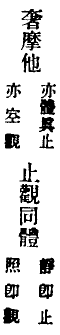



二单修假观



若诸菩萨唯观如幻(至)此菩萨者名单修三摩钵提。



唯观如幻，幻即假法也。先证涅槃空，达空法界，建立众生。深观幻性，即万象森罗。达森罗性，皆入幻假，为之变化。世界皆由自证觉性，谓之佛力。非是果佛加被之力，为之佛力。此是自觉性，觉即佛也。自己佛力，种种作用，应遍无穷。出假化导，不住大悲，行菩萨行。虽出假化利，不失寂念，即用方便随缘止，及诸静慧。慧即假观，止观双行，名单修三摩钵提也。



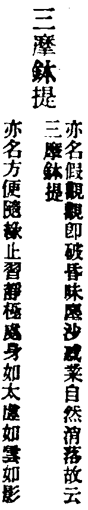



三单修中观



若诸菩萨唯灭诸幻(至)此菩萨者名单修禅那。



此圣人入圣流，先灭诸幻，未说出假度生。此唯用独存之智，圆照法界一相，无生可度，故云先灭诸幻，不取作用。如龙王行雨，渠自不动，作用自成中道。既息二边，空假归中，便证实相，名单修禅那。



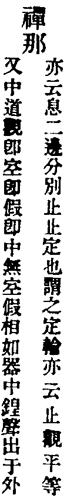



四双修先空后假



若诸菩萨先取至静(至)先修奢摩他后修三摩钵提。



此先用止，云先取至静止也。照诸幻者，用假观，照即观也。空假二药自行化他，故云起菩萨行。



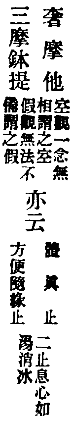



五双修先空后中



若诸菩萨以静慧故(至)名先修奢摩他后修禅那。



只将静慧两字分止观。静者止也，慧者观也。止观愈进，断烦恼，出生死。



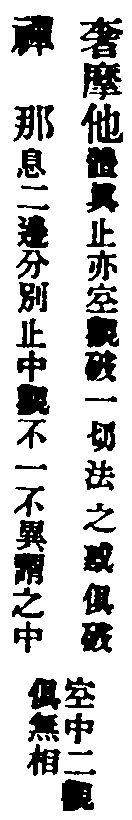



六具足修先空中假后中



若诸菩萨以寂静慧(至)中修三摩钵提后修禅那。



此圣先以空观治其内病，复用假观利物度生，后断烦恼证，寂灭中观也。



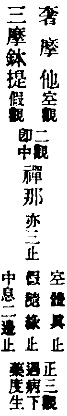



七具足修先空中中后假



若诸菩萨以至静力(至)中修禅那后修三摩钵提。



此圣空观体真止，猛勇力强，顿断烦恼，即生死结根断已，复用中、假二观度生，即随缘息二边分别，二止共成佛界。



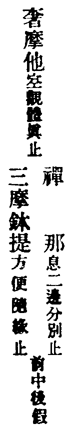



八具足修先修空齐修假中



若诸菩萨以至静力(至)齐修三摩钵提禅那。



此圣空观力强，以圆觉妙心顿断烦恼，於一念中普及有情，一吹大千世界即成，功用如是，故云建立境界也。



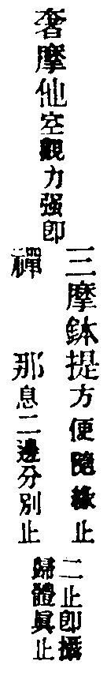



九具足修齐修空假后修中



若诸菩萨以至静力(至)奢摩他、三摩钵提，后修禅那。



以至静体真止，亦云空观力强，复兼假观，方便随缘，故云资发变化，以中为体。复修禅那，破无明惑。



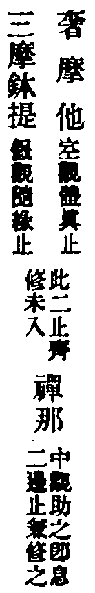



十具足修齐修空中后修假



若诸菩萨以至静力(至)奢摩他、禅那，后修三摩钵提。



以至静体真止，亦云空观力强，以中观润之，用资寂灭。后以假观变化现前。世者，世有方位。界者，界有界分。且如释迦於娑婆有缘来此，随方度生。



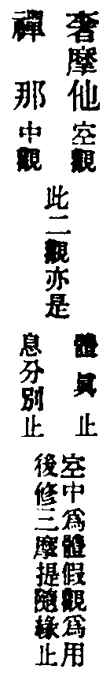



十一双修先假后空



(从此后七观用假在前。)



若诸菩萨以变化力(至)先修三摩钵提后修奢摩他。



此先用变力度生，随所度处，观空入灭。



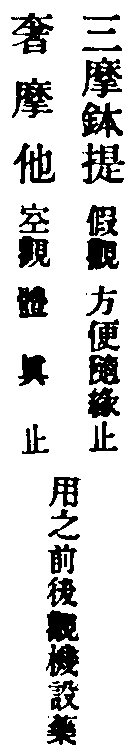



十二双修先假后中



若诸菩萨以变化力(至)名先修三摩钵提后修禅那。



此先用假观出建立假，故曰种种随顺。然后入真空涅槃，故曰而取寂灭居中道观。



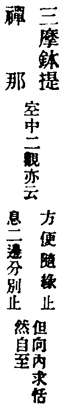



十三具足修先假中空后中



若诸菩萨以变化力(至)中修奢摩他后修禅那。



以变化力而作佛事者，此圣流出假化物，如傅大士示迹於婺州双林，有妻有子，种田作世间事。若以俗眼观之而自愧，以道眼观之无非佛事。安住寂静者，弥勒兜率内院常说妙法，身在人间而内院不动。古云：「颠狂弥勒到明州，布袋横挑柱杖头。饶汝化身千百亿，一身还有一身愁。」



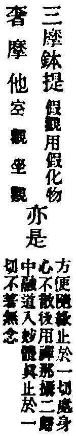



十四具足修先假中中后空



若诸菩萨以变化力(至)中修禅那后修奢摩他。



此菩萨先用假化度众生，皆以变化无碍作用。如持地菩萨常居渡船处，入水与人搬担，种种作务唯取一钱，岂不至静而取佛道？



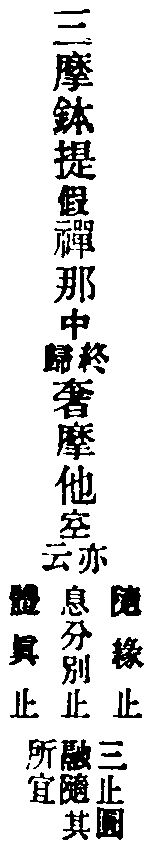



十五具足修先修假齐修空中



若诸菩萨以变化力(至)齐修奢摩他禅那。



以变化力并方便正是止，名方便随缘。止即假观，假观为先锋，空中为中军，故云至静寂灭。空中观即体真息，二边为止，二俱随顺也。



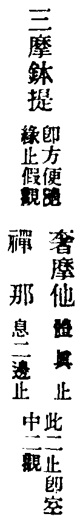



十六具足修齐修假空后修中



若诸菩萨以变化力(至)三摩钵提奢摩他后修禅那。



先假观、空观，二观皆依中道而起，种种变化，至静空也。



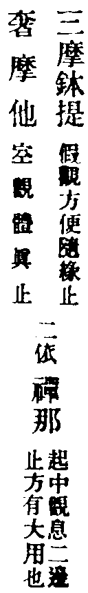



十七具足修齐修假中后修空



若诸菩萨以变化力(至)三摩钵提禅那后修奢摩他。



变化用假观，资於寂灭中观也。无作静虑，空观也。假中即是体用也。复入空，复入静虑，可谓坐筹帏幄，有决胜千里之功。



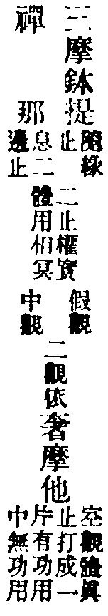



十八双修先中后空



(此去七观用中在前。)



若诸菩萨以寂灭力(至)名先修禅那后修奢摩他。



此圣用中道，即圆觉一性也。此性不守，发而为静为空，破一切相，荡一切法。凡起修以此观照之，立一切法，无法不足。



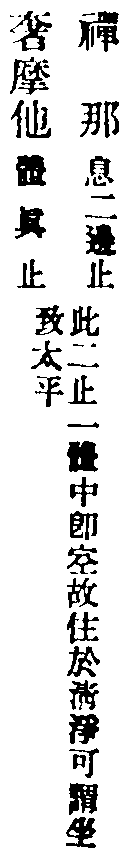



十九双修先中后假



若诸菩萨以寂灭力(至)名先修禅那后修三摩钵提。



此圣用中道寂灭，理上而用假，故云而起作用。於一切境用中道照之，故云寂用。随顺办一切事，无事不办。



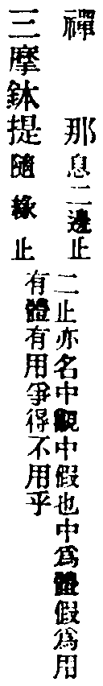



二十具足修先中中空后假



若诸菩萨以寂灭力(至)中修奢摩他后修三摩钵提。



此从中道第一义谛，起种种自性差别，亦用空观发用。如火得空则明，水得空则莹，变化万端，摄化一切，即假观之力。



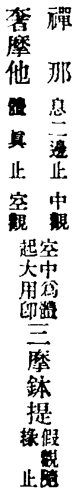



二十一具足修先中中假后空



若诸菩萨以寂灭力(至)中修三摩钵提后修奢摩他。



此圣用中观绝待为义。妙一切法，无越於中。只常智无缘，无缘而缘，无缘大慈，谓之无作自性。虽起作用，终归于空，作用假也。如鍾在架，扣之则鸣。鍾者，中道观也。鍾内中空，空观也。扣之鸣假，观中空假，三观发用也如此。



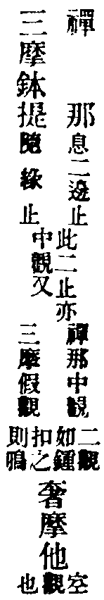



二十二具足修先中齐修空假



若诸菩萨以寂灭力(至)齐修奢摩他三摩钵提。



先修中观即秘密藏，包含种种诸法，於诸法中常照而寂亦寂而照，故云起於变化名不虗得。



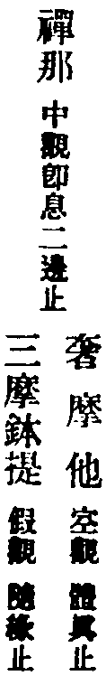



二十三具足修齐修中空后修假



若诸菩萨以寂灭力(至)后修三摩钵提。



此圣用中道寂灭力，资於至静。中道如水，至静如清，而起变化如水上波，波亦无穷，浪亦无尽，其假也如是。



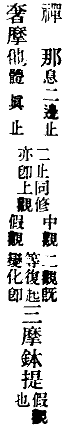



二十四具足修齐修中假后修空



若诸菩萨以寂灭力(至)三摩钵提后修奢摩他。



此圣流中道有力，并假观熏动，资於变化，至静空观，如太清天，清而且明，安致是中，左右逢原。



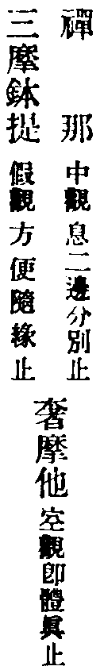



二十五圆修三观三止



若诸菩萨以圆觉慧(至)自性清净随顺。



此菩萨圆修三观三止，以圆觉慧圆合一切者，圆觉即中道第一义谛，亦名常住真心，亦云性净明体，亦云本觉，亦云空如来藏，亦是法华经藏。修而显之，具一切名，通一切法，在迷为恶、为愚、为痴、为三毒、为婬怒痴性、为杀、为盗、为邪见、为魔、为诸阿颠迦、为昏钝性障、为性恶，具无量名，为之性恶法门也。今言为佛、为圆觉，就修显立，名为真谛、为俗谛、为真俗不二、为中道。为真谛者，即凡圣、色声、因果等法，皆无自性，谓之性空，亦非研究而空，乃本来空也，是名空观也。俗谛者，於性空中，具足诸法，无所不遍，自他无碍，毫刹含容，亦即假观，本来具也。然此真俗，二无二也，混而为一，而未甞为一，离而为二，未甞二也，当知即中道观也。此三谛观，即圆觉性，寂而照，照而寂。圆合一切於诸性相者，性真谛也，相俗谛也，亦向真俗二谛，二谛即一，岂离觉性？以觉性遍在一切众生心中，生即是佛也。以众生心中，觉性在佛，佛即众生，生即是佛，佛即是生，生佛平等；觉性在地狱，地狱即佛，佛即地狱，其鬼、畜生、人、天，何莫由斯？於一切法上，用三观照之，了之於身心，脱之见解，非今始悟，由本不迷，佛也生也，一而已矣。(次结成正因。)



善男子！是名菩萨二十五轮，一切菩萨修行如是。



此二十五轮，本被机修证。若论机缘入道，若权若实，若偏若圆，有利有钝，何止二十五？经中自云：若诸菩萨於一轮中，有若诸关涉多少，故不能穷理尽性也。(次摠示修习法戒。)



若诸菩萨及末世众生(至)一念疑悔即不成就。



此示菩萨末世众生，须依教修之。若不依轮次，终成虗设。梵行者，即不婬欲，净身业也；寂静，净口业也；思惟，净意业也。三业清净，随智慧行，为之求哀忏悔。经三七日者，尅期也。二十一日中精进，谓之尅时。破障域意，修真二十五轮，各安标记，至心求哀。此言凡夫浅识，观力未著，须依事相。如假船过渡，用筏到岸。书二十五名於签上，於佛前诚心祷之，乞求冥力加被，勿起少疑心。祈祷忏悔已，至於三七日，诚心深固为之，即非造次。然后信手抽签，不宜简择。依结开示，或顿或渐。依教修行者，自的乐一门，随便修习。既胜劣难分，不能自决，故凭圣力以卜应修。当即依结以修，无得复贪餘观。若单修一轮，并圆修三观者，此名为顿。若兼修互修者，此名为渐。此渐非渐教之渐。此则同以圆觉发观之始，同缘实相，同以上品寂光为观体。但根有利钝，证有先后，为之渐也。不问迟钝聦利，但心怀疑悔，即不成就也。



尔时，世尊欲重宣此义，而说偈言：



辨音汝当知一切诸菩萨(至)不久证涅槃。



偈与长行无异义也。有唯除顿觉人，并法不随顺二句，不免重释。圭峰云：「唯除上根圆顿悟解之人，并及於一切定相之法。不随顺者，则不必具依二十五轮及道场探结等。不随顺法者，不取相也。既不随相，即随真觉，此乃顿入圆明，触目合道，不可加之以绳索，无疮自疣也。」是前知幻即离，不作方便等类，故云唯除之矣。



> 释迦老子性颠蹶，蜘蛛网捞水底月，  

> 辨音不解拈金弹，断贯索系天边鴈。  

> 二十五轮更互修，得便宜处便垂钩，  

> 锦鳞不在丝轮上，莫向烟波深处求。



------



## 大方广圆觉修多罗了义经心镜卷第五



**译者**：前住台州赤城山崇善教寺释智聦述



○净诸业障菩萨章



观夫圣贤垂训，以身者是禀父母之遗体，诚不可毁伤。但凡夫无智，执之为实，生我所相。《地持经》云：「世间受生，皆由著我。若离我著，则无世间受生身处。」《大论》云：「一切世间中，莫过名与色。若欲如实观，但当观名色。」名是心，色是质。是故净业障虽已自度，亦欲度人，於无迷闷处，起生迷闷，问於如来。释迦老子又於鬼门贴卦，好肉剜疮，穷四见源，故有此章来意也。



於是净诸业障菩萨(至)我等菩萨深自庆慰。



不思议事，只是如来因地行相，历恒沙劫，勤苦求索。古云：「无自然释迦」也。(次正问。)



世尊！若此觉心本性清净(至)使诸众生迷闷不入。



此问，圭峰、慈室两家都言不是，全不知都迷，意明已知觉性圆明，但疑凡心宛在，不合觉源。今谓正为凡夫迷於圆觉，未有修入之路，何关圣人已知？若已知，何须问佛？果佛已证，因人自迷。经有云：「使诸众生迷闷不入，使诸众生岂是圣者乎？」(次愿说展诚。)



惟愿如来广为我等(至)如是三请，终而复始。



圭峰云：「若直谈本体，则名觉性。若推穷差别之法，皆无自体，同一切性，即名法性。」今谓觉性、法性，一体无二。但说果人所修所显，名觉性。因人所迷中修所显者，名法性。法性通一切法也。(次许说戒听。)



尔时世尊告净诸业障菩萨(至)及诸大众默然而听。



一大藏教，百千三昧，无量行门，皆是佛之方便，开甘露门。若究本源，生佛平等。一切诸法，皆是佛法。佛法即实相，实相即诸法。只为众生在迷，圣人布路，作筏度人，谓之方便也。(次正说。)



善男子！一切众生从无始来(至)认四颠倒为实我体。



天台云：「神我本不可得，而未见道者，悉於心、色、四大、五阴、根、尘、识等法中，妄计有我、我所。」计我之心，历缘甚多，今略辨四见(出《法界次第》)。今云一切众生从无始来，但世间所作之法，皆有创始，如起屋造宅，皆有始也。唯此一念识心，无始初时，只云轮转生死，如今身现在。要知父母未生已前，我在何处？将何为始？故云从无始来。今且从风火搏我识神入母胎，揽二滴为身，即此谓之妄想。此滴本非我有，父母遗弃，妄认之为己有，为妄计色、受、想、行、识，此五和合，如草头露，暂聚少时。又如五指成一拳相，五阴为身，亦复如是。况凡夫不了，执此假名而为我等。经云：「我者，於五阴、四大、根、尘、识中，若即若离，计我、我所之实，是名我见。人者，亦於五阴等法，妄计我是行人，妄计自身相貌为人。」荆溪云：「我以计内，人以计外。」众生者，亦於五阴、色等诸法，共成此身，计有我生，谓之众生见。寿者，亦於阴、入、界中，计一期报寿，若长若短，如人愿年百二十岁，此皆寿者见。荆溪云：「众生以续前为义，寿者以趣后为能。」凡夫既执我，认四颠倒为实我体。佛欲破众生妄执，与二乘人说无我法，二乘离我，成阿罗汉。(次憎爱由我起。)



由此便生憎爱二境(至)及与息念皆归迷闷。



因上妄执，计有我身，是名身见。身见既起，见爱即起。违我者憎，顺我者爱。如是爱憎，皆由执我。故云由此二境，即憎与爱。憎属见，即见惑，五利使。邪心观理，情迷颠倒。爱者，贪染之心，名之为爱。若於男女色身情迷，随心逐物，染者缠绵，通名为爱。爱属烦恼，即属思惑，五钝使也。因虗妄故，错认遗弃四大五阴根尘为身，已是虗妄。於上复生憎之与爱，谓重执虗妄。二妄相依，如氷与水，生妄业道，轮转三界，入於火宅。业道，即六道也。因兹妄业，有轻有重。善恶二业，亦分轻重。善业重，生人天中，则阿修罗。恶业重，则地狱，次则畜生、饿鬼。故曰妄见流转。或於人道中厌流转者，修四谛十二因缘法，证声闻、缘觉、小乘涅槃有为之法。此人少悟空法，达四大五阴本性空寂，不立我人知见，得小乘道，灭二谛。犹止宿草庵，入於化城，非究竟灭，谓之妄见涅槃。由此不能入清净觉者，以大斥小。小乘之智如萤光，岂可比大乘之智如杲日丽天？觉是圆觉，不入圆觉者，又觉照也，即清净觉相。非是觉相违拒，不是圆觉不容汝入。只为尔能入者，是小乘之智，自隔自碍，非觉碍汝。故云有诸能入，非觉入故。大圆觉智，破一切暗。灭萤光之小智，揭金粟之高明。动念，即凡夫也。息念，二乘涅槃也。凡夫二乘，皆皈迷闷。至此薰莸同器，不得不辨也。(次生死无明为本。)



何以故？由有无始本起无明(至)身心等性皆是无明。



《起信》云：无明为因生三细，境界为缘生六麤。今言无始者，即是根本不觉，熏习真如，生三种相：业相、转相、现相，故云本起无明。既是根本无明，内惑为因也。四大：地、水、火、风。此四围空，汝之无明妄识，於中假作空宰。若论不能降伏者，亦被他人所恼；不能忍辱者，二义不成，亦不成主宰。今论四大和合，心在五根之初，名之为主。《遗教》云：「此五根者，心为其主，成此色身，於中立我，且云为己主宰。」若心无慧眼，不能分别色心、四大、五蕴、根、尘、识等，皆是幻化空华，则身心等性，皆是无明生灭之法，不离虗妄。(次引喻。)



譬如有人，不自断命。



此喻爱欲也。前文爱欲为因，爱命为果，亦是无明为因，无明为果。《大论》云：「老死有果，所谓无明。无明有因，乃指老死。是故生灭皆从无明。」今明上说无明为己主宰，生起我爱，爱己色身，谁肯断命？既云爱欲为因，爱命为果，因果皆爱性，不舍任运，不自断命。若肯断命，应是舍爱。既不舍爱，三界不出。(次结成障道。)



是故当知有爱我者(至)相续求道皆不成就。



爱者，即是见爱烦恼。只为众生迷烦恼故(烦以喧烦为义，恼以逼乱为义)，恼乱身心，致使真明不发。今言爱者，即贪染之心。染著缠缚，通名为爱。此爱顺我者则爱之，逆我者则憎之。此之憎爱，皆我在虗妄浮心内。此虗妄心，体是根本不觉现行无明业识，未起善恶时，本自无事。但於名色阴界入等法中，起憎爱心。妄计我能养育於他，故亦计我从生已来为父母养育，故名为养育。今以憎爱养育无明，於内心中忽遇逆顺境界，便生憎爱。此是十六我人知见中第六养育见(出《法界次第》)。若以憎爱存心，憎则怨，爱则喜。怨恨见爱，总是情想。以此求道，去道转远。故云皆不成就。(次徵起标示四相：一、我相。)



善男子！云何我相？谓诸众生心所证者。



圭峰意谓所证者，此指罗汉证者尚有我相。今谓未然，我是十六见中第一名我见，只为名色阴界不了，妄计有我我所之实。吾佛恐人不识此见，此见潜在内心，难识其相，故云心所证者。虽云心所证，所证何相貌？下有喻晓之。(下约喻以释。)



善男子！譬如有人百骸调适(至)是故证取方现我体。



如人平常无病，痛痒俱无。忽少不安，加之针艾。针艾临体，方云有疼有痛。既知疼痛，始觉有我。故云心所证者，且就众生显我不是罗汉。经云：「谓诸众生。若是众生，用加针艾。」故云证取方现也。(下引例。直至等觉后心，尚有一品无明未破，我相未尽。)



善男子！其心乃至证於如来(至)清净涅槃皆是我相。



此例我相，不独凡夫众生有之，至佛亦有之。故云其心证於如来者，此是分真佛，不是究竟妙觉佛也。佛亦称我者，无法之我。此具我者，非凡夫情我之我。未证无生忍地，刀割火涂，皆是痛苦。圣人遇难，如割水吹光，何难之有。为凡夫未破无明，其病全在。若知佛地了知我，证涅槃所了知心，亦是我也。直至妙觉四十二品，无明破尽，百非洞显，万惑咸亡。如十五夜月，到此田地，无尔无我，无此无彼，无凡无圣，无善无恶，天堂地狱，净邦秽国，打成一片。故云佛身充满於法界，普现一切群生中。(次二人相。)



善男子！云何人相(至)一切诸者悉为人相。



智者《法界次第》云：「人相者，於名色阴界入等法中，妄计我是行人，异於非行之人，故名为人。亦计我生人道，异於餘道，故名为人。」慈室云：「须知后三相，皆依我相从根本而立。」荆溪云：「人以计外为人相。」《大论》云：「但於五众取相故，计有人相而生我心，以我心故生我所，我所心生故，有利益我者生贪欲，违逆我者生嗔恚。」此结使不从智生，从诳惑生，是名为痴。三毒为一切烦恼之根本。今言众生心悟证者，恐人误作悟道之悟，证道之道，故言非也。意云：以我若比异类我是人者，计是人相貌尊贵利益违逆等相，我人道胜，其实专自己身立人相也。悟是悟彼人，证是证我相貌富贵，故云悟已。超过一切证者，意云：我已过一切，人皆不如我，我能他不能，我会也不会，如是皆是超过，即不是证圣人境界，名为超过，故云悉为人相(不列圣人亦有人相未亡)。



善男子！其心乃至圆悟涅槃(至)备殚证理，皆名人相。



其心者，此指一切众生之心。龙女是畜生心，调达是地狱心，妙庄严王是邪见心，十法界皆云其心，除究竟佛非心。既存有心，有心生天，有心为人，有心为佛，乃至有心证涅槃，故云俱是。我者，心存少悟，悟我为人，非悟成佛。殚者，尽也，尽其理言之。错认己身，强立主宰，故名人相。(次三众生相。)



善男子！云何众生相(至)存有所了名众生相。



天台云：「於名色阴入界等法和合中，妄计有我生，故名众生相。」今谓初受胎时，揽父母遗弃，为有五事：一色、二受、三想、四行、五识。此五皆揽四大共成其体，彼时便有四大和合，五阴和合，假名色身，立我所相。众生者，众共而生故。众生者，五阴和合而生，如五指头束成一拳，此五成拳，故有拳名。五阴成身，假名众生，亦云众生见，亦云人见，於母胎中，便有此名，皆是妄计，非实有体。心自证悟所不及者，此因我人知见，自高自大，我是众生，彼非众生，此是我，自起高心，慢彼非我故。此有两不及：一他不及我，二者我不及他。下者一字，兼於自他，故下立譬云：我是众生，则知彼人说众生者，非我非彼。下再自释云：云何非我？我是众生，则非是我，此是我。既非他是众生，他亦非我为众生，则非我者，他非於我也。云何非彼？我是众生者，我既非他，他亦非我，我是众生。总结云：非彼我故，并非彼非我，是我而非彼，如彼亦非我。但众生妄情执有，分彼分此，有悟有证，如此皆是我人。而此我人所不及者，存有所了，立悟立证，皆是我人。妄想不离此五阴，聚而为身，名众生相。(次四寿命相。)



善男子！云何寿命相(至)存我觉我亦复如是。



寿命者，《金刚经》只云寿者，不言命。今言寿命者，寿者是於色心五阴中，妄计有长有短曰寿。命者亦於色心阴法界，计我命根成就，连持不断曰命。其命寿只一也。《大论》分为二，计我命根连持不断，以执此故，计有我身，名为身见。心照清净者，心便是命，命只是出入息气，气只是风大。此息风若不清净，则结滞。皆由此心，知一切法。知者智也，智即照也，照一切法曰觉。所了者一切业智者，此业即智，此智即业。以此无明业力，知於诸法。此智非一切种智之智，此是业上生。此智慧时，人号灵台。此智所不见，犹如命根。世间知命者少，此之谓也。若心知命有长有短，知是幻化。〈空品〉云：「心如幻化」，故云若心。照见一切觉者，照即知也，即知见了一切法皆是虗妄，故云觉者。下一者字，兼能觉智。能觉皆是尘垢，垢是四大五阴，根尘识皆为过患。能觉所觉，能知所知，并皆尘垢。能觉如汤，所觉如冰，故云如汤消冰。知冰消者是谁？能知所知，并皆无体，故云者字。若存我能知之知，觉我所觉境也。亦如汤冰，能消所消，并皆无相，故云亦复如是也。(次总标存我失道。)



善男子！末世众生不了四相(至)是故名为正法末世。



神我本是藏性，性不自守，随薰和合，於名色中妄计有我，不了四相，纵经尘劫修行，终不成圣。为未除我，火性未断故。除我是入道要门，大小乘若不除我，终非圣人。佛在世亦有如是，故云正法末世。今后五百岁中，法是正法，柰弘持者多以邪法误人，呵佛骂祖，皆正法末世。其法虽正，弘者曰邪，谓之末世也。(下徵问所以。)



何以故？认一切我为涅槃故，有证有悟名成就故。



今世间有一种学无生之术，欲不生灭。起此之心，已落生灭。反求之者，去道逾远。我是罗汉，我是无心，我已到家。以盲引盲，盲盲无穷。涅槃者，何法谓之涅槃？尔不识真理，二乘三界小乘涅槃，出分段生死，有餘涅槃。大乘破无明，登圆初住，证一分三德，大乘涅槃。佛是究竟涅槃。岂有纯是凡夫，三毒不断纤毫、婬怒痴性全在，何等涅槃可证？若将得神通，亦是涅槃。魔魅亦有业报五通，岂得为证涅槃？又大教斥小乘声闻缘觉，亦谓之邪人。迦叶自云：「未闻大涅槃前，尚皆邪见。」何况错认我人知见者。此如认鱼目如珠，以为到家，名悟名证，亦云我已成就。古有云：「是拣择？是明白？」若不择良朋胜友，别其见之邪正，不独自误，亦乃误他。其过可胜言哉。(次引喻。)



譬如有人认贼为子，其家财宝终不成就。



贼者，即六尘之六贼也。於色声香味触法之中，自相劫夺，家宝岂复就聚哉。此正言贼者，是无明业识。此贼无始以来，害我甚多，只不自省。此无明业识，亦谓之父子天性。父是天性，本觉佛性。流浪之后，父子相失。今日修圆觉，会天性，定父子。无明法性一体，父即子，子即父，贼即将，将即贼。若也错认，未免为他所害。(次问，终认我取证，何便妨於道。)



何以故？有我爱者亦爱涅槃(至)云何当知法不解脱。



佛法不可以有心求，不可心无心得，须以有心作无心用。今文云：有我爱者，爱心不断。求涅槃者，爱心是无明，无明不破。若以爱心求无为，去道远矣。伏我爱根者，如木只去枝柯，还复再生。若断木根，则永无生理，断根证真涅槃。暂伏爱根，如石压草，遇缘再生，即非究竟。外道凡夫，以伏为断，认为涅槃相，虽用药治病，执药为病，病根愈深，故云真生死，故名不解脱。不是法不妙，不解脱生死，自是汝用不得法。故经云：「盲者不见，非日月咎。」此法如入阵中用武器，善用者游刃不伤，不善用者挥戈刺吻，非止伤手，命亦难存。(次明我相未尽。)



善男子！彼末世众生(至)游戏诸根曾不间断。



末世中，即后五百岁，鬪诤坚固。学菩提者，道也。今时学道者，我见不除，纵少知见，便谓了证。如此之人，只缘不识真菩提路，妄入异路邪乡，以为真道。未证谓证，未得谓得。故云以己微证，为自清净。佛在世时，九十六种外道，皆是邪见。数中亦有通力者，尚属邪见。何况今时，唯以口业，诳惑众生。世无青白眼，随顺入邪乡。以盲引盲，同入火坑。佛悯此辈，以苦切之辞，拔济邪见，使归正见。故赞叹彼法，即生欢喜。便欲以邪化，济度其人。受者自谓已得彼之真道，可出生死。岂知生死重积，实乃迷中倍迷之人。弟子与师，俱从沦坠。若明眼人，善别淑慝。出其恶，指其妄。此人便生瞋恨，尽世之中，便为怨结。如是之人，只为我相不除，坚执我故，体是无明。第八识，亦名梨耶识。此我识，至究竟佛方尽。等觉菩萨，尚未尽我。此识微细，故云执持。潜伏内心，八识田中。既伏在内，游戏诸根，即六根在眼曰见，在耳曰闻。六根门头，贪色声等尘，顺则喜，逆则怒，总我执不断。所以我见居首者，谓若是也。(次结成障觉。)



善男子！彼修道者不除我相，是故不能入清净觉。



觉是圆觉，此性净之理，如白圭不容少瑕，或少瑕玼则不清净。瑕即我执也，若留我执，性不清净，如孤鶴不入鸡群也。(次正释其非。)



善男子！若知我空，无毁我者(至)众生、寿命亦复如是。



若知我空，此空是本来空，非作为空，亦谓性德之空。此空空一切相，具一切相，非空之空，非有之有。此空有本来性中自具，见喜不喜、见瞋不瞋，乃本有，何瞋喜哉？今我说者，不到此田地。因说故，人虽毁我，吾不生瞋。虽不瞋他，内念不息，暂时捺伏，唯不形於颜色，念中仍存。故云：若知我空，无毁我者。永嘉有云：「身与空相应，则刀割香涂，何苦何乐？心与空相应，则讥毁赞誉，何忧何喜？」然立我能说，是以不瞋。若起此念，能所未亡，有彼有我，皆为我相未断之故也。如佛世中，有二人窃人莲花，谋计云：「他人忽觉，唤云：『谁盗我花？』应当傚鸳鸯鸣，令他不疑。」一人果入池中盗花，主人云：「谁盗我花？」不傚其鸣。却乃应云：「我是鸳鸯。」为主所获。元本我之一字，毕竟未除，谁人不为此我病之所害？是以众生寿命之见不断。故云亦复如是。(次说病为法。)



善男子！末世众生说病为法(至)是故不能入清净觉。



如人有病，必服诸药。药到病除，乐亦应舍。或有人以药能治病，故执而不舍，药反成病。岂知疾病易医，药病难愈。精进修行能说之人，悉名为病根本。只为不识真性本空，致以说药为病。虽勒求道精进，不达我人性空，还生虗妄。学佛本为治病，久之反药为病，徒劳苦行。如佛世有一女人，厌身烧身。临将入火时，忽遇知识：「汝烧身厌身，仍不脱苦，其苦复苦。不达性空，纵烧千身，亦不离苦。譬如坏驴之车，驴厌车，坏了旧车。旧车虽坏，新车复来。不达无我、无人、无众生、无寿者，如鸟投网，无可出处。」心虽念念欲出，柰何无可出路。要求出路，古云：「游心法界诸心寂，如日依空不住空。」(次明将凡滥圣。)



善男子！末世众生不了四相(至)是故不能入清净觉。



此四见本是真如佛性，起妄计故，为此色身已为实有。又计我能解如来藏性即是我心，及四三昧是入道门，我是所行人。妄计我所解者是上人法，我所行者是如来行。如此解行，并是妄计，无非我人，於圆觉性终不成就，为有我见作主宰故。又有一种增上慢人，未得为得，未证为证，诈称善知识，现图利养。如经云：「昔有贫穷人逃於他国，诈号王子。彼国不识，以公主妻之。此人遇饮食间，常起嗔责。后有本国人，偶然见其公主说如上事。此客曰：『教汝一偈。他若起嗔时，便念此偈，其嗔自伏。偈曰：欠债逃他国，诈称为贵人。麤食是常食，何劳复作嗔。』此人嗔心果伏。」今增慢人诈云了证，邀求名利，嫉妬贤能，造地狱因，自不知觉。故云：由未断我爱，不能入清净觉。岂非诈也。(次趣果迷因。)



善男子！末世众生希望成道(至)则不能入清净觉海。



求道者，用心希望，亦是我慢不灭。若用心求悟，亦是我人。纵得一知半见，复入我乡。真道不在多闻，不在强记。《佛顶》云：「阿难！汝虽忆持诸佛如来十二部经，清净妙理，如恒河沙，不如一念修无漏业。」又云：「阿难纵强记，不免落邪思。欲漏不先除，畜闻成过误。」故经云：「惟益多闻，增长我见。」若要修真道者，须用圆觉寂照。散时止之，昏时朗之。勇猛精进，强软降伏。灭烦恼，发四弘誓愿(誓度生，誓断惑，誓学法门，誓成佛道)。观心愈进，则嗔爱谄曲，对境不生。复将所见之境，一一皆是圆觉。以觉照之，所对之境，如汤消冰。忽有障重，境界不退。求善知识，决择明白，庶不迷邪。见所求师，别起爱憎，则不能入清净觉海。



尔时，世尊欲重宣此义，而说偈言：



净业汝当知一切诸众生(至)究竟非成就。



○普觉菩萨章



禅本无病，病者非禅。病是自病，非病是禅。《净名疏》云：「禅者，佛心智鉴圆明，又翻弃恶。」如来纯净之智，本不有恶，恶即病也。圣人以禅为药，治众生病，岂可以病治人之病？今普觉快说禅病者，盖禅能治病，故云禅病。《法华》云：「善知识者，是大因缘，所以化导，今得成佛。」今求善知识者，言为人师范人。今末世中，己见不明，一盲引盲，瞎人眼目，说邪为正，自诳诳人。吾佛悬鉴将来，急说救病之方，略言四病，其实病则无量。然此四病，本自身生，身从心有，病根在心，禅无异路。但人心多端，悲智不同，遂成四病。若也覔病於心，何心是病？何心非病？作止任灭，方之可知。(下正请。)



於是普觉菩萨在大众中(至)如是三请终而复始。



禅体静，观体朗。禅则止心不散，观则照心不昏。大乘入道，以止观为筹幄，用定慧为先锋，破障坏魔，良由於此。今云快说禅病者，为去佛既远，圣贤隐伏。邪法炽盛，魔强法弱。金𨱎不辨，泾渭不分。说病为药，以邪为正。用璞郑璞，名同体异。若无正见，徒劳苦行。故云求何等人，而乃正之。法亦多种，邪法正法，恶法善法。以何等法，而作规模。行亦多种，有正有邪。九十六种，皆是邪行。因采花婆罗门，见比丘身生疮痒，以火炙之。外道见之，以火炙身为道，故有五热炙身。比丘不得命断，遂投崖。外道傚之，故有投崖赴火等，至有裸形持鸡犬等戒，皆是邪法。今云依何等行修之。病亦多种，见思病，尘沙病，无明病，身病，心病。二乘人不识真病，往於贫里，止宿草庵，皆是佛法中病。当以何法，去此二病。发心亦有多种，今求圆觉者，如何发菩提心。於是深识不思议境，如善则参五十三善智识，皆云：「我已先发阿耨多罗心，未知仁者如何发心。」如斯五事，并在末世。龙亡虎逝，正废邪兴。普觉如击石火，善逝如谷答响。(次戒听许说。)



尔时，世尊告普觉菩萨言(至)及诸大众默然而听。



发心修行，先求正知见人决择。(次正答。)



善男子！末世众生将发大心(至)当求一切正知见人。



大心者，菩提心也。修圆觉者，非大道为心，孰能成就大志。发大心者多，成佛者少。经云：「鱼子庵摩花，菩萨初发心，三事因中多，及期结果少。」鱼虽生子多，成鱼者少。为风涛浪击，损多成少。庵摩花开花多，成果者少。菩提发心，亦复如是，百人发心，未必一人成佛。如佛与阿难，过去空王佛时，同发道心。阿难乐多闻，释迦勤精进。释尊已成佛，庆喜为侍者。安世高与一人同修行，此人虽修行，嗔心多。世高云：「汝与我相似，不在我下。汝不戒嗔，将恐沦溺。」死后在閧亭湖，作大蟒虵，有千里威风，能分风送舟，受人牲灵祭享。后遇世高，现身相见，具说上事。尽将庙中所积金帛，与世高造寺，后生天。所以守戒在心，人之难能。今发心修圆觉，用寂照观心，亦须求正知见人，决择用心。最初一步若邪，终身为魔眷属。求正知见者，有云：用佛眼见在心曰知。只可云学佛知见，然后用佛知见，接化众生。非是唯独在佛，善知识通该凡圣，凡师人师也。佛世四信，灭后五品。普觉善用知见者，正问今时人，菽麦不辨，遇人先入者为主宰。避邪师如避蛇虎，如入蛊毒之乡，滴水不可濡唇。古云：「宁破戒如须弥山，不可被邪师熏。一念流入藏识中，永劫取不得。」(次出过德。)



心不住相，不著声闻、缘觉(至)不令众生入不律仪。



具大道心人，必不住相，不著有无，不醉声色。《金刚》云：「不著色声香味触。」此人心如虗空，如鸟飞空，不住於空。若住相之心，乃是凡心、二乘心、顽境、偏小妄心，并是小径，乃燕雀所游之道。若大道心，是佛境界，是菩萨境界，如大象所往蹊径。故云：「十善菩萨发大心，长别三界苦轮海。声闻止断见思惑，缘觉更侵习气。」无慈悲心，不度众生，如麞独跳，不顾后群也。正知见人，如良玉居山石间，混在人世，或现尘劳麤恶境界，非是虎其皮，羊其质。如取鱼垂钩，不免香饵，无饵鱼不吞钩。知识用香饵为佛事，网罗法界众生之鱼。如傅大士有妻子眷属，作世间事，梁武帝岂不识人？庞居士十万家财，载沉湘江，岂是抟财？临死云：「但愿空诸所有，慎勿实诸所无。」此二大士抟财妻子，仍赞修圆觉者，教令断欲，或为在俗者，教不罗欲，皆是方便，仍入律仪。《净名》云：「示受於五欲，亦复见行禅。」又云：「示有妻子，常乐远离。」此皆示现过患也。(次明如是四依四果人，可为师训。)



求如是人，即得成就阿耨多罗三藐三菩提。



如是人者，即四依，道眼端正。阿耨等九字，翻无上正等觉。善知识以正观示人，以律仪戒法防非，此人即得正心，行处即无上等。依此发菩提心，皆入萨婆若海。(下明入魔之人，自有正知见，不可不供养。)



末世众生逢如是人(至)种种过患心无憍慢。



释迦昔为国王，舍位求阿私仙学法。一千岁中，舍身为床座，仙人起坐於其上。又采薪汲水，千年道心不退，今得成佛。此岂非是不惜身命？又昔有野狐，为狮子所逐，逃命坠坑，无缘可出。此狐於深坑底，思惟自说偈：「可惜此身，不饲狮子。若饲狮子，亦自获福。我今枉死，空丧此身，无益於事。」天帝释遥闻狐说偈，下来见之，於坑上问狂言：「汝不惜身命，有正知见。吾今欲闻汝法，可以说之。」狐曰：「岂法师在下，弟子在上，便说法要耶？」帝释以神力出之。出已，亦未肯说。以衣叠之为座，请说是佛因地。如此之类，皆是规鉴末世众生求圆觉者。岂任𮌎臆？萨多波沦，敲骨取髓，以求般若，岂存过患憍慢之心乎？(次复以世法比况之。)



况复抟财妻子眷属(至)心华发明照十方刹。



世人只知用事，不知用理。事即是婬怒痴，性不善法。善即用理者，即婬怒痴，即大解脱门。佛为凡夫二乘人说，离婬怒痴。为菩萨说，即婬怒痴，皆是佛法。如《华严》和须密多，以婬法接人，呜者啐者，皆获三昧。鸯掘摩罗怒佛，持劒杀佛。喝佛云：「瞿昙，你住你住。」佛云：「你不住，反教我住。」鸯掘於一言悟性，放下劒，证阿罗汉。善用恶法入道者，谓之入魔。魔如佛如，一如无二如也。给孤长者，铺金布地，买园造寺。岂以聚财之故，害其为善知识也。佛弟难陀，在俗爱妻，不相舍离。佛去乞食，其弟难陀，将一钵饭送佛。其妻将一点唾抹夫鼻上，莫令唾乾归。引到祇园，强令剃发。佛令把袈裟角，游天宫。陀见天女，好，问天女曰：「尔何无夫？」天女云：「佛弟难陀，持戒来此为丈夫。」难陀为欲持戒，后成阿罗汉，授记作佛。岂可以著色之心，欺之不成圣证。仙预大王，杀五百婆罗门。仙预生天，五百堕地狱。如此经论，皆以迷逆为佛事。可谓莲出污泥，不生陆地。若迷中实相，即冰是水。恶具一切善法，性恶法门，亦理毒害。此如医者，善知诸病。若是善病，用人参茯苓，亦可疗病。别有热病，须以黄龙汤治之，即可。黄龙，粪清也，以瘥病故，不嫌药秽，思之可知。心华才朗，十方佛国，自然现前，潭清月朗也。(次明善知识有四病。)



善男子！彼善知识所证妙法，应离四病。



《法华》云：「善知识者是大因缘，所谓化导令得见佛。」《禅经》云：「众缘虽具足，开导由良师。」於善知识为观者，《大品》云：「佛菩萨是善知识，法性实际是善知识。」《净名》亦云：「道品善知识，由是成正觉。」《华严》云：「有善知识魔、三昧魔、菩提心魔，魔能使人舍善从恶，又能化人堕二乘地魔。」经云：「除诸法实相外，餘皆魔事。」如此等安得不辨？若也不识正知见人堪为依栖，则水浊珠昏，何暇息心？何暇修观？故云是大因缘。今云应离四病，此是为人师者，自己之病有四，即非其徒有四病也。今为人师者，自言所得深妙，非汝等境界，此真魔王所说。若真知识所证境界，如鸟飞空、不住空，亦自度空，度无所度众生，断无所断烦恼，学无所学法门，成无所成佛道。(次出四病，一作病。)



一者作病。若复有人(至)非作得故说名为病。



智者说止观，正为众生治此诸病。彼云：「近多附佛法外道。」又云：「此人依法起见，如是亦所得，亦复无边。」若不精详，是非难辨，舛谬邪正错杂，差之毫牦，失之亿兆。真实之法，辨之不出，玉石不分，自误误他，二俱堕落。况外人所见，亦谓说妙，外人视相，亦作佛形相，如镇头迦、加罗迦二果，颜色一般，一能杀人，一能活人。镇头迦如柿则善，不识者误服，为害之甚，纵依师教，恐堕二乘外道。魔王神我，全是缚法，非自在我，互相是非，以小所证为涅槃，方沉生死。爱处生爱，嗔处生嗔，虽有慈悲，只成爱见，虽傚涂割，终为强忍，虽具一切智，不出推度，虽是神通，皆是漏化。所学四围陀典，非总持之力，虽断钝使，如屈步虫，世医之治，差已更发。八十八使，集海浩然，二十五有，苦网无际，如斯之类，岂可认为真法？且如诸佛说空法，为度著有者，若有著空者，诸佛所不化。作病者，作是造作，作以身作。此身虗伪，假名为身。纵尔能现佛身，亦不可认为真佛。爱之即错，便随邪徒。如毱多尊者，化一外道。外道能现佛三十二相，与佛无殊。至狐有通天狐，能现佛身。若造作，作生、作佛、作人、作天、作魔王，善须甄别。我於本心，作种种行。此心虗妄浮心，多诸巧见。岂可信此虗妄，便取圆觉。况圆觉不属虗妄，亦非造作而得。故云非作得故。若依真圆者，即实相。实相即善法也。通名为法，亦名法身。若法身实相依而修，修时亦有。见实相，法身亦无。我能修圆觉，他不能修，不生我所相。亦须知能修之心，本性空寂。我心自空，罪福无主。虽不求作圆觉，圆觉自至。如镜中像，但得镜上垢尽，镜中像何所虑哉。(二任病。)



二者任病。若复有人(至)非任有故说名为病。



此四皆云病者，病是见病。爱佛、爱外道，都属见病，此任为病。此云任见之病，此病难医。若云不求生死，此是凡夫妄见妄病。不求生死，生死自至，堕地狱，轮回六道。二十五有，并是生死。不求出离，生死无际，岂非病耶？涅槃二乘所证，不求涅槃，不出三界。爱涅槃亦是见病，圆觉不在小乘涅槃中。若尔，所见生死涅槃，不是佛性。若著二边求者，尚且是病，何况都不求者，此病尤甚。生死涅槃，此二法堕落二边，永不成佛，故说为病。今时学佛学空，法要见性，殊不知空是第一病，空病难医。只闻空能坏一切法，不见一切法能坏其空。火得空故，烧坏一切；水得空故，荡散一切；地得空故，生育一切；风得空故，成一切法，坏一切法。何况人心著空，不为病耶？不是空不可用，只为用不得法。如人有病，服药治病，药反为病。只为众生不识本性空寂，不达性空，至以有失。性空本来空，不是作为成空。若不断生死，不求涅槃，则落二边见病。若要离二边病，须依中道第一义谛。若依而行之，则修种种功德，修无作行，言语道断，心行处灭，破诸颠倒，心心寂灭，任运流入萨婆若海，故说任心以之为病。(三止病。)



三者止宿。若复有人(至)非止合故说名为病。



止病者，妄心若散，当止止之。其散即止，是好良药，谁不服之？十方如来皆依奢摩他止之。今说为病者，是汝不善用止，故说为病。凡夫用止，其散虽息，不能用为四禅天、为魔王、为二乘、为偏菩萨、为坑、为穽。如《净名经》中，魔王领诸魔女来惑持世菩萨，魔谓菩萨言：「正士受是万二千天女，可备洒扫。」菩萨不识彼为魔也，乃云：「憍尸迦(帝释天主)！无以此非法之物要我沙门释子，此非我宜。」所言未讫，净名在前云：「此非帝释，是为魔来娆固汝。」尔时魔波旬念维摩不为所挠，欲隐形去而不能尽，其神力亦不能去，闻空中声曰：「以女与之，乃可得去。」魔以畏故，俛仰而与。维摩云：「诸姊！魔以汝等与我，汝等皆当发阿耨多罗三𦵧三菩提。」又为诸女说诸离欲之法，诸女得未曾有。魔复来白净名言：「居士！一切舍者是为菩萨，我欲与诸女俱还天宫。」净名云：「我已舍矣，汝便将去。」诸女言：「我於居士处有法乐自娱，不复乐五欲乐也。我今随魔还宫，居士以何法教我止於魔宫？」居士云：「有无尽灯法，汝等当学。无尽灯者，乐常敬佛，乐供养众，乐坚持戒，乐广行施。夫一菩萨开导百千众生，发阿耨多罗三𦵧三菩提心，譬如一灯燃百千灯，明终不尽。当以此法住止魔宫，将来佛道成就也。」若以无尽灯为止者，灯能破暗，在暗止之即明，在散止之即定，在吝止之则舍，在凡止之即圣。但善用不为病，不能用止外道也。用止变九十五种，皆是邪声闻、缘觉；用止只有餘涅槃；偏菩萨用之，如云外月出水花，皆是止病。今修圆觉，用以中道佛性、诸法实相、如如之理，为观、为境、为凭伏，行亦禅，坐亦禅，语言、动静、息二边，生死、涅槃、凡圣、声色、因果、依正、名利、富贵，种种诸法皆是二边，不著二边，亦不著中道法爱。如游大海，不假舟楫，不加橹棹，自然到岸。不如是学，是名为病。若中道妙奢摩他，空一切相，破一切惑，谓之体真止。此止是观境、观如如，直至金刚后心，不为病也。(次减病。)



四者灭病。若复有人(至)非灭得故说名为病。



灭为病者，皆由不达空性，取空像貌而行善恶。住空理者，此空盖有四人取之不同。小乘、声闻观灭谛为㭊尽为灭；缘觉观十二因缘，无明灭、行灭为至理，得缘觉证；菩萨用六度为至寂理为灭。小乘之灭不至圆觉，通人以幻为灭，别人以一理随缘为灭，如是三人皆不中理，尽是住寂理中为灭，故今说之为病。不达灭性本如来藏第一义谛，犹住门外止宿草庵。今明灭者，灭而不灭，生死涅槃不灭，众生不灭，佛也不灭，六凡四圣不灭，色心不灭，依正二报不灭，天堂地狱不灭，烦恼无明不灭，见爱不灭，八万尘劳不灭，一切陀罗尼门不灭，水火不灭，魔邪不灭，尽世出世间法、佛法、众生法都不灭。为之，世间相常住为俗谛，为森罗万象，为空如来藏，为不空如来藏，为常住真心，为性净明体，为毗卢遮那，皆显圆觉。一切法是圆觉体，万窍怒号是圆觉用。圆觉在众生生死中，在声闻涅槃中，亦在诸日用中。终日圆觉，未甞圆觉。如人说火，不能烧口。《楞严》云：「如我按指，海印发光。汝暂举心，尘劳先起。」会用生灭，灭本不灭。不能用之，生灭即灭。今言不达灭性，住生灭中，指灭为灭，坑穽为灭，如破块落空谷。今取大圆觉性，本来无灭，何须论灭？本来灭是本来空，何须更空？以性夺修，直指十二因缘，苦集灭道，生死无明，皆本不灭。故经云：「不断结使，而净诸根。」又云：「不住使海，父母所生眼，悉见三千界。」庞居士云：「难难，百硕油麻树上摊。」庞婆应声云：「易易，百草头边祖师意。」灵照云：「也不难，也不易，饥来吃饭困打睡。」今云：难非难，易非易，饥来不吃饭，困来不打睡。作止任灭满世间，究竟皆归第一义。(次结四病。)



离四病者则是清净(至)若他观者名为邪观。



有心曰邪，无心曰正。《行法》云：「观心无心，法不住法，灭谛寂静。」永嘉云：「心是根，法是尘，两种犹如镜上痕。痕垢尽除光始现，心法双亡性即真。」正观邪观，打成一片。若要降龙伏虎，莫学弄蛇手段。《金刚》云：「法尚应舍，何况非法。」安得不舍。(次令事善知识。)



善男子！末世众生欲修行者(至)如是修行方入圆觉。



众生用情立分别心，诸佛用理无分别念。经云：「於一切人，犹如佛想。」《戒经》云：「一切男子是我父，一切女人是我母，我生生无不受生。」学佛者用慈悲，不立人我。故云：末世修行，应当尽命供养善友，事善知识。善友有琢磨之功，知识有指迷之德。亲近知识，更须断除憍慢。来亲近者不得憍，为人师者不得慢。示弟子或有亲疎，勿起瞋恨。凡见如此逆顺境观想，犹如虗空，空无分别。既无亲疎，无憍慢，无瞋恨，若身若心，自然平等。此圆觉性，与一切众生皆有之，皆同体。汝亦圆觉，我亦圆觉。只一圆觉，无二圆觉。心、佛、众生，三无差别。以此清净心、平等心、无罣碍心入圆觉，如在羲和中行圆觉，无私隐也。(次戒憎爱。)



善男子！末世众生不得成道(至)自他憎爱亦复如是。



此经已除无明业识，为极说有无明。生我见即我执，有我执便有嗔爱喜怒。若能断我执，憎爱不生。既无憎爱，即无怨家。若见怨家如父母想，不应於父母起逆害心。於我自除憎爱，他亦於我亦无憎爱。故云自他憎爱亦复如是。平等慈悲，不求圆觉自至。何况以此妙心求於圆觉，如锦上铺花，岂不顺哉。(次发心誓度一切众。)



善男子！末世众生欲求圆觉(至)如是发心不堕邪见。



一切众生我皆令入究竟圆觉者，四弘誓中第一云：众生无边誓愿度。菩萨发心度如虗空之众生，举一愿而三愿相从。又云：无取觉者，不云我是能觉、他不能觉，彼能觉、我不能觉。到此无彼我心，不取觉、不取不觉，度与不度、断与不断、觉与不觉，无彼我相。如是心是平等心、法界心，虗空心是圆觉，寂照心是众生心，如是发心不堕邪见。圣人如是叮咛赞圆觉，以此照我自心与此合否？合者与修多罗合，若不合者名为妄想人而不为，吾末如之何也矣。



尔时，世尊欲重宣此义，而说偈言：



普觉汝当知末世诸众生(至)证觉般涅槃。



> 四病才出体，心华自发明。昨夜三更月，  

> 毕竟为谁清？



------



## 大方广圆觉修多罗了义经心镜卷第六



**译者**：前住台州赤城山崇善教寺释智聪述



○圆觉菩萨章



诸佛出世，为度生故。度生须说法，法即教，谓之修多罗教。教法诠理，诠理以辨性，见性以成佛，所以种种经论开人眼目。教眼开即解心通，解心虽通，无行则孤，故须依解以立行。解行相资，如膏助明，目足并进，清凉到已。今圆觉菩萨闻前开士一一立义，各伸其问，各陈其说，故吾佛拈花摘草，开明觉性。圆觉大士择所未闻，假说权宜，请问建立道场、安居处所。若用三观，何种为首？末世众生进道仪式，一经旨趣，总括於斯。



於是圆觉菩萨(至)如是三请，终而复始。(初请，二问。)



一、问安居。习大乘修圆觉行，先选住处，或阿兰若閴寂处，或处伽蓝，避喧求寂，远离阓閙。今云安居，且就伽蓝内有三种安居：前安居、中安居、后安居。佛在世九旬安居，亦云禁足，亦云护生。盖西竺分三际以辨寒暑(三际已释文殊章)，故佛以热际护生。热际，蜎飞蠕动咸出於穴。佛意慈念诸比丘出入蹂践物命，结业增冤，是以制禁九旬，不出九旬安居。始於四月十五日、十六日结夏，终乎七月十五、十六日休夏为自恣。《毗尼母》云：「比丘安居，若无缘事出界一宿，则犯制。」僧家以结夏为岁腊，不序年齿。腊者，接也，交接之义。今通涂问修圆觉行安居，未必问僧家九旬安居也。



二、问三种净观以何为首？奢摩他、三摩钵提、禅那，此三即空、假、中之三也。此三种为先用空？为先用假？为先用中？於空利者，已达法性，不须修假、中；於假利者，不须修空、中；於中利者，不须修空、假。若此三中各於一观不利者，则兼修，如二十五定轮互修是也。兹为具学大乘圆觉行者，故问之也。(次戒听。)



尔时，世尊告圆觉菩萨言(至)及诸大众默然而听。



安居修观即是方便，应属言教，悉是如来善权方便。(次正说。)



善男子！一切众生(至)下期八十日安置净居。



若立期限，必制日辰。制期者，域意修真，尅时破障。一大藏教，立四种三昧，皆有期限。如《法华》三七日为期，《光明》、《弥陀》一七日为期。不先立期，则如猿猴心散，野马奔逸，道业难成。故修圆觉，须依伽蓝，此翻众园。园是种殖之所，种殖道芽增长。(或云梵刹，或云招提，或云浮屠。隋时改天下寺院为道场，或云灵庙，为寺，为院，为莲社，为精舍，有多种名，皆修心练行之所也。)经制修行，有常坐，有常行，有半行半坐，有非行非坐。唯非行非坐，此云随自意。此三昧，行坐俱修得。若上三种三昧，具身开遮，口说默，意止观。第四三昧，於四威仪中，意起即觉。永嘉云：「行亦禅，坐亦禅。」或有缘事故，随分思察，亦是随自意。三昧中，诸经行法，且不局限，念起即觉。意起时，思惟观察，亦与修多罗合。如我已说者，如上已说二十五轮三种观法，如无他事因缘，即立期限建立道场。天台云：「道场者，清净境界，治五住糠、显实相米。」据此虽立三期，不专常行常坐、半行半坐。细观经意，乃随自意中诸经行法中，收此三昧中有善性、恶性、无记性。第四诸经行法非善恶无记，即是诸经所修行法。此收一切经，亦以身开遮、口说默、意止观，但为根有利钝故分三期，亦不专定满日数。若利根者，一七日中发明；若钝根者，百二十日中下亦然，不以期限为制也。如昔六祖闻诵《金刚经》至「应无所住而生其心」，忽然开悟；圭峰读《圆觉》至「既无我人，谁受轮转」而悟。大抵不入规矩、不成方圆。况《楞严》有云：「理则顿悟，乘悟并销；事非顿除，因次第尽。」岂新学舍范模而能入道哉？〈进学〉云：「业精于懃荒于嬉，行成于思毁於随。」是以道若未成，必藉思修而入。今云随分思察者，则成于思、毁於随之谓也。(次专思寂想入观，道其仪式。)



若佛见在当正思惟(至)稽首十方诸佛名字。



此明行三昧时，入道场设心用意。若佛在世，丈六金身、三十二相、八十种好、紫金刚体，当正思惟。未必止思佛容貌相好，且如《十六观经》韦提希问佛教我思惟。佛教修三种净业：孝养父母、行世仁慈、受持三归、具足众戒。此是答思惟。后以十六妙观答正受(即三昧)。今之思惟，又须身、口、意三业清净(三业清净有二种：○一、身三、口四、意三，三业清净；○二、身沐浴，意绝攀缘；三、口斋蔬)。更慈悲、行方便、摄心静虑，并是入道正方便，故曰当正思惟。若佛灭后，施设形像，心存目想，生正忆念，还同如来常住之日。悬诸幡华者，《楞严》云：「欲坐道场，先持比丘清净禁戒，要当选择戒清净者，结界建立道场，或道或俗，心灭贪婬，持佛净戒，合佛清净轨则，四外遍悬幡华於坛室中，四壁敷设十方如来及诸菩萨所有形相。又当阳张卢舍那诸大变化佛菩萨等。初七日中，顶礼十方如来，六时诵呪行道。第二七中，一向专心发愿。第三七中，一向持呪。至七七日，十方如来一时出现镜交光处。」此乃《棱严》建立道场，仪法如是。此云悬诸幡华，意同於彼，唯庄严之仪略尔。若依现行修忏法修之，经三七日，邀期稽首诸佛名字，如《棱严》三七日中顶礼发愿也。又如世服药，言三七日中已能感应稽首者，只礼忏法。礼佛时想念云：「能礼所礼性空寂，感应道交难思议。我今道场如帝珠，释迦牟尼影现中。我身影现如来前，头面接足归命礼。」礼佛礼法，亦应如是想念。(次道观未成，必有罪障，当求哀忏悔。)



求哀忏悔，遇善境界，得心轻安。



求哀忏悔者，如《行法经》云：「我今云何但见释迦牟尼佛，不见多宝佛塔恒在不灭。我浊恶眼，是故不见。作是语已，复更忏悔。过七日已，多宝佛塔从地涌出。以是知道业未成，必有三障之阻碍，应须发露己身先所作恶业忏悔。以自己忏悔之力，更求佛加被之力，魔障不起，护善境界，得心轻安。」梵语忏摩，此翻悔过。西国人云：忍义大似恼人，他人怒意云请恕，愿勿嗔责。天台云：「忏者首也，悔者伏也。如人得罪於王，伏欵求恕。又忏名白法，悔名黑法。黑法悔而不作，白法企而尚之，取舍合论。又忏名改往，悔名修来。又忏名惭，悔名愧。惭是惭天，愧则愧人。人见显，天见冥。」天台立三种忏：一者作法忏，二者取相忏，三者无生忏。作法忏，成灭身口意三业罪，此依戒门。取相忏，成灭性罪，此依定门。无生忏，成妄想罪灭，此依慧门。作法忏，如建道场十科，行仪精进，一一不失。餘罪虽灭，《大论》云：「如比丘斩草害命，二罪不灭。」取相忏，如《梵网经》：「见光见花，手中有罪灭字，闻空中声或感梦。」无生忏，如《行法经》：「一切业障海，皆从妄想生。端坐念实相，众罪如霜露。」此三种忏，随修一种灭罪。虽然得少轻安，亦如《楞严》云：「皆是方便暂得。」如是不作圣心，名善境界。若作圣解，即受群邪。若无生忏成，便登初住，分身百世界作佛，何止轻安而已。三忏悉是善境界，皆可显圆觉也。(次明动中静。)



过三七日，一向摄念。



三七日中，烧香礼佛，求哀忏悔，皆属造作，动而未静，如浊水挠之愈浊。今言摄念澄心归一，或专观空，或专观假，或专观中，或专念实相，或数息气出入，或一念法界，境观如如。摄心既久，忽不见身，不见心，如云如影，如琉璃含於宝月。无明妄心自消，圆觉妙心自显。(次明遇夏安居。)



若经夏首，三月安居。



上问安居，则是修圆觉人别卜閴寂，置道场处所。今言安居，是佛方便。修圆觉之人，如遇夏首，僧家禁足九旬不出入，檀越送供，各自修真。修圆觉或别安道场，用归众结夏。有结期不归，恐妨结夏；归，又妨忏期入观。遇此境界，或恐疑虑其进修，佛别出其圣制，使不妨正修。故云：若经夏首，三月安居。(次出大乘修圆觉意。)



当为清净菩萨止住，心离声闻不假徒众。



此明大乘修圆顿行，不比小乘声闻缘觉用心不同。菩萨以法界为心，绝待为念，观法界众生是我父母眷属。《梵网》云：「一切男子是我父，一切女人是我母，我生生无不从彼受生。一切地水是我先身，一切火风是我本体。」地水尚犹自身观之，何况草木江河。大地皆我自身境界，何况有情蠢动含灵而不度脱。菩萨如此用心，与二乘顿别。声闻自调自度，怱怱取证，怕怖生死，如鬼虎蛇。只要出离，不𮨇众生。若望大乘，霄壤悬殊。今云菩萨止住修圆觉者，专用寂照，用观深切。尽虗空，遍法界，含裹十方，无一众生不在圆觉心内。依正二报，皆是常寂光。若身若心，皆是毗卢。如此身心，安可以时限制之。不限制结，一念中度尽众生，一念中要取正觉，岂局九十制夏。制结夏者，依律小乘制身心自行，非存大志。心离声闻，不假徒众者，大有意哉。宜自详悉。(次明依制修圆觉者，别立仪式。)



至安居日即於佛前(至)大因缘故不系徒众。



此意别於静处立圆觉道场，不入小乘千二百五十人祇园结制之限。自於圆觉修心，或经夏首，只就道场自结制期，所以云不系徒众。若小乘声闻结制之日，仍於佛前对首作法曰：「我某甲今依甚处僧伽蓝大界内，前三月夏安居，房舍破，修治故。」是今时僧与佛世结夏言词一般。今立大乘菩萨道场，既无徒众，对佛自制身心，自立言词，不与小乘语同。故至安居日，即於佛前作如是言：比丘男僧，比丘尼女僧。西竺以男称那，以女称尼。比丘飜乞士，以乞为活，不求邪食，不立常住。优婆塞清信男，亦云邬婆斯迦。优婆夷清信女，亦云邬婆索迦。亦族姓男族姓女，亦云谛信男谛信女。则今时受三归五戒善男善女也。此谓之四众。凡道俗依制结夏修圆觉者，对佛白云：「我某甲踞菩萨乘，修寂灭行。」菩萨云大道心成就众生寂灭。不生不灭为寂灭，不是小乘生灭之灭。同入清净觉相者，是诸法空相，不生死相，不涅槃相。不生死非凡夫也，不涅槃非二乘也。今云实相是佛性，是常住真心，是性净明体，是空如来藏。是佛知，是佛见，是圆觉性海，是第一义谛，是实相理地。依此安住，是住毗卢藏，是住戒藏，是住因果藏，是我等见前一念虗妄心，不须他覔，空尽妄心，即空如来藏。若色若心，依正因果，凡一切诸法，皆是实相。依此住持，以法界为心地，安住一切众生，於此即成佛道。不依实相为住持，如何度生？如何得显圆觉？故云以大圆觉为我伽蓝。为我二字，指我自身心。伽蓝即道场，是我练心修圆觉处所。圆觉即法界，法界绝待为义，包色心依正十法界。天堂地狱，无不在乎其间，菩萨为若此也。此之身心，即平等性，无有一法不称性。智是大圆觉智，一切种智，无一法不现其中。若小乘涅槃，则系属有限量。今是大乘涅槃，无系属故，不局一法界。故云：「我今敬请，不依声闻，当与十方如来及大菩萨，三月安居。」(安居护生之意，如上释竟)。若大乘菩萨，安居一切众生，随所住处，安乐一切，不局制内制外。所以放生施食，乃长生符、不死药，故立戒以不杀为首。(次明三期日满，自恣无碍。)



善男子！此名菩萨示现安居，过三期日随往无碍。



明大乘结夏满足，谓之自恣。小乘作法，立二五德，对首出罪忏悔云：「众僧今日自恣，我比丘某甲亦自恣。若有见闻疑罪，大德长老哀慜故语我，我若见罪，当如法忏悔。」为之解夏自怨，此后出界游山无妨。今顿教圆修，亦满三月，安居期满，随往无碍。此非对五德之人出罪忏悔，无自恣忏罪辞，但云随往无碍。(次明菩萨不取声闻境界。)



善男子！若彼末世修行众生(至)一切境界终不可取。



此圣人要制，欲一念徧含法界三世如来、十方菩萨、法界众生，一念中度脱众生，一念心安乐众生，一念心中修菩萨乘者未成就使即成就，一念心中观十方如来在我心中成就正觉，在我心中安置诸子，在我心中住秘密藏。《法华》云：「安置诸子秘密藏中，吾亦不久自住其中。」其斯谓欤？若非如此境界者善用其心，非此心地终不可取。(次明空观。)



善男子！若诸众生修奢摩他(至)百千世界亦复如是。



此三观明文，圆觉未到此土时，《涅槃》亦出三观，奢摩他者是也。又出《璎珞经》，明次第三观，谓之空、假、中。至下卷云：佛顶发放一切光，复集十方百亿佛土诸菩萨众，即於众中告文殊、普贤、法慧功德林、金刚幢、金刚藏、善财童子：「汝见是众中敬首菩萨，问三观法界诸佛自性清净道，一切菩萨所修三观法门否？汝等各领百万大众，皆应修学。」又《大论》云：「因缘所生法，我说即是空，亦名为假名，亦名中道义。」此智一心三观所出之明文。今云奢摩他，曰空观也。空者，以至静为义。静则如浊水，澄之则静。静则清净，净则何处不清？何物不净？《棱严》云：「净极光通达，寂照含虗空，却来观世间，犹如梦中事。」若取空义，即破一切法，无法不破。破者，荡也。荡坏烦恼、结使、爱缠，色心幻化，假立虗伪。若无空破之，则执之为有，受於轮回。若空治，则四大五蕰，我、人、众生、寿者，皆不著相。况众生无明业识颠倒，非空药治之，则生死不了。先取至静，不起思念者，此用三止中体真止。只谓我心含一切法，具一切法，一切法皆我心。我今以此虗空，复息虗妄。止则息攀缘，止散心，即为寂心。心寂即静极，静极处万法清净。一一心念，如明月临於万象。故云：从於一身，至一世界，无非圆觉。如此净心，遍满法界。一世界中，有一众生，起一念心，以圆觉心了之，以大圆镜智照之，尽百千世界众生，皆悉能知之。先用空观，此观先锋将，逢山开路，遇水叠桥。破一切恶，莫若於空。散即用体真止之，昏即用空朗之。空一切法，先用空观，即奢摩他也。(下诫邪证。)



非彼所闻，一切境界，终不可取。



此言邪党，教人说邪空，偏小妄心，偏指清净真如，及顽空、㭊空、幻化空。凡夫不识，学此邪方，要治心病，真病转深，邪师过谬。又有一种，为衣食故，忍受诸苦，学於邪术，心劳力疲，纵学成就，身心俱苦。又有一种，附法外学，以自𮌎中，狂解邪见，附佛法所说，妄引经论，证自己恶知恶觉，以婬怒痴无妨般若，以烦恼不碍菩提，行禅坐禅，不须习定，错认名言，疑误后昆，原始迫以口给，滥窃佛法，贪图施利，岂知殃及来报，致此宁不寒心。诸佛设教，非此境界，终不可取，我师哀愍，其何以行之哉。(次明假观。)



善男子！若诸众生(至)广发大愿自熏成种。



此观以幻化为相，取观义。假观立一切法，莫过乎假。此假从本性空中，具一切法。十界、百界、千如、森罗万象、天堂地狱，皆本来性具，谓之假。此性具法，不损一法，法法宛然。假也者，立於一切法不造作立之，本来具也。以止言之，如上一切诸法，即是实相。遍相一切，随缘历境，安心不动，故名随缘方便止。《智度论》云：「一切禅定摄心，皆名三摩钵提，秦言正心行处。」若菩萨以度生出假化物，众生种种诸病，如尘若沙。菩萨法药，治尘沙病。慈悲忍劳，出没合变，种种现形，如观音、马郎妇、弥勒、傅大士之俦，皆肯綮修证，为法忘劳，分身散影。木瓶和尚、花瓶浴、懒瓒、粪火、黄独、文殊、普贤、寒山、拾得，皆是出假化人。故云：一切菩萨，依种种门，渐次修行勤苦三昧。若自凡至圣，则可以自熏成种。若也忆念在怀，十方如来，未甞不度生而成佛。发四弘誓愿，利益有情，当修三观。(下诫邪证。)



非彼所闻，一切境界，终不可取。



出假化物，涉世最难。虽分身百亿，内心不动。如妙庄严王，多逢声色，终被声色所动。又佛世有贫人，双生二男，一名双福，一名双德。方生四五十日间，因父去犁田，母出采薪，二子在卧内语话。父忽先归，见闻彼云：「生存贫贱之家，父母勤苦，情何可堪？」父惊异之，以告其妻，妻未之信也。后夫妻又出，妻先归，密伺之，二子如先说无异。妻云：「恐是精灵鬼魅。」欲积薪活烧。夫妇各抱一子，至田野处，佛眼遥观，急来救之。佛问其夫妻云：「二子抱去，欲何为？」夫妻说如上事，「今欲活烧。」佛云：「是迦叶佛时，两位菩萨，将入圣堦，忽邪心起，退堕至此，不可烧也。」佛为摩顶说法，二子皆证圣果。父母亦难须陀洹果。古人为见寸心难降，诫云：非彼境界，谓非真三摩钵提，随缘方便止，皆不可取。若取邪证，自生疮疣，为害非浅。(次明中观。)



善男子！若诸众生修於禅那(至)一切境界终不可取。



此中道观，亦名息二边分别止，即不一不异为之中也，即俱离寂静、幻化二相，既离二相，故名中妙一切法也。今先取数门者，此云六妙门，门即涅槃为妙门，为能六法次第相通，能至真妙泥洹，故云妙门也。一、数息门，二、随息门，三、止门，四、观门，五、还门，六、净门。修禅者先摄心在息，从一至十为数。行者为修无漏真法，先须调心入定，欲界麤散难摄，非数不能治之，故须善调身息，从一至十，则麤乱静息，心神停住，是为入定之要术，故云先取数门。二、随息门，细心依息，知出知入，故名为随。三、止门，息心静虑名为止。修禅者若凝心寂虑，心无波动，则诸禅定自然开发。四、观门，分别推㭊之心为观。五、还门，转心返照名为还。六、净门，妄波不兴名为净。今用数息为门者，是为定。定即止。智者云：「息二边分别止，定寂慧察，能发真明，出离生死。」以此止通后五门，其心清净，则万邪灭矣。纵不灭邪，亦了知生住灭念，分齐头数，断三界结使，不了知结使种种诸法头数。亦能行住坐卧四威仪中，分别自己出息入息念数，无不了知。亦知自己身中三百六十骨节，八万四千户虫，四大六根，众毛孔中，息出息入，无不观察分明。亦能知百千世界，一雨滴数，有如目击。故云：犹如目覩所受用物。非止定之功，孰能如是。今中观是名息二边，以止为体。只由心净极，如轩辕镜，则森罗万象，难逃影迹。凡夫修此，观成理显，造境即中。如驾大白牛车，直到清凉，岂小因缘哉。非此境界，断不可取。(次总结三观。)



是名三观初首方便。



方便者，如舟柢岸，始名到家，未渡迷津，须假智檝。今云三观初首方便者，随根量利，於何种宜於先修，如宜空则先修空，假中亦然，是佛第一方便，宜善思之。(次明徧修三观。)



若诸众生徧修三种勤行精进，即名如来出现于世。



三种徧修者，即总修三观也。中即空假，空即假中，假即空中。三法一种，不一不异。破一切法，用总空观。立一切法，用总假观。妙一切法，用总中观。此三观，如水与波。水者，空也。波者，假也。波即是水，水即是波，中观也。波水同体，假空亦然。又如用刀断物，用钻透窍，虽利用不同，铁则一也。法亦如是，以此三观，破一切惑，证一切智。如来出世，亦只如然。(次明钝根不成就者。)



若后末世钝根众生，心欲求道不得成就。



此言障重不得成就，如磨镜加药加功，道心坚固亦可得之。古云：「人一次学能之，己百次学之；人十次学能之，己千次学之。」果怀此志也，虽愚者必明，虽柔者必强。故下明力不遂心，令忏除惑业而起希慕也。(次勤忏悔。)



由昔业障当勤忏悔(至)求胜上心。



有障重加增上心，勇猛精进，深加观力，更助五悔。五悔如灰皂，用清水浣灌，障垢自去。五悔者，见行修法华等忏，皆有五悔。嫉妬谄曲，不得不先除也。(次明此不成而习彼。)



三种净观随学一事(至)心不放舍渐次求证。



如世医师治病，此药不痊，复投别药，病若变，药亦转，岂可以一药理百病耶？众生习业，非止一种，诸佛以一方便门，设百千种药方医之，服者皆得病除。故《楞伽》云：「如医疗众疾，无有若干论，以病差别故，为说种种法。」



尔时，世尊欲重宣此义，而说偈言：



圆觉汝当知一切诸众生(至)佛境便现前。



傅大士三观颂



独自精，其实离声名。三观一心融方品，荆棘丛中何处生。



独自作，问我心中何所著。推检四运并无生，千思万虑何能缚。



○贤善首菩萨章



《肇论》云：「以名求物，物无当名之实；以物求名，名无得物之功。功无当名之实，非物也；名无得物之功，非名也。」贤善首因十一位大士各问深义，虽释尊开示圆觉，廼谈性具圆觉，然未的指，是故亦问，立其名字。所以问名者，盖有召物之功，物有应名之得，圆觉即名也。陀罗尼即体，体即物也。此则名体相副，故云陀罗尼门流出圆觉。既存名体，必须奉持。奉即取也，持即心也。以取圆觉，持之於心，则众生若身若心，念念圆觉，常以寂照止观，如护身符，即心纯是法，与法相应。裴相国云：「血气之属必有知，凡有知者必同体。」一经旨意，无出於斯。



於是贤善首菩萨在大众中(至)如是三请终而复始。



名字虽是假名，无名则物无定名。如筌蹄之取鱼兔，非筌蹄则鱼兔无所获。故欲鱼必用筌，欲兔必用蹄也。猿鶴之类，谁与安名？麒麟凤凰，孰为作字？耕田凿井，皆无名中立名。劫初万物，无名无字，皆圣人依真以立名。如理能通，圣人开疏为道，如理能该罗，依真以作网。故伏羲畫八卦，神农甞药草，后稷播百谷，伯益凿井，货狄造舡，奚仲作车，蚩尤制五兵，黄帝造冠冕，以至仓颉制字，𨽻首筭数，蒙恬笔，蔡伦纸，如此之类，皆圣贤轨真理造之，济万民也。一大藏教，百千三昧，皆立名目。又如经卷，不以首题，何以区分？故祖师云：「假名中具三千法门。」是故名有召物之功也。名字既立，奉持修习，神物护持，至於流通他方世界，修之直至佛地。如斯四问，利益博哉。



尔时，世尊告贤善首(至)诸大众默然而听。(次正答名字。)



善男子！是经百千万亿(至)亦名如来藏自性差别。



《法华》云：「一切治生产业，皆与实相不相违背。」纵非今佛所说，亦是过去诸佛曾说，何况今之圆觉是如来藏性？故云恒沙诸佛所说。《金刚经》所谓有佛性种子，人感诸佛之所护念。此圆觉本元是如来成佛真体，佛体真实，安得不能守护？故云三世如来之所守护。十二部经，亦云十二分教。教能诠理为义，部者部类为义。一修多罗(此云契经，直说法相，即长行，云散花也)，二祇夜(此云重颂，亦应颂，即贯花也)，三和伽那(此云授记，即授记人天作佛也)，四伽陀(此云孤起，不重颂者名也，亦曰讽颂)，五优陀那(此云无问自说，亦云无我)，六尼陀那(此云因缘，说一切因起事)，七阿波陀那(此云譬喻，用扇喻月也)，八伊帝目多伽(此云本事，此说他人之事)，九阇陀伽(此云本生，此说菩萨行因本所行事)，十毗佛略(此云方广，谈理无碍)，十一阿浮达磨(此云未曾，有佛现种种神通，人云未曾)，十二优婆提舍(此云逐分别所说义，又云论义)。《法华》云：「我此九部法，随顺众生说。」小乘曰九部，大乘十二部也，其实大小相通。此十二部经，非独为清净眼目，语其旨趣，则四种悉檀，理妙域中，固非名号所及，化擅系表，又非情智所寻，致於遣累忘筌，陶神尽照，近超生死，远证涅槃，播阐五乘，接群机之深浅，该明六道，辨善恶之升沈，敻(休正反)期出世，而法无不周，迩比王化，而事无不尽，能愽能要，不质不文，自非天下之至虑，孰能与於斯教哉。清净眼目，理出於此。此经有五名，一名大方广圆觉陀罗尼，大方广即所立法也，大方是体，广即用也，此是空如来藏，具不空如来藏之用，又可常遍曰大，执持四方包愽曰广，亦可配法身般若解脱，亦如来藏之三德也。圆即寂，觉即照，亦是止观，寂止也，照观也，陀罗尼遮恶持善，圆觉是从定立名，棱严亦是大定。二名修多罗，了义飜契经，圆融定慧，非偏小所知，了义究竟显说，指权归实，约开显说，一切诸法，皆是实相，亦有不了义经，方圆不相入者。今即权是实，一念三千。三名秘密王三昧。如来秘要之藏，定善慧之异名。秘密王亦是能说之人。《棱严》云：「妙莲华王，十方佛母。」以密王三昧为人，即正心行处。净觉亦以莲华王为人解。四名如来决定境界。即坚固为义。大涅槃更无能过者，即不变义也。五名如来藏自性差别。圆觉妙性，性不自守，随缘作种种名。或云常住真心，或云性净明体，或云空如来藏，或云涅槃妙心。曰诸法实相，曰王三昧，曰真如，曰法界，曰第一义谛，曰无生妙理。此圆觉亦能入恶，随恶受名。为性恶，为性善，为理毒害，为诸阿颠迦，为昏钝性障，为生老病死，为成住坏空，为镬汤炉炭，皆是圆觉随恶受称。其实圆觉，非圣非凡，非善非恶，非生非死，非涅槃，非色非心，非天堂非地狱，非佛非众生。则凡所有相，皆是虗妄。若见诸相非相非相，即名圆觉。如是则终日圆觉，未甞圆觉也。(次明奉持。)



汝当奉持。



此五种名，名虽差别，其实是佛一路涅槃门。过去诸佛，悉已成就。现在诸菩萨，今皆入圆觉。未来修学，当依如是法。此是如来藏无漏不思议法。如人因事远出，未得还家。今日明了归家之路，父子相见团圆事，不欣乐奉持耶。(次明自证境界，不入三乘之手。)



善男子！是经唯显如来境界，唯佛如来能尽宣说。



此觉圆，即如来藏妙明心。元离一切相，即一切相。但世间众生，声闻缘觉，欲以所知心，测度如来圆觉境界，用世语言，入佛知见。犹如藕丝悬须弥山，终不能举。此言果人所证之法深妙，非小乘凡夫之所能及。又此经非世间语言三昧，亦非雕虫篆刻之辞，非是外道典籍，非声闻诸小乘偏圆权实之法。此是圆顿圆觉妙心。此法如火聚，四边不可取。若能取者，唯佛一人。到究竟即佛，如十五夜月，蟾光桂影，圆满无亏。出三惑，破二死，百千三昧，无量行门，一时显现。如百千灯光照一室，其光圆无际。故一切世间种种诸病，唯佛能医。故云唯佛能尽宣说。(次明依圆觉佛知佛见修之，直至佛地。)



若诸菩萨及末世众生(至)渐次增进至於佛地。



今言菩萨，乃因人凡夫末世，依上所立法制，用寂照止心，寂念专一，便不顿修，亦可渐次。只要道心坚固，加功进行，何患不成佛。其间有闻而不修，修而不证者，此人有障，更须礼佛忏悔，终久至於佛地。此非妙觉，佛乃登圆。初住菩萨名佛，亦百世界作佛，故云佛地。(次明圆觉，虽是顿教，亦摄渐修。)



善男子！是经名为顿教大乘(至)亦摄渐修一切群品。



此大乘教本妙觉明，与如来心不增不减、无渐无顿。今云顿渐者，为修学人根有利钝、障有重轻，虽精进而开悟有迟速、立行有渐顿，非教体有迟速、迷悟在机缘，名顿教渐修。《棱严》云：「佛告富楼那言：『譬如迷人於一聚落惑南为北，此迷为复因迷而有？因悟所出？』富楼那言：『如是迷人亦不因迷、又不因悟。何以故？迷本无根，云何因迷？悟非生迷，云何因悟？』佛言：『彼之迷人正在迷时，倐有悟人指示令悟。富楼那！於意云何？此人纵迷，於此聚落更生迷不？』『不也。世尊！』佛言：『十方如来亦复如是。此迷无本，性必竟空。昔本无迷，似有迷觉；觉迷迷灭，觉不生迷。亦如瞖人见空中花，瞖病若除，花於空灭。忽有愚人於彼空花所灭空地，待花更生。汝观是人为愚、为慧？』富楼那言：『空本无花，妄见生灭；见花灭空，已是颠倒。敕令更出，斯实狂痴。』」今此圆觉亦复如是，本无顿渐，但上机先悟、渐机次悟。若是圆觉之性本无利钝渐顿，今云亦摄渐修者，非小乘之渐。今修圆者，同缘实相皆用止观寂照之法，机有利钝、悟有迟速为渐也(次引喻)。



譬如大海不让小流(至)饮其水者皆得充满。



阿修罗，此翻无酒。初欲采四天下花，酿海水为酒。鱼龙之业，酿之不成，誓不饮酒，故云无酒。用手掌遮月，人间谓之月蚀。有大力用饮海水不竭，何况蚊蝱。此大乘教，亦摄小乘渐修人。(次明凡夫施实，不如闻经福胜。)



善男子！假使有人纯以七宝(至)闻此经名及一句义。



七宝者，金、银、吠琉璃、玻瓈、砗磲、玛瑙、真珠。三千大千，可为众多，尽以布施，比闻经一句，福皆不及。盖慧能趣菩提，施福不趣菩提也。(前是凡福，次明不如半偈圣福。)



善男子！假使有人教百恒河(至)宣说此经分别半偈。



药王菩萨为法焚身，雪山童子舍全身求得半偈。《光明》云满城盛火，应从中过，乃为法亡躯也。波伦打骨取髓，为求法故。世尊因地剜身作千盌灯，求得半偈。今云胜阿罗汉，罗汉是小乘，今是大乘顿机。众生可闻法，一超入如来地，如龙女一生便往南方成佛，不比小乘时长行远，此如灵丹点铁可成金也。(次明闻经不惑，由宿种善根。)



善男子！若复有人闻此经名(至)种诸善根闻此经教。



《起信论》说未入正定聚众生故，说修行信心：一、信乐念真如法故。真如法，诸佛所师，众行之源。二、信佛有无量功德，常念亲近供养，起发善根，求一切智故。三、信法有大利益，常念修行诸波罗蜜。四者、信僧能正修行，自利利他，常乐亲近诸菩萨众，求学如实行故。如《高僧传》中：高僧有十科，世之难学，虽有破群者，无麁不择细。如韩昌黎始未信佛法时，上论佛骨表，因此贬潮参大颠。颠云：「公虽过人，世智辨聪，是世间有之。汝胜晋时佛图澄否？」韩曰：「不及。」「汝比姚秦时鸠摩罗什否？」曰：「不如。」「汝尚不如此贤，况佛是大圣，天人之师，又安可破之？」后於大颠有发明。张无尽初年时，游僧寺，见佛书梵夹严整，怫然怒曰：「吾孔圣人，反不如胡人，人所仰重！」欲造无佛论毁之。在书院中思惟，深夜不睡。其妻云：「如何不睡？」张云：「欲造无佛论。」妻向氏云：「既是无佛，何论之有？当须著有佛论也。」无尽疑其言，遂阁笔。后因访一同列，见佛龛前有《维摩诘经》，信手开经，见云「此病非地大，亦不离地大。」乃叹曰：「胡人之语，亦能尔耶？」遂问：「有几卷？」曰：「有三卷。」借归看。其妻问曰：「读者何书？」「《维摩诘经》。」向曰：「熟读此，可造无佛论。」无尽竦异其言，於是归心佛乘。后参兜率悦，大有发明。此皆宿下缘种，今日契悟。《起信》云：「复有五门，能成信心：一、施门，二、戒门，三、忍门，四、进门，五、止观门。」彼文稍广，今录止观门。「止者，谓止一切境界，息诸外尘念。以圆觉寂照，照诸尘劳，息诸攀缘，故云止。」今之随顺奢摩他，体真止也。「观者，谓分别因缘生灭相。随顺毗婆舍那，此云观，昏即朗之。以此二义，渐渐修习，不相舍离。」又云：「若修止者，端坐正意，不依气息，不依形色，不依空，不依地、水、火、风，乃至见、闻、觉、知，一切诸想，随念皆除，亦遣除想。以一切法，本来无想，念念不生，念念不灭。亦不得随心外念境界后，以心除心。心若驰散，即当摄来，住於正念。是正念者，当知唯心，无外境界。即复此心，亦自无相，念念不可得。若四威仪中，有所施作，於一切时，常念方便，随顺观察，久习淳熟，其心得住。」如此修行，闻经之人，非於一佛、二佛下种，乃至恒河沙佛所，以见无种。不值此经，又安得闻？(次嘱累。)



汝善男子当护末世(至)恼其身心令生退屈。



《起信》云：「莫令此心堕於邪网。若众生无善根力，则为诸魔外道鬼神之所惑乱。若於坐中现形恐怖，或现端正男女等相，当念唯心，境界则灭，终不为恼。」龙树云：「除诸法实相外，餘皆魔事。」逢此境界，当勤正念，不取不著，则能远是诸业障。应知外道所有三昧，皆不离见爱我慢之心，贪著世间名闻利养。正修行人，善为分别。此吾佛最后教诲。至此流通意竟。(下诸天鬼神，各言护持初金刚。)



尔时会中有火首金刚(至)财宝丰足常不乏少。



金刚，梵语䟦阇罗波腻，此云金刚手(波腻飜手)，谓手执金刚杵以立名。《正法念经》云：「昔有国王有二夫人，一生千子，欲试千子当来成佛次第故，俱留孙探得第一筹，释迦第四筹，乃至楼至第千筹。第二夫人生二子，一愿为梵王，请千兄转法轮；次愿为密迹金刚神，护千兄教法。」依经，僧寺三门只合一身金刚、一身梵王，今为对故塑二金刚，非也。《楞严》云：「十恒河沙金刚密迹」，此八万亦未为多。火首摧碎等，未详所译。(次梵王众。)



尔时，大梵天王、二十八天王(至)当令安隐心不退转。



梵语迦夷，此言净身，居色界禅天。梵是西语，此云离欲，因中修梵行，不行婬秽也。今为天主，统娑婆三千大千世界，皆属号令，有言语觉观。世间虽修梵行者多，唯加修四无量心(慈悲喜舍)，故得为天主也。二十八天王者，欲界六天，色界十八天，无色界四天，总二十八天也。护国天王等，即护世四天王。《光明》云：护国四镇，即帝释天神将，常领八部鬼神，护弘持人，心不退转。(次鬼王。)



尔时大力鬼王名吉槃茶(至)我当使其碎如微尘。



郑玄曰：「圣人精气谓之神，贤人精气谓之鬼。」又有云：天神曰灵，地神曰祗，人神曰鬼。鬼者，畏也，虗怯多畏。又有威，能令人畏。或云：希求名饿鬼，从人求食，以活性命。《光明䟽》云：神「者，能也。大力者，能移山填海。劣者，能隐显变化。」肇云：「神受善恶杂报，现形胜人，劣於天，其身轻微难见。鬼类众多，不能尽释。」今言吉槃茶，亦名鸠槃茶，亦名俱槃茶。此飜瓮形，旧云冬瓜。此神阴如冬瓜，行至肩上，坐便踞之，即厌魅鬼也(梵语乌衣苏慢，此厌)。厌眼内不祥(本只作厌字，人厌下加鬼)。圭峰云：「食人精血，其疾如风。变化稍多，住林野间，管诸鬼众，号为王。」故云：大力鬼王与十万鬼王，护持经人，不令鬼神侵恼。(下结经竟。)



佛说此经已，一切菩萨(至)皆大欢喜，信受奉行。



佛说经通该凡圣，既闻圆觉妙心，实相常住，解圆即偏，同服醍醐，咸沾妙益，是故欢喜奉行也。此经后有加重说偈者，非也。圭峰不著，诸家不留，况世尊说经当机之人，故有重颂。今法会将散，唯是天龙鬼神各言护持流通，不须重说。又重颂被晚来末至者，至此时安有晚来也？



No. 254-B



> 四明水云客，京华野寺僧，吴云闭花经，  

> 白发注斯经。报国恩虽重，为法一身轻，  

> 圆觉大海水，饮者若蚊蝱。以蠡酌佛海，  

> 如鸡最后鸣，宝庆逢三禩，绝笔听秋声。  

> 皇图呼万岁，宰辅茂洪勋，庶民欢乐业，  

> 四海庆时清，甘露门重辟，俱游大觉城。



圆觉寂照，迺十二部经之眼目，二六开士之权谋，绝纲大教，秀发圆乘。闻一句义，超七宝布施福；锓梓流通，胜河沙罗汉果。虽壮心注解，盖力乏锥刀，积寸累铢，仅成五卷。今遇不显名檀越夫妇，发心施财四十万钱，圆成第六卷，可谓月亏而复圆，心开而意足。他日天上人间，龙宫海藏，花台标名，是为不朽矣。铭曰：



> 福报不在频[幻-ㄠ+口]祝，天上人间相随逐，  

> 发心已成佛果因，龙女献珠称疾速。  

> 我今称赞是圆乘，福利有情并眷属，  

> 忏除罪垢净瑕疵，净土纹成亲礼足。



> 绍定改元八月中秋日智聪　谨题



No. 254-C



昔以大慈尊尊，已知末劫众生，竞贪瞋痴，沦三涂苦，迺金口宣说诸大实事，使众生见闻知觉，种诸善根，同成佛道，可谓老婆心切。厥后号为大乘经典，流传於世，信向者不知几亿万人矣。今四明聪讲主，於讲究大乘之中，摭诸佛髓，纂成要诀，名《大圆觉心镜》，不啻十万餘言，皆提撕菩萨之请问，阐扬佛祖之叮咛。观之者了明奥旨，想之者亲礼慈容，味之者如餤醍醐，化热恼为清凉境界，则聪老此心又切也。(谦)既观胜兹良因缘，乃办肯心，书成部类，觊广布流。又恐岁月泯糜，化於众缘，锓木共期，播传绵永。



旹皇宋绍定改元岁次戊子孟秋望日



从义郎　李谦　谨志



No. 254-D



永正三年丙寅三月廿有七日，伏值荣林智忻首座二十五年远忌之辰，某怿烦良友数员，大手笔而书圆觉了义径聪师《心镜》六卷，所鸠善因，奉为忻大姉庄严报地。伏愿三界迷徒，顿证圆觉本性；四生群类，俱生清泰乐邦。



前慧峰自悦守怿，暮龄六十三。

