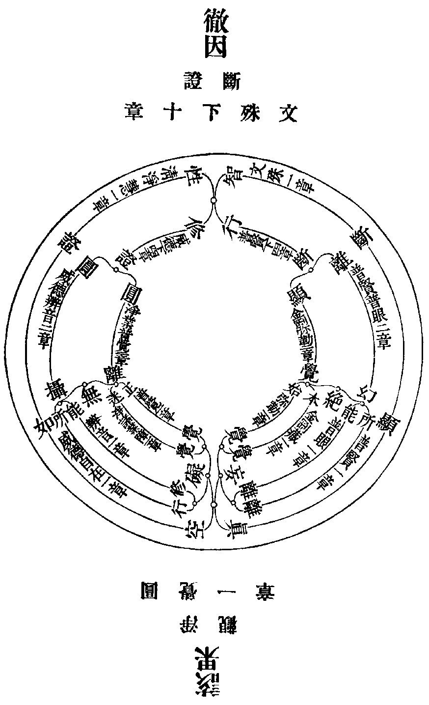
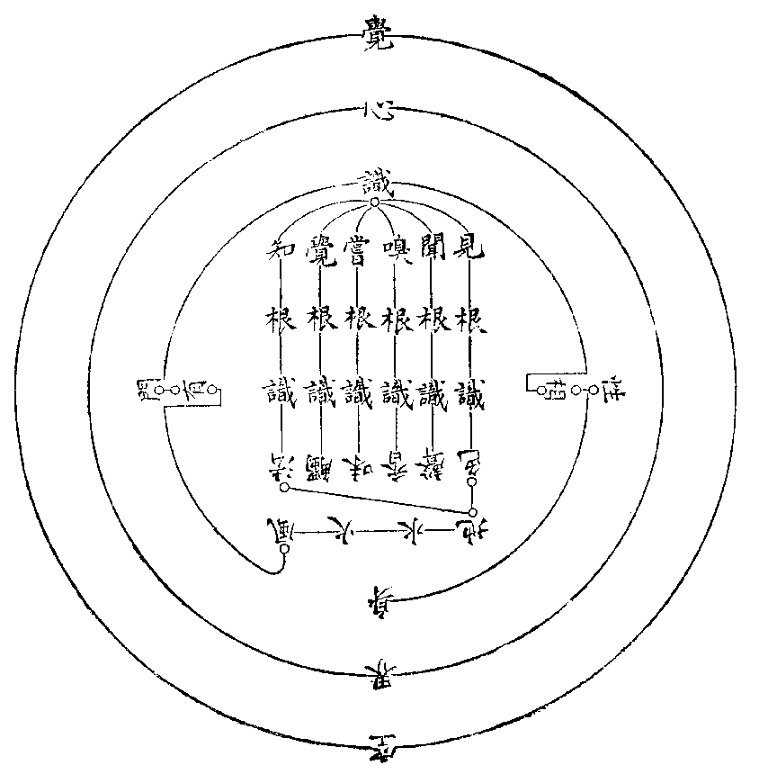
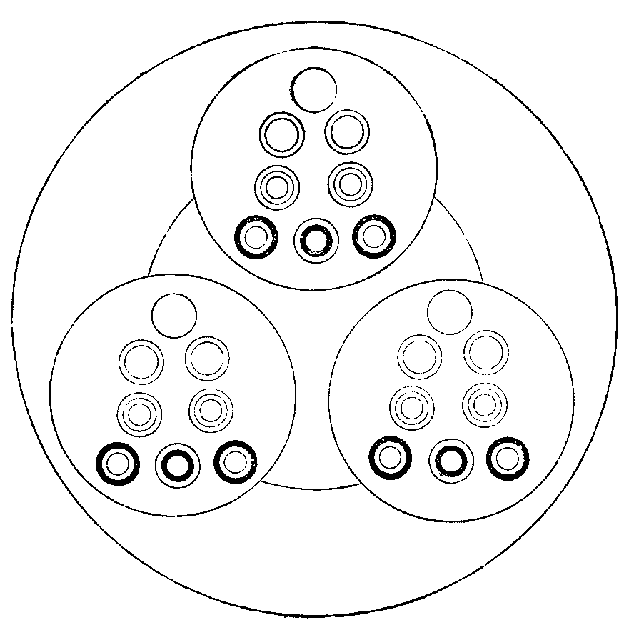

# 圆觉经句释正白



> **藏经**：卍新纂大日本续藏经（新纂卍续藏）　**册次** 第 10 册（X10）　**编号** X0262　**部类** 经疏部　**卷次** 2 卷　**篇幅** 122,711 字

> **卷／品**：0 卷 · 2 品



---



## 目录



  - [No. 262-B 圆觉经句释正白序](#no-262-b-圆觉经句释正白序)

  - [No. 262-C 圆觉经句释正白序](#no-262-c-圆觉经句释正白序)



---



No. 262-A 圆觉经句释正白首卷



沙门　罗峰弘丽　著



沙门　在犙弘赞　较



教理



修多罗教，如标月指。指上之月，大圆觉心。是心也，即根尘、即法界，绝思惟、冥敷量，本一切皆证，而无分於诸佛、众生者也。爰因迷念，皆证之各各不无，遂各各执有；未思各各不有，斯各各不无。失所无证之皆证，是曰无明；如所皆证之无证，则曰妙觉。无明、妙觉分名，诸佛、众生立别，然实无所别也。无明者，无皆证之明，似有不有；妙觉者，妙无证之觉，真无非无。非无，滥同似有妙觉无明；不有，原本真无无明妙觉。即此迷，还此悟，法非相待，功无两操。是故当经无明伏断，妙觉成就，性相双显。指空华、比二月，呼醒梦人，除於梦事。譬钻火、喻消氷，磨明镜垢，现诸镜光。渐次非所语也，究竟其须知乎。括要言之，於圆觉中，无取觉者，离彼我、人、众生、寿者，斯则断无明之元首，洁清明之慧目，涅槃自性清净境界超过化佛幻影，入住法身三昧，平等本际，圆满十方，不二随顺者哉。云何无取？则如眼光，晓了前境，其光圆满之，得无憎爱成就，有无俱遣，净觉随顺之因地法行，斯则指上之月，大圆觉心，得不迷闷者哉。若不尔者，离四病法，圆三观修，了悟於名言间耳。求实证於根尘之无坏杂，徧满法界，自各各不有、自各各不无，如百千灯光照一室，融布无碍者未之能也。是用前陈教理，以便初心。



宗趣



教殊顿渐，理别宗趣。是经名为顿教，宗趣迥异常途。一佛因果为宗，圆满觉心为趣；圆满觉心为宗，圆炤觉相为趣；圆炤觉相为宗，永断无明为趣；永断无明为宗，圆炤觉相为趣。



一佛因果为宗者，「婆伽婆入於神通大光明藏三昧，正受一切如来光严住持，是诸众生清净觉地，身心寂灭，平等本际。」乃至云「於实相中，实无菩萨及诸众生，依此修行，渐次增进，至於佛地。」圆满觉心为趣者，〈文殊〉、〈圆觉〉十一章，展演断证修习，成就究竟清净。



又圆满觉心为宗者，〈文殊〉、〈普觉〉十章中所示修习成就。〈文殊章〉云「如法界性，究竟圆满。」〈普贤章〉云「诸幻尽灭，觉心不动。」〈普眼章〉云「始知众生本来成佛。」又云「一切法性平等不坏。」〈金刚藏章〉云「入於如来大寂灭海。」〈弥勒章〉云「一切众生皆证圆觉。」又云「根无大小，皆成佛果。」又云「便登解脱清净法殿，证大圆觉妙庄严域。」〈清净慧章〉云「一切障碍即究竟觉，有性、无性齐成佛道。」〈威德自在章〉云「无上妙觉徧诸十方，出生如来，与一切法同体平等。」〈辨音章〉云「以圆觉慧圆合一切，於诸性相无离觉性。」〈净诸业障章〉云「佛说是人渐次成就，求善知识，不堕邪见。」〈普觉章〉云「尽於虗空一切众生，我皆令入究竟圆觉。」圆照觉相为趣者，〈文殊〉、〈普觉〉十章中，所示修习觉心清净。〈文殊章〉云「皆依圆照清净觉相，永断无明，方成佛道。」又云「有无俱遣，是则名为净觉随顺。」〈普贤章〉云「得无所离，即除诸幻。」〈普眼章〉云「譬如眼光，晓了前境，其光圆满，得无憎爱。」〈金刚藏章〉云「生死、涅槃，同於起灭，妙觉圆照，离於华翳。」〈弥勒章〉云「与其同事，化令成佛，皆依无始清净愿力。」〈清净慧章〉云「法界海会，照了诸相，犹如虗空。」〈威德自在章〉云「此三法门，皆是圆觉清净随顺。」〈辨音章〉云「一切如来圆觉清净，本无修习及修习者。」〈净诸业障章〉云「如汤消氷，无别有氷，知氷消者。」〈普觉章〉云「当求一切正知见人，心不住相，不著声闻、缘觉境界。」又云「所证妙法，应离四病。」又云「了知身心毕竟平等，与诸众生同体无异。」又云「於圆觉中无取觉者，除彼我、人一切诸相。」及〈圆觉〉一章「非彼所闻，一切境界终不可取。」



又圆照觉相为宗，永断无明为趣者，〈文殊〉、〈弥勒〉五章，知空华，无流转，木既尽，火还灭，磨垢尽，镜明现，销金鑛，复本金，断诸障，证圆觉。



永断无明为宗，圆照觉相为趣者，〈清净慧〉、〈普觉〉五章。首已断，无断者，妙法门，随顺觉，顿觉人，并法除，有能入，非觉入，究竟觉，无取觉。



此之宗趣，盖以法界圆同一觉，十方宁有异生？於无生中妄见生灭，升沈流转，迷方性觉，伪号众生，失本成佛，可深怜悯。是故诸佛以一大事因缘出现世间，开示悟入圆觉自性，令断有生之妄见，皆证成佛於本来，是故当经一佛因果为宗。然非修习觉心得成就者，得所无修，亦无成就，无能证知。诸佛世界犹如空华，一切众生皆证圆觉，是故圆满觉心为趣。是觉心也，如法界性，徧满一切，平等不动，如镜照诸像、如珠映五色，在在全光，一一圆映，本无能所分剂边际，故极显发而极清净。众生迷影，妄立能所，斯成数量，隔碍法界，失本圆照，自性清净。若其复本圆照，离诸能所，幻影像灭，尔时便得无方清净、无边虗空，觉所显发，是故圆满觉心为宗，圆照觉相为趣。失所圆照，根本无明；无明永断，即是圆照。是故圆照觉相为宗，永断无明为趣。不失圆照，何有无明？欲断无明，还须圆照。是故永断无明为宗，圆照觉相为趣。斯二者先后相资，以法本非二者也。诚如磨镜焉，垢不尽，明不现；明不亏，垢不染。若其得磨垢之方，而未识全明之获，犹非所语於修习大圆觉心者，是故当经有如是之宗趣。



章脉



既明宗趣，合详章脉，得十二菩萨请问世尊垂教渐次，乃修习大圆觉心所不容己之指归者。



夫求自性觉果，不识本起觉因、究竟本末、随顺修习，则因果乖违，勤苦亿劫终归迷闷。是故文殊请说如来本起清净因地法行以及菩萨发心者终始因心之本末究竟也。照觉相，断无明，依因有无俱遣之随顺觉行，是名如来因地法行。是乃菩萨所因发心教化众生者，世尊示之详矣。



然照觉相以断无明，断无明以证实相，义含而语未显。末世众生蒙昧未解者，但闻身心之如幻，未闻离幻妄之身心，即证性觉之清净，不无迷闷，於即幻非所修、离幻无所修，取舍疑惑，不能成法解脱。是故普贤申问幻非所修，幻灭无修，无修不成解脱之疑。请教云何修行圆觉清净境界，而一切众生、种种幻化皆生如来圆觉妙心，犹如空华，从空而有，幻华虽灭，空性不坏。得承开晓，末世众生欲证圆觉，不动心源，一於离幻，疑永决矣。



然务离幻，须善思惟，得所住持，成就开悟方便。若其不善思惟，转成迷闷，不能入觉。是故普眼申问思惟方便，念身无体、念心无相，知於身心皆为幻垢，垢相永灭，十方清净，一切法性平等不坏，真善思惟，妙得开悟者哉。世尊示之详矣。



若其不善思惟，以轮回心生轮回见而辨圆觉，彼圆觉性即同流转，无能免於轮回，不可不为末世众生昭揭开显也。是故金刚藏陈疑申问，妄有真成始终三惑，伏请世尊显贵，皆是轮回思惟不能成就圆觉方便，令末世众生决信思惟离幻，先断轮回根本，以求圆觉。



是断轮回根本也是永断无明之方成佛道者，有所断即有所证，迷於断即迷於证，更为明决。末世众生斯决信於思惟离幻之正方便，以成圆照觉相，永断无明者哉。是故弥勒申问，欲游如来大寂灭海，云何当断轮回根本者，盖以决之当断也。及轮回种性者，盖以当断之所应知也。及修菩提差别者，盖以因断之所现证也。入尘教化方便者，盖以成就众生，於断轮回、修菩提同入净觉，见无不成佛之众生，斯永断於无明，而究竟性觉也。轮回故不成圣道，轮回因爱为根本，差别性无明显出，教众生令舍爱化，成佛依净愿有斯。世尊详示末世众生，当无不务断乃轮回根本无明，以成佛道者。



设未底至於如来之决定境界、一切烦恼毕竟解脱，必有所未断之无明，然此非示断能知，要惟语证方晓。是故清净慧请重宣法王圆满觉性在诸众生、菩萨、如来证得差别，冀令末世众生知所证得，以知所伏断也。净解随顺、住觉随顺、灭碍随顺、满觉随顺，世尊差别详示，后教末世众生。於不起不息不加不辨之法门信解受持者，盖示不落证得之差别，直断无明之圆因修习也。



苟圆行不彰则受持不起不息不加不辨之法门，行人虞沈空寂，与诸土木同伦矣，是又一无明也。是故威德自在申问方便之非一，成悟觉海之游戏。世尊垂教，以净觉心取静奢摩他、以净觉心观幻三摩提、以净觉心寂灭而禅那。此三法门摄无量方便，要皆根本一净觉心。是净觉心也，不起不息不加不辨之所成悟者也。



不悟觉心，难语觉行。既悟觉心，何乖觉行？寂照同时不二，随顺斯成圆觉，亲近修习，末世众生可无惑矣。成就修习於此圆摄法门，以无偏於寂照，是所求入於圆觉也。是故辨音申问修习之有几。二十五轮顿渐成就，以及末世修习三七忏悔，依结开示，世尊示之详哉。依此能修圆摄无碍，成就所行之圆摄无量，可不当知此妙法门非一非三，而即一即三，乃本起圆觉自性之清净随顺，无诸能所者也。无能、无所，何修？何证？可不当知修习此心之得成就者，於此无修亦无成就也哉。



然而难言之也。譬如有人不自断命，末世众生可輙语於证悟了觉之四心相解脱清净者哉？况也四相深隐，微细难知，非佛世尊莫能开晓。是故净诸业障有染污迷闷不入，净觉之申问其心，乃至证於如来，毕竟了知清净涅槃皆是我相，乃至圆悟涅槃俱是我者，心存少悟，备殚证理，皆名人相。了证了悟皆为我人，而我人相所不及者，存有所了，名众生相。心照清净觉所了者，一切业智所不自见，犹如命根。如是之证悟了觉所有心相，是乃无始妄执之我、人四相，成於染污迷闷众生不入净觉者，末世众生希望成道，无令求悟，但当精勤降伏烦恼，未断令断。世尊其底至之言哉！其决要之言哉！习菩提者可以知要矣，在究竟清净於能证心矣。



无能心之可证者，无所法之可取也。不达所法，圆离难语。能心清净，法因人示。求人依法，尤要要哉。是故普觉有求人依法之申问，以及修行去病发心之云何者，盖自利、利他，因地法行之本末究竟也。求正知见无住相人，彼所证法应离四病之作止任灭，逢是知识，舍身命见，断憍慢心，供养承事，是云修行。观彼怨家，如己父母，心无有二，即除诸病，自他、憎爱，一切种子尽於虗空，一切众生皆令入究竟觉，无取觉之我、人诸相，是所发心。世尊一一详示，真不舍无遮大慈、救世大悲，以觉心成就，修习方便，因十菩萨次第兴问，标指当时，示筏末世也哉。



如是修行，根无大小，皆成佛果，夫复何疑？未开晓者，道场安居，修观方便，新学菩萨更乐有闻，是故圆觉申问备此。



贤善首，即继以名字奉持，修习功德，护持流布，申问终焉。是乃毋容紊之庠序者，更喻明之。文殊问本起之因，如欲桃实枝头，索千年之核。普贤决离幻之疑，如示核甲坼而芽生，乃桃实之自。普眼请思惟方便，如示润土栽埋，灌溉以时，乃核甲坼之助。金刚藏陈疑三惑，防求桃核於土核，内外理穷，思惟弃栽种之事。弥勒问断修之性，则示无破核出仁，以俟芽生，及去蚀芽之蝤与桃芳之候。清净慧请证得之差别，则示红熟之桃实，裹根苗之桃核。威德自在，请方便之非一。



章次图







则示华开与华落，总垂实之缘因。辨音问修习之有几，则示飘风与湿雨，总开落於桃华。净诸业障问染污之不入，则示毋观华贪桃实，折向瓶中求老熟。普觉辨人法之正觉，则示老熟垂垂，曾不供人咬嚼者，是全根全苗之桃核也。圆觉问安居之方便，则示如何辨土与夫栽埋之法，於此全根全苗之桃核也。贤善首之名目等，则谓谁家不有此桃核哉。如此明示究竟教法以传，将见遍野桃芳，枝枝垂实，普界尽夸桃源僊境矣。可不明白了然於圆觉章次哉！



夫自性觉心，语因果则该彻，语断证则即离。全该全彻、全即离全者，自性觉心之因果断证也。断证因果，尤非二也。断之究竟处，即证之发觉心，是曰该果。证之究竟处，无断之最初心，是曰彻因。圆觉经教章次，实此因果该彻，断证即离之因次也。管窥偶窍其明，愿充如来使者，植分别半偈之德本，已详章脉，宣白如是，犹恐科判全不符於诸疏，不邀法门之信受，得扬圣旨於末世，因搆斯图，冀触目者一览即悉。全经之章脉，研所标科，因果铺十一章之纲，断证分十章之目，智行性修列目中之数，幻觉集行数之丛，摄离备修数之事，能所离而幻家具尽，始本显而觉微妙成，如斯为行，非断行之究竟欤？能所示而摄法门丰，迷正彰而离深奥极，如斯为修，非证修之底至欤？唯修之底至，底至於断之究竟也。故断有幻之能所，而修有摄之能所；断有觉之本始，而修有觉之迷。正以无迷觉者，无迷夫本觉也；成正觉者，圆满乎所始觉也。能所该摄，不圆能所，幻妄斯立，此其圆摄无碍，故乃离幻绝妄，是断证之行修一如也。若夫断证之智性不二，则智断之显真，性证之如空，有殊异乎哉？此十章所分之目，融布自在者也，为彻因之断证可知也。该果之净观奢摩他、三摩钵提、禅那，乃定乃慧，定慧兼该之修习也。定则因果乎证，慧则因果乎断，定慧兼该，则因果乎是断是证、无断无证。初学、久习修圆觉者，无不萃至之寂灭海也。圆觉当继普觉而兴问於修观之首方便，以显该果之修习，又可知也。是所铺十一章之纲，无紊如也。凡此者，无字出於胸臆，咸取本於经文，或者圆觉经教义味固如是乎，因之信受，随指观月，得鱼忘筌，圆觉伽蓝，人人径入，端藉斯图。



圆觉经句释正白科文



总科



○全经开(三)一序分  

二正宗分(二)(文殊圆觉十一章)一彻因断证(二)(文殊普觉十章)一在断智行(二)(文殊弥勒五章)一智断显真(文殊一章)  

二行断绝妄(二)(普贤弥勒四章)一离幻绝妄(二)(普贤眼二章)一决疑离幻(普贤一章)  

二示法离幻(普眼一章)



二显觉绝妄(二)(金刚弥勒二章)一决疑显觉(金刚藏一章)  

二示法显觉(弥勒一章)



二在证性修(二)(清静普觉五章)一性证如空(清静慧一章)  

二修证无碍(二)(威德普觉四章)一圆摄无碍(二)(威德辨音二章)一示圆摄行(威德自在一章)  

二示圆摄修(辨音一章)



二圆离无碍(二)(净诸普觉二章)一示圆离心(净诸业障一章)  

二示圆离法(普觉一章)



二该果净观(圆觉一章)



三流通分(贤善首一章)



别科



○初序开分(二)二通序(三)一指法重宣  

二表己述闻  

三分时别闻



二别序(三)一尊号显法  

二标处彰佛(二)一回身性土  

二现行性土(二)一该果彻因(二)一该果光严  

二彻因本际



二接因回土(二)一徧行随顺  

二现土教授



三列众显因(二)一初佛与俱(二)一彰数同因  

二称名扬德



二次众入住



○二正宗分文殊圆觉十一章



○第一文殊章



△智断显真开(二)一序述兴门(二)一序门蹑次  

二序门周三(二)一序述仪音(二)一序问威仪  

二述请教益(二)一请教因行(二)一请教彻因  

二请教了因



二结益末世



二序结终始



二序述垂答(二)一长行列示(二)一初序赞许(二)一赞请教益(二)一赞教因行  

二赞益末世



二许答嘱受(二)一嘱令谛听  

二受教默然



二次述正答(二)一示教因行(二)一如来因行(二)一本起清净(二)一示所本起(二)一标本惟觉  

二标起惟觉



二示所清净一初标断妄(二)一示能断照  

二示所断妄(二)一徵释(二)一初徵  

二次释(二)一释妄性相(二)一妄性真闻(二)一出诸妄性  

二喻显迷真



二妄性本妄(二)一出诸妄相  

二喻显本妄



二释妄因果(二)一迷真因果(二)一迷实相因  

二迷真性果



二立妄因果



二结名



二次彰清净(二)一无明本虗(二)一非实有体(二)一标显  

二喻明(二)一喻生无体  

二喻灭无体



二本无生处



二生死惟名



二因地法行(二)一标所修法  

二示能修行(二)一达妄照觉(二)一达妄本空(二)一妄能所净(二)一所执妄净  

二能执妄净



二妄本性空



二照觉如空(二)一照觉宝相  

二照觉净性



二顺觉成行(二)一顺觉徧满(二)一遣惑随顺  

二释遣成顺



二结名成行



二菩萨发心



二示益末世



二重颂总挈(二)△



△二重颂总挈(二)一序欲重宣  

二述说偈言(二)一挈旨示教(二)一挈旨如来(二)一挈旨本起(二)一挈旨示所本起  

二挈旨示所清净



二挈旨因地(二)一挈旨示所修法  

二挈旨示能修行



二挈旨菩萨



二挈旨示益



○第二普贤章



△决疑离幻开(二)一序述兴问(二)一序问蹑次  

二序问周三(二)一序述仪音(二)一序问威仪  

二述请教益(二)一请教所修(二)一正问离幻  

二反彰离幻(二)一初幻灭难(二)一设难同幻  

二设难同灭



二次迷修难



二请益得离



二序结终始



二序述垂答(二)一长行列示(二)一初序赞许(二)一赞请教益(二)一赞请所修  

二赞益得难



二许答嘱受(二)一嘱令谛听  

二受教默然



二次述正答(二)一示教所修(二)一幻灭觉显(二)一示幻生灭(二)一幻生因觉(二)一初标  

二次释



二幻灭还觉(二)一即喻显空  

二合喻彰觉



二觉示显(二)一示觉由隐(二)一隐成依幻  

二释明依幻



二示觉缘显



二离幻除幻(二)一标指应离(二)一应离妄境  

二本离妄心(二)一推本全一  

二详次离用(二)一离能幻用(二)一离六分别  

二离七执我



二离所幻用(二)一离八妄性  

二离性清净



二喻显得离(二)一初喻  

二后合



二示益得难



三重颂总挈(二)△



△二重颂总挈(二)一序欲重宣  

二述说偈言(二)一挈旨所修(二)一挈旨幻灭(二)一挈旨幻生因觉  

二挈旨幻灭还觉



二挈旨离幻(二)一挈旨标指应离  

二挈旨喻显得离



二挈旨得离



○第三普眼章



△示法离幻开(二)一序述兴问(二)一序问蹑次  

二序问周三(二)一序述仪音(二)一序问威仪  

二述请教益(二)一请教能修(二)一请思惟修  

二请开悟修



二请益方便(二)一前述迷失  

二次请悲诲



二序结终始



二序述垂答(二)一长行列示(二)一初序赞许(二)一赞请教益(二)一赞教能修  

二赞益方便



二许荅嘱受(二)一嘱令谛听  

二受教默然



二次述正答(二)一示教所修(二)一修行成就(二)一标果求觉  

二示因离幻(二)一修行渐次(二)一离幻修行  

二离幻渐次



二思惟住持(二)一离幻思惟(二)一思惟无身(二)一谛审合离(二)一审执和合  

二审在各离



二通达虗幻(二)一知处体虗  

二了相同幻



二思惟无心(二)一审心缘相  

二决心无相



二离幻住持(二)一示灭无灭  

二喻灭无灭(二)一喻显  

二合明



二方便开悟(二)一离幻方便(二)一示令知幻(二)一责愚迷幻(二)一标显愚迷(二)一初喻显(二)一喻本净觉  

二喻迷执有



二次喻明(二)一合喻显觉  

二合喻决迷



二彰失离幻



二说幻觉迷



二结显方便(二)一正显方便  

二反显方便



二离幻开悟(二)一证灭开悟  

二显觉开悟(二)一於觉开悟(二)一圆明妙性(二)一妙性圆即(二)一彻性即相(二)一彻性即空  

二彻性即有



二彻相即性



二妙性圆离(二)一初法说  

二次喻显



二圆明实相(二)一染净一如(二)一凡法染净(二)一列次净因(二)一能净因次(二)一心王清净  

二心所清净



二所净因次(二)一尘色清净  

二大色清净



二总彰净因



二圣法净净



二依正不二(二)一正彻自他  

二依融一多



二於觉成就(二)一成因觉行(二)一标法净行(二)一一自因果  

二一他人法



二显随顺觉(二)一法说觉行  

二喻明觉行(二)一初喻显  

二次徵明



二成果觉心(二)一成果修证(二)一达本无证(二)一证法本无(二)一果法本无  

二因法本无



二如法无证



二得本无修(二)一标指无修  

二彰显无修(二)一在能无二  

二在所无二(二)一世界量灭(二)一极数冥量  

二喻界常寂



二众生惑灭(二)一因净  

二果净



二全开觉心



二示益方便



二重颂总挈(二)△



△二重颂总挈(二)一序欲重宣  

二述说偈言(二)一挈旨示教(二)一挈旨修行成就  

二挈旨方便开悟



二挈旨示益



○第四金刚藏章



△决疑显觉开(二)一序述兴问(二)一序问蹑次  

二序问周三(二)一序述仪音(二)一序问威仪  

二述请教益(二)一庆闻现益(二)一赞发生蒙  

二简现慧净



二申请后益(二)一陈疑本觉(三)一初疑妄有  

二转疑真成  

三竟疑终始



二请益断疑



二序结终始



二序述垂答(二)一长行列示(二)一初序赞许(二)一赞请教益(二)一赞教本觉  

二赞益断疑



二许益嘱受(二)一嘱令谛听  

二受教默然



二次述正答(二)一示教本觉(二)一彰迷生惑(二)一迷轮失觉(二)一迷轮性相(二)一列示(二)一一切轮相  

二一切轮性



二总指



二失觉法喻(二)一法说  

二喻明(二)一初喻(二)一情流转喻  

二器流转喻



二次明(二)一明喻流转  

二明法流转



二结显生惑



二显觉断轮(二)一详显本觉(二)一列喻明显(二)一真成无妄(二)一喻显(二)一性清净喻(二)一翳除无起  

二徵释无起



二相清净喻(二)一华灭无起  

二徵释无起



二合明



二妄净本真(二)一标法(二)一指相常住  

二彰性徧满



二示喻(二)一喻显本成  

二合明本成



二极空明显(二)一显本清净(二)一法我二空(二)一法空  

二我空



二因果无生



二示染迷失(二)一断灭迷失  

二执有迷失(二)一显失  

二喻明(二)一初喻  

二次明



二结要断轮



二示益断疑(二)一惑果迷因(二)一幻无幻果(二)一先标所因(二)一示本幻心  

二喻成幻因



二次示无果(二)一示本违果  

二喻成无果



二幻非真因



二斥问显益



二重颂总挈(二)△



△二重颂总挈(二)一序欲重宣  

二述说偈言(二)一挈旨示教(二)一挈旨彰迷生惑  

二挈旨显觉断轮



二挈旨示益



○第五弥勒章



△示法显觉开(二)一序述兴问(二)一序问蹑次  

二序问周三(二)一序述仪音(二)一序问威仪  

二述请教益(二)一庆闻现益  

二申请后益(二)一请教始觉(二)一能修成就  

二所修差别(二)一迷悟法性(二)一在迷轮性  

二在悟修性



二教化方便



二请益圆悟



二序结终始



二序述垂答(二)一长行列示(二)一初序赞许(二)一赞请教益(二)一赞教始觉  

二赞益圆觉



二许益嘱受(二)一嘱令谛听  

二受教默然



二次述正答(二)一教修圆觉(二)一显性差别(二)一总明差别(二)一由所妄显  

二依能妄现



二详列差别(二)一依现业相(二)一初徵  

二次释



二成别性相(二)一徵释(二)一初徵  

二次释(二)一正因四性(二)一在缠因果(二)一未成果性  

二未显因性



二出缠因果(二)一成悟因性  

二满足果性



二邪因一性(二)一彰本正性(二)一本无殊因(二)一无殊证因  

二有殊修因



二同成正果



二显由邪误(二)一依见堕外  

二归咎邪师



二结显



二彰化结益(二)一彰化成就(二)一非化成佛  

二全依净愿



二结益成就(二)一发愿求佛  

二断障证觉



二决要断轮(二)一显轮令断(二)一详示轮回(二)一初列轮妄  

二次明种性(二)一彰爱根本  

二显欲助续(二)一身命因果(二)一推本发爱  

二释明因果



二报境苦乐(二)一别示报境(三)一憎嫉业报  

二舍恶业报  

三弃爱业报



二总结轮回



二明所当断



二彰化结益(二)一彰化断轮  

二结益断轮



二重颂总挈(二)△



△二重颂总挈(二)一序欲重宣  

二述说偈言(二)一挈旨显决断轮  

二挈旨教修圆觉



○第六清净慧章



△性证如空开(二)一序述兴问(二)一序问蹑次  

二序问周三(二)一序述仪音(二)一序问威仪  

二述请教益(二)一庆闻现益  

二申请后益(二)一请教殊证  

二结益闻教



二序结终始



二序述垂答(二)一长行列示(二)一初序赞许(二)一赞请教益  

二许答嘱受(二)一嘱令谛听  

二受教默然



二次述正答(二)一示教殊证(二)一差别随顺(二)一住碍随顺(二)一解碍凡夫(二)一标行(二)一从迷开悟(二)一迷妄躭欲  

二悟觉知劳



二息劳解净



二结名



二觉碍菩萨(二)一标行  

二结名



二寂灭随顺(二)一寂灭菩萨(二)一标行(二)一总彰寂灭  

二详示寂灭(二)一心行处灭(二)一初喻显  

二次合明



二言语道断(二)一初喻显  

二次合明



二结名



二徧满如来(二)一标行(二)一总彰徧满  

二详列徧满(二)一一界徧满(二)一自觉徧满(二)一三德因果  

二一土因果



二觉他徧满



二多界徧满



二结名



二圆满觉性(二)一法本平等(二)一一性徧满  

二一相寂灭(二)一推本寂灭  

二发明寂灭(二)一初徵释  

二次喻合



二行求随顺(二)一因迷成差  

二果证无二



二示益末世(二)一直指顿证(二)一标行(二)一如心无生  

二开解不疑



二结名



二彰显观诱(二)一彰因久植  

二显果现证



二重颂总挈(二)△



△二重颂总挈(二)一序欲重宣  

二述说偈言(二)一挈旨示教(二)一挈旨圆满觉心  

二挈旨差别随顺



二挈旨示益(二)一挈旨直指顿证  

二挈旨彰显观诱



○第七威德自在章



△示圆摄行开(二)一序述兴问(二)一序问蹑次  

二序问周三(二)一序述仪音(二)一序问威仪  

二述请教益(二)一庆闻现益  

二申请后益(二)一请教所行(二)一初喻显  

二次合明



二资答结益(二)一初资益  

二次结益



二序结终始



二序述垂答(二)一长行列示(二)一初序赞许(二)一赞请教益  

二许答嘱受(二)一嘱令谛听  

二受教默然



二次述正答(二)一示教所行(二)一差别法行(二)一推本差别(二)一本觉无二  

二循业有三



二显行差别(三)一奢摩他定(二)一净觉生定(二)一初净觉行  

二次发定相



二显定结名(二)一显定彰喻  

二指定结名



二三摩钵提(二)一净觉生慧(二)一初净觉行  

二次发慧相



二显慧结名(二)一显慧彰喻  

二指慧结名



三禅那中道(二)一净觉现中(二)一初净觉行  

二次中道相



二显中结名(二)一法说显中  

二指中结名



二圆摄修性



二示益观修



二重颂总挈(二)△



△二重颂总挈(二)一序欲重宣  

二述说偈言(二)一挈旨差别(二)一挈旨推本差别  

二挈旨显行差别



二挈旨圆摄



○第八辨音章



△示圆摄修开(二)一序述兴问(二)一序问蹑次  

二序问周三(二)一序述仪音(二)一序问威仪  

二述请教益(二)一庆闻前法  

二申请后益(二)一请教能修  

二资答结益



二序结终始



二序述垂答(二)一长行列示(二)一初序赞许(二)一赞请教益  

二许答嘱受(二)一嘱令谛听  

二受教默然



二次述正答(二)一示教能修(二)一列示轮数(二)一示相(二)一别摄渐轮(二)一别修成就(三)一修定成就(二)一标行  

二结名



二修慧成就(二)一标行  

二结名



三中道成就(二)一标行  

二结名



二摄修无碍(三)一定修无碍(三)一二法渐次(二)一先定次慧(二)一标行  

二结名



二先定次中(二)一标行  

二结名



二三法渐次(二)一定渐慧中(二)一标行  

二结名



二定渐中慧(二)一标行  

二结名



三三法渐齐(三)一定齐慧中(二)一标行  

二结名



二定慧齐中(二)一标行  

二结名



三定中齐慧(二)一标行  

二结名



二慧修无碍(三)一二法渐次(二)一先慧次定(二)一标行  

二结名



二先慧次中(二)一标行  

二结名



二三法渐次(二)一慧渐定中(二)一标行  

二结名



二慧渐中定(二)一标行  

二结名



三三法渐齐(三)一慧齐定中(二)一标行  

二结名



二慧定齐中(二)一标行  

二结名



三慧中齐定(二)一标行  

二结名



三中修无碍(三)一二法渐次(二)一先中次定(二)一标行  

二结名



二先中次慧(二)一标行  

二结名



二三法渐次(二)一中渐定慧(二)一标行  

二结名



二中渐慧定(二)一标行  

二结名



三三法渐齐(三)一中齐定慧(二)一标行  

二结名



二中定齐慧(二)一标行  

二结名



三中慧齐定(二)一标行  

二结名



二圆合顿轮(二)一标行  

二结名



二教修



二总彰轮数(二)一觉果无修  

二幻修成轮



二示益方便



二重颂总挈(二)△



△重颂总挈(二)一序欲重宣  

二述说偈言(二)一挈旨示教(二)一挈旨总彰  

二挈旨列示(二)一挈旨示相  

二挈旨教修



二挈旨示益



○第九净诸业障章



△示圆离心开(二)一序述兴问(二)一序问蹑次  

二序问周三(二)一序述仪音(二)一序问威仪  

二述请教益(二)一庆闻现益  

二申请后益(二)一请教迷觉  

二资荅结益



二序结终始



二序述垂答(二)一长行列示(二)一初序赞许(二)一赞请教益  

二许答嘱受(二)一嘱令谛听  

二受教默然



二次述正答(二)一示教迷觉(二)一详示不入(二)一指故迷闷  

二发明迷闷(二)一本妄续妄(二)一前示本妄  

二后晓相续



二迷修迷证(二)一列相觉迷(二)一前列四相(二)一迷识二相(二)一我相(二)一徵释  

二喻结(二)一初喻明  

二次包结



二人相(二)一徵释  

二喻结(二)一初喻明  

二次包结



二迷智二相(二)一众生相(二)一徵释  

二喻结(二)一初喻明  

二次包结



二寿命相(二)一徵释  

二喻结(二)一初喻明  

二次包结



二后责迷修



二指行乖证(二)一修染污行(二)一显迷认我(二)一非法非行(二)一违涅槃法(二)一彰故迷认(二)一示迷  

二喻失



二推显迷认



二背解脱行(二)一徵相  

二标行



二明结乖证



二例迷餘三(二)一初例  

二次结



二失随顺行(二)一违拒自他(二)一无自利行  

二无利他行



二明结乖证



二总彰染污(二)一种子无明  

二现行无明(二)一认妄立妄  

二轮妄证妄



二示益末世(二)一教修与记(二)一唯断成修(二)二求悟增病  

二断妄圆寂



二显佛印记



二诫迷失觉



二重颂总挈(二)△



△二重颂总挈(二)一序欲重宣  

二述说偈言(二)一挈旨示教(二)一挈旨总彰染污  

二挈旨详示不入



二挈旨示益(二)一挈旨教修与记  

二挈旨诫迷失觉



○第十普觉章



△示圆离法开(二)一序述兴问(二)一序问蹑次  

二序问周三(二)一序述仪音(二)一序问威仪  

二述请教益(二)一庆闻现益  

二申请后益(二)一怀忧末世  

二请教正觉(二)一依觉修习  

二断妄成就



二序结终始



二序述垂答(二)一长行列示(二)一初序赞许(二)一赞请教益  

二许答嘱受(二)一嘱令谛听  

二受教默然



二次述正答(二)一依觉修习(二)一人法正观(二)一求师顿证(二)一顿证觉智(二)一缘师净觉(二)一前示当求  

二后详师觉(二)一无住相心  

二无侵尘业



二成弟上慧



二顿证觉行(二)一垂教植行(二)一於自清净(二)一捐身求法  

二降伏心见



二於他清净



二彰益具行(二)一敬田除恶  

二悲田兴利



二择法圆离(二)一示法清净(二)一证法离病  

二离病为法(二)一详列病相(二)一初徵  

二次释(二)一能法二病(二)一作求觉病  

二任求觉病



二所法二病(二)一止求觉病  

二灭求觉病



二显证清净



二别观邪正



二自行入觉(二)一事师成行(二)一身心随顺(二)一毕生归命  

二如空降心



二自他平等



二简别迷觉



二断妄成就(二)一除病续妄(二)一推故迷觉  

二显行除病(二)一人空现行  

二法空现行



二发心离见(二)一教所发心  

二决能离见



二重颂总挈(二)△



△二重颂总挈(二)一序欲重宣  

二述说偈言(二)一挈旨依觉(二)一挈旨人法正观  

二挈旨自行入觉



二挈旨断妄(二)一挈旨除病续妄  

二挈旨发心离见



○第十一圆觉章



△该果净观开(二)一序述兴问(二)一序问蹑次  

二序问周三(二)一序述仪音(二)一序问威仪  

二述请教益(二)一庆闻现益  

二申请教益(二)一请初方便  

二资答结益



二序结终始



二序述垂答(二)一长行列示(二)一初序赞许(二)一赞请教益  

二许答嘱受(二)一嘱令谛听  

二受教默然



二次述正答(二)一示教方便(二)一安居方便(二)一修自性觉(二)一例见常修  

二详示限修(二)一标法(二)一立期安居(二)一修期念佛(二)一修期日数  

二念佛正观



二忏悔摄念(二)一忏悔清净  

二摄念无生



二经夏安居(二)一示远二乘  

二显修妙觉(二)一彰辞显法  

二彰辞请友



二结名



二离名言境



二修观方便(二)一示修(三)一修奢摩他(二)一修自性觉(二)一初顺觉行  

二次显觉相



二离名言境



二修摩钵提(二)一修自性觉(二)一依觉观幻  

二发愿起幻



二离名言境



三修禅那(二)一修自性觉(二)一自心识观  

二世界识观



二离名言境



二结名



二示益修习(二)一圆修顿证  

二随顺渐证(二)一先断妄业  

二次随修习



二重颂总挈(二)△



△二重颂总挈(二)一序欲重宣  

二述说偈言(二)一挈旨示教(二)一挈旨安居方便  

二挈旨修观方便



二挈旨示益(二)一挈旨圆修顿证  

二挈旨随修渐证



○第十二贤善首章



△流通分开(二)一别详问答(二)一序述兴问(二)一序问蹑次  

二序问周三(二)一序述仪音(二)一序问威仪  

二述请教益(二)一庆前闻法  

二申请四事



二序结终始



二序述垂答(二)一初序赞许(二)一赞所申请  

二许答嘱受(二)一嘱令谛听  

二受教默然



二次述正答(四)一名字奉持(二)一先彰经体  

二后列经名



二流布教地(二)一果极佛海  

二因周法界



三修习功德(二)一彰劣显胜(二)一因度胜劣  

二果证胜劣



二极胜显胜



四护持经人(二)一嘱示护持  

二众禀护持(二)一道场众(二)一禀命威仪  

二陈辞护持



二世界众(二)一诸天祐护(二)一禀命威仪  

二陈辞护持



二诸鬼折护(二)一禀命威仪  

二陈辞护持



二通结信受



圆觉经句释正白首卷



------



### No. 262-B 圆觉经句释正白序



自无上法王开大陀罗尼门，即名圆觉。盖本自性灵明，遍满一切，无二无碍，如月落万川，处处圆明具足者言之也。惟末世众生悮入根尘缘影，妄执身相、心相，空华、幻月，种种颠倒，以至轮转生死，了无所得。抑知根者，诸识之偶聚，如湿热之蒸而成菌。尘者，六缘之虗影，如芭蕉之卷而成心。蕉落心空，缘去而识亦亡；热谢菌枯，湿尽而形亦坏。使非有真常觉明常清常照，何以蠲诸妄而登觉岸也哉？惜乎，宝道在前，人可立悟，而善男信女鲜能信手得珠，游大觉海，皆由厥旨未标，门路遮碍矣。尔时世尊登宝莲华座，为十二菩萨宣说玅义，其实悲悯群生及末世一切众生，亿劫迷闷，无能了此大圆觉心，乃开陈觉体，及渐次修习之劣。其教以清净为宗，以断无明，离幻妄，信解受持，不生惊畏，为随顺修习之本。迄于成就正觉，心华发明，自利利他，照十方刹，则自性涅槃之验也。善乎！《华严经》云「知一切法即心自性，成就慧身不由他悟。」《楞严经》云「圆明之知不因心念，扬眉动目早见周遮。」合而观之，舍性无觉，离觉无性，永断无明，即性即觉。其斯为修多罗了义乎！是经也，传播人间，获大利济。近有罗峰和尚句诠字释而阐扬之，复有参戎江子信心而刊布之，又为一切众生开方便法门，功咸伟矣。余得从而翻阅焉，恨相见甚晚，虽照未晚也。昔杜祁公初不解佛法，会某，袖中出《楞严》首轴呈之，公览讫，索餘轴，不觉遽尽十卷，乃叹曰：「果奇书也。」因拉某同谒张文定公，责其不早以告，文定笑曰：「譬如失物，既已得之，不必诘其得之之晚。」然则余今日之获覩是经，与大众之受持卒业，亦顾顿渐何如耳，蚤与晚非所论也。是为序。



------



### No. 262-C 圆觉经句释正白序



自解路开而大道晦，昔德山龙潭遂焚所注《金刚疏钞》，岂不以依离字义为佛魔、佛冤耶？故知向上一路，不即文字、不离文字。圭峰既悟空华之旨，即全身拶入圆觉海中，兴波作浪，横说竖说，总不出者圈䙌。我罗峰大师为博山嗣孙，早岁曾以儒英执侍，余中亟集生，先生极相器重，其师资渊源有自来矣。大师开法於岭南日亲山，四方学人被其容接者，如释重荷，如脱桎梏，其法语行於世若干种。兹《圆觉句释》，乃最后绝笔也。大师盖以悲愿力游於如来大圆觉海，普令开示悟入，犹且打翻圭峰窠臼，阐扬洞上宗风。读是疏者，须煞活全提，莫存知解，始不辜大师一片婆心耳。曾是依离字义，可同年而语哉？是刻也，讐较则在犙赞禅师捐赀独任，梨枣则檀越江公，而首座宗符华公始终负荷，不忘付嘱，皆力助流通，并宜书於简首，以垂永久云。是为序。



丁酉中秋居士王应华拜手题。



No. 262  

大方广圆觉修多罗了义经句释正白卷上之上



罽宾沙门　佛陀多罗　译



震旦沙门　弘丽罗峰　著



神州沙门　弘赞在犙　较



经题



经题如来，广彰有五，今举前二，仍略陀罗尼三字。盖以大方广圆觉者，法之宗。修多罗了义者，诠之绝。标宗绝诠，经义见矣。末世众生，或以获闻经名，开悟自性圆觉，或以先闻经名，不昧向后敷宣，得於佛所彰名，晓了真实。有斯饶益，不嫌广略。所谓大方广者，乃圆觉自性常所独露，不迁遍至之也。非大之外，别有方广。大之独露也，以唯一也。既唯一焉，复何所迁？是为方也。既唯一焉，岂不遍逢？是为广也。亦非方之外，别有广大。方之不迁也，以恒在也。既恒在焉，即乃遍逢，是为广也。既恒在焉，即乃独露，是为大也。亦非广之外，别有方大。广之遍至也，以无外也。普无外焉，即乃恒在，是为方也。普无外焉，即乃独露，是为大也。法本非一非三，而即一即三者也。如斯契会，方得圆觉自性之所为大方广者。修多罗，梵语，此翻契经，所谓契理、契机之圣教也。了义者，乃极宣之谓，於理、於事无不究竟显了，全彰一实，不涉餘诠。犹纯醍醐，不襍他味。经之一言，训常、训法，乃贯、乃摄。贯彼极宣之言，摄持所化之机，尘劫同遵，非可改易。是为修多罗了义经也。



一、序分。开二：一、通序。开三：一、指重宣法。



如是



当文二字，指重宣法。如者，圆包之辞。是者，当指之辞。盖前已标经题，显有成述，故今直圆包当，指全经教理文句纶贯宣说。



二、表己述闻。



我闻：



当文二字表己述闻，称述我闻表非己语。



三、分时别闻。



一时，



当文二字，分时别闻。尊者多闻，荷命流通法藏，今在结集，别别宣说，宜分闻时成立别述，防疑生信。然一切经首置斯六言，乃佛般涅槃时教敕尊者，凡诸经首先唱斯句是为通序，今在当经顺文消释，则为如是圆觉教理文句我所得闻。此之一时合三科文，共成通序科竟。



二、别序。开三：一、尊号显法。



婆伽婆



当文一句，尊号显法。此即薄伽梵殊音，唐言无翻，乃梵语五不翻中含多义不翻之一，谓自在、炽盛、端严、名称、吉祥、尊贵。含斯六义，俱称佛德，翻摄不尽，故存梵音为如来之果号。尊称果号，彰显圆觉教理文句乃果体，如来清净法身全该报、化，住持如来藏中发挥宣说者，以见当经为无上教法。



二、标处彰佛。开二：一、回身性土。



入於神通大光明藏，



当文一句，回身性土。入於者，称显如来逆流尽源，该果彻因，究竟底至圆觉自性之辞。神通大光明藏者，即圆觉自性。应用一切曰神通。包裹法界曰大。非晦昧之空、结暗之色曰光明。深无以测，富有难思曰藏。



二、现行性土。开二：一、该果彻因。开二：一、该果光严。



三昧正受，一切如来光严住持，



当文一句，该果光严。三昧，梵语，此翻正定，即神通大光明藏之无生灭动摇清净平等正受是。於正定中不受诸受，名为正受。此之四言，心境清净双彰。三昧，无生心之境；正受，无生境之心。一切，全该之辞。如来，称於诸佛，如法界性，圆应法界，无其增减者。光严，称於诸佛圆照觉相，永断无明，成本佛道者。住持，称於诸佛圆觉海慧，圆合一切，无离觉性者。通文一句，三昧四字，如海凝波；一切八字，如波澄海。波、海，不别、不共。凝、澄，非一、非二。全彼得此，全此得彼。



二，彻因本际。



是诸众生清净觉地，身心寂灭平等本际。



当文一句，彻因本际。是者，指实之辞。诸众生者，以妄执妄，集缘生性之称。清净觉地者，无能、所性。身心寂灭者，离诸幻垢。平等本际者，本觉因心。此句文与三昧句语气连贯，乃是序显婆伽婆所得正受。于一切如来之光严住持者，即是於诸众生之清净觉地彻其平等本际耳。诸如来非别有所住持，婆伽婆亦别无所正受，总以彰性土如来之果彻因心，非证圣有增而处凡有减者也。合文上科，共成证果彻因科竟。



二、接因回土。开二：一、徧行随顺。



圆满十方，二不随顺。



当文一句，遍行随顺。圆满者，如法界性，应现无方。十方者，法界全量。不二者，融通自他，妙冥凡圣。随顺者，无诸缚脱，即离取舍、一切留碍。此如珠光映色，随方各现，妙无违拒，随顺一切。



二，现土教授。



於不二境，现诸净土。



当文一句，现土教授。於，从也。不二境者，无能、所境。现诸净土者，能所情忘，爱憎境寂，无方清净随之显发。合文上科，共成接因回土科竟。前合该果彻因科，摄属现行性土科竟。连合回身性土，管於标处彰佛科竟。盖以三身说法，居土不同，故当标处，彰显法说何身。



三、列众显因。开二：初佛与俱。开二：一、彰数同因。



与大菩萨摩诃萨十万人俱。



当文二句，彰数同因，与大云云一句，十万人俱一句。与，同也，方便教授已，令得入实相住持。菩萨摩诃萨，梵语存略，具云菩提萨埵。菩提此翻觉，萨埵此翻有情，义兼自他，度自性之众生、度法界之众生，俱云觉有情。摩诃此翻大，合下萨埵云大有情，信大法、解大义、趣大果、修大行、证大道之大心众生也。此句机大。十万人俱者，圆觉自性心王心所眷属法数也。此句众普。盖乃序显性土，如来无边教授，现土同居，唯诸大菩萨圆因该果，无复有声闻、缘觉差别修证。



二、称名扬德。



其名曰：文殊师利菩萨、普贤菩萨、普眼菩萨、金刚藏菩萨、弥勒菩萨、清净慧菩萨、威德自在菩萨、辨音菩萨、净诸业障菩萨、普觉菩萨、圆觉菩萨、贤善首菩萨等而为上首。



当文十四句，称名扬德。十二菩萨名十二句，等字一句，而为上首一句。文殊师利，梵语，此翻妙吉祥，本智破无明，有常乐妙德，立称。普贤，经论通名徧吉，本行证实相平等清净，立称。普眼，如眼光圆照，得无憎爱，立称。金刚藏，证法实性，包含法界，坚固不坏，立称。弥勒，此翻慈氏，如圆觉慧，圆合一切，无违拒性，立称。清净慧，无妄觉，明诸碍，知见发本明耀，立称。威德自在，常寂、常灭，随顺无碍，立称。辨音，离名言境，圆慧圆修，立称。净诸业障，断业智依，明了知性，立称。普觉，觉心平等，无有不觉，立称。圆觉，常觉不住，徧满总持，立称。贤善首，觉用智先，本成佛师，立称。夫呼名，盖以召体。十二菩萨，总於圆觉自性，行因该果，体用性相所有断证，乃彰名号。若离圆觉，无於菩萨、无於体性，即无呼名，故在称名属扬嘉德。等者，未尽之辞。时在会上首菩萨，不能备举。盖以圆觉自性，本具一切智德，今首举此，以该一切。然俱各有所眷属，而此十二菩萨为之上首。上首，纲领也。合文上科，共成初佛与俱科竟。



次众入住。



与诸眷属皆入三昧，同住如来平等法会。



当文二句，次众入住，与诸云云一句，同住云云一句。与诸眷属者，菩萨同事摄化，随类现身，教授纯熟一切顿机众生。皆入三昧者，反流全一，住清净觉，平等本际。此句众入。同住如来平等法会者，住此觉地，觉齐佛觉，乃融自他、依正不二，履佛现土，平等安居。此句众住。前合初佛与俱科，共成列众显因科竟。显因有二：一、显行因，二、显法因。法因者，必三昧之皆入，斯成於如来之法会平等同住，此十二菩萨所以为末世众生启教圆觉。行因者，惟三昧之皆入，已成於如来之法会平等同住，乃能启教圆觉，饶益末世众生。前合标处尊号科，摄属别序科竟。连合通序科，入总序分科竟。是为六种成就：一、法，二、闻，三、时，四、主，五、处，六、侣。凡经序分，例必兼该者白如是。



二、正宗分。开二：一、彻因断证清净。开二：一、在断智行清净。开二：一、智断显真清净。开二：一、序述菩萨兴问。开二：一、序问蹑次。



於是，



此序显文殊菩萨，从同住法会，平等本际，一时主伴，果则彻乃因心，因则该於果地，无二种性可得，当名菩萨众生。唯一佛觉，究竟遍满。有所兴问，希佛垂教，开悟末世菩萨众生。



二、序问周三。开二：一、序述仪音。开二：一、序问威仪。



文殊师利菩萨在大众中即从座起，顶礼佛足，右遶三匝，长跪叉手而白佛言：



当文三句，序问威仪，文殊云云一句，顶礼云云一句，长跪云云一句。菩萨名义，准前释。在大众中者，自他一境中。即从座起者，平等法会，各住法位，自冥他寂，今有兴问，为利众生，彰他境界，故从己座先现起仪。此句起问。顶礼佛足者，自他感应，因果道交，彻因之顶，至果之足，故必己顶礼承佛足，方即事理存不二，自他成於感应。右遶者，如日流性，南盈西[日/亥]，北晦东明。三匝者，环周三世，去、现、未凝，是乃趋归果位，顺行而至之义。此句礼敬。长跪者，身则半竖，膝乃双屈，此彰己体因行未彻，卑劣果德竖极之容。叉手者，指不开舒，手不成用，此彰己体方便未具，狭隘果用横该之相。而白佛言者，直心达意，无於饰言绮语，求佛开示，本起、远离、清净，得果、彻因、了因方便。此句陈辞。



二、述请教益。开二：一、请教因行。开二：一、请教彻因。



「大悲世尊！愿为此会诸来法众说於如来木起清净因地法行。」



当文二句，请教彻因，大悲世尊一句，愿为云云一句。大悲者，称佛无始度生，无缘深慈。世尊者，德严十号，法界宗仰。此句赞佛。愿者，言己意欲。为者，邀佛方便。此会者，现土同居。诸来法众者，皆入三昧住法会众。说於如来者，彻因之果。本起清净者，所本起之清净。因地法行者，该果之因。此句正请示教彻因。盖求证果，唯务彻因，不知因地法行所本起之清净，则无从彻因，原无以圆成果证，故於法会法众求佛示教因行本起，令知清净，不迷果证，是云彻因。



二、请教了因。



「及说菩萨於大乘中发清净心，远离诸病。」



当文一句，请教了因。欲证彻因，须先了因，故云及说。大乘中者，一佛乘中发清净心者，显发本成佛觉无生灭心，愿令一切众生入究竟觉。远离诸病者，开悟圆觉，无取觉者、一切我、人诸相，此则得果地，觉心无生灭性，於因地发心是云了因。合文上科，共成请教因行科竟。



二、结益末世。



「能使未来世众生求大乘者，不堕邪见。」



当文一句，结益。能使末世者，请所开示菩萨了因，如来彻因，昭明修习方便，有益末世功能。不堕邪见者，了达因果，不求果外之因、因外之果，无於计取分别诸颠倒见。前合请教因行科，共成述请教益科竟。连合序问威仪科，摄属序述仪音科竟。



二、序结终始。



作是语已，五体投地，如是三请，终而复始。



当文三句，序结终始。作是语已一句，结述白佛之辞。五体投地一句，殒身求诲。五体者，头面、手、足五支身分。投地者，全布於地。此葢彰愿隐没在己卑劣狭隘之身，显现同佛尊特圆满之身。如是云云一句。如是者，包指长跪、叉手、白言、投地，再请之仪。三请者，列序长跪、叉手、白言、投地，申请之极。所以三请者，愿隐没之卑劣狭隘有其体相用之三，希显现之尊特圆满亦有其体相用之三，故请则极於三。终而复始者，详出长跪、叉手、白言、投地，具足以请之式。此句例结前合序述仪音科，共成序问周三科竟。连合序问蹑次科，入总序述菩萨兴问科竟。



二、序述世尊垂答。开二：一、长行列示。开二：初序赞许。开二：一、赞请教益。开二：一、赞教因行。



尔时，世尊告文殊师利菩萨言：「善哉，善哉！善男子！汝等乃能为诸菩萨諮询如来因地法行。」



当文三句，赞教因行，尔时云云一句，善男子一句，汝等云云一句。尔时者，彼时也，菩萨三请当终之时。善哉善哉者，重言咏赞，示乃谛审深许之意。此句述赞。善男子者，已表成人具足身相，有大德用之称。此句呼召与语。汝等乃能者，同居法众，行无优劣，智无高下，一人请教，众人同心，故以等能齐之諮询。如来云云者，本起远离之清净，总属如来之因行乃诸菩萨之所由，以彻因该果者。此句赞所请教。



二、赞益末世。



「及为末世一切众生求大乘者，得正住持，不堕邪见。」



当文二句，赞益末世，及为云云一句，不堕邪见一句。及，兼至也。葢知於如来因行清净，即知大乘之所由求无二理致，故云及。此与请语，能使口气相为照应，亦属连贯上文为义。得正住持者，入圆觉海，徧满总持。此句证真。不堕邪见者，究竟清净，无妄能所，计取知见。此句绝妄。虽证真之外无绝妄、绝妄之外无证真，然证真乃绝妄之本，故世尊推本不堕邪见，於得正、住持双复，善其所请。合文上科，共成赞请教益科竟。



二、许答嘱受。开二：一、嘱令谛听。



「汝今谛听，当为汝说。」



当文二句，嘱令谛听。汝今谛听句，如於谛理而听，乃能因指看月。当为汝说句，当，应也、可也。如谛而听，则非唯益多闻，斯当可於开示。



二、受教默然。



时文殊师利菩萨奉教欢喜，及诸大众默然而听。



当文二句，受教默然，时文云云一句，及诸云云一句。时者，世尊许答嘱听之时。奉教欢喜者，喜得闻所教，益於诸菩萨众生。此句自受教。默然而听者，静慧湛持，圆闻不住，有斯默然，乃能如谛而听。此句偕他受教。合文上科，其成许答嘱受科竟。前合赞请教益科，摄属初序赞许科竟。



次述正答。开二：一、示教因行。开二：一、如来因行。开二：一、本起清净。开二：一、示所本起。开二：一、标本唯觉。



「善男子！无上法王有大陀罗尼门，名为圆觉。」



当文三句，标本唯觉，善男子一句，无上法王一句，有大云云一句。无上法王者，称本法性如来。此句示圆觉教主。有大陀罗尼门者，称本性觉。该通内外大，别异旁小。陀罗尼，梵语，此翻总持。门通出入，不遗内外，具总持相用，然必非旁门小窦，斯无不出入，一切该通，故先标大总持以彰其用，后标门以显其相。名为圆觉者，当指相用呼名，以召真体。此句示圆觉法相。



二、标起唯觉。



「流出一切清净真如、菩提、涅槃及波罗蜜，教授菩萨。」



当文二句，标起唯觉，流出云云一句，教授菩萨一句。一切清净者，无能断所断、能证所证染污因果。真如云云者，称佛三德果，证真如法身果、菩提般若果。涅槃，梵语，此翻圆寂解脱果。及波罗蜜者，波罗蜜，梵语，此翻彼岸，到彼岸佛土也。到，证也。证佛土，严佛果，满足成就，中含无量清净法门，故云及。此句彰诸行起性悉本圆觉。教授菩萨者，如来显果现土，总以教授菩萨悟本清净自性觉行，得乃该果之因。此句彰圆觉被机唯菩萨性。合文上科，共成示所本起科竟。



二、示所清净。开二：初标断妄。开二：一、示能断照。



「一切如来本起因地皆依圆照清净觉相，永断无明，方成佛道。」



当文三句，示能断照，一切云云一句，皆依云云一句，方成佛道一句。一切如来者，从於果位，追论起因。本起因地者，此本起与上本起异，上乃言起因所本，此乃言最初发觉得清净因心菩萨地时之始起初因。此句从果显因。皆依者，诸佛道同，无或殊异。圆照者，常觉不住。清净觉相者，诸法实相无能、所性。永断无明者，寂灭无二，究竟清净。此句示所彻因。方成佛道者，修证成就，得无修证圆满觉心。此句示所成果。文中「圆照」二字，标指断妄关要，非有功用行，乃根性现量圆光，不失现量境，即得清净觉境，无诸妄觉明所，是故无明永断。苟或照不圆现，即乃因明立所同异，炽然成立无明。无明者，无圆照之明。若其不依圆照而能断彼无明，无有是处。



二、示所断妄。开二：一、徵释。开二：初徵。



「云何无明？」



当文一句，初徵。云何者，言指何者谓之无明。虽乃徵名，实乃责相，故下释相结名。



次释。开二：一、释妄性相。开二：一、妄性迷真。开二：一、出诸妄性。



「善男子！一切众生从无始来种种颠倒。」



当文二句，出诸妄性，善男子一句，一切云云一句。从者，自也。无始者，根本无明，体性虗妄，无有本始，指彼无明业相。来者，由此无本始之虗妄迷生虗妄，历尘劫以至今日，指彼无明之转现相。种种颠倒者，见相惑乱，织妄昏浊，自他依正，迷己逐物，认物为己，指彼无明智相续，执取名字，造业业苦之六麤妄性。



二、喻显迷真。



「犹如迷人，四方易处。」



当文一句，喻显迷真。犹如者，譬喻之辞。迷人者，迷一法界之人。四方易处者，惑东为西、惑南为北，常住自本己方，而生客作他乡之想。此喻觉明之明了知性，於本自心相惑妄计取，立所生能，见有异同，起爱憎心性，成立种子，现行无明。犹如迷人，迷己本方之东南西北，乃生易处之东南西北。合文上科，共成妄性迷真科竟。



二、妄相本妄。开二：一、出诸妄相。



妄认四大为自身相，六尘缘影为自心相。



当文二句，出诸妄相，妄认云云一句，六尘云云一句。妄认者，所立照亡之妄能性，此即业转现后之智识。四大者，地、水、火、风。为自身相者，迷有和合，立己相分，成於色法，不悟四大性本各离，无实和合。此句迷妄有身。六尘者，色、声、香、味、触、法。缘影者，由尘所发之知，乃即攀缘五门，落谢尘影之缘虑。心识为自心相者，迷乃光耀，立己见分，成於心法，不悟缘影黏妄发光，非本明耀。此句迷妄有心。是为众生无始生死，色、心二法所由立相，总皆出彼妄认，非实有性。



二、喻显本妄。



「譬彼病目，见空中华，及第二月。」



当文三句，喻显本妄，譬彼病目一句，见空中华一句，及第二月一句。譬者，比方也。彼者，指病目人。病目者，有眚之目。此句喻无明业识。见者，即彼妄认智识。空中华者，本无华相，相出病目。此句喻执身相。第二月者，于彼真月，见有重轮。此句喻执心相。言及者，有见空华之病目，即有见於二月，势必双显。非见空华之病目，能无见於二月，故云及。此喻有妄认之身相即有心相，与根本无明为三苦轮转之生死。所以华相喻身、二月喻心者，以华相从虗空幻影，一期病目对彼常住虗空，无有灭空华见之时，除目复清明，与暗室、黑夜、同群盲等皆有见於华相，足当身相非一期寿尽，及离分段生死，无有舍执之地。二月从真月幻影，一期病目於彼真月隐现不定，成对出生二月之相。时或缘集，则见重轮；时或缘离，即乃冥观。足当心相对境，生起因缘无定之性。合文上科，共成妄相本妄科竟。前合妄性迷真科，摄属释妄性相科竟。



二、释妄因果。开二：一、迷真因果。开二：一、迷实相因。



善男子！空实无华，病者妄执。



当文二句，迷实相因，善男子一句，空实云云一句。空实无华者，觉相如空，徧满清净。病者，病目人也。妄执者，不悟虗空无有出生华相，以己病目於清净虗空见有乱起、乱灭之空华相，执以为实，不悟清净实相。此句是迷真因。此中不及月喻者，众生所认之心相执为在於身内，华相当身，心乃从摄，故不兼出。



二、迷真性果。



「由妄执故，非唯惑此虗空自性，亦复迷彼实华生处。」



当文二句，迷真性果，由妄云云一句，亦复云云一句。由妄执故者，由於执虗妄相乃迷实相。非唯者，唯，独也，犹云不独。虗空自性者，清净实相之性。此句迷相。迷性亦复者，兼及也。实华生处者，究竟正觉心华发明之处。此句迷心。葢以实相由净性显，清净相性本觉心发明。若迷於相，则迷於性，此不待言，即乃失本成佛觉遍满清净寂灭随顺平等自心，故有非唯、亦复之辞。科云迷真性果者，以觉成就处乃清净性究竟处，故名曰果。合文上科，共成迷真因果科竟。



二、立妄因果。



「由此妄有，轮转生死。」



当文一句，立妄因果。由此者，以迷清净相性因果乃受虗妄相性因果。妄有者，空华、二月也。轮转生死者，本末无明，种子起现行、现行成种子，新熏旧熟，如轮环转，生生死死、死死生生，无有断时。前合迷真因果科，共成释妄因果科竟。连合释妄性相科，摄属次释科竟。



二、结名。



「故名无明。」



当文一句，结名。故名者，原上文句结示之辞，以斯故立斯名也。无明者，一切众生总以无始迷无，失明照性，有上无明性相因果乃二生佛，是故无有众生，但有无明，无明断尽即成佛道。前合徵释科，共成示所断妄科竟。连合示能断照科文，摄属初标断妄科竟。



次彰清净。开二：一、无明本虗。开二：一、非实有体。开二：一、标显。



「善男子！此无明者非实有体。」



当文二句，标显，善男子一句，此无云云一句。此无明者，指上当名无明之性相因果。非实有体者，体该性相因果，於四无异，騐体真实。今四全虗，体何有实？



二、喻明。开二：一、喻生无体。



「如梦中人，梦时非无，及至於醒，了无所得。」



当文二句，喻生无体，如梦云云一句，及至云云一句。如者，合样之辞。梦中人者，梦境所现之人，或自身变现，异本有身，或自身不变，接多他身，俱梦中人，喻彼无明住地。梦时非无者，梦人在梦，作用宛然，喻彼无明现行。此句喻无明生相。及至於醒者，形开寤爽之际，喻时复圆明。照了无所得者，梦人、梦事，浑全无状，非无、竟无，喻彼住行本空。此句喻无明无体。



二、喻灭无体。



「如众空华灭於虗空，不可说言有定灭处。」



当文二句，喻灭无体，如众云云一句，不可云云一句。如众空华者，自他、依正、业行、因果，种种非一。灭於虗空者，复本虗空自性，遍满清净。此句喻无明灭。不可说言有定灭处者，空本无华，何有灭华之处？如斯幻灭，何有灭相？此句喻灭无体。合文上科，共成喻明科竟。前合标显科，摄属非实有体科竟。



二、本无生处。



「何以故？无生处故。」



当文二句，本无生处，何以故一句，无生处故一句。初句徵问，无明如梦人空华，非实有体之故。次句释明，众生自性唯净圆觉，如法界性徧满平等，为实华生处，更何有处生彼无明？故乃无於实体，以本无於生处。前合非实有体科，共成无明本虗科竟。葢於无明，达体非实，则无诸妄身心；达生无处，则无诸妄境界。身境妄相，俱无无明，当体全虗，成於开显。



二、生死唯名。



「一切众生於无生中妄见生灭，是故说名轮转生死。」



当文二句，生死唯名，一切云云一句，是故云云一句。一切众生者，四生九有。於无生中者，梦人、空华。妄见生灭者，梦人、空华本无生灭，众生见生、见灭，非实有见。此句指众生生死。是故者，妄见非实之故。说名轮转生死者，善恶因、苦乐果，染净依正，一切轮回总唯意识境，俱乃名言境，但有言说，都无实义。此句示生死唯名。此唯名彰妄因果清净，前本虗彰妄性相清净，性相、因果清净，即乃一切清净。前合无明本虗科，共成次彰清净科竟。连合初标断妄科，摄属所清净科竟。接合示所本起科，管於本起清净科竟。



二、因地法行。开一：二、标所修法。



「善男子！如来因地修圆觉者。」



当文二句，标所修法，善男子一句，如来云云一句。如来因地者，指己成佛前，居因地中。修圆觉者，修於自性圆觉，令得平等清净，徧满成就，更无他法以当修习。



二、示能修行。开二：一、达妄照觉。开二：一、达妄本空。开二：一、妄能所净。开二：一、所执妄净。



「知是空华，即无轮转。」



当文二句，所执妄净，知是空华一句，即无轮转一句。初句达无生灭性，二句远离妄境。



二、能执妄净。



「亦无身心，受彼生死。」



当文一句，能执妄净是。远离和合性，常自照蕴空。当念无能执，永离於业缚。合文上科，共成妄能所净科竟。



二、妄本性空。



「非作故无，本性无故。」



当文二句，妄本性空，非作故无一句，本性无故一句。初句非加功用行，无诸妄能、所。次句无明无自性，无法立能、所，原本悉清净，究竟无生灭。前合妄能所净科，共成达妄本空科竟。



二、照觉如空。开二：一、照觉实相。



「彼知觉者犹如虗空，知虗空者即空华相。」



当文二句，照觉实相，彼知云云一句，知虗云云一句。彼知者，彼修圆觉之人，自心了达之知。觉者，己本性觉。犹如虗空者，性觉清净如虗空相。此句圆照觉相。如虗空者，了达实相即空。华相者，泯诸妄相。此句证入实相。



二、照觉净性。



「亦不可说无知觉性。」



当文一句，照觉净性。亦不可说云云者，修圆觉人自知於不可说无，乃增进开悟，显发清净，究竟遍满平等觉性。合文上科，共成照觉如空科竟。前合达妄本空科，摄属达妄照觉科竟。



二、顺觉成行。开二：一、顺觉遍满。开二：一、遣惑顺觉。



「有无俱遣，是则名为净觉随顺。」



当文二句，遣惑顺觉，有无俱遣一句，是则云云一句。有无俱遣者，通达实相清净，不执空华幻影，以遣於有；究竟净性遍满，得乃正觉住持，以遣於无。此句性相圆明。是则者，此则也，指上俱遣之辞，犹云是此则此，非此则不此矣。令知必俱遣，乃成顺觉，名为净觉。随顺者，了悟性相，寂灭现前，无有不觉，名为净觉。一觉遍满，圆合一切，无异同性，名为顺觉。此句修习成就。



二、释遣成顺。



「何以故？虗空性故、常不动故、如来藏中无起灭故、无知见故、如法界性究竟圆满遍十方故。」



当文六句，释遣成顺，何以故一句，虗空性故一句，常不动故一句，如来云云一句，无知见故一句，如法云云一句。初句徵问，必俱遣，斯成顺说之故。二句虗空性故者，释觉乃实相性，无不清净，故有之当遣。三句常不动故者，释觉平等住持，常自现前，故无之当遣。合此二句，释觉离於有无，所以当有无之俱遣。如来藏中者，清净觉也。无起灭者，无妄能、所。此句一相清净。无知见者，无妄觉明。此句一性清净。合此二句，释觉清净，所以离於有无，故当有无之俱遣，乃得名为净觉。如法界性者，显发虗空，包裹无外。究竟圆满者，圆满慧性，圆合一切。遍十方故者，唯一觉境，不一、不异。此句释觉常住，所以离於有无，故当有无之俱遣，乃得名为随顺。合文上科，共成顺觉遍满科竟。



二、结名成行。



「是则名为因地法行。」



当文一句，结名成行。是则者，指净觉随顺之辞。必得名为净觉随顺，斯得名为因地法行。葢得名为净觉随顺，以有无之俱遣，是乃圆照觉相，是乃永断无明，故得名为因地法行，而有其成於佛道者。此两是则与前皆依相呼照应，标指如来因地法行，唯一净觉之随顺，圆摄究竟诸妙方便。前合顺觉徧满科，共成顺觉成行科竟。连合达妄照觉科，摄属示能修行科竟。接合标所修法科，管於因地法行科竟。纶合本起清净科，该在如来因行科竟。



二、菩萨发心。



「菩萨因此於大乘中发清净心。」



当文一句，菩萨发心。因此者，因净觉随顺之因地法行。大乘发心，释准前。前合如来因行科，共成示教因行科竟。



二、示益末世。



「末世众生依此修行，不堕邪见。」



当文一句，示益末世。依此者，依，犹因也，於如来之净觉法行准则以修行也。不堕邪见，释准前。此与菩萨发心，一同指归如来因行者，以兴问如来因行，本为示教菩萨，以益末世众生，令善修学大乘，彻因该果，故此标指。前合示教因行科，入总长行列示科竟。



二、重颂总挈。开二：一、序欲重宣。



尔时，世尊欲重宣此义，而说偈言：



当文一句，序欲重宣。前已详示，今更约语，彰其要义，为益将来，俾易开晓。



二、述说偈言。开二：一、挈旨示教因。开二：一、挈旨如来因行。开二：一、挈旨本起清净。开二：一、挈旨示所本起。



> 「文殊汝当知，一切诸如来，从於本因地，  

> 皆以智慧觉。」



二，挈旨示所清净。



> 「了达於无明，知彼如空华，即能免流转。  

> 又如梦中人，醒时不可得。」



二、挈旨因地法行。开二：一、挈旨示所修法。



> 「觉者如虗空，平等不动转。」



二、挈旨示能修行。



> 「觉遍十方界，即得成佛道。众幻灭无处，  

> 成道亦无得，本性圆满故。」



二、挈旨菩萨发心。



> 「菩萨於此中，能发菩提心。」



二、挈旨示益末世。



> 「末世诸众生，修此免邪见。」



重颂文竟。前合长行，摄属序述世尊垂答科竟。连合序述菩萨兴问科，入总智断显真清净科竟。盖以佛道之成，在无明之永断。无明之永断，在觉相之圆照。无不圆之照，斯无不清净之觉相，而永断於无明，成乃佛道矣。是云智断显真清净，言以智断妄，则显於真之清净也。又本文云如来因地修圆觉者，知是空华，即无流转。夫但知即无，此显於真之清净也。无所染污，属本智断。然有智断，即有行断。智断未彰，行断何立？故此章科智断显真，存合下四章科行断绝妄，以总成在断智、行清净之因地法行也。



大方广圆觉修多罗了义经句释正白卷上之上



大方广圆觉修多罗了义经句释正白卷上之中



罽宾沙门　佛陀多罗　译



震旦沙门　弘丽罗峰　著



神州沙门　弘赞在犙　较



二、行断绝妄清净。开二：一、离幻绝妄。开二：一、决疑离幻。开二：一、序述菩萨兴问。开四：一、序问蹑次。



於是，



此序显普贤菩萨，从如来因行成於顺觉，悲念众生迷无执有，不能俱遣有无，不得顺觉，无以修习如来因行，有所兴问，希佛教益，令不迷无，乃不执有，知所离幻，成於顺觉修习。



二、序问周三。开二：一、序述仪音。开二：一、序问威仪。



普贤菩萨在大众中即从座起，顶礼佛足，右遶三匝，长跪叉手而白佛言：



句释准前。



二、述请教益。开二：一、请教所修。开二：一、正问离幻。



「大悲世尊！愿为此会诸菩萨众，及为末世一切众生修大乘者，闻此圆觉清净境界，云何修行？」



当文三句，正问离幻，大悲世尊一句，愿为云云一句，闻此云云一句，例释准前。圆觉清净境界者，有无圆离，徧满住持，十方随顺，如虗空性，常不动摇，无於起灭知见。云何修行者，请决圆离有无，得於随顺修习。此句直问所修。



二、反彰离幻。开二：初幻灭难。开二：一、设难同幻。



「世尊！若彼众生知如幻者，身心亦幻，云何以幻还修於幻？」



当文三句，设难同幻，世尊一句，若彼云云一句，云何云云一句。若彼众生者，若，拟辞。知如幻者，者字即人字，言知如幻之人。如幻，指所缘境。身心亦幻者，言知幻人之身心亦尘缘影像，无有实性。此句指身心同幻。云何者，疑问之辞。以幻者，以幻身心为能修性。还修於幻者，远离如幻之妄境。此句彰疑幻不能离幻。伏请世尊开示离幻妄之身心，以成离幻。



二、设难同灭。



「若诸幻性一切尽灭，则无有心，谁为修行？云何复说修行如幻？」



当文二句，设难同灭，若诸云云一句，云何云云一句。若诸幻性者，该指自他、依正。一切尽灭者，幻性虗妄，非常住法。则无有心者，如幻之心，应同幻灭。谁为修行者，心为能修，既无於心，更谁为於修行？此句彰灭无修。云何复说修行如幻者，说修行如幻，则有於修行，此之修行，更属谁为？此句彰修非灭。伏请世尊开示诸幻尽灭，觉心不动，为所修法。合文上科，共成初难幻灭科竟。



次迷修难。



「若诸众生本不修行，於生死中常居幻化，曾不了知如幻境界，令妄想心云何解脱？」



当文二句，次迷修难，若诸云云一句，曾不云云一句。本不修行者，本，由也，由於迷妄，不务远离诸幻境界。常居幻化者，轮转因果，虗妄生灭。此句生死所由。曾不了知者，无所从有其了知。此以了知原始於心，既幻灭无心，即无所原始得曾有其了知。如幻境界者，能、所缘境。令妄想心者，能、所缘心。云何解脱者，了知幻妄，则除攀缘，无所分别，息心达本，得乃解脱。既无了境幻妄之知，则逐境生心，益滋妄想，何能息灭，有其解脱，出所轮回？此句解脱无因。伏请世尊开示离诸身心之得无所离，即除诸幻。前合初难幻灭科，共成反彰离幻科竟。在初疑难同幻非所修，同灭无所修。次疑难同轮由迷幻以极，彰显诸幻妄法定非在所修习者。伏请世尊开示离幻为顺觉方便，顺觉乃因地法行，是所修法。连合正问离幻科，摄属请教所修科竟。



二、请益得离。



「愿为末世一切众生，作何方便渐次修习，令诸众生永离诸幻？」



当文二句，请益得离，愿为云云一句，令诸云云一句。作何方便者，教之以修何法成就离幻方便。渐次修习者，离於所离，离乃能离缘尘幻垢，增进清净。此句请有开示。永离诸幻者，不迷所修，随顺净觉，得乃无离。此句结益得离。前合请教所修科，共成述请教益科竟。连合序问威仪科，摄属序述仪音科竟。



二、序结终始。



作是语已，五体投地，如是三请，终而复始。



句释例前。前合序述仪音科，共成序问周三科竟。连合序问蹑次科，入总序述菩萨兴问科竟。



二、序述世尊垂答。开二：一、长行例示。开二：初序赞许。开二：一、赞请教益。开二：一、赞请所修。



尔时，世尊告普贤菩萨言：「善哉，善哉！善男子！汝等乃能为诸菩萨及末世众生，修习菩萨如幻三昧方便渐次。」



当文三句，赞请所修，通列二句，汝等云云一句。如幻三昧者，知一切法如幻体性，则不迷轮，得正住持。



二、赞益得离。



「令诸众生得离诸幻。」



当文一句，赞益得离。合文上科，共成赞请教益科竟。



二、许答嘱受。开二：一、嘱令谛听。



「汝今谛听，当为汝说。」



句释例前。



二、受教默然。



时普贤菩萨奉教欢喜，及诸大众默然而听。



句释例前。合文上科，共成许答嘱受科竟。前合赞请教益科，共成初序赞许科竟。



次述正答。开二：一、示教所修。开二：一、幻灭觉显。开二：一、示幻生灭。开二：一、幻生因觉。开二：初标。



「善男子！一切众生种种幻化皆生如来圆觉妙心。」



当文二句，初标，善男子一句，一切云云一句。皆生如来云云者，示幻生所因，显幻灭所还，令不疑幻灭无心，迷於修习。



次喻。



「犹如空华，从空而有。」



当文一句，次喻。空华虽从空有，然无裂空之空华，喻明幻化虽依觉生，无有动觉之幻化。合文上科，共成幻生因觉科竟。



二、幻灭还觉。开二：一、即喻显空。



「幻华虽灭，空性不坏。」



当文一句，即喻显空。空性不坏者，无有随空华灭之虗空。



二、合喻彰觉。



「众生幻心，还依幻灭。诸幻尽灭，觉心不动。」



当文二句，合喻彰觉，众生云云一句，诸幻云云一句。还依幻灭者，境生心生、境灭心灭。一切心生，由境幻生；一切心灭，由境幻灭。非别有依，何别有灭？此句合明上喻空华灭句。觉心不动者，诸幻生，非动觉生；诸幻灭，无动觉灭。此句合明上喻空性不坏句，以决幻性尽灭，无心修行之疑。合文上科，共成幻灭还觉科竟。前合幻生因觉科，摄属示幻生灭科竟。



二、示觉隐显。开二：一、示觉由隐。开二：一、隐成依幻。



「依幻说觉，亦名为幻。」



当文一句，隐成依幻。依幻说觉者，本幻影之身心生灭有无，说於觉性有无。亦名为幻者，所说之觉总属妄觉生灭知见，故乃随相生灭，乍有乍无，不得名觉，总名为幻。



二、释明依幻。



「若说有觉，犹未离幻；说无觉者，亦复如是。」



当文二句，释明依幻，若说云云一句，说无云云一句。若说有觉者，本幻现之身心说有觉知心性。犹未离幻者，身心幻垢总出无明妄计。今执身心说有觉性，岂不还依无明？此句有幻。说无觉者，本幻灭之身心说无觉知心性。亦复如是者，如说有觉之未离幻，葢身心既属无明，身心灭但是无明灭，何关於觉？今乃於身心灭说无於觉，岂不迷无明以当觉性？此则即是无明，故未离幻。此句无幻。合文上科，共成示觉由隐科竟。



二、示觉缘显。



「是故幻灭名为不动。」



当文一句，示觉缘显。是故者，依幻说觉，未得离幻之故。幻灭者，於幻无依，身心寂灭，忘诸能、所，离於言说。名为不动者，能、所清净，言语道断，即是实相住持。前合示觉由隐科，共成示觉隐显科竟。连合示幻生灭科，摄属幻灭觉显科竟，答所请问之云何修行於圆觉境界者。



二、离幻除幻。开二：一、标指应离。开二：一、应离妄境。



「善男子！一切菩萨及末世众生，应当远离一切幻化虗妄境界。」



当文二句，应离妄境，善男子一句，一切云云一句。应当远离者，应，宜也，决示修习在於离幻。一切幻化云云者，该指自他依正所有色法。



二、本离妄心。开二：一、推本全一。



「由坚执持远离心故。」



当文一句，推本全一。由者，本也。坚者，八识坚住，不变体性。执持者，八识含藏种子，受熏名目。远离心者，七识不缘外境，无始时来，唯执八识体性为我。故者，与由字义相呼应，推明得远离幻。由於八、七全一，冥用不行，以故六识无依，不起分别，随顺圆照，远离虗妄。



二、详次离用。开二：一、离能幻用。开二：一、离六分别。



「心如幻者亦复远离。」



当文一句，离六分别。心如幻者，六用意识分别妄心。亦复远离者，六识逐境缘生，既知境性虗妄，断攀缘想，末那归於种位，即除对境分别，六识用冥，故乃远离。



二、离七执我。



「远离为幻亦复远离。」



当文一句，离七执我。远离为幻者，七为六依，六离缘染。依七执内，自我缘念，真如成性，故七识即属远离心。然七识所内执我，属八见分，无自体性，故名为幻。亦复远离者，七缘六、八为相，六离缘染，无於幻相，七离外种半分末那、内种半分末那所有执心，亦渐虗明，故乃远离。合文上科，共成离能幻用科竟。



二、离所幻用。开二：一、离八妄性。



「离远离幻亦复远离。」



当文一句，离八妄性。离远离幻者，言离於远离之幻，以八识妄性属根本无明，非同七识依他。又性唯无覆，心具徧行，於善恶、染净因缘平等无违拒，非同七识不缘外境一类，执八识见分为内自我。又八识同五现量，不同七识非量，种种各别，故与远离七识异住。为离幻者，八识妄性迷心相有，心相清净迷有为妄，无体依住安立相分，故云幻。亦复远离者，所妄生於八识，能妄由七强执，无七强执八即无，於转现相、智相、续相无所资熏，滋妄种性，故乃远离。



二、离性清净。



「得无所离，即除诸幻。」



当文一句，离性清净。得无所离者，断本无明，住自觉性，照境不二。即除诸幻者，无二能、所，见相冥寂，显发清净，得无离性。合文上科，共成离所幻用科竟。前合离能幻用科，摄属详次离用科竟。以识乃有为性，属生灭法，故云用。连合推本全一科，管於本离妄心科竟。接合应离妄境科，该在标指应离科竟。



二、喻显得离。开二：初喻。



「譬如钻火，两木相因，火出木尽，灰飞烟灭。」



当文二句，初喻，譬如钻火一句，两木云云一句。初句立喻，次详喻。钻火喻应离幻境，两木相因喻八、七冥，一火出喻离六分别，木尽喻离七我执，灰飞喻离八妄性，烟灭喻离性清净。此中喻意，渐次法因，火从木出，犹六依七根，故火喻六、木喻七。灰虽木烬成本土质，犹七冥性归种八识，故灰喻八。烟本火出犹诸幻，以分别见生，故烟喻诸幻。然常情法必烟先灭后乃灰飞，今言灰飞烟灭者，以灰存即土留碍，有土留碍则木依根，有木依根即火存炽，有火存炽，烟何得灭？故必灰飞始得烟灭，方足喻当离性清净。以离性清净者，离於离性则乃清净。离性是灰飞义，清净是烟灭义。



后合。



「以幻修幻亦复如是，诸幻虽尽，不入断灭。」



当文二句，后合，以幻云云一句，诸幻云云一句。以幻，合喻两木相因。修幻及亦复如是，合喻火出木尽，灰飞烟灭。此句合明。诸幻虽尽云云，此句结显以离幻除幻，得乃净觉常住，故不入於断灭。葢坚执持远离心，是以幻离诸妄境妄心，是修幻。合文上科共成，喻显得离科竟。前合标指应离科，摄属离幻除幻科竟。答所请问云何以幻之诸疑难者，连合幻灭觉显科，管於示教所修科竟。



二、示益得离。



「善男子！知幻即离，不作方便；离幻即觉，亦无渐次。一切菩萨及末世众生依此修行，如是乃能永离诸幻。」



当文四句，示益得离，善男子一句，知幻云云一句，离幻云云一句，一切云云一句。知幻即离者，幻体无明，知性觉照，不相对立。不作方便者，决定知即决定离。若有未离，还由未知。葢以幻从无明立，知破无明性，幻无依立，故乃即离，无功用行，不别有其方便。此句决之，务知於幻，以离於幻，不须外觅方便，答请作何方便之问。离幻即觉者，幻无体性，迷觉建立，不迷於觉，斯离於幻，既离於幻，原住自觉，何不即觉？亦无渐次者，全幻、全觉，无二住地，彼离此即，不异境界，故乃即离即即，无於渐次。若未即觉，还未离幻。此句决之，务离於幻，以即於觉，不须外觅渐次修习，答请渐次修习之问。依此者，依於离知即觉之为修行。如是者，得能离知即觉以为修行。乃能云云者，则能离幻清净，得入正觉，平等住持。此句决修离幻。前合示教所修科，入总长行列示科竟。



二、重颂总挈。开二：一、序欲重宣。



尔时，世尊欲重宣此义，而说偈言：



例释准前。



二、述说偈言。开二：一、挈旨所修。开二：一、挈旨幻灭觉显。开二：一、挈旨幻生因觉。



> 「普贤汝当知，一切诸众生，无始幻无明，  

> 皆从诸如来，圆觉心建立。犹如虗空华，  

> 依空而有相。」



二、挈旨幻灭还觉。



> 「空华若复灭，虗空本不动。幻从诸觉生，  

> 幻灭觉圆满，觉心不动故。」



二、挈旨离幻除幻。开二：一、挈旨标指应离。



> 「若彼诸菩萨，及末世众生，常应远离幻，  

> 诸幻悉皆离。」



二、挈旨喻显得离。



> 「如木中生火，木尽火还灭。」



二、挈旨得离。



> 「觉即无渐次，方便亦如是。」



方便亦如是者，离即无方便也。重颂文竟。前合长行，共成序述世尊垂答科竟。连合序述菩萨兴问科，摄属决疑离幻科竟。言决疑者，以菩萨问意在请决圆觉境界云何修行，於幻垢身心申所疑难，见诸幻妄非所修所。世尊答教，幻灭觉显，乃为决所修行。



二、示法离幻。开二：一、序述菩萨兴问。开二：一、序问蹑次。



於是，



此序显普眼菩萨，从顺觉因行有所修行，在於离幻之得无所离，悲念众生无明痴暗，无能知於离幻有其得无所离之即除诸幻，乃为兴问，希佛教益，令正思惟，成就修行，悟入圆觉。



二、序问周三。开二：一、序述仪音。开二：一、序问威仪。



普眼菩萨在大众中即从座起，顶礼佛足，右遶三匝，长跪叉手而白佛言：



句释例前。



二、述请教益。开二：一、请教能修。开二：一、请思惟修。



「大悲世尊！愿为此会诸菩萨众，及为末世一切众生，演说菩萨修行渐次。云何思惟？云何住持？」



当文五句，请思惟修，大悲世尊一句，愿为云云一句，演说云云一句，云何思惟一句，云何住持一句。菩萨修行者，离幻修习。渐次者，离幻始终。此句总问。云何思惟者，分别离幻。葢不得所分别，了达於幻，无以离幻。此句承佛开示。知幻即离，知字兴问。云何住持者，觉徧满相。葢不晓了觉徧满相，何能知於诸幻尽灭，成就觉显？此句承佛开示。离幻即觉，觉字兴问，以有离之知，斯有即之觉，乃佛教菩萨之所依以修行者，众生恐有未知，故又为於别问。



二、请开悟修。



「众生未悟，作何方便普令开悟？」



当文一句，请开悟修。众生未悟者，未悟乃离幻思惟，以即於觉。作何方便者，即请教示。云何思惟，普令开悟者得所即觉住持。合文上科，共成请教能修科竟。



二、请益方便。开二：前述迷失。



「世尊！若彼众生无正方便及正思惟，闻佛如来说此三昧，心生迷闷，即於圆觉不能悟入。」



当文四句，前述迷失，世尊一句，若彼云云一句，闻佛云云一句，即於云云一句。无正方便者，无於离幻之离。无正思惟者，失乃离幻之觉。此句述生前迷。说此三昧者，不动觉心。心生迷闷者，迷无离幻之知，闷乃事理遮障。此句述生中迷。不能悟入者，觉心不成开显。此句述生后迷。所以如此前迷者，欲得佛示正方便思惟，简别妄知邪思故。以知性思心，属虗妄体相，非净觉实性，用之修习，在如钻火因木，期於火出木尽，若其不知本取，木尽收功，永离诸幻，则是以生灭因，求不生灭果，无有是处。普眼菩萨深恐众生迷闷於此，失能修方便，故为请益。



次请悲诲。



「愿兴慈悲，为我等辈及末世众生假说方便。」



当文二句，次请悲诲，愿兴慈悲一句，为我云云一句。愿兴慈悲者，如来大悲，原以众生迷觉，故今於生迷觉请佛兴慈运悲。此句求哀生迷。假说方便者，知性思心，究如木尽，今但因之离幻，如但因木生火，非执木为究竟法，故云假说。此句请有教益。合文上科，共成请益方便科竟。前合请教能修科，摄属述请教益科竟。连合序问威仪科，管於序述仪音科竟。



二、序结终始。



作是语已，五体投地，如是三请，终而复始。



句释例前。前合序述仪音科，共成序问周三科竟。连合序问蹑次科，入总序述菩萨兴问科竟。



二、序述世尊垂答。开二：一、长行列示。开二：初序赞许。开二：一、赞请教益。开二：一、赞教能修。



尔时，世尊告普眼菩萨言：「善哉，善哉！善男子！汝等乃能为诸菩萨及末世众生，问於如来修行渐次思惟住持。」



当文四句，赞教能修，通例二句，汝等云云一句，思惟住持一句。餘释准前。



二、赞益方便。



「乃至假说种种方便。」



当文一句，赞益方便。乃至者，相因而至之辞。以请教意，本在得正思惟，以得正住持，恐众生不能开悟於正思惟，失正住持，故兼请说方便，是以如此加赞。种种方便者，说身心幻垢及说离诸幻垢，开示非一。合文上科，共成赞请教益科竟。



二、许答嘱受。开二：一、嘱令谛听。



「汝今谛听，当为汝说。」



句释例前。



二、受教默然。



时普眼菩萨奉教欢喜，及诸大众默然而听。



句释例前。合文上科，共成许答嘱受科竟。前合赞请教益科，摄属初序赞许科竟。



次述正答。开二：一、示教能修。开二：一、修行成就。开二：一、标果求觉。



「善男子！彼新学菩萨及末世众生欲求如来净圆觉心。」



当文二句，标果求觉，善男子一句，彼新云云一句。指新学菩萨者，以请教意在云何思惟乃能得正住持，是为初学菩萨兴问，故此标指。欲求如来净圆觉心者，求本性觉，不慕差别果证。



二、示因离幻。开二：一、修行渐次。开二：一、离幻修行。



「应当正念，远离诸幻。」



当文一句，离幻修行。应当正念者，中正其念不邪，依倚前章之坚执持远离心，是为正念。葢七、八识心，冥用全一，斯能不随境生心，逐物迁转，中中流入，有其正念。远离诸幻者，幻境、幻心，一切远离。此该行因终始，故标修行。



二、离幻渐次。



「先依如来奢摩他行，坚持禁戒，安处徒众，宴坐静室。」



当文三句，离幻渐次，先依云云一句，安处徒众一句，宴坐静室一句。先依者，修行本始。奢摩他者，梵语，此翻止，即定之初名，是寂静义，能令三业诸恶烦恼成寂静故。故下文释云：至静为行，乃教先依此行，次持戒以固之。然定有大小、邪正，故标如来以别之。若不依定持戒，则不能为圆觉方便，又即此能成定共戒故。坚持禁戒者，身、口无犯，是乃先心而后身、口，令三业俱寂而入定住。此句离动相之渐次。安处徒众者，各教静摄，不相对偶，无於系属。此句离人相之渐次。宴坐静室者，不烦起作，远阓閙场，令逸忘身。此句离我相之渐次。皆乃息缘摄身，得以摄心，除於事障，渐伏理障，得以远离诸幻。修佛菩提之所必先依者，故云渐次。合文上科，共成修行渐次科竟。



二、思惟住持。开二：一、离幻思惟。开二：一、思惟无身。开二：一、谛审合离。开二：一、审执和合。



「恒作是念：『我今此身，四大和合。』」



当文一句，审执和合。恒作是念者，谛审谛思，无乍忘时。我今此身者，指自身相。四大和合者，指自身相所依立处。云大者，地、水、火、风，四各周徧。云和合者，己身若唯地大无水大者，如乾𪎊灰，无团聚理。若唯水大无地大者，如湿油水，无坚实性。若唯地水无火大者，如阴处肉团，每自烂坏。若惟地、水、火，无风大者，宜不增长，无所动摇。今皆不尔，故见己身於彼四大和合为相。然此乃迷妄身所成执处，今将破执，故先从审。



二、审在各离。



「所谓发毛爪齿、皮肉筋骨、髓脑垢色，皆归於地。唾涕脓血、津液涎沫、痰泪精气、大小便利，皆归於水。暖气归火。动转归风。四大各离。」



当文五句，审在各离，四皆归四句，四大各离一句。所谓者，审自身分，又有其专名定目之所称谓。发、毛等之皆归於地者，以皆具质碍相，不可指属餘大。此句地大离立。唾涕等之皆归於水者，以皆具流动相，不可指属餘大。此句水大离立。暖气归火者，以显现炙热相，不可指属餘大。此句火大离立。动转归风者，以明见飘摇相，不可指属餘大。此句风大离立。四大各离者，既本自归，何相和合？故本各离。此句总承上四，明决各离。得乃现在身相，无其和合者。於中水、火二大，云精气、暖气者，以气有润湿、温暖二相，现二大形，故成分指。又精之在人身，无定属处，男女欲火，熏触百骸，暖气生润，故有精出，是精本属气分。人身暖气，周徧一身，遇触摩处，更见热炙，是暖亦属气分，故云气。然气本和合，有尚见不相和合之大相，四大无於和合，诚可明决。合文上科，共成谛审合离科竟。



二、通达虗幻。开二：一、知处体虗。



「今者妄身当在何处？即知此身毕竟无体。」



当文二句，知处体虗，今者云云一句，即知云云一句。今者，妄身现前身相也。当在何处者，何处安立也。此句求身无处语意，与我今此身二句意相详审。以素执现前身相於四大和合为所立处，今既四大咸各离相，无和合处，则现前此身成无安立。即知者，即无安立处知之也。此身毕竟无体者，有体必有立处，既无於处，则乃无体。毕竟无体者，彻底无有之辞也。此句知乃体虗。



二、了相同幻。



「和合为相，实同幻化。」



当文一句，了相同幻。和合为相者，现前身相。实同幻化者，虽有实无。此以无处则无体，无体宜无相。今身无，於体处有其形相，此相何相？与诸世间幻化之相以无体处有实为不异，是乃了相虗妄，得无身见，幻垢迷执。合文上科，共成通达虗幻科竟。前合谛审合离科，摄属思惟无身科竟。



二、思惟无心。开二：一、审心缘相。



「四缘假合妄有六根，六根、四大，中、外合成，妄有缘气於中积聚，似有缘相，假名为心。」



当文三句，审心缘相，四缘云云一句，六根云云一句，似有云云一句。四缘者，业识趣生，於父母流爱，四大精血缘因纳想，立己身分。假合者，四大现在各离所成身分，和合之相实同幻化。妄有六根者，根依身立，身缘既假，根相无真。此句审根生缘。六根、四大者，指胜义、浮尘二根。中者，胜义根，乃明暗、动静妄尘所发，居中之见闻觉知。外者，浮尘根，乃蒲萄朵、新卷叶之四大相合成者。有於四大浮尘根与映声、映色之胜义根，中外相依，乃流逸揽尘，具六根相用。妄有缘气者，根门中外所吸之尘影，鼓发之见闻觉知。於中积聚者，揽根门尘影知见，成立缘虑意根於身内肉团空处及五门根中。此句审识生缘。似有缘相者，有积聚之意根，乃发分别之意识，意根属能缘相。然此缘相本根门缘尘影气，包揽成立，幻化同相，非是实有，但似有耳。假名为心者，缘虑意根，乃迷情所妄，认为心性者。既相似有，名亦假设，无一真实，总属妄缘。此句指本根识缘相为心缘相，以见虗妄。



二、决心无相。



「善男子！此虗妄心，若无六尘，则不能有。四大分解，无尘可得，於中缘尘各归散灭，毕竟无有缘心可见。」



当文五句，决心无相，善男子一句，此虗云云一句，四大云云一句，於中云云一句，毕竟云云一句。此虗妄心者，指似有假名之根。识心若无，六尘则不能有者，意识分别，全缘境有，无尘发知，即无於中所积聚之妄缘气，不得其似有之缘相，立假名心。此句发明无尘、无心。四大分解者，现在相离，本无和合。无尘可得者，无四大和合，即无於能吸揽之根，何有所吸揽之尘？此句推明无能、无尘。於中缘尘者，即於中积聚之缘气。各归散灭者，缘尘本迷根大，吸揽妄有，今审大解，无根吸尘，无於积聚，还本各归，成於散灭。此句推明无所、无尘。毕竟无有缘心可见者，依似有相，立假名心，离似有之缘相，更别不得所有之缘心，故云毕竟无。此句决明无尘、无心。合文上科，共成思惟无心科竟。前合思惟无身科，摄属离幻思惟科竟。



二、离幻住持。开二：一、示灭无灭。



「善男子！彼之众生幻身灭故，幻心亦灭；幻心灭故，幻尘亦灭；幻尘灭故，幻灭亦灭；幻灭灭故，非幻不灭。」



当文五句，示灭无灭，善男子一句，彼之云云一句，幻心云云一句，幻尘云云一句，幻灭云云一句。彼之众生者，指思惟无身心相之众生。幻身灭故者，即於四大各离，知身无体。幻心亦灭者，即缘尘散灭，无心可见。此句能缘幻心，无所依寄。幻尘亦灭者，即无尘可得。此句所缘幻色，一路涅槃。幻灭亦灭者，无明惑破。此句能所空华，得无起灭。非幻不灭者，实相住持。此句不动，觉心清净。当前句中，凡四故字，俱属推本。三亦字、一不字，俱属因致。本此灭，得此灭；本此灭，得此不灭也。心尘幻灭之灭，得於身心尘之灭者，众生分中，心居身内，境因心生，所立照亡，原相因迷惑者，故今得相因开解。非幻之不灭，得於幻灭者，最初不觉，迷真非幻，成幻无明，无幻无明，即本非幻。



二、喻灭无灭。开二：一、喻显。



「譬如磨镜，垢尽明现。」



当文一句，喻显。磨喻离幻，镜喻圆觉，垢尽喻诸幻灭，明现喻非幻不灭。葢自性大圆镜智常照法界，隐於尘，不失於尘，故幻灭不灭，是磨垢尽，镜光明现之义。



二、合明。



「善男子！当知身心皆为幻垢，垢相永灭，十方清净。」



当文三句，合明，善男子一句，当知云云一句，垢相云云一句。当知者，应以磨镜去垢之义，知所为垢而磨灭之。身心皆为幻垢者，晦空暗色，杂诸妄想，有身心相。此句示知在磨之垢。垢相永灭者，身心相灭，断本无明。十方清净者，实相开显，平等住持。此句示知所现之明。葢不知身心为垢相，则不知磨镜尽垢，於何尽之有其明现？若其磨垢不尽，而镜明现，无有是处。合文上科，共成喻灭无灭科竟。前合示灭无灭科，摄属离幻住持科竟。连合离幻思惟科，管於思惟住持科竟。接合修行渐次科，该在示因离幻科竟。纶合标果求觉科，统归修行成就科竟，答所请说菩萨修行渐次思惟住持之旨。



二、方便开悟。开二：一、离幻方便。开二：一、示令知幻。开二：一、责愚迷幻。开二：一、标显愚迷。开二：初喻显。开二：一、喻本净觉。



「善男子！譬如清净摩尼宝珠，映於五色，随方各现。」



当文二句，喻本净觉，善男子一句，譬如云云一句。清净，称珠自相，取譬觉相。摩尼，梵语，此翻离垢，称珠自性，取譬觉性。映色随现，称珠圆用，取譬觉用。五色，取譬五阴。随方，取譬十方。此中喻意在珠本一清净，故乃随映随现，当於映现见珠清净。



二、喻迷执有。



「彼愚痴者见彼摩尼实有五色。」



当文一句，喻迷执有。尼摩以清净故映色，岂实有色？迷见实有，由於愚痴。彼者，简异智慧之辞。此以珠无五色，人所通晓，迷见实有，众信愚痴，故以为下愚痴之况。合文上科，共成喻显科竟。



次合明。开二：一、合喻显觉。



「善男子！圆觉净性现於身心，随类各应。」



当文二句，合喻显觉，善男子一句，圆觉云云一句。圆觉净性，合摩尼净珠。现於身心，合映於五色。随类各应，合随方各现。此中合意，在显如法界量，唯一净觉，更无他物。



二、合喻决迷。



「彼愚痴者说净圆觉实有如是。身心自相亦复如是。」



当文二句，合喻决迷，彼愚云云一句，亦复云云一句。圆觉以性净故现身心，岂实有身心？迷说实有，总属愚痴。此句正显愚迷。亦复如是者，如见珠有色之愚痴也。此句合喻愚痴。合文上科，共成合明科竟。前合喻显科，摄属标显愚迷科竟。



二、彰失离幻。



「由此不能远於幻化。」



当文一句，彰失离幻。由此者，由说实有身心自相，不悟为幻，乃不见无身相、心相，以得远离於幻。前合标显愚迷科，共成责愚迷幻科竟。



二、说幻觉迷。



「是故我说身心幻垢。」



当文一句，说幻觉迷。是故者，是此不知幻不能离幻之故。说身心幻垢者，破彼迷说身心实有，令之知幻得离。前合责愚迷幻科，共成示令知幻科竟。



二、结显方便。开二：一、正显方便。



「对离幻垢，说名菩萨。」



当文一句，正显方便。对离幻垢者，对幻垢之身心有离幻之清净。说名菩萨者，说彼清净离幻之众生，不同彼说身心实有之愚痴，名为菩萨。葢以圆觉自性，唯一佛之本成，更无众生、菩萨之名号。今以迷幻有者之名众生，故以离幻垢者名之菩萨，令彼知幻众生兴仰离幻之名菩萨，一道同离，得乃离幻即觉，是故菩萨为方便之称。



二、反显方便。



「垢尽对除，即无对垢，及说名者。」



当文二句，反显方便，垢尽对除一句，即无云云一句。垢尽者，身心寂灭。对除者，无对菩萨之众生。此句示无众生。即无对垢者，无对迷幻之离幻。及说名者，无当离幻之菩萨。此句彰无菩萨。二句合显唯一本成佛觉，净性圆彰，足见立菩萨之名乃方便之说，故云反显。合文上科，共成结显方便科竟。前合示令知幻科，摄属离幻方便科竟。



二、离幻开悟。开二：一、证灭开悟。



「善男子！此菩萨及末世众生证得诸幻灭影像故，尔时便得无方清净无边虗空觉所显发。」



当文三句，证灭开悟，善男子一句，此菩萨云云一句，尔时云云一句。此菩萨者，离垢幻之菩萨。及末世众生者，修习离幻之众生。证得者，实离於幻，梦醒翳除之时。诸幻灭影像者，心境虗幻，梦人、空华，所有消灭，但影像灭，无实灭性。故者，推本之辞。言由证得幻灭，乃得觉显。通文故字俱此释。此句证灭。尔时者，证得幻灭之时。便得者，即得也。无方清净者，无诸妄相。无边虗空者，显发实相。觉所显发者，知所清净虗空，根本自觉。此句觉显，乃通达实相，悟本性觉，清净如镜，开明虗空，如镜宝光。觉如宝镜，然非磨垢尽，不能有其明现，故由证幻灭得，而先言於清净以彰觉显，次言虗空以彰觉发。本清净虗空，乃觉之相。觉乃清净虗空之性，无性何由生相？故得知於所从，有其开悟。



二、显觉开悟。开二：一、於觉圆明。开二：一、圆明实相。开二：一、染净一如。开二：一、凡法染净。开二：一、列次净因。开二：一、能净因次。开二：一、心王清净。



「觉圆明故，显心清净。」



当文一句，心王清净。觉圆明故者，通达实相唯一觉显，无有二觉立诸妄。觉明所显心清净者，在迷觉时所执心相本为幻垢，今一觉圆明则更无二心相，明了知性照所生，能唯觉明真识随缘不变，不变随缘为之清净。此清净心显正是伏断根本无明，是八识心王伏湛元明。



二、心所清净。



「心清净故见尘清净，见清净故眼根清净，根清净故眼识清净；识清净故闻尘清净，闻清净故耳根清净，根清净故耳识清净；识清净故觉尘清净，如是，乃至鼻、舌、身、意亦复如是。」



当文九句，心所清净，心清云云一句，见清云云一句，根清云云一句，识清云云一句，闻清云云一句，根清云云一句，识清云云一句，如是二字一句，乃至云云一句。见云尘清净者，眼光现量，同时明了，属黏尘发。今心清净，故脱黏伏湛，发性本明耀，无明暗相形所发之见。此同见精澄元，见清净之。根清净者，有发见居中之精性，乃於蒲萄朵之浮尘流逸奔色，成根妄用。见既说黏，精明内伏，更谁结色为之染污？故同清净。此句根黏圆拔，根清净之。眼识清净者，见不超色，根不归元，识乃循根，攀缘立妄。根不偶尘，识冥分别，称性识明知，是为清净。此句识用圆离，识清净之。闻尘清净者，即承眼识清净说。以一所从王，餘所从所，本心数法，又有眼识之幻影像，乃立闻尘之幻名言。若影识幻冥，则名幻何彰？故同清净尘义，根、识清净因。次义三句例释准前。识清净之觉尘清净者，领起鼻、舌、身、意，俱从於识清净，因次清净，显唯识妄成身心幻垢，识妄清净，故乃无不清净。此句引例清净。如是者，指见闻中之精明浮根了别三法，因次清净。此句显例清净。乃至者，耳以至鼻、鼻以至舌、舌以至身、身以至意之辞。盖以耳、鼻同闻识，耳识圆离，鼻识恒即，即用不广，离用无方，先广次狭，故鼻识次耳。若舌则每从鼻先辨气，后乃纳味，故舌识次鼻。身则於舌纳味，起饥饱触，故身识次舌。意则揽五根成立，总属身分，故意识次身。此虽属现行识因，然种子识由现行熏生，不异因次，故得有由耳识至鼻识及乃意识之因。次以乃至之辞该之。亦复如是者，鼻、舌、身、意中所有精明浮根了别之清净，如於见闻因次之清净更无所显，於妄识身相唯一净觉圆明。此句全例清净。通文九句，总入一无妄之六知根，一时清净也。合文上科，共成能净因次科竟。



二、所净因次。开二：一、尘色清净。



「善男子！根清净故色尘清净，色清净故声尘清净，香、味、触、法亦复如是。」



当文四句，尘色清净，善男子一句，根清云云一句，色清云云一句，香味云云一句。根清净之色尘清净者，六尘传染，在根发识。识本用通，因根立别，拔根清净，则无立别之识吸尘、染污尘，乃缚、脱无二，与根同源，因次清净。故前虽已从根次识，今仍不於识推故。而於根推故者，有以也。此句尘相圆寂。色清净之声尘清净者，色相都无，声响何自？此句从色声生起之因，次示清净之因。次香、味、触、法之亦复如是者，匪风声境，气息谁宣？离依缘气，将谁恬淡？不有味著，何明合离？若冥合离，谁当分别？此句例相因生起之相因清净。所云清净者，各显实相，平等不动，无他即离，如如自性。而六皆云尘者，具相分故。



二、大色清净。



「善男子！六尘清净故地大清净，地清净故水大清净，火大、风大亦复如是。」



当文四句，大色清净，善男子一句，六尘云云一句，地清云云一句，火大云云一句。六尘清净之地大清净者，六尘总色法，同源地大，故清净相。次此句无别、无总。地大及水大者，地、水同见分。又身分之地大，从父母精血凝实；世界之地大，从阿那毗罗风吹水立。故地大之清净，即水大之清净。此句无所、无能。水大之次火大者，情器界水，俱火变化性，炎烝润出。火大之次风大者，火、风同相分。又情器界火，俱无明照相；情器界风，俱无明动相。照从动出。亦复如是者，各相类从各相清净为之因。次此句无体性、无相用清净，释准前六尘。四俱名大者，四各徧满故。合文上科，共成所净因次科竟。前合能净因次科，摄属列次净因科竟。



二、总彰净因。



「善男子！四大清净故，十二处、十八界、二十五有清净。」



当文二句，总彰净因，善男子一句，四大云云一句。四大清净云云者，情器世间，处界有法，皆依四大发明，四大归元，如空清净，则根、尘之处十二，根、尘、识之界十八，四洲四恶趣、梵王六欲天、无想五净居、四空及四禅之有二十五，无不清净。前合列次净因科，共成凡法染净科竟。此科所因总彰能因列次者，所本能生之总相，故一所清净，一切能清净，当於总彰。能出立所之别相，一能清净，未定一切所清净，当於列次。又必总列双彰者，不列次，不见能之清净之究竟，不总彰，不知所之清净之并包，故染能、所，当斯总列。



二、圣法净净。



「彼清净故，十力、四无所畏、四无碍智、佛十八不共法、三十七助道品清净，如是，乃至八万四千陀罗尼门一切清净。」



当文二句，圣法净净，彼清云云一句，如是云云一句。彼清净故者，该指凡法染净。十力者，一、知是处非处力，二、业智力，三、定力，四、根力，五、欲力，六、性力，七、至处道力，八、宿命力，九、天眼力，十、漏尽力。此乃诸佛所得如实智用，了达一切无能坏、无能胜故，俱名为力。四无所畏者，一、一切智，二、漏尽，三、说障道，四、说尽苦道。此四俱名无所畏者，如来於一切众中广说自他智断，以决定无失故，无微畏恐惧之相。四无碍智者，一、义，二、法，三、辞，四、乐说。此四俱名无碍智者，菩萨智慧捷疾分别，了达无滞故。十八不共法者，一、身无失，二、口无失，三、念无失，四、无异想，五、无不定心，六、无不知已舍，七、欲无减，八、精进无减，九、念无减，十、慧无减，十一、解脱无减，十二、解脱知见无减，十三、身业随智慧行，十四、口业随智慧行，十五、意业随智慧行，十六、智慧知过去，十七、智慧知未来，十八、智慧知现在。此乃极地之法，不与凡夫、二乘菩萨共有，故通言不共。三十七助道品者，四念处之身念处观身不净、受念处之观受是苦、心念处之观心无常、法念处之观法无我。四正勤之已生恶法为断除、未生恶法不令生、已善法为增长、未生善法为熏生。四如意足之欲如意足、念如意足、精进如意足、思惟如意足。如意足者，谓所修法如愿满足。五根之信根、精进根、念根、定根、慧根。言根者，如物生有根，日能长发。五力之信力、精进力、念力、定力、慧力。言力者，能成办善法，破众恶法之谓。七觉支之择法觉支、精进觉支、喜觉支、除觉支、舍觉支、定觉支、念觉支。支者，分也。谓支分所修之法，是真？是伪？八正道之正见、正思惟、正语、正业、正命、正精进、正念、正定。言正者，不依偏邪。道者，通至涅槃之谓。合此七科，三、四、二、五、只七、单八，共为三十七，资助入道浅深之气类，故通名助道品。此句对治染法之圣法。如是者，指诸圣用清净。乃至者，包举多法，三身、四智、五眼、六通等。八万四千陀罗尼门者，此乃诸佛菩萨所得法门，名义皆不与二乘共。然法门无量，今但齐此以对治一切尘劳八万四千烦恼，《贤劫经》中具明法数，此句翻染成净之圣法。葢以本对凡迷，彰圣智，离染法，成净法，乃至种种法门。若己染法清净，更何显为净法？无染法、无净法，即染法、即净法，是为清净，是同清净。然此亦在总彰清净者，以凡法为所净，圣法为能净，一所清净，众能清净，法尔如然。前合凡法染净科，共成染净一如科竟。



二、依正不二。开二：一、正彻自他。



「善男子！一切实相性清净故，一身清净；一身清净故，多身清净；多身清净故，如是，乃至十方众生圆觉清净。」



当文四句，正彻自他，善男子一句，一切云云一句，一身云云一句，多身云云一句。一切实相性清净者，即指上凡圣、染净清净。葢清净染净诸法乃通达诸法之实相，如虗空性，无其起灭，华相显现。清净一身。清净者，显现一切实相之法性身。此身本无染污，但以迷於相用，有凡圣法之染净，乃不证此身之清净。今既於凡圣、染净诸法，一切还本实相清净，即得此身之清净，故随次显此句化身清净。一身清净之多身清净者，法性身不一，自他不二。自他不一，故自一多；不二，故同清净。此句报身清净。多身清净之如是乃至云云者，彻见於法性身之不一、不二，同归清净，复何有其幻垢身之众生？是故尽众生界尽圆觉界，尽圆觉界尽清净界矣。此非可以推及，故以「如是，乃至」包举之。十方者，法界十方也。此句法身清净，是云正彻自他。



二、依融一多。



「善男子！一世界清净故，多世界清净；多世界清净故，如是，乃至尽於虗空圆裹，三世一切平等清净不动。」



当文三句，依融一、多，善男子一句，一世云云一句，多世云云一句。一世界清净故者，即指圆觉清净。以本非世非界，唯一圆觉。众生迷圆觉清净，乃有世界染污。既证於众生之圆觉清净，即乃世界之清净，是故随之彰显。多世界清净者，世界皆圆觉，世界皆清净。此句性土常寂。如是者，如一、多世界之清净。乃至者，包举无穷无尽之多世界。尽於虗空者，尽充满虗空之世界，此言於内之无不清净。圆裹三世者，尽无有今古之虗空，此言於外之无不清净。一切者，合内、合外，该尽之辞。平等者，同归一相。清净者，无诸异相。不动者，永离生灭。此句性土常住。合文上科，共成依正不二科竟。前合染净一如科，摄属圆明实相科竟。



二、圆明妙性。开二：一、妙性圆即。开二：一、彻性即相。开二：一、彻性即空。



「善男子！虗空如是平等不动，当知觉性平等不动。」



当文三句，彻性即空，善男子一句，虗空云云一句，当知云云一句。虗空者，诸相之一大总相，此即指圆裹之虗空，之虗空圆裹。圆裹何物？还圆裹於诸清净之虗空，依正染净，不迁三世自性法相，故有如是云云。如是者，在染在净、一多依正，一切诸相无不悉本虗空相。平等者，无不虗空之相，无不相之虗空。清净者，无出生之相，无断灭之空。不动者，究竟唯相、究竟唯空，无於变异。此句出相。当知觉性平等不动者，无边虗空，本觉所发，在发之相，有此平等不动，必所发之性，由来平等不动，是故当知此句出性。然此示总一实相之真空性，下乃示一切实相之妙有性。空有双彻，方明圆即。



二、彻性即有。



「四大不动故，当知觉性平等不动；如是，乃至八万四千陀罗尼门平等不动，当知觉性平等不动。」



当文二句，彻性即有，四大云云一句，如是云云一句。四大不动故者，四大清净，乃大大徧满、大大常住、大大不相到、大大不相知之为清净。清净四大本即是平等不动法相，故今直云不动。当知觉性云云者，无方清净，本觉所显，在显之相，有此平等不动，必其所显之性如之平等不动，是故当知。此句於染彻性。如是者，如四大之不动。乃至者，包举十力、四无所畏、一切净法。当知云云者，准前句释。此句於净彻性。合上科文，共成彻性即相科竟。



二、彻相即性。



「善男子！觉性徧满，清净不动，圆无际故，当知六根徧满法界；根徧满故，当知六尘徧满法界；尘徧满故，当知四大徧满法界；如是，乃至陀罗尼门徧满法界。」



当文五句，彻相即性，善男子一句，觉性云云一句，根徧云云一句，尘徧云云一句，如是云云一句。觉性徧满者，真空妙有门中一切实相俱觉显发，故徧故满。清净不动者，即指真空妙有门中之诸实相。法圆无际者，法本即空即有，如珠圆转，徧满法界。觉性之徧满，亦即空即有，无有杂异。故者，推本於性之徧满，令知於相之徧满。当知者，可应知也。根徧满法界者，根即觉故。先根句，次尘句，次大句，次陀罗尼门句者，根挟见相成立，属亲相分；尘，大全相分，本疎相分；陀罗门等属圣净法本，对治染法出生。故相次应知，於一相徧满，得一切相徧满。相徧满义者，以无分性之相，唯全性之相，相相全性，故相相徧满。餘释准前合文。顺释则云：观本觉性，如一切空之不动、如一切有之不动，如斯徧满於清净不动之一切法中圆彻无际之故，乃知本一切诸相由觉显发，性无二相之故。夫无二相之性，岂有外性之相？是可当知：全相全性、全性全相，性既徧满，相亦徧满云云。前合彻性即相科，共成妙性圆即科竟。



二、妙性圆离。开二：初法说。



「善男子！由彼妙觉性遍满故，根性、尘性，无坏无杂，根、尘无坏故；如是，乃至陀罗尼门无坏无杂。」



当文三句，初法说，善男子一句，由彼妙云云一句，根尘云云一句。由彼妙觉性徧满故者，无不相之性、无不性之相。根性、尘性，无坏无杂者，如性之无生灭和合，一切徧满。此句染法无碍，根、尘之无坏。如是乃至云云者，一切凡法全如於性，一切圣法亦唯全如於性，非有所坏灭杂和以为圣法。此句净法无碍，葢乃发明由全性全相故。全相全性，即凡染、即圣净，各各徧满、各各清净，无有留碍，成於坏杂，得乃圆离。



次喻显。



「如百千灯，光照一室，其光徧满，无坏无杂。」



当文二句喻显，如百云云一句，其光云云一句。百千灯喻一切法，光喻一切法性，照一室喻徧满法界。此句举喻。其光句释明，喻意在光徧满，以光相含真空、妙有二门故。徧满故无坏杂，令於真空、妙有，得相、得性，安住觉境。然此须喻开晓者，以一切染净诸法徧满法界，无於坏杂，非入住三昧受用性境者不能晓了，故借千灯之光照一室，灯灯徧满一室，各各住位、各各无碍，以成彰显。合文上科，共成妙性圆离科竟。前合妙性圆即科，摄属圆明妙性科竟。连合圆明实相科，管於於觉圆明科竟。



二、於觉成就。开二：一、成因觉行。开二：一、标清净行。开二：一、一自因果。



「善男子！觉成就故，当知菩萨不与法缚、不求法脱，不厌生死、不爱涅槃。」



当文四句，一自因果，善男子一句，觉成就故一句，当知云云一句，不厌云云一句。觉成就者，圆明性相，无於他物，唯一妙觉，徧满随顺，无坏无杂。故者，起下当知之辞。此句以菩萨顺觉为行，非成就净觉，有其随顺者不能通达，故此推原。当知者，必定知也。不与法缚者，不为一切染净法缚，乃冥於境。不求法脱者，不求一切染净法脱，乃冥於心。此句示行自在。不厌生死者，无苦、集谛。不爱涅槃者，无灭、道谛。此句示报等观。



二、一他人法。



「不敬持戒、不憎毁禁，不重久习、不轻初学。」



当文二句，一他人法，不敬云云一句，不重云云一句。不敬持戒者，达无持性。不憎毁禁者，达无犯性。此句冥法染净。不重久习者，达无菩萨性。不轻初学者，达无众生性。此句冥人。圣凡合文上科，共成标清净行科竟。



二、显随顺觉。开二：一、法说觉行。



「何以故？一切觉故。」



当文二句，法说觉行。何以故句，徵问菩萨所以能於不与、不求等之故。一切觉故句，释明菩萨乃以顺觉成行，此即圆照觉相之清净法行也。一切觉有二指：一指诸法，以是法相皆觉相故，菩萨唯见觉而不见法；一指菩萨，以菩萨常觉不迷故，无与求於诸法。



二、喻明觉行。开二：初喻显。



「譬如眼光，晓了前境，其光圆满，得无憎爱。」



当文一句，初喻显。眼光，指现量圆明，清净见精，以喻净行菩萨。晓了前境，指同时明了，以喻菩萨随顺其光圆满，指刹那圆照，简非分别明了，以刹那圆照时有同时明了故，晓了前境未起意地分别故。其光圆满，以喻菩萨圆照，成喻在此四字。得无憎爱者，周目一切，无趋避於好丑，以喻菩萨不与、不求等。



次徵明。



「何以故？光体无二，无憎爱故。」



当文二句，徵明，何以故一句，光体云云一句。何以故者，徵问圆满见光，得无憎爱之故。光体无二者，一光具圆，无二立照，故冥能、所。无憎爱故者，以无二故，无起於憎爱；以无二故，无当於憎爱。无起由无能，无当由无所，方足喻显一切觉故之旨。此句释明。合文上科，共成喻明觉行科竟。前合法说觉行科，摄属显随顺觉科竟。连合标清净行科，管於成因觉行科竟。



二、成果觉心。开二：一、成果修证。开二：一、得本无修。开二：一、标指无修。



「善男子！此菩萨及末世众生，修习此心得成就者，於此无修，亦无成就。」



当文三句，标指无修，善男子一句，此菩云云一句，於此云云一句。此菩萨者，指顺觉菩萨。及末世众生者，成就顺觉之众生。修习此心者，修习圆满无二觉心，一切如如，随顺寂灭。得成就者，得圆满无二之成就。此句标修成就。於此者，於得成就之圆满。无修者，了因同果。亦无成就者，了果同因。此句示所成就。葢圆满觉心，因果一如，能、所冥寂，何修？何成？故得成就者，必得於无修、无成。如此标指，葢令修习觉心之菩萨众生知所成就，不迷中道以当究竟。



二、彰显无修。开二：一、在能无二。



「圆觉普照，寂灭无二。」



当文一句，在能无二。圆觉普照者，觉体照用，自性冥即，以圆而普、以普而圆。寂灭无二者，觉寂照灭，自相一如，即寂而灭、即灭而寂。此句有上半句得下半句，有下半句显上半句，要必有圆普之觉照，斯有无二之寂灭在。所寂灭之无二，则属下显。此特标所成就之觉心，照澄元妙。



二、在所无二。开二：一、世界量灭。开二：一、极数冥量。



「於中，百千万亿阿僧祇不可说恒河沙诸佛世界。」



当文一句，极数冥量。於中者，於圆普觉照中。百千万亿阿僧祇云云者，阿僧祇，梵语，此云无数。十大数之第一数不可说，亦数称十大数之第九数，包摄第二无量、第三无边、第四无等、第五不可数、第六不可称、第七不可思、第八不可量诸大数在中。后举恒河沙为数，当第十大数之不可说。不可说，以极於数、以冥於量。葢恒河本阿耨达池东面象口流出，周四十里，金沙混流，沙细如面。今在数如天人中能知算数者，极数不能知，是名一阿僧祇。如一一名二，二二名四，三三名九，十十名百，十百名千，十千名万，十万名亿，千万亿名那由他，千万那由他名频婆，千万频婆名迦他，过迦他名阿僧祇，阿僧祇个名无量，无量个名无边，无边个名无等，无等个名不可数，不可数个名不可称，不可称个名不可思，不可思个名不可量，不可量个名不可说，不可说个名恒河沙之沙数以为世界之数。如何穷极诸佛世界者，世界性本圆觉性，圆觉性无别种性，唯诸佛性，故唯诸佛界。



二、喻界常寂。



「犹如空华，乱起乱灭，不即不离，无缚无脱。」



当文二句，喻界常寂，犹如空华一句，乱起云云一句。犹如空华者，喻佛世界影现觉中，本无生灭，常恒寂灭。此句举喻。乱起乱灭者，喻诸佛世界隐现不定，无实缘生、无实缘灭。不即不离者，喻诸佛世界常起无所即、常灭无所离。无缚无脱者，喻诸佛世界不即一切法，常无於缚；不离一切法，常无於脱。此句明喻。合文上科，共成世界量灭科竟。



二、众生惑净。开二：一、因净。



「始知众生本来成佛。」



当文一句，因净。始知者，由照徧诸佛世界，如空华之起灭实无起灭，以始其知，此始知即是始觉。众生本来成佛者，但是不得众生相，即是本来成佛，非外有佛为本来成，此本来成即是本觉。葢迷本觉有不觉时，以妄立世界交织成众生。故今始本合觉时，以照徧世界，如空华之无实，起灭无诸，即离缚脱，即无所织妄之众生，得乃成佛，於本来永断无明，无因立妄。



二、果净。



「生死、涅槃，犹如昨梦。」



当文一句，果净。生死者，众生苦、集。涅槃者，诸佛灭、道。众生、诸佛为因，生死、涅槃为果。犹如昨梦者，生死以无明发挥，涅槃以无明断证。发挥无明如梦，断证无明如醒。然在梦斯醒，已醒则不更醒，故今知於众生之本来成佛，则是常醒未梦，何得有於生死涅槃故如昨梦？以见今之永无也。合文上科，共成众生惑净科竟。前合世界量灭科，摄属在所无二科竟。连合在能无二科，管於彰显无修科竟。接合标指无修科，该在得本无修科竟。



二、达本无证。开二：一、证法本无。开二：一、果法本无。



「善男子！如昨梦故，当知生死及与涅槃无起、无灭，无来、无去。」



当文三句，果法本无，善男子一句，如昨梦故一句，当知云云一句。如昨梦故者，指梦令知。此句推明。当知云云者，梦人、梦事，在梦非有，醒得本无。何有非有之生死，而有起者、灭者，本无之涅槃，而有来者、去者？此句彰果。



二、因法本无。



「其所证者，无得、无失，无取、无舍。其能证者，无作、无止，无任、无灭。」



当文二句，因法本无，其所云云一句，其能云云一句。其所证者，在证之法。无得云云者，非有得於涅槃以失生死，非有取於涅槃以舍生死，为所证法。其能证者，在证之行。无作云云者，非有作以取涅槃、止以舍生死，非有任以得涅槃、灭以失生死，为能证心。此在当科云因者，以得失等从能、所分，能、所是因法。上科云果者，以起、灭等从生死、涅槃立，生死、涅槃是果法。二合科文，共成证法本无科竟。



二、如法无证。



「於此证中无能、无所，毕竟无证，亦无证者。」



当文三句，如法无证，於此云云一句，毕竟无证一句，亦无证者一句。於此证者，证此之无证。法中者，该指无证法之全体。无能者，心能之本无。无所者，法所之本无，乃直根证中，中字说出。此句叠前所标指之证法本无，显出无证之旨。毕竟无证，承上句说下，葢有能、所，则有於证。能、所俱尽，於何有证？故毕竟无。此句无法。亦无证者，承毕竟句说下，葢有於证法，则立取证心为之证者。既证法之毕竟无，於何立取证心有其证者？故乃亦无。此句无我。前合证法本无科，共成达本无证科竟。连合得本无修科，摄属成果修证科竟。



二、全开觉心。



「一切法性，平等不坏。」



当文一句，全开觉心。一切法性者，如法界量，若依、若正，四大根尘、诸所有法，无生灭性。平等不坏者，法法徧满，法法常住。此句正所谓山河并大地全露。法王身者，葢在上文之得无修、达无证，是乃无明究竟永断，是乃觉心究竟成就，故得有此标指，方彰无修无证之非同於断灭。前合成果修证科，共成成果觉心科竟。连合成因觉行科，摄属於觉成就科竟。接合於觉圆明科，管於显觉开悟科竟。纶合证灭开悟科，该在离幻开悟科竟。贯合离幻方便科，统归方便开悟科竟，答所请说之方便开悟也，并合修行成就科，入总示教能修科竟。



二、示益方便。



「善男子！彼诸菩萨如是修行、如是渐次、如是思惟、如是住持、如是方便、如是开悟，求如是法亦不迷闷。」



当文九句，示益方便，善男子一句，彼诸菩萨一句，六如是六句，求如云云一句。六如是句者，如於离幻以修行，乃至离幻以开悟也。求如是法者，求於离幻修行开悟之徧满觉性法。亦不迷闷者，得正方便，思惟有其修行开悟，成就於平等觉性也。此以顺觉因行，全觉为修，因果一致，无别作之方便渐次故。即所修行开悟，即乃是法，非修之外更别有证，故一以如是决之。前合示教能修科，共成长行列示科竟。



二、重颂总挈。开二：一、序欲重宣。



尔时，世尊欲重宣此义，而说偈言：



句释例前。



二、述说偈言。开二：一、挈旨示教能修。开二：一、挈旨修行成就。



> 「普眼汝当知，一切诸众生，身心皆如幻，  

> 身相属四大，心性归六尘。四大体各离。  

> 谁为和合者？如是渐修行，一切悉清净。」



二、挈旨方便开悟。



> 「不动徧法界，无作止任灭，亦无能证者。  

> 一切佛世界，犹如虗空华，三世悉平等，  

> 毕竟无来去。」



二、挈旨示益方便。



> 「初发心菩萨，及末世众生，欲求入佛道，  

> 应如是修习。」



重颂文竟。前合长行，共成序述世尊垂答科竟。连合序述菩萨兴问科，摄属示法离幻科竟。言示法者，以菩萨问意在得正思惟之正方便，以得乃觉心住持。世尊答教，恒念身心，求於四大，本各离相，积聚缘气，归散灭相，无於身心得乃离幻方便，成就觉心，开悟末世众生，以能修於如来因行，故云示法。接合决疑离幻科，入总离幻绝妄科竟。



清净虗空觉所显发图







当经圆觉，目曰大方广，彰显大方广之觉体相用，则在当章觉圆明故至尽於虗空，圆裹三世。此段经文，是所谓觉显发之无边虗空，无方清净者也。清净无方，用之广也。虗空无边，相之方也。方者，虗空平等不动之谓也。皆觉所显发，体之大也。是一切众生所皆证，而当前具足者也。昧者，因经列二十五有之清净，十力、四无所畏等陀罗尼门之清净实相性，一身多身、一界多界之清净，没承当处，遂高推圣境，绝己分外，未思如百千灯光照一室，经喻具在，何不取而自领？灯光如身，室空如界，一灯光显一室空、千灯光显千室空、无亿千灯光显无亿千室空。若止一室空，无千室空、无亿千室空，则一室不能容千灯光与无亿千灯光矣。一身一界、多身多界，意义如斯。秪此物，无他物，大方广圆觉己分外物哉！惟在当人识取所谓灯光耳。是灯光也，是诸佛之陀罗尼门、是众生之二十五有。然有之清净，即门之清净，非生佛有二法也，总一实相也、总一身也、总一界也，多身、多界皆不出乎此也。众生不得有之清净，故失门之清净及实相身界之清净。然众生分中，所有色心诸法、情器依正，二十五有该尽矣，得清净焉，是所谓满照室之灯光也，是人人可领取之圆觉大方广也。因搆为图，助证圆觉。在经，列次凡用，极於四大。今不取大并陀罗尼门而取有者，大偏相分，有兼性相。且大即六尘，总分无别，大体已属有家，故有包尽凡用，足举并陀罗尼门之包尽圣用，智者详诸。若在图所书字样，则全彰当段经文。觉者，觉圆明也。心识者，心清净、识清净也。见根识色等者，见清净、眼根清净、眼识清净、色尘清净等也。地水火风者，四大清净也。有者，二十五有也。处界不具者，摄有中也。门者，陀罗尼门也。力等不具者，摄门中也。此以四大，前之诸清净经文俱列显，故备书。后之诸清净经文属总显，故容摄。相性者，实相性也。身者，一、多身也。界者，一、多界也。身界无异一、多，故不具列一、多。空者，虗空圆裹也。在书字有横竖者，竖彰列次、横显总详。有内外向者，心法外向、色法内向，本见相二分对待之义。门有顶接者，凡圣无殊用。性相顶接者，性相同一法。然相对有性对门者，微彰圣用全性、凡用全相，无殊用中之殊用也。果能凡圣同用，斯性相圆明，入实相性之清净也。是作图之从因也，愿观者毋忽。



大方广圆觉修多罗了义经句释正白卷上之中



大方广圆觉修多罗了义经句释正白卷上之下



罽宾沙门　佛陀多罗　译



震旦沙门　弘丽罗峰　著



神州沙门　弘赞在犙　较



二、显觉绝妄。开二：一、决疑显觉。开二：一、序述菩萨兴问。开二：一、序问蹑次。



於是，



此序显金刚藏菩萨，从离幻开悟之始知本来成佛乃本觉开显，悲念众生失乃本觉以有不觉，然不觉非外有，即迷本觉有，能於本觉无有疑悔，即无不觉，有所兴问，希佛教益，究竟显觉，以决生疑，得住觉境。



二、序问周三。开二：一、序述仪音。开二：一、序问威仪。



金刚藏菩萨在大众中即从座起，顶礼佛足，右遶三匝，长跪叉手而白佛言：



句释例前。



二、述请教益。开二：一、庆闻现益。开二：一、赞发生蒙。



「大悲世尊！善为一切诸菩萨众宣扬如来圆觉清净大陀罗尼因地法行，渐次方便，与诸众生开发蒙昧。」



当文三句，赞发生蒙，大悲世尊一句，善为云云一句，与诸云云一句。次句通赞世尊所答文殊、普贤、普眼三章教理。与诸众生者，垂教菩萨如来因行，渐次方便，本以遗范末世众生。开发蒙昧者，闻净觉随顺之因地法行，则不蒙於因果一觉，得无计妄能所堕诸邪见之昧。闻诸幻尽灭之觉心不动，则不蒙於顺觉修习，得无执幻身心空华妄相之昧。闻思惟住持之离幻方便，则不蒙於能修成就，得无迷闷不入圆觉之昧。此句端本所兴疑问，专为本妙觉心未成开显之蒙昧众生，故前赞佛宣扬，本以开生蒙昧，今彼众生於本觉心仍有未断之疑，还乞究竟开显。



二、简现慧净。



「在会法众，承佛慈诲，幻瞖朗然，慧目清净。」



当文一句，简现慧净。在会法众者，同住法会众。幻瞖朗然者，了达无明，空华影灭。慧目清净者，瞖除华灭，圆觉开显。此以在会法众皆入住三昧已，永伏断无明，於本成佛觉幻瞖清净，寄简所申疑问专为未出轮回末世众生，除疑生信。合上科文，共成庆闻现益科竟。



二、申请后益。开二：一、陈疑本觉。开二：初疑妄有。



「世尊！若诸众生本来成佛，何故复有一切无明？」



当文三句，初疑妄有，世尊一句，若诸云云一句，何故云云一句。若诸句拟是，何故句疑非，犹云众生若本佛，即当无无明，今诸众生有其无明，此则何故？何故者，何所由故，此本成佛之众生又为有无明之众生？此一疑问，即是疑於本成佛觉，但迷真原以执妄，故先从妄兴疑。



二、转疑真成。



「若诸无明众生本有，何因缘故，如来复说本来成佛？」



当文二句，转疑真成，若诸云云一句，何因云云一句。若诸句拟是，何因句疑非，犹云无明若无故起，即属本有，本有无明之众生即非本成佛之众生，此则何因缘故，如来得说本来成佛？求因缘故，说本成佛，即疑非本成佛矣。此一疑，问从疑妄有之所转出者。



三、竟疑终始。



「十方异生本成佛道，后起无明，一切如来何时复生一切烦恼？」



当文二句，竟疑终始，十方云云一句，一切云云一句。十方异生者，一切众生於无同异中炽然成异而生。又诸众生有胎、卵、湿、化四生之异。本成佛道者，指佛显说。后起无明者，据生现有。此句疑真有终。一切如来者，以当生之本成佛道。何时云云者，以当生之后起无明。此句求妄所始。葢以生无无故有之无明，如来无妄说之本成佛，必生本成佛道，如来乃得显说。无明有於后起，众生乃有烦恼，此则众生本成之佛，即是今之一切如来。本成之佛有后起之无明，一切如来岂无复生之烦恼？此一疑问，从上二疑，妄有、真成俱难取决，故乃求於终始，以成两立。究本疑端，则总由蒙昧，本觉展转，妄度有期三惑。合文妄有、真成二科，共成陈疑本觉科竟。



二、请益断疑。



「惟愿不舍无遮大慈，为诸菩萨开秘密藏，及为末世一切众生，得闻如是修多罗教了义法门，永断疑悔。」



当文二句，请益断疑，惟愿云云一句，为诸云云一句。惟愿者，乞愿於佛也。不舍云云者，世尊显说众生本来成佛，圆同引住平等法会，乃无遮大慈，故今更请不舍此之大慈。此句请佛许说。开秘密藏者，本成佛觉圆满净性，法法住持为藏，无坏无杂为秘密，除疑生信为开。如是者，指所开显之本成佛觉。修多罗云云，释准前。永断疑悔者，决了真妄、有无、终始，圆明本觉净信。此句请断所疑。前合陈疑本觉科，共成申请后益科竟。连合庆闻现益科，摄属述请教益科竟。接合序问威仪科，管於序述仪音科竟。



二、序结终始。



作是语已，五体投地，如是三请，终而复始。



句释例前。前合序问仪音科，共成序问周三科竟。连合序问蹑次科，入总序述菩萨兴问科竟。



二、序述世尊垂答。开二：一、长行列示。开二：初序赞许。开二：一、赞请教益。开二：一、赞教本觉。



尔时，世尊告金刚藏菩萨言：「善哉，善哉！善男子！汝等乃能为诸菩萨及末世众生，问於如来甚深秘密究竟方便，是诸菩萨最上教诲了义大乘。」



当文四句，赞教本觉，通例二句，汝等云云一句，是诸云云一句。甚深秘密者，本成佛觉，无起灭性。究竟方便者，达妄无始，知真圆常。此句赞所陈疑请教。最上教诲者，圆明净觉，生佛平等。了义大乘者，成就觉心，得无修证。此句赞所请教彰益。



二、赞益断疑。



「能使十方修学菩萨及诸末世一切众生得决定信，永断疑悔。」



当文二句，赞益断疑，能使云云一句，永断疑悔一句。能使十方云云者，真妄惑破，净信斯成，乃修学之通门。得决定信者，开悟成就，信本成佛。此句悟真。永断疑悔者，永断无明，不迷闷觉。此句除惑。合文上科，共成赞请教益科竟。



二、许答嘱受。开二：一、嘱令谛听。



「汝今谛听，当为汝说。」



句释例前。



二、受教默然。



时金刚藏菩萨奉教欢喜，及诸大众默然而听。



句释例前。合文上科，共成许答嘱受科竟。前合赞请教益科，摄属初序赞许科竟。



次述正答。开二：一、示教本觉。开二：一、彰迷生惑。开二：一、迷轮失觉。开二：一、迷轮性相。开二：一、列示。开二：一、一切轮相。



「善男子！一切世界始终、生灭、前后、有无、聚散、起止。」



当文二句，一切轮相，善男子一句，一切云云一句。一切世界者，该指情器。始终者，分段相。生灭者，寿命相。前后者，时位相。有无者，隐显相。聚散者，离合相。起止者，作息相。此十二相，凡诸妄法，一切皆有。非见始终，即见生灭；非见生灭，即见前后；非见前后，即见有无；非见有无，即见聚散；非见聚散，即见起止；非见起止，即见始终。轮回显现，曾无脱离。此以在疑妄有、真成、始终三惑，同此十二为相。故全标指，令见迷妄轮回，未可以辨圆觉。



二、一切轮性。



「念念相续，循环往复，种种取舍。」



当文一句，一切轮性。念念者，体性不常。相续者，前念未灭，后念续生。循环往复者，攀缘无定。种种取舍者，爱憎立别。是乃轮回心之生住异灭性，初四字生性，中四字住性，后四字异灭性。有此之轮回性，斯有前之轮回相。前属所相，此属能性。众生轮回，总属此性成立，即所在生之三惑，亦乃取舍心未忘故尔。辨於真妄、有无，成就终始。合文上科，共成列示科竟。



二、总指。



「皆是轮回。」



当文一句，总指。皆是者，通指上文所相、所性诸法皆轮回法，令见在问所惑未出轮回前。合列云科，共成迷轮性相科竟。



二、失觉法喻。开二：一、法说。



「未出轮回而辨圆觉，彼圆觉性即同流转，若免轮回，无有是处。」



当文三句，法说，未出云云一句，彼圆云云一句，若免云云一句。未出轮回者，指在问之妄有真成，始终未离诸上性相而辨。圆觉者，求本成佛觉。此句迷妄求真。彼圆觉性者，迷轮之人之本成佛性。即同流转者，不得开悟成就平等清净住持。此句迷真作妄。若免轮回者，设辞反显。无有是处者，本理正破此句，不能断妄。葢圆照觉相，斯永断无明。若犹在於迷真，如何得能破妄？惟直同於流转耳。喻如人惑南方作北方，惑未破时，不见南方，唯见北方，在见之北方，本即是南方，今成见为北方，是为同於流转。



二、喻明。开二：初喻。开二：一、情流转喻。



「譬如动目，能摇湛水。又如定眼，犹回转火。」



当文二句，情流转喻，譬如云云一句，又如云云一句。动目者，缘照之目。能摇湛水者，湛水澄清，由目数动，如波摇荡。此句能转。彼所定眼者，澄见之眼。犹回转火者，犹，尚也。在定之眼，尚犹回於彼之转火。葢微火环旋，本无轮相，定眼对之，则有赤光成於轮相，是乃眼光回火，相续为轮，故云犹回。此句能因所转。详二喻意，立在眼目有知见之能情，乃情世间正报流转，失圆觉清净自性住持。



二、器流转喻。



「云驶月运、舟行岸移，亦复如是。」



当文三句，器流转喻，云驶月运一句，舟行岸移一句，亦复如是一句。云驶者，云奔走之相。月运者，因云奔走，显月运行。夫日月绕须弥，虽亦自有流转，然非妄动之相。今云驶北则见月运南，云驶西则见月流东，是乃因云之运，非月自有之运。此句所转彼能。舟行岸移者，因舟不住，见岸迁移。此句所因能转。亦复如是者，云驶月运，如目摇彼湛水；舟行岸移，如火回於定眼。此句合前喻意，显见能、所。详二喻意，立在云岸无分别之所相，乃器世间依报流转，失圆觉清净自性住持。於中月、舟当喻能情者，月明舟载，具能性故。合文上科，共成初喻科竟。



次明。开二：一、明喻流转。



「善男子！诸旋未息，彼物先住，尚不可得。」



当文二句，明喻流转，善男子一句，诸旋云云一句。诸旋未息者，有眼目动定，云岸奔移之能所未冥。彼物先住者，无於水、火之摇回，月、舟之运行。尚不可得者，曾未之能得，无彼摇回诸相。此句发明隐彰物异，觉性平等，随顺诸旋。又非根本轮回，尚此旋彼转，况觉於一切法平等，随顺生死垢心？又乃轮回根本，同为流转，足可明决。故上下文有「尚」字、「何况」字相为呼照。



二、明法流转。



「何况轮转生死垢心曾未清净，观佛圆觉而不旋复？」



当文二句，明法流转，何况云云一句，观佛云云一句。何况者，不同彼诸旋妄性之辞。生死垢心者，根本无明。曾未清净者，有於取舍、真妄分别。此句未出轮回。观佛圆觉者，本成佛觉。而不旋复者，即同流转。此句免轮无处。葢以真妄非对待法，故无并立。若立有妄，即无真成，展转谬乱，求於终始，实成流转。合文上科，共成次明科竟。前合初喻科，摄属喻明科竟。连合法说科，管於失觉法喻科竟。接合迷轮性相科，该在迷轮失觉科竟。



二、结显生惑。



「是故汝等便生三惑。」



当文一句，结显生惑。是故者，以轮回心旋转圆觉之故。便生者，因便从生，乃即因缘於轮回之心，有三惑心生。三惑者，初惑妄有，次惑真成，三惑始终。此葢示知三惑所生本由迷轮失觉，令清净於生死垢心出，乃轮回以入圆觉。前合迷轮失觉科，共成彰迷生惑科竟。



二、显觉断轮。开二：一、详显本觉。开二：一、列喻明显。开二：一、真成无妄。开二：一、喻显。开二：一、性清净喻。开二：一、瞖除无起。



「善男子！譬如幻瞖妄见空华，幻瞖若除，不可说言：『此瞖已灭，何时更起一切诸瞖？』」



当文四句，瞖除无起，善男子一句，譬如云云一句，幻瞖若除一句，不可云云一句。幻瞖喻妄性，空华喻妄相。由有幻瞖，乃见空华，故瞖既除，无复更起华相。此句推原所起，令知所除。幻瞖若除者，断妄能性。此句正喻。不可说言此瞖已灭者，此瞖即幻瞖。何时更起一切诸瞖者，诸瞖即空华，华出於瞖之妄见，故云诸瞖。此句结显。



二、徵释无起。



「何以故？瞖、华二法非相待故。」



当文二句，徵释无起，何以故一句，瞖华云云一句。何以故者，以何之故，瞖除无华。此句徵问。瞖、华二法者，能、所性相。非相待故者，所之华由能之瞖出，非各体性相对待立，得殊起灭，故瞖除无华。此句释明。合文上科，共成性清净喻科竟。



二、相清净喻。开二：一、华灭无起。



「亦如空华灭於空时，不可说言：『虗空何时更起空华？』」



当文二句，华灭无起，亦如云云一句，不可云云一句。空华，喻妄相。灭於空时，喻达本实相。此句正喻。不可说言云云者，迷本实相，乃生妄相。既达实相，何更有於妄相？此句结显。



二、徵释无起。



「何以故？空本无华，非起灭故。」



当文二句，徵释无起，何以故一句，空本云云一句。何以故者，以何之故，虗空更无华起？此句徵问。空本无华者，华出幻瞖，非出虗空。非起灭故者，有华则有起、有灭，既本无华，何有起灭？故达本虗空，永无起灭。此句释明。合上科文，共成相清净喻科竟。前合性清净喻科，摄属喻显科竟。



二、合明。



「生死涅槃，同於起灭。妙觉圆照，离於华瞖。」



当文二句，合明，生死云云一句，妙觉云云一句。生死者，妄有。涅槃者，真成。同於起灭者，说妄有、说真成，总同空华之起灭，未是达本实相。清净实相本无，於华何有起灭之生死涅槃？此句合明相清净喻。妙觉圆照者，无所立照亡之妄能性。离於华瞖者，永断无明，逈绝对待。葢由有华瞖，乃有起灭。离华瞖性，何起？何灭？此句合明性清净喻。前合喻显科，共成真成无妄科竟。是乃明显本成佛觉，不可言於妄有，亦不可言於真成也。



二、妄净本真开二：一、标法。开二：一、指相常住。



「善男子！当知虗空非是暂有，亦非暂无。」



当文二句，指相常住，善男子一句，当知云云一句。当知者，令即虗空以成开悟。非是暂有者，虗空无所始。非是暂无者，虗空无所终。此乃承上无於华相起灭之虗空，决令当知。



二、彰性徧满。



「况复如来圆觉随顺，而为虗空平等本性？」



当文一句，彰性徧满。况复者，尊胜之辞。如来者，本成佛觉，乃果体妙觉。圆觉随顺者，徧满十方，不二随顺。而为虗空平等本性者，无方虗空，觉所显发。此以无所始终之性徧满平等，难於标指，本非暂有无之虗空，引况令知。合文上科，共成标法科竟。



二、示喻。开二：一、喻显本成。



「善男子！如销金鑛，金非销有，既已成金，不重为鑛，经无穷时，金性不坏，不应说言本非成就。」



当文五句，喻显本成，善男子一句，如销云云一句，既已云云一句，经无云云一句，不应云云一句。如销金鑛者，喻离垢幻金。非销有者，销但去鑛现金。非销成金，喻佛觉本成。此句喻破疑修成觉心。既已成金者，喻幻灭觉显。不重为鑛者，喻永离诸幻。此句喻破疑妄起觉心。经无穷时者，喻无终始。金性不坏者，喻无变迁。此句喻破迷常住觉心。不应说言本非成就者，不应说以销去鑛，不重为鑛之金，非本来成就之金。此句喻结，显佛觉本成。



二、合明本成。



「如来圆觉亦复如是。」



当文一句，合明。本成如来圆觉者，本成佛觉。亦复如是者，如不坏之金性，但以销去鑛，非以销有金，不可说言非本成金。合文上科，共成示喻科竟。前合标法科，摄属妄净本真科竟，是乃明显本成佛觉之不可言於终始也。连合真成无妄科，管於列喻明显科竟。



二、极空明显。开二：一、显本清净。开二：一、法我二空。开二：一、法空。



「善男子！一切如来妙圆觉心，本无菩提及与涅槃。」



当文三句，法空，善男子一句，一切云云一句，本无云云一句。一切句，标觉。菩提者，道谛。涅槃者，灭谛。此二属法，今彰本无，正显法空。



二、我空。



「亦无成佛及不成佛。」



当文一句，我空。成佛以菩提涅槃成，不成佛以不菩提涅槃不成。既菩提涅槃之本无，何有以之菩提涅槃？不以之菩提涅槃，故无成、不成之佛。有成、不成之佛，即是因法立我。今无成、不成之佛，则是无法、无我。合文上科，共成法我二空科竟。



二、因果无生。



「无妄轮回及非轮回。」



当文一句，因果无生。妄轮回者，六凡因果。非轮回者，四圣因果。今皆本无。葢以有法、有我，则有凡圣。无法、无我，何凡？何圣？凡圣、法我之皆无，是为清净。前合法我二空科，共成显本清净科竟。



二、示染迷失。开二：一、断灭迷失。



「但诸声闻所圆境界，身心语言皆悉断灭，终不能至彼之亲证所现涅槃。」



当文三句，断灭迷失，但诸云云一句，身心云云一句，终不云云一句。但诸者，但，凡也。言凡诸声闻，乃该指之辞。声闻所圆境界者，境界不圆，总由所立照亡，失圆澄性。若无明伏断，一分惑净，即一分界圆。二乘人达本人空，入空性圆明法中，脱分段生死，离三界系缚，於诸世间幽清扰动同分生机倐然隳裂，为所圆之境界。此句乃所证法。身心语言云云者，二乘破七识行蕴为身灭，断六识分别为心灭。此二识乃名言境，无实体性。断此二识，即离名言计度，为语言灭。此句乃能证我。终不能至云云者，指迷本妙圆满觉心。彼之亲证者，出二乘本有之圆妙觉心。此以二乘所证法我未忘，犹立能、所，非本亲证。在本所有妙觉之无法、无我，能、所俱空，斯为亲证。二乘人证不到此。所现涅槃者，即寂灭现前。以一切皆觉，显发一切皆清净实相，一切皆无生灭性。凡在所现，皆为涅槃。无生、无佛，俱可无碍随顺。彼二乘人，躭空休寂，以集为苦、以灭为乐，故终不能至彼之亲证所现涅槃。此句即下文如来圆觉境界句，无有异同，乃显有於修证失无修证之本成佛觉旨趣。



二、执有迷失。开二：一、显失。



「何况能以有思惟心，测度如来圆觉境界？」



当文一句，显失。何况云云者，显劣之辞。以凡夫所有之思惟心，乃轮回根本苦、集谛法。二乘远离此苦、集谛，乃证断、灭谛，尚失於己本成佛觉，况以此苦、集谛之思惟心分别圆觉，如何能得？此中思惟心之测度，即指在问之妄有、真成、始终三惑。



二、喻明。开二：初喻。



「如取萤火烧须弥山，终不能著。」



当文一句，初喻。萤火无焚烧性，喻思唯心无实体相。须弥，梵语，此翻妙高。妙高山，皆四宝所成，喻圆觉光严住持。终不能著者，萤火不能烧一切，况烧须弥？极显思惟心之无能测度圆觉境界。



次明。



「以轮回心生轮回见，入於如来大寂灭海，终不能至。」



当文一句，次明。轮回心，即有思惟心，所谓念念相续，循环取舍者。轮回见，即所求之妄有、真成、始终三惑。入於者，以轮回心见入之也。如来大寂灭海者，众生本成佛觉，即如来之灭度一切众生，实无一众生得灭度之究竟觉。终不能至者，如萤火之不能烧於须弥也。合文上科，共成喻明科竟。前合显失科，摄属执有迷失科竟。连合断灭迷失科，管於示染迷失科竟。接合显本清净科，该在极空明显科竟。极空云者，显本科之法、我二空。因果无生，示染科之空有俱失。皆是极圆空觉，成於明显，令除三惑。更纶合列喻明显科，统归详显本觉科竟。



二、结要断轮。



「是故，我说一切菩萨及末世众生先断无始轮回根本。」



当文一句，结要断轮。是故者，承上之辞，即列喻科之觉离华瞖虗空性之非暂有，无极空科之本无法、无我、无生，一切圣凡所执空有，俱不能至大寂灭海之故。先断无始轮回根本者，断所主宰无明之本轮回心，以不起於轮回见，则乃永除三惑，成就本觉净信。前合详显本觉科，共成显觉断轮科竟。连合彰迷生惑科，入总示教本觉科竟。



二、示益断疑。开二：一、惑果迷因。开二：一、幻无幻果。开二：先标所因。开二：一、示本幻心。



「善男子！有作思惟，从有心起，皆是六尘妄想缘气，非实心体。」



当文三句，示本幻心。善男子一句，有作云云一句，皆是云云一句。有作思惟者，分别妄识，以根尘和合有，非无作性。从有心起者，无明妄性本明照生所，一念成立乃有为法。此句标指诸轮回心。皆是云云者，通指妄心性相不出尘想缘气。尘是照生之所，想是所生之能。又尘发之知，是分别妄识；想吸之尘，是无明迷有。循环往复，所有妄心，总此二法，故云皆是。缘气，释准前。非实心体者，非无生灭本妙觉心全是缘气幻影，无实体性。此句破明诸心幻妄，起下喻意。



二、喻成幻因。



「已如空华。」



当文一句，喻成幻因。此明非实有体之诸妄心，已如空华，非真因性。合文上科，共成先标所因科竟。



次示无果。开二：一、示本违果。



「用此思惟，辨於佛境。」



当文一句，示本违果。思惟全幻，佛境全真，用幻求真，真不成幻，是云本违。



二、喻成无果。



「犹如空华，复结空果，展转妄想，无有是处。」



当文二句，喻成无果，犹如云云一句，展转云云一句。犹如空华者，喻用思惟心。复结空果者，喻辨於佛境。此句显违。展转妄想者，空华本妄想生，今求结空果，更为妄想。无有是处者，发明无有结於空华之空果。此句结明。此中喻意是明用思惟心以辨佛境，乃迷佛境为虗妄果，故求之於空华，然几有结於空华之空果者。合文上科，共成次示无果科竟。前合先标所因科，摄属幻无幻果科竟。



二、幻非真因。



「善男子！虗妄浮心多诸巧见，不能成就圆觉方便。」



当文二句，幻非真因，善男子一句，虗妄云云一句。多诸巧见者，展转妄计。不能成就圆觉方便者，失乃因心之修习方便。此以果从因结，不见无果，不知迷因，故前示无果，此决非因。前合幻无幻果科，共成惑果迷因科竟。



二、斥问显益。



「如是分别，非为正问。」



当文一句，斥问显益。如是分别者，如是之惑果迷因，有所分别。非为正问者，正问明因显果，成就修习。今在所问，迷惑因果，非可准则以修行者，特乃旁助显益之问。然唯有所显益，故前赞善。唯属乃旁助，故今斥明。前合惑果迷因科，共成示益断疑科竟。连合示教本觉科，入总长行列示科竟。



二、重颂总挈。开二：一、序欲重宣。



尔时，世尊欲重宣此义，而说偈言：



句释例前。



二、述说偈言。开二：一、挈旨示教本觉。开二：一、挈旨彰迷生惑。



> 「金刚藏当知，如来寂灭性，未曾有终始。  

> 若以轮回心，思惟即旋复，但至轮回际。  

> 不能入佛海。」



未曾有终始者，决了在问第三疑之真终妄始。此疑一决，妄有真成之诸疑齐决，以迷真终始，乃不得常住觉心，乃生轮回妄见。长行所示，总此教理，故颂重挈。



二、挈旨显觉断轮。



> 「譬如销金鑛，金非销故有，虽复本来金，  

> 终以销成就，一成真金体，不复重为鑛。  

> 生死与涅槃，凡夫及诸佛，同为空华相。」



二、挈旨示益断疑。



> 「思惟犹幻化，何况诘虗妄？若能了此心，  

> 然后求圆觉。」



了此心，了此虗妄心也。重颂文竟。前合长行，共成序述世尊垂答科竟。连合序述菩萨兴问科，入总决疑显觉科竟。言决疑者，以妄有、真成、终始三疑，不有明决，则循环辨别，於本成佛觉转加迷闷，无能伏断无明，开显本觉。今有此章问答，则全显性觉常住，无有终始，且不可言於真成，况复言於妄有？知妄无有，即乃寂灭身心，性相现前，常住涅槃，如来圆觉境界。



二、示法显觉。开二：一、序述菩萨兴问。开二：一、序问蹑次。



於是，



此序显弥勒菩萨，从轮回心见之，不能入於如来大寂灭海。佛敕先断轮回根本，乃是令翻不觉，有其始觉，开显本觉。悲念末世众生，恐未能知究竟断轮妄性，即究竟显发觉心，有所兴问，希佛教益，令普通晓，决志断轮，成就始觉。



二、序问周三。开二：一、序述仪音。开二：一、序问威仪。



弥勒菩萨在大众中即从座起，顶礼佛足，右遶三匝，长跪叉手而白佛言：



句释例前。



二、述请教益。开二：一、庆闻现益。



「大悲世尊！广为菩萨开秘密藏，令诸大众深悟轮回，分别邪正，能施末世一切众生无畏道眼，於大涅槃生决定信，无复重随轮转境界起循环见。」



当文六句，庆闻现益，大悲世尊一句，广为云云一句，令诸云云一句，能施云云一句，於大云云一句，无复云云一句。广为云云者，指佛无遮大慈。此句庆显本觉。深悟轮回者，通达轮回性相。分别邪正者，不迷真妄因果。此句庆翻不觉。无畏道眼者，知於定本成佛。此句庆成始觉。生决定信者，永除真妄三惑。此句庆悟净觉。轮转境界者，始终生灭等相。循环见者，思惟、取舍、分别。此句庆入圆觉。



二、申请后益。开二：一、请教始觉。开二：一、能修成就。



「世尊！若诸菩萨及末世众生，欲游如来大寂灭海，云何当断轮回根本？」



当文三句，能修成就。世尊一句。若诸云云一句，此句标修。云何云云一句，此句问断。云何当断者，问以何故欲游觉海，当先断乃轮回根本？此以轮回根本属无明不觉，欲成始觉必除不觉，未除不觉无於始觉，恐生未知，故为申问，令成始觉，有所能修。



二、所修差别。开二：一、迷悟法性。开二：一、在迷轮性。



「於诸轮回有几种性？」



当文一句，在迷轮性。於诸轮回者，三界生死。几种性者，成业因缘。此以三界轮回差别不一，不请开示差别种性，即无能知何异、何同，无以了悟根本轮回得所当断。有其始觉，故为申问。



二、在悟修性。



「修佛菩提几等差别？」



当文一句，在悟修性。修佛菩提者，即修习觉心。几等差别者，开悟之浅深。此以断惑开悟有初、中、后心之增进，不明差别则无能知於究竟不二生佛有其始觉，故为申问。合文上科，共成迷悟法性科竟。



二、教化方便。



「回入尘劳，当设几种教化方便度诸众生？」



当文一句，教化方便。回入尘劳者，随类现身，同事摄化。当设几种云云者，迷悟有其差别，教化虽复多门，然必有所当设之几种教化方便，成於究竟指归，不请开示，则无能知何所方便令诸众生断乃轮回根本，游於寂灭大海，故为申问。前合迷悟法性科，共成所修差别科竟。此以不迷所修之差别益，彻能修之究竟成就始觉，故同申问，连合能修成就科，摄属请教始觉科竟。



二、请益圆悟。



「惟愿不舍救世大悲，令诸修行一切菩萨及末世众生，慧目肃清，照耀心镜，圆悟如来无上知见。」



当文四句，请益圆悟，惟愿云云一句，令诸云云一句，慧目云云一句，圆悟云云一句。惟愿不舍云云者，轮回苦果，佛所悲救，乃开显本妙觉心，成就始觉。今更请教始觉，故云不舍。此句请佛许说。慧目肃清者，肃，恭洁之义，乃清明目之无於华瞖乱起灭相。照耀心镜者，大圆智镜，平等清净，徧满虗空。眚目对之，出生华相，失本明耀；清明目照，则显发清净圆光本耀。此句请示圆觉普照之寂灭无二，成就始觉。圆悟如来云云者，究竟始觉，合本妙觉无二，生佛一切知见。此句始觉成就，有於本觉开显。前合请教始觉科，共成申请后益科竟。连合庆闻现益科，摄属述请教益科竟。接合序问威仪科，管於序述仪音科竟。



二、序结终始。



作是语已，五体投地，如是三请，终而复始。



句释例前。前合序述仪音科，共成序问周三科竟。连合序问蹑次科，入总序述菩萨兴问科竟。



二、序述世尊垂答。开二：一、长行列示。开二：初序赞许。开二：一、赞请教益。开二：一、赞教始觉。



尔时，世尊告弥勒菩萨言：「善哉，善哉！善男子！汝等乃能为诸菩萨及末世众生，请问如来深奥秘密微妙之义。」



当文三句，赞教始觉，通例二句，汝等云云一句。深奥者，真妄根源，究竟底至，穷於思议。秘密者，真妄性相，即离、即即，唯佛能知。微者，识边际性，非空、非有。妙者，觉徧满性，即空、即有。此以始觉之义，乃妄尽全真之义，是深奥秘密微妙之义，故此示赞。



二、赞益圆悟。



「令诸菩萨洁清慧目，及令一切末世众生永断轮回，心悟实相，具无生忍。」



当文三句，赞益圆悟，令诸云云一句，及令云云一句，心悟云云一句。洁清慧目者，洁，净也，乃圆照清净，觉相之离於华瞖。此句慧朗。永断轮回者，破本无明。此句妄净。心悟实相者，始觉成就。具无生忍者，本觉住持。此句证觉。合文上科，共成赞请教益科竟。



二、许答嘱受。开二：一、嘱令谛听。



「汝今谛听，当为汝说。」



句释例前。



二、受教默然。



时弥勒菩萨奉教欢喜，及诸大众默然而听。



句释例前。合文上科，共成许答嘱受科竟。前合赞请教益科，摄属初序赞许科竟。



次述正答。开二：一、决要断轮。开二：一、显轮令断。开二：一、详示轮回。开二：初列轮妄。



「善男子！一切众生从无始际，由有种种恩爱、贪欲，故有轮回。」



当文二句，初列轮妄，善男子一句，一切云云一句。从无始际者，无明初际。由有种种者，最初无明，八识精性，迷自心相，动念生取，立知见性，以至六用识精，对外六尘，迷相生取，起攀缘心。麤细贪爱，难於穷算，故云种种。恩爱者内心，贪欲者外境。故有轮回者，挈总轮回从於爱欲，成业故有。由有四字，紧相呼应，明显示人。



次明种性。开二：一、彰爱根本。



「若诸世界一切种性，卵生、胎生、湿生、化生，皆因婬欲而正性命，当知轮回爱为根本。」



当文二句，彰爱根本，若诸云云一句，当知云云一句。若诸者，比喻令晓之辞。世界者，一切四生所托处之依报。世间一切种性者，一切四生立命情识，即下所正之性命。胎、卵、湿、化四生，该尽六道轮回。天及地狱化生，鬼通胎、化，鬼子及地行罗刹胎生，餘皆化生。人具四生，毗舍佉母卵生三十子，常人胎生，柰女从枯老柰树中湿处生，劫初人化生。畜亦四生，金翅鸟及龙具四生，餘一切兽胎生，餘鸟卵生，别类湿、化而生。皆因婬欲者，婬谓婬染爱著，但是情染，总名为婬。即在化生，亦依业染。且约欲界轻重以观，地居交会，夜摩相抱，兜率执手，化乐共笑，他化相视，四天王天同四洲人，餘诸异类卵、湿、胎形，心染气传，谁离婬欲？故以皆因该之。而正性命者，正字标根本义，与下助发助字相映。所谓正者，乃凡事成具关要因缘主宰，居正中立之。称此正字，是彰能缘心。皆因之婬欲，是所缘境。葢以一切种类受生禀命，莫不三缘和合，父母情境、己情想同时包裹，不先不后乃立身命因果。虽有父母情境，无己情想纳受，即不成就因果。可见有生性命，於父母婬欲时有所居正以立。性命者，性命指日用明了识性与一期寿命。然即三缘和合之妄缘气，己分情想，缘气为性，父母分情境，缘气为命。人性有利钝，乃缘气之清浊。父母情境，己纳受时，俱有情有想。以己想缘纳父母想境，缘气乃清；以己情缘纳父母情境，缘气乃浊。人命之长短乃缘气之盈虗，纳受父母情想时，有静念自持，不即立能所发挥，则气聚而盈；无静念自持，即立能所发挥，则气散而虗。是故有生性命总属己念根干。若其平日了相虗幻，不妄贪欲所在，纳想入胎，无不禀气之清且盈者；执相缠缚，多妄贪欲所在，纳想入胎，无不禀气之浊且虗者。是曰正。此句指现前众生生理。当知轮回爱为根本者，於皆因婬欲而正性命，以当知之也。此句指令开解。葢婬欲为因，性命谁正？非本所爱心，於何有其能正者？故指令开晓，以见轮回之根本。



二、显欲助续。开二：一、身命因果。开二：一、推本发爱。



「由有诸欲助发爱性，是故能令生死相续。」



当文二句，推本发爱，由有云云一句，是故云云一句。由有诸欲者，四生婬欲传染情想，以及缘尘一切生贪诸幻妄境。助发爱性者，引发爱心生於计取，染著情想有其现行，贪欲乃立身命。此句推发爱因。是故者，是此助发爱性之故，乃有众生生死不断轮回，成於相续。此句推成爱果。



二、释明因果。



「欲因爱生，命因欲有。众生爱命，还依欲本。爱欲为因，爱命为果。」



当文六句，释明因果。欲因爱生句，有爱取之心，乃见可欲之境。此句因。命因欲有句，纳想父母情染，乃有一期身命。此句果。众生爱命句，纳想受生，以及乐欲长寿、一切情见。此句著果。还依欲本句，欲本即生欲之爱心，以所爱之命全是欲境，有欲即有爱相依成立者，故云还依。此句滋因。爱欲为因句，於爱生欲为因。此句释明即爱为因，非别有因。爱命为果句，於爱立命为果。此句释明即爱为果，非别有果。总以显见唯一爱心，循环往复，为於轮回种性，更无他物。合文上科，共成身命因果科竟。



二、报境苦乐。开二：一、别示报境。开三：一、憎嫉业报。



「由於欲境起诸违顺，境背爱心而生憎嫉，造种种业，是故复生地狱、饿鬼。」



当文三句，憎嫉业报，由於云云一句，境背云云一句，是故云云一句。起诸违顺者，起是爱心分别，违是非所爱欲之境、顺是乃所爱欲之境。此句因境生心。境背爱心者，违於己之爱心所欲之境而生。憎嫉者，不爱心之所现念，初务欲厌离之故憎，继思欲损害之故嫉。造种种业者，憎嫉心之所成立一切恶行，侮慢乖恼、残毁贱辱、欺诈伤夺，身、口、意业。此句因心成业。是故云云者，以憎业报恶趣，果由因致，无别异故。复生者，昔方脱离，今又重至，显见轮回不一往返。此句随业受报。地狱、饿鬼、畜生，三恶趣道。夫具上品十恶报在地狱，中品饿鬼，下品畜生。今在文隐没畜生者，以顺辞略文故，摄在狱鬼句中。



二、舍恶业报。



「知欲可厌，爱厌业道，舍恶乐善，复现天人。」



当文三句，舍恶业报，知欲可厌一句，爱厌云云一句，复现天人一句。知欲可厌者，知贪欲生嗔乃开障之门，引业三涂为可厌恶。此句起断欲心。爱厌业道者，言爱於厌彼业道也，乃心乐脱於苦果，以厌恶业因缘为快意事，此便是所潜伏之爱根。舍恶乐善者，舍十恶业之身三杀、盗、婬，口四之妄言、绮语、恶口、两舌，意三之贪、嗔、痴，乐十善业之不杀、不盗等，与诸在家禁戒律仪，悉止诸恶而持众善。此句勤断欲行。复现者，显在现已复隐，隐已复现，乃轮回报境。天人者，诸天及人也。若具上品十善得欲天报、与定相应得色天报、修四空定得无色天报，若具中品十善得人道报，下品得阿修罗报。今不言阿修罗者，文略也，亦摄天人句中。此句随业受报。



二、弃爱业报。



「又知诸爱可厌恶故，弃爱乐舍，还滋爱本，便现有为增上善果。」



当文三句，弃爱业报，又知云云一句，弃爱云云一句，便现云云一句。诸爱可厌恶故者，由爱生欲为起贪之本，爱生欲界是可厌恶。此句发离爱心。弃爱乐舍者，弃彼爱心乐欲舍法，即四禅中舍支，四空中厌色缘空，舍空缘识，舍识依无所有，舍无所有缘非有想非无想处。还滋爱本者，有舍不异有取，总是无明知见，无明为生爱之本，今乃以舍为乐欲，则是熏习无明，长养生润。此句成滋爱行。便现者，即乐舍报现无别功能，葢乃全因、全果，根、爱轮回不二种性。有为者，色、无色界识为界性，是有为界。增上善果者，色、无色界依正殊胜，从定报得过於欲天，是增上善之果。此句随业受报。合文上二科，共成别示报境科竟。



二、总结轮回。



「皆轮回故，不成圣道。」



当文一句，总结轮回。皆轮回故者，指有为之增上善果，同诸苦乐报境，皆无明发挥一类种性爱欲因果。不成圣道者，非圆觉方便。是故当断乃轮回根本，以修圆觉。前合列示报境科，共成报境苦乐科竟。连合身命因果科，摄属显欲助续科竟。接合彰爱根本科，管於次明种性科竟。纶合初列轮妄科，该在详示轮回科竟。



二、明所当断。



「是故众生欲脱生死，免诸轮回，先断贪欲及除爱渴。」



当文二句，明所当断，是故云云一句，先断云云一句。是故者，发爱、滋爱，所有因果皆属轮回，不成圣道之故。欲脱生死者，悟无生忍。免诸轮回者，住持实相。此句标所求果。先断贪欲者，绝相续因。及除爱渴者，刳根本性。此句示所断因。葢贪欲不断，则发爱不休，无能脱於生死。爱渴不除，则根本伏惑，无能永息轮回。此则全体不觉，何以有於始觉，得能脱三界缚，离生灭法，成就圆觉，平等自性？是故在所当断。爱云渴者，以无始爱根从无明计取，弃海认沤，见己不足，乃生爱贪。如人劳渴思饮，济活相似。前合详示断轮科，共成显轮令断科竟。



二、彰化结益。开二：一、彰化断轮。



「善男子！菩萨变化示现世间，非爱为本，但以慈悲令彼舍爱，假诸贪欲而入生死。」



当文三句，彰化断轮，善男子一句，菩萨云云一句，但以云云一句。菩萨变化者，回入尘劳，逐类随形之菩萨。示现世间者，示现在於世间，同诸众生身命依正，无有别异。非爱为本者，爱乃轮回根本，教化菩萨久已永断，故非以爱为根本入於尘劳。此句示菩萨断轮根本。但以慈悲者，起幻慧用。令彼舍爱者，教化众生令知轮回根本，舍诸爱渴。假诸贪欲者，诸指父母，贪欲指父母情染精血二滴。葢菩萨入胎受身，但借父母精血为四大缘种，成立色身，无己情想缘染婬识执持命根，欲去则去，欲来则来。生死自在而入生死者，色身四大非常住实相，本生灭和合因缘，菩萨知而故入，以便同事摄化。此句示菩萨随缘幻智。有斯彰化开示者，以所问教化方便，本问教化众生断轮回、修菩提所当设之方便故。今於示断示修之后，即示以菩萨之所教化众生者，断则唯爱根本，修则唯佛菩提，以彰一性因果无二断修。



二、结益断轮。



「若诸末世一切众生，能舍诸欲及除憎爱，永断轮回，勤求如来圆觉境界，於清净心便得开悟。」



当文四句，结益断轮，若诸云云一句，能舍云云一句，勤求云云一句，於清云云一句。能舍诸欲者，无於发爱，断相续轮回。及除憎爱者，无滋爱本，断根本轮回。此是能断。永断轮回，则是所断。合成句理，是能断妄，始觉成就。勤求如来者，远离声闻取证。圆觉境界，释准前。此句是由始觉究竟本觉。於清净心者，平等徧满，无能所性之本成佛觉。便得开悟者，始本合觉，净性成就。此句是得无修证。有斯结益者，以在问中请益一切修行圆悟如来知见。而如来知见，众生本具，不由外证。能断妄轮究竟，即乃证真究竟，可断证双彰，亦可断证偏显，非断之外又别有为证者。故今於断於修，各为结益。令见断即断为修，修乃修於断，此益即彼益，无二理致。是故欲游如来寂灭大海，必先断乃轮回根本。葢以离断妄处，无入觉处。合文上科，共成彰化结益科竟。前合显轮令断科，摄属决要断轮科竟。



二、教修圆觉。开二：一、显性差别。开二：一、总明差别。开二：一、由所妄显。



「善男子！一切众生由本贪欲发挥无明，显出五性差别不等。」



当文三句，由所妄显，善男子一句，一切云云一句，显出云云一句。由本贪欲者，根本爱心是无明智相。发挥无明者，发是揭露出来，挥是分布开去。葢无明迷真性时，业转现相，三细潜生，智相未起，无明体性深隐难知。由本爱贪智相相续执取，后乃彰显有所无明，故云发挥。此句示有妄用，显有妄体，为所断妄之染污性。显出五性句，是有所断妄之染污性，乃有在断修之清净性。为於显出差别不等，后文具悉。此以众生皆证圆觉，何有差别菩提之修习性？故示妄显差别：一、令知修佛菩提不离断妄，二、令知有修菩提犹未离妄。若诸妄清净，究竟始觉，则悟众生本来成佛，无於修证。



二、依能妄现。



「依二种障而现深浅。」



当文一句，依能妄现。二种障，下文具悉。而现深浅者，现行之二障深，则菩提之修习浅；现行之二障浅，则菩提之修习深。由本无明贪欲伏断成现，是妄性功用。合文上科，共成总明差别科竟。以有染缘性，斯有净缘性；无染缘性，无由立净缘性。故从妄能、所，而示显现之差别性。



二、详列差别。开二：一、依现业相。开二：初徵。



「云何二障？」



当文一句，初徵。不明二障，不知在伏、在断，未伏、未断之深浅，故当徵显。



次释。



「一者、理障，碍正知见；二者、事障，续诸生死。」



当文二句，次释，一者云云一句，二者云云一句。理障者，迷乃真性根本无明。正知见者，生本成佛圆明妙觉。碍者，无明分显，妙明分隐，犹如华瞖，非相待法。此句迷智。事障者，迷乃实相枝末无明，即诸欲境违顺爱憎。续诸生死者，轮回三界。此句迷识。合文上科，共成依现业相科竟。以此二障伏断与未伏断，乃依现五性之差别业相。



二、成别性相。开二：一、徵释。开二：初徵。



「云何五性？」



当文一句，初徵。不明所差之性相，不彰能差之伏断，故当徵显。



次释。开二：一、正因四性。开二：一、在缠因果。开二：一、未成果性。



「善男子！若此二障未得断灭，名未成佛。」



当文三句，未成果性，善男子一句，若此云云一句，名未成佛一句。若此者，直指理障知见、事障生死之辞。二障未得断灭者，全体无明具足凡夫一切烦恼。此句标行。名未成佛者，众生本佛，由事、理障不成开悟，如在鑛之金，未销去鑛名未成金，非本无金。若销去鑛，即全金现；若伏断障，即佛本成。故此立称以彰生佛同性，寄简本无外道种性。此句结名。



二、未显因性。



「若诸众生永舍贪欲，先除事障，未断理障，但能悟入声闻、缘觉，未能显住菩萨境界。」



当文四句，未显因性，若诸云云一句，未断理障一句，但能云云一句，未能云云一句。若诸者，设拟之辞。永舍贪欲者，断见思惑，了境虗幻，无爱取心。先除事障者，脱三界缚，离分段生死。此句浅行。未断理障者，未断根本无明，未能寂灭随顺。此句深障。但能悟入云云者，以永舍贪欲则无集因，除於事障乃离苦果，修道证灭，二乘涅槃由之成就，故云悟入。然於苦、集为能断，於道、灭为所证，此则犹落修成，非本成佛之无修证性，故以但能寄简，彰失自性圆觉之因地法行。声闻、缘觉者，俱二乘名目，依语发解名声闻，因缘开悟名缘觉。此句与小。未能显住云云者，二乘所圆境界，未能至本亲证所现涅槃成就、寂灭现前，故云未显。又寄简二乘位中，多菩萨权现，随类设化，内秘高行，故云未显。菩萨境界者，於生死、涅槃一切诸法，如眼圆照之无憎爱，随顺自在。今此未能显住，则是理障未断，犹住无明境界。此句夺大。合文上科，共成在缠因果科竟。



二、出缠因果。开二：一、成悟因性。



「善男子！若诸末世一切众生，欲泛如来大圆觉海，先当发愿，勤断二障。二障已伏，即能悟入菩萨境界。」



当文五句，成悟因性，善男子一句，若诸云云一句，先当云云一句，二障已伏一句，即能云云一句。欲泛云云者，泛乃虗舟荡漾，随波顺流，无於风涛险阻、橹楫劳动之时，以喻得本如来随顺寂灭无碍自在之法界海慧。此句标欲。先当发愿者，发菩萨清净大愿，求佛圆觉，立正知见，免误堕彼旁小计取。勤断二障者，除事、理障尽，断本末无明，则得人我、法我俱空，菩萨净愿因之成就。故发愿、断障，连次标指，发愿当立志，断障当成行。此句示修。二障已伏者，由断根本，先凋枝末，无智相发挥，无明细相失所润生，渐次灭绝，深隐无状，乃生灭灭已，当得寂灭现前。未即寂灭现前之时，故云伏。此句显行。即能悟入云云者，已灭生灭，即不迷於寂灭，回光照寂，究竟始觉，合妙本觉，成顺觉行。菩萨境界者，一切觉境，无二憎爱也。此句成悟。



二、满足果性。



「若事、理障已永断灭，即入如来微妙圆觉，满足菩提及大涅槃。」



当文二句，满足果性，若事云云一句，即入云云一句。事理障已永断灭者，圆觉普照，寂灭无二。此句彰行即入。如来者，全断是证，无别功用不同。菩萨犹有能悟心相，乃障已永断伏之殊分。已伏犹所断未忘，故能照还立；永断则所断全寂，即能照无生。故尔殊异。微妙圆觉者，微即一切法，妙离一切相。二言合句，盖於全即全离法相，彰显圆觉净性。满足菩提者，法界海慧。及大涅槃者，自性大定。此句全彰秘藏三德彻因。成就微妙圆觉者，法身彻因。满足菩提者，般若彻因。及大涅槃者，解脱彻因。合文上科，共成出缠因果科竟。前合在缠因果科，摄属正因四性科竟。



二、邪因一性。开二：一、彰本正性。开二：一、本无殊因。开二：一、无殊证因。



「善男子！一切众生皆证圆觉。」



当文二句，无殊证因，善男子一句，一切云云一句。皆证圆觉者，众生本来成佛，何有不证之圆觉？唯众生有皆证圆觉之证性，故如来无证圆觉之证性。何以故？如来即是众生，既本皆证，何有更证？是故满足果性，唯在二障之永断灭，即断言证，是为无证、是为皆证。



二、有殊修因。



「逢善知识，依彼所作因地法行，尔时修习便有顿渐。」



当文二句，有殊修因，逢善云云一句，尔时云云一句。逢善知识者，所亲教师，依彼所作因地。法行者，师所修法。此句殊因。尔时者，从师成修之时，修习便有。顿渐者，渐修有三乘，顿修惟一乘。然有渐修，乃显有顿修。不然，唯一乘修，何顿？何渐？今有於顿渐，则是殊因之所从始。葢乃因师有，非性本有。此句殊果。原以求佛菩提，在自断障，究竟清净，非是依他有作。依他作修，故殊顿渐。故经文中，以依彼所作，尔时便有，名句彰显。合文上科，共成本无殊因科竟。葢知证因之所无殊，修因之所有殊，则可知有殊皆妄，而本无殊之正因性了达当前。



二、同成正果。



「若遇如来无上菩提正修行路，根无大小，皆成佛果。」



当文二句，同成正果，若遇云云一句，根无云云一句。若遇如来者，庆幸之也。无上菩提者，入究竟觉，圆满自性。正修行路者，发愿断障，成就开悟。此句圆因。根无大小者，人法俱空，平等清净。且无根者，何有大小？皆成佛果者，悟本自心，海慧寂灭。此句圆果。前合本无殊因科，共成彰本正性科竟。此以正性彰显邪性，由误可知，不然，则本有於邪性之众生，即不得云皆本成佛之众生矣。是故世尊先此标指。



二、显由邪误。开二：一、依见堕外。



「若诸众生虽求善友，遇邪见者未得正悟，是则名为外道种性。」



当文三句，依见堕外，若诸云云一句，遇邪云云一句，是则云云一句。虽求善友者，求正导师。此句寄简，生因本正。遇邪见者，计著证取能所因果。未得正悟者，发邪知见，违涅槃道。此句依师成迷。是则者，指实之辞。此以外道无种性执，见则成邪，故此指实，令知邪性之所由种。此句结名。



二、归咎邪师。



「邪师过谬，非众生咎。」



当文一句，归咎邪师。众生原本成佛，误逢邪师，失所修证，致成邪外，非众生本有自性之邪外，故过谬在师，而不在众生。有此归咎，益彰显於众生之本来成佛，全无迷性，但有误修。知善求师，得正修行路，则该果彻因，无不佛之众生矣。合文上科，共成显由邪误科竟。前合彰本正性科，摄属邪因一性科竟。连合正因四性科，管於次释科竟。接合初徵科，该在徵释科竟。



二、显结。



「是名众生五性差别。」



当文一句显结。是名者，指上所显之五性。众生者，无明之果号。五性由本贪欲所发挥之无明显出，非觉本有，故今指归差别於众生。无乃众生之无明，即无乃众生之差别性矣。是故得三无差别，即乃无佛性立称。今有佛性在称，则是有众生对显，故总五性属本众生。前合徵释科，共成成别性相科竟。连合依现业相科，摄属详列差别科竟。接合总明差别科，管於显性差别科竟。



二、彰化结益。开二：一、彰化成就。开二：一、悲化成佛。



「善男子！菩萨唯以大悲方便，入诸世间，开发未悟，乃至示现种种形相逆顺境界，与其同事化令成佛。」



当文三句，悲化成佛，善男子一句，菩萨云云一句，乃至云云一句。唯者，独也。言独以一乘教化众生。大悲方便者，开佛知见，善巧教授。开发未悟者，迷本妙觉，未破无明之诸众生。此句化迷。乃至者，包摄之辞。示现种种形相者，逐类随形，四生、九有，无形不禀、无相不现。逆顺境界者，入圣而现净为顺，入凡而示染为逆。与其同事者，同凡圣业，染法净法，随顺不异，以便摄化。化令成佛者，皆令入究竟净觉，无餘涅槃。此句证觉。是乃示知菩萨教化於一切众生，唯一佛道，无有岐修，故於示现种种，上以「乃至」之辞包摄，下以「化令成佛」归结彰显。



二、全依净愿。



「皆依无始清净愿力。」



当文一句，全依净愿。皆依者，禀形现相，逆行、顺行，同事摄化，一切道中悉不外此。无始清净愿力者，菩萨初发心便愿令一切众生入究竟觉，无於我、人、众生、寿者知见。而此菩萨所发之心，是自本觉心，非因缘性，故云无始。此示以菩萨所持行，於教化道中之能教化者，乃断尽无明以起因行。葢非无明断尽，则无能发四相尽捐之清净愿力。非依此愿力以入一切，则於逆顺境界不能无碍自在，非自疑畏即有误堕。大心菩萨数入生死，得不疑畏，又无误堕者，由於净愿成就之力。合文上科，共成彰化成就科竟。



二、结益成就。开二：一、发愿求佛。



「若诸末世一切众生，於大圆觉起增上心，当发菩萨清净大愿，应作是言：『愿我今者住佛圆觉，求善知识，莫值外道及与二乘。』」



当文五句，发愿求佛，若诸云云一句，当发云云一句，应作云云一句，求善知识一句，莫值云云一句。起增上心者，发成就觉心之得无方清净无边虗空无证取心。此句标欲当发者应发也。菩萨清净大愿，释准前。以发菩萨清净大愿是究竟净觉以断无明，永断无明方成佛道，是故当发。此句示愿。应作是言云云者，标显所发之愿令成开晓。住佛圆觉者，法界海慧圆照清净，得知众生皆本成佛，满足菩萨清净大愿。此句是愿得所依之无取证法。求善知识者，求大悲导师。此句是愿得所师之正知见人。莫值句，寄简殊修不入觉海，非增上心之所希求。



二、断障证觉。



「依愿修行，渐断诸障，障尽愿满，便登解脱清净法殿，证大圆觉妙庄严域。」



当文二句，断障证觉，依愿云云一句，障尽云云一句。依愿修行者，远离四相，证取知见。渐断诸障者，理、事二障，次第伏断。此句悟入菩萨境界。障尽愿满者，永断无明，徧满清净。便登解脱清净法殿者，一佛法界，身土清净。证大圆觉妙庄严域者，普佛法界，身土清净。斯则圆满清净，成就觉心。此句即入如来境界。合文上科，共成结益成就科竟。前合彰化成就科，摄属彰化结益科竟。二科摄属一科立目者，以菩萨入尘教化本为开悟众生，众生发愿修行全由菩萨教化，二本相资，故经文语气自相连属。连合显性差别科，管於教修圆觉科竟。接合决要断轮科，入总长行列示科竟。



二、重颂总挈。开二：一、序欲重宣。



尔时，世尊欲重宣此义，而说偈言：



句释例前。



二、述说偈言。开二：一、挈旨显决断轮。



> 「弥勒汝当知，一切诸众生，不得大解脱，  

> 皆由贪欲故，堕落於生死。若能断憎爱，  

> 及与贪瞋痴，不因差别性，皆得成佛道。」



憎爱属现行，贪瞋痴属种子，然无爱则无贪、无憎则无瞋、无贪瞋则无痴。痴属根本无明，根本无明由现行爱憎发业贪瞋滋养熏生，乃种子不断。若无现行爱憎发业贪瞋去所滋养，即乃断灭。故先颂能断於憎爱，后颂及与贪瞋痴。及与者，由断憎爱至及之也。不因差别云云者，以若能二句是永断无明相，无明永断即成佛道，更何差别性之可因？长行示五性差别，本由发挥无明显出，无於无明即无所显，故无可因。此之颂意，全彰即断是证，别无证者。



二、挈旨教修圆觉。



> 「二障永销灭，求师得正悟，随顺菩提愿，  

> 依止大涅槃。十方诸菩萨，皆以大悲愿，  

> 示现入生死。现在修行者，及末世众生，  

> 勤断诸爱见，便归大圆觉。」



重颂文竟。前合长行，共成序述世尊垂答科竟。连合序述菩萨兴问科，摄属示法显觉科竟。言示法者，以知断于轮回根本，则无明伏断。知修性差别，由本无明显出，则知本觉之全无修证。不迷本觉，伏断无明，斯得有其始觉。以无不觉，无乃不觉，斯开显於本觉，成就圆满清净。接合决疑显觉科，管於显觉绝妄科竟。言绝妄者，以有本觉之决疑，则无初念之不觉，建立无明。有始觉之示法，则无后念之不觉，乍起无明。无明前后际断，斯乃净觉成就，得以随顺修习，显於觉以绝於妄也。纶合离幻绝妄科，该在行断绝妄清净科竟。然必先有离幻之绝妄，后乃显觉者，众生迷性，由迷於相，故先决疑示法，使离诸幻，得乃远离诸相，圆照於清净觉相，后乃觉可开显，以之永断无明，成就如来因地法行。是故通合四章，彰科云行断绝妄清净。言行断者，性有一切、相有一切，不迷一切性、一切相，总一觉心之所显发，无有二三幻妄能所，斯则通达自性觉行，正修行路。贯合智断显真清净科，入总在断智行清净科竟。葢以能断智、所断行，无不清净，斯成如来因地法行，永断无明，究竟断因。若夫断因不明，证果难宣，故有此之五章。斯有下之五章，在证性修清净，为彻因之断证清净云。白如是。



大方广圆觉修多罗了义经句释正白卷上之下



大方广圆觉修多罗了义经句释正白卷下之上



罽宾沙门　佛陀多罗　译



震旦沙门　弘丽罗峰　著



神州沙门　弘赞在犙　较



二、在证性修清净。开二：一、性证如空清净。开二：一、序述菩萨兴问。开二：一、序问蹑次。



於是，



此序显清净慧菩萨，从证因断，显恐断未究竟清净之诸来法众，迷究竟证之清净，执恡己证，不舍迷闷觉心，有所兴问，希佛教益证中差别，令末世众生不迷证之差别，知所究竟清净成就，彻因果证圆满觉心。



二、序问周三。开二：一、序述仪音。开二：一、序问威仪。



清净慧菩萨在大众中即从座起，顶礼佛足，右绕三匝，长跪叉手而白佛言：



句释例前。



二、述请教益。开二：一、庆闻现益。



「大悲世尊！为我等辈广说如是不思议事，本所不见，本所不闻。我等今者，蒙佛善诱，身心泰然，得大饶益。」



当文三句，庆闻现益，大悲世尊云云一句，本所云云一句，我等今者云云一句。广说者，备指前闻如是不思议事者，觉心性相微妙深奥，不属分别思惟尘影缘气。此句述佛显真。本所不见云云者，指向幻妄根、尘、识界所发见闻，非本见闻净性，不了觉心实相。此句悲昔迷妄。我等今者，现前法众同闻法时。蒙佛善诱者，诱，引入也，引入圆满觉心，究竟清净。身心泰然者，泰，安逸也，离诸尘劳烦恼。自在住持。得大饶益者，成就游戏寂灭大海，一切无碍。此句述众承益。



二、申请后益。开二：一、请教殊证。



「愿为诸来一切法众，重宣法王圆满觉性。一切众生、及诸菩萨、如来世尊，所证、所得，云何差别？」



当文二句，请教殊证，愿为云云一句，一切云云一句。诸来者，在会菩萨众生也。云重宣者，以在断、在证，本无有二，觉心成就，能断之究竟即是所证之究竟。前闻教理，已备彰显最上了义，究竟断妄，无有餘蕴。今为断未究竟诸来法众，免彼执证迷断之究竟清净，因失证之究竟清净，更请宣证差别，令彼知所证是何证，得能知所断是何断，以不两迷於究竟清净，故云重宣。法王，准前释。圆满觉性者，无取舍得失之断证因果。此句是前请重宣圆满，以便知於证之差别。所证者，能心。所得者，所法。云何差别者，何为众生之证得？何为菩萨之证得？何为如来世尊之证得？此句是正请重宣差别，以不迷於觉心圆满。



二、结益闻教。



「令末世众生闻此圣教，随顺开悟，渐次能入。」



当文一句，结益闻教。此圣教者，指请重宣之证得差别。随顺者，随所证得之差别，顺修於圆觉菩提。开悟者，不迷於所未证得执恡，乃所证得失本圆满菩提。渐次者，次，及也。由众生之证得，次菩萨之证得；由菩萨之证得，次如来之证得。能入者，由如来之证得，能入大圆觉海，成就圆满菩提。合文上科，共成申请后益科竟。前合庆闻现益科，摄属述请教益科竟。连合序问威仪科，管於序述仪音科竟。



二、结终始。



作是语已，五体投地，如是三请，终而复始。



句释例前。前合序问仪音科，共成序问周三科竟。连合序问蹑次科，入总序述菩萨与问科竟。



二、序述世尊垂答。开二：一、长行列示。开二：初序赞许。开二：一、赞请教益。



尔时，世尊告清净慧菩萨言：「善哉，善哉！善男子！汝等乃能为末世众生请问如来渐次差别。」



当文三句，赞请教益，通例二句，汝等云云一句，餘释准前。



二、许答嘱受。开二：一、嘱令谛听。



「汝今谛听，当为汝说。」



句释例前。



二、受教默然。



时清净慧菩萨奉教欢喜，及诸大众默然而听。



句释例前。合文上科，共成许答嘱受科竟。前合赞请教益科，摄属初序赞许科竟。



次述正答。开二：一、示教殊证。开二：一、圆满觉性。开二：一、法本平等。开二：一、一性徧满。



「善男子！圆觉自性，非性性有，循诸性起，无取、无证。」



当文六句，一性徧满，善男子一句，圆觉自性一句，非性性有一句，循诸性起一句，无取一句，无证一句。圆觉自性者，自有之性，非依他性。此句标本。非性性有者，非菩萨众生性之性，有所圆觉自性。此句彰离，即乃性空真如不变义。循诸性起者，循，随也，随诸众生性、菩萨性差别起现。此句显即，即乃性有真如随缘义。然唯随缘故不变、唯不变故随缘，若变则有穷尽，何能徧满随缘？在随缘则於今现有，足徵无始不变。是故自觉之性，不属他有，缘有於他，全离、全即。无取者无能，此句人空。无证者无所，此句法空。亦得合五句为一句，以非性性四句皆依圆觉自性显故。亦得合五句为三句，圆觉句为本句，非性二句为因句，无取二句为果句，以果者因因而至也。有非性之全离因，则有无取之人空果。有循诸之全即因，则有无证之法空果。任分、任合，皆无失於一性徧满义。



二、一相寂灭。开二：一、推本寂灭。



「於实相中，实无菩萨及诸众生。」



当文二句，推本寂灭，於实相中一句，实无云云一句。实相中者，圆觉性中无方清净无边虗空之平等无二。此句示乃一相。实无者，语实则无，寄简幻有。菩萨、众生者，圣凡名相，以相因性有。既非菩萨性、众生性所有之圆觉性，此之性中，何有彼诸众生、菩萨之相？是故实无。此句示乃寂灭。以唯寂灭，斯成一相，故此推本。



二、发明寂灭。开二：初徵释。



「何以故？菩萨、众生皆是幻化，幻化灭故，无取证者。」



当文三句，徵释，何以故一句，菩萨云云一句，幻化云云一句。何以故者，此句徵问，以现在有诸菩萨、众生名相，今云实无，故须徵明其所以无。皆是幻化者，菩萨、众生由无明显出，无明本幻，所由显出者即是由幻所化，故云皆是。此句释明菩萨、众生名相非实，所以实无。幻化灭故者，无明惑破，菩萨、众生名相不立之时。无取证者，幻相无性，无性之法，灭则全灭，无有不灭之者，以能取证。此句释明非实之菩萨、众生全归寂灭，所以实无。



次喻合。



「譬如眼根，不自见眼，性自平等，无平等者。」



当文二句，喻合，譬如云云一句，性自云云一句。譬如眼根，喻实相。不自见眼，喻实相无二，无取、无证。以唯实相无二，更无取证故，实无於菩萨、众生，而皆是所幻化。此句喻明全归寂灭之菩萨、众生本一实相。性自平等者，一相实性。无平等者，无能证性。此句合明，以一性故，一相乃实无於菩萨、众生之能证性，而全归寂灭。合文上科，共成发明寂灭科竟。前合推本寂灭科，摄属一相寂灭科竟。连合一性徧满科，管於法本平等科竟。



二、行求随顺。开二：一、因迷成差。



「众生迷倒，未能除灭一切幻化，於灭未灭，妄功用中便显差别。」



当文二句，因迷成差，众生云云一句，於灭云云一句。众生迷倒者，迷方易处之本末无明，非顿破所无明，同於如来之二障永断，总未能除於一切幻化。此句幻垢未清净。於灭未灭者，事、理二障伏断深浅。妄功用中者，有於修证能、所。便显差别者，成立菩萨、众生。此句寂灭未现前。



二、果顺无二。



「若得如来寂灭随顺，实无寂灭及寂灭者。」



当文二句，果顺无二，若得云云一句，实无云云一句。若得者，拟望之辞。如来寂灭随顺者，法界海慧，圆合一切无诸生死涅槃。此句断妄，究竟实无。寂灭者，无所证觉。及寂灭者，无能证觉。此句觉心圆满。合文上科，共成行求随顺科竟。前合法本平等科，摄属圆满觉性科竟，乃答所请重宣之圆满觉性者。



二、差别顺性。开二：一、住碍随顺。开二：一、解碍凡夫。开二：一标行。开二：一、从迷开悟。开二：一、迷妄耽欲。



「善男子！一切众生从无始来，由妄想我及爱我者，曾不自知念念生灭，故起憎爱，耽著五欲。」



当文四句，迷妄耽欲，善男子一句，一切云云一句，曾不云云一句，故起云云一句。妄想我者，发业无明。爱我者，续业无明。此句本具忘惑。曾不自知者，无因发觉。念念生灭者，幻心无常。葢悟心无常，则不随之轮转。未知生灭，是乃执有生贪。此句是无於慧照。故起憎爱者，迷心随轮，从违顺境起计取惑。耽著五欲者，攀缘五尘欲境，驰求忘返。此句现行缘染。



二、悟觉知劳。



「若遇善友，教令开悟净圆觉性，发明起灭，即知此生性自劳虑。」



当文四句，悟觉知劳，若遇善友一句，教令云云一句，发明起灭一句，即知云云一句。若遇者，拟幸之辞。善友者，入尘教化菩萨。此句发觉缘因。教令开悟者，菩萨教化，令之开悟。圆觉净性者，实相如空，平等不动，无诸身心幻垢能所。此句示真。发明起灭者，轮回境界，无明识心。此句示妄。即知此生者，现前身心寿命。性自劳虑者，性身命种，性自由也。劳，六根我执。虑，六识攀缘。葢六根性同是菩提瞪发劳相，有此劳根，乃生分别妄识，为续业轮性，不断生死，受此果报身命。此句悟知生灭。合文上科，共成从迷开悟科竟。



二、息劳解净。



「若复有人劳虑永断，得法界净，即彼净解为自障碍，故於圆觉而不自在。」



当文三句，息劳、解净，若复云云一句，即彼云云一句，故於云云一句。若者，不定有。复者，转至。以因善友教令开悟，知於生性之劳虑，即可直断无明，入净觉性。今乃解净碍觉是又一种迷端，故云若复。劳虑永断者，行想阴灭。得法界净者，众生浊净。此句所发解因。即彼净解者，即所得之法界净，生胜解心，起证取知见。为自障碍者，不得直断无明，入自觉性，究竟清净。此句依解成障，属无明理障之有所知愚故者，解自障碍之故。於圆觉而不自在者，自在无碍义失，乃圆照无碍智光。此句违因般若。前合从迷开悟科，共成标行科竟。



二、结名。



「此名凡夫随顺觉性。」



当文一句，结名。此者，指所得之净、所解之障。名凡夫者，以所净解是行边际，未尽识阴，全住无明，非慧圣种，故名凡夫。随顺觉性者，一切凡圣断证差别起灭於觉，觉不起灭，於一切觉为主、一切为客，任所生灭寂灭皆无能动摇於觉者。是故虽在凡夫，乃至如来，皆一於随顺。所分随顺之差别，则以人殊，不在法殊，凡夫自为凡夫之随顺，乃至如来自为如来之随顺。如五色映珠光，珠光自一，映色自殊。然是色现光中，非光入色内之为随顺。前合标行科，共成解碍凡夫科竟。



二、觉碍菩萨。开二：一、标行。



「善男子！一切菩萨见解为碍，虽断解碍，犹住见觉，觉碍为碍，而不自在。」



当文四句，标行，善男子一句，一切云云一句，虽断云云一句，觉碍云云一句。见解为碍者，见诸净解心属妄想分别，不成般若无碍智光。此句照性增明。虽断解碍者，虽能离诸计取无解为碍，犹住见觉者所见解碍之了觉心，强於明照未归圆寂。此句觉未极满。觉碍者，觉之明照。为碍者，有觉明照，不无立所隐伏能心，非佛境界、非同异性灭、非一切同异所不能至，故觉之碍即为於碍。而不自在者，失乃寂灭无碍顺行。此句殊果解脱。



二、结名。



「此名菩萨未入地者随顺觉性。」



当文一句，结名。此者，指所断之解、所住之觉。名菩萨者，葢已断法界净之解碍，即是灭法界量，以佛觉用为己心者，故名菩萨。未入地者，世第一地修心，迷觉中道，无所名目，今尚住觉，故未入地。随顺觉性释例前。合文标行科，共成觉碍菩萨科竟。



二、灭碍随顺。开二：一、寂灭菩萨。开二：一、标行。开二：一、总彰寂灭。



「善男子！有照、有觉，俱名障碍。是故，菩萨常觉不住，照与照者同时寂灭。」



当文三句，总彰寂灭，善男子一句，有照云云一句，是故云云一句。有照者，觉明了知。有觉者，觉明明觉。总乃觉未明妙，立於明所，故显现有照、觉。俱名障碍者，有觉必明，有明立所失本。圆觉普照、寂灭无二，平等随顺。此句出所住觉之障碍。是故者，是此住觉障碍之故。常觉不住者，住觉即不觉，成妄觉明。回明向觉，不住明觉，则无不觉，是乃常觉。欲得常觉，其唯不住。如何不住其唯常觉？指要言之，无於明觉，是为常觉、是为不住。葢翻前之住觉，而有於不住者也。照与照者，照即有照，是所法；照者即有觉，是能我。同时寂灭者，照灭则照者亦灭，照者灭则照亦灭，本无二能、所，故灭妙同时。言寂灭者，觉极圆明，斯无能所，故非生灭之灭，乃寂灭之灭。此翻前之住觉，失觉圆明，而胜进於不住之常觉。以极觉之圆明，故照与照者，有同时之寂灭。功用在常觉，不住能、所，寂灭特其効验耳。此句显不住觉之寂灭。



二、详示寂灭。开二：一、心行处灭。开二：初喻显。



「譬如有人自断其首，首已断故，无能断者。」



当文二句，喻显，譬如云云一句，首已云云一句。自断其首者，首喻觉之明照，以明照生所，是迷妄依。如人头首，是身命依。断首喻离於明照，自断喻常觉不住。以觉住即明照立，觉不住即明照寂。此之明照，原本即觉，无别离法，但觉不住，斯能永离，是自离自断也，故以自断为喻。此句立喻。首已断故者，由首已断之故。无能断者，无自断首之人。此句显喻。以人命寄於首，而命非首。虽命非首，然一断其首，即无更生之人，彰显觉本非明，明照是显，无於明照，即无明觉，如人断首即无自断之人。



次合明。



「则以碍心自灭诸碍，碍已断灭，无灭碍者。」



当文二句，合明，则以云云一句，碍已云云一句。碍心者，所明照觉，合喻有人之人。自灭诸碍者，觉除明照，合喻自断其首。此句示觉伏元明，以能寂灭。碍已断灭者，澄元照性，永离能所，合喻首已断故。无灭碍者，无除照觉，合喻无能断者。此句示觉照冥一，全彰寂灭。合文上科，共成心行处灭科竟。葢觉明照，是真常流注，灭此明觉，斯入徧圆，平等常住，不动清净，无流逸因，是为於心行处得乃寂灭。二、言语道断。开二：初喻显。



「修多罗教如标月指，若复见月，了知所标毕竟非月。」



当文二句，喻显，修多云云一句，若复见月云云一句。修多罗释准前。教者，称诸契经所有句理，开悟菩萨入自性觉。如标月指者，标月之指，月喻性觉，标指喻说教。此句举喻。若复见月者，见於所指之月，当菩萨入自性觉之时。了知所标者，了识标月之指，当菩萨通达於说教之名句文身。毕竟非月者，月明指暗，所标之指全非月质，当名句文身属影响声。论因缘生法，与自性觉之离依他无生起性，真妄逈绝。此句显喻。



次合明。



「一切如来种种言说开示菩萨亦复如是。」



当文一句，合明。亦复如是者，言说开示，令悟自觉，如指上之月。言说句理，非即自觉，如指之毕竟非月，是故悟心菩萨舍离言说法身。合文上科，共成言语道断科竟。前合心行处灭科，摄属详示寂灭科竟。连合总彰寂灭科，管於标行科竟。



二、结名。



「此名菩萨已入地者随顺觉性。」



当文一句，结名。例释准前。前合标行科，共成寂灭菩萨科竟。



二、徧满如来。开二：一、标行。开二：一、总彰徧满。



「善男子！一切障碍即究竟觉。」



当文二句，总彰徧满。善男子一句，呼召与语。一切云云一句，圆明法性无妄可断，一切即觉、觉即一切，究竟不二。



二、详列徧满。开二：一、一界徧满。开二：一、自觉徧满。开二：一、三德因果。



「得念、失念，无非解脱。成法、破法，皆名涅槃。智慧、愚痴，通为般若。菩萨、外道所成就法，同是菩提。无明、真如，无异境界。诸戒、定、慧及婬、怒、痴，俱是梵行。」



当文六句，三德因果，得念云云一句，成法云云一句，智慧云云一句，菩萨云云一句，无明云云一句，诸戒云云一句。得念者，缘念真如。失念者，缘念尘境。无非解脱者，念无自性，念恒生灭，念真如而不能住於真如、念尘境而不能及於尘境，故一因解脱。此句定因。成法者，圆满净觉。破法者，幻灭生死。皆名涅槃者，净觉平等不动，生死虗妄无生，故同果涅槃。此句定果。智慧者，圆照清净。愚痴者，分别能、所。通为般若者，圆照、分别无二体性，总一觉明，是故同因般若。此句慧因。菩萨、外道所成就法者，菩萨以出离智成就清净，外道以计取见成就染污。同是菩提者，离智朗真空之慧，取见开幻有之光，故偕果菩提。此句慧果。无明者，众生性。真如者，佛性。无异境界者，圆觉境界。此句身因。诸戒、定、慧者，出缠身业。及婬、怒、痴者，在缠身业。俱是梵行者，皆无作性，同体清净。此句身果。



二、一土因果。



「众生、国土，同一法性。地狱、天宫，皆为净土。」



当文二句，一土因果，众生云云一句，地狱云云一句。众生者，情世间。国土者，器世间。同一法性者，总觉明所，相待劳生，四大成立，无别体性。此句土因。言土而及众生者，依报自、他共业，不彰众生清净，不见一土清净。地狱者，十恶报趣。天宫者，十善报趣。皆为净土者，梦境苦乐、幻人忧喜，总虗妄受，无实体性，故全清净。此句土果。合文上科，共成自觉徧满科竟。



二、觉他徧满。



「有性、无性，齐成佛道。一切烦恼，毕竟解脱。」



当文二句，觉他徧满，有性云云一句，一切云云一句。有性者，一法界生。无性者，一法界土。齐成佛道者，无一众生不入究竟觉，无一国土不本常寂光。此句圆他觉因。一切烦恼者，圣凡、染净知见，善恶、苦乐报趣。毕竟解脱者，同诸如来之身土因果。此句圆他觉果。前合自觉徧满科，共成一界徧满科竟。



二、多界徧满。



「法界海慧，照了诸相，犹如虗空。」



当文一句，多界徧满。法界海者，大圆觉海。慧者，大圆觉慧。圆觉海法界数量，具见〈普眼章〉中。照了诸相者，以圆觉慧照了圆觉海之诸法界相。犹如虗空者，圆觉自相之清净实相。前合一界徧满科文，共成详列徧满科竟。连合总彰徧满科，摄属标行科竟。



二、结名。



「此名如来随顺觉性。」



当文一句，结名。例释准前。前合标行科，共成徧满如来科竟。连合寂灭菩萨科，摄属断碍随顺科竟。接合住碍随顺科，管於差别顺性科竟。乃答所请重宣之证得差别者，纶合圆满觉性科，入总示教殊证科竟。



二、示益末世。开二：一、直指顿证。开二：一、标行。开二：一、如心无生。



「善男子！但诸菩萨及末世众生，居一切时不起妄念，於诸妄心亦不息灭，住妄想境不加了知，於无了知不辨真实。」



当文六句，如心无生，善男子一句，但诸云云一句，居一云云一句，於诸云云一句，住妄云云一句，於无云云一句。居一切时不起妄念者，常居圆明现量之中，不落明了意知之地。此句绝妄初始。於诸妄心亦不息灭者，妄心以念念生灭，相续成轮。一念无生，断所相续即全息灭。本无所住，更何有当息灭者？故亦不息灭。若起息灭妄心之心，此之一心转为妄依，心心息灭、心心相续，无能息灭。唯知亦不息灭，是乃妙於息灭，正所谓无功之功，功不虗弃者。此句绝妄续终。了斯绝妄始终，直可诸妄永断，成就始觉。住妄想境不加了知者，现量对境，本无分别。如本无於分别，是曰不加。有此不加，即对境常寂，虽住妄想境，不异居净土矣。此句证真原本。於无了知不辨真实者，对境之现量圆光，无了知性是无住本，同法界海量，无第二头。如己眼根，不自见眼，若更求所真实而明辨之，即是迷头狂走，无穷妄惑从此立本矣。故直示之不辨。能安忍於不辨，即彻本觉清净，究竟心源，具无生忍力。此句彻真究竟。了斯原本究竟，自可一真常，即圆明本觉同诸如来，入刹那际三昧，成等正觉，无或异也。



二、闻解不疑。



「彼诸众生闻是法门，信解受持，不生惊畏。」



当文二句，闻解不疑，彼诸云云一句，信解云云一句。初句闻法顿证，次句信解顿证。信者，不疑修习；解者，明了修习；受者，担荷修习；持者，久远修习。不生惊者，无奇异心生；不生畏者，无艰难念起。是乃宿习大乘行人，获闻本法。行相合文上科，共成标行科竟。



二、结名。



「是则名为随顺觉性。」



当文一句，结名。此顿证随顺，直同果行，非餘修证功用，不落差别位次，故但以随顺觉性名之。前合标行科，共成直指顿证科竟。



二、彰显劝诱。开二：一、彰因久植。



「善男子！汝等当知，如是众生已曾供养百千万亿恒河沙诸佛及大菩萨，植众德本。」



当文二句，彰因久植，善男子一句，汝等云云一句。如是众生者，指信解受持随顺觉性之众生。已曾供养佛菩萨云云者，大圆觉心是百千万亿恒河沙之诸佛国土诸大菩萨所共庄严，苟非已曾供养於此诸佛菩萨，何能闻斯顿证觉心法门而不生於惊畏？供养者，四威仪内，心常清净，不生三毒，不昧三宝，入理事门，以慧朗空，以定持有，徧满圆觉，平等庄严。植众德本者，供养无量如来，植无量果德；供养无量菩萨，植无量因德。因果该彻，故曰众德。



二、显果现证。



「佛说是人名为成就一切种智。」



当文一句，显果现证。佛说是人者，唯佛能知、能印。成就一切种智者，如来果智圆觉，为法界海慧，是一切种智。今顿证随顺於觉性，故名成就。合文上科，共成彰显劝诱科竟。前合直指顿证科，摄属示益末世科竟。连合示教殊证科，管於次述正答科竟。接合初序赞许科，入总长行列示科竟。



二、重颂总挈。开二：一、序欲重宣。



尔时，世尊欲重宣此义，而说偈言：



句释例前。



二、述说偈言。开二：一、挈旨示教殊证。开二：一、挈旨圆满觉心。



> 「清净慧当知，圆满菩提性，无取亦无证，  

> 无菩萨众生。」



二、挈旨差别顺性。



> 「觉与未觉时，渐次有差别。众生为解碍，  

> 菩萨未离觉，入地永寂灭，不住一切相。  

> 大觉悉圆满，名为徧随顺。」



二、挈旨示益末世。开二：一、挈旨直指顿证。



> 「末世诸众生，心不生虗妄。」



二、挈旨彰显劝诱。



> 「佛说如是人，现世即菩萨，供养恒沙佛。  

> 功德已圆满，虽有多方便，皆名随顺智。」



重颂文竟。前合长行，摄属序述世尊垂答科竟。连合序述菩萨与问科，入总性证如空清净科竟。言性证如空者，根本如来随顺之照相如虗空。葢以当章教理，虽示随顺差别，乃发明差别有於觉与未觉时，令见圆满觉心之无取无证，究竟清净。以不迷於果性，未及显修故。此专科存合下四章科，属修证成足性修清净之彻因教理。



二、修证无碍清净。开二：一、圆摄无碍。开二：一、示圆摄行。开二：一、序述菩萨与问。开二：一、序问蹑次。



於是，



此序显威德自在菩萨，从无差本性，多方便成修，不详方便，转碍修途，无以彻无修之性，有所与问，希佛教益，令末世众生不迷方便，通达无碍，成行圆摄。



二、序问周三。开二：一、序述仪音。开二：一、序问威仪。



威德自在菩萨在大众中即从座起，顶礼佛足，右遶三匝，长跪叉手而白佛言：



句释例前。



二、述请教益。开二：一、庆闻现益。



「大悲世尊！广为我等分别如是随顺觉性，令诸菩萨觉心光明，承佛圆音，不因修习而得善利。」



当文四句，庆闻现益，大悲世尊一句，广为云云一句，令诸云云一句，承佛云云一句。初句赞佛，二句述闻，三句显理，四句彰益。光明者，清净开显。圆音者，究竟开示。不因修习者，顿证随顺。



二、申请后益。开二：一、请教所行。开二：初喻显。



「世尊！譬如大城外有四门，随方来者非止一路。」



当文二句，喻显，世尊一句，譬如云云一句。大城，喻大圆觉心。四门，喻随顺四性。随方来者，喻四性顺觉。非止一路者，门门多途，喻性性随顺，各非一法。此句举喻。



次合明。



「一切菩萨庄严佛国及成菩提，非一方便。」



当文一句，合明。菩萨庄严佛国者，因行随顺，合喻四门之随方来者。及成菩提者，果德随顺，合喻大城非一。方便者，种种修学法门，合喻非止一路。合上科文，共成请教所行科竟。



二、资答结益。开二：初资答。



「惟愿世尊广为我等宣说一切方便渐次，并修行人总有几种？」



当文三句，资答，惟愿世尊一句，广为云云一句，并修云云一句。一切方便渐次者，该指修学法门。此句请说差别方便。修行人有几种者，人以行成，得修行之人总有几种，即知行之会归。此句请说圆摄成就。



次结益。



「令此会菩萨及末世众生求大乘者，速得开悟，游戏如来大寂灭海。」



当文二句，结益，令此云云一句，速得云云一句。开悟游戏者，了行圆摄，无碍自在也。合上科文，共成资答结益科竟。前合喻明方便科，摄属申请后益科竟。连合庆闻现益科，管於述请教益科竟。接合序问威仪科，该在序述仪音科竟。



二、序结终始。



作是语已，五体投地，如是三请，终而复始。



句释例前。前合序问仪音科，共成序问周三科竟。连合序问蹑次科，入总序述菩萨与问科竟。



二、序述世尊垂答。开二：一、长行列示。开二：初序赞许。开二：一、赞请教益。



尔时，世尊告威德自在菩萨言：「善哉，善哉！善男子！汝等乃能为诸菩萨及末世众生，问於如来如是方便。」



当文三句，赞请教益，通例二句，汝等云云一句，餘释准前。



二、许答嘱受。开二：一、嘱令谛听。



「汝今谛听，当为汝说。」



句释例前。



二、受教默然。



时威德自在菩萨奉教欢喜，及诸大众默然而听。



句释例前。合文上科，共成许答嘱受科竟。前合赞请教益科，摄属初序赞许科竟。



次述正答。开二：一、示教所行。开二：一、善别法行。开二：一、推本差别。开二：一、本觉无二。



「善男子！无上妙觉徧诸十方，出生如来与一切法，同体平等，於诸修行实无有二。」



当文四句，本觉无二，善男子一句，无上云云一句，出生云云一句，於诸云云一句。无上句，示觉徧满无二。出生如来者，果德本起。与一切法者，因行本起。同体平等者，因、果、觉行，三无差别。此句示觉随顺无二。於诸修行者，彻因该果，一切修习。实无有二者，实则无有二，葢以徧满随顺，唯一觉故。此句示修成实无二。



二、循摄有三。



「方便随顺，其数无量。圆摄所归，循性差别，当有三种：」



当文二句，循摄有三，方便云云一句，圆摄云云一句。方便无量句，示在摄行。圆摄者，圆摄无量方便。所归者，摄别入圆之行。循性者，随所归摄行性。差别者，摄别立别。当有者，以摄无量顺诸行性之所应有。三种者，三方便门。此句示所摄行。合文上科，共成推本差别科竟。



二、显行差别。开三：一、奢摩他定。开二：一、净觉生定。开二：初净觉行。



「善男子！若诸菩萨悟净圆觉，以净觉心取静为行。」



当文三句，明净觉行，善男子一句，若诸云云一句，以净云云一句。悟净圆觉者，悟圆明照无取舍心。此句根悟圆觉。以净觉心者，离於能、所分别妄念。取静为行者，取无能、所分别之远离动相为觉定行。此句彰能定行。



次发定相。



「由澄诸念，觉识烦动，静慧发生，身心客尘从此永灭，便能内发寂静轻安。」



当文三句，为发定相，由澄云云一句，身心云云一句，便能云云一句。由澄诸念者，即上取静，以取无能、所分别之远离动相为行，自乃诸念澄寂。言由者，起下觉识烦动之由。觉识云云者，觉了於识之烦动微细生灭，得无随之流转。此非澄念，无能觉了，故云由静。慧发生者，无分别慧。盖识以分别烦动，今觉於识之烦动不随分别，故乃发生。此句示定由发。身心客尘者，地水火风、见闻觉知，属明所妄能相待摇立幻化之法，非常住性，故云客尘。从此者，从於静慧发生之地。永灭者，是识阴尽之超越命浊。此句示定成立。便能者，从灭得能，无二体性。内发者，由觉开显，非外取境。寂静者，离於有为动摇，得自圆寂性定。轻安者，平等虗空，究竟不动。此句云定开显。合文上科，共成净觉生定科竟。



二、显定结名。开二：一、显定彰喻。



「由寂静故，十方世界诸如来心於中显现，如镜中像。」



当文三句，显定彰喻，由寂静故一句，十方云云一句，如镜中像一句。初句推原，觉定成就。十方世界者，依报全彰。诸如来心者，正报该举。於中者，於寂静中。显现者，依正由显。此句显大圆觉定，圆裹法界一切依正。如镜中像者，镜喻觉定，像喻依正。此句喻显。



二、指定结名。



「此方便者，名奢摩他。」



当文二句，指定结名。此方便者句，指定。名奢摩他句，结名。奢摩他，梵语，此翻止，即定之异名。合上科文，共成指定结名科竟。前合净觉生定科，摄属奢摩他定科竟。



二、三摩钵提慧。开二：一、净觉生慧。开二：初净觉行。



「善男子！若诸菩萨悟净圆觉，以净觉心知觉心性及与根、尘皆因幻化，即起诸幻以除幻者，变化诸幻而开幻众。」



当文五句，明净觉行，善男子一句，若诸云云一句，以净云云一句，即起云云一句，变化云云一句。若诸句根悟释准前。知觉心性者，知字从净觉生，即前取静、取字同义，犹云知於了觉之心性。此觉心性指内心，根、尘指外境。皆因幻化者，以净觉心中本无是诸心境体性，故知今所有相皆是幻化。此句知幻。即起诸幻者，起离幻之观。以除幻者，离能幻之心。此句离能幻。变化诸幻者，开合根尘，显现身土。而开幻众者，灭度自他众生。此句离所幻。



次发慧相。



「由起幻故，便能内发大悲轻安。」



当文二句，为发慧相，由起幻故一句，便能云云一句。初句推本悲智，从发之由。二句悲智开显。大悲者，以圆觉净性本无生，佛何实有悲生之智？故佛所悲生之智，本对幻众生而幻发者，今乃以起幻离幻，智同诸佛，故尔便发。轻安者，幻悲起灭全无起灭，究竟如空，平等不动。合文上科，共成净觉生慧科竟。



二、显慧结名。开二：一、显慧彰喻。



「一切菩萨从此起行渐次增进，彼观幻者非同幻故，非同幻观皆是幻故，幻相永离，是诸菩萨所圆妙行，如土长苗。」



当文四句，显慧彰喻，一切云云一句，彼观云云一句，幻相永离一句，是诸云云一句。从此起行者，起离幻行。渐次增进者，渐次得离诸幻。此句示离幻。彼观幻者，能离幻智。非同幻故者，以智属能离，非同所离之幻境。非同幻观者，非同於幻之能观智。皆是幻故者，有能观智，即皆是幻。此句示所离。盖明释上句，有渐次之增进，乃增进离於能观智。幻相永离者，幻观未离，幻相犹伏；观智冥寂，幻相永离。此句示幻离。所圆妙行者，幻灭觉显。如土长苗者，土喻离幻功用，苗喻开显觉心。盖觉以离幻成就，如苗以出土增长。此句喻显。



二、指慧结名。



「此方便者，名三摩钵提。」



当文二句，指慧、结名。此方便者句，指慧。名三摩钵提句，结名。三摩钵提，梵语，此翻等至，即慧之异名，圆觉普照也。合文上科，共成指慧结名科竟。前合净觉生慧科，摄属三摩钵提慧科竟。



三、禅那中道。开二：一、净觉现中。开二：初净觉行。



「善男子！若诸菩萨悟净圆觉，以净觉心不取幻化及诸静相，了知身心皆为罣碍，无知觉明不依诸碍。」



当文五句，明净觉行，善男子一句，若诸云云一句，以净云云一句，了知云云一句，无知云云一句。若诸句根悟释准前。不取幻化者，遮照幻有。及诸静相者，遮照空寂。此句净觉圆明。了知者，了达之知。身心者，根识区宇。皆为罣碍者，有於根识不彰寂灭。此句发圆明照。无知觉明者，无立所之知觉明性。不依诸碍者，永离分别能、所心性。此句断根本无明。



次中道相。



「永得超过碍、无碍境，受用世界及与身、心相在尘域，如器中锽声出於外，烦恼、涅槃不相留碍，便能内发寂灭轻安。」



当文四句，为中道相，永得云云一句，受用云云一句，烦恼云云一句，便能云云一句。超过碍者，不住烦恼。超过无碍者，不住涅槃。此句中道成立。受用者，即是超过之义。以得超过，故得受用。相在尘域者，域，疆界也。世界、身、心之相在於尘内，乃不出三界而出三界，正是所超过之碍、无碍。如器中锽者，喻在尘域之世界、身、心相。器，谓金银铜铁瓦等器。凡击而有音者，如钟磬之类。锽，是击时器中所发锽锽之声。声出於外者，喻显超出於世界、身、心，所以得之受用。此句喻明中道。烦恼句合明不落二边，故乃得於身、心、世界有其受用。盖留烦恼即碍涅槃，此则轮转生死，非可云於世界、身、心得乃受用。留涅槃即碍烦恼，此则证灭休寂，不来世界、身、心有其受用。唯今不留、不碍，故得受用。便能句，中道开显。寂灭者，诸法平等，无增减相。轻安者，如法平等，虗空不动。合文上科，共成禅那中道科竟。



二、显中结名。开二：一、法说显中。



「妙觉随顺寂灭境界，自他、身心所不能及，众生、寿命皆为浮想。」



当文二句，法说显中，妙觉云云一句，自他云云一句。妙觉者，果地觉性。此句示所内发之寂灭，乃如来之随顺寂灭境界，以彰中道。自他句示於我、人、众生、寿者四相究竟清净，申明寂灭境界。我、人见属相分立，故云不能及。众生、寿命见属见分立，故云浮想。



二、指中结名。



「此方便者，名为禅那。」



当文二句，指中结名。此方便者句，指於中道。名为禅那句，结名。禅那，梵语，此翻静虑，即定、即慧之中道义。合文上科，共成显中结名科竟，前合净觉现中科，摄属禅那中道科竟。连合三摩钵提奢摩他科，管於显行差别科竟。接合推本差别科，该在差别法行科竟，答所请说之差别方便也。



二、圆摄修性。



「善男子！此三法门皆是圆觉亲近随顺，十方如来因此成佛。十方菩萨种种方便、一切同异，皆依如是三种事业，若得圆证即成圆觉。」



当文五句，圆摄修性，善男子一句，此三云云一句，如来云云一句，菩萨云云一句，若得云云一句。亲近随顺者，是能成就圆觉方便。以三法门本从觉显，是乃觉之自分法行，故云亲近。此句示三法门全依觉起。如来句示三法门是果德因行。菩萨句示三法门成立菩萨万行，是因行方便。事业者，即三法门所有行法。圆证者，即一即三、不一不三，究竟净觉，徧满随顺。即成圆觉者，入寂灭大海，法身果证。此句极彰三法究竟通文理趣，乃答所请说之圆摄成就也。前合差别法行科，摄属示教所行科竟。



二、示益劝修。



「善男子！假使有人修於圣道，教化成就百千万亿阿罗汉、辟支佛果，不如有人闻此圆觉无碍法门，一刹那顷随顺修习。」



当文三句，示益劝修。善男子一句。假使云云一句，成多小果。不如云云一句，暂修圆因。所以暂修圆因如此优胜者，以小果迷闷圆觉，此虽暂修，亲近圆觉，故此殊胜。前合示教所行科，摄属次述正答科竟。连合初序赞许科，入总长行列示科竟。



二、重颂总挈。开二：一、序欲重宣。



尔时，世尊欲重宣此义，而说偈言：



句释例前。



二、述说偈言。开二：一、挈旨差别法行。开二：一、挈旨推本差别。



> 「威德汝当知，无上大觉心，本际无二相，  

> 随顺诸方便，其数即无量。如来总开示。  

> 便有三种数。」



二，挈旨显行差别。



> 「寂静奢摩他，如镜照诸像。如幻三摩提，  

> 如苗渐增长。禅那唯寂灭，如彼器中锽。」



二、挈旨圆摄修性。



> 「三种妙法门，皆是觉随顺。十方诸如来，  

> 及诸大菩萨，因此得成道。三事圆证故，  

> 名究竟涅槃。」



重颂文竟。前合长行，摄属序述世尊垂答科竟。连合序述菩萨兴问科，入总示圆摄行科竟。行言所行者，以当章在显三法名相，是所修行法。下章二十五轮修习，则是能修，顿渐具足，圆摄无碍清净修习。



二、示圆摄修。开二：一、序述菩萨与问。开二：一、序问蹑次。



於是，



此序显辨音菩萨，从三法门圆摄无量随顺方便。如斯无碍在修，此三法门亦必圆摄无碍，随顺修习，顿渐融通，有所与问，希佛教益，令末世众生不於无碍行而成执碍修也。



二、序问周三。开二：一、序述仪音。开二：一、序问威仪。



辨音菩萨在大众中，即从座起，顶礼佛足，右遶三匝，长跪叉手，而白佛言：



句释例前。



二、述请教益。开二：一、庆闻前法。



「大悲世尊！如是法门甚为希有。」



当文二句，庆闻前法，大悲世尊一句，如是云云一句。如是法门者，指圆摄三法。甚为希有者，三法乃圆觉、亲近、随顺，故云希有。



二、申请后益。开二：一、请教能修。



「世尊！此诸方便，一切菩萨於圆觉门有几修习？」



当文二句，请教能修，世尊一句，此诸云云一句。此诸方便者，三种法门该无量方便，故云诸。於圆觉门者，无碍融通是圆觉之门，显今正请无碍修习。有几修习者，成就圆摄必有互互融入修习法数，此句请教能修圆摄。



二、资答结益。



「愿为大众及末世众生，方便开示，令悟实相。」



当文二句，资答结益。愿为云云句，资答。令悟实相句，结益。言悟实相者，以得修习圆摄，即得三事圆证，成就圆觉，住持平等清净之一切实相。合文上科，共成申请后益科竟。前合庆闻前法科，摄属述请教益科竟。连合序问威仪科，管於序迷仪音科竟。



一、序结终始。



作是语已，五体投地，如是三请，终而复始。



句释例前。前合序问仪音科，摄属序问周三科竟。连合序问蹑次科，入总序述菩萨与问科竟。



二、序述世尊垂答。开二：一、长行列示。开二：初序赞许。开二：一、赞请教益。



尔时，世尊告辨音菩萨言：「善哉，善哉！善男子！汝等乃能为诸大众及末世众生问於如来，如是修习。」



当文三句，赞请教益，通例二句，汝等云云一句，餘释准前。



二、许答嘱受。开二：一、嘱令谛听。



「汝今谛听，当为汝说。」



句释例前。



二、受教默然。



时辨音菩萨奉教欢喜，及诸大众默然而听。



句释例前。合文上科，共成许答嘱受科竟。前合赞请教益科，摄属初序赞许科竟。



次述正答。开二：一、示教能修。开二：一、总彰轮数。开二：一、果觉无修。



「善男子！一切如来圆觉清净，本无修习及修习者。」



当文三句，果觉无修，善男子一句，一切云云一句，本无云云一句。一切句，彰显果觉。本无句，法、我俱空。



二、幻修成轮。



「一切菩萨及末世众生，依於未觉幻力修习，尔时便有二十五种清净定轮。」



当文二句，幻修成轮，一切云云一句，尔时云云一句。依於未觉者，未觉即不觉，乃始觉未究竟，无明未永断之地。幻力修习者，修心能所总属幻有，非无修证之自觉性。此句示修本幻。尔时者，在幻修习之时。便有者，依幻修习，还远离幻，即乃觉显，故成便有。清净定轮者，三种法门，本自觉性，平等不动，随顺净行。今交互修习此三法门，顿渐融摄，成轮二十五，故云定轮。合文上科，共成总彰轮数科竟。



二、列示轮数。开二：一、示相。开二：一、别蹑渐轮。开二：一、别修成就。开三：一、修定成就。开二：一、标行。



「若诸菩萨唯取极静，由静力故，永断烦恼，究竟成就，不起於座便入涅槃。」



当文四句，标行，若诸云云一句，由静云云一句，究竟成就一句，不起云云一句。唯取极静者，远离生灭。此句行因，是所修定。由静力故者，由远离於生灭。永断烦恼者，无明惑净。此句绝妄。究竟成就者，圆明性觉。此句证真。不起於座者，不起法空之座，乃常住定相。便入涅槃者，回身寂光。此句行果，是所成就。



二、结名。



「此菩萨名单修奢摩他。」



当文二句，结名。此菩萨者句，指人名。单云云句，指法。有人、有法，是故前言依於未觉幻力修习也。单修即别修。合文上科，共成修定成就科竟。



二、修慧成就。开二：一、标行。



「若诸菩萨唯观如幻，以佛力故，变化世界种种作用，备行菩萨清净妙行，於陀罗尼不失寂念及诸静慧。」



当文四句，标行，若诸云云一句，以佛云云一句，备行云云一句，於陀云云一句。唯观如幻者，起悲照智观诸一切幻化身土。此句行因，是所修慧。以佛力故者，即观幻智。变化世界者，转浊显净。种种作用者，无量庄严引诱有情。此句除染。备行云云者，满足六度无量法门。此句妙净。於陀罗尼者，圆觉总持。不失寂念者，无於明照生所，乃中道行相。及诸静慧者，静慧即定行相。此句行果，是所成就。



二、结名。



「此菩萨者，名单修三摩钵提。」



句释准前。合文上科，共成修慧成就科竟。



三、中道成就。开二：一、标行。



「若诸菩萨唯灭诸幻，不取作用，独断烦恼，烦恼断尽便证实相。」



当文三句，标行，若诸云云一句，不取云云一句，烦恼云云一句。唯灭诸幻者，无於身心幻垢。此句行因，是所修中道。不取作用者，无於能所修证。独断烦恼者，顿破无明。此句绝妄。便证实相者，寂灭现前，一切平等。此句行果，是所成就。



二、结名。



「此菩萨者，名单修禅那。」



句释例前。合文上科，共成中道成就科竟。连合定、慧二科，摄属别修成就科竟。言成就者，显三法虽别亦圆，无不融摄之义。



二、摄修无碍。开三：一、定修无碍。开三：一、二法渐次。开二：一、先定次慧。开二：一、标行。



「若诸菩萨先取至静，以静慧心照诸幻者，便於是中起菩萨行。」



当文三句，标行，若诸云云一句，以静云云一句，便於云云一句。初句先定。二句即定摄慧，是於无生灭心，益见於生灭之幻化，不异於本无生灭。三句慧显。



二、结名。



「此菩萨者，名先修奢摩他，后修三摩钵提。」



句释例前。合文上科，共成先定次慧科竟。



二、先定次中。开二：一、标行。



「若诸菩萨以静慧故，证至静性，便断烦恼，永出生死。」



当文三句，标行，若诸云云一句，证至云云一句，永出生死一句。初句先定。二句即定摄中，盖证至静则安住不动，无真常之流注，故能断烦恼。三句中显，盖永出於生死，非二乘涅槃，是乃中道。



二、结名。



「此菩萨者，名先修奢摩他，后修禅那。」



句释例前。合文上科，共成先定次中科竟。前合先定次慧科，摄属二法，渐次科竟。



二、三法渐次。开二：一、定渐慧中。开二：一、标行。



「若诸菩萨以寂静慧，复现幻力，种种变化度诸众生，后断烦恼而入寂灭。」



当文三句，标行。若诸云云一句，先定。复现云云一句，中慧。后断云云一句，后中。



二、结名。



「此菩萨者，名先修奢摩他，中修三摩钵提，后修禅那。」



句释例前。合文上科，共成定渐慧中科竟。



二、定渐中慧。开二：一、标行。



「若诸菩萨以至静力断烦恼已，后起菩萨清净妙行度诸众生。」



当文三句，标行。若诸云云一句，先定。断烦恼已一句，中中。后起云云一句，后慧。



二、结名。



「此菩萨者，名先修奢摩他，中修禅那，后修三摩钵提。」



句释例前。合文上科，共成定渐中慧科竟。前合定渐慧中科，摄属三法渐次科竟。



三、三法渐齐。开三：一、定齐慧中。开二：一、标行。



「若诸菩萨以至静力心断烦恼，复度众生，建立世界。」



当文二句，标行。若诸云云一句，先定。心断云云一句，融即慧中，是法齐修。



二、结名。



「此菩萨者，名先修奢摩他，齐修三摩钵提、禅那。」



句释例前。合文上科，共成定齐慧中科竟。



二、定慧齐中。开二：一、标行。



「若诸菩萨以至静力资发变化，后断烦恼。」



当文二句，标行。若诸云云一句，定慧融即。后断烦恼一句，得乃入中。



二、结名。



「此菩萨者，名齐修奢摩他、三摩钵提，后修禅那。」



句释例前。合文上科，共成定慧齐中科竟。



三、定中齐慧。开二：一、标行。



「若诸菩萨以至静力用资寂灭，后起作用变化世界。」



当文二句，标行。若诸云云一句，定中融即。后起云云一句，得乃发慧。



二、结名。



「此菩萨者，名齐修奢摩他、禅那，后修三摩钵提。」



句释例前。合文上科，共成定中齐慧科竟。前合定慧齐中、定齐慧中二科，摄属三法渐齐科竟。连合三法、二法科，管於定修无碍科竟。



二、慧修无碍。开三：一、二法渐次。开二：一、先慧次定。开二：一、标行。



「若诸菩萨以变化力，种种随顺而取至静。」



当文二句，标行。若诸云云一句，先慧。种种云云一句，次定。随顺取静者，幻化之法无有作性，乃随顺性，无作故定。



二、结名。



「此菩萨者，名先修三摩钵提，后修奢摩他。」



句释例前。合文上科，共成先慧次定序竟。



二、先慧次中。开二：一、标行。



「若诸菩萨以变化力，种种境界而取寂灭。」



当文二句，标行。若诸云云一句，先慧。种种云云一句，次中。境界取寂灭者，幻化之境本无生性，无生则非生灭，是乃寂灭，故中。



二、结名。



「此菩萨者，名先修三摩钵提，后修禅那。」



句释例前。合文上科，共成先慧次中科竟。前合先慧次定科，摄属二法，渐次科竟。



二、三法渐次。开二：一、慧渐定中。开二：一、标行。



「若诸菩萨以变化力而作佛事，安住寂静而断烦恼。」



当文三句，标行。若诸云云一句，先慧。安住寂静一句，中定。而断烦恼一句，后中。



二、结名。



「此菩萨者，名先修三摩钵提，中修奢摩他，后修禅那。」



句释例前。合文上科，共成慧渐定中科竟。



二、慧渐中定。开二：一、标行。



「若诸菩萨以变化力无碍作用，断烦恼故，安住至静。」



当文三句，标行。若诸云云一句，先慧。断烦恼故一句，中中。此句故字，承上无碍作用，为断烦恼之故；又起下安住至静，以断烦恼之故。安住至静一句，后定。



二、结名。



「此菩萨者，名先修三摩钵提，中修禅那，后修奢摩他。」



句释例前。合文上科，共成慧渐中定科竟。前合慧渐中定科，摄属三法渐次科竟。



三、三法渐齐。开三：一、慧齐定中。开二：一、标行。



「若诸菩萨以变化力方便作用，至静寂灭，二俱随顺。」



当文二句，标行。若诸云云一句，先定。至静云云一句，融即定中。



二、结名。



「此菩萨者，名先修三摩钵提，齐修奢摩他、禅那。」



句释例前。合文上科，共成慧齐定中科竟。



二、慧定齐中。开二：一、标行。



「若诸菩萨以变化力种种起用，资於至静，后断烦恼。」



当文二句，标行。若诸云云一句，慧定融即。后断烦恼一句，得乃入中。



二、结名。



「此菩萨者，名齐修三摩钵提、奢摩他，后修禅那。」



句释例前。合文上科，共成慧定齐中科竟。



三、慧中齐定。开二：一、标行。



「若诸菩萨以变化力资於寂灭，后住清净，无作静虑。」



当文二句，标行。若诸云云一句，慧中融即。后住云云一句，得乃发定。



二、结名。



「此菩萨者，名齐修三摩钵提、禅那，后修奢摩他。」



句释例前。合文上科，共成慧中齐定科竟。前合慧定齐中、慧齐定中二科，摄属三法渐齐科竟。连合三法二科，管於慧修无碍科竟。



三、中修无碍。开三：一、二法渐次。开二：一、先中次定。开二：一、标行。



「若诸菩萨以寂灭力而起至静，住於清净。」



当文二句，标行。若诸云云一句，即中摄定。住於清净一句，定显。



二、结名。



「此菩萨者，名先修禅那，后修奢摩他。」



句释例前。合文上科，共成先中次定科竟。



二、先中次慧。开二：一、标行。



「若诸菩萨以寂灭力而起作用，於一切境寂用随顺。」



当文二句，标行。若诸云云一句，即中摄慧。於一云云一句，慧显。



二、结名。



「此菩萨者，先修禅那，后修三摩钵提。」



句释例前。合文上科，共成先中次慧科竟。前合先中次定科，摄属二法，渐次科竟。



二、三法渐次。开二：一、中渐定慧。开二：一、标行。



「若诸菩萨以寂灭力种种自性，安於静虑而起变化。」



当文三句，标行。若诸云云一句，先中。安于静虑一句，次定。而起变化一句，后慧。



二、结名。



「此菩萨者，名先修禅那，中修奢摩他，后修三摩钵提。」



句释例前。合文上科，共成中渐定慧科竟。



二、中渐慧定。开二：一、标行。



「若诸菩萨以寂灭力无作自性，起於作用，清净境界，归於静虑。」



当文三句，标行。若诸云云一句，先中。起於云云一句，中慧。归於静虑一句，后定。



二、结名。



「此菩萨者，名先修禅那，中修三摩钵提，后修奢摩他。」



句释例前。合文上科，共成中渐慧定科竟。前合中渐定慧科，摄属三法渐次科竟。



三、三法渐齐。开三：一、中齐定慧。开二：一、标行。



「若诸菩萨以寂灭力种种清净，而住静虑，起於变化。」



当文二句，标行。若诸云云一句，先中。而住云云一句，定慧融即。



二、结名。



「此菩萨者，名先修禅那，齐修奢摩他、三摩钵提。」



句释例前。合文上科，共成中齐定慧科竟。



二、中定齐慧。开二：一、标行。



「若诸菩萨以寂灭力资於至静，而起变化。」



当文二句，标行。若诸云云一句，中定融即。而起变化一句，得乃慧发。



二、结名。



「此菩萨者，名齐修禅那、奢摩他，后修三摩钵提。」



句释例前。合文上科，共成中定齐慧科竟。



三、中慧齐定。开二：一、标行。



「若诸菩萨以寂灭力资於变化，而起至静清明境慧。」



当文二句，标行。若诸云云一句，中慧融即。而起云云一句，得乃定发。



二、结名。



「此菩萨者，名齐修禅那、三摩钵提，后修奢摩他。」



句释例前。合文上科，共成中慧齐定科竟。前合中定齐慧、中齐定慧科，摄属三法渐齐科竟。连合二法三法科，管於中修无碍科竟。接合定修、慧修无碍科，该在摄修无碍科竟。纶合别修成就科，统归别摄渐轮科竟。



二、圆合顿轮。开二：一、标行。



「若诸菩萨以圆觉慧圆合一切，於诸性相无离觉性。」



当文二句，标行，若诸云云一句，於诸云云一句。以圆觉慧者，法界海慧。圆合一切者，普照法界。此句常寂而照。於诸性相之无离觉性者，常证实相，不明照生所。此句常照而寂。



二、结名。



「此菩萨者，名为圆修三种自性清净随顺。」



当文二句，结名。此菩萨者一句，显人殊胜。名为云云一句，显法殊胜。三种自性者，全觉全观、即一即三，无二体性。清净随顺者，非依未觉之幻力修习，乃净觉随顺，故云清净，以彰圆修之本无修证也。合文上科，共成圆合顿轮科竟。前合别摄渐轮科，摄属示相科竟。



二、教修。



「善男子！是名菩萨二十五轮，一切菩萨修行如是。」



当文三句，教修，善男子一句，是名云云一句，一切云云一句。是名者，指上所名。此句定名於法。修行如是者，乃的指之辞，示不别有於修习。此句定修於人。前合示相科，摄属列示轮相科竟。连合总彰轮数科，入总示教能修科竟。



二、示益方便。



「若诸菩萨及末世众生依此轮者，当持梵行，寂静思惟，求哀忏悔，经三七日，於二十五轮各安标记，至心求哀，随手结取，依结开示便知顿渐，一念疑悔即不成就。」



当文七句，示益方便，若诸云云一句，当持云云一句，求哀云云一句，於二云云一句，至心云云一句，依结云云一句，一念云云一句。依此轮者，依法修习。此句先标。当持梵行者，摄身清净。寂静思惟者，摄心清净。寂静是息妄，思惟是择法，以无漏静慧简诸真伪，去伪存真。此句除现行无明。求哀忏悔者，求佛大悲，哀悯摄受，除昔愆尤惑业报障。忏悔乃华梵存略，梵语具云忏摩，义当容忍，谓容忍恕我罪。若别释者，忏名陈露先罪，悔名改往修来。经三七日者，受身初始之三七日，是名色前位，是前持业识造立果报期数，故今忏悔往罪，还须三七日对期翻转。此句除种子无明。於轮各安标记者，安二十五轮之先后渐次。此句显法。至心求哀者，一心求佛哀授。随手结取者，轮唯三单，餘俱具二、具三。二十五轮，当二十五结，随手於结而取之。此句泯绝心私，求佛示法。依结开示者，在结之单复齐圆，先后渐次便知。顿渐者，别摄渐轮，圆合顿轮。此句明了修法，决断心疑。一念疑悔者，失所修因。即不成就者，失乃果证求哀至心，即是有诸能入迷闷净觉，故不成就。此句戒起分别，失所修持，以令成就顺觉修习故。前合示教能修科，摄属次述正答科竟。连合初序赞许科，入总长行列示科竟。二、重颂总挈。开二：一、序欲重宣。



尔时，世尊欲重宣此义，而说偈言：



句释例前。



二、述说偈言。开二：一、挈旨示教能修。开二：一、挈旨总彰轮数。



> 「辨音汝当知，一切诸菩萨，无碍清净慧，  

> 皆依禅定生。」



二、挈旨列示轮数。开二：一、挈旨示相。



> 「所谓奢摩他、三摩提、禅那，三法顿渐修。  

> 有二十五种。」



二、挈旨教修。



> 「十方诸如来、三世修行者，无不因此法，  

> 而得成菩提。唯除顿觉人，并法不随顺。」



唯除顿觉人之并法不随顺，是寄显果觉之无修、无证。又以反见因行之必依於此轮修习，无有别异。



二、挈旨示益方便。



> 「一切诸菩萨，及末世众生，常当持此轮。  

> 随顺勤修习，依佛大悲力，不久证涅槃。」



依佛大悲力者，即求哀忏悔，求哀开示，顿渐修习也。重颂文竟。前合长行，共成序述世尊垂答科竟。连合序述菩萨与问科，摄属示圆摄修科竟。修言能修者，以当章二十五轮行相是能修方便，接合上章所修圆摄，入总圆摄无碍科竟。



二十五轮图







定轮之二十五，本以三法顿渐修习成立，先一法单修，次二法渐修，次三法渐修，又次一法齐二法修，二法齐一法修，如斯四加三法，俱历成轮，二十四已极渐行，后乃三法圆合圆修，成顿证轮，故共有於二十五，是三法本具之圆摄法相。不此彰显，不知三法之渐次，即不知三法之顿圆，并昧威德、辨音二菩萨兴问之蹑次，一为请总垂教所修、一为请别垂教能修，共手琵琶所不容紊之节奏者。因为图显，在图一大圆相，大圆觉心也。内三圆相，圆合三法之顿证轮，每圆相中之八圆相，四层列位者，单复三齐之四加渐次也。八圆相，有孤一、重二、重三、中浓黑、边浓黑之差别者。孤一即一法单轮，重二即二法二轮，重三即三法二轮。浓黑者，二法融摄之相。中浓者，一法齐二法之融摄。边浓者，二法齐一法之融摄。本经句理聊为象显云尔。



大方广圆觉修多罗了义经句释正白卷下之上



大方广圆觉修多罗了义经句释正白卷下之中



罽宾沙门　佛陀多罗　译



震旦沙门　弘丽罗峰　著



神州沙门　弘赞在犙　较



二、圆离无碍。开二：一、示圆离心。开二：一、序述菩萨兴问。开二：一、序问蹑次。



於是，



此序显净诸业障菩萨，从修轮顿渐，无不成菩提。一切众生皆证圆觉，匪唯性具同可修成，彻因该果，实无不本来成佛之众生。在诸修习迷闷圆觉，不究竟证者，由未去所染污，故不入於清净大圆觉海。有所兴问，希佛教益，令末世众生断所迷证者，成就夫皆证者。



二、序问周三。开二：一、序述仪音。开二：一、序问威仪。



净诸业障菩萨在大众中即从座起，顶礼佛足，右遶三匝，长跪叉手而白佛言：



句释例前。



二、述请教益。开二：一、庆闻现益。



「大悲世尊！为我者辈广说如是不思议事，一切如来因地行相，令诸大众得未曾有，覩见调御历恒沙劫勤苦境界，一切功用犹如一念，我等菩萨深自庆慰。」



当文五句，庆闻现益，大悲世尊一句，为我云云一句，令诸云云一句，覩见云云一句，我等云云一句。初句赞佛。二句赞法，以前所闻教法总属如来因地行相，故此述赞。三句得益。四句覩见者，观见也。调御者，佛十号之一号，调伏众生咸归一乘，如调缰辔御车在道。历恒沙劫者，历恒河之沙数劫数。调御众生勤苦境界者，如来调御众生之难行能行、难忍能忍境界。一切功用者，大悲幻智成就法行。犹如一念者，悲智幻现无作妙力，种种变化总无动於心源，故如一念。此句显所得益。入大圆觉心乃不隔於今古、自他，故得观见如来因行。调御众生多劫勤苦，总悲智幻起，无有异念。深自庆慰者，庆慰见如来之因行，则能知所教化众生不离性觉，随顺有其无碍方便，成就菩萨功用。此句庆得同因如来。葢以前诸菩萨兴问教法，本为示益菩萨自利、利他该果因行，故此庆益。



二、申请后益。开二：一、请教迷觉。



「世尊！若此觉心本性清净，因何染污使诸众生迷闷不入？」



当文三句，请教迷觉，世尊一句，若此云云一句，因何云云一句。若此者，如此也。清净者，无於生死、涅槃功用修证也。此句本无生佛之觉心，为下问之发端。因何染污者，问何者是众生之所染污。使诸众生者，即所染污为之。使迷闷不入者，不得究竟清净也。此句正问众生迷觉。葢以本无生佛之觉心，且不得有於众生，何更得有迷闷不入之众生？此必有所染污者使之迷闷，知所染污之使迷闷不入者，则可得成就教化。设乃方便令去所染污，证入究竟净觉，是该果因行之所不可不知者，故此继问。



二、资答结益。



「惟愿如来广为我等开悟法性，令此大众及末世众生作将来眼。」



当文三句，资答教益。惟愿世尊一句，广为云云一句，令此云云一句。开悟法性者，示所染污之迷闷，即得断乃染污，入本净觉，是为开悟。此句资佛答教。作将来眼者，引导群盲，归趋悟刹。此句结益。合文上科，共成申请后益科竟。前合庆闻现益科，摄属述请教益科竟。连合序问威仪科，管於序述仪音科竟。



二、序结终始。



作是语已，五体投地，如是三请，终而复始。



句释例前。前合序述仪音科，共成序问周三科竟。连合序问蹑次科，入总序述菩萨兴问科竟。



二、序述世尊垂答。开二：一、长行列示。开二：初序赞许。开二：一、赞请教益。



尔时，世尊告净诸业障菩萨言：「善哉，善哉！善男子！汝等乃能为诸大众及末世众生，咨问如来如是方便。」



当文三句，赞请教益，通例二句，汝等云云一句。如是方便者，指问迷觉为开悟之方便。



二、许答嘱受。开二：一、嘱令谛听。



「汝今谛听，当为汝说。」



句释例前。



二、受教默然。



时净诸业障菩萨奉教欢喜，及诸大众默然而听。



句释例前。合文上科，共成许答嘱受科竟。前合赞许教益科，摄属初序赞许科竟。



二、次述正答。开二：一、示教迷觉。开二：一、总彰染污。开二：一、种子无明。



「善男子！一切众生从无始来，妄想执有我、人、众生及与寿命。」



当文二句，种子无明，善男子一句，一切云云一句。从无始者，无明业相无有体性本始。来者，无明转现相。妄想者，无明智相。执有者，无明相续执取相。我、人、众生、寿者，无明计名字相。计取名我，计舍名人，计取舍不及名众生，计在不及者之有存立名寿者。凡此行相，俱属无明含藏种子。此句全彰。



二、现行无明。开二：一、认妄立妄。



「认四颠倒为实我体，由此便生憎、爱二境，於虗妄体重执虗妄，二妄相依，生妄业道。」



当文三句，认妄立妄，认四云云一句，由此云云一句，於虗云云一句。四颠倒者，智相续执取计名之四妄心。此心迷妄失真，故云颠倒。为实我体者，为实己之心性，不悟本属缘影，全体虗幻。此句立乃能心。由此便生者，境由心生。憎、爱二境者，违顺乐欲一切因缘。此句立乃所境。於虗妄体者，四颠倒心。重执虗妄者，所憎、爱境。妄境由妄心生，本属虗妄，何有实境？今诸妄心又执此所生之妄境为於实有，不断憎爱，故云重执。二妄相依者，境生於心、心生於境，交妄发生。生妄业道者，道，路也，由因之谓。由於迷心故，憎爱之境不寂；迷境故，憎爱之心不断。发挥能、所，成立善恶事业因缘。此句能、所现行为轮回因。合文三句，总乃无明造业相。



二、轮妄证妄。



「有妄业故，妄见流转；厌流转者，妄见涅槃。」



当文二句，轮妄、证妄，有妄云云一句，厌流云云一句。有妄业故者，推本缘因致果。妄见流转者，六趣依正，升沉不定，然果报依正总乃色法，有於苦乐由生心受用，无受用心即无苦乐趣，故云妄见。此句成立凡染。厌流转者，灭集、苦谛。妄见涅槃者，证道、灭谛。然流转果报本出妄见，非实有法，但当了本无生，何当起於厌憎？有此厌心欲成趋避，故乃别立无流转境以为涅槃，是云妄见。此句成立圣净，有圣凡见总乃无明业苦相。合文上科，共成现行无明科竟。前合种子无明科，摄属总彰染污科竟。答所请问之因何染污也。



一、详示不入。开二：一、指故迷闷。



「由此不能入清净觉，非觉违拒诸能入者，有诸能入非觉入故，是故动念及与息念皆归迷闷。」



当文三句，指故迷闷，由此云云一句，非觉云云一句，是故云云一句。由此者，由於执相立见之种，现无明不能入。清净觉者，种现染污，离自觉性。此句示本无明，立所不入。非觉违拒云云者，觉无能、所，性自平等，遍满随顺，於诸圣凡妄见本无出离。有诸能入者，六凡之分别思惟，二乘之沉空滞寂。非觉入故者，有、无俱遣，是圆觉境界。今执有计无，总属幻垢，故非觉入。此句推本执所生能不入。是故者，是此有能、有所，即非觉入之故。动念者，六凡执有。息念者，二乘偏空。皆归迷闷者，究竟迷觉，圆离缚脱，清净自性。此句显出迷闷。



二、发明迷闷。开二：一、本妄续妄。开二：一、前示本妄。



「何以故？由有无始本起无明为己主宰，一切众生生无慧目，身、心等性皆是无明，譬如有人不自断命。」



当文三句，前示本妄，何以故一句，由有云云一句，譬如云云一句。何以故句，徵问动息皆迷之故。起下发明，令见由於无明未断之与相续。无始，释准前。本起无明者，根本生相。无明为己主宰者，陀那细识含藏种子，来先去后，为於生死命根。生无慧目者，依无明主宰所生之众生，全体非觉。身、心等性者，四大和合之身、六尘缘影之心。皆是无明者，四大、六尘依无明有，故身故心总属无明。此句示众生身心一切俱妄，所有动息不离身心，故成迷闷。不自断命者，不自断本无明。此句喻众生执恡身心，不能远离，乃不自断无明命根。



二、后晓相续。



「是故当知，有爱我者我与随顺，非随顺者便生憎怨，为憎爱心养无明故，相续求道皆不成就。」



当文二句，后晓相续，是故云云一句，为憎云云一句。是故者，以此不自断命之故。当知者，应知也。有爱我者，有爱於我之境。我与随顺者，乐欲从事。非随顺者，非我所爱之境。便生憎怨者，起嗔恨心、不饶益想。此句令见憎、爱之所由立，乃本有不自断之命，为憎爱心者为由也。养无明故者，无明本计取性，今心心憎爱，乃心心计取，总属无明一类体性，故成长养。相续者，无明相续种子起现行、现行熏种子。求道者，求净觉心。皆不成就者，不入净觉。葢由无明相续，则乃无明成就，何由成於净觉？此句令见憎爱本相续於无明，故迷闷於净觉。合文上科，共成本妄续妄科竟。



二、迷修迷证。开二：一、列相觉迷。开二：一、前列四相。开二：一、迷识二相。开二：一、我相。开二：一、徵释。



「善男子！云何我相？谓诸众生心所证者。」



当文二句，徵释。善男子一句。云何我相一句，徵名。谓诸云云一句，释相。谓诸众生者，该指圣凡。心所证者，证谓证取，即计取为我之无明心相。无论取妄、取真，总是一类无明。真妄有二，取心无二，故此证取之我，该括圣凡，佛全标指。



二、喻结。开二：初喻明。



「善男子！譬如有人，百体调适，忽忘我身，四肢弦缓，摄养乖方，微加针艾则知有我，是故证取方现我体。」



当文四句，喻明，善男子一句，譬如云云一句，四肢云云一句，是故云云一句。百骸调适者，四大守自性，融布无罣碍，地水火风不相陵夺之时。忽忘我身者，不自起於身见。此句喻本无身。四肢弦缓者，弦急缓慢，四肢失调之状。摄养乖方者，方，术也，调复无术，必求医治。微加针艾者，医治所施，痛楚从生。则知有我者，以有其针艾之痛楚，乃现受针艾之心；以受针艾之心，乃认在所针艾之身为是我。此句喻身从证有。句中知字，即上心所证之心字。我字，即上所证者之者字。是故云云者，是此针艾则知有身之故，谓诸众生我相自证取心现，若无证取心则无我相，如不加针艾时则不知有我身，故云方现。此句合明前释。



次包结。



「善男子！其心乃至证於如来，毕竟了知清净涅槃，皆是我相。」



当文四句，包结，善男子一句，其心云云一句，毕竟云云一句，皆是我相一句。其心乃至者，包举从凡至圣无量差别一切证心。证於如来者，以果德为边际，方能包举未入果证一切诸心。此句所证法。毕竟了知云云者，终底有其了知於清净涅槃之心。此句能证心。皆是云云者，明结上文「乃至」之辞，包举无尽。此句归结。合文上科，共成喻结科竟。前合徵释科，摄属我相科竟。



二、人相。开二：一、徵释。



「善男子！云何人相？谓诸众生心悟证者。」



句释例前。心悟证者，悟於证心之是我相，乃生舍证之心。



二、喻结。开二：初喻明。



「善男子！悟有我者，不复认我所悟非我。悟亦如是，悟已超过一切证者悉为人相。」



当文四句，喻明，善男子一句，悟有云云一句，悟亦如是一句，悟已云云一句。悟我之不复认我者，乃舍执心。所悟非我者，乃无执心。此句就众生常情设喻。葢凡悟有我之人，则不复起认我之心，唯心心欲同乎人，浑全抱一人相。悟亦如是者，此句合喻。葢悟於证心之为我相，则不复立取证心，直心心趋舍，浑全抱一舍心之人相，与彼众生之悟我者无异。悟已超过者，於悟心中超过之也，即乃舍所取证之心。一切证者，包举之辞，从浅至深，凡取证心，无不弃舍。悉为人相者，有超过一切证之心皆是舍心，故皆是人相。此句承亦复如是句，合明心悟证者之为相人。



次包结。



「善男子！其心乃至圆悟涅槃俱是我者，心存少悟，备殚证理，皆名人相。」



当文四句，包结，善男子一句，其心云云一句，心存云云一句，皆名人相一句。其心者，悟心也。乃至圆悟云云者，包举推极究竟明悟，证於如来之毕竟了知清净涅槃心，是取证我心。此句是悟於证心。心存少悟者，存於悟心。备殚证理者，备，悉也；殚，尽也。悉尽舍所取证之理。此句是立舍心。皆名人相者，此句归结。以有能舍之心、所舍之境，但离我执，未冥他观，是名人相。合文上科，共成喻结科竟。前合徵释科，摄属人相科竟。连合我相科，管於迷识二相科竟。言迷识者，证取心是无明之执取，计名字语，证心是无明之智相续，乃无明识境，故云迷识。



二、迷智二相。开二：一、众生相。开二：一、徵释。



「善男子！云何众生相？谓诸众生心自证悟所不及者。」



句释例前。心自证悟者，心之自证、自悟诸法，此出前所立之我、人心相。所不及者，离於证悟，无可得取、无可得舍，乃三细之业转现相，未生六麤，属根本无明大总相分，故云众生。



二、喻结。开二：初喻明。



「善男子！譬如有人作如是言：『我是众生。』则知彼人说众生者非我、非彼。云何非我？我是众生则非是我。云何非彼？我是众生，非彼我故。」



当文五句，喻明，善男子一句，譬如云云一句，则知云云一句，云何云云一句，云何云云一句。譬如句，正喻了达无其人我之众生相。则知句，发明众生相即是了达於无人、我之心。云何二句，详释了达无我、无人之所以是於众生相。我是众生则非是我者，言既见我是於众生，则即无於我，显从是众生边成立非我之众生相。我是众生，非彼我故者，言既见是我是众生，则即非人是众生，故非彼之我，显从我是边成立非彼之众生相。



次包结。



「善男子！但诸众生了证、了悟皆为我、人，而我、人相所不及者，存有所了，名众生相。」



当文三句，包结，善男子一句，但诸云云一句，而我云云一句。了证者，了所证取心。了悟者，了所悟证心。皆为我、人者，了去此证、悟二心，以此二心之皆为我、人相。在证悟文中有「乃至」之辞，属包举一切。今以皆字承显此句，示越前二相之所了心。而我、人相所不及者，者字即了於证悟之心。此之了心，是明所边立，非同取舍心，属妄能边生，故所不及存。有所了者，明照未寂，所相森然。名众生相者，所立则能生成有为法。此句定相归结。合文上科，共成喻结科竟。前合徵释科，摄属众生相科竟。



二、寿命相。开二：一、徵释。



「善男子！云何寿命相？谓诸众生心照清净，觉所了者，一切业智所不自见，犹如命根。」



当文四句，徵释。善男子一句。云何寿命相一句，徵相。谓诸云云一句，释相。犹如命根一句，喻明。心照清净者，了於证悟之为我、人，得我、人相所不及之清净，此时存所了心为照清净之心。觉所了者，觉照於清净之心。为所了心者，字即觉字，乃觉所了之觉。此觉字，是於觉明有明。明觉之觉，是八识精性。一切业智者，业是无明初分，是众生相。智是无明中分，是人、我相。所不自见者，识精是觉明，了知业智因之迷立，如眼光因眼有，不能回光见眼。此句指明八识精性，为众生生死轮回深隐根本。犹如命根者，以众生一期寿命，实有为之修短者。而人於修短中，多不能自见，如一切业智所不自见之觉明，理事无异。



二、喻结。开二：初喻明。



「善男子！若心照见一切觉者皆为尘垢，觉所觉者不离尘故。如汤消氷，无别有氷，知氷消者。」



当文四句，喻明，善男子一句，若心云云一句，觉所云云一句，如汤云云一句。若者，设语辞。照见一切者，照於前之证悟了三心。觉者，即心所立之照觉，以於心有照见一切之觉。此觉非本有，立照则生，不立照则无，故云若以见出乃分外。皆为尘垢者，皆字是合觉於照见之一切，同一体性，同为尘垢。此句发明明了觉心所以称为命根，指属轮回根本者，以是尘垢故。觉所觉者，上觉字照见心所觉者照见之一切。不离尘故者，觉无能、所，能、所皆尘，今有於觉所觉之能、所，故未离尘。此句乃释明觉者之皆为尘垢。如汤消氷者，喻圆照觉相，永断无明。无别有氷，知氷消者，喻觉心成就，寂灭无二，无於能证、所证。此句喻显觉心成就，究竟清净，反显有觉之未清净，为未离尘。



次包结。



「存我、觉我，亦复如是。」



当文三句，包结，存我一句，觉我一句，亦复如是一句。存我者，无明人我，此我挟境计取方现，必有所存，斯有其我。觉我者，觉明法我，此我根心智照为体，但有所觉，即有其我。此兼举二我者，影照上文觉所觉者，以所觉是我、人、众生三相，是照生之所，是为存我。觉是寿者相，是明起之照，是觉为我，总汤所消之氷相。亦复如是者，如於汤之消氷，当无别有氷以知消者，若其别有氷，知於氷消，即是未消之氷。此正承喻顺合，反见有觉之未离尘。合文上科，共成喻结科竟。前合徵释科，摄属寿命相科竟。连合众生相科，管於迷智二相科竟。言迷智者，了悟心是根本无明，觉了心是觉明立照，立照失明，无明失照，乃迷觉而有於不觉，故云迷智。接合迷识二相科，该在前列四相科竟。



二、后责迷修。



「善男子！末世众生不了四相，虽经多劫勤苦修道，但名有为，终不能成一切圣果，是故名为正法末世。」



当文五句，后责迷修，善男子一句，末世云云一句，虽经云云一句，终不云云一句，是故云云一句。不了四相者，未能如汤之消氷，远离证悟了觉四心。此句不断无明。虽经多劫者，远历僧祇勤苦修道者，失乃随顺。但名有为者，未忘能所。此句相续无明。终不能成云云者，未获本不生灭因地觉心，无以成常住寂灭果地觉证。一切圣果者，圆觉为大陀罗尼门，一切清净真如菩提涅槃、诸佛果德从之流出。此句失觉成就。是故者，是此本妄续妄，迷闷净觉之故。正法末世者，诸佛法化，於时教理、行证、修学具足，名为正法。时存教理，人少行证，则名末世。今此圆净觉心，本一切众生所皆证者，属乃正法。以勤苦违修，於皆证者，远劫无证，为之末世。此句申明失成圣果，失自本证之果。前合前列四相科，共成列相觉迷科竟。



二、指行乖证。开二：一、修染污行。开二：一、显迷认我。开二：一、非法非行。开二：一、违涅槃法。开二：一、彰故迷认。开二：一、示迷。



「何以故？认一切我为涅槃故，有证、有悟，名成就故。」



当文三句，示迷，何以故一句，认一云云一句，有证云云一句。何以故者，以何故为不了於四相。此句徵问。一切我者，证取心为我相之大总，又乃兼该人相。为涅槃故者，以了知之清净为涅槃之清净。故字应起句徵问，示乃迷认。此句迷所。有证者，我相心；有悟者，人相心。名成就故者，以失为得。此句迷能。



二、喻失。



「譬如有人认贼为子，其家财宝终不成就。」



当文一句，喻失。认贼，喻迷我、人之证悟心。为子，喻名为涅槃成就。其家，喻圆觉。财宝，喻一切圣果。终不成就，喻不入净觉。合文上科，共成彰故迷认科竟。



二、推显迷认。



「何以故？有我爱者亦爱涅槃，伏我爱根为涅槃相。有憎我者亦憎生死，不知爱者真生死故，别憎生死名不解脱。」



当文四句，推显迷认，何以故一句，有我云云一句，有憎云云一句，名不解脱一句。何以故者，以何故知所为涅槃成就者，是认我、人相。此句徵问。有我爱者，有我斯有爱。亦爱涅槃者，故乃爱於涅槃。伏我爱根者，爱於涅槃之心，根本我相，即潜生我相，故曰伏为涅槃。相者，指乃迷认。葢涅槃本自觉相，非有为性。今以我出妄认，故於涅槃亦有为相。此句本有爱心，示知迷认。有憎我者，有憎心之我。亦憎生死者，故乃憎於生死。不知爱者，不知於爱涅槃之心，以有爱涅槃之心乃因生憎生死之念，故此推原。真生死者，爱为轮回，根本有爱，即有生死。故者，推由迷此，故乃憎彼。别憎生死者，不务断於根本爱心，乃愿绝於虗幻果报。此句本有憎心，示知迷认。名不解脱者，缠缚爱憎，非觉随顺。此句结名有为。前合彰故迷认科，共成违涅槃法科竟。



二、背解脱行。开二：一、徵相。



「云何当知法不解脱？」



当文一句，徵相。此以缠缚爱憎之非解脱在当人自心，深隐难知，何以明辨？所宜徵问。



二、标行。



「善男子！彼末世众生习菩提者，以己微证为自清净，犹未能尽我相根本。若复有人赞叹彼法，即生欢喜，便欲济度；若复诽谤彼所得者，便生嗔恨。则知我相坚固执持，潜伏藏识，游戏诸根曾不间断。」



当文五句，标行，善男子一句，彼末云云一句，若复云云一句，若复云云一句，则知云云一句。习菩提者，求净觉心。以己微证者，一念证心，若有、若无，甚为微细。为自清净者，於微证心不自知有，认为清净。犹未能尽者，未得无证。我相根本者，微证之心正是我根。此句示有证取，我根未尽，则有爱憎现行不除。若复者，或有不定之辞。赞叹彼法者，称誉彼所证法。即生欢喜者，因赞生悦。便欲济度者，乐以法教彼人。此句示有爱心现行。诽谤彼所得者，讥呵彼证。便生嗔恨者，怨憎前人，毁己法化。此句示有憎心现行。则知者，於爱憎现行以知之也。我相坚固执持者，忘我不爱、忘我不憎，今之爱、憎两炽皆乃坚固执持於我，斯现行所爱、憎以防护之。潜伏藏识者，含藏种子於无明八识。游戏诸根者，发业润生於见闻觉知。曾不间断者，倐憎倐爱种子起现行、现行熏种子，无由断妄。此句示乃缠缚，不成解脱。合文上科，共成背解脱行科竟。前合违涅槃法科，摄属非法非行科竟。



二、明结乖证。



「善男子！彼修道者不除我相，是故不能入清净觉。」



当文三句，明结乖证，善男子一句，彼修云云一句，是故云云一句。是故者，是此我相不除，爱憎现行，长养无明之故。前合非法非行科，共成显迷认我科竟。



二、例迷餘三。开二：初例。



「善男子！若知我空，无毁我者。有我说法，我未断故。众生、寿命亦复如是。」



当文四句，初例，善男子一句，若知云云一句，有我云云一句，众生云云一句。若者，设比之辞。知我空者，悟身无体、悟心无相。无毁我者，毁我之人。葢以人从我立，既空於我，何见毁之人？此句示无我、无人，以令知有人还归有我。有我说法者，因法爱憎於人之赞谤，是见有我说之法，故乃有其毁我之人。我未断故者，以我未断之故，故乃见有我说之法。此句申明有人由於有我，以例迷我即乃迷人。众生、寿命之亦复如是者，如人之从我断、从我伏，以例迷我、人即乃迷众生、寿命，一相迷而四相全迷也。此句尽例。



次结。



「善男子！末世众生说病为法，是故名为可怜愍者。虽勤精进，增益诸病，是故不能入清净觉。」



当文五句，次结，善男子一句，末世云云一句，是故云云一句，虽勤云云一句，是故云云一句。说病为法者，四相全无明染污，认之为涅槃成就。此句执妄。是故者，是此说病为法之故。名为可怜愍者，无有开悟之因。此句轮妄。增益诸病者，长养无明。此句续妄。是故者，是此续妄之故。此句迷觉。合文上科，共成例迷餘三科竟。前合显迷我相科，摄属修染污行科竟。



二、失随顺行。开二：一、违拒自他。开二：一、无自利行。



「善男子！末世众生不了四相，以如来解及所行处为自修行，终不成就。」



当文三句，无自利行，善男子一句，末世云云一句，以如云云一句。不了四相者，未断无明。此句住妄。以如来解者，般若智照。及所行处者，解脱行业。为自修行者，求已悟入。终不成就者，究竟迷闷。此句失真。



二、无利他行。



「或有众生，未得谓得、未证谓证，见胜进者，心生嫉妬。」



当文二句，无利他行，或有云云一句，见胜云云一句。未得谓得者，迷因修习。未证谓证者，迷果成就。此句立我能、所。见胜进者，成就顺觉，无碍修习。心生嫉妬者，嗔彼化行人轻己法。此句於人怨憎。合文上科，共成违拒自他科竟。



二、明结乖证。



「由彼众生未断我爱，是故不能入清净觉。」



当文二句，明结乖证，由彼云云一句，是故云云一句。未断我爱者，润生无明故。四相不了，於他嫉妬。前合违拒自他科，共成失随顺行科竟。连合修染污行科，摄属指行乖证科竟。接合列相觉迷科，管於迷修迷证科竟。纶合本妄续妄科，该在发明迷闷科竟。贯合指故迷闷科，统归详示不入科竟。答所请问之迷闷不入也，并合总彰染污科，入总示教迷觉科竟。



二、示益末世。开二：一、教修与记。开二：一、唯断成修。开二：一、求悟增病。



「善男子！末世众生希望成道，无令求悟，唯益多闻，增长我见。」



当文三句，求悟增病。善男子一句，末世云云一句，无令云云一句。希望成道者，希，冀也。成道，成就圆满清净觉心。此句显欲。无令求悟者，本成佛觉，无可证悟，有证悟心皆人、我相，故令无求。唯益多闻者，凡立悟境，皆出名言戏论，故唯益於多闻。增长我见者，计名字相本无明迷妄，出生我见因缘，令日滋益，名言长养，无明计取，故成我见增长。此句显病。



二、断妄圆寂。



「但当精勤降伏烦恼，起大勇猛，未得令得、未断令断，贪、嗔、爱、慢、谄曲、嫉妬，对境不生，彼我恩爱一切寂灭。」



当文四句，断妄圆寂，但当云云一句，起大云云一句，贪嗔云云一句，彼我云云一句。但当者，唯可如此也，语气与上文「无令」相呼应。降伏烦恼者，伏断根本无明。此句是初因修习般若。起大勇猛者，永断根本无明，须如人奋断己命相似，非有所激发，一切不顾，舍身、舍命，如何可得？故䇿之令起。未得令得者，未得慧目，了明四相，直须令得。未断令断者，未断证心，尽除四相，直须令断。此句是后行满足菩提。贪嗔爱慢者，贪嗔是心，爱慢由境。谄曲嫉妬者，谄曲从爱流，嫉妬从慢滋。对境不生者，对可贪境而不生爱边一切心、对可嗔境而不生慢边一切心。此句是现行无明伏断成就解脱。彼我恩爱者，自他境中可贪欲事。一切寂灭者，无自、无他，何恩？何爱？此句是现行无明永断一路涅槃。合文上科，共成唯断成修科竟。



二、显佛印记。



「佛说是人渐次成就，求善知识，不堕邪见。」



当文二句，显佛印记，佛说云云一句，求善云云一句。佛说是人者，佛语真实，如所如说，不诳不异，是人修习得无迷惑。渐次成就者，无明本末，伏断、永断，渐次功圆。此句记修习功毕。求善知识者，求大圆觉法界海慧如来导师。不堕邪见者，无於证取，能所明照。此句记开悟圆觉。前合唯断成修科，共成教修与记科竟。



二、诫迷失觉。



「若於所求别生憎爱，则不能入清净觉海。」



当文二句，诫迷失觉，若於云云一句，则不云云一句。若者，设悟防迷。所求者，清净觉心。别生憎爱者，起证取心，憎生死而爱涅槃。此句乖因。则不能入者，本成佛觉，无能证、所证，起证取爱憎，即是有於能入之非觉。入清净觉海者，无上法王圆满觉心。此句违果。前合教修与记科，共成示益末世科竟。连合示教迷觉科，摄属次述正答科竟。接合初序赞许科，管於长行列示科竟。



二、重颂总挈。开二：一、序欲重宣。



尔时，世尊欲重宣此义，而说偈言：



句释例前。



二、述说偈言。开二：一、挈旨示教迷觉。开二：一、挈旨总彰染污。



> 「净业汝当知，一切诸众生，皆由执我爱，  

> 无始妄流转。」



二、挈旨详示不入。



> 「未除四种相，不得成菩提。爱憎生於心，  

> 谄曲存诸念，是故多迷闷，不能入觉城。」



二、挈旨示益末世。开二：一、旨教修与记。



> 「若能归悟刹，先去贪嗔痴。法爱不存心。  

> 渐次可成就。我身本不有，憎爱何由生？  

> 此人求善友，终不堕邪见。」



二、挈旨诫迷失觉。



> 「所求别生心，究竟非成就。」



重颂文竟。前合长行，摄属序述世尊垂答科竟。连合序述菩萨兴问科，入总示圆离心科竟。言心者，以证悟了觉根本於心，贪、嗔、爱、慢现行於心。言圆离者，以所示教益，总乃令断此诸无明，心相成就，究竟修证之平等清净。



二、示圆离法。开二：一、序述菩萨兴问。开二：一、序问蹑次。



於是，



此序显普觉菩萨，从入清净觉，必证悟了觉之心，究竟圆离，斯无迷闷。悲念修人所染污心，本求法生，不悟圆离法与求无相人，则随求生心，执病为行，举心成见，卒难免者。有所兴问，希佛教益，令末世众生，得能渐次成就求善知识之不堕邪见，无於所求别生憎爱者。



二、序问周三。开二：一、序述仪音。开二：一、序问威仪。



普觉菩萨在大众中即从座起，顶礼佛足，右遶三匝，长跪叉手而白佛言：



句释例前。



二、述请教益。开二：一、庆闻现益。



「大悲世尊！快说禅病，令诸大众得未曾有，心意荡然获大安隐。」



当文四句，虑闻现益，大悲世尊一句，快说禅病一句，令诸云云一句，心意云云一句。快说禅病者，证悟了觉之四心相，是修禅者所病。此句述闻。得未曾有者，成就净觉。此句开悟。心意荡然者，永离生灭。获大安隐者，常住寂灭。此句除迷。



二、申请后益。开二：一、怀忧末世。



「世尊！末世众生去佛渐远，贤圣隐伏，邪法增炽。」



当文三句，怀忧末世，世尊一句，末世云云一句，邪法增炽一句。末世者，世尊法化正像二千年后之末法万年时世。去佛渐远者，去正而像而末，渐渐远於佛在世时，无由知於果德。贤圣隐伏者，像法千年，犹多应真，大心辅化，时当末世，众生无於机感，贤圣他方示现，此界隐迹，无从瞻彼因行。此句忧末世之无师。邪法增识者，世无慧灯，邪光斯炽，修习法门，非如来之三无漏学、四决定诲，长养无明，贪嗔爱慢，不可胜说。此句忧末世之迷法。



二、请教正觉。开二：一、依觉修习。



「使诸众生求何等人？依何等法？行何等行？」



当文三句，依觉修习，使诸云云一句，依何等法一句，行何等行一句。初句，使诸者，垂教指导之意，包下五求。何等人者，何等之人是所当求？二句，所求之人、何等之法是所当依。此二句发觉缘因。三句，既以求人依法，复有何等之行是自所当行？此句入觉修习。



二、断妄成就。



「除去何病？云何发心，令彼群盲不堕邪见？」



当文三句，断妄成就。除去何病一句，断何染污？云何发心一句，成就智用。令彼云云一句，离诸妄见。此以生无慧目之众生，凡有举心，尘劳先起，苟不知所离见，无以成就智用之清净。合文上科，共成请教正觉科竟。前合怀忧末世科，摄属申请后益科竟。接合庆闻现益科，管於述请教益科竟。纶合序问威仪科，该在序述仪音科竟。



二、序结终始。



作是语已，五体投地，如是三请，终而复始。



句释例前。前合序述仪音科，摄属序问周三科竟。连合序问蹑次科，入总菩萨兴问科竟。



二、序述世尊垂答。开二：一、长行列示。开二：初序赞许。开二：一、赞请教益。



尔时，世尊告普觉菩萨言：「善哉，善哉！善男子！汝等乃能諮问如来如是修行，能施末世一切众生无畏道眼，令彼众生得成圣道。」



当文五句，赞请教益，通例二句，汝等云云一句，能施云云一句，令彼云云一句。如是修行者，指在问之缘因修习，发心离见。此句标问。无畏道眼者，於自、於他，不迷邪见。此句智朗。得圣道者，入净觉海，圆满菩提。此句行圆。



二、许答嘱受。开二：一、嘱令谛听。



「汝今谛听，当为汝说。」



句释例前。



二、受教默然。



时普觉菩萨奉教欢喜，及诸大众默然而听。



句释例前。合文上科，共成许答嘱受科竟。前合赞请教益科，摄属初序赞许科竟。



次述正答。开二：一、依觉修习。开二：一、人法正观。开二：一、求师顿证。开二：一、顿证觉智。开二：一、缘师净觉。开二：一、前示当求。



「善男子！末世众生将发大心求善知识，欲修行者，当求一切正知见人。」



当文三句，前示当求，善男子一句，末世云云一句，当求云云一句。将发大心者，将显发己本成佛觉圆满净心。求善知识者，求圆觉友。欲修行者，圆成果地修证。此句修人种性。一切正知见者，圆觉普照正徧知人。此句略标师觉。



二、后详师觉。开二：一、无住相心。



「心不住相，不著声闻、缘觉境界。」



当文一句，无住相心。心不住相者，无取觉心。声闻、缘觉境界者，由证取心。现既无住相心，何有声闻、缘觉境界？故乃不著。此八字即释明心所不住之相，成足句理，令见师净觉心，不但无於凡情，亦本无於圣解。



二、无侵尘业。



「虽现尘劳，心恒清净，示有诸过，赞叹梵行，不令众生入不律仪。」



当文三句，无侵尘业，虽现云云一句，示有云云一句，不令云云一句。虽现尘劳者，现生浊世，种种形类，同事摄化。心恒清净者，无缚脱知见。此句不执幻有。示有诸过者，示尘劳烦恼染污净觉。赞叹梵行者，称扬清净解脱静慧。此句开示实相。不令者，化导之也。不律仪者，见取、戒取，乃至治世之法，俱非奢摩他行。此句度生离尘，住佛净戒。合文上科，共成后详师觉科竟。前合前示当求科，摄属缘师净觉科竟。



二、成弟上慧。



「求如是人，即得成就阿耨多罗三藐三菩提。」



当文二句，成弟上慧，求如是人一句，即得云云一句。求如是人者，如是无住相、无侵尘之正知见人。此句缘因。阿耨云云者，梵语阿耨多罗，此翻无上。三藐，此翻正等，亦翻正徧。三菩提，此翻正觉。合云无上正等正觉，亦云正徧知。此句致果。正〈弥勒章〉所谓若遇如来无上菩提，正修行路，根无大小，皆成佛果者。前合缘师净觉科，共成顿证觉智科竟。



二、顿证觉行。开二：一、垂教植行。开二：一、於自清净。开二：一、捐身求法。



「末世众生见如是人，应当供养，不惜身命。」



当文二句，捐身求法，末世云云一句，应当云云一句。应当者，合宜也。寄简不宜承事外道、二乘之人。不惜身命者，尊重般若，知身幻化，无有真实，尽情捐舍，如涅槃童子之雪山舍身、大品常啼之香城破骨。



二，降伏心见。



「彼善知识，四威仪中常现清净，乃至示现种种过患，心无憍慢。」



当文三句，降伏心见，彼善云云一句，乃至云云一句，心无憍慢一句。四威仪中者，行住坐卧之语默动静，自修弘范。常现清净者，严净毗尼，缚脱无碍。此句於师自行。示现种种过患者，指诸尘劳烦恼，轮回苦趣。此句於师觉他。心无憍者，无忽易。心无慢者，有敬谨心。此句於师所行、所教之碍无碍境，降伏心见，不於师行之无碍而生憍，能於师示之过患而除慢，乃得以无憍心而不留於无碍，以无慢心而不留於碍，成就超过碍、无碍境之自在随顺也。合文上科，共成於自清净科竟。



二、於他清净。



「况复抟财、妻子眷属？」



当文一句，於他清净。况复者，彰易也。抟财者，抟聚也，众生所抟聚养资身命之具。妻子眷属者，众生所市恩缠爱之人我。此皆身外之境，比於身心，易为清净，不以身命之难舍、心见之难降，故以况复显易。前合於自清净科，共成垂教植行科竟。



二、彰益具行。开二：一、敬田除恶。



「若善男子，於彼善友不起恶念。」



当文一句，敬田除恶。若善男子者，幸能之辞。善友者，无心相尘业之正知见人。不起恶念者，降伏其心，圆明清净，无於憍慢不善知见。



二、悲田兴利。



「即能究竟成就正觉，心华发明，照十方刹。」



当文二句，悲田兴利。即能云云一句，满德。心华云云一句，现行。心华发明者，圆觉慧光。照十方刹者，普照法界。合文上科，共成彰益具行科竟。前合垂教植行科，摄属顿证觉行科竟。连合顿证觉智科，管於求师顿证科竟。



二、择法圆离。开二：一、示法清净。开二：一、证法离病。



「善男子！彼善知识所证妙法，应离四病。」



当文二句，证法离病，善男子一句，彼善云云一句。所证妙法者，圆满净觉。应离四病者，觉心非能，故离作任；觉心非所，故离止灭。此句总标，后乃详晓。



二、离病为法。开二：一、详列病相。开二：初徵。



「云何四病？」



当文一句，初徵。



次释。开二：一、能法二病。开二：一、作求觉病。



「一者、作病。若复有人作如是言：『我於本心作种种行，欲求圆觉。』彼圆觉性非作得故，说名为病。」



当文三句，作求觉病，一者作病一句，若复云云一句，彼圆云云一句。初句，标病名。若复者，或有之辞。作如是言者，彼人设教之语。我於本心者，指六识分别。作种种行者，成立见闻觉知。欲求圆觉者，於见闻觉知成立圆觉修习。此句述在彼人示作求觉。彼圆觉性者，平等净性。非作得故者，觉非作可得之故，以作乃能法，觉非能法，何作可得？说名为病者，不能得觉，是名为病。此句释明作病。究所迷作求觉之故，乃迷五识中之同时明了识性为能作性。此明了识，即六识体性，故指於本心。作在明了位中，未起攀缘分别，见为清净，故欲本以成就净觉，不知此明了识精，全体虗幻，如何得觉？



二、任求觉病。



「二者、任病。若复有人作如是言：『我等今者不断生死、不求涅槃，涅槃、生死无起灭念，任彼一切随诸法性欲求圆觉。』彼圆觉性非任有故，说名为病。」



当文五句，任求觉病，二者任病一切，若复云云一句，涅槃云云一句，任彼云云一句，彼圆云云一句。初句，标病名。不断生死者，谓生死本有，无可断故。不求涅槃者，谓涅槃本有，不须求故。此句彼人设教不断、不求。无起灭念者，无於生死起之念故不须断，无於涅槃灭之念故不用求，是乃无六识分别。此句彼人发明所能不断、不求。任彼一切者，任，还也、凭也，乃各凭他之谓。随诸法性者，生死随其生死、涅槃随其涅槃，凡各有一法即有一法之性，生灭常生灭、不生灭常不生灭，但能随之便成圆觉。此句彼人示任求觉。以不断、不求斯有所为任者，故先示不断句，后示任彼句。凡此三句皆彼人设教之语。非任有故云云者，非任生灭涅槃即能有於圆觉之故，以任但无能生之所，且未无能至乃生能之所，尚迷不识，如何有觉？此句释明任病。究所迷任求觉之故，乃以停六识之分别，於末那七识所执外半分之六识以为诸法自有之生灭性，内半分之八识以为诸法自有之不生灭性，故欲圆合生死、涅槃，不断、不求，任以入觉，不知此内外分之末那全体虗幻，如何得觉？合文上科，共成能法二病科竟。



二、所法二病。开二：一、止求觉病。



「三者、止病。若复有人作如是言：『我今自心永息诸念，得一切性寂然平等，欲求圆觉。』彼圆觉性非止合故，说名为病。」



当文四句，止求觉病，三者止病一句，若复云云一句，得一云云一句，彼圆云云一句。初句，标病名。永息诸念者，除灭见闻觉知，明了记性。此句彼人设教息灭妄心，成就止相。得一切性者，根尘识性。寂然平等者，不外流逸，内守幽间。欲求圆觉者，成就清净。此句彼人发明止成之得，求於圆觉。非止合故云云者，非止息妄心得合入圆觉之故。以止虽冥能，心不立於异，犹未亡所在立於同，如何合一切同异所不能至之圆觉？此句释明止病，究所迷止求觉之故，乃於外种之半分末那，舍执归位，为诸念永息；内种之半分末那，八识无记，为诸性平等。故欲止以入觉，以不舍外半末那之明了、不彰内半末那之无记，不知此无记之八识，全体无明，如何得觉？



二、灭求觉病。



「四者、灭病。若复有人作如是言：『我今永断一切烦恼，身心毕竟空无所有，何况根尘虗妄境界？一切永寂，欲求圆觉。』彼圆觉性非寂相故，说名为病。」



当文六句，灭求觉病，四者灭病一句，若复云云一句，身心云云一句，何况云云一句，一切云云一句，彼圆云云一句。初句，标病名。永断一切烦恼者，入元澄性如波澜，灭於诸生灭根元。此句彼人示教舍我执心。身心云云者，出行阴区宇，同分生机倐然隳裂。此句彼人示烦恼断相，得人空证。何况者，显示之辞。根尘虗妄境界者，依根尘所发之意。识界盖识发法根尘，根依身立，尘自心生。既身心之毕竟空，何根尘以发识？故以何况显示。此句彼人示教获人空证者之自离妄分别。合二句，总彼详示一切烦恼之永断清净，成就灭相。一切永寂者，彼人承指身心识妄之毕竟空。欲求圆觉者，成就清净。此句彼人发明灭成之得，求於圆觉。非寂相故云云者，觉性之寂，普照圆寂，无别有相。有相之寂，乃晦昧无明，全立所相，故非净觉。此句释明灭病。究所迷灭求觉之故，乃於内种末那，舍执归位，无七我执之行阴尽，为一切烦恼之永断，身心之毕竟空，无七之为六依根为识妄之永寂，全体在位无明迷为清净觉，故见实有可灭法，永成晦昧，斯成净觉，不知无明妄性，非觉湛明性，如何得觉？合文上科，共成所法三病科竟。前合能法二病科摄属，次释科竟连合。初徵科，管於详列病相科竟。



二、显证清净。



「离四病者，则知清净。」



当文一句，显证清净。盖得离於四病，必无明之永断，方能不於六迷作止，於七迷任灭，而以在位之无明迷为证性，故知所证之清净。则知者，指决末世众生，於法四病离、不离间，以验於师之证法。前合详列病相科，共成离病为法科竟。连合证法离病科，摄属示法清净科竟。



二、别观邪正。



「作是观者名为正观，若他观者名为邪观。」



当文二句，别观邪正，作是云云一句，若他云云一句。作是观者，於离四病以观师法。名为正观者，乃善求师之正知见。此句示正。若他观者，不知观法离病，任心横生爱憎去就。名为邪观者，迷妄求师之恶知见。此句简邪。前合示清净科，共成择法圆离科竟。连合求师顿证科，摄属人法正观科竟。



二、自行入觉。开二：一、事师成行。开二：一、身心随顺。开二：一、毕生皈命。



「善男子！末世众生欲修行者，应当尽命供养善友、事善知识。」



当文二句，毕生皈命，善男子一句，末世云云一句。欲修行者，欲成就顺觉修习。应当尽命者，莫可亲近邪师，唯宜尽形寿命，皈依正觉。供养者，四事知时，净心虔供。善友，即善知识，例释准前。此句示依正觉。



二、如空降心。



「彼善知识欲来亲近应断憍慢，若复远离应断瞋恨，现顺逆境犹如虗空。」



当文三句，如空降心，彼善云云一句，若复云云一句，现顺云云一句。初句，不以来相观如来，故於知识之来亲近应当断憍慢心。憍慢释准前二句。不以去相观如来，故於知识之复远离应当断瞋恨心，无怨尤意。而谓彼舍已三句，达法实相，故於善知识所现顺己之境、逆己之境皆见如空，究竟清净，不生异念。合文上科，共成身心随顺科竟。



二、自他平等。



「了知身心毕竟平等，与诸众生同体无异。」



当文二句，自他平等。初句不於自立身心相，为毕竟平等。次句不於他立身心相，为自体无异。此从於师降心皈命，供养亲近，开正知见，圆离四相之净觉慧。前合身心随顺科，共成事师成行科竟。



二、简别迷觉。



「如是修行，方入圆觉。」



当文一句，简别迷觉。如是修行者，如上降心皈命正知见之师，成净觉慧以修行。方入圆觉者，方无染污迷闷。若其亲近他师，成立别行，即迷觉入。前合事师成行科，共成自行入觉科竟。连合人法正观科，摄属依觉修习科竟，答所请问之求人依法修行也。



二、断妄成就。开二：一、除病续妄。开二：一、推故迷觉。



「善男子！末世众生不得成道，由有无始自他、憎爱一切种子，故未解脱。」



当文三句，推故迷觉。善男子一句。末世云云一句，指迷。由有云云一句，推故无始。自他憎爱者，本末无明。一切种子者，新熏旧熟故。未解脱者，由此之故，未成解脱。不彰解脱净行，即未成道行。



二、显行除病。开二：一、人空现行。



「若复有人观彼怨家如己父母，心无有二，即除诸病。」



当文一句，人空现行。怨家者，起憎之境。父母者，起爱之境。人之憎心，犹爱转成，以非所爱，故尔便憎。今对憎境之心不二对爱境之心，此非但无於憎，亦无於爱，憎爱俱忘，现行清净，无明断熏，种子失润，得能净妄，是故诸病即除。诸病者，一切无明妄性也。



二、法空现行。



「於诸法中，自他、憎爱，亦复如是。」



当文一句，法空现行。亦复如是者，合上人空现行比见於法空现行，犹云若复有人观处生死如入涅槃，心无有二，即除诸病。合文上科，共成显行除病科竟。前合推故迷觉科，摄属除病续妄科竟。



二、发心离见。开二：一、教所发心。



「善男子！末世众生欲求圆觉，应当发心，作如是言：『尽於虗空一切众生，我皆令入究竟圆觉，於圆觉中无取觉者，除彼我、人一切诸相。』」



当文四句，教所发心，善男子一句，末世云云一句，作如云云一句，於圆云云一句。欲求圆觉者，求圆满觉心。应当发心者，发度众生之心。盖圆觉海，世界无量、众生无量，皆圆觉心建立，不发度此诸世界之众生共住清净，即无以究竟觉心之圆满清净。此句指令发心。作如是言者，下文所言，以彰言乃能显教，所以发心。尽於虗空云云者，圆觉法界。我皆令入云云者，皆令成佛，圆满觉心。此句示所发之心。於圆觉中者，大圆觉中无取觉者，无证悟了觉之四心，入法空慧。除彼我人云云者，冥自他、憎爱之妄境，成解脱行。此句示所度生入清净觉之善行，以成就於所发心者。



二、决能离见。



「如是发心，不堕邪见。」



当文一句，决能离见。如是者，如所教之发心。不堕邪见者，不成旁小取证，得能成就正觉。合文上科，共成发心离见科竟。前合除病续妄科，摄属断妄成就科竟，答所请问之除病发心离见也。连合依觉修习科，入总长行列示科竟。



二、重颂总挈。开二：一、序欲重宣。



尔时，世尊欲重宣此义，而说偈言：



句释例前。



二、述说偈言。开二：一、挈旨依觉修习。开二：一、挈旨人法正观。



> 「普觉汝当知，末世诸众生，欲求善知识，  

> 应当求正见。心远二乘者，法中除四病，  

> 谓作止任灭。」



长行示病：一、作，二、任，三、止，四、灭者，依识后先。今颂作、止、任、灭者，依识生灭。以作求觉，乃执六识明了，是於六识计生。以止求觉，乃舍外半末那，是於六识计灭为一类之生灭。以任求觉，乃执全体末那，是於七识计生。以灭求觉，乃舍内半末那，是於七识计灭为一类之生灭。故此合颂。



二、挈旨自行入觉。



> 「亲近无憍慢，远离无瞋恨，见种种境界，  

> 心当生希有，还如佛出世。」



二、挈旨断妄成就。开二：一、挈旨除病绩妄。



> 「不犯非律仪，戒根永清净。」



无憎爱现行，永断无明，住佛净戒，故此挈颂。



二、挈旨发心离见。



> 「度一切众生，究竟入圆觉，无彼我人相。  

> 当依正智慧，便得超邪见，证觉般涅槃。」



证觉般涅槃者，三德妙圆也。梵语般涅槃，此翻入灭度。觉即法身，灭即解脱，度即般若。重颂文竟。前合长行，摄属序述世尊埀答科竟。连合序述菩萨兴问科，入总示圆离法科竟。言法者，以人之邪正，由所证法以辨。己之修行，由供养正法之人以成，乃得去病、乃能发心入净觉海，故独指法彰科，以摄全章教理，又不滥同上章旨趣。前合示圆离心科，共成圆离无碍科竟。连合圆摄无碍科，摄属修证无碍科竟。接合性证如空科，管於在证性修清净科竟。盖乃性明修成，心离法妙之究竟清净也。纶合在断智行清净科，入总明因断证清净科竟。夫因既明，果可剋证，愿赐如被。末世众生，德本久植者，共逢斯教。白如是。



大方广圆觉修多罗了义经句释正白卷下之中



大方广圆觉修多罗了义经句释正白卷下之下



罽宾沙门　佛陀多罗　译



震旦沙门　弘丽罗峰　著



神州沙门　弘赞在犙　较



二、该果，净观方便。开二：一、序述，菩萨兴问。开二：一、序问蹑次。



於是，



此序显圆觉菩萨，从因行断，证净觉方便菩萨，世尊兴问承答，广说已尽，末世众生直可依教修行，成就圆觉。唯道场安居修观，首初方便，未闻圣旨，恐末世众生因之迷闷，不获饶益，於此法会所彰了义法门有所兴问，希佛教益，令末世众生知前修方便，得能成修究竟，该果彻因於自性觉海。



二、序问周三。开二：一、序述仪音。开二：一、序问威仪。



圆觉菩萨在大众中即从座起，顶礼佛足，右遶三匝，长跪叉手而白佛言：



句释例前。



二、述请教益。开二：一、庆闻现益。



「大悲世尊！为我等辈广说净觉种种方便，令末世众生有大增益。」



当文三句，庆闻现益，大悲世尊一句，为我云云一句，令末云云一句。种种方便者，该前答问十菩萨所示教理。此句赞教。大增益者，成就大乘修习方便。此句彰益。



二、申请后益。开二：一、请初方便。



「世尊！我等今者已得开悟。若佛灭后，末世众生未得悟者，云何安居修此圆觉清净境界？此圆觉中三种净观以何为首？」



当文五句，请初方便，世尊一句，我等云云一句，若佛云云一句，云何云云一句，此圆云云一句。我等句，彰在久习。若佛句，悲念初修。云何句，问安居方便。此圆句，问修观方便。此二方便之所须问者，以修圆觉在离我、人诸相，及不著缘觉、声闻境界，故须佛示安居之不系徒众，与请十方如来、诸大菩萨之为伴侣。以圆觉三观本圆摄法无有终始，恐末世众生迷所从入，故须佛示三观前修方便以为轨则。



二、资答结益。



「惟愿大悲为诸大众及末世众生施大饶益。」



当文一句，资答结益。合文上科，共成申请后益科竟。前合庆闻现益科，摄属述请教益科竟。连合序问威仪科，管於序述仪音科竟。



二、序结终始。



作是语已，五体投地，如是三请，终而复始。



句释例前。前含序述仪音科，摄属序问周三科竟。连合序问蹑次科，入总序述菩萨兴问科竟。



二、序述世尊垂答。开二：一、长行列示。开二：初序赞许。开二：一、赞请教益。



尔时，世尊告圆觉菩萨言：「善哉，善哉！善男子！汝等乃能问於如来如是方便，以大饶益施诸众生。」



当文四句，赞请教益，通例二句，汝等云云一句，以大云云一句。



二、许答嘱受。开二：一、嘱令谛听。



「汝今谛听，当为汝说。」



句释例前。



二、受教默然。



时圆觉菩萨奉教欢喜，及诸大众默然而听。



句释例前。合文上科，共成许答嘱受科竟。前合赞请教益科，摄属初序赞许科竟。



次述正答。开二：一、示教方便。开二：一、安居方便。开二：一、修自性觉。开二：一、例见常修。



「善男子！一切众生，若佛住世、若佛灭后、若法末时，有诸众生具大乘性，信佛秘密大圆觉心，欲修行者，若在伽蓝，安处徒众，有缘事故，随分思察，如我已说。」



当文七句，例见常修，善男子一句，一切众生一句，若佛云云一句，有诸云云一句，若在云云一句，有缘云云一句，如我云云一句。若佛住世者，化缘未毕；若佛灭后者，双林唱寂；若法末时者，二千岁后。此句一时齐修。有诸句，简性乐修。若在句，静无系属。伽蓝，梵语，此翻众园。有缘句，动不脱离。如我句，例指前示。



二、详示限修。开二：一、标法。开二：一、立期安居。开二：一、修期念佛。开二：一、修期日数。



「若复无有他事因缘，即建道场，当立期限。若立长期百二十日，中期百日，下期八十，安置净居。」



当文三句，修期日数，若复云云一句，若立云云一句，安置净居一句。他事因缘者，菩萨利他之事。即建道场者，无缘利他，即行自利，建於道场，为转秽土成净土之因。当立期限者，剋时精进，破除亿劫颠倒之想。此句圆觉世界因果。长期百二十日云云者，乃初、中、后三番修证之期。初期多中期二十日，中期多后期二十日。以初期有前三七日忏悔，求示定轮，顿渐修习，后乃正入道场，忏悔求哀，得遇善境。中期唯正忏悔之三七日，不更有求定轮之忏悔，故少二十日。后期则前经两番忏悔，已除事理遮障，唯直摄念，不更有忏悔之三七日，故又少二十日。大都三期正修，俱八十日，当三八二十四之渐轮数。十日一轮者，一轮具十方法界，一日一方法界，故一轮具修十日。此句圆觉定轮期数。安置者，安住。不离净居者，即所建之道场。此句示不离道场，宴坐摄念。



二、念佛正观。



「若佛现在，当正思惟。若佛灭后，施设形像，心存目想，生正忆念，还同如来当住之日，悬诸旛华。」



当文三句，念佛正观，若佛云云一句，若佛云云一句，还同云云一句。当正思惟者，不以三十二相见如来，而於声、於色求之也。此句诫於佛在，无起常想。施设形像者，彰佛仪容。心存者，心王回向。目想者，心所回向。以目即心，故不言见而言想。当正思惟者，不以寂灭相见如来，而沉空滞寂求之也。此句诫於佛灭，无生断想。还同如来常住之日者，达像性等虗空，同於生佛。悬诸旛华者，旛以却尘，华以发觉，表遮照二用，成就庄严。此句冥除断见，如法供养。合文上科，共成修期念佛科竟。



二、忏悔摄念。开二：一、忏悔清净。



「经三七日，稽首十方诸佛名字，求哀忏悔，遇善境界，得心轻安。」



当文二句，忏悔清净，经三云云一句，遇善云云一句。经三七日，释准前。稽首者，以头至地，迟留徐起。十方者，圆觉法界。诸佛名字者，称名如覩，摄念净觉，求哀忏悔，释准前。此句除染遇善。境界者，解脱徵应。得心轻安者，烦恼心伏。此句获净。



二、摄念无生。



「过三七日，一向摄念。」



当文三句，摄念无生。过三七日者，在正修之八十日。一向摄念者，摄念攀缘，远离幻妄，成净觉心之前方便。此句示圆成性觉之清净心，建三观之无碍行，乃道场之正修习。合文上科，共成忏悔摄念科竟。前合修期念佛科，摄属立期安居科竟。



二、经夏安居。开二：一、示远二乘。



「若经夏首，三月安居，当为清净菩萨止住，心离声闻，不假徒众。」



当文二句，示远二乘，若经云云一句，当为云云一句。若经者，设遇也。夏首者，僧例安居，在於初夏之月。三月者，九旬禁足之期。此句标指二乘安居时月，以菩萨行虽不同，事必共制，故齐夏月。当为云云者，示知别行。心离声闻者，离声闻所期之证心，入理无碍之法界。不假徒众者，假，借也。声闻安居，假他作法，故须徒众。菩萨不尔，为修无上妙觉，入事无碍法界，故於佛前作法，以大圆觉为伽蓝，是乃所为菩萨之清净者。此句示无滥同二乘所作，失菩萨事理无碍之止住。



二、显修妙觉。开二：一、彰辞显法。



「至安居日，即於佛前作如是言：『我比丘、比丘尼、优婆塞、优婆夷某甲，踞菩萨乘修寂灭行，同入清净实相住持，以大圆觉为我伽蓝，身心安居平等性智，涅槃自性无系属故。』」



当文八句，彰辞显法，至安居日一句，即於云云一句，踞菩萨乘一句，修寂灭行一句，同入云云一句，以大云云一句，身心云云一句，涅槃云云一句。至安居日者，四月十六日。此句标时同禁。即於佛前者，直资果证，别异二乘，从僧依止。作如是言者，在下之言。比丘者，梵语，此含三义：一、破恶，受戒三羯磨，成发善律仪、破恶律仪。二、怖魔，以能破恶魔罗惊怖，出己界域，化己眷属，空己宫殿。三、乞士，乞财资身，成自清德，为世福田；乞法修心，成自慧行，为世导师。比丘尼者，尼，女也，受具戒之女。优婆塞、优婆夷者，梵语，此翻近事男、近事女，谓受三归五戒之男女，堪近比丘、比丘尼，为承事故。某甲者，各自称名，行异二乘，故兼俗众。此句因果圆即。踞菩萨乘者，入觉因行，别异二乘，迷觉果证。修寂灭行者，圆觉普照，别异二乘，不觉无明。此二句修习觉心。同入者，无於立所炽然之异。清净实相者，根尘徧满，无坏杂性。住持者，圆照净光，总持不动。以大云云者，实相住持之所从建，此二句乃转五、八识为成所作智、大圆镜智，以该果海。身心安居者，行想阴尽，生基清扰，性入元澄，如波澜灭，化为澄水。平等性智者，七转识名。涅槃自性者，无分别智。无系属故者，以无分别，故绝攀缘。此二句乃转六、七识为平等性智、妙观察智，以彻因原。通合四句，乃成就觉心。



二、彰辞请友。



「『今我敬请不依声闻，当与十方如来及大菩萨三月安居，为修菩萨无上妙觉大因缘故不系徒众。』」



当文三句，彰辞请友。不依声闻者，不共二乘同因。此句简小。当与者，决定与也。十方如来及大菩萨云云者，平等法会，同居主伴，因果自他，一道感应。此句显大。修菩萨云云者，圆满果德。大因缘故者，修证妙觉，乃究竟净觉因缘，令尽虗空法界众生同入大寂灭海，是莫大之因缘。不系徒众者，徒众称谓，乃声闻法众。圆觉法会，一切众生皆本成佛，平等住持。虽因果双彰，还因果圆即。冥情圣凡，谁为徒众？在今不系者，即不依声闻也。故以无上妙觉大因缘故发明之。此句释明所以不依声闻之故。合文上科，共成经夏安居科竟。前合立期安居科，摄属标法科竟。



二、结名。



「善男子！此名菩萨示现安居，过三期日，随往无碍。」



当文三句，结名，善男子一句，此名云云一句，过三云云一句。此者，指上所标之法。示现安居者，菩萨因行无非度生，故云示现。此句彰菩萨秘果行因。过三期日者，初、中、后期修习已毕。随往无碍者，徧满随顺。此句彰修习成就无碍。前合释相科，共成详示限修科竟。连合例见常修科摄，属修自性觉科竟。



二、离名言境。



「善男子！若彼末世修行众生，求菩萨道入三期者，非彼所闻，一切境界终不可取。」



当文三句，离名言境，善男子一句，若彼云云一句，非彼云云一句。若彼句，标指大乘修人。非彼所闻者，圆觉境界，言语道断，有何所闻？一切境界者，戏论诸法。终不可取者，免生妄惑，乃令晓於异因，以绝非果。此句示断无明烦恼。前合修自性觉科，共成安居方便科竟，以答云何安居修觉之问。



二、修观方便。开二：一、示修。开三：一、修奢摩他。开二：一、修自性觉。开二：初顺觉行。



「善男子！若诸众生修奢摩他，先取至静，不起思念，静极便觉。如是初静，从於一身至一世界；觉亦如是。」



当文六句，初顺觉行，善男子一句，若诸云云一句，先取云云一句，静极便觉一句，如是云云一句，觉亦如是一句。若诸句，标所修。先取至静者，依不生灭心。不起思念者，依湛旋於虗妄分别。此句依觉生定。静极者，永离分别，念寂无生。便觉者，得圆明觉。此句定成觉显。如是初静者，成定之初。从於一身者，无自身相。至一世界者，无世界相。此句示相定成。觉亦如是者，觉显一身，以至显一世界。葢所谓静者，乃照寂义。所谓觉者，即寂照义。故有云：静极光通达，寂照含虗空。此句合觉随定显。



次显觉相。



「善男子！若觉徧满一世界者，一世界中有一众生起一念者，皆悉能知；百千世界亦复如是。」



当文三句，次显觉相，善男子一句，若觉云云一句，百千云云一句。若觉句，示觉徧满相。世界中众生起念之能知者，即如镜中像之显现於诸世界。如来心一义百千句，示定成就量。亦复如是者，如能知於一世界之一众生起念也。合文上科，共成修自性觉科竟。



二、离名言境。



「非彼所闻，一切境界终不可取。」



当文一句，离名言境，释准前。前合修自性觉科，共成修奢摩他科竟。



二、修三摩钵提科。开二：一、修自性觉。开二：一、依觉观幻。



「善男子！若诸众生修三摩钵提，先当忆想十方如来、十方世界一切菩萨，依种种门渐次修行勤苦三昧。」



当文四句，依觉观幻，善男子一句，若诸云云一句，先当云云一句，依种云云一句。若诸句，标所修。先当忆想者，起观幻之心。十方如来者，遍满觉心。十方世界者，遍满觉相。一切菩萨者，徧满觉行。此句示从觉之体、相、用三法，非即、非离，以观幻本。依种种门者，起诸幻法。渐次修行者，成就幻化。勤苦者，度生功用。三昧者，堪忍不动。此句示从体、相、用出生诸幻，以观幻用。



二、发愿起幻。



「广发大愿，自熏成种。」



当文一句，发愿起幻。广发大愿者，菩萨度生之清净大愿。自熏成种者，由悲生智，现幻利生。合文上科，共成修自性觉科竟。



二、离名言境。



「非彼所闻，一切境界终不可取。」



句释例前。前合修自性觉科，共成修三摩钵提科竟。



三、修禅那。开二：一、修自性觉。开二：一、身心识观。



「善男子！若诸众生修於禅那，先取数门，心中了知生、住、灭念，分剂头数，如是周遍四威仪中，分别念数无不了知。」



当文四句，身心识观，善男子一句，若诸云云一句，先取云云一句，如是云云一句。若诸句，标所修。先取数门者，取数息门，了唯识境心王心所生起之数。心中了知者，净觉照心元明。了知生住灭念者，八识见分之三细，无明业相属生，转现相属住，六麤无明智相属异。智言异者，异业转现之明了故。相续相属灭，相续言灭者，以有灭斯相续故。文中略异字者，摄灭字中，以先异后灭故。此生住异灭乃无明妄心，故云念。分剂者，生住灭念之边际。头数者，生住灭念之显出。然必分剂不混，而后头数彰显，是则为於明了。此句是知心识数。如是周徧云云者，如是生住灭念之了知，周徧了知於身之四威仪所有分别念数。分别念数者，从身相出生之执取计名字造业，业苦俱妄，心识乃八识相分所有无明心数。无不了知者，分剂头数之了了明知也。此句知身识数。



二、世界识观。



「渐次增进，乃至得知百千世界一滴之雨，犹如目覩所受用物。」



当文二句，世界识观，渐次增进一句，乃至云云一句。渐次增进者，从知身心渐知世界，从知一世界渐知多世界。此句示知心识数量。乃至得知云云者，三界唯心，万法唯识，世界因何建立？诸法何家生灭？虽积百千世界滴雨头数，无不是无明心念头数，故得了知。犹如云云者，以近况远，发明於所得知，非妄想测度之知，乃圆明现量之知。此句示知心识数相。合文上科，共成修自性觉科竟。



二、离名言境。



「非彼所闻，一切境界终不可取。」



句释例前。前合修自性觉科，共成修禅那科竟。连合修三摩钵提、奢摩他科，摄属示修科竟。



二、结名。



「是名三观初首方便。」



当文一句，结名。三言观者，定成照寂，慧成观幻，中成觉识，皆顺圆觉普照净性成行。初首者，修观之初。方便者，从於取静，忆想取数，成修三观觉行。前合示修科，共成修观方便科竟。以答三观以何为首之问，连合安居方便科，入总示教方便科竟。



二、示益修习。开二：一、圆修顿证。



「若诸众生徧修三种勤行精进，即名如来出现於世。」



当文二句，圆修、顿证，若诸云云一句，即名云云一句。徧修者，圆修也。勤行者，心心圆照。精进者，念念圆寂。此句示圆修习。即名如来云云者，三观圆修，得同如来之寂灭随顺清净觉行故，即是於如来出现世间，非以三十二相为如来也。此句示成顿证。



二、随修渐证。开二：先断妄业。



「若后末世钝根众生，心欲求道，不得成就，由昔业障，当勤忏悔，常起希望，先断憎爱、嫉妬、谄曲、求胜上心。」



当文四句，先断妄业，若后云云一句，心欲云云一句，当勤云云一句，先断云云一句。初句标根，二句示障，三句示忏。常起希望者，希望障断道成也。有此希望，益勤忏悔，故令常起。四句断业。求胜上心者，增上慢心，合憎爱等乃六根本无明。



次随修习。



「三种净观随学一事，此观不得复习彼观，心不放舍，渐次求证。」



当文三句，次随修习，三种云云一句，此观云云一句，心不云云一句。初句单修，二句复修。不得者，不得入觉成就也。三句轮修。渐次求证者，渐次修观，求证净觉也。合文上科，共成示益修习科竟。前合示教方便科，摄属次述正答科竟。连合初序赞许科，入总长行列示科竟。



二、重颂总挈。开二：一、序欲重宣。



尔时，世尊欲重宣此义，而说偈言：



句释例前。



二、述说偈言。开二：一、挈旨示教方便。开二：一、挈旨安居方便。



> 「圆觉汝当知，一切诸众生，欲求无上道，  

> 先当结三期，忏悔无始业，经於三七日，  

> 然后正思惟，非彼所闻境，毕竟不可取。」



二，挈旨修观方便。



> 「奢摩他至静，三摩正忆持，禅那明数门，  

> 是名三净观。」



二、挈旨示益修习。开二：一、挈旨圆修顿证。



> 「若能勤修习，是名佛出世。」



二、挈旨随修渐证。



> 「钝根未成者，常当勤心忏，无始一切罪。  

> 诸障若消灭，佛境便现前。」



重颂文竟。前合长行，共成序述世尊垂答科竟。连合序述菩萨兴问科，摄属该果净观方便科竟。接合彻因断证清净科，入总正宗分竟。



三、流通分。开二：一、别详问答。开二：一、序述菩萨兴问。开二：一、序问蹑次。



於是，



此序显贤善首菩萨，从十一菩萨各各兴问圆觉教理，彻因该果，义已终了，唯在奉持流通，饶益末世众生。所当知者，经教名字、修习功德与夫护持经人流布教地，有所兴问，成就奉持流通。



二、序问周三。开二：一、序述仪音。开二：一、序问威仪。



贤善首菩萨在大众中即从座起，顶礼佛足，右绕三匝，长跪叉手而白佛言：



句释例前。



二、述请教益。开二：一、庆前闻法。



「大悲世尊！广为我等及末世众生，开悟如是不思议事。」



当文二句，庆前闻法。大悲世尊一句，广为云云一句。不思议事者，圆觉境界非思惟测度之所能知。



二、申请四事。



「世尊！此大乘教名字何等？云何奉持？众生修习得何功德？云何使我护持经人？流布此教至於何地？」



当文五句，申请四事。世尊一句。此大云云一句，名字奉持。众生云云一句，修习功德。云何云云一句，护持经人。流布云云一句，流布教地。合文上科，共成述请教益科竟。前合序问威仪科，摄属序述仪音科竟。



二、序结终始。



作是语已，五体投地，如是三请，终而复始。



句释例前。前合序述仪音科，共成序问周三科竟。连合序问蹑次科，入总序述菩萨与问科竟。



二、序述世尊垂答。开二：初序赞许。开二：一、赞所申请。



尔时，世尊告贤善首菩萨言：「善哉，善哉！善男子！汝等乃能为诸菩萨及末世众生，问於如来如是经教功德名字。」



当文三句，赞所申请，通例二句，汝等云云一句。略赞前二，该摄后二。



二、许答嘱受。开二：一、嘱令谛听。



「汝今谛听，当为汝说。」



句释例前。



二、受教默然。



时贤善首菩萨奉教欢喜，及诸大众默然而听。



句释例前。合文上科，共成许答嘱受科竟。连合赞所申请科，摄属初序赞许科竟。



次述正答。开四：一、名字奉持。开二：先彰经体。



「善男子！是经百千万亿恒河沙诸佛所说，三世如来之所守护，十方菩萨之所归依，十二部经清净眼目。」



当文五句，先彰经体，善男子一句，是经云云一句，三世云云一句，十方云云一句，十二云云一句。诸佛所说者，圆觉乃诸佛海，诸佛接因皆显说圆觉。三世如来者，过、现、未三世之所守护者，过去如来入圆觉涅槃，现在如来阐圆觉彰化，未来如来本圆觉起因。此二句，一句诸佛利他、一句诸佛自利，为诸佛宝。菩萨归依者，顺圆觉教化。此句为圣僧宝。十二部经者，一契经，诸经之长行。二祇夜经，诸经之重颂。重颂长行直说者，亦云应颂，应长行之文有所偈句。三授记经，诸经中授诸菩萨缘觉、声闻等作佛记。四偈经，诸经之孤起偈句，非重颂长行者，亦云讽颂。五句经，诸经中无问自说者。六因缘经，诸经中因问有说者。七本生经，诸经中如来说自行因本曾为事。八本事经，诸经中说如他前世昔所作事。九方广经，诸经中轨则修行包含道理，正理为方，富有名广。十未曾有经，诸经中说三宝等甚希有事，及诸弟子赞叹如来希有功德。十一譬喻经，诸经中设立譬喻，开显旨趣。十二论议经，诸经中分别所说义，设为问答明释广解者。此总标如来所有言说之十二门。清净眼目者，如来一代时教，总为众生开示圆觉，圆觉明悟如人有目，日光明照得见一切，乃万行之本。此句为妙法宝。



后列经名。



「是经名大方广圆觉陀罗尼，亦名修多罗了义，亦名秘密王三昧，亦名如来决定境界，亦名如来藏自性差别，汝当奉持。」



当文六句，后列经名，名经五句，汝当奉持一句，初句总持。二句绝诠。餘释准前。三句大定。秘密者，非思议境王。三昧者，为三昧之王，诸定之首。四句不异。决定境界者，本成佛觉，随缘不变。五句不一。自性差别者，如法界性，不变随缘。汝当奉持者，知名识体，是所奉持。合文上科，共成名字。奉持科竟。



二、流布教地。开二：一、果极佛海。



「善男子！是经唯显如来境界，唯佛如来能尽宣说。若诸菩萨及末世众生依此修行，渐次增进至於佛地。」



当文四句，果极佛海，善男子一句，是经云云一句，唯佛云云一句，若诸云云一句。是经句，理本。唯佛句，教主。若诸句，行进。葢唯理本教主，唯佛如来，无他能所，故乃修行增进，直至佛地。



二、因周法界。



「善男子！是经名为顿教大乘，顿机众生从此开悟，亦摄渐修一切群品。譬如大海不让小流，乃至蚊蝱及阿修罗，饮其水者皆得充满。」



当文四句，因周法界，善男子一句，是经云云一句，亦摄云云一句，譬如云云一句。是经句，显正。亦摄句，示兼。所以兼者，修习大乘，未入究竟觉心，不无差别果证。譬如句，喻明兼义。不让小流者，不让其润济之利。蚊蝱、修罗饮水之得充满，正见海之不让偏小溪流。蚊蝱腹小，喻小根众生；修罗腹大，喻大根众生。葢蚊蝱饮小流水而取足充满，饮海流水更无不得取足充满；修罗饮海流水而取足充满，饮小流水或有不得取足充满。故并以为喻，令见大海能不让於小流，小流不能不让於大海，犹顿教能摄渐修，渐修之不能摄於顿教也。合文上科，共成流布教地科竟。



三、修习功德。开二：一、彰劣显胜。开二：一、因度胜劣。



「善男子！假使有人纯以七宝积满三千大千世界以用布施，不如有人闻此经名及一句义。」



当文三句，因度胜劣，善男子一句，假使云云一句，不如云云一句。假使者，设比之辞。纯以者，不杂他物。七宝者，一、金，二、银，三、琉璃，四、颇瓈，五、砗磲，六、码碯，七、珍珠。积满者，竖高横徧。三千大千世界者，千日月、千须弥山之世界为一小千世界；如是小千为一世界，又千世界为一中千世界；如是中千为一世界，又千世界乃一大千世界。是则有千小世界、千小千世界、千中千世界之三千世界为一大千世界，共有万亿日、月、须弥四洲，总名为一娑婆界也。以用布施者，行檀波罗蜜也。然虽积界宝施，皆身外之物，不能满足檀度。此句施劣。闻此经名者，因名而得体。及一句义者，解义而悟心。皆能成就般若，满足菩提，此句慧胜。



二、果证胜劣。



「假使有人教百恒河沙众生得阿罗汉果，不如有人宣说此经分别半偈。」



当文二句，果证胜劣，假使云云一句，不如云云一句。二乘果证无明，圆觉教彰净性。故如彼之多教证，不如此之略宣说，以此宣说乃佛果自性，故尔殊胜。半偈者，随举一偈，分别其半所有理趣。合文上科，共成彰劣显胜科竟。



二、极胜显胜。



「善男子！若复有人闻此经名，信心不惑，当知是人非於一佛、二佛种诸福慧，如是乃至尽恒河沙一切佛所种诸善根，闻此经教。」



当文三句，极胜显胜，善男子一句，若复云云一句，当知云云一句。信心不惑者，闻经名圆觉，即信是己本心，一切清净，更无疑念，随顺修习。此句显闻。一佛、二佛者，报、化身佛。种诸福慧者，如来福慧二轮具足，供养亲近如来之人，无不种所福慧。恒沙佛所种诸善根者，入圆觉性海，亲近供养满足圆觉如来。此句显胜。葢能亲近供养一佛如来，已非他福可较，今乃直劣一、二佛之种福慧，而云恒沙佛所之种善根，其胜功德非可容於思议者。前合彰劣显胜科，共成修习功德科竟。



四、护持经人。开二：一、嘱示护持。



「汝善男子！当护末世是修行者，无令恶魔及诸外道恼其身心，令生退屈。」



当文三句，嘱示护持，汝善男子一句，当护云云一句，无令云云一句。汝善男子者，非止呼召当机，乃直嘱於在会诸众。此句付众。是修行者，修行圆觉之人。此句嘱护。恶魔者，爱乐生死。外道者，计著邪见。恼其身心者，魔以神力，令於身不安，於心暗昧；外道以计取，令於身执著，於心续妄。令生退屈者，退不精进，屈失佛道。此句示护。



二、众禀护持。开二：一、道场众。开二：一、禀命威仪。



尔时，会中有火首金刚、摧碎金刚、尼蓝婆金刚等八万金刚并其眷属，即从座起顶礼佛足，右遶三匝而白佛言：



当文三句，禀命威仪，尔时云云一句，八万云云一句，即从云云一句。尔时会中者，圆觉法会如法界性，故道场众、世界众，总入会中。火首者，以头有火𦦨。又云：此力士观火性得道，故以为名。乃化多婬心成智慧火，由昔发愿，於诸佛成道亲为力士，降伏魔怨者。金刚，即彼所执宝杵之名，以称其神。尼蓝婆，梵语，义翻强猛，又翻离结缚，以勇进故，能离诸结缚。此句序上首神名。八万句，序众多上首眷属。即从句序礼敬威仪，例释准前。



二、陈辞护持。



「世尊！若后末世一切众生，有能持此决定大乘，我当守护，如护眼目，乃至道场所修行处，我等金刚自领徒众，晨夕守护，令不退转，其家乃至永无灾障，疫病消灭，财宝丰足，常不乏少。」



当文五句陈辞，护持世尊一句，若后云云一句，我当云云一句，乃至云云一句，其家云云一句。有能持此者，庆幸之辞。决定大乘者，圆觉法门究竟清净，了义修习。此句庆逢盛修。如护眼目者，圆觉修人本法界慧目，群盲藉导，故护之诚切，如护己眼。此句护持修人。道场守护，令不退转者，此句护持住处，葢住处不安亦使退故须护持。其家句，护持眷属及诸资具，此则摄在家修众。灾障者，魔作。疫病者，鬼作。财宝丰足者，四事足备。常不乏少者，释明丰足之义，以眷属资具或遭灾病以及缺少皆足以恼乱修心，故尽护持。合文上科，共成道场众科竟。



二、世界众。开二：一、诸天祐护。开二：一、禀命威仪。



尔时，大梵天王、二十八天王，并须弥山王、护国天王等，即从座起顶礼佛足，右遶三匝而白佛言：



当文二句，禀命威仪，尔时云云一句，即从云云一句。大梵天王者，娑婆世界主。二十八天王者，总举三界之天王，欲界有六、色界十八、无色具四，共二十八天，天各一王。须弥山王者，即欲界地居天主，乃帝释也。护国天王者，即欲界初天四王守护国界者。此句乃列三界天王皆悉护持。而大梵、帝释、四王别标者，以其掌权世界为世间主故。即从句，礼敬威仪，例释准前。



二、陈辞护持。



「世尊！我亦守护是持经者，常令安隐，心不退转。」



当文二句，陈辞护持，世尊一句，我亦云云一句。常令安隐者，善祐护持。合文上科，共成诸天祐护科竟。



二、诸鬼折护。开二：一、禀命威仪。



尔时，有大力鬼王名吉槃荼，与十万鬼王即从座起，顶礼佛足，右遶三匝而白佛言：



当文二句，禀命威仪，尔时云云一句，即从云云一句。吉槃茶者，亦云鸠槃茶，此云瓮形，即厌魅鬼，其形可畏，变化多端，住於林野，领诸鬼众，是乃上首，故号为王。与十万鬼王者，同是上首。此句例诸鬼王护持。即从句，礼敬威仪，例释准前。



二、陈辞护持。



「世尊！我亦守护是持经人，朝夕侍卫，令不退屈。其人所居一由旬内，若有鬼神侵其境界，我当使其碎如微尘。」



当文三句，陈辞护持，世尊一句，我亦云云一句，其人云云一句。令不退屈者，无障难故。此句护持修人。一由旬内者，四十里界。侵其境界者，入四十里内居止游行。碎如微尘者，以威折伏。此句折伏恶鬼。合文上科，共成诸鬼折护科竟。前合诸天祐护科，摄属世界众科竟。连合道场众科，管於众禀护持科竟。接合嘱示护持科，该在护持经人科竟。纶合修习功德、流布教地、名字奉持，三科统归。次述正答科竟，贯合初序赞许科，支出序述世尊垂答科竟，并合序述菩萨兴问科，入总别详问答科竟。



二、通结信受。



佛说此经已，一切菩萨、天、龙、鬼神、八部眷属，及诸天王、梵王等一切大众，闻佛所说，皆大欢喜，信受奉行。



当文三句，通结信受，佛说此经已一句，一切菩萨云云一句，一切大众云云一句。前合别详问答科，入总流通分竟。



大方广圆觉修多罗了义经句释正白卷下之下(终)



No. 262-D 圆觉经句释正白䟦语



余往执橐𮧨，开幕浈韶，获拜罗峰和尚，於日亲山，蒙师悲愍惑溺，接引多方，一语当机，顿开心径。自是以来，轮刀上阵，恍如有见，皆师慈诲妙力也。曾几何时，而师已般涅槃。豁未谢尘缘，属有楼船之役，扫塔末由。嗟夫！慈云远逝，法雨潜滋，浮根四尘，依然垢障。偶於穗城晤师上足宗符首座，询师遗法。座曰：「和尚笺注盈笥，其未流传者，有《圆觉句释》。此吾师独出手眼，拈提脉络，觌面示人，如从十二菩萨会上亲承旨授，葢翻圭峰之案，而别得未曾有者。」余受而读之，手迹宛然逢师面谕，披卷未终，根尘廓清，不觉踊身投地曰：「善哉！此正师所以阐扬曹洞宗风者也，何啻初祖以《楞伽》而显佛心宗哉！祖庭秋晚，教法陵夷，人多迷指，况复得月？今师於晴空中霹𮦷，欲人豁然苏醒，亟宜广传之，以惠来学。」会有西来尊者在犙禅师，於师为至友，葢同源合派，心目一如。此经奥旨，曾面相参证者，静虑之餘，细加较订，诚为共手琵琶，音玄绝调，欲获玄音，要得圆闻，一落意窝，剑去久矣。既卒业，予捐金购梨，将三百片付剞劂，俾印布焉，使大地人人奉持，各证如来因地法行，以满师悲愿。此一举也，佛言之，吾师诠之，在师较之，其上足宗师守之，通豁梓而行之，法界众得而持之，同归大圆觉中矣。敬为䟦。



新安归戒弟子通豁江起龙和南谨识。



圆觉经连珠



愚庵俍亭净挺　著



收于阅经十二种之第五，故不载於此。

