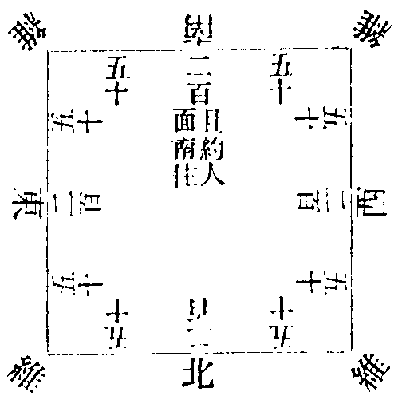

# 楞严经义疏释要钞



> **藏经**：卍新纂大日本续藏经（新纂卍续藏）　**册次** 第 11 册（X11）　**编号** No. 267（X0267）　**部类** 经疏部　**卷次** 6 卷　**篇幅** 155,399 字

> **作者（译者）**：长水沙门　怀远　录

> **卷／品**：6 卷 · 1 品



---



## 目录



- [首楞严经义疏释要钞卷第一](#首楞严经义疏释要钞卷第一)

  - [时鉅宋四叶嘉祐辛丑十月望日序](#时鉅宋四叶嘉祐辛丑十月望日序)

- [首楞严经义疏释要钞卷第二](#首楞严经义疏释要钞卷第二)

- [首楞严经义疏释要钞卷第三](#首楞严经义疏释要钞卷第三)

- [首楞严经义疏释要钞卷第四](#首楞严经义疏释要钞卷第四)

- [首楞严经义疏释要钞卷第五](#首楞严经义疏释要钞卷第五)

- [首楞严经义疏释要钞卷第六](#首楞严经义疏释要钞卷第六)



---



## 首楞严经义疏释要钞卷第一



**译者**：长水沙门　怀远　录



长水大师释楞严经曰：义疏者，盖直以一家要义而消经也。流通虽久，而钞阙焉。一日，门弟子稽首於余，请制钞以辅疏。余告之曰：先师所作，若文若义，焕犹日月，何俟于记？二三子曰：於师虽明，於某犹昧。乃不得已，集成钞文六卷。既释疏之要义，故以释要命题云耳。



------



### 时鉅宋四叶嘉祐辛丑十月望日序



将释此经，依长水义疏消释疏文二节：初、题目二：初、经疏通题，二、述作人号。今初。首楞严义疏注经，此题七字，能、所、通、别，略有三重：一、首楞严经四字是所解法题，义疏注三字是能解疏目。二、首楞严是能诠法题之别号，经之一字是能诠之通号。以通从别，则非餘经。或云首楞严为所诠，经之一字为能诠者，盖取绮互相收之义也。意以所诠法界妙定摄理、行二经，以能诠经字摄首楞严三字，如世织绮，互现其纹也。三、首楞严唯局当部是能拣，义疏注经通餘疏，餘经为所拣，故标首楞严为经疏之别目也。



首楞严者，竺方之语，宋云一切事究竟坚固。未修此定，一切事法宛尔差殊，为法所缚。得此定时，山河大地、色空明暗，一切事法当处寂灭，即是常住心性，故云究竟坚固。法华云：世间相常住。古人云：心外无法，满目青山。然今经一题凡二十字，但标三字者，以此三字正示中道妙行，显乎法界正体，众生诸佛同此一源。故天台云：法界寂然名止，寂而常照名观。既为一经之宗要，三世如来之所修。疏取简要，故以标题。问：大佛顶三字正诠三德妙理，是一经所显，何不以此标题耶？答：约言诠边，在迷属事；首楞严是行，取理为亲故。然师云：本虽久远，圆顿虽实，第一义虽理，望观属事。故知首楞严为最要也。然经之一字，若取文便，令居首楞严三字之下；今取义便，故在于末，谓以义疏笺释经文故也。亦是以下经字之通，彰於上别；以上首楞严之别，彰於下通(云云)。



△义者，释名曰：宜也，谓裁制事物使合宜。故疏主意云：我今直以圆实之义而解经文，不更广约五时诸教而消释也。



△疏者，条也，条理经文之义趣也。又文心雕龙云：疏者，布也，谓布置物端，撮题近意也。



△注者，或从水作，或从言作。若从言，则以言义注释经文故也。若从水，则如一源之水，若不流注，则无以润物，疏不流注，何由益生？故今流注以利群情也。又注者，连环属著之义，谓以义笺于经下，俾经下有义，义上存科，免致亢行，令人易晓，拣异他疏，与经别行。



△经者训法训常。法乃群机所轨，常则万圣同宣，故曰经也。又经者，径也。此经是三世如来趣实之通径也。



△卷者，可卷舒也。



△第者，居也。



△一则建数之首。



二、述作人名



△长水者，秀州之水名也。



△沙门。具云沙门那，此云乏道。由为良福田故，能断众生馑乏。因修八正道故，能断一切邪道。故大经云：断一切乏，断一切邪道。是故修八正道者，名沙门那。亦飜勤息(云云)。合有释字。今不著者，以此方无外道故。西国外道亦称沙门，故著释以拣之。亦有释种不出家者，著沙门以拣之。有此二患，故曰沙门释也。



△子璇者，即疏主之高讳也。本名子玄，字仲微，梓里在钱塘，俗姓郑氏。投师落发於南山普门寺，因受学于嘉兴僧判官洪敏法师，故以长水标号。天禧中，天台僧正崇教大师慧恩奏请入山讲演此经，敕赐紫衣。天圣年中，钱塘府主胡侍郎请於祥符寺开讲，道俗听众近一千人，荐赐徽号曰楞严大师。然疏主天与其性，妙悟兹经，早因诸方禅德虔命消经，制单消经科一本，现行于世，凡讲兹经迄三十遍。后遇海监保寿院庆南大师敦请制疏，遂往彼院，九旬秉笔，一疏告成。宇内僧英，朝中卿彦，靡不钦奉而躭阅者也。



△集者，聚也。刘熈云：会集众彩以成锦绣，会集众字以成词义。今疏主会集众义以成此疏也，亦谦也。



二、偈文归请二：初、归命三宝。然此一偈，全是资中沆法师语，疏主本宗。资中疏文，意不忘本，故特存焉。然归三宝，有其具阙不同，有但归佛者，有但归人者，有总不归者，此乃各随作者之意。今疏即具归也。然由六种义故，所以归依三宝：一、是荷恩德。谓佛大慈，垂教与僧，令我於苦不至，於乐有得，即三宝於我有大恩德，为感荷故，而归命之。二、请加护故。谓将欲制疏，恐多魔娆，有成难事，故归命之。三、为生信故。谓疏主种智未圆，所述疏文，恐鲜有信。今承佛力而作，必信无疑。四、作仪式故。夫臣子之道，欲有所作，必先告於君父。今遗法子，将有撰集，必归三宝，为后式故。五、表尊胜故。三宝尊崇，首出庶物，为世良田，疏首归之，表殊胜故。六、为益物故。三宝之能广益群品，凡愚不觉，鲜有知者，故特归之，以显於物有大利也。



△稽首者，即能归志诚也。稽者，稽(鸡音)也，以头至地，稽留少时也，即九拜之最重也。九拜者：一曰稽首；二曰顿首，以头扣地也；三曰空首，以头至手，即拜首也；四曰振动，即变其颜色，有似哀悔；五曰吉拜，即先拜而后稽颡，谓齐衰不杖已下者；六曰凶拜，即先稽颡而后拜三年服者；七曰奇(基音)拜，先屈一膝也；八曰褒拜，即再拜也；九曰肃拜，但俯下手，即介胄者不拜，但揖而已。今云稽首，即至重之拜也。然能归之人，必具三业：以身业归显佛，有天眼见；以口业归显佛，有天耳闻；以意业归显佛，有他心知。未归已前，三业悉皆不善；归依之后，三业皆善也。又因中以身业归果上，获神通轮；以口业归果上，获正教轮；以意业归果上，获记心轮。轮能摧碾业烦恼，故稽首通下法僧而转。



△我大师下六句，即所归三宝。然有三种，谓住持、别相、同体。住持者，雕、铸、塑、畫名佛，经、律、论、教名法，剃发、染衣为僧。别相者，佛即三身、十身，法即教、理、行、果，僧即三贤、十圣。然亦五教浅深之异，以三身等各别故，故名别相耳。同体者，即就一法之上，有觉照义故名佛，可轨持故名法，理、智众德和合名僧。今於三中，此经是开权后说，即正归一体，旁及餘二。我字通于能所。若属能归，即稽首我之大师。若属所归，即称佛为我也。然佛法无我，何以称我？谓拣彼此故。即四我中能，是世流布所通真假。



△大师即十号中一也。然兹一句，唯属释迦一佛，以是此界化主故。



△十方调御尊。即徧一切，以表诸佛同证，故谓一心一智慧。力、无畏亦然也。又拣二乘不信有他方佛也，唯许释迦一人。



△调御者。涅槃云：如来有四善法，调御众生。



△尊者，天人所尊重，故具上九号，故受尊称。



△佛顶下二句，叹法宝。法有四种，谓教、理、行、果。佛顶即教法。下云：虽蒙如来佛顶神呪。



△首楞严是行法。下云：有大佛顶，名首楞严，具足万行。



△大觉是果法，即究竟觉也。拣异相似分真，故云大觉。



△如来藏即理法。又佛顶，果也。首楞严，行也。大觉如来藏是理法。下云：空生大觉中，诠此三故，名为教法。藏者，含藏为义，体具众德故。



△圆明下二句，叹僧宝圆明，即二十五圣尽证圆明之人也。或唯叹观音(云云)。



△诸圣众。即普该听众也。或可一切诸圣，皆圆明大士也。



△上首龙尊王，即独赞文殊也。菩萨成道先，劫号龙尊王。今迹居因位，弼辅能仁，智德超群，为众纲领，故云上首。下云文殊师利而为上首。



△常辟下。总叹大慈。辟，开也。谓常开大慈门，度脱苦恼众也。门有能通无壅为义，然有教门、行门、理门之异。慈能与乐，悲能拔苦。既云与乐拔苦，必然或可。救即是悲，谓佛以四摄法救拔苦众生也。



△者即指三宝，是救摄众生之者。



△愿垂下。结愿利生。愿即睎欲义。疏主将欲制疏，恐多魔娆，故乞威加也。又此妙难思法，深而且隐，谓教理行果，俱不思议。若匪三宝助增智慧，则无以解通幽旨。故法华云：假使满世间，皆如舍利弗，尽思共度量，不能测佛智。圣智尚难图度，凡岂不祈加护？一言加护，有冥有显。冥即但求潜应，密助智力；显即现身摩顶，说法慰安。今但祈冥加耳。然广论冥显，有四句、三十六句等(云云)。



△我即疏主自称也。



△显说即疏主智也。



△妙难思。即此教也。谓我欲以疏彰显宣说此妙难思之教也。能诠所诠，皆不思议，故称曰妙。又将入末叶，鬪争坚牢，恐异执者多毁，仰祈三宝护持，必无所娆。



△普共下。回向群灵。释经之意，只为利生。



△含灵。即众生之异目也。又拣相宗三无二有，有不成佛者，故特结云诸含灵也。



△速证真如海者。意云非谓令生证得人、天、声闻等宗，盖欲令众生同证真如究竟果海故也。



△言真如海者，法、喻双举也。真者，离诸伪妄。如者，无去无来。法性周徧，如海广大。离虗妄故，如海清净。无法不备，如海珍宝。由此义故，以海喻之。



将释下。二、分文解释二：初、分章。



△将者欲也且也。



△初、教起因缘者。夫圣人设教，必不徒然。今经发兴，有何所以？故授之以教起缘由。兹经由十因缘故，而得发起。名教既兴，未知约法约人摄属何藏，故次辩藏乘分摄。藏通于大小，菩萨有权实，不以义求，罔知旨趣。既知此经菩萨藏摄，经藏所收，未审诠法分齐极至於何，故有第三教义分齐？教所诠义已知至极，未委何等机宜於此悟入，故有第四所被机宜。所诠所被既已冷然，未审能诠之教以何为体，故有第五能诠教体。教体既明，其如教下所诠宗於何事，宗之毕竟为趣於何，故有第六所诠宗趣？既知此经以如来藏为宗，首楞严定为趣，弗审此经是何时说，故第七明教迹先后。虽知是法华后、涅槃前说，未审传来东土是何年代，飜译为是何人，故第八明传译时年。既知传飜时代，建立此经首题何目，以题是一部纲总，不得不预知悉，故第九通释名题。然科云通释名题者，释通名题也(云云)。大纲虽识别中之义，户牖千端，若不广解，销义难知，故有第十别解文义。



△别解文义者。解别文义也(云云)。然十中，前八是悬谈，后二释经。此法贤首建此十门，若约天台五重玄义，即人法名如来藏心体，首楞严妙定宗，破疑生信，用醍醐为教相(云云)。



二随释十，初因缘中分文。



△总别者，总总一代，别别此经。



二、正释二：初、总中，正示因缘。



△酬者酬报。



△因，即因地。佛因地时，欲析无上菩提，遂启四弘誓愿：烦恼誓断，法门誓学，众生誓度，佛道誓成。然此四愿，只是悲、智二门。智则已圆，悲心未满。众生誓度，生且宛然。今虽证果，不舍因门。故现身说教，济度含灵，以答先愿也。故妙经云：我本立誓愿，欲令一切众，如我等无异。如我昔所愿，今者已满足。化一切众生，普令入佛道。



△酬请者。佛初成道，梵释诸天请转法轮也。经云：尔时诸梵王，及诸天帝释，护世四天王，及大自在天，并餘诸天众，眷属百千万，恭敬合掌礼，请我转法轮。如来默然受请。故始自鹿苑，终于鶴树，说诸经法，教化众生也。经云：即於波罗奈，转四谛法轮等。故曰酬请。



△显理度生者。说教显理，良为度生。然显理之言，具含总别。若以一音说法，随类各解，即总。若说四谛、十二因缘，显生空理，度凡夫、外道。说六波罗蜜法，显二空理，度不定性二乘及利根众生，令入大乘道。说一乘究竟法，显实相理，度定性、不定性及圆菩萨并上上根凡夫，令入究竟佛道。然此一期竖配，若细论四谛、十二因缘、六波罗蜜等，各通大小、权实，显理亦异。且如四谛，有生灭、无生、无量、无作等(云云)。天台说藏、通二教，显真空理。别、圆二教，显中道理。真有即不即，中有但不但。若约今经，开权之后，普收大小，咸会藏心，即是唯一实理。



▲二、克论佛意。



△原者，掬穷也。若穷佛本怀，唯为一大事因缘故，出现於世也。故妙经云：诸佛唯为一大事因缘故，出现於世。欲令众生开佛知见，所得清净故，出现於世。乃至入佛知见故，出现於世。天长疏主解云：佛之知见，非三非五，故云一。广博包含，故云大。诸佛仪式，说此化生，故云事。机感曰因，佛应为缘故，即所以也。由此大事因缘，所以出现於世。



△开、示、悟、入者，法华论云：开即双开菩提、涅槃二无上果。示即别示法身，显三身同体。悟即别指报身，二乘不知，说令知故。八即因义，修因契入也。天台作四位、四智、四门观心释之。四位者，开即十住，初破无明，开如来藏，见实相理。谓性德之理，为惑所染，难可了知。初心虽能圆信，圆伏未断，不名为开。必内资观力，外假法雨，破除通别两惑，性德知见，朗然开发也。示即十行也。惑障既除，知见体显，法界众德，显示分明也。悟者，十回向也。障除体显，法界理明，故曰悟也。入者，十地也。事理既融，自在无碍，从阿及荼，自然流入也。一位即一切位，故不异而异，作此释也。餘义详彼。取要为言，能知能见，即圆顿妙智。所知所见，即实相妙理。令物修此智，契此理，是佛本怀。



△虽三车通许等者，三车即三乘也。声闻、缘觉、菩萨，此妙经文。彼云：譬如长者，有一大宅，为火所烧。其诸子等，乐著嬉戏，不肯信受。乃至云：我今当设方便，令免斯害。而告之言：汝等所可玩好，希有难得。汝若不取，后必忧悔。如是种种羊车、鹿车、牛车，今在门外，可以游戏。汝等出来，皆当与汝。斯即通许。(此喻法华前三乘权法也。)



△唯赐白牛者，喻一佛乘也。文云：尔时诸子闻父所说，心各勇锐，争出火宅。乃至云：各赐诸子等一大车。(此喻开权无权，唯一究竟佛乘。)



△无三及二者，亦彼文也。彼云：唯有一乘法，无二亦无三。天台解云：无般若之二(通、别二教)，无方等之三(藏、通、别之三也)。意显法华已前三乘权法，但是名字引导众生也。



二别。三列释中十：初示真定。



△克示真三昧者。克，的显示也。三昧云正受，即首楞严定也。然亦随处为名，有云一行三昧，金刚如幻真如等。



△遭难者。佛赴王宫斋请，阿难僧次不遑，遂往城中平等行乞。逢旃陀罗女，名摩登伽，从彼求水。女生染心，因遭邪呪摄持，不觉入彼婬室。如来天眼遥知，遂乃归园说呪，即遣文殊持之往救，方免兹难。此则由无真定，故受邪欺也。



△故请诸佛等者。阿难承佛呪力，得归祇林。见佛之后，顶礼悲泣，恨无始来一向多闻，不全道力，殷勤启请十方如来，得成菩提。妙奢摩他、三摩、禅那、最初方便。奢摩他云止，三摩云观，禅那云静虑，又云思惟修等，即止观双运也。



△言诸佛成菩提方便者，举果请因也。意显非祈权浅之行也。亦深证此经，法华后说也。以声闻明请佛行，故涅槃云：复有一行，名如来行。



△一门超出妙庄严路者，定为因行所履，故名为路。



二、广引。



△再请者，徵心之后，重请行也。故下文云：尔时阿难在大众中，即从座起，合掌恭敬而白佛言：我是如来最小之弟，虽今出家，犹恃娇怜，所以多闻，未得无漏。不能折伏娑毗罗呪，当由不知真际所指。唯愿世尊开示我等。



△责己者。恨无始来，一向多闻，不全道力。又云：将谓如来惠我三昧，不知身心本不相代。又云：已悉多闻，不逮修习等。皆责己也。



△偈赞希有者。由佛约心约见，修历诸门，一一广破，从兹悟解疑消。於第三末经，说偈赞曰：妙湛总持不动尊，首楞严王世希有。销我亿劫颠倒想，不历僧祇获法身。



△如来等者。下云是名妙莲华，金刚王宝觉，如幻三摩地，弹指超无学，此阿毗达磨，十方薄伽梵，一路涅槃门等。



△敕说圆通者。由阿难请云：我今犹如旅泊之人，忽蒙天王赐与华屋，虽获大宅，要因门入等。如来欲示行门，理宜选择圆实要门，令其悟入，故询诸圣入道观门。故下经云：若圆通根与不圆根，日劫相倍，遂令二十五圣各说本初成道妙门。后敕文殊拣显，唯取观音为要，偏宜阿难及此界机也。



△指三世佛同此一门者。文殊云：此是微尘佛，一路涅槃门。过去诸如来，此门已成就。现在诸菩萨，今各入圆明。未来修学人，当依如是法。



△道场加行者他力离魔障。即令修行者建立道场，围坛诵呪，防御魔障也。



△成就圣位者。即下所说地位，皆由修此真定而成就也。下文於第三渐次，始自乾慧，终于妙觉，不别而别，成就五十七位故。



△立此经名者，即文殊请问经名，如来广答五种名目。文云：佛告文殊师利：是经名大佛顶悉怛多般怛罗无上宝印十方如来清净海眼，亦名救护亲因，亦名如来密印，亦名大方广妙莲华王，亦名万行首楞严，汝当奉持。



△破灭七趣者。妄念未蠲，升沈罔息，真定一发，七趣元空。故下文云：若得妙发真，三摩提则妙，常寂有无二，无无二亦灭等。



△辩识诸魔者。即第九、第十。如来无问自说五十境界，此等皆为显定胜功，故曰皆为此也。



▲二、破妄执。执心七处，妄起三疑。因缘自然，其执非一，故曰诸也。执则确然不舍，迷则於理不明。斯之二义，决定相须。若执妄法，必迷性明也。



△执常为断者。匿王计身死后断灭也。文云：波斯匿王起立白佛：我昔未承诸佛诲敕，见迦旃延、毗罗胝子，咸言此身死后断灭，名为涅槃。佛即为约观河之见，次显性常也。



△七、处徵心者。如来欲破阿难，心是虗妄，先诘心在何处。譬如国王为贼所侵，发兵讨除，是兵要当知贼所在。阿难遂计心在身内、身外，潜根、随合等，悉被如来破无所在。如下详辩。



△三、凝拒争者。发心修行疑，谤法退善疑，无心土木疑。因佛斥咄，此非汝心，遂起三疑，向佛拒争也。



△佛再语云等者。下云：若汝执悋分别觉观所了知性必为心者，此心则应离诸一切色、香、味、触诸尘事业，别有全性。如汝今者承听我法，此则因声而有分别。乃至若离前尘有分别性，即真汝心离尘无体。斯则前尘分别影事，此心则同龟毛兔角。则汝法身同於断灭，其谁修证无生法忍？



△约心、见二门者，以心为群妄之源，见为我执之本。诸妄虽多，不离此起。然心即是见，为门不同，故分别破。初破妄心，显真心。即从如来举臂为光明拳，乃至云一切世间诸修学人，不得漏尽成阿罗汉，皆由执此生死妄想，悮为真实等。然亦非离现前一念，别有真心。但能妙体一念，即空、假、中三千具足，即是真心。但为情牢执重者，彻底破之。须知破无所破，无明即明。真无别真，一念即是。如斯方称今经圆旨。故下会通，只於一念而示，意在此矣。次从佛告阿难：汝先答我见光明拳，云何成拳？汝将谁见？直至第三卷末，即破妄见，明真见也。



△人法者。妄执虽多，不过人法。人法性相之执，若忘二空，妙理圆显。然亦须辩人法之执浅深，方甄教之大小。



三、显妙心四：初、约迷显。



△开显妙明心者。盖为众生处迷不悟本常心性，故佛现身说教而点示之。开示显发一切众生不思议心性，故曰开显妙明心也。又心性寂而常照曰明，照而常寂曰妙。寂照不二，名妙明心。



△审问发心者。阿难悚己随邪，由无定力，故归见佛，即请行门。如来未即为说，却约心见徵解。意云：解若真正，行可无邪。故圆觉中文殊一章，先明信解真正为本起因，正同此也。故下经云：汝我同气，情均天伦。当初发心，於我法中见何胜相，顿舍世间深重恩爱？阿难答云：我见如来三十二相，胜妙殊绝，形体映彻，犹如瑠璃。常自思惟：此相非是欲爱所生。何以故？欲气麤浊，不能发生胜净妙明紫金光聚。是以渴仰，从佛剃落。阿难既申兹意，即知以爱出家。夫出家者，是无为法，无利无功德，是真出家。既因爱见出家，难逃生死根本。解既未逃生死，真实之体安明？故云全迷真实。下云：自心取自心，非幻成幻法。



△无始相续者。下云：一切众生生死相续，皆由不知常住真心性净明体。



△即是菩提等者，下云二者，无始菩提、涅槃元清净体，则汝今者识精元明，能生诸缘，缘所遗者者，即指此真心也。



△自责等者。下云：将谓如来惠我三昧，不知身心本不相代。我等今者二障所缠，良由不知寂常心性等。



△许可等者。妙明性，即许说如来藏心也。故下经云：吾今为汝建大法幢，亦令十方一切众生获妙微密性净明心等。



▲二、约破显。



△乍者，渐也，或也。



△徵则七处徵心。



△显则八还显见。然徵显之义，经中甚繁，下文自见。



△三科七大者，会诸妄法，当处绝待，即是性常。故文云：汝犹未明一切浮尘诸幻化相，当处出生，随处灭尽。幻妄称相，其性真为妙觉明体。如是五阴、六入，从十二处至十八界，生灭去来，本如来藏。至第三经末，尽是显会之文。由前广破不是真心，恐愚法者不达破意，离法求真，故示法法咸是真常，各各周徧，各各含摄，此彼相容，一多自在。斯乃微尘现土，芥子纳须弥。性本若斯，难曾留碍。故龙树云：因缘所生法，我说即空、即假、即中。正同此也。



▲三、约悟显。



△众皆领悟者。由佛约心见，广破后会，法法全真，大众悟解疑消，自述悟心之相也。



△自知心徧十方。即下悟心广大益。故下经云：阿难！大众身心荡然，得无罣碍，各各自知心徧十方等。诸所有物至含褁十虗。即了物咸真益。下云：一切世间诸所有物，皆即菩提妙明元心，心精徧圆，含褁十方等。



△身土等者。即反顾遗身。益下云：反观父母所生之身，犹彼虗空之中，吹一微尘，若存若亡等。



△唯一本妙等者。即妙获元心益。下云了然自知，获本妙心，常住不灭等。



△四、约疑显。



△洎满慈等者。满慈因闻佛说诸所有物皆即菩提，遂疑云：既即菩提，自前何故复有山河大地诸有物象次第迁流，流终而复始等？如来乃举性觉妙明、本觉明妙以断彼疑也。



△再责因缘者。由佛结答满慈云：汝但不随分别世间、业果、众生三种相续，三缘断故，三因不生等。遂即难云：如来现说三缘断故，三因不生，此则因缘皎然明白。云何如来顿弃因缘？我从因缘心得开悟等。前已曾破因缘，今复重疑，故云再责。



四、断疑网。



△决即决了。



△断即断除。疑事不一曰众，於理犹豫不明曰疑。疑覆真理，如网之罩蔽也。



△示见者，由佛显见本来常住，遂请问云：我虽识此见性无，还云何知是我真性？佛借通力，俾见初禅。意显真见周圆，本来若此。功过在人，故见彰远迩。由是佛则穷尽法界，菩萨见百千界，乃至众生，洞视不过分寸等。



△缩断者。由阿难旋归讲堂，但见一室之事，既适见远，而今见狭，遂疑莫是缩大见，为其小见，为是墙宇夹之令断，故云缩断。佛即以器空之喻喻之，令知空无规矩，器自方圆，以并见无舒缩也。



△离身者，由佛示云：一切众生，从无始来，迷己为物。若能转物，即同如来身心圆明不动道场，遍能含受十方国土。阿难不了真见周圆，绝於彼此，却欲转前物象，成我真见，在彼目前。故疑云：若此见精，必我妙性现在我前，我今身心复是何物等。意谓见性在前物上，如来遂於物象，以即见非见而广破之。



△因缘自尔者。由阿难於物象上推求，是见非见俱不可得。如来皆印云：如是，如是。以此大众茫然失守。於是文殊为众咨询见性元是何物，故无是非之相。如来示云：诸佛菩萨於其自性三摩地中，见与见缘如虗空华，元是菩提妙净明体，云何於中有是非是？又疑见性是因缘自然之法，故下云诚如法王所说，觉缘徧十方界，与彼外道所谭神我徧十方界，有何差别等。既非自然，必是因缘，是义云何合因缘性等？



△和合非合者。由佛示云：见见之时，见非是见。不了此旨，遂请问云：和合非合，心由未明，而今更闻见见非见，重增迷闷。故佛一一随为破之。



△执相疑性者。即富楼那闻如来说性火真空，性空真火，清净本然，周遍法界等。由执缘生之相差别，遂疑性中不合相融。故文云：世尊，若地性遍，云何容水？水性周遍，火则不生。复云何明水火二性俱徧法界，不相凌灭耶？佛即破云：观相元妄，无可指陈，犹邀空华，结为空果。观性元真，唯妙觉明，妙觉明心，先非水火，云何复问相凌灭义？



△灭妄生妄者。满慈疑云：一切众生与佛觉性，本来清净无状，忽生山河大地。如来今得妙空明觉，何当复生如是诸妄？意云：众生既本清净，今忽妄生。如来今虽灭妄，何时又生於妄耶？如来举迷方、空华、金鑛、灰木四喻破之。



△成真不真者。下云：一切诸法，咸是成佛真体。阿难疑云：佛已成道，今何得有地狱等七趣差别？斯则妄法融真之后，再有不真也。或可二句一意。



△修无常因等者。下经佛令行者因地发心，须与果心相应。若不相应，则无上菩提终不成就。如种苦求甘，烝沙作饭。阿难云：如佛说言，因地觉心，要与果位名目相应。如果位中，菩提、涅槃、真如、佛性、庵摩罗识、空如来藏、大圆镜智，是七种名，体性坚凝，如金刚王。若此见听离於明暗，毕竟无体，云何将此毕竟断灭以为修因，欲获如来七常住果？如来令罗睺撞钟，以显心性不灭，用释彼疑也。



五，辩修行。



△辩别分折也。俾权实不滥，邪正甄分也。



△门者，行也，以能通至果理故。



△深解现前者，藏体难知，由佛善巧，已获明审。若不修行，空解何益？虽有多闻，与不闻等。遂请修行之方，次作诣真之路。故下请云：忽蒙天王赐与华屋，虽获大宅，要因门入。天王喻佛，屋喻藏性。欲入藏性安住，必须行门而入。故佛为说止观两门为修行要，三世如来因此而证菩提也。



△逮，及也。



△畴，语词也。无始时之迷妄，故曰畴昔攀缘。



△决定者。三世诸佛，决定须假也。



△湛即止也。



△旋即伏也。以定伏其虗妄之心，不起成，不生灭，即止观也。



△审详。即观也。谓审谛观察无始妄想头数分剂，一一明知也。如人识贼，方可捉获。



△一根等者。下云：一根既反源，六根成解脱。诸既泯，觉性圆彰。氷泮水显，天理斯然。故曰：诸妄消亡，不真何待？



六、分别邪正者，行人起行，行有正邪，若不广辩，无以得知，故须辩识，方免邪歧。



△已悟修行者。由佛广示行门，已审修行之理。故下经云我今已悟成佛法门，是中修行，得无疑惑等。末代行人，匪示令知，如何甄辨？洗心非正，往往随邪。於是庆喜愍众，故申兹请。



△漏巵。无底之杯器也。



△四种明诲者，根本戒也。欲趣菩提，须於四事无犯。故下经云：汝修三昧，本出尘劳。婬心不除，尘不可脱。纵有多智禅定现前，如不断婬，必落魔道。是名如来第一决定清净明诲。乃至盗、杀、妄语，皆作此说。三世如来，皆须决定持斯四戒。戒器若完，定水可贮。



△切即谨切也。



△洪，大也。



△逭逃也。书云：天作孽，犹可违；自作孽，不可逭。



△祈，求也。



△却，退也。欲求速届前所，退步岂可及乎？欲得速至菩提果所而却，戒步其可及乎？进步，喻持戒也。



七、显呪功。正呪才宣，婬难即脱，讵非呪之功乎？



△承力虽至等者。获益虽为至极，但令文殊暗诵，阿难未得亲闻呪词，故曰密言阙闻。至第七卷中，始来重请说呪，下云虽蒙如来佛顶神呪，冥获其力，尚未亲闻，唯愿大悲，重为宣说等。阿难再请，意欲传通。



△况能等者。意云：何须重请流通，以有大利益故。以此神呪妙力，密护六根之门，六尘恶贼，莫之能入，无明业惑，可庶消亡矣。



△防隄也



△闲，御也。无始习漏种子，为定击发，难为制止，故假呪力，隄防闲御，无隳正行，俾现行之惑消伏，未起之种不起。



△斋戒不禀而自备者。由持呪力不曾禀持斋戒之人，自然禀持斋戒。故下云能令破戒之人戒根清净，未得戒者令其得戒，乃至云不持斋者自持斋等。



△果证不远而可得者。下云：诵持我呪三七日后，端坐安居，经一百日，有利根者，不起于座，得须陀洹。又云：决定自知成佛不谬。



△消难获利者。当知如是诵持众生，火不能烧，水不能溺，大毒小毒所不能害。乃至设有众生非三摩地，心忆口持，金刚藏王精心阴速，发彼神诚，是人应时心能记忆，八万四千恒河沙劫周徧了知，得无疑惑。又云：十方如来所得功德，悉与是人。



△自行者下。云十方如来因此呪心得成无上正徧知觉，降伏诸魔，制诸外道等。



△化他者。经云十方如来含此呪心，於微尘国转大法轮，能於十方摩顶授记等。



△事者，自行化他，修证菩提之事。



八、明行位理绝修证者，寂灭真如有何位次？岂有行之可修、位之可证？菩提涅槃同空华故。故经云：若有一法胜过涅槃，我亦说为如梦如化。净名云：众生如、诸佛如、草木如。等圆觉云：始知众生本来成佛。起信云：从本已来，离言说相，毕竟平等。斯约真如泯相显实门说。



△事存阶渐者。此约生灭览理成事门说。即有观可修，有菩提涅槃可证，有烦恼生死可断，位次阶渐可历。反妄旋真，法尔涉于阶位。如人习文取仕，及第之后，须有升陟之次也。



△偏一则病。空有者，若一向执无地位修证，则堕空病。龙树云：宁起有见如须弥山，不起空见如芥子许。若一向执有，则堕有见。执断则拨无因果，绝化群生，成恶取空。执常则不了法空，利成爱见。因果相辽，难容进趣也。



△圆通则融者，不生二边之执，即契中道妙理。由即真而俗，故凡圣不滥，慈济群品。即俗而真，故自他平等，无生可度。



△不损等者。寂照平等也。照体即寂，故不损灭定。寂体即照，故建立诸位也。净名云：不起灭定，现诸威仪。下经云：当处出生，随处灭尽等。楞伽云：初生即有灭。



△知机为请者。下云如是修证佛三摩地，未到涅槃，云何名为乾慧之地？四十四心至何渐次得修行目？诣何方所名入地中等。



△就行开示者。经云：尔时世尊赞阿难言：善哉！善哉！汝等乃能普为大众及诸末世求大乘者，悬示无上正修行路等。即於无生忍中不别，而别明五十七位，以为行履之阶渐也。



△不断等者，虽断惑而无惑可断，方为真断，以无明即明故。虽证位而无位可证，方为真证，以本成佛故。



△金刚观察者。即首楞严定也。此定能观察一切诸法，皆不可得。能破一切无明，如金刚坏物也。令於一一位中，断无断，证无证也。



△十喻者，如影响阳炎水月镜，像虗空化乾城幻。



△奢摩他中用。毗婆舍那者，止中用观也。既云渐次深入，故知位地不无也。虽非作意，任运自彰，譬犹浣衣，垢落先后，天理斯然。



九、示魔境。



△靡，无也。



△鲜少也。



△克，能也。此诗语也。此是如来无问自说。盖为深矜末叶行人不了一实相，相外餘皆魔事。恐彼悮生取著，失正堕邪。故不待请，回坐自宣。故下经云：即时如来将罢法座，回紫金山。再来凭几，普告大众：今日回心，趣大菩提。吾今已说真实修行，汝犹未明修奢摩他微细魔事等。俾令行人一一明辩，使内外魔不得便也。然其辨魔，有其三法：一、以定研磨。二、以智慧观察。三、依本修治(云云)。



十折。妄源



△源者，本也。经经皆说五阴虗妄，而不说是五种妄想所成，独有今经示之最显也。破色阴出坚固妄想，受出虗明妄想，想出融通妄想，行出幽隐妄想，识出罔象虗无颠倒妄想。梵语塞健陀，此云阴。阴即阴覆真性，蕴即蕴积有为烦恼故也。起则始迷成识，终结为色，故云从细至麤。破则反之。然则起亦顿起，非有先后，义说始终。断亦圆断，法尔麤垢先除。若其不然，恐乖圆旨。但是欲明行相，须以次第显不次第也。



△识阴无体者。不了一真，成兹妄识。若究其源，毕竟无体，全是一心。故圭山云：识如幻梦，但是一心。



△湛入合。湛者，上湛是识，下湛是真，谓以定伏於湛识，合归真如，寂湛之理也。斯乃真如，是识边际也。



△何所不该者，以五阴摄於百法，但除六无为，餘皆摄尽。故颂云：色摄十一全，受想各当一，八王识蕴收，七十三行摄，无为非积聚，不在蕴门摄。故知五阴摄有为尽。



△论即起信论也，文意可见。



二藏乘分摄。初藏摄。上来已知说此经之大意，未悉兹经三二藏中当何藏摄，故次辨也。梵云俱舍，此云藏，谓能含藏，故称曰藏。



△三藏者，经、律、论也。梵言修多罗，宋云契经。即契当法义，契合机心也。经即贯穿所说义理，令不散失。摄持所化物机，令无坠故。又杂心论有五义，谓出生、徵发、绳墨、结鬘、涌泉等。梵云毗奈耶，此云律。谓明持犯法，则大似斯方条法。或飜云调伏，谓调练三业，制伏过非。调则通於止作，伏则唯明止恶。或飜云清凉，或云灭等。梵云阿毗达磨，此言对法。法即所对，对即能对。然有对向、对观之异。若以实智对理，名对向。若以后得对事，名对观。今於三中，即经藏摄。然经必备诠三字，但就胜得名。



△二、藏者，菩萨、声闻，约人立名也。但於前三藏，诠示大乘理、行、果，故名菩萨藏。诠示小乘理、行、果，故名声闻藏。庄严论云：人有三乘，则合有三藏。以缘觉人、理、果同，故但立二也。若据教、行有别，亦可为三(云云)。



△若此摄彼者，即今经为能摄，二三为所摄也。



△持戒证果。有小乘者，登伽证第三果，阿难证二果等，即摄声闻。四种明诲，即律藏。阿难被徵，匿王设难，互相辩折，即论藏。问：此有彼义，故摄彼。彼亦有此义，何不摄此耶？答：以此能全摄彼，彼但能分摄斯故，故疏不论也。



▲一乘摄诸乘者，三、五、九、一等乘也。斯经所谈诸法实相，声闻、缘觉皆获一乘寂灭场地，故唯一乘摄得此经也。



△亦该诸乘者下，明五戒、十善因果报应，即人天登伽、阿难证果及诸圣观门，即摄小乘及权菩萨也。斯则逐器方圆，无机不被，蚊虻、修罗饮其水者，皆获充足，故总摄也。三、分摄。



△十二分者，因缘、本生、本事、未曾有、譬喻、祇夜、伽陀、授记、无问、自说、论议、方广、契经。



△方广摄此经者，方者，徧也。广者，大也。今经唯显法性广大，周徧平等，故得摄也。又下五名中，一名大方广妙莲华经，契经可知。若以彼为所摄，此经为能摄，则总摄十二分也。一、以阿难示遭婬难为因，如来说教为缘，即因缘分。又下广明因缘之义。二、下五名亦名大方广经，即方广分。又一经备明法性方广之义。三、下云令汝会中定性声闻，皆获一乘寂灭场地，虽无劫国记号，其奈授记作佛，即授记分。四、下云如来将罢法座，再来凭几，普告大众：汝犹未识奢摩他中微细魔事等，即无问自说分。五、下云我今犹如旅泊之人，忽蒙天王赐与华屋，要因门入。一经之内，备有譬喻，不能具书，即譬喻分。六、下文匿王设难，庆喜再责因缘，七处徵心，三疑拒诤，即论义分。七、下云妙湛总持不动尊，首楞严王世希有，又云我等平常未闻五阴、五妄相成等，即未曾有分。八、明摩登伽历劫爱缠，又述二十五圣本昔之事，又云如我马麦，等无有异，即本事分。九、下云自忆受生，如恒河沙等，即本生分。说佛及弟子往昔之事，名本事。说佛及弟子往昔受身，名本生。十、下云譬如人静居，十方俱击鼓，十处一时闻等，即伽陀分。十一、下云良哉观世音，入微尘佛国，得大自在力等，即祇夜分。十二、契经如常，故云摄彼如前。



三、教义分齐二：初、标章。教为能诠，义为所诠，今以所诠义之浅深，判能诠教之优劣也。



△贤首者，即华严宗主藏法师，灭后敕谥贤首大师。



▲二、正辨中，初、约教诠法，通局显分齐三：初、标。



△通局者。通即终、顿、圆三教，以能广博包含故，以被机广故，诠义深故，显理实故，破惑妙故，鲜圆顿故，初后等故。局即小乘及始教也，诠义浅故，被机狭故，解不圆融故。又深必该浅故通，浅不该深故局。亦可后四教为通，愚法小乘为局。



△教者教也。圣人被下之言，教凡成圣，教愚成智，故。



初小乘教。



△小乘者，运小机，至小果，故曰小乘。何意须说小耶？以圣人演教，为度物机。若不逗机，说教何益？若但说深，谤之堕恶。是故如来不动寂场而游鹿苑，十二年间，说小乘法而教导之。此是愚法之人，但得无我，犹不知五蕴之法，当体即空。如亡拳相，五指犹存。然准经论，亦破界内法执(云云)。



△但说我空者，一切凡夫执有我相，执一切法为我所有，故此教中破有我故。若谓有我，五蕴所成，应有多我。如一色蕴，自有一十种色，应有十一种我。作此推捡，故知无我。



△小说法空者。阿含云：无是老死，无谁老死？既云无是老死，即法空义，更不广明所以，故曰小也。



△六识三毒者，前六识也。贪、瞋、痴三，能损法身慧命，故贬之云毒。若以三毒为能熏，现在色心为所熏，即造业受生，轮转六道，名染根本。若以不贪、瞋、痴为能熏，色法为所熏，即断烦恼，出三界，名净根本。染之与净，因三有无，除此别无根本，故云但也。



△未尽法源者，未极二无住本也。



△故多诤论者，诠识不至七八，诠理不及中道实相，故诸宗师各执一见，分成二十餘部，互相诤论，如群盲摸象，纷然是非，由不极源故也。



二、大乘始教。始者，即法空教也。分教，法相教也。始即初也，入大之初门也。分即支分也。分得佛故，谈未终极，故得始分之名也。



△大乘者，运大机，至大果。故虽四教权实有殊，对前愚法，通受大名。法空者，始自色心，终于种智，皆如幻化空华也。故般若云：无色，无受、想、行、识，乃至无智亦无得等。又云：若有一法胜过涅槃，我亦说为如梦如化。



△未尽法理者。大乘法理，不空不有，而空而有，中实圆妙。今但说空，将知未尽也。法鼓经云：一切空经，是有餘说。中论云：空是大乘初门。又云：以有空义故，一切法得成。然般若备谈三教，正意在圆，如色不异空，空不异色等。今偏约不得意边斥也。



△一切法相者。法相虽多，不过五位。一白法纵说真如、无为是诸法性，亦堕法相之数，故云但说法相。



△有不成佛者。彼说五性之人，三分半人不得成佛，唯一分半人得成佛也。既有不成，故说名分。终等三教则不然。下云：定性声闻、无性阐提，皆获一乘寂灭场地。又云：若有一人发真归元，诸器世间应念化成无上智觉。无情尚咸成觉，讵有不成有情者哉？问：此始教与愚法、小乘，优劣如何？答：前是正说我空，今此正说法空。但未能见空实相，故受始名。既能体法即空，不为法缚，可从此门通达实相，故是大乘初门。故大论云：为小乘钝根弟子说我空，为大乘利根弟子说法空。然但舍旁取正，而说有执法者，皆由著我。我执若亡，我所自遣，故正说我空。始教既是衍门，故正说法空也。此正同天台通教，体法见空，空含不空，号含中真。前通三藏，后入别、圆，故曰通教。但深观此空，能见不空，受别、圆接，故知此教是入实之初门也。问：始教断证分剂，与小何别？答：二教惑理是一，观智全殊。惑理一者，愚法断执取计，名二麤之惑，是我执、分别我执俱生，即见思惑也。若其始教，今家则无明文。若以义求，亦只断我执、分别俱生之惑，但空六凡法界之法，证真谛理，与小不殊，故云惑理一也。观智殊者，以其所修观智，体折有异，故云观智全殊。问：起信论中断智相、相续相，名断法执，还与今始教断法执同否？答：不同。彼是界外根本无明法执也。彼论六染文云：二者、不断相应染(即相续相)，依信相应地修学方便，渐渐能舍，得净心地究竟离故。三者、分别相应染(即智相也)，依具戒地渐离，乃至无相方便地究竟离故。藏师判相续相是法执分别，初地究尽；智相是法执俱生，二地至七地究尽。岂非此二麤是破无明位，正属界外法执耶？始教但断界内法执，若破无明，即非当分，与后三教不殊。若已破无明，即入秘藏，即不可言始教是大乘初门，但见空理。故知始教不断无明法执，须善分别，不可雷同。问：下疏云法相极於三细，岂非始教断界外无明耶？答：此明分教了诸法生起，以赖耶为本。纵说次第破十品无明证妙觉者，皆是教道之说，为引机入证故也。若实破证，则与后三教同，分教之义即泯。故天台明别教破无明是教道说，若实破无明，则无历别。故彼文云：入地自证，权门自开。岂有亲证而存隔历？又云：初地即初住故，当恁之时，无权可存。或说有妄外真如，不受熏变，如云外月。破尽三细，究竟证得此理，教道明矣。



三、大乘终教、终实二名，但唯一体，对前始分义立两名耳。



△随缘者，即真如。不守自性，成妄法也。起信云：心生灭者，依如来藏故，有生灭心。所谓心性不生不灭，与生灭和合，非一非异，名阿梨耶识等。缘起之法，全有而成，无性可得，即是真如。如水成波，波即水故。从真起妄，故曰随缘。妄即全真，故云无性。如金成器，器即是金。



△定性等者。三聚五性，一切众生悉成佛也。涅槃云：凡有心者，皆得作佛。圆觉云：有性无性，齐成佛道。



△方尽等者。对前辨果也。诠法穷源，故云至极。非同於权，故云实理也。



四、大乘顿教，不谈委曲，直示心源，故曰顿也。然有约部论顿，即华严也。逐机明顿，即不定也。如圆觉观、无量寿等。



△不说法相者。不说偏计依他色心等法也。此约真如门泯相说也。



△唯辩。真性者，独显圆成实性也。一实性外，更无别法，照体独立，物我皆如。



△八、识者是法相之源。今此教中亦且不立，菩提涅槃尚不可立，况妄谙乎？



△呵教者，斥其无实也。肇公云：名无得物之功。圆觉云：修多罗教，如标月指。起信云：一切言说，假名无实，但随妄念，不可得故。此皆破众生执言滞教，成生死本。



△劝离者。起信云：从本已来，离言说相，离名字相等。净名云：无有名字语言，是真入不二法门。又云：文字性离，即是解脱。达磨云：我法以心传心等。



△毁相者。金刚云：凡所有相，皆是虗妄。下云：当处出生，随处灭尽。



△泯心者。楞伽云：心生则种种法生，心灭则种种法灭。般若云：无智亦无得。起信云：非色、非心、非智、非识等。故知有念即凡夫，无念即诸佛。下云：歇即菩提，何藉劬劳，肯綮修证？是知刹那登妙觉，等佛於一朝。如斯之论，讵非顿乎？



△不依地位者。真如寂理，何位次可及？圆觉云：知幻即离，不作方便。离幻即觉，亦无渐次。思益云：不从一地至一地等。五、一乘圆教。此之一教，该收前四，性相俱融，含摄无碍，乃至草叶皆即真如，即华严宗也。



△所说唯是法界者，谓心、境、理、事、染、净等法，皆是实相，故云唯是法界。或可此句总标性海圆融等是，别列四种法界。



△性界圆融。理，法界。理性深广，常住无迁，故曰性海。理体周徧，无法不容，故曰圆融。



△缘起即事法界，谓众缘所造心境染净等法，各不同故。



△无碍即理事无碍。法界缘起，事法皆理所成。缘起无性，不碍於理。理能随缘，不碍於事。故知理事二无障碍也。



△相即、相入等，即事事无碍法界。谓一入一切，一切入一，互为主伴。如天网珠，光影互入，无碍无尽，不可思议，自在若此。以一事法全理所成，理既本性周徧，事亦称理周徧，故得一事法能徧入一切事中，故云一入一切。又一切事法既同一理所成，周徧之理既全在一事法中，故得一切事法亦随理同入一事法中，故云一切入一，以一一事称理成故。如百千灯，光照一室，其光各徧一室，其光互互相入也。界者，性也，分也。事言界者，即三科五蕴，一一事法分限别故。理言界者，以一切法当处寂灭，唯一性故。理事无碍，事事无碍，具性、分两义(云云)。然此四种法界，举一即具四言，四体即一，一四无碍，方曰圆融。问：楞严大师甞於笔削记中，将此五教对天台化法四教。但开合之异，彼则开前合后，此乃开后合前。未审约但明开，以何论合？矧彼双遮双照，遮照相须，三义一时，方称圆教。讵容支开，被三根器乎？答：约义对论，不无其理。但由彼斯学人，专守一边，互成诤诘。其中更有绵历年纪，听此五教，都不明五教义者，臆说云云。今略以彼此文意，粗试通之。且此云愚法小乘，同彼三藏，於理不疑也。二、此云大乘始教，属诸法空经，同彼通教，修体法观，破六凡法界，证即空真，其义颇齐。若始教中分义，属法相宗，备说八识差别之修，次第修证，历位浅深，因果殊隔，同彼别教历别渐修，备学法门，经无量劫修习取证，破尽十二品无明，方显佛界但中之理。理非具法，绝待之中但有教道权谈，非是究竟实说。天台云：有教无人。既说佛界，但理在九界外，正同相宗说真如在诸法外，坚如玉石，不受熏变，其义一揆。问：彼何以开为通别？此何以合为一始？答：彼约理真中故开，此以俱衍权故合也。三、此云终教，谈真如随缘成一切法，诸法无性，当处即真，同彼天台双照空有之义也。四、此云顿教，明呵教泯相，不著二边，直契圆成，同彼天台双遮空有。五、此云圆教者，包融性相，该括始终，虽泯空有，空有炳然，虽示色空，色空都寂，法界圆融，无碍自在，同彼天台非寂非照而寂而照义也。斯上终等三教，即是不思议照、不思议遮、不思议遮照一时也。若达观之士闻不思议言，义自照著，不俟更陈，其未了者，直更细明。然要先知斯终、顿、圆三教，但为门有异，圆实无殊，对彼之义方可冷然。应知斯三皆以不思议中道实相为体，所诠之体既实，诠体之教无不圆妙，所被之机同是圆顿，所起之行皆悉无作。但由宜闻真如不守自性成一切法，缘起无性一切皆如之义而得入者，即以终教接之。其实於终教双照入者，即达顿教双遮、圆教非遮非照而遮而照义也。以是不思议照故，宜闻顿教双遮、圆教遮照，同时亦然。入一达三，了三即一，如一王都入门异尔。以此而知，入门异故须三，修证同故只一，一三相资，方被圆机足矣。名偏意圆，宜善知悉，与彼天台三义一时无相违也。亦如天台於一圆教机宜异故，横开四门，四门之机虽异，皆是圆机。或宜空门入者，餘三悉趣空门，入一达四，王都不殊。故知彼从圆有门入者，同此终教得入；从圆空门入者，同此顿教得入；从圆双亦双非门入者，同此圆教得入。应知此乃只一圆实，义开三教之殊；彼亦唯一圆教，义设四门之异。此由不开四门，义开三教接物。设既备设四门，但受一圆之目。大抵而论，三教四门只为便宜故设，故今三教即彼四门，更无异也。不可谓终教入，故失於顿圆之旨；不可谓彼从有门入，故失於空等门意。苟执终教定双照者，非独实教上乘成可思议，抑亦但得俗谛之义，尚不如分教。分教虽理在事外，不谈相即无碍，而且二谛具明。又但得用而阙於体。何者？照有照空是用，非有非空是体。又双照双遮俱是用，非遮非照方为体。若坚执不融，飜成但俗但用麤浅之法。如斯弘教，诚为他宗取笑。自谓禀贤首宗，讲长水疏，焉知宗师妙旨顿被沈废？痛哉！痛哉！又若三教不皆圆实者，何以行愿钞明渐顿义云：若法相宗行位，地前伏惑，登地断惑，乃至金刚喻定解脱道中方成妙觉，名渐。无相宗一向不说地位为顿，然此并非称性圆证圆修。今就此宗直谈真界，非渐非顿，随缘修证，则具渐具顿。若终顿二教不同是圆融者，何不指终顿二教为非圆修圆证，而秪将始教对拣权实耶？又圆觉疏将圆觉顿教与华严对辨齐平义已，即云终教与此正同。若然，岂不三教义等耶？问：终等三教有优劣否？答：虽俱圆实，不异而异，义分三品：从双照入者为下，双遮入者为中，遮照俱时入者为上。若得此意，研核教旨，众滞自消。问：华严疏说此经明事事无阂，指事全理，名别教一乘；终顿融事归理，至於法华，会三归一，名同教一乘。如何谓言三教义一耶？答：且如终教为拣异始教，唯空教理俱权分教，教权理实，皆是权浅，特立终极称实之教，名为终教。既实且极，岂得未究竟耶？况终教既谈理事无碍，岂不达事全理耶？法华世间相常，楞严世间诸所有物皆即菩提，非事全理耶？譬犹波水无碍，岂得不晓全波是水耶？又华严顿为菩萨说圆顿法，名别教一乘；法华为前三时已调熟者会归一乘，名同教一乘。同别虽殊，一乘岂异？若言异者，更为可笑。具教眼者，如指诸掌，盖为浅学执固之者，须至备括一家教旨，委而示之也。问：人师立教，各是一途，何须强会？答：通论判教，悉准一代之经，经既不殊，讵可天隔？又此和会，盖为表明所禀起信钞中之说，非无由也。



三教摄。



△正唯终教者。既三教圆实不殊，故但约诠义多小，以判兼正。今经多说迷真逐妄，诸法生起，本末次第，返妄旋真，皆圆实故。如下经云：一切世界，因果微尘，因心成体。又云：无同异中，炽然成异，所既妄立，生汝妄能等。又云：当处出生，随处灭尽，其性真为，妙觉明体等。一经始终，多谈斯义，故云正是终教也。



△兼顿、圆者。如云金刚王宝觉如幻，三摩提弹指超无学，又云歇即菩提，性净明心等，即顿教也。若云地、水、火、风皆徧法界，性火真空，性空真火，不相妨碍，又云离一切相，即一切法，又云於一毛端现宝王刹，坐微尘里转大法转等，又云一为无量，无量为一等，皆圆义也。此文既少，故判为兼。若约一往诠言，圆融胜妙，以立一经尊极，应判云正唯圆教，兼於顿、终。今既三教齐致，故但约文多少以判正、旁，则无咎也。若约五判，应云此经分齐，正唯终、顿、圆三，兼於愚、始二教。以下明五比丘所悟法及根境，如空华等。



二、约法生起本末显分齐中，初一心为本源。



△一心源者，谓此一心是染净诸法之根本。故论云：摩诃衍者，一法二义。所言法者，谓众生心。是心则摄一切世间、出世间法。依於此心，显示摩诃衍义等。故知一心是诸法本，其犹水源为万流之本。此约因法显，故云众生心。若圆觉经中约果法显，即云无上法王有大陀罗尼门，名为圆觉，流出一切清净真如、菩提、涅槃及波罗蜜等。



二、依一心开二门。



△二门者。论云：依一心法，有二种门。然真如门中有离言真如、依言真如，依言中有空、不空真如等。



云依后门明二义，科云：后门即生灭门也。



△二、义者。彼论云：此识有二种义，能生一切法，摄一切法。云何为二？一者、觉义，二者、不觉义等。



△心体离念等者。论云：所言觉者，谓心体离念。离念相者，等虗空界，即是如来平等法身。依此法身，说名本觉等。一、言其觉有始觉、本觉。本觉复有随染本觉、性净本觉之异。不觉中有根、本、枝、末之别。四、依后义生三细。谓依不觉故，起业等三相也。一、是业相。业者，为因义、动作义。论云：一者，无明业相。以依不觉故心动，说名为业。觉则不动，动则有苦，果不离因。二者，转相。即转前业相为能见故。论云：二者，能见相。以依动故能见，不动则无见。三、是现相。由能缘心，带所缘境故。论云：三者，境界相。以依能见故，境界妄现，离见则无境界等。此三属本识，对后事识麤位，通称曰细。故论云：复次，依不觉故，生三种相，与后不觉相应不离等。



△五、依最后生六麤。最后，即现相也。论云：以有境界缘故，复生六种动相等。斯六属事识位，涉于外境，其相显著，故称曰麤。



△智相者，执境外生起智，分别爱与不爱等。



△相续相者，依前分别，遂起苦乐觉心，念念相应不断等。



▲二、正显分齐。初、通指诸教。



△通诠本末者，一心为本，九相为未。



▲二、别显今经。则此经常住真心等者，上来通约诸教明生起义，未知此经对彼其义云何，谓今经即以常住真心为一心源也。下云一切众生从无始来，皆由不知常住真心性净明体等，一切世界因果等法，皆以此心为本而生起也。



△二、根本者。一者无始生死根本，即汝今者用攀缘心为自性者。二者无始菩提涅槃元清净体，即汝今者识精元明，能生诸缘，缘所遗者等。



△咸言妙真如性者。下云如是五阴六入等，皆如来藏妙真如性等，斯乃法法当处绝待，全是真实，即真如门也。



△瞪目者，喻真妄和合故，则有法生。如清净眼观睛明空，由目劳动，见空有华，华实不曾生起。



△合手者。文云：其人无故以二手掌於空相摩等。又云：如人以一冷手触於热手，若热势多，冷者从热等。皆喻妄生也。



△眚见等者。文云：如世间人目有赤眚，夜见灯光，别有圆影，五色重叠等。此约不了一真，忽然妄起，成生灭门也。



△性明圆等者。一真之性，本自明圆。因不了元明，故有妄法发於性上，故曰因明发性。然实全性成妄，非如树发於华。



△识精元明者。约体指妄也。斯识无体，本是元常，故曰元明。



△性。一切心者，谓一切法以心为体性也。



△满慈致疑者。因闻佛说清净本然，遂疑云何得有世界山河也。经文备如前引。



△本觉不觉者。性觉必明，即本觉也。妄为明觉，即不觉也。



△了然自知者始觉也。



△三相。即异、同、非同非异之三相也。下云所既妄立，生汝妄能，无同异中，炽然成异等。



△四、轮。即经云：觉明空昧，相待成摇，故有风轮执持世界。因空生摇，坚明立碍，故有金轮保持国土。坚觉宝成，摇明风出，风金相磨，故有火光为变化性。宝明生润，火光上蒸，故有水轮含十方界等。



△晦昧即业相，亦即赖耶四分中自证分、证自证分也。



△为空即转相，四分中见分也。



△结暗为色，即现相，四分中相分也。故晦、昧等，即三相也。



△引起等者。下云：如是扰恼，相待成劳。劳久发尘，自相浑浊。由是引起尘劳烦恼，起为世界，静成虗空。虗空为同，世界成异等。



△聚缘。内摇者，集聚外境，於内分别也。由有境界缘故，起心分别，念念不断也。



△趣外奔逸者，由念不断故，遂成分离，取六尘境。下云：色杂妄想，想相为身，聚缘内摇。趣外奔逸，昏扰扰相，以为心性。一迷为心，决定惑为色身之内，不知外洎山河大地，咸是妙明真心中物等。



△业果众生等者。六麤中造业、受报二相也。合云三种，今但约正报为言也。下云汝但不随分别世间业果众生三种相续等。



▲由是下。二、总叹学人披阅此经，始自一性，终至九界，无不备谈，无不当处。真实不是隐覆真相而说，足显此经终实圆妙故也。



四、所被机宜中，初标章。上来已悉此经深妙，且大圣设化，或说或默，无不为机，未审何机於此得入，故须辨之。



▲二、随辩中，初、料拣。



△乐著名相者。有一类机，但乐名言法相者也。且此经非相故不可思，非名故不可议。是故著名相者，不堪受此经也。下文云：见与见缘，如虗空华等。



△以文为解。即文字法师，不能忘情合理者也。



△滞行位者。计佛居果上，我处凡夫，行位遥远，如何得臻上果？心著有为，遂生劳怠。



△情尚等者。尔雅云：宾者，服也。凡有所皆言，服在空也。宾者，客也。主既立无，故客有所言，皆向主故。



△自恃等者。天真即自然义也。本来自然是佛，何用更求於佛？烦恼本无，更何所断？凡见进修之人，即轻厌之也。圆觉云：不断生死，不求涅槃，任彼一切，随诸法性，欲求圆觉。彼圆觉性，非任有故，说名为病等。



△固执者。斯人先闻小教，便执在心，坚守不舍。后闻说大，不肯信受。如人元担於麻，后遇金藏，不能总担。又惜前功，不肯弃麻，遂舍金去。经云：所未闻法，闻之不疑，是为希有。



△皆非器者。如上诸过中，随落一过，即非是堪受此经之根器也。



△反上者，谓虽寻文而文字性离，虽覩相而常照自心，反上著名相也。因该果海，果彻因源，即反滞行位者也。虽空不断，而中道了然，反情尚於空也。理顿悟而事渐修，反轻厌进习也。精勤求法，无暂懈怠，反弃金也。



▲二



△普收。凡有心者，皆得作佛。有性无性，齐成佛道。又云：饮其水者，皆获充足等。此约结缘下种，故普收一切也。



▲二



△益者，浅深。悟入者，证悟契入也。俱无，则因此熏成远种也。



△金刚喻者，彼云：譬如丈夫，食少金刚，要穿其身，出在於外。何以故？金刚不与肉身杂秽而同止故。於如来所，种少善根，亦复如是。要穿有为烦恼身过，到於无为智处等。纵谤堕恶，由历耳故，终须醒悟。如人因地而倒，因地而起也。悟入等，即种熟脱也。



△兼为餘性等者。定性声闻，定性缘觉，及无种性人也。二乘之人，实不定性。但闻斯教，决定回心。且无性之人，但无善性。傥闻今教，善种自成。遇缘发起，必当成佛。楞伽说二种阐提，一大悲菩萨，二断善根众生。佛说永不入者，虽大悲菩萨，应知无信之。但得闻教，后必悟入也。



△三、聚者。聚犹众也。每类非一，故称众也。然有三乘不同。若以五无间业众生为邪定，学、无学人为正定，餘漏、无漏人为不定，即小乘说。若以无种性人为邪定，菩萨性人为正定，不定性人为不定，即权教说。若以一切异生为邪定，三贤已去为正定，十信为不定，即实教说。今经即唯实也。



五、能诠体性中，初标章。上虽已明教所被机，未委一代教法以何为体，而能诠辩无量事理耶？故以四门辨之。然今辩体，不同天台五重玄义辨体。彼明所诠之体，如今经以如来藏心为体，维摩不思议为体，法华实相为体等。今此是显能诠之体，即当体体。然据归性门，亦摄所诠之体，则此通彼局也。



▲初、随相门。



△声、名、句、文者。声是教主言音，名、句、文是声上屈曲诠表。然有三义：一、唯以声为教体，二、唯以名、句、文为体，三、通四法为体。若但取声，唯是径捷之声，且无诠表。若唯名、句、文，又文等无所依故，以名、句、文但是声上用故。若无所依之声，则名等何有？故须通取。



△体用假实者。声是实，即不可见有对色。名、句、文是假，属不相应行法，非色非心，但约分位假立。论云：名诠自性，句诠差别(云云)。亦可通取一切法为教体，但能生物解，即为教体。如灵云见桃华得道等。净名云：有以光明作佛事，有以菩提树作佛事。乃至云：八万四千尘劳，众生为之疲劳，诸佛即以此法而作佛事。楞伽云：有佛国土，直视不瞬，口无言说。有佛国土，动身名为说法。且香积世界，餐香饭而三昧成。极乐国土，听风歌而正念圆。丝竹可以传心，目击以之存道。只如今经二十五圣，於十八界、七大性，皆获悟入，此讵唯名、句、文耶？天台师云：手不执卷，常读是经。口无言声，徧读众典。佛不说法，常闻梵音。心不思惟，徧照法界。



△若不等者，如世功韵，玉篇不属诗、书、礼、乐，故不可以教化下民，移风易俗。是故挟所诠义，俱为教体。天台明教、行、理三种经旨于此。



▲二、唯识门。前二等者，能诠、所诠也。此二教体下，离识所变也。经云：三界唯心，万法唯识。故知能、所诠法，皆从识变。



△本质影像之异者。谓以众生为缘，故於妙观察智净识，演出八音四辨之声教，名本质教。众生由佛声教为缘，故於自心变起影像而缘，名影像教。斯乃众生诸佛互为增上缘也。唯识云：展转增上力，二识成决定。若对五教，通以四句拣之。谓唯本非影，愚法小乘。唯影非本，终教。亦本亦影，始教。非本非影，顿教。具足四句，圆教(云云)。



▲三、归性门。前收差别之教，但唯一识。今明此识，但是一心。一心即真如也。如水成波，波全归水。故圭山云：识如幻梦，但是一心。



▲四无碍门。即事事无碍，法法相融，生死真如，夷齐一贯，方为极唱。



△心境下。正显无碍之相也。心即唯识门，境即随相门，理即归性门，事即重指随相唯识。二门要成句，故重言之也。此之三门，即一论三，即三而一。互相依倚，互相无碍。应知言色时一切皆色，一切是经。举识时一切皆识，全识是经。故得动止纵横，无非教体也。



△以一心法有二门。故者，出所以也。故者，所以义。如上心境理事无碍者，由一切法不离真如生灭二门故。又此二门全即一心，故归性即真如门，随相唯识即生灭门。二门不二，即是一心。故得交彻无碍也。



六、所诠宗趣。初、标章。一部所崇曰宗，宗之所归曰趣。然今家明宗，若望天台五重玄义，即含体、宗、用三科。如来藏是体；非因非果，修首楞严妙定，能取於体，通因通果，是宗；惑业消灭，起大神用，是用。若欲会者，圆融之教，开合颇齐。彼以即一而三，故体、宗、用分，以彰修性之殊。此以即三而一，故三法合说，乍似相反，其实相成。



▲初、统论诸教。



△统论等者。吾教自浅之深，皆以因缘为宗。儒即宗於五常，道则宗於自然，佛则宗於因缘。一言因缘有内有外。外即如以种子为因，水、土、人、时为缘，而芽得生。又如泥团为因，轮、绳、陶、师为缘，而器得成。内因缘者，然有世间因缘、出世间因缘。世间者，十二因缘也。无明为因，行支为缘，名色等方得生起。若出世因缘者，即自性、本觉内熏为因，师教、善友外熏为缘，则能成就佛果。是知吾教浅深虽异，因缘是同。如佛以愿力为因，须假度生为缘。若无众生，佛不说法。然有四种不同：一、因缘故生死成坏。涅槃云：我观诸行生灭无常，云何得知？以因缘故知。二、因缘故即空。故龙树云：诸法不自生，亦不从他生，不共不无因，是故知无生。三、因缘故即假。如镜像、水月等，缘会不得不现。四、因缘故即中。若言不从因缘，即是定有定无，则堕断常之过。故中论云：因缘所生法，即空、即假、即中。然因缘是一，由四人观之有异。下智观故，得声闻菩提。中智观故，得缘觉菩提。上智观故，得菩萨菩提。上上智观故，得佛菩提。故知佛教因缘收尽。



△宗途五者：一、随相法执宗，即小乘诸师依阿含等经，以造婆沙、俱舍等论。二、真空无相宗，即龙树、提婆依般若等经，以造中观等论。三、唯识法相宗，即天亲、无著依深密等经，以造唯识等论。四、如来藏缘起宗，即马鸣、坚慧依楞伽等经，以造起信等论。五、圆融具德宗，即华严宗，天亲菩萨造论解释。今经约文，广略当四。约义，尊胜应五。



二、别显今经中，初拟他解，初总。



△注：偏计等者，如夜见绳，迷谓为蛇，蛇岂有实？但是情有。夜见杌木，谓之为鬼，亦复如是。偏计妄法亦尔，情中则有，理上元无。如病目见华，华实无故。故唯识云：由彼彼徧计，偏计种种物，此偏计所执，自性无所有。金刚云：凡所有相，皆是虗妄。起信云：一切诸法，唯依妄念而有差别。若离心念，则无一切境界之相等。未审今经之中，还有此文否？故注云：如虗空等。下云：见与见缘，如虗空华，本无所有等。



△妄为色空等者。下云：本是妙明无上菩提，妄为色空及以闻见。如第二月，谁为是月？又谁非月？注依他等者。前约脱体，无故云空。今乃假有，本自寂然。如日中见影，影本自寂。虽依身有，身实不甞现影。如镜中像，非从内出，非从外入。见时不是新生，不见亦非灭去，故寂。如依麻有绳，绳全假立。麻虽做绳，麻性不变。依他之性亦尔，不待破除，本自寂也。唯识云：依他起自性，分别缘所生。妙经云：诸法从本来，常自寂灭相。又云：世间相常住等。



△注当处等者，下云汝犹未明一切浮尘诸幻化相，当处出生，随处灭等。



△藏性圆满者。计蛇之绳，谓鬼之木，做绳之麻，此三俱喻藏性也。既知心境元寂，则显藏性本圆。一切众生不能空寂心境，故藏性弗及显现。若能空寂，则得藏性圆彰也。



△注此见等者。下云：此见及缘，元是菩提妙净明体，云何於中有是非是？又云：见与见缘，似现前境，元我觉明。



△凡圣平等者。由圆满故平等也。圆觉云：始知众生本来成佛。净名云：众生如，弥勒如，草木如。



△迷悟等者。下经云：殊不能知生灭去来，本如来藏，妙真如性。性真常中，求於去来、迷悟、死生，了不可得。



△圣凡无二路者。中间无实性，是故若交芦。结解同所因，圣凡无二路。迷晦即无明，发明便解脱。



△生死涅槃等者。下云：一切世间山河大地生死涅槃，皆即狂劳虗妄华相等。



△忘情者。行人由达心境空寂，故自然丧己妄情，一念不生，即同於佛也。



△则汝心中者。下云则汝心中，演若达多，狂性自歇，歇即菩提，胜净明心，本周法界，不从人得等。



△旋流无妄者。下文拣圆通文也。彼云：今此娑婆界，声论得宣明，众生迷本闻，循声故流转，旋流获无妄等。



△等佛者，只为情生智隔，想变体殊。若乃忘情，与佛平等。



△即同如来者。下云：若能转物，即同如来。身心圆明，不动道场。於一毛端，现宝王利。坐微尘里，转大法轮。



△方便易成就者。下云：顶礼如来藏，无漏不思议，方便易成就，堪与教阿难，及末劫沈沦等。



△三缘等者。下云汝但不随分别世间业、果、众生三种相续，三缘断故，三因不生等。



△永绝轮回等者。业惑才消，轮回自绝。故圆觉云：知彼如空华，即能免流转。



△若得妙发等者。下云：若得妙发三摩提者，则妙常寂，尚无不杀、不盗、不婬，云何更随杀、盗、婬事？



△有无二。无者，即有杀、盗、婬，无杀、盗、婬俱无也。下云有名鬼伦，无名天趣，有无二无，无二亦灭等。



△起大神用者。三惑二死既亡，三智五眼圆发，性德妙用，自此而彰也。



△不须天眼等者。三、渐次文。文云：是修行人先持声闻四弃、八弃，执身不动。后行菩萨清净律仪，执心不起，禁戒成就。乃至云：是清净人修三摩提，父母肉身不须天眼，自然观见十方世界，覩佛闻法，得大神通。



△安乐者，得禅定乐也，又得涅槃常乐我净之乐。



△身心快然等者。下云阿难与诸大众蒙佛开示，慧觉圆通，得无疑惑，俱白佛言：我等今日身心皎然，快得无碍等。



△自在者，不著涅槃生死也。



△一、为等者。下云：我以不生不灭合如来藏，而如来藏唯妙觉明圆照法界，是故於中一为无量，无量为一等。



▲二



△别五对者。一、以说教为宗，义意为趣。二、事法为宗，显理为趣。事即义中所诠三科五蕴，破妄显真等事也。诠此事者，为显理故。三、理境为宗，修行为趣。境即所观真理为对。能观智故，称之曰境。四、以修行为宗，藏体寂灭为趣。五、以藏性寂灭为宗，起大神用为趣。



△相由者，由教故有义，由义故显理，显理故修行，修行故趣寂，趣寂故起用，起用故出假利生。其犹於镜，垢尽明彰，物对像现尔。



二、随要释中，初、约解行。



△许示者，经云有三摩提，名大佛顶，具足万行等。



△徵解者。却反徵问出家本怀也。经云：汝我同气，情均天伦。当初发心，於我法中见何胜相，顿舍世间深重恩爱。直至第三卷经终，尽是开示阿难圆解。一、约修证。



△虽获等者。即下请行之文。下云我今犹如旅泊之人，虽获大宅，要因门入等。然据今文，总有三重，谓解、行、证。今示下经但引解、行之文，而不引趣、证文者，意云行成必证，事可知也。又入通能、所，行、证双该也。



△若欲具明者，应云解如来藏为宗。谓佛许示真修，却约心见徵解，行首楞严定为趣。故下请云：虽获大宅，要因门入等。次修此真定为宗，证彼藏体为趣。下云：我以不生不灭，合如来藏等。七、教迹前后。



△集者，即结集此经之人也。



△约类总为一部者，虽非一含所谈，而其所诠，法义相同，故合为一也。如人说事，闻者有疑，遇他事故，不遑咨问。及后再面，方获咨询，以决前疑也。今亦如是，时虽不同，只是一经之事。如华严七处九会，但一经耳。



△匿王致疑者。叙外道之说，疑身死后断灭也。下云我闻迦旃延、毗罗胝子咸言，此身死后断灭，名为涅槃等。



△阿难疑问者，下经佛云：一人成道，依正咸真。今佛成道，何故复有地狱、饿鬼、畜生等道？乃至举瑠璃王、善星比丘生身陷狱，为有定处，为无定处等？



△诛释种者。瑠璃幼岁，於释摩南家学射。其家新建一堂，欲请佛。琉璃幼孩入中作剧，由是释种以言骂之曰：汝是何人，輙污我堂！琉璃大怒，告左右曰：待我为王，必须语我，我得报之。后为王，果诛释种。忖为此恶，必招祸报，遂乘舶入海。至中流间，业火四焚，直入地狱。今此大意云：第二卷中，匿王在座请问，及匿王崩，琉璃为王，方诛释种。今既举琉璃陷狱为问，验知隔矌时遥，非一会一时说也。



▲二定文之部属



△耶输受记者。引文证是法华后也。下云或得出缠，或蒙授记，出缠即登伽证第三离欲果，授记即耶输已曾於法华会中授记作佛也。



△持地等者。下云我闻如来宣妙莲华佛知见地，我先证明等，即妙经普门品终云：尔时持地菩萨即从座起，前白佛言：世尊！若有众生闻是观世音菩萨品时，众中八万四千众生皆发无等等阿耨多罗三藐三菩提心。



△应身无量者。既云应身无量，斯即是入无记化化禅，能普现色身也。经云：以佛道声，令一切闻也。



△显露入实者。下云了然自知获本妙心，常住不灭等，又云不历僧祇获法身，又请十方如来得成菩提妙奢摩他等。既请佛行，开权后经，理无惑也。



△尽证圆妙者。如最初陈如云：妙音密圆，得阿罗汉。优波尼沙陀云：尘色既尽，妙色密圆等。此皆住持如来三德秘藏，圆妙可知也。



△俱醍醐者。今经既在法华后说，故知以醍醐为教相也。若时、若部、若教、若人，悉圆极也。若不明终、顿、圆三俱是圆极，并无优劣，而作浅深解者，即疏主判云正唯终教，大乖经旨及法华后意也。明教者悉之。



八、传译时中，初明飜译。



△制止道场者。道场即寺也，汉世名寺，隋朝敕改天下寺字为道场，改道观为玄坛。



△边境者，边方戍遏之人也。



△中宗者，庐陵太子也。高宗之子，则天亲毓一十八上，登大宝之位。后被则天毁位，贬於房州庐陵郡。后得狄相犯谏，遂陵却诏回，荐升宝位。恰当长安三年，中宗即改为神龙元年也。正月升位，二月即贬房融於岭南。知铨同五月遇此三藏，对译兹经。



▲二、叙流传。



△大通即北神秀和尚也



△灌涛即县名也。



▲二、叙异同。然据译场中有证梵义、证梵文，读梵本有传语、证译、证义。今般剌密帝是传语之人，云峰是飜梵为华之人，房相与迪公即受其语以书之也，必润其辞也。



▲二、会通可见。



------



## 首楞严经义疏释要钞卷第二



**译者**：长水沙门　怀远　录



九、通释名题中，初正题。然此一题凡二十字，有唐、梵，具通、别。梵言摩诃，此云大；佛陀，云觉；乌瑟尼沙，云顶。此之三字，即总指性净明心为一经正体也。心性虽离名相，为益物故，须立强名。夫名能召法，寻名可以识体，譬如因指可以见月。又经云：俗谛有名无实义，第一义谛有名有实义。今谈实谛，立乎妙名，其宜者哉！法性常住，周徧含容，曰大。下云：空生大觉中，如海一沤。发本有灵知，曰佛。下云：性觉妙明，本觉明妙等。本具出生妙用，曰顶。下云：不动道场，徧能含受十方国土。此直指一心法体，本具三德妙常，是心、佛、众生之本性，一切诸法之亲依，是妙定之所显，是现化之元基。湛寂明圆，常住平等，包万有以无餘，吐十方而发现。众生迷故，目前不辨，日用罔知。华严云：法性徧在一切处，一切众生及国土，三世悉在无有餘，亦无形相而可得。下经云：常住真心，性净明体。又云：无始菩提、涅槃，元清净体。由是迷之，即为生死，为烦恼，为结缚；悟之，即为菩提，为涅槃，为安乐。解脱名秘密藏，大即法身，佛即般若，顶即解脱。能超绝二死，故以顶对解脱。然此三字，须约修性离合释之。若约性者，即离义，谓本有三种：三理元徧，为性三也；从如来下，即全性起修；如来密因修证，即妙三观，为三般若；菩萨万行首楞严，即妙三止，为三解脱，即修六也。故不二门云：离谓修性各三。然此九法，三三相冥，秪是三法。三无别三，体即是一。九一难思，方彰秘妙。故我如来四十九年说教，盖为开示众生此之心性。故下斥云：一切众生皆由不知常住真心，性净明体，用诸妄想，故受轮转。故知一经首题，只是总明三法。如是我闻已下，即是别明三法。若得此意，一经之旨，思过半矣。若以大佛顶三字自论修性者，即是合义。大即性德法身，佛即修德般若，顶即修德解脱。修性融通，不思议一，名大佛顶。不二门云：合谓修二性一。如来已下，即是别显圆顿修证之相。以此二义释之，理无不尽。问：长水何得不作此释？答：文异义同，寻疏可解(云云)。梵云多陀阿伽度，此云如来，即乘如实道，来成正觉。上冥下显，三身备矣。梵语散脂醯都，斯云密因。约教，则秘密首楞严但处心诵持，自然成德。约行，则圆修定惠，非五乘七方便所知，故曰果因。又密是三德，果因即圆定惠。修圆定惠，趣三德果，故曰密因。然初心能了森罗万像即空、假、中，皆是自己心性，故曰密因。然则见有自己，早隔十山，岂况更存心外之法？如斯体达，至近至妙。一经宗旨，无出斯也。涅槃云：复有一行，名如来行。



△修证者。修圆因，证圆果也。



△了义者称实究竟之谈非是有餘覆相之说。



△菩萨者，具云菩提萨埵，此云大道心众生。上求大道，下化众生。



△万行。首楞严者，由修妙定，万行自圆，达事实相，名事究竟。法华云：唯佛与佛，乃能究尽诸法实相。经即通号，通一切故。然具教、行、人、理(云云)七种立题，此从人、法得名。孤山以顶字为喻，即具三为目。



疏：二、初、总显意；经有下，假设难；意云下，问。名中备显五名：一、名大佛顶悉怛多般怛罗无上宝印，二、名救护亲因度脱阿难入徧知海，三、名密因修证了义，四、名大方广妙莲华王，五、名诸菩萨万行首楞严。何故题中不说大方广妙莲华王及救护亲因入徧知海之二名耶？谓该下，释通也。所以但合三为题者，谓该教等诸法足故。了义，教也；密因修证万行首楞严，行也；如来、菩萨，人也。大佛顶，理也；万行等，因也；如来、佛顶，果也。了义为显首题，严为密。又呪辞名密。今经是法华后说，所谈教等圆妙，与法华不殊。教即惟有一乘法，无三及二；行乃即观之止，解脱难思；人则分证极果，如实徧知；理则法界中道，性、德含容，因之与果，诸法实相；显即无覆无遍；密乃惟圆无外。如斯八法玄妙，览者足见幽深。



二、别释中。



△义含者，经中虽无理果为大佛顶文，而有理果为大佛顶义。



△明指者，既云三摩名大佛顶，岂非称行为佛顶耶？既云佛顶神呪，岂非以教为佛顶耶？



△悟修无妄者。由分明宣示，令所行如所说也。又不历僧祇获法身，即悟修也。销我亿劫颠倒想，无妄也。



△寂照含空者。藏体寂而常照，含育太虗，岂非理有大义？性觉妙明，岂非理有佛顶义耶？周徧法界，即果有大义。



△明极即如来，即果有佛顶义也。



△至极无上者。如上教、理、行、果四法，皆至极无上也。



▲二、若以下，全约理、法配体。大即常住心体也。起信云：摩诃衍者，一、法，二、义。所言法者，谓众生心。是心则摄一切世间、出世间法。依於此心，显示摩诃衍义。



△灵照等者。心体本来灵明鉴照，无有九界染碍之法，故曰绝诸妄想。



△自性显照者，当体鉴觉。故起信云：所言相大者，谓如来藏具足无漏性功德故。所谓自体有大智慧光明义、徧照法界义、真实识知义、清凉不变义、常乐我净义等。



△随缘现益者。即体具性德无方妙用也。随彼根熟众生，现真应二身，作冥显两益。故起信云：三者用大，能生一切世间出世间善因果故。



△诸佛所师之法者。无一佛而不依此证菩提也。经云：诸佛所师，所谓法也。以法常故，诸佛亦常。



▲二



△如来下配下诸字。



△显了宣说者。无覆相故。



△究竟利他者，拣三无二有故，又不令得权小之乐故。然此八字，即显圆人、圆行、圆理、圆教，即天台四一之义也(云云)。



△诸菩萨下。约因修配后八字。此定为诸三昧总领，能摄一切行故，故曰万行。首楞严疏引下经，双证上义也。下云：过去诸如来斯门已成就现在诸菩萨今各入圆明。



次广释中，初标。



△当体者，非是形对小法而受大称。涅槃云：譬如虗空名为大空，不因小空名为大空。涅槃亦尔，不因小相名大涅槃。此是绝待之大，故曰当体受称。佛出无增，佛灭无减曰常，十方无外曰徧。



二、释中，初、释名。



△拣小名大者。彼欲拣异小乘，故曰大乘百法论。今言大者，体性周徧，无不含容，非生非灭，无去无来，不挂唇齿，不涉有无，但以别无名目，强受大名。故起信云：从本以来，离言说相，离心缘相，毕竟平等，不可破坏，惟是一心，故名真如。



▲二、显义。



△竖穷三世者，世是迁流造作为义，但是有为皆被三世所迁。今此常心穷彻三世，而三世莫之能易。



△惟此先於诸法者，依此建立诸法也。下云：一切因果，世界微尘，因心成体。



△今经常徧者，下云：常住真心，性净明体。又云：了然自知，获本妙心，常住不灭。又云：失汝元常，故受轮转。又云：无始菩提涅槃，元清净体。又云：无为起灭等，即常义也。又云：妙性圆明。又云：清净本然，周遍法界。又云：十方虗空，生汝心内，犹如片云，点太清里。又云：空生大觉中，如海一沤发。此皆徧义也。



△仍具三义者，体、相、用也。性即体，净即相，明即用。又无始菩提即相，涅槃即用，元清净体即体。诸可例知(云云)。



释佛顶，初标。



△佛即觉也。



△顶即究竟也，故曰佛顶究竟觉也。



▲初



△本觉绝妄想者。体既本来灵鉴，即无无明暗昧。无暗昧故，绝诸妄想之法也。此则本来清净，非适今也。故起信云：从本以来，不与妄染相应，即空如来藏，亦名自性清净心等。



△具足无量功德者，本具性德三千之法也。即起信自体有大智慧光明义等，名不空如来藏也。寂故空藏，照故不空藏，寂照不二，二藏体一，名为本觉。



▲二



△始觉依本觉。有不觉者，觉性本明，由不如实知故，忽然念起，即成无明，无明不觉也。



△依不觉有始觉者。若无不觉，无明何有始觉可得？良由不觉流浪生死，内假本觉资熏，外由知识教道，从此悛迷成悟，乃彰始觉之名。论云：觉知前念起，恶能止后念？令其不起，即始觉初起也。



▲三



△究竟觉。始本不二者，谓极果之时，惑障都尽，智照无用，遂合归体，名究竟觉。



△藏性显现时者。即前本觉藏性，由始觉而究竟显也。



▲三、结。



▲二、约现事释。既因佛顶放光而说教行，故以现事目教行也。三、释如来。



△如者常也



△来者，合也。即始觉智，合本觉理，故曰如来。此报身如来，然有三身：若云无所从来，亦无所去，故名如来，即法身如来；若云乘如实道，来成正觉，即报身如来；若云从真如海中流出，即应身如来。三身相即，方是圆谈。今虽约报，上冥下应，三身足矣。



△下说教、行俱约诸佛者，下云：即时如来从胸万字涌出宝光，徧灌十方所有宝刹诸如来顶。又云：十方如来同一道故，出离生死。又云：十方普佛世界微尘如来，异口同音告阿难言：汝欲识知无上菩提寂静妙常，亦汝六根，更非他物等。又云：十方薄伽梵，一路涅槃门。斯显一心一智，佛佛道同也。



四、释密因约行中。



△具空、假、中者。以此定是不思议妙三止：一、体真止，是即空；二、方便缘止，是即假；三、息二边分别止，是即中。即一而三，即三而一，非一二三，而一二三，不可思议。止即是观，名偏意圆故也。斯圆三止，圆照二谛。空即三谛俱空，一空一切空。假即三谛俱假，一假一切假。中即三谛俱中，一中一切中。非谓先空、次假、后中，故曰即是一心。此定成时，五眼三智，一念开发。故龙树云：三智一心中，得



△非纵者不同点水之纵。



△非横者不同烈火之横。



△不并者非合也。



△不别者非散也。



△诸佛同此法门者，过去诸如来，斯门已成就。现在诸菩萨，今各入圆明等。



五，释修证。



△缘即缘教作理，比度生解，未能亲证三德密藏，即是地前菩萨。唯识云：现前立少物，谓是唯识性，以有所得故，非实住唯识。真即分破无明，亲证密藏，依真如实理而修，名为真修，即地上已去菩萨也。唯识云：若时於所缘，智都无所得，尔时住唯识，离二取相故。然今疏中且约一代佛经总说，故以地上、地前对一修也。若的就今经所论，即前二渐次为缘修，从第三渐次证法忍去为真修也。天台圆教，住前为缘，登住为真。地住至等觉，皆名分果。惟妙觉名满，以远离微细无明故。



△所修所证俱大佛顶者，因果俱法界也。普贤观云：大乘因者，诸法实相。大乘果者，亦诸法实相。



△如观音圆通者，下云：初於闻中，入流亡所，乃至空所。空灭即缘修，寂灭现前即真修。



六，释了义。



△了义者，显了宣说也。又了者，究竟也，即究竟称实说也。



△覆相者，隐覆真实之相，而不显谈也。如般若经，始自色心，终于种智，一向遣荡。若今经，则节节明示真实。如云：此见及缘，元是菩提妙净明体。又云：生灭去来，本如来藏。又云：其性真为妙觉明体。又云：菩提涅槃，元清净体等。尽理极谈，更无隐覆也。



△胜义中。真胜义性者，胜即空义也，於空而见空实性，故曰真胜义性也。



七，释菩萨。



△具多义者。以此妙定具一切定，是故修之则无行不备。



八、释首楞严中，初飜名。



△究竟坚固者。修此定时，五蕴三科，一切事法，咸即实相，故曰究竟。不为烦恼动乱，能尽微细无明，故云坚固。



▲二、释义。



△观法如幻者。得如幻三昧也，了九界法绝待如幻故。



△於法自在者，即王三昧。为诸三昧总领曰王，不为六尘烦恼染缚曰自在。一切众生为法所缚，故於法不得自在。下云：从无始来，迷己为物，为物所转。若能了物，则於法自在。下云：若能转物，即同如来。



△二、殊胜者，於同体法性，起慈悲二德也。下云：一者、上合十方诸佛本妙觉心，与诸如来同一慈力。二者、下合六道一切众生，与诸众生同一悲仰。



△佛母者。诸佛皆依此修也。



△莲华者，离染清净，然并妙定之异名也。



▲初、正出体。



△此三昧偏就妙止得名，是解脱故以寂用为体。既是圆妙三止，必须寂照常俱，岂不即是妙三观耶？观即般若，德即照用为体。故知慧非定则无以穷其照，定非慧则无以深其寂。寂照相资，方尽其妙。



△染净都尽者。染即六道凡夫，净即三乘贤圣。今融九界，咸会实际，故曰都尽。又九界为染，佛界为净。形对染法，故说为净。今九界之染既亡，佛界之净亦遣。



△净用。显者，成圆明净妙也。



▲解能诠初。



△就事释法者。任持自性，轨生物解也。苟非能诠住持，所诠义理莫显。



△诠显性相者。诠辨理事分明，令众生亡其相而会其理也。又相即性故，诸法绝待。性即相故，法法𪭢然。举一全收，自在无碍。经能持义，令不散失。似线贯华，无飘散也。



△不颠坠者。由经说故，知恶堕苦，知善受乐，故无颠坠三涂二死之患也。



▲二、约理释。初、惟就藏体释心性。在缠出障，无增无减，曰常。凡圣通为体性，曰贯。含容具足色心染净之法，名摄。论云：是心即摄一切世、出世间法。二、徧一切法。但於一切物上起解悟心，即为经也。如古人见桃华而悟道，因担柴以达性，但取得意入解，便名经也。



△亦具四义者。良由理具，方有事用。理既具四，事亦必然。如水具德，波亦具也。若以义点示者，但能於一切物上，生於解心，名法。世间相常，本无去来，曰常。於事达理，见法实际，曰贯。一色一香，三千具足，曰摄。是知法法法尔具四，故得手不执卷，常读是经矣。



▲二、别号。初、释印度。



△月邦者，又彼国贤圣继兴，如月照世也。



△中印者，彼国北背雪山畫野，分邪七十餘国，统论其要，惟五印土，今拣餘四，故曰中也。



△或飜为不至者，此国兵马强壮，所有怨歒，皆不能至。或翻为善胜，亦云无害。



▲二、释道场。



△施无厌者。此龙能兴祸福，凡有祈求雨水，皆蒙殊应。人感其恩，施多宝物於池，以报龙也。



△缉兴者。自佛灭后，六朝帝王相继兴建也。



△六帝者：一、帝日王为恋佛故造伽蓝，二、觉护王又造南伽蓝，三、三如来王建东伽蓝，四、幻日王又於北造寺，五、金刚王造南伽蓝，六、中印度王又造伽蓝。



▲三、释灌顶。



△五部者，以彼土密言，凢有五部：一、东方金刚部，阿閦佛为部主。二、西方莲华部，无量寿佛为主。三、南方羯磨部，不空成就佛为主。四、北方宝部，宝生佛为主。五、中央灌顶部，毗卢佛为主。



三，译人。



△中宗者。隋封高祖为唐公，因号大唐。自高祖至景宗，凡二十二主，总合二百八十九年。中宗即第五主，名显，即高宗第七子也。



△乙巳岁者，是载岁星次于乙巳也。



△般剌密帝亦翻为极量。



△四方各有名者。南曰象，东曰纪，西曰歒，低北曰译。今言通四方语曰象胥者，善四方语者别受象胥之号也。



△正谏者，以正道谏君也。汉时名谏议，龙朔改为正谏，至中宗时复名谏议也。



△二省者，中书省、门下省也。



△润色者，以其才力润饰，使语言流美，理味焕然也。



△乌长国者，具云乌长那，此云苑，昔轮王之苑囿也。



△弥伽。释迦，正云弥伽烁佉，或飜为云峰。



十、别解文义疏二：初、分科。



△准常。三分者，始自道安法师，判一代佛经，总为三分，即初、中、后三善也。初善生人信心，即序分，彰说法之由致。中善生人慧心，即正宗分，畅本意之玄门。后善生人传心，即流通分，继遐方於万古。此之三分，冥符西域，今古同遵也。从如是我闻至归来佛所，即序分。从阿难见佛，顶礼悲泣至不恋三界，是正宗分。从阿难若复有人至作礼而去，是流通分。



二、随释经，分三段：初、序分，疏二：初、分文。二、随释二：初、证信序，二、发起序。



△证信者。六、成就也。显说听时处，一一分明，以证非谬，令物生信故。亦谓之通序，经经皆有此言故。或云经后序，以佛说时未有，至结集时方安立故。然亦可谓之别序，以经经如是等言茂深异故。



△发起者。则以事相表示发起正宗法义也。或曰别序，谓经、经发起别故。如法华放光、金刚乞食、涅槃劝人令问等。或云经前序，谓佛先自发起，后方说故。或曰通序，以经、经皆有发起故。



证信疏初立由。



△由阿难问者，谓佛将欲涅槃，倚卧双林，告阿难言：吾今背痛。阿难闻语，知佛涅槃，闷绝愁恼。有尊者阿泥楼豆(即阿那律，阿难堂兄)告阿难言：汝是持佛法人，且须裁抑。如来今日即有，明日即无，汝当往问后事。阿难言：何谓后事？阿泥楼豆教问四事，阿难如教往问。一问：世尊在日，以佛为师。世尊灭后，以谁为师？佛令以戒为师。二问：如来在日，依如来住。如来灭后，依何而住？佛令依四念处住。三问：恶性比丘，佛自调伏。佛灭度后，如何调伏？佛令梵坛治之。四问：遐益后来，理宜结集。一切经首，当置何言？佛令安如是我闻等言。故云由阿难问，佛令置之。



▲二、立意



△断疑者。谓佛灭后，诸阿罗汉各欲涅槃。诸天王等心自念言：众生有病，谁当治者？即礼大迦叶足，白言：大德知否？法海欲竭，法船欲破，法城欲頺，法幢欲倒。当以大悲，建立佛法。於是迦叶受请，诸圣弟子得神通者，皆来集会，共一千人。唯除阿难，餘皆罗汉。迦叶牵出，阿难苦言：清净众中，结集法藏。汝结未尽，不应住此。仍备举阿难六种吉罗之罪。阿难惭耻，一一忏悔，求断结使。靡不精诚，朗然大悟。三明六通，作大罗汉。却至窟中，礼僧足已，大众乃请阿难升座结集。才升座已，未发言间，感得自身相好如佛。於是大众遂起三疑：一疑他方佛来，二疑如来重起说法，三疑阿难成佛。才唱如是我闻等言，三疑顿息。



△息诤者。同是罗汉，德业颇齐。若云自言，理宜喧诤。才言我从佛闻，即息诤也。



▲异邪者。外道经首皆云阿忧，阿忧表告，今云如是等言，即异邪也。



二科定经文，初说经时处。



△经。如是者，所传之法也。



△我闻者，能传之人也。



△一时者，机理契会之时也。



△佛者说教之主也。



△在室罗伐城者，说法地也。向下与大比丘众等，即同闻伴也。然此六事，亦随五教不同，且就今经。



△如是者，众生一念即佛为如，三科七大无非中道为是。如此，如是，是信圆融一实如是也。



△我闻者，我有四种，谓我我、我无我、无我我、非我非无我。闻亦四，谓闻闻、闻不闻、不闻闻、不闻不不闻。今经即以非我非无我、不闻不不闻为我闻也。圆人了我即空，故云非我。即空而假，性具宛然，故曰非无我。即中道妙义也。不闻不不闻者，谓不闻不不闻，即中道妙闻也。又我即是闻，以能闻所闻俱法界故，故使我外更无能闻耳根也。所以但云我闻。



△一时者，亦五教异。今取不思议一时也，所谓非一非一切，而一而一切，即中道双，非双照也。



△佛者，即应之法身佛也。涅槃云：吾今此身，即是常身。以应即法故，说即无说。法即应故，无说即说。得则非说非不说，事则而说而不说。若得斯意，即於应身能了三身圆妙。



△在者内住首楞严妙定，迹住伐城精舍。



疏：初、释如是二：初、合释。佛地论即阿难海，与文殊结集诸大乘经也，故云传法菩萨。然有四种阿难：一、贤，二、持，三、典藏，四、海。贤即结集小乘，持与典藏对始，教海即终、顿、圆也。然人秪是一，随教而立四名也。



▲初、约人释。



△肇即肇法师也。



△顺则师资者，信则师承，资取其道，不信则不师禀也。



▲二、约法释。如者，䐇合之辞。是者，无非之称。故云永离过非曰是。



▲二、就此经克性说。



△不动曰如等者。若有生灭，不可名如。良以藏性无动，故得名如。若有虗伪，则不名是。唯真实故，方称曰是。



▲二、会妄说。



△一切诸法本空无生灭等者。下云：汝犹未明一切浮尘诸幻化相，当处出生，随处灭尽。乃至云：生灭去来，本如来藏，妙真如性。净名云：弥勒如，草木如等。



△离一切等者。约遮、照、解是也。遮故离相，照故即是。遮、照同时，中道方显。



▲更有餘义者，注法华云：如是者，感应之瑞也。如以顺机受名，是以无非立称。众生以无非为感，如来以顺机为应，故言如是长耳。三藏云：如是有三：一、约佛明，三世诸佛共说不异名如，以同说故称是；二、约法明，诸法实相古今不易名如，如如而说称是；三、约僧释，阿难所传望佛本教不异名如，永离过非曰是等。



释我闻。初释我。



△假者，谓於五蕴身上，假立我称，要别自他。



△徧计者，凡夫计身为我，计诸法为我所有。



△外道宗计者，各宗邪见为我也。即十八种、九十六种等，备在止观、净名。



△非邪慢者。异外道故非邪，异凡夫故非慢。



▲二、释闻。



△听受者。根、境、识三和合声，在可闻处，方为闻也。若约瑜伽，须具八缘，方得成闻，谓根、境、识、空、种子、染净、分别、作意。



△废别者耳是身之别。废耳之别，从身之总，故曰我闻。



▲二、约空宗释。



△不坏假名者。缘生之俗存，故有假名也。



△不闻。闻者达无闻，故曰不闻。不坏俗，故而闻也。



▲三、就法性释。



△非一异者。非一故根境历然，非异故能所泯绝。即以中道妙耳，闻第一义谛法，故曰真俗无碍也。



三、释一时。总言一时，盖不约四、六、十二等时，亦不局成道以来若干年月等时，但取根熟众生能感於佛，佛即应之为说，说毕听终，为一时也。肇公云：法王启运，嘉会之时。



▲二、出体。



△一言略周者。但举一时之言，略可周足。



▲三、通妨。



△时分延促者。此土四时，西但三时，又此十二，彼六时等。天与人间，延促可知。



▲二、据实释。



△心境泯者。泯，亡也。能所都亡，翛然无滞也。净名云：其说法者，无说无示。其听法者，无闻无得。



△理知融者，闻法之际亡情，与法性妙理相应。若以缘心听法，非得法性。



△凡圣如者。心冥平等之性，故得凡圣皆如。净名云：众生如，诸佛如等。



△本始会者。始觉合本觉时，摄用归体，名究竟觉，故曰会。



四、释佛。初、正飜名。



△觉了真妄性相者。了真本有，达妄本空。诸法皆空，性也。诸法缘生，相也。真心虽体无一物，而体不空，即了性也。虽随缘成色等相，而体非色，即了相也。真俗两亡，中道究显，故名究竟觉也。



▲二、广辩相。初、约三义释。



△自觉者，觉知徧计依他，如梦幻，如空华，独显圆成实性也。



△觉他者，悟知十界依正与己无异。



△觉满者，自他俱究竟也。



▲二、佛地下，引十义。十义中有自、他、法、喻等。



△具一切智即根本智



△具一切种智即后得智



△出所知、烦恼二障，即二智所亡惑也。然三智配对又别，即一切智为空智，断烦恼障；道种智为假智，断尘沙烦恼；一切种智为中道智，断无明。随经论配释(云云)。



△诸法性相者，义如上释。又诸法性相，即性相二执也。计一切法从自生，从他生，自他共生，无因生，此四名为性执。推捡四处，皆无生故，名为性空。若计有此空可得，名为相执。推捡此空亦空，名为相空。



△如梦觉即自行果圆。



△如华开即化他功着。



五、释处所。初、总指。



△祇桓者，梵语也。若作方言释者，应法师曰：桓即林也，即祇陀太子林也。以古桓字与园字同用也。



▲二、别解。初、释伐城。



△举城者，拣南憍萨罗国也。



△丰。解脱者，多五通仙人得道，故名解脱也。



△就胜易彰者。城有胜迹，易彰明也。



▲二、释祇桓。



△战胜者。即生太子时，王与外国战胜也。



▲三、释精舍。



△精舍者，非麤暴者所居，故曰精舍。



△须达买园等者。须达即波斯匿王臣。其家巨富，为儿娉妇。至王舍城，寄止珊檀那宅。其家中夜而起，辨诸肴膳。须达问云：大士欲请谁耶？答云：请佛。须达闻已，身毛皆竖。问云：何等名佛？答云：汝岂不闻释种太子号悉达多，舍父出家，无师自觉，贪恚痴尽，得大菩提，号之为佛。须达云：善哉大士！所言佛者，今在何许？答云：在伽蓝陀竹林精舍。时须达多一心念佛，天忽大明，犹同白日寻光。遂至佛所，头面礼足。世尊即为如应说法，得须陀洹。乃请佛云：惟愿临顾，至舍卫城，受我微供。佛云：颇有精舍容受我否？须达云：若见垂顾，便当营办。世尊默然受请。时须达徧观何处堪起精舍，唯祇陀林最好安立。告祇陀言：我欲建立僧坊，惟仁者园堪任造立。祇陀戏言：应以真金徧布其地，园即可买。须达便欲取金。祇陀云：我园不卖，云何取金？时首陀天化作断事人云：王既许卖，决须与也。於是取金。唯五百步，金未周徧。祇陀云：无上法王，真实无上，致使斯人轻宝如是。语云：金未徧者，请於此处造立门楼，使佛经游。园中林树，是我施之。兴功七日，一时周备。即执香炉请云：唯愿受我此处。佛与大众如展臂顷，至祇陀园。今於此处说佛顶经也。



二、引众同闻，疏三：初、总叙天、龙八部，即说呪处明也。



△八部者：一、龙，二、神，三、夜叉，四、乾闼婆，五、修罗，六、迦楼那，七、紧那罗，八、摩睺罗伽。



△王臣菩萨发起中说，盖译人巧互其文也。



二、科分。



▲三、随释经文二节：初、声闻众。初、标类举数二：初、释标显四：初、释疏与字。然大释论以七一释与字。与者，共也。共一处、时、戒、心、见、道、解脱比丘及佛，共此七一，故言与也。然今七一亦不与法华前经同。以是开显之后，唯共祇洹精舍处，共最后无范时，共大乘中道戒，共常住真净心，共圆融无漏见，共三德涅槃道，共一不思议解脱，故曰与也。



▲二、释大。



△内外者。内即三藏教文，外即四韦陀典。



△九十五种者。外道有六师，每一人有十六法，以十五法教十五弟子。师资合论有九十六，内一道实，故云胜出九十五。若以小衍相对，以衍为正，以小为邪。今经圆实，亦可云胜出九十六种。又七方便人恭敬，故云大。通达权实性门，故言多。於圆实众而为上首，故云胜。



▲三、释比丘。



△离邪正命者。邪即四邪、五邪。四邪者，如净目女问舍利弗云：汝食净否？答云：净。净目云：下口食耶？答云：否。乃至问仰维方食，皆答云：否。舍利弗言：姊！我不堕是四种不净食中，我用清净乞食活命。净目因闻清净法食，欢喜信解，得须陀洹。五邪者：一、作现异相，二、自说功德，三、占相吉凶，四、高声现威，五、说所得供养以动人身。



△正命者，不问净秽。於食等者，於法亦等也。如是乞食，名乞士众。



△又。怖魔者，发真归无，能隳裂魔宫，故曰怖魔。



△七支者，身杀、盗、婬，口妄言、绮语、两舌、恶骂也。



△九十八使者，即见思烦恼也。约三界四谛，见惑有八十八。颂曰：苦下具一切(即贪、瞋、痴、慢、疑、身见、边见、见取、邪见、戒禁取也)，集灭离三见(即身见、边见及戒禁取也)，道除於二见(只除身、边二见，四谛共有三十二使)，上界不行恚(上色、无色二界，各除四使瞋惑，每界但有二十八使)。由是三界共有八十八使见惑。此在见道门中顿断，即证初果。又三界共有十使思惑，欲界具四(贪、瞋、痴、慢)，色、无色各三(贪、痴、慢也)，故见、思合九十八也。又若就今经，应以九界烦恼，即是菩提妙用元心，无恶可破，故名破恶。



▲四、释众。



△说恣者。说戒自恣也。



▲二、释举数。



△五人者，陈如、頞鞞䟦提、十力迦叶、拘利太子。



△三迦叶者。优楼频螺在火龙窟，有徒五百。那提在象头山，有徒三百。伽耶在希连河，有徒二百。



二、总叹行德。疏：总指。



△三、漏者，欲漏、有漏、无明漏也。谓欲界四谛下，各具贪、瞋等十使。烦恼合四十使，除四使痴，但三十六。修惑於六根本中，亦除一使痴，但有五(六根本即贪、瞋、痴、慢、疑、邪见也)。见、修合论，有四十一，名为欲漏。又色、无色界，於前四十一使，名除五使瞋(见惑四使，修惑一使)，每界但有三十六。二界合有七十二使，名为有漏。三界共有十五使痴，名无明漏，共有一百二十八使见、思。此约大乘说。小则如上九十八使，由兹造业，漏落三界。然疏解罗汉三义，且约小说。若称今经，应云：害无明贼，不受变易生，应受十界供。



△此皆无疑者。然罗汉有三：一、时解脱，即信行钝根，待时及众缘具，方解脱故。然有二种：一、慧解脱，是人因中偏修性念处观，不得灭尽定。二、俱解脱，是人因中修性念及共念处观，得灭尽定。二、不时解脱，即法行利根，此人不待众具，随欲进修，即得解脱。(亦如上二种人，得定、不得定异。)三、无碍解脱，即闻佛说三藏教法，修缘念处观，发四辩才，能具一切罗汉功德。然若称经实谈，应徧解权实教文，决定无疑，名大罗汉。



▲二、别叹疏。



△从佛口生者。从言教生也。



△从法生者。从理作意之所生也。



△得法分者，受用无漏法财也。



△二十五有。此出涅槃经。超地狱有，得无垢三昧。超饿鬼有，得心乐三昧等。总即欲等三有。然有界内分段三有，界外变易三有。如华严说阿僧祇香云，即变易欲有。百千禅定，无量心尘，即变易色无色有。细开即二十五有，所谓四洲四恶趣，无想及那含，六欲并梵天，四禅四空处。须超变易二十五有，方称善超。



△不为界系者。不被三界业惑缚也。



▲二、叹利他，五。



△无利不现者。即竖入实报，方便同居，横徧十方诸刹，随彼彼根，一一现益也。此经诸大声闻已证三德，故能应物现形也。照而常寂，故不损灭定。寂而常照，故现诸威仪。



▲二、智堪遗付。



△随从者。常从如来转大小权实法门，广大利物，故於今经堪可遗付也。



▲三戒可遵依。



△断割重轻者。十方僧物，招提之物，或犯罪心境，一一皆能决断，判割体用轻重，使织毫不滥。或此开彼遮等，无不明白也。



▲四、定能现化。



△化复作。化者，入无记化化禅，於化体上复化，种种形类，皆如幻也。



△令彼度苦即除报障，业即业障，惑即烦恼障。



△内秘外现者，即内秘菩萨行，外现是声闻。其实以佛道声令一切闻，方为至说。



▲五、结悲济无尽，令脱分段、变易二生死苦，令证菩提、涅槃二无上乐，故云脱苦得乐。



三、列众上首疏。



△六菽即豆也



△胡豆即菉豆也



△大膝者，膝盖大也。



△佛令立论者。汝若论胜，甥可还汝。遂立云：一切论可破，一切法不忍。忍，安也。佛问：汝见忍否？思惟良久，不得一法入心，乃云：沙门著我於二负中，从兹负愧低头，得阿罗汉。意云：我答忍，即违自宗，以我立云一切不忍故。若云不忍，如何破他？於是心调柔輭，得法眼净。



二、缘觉众，然有独觉、缘觉。独觉生无佛世，然有大小，不说法名小，说法名大。缘觉亦然，以利根故，不须制果，能断正使，兼除习气也。



△不叹德者，皆为机设。自有希高慕远，沾迹扬名，即以多知识引之。自有藏名隐德，退让为怀，即以少知识引之也。



二、发起序，疏二：初、指诸经。



△放光。如法华、般若。法华云：放眉间光，照于东方万八千土。般若云：尔时世尊放六百八十万亿那庾多光等。



△微笑者。报恩经：尔时如来熙怡微笑。



△乞食。金刚经：尔时，如来食时，著衣持钵，入舍卫大城乞食等。



△入禅。如光明经，是时如来游於无量甚深法性等。



△自唱位号。如梵网经我今庐舍那，方坐莲华台等。



△劝人令问。即涅槃云普告大众，大觉世尊将入涅槃，若有所疑，今悉可问等。



▲经四：初、夏制圆成众求密义。



△自述等者。违犯禁戒，述不自知，恣任众僧，举其过失。此则内表无私隐，外显有瑕疵，身口托於他人，故曰自恣。又自陈三法之词，恣举七聚之罪，欲令知过必改，省己增修，皎洁尸罗，凝清律海故也。自恣凡有二种五德：一、举罪五德，谓知时不以非时，如实不以虗妄，利益不以损减，柔輭不以麤犷，慈心不以瞋恚。二、自恣五德，谓不爱、不瞋、不怖、不痴，如自恣、不自恣然。自恣通三日，七月十四、十五、十六。又修道安乐，亦通延日。自恣可延至八月十五日(云云)。菩萨三释：初全约所求觉果、所度众生以得名，即全取他名有财释。次则分取他名有财释。第三



△觉悟智者分证真故。



△情虑识者，惑未尽故，即依主释。



△限内者，九旬中也。



△将求密义者。文通两势：一则恣决心中所疑，故曰密义；二众来咨求法义，意在欲闻楞严了义法也。



▲二、教演真乘。



△非禅不慧者。夫欲说法，先须入定，从定起说，言无谬也。



△为后轨者。释难也。或曰：佛常在定，何用入禅？答云：要作后人轨则也。佛有所为，皆傚効故。金刚并缘，入对面等。



△无量义为一乘本者。欲显一乘，先说无量义法。谓从一法生二道(顿、渐)，三法(三乘)，四果(四位)，故一无别。一即无量而为一，故以无量为一乘本。如净名先说普集经等。



△必有经目者。但云深奥，略，故不言也。



△迦陵者，具云迦陵频伽，此云好声。



△仙者，褒之也。如云佛仙神妙等。



△卵壳者(苦观切)，初出在𭮥时也，或苦角切(云云)。



△最胜者。苑法师经音金匮中云：如来声有八胜相：一、极好，二、柔輭，三、和适，四、尊慧，五、不女，六、不悮，七、深远，八、不竭。



△妙吉祥者。一切天人亲近供养，即获一切微妙庆瑞之事。此菩萨是南天竺憍萨罗国梵德婆罗门子尼拘树下左脇而生。生即能言，相好如佛。有七宝盖，行住随身。又西域记云：此菩萨生时，有十种吉祥之相：一、光明满宅，二、甘露垂庭，三、地涌七珍，四、地开伏藏，五、鸡生凤子，六、猪产龙㹠，七、马产骐𬴊，八、牛生白驿，九、仓变金粟，十、象具六牙。或飜濡首，以河沙功德濡润法身之首也。此菩萨在此方欢喜世界作摩尼宝积佛，又是七佛祖师。



△无私不伏者。此显众咸心伏也。若言伏而心不伏者，非真伏也。礼云：畏而爱之。郑玄云：心伏也。



▲三、王臣请供。



△斋者。吾教以不过中食为齐。齐者，齐也，齐其身口故。



△羞者，熟食也。波斯匿亦飜和悦。



△忌举吉事者於是之日不乐歌也。礼云：哭日不歌。



△讳避其名者。体以卒哭后讳名也。



△宫掖者。汉书曰：朱虗侯章从勃请，卒千人入未央宫掖门。注云：非正门，在两旁，若人之臂掖。法苑珠林音义云：掖者，庭也。



△策。掖者，扶助之人也，即宫娥、内官之类也。



△十德。一姓尊，谓三皇五帝之裔，左貂右蝉之家。二位高，辅弼丞相，监梅阿衡。三大富，铜陵金谷，丰饶侈靡。四威德，严霜隆重，不肃而威。五智深，即𮌚如武库，权奇超拔。六年耆，苍苍棱棱，物仪所伏。七行净，即白圭无玷，所行如所言。八礼备，节度庠序，世所式瞻。九上钦，一人所敬。十下敬，四海所归。韩子云：重厚自居，谓之长者。



△三品居财者。居财：百亿上，十亿中，一亿下。又守道下，别约慈恩解居士也。玉藻云：居士锦带。郑氏注云：道艺之处士也。



▲四、庆喜，无斋。循乞二：初、归园，无请。



△不随佛受别请者。佛召阿难为待者，先从佛求三愿：一、佛以故衣施我，听我不受。二、佛受别请，听我不随。三、听我出入无有时节。佛赞阿难：善哉！具足智慧。预见讥谦，恐人云：为衣食故，给奉如来。出入若有时节，即不能广利四众也。又具八不思议：一、不受别请。二、不受故衣。三、未断诸漏，入王宫见诸女人而无欲心。四、侍佛左右，不甞失时。五、佛说三藏教法，一历耳根，曾无遗忘。六、未得他心智，知佛入禅、出禅。七、未得愿智，而能了知他人现得四果、后得四果。八、能请说所未闻法。



▲初、正行平等以乞食。



△日初分者。涅槃明四分：初、诸天食时，即丑、寅、卯时；二、人法食时，即辰、巳、午时；三、畜生食时，即未、申、酉时；四、鬼神食时，即戌、亥、子时。今取初分人家正炊爨时，故易得也。



△色与体量应法度者。色即薰作绀青之色，或赤黑色。体即瓦銕也。量即上三斗，下一斗半，中可知也。南山云：此姬周之量。若唐，则上者斗半，下者五升。



△乞食十利者，一为摄受诸有情故，二为次第故，三为不疲厌，四知足，五为分布，六为不耽嗜，七为知量，八为善品现前，九为善根圆满，十为离我执故。



△刹利旃陀者，略举初后，以摄中间二姓。西国凡有四姓：一、是婆罗门，此云净行，即守道自居。二、刹帝利，此云田主，即君临奕世。三、毗舍，此云商贾，即货迁有无也。四、首陀，此云农人，辛勤稼穑者。



△田主者，即贤劫初成，天降人种，因食地饼、粳米。男女既形，各估田土，学耨耕稼，奸盗繁兴，无决断者。遂推一人世钦信者，以为民主，各输税财，以归此人，因号田主。旃陀，正云旃荼罗，此云严炽。恶业自严，行则摇铃持竹，为自标故。



△魁鲙者，魁，帅也，脍切，割也，为屠割之主帅也。仰効无遮。



△印可者。因佛命问维摩疾，自述被诃，故不堪任。因佛印可，故云佛诃也。又净名诃，盖承佛意，故净名诃即是佛诃也。



△猜嫌者。猜疑，嫌恶佛有拣择也，又疑佛嫌我也。



△隍者，枯濠也。有水曰池，无水曰隍。



▲二、示遇恶缘。



△幻术者妖法也。



△先梵天呪者。指祖承也。谓娑毗迦罗先师梵天说此呪也。如云：某人先禀说。



△义翻本性者，谓过去有婆罗门，名莲华实。莲华实有女，名为本性。今经又名性比丘尼，约此义翻也。然有三本摩登伽经：一、是汉世高译，为一卷；二、吴支嫌译，为三卷；三、东晋失译。然三本文节大同。其吴本云：佛在给孤独园，晨朝食时，阿难持钵乞食，分卫还祇陀林。於其路次，有一大池，聚落人众，游集其上。池侧有女旃陀罗种，执持瓶器，来池取水。长老阿难，往到其所，语言：姉妹！今我渴乏，甚须见饮，可惠少许。女言：大德！我无所悋，但吾身是旃陀罗女，若将施者，恐非所宜。阿难言：但时见施，不宜久留。即以净水，授与阿难。阿难饮讫，还其所止。其去已后，此女即取阿难容貌等相，深生染心，乃至告母。母即於舍，以生粪涂地，布以白带，於此场中，燃大猛火，用一百八茎妙遏迦华，诵呪一周，即以一茎，投於火中(其呪如经)。乃至云：若天若魔等，闻我此呪，急令阿难至此。如此呪已，阿难心则迷乱，不觉诣旃陀舍等。



△别解脱戒者。梵云波罗提木叉，此云别解脱。身口七支别，别防非得解脱故。



△白四。所发者，一白三羯磨也。



△形愿业体者。形愿业是能发，通作无作。体即所发，惟是无作。形即身形，屈申俯仰也。愿即立誓，要期於此一形，至三法竟时，发生於身，能为善种。业通二义：一、发动身口，营为造作，名之为业。二、业即思业，即运意也。此总名作戒。於正作时，若淳重心作，即有一类无作，与作戒齐生，即作俱无作。假此二戒为因，引生向后无作戒体也。即三番羯磨谢后，无作戒体随生也。纳在身中，尽形受持，此即形俱无作，谓形灭戒失也。亦名作已无作，一成之后，更无施作也。此之戒体，能清身心，革凡成圣，不与色心相应，故曰非色非心。非麤浮可见尘大之色，亦非四蕴缘虑之心。但是要誓造心领受之功，熏纳在身中，以为生善息恶之基，全依色心假建立也。问：毕竟体是何法耶？答：既云非色非心，依色心假立，故不可以形相求也。譬如火烧坯器，令坚实可用。若求坚实体，毕竟离器外，别无坚实体相，但有坚实功能尔。或依有部属，不可见无表色为体。若据结界之地，地行罗刹，过之不得，义亦无爽。戒者，警䇿三业，止过防非也。是故持则善法恒流曰肥，犯则善法不流曰羸也。



△应知不毁吉罗者。沈疏：结吉罗也。既本无心，呪力所摄，纵然犯戒，犹不为罪。涅槃云：药狂、呪狂、贪狂、本业狂，因此四狂而破戒者，我终不说是人犯戒。况经明云尚未沦溺，岂初果人而有犯耶？



三、佛垂哀救三：初、斋毕归园。如来斋了，忩忩回园，意在说呪，解救庆喜婬逼之难。问：何不即就王宫说呪耶？答：王宫说呪，众有阙闻。藉缘得道，讵在一人？由是回宣，举众咸益。又上首文殊领众他适，缘在斯人，须至敕遣。疏释文。



△生死。智明者，三明中一也。谓得此智明，能知他人死此生彼。



△不二。天眼即天眼通，见法不异，故云不二。又见涅槃，生死一也。



△啐啄者。如鸡抱子，内啐外啄，如镜鉴物，形对象生，皆法尔也。



▲一、放光说呪。



△百宝者，表具众德也。能破暗障，故曰无畏光明。



△千叶宝莲者，华表权，莲表实，即千如权实法也。



△佛顶无见，故表体寂也。



△光明，众也，表相德也，所谓自体有大智慧光明等。



△莲华是因，故表用也。修行发智会理，意在成就妙果故也。



△表大定。智悲者，顶定也，光智也，华悲也。莲华出水开敷，见者咸悦，以表无缘大悲，拔苦与乐也。



▲三、遣呪往救。



△见佛离欲者，才蹄佛所，便获三果。说圆通已，增道损生，成无学也。



二、正宗分疏二：初、总叙意。



△正请等者。由兹正请正说，解行圆彰，故节此去为正宗矣。



▲经：阿难悲恨请修。



△慇懃等者，已悟多闻是失，故归见佛，率先请行。其所请行，惟是圆顿止观，一实大行。欲令九界众生，咸会如来藏体，故示邪缘，以为发起。



△奢摩他者，即体真止。既是不思议止，止即是观，名即空观。圭峰谓之泯相澄神观。起信云：止者，止一切境界相，随顺奢摩他观义故。



△三摩云：观即方便随缘止，名即假观。圭峰谓之起幻消尘观。起信云：观者，所谓分别生灭因缘相，随顺毗钵舍那观义故。



△禅那云：静虑即息，二边分别。止名即中观，圭峰谓之绝待灵心观。起信云：以此二义，渐渐修习，不相舍离，双现前故。以即一而三，即三而一，故得止即是观。亦观即平等，故称曰妙。然奢摩他显止体之静，三摩显观体之明，禅那即彰明静之不二。故此三法，为一经之宏要，是趣理之枢机。阿难遭难，良以阙是。六道轮回，祇由迷此。二乘缠空，盖缘偏是。菩萨著中，实由异此。圆人直至道场，即同如来，秪由得此。



▲疏释叙偏失。



△入流，小乘初果也。



△极证人者，始觉究竟合本觉之人也。



△极证法者，所证究竟果也。



二、辩观行相中，初、飜名总指。



△如圆觉经者，彼经云：由澄诸念，觉识烦动，静慧发生，身心客尘从此永灭，便能内发寂静经安。由寂静故，十方世界如来、诸如来心於中显现，如镜中像。此方便者，名奢摩他。觉知心性及与根尘皆同幻化，即起诸幻以除幻者，变化诸幻而开幻众。由起幻故，便能内发大悲轻安。此方便者，名三摩钵提。了知身心皆为罣碍，无知觉明不依诸碍，永得超过碍无碍境，受用世界及与身心相在尘域，如器中锽，声出于外。此方便者，名为禅那。



▲二、通示微妙。



△三义秪在一心者。秪是一心三义圆足，实无前后，亦一时。体唯一法，义立三名。寂故奢摩他，照故三摩，非寂非照故禅那。举一即具三，言三体即一。如是妙修，方曰楞严大定。故龙树云：三智实在一心中得。天台云：即空、即假、即中。然天台凡有三种三观，今拣异别相、通相二种观法，故云即天台一心三观也。



△证涅槃三德者。由修三止三观，即证法身，般若，解脱三德。然则五眼，三智，无量百千三法，无不证得也。



▲二、别解方便二：初、浅深总示。



△浅深虽异俱方便者。约解约行，或圆通，或所归，即皆称方便也。三摩地云等持，亦云正定。方便为能入，正定为所入也。



▲二、别解中，初、约解释。



△了悟发菩提心者。下云：了然自知，获本妙心，常住不灭。又云：愿我早登无上觉，於十方界坐道场，如一众生未成佛，终不於此取泥洹。



△示三观者，即威德自在章中明奢摩他等三观。显诸轮，即辩音章中以止为首有七：一、前修止后修观，二、前止后禅，三、前止次观后禅，四、前止次禅后观，五、前止后齐修观禅，六、前齐修止观后修禅，七、前齐修止禅后修观。观为首亦七，禅为首亦七。又有单止、单观、单禅及圆修三法，即二十五也。既皆先须悟净圆觉，即是以解为方便。



▲二、约行释。



△从闻思修为方便者，但取耳根顺机易入，为得最初方便。从者，随顺也。若初心随顺闻思修而修，即是方便。若违而背之，即非方便也。二、同时大众俱欲钦闻。闻所成慧，如渴饮水。思所成慧，如饥啖食。修所成慧，如服药病除。三慧成就，即生灭既灭，寂灭现前。於是住持秘藏，受用法财。如蜂采百华成蜜，依蜜而活。人集万行证真，依真而住。



△愿闻甘露法者。喻所闻也。甘露服之不死，妙法闻而常住。



△收视者合掌低头，更无他瞩也。



△反听者，耳不随外声也。



△渴。饮者无心睥睨，听者谁暇别观。



△入语义中者。意中现义，方发於言。今令采义而忘言，得意而舍义，一览无遗，可谓至妙者也。



△踊跃者，欢荷之貌。悲喜者，伤庆之深也。



三、如来乘机广为开演，疏四：初、指古判，二、明今判。



△前五科开合之异者。今疏妙解一科，即振公显如来藏心；妙行，即振公修行方便；妙位，即振师辩地位阶差；妙名，即出圣教名殊。今不明辩魔者，以魔业即是行所杂，故摄在妙行科中也。



△后三段者，今趣生差别，即振公趣生因果。示禅境，即振师陈禅那现境，并顿渐科也。顿渐即禅中所问事也。



三、明去取。今疏不从己判者，遏己扬人，推功归他也。



△没第八者，存则顿渐之外，更有餘文，收不尽也。初显如来藏心是开圆解。失真心本妙，迷不觉知，於平等中，枉受轮回。轮回无体，即是元常。故下文云：生灭去来，本如来藏妙真如性。如斯之理，佛若不说，众生莫知。故托阿难为请，以开一切群迷之圆解。次明修行方便已去，即依解发行也。有解不修，如贫数宝。解行相资，凉池可到。



▲初中二：初、破阿难认妄迷真。显如来藏中五：初、审其初心二：一、问发心之始。



△同气者。书曰：孔怀兄弟，同气连枝。孔者，甚也；怀者，亲也。谓甚亲兄弟，同气相连也。



△天伦即兄弟也。诗云：兄弟天伦。即情爱均等，天然成其兄弟之伦序也。又均者，同也，虽是堂从兄弟，情爱恰似同父兄弟一般也。



△疏祖父相传亦名同气者，虽是堂弟，以净饭与斛饭同祖，亦名同气也。



△修行见爱者，本虽正修，见爱忽生，尚为魔业。又在似位，见爱未亡，是为顶堕(云云)。



▲二、答舍爱之缘经。梵言吠琉璃，此云不远山宝。去楞伽山不远，其山有此宝故。一云远山宝者，出须弥山顶，惟鬼神得之也。



△疏：暗昧不明者，虽有大相，不分明显著。凡有七义，不如佛相：一、佛相明好；二、分明了了；三、不失处；四、具足；五、深入；六、随智慧行，不随世俗；七、随远离行。



△纯是不净者。有漏色身，具五种不净：一、种子不净，谓乘过去业识种子，揽现在父母精血成故。二、住处不净，谓母胎中，在生藏之下，熟藏之上，常熏秽故。三、自体不净，合三十六物成故。所谓外十二，即发、毛、爪、齿、眵、泪、涕、唾、垢、秽、便利。次次有十二，即十二：皮、肤、血、肉、筋、脉、骨、髓、肪、膏、脑、膜。内有十二：脾、肾、心、肺、肝、胆、膓、胃、赤痰、白痰、生藏、熟藏。四、自相不净，九孔常流不净物故。五、究竟不净，一旦命终，膖胀烂坏，臭恶狼藉，不堪见闻。



△纯不净者，诚不虗也。



△互生爱欲者。若男胎於母起爱，作妻妇想。女胎於父起爱，作夫壻想。故俱舍云：九处命终心，皆须生爱想。



△歌罗逻者，梵语也。或云羯逻蓝，此翻杂秽，状似凝酥，此胎中一七之称也。二七名遏部昙，此云疱。三七名閇尸，此云凝结，状似熟血。四七名犍男，此云凝厚，渐坚硬故。五七名钵罗奢佉，此云形位，具诸根故。六七名发毛位，有毛发爪齿生故。七七名具根位，五根圆满故。



△五糓者，黍、稷、麻、麦、豆也。



△革者，生皮也。



△展转比者。以阎浮金比四天王金，阎浮金犹如聚墨。展转比至夜摩天金，夜摩金比迦叶身金，夜摩金犹如聚墨。又以迦叶身金比如来身金，迦叶身金犹如聚墨也。



△以爱舍爱者。舍爱麤身，反爱净质。所爱之境虽殊，能爱之心匪别。故圆觉云：种种取舍，皆是轮回等。盖是见相实有，而发其心，则生灭宛尔。金刚云：不可以三十二相见如来。又云：若以色见我，是人行邪道。净名云：夫出家是无为法，无利无功德，是真出家。出二死家，栖三德舍。般若云：无有如来为如来者。苟能如是无见而见，无发而发，始为真正发出家心也。今以爱心出家，故未尽善也。



初总彰沦溺。



△佛言善哉者。略赞阿难所述也。虽离麤重，亦甚为难，故赞善哉。未为真正发心，故不重言善也。



△当知一切众生者，总而言之，十界无□众生。欲破阿难是妄，先责一切众生。意显一人既尔，众多亦然。佛慈无缘，广大若此。



▲初



△迷真不知者，无明不了也。以不了故，全迷三德，成三道故，所以枉受转回也。



△性净明体者，性即法身，净即解脱，明即般若。意云：若识性净明心，即无生死相续也。



▲二、认妄



△认他虗想者。认者，执著也。攀缘之心，刹那生灭，非本心源，故称曰他。从缘暂有，当处即无，全由想象而生，故曰虗想。由迷不了，但见随尘想象之心，认为自己心性。此心缘会即有，缘散即无。如此不常，安得保为真实？下云：若汝执悋分别觉观为自心者，此心即应离诸一切色香味触诸尘事业，别有全性等。大似不识镜体，认象为镜，失之甚也。若知象全是镜，象亦无遗。然此所明，约破妄显为病重者，真须打破执情，拂除群妄，的指性常，令是非明白，然后始可会妄全真。若根利惑薄，可指一念即是元常，如世良医，随病与药故也。



三、劝直语。



△真发明。性者，发明真性也。山根曰礭也。



▲引证。



△同一道者，无一佛而不以直心得出生死也。事直则理直也。



△脱苦得乐者。脱二死苦，得二真乐也。



△向理之心无别岐路者。理既惟一，能向讵差？谓修无作正定，离二边邪曲，故曰直也。



△三心者，起信云：一者、直心，正念真如法故；二者、深心，乐集一切诸善行故；三者、大悲心，欲拔众生苦故。正念真如，即向理也。



△二行根者，深心大悲心，即是自利利他也。



▲三、结益。



四、问其见爱二：初、问。



△谁为爱乐者。此正徵诘爱、见两门也。前云我见如来三十二相等，即是见也。又云常自思惟，此相非是欲爱所生，是以渴仰从佛剃落，是爱也。



△指见。谬称者，云将眼见也。



△三空者人法及俱空



▲二答



△单牒者，秪言如是爱乐，不言其见。



△双指者而云用我心目



△岂惟等者，不了根识本空，执为实有，即迷法空也。於此计有主宰，即是人我见爱也。



△皆由根识更非他物者。秪由根识妄生取著，起惑系缚，不得解脱。下文云汝欲识知俱生无明，使汝流转生死结根，更非他物等。



五、辩真妄二：初、推妄所在七：一、破内中。初、牒前。以语意云：若知心目所在，二障尘劳，此可伏矣。或可尘劳便是心目，以染污劳累故。初、引他为例中。



△异生识心居在身内，意例佛心亦在身内。佛眼在面，例众生眼亦复在面。生佛既尔，我之心眼岂不然耶？



▲二、指已结答。



△故指浮根者，根有二种：一、胜义根，即清净四大所造，属不可见有对色。二、浮尘根，是外四大所造，属可见有对色，为胜义所依。



△四、尘者，色、香、味、触也。然二种根，皆二具八法(云云)。



△面与身中心眼定处者。面是眼所处，身是心所处。



二、破。初、问境内外。



△计宗危者。喻既见堂内外，法亦须然。向下法合，但见外而不见内，法喻不齐，所以计宗危堕。



▲二、示益安怀。



△妙庄严路者。妙庄严是果，路是因。由修首楞严因路，能远趣庄严果海也。庄严之路，尔标宗叹德。有三摩提名大佛顶，首楞严王具足万行，标宗也。十方如来下，是叹德。初引例正问。



△亦有众生者。亦者，别上之义也。还更有人但见堂外，不见堂内以否？



三、合喻夺破三：初、正夺。



△心能灵鉴。内外俱缘者，堂内堂外，皆能缘也。或可内是缘比量，外是缘现量。又心灵者，汝心甚灵利，於一切事，靡不了知。还有众生先不见身，中后方见外否。



△腑藏者，五藏六腑也，白虎通云，五藏即肝心肺肾脾，六腑者，为五藏之官府也，即胃为脾之府，膀胱为肺之府，三焦为肾之府，胆为肝之府，大肠小肠为心之府也。



▲二、纵破。



△爪生等者。意云：心肝在内，暗密难知，容许不见。秪如爪生发长等，连内及外，麤浮转动，何以不见？



▲三、反责。



△必不内知者，意云：汝心定不能见内五藏六腑，将知心不在内也。毕竟居存甚处，又却见外？



△昵者近也



▲二、结破。



△境风外动者。楞伽云藏识海常住，境界风所动，种种诸识浪，腾跃而转生等。此明由境牵生第六识也。即由法生故，种种心生也。然兹结破，未指此心全是虗妄者，要引阿难种种推划，令情尽理穷，不生倒执故也。由是直至下文七处徵心之后，方始指云此非汝心等。



二、破在外，初正立。



△谢非立是者。谢执在内之非，立今在外之是也。



▲初、引喻领悟前非。



△所以者何者。意云：所以此心不在内者，何谓也？此可立比量，领前在内之非。云心有法，定不在内，故为宗因，云不见五藏故。同喻如室外烛，烛不在室，故不能照室；心不在内，故不见五藏。



▲二、蹑喻成立。今义亦可立量，成今在外之是。云心有法定在外，故为宗。因云见外不见内，故同喻。如室外灯，室外灯照外不照内，身外心见外不见内。



△是义必明者。此在外之义，必定明白。请，无惑也。将，请也。此义决定如佛所谈了义教也。



正破初引例，一多同饱问。



△抟食者可抟握，故新云段食。但有形段，皆可摄也。



△宿训预者。论语云：子路无宿诺。孔安国注云：宿，预也。孤山云：凡齐，经宿方食，待明相也。故以宿名齐也。如汉书名麦为宿麦。颜师古云：秋冬种之，经岁方熟，故云宿麦。例如守狗、路马等。盖犬能守御，因是名狗为守狗也。



▲二、自他殊体答。



△躯命不同者。虽皆罗汉，其奈各有父母，所生形躯寿命不同也。然一多之喻，配合法上，应随经文而转。若以一人喻心，众人喻身，配下则心所知，身不能觉二句。意云：若许一人食，众人同饱，即容汝身在身外知时，身亦能知。又将一人喻身，众人喻心，将配觉在身际，心不能知二句。意云：若一人食时，众人亦饱，则许汝身处有知之时，在外之心亦知也。



▲二、约见验其相知。



△云何在外者。心既在外，如人自食不及他饱，应须眼见不及心知。今既相知，云何说言在心外耶？三、破潜根中。初、举喻合法。



△彼根随见，随即分别者。上随者，任也。下随者，逐也。意云：随任眼根照一境时，此心随逐根后，便起分别也。



△同喻不成者。法喻不齐也。此是因明家阙量也。



△比量者，须三支无过，方能成立於法。今既同喻不成，即不能成立於法。既无同喻，即三支阙也。或有宗因无喻，或有宗喻无因，或有因喻无宗等，皆名阙量。今既喻则远近俱见，法则但见山河，不见其眼，故不可以琉璃为同喻也。



△不觉随语过生者。法喻不齐过也。



▲二、破中，初、蹑喻定其俱见。



△略牒者。合云：如汝所言，潜根内故，犹如有人取琉璃椀合其两眼者。



△问答。极成者，谓道理分明，两家共许，故曰极成。今立琉璃笼眼之时，瑠璃与境俱见，彼此分明许可也。



▲三、纵见不见咸失。



△若见眼者。者，牒计词也。意云：我见境时，亦见其眼，有何过耶？汝既云根取境时，心便随根分别，今却敌对，显是所分别境也。



△二过者，不齐与相违过也。



四、破见内，初、约见暗以成立。



△七窍者，眼、耳、鼻三双及口也。初对眼，不属内。



△云何成内者，责破也。既在眼前，云何却称为内？应立量破云：汝眼见暗是有法，定非内，故为宗。因云：与眼作对故，诸有对境皆在前故，同喻如色空等境。凡所取境，不离色空明暗。色空明三，既在眼前，暗亦须在前也。二、外台成焦腑：汝处幽室是有法(此名前陈，谓之宗依)，应汝焦腑为宗(此名后陈，亦曰宗体。须以二句合，方成体。合云：幽室即焦腑，焦腑即幽室。将前挂后，将后挂前，方曰谄宗)。因云：以同是暗故，同喻如汝所见暗。



▲二、破不对。



▲初、牒计夺破。



△若离外见内对所成者。阿难云：我所见暗是閇眼所见，暗室之暗是开眼所见。今如来将开眼之暗难我閇眼之暗，有甚交涉？故牒云：若离开眼外见之暗，唯取閇眼见暗为内对所成者。



△无执麻者勗人。理长即就也，莫如愚人担麻，遇金不取也。



△何不见面者。夫眼取境，秪是向前，今却反见身中之暗。既能反见身中，亦合反见自面。若不反见於面，亦不反见身中。故云成则俱成，破则俱破也。



▲二、展转纵破四：初、在空非内同他破。



△自非汝体者。谓此心眼既离汝身，处于虗空，自然不是汝心眼体也。又亦可作身体之体，谓心眼既在空中，即汝现前身体，即非是汝身体也。以是所见境故，以无心眼故。疏云：二过即不在内及非汝体之二过也。



△同喻如他者。他人能见汝面，非是内故。汝之心眼能见面故，亦应非内也。



▲二、他见还同己体破。



△佛亦见汝，应是汝身者。汝之心眼，处在别处，能见汝面，故定汝身。我亦处在别处，能见汝面，合是汝身。



▲疏：



△设或不许等者，反显也。理合有之，但是文略也。应立量云：汝之心眼是有法，非汝身故。为宗因云：在别处见汝面故，同喻如如来。如来能见汝面，不是汝身。应知心眼能见汝面，亦非汝身。



▲三、根身互阙能知破。



△身若有觉，眼必无知者。处空之眼处，必无知觉也。



五、破随合。初、引经成立。前之四处皆以自己成立道理尽被除，自此已去并是引圣言量而建立也。



△由心生等是楞伽经。



△三境者，由不如实知成阿赖耶，变起根身种子器世间也。故起信云：以有能见心故，境界妄现。



△境界风动，能起识浪者。由心生境，不了虗妄，全是自心执境外来，起心分别，故云能起识浪，即起事识分别也。论云以有境界缘故，复生六种相等。



△即思惟体者，今我现起推度心之处所，即於能推体，便是我心。但有境处，心即随生也。初破无体。



△是心无体者，既随境有，毕竟自无体性。若实有体，境不对时，终不可灭。



△一、法云何合者。论云：染法、染者一，一法云何合？染法、染者异，异法云何合？



△是义不然者，世间秪有六尘与十八界合，今执无体有合，大似执有第七尘与十九界合，必无其理也。应立量云：随境生心，毕竟无宗。因云：无体合故，如十九界与七尘合。



▲二、破有体。初、正夺破。



△汝所知。心者，有所了知也。



△难同前破者。内则同前，在内理须先见五藏；外则同前，何不见面？



▲二、破转救。



△心知非眼者。意云：心自是知，非是眼见。



▲二破



△门但能通无碍。



△见须假人。亦似浮尘眼根，但是见缘照了，分别须籍于心，故以死者破之。



▲别破中。



△桎有所者。如本触左臂，亦了了知是触左臂也。



△何体为汝者，心既多种，即成多人。以一心成一人故，於多人中，何体是阿难正当体耶？



六破中间二：初引经成立。



△谈实相等者。既谈实相，即显常住真心也。非根识故不在内，非尘境故不在外。今阿难妄立心在根尘中间也。



△相知者。意云：心若在外，合不相知，但以合字助亦可也。



▲推破二初，定其中位。



△中必不迷者。立此中间，道理必定明了，更无所惑也。此先按定，后破之也。



△身处者，处即依报也。



▲初、在身无中破。



△若在身者。牒计也。阿难意云：我以正报身上立中，故牒破之。



△在边非中者，在边二字牒，非中二字破，下句亦然。若言在边，非可谓之中也，故云非中。



▲二、在处不定破。



△表体既混者，如以一标表，此是中。若在西望此表，表则在东。若东观此表，表则在西。故知此表名(去声)为东亦得，西亦得也。故疏云：东西南北，皆可道故。



▲二、托根境立中，初立。



△如世尊言者，指佛於权小教中说云：眼色为缘，生眼识也。



▲二、破。初、若兼，成杂破。



△物体杂乱者。既兼根境，根境须杂。物本是无知，今须有知，以杂著有知根故。根体本是有知，今须无知，以杂著无知物故。如水杂尘，混然无别也。或可中间心有知与不知之杂，故云物体杂乱。



▲二、不杂非中破。



△物非体知者。阿难意云：虽兼根、境，其实不杂，不妨物自无知，根自有知，故云物非体知。故破云：若然，即中义不成也。若二物相应，可说有中。今根、境各立，则二体全别，如何立中？中论云：异法云何合？以不合故，中不成也。如教云：二和生识。今既根、境不杂，则失和合义也。和义既无，无生识理，故云成、敌两立，云何为中？



▲二、破不兼。



△兼二不成者。不兼根、境二法而成也。



△即无体性等者，若存根境，可生中间之识。根境既无，教谁生得识之体性？体性既无，名(去声)何为中？故云中何为相。又即无体性者，若汝之识不兼根境，则根境都无体性。根境体性既无，则无以生中间之识。故云中何为相。



七、破无著，初引经成立。



△不知佛意，破妄无体者，佛为遣彼妄执，令知诸法无性，全是一真，则了法法皆无所得，故云无著。不执令知诸法无性，全是一真，则了法法皆无所得，故云无著。不了此旨，便执不著是我真心。



△三际求心者。此竖约三世破也。



△不在内外等。约横破也。



△执此无著，亦是妄想者。若谓有无著心，正是倒执。舍一取一，药还成病也。恰同楞伽云：若执无体为心量，即正是其心量也。故云我说为心量。



▲二、推破二：初、牒计双徵。



△为在为无者。意问：此无著心，为著一切法中，为不著一切法中？



▲初、不在同无破。



△无则同於龟毛兔角者。兔角者，阿难计云：一切法中，无不著心。故牒破也。无则两字是牒，同於下是破，亦可立比量。破云：汝不著心是有法，定毕竟无故为宗。因云：一切法中无故，同喻如兔角、龟毛。兔角、龟毛无故，故不着一切法也。今汝不著心，亦毕竟无故，所以不著一切法也。更名何为无著之心？故云云何不著也。



▲二、有体成著破。



△有不著者。牒计也。阿难计云：不著之心，实有体性，何谓无耶？遂即破云：不可名无。既云实有体性，即不可言不在一切法中也。



▲三、双指二过，结责前非。



△无相。则无者，半牒半破，下句亦然。



△非无者有也。



△即相者，即在一切相也。



△相有即在者。在，犹著也。一切法中，既有不著之心，则显是有著，何谓无著？故责云：云何无著？上来七处，广其道理，破妄所依。若是利根，即达妄想本空，无常体徧，纤尘不碍，等佛斯须也。其如情牢执固者，理须更尽破除，方无所惑也。



疏：初、叙意。



△欲推妄体者即能依心也。



▲二、定处。



△似破。能依者，似破心也，然但挟能破所也。



------



## 首楞严经义疏释要钞卷第三



**译者**：长水沙门　怀远　录



二、破妄显真二：初、责躬遭难。



△请益则起者，彼文云：侍坐於先生，先生问焉，终则对。请业则起，请益则起。注云：益谓受说未了，欲师更明也。



△更端则起者，彼云：侍坐於君子，君子问更端，则起而对。注云：谓异问之端倪，故敬而起对也。



△儒有居与汝言者。论语、孝经皆有斯语。



△从法空体者，表法说也。即不动真际，示十界身，普益众生也。



△肉袒者即西国以卑见尊之礼也。



△覆左露右者。表覆权显实也。



△荷大法等者。荷，即担荷也。自证非权非实之理，即是自荷也。能起而权而实之化，即荷他也。今阿难自荷荷他，同入秘密藏中，非重担耶？



△胡跪者，効胡人而跪也。



△地能生养万物，故表理也。



△合掌。表权实相即也。



△冥符契合也。



△俾悟入者，智度大海，信为能入。



△斛饭子者。斛饭即净饭次弟也。然有经中又云：阿难是白饭王子。故彼文云：尼休王有四子：一名净饭王，有二子：一名悉达，二名难陀。二名白饭王，亦二子：一名阿难，二名调达。三名斛饭王，亦二子：一名摩诃男，二名阿那律。四名甘露饭王，亦二子：一名䟦提，二名婆敷。各随经论出也。



△见惑除者。已断八十八使见惑，得初果也。此惑能障见道，故云见惑，即真见道所断之惑也。又见即是惑，因邪起见故。



△俱生在者，犹有十使。思三界分为八十一品断之。此惑障於修道，以难断故，分为九地。欲界一地，自分九品，谓上上品能闰两反生死，上中、上下、中上各闰一反生死，中中、中下共闰一反生死，下上、下中、下下共闰一反生死。此九品共闰七反生死，即七往天上，七来人间。若断前六品尽，证斯陀含果。断下三品尽，证那含果。餘有色界四地，谓初禅、二禅、三禅、四禅。无色界四地，空处、识处、无处、有处、非非想处。地地各分九品，八地共有七十二品。若断尽，即证罗汉也。



△大教所指示处者，即一实相印也，即今经所显如来藏理也。有本作诣字者，诣，至也，即不知真际至极处也。



▲二、请示修行。



△奢摩他路者，教能诠定，即教为定之路也。定能显理，即定为理之路也。今请说妙定，即因教为路。而得发定，即奢摩他之路。若即指定为路，是奢摩他即路。单言止者，圆融之定，即一具三也。



△阿阐提。此云无信根，亦飜无欲，谓不乐欲涅槃也。由无信故，不能成就善法，故曰焚烧善根。故知万善以信为首，是入法之根本，众行之先容。华严云：信为道源功德母，长养一切诸善法。左传云：信不由丧，质(智音)无益也。苟有明信，㵎溪沼沚之芼，苹繁蕰藻之菜，潢汗行潦之水，可以荐於神明，可以羞於王公。今此人拨弃世出世间因果，永灭善根，故曰阐提。亦飜多贪，谓贪乐生死，不求出离也。



△五体表五蕴。



△地表实理。即表以智照五蕴空，证圆常理也。



△翘伫者。翘，悬也；伫，待也。悬悬待望如来，如来慈音开示诲教也。



二，如来现瑞。



△法利者。将示如来藏心无上法利也。



△声色用中无非智体者。声色之用，皆从无漏智性显发。故得若声若色，当处绝待，全是本智。即一色一香，无非中道。古师云：用则波腾鼎沸，全真体以运行。



△种。种者，青黄等色，表众德也。



△三、世间者，众生世间、五阴世间、器世间。佛为总化之主，故曰佛世间也。



△不离本觉者，迷本觉故，为三世间。世间无性，即是本觉也。



△无明坚厚，土石成形者。无明坚厚，似土石之坚确也。又内由坚执，外感土石之形，智定镕时，无不亡泯，百年之暗，一灯尽除。



△拔除也



△六种如华严者，谓吼、击、震、起、动、踊，一一各三吼，徧吼、等徧吼。餘皆倣此。即十八变也。



△六情妄隔等者。由众生六情妄隔，故外感国土差别。本智或融，讵能隔别，故曰开现。或可六根取境，各各分限，所谓听不出声，见不超色等，似国土之殊形也。一相若反，六用通同，似国土开现也。



△谁为自他者？智起则物物咸真，理显乃高下无别。



△因果不二者。九界即佛界也。



△无明即明者。迷之生死无穷，悟即廓尔解脱。迷则三道流转，悟则果中胜用。又三千在理，同名无明。三千果成，咸称常乐。故云皆住本国。然今现土，土是寂光，以表大众将取三德真土，以此经正显如来藏体三德妙常故也。七既如是，身亦非低，尊特说经，无所惑也。



△第三、末经是此所表者，下云一切世间诸所有物，皆即菩提妙明元心。心精徧圆，含累十方。宁有方所，了然自知。获本妙心，常住不灭等。



三、正为开示三：初、总斥不了。



△常等四倒者。此无常计常，不乐计乐，不净计净，无我计我，此凡夫众生著荣，四倒。二乘不知本具常乐我净，而但著无常无乐无我无净之枯，四倒也。



△无始无明等者。从无住本，立一切法。由法牵生分别事识，起惑造业，网以为种。



△种必有果者，由贪爱烦恼为能熏，本识为所熏，故得业惑种子，起成现行。盖是过去造业为因，招感现今苦报为果。於苦果身中，又造种种业因，招引当来苦果。故云子子相生等。斯则过去二支因，现在五支果。现在三支因，未来二支果。三世轮回，无有断绝，如线贯珠也。



△经云：即涅槃经也。本识为法因，诸法即为果。此诸法必依藏本识中，故曰诸法於识藏。由诸法作本识因，本识得生即为果。此本识必依藏诸法中，故曰藏於法亦然。此则本识能为诸法因，亦为诸法果。诸法能作本识因，亦为本识果。故云更互为果性，亦常为因性也。一蔀生三子，喻惑、业、苦不相离也。起惑必造业，业必招苦，理如然也。起信云：动则有苦，果不离因。



△五道即三途人天



△心行理外者，背中道故。迦叶云：我等自此已前，皆名邪见人。



△杀者能杀法身慧命故。



△通途。即大达也，即失妙奢摩他路也。二乘教理迂僻，故云幽径。



▲初示妄源。



△无始者，无初始也。从来未曾悟，故说妄无始。斯七种生死中，名流来生死，此不可穷诘初际。



△攀缘者，攀外六尘於内分别也。下云聚缘内摇，趣外奔逸，造业受报，尘沙劫波莫能遏绝者，无不由此攀缘妄想以为其本。保爱此法为自性者，深为误也。经云：若有一法胜过涅槃，我亦说为如梦如幻，何况执此虗妄相想为身心也。



△吁，叹声也。然则法无彼此，得失在人。如人览镜，不观镜体团圆，内外明洁，却取像之去来以为镜者，误之甚矣。今所斥者，有斯人也。苟能体像是全镜之像，则无像而不是於镜。镜是全像之镜，则无镜而不具於像。此则法界圆融，本来俱现，即是无始菩提，元清净体。若得此意，方见佛之本怀，方免偏指之失，方於行者不远而得矣。



▲二、示真源，初、正示。



△无始、菩提、涅槃、元清净体者，性、德三因也。无始者，本具也。本有性了因，故云菩提。本具性缘因，故云涅槃。本具性正因，故云元清净体。如斯三德，性本具足，非新非故，无去无来。但迷时全修在性，故即三道流转。悟则全性成修，故则果中胜用。岂同权宗说菩提心是无常耶？



△识精者。精者，拣麤为义，即梨耶也。然此识体，即是无常，故曰元明。又识精者，心性也。



△能生者，由斯理性三德，不守自性，随其染缘，成九界法。事法既起，真性即隐而不彰。故曰缘所遗者，如迷东为西，东即为西所覆也。



△对法经。即阿毗达磨经也。



△界者性也



△一切法等者。十界所依故。故起信云：所言法者，谓众生心。是心则摄一切世间、出世间法。此心若随染缘，即有六道依正之法。随净缘，即有涅槃三德之法。



▲二、斥迷



△含褁无餘者。寂照含空故也。华严云：一切众生及国土，三世悉在无有餘。



△日用罔知者。易曰：百姓日用而不知。



△持珠乞丐者。妙经云：譬如有人至亲友家，是时亲友官事当行，以无价宝珠系其衣里。是人醉卧，都不觉知，往至贫里，求乞衣食等。彼明结缘下种之后，为无明酒醉，脱著二乘，驰流五道，自亡法财，不能取用。此明本有当心，不能认得，抂入诸趣也。



△怀宝迷邦者论语中文：阳货谓孔子曰：来，予与尔言。曰：怀其宝而迷其邦，可谓仁乎？曰：不可。好从事而亟失时，可谓知乎？曰：不可。日月逝矣，岁不我与。孔子曰：诺，吾将仕矣。意谓孔子有才知而不仕，是怀其宝也；善於治国之道，不执政事，是迷其邦也。意欲夫子仕我，故答曰：诺，吾将仕矣。今借彼语以况本有圆常之性而不认取，却自流迸五道，栖栖不及，谁之过欤！



△踬，困也。



二、正权真妄中，四、别推心见。



△汝目可见者，疏二解：一、以目为所见，意云：汝目在汝面上，显然令我可见。二、以目为能见，故云：目实可见我奉相。



△固执既深者，自无始来，确执此心为己心性，沙数算之不及，故曰河沙叵算。



△相想者，相即六尘，想即分别妄心第六识也。此是虗妄相家之想也。



△惑者，迷也。相起性隐，故云惑汝真性。然全所覆，为能迷也。



△嫡生者，正后所生也。又嫡，亲也，非螟蛉也。



二、显示真心，疏二：初、示心体。



△真心之体。本周法界者，体，量也。



△非妄非真。绝言离相者，离，过也。



△能摄一切等体德也。



△非妄非真者。是非双绝也。中论云：若法为待成，是法还成待等。下云：言妄显诸真，妄真同二妄等。



△绝言等者。论云：从本以来，离言说相，离心缘相。下云：非风、非火、非六根、非十八界、非智、非识等。斯则口谈辞丧，心缘虑亡也。能摄一切等，起信论也。



△世间即六凡。



△出世即四圣。此则十界依正不离自心也。下云：一切世界因果微尘，因心成体。又云：诸法所生，唯心所现。



▲初、举义标门。



△三大者，体相用也。



△二门者，即真如生灭也。此二门，即寂照二法。照故，三千俱假，无一法而不立。寂故，法尔空中，是法咸泯。寂照平等，即是一心。初真如门，即一心之体，照而常寂也。即泯相显实门，唯就理说，即顿教义。一切事法，到此门中，无不真实。如众器到於𦦨炉，咸成一体。然一言真如有二种：一、依言真如，即以言说，诠辨真如之相，令人生信。二、离言真如，唯与观智相应。



△唯体大者。论云：是心真如相，即示摩诃衍自体义故。二、生灭门。



△彰染净者。九界染，佛界净。



△明体用者。非寂非照为体，而寂而照为用。



△显真妄者。诸幻灭尽，觉心不动，名真。幻相虗假，名妄。



△论因果者。餘尘尚诸学，明极即如来。



△有修证者，空所空灭，故名修。寂灭现前，故名证。



△或破会者。斯是前尘虗妄相想，故名破。生灭去来本如来藏，故会。



▲二会二相。



△治生等者。治生产业，是差别事法。如斯之法，全真所成，法法皆妙，故与实相不相违背。



△己界者，即自己一念也。



△众生者，九界众生也。



△佛者，究竟觉也。意显己之一念，及彼彼众生心，与诸佛究竟果理，实无高下，不思议一也。故华严云：心佛及众生，是三无差别。二、别示经意二：初、略指。二、广释三：初、通示诸教。然根利钝，执轻重，约人皆通横竖(云云)。乘顿渐，即约行、约理。教权实，即约教。此四，在今经则皆圆实。



△理须破斥者，为执重者破令情尽，方辩真妄。如何难正认妄为真？若便与指为真时，即助彼倒执，益其上慢。以但见像，犹未识镜故。



△苦药等是尚书语。



△瞑眩。即冥昧发动之貌。



△厥，其也。犹良之马，举摇鞭影，即归正路；若驽骀之马，彻骨方调。



▲二、广释相中，初、破妄显真。诸法所生，唯心所现性，一切心实有体性，是显真。



△不同前尘分别影事即拣妄。



▲三、总结申叹。



△维摩、法华皆有此意者。然法华破三显一，似破汝等所行是菩萨道，决了声闻法是诸经之王，是会也。净名以三破小，以圆斥三，即破贪、恚、痴性，即是解脱罪性，不在内、外、中间，亦不常自有。如其心然，罪垢亦然。及文殊与诸菩萨说不二法门等，并是会也。



阿难申疑中，初发心修行疑。



△宠弟者，宠爱之弟也。



△恒沙国土承事诸佛等。即弟子显本义。今经法华后说，可诚证也。



△难行法。事者，自利利他，捐身折骨，拔苦与乐之事也。



▲疏初、引涅槃。



△发菩提心者，菩提智果。发心希求此果，即菩提之心也。



△不是佛性者，不是正因佛性也。



△先有佛性者，本具正因性也。



△何故复有初发菩提心者？以权教修缘了难也。



△佛言下。是佛顺师子吼问，为赴末代机宜，说缘了性是无常也。此心虽念念灭谢，若能运运修之不已，亦能至於菩提智果，涅槃断果。故云亦能破暗等。若实教说本有三种，三理元徧。如前文云：无始菩提涅槃元清净体，达性成修，修三亦徧。欲示众生本有正性，且示正因体徧。为赴末代一类众生，宜闻带权之说。故佛覆实缘了，述权缘了也。



▲二、合今教。今阿难执能造善恶之心念念生起，正同涅槃，似无常修，得缘了佛，性难常住，正因佛性也。



△不辨三因常无常者。阿难不知发心修行是缘了，而却以斯难正因常徧也。盖不辨缘了无常，正因常也。尚未识正因常住，岂况更识三因俱常。然在今经，必须三俱常住。如来善巧，渐次示之尔。疏语甚略，细研记消，可以意得。



▲三、无心土木疑中。



△发明者，分别也。意云：若此分别之心，不是我心者，我乃无心，全同土木也。又发门，即开发明显也。若如来开发明示，云不是我心者，我乃无心也。



▲二、总结请。



△离此觉知者。觉知，即分别也。离此现前觉了，能知心外别无有心也。然此众生在迷，理须破折。洎乎认得其实相，即方知一念即具三千，无欠无餘。故金錍云：阿鼻依正，全处极圣之自心。毗卢身土，不逾凡下之一念。



△不早辩者。系辞云(坤卦文也)：由辨之不早辩也。



二、如来正显二：初、约现法随缘以显心。



△欲令心入者。即圆融定慧之心也。



△入者，契入也。



△无生法是理。



△忍是智。得此智时，了一切法无不是如，印可决定，名无生法忍。今经第三，渐次得此忍也。



△以手摩顶者。手，智也。顶，理也。将发圆智，契入无相寂理，故摩顶也。



△通达一切法门者。初破无明显法性时，所有百法明门一时开现也。明门者，明者慧也，门者通达也。得此忍时，於多百法门而得自在，於刹那顷证百三摩地，应百界化生等。然斯即是三德开发也。谓发一切功德，发一切智慧，发一切境界，故名通达。



△总标色心者。诸法虽多，色心包尽，是凡圣、因果、染净等法也。



△不守自性为因等者。由心本具随缘之义，能造十界依正。故所造法，全能造心，故云唯心。十界依正既唯一心，一心岂存能所？方知心外无法，唯是一心。然造有二种：一者理造，即性本具，故名造。二者约事名造，良由理具，方有事用也。



△无始妄想者，根本无明也。



△凡圣总该者。世间因果即六凡，出世因果即四圣。



△别指依报者，竖则四土相望论净秽，横即土土论净秽(云云)。



△亦通转者，一切因果，一切世界微尘也。



二，正显妙净明心。



△三、德具足者。净即解脱，明即般若，心即法身。即一而三，故称妙。亦可妙对法身。



△不能变动者，以随缘即不变故。若随染缘时，全体为染者，则不能随净缘成净法也。良以正随缘时，体不变故，能为一切法所依也。



初就执定其有性。



△觉观者，语之加行也。初心在缘名觉，细心分别名观，即觉麤观细也。



△思惟寻伺者，思惟即分别也，寻伺谓寻求伺察也，即觉观也。又分别即心王，觉观即心所。



▲初、例对五尘显。



△因声分别者。由声境牵故，方起分别。此明了意识取现量也。



▲二、单就法尘显。



△见闻觉知者，见即眼，闻即耳鼻，觉即身，知即舌意。意云五尘不对之时，有此分别性者，亦非自立，盖因法尘影象而起。



△明了不行者。不对五尘，故明了意识不起也。



△在独散位者。独散，意识比度生解取落谢尘也。



△同五所取者。即明了随前五识，取现量境也。初、尘亡体在，容是真常。



△何必求人者。勉其取舍，以智自裁也。故南岳云：但向己求，莫从他觅。觅亦不得，得亦不真。终是他心，不知自性。自性清净，即是法身。猿猴念念，躭著纷纭。害马念念，狠戾不调也。疏引楞伽及下文，并是第八识。今证意识者，以细况麤也。



▲二、释成。



△皮之不存者。皮喻六尘，毛喻心也。文出左传。



△法身断灭者，真性即是法身。汝若执随境之心为真性者，尘灭心灭，非断如何？四、彰其自失。



△默然自失者。无语申通，故默然也。知执妄非，故自失。又失前所执缘心，故云自失。



初、正显失；疏二：一、释名相。



△灭受想者。灭其领受想念心所法也，即灭尽定也。



△能从一禅至一禅者。从初禅修念念无间已至二禅，二禅念念无间至三禅等，故云次第。



△能成无漏者。修此定时，善能调伏，漏心不起。随所修禅，悉知虗假，不起著心。发真空慧，断诸烦恼。随所对境，不生见著。如此修心，三漏永尽，名为无漏。初唯简凡夫释。



△未到定者，未到初禅也，亦名中间禅，位位皆有此名。



△随禅感果者，本是有漏有著心修。随於禅中发支林功德时，忽生爱著，即随定功力，感生诸界。如修初禅方便时，有二种心：一、麤心住，谓方便修习，渐渐虗凝，不复缘虑。二、细心住，其心泯泯，转加微细也。或正得此麤细住时，或将得时，皆有持身法起。此法起时，身心自然正直，坐久不疲等。於是若生味著心，即感生未到地中。诸禅亦然也。



△灭尽定者，灭六全分，尽七染分也。



▲二、通简三乘释。



△亦可别斥。前之九定者，即灭受想等小乘无漏定也。



△俱是不了者。未得大乘，中道无漏也。



△过三有者。过界外三有也。然修心有异，感果遂差。若凡夫修，则不能厌患世间，但求禅定中乐，及以果报生见著心等，即名有漏心修也。二乘即无漏心修，菩萨亦有漏亦无漏心修，佛以非有漏非无漏心修等，广如禅波罗蜜说。



▲二、出所以



△若了真妄者。知真本有，达妄元空也。又了达真妄平等，但有二名也。



二、破妄见，明真见中，疏：初、明次第。



△见有正邪者。依理起见，名为正见。依妄起见，名为邪见。



▲二会二文



△明心则约见而辨者，即用以明体也(云云)。



▲初、正叙。



△身心不相代者。身不能代心也。



△未染大乘法服者，即以一心三观为衣，能蔽三谛，上感能庄严三身，即是著如来衣也。



△法食者，即法喜禅悦食也。於食等者，於法亦等。於法等者，於食亦等。即以烦恼为薪，智慧为火。以是因缘，成涅槃食。



▲二、喻显。



△虽有多闻等者。虽闻大法，不修理定，终无所证，故云与不闻等。



△如人有目等，即般若经日喻观，目喻止，止观并修，达种种事即实相故。故云见种种色，即真善妙色也。



△大论以多闻对慧。此以多闻对定者，以圆融之行，定慧体一，但以多闻助止观行也。



△是所说应受者，如说如行也。



二、述迷求解。



△烦恼者。烦者，扰也。恼者，乱也。扰乱有情，常处生死也。烦恼当处是障，即持业释。若对所知竖论，即四住烦恼，名为通惑。见思亦名我执，分别我执俱生。此惑亲迷，且迷第六识心也。若如疏云发妙明心，是除烦恼障者，即该五住烦恼，与所知障齐。但约迷理，名烦恼障。迷中道智，名所知障也。



△所知障者，竖论即由无明覆根本智，於所知理不了，名之为障，即所知之障。依主释慈恩云：所知不是障，障所知名为别惑见思也。



△扰恼不生无烦恼障。



△业性不结，是无业障。谁为生死，是无报障。



△谁为涅槃？是无三德。此则德障一体，相名都泯，法界独朗，是曰寂常心性。



△无上覆者，孤幼也。



△权实。父母者，权智干事即父也，实智长养曰母。



▲初放光灌顶。



△万字者，表平等理，为万法之本。光表从体，发於见用。



△必受安乐者。三德具足，究竟真乐也。下云安乐解脱。



△天枢者，即则天时於端门外立一所，以铜铸，广一丈二尺，高九十尺，状似今之幢也。上列日月星象，并有字标额，上以银为盖，下以銕为山，义似璇玑玉衡之类，以纪德也。



△无漏净眼普见十方者。眼即智也，谓圆照十界机也。



△智果同者佛，佛道齐也。



△乘因不二者。同乘一实，到如来地也。微尘如来一门，超出妙庄严路，则诸佛已乘，菩萨今乘，未来当乘，故曰不二。



二，许为宣说。



△建大法幢者。圆顿大法，超出偏小，故名曰幢。幢者，高显之貌。



△建大义者。无上妙教，尽未来际，自利利他，脱苦得乐故也。



△十、地隔罗縠者，有一分微细无明也。



二、答由。



△染部捺陀。此云上胜金。



△观经疏。即远法师疏也。



△赩者，盛貌。文选云：瑶草正翕赩。注云：翕赩，盛郁貌。



初告语。



△实言告汝者，先按定令谛信也。佛具五语，不诳众生。



▲二、正例



△例我拳理者，理，道理也。



△均，同也。今以汝眼类例我拳，义理均否？



△唯然者。唯即应诺之辞。老子云：唯之与阿，相去几何？注云：礼对曰：唯然者，如是也。顺许之辞也。



▲二验



△所以者何者。所以非见全无者何也。五、通见黑无别。应立量云：盲者眼根是有，法是见故。为宗因云：能见暗故，喻如有眼见暗。有眼见暗既是见，无眼见暗亦是见。初、牒向执情。



△忽得眼光者。或得金錍决膜，重发胜义，照了前尘，故曰眼光。常情所见，咸谓是眼见也。



△灯之与眼，但是见缘者，此二秪是瑜伽九缘二缘也。眼即根缘，灯即明缘也。



▲三、结归心见。



△餘是助因者。灯眼是发识助缘也。



△令知其根本者。已知见之根本，须是心也。



△未辨真妄者。犹未辩折此见是真是妄也。二、广约诸相辩释中，初、阿难伫佛慈音。



△羝羊者。语出周易，如羝羊触於藩篱，进为身碍，退被角违，即进退不得之象。类似阿难，取舍难明也。故兹默请，觊佛开示也。



▲初、如来问悟因由。



△鹿苑者，梵云波罗奈，此云鹿苑，亦云鹿林，即先王养鹿之苑囿也(云云)。



△五人者，即世尊修道时，遣内族三人、外族二人给侍太子。后疑世尊所修不真，遂皆舍去，入此苑中，修外道法，故佛先度也。憍陈如，是姓，此云火气。阿若多，斯云解，是名也。



△相次舍去者。内族三人，执乐为道，即摩诃男婆、提婆敷，见修若行，谓为非道，忍苦不禁，舍之而去。外族二人，执苦为道，即憍陈頞鞞，见食乳麋，乃云太子败道丧志，遂舍而去。



△三转者，一、示相转，谓此是苦，此是集等。二、劝修转，谓此是苦，汝应知。此是集，汝应断。斯是道，汝应修。斯是灭，汝应证。三、作证转，谓此是苦，我已知，汝应知等(云云)。



△说生灭四谛者，所谓若则三相迁移，集则四心流动，道则对治易脱，灭则灭有还无。此最麤浅，属小乘也。然凡有四种四谛：一、生灭，如上。二、无生，谓苦无逼迫相，一切皆空故；集无和合相，因、果俱空故；道不二相，无能治、所治故；灭无灭相，法本不生，今则无灭故。三、无量，谓苦有无量相，一界尚有无量，况十界邪？集有无量相者，贪、瞋、痴、种种心、种种身口集业等。道有无量相者，谓折体巧拙、方便曲直等。灭有无量相者，如是方便灭见、灭思惟、灭尘沙、灭无明等。四、无作，谓皆是实相，不可思议。非但第一义谛无若干，一切皆无若干。迷为苦、集，悟为道、灭。今疏且约权小说，故属生灭。若以开权，后经及下，叙悟须在无作。



△别指集谛者，集即见思烦恼、分别烦恼。八十八使，见惑俱生，即思惑。



初标所悟。



△我今长老者，此人最有年齿也。凡诸经列众，若约年齿，即列陈知为首；若约慧解，即列身子为首。又但有德行，皆称长老，如经中称阿难为长老。



△独得解名者最先解，故感诸天在空证云：陈如先解。



△生空者。由不执五蕴，得众生空也。



▲二、述解二：一、述客义。



△俶装者，文选云：简元辰而俶装。注云：俶，始装而行也。



△攸往者，所往也。易曰：利有攸往。然据圆人不断五欲而净诸根，三道即三德，无明即明，岂同客之去来，尘之摇动？但以无动而动，无去而去，即不碍圆意也。



▲二、述尘义。



△清阳目也。



△发明者，照现也，喻观智也。



△尘惑微细观智断之。



△主空喻真性者，近言即偏真法性据经，远言即中道真如佛性也。须敕陈如说客尘义者，欲令深达即体之见，本来常住，无去无来，故佛善巧，适时御物。盖知陈如所悟法门，最堪引接，故令部折，以为阿难所悟之筌也，又缘在此人也。



初引手问答。



△屈五、转指等者。欲示见性不动，故举手以示也。然前问悟因由科中云：舒兜罗绵网相光手。二句经文，合在斯出(云云)。



▲一、就见推穷。已下经疏并可见。眄，斜视也。总责意者，盖责阿难汝今既能认得见体动静双绝，显手自有倾摇，云何前来却认攀缘扰坏之心以为真性？认像失镜，过莫大焉。不但汝之一人如此，一切众生无始至今认生灭妄想，於是执身执境轮替罔休。有将此文是责阿难不合见手开、合见头摇动者，甚不便也。佛意且令阿难明识真妄，一则经文大紧，二则第二卷中如来示匿王身自迁改、见性无动，又示阿难诸境自有还灭、见性无迁，并是孤起，但作如来许今认见之见，责彼前文认妄之非也。请细详。(此下入第二经)



初述阿难愿辨真妄，以此段经无阿难问辞，但是集经之家叙述阿难所怀之事也。



△泰。然者，安然畅泰也。



△真妄虗实者。真实，虗妄也。



△二、发明性者。希觊如来为我开发明示，何者是真实不生灭性，何者是虗妄生灭之性也。以阿难因闻阿若多说客尘之义，解知见性无动，遂疑现前见性为便是真，为别有耶？而不发问者，但以屡扣佛慈，深蒙指诲，内惭暗短，未体大猷。况以师严道尊，莫敢容易发言。赖得匿王发与斯旨。



初、引外叙疑。



△自然见者。此人计道不须修，但八万劫若尽，自然解脱。如掷缕丸於高山，线尽自止。迦旃延、毗罗胝子，即六师中二人也。



△发挥者，发趣挥扬也，语出孝经序。



△诸有漏者，通该未发圆解，未证圆理，皆名有漏。



△狐者，妖兽也。玄中记云：千岁之狐为婬妇，百岁之狐为美女。述征记云：风劲河氷始合，要须狐行。



二，问答未灭知灭。



△新新。不住者，灭而复生，生已复灭，故曰新新。



▲三、问答先幼何貌。



△已从衰老者渐渐改易。已至衰年，五十已去，并曰衰年。



△未巾冠者。十五曰童，即未束发加冠也。山无草，牛无角，皆曰童。近於衰耄，即惛忘也。八十曰老，九十曰耄，今近於耄年也。



△观五十时宛然强壮者，反观年五十时，虽曰衰年，比今六十已高，其五十上宛似强壮，意显衰弱，今又甚也。



△微细。四相者，即一刹那心，具生、住、异、灭也。不同一期四相，故曰微细。此一昼夜，凡有六百三十八万刹那。



疏正述中。



△秖於生灭了不生灭者，不离秪今之见，即是性净明心也，如波即水。故圭山云：识如幻梦，但是一心。秪为根机未堪，故须渐破渐会，方於物物咸见真常。方便多门，秪为逗机故也。



△相虽麤近者，一往说云：身变而见不动意，则令了此见即是真常，故云旨甚深微。下云：此见元是菩提妙净明体。肇师云：圣远乎哉，体之则神。道远乎哉，触事皆真。既知万法本无去来，故知见性元无生灭。



▲二、引证。



△如自观身实相者，谓诸佛解脱，当於众生心行中求。一切众生相，即菩提相。以众生与佛，一如无二如故。



▲二、问答见河同异。



△无异之语。甚好思量者，既言无异，合知真妄体一，是显性常。然亦非但见性无异，直谓法法圆常。故经云：世间相常住。又云：治生产业，皆与实相不相违背。



▲三、斥彼置疑。



△皱者为变者，有为则被行法迁变也。



△不皱。非变者，不是有为，则不被行变。



△趣尔举者。意云俱是断见外道，随便举也。



初，阿难乘违发问。



△若此见闻必不生灭者。若此波斯匿王见闻之性必定常住，何以世尊斥云自是前尘虗妄相想耶？



▲二、竖臂以示此出倒见。



△首尾相换者。上下相飜也。肩处为首，手处为尾。今若以竖为正，即手却为上，肩却为下，即是尾却为首，首却为尾也。故云相换也。



△一倍瞻视者，垂手是正，谓之为倒，是一迷。坚手是倒，却言是正，是倍迷也。



△以此验之者。以此见手正倒验之也。



△正徧知者，二乘非正非偏权，菩萨离边显中。正而非偏，即边显中，名正徧知。初徵倒所在。



△古人作泯相解者，意云：名字尚无，更将什麼号为颠倒？正真抄云：有正有倒，是凡夫见。无正无倒，是诸佛见。不约竖手垂手，随身不随身以明。但约子体，不曾迁移。竖则全手竖，垂则全手垂。但执相迷体，故见正倒也。



△血脉不贯者既泯却正倒向下正辨。正倒，经文孤起，义不连贯也。



三、广示倒相二：初、与悲叙其常说。



△佛兴慈悲者。悲能拔苦，慈能与乐，即拔阿难大众无明之苦，与常住真心之乐。



△天鼓者，天帝宫中有鼓，修罗若来，则鼓中预自发声，云贼军来也。海潮无念，而潮至不失其期。



△无缘者，不是先谋后动，但随众生根缘，法尔自应也。如镜现像，岂先念而方现耶？然佛有三缘慈：一、众生缘慈，无心攀缘一切众生，而於众生自然现益。二、法缘慈，无心观法，而於法自然普照。三、无缘慈，无心观理，而於平等第一义中自然安住。



△不待请者。佛为法界众生不请之友，但随根熟众生自然而应，如箭筈相当，如镜物相对。



△十一色者，五根六尘。



△八识者，前六末那赖耶。



△不相应二十四者，谓：一、得，二、命根，三、众同分，四、异生性，五、无想定，六、灭尽定，七、无想事，八、名身，九、句身，十、文身，十一、生，十二、老，十三、住，十四、无常，十五、流转，十六、定异，十七、相应，十八、执速，十九、次第，二十、方，二十一、时，二十二、数，二十三、和合性，二十四、不和合性。



△五十一、心所者，徧行有五：作意、触、受、想、思。别境有五：欲、胜解、三摩地、念、慧。善有十一：信、精进、惭、愧、无贪、无嗔、无痴、轻安、不放逸、舍、不害。烦恼有六：贪、瞋、慢、无明、疑、不正见。随烦恼二十：忿、恨、恼、覆、诳、谄、憍、害、嫉、悭、无惭、无愧、不信、懈怠、放逸、惛沈、心乱、掉举、失念、不正知。不定有四：睡眠、恶作、寻、伺。



△六无为者：一、虗空，二、择灭，三、非择灭，四、不动，五、想受灭，六、真如。



△五位者，如上百法，总成五位：一、是心，二、色，三、心所，四、不相应，五、无为。既是唯心所现，此之百法，皆性本具，无有一法在心性外。照故百法宛然，寂故一法不立。寂照不二，唯是一心。故得生灭去来，皆如来藏。



△无体可得者。如波无自性，唯一水故。



二、通妨言。



△对妄立者。以对妄法义，立真如之名也。以真如体即一心故，离一心外，无别真如体也。斯则不但名假，体亦全无也。以为一心之所夺故，如云水之湿性，别无波之性也。权宗不说一心，故云体实。今云一心所现，岂一心外别有体耶？



▲初、标指。



△心现身。心者，上是妙净明心，下是幻身妄心。



▲二、责失或可遗失。妙等三句，经文对中真俗三谛可解。



△认悟中迷者，动寂故为，皆在大觉中也。理本悟而生自迷也。



△正指倒处者，妄身心也。



▲三、叙妄。



△晦昧者，迷暗也。最初一念，无明不了，故曰晦昧。论云：由不如实知真如法一，不觉心起，说名为业。内有无明妄想故，外感顽空先现，故曰为空。由无明妄见，与顽空互相摩触，互相交织故，结成形色。即有国土山河，正报有情。故曰色杂妄想，想相为身也。由是虗妄境界，引起分别妄心。览取前境，於内念念分别。分别不息，遂成分离，取六尘境。故曰聚缘内摇，趣外奔逸。



▲疏二：初、对，三、细。



△汝见虗空徧十方界者。妄见顽空，称法界迷也。妄想澄凝，则为国土坚确。妄想知觉，则成有情纷扰。



△空见。不分者，示其微细也。见未派为六根八识，空未凝相形状体质，故曰不分。



△业转二相者，晦昧是业相，业者为因义。最初一念，为九界染碍之因也。为空，即第二念起也。由内有妄见，外感顽空也。见即转相，转前动心，起成能见。



△互相待者。妄见顽空，一动一静，相形对待，结成形色也。境界毕具，故曰现相。



▲二、对六麤。



△前二麤者，论云：以有境界缘故，复生六种相等。前二即智相、相续相，义如玄谈释。



△遂成分离者。即分离事识，取六尘境，各奔本境，故曰分离。所谓眼根取色，耳分别声，鼻齅诸香等。后二麤，即执取计名也。执则执著前境。由坚执故，但计善恶名字，即起烦恼。



△烦恼道毕於此者。此四麤是三道中烦恼道也，后二麤即业、苦二道也。



▲五、结迷。



△缘而执受者。根身种子属正报，故云内。第六缘而复执受，故有情有知觉。山河大地属依报，是外境，故第六但缘不执受，故无知觉也。



二、约喻结指倒相。



△目为全潮者。但见一沤，却目为全潮大海，便谓已能穷尽大瀛渤澥也。譬认妄为真也。



△百非者，凡百有为、无为，事、理、染、净，一切名相都泯也。又百非者，起信疏中约一、异、有、无四句，一一句各四，谓：一、非一、亦一亦非一、非一非非一、异、非异、亦异亦非异、非异非非异。餘二句傚此。四四成十六句，约三世成四十八。又约已起、未起各四十八，成九十六。更加根本四句，即一百也。



△中间以法进退相例者，认妄弃真是法。进则汝认手既以倒为正，验知汝认妄为真也。退则汝认妄为真，恰似认沤为海，疏示今意。



△缘尘事境也。



△名相。则名言法相也。谓三科、五蕴、七大、八还、四见、因缘、自然、和合、非合等。今此经中，一时遣荡也。随落一法，即成戏论也。



二、正释经文中，初、述悟。



△悲救深诲者。从如来轮手下指，问阿难言：汝今见我母陀罗手。至此经文，皆是如来深诲也。又从放光宣呪，提奖阿难归来佛所，是悲救。从佛问发心至此，为深诲也。



▲二、彰疑。



△𠃔所瞻仰者。允，信也。现以缘心信佛所说妙心，仰瞻佛之相好。而我徒得信仰之心，未敢认为真常妙性，恐不称佛所诲旨。故欲望如来指示，令我除疑。故云拔我疑根也。



△归无上道者。道，理也。疑根若除，可以旋归无上妙理也。



疏：二、解名相。



△徧穷生界者。佛以一音说法，起十界机缘。随一一机，各得开解。故起信云：圆音一演，异类等解。此显如来一音中具一切音，一切音即一音，故曰圆音。音而非圆，如世间丝竹之类。圆而非音，如世钟鼓之类。唯佛如来，圆而且音。



▲初、指定其非。



△汝等尚以等者，汝等尚以缘尘生灭之心，缘佛言音，便认此心为自性者，累我所说之法，亦成所缘尘境，则不能与所诠法性相应。故曰非得法性。须达文字性离，方与法性冥合也。



△离能所相者。净名云：其说法者，无说无示。其听法者，无闻无得。圆觉云：未出轮回，而辩圆觉。彼圆觉性，即同流转。等轮回，即分别也。



▲初指月双迷。



△指月俱迷者，认指为月，亦迷指也。认能诠言为所诠旨，亦失能诠之教，故曰诠旨两失也。



▲二、明暗俱失，能喻可知。月，指也。月体明莹有光曜故，指体皮骨暗昧法故。



▲二、合。以法合喻者，汝若舍诠缘旨，大似因指识月。汝若执诠失旨，恰如背月认指也。



▲三、合中云：



△若真汝心，则无所去者，有二意：一则若斯分别法音之心是真实者，应无所去，今且不然。二则分别法音之心，自有往来，若汝真性，则不曾往来生灭，故曰则无所去。初例成无性。



△云何离声无分别性二句，经文亦可节在前科，为责结之词(云云)。



△岂唯声分别心者。意云：不但分别声心离声无性，乃至分别色心离色相外，亦无自性可得。



二、指同外宗。



△非色非空者。尘灭则无，故非色；尘对则有，故非空。



△二十五谛者，是加毗罗外道立。有十万偈，即僧佉论，此云数术。明因中有果，计二为宗：一是从冥初生觉，过八万劫前，冥然不知。亦云世性，世间众生以斯为本性，得生起故。以斯生觉谛，亦名大谛。次从觉生我心，从我心生五惟量，即色、声、香、味、触。从五尘生五大，地、水、火、风、空。从五大生五知根，眼、耳、鼻、舌、身，有觉知故。从五知生五作业根，手、足、口、大小便道，能有用故云业。更有心平等根，能徧缘故。即二十四谛，即是我所，皆依神我。神我名为主谛，能、所合论故。二十五谛冥性是总名，别名三德。梵云萨埵剌阇荼摩，此云勇尘暗。由此三德为生因，我思胜境三德，即变起中间二十三谛，为我受用。餘如疏。俱舍梨是断见外道。



初、阿难，承前叙难。



△若我心性等者。意云：我之缘心，既随六尘还灭，未审如来以何为无还心耶？



△阿难执者是妄者。然法无彼此，功过在人。譬犹金为师子，会者便知全是真金。惑者但见师子，不识真金。大似阿难因佛开示，已能知真识妄，而犹未达全妄是真。但执其相，不达其性。故云执者是妄。



初、约权标指许说。



△权指事为明。元者，迷理而起体，即元明也。



△虽非妙精明心者，非是理性真见也。然则如来向下，亦非离此见而是真见。今此且要阿难明识事理，真妄昭彰。洎乎拣辨分明，还秪指相即性，达事即理，无二别也。



▲初列八境。西国堂舍皆面东，故曰洞开东方。



△户牖者。书云：一扇曰户，两扇曰门。说文云：牖者，穿壁以木，以交窻也。尔雅曰：在墙曰牖，在门曰窓。



△观壅者，障隔不通也。



△分别处者，所分别境也。或分别即差别，谓前尘差别之处，即见之所缘。



△郁。𡋯者，郁盛𡋯𡋯然起也。



△敛氛者，即雾气收藏也。氛即秋气也。



▲二、明各还。一一合例明境，经家避繁也。具云：暗还黑月。何以故？无黑不暗，暗因属黑，是故还黑。通还户牖。何以故？无牖不通，通因属牖，是故还牖。壅还墙宇。何以故？无墙不壅，壅因属墙，是故还墙。缘还分别。何以故？无境无缘，缘因属境，是故还境。郁𡋯还尘。何以故？无尘不𡋯，𡋯因属尘，是故还尘。清明还霁。何以故？无霁不清，清因属霁，是故还霁。



▲二、释。



△若还於明等者。意云：见性若随明境而灭，则暗相现时，无复见暗，以其见性随明灭故。餘例知。



▲三、结。



△汝不还者非汝而谁者。汝不灭之见性，若非汝之真见而是，何耶？



▲三、就本彰迷以结责。



△永不离本者。事即理故。用即体故。从心发见。见即真心之用也。今指事即理。如波即水也。又修即性故。



三、约体用重明中，初申问。



△用约人者。但由人有优劣，故发见用有浅深也。



△体对物论者。物境自有差殊，见体实无移改。



△分二科者，用优劣体无差也。



▲初、用优劣中。



△未得无漏者。以初果人方能断见，未断事惑，未发神通，故借力见。



△庵摩罗果者，奈也，亦飜无垢。



△不寝者。因佛座下不见那律，佛问：何在？答云：睡未起。因被诃云：咄咄胡为寝？蛳螺蚌蛤类，一睡一千年，不闻佛名字。於是勤意修行，七日不睡，遂失双目。



△作意数者。作意，偏修天眼观智也。数者，谓百法中有作意一数也。不同餘人，果后任运发得，故但见小千界也。



△五眼。三智者，肉、天、慧、法、佛五眼也。佛肉眼见大千麤色，尽理言之，能见法界麤色。佛天眼见十方世界死斯生彼，及善恶等。佛慧眼见法界假中俱空。佛法眼尽法界任运真化，分别药病，一一方便，皆令得入。佛眼唯见实相。三智者，一切智(空)、道种知(假)、一切种智(中)。然斯三智体一，随其照用，义立三名。



二、敕拣中。



△汝应於斯分别自他者。由阿难前云：我虽识此见性无，还不知如何别得是我真性。佛即为阿难示其见秪是一，随功发用，乃成胜劣。故知物自有异，见体无差。阿难遂疑见体随尘，亦有差异。此则阿难执见有相。佛意云：真见之体，离相绝名，无有此彼，如何同物有差殊耶？於是纵而责云：见若同物有差，你应为我指出见体同物无疑。故云汝应於此分别自他等。



▲初、明非见之物是前尘。



△是物非汝者。自是物象，且非是汝见性。



△七金山者，七重金山围绕须弥也。



初正破中。



△若见是物者。或可直作阿难计云：虽言见性同物差殊，而物象见性混而无别，如何令我辨得自他？故此牒而破之。则汝下，破意云：汝既见即是物，我见亦即是物。我见若是物，应被汝见也。



▲二、转破，疏云：



△省略者合云：名为见吾之见，自然非彼不见之相者。既云不见，须见之不得。今既可见，则反是见，非不见也。恰同前云：相有则在，云何无著？



▲三、结破。



△五重者：若不见吾不见之处，一也；亦不见吾见处，二也；吾见自然非物，三也；汝见亦非是物，四也；云何非汝真见，五也。



初正破。



△又则者，重复之义也。无别计词，但是重破若见是物之执也。经文语简，合云又则。若见是物，汝今见物之时，汝既见物，物亦见汝。汝意云：若见即是物，应知物中有见。物既有见，即能见汝也。既能见汝，汝应反是所见物也。物有见故，物应反是能见性也。故云体性纷杂。



△不成安立者，世谛也。一一各自安立，不可混也。



▲二、显是。



△若汝见时，是汝非我者，或可云：汝见物时，自是汝见，且非佛见，故云非我。



▲三、斥疑。



△性汝不真者。能性之心不是真耶？却来问我求心，岂非错耶？



△明真见离缘者，不逐缘生，不由境起。终日尘染，未甞不洁。终日灵照，未甞不昏。非昏非照，非染非洁，物我皆如，方曰真见离缘。



四、广释中，初申疑。须弥出海八万由旬，四王处半腹与日月齐，故曰四万由旬。正云俞善那，斯云合应，计应合尔许度量也。大论有三品：上八十里，次六十里，小四十里。



△堪忍者。悲华云：是诸众生堪任忍受三毒诸烦恼故。



△庑者，汉书云：全陈廊庑下。注云：廊，周屋；庑，门屋。



△犹预者疑惑也。礼云：决嫌疑，定犹预。犹预皆兽也，此二物皆进退多疑也。或云犹犬也，此物随人或前或后不定也。



▲举喻释中二，双破。



△在方器中应无方空者。意云：空若不定，则见空在方器中时，应知非是空方，自是器方也。在圆器时，非是空圆，自是器圆。意云：空体周徧，无彼无此，无方无圆，器自或方或圆，故见空有方圆也。以喻境自有宽有狭，见性实无舒卷，去来新故，常自安然也。



▲三、合显。



△云何为在者。见性之义恰似虗空，云何说有舒缩而可在耶？又见性之义秪如是，此云何却谓不知所在耶？在，归著也。



▲三、会通二：初、迷心执境。



△为物所转者。既见尘境实有，故为物境所转。由是境大则观大，境小则观小。是故见不超色，听不出声，齅不越香，甞不逾味，觉不离触，思不出法。讵能忘缘，自在无碍。



△境从心变者。心生则种种法生也。



△心随境转者。以法生故，种种心生也。



▲二、悟物咸真



△若能转物者，转者，体达也。即以圆融妙智，体达色心诸法，当处即空，全是真实。无妄可除，无真可得。法法尘尘，尽如来藏妙真如性。故曰即同如来。下云：歇即菩提。又云：知见无见，斯则涅槃。此即虗空大地，应念化成无上知觉也。然则如来是究竟果号，义通五即，解行兼含。始则依言解理，是名字转物。乃至妙觉如来，究竟转物(云云)。由即故，始终俱是。由六故，凡圣不滥。



△身心圆明者。色心不二，不二之体，周徧法界故也。



△不动道场者，理、智一如，法界独朗，能起妙用，故云於一毛端等。由转物故，即三德圆显也。则同如来是智，即般若德；身、心圆明是理，法身德；於一毛等即解脱德。此之三法，不可思议，名如来藏。疏文节释，可见。



二、破见性离身疑中，初疑。



△现在我前，见必我真者，阿难不了会通万法唯心，却执如来令转目前山河成我真见，故云现在我前。此现前见必定是我真见者，故云见必我真。现前物象既是我见，我今身心还是何耶？故云复是何物。



▲二难。



△若实我心，令我今见者，意云：彼现在我前之见，实我心性，令我得见，故云令我今见。现前见性，既实我真，而今之身，应合非我，故云而身非我。



二、牒疑立理。意云：若的可见者，应在处所，汝可分明指陈示我，故云非无指示。



△疏云：岂成真见离缘者，意云：本来竖穷横徧，无所不在，不可声色求，不可名相取。若有方所相状，岂是离缘耶？



▲三、以理推徵



△若空是汝见性，斯则空已成见，复以何者为空？意云：须是空见两存，不相倾夺，方名离空有见。物亦例知。



▲三、答释不知。



△若树非见，云何见树者，意谓若树即是非见，云何复见於树？既称非见，须见不及。如前云若见不见，自然非彼不见之相也。



△若树即见，复云何树者，若所见树即是见者，既唤做见，不可更詺为树，故云复云何树。



二、大众失其守。守即保守，是见非见，二义之中，还守何得？故云失守。



△非无学者。指学人也。意以无学果人，经法华后，按位尚入相似，已达法界，故不惑也。或可横来此会之机，及法华起去之徒，未入秘藏，俱名有学。



▲三、法王安其意。



△如所如说者。上如称义，下如即真如。谓称所证真如以说，故云如所如说。如来见阿难，推是见不得，印云如是如是。推非见不得，亦印云如是如是。恐阿难大众将谓佛同反印，顺外道，故安而慰之，令其谛思。



△四、矫乱者，一、於一切时皆乱其语，二、但言其无，三、但言其是，四、无容穷诘。



△不死者计不乱。答：生不死天。



三、会通中，初、叙其不悟。



△发明二种者。不解如来於色空境上，开发明显是与非是二种义也。



▲二、出其因由。



△应无所瞩者。瞩，见也。既云非见，应不可见。



△畴昔等者。非谓大众宿昔以来，善根鲜少，故生惊怖。盖是是非之义，深固幽远，非浅识之所知也。自非文殊大智，启发根元，餘人但抱惊惶而已。畴，语辞也。



二、如来会通二：初、显诸法唯心，是非双绝。



△自住三摩地中，举其自证法也。由修一心三止，首楞严定证一心三谛之理也。然此妙定，修通观行相似，证唯分真究竟。下云：从闻、思、修入三摩地。又云：生灭既灭，寂灭现前。此皆语证也。位当地住，今经即第三渐次。



△见与见缘等者。修此定时，了根、境、识即是性常，即俗而真，无法可得，如同空华，全华是空，故曰本无所有。即真而俗，诸法宛然，如全空是华，故曰此见及缘。中道双非，即是法界，故曰元是菩提妙净明体。斯则三谛互融，无法可得，平等平等，离言绝相，岂有是非而可在耶？故曰云何於中有是非，是



△疏：已离业识者，即诸如来究竟证得三摩地故，无有彼此色相迭相见故。如何更说是非之相耶？



△增上缘者，增上胜力助生识也。



△所缘缘者，由所缘境为缘，能牵生识也。心如羸人，非杖不行，故假杖境为助缘也。



△不觉即觉者。知见无见，斯则涅槃也。



△念无自相者。念即无明，无明无体，全是真如也。



△离性离相者。即亡性相二执也。又即真而俗故离性，即俗而真故离相，性相双亡，事理无碍，故於法法咸会性常也。



初问：



△更有文殊等者。意云：如汝文殊，还可名汝为是文殊得否？又可名为无文殊得否？



▲二答



△有是者则二文殊者。疏外更一解意云：於真文殊上更添一是文殊，即二文殊也。



▲二、合显。



△此见妙明者。见能照了前尘，故曰妙明。又此见从妙明性发，故曰妙明。



△本是妙明等。显真也。本具性德真明，故曰妙明。



△无上菩提，即大觉也。本无九界垢染曰净，体性周徧曰圆，即本明大觉清净圆满常住真心也。



疏：三、斥非显是。



△二月。空华皆脱体全无，更论什麼大小妍媸者哉？



△攻异端者。论语云：攻乎异端，斯害也矣。注云：善道有统，故殊途而同归，异端不同归也。异瑞，喻执权小也。



△居一切时等是圆觉经语。居一切时不起妄念者，谓四仪中不起贪、嗔、爱、恶诸杂念虑也。古人云：有念即众生，无念即诸佛。下云：歇即菩提等。



△於诸妄心亦不息灭者，若了诸念元空，有何可息？如知蛇是绳，无蛇可灭。古人云：森罗万象，古佛家风。碧落青𫕟，道人活计。



△住妄想境不加了知者。诸法无心，本自知觉，更起了知，故曰加也。古人所谓举足下足，鸟道无别，坐卧经行，是非悬绝。



△於无了知不辨真实者，忘分别处，不得认为真实。法爱若生，药还成病。古人云：澄元湛水，尚掉孤舟。圆觉云：种种取舍，皆是轮回。斯则终日居晦，未甞不照。终日昭彰，未甞知觉。方能语默作做，咸与藏性相应。岂有是非而可在耶？



三、破因缘自然中，初外计同真难。



△觉缘者，真觉缘由行相也。



△躶形拔发等。此尼乾外道，此云离系，即拔发露形，无所贮畜。



△五、热者，四边火炎，头上日曝也。



△投灰者。梵云幡轮钵多，此云涂灰，即徧身涂灰也。并苦行也。



△界趣生本者。即三界五趣受生之本，即赖耶为总报主也。



△神我者，即数论外道立二十五谛也。



▲二、自语相违。



△楞伽，城名。彼有山名摩罗，此山出种种宝物，故云能种种现。斯乃城因所出之宝以彰名也。或云不可往，唯得通者可诣，故阿难不体。佛依俗谛，随他意说，权引机也。



▲三、双结。



△似非因缘者。今说觉缘，似不同楞伽之谈。若将此比自然外道，似不相违。未审如何分辩，使正邪不滥耶？



△感外增上者。山河大地诸有物象，皆是众生增上共业所感。



▲初、牒疑审定。



△约理即云：皆由不知常住真心，性净明体。又云：无始菩提涅槃，元清净体。又云：因果微尘，因心成体。



△约事即阿难匿王之见。又云：且汝见我见，精明元等。



△喻即空器、海沤、空华、二月等。



△境即明暗等八境。手开合，头摇动等。



△甄明者，甄别明辨也。



▲二破



△若明为自，应不见暗者，若以明为自然见体者，暗相现前，自然之体，已随明灭，则不见暗。



二、破因缘中，初、申难。



△防问。善道曰谈，諮问亲戚为询，故曰諮询。



△是义云何合因缘性者。既非自然，必是因缘。虽欲谓之因缘，观其行相道理，与昔因缘之义，似不相符。故云云何合因缘性。



▲会通中，初亡相显法。



△不因缘在自然中者。才云自然，便即不是因缘也，名异义同也。由是非却自然，便是非却不因缘也。亦可既非自然，必须是不因缘也。如既可是有，必须是无，故可以有影摄於无也。故知名相咸泯，药病两亡。由是见元，焕然此显。



△离一切相。即一切法者，照而常寂，故离一切法，则三谛俱泯，理事咸亡也。寂而常照，故即一切法，则三谛宛然，含容万法，寂照不二，中道了然，不落戏论。



△又即一切法者，表非离法显真，故云即一切法。此句即覆疎上句也。恐闻离一切相，便谓离法求真，故再遮云即一切法。俾其即法会真，无可灭也。但除情执，法无所移，方为圆妙。



△此诸法胜等者，意以即於诸法空处，全是真如也。胜者，空也。



△常如其性者，如亦空也，恒空自性，即是真实也。



△圆成实於彼者。谓圆成实性，不离彼一切法而显也。但於依他之法，不起徧计虗妄倒执，即是圆成实也。



△下广辩者。三科七大，即法见性，义甚著也。



▲二、结责滞情。



△措，犹举也。於圆融三谛中，举心颠倒分别也。



△手掌，喻自然等名相也。撮摩，喻举心分别也。



△空喻三谛妙理也。



△秪益自劳者，转增生死迷倒也。



初申难。



△九缘如前说。



△减五者，欠根本染净种子，作意及境也。



▲二、反难



△疏：若立见明为见等，是暗立一比量也。应云：暗时见性是有法，定是见为宗，因云能见暗故。诸有见者，皆名见故。同喻如所见明。意云：见明既称见，见暗亦称见，以能见暗故。次量云：明时见性是有法，定不是见为宗，因云不见暗故。诸不见者，皆非见故。同喻如所见暗。意云：见暗之时不见明，故名不见。见明之时不见暗，故亦合名不见。成则俱成，破则俱破。



▲三、结成俱见。



△自相夺者。明时明夺暗，暗时暗夺明。



会通中，初、会前见性非他所成；疏：二、斥他解。



△见明之时见非是明者。旧解，见明之时，此见岂非是明境成就得也。餘三例知。



△文无连贯者。以不贯通前破意也。



△旨非起尽者。始则由阿难执此见性，因於空等四缘而成。今若云缘四成就见性，即是符彼妄计。终则令了见性本常，不藉前尘而得。都不体斯意，故无起尽。



▲二、克示见体离自见相。



△见。见之时者，无分别智契理之时也。上见是能见之智，下见是所见之理。今明能见所见，当体俱不可得，故曰见非是见。若存真见可得，还是未了。此则若人见般若，亦被般若缚。疏中三释甚委。



△见犹离见，见不能及者。即覆疎上义也。意云：所见之理不可得，能见之智岂得在乎？故云见不能及。云何更以俗谛虗妄因缘以为难耶？故云云何复说因缘自然等耶。疏释：初解前二句，初约位辨异。



△信解行位者。未证真前，观行相似位中也。今经即前二渐次，起圆信，发圆解，修圆行也。通论即住前地前，但信教仰理，而未证密藏也。唯识云：现前立少物，谓是唯识性，以有所得故，非实住唯识。



△若以上见为用等者，用是无分别智，体即实相妙理。智契理时，能所一体，故曰理智㳷然。㳷，合也。当尔之时，所见之体，能见之用，俱不可得，故曰见非是见。般若云：以无所得故，得阿耨等。



△次照体者。全体起智，照三谛时，三谛俱中，竟无一法可照，故曰见非是见。



△次、上真下妄者。真即始觉智，妄即九界无明。无明即明，全是佛界，故无妄法可得。论云：念无自相，不离本觉。



△唯一法界者。既云唯一，岂存能所待对耶？三谛圆融，故曰法界。



△无相境者。实相无相，故名实相。



△无缘者，亡分别也。智无别智，全理是智。理无别理，全智是理。故得理智㳷合，如水不分也。



▲二、解中二句，疏并可见。然此二句，若作蹑上破下释之，文甚便也。又或可见非是见，是无能照智。能照尚犹离自见相，故曰见犹离见，岂存所照之理？故曰见不能及。餘二义例知(云云)。然於疏外更一解：上见即能观见性，下见即所见森罗。今了能见、所见自性本无，全是自己如来藏性，故曰见非是见。能见、所见尚自本空，见不能及，更说甚因缘自然法耶？



▲三、责小中。



△狭劣者，无圆解怠大，行住偏小，但自利，故被斥也。



△菩提路者，劝修楞严定路，达到菩提上界，即菩提之路也。



二、酬请中，初举前置请。



△施大慧目者，说圆顿法，名为大慧。能破众生迷暗，如日之照，故名为日。又因闻教，获开大智，故曰施大慧目。



▲二、总告许宣。



△总持者，或云遮持。谓遮恶不起，持善不失。若约能诠，即多字。约所诠，即如来藏理，名无字陀罗尼。谓如来藏心，总持世、出世间一切诸法，无不具足，故曰总持。圆觉云：无上法王有大陀罗尼门，名为圆觉。流出一切清净真如、菩提、涅槃及波罗蜜、教授菩萨等，即妙修行之路。又一心三观，相即互融，故曰总持。诸三摩提，即一心三止。止观不二，中道难思，名修行路。此妙修行即路也。



△若不通达等者。若不先了一法界性，不离一念，圆具诸法，无欠无餘，以为妙修之本，即所起之行，皆邪僻也。



△奢摩他即止，微密观照即观。以此妙止观法，冥契一心三谛之境，境观一如，唯一法界，方称微密观照现量所得。



初、双标，二、见。



△当处发生者。一念不了，故全迷法性，以成无明。故云当处发生，如全水为波也。起信云：由不如实知真如法一，故不觉心动，而有於念。念无自相，不离本觉，全迷三德，以成三道。故云当业轮转，当处发生。即根木无明，为烦恼道。当业即业道，轮转即苦道。



△分别者，无明初动也，即三细中业相也。



△妄见即转相也。



△当业轮转，即现相及六麤也。



疏：初、正释同、别。



△众生望佛，见、无见殊者。众生迷故，心外见法，即无见而见。诸佛悟故，心外无法，即见而无见也。故名别业。



△若离业识，则无见相者。若破业识，则离妄见，如无翳病，则无空华也。引下经及起信，俱证见无见别也。此之下去，是明同分义。



▲二、拣异常论。



△常途二业者，即总报业、别报业也。业力强盛，能牵生诸趣，名总报业，亦名引业，引生诸道故。虽同一界，受苦乐异，名别报业，亦名满业，圆满诸报故。今此所论，由迷一真，名为妄见。此之妄业，体即是一，约人异故，立二种名也。



▲二、重出所疑。



△应不名为见精明元者，意云：既名(去声)真见为见精明元，何以却得无见耶？



▲初破，即灯即见。



△见圆影者，名为何等者，意云：见既成影，现今见圆影之见，为是何耶？故曰名为何等。



▲二、总结。



△色实在灯者。斯指清明灯，色喻法性也。



△影见俱眚者，所见影，能见见，俱为眚病也。亦似迷者，所见法，能见见，俱无明也。



△见眚非病者。见非眚，病也。非，无也。眼若无病，终不见影。



△终不应言是灯是见者。终不应言此影是灯上出，是见上出也。



▲初喻。



△揑，犹㮈也。是形是非形，离见离非见也。或改离字作是字，恐传写误也(云云)。



▲二合



△此亦如是者。此圆影恰似第二月也。



二、同，分二：初、通列外报。



△五天即五印度也



△括结也。易云：括囊无咎。



▲二、别示业缘。



△秽土者，即同居秽也。



△净土者，疏云：无漏智为体，即实报无障碍土，亦寂光土。



△晕适(音的，又音式)皆曰旁气也。汉书云：之将食，先有黑气之变也。又音讁。礼云：妇顺不修，阴事不得。讁见於天，月为之蚀。讁者，责也。



△玦者似环而缺。



△人之所佩等者。礼，臣佩玉以表德，随功锡之。准汉书应作背，彼云：向日为抱，向外为背。



△彗。即恶星，亦曰毛头，亦名劒星、扫星等。此星若现，流血千里。



△珥者，玉珠也。今气负之，如耳之带珥也。五行志云：抱珥。孟康曰：抱，气向日也。珥，形黑点也。黑点似珠在珥也。



△虹蜺者。阴阳和则为雨露，怒则为风雷。妖气击作，散为虹蜺。鲜盛者为虹，暗昧者为蜺。诗曰：䗖𬟽，国将不祥。故现此相也。



三、双例所喻二：初、总标。



△进退合明者，前但标举二喻，未曾合法。今以二事互相合显，以明众生有见，诸佛无见之义也。进例法者，进圆影、灾祥二事有见、无见之喻，以例法上众生妄故有见，诸佛真故无见也。例法之文，凡有二段。於中先进影喻，例合别业。



△退例喻者。以喻例喻也。前将影喻己，自合归法上讫，又却退圆影喻，与同分喻合之，令二喻理一，然后俱例归法上，以显见无见殊。如此方见进退义也。经云如彼同分妄见，例彼妄见别业一人等，即是退喻例喻也。初示妄。圆影全空，眚故似有。



△眚即见。劳者由眚，故有圆影也。



△非色所造者。非清明灯色所造也。疏中四句，法、喻相参。若全约法，应云无明所生，非法性造。若全约喻，应云因眚故起，似有圆影。



▲二、所喻心境二：初、示妄；例汝下，例法也。应知众生无明不了诸法炽然，诸佛达解法法元空，故无见也。



▲二、显真。



△见与见缘，似现前境者。正显诸佛无见也。妄法本无，迷故似有，故曰似境。



▲初、寄喻重释。



△见所缘眚，觉见即眚。疏：二解：初全约妄释，上见字是执著义。次约觉妄释，能觉之智，形妄而立，亦即眚病。故龙树云：若法为待成，是法还成待。起信云：以有妄心，能知名义，为说真觉等。初解於下句能缘见中，必含识心。次解上见含识心，下见含能见、所见。



△本觉等二句，显体离过也。



△觉所觉眚者。上觉是智，下觉是惑，能所既立，非眚病耶？



△无知觉。明者三字，离过明之一字，是显体德。



▲二、寄喻结酬。



△非见眚者无无明。眚，病也。



△性非眚者者，正结真也。以是而知见性本无(或作非字)，无明眚者，不名有见也。



例合同分中，初能喻一多理齐，此一段正是退喻例喻也。



△俱是无始妄见者。或可全约喻说，谓无始者，无因也，无因忽然见圆影及不祥相也。



▲二、所喻心境俱妄。



△娑婆者，举一界也。



△并洎十方诸有漏国及诸众生者。九界，依正也。



△无漏觉心等者。於无漏妙心不如实知，忽然念起，成见闻觉知虗妄病也。前云认悟中迷。



△和合者。下云与诸无明俱灭俱生是也。



▲二、息妄归真。



△三、相应染者，智相应染、分别相应染、执取相应染，此三与心王、心所相应，属六麤位。



△三、不相应染者。根本业不相应染，能见心不相应染，所见色不相应染。此不与心王、心所相应，属三细也。



△微细念者，根本业不相应也。



四、破和合非合疑二：初、牒前未晓。



△世间人等者。权宗说菩提是四智心品所成，唯生因所生，如种生芽。所谓转八识成四智，是有为也。唯说理是清净法界，是无为也。故彼说有三常之义：一、相续常，是报身。二、不断常，是应身。此二属有为。三、凝然常，是法身，属无为。由是有为无为二性全别，不同性宗所说理智相即，三因俱常故也。



△假因仗缘者。言菩提是假清净，因缘和合而成也。



△但了因所了者，意以理是本有，唯藉智之照发。如暗室中元自有物，唯藉灯光照现，不是渐新造成也。



△二谛者，俗谛是权小法，随他意语也。真谛谈实相法，随自意语也。然二谛之语，通大小权实。天台有七二谛、三二谛。七二谛者，一、实有为俗，实有空为真。二、幻有为俗，幻有即空为真。三、幻有为俗，幻有即空不空为真。四、幻有为俗，幻有即空不空一切法趣空不空为真。五、幻有，幻有即空为俗，不有不空为真。六、幻有，幻有即空为俗，不有不空一切趣不有不空为真。七、幻有，幻有即空为俗，一切法趣有趣空趣不有不空为真。然此七中，单俗单真并属小，复俗复真等皆属大。大中有权有实(云云)。三种二谛者，如上七二谛中，一一皆有随情二谛，有随情智二谛，有随智二谛。若凡夫人，情性不同，随情异说，即随情二谛。若迷二谛皆俗，若悟谛理，方乃名真。故经云：凡夫心所见为俗，圣人心所见为真。此随情智二谛也。若圣人悟理，非但见真，亦能达俗，斯名随智二谛。又愚法小乘，一向随他意语，即随情二谛。始教随自他意语，即随情智二谛。终顿圆三教，一向随自意语，即随智二谛。斯乃略点大端，令学人知也。



初指出疑情。



△生住异灭是无常性者。权教既判，属有为故。被四相所迁，是无常故。



▲初、明见相杂何形。



△见相可辨者。能见之见，所见之相，现今可辨。未审见与明相杂之后，还作何状？故曰杂何形像。



▲二、若见不见非理。阿难云：明见杂和之相，决不可见者。既不可见，云何见明？以明是杂相中一分故。若云可见此杂相者，即破云：云何见见？以见是杂相中一分。今若可见，即是见又自见也，如眼终不自观。



▲三、互偏失其和义。



△必见圆满，何处和明者。若一切处尽是於见，则更不容於明相。相，杂也。如一器中盛物已满，岂可更容他物杂耶？



▲四、俱亡立理不成。



△见必异明者。见与明相，二法各别。今若杂之，明不成明，见不成见，体性既无，名字俱失，故云杂则失彼性明名字。性即见性，明即明境，名字尚不及存，岂有和合义耶？故云和明非义。



▲二、略例餘尘。



△及诸群塞亦复如是者。若欲例暗，即以暗字替却经中明字，通塞亦然。



初正推破。



△如鼻闻香者。斯喻见性，纵不随明灭谢，亦不见暗。犹如鼻根，对香则闻，对声则不闻。



▲二、破转救。



△云何明合了明非暗者。既不与暗合，不妨见暗，反须与明合时，却不见明。今又何故与明合时，了知是明非是暗耶？



二、破非和合疑中，初述所解。因破菩提心非和合有，便谓离根境缘别有体性。如云：若离依他起，无别有圆成。又焉可离法求真耶？



△缘尘即境。



△念虑即分别心。



△分别菩提见者，计有计无，皆堕戏论。初非和，宛成其畔。



△在见在明自何为畔者。齐至何处，是明边畔；齐至何许，是见边畔。如水火之性，须各有剂，限二不及，畔义全乖。



△若明际中必无见者。意云：若各有边际，则见不到明处，明不及见性，如是焉知明相所在？处尚不知，说何边畔？故云何成？



▲二、别破。



△见且不知明相所在者。既角歒相违，则无以得知明相所在。如耳，焉知明相所在？既不及知，岂更能辨合与非合义耶？如人未曾同事，焉知心性善恶耶？



二、总约诸法以会通中。



△疏：止就一门而显者，秪就见之一门显也。如云：见与见缘，元是菩提。又云：见见之时，见非是见等。但且会一见尘，犹未尽历诸法，徧破徧会。自今已去，广会诸法当处常住，乃至三科、七大，皆如来藏。然今经正为末代钝根备历诸法，破会方能悟入，正同摩诃止观观不思议境。不悟，即发菩提心；发心不入，即巧安止观；止观不入，即破法徧等。



▲初、指物咸真。



△幻者，托物假成，全无真实，如结巾为马，结草为兔等。



△当处出生者，全理成事也。全法性为无明，故曰当处出生。出生之言，包乎九相。九相无体，全是一真，故云随处灭尽。譬犹圆影，本自寂灭，不须更灭，故云随处灭尽。



▲疏文初正消经文。



△一切法不生，我说刹那义者。凡夫权小，正以刹那为生灭。圆实教中，能了刹那念体本自寂灭，是刹那义也。



△愚者不了法本不生，故不可为之说也。既本不生，故当处即寂也。良以一切法当处即空即有，亦空亦有，非空非有，四义即一，一即四义，言思寂绝，名真法界。是故诸法森然之处，不妨即无生，即寂灭也。



△中论即中观论，是龙树造。不自即，不从自因生。



△不他即不从他缘生。



△不共即不从因缘共生。



△不无因即不自然生。下云本非因缘，非自然性四句，推捡性相本空，即见无生也。



▲二、答中云：



△空为所依体者。空华所起，全以空为体。性如像，全以镜为体故。二、答意云：法虽一体，约迷悟异，故立二名。若克性为言，则真妄咸泯，以生死涅槃如昨梦故。



▲三、结示经旨。



△执丧空明者。二执若亡，中空自显，如了是绳，蛇相自泯。



二、别列诸妄。三科之设盖为机宜，故颂云：愚根乐有三，故说蕴处界。愚三者，愚，迷也。有类众生不迷色心但迷心所，则为说五蕴法，即开心所为三，谓受、想、行也。有众生但迷色法，即为说十二处。有众生不迷心所而迷色心，即为说十八界。根三者，上五蕴、中十二处、下十八界。乐三者，乐略五蕴、乐中十二处、乐广十八界。



▲三、斥迷圆实。



△异能知者。不能称所知真如实理而知也。不达一法界，故能知异所知也。若生若灭，或去或来，妄情故见。一真性中，未甞迁动。故曰：生灭去来，本如来藏。肇公云：日月历天而不周，野马飘鼓而不动，江河竞注而不流，毗岚偃岳而常静。如来是极果之名，理本具足，故名曰藏。



初、破五阴二：初、总徵。



△摄有为尽者。色摄十一全，受想各当一，七十三行法，八王识蕴收。无为非积聚，不在蕴门摄。一百法中，但除六无为，不是积聚法，故蕴不摄也。



▲一、色阴中，初寄喻总标。



△以空目二法喻真性者。目有照用，空体寂静，寂照相成，同喻一性，义方足也。理如於智，智如於理，故重言也。



△故同(疏无同字)事者，书云：非大故不行。



▲二、破生处。



△即非虗空者，虗空本无体性，如何出入？



△空若非空者。汝若执云虗空不无体性，故云空若非空也。即破云：自不容其华相起灭。意道若是实色，亦不容有华相起灭。如阿难体是实色，岂可容有出入耶？



△从目出故当合有见者。母有见，故子亦有也。



△云何晴空号清明眼者。合云：云何见晴明空号清明眼？意云：既若见华是好眼，应见晴空却是病眼，又何以世人观晴空时号清明眼那？



▲三、结成虗妄。



△本非因缘等，即是四性观推捡，令见无生也。因即白性计，缘即他性计，因缘合即共性计，自然即共性计，自然即无因性计。今推一切法，若自性生，苟无其缘，何能生法？如水无风，岂自成浪？若云他缘生者，他又焉能自生法耶？如风无水，焉能起波？若云共生，未合各无，共时安有？又共涉二边，体属谁耶？共生尚非，无因岂有？此四既空，名字亦绝，性相执除，三空自显也。



▲二、受阴三：初、寄喻总标。



△手足。宴安者，四肢畅适安然也。



△无形一般者。此喻一真性中，无法可得。



△李陵者，前汉人也。汉武帝时，领步卒五千出征夷狄，无备数败，期兵不至，遂权降匈奴，以免其难。汉帝不察，谓其悖逆，乃诛三族。后有书与苏武云：功大罪小，不蒙明察，辜负陵心，区区之意，每一念至，忽然忘生。选注云：每念国家不明察陵心，忽然不知生之有生也。



△变起世间者，梨耶生三境也。



△触是受因者。约触以显受阴也。三和生触，由根、境、识三触，对前境起心领受，故四和生受也。



△假托而生者。无明不了，四法假合，故名受也。



▲二、破生处。



△触从空生二义。一、能生空体周徧，所生之触亦合周徧。二、空无选择故。



△一物往来者。冷煖等常在身中往来，不须待合方觉也。



▲三、破想中，初寄喻总标，此下三阴更不标真，直约起妄说也。



△想者，取像也。即想像虗无不实之法，故曰想也。犹如想崖说梅，便有水酸，岂有实耶？初标无生。



△如是酢说者。如此说酢也。但破能说能闻无生处故，即所有之水自不可得，故牒云如是酢说也。



△非从口入者。说酢之声且不从汝口入，自从汝耳闻也。



▲四、破行阴。初、寄喻总标。



△瀑流即急流也



△不逾越者，前波才灭，后波续生，次第相续，无有过逾越次也。初标无生。



△亦非水性者。流非即是水性也。



▲二、破生处。



△性应非水者流之性。且非水之性也，须能生所生，各有体性。如树与果，二性全别。今流与水，且不如是。



△有所有相者。能有水，所有流，相状若异，即许从水生也。



△澄时非体者。若此动流，即是水体。至澄清时，却须不是水体，以动自是水体故。



▲五、破识阴中，初寄喻总标。



△缾喻有情身者，识被业牵，趣他蕴时，身实不去，但取舍身义说为去。以身能包识，似瓶之含空也。将缾入，喻业也。或可以缾喻业，业能系识受生，似缾能含空。以将缾人，喻贪爱烦恼润业受生。



▲二、破生处。



△先合见空从缾出者。意云：若此方空入汝缾中，须先开孔，见彼方空从缾而出，后始可入得此方空也。



△入此方者。若道缾能将空来此方者，应须见空从缾内出，入於此方。(此下入第三经。)



------



## 首楞严经义疏释要钞卷第四



**译者**：长水沙门　怀远　录



破六入二：初、飜名释义。



△境入处者。六根不能亡缘返照，为境所入。从此引心起惑造业，轮回罔极。涅槃云：六入空聚，夜间当有六大恶贼来也。金光明云：六入村落，结贼所止。故知六根是过患本。然若了达，亦是解脱之元。故下云：知见无见，此则涅槃。



▲初、总徵。



△复次者，次前五阴以别徵也。



△本如来藏等者。本，即拣非始有。如来，即性德理智，前云无始菩提涅槃是也。藏者，含藏极果理智及一切法，故曰藏也。



△妙即三德难思，真即拣非伪妄。



△如以不动为功。



△性乃无改，彰德也。



初、举喻显妄。



△即彼目睛者。即借前瞪目见华喻也。经文欲具，合云即彼目睛瞪发劳者，见空中华。



△能结所结者，能即无明妄见，所即根境诸法。



△约喻指法者，兼目与劳是喻，同是菩提即指法。



△瞪发劳相者，约喻结归也。虽结能喻，意在所喻心境也。



▲二、约尘辨无。



△发见居中者。发生见性，居于根中也。



△明暗尚如影像者能发。尚同身之影，镜之像，全不可得，况所发耶？



▲初、标无生。



△非明暗即非他生



△非根出即非自生亦即非自他共生



△不於空生即非无因生也下皆做此。



▲二、破生处。



△如是见精本无自性者。下云：由尘发知。今若心无明暗，见性岂存？以自望自者，根自当处有见也。



△世俗即浮尘也，浮尘能生胜义也。



二、破耳中，初、举喻显妄。



△同彼直视者。此由塞耳，故头中作声，恰似彼直视，故见空中华也。餘皆例知。



▲二、破生处。



△有闻成性者。空中若能有闻，已自成听闻性，不合名空也。



▲三、破鼻



△前则。闻境者空生，闻性在浮尘中。前进齅香，回合齅鼻。



△或可回齅汝鼻者。回，犹反也。意云：从空出来，反须齅鼻，以鼻已是所闻境故。



▲四、破舌。初、约尘辨无。



△因甜苦淡者。甜苦即动境，淡即静境，故云二种也。



▲五、破身。初、举喻显妄。



△劣者喻真者，以在迷时，无明力强，能熏真性，真即随缘成诸染法，故真隐妄显也。



▲二、破生处。



△广其道理者。违顺秪是合境，今开为二境破之，是广历而破，尽洗疑情也。



▲六、破意。初、举喻显妄。



△意根是第七识。梵云讫梨瑟咤耶末那，此云染污意。意者，恒审思量，名之曰意。相宗所说，但能缘内，计第八见分为内我。若小乘，但说一切诸法皆从六识建立，不说七、八二识。然心亦多种，相宗说七识为心根，是不可见法，非同色法可见，即胜义也。若肉抟心，即形如莲华，上有七叶，即浮尘也。然今经不论色与不色，尽是菩提性中无明劳相，皆同空华，无体可得，即是藏性故也。



△览尘斯忆者。缘览梦中所见之尘，忆想不忘名忆，喻生尘；忘记名失忆，喻灭尘。疏云睡故成梦等，意显睡中必有心境，经文巧略也。



▲二、约尘辩无。



△内缘者，意根名传送识，第六缘外取境，七识传归赖耶，故不缘外。



▲二、破生处。



△将何为寐者。将何为心知寐尘耶？合更破寐文略也。



△灭即同无者。灭境现时，此心已同生尘谢也。



△令谁受灭者。教谁受知此灭尘耶？



▲三、结虗妄。然斯且是偏破众生著有之病也。须知即破即立，虽或偏破而未甞不立，虽或偏立而未甞不破。文有出没，义必常备。破即是空，立即是假，立破相即是中。三谛三观，举一即具，不可暂亡。说者读者，不可不了。一经首末，皆不离此也。



三、破十二处。初、总徵。梵云阿野怛那，此云处，谓识生族。即蕴以积聚为义，处以生门为义，界以种族为义。



▲二、随计牒破。



△一切都无者。能生色根既消，即所生一切色相皆泯也。



△行相如色者，但以空字替却经中色空。



△观空非色者，见空时无色也。能生色既灭，所生见即亡，故曰见即消亡。



△亡即都无者。色见俱无也。



△谁明空色者。合且云：谁明空质？



▲二、破声处。二、随计牒破。



△在祇陀林则无有我者。在祇陀林之人，则不见世尊也。若声往耳处，彼钟鼓处应即无声。如佛入城，祇陀林中即无世尊也。



▲三、破鼻处。



△铢者，二十四铢为一两。



△不从外入与鼻合者。鼻舌身三并合中知境，若离外则不知也。



△麤显而破者。意云：烟虽未远，气可远彻，今约烟破，义麤浅也。然但腾阿难计辞，自然破得有力。此由阿难计其香气生於木中，即破云：则此香质，因𦶟成烟。意云：木自烧𦶟成烟，因何得有香气？阿难云：此烟便是香气，岂更离烟别有香耶？於是破云：若鼻得闻，合蒙烟气也。烟若便是香气，则鼻闻时，其烟应须蒙合汝鼻。烟且击旋，未至遥远，四十里内，何故已闻？



▲四、破舌处，初举事处故。



▲一、破色处。



▲初举事以徵。



△於意云何者。於汝意中还如何也？为复色尘为缘，生得眼见？为复眼根为缘，生得色相耶？



△生门为义者。颂曰：聚生门，种以徵。



△酥酪者。烹乳成酪，烹酪成酥，炼酥为醍醐。醍醐，味之美者也。



▲二、随计牒破。



△黑石蜜者。黑板糖，其坚如石，含则消也。



△何成知味者。凡云知味，须一一了知是甜是酸等。今若混而为一，岂名知味？预，犹关也。



△必无所知者。必无所了知也。



△云何名味者。云何名为知味也？



▲五、破身处初，举事以徵。



△此摩所知，谁为能触者，意问以手摩头之时，则有所了知，或澁或滑，名之为触。为复以头为能触，以手为能触？故云谁为能触。



△按摩之法，常式皆然者。遗教经中，佛令比丘晨朝常式摩头，劣觉内身，俾令进道也。劣内则削除须发，省外则瓦钵坏衣，令除贪以速证也。



▲二、随计牒破。



△若在於手等者。能触若在於手，斯则手自有触，头则无触。手若无头，以显触自不成。故曰云何成触也。能触在头亦然。大抵一法不能成触，两法能触难明。推令无迹，以显性常也。



△一触。所生者，头手共生一触也。所生既一，能生必合，若合为一，一岂成触？



▲六、破意处，初举事以徵。



△无记者非善恶也。



△意中所缘，匪离善、恶、无记也，此名小三性。若徧计、依他等，名大三性。



▲二、随计牒破。



△法则非尘者。若则是心，斯法则不是所缘尘境也。



△非心所缘者。既不是法尘，则非是心家所缘境也。



△为知非知者意。问：此离心在外之法尘，为有知，为无知？



△异汝非尘等者。意问离心有知之法，为异汝心，为即汝心？若异汝心，又能有知，即非是法尘全同他人心量也。以他人异汝，兼有知故。若云离心有知之法，即是汝心，此乃心外更有心也。故云云何汝心更二於汝。



破十八界。初总徵。



△各一种族者，眼等六根是一种族，色等六尘是一种族，眼等六识是一种族。又种族别者，眼根、眼境、眼识是一种族，耳根、耳声、耳识是一等(云云)。



▲初、牒计双徵。



△如所言等者。前徵心处，阿难曾引为难，故今云如汝所明也。又阿难小乘，唯明此义故。



△眼、色为缘者。眼为增上缘，能发识故。色为所缘，能牵识故。



▲二、随计牒破。



△识将何用者。识本别了诸物，今无色空，有识何用？



△汝见又非等者。意云：不唯无境，秪此能生识根，自无相状。虽属色摄，且非青黄等可见之色，是不可见色，故云无所表示。能生既无，依何以立所生识界？或可汝见若无青黄等色，即同龟毛兔角，毕竟无体，以由尘发知故。意云：不但无色空故，识无其用，抑亦无色空故，根自不可得，故云无所表示也。



△汝亦识其色相迁变者。今色灭而识不迁，又却能了色相迁变，故知识性不从色生也，以不随能生灭故。



△质。破者，难破也。又质者，责问之辞。



△从变则变者。色变，识变也。若随色变，则无识界也。识虽不变，本非空生，故不能了空，犹眼与声也。



△合则中离者。离，别也。若言根境共生此识，斯中间藏须有知不知别也。若许两别，则知自合根，不知合境，故云离则两合。又离则两合者，若实别者，即知与不知二法合成一识，故云离则两合。



△开义者，知与不知合，中间须有离开之缝也。



△无者，二物合则混为一体，更无中间识位可得也。



▲二、破耳声界，二、随计牒破。



△必无所知者。若定无所故之境，能知之根尚自不成，况依根生识，岂及有耶？



△杂色触尘者。色香味触，杂成浮尘相也。



△双质。二根者，胜义浮尘也。



△无闻则亡声相所在者。若无闻，根如何显境？下云：因根有相故。



△又许因根有相者。谓斯声境，心藉闻成。既许因闻以成声相，声相复能生识。此则闻声之时，即是闻识也。



△不闻非界者。若闻声时不闻识者，即不可云识从声生也。又若不闻识，亦不闻声；若不闻声，即无生识之界。故云不闻非界。



△谁知闻识者，识既已为所闻，将何为能了知知是闻识耶？



△则内外相复从何成者。若有中间之识，则可分有内根外境，中既不存，内外安立？他皆傚斯。



▲三、破鼻根界，二、随计牒破。



△名身非鼻者但名身根非是鼻根



△名触即尘者。但名触尘，即非是香尘。



△元触非鼻者。本自属身觉触，非鼻闻香也。



△伊兰即臭树。



△栴檀即香木



△质不生香者。此二物体不生香臭也。



△香不因根。无有香界者，须藉根缘，方有香尘也。下云：因根有相，识不知香。



△因界则非从香建立者。纵许香能生识，文且不能自知香境，以此而知依因识界不从香有，故云则非从香建立。



▲四、破舌识界。二、随计牒破。



△谁知根者者。舌既已成味境，将何了知根是味耶？



△味自不生者。既舌非苦等众味，则知味自不生於舌也。独有汝根，安能生识？心如羸人，非杖不行。或可舌性无苦等境，甞味之根，尚自不生，况所生识？故云味自不生等。舌性，即舌根也。味自不生者，甞味之根，尚自不生也。味自生识，应不自识。故云同於舌根，应不自甞也。俱生，即如物有始终，俱苦俱甜等。



△变异者，始生苦而后甜，始生淡而后酸等。



△元无自性者。既属两势，自性本无也。



▲五、破身识界。二、随计牒破。



△必无离合等者。意云：身若自能生识，必不假离合二境为对待缘也。



△物不触知。身知有触者，此二句先定有知无知异也。



△知身即触者。若许触能有知，则应身即是触也。以身有知，故知触即身亦然。



△即触非身等者。既有知之身，即是於触，故无身也。有知之触，即是於身，故无触也。故云身触二相，元无处所。将汝一因者。触上有知，为一因也。上约有知，夺破触位，体不可得，无生识义。今更约离合，破无触尘，无生识理。若触合身之时，即全是身之体性，将何为触能生识耶？空无质故，不能成触。今若离身，亦复然也。



△内无。外无者，根无故触无也。



▲六、破意识界，二、随计牒破。



△所思者，所思惟境也。



△发明者。由所思境，引发显明意根故也。以由尘发知，故今正破第六识，兼七、八破也。



△七、八二识俱第六根者。唯识云：五四六有二，七八一俱依。即第六识以七、八二识为所依根，故云六有二也。



△亦同名意者。起信有五意识，故七、八二识俱得名意也。



△同意。即意者，能同是第六，所同是七、八也。



△云何意生者。云何可言意根生第六耶？



△云何识意者。若云所生之识同能生意，有了别者，又如何分那个是识，那个是意耶？法通六尘，故须料简离合等。离合即身境，动静即耳舌之境，生灭即通指诸尘俱是生灭之法，或生灭是甜淡字笔之误也。



二、重约七大会相者，前已广约三科会相即性，今更约七大会之，故曰重也。又此七大即前三科也，地等五大即前十二处，根大即六入，识大即十八界，但以为门不同、宜乐有别，故重说也。



△小乘法相者，或可法相是指权宗。



△内外者。内谓正报色身，发、毛、爪、齿、皮、肉、筋、骨名地，煖气名火，动转为风，痰、泪、精、血、大小便利为水。外即依报所有地、水、火、风也。



△诸法自相者。如火处不容水等，各自立故。



△寂而不圆者。不杂故寂，有水处无火，故不能圆徧。



△共相者。生、住、异、灭，徧一切处皆有故。此则圆而不寂。唯有涅槃，圆而且寂。双拣共相、自相也。



二、显实教。



△体无不在者，竖穷横徧故。



△物无不是者。一切浮尘幻相皆藏性故，大外更无一法可为形待，故云当处得名。



▲初、正显七大。



△摄空有等者。空大即空法，地水火风即有法。色法尘法，根大根法，识大心法，性色真空。性空真色等，性也。随众生等，相也。然以七大共摄诸法，且是一往配对，直须大大各具诸义，方为今经大义含摄。如地当体是有，有即色尘，亦即根也，以浮尘、胜义同是色故。又色空等无不以识为体，即是心法。诸法当处灭尽，即是空法。随缘即相，不变即性。一大既尔，餘悉例然。然此犹是约事相道理以摄，末是不思议理。举一全收，圆融顿摄。须知大大皆是不思议理，圆具诸法，性色真空。性空真色，即是圆融三谛。三谛摄法，更无所少。约性理造，随缘事造，虽论二造，不思议一，如此方为绝待妙大。下云：性真圆融，皆如来藏。不得此意，难会深经。



▲二、引证。



▲三、结判。然此七大，性徧相徧。性既具德，相亦具德。如水八德，随风起波，波亦具八。良由理具，方有事用。故此七大，虽各周徧，而不混杂，故云均名七大。其犹一室千灯，其光各徧一室，互互相在，而不杂乱。一经文心，唯在兹也。



初申难。



△中道了义者，约体明教也。不思议理，即边而中。中理本来具一切法，是故法法皆不思议。一色一香，莫非中道故也。了义者，究竟之教。又文字性离，即是中道，故曰中道了义。



▲初、指意标示。



△汝先厌离等者。已经法华开会，即舍小向大故。又前云恨无始来一向多闻等，是厌小。慇勤启请十方如来等，是求大。



初、立理总非。



△若彼大性等者。若地性之体非是和合，即不能与本等三大和也。若不可和，又何得言四大和合能成诸法？若四大体是可和之法，即同所成之法有变异也。则生灭连连，不能止也。然须知大性非和合非不和合，而和合而不和合。非和非不和是双遮，而和而不和是双照。遮照圆融，三谛一体，名如来藏，方是妙大，方是今经正旨耳。



初、破地大。初、举事标。



△常说极微色边际俱是隣虗异名。今经以极微色边际俱为有方分微者，随经所出也。



▲二、立理广破。



△合色非空者。意云：若合色时，自见合色，非是合空也。



△教观俱有者。立言名教，修之会理名观。



△内外无凭者。域中方外，俱无此说也。或可内教及外道教，俱无斯说也。



▲三、会通实理。



△汝元不知等者。谓三谛之理，无始本具。阿难与一切众生，无始本迷，故云汝元不知。前云一切众生，从无始来，生死相续，皆由不知等。



△性色者，不是虗妄缘起之色，此是性中本具妙有之色，故曰性也。真空性色，但有二名，体是一也。



△清净本然等者。这故本无九界妄染，故曰清净。表则理具十界，故曰本然。此是理具，非论事造，故皆云性。然理必融事，事理不二，方为一真法界。



△随众生心应所知量等者。即随缘事造十界依正也。然理如水具波性，事如水起灭成波。众生有业，能感藏性，随而应之也。



△疏：第一义谛者，中道实理也。



△即真而俗等者。俗故十界俱假，故云性空真色。真故生佛寂然，故曰性色真空。寂照一体，名为一心。



△显即中之真俗者，非是单真单俗，是不思议即中道之真俗也。举真时即俗中之真，言俗时即真中之俗，言中时是即真俗之中，故云举一即具三也。



△无所不在者，时处悉有也。



△种性者，三障即是三德也。障为德种，如波为水种，水为波性。



△体德者，谓此心性具诸佛之身土。身土互融，相即无碍。如指水性，本具众波。故曰清净本然。



△体量者，心性非内外，徧虗空，同诸佛，等法界，如一波之水，体徧百川，故曰周遍。



△成妙三观者。若能体达依正之法，性色真空，是即空观。所谓一空一切空，无假中而不空。体达性空真色，是即假观。所谓一假一切假，无空中而不假。色空不二，是即中观。所谓一中一切中，无空假而不中。斯则三观一心，非纵横并别，名为妙观。以此观冥三谛之理，谛观一体，无二无别。故天台云：谛观名别体复同，是故能所二非二。



△十界漏无漏异者。如前九次第定中说。



△色法。净秽者，依正之色也。正则十界五阴不同，依则四土净秽有异也。



▲结责中。



△无知者。九道众生，无佛知见，故曰无知。



二、破火大：初、总标无性。



△寄於诸缘者。艾镜日：合方有火，故又钻动；本坚方有火，故举事标徵。



△出火镜者。崔豹古今注云：以铜为之，形如镜，照物则影倒，向日则火生，以艾炷之也。淮南子云：阳燧者，出火方诸也。论衡曰：於五月丙午日午时，鍊五方石，圆如镜，中尖洼，天晴向日出火。



△地最胜者。除天之外，地类之中最为胜也。



△日种者，甘蔗王不从胎藏中生，但日炙甘蔗，开割而生。南山云：星名，从星立姓也。



▲二、依理推破。



△自能者犹云独能也。



△纡犹於也。



△非缘岂有者，从空无因生也。



三、破水大。初、标无性。



△流息不定者。决之则流，堰之则息，搅之则浊，澄之则清。举事标徵。



△出水珠者。淮南子云：方诸见月而津为水。十一月壬子日夜半子时，於北方鍊五方石，形如杯盂，向月得津。有云：方诸是承灵盘也。



▲二、依理推破。



△不流明水者。所经之处若不流水，明知此水非月降也，或明洁之水也。



四、破风大。初、标无性。



△无体者。或可作体性义解，谓无常性也。或无，则瞥尔无迹也。



▲初举事徵。



△大衣无正。翻义云：杂碎衣，亦云合成衣。然有三品九种：自九条、十一条、十三条名下品，两长一短(同七条，以七条亦两长一短故)；十五条、十七、十九条名中品衣，皆三长一短；二十一、二十三、二十五条名上品衣，四长一短。



△坏色。不正色也。或云离染等。



▲二、依理推破。



△其衣飞摇者。风能飞举摇动，衣若有风，必须离体。



△云何倒拂者。既被拂之人而自出风，又自受拂，即应风却倒转自拂面也。



五、破空大。初、标无性空。若无色显发，即无形状。然空亦是色名所碍。色有六种，谓光、影、明、暗、极、迥，及空一显色。下见空，名逈色。上见空，名空一显色。



▲初、举事标徵。



△田主者，即王种也。弈世君临，仁恕为志。弈世，犹继世也。仁恕，即以心度物也。



△净志者，守道居正，洁白其橾也。谓居守正道而无邪也。



△坐估者，即商贾也。贸迁有无，逐利远近也。行卖曰商，坐卖曰贾。贸者交博，迁谓迁易也。以有博无，贩贱卖贵，唯利所从，故无远近也。



△农者，农人也。肆力畴垄，勤身稼穑也。肆，陈也。畴垄，田亩。稼穑者，种曰稼，敛曰穑。凡兹四姓，清浊殊流，婚嫁不通，飞伏异路。刹利、净行是贵姓，如净流。毗舍、首陀即贱姓，如浊流。耕种垦植，畋猎渔捕，名毗舍。劫盗贩卖，无悲恩心，名首陀。捷疾，即婆罗门十八姓中之一姓也。



△旃陀罗即第四姓摄也。



▲二、依理推破。



△应见虗空出土入井者。土从井出时，应见空从土中出而入井也。



△土因空果者。因除土得空，故云空果。



△空何不出者。既云空土一体，应土出时，方合见空同出也。



△毉空虗实者。毉，实空虗也。



▲三、类通前义。



△若此虗空性圆周遍等者。意云：空既徧而非生灭，地等四大亦周徧而本非生灭也。若斯之言，宜约观慧说之(云云)。



△无方大用者。无缘慈悲，随十界缘作冥显两益，乃至春生、夏长、冬寒、秋落等，皆大用也。亦可立量类通云：地、水、火、风是有法，定皆是大，故为宗因。云性周徧故，同喻如空大性。空大既周徧，即如来藏。当知四大亦周徧圆融，即如来藏。下根识傚此。



▲三、正会通今理。



△性觉。真空者，即俗之真也。以对真空，故改性空为性觉也。以觉为俗，觉有照义故也。



六、破根大，疏二：初、辩异立名。



△大教始有空名者。大乘中说五轮，即地、水、火、风、空也。空性周徧，时处悉有，故名大。



△根、境、识有周徧义者，圆觉云：觉性徧满，圆无际故，当知六根徧满法界。根徧满故，当知六尘遍满法界等。又光明亦有六大，皆不彰灼，唯此七大最显明也。初标无性。



△见觉无知者。略，牒也，合云见闻觉知。无见闻觉知，由色空境而显发也。或可单牒见之一根，意云见性，本无见性可得也，觉知皆性也。



△或同非同者。与下句互出也。



▲二、依理推破。



△必一明者，定与明境一体也。



△本无边畔者。若空与见各自分限，则可云不一。今既不可以分，故非不一也。



△见觉空顽者。略举空境也。见自觉知，空自顽钝，非和合法也。斥劝研详。



△生灭同异者。若随境有生有灭则同，若不同境之生灭则异也。



七、破识大。初、标无性。



△六种根尘妄出者。意云：识无根源，由根境假和合，故有识生也。若无根尘，即无有识。前文云：因缘和合，虗妄有生。



▲二、依理推破。



△相见相待者。根境互相形待而有也。下云由尘发知等。



△非相非见者，不藉根境也。



△非相灭缘者，无四境，即灭所缘境也。



△欲何分别者能生。空既顽暗，所生之识，必无了知或可。既无根境，纵发得识，了别何耶？



△有非同物者。或可，若有，岂非同物象耶？



△可状成有等者空。若可相状者，显有形状也。若言其无，又成类灭。



△了别见闻等者。或可即指此见闻觉知有照了之义，故曰了别见闻等也。



三、承前开示获悟。初、略叙除疑。



△微妙开示者，盖蒙如来约心见二门，广破疑情。又以三科七大，会相即性。於是豁然顿悟常心，获破无明，入初住位。或在信解行位等，身心荡然，疑情毕遣。无明若除，即获色心无碍，故曰荡然。



▲初、悟心广大。



△各各自知者。始觉智起，故曰自知。



△心徧十方。即所觉之理，常住真心也。十方者，通该十界，自他一体也。



▲二、了物咸真



△一切世间诸所有物者，总该三种世间，无不咸是真觉，故云皆即菩提。此了青青翠竹，尽是真如。郁郁黄华，无非般若。一色一香，无非中道。故经云：破一微尘出大千。经卷举一心时，亦三千具足。举一色时，亦三千具足。依正平等，彼此互收。三千界成，咸称常乐。岂更分乎情器之异哉？



▲三、反顾遗身。



△若存若亡，似有还无也。观身即假，如尘若沤。观身即空，似尘亡沤灭。非空非假，中道一心，如空如海。斯则以三观观身实相，观佛亦然。



▲四、妙获元心，可见偈文。



疏：初、释叹佛。



△诸度所显者。六度万行所显故，即报身是智也。法身是理，理智相冥，能起无方大用，名曰应身。即不动道场应十方刹，故以不动配应身也。



△厌求者，厌离烦恼，忻乐菩提也。若厌求心胜，即覩胜应。厌求心劣，即见劣应。若以中道感应，所见无非尊特。



△通上下者，谓妙湛尊，妙总持尊，妙不动尊也。



▲二、释叹法。



△言叹行者，拣教理也。首楞严妙定，正是行也。义如释题中说。



▲三、重结示。



△理果者。三身显出，并是果法。别取法身，对理法也。能诠此三，即教法也。然下句亦含教理。何者？以行从理以立名，教从理而受称。斯三具足，能克上句三身之果也。



△世希有者。教、行、理三，皆希有也。教圆、理实、行顿故。



▲二、述益。上句破惑，下句显理。无始无明，初获破断。下云：一切妄想灭尽无餘。然无明即明，无别有断。达九界事即佛界理，故无僧祇可历也。疏：三、初解初句。



△妄认四大等。圆觉云：妄认四大为自身相，六尘缘影为自心相。



▲三、商较悟道。



△两教二乘等者。天台四教中义也。两教即藏、通两教，声闻、缘觉也。禀权菩萨即别教独菩萨法，或兼藏、通菩萨。



△圆教未发信者，即五品初名字位，未入十信之人也。然两教二乘，已断通惑钝根，按位入者，犹居相似。若稍利者，得闻今教，升进入者，必破无明。



初陈愿。



△三、法周备者，悲、智、愿也。菩提心以此为体也。



△先陈已发者。善财历诸善知识所，皆云：我已发阿耨多罗三藐三菩提心，未知云何修菩萨行等。



▲二、述意



△深心者。二利俱运，悲智等修，故曰深心。又全性成修，曰深心也。



△奉尘刹者。遵奉承事尘刹如来，说法利生也。



▲二、重请证明。五浊之界，烦恼煎熬，众苦逼迫。菩萨洪慈，誓欲度脱。今出披阅，见菩萨心为我如此。若无惭荷，不能策己增修，诚过顽石。经云：诸大菩萨见众生作恶业时，身毛孔中悉皆流血。当知圣恩诚为难报，乞除惑速成。



△审除者，即观智觉察也。希佛加被，令我增明观智，断餘细惑也。



△十义者：一、是处非处力，二、业，三、定，四、根，五、欲，六、性，七、至处道力，八、宿命，九、天眼力，十、漏尽力。



△自乘修惑者。小乘八十一品俱生惑也，所知即无明也。或可阿难今经开悟，已破一品无明，今更愿速除餘品细惑也。



△八相者：一、入胎，二、出胎，三、住王宫，四、逾城，五、成道，六、降魔，七、转法轮，八、入涅槃。然有大小，大即一相，具八相也。轮者，七宝之一也。能镇已伏，能摧未伏也。(此下入第四经。)



科执相难性者，满慈因如来为阿难广说三科五蕴七大诸法，皆即菩提生灭去来，元如来藏，清净本然，周徧法界，於是遂执世间染碍之相，以难性中无碍融通义也。然此疑起，由不能了妄元空，见法实有，故生疑也。若了性具，随缘有起，起处全真，故得事理无碍，寂照常俱，岂被相之为碍耶？疑有二种，如下明之。



▲初展礼申叹。



△善为众生等者。佛具三智五眼，普鉴十界根机，一一开导，令得佛慧者，盖由善巧也。



△不空不有等者。谓非寂非照，而寂而照，是中道第一义谛。谛即谛理也。



▲二、引喻述迷。



△微妙音者所诠第一义。微妙难思，音即教也。又音声性空，即是解脱，非离音声别有第一义也。



△百步聆蚊蚋者。斯反用庄子义也。彼说黄帝时有三臣，一名离娄，一名𧩶诟，一曰罔象。离娄能百里见秋毫，目明也；𧩶诟能百步聆蚊蚋，耳聪也；罔象耳聩目盲。及帝游赤水之北，登昆仑之丘，南望还乡，失玄珠，使离娄视之不见，𧩶诟聆之不闻，唯罔象得之尔。帝曰：异哉！罔象乃可以得之乎？彼明得自然真道，非用心也。今意云：小虫逾在百步之外，有眼见犹不及，无耳听岂可闻？以况於佛所证第一义法，非色声思议可及也。



▲三、比论得失。阿难解悟是得，未除习漏是失。满慈尽漏是得，尚在疑悔是失。



△纡者系滞也疏二。



△约小乘烦恼障者。若望大乘，无明全在，未为无漏矣。阿难法执轻，人执重，满慈反之，故闻法不了也。



△正理论即小乘论也。



△境智者。了境之智也。罗汉却问凡夫：何名赤盐？凡夫云：赤是色，盐是醎味。方乃得知也。



△障法界理者。然有事理之惑，若於事境不了，即障事法界，界内外尘沙是也。於理境不了，即障理法界。今但言理者，深必该浅也。



初、藏性生相疑



△阴处界等者。阴即五阴，处即十二处，界即十八界，等即等七大也。满慈见说阴等诸法，皆如来藏清净本然。从此遂疑既是清净本然，不合现有山河诸法，次第迁流，生灭不已。



▲疏对消经文。



△即同刚藏等者。刚藏菩萨见普贤章中云：圆觉普照，寂灭无二。乃至云：诸佛世界，犹如空华，乱起乱灭，不即不离，无缚无脱，始知众生本来成佛。疑云：既是本来成佛，何故复有一切无明？彼约妄体，故曰无明。此约妄相，故指山河也。今经若欲反难，应云：若山河诸相本来自有，何因缘故，如来复说清净本然耶？



△责无穷者。十方众生本成佛道，后起无明，一切如来何时复生一切烦恼等？今经即云：若此妙觉与如来心不增不减，无状忽生山河大地，如来今得妙空明觉，山河大地何当复生？此则悟已复迷，迷已复悟，故无穷也。



△广略者，彼经文略也。



▲初、释圆觉。取舍之心，正是轮回也。若以此心辩圆觉性，累彼圆觉亦成轮转。如云自驶，见月有运动；舟自行，见岸有迁移。若欲见岸、月之无动，须寂舟、云以观之；欲见觉性之本然，须亡情、见以体之。



▲二、释今经。



△如空华相者，喻不实也。空华似有，而体实无，由眼病见。山河似有，而体元尽，因无明有。空实无华起，性实无法生。



▲三、结示。



△疑难大节者。若不先了，妨障修行。若言本净，何用起修？若云诸法本有，如何可除？又若成佛后，再起烦恼，空劳修进，终始何益？由是迟回，难为取舍。若知众生但是理净，诸佛事理俱净，如是则不妨策修，令事净也。



▲三、双结求诲。



△攸往者所归也。易曰：利有收往。



△迷云者，大众心疑，犹云翳空也。



初叙诠。



△胜义中真。胜义性者，即胜义胜义谛也。上胜胜於俗，下胜胜於真，真俗俱胜，即中道第一义谛。



▲二、显益。



△定性者其性决不可改也。



△未得二空者。虽得界内小空，未得十界假名空，未得十界实法空，即不得界外二空也。



△回向。上乘回心向大也。此约现座回心也。若现不回，生方便土，经八六四二万十千劫，方回心向大。此亦敦逼之意(云云)。



△无性。阐提者，无缘因性也。



△五性者，声闻、缘觉、不定性人、无种性人及定性大乘也。方便教中，唯许定性大乘及不定性中半分得成佛耳。常论阿练若，取绝人烟，远放牛声处。今约法解，不离方便权小之定，故曰无喧杂。又楞严大定，体性寂然，无二边喧杂。初唯一真心，汝常或作甞字。



△性觉妙明。本觉明妙，疏释甚详。然此二句，作真俗无碍，事理相即义解。亦要性觉妙明，即真之俗，斯理不碍事也。本觉明妙，即俗之真，此事不碍理。意令满慈了知性不碍相，故山河炳然。相不碍性，故法法全真。虽说二谛，不思议一。前云离一切相，即一切法。若能如此体达，则山河大地，未甞碍於清净本然。清净本然，未甞妨於山河大地。此约不思议一真法界，非真非俗，而真而俗以答之也。如是则不被法缚，方於山河自在无碍。斯即答尽所疑也。犹恐钝根未了满慈故疑，故佛约妄生起以说也。



△唯然者。对尊顺从之辞。礼曰：尊者问唯而起无诺。初显经意。



△法界者，即胜法因义也。



△实相者，离诸相故。



△如来藏者，含藏众功德故。



△净明。心者，灵鉴无染故。



△绝相。答者，泯真俗，绝性相也。



▲初、释性本。



△相非生起者。实相无相也。起信云：觉心初起，心无初相故。



▲二、释妙明。



△左右言者。意云：言异体一也。譬如一物，由人在左，谓物在右；人或在右，谓物在左。物实不动，故普照即寂灭，故云不二。



△古人即诸家疏解也。或有约一真一妄释，或约在缠释(云云)，在彼不能具引。



科，二、起诸妄法合。先开科云：疏二：初、举义标门，二、依门释义(云云)。



△生灭门者，即览理成事门。乃立一切诸法有染有净，一一示其妄法生起元由，令知虗妄也。



▲初、总问觉明意。问：为复本自有明，故名觉明耶？故云为复性明，称名为觉。又问：为复觉体不明，须假所明来合，方得为觉明耶？故云为觉不明，称为明觉。



▲二、答由所觉。



△若此不明等者。此则指觉体也。满慈意云：若此觉体不得所觉之明，名为觉者者，即牒则无所明一句执也。意云：既无所明，安可名为觉明？但可名为觉也。所明，即所觉之境也。



△疏：觉妙，明妙者，觉即体，明即用。意云：体即全用之体，故曰觉妙；用即全体之用，故曰明妙。体既圆徧，用亦周圆，如明与珠，实非异也。



▲初、破真觉堕能所。



△有所非觉者。若执有所觉之明，则非真觉也。以真觉不堕能所，故所缘即境也，智即能缘也。



△都无者，理智双亡也。



△二、取即能取、所取。若存能、所，即非真觉。唯识云：以有所得故，非实住唯识。



△经云即楞伽经。



△二、妄即能所也



▲二、破妙性无湛明。



△无明又非觉湛明性者。如来意云：觉体若无性明，即不合号曰觉湛明性也。此则不唯真觉堕能所，抑亦如来成妄语。以我常云觉湛明性，应诳众生也。



▲三、结示真妄二觉。



△妄为明觉者。意云：性觉本自具足真明，而汝妄计明与觉异，故云妄为明觉。能所才立，妄想纷纭，大地山河，自兹翳目。



初通明妄觉托真之相。



△觉非所明者。真觉本无所明也。



△因明立所者。因本性自明，故妄情不了，计作所明，斯则全迷性明为影明也。如眼翳故全清明，灯光作圆影也。



△四惑者，我痴、我见、我爱、我慢也。



△本识初相者。由不了觉本自明，故成赖耶识也。此识含业，转现三相。最初一念不了是业相，故曰初相。



△四住，即见一切住地。欲爱、色爱、无色爱住地，皆言住地者，由此惑故，住著欲等界地也。此四住惑前，唯有无明，更无有法。先於无明，故曰无法起也。



▲初、异相。



△无同异中。炽然成异者，全法性为无明也。如澄湛之水，全起成波也。动望不动，是相望论异。能所不同，生灭有异等，即当体论异也。



▲二同相。



△彼所异即异相也。



△因异立同者。因异，异相乃成。同相，立即成也。顽空妄见，冥昧不分，故曰同相。下云空见不分是也。又同者，空也。由动真故，成顽空也。下云虗空为同等，此当体论同。



△疏中前异於真，即指异相。



△今异於异，即指同相；欲异异相，乃立同名。斯则全迷性明，为影明也，即相望论也。



△绝待无同异者。中道实相，绝诸待对故也。



△本识分齐者，起信名三细，亦名三不相应染。彼明八地菩萨力断现相，九地断见，十地断业。



▲二、总指释成。



△如是扰乱，相待成劳，即同异二相。前云同异发明。



△劳久发尘，自相浑浊，即无同异相也。



△泪即浊乱貌，初由细引麤。



此四是二障体者，智相相续是所知体，执取计名为烦恼体。然一念迷真，二障顿兴，三道具足，未必定取六麤为二障也。前之三细，根本无明正障中理，今且就六麤略配摄也。



△妄想内熏者，根本无明也。



△由是方生者，生起六麤也。楞伽云：境界风所动，种种诸识浪，腾跃而转生。业果相续，即造业相。众生相续，即受报相。



▲二、因内感外。



△前后改转释世也。



△隔别不同。释界也。



△结由二相者，虗空以同相为能感，世界以异相为能感。二、释后二句。



△真有为法者。此特拣真也。此是有为之无同异，非无为之无同异也。



△现识者，起信五意识中，名为现识。六染中，名所现色不相应染。



△能事即能所也



△一念顿现者。一念才兴，全法界以成诸法，故无先后。但以言难顿陈，说成前后也。如云：起为世界，静成虗空。起是动相，静是同相。若执法起，定有先后者，应先有世界，后有虗空也。初风轮。



△全是无明者。强觉影明，迷真起故，全是无明，斯一念初起时也。起信名为不觉，亦名痴。佛名经云：独头无明，为烦恼种。



△空见不分。妄见顽空，混然一体，徧迷法界也。



△一明一动，即妄见影明。



△一昧。一、静即顽空。内由相摇不息，外感风相不停，故世界初兴，风轮居首。俱舍云：安立器世间，风轮最居下，其量广无边，厚十六洛叉等。洛叉，此翻为亿。



▲二、金轮。



△坚明立碍者，由内坚执所明，外感质碍之相。



△彼金宝等者。由坚执故，宝乃坚刚也。



△因空生摇者。蹑上风轮为因也。餘悉傚此。



▲三火轮。



△坚觉宝成等者。由妄觉坚执影明，故外感金宝之相，故曰坚觉宝成。由妄觉摇动分别，故外起风轮，故曰摇明风出。生灭不停，即为风本。坚执不舍，即为金本。火能镕物坏散，故曰镕散。



▲四水轮



△宝明生润等者。宝有光明，兼能流润。然此但明外相相生，若约内心，则由爱心故也。爱心沈下，故成水轮。下文云：心发爱涎，举体光润。内有懆心，故感火起。内心生灭，故有风轮。内心坚执，故感金轮。故知四轮皆因内发，即是如来藏体循业发现也。故山河世界，亦是众生增上业感，亦是诸佛妙用。故迷则为碍，悟则自在也。



▲疏初消当文。



△非爱不生。无始种子，蕴在藏识，若无爱心沃润，终不生起。如世谷麦种子，若无水润，终不萌芽。



▲二、通辨虗妄。



△同一妄心者。起信云：一切诸法，唯依妄心而有差别。若离心念，则无一切境界之相。能结所结，不离一妄。譬犹空华，能见所见，不离一翳。



△愚人即无法空，智人也拣异小乘。



△然小乘等者。此设妨也。意云：俱舍说有三轮，下说水轮。故颂云：安立器世间，风轮最居下，其量广无数，厚十六洛叉。次上水轮深，十一亿二万，下八洛叉水，餘凝结成金。(即三亿二万是金轮也。)若然，则风在初，次是水，后乃金也。今经何故水在后，金在前耶？而



△不知下。释通也。风既坚碍，诺健那神以金刚杵悬击，金刚有碎，风轮不动。能既持水，即是坚碍。故以风之坚性为金轮也。以金以坚为性故。此约性故金先水后，彼约相故水前金后。慇师云：论妄始则金乃居先，说安布则水居其下。安立论其理势，了妄推本为先。两义既成，宁劳贮妨。



△不知是何因种者。不知从赖耶变生也。然说自棃耶，犹为隐密。其实性中本具，良由理具，方有事用也。镜之像性，水之波性，可方之也。



▲明诸相发生者。此总中论别。上虽总明四轮为世界体，界中之相相类万差，故一一相偕，明发起之因由也。



△火腾等者。易云：火就燥，水流湿，云从龙，风从虎。皆物性之法尔也。一腾一降，四轮之性，交加互杂也。



△彼大海下。引现事以验也。世间海有火起，洲潬含水，盖本由水火结成也。



△瞋增爱微者。凡情瞋则憎而不爱，故外感水劣之相。



△滋蔓者。藤滋长曰蔓。又草长也。瞋爱慢三广布，相续生长不已，若草之滋蔓也。



▲二、结相续。



△皆由内心者。由内妄心，递互相由，以为因种，故感世界相续也。经从火腾水降已去，不约内心，俱论外相。相生者，前已总明也。初指因相。



△明理不逾者。妄云既翳，理月难彰也。



▲二、结成根尘。



△色香味触合云香味触法



△根、境、识三为业性者。由根取境，识起分别，造贪瞋业，缠缚生死也。依此造业，是业之性。



△不行他缘者。金皷经云云：眼根受色，耳分别声，鼻齅诸香，舌䑛於味，所有身根贪受诸触，意根分别一切诸法，六情诸根各各自缘诸尘境界，不行他缘等。



▲初、举类标。



△同业相感者。父母及子，皆起想爱，方受生也。又同业者，同人业，同畜业等，业异则不生也。



△合离者。俱舍云：湿化染香处。谓湿即染香生，化即染处生也。



△化即生之总名者。上云合离，即湿化也。此即通指四生，俱名变化也。初情想所因。



△见明色发者，妄心见妄境也，即是中阴见父母也。



△明见想成者，因妄境起妄惑也。想即惑著，此正显托识时也。



△异见者，男胎於父则为异见也，见即想也，於母为同想也。女胎反上说。



△色同於心者。同即称合也，色境称合己心也。



△二、结成种类。



△异本之种者，此不同藏识中，未受润散，名言种子。此是泡苞异本，已受爱润之种也。即有支，如世间谷麦，已苞漫者也。胎约现生起，种约未生起，或二句俱约托胎时。种即爱父母遗体，为己所有。想即福德想，如华林宫殿。薄福想，如棘林圊厕(云云)。



△三处情想者。子亦於父母起爱想也。俱舍云：九处命终心，皆须生爱想。



△界趣。同业者，同其界类也。若异界别类，则无受生理。



△胎卵分者。若胎即自成輭肉，卵即生谷也。



▲二分为四生。



△情想合离，四生皆具者。一一类生，皆有四义。胎、卵二种，男则於母起爱为合，於父起憎为离。前云同想为胎，异见成憎。湿生则先想其湿处，或香或臭，想已即爱著，爱著即情也。或染可意香处受生为合，皆不可意香处为离。又湿生、受生时，先遥想可情触而生，即具四义也。化亦遥想胜处，情合彼生。胎、卵亦然，遥想则是想是离，爱著是情，趣彼受生是合。此乃任运，四义各具。然俱舍说人、畜各具四生，鬼通胎、化二生，地狱及诸天中有，唯化生也。人具四者，卵生即毗舍佉母，卵生三十二子。又般遮罗王妃生五百卵，生已羞耻，恐为灾变，以小函盛，弃殑伽河，随波而去。下邻国，因观水次，遣人接得。经数日间，各出一子，养大骁勇，所往战征，无不从伏。时彼邻国，久为冤雠，欲遣征讨。般遮罗王，极大忧怖。王妃闻之，慰谕王言：不须愁恼，此五百子，皆我儿也。夫子见母，恶心必息。妃即登城，告五百子，说上因缘。若不信者，各张其口。妃按两乳，成五百道，各注一口，从斯和好。湿即布杀陀王顶疱中生，又髀生王是髀疱中生，又庵罗卫女从长者庭树中生，即韦提希夫人是也。化生即劫初下为人种也。胎即可知。旁生四者，俱舍云：化生金翅鸟，能食四生龙。湿生金翅鸟，能食三生龙。胎生金翅鸟，能食二生龙。卵生金翅鸟，能食一生龙。鬼有胎生，如目连见一鬼母曰：我昼夜生五百子，随生随食，竟不能饱。四生以卵居初者，无明最初，徧迷性觉，如卵被谷之周覆也。



三、业果相续者，业即业因，果即果报，报续於因，终不可易。初、欲本。



△想爱同结者。指前想念情爱不离之故，结之成业也。



▲二、杀本。



△贪爱同滋者。由贪爱不断，故枉取他身，滋养我命。同滋，即同有取也，滋己之业也。



▲三盗本西国，羊类最繁，故举为首也。俱生，即同处生也。



二，释成。



△我还债。汝者，我还汝债也。经文语窄，合云：汝还我命，我负汝债，我还汝债。既冤债相詶，故百千劫常在生死。下云：除佛出世及奢摩他，终不停𥨊。



▲二、结续。



△皆由贪爱者。贪即烦恼，由烦恼为缘，故造业也。



▲三、结答。



△如是三种者，即世界、众生、业果也。



△因了发相者。因由性中本有直明，了知迷故，认为所相。下云：圆明照生所，所立照性亡。



初满慈申难。



△有为习漏，何当复生等者。并云：众生妙明不增减，同佛妙明不增减。众生无状生山河，佛心亦合生山河。以佛与众生，觉无二故。



二、如来喻释疏叙意。



△正方、虗空，俱喻真性也。



△妄心妄境似有生灭者，实无法可起灭。如绳为蛇，蛇无起灭，情中似有尔。



▲初、问答迷本无因。



△迷无根者。迷若有根，可以生迷。迷既本无，说何因迷？根者，因也。既云是悟，岂却生迷耶？是知迷倐起，非由迷悟合显。



△似有迷觉者。迷即能迷，无明也。觉即所迷，本觉也。妄谓似有无明，迷於觉性也。此即迷新而觉旧也。或可觉是始觉，即悟也。由迷故起，起始觉智，觉於迷妄。迷之与悟，俱不可得。似有觉，似有迷也。此则觉新而迷旧也。然理则非新非故，迷悟俱亡。事则在迷时，真性为旧，无明为新。约悟则无明为旧，始觉为新。



△觉迷迷灭者。起始觉智，觉迷令灭，悟已更不起迷，故曰觉不生迷。迷痴、不觉、无知等，皆无明也。



△疏云：觉即所迷，本觉即初解。



△亦即始觉是次解。



二、颠倒狂痴。答：



△此实狂痴者。空实不甞起华，妄见有生有灭。谓从空灭，早是颠倒，况待更生，狂之甚矣。纵愚终不如此。山河不生，谓有可灭，已是颠倒，况待更生，非狂如何？



▲二、反质结酬。



△如梦勤加等者。斯荆谿大师语。谓虽勤修行，但如梦有勤加。虽则断惑，全若虗空无实。空但有名，而无实体。惑亦如是，但有断惑之名，实无惑障可断。所修因行，如幻本空。所证之果，如像无得。盖显修无修，证无证也。清凉大师云：修习空华万行，安坐水月道场。降伏镜像天魔，证取梦中佛果。生灭门



初喻果成。



△因果虽殊，觉性平等者。金虽在鑛出鑛有殊，金体实无有异。人虽有迷有悟，觉性曾无有别。此则约事为语，有惑可除也。



▲二合



△双合二喻者。金能断割，喻智能断惑。烧木成灰，故喻涅槃断果。龙树云：智德实断断，断德不断断。鑛木俱喻惑也。



▲二、显后二喻。



△迷悟成异者。约事则有迷有悟，下云理则顿悟，事非顿除，二义相资，方成圆妙。



▲三、显相资。



△拨者，去也。便谓等佛，更不起修。此堕恶取空见，故曰便成邪见。龙树云：宁起有见如须弥山，不起空见如芥子许。若执后二喻，则推功上人，自甘底滞，还成邪见。



二、答大性俱徧疑中，初标。



△拒，违拒也。



▲二、释。



△随义对法者。以明对识，大能了别，故暗空大，动风大，清根大。根能照境而体清净，故浊气火大。热气上蒸，故映水大，霾地大。霾即黄沙也。诗云：终风且霾，初徵



△诸有为相者，明暗等七相也。



▲三、结。



△随缘似有者，空喻真性，日喻无明，或可空、日俱喻真性。



初相无所指。



△元妄者。妄者，虗伪不实之称。本来自无，故曰元妄。



△云何诘其相凌。灭义者，反质也。既知七大之相元妄，云何更问相凌耶？问：七相既无，何不云观相元无耶？答：迷者见有，故指云妄。又非脱体全无，故特云妄。



▲二性元不容



△唯妙觉明者。约理而言，独妙觉明更以何法论不相容耶？以性中本无染碍地、水、火、风等差别之相故。



一、正合前文。



△汝以空明，则有空现者。汝心计有空相藏性，即随业感，乃现空相。如以丑形对镜，则现丑像。



△各各互发者，或发地则现地，发水现水等。



△又。随人各发者，约多人论也。



△俱现一相者，尽法界众生同发空相，则徧法界现空相，餘亦然也。



△因熏习镜者，镜喻真如，为染净所熏，现一切法。



▲初、正喻。



△天上日喻妙明



△影喻所明



△人喻强觉。



△水喻无明。



△日影各去，喻七大随分别现。



初迷成世间相。



△相倾夺者。汝心执色空，有相倾夺，解藏性即倾夺也。



△非性。性者，圆觉性中无种种性。由觉性不守自性，能随种种性而发现，故云循诸性起。



▲二、悟成出世用。



△一为无量等者。以一法即无量法故，故能一为无量。无量法即一法故，故能无量为一也。以一切法体性本来融通，不即不离，自在无碍。及至了达亲证之时，获斯神用也。



△标二。自在者，一、多、大、小也。



△正中现依者。身正空依也。



△正现。依正者，毛端正也。所现宝王与刹，即依正也。然毛约不执受边，亦通依报摄，故曰亦是依中现依正也。



△依中现正者。微尘为依，坐转法轮为正。



△餘句含在其中者，合具六句，谓：正中正，正中依，正中依正，依中依，依中正，依中依正。疏配对阙正正、依依。若欲具者，即经云：毛端现刹，即依中现依。毛端现宝王，即正中现正。



△十自在者：一、命，二、心，三、财，四、业，五、生，六、愿，七、解，八、如意，九、智，十、法。了达尘劳生死，即是菩提涅槃，故曰灭尘合觉。



初真谛。



△本妙圆心者，谓此心性本来不可思议，圆满周徧，灵明鉴觉故也。总标此为三谛体也。前云：汝无不知如来藏中，性色真空即真谛，性空真色即俗谛。皆言性者，显即中也。三义一体，即如来藏。今欲广其义意，令行人修证，使行相分明，故重明也。云即云而，皆显不离之义也。此是一经之正体，万行之宗元，妙用之宏要。故达此者，成三妙观。境观体一，修性融通，等佛此须，讵烦肯綮？非七大不言根者，在地等色法中摄也，亦影在下文也。



△亦即五蕴者，非心即四蕴心，餘皆是色。



△非明无明者。明即能观观智，无明即所观境也。此亡流转观。



△流转者，所谓无明缘行，行缘识，乃至生缘老死忧悲苦恼。亦有四十四智，逆观老死等十一支。



△明无明尽者，即非还灭观也。



△还灭者，无明灭即行灭，行灭即识灭等。亦用七十七智，逆观老死等十一支。



△非智非得者。智即能证，得即所证，择灭之理也。



△檀那云施



△尸罗云戒



△毗离耶云忍。



△羼提云精进



△禅那云静虑。



△般剌若云智慧



△波罗蜜多云：到彼岸，由修六度，能到涅槃彼岸。此一句总结也。



△疏：三十七品者，三、四、二、五、单七、只八也。即四念处、四正勤、四如意、五根、五力、七觉支、八正道。



△十力。如第三经末记说：



△四无畏者。一、一切智无所畏。二、漏尽。三、说障道。四、说苦尽道。



△十八、不共者，一、身无失，二、口无失，三、念无失，四、无异想，五、无不定心，六、无不知已舍，七、欲无减，八、精进无减，九、念无减，十、慧无减，十一、解脱无减，十二、解脱知见无减，十三、一切身业随智行，十四、一切口业随慧行，十五、一切意业随智慧行，十六、智慧知过去世无碍，十七、知未来，十八、知现在。此是极地之法，不与凡、外、二乘、菩萨共有，故云不共。



△怛闼阿竭。或云多陀阿伽度，此云如来。



△阿罗诃云：应。



△三耶三菩云正徧正觉。



△非涅槃四德者。涅槃即法身、般若、解脱，一一德中皆具常、乐、我、净之四德也。



▲疏初解经文。



△谛缘观智者。即四谛十二因缘之观智也。



▲二、释经意。



△但有名字等者。约泯相说，一切不立。般若云：若有一法胜过涅槃，我亦说为如梦如化。但有对待，皆无实义。以要为言，十界俱空。



▲三、释次第。起则从细至麤，复即从麤入细。



二、俗谛即者，即寂而照也。斯十界俱假也，所谓真空当处即妙有也。龙树云：亦名为假名。



△疏：染幻差别者，真如不守自性，随染净缘，是差别法也。



三中，谛疏：初、释经文。



△双遮等者。离即遮也，是即照也。



△是即非即者，是即、是非即也。皆云即如来藏者，即真、即俗、即中也。三义体一，非三而三，非一而一，三一平等，名不思议。圆融三谛，言即言非，犹带名言。今显即非与非，即非俱泯，方为绝待妙体圆彰也。



▲二、通经意。



△离即非即无非不非者。所谓离即离，非即无，非无不非也。即遮照俱泯，唯一妙乘也。



▲初、引净名。



△以言遣相者。以有言之教，遣荡一切名相也。然天台说诸菩萨以言遣言，文殊以言遗无言，净名以无言遣无言。三说虽殊，理实无异。



▲二引天台



△是相如者，指一切相本无差别，无差故名如，如即空也。



△如是相者。谓此如即相也。



△点空性相者。点示此空，即是性相体力等差别法也。



△相如是者。谓相如皆是也，是即中道实相也，故云如於中道实相之是也。初总责。



△以所知心者，有所限量之心也。平等法界，讵得以有量心求？又所知心者，未忘分别心也。此则分别心未忘，云何出生死？问：金刚云：是人能作是念：我得须陀洹果不？不也，世尊。若作是念：我得须陀洹果，则为著我、人、众生、寿者。此正是忘分别，何谓有念？答：虽能忘念取自界，而於法界妙理，不免横计邪推。迦叶云：我等自此已前，皆名邪见人。直至始教，皆所知心也。



△疏不能至彼之亲证所现涅槃者。意云：身、心、语、言皆灭，则得果。若不忘分别，尚不能至自乘小果，况究竟佛性耶？



△轮回心者，分别心也。



▲二、举喻。



△琴者，禁也，禁止於邪，以正人心也。琴橾云：伏牺氏作。说文又云：神农氏作。风俗通云：琴者，乐之统也，君子常御，不离於身，适足以和人意气，感发善心。郭璞云：琴长三尺六寸六分，五弦表五行，大者为君，小者为臣，文武加二弦，以合君臣之恩。琴者，伏牺氏作，二十五弦，本有三十六弦，长八尺二寸，广一尺八寸，因黄帝命素女鼓瑟，帝悲，故破之为二十五弦。



△箜篌者，风俗通云：一曰坎篌。武帝祠大一后土，乐人篌调依琴所作，言其坎坎应节也。篌者以姓冠章，空者取其中空也。释名云：师延所作靡靡之乐。盖空国之篌所好，故云箜篌也。



△琵琶者，风俗通云：近代乐人所作，不知所起。长三尺五寸，法天、地、人与五行也。四弦象四时。释名云：琵琶者，本胡中马上所鼓，推于前曰琵，引却后曰琶，因是为名也。皆喻一切众生藏性，虽各各圆具，若不以圆智照之，终不能显。



△疏：发起用者，三谛俱显也。全性发修，故云起用也。



▲三、合显。以智合理，大似按指於器，妙音自发也。



△海印即大海，有文喻，三谛显也。海印三昧，即楞严定之异名也。



▲四、结。



△斥化城者，偏空涅槃也，但三百由旬。



初申疑。



△犹未究竟者。断障既浅，未证实相也。虽知山河皆妄，又疑妄有初因。我未究竟，妄因莫测。如来证极，必了元由。故叙为问。初举事。



△头镜喻觉性者。头喻觉体本寂，镜喻体具性明。因有性明，故执所明。如因照镜，忽生狂怖也。证真记主镜喻强觉，忽生彺怖，喻诸法生起也。



△魑魅者。山神为魑魅，水神为魍魉。西京赋云：山神虎形为魑，它神猪头为魅。



▲二、问答。



△更无他故者，秪由照镜见影，妄起颠狂，爱镜中像，岂更别有因由？所以耶，了知是影，狂心自息矣。



初责因。



△云何有因者。妄即虗伪不实之名。若执有因，应具根种。若有根种，断应不可。但由不了觉体本明，强分能所诸法。此起如天忽云，如镜忽尘。古人云：莫妄想。故知妄想不生，诸法自妙。



△自诸妄想展转相因者。就妄自论，可说相因也。如因无明故成三细，因三细故生六麤等。又由过去二支因，故有现在五支果等(云云)。自无法起者。若体是妄，脱体全空，本不曾起。如绳为蛇，蛇实不起。



▲二、引悟释相。



△佛犹不能返者。为，为因也。



▲疏贴喻况显。



△觉心初起者。觉即始觉也。心即妄识，亦可真如心提喻合显。



△纵未歇狂，亦何遗失者，以喻众生虽处迷中，性未甞失也。如见蛇时绳，实无失也。圆觉云：众生本成佛道，即此谓也。初劝息妄缘。



△三缘者，即分别世间业果众生也。由所分别三，故能分别亦三也。此三分别，即为造业缘也，持业释也。



△三因，即杀、盗、婬。若无三种分别，烦恼为缘，即无杀、盗、婬业也。分别三种，是烦恼道。由分别故，於违顺境造一切业也。



△三之助缘者。三即杀、盗、婬也。缘即分别烦恼，能助造杀等业故，故曰三之助缘。即依主释也。



▲二、显自真体。



△不从人得者。法本自然，岂从他得？镜本自明，岂从磨者边得邪？



△肯綮者，喻不达妄，故著事修行也。



△秪为显觉者，劬劬修行，欲忘分别。忘分别者，秪为显觉。今忘分别，觉性焕彰，何藉劬劳？然此盖示修而无修，修不滞相；得而无得，得非外得。故云歇即菩提。歇之一字，正显绝待妙修也。故疏云：非全不修行也，恐迷者兀然坐守，非菩提因也。意在策修，令知无相，成圆意也。



△大軱即大骨，喻著空也。



△肯綮，细肉，喻著有也。



△大窾。即骨肉之空处，喻绝待中道也。不达诸法本空而起修者，似解牛伤於骨肉也。得理而修，似游刃於大窾也。



△不亡见全牛者，喻其不能修而无修也(云云)。然是译者借彼语以润文，以况不假多劫聚集而修行也。彼庄子全文云：庖丁为文慧君(本作王字)解牛，手之所触，肩之所倚，足之所履，膝之所踦(角彼切一)，砉然(呼鵙切，皮骨相离声)响然，奏刀𬴃然(呼获切。庖丁即掌厨丁役之人，供𦠆者也。或云：丁，名也。文惠王即梁惠王也。解即宰割也。踦，刺也。言善能宰牛，见其间理，故以手搏触，以肩倚著，用脚踏履，用膝刺筑，遂使皮肉离折，砉然响应，进奏鸾刀，[石*砉]然而解。盖寄庖丁明养生之术也)，莫不中音，合於桑林之舞，乃中经首之会(桑林，殷汤乐名也。经首，咸池乐章之名，即尧乐也。庖丁妙尽牛理，既解割声响，雅合宫商，所以音中桑林经首也)。文慧君曰：𫍻(音希，叹声也)，善哉！伎盖至此乎？庖丁释刀对曰：臣之所好者道也，进乎伎矣(释，舍也。所好养生之道，故寄伎以献君也。又进者，过也。艰生之道，过於解牛之伎也)。始臣解牛之时，所见无非牛者(始学未达，所见皆牛，亦犹养生始学，未照理境，触途之碍故也)。三年之后，未甞见全牛也(才覩於牛，便知空郄，亦犹服道日久，智照渐明，所见无非虗幻故也)。方今之时，臣以神遇，不以目覩(经十九年，合阴阳之妙数，牵神以会理，亦犹学道妙契玄极，灵心虗照，岂用目取邪)。官知止而神欲行(官，主司之谓也，即日主色等类也。既以神照，不用目视，故眼等主司悉废止也。从心欲顺理，行道亦尔也)，依乎天理(依天然之腠理，终不枉截伤牛。养生自然性心，必不贪生以夭折也)，批大郗(间郗交际，用刀而批戾之，令各离异。学道至生死穷际，用心观照，令其解脱也)，导大窾(苦管切，骨节空处，足导令殊。学道之人，以有资空，以空导有也)，因其固然(因其空郗，所以运刀，眼见耳闻，必不妄有分别)。伎经肯綮之未甞(伎之妙也，常游刃於空，未甞经槩於徵碍)，而况大軱(古胡切，大骨也。又盘骨注云：軱，戾大骨，衂刀刃者也。衂，女六切，鼻出血。俗作衂，又挫也)乎(养生用智，妙体真空，细惑尚不染心，麤尘岂容累德)。良庖岁更刀，割也(不中其理间也)，疏(良善之庖，犹未中理，经乎一岁，更易其刀。况小学之人，未体真道，证空舍有，易夺之心者矣)。族庖月更刀，折也(中骨而折刀也)，疏(况凡鄙之夫，心灵暗塞，触境皆碍，必损智伤神)。今臣之刀十九年矣，所解数千牛矣，而刀刃若新发於硎(硎，砥砺石也。十，阴数。九，阳数。虽解牛多锋，如新磨养生，妙尽阴阳，虽千变万化，而常湛然)。文慧君曰：善哉！吾闻丁之言，得养生焉(第四下)。



庆喜！难缘起者，再责因缘也。意云：前文广破本非因缘非自然性。又云：世间无知惑为因缘及自然性等。既破我说因缘，何故如来自说三缘断故三因不生？此乃因缘之义显然。



△心中达多等者，约喻显法也。心即真心，达多即无明妄法也。



▲三、引他例。



△从老梵志者。老即诸尊者，梵志即所师外道也。并年老从外道处来，才到佛所，便得上果。或可诸尊者先并事老梵志也。



▲四、结同邪。



△所说自然成第一义者，前云歇即菩提，不从人得，即觉性自然而得。此则与俱舍梨说有神我是自然性，与今佛说觉性自然有何异耶？



初、标质所疑。



△即如城中等者。即如，犹云汝执也。汝执由因缘故狂，狂息则不狂，性自然而出也。



△理穷於是者。道理极至此也。



▲初、因缘破自然。



△本自其然者。从本已来，自如是也。无有之头，不是自有也。



△何因缘故怖头狂走者。既头从本自然而有，应始终不可改易，以何因故而得狂走耶？既可狂怖，故知非自然也。



▲二、自然破因缘。



△若自然头，因缘知失者。牒计也。意者头虽自然，由因缘故狂走者。破云：在自然时，头既无失，何不由因缘故，失却头耶？若无所失，则非因缘也。



△了不相触者头自安然狂自妄生。狂之与头，毕竟不相于涉。



▲二、破转计自然。



△狂何所潜者。既本有狂，须常怖走，何以照镜方始狂走，未览照前何所潜匿耶？



△何为狂走者。为，犹因也。既云本自不狂，今何因狂耶？故知狂与不狂，俱非自然，皆妄计也。



二、显无功用。有生有灭，颠倒难亡，无菩提生，无生灭灭，方名绝待。下云生灭既灭，寂灭现前是也。照即能照智。



△照者即所照理也



△无功用者，证真后任运进，进向於上位，即自然流入也。



▲一、纵立正显。



△若有自然者。纵使我教，若有说自然者，都绝生灭，方称自然。



▲二、举况重明。世间虗空不可和合，可名自然。



△疏：二、成外道教者，意云外道立自然，今我教若立自然，即符外道教也。



▲三、正示亡情。



△本然非然者。自然，无自然也。下句亦尔。



△合然俱离者。复，疎也。此则和合与自然俱泯也。



△离合俱非者。遣药也，能离和合，自然之离亦亡也。



△远离为幻，亦复远离。遣能亡智也。即此能离智之离亦不可得，故曰离远离幻，亦复远离也。然此俱证离合俱非也。一、斥成戏论。



菩提涅槃尚在遥远者，意云：若以自然因缘之心求二果者，甚遥远也。



△无心亡照者。亡心於境，但照自性也。



▲二、引事验。



△阿那含。此云不来，亦云离欲。三果之人离欲染故，故欲爱已断，故曰爱河枯竭。



△令汝解脱者。彼离故汝脱也。



△疏：二、示多闻无功者。策，行也。



△霄壤异者，小乘三果，方断九品欲思。若圆人七信，断思惑尽。八信已去，伏断界内外尘沙。初住破无明，普现色身。十界界作佛，故知天地悬隔也。三藏教佛，尚不如圆十信也。故永嘉云：同除四住，此处为齐。若伏无明，三藏即劣。天台云：佛尚犹劣，岂况二乘？



▲三、结真修。



△秘密妙严者。空自忆持三世如来果上秘妙庄严之法门，於行何益？



△无漏业者，首楞严定也。



△憎爱苦者。不恐分别於境违顺，则生憎爱之苦。又有妄可断，有真可得，皆憎爱也。若了如幻，自然憎爱不生也。



▲四、举佗为证。



△同悟宿因者，皆如贪欲为生死本。



△名本性者。经云：过去婆罗门名莲华实，莲华实有女，名为本性。即今登伽也。已离欲缚，故云出缠。授记即莲华色。尼妙经记云：当作千万光相如来。



▲五、责随尘境。



△自欺者，本真自性，不能认取，妄取六尘，枉受沦溺，故曰尚留观听。



------



## 首楞严经义疏释要钞卷第五



**译者**：长水沙门　怀远　录



二、明修行方便。一、总结前文。



△答最初方便竟者。约解论方便竟也。



▲二、叙今来意。此下约行论方便也。圆觉经中，信解真证为本起因，即文殊章。次则依解修行，随根证入，即普贤也。下十章经，正同此下经文也。然彼有三根：初通明观行，上根修证；次别明观行，中根修证；后道场加行，下根修证。斯皆被圆机也。若寻今经，亦有斯三。何则？如前七处徵心，破心破见，及破十八界、七大性等，皆了本空，元如来藏及四性，推捡无生。若上根利智，入心成观，即会藏心。苟或於兹未入，更须此下别明止观(观音、观门)等，被之方入，得非中根耶？次后建立坛场，六时行道，诵持神呪等，正助相兼，即下根也。今论即解之行，不别而别，即中根也。然更复知前所明解，未必全解，行在其中。今所明行，未必单行，解亦兼之。但约旁正以分经也。



初、经家总叙。



△轻安者，今阿难疑消心怿，似得支林功德故也。喜悟藏心，即喜极故流涕；恨无行法，即伤叹故成悲也。



▲二、阿难别叹。



△方便者，梵云沤和俱舍罗，此云善权方便。以善巧方便，提擕奖导，出生死暗冥，故云引出沈冥。胡云摩尼，此云如意。



△赈。给者，赈惠贫乏，给济孤独也。



△永覆无明者。无始至今，汩无明海，不遇如来，孰由开晓？



▲初、正叙。



△含育者。性具十界，故曰含。能随缘变，造十界事法，故曰育。



△彰得失者，已悟为得，未修为失。



▲二、喻显。



△天王即天子也。春秋时，周室衰弱，诸候僭滥称王，仲尼正名，称周为天子王以别之也。



▲二、正请修路。



△本发心路者。本时发心所修之行，是趣涅槃之道路。



△得陀罗尼即请。一心三观，故曰总持。



△入佛知见。即一心三谛之理，眼智开发，故云知见。



经家叙意



△未自在。不达一法界妙止观而修，名未自在。又未入初住，名未自在。



▲二、举义许宣。



△二、决定者。三世诸佛，决定须修止观二法，取无上果也。



▲疏初、略示经意。



△真如观者，实相观也。占察经中明二种观法：一者唯心识观，二者真如实观。实相观理，唯识历事。从理则唯达法性，更无餘途。从事则专照起心，四运叵得。亦名本末相映，事理不二。今经首楞严定，体达九界，即是佛界，名事究竟。然必含二种观法。如今经直观三谛，清净本然，周徧法界，即唯达法性，更无餘途，即实相观。历彼三科、七大、四生，推捡无生，方显藏性，即唯识观。专照起心，四性叵得也。此二种观法，皆是圆修。但发轸有异，分二种也。今观如来藏体，清净本然，周徧法界，故云真如观也。然复应知，止观通于大小权实。若在今经，即是圆顿止观，仍通五即。初心虽则双学，未能相即，名为随顺。即名字止观修成，法尔相即，名为俱运。即观而止，即一止而三止。全止为观，即一观而三观。非三而三，体即一故。不一而一，三义宛然。三一互融，方成一妙止观。以止止散，则无法而不寂。以观观昏，则无昏而不朗。斯止观成，即是观行相似止观。若眼智开发，谛观一如，法界独朗，名真三昧。即前云：我以不生不灭，合如来藏。下云：生灭既灭，寂灭现前。又云：从闻思修，入三摩地。此分真究竟止观也。



△一切所依赖者。一切诸佛，皆以止观而成正觉也。下云：过去诸如来，斯门已成就(云云)。



▲初止



△起随顺行者，了法皆空，起无相行，顺寂灭理，因心果心，悉无相故。向理心绝，是相皆泯也。如众器入於炎炉，混而为一也。



△止一切境界者。唯心之外，更无一法可得也。



△奢摩他是止结。云观者，显即观之止也。然止观俱以观结者，盖显旁正也。天台云：断惑之时，观慧为正，止但旁助。永嘉云：惺惺为正，寂寂为旁。皆此义也。



▲二



△观烦恼根元者。欲要断除，先须识知分齐，一一明白，方能破断。如人捉贼，须知贼之居处面貌等，方可捉获。



初、标义劝。



△因地发心者，即最初行所依心，即初起觉悟智也。起信云：觉知前念起恶故，能止后念，令其不起。即制令此心成不生灭，与果相应也。



▲二、约义显非。



△普贤观者，即观普贤菩萨行法经也。既云因果皆是实相，岂得以生灭为因心耶？



初、举喻总彰生灭。



△疏：妄心如器等，即暗立比量也。应云妄心是有法，定是坏灭为宗因。云以是因缘所作性故，同喻如器世间，异喻如虗空。又云真心是有法，定无坏灭故为宗因。云非所作性故，同喻如虗空，异喻如器界。空非所作，故无坏灭。然今云空无坏灭，且约一期，不随物有凋变故也。如下云一人发真归元，十方虗空悉皆消殒，即非究竟不坏也。



▲初、示其浊因。



△坚相为地者，发、毛、爪、齿、皮、肉、筋、骨等。



△四缠者。经云：二上二下，即交缠也。由此四大交缠，故分一真，成六根也。



△为觉者，鼻舌身也。



△为察即意根也。



▲二、喻其浊相。



△真妄等性相违背者。真本清净，寂无相故。妄唯染污，相差别故。



初劫浊。



△汝见虗空者，见即妄见，虗空即无明，徧迷法界所成也。



△成住坏空各二十增减。从十岁时，百年增一年，增至人寿八万岁。从百年减一年，至人寿十岁，名一增减(云云)。意云：虽长亦不离时分所摄。



△非劫末之劫浊者。拣异三灾坏时劫浊也。寻常所论，见以五利为体，烦恼以五钝为体，众生但览见慢果报，立其假名也。命以连持一期色心为体，催年促寿曰命。劫但四浊，聚在其时名劫。经云：劫浊乱时，众生垢重。今此但取妄初起时，名为劫浊，即业转也。



▲二、见浊。



△抟，聚也。依六触因缘生六受境，有违、顺等别，故一一受有苦、乐等不同。四大本非留碍，由见、闻、觉、知拥令留碍。妄见本非六根，由四大旋伏，令成见、闻、觉、知也。由此交织，诸相炳然，见境领纳，故云见浊。四微形相者，色、香、味、触也。



▲三、烦恼浊。



△忆识诵习者，意识缘三世境也。能分别识性，从见闻觉知所发，故云性发知见。所分别相，从六尘现，故曰容现六尘。离六尘，无所忆识诵习之相，故曰离尘无相。离见闻觉知，无能忆识诵习之性，故曰离觉无性。



△六、识分别三世徧缘者。意识能缘三世依正之境，复能执受忆过去境，即独散意识，缘落谢尘。



△识现在尘。即明了意识，随前五所取，缘现量境。



△诵习未来，即未形非事，预思念也，即独敬意。缘比量境，想像所取之境，亦有六想，扰乱真性，名烦恼浊。前四麤，即二障烦恼也。



▲四、众生浊行，以迁流造作为性。若以妄情所著，唯惟久住世间，业行变移，巡环诸界，故曰迁流国土。



△行者六思。思即业也。业具善、恶、不动等别。去动被业牵，住留但情执，情业相参，故云交织。



▲五命浊



△元无异性者。总报之主，唯一本识，故云无异。六尘隔别，见听爰分，根尘异故，识乃分离，取六尘境。



△性中相知者，唯一本识为体故。



△用相背者。眼唯了色，且不别声等，故曰背也。



△命是报法者。由前世业法之所感，故遂有修短之殊。夫受身者，由命煖识三不相离也。命即气息报风。连持不断，色心可久。命不连持，色心则变。煖即遗体之色，识即心主也。



△同异失准者。同不定同，用相背故；异不定异，性相知故。



△业系。苦相者，即果报相也。由业系缚，妄识受苦乐报也。



初劝拣妄依真。



△远契者。凡圣因果悬殊，故云远。



△先当择去生死根本者。生灭妄心，即生死本。圆满湛然，无生灭性，即常乐本。然无生之心，亦非远求。但了一念，即是藏性。三千具足，咸空假中。离一念外，更非别有真心可得，方是妙行之基也。虽云择去，但能体达现前一念，事理相即，即真修本。此则体远名择也。



▲初、正示用心。



△以湛旋者，湛即定也，旋即伏也。以定旋伏虗妄动乱之法，成本真性，故曰伏还元觉。若得此性，为发觉心，即可修证，取常乐果。



△境界不生，见闻不起者。若无境牵，分别自息。



△由澄诸念等者。由定澄寂诸杂念虑，则觉知妄识烦扰动乱。动乱才息，寂静妙慧自然发生，故曰静慧发生。



△於中显现者。於观心中现也。



▲二、举喻贴释。



△一切变现者。水澄则万像此鉴，真证则现用自在。寂而常照，法尔如然。然亦兼观行相似。如天台智者，观行位人。於大苏道场，了了见。於灵山听众，俨在日前。但以出观有间故也。



△永断。无明之言，通分真、究竟分真。言永断者，拣异伏惑未断也。



初、标义总劝。



△先止后观，法应如是者。圆人虽则止观俱运不别，而别则止伏观除，法尔如是。以止如缚贼，观如杀贼故。又初心学时，未能相即，法尔止先观后。功成之后，自然寂照常俱，然亦随机。其或昏沈多者，亦通先学於观。故知初学乍先乍后，不妨大途，但期功成相即为要耳。小乘亦说止观齐修，不应便是圆顿。



△无明发业者，分别无明也。由无明故，即发诸业，即十二有支中无明支也。



△爱取即贪惑也。



△六识能作者。六虽通作，第六正作，前五助作。



△第八、能受者。八为总报，故受善恶报也。又能纳受善恶种子，故初正显六根、六尘为烦恼本。



△则不能知虗妄根尘者。不知烦恼本即，便是不知虗妄根尘也。以是烦恼处，故光明云：六入村落，结贼所止。



△云何降伏者。贼处不知云何捉获。



初、释名辨相。



△众生世间者，众法和合中生，故曰众生，即假名世间。



△器界即依报国土。



△五阴即实法世间。



▲二、简位方定。



△上下无位者。指著上下，莫非皆是四方之上下，无别上下也。



△中无定方者四维也。维，角也。维在两方相接之中间，本无定位，如东南维，若以东方南方夺之，即无维之正位可得，其可定准者，唯四方也。



▲三反成功



△宛转十二者，以世涉方，方方皆具三世，三四即成十二也。以方入世，世世皆具四方，即四五亦成十二也。亦可四三是结数。意云：若将三世涉於四方，即方方具三世，即有四个三世。故云宛转十二。疏三：初、指古释。壳公、资中、金陵皆有义释。又证真抄以方、世相涉为一叠。又十二中一一皆具十善，成百二十，为第二叠。又一一善皆具性、相、体、力等十，如是成千二百，为第三叠。又码碯以两始一圆释之。三、明今意。今云六根取境有千二百者，(六根取境，不离三世、四方。一念之心，三世具足。)一念既不过三世，三世之境不离四方。由是方、世相涉，任运世数有千二百，以为取境功能之极数也。今疏祇将筭法之喻为能表，法尔取境之数成千二百，是所表也。何故祇三变，止千二百耶？以约三世论变故也。以轮回之法不出三世，以世涉方既成十二，即第一叠。约圆数变第二世，法尔成百二十。第三一变，自然成千二百。国清慧光大师以世涉方成十二。次约每方三世，各具九世，谓：过去、过去过去、现在过去、未来现在、过去现在、现在现在、未来未来、过去未来、现在未来未来。三世既各具九，即每方三九成二十七世。加本每三，即每方各具三十世，四方成一百二十。次每方三十世中一一各具九世，成二百七十世。加本三十，每方即有三百，四方成一千二百。一十、百千，出律历志(云云)。



△当为百千者，现未也。



▲三、显异同。彼约持经功德，是圆教相似位人。因经之力，有胜根用，未发真故，犹名肉眼。虽称肉眼，有天眼用，故见大千内、外。彼有二释：一、约三业安乐行有十善。一善具十，即成百善。每善具十如，是即成一千。又兼化他，即有二千。约如来室、衣、座各二千，即成六千。二、约一心具十法界，界皆有十如，即成一百六根，即有六百。约定、慧庄严，即千二百根。根皆悉由定、慧二严，故各千二百也。有优、劣者，显其能盈、能缩。能盈，故千二不为多；能缩，故八百不为少。盈、缩自在，不可数局也。今明凡夫取境虗妄功用，故名功德。然迷成世间用，悟成出世用。迷、悟、染、净虽殊，皆本具故也。二、约优、劣别示。初眼根，前方全明，后方全暗，左、右、旁观三分之二。约疏注成图子，令人易晓。







每方二百全，每维二五十见，不见以图子照之，左右旁观三分之二，合云三分之二半，以左右各见二百五十故，盖经文略举全数故也。



▲二耳



△动若迩遥者耳。取动境似有近远，其实无远近，境使之然。



▲三鼻



△阙中。交者，出时不能入，入时不能出，故阙一分。



▲五身



△合有违顺，离但舍受，故曰离一合双。



▲六意



△默容者。但北度生解也。下云：意如幽室，见徧缘十方三世世出世法，故曰容。容即含摄也。



△三性者，偏计、依他、圆、成、实也。或小三性亦通。



三、令简圆根修证。初、总劝详择。



△反穷流根者。穷到欲流之根本，即三谛妙理。是流之根，或即真流，义通浅深。根即唯究竟也。



△六、受用根者，受领六尘，造作善恶之业也。



△谁合者。须境与根合，方觉知也。鼻舌身三，并合中知。眼耳意三，是离知也。



△深即意根，造业最深。



△浅即前五眼、鼻、身为不圆通，据下文殊料简，唯耳根为圆通也。



▲二、别示功能。



△织妄业流者。空见相织，结成根尘，造虗妄业也。



△日劫相倍者。圆根一日修习，胜不圆根一劫也。



▲三、许为发明。



△六、湛圆明者。约本说元，依一精明，分成六和合也。



△发明者。随汝所欲之根，我即为汝开发明示，令汝轨则修之，取上果也。



▲四、须简所以。



△一一修行皆得圆满者。妙智修之，无不获证，何须简择？下云：顺逆皆方便。



△自在慧者，实相智也。此智照法，无不真实，不为物拒，故云自在。初申请阿难意。问：六根若实一体，不合更有六根之异。若六体别，云何入一？餘皆解脱一，况显未亡法执。



△须陀洹。此云逆流，即初果断八十八使见惑也。



△见所断者。见道门中所断也。



△修所断者。修道门中所断俱生惑也。



△何况下。正况。自乘根中修惑尚在，况此根中根本无明分齐数量耶？



△生住异灭，即微细惑。不达一法界性，谓六谓一，即微细法执。初破一。



△履行也



△奚，何也。



▲三、结。



△非一终六者，亡一存六也。



△非六终一者，亡六存一也。一六俱亡，方为至说。以圆常性中，本非一六，故曰终不汝根，元一元六。或可意云：不应言非是一终是六，亦不可云非是六终是一。



一，释成。



△非一非六者。约名约体，俱非一六。一以对六而称，六亦待一而立。一六相形，名言罔息。体则不当是一是六，而亦能一能六。寂照同时，拟议叵及。



△执一者。闻说解六根结，又执六根是一体性。



△四流。一见，二欲，三有，四无明。



△虽得六销。疏中三解：初六根虽亡，一体实有。次境空故六销，根有故存一。三惑亡故六销，执理故犹一。初眼。



△由明暗等二种相形者。妄见初起，明暗未形，斯约惑性冥具说也。向下见精映色，方彰明暗之相也。



△粘者，和合执著之义。由妄执故，动觉湛性，发成妄见也。



△见精即第八。见分最细，故曰精。



△色即第八相分。由能见故，境界妄现。由相织故，结成六根。



△觉明相杂者，强觉影明也。



△清净。四大者，染中说净也。能照境发觉，有增上胜力，非同染碍麤相，故曰清净。



△眼体者，眼谓胜义，体即浮尘，即胜义所依之体也。



△浮根奔色者。即胜义在浮尘中流趣奔色也。



△舌根。恬变即动静也。



△身根疏。二、具八法者，能造地、水、火、风，所造色、香、味、触，然根根皆具八法也。



△意根。疏：以六根等四句是作比量，成立意根亦是色法也。以经文云：根元且为清净四大。故应云：意根是有法，定色摄故。宗因云：以是六根中随一摄故，诸所摄根皆色法故。同喻如前。五根前五，二具八法，是色法故。意根亦具八法，亦应是色。



然此下，总结示。初结由迷发现。



△有明。明觉者，本有真明之明觉，非满慈所执之明觉也。既执所明，性明即隐，故云失彼精了。下云所立照性亡。或可有明指真，明觉属妄，谓本有性明，故妄执影明妄觉也。六根皆有照用，故云发光。



三、正示入一之门。



△随拔一根者。但於六根之中，随除一根系著，达见性海，餘皆一时解脱。不循尘境，即脱粘也。反照心性，不起妄用，故云内伏，伏归真元。



△发本明曜者，既能反照不已，即破无明，三谛开发，智光自显也。



△曜性。发明者，理智俱发也。



△一脱圆消者，一根见性，诸根徧旋也。



初略标示。



△不由等者。不逐缘生，不由境起，即本性知见也。疏意云：不是因前尘所起妄知见也。



△明不循根者。明，显发也。此本性知见，不从六根显发，但是寄六根而显发。又明者，性明也。此性觉真明，寄根发也。



△互相为用者，根根皆具六用也。



▲二、约人辨用。



△四大净色者。修观系缘四禅，四大净色观成，从肉眼处发也。



△言半头者，大论云：得天眼，人中最第一者，阿泥卢头。色界四大造色，半头清净。佛天眼四大造色，徧头清净。是为差别头分也(云云)。



△见障内外者。障内障外，所有细色，无不见也。



△为目连所降者。佛欲上天，此龙吐黑云暗雾，隐翳三光，以身绕须弥七匝，尾挑海水，头枕山顶。目连化龙绕十四匝，尾出海外，头枕梵宫。龙瞋，雨金刚沙，被目连变为轻輭宝华，又被化细身入龙身内，从眼出，从耳入等，钻啮其身，於是降伏。



△天堂来者，因张骞寻河源至昆仑山，见仙灵所居，谓是天宫，便谓此河从斯山出，故翻天堂来。



△无热恼池者，阿耨达池也。此池在南瞻部洲，从中向北有九黑山，次有大雪山，次有香醉山。於雪山北、香山南有此池，广五十由旬，八功德水充满其中。於四面各出大河，东名殑伽河，绕池一匝，流入东海。南信渡河，西缚刍河，北徙多河，各流入海。



△既为风质者。主空之神，如风之无形也亦可。风字笔误，应云空质。



△随其所主者。所主空既无碍，能主之神亦无相也。



△久灭意根者，已断见思，不起三界惑染故。



△圆明了知者。圆明之性，周徧了知一切境界，不假缘虑，故曰不因心念。



△修意不同者。大乘作求功德想，小乘作止息想。



△盖染分者，留净分不断，要持种也。



△修得。即那律、迦叶、牛呞，餘悉业报。若约实说，三人俱是发真。



▲二、就法融体。



△内莹发光者，自性用显也。



△如是浮尘者，指有情世间也。器界即无情世间。



△变化相者。情无情类，皆可变坏也。念除即觉，故曰应念化成也。



疏斥谬解。



△无情不能起行者。此不了万法唯心，一切唯识，依正平等，同是一念，念即全真，岂有不成之理？若谓不成，何异待华结果？



▲三、举事例显。



△若令急合等者。虽急合其眼，若以手摸，一一了知是头是足等，故知不可云见在眼也。或约二人，谓一人急合却眼，并不见他人头在何许，足在那边。以手扪摸，一一了知，故云头足一辩。一辨者，一一明辨也。



▲四、指妄结真。



△缘见。因明者，缘生之见，须因明有，不假明境，为缘自性所发之见，故曰不明自发。



初举果常住。



△常住不坏者，简权宗也。彼说大圆镜智、菩提，皆是有为四智心品所成，不能即理。今皆常住，岂同彼耶？



△离倒圆成者。远离徧计依他之倒执，即是圆成实性也。



▲三、进退成疑。



△循环者，进退推寻，似环之不绝，然终不见常心可得。



▲四、结难求示。



△蒙悋者。蒙，暗也。悋，鄙也。易曰：困蒙悋。



二、问答所以中。



△斥成矫乱者。问声问闻，但随言答，并不决定。不体声自有无，闻性元无起灭，故被斥成矫乱也。



初破其执断。



△知有知无自是声尘。或有或无者，分别有声无声，自是境之有无，非是闻性有有无也。



△谁知无者者闻性。若逐声境，将何为知知无闻性耶？若有知性知无声境，验知闻性不曾断灭。结斥垂劝。



△声闻无辨者。於声於声，不能甄别谁生灭不生灭也。



一、引睡人中睡人应无闻性者，今举睡人以验闻性不灭。若作喻说，须是睡人全无性可得也。今显人自或睡或窹，闻性不甞断灭，睡尚不曾暂无，岂可寤时却有断灭耶？



▲二、例死者。



△命光者，命存则六根发照，命谢则诸根閇塞，又命在则息风恒起，命谢即息不连持，故曰命光。



▲三、结斥迷倒。



△不循所常者。不顺所有常住妙性也。



三、结劝中。



△常光者，本性智明显也。



△法眼者，照十界法皆实相也。



△障翳般若者，智明不显，全明作暗也。(此下入第五经。)



初述己犹迷生之与死，不离无明，故曰俱灭俱生。



△隔日。疟者已除，我执如好；日未除，法执似发。曰：



△全界无明者，通指五住惑也。即根本枝末总含，故曰全界。



△二、障见思者。烦恼障为界内见思，亦名通惑。所知即界外见思，此根本无明，亦名别惑也。



△名破烦恼障者，分破也。尚有八十一品思惑。



▲二、请示结解。



△免轮回者二。死轮回也。



△三有者，细分二十五有，然有界内、界外三有。若秪断界内，与小不殊。



初，世尊摩顶。



△将来眼者，眼能照了，喻智能达俗证真。



△手喻智，顶喻理。智会理时，无明即明，诸妄咸泯。又顶喻无明，欲破无明根结，必须智照也。



▲二、诸佛放光。



△六种震。动者，表破六根也。即动、踊、震、起、吼、击。摇飏不安名动，𡑝垅凹凸名踊，隐隐有声名震，自下升高曰起，砰(披莇切)磕(苦盍切)发响名吼，打搏警物名击。然各有三直动名动，四天下动名徧动，尽大千动名等徧动。餘皆傚此(云云)。



▲疏初、正释本文。



△诸佛标示者，即十方佛同说六根缚脱也。



△此佛释成。即释迦释成其义也。即十方薄伽梵，一路涅槃门也。



▲二、问答。



△四度放光。初如来顶上放百宝光，光中出生千叶莲华，有化如来宣说神咒。此说秘密首楞严，破登伽邪心。



▲二、从口放光，表从说显理。经云：尔时世尊从其面门放种种光，其光晃昱，如百千日等。三、从胷放，表从心发见。见即智也。文云：即时如来从胸万字涌出宝光，其晃曜有百千色，徧灌十方所有宝刹诸如来顶等。令十方如来却放宝光，灌此佛顶，表彼此道齐也。



▲三、同说结根。



△觉明初起者。真觉妙明，初起迷妄之时也。又强觉影明，始起时也。



△自在解脱等悟之成德也。



△安乐即乐德。



△解脱即我德，我即自在为义。



△寂静即净德，无烦恼垢染所喧杂故。



△妙常即常德



△气动移等者。气寒则氷，喻无明故。九界气煖则水，喻智照故。唯真湿即一性无差也。



▲五、佛为释通初双标。



△疏：故云为缚者，云当为名字之误耳。



△绮互相影者，织绮之互现其纹也。形必有影，形存于彼，影现於此。根尘必有识，识必须根尘。意云：根尘识三，同以真为源。缚之与脱，唯一六根，故云缚脱无二。根尘识体，本自空寂。若空中华初，总显无性。三茎之芦，交加而立，故曰交芦。



△喻根境识者。然有二义：一、外虽具相，中间本空，喻根境识。从缘似有，体性元空。



▲二、由三茎相依故得成立。一茎若倾，餘皆不立。以喻根、境、识三互相假待而立，随缺一缘，三皆不成也。何故得知芦具三耶？以根、境、识不可缺一，故知须以三茎为喻。如杂阿含云：摩诃狗𫄨罗告舍利弗：知者因譬喻得解。譬如三芦立於空地，展转相依而得竖立。识缘名色，亦复如是等。



▲二、别明缚脱。



△知见立知者，若於见闻觉知，定执实有见闻觉知，即生死本。此则无同异中，炽然成异，为物所转。故於是中，观大观小。不二门云：三千在理，同名无明。若能体达见闻觉知，本无见闻觉知可得，即是涅槃。此则若能转物，则同如来，歇即菩提，胜净明心，本周法界等。无明即明也。不二门云：三千果成，咸称常乐。



偈文，初标举。



△相望五对者。经云：是名妙莲华，金刚王宝觉。偈中有长行无。偈云：迷晦即无明，发明便解脱。即略。长行云：知见立知，即无明本。知见无见，此则涅槃。是广。长行先说根尘同源，缚脱无二。后说相见无性，同於交芦。偈中先说中间无实性，是故若交芦。后说解结同所因，圣凡无二路。偈云解结同所因，是合。长行云：汝欲识知俱生无明，使汝流转，唯汝六根，更非他物。汝复欲知无上菩提，令汝速证安乐解脱，亦汝六根，更非他物。即离也。偈云结解同所因等，即隐。长行云：知见立知，即无明本。知见无见，斯则涅槃。即显。



初、此量正破。上二句一量破有为，下二句一量破无为。意云：一真性中遮，故三谛俱泯，故有为、无为悉皆亡遣。又破有为，显即俗之真；破无为，显即真之俗。不二、三谛圆融，方为秘妙。



疏：三、初略标示。



△执为无为实有体者。若执有为是实有，此不达法空，即若不见般若，则被般若缚。若执无为是实有，即若人见般若，亦被般若缚也。



▲二、别解文。



△真性有为空者。此显如来藏体本空，有为之法也。



△通第二、量转者，真性之言，贯下无为也。量云：真性有为是有法(因明家〔积〕，此为前陈)，定元空故为宗(此名后陈。应合云：空即有为，有为即空，名为谄宗也)。因云：从缘生故，同喻如幻事。然有今古二合。若於同下，便合因云：从缘生故，诸从缘生，体即空故，同喻如幻事。此名今合。若陈那已前古师合，即於喻后合云：幻事从缘生，幻事体即空；有为从缘生，有为体即空(云云)。次量例知。



△标拣分明者，既标真性，即显非是权小。及外宗教中作如此说，故不相违也。然准因明家说，真比量宗上须离九过：一、现量相违，如云：声是有法，非所闻性为宗。(世间共许声是所闻，却云非所闻性，故相违也。)二、比量相违。(缾本无常，今却云常，故相违也。)三、自教相违。(如佛弟子立空华是实有。)四、世间相违，如说：怀兔非月有。世间尽知月中有兔，今反言非有，故相违。五、自语相违，如云：我母是石女。六、能别不极成，如佛弟子对数论立声有法灭坏宗。(声虽共许，能别灭坏，数论不许，故不极成。)七、所别不极成，如入正理论曰：数论师对佛弟子立我有法思为宗。(思惟共许，我即不许，小已破我故也。)八、俱不成，如胜论对佛弟子立神我法和合宗。(神我和合成，佛弟子俱不许故。)九、相符极成，如云：声有法所闻，宗人皆许故。即符他也。



因有十四过(因须两家共许，方能成立未共许宗)：一、两俱不成，如云声是有法无常宗，因云眼所见故(彼此俱不许故)。二、随一不成，如佛弟子对胜论立声无常宗，因云所作性(此所作因〔亡〕者虽许，敌者不许)。三、犹预不成，如疑烟是雾等(既不决定，即不能生敌者智也)。四、所依不成(前陈有法是因所依性故)，如胜论对经部师立虗空实有宗(经部不许虗空是实有故)。五、共不定(若立因於同异品上皆有，名共不定)。六、不共不定，如立声有法常宗，因云所闻性同喻如空，异如缾(所闻性於同异品上俱无，则不能成声上常等义也)。七、同品一分转，异品徧转，如云声有法非勤勇所发宗，因云无常性同喻如电空，异喻如缾(无常性於同品电上有、空上无，於异品缾上却徧有)。八、异品一分转，同品徧转，如云声有法是勤勇所发宗，因云无常性同喻缾，异如电空(无常性於同品缾徧有，於异品电有空无)。九、俱品一分转，如立声常宗，因云无质碍故同喻虗空极微，异如缾乐(今无质碍，於同品空有微无，於异品上乐欲有缾无)。十、决定相违，如云声是所声性(但自成得常宗，决定违於所作性无常宗。)十一、法自相相违。(常无常是相违。)如声常。宗因云：所作性同，喻如空。(此由因不令云所作性，故类宗成相违也。)十二、法差别相违。(诠言为自相，诠言外各自意许名差别。)如云：眼等有法，必为他受用为。宗因云：积聚住故，喻如卧具。(此数论对佛弟子，意欲成立神我是常，能受用眼等根。若立神我为有法，以佛弟子不许有神我，即犯所别，不极成故。矫立云：眼等为他受用，他即神我。意许神我是实，有积聚。他用眼等是役我，无积聚。明既不许后陈眼等有积聚，即无同喻也。以卧具是有积聚性故。)十三、有法自相相违。(此胜论师立六句法，第四名大有，是一是常，能有实德业三法。五顶弟子不信别有大有体。意云：实德业便是能有，岂更有大有体？此以有性非有性为相违。)立云：有性是有法，非实有。宗因云：有一实故，喻如同异性。(意道唯有实等一实。)十四、有法差别相违。(师见弟子不信离实等法外有性，乃不离彼一实。因立作有缘性，成立有射。意道有是境能牵生心，性是所有，心即有之性也。其弟子由能违量云。)有性是有法，非有缘性。宗因云：有一实故，喻如同异性。(师意许性属大有，弟子意道境当体是性。此以有缘性非有缘性为相违。)



同喻五：一、能立法不成，如声论对胜论立声有法常为宗，因云无质碍故，同喻如极微(极微虽常，奈有质碍，声、胜二师共许声无质碍，故不成也)。二、所立法不成，如云声有法常宗，因云无质碍，喻如觉(觉即心、心所，法虽无质碍，於所常宗即不成，以心、心所才生即灭故)。三、俱不成，如声常宗无碍因，同喻如缾(缾有质碍，是无常故，於宗、因俱不成)。四、无合(无配合也)。五、倒合(若合云诸无常皆所依故即倒，应云诸所作皆无常故即不倒)。异喻五：一、所立法不遣，如云声常宗，异喻如微尘(微尘是常，於宗不遣也)。二、能立法不遣，如立声常宗无碍因，异喻如业(彼计业无质碍故，於能成不遣)。三、俱不遣，如云声常宗无质碍因，异喻如空(空於宗不无常性，於因不无无碍性)。四、不离(不离是不相属著义)，如云异喻如空，见常性故，有无㝵性(合云空若是常，定非所作)。五、倒离，如云诸无㝵性皆是常性(合云诸有常性，见彼无碍。大抵异喻离，则先宗后因)。



比量者，藉立诸论主能立众相而观於义智也。凡立量宗前因后者，将已极成，成未共许也。缘此三十三过，起信记主备列在文而不解释，后学以为一家难文，故於彼论疏中撮要略示之耳。



△掌珍论中取为善立者。掌真论，即清辩菩萨於佛灭后一千一百年中，於南天竺造中观心论及掌真论等。於掌真立二比量，都为一偈。半破有为菩提涅槃，半破无为菩提涅槃。清辨与护法诤於胜义谛法。然此比量对护法立，则有一分相符之过。以护法於世俗胜义谛中，皆许亦空亦不空。若清辨总立为空，即符他亦空，破得他亦不空，故有一分相符过也。今经对一向执有以破，则非过也。



△先因等者，应云：无为无有实，不起似空华。然此一颂，或但约性宗义消，可亦言真性有为空者。意云：一真法界，由无明不了，妄执所明，从斯变生有情无情一切有为之相。斯有为法，既是因缘假有，即当处出生，随处灭尽，犹如幻事一般，故曰缘生故如幻。



△无为无起灭等者。意云：一真性中，菩提涅槃，皆如昨梦。对有为故，强立无为之称。以不实故，无无为可生可灭。如同空华，无起无灭。病者妄见可耳。



二，显过况破。



△言妄显诸真者。诸，之也。因言说破妄，所显之真，亦即是妄，以对待故。故龙树云：若法为待成，是法还成待。故妄与真同虗妄也。



△疏：以是徧计所缘境者。既执实有，即是徧计所执取，故非正智冥契也。故圆觉云：种种取舍，皆是轮回。



二颂。



△中间无实性者。根境识三，和合似有，自性元无，故如茭芦不实也。



△同所因者，即六根也。能因，即结解也。或所因，即一真性也。



△将何遣有者。汝观如茭之性，若有实体，则可用无以遣之。既无所遣之有，亦无能遣之无。



▲三颂生起下文。



△入流。即亡境照性也。下经云：由我不自观，音以观观者。



▲四颂无明习气。



△三位者：一、是我爱执藏位，即通一切凡夫、二乘、七地、菩萨。破此位时，断灭异二相。二、善恶业果位，通凡夫、二乘、菩萨。造善恶因，受异熟果。三、相续执持位，通一切众生，乃至诸佛。执持种子，起现行故，习气种子也。



▲五颂遣幻非幻。



△不取即不分别也。



△非幻即真也。若执有非幻，即是存无也。



▲六、颂赞法令欣。



△妙莲华者。妙即法，莲华喻也。妙者，中道正观，不著二边垢染，似莲华开敷，不染泥水。又喻妙观所显诸法实相，永无九界之染，似华开莲现也。



△宝觉者，性觉真空，能破微细无明，如金刚之摧物。妙假体虗，犹如幻事。此三即绝待灵心观，泯相澄神观，起幻消尘观。如次配上三句，即一体而有三义。三一微妙，即首楞严定三智三谛也。



△超无学有三义。初则一念不生，便超因位，直至果海。次从然至觉时，亦无自果，是泯绝果相，故名超。



三、亦即下，显速疾，故名超。



△对向者，智冥理时也。



△自在者。於十界中得自在故。



△炽盛者。炽盛智火烧烦恼薪故。



△端严者，诸根相好皆无边故。



△名称者，有大名闻徧法界故。



△吉祥者，生时九龙吐水，七步乘莲，宝树低枝，金河辍浪。



△尊贵者。十界中尊，德无过上。



初叙庆所闻。



△伽陀即孤起颂。



△祇夜即重颂。



▲二、正陈疑意。



△结无前后者。一念不了，六根顿萌，故无前后。



△解亦不伦者。了之即真，更何伦次？



一、结巾。初问：



△涅槃僧，此云内衣，正云泥。缚些(桑个切)那，此云裙。



△揽七宝几者。揽，犹倚也。



△劫波天。即髑髅天，四天王太子所奉也。



△叠者，布也。汝曹者，曹，辈也。史记曰：十餘曹。循之云：曹，辈也。意问初结可名为结，第二、三等何以亦名结耶？



初问答。



△六、结乱名者。既妄成六，六用不同，故不可乱也。然此意显六根既殊，必有优劣，欲依反本，须选圆根，故兹问也。



△循顾本因者，循，历也；顾，观察也。



△是非锋起者。刘伯伦酒德颂曰：陈说礼法，是非锋起。言如剑戟之锋刃，相竞逐而起也。是非相敌，若锋刃之相竞也。意云：知见立知，六根妄隔，是非对待，於是纷然。知见无见，一六俱亡，恁时是非自然息矣。



二、贴喻释成。如劳下，举喻。



△湛精明者，即清明空也。或约喻指法，谓如空华之妄法，从湛精明性忽然变起也。初二边俱非。



△此劳同结者，大地、山河、生死、涅槃等虗妄劳相，恰同巾结之义。又生死等同一无明妄结也。右喻空者，右则施为宛便，若空之无碍也。



△非同世间麤相因缘者，如父母为缘生子，水土为缘生芽等。



△知其本因者。知十界法皆以实相为因。前云一切因界，世界微尘，因心成体。



△随所缘出者。随无明缘现九界，随教行缘现佛果。下云：从闻、思、修入三摩地。



△非餘境界者皆实相也。



△皆了元由者，一切诸法，唯心所现，如来已证，故了法无难也。



初、就事问答。



△非谓六根相望者。非谓先解眼根，次解耳根等。但为六根不能总解，须先於一根修观，观断故名次第。若得一根解时，餘根皆脱。下云：一根既反源，六根成解脱。此正同天台止观去释就寸之义。



▲二、约法合显。



△此根初解，先得人空等者。此是圆修一心三观，圆伏五住烦恼，圆断诸惑。但是智力有厚薄故，任运惑落成前后也。故然师云：秪由亡智亲疎，致使迷成厚薄。迷厚薄故，强分三惑，义开六即，名智浅深。观音观门，亦复如是。



△得人空者，破见惑也。



△法解脱。破思惑也。



△俱空不生，破无明也。又对天台三惑，谓人空空俗谛，破见思惑；法解脱空真谛，破尘沙惑；俱空不生空中谛，破无明惑。二、引净名贴释。然净名是通相三观。荆溪云：解虽虗通，就观除惑，不无前后。今疏所引，秪是空观破见思也。虽则一空一切空，假中亦空，作意唯断见思。从初至即除我想，是体众生假空；从当起法想至是二皆空，是体实法假空；从得是平等至空病亦空，是体平等假空。其餘二观，更自有文。



△众法合成。此身者，阴入法也。



△即是颠倒者，无法而起法想也。



△不念内外者，能念所念也。生死名界内，涅槃名界外，二边皆空，故名平等。



△我等涅槃等者。能起法想为我，此我即空，故云我等。涅槃为所想，此所即空，故云涅槃等。



△乃至得是平等者。生死有为，涅槃无为，二法皆空。无二相异，名为平等。平等亦空，故名空病亦空也。疏云：三空观，即如上所列之三空也。



△次第观者，非别教次第，但是人空菩萨总相别相而观也。总相即但体三假，皆如幻化。别相则分别众生实法平等，一一无谬，以作出假方便。



△自然麤执先断者。此显一心三观，圆修圆断，不同通相作意，次第断也。如浣衣之法，心但祈净，任运麤者先去也。



三、广引修证。初、述解申疑。



△慧觉圆通者。蒙佛开示於一六义，已得智慧开觉，通达无滞也。



▲二、叙迷遇佛。



△飘零者，飘飏零落在生死之旅，久背本性之乡也。



△孤露者。礼曰：老而无子曰孤，少而无父曰露。



△何心何虑。预佛天伦者，我积劫何甞心念思虑，希觊佛为我兄？今日天然际会，得为兄弟。系辞云：天下何思何虑？



▲三、结愿彰益。



△还同本悟者。禀言达理，了妄无妄，若不曾迷，故曰本悟。然此通名字已还，疏约分真，有似太局(云云)。



△则与未闻等者。未犹无也，则与无见闻觉知同也。或可悟本常也，虽则闻法，与未闻法时，其性无别。故曰有何差别，以迷悟性一故也。道成之言，亦该四即(云云)。



▲四、请示法门。



△退藏密。机者，机即动也。易曰：机者，动之微也，吉凶之先见者也。即静心受法也。



△冥授者。望佛冥察我心，而授与法门也。



二，如来询诸圣众。



△从口生者。从佛八音四辨言教生也。



△从法化生者，因佛法故，革俗从真，化凡成圣也。得佛法分者，受佛气分也。



△总摄不离十八者。七大亦根、境、识，如前说。



初、陈如三：初、遇佛获悟。屈(音泪)曰：咤阿蓝摩，此云鸡园，即无忧王初信佛法时建此精舍。



△其先者，其先祖也。



△三转等如前说。



△妙音密圆者。达音声性微密圆妙，常住周徧也。



△音声为上者，了唯声法门，离声更无一法，一切法趣声也。餘皆傚此。



二尼沙陀，因观微尘，见尘实性，故名尘性。



△观不净相者。於依正生贪，故作此观对治，谓多贪众生作不净观也。此即九相，谓胀、想、青、瘀、坏、血、涂、漫、脓、烂、噉、散、骨、烧等。然有大小，广如禅波罗蜜中。又如十相中不净观身，总有五种不净，如上记。如是观已，即不计身尊贵，恃己凌他也。



▲一、观成得道。



△白骨微尘者。白骨即九相中白骨观也，复折此白骨归空也。



△骨鏁者，观一身从眉间一点白骨，渐至一身皆成白骨等，即能对治形色，显色威仪贪等。



▲二、重指释成。



△真、善、妙、色者，即三谛也。真故非色，善故即色，妙故非色非非色。三义一体，即如来藏。



三香严童子，因香发智，即以智定之香，庄严法身也。



△童子者，即证三德之后，直至等觉，皆名童子。於三谛法喜，不生染爱。如世童子，於一切女色，心无染故。



△宴。晦者，宴然安静於晦夕之时也。



四、药王：梵云俾沙周罗那，此云药王。昔名星光，后於尊者日藏所，闻说佛慧，以雪山胜药，供养众僧：愿我未来，能治众生身心两病。举世欢喜，号曰药王。又於药於病，得大自在，了味法界，故曰药王。将来成佛，名曰净眼。时弟名曰电光，见兄发菩提心，身心欢喜，即以家中醍醐，及诸上药，施僧及一切人。以上妙药，得上气力，亦闻上妙法药故，因是名为药上。将来成佛，名为净藏。



△分别性用者。知药性冷热，及病之所宜用无虗也。非有，非金石草木等物上有也。



五，䟦陀。



△贤护者。贤，善也。善能守护，令妄不起，妙触发明也。



△中间安然者。中间之水，安然无为，从兹见水实相也。



六、迦叶，正云摩诃羯婆，此云大龟。此人上古修道，感龟负仙图而应之。



△名毕钵罗者。树名，因祷此树而生也。妻名婆陀。其家千倍胜瓶沙王，畏胜故，唯有九百九十双金牛犂。最下细氎，直百千两金，以丁钉之，入地七尺，㲲不穿破。身被无价宝衣，截为僧伽梨衣奉佛。此人头陀，少欲第一。此人涅槃之后，所有衣钵之餘，货卖秪直三钱。时天帝释以千两黄金，赎将上天供养。



△缘起如常者，此紫金尼，即昔为贫女捉得金珠，往锻金师所打金贴佛，二人发愿：愿我世世身常金色，共为夫妇。经出别缘者，常说事火，身有光明，吞饮日月等云云(第五卷下)。



初那律，乐见照明者，深忍乐欲，发於智明，照了一实境界，破无明暗，故曰照明。



△金刚三昧即首楞严定。



△如意者，亦云无贫。过去因施辟支佛饭，故得世世无贫，受如意乐。



△无灭者，昔为猎师，入佛鹿中，以箭排灯，因果不亡。今获天眼。



△精真。洞然者，照穷实际也，即不以二相见诸净土也。



二，槃特。



△百日教一句者，兄见其弟诵之不得，乃谓弟曰：若不能诵，何不还作白衣？槃特闻已，诣祇桓门泣。佛问，具答上事。佛云：成菩提由汝兄。佛即以手牵诣静室令诵：守口摄意身莫犯，如是行者得度世。诵得上口，佛曰：汝今年老，唯诵一偈，不足为奇，须解其义。所谓身口意十，观其所起，察其所灭，由之生天，由之入渊，由之得道，菩提自然。因此心开，得罗汉果。



△蛇奴者，母与奴私通，走逃他国，於路中产一子，名路边生。思乡旋归，於路又生一子，因斯名奴。过去曾生蛇中，今得人身，身犹似蛇。又云：祷蛇神以生也。五百弟子本起经云：我昔放猪躯，令度水，以绳系口，猪不得喘，中流皆死，故招瞢暗。



△数息者，坐时鼻中息风出入，若觉有声，曰风。虽无声，若出入结滞不通，名喘。虽不结滞，而出入不细，曰气。须是不声、不结、不麤，出入绵绵微微，若存若亡，资神安稳，情抱悦豫，方名为息。守风则散，守喘则结，守气则劳，守息则定。梵云安那、钵那，此云出息、入息。经云：安之言生，般之言灭。即生灭息也。然有约息、约心之异。若以息为门，则但通行心至四禅、四空、四无量、十六特胜通明等，即世间禅。若以心为门，即用智慧反观自性，能通行心至法华、念佛、般舟、觉意、首楞严诸大三昧自性禅，乃至出世间上上禅等。今见息实相，约心明矣。



三，憍梵钵提。



△口业者，昔日师年老，吃食迟钝，云：我师吃食，如牛噍草，故招斯报。此人为口相不善，恐众生讥笑，损彼之福。常居忉利，受天供养，解律过於波离。



△一味。心地法门者，达了所甞之味，本不可得。能甞之根，从何而有。能所既寂，一味平等。清净实相，从兹显现。



△灭心者。心即性也，能知味之性，了不可得也。



△大论缘异者。彼说因摘一茎稻数粒坠地，五百世作牛偿他。今虽人身，犹作牛蹄牛呞之相也。



四、毕陵。



△餘习者，因过恒河，水见流急，云：咄！小婢驻流。河神为之两派。神往诉佛，佛令忏谢。即合掌云：小婢莫瞋。大众笑之，忏而更骂。佛言：本习如此，实无故心。



△虽觉觉痛者。虽觉，即虽观也。虽观，能觉知所觉痛也。



△觉。清净心者，觉亦观也。



△无痛。痛觉者，无所觉痛及能觉痛之觉也。



△双觉者，两观也，即能观、观慧也。



△疏：痛觉之念者，观痛与觉之念也。



△净心之觉者，即净心之观也。



△能觉。所觉者，痛与知也。



△纯觉遗身者。唯一觉知，无身可得也。能痛刺也。



五。须菩提！



△空生。约法说，则由心达空性，以空为行，故曰空生。



△但空。即小乘偏空也。



△性觉。真空者，毕竟中空也。



△解脱。性空者，於空无著也。



△非所非尽者。能非所非俱泯，药病都亡也。



十八界。初，舍利弗！



△三谛因缘生解者。苦、集、灭三谛根利，故不说道谛也。若约今经，即圆三谛也。



△见觉者，体达眼，识成觉，湛圆明也。



△三智、五眼如上说。



二普贤，梵云三满多般剌啰，此云普贤。居众伏之顶，隣极妙觉，故称普贤。所修观法，备如普贤行法经。



三、孙陀罗鼻识。孙陀罗，此云艶。艶即妻之美色也。难陀，此云喜。



△兼妻为名者，拣异放牛。难陀是佛亲弟，由爱妻故，不肯出家。佛气食次，接如来钵，盛食奉佛。佛不接，令自送至祇桓，遂令剃头(云云)。由散动故，令观鼻识也。



△犹在方便存白相故。



△明圆灭漏者。智明圆发，消灭诸漏也。



四，富楼那。



△四、辨者，法、义、辞、乐说也。法者，一切法之名字，分别无滞，分别三乘，不坏法性。义者，诸法之义，了了通达，知一切义，皆入实相。辞者，言说名字，随其所应，能令得解。一切众生，殊方异类，男女三世九世，诸教诸门，闻者悉解。乐说者，能於一字，说一切字。诸法亦然，随所说者，无不真实。十二八万，随根所乐，而为说之。



△随说法净等，皆唯谈实相，名说法净。机缘既净，能说之人，智慧亦净。说法之人，智既增，惑转消，心冞显也。



五，波离。



△疏：盖以初虽随佛，后方得度者，通难也。既云亲随侍佛，合先得度，何以先度五比丘耶？答意云：初虽随佛，缘未熟故，如来知时知机，后方得度。



△身心寂灭者。大乘持戒，身心等持也。



△四仪。即行住坐卧也。



△二百五十即一千



△三聚即摄善法戒、摄律仪戒、摄众生戒。



△七支。即身杀、盗、婬，口妄言、绮语、两舌、恶骂。一支三千，合成二万一千。



△四分。即贪、瞋、痴等分，共成八万四千也。



△性业者，本是罪，亦曰轮王戒，亦曰旧戒。佛未出时，王已制故。



△纪纲者。网上大绳曰纲，纲举则目整也。



六，大目连意识。



△尼拘即因祷此树生也。



△木爪林等。亦皆约所祷神以立称，或因所居近之而彰名也。或云木爪癃，因胷有疾以字也。



△十方如来叹我神力者。因寻佛声，至不动佛国，於钵缘行众疑故。彼佛示云：此释迦文上足弟子，神通第一(云云)。



初火头，由观欲火为入道初门，故云火头。



二，持地。



△造世界者，即依报国土，是众生共业所造故。



△不相触摩者，既达平等唯一实相，更无此彼之相，谁为相触？以心平则一切平故。



△多因王请者。西国若人请得一人证罗汉果，即生梵天，故多被王请。如俱舍论主被王请入小果，陈那菩萨在山放光，被按达罗王请证小果。将循王请，文殊空中弹指告言：莫入小果，当为佛法而演大乘。从此造因明等大乘论也。



三月光



△水性者，太阴也。从海涌现，故曰浮幢。



△十、徧处者。青、黄、赤、白、地、水、火、风、空、识，此十一切处皆有故。如作青想，一切处尽是於青，然但自心假想尔。经云：舍利弗新剃发竟，正身端坐，以衣覆头。于时有二夜叉：一名为害，二名复害。尔时复害语为害言：我於今日欲以拳打剃发沙门。为害云：此有神德，汝勿因此受长夜苦。时复害以恶炽盛故，故以拳打。打已，地裂现身，陷入地狱。今云为害，经举同时逢者也。



△病缘者。凡夫得病，由十因缘：一、久坐，二、食不节，三、多忧愁，四、疲极，五、婬欲，六、瞋恚，七、忍大便，八、忍小便，九、制上风，十、制下风。今罗汉已离此缘也。



△一味流通者，证唯水法门也。



四、瑠璃光。於风了知本寂，显发智光，照平等理，莹若瑠璃，故以名焉。



△无量声者，因观风声，见风实性，周徧无涯也。



△远山宝者，唯须弥有斯宝也。



△欲显无动，而观动者，动即不动，方真平等。



△世动时者，世是迁流，现在过未迁流不停故。



△令十方佛者。令，应作合。意云：我既证得本觉，与十方如来所传妙心无异。下云：上合十方诸佛本妙觉心。



五、空藏。心性如空，无所积聚，故名空藏。



△手执四大宝珠者。手即能观智，四珠即四大也。四大明彻，犹若宝珠。



△得大随顺者，十界机缘，受化无逆。又能现十界身，随顺机宜，作利益故。



△十身者：一、虗空身，二、智，三、业报，四、众生，五、国土，六、声闻，七、缘觉，八、菩萨，九、如来，十、法界。然不离法、报、应也。



六、弥勒！此菩萨得无缘慈，摄一切也。又修慈心三昧，故贤愚经云：国王见象师调象，即慈心生因。是为姓唯遮境有，识拣心无，显心不是无也。一切诸法唯心所现，离心则无一切境界之相。若知心外无法，则驰求自亡。



△不从他来者。高下贵贱，得失穷达，皆唯识定。若分外求，终无得理。



△初、即相无性，即徧计也。由彼徧计，徧计种种物。此徧计所执，自性无所有。



△次无自然性，即无依他。依他起自性，分别缘所生。



△后由远离前所执我法性，即圆成实性。但於彼一切法上，远离前来徧计之法，即是圆成也。



七、势至。悲华经云：我愿世界如观世音，等无有异。思益云：我投足处，震动大千及魔宫殿，名大势至。(势力取世，不违其志，故名世志。)净名疏云：降制内外魔怨外道，名得大势。



△疏：不以念间者，无邪念间隔也。经云一心不乱是也。(此下入第六经。)



五，观音。



△返闻真实证者。返观闻性，悟真实相也。意显餘圣所修，多从权入。唯有此门，始行便修圆实故也。今以观音



△最后说者，凡有三义：一、以圆通义广。正是此方便宜故，备显修证之门，广演化仪之相也。二、是庆说相继。意欲观音说后，即便庆赞。以表正赞观音，旁兼餘圣。若於那律次说，若不庆赞，不彰观音最优。若便庆赞后说，诸圣应非。故留后说即庆赞，正旁自然著矣。三、敕拣连环。观音说竟，便敕文殊料简。连绵相接，事无断绝故也。初、遇佛禀教。梵云阿缚卢枳帝室伐罗，此云观自在。唐三藏云：观有不住有，观空不住空。闻名不惑於名，见相不没於相。心不能动，境不能随。动随不乱於真，可谓无碍智慧者矣。斯全就能观得名。观世音即能所合目也。观即能观三观，世音即所观三种世间一切音声也。妙智观之，无不即空假中也。故云能所境智以立名也。天台云：能所圆融，有无兼畅。照穷正性，察其本末。故称观世音。自行功著，化他必然。十界之苦，菩萨弘慈，悉能普救。此乃自行化他，俱观世音。大悲经云：过去成佛，号正法明如来。授记经云：未来补弥陀处。然此或权或实，若本若迹，莫得而知也。



△皆其所师者。所值佛，所修观，皆观世音也。



△无有一佛不以音声化群品者。据本说也。纵有理、行二经，皆藉言教诠辨。纵不因声教自然启悟者，亦由宿昔闻教为种尔。然亦是约此土化生，佛佛皆以音声故也。下云此方真教体，清净在音闻等。



二，如教修观。



△初、於闻中者，始闻言教也。



△入流者不随言教。体言达理，返观闻性也。



△所入既寂者。所达之理，本来湛寂，故无前尘动静二相可得，故曰了然不生。



△闻。所闻尽者，动静既无，能亡动静之性亦尽。尽间之后，亦不住著思慧。



△觉。所觉空者即能觉，闻慧之觉亦无也。所即闻慧，觉即思慧。



△空觉极圆者。空是修慧，觉是思慧。今空尽思慧，修智冞显，故曰极圆。



△空所空灭者。能空修慧，智所空思，慧境一时都泯也。此之三慧，闻则亡言达理，思则言理俱亡，修则境智齐泯，即证无生。故曰：生灭既灭，寂灭现前。若论位，则闻是名字观行观音，思修即相似观音，寂灭现前即分真究竟观音。疏远离为幻等者。能远心境之离，亦即是幻，故须离也。



△离远离。幻者能离，远离之离，亦即是幻，亦须亡遣，故曰亦复远离。



△二、心前心难者。初证曰前，究竟名为毕竟。初证实相，功难成就。证实之后，入无功用。过难不生，自然流入一切智地也。故摩诃止观掇送行者，但至初住耳。



△萨婆若，此云一切智。



△反照离缘者。反照闻性，离能、所缘也。



△挟空义说者。意云：虽三观圆修，就荡著边挟空义说也。



初获果德，断即法身，智即报身，恩即解脱应身。自初住去，成就三身，一切三法，无不分显。



△自下现应，皆此二者，以慈悲故，现三十二应、十四无畏，令一切众生脱苦得乐。然所现应，不离真、应二身。真身冥作利益，即十四无畏。应身显作利益，即三十二应。



二、明妙用中，初标举。



△闻熏闻修者。以三昧力，从於闻根，熏习修行，故曰闻熏闻修。



△入国土者，竖该三世，横徧十方，应身无量，度脱众生。



△湛然应一切者。由证平等理，能普现身说法作利益也。



▲初圣身



△第十、重他受用身者。仁王云：初地名阎浮提王，王百佛土。乃至第十地四禅王，王不可说不可说佛土。



△现上位身者，菩萨因人是本下，能现佛身是迹高。若现三乘身，是本高迹下。菩萨、现菩萨是俱下，佛是俱高。



▲二、独觉。



△麟角者，三千界中，独一而出，似麟之头，唯有一角。此观华飞叶落，覩外境之无常，例内心之亦尔。若然，既本禀教，何云现身说法耶？答：始虽自觉将圆，必假导成，故不违也。若值佛出，则化火焚身，入无为界。



△资加二位者资粮外凡加行内凡。



▲三、缘觉。



△缘断胜性者。十二因缘断，即证真性也。



△流转还灭如前说。



△以集为初门者。先观无明，即是以集谛为首。声闻即苦谛为初门也。十二因缘，亦四谛也。无明、行、爱、取、有，即集谛。识、名色等，即苦谛。能观智，即道谛。所证理，即灭谛。



△缘觉者，缘即十二因缘声教，觉即觉悟智也。



▲四、声闻。



△缩观观四谛者。此有漏缩观观四谛。谓初观欲界苦、集、灭、道四谛，每谛各具四行相(即十六行相，辨上二界，令)观亦十六行相，即成三十二行相。缩者，渐观渐缩，令观境狭也。此在中忍位，作七周减缘，十二四周减行。初观欲界苦谛下，苦、空、无常、无我。次观上界亦然。又观欲界集谛下，集、因、缘、生。次观上界集谛亦然。又观欲界灭谛下，灭、静、妙、离。次观上界亦然。又观欲界道谛下，道、如、行、出。次观上界亦然。然上界道谛，但观道、如、行三，不观出之一行也。此是一周减一行也。如是渐减，唯留欲界苦谛一缘(云云)。



△见道十六心者，此谛现观中，说十六心，即八忍八智。所谓苦法智忍、苦法智、苦类智忍、苦类智、集法智忍、集法智、集类智忍、集类智、灭法知忍、灭法智、灭类智忍、灭类智、道法智忍、道法智、道类智忍、道类智。此十六刹那心，欲界四谛，每谛一忍一智。上二界合观，亦各一忍一智。至道谛时，生一忍，名十五心。次生一智，名十六心满。见惑顿尽，即证初果。



二，释梵自在对。



△出入禅支者，出一入一，次第而修，每禅皆有支林功德。梵云忉利，此翻三十三。释提桓因能为三十三天主，故飜为能天。帝夜摩，亦云须炎摩，此云时分，亦云妙善。覩史陀，云知足，梵言须洹。密陀，此云化乐，即自在天。梵云婆舍跂提，斯云他化自在。



△乐自乐他者。乐自即乐变化天，乐自变化殊胜乐事而受用；乐他即他化自在天，乐他变化而受用也。



▲二、统摄鬼神对。



△四王各二部者。东持国天王，居黄金山，所领二部：一名犍闼婆，二名富单那。南增长天王，居瑠璃山，所领薜茘多、鸠槃荼。西恶眼天王，居白银山，所领毒龙、毗舍阇。北多闻天王，居水精山，所领即夜叉、罗刹。制此鬼神，不令恼人，故称护世。



初，帝王臣佐对：



△四轮。即金、银、铜、銕也。金轮王王四天下，乃至铁轮王王一天下。



△粟散。三皇、五帝、尧、舜诸王，为诸侯主也。



△五官者，殷时立司徒、司马、司空、司士、司寇。



△六官者，周时立太宰、司徒、宗伯、司马、司寇、司空也。



▲二、出家在家对。



△五星。即东岁星，南荧惑，西太白，北恒星，中镇星。



△五帝者。东方青帝灵威[邱-丘+伯]，南赤，西白，北黑，中黄。



△大小尸罗。即菩萨、声闻戒也。



▲三、女主童身对。



△曹慧姬者，后汉时人，徐令彪女，名照，字慧姬。嫁曹世叔，十九寡居，作女诫八篇，善於经藉。汉明帝为马后召入宫内，授五经，为后妃师，尊而不名，但称大家。



初，天龙药叉对。



△乾闼婆云：寻香行，即帝释外乐神。此神在七宝山间，忉利诸天意欲音乐，即此人身上有异相生，即往作乐也。



▲二、无酒疑神对。



△阿修罗亦云非天。所行猜忌，谄曲不正，故曰非天。



△田蚊未知所出



△腹行。即无足以腹而行也，蛇蚓之类也。



▲三、人非人等杂类对。



△见佛受化者。人中苦乐相均，故易受化度，故佛秪於人中出世也。



△天之著乐。乐，事所萦也。四恶多苦，不遑进修，唯於人中云乐人、修人也。



十四无畏，初闻声离苦。



△不自观音者。由我自能不观音声，返观闻性，故曰以观观者。者下观字，即闻性也。



△自既如是，故令他观皆得解脱。又不自观音者，由观世音以楞严妙定，观照法界所有音声，不从自生，不他生，不共生，不无因有。今略举不自生一句，以摄后三句也。由此四处推捡，声无生处，唯照闻性，本周法界，故曰以观观者。孤山云：由我不自观音者，由我亡尘合性也。自既证性，即起化他，常观十法界内观音声之众生，故曰以观观者。



▲初三，灾恶国。



△知见旋伏者。由观闻性，冥真实理，餘根亦旋，故曰知见旋伏。下云：一处成休复，六用皆不成。



△火不烧者，知见照了，如火明耀。今知见既复，故火不烧。又见能现瞋，瞋则生火。知见复故，火自不生。故使尘火皆不能烧。此并约根便宜说也。然有三种火：一、果报火，二、业火，三、烦恼火。果报自地狱到初禅，业通三界。经云：烧诸善根，无过瞋恚等。烦恼始自凡夫，终至圆教等觉，即五住烦恼火也。由菩萨力，悉便得脱。良由菩萨深证平等法界，凡有火者，即是性火，即观世音，等无有异。故得即念，而三火顿亡也。以火即法界，无能烧所烧故。餘皆准此而知(云云)。



△观听旋复者。观於听根，亡尘复真也。



△水能漂鼓有声。今既复真，根尘俱泯，故逢水难，即得免害。然亦具三：果报水至二禅，餘同上。不说风灾者，经家略也。果报风至三禅，餘亦同上。



△断灭妄想者，总举诸根也。由证平等理，即无自他可得，谁当受害？



▲二、鬼狱恶贼。



△性不能全者，全暗成明，岂有暗可存耶？



△罗刹云可畏。



△鸠槃荼云：大形，谓阴藏大也，即魇魅鬼。



△毗舍遮。云噉精气，亦云颠狂鬼。



△富单那云：臭饿鬼，饿鬼中胜者。



△音性圆销者。了声性本无，故曰圆销。



△观听反入者。反观听根，证真实性也。



△离诸尘妄者，根境俱寂也。



△灭音圆闻者。消灭音尘，圆显闻性也。



▲三三，毒恶心。



△色所不劫者。随尘取著，则被色劫，返照离尘，欲从何起？



△纯音无尘者，证唯声法门也。一切诸法，悉趣於声也。



△销尘旋明者。体尘本空，旋复明觉也。



三，随欲应求。



△不动道场。涉入世界者，即寂而照也。



△种性不断者。佛种不断也。经云：佛种从缘起，是故说一乘。



△男表权智。男德刚健，复能干事，权智干事，故生男也。经云：智度菩萨母，方便以为父。方便即权智也。



△女德。坤仪者，坤即地也。地能柔和，承受天阳之气，资生万物，长养含育，故表女德。易曰：至哉坤元，万物资生。故以镜智表女德也。



四、称名获福。



△修法垂范者，自行他化也。



△圆通本根者。由从耳根圆通观门，契入一心三谛之理，故得一多理齐也。



△我一名号，与彼众多名号无异者。法身唯一，应色则多。故六十二等，一法身也。又六十二洹，偏菩萨等，一圆菩萨也。孤山云：耳根此方最利，故受道之人极多。餘圣不顺此方，故入者甚鲜。故称一名敌六十二也。然亦抑扬之道，适时御物也。



△谁人出不由户者。正显从此根得道也。以顺斯方机宜，故三四不思议。



△数有限者，止三十二，应十四无畏也。然兹四不思议所化之机，亦不出此，但显能化不思议无作妙用，有若是也。



▲初、现形说法。



△或慈或威，结上法身。法身性具，性善恶也。



△或定即结手，是解脱德。或慧即说法，是结目般若德。烁迦罗，此云坚固。



▲二、无畏众生。



△由我闻思脱出六尘者。由闻思修能转物，故不为境缚也。



△等悲者，同体平等大悲也。四、所求随欲。疏：通前对观，由修一心三观，发得三德妙用也。或可由即中故，寂灭现前；即空故，十四无畏；即假故，三十二应、四不思议也。



初、结答所问。



△圆照三昧者。首楞严定一心三止，圆照一心三谛。由此观照，豁悟本心，故云缘心自在。



△一行。三昧者，常一其行，更无餘次第行也。所观理一，故能照行无次第也。



△初、缘实相。造境即中，无不真实，即所缘妙境。



△系缘法界即观之止。



△一念法界，即止之观。能所尚一，止观岂异？止观不二，境智冥一，方名缘心自在。



▲二、叙叹得名。



△十方圆明者。由观听根违法界故，故周徧十方，圆满明妙也。



初、诸佛交光，林木演法也。法法尘尘，无非智体，故智光及处，无不演妙也。



△五体放光者，表餘五根一时解脱。



△圆张大教者。大教之网，圆张漉十界鱼，出生死河，至菩提岸也。



▲三、雨华饰界。



△百宝华者，万行因华庄严，本有法身，方彰妙果也。



▲四合国宣音



△山河不现。九界依正，一念全空，合成一界，佛果圆显也。



△梵摩呗匿。此云净赞叹，即梵天音曲，咏赞三宝也。如陈思王作鱼山之呗。陈思王即曹子建，魏武帝第四子。十岁属文，下笔便成，初不曾改。每读佛经，輙留连嗟玩，以为至道之宗极也。因游鱼山，忽闻空中梵天音响，清雅哀婉，独听良久，从者咸闻。乃摸其声节，写为梵呗，撰文制音，赞叹三宝，传为后式也。



初指说显同。



△前后者，迟速也。



△承佛威神者推功於师是礼也。夫臣子之有作，皆功归於君父也。



▲二、贴喻释。



△空生大觉中如海一沤。发者，大觉理也。理能含容具足一切，随种种缘而体不变，非至大耶？



△顽空无明事。空不能有，不能具一切法，非至小耶？如镜与像，镜能现方圆、大小、妍𡟎、青黄，非大耶？像不能尔，非至小耶？



▲三、返妄归真。



△沤灭。空本无者，如沤之空若灭，方知此空本不曾有。起信云：觉心初起，心无初相。即此谓也。



------



## 首楞严经义疏释要钞卷第六



**译者**：长水沙门　怀远　录



二颂料拣诸圣初六尘。



▲一



△精了不明彻者。语倒合云不精了明彻。



▲二



△句味。味即文也，古翻为味字。能显於名句，如味显食也。



△名诠自性者。如云火秪诠得火，更不含水，风等并是何火等。



△句诠差别，即言炭火、艾火等。



▲三



△不常。其所觉者，根境合即有所觉，香尘不合则无，故曰不常。



▲四



△非本然者。非是自然，常有味也。



△不恒一者，所觉味境不定一味也，谓甜苦等变故。



▲五



△合离。性非定者，合所触即身有触尘，离则无也。



▲六



△必有所者。必有能所也。



根五一。



△亏半者，四角但见前二角也。



▲三



△舌非入无端者。舌入非无端也。端，由也。舌根非无，由端自有也。



▲四



△身与所触同者。互相因待，俱无自性。又同即合也，身与所合，方有知觉也。非圆满觉性所修之观，故云各非圆觉观也。身有知，尘无知，各有分限，不相冥合，故曰涯量不冥会。



识六一。



△三和者，根、境、识三也。



△非相者。根境合生，本无自相可得也。



△自体非定者。根境偶则有，不对则亡。又为属根，为属境，故曰不定。



▲二



△法界为体者。以法性平等为自体也。但为太高故拣，然亦随用。



▲三



△住成心所住者。住心一处，则成心有所著也，非圆观也，真无住故。



▲四



△弄音文者。音即声，文即文字也。此声名句文四法中，略举初后也。与下句名句，非无漏影互言也。



△名句非无漏者。或可声、名、句、文是所作，性属有漏故，故曰非无漏也。



七大初



△地性质碍有为，非是虗融成就圣性之法门也。



▲二



△如如非觉观者。如如之理，非有寻伺也。



▲三



△厌有者存。有则牵婬，故厌有也。



△真无取舍，何厌之有？故非真也。



▲五



△昏钝。先非觉者，晦昧为空故。



▲六



△唯识者，唯遮境有，境空也。识拣心无，心不无也。既存心，则妄也。



初、标叹所入法。



△此方真教体者，真实教体也。以耳闻音声为教体，故曰在音闻也。无有染碍，故曰清净。



△缘名句文者。缘，声也。以声中屈曲诠表，即名句文也。



△引生。闻慧者，心所法也。此於所闻，起决定解。大抵此方，以音声为能诠教体。如香积世界，以香为教体，或衣、或树、或卧具、或镜像、水月等作佛事。



▲二、略叹能入人。



△良哉者，良，善也。



△妙音。观世音者，由妙穷音声实相，能徧观十界音声也。



△亦真俗二谛者。中道实理为真谛，空假为俗谛。



△自利利他者。妙音自利自行，观音圆离三种惑染，故曰梵音。普应十界，化他无忒，故曰海潮音也。



△世间乐者，人中财食随欲之乐，天上自在快乐及禅定等乐。出世即二种真乐，二乘等乐。



▲二、释成。



△不为不思无者，不可因不思前境，便无闻性也。



△故令语倒者。合云出觉观思惟也。



△徧行。思者，心所法也。徧行，五中之一也。



△观照者本觉。体有照明，即真闻性也。



初告语。



△金刚对空观者，金刚能坏万物故。



▲二、斥失



△何不自闻。闻者，上闻字训观也。



▲初脱尘旋根。



△因声名字者。因声尘故，说有闻也。



△旋闻与声脱者。旋伏妄闻，与声境俱泯也。



△能脱者，能亡根尘之观慧也。



▲二、尘消觉显。



△闻复翳根除者。闻性若复元真，如翳之妄根自泯，故曰除。尘亡则真显，故曰尘消觉圆净。



▲三、觉极无碍。



△寂照含虗空者。寂照之理，含容十方国土。空尚含容，餘物可知也。



▲二喻



△必有所依者。或[萉-巴+(旡-兀+ㄎ)]或草等，喻妄起必依真也。



▲三合



△六、和合者。因缘和合，乃成六根也。又眼与色和等(云云)。



▲二、观成利益。



△圆明净妙者，三德难思也。



△互现者。断德未圆，即影取智亦未圆也。



▲四、劝修。



△倒闻机者。机即根也。



△返闻。闻自性者，返观自闻性也。



二、重明差当。



△即事。舍尘劳者，因权小而入实也，又因始、因割、因水等事也。



△因事远游者，背觉合尘也。



△未得归还无行也。



△明了其家所归道路解。心了了已和，必从耳根发行证入也。



大科



△三、辨离魔业行者。前明正道，此显助道，正助相资，方成大事矣。



△疏：魔辨逼真者，魔有辩智，宣说近真，染惑众生，沈沦生死。



△朋流众者。朋党，法辈多也。又朋党流行，滥述之言众也。



△四、依者。住前名初依，五品十信位也。初住至五住名二依，六、七二住名三依，八、九、十住名四依。通言依者，以内有道法，堪受人天依止也。此约圆教配也。



△八不净者：一、田宅；二、种植根㘽；三、贮聚稻谷，居监求利；四、奴婢人民；五、养群畜；六、金银财宝；七、象牙刻镂诸宝大床等；八、铜銕釜镬等。



二、陈所愿。



△疏：悲增菩萨入地，方伏烦恼，是任运伏也。



△智增地前永伏。然天台惟通教留惑润生，以无应本故，故须留惑牵生三界。



一赞请许宣。



△事理两修者。观理破惑，达惑成智，即理修。持戒诵呪等，即事修。今正明事修，以助理修也。又道场中事仪外，三七日中，心无异缘，唯念实相，亦理修也。



初、总明三学。



△戒学。先者，以戒器不完，定水不住，戒净则可依之发安。定水若澄，万象斯鉴，故因之发慧也。涅槃云：戒如捉贼，定如缚贼，慧如殊贼。



△对机不同者，多贪众生修不净观，散乱修数息观等。



初示意。



△定、慧二门前已说者，从初至第四半经，总是开解，即慧学。从阿难举喻，譬如天王赐与华屋至此，是明定学。故此下唯明戒学。



△符律谈常者。意明今经唯显圆顿，合明大乘持戒，何以但明四根本耶？故引涅槃以显同也。涅槃正显常住佛性，亦止明四根本戒，以符合小乘律制，为最后诫勗也。今云摄心为戒，断性亦无，即大乘持戒。故知名虽同小，持心永殊。



▲初、标示。



△不随生死相续者。若亡爱欲，三界难拘。先明婬者，约自行说，故欲在初，以是三界生死本故。故诸行者，不得不慎也。菩萨利他为重，故戒杀为先也。



▲二、未来多惑。



△为善知识者赞叹婬欲为真修行等。



△皆是婬根者，纵得妙悟，但资贪欲根本，以不断婬，轮回罔息。



二、杀为鬼因。



△祠祀者，立祠庙，受享祀也。



△三种肉者，不见杀，不闻杀，不疑杀也。



△五种即加自死鸟残也。



△七种即加不为己杀及先乾也。



△九种者，即於上三中，皆有前后方便，故成九也。见三者，见牵去，见持刀将杀之时，名前方便；见杀时正罪，见煞已欢喜，名后方便。闻三亦然。疑三者，初瞥尔举心，名前方便；分别思忖，疑为己煞，名根本正罪；疑然己欢喜，名后方便。或云：於前七种，更加彼煞，请己食，不期而食。又除十种肉外，若不见、闻、疑，皆许得食，谓人、象、蛇、猕猴、师子、驴、马、狐、狗、猪，况显



△不踏生。草者，不坏生也。如草系比丘，被贼将草系，不敢动身，恐损草故。



△东方即指此方也。



△此土即西国也。彼多以皮为衣也。



二、反以喻显。



△皆为彼缘者。由服因食，以之为缘，故牵三界也。



△足不离地者。劫成时，光音天下为人种，身有光明，足行离地，因食地饼林藤等，从此足不离地。



△辟谷者。辟，除也，即休粮绝粒也。



△身。身分者，身食也，身分服也。



三、盗因。



△上人法者，三乘圣果也。



△循方者。顺法也。又循，历也。即循历方巷而行乞也。



△裨者，附也。附托佛法，兴贩如来也。



△却非出家者。却非毁出家具戒之人也。



▲二、反结酬偿。



△马麦者。昔有婆罗门，名因提耆利，博达多智，教五百弟子。因王设会，请毗婆弃佛供养。大众悉赴，唯一病比丘弥勤不来。餘比丘为请食，回过梵志山，见食香美，因生妬心，云：秃头沙门应食马麦，不应食此甘馔之供。诸童子曰：此等师主亦应食马麦。昔梵志即我是五百童子，今五百罗汉，是故同在毗兰邑马廐中，九十日食马麦。我不云师主亦食马麦故，故得捣麦食也。



△水灌漏巵者。汉书颜师古云：巵，饮酒圆器也。文选曰：王巵无当。当，底也。即漏巵也。



△分寸不畜即不贪，於会礼众即不慢。



△有人捶詈等，即不瞋。不将如来不了义教回为己解，即不痴也。



△晖即晖法师。



四、妄因疏。



△起贪痴。慢者，贪利养故。妄语，或愚痴故。或欲己尊胜故。



△波罗夷云极恶，死堕极恶处故，或云弃等(云云)。



△多罗木断已，不复生也。



△四摄者：一、布施，以财法二施，令彼附己也。二、爱语，以輭顺之语，慰令受道。三、利行，三业利他，令生恭敬。四、同事，以种种形同其事故。



△密因者，所行秘密，不与人知。



△求那者。求那䟦摩，此云功德铠，罽宾国王子。宋文帝时来于建康，垂死乃屈二指，表证斯须二果也。真观法师垂终，反屈三指，表证三果。



△后君噬脐者。此译者借彼语以润文也。此鲁庄公六年，楚文王伐申，过邓。邓祈候曰：吾甥也。止而享之。骓(音生)甥、聃甥、养甥(并邓臣，侯亦外甥也)，请杀楚子。邓候弗许。三甥曰：亡国者必此人也。不早图，后君噬脐(如噬自脐，终不可及)，其及图之乎？图之，此为时矣。曰：人将不食吾餘。对曰：若不从三臣，抑社稷实不血食，而君焉取餘？弗从。还年，楚子伐邓。十六年，楚复伐邓，果被灭之。规，求也(此下入第七经)。



他力离魔者，持戒但遮现业，若有无始冤横宿殃不能排遣，或於禅中发来三种治魔亦不得免，唯有建立道场、持呪礼佛等他力可能治也。



初总结前文。



△正顺解脱者。由戒防非三业，各各得解脱故。



△先容者。容，仪也，即入佛法之先仪也。



△色香味触无非实相者。持中道戒也。法法无非实相，绝二边之染，名真持戒。口等为枝叶也。



二劝诵神呪



△无为心佛者，大定智悲熏习而现，非有为造作所成，故曰无为。



△垢障。尘沙者，垢障似尘，若沙之多也。功行有力，则能动魔，所谓城高则荒生，道尊则魔盛。



△恩爱习气。非一生者，五百生中为夫妇故。



初示行仪。



△五缘即阙者。夫欲修行，先具五缘：一、持戒清净，二、衣食具足，三、息诸缘务，四、闲居静室，五、近善知识。



△七逆者。父母。罗汉。佛身血。和合。僧和尚。阿阇梨。



△皆见好相者。见光明佛相，好异华等相也。



△百八烦恼者，九十八使见思，更如十缠，谓无慙、无愧、嫉、悭、悔、眠、掉举、昏沈、忿、覆。



▲二、明感应。



△圭山修证仪者有十八卷，总开三门。一道场法事门，有七科：一劝修，二拣器，三诃欲，四弃盖，五具缘，六严处，七立志。二礼忏法门，有八事：一启请，二供养，三叹赞，四礼敬，五忏悔，六杂法事，七旋绕，八坐思。三坐禅法门，凡有八事：初总标，二调和，三近方便，四辨魔，五治病，六正修，七善发，八证相。



△背本习者。如修念佛三昧，见佛身相等，即称习也。别见异相，即不与修多罗合，故名背也。



一、坛场基量。



△旃檀者，出外国，有白有赤。俞益期曰：木根谓之旃檀。



△沉水者。异物志曰：出自南国。以时研，倒著地，久烂，取至坚者，入水则沉。与水平者名𣘷香。



△苏合者。续汉书曰：出太秦国，合诸香煎汁为膏也。一云兽所作，中国谓之怪香。



△熏陆者，出秦国海边，大树生在沙中。凡盛夏时，树胶流入沙上，状似桃樛。



△郁金者，说文云：百草之华，远方所贡，合而酿酒，以降神也。



△白胶可见。



△青木者出交州，有云出天竺国。



△零陵者，南越志云：土人云：燕草，芸香。月令云：仲冬，芸始生(香草)。



△甘松者，广志云：出凉山。



△鸡舌者，出五马州，可合以香合。俞益期曰：木之华为鸡舌。



△茹退者，茹食麤者退为粪。



△除地者，削除地面，令平净也。封土令高，谓之坛。坛方圆丈六，及外供具，一一皆十六。应以道场表四种法界，统四法界为一真法界，即如来藏，正是行人所证之法。四界互具，即成十六。十六融通，秪是一界。行人所解、所修、所证，俱不离此，故以表也。



△兜娄婆。香者，出兜渠国。汉武故事曰：西王母将降，上烧此香，香闻百里。



二、陈象设。



△当阳安卢舍那者，是今经部主也。



△蓝地迦即青面金刚。



△频那夜迦双身之类。



△五悔者，一忏悔，二劝请，三随喜，四回向，五发愿。然行人建立道场，自供养凡有八事，能治八障，成就八善。一供养，除悭贪障，惑大富贵。二叹佛，除恶口障，得无碍辨。三礼佛，除我慢障，得尊贵身。四忏悔，除三障四魔，得依正具足。五劝请，除谤法障，得多闻知慧。六随喜，除嫉妬障，得大眷属。七回向，除狭劣障，成广大善。八发愿，除退屈障，能总持诸行。愿如束物，所行即无舒散。垂终若得愿力，则恶念不生。不牵恶道，即生善处。



△职，主也。



△假择灭者。择是智，灭是理。由智拣择惑障，故证灭谛理也。若望大乘，即是未证，故名假也。



初现化佛。



△肉髻即无见顶，顶相表实相无相也。



△百宝光表。本具十界，互具成百也。



△千叶宝莲表。界界十如，即具千如权实法也。此约理具百界千如也。



△从化佛顶放十道光明等，即表全性起修，成就果中胜用也。佛现化佛，即化复作化也。



△畏爱者，畏於密迹，持杵擎山；爱於化佛，莲华说呪。一畏一爱，兼聚於怀也。此示折摄二化。



△哀祐者，哀怜福祐也。



▲二、说呪辞。



△非餘圣所能通达者。非七方便等所知也。



△大辟者死罪也



二，叙呪功能。



△乘此呪心者，运载也。由此法为运载，能於十方现身转法也。



△五、盛阴者，身聚不净，受领恶触，相象倾渴，事不现前，起心求欲，念念迁流，於境不了，种种迷惑也。



△大小诸横者。灌顶经云：大横有九，小横无数。



△四、饭诸子者，阿那律、阿难、难陀、婆提婆敷等，及餘眷属，即罗睺、耶输、陈如、十力迦叶等。



△用劫寿说不尽者。既是密诠藏体，功不可穷。功若有尽，藏体应是思议法也。



初、总劝受持。



△一切诸毒者。外则一切恶病，一切冤家，一切诸难，但不饶答己事，皆名毒也。内则贪瞋痴毒。



初标。



△出世间智者，三乘圣智也。



▲二、释十一段。



△大小毒者。大毒令人寿夭，小毒令人不安。



△碜者，馔中有沙也，即心怀毒恶之人也。



△俱胝，此云兆。心忆口持，非观持也。文中虽举三度，即包六度。戒波罗蜜，即含施也。由持戒故无杀害，即无畏施，更兼财食施之。精进含忍，由忍故能精勤也。智慧摄定，有定方能发智。



△不清净者。未得无漏清净也。



△五辛、如下自明。生食发嗔，熟食发婬，为过深也。



△园馆者，客舍也。周礼：五十里有馆，馆有委积，以待朝聘之客也。



△二十八宿。谓南方井、鬼、柳、星、张、翼、轸等(云云)。



△通达。即五位之第三位也，如上明也。



△五土者山林川泽丘陵坟衍原湿也。第四地位疏须位之得。



位有因果者，住前为因，住上名果。又等觉已前名因，妙觉名果。



△惑有麤细者。见思为麤，无明为细。



△智明昧者。我空智昧，法空智明。又权小智昧，圆实智明。又等觉犹昧，妙觉方明。前云明极即如来。



△断浅深者。智浅则断浅，智深则断深。又愚始二教断浅，终等三教断深。



△用优劣者，初住见百佛界，乃至佛地见不可说不可说世界等。



△寡闻者，无多闻智，暗教修行也。认四禅为四果。垂终后，有来迎谤云：佛说阿罗汉人不受后有，总是妄说。从此陷狱。



▲初、述益。



△得正熏修者，舍小向大，依观音门修首楞严定也。



▲二、正请。



△佛三摩提。拣权小也。



△信解行地，即地前十信三贤也。地者，谓此四十位是行所依，故称地也。然的就今经，前二渐次为信解行地，第三渐次得意之流，即是真修(云云)。



疏述意。



△本性即虗者。如病目见华，华本不实，故叙二相。



△因妄有生者。因迷不了，有诸法生。



△灭妄名真者，灭即涅槃，生死即转为涅槃，故云灭妄也。



△念即生相者，起信论：始自迷真，终至受报，总成生、住、异、灭四相。最初迷真微细，名为生相。



△能止后念令不起者，始觉初起也。



△了本无生者。始觉智起，即了诸法不曾生起。信云：觉心初起，心无初相，以远离微细念故，得见心性等。



△转迷依为悟依者，其实所依不转，但由能依法迷悟尔。但全迷是悟，亦无可转，秪是了达，故名转。



△六依者，一、损力益能转，即资加二位，以信慙等损本识中染种势力。二、通达转，由见道智断二障麤分别。三、修习转，十地渐断俱生。四、圆满转，究竟位以金刚定顿证佛果。五、下劣转，二乘厌苦忻寂，证真择灭。六、广大转，大乘俱无欣厌，双断二障，顿证无上菩提。



△因明发性者。因不了本有妙明，妄执为所，故有影明发於性上也。



△性妄见生者。由执所明，能见俄起，故曰见生。此见全迷性起，故曰生妄。



△二、相俄生者，影明妄见也。



△此有者，蹑上异相也。异为能有，同为所有。



△从无住本立一切法者。从无明本立一切法也。迷无住故，成九界染法。悟无住故，成佛界依正净法。问：无明依法性而有，何云无住耶？答：离无明外，无别法性为无明本。以全法性是无明故，全所覆为能覆故。约事理染净不别，而别义说两重也。两重若异，即权教也。



妄性无体者，妄无体性也，又妄法之性也，性即无明也。



△非有所依者修，然成妄异。何因依又全法性成，更无能依所依也。



△非真求复者，蹑上转相也。



△宛成非相者，境界妄现也。



△非生非住者。略举四相之二也。妄生，妄住也。非心非法，即妄色妄心也。



二，随业受生。



△遂有相生相灭之报者。爱故相生，憎故相灭也。又善生故恶灭，即感人天；恶生故善灭，即三涂也。



△非因所因，无住所住者，异相无因故有，而为同相所因；异相本无住著，而为同相所住。



△疏：果住於因者，异因同果也。如树生果，果住於树也。



△成业性者。六根六尘，是造业之性。



三类生差别。



△翻覆者，或走或飞，不当其类也。



△假颠倒者。假托他身为己形质也。



△障颠倒者，由障碍故，结成形色。色即明著，故托明以受生。



△爝火即萤火。庄子曰：日月已出，爝火不灭。



△惑者，暗昧不明之象，故所受身无色相也。无色界及无相天也。



△无想。羯南者，想心不行也。即望夫石、女姑泉等。



△劫毗罗等者。劫初时出世，造略数论，恐身不久被人破所造论，遂往自在天所，请延寿法。天曰：往餘甘林中，求餘甘子食，可令身永。又问延法，令变身为物。报门徒曰：我化为石，异宗来难，但书石上。后陈那造因明论破之，石即书答。又展转问，答之不得，石即汗流，大吼振碎。



△非有色相者本无自体也。



△成色。羯南拾沫成□。质也。



△水母者俗曰𫚥蚫



△非无色相者各有自卵也。



△无色。羯南者，从无相声，以召成，不召则坏也。庄子曰：虫鸣於上风，雌应於下风。又雌孔雀闻雄者鸣即有身。



△非有想相者。螟蛉之相，不从蜾蠃想。



△成相。羯南者，却假蜾蠃，想成子也。螟蛉即菜虫，亦桑虫也。蜾蠃，蠮螉。



△非无想相者。初须想爱，变土成儿。



△无想羯南者。生已即无想爱，故食父母也。又土无想爱，故云无想羯南。



△破镜。为者鸟字，合是等字以破镜，是兽非鸟也。故史记孝武本纪曰：祀黄帝用一枭破镜。孟康曰：枭，鸟名，食母也。破镜如䝙(世于功)，虎眼，食父也。尔雅曰：䝙，似狸。黄帝欲绝其类，令百物祀皆用之。



△相成相袭者，相成即相生也，相袭即相害也。春秋云袭郑、袭许等，皆暗侵伐之名也。(此下入第八经。)



二、反妄归真。



△辨地位之相者，反逆也。迷则顺妄逆真，悟则顺真逆妄。良由逆妄之智力有浅深，故所妄之惑法尔有其前后，故成位次差降不同。今经无位而位，始乾慧，终妙觉，历五十七位，以显行之浅深矣。



▲初、结前颠倒生。



△颠倒。妙圆者，颠倒即迷也。



▲二、生后渐次法。



△渐次者，此是即理而事，不次而次，成三对治不同，渐教历别之次第也。亦如天台五品，对破五障十信相似，入住证真，总五十二位，皆是不次而论次也。今经第三渐次得意者，即证无生法忍，初信即见道位。



△须具众因者。须藉三渐次为对治也。起信云：譬如清净摩尼宝珠，有其旷秽，须以种种磨治，方得显现等。



初、总指食为助因。



△大种者，四大种也。



△相续执持者，由食资益故，识心寿命，相续无断也。



△香味触三正消变者。正消则资益诸根大种，不正消则损诸根大种，不名食也。不云色者，以色是香味触三所依之相，不名食故。



△段者，有形段故。



△触者，根、境、识三触。对可意即生喜乐，能益身，故名之为食。如人所求叶意，则体貌悦怿也。



△意识相应触起者，徧行五中心所法也。



△与欲俱转者。思亦徧行中一也。欲即别境五中之一也。转，起也。思惟希望过求之境，有喜乐生，益身命力，故名为食。



△如四食章。佛初出家，於外道边六年苦行，日食一麻一麦。后於牧牛女边受乳糜食。外道闻之生谤，问佛云：所言证得一法，餘不能知者，请为说之。佛为除彼自饿外道无利勤苦之行，乃曰：一切有情皆依食住，正觉正说，餘不能知。然此四食，段以变坏为相，触以触境为相，思以希欲为相，识以相续执持为相。



△茖。䓗。薤也



△兰䓗韭也。



△慈䓗。今䓗也。



△兴渠。此方无故不飜。慈悯三藏云：藏云：根如萝卜，出土辛臭。



二、刳其正性



△让讥嫌与性重等者。菩萨利物为先，起过招讥，累他堕苦，故深诚也。



△债有餘者。食人负债，虽偿未毕，犹系狱中，喻似二乘，犹有爱习。



△罗刹女妇。随所生子，生已即食，爱罗刹女，食善根子。



△华茎毒蛇。凡夫贪五欲华，不见爱蛇，死堕三恶。



△婬女者，喻爱女能夺善法之财。



△摩楼迦子者。尼拘大树盖五百乘车，设被些子抽藤，即缠令枯死。爱藤能缠，慧命枯死。



△瘜。肉者爱瘜，能兴五阴之疮。



△彗者。彗星苦出，天即饥馑。爱彗若兴，令人善根谨乏。



△触八。覆随者，触即不得与染心男身相触也。八者，不得与染心男捉手、捉衣、入屏处、共立、共语、共行、身相倚、共期。覆者，不得覆他重罪。随者，不得随举大僧供给衣食。即为僧所举，未与作共住法者，不得随彼。



△菩萨律仪者，十重四十八轻也。大乘举心即犯，故执心。



△负累者，偷窃不行，则不欠资财，为业系累，抑亦不来詶还宿债。



△父母肉身覩佛闻法天眼天耳。



△得大神通游十方界神境通



△宿命清净。宿命通、他心通，含存其中，即相似五通。六根清净者，观见十方眼，听受正法耳，得大神通身，宿命清净意，餘鼻、舌含在其中。



△观行。持经者文，字字性空，即解脱也。



三、违其现业出观，犹未全亡，故云不多流逸。



▲二、获无生忍。



△内悬宝月者。宝即假，月即中，即假中之空，故云内悬。引圆宝证清净，是空义也。



△密圆净妙者。密，理也。圆，智也。净，行也。



△皆现其中者。三德一时显发也。



△不离等者。从此位位妙修理证，三智三身分分而显，随其惑落，即彰位号也。然第三渐次获无生忍即通名，以从初信直至等觉，皆得名为无生忍故。又第二、第三渐次俱通超次。若利根，第二渐次即得六根清净，钝者秪在观行位中。第三渐次，利根即获无生法忍，所历五十七位皆是真修，钝者秪在相似初信，方破无明，方登法忍。又十信具在相似初住，方破无明，入无生忍。圣位难量，非可麤意(云云)。



疏文初立位所由。



△断伏者，教道名伏，证道名断。又等觉名伏，妙觉名断。又教道名断，证道不断(云云)。



△起信道。前名相似觉道，中名随分觉道，后名究竟觉。圆人初心，圆修三观，圆伏诸惑。圆观三德：初信断见，二信至，七信断思，八、九信断界内尘沙，十信断界外尘沙。以未破无明，未证实理，但名为伏。初住方名断道。又位位皆有伏、断，此且略点大纲。既是亲证境界，凡夫漏识，莫能备悉。由惑落前后，合所显理，得名不同。如经云：一切贤圣，皆以无为法而有差别。此显法身发真妙用，约智即般若德。功力浅深，约行即解脱德。由是圆人所显、所悟、所修，皆不离理、智、行也。



△无有佛涅槃者，亡证果法也。亦无涅槃佛，亡能证人也。



△远离觉。所觉者，双亡理智也。



△华严四十一位不说十信，但有住前十善心也，亦不出等觉。



△大品即有等觉涅槃五行：圣行、梵行、天行、婴儿行、病行。



▲初乾慧地。



△欲爱乾枯，根境不偶者。初句蹑前第二渐次也。前云如是清净持禁戒人，心无贪婬，即欲乾也。次句蹑第三渐次也。前云尘既不缘，根无所偶，反流全一，六用不行，不行即根境不偶也。



△不续生者，尽此残质，更不重受三界生也。此已断三界见思，故不续也。破所知者，无根境已偶，故无明即破，法界理显也。亦可且破界内法执，入似位也。



△生实报者，真实感报也。



△执心虗明者。我法二执空，故曰虗明。



△未沾果海法流水者。未与理水接也。问：第三渐次已证法无生理，何言未沾？答：但未与后位理水接也。此正在无间道断惑时也。若入解脱道证，即初信也。若钝根者，第三渐次犹属似位。未接法流理下，疑也。



信初蹑前，总示欲习。初乾，即乾欲也。未与法流水接，即唯有智慧也。



△中。中者，即中智证、中理也。



▲疏：三、双次，则双遮、双照。寂、照俱中，故曰中中。第三，中中者，进进也。



△圆妙开敷者。显发也。由念念增明观智力故，圆妙之理，又得开发。



△重发真妙者。即圆妙开敷也，又从理发智也。或可从相似证，转真实证，故曰重发真妙。



二、正开十心一。



△妙信常住者。妙信即能冥之智，常住即所冥之理，即妙信之常住也。又即理之智，智亦常住，此则妙信即常住也。



△疏：於实德能者，即一体三宝也。於此忍可乐欲，冥然契入也。



△一切灭尽者。顿断一品无明，故曰一切灭尽。又约一断一切断，故曰灭尽无餘。



△不偏不邪释中。



△是佛正因释道。



△不杂伪妄释钝真。不住一切法而住中道，故曰即住其中。



▲二



△一切圆通者，达九界即佛界也。故得三科：一切诸法，无碍自在。



△如是乃至者，超越现在也。



△习气。即种子也。一切种子，蕴在识中，多所遗忘，今悉能记忆也。



△所经。未经者，即已起未起之种也。



△忘失烦恼。即二十随烦恼之一也。



▲三



△精真发化者。从此精真之智，现化自在也。又发化者，融通也。由此真智，融通一切妄想，纯成真智也。



△进趣真净者。进增净行，趣向真理。



▲四



△心精现前者，即心性弥显，纯一妙智也。



△慧即是智，故云左右惑。慧能拣择是因，智能决断是界。金刚论云：慧是智因。



▲五



△执持智。明者以定持慧，无二边之动乱。



△寂妙常。凝者，即上周徧之智，凝然湛寂，故称曰定。但照故曰智，寂故曰定，体不异也。



▲六



△定光。即蹑上定慧也。



△明性深入者。智性深照三谛理也。



△惟深惟进者，深於理，进于行也。



▲七



△心进安然者。理智相冥，保护无失也。



△气分。交接者，所证之理与佛所证等也。佛踞极理，今始分得，故云交接。



▲八



△觉明即蹑上定慧。由其觉慧深冥於理，智定力深，故能使佛光因心中现。又以因心冥极果理，故云向佛安住。此即因果平等，互相涉入，名回向心。



▲九



△心光密回等者。光即照也。由心光冥合於佛，故曰密回。



△获佛常凝者。凝，寂也，即分得常寂理也。又心光密回，即蹑上回佛慈光。获佛常碍，即蹑上向佛安住。



△无上妙净者，深得中道也。无二边为作，防非不失，名戒心住。



△定道者，即定共戒，道共戒。此之二戒，得不因受，舍非要期，但随定道证道之所感也。



▲十



△过累不拘者，明持戒之德也。若不持戒，则起过造业，为业系累，即不自在。今善得中道，徧应十方，故大自在。



△以此为足者。以戒为足也。戒经云：常当护戒足。



三十住一。



△以真方便发此十心者。拣异相似，故曰真。以此真智，显发此十心也。



△十用涉入圆成一心。即十心圆融，互相涉入，自在无碍，即是一心。由此妙智而得心精显发，名发心住。



△发心者，三心发也。一、正因性显，即理心发。二、了因，即智心发。三、缘因，即行心发。十种三法，一时显发。无住而住，是住不思议解脱。然不独此住三心开发，但破无明见理，即三心发。



▲二



△心中发明者，蹑，上也。发明，即显现也。履以成地者，即以此心为基，依之显发妙用也。地者，有能生义故。又以初住为二住所观境，故云治地住。或可瑠璃空中现精金，假



▲三



△游履十方者。由理智合，故能起大用也。



▲四行与佛同分，真智与究竟果同也。



△受佛气分者，即分证与究竟理等也。既合佛理智，即是用权实二智为父母，故如阴身自求父母也。



△入如来种者。既合佛二智，即是禀佛遗体。初托圣胎，令佛种不断。



▲五



△亲奉觉胤者，由是受气为种，胤育长养，诸行圆成，如人在胎，五位具足，故云人相不缺。



▲六



△容貌如佛者。具足理智，无缘慈悲，应用无尽，全如佛也。



▲七



△身心合成者。蹑上容貌如佛，心相亦同也。



△日益增长者。种、智、行三，念念资益增长也。



▲八



△佛自具十身者：一、菩提，二、愿，三、化，四、力，五、庄严，六、威势，七、意生，八、福，九、法，十、智。



▲九



△形成出胎者破第九。无明之因如出如，又从体起用如出胎。



▲十、化缘具足，堪行佛事，故云表以成人。



△太子者，天人最大之子也。



△世子者，继世之子也。上言太子，下云世子，互其文也。汉制，天子之嫡嗣曰太子，诸候嫡嗣名世子，古则互称皆得。如礼云文王世子，此天子称世子；春秋云晋太子申生，此诸候称太子；今译者从古式也。



△疏圆融不碍行布者。圆融是约理、约横，故一位即能包括含融一切位也。行布是约事、约竖，故因不该果，后不是前。二义相资，方成圆妙。若知二义相济，教味圆实，则随举一义，二必相兼。故华严初住成正觉，现十界身，作大佛事。一位具一切位，一切位即一位。虽则圆融若此，而位次宛然，高下不滥。今经第十住，方明成佛入胎，形成出胎。文云：十用涉入，圆成一心。岂非并是二义无碍？若昧斯旨，众异难通。



△大品为如佛者，通教第十地菩萨破一品无明，能八相成道利生，故如佛也。



四十行一



△十方随顺者，现十界身，施三轮化，若自若他，咸生欢喜。



▲二



△疏：如欢喜等者，明四悉檀也。一切诸佛、菩萨出世利生，无越此四：初、世界悉檀，生人欢喜益，即随方异说，令生欢喜；二、为人悉檀，生善益；三、对治悉檀，破恶益；四、第一义悉檀，入理益。悉，徧也。檀，施也。以此四益，徧施法界一切众生也。



▲三



△得无违拒者。违意则多瞋，今自他不违，故无瞋也。



▲四



△种类出生者，现种种同类之身，化一切也。出生者，不起灭定，现诸威仪也。



▲五



△一切合同者。於一切法，皆合妙理也。所有尘沙法门，或逆或顺，皆与实相不相违背，故曰得无差悮。由不迷法，故离痴乱。



▲六



△则於同中者，能於同中现种种异，即理而事也。



△一一异相各各见。同者，即事而理也。同异无碍，名善现行。



▲七



△如是乃至者。化用无量，略有六种自在。今但叙大小自在，故云乃至。於一尘中现十方界，而不坏一尘之小相，又不损十界之大相，故曰现尘现界也。



▲八



△咸是第一波罗蜜者，所起之行皆是无作，超过一切权小之行，即是究竟彼岸之行，故曰尊重。



▲九



△如是圆融者。蹑上尊重行也。既能觉了一一法门皆合涅槃，即能成就诸佛利生轨范。



▲十



△性本然故者。达前诸行，皆是性本具足，不从修得。此了修即性，名真实行。



五十回向



△回向者。前来诸位，并约从体发用说。今则摄用归体，回前二行，向佛果理，故曰回向。



▲初



△纯洁精真者，唯一清净实智也。既能了法成智，则无无明惑障为留碍，故曰远诸留患。般若亦同等者，彼说度四生九类，尽成佛道，而无一众生得灭度者。若有相，则疫倦爱憎也。



▲二



△不坏者，能以妙智坏一切法而不为坏，名不坏回向。



▲三



△觉齐。佛觉者，亦可分智，与究竟果智同。



▲四



△至一切处者，处即理也。由智显发，徧照於理，智称理周，故名至一切处。



▲五



△世界如来者。此依、正全是一心，故得各各体徧，互相涉入。



▲六



△生清净因者，理具性德之行，具故名生。因即行也。全性成修，故云依因发辉，取涅槃果。顺性而修，故曰随顺善根。



▲七



△真根既成者，真因已成也。了达一切众生皆我心性，我心既徧，一切众生心性亦徧，彼此性同，故得不失。



▲八



△如名不动，故云即一切法，即世间相常也。亦可二无所著，双遮也。



△亦三谛者，即一切法，俗也；离一切相，真也；二无所著，中也。



▲九



△真得所知者，已了法法无不是也。十方无碍者，不著二边，善得中道，故无缚著。



▲十



△法界量灭者。无十界高下之相，故云量灭。又混四法界，故曰量灭。



△疏：圣法因义者，所证不思议实相之法，为圣智之因，故云圣法因也。



四加行



△疏：小乘五位者。五停心，总、别念处，名资粮位。煖、顶、忍、世第一，名加行位。初果为通达位，二、三果名修习位，四果名究竟位。



△大乘相宗，三贤为外凡，名资粮位。四加行为内凡，名加行位。初地名通达，二地已去名修习，妙觉名究竟。然今位在回向之后，将入初地，作此四番加功用行，破入初地之障。或有不出者，含地回向发心也。问：从前至此，利根已破四十一品，无明稍钝，破三十品，何啻明加功用行耶？答：诸经论及法相宗，并是初地入理，剏入此理为难，故陈四种加行。今圆实教中，无位可论，但寄权教名目，以辨圆之位次，故亦地前立也。名虽同权，义须圆实。故仁王云：三贤十圣住果报，唯佛一人居净土。然今地前立四加行，凡有三义：一为拟权故。二为登地高深，却难进趣，不同前位，破执尚浅。如人及第为官，历任虽多，将入庙堂，更宜进德修业。三亦兼被历别之机，於此修入，以法华后有重施义故。有兹三意，故在地前出也。初地名决择，究竟名解脱。初心虽祈究竟，及到地前加功，且希见道。如人西上，意祈见王，及近京几，且祈入门而已。



△以佛觉为己心者，用初地果智为己因心也。



△未能离因显果者，加行为因，初地为果，位位相望，迭论因果，存二相因果也。



△心佛二同者，因果平等也。犹存中相，故云非出唯识。云现前立少物，谓是唯识性，以有所得故，非实住唯识。



△迷觉即因果者。迷因果，觉也。



△前之二位，依明得、明增二定等者。依明得定，发下寻伺，观观名义。名义自性、名义差别四法，所取是无，立为煖位。以此四法，皆是自心假施设有。(初得慧日，名明得定。)寻伺者，寻求伺察也。即寻伺名等四法，假有实无也。依明增定，发上寻伺，重观无所取，名顶位。即重观四法，实无可得。(明相转增，名明增定。)



△后二位等者，依印顺定发下如实智，於无所取决定印持，於无能取亦随顺忍乐，立为忍位，即印前顺后。依无间定发上如实智，双印二取俱空，名世第一。(从此无间必入见道，名为无间。)然上四位所立观门，并是未证所修。今即证位，圆修定慧，渐入渐深也。



七十地。一、欢喜地。



△地者，可游履义，又出生义。智为能履能发，理为所履所发也。



△经：觉通如来者，妙智冥合果理也。当尔之时，远离分别动摇，寂能所相，离五怖畏，开百法明门，证三德秘藏，故曰通达，亦曰一子地。已离异生性障，故等观众生如一子也。



△檀波罗蜜增上者。意显此地菩萨，亦备修诸度，但就增胜得名。入此地时，理、智、行三，及诸陀罗尼等，一时显发也。



△徧行者，真如徧在一切迁流法中，今得生灭去来本如来藏。



▲二、异性入同者，蹑前地为所破也。性戒成就者，无二边垢染，善得中道性戒。



△三、成就胜定等者。谓以智慧光照诸三昧，及闻持陀罗尼，能得自在故。



▲四、二身见者，烦恼、所知二障分别中，各断一身见也。身见以第六我执为本。



▲五、一切同异者。达俗即照真，照真即达俗，故真俗同异俱不能及，故曰所不能至。



△类无差别者。种种异类，唯一真如，不同眼等种族别故。



△下乘者，声闻涅槃也。不著此证，故名断。



▲六、性净明露者，三德又转转增明也。疏住因缘智等者，虽修十二因缘智，而不住著，以之作方便，引发后位无分别智也。然疏中多用唯识义消经，学者随文用圆意疎之，不可对滞(云云)。



▲七、远行。地者多劫行，行至不动之边际，故曰远行。



△方便善巧。波罗蜜者，谓方便摄取众生，安置诸善法中。自此四度，皆后得智。



▲八、无分别智任运相续者。此地破现、相、梨耶三境，自此都泯。既无心外之法，故自行化他，於兹顿息。摄用归体，唯与理冥，故云任运相续。未必至此方得无分别智任运续也。



△愿波罗蜜者，谓现多烦恼，不能摄取内心正定。为薄烦恼故，须发种种愿力，愿薄诸烦恼，成大精进。



▲九、善慧地者，从真如理起大慧用，说一切法、一切种智无碍自在，无不降伏，故名善慧。



△四无碍。解者，在心曰解，腾口曰辨。



△力波罗蜜者。由亲近善知识故，听闻妙法，如实思惟，如实修行，增长善力故也。



▲十初、标指。



△第四位者，修习位也。



▲二、正显。



△融为果。海者，转因成果也。



△二相尚存者，能覆智，所覆理也。



△业自在者。能断业相，无动作因，故得自在。然真如唯一，但就所亡惑障有殊，故彰徧行等名也。



△智波罗蜜者。如所显示诸波罗蜜，自受用法乐及成就众生等，皆依智所建立也。



▲等妙二位并可见。



三，结位初。



△幻者。譬如幻法，虽无有实，而可见闻。今观若智若惑，若行若证，诸法亦然。



▲二



△炎者，风鼓尘和。日光名为野马，渴鹿谓之为水，无智谓之为实。



▲三



△水。月者，水中月影，当处不实。



▲四



△空者，空但有名，望似有色。



▲五



△响者，妄谓空谷有声发响。



▲六



△城者，日初出时，蜃吐其气，望如城郭，日高即无。



▲七



△梦者。在梦谓为实，寤方知是虗。



▲八



△影者。影现不可捉，元来自寂然。



▲九



△镜像者，不内外出入，非生灭可求。



▲十



△化者。如化不曾生，更说谁为灭？



第五、出圣教名殊。疏：



△是尊重法释宝字。



△揩定邪正释印字。



△唯佛究尽释无上。



△以此照明释眼。



△竖穷横徧释海。



▲三



△密。即秘密藏也。



△因即楞严妙定，以之为因，证彼果理也。



△智碍即所知障



△莲华者，三德显发，似莲华出水。



六，趣生因果。



△三界。九地者，欲界五趣杂染地，色界四禅，无色四空。



△故意令生者。令起贪爱烦恼，润生三界，教化众生也。



二、结示中。



△前后相济者。即俗而真，一切咸泯。即真而俗，因果照然。偏在一边，成断常见。



初总分二分：一、标列。



△因彼妄见，有妄习生者。众生妄分别，有佛有世界。起信云：一切诸法，唯依妄念而有差别。既因妄造，必受妄执。正法念经云：如绳系飞鸟，虽远摄即还。众生被业牵，当知亦如是。



二、外分想能飞举，乃至成佛亦资想念，如观经中观念弥陀而生净土。然内分非谓无想，但是情染之想也。



初纯想中。



△心开见佛，亦须兼通观行相似(云云)。



▲二、情少想多。



△差别之因。一、如上说者，上中下品异，如魔业中说。



△仙鬼等四。飞仙九想。大力鬼神八想。飞行夜叉七想。地行罗刹六想。



△保总法。忍者，保持安隐，令无退也。



▲三



△情想均等。想明斯聪者，想是清明之法，稍增必聪慧也；情是幽暗之法，稍增必愚钝也。



▲四情多。



△无间是七热者。俱舍说：八热第八，名为无间。於八热外，自有五无间也。



三，结由自业。



△共中共变者。山河、大地、地狱等，是众生共业共变。唯识有四句：一、共中共变，即山河地狱等。二、共中不共，即田园产业。三、不共中共，即妻女等。四、不共中不共，即正报身。



△同受此苦者。谓彼彼同受镬汤等。



△受报不同者。虽同感地狱，而受苦各异。谓彼銕床，此刀山等。又彼八寒，此八热等。



△元地者，谓本造铁丸因，即受铁丸苦等，结前生后。



引满者，牵生地狱是引业，受有轻重是满业。初婬习。



△无明正发者，即痴使贪、瞋、慢等九为助发也。由贪、痴等惑故，起於婬行，故婬为所发也。



△根随者，根本烦恼六，随烦恼有二十，并如上贪习。



△有。有具者，於种种物上生贪也。



△地狱者，地下有狱也。狱，局也，拘局罪人处也。梵语泥犁，此云无去处。捺落迦，云受苦器。



△郁钵罗云：青莲华冻成青淤之色。奔茶利云：白莲华。钵头摩云：红莲华。皆色如此也。八寒：一疱，二疱列，三𠿒(音喝)哳𧮪(叱涉切)，四郝(音赤)，五虎虎，六青莲华，七红莲华，八大红莲华。八热者：一等活，二黑绳，三号呌，四大号叫，五烧热，六极烧热，七徧烧热，八无间。



△瘴海气也。



△人吸即病



△冲突也。



△忤，触也，逆也。



△火能铸物。由瞋火故，铸成种种金苦具也。



△宫。割者，男子去其势，故云割；女子閇其宫，故云宫。又割即截其耳也。



△秦五刑者，秦相商君公孙鞅所制。一、墨刑(刻其额，以墨指之)，二、劓(截其鼻也)，二、(剕其足也)，四、宫，五、大辟(死刑)。新五刑，即汉郑侯萧何所制。一、笞。笞，耻也。鞭令青色，象东方甲乙木。有五等：一十至五十，每十下赎铜一斤。二、杖。鞭令见血，象南方丙丁火。亦五等：六十至一百。三曰徒。徒者，奴也。白日驱使，象西方庚辛金。夜间即禁之，亦五等：一年(二十斤)，一年半(三十斤)，二年(四十斤)，二年半(五十斤)，三年(六十斤)。四、流。流，散也。如水东流，更不西返。水黑，象北方壬癸水。有三等：二千里，二千五百里，三千里。五、死。人死则骨肉归土。土黄，象中央戊巳土。



△延亦引也。



△校即枷也。易曰：荷挍灭耳。



△大尾长胡者。诗曰：狼䟦其胡，载疐其尾。



△锐首者，央锐其头也。文选云：锐耳白头。



△飞心者，动役其心也。



△如尘随风，各无所见者。风与微尘，各不可见也。尘虽有相，非日不照，以喻奸𧨀，人所不觉。



△如擘者，如擘五指也。



△车槛者，拘夹罪人具也。



△畜恶者，积恶在心也。匿怨而友人，若作槿字，滥上投礰也。若抛字，即滥上掷也。



△萨迦耶。此云邪见。



△见、戒禁取者，见即身边二见也，戒禁即戒禁取也，取即见取。此五若执常即违断，执断即违常，故曰出生相反，发於违拒。



△染慧者，邪智也。



△见取者。我所见事取，为最胜诸见。



△戒禁者，因见持戒也。外道因以天眼观见鸡狗死得生天，便谓但是鸡狗死悉生天，遂持鸡戒、狗戒，如彼宿食。讼即覆藏己事，被他讼发也。



△追触暴熟者。追他过恶，触恼其心，令暴热也。



△䖧螫者，䜣人之事，如虫毒伤人也。



二六，交报。初、总标。



△六识造业者。六根但是造业之具，如鱼鸟之网。然六识造，复有正助。第六正造，前五识是助造。



△总报业者，引业也。此业於诸业中最胜故，即能引生诸趣故。



△善不善思者，正是业体。善思即为善报之因，恶思即是恶报之因。由前六造因，第八无记受报。



△强盛随转者，前五不能造引，但随六转。第六造善强盛，前五即随造善；造恶强盛，前五即随造恶。



▲一见报。



△色能役心，令心躁动，故盛火现。



△种种恶物者，铁山、铁城、牛头、狱卒、创劒、刀兵等。



▲二、闻报。



△雨雾毒虫合是身境。



△毒气合是鼻境(云云)。



▲三、齅，报。



△馁爽者。鱼败曰馁，羮败曰爽，即败坏失鲜洁也。老子曰：五味令人口爽。



△为道者，涂道也。



△观即门两阙也。古今法云：阙者，观也。古者每门树两观於其前，以标表宫门也。观者，登之可远观也。人臣将朝，至此则思其所阙故也。



△倳者，竹之锋刃也。又倳者，以物插地也。思报。



△风能转变迅疾，且无形状，似意之速疾也。



△荒即乱也。



△合石等宜为身境



二、别显重轻。



△六根十因具足同造者。如眼根造恶时，餘五根俱时，备造十因也。



△不涉餘根者。如眼识与意造业时，但是眼根眼境同造，不兼餘根境造也。



△口意不作者。意云：身犯杀、盗、婬者，口不起四恶，意不贪、瞋、痴也。或意造三恶，身、口不作等。或可身、口、意三作杀、盗、婬者，谓意念、口言、身作也。



△三、业不兼者。不具造杀、盗、婬三也。或为杀时，即不作盗、婬等。或可犯杀，盗时不兼婬也。或犯婬、杀，即不犯盗。此但约不具犯也。



△单犯一业者。即犯一业时，意不念，口不言也。或可前二业，此一业也(云云)。



二、鬼趣



△轻重不禁者十重四十八。



△毁佛涅槃者不信有究竟安乐处也。



△非是轻受者。非谓造贪物等十罪后，便秪受鬼趣轻报。此已於地狱受重苦毕，方受鬼报也。



△魃鬼。即旱怪之鬼，有经作妖鬼，即妖媚之鬼，惑乱人也，以多情故。



△苦。苦具者，种种违心之境也。



△水石变怪者。孔子世家曰：丘闻之，石之怪变罔阆，水之怪龙罔象。或云独足魍魉，山精也，好学人语，能迷人。



△童子师。即鸣童也。因果报应，皆虗妄造受。若了圆常，都不可得。故云：若悟菩提，本无所有。三、畜趣。



△咎徵者，恶行之验也。



△𪄲鴹。即阴鸟，故主雨。谚云：𪄲鴹鼓舞，天下大雨。



△鶴者相鶴。经云：阳鸟也，是以主旱。鶴能警露，露下则鸣。



△狐即妖兽。说文云：狐有三德，其色中和，小前大后，死枕丘首。名山记云：狐，先古之婬妇也，其名紫，紫化为狐。



△应时者燕雁也。燕知社后来，社前去。今古注云：燕一名天女，亦名鸷鸟。诗云：燕燕于飞，差迟其羽。雁者，随阳之鸟。礼云：季秋之月，鸿雁来宾。



△麟凤者。麒麟，凤凰也，牡曰麒，牝曰麟。说文曰：仁兽也。诗义曰：麟，马足，黄色，圆蹄，角端有肉，音中黄钟，王者至仁则出。凤凰者，神鸟也，雄曰凤，雌曰凰，鹑火之禽，阳之精也。瑞应图云：王者之嘉祥也，遇乱则居夷狄也。



四、人趣可见。



▲五仙趣



△俾贱作贵者，点物成金之类也。



△荣卫者，身中阴阳二气也。



△悉化源者，知一切物变化之源也。此十种仙，不离人间，但是名峰灵岳，方丈蓬莱，即自变化园亭庄宅而居止也。如汉明帝永平五年，剡县刘农入天台山，度山见一大溪，有二女子，姿容妙绝，遂留半年。后因怀土求归，既出，亲旧零落，邑屋更变，并无相识。及子细询问，问得其家，是七世孙，故知此皆仙类也。



天欲界。



△天者。果报天然，不藉为作，念衣衣来，想食食至，故名曰天。俗中释天云：天者，显也，在上高显也。又天者，坦也，坦然高远也。春曰苍天，阳气始发，色苍苍也。夏曰昊天，其气布散，浩浩然也。秋曰旻天，旻，闵也，物就枯落，可闵伤也。冬曰上天，其气上腾，与地绝也。然此六天寿量，如俱舍说：人间五十年，下天一昼夜，承斯寿五百，上五倍倍增(云云)。



▲初四，天王



△於邪婬中心不流逸者，略举其一也。须具持五戒，谓不杀、不盗、不邪婬、不妄语、不饮酒。兼行上品十善，方生欲天。然此欲界六天，兼护法心，得生四天。兼慈化人，生忉利天。其心细妙，善巧纯熟，生𦦨摩天。兼修禅定，摄麤细念住，生兜率天。修欲界定，生化乐天。修未到定，破事障，生他化天。四王去人间四万逾善那，於须弥半山有四级：东提头赖咤，南毗留勒叉，西毗留博叉，北毗沙门，共领八部鬼神。



▲二、忉利居妙高顶。俱舍云：妙高顶，八万三十三天居。四角有四峰，金刚首所居。中宫名善现，周万逾缮那。四峰即三十二天所居也。



△戾者，逆也，乖也，未能乖逆彼意也。



△三灾不及者。此约弥勒居处说也。餘凡夫天，还受三灾坏也。



△所居器者，器界依报也。



△六、受欲等者。谓地居二天，形交同人法，𦦨摩勾抱，兜率执手，化乐对笑，他化相视，俱名欲也。楼炭经云：地居形交不泄，𦦨摩相抱，或但执手，兜率意喜语笑，化乐共相瞻视，他化但闻声及香气而已。此六天衣，皆重半两。阿含云：四天半两，忉利六铢，𦦨摩三铢，兜率一铢半，化乐一铢，他化半铢。



△形虽出动者，不同人类欲心麤染之相，且云出动也(此下入第九经)。



二、色界。前欲天亦是色法，以彼三欲五妙胜故，但受欲名，此约色法殊胜故得名。又此所有依正庄严，皆禅定发，异下散动，故受禅称。此天衣与欲天不殊，头虽无髻，如似天冠，无男女相，形唯一种。梵语禅那，此云静虑，即定慧相均之目也，亦云功德丛林等。此天无昼夜之异，寿命与身量数等。



△除无想者，含在广果天也。



△大众部者。律有上座部、大众部也。



△六行者，修六行事观，伏惑也。亦名十二行观，因果合称也。初攀为因，至土为果。初厌为因，去下为果。即厌下欲界是苦、是麤、是障，欣求色界是净、是妙、是离也。



△味此而生者。有漏心修，随发支林，多生味著，即便感果受生，不出三界也。



△独一而住者。天王先住一劫，后起异计，思念眷属，梵子俄生。



△无寻唯伺者。麤念断故无寻，存细想故有伺。



△为一因主者，计我为因，能生梵众也。



△八苦者，生、老、病、死、爱别离、怨憎会、求不得，五盛阴也。



△不於三界现身意者。若静身敛念，方得入定，即现身意也。身如木石，即现身。心如死灰，要期出入，即现意也。若云在欲而行禅，令魔心愦乱，即不现身意也。



△五支者，初心觉悟名觉，细心分别名观，庆悦之心名喜，恬惔心之名乐，寂然不散名一心。二禅初天。



△离觉观者，寻伺立也。寻伺是发语之加行，加行既无，语言即息也。光复生光，故云光光相然。



△离诸麤重者，亡寻伺也。



△无前五识者。小乘及凡夫，若在定时，俱不能起前王了境。



△欣上厌下者。厌，离觉观也。此二动乱定心，故是苦。从此二法生喜乐，故是麤。此二翳上定，故是障。二禅异斯，故欣。餘悉俲此(云云)。



△内净支者。初禅八触既除，即内净与定俱发，餘悉同上。



三禅。



△圆光成音者。圆满慧光，成就教体，故曰成音。



△三、慧者，闻前光音，思惟妙理，修习禅观也。现所诠妙理，清净之性也，即寂灭乐也。



△舍者乐，上舍喜。



△念者，护念令其增长。



△慧者善巧离著，乐者快乐徧身。此乐不同二禅倚喜生乐，亦不同觉观生乐，唯受乐息，故曰一心。



四禅。



△愿智无诤边际者。此依四禅修超越三昧禅也。此禅最为高上，故云边际。边际，至极义也。亦云愿智顶禅。又能转寿为福，转福为寿，故名愿智。又随愿即知三世，能令他心不起诤，故名无诤定。



△彼器非常等者。彼器即依报，非是常住不坏之法。情即有情正报。寿命有限，报尽必灭，故云生灭。然此四禅得四支林：一、舍，二、念，三、清净，四、一心。疏不出者，略也。离三禅胜乐，不生忧悔，名舍。等智照了，名为护念。无下地染，名为清净。定体不动，名为一心。



二、五不还天何故须杂修耶？谓五净居无别引业，一切有情法尔第四禅中秪有三品，总报引业生彼三天。圣人既无烦恼，故须杂修资下三天，故业生生五天也。然所资故业是一，由能资因行相有五，故感五天。故颂云：由杂修五品，生有五净居。



▲初、无烦天。既无苦乐相形，则无鬪诤。鬪诤不生，则无烦恼。



△杂修初品者，即下品心资也。谓行人先入四禅定已，於此定中，先起多念无漏心相续现前，次起多念有漏心相续现前，又起多念无漏心相续现前。如是渐渐减至二念无漏、二念有漏、二念无漏时，名杂修加行成满。次起一念无漏、一念有漏、一念无漏，至此名为根本成满。由此有漏无漏间杂修故，名为杂修，亦名来熏禅。以用无漏来熏有漏，色定转明，果报转胜也。由此资故业故，从广果殁，便生无烦天也。



▲二



△机括者，是弩矢要。欲发矢以机括为要，譬修禅以舍心为要也。若有苦乐研磨，则生热恼，今既不交，故得清凉也。



△中品杂修者，用前二品三心(二无漏心、二有漏心、二无漏心为三心)为加行，更引一无漏、一有漏、一无漏以为根本。资故，业故，从广果殁，生无热天。



▲三



△更无尘像者。周徧澄寂，更无尘像可以碍心也。定慧均等，故无沈散。由无沉散，故名善见。



△杂修上品者。此品有九心，用前六心为加行，更起三心为根本，资故，业故。从广果殁，生善现天也。



▲四



△精见现前者。精明照了，自在无碍，名善见天。



△陶。铸者，陶即陶师为器也，周书曰，神农作陶，陶人，瓦器之官也，铸即炉冶铸像也，汉书曰，犹金之在镕，惟冶者之铸，注曰，镕谓铸器之模范也，喻变化自在也，此杂修上胜品，有十二心，用前九心为加行，又引三心为根本，资於故业，即殁广果，生善现也。



▲五



△群几者。几者，动之微也，即穷及万有，将形之际也。此欲形未形之时。



△所依大种者。四大种为识心所依，即有理也。空又是有理所依也。此当杂修上极品，即有十五心。用前十二心为加行，更引三心为根本，资於故业殁广果，生色究竟天也。



三，无色界。



△无色界无处者，以无色法及所依处俱异熟生，有胜劣故，说有四种。谓於是处得彼定者，命终即於是处生也。



△同分者，意识也。若无色法，受想行三蕴依何而住？谓依意识及命也。



▲初



△回心不入。入有浅深者，有按位入，有胜进入。按位者，如在小方断见惑，入大即圆初信。二、三、四果，即二信至七信。升进者，即破无明，入圆初住也。



△消碍之言，亦通前二者，有顶、广果也。



▲二识。



△无碍无灭者。谓此空亦空也。



▲四、非非想。



△於无尽中发宣尽性者。识在故无尽，妄计为尽，故云发宣尽性也。



△非毕竟不回者，斯但不於涅槃现座回心也。如不於此回心，生方便土中，初果经八万劫方回心，二果六万，三果四万，四果二万，支佛一万。(一、二、三果云生方便者，此据本说也。本者，谓一生中修习，秪得初果。此人成无学后，若生方便，须经八万大劫方回心也。餘果例知。然是敷逼之谈，要令其人惮远，速於此世回心。其实生彼，闻胜应佛说法训诱，未必须经尔许时也。)从无想所外道天等者，如疏。今更作解。言无想天无上生义者，且据经偏说，机宜无量。或有一类於斯有上生者，理亦无妨。或可斯文结指当文，因拣无想不入也。此既於彼穷研舍心，身心俱灭，认斯空处，便为涅槃，更不入无色，故云不归。不同广果能穷色尽，归无色也。



七修罗趣。海龙王经云：阿须伦，此云不善神，由慢疑瞋故，受此界生也。餘如前。



△第七、陈禅那现境者。即重明禅中所现境界，令行人预识，不落群邪。故佛大慈，不问自说也。



△揽七宝机者。揽，取也，即以手再来取按也。



迷真妄起



△疏：我痴者，即最初无明业相也。



△饰三摩地者。三摩地言义该理行，今惟指理，谓圆定慧，严饰法身也。



△心精通。脗者，心性通合也。



△亦通罗汉者。开权后经，故可通也。



△阴消入明者。阴是迷惑无知，明即智慧显发也。



△削藉者。削除板藉，子孙永无食禄也。



△区宇者。色等五别如区，同是阴覆如宇，然斯秪是色等边际也。



△忆妄如一者。起心分别，即有忆妄，今亡分别，故如一也。



△初、心有破无明分者，色破方是观行位耳。今约三惑一体，一破徧破，故见思时即是破无明也。



△内外。精研者，内身外境也。又内五藏，外身质也。



△离心主。宾於肝者，本是心主，而离心主入肝为宾也。



△宝色分现者。越分而现也。又青等分分而现也。



△迫心者，急切观心也。



二，受阴。



△反观其面者。实魇歇亦不反见自面，但是心於根门，动用自在故也。



△赤子者，始生，其体赤而未衣也。



△婴儿者，胸前曰婴，抱之婴前乳养也。厌游盛故，魔即现身水上，出没自在，称善知识：我能令汝早得解脱，争求此人以断命根？佛知，即令以观解之。



△称量同德者。於见识同者，言我与彼等，亦属慢也。



△卑劣者。知身卑贱，反自矜高也。



△安顺入心者。由心安定境，顺而无逆，禅支深入，故发狂欲。



三想



△得意生身者，随意能应十界利生，譬如意去，速疾无碍。即同楞伽三种意生，俱在十地。若净名疏中三种意生，俱约似位：一、三昧正受意生身，通教；二、观法性意生身，别教；三、无作意生身，圆教。皆言意者，未发真修，犹是作意。



△淬(七内切)利者，淬，染也。爱染祈利，令得精明也。



△暂见其身如百千岁者。此人颜貌耆古，如百千岁，又乍见似如百千年之旧识。



△爱深入者。惟爱深入山谷幽寂处也。



△简䇿符牍者，简即简牍，䇿即史䇿。春秋曰：大事书之於䇿，小事简牍而已。符者，竹长六寸，分为两片，各收一片，则合君臣之信也。



△理於地下者。诱彼听人藏身於地下，自有明月宝珠照之，使不暗也。



△化性者。化即万化，穷万物变化之性，入空寂也。



△蚀神罗计也。



△四派者，阿难叹曰：我今於世无用，诣阇王所告别。门人云：王睡即度恒河，王梦盖茎忽折。觉已，门人奏其事，王随追之，半河方及。请曰：世尊入灭，迦叶入灭，我俱不见，唯仰尊者。今复弃我，何所归依？阿难默然，即入风迅三昧，分身四派也，骨与二国及天上地下也。



△四、安乐者，身、口、意及誓愿安乐也(此下入第十经)。



四行阴。



△寤寐。一者，有想象及梦事可分。寤寐之殊，今既皆亡，虽有寤寐，故如一也。般若云：远离颠倒梦想。



△麤重即想心也



△来无所黏者。镜虽现净秽之像，像不粘著镜体，故曰虗受照应。如想尽故，根识对境，虽暂分别过去，更无缘虑。



△毕竟无有无始妄习者。上句释了罔，下句释陈习。次解意云：惟有了别之识，此识具足无始罔象种子，詺此以为一精真也。



△未通各命者。未达识阴也。识是众生各各性命之由绪也。



△同生基者，同以行为生灭本也。



△各别。性命者，善恶种子，千差万别，咸蕴识中，故各别也。



△熠熠者，日中之尘。扰扰，纷纭也。



△元性者，行阴是众生生灭之本性也。此以事为性也，熠熠即生灭也。



△性入元澄者灭斯熠。熠，元性归寂之识，阴也。



△波澜即喻行阴。



▲初二，无因。



△正心，即正定之心也。行阴周徧生灭，故云圆扰。



△湾环者，轮回也。



△本无因者。一切众生，八万劫前，本无因由而生也。见末无因，却云皆本无因者，以本验末也。本既无，末可知也。



▲二中



△穷心境性者，心性境性，生灭无断，故计为常。



△氷水者，氷喻生，水喻灭。



△六根者，六根之识也。



△心意识者。重牒上八种识也。心即第八，意即第七，识即前六行阴，正是微细生灭，妄计为不生灭理。



△生理，即行也。行中无想阴麤浮生灭，故云更无流止运转也。



▲三中



△有漏观者，未断惑也。



△假想见者。观中似见也。



△心如微尘者。微尘至细难见，心亦难见，色身即无常也。



▲四中



△过未即今无，故名有边。现在行心相续无穷极，故名无边。



△我曾不知彼之知性者。一切众生身，虽在我知中，被我得见，而心不现我知中。此心既不到我知中，故名有边。由我能徧一切众生身，故名无边也。



△研令取空者。前三阴既空，行亦研究令空也。计一切众生身中，念念生灭，半生名有边，半灭名无边。



△一切所有者依报也。



▲五中



△观变化。元者，即生灭元也。



△见。所见处者，见得及处也。



△不见。见处者，见不及处也。



△以理都观者。总观行阴之理，别生八种见解也。於义无准，故遗失章句也。



△但答是者，兼通有无也。



△二相各别者。有中虽有於无，而无且不是有，故云别也。



▲标。



△行是我之所有者。行既迁流不绝，必我死后有相，如见彼在，必知水存也。



▲六中



△四句者，一色是我，二我有色，三色属我，四我在色，受想行例然，故有十六相也。



△或见我圆者。执我性圆徧，能含国土，国土之色，是我能有。



△随我回复者，由我安置也。



△依行相续。云我在色者，在一切色内迁流。我既与行相续，故我亦在色中。



△不被阴迷者。不被十境恼也。



△两驰者，各存其相，无相夺也。究竟烦恼，究竟菩提，不相融刻，如树与果也。



▲七中



△心无系者，不缘念也。受能领纳，任持不散，故曰连缀。



△纵有生理者，有行阴也。虽有行阴，与草木等，故知亦归无也。现在既不可得，应知死后四阴亦空。因果合论，名八无相。



▲八中



△兼受、想灭者，略举已灭二阴也。行存是非无，例知已灭三阴亦非无。已灭三阴今非有，例知现存行阴亦非有。故以存殁相例，成四句非有非无。现今四阴既非有非无，死后四阴亦非有非无，故名八俱非也。



△自体相破者，当句自破也。计有非有以即无故，计无非无以即有故，故成自相破也。



△随得一缘者，若於一阴见得现在死后非有非无，即知餘阴亦然也。



▲九中



△七际者，七处报也：一、人，二、天，三、初禅，四、二禅，五、三禅，六、四禅，七、无色。此七处报尽，皆归断灭，更不续也。



▲十中



△五处现今即是涅槃，更非别有安乐处也。因修欲定，见圆明相，便计欲界是涅槃也。因初禅无忧故，便谓涅槃等。



△胜净依。即涅槃异名也。



五识阴。



△沈细纲纽者，法喻双举也。沉细行阴，为能感因。



△补特伽罗是所感果。



△深脉者，行阴微细，如身中血脉，深密难了。



△精色者，精明曰色也。又曰：是太阳之精，故曰精色。



△内。内者，上是内照之观，下即所照内境。识阴已极，此外更无妄法可照，故曰无所入也。无业牵生诸趣，故曰诸类不召。



△见闻通邻者，即见闻觉知通融邻接为一体也。



初因所因执。



△已灭生灭者。已灭行阴生灭，而识阴微细犹在，故曰精妙未圆也。



△觉知通㳷者。即见闻觉知，融通㳷合，以为一也。



△全是识影者，变起真如影像也。



△言因所因者，因由所因，妄识执为真常，能为其因生万法也。此即执妄为真也。



△所归。冥谛，即识也。妄计为所归，究竟涅槃也。



△因中为所得者。计有此，真可得果上所归安乐处也。



▲二中



△能。非能者，不唯认识为因，抑谓之属我体。



△外道所宗者，外道计欲界第六是常住，能生诸子。己心为能事因，众生为能事果，从能成事，故曰能事。



▲三中



△在生灭中早计常住者。於识生灭中，便妄计为常也。又在行阴生灭中，见识不动，早计为常也。或可早字应作妄字，笔之误也。



▲四中



△成虗谬果者。妄计人死成草木，实无此理，故曰虗谬。



▲五中



△观尘成就者。观地大之相，寂然不动也。又积尘能成世界也。



△一切亦尔者。因於根中发得互用，遂计物物之上，皆可发於胜用，成就胜果。物既有知，亦可修成知见，合得常住，故崇火等。



▲六中



△计明中虗者。已灭行阴生灭动乱，计此识阴圆明虗静也。



△非灭群化者。即已除灭前之四阴，故云灭群化。又已破行阴类生变化之基故，故云群化。



▲七中



△劳与牢古同用。



▲八中



△互通者。识为命根，彼我皆以此识为命，故互通也。



△恐销尽者。不贪欲则识不续，识不续则命销尽也，故留尘劳。



△女宝者。尔雅云：男宝曰彦，女宝曰媛。



结劝中。



△因依。迷惑者，因不了识而生迷也。



△先习迷心者。宿曾熏习，斯迷倒性，蕴在识中，因定激发也。全止是观，故曰奢摩他中毗钵舍那。



△心垢洗除者。不为魔垢染心，故曰洗除。



△褫(直是切，又音祉)易曰：以讼受服，赐之鞶(大带)带，终朝三褫之。



△下、劣增进者。二乘行劣，由离魔故，能进大行也。



二，阿难因闻请益别显中。



△必非妄想同类者。意云：体是妄想同类，故能容有想水想酸生也。故知不独想阴是妄想也。



△由因受生，能动色体者。显受亦是妄想也。若不因受妄想领纳，安能令其色体有损益耶。



△融色质者。由想念故，融变其身，如望夫石、女姑泉等。又如月光童子，想身成水等。能坐缘天下，故曰通心念。能变一切影像而缘，故曰变影像。



△不出见闻觉知者，识体隐密，故约事用以表。



△不容习妄者。若是真实，不合容受习妄而发现也。



△习几者，此是见闻中串习之几微也。



△罔象者，无形也。



△湛入合。湛者，上湛是观伏行阴生灭，下湛是合归澄湛识阴也。亦可澄湛之定，合归湛寂之理，理是识之极边际也。



△日出孩生者。日出则团圆顿现，孩生则六根并足，此喻理顿悟也。日乃渐渐升陟，孩则渐渐长养，斯喻事次第尽也。



三流通



△七宝者。然有三种：一、海中七宝，谓白银、黄金、珊瑚、白珠、砗磲、明月珠、摩尼珠。二、人间七宝，谓金、银、瑠璃、颇梨、真珠、砗磲、玛瑙。三、轮王七宝广大等，即弥勒颂也。颂云：广大第一常，其心不颠倒。今唯阙不颠倒心也。若欲具者，即布施不求名等，即不颠倒也。轮王七宝者，轮宝、白象、绀马、神珠、玉女、居士、主兵。住劫时，人寿八万岁，即轮王化世也。



△眴息。即经此方他方者，业猛盛故，堕狱如箭射也。



△现无僧用者，不堪与大僧共任作法也。亦翻极恶死，堕极恶处故。



△十重者，杀、盗、邪婬、妄语、饮酒、自赞毁他、说在家出家菩萨过失。



贪瞋谤三宝。



△一念者心之极少分。极微是色之极少分，刹那是时之极少分也。



△苦因成安乐国者。转三道，成三德也。能除极苦，反受极乐也。



△能说人清净者，非是名利生灭心说也。



△所说法净者。说实相究竟之法也。



△得果净者，不令得人天二乘之果也。三、总结回向，即疏家流通分也。即回其制疏功利，普益自他，同臻秘藏也。



△回向者，所谓回事向理，回因向果，回自向他。回事向理者，本由理具，方有事用。一切修证，不出理性也。今回此心，向於实际。回自向他者，若迷理徧，凡所修善，秪严自身。今知自他体等，顺於本性，故回向众生也。回因向果者，所修善种，不趣二乘。所修顺性，皆成了因。因必显果，故回向菩提。如此回向，方是菩萨大行，方获自他等度也。



楞严经释题一卷



宋　宗印述



载于楞严经集注卷首。

