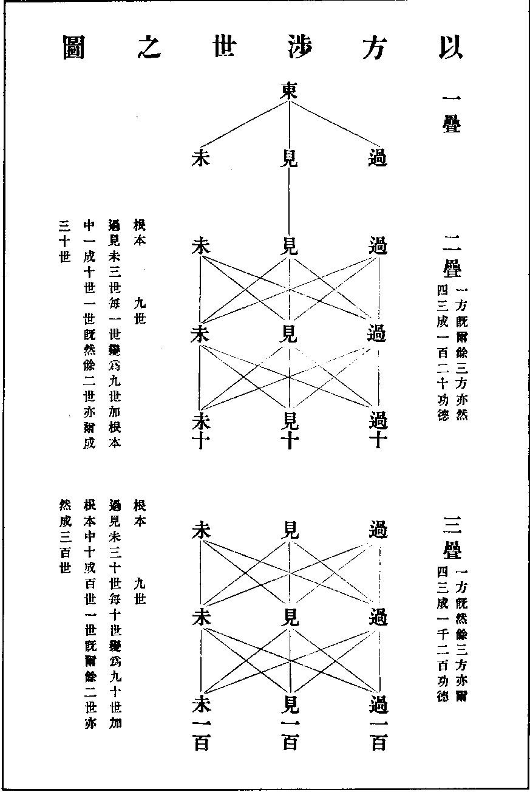
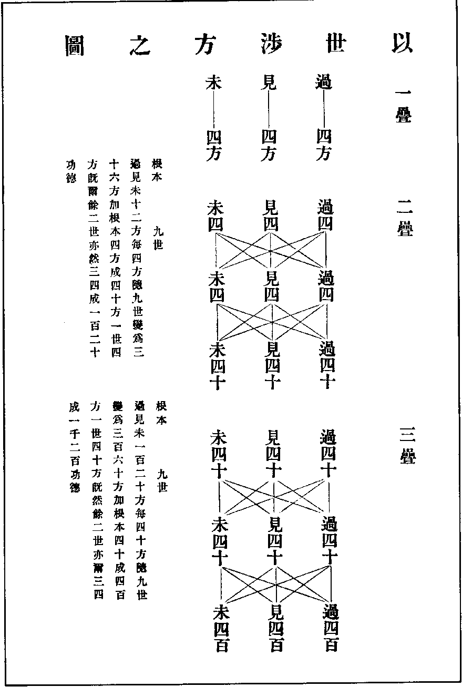

# 楞严经圆通疏



> **藏经**：卍新纂大日本续藏经（新纂卍续藏）　**册次** 第 12 册（X12）　**编号** X0281　**部类** 经疏部　**卷次** 10 卷　**篇幅** 448,811 字

> **卷／品**：10 卷 · 4 品



---



## 目录



  - [No. 281-A 大佛顶首楞严经圆通疏序](#no-281-a-大佛顶首楞严经圆通疏序)

  - [旹皇明天启元年季夏，之哉生明受菩萨戒天台宣洒虞淳熈和南谨序](#旹皇明天启元年季夏之哉生明受菩萨戒天台宣洒虞淳熈和南谨序)

  - [No. 281-B 楞严经圆通疏序](#no-281-b-楞严经圆通疏序)

  - [No. 281-C 大佛顶首楞严经圆通疏序](#no-281-c-大佛顶首楞严经圆通疏序)

- [大佛顶如来密因修证了义诸菩萨万行首楞严经卷第一](#大佛顶如来密因修证了义诸菩萨万行首楞严经卷第一)

- [大佛顶如来密因修证了义诸菩萨万行首楞严经卷第二](#大佛顶如来密因修证了义诸菩萨万行首楞严经卷第二)

- [大佛顶如来密因修证了义诸菩萨万行首楞严经卷第三](#大佛顶如来密因修证了义诸菩萨万行首楞严经卷第三)

- [大佛顶如来密因修证了义诸菩萨万行首楞严经卷第四](#大佛顶如来密因修证了义诸菩萨万行首楞严经卷第四)

- [大佛顶如来密因修证了义诸菩萨万行首楞严经卷第五](#大佛顶如来密因修证了义诸菩萨万行首楞严经卷第五)

- [大佛顶如来密因修证了义诸菩萨万行首楞严经卷第六](#大佛顶如来密因修证了义诸菩萨万行首楞严经卷第六)

- [大佛顶如来密因修证了义诸菩萨万行首楞严经卷第七](#大佛顶如来密因修证了义诸菩萨万行首楞严经卷第七)

- [大佛顶如来密因修证了义诸菩萨万行首楞严经卷第八](#大佛顶如来密因修证了义诸菩萨万行首楞严经卷第八)

- [大佛顶如来密因修证了义诸菩萨万行首楞严经卷第九](#大佛顶如来密因修证了义诸菩萨万行首楞严经卷第九)

- [大佛顶如来密因修证了义诸菩萨万行首楞严经卷第十](#大佛顶如来密因修证了义诸菩萨万行首楞严经卷第十)



---



### No. 281-A 大佛顶首楞严经圆通疏序



天台，遥礼楞严，愿早至此土。既而迫於西迈，则曰：楞严吾不得而见之矣，当有宰官菩萨以文章翻译，复有肉身比丘以吾教释经。而房相国遂应宰官之记，凡以青白之文、赤青之章染西线而烂然者，皆得附於宰官。而释经比丘若圆若岳，似副天台之望，又斥山外杂传，果此土之菩萨非耶？迨交光之拨三观，舜徵之混五灯，仪卿之赞聋莫，澄印之遇异人，宰官乎？比丘乎？法师乎？禅师乎？禅则天台之天如有会解矣。中峰命木林和尚取魏静复小本手付天如，而曰：楞严一经，禅者多取以为准的，吾徵心辨见，略见指点，须成会解，发明全经。删改多年，金声玉振，山家无尽灯师证其能集大成行焉，名圆通疏。非惟经之圆通，庶几进十人於二十五圆通之品。盖身为金城，身为汤池，千秋不坏，而又於时味理行间，崇赤城之堞，亘钱池之坊，细书密旨，经纬纵横，斯殆菩萨所示第二十六圆通者乎？或者曰：𫖮师西望而拜，目不及见此经，而肉比丘輙云见佛谈经，紏诸师之杂乱，斯特往生净国之祥耳。见灵山未散之会者何人？追随南岳於西竺者何人？先身后身，亲依佛窟，得旋谈妙，久隣圣阶。中品既生，而肉身之五现，床帷之顿空，人见其从观音而来，乃未见观音而证耳根之圆通，犹勤西望哉！表密义之难逢，导高足之深诣，天台之记良騐，百年之数已过。夫安知杂乱之非波旬语耶？波旬未破，全藉呪心。人但知佛顶经，不知灌顶部。经者，呪之序分；呪者，经之正宗。本圆修佛乘也，青衿宿儒裂法而独𫁉禅那，始拔魔登伽也；白衣女子混十人而将犯淫戒，终陈五阴魔也；大力鬼王增六时而重加精苦。此师所以建坛表法，从俗从宜。虽金口瑕疵，必出於三七日所见之佛；观镜光高下，应照见数千年已老之魔。是以首出玄义，汤若士常重其文句之清，匪错匪乱；后出坛仪，僧孺弟重其剏制之善，书额书铭。愧肉眼之宰官，护肉身之菩萨，悬应其记，固千载之一时矣。予往梦中峰，作六梦记。中峰赞台教比四时之夏，属天如扬盛德之光。或司徒百县，雩祀衍期，水潦失时，灯师调剂焉。於是天台、天目，兼山并峙。不图雪谤书传，愿超清磐，而独出如此疏者，将苕城若培而高，龙池若𤃒而深，进中峰父子於圆通，不增二菩萨哉？至其剞厥则手眼神通，磨勘则夙夜精敏，道林、卓峰，何以加诸？如来见之，当悬记月光说法后此经。此疏不先众经而灭，由摄流通诸人归无量寿土，经等无量寿故。



------



### 旹皇明天启元年季夏，之哉生明受菩萨戒天台宣洒虞淳熈和南谨序



### No. 281-B 楞严经圆通疏序



余生平有三不幸，而获三大幸焉。生为楚人而乏楚才，一不幸也；宦途多钝置，二不幸也；以直道交人而横遭诬谤，三不幸也。然而因之获闻西来大教，於西教获秉天台大师之宗，因台宗而悟明首楞严经旨，岂非三不幸中而获三大幸欤？余始於是经之未悟也，侧闻先达搆以心师，发为八难。今悟之矣，而翻然更为八易，此又不幸中之大幸也。试厓略言之，即以是而为圆通疏序，谅亦师所印可者也。此经始秘中印，累叶帝胄，珍为镇国重宝。虑传持外国，防卫甚严，而般剌密帝三藏入内道场，用薄素细腾，剖臂而寘诸股中，潜持得出，非传来之难乎？因即附南海估舶，得达五羊。将出之，共房融宰相翻译，而苦为脂血所凝。赖房妻黠慧，以铜盆盛水，浸而舒解，就之抄录，非翻译之难乎？当时密帝正急於流通，实未及奏请，而朝廷责违其制，乃畏而持经遁去。房虽奏入，亦不及颁行。后因神秀禅师入内道场传写，归於度门。慧振法师访度门得之，经始传焉。非流通之难乎？自唐天宝十年，西京惟悫法师始作疏解，相沿至今，凡十数名家，孰不谓深契佛心，得骨得髓。至於关键大意，修性境观，展卷则满目陈言，反照则修途罔指。非疏解之难乎？昔天台大师甞西望此经一十八载，既而入灭期迫，不获寓目，乃预谶译入悬记。释者谓当有菩萨宰官以文章翻译，复有肉身比丘以吾教判此经归於中道。余遍观诸疏，皆无足以应圣谶，惟今大师之圆通疏独可当之。非应谶之难乎？夫经之流通，贵在得旨，得旨又贵在建坛修进。此经自入支那，海内未闻有建坛之者。惟今大师于幽溪兰若依经建立，莫不中规中矩。非建坛之难乎？然而建坛方是事相庄严，进修又贵在见道。修道师自乙卯始，岁岁引众修持，莫不解行相资，目足双运。非进修之难乎？又建坛虽则为难，得地诚为不易。必在名山离诸垢染，波旬不得其便，斯可如意修为。否则，障难孔多，未必成就，非得地之难乎？昔也八难，今为八易，然而非后四而莫成前四，而后四又触在吾师。微师悟入修证，何以作我导师？若师者，可谓应大师之圣谶，传古佛之心宗，即肉身而悟法身，即肉眼而具天眼，剖微尘而出经卷，朗金錍而刮翳膜，发古今之所未发，决释迦之所秘密，可以称楞严之中兴，可以满大师之久望。而今而后，读是疏而开解修证者，斯可以称见道而后修道，修道而后证果矣。余广陵鹾使，千里迎师，坐夏衙斋，耳提密授。示明珠於衣阴，见见为先；赐华屋於旅亭，闻闻居首。非惟得其门而入堂奥，抑亦识解宝而雨珍馐，遂得饱饫醍醐，住持圆觉。富有多宝，藏作长者之子；贵为法王，裔愍贫乞之儿。岂非遇千生罕遇之人，闻万劫难逢之法欤？所愿人人悟入，各各宣传，俾大法不雍滞於一隅，至道获流通於永劫，则报恩之心，庶少酬於万一也。



时皇明万历、泰昌、天启三圣继体郊天之岁，岁星在上章，涒滩毕相，月哉生魄。钦差疏理两淮江广河南等处盐法道山东按察司廉使宗天台教观菩萨戒幽溪宣洒沧孺居士蕲州袁世振槃谈撰



------



### No. 281-C 大佛顶首楞严经圆通疏序



夫性觉妙明，本觉明妙，清净本然而周徧法界，随众生心而应所知量，不生不灭，无去无来，非空非有而离即离非，即俗即真而是即非即，其惟如来藏性欤！於性觉必明中而妄为明觉，向澄清大海内而弃海认沤，因而为三细六麤，因而为众生业果，生生死死，死死生生，揑见闻幻翳以作华因，邀三界空华而结空果，其惟九法界众生欤！我以不灭不生合如来藏，而如来藏惟妙觉明圆照法界，是故於中一为无量，无量为一，小中现大，大中现小，於一毛端现宝王刹，坐微尘里转大法轮，其惟释迦如来欤！以大权而启无上之教，示堕婬室之中，厌小慧以求成佛之因，得示庄严之路，垂范千载，弘益万方，其惟庆喜尊者欤！直示常住真心，总标二种根本，破七处妄心无所，而三处诘妄体元无，示十重真见有归，而一道显元常清净，圆开二种微妙三谛，俾当机顿获法身，直指一乘寂灭道场，使众会咸悟实相，圆解开而后修圆行，常心显而方事圆修，二决定门重伸取舍之方，三无漏学再决修行之渐，入道之要而独选乎耳门，破障之功而兼诵乎神呪，可谓显与密而兼修，正与助而双运，遂得菩提之路，亲到涅槃之家。举要言之，教理智断，而无不皆圆；行位因果，而无不皆妙。其惟首楞严经欤！或怜孱弱，析重以分科；或哀短胫，派深而作疏。或击蒙而为标月之指，或探玄而为指要之宗。其惟诸师之疏解欤！合殊途而归一致，汇大海以合众流。同一咸味，失其本名。其惟天如师之会解欤！第大成虽集，玄意尚弢。当机首请三法，漫不究其所因；如来示以根本，了不原其所自。显十见性，主宾之理何彰？破二见妄，远离之言奚在？次第不次第，二种三谛，圆融与行布不分；修成不修成，平等法身，众生与诸佛罔辩。见道而后修道，见道有所未谛，则修道何施？修道而后证果，修道有所未获，则证道安望？此为大定之本，此为万行之源。雍而不通，滞而不决。又何贵乎智者之西望，梵僧之悬谶，密谛之持来，房相之笔受乎？灯夙生庆幸，获遇真诠。索隐研几，积多寒暑。既仰承乎本讲之面命，复资乎坛法之圆修。参同止观法门，会通圆觉了义。随文释义，既不忍废於诸师之雅言；立体标宗，竟独挈乎一己之心印。笔以成疏，名曰圆通。剞劂流通，用酬法乳。大矣哉！首楞严之为经也，无法不具，无教不收。狂心若歇，歇即菩提。胜净妙明，不从人得。谓之华严圆顿可也。堕婬室无殊乎孩提弱丧，徵心目何异乎哆跢嘙和，谓之阿含渐初可也。四教并谈，而三根普润，一道直入，而四门等开，谓之方等渐中可也。广辩三科，备明七大，以空慧水，荡二执情，谓之般若渐末可也。开示悟入佛之知见，疑惑消除，心悟实相，谓之法华非渐非顿可也。始明常住真心，终归三德秘藏，四种律仪，珍重扶植，三无漏学，恳切宣扬，谓之涅槃扶律谈常可也。部类既不专乎四时，法门复兼通乎渐顿，收通归别，以别摄通，诚方等实相之真诠，圆顿生酥之教相也。呜呼，悟此理者，清净法身，可即生而获，修此法者，般若妙智，可直下以圆，解脱德由之而念念增明，涅槃果因之而心心成就，可谓明心见性之妙门，成佛作祖之秘典也。然而慧因定发，定藉戒成，三无漏学，事无躐等，仰冀后贤，於此法门而无惑者，内既资乎闻熏闻修之理观，外必藉乎佛力呪力之事修，宿习既驱，现行不作，便可饱餐甘露以延年，不致过伤醍醐而早夭，以此而续佛慧命，以此而广佛化仪，使人人悟心地之无生，各各证菩提之不妄，庶不负如来频烦告诫之恩，当机慇懃启请之德云尔。



旹皇明万历才四十有七年岁次己未中安居日，天台山幽溪沙门传灯述于楞严坛之东方不瞬堂



圆通疏引用并曾所经目古今书疏



古师孤山法师(讳智圆)　经疏　谷响钞  

吴兴法师(讳仁岳)　说题　集解　熏闻记  

法界庵主(讳可观)　补注  

云间法师　补遗  

长水法师(讳子璇)　义疏　经注  

栢庭法师(讳善月)　玄览  

桐洲法师(讳思坦)　集注  

资中法师(讳弘沇)　经疏  

擕李法师(讳洪敏)　证真钞  

真际法师(讳崇节)　删补疏  

道钦法师(禀长水璇公之学而著是书)　手鉴  

荆公王丞相(讳安石)　经解　补遗　纂注　释要  

觉范禅师(讳德洪)　合论  

天如禅师(讳惟则)　会解(现所承用)  

福唐法师(讳咸辉)　义海(排长水泐潭吴兴三师注入经)



今师鲁山讲主(讳普泰)　管见  

妙峰法师(讳真觉)　百问  

幻居法师(讳真界)　纂注  

月川法师(讳镇澄)　别眼　正观疏  

曾仪部(讳凤仪字金简)　宗通  

憨山法师(讳德清)　镜悬　通议  

中川法师(讳界澄)　经疏  

交光法师(讳真鉴)　正脉  

莲池法师(讳袾宏)　摸象



圆通疏凡例(八条)



是疏乃合会解而为之，元无有科。今欲加之，似与旧解相反。欲己之复，於经文章段无所发明，故用细字傍经而书，谓之旁科，犹今人之旁注也。若不厌精细，不妨从傍玩味。若以之为冗繁，则竟读经文，而是科可略。取舍随宜，亦一时之方便也。  

今疏既以旁科而段乎经，即应经随科列。但会解旧有所分章段，况解随经置，业有定式，不可更为之分割。故经有宜前四反在於后，科有宜后而反置於前，读者请以意得可也。  

经文比解与疏大，而高书一字者，所以尊金口也。会解让经一字而大书，今疏与解相并而细书者，所以尊古人也。意欲读是经者，经明而解可略，解明而疏亦可略，用之则行，舍之则藏，亦无适而非可也。  

会解中不无臧否，所以不敢妄有增损者，念古人草创间关，天如师会解时已沙汰其大半，今若更损之，似令后学全不知古人之用心处矣。  

古师之释会解中，犹有收之未尽者，然於经义实有所发明。今更为取之，而亦用细书者，不敢浇漓於会解之乳味也。著某师曰者，知非蹈窃也。间有与己解间错而入者，文义有所连属也。  

会解臧否处难，可以一己之意而妄为雌黄。若其间於时味或有相妨，理行或有乖戾，然后明正其非是。舍此之外，亦惟任之。  

是疏但取古师而不及今师者，非曰是古而非今也，以诸师著述，亦各自成一家言，苟尽取之，则卷帙繁多，少取之，又启人嫌隙，是故已之。  

是疏亦有与今师交论处者，所以为本宗坚金城，为会解深汤池也。若夫本家之长江一曲，异宗之美玉纤瑕，如公论何？如家法何？亦不妨或者之阳秋，其若吹毛求玼，阳排阴取，明明三尺，其肯逊诸？



No. 281-D 大佛顶首楞严经会解叙



师子林沙门　惟则



首楞严经者，诸佛之慧命，众生之达道，教网之宏纲，禅门之要关也。世尊成道以来，五时设化，无非为一大事因缘，求其总摄化机，直指心体，发宣真胜义性，简定真实圆通，使人转物同，如来弹指，超无学者，无尚楞严矣。释其名，则一切事究竟坚固，即所谓彻法底源，无动无坏，而如来密因，菩萨万行，靡不资始乎此，而归极乎此耳。考其所诠，则谈圆理以明真性，开圆行以示真修，其性也体用双彰，其修也果因一契，原始要终，了义之说也。良由诸修行人，背真向妄，不成无上菩提，或爱念小乘，得少为足，或欲漏不除，畜闻成过，故阿难以多闻邪染为缘，浚发大教，而世尊首告之曰，一切众生，生死相续，皆由不知常住真心，性净明体，用诸妄想，此想不真，故有轮转。又曰，有三摩提，名大佛顶，首楞严王，具足万行，十方如来一门，超出妙庄严路，斯一经理行之大本也欤。由是破七处攀缘，别二种根本，因见显心，因心显见，虽心见互显，而正显在心，如以盲人瞩暗，喻见非眼，屈指飞光，验见不动，印观河之非变，比垂手之无遗，辩於八还，择於诸物，非舒非缩，无是无非，使悟净圆真心，妄为色空及闻见耳。既悟妄为，尚疑混滥，故又破自然因缘，示见见之非见，合别业同分，指见妄之所生，且以一人例多人，以一国例诸国，总显器界根身，同一妄耳。自浅而深，自狭而广。虽多方显妄，而所显惟真。故又举阴入处界，广及七大，融会入於如来藏性。使悟物我同根，是非一体。妄无自性，全体即真。凡十界依正之相，皆循业发现而已。既悟即真，尚迷循发。故又答山河大地之难，深穷生起之由。譬虗空不拒，诸相发挥。显真妙觉，明圆照法界。一多互应，小大相容。即体即用，非俗非真。至於离即离非，是即非即。则藏心妙性，不涉名言矣。复引照镜狂走，喻妄无因。结责多闻，劝修无漏。通而言之，皆圆理也。理解虽圆，非行莫证。故又明二决定义。初审因地发心，伏断无明，为修行之要。次审烦恼根本，意择圆根，为发行之由。於是定六根优劣，令一门深入。击钟验常，绾巾示结。陈二十五圣所证法门，敕选耳根为初心方便。而又教以摄心轨则，安立道场。遂闻四重律仪，顶光神呪。通而言之，皆圆行也。乃至由三增进，成就五十五位真菩提路。虽谈证位，未尽行因。下而戒业习於七趣情想，防禅定於五阴魔邪，无非行门之事。必期於圆满菩提，归无所得，始得名为究竟坚固之证也。然则依究竟坚固之理，立究竟坚固之行。修究竟坚固之行，证究竟坚固之理。楞严教旨，大抵如是。是知教行理三，悉号楞严。了义之说，莫此加矣。科经者，合理行为正宗，离正宗为五分：一、见道；二、修道；三、证果；四、结经；五、助道。谓见道而后修道，修道而后证果，此常途之序固尔。究论上根修证，如发明藏性之后，谓不历僧祇，获法身；请入华屋之前，谓疑惑销除，心悟实相之类，又岂局於常哉？大哉教乎！夫欲发真归元，明心见性者，於此宜尽心焉。然是经无教不收，无机不摄，或言偏意圆，或名同体异，昧劣之士，有所不达。弘经者，思所以达之，从而为之解。自唐而宋，解者凡十餘家。始余见长水璇师、孤山圆师、泐潭月师、温陵环师之说，又阅吴兴岳师之集，并得兴福悫、资中沇、真际节、擕李敏诸师之意，无不大同。惟所见或各从一长，乃不能不小异，遂使行者泣岐，莫辩良导，则不达之患，不在彼而在乎此矣。今余会诸家要解，以通大途。异不公乎众者，节之；异而互通者，互存之；互为激扬者，审其的据而取之。间有隐略乖隔处，则又附己意，目为补注。若合殊流，同归於海，故谓之会解。噫！道本无言，非言不显，佛不得已而言矣。言有不达，道无以明，则诸师之言，亦不容其已也。言既多而不同，去道转远，则会解者，又岂容其自己哉？解既会矣，庶几览者，因会解以知人之言，因人言以知佛之言。佛言知矣，究竟坚固者得矣。曰行、曰理、曰教、曰禅、曰达道、曰慧命，皆剩语矣，况所谓解与会哉？



时至正二年壬午佛成道日，庐陵沙门惟则述于姑苏城中之师子林。



No. 281-E



昔天台智者大师闻西域有是经，夙夜西望，愿见而未及见也。唐武后长安末，般剌密帝三藏始持梵本自南海至广州，会宰相房融知南铨在广，请就制止寺译出而笔受之。中宗神龙元年乙巳五月念三日，经成，誊写入奏，适朝廷多故，未遑颁行。有神秀禅师入内道场，见所奏本，传写归荆州度门寺。时慧振法师访度门而得之，经始传。天宝十年，西京兴福寺惟悫法师复於故相房融家得其笔受之本，始作疏解而广传之。继是则有长水、孤山、吴兴诸公递相发明，而解益详矣。然学者或困於详而莫能徧探，今师子林天如禅师会解一出，则不待徧探而众美具在，不劳辩核而群疑自消，诵习之便，莫便於是矣。愚与师游从既久，自其搜括诸家，参酌去取，凡三年而会解成，皆愚所目击，盖亦颇知其深有功于是经者也。兹因募众梓以流通，乃复记经来之岁月云。



临川沙门克立题。



会解所引教禅诸师名目(年代未详，姑据所闻而刻。)



与福法师讳惟悫  

资中法师讳弘沇  

真际法师讳崇节  

擕李法师讳洪敏  

长水法师讳子璇  

孤山法师讳智圆  

吴兴法师讳仁岳  

泐潭禅师讳晓月  

温陵法师讳戒环



No. 281



------



## 大佛顶如来密因修证了义诸菩萨万行首楞严经卷第一



(一名中印度那烂陀大道场经，於灌顶部录出别行。)。



师子林沙门　惟则　会解



天台山沙门　传灯圆通疏



【觧】温陵曰：如来果体，其体本然，何假密因。菩萨道用，其用无作，孰为万行。无因无行，无修无证，无了不了，大小名相，一切不立，此真首楞严究竟坚固者也。特以众生如来，隐於藏心，非密因不显。众生菩萨，沦於七趣，非万行不修。觉皇於是示之以大法，使不迷於小道，而默得乎无外之体。喻之以佛顶，使不滞於相见，而妙及乎无上之致。指如来密因，使明本妙心，知三世诸佛，皆依此为初因。明修证了义，使悟究竟法，知一切圣人，皆依此而证果。乃至具足菩萨万行，一切事法，无不究竟，至於实相，坚固不坏。故名大佛顶如来密因修证了义诸菩萨万行首楞严经。经，即能诠之文而已。诠，犹筌也。知经为筌，则从而释之者，皆筌也，非鱼也。学者慎勿执筌为鱼，然后首楞真经可得矣。天如补注曰：梵语首楞严，乃大定之总名也。此翻一切事究竟坚固。古师云：未修此定，一切事法，宛尔差殊，为法所缚。得此定时，山河大地，明暗色空，一切事法，当处寂灭，即是常住心性。故云究竟坚固。如法华云：是法住法位，世间相常住。韶国师云：心外无法，满目青山。亦此义也。上略释经题竟。若其翻译笔受等来历，及分门科判之类，诸师既有明文，兹不繁引。



【疏】天台曰：此经以人法为名。佛所知见，常住真心为体；佛能知见，了了见於佛性为宗；破九法界妄知见，显佛法界真知见为力用；圆顿生酥为教相。初人法为名者，人有果人、因人，如来、菩萨是也；法有果法、因法，大佛顶、密因、万行是也。修证了义首楞严，则总该因果。初人法为名者，此经题目，首标大佛顶，而异说多途。或有单从法释，如义海师云：大即法身，佛即般若，顶即解脱。作此解说，在理或当未惬人情，以逐字分释，破句读故。或单从喻说，如温陵师所谓喻之以佛顶，使不滞於相见。作如此说，虽谓善巧，不合经文，以经文不云犹如佛顶故。又有单以顶法解说，如觉范等诸师，谓此经尊无上顶法故。善则善矣，终带牵强。今直作事释，以事该理，还摄得诸家一偏之义。盖大佛顶如来者，本指世尊顶中所现化佛也。阿难方遭邪染，心虽明了，而力不自由，於义为著相，故遭系缚，下文云阿难纵强记，不免落邪思是也。如来设救顶中化佛说呪，於义为无为，故能解脱，下文云何须待我佛顶神呪，令汝解脱是也。阿难见佛，顶礼悲泣，启请十方如来得成菩提，妙奢摩他、三摩、禅那最初方便，此实覩胜以兴怀，仰果以求因故。阿难所宗者解脱，即对病之妙药，救苦之良津，莫尊於顶中化佛如来得成菩提，岂非题称如来密因乎？故如来者，於三德为解脱。言大佛者，即释迦报智微妙色身也。盖佛是觉义，於三德为般若。特言大者，谓即法身之报也。能获法身，故在佛名大佛，在菩萨名大菩萨，在人名大人，初无间然者。故此首题建言，即称为大，盖示阿难解脱之本也。何则？以解脱由般若而证，般若又由法身而成。故慕解脱者，莫先於修般若。修般若者，莫先於悟法身。故此经前之三卷，无非明众生本有法身边事。其曰：则汝法身，终成断灭，其谁修证无生法忍？厥旨显然。故阿难叙悟，特云不历僧祇获法身，非示解脱之本乎？四卷至六卷，无非明般若边事。七卷至十卷，无非明解脱边事。盖般若属於修，解脱属乎证故也。但三法相即，经亦映带而说。如二卷云：於奢摩他，微密观照，心犹未了。五卷云：空性圆明，成法解脱，解脱法已，俱空不生。非法身兼般若，般若兼解脱言之乎？至於论切要工夫，则又三法必俱。如曰：见见之时，见非是见，见犹离见，见不能及。第一见字，般若也。第二见字，法身也。见犹离见，见不能及，解脱也。又曰：随拔一根，脱粘内伏，则诸暗相，永不能昏。随拔一根，般若也。内伏，法身也。永不能昏，解脱也。又曰：入流亡所。入，般若也。流，法身也。亡所，解脱也。故此大字，为一经之主意。其曰：百千澄清大海，见性周圆，遍十方国，不动周圆，妙真如性，清净本然，周遍法界，各各自知，心遍十方，皆从此大字上演出。盖此经所宗者秘藏，涅槃经云：安置诸子秘密藏中，我亦不久自入其中。不其是乎？故大佛者，的指说经教主也。顶释迦，无见顶相也。如来，顶中所现化佛也。大即法身，佛即般若，顶即解脱，如来则解脱之中极胜解脱。如此解说，则义海之义成。不滞於相见，而独尊乎顶法，则二师之义亦足。此固不涉譬喻，而文义俱符，亦可谓释题之一快事也。言密因者，即阿难恨多闻而厌系缚，仰解脱以请修方。虽属乎修，此修即性，照性成修，此之谓欤？故经初二两卷，约眼以辩性，普门大士，约耳以明修。特言密者，不过对迷以言，若约悟者，全密是显。如见性十义，堂堂独露，法身妙性，舍此而谁？今借喻释字，令义易显。密如蜂蜜之蜜，蜜味至甘，藏之於华，人独见华，而忽其蜜。惟彼黠蜂，缘华而歃，蜜名甘露，人得而食之，愈病延年。如帝释天园，生树产甘露，诸天同食，皆获不死长生。众生六受用根，亦复如是。浮尘根相，显露如华，识精元明，其犹甘露，能悟乎此，即获无生。大集经云：怜愍为茎智慧叶，三昧为须解脱敷，菩萨蜂王食甘露，我今敬礼佛莲华。亦得证此意也。言修证者，一往而言，修时非证，证不关修。再往而求，今之密因，全是佛性，照此名修，无别有修。是则修时即证，证时即修。圆觉经云：一切众生，皆证圆觉。此之谓也。又证者，证验证明。如无生常住之理，即众生六受用根，或不动，或无迁等，皆可即事证验证明故。若如温陵师之释，修证与题相违者二：如来本以修证为首楞严，温陵乃以无修无证为真首楞严。经意本以即修证而无修证为首楞严，如因果名目，决定相应，如妄性无体，非有所依，将欲复真，欲真已非真真如性，皆其义意。温陵乃以有修有证为非真首楞严，既非圆旨，今所不用。经显此义，是大乘中之大乘，圆顿中之圆顿，所谓宣胜义中真胜义性，故云了义。言诸菩萨万行者，上虽曰如来密因，要知即众生密因。盖迷之为众生，证之即如来，无别如来也。例今迷此为众生，修之即菩萨，无别菩萨也。上密因乃万行之正体，今万行乃密因之助用，体用互具，正助兼备。盖此密因，是首楞严定，举一全该，无俟别修。虽或别修，亦未尝出定，所谓不动寂体，现诸威仪。而经云：有三摩提，具足万行。岂假别修哉？首楞严两译不同：一译徤相分别，则义属乎行；一译一切事究竟坚固，则义属乎理；并是两者，以言说而诠辩之，则义属乎教。古师所谓教行理三，悉号楞严，信而有徵矣。以此而求，则一题总号，一部别诠，教理智断，行位因果，无非究竟坚固者也。又此经题一十九字，究其旨归，不无傍正，要之皆为密因而设。谓以性显修，以果显因，以教显行，以人显法，以助显正。以性显修者，大即法身，佛即般若，顶即解脱，用此三性，以显三修。法身即禅那，般若即奢摩，解脱即三摩，全性起修，全修在性，大佛顶密因也。以果显因者，法身如来即禅那，报身如来即奢摩，应身如来即三摩，因超果海，果彻因源，如来密因也。以教显行者，非了义之教，不诠了义之理，非了义之理，不起了义之行，教行理三，悉号楞严，了义密因也。以人显法者，彰此密因，是圆顿菩萨所修，所谓我亦从中证，非惟观世音，诸菩萨密因也。以助显正者，若能正修密因，即能具足万行，万行密因也。首楞严正叹密因，是究竟大定，总谓之首楞严密因。故此一十九字，是傍正相显，宾主互严，览别为总，一经大旨，於是乎尽，故曰大佛顶云云。已上是别题，经是通号。梵语修多罗，此称契经，谓上契佛理，下契物机。又训法训常，是贯是摄，常则道轨诸佛，法则德模万灵，摄谓集斯奥义，贯谓持理不失，由如来金口所宣，故称经也。觉范师引说文曰：织有经，集丝为之，经常而纬变。夫经之所为，经而已，纬以成之，则经所不能言也。故孔子贵神，而明之存乎其人。



第二、佛所知见常住真心为体者，凡有四意：一、是经之张本，经初发轸即云：一切众生皆由不知常住真心故。二、是经之盛谈，如屈指飞光验见不动，观河之见童耄无迁，讫第四卷皆明常住真心故。三、以智验谛，体是如来妙智究尽之法，既云我以不灭不生合如来藏，能究尽者既是常住，所究尽者安得不常？四、以宗验体，盖体是宗之所归，宗常体亦宜常。经云：若於因地以生灭之心为本，修因而求不生不灭之果，无有是处。因果之宗既须常住，所归之体安得不常？又当机发行之由，具圆、通、常三义，弥须以常住真心为体也。



第三、佛能知见，了了见於佛性为宗者，盖用此为宗，非惟摄法周备，文义亦复显然。如经初首告之曰：不知常住真心。盖以不知显知，徵心之初，惟心与目，今何所在？当机请云：发妙明心，开我道眼。如来许云：获妙微密性净明心，得清净眼。四卷云：用世语言，入佛知见。请入华屋云：得陀罗尼，入佛知见。如来答云：修菩萨乘，入佛知见。五卷云：知见立知，即无明本；知见无见，斯即涅槃。复次，知见乃是略举，备必六根，故云生死结根，安乐妙常，同是六根，更非他物。然根必对境，对必发识，故经云：十方如来於十八界，一一修行，皆得菩提。此皆显诠佛之知见也。言摄法周备者，如知见既备六根，则耳根在其中矣。既曰知见无见，斯即涅槃，此则六根通须首楞大定为本，方成佛之知见。佛命文殊选择耳根者，盖入道虽有多门，初心岂能遍入？故令但於一门深入，入一无妄，彼六知根，一时清净。然於所入之门，又必有要，苟得其要，则与不圆根日劫相倍。此方众生，惟耳根最利，故文殊顺机选此耳根圆通，为入佛之知见之要门，非谓圆通但只耳根而已。此与摩诃止观，初心修观，必先内心，故於三科，拣却界入，复於五阴，又除前四，的取识阴为所观境，如去丈就尺，去尺就寸，伐树得根，灸病得穴，千枝百病，自然消殒，大同小异耳。言了了见於佛性者，一经所诠常住真心，如见性十义，耳根三法，皆众生本有佛性在於根门，莫不了了分明见，了了分明闻。能体会乎此，是为佛能知见，了了见於佛性，无别佛知见可显也。



第四、破九界妄知见，显佛法界真知见为力用者，此经破显力用至大，破妄极至等觉，显真直齐妙觉。又复应知非谓别有等妙可破可显，直指众生日用见闻之际，一尘不立，便名破妄极至等觉；见性昭然，便名显真直齐妙觉。以众生成佛时，秪乾尽此现前见闻上情识，秪显此见闻上佛性故也。如云见见之时，见非是见，秪一见见，即见佛性，即破无明，力用岂不大乎？然此犹就宗之力用言之，若用之力用，要显佛说此经功用极大，能破众生如此疑情，能显众生如此佛性，能使众生悟佛性修行。破妄显真至极者，如此与宗俱大也。



第五、圆顿生酥为教相者，此经说在方等，方等四教并谈，此经纯谈佛性，狂心若歇，歇即菩提，故约教判为圆顿，约味判属生酥，已如前茅与玄义中所说，兹不重辩。



○会解云：若其翻译笔受等来历，及分门科判之类，诸师既有明文，兹不繁引，则知天如师亦不废於科判等说。今仍顺古师，备释翻译笔受来历，及随经科判云：



一名中印度那烂陀大道场经，於灌顶部录出别行



【疏】长水曰：此别目也。印度月名，具云印特伽，此云月邦。以此大国，形诸小国，如星中月。彼有五印，此当中也，即一境之都名。一境之中，有多国别：最尊大者，号摩竭提，此云大体，以总摄故；或云不害，皆义翻也。那烂陀，此云施无厌，即龙名也。西域记云：庵摩罗国有池，池中有龙，名施无厌。寺近彼池，故以标号。大道场者，沙门体心修道之地也。佛灭度后，六帝缉兴，遐竦绀宇，园林普合，都建一门，主客万僧，住持增峻，印度名寺，莫先於此，故名曰大。灌顶部者，彼有五部，此当其一，毗卢为主。既标部处，寻验可凭，无谓近翻，疑非正说。



大唐神龙元年龙集乙巳五月己卯朔二十三日辛丑



【疏】长水曰长安。三年，则天罢政，中宗嗣位，是岁改为神龙元年。龙集者，龙星，亦曰岁星，岁行一次也。集，居也。乙巳，即所舍之次。朔，稣也，月死复稣。稣，生也。



中天竺沙门般剌密谛於广州制止道场译



【疏】长水曰天竺，亦云乾竺、乾豆、身毒、印度等。沙门云勤息，取生善灭恶之称。般剌密谛，此云到彼岸。译者以有才智，通四方语，名曰象胥之学。四方各有其名，今取北方掌语者也。



乌苌国沙门弥伽释迦译语



【疏】长水曰：国名未详。弥伽释迦，此云能降伏，翻梵为华，故云译语。其中证义，应有别录，餘如翻译时年中说。



菩萨戒弟子前正谏大夫同中书门下平章事清河房融笔授



【疏】长水曰：虽为宰官而授大乘戒者，经云：欲受国王位时，乃至百官受位时，应先受菩萨戒，一切鬼神救护。王身，百官之身也。资於师长，以父兄之道事之，故云弟子。正谏者，今之谏议也。举贤达能，大扶进人，故曰大夫。中书，门下二省之名。平和章，明国政之事曰平章事。笔授，或云笔受，谓以此方文体，笔其所授梵本，缉缀润色，令顺物情，不失正理也。初，密帝割膊藏经，至融所，苦血浸，融妻以水清之，方得就笔。



天台曰：随经科判，准常为三：初序分，始於如是我闻，终於归来佛所。第二正宗分，始於阿难见佛，终於不恋三界。此后皆属第三流通分也。



○(初、序，分二：初、通序六：初、指法体。)如是。



○(二、显能闻)我闻。



○(三，明机感)一时。



○(四称化主)佛。



○(五述住处)在室罗筏城祇桓精舍。



○(六、引同闻三：初、声闻五：初、明类。)与大比丘众。



○(二示数)千二百五十人俱。



【觧】温陵曰：如是之法，我从佛闻。此集者，因佛立言证法，有所授而已，不必他说。一时之语，亦因佛立，诸经通用，故不定指也。孤山曰：室罗筏，或云舍卫，新翻丰德，以国丰四德：一、货财，二、欲境，三、多闻，四、解脱。祇，具云祇陀，正云逝多，此翻战胜，太子之名也。生时，父王与外国战胜，因立美号，即须达为之买园，造立精舍以施佛者。桓，即林也。比丘，含三义：乞士，破恶怖魔也。长水曰：千二百五十人者，初度陈如等五人，次度三迦叶兄弟，兼徒一千，次度舍利弗、目犍连，各兼徒一百，次度耶舍长者等五十人。经举大数，故减五人。此众并先事外道，勤苦累劫，一无所证，才遇佛，即得上果，故感佛恩，常随佛化，为常随众也。天如补注曰：会解之例，不以人品、年代、先后为次第，盖於诸家之解，互有去取，但以所取之解，随经文先后而插入焉。解之同者，不重取，贵在一路贯通，如出一人之口而已。



【疏】天台曰：不必他说者，如自古释经，有六成就、四阿难离合等说，皆护法菩萨之所建立，马鸣、龙树之所宗尚。盖通序文通，其义亦通，而意在於别。环师解经，多从要略，故其言如此。然以略该广可也，若以略斥广，此恶乎可？学者当两存之，庶不倍乎圣经。今一往顺长水所解，伸通其义。如是者，若兼我闻合释，即指法之辞也。如是之法，我从佛闻。佛地论云：谓结集时，众共请言：如汝所闻，当如是说。传法菩萨便许可言：如是当说，如我所闻离释。如是者，信成就也。智度论云：佛法大海，信为能入，智为能度。信者，言是事如是；不信者，言是事不如是。肇公亦云：信，顺之辞也。信则所言之理顺，顺则师资之道成，故万行中以信为首，故云如是。又契理契机曰如，永离过非曰是；如理而说，如理而信，故言如是。若约今经，如来藏心，体性不动曰如，真实义故曰是。又一切诸法，本无生灭，皆如来藏，故名为如；离一切相，即一切法，故称为是。更有餘义，繁而不论。我闻者，闻成就也。我，即阿难自指五蕴假者。然一切法，佛说无我，今称我者，我有四种：一、凡夫徧计，二、外道宗计，三、诸圣随世假立宾主，四、法身真我。经指后二，非邪慢心而有所说，故无过矣。闻谓耳根发识听受，虽因耳处废别从总，故称我闻。无相宗说：我既无我，闻亦无闻，从缘生故，不坏假名，即不闻闻也。若约法性，此经旨趣，传法菩萨以我无我不二之真我，根境非一异之妙耳，闻真俗无碍之法门。一时者，时成就也。师资合会，说听究竟，总言一时。一者拣异餘时，时者随世假立。如来说经有无量时，不能别举一言，略周但云一时。涅槃经云：一时在恒河岸等。又诸方时分延促不定，故但言一时。若约法义释者，即说听之时，心境泯理，智融凡圣，如本始会。此诸二法皆一之时，不标春夏秋冬、日月岁时，但是佛说法时。佛者，主成就也。具云佛陀，此云觉者，谓觉了真妄性相之者，即究竟觉也。论云：以觉心源故，名究竟觉；未觉心源故，非究竟觉。然具三义：一自觉，觉知自心本无生灭；二觉他，觉一切法无不是如；三觉满，二觉理圆，称之为满。佛地论中具有十义，谓具一切智、一切种智，出烦恼障及所知障，觉了一切诸法性相，能自开觉，亦能开觉一切有情，如睡梦觉，如莲华开，故称为佛。在室罗筏城祇桓精舍者，处成就也。处有二种：一、所化处，即筏城；二、所住处，即祇园。具云室罗筏悉底，此云丰德，或云闻物，或云好道。此乃城名，非是国号。以其城中多财物，好欲境，饶多闻，丰解脱，道德名称，五天共闻故。或云闻者城，昔有老僊於此修道，后有少僊从其受学，厥号闻者。老僊殁后，少僊於此建城而住，故以名焉。国都号憍萨罗，但以就胜易彰，故举城号。祇桓者，具云祇陀，或云逝多制多，此云战胜，即太子名。林主是彼，故云胜林。桓即林也。精舍者，即沙门精行所舍处也。谓须达买园置舍，太子舍树造门，二人共建，以延佛僧。与大比丘众者，众成就也。与者，并兼共及也。佛与阿难及大比丘等，证非虗谬。梵云摩诃，此具三义，谓大、多、胜也。器量尊重，天王大人之所恭敬，故云大。徧知内外经书，故云多。胜出九十五种外道，故言胜。比丘名含三义：乞士、怖魔、破恶。谓出家者，上於诸佛求法，以内资令慧命增长；下於檀越离邪正命乞食，以外资令色身无损，故云乞士。又出家者，最初发出家心，或发菩提心，或至成佛，皆令魔怖，失人众故，名为怖魔。又能破断身口七支、九十八使业烦恼故，称为破恶。四人已上，能作说恣羯磨法，故名为众。



○(三显位)皆是无漏大阿罗汉。



○(四、叹德二：初、自行。)佛子住持，善超诸有。



○(二、化他二：初、现在助佛扬化。)能於国土，成就威仪。从佛转轮，妙堪遗嘱。严净毗尼，弘范三界。



○(二、未来垂应益物)应身无量，度脱众生。拔济未来，越诸尘累。



【觧】孤山曰：无漏者，内冥中道，不漏落二边也。准涅槃四依品，十地菩萨名阿罗汉。温陵曰：华严叹众住一切菩萨智所住境，护持诸佛正法之轮，所谓佛子住持也。法华叹众尽诸有结，心得自在，所谓善超诸有也。能於国土成就威仪者，随刹现身，正容悟物也。从佛转轮，妙堪遗嘱者，道能助化，德足利生也。而又严毗尼而作范，示应身而度生，意非利彼一时，直欲拔济未来，使皆超诸有尘累耳。此阿难同列之德也。凡经序众，皆随缘起。此经以阿难起教，示堕婬室，疑若未能住持佛法，善超诸有，亏威仪，污戒律，不堪遗嘱度生，拔济未来。故因叹同列之德，以显阿难示迹，实无亏污，意在拔济也。



【疏】天台曰：二师释叹德𫾻之太高者，以孤山判归法华，温陵判归般若法华两间故也。不知如是等六事名经前序，居一经之首故；亦名经后序，结集家后安故。今正意在经前，岂以未闻楞严而遽叹功德超胜如此？即法华称最圆顿而未经开显，叙众亦从小释，楞严輙以过之，恐无此理。今既判归方等，则无漏者内冥真谛，不漏落三界也。罗汉三种：一、慧解脱，二、俱解脱，三、无疑解脱。今拣非慧俱，故称为大。以大乘言之，菩萨称佛真子，二乘犹子而已。住一切智所住境，护持诸佛正法之轮，所谓佛子住持也。法华叹众尽诸有，结心得自在，所谓善超诸有也。能於国土成就威仪者，随物现通，正容悟物也。餘如旧说。若应身无量，度脱众生，亦须约小乘无漏神通而释。惟其如此具德，方堪受别请而事远游，行等慈而不择微贱，能转邪而不为邪转。如其未然，无有蹈大人之迹而不颠倒错乱若阿难者。经家叙意，不在兹乎？是则叹德出当机，一筹足矣。经前之序，胡必拘拘以涅槃华严为较哉？



○(五累名)其名曰：大智舍利弗、摩诃目犍连、摩诃拘𫄨罗、富楼那弥多罗尼子、须菩提、优波尼沙陀等，而为上首。



○(二、缘觉众，　三、菩萨众，列在别序。)复有无量辟支、无学，并其初心，同来佛所。



【觧】长水曰：舍利，此云鹙也。弗，即子也。其母名舍利，以其眼黑白分明，转动流利如之，故连母为名。目犍连，姓也，此云采菽氏。名拘律陀，此云无节树。摩诃拘𫄨罗，此云大膝，乃舍利弗之舅，常论胜姊。姊怀鹙子，论即不胜，知怀智人，寄辩母口，遂往南天学十八经，无暇剪爪，号长爪梵志。学毕还家，而甥已为佛弟子，起大憍慢，往佛所夺之。佛令立论，义堕负媿，得法眼净，成阿罗汉，获四辩才。富楼那，父名，此云满。弥多罗尼，母名，此云慈。今连父母名，召云满慈子。须菩提云空生，生时库藏皆空。占者云：既善且吉。故亦云善现、善吉。优波尼沙陀，此云尘性空。孤山曰：诸经列名不同，尚年腊则先陈如，尚声德则先鹙子，今从尚德之例也。长水曰：辟支，具云辟支迦罗，此云独觉，亦云缘觉。独但自悟，缘依教悟。独觉自分二类：其利根者曰麟喻，喻麟之独，出无佛世，观物变易，自觉无生。其钝根者曰部行，亦出无佛世，部党而行，师徒训化也。缘觉依佛教观十二缘，作流转、还灭二种观法者也。资中曰：此是部行，遇佛回向者。吴兴曰：并其初心，正似师徒共集，实部行也。



【疏】天台曰：二序分文，通序已竟，下属别序。论此经亦具三乘及以俗众。第二乘内众，常随侍佛；王臣等外众，出没不定。菩萨居两间，辅弼扬化，而隐显无恒，发起缘由。既属休夏自恣，菩萨随机化导，必自远方而来；王臣设斋延佛，要须随佛而至。经家欲避重复，故於别序而插入焉。



○(一、别序二：初、发起远由，二：初、夏终演法。)属诸比丘休夏自恣，十方菩萨諮决心疑，钦奉慈严，将求密义。即时如来敷坐宴安，为诸会中宣示深奥，法筵清众得未曾有。迦陵僊音徧十方界，恒沙菩萨来聚道场，文殊师利而为上首。



【觧】孤山曰：自恣，律开三日，七月十四、十五、十六也。温陵曰：自有愆失，恣任僧举，曰自恣。九旬禁足，莫由觐佛，故於休夏，咨决心疑。自恣、决疑，皆所以考九旬德业也。钦奉如来而称慈严者，慈以恩言，严以威言，宣示深奥，所以为楞严发起，如法华以无量义为发起也。迦陵频伽，僊禽也，其音和雅，佛音如之。文殊，此云妙德，表根本智。楞严会上，为择法眼，故居上首也。



【疏】天台曰：深奥为此经发起者，即菩萨所求密义也。楞严所说，妙在密因，开佛知见，莫尚乎此。是则菩萨与佛，砧槌相扣，於楞严未举齿，先已聊通一线。又此一段经文，应通别两属：文殊师利而为上首，属通序；列众，属诸比丘；休夏自恣一段，属别序。盖此经所说，最严者戒律，戒律所重者休夏自恣。欲叙菩萨咨决心疑而集，不得不以休夏自恣而为发端，则恒沙菩萨来聚道场者，为咨决心疑而集也。古师知此经以阿难邪染为缘，浚发大教，不知邪染之缘，正根于此。经家意明阿难大小威仪俱失，两门作略俱无，而欲行大人事，且曰：方行等慈，不择微贱，摩登伽女所以得乘其间矣。何谓大小威仪俱失？休夏自恣，此小乘之威仪也，而阿难方受别请；咨决心疑，此大乘之威仪也，而阿难方远游不还。何谓两门作略俱无？藏乘极果，犹谆谆乎结制；小乘初心，当谨谨乎伴侣，而阿难方破夏而独行。大乘菩萨如文殊，虽三处度夏，至休夏，未甞不住佛所而咨决心疑。阿难果何人斯，而独异乎是耶？故经家暗紏阿难之失，而有此五焉：一、破夏远游，二、独受别请，三、不来自恣，四、不咨决心疑，五、强学大人作略。要知正为末世比丘与白衣居士，学虗头禅，无真实慧，亏威仪，蔑戒律，强学大人作用，其过有甚於误堕婬舍，将毁戒体者设，岂阿难之实然乎？



○(二、王臣营斋二：初、佛应王宫。)时波斯匿王为其父王讳日营斋，请佛宫掖，自迎如来，广设珍羞无上妙味，兼复亲延诸大菩萨。



【觧】孤山曰波斯匿，此云胜军。温陵曰匿。王舍，卫国王也。宫掖，王之内庭也。於内庭延佛，敬之至也。



【疏】中川曰：仁王经波斯、匿名、月光、德行、十地也。讳日者，曲礼云：卒哭而讳。谓诸候既葬，七月有祭於庭庙，谓之卒哭，乃命於中宫，舍故而讳新，无敢称名。故匿王以其日设斋，恭延圣众，所以资先王之灵也。又讳日亦云忌日，祭义云：忌日必哀，称讳如见亲。宫掖者，按唐志及宋元宫殿录，掖皆为掖垣掖门，而非内庭，盖云宫城也。若按班固西都赋云：后宫则有掖庭椒房。吕向注曰：掖庭，宫名，在天子左右，如肘掖也。



○(二、僧应臣舍二：初、敕文殊领众。)城中复有长者居士，同时饭僧，伫佛来应。佛敕文殊，分领菩萨及阿罗汉，应诸斋主。



○(二、阐阿难他行)惟有阿难，先受别请，远游未还，不遑僧次。



○(二、发起近由四：初、独还无供。)既无上座及阿阇黎，途中独归，其日无供。



○(二、乞食遭摄二：初、乞食运怀三：初、俯运等慈。)即时阿难执持应器，於所游城次第循乞。心中初求最后檀越以为斋主，无问净秽刹利尊姓及旃陀罗，方行等慈，不择微贱，发意圆成一切众生无量功德。



【觧】温陵曰：此叙其悮堕婬室之由也。律制：僧远出，侣须三人，一上座，一轨范师。所以严行止，防悮失也。钵，曰应器。最后檀越，谓未饭僧者。平等之慈，於己等心而化，使彼等心而施。於食等者，於法亦等，所以能成无量功德。若摩登者，即秽而微贱。阿难既无拣择，所以误堕也。刹帝利王族旃陀罗云：杀者，即屠脍婬酒之家。



【疏】熏闻云：饭僧者，谓以食请僧饭之。四分律明请僧有二种：谓僧次请、别请也。虽律开别请，而诸文中多斥别请，偏赞僧次。十诵律云：别请佛及五百罗汉，不如僧次请一似像极恶比丘。成论云：僧次请僧，如饮海水，即饮众流也。梵网经中亦作此说。天竺以积财巨亿为长者，守道、居正为居士。阿阇黎有五种：一、出家，二、受戒，三、教授，四、受经，五、依止。受戒及依止多已十夏者为之，餘皆多已五夏者为之。



○(二仰遵诃戒)阿难已知如来世尊，诃须菩提，及大迦叶，为阿罗汉，心不均平。钦仰如来，开阐无遮，度诸疑谤。



○(三威仪如法)经彼城隍，徐步郭门。严整威仪，肃恭斋法。



【觧】温陵曰：此叙平等行慈之意也。须菩提舍贫从富，大迦叶舍富从贫。一谓富者易施，一为贫者植因。如来诃之，欲其心无遮限，而息不均之疑谤。故阿难钦仰，以肃恭斋法。斋法者，齐整严重，次第行乞之谓也。或局维摩经，谓非如来诃责。安知如来不诃，独净名诃哉？



【疏】中川曰：分卫经明一切贤圣欲济贫苦，故入聚落，当乞食时，乃至入无城想，见无人想，阿难严整威仪，肃恭斋法，即此谓也。



○(二、经历遭摄)尔时阿难，因乞食次，经历婬室，遭大幻术。摩登伽女，以娑毗迦罗先梵天呪，摄入婬席。婬躬抚摩，将毁戒体。



【觧】长水曰：摩登伽，义翻本性。下经云：性比丘尼是也。温陵曰：摩登伽，妓女也。娑毗迦罗，此云黄发。外道所传幻呪，名先梵天，实妖术耳。婬躬抚摩，将毁戒体者，以身逼近，将毁净戒之体也。后云：心清净故，尚未沦溺，则将毁而已。



【疏】栢庭曰：夫是经之设，特以阿难摩登一缘。盖其意有二：一以后世其过徧甚，宜先示教以为之防；一以有慧无定为未足恃，虽果位犹且不免，以为未全道力之戒，故权设迹以救世焉，非谓圣贤实蹈其过也。而经云将毁戒体，亦权为之辞焉。



天台曰：戒体即无作戒体也。谓授戒之时，三白四结，身口承受，心不异缘，一作之后，更不复作。戒疏所谓不起则已，起则性无作假色是也。今之将毁，即四根本中第一婬戒。言将毁者，非谓当机将欲毁之，盖谓摩登之婬躬抚摩，将欲毁伊之戒体也。后云：八万行中，但毁一戒，心清净故，尚未沦溺。以当机初果，已断邪婬，不入欲流，故不沦溺。



○(三、如来慈救三：初、在王宫密知。)如来知彼婬术所加。



○(二、归精舍演法二：初、斋罢归园。)斋毕旋归，王及大臣、长者、居士俱来随佛，愿闻法要。



○(二、现通演呪)于时世尊顶放百宝无畏光明，光中出生千叶宝莲，有佛化身结跏趺坐，宣说神呪：



○(三、敕将呪往护)敕文殊师利，将呪往护，恶呪消灭。



○(四护归佛所)提奖、阿难及摩登伽归来佛所。



【觧】资中曰：如来常仪，受请斋毕，皆为说法。今既速归，必有所为，故王臣大众随而来也。温陵曰：顶门为无上果光，有百宝色。谓之无畏者，能摄魔外物，无以胜也。世尊不自说呪，而於顶光化佛说者，示此呪乃无为心佛，无上心法也。孤山曰：登伽得益，而经家不叙者，下文显故。然约实行则机熟，得道之时，由阿难牵以欲钩，故使后入佛智也。若是大权，则同阿难发起斯教，以益群机耳。



【疏】天台曰：如来知彼婬术所加，正明佛界机兴，感应道交也。知之一字，即如来鉴机之智，寂而常照，无缘慈悲也。婬术所加，正明得机，此之机感，有乎冥显。婬术所加，人天机显，未即起数；佛界机冥，如地隐好坚，人无知者，惟佛天眼乃能知之。然此知字，与下知常之知，各各自知，心遍十方之知，同是一体。王及大臣等，俱来随佛，愿闻法要者，明此大机，不为一己独得灭度而发；即佛之大应，亦不为一人开佛知见而兴。归园演呪，虽为析邪拔苦之方，实是摄机与乐之渐。殷勤启请十方如来楞严大定，慕果以求因，仰胜以兴怀，不由之而致乎！故此一节，为一经之深脉，全题之都召也。佛敕文殊将呪往护等者，论区区恶呪，焉用牛刀？如师子搏兽，亦尽其力而已。然有二因缘焉：一以摩登婬俗之舍，目连虽具大神通，所不得往；一以阿难佛界之机，富那等虽善巧说法，所不得预。惟文殊为实智之母，权智之父，泯是非，一境智，鉴机宜，知顺逆，具大体大用，将欲因之而开佛知见，故偏遣之。



【觧】天如补注曰：一经大分，准常为三：一、序分，二、正宗分，三、流通分。序分，齐此下文为正宗分。盖阿难返省前非，启请妙奢摩他等，政是正宗之发端也。环师於正宗一分，又科为五：初、见道分，始於此而止於第四卷中；二、修道分，始於第四卷中而止於第七卷；三、证果分，始於第七卷末而止於第八卷中；四、结经分，在证果分后；五、助道分，始於第八卷中而止於第十卷末。正宗文竟，遂入流通，而卷终焉。



【疏】天台曰：准桐洲集解，正宗分科为六，与温陵所判大同：初、依常住真心以开圆解，即见道分也；二、依常住真心以起圆行，即修道分也；三、依正、助两行以分圆位，即证果分也；四、承三法既备，问名受持，即结经分也；五、因释餘疑，广辩七趣，即助道分也；六、无问自说，预明禅境，与之小异。盖彼合禅境为助道，此开助道为禅境尔。正宗文竟，遂入流通焉。今依集解，惟开圆解，起圆行，多有更治。盖前经三卷，酬当机三止之请，虽曰开解，行随解进，常心虽圆，而三谛宛尔，随闻入观，妙行斯立。第开解有两翻问答：初对庆喜，明破妄显真，约不次而次，说三谛，酬三止，以开圆解，始於初卷，终第三卷；次对满慈，明从真起妄，约次而不次，说三谛，酬三止，以开圆解，始於第四卷，终请入华屋之前。初次第中，始于阿难见佛，顶礼悲泣至无得疲怠妙菩提路，约真谛酬奢摩；始敷演大陀罗尼至意识界，约俗谛酬三摩；始开示中道了义至说偈赞佛，约中谛酬禅那。经叙阿难即解、即行、即证，一期酬三止之请已竟。次答满慈，不过释餘疑以尽三谛之妙，洎乎请入华屋去，又不过重为末世众生曲施方便，以开行门尔。



○(二、正宗分六：初、依常住真心以开圆解二：初、对庆喜明破妄显真。约不次而次说三谛酬三止以开圆解三：初、阿难悔请。)阿难见佛，顶礼悲泣，恨无始来一向多闻，未全道力，殷勤启请十方如来得成菩提妙奢摩他、三摩、禅那最初方便。



○(二、大众愿闻)於时复有恒沙菩萨，及诸十方大阿罗汉、辟支佛等，俱愿乐闻，退坐默然，承受圣旨。



【觧】天如补注曰：奢摩他等三名，乃楞严大定之名也。昔孤山甞用天台三止配之：一曰体真止，止於真谛；二曰方便随缘止，止於俗谛；三曰息二边分别止，止於中道第一义谛。以止属於定故也。今复释而明之：奢摩他者，寂静之义也；三摩者，观照之义也；禅那者，寂照不二之义也。义立三名，体惟一法。举一具三，言三即一。三一互融，故谓之妙。如是妙修，方曰楞严大定。此乃一经之要旨，趣理之玄门。阿难昧之，是以遭难。至是始以多闻小慧为恨，而以楞严大定为请。然如来下文所示，别无其方。始则决择真妄，次则真妄和融。乃至会通藏性，深穷万法。直至第四卷中，皆是发明究竟之圆理而已。盖此圆理，乃大定之本也。吴兴曰：最初方便者，阿难所请，有通有别。通谓奢摩他等，是诸佛成道之法也；别谓最初方便，即当机发行之由也。应知下文，从破心见以去，酬其通请。如佛告阿难：有三摩提，名大佛顶首楞严王，具足万行。十方如来，一门超出妙庄严路。汝今谛听等至辩诸圣圆通本根，酬其别请。如佛告大众：吾今问汝，最初发心，悟十八界，谁为圆通？从何方便，入三摩地等。举要言之，惟观音所观耳根圆通，是此经最初方便。旧有多说，今无取焉。



【疏】天台曰：阿难持法藏人，示迹恒为魔娆。此独悲泣者，盖泪出痛膓，有所含恨而发，非恨佛救之不疾也。登伽邪染之所困也，恨无始来一向多闻，未全道力耳。苟全道力也，摩登柰我何哉！道言体也，力言用也，有道而后有力，有体而后有用。如来已成菩提，故能从体起用，说呪伏魔；阿难方证初果，未全道力，故为魔力所转。远追其咎，过在多闻，多闻能为道助。今为道障者，永嘉所谓分别名相不知休，入海算沙徒自困也。小慧已自为障，矧一向乎！矧无始乎！法华经云：我与阿难，同於空王佛所发菩提心。我常勤精进，故成道果；阿难惟乐多闻，故未得无漏。则无始来一向多闻，诚矣。夫人之居恒，孰能内疚？惟其临难，方事悔责。既以多闻小慧自咎，宜以首楞大定为请，故经叙殷勤启请云云。经文照应，有道而后有力，道体属果；有因而后有果，菩提翻道。阿难仰果以求因，是故请三。盖菩提有真性、实智、方便三种之异，故於因行，亦请其三，一一主对，函盖相应。昔孤山法师甞用天台三止配之，此说甚符经旨。今用圆觉三法释成，经云：若诸菩萨悟净圆觉，以净觉心取静为行。静即真也，取静即体之之义也。此与今文屈指飞光，验见不动，观河之见，童耄无迁，吾不见时何不见，吾不见之处见，见之时见非是见等义同，皆体真意也。又云：若诸菩萨，悟净圆觉，以净觉心，知觉心性，及以根尘，皆因幻化，即起诸幻，以除幻者，变化诸幻，而开幻众。此与今文推阴入处界，非因缘自然义同，皆方便随缘止意也。又云：若诸菩萨，悟净圆觉，以净觉心，不取幻化，及诸静相，了知身心，皆为罣碍，无知觉明，不依诸碍，永得超过，碍无碍境，受用世界，及与身心，相在尘域，如器中锽，声出於外，即中道也。不取幻化，及诸静相，即息二边分别也。此与今文观七大性色真空，性空真色，清净本然，周遍法界义同，皆息二边意也。孤山又曰：虽以大定为请，然如来下文所示，别无其方，始则决择真妄，次则真妄和融，乃至会通藏性，深穷万法，直至第四卷中，皆是发明圆理而已。盖此圆理，乃大定之本也。盖止不自止，由观理以成止，修不自修，由见性以起修，如来答之以开解，当机照之以成观，故圆觉三观，一一皆云悟净圆净，以净觉心，与此甚相契合。天台所谓全性起修，全修在性是也。最初方便者，古今议论是否无定，如长水所说有二方便：一、信解真正为本起因，如圆觉、普贤下五章，约教门明解为教方便，则经初四卷皆其事也；一、此方当机发行之由，即文殊所选耳根圆通为行方便，则经六卷是也。若吴兴惟是后说，以耳根圆通为最初方便，余则并存之，复足一以为三，乃通指初心所修首楞大定为最初方便，即此经与圆觉所说初心皆可修之是也。以对夫首楞三昧经十地所修者为最后真修，故此经十住位云：以真方便发此十心。非初心所修大定为最初方便乎？然余后之一种，但是前之二种，前之二种合而修之，但成后之一种。盖行非解不导，解非行不进，目足双假，斯可以成真家之方便。是则余后一种，祇是长水中之二种，岂非二解，长水所得居多乎？虽然，如来所答，要必以解而济乎行，若阿难所请，但在行而不在解，则吴兴所说，亦不违乎经旨。第解、行、证三，为经家之常途，惟此经与餘经者异。盖此经所诠者秘藏，而开解意在法身，修行意在般若，证果意在解脱，以阿难仰解脱而请般若，得成菩提妙定是也。如来答中，先以法身之解者，示般若之照非法身而不圆，解脱之果非法身而不满。故慕解脱者，莫先於修般若；修般若者，莫先於悟法身。能悟法身，则修般若，证解脱，如取物而持左券。故善照法身者，即般若，即解脱，一举而两得。天台云：直法身非法身，法身必具般若、解脱。即今经三谛而一谛也。又云：直般若非般若，般若必具法身、解脱。即今经三止而一止也。又云：直解脱非解脱，解脱必具法身、般若。即今经三涅槃而一涅槃也。以是而知，今此三止即三般若，直通十地及以等妙，无谓止观但被初机而已。故缨珞经云：等觉照寂，妙觉寂照。寂照非止观乎？交光正脉悬解中，大非天如会解，谓如来所答前四卷，皆明奢摩他性定道理，只言性而未言修，会解硬配三止，甚违经旨。不知会解此文，但云前之四卷皆是发明圆理，盖此圆理乃大定之本，何曾硬配三观？余所深服天如者，无论餘文，只此数言，可以定一经修性解行之大旨，后世所说，岂能过之？然则谓其未尽经旨，可也；斥其尽非，故不可也。已如前茅广破，细玩彼文，自知大途。



○(三、如来演说二：初、酬请开示以发圆解三：初、约真谛明破妄显真以酬奢摩二：初、约七处妄计破妄心无所密示真心五：初、审问发心二：初、问。)佛告阿难：汝我同气，情均天伦。当初发心，於我法中见何胜相，顿舍世间深重恩爱？



○(二答)阿难白佛：我见如来三十二相，胜妙殊绝，形体映彻，犹如琉璃。常自思惟：此相非是欲爱所生。何以故？欲气麤浊，腥臊交遘，脓血杂乱，不能发生胜净妙明紫金光聚。是以渴仰，从佛剃落。



【觧】温陵曰：阿难，此云庆喜，斛饭王之子。如来成道，夜生净饭。既闻太子成道，斛饭又奏宫中生男。举国欣庆，因名庆喜。是佛堂弟，故云同气。同气，共本也。天伦，兄弟也。吴兴曰：阿难既厌多闻，而欣妙定。如来欲谈是义，先诘妄缘。故问发心见相之由，为止散入寂之本。迷解之要，并在於兹。孤山曰：见相实有，生灭宛然。缘此发心，安趋常果。故下经云：若於因地，以生灭心为本，修因而求佛乘，不生不灭，无有是处。天如补注曰：阿难见相，乃缘尘分别之见。其所发心，即妄想攀缘之心。后文七徵八辩，重重逐破者，此也。



【疏】天台曰：如来问阿难发心见相之由，先叙俗中至亲，故曰情均天伦；次叙法中至亲，故曰於我法中。意问俗亲，则以恩爱为深重，今舍深重而趣乎法，必有胜於父母妻子恩爱之深重者，特不知见何胜相，顿舍世间深重恩爱也。阿难所答，则以相好从清净之所生，恩爱从麤浊之所得，一升一降，自不为伦，由是顿舍世间恩爱，亦可谓挹流而得源，闻香而得根矣。然而孤山云见相实有，生灭宛然，缘此发心，安趣常果者，此原阿难分别事识生起之因，从六尘而有，如黠师子，先除块本，虽似破相，原是破识。而交光輙斥之云，尽将破识之旨，转为破相之宗，此不徒吹毛求疵，抑且不知妄本矣。然不能无失者，不可以阿难一人之非，而槩非佛之相好。如般若云：若以色见我，以音声求我，是人行邪道，不能见如来。相好果何过哉？过在以色以声求之也。若天如分明指出为分别之见，攀缘之心，作下文重重徵破之本，可谓提纲挈领，深见旨归。而交光特掩人之善，亦独何哉？



○(二、直示常心)佛言：善哉阿难！汝等当知，一切众生，从无始来，生死相续，皆由不知常住真心，性净明体，用诸妄想。此想不真，故有轮转。



【觧】孤山曰：常住真心，即下文如来藏心，圆融三谛也。用诸妄想，谓九界众生，不达此三，本惟一念，於是六趣见其俗，二乘见其真，菩萨见其中，皆由不了圆融，妄生取著，故致轮转二种生死。



【疏】天台曰：善哉阿难者，如来将示第一义谛，先以大慈哀悯之辞与而进之也。常住真心，即圆融三谛之体。要而言之，下文所显真心真见，所谓则汝今者，识精元明，能生诸缘，缘所遗者是也。用诸妄想，要而言之，下文所破妄心妄见，所谓则汝今者，用攀缘心为自性者是也。为下文开圆解作张本。不知正为显知，为下文开圆行作张本。盖能知此体，则用诸真如；不知此体，则用诸妄想。一经大体大用，尽於此也。若论文意生起，阿难既忻妙定，如来前文问以发心者，盖万行以发心为之始，发心正，凡所修行，无不皆正。阿难既答缘相发心，如来继此而示之以常心者，盖发心以开解为之本，开解妙，则心无不真。故天台家所立十乘观法，以观不思议境为之始，以真正发心为之次，然后示之以善巧安心止观，与此甚相符合。如来之意，谓阿难所请三止，既以如来得成菩提者为言，不可谓之不善巧；所发之心，既缘如来相好而起，亦不可谓之不正。特未知其真乎，不真乎。果真乎，即当进之以真，则妙奢摩他不数言而足。果不真乎，即当首破其妄，然后进之以真。但如来大慈，不欲人蹈之於妄。不欲人蹈妄，不若先聊示之以真。使上根利智，一言之下，心地开通。则楞严妙定，亦不烦数言而足。岂不伟哉。故如来嗣发心而告之曰，善哉阿难(云云)。此不知字，与下第三卷阿难闻法领悟中，各各自知心遍十方知字相照应。此中不知，是知见立知，即无明本之知。下文之知，是知见无见，斯即涅槃之知。所谓正遍知也。须知此经明阿难观境发心立行有两番。初番观境，既执心在内在外，不知妄心无所无体。心既妄矣，则发心立行，无非是妄。次番既示以妙境，而各各开悟。然后说偈赞佛，而云妙湛总持不动尊等(云云)。又继之以发四弘誓愿，而云愿今得果成宝王，还度如是恒沙众。发愿既竟，释疑既毕。请入华屋，重开行门。则若观境，若发心，若止观，至於破法遍识通塞等十乘，莫不皆正矣。噫，智者所立十乘，岂果有意求合於此经。盖契理契机之教，不求合而自无不合，有如此也。



○(三、劝进直心二：初、劝令直答。)汝今欲研无上菩提真发明性，应当直心酬我所问。



○(二、引佛明益)十方如来，同一道故，出离生死，皆以直心。心言直故，如是乃至终始地位，中间永无诸委曲相。



【疏】长水曰：诸佛同道，脱苦得乐，皆由直心者，此有二种：一、发言无虗假；二、向理之心，无别岐路。今此经意，须具二焉，始令发言无妄，终成向理心绝，方为十方道同。孤山曰：言者，心之声，由心直故所言直。三谛真常名心直，了义顿说名言直，由此心言，乃能趣道。



○(四、勘定直否二：初、问。将何见乐二：初、问。)阿难！我今问汝，当汝发心，缘於如来三十二相，将何所见？谁为爱乐？



○(次答)阿难白佛言：世尊！如是爱乐，用我心目。由目观见如来胜相，心生爱乐，故我发心，愿舍生死。



【觧】泐潭曰：此正陈妄体也。目即眼根，心即意识。根识虗妄，犹如空华。若执有体，能见能乐，岂惟迷於法空，亦起我人见爱。故后文云：六为贼媒，自劫家宝。无始虗习，住地无明，皆由根识，更非他物。想相为尘，识情为垢，生死轮转，莫不由斯。故下推徵，令知虗妄。



【疏】天台曰：观诸师之释，遽欲於见相发心，以正阿难之妄。不知如来大慈，辞不逼迫，且放过一著，又且方便真实开示常住真心，要使阿难依常心以进乎解，依圆解以发乎心，依圆誓以造乎行，则首楞大定，不俟多辞而入矣。盖发心自有多种，如止观说，有见种种相好而发心者，有闻种种法而发心者，乃至第十(云云)。见相又有四种，有见父母生身而发心者，有见胜应而发心者，有见报身而发心者，有见法身而发心者。今阿难所见，即父母生身。然四教虽有不同，莫不同以一父母生身为境，解圆则圆，解偏则偏。故如来先标常心以为张本，然后诲敕阿难，当以直心酬我所问。使阿难果能依常住而发心，一以直心酬佛所问，如栢庭所谓我以心见，见佛惟心，我心遍於佛身，佛身现我心内，心不自知心，佛不自见佛，心有想则痴，无想则泥洹，是真见佛，如般舟所云者。又能了知如来之身，前际不来，后际不去，今亦不住，不观色，不观色如，不观色性等，如维摩经所谓者。是则依於佛慧，不以二相见於如来，惟依心现，不离真如。能如是见，如是答者，则七处徵心，八还辩见之说，无从生起，亦何有於是经？惟阿难将发起是教，特閟其妙解，姑以缘心酬其所问，则曰如是爱乐，用我心目，安能契本有常住真心哉？



○(二问心目所在二：初问，四：初法。)佛告阿难：如汝所说，真所爱乐，因於心目。若不识知心目所在，则不能得降伏尘劳。



○(二譬)譬如国王为贼所侵，发兵讨除，是兵要当知贼所在。



○(三合)使汝流转，心目为咎。



○(四问)吾今问汝：唯心与目，今何所在？



【觧】孤山曰：王譬真心，贼譬妄想。真为妄转，如国被贼侵；发兵讨除，喻修大定。汝合国王，心目合贼。



【疏】天台曰：此喻设得极好，总喻得下文七翻破心无所，三处破心无体。盖有贼必有所居巢穴，初攻其内，则逃遁於外；次攻其外，则遁於潜根；以至攻其中间，则漫散四方而无所著；至攻无所著，则巢倾穴破，以为流贼。夫贼至於流，则绝之必矣。故下三处破心无体，皆所以设正设奇，降伏尘劳之良䇿。至於因见显心，因心显见去，此又抚字之嘉谟，用文之仁圣也。



○(二答)阿难白佛言：世尊！一切世间十种异生，同将识心居在身内。纵观如来青莲华眼，亦在佛面。我今观此浮根四尘，秪在我面。如是识心，实居身内。



【觧】温陵曰：谓心在内，目在外，自众生至如来、阿难皆然，文互见也。异生有十二类，除土木空散，非心眼伦也。天如补注曰：浮根四尘，言眼也。详见第四卷中。



【疏】熏闻云：青莲华眼，天竺有青莲华，其叶修而复广，青白分明，有大人目相，故以为喻。



天台曰：阿难是多闻人，佛有所问而言不乱答，故内则审定其所见，外则引同乎众人。识心在内既均乎有情，佛属有情，理岂不然？故曰：一切世间十种异生，同将识心居在身内。眼根在面既同乎善逝，生侔佛相，事非顿异，故曰：纵观如来青莲华眼亦在佛面。引同己成，然后结归自己，云：我今观此浮根四尘秪在我面，如是识心实居身内。要知阿难尊者其犹惯窃偷儿，岂肯一鞫成招？释迦世尊其犹法家老吏，须假三翻成案。初问发心，乃以见相为答。夫发心出家，孰不因相？遽正其妄，诚心未服。次问将何所见？谁为爱乐？答云：用我心目。凡厥有生，无问圣凡，孰不因眼而见？因心而知？遽正其妄，诚心亦未肯服。惟问心目何在？则答之云：心在身内，眼在其面。阿难到此，情尽辞穷，赃物毕露，而一力成招如来，下文七翻重重逐破，得以藉口矣。



○(三、广破心眼二：初、正破妄心之所二：初、立例三：初、定内外。)佛告阿难：汝今现坐如来讲堂，观祇陀林，今何所在？世尊！此大重阁清净讲堂，在给孤园。今祇陀林，实在堂外。



○(二定先后)阿难！汝今堂中先何所见？世尊！我在堂中先见如来，次观大众，如是外望方瞩林园。



○(三定因由)阿难！汝瞩林园，因何所见？世尊！此大讲堂，户牖开豁，故我在堂，得远瞻见。



【觧】温陵曰：定内外境，欲明在内之心，当次第见。定先后见，欲破在内之心，不先见内。汝瞩等皆且引事辩定，下乃牒破。



【疏】天台曰：阿难所计心在内而眼在面，如来则先破在内之心，七处之文是也。若破在面之眼，则寄在显示见性之先而说。今疏则约阿难双计心眼以为之。科云：初、正破妄心之所；二、寄破妄见之所。及至下文，则又顺顿示见性常住妙明之义，而更为追破见性是心非眼，以二文破显，各有傍正故也。



○(次正破二：初慰许。)尔时世尊在大众中，舒金色臂，摩阿难顶，告示阿难及诸大众：有三摩提，名大佛顶首楞严王，具足万行，十方如来一门超出妙庄严路。汝今谛听。阿难顶礼，伏受慈旨。



【觧】温陵曰：三摩提，亦云三摩地，亦云三昧，此云正定。首楞三昧，千圣共由，故曰一门。妙庄严海，由此而至，故谓之路。孤山曰：阿难向以三名为请，今如来但举三摩提者，圆融三止，举一即三，故下文奢摩他路，其意亦尔。



【疏】天台曰：此段经文，有谓倒置，合移於问发心之前，此说非也。盖此经以破妄显真为力用，前问发心等为破妄作序，示常心为显真作序。但显真为傍，破妄为正，妄贼已露，方事逐破。故知七徵为妙定之正文，如来于此许说诫听，文不为倒。先摩顶者，以七处所徵，皆当机寻常所守，今将逐破，恐其怖畏失守，故安慰之。又将开示无上顶法，故摩顶以表之。有三摩提等者，举全题以示也。三摩即密因，大佛顶题之始，首楞严王题之终。具足万行，备举中间一门，超出即修证也。不言菩萨，以如来该之。前以三止释密因，义得于此，门之与路，皆三摩也。盖总指一经所说，三止大定，最尊无上，能徤相分别，至坚至固，但修此法而自具万行，三世诸佛莫不由斯以成正觉也。故知七处虽曰破妄，密已显真，所谓妄贼既除，真王得显，无生之理，于此见矣。



○(次正说为二：初破正计在内二：初正破二：初立例按定。)佛告阿难：如汝所言，身在讲堂，户牖开豁，远瞩林园。亦有众生，在此堂中，不见如来，见堂外者。阿难答言：世尊在堂，不见如来，能见林泉，无有是处。



○(次循例正破二：初牒执。)阿难！汝亦如是。汝之心灵，一切明了。若汝现前所明了心，实在身内。



○(二、例破二：初、双难二：初、无内见二：初、立。)尔时先合了知内身。



○(二破)颇有众生，先见身中，后观外物？



○(二、无内知二：初、立二：初、纵无内见。)纵不能见心肝脾胃。



○(二应有内知)爪生发长，筋转脉摇，诚合明了。



○(二破)如何不知？



○(二反责)必不内知，云何知外？



○(二、结破)是故应知，汝言觉了能知之心住在身内，无有是处。



【觧】温陵曰：心在身内，合见身中，颇犹可也。引众以问，决不能也。心胃内藏，纵不能知，爪脉外浮，云何不晓？既不内知，果非在内矣。天如补注曰：前文双呈心目所在，今乃先破妄心。虽曰破妄心，而但言此心无有处所，却不显言此心是妄，要引阿难处处推呈，令其情尽而理穷也。由是直至七处徵心之后，始告之曰：此非汝心等。然则七处逐破者，且破妄心无所在也。



【疏】孤山曰：欲破执心在内，故泛指其人以例之。按定阿难之答也，身喻内心，堂喻人身，林喻外物。



天台曰：心在内，此当机之正计也。一切凡夫，莫不皆然。经云：决定惑为色身之内是也。若后之六徵，乃是转计，非本心也。故今总科为二：初破正计在内，次破转计六处，庶令读者知其大途。



○(二、破转计六处六：初、破在外三：初、转计三：初、因破转计。)阿难稽首而白佛言：我闻如来如是法音，悟知我心实居身外。



○(二、立喻例显二：初、喻例。)所以者何？譬如灯光然於室中，是灯必能先照室内，从其室门，后及庭际。



○(二合法)一切众生，不见身中，独见身外。亦如灯光，居在室外，不能照室。



○(三、结意请政)是义必明，将无所惑，同佛了义，得无妄耶？



○(二、正破二：初、立例按定。)佛告阿难：是诸比丘，适来从我室罗筏城，循乞抟食，归祇陀林，我已宿斋。汝观比丘，一人食时，诸人饱不？阿难答言：不也。世尊！何以故？是诸比丘，虽阿罗汉，躯命不同，云何一人，能令众饱？



【觧】温陵曰：因破非内，复生妄计，谓心在外，彼食不能饱，此则外心不能知身矣。宿，预也。食有四种：抟，即段也。有形段可抟取拣，非思食、识食等也。孤山曰：前云受请，今言从我乞食者，提奖、阿难在赴请日，为彼演法，事应隔宵，故指即日循乞为例。我已宿斋者，即我一人已饱也。



【疏】孤山又云：斋乃经宿方食，故曰宿斋。谷响云：谓待明相，故加宿之一字，足显斋义。纂谓今日明相现时，方可得食。



○(二、循例破执二：初、牒执。)佛告阿难：若汝觉了知见之心，实在身外。



○(二、例破三：初、以理定其相外。)身心相外，自不相干。则心所知，身不能觉。觉在身际，心不能知。



○(二、约见验其相知。)我今示汝兜罗绵手，汝眼见时，心分别不？阿难答言：如是。世尊！



○(三、约相知，难其在外。)佛告阿难：若相知者，云何在外？



○(三、结破)是故应知，汝言觉了能知之心住在身外，无有是处。



【觧】温陵曰：身心相外下，辩其非外也。我今示汝下，验非外也。兜罗，此云细香，其绵色如霜，佛手柔软如之。



○(二、破潜根三：初、转计二：初、领破转计。)阿难白佛言：世尊！如佛所言：不见内故，不居身内。身心相知，不相离故，不在身外。我今思惟，知在一处。



○(二、因徵广叙二：初、佛徵其处。)。佛言：处今何在？



○(二、叙义立，例二：初、正叙立。)阿难言：此了知心，既不知内，而能见外。如我思忖，潜伏根里。犹如有人，取琉璃椀，合其两眼，虽有物合，而不留碍。彼根随见，随即分别。



○(二翻前难。)然我觉了能知之心不见内者，为在根故。分明瞩外无障碍者，潜根内故。



【觧】长水曰：琉璃喻根，眼喻於心。眼根色净，不碍於心；同琉璃椀，不碍於眼。随照一境，心随根知。



○(二、逐破二：初、立例按定。)佛告阿难：如汝所言，潜根内者，犹如琉璃。彼人当以琉璃笼眼，当见山河，见琉璃不？如是，世尊！是人当以琉璃笼眼，实见琉璃。



○(二、循例破执二：初、牒执。)佛告阿难：汝心若同琉璃合者。



○(二例破)当见山河，何不见眼？若见眼者，眼即同境，不得成随。若不能见，云何说言此了知心潜在根内，如琉璃合？



○(三、结破)是故应知，汝言觉了能知之心，潜伏根里，如琉璃合，无有是处。



【觧】真际曰：此责阿难有法喻不齐之过，喻见琉璃法不见根。纵许见根，根即是境。若是境者，不得言随。以前文云：彼根随见，随即分别故。温陵曰：事理俱违，非潜根矣。



○(三、破内外三：初、转计二：初、陈执。)阿难白佛言：世尊！我今又作如是思惟：是众生身，腑脏在中，窍穴居外，有藏则暗，有窍则明。今我对佛，开眼见明，名为见外；闭眼见暗，名为见内。



○(二请裁)是义云何？



【觧】吴兴曰：初计心在身内，佛以不见腑脏为破。次计在外，复招身心相离之难。又计潜根，且乖琉璃笼眼之喻。今立内外，欲免前三之过也。何者？良以有藏则暗，故见暗时，即名为内，何必须见内之物耶？有窍则明，故见明时，即名为外，岂应更责外不相干耶？内外若成，自显此心，不在一处，亦异潜根也。然则虽云见外，所执心体，还成在内，以开眼见明，不同灯在室外。故泐潭曰：白虎通云：五脏，即肝、心、肺、肾、脾。六腑者，即五脏之宫府也。胃为脾之府，膀胱为肾之府，三焦为命之府，胆为肝之府，大小肠为心府、肺府也。温陵曰：复计心在内，故以见暗为见腑脏也。下约三节破之。



○(二、逐破二：初、约外见破二：初、明眼对非内二：初、明在前非内。)佛告阿难：汝当闭眼见暗之时，此暗境界，为与眼对？为不对眼？若与眼对，暗在眼前，云何成内？



○(次显成内有过)若成内者，居暗室中，无日月灯。此室暗中，皆汝焦腑。



○(二、明不对非见。)若不对者，云何成见？



【觧】温陵曰：汝当下，问之；若与下，难之；若不下，结也。



○(二、约内对破二：初、牒执。)若离外见，内对所成。



○(二、逐破二：初、正破二：初、例难。)合眼见暗，名为身中。开眼见明，何不见面？



○(二、结责)若不见面，内对不成。



【觧】温陵曰：眼前之境名外见，身内之境名内对。前以对眼为外，不得成内。今纵离外见而成内对，即是眼能返观。且合能返观身中，则开应返观己面。若不尔者，义不成矣。



○(二、纵破三：初、见面则心应在空。)见面若成，此了知心及与眼根乃在虗空，何成在内？



○(二、在空则自他相混二：初、在空非自过。)若在虗空，自非汝体。



○(次我见同汝过)即应如来今见汝面，亦是汝身。



○(三、在空则眼非身觉二：初、直破眼觉非身。)汝眼已知身合非觉。



○(二转计两觉有异)必汝执言，身眼两觉应有二知，即汝一身应成两佛。



○(三、结破)是故应知，汝言见暗名见内者，无有是处。



【觧】温陵曰：展转辩明，无返观理也。汝眼已知身合非觉者，既在虗空，自非汝体也。若执两皆有知，则成两体矣。吴兴曰：是故应知下，不言见明为外者，略也。又见外为成见内，今从正计结也。



【疏】补遗云：次破外二：初纵。经云：见面若成，且纵汝成於见面之义。恐他计云：虽不灼然见面，既心识在眼根中，已与面作对，即是见面外对之义。故今且纵此计也。何以知其然邪？准下破文，既云此了知心及与眼根乃在虗空，意云：若作此计，须是心眼在空可也；若附在面，外对不成也。次夺，又三：一、约心眼在空夺。若欲立见面外对之义，须是心眼在空，方许此义。既无是理，见面不成，故曰此了知心等也。言何成在内者，由阿难虽计通内外，心体实在於内，由窍明故，由内外见，故心亦有在外之义。今既心眼在空，则向云在内，义亦堕矣。二、约心眼同他夺。若计在空，已非己有，全同他体矣，则是现今如来见汝之面，即是汝身之眼矣，故曰若在虗空等也。三、约一身无两觉夺。若心眼离身，身合非觉知。若欲身眼各自觉知，应有两心，至成佛时，须有两人成佛。此意且就凡迷一人，无成两佛。纵夺其执，不可以悟中果地一佛徧应恒沙谬解也。



○(四、破随合三：初、转计二：初、依经起执。)阿难言：我常闻佛开示四众：由心生故，种种法生；由法生故，种种心生。我今思惟，即思惟体实我心性，随所合处，心则随有。



○(二翻前四计)亦非内、外、中间三处。



【觧】孤山曰：心生法生，境从心起也。法生心生，心逐境迁也。温陵曰：以心法相生，则随境思惟，即是心体。心法合处，即为心在。



○(二、逐破二：初、牒执。)佛告阿难：汝今说言：由法生故，种种心生。随所合处，心随有者。



○(二、例破二：初、直明无体。)是心无体，则无所合。若无有体而能合者，则十九界因七尘合。是义不然。若有体者，如汝以手自挃其体，汝所知心，为复内出？为从外入？若复内出，还见身中。若从外来，先合见面。



【觧】温陵曰：以即思惟体为心，特浮想耳，故难其体之有无也。设若无体，则空有其名，云何随合？如十九界七尘，特空名耳。设若有体，当何所在？令挃身而验，明体实无在也。挃，犹触也。



○(二、委难有体二：初、约内外出入破二：初、救。)阿难言：见是其眼，心知非眼，为见非义。



○(二破)佛言：若眼能见，汝在室中，门能见不？则诸已死，尚有眼存，应皆见物。若见物者，云何名死？



【觧】温陵曰：阿难言下，解上难也。谓心但能知，不可言见。曾不悟能见在心，徒眼不见也。佛言下，举门喻能见在心，举死明徒眼不见。



○(二、约一多徧局破，二、初定。)阿难！又汝觉了能知之心，若必有体，为复一体？为有多体？今在汝身，为复徧体？为不徧体？



○(二破)若一体者，则汝以手挃一支时，四支应觉。若咸觉者，挃应无在。若挃有所，则汝一体自不能成。若多体者，则成多人，何体为汝？若徧体者，同前所挃。若不徧者，当汝触头，亦触其足。头有所觉，足应无知。今汝不然。



○(三、结破)是故应知，随所合处，心则随有，无有是处。



【觧】温陵曰：当知真心非一非多，非徧不徧。四义既非，则不可谓随所合处，心随有也。



【疏】天台曰：约一多体局破。先定中，初二句言心未言身，故但云又汝觉了能知之心。次二句身心合言，故云今在汝身，为复徧体，为不徧体。次破中，则四句皆约身相依而破。然虽有四句，但成三义，以一体与徧体破义同故。



○(五、破中间三：初、转计二：初、叙经起执。)阿难白佛言：世尊！我亦闻佛与文殊等诸法王子谈实相时，世尊亦言：心不在内，亦不在外。如我思惟，内无所见，外不相知。



○(二翻前所难)内无知故，在内不成。身心相知，在外非义。今相知故，复内无见，当在中间。



【觧】温陵曰：以为在内则不见腑脏，以为在外则身不相知，二义不成，当在根境之中。长水曰：外不相知，合云外又相知，恐字之误也。



○(二、逐破二：初、约身处破二：初、按定。)佛言：汝言中间，中必不迷，非无所在。今汝推中，中何为在？为复在处？为当在身？



○(二、推破二：初、破在身。)若在身者，在边非中，在中同内。



○(二、破在处。)若在处者，为有所表？为无所表？无表同无，表则无定。何以故？如人以表，表为中时，东看则西，南观成北。表体既混，心应杂乱。



【觧】温陵曰：此且各就根境辩定中位，身即根，处即境也。若在身者下，谓身有中边二义，在边则不得为中，在中则同前在内，应见内矣。若在处者下，亦辩中位无定也。表者，标物以表显也，混乱则无所取中矣。



○(二、约根境破二：初、救。)阿难言：我所说中，非此二种。如世尊言：眼色为缘，生於眼识。眼有分别，色尘无知，识生其中，则为心在。



○(二、破二：初、先定。)佛言：汝心若在根尘之中，此之心体为复兼二？为不兼二？



○(二、破二：初、破兼。)若兼二者，物体杂乱，物非体知，成敌两立。云何为中？



○(二、破不兼)兼二不成，非知不知，即无体性，中何为相？



○(三、结破)是故应知当在中间，无有是处。



【觧】温陵曰：若兼二者下，破兼二不得为中也。物，根尘也。体，心体也。物非体知者，物不同体之有知，则根尘与心两立，无中位矣。兼二不成下，破不兼不得为中也。不兼根则非知，不兼尘则非不知，二义既非，中云何定？天如补注曰：环师解物非体知，则曰根尘无知，心体有知。及解非知不知，则又以根为有知。语似未顺。今应仍以知属心体，不知属根尘。盖谓若不兼二，则非心又非根尘，即无体性矣，中何相哉？物非体知，古人有以体知为根者，非也。盖佛明言此之心体，故



【疏】天台曰：温陵解体字，前非后是，天如则反以是者为非，不知自有心体之体，根体之体。佛言此之心体，从能破边，随自意语；根体之体，从所破边，随他意语。以阿难执云眼有分别，故且就所执而破之。适时之语，须识大途。



○(六、破无著三：初、转计二：初、依经起执。)阿难白佛言：世尊！我昔见佛与大目连、须菩提、富楼那、舍利弗四大弟子共转法轮，常言觉知分别心性，既不在内，亦不在外，不在中间，俱无所在，一切无著，名之为心。



○(二问佛可不)则我无著，名为心不？



【觧】泐潭曰：既非内外中间，即知心无所著。而不知佛意，破妄无体，令识本真。如云：三际求心心不有，心不有故妄元无。妄心无处即菩提，生死涅槃本平等。不了此意，谬引佛言，妄立无著。



○(二、逐破二：初、牒执按定)佛告阿难：汝言觉知分别心性俱无在者，世间虗空，水陆飞行，诸所物象，名为一切。汝不著者，为在为无？



○(二、双破有无二：初、正破一：初、无则丧体。)无则同於龟毛兔角，云何不著？



○(二有则乖名)有不著者，不可名无。



【觧】天如补注曰：七徵之文，皆且破其妄心无所依处。阿难前云：随所合处，心即随有。佛即难其心体是有是无？是一是多？是徧不徧？虽似破其随有之心，然既令其挃身以验，则意在破其随所合处也。今指一切无著，名之为心。佛乃难其世间虗空，水陆飞行，一切物象，为在为无等者，亦是就其所依之处破也。温陵曰：为在为无，问汝心不著，而彼物象为存在耶？为空无耶？若彼空无，则同龟毛，云何可著而说不著？若有不著者，则为有物，故曰不可名无。此皆牒难，下乃结破。



○(二、重责)无相则无，非无则相。相有则在，云何无著？



○(三、结破)是故应知，一切无著名觉知心，无有是处。



【觧】温陵曰：物果无相，则同龟毛。物果非无，即自有相。知相有则心有在，云何得为无著也？吴兴曰：夫相不自有，由心在故有。心不自无，由相尽故无。是以有相而言无著者，理不可也。孤山曰：总此七翻，似破四性。在内潜根，见内似自性，在外似他性，中间似共性。随合无著，似无因性。故龙树云：诸法不自生，亦不从他生。不共不无因，是故说无生。是知如来七翻逐破，使介尔妄心，无逃避处。妄贼既除，真王得显。无生之理，於兹见矣。利根上智，已合潜悟。但为中下之辈，更广说耳。天如补注曰：虗妄浮心，缘尘而有。本无实体，亦无定所。上文七翻，破其妄所，意在显真。而阿难未悟，故於下文重请开示。世尊乃复放光现端，示以二种根本。次则举拳验见，重诘其心。引其复认能推，然后咄而告之。乃至令其微细揣摩，离尘无体等，始是破其妄心无实体也。



【疏】苕溪云：若四性未破，此觉了心，世而非谛，破性执已，乃名世谛。世谛虗假，犹存於相，若破此相，方名真谛，亦曰第一义谛。故天台智者大师云：世谛破性，真谛破假，假破即相空，性破即性空。由是言之，经文七翻，义含二空也。长水曰：凡情所计，虽复万差，因依之处，不过此七。欲推妄体，先破所依，其犹城陷则贼亡，巢倾则卵覆。徵虽有七，处则成五，第五第七，无别处故。随合无著，似破能依，正意在所，见内同破。在内随合，同破无著。



天台曰：如来上文先示以二种心，一常住心，一妄想心，意令领其上者，而阿难不能顾，名思常住真心之义，是以无住而为其住，竟堕其次者以为之。答曰：心在内在外，潜根以至无著，不知此七皆有住处住，成心所住，岂所谓常住真心哉？然妄心无体，随所住以显其体，初在内所执甚局，次在外差宽，三潜根又局，四内外又宽，五随合，六中间则随境而遍，七无著秪不著於前六，则其体亦宽，皆不过以宅方实寸，有一物身中往来者，以之为心，此即轮回本生死根，而曰用诸妄想，此想不真，故有轮转，非此之故乎？又前四自计，后三引经，前第一旧计，后三转计，虽有四计，正意惟在於内，而第二在外，不过计穷乍窜，非本心也。潜根见暗等，适足为在内作解纷耳。后三引经，乃巧慧分别，又以寓根尘者为言，故随合中间，皆约根尘而说，即无著而云一切，亦其事也。是又兼内外以尽生平之学问耳。圆觉文殊章云：永断无明，方成佛道。云何无明妄认四大为自身相，六尘缘影为自心相？至普眼章，令依如来奢摩他行，先约四大检身，了身无身相，次约六尘推心，了心无心相。今经先约七处徵心无所，次约三义破心无体，与圆觉次义同，皆奢摩他之流例也。故知二经大意相合。第当机之执，当时虽破，今之毛道凡夫，氷碍犹存。然七徵之处，最坚锐难攻者，在乎首尾。盖在内久为世人所守，而无著又为佛学初机所宗，能熟向下经文，自然随文通达。其若不然，多成谤法之咎。若斯人者，余见之矣。今试立问答晓之，不无奢摩他之一助云。问曰：心之在内，生佛咸然，儒释共宗，何言非是？不专在内可尔，而言决非在内，殊违先达之格言。如子程子曰：放之则弥六合，卷之则退藏於密。弥六合，则显此心无所而不遍；藏於密，则显此心在内者昭然。又法界颂曰：若人欲识真空理，身内真如还遍外。既曰身内真如外，亦显遍此心在内而能遍外也。况以事验，我今身心，分别有实，彼物无别。分辩我身，今不见内者，譬犹灯焉，光明固洞烛於十方，焦炷不妨漆然於其内，不以焦炷不明，而无破暗之用。如是则事理俱不相违，法喻两无过咎也。况诸佛祖，虽曰成道，莫非体内而用外，本一而末诸，不起寂定而现诸威仪，一放心光而六门洞达，心之在内又明矣。答曰：子但求诸末而忘诸本，知乎一而未知乎二也。何者？盖有真心焉，妄心焉，有带妄以明真焉，有纯真而无妄焉，有从真而应妄焉。曷为真心？即起信论所称本觉是也。论云：所言觉义者，谓心体离念。离念相者，等虗空界，无所不遍。法界一相，即是如来常住法身。依此法身，说名本觉。亦即此经性觉妙明，本觉明妙，清净本然，周遍法界等也。如是真心，无有情器之异，亦无内外之分。曷为妄心？如经所谓性觉必明。妄为明觉，因明立所。所既妄立，生汝妄能。无同异中，炽然成异。情器斯立，内外由分。一念识心，揽赤白色。色杂妄想，想相为身聚缘。内摇趣外，奔逸昏扰，扰相以为心性。一迷为心，决定惑为色身之内者是也。曷为带妄以明真？盖佛祖设教，多依迷而破迷，因倒而因起。如曰身内真如还遍外，乃一时解缚之言，不足指为究竟之说。若曰妄性无体，非有所依，如虗空华，本无所有。此见及缘，元是菩提妙净明体，如指沤而即海，乃带妄以明真。曷为纯真而无妄？即如来所证法身体性，心弥法界，身褁虗空。此身即心，此心即身。随其心遍，而此身亦遍。无身土之异，无情器之分。无生灭去来，无内外明暗。卷舒之蠃所不能测，命令之气所不能拘。至於实报庄严之身，称实感报，无有障碍。虽分身土，实非情器。四句圆离，百非具遣。此二种身，方与真心契，本觉齐。今经首破七处识心，意令返妄以归真，循末而反本，证此法身究竟本觉也。若夫如来应身者，虽应同万物而有身，莫非依体以起用，即用而即体。法报之体，既绝情量；应身之用，岂类凡庸？虽有六根，不过寄根明发，而暗不能昏。是则焦炷之喻，可譬妄而不可譬真；光明之用，可喻佛而不可喻妄。以众生执在内之心，尚不能照内，而焉能照外？以是而言，惑妄心在内可也，而真心遍诸内亦可也。惑在内，则彼主我客而自照力微，故不能见内；遍诸内者，则我主彼客而洞照无餘，但妄无自性，全体即真。而人者自一迷为心，决定惑为色身之内，彼即妄全真之心，岂受汝迷哉？故凝伸日久者，则长夜不昏；习定得力者，而达旦不昧。况五阴皆空而归无所得者，明如杲日之行空，无幽不烛；静若澄潭之鉴物，有像斯涵。其可以内外大小群器，而局彼太虗之量哉？或又问曰：内外等六，固为虗妄浮心所依之处，凡夫执之成见，如来破斥可尔。若末言无著，亦可为见道之言，离系之渐。金刚般若云：应无所住而生其心。无住即无著也。四果阿罗汉称为无著大沙门，正以其心无著而登大果。佛亦破之，何耶？答曰：据名求义，万无一得；以义定名，万无一失。盖金刚之言无住者，以菩萨先达万法本空，我心无相，能所一如，待对斯绝。所未尽者，特情念未空尔。佛欲菩萨行深般若者，忘情而会道，悟理而行檀，故曰不住色布施，不住声、香、味、触、法布施，应无所住而生其心，如活机阙，一拨便转，所谓入理般若名为住。以无住法而住般若波罗蜜中，无著四沙门，亦深得乎此。须菩提宜其久入无住，佛令无住而生心，是欲进其技尔。若阿难尊者之示，同凡夫执著之心，既有能依之体，复有所依之处，一蒙佛所徵逐，即多方逃避，直逼拶到无逃避处，乃妄引佛言以宗无著，岂所谓真无著哉？佛今且约所破，未破其能，故曰汝不著者，为在为无？盖凡言著与不著，因於物也。若果无物，则同龟毛兔角之无，本自无之，云何而言不著？若有物在，早已著矣，又不可名无著也。此文破意，应有二义：一、傍破所宗无体，故下释成云：无相则无。一、正破所宗不成，故释成云：非无即相，相有则在，云何无著？然此奢摩他路之前阵，不论有物无物，著与不著，有体无体，无非是妄，悉所不许。以未达此心无所故，无体故，未真见道故。要知此经，以真见道而为其本。果真见道，则同十方诸佛与诸大菩萨，於其自住三摩地中，见与见缘，并所想相，如虗空华，本无所有。此见及缘，元是菩提妙净明体，云何於中有是非是？则无著二字，向何处安？



○(三、约二种根本，破妄心无体，显示真心二：初、悔过。)尔时阿难在大众中，即从座起，偏袒右肩，右膝著地，合掌恭敬，而白佛言：我是如来最小之弟，蒙佛慈爱，虽今出家，犹恃憍怜。所以多闻，未得无漏，不能折伏娑毗罗呪。为彼所转，溺於婬舍，当由不知真际所诣。



○(二请法)惟愿世尊，大慈哀愍，开示我等奢摩他路，令诸阐提，隳弥戾车。作是语已，五体投地，及诸大众，倾渴翘伫，钦闻示诲。



【觧】温陵曰：因前徵发，乃知迷妄，而责躬请教，求诣真际。真际者，真心实际也。奢摩他路，乃所以诣真际也。长水曰：阐提，即拨无之人。隳，坏也。弥戾车，恶见也。



【疏】天台曰：当机悔过，展转追咎，而有七重：溺淫舍过，由不能伏邪；不能伏邪过，由有漏；有漏过，由多闻；多闻过，由恃佛憍怜；恃佛憍怜过，由为佛最小堂弟。此六犹其小者，最其大者，当由不知真际所诣。苟知所诣，早已证入，餘皆无足恃者。娑毗罗呪，柰我何哉！真际之家，以奢摩他为能诣，故请世尊为我开示。言令诸阐提隳弥戾车者，盖拨无根於恶见，恶见根於妄想，妄想根於不知，妄心体虗故。能达体虗，即是得奢摩他路，令诸阐提隳弥戾车也。



○(二、现瑞开示二：初、现瑞表法。)尔时，世尊从其面门放种种光，其光晃耀如百千日，普佛世界六种震动，如是十方微尘国土一时开现。佛之威神，令诸世界合成一界，有世界中所有一切诸大菩萨皆住本国，合掌承听。



【觧】温陵曰：将显本明，故先现此瑞。言面门放种种光，即口、眼、耳、鼻、眉间之光并放。示此本明，於诸根门，无所不现也。以无所不现，故齐彰并照，如百千日普佛世界，即法界也。六震者，表破六识无明，感结妄境也。微尘国土，一时开现者，本明洞照，妄尘不隔也。十方世界，合成一界者，智境圆现，情量不碍也。菩萨听众，皆住本国者，心量本周，心闻本洞也。了兹光瑞，则菩提涅槃，元清净体得矣。天如补注曰：六种震动者，即动、踊、震、起、吼、击也。摇飏不安曰动，𡑝垅凹凸曰踊，隐隐有声曰震，自下升高曰起，砰磕发向曰吼，打抟警物曰击。然各有三直动，名动；四天下动，名徧动；尽大千动，名等徧动。餘五例此。



【疏】天台曰：此经放光现瑞至多，此当其首，是为总瑞。盖将开示奢摩他路，先以形似也。形似也顿，上根利智，目击而道存；声似也渐，中下之机，耳提而方悟。今经形声双似，顿渐兼施，无法不融，无机不摄。今先以形似，文有三节：初六根瑞，为下文显真见作张本；次诸法瑞，为阴、入、处、界七大显如来藏作张本；又次远闻瑞，为圆通本根作张本。表本明开发时，一切见是真见，一切法是佛法，不劳施设，一一现成。了此光瑞，楞严大旨，思过半矣。



○(二、正为开示二：初、标释二种根本二：初、指迷总斥。)佛告阿难：一切众生，从无始来，种种颠倒，业种自然，如恶叉聚。诸修行人，不能得成无上菩提，乃至别成声闻、缘觉，及成外道、诸天、魔王，及魔眷属，皆由不知二种根本，错乱修习。犹如煑沙，欲成嘉馔，纵经尘劫，终不能得。



○(二设徵别示)云何二种？阿难！一者无始生死根本，则汝今者与诸众生，用攀缘心为自性者。二者无始菩提涅槃元清净体，则汝今者识精元明，能生诸缘，缘所遗者。由诸众生遗此本明，虽终日行而不自觉，枉入诸趣。



【觧】温陵曰：众生业种成聚，行人不成正果，皆由不知二本，错乱修习，故须决择也。业种者，颠倒妄惑也。恶叉果，一枝三子，生必同科，喻惑、业、苦三，生必同聚也。攀缘心，即前七处妄认者。清净体，即今正与决择者。不染烦恼名菩提，不涉生死名涅槃。不染不涉，故号元清净体。识精陀那，性识也。元明本觉，妙明也。根身器界，一切缘法，依此而生。而人者认缘失真，故曰缘所遗者。由遗此故，无明不觉，枉入诸趣。言元体元明，又言本明者，自本而出曰元，直指当体曰本。



【疏】天台曰：示以二种根本者，令当机知所去取也。一有不知，悉皆倒置，岂不以所当去者而取之，所当取者而去之！今之行者，一皆倒置，此学佛道者之大患，故如来于是告之。能缘之心为攀，所攀之境为缘。凡夫则攀缘乎六尘，外道天魔则攀缘乎邪见顽空，二乘则攀缘乎偏空，菩萨则攀缘乎缘假。迭论不无胜劣，入道须分倒正。前云别成声闻、缘觉、外道、天魔，盖系乎此元清净体，体亦根本，变其文耳。识精，即第八识。元明，即第九识。诸缘，的指分别事识，上文用攀缘心为自性者是也。要而言之，见情闻精，至於心精，皆真妄混融，金砂未辩，剖之判之，存乎其人。下文见见非见，以例闻闻非闻，则为菩提，为涅槃；若缘尘分别，则为烦恼，为生死。是则生死涅槃，备于日用，见闻之际，可不知所选择哉！



○(二、的示二种根本二：初、约妄心无体示生死根本三：初、劈头斥夺二：初、举拳审定。)阿难！汝今欲知奢摩他路，愿出生死，今复问汝。即时如来举金色臂，屈五轮指，语阿难言：汝今见不？阿难言：见。佛言：汝何所见？阿难言：我见如来举臂屈指，为光明拳，曜我心目。佛言：汝将谁见？阿难言：我与大众同将眼见。



○(二、据目徵心三：初、徵其心体。)佛告阿难：汝今答我：如来屈指为光明拳，曜汝心目。汝目可见，以何为心当我拳曜？



○(二、答以能推。)阿难言：如来现今徵心所在，而我以心推穷寻逐。即能推者，我将为心。



【觧】温陵曰：金拳举处，直下要识本明。尘相未除，依旧认贼为子。



【疏】天台曰：如来大慈，欲示阿难奢摩他路，既先以形似，於面门放种种光，次以声似，又示二种根本，然后举拳审定，徵其心体，如温陵师所谓金拳举处，直下要识本明。柰阿难尘相未除，依旧认贼为子，故如来愍其太迷，叱以醒之。



○(三、显示惟妄二：初、斥非。)佛言：咄！阿难！此非汝心。



○(二惊问)阿难矍然避座，合掌起立，白佛：此非我心，当名何等？



【觧】孤山曰：佛言咄者，嗟其迷重，故叱以语之。矍，惊愕貌。



○(二、方便物色)佛告阿难：此是前尘虗妄相想，惑汝真性。由汝无始至于今生，认贼为子，失汝元常，故受轮转。



○(三、穷细搜罗四：初、疑请二：初、惊疑二：初、明起善恶由心。)阿难白佛言：世尊！我佛宠弟，心爱佛故。今我出家，我心何独供养如来，乃至徧历恒沙国土，承事诸佛及善知识，发大勇猛行？诸一切难行法事，皆用此心。纵令谤法，永退善根，亦因此心。



○(二、显无心同土木。)若此发明不是心者，我乃无心同诸土木。离此觉知，更无所有。



○(三、结彼我皆惊疑。)云何如来说此非心？我实惊怖，兼此大众无不疑惑。



○(二致请)惟垂大悲，开示未悟。



【觧】吴兴曰：阿难以对境觉知，异乎土木，封为我心。此则正当人执之相，忽闻诃斥，故以无情为难。而不知真我无我，灵知无知，妙净明心，何所不在。斯由大权起教，岂庆喜之实然乎。



○(二、开示二：初、经家叙意。)尔时，世尊开示阿难及诸大众，欲令心入无生法忍。於狮子座，摩阿难顶，而告之言：



○(二、如来正示二：初、示真妄二：初、明真体由妄二：初、正明真体。)如来常说：诸法所生，惟心所现。一切因果，世界微尘，因心成体。



○(二、举妄沅真二：初、举妄事。)阿难，若诸世界一切所有，其中乃至草叶缕结，诘其根元咸有体性，纵令虗空亦有名貌。



○(二况真体)何况清净妙净明心性，一切心而自无体。



【觧】温陵曰：因其怖谓无心，故举常所说，引物以证，示有真心，使知所措也。心入无生法忍者，令悟实相不生灭心也。三界惟心，万法惟识，故曰：诸法所生，惟心所现。一切因果，指十界正报也。世界微尘，指十界依报也。既无不因心成体，安得谓之无心同土木哉？以本自无染曰清净，染而不染曰妙净。孤山曰：诸法所生，惟心所现者，因心本具，随缘能造，故所造法，全能造心。依正既是一心，一心实无能所，譬如水具波性，方能造波，全所造波，即能造水。故观所造，惟见本具，此则实相真心，法尔具足诸法，诸法法尔，性本无生。故虽本具，有而不有，共而不杂，离亦不分，虽一一徧，亦无所在。性一切心者，即常住真心，能为九界妄心之本性也。



【疏】天台曰：无生法，约生佛无殊之性而言之也。忍，约地位而言之也。入，约修证而言之也。经从初卷至第四卷，明常住真心，皆无生法义。奢摩他等，即修入之法。下明菩提路，即证之之位。首悟此法，不见有一法可生，亦不见一法可灭，了一切事法，无不究竟坚固，依而修行，照了乎此，终极证入，究竟乎此，一经之正脉也。



○(二、示妄心无体二：初、明离尘无体。)若汝执恡分别觉观所了知性必为心者，此心即应离诸一切色香味触诸尘事业，别有全性。



○(二、显起念全尘。)如汝今者承听我法，此则因声而有分别。纵灭一切见闻觉知，内守幽闲，犹为法尘分别影事。



【觧】温陵曰：此依六尘辩无自性也。分别觉观，即能推心也。此心离尘无性，不应执以为真。觉知灭，则意幽闲。然彼幽闲者，犹是法尘影事，亦无自性也。真际曰：诸尘事业，即色等六尘，皆有牵心为缘业用。



○(二、敕揣摩二：初、叙意总劝。)我非𠡠汝执为非心，但汝於心微细揣摩。



○(二、正教揣摩二：初、纵离尘，有体则真。)若离前尘，有分别性，即真汝心。



○(二、夺离尘无体则妄二：初、示妄无体。)若分别性离尘无体，斯则前尘分别影事。



○(二、执妄成失)尘非常住，若变灭时，此心则同龟毛兔角，则汝法身同於断灭，其谁修证无生法忍？



【觧】天如补注曰：我非𠡠汝，执为非心等者，暂纵之辞也。盖上已破其执恡，分别觉观，非真心矣。恐其固执而未悟，乃复暂纵之曰：我非𠡠汝，所执定非真心。汝且试将此心微细揣摩，以自验其真邪？妄邪？孤山曰：但汝下，劝其揣摩分别之心，为当离尘有体？为复离尘无体？若此妄心离尘有体，则容是真心。既离尘无体，非妄而何？应知即真汝心，亦暂纵之语，非显真也。盖六尘如形，分别如影。影由形有，故无自体。心因尘有，岂有体邪？



【疏】天台曰：此经明言法身者三，此中及二卷如来清净法身，三卷阿难自叙不历僧祇，顿获法身。若夫法身之义，则处处宣说，要知常住即法身，无生忍亦即法身，例奢摩他等亦即法身，是则以法身修法身，圆证乎法身。涅槃经云：安置诸子秘密藏中，我亦不久自入其中。义见此经，盖昭昭矣。



○(三、默领)即时阿难与诸大众默然自失。



【疏】天台曰：破妄无体，文有三段：初、擘头斥夺，即咄而告之云：此非汝心，如狮子吼，狐兔褫魄。次、方便物色，即此是前尘虗妄相想等，如发其隐微，丑态毕露。三、穷细搜罗，即若汝执恡云云，如枭其元戎，首领俱丧。故阿难与诸大众默然自失。



○(四结过)佛告阿难：世间一切诸修学人，现前虽成九次第定，不得漏尽成阿罗汉。皆由执此生死妄想，误为真实。是故汝今虽得多闻，不成圣果。



【觧】长水曰：四禅、四空及灭受想，名为九定。从一禅入一禅，次第而修。然修此定，能成无漏。今言不得成阿罗汉者，此明不得大乘阿罗汉也。灭受想，亦云二乘灭尽定。天如补注曰：上文破妄心，此下破妄见，以至会见归心，渐显真性也。原夫妄心，本无自性，依真发现，全体即真。所谓破无所破，无明即明；真无别真，一念即是。如镜现像，全像是镜。此乃今经之圆旨也。世尊前云：一切众生，不知常住真心，用诸妄想。今云：执此生死妄想，误为真实。然则妄想，果非真心邪？当知法无得失，迷悟在人。若根利惑薄者，了达妄想之体，直下便是真心。是犹因像悟镜，则无像而不是於镜；因镜悟像，则无镜而不具於像也。今阿难示同於迷，大似不识镜体，却认去来之像，而执以为镜，不亦误哉？故假重重破斥，扫荡执情，使其是非明白，然后始可会妄全真也。会通之文，备见於第二、第三卷中。



【疏】张无尽曰：九次第定，即第九卷四禅天人。四空天有二岐路，若不能发明智慧，即不得成阿罗汉。经文明白，不必广引他教。



天台曰：两家之说，俱不害经旨。第徐六担板，各见一边尔。盖前示第二根本，则汝今者识精元明，能生诸缘，缘所遗者。此虽示智断根本，其实兼明二种生死根本。所生诸缘，即第六识，为界内生死根本。能生识精，即第八识，为界外生死根本。若言不得无明漏尽，成大阿罗汉，则执识精妄想，悮为真实。若言不得见思漏尽，成小阿罗汉，则执六识妄想，悮为真实。然虽通两意，后意为正。以前文正对当机，发明六识无体故也。



○(二、约真见有体示智断根本二：初、追破见性是心非眼二：初、领旨哀请二：初、领旨悔过。)阿难闻已，重复悲泪，五体投地，长跪合掌，而白佛言：自我从佛发心出家，恃佛威佛，常自思惟，无劳我修，将谓如来惠我三昧。不知身心本不相代，失我本心。虽身出家，心不入道。譬如穷子，舍父逃逝。今日乃知，虽有多闻，若不修行，与不闻等。如人说食，终不能饱。世尊！我等今者二障所缠，良由不知寂常心性。



○(二、哀请开示)惟愿如来，哀愍穷露，发妙明心，开我道眼。



【觧】资中曰：烦恼、所知，名为二障。烦恼障，谓根本及随也。所知障，亦云智障，障一切种智。故吴兴曰：前破妄心，但离麤执，故今请云发妙明心也。将破妄见，欲显真见，故复请云开我道眼也。又则眼见必由识心，故心眼双举。扣佛音教，其旨甚微。问：何故先破妄心，后破妄见？答：应有三义：一者、心为迷妄之元，复是人执之本，须先破之。二者、心属王数，通乎三性，故在前破。见惟眼识，但属无记，故在后破。三者、所破妄心，且离缘尘分别想相，而未能知心性常住。今破妄见，则引盲人瞩暗等，以彰见性不灭，乃至举手飞光，皆显性无摇动。当知如来从麤至细，自浅而深，开示阿难奢摩他路也。



【疏】天台曰：本觉如父，始觉如子。舍父逃逝，则本始俱失；思父还家，则始本俱得。不知寂常心性，是无本觉；多闻不修，是无始觉。始觉得立，全本觉功，故反妄归真，以知常始，知常以发妙心开道眼始。彼二障者，如浮云翳太清，其能蔽妙心障道眼乎！然妙心道眼，元非二物。下文盲人瞩暗，是心非眼，是知显见，即是显心，以至屈指飞光，验见不动，皆发妙心开道眼之事。即下妙微密，微密观照，与夫首题密因，亦无非发妙心开道眼事也。



○(二、正为开示二：初、现瑞许说二：初、现瑞。)即时如来从胷卍字涌出宝光，其光晃昱有百千色，十方微尘普佛世界一时周徧，徧灌十方所有宝刹诸如来顶，旋至阿难及诸大众。



【觧】温陵曰：将明真见，而从胷卍字放宝光者，表由宝明妙心，发正知见也。佛胸有卍字，表吉祥万德所集。其光晃然明，昱然盛，有百千色，亦表妙心照用，具足万德也。光徧佛界者，示清净本然也。徧灌佛顶者，表极果所同也。旋及大众者，示群灵共有也。此即妙心道眼之真光，在圣不增，处凡不减，但随量应现耳。



○(二许说)告阿难言：吾今为汝建大法幢，亦令十方一切众生，获妙微密性净明心，得清净眼。



【觧】温陵曰：幢，表摧邪立正也。下明妙心净眼，使摧伏邪异，得正知见，是谓建大法幢。异邪既摧，知见既正，则妙心可获，净眼可得矣。生佛等有，而不可测知，曰妙微密。垢不能染，暗不能昏，曰性净明。见离眚病，廓然照了，曰清净眼。



○(二、破执辩性二：初、定其常情四：初、问因。)阿难！汝先答我见光明拳，此拳光明因何所有？云何成拳？汝将谁见？



○(二、答由)阿难言：由佛全体阎浮檀金，赩如宝山，清净所生，故有光明。我实眼观五轮指端，屈握示人，故有拳相。



○(三类定)佛告阿难：如来今日实言告汝，诸有智者，要以譬喻而得开悟。阿难！譬如我拳，若无我手，不成我拳。若无汝眼，不成汝见。以汝眼根，例我拳理，其义均不？



○(四例执)阿难言：唯然世尊！既无我眼，不成我见。以我眼根，例如来拳，事义相类。



【觧】温陵曰：阎浮檀树，果汁入水，沙石成金。赩，赤焰也。眼根例拳，事义不类，而阿难示同未悟，故答言类。



○(二、夺其妄执三：初、斥非纵夺。)佛告阿难：汝言相类，是义不然。



○(二、点示不齐)何以故？如无手人，拳毕竟灭。彼无眼者，非见全无。



○(三、正明见性二：初、引盲覩黑。显见性常二：初、引盲覩黑。)所以者何？汝试於途询问盲人：汝何所见？彼诸盲人必来答汝：我今眼前惟见黑暗，更无他瞩。



○(二、显见性常。)以是义观，前尘自暗，见何亏捐？



【觧】温陵曰：见暗即见矣，是知盲非无见，特无眼耳。



【疏】天台曰：此前尘义，与前此是前尘虗妄相想不同。前言五尘，今言浮尘。眼根用能所八法合成，均是前尘；失其眼根，是为前尘。自暗下，还於前尘见种种色亦然。



○(二、因疑举类，显心非眼二：初、覩黑非见疑。)阿难言：诸盲眼前唯覩黑暗，云何成见？



○(二、处暗类同释二：初、反质类同二：初、举处暗反质。)佛告阿难：诸盲无眼，唯观黑暗，与有眼人处於暗室，二黑有别？为无有别？



○(二、约类同顺答。)如是，世尊！此暗中人，与彼群盲，二黑校量，曾无有异。



○(二、约同并释二：初、并释同二：初、并难显同。)阿难！若无眼人，全见前黑，忽得眼光，还於前尘见种种色，名眼见者。彼暗中人，全见前黑，忽获灯光，亦於前尘见种种色，应名灯见。若灯见者，灯能有见，自不名灯。又则灯观，何关汝事？



○(二、结成眼见。)是故当知，灯能显色。如是见者，是眼非灯。



○(二、结归见性)眼能显色，如是见性，是心非眼。



【觧】温陵曰：若灯见者下，牒上结明见不由眼也。资中曰：心为其主，餘是助缘。既知见性属心，渐明真见矣。



【疏】天台曰：此经以常住真心为张本，一经解行，悉从此中流出。故下文显见性常住，与夫三科七大，从真起妄，会妄归真，莫非发挥此一段道理。故如来先示之以盲人瞩暗，是心非眼，然后以次而臻乎底蕴，实举千钧重𣇄之一臂，发万石巨弩之一机。於斯会得，则奢摩他路不举步而悟故乡也。



○(二、顿示见性常住妙明十：初、示见性主空不动义二：初、默请。)阿难虽复得闻是言，与诸大众口已默然，心未开悟，犹冀如来慈音宣示，合掌清心，伫佛悲诲。



【觧】真际曰：大众默然伫诲，良由真妄未明。若认见境之心，前来已夺。若谓本真之见，岂假根尘。口既默然，心希开悟。



○(二、正示三：初、徵名验解三：初、问。)尔时，世尊舒兜罗绵网相光手，开五轮指，诲敕阿难及诸大众：我初成道，於鹿园中为阿若多五比丘等及汝四众言：一切众生不成菩提及阿罗汉，皆由客尘烦恼所误。汝等当时因何开悟，今成圣果？



【觧】长水曰：五比丘者，初佛入山修道，王命父族三人：一阿湿婆，二䟦提，三摩诃男拘利。母族二人：一憍陈如，二十力迦叶。随而卫之。后合舍佛去，在鹿苑修异道。佛得果已，乃往为三转四谛法轮。问言：解不？陈那先答：已解已知。故佛命名阿若多者，解也。憍陈那，姓也，此云火器。其先事火，因以命族也。资中曰：客尘烦恼，即见思二惑，非无始无明也。吴兴曰：此中所问，且约昔时小乘所悟耳。意令答出客尘是动，主空不动，欲将动以譬妄，不动喻真。下文屈指飞光，义亦如是。或曰：此教既经开显，故今问答客尘二字，即是根本无明者，非也。



【疏】天台曰：如来示常住真心，必假乎同类而说者，此寄人以明圆融之法也。盖常住真心，虽不当有无，而有无自尔。故初寄憍陈如，次寄匿王，又次寄文殊，示此法在真则真妙，在俗则俗妙，在中则中妙，初无间然也。或疑此明奢摩他当寂静义，而遽云假中，恐不然者。不知人虽三异，而寂静不殊，况圆融三谛，举一即三！作如是说，斯会经旨，适足以彰其妙。



○(二、答二：初、总述。)时憍陈那起立白佛：我今长老於大众中独得解名，因悟客尘二字成果。



○(二、别陈二：初、解客义。)世尊！譬如行客，投寄旅亭，或宿或食。食宿事毕，俶装前途，不遑安住。若实主人，自无攸往。如是思惟，不住名客住，明主人以不住者名为客义。



○(二、解尘义)又如新霁，清旸升天，光入隙中，发明空中诸有尘相，尘质摇动，虗空寂然。如是思惟，澄寂名空，摇动名尘。以摇动者，名为尘义。



○(三印可)佛言：如是。



【觧】吴兴曰：小乘客尘，喻见思生灭；主空，喻真谛寂然。真谛理一，以喻从法，则主之与空，不可分二。见思或异，则客之与尘，应有二义。何则？客义麤，故喻迷事之惑；尘义细，故喻迷理之惑。



【疏】天台曰：前文约妄心以破妄性，则客尘之义具而未彰；此去约见性以显真心，则主空之义辩而方的。然主空之理，虽一而非多，第言不顿彰，须藉下文十科而辩。是则屈指飞光，验见不动，观河之见，童耄无迁去，皆主空所喻之法。阿难愈疑而愈精，如来愈谈而愈妙，即客尘之义。始则屈指飞光以为客，次则头有摇动以为尘，又次恒河之水以为客，身中贸迁以为尘，以至见见非见，四义成就以为客，见不能及以为尘。显见性则从疎以洎亲，辩客尘则自麤以至细，诚奢摩他路了义之剧谈也。古今注疏，但谓客尘主空尽此一节，不知如来文外巧思，以总冠别。请玩佛意，自见旨归。



○(二、现相证成三：初、开合宝掌三：初、现相审定。)即时如来於大众中，屈五轮指，屈已复开，开已又屈，谓阿难言：汝今何见？阿难言：我见如来百宝轮掌，众中开合。



○(二、徵其所解二：初、显性非开合。)佛告阿难：汝见我手众中开合，为是我手有开有合？为复汝见有开有合？阿难言：世尊宝手众中开合，我见如来手自开合，非我见性有开有合。



○(二显性非动静)佛言：谁动谁静？阿难言：佛手不住，而我见性尚无有静，谁为无住？



○(三、证其所见)。佛言：如是。



○(二、左右飞光三：初、现相审定。)如来於是从轮掌中飞一宝光，在阿难右，即时阿难回首右盻。又放一光，在阿难左，阿难又则回首左盻。



○(二、徵其所解二：初、显头自摇动。)佛告阿难：汝头今日因何摇动？阿难言：我见如来出妙宝光，来我左右，故左右观，头自摇动。



○(二、显性非摇动。)阿难！汝盻佛光左右动头，为汝头动？为复见动？世尊！我头自动，而我见性尚无有止，谁为摇动？



○(三、证其所见)。佛言：如是。



【觧】长水曰：前明手有开合，见无动静，对外境以辩也。次於内身自分动静，动中有不动也。



○(三、结会责失二：初、结会二：初、牒其所答。)於时如来普告大众：若复众生以摇动者，名之为尘。以不住者，名之为客。



○(二印其所是)汝观阿难，头自摇动，见无所动。又汝观我，手自开合，见无舒卷。



○(二、斥失二：初、责逐末忘本。)云何汝今以动为身，以动为境，从始洎终，念念生灭，遗失真性，颠倒行事？



【觧】天如补注曰：只一身境，所计不同。凡夫则计其身境，以为实有，是於无常而计常也。二乘虽知身境无常，而尚未悟其真常之理，是於真常而计无常也。故佛因普告大众而总责之，语意浅深，随机各解。吴兴曰：此因阿难谓身境有动，见性不动，寄斥大众迷真常而见无常也。智论明无常有二种，谓相续法坏及念念生灭。今云从始泊终，盖言从生至死，即相续法坏也。既失真性，唯造妄业，故曰颠倒行事。



○(二责弃本循末)性心失真，认物为己。轮回是中，自取流转。



【觧】吴兴曰：前云颠倒行事，但是为物所转，正斥能迷之心。今言认物为己，又斥认所迷之境为我、我所也。如圆觉云：妄认四大为自身相，六尘缘影为自心相。若如是，则尘劳之境，何由可出邪？故曰：轮回是中，自取流转。已上经文，虽明见性不动，然犹未论此见亦妄，离见乃真。资中曰：此寄麤相，密谈真见，分别显了，并在后文。



【疏】天台曰：如来将示阿难见性克体不动之义，乃以客尘主空之义问憍陈如。客尘，喻生灭之法也；主空，喻不生灭常住真心也。陈如之答既已了然，即此可以亲示阿难客尘主空之义，是故经云即时如来云云。阿难所答，我见如来手自开合，即客义也；非我见性有开有合，即主义也。我头自动，尘义也；而我见性尚无有止，谁为摇动？空义也。当机领解既已亲切，於是如来普告大众云云。盖曰：汝观阿难头自摇动，岂非尘乎？见无所动，岂非空乎？如来手自开合，岂非客乎？阿难见无舒卷，岂非主乎？是则主之与空，不生灭之义，阿难既然，人固有之，诚宜即此非动而体悟真常。云何汝今以动为身，以动为境，从始洎终，念念生灭，遗失真性，颠倒行事乎？且有动之身，非真身也；有动之境，非真境也。今人者，以之为身，以之为境，所谓性心失真，认物为己，轮回是中，自取流转矣。此中及下文观河之见，童耄无迁，悉是明见性不生灭义。然下文虽约六十年观河之见，验其不迁，而於直指之义，犹似大缓。不若此中屈指飞光，验见不动，乃目前对𫾻之事，而常住深旨，易为领略。学人於此，切宜目验，弗效贫人数他财宝。古师云：此寄麤相，密谈真见，分别显了，并在下文。此言似太容易，智者勘之。



------



## 大佛顶如来密因修证了义诸菩萨万行首楞严经卷第二



师子林沙门　惟则　会解



天台山沙门　传灯圆通疏



○(二、示见性主空无迁义二：初、请二：初、庆喜密请。)尔时阿难及诸大众，闻佛示诲，身心泰然。念无始来失却本心，妄认缘尘，分别影事。今日开悟，如失乳儿忽遇慈母。合掌礼佛，愿闻如来显出身心真妄虗实，现前生灭与不生灭。二、发明性



○(二、匿王显问)时波斯匿王起立白佛：我昔未承诸佛诲敕，见迦旃延、毗罗胝子，咸言此身死后断灭，名为涅槃。我虽值佛，今犹狐疑，云何发挥证知此心不生灭地？今此大众诸有漏者，咸皆愿闻。



【觧】温陵曰：前责以动为身，以动为境，则身心真妄，未辨虗实。又责念念生灭，遗失真性，则生灭者，亦未能辨。故愿显出二义，而因匿王发起者，明不生灭性，在缠皆具。孤山曰：外道有六师：一、富兰那迦叶，所说诸法皆不生不灭。二、末伽黎拘賖黎子，说众生虽有苦乐，无有因缘，自然而尔。三、删阇多毗罗胝子，说於众生任运时熟得道，如缕丸所投，极则停住，又言八万刼满，自然得道。四、阿耆多翅舍钦婆罗，说於众生当受苦报，今以苦行，拔发熏鼻，麤衣代之，谓后受涅槃乐也。五、迦罗鸠陀迦旃延，说於诸法亦有亦无。六、尼犍陀若提子，所说皆由业定，无可改，无逃避处。准今经所说，则有三人，皆执断见。故匿王引旃延、毗罗而问，后如来举末伽而斥。然则第一、第四、第六，必执常见乎？



【疏】天台曰：经家叙当机心念，失心妄认，领前破妄心无体也。今日开悟，领前显真见有在也。失却本心，合前舍父逃逝。忽遇慈母，喻今始觉还家。父母虽分二体，本觉岂有二殊？若不分而分，则父喻本觉权理，母喻本觉实理。维摩所谓实智菩萨母，方便以为父也。所以更母为喻者，谓一向虽则多闻，未得无漏，如失乳等。今为显不生灭性，斯受真法之乳，故喻之若此。然又愿闻显出身心真妄等者，良由真性虽一，而德量难思。如来所示，义既未了，即阿难所悟，理亦未精。盖人之身心，有真焉妄焉，虗焉实焉，生灭与不生灭焉。相即之言，谈之虽易；相即之理，悟之实难。故愿如来一一显出，如披沙若尽，则金体自纯也。寂音谓如来此中示阿难真见，破二种无明，文有九段：初四段叙动静，叙断常，叙倒正，叙彼我，令破根本无明。喻如生盲神医，以金錍刮去其膜，发其光明。次五段叙大小，叙前后，叙坚执，叙成坏，令破现行无明。喻如夜行导师，执炬破其疑暗，亲证无惑。此等见解，非区区义学所能到。第根本现行之说，未易分别，存而弗论可也。余尝以十义以节其文，与其大类，但麤细稍殊耳。已存诸科，欲辨大同，故兹重出。



○(二、演说二：初、开示二：初、明身有迁变四：初、明肉身从坏。)佛告大王：汝身现在，今复问汝：汝此肉身，为同金刚常住不朽？为复变坏？世尊！我今此身，终从变灭。



○(二、明未灭无知。)佛言：大王！汝未曾灭，云何知灭？世尊！我此无常变坏之身，虽未曾灭，我观现前，念念迁谢，新新不住，如火成灰，渐渐消殒，殒亡不息，决知此身当从灭尽。



【觧】长水曰：佛举此问，欲显生灭中有不生灭，如前头自摇动，见无所动。吴兴曰：前示阿难见无摇动，后示匿王性无生灭，一往似同，义须甄别。何则？阿难以身境为动，此相犹麤；谓见性不动，且据目前对扬而说。今佛问匿王肉身变坏，乃至答云刹那刹那不得停住，其相甚微；洎谈见性，自童至耄，不迁不变。由是而知所破生灭，则麤细有殊；所显见性，则远近成异。圣人引物入如来藏，其致渐深，读者详此。



○(三明盛哀两异)佛言：如是，大王！汝今生龄已从衰老，颜貌何如童子之时？世尊！我昔孩孺肤腠润泽，年至长成血气充满，而今頺龄迫於衰耄，形色枯悴精神昏昧，发白面皱逮将不久，如何见比充盛之时？



【觧】孤山曰：佛问两时，答出三时，谓孩孺、长成、衰耄也。孩，才成体也。孺，需人以养者。皮表曰肤，文理曰腠。耄，昏忘也。然八十曰耄，时匿王方六十二，盖通言昏忘耳。



○(四明变化密移)佛言：大王！汝之形容，应不顿朽。王言：世尊！变化密移，我诚不觉。寒暑迁流，渐至於此。何以故？我年二十，虽号年少，颜貌已老。初十岁时，三十之年，又衰二十。於今六十，又过于二。观五十时，宛然强壮。世尊！我见密移，虽此殂落，其间流易，且限十年。若复令我微细思惟，其变宁惟一纪二纪，实为年变。岂惟年变，亦兼月化。何直月化，兼又日迁。沉思谛观，刹那刹郡，念念之间，不得停住。故知我身，终从变灭。



【觧】孤山曰：殂落，犹迁谢也。尚书以殂落为死，非今经义。温陵曰：且限十年，以宽数麤观也。自促细观，实念念不停矣。



○(二、明性无生灭三：初、佛问真性。)佛告大王：汝见变化迁改不停，悟知汝灭，亦於灭时，汝知身中有不灭耶？



○(二王答：不知。)波斯匿王合掌白佛：我实不知。



○(二、如来开示二：初、垂许。)佛言：我今示汝不生灭性。



○(二、正示二：初、约见河历示。)大王！汝年几时见恒河水？王言：我生三岁，慈母携我谒耆婆天，经过此流，尔时即知是恒河水。佛言：大王！如汝所说，二十之时，衰於十岁，乃至六十，日月岁时，念念迁变。则汝三岁见此河时，至年十三，其水云何？王言：如三岁时，宛然无异。乃至于今年六十二，亦无有异。佛言：汝今自伤发白面皱，其面必定皱於童年。则汝今时观此恒河，与昔童时观河之见，有童耄不？王言：不也。世尊！



【觧】温陵曰：耆婆，此云长寿。天神携子谒之，求长寿也。孤山曰：既知见境不易，可喻真性无迁。大圣动树训风，举扇类月。故令先识见无童耄，然后直示性无生灭也。泐潭曰：无异之语，甚好思量。一往麤浮，再思有旨。



○(二、结真性斥疑二：初、示真性无变。)佛言：大王！汝面虽皱，而此见精性未曾皱。皱者为变，不皱非变。变者受灭，彼不变者元无生灭，云何於中受汝生死？



○(二、斥引邪致疑。)而犹引彼末伽黎等，都言此身死后全灭。



○(二领悟)王闻是言，信知身后舍生趣生，与诸大众踊跃欢喜，得未曾有。



【觧】温陵曰：末伽黎，即迦旃毗罗之徒。既无生死，即汝真常。不应惑彼断灭异论也。孤山曰：见精，即见性也。皱者为变，则显生死无常。不皱非变，则显涅槃常住。生死涅槃，虽分两派。克论体性，岂有二殊。言偏意圆，变即非变。若然者，岂但破匿王引外之见，抑亦酧阿难二发之请也。长水曰：叙其浅悟，但云舍生趣生。详彼深意，必知灭元不灭。随宜领解，未即显言也。



【疏】天台曰：如来为匿王显见性客尘主空之义。以恒河无异为客，肇公所谓江河兢注而不流也；以身中贸迁为尘，宣泥所谓予与回也交臂而非故也。然观其用心，最为深细，如曰：沉思谛观，刹那刹那，念念之间，不得停住。可谓善悟乎无常者也。如来则为即身心虗妄生灭，显出真实不生灭性，以酬匿王之显问，阿难之密请。第言不顿彰，厥序有三：始则寄以恒河之水，次则进以观河见精，又次则影以见精之性。如曰：此见精性未曾皱。虽有三说，而正意在性。匿王显领麤者，故但云舍生趣生。论其密悟，必得其精，欲同如来与当机引物入如来藏，未即显言也。第变即非变，性相相即之义，亦难言也。往古诸师，畏其性相乖角，遽欲於此即之，故立论纷纷。不知如来引物，其进有序，先直显性而后即相。盖性，本也；相，末也。已悟性本，胡患乎末？如经云：变者受灭，彼不变者，元无生灭。世相如是，厥旨显然。故此中文义，且就下凡直显性本。至下文云：见与见缘，并所想相，如虗空华，本无所有。此见及缘，元是菩提妙净明体。方是明其性相相即，是亦明其相本无相，故曰：如虗空华，本无所有。惟其无相，而性相斯即，故曰：此见及缘，元是菩提妙净明体。相如空华，虽变灭而元无变灭；性如晴空好眼，虽华翳而本无华翳。情虗理实，风静波恬，性相兼美，於是乎在。



○(三、示见性主空无遗义二：初、蹑前致问。)阿难即从座起，礼佛合掌，长跪白佛：世尊！若此见闻，必不生灭。云何世尊名我等辈遗失真性，颠倒行事？愿兴慈悲，洗我尘垢。



【疏】天台曰：此科则以色心诸缘及心所使诸所缘法，乃至昏扰扰相为客尘，宝明妙性，取喻如百千澄清大海者为主空。认悟中迷，则以主作客，所谓迷中倍人也。



【觧】温陵曰：因王问答，反动疑尘，以谓性有生灭，可说遗失，既无生灭，云何能遗？



○(二、正为开示三：初、示倒正，决通近疑，以明遗失二：初、现相验其倒正二：初、垂手明以正为倒。)即时如来垂金色臂，轮手下指，示阿难言：汝今见我母陀罗手为正为倒？阿难言：世间众生以此为倒，而我不知谁正谁倒？



【觧】温陵曰：此明诸佛众生，同一体性，固无遗失，特依倒见，言遗失也。如臂顺垂为正，反以为倒，逆竖为倒，反以为正，是失真也。母陀罗云：印手，即三十二相之一。



○(二、竖手明，以倒为正。)佛告阿难：若世间人以此为倒，即世间人将何为正？阿难言：如来竖臂，兜罗绵手，上指於空，则名为正。



○(二、指相斥其颠倒二：初、指相斥其以正为倒。)佛即竖臂，告阿难言：若此颠倒，首尾相换，诸世间人，一倍瞻视。



○(二、显法示其倒正名称)则知汝身与诸如来清净法身，比类发明如来之身名正徧知，汝等之身号性颠倒。



【觧】补注曰：首尾相换，谓其错认正倒。如以首为尾，以尾为首，诸世间人，一皆如此倒见也。倍，与背同，即倒义也。瞻视，即见也。佛初以手问阿难正倒，而阿难皆推世人之见以为之答。佛乃就阿难之意而告之曰：诸世间人，既皆倒见，故以正为倒，以倒为正矣。今阿难之见，岂同世间人哉？必能以正为正，以倒为倒。如此，则当知汝身佛身，比类发明，如来之身，名正徧知，汝等之身，号性颠倒矣。长水曰：正徧知者，离倒名正，穷尽法界名徧。凡夫二乘，无此名号者，性颠倒故。



【疏】天台曰：温陵以垂手为正，竖手为倒者是，正脉反是者非。盖人身虽受质於地，禀气於天，而阴中有阳，阳中有阴，故质犹法天象而下垂，发毛手足，五脏六腑，莫非其事。此以垂而顺身者正，竖而逆身者倒，明矣。然而首本居上而尾本在下，今阿难以垂为倒，以竖为正，岂不与世间人一倍，以首作尾，以尾作首而瞻视乎？如来既引喻示倒正毕，然后又以如来身，阿难身，比类发明正徧知，与性颠倒，历然可辩，岂非本无遗失，因汝颠倒而谓之遗失乎？此因譬喻明白而合法易明者如此。而正脉疏不明手顺天象下垂为正，乃费许多工夫气力，谓无一定，异说多途，是以合法亦费许多言说。



○(二、示颠倒所在，远释性心失真三：初、徵其倒处。)随汝谛观汝身、佛身称颠倒者，名字何处号为颠倒？



○(二、不知所在)于时阿难与诸大众，瞪矒瞻佛，目睛不瞬，不知身心颠倒所在。



【觧】补注曰：既知汝等之身号性颠倒，且此颠倒名字何从而得邪？意斥阿难认悟中迷，即是颠倒所在。时众未达，於是瞢然。



○(三、兴慈广示二：初、兴慈遍告。)佛兴慈悲，哀愍阿难及诸大众，发海潮音，徧告同会。



○(二、示以倒源二：初、示其本真二：初、徵经。)诸善男子！我常说言：色心诸缘，及心所使，诸所缘法，唯心所现。



○(二示义)汝身汝心，皆是妙明真精妙心中所现物。



○(二、责其迷妄)云何汝等，遗失本妙，圆妙明心，宝明妙性，认悟中迷。



【觧】温陵曰：色，总举五根六尘也。心，总举六识八识也。诸缘，即根识所缘诸法也。心所使，即善恶业行、静作思想诸所缘法。广举山河大地、明暗色空、真妄性相、邪正因果，悉无自体，唯心所现，如镜中像，全体是镜。然则汝今幻妄身心，皆是妙明，心镜所现，全体是心，直不即幻妄而悟妙体，反乃遗本妙而执幻妄，是认悟中之迷，此即颠倒所在也。妙心则一，而称谓多异者，依法随用之异也。此明心所现物如镜，故称妙明真精也。又明迷本逐末，故称本妙明心。所谓本妙者，本来自妙，不假修为也。心之与性，乃体用互称也。心则从妙起明，圆融照了，如镜之光，故曰圆妙明心。性则即明而妙，凝然湛寂，如镜之体，故曰宝明妙性。



○(三、原始要终，发明倒正之所由三：初、约迷示其始终。)晦昧为空，空晦暗中。结暗为色，色杂妄想。想相为身，聚缘内摇。趣外奔逸，昏扰扰相，以为心性。一迷为心，决定惑为色身之内。



○(二、约悟示其大小)不知色身，外洎山河，虗空大地，咸是妙明真心中物。譬如澄清百千大海，弃之唯认一浮沤体，目为全潮，穷尽瀛渤。



○(三、斥失结成颠倒。)汝等即是迷中倍人，如我垂手，等无差别。如来说为可怜愍者。



【觧】孤山曰：晦昧为空者，迷性明故，而成无明。由此无明，变成顽空。即下经云：迷妄有虗空也。空晦暗中，结暗为色者，所变顽空，与能变无明，二法和合，变起四大，为山河依报外色，即想澄成国土也。以四大色，杂妄想心，变起众生正报内色。故曰：色杂妄想，想相为身。想谓妄心，相谓妄色。色心和合，五阴备矣。即知觉乃众生也。温陵曰：正原迷倒之由也。聚缘内摇等者，妄有缘气，於中积聚。内则随想摇荡，外则逐境奔逸。此特杂妄缘尘昏扰之相，而人以为自心体性，得非迷哉。既一迷此，则决定以心为在幻质之内。曾不知妙明真心，范围天地，包含万象，乃认之於蕞尔身中。何异弃彼无边刹海，认一浮沤，以为全潮之体，溟渤之量哉。补注曰：全潮者，徧海而涌也。背真逐妄，如弃海认沤。执妄为真，如认沤为海。既弃海认沤，早是迷矣。复认沤为海，又一迷也。是谓迷中倍人。其迷如此，则与以正为倒，以倒为正者，无以异也。故引垂手之事结之。



【疏】天台曰：前斥失云：以动为身，以动为境，从始洎终，念念生灭，遗失真性，颠倒行事。性心失真，认物为己，轮回是中，自取流转。其义固非易，其说亦至长，非如来莫能原其始而要其终，以明生灭不生灭之所以。故阿难因王问答以动疑尘，冀如来有以决之。初举臂明倒正，此先决近疑以明遗失。是则性本无倒正，而倒正在人。如来悟之以称正，以之示匿王者是也；众生迷之以名倒，以之斥阿难者是也。遗失真性，不在兹乎？次随汝谛观去，明颠倒之因，释性心失真，认物为己之所以。盖众生始也迷己为物，终也认物为己。曷为物？色心诸缘及心所使诸所缘法，前所谓以之为身，以之为境者是也。曷为己？本妙圆妙明心宝明妙性，下所谓色身外洎山河虗空大地，咸是妙明真心者是也。是知迷之则全己为物，悟之则全物为己。全物为己，是迷中悟；全己为物，是悟中迷。此即颠倒所在，本无流转，而自取流转，不在兹乎？然物，虗也；己，实也。故学道者贵达乎物虗，能达乎物虗，己之实性得矣。迹此而往，迷，虗也；而悟，实也。玄而同之，昔本无迷，今亦无悟，迷悟两忘，斯可以言道。晦昧为空，去此原始要终，明倒正之由也。晦昧，迷之始。昏扰扰相，迷之终。晦昧，昏也。扰扰，动也。始但云昏，不云动者，若下富那问章，明依报生起之所由，云觉明空昧，相待成摇，则昏动具明。以彼读此，但影略尔。是则众生生死颠倒无他，一以昏动为之本。即悟之始终亦无他，一以明静止观为之本。盖明静，体也。昏动止观，用也。众生无始，强觉忽生，缘静以为昏，因明以为动。下文云因明立所，所既妄立，生汝妄能是也。既因之以为倒，须因之以为起。昏则照之，照之而明生矣。动则寂之，寂之而静复矣。方其迷而昏动也，决定惑为色身之内，既不胜其小。及其悟而明静也，色身山河，虗空大地，咸是妙明真心中物，又不胜其大。观过以知功，则一经旨归，莫大於止观。故如来于此，揭而示之，使学者有以自得也。又决定或为色身之内，是迷法身。昏相是迷般若，扰相是迷解脱。如来于此经，揭三法以示之，药病相对，宛然可见。阿难首请三止，其有由矣。



○(四、示见性主空无还义二：初、示缘心可还是客非主二：初、陈请二：初、感泣领旨。)阿难承佛悲救深诲，垂泣叉手而白佛言：我虽承佛如是妙音，悟妙明心元所圆满常住心地。



○(二陈其未悟)而我悟佛，现说法音。现以缘心，允所瞻仰。徒获此心，未敢认为本元心地。愿佛哀愍，宣示圆音。拔我疑根，归无上道。



【疏】天台曰：此科则以缘心允所瞻仰为尘，以八种可还者为客，以妙净见性不可还者为主空，此亦一往约麤细分之。若现文则以缘尘为客，如曰譬如有客投寄旅亭等云云。然观佛意，正欲借可还者以显不还，以喻代喻，初无定谓也。



【觧】温陵曰：因闻法音，悟妙明心，本来圆满，了无遗失，故曰常住心地。然情犹卤莾，见未精明，尚以能闻缘心为所悟本性，此固常情疑混根於心而难拔者，故愿佛与拔之。吴兴曰：前破妄心，已责因声分别之性，今阿难重以缘心为问者，欲显真性无能所之相也。既於缘心已离麤执，是故但言未敢认为本元心地，岂同前云若此发明不是心者，我乃无心，同诸土木邪？所以下文指月喻等，略简所缘之法，能缘之心，真体可见矣。



【疏】天台曰：如是妙音者，近且指显见性已来能诠之法也。向虽闻常住真心，实未知为何物，今蒙开示，始悟妙明心元所圆满者，为常住心地也。



○(二、演说三：初、斥迷正示三：初、法。)佛告阿难：汝等尚以缘心听法，此法亦缘，非得法性。



○(二喻)如人以手指月示人，彼人因指当应看月。若复观指以为月体，此人岂惟亡失月轮，亦亡其指。何以故？以所标指为明月故。岂惟亡指，亦复不识明之与暗。何以故？即以指体为月明性，明暗二性无所了故。



○(三合)汝亦如是。



【觧】真际曰：以能缘心，缘佛法音，认为自性，非自性也。以此法音，但是所缘声教故。孤山曰：人喻如来，手指喻声教，月喻真理，示人喻化众生也。教诠真理，理是众生之心，闻教自合观心，离指方能识月。吴兴曰：此指月喻，虽遣所标之指，正简能缘之心。以阿难云：现以缘心，𠃔所瞻仰故。由是经文，惟破分别之性，良有以也。



【疏】天台曰：此简缘心，以显见性无能所也。盖如来上文所说，心性广大，约理以示也。今当机所问，现以缘心，允所瞻仰者，约情为执也。理固宜无能所，奈迷情何！如来为简迷情，令其直入悟理，所谓闻教观心，离指得月，能缘之心若忘，所悟之性自显。前文已破分别，此复重简者，前迷理以执情，今知理而理必忘情，求为简去，以入忘缘之观尔。



○(二、约性纵夺二：初、纵，三：初、法。)若以分别我说法音为汝心者，此心自应离分别音，有分别性。



○(二喻)譬如有客，寄宿旅亭，暂止便去，终不常住。而掌亭人，都无所去，名为亭主。



○(三合)此亦如是，若真汝心，则无所去。



○(二、夺二：初、夺其离尘无性。)云何离声无分别性？斯则岂惟声分别心，分别我容离诸色相无分别性。



○(二、夺其悟，属邪宗)如是乃至分别都无，非色非空，拘舍离等，昧为冥谛。



【觧】温陵曰：斯则下，蹑阿难之意广明也。声分别心，指声上缘心，即悟佛法音者也。分别我容，谓色上缘心，即𠃔所瞻仰者也。盖言非但声分别心离声无性，色分别心离色相外，亦无其性。如是乃至等，即兼举六尘缘影，皆无自性也。一切皆无，故非色。对缘妄有，故非空。既非色空，冥然莫辩，於是外道昧为冥谛。拘舍离，即末伽黎异称也。



【疏】天台曰：前云诸修行人不成无上菩提，乃至别成声闻、缘觉、天魔、外道，皆由不知二种根本，错乱修习，至破妄心无体竟，乃结过云，皆由执此生死妄想，误为真实，不成圣果，结凡夫与二乘过也。今云拘舍离等昧为冥谛，结天魔、外道过也。



○(三、责成可还)离诸法缘，无分别性，则汝心性各有所还，云何为主？



【觧】温陵曰：此结前起后也。



○(二、示见性无还，是主非客二：初、承责咨请。)阿难言：若我心性各有所还，则如来说妙明元心，云何无还？惟垂哀愍，为我宣说。



【觧】吴兴曰：此问心性云何无还，向下别指见精为不还者，盖前文已说如是见性，是心非眼故。然其见精，真妄犹杂，所以广约缘尘，简出真性，披沙若尽，金体自纯。



○(二、示以无还三：初、简示许说。)佛告阿难：且汝见我见精明元，此见虽非妙精明心，如第二月，非是月影。汝应谛听，今当示汝无所还地。



【觧】孤山曰：见精明元，即同匿王观河之见。虽异缘尘，而犹是妄。妄依真起，故曰明元。此见虽非下，简妄异真也。如第二月，非是月影者，真月喻妙精明心，第二月喻见精明元，水中影喻缘尘分别。吴兴曰：阿难所问妙明元心，云何无还？而佛以见精为答者，以真心无朕，发悟良难，故托见精，方便开示。此虽属妄，切近於真。如第二月，取譬非远。应知此见，亦是前来缘尘之见。但缘尘分别之性，则破云有还；缘尘能见之性，则示云不还。如下文云：汝今徧观此会圣众，其目周视，但如镜中，无别分析。此即见精也，即第二月也，即能见之性不还者也。又云：汝识於中次第标指，此是文殊等。此即缘尘分别者也。补注曰：第二月固非真月，然因揑目而成，其实一体。非若水月之端，有二相例。见精明元，虽非妙精明心，而此见元自妙心而出。故岳师所谓切近於真，取譬非远者，此也。



○(二、正辨境见二：初、明境可还二：初、示八境二：初、显境。)阿难！此大讲堂，洞开东方。日轮升天，则有明曜。中夜黑月，云雾晦暝，则复昏暗。户牖之隙，则复见通。墙宇之间，则复观壅。分别之处，则复见缘。顽虗之中，徧是空性。郁𡋯之象，则纡昏尘。澄霁敛氛，又观清净。



【觧】真际曰：欲示无还之性，先指可还之相，此八但是举要而已。吴兴曰：此八缘中，七缘皆就能映色根论之，惟分别缘，则於七境而起分别，是故经文列在中间，盖通上下也。补注曰：岳师前云缘尘分别之性，则破云有还者，义见乎此。



○(二、明还)阿难！汝咸看此诸变化相，吾今各还本所因处。云何本因？阿难！此诸变化，明还日轮。何以故？无日不明，明因属日，是故还日。暗还黑月，通还户牖，壅还墙宇，缘还分别，顽虗还空，郁𡋯还尘，清明还霁。



○(二、明该摄)则诸世间一切所有，不出斯类。



○(二、明见无还三：初、标。)汝见八种见精明性，当欲谁还？



○(二释)何以故？若还於明，则不明时无复见暗。虽明暗等种种差别，见无差别。



○(三结)诸可还者，自然非汝。不汝还者，非汝而谁？



○(三、指心责迷)则知汝心，本妙明净。汝自迷闷，丧本受轮，於生死中，常被漂溺。是故如来，名可怜愍。



【觧】吴兴曰：见性不还，犹喻二月。此见属妄，将亦须还。惟有真月，所喻真性，诚不还耳。下文云：但一月真，中间自无是月非月。又云：见见之时，见非是见。岂非此见，亦可还乎？问：此还何所？答：还无明也。由无明故，而有能见。无明若破，此见即还。起信论云：若离业识，则无见相。厥旨显然。



【疏】天台曰：吴兴引起信证，见性属妄，将亦须还。此说似是而非。盖见虽可还，性不可还；性苟可还，乌足称性！不知此中前后所明见性，正如来直指菩提涅槃元清净体之所在，所谓识精元明也。识精无地，遍寓六根，见精闻精等，皆其传舍。能於是而反见乎性，即称元明；苟於是而起乎分别，即称诸缘。即前文云能生诸缘，缘所遗者。或曰：下文云：我虽识此见性无还，云何得知是我真性？以此而言，此中见性须还。下显真见，方称无还。此说何如？曰：非也。以见性之义，非一语可了，阿难托此以尽如来了义之谈尔。且无还所辨见性，与下周遍所辨之见，一乎？异乎？既同一见性，清净所瞩，无容作两样解说。下结责云：则知汝心本妙明净。又云：性汝不真，取我求实。以彼视此，愈见旨归。然则吴兴当云见精当还，可也；云见性可还，则不可也。



○(五、示见性主空广大周徧义二：初、疑请。)阿难言：我虽识此见性无还，云何得知是我真性？



【疏】天台曰：此科以万境不齐者为客，以圣凡见量差别者为尘，以见性广大圆满，虽差别而不妨乎无差，虽无差而不妨乎差别者为主空。



【觧】吴兴曰：此问意者，如云虽识二月，何谓真月？



○(二、答释三：初、示分量，明无差而差义。)佛告阿难：吾今问汝。今汝未得无漏清净，承佛神力，见於初禅，得无障碍。而阿那律见阎浮提，如观掌中庵摩罗果。诸菩萨等见百千界十方如来，穷尽微尘清净国土，无所不瞩。众生洞视，不过分寸。



【觧】孤山曰：那律见三千大千世界，如观掌果。此云阎浮，且从近示耳。吴兴曰：庵摩罗云：难分别其果，似桃非桃，似柰非柰故。温陵曰：此泛叙见用而有五：一声闻，二罗汉，三菩萨，四如来，五众生。意明四圣六凡，见量虽异，见性不殊，皆可即诸物象而决择之也。长水曰：不过分寸者，隔纸膜不见外物，隔皮肤不见五脏也。



【疏】天台曰：环师明见用云：一、声闻，二、罗汉。不知声闻即罗汉也。应云：一、须陀洹，二、罗汉，方无所失。



○(二、示广大明差而无差义二：初、明物境差别二：初、聊指前尘。)阿难！且吾与汝观四天王所住宫殿，中间徧览水陆空行，虽有昏明种种形像，无非前尘分别留碍。



○(二、历尘简见二：初、总敕。)汝应於此分别自他，今吾将汝择於见中，谁是我体？谁为物象？



○(二历简)阿难！极汝见源，从日月宫，是物非汝。至七金山，周徧谛观，虽种种光，亦物非汝。渐渐更观，云腾鸟飞，风动尘起，树木山川，草芥人畜，咸物非汝。



【觧】温陵曰：极汝见源，令穷力谛观也。上极日月，下极轮围，中极万物，令一一详择也。



○(三、显见性无殊)阿难！是诸近远诸有物性，虽复差殊，同汝见精清净所瞩，则诸物类自有差别，见性无殊。此精妙明，诚汝见性。



【觧】吴兴曰：阿难所疑，虽识见性，而未知真性。如来所答，岂不显真？但由见性似在於内，真性必周於外。佛欲示之，故指一切物象，皆是见精所瞩。瞩既斯徧，性何攸局？此寄见性之徧，以显真性之徧也。然则肉眼所见，物象森罗；佛眼所观，真空冥寂。犹恐阿难认此见性既周外物，仍谓外物同我能见，故下文破之。



【疏】天台曰：前无差而差，约圣凡见量说；今差而无差，约万物不齐辩。圣凡虽异，真性无异；物类虽殊，见性不殊；皆可即量而观，依物而悟。古德云，万境虽殊，妙心理等，此之谓也。



○(六、示见性主空遗物独立义三：初、约机应对辩二：初、随情。以己同人许见即物三：初、标情。)若见是物。



○(二许同)则汝亦可见吾之见。



○(三、示同)若同见者，名为见吾。



○(二、示正法以人同己，夺见非物三：初、指遗物独立处。)吾不见时，何不见吾不见之处？



【觧】真际曰：若汝认见为物，吾见亦同是物，汝应可见。温陵曰：同见者，依物之迹也。不见者，离物之体也。若谓吾汝同见一物，是见吾之见，特迹而已。吾当离物不见之时，其体何在？既无处可见，定非是物矣。



【疏】天台曰：此释当机之伏疑也。恐阿难见性不精，以主作客，故先标情云，若见是物，汝主是客，则吾主亦同是客，故曰则汝亦可见吾之见。若依物之迹，主客相对而同见，可曰见吾。设吾不见时，乃离物之体，无宾之主，不依物，不依根，堂堂独立，汝於何地而见吾哉？故曰吾不见时，何不见吾不见之处。此段则以物为客，以见为尘，拣去客尘，则主空之理显。



○(二、破非吾不见相。)若见不见，自然非彼不见之相。



【觧】温陵曰：纵使妄意谓能见吾不见者，终自非是彼不见相。补注曰：彼不见之相，本自无相，岂汝所能见哉。



○(三示同吾不见地)若不见吾不见之地，自然非物，云何非汝？



【觧】长水曰：此之文意，展转结归，应有五重经文，存三而隐二意。若具论者，合云：若不见吾不见之地，亦不见吾见处。既不见吾见处，吾见自然非物。吾见若非是物，汝见亦非是物。汝见既非是物，云何非汝真见？



【疏】栢庭云：至哉吾不见处，正是如来遗物忘我独立之地。使阿难知之，亦则到此独立境界，安有真性而不悟哉！故曰，自然非物，不必更加二重，加则赘矣。天台曰：如来有三语：一、随自意语，说自证境界，吾不见时是也；二、随他意语，说众生境界，前文所示见精是也；三、随自他意语，说自他共有境界，何不见吾不见之处是也。吾不见时，已直指真见，何不见吾不见之处？此又如来亲手提携阿难同入如来藏也。



○(二、约物我结过。)又则汝今见物之时，汝既见物，物亦见汝，体性纷杂，则汝与我，并诸世间，不成安立。



【觧】温陵曰：又约物我杂乱，辨见非物也。若见是物，则物应有见，而有情无情，体性错乱，不可分辨，故曰不成安立。则见非是物，又可明也。诸世间，谓众生及器，通指有情无情也。



○(三、结当机真性。)阿难！若汝见时，是汝非我。见性周徧，非汝而谁？云何自疑汝之真性？性汝不真，取我求实。



【觧】真际曰：见性虽同，各自受用，一室千灯，光岂有别？而彼此自照，各不相离。温陵曰：牒上以显真性也。见性周徧，即汝真性，何疑不真，而求质於我耶？此结答云何得知是我真性之问也。孤山曰：性汝不真等，谓真性在汝，而自不能知其真，翻取我言，以求其实，迷之甚也，责之深也。



○(七、示见性主空无舒卷义二：初、疑问。)。阿难白佛言：世尊！若此见性，必我非餘。我与如来观四天王胜藏宝殿，居日月宫。此见周圆，徧娑婆国。退归精舍，秪见伽蓝。清心户堂，但瞻簷庑。世尊！此见如是，其体本来周徧一界，今在室中，惟满一室。为复此见缩大为小？为当墙宇夹令断绝？我今不知斯义所在，愿垂弘慈，为我敷演。



【疏】天台曰：此科以器界方圆大小为客，以有舒有缩为尘，以无大无小无舒无缩为主空。



【觧】孤山曰：既观初天，则惟见一四天下。言娑婆者，举其通名耳，非指大千也。补注曰：前文泛叙见用，意显真性本来周徧，特圣凡见量之不齐耳。今阿难以所视广狭，而疑见体舒缩，故有斯问。



○(二、答释二：初、正破二：初、总破。)佛告阿难：一切世间大小内外诸所事业，各属前尘，不应说言见有舒缩。



○(二、别破二：初、譬显。)譬如方器中见方空，吾复问汝：此方器中所见方空，为复定方？为不定方？若定方者，别安圆器，空不应圆。若不定者，在方器中应无方空。汝言不知斯义所在，义性如是，云何为在？阿难，若复欲令入无方圆，但除器方，空体无方，不应说言更除虗空方相所在。



【觧】温陵曰：一切世间，则根身器界之类。大小内外，则一界一室之类。诸所事业，则舒缩夹绝之类。此总举万法，皆属前尘。与吾灵觉，自不相涉。是故前尘大小，见无舒缩。譬如下器喻前尘，空喻见体也。孤山曰：方圆因器，不在虗空。大小由尘，何关见性。是故责言，云何为在。空性无动，宁有出入。因器去留，强云出入。故云若复欲令入，无方圆等。空体无方，喻见性无二也。以虗空无方圆可除，况见性无大小可还。惟言方者，义摄於圆，佛语之略耳。温陵曰：离尘观性，自得本真，不劳功用。



○(二、反难二：初、以挽难缩。)若如汝问，入室之时，缩见令小，仰观日时，汝岂挽见齐於日面？



○(二、以续难断)若筑墙宇，能夹见断，穿为小窦，宁无续迹？是义不然。



【觧】温陵曰：既非可挽，定非可缩，既非可续，定非可断，义既不然，无用情计。



○(二、会通二：初、迷有前尘。)一切众生，从无始来，迷己为物，失於本心，为物所转，故於是中，观大观小。



○(二、悟惟自性)若能转物，则同如来身心圆明不动道场，於一毛端，徧能含受十方国土。



【觧】补注曰：前云认物为己，今云迷己为物。前乃就妄择真，且言物与己异，故斥自身皆谓之物。今将以真融妄，应知万物皆己。万物皆己，而迷以为物，故失本心。为物所转，而见内外之殊，大小之异也。吴兴曰：为物所转，则物为能转，心为所转，以心逐境迁故。若能下，心为能转，物为所转，以境随智亡故。楞伽云：未达境惟心，起种种分别。达境惟心已，分别即不生。上二句，为物所转也。下二句，若能转物也。则同如来者，肇师云：会万物以成己者，其惟圣人乎。毛含国土者，此明无量为一。盖摄事成理，非从体起用也。大品云：一切法趣一法。斯之谓也。若下文理事双显，体用备陈，方有一为无量之言，尘中转法之义。彼详此略，意不徒然。近古诸师，并作用解。惟真际云：既灭前尘，形量不立。一切即一，性乃圆成。斯亦节公之知言矣。



【疏】天台曰：上文委曲敷𫾻，故假譬喻方便；今则打破迷关，直捷开示，故云迷己为物。盖曰：吾所开示见性者，己也，非物也；汝所难问世间大小事业者，物也，非己也。迷时全己为物，悟时全物为己。方其迷己为物，失於本心，则为物所转，故於是中观大观小，观大作大会，观小作小会，非为物所转而何哉？即汝阿难所问者是也。若能悟物为己，得於本心，是能转物，则同如来，身心圆明，不动道场，於一毛端，徧能含受十方国土。盖物虽有大小，吾不以为大小，观诸己而已矣。能观诸己，则大小事物皆己，即己之小小，非小小等乎法界，即己之大大，非大大等乎尘毛，於一毛端现宝王刹，非转物同佛之验乎？禅宗六祖云：心迷法华转，心悟转法华。且约语言文字说也。今经云为物所转，故於是中观大观小。若能转物，即同如来，则尽大地是一部楞严经，山河国土，草芥人畜，莫非无相文字，心悟转楞严，是能真转法轮者也。



○(八、示见性主空绝是非义二：初、疑问。)阿难白佛言：世尊！若此见精，必我妙性。今此妙性，现在我前，见必我真。我今身心，复是何物？而今身心，分别有实；彼见无别，分辨我身。若实我心，令我今见，见性实我，而身非我，何殊如来先所难言物能见我？惟垂大慈，开发未悟。



【疏】天台曰：此科以见性非色空为客，即色空为尘离，即离非为主空。



【觧】孤山曰：向云：迷己为物，失於本心，故为物转。若能转物，则同如来。是则所见山河，皆我妙性。故云：今此妙性，现在我前。此领旨也。见必我真下，阿难尚存能所。谓所见既是真性，则我能见复是何物？若谓身无见性，而今分别非虗。若言现前是见，则彼之外物别无心智，反辨我身。若彼外物实是我心，现今能见，则成外物是我，内身非我。温陵曰：物能见我，谓见在物而不在身，是物能见我矣。



○(二、答释二：初、斫破二途三：初、如来破执二：初、牒疑总非。)佛告阿难：今汝所言，见在汝前，是义非实。



○(二、立理别破二：初、约离绝是见二：初、推前境反问二：初、总叙。)若实汝前，汝实见者，则此见精，既有方所，非无指示。



○(二、别推二：初、指前境。)且今与汝坐祇陀林，徧观林渠，及与殿堂，上至日月，前对恒河。汝今於我师子座前，举手指陈是种种相：阴者是林，明者是日，碍者是壁，通者是空。如是乃至草树纤毫，大小虽殊，但可有形，无不指著。



○(二、令推寻三：初、令指见精。)若必其见现在汝前，汝应以手确实指陈何者是见。



○(二历境逐破)阿难当知，若空是见，既已成见，何者是空？若物是见，既已成见，何者为物？



○(三、敕令答示)汝可微细披剥万象，析出精明净妙见元，指陈示我，同彼诸物，分明无惑。



○(二、迷无是仰答二：初、仰答二：初、明前境惟物。)阿难言：我今於此重阁讲堂，远洎恒河，上观日月。举手所指，纵目所观，指皆是物，无是见者。



○(二、明不能出见。)世尊！如佛所说，况我有漏初学声闻，乃至菩萨，亦不能於万物象前，剖出精见，离一切物，别有自性。



○(二印成)佛言：如是，如是。



【觧】温陵曰：物无是见，故虽大圣，不能即物剖辨，意须离物矣。长水曰：如是如是者，印其不能分出见性也。



○(二、约即绝非见二：初、牒前答反问二：初、牒答。)佛复告阿难：如汝所言，无有精见，离一切物，别有自性。则汝所指是物之中，无是见者。



○(二反问)今复告汝，汝与如来，坐祇陀林，更观林苑，乃至日月，种种象殊，必无见精，受汝所指。汝又发明，此诸物中，何者非见？



○(二、述无非仰答二：初、仰答。)阿难言：我实徧见此祇陀林，不知是中何者非见？何以故？若树非见，云何见树？若树即见，复云何树？如是乃至若空非见，云何见空？若空即见，复云何空？我又思惟，是万象中，微细发明，无非见者。



○(二印成)佛言：如是，如是。



【觧】温陵曰：若树非见，何能见树？若即是见，树当名见，云何名树？然前断为无是见者，既不中理，故复思惟无非见者，二义无定。佛皆许者，以色空等象，如虗空华，本无所有，不可定指也。故下文云：此诸物象与此见精，元是菩提妙净明体，云何於中有是非是？



○(二、大众茫然)於是大众非无学者，闻佛此言，茫然不知是义终始，一时惶悚，失其所守。



【疏】天台曰：经家特言非无学者，无学之人已证徧真，则色空已尽，岂於是而执乎！是非所不及者，此见及缘，元是菩提妙净明体尔。大乘小乘，渐顿徧圆，於是乎分。



○(三、世尊安慰)如来知其魂虑变慴，心生怜愍，安慰阿难及诸大众：诸善男子！无上法王是真实语，如所如说，不诳不妄，非末伽黎四种不死矫乱论义。汝谛思惟，无忝哀慕。



【觧】真际曰：向执心境各别，见相历然。今蒙一异推之，是非不决，心无所措，於是茫然。吴兴曰：终始者，终则见性非物，始则见性是物。又始则妙性现在我前，终则究竟指归何所。温陵曰：魂虑变慴，即惶悚失守也。真语等者，谓上答二义，乃称真之语，非矫论也。末伽外道四种矫乱，见于第十卷。忝，辱也。资中曰：如来有五语：真语、实语、如语、不诳语、不异语。无伪曰真，称理曰实，不变曰如，心境相应曰不诳，悬见未然曰不异。补注曰：如所如说者，上如称义，下如即真如，谓称所证真如以说也。



○(二、会通一理二：初、腾二疑哀请二：初、述意叙仪。)是时文殊师利法王子，愍诸四众，在大众中，即从座起，顶礼佛足，合掌恭敬，而白佛言：世尊！此诸大众，不悟如来发明二种精见色空是非是义。



○(二腾疑请说)世尊！若此前缘色空等象，若是见者，应有所指。若非见者，应无所瞩。而今不知是义所归，故有惊怖，非是畴昔善根轻尠。惟愿如来大慈发明，此诸物象，与此见精，元是何物？於其中间，无是非是。



【觧】温陵曰：佛意为显见与见缘，如虗空华，於中本无是非是义。然此非有学小智所及，故大众茫然失守，而必须文殊请明也。二种者，精明见元，及前缘色空是非二义也。若此前缘下，牒前罔措之意请明也。



【疏】天台曰：无上菩提，须为深种善根者说。如其不然，鲜有不堕颠倒错乱，生疑毁谤。若阿难之惶悚失守，又则不然。盖为如来所示，其意甚深，尚非无学徧空境界，况阿难初果有学，能出此是非乎！文殊为通其情，冀如来有以决之，故其辞也如此。



○(二、明一理会通二：初、示妙体绝待二：初、正明绝待。)佛告文殊及诸大众：十方如来及大菩萨，於其自住三摩地中，见与见缘并所想相，如虗空华，本无所有。此见及缘，元是菩提妙净明体，云何於中有是非是？



【觧】温陵曰：自住三摩地，即自性首楞正定也。圣人住是定中，了见万法惟一，圆融清净宝觉，曾无非是。此正答所问也。见，根也；见缘，境也；所想相，识也。根境识三，摄尽万法。夫能了诸缘元一宝觉，无是非是，则从前真妄虗实、倒心缘影、疑异分别之情，豁然而荡矣。



【疏】天台曰：此示阿难忘缘绝待妙观之体也。以凡夫境界言之，有内身外境，正报依报，情与无情，一切境界，能所历然。无怪乎阿难云：若此见精，必我妙性，今此妙性，现在我前等种种能所之疑。难云：如来开示，先且就凡情上，令阿难约见与物，辨其是非。初谓物即是见，既不可也；次谓物非是见，又不可也。惟是非两者之间，如来皆印答之，而初无定谓。直待初学大众惶悚失守，文殊请决，然后告之以自性首楞严定中所见境界。自真空言之，则见与见缘，并所想相，如虗空华，本无所有；自妙有言之，则此见及缘，元是菩提妙净明体，又何有是非容於其间哉？故曰：云何於中有是非？是下文所谓但一月真，中间自无是月非月。学者果能依是而住，於一切事法，直以空华而等视之，则菩提妙净明体，卓然独立，能所双忘，与佛菩萨相去岂河汉哉？前云：若能转物，则同如来。功夫毕竟至此而后已。圆觉云：知是空华，即无轮转。又曰：知幻即离，不作方便。离幻即觉，亦无渐次。此之谓也。盖幻之与觉，势不并立。方其迷觉为幻也，不知是幻，则惟幻无觉。及其知幻也，何幻之有？故惟觉无幻，自然而然，不加勉强，而后成菩提也。昔一老宿问僧：如何是是法住法位，世间相常住？僧曰：万象之中独露身。老宿又问曰：拨万象不拨万象？僧曰：不拨。宿曰：依然两个。此正所谓见精是色空，虽出乎非，犹未免乎是。直须同如来自住首楞严定中境界，然后是非两脱，可以悟是法住法位，世间相常住之旨也。



○(二、引例释成二：初、指人引例二：初、指人问。)文殊！吾今问汝，如汝文殊，更有文殊，是文殊者，为无文殊？



【觧】吴兴曰：问意有三：如汝文殊，一也；更有文殊是文殊者，二也；为无文殊，三也。



○(二、领意答。)如是，世尊！我真文殊，无是文殊。何以故？若有是者，则二文殊。然我今日非无文殊，於中实无是、非二相。



【觧】吴兴曰：我真，文殊答第一义，例立菩提妙净明体也。无是，文殊答第二义，例破色空是见也。何以故下，释我上义。然我今日非无，文殊答第三义，例破色空非见也。於中实无是非二相，总结破意。夫真无是非，是非由妄。若谓色空是真见者，斯乃从妄辨真，对於无妄之真，则成二义。故曰：若有是者，则二文殊。又若谓色空非真见者，其如妄境，全体是真。故曰：然我今日非无文殊。实而言之，真性本来无是非是。



○(二、说法释成二：初、释成前例。)佛言：此见妙明与诸空尘，亦复如是。本是妙明无上菩提净圆真心，妄为色空及与闻见。



○(二、更以喻显)如第二月，谁为是月？又谁非月？文殊！但一月真，中间自无是月、非月。



【觧】吴兴曰：前第二月，别喻见精明元。今通喻色空及与闻见者，由佛为阿难已约诸法徧示真性，故大众惶悚，正迷诸法是非是义。故文殊对扬，既无二相，复举月喻，以遣忘情。且第二月，适言是月，揑目所成故；适言非月，影不离真故。皆言谁者，责问之辞。揑影若亡，是非何在？



○(二、明迷悟得失。)是以汝今观见与尘，种种发明，名为妄想，不能於中出是非是。由是真精妙觉明性，故能令汝出指非指。



【觧】温陵曰：见与尘，指妄根妄境也。观见尘而发明，终沉妄想，不出是非。由真精而发明，可出是非，得无分别。出指非指，言是非双泯也。吴兴曰：物为所指，见非可指，真性俱离，故云出指非指。



【疏】天台曰：文殊前章为众请问云：此诸大众，不悟如来发明二种精见色空是非是义。故今结答云：是以汝今观见与尘，种种发明，名为妄想，不能於中出是非是。又云：世尊！若此前缘色空等象，若是见者，应有所指；若非见者，应无所瞩。故今结答云：由是真精妙觉明性，故能令汝出指非指。



○(九、示见性主空离即离非义四：初、明见性离自然二：初、疑请二：初、明滥外违昔二：初、滥外计。)阿难白佛言：世尊！诚如法王所说，觉缘徧十方界，湛然常住，性非生灭。与先梵志娑毗迦罗所谈冥谛，及投灰等诸外道种，说有真我，徧满十方，有何差别？



【疏】天台曰：此科以计自然为客，计因缘为尘，此约理内理外而分之也。若约麤细言之，则以计因缘者为客，计自然者为尘，以离一切相即一切法者为主空。



【觧】吴兴曰：觉谓菩提，缘即色空闻见等。如前文云：此见及缘，元是菩提妙净明体。温陵曰：觉缘，即觉性徧缘，无乎不在者也。然黄发之流，亦说真我徧界，及所立冥谛，谓真性冥冥，体非生灭，则与佛说何异？盖外道不见性真，但依赖耶妄计，混滥真说，故此问难，冀佛甄别也。外道，通称梵志。投灰，苦行外道也。



【疏】天台曰：觉缘，领菩提妙净明体；遍十方界，领显见性广大；湛然常住，性非生灭，领显见性不动不迁。阿难，犹未忘缘，故称觉缘；惟其未忘，是以还挟外计为疑。



○(二、违昔经)世尊亦曾於楞伽山，为大慧等敷演斯义。彼外道等常说自然，我说因缘，非彼境界。我今观此觉性自然，非生非灭，远离一切虗妄颠倒，似非因缘。



○(二、请开示显真)与彼自然。云何开示？不入群邪，获真实心，妙觉明性。



【觧】真际曰：楞伽，山名。此云不可往，惟得通者能到。温陵曰：先引佛说起疑也。楞伽会上，为大慧菩萨说因缘义，以破外道自然之执。非彼境界者，非同外道所见也。楞伽虽说因缘，破彼妄执。今观觉性，有真自然体，远离倒妄，则似非因缘矣。吴兴曰：向云我今观此觉性自然，今云与彼自然，云何开示？盖言今之自然，似非昔之因缘，则与外道自然，云何分别邪？



○(二、开示二：初、斥疑总示。)佛告阿难：我今如是开示方便，真实告汝。汝犹未悟，惑为自然。阿难！若必自然，自须甄明有自然体。



○(二、历境别破二：初定。)汝且观此妙明见中，以何为自？此见为复以明为自，以暗为自，以空为自，以塞为自？



○(二破)阿难！若明为自，应不见暗。若复以空为自体者，应不见塞。如是乃至诸暗等相以为自者，则於明时见性断灭。云何见明？



【觧】温陵曰：释非自然也。自然，谓自体本然也。自体本然，则不随境变。今皆随变，非自然矣。



○(二、明见性离因缘二：初、翻前转计。)阿难言：必此妙见，性非自然。我今发明是因缘生，心犹未明。諮询如来，是义云何合因缘性？



【觧】孤山曰：始疑妙性同外自然，既闻逐破，则谓如佛昔说正因缘义，但未知妙性云何符合耳。



○(二、历境破执二：初、破因，二：初、定。)佛言：汝言因缘，吾复问汝。汝今因见，见性现前。此见为复因明有见，因暗有见，因空有见，因塞有见？



○(二破)阿难！若因明有，应不见暗。如因暗有，应不见明。如是乃至因空因塞，同於明暗。



○(二、破缘，二、初定)复次，阿难！此见又复缘明有见，缘暗有见，缘空有见，缘塞有见。



○(二破)阿难！若缘空有，应不见塞。若缘塞有，应不见空。如是乃至缘明缘暗，同於空塞。



【觧】温陵曰：释非因缘也。假物为因，循物为缘，既无定趣，非因缘矣。真际曰：因亲缘疎，故分二门。



○(三、双示离即离非。)当知如是精觉妙明，非因非缘，亦非自然非不自然，无非不非，无是非是，离一切相，即一切法。



【觧】温陵曰：叠佛徧计，直示精觉也。因缘、自然、是非等相，皆是妄情徧计分别。精觉妙明，本无是事，故曰离一切相。徧计既离，则圆成实体，触处现前，故曰即一切法。祖师所谓：但离妄缘，即如如佛。又云：是非已去了，是非里荐取。此离一切相，即一切法之意也。吴兴曰：非因缘下，不言非不因缘者，以此中正破因缘，故且置之。无非不非，无是非是者，此显觉性本无非与不非，亦无是与非是。上句谓因缘，下句谓自然。离则显真非俗，即乃触境惟心，亡然存然，不可得而名焉。



【疏】天台曰：夫法性之与万法，犹形声之有影响。世间凡夫与外道，见道不谛，悉於影响，以事卜度，以伪滥真，言满天下，梗塞大道甚矣。若菩提妙净明体者，实含生本有天然之性德也，其於影响，赖耶滥之。阿难深鉴此失，故挟如来昔日所说为问，冀为破之以归正辙，然亦难言之也。何则？谓之自然，恐滥外道；谓非自然，有妨正理。故即破即立，双轮并驱。曰：亦非自然，非不自然，亦非自然破也，非不自然立也。此中正破自然，傍破因缘，故於自然而致意言之。以例因缘，亦应云非因非缘，非不因缘果，真能见道，则是非俱遣。故又曰：无非不非，无是非是。古德云：情可破而法不可破。情可破故，离一切相；法不可破故，即一切法。所谓存然亡然，不可得而名焉。斯见乎道



○(四、结责滞著名相)汝今云何於中措心，以诸世间戏论名相而得分别？如以手掌撮摩虗空，秪益自劳，虗空云何随汝执捉？



【觧】温陵曰：结上文而责滞情也。精觉不可措心，如虗空不可措手。



○(十、示见性主空见见非见义四：初、引昔致疑。)阿难白佛言：世尊！必妙觉性非因非缘。世尊！云何常与比丘宣说见性具四种缘？所谓因空、因明、因心、因眼。是义云何？



○(二、对理微破二：初、申昔。)佛言：阿难！我说世间诸因缘相，非第一义。



【疏】天台曰：此科以明暗塞空为客，见精为尘，清净实相为主空。辩析至此，主无不圆而空无不极，即客尘之惑亦既尽矣。或问曰：若此中主空客尘已尽，则下三摩禅那所辩，复是何物？对曰：此前则惟约见性一根而辩，若三摩则广约六入十二处十八界以辩。虽约三科，正意惟在根识，而六尘如来藏，其义犹疎。至下禅那，则广约七大以辩，如前五大则备显六尘本如来藏，后二大则备显根识本如来藏。若一一细论，皆有主空客尘之义。盖客尘本喻见思，而此见思有界内界外之殊，是则三惑皆喻客尘。界内见思为真谛上客尘，尘沙为俗谛上客尘，无明为中谛上客尘，皆为奢摩他三摩禅那所观所破。但此中三谛，是不次而次，如云元是菩提妙净明体，其可以空理而断之乎？不动周圆妙真如性，其可以幻有拟之乎？秪如见精为陀那微细识，即是根本无明，见见之时，见非是见，则已脱出无明，狂心若歇，歇即菩提，不其是乎？



【觧】温陵曰：缘生之法，因空而有，因明而显，因心而知，因眼而见，是乃世间名相，於第一义，皆为戏论。



【疏】天台曰：惟识宗明眼识具九缘：一、空，二、明，三、根，四、境，五、作意，六、分别，七、染净，八、根本，九、种子。今明见性所依，净色根故，但言四缘。盖於外合境为空明，但言因空、因明、因根，於内合五缘为因心。於五缘中，仍须除去作意、分别并种子，但取七识染净、八识根本，以未起眼识故，不言种子及作意、分别也。



○(二、正破四：初、双微。)阿难！吾复问汝：诸世间人说我能见，云何名见？云何不见？



○(二分答)阿难言：世人因於日月灯光，见种种相，名之为见。若复无此三种光明，则不能见。



○(三、对破二：初、正难。)阿难！若无明时名不见者，应不见暗。若必见暗，此但无明，云何无见？



○(二例并)阿难！若在暗时，不见明故，名为不见。今在明时，不见暗相，还名不见。如是二相，俱名不见。



○(四、结责)若复二相自相陵夺，非汝见性於中暂无，如是则知二俱名见。云何不见？



【觧】吴兴曰：若必见暗等，与初卷盲人覩暗见性是同，所破有异。前显见性是心，且破眼根能见。今显见性非明，广破因缘能见。破缘既广，显性实深。由是下文谈见见非见。



○(三、正示见见二：初、显体非前尘。)是故阿难！汝今当知，见明之时，见非是明。见暗之时，见非是暗。见空之时，见非是空。见塞之时，见非是塞。



【觧】补注曰：此明离缘之见，即见精也。向於八还文中，且指见精为不还者，今於下文则遣之矣。



○(二、示三德圆彰)四义成就。汝复应知，见见之时，见非是见。见犹离见，见不能及。云何复说因缘、自然及和合相？



○(四诃劝远结)汝等声闻，狭劣无识，不能通达，清净实相。吾今诲汝，当善思惟，无得疲怠，妙菩提路。



【觧】温陵曰：四义成就等，结上起下也。吴兴曰：准前文云，见明之时，见非是明等，皆以能见见於所见，能非是所也。例今见见之时，义亦如是。即以前之能见，复为今之所见。盖言真见见於见精之时，真既无妄，故曰见非是见也。问：见精属妄，何以真见复见於妄乎？答：夫见精者，映色之性也。见虽属妄，其性元真。当知见见之时，无别所见，只是见於见中之性耳。然则若未见性，性在见中，同名见精。若能见性，性脱於见，方名见见。补注曰：今图简便易晓，且借见精作一眚字，配成四句，云见眚之时，见非是眚，见犹离眚，眚不能及。上二句与后经觉所觉眚，觉非眚中同义。下二句义连，云何复说等文。盖谓真见尚离於见精，故见精有所不能及，何况因缘自然和合等说，而能及之哉。汝等下，责而勉之之辞也。清净实相，即真见也，又即前之精觉妙明也。前举精觉妙明，既已尽拂因缘自然之计，且以戏论分别，如手摩空等语责之矣。而阿难滞情未解，再引世尊常说因缘，以为问难。由是重拂因缘，发明真见，乃复责而勉之，可谓详且明矣。然阿难终於慧目未开，觉心未净，故又起后章之问也。



【疏】天台曰：此中文意幽远，理致精微，关涉一经大旨。今先约远意示，次约近意释，然后正明当文，兼指后意。先远意者，如来於首卷，示以二种根本：一者、生死根本，用攀缘心为自性者；二者、菩提涅槃元清净体，识精元明，能生诸缘，缘所遗者。是二法混居於六根之中，惟见性洞然，使阿难易为领略。故始於是心非眼，至於见见非见，一就见性而辨。故自其性无动摇，童耄无迁等言之，示以菩提妙净明体，即清净实相也。自其吾不见时，见见之时言之，示以奢摩他路，亦名妙菩提路也。故见见之时，一节工夫，有修性之分。盖约其所见言之，清净实相也；约其能见言之，妙菩提路也。何但此中，至於同别二种妄见，三科七大，或明假，或明中，或由之为寂为照，为寂照双忘，莫不辨二种根本所在。一经枢机，莫要乎此，诚直指人心见性成佛之要门也。次近意者，上文先示真空，则云见与见缘，并所想相，如虗空华，本无所有。次示妙有，则略去想相，但云此见及缘，元是菩提妙净明体。盖见与见缘，元无过咎，其为过者，在乎想相。是以经自初卷来，破能破所，重简缘心，一为想相而拂。想相既无，真体可显，故知想相正如翳眼。翳眼苟无，狂华自息，则见精元归净眼，华处元是晴空，故曰元是菩提妙净明体。云何於中有是非是？但此非易悟，悟亦难精，故阿难复假因缘为辞，冀如来精切开示。如来则先就其浅者为辨，然后次第方便，示以甚深境界。初以见精为能脱，明暗塞空为所脱。次以见性为能脱，见精为所脱。如是重重脱去，而菩提妙净明体，清净实相，堂堂独露矣。正明当文，兼指后意者。见见二字，古今诸师，议论不一。古师如吴兴云：真见见於见精之时，真既无妄，故曰见非是见。今师如交光云：上一见字，即见精中本体真见。下一见字，即见精中所带一分无明妄见云云。余谓两说，皆卤莾知解文而已。若曰直诣，恐不其然。须知下一见字，元是见精。虽是无明，全妄是真。下文所谓同是觉明无漏妙心，和合妄生，和合妄死是也。佛示阿难见见者，亦下文所谓若能远离诸和合缘也。盖若不能见见，则为和合无明，只名见精。若能见见，则远离无明和合，则为真见。要将昔日之见精，翻为今日之真见。则下见字，的是真见。但取其性，不取其精，所谓清净实相也。上见字，正是工夫，所谓妙菩提路也。是则上见字属修，下见字属性。此正如来酧奢摩他真谛理，境观双融，绝待忘缘所在。而正脉悬解，谓此中但明性定，不涉乎修，不亦莾乎。又此一节，影互三德而说。一法身，即清净实相，下一见字是也。二般若，即妙菩提路，上一见字是也。三解脱，即见非是见，见犹离见，见不能及是也。可谓般若之照深，法身之体极，而解脱之源尽也。



○(二、约俗谛明破妄显真以酧三摩二：初、牒前说疑请。)阿难白佛言：世尊！如佛世尊，为我等辈，宣说因缘，及与自然，诸和合相，与不和合。心犹未开，而今更闻，见见非见，重增迷闷。伏愿弘慈，施大慧目，开示我等，觉心明净。作是语已，悲泪顶礼，承受圣旨。



○(二、约二义酬答二：初、约二种见妄，明真妄和合成生死因，以释见见，令远离和合及不和合二：初、约二见开示二：初、呵诫许宣。)尔时世尊怜愍阿难及诸大众，将欲敷演大陀罗尼诸三摩提妙修行路，告阿难言：汝虽强记，但益多闻，於奢摩他微密观照，心犹未了。汝今谛听，吾当为汝分别开示，亦令将来诸有漏者获菩提果。



【觧】孤山曰：陀罗尼，此云总持，即慧性也。三摩提，此云正受，即定性也。定慧均平，故云妙。修行是趣果之要，故喻以道路。奢摩他，三止也。微密观照，三观也。经家所叙，则先慧而后定。如来所告，则先定而后慧。用显圆融止观，体无二也。吴兴曰：阿难所迷，心境转细。如来所示，观照愈深。故曰微密。



【疏】天台曰：古师分经，如资中科，自徵心以来，齐下文及诸群塞亦复如是，广破人执；自阴、入、处、界等文去，广破法执。孤山科，前段别破心见，此下总破诸法。其餘诸师，莫不大同，余不其然。自首卷齐无得疲怠妙菩提路，答奢摩他寂静义；自此以去，答三摩观照义。与诸师异者，有两说焉：一、以此经自首卷至九卷，章章之内，莫不因阿难、富那等随扣而发，惟明五十重阴境是如来无问自说。若依诸师分经，则汝犹未明去，是无问自说，一不可也。一、以首章凡请三法，如来所说，虽不彰言孰奢摩他，孰三摩禅那，若依圆觉经，三义分文，历然有序。如此文初，阿难请佛重开慧目，而经家叙云：如来将欲敷演大陀罗尼，诸三摩提告阿难言：於奢摩他微密观照，心犹未了。既曰三摩观照，非答次义，何哉？况下，明七大文初，而阿难请云：惟愿如来为说中道了义，无戏论法。非请禅那中道，何哉？若依诸师分经，联翩混滥，三法无序，二不可也。第经文绮互，兼带前义而说，故有见见非见，重增迷闷之问，而如来有此实见见之答。其实二种分别妄见，进退合明。例阎浮提等，同是觉明无漏妙心，见闻觉知虗妄病缘和合妄生，虗妄病缘和合妄死，与下阴入处界因缘和合虗妄有生，因缘别离虗妄名灭等，同一气分。如来著一汝犹未明之言，钩锁连环说去，正由乎此。但陀罗尼总持之法，与圆觉经有大陀罗尼，同而复异。盖彼以圆觉为奢摩他三法之总持，此以方便随缘止，遍历万法为总持，故曰大陀罗尼诸三摩提妙修行路。而下文如来诲责阿难，乃云於奢摩他微密观照，心犹未了者，盖欲示以即定之慧，犹缨络所谓从空出假也。所以前文奢摩他，惟约一根而辨，非以舍博从约者为奢摩乎？次明二种根本，以渐推广，历三科而辨，非以约该博为三摩乎？次明七大各各清净本然，周遍法界，随众生心，应所知量，非以博约双融为禅那乎？然陀罗尼虽曰与圆觉异，彼以总为总，此以别为总，弥显三法皆称总持。盖总能该别，则圆觉三义愈彰；别能该总，则圆通三法弥显。



○(二、推因正说二：初、示因由别名。)阿难！一切众生轮回世间，由二颠倒分别见妄，当处发生，当业轮转。云何二见？一者、众生别业妄见，二者、众生同分妄见。



【觧】温陵曰：二倒见妄，即同别二见也。由此见妄，循造妄业，故云当处发生。随业受报，人天诸趣，故云当业轮转。补注曰：别业者，一人妄见也。同分者，多人妄见也。故后文先引别业，且喻阿难一人眼根之妄。次连同分，广喻十方众生根本器界，同一妄耳。



【疏】天台曰：二种分别，见妄惑也。当处发生，即惑而发业也；当业轮转，即业而招苦果也。此言业惑苦三，如影随形，略无差忒。



○(二、约二见广解二：初、正明二：初、别业三：初、指人。)云何名为别业妄见？阿难！如世间人，目有赤眚，夜见灯光，别有圆影，五色重叠。



【觧】孤山曰：目喻本具真智，灯喻本具真理，赤眚喻妄心，圆影喻妄境。境谓五阴，故云五色重叠。



○(二、正破二：初、破。即)於意云何？此夜灯明所现圆光，为是灯色？为当见色？阿难！此若灯色，则非眚人何不同见？而此圆影惟眚之观。若是见色，见已成色，则彼眚人见圆影者，名为何等？



【觧】补注曰：五色圆影，既非灯色，又非见色，惟彼见者，目眚所成。喻五阴妄境，皆是众生妄心所成也。惟眚之观，谓独有眚者见之也。名为何等，谓若是见色，见已成色，则彼眚人见圆影者，不得名为见矣。色即影也。



○(二、破离)复次，阿难！若此圆影离灯别有，则合傍观屏帐几筵有圆影出。离见别有，应非眼瞩，云何眚人目见圆影？



【觧】温陵曰：上即灯见，既无实体。此离灯见，又无定处。足知其妄矣。



○(三、结显三：初、结示。)是故当知，色实存灯，见病为影。影见俱眚，见眚非病。终不应言是灯是见，於是中有非灯非见。



○(二例显)如第二月，非体非影。何以故？第二之观，揑所成故。诸有智者，不应说言，此揑根元，是形非形，离见非见。



○(三贴合)此亦如是，目眚所成。今欲名谁是灯是见？何况分别非灯非见？



【觧】补注曰：前分两节，难破圆影。一即灯见，二离灯见。至此牒结，以显其妄也。第二月等，又复以喻明喻，重叠结显，使知妄本无体，不应穷诘也。孤山曰：色实在灯，理体本真也。见病为影，妄心成境也。影见俱眚，心境皆妄也。见眚非病，谓有智眚人，知因目眚，终不执言圆影实有，故虽有眚，不为见病也。譬圆初心，无明虽在，而达无明本自不有，则无妄境可得也。吴兴曰：详夫目眚见灯之喻，诸师并用法相配之，未必然也。今一往且顺圆师所解，应知如来举此推破性执者，正欲引例。阿难，目观山河等，皆是妄见，义在下文，其昭昭矣。是形非形，离见非见。上句双是形与非形，下句双离见与非见，文略而互显也。是灯是见，谓圆影由灯见而有，即因缘义也。非灯非见，谓圆影离灯见而有，即自然义也。前文已破，此重责之，故曰今欲名谁等。



【疏】天台曰：色实在灯，喻真理本具法性五阴，即前见缘，元是菩提妙净明体也。见病为影，喻生死五阴，由妄想建立。影见俱眚，喻众生见有内身外境，一皆无始妄病所成，即前见与见缘，并所想相，如虗空华，本无所有也。见眚非病，喻见见之时，见非是见，如有智眚人，终无见病，即前此见，元是菩提妙净明体也。终不应言是灯是见，於是中有非灯非见，即前云何於中有是非是也。故知三处经文，互相照映，解一千从，无容迷闷矣。



○(二同分)云何名为同分妄见？阿难！此阎浮提除大海水，中间平陆有三千洲，正中大洲东西括量，大国凡有二千三百，其餘小洲在诸海中，其间或有三两百国，或一或二至于三十四十五十。阿难！若复此中有一小洲秪有两国，惟有一国人同感恶缘，则彼小洲当土众生，覩诸一切不祥境界，或见二日或见两月，其中乃至晕适珮玦，彗孛飞流负耳虹蜺，种种恶相但此国见，彼国众生本所不见亦复不闻。



【觧】温陵曰：不祥气现，惟灾地见之，乃同业妄感，彼无灾地，不闻不见。晕适珮玦，日月之灾象也。彗孛飞流，星辰之灾象也。负耳虹蜺，阴阳之灾象也。恶气环日曰晕，日食曰适，所谓适见于日月之灾也。珮玦，谓妖气近日，如环珮之状。星芒徧指曰彗，如彗帚也。芒气四出曰孛，孛孛然也。绝迹而去曰飞，光迹相连曰流。阴阳之气，或背日如负，旁日如耳，或明而为虹，暗而为蜺。



【疏】天台曰：寂音引。春秋传云：鲁哀公六年，楚有云如赤鸟，夹日以飞三日。楚子使问诸周太史，周太史曰：其当王身乎！杜预注曰：日为人君，妖气守之，故以为王身。云在楚上，惟楚见之，故祸不及他国。又鲁昭公二十六年冬十一月，齐有彗星，齐候使禳之。晏子曰：无益也，只取诬焉。天道不陷，不贰其命，若之何禳！且天道之有彗也，以除秽也。君无秽也，又何禳焉！若德之秽，禳之何损！杜预注曰：出齐之分野也。不出鲁，故鲁不见。以是验有一小洲，秪有两国，惟一国人同感恶缘，则彼小洲当土众生，覩诸一切不祥境界明矣。



○(二、例合二：初、总标。)阿难！吾今为汝以此二事进退合明。



【疏】天台曰：经文先明别业妄见，次明同分妄见，然后许以二事进退合明。合明中有二：先单以别业妄见，例阿难一人妄见；次方进退合明，统例一切众生妄见。乃以别例别，以同例同也。先单例中，发明见见非是道理，以酧前问。次统例中，结成自明见性来之所以，欲其远离识精，元明真妄和合之相，灭分别见妄，以成菩提涅槃元清净体也。故下文云：二种同是无始见病所生。初别业妄见，虽曰如世间人目有赤眚，乃比如，非譬如也。直以赤眚人见圆影者，为别业妄见。若作譬喻解说，何故世尊自称为别业妄见耶？



○(二、别示二：初、以别业合阿难二：初、指别二：初、示妄。)阿难！如彼众生别业妄见，瞩灯光中所现圆影，虽现似境，终彼见者目眚所成。眚即见劳，非色所造。



○(二、显真)然见眚者，终无见咎。



【觧】温陵曰：圆影无实，则似境而已，乃见劳目眚所成，非灯色所造也。



○(二、例合二：初、正例合二：初、单合二：初、示惟妄无真。)例汝今日，以目观见山河国土，及诸众生，皆是无始见病所成。



○(二、显全真起妄)见与见缘，似现前境。元我觉明，见所缘眚。



○(二双简)觉见即眚，本觉明心，觉缘非眚，觉所觉眚，觉非眚中，此实见见，云何复名觉闻知见？



【觧】吴兴曰：无始见病，如目眚也。以法言之，则阿赖耶识，能见相分。以惑言之，正属无明。补注曰：以眼根及山河等境，俱例圆影。然则所指见病，即无明也。无明，即觉明也。上举圆影无实，乃目眚所成。例今根境无实，乃无始无明所成。见与见缘下，牒显而详释也。见即根，见缘即境。此根与境，虽似现前实有，而元非实有，元我觉明，见所缘眚之所成耳。见所缘三字，释成觉明也。此一见字，即能见分。谓此觉明，能见其所缘者，即眚也。觉见即眚等，谓有觉有见，即为眚病。惟吾本觉明心，能觉诸缘者，非眚也。盖本觉如好眼，觉明如眚病，根境如灯影耳。



○(二、总结酬二：初、结斤。)是故汝今见我及汝，并诸世间十类众生，皆即见眚，非见眚者。



○(二、显酬)彼见真精，性非眚者，故不名见。



【觧】补注曰：觉所觉下，牒上觉缘非眚之意，释前见见非见之疑也。所觉，即觉明等也。今吾觉其所觉是眚，而吾真觉非堕眚中，此实见见之时，见非是见也。真见如是，云何复以觉闻知见眚中之事而名之哉？是故下，重明眚事。彼见一，重结见非是见也。吴兴曰：云何复名觉闻知见者，显其离妄，亦责其未悟也。然佛所说二种颠倒分别见妄者，由前阿难云：世尊为我宣说因缘及与自然，心犹未开，是故广示别业同分所见之相，皆是虗妄。此即重破因缘、自然二种之执也。又阿难云：而今更闻见见非见，重增迷闷。故今再示觉非眚中，此实见见也。阅此文者，当晓大途。



【疏】天台曰：如来上文所示阿难见性，虽托能见见精而辨，其实的指见精之性。恐阿难未了，故于前文进深一步，复有见见之示。然则向所示见性，是心非眼，性无摇动，性无童耄，若周徧，若吾不见时等，一就见见而辩，以例闻闻嗅嗅，莫不皆然。阿难于此犹未能了，故一闻此说，重增迷闷，以谓方今正与决者，若无迁，若广大，若清净者，真见也。此领旨矣。且复如来更益之以见见非见，此吾所未晓也。故愿佛弘慈，施大慧目，有以见见，庶几开示觉心明净。如来则示之以二种分别见妄，然后以二事进退合明。先退别例，同云：例汝今日以目观见山河国土及诸众生，皆是无始见病所成。以此相例，其义既明，然后正释同分妄见，云：见与见缘，似现前境。此指众生能见乎所见者，虽无似有，故曰似现前境。次证出病之根元，云：元我觉明，见所缘眚。盖言同分妄见之所有，元我无明，生乎能见，见其所见，悉如别业妄见，因目眚而有五色重叠也。然则有觉有见，无非即眚，此指上文见精，即所见之见也。本觉明心，觉缘非眚者，此指上能见之见，即是全本觉明心，起乎始觉，全性起修，始本一合，能见乎所见，故曰觉缘。如有智眚人，不堕於眚中，故曰非眚。是则以能觉觉其所觉是眚，而吾能觉之觉不堕眚中，故曰觉所觉眚，觉非眚中。见见之义，其实如此，一味纯真，都非众生觉闻知见境界，故曰云何复名觉闻知见。若然者，凡有眚病者，可名见等，故曰是故汝今见我及汝，并诸世间十类众生，皆即见眚，非见眚者。无眚病者，岂可以觉闻知见名之？故曰彼见真精，性非眚者，故不名见。所释见见非见，既已明白，然后进退合明，以一人例一国，以一国例大千，如经云云。盖知别业之为妄，而同分之妄可以例知；知同分之为妄，而见精之为妄可以例知；知见精之为妄，而见见者不妄可以例知。



○(二、以同分合一切二：初、以别业例同各显二：初、例一人别业。)阿难！如彼众生同分妄见，例彼妄见别业一人，一病目人同彼一国。



○(二例多人妄见。)彼见圆彰，眚妄所生。此众同分，所现不祥。同见业中，瘴恶所起。俱是无始，见妄所生。



【觧】温陵曰：引别业例同分，引眚妄例瘴恶，以明妄业虽异，妄本不殊。故曰：俱是无始见妄所生。吴兴曰：上文云：吾今为汝，以此二事，进退合明，义见於此。如彼众生等，进同例别也。一病目人等，退别例同也。问：何故作此例邪？答：由别业中，引目眚为喻，显妄则易。以因眚见影，人皆知虗故。同分中，引瘴恶为喻，显妄则难。以因瘴覩相，事皆如实故。佛意欲彰同分之妄，悉如别业之妄，故有进退合明之说。然目眚瘴恶所喻之法，要显阿难一人，及阎浮提，乃至十方众生，妄见咸尔。又同业中，瘴恶之妄，犹易可知。诸有漏国，及诸众生，虗妄病缘，其实难信。是故经文，从狭至广，以易例难，展转相济也。如此



○(二、以起妄归真合显二：初、以起妄正合。)例阎浮提三千洲中，兼四大海娑婆世界，并洎十方诸有漏国，及诸众生，同是觉明无漏妙心，见闻觉知虗妄病缘，和合妄生，和合妄死。



【觧】温陵曰：上以一人例一国，此以一国例大千。合显器界根身，无非见病和合妄起也。觉明无漏妙心，即依真起妄者。吴兴曰：真妄和合，故有生死。偏言妄者，真如在迷故。



○(二、以归真显示。)若能远离诸和合缘及不和合，则复灭除诸生死因，圆满菩提不生灭性，清净本心，本觉常住。



【觧】吴兴曰：不和合者，有似自然。下文所破，其义硕异。



【疏】天台曰：学者看经，要得其纲领，取其精微。如云：长公提刀入百万军中，直取上将头。若裨将散卒，虽日杀百千万亿，徒使刀钝，何益其事？即如此文，例阎浮提等及诸众生，同是觉明无漏妙心，见闻觉知，虗妄病缘，和合妄生，和合妄死一节，而解者曰：觉明无漏妙心，即依真起妄者。又曰：真妄和合，故有生死。偏言妄者，真如在迷故。如此解说，岂不依文稳贴？至下文若能远离诸和合缘及不和合，则复灭除诸生死因等，便尔轻轻放过，都不究其大纲血脉从何处发来，又何益乎己躬？下事须知。此结成上文见见非见极吃紧处。盖前示二种根本：第二、识精元明，能生诸缘者，即今文觉明无漏妙心，见闻觉知也。觉明即识精，无漏妙心即元明。此二法遍寄於见闻觉知之中，谓之虗妄病缘。虽曰虗妄，莫不依真而有，从妄而成，故曰和合妄生，和合妄死。此皆直就众生日用见闻处，指出生死、涅槃二种根本。言若能远离诸和合缘及不和合，则复灭诸生死因，圆满菩提不生灭性等者，盖若凭此六根，见明见暗，见空见塞，以起缘尘分别，即谓之和合妄生，和合妄死。若即此六根，见见非见，闻闻非闻，是为远离诸和合缘及不和合，则复灭除诸生死因。生死之因既灭，则菩提不生灭性，清净本心，本觉常住者，直下圆满矣。下文云：使汝轮转生死、菩提、涅槃，同是六根，更非他物。非此之谓乎？



○(二、约餘疑责破二：初、责迷。)阿难！汝虽先悟本觉妙明性非因缘、非自然性，而犹未明如是觉元非和合生及不和合。



【觧】补注曰：阿难前云：因缘自然，诸和合相，与不和合，心犹未开。如来乃就同别二见文中，重破因缘自然二种之执。意谓阿难之心，必已悟矣。但和合等义，疑犹未明。故此下因辩觉元，而重与明之。先悟者，已悟也。



○(二、徵破二：初、破和合疑二：初、牒疑。)阿难！吾今复以前尘问汝，汝今犹以一切世间妄想和合诸因缘性而自疑惑，证菩提心和合起者。



○(二、正破二：初、破和二：初、正破明和二：初、定。)则汝今者妙净见精，为与明和？为与暗和？为与通和？为与塞和？



【觧】吴兴曰：菩提心者，觉性也。上文云：而犹未明如是觉元，非和合生等。古人以佛果菩提解者，谬矣。温陵曰：则汝下，意谓设有所和，即涉妄尘，而不名妙净矣。



○(二、破四：初、相杂何缘。)若明和者，且汝观明，当明现前何处杂见？见相可辩杂何形像？



○(二即离俱过)若非见者，云何见明？若即见者，云何见见？



○(三名徧非和)必见圆满，何处和明？若明圆满，不合见和。



○(四、和失自性)见必异明，杂则失彼。性明名字，杂失明性。和明非义。



○(二例破餘境)彼暗与通，及诸群塞，亦复如是。



【觧】资中曰：明属前相，见属内心。齐何处所，而论其杂？见之与相，目击可分。明见相杂，作何形像？温陵曰：若非下，谓明若非见，不能见明。此疑若相杂也。明若即见，谁为能见？又非杂矣。此章皆明浮尘幻相，一无实体，不容穷诘。必见下，谓惟见与明，体必圆满，不合相和。盖和则间杂，不圆满矣。见必异明下，牒上结成非和也。孤山曰：性谓见性。见被明杂，岂得名见？明被见杂，岂得名明？和杂既失明性两名，则知谓见和明，不成义理。故云和明非义。彼暗与通下，知非与明和，则餘皆非也。



○(二、破合二：初、定)复次，阿难！又汝今者妙净见精，为与明合？为与暗合？为与通合？为与塞合？



○(二破二：初、正破。明合二：初、正破。)若明合者，至於暗时，明相已灭，此见即不与诸暗合。云何见暗？



○(二转破)若见暗时，不与暗合。与明合者，应非见明。既不见明，云何明合？了明非暗。



○(二例破餘境)彼暗与通，及诸群塞，亦复如是。



【觧】资中曰：上明和义，如水和土。今明合义，如盖合函。温陵曰：和则杂而不辩，合则附而不离。合则不离，故明相灭时，见亦随灭，不复合暗。若不合暗，而能见暗，则与明合时，应非见明。然既不见明，云何言与明合？云何了明非暗邪？合义不成，则菩提心非和合起矣。



○(二、破非和合疑二：初、陈辞。)阿难白佛言：世尊！如我思惟，此妙觉元，与诸缘尘，及心念虑，非和合耶？



【觧】真际曰：若和合不成，即非和合，形对必然故也。此计真妄二法，了不相触。吴兴曰：中论破计，不出四性，谓自、他、共、无因也。初破自然，即无因也；次破因缘，即自、他、共也。如以明、暗、空、塞推於因缘，正约他性。又阿难所执空、明、心、眼四种因缘，空、明即他，心、眼即自。又佛说同、别二种见境，见亦自也，境亦他也。既有自、他，必含共性。但由共性难破，是故更作和合而说。然则非和合义，亦从自、他开出，为防末习，委曲搜扬耳。问：此与前七处推心，四性何别？答：七处、四性，都未涉真，但破第六识心，分别较计。今自然等，皆依觉性，破妄显真，微密观照，於兹见矣。



○(二、破执二：初、牒执。)佛言：汝今又言觉非和合。



○(二、正破二：初、破非和二：初、定。)吾复问汝：此妙见精非和合者，为非明和？为非暗和？为非通和？为非塞和？



○(二、破二：初、正破非明二：初、有畔指问。)若非明和，则见与明必有边畔。汝且谛观，何处是明？何处是见？在见在明，自何为畔？



○(二、显不和非畔。)阿难！若明际中必无见者，则不相及。自不知其明相所在，畔云何成？



○(二例破餘境)彼暗与通，及诸群塞，亦复如是。



【觧】温陵曰：若非下，谓和则同而无畔，非和则异，故必有畔。且求畔不得，非非和矣。阿难下，谓相及乃有畔，畔义不成，非非和矣。



○(二、破非合二：初、定。)又妙见精非和合者，为非明合，为非暗合，为非通合，为非塞合。



○(二、破二：初、正破非明。)若非明合，则见与明，性相乖角。如耳与明，了不相触。见且不知明相所在，云何甄明合非合理？



○(二例破餘境)彼暗与通，及诸群塞，亦复如是。



【觧】吴兴曰：非和，约体不相入，故以际畔推之。非合，约性自差别，故以乖角破之。温陵曰：以为非合，则根境乖背，既不知明，亦不显见。二体既无，从何甄别合与非合之理邪？资中曰：自徵心辩见以来，齐此广破人执。此下阴入处界等文，破法执也。



【疏】天台曰：自然者，外道之邪计也。因缘者，如来用破自然之法药也。和合者，分别世相之随他意语也。此三种，皆世相中有悟出世间者，虽小乘人亦无之矣。况前文已示世相悉如空华，直指当人妙净明体，宜其自然、因缘、和合，一齐刬却。今复重拈和合、非和合为破者，不过防转计以净扫凡情耳。至下三科七大中，一一皆云非因缘、自然者，盖云以世相言之，实因缘和合而有生，因缘别离而有灭，殊不知即因缘、非因缘，故一一约四性推破因缘之相。复虑因缘既破，又计自然，故兼及言之。盖依世间正理而有生，实非自然；约世间之性推，又非因缘。故三科中皆云虗妄本非因缘、非自然性。



○(二、约三科诸法，明真妄体虗，即涅槃果，以答三摩，令远离自然及与因缘二：初、总示本真二：初、略示。)阿难！汝犹未明一切浮尘诸幻化相，当处出生，随处灭尽。幻妄称相，其性真为妙觉明体。



○(二、广示)如是乃至五阴、六入，从十二处至十八界，因缘和合，虗妄有生；因缘别离，虗妄名灭。殊不能知生灭去来，本如来藏，常住妙明，不动周圆，妙真如性。性真常中，求於去来、迷悟、生死，了无所得。



【觧】温陵曰：明暗通塞，合非合理，皆所谓浮尘幻相，和合妄起，和合妄灭。故当处出生，随处灭尽，本无有生，亦无和合，则幻妄称相而已。幻无自性，依真而立，如华起空，全体即空，如泡生水，全体即水，故曰其性真为妙觉明体。近取诸身，远取诸物，莫不皆然，故曰如是乃至等也。如来藏者，当人法身妙性也。依果而称曰如来，含摄众德曰藏，未尝去来曰常住，暗不能昏曰妙明，不随生灭曰不动，无不徧足曰周圆，妙万物而至神，性一切而不异，曰妙真如性。能见是性，则迷悟生死，了不可得矣。问：真常之性，人人本具，既无去来生死，柰何今之实有邪？答：不真常则有，真常则不有。譬之空水目病，则华风击前泡，岂其真常哉？若晴明澄湛，乃谓真常，於明湛中，静求华泡，夫何所得？能审乎此，前不疑圣言，惟务了幻妄，而复真常也。孤山曰：五阴等诸经，皆列三科，谓阴、处、界，以对愚、根、乐，各有三故。而今有四，更加六入，只是破十二处中内六处耳。随机增减，何必定三？此并色心开合之殊，广上浮尘诸幻化相也。



【疏】天台曰：浮尘，即阳焰，庄子所谓野马尘埃是也。阳焰幻化，此举十种深喻之二，以例诸法悉如镜像、水月、空华，如梦乾城，有而不自有，不可见而见，以明如幻三摩提观照之旨。当处出生，随处灭尽者，此明阴、入、处、界生灭之法，敌体相破，即生灭而无生灭，楞伽所谓初生即有灭，不为愚者说是也。幻妄称相，其性真为妙觉明体者，盖性相二法，如水火不同器。众生妄相当情，真性则隐；诸佛一证性真，妄相随灭。此约别教言之也。今经圆顿，理又不然。相自无相，体若空华，惟一性真，更无他法。既幻妄以称相，其性真为妙觉明体，诚矣！如是乃至五阴、六入，从十二处至十八界者，上总明性相，此下确实指陈。以总例别，莫不因缘和合，虗妄而有生；因缘别离，虗妄而名灭。因缘有二：一如上文和合妄生，和合妄死，此约真妄为因缘也；一明诸法皆从十二缘起故有生，十二缘息故有灭，此单约妄法为因缘也。众生徒知因缘生灭之相，殊不能知即生灭无生灭，即去来无去来，本如来藏常住妙明不动周圆妙真如性而已。观相元妄，尚无可指陈，况观性元真，性真常中求於去来迷悟生死，岂可得乎？下文明阴入处界，令阿难以因缘等四性一一求之，是皆於性真常中求不可得也。圆觉则曰：若诸菩萨悟净圆觉，以净觉心知觉心性及以根尘皆因幻化，即起诸幻以除幻者，变化诸幻而开幻众。起幻除幻，此以幻观破幻法也；变化诸幻以开幻众，此明菩萨观假自化及人也。然二种根本为一经之枢机，例阴入处界莫非识精元明之所在，能生诸缘则为生死、为烦恼，变化诸幻而开幻众则为菩提、为涅槃，以至七大莫不皆尔，此又不可不知也。



○(二、别破诸幻四：初、破五阴幻二：初、总徵。)阿难！云何五阴本如来藏妙真如性？



【觧】长水曰：梵语塞犍陀，此云蕴，古翻为阴。蕴谓积聚，阴谓盖覆。积聚有为，盖覆真性。



【疏】天台曰：法性五阴，体本真常。不真常者，生灭去来生死为之蔽，因缘自然为之悮也。如来欲为开迷而即悟，先且破有以归空，空华之相既无，瞪目之劳自息。悟尚无得，何因立迷！是所谓性真常中，求於去来，迷悟生死，了无所得，故曰本如来藏妙真如性。



○(二、别示五：初、色阴二：初、立喻显法。)阿难，譬如有人，以清净目观晴明空，惟一晴虗，迥无所有。其人无故，不动目睛，瞪以发劳，则於虗空别见狂华，复有一切狂乱非相。色阴当知亦复如是。



【觧】孤山曰：净目，况本具真智。晴空，况本具真理。惟一晴虗，即理智一如也。逈无所有，绝九界妄色也。其人，喻众生也。背真合妄，故曰无。故不动目睛，妄心取著也。瞪以发劳，妄惑润业也。於妙性中现九界色，故曰於空见狂华等。温陵曰：狂华喻色阴，狂相喻色境，皆妄感也。



【疏】天台曰：前文言见与见缘，并所想相，如虗空华，本无所有，来至今文，其义方显。以别业妄见，目有赤眚，夜见灯明，五色重叠，既曰有眚，虽虗而实。今云以清明目，观晴明空，迥无所有，其人无故，不动目精，瞪以发劳，则於虗空，别见狂是。华则目本无翳，空亦无华，不过一时劳目，妄有所见。而诸佛菩萨，正如以清明目，观晴明空，惟一晴虗，迥无所有，方曰如虗空华，本无所有者，特不过随他意语，以示真空尔。而学佛道者，直当於一切法，以空华而等视之，庶不为物所转也。言以清明目，观晴明空，惟一晴虗，迥无所有，即下文性觉妙明，本觉明妙，孤山所谓理智一如，绝九界妄色也。其人无故者，即下文山河大地，无状忽生，演若达多，无状狂走也。不动目睛，瞪以发劳者，妄为明觉也。则於虗空，别见狂华者，因明立所，所既妄立，生汝妄能，无同异中，炽然成异等也。言别见者，华因劳目而见，清明眼则无之矣。以喻众生则有，诸佛即无。



○(二、寄喻破执二：初、喻阴相无生二：初、正示。)阿难！是诸狂华，非从空来，非从目出。



○(二反破)如是，阿难，若空来者，既从空来，还从空入。若有出入，即非虗空。空若非空，自不容其华相起灭，如阿难体不容阿难。若目出者，既从目出，还从目入。即此华性从目出故，当合有见。若有见者，去既华空，旋合见眼。若无见者，出既翳空，旋当翳眼。又见华时，目应无翳，云何晴空号清明眼？



【觧】温陵曰：若有出入，则有实体，故非虗空。非空则实，故如阿难体，更无所容。此辩狂华不因空生也。若华从目出，则得目之性，故因有见。今旋时既不见眼，又不翳眼，非目出矣。又若华从目出，则华在空时，目应无翳，云何见华？目尚有翳，必见晴空无华，方号清明眼邪？此辩狂华不因目出也。



【疏】天台曰：次破非从目出中，先约二义定其所宗：初二句定有出入，后二句定华性有见。次破中二节：初、约华性出入有见破，故曰若有见者，去既华空，旋合见眼。次、约华性出入无见破，有二：初、约无见旋时翳眼破，故曰若无见者，出既翳空，旋当翳眼；二、约无见正出无翳破，故曰又见华时，目应无翳。言云何晴空号清明眼者，承此而随破也。盖无翳之眼，清明眼也。清明之眼，合见晴明之空。今以见有华者，反为清明眼，且云何寻常必见晴空者，方号清明眼耶？



○(二、结虗妄离计)是故当知，色阴虗妄，本非因缘，非自然性。



【觧】温陵曰：既了幻华无因，当知色阴虗妄，本非因缘自然，即如来藏妙真如性。餘四例此。资中曰：若知华相即空，则显色阴本如来藏。



【疏】天台曰：非因缘自然者，不出四性。文以目出为自生，空出为他生，二法合生即其生。三性同是因缘生，不属因缘，即计自然，是故文中只作二推，已摄得四。二、天台法华三昧，约四句推心：为因心故心，即推法性属自生；为不因心故心，即推无明属他生；为亦因心亦不因心故心，即推法性无明属自他共生；为非因心非不因心故心，即推离法性无明自他属无因而有生。今文清明目即喻法性，晴明空即喻无明，晴空虽无狂华，对目已成能所。所谓元明照生，所所立照，性忘瞪目之事，狂华之因不由之而生乎？



○(二、受阴二：初、立喻显法。)阿难！譬如有人，手足宴安，百骸调适，忽如忘生，性无违顺。其人无故，以二手掌於空相摩，於二手中妄生涩、滑、冷、热诸相。受阴当知，亦复如是。



【觧】温陵曰：触情於境，纳境於心，曰受。宴安调适，性无违顺，喻藏性本无诸受也。二手空摩，妄生涩滑，喻妄触引起诸受也。忘生，如圆觉所谓忽忘我身，言调适之至也。



○(二、寄喻破执二：初、喻阴相无生二：初、正示。)阿难！是诸幻触，不从空来，不从掌出。



○(二反破)如是，阿难！若空来者，既能触掌，何不触身？不应虗空选择来触。若从掌出，应非待合。又掌出故，合则掌知，离则触入。臂腕骨髓，应亦觉知入时踪迹。必有觉心知出知入，自有一物身中往来，何待合知？要名为触。



○(二、结虗妄离计)是故当知，受阴虗妄，本非因缘，非自然性。



【觧】温陵曰：空体常徧，不应有择。掌当自出，不应有待。又若从掌出，出必有入。然合而出时，掌虽有知。离而入时，臂且不觉。既无定实，全一虗妄耳。



【疏】天台曰：如来藏性，本无诸受，今有之者，乃无故发生。如触之为法，必托境生，徒有一身，自不成触。今以二手於空相磨，於一体中而妄生涩滑，岂有故哉！喻如来藏性遍周法界，情境皆如，待对斯绝。众生自无始来，强觉忽生，妄生人我，根境斯分，於藏性中，幻受损益。如来欲明不受而受，受而不受，以归正受，故今即喻而推，离情以检。不从空来，不属他生，明矣；不从掌出，不属自生，明矣。离推既非，合推不可，既非因缘，亦非自然，三摩观照，於焉得显！



○(三、想阴二：初、立喻显法。)阿难！譬如有人谈说酢梅，口中水出，思踏悬崖，足心酸涩。想阴当知亦复如是。



【觧】温陵曰：想无实相，由心成相，说梅思崖无实相也。口水足酸，由心成相也。凡想如之。



○(二、寄喻破执二：初、喻阴相无生二：初、正示。)阿难！如是酢说，不从梅生，非从口入。



○(三反破)如是，阿难！若梅生者，梅合自谈，何待人说？若从口入，自合口闻，何须待耳？若独耳闻，此水何不耳中而出？想踏悬崖，与说相类。



○(二、结虗妄离计)是故当知，想阴虗妄，本非因缘，非自然性。



【觧】温陵曰：人谈梅而口水，梅不能谈，则计梅出者，妄也。耳闻梅而心想，口不能闻，则计口入者，妄也。耳闻梅而耳无水，则计说计闻皆妄也。补注曰：谈梅口水者，因闻他人说梅，而吾口水出。思崖足酸者，吾自思耳。真际曰：与说相类者，应云如是思踏，非悬崖来，非足心入。若从崖来，崖合自想，何待人思。若从足入，足合自思，何待心想。若独心思，何故足心觉有酸涩。



【疏】天台曰：夫五根六尘，皆名色阴，根尘相触，而有受生，落谢餘尘，斯生乎想，此所从来故矣。今谈说酢梅，想其酸而水出；思踏悬崖，想其危而足酸。想而后受，岂其故哉？惟无故而为其想，故其想此空。今以口入为自为因，梅生为他为缘，展转推穷，了不可得。因缘尚无，自然安在！双非二边，真常独露。



○(四、行阴二：初、立喻显法。)阿难！譬如瀑流波浪相续，前际后际不相逾越，行阴当知亦复如是。



【觧】温陵曰：妙湛妄动，随境转徙，念念迁谢，新新不停，故名行阴，而譬瀑流也。以念念生灭，后不至前，故曰不相逾越。



○(二、寄喻破执二：初、喻阴相无生二：初、正示。)阿难！如是流性，不因空生，不因水有，亦非水性，非离空水。



○(二反破)如是，阿难，若因空生，则诸十方无尽虗空成无尽流，世界自然俱受沦溺。若因水有，则此瀑流性应非水有，所有相今应现在。若即水性，则澄清时应非水体。若离空水，空非有外，水外无流。



○(二、结虗妄离计)是故当知，行阴虗妄，本非因缘，非自然性。



【觧】温陵曰：牒释流性不因空水，非即非离，以明行阴无实体也。有所有相，谓流应离水，别有体相也。空非有外，水流其间，水外无流，流终依水，则非离空水矣。资中曰：若因水有下，谓若因其水别有流性，因果性别，则瀑流性不应是水。能有是水，所有是流，二相若殊，俱应现在。



【疏】天台曰：前之三阴，皆即身而取象，其喻也亲；今行阴则取象乎空水，其喻似疎。曰：非疎也，展转以广当机之怀尔。盖五根六尘，其该甚博，尚周法界，岂外空水！故后四阴皆遍乎色，如爪生发长，筋转脉摇，密密推移而曾无觉悟；果成华落，树老藤枯，运运迁谢而无可见知；即如瀑流，亦无非行阴迁流之相。今以水及水性为自为因，以空为他为缘，二法合为共为缘生，以离空水为无因为自然，展转推穷，以显藏性。且以波喻妄而以湿喻真，波水依空，随空周遍而不住空，此其中固有即迁流而不迁流者在乎！



○(五、识阴二：初、立喻显法。)阿难！譬如有人，取频伽缾，塞其两孔，满中擎空，千里远行，用饷他国。识阴当知，亦复如是。



【觧】𭬥李曰：频伽，好声鸟也，缾形象之。孤山曰：瓶喻妄业，空喻妄识。业牵识走，如瓶擎空行。舍身受身，喻以远行。现阴如此国，中阴生阴，悉如他国。



○(二、寄喻破执二：初、喻阴相无生二：初、正示。)阿难！如是虗空，非彼方来，非此方入。



○(二反破)如是，阿难！若彼方来，则本瓶中既贮空去，於本瓶地应少虗空。若此方入，开孔倒缾，应见空出。



○(二、结虗妄离计)是故当知，识阴虗妄，本非因缘，非自然性。



【觧】孤山曰：虗空非从彼方来入此方。若缾盛空，从彼入此，何故彼方不见空少，此方不见空出？温陵曰：性空真觉，周徧法界，一迷为识，故如缾中之空耳。内外一空，喻性识一体。其塞两孔，喻妄分同异也。空无来往，不可擎饷，喻性无生灭，亦无舍受。今言擎饷者，比迷性为识，妄随流转之状也。身心万法，即如来藏妙真如性。道嫌拣择理忘情，谓凡有言说，皆为戏论，拟心动念，尽涉迷倒，大觉将与觉之。故此卷之初，权且明正倒，辩缘影，择见精，示真量。一就其迷倒情计，为之拂心眼之尘翳，洗肺膓之垢浊，使心境洒落，真妄两忘，然后融会入如来藏，遂知根尘处界，法法无非妙真如性。此第二及第三卷大旨也。



> 【疏】天台曰：十方虗空，喻圆成实性；频伽缾塞其两孔，喻依他起性；满中擎空，千里远行，用饷他国，喻徧计执性。夫性识真空，性空真识，清净本然，周遍法界。自晦昧以为顽空，复结暗以为依色，妄想抟色，聚以为身，性中相知，用中相背，何异取频伽瓶塞其两孔乎？而人者一迷为心，决定惑为色身之内，何异满中擎空，千里远行，用饷他国乎？缾有去来而空无出入，喻身有舍受而识无生灭，可以了依他妄有，徧计本空，惟是一识圆成实性。昔贤以麻喻圆成，绳喻依他，蛇喻徧计，此喻虽亲，又不若空喻贴体。若约因明论明宗因喻者，则以识阴为前陈有法，以如来藏性为宗，以非因缘自然为因，以瓶空无往来出入为喻。四阴例有此义。



------



## 大佛顶如来密因修证了义诸菩萨万行首楞严经卷第三



师子林沙门　惟则　会解



天台山沙门　传灯圆通疏



○(二、破六入幻二：初、总徵。)复次，阿难！云何六入本如来藏妙真如性？



【觧】长水曰：梵语钵罗吠奢，此云入，亦云处，境入之处也，亦是识生处故。然根境二法，俱识生处，今分六根别破，故惟以根为入也。



○(二、别示六：初、眼入二：初、立二：初、喻依真起妄。)阿难！即彼目睛瞪发劳者，兼目与劳，同是菩提瞪发劳相。



【觧】吴兴曰：前色阴中，譬如目睛瞪以发劳，则於虗空别见狂华等相。盖以目喻真，以劳喻妄，以华喻色。今指前喻，故云即彼目睛等。兼目与劳下，斯取前文能喻之根，便为此中所喻之法。以彼劳目，正是眼入虗妄之相故。当知眼入乃至意入，皆如空华。故六入文并云：同是菩提瞪发劳相。问：何不直就根尘推破见性，而须指前劳目之事乎？答：夫根尘徧迷，悟必从要。故指凡夫易解之妄事，用开阿难未了之执情。向下塞耳闻声，畜鼻觉触，例亦如是。



【疏】吴兴又云：应知前文空华，徧喻九界五根之色；此中空华，但喻九界眼入之相。前宽此狭，不可混同。天台曰：前明色阴，约喻而辩，故以净目况本具真智狂华，喻九界妄色。今明眼根，则舍喻从法，复欲借喻为法，故云即彼目睛等。又恐人执前净目为真，故即破云同是瞪发劳相。而言菩提等者，是亦照映前第二根本识精元，明能生诸缘，缘所遗者而说。第此瞪相，有本有末，本言无始，末言方今。故知若能同前见，见则终日不异菩提；其若不然，一惟劳相而已。以例六根，无非如此。若下处界，即无此言，非以逐末者深乎？故下文亦但云令汝寂静、安乐、妙常，同是六根，更非他物。



○(二明离尘无体)因于明暗二种妄尘，发见居中，吸此尘象，名为见性。此见离彼明暗二尘，毕竟无体。



○(二、破二：初、明入相无生二：初、正示。)如是，阿难！当知是见，非明暗来，非於根出，不於空生。



○(二反破)何以故？若从明来，暗即随灭，应非见暗。若从暗来，明即随灭，应无见明。若从根生，必无明暗。如是见精，本无自性。若於空出，前瞩尘象，归当见根。又空自观，何关汝入？



○(二、结了妄即真)是故当知，眼入虗妄，本非因缘，非自然性。



【觧】温陵曰：因尘发见，因根吸尘，故名眼入。然离尘无体，足知虗妄。乃至云非明暗来，非根出等。既无所从，则非因缘自然，本如来藏妙真如性矣。天如补注曰：按环师科经，此有三科。即彼目睛下，依真起妄。因于明暗下，辩妄无实。是故当知下，了妄即真。盖谓妄无自性，全体即真也。餘五例此。



【疏】天台曰：言吸此尘象，名为见性者，此吸字与磁石吸针义同。磁石本为铁母，故称慈母石。直以气分相同，天性不异，故磁独吸针，不吸餘物。今文六根亦复如是，直是气分相同，故眼独吸色，结色为根，而不能吸乎声等。若六根互用，则根尘一体，而照用寂然，又何所言吸？因于明暗二种妄尘，发见居中者，下文所谓由尘发知也。吸此尘象，名为见性者，因根有相也。此见离彼明暗二尘，毕竟无体者，相见无性，同於交芦也。但下文兼于破尘，今独破根为异耳。破不於空生中，应云若於空出，应当见根。今云前瞩尘象，归当见根。要知破外破空，还成破内破根。故下结云：又空自观，何关汝入？夫虗者实之对，而妄者真之偶。盖言真则实而妄则虗，亦可得云实则真而虗则妄也。眼入虗妄，犹若翳眼狂华，计因缘自然而有生者，非矣。藏性真实，犹如晴空净目，不动周圆，妙真如性彰马。一真一实，狂华岂能为碍？一虗一妄，晴空本自廓如。中论约四性推无生，故曰：诸法不自生，亦不从他生，不共不无因，是故说无生。今六入结文，虽但约因缘自然，俱非显本如来藏妙真如性，其实四性圆具。如曰：非明暗来，即非他生；非於根出，即非自生；若根尘合生不可，即非共生；不於空生，即非无因生。若以自他共为因缘，无因生为自然，是则虽曰结二，已成结四，岂非经论推检义同乎？或问：中论推四性秪成空观，今既科为三摩，合是出假，云何亦推无生？答：三止三观，有初心、后心二修不同。后心菩萨修假观者，诚宜从空出假，知病识药，应病与药，令得服行。今论初心所修三止，体真止秪是会异归同，方便止秪是以同历异，所以称为方便。随缘止者，正以善巧方便，随阴、入、处、界，一一推检，令心止於所止，所谓动止心常一，则能见般若是也。若以圆觉三摩释此，宛若符契。



○(二、耳入二：初、立二：初、喻依真起妄。)阿难！譬如有人，以两手指急塞其耳，耳根劳故，头中作声。兼耳与劳，同是菩提瞪发劳相。



【觧】吴兴曰：譬如者，此以假设其事，晓训令悟，故云譬如，非取比况之义也。下文亦尔。



【疏】天台曰：眼入有譬可借，故借譬以明；餘五无譬可借，故设譬以显。莫不以近喻远，藉妄显真。如耳本无声，乃以两手指急塞其耳，令劳而作声。譬真本无妄，因妄为明，觉因明立，所而成妄。要知今日事，须信本来人。知妄无因，不真何待言！兼耳与劳，同是菩提。瞪发劳相者，诸不特头中作声为劳，即因之有闻，亦劳相也。若能声闻二者俱捐，便是菩提妙净明体。



○(二明离尘无体)因于动静二种妄尘，发闻居中，吸此尘象，名听闻性。此闻离彼动静二尘，毕竟无体。



○(二、破二：初、明入相无生二：初、正示。)如是，阿难！当知是闻，非动静来，非於根出，不於空生。



○(二反破)何以故？若从静来，动即随灭，应非闻动。若从动来，静即随灭，应无觉静。若从根生，必无动静。如是闻体，本无自性。若於空出，有闻成性，即非虗空。又空自闻，何关汝入？



○(二、结了妄即真。)是故当知，耳入虗妄，本非因缘，非自然性。



【觧】孤山曰：耳闻动静，犹目见明暗也。诸经所说，对声有闻，缘明有见。今文了义，静亦名闻，暗亦名见。鼻闻通塞，意知生灭，例亦如是。



○(三、鼻入二：初、立二：初、喻依真起妄。)阿难，譬如有人急畜其鼻，畜久成劳，则於鼻中闻有冷触，因触分别通塞虗实，如是乃至诸香臭气。兼鼻与劳，同是菩提瞪发劳相。



○(二、明离尘无体)因于通塞二种妄尘，发闻居中，吸此尘象，名嗅闻性。此闻离彼通塞二尘，毕竟无体。



○(二、破二：初、明入相无生二：初、正示。)当知是闻，非通塞来，非於根出，不於空生。



○(二反破)何以故？若从通来，塞则闻灭。云何知塞？如因塞有，通则无闻。云何发明香臭等触？若从根生，必无通塞。如是闻机，本无自性。若从空出，是闻自当回齅汝鼻。空自有闻，何关汝入？



○(二、结了妄即真)是故当知，鼻入虗妄，本非因缘，非自然性。



【觧】温陵曰：畜，缩气也。冷因畜有，不畜本无，鼻入之妄，皆如是也。吴兴曰：机者，弩牙也。根有发闻之义，故取譬之。



【疏】天台曰：鼻以闻香为用，以通塞虗实为门。通而虗则闻，塞而实则不闻。闻与不闻，自是鼻根有通有塞，非汝闻性於中暂无。然鼻之为用，全假乎息，故出则取香而入则嗅香。而息之出入，又必假浮尘肉鼻以为之依。是以经文欲明取嗅之用，故先云譬如有人急畜其鼻等。盖畜者，缩也，吸也。呼则热而吸则冷，此医经之常谈，今藉之以显胜义。嗅用之先，依而交光，乃云冷触本是身入所对之尘。此因畜鼻之劳，无别香臭，但有冷触，姑借之以例诸香臭气，同一妄耳，此又法相不明也。



○(四、舌入二：初、立二：初、喻依真起妄。)阿难！譬如有人，以舌䑛吻，熟䑛令劳。其人若病，则有苦味。无病之人，微有甜触。由甜与苦，显此舌根不动之时，淡性常在。兼舌与劳，同是菩提瞪发劳相。



○(二明离尘无体)因甜苦淡二种妄尘，发知居中，吸此尘象，名知味性。此知味性，离彼甜苦及淡二尘，毕竟无体。



○(二、破二：初、明入相无生二：初、正示。)如是，阿难！当知如是甞苦、淡知，非甜、苦来，非因、淡有，又非根出，不於空生。



○(二反破)何以故？若甜苦来，淡则知灭，云何知淡？若从淡出，甜即知亡，复云何知甜苦二相？若从舌生，必无甜淡及与苦尘，斯知味根本无自性。若於空出，虗空自味，非汝口知，又空自知，何关汝入？



○(二、结了妄即真)是故当知，舌入虗妄，本非因缘，非自然性。



【疏】补遗曰：虗空自味至何关汝舌，此四句似乎相滥。应知上二句明味尘，下二句明舌入。



天台曰：六入文虽曰破根，实约尘破。盖离彼六尘，毕竟无体。如眼因明暗，耳因动静，鼻因通塞，舌因甜淡，身因离合，意因生灭是也。但六浮尘，用有不同。如眼有开闭，舌有动静，意有开合，餘三则无之。今舌入云由甜与苦，显此舌根不动之时，淡性常在，即其事也。而云因甜苦淡二尘者，正言舌根动静时所对之尘也。若动，则遍甞乎五味，又何独於甜苦？此约假设事，以明病则苦，而否则甜。对其不动，故言之如此。若例推餘尘，色何啻乎万殊？声何啻乎千差？以至生之法，又不止於恒河沙数之多。经云二者，盖指其大都尔。



○(五、身入二：初、立二：初、喻依真起妄。)阿难！譬如有人，以一冷手触於热手。若冷势多，热者从冷。若热功胜，冷者成热。如是以此合觉之触，显於离知。涉势若成，因于劳触。兼身与劳，同是菩提瞪发劳相。



○(二明离尘无体)因于离合二种妄尘，发觉居中，吸此尘象，名知觉性。此知觉体，离彼离合违顺二尘，毕竟无体。



○(二、破二：初、明入相无生二：初、正示。)如是，阿难！当知是觉，非离合来，非违顺有，不於根出，又非空生。



○(二反破)何以故？若合时来，离当已灭，云何觉离？违顺二相，亦复如是。若从根出，必无离合违顺四相，则汝身知元无自性，必於空出，空自知觉，何关汝入？



○(二、结了妄即真)是故当知，身入虗妄，本非因缘，非自然性。



【觧】温陵曰：身入主触，然触无自性，犹如二手，冷热相涉，两无定势，足知其妄也。手不自触，因合觉触，故曰合觉之触。合不自合，因离知合，故曰显於离知。涉势若成等者，谓以热涉冷，使冷成热，亦则劳触而已。



【疏】孤山曰：以此合觉之触显於离知者，明离合俱觉，犹动静俱闻，明暗俱见也。



吴兴曰：非离合来，此破共生，以离亦对尘故。非违顺有，破他生。不於根出，破自生。又非空生，即破无因生也。



○(六、意入二：初、立二：初、明依真起妄。)阿难！譬如有人，劳倦则眠，睡熟便寤，览尘斯忆，失忆为忘，是其颠倒生住异灭，吸习中归，不相逾越。称意知根，兼意与劳，同是菩提瞪发劳相。



【觧】吴兴曰：寤则览尘斯忆，睡则失忆为忘。又睡中有梦，寤中有忘，皆是览尘失忆之相。忆之则生，忘之则灭。故下文云：因于生、灭二种妄尘也。以妄对真，即是颠倒。此二妄尘，复为生、住、异、灭四种细相。吸习此相，中归意根，四相刹那，前后不杂，故曰不相逾越。



【疏】释要云：意根是第七识，梵语讫利瑟咤耶末那，此云染污意。恒审思量，名之为意。相宗所说，但能缘内，计第八见分为内我。若小乘，但说一切诸法皆从六识建立，不说七、八二识。然心亦多种，相宗说七识为心根，是不可见法，非同色法可见胜义也。若肉团心，即形如莲华，上有七叶，即浮尘根也。然今经不论色与不色，尽是菩提性中无明劳相，皆同空华，无体可得，即是藏性故也。



天台曰：六入所破，虽正在胜义，而胜义所依，又在浮尘。如不动目睛，瞪以发劳，耳根劳故，头中作声，急畜其鼻，畜久成劳，以舌䑛吻，熟䑛成劳，涉势若成，因于劳触，劳倦则眠，睡熟便寤，皆其事也。故六浮尘根，皆属身根，如下云寤寐二相，随身开合是也。故知劳倦则眠，睡熟便寤者，意根所依，浮尘之体也。揽尘斯忆，失忆为忘者，意根之用也。受寤受寐，览之失之，正意根之正体也。忆之则生，失之则灭，又寤之为生，寐之为灭，两间名住，前后名异，是为颠倒。生住异灭，意根之相，惟是而已。而言颠倒者，与二卷以首作尾，以尾作首，颠倒义同。盖生等四相，因忆忘而立，忆忘又随寤寐而生，寤寐二相，自是随身开合，与意何关？则意之为体安在哉？意本无意，而迷亦无迷，而人者认悟中迷，是颠倒所在也。能如下文一一推检，因缘自然，了不可得，所谓迷中悟，所谓迷悟两忘之道得矣。



○(二明离尘无体)因于生灭二种妄尘，集知居中，吸撮内尘，见闻逆流，流不及地，名觉知性。此觉知性，离彼寤寐生灭二尘，毕竟无体。



【觧】孤山曰：前举四相，此惟二者，以生摄住，以灭收异。而且以忆者为生，忘者为灭。内尘，法尘也。见闻逆流者，以忆故，则能逆缘落谢五尘，即览尘斯忆也。流不及地者，以忘故，则成缘於思不及处，即失忆为忘也。又解：眼等五根，但缘现境，惟意知根，能缘过去，乃是流入五根不及之地。虽通两释，前义为正。



【疏】熏闻曰：落谢五尘，阿毗昙名无表色，亦云不可见无对色。



○(二、破二：初、明入相无生二：初、正示。)如是，阿难！当知如是觉知之根，非寤寐来，非生灭有，不於根出，亦非空生。



○(二反破)何以故？若从寤来，寐即随灭，将何为寐？必生时有，灭即同无，令谁受灭？若从灭有，生即灭无，谁知生者？若从根出，寤寐二相，随身开合。离斯二体，此觉知者，同於空华，毕竟无性。若从空生，自是空知，何关汝入？



○(二、结了妄即真)是故当知，意入虗妄，本非因缘，非自然性。



【觧】资中曰：列子云：其寤也形开，其寐也形交。交即合也。寤寐二相，自是形之开合。汝觉知性，则无别体，故云同於空华。天如补注曰：将何为寐？令谁受灭？为受二字，当作知字。寤寐当互破，但文略耳。



【疏】熏闻曰：非寤寐来破共生，非生灭有破他生，不於根出破自生，空生破无因生。



天台曰：补注谓将何为寐，令谁受灭，□□为受二字，当作知字。余谓若改字，其义反晦，况既为寐，不复有知，不若为字，其义为顺。盖曰既随寤灭，将何人为寐者乎？既随生灭，令谁人受灭者乎？寤寐二相，随身开合者，此指肉团心也。盖六浮尘与夫胜义，合而归之，皆属身根。下文云：意如幽室见。正以浮尘肉团，状如暗室，三毛七孔，形似窻牖，为胜义攸托。开则胜义寤，合则胜义寐，故曰寤寐二相，随身开合。然则离寤寐无觉知，离开合无寤寐，离身又无开合之可得。身之开合，特是浮尘，与意何涉？是则因根而有觉知，自本无体，岂非同於空华，毕竟无性乎？



○(三、破十二处二：初、总徵。)复次，阿难！云何十二处本如来藏妙真如性？



【觧】孤山曰：前六入破六根，虽以尘对辩，而正意在根。今十二处，虽根尘互破，正破在尘。后十八界，虽根境识三相对推破，而正意惟在六识也。吴兴曰：初五阴中，以喻比法，用破执情。次六入中，指假设事，显其妄相。今十二处，乃至七大，即於现前见闻之境，及近所目击者，示其藏性。是则经文从疎洎亲，去假就实，善巧开发之意，了然可别矣。



【疏】天台曰：窃谓佛说三科，皆以识为之主。如曰六根，非以根之本能生识之末有六乎？曰十二处，非以识所依之处有十二乎？曰十八界，非以为识之因界有十二乎？故人之生死大患，莫先乎识，识存则诸法存，识空则诸法空。所以天台以六识为所观境，破之立之，一惟乎此。有曰：譬如伐树得根，灸病得穴，千枝百病，自然消殒。可谓善得乎宗要者也。



○(二、别破六：初、眼色处三：初、举事微起。)阿难！汝且观此祇陀树林及诸泉池。於意云何？此等为是色生眼见，眼生色相？



○(二、牒执摧破二：初、破眼生色相。)阿难！若复眼根生色相者，见空非色，色性应销，销则显发一切都无。色相既无，谁明空质？空亦如是。



○(二、破色生眼见。)若复色尘生眼见者，观空非色，见即销亡。亡则都无，谁明空色？



○(三、了妄即真)是故当知，见与色空，俱无处所。即色与见，二处虗妄，本非因缘，非自然性。



【觧】温陵曰：眼能生色，则眼为色性。然见空之时，既无色相，则色性应销。眼中之色性既销，则显发一切，都无色相矣。且色空二法，对待而显，色相既无，何以显空？故曰：谁明空质？然则计眼生色处者，妄也。空亦如是者，因色例空，亦无定处也。若复色尘下，谓色能生见，则观空之时，见无所生，故曰：销亡。亡即无见，谁明空色？然则计色生眼处者，妄也。



【疏】天台曰：谁明空质，温陵之说非，应用桐江。集注云：谁明空质，责其失也。若谓色销根灭，其谁明见空之体质乎？此说为是。



○(二、耳声处三：初、举事徵起。)阿难！汝更听此祇陀园中，食办击鼓，众集撞钟，钟鼓音声，前后相续。於意云何？此等为是声来耳边，耳往声处？



○(二、牒执摧破二：初、破声来耳边。)阿难！若复此声来於耳边，如我乞食室罗筏城，在祇陀林，则无有我。此声必来阿难耳处，目连、迦叶应不俱闻，何况其中一千二百五十沙门，一闻钟声，同来食处？



○(二、破耳往声处)。若复汝耳往彼声边，如我归住祇陀林中，在室罗城则无有我。汝闻鼓声，其耳已往击皷之处，钟声齐出，应不俱闻。何况其中象、马、牛、羊种种音响，若无来往，亦复无闻。



○(三、了妄即真)是故当知，听与音声，俱无处所。即听与声，二处虗妄，本非因缘，非自然性。



【觧】温陵曰：如我入城，祇林无我，喻声来耳边，则餘处无声。然千众皆闻，则声处无实矣。若复汝耳下，谓如我归林，城中无我，喻耳往声处，则餘处无耳。然异音皆闻，则耳处无实矣。孤山曰：若无来往下，谓声不来耳，耳不往声，闻义不立。



【疏】天台曰：观诸文皆约众生寻常见闻所依者，以破虗妄，故不可约真心为之反难。如其用之，则以下文所显圆通性，十方俱击鼓，十处一齐闻，此则圆真实为辞，则塞人悟门，所谓一句蓦头语也。要知四科所明，佛有二意：一推无生以成圆解，此正意也；一约四句推检以成圆行，此以性影互乎修傍意也。圆觉修幻，观化幻众，正是此意。



○(三、鼻香处三：初、举事徵起。)阿难！汝又齅此炉中栴檀，此香若复然於一铢，室罗筏城四十里内同时闻气。於意云何？此香为复生栴檀木？生於汝鼻？为生於空？



○(二、牒执摧破三：初、破鼻生。)阿难！若复此香生於汝鼻，称鼻所生，当从鼻出。鼻非栴檀，云何鼻中有栴檀气？称汝闻香，当於鼻入。鼻中出香，说闻非义。



○(二、破空生)若生於空，空性常恒，香应常在，何藉炉中𦶟此枯木？



○(三、破木生)若生於木，则此香质因𦶟成烟。若鼻得闻，合蒙烟气，其烟腾空未及遥远，四十里内云何已闻？



○(三、了妄即真)是故当知，香鼻与闻，俱无处所。即齅与香，二处虗妄，本非因缘，非自然性。



【觧】温陵曰：鼻非旃檀，非鼻生也。藉𦶟而有，非空生也。香质木也，烟非木也。离木离烟，又远四十里闻香，岂木生哉。既非鼻非空非木，无实处矣。擕李曰：此中义理，稍难成立。且鼻舌身三者，是合中知也。设四十里内闻香，亦是香有殊胜之力，其气远腾。彼合知处，久久方闻，而言不待鼻蒙烟气等，甚与教相及现量相违。若约互用自在，坏法相说，又非此意。今此释者，恐取圣人根力强利，能速疾远闻，不取凡常钝劣者说，理实必须气通於鼻，方得成闻。经中一往，据麤显边，似不到鼻，故作斯破。吴兴曰：敏师一往之说，其实然也。若尔，但是香有殊胜之力，不须更取圣人根力强利也。如法华经云：此香六铢，价直娑婆世界，不亦胜乎。



【疏】天台曰：张华博物志云：汉武帝时，西国遣使献香四枚，大如鸡卵。汉制，香不满斤，不得受使。后长安染疫，使者奏请焚香烧一枚，四十里民间疫病皆愈，香有殊胜之力明矣。律历志云：二十四铢为一两。今云一铢，得四分一厘六毫六丝六忽。



○(四、舌味处三：初、举事徵起。)阿难！汝常二时众中持钵，其间或遇酥、酪、醍醐，名为上味。於意云何？此味为复生於空中？生於舌中？为生食中？



○(二、牒执摧破三：初、破舌生。)阿难！若复此味生於汝舌，在汝口中只有一舌，其舌尔时已成酥味，遇黑石蜜应不推移。若不变移，不名知味。若变移者，舌非多体，云何多味一舌之知？



○(二、破食生。)若生於食，食非有识，云何自知？又食自知，即同他食，何预於汝名味之知？



○(三、破空生。)若生於空，汝噉虗空，当作何味？必其虗空若作咸味，既咸汝舌，亦咸汝面，则此界人同於海鱼，既常受咸，了不知淡。若不识淡，亦不觉咸，必无所知，云何名味？



○(三、了妄即真)是故当知，味舌与尝，俱无处所。即尝与味，二俱虗妄，本非因缘，非自然性。



【觧】温陵曰：生於汝舌下，谓舌无定味，又非多体，则味不生於舌矣。石蜜，沙糖也，坚如沙石。若生於食下，谓食不自知，因舌知味，纵食能知，则知不在汝，便同他食，汝无所预，何名知味？理既不然，则味不生於食矣。若生於空下，谓虗空无味，则味不生於空矣。



○(五、身触处三：初、举事徵起。)阿难！汝常晨朝以手摩头。於意云何？此摩所知，谁为能触？能为在手？为复在头？



○(二、牒执摧破三：初、破在手。)若在汝手，头则无知，云何成触？



○(二破在头)若在於头，手则无用，云何名触？若各各有，则汝阿难应有二身。



○(三、破头手一)若头与手一触所生，则手与头当为一体。者一体者，触则无成。若二体者，触谁为在？在能非所，在所非能。不应虗空与汝成触。



○(三、了妄即真)是故当知，觉触与身俱无处所，即身与触二俱虗妄，本非因缘，非自然性。



【觧】温陵曰：触因根境能所相感，而独依根明者，示万法一体，由妄分能所，故有妄触。若在手在头，初无定处，即身与触处，皆虗妄矣。若各各有下二者，合辩身触二处，皆无实矣。触则无成者，谓触须二物，一则不成，非所非能，言皆无实处。



【疏】天台曰：约餘根尘，推空较难；惟身与触，检空极易。如毕陵之毒刺伤足，䟦陀之忽悟水因，皆其事也。只如今文所明身触，厥意极玄。盖餘处必以内外为辩，身触则竟举汝常晨朝以手摩头之事以为辩端。夫手，吾手也；头，吾头也。能果何在乎？喻人之以刃刺人，能刺乎此，正在此也，而不能乎彼，以一身一觉，用之有待故也。今夫触也亦然，能在手而不在头，在头而不在手。果不相在，则在手而头无所知，在头而手无所用；果相在，则应有二身，又不然也。设谓头手一触所生，则手头当为一体，既一体而无能所触，云何成身触二法？厥玄若是，人之定计，而强分能所，可乎？然此虽在法而不在喻，亦可借喻以况乎法。根尘万有，惟一真如，无同异中，强分能所，理极相类。结了妄即真中而言觉触者，正显触无别触，全以觉而为触也。



○(意六法处三：初、举事徵起。)阿难！汝常意中所缘善、恶、无记三性生成法，则此法为复即心所生？为当离心别有方所？



○(二、摧牒执破二：初、破即心。)阿难！若即心者，法则非尘，非心所缘，云何成处？



【觧】温陵曰：善恶缘虑，心也。无记昏住，心也。意缘不出此三，而吸撮内尘，成所缘法，故曰生成法则。若即心者，下谓法若即心，则不属尘，既非所缘，何成意处。



【疏】天台曰：意根为能缘，善恶无记三性为所缘。意中所缘等者，虽标所以彰能，实弃能以显所也。生成法则者，法，法尘也；则，矩度也。如伏羲以八卦而矩度万物，皆不加勉强，乃天然矩度。法尘亦然，意之所缘，何啻恒沙！善恶无记三性摄尽，乃生成之法则，非度外之强名也。论处应约意法对辩。单约法者，亦显意无别意，全以缘法而为意；法亦无别法，全以能缘之意而有法，是则辩法即当辩意。下云法则与心，俱无处所，岂非辩虽单而结仍双乎？



○(二、破离心。)若离於心别有方所，则法自性为知非知。知则名心，异汝非尘，同他心量。即汝即心，云何汝心更二於汝？若非知者，此尘既非色声香味、离合冷暖及虗空相，当於何在？今於色空都无表示，不应人间更有空外。心非所缘，处从谁立？



○(三、了即牒真)是故当知，法则与心俱无处所，则意与法二俱虗妄，本非因缘，非自然性。



【觧】温陵曰：法尘非相，因意知显，故问为知非知。知则属心，然体异於汝，又且非尘，故同他心量。设若非知，然此法尘，既非色等，特由知发。今既非知，处当何在？既色空之内，无所表显，不应存於色空之外。况空又非有外也，则心缘意处，终无实矣。孤山曰：即汝即心者，防转计也。云何下难也？汝心惟一，云何有二？根尘俱知，是二心也。离合冷暖者，触尘也。



○(四、破十八界二：初、总徵。)复次，阿难！云何十八界本如来藏妙真如性？



【觧】温陵曰：根、尘、识三各六，分内、外、中为界。孤山曰：界者，因也，种族也。



【疏】天台曰：因界者，因之为界也。如经云：此识为复因眼所生，以眼为界；因色所生，以色为界？然则虽曰十八，义惟成六，以云此识故也。前孤山云：十八界虽根、境、识三相对推破，而正意惟在六识，厥旨显然。若以族释界，则根、尘、识三各有种族，十八之义仍显。孤山又曰：本如来藏者，妄执既破，藏性即立。故此一经，原始要终，而皆即破即立，虽或偏破而未尝不立，虽或偏立而未尝不破，文有出没，旨常圆备。破，即空也；立，即假也；破立相即，即中也。三谛三观，何文不尔！读者行者，勤而照之。



○(二、别破六：初、眼识界三：初、指说徵起。)阿难！如汝所明，眼色缘为生於眼议，此识为复因眼所生，以眼为界？因色所生，以色为界？



【觧】吴兴曰：如汝所明者，小乘所解因缘生法，皆是实有，不了即空。今据彼诘之，用破其执也。他皆放此。



【疏】天台曰：眼色为缘，生於眼识，为因缘生法，四教皆用，何必定是小乘？谓阿难所明，皆是实法，不了即空，亦无赃据，应指前七徵文。阿难自引常闻云：如佛所言，眼色为缘，生於眼识，为如汝所明，语自明显。



○(二、牒执摧破二：初、破以眼为界。)阿难！若因眼生，既无色空，无可分别，纵有汝识，欲将何用？汝见又非青黄赤白，无所表示，从何立界？



○(二、破以色为界。)若因色生，空无色时，汝识应灭，云何识知是虗空性？若色变时，汝亦识其色相迁变。汝识不迁，界从何立？从变则变，界相自无，不变则恒。既从色生，应不识知虗空所在。若兼二种眼色共生，合则中离，离则两合，体性杂乱，云何成界？



○(三、了妄即真)是故当知，眼色为缘，生眼识界。三处都无，则眼与色及色界三，本非因缘，非自然性。



【觧】温陵曰：若独因眼，不有色空，则识无所缘，见无所表，界无所立，非因眼矣。若因色生，当随色灭，色灭空现，当不识知矣。若亦识知，则是色相迁变，汝识独存，独则无邻，界从何立？非因色矣。从变下，牒难。变则无体，故界相自无。若不随变，则识性常一，当一於色，应不识空。理又不然，非从色生矣。若眼色兼合，共生识界，当半有知，半无知，故曰中离。若中离者，半合根，半合境，故曰两合。二义推穷，皆不成界。既不因色，亦不兼二，诸妄并除，藏性自显。餘五例此。孤山曰：体性杂乱，谓根境两属，乖种族也。



○(二、耳声识界三：初、指说徵起。)阿难！又汝所明，耳声为缘，生於耳识。此识为复因耳所生，以耳为界？因声所生，以声为界？



○(二、牒执摧破二：初、破以耳为界。)阿难！若因耳生动静二相，既不现前，根不成知，必无所知。知尚无成，识何形貌？若取耳闻无动静故，闻无所成，云何耳形杂色触尘名为识界？则耳识界复从谁立？



【觧】长水曰：若因耳生等，破胜义根也。若无前境，根自无知。若实无知，更有何识？若取耳闻等，破浮尘根也。设取浮尘之耳，容有闻者。若无动静，亦不成闻。云何将此可见浮尘杂色触法为识界耶？则耳下双质二根也。温陵曰：杂色触尘，谓耳形杂物，色触声尘而已。



【疏】天台曰：前若从耳生，既单云耳，故是破胜义根。次若取耳闻，既双称耳闻，合是约闻精破。下云何耳形方是约浮尘根破？长水俱作浮尘根破，义释不精矣。以云若无动静，亦不成闻故。



○(二、破以声为界。)若生於声，识因声有，则不关闻，无闻则亡。声相所在，识从声生。许声因闻而有声相，闻应闻识。不闻非界，闻则同声。识已被闻，谁知闻识？若无知者，终如草木，不应声闻杂成中界。界无中位，则内外相复从何成？



○(三、了妄即真)是故当知，耳声为缘，生耳识界。三处都无，则耳与声及声界三，本非因缘，非自然性。



【觧】长水曰：声能生识，何假於闻？若无於闻，声亦不有。纵谓识从声生，又许因根有相，则闻声时，即是闻识。若不闻识，则非界义。若闻於识，识则同声。既能了之识，作所闻之境，谁为能知，知此闻识？温陵曰：若无知者下，谓能闻而无知，则如草木矣，亦不可也。不应声闻等，谓依根依境。单论既非，不应二者合成识界，而为中位。中位既无，边界何立？



【疏】天台曰：上云闻应闻识，下云闻则同声，只一执声生识，反复难成二物。初则能生之声成识，次则所生之识同声，既有二过，则识从声生，许声因闻而有声相堕矣。



○(三、鼻香识界三：初、指说徵起。)阿难！又汝所明，鼻香为缘，生於鼻识。此识为复因鼻所生，以鼻为界？因香所生，以香为界？



○(二、牒执摧破二：初、立徵。)阿难！若因鼻生，则汝心中以何为鼻？为取肉形双爪之相？为取齅知动摇之性？



○(一、摧破二：初、破以鼻为界二：初、约浮根尘破。)若取肉形，肉质乃身，身知即触，名身非鼻，名触即尘。鼻尚无名，云何立界？



【觧】孤山曰：若取肉形，下破浮尘根也。温陵曰：名身则非鼻，名触则属身根所对之尘，故曰鼻尚无名也。



○(二、约胜义根破。)若取齅知，又汝心中以何为知？以肉为知，则肉之知，元触非鼻。以空为知，空则自知，肉应非觉。如是则应虗空是汝，汝身非知，今日阿难应无所在。以香为知，知自属香，何预於汝？若香臭气必生汝鼻，则彼香臭二种流气不生，伊兰及栴檀木二物不来，汝自齅鼻为香为臭？臭则非香，香应非臭。若香臭二俱能闻者，则汝一人应有两鼻。对我问道：有二阿难，谁为汝体？若鼻是一，香臭无二。臭既为香，香复成臭。二性不有，界从谁立？



【觧】孤山曰：破胜义也。温陵曰：肉质之知属身，故曰元触非鼻。虗空之知属空，故曰肉应非觉。伊兰，臭树也。吴兴曰：从二物不来下，以根从境破。境既有二，根应成两。先定云为香为臭，次责云臭则非香，香应非臭。意在俱闻，堕两鼻之失矣。若鼻是一，复以境从根破。根既惟一，境云何二？二性不立，识界奚存？已上皆破根生也。问：既云以香为知，知自属香，岂非破境邪？答：斯盖对根而说，正破胜义。下文不对根辩，方破境生也。



○(二、破以香为界)若因香生，识因香有。如眼有见，不能观眼。因香有故，应不知香。知即非生，不知非识。香非知有，香界不成。识不知香，因界则非。从香建立，既无中间，不成内外。彼诸闻性，毕竟虗妄。



○(三、了妄即真)是故当知，鼻香为缘，生鼻识界。三处都无，则鼻与香及香界三，本非因缘，非自然性。



【觧】温陵曰：眼识因眼而有，既不能见眼。鼻识因香而有，应不知香。若曰能知，即非香生。若曰不知，即不名识。皆不可也。香非知有下，谓香不因根，则不成香界。识不知香，则不成识界。孤山曰：中间，识也。内外，根境也。



○(四、舌味识界三：初、指说徵起。)阿难！又汝所明，舌味为缘，生於舌识。此识为复因舌所生，以舌为界？因味所生，以味为界？



○(二、牒执摧破三：初、破以舌为界。)阿难！若因舌生，则诸世间甘蔗、乌梅、黄连、石盐、细辛、姜、桂都无有味。汝自尝舌，为甜？为苦？若舌性苦，谁来尝舌？舌不自尝，孰为知觉？舌性非苦，味自不生，云何立界？



【觧】温陵曰：甘蔗等，举五味也。味因舌尝，若舌本苦，则无能尝者，孰为识体？若舌本淡，既不因境，味无所生，无味与对，从何立界？此计识因舌生者，妄也。



○(二、破以味为界。)若因味生，识自为味，同於舌根，应不自尝，云何识知是味非味？又一切味，非一物生。味既多生，识应多体。识体若一，体必味生。咸淡甘辛，和合俱生。诸变异相，同为一味，应无分别。分别既无，则不名识，云何复名舌味识界？不应虗空生汝心识。



【觧】温陵曰：识自为味，谓识即味也。同於舌根，谓识不自尝也。又一切味下，谓识因味生。则味多识亦应多，识一味亦应一。体必味生者，牒定识因味生也。咸淡甘辛同为一味者，结成识一味亦应一也。异识既一，异味既同，则无分别。无别则非识，非识则无界。此计识因味生者，妄也。吴兴曰：咸淡甘辛，略举四味。详则有六，更加苦酢。言和合者，众味共成也。俱生者，本性不易也。变异者，烧煑异本也。



【疏】天台曰：又一切味非一物生者，先明能生之味多也。味既多生，识应多体者，次明所生之识与之俱多也。识体若一者，破转计也。体必味生者，定能生也。或转计曰：能生之味虽多，所生之识惟一，盖一味入口，生一识体故也。世尊破意云：若一味生一识，许有分别。假使咸淡等物同为一味，能生之味既然杂乱，所生之识岂有分别！分别既无，则不名识，云何立界乎？



○(三、破舌味和合)舌味和合，即於是中元无自性，云何界生？



○(三、了妄即真)是故当知，舌、味为缘，生舌识界。三处都无，则舌与味及舌界三，本非因缘，非自然性。



【觧】孤山曰：初因舌，是破自生；二因味，是破他生；三不应虗空，是破无因生；四舌味和合，是破共生。前后诸文皆尔，此中最显。



○(五、身触识界三：初、指说徵起。)阿难！又汝所明，身触为缘，生於身识。此识为复因身所生，以身为界？因触所生，以触为界？



○(二、牒执摧破三：初、破以身为界。)阿难！若因身生，必无合离。二觉观缘，身何所识？



○(二、破以触为界。)若因触生，必无汝身，谁有非身知合离者？



【觧】温陵曰：觉观即身识，而以合离二境为缘，若无缘则无识，是则因境非因身也。若因触生下，谓若无身则不知合离，是又因身非因境也。



○(三破身处和合)阿难！物不触知，身知有触。知身即触，知触即身。即触非身，即身非触。身触二相，元无处所。合身即为身自体性，离身即是虗空等相。内外不成，中云何立？中不复立，内外性空。即汝识生，从谁立界？



○(三、了妄即真)是故当知，身触为缘，生身识界。三处都无，则身与触及身界三，本非因缘，非自然性。



【觧】温陵曰：物不触知身，知有触者，徒触不能生知，因身然后知触。此明身识由根境合显也。合则当知身即触也，触即身也。若身即触，则身非身矣。若触即身，则触非触矣。身触互夺，故无处所。合身则无触位，故即为身体。离身则无触用，故即同虗空。然则内外中间之位，皆不成立矣。



【疏】天台曰：物不触知下，破共生。先明因缘生法，故曰徒物不自触，知因身知而后有触。知身即触下，明我说即是空。先即后非，故曰知身即触，知触即身。盖身无别身，知离合者为身；触无别触，即离合者为触。身之与触，相去者果几何哉？惟即故非，故曰即触非身，即身非触。盖既即触矣，何身之有哉？既即身矣，何触之有哉？三、结成无所，故曰身触二相，元无处所。上既约身触合明之不可得，复单约身触离明亦不可得，故曰合身即为身自体性。离身无有非身知离合者，故曰离身即是虗空等相。次后结成身识性空，故曰内外不成，中云何立。复以识空者例结身触皆空，故曰中不复立，内外性空。然后正结界空，故曰即汝识生，从谁立界。



○(六、意法识界三：初、指说徵起。)阿难！又汝所明，意法为缘，生於意识。此识为复因意所生，以意为界？因法所生，以法为界？



○(二、牒执摧破二：初、破以意为界二：初、约法有无破。)阿难！若因意生，於汝意中，必有所思，发明汝意。若无前法，意无所生，离缘无形，识将何用？



【觧】温陵曰：意识发於所思，意根生於法尘，二者皆属前境。离此则根无形，识无用，是必因境计根生者，妄矣。



○(二、约识同异破。)又汝识心，与诸思量，兼了别性，为同为异？同意即意，云何所生？异意不同，应无所识。若无所识，云何意生？若有所识，云何识意？惟同与异，二性无成，界云何立？



【觧】温陵曰：又辩根识混滥，不成因界也。同则无复能所，异则不能有识。二既混滥，已无自性，则界无所立矣。吴兴曰：俱舍论云：集起名心，筹量名意，了别名识。此文识心同彼第一，即意根也。思量兼了别性，同彼第二第三，即意根所生之识也。彼第二亦云意者，盖识之异名耳。故婆沙中明心意识三，无有差别，如火名焰，亦名为炽，亦名烧薪。是知意识名同，但约先后以分二义也。同意下，谓若识同意，云何复有能生所生？异意下，谓若异意，则应所生同於无情。若无下，谓又纵计云：所生无识，则与能生体性非类。若有下，谓又若救云：所生有识，此识既无前法可缘，必须反识其意。意若为境，根义不成。天如补注曰：若有所识，云何识意者？若异意而又自有识，则何名意识？盖识意语倒也。



【疏】天台曰：长水释心意识，与吴兴不同。谓识心，八识也；思量，七识也；了别，六识也。七八二识，俱第六根，亦同名意。引惟识云：五四六有二，七八一俱依。即第六识，以七八二识为所依根，故云六有二也。亦同名意者，起信有五意识，故七八二识，俱得名意也。大小明宗，各有意趣，不须和会，今但取顺文者为当。如经云：汝之识心，与诸思量，兼了别性。既先标识心，非当文所辩意根乎？次云与诸思量，又云兼了别性，非约识与根辩同异乎？以是观之，则吴兴为当。又就阿难寻常所闻者，为推检本，令其深入无生，正不须以大乘为紊也。



○(二、破以法为界。)若因法生，世间诸法，不离五尘。汝观色法，及诸声法、香法、味法，及与触法，相状分明，以对五根，非意所摄。汝识决空，依於法生。汝今谛观，法法何状？若离色空，动静、通塞、合离、生灭，越此诸相，终无所得。生则色空，诸法等生；灭则色空，诸法等灭。所因既无，因生有识，作何形相？相状不有，界云何生？



【觧】资中曰：以五尘之法，各配五根，离五尘外，意无别法。长水曰：法法者，法尘之法也。擕李曰：色空、动静、通塞，即色、声、香三尘也。合离，即味、触两尘。生灭，即法尘。然生灭但是五尘通相，离五无体，故云：生则诸法生，灭则诸法灭也。天如补注曰：所因者，即法尘也。所因之法，自无实状，则因之生识，复作何状耶？状不有，则界亦无矣。此阙根境合辩之科。高丽幻师以所因既无等科为合辩，然未有的据，姑从阙之。



○(三、了妄即真)是故当知，意法为缘，生意识界。三处都无，则意与法及意界三，本非因缘，非自然性。



【觧】温陵曰：既非因缘自然，是谓妙真如性也。前近取诸身，显如来藏，故依阴、入、处、界四科，以明虽悟一身，未融万法，根境尚异，见性未圆。后复远取诸物，圆示藏性，故依地、水、火、风、空、见、识七大，以明使悟物我同根，是非一体，法法圆成，尘尘周徧法界。颂云：若人欲识真空理，身内真如还徧外，情与无情共一体，处处皆同真法界。此七大之大旨也。谓之大者，以性圆周徧，含裹十方为义。所以有七者，万法生成，不离四大，而依空建立，因见有觉，因识有知故也。前五无情所具，后二有情兼之，今举其七，则万法该矣。然彼大性，先非水火，亦非空识，全一如来藏体，循业发现而已。七大既尔，万法皆然。凡我依正，先非根身，亦非器界，皆即循业之相，性真圆融，初无生灭。所以阿难蒙佛开示，身心荡然，得无罣碍，了知世间诸所有物，皆即妙心，含裹十方，反观幻身，起灭无从，获本妙心，常住不灭。



【疏】天台曰：温陵禅师云然彼大性，先非水火云云，此语虽本诸经文，后之阅者，要知先非之义，不则几同偏教矣。盖言七大之性，非如世间水火，有互相陵灭之相，不无性具之理。如云性色真空，性空真色等，皆性具宗中明文了义。故知天台一宗，深谈性具，与佛诚言，同出一律。



○(三、约中谛明破妄显真，以酬禅那二：初、疑请。)阿难白佛言：世尊！如来常说和合因缘。一切世间种种变化，皆因四大和合发明。云何如来因缘、自然二俱排摈？我今不知斯义所属，惟垂哀愍，开示众生中道了义无戏论法。



【觧】温陵曰：此依权教问难，由四大发起七大因缘，自然之义也。孤山曰：阿难执昔所谈世谛，疑今所演第一义谛，将恐众生闻昔和合，则滞於有，闻今排摈，则溺於空，不达中道，动成戏论，故请开示。



【疏】天台曰：如来常说和合因缘者，即前所引楞伽山中之所敷演，彼外道等常说自然，我说因缘，非彼境界也。因缘而言和合者，因亲缘疎，二法和合以为缘生也。种种变化者，有情则生生死死，生死死生；无情则变生为熟，化有为无等。世相无他，惟此四大和合发明而已。此固昔日以因缘破自然之正谈也。夫以正破邪，则邪去而正留，今则二俱排摈，此必别是一翻，破显中道攸归，特未知斯义所属，故愿佛为之开示。凡谈理必至中道，而其义方了，不则动成戏论，故结请也如此。窃原当机每挟因缘自然和合为问者，有两说焉：一以此经至为圆顿，博地凡夫可即生成办大事，故所问至浅而所示至深；一以因缘自然等语，义本该深，况有真自然因缘者在，以近钩玄，碪椎相应，龙象蹴踏，非下凡所得拟议也。圆觉经云：若诸菩萨悟净圆觉，以净觉心不取幻化及诸静相，了知身心皆为罣碍，无知觉明，不依诸碍，永得超越碍无碍境，受用世界及与身心，相在尘域，如器中锽，声出於外。不取静相，不取幻化，不依诸碍，永得超越碍无碍境，皆中道双非二边之理。世界及与身心，即七大也。相在尘域，如器中锽，声出於外，即清净本然，周遍法界也。但彼言观，此言境，不同尔。然观本照境，见道而后修道，正在乎此。



○(二、开示二：初、呵诫二：初、正明呵戒。)尔时，世尊告阿难言：汝先厌离声闻、缘觉诸小乘法，发心勤求无上菩提，故我今时为汝开示第一义谛。如何复将世间戏论妄想因缘而自缠绕？汝虽多闻，如说药人，真药现前，不能分别，如来说为真可怜愍。汝今谛听，吾当为汝分别开示，亦令当来修大乘者通达实相。



○(二、承受圣旨)阿难默然，承佛圣旨。



○(二、正说二：初、牒疑总示二：初、法二：初、牒疑。)阿难！如汝所言，四大和合，发明世间种种变化。



○(二、总示二：初、示非和合不可。)阿难，若彼大性体非和合，则不能与诸大杂和，犹如虗空不和诸色。



○(二示和合不可)若和合者，同於变化。始终相成，生灭相续。生死死生，生生死死。如旋火轮，未有休息。



【觧】吴兴曰：若彼大性下，破非和合之疑也。以阿难既执和合，疑非和合，故今破之。意云：若谓四大之性，不和四大之相，斯则性居相外，二不相杂。故曰：犹如虗空，不和诸色。此约真如随缘，不同顽空之性也。若和合者下，破和合也。既破非和，恐计於合，故复破之。此约真如不变，不同变化等相也。温陵曰：旋火之轮，无有实体，喻虗妄相成，相续之相也。



○(二譬)阿难！如水成冰，冰还成水。



【觧】温陵曰：直示大性非和不和之理，而起后文，故复召告也。夫水何和而成冰，冰何和而成水，七大之性，不因和合，循业发现，如此而已。



【疏】天台曰：此经开解，始终一理。前文举一而蔽诸，则即真、即俗、即中之义彰矣。犹如一药，功力殊胜，起膏肓，复元人，轻身蜕骨，是为真药现前。当机犹以戏论名相缠绕，何异说药之人，真药现前，不能分别乎？是则今文所说实相，即前所说第一义谛，但色香美味有殊，功效初后不同尔。第三谛，略说有二种不同：一、次第三谛，一、圆融三谛。如以因缘破自然，皆属於俗；二俱排摈，则属於空；於此二边俱无所著，则属於中。此次第三谛，未曾圆中。如下性色真空，性空真色，此为妙俗；清净本然，此为真空；周遍法界，此为圆中。圆融三谛，总属圆中也。阿难欲因次第以悟圆中，故挟疑以问如来。向下所示，则即次第以彰不次。如曰性色真空，性空真色，清净本然，周遍法界，非有似於自然乎？随众生应所知量，非有似於因缘乎？不知即清净本然，而随缘又非自然矣；即随缘，而清净本然又非因缘矣。此真药也，阿难不能分别者也。故如来将欲开示斯义，先以非和合、非不和合二俱不可以为开端而发明之，故曰若彼大性，体非和合等云云。盖有大性焉，大相焉。若大性之体非和合者，则不能与大相杂和，喻如虗空不和诸色，斯则佛性不能变造诸法。性居相外，而相不即性，非但无情永无成佛之理，即有情亦无归真之时矣。若性之与相实和合者，则相有生灭，而性亦随之，生生死死，无有休息，斯则真如有随相之污，众生无息妄之年矣。非和合既不可，和合又不可，此理幽微，卒难开示，故先之以譬喻云：如水成冰，冰还成水。此喻真如不变随缘，随缘不变也。盖水之成冰，严寒使之然也；冰之成水，阳春使之然也。若非和合者，水何因而成冰？冰何因而成水？若和合者，水何和而成冰？冰何和而成水？不变随缘，随缘不变，如斯而已。此喻应取湿性喻七大真如之性，水喻佛法界随缘之相，冰喻九法界随缘之相，严寒喻染缘，阳春喻净缘。随严寒以成冰，而湿既无亏；随阳春以成水，而湿亦不改。喻随染缘以为九，而真如之性不减；随净缘以成佛，而真如之性不增。下文广明七大，无非发明此理，故知吴兴约真如随缘等义而释，深得经旨，惜不能以总释别，使下文之意不显。余将广之，其理灼然。



○(二、历大别显七：初、地大二：初、单破和合之妄二：初、顺小解标示。)汝观地性，麤为大地，细为微尘。至邻虗尘，析彼极微色边际相，七分所成。更析邻虗，即实空性。



【觧】温陵曰：尘之细者曰微，细之又细曰极微，微之又微曰邻虗。极微之尘，犹有微色，故名色。边际相析，极微为七分，则微色殆虗，故名邻虗。



【疏】熏闻记曰：汝观地性，此指析法差别之性，非真性也。随文释义，不可混同。如地持中有二法性：一、事法性，性差别故；二、实法性，性真实故。孤山云：邻虗尘者，以此尘极微，邻於虗空故。七邻虗为一透金尘，七透金尘为一透水尘，七透水尘为一兔毛头尘，七兔毛头尘为一羊毛头尘，七羊毛头尘为一牛毛头尘，七牛毛头尘为一隙中游尘。



天台曰：准此，则经云细为微尘，即极微色边际相，乃透金尘也。更析邻虗即实空性者，若论邻虗，似有可析，但可析为七，犹有方分，尚未成空，云何而言即实空性？笺释至此，思为之拙，辩为之讷，而笔为之留者久之，乃幡然起曰：色之与空，可体而不可析，小乘析之者拙也。经不云乎：观相元妄，无可指陈；观性元真，惟妙觉明。色安所用析哉？然瑜伽大乘师亦作㭊色明空者，此又不妨假想慧刀，分分分㭊，以为助道因缘也。



○(二、以大义研破二：初、准例。)阿难，若此邻虗析成虗空，当知虗空出生色相。



○(二研破)汝今问言：由和合故，出生世间诸变化相。汝且观此一邻虗尘，用几虗空和合而有？不应邻虗合成邻虗。又邻虗尘析入空者，用几色相合成虗空？若色合时，合色非空；若空合时，合空非色。色犹可析，空云何合？



【觧】孤山曰：既能析色为空，亦可合空成色。资中曰：若空不可合，色从何生？故知此色，本无自性。



【疏】天台曰：若此邻虗析成虗空者，牒成小解，析色成空也。当知虗空出生色相者，准例合空成色也。此谓以空例色，以析例合。盖如上约析色明空，既析大以为小，自有以归无；以空例色，亦应积小以成大，合空以成色。若循环之无端，春秋之相代，理必然者。准例已竟，然后牒阿难问辞，以大义研破云：汝今问言，由和合故，出生世间诸变化相等云云。盖言前析色归空，与夫准例虗空出生色相，非世间和合之数乎？若然者，汝且观此一邻虗尘，用几虗空和合而有？几者，数也。准析法析七以为小，例合法亦合七以为大，特不知合几虗空以为邻虗也。不应邻虗合成邻虗者，难转计也。虑转计云：非合空以成尘，乃合尘以成尘。佛即以此难之。意云：夫邻虗为色边际种，若合邻虗，秪成透金，不应邻虗又合成邻虗。此难合空为色既不可，次难合色为空亦不可。故曰：又邻虗尘析入空者，用几色相合成虗空？盖空因析色而入，则色为空之因。色既合空而成，空亦合色而有。不知用几色相合成虗空？反难已竟，然后结归正理，和合不成。文有纵结，有正结。若色合时，合色非空，结第二句，用几色相合成虗空？盖若合邻虗，秪成边际色故也。此结破空，非和合也。若空合时，合空非色，结第一句，用几虗空合成邻虗？此结破色，非和合也。上皆纵结。次正结云：色犹可析，空云何合？盖云：色犹有相，可析之使空；空无有相，云何可合之使有？其正破和合，故许色可析。要如色犹可析，亦纵之之辞。



○(二、双显非和不和之真二：初、指悟性圆融二：初、明性具之理。)汝元不知如来藏中，性色真空，性空真色。



○(二、明性具体用二：初、明性具之体不变，似自然非自然。)清净本然，周徧法界。



○(二、明性具之用，随缘、似因缘、非因缘二：初、明能应。)随众生心应所知量。



○(次明能感)循业发现。



○(二、斥迷情无旨。)世间无知，惑为因缘，及自然性，皆是识心分别计度。但有言说，都无实义。



【觧】温陵曰：如来藏性，万法一如，而循发似异，遂有七大之名，特体用异称耳。真空者，一如之体也，故七大皆言真空。七大，即循业之用也，故曰性空真色，乃至性空真识。体用不二，故相依互举，不离妙性，故一一皆言性也。不垢不净曰清净，非和不和曰本然，无乎不在曰周徧。既非垢净和合，而能成七大万法者，但随心应量，循业发现而已。孤山曰：如来藏，即心性中道也。即俗而真，故曰性色真空。即真而俗，故曰性空真色。以真俗即中，故并云性。三谛圆融，不一不异，非纵非横，名如来藏。俗则十界备矣，真则生佛寂然。此言理具，非关事造。然理必融事，事岂殊理？理事双泯，故曰清净本然。心、佛、众生，三无差别，彼彼互摄，一一相融，故曰周徧法界。随众生心下，即如来藏随染净缘，顺差别业，变造十界依正之事也。世间，通指九界因缘，义含自、他、共三性。自然，即无因性。



【疏】天台曰：阿难向执常说因缘为是，疑今二俱排摈为非，如来则双示非和不和，二俱不可，以明排摈之所以。复说冰水之喻，以明斯义，然后历大广显。先单破和合之妄者，顺阿难所宗为是者攻之也；双显非和不和为真者，正欲明排摈之所以也。盖世出世间之道，有形声焉，影响焉，世人徒迷头而逐影，覔响以忘声，於因缘自然而妄生卜度。如来深愍其愚，以示乎形声，故诲之云汝元不知如来藏中性色真空，性空真色等云云。此文凡示二义：初指悟性圆融，次斥迷情失旨。初又为二：初明性具之理，次明性具体用。初性具之理，如来藏指能具也。性色真空，性空真色，指所具也。如言本觉，来言始觉，此指性德正因为本，性德了缘为始，如下文性觉妙明，本觉明妙是也。谓众生本觉妙明性中，法尔具足无量过恒河沙性功德，故义之为藏。中者，指其间所具之大数者七，此以一二言之也。然大数须如下文具明十界依正、俱非、俱即三如来藏，今虽言七，摄得下十，以地水火风空秪是十界依报，根识秪是十界正报故也。色空二字，温陵师於此备明体用，又云故七大皆言真空，不知此中色空，体则俱体，用则俱用，前四大则对空以辩，后三大又自对辩不同，岂智者千虑之一失乎？孤山师於此备明三谛，不知此中色空，真则俱真，俗则俱俗，亦失之详矣。须知此承上文析色为空之空，合空为色之色，影响上发来，以示乎形声。盖言如来藏中，所具之色乃性色，所具之空乃性空。性色无妄，故曰真色。性空无妄，故曰真空。如是色空，在如来藏中，同一本性，体自相即，故互言之曰性色真空，性空真色。若不避文繁，应云色是性色，空是性空，性色乃真色，性空乃真空，性色即真空，性空即真色，其义方显。次明性具体用，又为二：初明性具之体不变，似自然非自然。次明性具之用随缘，似因缘非因缘。初中言清净本然，周徧法界者，兼前言性之三德也。盖上色空言性，具即妙有。清净本然言性，体即真空。周徧法界言性，量即圆中。谓上性具法体，无三惑二死污染系缚，故曰清净。非相生而然，非相含而然，性德天然，故曰本然。此清净本然之色空，於十法界无不充满，一真法界亦无不充满，故曰周徧法界。此即前文阴入处界，本如来藏常住妙明不动周圆妙真如性。但彼即妄明真，故先云殊不能知生灭去来，乃随众生心应所知量边事。此文指真即真，故曰清净本然，乃性色真空，性空真色边事。又前明会妄归真，此明从体起用。然非后义，无足以显前义。会而归之，不同而同也。次明性具之用随缘，似因缘非因缘。上不变言真如之体，此随心应量，乃真如之用。众生义含十界，佛名无上众生。故体言性而用言心者，古德所谓随缘不变名性，不变随缘名心也。随十界心应十界量者，下文云：汝以色空相倾相夺於如来藏，而如来藏随为色空周遍法界；我以不灭不生合如来藏，而如来藏惟妙觉明圆照法界。又如一见根阿难，承佛神力见於初禅那律，见大千菩萨，见百千界如来，穷尽国土众生，洞视不过分寸，皆其事也。循业发现者，业由心造，心由业牵，单心不感，独业不发，文虽互言，合明方足。谓恶心、善心，染心、净心，黑业、白业，染业、净业，三惑心、三止心，九界业、佛界业，俱名为业，以皆有身口运为故。如三秪六度行，百劫相好因。法华云：久修业所得，慧光照无量。庸非业乎？而独曰众生业、佛不业，不可也。应知众生心业皆感之之道应，所知而发现皆应之之道量，则言其能感所应之分齐尔。然特科为不变似自然、非自然缘。随似因缘、非因缘者，非自然因缘彰离过也，似自然因缘彰功能也。然离过、功能初无二体，今但合明其义。自见过有四种：一、外计；二、小乘；三、大乘初门即通教；四、大乘终极即别教。前之邪计二种已为小乘所破，姑不重辩；若后之三种虽禀因缘，亦宗自然。如小乘析色，通教体色，别教次第体色，皆因缘也。小乘与通教所计法性自天而然，苦不能迫，集不能染；别教但中佛性之自然，本自其然，皆自然也。离过功能者，离即破也，非破无足以显离故也。或以不变破因缘，随缘破自然；或即以不变破自然，随缘破因缘。如炬破暗，无所施而不可，然有正、傍。若映前文，则以破析显体为正；若原佛意，则以破别显圆为正。故此中破析，非直破藏前三教，皆名为析显体；亦非直通教体色明空，三谛皆即，方名为体。今先约圆正破前二，兼破别教，然后正破别教。初约不变破因缘者，如上所辩，析色归空，合空成色，小乘和合因缘也。今曰性色即真空，固不待析色而后空；性空即真色，固不待合空而成色矣。体幻色即偏空，通教之因缘也。今性色即真空，岂但偏空？性空即真色，岂但幻色耶？但中佛性，不即色空，破去色空，佛性方显，此别教之因缘也。今性色真空，性空真色，则无中不边，无边不中，不须破二，中道常然。不变破自然者，徧真法性，苦、集不干，此藏、通之自然也。虽无界内色空之染，尚有界外色空之碍。一、清净，二、不清净；一、本然，二、不本然。周遍二乘法界，八法界不得周遍。今如来藏性色真空，性空真色，清净本然，周遍法界，三谛无不清净，本然十法无不周遍也。如云外月，逈出二边，此别教之自然也。既不具色空，是则二清净本然：一、未清净本然，周遍九界，佛界未得周遍。今如来藏性色真空，性空真色，三谛无不清净，本然四圣、六凡无不周遍法界也。次以随缘破和合者，既如来藏所具色空，能随众生心应所知量，汝以色空相倾相夺於如来藏，而如来藏随为色空，周遍法界，固不待析色而后空，合空而后色也。既曰性色真空，性空真色全体发现，固不但体幻色入偏空已也。既曰性色真空，性空真色，则三谛色空，法法具足，固不须次第而体，次第而破，方见中道也。随缘破自然者，如来藏不变随缘，具造诸法，遍色遍空，遍苦遍集，岂偏空法性，如寒岩枯木，三冬无暖气，不能生诸法者乎？如来藏性色真空，能随染净缘，具造十法界，岂同但中佛性，如淳善人，被恶人逼，强来作恶，为恶所染者乎？应知此章是如来无畏说，如师子王具无畏力，随兽大小搏之，无不尽力。如上所说，小力而已，其大功能，正可与别教对垒。前虽兼明於离过彰德，犹有所未尽，故今重伸明之。盖清净本然，周遍法界者，彰性色真空，性空真色，真如之体不变也。随众生心，应所知量者，明真如之体，能随染净缘，具造十法界也。若但能不变，不能随缘，此如淳善人，不能为恶，可喻别理，但中不具九界。若但能随缘，不能不变，此如淳善人，被恶人逼，强作诸恶，可喻别教，但中迷佛性。而强觉忽生，以非性具故，所有迷中染恶，定须翻破，故皆即义不成。今之色空，即清净本然，周遍法界，而随众生心，应所知量，乃不变随缘。如君子不器，善恶皆能，即随众生心应所知量，而当处清净本然，周遍法界，谓之随缘不变。如君子作事，但彰己能，何过之有？此今经之圆旨也。前云：生灭去来，本如来藏妙真如性。又云：见与见缘，并所想相，如虗空华，本无所有。此见及缘，元是菩提妙净明体。后云：妄性无体，非有所依，将欲复真，欲真已非真。真如性皆以其不变随缘。随缘不变，故迷中一切染恶，若七大，若五阴、六入、十八界，莫不当处清净，当处本然，一一周遍法界。故众生虽在生死烦恼，而此体不减纤微；如来虽证菩提涅槃，而此体不增毫末；虽勤修证，而实无修无证。所以但云：汝但不随分别三种相续，三缘断故，三因不生，则汝心中演若达多，狂性自歇。歇即菩提胜净妙明，不从人得，何藉劬劳肯綮修证？此即修证无修证之明文也。世间无知下，斥迷情失旨也。世间该九法界，无知妄心之相，惑迷情之用。盖众生妄心，一以无知为之相，惑著为之用。若六道凡夫，则指世智辩聪，能推理者言之；其蠢然无知，则不得预此呵斥所惑。因缘自然，已如上辩。其惑之所以，前不云乎：皆於影响，以事乎卜度。故因缘者，随缘之影也；自然者，不变之响也。皆是识心分别计度者，指上无知惑著，乃以分别识心为之体。又不但凡夫分别者谓之识心，三乘七方便，於如来藏未证真理，皆名识心；未悟实相，皆是计度。但有言说，都无实义者，言说即计度因缘自然之表诠也。谓但於不变随缘中，模写影响以为因缘自然，戏论名相而自缠绕，了无真实义味也。故大经云：世谛但有名无实义，第一义谛有名有实义。何谓实义？不变随缘是也。何谓实名？自然因缘是也。前云非不自然，后云我说佛法从因缘生，非取世间和合麤相。荆溪云：三谛者，天然之性德也。法华云：佛种从缘起，是故说一乘。是以圆修行者，悟得清净本然之不变，则一味天真，不劳修证；悟得随众生心应所知量之随缘，则不妨乎修。证即不变而随缘，全性以起；修即随缘而不变，全修而在性。修性双泯，境观两忘。能了乎此，始可以言道。然有有情之色焉，无情之色焉；有有情之性焉，无情之性焉。在色似有情与无情之殊，在性岂有情无情之异？是以能悟性色即真空，性空即真色者，则不疑古人无情成佛之说矣。从此大而悟道者，在小乘则有优波尼沙陀尊者，观不净相，生大厌离，悟诸色性，以从不净白骨微尘归於虗空。空色二无，成无学道。小乘解拙，不悟空平等理，故但成小果。若持地菩萨，蒙佛开示，当平心地，则世界地一切皆平。乘此心开，见身微尘与造世界所有微尘等无差别，则情与无情同归一理，依报正报均为一性。斯与佛说函盖相应，水波不别也。



○(二、火大二：初、略示。)阿难！火性无我，寄於诸缘。



○(二、广示二：初、举事引类二：初、举事。)汝观城中未食之家，欲炊爨时，手执阳燧，日前求火。



○(二引类)阿难，名和合者，如我与汝一千二百五十比丘，今为一众。众虽为一，诘其根本，各各有身，皆有所生氏族名字。如舍利弗，婆罗门种；优楼频螺，迦叶波种；乃至阿难，瞿昙种姓。



○(二、立徵破显二：初、破妄二：初、立徵。)阿难！若此火性因和合有，彼手执镜於日求火，此火为从镜中而出？为从艾出？为於日来？



○(二牒破)阿难！若日来者，自能烧汝手中之艾，来处林木皆应受焚。若镜中出，自能於镜出然于艾，镜何不镕？纡汝手执，尚无热相，云何融泮？若生於艾，何藉日镜光明相接，然后火生？汝又谛观，镜因手执，日从天来，艾本地生，火从何方游历於此？日镜相远，非和非合，不应火光无从自有。



○(二、显真二：初、指悟性圆融二：初、明性具之理。)汝犹不知，如来藏中，性火真空，性空真火。



○(二、明性具体用二：初、明不变似自然非自然。)清净本然，周徧法界。



○(二、明随缘似因缘非因缘三：初、明能应。)随众生心应所知量。



○(二、引事验)阿难当知，世人一处执镜，一处火生。徧法界执，满世间起。起徧世间，宁有方所？



○(三、明能感)循业发现。



○(二、斥迷情无旨。)世间无知，惑为因缘，及自然性，皆是识心分别计度。但有言说，都无实义。



【觧】温陵曰：火无自体，寓物成形，故曰无我。众名和合，诘之各有根本，真和合也。火名和合，诘之各无根本，非和合矣。优楼频螺云：木瓜林。迦叶波云：龟氏。瞿昙云：地最胜，亦云日种。孤山曰：瞿昙，星名，从星立姓，至于后代，改姓释迦。擕李曰：阳燧者，崔豹古今注云：以铜为之，如镜之状，照物则影倒，向日则火出。淮南子云：阳燧，火方诸也。论衡曰：於五月丙午日午时，销鍊五石，圆如镜，中央洼。纡者，屈也。



【疏】天台曰：火性无我，显火大无所而不在也。盖有我者，在此而不在彼，能一而不能诸，惟其无我，故寄诸缘。又无我，显非自性，惟无自性，故寄诸缘。论火性，五行皆具。下文风金相摩，故有火光为变化性。又如火镜，以金为之，此金具火性也。古人钻榆取火，今人锯竹取火，此木具火性也。又云彼大海中，火光常起，此水具火性也。又云山石击之则𦦨，今舟行多具火石，石为土骨，此土具火性也。故知火性无我，处处可求。今独云手执阳燧，日前求火者，显所寄之缘，胜所依之处大也。盖火太阳之子，日又为太阳之母，而日亦无我，以光明所在为之体。然日实依空而不住空，则火之周徧，将无限极，用彰性火真空，性空真火，岂非所寄之缘，胜所依之处大乎？对空而辩，意实在兹。初破妄中，以僧和合破火和合。盖僧名和合众，众虽为一，诘其根本，各有身有氏族名字，合此不同，名之为众。虽名和合，功能各不相待。今火名和合，亦应如是。日镜艾三缘，亦有身氏名字，各各功能，不相为待。故问从镜、从艾、从日，三者何出乎？既以三事立徵，复以三缘牒破，然后结和合不成。云：镜手执，日天来，艾地生。日镜相远，岂和合乎？既破和合，恐重计不和合。故又破云：不应火光，无从自有。次显非和不和之真。义释同上。但此下五大，剩举事验，随一科例。地大，则欠非欠也。将以空大出土一尺，则有一尺虗空以例之也。旧以循业发现一句，通属上文正脉。疏则连下世间无知而解。不知随心，但彰真如有随缘应之之能。若无十界染净之业，则无感之之力。要知九界众生造无边染用，与夫诸佛起无边妙用，皆得此感应之道也。是则上二句对感以明应，故兼众生心，而正意在应。此句对应以明感，故兼循现二字，而正意在感。业即感也。或问：经文但云应所知量，未甞明感。何得於一己性用，便以感应义释？答：义释昭然，徵文非妄。如下文行阴尽者，补特伽罗酬业深脉，感应悬绝，非一己性用言感应乎？正脉又云：此之四字，双具两种不自在意。一者世出世间一切净妙之色，若不循彼种种净业，虽欲发现，不可得也。二者三途四恶一切苦秽之色，若不戒彼种种染业，虽欲不发现，不可得也云云。不知如此道理，只可解释第二门头事，于此圆顿直捷谛理，不但了无交涉，抑且使圆顿旨趣，反增晦昧。盖首楞严王，一切事法，莫不究竟坚固，尚理而不尚情。曷为情？世间惑为因缘，自然是也。曷为理？不变随缘，随缘不变是也。惟其不变而随缘，故得终日随缘而不变。在随缘，固有自在不自在之殊；在不变，虽终日随情不自在，而未甞不自在。故天台大师云：此理灼然，世间常住，虽五无间，皆解脱相，虽昏盲倒惑，其理存焉。盖深得乎此。故此段经文，深明常住真心，圆顿至理，要使人人体会一切所随染净之缘，直下便是不变之性，莫不清净本然，周遍法界，以成首楞大定。即修证而无修证，举心即错，拟议便差，岂容五味禅和，吐野狐涎，污师子颊哉？然有随净缘之火，约正报，则诸佛菩萨，光明赫奕；约依报，则不假日月，昼夜常明。随染缘之火，约正报，则四肢百骸，诸冷煖气；约依报，则阳光昼烛，藜火夜明。依此而悟道，则乌刍瑟摩，因观煖触，神光内凝，化多婬心，为智慧火，诸漏既销，成大宝𦦨。此所谓以妙明不灭不生，合如来藏者也。



○(二、水大二：初、破妄二：初、略示。)阿难！水性不定，流息无恒。



○(二、广示二：初、举事。)如室罗城迦毗罗僊、斫迦罗僊，及钵头摩诃萨多等诸大幻师，求太阴精，用和幻药。是诸师等，於白月昼，手执方诸，承月中水。



【觧】温陵曰：求则流，否则息，所谓流息无恒也。迦毗罗等四，皆外道，善幻术。太阴精，月中之水也。月望前曰白，亭午曰昼。方诸，取水之珠也，即阴燧也。孤山曰：淮南子云：方诸见月，则津而为水。高诱注曰：方诸，阴燧，大蛤也。熟拭令热，以向月，则水生也。许慎注曰：方，石也。诸，珠也。译人今取许注，故文云从珠中出等也。



○(二徵破)此水为复从珠中出？空中自有？为从月来？阿难！若从月来，尚能远方令珠出水，所经林木皆应吐流，流则何待方诸所出？不流明水非从月降。若从珠出，则此珠中常应流水，何待中宵承白月昼？若从空生，空性无边，水当无际，从人洎天皆同滔溺，云何复有水陆空行？汝更谛观，月从天陟，珠因手持，承珠水盘，本人敷设，水从何方流注於此？月珠相远，非和非合，不应水精无从自有。



○(二、显真二：初、指悟性圆融二：初、明性具之理。)汝尚不知如来藏中，性水真空，性空真水。



○(二、明性具体用二：初、明不变似自然非自然。)清净本然，周徧法界。



○(二、明随缘似因缘非因缘三：初、明能应。)随众生心应所知量。



○(二、引事验)一处执珠，一处水出。徧法界执，满法界生。生满世间，宁有方所？



○(三、明能感)循业发现。



○(二、斥迷无旨)世间无知，惑为因缘及自然性，皆是识心分别计度，但有言说，都无实义。



【觧】温陵曰：谓林木既不吐流，明知此水非从月降。水非月来，又非珠出，不从空生，则本然周徧，非和合矣。



【疏】天台曰：论水大亦五行皆具，如金能生水，固理气之常谈。经云：是故林薮，因绞成水。此木具水性也。又云：宝明生润，火光上蒸，故有水轮，含十方界。此火具水性也。又云：彼洲潬中，江河常注。此土具水性也。今特取白月昼，手执方诸，承月中水者，亦显所寄之缘胜，所依之处大也。盖水为太阴之子，而月为太阴之母，而月亦无我，以光明所在为之体，依空而不住空，则水之周遍，将无限极，用之以彰性水真空，性空真水，岂非所寄之缘胜，所依之处大乎？对空而辩，意实在兹。然亦有随净缘之水，约正报则咽中津液，得味中上味，约依报则安养渠流，兜率梁绕；随染缘，约正报则周身润湿，约依报则遍界流通。依此而悟道者，则月光童子观於身中水性无夺，见身中水与世界外浮幢王刹诸香水海等无差别，此所谓情与无情共一体，处处皆同真法界也。



○(四风大二：初、破妄二：初、略示。)阿难！风性无体，动静不常。



○(二、广示二：初、举事。)汝常整衣入於大众，僧伽梨角动及傍人，则有微风拂彼人面。



○(二徵破)此风为复出袈裟角，发於虗空，生彼人面？阿难，此风若复出袈裟角，汝乃披风，其衣飞摇，应离汝体。我今说法，会中垂衣。汝看我衣，风何所在？不应衣中有藏风地。若生虗空，汝衣不动，何因无拂？空性常住，风应常生。若无风时，虗空当灭。灭风可见，灭空何状？若有生灭，不名虗空。名为虗空，云何风出？若风自生被拂之面，从彼面生，当应拂汝。自汝整衣，云何倒拂？汝审谛观，整衣在汝，面属彼人。虗空寂然，不参流动，风自谁方鼓动来此？风空性隔，非和非合，不应风性无从自有。



○(二、显真二：初、指悟性圆融二：初、明性具之理。)汝宛不知，如来藏中，性风真空，性空真风。



○(二、明性具体用二：初、明不变似自然非自然。)清净本然，周徧法界。



○(二、明随缘似因缘非因缘二：初、明能应。)随众生心应所知量。



○(二、引事验)阿难！如汝一人，微动服衣，有微风出，徧法界拂，满国土生，周徧世间，宁有方所？



○(三、明能感)循业发现。



○(二、斥迷情无旨。)世间无知，惑为因缘，及自然性，皆是识心分别计度。但有言说，都无实义。



【觧】温陵曰：拂衣则动，垂衣则静，所谓动静不常也。汝审下，谓三性不参，三相性隔，求风所从，杳莫可究。既非衣出，又非空生，非生彼面，了无所从，非和合矣。谓本然周徧，循业发现，得不信哉。风性，或作风心，误也。真际曰：僧伽梨，大衣也。袈裟从色得名，三衣通称。



【疏】天台曰：佛教广明七大，儒书但说五行空大，彼将为天矣。见识二大，固非所拟。若四大与五行，敌对言之，水火二大，名实俱同，不须和会。若土金二行，儒则开一为二，佛则合二为一。盖土能生金，金未成，则金为土之坚性；金既就，则金为土之体骨。故一言地，足当二行。木行，即风大也。盖风以动为性，木属东方震卦，为群动之首，故论风性，亦五行皆具。若金声之振动而万窍号呼，水势之流行而千波汹涌，火𦦨之摇光吐舌，大块之噫气扬尘，皆其事也。今特云汝常整衣，入於大众僧伽梨角，动及傍人，则有微风拂彼人面者，正显如来垂衣则无，阿难整衣则有，以验风性无体，动静不常尔。又徵起中，凡举三义，兼及虗空者，亦显所寄之缘胜，所依之处大也。然亦有随净缘之风：约正报，则神通自在，出没无恒；约依报，则水流树动，皆演法音。随染缘：约正报，则筋转脉摇，手舞足蹈；约依报，则云驶月运，舟行岸移。依而悟道者，则琉璃光法王子。其曰：我以观察风力无依，悟菩提心，入三摩地，合十方佛，传一妙心。岂非道风遍播於十方，藏性圆融於法界哉！



○(五空大二：初、略示。)阿难！空性无形，因色显发。



○(二、广示二：初、引事破妄二：初、引事。)如室罗城，去河遥处，诸刹利种，及婆罗门、毗舍、首陀，兼颇罗堕、旃陀罗等，新立安居，凿井求水。出土一尺，於中则有一尺虗空。如是乃至出土一丈，中间还得一丈虗空。虗空浅深，随出多少。



○(二徵破二：初徵)此空为当因土所出？因凿所有？无因自生？



【觧】温陵曰：凿土得空，所谓因色显发也。西天贵贱，族分四姓。如此方四民：刹帝利，王族也。婆罗门，净志也，亦云净行，以守道居正，洁白其操也。毗舍，商贾也。首陀，农夫也。是谓四姓。颇罗堕，利根也。旃陀罗，魁脍也。此又智愚之族也。孤山曰：颇罗堕，此翻捷疾，亦利根。慈恩云：婆罗门凡十八姓，此居其一也。栴陀罗，此云严帜，恶业自严，行持标帜，谓摇铃持竹也。



○(二破)阿难！若复此空无因自生，未凿土前，何不无碍？惟见大地，逈无通达。若因土出，则土出时，应见空入。若土先出，无空入者，云何虗空因土而出？若无出入，则应空土元无异因。无异则同，则土出时，空何不出？若因凿出，则凿出空，应非出土。不因凿出，凿自出土，云何见空？汝更审谛，谛审谛观。凿从人手，随方运转。土因地移，如是虗空因何所出？凿空虗实，不相为用，非和非合，不应虗空无从自出。



【觧】天如补注曰：若因土出下，谓虗空若因土出，则凿土出井之时，应见虗空出於土而入於井。今既不然矣，故又破云：虗空若无出入，则空与土二无有异而同体矣。既同体，则土出井时，何不见空从井出邪？温陵曰：汝更下，令详察其非因缘自然也。凿空虗实，谓凿实空虗也。上诸巧辩，皆遣识心妄计，而显圆融真体也。



○(二、据理显真二：初、明悟性圆融三：初、以空均四大二：初、以性直均。)若此虗空性圆周徧，本不动摇，当知现前地、水、火、风，均名五大性真圆融，皆如来藏，本无生灭。



【觧】温陵曰：会上义而通前文也。由上所明，非因缘和合，则知空性圆徧，非生灭法。一大既尔，餘大皆然。故通言地、水、火、风。云现前者，使触事而明，无他求也。吴兴曰：四大后所以点空，均名五大者，盖诸经常谈，惟四而已。此既异彼，故特言之。下根识中，其例亦尔。通名七者，且依事立。智论云：佛说四大，无处不有，故名为大。若言大性周徧，必须指事即理，摄末归本，不可名而名之，是谓如来藏也。或有直以藏性释於大名者，一何误哉！



○(二、斥迷令悟)阿难！汝心昏迷，不悟四大元如来藏。当观虗空，为出？为入？为非出入？



【觧】温陵曰：若悟虗空性圆周徧，本无出入，即悟四大性真圆融，本无生灭也。



○(二明性具之理)汝全不知，如来藏中，性觉真空，性空真觉。



○(三、明性具体用二：初、明不变似自然非自然。)清净本然，周徧法界。



○(二、明随缘似因缘非因缘三：初、明能应。)随众生心应所知量。



○(二、引事验)阿难！如一井空，空生一井。十方虗空，亦复如是。圆满十方，宁有方所？



○(三、明能感)循业发现。



○(二、斥迷情无旨。)世间无知，惑为因缘，及自然性，皆是识心分别计度。但有言说，都无实义。



【觧】温陵曰：空与觉，亦体用异称也。体用不二，故相依而举。



【疏】天台曰：空性无形，因色显发。因者，待也。世间万物，相待成形，空因色待，此为万待之根源。而云出土一尺，则有一尺之虗，空则显发，二义齐彰。前地大则对空而明，今空大则对色以辩，准餘三大，各互缺一，待可知然。既曰因色显发，则有因矣。展转推求，因土因凿，既俱不可，则何因之有？未凿土前，何不无碍？谓之无因，亦不可也。非和非合，无从自出，四性俱离，百非具遣，则彼虗空，性圆周遍矣。要知空土元无异因，餘三大亦无异因。是故若能悟空，即可悟色，即可悟餘三大，故曰若此虗空(云云)。此谓以空均四，会归藏性。次斥迷令悟，故曰汝心昏迷不悟，四大元如来藏(云云)。盖自五大之相言之，一虗四实，不相为伦；自性而言，则均一如藏，性真圆融矣。均之既竟，然后示以性具之理。盖相末也，性本也。相之圆融，原由性具。故曰：汝全不知(云云)。此中对辩，与前不同者，前欲以空均四，故历对空辩。此欲以根识均空，故对觉而辩。会归藏性，其进有序。温陵不详乎此，故以体用而释。交光不详乎此，乃云比前。变其文而复颠倒其意。环师之失在于约，鉴公之失在于凿也。然亦有随净缘之空，约正报则宝觉真空，约依果则寂光妙土。随染缘，约正报则塞频伽瓶，用饷他国。约依报则晦昧所成，范围宇宙。依此而悟道者，则虗空藏菩萨。其曰：此大神力，由我谛观。四大无依，妄想生灭。虗空无二，佛国本同。於同发明，得无生忍。正所谓一人发真归元，十方虗空悉皆销殒者也。



○(六根大二：初、略示。)阿难！见觉无知，因色空有。



○(二、广示二：初、引事破妄二：初、引事。)如汝今者，在祇陀林，朝明夕昏。设居中宵，白月则光，黑月便暗。则明暗等，因见分析。



○(二、徵破三：初、立句总徵。)此见为复与明暗相并？太虗空为同一体？为非一体？或同非同？或异非异？



【觧】擕李曰：此问四句，一同，二异，三亦同亦异，四非同非异。但经文分两同两异，各成一句。



○(二牒四别破)阿难，此见若复与明与暗及与虗空元一体者，则明与暗二体相亡，暗时无明，明时无暗。若与暗一，明则见亡。必一於明，暗时当灭，灭则云何见明见暗？若明暗殊，见无生灭，一云何成？若此见精与暗与明非一体者，汝离明暗及与虗空，分析见元作何形相？离明离暗及离虗空，是见元同龟毛兔角。明暗虗空三事俱异，从何立见？明暗相背，云何或同？离三元无，云何或异？分空分见，本无边畔，云何非同？见暗见明，性非迁改，云何非异？



○(三、劝观结责)汝更细审，微细审详，审谛审观。明从太阳，暗随黑月，通属虗空，壅归大地。如是见精，因何所出？见觉空顽，非和非合，不应见精，无从自出。



【觧】温陵曰：阿难，下辩非一体也。若此见精，下辩非异体也。明暗相背，下辩非或同非同，或异非异也。汝更下，令详察其性真圆融，不涉诸妄也。



○(二、据理显真二：初、明悟性圆融四：初、以根均五大。)若见闻知性圆周徧，本不动摇，当知无边不动虗空，并其动摇地水火风，均名六大性真圆融，皆如来藏本无生灭。



○(二显六根真实)阿难，汝性沉沦，不悟汝之见闻觉知本如来藏。汝当观此见闻觉知，为生为灭，为同为异，为非生灭，为非同异。



【觧】孤山曰：若见、闻、知者，前於六根，广破眼见，餘根并略。今类通显，示其性皆徧。闻即耳根，觉即鼻、舌、身根，知即意根。不言觉者，略也。温陵曰：为生为灭等者，生灭同异，皆因妄尘。非生非异，不离妄计。离此诸妄，即如来藏也。



○(三、明性具之理)汝曾不知，如来藏中，性见觉明，觉精明见。



○(四、明性具体用二：初、明不变似自然非自然。)清净本然，周徧法界。



○(二、明随缘似因缘非因缘三：初、明能应。)随众生心应所知量。



○(二引事验)如一见根，见周法界。听齅尝触，觉触觉知。妙德莹然，徧周法界。圆满十虗，宁有方所。



○(三、明能感)循业发现。



○(二、斥迷情无旨。)世间无知，惑为因缘，及自然性，皆是识心分别计度。但有言说，都无实义。



【觧】温陵曰：性见等者，亦体用相依而举。有见有觉，虽觉明之咎，而体实性见，用实觉精也。如一下，例餘根也。甞触即舌根，以味合方觉，故亦名触觉。触觉，知身意根也。



【疏】天台曰：准前五大，皆先明和合，次破和合。今文亦然。先明和合，故曰见觉无知，因色空有，后文所谓由尘发知也。则明暗等，因见分析，所谓因根有相也。次破和合中，约四句推检，了不可得，所谓相见无性，同於交卢也。既破和合，复恐执非和合，故顺势破云：不应见精，无从自出。破之既竟，然后以根大均前五大，故曰若见闻知，性圆周徧，本不动摇(云云)。此中先以根大均空大，次以根大均餘五大，意显二大展转，超胜於前。空则以不动无相胜，根则以有觉圆融胜。然此胜劣，亦不过随相分别，如藏言之，略无差别。故今均之，而曰性真圆融，皆如来藏本无生灭。均之已竟，然后责令开悟(云云)。既示以相融，复示以性本，故曰汝曾不知如来藏中性见、觉明、觉精、明见。性见者，性中本有之见，二卷所谓清净实相是也。明见者，性见本明，不加功用，四卷所谓性觉必明也。觉明觉精，即第八识能缘见分，二卷所明见精，首卷所指识精是也。此分明指出菩提涅槃元清净体。盖从真起妄，则全性见为觉明；即妄而真，则全觉精是明见。若准前五大，莫不以后融前，则此中亦是以识融根。第根识体同，不须和会，要直就当大，真妄和融，亦不失根识参同之意。又此具该六根，前就易可发明，故惟约见根而辩。以见准五，莫不皆然。故曰：如一见根，见周法界，听齅尝触，觉触觉知，妙德莹然，徧周法界，圆满十方，宁有方所？以此而言，六根皆妙。但众生餘根迷重，惟眼耳迷轻。故那律特云：如来示我乐见照明金刚三昧。观音特云：金刚闻熏闻修三昧。岂非依此二门，易摧结惑，如来偈颂，亦自赞为金刚王宝觉乎？然此二门，犹是依前六根而入。若今根大当机，乃大势菩萨入道法门。然念佛本以意根，乃曰：我无选择，都摄六根。岂不总诸圣之权衡，括万行之纲领，弥陀、势至，徧摄群机，庐山、天台，抗折百氏乎？



○(七识大二：初、略示。)阿难！识性无源，因于六种根尘妄出。



○(二、广示二：初、引事破妄二：初、引事二：初、明能生根尘。)汝今徧观此会圣众，用目循历，其目周视，但如镜中，无别分析。



○(二明所生之识)汝识於中次第标指，此是文殊，此富楼那，此目犍连，此须菩提，此舍利弗。



○(二、徵破三：初、引即离总徵。)此识了知，为生於见，为生於相，为生虗空，为无所因，突然而出？



【觧】真际曰：根但照境，故如镜中。识有了别，故能标指。温陵曰：见，根也。相，境也。



○(二、牒所执别破。)阿难！若汝识性生於见中，如无明暗及与色空，四种必无，元无汝见。见性尚无，从何发识？若汝识性生於相中，不从见生，既不见明，亦不见暗，明暗不瞩，即无色空。彼相尚无，识从何发？若生於空，非相非见，非见无辩，自不能知明暗色空。非相灭缘，见闻觉知，无处安立。处此二非，空则同无，有非同物。纵发汝识，欲何分别？若无所因，突然而出，何不日中别识明月？



【觧】温陵曰：阿难下，明识性非生於见，亦非生於相也。若生下，明非生於空也。若生於空，则非是相，亦非是见。非是见，则无所辩；非是相，则无所缘。若无所缘，能缘何立？又处此非相非见之间，识体若空，则同龟毛；识体若有，非同物象。既自无体，安能有用？故曰：欲何分别？若无下，明非无因也。长水曰：日中无月，既无见月之识，应知非是无因而有也。



○(三劝详审结责)汝更细详，微细详审。见托汝睛，相推前境。可状成有，不相成无。如是识缘，因何所出。识动见澄，非和非合。闻听觉知，亦复如是。不应识缘，无从自出。



【觧】温陵曰：见托根，相托境，有出可状，无出非相，识何所从出邪？识有分别名动，见无分别名澄，识动见澄，性相隔异，见与识隔，闻知亦然，皆非和合，又非自然，是则性真圆融，不涉诸妄矣。



○(二、据理显真二：初、明悟性圆融四：初、以识均六大。)若此识心本无所从，当知了别见闻觉知，圆满湛然，性非从所。兼彼虗空地水火风，均名七大，性真圆融，皆如来藏，本无生灭。



○(二显六识真实)阿难！汝心麤浮，不悟见闻发明了知本如来藏。汝应观此六处识心，为同为异？为空为有？为非同异？为非空有？



【觧】温陵曰：若此识心，总指识大了别。见闻觉知，别指六识也。兼彼空等，总会七大，旁通万法也。既本无所从，则湛然圆徧。地等既尔，世界众生，物物皆尔。不惟地等名大，草芥尘毛，皆可名大。性真圆融，本无生灭矣。前文详辩，意皆萃此。故自根境万法，总会而旁通也。阿难下，谓识体深潜，当微细沉思，不可麤浮。观得其真，则悟其本，如来藏矣。



○(三、明性具之理)汝元不知，如来藏中，性识明知，觉明真识。



○(四、明性具体用二：初、明不变似自然非自然。)妙觉湛然，徧周法界。



○(二、明随缘似因缘非因缘二：初、明能应。)含吐十虗，宁有方所？



○(二、明能感)循业发现。



○(二、斥迷情无旨。)世间无知，惑为因缘，及自然性，皆是识心分别计度。但有言说，都无实义。



【觧】温陵曰：识知皆出於性明，故曰性识明知。识虽觉明之咎，其体实真，故曰觉明真识。体用不二，真妄一如，所以迭举也。



【疏】天台曰：识为妄流，未有无源之流。如曰：返流全一，六用不行，一非源乎？但如来有两语：显真则云有源，使悟其本真；破妄则云无源，使达其物虗。如曰：因于六种，根尘妄出，何有其源哉？文先明根尘，故曰：汝今徧观此会圣众，用目循历，其目周视，但如镜中无别分析。圣众，尘也；徧观，根也。即二卷所显见精，初卷所指识精，根大所指觉明。觉精乃八识中能缘见分，而交光乃指为真常。故其有云：万象对照，一念不生，即是其相。不知虽如镜中无别分析，尚属无记。欲证无生，要须见见。尔乃认道不真，以无记为不生，悮之甚也！悮之甚也！文明根尘竟，方指出六识，故曰：汝识於中次第标指(云云)。正以无标指为根，有标指为识。一堕标指，便落缘尘，无穷生死，由之而始。第一根本所明生死，第二根本所生诸缘，正在乎此。然为缘所遗，则为生死；苟能勘破，则为智断。一反一覆，岂有他法哉？四句研破中，先约有因推。根尘，即因也。离根尘而有因，即虗空相；离三而有生，即无因生。形待必然，故勘之若此。识动见澄者，下文所谓此湛非真，流急不见也。破之既竟，然后正以眼识均餘五识，亦兼得会前根大人之不悟者，正以计诸法有所从来也。果能了达，则圆满湛然之性见矣。均识均根竟，然后以有情均无情(云云)，反责令开悟，可知。次示性本。中言性识、明知觉、明真识者，性识，眼识，存本位而言，即第九白净识也。明知觉，明，废本位而言，即佛之知见本觉妙明也。前六大相会，或会小以归大，会有相以归无相，会无情以归有情，会妄以归真。至此则宗无不极，理无不圆，直就当体会其异名别说而已。特言妙觉湛然，不言清净本然者，宗会不同故异，其辞义则同也。盖八识之湛非真，而性识白净，斯为真湛故也。又於此特言含吐十虗者，是亦约迷位明总别也。盖众生迷情日久，内外攸分，故一切契经，多明心为诸法之总。如曰：心如工畫师，造种种五阴，一切世间中，无不从心造。若约悟位，一切诸法皆得为总。如曰：如心佛亦尔，如佛众生然，心佛及众生，是三无差别。故知清净本然，妙觉湛然，七大皆可言之，无以辞而害其意也。或谓此无随心应量者，文非无也，但是言简尔，而意则无不周。如曰含吐十虗，含即圆满十方，吐即随心应量。意谓惟识境界，虽随心应量，而念念等於十虗也。依此而入道者，则弥勒菩萨。其曰：我以谛观十方惟识，识心圆明，入圆成实，远离依他及徧计执，得无生忍。准此，则六处识心，为依他起性；惑为因缘自然，为徧计执性；性识、明知觉、明真识，为圆成实性。以是而言，则此文非不言八九，而交光乃云无，又误之甚也。又此三性，前六大皆可言之。如地、水、火、风、空、根，皆依他起性；惑为因缘自然，即徧计执性；性色等清净本然，即圆成实性。盖此经圆实，与惟识论逈别，又可见也。若论十八界、七大，皆为此经所观之境，惟惟识一境，此经独亲。然有两种观境不同：初、二两卷，明见精及观音所观耳。精则以八识为境，若今文所推识大，则以第六分别事识为境。此亦有两意：一、圆顿行人，六根触对，不起第二念，直下便了本有佛性，则惟以八识为境，圆觉所谓居一切时不起妄念是也。设使缘尘分别，则就以六识为境，推之检之，三止止之，狂心自歇，歇即菩提，圆觉所谓於诸妄心亦不息灭是也。天台大师止观中，初令依六根观於诸如来常，正同初意；复令用六识为境，正同次意。交光不明此意，而乃妄加毁訾，谓偏观六识为偏为权，不知此经两处皆令达妄即真，故得称为圆顿了义。若交光之所谓者，乃舍妄求真，又且竟以见精为无生，何异认鱼目作明珠，指山鸡为鸾凤哉？然七大文会归藏性，其意至玄，前逐文解释，犹有所未尽，余於楞严玄义中曾伸明此义，今不避繁冗，备录於此，庶令读者识其大途。问：七大之文，前四乃对空而辩，曰性色真空，性空真色等；第五空大乃对觉而辩，曰性觉真空，性空真觉；第六见大乃对觉明而辩，曰性见觉明，觉精明见；第七识大又乃对明知而辩，曰性识明知，觉明真识。如此对辩不同，其说何也？答：此由众生无始迷真觉以为根识，局内身以遗外境，对空色以分大小。如经所谓晦昧为空，空晦暗中；结暗为色，色杂妄想；想相为身聚缘，内摇趣外，奔逸昏扰；扰相以为心性，一迷为心，决定惑为色身之内。不知色身外洎山河虗空大地，咸是妙明真心中物。譬如百千澄清大海，弃之惟认一浮沤体，目为全潮，穷尽瀛渤。如来怜愍斯軰，将为指迷而即悟，故必自浅以之深。先以无边之虗空，对辩有边之四大。故往复言之，而曰性色真空，性空真色，乃至性风真空，性空真风。所以然者，地大之色，坚质而有方所者也；虗空融通，故无方所矣。水火风大，摇动而有生灭者也；虗空恒然，故无摇动矣。凡有生灭去来，则有虗空；无生灭去来，故性真圆融矣。今曰性色真空，性空真色，犹言空性色亦性空，真色亦真色之与空，本无差别。故於第五空大文中而和会云：若此虗空性圆周徧，本不动摇，当知现前地水火风，均名五大，性真圆融，皆如来藏，本无生灭。阿难，汝心昏迷，不悟四大元如来藏，当观虗空为出为入，为非出入？是则四大与空，均一常住，相虽似异，性乃元同，莫不清净本然，周徧法界。称之为大，不亦宜乎？复次，色空之常徧虽融，身境之无差未会。故又於空大文中而云性觉真空，性空真觉。所言觉者，通而言之，即根与识也。所以空觉相对而辩者，夫根识有觉知者也，虗空无觉知者也。事固如是，理实不然。故往复言之，而曰性觉真空。性空真觉，犹言觉性空亦性，觉真空亦真。空之与觉，元无殊异。故於见大文中而和会云：若见闻知性圆周徧，本不动摇，当知无边虗空，并其动摇，地水火风，均名六大，性真圆融，皆如来藏，本无生灭。斯则以根识均虗空，岂唯虗空非无情，而地水火风亦非无情。以虗空均根识，岂唯虗空常徧，而根识亦常徧也。称之为大，不亦宜乎。复次，内外既会，身境圆融。然於真妄两途，情执犹云冠履。故又於见识两大文中，而云性见觉明，觉精明见，真识明知，觉明性识。此皆全体起用，全用在体。故往复言之若此。所以古德云：约诸识门，虽一多不定，皆是体用缘起，本末相收。从本向末，寂而常用。从末向本，用而常寂。寂而常用，故静而不结。用而常寂，故动而不乱。静而不结，故真如是缘起。动而不乱，故缘起是真如。真如是缘起，故无涅槃不生死，即八九为六七。缘起是真如，故无生死不涅槃，即六七为八九。无涅槃不生死，故法界皆生死。无生死不涅槃，故法界皆涅槃(云云)。识既如是，根亦复然。岂唯六根，即向之五大，莫不体用相即。以三界唯心，一切惟识故。故於识大文中而和会云：若此识心本无所从，当知了别见闻觉知，圆满湛然，性非从所。兼彼虗空，地水火风，均名七大，性真圆融，皆如来藏，本无生灭。夫诸法真常圆会若此，称之为大，不亦宜乎。是以圣言至此，诠理既极，当机氷执，情亦泮然。



○已上如来答阿难三止之请三谛理竟。或问曰：余阅交光正脉疏，有云：此对阿难妄执，而一一会妄归真。惟摄事归理，融相入性而已。尚未及於从性起修，从理成事。是则三藏中，惟属空如来藏。而有人强以三观三谛判之者，欠研审也。与师判成三谛，何顿尔相乖乎？答曰：凡为释经，须知大体。一於此有所不通，则其失非小。今科交光此说，凡堕六种过：一、不识文势起尽过，二、以偏破圆过，三、自语相违过，四、不识性用过，五、不识经文影互过，六、破斥本宗过。第一、文势起尽者。阿难首请三法，如来答之已竟。经家方叙悟云：了然自知，获本妙心，常住不灭。然后说偈赞佛，有始有卒，则一期事毕。下文更有见道门头事者，不过希更审除微细惑耳。若如交光所云，则叙悟说偈，皆成虗说。况前三谛，文文各有起尽。此而不知，乌足以称释经教主哉？第二、以偏破圆者。如上如来详备开示，妙旨联翩，亦可谓至矣尽矣。圆顿谛理，蔑以加矣。而交光乃云：三藏中，但属空如来藏。非以偏破圆，抑全成分乎？第三、自语相违者。下文说偈赞佛，古今俱用。孤山注妙湛，赞真谛般若德等。而交光正脉，亦复承用。如其有云，良以前所示者，生佛等具，故因已悟而方见佛德也。初於尅就根性中，十翻正示，二见翻显悟，得澄清觉海，朗耀性天，浩然无际，即佛般若德也。本此(云云)。其说至详，下当引用。特不思赞佛三德，在于已悟，正是三谛，乃自语相违，前后矛盾，可谓知二五不知一十者也。第四不识经文影互者，此经之妙，妙在纲领宏恢，网目影互。如首请三法，次明常住真心，及二种根本，下去见道修道证果，横说竖说，无非发明此理。至於见道未尽，则影互修道中说，庆喜章未尽，则影互富那章说。所以清净本然，云何忽生之问，不过一欲近决七大之疑，二欲远决晦昧为空，迷己为物之疑，三欲求明禅那修进工夫，不致失错。如此种种，无非欲尽前章之义而已。至如三谛，此章虽圆，然犹未尽佛证境界，故请佛说之，以为大定之本。而交光不知此意，便谓下文别是一般主意，判作不空如来藏。不知前章约不次而次说三如来藏，后章约次而不次说三如来藏也。第五不知性用过者，交光意谓空如来藏惟属於性理，不空如来藏惟属於事用，不知性理事用各各互具三如来藏。理中三如来藏者，徵心辩见以来，首卷至二卷所明者空藏也，阴入处界不空藏也，七大空不空藏也。事中三如来藏者，因明立所去三种相续，但明得众生不空藏中随染功能，而随净功能尚未能及，岂可将此尽判为不空如来藏乎。若约如来自证境界，则随净三种如来藏功能一时圆现，俱非俱即等文是也。而交光不知此意，但取一分随染功能而判为不空如来藏，岂能尽此经之妙旨哉。第六破斥本宗者，观交光所说本无宗绪，第其好用贤首宗文，则知宗贤首处多，而贤首宗乘极圆者四种法界。交光释七大有云：前之四科方一一镕归於理，未言俱周法界，故惟是理事无碍。今七大总摄上阴等诸事，而言其一一俱周法界，所以为事事无碍法界。果如所释，则此文理无不圆，乃云惟属於空，未涉三谛，岂贤首四种法界但及天台一真谛耶。盖交光用情往往卤莾，不顾前后，遂致操戈入室也如此。



○(二、闻法领悟以发圆心二：初、经家叙益二：初、叙获本妙心二：初、略叙悟由。)尔时阿难及诸大众，蒙佛如来微妙开示，身心荡然，得无罣碍。



○(二、广明证相四：初、悟心广大益。)是诸大众，各各自知心徧十方，见十方空，如观手中所持叶物。



○(二、了物咸真益)一切世间，诸所有物。皆即菩提，妙明元心。心精徧圆，含裹十方。



○(三反顾遗身益)反观父母所生之身，犹彼十方虗空之中，吹一微尘，若存若亡。如湛巨海，流一浮沤，起灭无从。



○(四妙获元心益)了然自知，获本妙心，常住不灭。



○(二叙外敬内悦)礼佛合掌，得未曾有。於如来前，说偈赞佛。



【觧】温陵曰：自初决择心见，终至徧入七大，多方发明，使悟器界万法，当体全真，本如来藏，是谓微妙开示也。既悟器界，性真圆融，故身心荡然，得无罣碍。悟妙觉湛然，周徧法界，故各各自知，心徧十方也。孤山曰：各各自知，即能觉之智也。心徧十方，即所觉之理也。常住真心，徧融十界，故曰十方。天台智者释法华经：深达罪福相，徧照於十方。亦云十方，即十界也。见十方空，谓十界循业发现之空也。迷妄有空，比真为小，故以掌叶为喻。一切世间等，谓依空立世界也，即十界循业发现依正之法耳。皆即菩提等，谓十方虗空，十界依正，一法叵得，皆我真心。含裹十方者，即此真心具足十界，而非断灭。观此文者，岂疑无情有性，无情作佛之说耶？反观下，阿难大众自观己界正报之身也。虗空巨海，以况心精。微尘浮沤，以况己质。理即事故，若尘存而沤起。事即理故，若尘亡而沤灭。事理不二，故曰无从。获本妙心等，得分真智，知本觉理，得未曾有，谓得圆顿之解也。



【疏】天台曰：获本妙心，常住不灭者，前佛告阿难：一切众生，从无始来，生死相续，皆由不知常住真心，性净明体，用诸妄想。此想不真，故有轮转。故自首卷来，无非约常住真心以开圆解，开解既竟，当机圆悟。故此结云获本妙心，常住不灭。然前云不知，今则云知，迷悟二相，了然可别。第此常心，体是法界，法尔具足诸法，诸法法尔性本无生。故先叙悟心广大，次叙了物咸真。又此叙悟，全是翻迷。向则妄认四大为自身相，六尘缘影为自心相，如著弊絮荆棘中行，触处罣碍。今蒙佛示，了达身无身相即是法身，心无心相即是常心，故身心荡然，得无罣碍。此略叙悟由也。下广明悟相，不出身心二相。初悟心广大，翻前一迷为心决定，惑为色身之内，视空大而身小，身大而心小；今则各各自知心徧十方，见十方空，如观手中所持叶物，翻前心外有法，能所历然；今则悟知一切世间诸所有物，皆即菩提妙明元心，翻前身内有心，色大我小，实有我住世间，撑天柱地，作一代仪表，贪生者则欣存而厌亡，患世者则碍起而碍灭；今则了知心精徧圆，含裹十方，反观父母所生之身，犹彼十方虗空之中吹一微尘，若存若亡，如湛巨海流一浮沤，起灭无从，了然自知获本妙心，常住不灭。其超悟有若此之胜，此恩此德，大莫与京，故礼佛合掌，得未曾有，於如来前说偈赞佛，叹人叹法，述证发愿，请加庶几，以伸报恩之心也。



○(二、阿难偈赞二：初、赞叹述益二：初、赞圆常人法二：初、赞能说人，二、赞所说法。)妙湛总持不动尊。



○首楞严王世希有。



【觧】孤山曰：妙湛赞真谛，般若德也。总持赞俗谛，解脱德也。不动赞中谛，法身德也。又即三而一，故曰妙湛。即一而三，故曰总持。非三非一，故曰不动。尊者，十号之一也。由证此三，号世中尊。首楞严，大定之总名，此云事究竟也。冥三德之理，故曰究竟。别而往目，即奢摩他等三焉。阿难以别名而请，今举总名而叹，以显圆定三一无碍也。出徧小上，喻之以王。是则行从理而得名，教从行而立称。教行理三，悉号楞严。今正举能诠以叹也。如来在世所说经中，最为殊胜，故曰世希有也。



【疏】天台曰：孤山言妙湛赞真谛般若德者，此明当机领首卷至二卷，约见性显，湛然清净，是真谛理，於佛所证，为般若德。总持赞俗谛解脱德者，领二卷，将欲敷演大陀罗尼，微密观照，总持万法，是俗谛理，於佛所证，为解脱德。不动赞中谛法身德者，领三卷，中道了义，无戏论法，七大性，色真空等，清净本然，周徧法界，是中谛理，於佛所证，为法身德。由佛所诠，转以利人，我今得闻，随闻获证。故知阿难赞佛全是赞法，赞人全是赞己。盖非深悟法要而莫能知佛，非自真证而莫能知人，说偈赞佛，其来有自也。然则阿难虽曰圆证，据下所叙，但获法身。第法不孤运，举一全该，矧曰销我亿劫颠倒想，非解脱而何哉？能销能获，非般若而何哉？初心尚须圆照，深位弥彰顿具，故知当机一获法身，秘藏之理圆备，楞严、大定圆成矣。矧此经所宗者秘藏，先悟法身之理，次起般若之修，后圆解脱之证。故前说三性，乃法身中三；次立三修，乃般若中三；后证三果，乃解脱中三。举一即三，言三即一，圆融三德，分明在兹。交光正脉疏释此一节，全用孤山引毕，乃云：惟应赞佛三德，加三谛助明而已。中谛即第一义谛，仍当补即一而三方完。又此因感前开示，而赞意应与开示相关。良以前所示者，生佛等具，故因已悟而方见佛德也。初於尅就根性中，十翻正示，二见翻显。悟得澄清觉海，朗耀性天，浩然无际，即佛般若德也。本此故以妙湛赞之。次於会通四科中，万相融摄，总别发挥。悟得诸相皆性，万物一心，森然毕具，即佛解脱德也。本此故以总持赞之。后於圆彰七大中，合会大性，均显徧周。悟得根根尘尘，俱满法界，悉无起灭，各不往来，俱然交彻，即佛法身德也。本此故以不动赞之。三一交互及尊字如前。然三德是所证，尊即能证之人。交光此说，其义甚正。只须将此旨以消前后文义，则三谛三止，性中影修，如指诸掌。而乃自相矫拂，以乱大猷，亦独何哉。余三复读之，为之惋惜。不敢以人废言，故备录之。亦以见天理公心，自然发现，有不可掩者如此。



○(二、述浅深所证)销我亿劫颠倒想，不历僧祇获法身。



【觧】孤山曰：亿劫颠倒想，即无始无明也。不历僧祇者，若婆沙论明三阿僧祇劫修六度行，百劫种相好因，然后获五分法身。乃至如唯识云：地前历一僧祇，初地至七地，满二僧祇，八地至等觉，是三僧祇，然后获究竟法身。此皆方便之谈，时长行远。今云不历，即同法华八岁龙女，南方作佛；华严发心，便成正觉。胎经云：凡夫贤圣人，平等无高下，唯在心垢灭，取证如反掌。资中曰：由前广破人法二执，故此分见如来藏心也。又解：或是诸佛神力示现，暂令得见。如华严中金刚藏说：十地境界，恐有不信，即入三昧，以神通力，摄诸大众，皆入身中。菩萨既尔，佛亦如是。不尔，何故阿难向后方得二果邪？长水曰：据此经文，且叙解悟。如云：各各自知，心徧十方。知即解也。叙虽论解，不无证悟，以随人入位，浅深不同故。吴兴曰：此文疑论者久矣，而多所未决，今试以愚情辩之。且经家叙云：尔时，阿难及诸大众蒙佛开示，身心荡然等。是则说偈领悟，非述一人，而释者竞以阿难一人为妨者，不亦局哉？当知若约解证言之，必属於证，以知为解，无的可凭。如云正徧知者，岂曰解乎？须据偈中不历僧祇获法身义，验前知字，实顿证之智也。若释销我之言，应有二义：一者、且指诸菩萨及利根二乘等人为我，阿难虽在众中，未同其证，盖从多分得证者称之也。二者、设是阿难自称为我，已同其证，斯亦无妨。下文所得二果，不可以小乘实证为比及乎？喻以旅人请入华屋，乃为钝根者发起行相耳。大权引物，唯变是宜，或曰不然，余不知其然也。



【疏】天台曰：据阿难，迹上言之，犹在初果；下文叙益，方证三果。今顿获法身，地位浅深，余不得而知也。余所知者，此经圆顿被圆顿机，机虽圆顿，不无浅深，矧解、行、证三，厥悟相齐，故得以天台六即判之，则众生圆具法身、名字圆解法身、乾慧圆观法身、七信相似法身、初住去分证法身、妙觉究竟法身。盖非前前解，无后后修；非前前修，亦无后后证。要使名字圆人所悟，与佛齐肩，斯可与论道。其若不然，何异以生灭之本为因，以求不生不灭之果者乎？前经云：则汝法身同於断灭，其谁修证无生法忍？意在乎此。倒想古人作根本无明，交光作疑异分别，根本无明非证不销，疑异分别圆解即尽。二说俱偏，余则双收，更益之以圆行，正阿难尊者今日之事。盖尊者既圆解法身，则向之疑异分别圆销，而即闻即行即证，则根本枝末种种颠倒亦与之俱尽。以初果人早见真谛，今获圆闻，岂不超见圆融三谛之法身耶？又复应知，倒想与法身，如水火之不与同器。倒想现则法身隐，法身现则倒想灭。一虗一实，惑理自不同年；一去一留，主客岂容同住？且圆人所悟，华处全空，目本清净无翳，晴空妙境依然。或疑名字位人与佛悬远，下凡小类岂可言获法身？不知人虽有异，妙性玄同。迷之虽果践三祇，犹纡疑悔；悟之虽因居六道，已预法流。论见量不无广狭之殊，观见性岂有圣凡之异？然须证验精明，不许纤毫有隔。非收之则易，拣之实难乎？



○(二、誓愿请加二：初、正明发愿请加二：初、愿得果利生二：初、陈愿报恩。)愿今得果成宝王，还度如是恒沙众，将此深心奉尘刹，是则名为报佛恩。



○(二、先入秽国)伏请世尊为证明，五浊恶世誓先入，如一众生未成佛，终不於此取泥洹。



【觧】孤山曰：前获法身，乃是初住分果。今愿成正觉，极果也。此即佛道誓成，以摄法门誓学，由学法门而得果故。还度下，即众生誓度，以摄烦恼誓断，由断烦恼方度生故。以此愿心，归奉尘刹如来，是报我佛微妙开示之恩也。温陵曰：愿得圣果，智心也。还度多众，悲心也。智悲双运，广大无尽，即所谓深心也。誓入五浊，不取涅槃，即深心之効也。凭此报恩，故请佛为证也。天如补注曰：泥洹云灭度，而有二义：一、声闻泥洹，灭见思烦恼，度分段生死，证偏空之理。理既偏矣，空不能有，故身土皆亡。此方便之说也。二、诸佛泥洹，灭无明烦恼，度变易生死，证中道之理。理既中矣，非空非有，应化无穷。此了义之说也。今云不取泥洹，特不入涅槃耳。



【疏】天台曰：前阿难尊者，缘佛相好，发心出家，所依之境，狭而不周，事而非理，正而不真，惟自利而不利人。今闻前法，悟不思议境，故所发心，不惟自利兼人，亦且广大真正，虽权乘菩萨所不能及，可谓真正发菩提也。但发心位次不同，如肇法师云：发僧那於始心，终大悲於赴难。此名字发心也。仁王云：十善菩萨发大心，长别三界苦轮海。此相似发心也。华严云：初发心时，便成正觉。此分真发心也。据迹则阿难位居相似，论本则位当初住。次陈报恩中，窃原偈赞，其辞虽众，一以报恩为之本。盖圆闻深法，已获深悟，大感深恩，非浅心之所能报。故欲报深恩，莫若深心；欲创深心，莫如深愿。先陈愿而后述心，其意在此。是以先赞能说之人，次赞所说之法，又次赞妙法功能，展转相因，厥进有序。即下，先入秽土，请获速证，誓心无动，亦莫非深心报恩之事也。



○(二、请获速证)大雄大力大慈悲，希更审除微细惑，令我早登无上觉，於十方界坐道场。



○(二、况显誓心无动)舜若多性可销亡，烁迦罗心无动转。



【觧】孤山曰：请更开导，除我细惑者。以今始入初住，尚有微细无明故。温陵曰：舜若多，此云空。烁迦罗，云坚固。谓空性无体，尚可销亡。我心坚固，终无动转。此依首楞定力，结前愿心，自誓究竟，毕无退堕。愿心如此，然后圣果可期，佛恩可报也。



> 【觧】桐洲集注曰：前明三德之体，故云妙湛等。此明三德之用，故云大雄等。涅槃云：佛性雄猛。故知大雄是法身之用。又云：是诸声闻无有慧力。故知大力是般若之用。又云：慈即解脱。故知大慈是解脱之用。既曰理显，智极断圆，乃能无谋而化。故今请更开导，除我细惑。天台曰：细惑，古人亦作根本微细，无明交光。只作疑惑微细看，谓下云何忽生之。答：皆除细惑。余谓应该解、行、证三，不得率尔草草也。



------



## 大佛顶如来密因修证了义诸菩萨万行首楞严经卷第四



师子林沙门　惟则　会解



天台山沙门　传灯圆通疏



○(二、对满慈明，从真起妄，约次而不次，说三谛，酬三止，以开圆解四：初、疑请二：初、叙敬。)尔时富楼那弥多罗尼子，在大众中，即从座起，偏袒右肩，右膝著地，合掌恭敬。



○(二、叹述二：初、叹教。)而白佛言：大威德世尊！善为众生敷演如来第一义谛。



○(二、述请三：初、述俱疑二：初、述己他未晓二：初、述己未详。)世尊常推说法人中我为第一，今闻如来微妙法音，犹如聋人逾百步外聆於蚊蚋，本所不见，何况得闻？佛虽宣明令我除惑，今犹未详斯义究竟无疑惑地。



○(二、述他得失)世尊！如阿难辈，虽则开悟，习漏未除。我等会中，登无漏者，虽尽诸漏，今闻如来所说法音，尚纡疑悔。



【觧】长水曰：如来藏心，不空不有，即性即相，名第一义。是佛所证，决定无妄，审实名谛。吴兴曰：聋人聆蚋等，譬小乘根性，远第一义谛。虽承如来微妙法音，本不似见，何况真闻。孤山曰：虽则开悟，习漏未除者，初果已破，见惑思惑全在。阿难向悟常心，实登圆位，欲汲引小机，令归大道，故举其初果，以为请端也。资中曰：虽尽诸漏至尚纡疑悔者，罗汉虽断烦恼障，而所知障在。



【疏】天台曰：经自首卷至下云何自欺尚留观听止，皆依常住真心以开圆解，有两翻问答：初对庆喜依常住真心，约不次而次说三谛，开圆解以答三止竟；今对富那依常住真心，约次而不次说三谛，开圆解以答三止。独对二人而辩者，明三谛三如来藏圆融之理，非上根利智人而卒莫能问，莫能解也。盖阿难多闻第一，善知法相，但惑未全破，故以不次而次者为说，是以虽为指识精元明，而所破者缘尘分别居多。富楼那说法第一，善说法相，见思全破，故以次而不次者为说，是以的指识精能生诸缘者为说。妄为明觉，即其事也。交光正脉疏：此下科为审除细惑，说后二藏，於惑则失之麤，於理则得之偏，大碍圆融，其失非细也。若夫富那自喻如聋人等者，皆示迹逊辞，以为众声闻之发起，谓二乘空智去佛乘三种第一义谛者远，不啻宵壤相悬，本非似见，何况真闻。又云阿难开悟，习漏未除，罗汉漏尽，而尚纡疑悔者，亦示谓阿难信行人，久积多闻，恨多闻，而一闻便悟；我辈法行人，惟务小行，耽小果，而尚怀犹豫。岂非根有利钝，而种有熟否乎？故长水引正理论云：或有於境，智不及愚。所论凡夫善通三藏，罗汉不识赤盐，以所知障，障法界理。罗汉烦恼障轻，故得无漏；所知障重，故尚纡疑悔。阿难所知障轻，故先开悟；烦恼障重，故未除习漏。此先哲之知言也，故并录之。



○(二、述性相俱疑二：初、疑妄之所起。)世尊！若复世间一切根、尘、阴、处、界等，皆如来藏清净本然，云何忽生山河大地诸有为相，次第迁流，终而复始？



【觧】温陵曰：清净则宜无诸相，本然则宜无迁流。资中曰：从初至第二卷，破心见二执，以显人空。从汝犹未明一切浮尘，至第三卷，破阴处界等，以显法空。故知前破人法二执，显空如来藏，今显不空如来藏。故富那有此问也。



【疏】天台曰：温陵清净则宜无诸相，本然则宜无迁流之释，与下答文似不相应。要知富那问意，谓七大既清净本然，而随心应量，方其随缘之始，且云何忽然而生？既生矣，云何无有已时，次第迁流，终而复始？如来下文，答以妄为明觉，正答生起之由。觉明空昧，相待成摇，明妄非他，觉明为咎，想爱同结，爱不能止，正答次第迁流，终而复始。虽然，而意在言外，问昔日而意在于今，正以圆融三止，绝待妙定，动念即差，无穷生死由之而始，分别皆谬，三种迁流由之而续。故如来建言，即以性觉妙明，本觉明妙为问，末言乃以汝但不随分别三种相续为诫，中间又示以妙明不灭不生，合如来藏之方，要使富那全体担荷此寂照不二之旨。果能如此，则惟一清净本然，何生起相续之有哉！故阿难前请，希更审除微细惑，惑之微细，其意在此。然此亦与首卷二种根本相照映，性觉妙明，本觉明妙，菩提涅槃，元清净体也。妄为明觉三种相续之因，生死根本也。前生死根本有二：一、根本，识精是也；一、枝末，缘尘分别是也。今亦有二：妄为明觉，即是根本；相续之因，即是枝末。前断之之方，则以吾不见时，则以见见之时。今断之之方，则以性觉妙明。本觉明妙，则以妙明。不灭不生，则以不随分别。三种相续，前后相资，始终互用，首楞大定，不在兹乎？然有从根本而截之者，见见是也。譬犹伐木，一断根本，而枝𠏉俱枯。有从枝末而截之者，汝但不随分别是也。譬犹劈竹，先开其尾，而乘风皆裂。是则两种皆此经妙明不灭不生所观之境，而交光独取八识，而大非六识，何足称为正脉与知法相哉？此经具三如来藏，即三谛也。自初卷至三卷，约不次而次明三如来藏。四卷约次而不次明三如来藏。若如资中所说，尚失次第，矧不次乎？下文更为明之，今且示其大略尔。昔长水法师问瑘琊禅师：清净本然，云何忽生山河大地之旨？瑘琊厉声曰：清净本然，云何忽生山河大地？长水於言下大有省发。此如善角扑者，借势为力，使长水机关活人，一拨便转。又如楞严本多四四成句，而安楞严乃三五错读，云：知见立知，即无明本。知见无见，斯即涅槃。因有悟入，此如行路人，因蹉路而反得捷经归家。此三师者，可谓若九方臯之相马，略玄黄牡牝，而直标神骏者也。然经常而纬变，又不可执纬变而为经常，即文字以显总持，正今日释经者事。若夫以纬变而为经常，则有宗通在，余所不得专也。



○(二、疑大性俱徧。)又如来说：地水火风，本性圆融，周徧法界，湛然常住。世尊，若地性徧，云何容水？水性周徧，火则不生。复云何明水火二性俱徧虗空，不相陵灭？世尊，地性障碍，空性虗通，云何二俱周徧法界？而我不知，是义攸往。



○(二请开示)惟愿如来宣流大慈，开我迷云及诸大众。作是语已，五体投地，钦渴如来无上慈诲。



【觧】温陵曰：二问皆蹑前四科七大之文，起疑也。意以性相相违，理事相碍，实常情疑滞，故致此问，庶获决通。



【疏】天台曰：此虽问理而实问行，问行而实问惑，乃不随分别三种相续之一揆。如曰：汝以生灭之心，相倾相夺於如来藏，而如来藏随为色空，周徧法界，非惑乎？我以不灭不生妙明合如来藏，而如来藏惟妙觉明，圆照法界，非行乎？祇此二语，而如来藏能随染净缘具，造十法界之理俱明，可谓善乎问答者也。



○(二、许宣三：初、叹法。)尔时，世尊告富楼那及诸会中漏尽无学诸阿罗汉：如来今日普为此会宣胜义中真胜义性。



○(二、显益)令汝会中定性声闻，及诸一切未得二空回向上乘阿罗汉等，皆获一乘寂灭场地，真阿练若正修行处。



○(三诫听)汝今谛听，当为汝说。



○(三钦承)富楼那等，钦佛法音，默然承听。



【觧】温陵曰：有世俗谛，有胜义谛。脱俗冥真，超情离妄，世间三有，出世二乘，以所知心，不能测度，是谓胜义谛中真胜义性。即下文由觉明以辩真觉，因了发以穷诸妄，至於山河不复出，水火不相陵，身含十方，毛现尘刹，皆胜义谛中真胜义性也。阿练若云：无諠杂。孤山曰：未得二空者，未得大乘人法二空，亦未得大乘性相二空。吴兴曰：灭场指得果之地，练若指修因之处，因果所依，皆是实相，故曰寂曰真也。



【疏】天台曰：向开阿难三谛之解，不次中说乎次第。常住妙明，不动周圆，清净本然，周徧法界，可谓胜义矣。下更示以圆融三谛，次第中说乎不次。性觉妙明，本觉明妙，无三惑愦閙，离二边喧杂，是为胜义中真胜义性也，即此为寂灭道场，即此为真阿练若。今夫行人欲获一乘正修行处者，宜尽心焉。特言定性声闻与回向上乘阿罗汉者，以声闻所证，全是业识，执为究竟，故定性不回。或有虽回而未获者，亦未知业识为生死之根本。今闻性觉妙明，本觉明妙，妄为明觉，因明立所，是令未回者回，已回者知所取舍，皆获一乘寂灭场地焉。



○(四、正说二：初、答妄之所起三：初、牒所疑直指二：初、正牒所疑。)佛言：富楼那！如汝所言，清净本然，云何忽生山河大地？



○(二、指说标宗二：初、问闻否。)汝常不闻如来宣说性觉妙明，本觉明妙？



○(二答已领)富楼那言：唯然，世尊！我常闻佛宣说斯义。



【觧】孤山曰：本亦性也，变其文耳。以本元自性，既能所双绝，而寂照互融。即寂而照曰妙明，即照而寂曰明妙。寂则三谛俱寂，照则三谛俱照。只是本性之觉，妙明互融，故作两句说耳。吴兴曰：性觉本觉，中道之体也。妙明明妙，空假之用也。体用不二，空假相即，如来藏性，彷佛在兹。又若复疎显妙，当如圆师云：三谛俱寂，三谛俱照。亦应更云：俱非寂，俱非照。盖是文略。然此句义，与前性色真空，性空真色，辞异意同。上云：忽生山河大地。下云：无同异中，炽然成异。即循业发现之谓也。由当机未悟，故满慈发起，如来重示。又前文正明破妄显真，此下多说从真起妄。故资中以空不空二藏收之，颇得其旨。天如补注曰：性觉妙明，本觉明妙，二家之释皆通。此盖佛意，欲显山河大地，由妄觉生。故且先标真觉，体用互显，而初无能所者，以立本也。下文乃举真妄二觉，诘其所解，方便勾引，以显妄觉耳。



【疏】天台曰：性觉妙明，本觉明妙，二师所说，同显一义，但是辞异意言。性觉本觉之体，即是前文所明圆融三谛之理，举体寂照双融，体用不二。下文如来自显所合三谛，更不如前别明为有此性本之觉在故也。交光不知吴兴所言俗谛，是性觉中性具妙有，乃非之云：此中无有俗谛。又不知谛之与观，同称空假中，乃非之云：此非功夫。又不知有性中本有体用，乃云：此中非涉事用。此亦法相不明之过也。大率要知此经所明大定，以大圆觉性为体，寂照双融为相，纤情不立为用。既即此以为性，亦即此以为修。苟於是而不动寂场，即为菩提，为涅槃；其或妄为明觉，则为烦恼，为生死，可不慎诸！然经但言妙明明妙，何尝言寂照照寂？而诸师竞以寂照释之。对曰：盖明己是照义，照而不寂，明则非妙；寂而不照，妙则非明。约义对翻，故知非谬。言性觉而又言本觉者，谓性中之觉，不加强觉，而本有其觉。下言性觉必明者，以此。一离乎性，虽有其觉，便是强觉。下言妄为明觉者，以此。交光谓依起信论，前章明心真如门，此下明心生灭门。此门有二：一、觉义，即所依真理；二、不觉义，即能依无明。今谓一往似之。



○(二、举其义令通二：初、如来举问。)佛言：汝称觉明，为复性明称名为觉？为觉不明称为明觉？



【觧】温陵曰：促举前义问之，定其解惑也。夫汝所谓觉，所谓明，意作何解？为复性本自明，灵然不昧，故称之为觉邪？为复性自不明，用心觉之，故称之为明觉邪？灵然不昧者，真觉也。用心觉之者，妄觉也。



○(二、满慈缪通)富楼那言：若此不明名为觉者，则无所明。



【觧】天如补注曰：上文兼举真妄二觉，以诘富那。性明者，真觉也。觉不明者，妄觉也。不明即是无明。若谓觉了无明，称为明觉，则有能觉与所明矣。既有能所，非妄而何？而富那未解诘意，乃以觉不明者为是。故此答云：若此不明，名为觉者，则无所明。意谓必有所明，方名为觉。殊不知才有所明，即堕明觉。无穷妄业，由是而生。故下文云：觉非所明，因明立所。所既妄立，生汝妄能。



○(三乘缪领正释二：初、牒领缪结显。)佛言：若无所明，则无明觉。有所非觉，无所非明。无明又非觉，湛明性。



【觧】天如补注曰：若无所明，则无明觉者，如云若得果无所明，则无明觉矣，岂不幸哉。盖明觉之妄，由所明起也。孤山曰：有所非觉者，若有所明，则非真觉。以真觉之性，离能所故。无所非明者，若无所明，则无妄明。以因妄明，立能立所故。非明之明，指妄明也。无明又非觉湛明性者，无明即妄明也。以无觉湛之真明，故曰无明。



【疏】天台曰：近日有师讲有所非觉，无所非明，谓有所固非真觉，即无所亦非真明，乃有无双遣。不知此中正遣有所之不暇，何暇为重空之计乎！故此说甚非也。



○(二、据正义宣示二：初、明众生迷真故起妄二：初、起妄因四：初、显根本无明二：初、总明迷真为妄。)性觉必明，妄为明觉。



【觧】吴兴曰：本性之觉，必具湛明之性。以不了，故妄为能明之明，所觉之觉。



【疏】天台曰：又一师解性觉必明，必字同母意。母必之必，谓性觉必要去明他，则有意有必，故妄为明觉。此亦曲为穿凿，非佛本意也。



○(二、别示妄立能所二：初、妄立所。)觉非所明，因明立所。



○(二、妄立能)所既妄立，生汝妄能。



【觧】吴兴曰：性觉之体，本非所明，但因妄明，对能立所，此即因惑立所见之相也。所见之相既立，能见之相即生，能所同时，前后异说耳。



○(二、明起枝末无明二：初、结细相。)无同异中，炽然成异。



○(二、明麤相)异彼所异，因异立同，同异发明，因此复立无同无异。



【觧】吴兴曰：此明所立境界。后文虗空为同，世界为异者，显示其相也。炽然成异等三义，资中以起信论业、转、现三细配之，乃至长水等，亦复承用。洎乎孤山，别以惑性具九界执，执有执空，及取中道三相释之。余研此文，窃所不韪。若论三细，应在因明立所。所既妄立，生汝妄能。此三句中，已有三相：明即业相，能即转相，所即现相。斯由不生不灭，与生灭和合，非一非异，而分三相。微而未著，故曰三细。今文既云炽然成异，又云同异发明，合是六麤境界耳。况将三细配属同异等，其义甚迂，不烦叙引。又若以惑性所具，亦应须在性觉必明，及觉非所明二句中摄。其犹木具火性，未有烧相。今炽然发明，岂性具邪？良由诸师见下文云：如是扰乱，相待生劳，乃至引起尘劳烦恼等，便谓此中未涉麤事，抑为细惑。今谓不尔。盖此经所说，迷真起妄，多是先说无情世界，次说有情因果。如前文云：晦昧为空，空晦暗中，结暗为色，色杂妄想，想相为身，聚缘内摇，趣外奔逸等。又下文明三种相续：先世界，次众生，后业果耳。如是若将起信麤细次第对之，则并成颠乱矣。



○(三、总结根本枝末)如是扰乱，相待生劳，劳久发尘，自相浑浊，由是引起尘劳烦恼。



【觧】吴兴曰：指前因明立所，动杂真性，故曰扰乱。所既妄立，生汝妄能，即相待生劳，无同异中，炽然成异等，即劳久发尘，自相浑浊也。上言劳者，且属无明。下云尘劳，正谓见思烦恼。



○(四、单释枝末情器二：初、无情空界。)起为世界，静成虗空。虗空为同？世界为异？



○(二、有情、众生)彼无同异，真有为法。



【觧】吴兴曰：空界属依，有为属正。界是器界，色相差别，故云起云异也。空是顽空，不动常一，故云静云同也。彼指上之辞，真犹实也。上云无同无异，名滥於理。今指其体，实有为耳。何者？众生正报，兼乎色心。造作善恶，靡不由此。以有心性故，非如世界之异。以有色相故，非如虗空之同。相待立之，故云无同异也。然有为之法，实通依正。既以世界为异，则知别就众生得名。如满慈所问：云何忽生山河大地诸有为相？岂独问依而不问正？故华严云：何等名有为法？所谓三界众生。况下文云：精研七趣，皆是昏沉诸有为相。岂非显以正报名有为邪？又如文殊云：迷妄有虗空，依空立世界。想澄成国土，知觉乃众生。此与今文三义符合，但空界有先后之异耳。适时之说，理在不疑。天如补注曰：此章问答，良有以焉。前佛举地水火风空见识，以该万法，则世界虗空，众生业果，皆在其中矣。惟其谈七大之相，则曰如来藏中，循业发现。谈七大之性，则曰周徧圆融，本如来藏。富那至是未达其循发徧融之义，因此二疑，而兴二问。初问清净本然，云何忽生山河大地诸有为相等。清净本然，即如来藏性也。山河大地，即世界及虗空也。诸有为相，即众生及业果也。以其未达循发之义，故曰云何忽生。此四字为要紧问也。如来遂指性觉之中妄为明觉者论之，而断之曰因明立所。此四字为要紧答也。盖明即妄明，妄明即无明也。所即山河大地诸有为相发现之由也。要而言之，因明立所者，即是因无明而生起世界虗空众生业果也。然则循业发现之疑，云何忽生之问，一答俱销，不劳餘说。立所以后，虽复隐显发扬，总别开示，特不过铺陈世界众生业果之说，以终其说耳。今复逐节明之。因明立所，所既妄立，生汝妄能。此一节且指无明也。无同异中，炽然成异至因此复立无同无异。此一节谓因上无明而成世界虗空及众生也。如是扰乱，相待生劳，劳久发尘，自相浑浊者。上二句重指因明立所等，下二句重指炽然成异等。尘即世界众生，由世界众生而有业果，故复云由是引起尘劳烦恼。此一节蹑括前义，而且隐然示三种之情状也。起为世界至真有为法。乃牒合上文异同等义，而显示三种之名相矣。然此犹是总显，自觉明空昧以后，始别开三节，详叙三种之相续。详叙既终，复云如是三种颠倒相续，皆是觉明明了知性，因了发相，从妄见生，山河大地诸有为相次第迁流，因此虗妄终而复始者。此又总结一章答意，以牒示之也。第二问答，后文别释。



【疏】天台曰：文自汝称觉明来，诸师所释，无不精到，今复赘以彚解，使经意与诸师释义，愈加彰显。汝称觉明者，上觉字，指前性觉本觉之觉为问；下明字，指前明妙妙明之明为问。为复性明称名为觉者，谓汝称觉称明，为性体本明，不加明了，独称为觉耶？此性中本有之觉，第一义也。为觉体本自不明，必加能明之明，以明所觉之觉耶？此离性强觉，第二门头事也。富那乃以第二门者为是，反以第一义为非，故反难世尊曰：若此不加明而独称为觉者，则无所明，岂真觉哉！如来因而反责曰：汝谓无所明不名为觉，殊不知若无所明，则性中之觉，逈然独脱，了无能所，故曰则无明觉。谓无能明之明，所觉之觉，果能如此，岂不幸哉！盖有所者非真觉，无所者非妄明，汝之有能明之明，明其所觉之觉，不过无明而已，无明又非觉湛，明性岂可执为是哉！性觉必明者，释上第一义，何故性明称名为觉，不加能明之明？盖性觉之觉，全体发现，未涉乎妄，如前所谓性觉本妙明，本觉必明妙，何假明之乎！又释成第二义，何故觉不明称为明觉？盖一离乎性，觉即不明，而强觉忽生，故加能明之明，以明所觉之觉。既有能所，非妄而何？故曰妄为明觉。觉非所明者，又转释性觉必明，以性觉必然自明，故非所明也。因明立所者，转释妄为明觉，以因明而立所故也。惟其所相当情，真觉即隐，真觉既隐，妄情则立，无穷生死，因之而始，故曰所既妄立，生汝妄能，无同异中，炽然成异。自上文富那所答，若此不明来，皆如来展转释成真妄二义。至因明立所一句，为真源之末，妄流之始，清净本然，云何忽生不在兹乎？故此一句，为一经所诠。楞严大定大主意，不徒为众生昔日生妄之始，正为今时修定者破妄之功，学者诚宜於此常明心以照性。见性者，虽事乎修，莫非全性以起修，全修而在性，法尔绝能所，离待对，如所谓性觉妙明，本觉明妙，何妄之有哉？吴兴以明能所三字，配业转现三细，余深是之。近阅交光正脉疏云：此惟三细中之前二，尚缺第三。旧解三细，全该转现颠倒，今解顺序，惟是业转二相，首二句即业相自证分也。盖上文明觉二字，明为能明之妄明，觉为所明之妄觉，虽能所皆妄，俱属无明，而尅体分别，但能明之妄明，是为无明，而所明之妄觉，即此科业相，在上科但是带言，非本位也(云云)。余谓此师释经，独於相宗最为精熟，但今对起信论，三细六麤，终带是非之心，故多牵强，谓妄为明觉，明字但属起信，无明不觉，故未是业相。不知妄为明觉一句，已具无明及与二种细相，盖妄之一字，已是起信，不如实知真如法一，故不觉心起，而有其念，既有此瞥然不觉之念，故强用能明之心，以明不觉之觉，故曰妄为明觉。则明之一字，已是业相，起信所谓以依不觉故心动，说名为业，心动岂非明乎？觉之一字即是现相，起信所谓以依能见故，境界妄现，离见则无境界。今文如来又释成上义，云觉非所明等。觉非所明一句，释性觉必明，无能所也。因明立所，释因无明不觉，心动生所相也。所既妄立，生汝妄能者，上句结上所觉境界相，下句生下转相。起信所谓以依动故能见，不动则无见。经文先明所见境界相，而后说能见相者，明因所彰能也。上明之一字为业相，虽说为能，妄相犹细。至於所既妄立，则能相逾彰。但此三相，说虽次第，生在一时，如一念心，初生即灭，两间名住，一刹那间，三相具足。起信从义便故，初业，次转，次现。今经从文势故，先现，次转。吴兴约义释文，故似颠倒，读者无以文害意可也。此中既具三相，则交光谓无同异中炽然成异，属起信境界现相，亦非不知此文前后传释互为博换。若以此方作文体式比之，承上章而来，此为嗟叹之辞，加呜呼二字，博换而下，自然显焕。如云：性觉必明，妄为明觉，所既妄立，生汝妄能。呜呼！无同异中炽然成异矣。不如此看，则文势孤起，无有接续，何以成贯华之妙乎？但古人见有炽然二字，故不许释作细相。交光既许为现相，岂不许上之二相乎？但境界现相似亦有麤细之分，如论既以此为三细矣，而转下六麤云：以有境界缘故，复生六种相。云何为六？一者、智相，依於境界，心起分别爱与不爱故；二者、相续相，依於智故，生其苦乐，觉心起念，相应不断故。三者执取相，依於相续，缘念境界，住持苦乐，心起著故。四者计名字相，依於妄执分别，假名言相故。此之四麤，非今经依世界相续，立众生相续乎？五者起业相，依於名字，寻名取著，造种种业故。六者业系苦相，以依业受报，不自在故。此之二麤，岂非今经业果相续乎？盖细麤境界之相，如一念梦心，栩栩百年，苦乐忧喜，万状顿具，是则炽然成异之后，而麤境随立，异彼所异，因异立同是也。麤境既彰，六麤由之以生，同异发明，因此复立无同无异是也。下如是扰乱，相待生劳，结成上妄为明觉，因明立所，所既妄立，生汝妄能，无明不觉生，三细是也。劳久发尘，自相浑浊，由是引起尘劳烦恼，结成上异彼所异，因异立同，同异发明，因此复立无同无异境界为缘长，六麤是也。下起为世界，静成虗空等，又退去三细，单释成上麤现相，与六麤中同异无同异之相，暗指上无同异为真如无为法，极是分明。大率自性觉妙明来，凡有九节文，犹堪舆家轮风水法相似。若是好地，自然先结胚胎，五行博换得好，并有回龙顾祖之势。善堪舆者，正在无中取有，有中取无，窝突钳乳，其状千出，而应变无穷。无中取有，喻返妄以归真；有中取无，喻以真而破妄。下云：我以妙明不灭不生，合如来藏。汝但不随分别三种相续，皆产法王之真穴，俗眼凡师所不得拟也。



○(二、感妄果二：初、别示果相三：初、世界相续二：初、释相二：初、释相二：初、正示二：初、成四大。)觉明空昧，相待成摇，故有风轮执持世界。因空生摇，坚明立碍。彼金宝者，明觉立坚，故有金轮保持国土。坚觉宝成，摇明风出，风金相摩，故有火光为变化性。宝明生润，火光上蒸，故有水轮含十方界。



○(二、成诸相)火腾水降，交发立坚，湿为巨海，乾为洲潬。以是义故，彼大海中火光常起，彼洲潬中江河常注。水势劣火结为高山，是故山石击则成焰，融则成水。土势劣水抽为草木，是故林薮遇烧成土，因绞成水。



○(二、总显)交妄发生，递相为种。



○(二、结示)以是因缘，世界相续。



【觧】温陵曰：万法自五行变起，五行由妄觉发生。故世界起始，肇於觉明，而依风金火水，以生成万物也。真觉妙空，本非明昧。由妄为明觉，遂有昧空。明昧相倾，则不觉心动，故曰觉明。空昧相待成摇，故有风轮。世界最下，依风轮住，故曰执持世界。因空生摇等者，因空昧动念，觉明坚执，而立碍感金也。大地最下，依金轮起，故曰保持国土。土水生木，木土生金，金木生火，火金生水，水火生土。世界初由觉明发识为水，空昧结色为土，相待成摇，为风为木，即土水生木也。又因空昧之土，生摇为木，而坚明立碍，即木土生金也。餘文甚明。土繇水火所生，若子受父母气分，故海中火起，潭中水注也。五行以我尅为妻，夫劣，然后阴阳和而生子。故水劣火为山，土劣水为木。𦦨融明水火气分，烧绞明土水气分也。此世界相续之繇也。孤山曰：四轮持世，其实土轮、金轮、水轮、风轮也。此不言土者，土与金同是土性，俱属地大。故此但言四大，则已摄四轮矣。然此四大，风金则繇妄心而起，火水复繇风金而起。或曰：爱心外感於水者，则违经文。递相为种者，如觉明空昧，相待成摇，为风轮种；因摇立碍，为金轮种；风金相摩，为火大种；金火复为水大种；火水又为海洲种；水土复为草木种。应了此诸妄法，於一真性，如空中华，华处空处，本无有异。故观妄具，惟见真具。具无具相，彼此谁名？世界相续既然，下二相续，其旨亦尔。吴兴曰：俱舍论谓诸有情业增上力，先於最下，依止虗空，有风轮生。风轮之上，次有水轮。水轮之上，方有金轮。谓诸有情业增上力，起大云雨，澍风轮上，滴如车轴，积水成轮。复有别风，搏击此水，上结成金。此与彼异者，彼约安立世界，自下升上，以成其次。此约生起世界，繇内感外，以成其次。然大小义别，不须会通。



【疏】天台曰：三种相续而始於世界者，界为众生之所安立，必有界而后有生也。业果居后者，业为众生所造故也。然众生生死之大患，虽同本於昏动，而细能所又以昏为之始，如曰妄为明觉，岂非因昏而生强觉之明乎！麤能所以动为之始，如曰觉明空昧，相待成摇，岂非因动而生世界乎！故反妄归真者，莫先於止观，止观莫先於性体。能悟性体明静，则止观不劳施设而后成，即昏动亦不烦肯綮而后灭。前云性觉妙明，本觉明妙，暗相照暎，此文不可不知也。初世界中，温陵之释中理，而或者非之。大率要知吾宗与儒宗，论性理有收有简。收之，则本同而末异。本同者，以其皆谈心性也；末异者，为教有所不同也。简之，则本异而末同。本异有二：如论一真法性之原，吾宗则云：含生本有心性，称为性觉妙明，本觉明妙，清净本然，周徧法界。而儒宗但云：天命之谓性。至於明德之释，亦但云：人之所得乎天而已，未尝一言性具乎天。此之所以为异一也。论天地人物生起之由，儒宗则云：无极生太极，太极生两仪，两仪生四象，四象生八卦，两仪即天地。乃云：天之生物，惟人最灵。言天生乎人，不言天地阴阳，悉由人心之所生可知矣。吾宗如此经所明，则云：性觉必明，妄为明觉等(云云)。又云：晦昧为空，空晦暗中，结暗为色。至於今文，明世界生起之由，乃云：觉明空昧，相待成摇等(云云)。则天地阴阳，五行万物，悉由吾妙明心性一念，俄然晦昧之所生，此之所以为异者二也。末同者，自有天地以来，则五行阴阳具东西，为教虽不同，物理之论能异乎哉？如云晦昧为空，空晦暗中，结暗为色，岂非无极而太极，而两仪乎？色杂妄想，想相为身，岂非中间为人，杂乎万类乎？至於五行相生之理，与今文大同；相尅之理，又与满慈第二问大同。故凡为释经之师，於他宗同异处，悉须甄别分明，宜拣则拣，宜收则收，俾后学知所适从。如温陵师释今文，约五行生尅而论在末同，亦自有理。若释法华，以八卦论八方成佛之号，则谬矣。交光疏谓不合以外教相滥，余谓此师分别太重，恐无足以服物论也。



○(二、众生相续二：初、释相二：初、总成六入。)复次，富楼那！明妄非他，觉明为咎。所妄既立，明理不逾。以是因缘，听不出声，见不超色，色、香、味、触六妄成就，由是分开见、觉、闻、知。



○(二、别成四生三：初、总标四生。)同业相缠，合离成化。



【觧】吴兴曰：明妄，即妄明也。非他者，言此妄明之体，更非他法所成，全是真觉，起於妄明，而为过咎。觉明为咎，已是妄能，故今但言所妄既立，即前文云因明立所。由妄明之性，非局而局，故曰明理不逾，听不出声等，示不逾之相也。下文云：元依一精明，分成六和合。温陵曰：真明妙理，本无能所，元一圆融，清净宝觉。由所妄既立，遂成隔碍，故明理不逾。以不逾故，听见六根，於是妄局；色香六尘，於是妄染；觉知六识，於是妄分；根尘识三为业性，故发起妄业，於是同业相缠，合离成化。此六道四生之始也。同业，即胎卵类，因父母己三者业同，故相缠著而有生。合离，即湿化类，不因父母，但由己业。或合湿而成形，即蠢蝡也；或离异而托化，如天狱鬼等类也。



【疏】天台曰：明妄非他，明之一字，正指当章众生相续六受用根，各有见色闻声之妄明，故曰明妄。非他者，循流以溯源，一以无明中觉明为之本，由是从妄而出流。所谓因明立所，所既妄立，生汝妄能，故曰所妄既立，明理不逾，此原细能所之相也。以是因缘者，泛而言之，犹云以此之故；的而言之，有多因缘：始则无明为因，明觉为缘；次则能明为因，所觉为缘；又次则所妄为因，明理为缘。虽通三释，正在后之一种，故曰以是因缘，听不出声，见不超色。何故如此？故释出所以云：色香味触六妄成就，由是分开见觉闻知。盖麤能所从细能所，根本上影互出来。前文余释现相，麤细虽分前后，所相其实同时，正在乎此。然须了知此经了义，凡谈一事，莫不原始要终而说。如此文正明众生相续，虽谈过去，而正在方今目前。故下文明四生之始，即云同业相缠，合离成化，若专无始，岂有业哉！故环师云：以不逾故，听见六根於是妄局，色香六尘於是妄染，觉知六识於是妄分(云云)。盖顺界三文势，故为此说。岂有不知先所后能，而交光乃非之，生起颠倒？过矣！过矣！



○(二、别示胎生二：初、揽尘起惑。)见明色发，明见想成。异见成憎，同想成爱。



○(二、由感受生)流爱为种，纳想为胎，交遘发生，吸引同业，故有因缘生羯罗蓝、遏蒲昙等。



○(三、总明四类)胎卵湿化，随其所应。卵惟想生，胎因情有。湿以合感，化以离应。情想合离，更相变易。所有受业，逐其飞沉。



○(二、结示)以是因缘，众生相续。



【觧】孤山曰：妄心见妄境，故云见明色发，即於中阴见其父母也。明见想成者，依妄境起妄惑也。异见，谓父是所憎境。同想，谓母是所爱境。女子托胎反此。流爱为种者，注爱於母，识托其中。故涅槃明十二因缘，无明有二：一、润业无明，谓过去烦恼也。二、润生无明，即托胎时，於父母起憎爱也。纳想为胎者，有福之人，想其母胎，如华林殿堂。薄福之者，惟棘树圊厕。交遘发生，谓男女会合，染心成就。吸引同业，谓吸引过去同业而入胎也。俱舍明胎中，凡有五位：一七名羯剌蓝，此云凝滑。二七名頞部昙，此云疱，状如疮疱。三七名闭尸，此云輭肉。四七名徤南，此云坚肉。五七名钵罗奢佉，此云形位。今略举前二，等取餘三。温陵曰：四生之类，卵应於想，胎应於情，湿应於合，化应於离，故曰随其所应也。乱思曰想，结爱曰情，气附曰合，合湿而生也。形遁曰离，离此生彼也。情想合离，有生皆具。此以多分言之，卵生居首者，想念初动，情爱后起，又兼胎湿化故也。此文论想，乃内分染想，非外分净想。论化，乃转蜕业化，非意生妙化也。情想合离，更相变易者，或情变为想，合变为离，无定业也。卵易为胎，湿易为化，无定质也。故所受业报，或升或沉，无定趣也。此众生相续之由也。



【疏】天台曰：见明色发，孤山师谓妄心见妄境，即於中阴见其父母。此虽在今日，不异昔时，境在先而见在后。盖言见之明，因父母交感之色而发之也。明见想成，谓依妄境起妄惑。妄惑，即下异见同想，憎境爱境也。餘如文。



○(三、业果相续二：初、释相二：初、别示三：初、欲食果。)富楼那！想爱同结，爱不能离，则诸世间父母子孙相生不断，是等则以欲贪为本。



○(二、杀贪果)贪爱同滋，贪不能止。则诸世间，卵化湿胎，随力强弱，递相吞食。是等则以杀贪为本。



○(三、盗贪果)以人食羊，羊死为人，人死为羊，如是乃至十生之类，死死生生，互来相噉，恶业俱生，穷未来际，是等则以盗贪为本。



【觧】吴兴曰：欲贪通乎四生，今正约胎生言之。又胎生复通，今多就人伦辩之，以其易见故也。以强杀弱，因食成贪，不滋口腹，则属瞋恚。以人食羊下。问：此与杀贪何异？答：杀贪未论，酬偿先债。今约过去，於身命财，非理而取，故互来相噉，以责其盗也。温陵曰：不与而取曰盗，又阴取曰盗。以人食羊，不与取也。羊死为人，互来相噉，阴取也。世间相噉，皆盗贪也。婬、杀、盗三，为业果根本。



【疏】天台曰：论轮回三界之业，有定散白黑之不同。今业果中，惟论散而不论定，论黑而不论白於黑业，论身三而不论口意於盗贪，论食盗而不论财盗。窃原如来为人之意，有二深故焉：一为当时与末世，闻是经者多士君子，财盗易戒而食盗难持。且以盗财为士君子之羞，而食生噉肉，禀法於先王，蠢蠢之物，相应为吾口奉者也，又乌足戒！不知形殊而生不殊，六道轮环，互为高下，以人食羊，羊死为人，人死为羊，如是乃至十生之类，死死生生，互来相噉，恶业俱生，穷未来际。是则不徒为一日之羞而有生生之耻，不与之食而强取为食，盗莫大焉。具信君子，宜早戒也。一以截流当遏其源，盖盗贪之本而资始乎杀，杀贪之本又资始乎欲。何也？盖欲贪之本，固为想爱同结，爱不能离，则诸世间父母子孙，相生不断矣。孰不知贪爱同滋，贪不能止，又为诸世间卵化湿胎，随力强弱，递相吞食之杀资焉。又为以人食羊，羊死为人等之盗资焉。故欲修寂定，出三界者，莫先於戒盗贪，戒盗贪莫先於戒杀贪，戒杀贪又莫先於绝欲贪。故欲贪而特云爱不能离，杀贪而特云贪不能止。故能离爱而止贪，则定业、散业、白业不足持，且将逆彼无始织妄业，流入於如来妙庄严海矣。经之深故，不在是乎！



○(二、总显)汝负我命，我还汝债，以是因缘，经百千劫，常在生死。汝爱我心，我怜汝色，以是因缘，经百千劫，常在缠缚。



○(二、结示)惟杀、盗、婬三为根本，以是因缘，业果相续。



【觧】温陵曰：上明业果之本，此明相续之由。负债，杀盗由也。爱怜，欲贪由也。惟杀下，结显也。天如补注曰：命债二句，文义互见。如云：汝负我命，汝还我命。我负汝债，我还汝债。爱怜二句，亦应互见。此即相续之由也。



【疏】天台曰：总显应有三段：一，杀；二，盗；三，欲。省文影互，故合杀盗为一股，以成对偶之便。且生死缠缚，偶外无奇，说者当以意衍可也。



○(二、总结元由)富楼那！如是三种颠倒相续，皆是觉明。明了知性，因了发相，从妄见生。山河大地诸有为相，次第迁流。因此虗妄，终而复始。



【觧】温陵曰：总牒前文，结答世界众生业果，皆觉明为咎也。觉明，明了知性，即妄为明觉者也。了发相，即因明立所者也。妄见，即生汝妄能者也。此虗妄，指觉明也。前问：云何忽生山河大地，至终而复始。此全牒其辞，而指觉明以答也。



【疏】天台曰：三种相续生起之由，有世界而后有众生，有众生而后有业果，其来旧矣。然前之二种，皆原根本；后之一种，惟论枝末。岂非前二虽分前后，实无前后乎？但有无始生起之相，中间生起之相，未来无穷生起之相。无始生起，已如经说；中间之相，且论劫初。三灾之后，世界空洞无物，是为空劫起世。经云：自过去庄严劫坏空之后，至今贤劫初成时，光音天空中布金色云，徧覆梵天，注大洪雨，犹如车轴积风轮上，结为水轮，增长至天住界。雨断水退，有大风起，吹水生沫，掷置空中，作梵天宫殿七间成。水复退下，如前风起，吹掷水沫，成魔罗波旬宫殿。次造它化自在天，展转至夜摩天宫殿。水复退下，大风吹沫，造须弥山，四宝所成。复吹水沫，造三十三天七宝宫殿。复於山腹，造四天王宫，及日月宫天七宝宫殿，及造空居夜叉颇梨宫殿。又於须弥四面，作修罗城，七宝庄严。又吹水沫，作七金山，四大洲，八万小洲，周匝安置小轮回山，金刚所成。如是大风，吹掘大地，渐渐深入，置大水聚，成七香水海，及大醎水海。又於地下，造阎摩罗宫殿，地狱住处。如是三千世界，一时同成。此外更造大轮回山，包裹此大千界。其中六欲须弥日月四洲，乃至小铁围山，各有万亿。此约经历二十增减次第而成。今经明生起之根本，由於觉明空昧，相待生摇等，交妄发生，递相为种，故本详而末略。彼经明生起之枝末，但云光音布云，大风吹沫，故本略而末详。要须二经参互而看，不独得世界生起本末之详，抑以知无情依报，悉由众生无明变造，心外无法，华处全空矣。



○长阿含经云：过去劫坏，一切有情久集光音天中。天众既多，居处迫窄，诸福减者，应下居世间。最初一天子从光音没，来生大梵宫殿之中，是为梵王。经一增一减，念言：无有梵子来生我处。时光音天来生梵世者，为梵辅天。复有来生梵世者，名梵众天。渐渐下生六欲诸天人趣。时光音诸天福尽来下，化生为人。或乐观新地者，光明远照，飞行自在，无有男女之相，众共生故，故名众生。地涌甘泉，味如酥蜜，以指试尝，遂生味著，失其神足及以身光。世间大暗，黑风吹海，飘出日月，置须弥山腹，照四天下。时诸人辈见出则喜，见入则惧。自兹之后，乃有昼夜、晦朔、春秋、岁数，终而复始。由耽地味，颜色麤悴。地味既隐，乃生林藤。楼炭经云：两枝蒲萄，复共耽食。林藤复隐，便生自然秔稻，无有穅𫞷，备众美味。此食稍麤，残秽在身，为欲蠲除，便生二道，成男女根。情欲多者，便为女人。宿习力故，便生婬欲，夫妻共住。光音诸天后来生者，入母胎中，遂有胎生。此为劫初众生生起之由。先化生而后胎生，计此尚未有卵、湿二生，以业果未成故也。



○又云：是时先造瞻婆大城，乃至一切城郭自然秔稻，朝刈暮熟，刈后随生，米长四寸。时众生并取二日粮，乃至取五日粮，渐生穅𫞷。刈已不生，众怀忧恼，各封田宅，造作田种。其后多有盗他田稻，便相拳鬬，无能决者。议立一平等王，赏善罚恶，便有刀仗杀戮，众共供给，号刹帝(此云田主)。自后诸王以此为首。时阎浮提天下富乐安隐，八万郡国人民聚落，鸡鸣相闻，无有病患，大寒大热，正行十善，正法治国，人民爱敬，寿极大久。此为劫初业果生起之由。计此时虽有三业，论婬，婬犹未炽；论杀，虽有刀仗杀戮，但诛无道，未甞屠割生灵；论盗，虽有盗他田稻，未甞有盗名器、盗财帛与盗噉血肉也。人寿八万四千岁，身长八丈，百年减一年，身减一寸，减至人寿二万岁，始入劫浊。四浊炽盛，聚在此时。是则今经所说三种相续，前二虽原无始，后一正在方今。盖释迦出，当减劫寿百岁时，对机说法，不得不然。是以众生相续，极言四生六道。业果相续，极言人畜相食。然虽今日，不异当时。故根本枝末二种烦恼，生则与之俱生，灭则与之俱灭。生生不离，劫劫同住。前满慈问清净本然，云何忽生者，乃求原其生生之本。又问次第迁流，终而复始者，乃求原其生生之末。盖末以根生，根以末养。故伐树有二道焉。披其枝者伤其心，刳尽其枝，则根无所养。摇其根者损其干，尽伐其根，则枝无所生。故业归元者，莫先於断三业，莫大於绝三细。三业断，则善果不复续。三细绝，则众生世界不复联。所谓一人发真归元，十方虗空悉皆销殒。何况空中所有国土诸有为相，而不振裂耶。



○(二、明如来证真故无妄二：初、领义起疑。)富楼那言：若此妙觉本妙觉明，与如来心不增不减，无状忽生山河大地诸有为相。如来今得妙空明觉，山河大地有为习漏何当复生？



【觧】温陵曰：众生觉体，与佛无别。无端忽生诸有为相，则如来既证空觉，何时复生诸有耶？此固常情所惑，故富楼那特反难也。孤山曰：无状，犹言无故也。



【疏】天台曰：若此妙觉，指众生本有常住真心也。本妙觉明者，盖言众生常住真心，称妙称觉，乃本来妙，本来觉，本来明，不假修证，即前性觉妙明，本觉明妙也。与如来心，指果上所证本妙本明常住真心也。谓此心在诸佛亦不增，在众生亦不减，平等无差者也。满慈先立此句，以为反难之本，意谓在众生之不减，既无状而忽生，在如来今得妙空明觉之不增者，山河大地何当复生乎？此之问意，要显成佛法门，悟修证三门，缺一不可。曷为悟门？前见道分是也。曷为修证门？后修道分与证道分是也。下如来答中，凡有四喻，前二显开悟义，后二显修证义，文昭昭矣。满慈见如来开圆解将竟，预为大众於修门聊通一线，故有是问焉。交光正脉疏谓此问全同圆觉金刚藏章，均是执众生因性之有始，而疑如来果德之有终。至释下答文云：今合不生不变，皆惟且破后一有终之疑。以后文另起何因有妄之问，方破前一，勿至混滥，反诬经之重繁也。若果如所释，则显如来与满慈问答有不相应之过。以满慈既问其二，如来但答其一，岂非问处则剩，答处则欠？直待满慈再问何因，而如来方答其始，又彰如来大师王搏兽有贾餘勇之愆矣。大凡问处，要在答处究其根因。即如金刚藏章，如来先截其问端云：未出轮回而辩圆觉，彼圆觉性即同流转，若免轮回，无有是处。则知两处答文，空华、幻翳、销金等意，莫不大同也。



○(二、举喻答释二：初、别明妄因妄果其体本真二：初、迷方喻妄因本空二：初、别喻二：初、别喻二：初、喻迷因无本。)佛告富楼那：譬如迷人，於一聚落，惑南为北。此迷为复因迷而有？因悟所出？富楼那言：如是迷人，亦不因迷，又不因悟。何以故？迷本无根，云何因迷？悟非生迷，云何因悟？



○(二喻觉不生迷。)佛言：彼之迷人正在迷时，倐有悟人指示令悟。富楼那！於意云何？此人纵迷，於此聚落更生迷不？不也，世尊！



○(二总合)富楼那，十方如来，亦复如是。此迷无本，性毕竟空。昔本无迷，似有迷觉。觉迷迷灭，觉不生迷。



【觧】天如补注曰：昔本无迷，似有迷觉，谓本无有迷，亦无有觉，觉即悟也。然今既因迷而得悟，则似有觉迷之觉矣。觉乃始觉也，觉至始本不异，惟一妙觉，则不复生迷，此显既觉不迷也。



○(二、空华喻妄果非有二：初、喻妄果元空。)亦如翳人见空中华，翳病若除，华於空灭。忽有愚人於彼空华所灭空地，待华更生。汝观是人为愚为慧？富楼那言：空元无华，妄见生灭。见华灭空，已是颠倒。敕令更出，斯实狂痴。云何更名如是狂人为愚为慧？



○(二、明印合结责。)佛言：如汝所解，云何问言：诸佛如来妙觉明空，何当更出山河大地？



【疏】温陵曰：翳喻妄见，华喻山河，空华灭地喻妙空明觉。佛言下，谓既了所喻，何复前疑。



○(二、总明真智真断不重起妄二：初、以金灰喻。)又如金鑛杂於精金，其金一纯，更不成杂。如木成灰，不重为木。



○(二以智断合)诸佛如来菩提涅槃，亦复如是。



【觧】温陵曰：金喻菩提，果觉无变。灰喻涅槃，果德无生。果至无变无生，则习漏不生可知矣。前以聚落喻既觉不迷，复以空华喻妙空无习。然四喻之意，前二明昔本无迷，迷由妄起。后金灰二喻，明习漏妄缘，证乃永断。若但举前二，恐谓妄不妨真，惑能自灭，成拨无执。但举后二，恐谓觉本非净，性本有生，成杂染见。所以四喻兼举，使知迷悟虽妄，而不废修证也。天如补注曰：此卷之初，富那有二问：一问清净本然，何生诸相。二问四大各徧，云何相容。此下答第二问也。



【疏】天台曰：温陵释四喻之意，说得极好。只须将此意以释修证二字，圆义自显，固不当修性抗分，有乖大定之旨。然此四喻，前二意在修证，先须开悟；后二意在开悟，必当修证。要知众生但有性具之德，故山河大地而无始忽生；诸佛兼有修证之功，故一成正觉而不复生死轮回。又前二喻有虗有实，后二喻有真有妄。第一喻方实而迷虗，如虗空无背面，何有南北东西？有之者，人情之所计也。以是而言，迷悟皆情，非理也。然而空虽无方，而方体则实可喻；性虽离名相，而理体不无。迷虗故，忘之即遣；理实故，体之即神。第二喻华虗而空实，如晴明空，本无有华。有之者，瞪以发劳，无翳为翳，使之然也。以是而言，去留皆情，非理也。然而空虽无华，而空体则实可喻；心虽无生死，而妙性非虗。华幻故，知之即离；理实故，触事而真。是以能了二喻之意，则当下销镕，不烦施设。天真独朗，凡圣情空。第有无始习气，若阴云之蔽日，去而复来。旷劫业缘，如浊雾之霾空，散而又聚。非假夫锻鍊之功，烧然之力，烦恼何由而截，生死何由而断。故又有后二喻焉。言有真有妄者，以初喻为言，则金真而鑛妄。以后喻为言，则灰真而木妄。金真所以体坚而不变，木妄所以弃其生理之蔓延。一喻智德，一喻断德。故曰菩提涅槃，亦复如是。更当以温陵之意而融通之，使悟鑛木之妄，了无实体，同彼迷情华翳。金灰之真，本自凝常，同彼方体晴空。是则四喻所结，虽云觉不生迷，华不复生，与夫金钝不杂，灰断不生，而言外之意，又正在觉迷除翳，销金然木。岂非一期问答，不徒重乎开悟，要必一翻修证，方为了手乎。故庆喜前翻问修，而如来乃答乎性。满慈此中问性，而如来乃答乎修。开悟修证之意，了然可别矣。



○(二、答大性俱遍二：初、正答前问二：初、牒疑问。)富楼那！又汝问言：地、水、火、风本性圆融，周徧法界。疑水、火性不相陵灭。又徵虗空及诸大地俱徧法界，不合相容。



○(二、正答释二：初、约喻略释二：初、举喻推徵二：初、举喻显相容二：初、总示。)富楼那！譬如虗空，体非群相，而不拒彼诸相发挥。



【觧】吴兴曰：譬前如来藏性，本非七大，而不拒彼七大发生。



【疏】天台曰：一经大旨，不出见道而后修道。见道分中，不外二种根本；修道分中，不外二决定义。今见道分前云清净本然，即二根本：菩提、涅槃，元清净体，随众生心，应所知量，即能生诸缘。反是，则见见非见，随净缘生佛法界也。满慈第一问清净本然，云何忽生，正问能生诸缘生起之相，云何而忽生之耶？如来答以妄为明觉等。则知清净本然，不必高推旷劫；云何忽生，不必远咎当时。即吾曹念念之间，皆是物也。第二问疑水火性不相凌灭等。观下答意，亦正欲显向说清净本然，能生诸缘，不变随缘。随缘不变之旨，凡开二义：一、随染缘不变；二、随净缘不变。故知满慈虽问随染不变，而正意欲如来明随净不变，以显圆融三止，合圆融三谛，了开圆解一段公案尔。文中，先喻，次法。喻有二：一、不拒喻，喻不变随缘；二、各现喻，喻随缘不变合法。不拒中，则先喻后法；各现中，则先法后喻。皆傍合，非正合也。



○(二别示)所以者何？富楼那，彼太虗空，日照则明，云屯则暗，风摇则动，霁澄则清，气凝则浊，土积成霾，水澄成映。



○(二、推徵示虗妄三：初、徵。)於意云何？如是殊方诸有为相，为因彼生？为复空有？



○(二难)若彼所生。富楼那！且日照时既是日明，十方世界同为日色，云何空中更见圆日？若是空明，空应自照，云何中宵云雾之时不生光耀？



○(三结)当知是明非日非空，不异空日。



○(二、指法例合二：初、指法结责。)观相元妄，无可指陈。犹邀空华，结为空果。云何诘其相陵灭义？观性元真，惟妙觉明。妙觉明心，先非水火。云何复问不相容者？



【觧】温陵曰：所以下，示诸相。於意下，明相容也。观相元妄，陵灭亦妄，观性一真，无不容者，随处而发，故曰殊方。彼指日云等也。天如补注曰：诸相之妄，既无可指，何况更诸相陵灭义，是犹邀空华而结空果也。



○(二、例合向喻二：初、正合前文。)真妙觉明，亦复如是。汝以空明，则有空现。地、水、火、风各各发明，则各各现。若俱发明，则有俱现。



【觧】资中曰：以真如不守自性，随缘所现，有种种相。温陵曰：此如虗空非相，而不拒发挥也。



【疏】天台曰：初不拒中，先标本。虗空，喻真如也。体非群相，喻不变也。而不拒彼诸相发挥，喻随缘也。次徵释。彼太虗空，指不变之体。日明云暗等八事，指所随之缘。如是殊方诸有为相者，殊方则反显空体不殊，有为则反显空体无为。为因彼生徵他生？为复空有徵自生？徵虽惟二，破则具四。若彼所生去，破他生；若是空明去，破自生。当知是明非日非空破共生，不异空日破无因生。方虽万殊，而空恒不变；空虽不变，而不拒万殊。不变随缘，随缘不变，如斯而已。二、合法中，先合随染，不契真实，观相下一节是也。犹邀空华，结为空果，重设譬喻，以明不实。二、合净缘，方合如如，观性一节是也。言先非者，先，本也。谓性水性火，非同相水相火，有相凌灭。又如字亦通，谓先在性时，无相凌灭。若谓性中一总，无有水火，即非此经性具之旨也。



○(二譬显俱现)云何俱现？富楼那，如一水中，现於日影。两人同观水中之日，东西各行，则各有日。随二人去，一东一西，先无准的。不应难言：此日是一，云何各行？各日既双，云何现一？宛转虗妄，无可凭据。



【觧】孤山曰：日喻真性，水喻妄心，水中之日喻妄境，两人喻妄业。各行则循业俱发，随去则妄境俱现。同观是一，知二是虗。各行既二，验一是妄。故云宛转虗妄。



【疏】天台曰：二俱现中，先法言真妙觉明，亦复如是者，承上不拒所合之法，便为第二俱现之本。盖谓非独不拒其一，虽无量法来，亦所不拒。故曰：汝以空明，则有空现等。如出土一尺，则见一尺虗空，即其事也。次喻如一水中，观於日影，比随染缘。两人同观去，比应所知量。言一东一西，先无准者，无双一之决定相也。惟无决定，故不应难言：此日是一，云何各行而成乎双？此一不定一也。东西各日既双，云何先时但现乎一？此双不定双也。宛转虗妄，无可凭据者，喻皆是众生分别计度，但有言说，都无实义也。盖空中之日，一为水中之影，便无准的凭据。虽千万人各行，便有千万影各随人去，矧惟二人乎？故善观日者，无如弃影以观天；喻善观法者，无如弃相而观性。能观乎性，则义天慧日，昭昭乎心目之间，尚不计乎一，矧有乎一与多哉？此中二喻，大有旨归：初不拒，所以彰无畏也；二俱现，所以显权干也。无畏则般若之体深，权干则沤和之用广。能随净净缘，具造十法界，盖本乎此。然须了知所随之缘，虽有染净之殊；能随之性，岂有升沉之异？是则终日随缘，而不碍乎不变；终日不变，而不妨乎随缘。能知此者，可以即染而净，全惑即智。楞严大定，圆通妙门，称究竟坚固，亦本乎此。



○(二、约法广合二：初、明随九界不变心应所知量三：初、明能背之理。)富楼那！汝以色空相倾相夺。



○(二、明所背之理)於如来藏。



○(三、明随染功能三：初、明染用之体。)而如来藏，随为色空，周徧法界。



○(二、明染用之相。)是故於中风动空澄，日明云暗。



○(三、结染过归宗)众生迷闷，背觉合尘，故发尘劳，有世间相。



【觧】吴兴曰：色摄四大，对空成五。前满慈问：地水火风，本性圆融。疑水火性，不相陵灭，即相倾也。虗空大地，不合相容，即相夺也。温陵曰：迷失真体，分别缘影，名背觉合尘。了相元妄，观性元真，名灭尘合觉。



【疏】天台曰：正合法中有二：初、明随九界心，应所知量；二、明随佛界心，应所知量。二文各为三段。初染中三：一、能背之心；二、所背之理；三、随染功能。次净中三：一、能合之心；二、所合之体；三、随净功能。於功能中，又各有三：初、用体；二、用相；三、结归。故二文科目，大数相齐，但用相中，句数多少不同。若相望为言，初则妄相广发，前已详喻日照则明等八句，今以略准广，故云风动空澄，日明云暗。次则妙用繁兴，故曰一为无量等。凖例随染，亦应同二卷为物所转，故於是中观大观小。故在众生分中，则一为一，无量为无量，小为小，大为大而已。又以妙明不灭不生，合如来准释相倾相夺之义。妙明寂照不二之智，倾夺昏动差别之心。不灭不生，则依常心以修常行。相倾相夺，则依妄想以逐纷驰。一则背觉以合尘，一则灭尘而合觉。譬如二人，一人方舍父逃逝，竛竮辛苦之不暇。一人乃还家付财，欢喜之无量。同一如来藏性，迷悟相去之状，不啻霄壤之相悬也。如此吾辈众生，甘心流浪於生死，是为真可怜愍者也。然须了知相虽有异，而性本不殊。盖全性以为相，则全相而在性。性犹湿也，相犹水也。水相虽有动静之不同，湿性岂有波澄之差别。不变之旨，此喻最亲。故知我以妙明不灭不生合如来藏，非弃波而观湿，乃即相以观性。境风若息，性水自澄。百千澄清大海，海印发光，三昧全体，大用现前，原不异乎众生界也。



○(二、明随佛界心应所知量五：初、明能合之心。)我以妙明，不灭不生。



○(二、明所合之理)合如来藏。



○(三、明随净功能三：初、明净用之体。)而如来藏，惟妙觉明，圆照法界。



○(二、明净用之相。)是故於中，一为无量，无量为一。小中现大，大中现小。不动道场，徧十方界。身含十方，无尽虗空。於一毛端，现宝王刹。坐微尘里，转大法轮。



○(三、结净德归宗)灭尘合觉，故发真如妙觉明性。



【觧】吴兴曰：妙明，谓寂照之智。不灭不生，谓智体真常。此皆能合，如来藏即所合也。而如来藏，牒所合之理。惟妙觉明，牒能合之智。圆照法界，示鉴物之用。以譬言之，如来藏如镜之体，妙觉明如镜之光，圆照法界，如鉴现像。虽三而一，虽一而三，一为无量等，皆显此义也。一为无量，无量为一，小中现大，大中现小者，总列四义。不动下，别示其相。不动道场，徧十方界者，一为无量也。道场，指寂灭之地。依此起应，应徧十方。亦如华严中，不动不离，而升而游。身含十方，无尽虗空者，无量为一也。身即法体，故能含爱十方虗空。虗空必摄世界，则一切法趣一也。於一毛端，现宝王刹，坐微尘里，转大法轮者，小中现大也。毛端现刹，即正中现依。尘里转轮，即依中现正也。大中现小易明，故略之。灭尘合觉等者，总结前义也。不思议用，非修所成，故曰发。今不言用，而云性者，并由理具，方有事用。



【疏】天台曰：妙明等能合之智，如来藏所合之理者，此彰大定境观两门常相资也。盖智不自智，由照境以成智；境亦不自境，由智照而成境。如均一如来藏理，凡夫迷之以为世俗，二乘破之以为偏空，菩萨息之以为但中，如来照之以为实相。解资教起，理藉解融，智因性发，而理由智证。盖此圆理，乃大定之本，孤山师之言得矣。故所合如来藏，备括开解始末，有事有理。事则三科、七大、十界，理则三谛、三如来藏。而此事理，皆可以为总别。如二十五圣，各依一事以为境，而照三谛之理，则事总而理别；一一谛理，性具诸法，则理总而事别。能知乎此，则无理而不彰，无事而不摄。天台三谛法门，贤首四种法界，不用穿凿，义自明显。即下一为无量等净用之相，亦得其本也。而如来藏下，明随净功能，有三节：初、明净用之体；二、明净用之相；三、结净德功能。吴兴以智用释初二句。余谓惟妙觉明圆照法界，犹言智而未涉乎用，不特言智，亦兼乎理。如来之意，谓汝以色空相倾相夺於如来藏，而如来藏全一理以起万事，故随为色空，周徧法界；我以不灭不生合如来藏，而如来藏全万事以为一理，更无他物，惟妙觉明圆照法界而已。言不特言智，亦兼乎理者，以圆人全性起修，全修在性，则智照於境，境照於智，智照於智，境照於境，离能所，绝对待，故曰圆照法界。是故下，明净用之相。於中指所合如来藏中，一与无量，数也；小大，量也。道场与身为身心对，毛刹尘轮为依正对，此四为妙用之法体，小大为法体之限量，一与量又为法体限量之数目也。身心毛端，即天台所明性具五阴实法。微尘宝刹，即性具依报国土。小大，即此性具二法分齐，或一尘为小，法轮为大；毛端为小，王刹为大。一与无量，即性具二种实法上之假名，或举小分为一，或举全体为无量，或指一界为一，十界百界为无量，或指一事为一，一理为无量等。此三对中，后二既著现字，固是其用，乃他受用境界。初一但著为字，犹是其体，为自受用境界。惟其自受用者，一不以为一，乃无量以为一，无量不以为无量，无量即为一，故能妙用繁兴，小中现大，大中现小等。正以十界依正微尘刹海，皆吾一性所具之法，尘刹虽有小大，一性岂有差别？故一尘乃刹海之一尘，故一尘法界不小；刹海乃一尘之刹海，故刹海不大。其餘准说可知。以至多亦三德，小亦三德，则下文三如来藏义，炳然彰著矣。



○(四、广所合之理三：初、真谛二：初、标能非之体。)而如来藏本妙圆心。



○(二、示所非之相二：初、正明空藏三：初、破俗谛)非心，非空；非地，非水，非风，非火；非眼，非耳、鼻、舌、身、意；非色，非声、香、味、触、法；非眼识界，如是乃至非意识界(二、破真谛)；非明、无明，明、无明尽，如是乃至非老、非死，非老、死尽；非苦，非集，非灭，非道；非智，非得(三、破中谛二：初、因)；非檀那，非尸罗，非毗梨耶，非羼提，非禅那，非般剌若，非波罗密多(次、果)；如是乃至非怛闼阿竭，非阿罗诃、三耶三菩，非大涅槃；非常，非乐，非我，非净。



【觧】温陵曰：虽灭尘发真，於一多小大，能一切如，而本妙圆体，初无变异，故非心非空，乃至非世出世法也。非心至非火，谓非七大五阴也。心即识大，而摄五阴也。非眼非耳至非意识界，谓非十八界，亦摄十二处，此上为世间法也。非明无明至非老死尽，谓非缘觉法也。缘觉观十二缘，有生起相，有修断相，此兼举之。自缘觉至涅槃，皆为出世法也。孤山曰：非心至非意识界，总非六凡界也。非明无明等，非缘觉界也。非苦非集等，非声闻界也。非智非得者，非二乘理，智得即理也。非檀那等，非菩萨界，先非能趣行，非波罗蜜多者，总非所趣理也。非怛闼阿竭下，非佛界，先非能证人，三号是也。次非所证法，涅槃四德是也。怛闼阿竭云如来，阿罗诃云应供，三耶三菩云正徧知，即十号之三也。涅槃是总，四德是别。



○(二、结上起下)以是俱非世出世故。



【觧】孤山曰：世结六凡也，出世结四圣也。藏性即空，无有十界，故并非之。温陵曰：结上起下也。



○(俗谛二：初、标能即之体。)即如来藏，元明心妙。



○(二、示所即之相二：初、正明不空藏三：初、立俗谛。)即心，即空，即地，即水，即风，即火，即眼，即耳、鼻、舌、身、意，即色，即声、香、味、触、法，即眼识界，如是乃至即意识界，(二、立真谛。)即明无明，明无明尽，如是乃至即老，即死，即老死尽，即苦，即集，即灭，即道，即智，即得，(三、立中谛二：初、因。)即檀那，即尸罗，即毗梨耶，即羼提，即禅那，即般剌若，即波罗蜜多，(次、果。)如是乃至即怛闼阿竭，即阿罗诃、三耶三菩，即大涅槃，即常，即乐，即我，即净。



【觧】温陵曰：体虽无变，用乃如如。故即心即法，即法即心也。孤山曰：上文俱非约真谛示如来藏，此文俱即约俗谛示如来藏。以藏理即无而有，十界宛然故也。



○(二、结上起下)以是俱即世、出世故。



○(三中谛二：初、标双非双即之体。)即如来藏妙明心元。



○(二、示离即离非之相。)离即离非，是即非即。



【觧】温陵曰：此文似乎矫乱，而各有所主。初曰本妙圆心，自体言也。次曰元明心妙，自用言也。终曰妙明心元，合体用言之也。长水曰：本妙圆心，非心非空等，约非相以明真谛也。元明心妙，即心即空等，约即相以明俗谛也。妙明心元，离即离非，是即非即者，约遮照以明中道谛也。此约二门不二，惟是一心。双遮真俗，故曰离即离非。双照真俗，故曰是即非即。三谛一体，故皆云即如来藏。且法界一如，本无名相。因迷有妄，对妄说真。真妄相形，名言不息。随名执相，颠倒何穷。是故因言遣言，以至无遣。初且以非遣相，次乃以即遣非，终带名言，未极一真之旨。离即非即，无非不非，言语道断，心行处灭，方显一真法界如来藏心。故维摩经三十一菩萨说不二法门，皆以言遣相。文殊师利以言遣言，维摩大士以无言遣言，方为究竟。此之三义，亦复如是。天如补注曰：是即非即者，如云不离即，不离非也。



【疏】天台曰：四、广所合之理，即净用之体，有理而后有事，有体而后有用。但前所合之理，欲形随染所背，与夫随染功能，趋便易晓，故其辞不得不略。若论所合理体，即圆融三谛，亦名三如来藏。苟不广明，则令闻者见性不深，起修不妙。故如来加此广所合之理一科经文以扩充之，则事无不圆，理无不极。释此为三：先、会名；二、指譌；三、正释。



先会名者，仁王、缨珞二经与大智度论皆明三谛：一者、有谛；二者、无谛；三者、中道第一义谛。此经名三如来藏：一、空如来藏；二、不空如来藏；三、空不空如来藏。若论今经，但有空如来藏一名，今云三者，乃准义而立。此有二意：一、准本文，既曰而如来藏一切俱非，即空如来藏也；而如来藏一切俱即，即不空如来藏也；而如来藏离即离非，是即非即，即空不空如来藏也。一、准宝积经，空如来藏离不解脱一切烦恼，不空如来藏具？河沙佛不思议法，空不空如来藏随为色空，普应一切。或问曰：此三如来藏，本是温陵师所引，释云：后二藏随用得名，独空如来藏为真体，故为果号。与师所说何相反耶？答曰：此系温陵一时销文之语，若随语生解，都不顾名思议，则名义两失。祇如不空藏而云具？河沙佛不思议法，明是性具妙有，岂可一向属用？若空不空藏，曰随曰应，似属乎用。但此藏名，合二法以为体。空即初藏，不空即次藏。不空纵然属用，空非属体乎。须知空不空皆体，今合二体以为藏，岂可判属为用。况中道有双遮双照之功。空不空语，双遮也。普应一切语，双照也。中道如如，终日不变，而终日随缘。故宝积言之如此。又问曰：若三藏皆可称体，何故当机但举空藏为问。答曰：此亦有二义。一者尊者虽开圆解，犹居昔证，故以所证空体为问。二者若约三谛分乎体用，则真中为体，俗谛为用。此皆就一性明体，非果上从体起用。故三藏在性，若体若用，俱判为体。今举一偏易明者为问，故曰空如来藏也。



二指譌者。近交光正脉，释此前后文，其譌有二。一承袭譌。彼准资中师所判，前三卷破人法二执，显空如来藏。自四卷来，显不空藏。更加己意，判答水火不相容讫。三如来藏为空不空藏。余谓如此判释，有二种失。一彰应机有问答不相应失。盖阿难既以三法为问，如来必以三法为答。则三止所止，三谛即三如来藏。故一期问答已竟，叙悟说偈，有始有卒。若总判为空如来藏，反显问处有三，答处惟一，岂非堕问答不相应失乎。二彰不空如来藏有污染生灭之过。盖宝积既云不空如来藏具恒沙佛不思议法，应是性具功德，了无虗妄污染。若判因明，立所与三相续为不空如来藏，岂非彰污染生灭之过乎。三彰空不空如来藏有立名收义不尽之过。盖此藏以随为色空，普应一切立名。若如所判，则但收得汝以色空相倾相夺一节经文，餘文则非其类，岂非收义不尽乎。此一譌也。须知此经有两处说三如来藏。自初卷至二卷，见见非见，明空如来藏，即真谛境。继此说阴入处界，明不空如来藏，即俗谛境。后说七大，随众生心，应所知量，明空不空如来藏，即中谛境。此约不次而次说三如来藏也。自四卷一翻问答，虽承上章以起二问，而正意欲显不次第三如来藏，以为圆修定慧所观之境。故建言即以性觉妙明，本觉明妙为辞，则三如来藏早已举似。及答释既竟，即以如来自己因中所合，果上所证，圆极三藏，而为敷演，以为后学圆修之本。盖非前三，次第之义不显。若非后一，圆顿之理不彰。今二义并明，则常住真心，清净实相，圆融三止，首楞大定，双举而圆得也。二指谪譌。彼疏又云：此中酷似三谛三观，心麤浮而不沉，玩者輙立谛观。不知详佛深旨，但是直指众生现具本来之心，便是如此圆融妙极。众生迷时，诸佛证后，常只如此，了无增减也。良由此师不知谛观二字，一属性，一属修。古师如孤山、吴兴、长水，皆约三谛释者，言性不言修。且三谛之理，乃天然性德，与交光所说，直指众生现具之心，与诸佛证后，了无增减者何异。此已如前茅中广破，须者往检。此二譌也。



三、正释，为二：初、分释。二、彚释。初、分释，又三：明真谛中，初、标能非之体。而言本妙元心者，此以心字为主，韶公所谓心外无法也。惟心外无法，故十界俱非。二、所非之相，分二：初、正明空藏不出十界。二、结上生下。俱非世出世，结上也。以是故，生下也。教门所谓忘缘时，千如炳现是也。二、俗谛中，标能即之体。云即如来藏，元明心妙者，此以妙字为主，诸法皆妙，韶公所谓满目青山也。惟诸法皆妙，故十界俱即，正明不空亦不出十界，结上生下。中俱即世出世间，结上也。以是故，生下也。非先双俱离，而不能成双俱，是教门所谓应物处，百界互融是也。三、中谛中，初、标双非双即之体。言妙明心元者，此以元字为主，本元佛性，情无不尽，理无不极也。二、示双非双即之相。离即离非，是即非即者，离乃非之异名，是为即之殊称。上离俗谛，十界俱即；下离真谛，十界俱非。此显中道，双遮二边也。上是俗谛，十界俱即；下是真谛，十界俱非。此显中道，双照二边也。盖十界本妙，情执为麤，欲破麤情，故十界俱遣。麤情既破，妙理自彰，法法真常，故十界俱即。但惑情易破，法执难除，初虽以理遣情，后或执情为理。执情为理，则情理皆麤，是以妙得中道者，而情理俱遣。然情非理外之情，理非情外之理，故失之则情理皆情，得之则情理皆理。是故妙明心元，既离即以离非，又是即而非即。二、彚释为三：初、竖约十界明三谛，二、横约十界明三谛，三、会二义以归今经。初、竖者，此之名义，出仁王、缨珞二经。彼云：一者有谛，二者无谛，三者中道第一义谛。初、有谛者，谓二十五有众生妄情所见，名之为有。如彼情见，审实不虗，名之为谛，亦名俗谛。虗假凡俗，故亦名世谛。涅槃所谓如世人之所见者，名为世谛。此以六凡法界为俗也。二、无谛者，三乘圣人所见真空之理，无名无相，故名为无。审实不虗，目之为谛，亦名真谛。真实不虗，故亦名第一义谛。涅槃所谓如出世人之所见者，名第一义谛。此以声闻、缘觉两法界为真谛也。三、中道第一义谛者，遮二边，说名为中。此理虗通，无壅无塞，称之为道。最上无过，故名第一。深有所以，目之为义。诸佛菩萨之所证见，审实不虗，命之为谛。故言中道第一义谛。此以佛、菩萨两法界为中谛也。次、横约十界明三谛者，此三谛义，出中观论。论云：因缘所生法，我说即是空，亦名为假名，亦名中道义。十法界皆因缘生法，以佛种从缘起故。我说即是空，十界缘起皆真也。亦名为假名，十界缘起皆俗也。亦名中道义，十界缘起皆中也。三、会二义归此经者，以今经三谛备兹二义故也。如云而如来藏非心非空乃至非十八界，此所非者，即缨络、仁王所谓二十五有妄情所见之俗谛也。非无明至非智非得，此所非者，即仁王、缨络出世圣人所见之真谛也。非檀那至非常乐我净，此所非者，即仁王、缨络诸佛菩萨所见之中谛也。此是十界竖义。若横义者，如十界并非，此则通以十界为真谛也。云何并非？以如来藏本妙元心，体绝情伪故。次十界并即，此通以十界为俗谛也。云何俱即？以元明心妙，性具十界故。次离即离非，是即非即，此通以十界为中道第一义谛也。云何俱即俱非？以如来藏妙明心元，虽即二边，而无二边如异故。初以心字为主者，真空也。自一心而观，何有万法之殊？故一切并非。而云本妙元心者，犹言即中俗之真也。次以妙字为主者，妙有也。自万法俱妙而观，则十界宛然，故一切并即。而云元明心妙者，犹言即中真之俗也。三、以元字为主者，本元中道佛性也。自本元心性而观，则双遮二边，真俗俱遣；双照二谛，真俗炳然。而云妙明心元者，犹言即俗真之中也。今经三谛既具二义，以横融竖，则无竖不横；以竖列横，则无横不竖。无横不竖，则三三宛然；无竖不横，则皆名一实妙谛。三谛俱实，只一十界；十界绝待，独一妙心，斯则复名无谛之谛。故说真谛时，则十界并非，此名一空一切空，无有无中而不空。以六凡俱非有亦空也，二乘俱非空亦空也，佛菩萨俱非中亦空也。说俗时，则十界并即，此名一有一切有，无空无中而不有。以六凡俱即有亦有也，二乘俱即空亦有也，佛菩萨俱即中亦有也。说中道时，则十界俱非破立，此名一中一切中，无空无有而不中。以六凡俱非破立有亦中也，二乘俱非破立空亦中也，佛菩萨俱非破立中亦中也。是故若言真谛者，泯诸法名无相，而六凡被泯之，且言无相矣。二乘既亦泯，岂非真非真而真即俗乎？真谛者泯情不泯法，孰谓真谛无相乎？若言俗谛者，立诸法是有相，而六凡被立之，且言有相矣。所立二乘真谛者有相乎？佛菩萨中道者有相乎？俗谛者立法不立情，孰谓俗谛有相乎？若言中谛者，双遮二边法是但中，而六凡二乘之真俗被遮之，且言不即矣。佛菩萨既亦遮，岂非中非中而即二边乎？中谛者统诸法，孰谓中道不圆乎？良由常住真心具足诸法，即此诸法充塞太虗，彼彼互具名如来藏，彼彼互徧名无尽灯。虽一尘而十界三谛不少，刹海而十界三谛不多。所谓如捣万种香为丸，若烧一尘具足众气。亦如剖栴檀析碧玉，若多若少片片皆真。故曰：九界徒欲言之，言则伤其实；徒欲思之，思则丧其真。所以如来掩室於摩竭，净名杜口於毗耶。法华三请而不说，今经委曲而后谈。胎经云：佛法如大海，不说有是非。凡夫贤圣人，平等无高下。法华云：诸法寂灭相，不可以言宣。又云：是法非思量分别之所能解。今经云：一切众生，皆由不知常住真心，性净明体。皆此谓也。此之妙法，乃诸佛如来所谛。故法华云：唯佛与佛，乃能究尽诸法实相。今文云：我以不灭不生，合如来藏。惟如来因中，能循末以归本，故果上能从体而起用。是故於中，一为无量，无量为一。小中现大，大中现小。於一毛端，现宝王刹。坐微尘里，转大法轮。体中自非圆证性具，焉令妙用自在若斯。佛今说之，欲令行者，全以此谛，为修首楞大定之本。得此为本，则心心法界，事事圆融。常住妙果，即法圆成。观音智门，当念具足。此所谓以不生不灭为本，修因以求不生不灭之果者也。问：依圆融三谛，修大定者，为具足观，为随分观？答：圆顿行人，既开圆解，具足随分，无适不可。虽然，若依现文，多约随分观乎具足。如二十五圣，各依一门，即随分也。观音势至等上流菩萨，则即随分而观具足。其餘或偏或小，乃即随分而观随分。约境既然，论观亦尔。有随分之随分，有随分之具足，又有具足之具足，应同圆觉二十五轮。但得圆解之人，如转丸於千仞之岗，无适而非自在也。



○(五、责凡小不了三初法。)如何世间三有众生，及出世间声闻、缘觉，以所知心，测度如来无上菩提，用世语言，入佛知见？



【觧】孤山曰：所以但斥凡小，而不言菩萨者，正对满慈是二乘故。其实偏教菩萨，亦不能测。故法华云：不退诸菩萨，亦所不能知。



【疏】天台曰：如何二字，正责之之辞。世间等去，举不了之人所知心。世语言，指不了之心言菩提等，即不了之佛法也。三有众生则滞於有，声闻缘觉则著於空，不知所滞之有即真空，所著之空即妙有，不达中道，动成戏论，是为以所知心测度如来无上菩提，用世语言入佛知见也。菩提与佛，皆翻为觉，特梵音在右耳。测度言心，入之言行，心行皆非，去道实远。佛之知见有二：一、能知见，即我以不灭不生；二、所知见，即所合；三、如来藏。



○(二喻)譬如琴、瑟、箜篌、琵琶，虽有妙音，若无妙指，终不能发。



○(三合)汝与众生，亦复如是。宝觉真心，各各圆满。如我按指，海印发光。汝暂举心，尘劳先起。由不勤求，无上觉道。爱念小乘，得少为足。



【觧】长水曰：琴等喻众生，妙音喻藏性，妙指喻实智，发喻起用。汝与众生，合前琴等；宝觉真心，合前妙音。按指即智契於理，发光即大用现前。汝暂举心等，合前无妙指也。资中曰：海印者，大集云：阎浮所有色像大海，皆有印文。此喻如来法身性海，普现一切世间之相也。此文大意，为释伏难。难云：若一切即真，我等云何与如来不同妙用？故今释云：汝虽具有宝觉真心，未得妙用，以尘劳妄念，未清净故。孤山曰：由不勤求下，释尘劳先起之由也。虽别指小乘，意该餘界，故向云汝与众生等。



【疏】天台曰：长水云：琴等喻众生，妙音喻藏生。非也。应以琴等喻宝觉真心，妙音喻无方大用，妙指喻楞严大定。下云：如我按指，海印发光。以经释经，义极分明。然按指虽贴上喻，实为下举心之偶。盖喻寂体为照用之本，显举心为尘劳之源，正言佛得妙定而大用现前。如阎浮所有色像，大海俱有印文，海有三种德，湛然清净，印现色像，不动周圆。近喻我以不灭不生合如来藏，惟妙觉明圆照法界，十界三谛俱非，十界三谛俱即，十界三谛俱离即离非，是即非即。远喻阿难赞佛妙湛、总持、不动三法，亦甚分明。今文三谛既举一而即三，前文三谛亦言三而即一，其相云何？如约见性而辩，湛然清净即真谛，六凡四圣皆可即；见根而辩即俗谛，周徧法界，体无动摇即中谛；此真谛言三即一也。阴、入、处、界，莫非性具即妙有，本非因缘自然即真空，不动周圆，妙真如性即圆中；此俗谛言三即一也。七大性色真空，性空真色即妙有，清净本然即真空，周徧法界即圆中；此中谛言三即一也。谈性本为观设，谛既圆融互具，止亦微妙难思，愿读者先屏是非之心，共入和合性海，一照本真，果相符否？由不勤求，虽释尘劳先起之由，实最勤修，以为入道之渐。



○(二、因答前疑二：初、满慈重徵妄因二：初、疑问。)富楼那言：我与如来，宝觉圆明，真妙净心，无二圆满。而我昔遭无始妄想，久在轮回。今得圣乘，犹未究竟。世尊诸妄，一切圆灭，独妙真常。敢问如来，一切众生，何因有妄，自蔽妙明，受此沦溺？



【觧】温陵曰：蹑上，各各圆满之言，发问也。既悟无二，益显妄沦，而不知妄之所由，故请穷其因。天如补注曰：近则蹑上，远则蹑前。盖前文未达循业发现之义，遂有云何忽生之问。如来乃以妄为明觉，因明立所等答之。富那既知其妄，但不知何因有妄，故有此问也。孤山曰：犹未究竟，此有二意。若就外现，则无学小圣，无明全在，故未究竟。若就内秘，则分真大士，有上地惑，故未究竟。诸妄圆灭，即极果断德。独妙真常，即究竟智德。



【疏】天台曰：宝觉圆明，真妙净心者，趣举前文，如来所证，惟妙觉明，圆照法界，乃大宝法王究竟本觉，圆满光明，如十五月，不妄不染，清净解脱，与我相同。圆满无二者为问，不徒为在缠佛性，若鑛中金，木中灰也。虽无二圆满，而升沉自殊者，我辈昔遭无始妄想，久在轮回，世尊诸妄，一切圆灭，独妙真常。据二者观之，而足知其妄，如世尊所谓妄为明觉，此领解也。特不知生妄之初，何因而有，故愿为决之。此一问极好，虽问生妄之因，正显息妄之因，下云汝但不随分别，三种相续是也。第生妄既无其因，息妄又何因之有？此正以无因之因以为真因。下云识迷无因，妄无所依，不随分别，狂心自歇，尚何因之有哉？若必为因，则汝狂正发，又何足称为歇狂哉？



○(二、答释二：初、明妄本无因三：初、标示。)佛告富楼那：汝虽除疑，餘惑未尽。



○(二、正释三：初、举事徵辩。)吾以世间现前诸事，今复问汝。汝岂不闻室罗城中演若达多，忽於晨朝以镜照面，爱镜中头眉目可见，瞋责己头不见面目，以为魑魅，无状狂走。於意云何？此人何因无故狂走？富楼那言：是人心狂，更无他故。



【觧】温陵曰：演若达多云：祠授，从神乞得故也。孤山曰：照镜，喻妄心推畫分别。爱镜中头，喻取著妄境。妄事易著，如眉目可见。真理难知，如瞋责己头等。背悟向迷，如无状狂走也。四趣则背善向恶，人天则背苦向乐，二乘则背有向空，菩萨则背边向中，悉名狂走。心狂者，喻九界取舍，悉由妄心。天如补注曰：引达多照境为喻，而言其无故狂走。使知狂走无故，则知妄元无因矣。



【疏】天台曰：夫喻本合法，喻明而后法明，故未合法，先须消喻。喻有三义：曰头，曰镜，曰狂。头义又有四：未照镜时之头，正照镜时之头，怖畏狂走时之头，忽然狂歇时之头。未照镜时，头本在身，则头与不头，了无情念，狂之与歇，无地安名！喻性觉妙明，本然清净，帖然无事，迷悟俱无，一自性觉，必明中而妄为明觉，何异祠授晨朝之覔镜照头乎！因明立所，所既妄立，生汝妄能，无同异中，炽然成异，何异爱镜中头，眉目可见，嗔责己头，不见面目乎！亦下文所谓元明照生所，所立照性忘也。异彼所异，因异立同，同异发明，因此复立无同异，由是生起三种业果，何异以为魑魅，无状狂走乎！我以不灭不生合如来藏，而如来惟妙觉明圆照法界，何异忽然狂歇，头非外得乎！通而言之，三细六麤皆镜也。分而言之，三细则以现相为镜，业转为祠授为狂；六麤则世界为镜，众生为祠授，业果为狂走。了兹喻法，庶不失其本也。孤山师云：背悟向迷，如无状狂走。此是也。下云四趣则背善向恶，四句义释不精。盖背善，背苦，背有，背边，皆迷也，非悟也。白圭微玷，一为磨之以空，法眼之尘非，故无吹毛以求疵也。然则以何辞而易之则可？应曰：六道则背真空而向幻有，二乘则背妙有而向偏空，菩萨则背圆顿而向偏渐，则辞无不顺，义无不圆矣。



○(二、约法正明二：初、约名反责。)佛言：妙觉明圆，本圆明妙。既称为妄，云何有因？若有所因，云何名妄？自诸妄想，展转相因。从迷积迷，以历尘劫。虽佛发明，犹不能返。



○(二、指相正明二：初、因迷自有。)如是迷因，因迷自有。识迷无因，妄无所依。尚无有生，欲何为灭？



○(二、悟违元无)得菩提者，如寤时人说梦中事，心纵精明，欲何因缘取梦中物？况复无因，本无所有。



○(三、提喻合显)如彼城中演若达多，岂有因缘自怖头走？忽然狂歇，头非外得。纵未歇狂，亦何遗失？



○(三、总结)富楼那！妄性如是，因何为在？



【觧】温陵曰：妙觉明圆，指我与如来无二。圆满者，本圆明妙，言本无亏欠，本无迷妄，此人人本来面目也。柰何以妄二之亏之，遂分物我，强起憎爱，诸妄相因，迷轮不返。识迷下，因富那自恨昔遭妄想，而称世尊诸妄圆灭，似谓迷有所因，妄有可灭，故告以此。如彼城中下，牒喻重显，令了妄无因无可灭者。资中曰：自诸妄想，展转相因者，如初一人，忽然妄说，递递相承，乃至多人，及推其本，了无所实。



【疏】天台曰：妙觉明圆，指生佛均有之觉性也。本圆明妙，非修之始妙者也。本圆明妙，宜乎无妄，既妄为明觉矣，又何有乎因？盖妄则无因，因则无妄，亦形待之必然。然则真有因乎？曰：有。如曰真因，曰实相因，果非因乎？然则又何谓无因之因？盖圆家行人，依水月道场，修如幻三昧，无因之因，是为真因。然则生死之法，何以又称之十二因缘？所谓自诸妄想，展转相因也。妄想，即无明根本，前文妄为明觉也。展转相因者，所谓因明立所，所既妄立，生汝妄能也。一有妄种，子果不息，因三细以成六麤，复由六麤以润三细。如一果种，植之於地，生根布枝，开华结果，果复为子，子复成果，惑业苦三，无有穷时，故曰从迷积迷，以历尘劫。虽佛发明，犹不能返者，此责佛世得闻法要之人，知故乡而尚流浪生死者也。复结归前问，而的指其要曰：如是迷因，因迷自有。本问迷之何因，不知因其迷而自有，是则因即迷也，迷即因也，犹言自即己也，己即自也。果如是知，迷妄何因哉？识迷无因等者，凡有因即有依，有依即有生，有生即有灭，有生灭则为烦恼，有烦恼则有生死。今既识迷无因，则妄无所依，无依则无生，无生则无灭，无生无灭则烦恼生死空，菩提涅槃现。故知人之生死烦恼本空。有之者，生灭使之然也。生灭之法亦本空。不空者，不识迷无因，妄无依也。故学道者能达迷妄，了无因依，则大定之旨思过半矣。得菩提者去，约喻明因之不可得。盖妄之有因，犹梦之有物。如人正在梦时，功名富贵似有所得。及其寤也，梦体尚空，欲何因缘取梦中物乎？喻今在迷，似有生灭因依一切妄法。及其悟也，妄体本空，欲何因缘取迷妄因依以似人哉？况复无因下，提喻贴合。此喻极贴体，厥旨有二：一喻迷妄无因，二喻真无得失。在文可见。论祠授以照镜狂走，是即因也。何谓无因？然世人晨兴，孰不照镜？餘人不狂，独祠授狂。故知照镜非狂因也。合法可知。应知此喻有泛有的。泛喻九界众生，的喻偏教菩萨。与夫二乘外道，不知性体本有由来，向外驰求。如爱镜中头，眉目可见，嗔责己头，不见面目。



○(二、示真元无得二：初、法二：初、劝息妄缘。)汝但不随分别世间业果众生三种相续，三缘断故，三因不生，则汝心中演若达多，狂性自歇。



○(二显自真实)歇即菩提，胜净明心。本周法界，不从人得。何藉劬劳，肯綮修证。



【觧】吴兴曰：三缘，即业果中杀、盗、婬也。三因，即杀等三种贪也。即指此因，名为狂性也。温陵曰：世间业果众生，皆妙心影明，如镜中头，分别则妄，故不随分别，则狂性自歇也。以世间业果众生为三缘者，妄心缘之而起也。以杀、盗、婬为三因者，妄心因之而有也。所谓自诸妄想，展转相因，故断而不生，则狂性自歇也。歇即菩提等者，所谓但离妄缘，即如如佛。骨间肉曰肯，筋肉结处曰綮。庄子技经：肯綮之未甞。今以肯綮，譬微细惑结。盖劬劳修证，只为妄惑，妄因既息，惑结自除，故不劳肯綮修证也。天如补注曰：汝但不随分别，世间业果众生，三种相续，三缘断故，三因不生者，三缘三因，即指三种相续之因缘也。相续因缘，即无明能所等也。故前文云：以是因缘，世界相续等是也。无明能所，即微细惑结也，即肯綮之所喻者也。此之因缘，既断而不生，则菩提心得矣。盖富那於前相续文中，已闻妄为明觉，因明立所之说，至此但问何因有妄，是亦要紧一问，穷到最深最微处矣。如来欲示妄元无因，自无藉口，故引达多照镜，无因狂走以喻之。引喻将终，即复劝曰：汝但不随等。如云：汝但不随，妄见分别三种相续，并其能所无明，断而不生，则狂性自歇。歇即菩提，胜净明心，本周法界，复何藉肯綮修证哉？上所谓忽然狂歇，头非外得者，义显于此。环师乃指杀、盗、婬三业为三因，岳师又指三业为缘，三贪为因。二师之意，皆为下文阿难一语之所碍耳。阿难云：世尊现说杀、盗、婬业者，此乃就三种相续中，略举业果，而世界众生在其间矣。是则举一该三，本非独指杀、盗、婬也。且杀等三贪，尚属麤浮之惑，此惑才断，而便谓不藉肯綮修证，可乎？古人指歇即菩提为顿教者，盖以其顿断细惑，而不藉修证也。详味佛语，厥旨甚明。



【疏】天台曰：此总结文，有远有近。远结三种相续，次第迁流，终而复始之问。终而复始，即首尾相续义，故世尊答以三种相续。今总结文，示以断之之方，故下一断字，谓不随分别，则能断其续也。故如此问答，敷演极长，意趣极远，照映极密。问中，全要紧在次第迁流，终而复始八字；答中，全要紧在三种相续四字；总结中，全要紧在断之一字；一翻问答，究竟指归，全要紧在不随分别四字。能知乎此，则纲可提而领可挈矣。近结者，满慈前问妄想之因，如来既以演若达多怖头因缘，明狂本无因，今复示以歇狂工夫，故曰汝但不随分别(云云)。此一节，诚歇狂之至教，入道之妙门也。盖生死之患，莫大於妄想，妄想莫大於分别，分别苟无，则狂心自歇，歇即菩提，不加勉强。言不随分别，三种相续，三缘断故，三因不生者，盖妄虽一，而义实有三：一者，无明也；三者，妄为明觉，因明立所，所既妄立，生汝妄能也。原其始，既由三细之三因，以生乎三种相续之三缘。要其终，复由三缘以润乎三因。然徒缘而不能润，能润者分别。譬如树木，虽能生叶，叶又能润木。若未秋而遽披其叶，则木不得其所润而先枯。然亦徒叶不能润，润其叶者，雨露为之滋。故学道者，贵绝乎分别。绝分别，则三缘遗。三缘遗，则三因不得其所润，而生死孽种枯，菩提妙种得其所矣。第分别妄想不易歇，又当原其所自起，然后得其所自灭。所自起，既以随三相续分别为之本。故所自灭，要当以不随分别为之本。言不随者，非曰杜见闻，远声色。正须即见闻声色，而了达乎体虗。能体乎虗，则物自无。物自无，则见闻寂，分别空矣。害马既去，真常独露。故曰狂心自歇，歇即菩提。肯綮二字，虽用文而不用意。然亦可借庖丁解牛之事，以为譬喻。直须将大地山河，内身外境，作一个所解之牛，看得玲珑剔透。不但目无全牛，要须连牛也无。所谓见与见缘，并所想相，如虗空华，本无所有。此见及缘，元是菩提妙净明体，又岂独技经肯綮之未甞乎？若分别二字，照映前文，则根原於二种根本：第一用攀缘心为自性者，第二能生诸缘二字。二卷为物所转，四卷因明立所。汝以色空相倾相夺，皆其事也。不随分别者，总而言之，楞严、大定；别而言之，有无分别之理，有无分别之行。无分别理者，圆融三如来藏，性觉妙明，本觉明妙是也。无分别行者，则吾不见时，见见之时，若能转物，不灭不生，合如来藏是也。然又有无分别之行，有有分别之行，有无分别与分别，俱忘而俱存之行。无分别之行，即奢摩他寂静义，如初、二两卷，破妄心，显真性，一归于无分别而已。有分别之行，即三摩观照义，如历阴、入、处、界，以四性推检。此以无分别而为分别，永嘉所谓分别亦非意是也。无分别与分别，俱忘而俱存，即禅那寂照不二之旨，如七大性色真空，清净本然，周徧法界是也。今云不随分别，则三义俱该，楞严、大定，於是乎在。



○(二喻)譬如有人，於自衣中，系如意珠，不自觉知，穷露他方，乞食驰走。虽实贫穷，珠不曾失。忽有智者，指示其珠，所愿从心，致大饶富。方悟神珠，非从外得。



【觧】吴兴曰：衣喻五阴，珠喻藏性。由无明故不觉，乏妙用故穷露。佛界如本国，九界如他方。求人天乐，取偏小益，犹乞食驰走，妄情暂失。真性本圆，犹虽贫珠。在佛如智者，教如示珠，证理起用，则致大饶富也。温陵曰：得珠之喻，亦喻妄息真现，不劳修证也。



【疏】天台曰：此系珠喻，与法华不同。彼明十六王子为三乘人覆讲法华，结大乘缘种，喻以亲友系了因珠。今经於自衣中系正因珠，喻本有佛性，虽穷不失。一解一性，自不同年，若差之毫厘，则谬以千里。



○(二、庆喜再执缘起二：初、疑请二：初、叙疑三：初、引所说反难。)即时阿难在大众中，顶礼佛足，起立白佛：世尊现说杀、盗、婬业三缘断故，三因不生。心中达多，狂性自歇。歇即菩提，不从人得。斯则因缘皎然明白，云何如来顿弃因缘？



○(二、明己他从悟。)我从因缘，心得开悟。世尊！此义何独我等年少有学声闻？今此会中，大目犍连，及舍利弗、须菩提等，从老梵志，闻佛因缘，发心开悟，得成无漏。



○(三、结今义同邪。)今说菩提不从因缘，则王舍城、拘舍梨等所说，自然成第一义。



○(二请说)惟垂大悲，开发迷闷。



【觧】温陵曰：递蹑上文起难，为后学决疑也。上称缘断而因不生，斯正因缘之义，何前言顿弃邪？今弃因缘，则外道自然之说为当矣。富那之后，复以阿难问难者，诸法既明，则进修无滞，将示修证之门，故又以当机之人发起。



【疏】天台曰：或曰：经自二卷来，破因缘自然者数矣。阿难尊者宜其久荡执情，高超悟表，今复以因缘为难，何惑情若是之难袪？平对曰：非尊者执情之难袪，乃之子驾说之太易。何也？盖因缘自然之言虽一，而义涉多门，有在缠理事之因缘自然，出缠理事之因缘自然；在缠又有障真谛之因缘自然，障俗谛之因缘自然，障中谛之因然自然，此皆前三卷所破之事也。若今重以为问者，乃出缠之因缘自然，虽单问因缘，实兼自然，是以世尊答中双破二义。原其问意而备在答中，将谓性门已竟，当辩修途，圆因搆造，有似于因缘，分果冥契，有似于自然，苟不双遣，必堕二非，故冀如来有以明之，庶不堕於偏修偏证之失。如曰：若悟本头，识知狂走，因缘自然，俱为戏论。乃至云：合然俱离，离合俱非。此句方为无戏论法，其事理修证之殊，了然可别矣。



○(二、开示二：初、破疑二：初、寄事推破二：初、立二执。)佛告阿难：即如城中演若达多，狂性因缘若得灭除，则不狂性自然而出。因缘自然，理穷於是。



【觧】温陵曰：狂因既灭，则自然性出，不狂之前，二皆本无。由是观之，凡所谓因缘自然，本皆不有，悉因狂妄而立，故曰理穷於是。



○(二、破二执二：初、正破两执二：初、双破因缘自然二：初、以因缘破自然。)阿难！演若达多头本自然，本自其然，无然非自，何因缘故，怖头狂走？



【觧】温陵曰：此以因缘破自然也。自然者，本自天然，不假因缘也。若本自然，则或狂不狂，无所然而非自矣。夫何又假照镜因缘而后狂走，此自然之计堕矣。



○(二、以自然破因缘。)若自然头因缘故狂，何不自然因缘故失？本头不失，狂怖妄出，曾无变易，何藉因缘？



【觧】温陵曰：此以自然破因缘也。若本自不狂，假因缘故狂，则本自不失，盍假因缘故失。头既不失，特由狂妄，则因缘之计堕矣。天如补注曰：达多不见己头，将谓失其头矣，故狂走。今头本在，初不曾因照镜而失，又况他人照镜，亦不曾狂，然则汝自然狂，非关因缘矣。



○(二、单破转计自然)本狂自然，本有狂怖，未狂之际，狂何所潜？不狂自然，头本无妄，何为狂走？



【觧】温陵曰：若狂怖本於自然，则是本有狂怖，然既无所潜，非本狂矣。若狂怖不本於自然，则头本无妄，何为狂走？非本不狂矣。非本狂非不本狂，足知自然因缘之说，皆妄立矣。



○(二、悟本俱非)若悟本头，识知狂走因缘，自然俱为戏论。



○(二、合显结归二：初、结归前说。)是故我言：三缘断故，即菩提心。



○(二、类事合显三：初、单空因缘。)菩提心生，生灭心灭。此但生灭，灭生俱尽，无功用道。



○(二、单空自然。)若有自然，如是则明自然心生。生灭心灭，此亦生灭。无生灭者，名为自然。



○(三、双空因缘自然二：初、喻显所空。)犹如世间诸相杂和成一体者，名和合性。非和合者，称本然性。



○(二法显能空)本然非然，和合非合，合然俱离，离合俱非，此句方名无戏论法。



【觧】温陵曰：菩提心中，本无生灭，亦无自然。若谓菩提心生，生灭心灭，此但生灭，非菩提也。若谓灭生俱尽，无功用道，有自然者，因是则明自然心生，生灭心灭，此亦生灭，非菩提也。而又反指无生灭者，名为自然，皆则戏论。譬如因有杂和，故说和合，而又反指非和合者，称本然性，皆是对待妄立戏论之法。直使然与非然，合与非合，一切远离，亦无远离之心，乃真无功用道，无戏论法也。



【疏】天台曰：阿难尊者重以因缘影乎自然而问，如来欲为答之，自无藉口，乃乘前喻之便而为发明，故曰即如演若达多(云云)。盖按其问端道理，如此如此，不过同祠授狂性因缘者以为因缘，若得灭除，则不狂性自然而出者以为自然。世间执因缘自然者，义趣尽于此矣，故曰理穷於是。若然，即此二者可以互破，而因缘自然之计自无。故下互破中，初以因缘破自然，次以自然破因缘，三、单破转计自然，温陵师释之详矣。破之既竟，然后指悟本俱非，故曰若悟本头，识知狂走，因缘自然，俱为戏论。要知因缘自然之计，皆中间狂迷之事。若原其始，则清净本然，何因缘自然之有？及要其终，惟妙觉明，圆照法界，又何因缘自然之有？既寄事而推破，复合显以结归，曰是故我言三缘断故，即菩提心。三缘，即世人狂走因缘也。断，即歇也。所谓狂心若歇，歇即菩提也。此正结归前问，乃大休歇，大彻悟，一歇永歇，更不复迷之人。只须此处截断，不烦下文再下注脚。但世尊复虑细惑不除，动成戏论者，要当绝其后念，故又有单空之辞二，重空之辞亦二以遣之。於单空中各有一是一非，莫不因是以成非，破非以成是。初一非从三缘断故，即菩提心上生起，谓有菩提心之可生，生灭心之可灭，要须遣之，故曰此但生灭。初一是即灭生俱尽，至於无功用道方为是者。次一非又从无功用道上生起，谓无功用道是自然而然，不加勉强者，不知若有自然，如是则明自然心生，生灭心灭，亦须遣之，故曰此亦生灭。次一是即无生灭者，名为自然。此中二句，初句显是，次句又为下三双非中作。案次喻显中，乃以世间有作无作之法，以此出世间修之与性，犹如世间诸相杂和成一体者，名和合性，此可喻圆修之因有似於因缘也。非和合者，称本然性，此可喻圆证之性有似於自然也。喻明既毕，复以二种重空遣之，本然既非本然，和合亦非和合，要须合与然两者俱离，此重空者一也。即离然离合者，又俱非之，此重空者二也。如是重重单复者四，遣之又遣之，直至於无遣，则情无不尽，理无不圆，故曰此句方名无戏论法。此又如来於修证门中，开示阿难中道了义无戏论法也。



○(二、诫劝二：初、总述。)菩提涅槃，尚在遥远，非汝历劫，辛勤修证。



○(二、别示二：初、诫虗解。)虽复忆持十方如来十二部经清净妙理，如恒河沙，只益戏论。



【觧】天如补注曰：此责阿难之妄计也。前文佛说缘断狂歇，歇即菩提。阿难遂疑菩提从因缘得，若弃因缘，即属自然。故佛重举狂喻，反覆破之。而复结曰：若悟本头，识知狂走，因缘自然，俱为戏论。是故我言三缘断故，即菩提心。如云戏论断故，即菩提心也。菩提心生下，复与详示无戏论法。至此乃责其妄计戏论。戏论未断，即狂心未歇，难契菩提。故云菩提涅槃，尚在遥远。苟非历劫修证，虽持多经妙理，只益戏论也。



【疏】天台曰：论狂心若歇，歇即菩提，而菩提岂远？正以阿难不能当下歇狂，尚滞於因缘自然名相之域，虽非遥远而成乎遥远，苟非历劫辛勤修证，曷能妙契圜中乎！此责阿难解不胜修，以为下请行门之开端也。或问：既曰歇即菩提，而又曰历劫修证，何数语之间，顿渐相乖之若是乎？答曰：非相乖也。将以顿而融乎渐，以渐而阶乎顿，顿渐双忘，以成圆融之道也。譬若观天而一目斯尽，云梯万级，又何妨取次而升！然而修途托至於初步，足方离碍，身已入空，云梯有庠序，天何庠序乎！谓之渐可也，顿可也，即渐即顿可也，非顿非渐可也。智者请以喻解，则泥於佛言也。



○(二、劝修行二：初、斥显二：初、斥解无功。)汝虽谈说因缘，自然决定明了，人间称汝多闻第一。以此积劫多闻熏习，不能免离摩登伽难。



○(二、显呪有力)何须待我佛顶神呪摩登伽心，婬火顿歇，得阿那含，於我法中成精进林，爱河乾枯，令汝解脱。



【觧】长水曰：问：阿难尚在初果，登伽何以却证第三？答：一、约权实。阿难示迹现多闻无功，尚在初果；登伽实人显呪力功大，速证第三。二、约根行。阿难圆顿根发，前经悟解，或入信住；登伽小机，虽得第三，望圆信住，霄壤有异也。孤山曰：令汝解脱，得离婬室也。问：此经惟圆，登伽何证小果？答：以接引小乘，故重施小，而皆解圆。今云那含，即圆教相似位也。登伽实行，乃证那含；阿难权人，示居初果。若以登伽惟作小释者，则使此经全同阿含，纵异阿含，岂殊方等？



【疏】天台曰：此中显呪有力者，有二意：一、以现事斥夺，多闻无功，故曰何须待我佛顶神咒；二、以显下进修，不徒圆通法门，要须显密兼举。是则摩登断证，全神咒力，阿难同闻，尚在初果，益显多闻之为障也。长水师判二人证位浅深，诚合如之。孤山师判属法华，故曰以接引小乘，故重施小。重施小三字，大有病已，如楞严百问中所破。又云：纵异阿含，岂殊方等？不知此经正属方等也。



○(二、正劝二：初、约法劝修行。)是故，阿难！汝虽历劫忆持如来秘密妙严，不如一日修无漏业，远离世间憎、爱二苦。



○(二、举他劝修行二：初、举他得道。)如摩登伽宿为婬女，由神咒力销其爱欲。法中今名性比丘尼，与罗睺母耶输陀罗同悟宿因，知历世因贪爱为苦，一念熏修无漏善故，或得出缠，或蒙授记。



○(二劝莫自欺)如何自欺，尚留观听。



【觧】孤山曰：修无漏业者，圆修止观，则不漏落二种生死，亦不漏失三谛义理。无漏既深，憎爱非浅。舍妄取真，去事就理，悉名憎爱。温陵曰：如摩登伽下，明熏无漏业之速效也。宿因，即历世贪爱苦因也。出缠，登伽也。授记，耶输也。如何下，结责阿难，令舍苦本，修无漏道，无以贪爱存於心目也。自初决择真妄，发明觉性，乃至深穷万法，决通疑滞，使其信解真正，为因地心。因心既真，斯可圆成果地修证。故前经为见道分者，止此下文，别起为修道分也。盖虽见性真，非修莫证，故即前了义，示修行门。吴兴曰：依诸师以解行分经，前开解竟，后示行也。然则上根利器，随闻获证，楞严大体，亦已备矣。其有中下之器，更俟谈行，思而修之。故假阿难等，请入华屋，於是广示三摩提路。



【疏】天台曰：无漏业者，即不随分别也。盖世间轮回由憎爱生，憎爱因分别起，分别则漏落於世间。业、果、众生，三种相续，故以不随分别者为无漏业。此因中说果，举果标因也。劝修中始云历劫，次云一日，又次云一念，非曰重一念而轻历劫，亦非曰重历劫而轻一念。要显无漏业不修则已，苟一念修则一念胜，一日修则一日胜，历劫修则历劫胜。一念尚胜，矧多念乎？一日尚胜，矧多日乎？一劫尚胜，矧历劫乎？如来之意，贵在积多念以为一日，积多日以为一劫，正须顿渐相资，圆旷劫之果，非徒以一念胜而已於一念也。又若以人定法，则无漏在小；今以法定人，故无漏在圆。正同华严一念普观无量劫，无去无来亦无住，如是了知三世事，超诸方便成十力。故曰：或得出缠，或蒙授记。



○(二、依常住真心以起圆行二：初、庆喜叹领述请二：初、经家叙相。)阿难及诸大众，闻佛示诲，疑惑销除，心悟实相，身意轻安，得未曾有？重复悲泪，顶礼佛足，长跪合掌，而白佛言：



○(二、庆喜陈辞二：初、叹领。)无上大悲清净宝王，善开我心，能以如是种种因缘，方便提奖，引诸沈冥出於苦海。



【觧】吴兴曰：疑惑销除，心悟实相者，第三卷末，说偈述益。若作证悟，此则增道也。设作解悟，今岂无证乎？故知请行，权为发起耳。



【疏】天台曰：初依常住真心以开圆解竟，下去依常住真心以开圆行。然解乃行家之解，行乃解家之行，前开圆解，行门已备。今行门中，不过明发觉、初心二种决定，显示二十五门最初方便，以为修前解门之方便尔。是知古师如温陵、孤山、吴兴、长水、大判，莫不相同。孰有不知先解后行，如交光悬示中之所驳乎？交光又判：从初至此，答阿难奢摩他已竟，向下开行门，乃答三摩之请。作如此说，非但佛法不会，即作文体式，亦有所不通。盖凡为作文之式，有起，有讲，有结。阿难首请三法，起也；如来七处徵心去，讲也；阿难得悟，赞佛三法，结也；满慈首开二问，又一起也；性觉妙明去，又一讲也；经叙领悟，又一结也。如此两番，开次第不次第三法，何谓之但答奢摩他乎？须知前开解门，是谈奢摩他等三法所照三谛，后开行门，乃开三法中决定烦恼根本，与夫选择一门深入因果名目相应，故知开解三法必俱，行门三法亦必俱，第有修性之分，智境之殊尔。前云销我倒想顿获法身，今云疑惑销除心悟实相，若约真证今则增道，若约解悟今则愈明。又前曰希更审除微细惑，令我早登无上觉，故今蒙开示而得疑惑销除心悟实相，亦经家一番照映也。赞佛无上大悲清净宝王者，知佛悟妄如迷方空华本无所有，证真如精金湿灰更不重生，位无有上万累都捐，无心无缘而能拔苦与乐，故又叙法叙益云善开我心云云等也。



○(二、述请二：初、述有解无行二：初、正述。)世尊！我今虽承如是法音，知如来藏妙觉明心徧十方界，含育如来十方国土清净宝严妙觉王刹。如来复责多闻无功，不逮修习。



○(二、喻显)我今犹如旅泊之人，忽蒙天王赐与华屋，虽获大宅，要因门入。



○(二、明正请行门)惟愿如来，不舍大悲，示我在会诸蒙暗者，捐舍小乘，毕获如来无餘涅槃本发心路。今有学者，从何摄伏畴昔攀缘，得陀罗尼，入佛知见？作是语已，五体投地，在会一心，伫佛慈旨。



【觧】温陵曰：失性如旅泊，见性如华屋。见性不修，如获屋不入。故请如来本发心路，冀入佛知见也。无餘涅槃，圆果也。本发心路，圆因也。既已见性，又求入佛知见者，见方开示，修乃悟入。周称天子曰天王，简诸王也。孤山曰：法华明三陀罗尼，即空、假、中三义也。今请一心三观，𫌇伏妄想行门，欲入初住三智，一时开发，故云入佛知见。



【疏】天台曰：述请有解无行中，重在知之一字，知即解也。若已真证，何必更请行门？总之，阿难示迹，发起此教，以为末世进修之方也。心徧含育，前经恒谈，与今不同者，净秽有殊，生佛成异，表所领解如来藏心，乃性觉妙明，本觉明妙，惟妙觉明圆照法界，清净本然者也。喻显中，天王喻如来大宝法王，华屋喻如来所证圆融三德，如来全以己所证法转入他心，是为天王赐以华屋也。正请行门中，无餘涅槃本发心路者，正重伸别请最初方便。此为总请下，从何摄伏畴昔攀缘，别请开第二决定；审详烦恼根本，得陀罗尼，入佛知见，别请开第一决定。因果名目相应也。总是依一圆通本根，即断烦恼根本，即获圆通常三德之性，是为得陀罗尼，入佛知见。当机初请，则先通而后别，而正意在通，故如来先从通请正意而明之；今请，则先别而后通，而正意在别，故如来从别请正意而明之。初云如来菩提，今云佛之知见，经文照映，宛然可见。孤山今请三观之言，与前通请何异？应须消通归别，方见的旨。



○(二、如来宣示行门二：初、经家叙。)尔时，世尊哀愍会中缘觉、声闻，於菩提心未自在者，及为当来佛灭度后末法众生，发菩提心，开无上乘妙修行路，宣示阿难及诸大众。



○(二、正宣示二：初、为当机阿难明最初方便二：初、发觉初心二：初、正明二义二：初、总述。)汝等决定发菩提心，於佛如来妙三摩提不生疲倦，应当先明发觉初心二决定义。



○(二、别明二：初、徵起。)云何初心二义决定？



○(二、正释二：初、审观因地发心二：初、总劝审观二：初、叙来意正劝。)阿难！第一义者，汝等若欲捐舍声闻，修菩萨乘，入佛知见，应当审观因地发心，与果地觉，为同为异？



○(二示须审所以)阿难！若於因地，以生灭心为本修因，而求佛乘不生不灭，无有是处。



○(二、正示审观二：初、指事喻审观。)以是义故，汝当照明诸器世间可作之法，皆从变灭。阿难！汝观世间可作之法，谁为不坏？然终不闻烂坏虗空。何以故？空非可作，由是始终无坏灭故。



【觧】吴兴曰：空假离中，皆名生灭。中即空假，是谓佛乘。法华明声闻、缘觉、不退菩萨，不测佛智，良由於此。法皆变灭，喻妄体无常。空无烂坏，喻真性常住。



【疏】天台曰：前当机以陀罗尼为请，今答中云妙三摩提者，须知二名俱有总别二义。如二卷於陀罗尼微密观照，则别在於方便总持；今文陀罗尼，则总举一心三止，此皆从行立名也。若有大陀罗尼门，名为圆觉，此又从理而立名也。三摩亦然，若首请三法之三摩，则别在观照；今云妙三摩提，亦三止观之总称也。又如二十五圣，陈圆通云入三摩地，亦总称也。交光乃拘此文妙三摩提一言，輙判前为奢摩，今为三摩。若果如所判，则首卷有三摩提，名大佛顶，岂七徵以来诸义，亦尽属三摩观照乎？此又迷名失义，不通之甚也。发觉者，始觉，最初始发之觉也。决定有二义：一者、如来圣人，决而方定，故谓之决定；一者、已受决於如来，定不可易，亦谓之决定。同是一义，但有机应授受之殊尔。或问：二决定义，与前二种根本，为同为异？答曰：同而复异，异而复同。先同者一往而观，第一生死根本同，第二审详烦恼根本，第二智断根本同，第二因果俱契无生。异则有二：一名谓异。一名根本，令人明生死涅槃元由而知所择从；一名决定，令人决定二途为能择从。二义理异：一明生死根本即攀缘烦恼心，一明烦恼根本乃六受用根；一明菩提涅槃是性德，一明因果名目相应是修德。异而复同者，前生死根本则滥漫而说，遍於阴入处界及以七大十界；智断根本亦随生死之法所遍，而无非常住妙明不动周圆妙真如性。今二决定义，则决生死根本烦恼而定在六根，即菩提涅槃亦决而定之在於六根。故下文云：生死结根与菩提寂常同是六根，更非他物。如是二法自非如来有以决之，终莫能定，故名二决定义。事喻审观中，然终不闻烂坏虗空者，意明空非可作，以喻六根妙性依之而修，是为因果名目相应也。



○(二、约法正审观二：初、拣浊妄二：初、指妄总标。)则汝身中，坚相为地，润湿为水，煖触为火，动摇为风。由此四缠，分汝湛圆妙觉明心，为视为听，为觉为察，从始入终，五叠浑浊。



○(二、约义别释二：初、通释浊义二：初、立喻。)云何为浊？阿难！譬如清水，清洁本然，即彼尘土灰沙之伦，本质留碍，二体法尔，性不相循。有世间人，取彼土尘，投於净水，土失留碍，水亡清洁，容貌汩然，名之为浊。



○(二略合)汝浊五重，亦复如是。



【觧】孤山曰：由此四缠至五叠浑浊者，四大缠缚，总成五阴也。以四大成五根，而心王居中，能令眼视、耳听、鼻舌、身觉、心意则察，因随色声而有受想行识，故成五阴。色为始，识为终，五阴翳彼湛圆，故有劫等五重浑浊也。今文五浊，永异餘经。餘经所明者，见以五利为体，烦恼以五钝为体，利钝共十使也。众生但擥见慢果报，立此假名。命以连持一期色心为体，摧年促寿，故曰命浊。劫无别体，但以四浊聚在其时，故名劫浊。今文不然，盖约五阴妄想为五浊也。故下文色阴有坚固妄想，受阴有虗明妄想等也。天如补注曰：诸师以三细六麤释五浊，莫若圆师释作五阴妄想为易通，且与辩魔中色阴尽则超劫浊等，辞义无碍也。



【疏】天台曰：前指事喻审观，可作之法，皆从变坏，空非可作，终无坏灭，则世间之法，未常离空，则可作不可作，恒为一体。今约法正审观亦然，则汝身中地水火风，可作者也；湛圆妙觉明心，非可作者也。由此四缠，分汝妙心为视听等，则可作不可作，恒与之俱，此即因世界相续以成众生相续。是则分汝之言，该前明妄，非他觉明为咎。所妄既立，明理不喻，而诸师三细六麤之释，可以原其始也。至于今日五浊之事，则宜以孤山师所说为当。若从始入终，五叠浑浊，则有二始。下文云：生从识有，灭从色除。今正论生起，则宜以识阴为之始。现文以色为初者，自己成五阴者言之也。盖有五根五尘之色而后有受，受而后有想，想而后有行，行而后有识故也。是则孤山师色始识终，又深有理焉。立喻中，水喻湛圆真心，灰砂喻四大缠缚，一清一碍，自不相循，取土投水，各失其性，以是之故，名之为浊。然则水虽浊，而清体不忘，浊遍之处，即是清遍，五根四大亦然。故圆修者，非拨浊以求清，乃即湛而复湛。孤山又云：今文五浊，永异餘经者，如云人寿万岁，方入劫浊，见以五利，烦恼以五钝，众生合利钝为假名，命以摧年促寿，四浊聚在此时，故名五浊恶世。今则自空劫以来，便有此浊，见以六受，烦恼以六想，众生以六行，命以六识，皆就当体而辩，一真一妄，从旷劫来，恒与之俱，使人即见闻而返妄归真，非惟麤细成异，即事理大小，亦与之悬绝也。



○(二、别示五相五：初、劫浊。)阿难！汝见虗空徧十方界，空见不分，有空无体，有见无觉，相织妄成，是第一重，名为劫浊。



【觧】孤山曰：此浊依於色阴。夫四大、五根、五尘，同名色阴。今以眼根见空尘而说者，以浑浊义显故。何故名劫浊邪？以成、住、坏、空，四皆名劫，故指见空名为劫浊。有空无体者，空无体质故。有见无觉者，以见空时无好丑违顺可觉故。相织妄成者，以无体之空织无觉之见，以无觉之见织无体之空，乃妄见空而两无其实，此即土失留碍也。浑浊真性，过在兹乎？此则如来方便巧示，即指阿难目所对空成劫浊义。



【疏】天台曰：梵语劫波，此云时分。无生则已，生当其时，即以成浊。时有成住坏空，故无论古今淳漓，皆此浊也。然时不自时，因色处以成时，故此浊依於色阴四大、五根、五尘而有。今以眼根对空尘而说者，孤山所谓以浑浊义显故。是则以见而例餘四根，以空而例餘三大，根尘相对，日用之间而无非浊义。惟此浊以无记为体，故云以无体之空织无觉之见，以无觉之见织无体之空，是第一重，名为劫浊。或问曰：善恶无记，皆属妄想，若独以无记为浊，善恶非浊乎？答曰：今以根尘相对，未起分别，即见精、闻精等以为无记。若善恶之念，浊义愈甚，又在下四浊中明之也。然既曰有空无体，有见无觉，织以成浊，若见见之时，见非是见，则空有其体，见有其觉，不织不妄，则劫浊可超矣。以是而例乎下四见，色与盲等，受、不受、亦受亦不受、非受非不受，乃至五不受，了知三际，心本无心，生灭去来，本如来藏，即六受而返乎同，即同而照乎异，皆诸经超浊之捷径也。



○(二、见浊)汝身现抟四大为体，见闻觉知壅令留碍，水火风土旋令觉知相织妄成，是第二重名为见浊。



【觧】孤山曰：此浊依於受阴。夫领纳所缘，名之为受，而有六种，谓六触因缘，生於六受。但境有违顺、非违非顺之别，故六受亦各有苦受、乐受、不苦不乐受之异也。相织妄成者，六受为四大所壅，故令留碍，所以见不超色，闻不出声；四大为六受所旋，故令觉知也。二法交织，妄为受阴，以其见境，领纳浑浊真性，故名见浊。



○(三、烦恼浊)又汝心中忆识诵习，性发知见，容现六尘，离尘无相，离觉无性，相织妄成，是第三重名烦恼浊。



【觧】长水曰：忆过去境，识现在尘，诵习未来境界。孤山曰：此浊依於想阴，能取所领之缘相，名为想。而有六种，谓取所领六尘之相，为六想也。性发知见，谓能取六想。容现六尘，谓所取六尘之相也。以此相织，妄成想阴。既取著所领，则扰乱甚前。既浑真性，故名烦恼浊。



○(四、众生浊)又汝朝夕生灭不停，知见每欲留於世间，业运每常迁於国土，相织妄成，是第四重，名众生浊。



【觧】孤山曰：此浊依於行阴造作之心，能趣於果，名为行。行有六种，大品经中说为六思。思即是业，谓於六想之后，各起不善业。善业，无动业也。知见即六思，业运即随善恶迁移。国土，亦世间也。如私心虽恋乡井，以官事须往他郡。例六道往还，义亦如是。相织妄成者，知见欲留，业运常去，妄成行阴，而去留假合，浑浊真性，名众生浊。



○(五命浊)汝等见闻，元无异性。众尘隔越，无状异生。性中相知，用中相背。同异失准，相织妄成。是第五重，名为命浊。



【觧】孤山曰：此浊依於识阴，了别所缘之境，名为识。识有六种，即是六识也。元无异性者，了别之心惟一故。众尘隔越者，六尘不同故。牵生六识，故云无状异生。性中相知，释上元无异性也。用中相背，释上无状异生也。眼不别声，耳不别色，是相背也。同异失准者，适言其同，则用相背；适言其异，则性相知，故无定准。以此交织，妄成识阴，识住命存，识去命谢，浑浊真性，故名命浊。



【疏】天台曰：初浊重在於劫，言为时分所浊也；次浊重在於见，言为六受根所浊也；三浊重在烦恼，言为六想所浊也；四浊重在众生，言为去留假合所浊也；五浊重在於命，言为识之命根所浊也。又，初浊以识精为之本，四浊以所生诸缘为之本。诸缘语宽，自见精而生诸受，受而想，想而行，行而识，皆名所生诸缘，故五浊不外第二根本识精能生诸缘也。若澄浊之方，有从最初劫浊而澄之者，依六根而入道者之事也；有从末后命浊而澄之者，依六识而入道者之事也。若琉璃光之依风而入道，则从众生浊而澄之；至於水想火想，则澄诸烦恼；妙香密圆，妙触宣明，则澄诸见浊。以义而推，各当其类。



○(二、显常用二：初、约法正明二：初、正示常因二：初、简妄依真。)阿难！汝今欲令见闻觉知，远契如来常乐我净，应当先择生死根本，依不生灭圆湛性成。



○(二、以真了妄)以湛旋其虗妄灭生，伏还元觉，得元明觉，无生灭性，为因地心。



○(二、能成常果)然后圆成果地修证。



○(二、喻显修证。)如澄浊水，贮於静器，静深不动，沙土自沉，精水现前，名为初伏客尘烦恼。去泥纯水，名为永断根本无明。明相精纯，一切变现，不为烦恼，皆合涅槃清净妙德。



【觧】温陵曰：见闻觉知，六受用根也。常乐我净，涅槃妙德也。死生根本，五浊业用也。夫欲返妄契真，先当择去生死妄本，依不生灭圆湛之性，以成其功，如澄浊水，必於静器也。吴兴曰：以圆湛之性，旋虗妄之心，斯盖修三止观，照三谛境，伏断生灭，证无生灭也。伏还下因该十信，然后下果通分满。静器，即止观之心也。信前犹浅，入信渐深，沙土自沉，麤垢先落也。清水现前，三谛似显也。擕李曰：客尘烦恼，诸经论皆说名烦恼障，天台目为界内见思等。根本无明，诸经论皆说为所知障、智障等，天台目为界外见思。言永断者，且约从因至果，通相而说，理实妙觉，方名永断，故曰明相精纯。孤山曰：一切变现，即随机所感，十界现形也。俱是净用，故云不为烦恼。即用是体，故云皆合涅槃。



【疏】天台曰：前开解明菩提涅槃元清净体，则指汝等识精元明，能生诸缘，缘所遗者，盖性相近也。今立行则云非汝历劫辛勤修证，又云远契如来常乐我净，盖习相远也。意令即近性以修远果，故有初决定事；此则即近而远，即远而近，以契非远非近。天台约六即辩佛，意在乎此。应当先择者，择，去也；依，取也。凡事圆修，应当先识去取。前根本门方识乎去取，今决定门正当去取之时。盖前文已示由此四缠分汝圆湛，则一真一妄遍乎五浊。今当於此先择去死生根本之浊者而不用，竟取乎不生灭圆湛性之清者而成之，即以此湛而旋其虗妄灭生，乃乾慧十信位也。伏还元觉者，伏与复问，前皆缘修，至初住方为真修，亦谓之真因，故曰得元明觉为因地心，然后圆成果地修证。吴兴谓静器即止观之心，此亦通而未的，应当消通归别，谓依六根圆湛以修止观也，下文所谓净极光通达，寂照含虗空是也。明相精纯，一切变现，二师所说，皆当即前文我以不灭不生合如来藏，而如来藏惟妙觉明圆照法界，是故於一为无量，无量为一等也。



○(二、审详烦恼根本二：初、总劝审详二：初、叙来意正劝。)第二义者，汝等必欲发菩提心，於菩萨乘生大勇猛，决定弃捐诸有为相。应当审详烦恼根本，此无始来发业润生，谁作谁受？



○(二、示须审所以)阿难！汝修菩提，若不审观烦恼根本，则不能知虗妄根尘何处颠倒。处尚不知，云何降伏取如来位？



【觧】吴兴曰：发业润生者，此指烦恼也。谁作谁受者，此推根本也。意显六根自作自受。天如补注曰：初义审因地发心，故指五浊业用为生死根本，即虗妄灭生者也。令其择之旋之，而依圆湛不生灭性，以成其功也。次义令审烦恼根本，兼含选择圆根之意。故下即指六根贼媒劫家为烦恼根本，而继以世界相涉之义，备显六根功德数量，定其优劣，次第发扬，令知所择耳。既得无生灭性为因地心，又审烦恼根本，知所降伏，复择圆根为一门深入。然则六根清净，乃至圆成果地修证者，无出二决定义也。



【疏】天台曰：论发业润生，正是烦恼。然而烦恼又有使之然者，即所谓谁作谁受也。下又云：虗妄根尘，何处颠倒？则烦恼根本，是六根而不是六根。下文论结元结心，方是烦恼之根本。经文影互，诚不易知也。



○(二、正示审详二：初、指喻审详。)阿难！汝观世间解结之人，不见所结，云何知解？不闻虗空被汝隳裂。何以故？空无相形，无结解故。



○(二、约法正审详二：初、委示颠倒处所二：初、总示过患。)则汝现前眼耳鼻舌及与身心，六为贼媒，自劫家宝。由此无始众生世界生缠缚故，於器世间不能超越。



【觧】温陵曰：汝观下，释上须知其处也。引空义者，谓除无结则无解，而孰能无结哉？则汝下，示虗妄根尘颠倒也。眼等六媒，妄根也。媒引六贼，妄尘也。自劫真性，颠倒也。吴兴曰：外之六尘，内之六识，皆由眼等引发和合，故云六为贼媒。所起烦恼，害如来藏，故云自劫家宝。由六根所起烦恼，故发业润生，乃有无始众生世界等。孤山曰：众生世界是正报，器世界是依报。以由正报缠缚，故於依报不能超越。故下但约正报而明也。



【疏】天台曰：解结贵先见结，非徒见结，要须见其结元。不见所结，正论结起之初，犹云当初从何处结起，如今方好依此样而解。此已暗指下文结元结心矣。不闻虗空被汝隳裂等者，盖有结即有相，有相即应解，若果无相，又何须解？故曰空无相形无结解，故下文指出所结云则汝现前诸根(云云)。言六为贼媒，自劫家宝者，若首卷认贼为子，乃指六分别识，六识元是贼不是子，众生认六识作主人翁，是为认贼为子。今云六为贼媒，乃指六受用根，六根有识精元明者在，元是子不是贼。第本觉之父，无始觉之功，失於调御，故稚小无知，反为贼媒而自劫家宝。如来举此为喻，意欲以慈严而训之，使改恶而迁善。前三相续生起，则因所妄而成能妄，故曰所妄既立，明理不喻。今正明妄住，则因能妄而不能超乎所妄，故曰因众生缠缚故，於器世间不能超越。何谓缠缚？聚缘内摇，趣外奔逸，昏扰扰相者是也。何谓不能超越？众生洞视，不过分寸，隔皮肤不见五脏，隔纸膜不见外物是也。云何解缠缚？云何越世界？下文所谓今汝诸根，若圆拔已，内莹发光，如是浮尘及器世间诸变化相，如汤销氷，应念化成无上知觉是也。此去正明解缚之方。



○(二、别示行相二：初、约众生以明世界二：初、释名辩体二：初、释名。)阿难！云何名为众生世界？世为迁流，界为方位。



○(二、辩体二：初、指相示数。)汝今当知，东、西、南、北、东南、西南、东北、西北、上、下为界，过去、未来、现在为世，方位有十，流数有三。



○(二、结归众生)一切众生，织妄相成。身中贸迁，世界相涉。



○(二简定变叠二：初简四涉三)而此界性，设虽十方定位可明，世间只目东西南北，上下无位，中无定方。



○(二、流变增数)四数必明，与世相涉。三四四三，宛转十二。流变三叠，一十百千。



○(二、约世界以历六根二：初、约流变法示。)总括始终。六根之中，各各功德，有千二百。



【觧】温陵曰：众生世界，亦具四方，即左右前后是也。世者，三际迭迁。界者，各从定位。界位有十，世数有三。一身所具，理自互涉，故曰身中贸迁，世界相涉。界方虽十，常数惟四。三四互涉，故曰宛转。三世流变，故有三叠。自一叠十，十叠百，百叠千，成千二百，六根各具。然此权依世论，以显妙用大略耳。若夫六解一亡，互用圆照，则何数量所及哉。吴兴曰：此约十二迁流变易，共成三重也。一十百千者，通举增数之法耳。谓增一为十，增十为百等。今且以方涉世，明三叠者。第一约四方各论三世，共成十二也。第二於东方三世，变一为十，成三十。南西北方，亦复如是。四方各三十，成一百二十也。第三於东方三十，变十为百，成三百。三方亦尔。四方各三百，成一千二百也。以世涉方，其例可解。斯盖如来只指凡夫六根，根尘相织，世界相涉，从麤至细，且至三叠，以彰厥德。大意令知现前见闻觉知，刹那刹那皆涉方世麤细之相也。此据六根了别之性是同，故云各各功德有千二百。下对六尘了别之用有异，所以功德全阙不等。前文云性中相知，用中相背，不其然乎？悫师约三世四方具有五根五尘，成百二十；一一根尘熏成十类众生，为千二百。沇公非之，节公是之。而敏师又谓十二中一一皆具十善，成百二十；一一善中具十如是，成千二百。然佛旨难测，人情异端，苟无的据，谁为至当？至於资中、孤山、长水，但合数而已，皆变叠不同。余虽别解，亦未敢配其法相。来哲无党，惟善是从。天如补注曰：上下无位者，指著上下皆是四方之上下也。除此别无上下，故曰无位。中无定方者，谓四隅之中也。隅以两方交接而得名，既一隅而属两方，故曰无定方也。



【疏】天台曰：流变三叠，吴兴所说为当。但第二叠於东方三世，变一为十，成三十；第三叠东方三十，变十为百，成三百。变数欠明，今为释成，兼系以图。第一，约四方各论三世，三四共成十二。第二，於东方三世，变一为十者，此约刹那九世言之也。如根本中过去一世，既变三世矣，各各又成三世，三三九世。盖所变三世中，有过去过去，过去见在，过去未来。见在未来亦然，加前根本中过去一世，故成十世，所谓十世古今，始终不离於当念也。见在未来二世亦然，共三十世。第三叠，於东方三十，变十为百亦然。佛意盖言众生世界，必有方位迁流，方方有世，世世有方，一念十方，刹那九世，世位生灭，法尔如斯。此约一刹那顷，功德之数如此。若一念一时一日，功德讵有涯量哉！谓之功德者，功言力，德言用，谓六根各有竖穷横遍之力用也。意言界虽贸变，世虽迁流，而有不变不迁者在。即首卷屈指飞光，验见不动，十科反覆，显性周圆。又如下击钟验常，莫非其事，此为下选圆通本根极吃紧事。而交光乃云非即真性胜用，此何异叶公好龙，至於天龙下窥，则远走而去乎！



以方涉世之图







以世涉方之图







○(二、据优劣的显二：初、总标。)阿难！汝复於中克定优劣。



○(二、别简六：初、眼根。)如眼观见后暗前明，前方全明，后方全暗，左右旁观三分之二，统论所作功德不全。三分言功，一分无德，当知眼惟八百功德。



【觧】温陵曰：先显织妄，欲明根结之始。次辩优劣，欲明耳根圆通，使知所选也。天如补注曰：若以一方三百言之，则前与左右合成九百，义不通也。当知四方各二百，四隅各一百，今眼所见，前及左右三方已成六百，并前二隅二百，共成八百，惟后方二百及后二隅二百不见，故云三分之二也。



【疏】天台曰：论功德，有约方约时二义。克定优劣中，惟言方而不言时，以有方而后有时，方既遍而决不逐乎时之所迁故也。



○(二、耳根)如耳周听，十方无遗，动若迩遥，静无边际，当知耳根圆满一千二百功德。



【觧】温陵曰：能周听，故功全也。动若等者，随彼之动，则似有远近。在我之静，则周听无边。



○(三、鼻根)如鼻齅闻，通出入息。有出有入，而阙中交。验於鼻根，三分阙一。当知鼻惟，八百功德。



【觧】温陵曰：出能取香，入能闻香，出入之中无能，故阙中交。长水曰：出入中交，共成三分，一分四百，阙於中交，故惟八百。



○(四舌根)如舌宣扬尽诸世间出世间智，言有方分，理无穷尽，当知舌根圆满一千二百功德。



【觧】温陵曰：世出世智，所知之境，惟舌诠显，其言虽局，其理不穷。孤山曰：取能言说，不论尝味，若取尝味，其功则劣，以合中知故。



【疏】天台曰：舌之功德极大，以能宣扬世出世间智故。故华严云，佛法无人说，虽慧莫能了，譬如大夜中，非灯无所见。即舌之造罪亦大，此皆舌之能事。今举宣扬显舌之能，非曰不宣扬而不具德也。交光乃约愚智简而又为之通，曰愚谈世智，亦通至理，繁词强辩，何其宂哉！



○(五、身根)如身觉触，识於违顺，合时能觉，离中不知。离一合双，验於身根，三分阙一。当知身惟八百功德。



【觧】温陵曰：离阙一分，合全二分，曰离一合双。孤山曰：离一合双者，离中不知是阙一分，合时能觉有违有顺，故具二分。



○(六意根)如意默容十方三世一切世间出世间法，惟圣与凡，无不包容，尽其涯际。当知意根圆满一千二百功德。



【觧】真际曰：意识独生，徧缘诸法，故云默容。孤山曰：此经明六根功德，与法华不同。今示发觉初心，令知颠倒处所，故辩六根优劣之用。意在阿难择於耳根，以为修证之本。彼明依经修行，已发相似之解，而六根清净，互用无方。虽眼八百，亦具餘五根功德，乃至意根，亦复如是。即同今文一根既返元，六根成解脱。



【疏】天台曰：意根独称默容者，谓此根性具功德，法尔如斯，不假思量拟议。如来掩室，净名杜口，皆从此默字上得来。天台明一念性具百界千如诸法实相，亦得乎此。一切世间出世间，惟圣与凡，则所具之法无不该；十方三世，则所具之法无不遍。举大多以彰意根之独胜，无不包容。尽其涯际者，涯言处而际言时，即常住真心，竖穷横遍之义。意根为总，餘根为别，餘根功德，皆从此根本中生。上文一为无量，无量为一等妙用，亦依此根之所发挥。



○(二、正劝详择降伏二：初、劝简略明二：初、正劝简根修行三：初、劝简圆通。)阿难！汝今欲逆生死欲流，返穷流根至不生灭，当验此等六受用根，谁合谁离？谁深谁浅？谁为圆通？谁不圆满？



○(二、校量优劣)若能於此悟圆通根，逆彼无始织妄业流，得循圆通与不圆根，日劫相倍。



【觧】温陵曰：流根，即妙湛不动者也。决之而出，流逸奔境，名生死流。逆之而入，反流全一，名不生灭。六、受用根，即上所明者。循圆则合性而深，不圆则离性而浅，深浅相辽，故迟速之功，日劫相倍。夫欲速返，须择圆根也。



【疏】天台曰：众生迷真而逐妄，则自性觉必明。妄为明觉等，如从源以出流，谓之顺生死流。今返妄以归真，则自不随分别，三种相续，如溯流以归源，谓之逆生死流。根即根底，前文性觉妙明，本觉明妙是也。虽曰根底，亦未尝离乎六根。故令验此六受用根，谁合此性而深，谁离此性而浅。合离二字，温陵所说者，当不必用交光离中知合中知之说。盖此中虽约根辩，正明根性圆与不圆，不说根用离之与合也。合性而深，是为得循圆通，则步步是归家之路，譬如得神足而还乡，则指日可到。离性而浅，是为不得圆满，譬南辕而适燕，虽乘良马而行，未免迟延乎岁月。日劫相倍，自非侈言，故学道者，莫贵乎选根见性而修也。



○(三、许为发明)我今备显六湛圆明，本所功德数量如是，随汝详择其可入者，吾当发明，令汝增进。



○(二、约示，须简所以。)十方如来，於十八界，一一修行，皆得圆满无上菩提。於其中间，亦无优劣。但汝下劣，未能於中圆自在慧。故我宣扬，令汝但於一门深入，入一无妄。彼六知根，一时清净。



【觧】吴兴曰：六湛圆明等，指六根妄明功德，全是真明本性所具。由真具故，所以妄具。温陵曰：得圆自在慧，则十八界无非圆通。然下劣初机，未能圆得，且自一门而入。一根无妄，则六皆清净，不惟悟十八界尘尘刹刹皆圆通矣。



【疏】天台曰：向约六根明千二八百数量，皆六湛圆明。本所功德无一毫增损者，因无修成之功，此量尚狭，随汝选择其圆通可入者，世尊许重为发明，依而修行，增之进之。下云如是渐增，闻所闻尽，即其事也。本所功德则有量，增之进之则没量。法华六根功德，虽清净互用，尚亦有量；若生灭既灭，寂灭现前，则无量矣。十方如来於十八界修行，皆圆满觉道，无有优劣者，此约最上乘根器言之，无非是道，则不必择根。既曰十方，则娑婆亦在其类。故知选根全为下劣，即他方以众香，以天衣，亦下劣也。其不下劣，则无适而不可。此方古人之入道者，亦各有其门，如达磨之直指人心，天台之专观六识，未必皆依耳根也。须知人心六识为之总，餘根餘尘为之别，或以总而观别，或观别而得总，圆会同归，初无二道，此可与入门者说，难与竞路者道也。虽然，今为初机，未得圆满自在智慧者，是不可不选。其於选之之方，以情无情言之，则六尘无情为劣，根识有情为胜；以根识言之，则识堕分别为劣，根无分别为胜；以六根言之，则餘五圆通常不全者为劣，耳根全者为胜。教门亦有云：初心入道，岂能遍观？故於三科，拣却界入，复於五阴，又除前四，的取识阴为所观境，如去丈就尺，去尺就寸，如伐树得根，灸病得穴，千枝百病，自然销殒。此又佛祖应病与药大机会处，不求合而自无不合也。



○(二、因疑广说二：初、疑请。)阿难白佛言：世尊！云何逆流深入一门，能令六根一时清净？



○(二、广示二：初、约研破总示三：初、法，三、先寄人明一六。)佛告阿难：汝今已得须陀洹果，已灭三界众生世间见所断惑，然犹未知根中积生无始虗习。彼习要因修所断得，何况此中生住异灭分剂头数？



【觧】温陵曰：湛圆因惑而分，一六因惑而生。将告一六之义，先与辩惑也。孤山曰：见谛所断之惑，即八十八使也。修道所断之惑，即八十一思也。生住异灭，即同体无明也。分剂头数，谓初住以上，至于妙觉，四十二品也。虗习，犹云妄惑也。



【疏】天台曰：孤山云：生、住、异、灭，即同体无明者。若考其差别，应依起信论说十信：凡夫觉灭相，三贤觉异相，十地觉住相，位满觉生相。若准仁王经明五忍：初住得无生忍，妙觉证寂灭忍，则生相在前，灭相在后。又如观音，生、灭既灭，寂灭现前，亦灭相在后。法相难知，不敢强配。若论大意，则生、住、异、灭，於刹那心一时具足。故楞伽经云：初生即有灭，不为愚者说。则言生、灭细相难明如此，学者惟当知其大槩而已。



○(二、约理，无一、六、三、初徵。)今汝且观现前六根，为一为六？



○(二破三，初破一)。阿难！若言一者，耳何不见？目何不闻？头奚不履？足奚无语？



○(二破六)若此六根，决定成六。如我今会，与汝宣扬微妙法门。汝之六根，谁来领受？阿难言：我用耳闻。佛言：汝耳自闻，何关身口？口来问义，身起钦承。



○(三、释转难)是故应知，非一终六，非六终一，终不汝根元一元六。



○(三结)阿难！当知是根非一非六，由无始来颠倒沦替，故於圆湛一六义生。



○(三、责人未忘一)汝须陀洹，虽得六销，犹未亡一。



【觧】孤山曰：金刚般若云：须陀洹名为入流，而无所入，不入色、声、香、味、触、法，此即六销也。犹未亡一者，执有涅槃也。以小乘所证，全是无明。故资中曰：不因六尘所造新业，名得六销。尚迷六根而为一体，故未亡一。吴兴曰：沇师所解一体之义，异乎涅槃，但一义未明耳。应知下文见精乃至知精，元是一体。



【疏】天台曰：前当机问行，实兼问理。盖由不达理无一异，故於六根生一异执，是以执行全是迷理。故曰：云何逆流深入一门，能令六根一时清净？意谓六根成结，要须次第一一而解，方得解脱。云何但入一门，餘根皆得清净耶？世尊！下文则全约理答，盖理明而行疑自消，故答理全是答行。有法，有喻，有合。法中，先寄人明一六；二、约理无一六；三、责人未忘一。汝今已得须陀洹果，已灭三界众生见所断惑者，盖须陀洹名为入流，不入色、声、香、味、触、法，此言已忘六也。然犹未知去，至分剂头数，此明未忘一也。二、约理无一六中，今汝下，先徵；阿难下，破一；若此下，破六；是故下，结非一六。阿难下，释转难。难云：若理无一六者，云何众生有六而我有一？故释之云：由无始颠倒沦替，故於圆湛一六义生。次喻中，如太虗空参合群器，由器异形，名之异空，喻一六义生也。除器观空，说空为一，喻须陀洹虽得六销，犹未忘一也。彼太虗空云何为汝去，喻理无一六也。则汝了知六受用根，亦复如是。合法可知。以此而知，则理本无一六，一六由惑生。故其生也，由理无而始生乎一。一者何？根中生、住、异、灭，与夫积生虗习也。由一而生乎六，六者，六根也。故其灭也，要由六而返乎一，由一而返乎理之无。惟其由一而六，故一根既返元，六根成解脱。盖在六莫不异，在一莫不同。向在六矣，故众生之人，执不得不谓之异。今由一根而返一矣，故须陀洹之法，执在不得不谓之同。苟人法二执俱忘，则一六同异俱泯。故曰：今汝但於一门深入，入一无妄，彼六知根，一时清净。第犹未忘一之言，其法相有三：曰小乘涅槃，曰根本无明，曰世间数法。古今诸师，未尝玄会，而竞执纷纷，又不得不为之一辩。孤山师云：犹未忘一者，执有涅槃也。以小乘所证，全是无明故。此则兼二而有之，失乎数法者也。资中师云：不因六尘所造新业，名得六销。尚迷六根而为一体，故未亡一。此则得数法，而失乎一之法体者也。至於吴兴，则左袒孤山云：沇师所解一体，异乎涅槃，但一义未明耳。应知下文见精，乃至知精，元是一体。此则吴兴师，不惟失乎数法，而又执数法而不忘也。因为之断曰：孤山之释理顺，而资中之释名正。余则敩渔人，兼二而利之曰：一六者，世间之数也。同异者，一六之效也。理本无一六，一六由惑生。既於一门深入，不但入一无妄，而六与之俱净，且将与一六而俱忘矣。喻不云乎：如太虗空，参合群器。乃至云：何况更名，是一非一。以此而知，则资中之说，名得其正矣。但数本数乎法，法体既形，则一之与六，不可混名。须陀洹六用不行，则六之数，与法体而俱销。无明未破，执有涅槃之可证，则一之数，与法体而未忘。以此而观，岂非孤山之理顺乎？学者宜先名正，而后理顺，庶不失此中文与意也。



○(二、喻三：初、喻一六义生。)如太虗空，参合群器，由器形异，名之异空。



○(二喻，六销一存)除器观空，说空为一。



○(三、喻理无一六)彼太虗空，云何为汝成同不同？何况更名是一非一？



○(三合)则汝了知六受用根亦复如是。



【觧】温陵曰：虗空本非同异，喻圆湛本非一六。合器除器，喻一六义生之由也。知虗空之同异是非，了无所立，则一六并亡，而圆湛不分矣。一六既无，而现有六根者，由粘湛妄发耳。故下原其妄发之源以示之。天如补注曰：前以阿难未明一入六净之说，故佛欲与明之。始则辩惑谓其积生虗习等，尚未修断，宜其未知一入六净之说也。次则难以一六令知两无定趣，乃直示之曰：当知是根非一非六，由颠倒故，一六义生也。今文如太虗空下，喻一六义生。彼太虗空下，喻本非一六。例合后文由明暗等，至见精暎色，结色成根等，即一六义生也。汝但不循下，至随拔一根，五粘圆脱，即本非一六也。即正释阿难一入六净之疑也。



○(二、约行相别示二：初、明从真起妄，六用偏局二：初、别示生起之由六：初、眼根。)由明暗等二种相形，於妙圆中，粘湛发见，见精映色，结色成根，根元目为清净四大，因名眼体。如蒲萄朵，浮根四尘，流逸奔色。



【觧】吴兴曰：粘湛发见者，由明暗等尘，染起净性也。他皆放此。擕李曰：见精映色下，胜义根也，虽用能造所造八法为体，是不可见有对色，能照境发识，乃圣人所知之境，其义深远，非同尘境麤浅，故名清净，此是染中说净，非无漏妙明之净也。因名眼体下，浮尘根也，亦名世俗根，以麤浅易知，故翻前立名，亦用能所八法为体，今言四尘，但举所造也。问：浮尘但与胜义为所依处，不能照境发识，何言流逸奔色？答：理实胜义，然浮尘是所依处，举所依显能依也。又连上清净四大为言，义亦无失，能造者，地水火风四大也，所造者，色香味触四尘也，餘五例此。



○(二、耳根)由动静等二种相击，於妙圆中粘湛发听，听精映声，卷声成根，根元目为清净四大，因名耳体。如新卷叶浮根，四尘流逸奔声。



○(三、鼻根)由通塞等二种相发，於妙圆中粘湛发齅，齅精映香，纳香成根，根元目为清净四大，因名鼻体。如双垂爪，浮根四尘，流逸奔香。



○(四舌根)由恬变等二种相参，於妙圆中粘湛发甞，甞精映味绞味成根，根元目为清净四大，因名舌体。如初偃月浮根，四尘流逸奔味。



○(五、身根)由离合等二种相摩，於妙圆中粘湛发觉，觉精映触，抟触成根，根元目为清净四大，因名身体。如腰鼓颡，浮根四尘，流逸奔触。



○(六意根)由生灭等二种相续，於妙圆中粘湛发知，知精映法，揽法成根，根元目为清净四大，因名意思。如幽室见浮根四尘，流逸奔法。



【觧】孤山曰：粘湛发知者，妄虑知也。根元下，此取肉团心根，为虑知之所托也。故胜义根，还是清净四大。如幽室见，即浮尘根，为意思托附，如处幽室。正法念经云：如莲华开合者是也。



【疏】天台曰：今经明六根生起之相，凡有四处：一云，色杂妄想，想相为身。一云，由明暗二尘，发见居中，吸此尘象，名为见性。此犹略而未广，适足为后二之发端。三曰，明见非他，觉明为咎，所妄既立，明理不逾，此可以之原其始也。四曰，由明暗等二种相形等，此可以之要其终也。合而明之，则始终之事彰。是则由明暗等二种相形，即所妄既立；於妙圆中粘湛发见，即明理不逾。见精映色之语，则前文未暇详言也。黏字宜从黍从占从米者，俗若约喻说，正如黐胶之黏物，一著便来。初受胎时，由明暗二尘，黏性觉中圆湛之性，以为见精；一有根后，又无时不为色尘所黏。故此黏字，一篇主意，与下脱黏内伏相照映。色既黏见，感而遂通，故见精亦即映色。映者，如镜之鉴物。见精即第八见分，色即第八相分。由能见故，境界妄现；由相织故，结成眼根。下去例此。根元目为清净四大者，明胜义根也。有能造四大，所造四尘。今但云四大者，色香味触，自无体性，全以地水火风而为之体。但言能造，即摄得所造下浮根。四尘亦然。言清净者，乃八法中至精之物，故谓之清净，所谓染中说净也。因名眼体如蒲萄朵，则上通胜义，亦通下浮尘。盖胜义如形，浮尘如影，无有影不类形者。经文省约，故以此句通上而贯下也。吴兴师则释为浮尘根，岂胜义果无其状耶？故云间师准显宗论为之辩云：眼根极微，居眼星上，体清彻故，如秋泉池。耳根极微，居耳穴内，旋还而住，如卷桦皮。又旧婆娑论云：舌根邻虗，居舌中央，如半月形。鼻根极微，居鼻頞内，背上面下，如双爪甲。据此等文，岂属浮根耶？又准婆娑说，人身根如腰鼓颡。颡，鼓筐也。上下阔，中间小，汉宫女谓之细腰，正与相类。若男人身根，应取熏闻记引他经说，身如立戟槊，此则居然有丈夫之状。意根言幽室见者，此正言胜义托於浮尘之内，如人处於暗室之中。七徵初执心在内，不见脏腑，正在乎此。若考其状，亦应同浮尘根。如正法念经，形如莲华，上有七叶，朝开暮合，色法所摄。前云寤寐二相，随身开合，亦是此意。若以用状形，经文立言，各有其义。如耳如新卷叶，而特云卷。鼻如双垂爪，而特云纳，状爪之纳取也。舌如初偃月，特云绞，以偃月有卷舒之用也。眼之云结，身之云抟，意之云揽，或以义以类，皆有取之之义，又不可槩论。独眼根既谓之如蒲萄朵，又谓之如秋泉池，正以眼根四微，圆转光洁，如水晶萄，映彻照物，如秋泉池，是亦体用立称之不同也。



○(二、总结偏局之相二：初、明因尘而有。)阿难！如是六根，由彼觉明，有明明觉，失彼精了，粘妄发光。



○(二明离尘无体)是以汝今离暗离明，无有见体；离动离静，元无听质；无通无塞，齅性不生；非变非恬，甞无所出；不离不合，觉触本无；无灭无生，了知安寄？



【觧】孤山曰：由彼觉明，真明也。有明明觉，妄明也。迷彼真明，故云失彼精了。成此妄明，故云粘妄发光。温陵曰：是以汝今下，释上因妄发故，六皆虗妄。若离六尘，悉无自体。



【疏】天台曰：上别示生起之由已竟，此总结偏局之相，分二：初、明因尘有相，二、明离尘无体。由彼觉明，有明明觉，言其始也；失彼精了，粘妄发光，语其成也。前云黏湛，今云黏妄，所谓单真不立，独妄难成。光字总该六根，即黏色、黏湛而发见者。惟其生起，因尘而有，是以现用，离尘无体。故眼见因色而有，离色无体；耳听因声，离声无体；乃至意根，亦复如是。谚所谓躃者命在杖，失杖则颠是也。



○(二、明反妄归真，六根互用二：初、明圆修不由前尘以起知见。)汝但不循动静、合离、恬变、通塞、生灭、明暗，如是十二诸有为相。



○(二、明圆证，明不循根而得互用二：初、明因修获证。)随拔一根，脱粘内伏，伏归元真，发本明耀，耀性发明。诸餘五粘，应拔圆脱。



○(二、明由证起用二：初、举互用况显二：初、举六根互用。)不由前尘所起知见，明不循根，寄根明发，由是六根互相为用。



【觧】温陵曰：粘妄则由尘而循根，故成隔碍。脱粘则不由不循，特寄根而已，故能互用。吴兴曰：寄二种根，觉明开发，故千二百功德，根根互用也。孤山曰：用有真似，似如法华，真如华严。



【疏】天台曰：二、明反妄归真。六根互用中，云汝但不循等者，明圆修不由前尘以起知见；随拔一根去，则圆证不循根而得互用。前循所常而失真常，今则不循所常而得真常。言随拔一根，说黏内伏者，向明性为尘黏以成根，则根为尘结而永固；今反妄归真，则不循尘而不用根。不用根谓之拔根，根一拔而其黏亦脱，既不缘尘，又不用根，但内伏其元真而已矣。元真一伏，则本明发现，诸餘五黏，根则应手而俱拔，尘则圆满而皆脱，不前不后，一时顿得，功效速疾，有如此者。而今而后，则不由前尘以起知见，此句正结答前云何入一门而六门俱净之问，与下观音修证亡前尘等四节功用同，亦一部之大关要也。何则？盖一部所诠，不外三德，今拔根即般若之圆修，脱黏即解脱之妙用，元真即法身之本体。应拔圆脱，则不纵不横之道彰。修行之要，莫要于此。读者闻者，可不遵诸。不由前尘下六句，结成六根互用，亦是释难之辞。难者曰：不由前尘以起知见，则无六根，岂成佛时但证儱侗真如乎？况诸世尊皆有六根，岂一向不起知见乎？故释之曰：明不循根，寄根明发。明不循根，则不由前尘以起知见。寄根明发，则圣人非无六根。惟其如此，故六根互相为用。盖明若循根，则根为主，已为仆，仆随主使，则我劳而根逸。我劳，故能一而不能诸，在彼而不在此。寄根明发，则我为主，根为仆，亦仆随主使，则我逸而根劳。我逸，故能一而能诸，即诸而即一，在彼而即在此，在此而即在彼。故曰：由是六根互相为用。



○(二、约凡小泛显。)阿难！汝岂不知，今此会中，阿那律陀无目而见，䟦难陀龙无耳而听，殑伽神女非鼻闻香，骄梵钵提异舌知味，舜若多神无身觉触，如来光中映令暂现。既为风质，其体元无，诸灭尽定，得寂声闻。如此会中，摩诃迦叶久灭意根，圆明了知，不因心念。



【觧】温陵曰：那律尊者，因精进失明，而能见贤喜龙王，无耳能听。恒河之神，无鼻闻香。骄梵受牛哨报，故曰异舌。舜若多神，主空神也。其质如风，而能觉触。修灭尽定，得空寂者，意根斯灭。如大迦叶，虽灭意根，而能了知。孤山曰：殑伽河名，此云天堂来，以其自雪山顶无热恼池流出故也。那律等六人，或是凡夫业报，或是小圣修得，斯皆妄力，尚不依根，何况圆脱，岂无互用。



○(二、明互用所以二：初、明反妄即真常。)阿难！今汝诸根若圆拔已，内莹发光，如是浮尘及器世间诸变化相，如汤销氷，应念化成无上知觉。



○(二、明依真故互用二：初、约劣喻以显互用。)阿难！如彼世人聚见於眼，若令急合，暗相现前，六根黯然，头足相类。彼人以手循体外绕，彼虽不见，头足一辩，知觉是同。



○(二因释疑，以显真常。)缘见因明，暗成无见。不明自发，则诸暗相永不能昏。根尘既销，云何觉明不成圆妙？



【觧】吴兴曰：真智如汤，妄境如水。了妄即真，化成知觉。前明真觉不由於根，故举那律无目能见等。今示真觉不假於缘，故指世人暗中有辩也。彼人，即指合眼之人。循体，谓绕他人之体。知觉是同，言暗中知觉与明中所见不殊。凡夫尚有不假明缘而能有辩，况圣人真觉何藉缘发乎？终见下，指妄。不明下，显真。略示明暗，诸缘例尔。



【疏】天台曰：应念化成无上知觉者，化乃变化，当体改转为义。盖根身器界，元是妙圆真心，由无始从清净本然中，随心应量，成九界染碍色心，如水成氷，非碍而碍。今诸根圆拔，内莹发光，如汤销氷，氷还成氷。应念化成无上知觉，当体改转，不遗餘力，故曰应念化成。如彼世人下，约劣喻以显互用。缘见因明下，因释疑以显真常。疑者云：世人合眼，循体头足，虽然一辩，终非眼根明了之境，何足以喻互用之相？因释之曰：缘见因明，暗成无见，即前因明而黏发者。明则能见，暗则不见，脱黏内伏，发本明耀，故不明自发，暗不能昏。众生境界，由尘发知，因根有相，故触处昏迷，尘尘系缚。今也尘既不缘，根无所偶，根尘既销，云何觉明不成圆妙？



○(二、决通疑滞二：初、明因果并常。决通初义二：初、庆喜。疑因异果二：初、按定。佛言：)阿难白佛言：世尊！如佛说言：因地觉心，欲求常住，要与果位名目相应。



○(二、叙自疑异二：初、泛明因果不齐二：初、明果常住。)世尊！如果位中，菩提、涅槃、真如、佛性、庵摩罗识、空如来藏、大圆镜智，是七种名，称谓虽别，清净圆满，体性坚凝，如金刚王，常住不坏。



○(二、明因无常。)若此见听，离於明暗、动静、通塞，毕竟无体。犹如念心，离於前尘，本无所有。



○(二、正疑因不克果三：初、正疑。)云何将此毕竟断灭以为修因，欲获如来七常住果？



【觧】温陵曰：离幻复真，常住不坏，名常住果。而见听六用，离尘无体，是断灭法。依断灭因，求常住果，乌得相应邪？此误认缘尘，迷失常住也。由失常性，故难契常果，实修证大患，故须难明也。诸佛所得曰菩提，寂静常乐曰涅槃，不妄不变曰真如，离过绝非曰佛性，分别一切而无染著曰庵摩罗识，一法不立，烦恼荡尽曰空如来藏，洞照万法而无分别曰大圆镜智。庵摩罗，此云无垢，即第九白净识也。此已成智，而名识者，以能分别故。楞伽经曰：分别是识，无分别是智。有空如来藏，有不空如来藏，有空不空如来藏。宝积经曰：空如来藏，离不解脱一切烦恼；不空如来藏，具？河沙佛不思议法；空不空如来藏，随为色空，普应一切。后二随用得名，独空如来藏为真体，故为果号。



【疏】天台曰：因果名目相应中，当机特引七种名目为问者，此是修门中大关节要处。盖修道分中，依常住真心以修圆行而为之本。常住真心，即前经所显如来藏性。要而言之，屈指飞光，验见不动，观河之见童耄无迁来，无非发明此心。正欲显此因性即是果性，故以不相应之语而为反难，冀如来有以发明。盖首卷所指众生识精中所有元明，寂而常照，慧鉴昭然，照而常寂，荡无纤情，即是如来果位。所证菩提涅槃，元清净体，不妄不异，名为真如；不坏不变，名为佛性；分别一切而无染著，名庵摩罗识；一法不立，烦恼荡尽，名空如来藏；洞照万法而无分别，名大圆镜智。向下击钟，验常圆通本根，即其证也。诚为修门之大本，弗效贫人而数他宝可也。



○(二、重难三：初、明因定无常。)世尊！若离明暗，见毕竟空，如无前尘，念自性灭。进退循环，微细推求，本无我心及我心所，将谁立因求无上觉？



○(二显顿乖昔说)如来所说，湛精圆常，违越诚言，终成戏论。



○(三请佛开决)云何如来真实语者？惟垂大慈，开我蒙恡。



【觧】温陵曰：复揣六用，疑若断灭，而反以佛说湛常为不诚，而近乎戏论，不得为真实语者。



【疏】天台曰：二、重难，又二：初、明因定无常。进退循环者，谓进以眼根而推之，若离明暗，见毕竟空；退以意根而推之，如无前尘，念自性灭。又进推於前尘，退推於内根，皆本无我心及我心所。心即心识，心所即六根，亦即七处所徵者。二、显顿乖。前说中，如来前说，不循六尘，拔根脱黏，则伏归元常，岂不违越诚言乎？此阿难执如来所破，而疑所显如进退循环，无心心所之说，皆禀首卷破妄心无所无体之言而为之难。即湛精圆常之理，亦前经曾所示者。第此二法，混居於六根之中，决择定当，亦难为之精，故设此为问，冀如来有以决之。然在当时之机，虽然得悟，虑今之阅者，未得其要，因为之阐曰：此经以佛之知见而为宗体，若缘尘以起知见，因根而有分别，皆妄也，毕竟归於断灭者也。下云知见立知，即无明本是也。不由前尘以起知见之知见，脱黏内伏，诸根圆拔时之知见者，真也，伏还元常者也。下云知见无见，斯即涅槃是也。至於击钟验常，亦必取斯而已矣。



○(二、如来示因本常三：初、斥迷许说。)佛告阿难：汝学多闻，未尽诸漏。心中徒知颠倒所因，真倒现前，实未能识。恐汝诚心，犹未信伏。吾今试将尘俗诸事，当除汝疑。



【觧】温陵曰：倒因，即疑妄分别也。真倒，即执常为断也。



【疏】天台曰：缘尘而有分别，是为颠倒所因；离尘而有知见，即是真常，反谓之无常，是为真倒现前。阿难未尽诸漏之多闻，徒知乎彼而不知乎此也。



○(二、指事除疑二：初、结根尘显迷倒二：初、结根尘二：初、结根二：初、结有无。)即时如来敕罗睺罗击钟一声，问阿难言：汝今闻不？阿难大众俱言：我闻。钟歇无声，佛又问言：汝今闻不？阿难大众俱言：不闻。时罗睺罗又击一声，佛又问言：汝今闻不？阿难大众又言：俱闻。



○(二、结所以)佛问阿难：汝云何闻？云何不闻？阿难大众俱白佛言：钟声若击，则我得闻。击久声销，音响双绝，则名无闻。



【觧】温陵曰：此但无声，非谓无闻。必再击叠问者，欲令审辩而有悟也。



○(二、诘尘二：初、诘有无。)如来又敕罗睺系钟，问阿难言：汝今声不？阿难大众俱言：有声。少选声销，佛又问言：尔今声不？阿难大众答言：无声。有顷，罗睺更来撞钟，佛又问言：尔今声不？阿难大众俱言：有声。



○(二诘所以)佛问阿难：汝云何声？云何无声？阿难大众俱白佛言：钟声若击，则名有声。击久声销，音响双绝，则名无声。



【觧】温陵曰：上答为倒，此答为正。盖声有生灭，闻性常在，迷情不了，以闻同声，是以常为断也。



○(二、斥矫乱)佛语阿难及诸大众：汝今云何自语矫乱？大众阿难俱时问佛：我今云何名为矫乱？



○(二、就闻性示因常二：初、破执正明三：初、破无常执。)佛言：我问汝闻，汝则言闻。又问汝声，汝则言声。惟闻与声，报答无定。如是云何不名矫乱？



○(二、显闻性常二：初、正示。)阿难！声销无响，汝说无闻。若实无闻，闻性已灭，同于枯木钟声更击，汝云何知？知有知无，自是声尘或无或有，岂彼闻性为汝有无？闻实云无，谁知无者？



○(二、结显)是故，阿难！声於闻中自有生灭，非为汝闻声生、声灭。今汝闻性为有、为无？



【觧】温陵曰：声尘或有或无，闻性未甞有无，所谓声无亦无灭，声有亦非生，此即不生不灭，真常性也。夫知无者，亦因闻根，不可谓无声则无闻也。是故阿难下，牒上显常也。吴兴曰：前阿难通疑六根离尘无体，云何将此断灭以为因，欲获常果？如来所以别显闻性为常者，诚欲发耳根圆通之机也。



【疏】天台曰：上文诱答已定，然后斥其矫乱。惟声与闻，报答无定，即矫乱也。云何无定？声销无响。吾问声不？汝言无声。此正也。初问闻不？汝言无闻。非倒乎？若从前答，无声无闻，钟声再击，不应更闻。若从后答，声虽有无，非无闻者。如此报答无定，非矫乱乎？故责之云：声销无响，汝说无闻。若实无闻，闻性已灭，同於枯木，钟声更击，汝云何知？要知知有知无，自是声尘或有或无，非彼闻性为汝有无(云云)。此段文意，显闻常住。展转结归，其序有四：曰声，曰闻，曰知，曰性。盖初以声而显闻，即但是声尘或有或无，岂彼闻性为汝有无？然闻虽显矣，犹未足为真。次以闻而显知，即闻实云无，谁知无者？然知虽显矣，亦未足为真。次以知而显性，即声於闻中，自有生灭，非为汝闻声生声灭，令汝闻性为有为无。此为闻之本，理之极。故知显常，非徒曰遗尘而已。要闻者知者俱遗，独有不可遗者。如水中醎味，色里胶青，虽睡梦之不昏，造次之不忘，必具清净海眼者有以见之。不则当面蹉过者多矣，即认末为本亦多矣。然此四序，一往与耳根法门四节同。再往言之，彼文竖在四修，今文横在一性。



○(三比斥结劝)汝尚颠倒，惑声为闻。何恠昏迷，以常为断。终不应言，离诸动静，闭塞开通，说闻无性。



○(二、引例结示二：初、引睡倒显性常。)如重睡人，眠熟床枕。其家有人，於彼睡时，捣练舂米。其人梦中，闻舂捣声，别作他物，或为击鼓，或为撞钟。即於梦时，自恠其钟为木石响。於时忽寤，遄知杵音，自告家人：我正梦时，惑此舂音，将为鼓响。阿难！是人梦中，岂忆静摇开闭通塞？其形虽寐，闻性不昏。



○(二、结示形销不灭)纵汝形销，命光迁谢，此性云何为汝销灭？



【觧】吴兴曰：所举寐事，验妄识至昏，而真性不昧也。复恐惑者谓寐虽不昏，死岂不灭邪？故重示云纵汝形销等。



【疏】天台曰：惑舂捣声，别作他物，此睡梦颠倒也。即於梦中恠钟为木石响，此闻性不昏也。是人梦中岂忆静摇开闭者！静摇，言声尘；开闭通塞，言耳根；正明闻性常然，不关於根尘也。关根尘而有知，即属无常；不关根尘而有知，即是真常。所以此文显性，闻之极易，会之至难。



○(三、通会结示二：初、明远故。常即无常。)以诸众生从无始来，循诸色声，逐念流转，曾不开悟性净妙常，不循所常，逐诸生灭，由是生生杂染流转。



○(二明悟故，无常即常。)若弃生灭，守於真常，常光现前，根尘识心，应时销落。想相为尘，识情为垢，二俱远离，则汝法眼应时清明，云何不成无上知觉？



【觧】温陵曰：不悟性常，故逐诸生灭。能守常性，常果可冀矣。前令审择常性为因地心，而阿难牒难，故此结告也。吴兴曰：通别二惑，俱名尘垢。真似所证，皆号法眼。此眼具五方，曰清明。



【疏】天台曰：此科通会结示。以诸众生去，明迷故常即无常；若弃生灭去，明悟故无常即常。是则常无常性，居於六根之中，如二鸟之同游。若循色声以分别，即杂染流转；苟弃生灭而守常，即常光现前。故知化性觉为根尘，我也，非他也；即变根尘为觉性，亦我也，非他也。升沉染净，只在迷悟之间，可不务返妄归真哉！想相为尘，即法尘；识情为垢，即意识。此且就阿难缘尘分别者而言。但此尘垢，关乎麤细，则吴兴通别之言，深有理焉。盖若破通惑，但证慧眼，今云法眼，要知通别俱破，斯可以言法眼清明，成无上觉也。



------



## 大佛顶如来密因修证了义诸菩萨万行首楞严经卷第五



师子林沙门　惟则　会解



天台山沙门　传灯圆通疏



○(二、结解无二，决通次义二：初、正明结解无二二：初、疑请二：初、陈疑。)阿难白佛言：世尊！如来虽说第二义门，今观世间解结之人，若不知其所结之元，我信是人终不能解。世尊！我及会中有学声闻，亦复如是。从无始际，与诸无明俱灭俱生，虽得如是多闻善根，名为出家，犹隔日疟。



○(二请示)惟愿大慈，哀愍沦溺，今日身心，云何是结？从何名解？亦令未来苦难众生，得免轮回，不落三有。作是语已，普及大众，五体投地，雨泪翘诚，伫佛如来无上开示。



【觧】温陵曰：前第二义文云：不见所结，云何知解？故此牒之而请也。孤山曰：同体无明，品数至多，又迷境不一，故曰诸。生灭去来，常在妄中，故曰俱。天如补注曰：世之疟病，隔日而发，为其病根未除故尔。喻有学声闻，通惑虽破，而别惑病根未除也。



【疏】天台曰：如来前卷开示第二决定，始令审详烦恼根本。次云：汝观世间解结之人，不见所结，云何知解烦恼根本即是所结？今当机欲深知此结，故请世尊为之发明，乃加之元二字。元，本也，即最初结起本元。此有远近：远即因明立所，所既妄立，生汝妄能；近即识精元明，遍在根门，名为所结之元。从无始际，与诸无明俱灭俱生，谓之俱生无明，亦是此物。惟识论明我执，略有二种：一者、俱生，二者、分别。俱生我执，无始时来，虗妄熏习，内因力故，恒与身俱，不待邪教及邪分别，任运而转，故名俱生。此复二种：一、常相续，在第七识，缘第八识，起自心相，执为实我；二、有间断，在第六识，缘识所变五取蕴相，或总或别，起自心相，执为实我。此二我执，细故难断，后修道中，数数修习胜生空观，方能除灭。故今当机取喻为隔日疟者，正以须陀洹人见惑虽断，思惑病根未除故也。若通喻二乘极果，即是八识根本无明。取七识所缘者，谓之俱生无明，虽是极细病根，亦不外乎此物，此故结元关系极重。然虽问元，正在于今，故云：今日身心，云何是结？从何名解？所以如来下文示云：是故汝今知见立知，即无明本。知见无见，斯即涅槃。下一今字，正是照暎处



○(二、开示二：初、现瑞。)尔时，世尊怜愍阿难，及诸会中诸有学者，亦为未来一切众生，为出世因，作将来眼，以阎浮檀紫金光手，摩阿难顶。即时十方普佛世界，六种震动。微尘如来住世界者，各有宝光，从其顶出。其光同时，於彼世界，来祇陀林，灌如来顶。是诸大众，得未曾有。



○(二、正说二：初、诸佛同宣。)於是阿难及诸大众，俱闻十方微尘如来，异口同音告阿难言：善哉阿难！汝欲识知俱生无明，使汝轮转生死结根，惟汝六根，更无他物。汝复欲知无上菩提，令汝速证安乐解脱，寂静妙常，亦汝六根，更非他物。



【觧】温陵曰：先摩其顶者，表无上开示也。六震者，动、起、踊、吼、震、击，表破六根妄结也。诸佛顶光，灌释迦顶者，示同发明无上顶法。异口同告者，示诸佛脱生死，证菩提，皆由斯要也。俱生，即根本无明也。生死妙常，同因六根者，知见立知，故轮生死，知见无见，即证妙常，如下所明。



【疏】天台曰：此经名大佛顶者，正为开示无上顶法也。含生本具，极果所宗，识精元明，超出理表。见道者，见乎此也；修道者，修乎此也；证道者，证乎此也。是以将欲开示此法，先摩当机者之顶而表示之。而诸佛又复各放顶光，灌如来之顶者，意明当机识精中之元明，即如来果位究竟之明元，同一顶法，无二无别者，其表示之方，亦可谓至详尽矣。然如来既以此而形似之，复以此而明告之曰：生死涅槃，烦恼菩提，皆是六根，更无他物。适足为发明结元之謦欬，开示解结之先容。至於了语，则又有下文在也。



○(二、此佛亲说二：初、疑问。)阿难虽闻如是法音，心犹未明，稽首白佛：云何令我生死转回，安乐妙常，同是六根，更非他物？



○(二、答释二：初、长行三：初、明根尘本真。)佛告阿难：根尘同源，缚脱无二。



○(二、明识性体虗二：初、正明。)识性虗妄，犹如空华。



【觧】吴兴曰：根尘识三，摄十八界，本如来藏，妙真如性，故曰同源。凡夫迷真故缚，圣人悟真故脱。迷悟虽殊，始终理一，故曰无二。同源必兼识性，虗妄必具根尘，文绮互也。



【疏】天台曰：吴兴谓同源必兼识性，虗妄必具根尘。此释近义可也，若言外远意，恐非其然。盖二卷中，佛示自住三摩地真空，则云见与见缘，并所想相，如虗空华，非识性虗妄犹如空华乎？次示妙有，则除去六识想相，但云此见及缘，元是菩提妙净明体，非根尘同源乎？故知根尘同源，有真有妄，而可缚可脱。识性纯妄，但云犹如空华，不言同源与缚脱也。



○(二、释成)阿难！由尘发知，因根有相，相见无性，同於交芦。



【觧】吴兴曰：尘相通指六境，知见略示二根，根境对论，摄十二处。斯皆两法相涉，内无实性，故喻若交芦。有以根、境、识三释此喻者，非也。而不知经语巧妙，从宽至狭，上摄界义故三，此摄处义故二。下文又略其境，单言其根，故言知见、立知等。



【疏】天台曰：此段吴兴谓经语巧妙，从宽至狭，此说亦非。要知三处俱备根、尘、识三，而正意在破识。盖根、尘是依他起性，本自无咎；惟六识是徧计执性，为生死根本，是故当破。故初段特云：识性虗妄，犹如空华。次段云：相见无性，同於交芦。此须引下重颂中间无实性。是故若交芦释成，则交芦喻识性甚明。三段知见立知，即无明本；知见即根，立知即识。虽不言尘，岂有无尘之知？但影略耳。故知三处皆摄界义，而正为破识。如曰：知见立知，即无明本；知见无见，斯即涅槃。非破识而何哉？又解：若顺吴兴所说，从宽至狭者，则同二卷，展转脱去，凡有四重：初显真空，云见与见缘，并所想相，如虗空华，本无所有，此同初节，三者备举；次显妙有，云此见及缘，元是妙净明体，此同次节，脱去识心；次见明之时，见非是明等，此同三节，但云知见立知，脱去六尘；次见见之时，见非是见，此同四节，知见无见，脱去见精。虽有此解，初约为正。



○(三、明结解同因)是故汝今知见立知，即无明本。知见无见，斯即涅槃无漏真净，云何是中更容他物？



【觧】孤山曰：上言立知而略见，下言无见而略知，经文互影也。执知见实有，名立知见，此即妄心，是生死轮回之本，故云即无明本。达知见无性，名无知见，此即真心，安乐妙常，故云斯即涅槃无漏真净。是则惟一真心，更无别法，故曰云何是中更容他物。又解：知见立知，是迷真知见，立缘尘等妄知见，故即无明。知见无见，是达真知见，无缘尘等妄知见，故即涅槃。故前文云入佛知见也。佛知见外，更无别法，故不容他物。前释约常心即寂，一切皆泯。后释约常心即照，有真知见。故兹两释，并符佛旨。天如补注曰：云何是中更容他物者，由上诸佛告阿难言：轮生死，证妙常，惟汝六根，更非他物。阿难於此有疑，举以问佛。佛乃兼引根、尘、识三，映带辩释，而复结以知见立知等语。知见二字，通摄六根。言为无明，为涅槃，无非六根而已，岂更容他物哉？此盖释阿难之疑，而证诸佛之言也。又阿难前云：若不知其所结之元，我信是人，终不能解。又云：今日身心，云何是结？从何名解？故如来答以知见立知，即是结也，即是所结之元也。知见无见，即名解也。



【疏】天台曰：孤山解知见、立知，二说俱当。前释约常心即寂，是达妄本空；次释约常心即照，是了真有体。即达妄本空处，便是了真有体；即了真有体处，便是达妄本空。是则即寂而即照，即照而即寂，寂照双融，寂照俱泯，如云去即月明，月明即云去，更无前后异时也。但寂照所对之境，未曾显言，不知修者向何处下手。须知如来前文示云：生死、烦恼、菩提、涅槃，同是六根，更无他物。而阿难未了，故重伸启问。世尊今断之曰：知见立知，即无明本；知见无见，斯即涅槃。云何是中更容他物？夫何故？前不云乎：根尘同源，缚脱无二；识性虗妄，犹如空华。又曰：由尘发知，因根有相；相见无性，同於交芦。盖如来先示之以所以然，而后正示以所以故，其言之序也如此。何也？夫生死，缚也；涅槃，脱也。缚之因，由乎烦恼分别；脱之因，由乎菩提智照。真得其源，则本可复；妄得其源，则流可遏。故学道莫先贵乎知源。源者，识精元明也。盖元明为真之源，识精为妄之源，此二法混居於六根之中，谓之同源。若依识精起，缘尘分别，则为烦恼；依识精见，见非见，绝思惟，照本真，则为菩提。既得乎真源矣，视彼识性如空华、同交芦者，何有哉？故曰：是故汝今知见立知，即无明本；知见无见，斯即涅槃。惟一无漏真净，云何是中更容他物？



○(二、偈颂二：初、颂正说二：初、重颂二：初、颂根尘同源三：初、明中道缚脱双遮。)尔时世尊欲重宣此义，而说偈言：真性有为空，缘生故如幻。无为无起灭，不实如空华。



【觧】吴兴曰：真性，即根尘之源也。有为，即缚脱之相也。若真性在迷，能生九界根尘之相，名之为缚。若真性出缠，能起十界根尘之用，号之为脱。此缚与脱，皆即真而俗，故曰有为。亦即俗而真，故曰空也。缘生故如幻，释成有空义也。有为之法，皆从缘生。凡夫以惑业为缘，圣人以机感为缘。二缘所生，俱是假名，故云如幻。此颂根尘同源，缚脱无二也。无为下，颂识性虗妄，犹如空华。上言如幻，助成空义耳。今云空华，正显虗妄也。且识性是有为起灭之法，真性反此，故曰无为无起灭。既云虗妄，即是不实，故喻如空华。旧以前二句破有为，后二句破无为，出掌珍论。



【疏】天台曰：吴兴熏闻记引擕李证真钞云：初半颂立有为法是空，即真性有为是有法，定空为宗因，云从缘生故，同喻如幻事。次半颂立无为无起灭，不实如空华，亦具三支比量。若取义，便须移不实两字归上句，移无起灭三字归下句。以不实是宗中空义，故应立量云：真性无为是有法，定空为宗因，云无起灭故，同喻如空华。问：下半颂无真性言，今何强添？答：上真性言，须通下转(云云)。掌珍论标四句，与此小异。真性有为空，如幻缘生故，无为无有实，不起似空华。后云：若有有为法，则有无为法，既无有有为，何得有无为(云云)。论有两卷，上卷广明真性有为空，下卷广明后二句。



○(二释中道无为亦遣)言妄显诸真，妄真同二妄。



○(三例根尘与脱同空)犹非真非真，云何见所见？中间无实性，是故若交芦。



【觧】吴兴曰：前长行但破於妄，今复恐舍妄取真，故重遣之。孤山曰：诸，之也，语助耳。言根尘虗妄，则显涅槃真实。对妄说真，待对不绝，真亦成妄，故云二妄。龙树云：若法为待成，是法还成待，犹非能遣也。真非真，所遣也。非真即妄，见即是根，所见即境。对妄说真，犹皆遣荡，云何更有妄中根境乎？中间，谓根境二法，体中无性。此颂相见无性，同於交芦。



○(二颂解结同途)结解同所因，圣凡无二路。汝观交中性，空有二俱非。迷晦即无明，发明便解脱。



【觧】吴兴曰：欲明解结，泛举所因。所因者，六根也。前诸佛同告云：汝欲识知生死结根，乃至速证安乐解脱，惟汝六根，更非他物。正同此义。孤山曰：汝观下，重牒前喻，令审观也。言空则芦有外相，言有则芦中本空，以喻根境妄执似有，其体元空。迷晦下，颂知见立知，及知见无见等。



○(二、孤起三：初、令选择根门)解结因次第六解。一、亦亡根，选择圆通，入流成正觉。



【觧】温陵曰：蹑前结解之义，起后圆通之文也。六解则根拔，一亡则湛圆。选得圆根，则入圣流，证圣果矣。



○(二示选择须精)陀那微细识，习气成暴流。真非真恐迷，我常不开演。



【觧】温陵曰：陀那下，颂根结初起之由也。陀那，此翻执持。执持种子，发起现行，即第八梨耶。含藏种子为习气，积生识浪为暴流，湛由是分，结由是起也。此识依真如，合生灭，杂乎真妄之间，故曰真非真也。若以为真，恐迷妄习而自误；以为非真，恐迷自性而外求。故权小教中，皆不开演也。深密经曰：阿陀那识甚微细，一切种子成暴流，我於凡愚不开演，恐彼分别执为我。外道所执神我，即此识也。



【疏】天台曰：准翻译名义集云：阿陀那义，翻执持，能执持种子、根身生相续义。执持有三：一、执持根身，令不烂坏；二、执持种子，令不散失；三、执取结生相续义。即有情於中有身临末位，第八识初一念受生时，有执取结生相续义。结者，系也，属也，於母腹中一念受生，便系属彼故。亦如磁毛石吸铁，铁如父母精血二点，第八识如磁毛石，一刹那间便揽而住，同时根尘等种，从自识中亦生现行，名为执取结生。解深密谓之九识者，乃别取第八净分言之。故摄论云：世尊说法，凡有三种：一、染污分，二、清净分，三、染污清净分。譬如金藏土中有三：一、地界，二、金，三、土轮。以地譬依他性，具染净二分，此第八识；以土譬分别性，为生死染分，此第七识；以金譬真实性，为涅槃净分，此第九识。今谓准诸经论所说，则阿陀那识为三识之总名。是则首卷所指识精元明，正指此识。识精即第八染污清净分，譬如地界。元明即第九清净分，譬如真金。能生诸缘，即第七外缘色空。以生六识，譬如土轮。若一切众生虽具第九，而杂在第八，所谓真非真故。若见见非见，闻闻非闻，即脱出识精，而纯是第九。如来之意，虑行人见性不真，执此识精见精体无分别者为真常，故说此颂深诫，弗生取著，故言之如此。而正脉疏解微细二字云：深隐而非浅显曰微，精妙而非麤浮曰细。当知经初十翻所示，即曲尽其微细矣。不知微细二字，但标榜此识习气瀑流非真之状。下识阴云：此湛非真，如急流水，望如恬静，流急不见是也。盖见性但可言其不动周圆，若云微细，何异刻畫无盐，唐突西施耶？



○(二、诫弗生取著。)自心取自心。非幻成幻法，不取无非幻。非幻尚不生，幻法云何立？



【觧】温陵曰：颂解结入圆之要也。一切诸法，惟心所现，而於中取著，妄成根结，是自心取自心，非幻成幻法也。由妄取故，有幻非幻。若不妄取，非幻亦无。非幻尚无，幻法何有。幻法不立，则根尘顿净，圆通现前矣。



○(二、颂赞美三：初、约法体赞。)是名妙莲华，金刚王宝觉，如幻三摩提。



○(二、约功能赞)弹指超无学。



○(三引同佛赞)此阿毗达磨，十方薄伽梵，一路涅槃门。



【觧】温陵曰：此结颂也。此之法门，於净不著，於染不污，名妙莲华。根境结惑，拟之则销，名金刚王觉。即为无为，亡情绝解，名如幻正受。依此修进，一弹指间，可超无学而入圆位也。阿毗达磨云：无比法，十方如来逈出生死，速证寂常，莫不由斯。故曰：十方薄伽梵，一路涅槃门。薄伽尊号具六义，谓自在、炽盛、端严、名称、吉祥、尊贵。孤山曰：弹指超无学，显三止之功也。若入地住，则超小乘阿罗汉位。纵入相似，亦超无学。以同除四住，此处为齐。若伏无明，三藏则劣。又纵在观行，亦超无学。如太子处胎，贵压群臣。频伽在鷇，声逾众鸟。



【疏】天台曰：西天有贯、散二华，以喻佛所说经，长行文义钩锁，若以线贯华之有序；偈颂词理散漫，如华之不贯而鬪艶。然有贯、散联翩而百出者，若杂华、法华等经是也。有贯而无散，散而无贯者，如单译诸经、诸偈是也。独此楞严，贯多而散少，义深而意远，是以三处偈文，莫不槩括全经，博搜大义。即如此偈，虽曰祇夜、伽陀杂糅精莹，实祇夜多而伽陀少，故得取前经远意而释之。文分为二：初、颂正说，二、颂赞美。正说二：初、重颂，二、孤起。重颂二：初、颂根尘同源，二、颂结解同途。初中三：初、颂中道缚脱双遮，二、释中道无为俱遣。初中道缚脱双遮中，言真性有为空者，真性二字，标起中道，即前经两翻所说圆融三谛，皆以实相中道为之体。虽曰双照，而正在双遮，故缚脱俱遣。遣缚，故曰有为空。缘生，释成空义，以诸法从缘生因，缘空无主故也。如幻，喻上空义，缘生之法，悉如幻化，幻化不实故空。遣脱，故曰无为无起灭。盖言真性中道在处，不独有为之缚空，而无为之脱亦空，故云不实。不实，即空义。无为何故不实？以无起灭故。有为有起灭者尚空，况无为无起灭者而有实乎？如空华，喻无为之法，悉如空华而无实体。应知前空空人法，后空空俱空。此正颂根尘同源，而言中道真性者，正指菩提、涅槃元清净体。元明为根尘之真源，识精为根尘之妄源。今正指真源，使归元者而知所取。下去方颂出妄源，使返妄者而知所去也。言妄显诸真去，二、释中道有为无为俱遣。或疑有为生死故宜遣，无为涅槃何故亦遣？偈释二义：先遣无为，言妄显诸真，是待真而说妄。龙树偈云：若法为待成，是法还成待。故曰妄真同二妄也。次遣有为，故曰：犹非真非真，云何见所见？中间无实性，是故若交芦。见即根，所见即尘，中间即识。谓真性於无为，真尚犹非，况根尘识三而不空乎？交芦喻下，自释明。二、颂结解同途。言结解同所因，圣凡无二路者，长行诸佛同告生死涅槃同是六根，故颂曰：同所因，无二路。虽曰六根，而正意在破六识，故曰：汝观交中性，空有二俱非。又虽云破识，而意在即妄显真，故进之以空有二俱非。空即上无为，有即上有为，以例中间即中道真性，即上文明中道有无双遣也。此正指生死结根结元，所谓识精元明。元明即中道真性，识精即根结之元。生诸缘即成有为，守识精即名无为。二乘所证无为涅槃，即此识也。依识精而生诸缘，即迷晦而为无明。依识精而见见元明，即发明为解脱。同是六根，岂有他法哉？二、孤起三：初、令选择行门。前云但於一门深入，入一无妄，彼六知根一时清净，故曰解结因次第(云云)。言次第者，即下此根初解，先得人空等也。二、示选择须精。陀那微细识，即前识精含藏种子为习气，积生识浪为暴流，湛由是分，结由是起，温陵师所解详矣。三、诫不生取著。谓此识情既切近於真，本是自心而不可取著，一生取著，即自心取自心也。言非幻者，以此识本自即真，为生取著，故非幻成幻。其若不取，即非幻尚不生，幻法云何立乎？上明中道双遣，即不取之理；此明不取，即中道双非之观。非幻不生即非空，幻法不立即非有，故下是名妙莲华三句，皆约此而叹。二、赞美分三：初、约法体叹。初句叹中道，双遮二边。温陵所谓此之法门，於净不著，於染不污，名妙莲华。次二句叹中道，双照二边。所谓根境结惑，拟之则销，名金刚王，此照空也。即为无为，亡情绝解，名如幻正受，此照有也。故此叹美，亦是重颂上三谛圆融之法。二、约功能赞。即弹指超无学，孤山所谓显三止之功(云云)。至声逾众鸟，显此法门日劫相倍，亦可谓详矣。三、引同佛赞。餘如旧解。惟一路涅槃门，虽曰逈出生死，速证寂常，莫不由斯。而路之与门，云何指归？要知即六根而不是六根。盖此法门，其具也蜜，苟非菩萨蜂王，而不能食此甘露。经称识精元明，题称如来密因，诸佛出要，俱不外乎是也。



○(二、兼显六解一亡二：初、疑请二：初、经家叙事。)於是阿难及诸大众，闻佛如来无上慈诲，祇夜伽陀，杂糅精莹，妙理清彻，心目开明，叹未曾有。阿难合掌，顶礼白佛：



○(二、阿难踈辞)我今闻佛无遮大悲性净妙常真实法句，心犹未达六解一亡，舒结伦次。惟垂大慈，再愍斯会，及与将来，施以法音，洗涤沉垢。



【觧】吴兴曰：祇夜云应颂，又云重颂，即颂上长行也。伽陀云讽颂，亦略云偈，不因长行，但讽美而颂之。二颂合明，故云杂糅。精莹，此指能诠也。妙理清彻，此谓所诠也。温陵曰：无遮大悲，言其博济也。性净妙常，真实法句，则真妄两忘，称性之谈也。沉垢微细，结惑也。长水曰：由前偈云解结，因次第六解一亦亡，故此疑之。



【疏】天台曰：领悟玄诠，经家叙事，则能先而所后；当机陈辞，则能后而所先。妙理，即性净妙常，谓上祇夜伽陀所演真性中道，有无双遣之理，即结缚而解脱。取喻如妙莲华，金刚王如幻化，莫不清净妙绝，皎洁真常。非佛无遮大悲，何能若此开我心目！此已领悟矣。有所未悟者，六解、一亡、舒结、伦次尔。此中问意，文虽两句，义则有六：六解，一也；一亡，二也；舒开，三也；结成，四也；伦类，五也；次序，六也。伦类但取义於结成，次序则义该乎结解。伦类一义者，如六结喻六根，宛如天伦行第之不紊。次序一义者，每绾一结，左右交加，从本向末，取六根生起之相，从细至麤，次第不乱也。先知乎此，则下文所答，无法喻不齐之过。其不然者，或归咎於譬喻，或横生乎穿凿，使经义反晦矣。



○(二、开示二：初、结巾喻迷二：初、结巾立喻二：初、结巾总示。)即时如来於师子座，整涅槃僧，敛僧伽梨，揽七宝几，引手於几，取劫波罗天所奉华巾，於大众前，绾成一结，示阿难言：此名何等？阿难大众俱白佛言：此名为结。於是如来绾叠华巾，又成一结，重问阿难：此名何等？阿难大众又白佛言：此亦名结。如是伦次，绾叠华巾，总成六结。一一结成，皆取手中所成之结，持问阿难：此名何等？阿难大众亦复如是，次第酬佛：此名为结。



【觧】温陵曰：涅槃，僧里衣也。僧伽梨，大衣也。劫波罗云时分，即夜摩天也。天如补注曰：由阿难未达六解一亡，舒结伦次，故如来示一巾成六结，令悟六解则一亡，示绾结之有次第，令悟舒结之有伦次也。



【疏】天台曰：如来将宝华巾绾成一结，先喻次序义也。如是伦次绾成六结，喻伦类义也。约次序言，则生起之义竖；约伦类言，则行列之义横。如初绾结时，左右交结，中有空隙，非次序乎？一二三四五六，结结相同，非伦类乎？譬如一胞共生六子，约十月长养，其义则竖；一时降生，其义则横。既其同生，亦复同死，则生起与灭亡，不妨即竖而横，即横而竖也。此科先明结成伦类次序三义。



○(二、约结研定二：初、喻迷成六根。)佛告阿难：我初绾巾，汝名为结。此叠华巾先实一条，第二、第三云何汝曹复名为结？阿难白佛言：世尊！此宝叠华缉绩成巾，虽本一体，如我思惟，如来一绾得一结名，若百绾成，终名百结。何况此巾秪有六结，终不至七，亦不停五，云何如来只许初时，第二、第三不名为结？



○(二喻六根次第)。佛告阿难：此宝华巾，汝知此巾元止一条。我六绾时，名有六结。汝审观察，巾体是同，因结有异。於意云何？初绾结成，名为第一，如是乃至第六结生。吾今欲将第六结名成第一不？不也。世尊！六结若存，斯第六名终非第一。纵我历生尽其明辩，如何令是六结乱名？



○(二、提喻总合)佛言：如是六结不同。循顾本因，一巾所造，令其杂乱，终不得成。则汝六根，亦复如是，毕竟同中，生毕竟异。



【觧】吴兴曰：同谓一真之性，理本无差，譬巾之体也。异谓六根之精，事用有别，如巾之结也。天如补注曰：此谓六结若存，则伦次不容杂乱。下言六结若解，则一六俱亡。



○(二、解巾喻悟三：初、喻六解一亡二：初、立喻。)佛告阿难：汝必嫌此六结不成，愿乐一成，复云何得？阿难言：此结若存，是非锋起，於中自生。此结非彼，彼结非此。如来今日若总解除，结若不生，则无彼此。尚不名一，六云何成？



【觧】温陵曰：不成，谓是非锋起，不成一体也。愿乐一成，莫非解除，结惑不生，则同异圆泯。故曰：尚不名一，六云何成？吴兴曰：六根之精，元是一真之性，以随缘故。在眼曰见精，在耳曰听精等，此皆如第二月揑所成故。若能随根脱粘内伏，六既融一，一亦斯亡。如解结已，巾亦无用。



【疏】天台曰：上科明从本向末，在末观之，则六根不得不异，故曰则汝六根，亦复如是，毕竟同中，生毕竟异，乃结成伦类义也。此科明循末归本，则六若解时，其一亦亡，故曰尚不名一，六云何成？故合法云，六解一亡，亦复如是，乃结成六解一亡也。



○(二合法)佛言：六解一亡，亦复如是。由汝无始心性狂乱，知见妄发。发妄不息，劳见发尘。如劳目睛，则有狂华。於湛精明，无因乱起。一切世间山河大地，生死涅槃，皆即狂劳颠倒华相。



【觧】吴兴曰：知见发妄，此属能见之相。劳见发尘，即对所见之境。惟妄与劳，五住备矣。如劳目睛下，双喻其义。一切世间下，示尘劳之相。



【疏】天台曰：此科正合六结生起次序之义。心性等四句，同前三细六麤。心性狂乱，即妄为明觉也。劳见发尘，即由是引起尘劳烦恼也。中间可知，如劳目睛等，喻无实体也。生死、涅槃皆即华相者，所谓言妄显诸真，妄真同二妄也。生死即华相，故六宜解；涅槃即华相，故一宜亡。又生死即华相，故有人空；涅槃即华相，故有法空。俱空



○(二、喻解结由心二：初、正显由心。)阿难言：此劳同结，云何解除？如来以手，将所结巾，偏掣其左，问阿难言：如是解不？不也。世尊！旋复以手，偏牵右边，又问阿难：如是解不？不也。世尊！佛告阿难：吾今以手，左右各牵，竟不能解。汝设方便，云何解成？阿难白佛言：世尊！当於结心，解即分散。佛告阿难：如是，如是。若欲除结，当於结心。



【觧】吴兴曰：左右牵掣，俱不能解。喻观二边，皆不能破根本无明。凡夫外道，以断常为二边。二乘菩萨，以空有为二边。虽曰伏断，犹存巾结。若欲除结，当於结心者，知见立知，即名为结。观知中道，是谓结心。结不离巾，解之则一。知不异道，亡之则中。天如补注曰：上心性狂乱等，示其根结之由，展转虗妄。此掣巾等，示其解结之方也。



【疏】天台曰：吴兴解牵掣左右与结心，喻二边中道，泛滥不的。须知偏掣左右者，喻偏观根尘，皆不能解。当於结心者，破识观中也。此即以第二根本识精元明为所观境。前文见见非见，下文闻闻非闻，是为当於结心也。若帖合前喻，如绾结时，一巾左右交加以为之结，而中心必空，则左右为结，而中空非结。以喻众生根尘和合，而为缘尘之识，中有不为缘尘者，识精元明也。故此经一以识精元明，而为大定之本。然而有结紧中心，不空难解者，可喻凡愚执情太重，卒难解脱也。有结宽中心，虗洞而易解者，可喻有宿根大心人，一超直入如来地也。前文知见无见，斯即涅槃，正是此意。第此中功用深密，极难定当，今重立三义，为之阐明：一、约所观明中，二、约所用明中，三、约所破明中。一、约所观明中者，虽曰偏观根尘，皆不能解，要当约根以离根。即所观根性，虽藉根而实不用根，直观见精暎色，闻精暎声之性，居於根尘之间，谓之当於结心，解即分散。二、约所用明中者，今经虽具说三法，而正意在於中道禅那，故奢摩中已明中道了义，无戏论法。如曰：此见及缘，元是菩提，妙净明体，无是非是。三摩中生灭去来，本如来藏，常住妙明，不动周圆，妙真如性。正以识精中明，元为所观。能如是观，即全性起修，以中观中，是为当於结心解即分散。三、约所破明中者，此有本有末，有正有傍。本即识精，属第八识；末即能缘，属第六识。若观前后文意，正在破六识缘心。此识居於根尘之间，如曰：知见无见，斯即涅槃。是为当於结心解即分散。但所用见见等工夫，直观识精，以显元明。元明若显，识精即破。是则不惟破其所生缘心，即能生识精，乃亦随破。是为以正兼傍，观本破末。前取喻云：譬如劈竹，先开其尾，而乘风皆裂；亦如伐木得根，而千枝悉殒。即其事也。或问曰：所破但云六八，不言第七，何也？答曰：七识居於二识之间，而外缘色空，内缘第八。缘心若破，则外无所用，但存末那半分微细，而内缘识精。今也识精随破，则内亦无缘，而微细亦亡。故大约论破识，但破六八，而七自无体。所谓覆巢之下，无有完卵也。



○(二、指法兴劝二：初、指真正因缘。)阿难！我说佛法从因缘生，非取世间和合麤相。



【觧】吴兴曰：既令解结，当於结心，欲使选根而修圆行。故示佛法从因缘生，反显若无因缘，佛法无由而生也。如前文云：譬如琴瑟，虽有妙音，若无妙指，终不能发。是则圆修定慧，是今因缘。若三藏中事六度等，皆是世间和合麤相。



【疏】天台曰：我说佛法从因缘生，非取世间和合麤相者，此拣世间显出世间，非拣邪而显正。盖前文已破因缘自然，则所破者，皆世间和合麤相。今明若欲除结，当於结心亦属因缘，所谓破情而不破法。佛恐不知意者，执前所破，难今所立，故为言之，使知破立之意也。



○(二、劝简根修习。)如来发明世出世法，知其本因，随所缘出。如是乃至恒沙界外，一滴之雨，亦知头数。现前种种松直棘曲，鹄白乌玄，皆了元由。是故阿难！随汝心中，选择六根。根结若除，尘相自灭。诸妄销亡，不真何待？



【觧】孤山曰：世谓六凡，出世谓四圣。知此十界，皆因於心。随无明之染缘，则出九界。随教行之净缘，则出佛界。故法华云：佛种从缘起。涅槃云：亦有因缘，因灭无明，则得炽然三菩提灯。吴兴曰：佛有权实二智，实智冥理，权智鉴物。发明世出世法，乃至知其种种元由者，皆权智所鉴也。既於情无情，照了不昧，显今所说解结之法，及选根之义，悉是鉴物宜然，固无差谬矣。长水曰：选择六根者，前文云：若能於此悟圆通根与不圆根，日劫相倍，故令选择。



【疏】天台曰：松直棘曲，鹄白乌玄，皆了元由者，谓佛有沤和，出假智能，一一了其根本。松之种云何直，乃至乌之种云何玄，非谓业种使之直，使之玄也。若曰鹄白乌玄，各各业相，理或有之；松直棘曲，亦推之於有情，各各业感，宁有是理哉！然而谓之心分垢净，见两土之升沉可也。



○(三、喻解当次第二：初、立喻。)阿难！吾今问汝：此劫波罗巾，六结现前，同时解萦，得同除不？不也，世尊！是结本以次第绾生，今日当须次第而解。六结同体，结不同时，则结解时，云何同除？



【觧】吴兴曰：绾巾成结，虽有次第，黏湛成根，必无伦绪，故不可以喻，而难於法也。盖言见闻觉知，六用差别，如次第绾生也。选择六随，随於一根发观，如次第而解也。悫师云：意明六根不可齐观，但依一根入证，自然销六，斯会经意焉。



【疏】天台曰：次第解结之喻，吴兴真际，俱约横在六根而论，终与下此根初解，先得人空等合法不齐。盖论解既自外而入内，论结亦必先内而后外，如前妄为明觉，因明立所等，则竖论生起，次第之相宛然。但论结横开之数，则成乎六，竖论其数，则不可定。如因明立所，以三细六麤言之，厥数成九；论解以当文言之，厥数惟四，即人空、法空、俱空及俱空不生；以圆通本根言之，厥数亦四，即亡前尘，尽内根，空观智，灭谛理。正以此文具横竖二义，盖约伦类其义则横，约次序其义则竖。若六用差别而言，不妨即竖而论横，故前论结起之相，竖隐而横显；解结次第而言，不妨即横而论竖，故今论解结之相，竖显而横隐。交光正脉，不知此意，乃横生穿凿，以圆通本根四节之文，分为六重结相，谓一动、二静、三闻、四觉、五空、六灭，以配六重一巾，绾成六结，并解结之相，其餘固无暇论其非是。即动静二相，俱属声尘，而乃强开两结，人之多僻，一至于是，餘无足怪也。



○(二、合法)佛言：六根解除，亦复如是。此根初解，先得人空。空性圆明，成法解脱。解脱法已，俱空不生。是名菩萨从三摩地得无生忍。



【觧】吴兴曰：小乘析观，乃是作意，先破人执，次破法执，然后会入空平等理。大乘体观，人法无殊，空非前后。今言此根初解，先得人空者，亦犹前文如澄浊水，沙土自沉，盖任运而然也。沇师以天台别教释之，孤山斥云：其失非小。应知人空是破五阴假名，即见惑也；法空是破五阴实法，即思惑也；乃至破涅槃净法，即无明也。俱空不生，即平等空；所空既尽，能空亦灭。如前火木，然诸薪已，亦复自然。如是三空，皆以中道而为观体。苟非此者，何异解巾，左右牵掣乎？



【疏】天台曰：此根初解，解字作上声读，在因名解也。得法解脱，解字作去声读，得果名解也。空性惟一，由入者次第不同，受三空名。此根初解，虽得人空，犹有法执在，直须空性圆明，方得法之解脱。人法俱忘，谓之俱空，有俱空在，犹非真脱也。直须俱空不生，方得名为真无生忍，故曰是名菩萨从三摩地得无生忍。又此中所说三空，若与下圆通章四节之文配辩，则亡前尘，尽内根，当此文人空；空观智，当此文法空；灭谛理，当此文俱空；生灭既灭，寂灭现前，当此文俱空不生，得无生忍。言从三摩地者，乃三止大定之总名也。三空与四位，皆所历阶级，三摩地即能历工夫，故曰从曰得也。此亦一往，若再研详，不可定准。盖寂灭现前，属寂灭忍，在妙觉位，与无生忍远。今以义配初住断灭相烦恼，是故然也。



○(二、显示修证五：初、阿难请问圆根二：初、述解陈疑。)阿难及诸大众，蒙佛开示慧觉圆通，得无疑惑。一时合掌，顶礼双足，而白佛言：我等今日，身心皎然，快得无碍。虽复悟知一六亡义，然犹未达圆通本根。



○(二、叙意踈请)世尊！我辈飘零，积劫孤露。何心何虑，预佛天伦？如失乳儿，忽遇慈母。若复因此，际会道成。所得密言，还同本悟。则与未闻，无有差别。惟垂大悲，惠我秘严。成就如来，最后开示。作是语已，五体投地。退藏密机，冀佛冥授。



【觧】温陵曰：慧觉圆通，存乎一心，已蒙开示，故身心皎然。圆通本根，冥乎万法，犹未通达，故冀佛冥授也。密言，即发明慧觉之言也。秘严，即圆通本根秘要也。慧觉圆通，我固有之，故虽因密言，还同本悟。若不开秘严，则与未闻无异，故别求开示也。二十五圣，於根尘七大，各悟圆通，是知本根冥乎万法也。佛不显说，而因众敷陈，是谓冥授也。退藏密机，即息虑凝心也。



【疏】天台曰：慧觉圆通，即前通请奢摩他也。圆通本根，即前别请最初方便也。下佛答中，问在会圣众云：吾今问汝，最初发心悟十八界，谁为圆通？从何方便入三摩地？厥语显然，则与未闻无有差别者，正言所得向闻密言，还同本有之性，不增不减，与未闻时果何差别耶？退藏密机，冀佛冥授者，妙玄论机，应有四句，此即冥机冥应，然是即显而冥，非若法身冥冥利益也。



○(二、如来请诸圣众)尔时，世尊普告众中诸大菩萨，及诸无漏大阿罗汉：汝等菩萨及阿罗汉，生我法中，得成无学。吾今问汝，最初发心悟十八界，谁为圆通？从何方便入三摩地？



【觧】孤山曰：此下二十五圣，观十八界及以七大，乃是开合之殊耳。识大则合於六识，根大则合於六根。餘之五大，则总收六境。以六境之体，不出地、水、火、风及空故也。但言十八，则已摄七。故前文云：十方如来，於十八界，一一修行，皆得圆满无上菩提。又此十八，只是六根，以各开根、境、识三故。是则言六，其义亦周。故前文云：令汝生死轮转，安乐妙常。同是六根，更非他物。



【疏】天台曰：窃原如来所说众经，多为当时之一缘，故所立境观，随其宜乐，或得此而失彼，或详一而略诸，譬罗一目而获吞舟之鱼，得鱼而筌忘，孰计后来之罤兔哉？若正像列祖，造论弘经，则多为末世之众机，故立境立观，必搜括法门，彼此而兼尽，万一而全收，譬祝四维以捕群方之鸟，不以得鸟而弛其网。至如智者圆顿止观之书，论境则具列乎十门，明观则遍收乎万行，此末代收机之不得不然，故法门之不得不广也。独如来所说楞严，又则与他经异，立境则无所而不该，立观亦无所而不尽。至於的论，现观则惟明阴界，拣根则惟用耳门，此又与止观去丈就尺，去尺就寸之意同，可谓不求合而自无不合也，孰谓智者非圣人乎？是则今文佛问於十八界谁为圆通，正境观前后相望，解行始终相资，则天如无机不摄，无教不收之言得矣。然若原前开解一门，旨趣虽多，而括其要领，又全在汝但不随分别三种相续一节。盖三种相续，则全收二十五境；不随分别，则全该大定工夫。前不云乎：有无分别之行，有有分别即无分别之行，有无分别与分别俱存而俱亡之行。无分别之行，即奢摩他，此云体真止，止於真谛圆觉。所谓若诸菩萨悟净圆觉，以净觉心取静为行，如阿那律陀、䟦陀婆罗等，皆寂静之流例也。有分别之行，即三摩，此云方便随缘止，止於俗谛圆觉。所谓若诸菩萨悟净圆觉，以净觉心知觉心性及以根尘皆因幻化，即起诸幻以除幻者，变化诸幻而开幻众，如药王之分别味因，普贤之分别众生，皆观照之流例也。无分别与分别俱存而俱亡，即禅那，此云息二边分别止，止於中道第一义谛圆觉。所谓若诸菩萨悟净圆觉，以净觉心不取幻化及诸静相，了知身心皆为罣碍，无知觉明不依诸碍，永得超过碍无碍境，受用世界及与身心相在尘域，如器中锽声出于外，如乌刍瑟摩等依七大而入道，皆寂照不二之流例也。故知缘尘分别，若美若恶，虽巧尽世智，莫非随分别三种相续，而悉号狂心。以三圣智，於三相续，若体若析，悉号狂心。若歇歇即菩提法门大体，厥奥若此。而交光独取，一体无分别，谓之单刀独入，何能尽楞严之妙旨哉。今於此前，略点大意，庶令读者，知其旨归。又复应知，二十五圣，各陈圆通，有两重通别。初重若收之，则门门皆通，以无非圆通故也。若拣之，则别在耳根，方是此方真实圆通。次重则门门皆通，门门皆别，以诸圣所修观门，通诸圣故，所依境法，人人不同故。故此两重通别，门门皆具。如观音耳门，此方收之则别，他土拣之则通。香严法门，他土所取则别，此方拣之则通。知初重则了拣圣全在拣机，於诸圣不生慢心。知次重则了二十五门，门门皆须理观以为之本，不堕徒修苦行之讥。观观皆须一门为之境，不堕偏观清净真如之失。修行大途，厥奥若此，又不可不知也。



○(三、诸圣各说证门五：初、观六尘悟道六：初、陈那观声二：初、叙悟缘起。)憍陈那五比丘，即从座起，顶礼佛足，而白佛言：我在鹿苑，及於鸡园，观见如来最初成道，於佛音声，悟明四谛。佛问比丘：我初称解，如来印我名阿若多。



○(二、牒证结答)妙音密圆，我於音声得阿罗汉。佛问圆通，如我所证，音声为上。



【觧】孤山曰：妙音密圆者，密悟圆理也。或曰：涅槃说身因，而皆小圣；净名入不二，则俱大士。惟兹二十五圣，大小相参，而云方便多门，归元不二。且陈那、身子，近悟偏空；普贤、弥勒，久证圆理。久近两异，偏圆二殊，安得圆通，其归一揆？对曰：涅槃叙昔，则小无大分；净名、方等，则大隔小乘。其谈所证，岂得相混？至若今经二乘作佛，与法华同涂；阐提有性，将涅槃共辙。教已开显，偏即圆融。故使鹿苑之所证，同成一乘之顿理，均乎普贤，谅无慙德。此约实行声闻也。若乃内秘大道，外现小乘，则鹿苑以来，何甞非大？既经发迹，一揆何疑？此约权行声闻也。悟理既同，谁拘远近？以此观之，则大小相参之说，怡然理顺；远近偏圆之惑，涣然冰释。吴兴曰：夫开权显实之说，惟诸佛秘要之事，非诸菩萨、罗汉所能显示。其犹礼乐征伐自天子出，非诸候之事。今佛所问最初发心悟十八界谁为圆通者，且欲诸圣各述本根权实之道耳。在昔方便未会真实，诸声闻人言与菩萨同入法性，孰不自谓悟入圆通？如陈那等虽曰妙音密圆，但是闻生灭四谛微密圆悟，未可混同如来藏理。故中阿含云：我至波罗柰击妙甘露鼓。又云：如来说法初中后妙。岂彼妙名便同法华之妙乎？只如下文说缘觉声闻云：胜妙现圆及胜性现圆。又说：大梵善见身心妙圆及妙见圆澄。岂此妙圆亦同圆觉妙明之性乎？应知如来先令诸圣次第说竟，后告文殊言：此二十五无学诸大菩萨及阿罗汉，各说最初成道方便，皆言修习真实圆通。彼等修行实无优劣前后差别，斯则开权会实之正文也。文殊偈云：圣性无不通，顺逆皆方便。盖演如来之旨也。主伴相济，雅合其宜。又若陈那等本大迹小，鹿苑所证不亦小乎？岂显本后翻令渐初密悟圆理？天台化仪四教，龙树二种法轮，显露秘密俱无此说。吾宗义学请熟思之。



【疏】天台曰：观二师所说，虽议论不同，皆以此经判同法华。若果如所判，则吴兴为当。今已判入方等，味属生酥，盖有文通、义通、收通、归别之义，已如楞严玄义判教中说。况佛令各说最初所悟，宜其各顺佛旨，直以当时所入大小偏圆者而陈，固无劳以开权未开纷纷之说，而诤竞於其间也。是故今释二十五门，凡为二义：初、明所观之境；二、明能观之观。能观之观，又凡为四释：一、宗佛旨，释其所悟；二、逐便宜，略消名相；三、顺说时，义关四教；四、禀藏理，融归圆顿。然此四意，或有盈缩，小则四意俱盈，大乘则又随教盈缩，或三二一务，尽其义理而已。大科为五：初、释六尘；二、释五根；三、释六识；四、释七大；五、释耳根。初观六尘中，优波尼沙陀尊者宜居其先。今先声尘者，有三说焉：一、以娑婆世界音声而为佛事，是故居首；一、以如来成道，初转法轮，而陈那先悟，是故居首；一、以耳根圆通为此方最初方便，闻非自然生，因声有名字，今以音声为首，正欲显普门所修为当也。释声尘圆通中，先明境之通别，如陈那所陈，则偏於如来声教，通则通於一切音声，香严闻击竹以明心，辟支闻钏声而悟道，皆其事也。然於说法音声，又有通别。别则惟在四谛，通则通於十二因缘，六度万行，以至圆顿至理。能观之观，有事有理。若约说法音声，事则耳历法音，随闻生解，亦可谓心系於境，境系於心。惟缘法音，毫无杂念，自有上根利智，一言之下，心地开通者。理则久学行人，持我一心之不乱，历彼所说之法音，行随解进，大小偏圆，於是乎分，亦可谓快马见鞭影，即入正路者也。二明能观之观盈缩，为四。初宗佛旨，释其所悟者。悉达太子，逾城出家，栖隐山谷。父王净饭，乃命家族三人，一阿湿婆，二䟦提，三摩诃男俱利。舅氏二人，一憍陈那，二十力迦叶，往彼营卫。后时舍去，往鹿苑鸡园，修於异道。及太子成道，先为五人，三转四谛十二行法轮。佛问，汝今解否。答言，已知已解。此则约时约处约人约教，悉在於小也。二略消名相，三转四谛十二行法轮。一苦谛者，谓二十五有，依正二报。虽然苦乐不同，未免生而复死，死已还生，故名藏教实有苦谛。二集谛者，即见惑八十八使，思惑八十一品，总是藏教实有集谛。三灭谛者，灭前苦集，显偏真理，因灭会真，灭非真谛。四道谛者，略则戒定慧，广则三十七道品。三转者，一示相转，谓此是苦逼迫性，此是集招感性，此是灭可证性，此是道可修性。二劝修转，谓此是苦汝应知，此是集汝应断，此是灭汝应证，此是道汝应修。三作证转，谓此是苦我已知不复更断，此是集我已断不复更断，此是灭我已证不复更证，此是道我已修不复更修。每一转下皆令生眼智明觉，故名十二行法轮。三顺说时义关四教者，陈那叙悟虽在阿含，佛问圆通正在方等，此时四教并谈，而一家名义四谛，不局声闻义通四教。谓三藏教诠生灭四谛，苦则三相迁移，集则四心流动，道则对治易夺，灭则灭有还无。通教诠无生四谛，苦无逼迫相，集无和合相，道不二相，灭无生相。别教诠无量四谛，苦有无量相十界果报不同，集有无量相五住烦恼不同，灭有无量相诸波罗蜜不同，道有无量相恒沙佛法不同。圆教诠无作四谛，阴入皆如无苦可得，尘劳本清净无集可断，边邪皆中正无道可修，生死即涅槃无灭可证。四禀藏理融归圆顿者，自有最上乘人，达无情之说偈，悟法佛之恒闻，能所之相顿捐，妙法之轮常转，将与无量声如来而共调，琉璃光菩萨而同参，即此而开示本觉妙明，又与普门大士而为等伍也。



○(二、沙陀观色二：初、叙悟缘起。)优波尼沙陀即从座起，顶礼佛足，而白佛言：我亦观佛最初成道，观不净相，生大厌离。悟诸色性，以从不净白骨微尘，归於虗空。空色二无，成无学道。如来印我，名尼沙陀。



○(二、牒证结答。)尘色既尽，妙色密圆，我从色相，得阿罗汉。佛问圆通，如我所证，色因为上。



【觧】温陵曰：优波尼沙陀，此翻近少，亦云尘性，谓微尘是色之少分也。因尘悟解，故得此名。昔多贪欲，佛令作不净观。长水曰：因观色尘，本如来藏，故曰悟诸色性。吴兴曰：不然。既云观佛最初成道，正是小乘无漏行法。言悟诸色性者，斯乃声闻悟性念处也。南岳师云：观五阴理性，名性念处。故杂心论偈云：是身不净相，真实性常定，诸受及心法，亦复如是说。以从不净白骨微尘归於虗空者，由多贪欲，修对治法，成就九想，发真破惑，即坏法罗汉也。九想成时，得慧解脱，於诸色相，发明无漏，故云妙色密圆。



【疏】天台曰：二、释色尘圆通。先明境之通别。别在本门观不净相，以至白骨微尘归於虗空；通则凡眼所对之色，皆其境也。二、明观之盈缩，亦用四意。初、秉佛旨释其所悟者。观其所叙，惟在小乘观不净相，析色以明空，故曰悟诸色性以从不净，白骨微尘归於虗空。空色二无，成无学道。是则尘色既尽者，破色也；妙色密圆者，归空也。因色悟空，故以色因为上。二、逗便宜略消名相者。此之法门，乃佛教之大途，观门之要领。盖佛临涅槃时，阿难请问：末世比丘，当依谁住？佛告阿难：我灭度后，比丘当依四念处住：一、观身不净，二、观受是苦，三、观心无常，四、观法无我。今此法门，即四念之一。温陵所谓：由多贪欲，修对治法，成九想观。九想者：一、胖胀，二、青瘀，三、坏烂，四、血涂，五、脓烂，六、败坏，七、噉，八、骨，九、烧。不净观门，关涉多途，具如止观中说。三顺说时，义关四教者。此四念处，乃对治凡夫身受心法，於不净计净，於苦计乐，於无常计常，於无我计我，谓之四倒。故以四枯念处，以破其倒，此义摄得藏通两教之机。若对菩萨大乘之机，令於身受心法，观常乐我净，即谓之四荣念处，此摄得别教之机。若如来自受用法门，则非荣非枯，於娑罗双树之间，以入涅槃，此正对圆教之机也。四宗藏理，融归圆顿者。若依此经，观四念处，应是后义。以二十五境收之，不外色心。色当身念处，收得五根五尘，及法入少分。心当受心法三念处，收得六识意根，及法入少分。又七大中，地水火风空见，收得身念处，识收后三念处。或枯或荣，非荣非枯，莫非如来安置诸子秘密藏中也。若依一切色尘，观性色真空，性空真色，清净本然，周徧法界，则与持地菩萨，同於法性，悟无生忍也。



○(三、香严观香二：初、叙悟缘起。)香严童子即从座起，顶礼佛足，而白佛言：我闻如来教我谛观诸有为相。我时辞佛，宴晦清斋，见诸比丘烧沉水香，香气寂然，来入鼻中。我观此气，非木、非空、非烟、非火，去无所著，来无所从。由是意销，发明无漏，如来印我得香严号。



○(二、牒证结答)尘气倐灭，妙香密圆。我从香严，得阿罗汉。佛问圆通，如我所证，香严为上。



【觧】𭬥李曰：宴，安息也。晦，冥寂也。清静之室，谓之清斋。资中曰：非木等者，观性空也。吴兴曰：凡言性空，必推四性。今当以木为自，烟火为他，和合为共，空为无。因此似衍门，观幻有即空之相。下诸声闻，亦多是小乘，观实有灭空之义。小衍虽殊，所证圆通，同一真谛耳。若诸菩萨所悟，须约中道第一义谛言之，应有历别圆融之异。经虽隐略，理合该通。如净名室内三十二大士，说入不二法门。天台所解，亦分圆别。岂以不二，混同诸入乎？先云香严童子，则从菩萨受称。复云得阿罗汉，盖叙昔日所证。如下文月光童子，初得小果，后於佛所，得童真名，预菩萨会。以彼验此，名实可知。



【疏】天台曰：三、释香尘圆通，为二：初、明境之通别者，鼻所对境，通於通塞香嗅，以此四尘，皆能显发嗅性故也。今此圆通，别在於香，如曰见诸比丘烧沉水香。次、明观之盈缩，为四：初、宗佛旨，释其所悟者，初云教我谛观诸有为相者，通指二十五境，令其即事观理，触事而真，故曰谛观，此则通禀衍门之至教也。次云见诸比丘烧沉水香，香气寂然，来入鼻中，此叙宿昔所修习境现前，即以所禀之至教，用观香尘之事。境以木为因，以火为缘，烟即所生之法，空则所依之处，来则有所从，去则有所著，因尘发齅，因齅生识，五识五意识，传生无穷，漏落三有。以妙香密圆言之，所谓若生於木，则此香质，因𦶟成烟，若鼻得闻，合蒙烟气，今也香气寂然，来入鼻中，未尝蒙烟，不生於木矣。若生於空，空性常恒，香应常在，何藉炉中𦶟此枯木，不生於空矣。齅餘烟火而无香，不生烟火矣。非自非他，非共非无因，来既无所从，去亦无所著，如此旋假以入空，会物而归已。由是意销，发明无漏，谓之妙香，谓之密圆也。名相可知。三、义关四教者。四教观门，不出析体，三藏教人，必析香以明空。今是衍门，虽推四性，无非妙体，以判三教者，随其所悟法性，真俗中之不同尔。今香严所叙，理齐圆顿，第约所证而言，惟在通教四果，乃闻圆而证偏，或循习而借位，因妙香而庄严法身，故号香严童子。童子者，菩萨之别名，谓其皆是童真之体，了无一毫情伪，非幼稚之称也。四、宗藏理融归圆顿者。所观之境，约六尘显如来藏，则摄属香尘，约七大显如来藏，应归何大。今以木、空、烟、火四者言之，则摄属地、火、空三大，莫非性色真空。性空真色等，清净本然，周徧法界，随众生心，应所知量，循业发现，为木为火，为空为烟，揽三法而为境，显嗅性而入道，妙德莹然，而徧周法界也。



○(四、药王观味二：初、叙悟缘起。)药王、药上二法王子，并在会中。五百梵天即从座起，顶礼佛足，而白佛言：我无始劫为世良医，口中尝此娑婆世界草木金石名数，凡有十万八千。如是悉知苦、酢、醎、淡、甘、辛等味，并诸和合俱生变异，是冷是热，有毒无毒，悉能徧知。承事如来，了知味性非空非有，非即身心，非离身心，分别味因，从是开悟。蒙佛如来印我昆季药王、药上二菩萨名，今於会中为法王子。



○(二、牒证结答)因味觉明，位登菩萨。佛问圆通：如我所证，味因为上。



【觧】孤山曰：苦酢等六味也。众味共成，名和合味。直尔采用，名俱生味。修鍊炮炙，名变异味。吴兴曰：由事佛故，必闻正法。即於味性，了生无生。空有，谓味尘也。身心，谓舌识也。以味从合中知，故相对言之。味非空故，非离身心。味非有故，非即身心。中道之性，於是乎显。



【疏】天台曰：四、释味尘圆通。初、明境之通别。通论饮食，具足五味，皆舌根所对之境。今别约药性，草木金石为味，如神农之尝百草也。论此方，医经所载，寒热温凉及以平和，不满万品；而天竺所说，则有十万八千，或彼有此无。如雪山药王照人脏腑，而百病燎然；牛头栴檀疗人沉疴，而诸药失性。此方医者曾所不知，十万八千，自非侈语。二、明观之盈缩。初宗佛旨，释其所悟者。此二菩萨，初为世之良医，因以是道而承事如来，寻常获闻法要，了知味性无生。言非空非有等者，吴兴云：空有谓味尘，身心谓舌识。今谓亦应凖前约四性推捡。若生於食，食非识有，云何自知？又食自知，即同他食，何预於汝名味之知？若生於空，汝噉虗空，当作何味？必其虗空若作醎味，既醎汝舌，亦醎汝面，则此界人同於海鱼，既常受醎，了不知淡。若不识淡，亦不觉咸，必无所知，云何知味？若复此味生於汝舌，在汝口中只有一舌，其舌尔时已成酥味，遇黑石蜜应不推移，若不变移不名知味，若变移者舌非多体，云何多味一舌之知？若因识生识自为味，同於舌根应不自尝，云何识知是味非味？又一切味非一物生，味既多生识应多体，识体若一体必味生，咸淡甘辛和合俱生，诸变异相同为一味，应无分别，分别既无则不名识。法身中道为味真因，分别味因从是开悟，名相凖此可知。三、义关四教者，藏教菩萨分别味因必是析法，今约四句已是衍门，若悟但空则判属通教，但中属别教，不但中属圆教也。四、宗藏理会归圆顿者，此二菩萨已预上流，则所悟法门同於性味真空，性空真味清净本然周徧法界，不妨随净缘而分别味因，循业性而发现藏性也。



○(五、跋陀观触二：初、叙悟缘起。)䟦陀婆罗并其同伴十六开士，即从座起，顶礼佛足，而白佛言：我等先於威音王佛闻法出家，於浴僧时，随例入室，忽悟水因。既不洗尘，亦不洗体，中间安然，得无所有，宿习无忘。乃至今时，从佛出家，令得无学。彼佛名我䟦陀婆罗。



○(二、牒证结答)妙触宣明，成佛子住。佛问圆通，如我所证，触因为上。



【觧】孤山曰：䟦陀婆罗，此云贤守，亦云贤护。自守护贤德，亦守护众生。资中曰：凖法华经，有二万亿威音王佛，前后出世。最初佛像法中，此䟦陀等，为增上慢，毁常不轻，故千劫堕阿鼻狱。罪毕，值后佛出家。吴兴曰：水因，谓所触之因也。尘体，即能触之缘也。尘既无染，体亦常净。能所如幻，二边俱空。故中间觉触之心，安然契性矣。泐潭曰：触具三和，今翻为三德秘藏，故名妙触宣明也。



【疏】天台曰：五、释触尘圆通。初、明境之通别。通论世间一切衣服寒暑等法，皆身根所对之触。今约浴僧，舍通从别，故曰水因。又须明乎损益，若毒刺伤足，其触则损；柔软细滑，其触则益。今寄浴时，则损益事疎，唯其事疎，而性空易显。二、明观之盈缩四：初、宗佛旨释其所悟。论触不自触，因根故而知触；知不自知，因触故而有知。今於浴时，实洗身根之垢尘，而曰既不洗尘，亦不洗体，何耶？盖污身者色质，所污者浮尘，色尘虽可涤，而浮尘固可澣。至於身根胜义，知泠煖者何可澣？即所知煖泠者又何可涤？以是而观，则触尘本空，而身根本寂，因而中间生乎身识，胡何有哉？故曰中间安然，得无所有。根尘识三，当下脱去，则幻化空身，即法身之道体显，故曰妙触宣明，成佛子住。然而既曰忽悟水因，又曰宿习无忘，何习乎悟因於威音王佛，忘习於释迦如来？宜其思惑之习气全在也。噫！道之易悟也如此，习之难忘也如彼。庆喜之不历僧祇，获法身，洎谈所证，才登三果。悟证二道之不齐，又从而可知矣。名相可知。三、顺说时义关四教。而曰今时从佛出家，令得无漏，谓之通教，体色明空可也。而曰妙触宣明，成佛子住，谓之但中圆中亦可也。四、宗藏理会归圆顿者。论此理至玄，不须重会。如欲会之，则援以觉触觉知，妙德莹然，徧周法界，圆满十方，宁有方所？则理无不玄，事无不妙矣。



○(六、迦叶观法二：初、叙悟缘起。)摩诃迦叶及紫金光比丘尼等，即从座起，顶礼佛足，而白佛言：我於往劫，於此界中，有佛出世，名日月灯。我得亲近，闻法修学。佛灭度后，供养舍利，然灯续明，以紫金光涂佛形像。自尔以来，世世生生，身常圆满紫金光聚。此紫金光比丘尼等，即我眷属，同时发心。我观世间六尘变坏，惟以空寂修於灭尽，身心乃能度百千劫，犹如弹指。我以空法成阿罗汉，世尊说我头陀为最。



○(二、牒证结答。)妙法开明，销灭诸漏。佛问圆通，如我所证，法因为上。



【觧】温陵曰：摩诃迦叶，大饮光也。其身金色，光吞日月，因观尘变，悟法空寂，遂修灭尽定，以灭意根，不缘法尘，得无生灭，故超百千劫如弹指顷。于今於鸡足山待弥勒，乃入此定也。头陀，新云杜多，此翻抖擞，以能抖擞法尘为号。孤山曰：修於灭尽者，即九次第定中第九灭受想定也。长水曰：紫金光，尼在家时妇也。天如补注曰：紫金光既同时发心，则非一世眷属也。



【疏】天台曰：六、释法尘圆通。初、明境之通别。通则徧摄六尘，如曰：我观世间六尘变灭。别则惟在法尘，如曰：我以空法成阿罗汉。然法尘别无自体，乃以五尘落谢影事而为之体。是则通时恒别，别时恒通也。二、明观之盈缩。初宗佛旨，释其所悟。既曰我以空法成阿罗汉，法在小乘明矣。二、逗便宜。略消名相者，应如孤山所云，即次第定中第九灭受想定。故欲修此定者，先须修前八定以为方便，八定成就，然后修最后定。九次第定者：一、初禅次第定。离诸欲恶不善法，有觉有观，离生喜乐，入初禅定时，是中初禅定观均齐，自识其心，次第而入，无有禅那杂念间入初禅定，是为初禅次第定。二禅次第定者，若从初禅入二禅时，是中二禅定观均齐，自识其心，次第而入，无有刹那杂念间入二禅定，是为二禅次第定。三禅次第定，四禅次第定，五虗空处次第定，六识处次第定，七无所有处次第定，八非有想非无想处次第定，皆类同初禅二禅中说。九灭受想次第定者，若从非想非无想入灭受想定时，於是定前，自识其心，要期心利，心心次第而入，无有刹那杂念间入灭受想定，是为灭受想次第定也。三顺说时义关四教者，若析法而入属藏教，体空而入属通教，体但中而入属别教，体圆中而入属圆教。四宗藏理融归圆顿者，如十二入中，即心离心，一一推检，俱不可得。法则与心俱无处所，则意与法二俱虗妄，本非因缘，非自然性，常住妙明，不动周圆，妙真如性显矣。



○(二、观五根悟道五：初、那律观眼二：初、叙悟缘起。)阿那律陀即从座起，顶礼佛足，而白佛言：我初出家，常乐睡眠，如来诃我为畜生类。我闻佛诃，啼泣自责，七日不眠，失其双目。世尊示我乐见照明金刚三昧，我不因眼观见十方，精真洞然，如观掌果，如来印我成阿罗汉。



○(二、牒证结答)佛问圆通，如我所证，旋见循元，斯为第一。



【觧】长水曰：那律，即阿㝹楼䭾，此云无贫，亦云如意，乃白饭王子也。过去世以一食施辟支，感九十一劫，受如意乐。孤山曰：增一阿含云：佛在给孤园，为众说法，那律於中眼睡。佛说偈诃曰：咄咄何为睡？螺蛳蚌蛤类。一睡一千年，不闻佛名字。那律於是达晓不眠，眼根便失。因是修禅，得四大净色，半头而见，观三千界，犹如掌果。今云金刚三昧，观见十方，精真洞然，而与昔异者，此经开显，故约内秘以谈。昔引物机，乃约现小而说。吴兴曰：阿含云修禅，盖总略而示。今云金刚三昧，则别显其名。非谓金刚，惟喻大定。如阿难入电光三昧，断最后思惑，亦名金刚三昧。此喻小乘无漏之智耳。智论云：那律天眼，四大造色，半头清净。佛天眼，四大造色，徧头清净。天台智者云：三藏佛全头天眼，彻见无碍。故知全半之名，但约分满相望，不以大小为异也。又若据阿含观大千，此经见十方，谓有优劣，固未可也。彼经云：那律天眼，见十方域，不亦同乎？掌果之譬既齐，精真之言何别？下文明善现天，尚云精真现前，陶铸无碍，况今罗汉发真无漏，岂不得云精真洞然邪？旋见循元者，旋大千之见，循真空之言，见尽无明，圆通著矣。



【疏】天台曰：第二、五根圆通中，初、释眼根圆通。初、明境之通别。通则因尘有知，明暗空塞，皆眼根能显之境。别则那律尊者因失双目，世尊示以三昧，则因暗而有见也。二、明观之盈缩。初宗佛旨，释其所悟。那律因闻佛呵，啼泣自责，七日不眠，失其双目。世尊示以乐见照明金刚三昧，而曰：我不因眼观见十方。此则虽失肉眼，而得天眼。谓之乐见照明金刚三昧者，秪旋见循元，见见非见，由此得菩提路，通达清净实相也。二、略消名相者。今经约眼根明常住真心，其义至详。如初则屈指飞光，验见不动，次则观河之见，童耄无迁，以至见见之时，见非是见，然皆对空明色相以辩。若此尊者既失双目，则旋见循元，应约见暗之时以显其性。须知境虽不同，见无有别，是故世尊於会见归心之始，示盲人瞩暗是心非眼，则常住十科，无目与有目同途，即於是而旋见循元，谓之乐见照明金刚三昧。忽然冲破漆桶，天眼全头发现，今获半头，谓齐眉已上，能彻见大千也。三、义关四教者。那律虽是声闻，如此法门，断非析色，但得见空，谓之体法声闻可也。兼见不空，分但中、不但中，谓之别、圆可也。四、会归圆顿者。经已显圆，必欲再会，则亦援之以性见觉明，觉精明见，清净本然，周徧法界，则臻其壶域矣。



○(二、周利观鼻二：初、叙悟缘起。)周利槃特迦即从座起，顶礼佛足，而白佛言：我阙诵持，无多闻性。最初值佛，闻法出家，忆持如来一句伽陀，於一百日，得前遗后，得后遗前。佛愍我愚，教我安居，调出入息。我时观息，微细穷尽，生住异灭，诸行刹那，其心豁然，得大无碍，乃至漏尽，成阿罗汉，住佛座下，印成无学。



○(二、牒证结答)佛问圆通，如我所证，反息循空，斯为第一。



【觧】温陵曰：槃特，此云继道，即诵帚比丘也。长水曰：特迦，亦云蛇奴，於路所生。过去为大法师，秘吝佛法，不肯教人。后感愚钝，以宿善故，遇佛出家，五百比丘同教一偈，经九十日不成。佛令数息摄心，因而了悟。



【疏】天台曰：二、释鼻根圆通。初、明境之通别。通则鼻通出入息，出能取香，入能嗅香，以此而为功能。今不取所取所嗅，别取能取能嗅者，以为所观之境。二、明观之盈缩，为四：初、宗佛旨，释其所悟。而此尊者，由宿昔秘吝佛法，感愚钝报，无多闻性，佛愍其愚，教以调息。盖愚因散乱，调息所以摄其散也。经云：置心一处，无事不办。因兹得定，豁然无碍，而曰反息循空，是为鼻根既返元，六根成解脱也。二、逗便宜，略消名相者。夫数息因缘，为入道要门，诸经所出，法则不同。今依智者所立六妙门禅，与此相类。如一数、二随，即最初调息出入也；三止、四观，即我时观息微细，穷尽生、住、异、灭诸行刹那也；五还、六净，即反息循空也。



○一、数息门。摄心在息，从一至十，名之为数。行者为修无漏真法，先须调心入定。欲界麤散难摄，非数不治，故须善调身息。从一至十，则麤乱心息，心神停住，是为入定之要，故以数息为妙门也。



○二、随息门。细心依息，知入知出，故曰为随。行者虽因数息心住，而禅定未发。若犹存数，则心有起念之失，故须放数修随。心依於息，入时知入，出时知出，长短冷暖，皆悉知之。若心安明净，因是则诸禅自发，故以随为门也。



○三、止门。息心静虑，名之为止。行者虽因随息，心安明净，而定犹未发。若心依随，则微有起想之乱。澄停安隐，莫若於止。故舍随修止，是中多用凝心止也。凝心寂虑，心无波动，则诸禅定自然开发，故以止为门。



○四观门。分别推扸之心，名为观。行者虽因止证诸禅定，而解慧未发。若住定心，则有无明味著之乖。故须推寻捡扸所证禅定，是中多起我等十六知见。颠倒既分明，则知五众虗诳，破四颠倒，用实观四念处也。若观心无，无漏方便因此开发，故以观为门。



○五、还门。转心反照，名之为还。行者虽修观照，而真明未发。若计有我能观，扸破於颠倒，则计我之惑，还附观而生，同於外道。故云是诸外道，计著观空智慧，不得解脱。若觉此患，即当转心反照能观之心。若知能观之心，虗诳无实，即附观执我之倒自亡。因是无漏方便，自然而朗，故以还为门。



○六、净门。心无所依，妄波不起，名之为净。行者修还之时，虽能破观之倒，若真明未发，而住无能所，即见受念。故令心智秽浊，觉知此已，不住不著，泯然清净。因此真明开发，即断三界结使，证三乘道。故云：其清净得一心者，则万邪灭矣。以净为门，意在此也。三、顺说时，义关四教者。寻常所说，谓数息法，惟在小乘。智者义释，谓通四教。以经有云：阿那般那，即摩诃衍。故大小随人。犹大福德人，见土石瓦砾，无非珍宝。若薄福人，虽见伏藏，谓为虎蛇，疾走而去矣。四、宗藏理，会归圆顿者。自其反息循空而言，则与性觉真空，性空真觉，清净本然，周徧法界无别。自穷尽生住异灭，诸行刹那，其心豁然，得大无碍而言，则与性空真风，性风真空无二也。



○(三、憍梵观舌二：初、叙悟缘起。)憍梵钵提即从座起，顶礼佛足而白佛言：我有口业，於过去劫轻弄沙门，世世生生有牛呞病。如来示我一味清净心地法门，我得灭心入三摩地。观味之知非体非物，应念得超世间诸漏，内脱身心，外遗世界，远离三有，如鸟出笼，离垢销尘，法眼清净，成阿罗汉，如来亲印登无学道。



○(二、牒证结答)佛问圆通，如我所证，还味旋知，斯为第一。



【觧】温陵曰：憍梵钵提，此云牛呞。牛凡不食，亦事虗哨。此人口如牛之哨，乃轻弄报也。佛为遮谤，赐之数珠，令常念佛，是谓一味。心地法门，能灭心缘，得入正受。亦因教观舌根，尝味入道，不著尘味，不随妄知，是谓还味旋知也。孤山曰：了味无味，名为一味。虽举味尘，盖显於舌，故即云观味之知。能知乃舌耳，非体舌也，非物味也。内脱身心，即正报解脱。外遗世界，即依报解脱也。



【疏】天台曰：三、释舌根圆通。初、明境之通别。尝味之知，论通，通於众味；论别，别在五味之一。如药王以尝药而显性，即其事也。今此尊者云观味之知，虽不必分於通别，而以异舌知味，异舌即别也，知味即通也。此亦通时常别，别时常通之流例也。二、明观之盈缩。初宗佛旨，释其所悟。以此尊者有牛呞病，佛为遮谤，赐以数珠，人见口中称佛，了无牛呞之相。此遮谤者一也。然以感报异舌，此境最亲，佛就其现境亲者观之，观之则心安而境寂，境寂则其舌不动，了无牛呞之相。此遮谤者二也。而云观味之知，非体非物，体即舌根，物即味尘。味既有三，甜、苦、淡。准前以显藏性，应约四句推检。如是尝、苦、淡知，非甜苦来，非因淡有，又非根出，不於空生(云云)。佛所说法，说则必中，是以应念得超世间诸漏味知。非体，所以内脱身心；非物，所以外遗世界。远离三有，如鸟出笼，言得解脱之快也。如此名相可知。三、义关四教者。观味之知，非体非物，成阿罗汉通教明矣。若体但中，即成别教；若体圆中，即成圆教。四、会归圆顿者。了见闻知，性圆周徧，本不动摇，即性尝明，知觉精明，尝清净本然，周徧法界也。



○(四、毕陵观身二：初、叙悟缘起。)毕陵伽婆蹉即从座起，顶礼佛足，而白佛言：我初发心，从佛入道，数闻如来说诸世间不可乐事。乞食城中，心思法门，不觉路中毒刺伤足，举身疼痛。我念有知，知此深痛，虽觉觉痛，觉清净心，无痛痛觉。我又思惟：如是一身，宁有双觉？摄念未久，身心忽空。三七日中，诸漏虗尽，成阿罗汉，得亲印记，发明无学。



○(二、牒证结答)佛问圆通，如我所证，纯觉遗身，斯为第一。



【觧】孤山曰：毕陵伽婆蹉，此云餘习。昔为婆罗门，故餘习多慢，如骂河神为婢，非彼实心，盖习气也。温陵曰：不可乐事，一切苦事也。思不可乐法，而触不可乐事。吴兴曰：知即觉也。刺伤足时，虽有能觉之心，觉於所觉之痛，反观觉心，本自清净，无有能所。所觉属身识，能觉属意识，由身识生已，次起意识，分别前法，故曰双觉。即上文云：我念有知，知此深痛也。觉清净心，即是纯觉，无痛痛觉，故曰遗身。天如补注曰：无痛痛觉者，即是无所觉，复无能觉也。



【疏】天台曰：四、释身根圆通。初、明境之通别。通则知寒热痛痒等，皆属身根，今别从痛觉以为境也。二、明观之盈缩。初宗佛旨，释其所悟。数闻如来说诸世间不可乐事，通而言之，即八苦也。思不可乐法，触不可乐事，举身疼痛，适当痛苦。念念在道者，不著此痛，即以所痛而为之境。此境最亲，以观观之，检之疑之。如曰：我念有知，知此深痛。知痛者，身根也；痛触，尘也。始以身根之觉，觉此所觉痛触，能所历然。其疑检者一也。正当如此之时，又则反觉其清净真心，本无能所。故曰：虽觉觉痛，觉清净心，无痛痛觉。其疑检者二也。我又思惟：如是一身，宁有双觉？谓一身止有一觉，岂有一个有能所之觉，又有一个无能所之觉乎？其疑检者三也。佛所说法，应机投药，知其根熟，必因此而得悟。预鉴有痛触之事，故为说不可乐事之法，以导其进，故得疑之检之。摄念未久，身心忽空，三七日中，诸漏虗尽，成阿罗汉。此纯觉遗身之法门也。或问曰：纯觉者，为离能所之觉，别有纯觉乎？为即能所之觉，而为纯觉乎？对曰：即即而离，即离而即，谓之纯觉。何也？若离而有者，如是一身，宁有双觉？若即而有者，觉清净心，无痛痛觉。要知即能所之觉，元无能所，如此悟得，谓之纯觉。义关四教者，如餘习尊者，所悟虽玄，及其叙证，但阿罗汉通教体观明矣。若纯觉即中即别，圆教也。会归圆顿者，经云：觉触觉知，妙德莹然，徧周法界，圆满十方。宁有方所，即空不空，如来藏性之圆觉也。



○(五、空生观意二：初、叙悟缘起。)须菩提即从座起，顶礼佛足，而白佛言：我旷劫来，心得无碍。自忆受生，如恒河沙。初在母胎，即知空寂。如是乃至十方成空，亦令众生证得空性。蒙如来发性觉真空，空性圆明，得阿罗汉，顿入如来宝明空海，同佛知见，印成无学。解脱性空，我为无上。



○(二、牒证结答)佛问圆通，如我所证，诸相入非，非所非尽，旋法归无，斯为第一。



【觧】吴兴曰：诸声闻中，惟此空生，并下身子、满慈三人，所叙昔因，则云我旷劫来，心得无碍等。洎谈所证，亦阿罗汉耳。权实之道，未易甄分。尝试订之，须明二义：一者，若据旷劫心得无碍，则似此身以前，曾获无漏，今生值佛，蒙发性觉，谅非小乘。盖由在昔方等、般若之中，弹诃淘汰之际，显闻圆教，密悟大猷，既涉开权，故彰实证。是则罗汉之名，即同法华真阿罗汉也。二者，若约内秘外现，且作权教而解，亦有理存焉。以声闻人所得宿命，能知八万劫事，今逆谈所见，谓之无碍也。虽云在胎知空，乃至令他证性，犹未断结使，故蒙佛开发，方成无学。若尔，性觉真空，乃至下文深达实相，皆就小宗分别无咎。名同体异，斯例甚多。故沇师亦以石室见佛法身，释兹空义。资中曰：初以单空，空於诸相，故云诸相入非。次以重空，空其空相，故云非所非尽。



【疏】天台曰：五、释意根圆通。初、明境之通别。意根所缘法尘，以法则之，不出三性。若诸经三昧，以观破之，善、恶、无记各缘，其境则别；天台觉、意、三昧，三事都缘，其境则通。今此圆通，不言别缘何性，但云旋法归无，乃通途而观也。二、明观之盈缩。初宗佛旨，释其所悟，而云我旷劫来，心得无碍，如是乃至十方成空，则此尊者素以空观，空其法尘，位在解行明矣。亦令众生证得空性，此则以空法而教人，令破惑以证空也。蒙如来发性觉真空，空性圆明，得阿罗汉，乃方於此世自入证道位也。顿入如来宝明空海，同佛知见，於教何归乎？但以得阿罗汉印成无学解脱性空我为无上观之，则在昔小乘，孰不谓从佛口生，从法化生，入佛知见？是亦但空而已。言诸相入非者，诸相，法尘也；入非，入空也。非所非尽者，非但所非之相皆尽，即能非之空亦空，所谓如前火木然诸薪已，亦复自然也。义关四教者，观其所叙，既不言析法体空明矣。若发明中道性觉真空，则受别圆来接也。会归圆顿者，於是了然达性觉真空，性空真觉，清净本然，周徧法界，不变随缘，随缘不变，斯入此经空平等理也。



○(三、观六识悟道六：初、身子观眼识二：初、叙悟缘起。)舍利弗即从座起，顶礼佛足，而白佛言：我旷劫来，心见清净。如是受生，如恒河沙。世出世间，种种变化。一见则通，获无障碍。我於路中，逢迦叶波。兄弟相逐，宣说因缘。悟心无际，从佛出家。见觉明圆，得大无畏。成阿罗汉，为佛长子。从佛口生，从法化生。



○(二、牒证结答)佛问圆通，如我所证，心见发光，光极知见，斯为第一。



【觧】温陵曰：心见，眼识也。心见发光，光极知见者，由心见发明，而圆照万法也。身子智慧第一，声德居长，故称长子。吴兴曰：世出世间，四谛之境也。种种变化，生灭之相也。由眼识明利，故云一见则通等。此且约解言之。圆师谓：餘经皆言身子路逢马胜，闻诸法从缘生而悟道。今云逢迦叶波者，彼对小机，止闻小法；此对大机，乃闻大道。所闻既异，从人亦殊。此恐不然。观身子在家属十二年前，故不可以人而异於法也。况今文云：闻说因缘，义同马胜。缘生之语，悟心无际，即初果见道。故阿含明初闻马胜说法，得须陀洹果，后至佛所，七日徧达佛法。又云：经十五日，得阿罗汉。以是言之，见觉明圆，亦从小说。设作大解，则前之悟心，须该四果，后云罗汉，方受真名。天如补注曰：餘经说身子、目连等，从马胜闻因缘义，与今说异者，或可闻因缘义，非止一人，彼此互出。



【疏】天台曰：第三，六识圆通中，初释眼识圆通。初明境之通别。通则分别明暗色空，别则缘四之一。然色因明暗与空三事而显，举色即已收其三，於色不出乎五。五色俱缘谓之通，各缘其一谓之别。今所缘者，其境又宽，则十□入少分也。不惟缘色，亦复缘心，以其四谛俱缘，此系眼识，异乎眼根故也。次明观之盈缩。初宗佛旨，释其所悟。既曰我旷劫来，心见清净，则依眼识修，自非一生。言清净者，不从眼识缘尘分别也。二十五有因果为世间法，三乘因果为出世间法。缘尘分别，则苦为苦，集为集，不见道灭。惟其於世间法，一见而知苦断集，反是则为修道而证灭，故曰一见则通，获无障碍。虽然，但依此而修，未获真证，故於此世，路逢良友，宣说因缘，悟心无际。夫因缘为新医破邪之妙法，佛未出世，谁不修行？终是旧医，药无胜效，故一遇金錍，顿销翳膜矣。见觉即心见。始虽见觉，未得明圆，今既悟心，得大无畏。而言心见发光，光极知见者，乃一根既返源，六根成无畏也。然与那律法门同而异者，眼根三昧，以体无分别为用，故云旋见循元；眼识三昧，以分别为功，故曰心见发光，光极知见。三义关四教者，据一见则通，获无障碍为言，体法明空明矣。若体法即中分，但不但别圆来接，可知会归圆顿者，若以藏理融之，即性识明，知觉明，真识妙觉，湛然含吐十虗，宁有方所也？



○(二、普贤观耳识二：初、叙悟缘起。)普贤菩萨即从座起，顶礼佛足，而白佛言：我已曾与恒沙如来为法王子，十方如来教其弟子菩萨根者，修普贤行，从我立名。世尊！我用心闻，分别众生所有知见。若於他方恒沙界外，有一众生，心中发明普贤行者，我於尔时，乘六牙象，分身百千，皆至其处。纵彼障深，未得见我，我与其人，暗中摩顶，拥护安慰，令其成就。



○(二、牒证结答)佛问圆通，我说本因，心闻发明，分别自在，斯为第一。



【觧】擕李曰：行弥法界曰普，位邻极圣曰贤。此非地前之贤，乃是金刚喻定。居众伏之顶，名之为贤。温陵曰：凡具大根，修菩萨行，皆名普贤之行，心闻耳识也。分别众生知见者，择普贤行而成就之也。孤山曰：心闻发明，内证也。分别自在，外用也。



【疏】天台曰：二、释耳识圆通。初、明境之通别。耳识分别，惟在於声，此意则局。今此菩萨既云我用心闻，分别众生所有知见，此意则应徧於六尘。如曰知见，则徧於法尘。若礼拜称名，能感菩萨，则徧於色声。餘准可知。二、明观之盈缩。初宗佛旨，释其所悟。文殊虽曰心闻洞十方，生於大因力，非初心方便，谓非娑婆初心方便可尔，岂有无始之终乎？故首楞严百八三昧中，有分别众生诸法数法三昧，要知以耳识分别所有众生，亦有从微至著工夫，镜净明生，其体自现。若与观音耳闻论同异者：一、因异，是初心方便；二、境异，乃耳根圆通；三、闻异，拔苦为先。四教言之，的在圆教，全体藏性，无烦和会。



○(三、难陀观鼻识二：初、叙悟缘起。)孙陀罗难陀即从座起，顶礼佛足，而白佛言：我初出家，从佛入道。虽具戒律，於三摩地，心常散动，未获无漏。世尊教我及拘𫄨罗观鼻端白。我初谛观，经三七日，见鼻中气，出入如烟。身心内明，圆洞世界，徧成虗净，犹如琉璃。烟相渐销，鼻息成白。心开漏尽，诸出入息，化为光明，照十方界，得阿罗汉。世尊记我当得菩提。



○(二、牒证结答)佛问圆通，我以销息，息久发明，明圆灭漏，斯为第一。



【觧】孤山曰：孙陀罗云好爱，妻名也。难陀云欢喜，己号也。慈恩两名，共翻艶喜。为简放牛难陀，故标其妻，乃如来亲弟也。温陵曰：前数息依根，所以摄心。此观白依识，所以驻心也。息由风火而起，鼓烦恼浊，故其状如烟，昧者不觉。惟谛观能见六交，见火烧息，能为黑烟紫𦦨，皆烦浊所发也。净观发明，则烦浊渐消，故内明外虗，而烟销成白。及乎漏尽，无复烦恼，内莹发光，故出入息化为光明也。吴兴曰：由观鼻识，似发十六特胜禅也。此禅始从知息出入，乃至观於弃舍，摄四念处，能见三界九地所证境界，故云圆洞世界等。又能於地地中，以观照了，破四颠倒，发真无漏，故云心开漏尽等。亦可是通明之相，禅门备焉。记即印成，当犹是也。菩提云道，如前文云：得亲印记，发明无学。若作受记，未来当得佛果。菩提者，即二酥密记，或醍醐显记。



【疏】天台曰：三、释鼻识圆通。初明境之通别。鼻以嗅香为用，司息为门，此通境也。今因治散，观鼻端白，是眼所对，本非正境。观后结文，乃云我以销息，息久发明，是为正所对境。岂非初借鼻端之白为缘，令其心细，然后因是以观息乎？次明观之盈缩。初宗佛旨，释其所悟。於三摩地，心常散动者，缘境既多，故其心不一。观鼻端白，能一其心者，所谓置心一处，无事不办，此治散之初门也。久之而其心自细，心细而出入之息自见。息由风大，鼓烦恼浊，故心之散动，由息风之所司。琉璃光之观界、观世、观身、观心，诸动无二，皆是妄缘风力所转者以此，此治散之妙门也。经三七日，见鼻中气出入如烟，至於观成，则诸出入息化为光明，照十方界，此可与琉璃光、乌刍瑟摩二法同参。二、略消名相，即十六特胜禅也。



○一、知息入。修习特胜之初，正依随息，故以知息入为门，即代初数息调心之法。所以然者，数息则暗心而数，故观慧不明。今知息入，则照息分明，故解慧易发。是以用知息入为调心法也。若将十六特胜横对四念处者，从知息入去，有五特胜，并属身念处观。



○二、知息出修特胜者，当以此知息出代数息初调心之法也。意如前释。若对念处，犹属身念处观也。



○三、知息长短，修特胜者。籍观以调心，心既净细，则照了渐明。若得麤住细住，及欲界定，定中暗鄣薄，即便觉息入出长短之相也。若对念处，犹属身念处观也。



○四、知息徧身修特胜者。从欲界定，与观相扶，入未到地。故证未到地定时，即觉身及定法，悉皆虗假。息之入出，徧身微微，如有如无。既於定中照了分明，染著心薄也。若对念处，犹属身念处也。



○五、除诸身行，修特胜者，从未到地，欲入初禅时，常应观㭊。因此若发初禅觉观之法，则身心豁然开朗，如明眼人开仓，即自了了见仓中所有分别所证境界，皆虗假空无人我。既无人我，谁作诸事？谁受禅定？是则颠倒所起身业，皆悉坏灭。故云除诸身行。若对念处，齐此犹属身念处观。



○六、受喜修特胜者，既常与观慧相应，若证初禅，喜支即能照了，因是喜生无过，故云受喜。若对念处，从此有三特胜，并属受念处观。



○七、受乐修特胜者，即常与观慧相应。若证初禅，得乐支时，即能觉了，便於乐支不起见著。以无所受而受乐触，故云受乐。若对念处，犹属受念处观。



○八、受诸心行，修特胜者，既常与观慧相扶，若证初禅一心支时，即能照了一心，不起颠倒，於一心中，获得正受，故云受诸心行。若对念处，齐此犹属受念处观也。



○九、心作喜修特胜者，离初禅入二禅时，常自照了。因是若发二禅内净喜，则真喜从观慧而生，故名心作喜。若对念处，从此有三特胜，并属心念处观也。



○十、心作摄修特胜者，既因观慧得二禅一心支，即照了一心，因是倒想不起，故云心作摄也。若对念处，犹属心念处观。



○十一、心作解脱，修特胜者，离二禅，入三禅，常有观照。是故若发三禅，即能照了，虽得妙乐，心不躭著，无累自在，故云心作解脱。若对念处齐此，犹属心念处观。



○十二、观无常修特胜者，离三禅入四禅时，常修观照。是故若发四禅不动定时，即自观达定中心识虗诳，念念生灭，故云观无常也。若对念处，从此有五特胜，皆属法念处观。



○十三、观出散修特胜者，从四禅入虗空处时，加修观智，内外照了。是故若证空定之时，即知能离色界缘空之识，自在逍散。而虗诳不实，心不爱著，故云观出散。若对念处，犹属法念处观。



○十四、观离欲修特胜者，离虗空处定入识处时，常以观慧内自推检，欲离虗空处离欲之心。是故发识处定，即能观达识定虗诳不实，心不爱著，故云观离欲。若对念处，犹属法念处观。



○十五、观灭修特胜者，离识处入无所有时，以智照了所修之境、能修之心。是故若发无所有处定，即自观达无所有处虗诳不实，心不住著，故云观灭。若对念处，犹属法念处观。



○十六、观弃舍修特胜者。离无所有，修非有想非无想定时，即自以智观察所修之法、能修之心。是故若发非想定时，即观照分明，知非想处两舍之定，犹有细想四众和合，而有虗诳不实，非是涅槃安乐真法，则心不爱著。特胜行者，若於地地修观照了，则地地之中，颠倒不起，心不染著。随其因缘会处，即於是地发真无漏，证三乘道。略辩特胜竟。言少则意难见。读者必须细心比类，令知地地之中，与根本禅四空证定，一往虽同，而观慧有别也。



○三义阙四教者，以证果言之，云得阿罗汉，又曰当得菩提。通教体法明空，明矣。若体法即中，则受别圆来接，会归圆顿者。以息风言之，则为性风。以烦恼浊言之，则为性火。以鼻识言之，则为性识。皆本如来藏妙真如性，清净本然，周徧法界者也。



○(四、满慈观舌识二：初、叙悟缘起。)富楼那弥多罗尼子即从座起，顶礼佛足，而白佛言：我旷劫来，辩才无碍，宣说苦空，深达实相。如是乃至恒沙如来秘密法门，我於众中，微妙开示，得无所畏。世尊知我有大辩才，以音声轮，教我发扬。我於佛前，助佛转轮，因师子吼，成阿罗汉。世尊印我说法无上。



○(二、牒证结答)佛问圆通，我以法音降伏魔冤，销灭诸漏，斯为第一。



【觧】温陵曰：说法第一，辩才无碍，因以降魔灭漏，皆舌识力也。佛以身、口、意三轮应物，无滞音声，即口轮也。吴兴曰：宣说下，指小乘法。如是下，示大乘义。始阿含，终般若，故云乃至。增一称满慈子说法，最为第一。大品中转教诸菩萨摩诃般若，即其相也。追叙得道，若权若实，如前辩之。



【疏】天台曰：四、释舌识圆通。初、明境之通别。舌以分别、滋味、语言、宣说为用，其境则通；今说法以入圆通，其境则别。次、观之盈缩。初宗佛旨，释其所悟。我旷劫来，辩才无碍，文殊所谓说法弄音文，开悟先成者是也。餘如会解所说。论此法门，似难成立。以辩才无碍，自是舌根法音；降伏魔冤，自是音声，与舌识何预？要知圆通法门，根、尘、识三，必连带而起，亦连带而观。如说法入道，本以大智慧为之先导，不起识心，不著句味，而宣𫾻世、出世智，言有方分，理无穷尽，此又五识、五意识同时具足。至於一根返源，六根解脱，此则缚则俱缚，解则俱解，脱则俱脱，道理之必然，读者当得之言外可也。义关四教者，宣说苦、空，深达实相，此属阿含三藏教也；如是乃至恒沙如来秘密法门，我於众中微妙开示，得无所畏，此属方等助谈四教也；以音声轮教我发扬，我於佛前助佛转轮，此般若助谈三教也。会归圆顿者，即说法之舌识，为性识之明知，妙德莹然，徧周法界也。



○(五、优波观身识二：初、叙悟缘起。)优波离即从座起，顶礼佛足，而白佛言：我亲随佛逾城出家，亲观如来六年勤苦，亲见如来降伏诸魔，制诸外道，解脱世间贪欲诸漏。承佛教戒，如是乃至三千威仪，八万微细性业、遮业，悉皆清净，身心寂灭，成阿罗汉。我是如来众中纲纪，亲印我心，持戒修身，众推无上。



○(二、牒证结答)佛问圆通，我以执身，身得自在。次第执心，心得通达。然后身心一切通利，斯为第一。



【觧】孤山曰：优波离，此云上首，以其持律为众纲纪故。或翻近执，以佛为太子时，彼为亲近执事之臣故。温陵曰：言亲随、亲观，乃至承教，皆明身识钦承也。行、住、坐、卧，律仪各二百五十，对三聚成三千。复以三千配身、口七支，成二万一千。复配四分烦恼，成八万四千。性业，即杀、盗、婬等根於性者。遮业，即支末愆失，因过遮止者。律中得度，波离第一；僧中得度，陈那最初。故今堂置陈那，坛置波离，各立本也。吴兴曰：圆师为次第执心者，由戒清净，故发定慧也。此恐未然。按下文云：先持声闻四弃、八弃，执身不动；后行菩萨清净律仪，执心不起。是则执心，非约定慧明矣。然以身心配于大小，此据麤细一往分之。菩萨非不检身，声闻亦防意地。如诸萹聚，制远方便，岂非意地乎？今所叙者，正言其小，故执身及心，从麤至细，以防身识之微也。身识既灭，真智现前，斯所谓戒净有智慧，便得第一道。



【疏】天台曰：五、释身识圆通。初明境之通别。身识分别，通而言之，顺情之触，违情之触，非顺非违，平平之触。今持戒执身，身得自在，去顺触而但依违触，竞竞业业，亦不落无记之触，以为别境也。次明观之盈缩。初宗佛旨，释其所悟。初叙依身识钦承如来，次叙依身识奉持戒律。义释如旧，可知。次略消名相者，戒律虽多，不出五篇七聚。五篇者，一、夷，即婬、杀、盗、妄四波罗夷，比丘四条，尼八条。二、残，即十三僧残，比丘十三条，尼十七条。三、提，即三十尼萨耆，九十波逸提，比丘百二十条，尼二百八条。四、尼，即四提舍尼，比丘四条，尼八条。五、吉，即突吉罗，比丘一百条，尼一百条。七聚者，一、弃，二、众残，三、丑恶，四、堕，五、可呵，六、恶作，七、恶说。若大乘菩萨戒，则十波罗夷，四十八轻垢罪也。义关四教者，我以执身，身得自在，次第执心，心得通达，三藏可知。至於身心一切通利，闻方等弹诃，渐渐心相体信，即比丘之律仪，为菩萨之三聚，通别圆教可阶矣。会归圆顿者，寻常六识，尚即如来藏性，岂持戒净体，非圆顿法门，妙德莹然，徧周法界，圆满十方，无有方所，无作妙戒可思议乎？



○(六、目连观意识二：初、叙悟缘起。)大目犍连即从座起，顶礼佛足，而白佛言：我初於路乞食，逢遇优楼频螺、伽耶那提、三迦叶波，宣说如来因缘深义。我顿发心，得大通达。如来惠我袈裟著身，须发自落。我游十方，得无罣碍，神通发明，推为无上，成阿罗汉。宁惟世尊，十方如来叹我神力圆明清净，自在无畏。



○(二、牒证结答)佛问圆通，我以旋湛。心光发宣，如澄浊流。久成清莹，斯为第一。



【觧】孤山曰：优楼频螺，此云木瓜癃，胸前有癃，如木瓜故。伽耶，山名，即象头山也，亦云城，城近此山故。那提，河名，一兄二弟故。身子云：逢迦叶波兄弟，即其人也。温陵曰：因缘深义，谓非世间和合麤相，乃发明世出世法，故因之发心，得大通达，神通如意也。旋湛者，旋意识而复妙湛，故久成清莹，通力圆明，清净自在也。吴兴曰：神名天心，通名慧性，而此心性，即意识发明也。大乘发如来藏，小乘发根本禅。六神通中，惟漏尽通是其内证，餘之五通，皆属外用。



【疏】天台曰：六、释意识圆通。初、明境之通局。意识所缘，通於三性，其他三昧，或各缘一性。如无行经：贪欲即是道，嗔恚亦复然，如是三法中，具一切佛法。此惟缘恶，如止观中说。若法华诵经，观音数息，皆缘善性，如觉意三昧。则三性通缘。今此三昧云：我以旋湛，心光发宣。亦觉意之流类也。二、明观之盈缩。初宗佛旨，释其所悟。初叙路逢胜友，闻说因缘，而顿得通达，则出家之缘，在三迦叶波。次叙后见如来，惠我袈裟，而须发自落，成阿罗汉，则得道之缘，正在如来。近有讲者，不信如来神力，使之须发自落，谓若如所云，则是恠物，抑何鄙哉！三、叙感得神通，游戏十方，而得无罣碍。此皆傍序，非正叙也。末云：我以旋湛，心光发宣，如澄浊流，久成清莹。方正陈意识所入圆通。言旋湛者，正反其意识所缘生住异灭生成法则，至不生灭圆湛之性，反妄归真之意也。旋湛既久，心之本有神通光明自然发现，如澄浊流，久成清莹，譬喻极是分明，所谓明相精纯，一切变现，不为烦恼，皆合涅槃清净妙德是也。应知此门虽与耳门三昧不同，亦具四种殊胜功德：一是诸法之总，能具能造故；二是诸大乘经所诠显故；三是禅教诸祖所直指故；四是此经所密示故。故文殊拣选偈但云：神通本宿因，何关法分别？念缘非离物，云何获圆通？一拣宿因，一拣作意，未甞言旋湛之非，其意槩可见矣。义关四教者，旋湛澄浊，证偏真理，通教明矣。若发宣中道，心光分但，不但别圆，来接可知。会归圆顿者，若於此经悟明六处识心，离四句，绝百非，则性识明，知觉明，真识妙觉湛然徧周法界也。



○(四、观七大悟道七：初、乌刍瑟摩观火大二：初、叙悟缘起二：初、遇佛闻教。)乌刍瑟摩於如来前，合掌顶礼佛之双足，而白佛言：我常先忆久远劫前，性多贪欲。有佛出世，名曰空王，说多婬人成猛火聚。



○(二、依教修观二：初、观成获悟。)教我徧观百骸四支，诸冷煖气，神光内凝，化多婬心，成智慧火。



○(二、重指释成)从是诸佛皆呼召我，名为火头。我以火光三昧力故，成阿罗汉，心发大愿：诸佛成道，我为力士，亲伏魔冤。



○(二、牒证结答)佛问圆通，我以谛观。身心煖触，无碍流通。诸漏既销，生大宝𦦨。登无上觉，斯为第一。



【觧】温陵曰：乌刍瑟摩云：火头，即火头金刚也。多婬之人，本由煖触迫发，生为欲火，死为业火，业力增炽，故成猛火聚也。吴兴曰：徧观四大，皆是触尘之境。百骸四支，地也。诸冷煖气，即水火风也。三昧既著，故曰神光内凝。以多欲人，火大偏盛，故变婬火而成智火。成阿罗汉下，谓成小果，后发大愿，将非普现色身，以执金刚神，辅佛扬化者乎？



【疏】天台曰：第四，七大圆通中，初释火大圆通。初明境之通别。通而言之，有无情之火，有有情之火。今别从身中四大有情之火，以观圆通也。次明观之盈缩。初宗佛旨，释其所悟。佛所说法，被机不同。被小乘机，对性多贪欲者，令修不净观。今被大乘机，令化多婬心，成智慧火。夫性火真空，性空真火，清净本然，周徧法界，随众生心，应所知量。始既不变，以随缘故，应为身中四大之火，亦复随缘而不变。若随婬欲染缘，成猛火聚，即顺贪欲性，逆智慧性，应所知量也。若顺智慧性，逆贪欲性，徧观百骸四肢诸冷煖气，观之既久，则神光内凝，化多婬心，成智慧火。一逆一顺，一升一降，岂有他法哉？故无行经云：贪欲即是道，嗔恚亦复然，如是三法中，具一切佛法。佛法，正指随缘不变之性。能体道者，方其贪欲等性起时，不顺其性，即逆用智慧，徧观贪欲之性，不变而随缘，随缘而不变，如乌刍瑟摩(云云)，则贪欲即是道者得矣。从是诸佛皆呼召我名为火头者，由性多贪欲，其火炽盛，多婬心人成猛火聚者以此。今化多婬心成智慧火，故其𦦨性变为火光。亦复以此论，七大皆人身所具。若一大现起名事造，六大冥伏为理具。今从事造现起者言之，名为火头金刚也。



○(二、持地观地大二：初、叙悟缘起二：初、遇佛受教二：初、历值诸佛，具修福业。)持地菩萨即从座起，顶礼佛足，而白佛言：我念往昔普光如来出现於世，我为比丘，常於一切要路津口、田地险隘，有不如法妨损车马，我皆平填，或作桥梁，或负沙土，如是勤苦。经无量佛出现於世，或有众生於阛阓处要人擎物，我先为擎，至其所诣，放物即行，不取其直。毗舍浮佛现在世时，世多饥荒，我为负人，无问远近，惟取一钱。或有牛车被於泥溺，我有神力为其推轮，拔其苦恼。时国大王延佛设斋，我於尔时平地待佛。



○(二、别值毗舍，亲承开示)毗舍如来摩顶，谓我当平心地，则世界地一切皆平。



○(二、因教获悟二：初、正陈悟旨。)我即心开，见身微尘与造世界所有微尘等无差别，微尘自性不相触摩，乃至刀兵亦无所触。



○(二、因悟叙获证。)我於法性悟无生忍，成阿罗汉。回心今入菩萨位中，闻诸如来宣妙莲华佛知见地，我先证明而为上首。



○(二、牒证结答)佛问圆通，我以谛观身界二尘，等无差别，本如来藏，虗妄发尘，尘销智圆，成无上道，斯为第一。



【觧】吴兴曰：身界微尘，乃至刀兵者，以此皆是地大所造之色，即因缘所生法也。微尘无差，空也。自性不触，中也。三谛具足，非如来藏乎？悟无生等，由分证法身，而权取小果，故以无生忍简之。初自度，后化他，是谓回心也。毗舍浮云：徧一切自在。



【疏】天台曰：二、释地大圆通。初、明境之通别。别而言之，有身中之地大，依报之地大。今此菩萨则内外通观，造世界微尘，依报也；身微尘，正报也。等无差别，不相触摩，圆融会归如来藏性。二、明观之盈缩。初宗佛旨，释其所悟。初陈利物之怀，次陈值佛之缘。利物中，平填险隘为正，擎物推轮为傍。兼下，值佛之缘，正言入道便宜也。盖如来说法，多就宿习便宜者而开导之，如金师之子教以数息，漂师之子教以不净，皆其事也。故毗舍如来就其数数填地，于今平地，教以当平心地，则世界地一切皆平。佛意谓平地利物与平地待佛，岂非自利利他之美行？第世界无边，众生无量，徒以区区之神力，何能弘博济之道心？故令但务其本，弗求其末，维摩所谓惟其心净，则佛土净是也。佛土苟净，则摄受一切众生归於妙土，尚何不平之有哉？须知此语复有通别：通则心为诸法之总，心平则一切皆平；别则正当此经性色真空。性空真色，清净本然，周徧法界者，为心地；随众生心，应所知量者，为一切。不了随缘不变，谓之心地不平；不了不变随缘，谓之一切不平。若能了此，即是心地平，世界地皆平。惟其随闻获悟，称性观中，故即心开证入藏性。身微尘，正报之地大也。造微尘，依报之地大也。此随众生心，应所知量者也。等无差别，微尘自性，不相触摩等。此悟随缘而不变，即性色而真空也。我於法性，悟无生忍者，谓於地大之色法，得悟如来之藏性也。论所叙法门，可谓至圆悟无生忍而止。证阿罗汉者，正以身为比丘，当声闻像，虽能利物，而自了心多。故虽惑破无明，而但果成罗汉，亦闻常取果之流也。先出三界自利竟，然后入界以利人，故曰回心。今入菩萨位中，闻诸如来宣妙莲华佛知见地，我先证明而为上首者，文见普门品末。盖法华为一大事因缘，欲令众生开示悟入佛之知见，以证诸法实相。今持地所悟，当诸法实相之一，法一即一切。自既证已，方知佛说不虗，故为法华会众，而作实相证明也。或执此语，判此经在法华后者，不知楞严有前后分，前分有次，后分不次。后虽不次，摄后归前，方无餘论也。结文可知，餘科不赘矣。



○(三、月光观水大二：初、叙悟缘起二：初、值佛受教。)月光童子即从座起，顶礼佛足，而白佛言：我忆往昔恒河沙劫，有佛出世，名为水天，教诸菩萨修习水观，入三摩地。



○(二、依教修观二：初、备陈修行二：初、止作意。)观於身中，水性无夺。初从涕唾，如是穷尽津液精血，大小便利，身中旋复，水性一同。见水身中，与世界外浮幢王刹诸香水海，等无差别。



○(二、叙偏证)我於是时，初成此观，但见其水，未得无身。



○(二、因观值缘三：初、入观值缘。)当为比丘室中安禅，我有弟子窥窻观室，惟见清水徧在室中，了无所见。童稚无知，取一瓦砾投於水内，激水作声，顾盻而去。



○(二、出观知病)我出定后，顿觉心痛，如舍利弗遭违害鬼。我自思惟：今我已得阿罗汉道，久离病缘，云何今日忽生心痛？将无退失？



○(三、审缘获安)尔时童子，捷来我前，说如上事。我则告言：汝更见水，可即开门，入此水中，除去瓦砾。童子奉教，后入定时，还复见水，瓦砾宛然，开门除出。我后出定，身质如初，逢无量佛。如是至於山海自在通王如来，方得亡身，与十方界诸香水海，性合真空，无二无别。今於如来，得童真名，预菩萨会。



○(二、牒证结答)佛问圆通，我以水性一味流通，得无生忍，圆满菩提，斯为第一。



【觧】资中曰：准华严经，华藏海中，有大莲华。其莲华中，有诸香水。一一香水海，为诸佛刹世界之种。华藏世界，在香水中，故云浮幢王刹。华藏二十重，累高如幢，最为高大，故称王。今观身水，与彼海同，故曰浮幢王刹诸香水海也。初成此观，但见其水者，此定果色，随心所变。如十徧处，入定则有，出定则无。不同业果色，共业同感，不造世业，方得清净。十徧处者，青、黄、赤、白、地、水、火、风、空、识，此十一切处皆有。如作青想，则一切处皆青也。吴兴曰：得阿罗汉，久离病缘等。按智论，明诸圣人皆有身苦，如舍利弗风病，毕陵伽眼痛等。今言已得罗汉，久离病缘，实难销会。此盖过去曾取小果，既无见思惑业之事，是离分段病苦之缘，其时回心却入三界，本无实疾，所以疑之。然此菩萨所修三昧，与前持地观法大同，但由无明尚在，未得无功用道，是故出定不知病缘。有作析法拙度解之者，诚不可也。方得亡身等，初证法身，分亡变易之身。身中水性，与香水海性，同合真如空藏之性。温陵曰：月，太阴水精也。昔师水天，修习水观，水性圆明，故号月光。水性无夺者，内之精血，外之刹海，水相虽异，而性不相夺。我於是时至身质，如初叙作观之缘也。舍利弗於恒河岸入定，遭违害鬼所击，而出定头痛，亦未得无身故也。汉州绵竹县水观和尚，迹同月光。佛陀本传云：师入火光定，其室如焚。亦此类也。违害，当作为害。夜叉，鬼王之名，乃身子过去世之怨也。



【疏】天台曰：三、释水大圆通。初明境之通别。别而言之，有身中之水，依报之水。今此菩萨，乃内外通观。如观於身中，水性无夺，正报之水也；浮幢王刹诸香水海，依报之水也。等无差别，则内外性等。次明观之盈缩。初宗佛旨，释其所悟。能师菩萨，名曰月光；所师如来，名曰水天。所谓古今一道，果因一契也。此与观经观水不同者三：一、依正异，彼观依报，此依正通观；二、事理异，彼惟事相，此兼事理；三、方便真实异，彼欲观宝地，故先托大陂池水，观之以为方便。此观水性无夺，显性水真空。夫性水真空，性空真水，清净本然，周徧法界，一随众生心应所知量以为依正，而情器斯分。故自相分言之，内焉外焉，小焉大焉，赤焉白焉，香焉臭焉，秽焉净焉，而万殊不同。今自性分观之，先观身中水性无夺，初从㖒唾，如是穷尽津液精血，大小便利，身中旋复，水性一同，此观正报之性齐也。次见水身中与外世界浮幢王刹诸香水海等无差别，此观正报依报之性齐也。但迷情既久，而依正难齐，故初成此观，但见其水，未得无身。若亡身者，水即身而身即水。若水即身，谓之惟水可也；若身即水，谓之惟身亦可也。惟身惟水，俱名法身。故得亡身之后，与十方界诸香水海，性合真空，无二无别也。



○(四、琉璃光观风大二：初、叙悟缘起二：初、遇佛受教。)琉璃光法王子即从座起，顶礼佛足，而白佛言：



○(二、依教修观二：初、正修观巧。)我忆往昔经恒沙劫，有佛出世，名无量声，开示菩萨本觉妙明。觉此世界及众生身，皆是妄缘风力所转。我於尔时，观界安立，观世动时，观身动止，观心动念，诸动无二，等无差别。我时觉了此群动性，来无所从，去无所至，十方微尘颠倒众生同一虗妄。如是乃至三千大千一世界内所有众生，如一器中贮百蚊蚋，啾啾乱鸣，於分寸中鼓发狂閙。



○(二、观成获证)逢佛未几，得无生忍。尔时心开，乃见东方不动佛国，为法王子，事十方佛。身心发光，洞彻无碍。



○(二、牒证结答)佛问圆通，我以观察风力无依，悟菩提心，入三摩地，合十方佛传一妙心，斯为第一。



【觧】吴兴曰：界为方位故安立，世为迁流故动时。时即过、现、未也。孤山曰：逢佛未几者，未多也。温陵曰：因风大圆悟，身心发光，洞彻无碍，号琉璃光。无量声佛，亦依风大开示菩萨，使知本觉无动。而身界之动，皆风力所转。琉璃光因是观界、观世、观身、观心，迁流运止，悉惟风力。故曰：诸动无二。由是觉了大千群动，皆即狂劳，犹百蚊蚋鼓於方寸耳。既了狂劳，乃见不动佛也。东为群动之本，而佛号不动，乃即动而静者也。能即动而静，故身心无碍也。传一妙心者，知风力无依，万动皆妄，而独证无动本觉也。



【疏】天台曰：四、释风大圆通。初明境之通别。别而言之，有正报之风，依报之风。正报有身心之殊，依报有界世之异。今通别俱观，故曰观界安立等。次明观之盈缩。初宗佛旨，释其所悟。论无量声如来开示菩萨本觉妙明，宜直就常住真心不生不灭者观之。而云观此世界及众生身，皆是妄缘风力所转者，正示动中有不动者在。欲其观动以显不动之性，故曰我於尔时观界安立，观世动时，观身动止，观心动念，诸动无二，等无差别。盖界之安立，为风轮之所执持，其动则大；三世迁流，其动则小。身动止，心动念，小之又小，大小虽不同，均一动也。我时了觉此群动性，来无所从，去无所至者，肇公所谓旋岚偃岳而常静，江河竞注而不流，野马飘鼓而不动，日月历天而不周，不过十方微尘颠倒众生，同一虗妄而已。故又以法喻明之。如是乃至三千大千一世界内所有众生，如一器中贮百蚊蚋，啾啾乱鸣，於分寸中鼓发狂閙。此以分寸之小器，喻世界之大千；无量之众生，喻一百之蚊蚋；以啾啾乱鸣、鼓发狂閙，喻世界身心之群动。然而蚊蚋虽动，而器空不动，以类众生之妄缘虽动，而吾本觉之性不动。非直不动者之无动，而动者元非动，所谓观方知彼去，去者不至方，故得逢佛。未几，悟无生忍，言尔时心开，乃见东方不动佛国，为法王子，事十方佛者。夫东方为群动之首，佛国号为不动，岂非正显动中有不动者存乎？身心发光，洞彻无碍，此正言得名之所自。因观世界身心，同一虗妄，了无所有；同一本觉，寂而常照，如净琉璃也。末云合十方佛传一妙心者，十方诸佛孰有不以本觉妙明而传心乎？又孰有不即动而显寂乎？而下文殊则拣之云：若以风性观，动寂非无对，对非无上觉，云何获圆通？然而独不曰：音声性动静，闻中为有无，无声号无闻，非实闻无性。声无亦无灭，声有亦非生，生灭二圆离，此则常真实。可以借妙德之言，为琉璃光法王子而解嘲也。



○(五、虗空藏观空大二：初、叙悟缘起三：初、同佛所得。)虗空藏菩萨即从座起，顶礼佛足而白佛言：我与如来定光佛所得无边身。



○(二、备显神用)尔时手执四大宝珠，照明十方微尘佛刹，化成虗空。又於自心现大圆镜，内放十种微妙宝光，流灌十方尽虗空际诸幢王刹，来入镜内，涉入我身。身同虗空，不相妨碍。身能善入微尘国土，广行佛事，得大随顺。



○(三、由观获证)此大神力，由我谛观四大无依，妄想生灭，虗空无二，佛国本同，於同发明得无生忍。



○(二、牒证结答)佛问圆通，我以观察虗空无边，入三摩地，妙力圆明，斯为第一。



【觧】吴兴曰：因观四大色质，既得无边法身，为显此身徧融一切，故执宝珠照十方等而表示之。既以珠表色，复以镜表心，色从心造，全体是心，故放宝光灌十方等。华严云：清净妙法身，湛然应一切。身同虗空，法也；身入尘国，应也。说三乘法为佛事，称四悉机为随顺。



【疏】天台曰：五、释空大入圆通。初明境之通别。别则惟观虗空以显藏性，今通观四大以显空如来藏，亦即情与无情而通观也。次明观之盈缩。初宗佛旨，释其所悟。我与如来定光佛所得无边身者，谓同释迦初证法身也。尔时手执四大宝珠等者，宝珠必摩尼，以示具宝无边，出生不尽也。正以法身名毗卢遮那，遍一切处，一切诸法无非佛法，一切法即四大十法界诸法。证此佛法，则一一法莫不称性，如虗空之无边，故号为虗空藏菩萨焉。故证此身后，手执四大宝珠，照明十方微尘佛刹，化成虗空，以表显四大与空，一一称性而周徧也。此以四大宝珠，表能观四大之智；十方微尘佛刹，表所观四大之境。化成虗空者，乃以智融境，摄事成理，所谓性色真空，性空真色，清净本然，周徧法界等是也。又於自心现大圆镜，内放十种微妙宝光，流灌十方，尽虗空际，诸幢王刹来入镜内，涉入我身，身同虗空，不相妨碍。此表一心具足十界，依正一如，生佛不二，如帝网之千珠，彼彼互融，法法周徧也。已上叙所证之体，即无边身也。次现神力，叙体中所具之相。身能善入微尘国土，广行佛事，得大随顺，叙从体以起乎用。惟其如此，故结显云：此大神力，由我谛观(云云)。其所表示，亦可谓详尽矣。前四菩萨，乃於四大各证其一，今则连前会通，一即一切，与三卷圆会之理同，观门超胜，又可知也。



○(六、弥勒观识大二：初、叙悟缘起。)弥勒菩萨即从座起，顶礼佛足，而白佛言：我忆往昔经微尘劫，有佛出世，名日月灯明。我从彼佛而得出家，心重世名，好游族姓。尔时世尊教我修习惟心识定，入三摩地。



○(二、依教修观二：初、久修离过。)历劫以来，以此三昧，事恒沙佛，求世名心，歇灭无有。



○(二、观成得道二：初、证唯心。)至然灯佛出现於世，我乃得成无上妙圆识心三昧。乃至尽空如来国土，净秽有无，皆是我心变化所现。



○(二、现诸佛)世尊！我了如是惟心识故，识性流出无量如来，今得授记，次补佛处。



○(二、牒证结答)佛问圆通，我以谛观十方惟识，识心圆明，入圆成实，远离依他及徧计执，得无生忍，斯为第一。



【觧】温陵曰：弥勒，正云梅怛利曳那，此翻慈氏。为慈隆即世，悲臻后劫，愍物迷识，故示迹发明也。真际曰：以不达徧计本空，依他幻有，故躭世名，好游族姓。惟心识定者，惟遮境有，识简心空，惟有自心，心外无法也。吴兴曰：尽空者，谓尽虗空界所有佛国等，惟心所现也。若以四土言之，心即寂光，变化即实报，方便同居也。净秽但是三土之相，互有起灭，故云有无。流出如来者，从法身识性，流出报应佛身也。孤山曰：求世名心，歇灭无有者，相似位也。得成无上妙圆识心三昧者，分真位也。资中曰：圆成实等者，三性也。一、徧计所执性，横执众生、寿者、我及我所，乃至情非情异，有实体性，故周徧计度也。二、依他起性，计有因缘，世间和合，建立名相，执此假相，定从种生。虽无我执，自然种性，假色心等为种，生五蕴等法也。三、圆成实性，即无漏之体，及真如法界也。圆成如麻，依他如绳，徧计如蛇。今入圆成，即证真如理也。



【疏】天台曰：六、释识大入圆通。初明境之通别。通而言之，六识、七识、八识、九识，皆可为境。今别观九识为境，故曰我以谛观，十方惟识，识心圆明，入圆成实。次明观之盈缩。初宗佛旨，释其所悟。言从佛出家，心重世名，好游族姓者，此通二解：一、约事相。如今之身虽出家，心不染道，惟朱门是游，此可与区区庸俗僧比。若菩萨既曰经微尘劫，值灯明佛，应准下文三性而说。心重世名，即徧计执性；好游族姓，即依他起性。如三界生死依正等法，皆依他无明而起，十八界等，各有种族，是为族姓。於此性中，而缘尘分别，计有我、人、众生、寿者、六十知见，是为徧计执性。皆由不了依他幻有，徧计本空，故心重世名，遍游族姓也。今佛教我修习惟心识定，正对治之良方，盖令了达一切诸法，悉惟心识所造，乃应病之法药真际，所谓惟遮境有，识简心空，惟有自心，心外无法。历劫以来，以此三昧等者，长水云：初修此观，已得对治，知世名利有无厚薄，皆我惟识所变，不从他来，由此驰求，顿尔皆息。至然灯佛等者，长水云：此观初成，位当解行，今得三昧，已入初地，名真见道。谓以一实根本无分别智，与法界冥合，能所一如，无有二相。故惟识颂云：若时於所缘，智都无所得，尔时住惟识，离二取相故。当尔之时，方名亲证。乃至尽空如来国土，净秽有无，皆是我心变化所现者，此言识性变造如来四土之依报也。我了如是，惟心识故，识性流出无量如来者，此言识性变造如来三身之正报也。岂惟如来依正悉从变造，即九界依正莫不皆然。举胜影劣，故偏言之。然此只须消归自己，不必以他佛他土为言。圆成实等三性资中，以麻绳蛇喻之。余谓不若二卷识阴文中，千里盛空，远饷他国，其喻最亲，略释在二卷之末，须者往检。二、略消名相者，此菩萨所观法门，为一经之梗槩，十轴之权衡，名相不知，造修无路。盖此经具四识之名，备四识之义。如六识名义，该载前之三卷；七识则名载第八，如曰存於末那，半分微细；八识则首卷识精，五卷陀那微细识；九识则四卷果位，七种名目庵摩罗识。岂非笼罩全经，包含始末乎？故应略抄名相，以备义持之所需。但法相繁长，虑乖正意，别录卷末，以被初机。三、约教者，论惟识法门，藏、通二教了无如此义趣，以其虽曰心造诸法，但是搆造而已。今经既曰皆是我心变化所现，显是当体改转为义，但论具不具，以分别圆故。天台有别理随缘之说，正以此义不易甄明故也。今此前文曾曰：性识明，知觉明。真识妙觉湛然，徧周法界，含吐十方，宁有方所？循业发现，乃不变随缘，随缘不变之旨，惟应以圆顿教而摄属之也。四、会归圆顿者，既属圆教，何烦会归？但性相分岐，人情角立，玄悟者即相以观性，知水性元不异波；束教者执相以碍性，云波相还殊水性。如今经之谈相，满目皆惟识之宗；诠外之言宗，触处皆真如之观。如曰识精元明，陀那细识，岂非为相宗之断案，惟识之表诠乎？至於究极根门，惟观妙性，即彼藏识，直诣元明，亦如此文而言识性流出无量如来，是则性相二门不分而分，分而不分，不妨文殊、弥勒各以妙辩而分庭，同一鼻孔而出气。或者问曰：若二十五境皆属惟识，诸大菩萨皆观识性，而文殊菩萨下文拣选，何不直尊弥勒耶？答曰：子可谓善乎其问，然亦难言之也。正以此义深关性具，理致难精，得意忘言，庶臻阃奥。盖性者，本也；相者，末也。性本宜一而反多，天台所明性具三千，此经所明三科七大，一一莫不清净本然，周徧法界是也。相末宜多而反一，相宗所谓三界惟心，一切惟识是也。今经楞严究竟了义，性相兼举，本末备陈，欲令人知无始从本而逐末，故今循末以反本。如七大一一皆曰性色真空，性空真色，清净本然，周徧法界，随众生心，应所知量。夫性以不变为义，故一一皆不改当体，即此色空而周徧法界；相以差别为义，故一一皆不妨随缘而建立诸法，即此色空而循业发现。是则清净本然，正性具之功勋；随心应量，正惟识之能事。故了十界七大随缘之事，莫非惟识之所变造，谓之俱宗惟识可也；一一而直观法性，莫非不变之体，谓之俱宗法性可也。今正明循末以返本，即相而观性，故独推观音以为宗极也。



○(七、势至观根大二：初、叙悟缘起二：初、遇佛授教二：初、标指。)大势至法王子，与其同伦五十二菩萨，即从座起，顶礼佛足，而白佛言：我忆往昔恒河沙劫，有佛出世，名无量光。十二如来，相继一劫。其最后佛，名超日月光。彼佛教我念佛三昧。



○(二、叙教二：初、喻显二：初、喻不念之失。)譬如有人，一专为忆，一人专忘。如是二人，若逢不逢，或见非见。



○(二喻念佛之得)二人相忆，二忆念深。如是乃至从生至生，同於形影，不相乖异。



○(二、说合二：初、合不念。)十方如来，怜念众生，如母忆子。若子逃逝，虽忆何为？



○(二、合念佛二：初、提喻帖合。)子若忆母，如母忆时，母子历生不相违远。若众生心忆佛念佛，现前当来必定见佛，去佛不远，不假方便，自得心开。



○(二、寄喻重显)如染香人，身有香气，此则名曰香光庄严。



○(二、修习获证)我本因地，以念佛心，入无生忍。今於此界，摄念佛人，归於净土。



○(二、牒证结答)佛问圆通，我无选择，都摄六根，净念相继，得三摩地，斯为第一。



【觧】温陵曰：观经云：以智慧光，普照一切，令离三途，得无上力，名大势至。又云：夫念佛者，不得一弹指顷，念世五欲，是谓系念。譬如有人下，示必须系念，然后相应。不专念佛，则虽逢不逢，虽见不见。染香则袭香，念佛则见佛。故以念佛如熏，名香光庄严也。吴兴曰：母忆子，如人专忆；子逃逝，如人专忘。问：前云逢不逢等，此何但云虽忆何为？答：纵得逢见，不蒙法利，与逃逝无异。舍卫九忆家，不其然乎？入无生忍者，以证验修，则念佛之心，不可单约事相而解。念存三观，佛具三身，心破三惑，无生忍位，方可入焉。资中引观经是心是佛等释之，斯亦大要也。净土者，别指极乐及寂光也。都摄六根者，念属意根，意根若净，诸根自摄，故无选择也。



【疏】天台曰：七、释根大入圆通。初明境之通别。别而言之，惟在意根，经云念佛三昧故也。通则徧观六根，经云我无选择，都摄六根故也。盖此法门，以别摄通，会别归通，故谓之念佛三昧。次明观之盈缩。初宗佛旨，释其所悟。所秉之佛，光光相传，其有十二：初名无量光，二名无边光，三名无碍光，四名无对光，五名大𦦨光，六名清净光，七名欢喜光，八名智慧光，九名不断光，十名难思光，十一名无称光，十二名超日月光。故曰：十二如来，相继一劫。彼佛教我念佛三昧者，明秉教之始，立行之名。念者，能观之观；佛者，所观之境；三昧，则因念佛力，不受诸受而得乎正受者也。正受之名，义通因果，未暇论果，今且明因。如初心念佛之人，以心缘佛，以佛系心，心心相续，无有间断。当尔之时，内心不起，外境无侵，旋元自归，返流全一，正不受诸受而得乎正受，久久不退，因必成果。如来无量三昧因地，鲜不由斯，故称念佛三昧也。但念佛之名，其法最通，以四种三昧通称念佛，故今此三昧正同观经，乃托他佛而为所缘。经叙昔秉，虽不云专托弥陀，而菩萨既今辅弼清泰，则意亦轨今行人一志西方也。下去两重譬喻，明必须念佛所以。初、相忆喻；二、染香喻。初喻为二：初、立喻；二、合法。初中，譬如有人：一、专为忆喻。诸佛发僧那於始心，终大悲於赴难，无时不忆念众生，以何因缘，令得度脱，免三界苦也。一人专忘，喻众生背父逃逝，惟贪麤弊五尘，甘心竛竮六道也。如是二人，若逢不逢，或见非见者，如诸佛如来，诸大菩萨，无时无处，不应现色身而行度脱，随法身徧处，而应色亦徧。故华严云：佛身充满於法界，普现一切群生前，随缘赴感靡不周，而恒处此菩提座。柰众生机疎，无感佛缘，故若逢而不逢，或见而非见，此喻众生不念之失也。次喻念佛之得，故曰二人相忆，二忆念深。二人相忆，喻佛既念众生，众生亦念佛。然佛之念众生，既无时无处而不念，则其念也深，而众生之念佛，亦无时无处而不念，方谓之二忆念深。能如是念，则生生常见佛，土土觐如来，故曰如是。乃至从生至生，同於形影，不相乖异。盖佛念生之形既端，而众生念佛之影必直，所谓容貌如佛，心相亦同，形影相随，岂能乖异耶？次合法中，先合佛念众生意，言前譬如有人一专为忆者，即十方如来怜念众生也。言如母忆子等者，前二人相忆，其喻也泛，故复举亲喻而帖合之，谓二人相忆，要如母子之相忆也。独言母而不言父者，父道严，其忆也疎，母道慈，其忆也亲。若子逃逝，虽忆何为者，帖合一人专忘也。虽忆何为，正帖合若逢不逢，或见非见也。上皆帖合不念之失。次帖合念佛之得，故曰子若忆母。次教以忆母之方，要当如母忆时。盖母之忆子，或兀坐而恒思，或倚门而长望，或废𥨊而忘餐，或停梭而罢绩，则无时非忆子之时，无处非念儿之处，其忆念也至深。夫人子之在他乡而念亲也，虽云极孝，然而或为良朋之所眷，或为美妇之所覊，或为荣禄牵缠，或为货财萦绊，终非似母忆念之深。孝子尚然，矧不孝乎？故菩萨教人以念佛真切工夫，而曰如母忆时，应如古德云：夫念佛者，不得一弹指顷念世五欲，是谓系念。此语得之矣。然犹事也。若夫理者，直须契常住真心，三际十方此等时处，无非当人一念念佛之心，方得名为如母忆时，方得母子历生不相违远也。若众生心下，次合众生念佛之得，现前当来必定见佛，去佛不远，正合母子历生不相违远。言不远者，正谓念佛众生虽未成佛，不久定当成之，与佛相去者不远也。而云不假方便自得心开者，二十四门中虽大小偏圆不同，要知悉假方便，如下耳根可谓至玄，亦须初於闻中入流亡所，况云闻非自然生，因声有名字，又曰此方真教体，清净在音闻，非方便乎？若此念佛法门，举念即缘佛境，事理圆融能所绝待，故下云我本因地以念佛心入无生忍。苟非如此，焉今即契无生？不假方便，信不诬也。二、染香喻。再喻众生必须念佛者，如染香人身有香气故也。人身本不香，因染香而顿有香气，喻众生本非佛，因念佛而顿有佛香。盖佛因念显、念因佛熏，如镜交光重重互入，念佛功德有如此之胜，闻者可不信诸？而言香光庄严者，光亦气也，变其词尔。谓以诸佛法身之香气，而庄严乎众生之色身也。若就法为言，则佛以相好光明云为之香，众生念佛，即以佛光而为庄严。我本因地，以念佛心，入无生忍。此结成自行，因果相符。今於此界，摄念佛人，归於净土。谓果后利物，既以此而自利，即以此而教人，亦以此力而摄生焉。我无选择，都摄六根。正结答所从法门。云间师云：念属意根，正论修处，亦旁摄诸根，根根念佛也。意根若净，诸根皆摄，故无选择。如念佛时，眼不观色，眼念佛矣；乃至身不著触，身念佛矣。日用之间，惟弥陀是念，惟净土是求，无有间断，即净念相继也。如是法门，超胜餘门，故曰入三摩地，斯为第一。二、略消名相者。念佛法门，大要有二：一、称名，二、观想。称名出大、小二弥陀经及以观经。二经皆云：临终称名，经十念顷，即得往生。小本弥陀经，则令求生净土者，执持名号，若一日，若二日，乃至若七日，一心不乱。其人临命终时，阿弥陀佛与诸圣众现在其前，即得往生极乐国土。一心不乱有二义：一者、事一心。口中执持名号，以心系缘佛声，心心相续，念念不忘，深信净土，志趣西方，无有刹那间断，名、事一心。二者、理一心。了达佛非心外之佛，心非佛外之心，离能所，绝待对，不以有心念，不以无心念，不以亦有亦无心念，不以非有非无心念。能如是念，则终日念即终日无念，虽无念而不妨乎常念，名理一心。二、观想，出般舟三昧经及观无量寿佛经。今且约观经明之。此经佛为韦提希夫人说，具十六境：先观依报六境：初、日观，二、水观，三、地观，四、树观，五、池观，六、总观。二、观正报七境：初、华座观，二、像观，三、佛身观，四、观音观，五、势至观，六、普观，七、杂观。后观三辈往生：一、上品生观，二、中品生观，三、下品生观。具如疏释。今略明佛观，亦有二义：一者、事观。初心但观劣，应丈六八尺三十二相之像；深位备观胜，应高(六十万亿)那由他恒河沙由旬；白毫宛转如五须弥山，绀目澄清如四大海水；身有八万四千相，相有八万四千好，好有八万四千光明；系缘在心，念念不忘。经云：但当忆想，令心眼见。是为事一心。二、理一心者，经云：见此事已，次当想佛。所以者何？诸佛如来是法界身，入一切众生心想中。是故汝等心想佛时，是心即是三十二相、八十随形好，是心作佛，是心是佛，诸佛正徧知海从心想生。此文明观，义极圆融。大师疏释初八句，有二：初、约感、应道交释，乃圆顿行人以三观净心为能念、能感，弥陀如来以法、报二身为能应、能入。感、应道交，名为法身入心想中。二、约解入相应释，斯乃始觉解於本觉，是故本觉入於始觉。始、本一合，始、本俱忘，名为法身入心想中。四、明尊者云：今之心观，非直於阴观本性佛，乃托他佛显乎本性。故先明应佛入我想心，次明佛身全是本觉。故应佛显知本性，明托外义成，惟心观立。二、释相假是今观门，是故二义相须而进。二、释中二句：初、作是别明二：初、约能感能成释。作有二义：一、净心能感他方应佛，故名是心作佛；二、三昧能成己之果佛，故云是心作佛。二、约即应即果释。是亦二义：一、心即应佛，故名是心是佛；二、心即果佛，故名是心是佛。二、作是共释二：初、约始终释。谓始学名作，终成即是佛。二、约当现释。谓现在念佛，即是诸佛法身之体，名心是佛。望己当果，由观生彼，名心作佛。三、释后二句。正徧知海从心想生者，以心净故，诸佛即现，故云生也。亦因此观佛三昧出生作佛。四、明尊者具约三观释中二句。其略有云：以若破若立，皆名为作，空、假二观也。不破不立，名之为是，中道观也。全是而作，则三谛俱破，三谛俱立，名一空一切空，一假一切假。全作而是，则於三谛俱非破非立，名一中一切中。即中之空、假名作，能破三惑，能立三法，故感他佛三身圆应，能成我心三身当果。即空、假之中名是，则全惑即智，全障即德，故心是应佛，心是果佛。故知作是一心修者，乃不思议之三观也。是以吴兴师曰：念存三观，佛具三身，心破三惑，无生忍位方可入焉。至於资中，亦引观经是心是佛等释之。此二师者，可谓得其大要者也。三、顺说时备明四教者。夫惟心净土，本性弥陀，乃禅教之常谈，众人之耳熟。苟不深明旨趣，多有失义迷名。盖心外无佛，人固知为圆顿之妙诠，不知亦滥同偏小之错解。即心外有佛，人亦知为偏小之局谈，不知亦可会成圆顿之奥旨。何也？以心有偏真圆真，佛有世相妙相。如藏通别教之人，孰不谓心外无佛，乃一以偏空但中者为心。若证此理，则子果俱尽，无身无土。或以双遮二边，空亦不立，将一物不留者为究竟。但惟悟此本心，上无佛道可成。如今禅者之流，或见人念佛求生净土，即便弃事尚理而遮之云：本性即弥陀，何弥陀之可念？惟心即净土，何净土之可生？以此而为心外无佛。凡见诸经说念佛求生处，一总排为事相，而云假使有之，亦无非诸佛权巧方便，接引钝根众生。若本地风光，无如是事也。以此而为心外有佛。若圆顿教人，其则不然。以彼彼互具为言，则谓之心外无佛。以不失自性为言，则谓之心外有佛。心外无佛者，但无其离心有他佛之情。心外有佛者，但有其即心有他佛之法。此无即有，故能了此心，非惟具自心生佛之性相，亦了此心具他心生佛之性相。此有即无，故能达此心，非惟无自心生佛之情伪，亦无他心生佛之情伪。合而明之，谓弥陀之三身，乃吾本性之弥陀。极乐之四土，乃吾惟心之净土也。四、顺藏理会归圆顿为二。初、约当门会。势至菩萨本依根大以入圆通，而云：我无选择，都摄六根。是则此门所收甚广，不惟徧摄六根，而六大俱妙。故前经云：若见、闻、知性圆周徧，本不动摇，当知无边不动虗空，并其动摇地、水、火、风，均名六大，性真圆融，皆如来藏，本无生灭。乃至云：汝曾不知，如来藏中，性见觉明，觉精明见，清净本然，周徧法界。随众生心，应所知量，如一见根，见周法界；听、嗅、甞、触，觉触觉知，妙德莹然，徧周法界。圆满十虗，宁有方所？圆顿行人能如是知，是则正当念佛之时，而根根尘尘徧周法界，弥陀已现我心之内，我身已居净土之中。谓之诸佛如来是法界身，入一切众生心想中可也；即谓之一切众生是法界身，入诸佛如来慈誓中亦可也。至於因圆果满，生净土时，上品上生，入无生忍必矣。二、约诸门会。夫念属始觉，佛属本觉，始本一合，始本俱忘，谓之念佛三昧。是则念佛三昧何门而不摄？何法而不圆？故四明尊者曰：四种三昧通名念佛，但其观法为门不同。如一行三昧直观三道，显本性佛；方等三昧观袒持，显法华兼诵经，观音兼数息，觉意历三性。此等三昧，历事虽异，念佛是同，俱为显於大觉体故。以是而观，则今二十五门正同此义，俱谓之念佛可也。又云：虽俱念佛，而是通涂显诸佛体。若十六观门及般舟三昧，托彼安养依正之境，用微妙观，专就弥陀显真佛体。以此而观，则今势至菩萨法门正同次义，用微妙观显真佛体。是故今用三种念佛法门，收尽一切诸三昧门。言三种者：一、念自佛，二、念他佛，三、自、他俱念。但念自佛，摄得今经二十四门尽，亦摄得一大藏教，并正、像、末法、禅教诸祖所立法门。顿、渐、偏、圆，大乘、小乘，乃至禅宗教外别传，直指人心，见性成佛，一归於念自本觉之佛而已。但念他佛，摄得药师、弥陀、上生等诸经，并莲宗法门，惟以事想念佛及一切众行尽。自、他俱念，摄得十六观经，如智者疏，用微妙三观念弥陀佛，并此圆通念佛三昧尽。又此三种念佛，有分全不同。盖本觉佛性具三如来藏，如二十五门，声闻所修，但念空藏，分见空觉；餘诸菩萨，或出假分、别分，见不空觉；观音、普贤等上流菩萨，皆圆念三藏，全见三觉。若单念他佛，则惟约应身以为分全，即自、他俱念。亦有分全不同：有单以空观念应身佛者，有单以假观念报身佛者，有单以中观念法身佛者，有三观一心中修，三身一境中念者。若以永明四科简偈收之，则罄无不尽。初单念自佛，即有禅无净土句摄；单念他佛，即无禅有净土句摄；自、他俱念，即有禅有净土句摄；若自、他俱不念，即无禅无净土句摄。又此三种念佛，不得意者，则偏、圆异道，胜、劣殊途；若得意者，门门皆为净土之因，法法皆成实相之行。何者？如二十五门，皆为入如来藏之行。如共入一堂，有始登阶者，有已登阶者，有已臻奥者。浅深虽殊，屋空一也。又十六观经云：诸佛如来是法界身，入一切众生心想中。是故汝等心想佛时，是心即是三十二相、八十随形好。是心作佛，是心是佛，诸佛如来正徧如海，从心想生。如来法界身，尚能入寻常众生虗妄心想中，岂不入禅定真实心想中？但修禅人不信有净土可生，是故不肯发愿求生极乐。如此之人，谓之有行而无信愿。正同经云：譬如二人，一人专忆，一人专忘。若逢不逢，或见非见。苟知此理，正当修禅。念自本觉佛时，或念分觉，或念全觉。悟此觉即佛觉，佛觉常入此觉。深信发愿，即以此觉而回向佛觉，则我始觉常见佛之本觉。能如此念，是为汝等心想佛时，是心即是三十二相、八十随形好。何以故？是心是佛故，是心作佛故。诸佛如来正徧知海，岂不从我心想生乎？如是之人，时时见佛，正如二人相忆。二忆念深，子若忆母。如毋忆时，毋子历生，不相违远。从生至生，同於形影，不相乖异。是则净土法门，不必专於念他方之应佛，亦不必专於自他二佛於一心中念。但随人宜乐，不同三行任修，一行达分。全俱为法界，自他皆是菩提。三心六念，尚为净土之良因。始本俱圆，岂非西方之正行？但能深信，更加发愿，必於宝刹，速证无生。噫！观菩萨结牒指归，而曰：我本因地，以念佛心，入无生忍。又曰：我无选择，都摄六根。其所示意，亦以微矣。



------



## 大佛顶如来密因修证了义诸菩萨万行首楞严经卷第六



师子林沙门　惟则　会解



天台山沙门　传灯圆通疏



○(五、观耳根悟道二：初、叙悟缘起四：初、值佛禀教。)尔时，观世音菩萨即从座起，顶礼佛足，而白佛言：世尊！忆念我昔无数恒河沙劫，於时有佛出现於世，名观世音。我於彼佛发菩提心，彼佛教我从闻、思、修入三摩地。



【觧】温陵曰：观音者，观世言音，圆悟圆应之号也。於音言观者，以观智照之，不以耳识闻之也。所师之佛，亦名观音者，因果相符，古今一道也。达耳之谓闻，著心之谓思，治习之谓修，三者圆明，是名三慧。孤山曰：此与法华有殊。彼云：一心称名，菩萨即时观其音声，皆得解脱。则音在他机也。此云：由我观听十方圆明，故观音名徧十方界。则音属自行也。应知因中自行，果上化他，二义必备。两经所说，各举一边耳。吴兴曰：准下文云：由我不自观音，以观观者，令彼十方苦恼众生，观其音声，即得解脱。此亦同於法华释名之意也。但彼为流通本经，故偏对他机。今为伸叙昔证，故正约自行。教即世音，闻即耳根，皆所观之境也。思修，皆能观之观也。然则观由境入，境实徧通，而特取音闻者，乃逗机之要也。



【疏】长水释要云：若约次序，此门应次那律。今最后说者，凡有三义：一、以圆通义广，正是此方便宜故，备显修证之门，广化仪之相也。二、以庆说相继，意欲观音说后，即便庆赞，以表正赞观音，旁兼餘圣。若於那律次说，若不庆赞，不彰观境最优；若便庆赞，后说诸圣应非。故留后说，即庆赞正旁，自然著矣。三、𠡠拣连环，观音说竟，便𠡠文殊料简，连绵相接，事无断绝故也。



○(二、依教修行)初於闻中入流亡所，所入既寂，动静二相了然不生。如是渐增，闻所闻尽，尽闻不住，觉所觉空，空觉极圆，空所空灭。



○(三、行成入证二：初、略示。)生灭既灭，寂灭现前。



【觧】吴兴曰：旧约三慧次第销之，今则不尔。节文为四：一、亡前尘，即初於闻中至了然不生也。入流亡所者，流谓法性，所谓音尘，入之与亡，通乎观行相似之位也。所入法性，体既常寂，是则前尘本自不动，今亦无静，故云二相了然不生也。二、尽内根，即如是渐增，闻所闻尽也。前尘易亡，内根难尽，以由亡智有疎有亲，故云渐增也。闻所闻尽，谓能闻所闻之根亦复不生也。此乃举所显能也。下觉所觉空及空所空灭，例亦如之。三、空观智，即尽闻不住，觉所觉空也。上句遣前尽相，下句正空观智。觉谓觉照，即智体也。四、灭谛理，即空觉极圆，空所空灭也。上句显重空之智，下正灭重空之理。问：理本寂灭，复何灭乎？答：若谓寂灭，此识犹生，但破其情，非破其理。如智论云：不破圣人心中所得涅槃，为未得者执成戏论，是故须破。已上四节，若约三慧言之，从初入流，义必具足，不可亡所未有思修，苟执次第，恐伤文理。生灭等，结前理智根尘生灭既灭，即得初住分证寂灭现前。



【疏】天台曰：五、释耳根圆通二：初、明境之通别。此根所辩境相甚难，出则滥同声尘，入则滥同耳识，正当别取不出不入，以能闻者为所观境。盖一堕缘尘，则为耳识，并五意识更揽尘，斯忆前堕为意识，非此圆通所观之境矣。二、明观之盈缩。初宗佛旨，释其所悟者，所师之佛，亦名观音，温陵所谓因果相符，古今一道也。彼佛教我，从闻思修入三摩地者，此言秉教之始，入道法门也。闻思修三慧，通为入道之要，门之与常途异者，乃不落义路，直下照明之圆修。盖彼佛教我，已是闻思，故今三慧，但就修辩，温陵所谓达耳之谓闻，著心之谓思，治习之谓修，三者圆明，是名三慧是也。初於闻中，入流亡所至寂灭现前一节，正明三慧能践观智，与夫浅深阶差。释此为二：初、分文释义；二、约义判位。初又为二：初分，次释。初於闻中，入流亡所二句，总标；所入既寂下八句，别释；生灭下二句，总结。总标初句中，但标入门之始；入流亡所一句分，正标圆通功用。此句义趣该深，是故科为总标也。二、别释中，应依吴兴节文为四：一、亡前尘，即所入既寂，动静二相，了然不生也。所入，即上所入之流。既寂，言直循闻根，入法性流，至性觉妙明，本觉明妙，真阿练若，寂灭道场，正修行处，名为既寂，所谓寂然不动也。此虽最初一步功夫，要与下寂灭之灭妙理等，方得名为因果名目相应也。动静二相即声尘，动则有声，静则无声，交光开此为二种结相，岂知法相哉。了然不生者，义有浅深，浅而言之，音声性动静，闻中为有无，无声号无闻，非实闻无性。是故初於闻中，一能入流，得循所常，不随声尘以起分别，名为了然不生。深而言之，上根利智，既得入流，一入永入，得深禅定，忘我我所，不见有欲界声尘等相，名为了然不生。二、尽内根，即如是渐增，闻所闻尽也。夫由尘发知，因根有相，二法为偶，存一不可。前根因尘有，虽已亡之，根苟不亡，终非了手，故须连根也尽。言如是渐增者，如是乃指上既寂之辞，盖寂有观解，真似分极不同，今且论观解，要用观智，使先所得既寂之性，渐渐增长，广之大之，闻斯可尽，故曰如是渐增，闻所闻尽，谓能闻其所闻者亦尽也。三、空观智，即尽闻不住，觉所觉空也。尽闻乃牒上内根已尽之相，不住正明宜空观智也。盖观智为能空，根尘为所空，对病以设药，病去而药宜亡，若病去犹服药，则执药以成病，故能空观智，亦须空之，要当将能觉其所觉之观智亦空，方得名为病去药亡，复还元气也。四、灭谛理，即空觉极圆，空所空灭也。空觉即上空观智之觉，此觉即所证谛理，有分极不同，若未得极圆，则重空之理未忘，要须此空亦空，而极圆之理方得，故曰空所空灭。此四节文，初节重在既寂二字，次节重在渐增二字，三节重在不住二字，四节重在极圆二字，餘皆释成助明而已。三、总结中生灭既灭，寂灭现前者，上总标中入流亡所一句，已该下四节，谓初入闻根之流，亡声尘之所；次入观智之流，亡闻根之所；三、入重空之流，亡观智之所；四、入寂灭之流，亡谛理之所。此中总结亦然，初亡前尘，则声尘灭而闻根生，此但生灭，非无生也；次尽内根，则观智生而闻根灭，此亦生灭，非无生也；三、空观智，则重空生而观智灭，此亦生灭，非无生也；四、灭谛理者，谓上重空虽属谛理，犹有微细生灭相在，亦须灭之，如此麤细生灭既灭，方得寂灭现前也。故前四卷约因缘自然四句遣去，意在于此。二、约义判位者，一往判之：初、亡前尘；二、尽内根，当前文此根初解，先得人空，属圆教初信破见惑位；三、空观智，当前文空性圆明，得法解脱，属圆教七信破思惑位；四、灭谛理，当前文解脱法已，俱空不生，属圆教初住破无明位，故曰是名菩萨从三摩地入无生忍。再往言之，准今结文，而云生灭既灭，生相若灭，应证无生法忍，而又云寂灭现前，应证寂灭忍。今於二忍竟何所居？因以私意通之曰：以五忍言之，寂灭现前正当妙觉果位。今一往判入无生忍者，以初住菩萨先破灭相烦恼，故曰寂灭现前也。二、略消名相者，夫言涉多门，行逐言诠而莫究；理归至当，观随理入而易明。窃原楞严一经，文义虽多，究其旨归，无非为阿难尊者殷勤启请楞严大定而设。但行因解进，而解藉行成，解行相资，方能证入果位。故经有见道而后修道，修道而后证果之序。虽有三分：一、以行门而为宗主。行虽二十五门，又以观音所修法门以为宗主。是则入、流、亡、所四字，为一经之纲纽，十轴之深脉。以开解言之，则流之一字全收；以立行言之，则入之一字通括；以证果言之，则亡、所二字都该。故得约二义而会通之：初、见道分，二、修道分。见道分初，当机首以三法为请。昔孤山法师曾约天台三止释之，甚符佛旨。但此经所说三止所止三谛之境，义虽有乎次第，而文实联翩不分。若约圆觉经三法分之，宛然有序，已如前文分释。今但约义会通，而经有两翻酬答：初、约不次，而次以酬阿难。最初总示，如常住真心，菩提涅槃，元清净体，即耳根所观之境。流之一字别示中，如盲人瞩暗，是心非眼以去，初则屈指飞光，验见不动；终则见见之时，见非是见。十科深示见性，皆奢摩他体真止所止真谛之境，圆觉所谓悟净圆觉，以净觉心取静为行。行者方其入流之时，要当体此闻性，如见性之若不动，若无迁，乃至若见见非见。如是观之，能亡前尘，尽内根，空观智，灭谛理，是为体真而止。取静为行，止於真谛，肇公所谓触事而真，体之即神是也。又如二种分别，见妄去明，阴入处界，本如来藏。约四性分别，推检非因缘，自然皆三摩，方修随缘止。止於俗谛之境，圆觉所谓悟净圆觉，以净觉心，知觉心性，及以根尘，皆因幻化，即起诸幻，以除幻者。行者方其入流之时，要当知觉耳性，及以根尘，皆因幻化，即起诸幻，以除幻者。如声尘中，推检为是声来耳边，耳往声处。又耳识为缘，生耳识时，应一一推检，此识为复因耳所生，以耳为界，因声所生，以声为界。又当如耳入中，一一推检，当知是闻，非动静来，非於根出，不於空生。如是推之，能亡前尘尽，内根空观，智灭谛理，是为方便随缘而止，即起诸幻，以除幻者也。又如明七大，性色真空，性空真色，清净本然，周徧法界，随众生心，应所知量等，不变随缘。随缘不变之旨，皆禅那息二边，分别止所止。中谛之境，圆觉所谓悟净圆觉，以净觉心，不取幻化，及诸静相，了知身心，皆为罣碍，无知觉明，不依诸碍，永得超过碍无碍境。受用世界，及与身心，相在尘域，如器中锽，声出於外。行者方其入流之时，要当以净觉心，不取幻化之俗边，亦不取静相之真边，了知身心，皆为罣碍等，永得超过碍无碍二边之境。如一闻根，闻周法界，十方击鼓，十处皆闻，妙德莹然，徧周法界，圆满十方，宁有方所？诚所谓相在尘域，如器中锽，声出于外。能如是观，亡前尘尽，内根空观，智灭谛理，是为息二边分别而止不取，为行止於中道第一义谛也。次约次而不次三谛，以酬满慈清净本然。云何忽生之问，正明上不变随缘、随缘不变之旨。最初总示真阿练若正修行处，性觉妙明，本觉明妙，亦今耳根所观之境。流之一字，别示如我以不灭不生合如来藏，十界俱非，十界俱即，十界俱离，即离非是，即非即正，圆融三止所观。举一即三，言三即一，是则流之一字，圆具三谛与夫十界。然而特言流者，乃约喻而显法也。盖言众生无始迷真而逐妄，如从源而出流，今返妄以归真，如从流以溯源。从源而出流，则根为尘黏，趣外奔逸，而千流万派；入则脱黏内伏，从流以溯源，而一道坦然。须知性觉必明为源之本，妄为明觉为流之始。因明立所，所既妄立，生汝妄能，因而三细，因而六麤，则六根之相具以为流之末。今言入流，则逆彼无始织妄业流，返穷流根至不生灭。要而言之，即前二种根本菩提、涅槃元清净体，则汝今者识精元明，能生诸缘，缘所遗者智断元清净体，即性觉必明者也。能生诸缘，即今耳精，为八识见分。若随声分别，即能生诸缘，遗本明以为妄明；若入流返闻，即伏还元真不生灭性。返之不已，因而亡前尘尽，内根空观，智灭谛理，生灭既灭，寂灭现前。流之一字，所包岂不广乎？二、修道分。文旨无他，不过明决定义。以前所见之道，称性照了，名为修道。如第一决定审观因地发心与果地觉为同为异？若於因地以生灭心为本修因，而求佛乘不生不灭，无有是处。又云：汝今欲令见闻觉知远契如来常乐我净，应当先择死生根本，依不生灭圆湛性成，以湛旋其虗妄灭生，伏还元觉，得元明觉为因地心，然后圆成果地修，证果地觉。如下阿难所举七种名目以问如来，疑因性断灭与此有异。如来则命罗云尊者击钟验常，以显闻性不灭。又以如人睡梦，虽复颠倒而闻性不昏，即此所入流字中元常之性。第二决定审详烦恼根本，此无始来发业润生，谁作谁受？则汝现前眼耳鼻舌及与身心六为贼媒，自劫家宝乃至见所。结论结元指结心，知见立知即无明本，知见无见斯即涅槃，亦即此流之一字。盖依此耳根识精能生诸缘，从源以出流，则为烦恼，为生死。若依此耳根元明闻闻非闻，从流以溯源，则为菩提，为涅槃。故曰：结解同所因，圣凡无二路。即偈中所指真性，有为无为，缚脱俱遣，亦究竟结归此流之一字，示拣择须精。陀那微细识，种子成瀑流，真非真恐迷，我常不敷演。亦指此流字。若不取无非幻，非幻尚不生，正言上入之一字。故经中明此流字，敷演极长，入之一字，露布极少。如吾不见时，若能转物，见见之时，觉缘非眚，四性惟检，不灭不生，合如来藏。汝但不随分别，狂心若歇，当於结心，解即分散，但此数处而已。盖此圆理，乃大定之本，行依解进，其斯之谓欤。三、判教相者。论菩萨所修，教极圆顿，不须约他教而判。但入流之言，其义亦通。如藏教须陀洹人，名曰入流，不入色声味触法，岂非入流亡所乎？又此入流，名曰闻闻，而阿那律陀尊者，旋见循元，名为见见。见见闻闻，俱是六根圆通，而尊者但证四果，岂非义属通教乎？若有菩萨，依此而修，惟见但中，不即二边，岂不义通别教乎？是则今之圆通，义归圆教，必约圆理圆行而论。如其不然，岂不迷□失义，堕於但空但中者乎？是故今观，应准前后因果文义而修，方见的旨。前文明所观，即圆融三谛。如次第中，不知意者，但谓十翻显见性常住，但空六凡情伪者，以为真谛。须知此空，十界俱空。如如来彰自观自证中所说，一切俱非，不惟六凡皆空，二乘亦空，不惟九界俱空，而佛界亦空。以此而观，方为圆通真谛之境。又不知意者，但谓阴入处界，一一辩明，非因缘自然，惟建立六凡四科，即如来藏性者，以为俗谛。须知此俗，十界俱即，不惟六凡俱即，四圣亦即。以此而观，方为圆通俗谛之境。又不知意者，但谓七大明不变随缘，随缘不变，惟双非二边，为中道无戏论法。须知此中十界虽复双非，而亦双是，故曰离即离非，是即非即。以此而观，方为圆通中谛之境。盖十种法界无非性具，约离情伪，非则俱非；约法法圆常，即则俱即；约统御称王，遮则俱遮，照则俱照。惟其如此，故菩萨称性修此圆通。生灭既灭，寂灭现前时，忽然超越世、出世间，获二殊胜：一者、上合十方诸佛同一慈力；二者、下合十方六道众生同一悲仰。自非修时，十界俱非，焉能果上超越世、出世间？自非修时，一切俱即，焉能果上上合诸佛，下合众生？又同慈力故，令我身成三十二应，入诸国土，而十界之身俱现；同悲仰故，令诸众生於我身心获十四种无畏功德，乃至善获四大思议，皆由名字解一性圆具，观行时一性通照，故得果上一时圆证。其不然者，安得称为无作妙力，自在成就乎？四、会归圆顿者，如上所明，可谓至圆至顿，何必又赘之以会归？第圆顿义宽，举翮或争长於独运；精要理一，操舟方擅艺於单提。故当再立二义以表扬，更搜重玄而引发。初、约四句料简；二、明直指精要。四句料简者，二十五门中，诸大菩萨所修法门，圆顿相齐，惟被此方初机入道，有迟速不同，故用四句以料简之。初、是圆顿非被机，如依七大入道，并普贤等诸大菩萨是也。二、是被机非圆顿，如前判教中，有依耳门，虽入流亡所，但证偏真，但中者有之。三非被机非圆顿者，如诸小乘罗汉所修法门是也。四是被机是圆顿，即观音所修耳门三昧是也。又有一种法门是圆顿，亦被机，即眼根圆通。经以十科极所称𫾻，见大最所赞许，即文殊奉𠡠简选，亦先自许可，而云见性虽洞然，及其斥辞，但云四维亏一半，云何获圆通？若取前经少加扶植，则以此见周圆遍娑婆国者而圆之，汝岂挽见齐於日面，穿为小窦，宁无续迹者而通之？屈指飞光，验见不动，观河之见，童耄无迁者而常之。是则见性法门，但输闻性初心入门一著工夫。其或有登欲界，未到地定，而身心床座忽然俱空，则相与颉顽，恐未肯以先后让，因得以观音所陈悟门，准例见见，为那律尊者以陈。其辞曰：初於见中入流亡所，所入既寂，明暗二相了然不生，如是渐增，见所见尽，尽见不住，觉所觉空，空觉极圆，空所空灭，生灭既灭，寂灭现前。若当时以此白之於普门法王，亦谅垂肯首引臂而与之俱进也。二直指精要者，夫诸佛如来为一大事因缘故，出兴於世，所谓欲令众生开示悟入佛之知见，以证三德秘藏。故涅槃经云：安置诸子秘密藏中，我亦不久自入其中。故知自利利人，无非为一秘藏。详夫此经，言说虽多，究竟指归，无非为此一事。故首卷开示阿难，即云：则汝法身，同於断灭，其谁修证无生法忍？故一经所说圆理，无非发挥当人法身边事。但此法身，随义立名不同。自其不生不灭者言之，则谓之常住真心，性净明体；自其本无烦恼生死者言之，则谓之菩提涅槃，元清净体；自其无虗妄相者言之，则谓之清净实相；自其体具万法，性无污染者言之，则谓之本如来藏，妙真如性；自其不变随缘，随缘不变者言之，则谓之中道了义，无戏论法。故阿难尊者，闻此妙理，随闻获证，而云：销我亿劫颠倒想，不历僧祇获法身。言获法身者，但信解此心本来常住，昭昭乎心目之间，便谓之获。不必高推圣境，约深位判。其或不然，则楞严大定，初心绝分矣。但此法身，非直法身，一必具三。虽然具三，而是性中三，谓之三谛。故朿此三谛，但属法身。若依此而修，属修中三，谓之三止。束此三止，谓之般若。破惑证理，属果中三，谓之三德。束此三德，但属解脱。故阿难赞佛云：妙湛总持不动尊。妙湛赞般若德，总持赞解脱德，不动赞法身德。而此三法，在因果迷悟，立名虽有不同，其体恒常不变不异。故此三法，在迷谓之三谛，在因谓之三止，在果谓之三德。今摄牒指归，以判圆通法门。约横竖二论，竖而言之，则流之一字，当法身德；入之一字，当般若德；亡所二字，属解脱德。盖流即耳根，闻性真常，故属法身；能照乎此，即属般若；不为声尘之所系缚，即属解脱。此总标三德也。下别释有四节，节节皆可论之。如所入既寂，动静二相，了然不生。既寂即法身，能入即般若，动静不生即解脱。如是渐增，闻所闻，尽所照。寂理渐增即法身，能照观智渐增即般若，闻所闻尽即解脱。尽闻不住，觉所觉，空尽闻。分理即法身，不住即般若，觉所觉空即解脱。空觉极圆，空所空，灭空觉即法身，极圆即般若，空所空灭即解脱。若寂灭现前，则圆证此之三德。只一三德秘藏，随修位浅深立名，虽曰五三，非世数十五也。若横而言之，流则有三：以闻性廓然，荡无一物，清净离染，如百千澄清大海，波恬浪静，谓之妙湛，即真谛理，当般若德。以闻性圆融，一即一切，可以闻见闻甞，可以闻知闻嗅，如一室千灯，举一全收，谓之总持，即俗谛理，当解脱德。以闻性凝常，周遍寂灭，永得超越碍无碍境，如器中锽，声出于外，谓之不动，即中谛理，当法身德。此为法身中三。圆融照了乎此，以成三止，此为般若中三。境观相合，智理相冥，能破三惑，能成三德，此为解脱中三。虽有三三，秪是一三，然九亦不多，三亦不少，性具之法，法尔如斯。五卷中偈赞：是名妙莲华，金刚王宝觉，如幻三摩提，弹指超无学。下文殊偈云：我承佛威力，宣说金刚王，如幻不思议，佛母真三昧。皆赞此三法也。法门精要，其妙若此，闻者见者，可不崇诸？



○(二、广显二：初、超九法界。)忽然超越世出世间。



○(二、获二殊胜)十方圆明，获二殊胜：一者、上合十方诸佛本妙觉心，与佛如来同一慈力；二者、下合十方一切六道众生，与诸众生同一悲仰。



【觧】吴兴曰：上云慈力者，慈既与乐，必能拔苦，应以力字兼於悲义也。下云悲仰者，悲谓悲苦，仰谓仰乐，此非属应，盖言其机也。是故厌患苦道，则以悲为机；欣慕乐果，则以仰为感。菩萨所证圆通之理，徧在众生悲仰之中，故曰与也，同也。当知众生由悲，故能感拔苦之力；菩萨由慈，故能应仰乐之机。感应常冥，与拔常显。若晓斯旨，则下文三十二应，乃至四不思议，无忘其本乎？



【疏】天台曰：忽然超越世出世间，超即离也。离为合之对，离则破其情，合则契其理。情无不尽，故文殊起佛见而遭贬於铁围；理无不彰，故观音以理毒现面然而启教。然则微离而莫能合，微合而莫能离，离合同时，特言不顿彰尔。第超越世出世间，则十界情执俱离，而上合下合，岂乏乎三圣！良以菩萨法界既为能合，故置已而不言。若声闻如獐之独跳，曾是后群之不顾；缘觉如鹿之恋众，徒为於邑而兴悲。此二兽者，且自救之不暇，又何慈力之有哉！至於住果不前，既无乐之可仰；樊笼早出，亦无苦之可悲。不言与合，盖可知也。下明由证起用。盖有是体而后有是用，如前行成入证中，获二殊胜：上合同一慈力，慈能与乐，三十二应身，无非与乐事也；下合同一悲仰，悲能拔苦，十四无畏，四不思议，无非㧞苦事也。第苦之与乐，势不同居，故与乐必拔苦，拔苦必与乐。又从类聚，故与拔异明，义不乖张，必悲仰同辙。



○(四、由证起用三：初、三十二应二：初、总明由证起用。)世尊！由我供养观音如来，蒙彼如来授我如幻闻熏闻修金刚三昧，与佛如来同慈力故，令我身成三十二应，入诸国土。



【觧】𭬥李曰：幻喻三慧体不可得，金刚喻摧坚之能也。温陵曰：三十二应者，现十法界身，圆应群机也。开之有三十二，合惟四圣六凡，摄尽群类。



【疏】天台曰：二闻字，即所观之境，上文初於闻中也。熏修二字，即能观之观，上入流中入字也。若亡前尘四节，则三昧之次序也。如幻金刚，喻耳根法门之力用也。能观中言熏修者，熏谓熏袭，修谓修治。盖此法门，乃全性以起修，全修而在性。全性起修，则以本觉之性而熏袭乎始觉；全修在性，则以始觉之修而修治乎本觉。即熏而修，即修而熏，皆不异乎闻，故累其言为闻熏闻修。如是而修，即为无为，亡情绝解，一切结惑，拟之即销，故称为如幻闻熏闻修金刚三昧。前文以妙莲华喻中道，下文则易以佛母。今不云者，盖全本为始，全始在本闻熏修，则中道之义亦已备矣。



○(二、别示随机现身二：初、叙现身二：初、现出世身四：初、佛身。)世尊！若诸菩萨入三摩地，进修无漏胜解现圆，我现佛身而为说法，令其解脱。



【觧】孤山曰：菩萨别圆机也。若入相似三摩地，进修中道无漏，则分真胜解现圆。乃至若进修金刚无漏，则究竟胜解现圆。大士皆现佛身，为说顿法，令得分真究竟解脱。问：菩萨何能现佛身邪？答：心性理显，高下无殊。如镜已明，形对像现。臣家之镜，王苟临之，岂无王像？王家之镜，臣苟对之，岂无臣像？当知人有高下，镜无贵贱，然亦不妨明有优劣。问：等觉菩萨，岂假初住现佛说法邪？答：闻法得解，何必求人？复假胜身，弥增内慧。且天魔现为佛像，毱多尚乃致礼，况初住菩萨，妙理所现，等觉虽尊，孰敢不仰？况观音本是古佛，岂不能尔？天如补注曰：观音古佛，且置勿论。只据今经，既谓超越世出世间，又言上合诸佛同一慈力，就超越合同四字求之，其证非浅。然则现佛说法，理固宜然，又岂容以初住分真为局为难哉？



○(二独觉)若诸有学，寂静妙明，胜妙现圆，我於彼前，现独觉身，而为说法，令其解脱。



○(三缘觉)若诸有学，断十二缘，缘断胜性，胜妙现圆。我於彼前，现缘觉身，而为说法，令其解脱。



【觧】温陵曰：独觉者，出无佛世，观物变易，自觉无生，故号独觉。乐独善寂，求自然慧，故曰寂静妙明。缘觉者，禀佛之教，观缘悟道也。知迷胜性，由十二缘於是断之，自无明灭至忧悲苦恼灭，则缘断而胜性现矣。性因缘断而现，故曰缘断胜性。擕李曰：胜妙现圆者，各约自乘理智，将欲现前，得此名也。



○(四声闻)若诸有学，得四谛空，修道入灭，胜性现圆。我於彼前，现声闻身，而为说法，令其解脱。



【觧】擕李曰：三果已前，贤位圣位，俱属有学，见道一十六心，断四谛下惑，证生空理，故曰得四谛空。初果后进，断三界八十一品俱生，品品皆证一分，择灭无为，故云修道入灭。孤山曰：二乘，藏、通机也。虽有菩萨，而藏同人天，不断惑故；通同二乘，所证齐故。



【疏】天台曰：或问：前释二合云，二乘无与乐之慈，无悲苦之仰，故菩萨不与之合。今明由证起用，何亦垂应於二乘乎？答曰：此明二乘之机，犹蕴在於六。凡悲阴苦而断集，仰灭乐而修道，是以菩萨应身说法，拔其苦而与其乐，终非合之之道也。



○(二、现世间身二：初、天身二：初、王天。)若诸众生欲心明悟，不犯欲尘，欲身清净，我於彼前现梵王身而为说法，令其解脱。若诸众生欲为天主，统领诸天，我於彼前现帝释身而为说法，令其成就。若诸众生欲身自在，游行十方，我於彼前现自在天身而为说法，令其成就。若诸众生欲身自在，飞行虗空，我於彼前现大自在天身而为说法，令其成就。



【觧】孤山曰：梵王，即色天主，名为尸弃，此云顶髻璎珞，明四禅皆有王。今言梵者，应是初禅之顶，以有觉观语言之法，得为千界之主。说法者，如金光明云大梵天王说出欲论解脱者，令离欲尘也。帝释，即欲界第二天主，彼天横有三十三天，而帝释统之。说法，谓十善也。金光明云释提桓因种种善论是也。自在天，是欲界顶天，具云婆舍䟦提，此云他化自在，假他所作以成己乐，即魔王也。或云第六天上别有魔王居处，亦自在天摄。大自在，即色顶摩醯首罗天。大论云三目八臂，骑白牛，执白拂者是也。温陵曰：初举梵王，复自欲天超至色顶，意兼无色，以明无刹不现也。



【疏】天台曰：问：三十二应身，前四为出世间，云解脱可尔；梵王虽统三界，犹未出离世间，亦云解脱，何耶？答曰：婬欲为生死之深根，沉沦之恶业，此经以庆喜邪染之缘而浚发大教，职由乎此。故一经所有诫劝，莫不以离欲欲染而为之辞。而梵王天者，乃清升之元首，出欲之先容，虽未出世间，能为离世本，故其为言，谆切著明，曰欲心明悟，曰不犯欲尘，曰欲身清净。盖身为欲之偶，尘为欲之对，而心又为欲之机，故冀求脱其欲者，莫先乎解其机。欲心明悟，则已得乎色界初禅，心一悟而欲机亡，欲机亡而於尘无所取，果得无所取，则身同乎木鸡而欲尘无所偶，故菩萨现身说法，令其解脱乎欲界之身心也。初禅既然，后之三禅，转转超胜，经不云应者，举一而弊诸也。无色无身，故不云应，欲天异此，故但云成就。



○(二属天)若诸众生，爱统鬼神，救护国土，我於彼前，现天大将军身，而为说法，令其成就。若诸众生，爱统世界，保护众生，我於彼前，现四天王身，而为说法，令其成就。若诸众生，爱生天宫，驱使鬼神，我於彼前，现四天王国太子身，而为说法，令其成就。



【觧】温陵曰：上举正统，此举臣辅也。天将军，为帝释上将，统领鬼神。四天王，臣於帝释，统领世界。四天太子，即那咤之类，能驱鬼神。



○(二、人身三：初、贵胄净行。)若诸众生乐为人王，我於彼前现人王身而为说法，令其成就。若诸众生爱主族姓，世间推让，我於彼前现长者身而为说法，令其成就。若诸众生爱谈名言，清净自居，我於彼前现居士身而为说法，令其成就。若诸众生爱治国土，剖断邦邑，我於彼前现宰官身而为说法，令其成就。若诸众生爱诸数术，摄卫自居，我於彼前现婆罗门身而为说法，令其成就。



【觧】温陵曰：自金轮至粟散，皆人王也。粟散即邦国小王，散於天下，如粟之多。长者具十德，谓姓贵、位高、大富、威猛、智深、年耆、行净、礼备。上叹下归，故为族姓之主，世间推让也。隐居求志，行义达道，名居士。爱谈名言，即典雅之言也。三台辅相，州牧县长，悉号宰官。婆罗门，此云净行，四姓之一也。爱诸数术，即和合占相，推步盈虗也。



○(二、熏法四众)。若有男子，好学出家，持诸戒律。我於彼前，现比丘身，而为说法，令其成就。若有女人，好学出家，持诸禁戒。我於彼前，现比丘尼身，而为说法，令其成就。若有男子，乐持五戒。我於彼前，现优婆塞身，而为说法，令其成就。若有女子，五戒自居。我於彼前，现优婆夷身，而为说法，令其成就。



【觧】孤山曰：优婆塞云近事男，优婆夷云近事女，以五戒自守，堪任近事、出家二众故。



○(三、女主童真)若有女人，内政立身，以修家国，我於彼前，现女主身，及国夫人、命妇、大家，而为说法，令其成就。若有众生，不坏男根，我於彼前，现童男身，而为说法，令其成就。若有处女，爱乐处身，不求侵暴，我於彼前，现童女身，而为说法，令其成就。



【觧】孤山曰：女主，即天子之后也。周礼：天子之后，立六宫、三夫人、九嫔、二十七世妇、八十一御妻。国夫人，如论语邦君之妻曰君夫人。命妇，谓妻因夫荣者也。大家，如后汉扶风曹世叔妻者，同郡班彪之女，名昭，字惠姬。和帝数召入宫，令皇后、贵人师事焉，号曰大家。



○(三、八部众；三、初明四部)若有诸天乐出天伦，我现天身而为说法，令其成就。若有诸龙乐出龙伦，我现龙身而为说法，令其成就。若有药叉乐度本伦，我於彼前现药叉身而为说法，令其成就。若乾闼婆乐脱其伦，我於彼前现乾闼婆身而为说法，令其成就。



○(二、明三部)若阿修罗乐脱其伦，我於彼前现阿修罗身而为说法，令其成就。若紧那罗乐脱其伦，我於彼前现紧那罗身而为说法，令其成就。若摩呼罗伽乐脱其伦，我於彼前现摩呼罗伽身而为说法，令其成就。



○(三明后部)若诸众生，乐人修人，我现人身，而为说法，令其成就。若诸非人，有形无形，有想无想，乐度其伦，我於彼前，皆现其身，而为说法，令其成就。



【觧】孤山曰：药叉，此云轻捷。乾闼婆，此云香阴，新翻寻香行，帝释乐神也。阿修罗，云无端正，以女美而男丑，故从男彰名。新翻非天，以谄诈无天行故。凖普门品八部，此阙迦楼罗，即金翅鸟也。紧那罗，形似人而头有角，因呼为疑神。天帝，丝竹乐神也。小劣乾闼婆，新云歌神。摩呼罗伽，什师云地龙，肇公云大蟒，腹行也。长水曰：有形如休咎精明等，无形如空散销沉等，有想如神鬼精灵等，无想如精神化为土木金石等，皆非人也。



【疏】天台曰：此经三十二应身，与法华普门品同，其所说法则异。彼为流通法华，纯说佛法，故其文曰：应以何身得度者，即以何身而为说法。此经为显从妙体起妙用，无刹而不现，无法而不说。以泛应言之，则楞严沤和之用广；以大体言之，则法华实智之本大。一施权，一显实，事不雷同；一叙因，一叙果，道非厓异。



○(二、总结示)是名妙净三十二应入国土身，皆以三昧闻熏闻修，无作妙力自在成就。



【觧】温陵曰：迹示同类，心绝爱见，名妙净。依无作智，起大神用，名妙力。无作无为，随缘泛应，名自在成就。吴兴曰：三十二应，比普门品，虽互有出没，大体是同。总而言之，无越十界。於十界中，两经俱无菩萨并地狱身者，或曰：圣言之略耳。或云：观音已是菩萨，何须更现？地狱苦重，不可度也。智者依正法华，具现菩萨界身。又准释论，菩萨亦化地狱。故知十界不可阙焉。



【疏】天台曰：三十二应，十法界身也。国土、实报、庄严、方便、有餘，凡圣同居也。若十界机横在一土，则菩萨以三十二种身入於同居；若竖在三土，则菩萨以佛身入实报，以缘觉声闻身入有餘，以六道身入同居。其常寂光土，乃菩萨分证三德自所居土也。三昧闻熏闻修，此显因行之无作也。妙力，显果用之无作也。若括前文言之，圆通常十界三谛，本觉之无作也；入流亡所，始觉之无作也；忽然超越世出世间，上合诸佛，下合六道，此果证性具妙体之无作也。三十二应，称性称机，一日在天，影临万水，此妙用之无作也。由因入果，依体起用，菩萨功德，其事如是，自在成就，可不信诸！



○(二十四无畏二：初、总明由证起用。)世尊！我复以此闻熏闻修金刚三昧无作妙力，与诸十方三世六道一切众生同悲仰故，令诸众生於我身心获十四种无畏功德。



【觧】温陵曰：由我不自观音，而彼获脱苦。由我知见旋复，而彼能不烧。故曰：於我身心，获无畏德。



【疏】天台曰：法华玄义论机应凡有四句，谓显机显应，显机冥应，冥机显应，冥机冥应。前明三十二应身，则机应俱显；下明十四无畏，则显机冥应。若冥机显应，则众生今世虽无扣佛之机，而过去有种冥八识者将熟，而菩萨乘其可度而显应之。若冥机冥应者，则今之行人，不蒙师教而能力行其善，未闻法要而能洞晓其理，皆内有冥机而外有菩萨冥应使之然也。



○(二、别示随机现益二：初、总明观智加被。观机获众苦无畏)一者、由我不自观音，以观观者，令彼十方苦恼众生，观其音声，即得解脱。



【觧】温陵曰：不自观音者，不随声尘所起知见也。以观观者，谓旋倒闻机，反照自性也。不起知见，则无所妄。反照自性，则一切真寂，无复苦恼可得。此则真观、净观、大智慧观，能破痴暗，能伏灾难。故令苦众生，蒙我真观，即得解脱。吴兴曰：圣人无己，惟物是利。故以观音之智，加彼观声之机，於苦得脱，不旋踵矣。若夫止称名号，罔识闻熏，善应未臻，而责圣言之虗者，是犹洒一杯之水，救积薪之火。火不熄，则谓水不胜火，惑亦甚哉。天如补注曰：环师之解，观声在应。岳师之解，观声在机。二说不可偏废，故互存之。当知上文，意不殊此。



【疏】天台曰：由我不自观音以观观者，则观声在应也；令彼众生观其音声，则观声在机也。正以下文意不殊此，是故此科目为总明观智，加被观机，获众苦无畏也。



○(二、别明观智加被。观机获众苦无畏十三：初、知见旋复，火灾无畏。)二者、知见旋复，令诸众生设入大火，火不能烧。



○(二、观听旋复，水灾无畏。)三者、观听旋复，令诸众生大水所漂，水不能溺。



【觧】温陵曰：内外四大，常相交感，见觉属火，闻听属水，故见业交则见猛火，闻业交则见波涛。今知见旋复，则无见业，观听旋复，则无闻业，故水火不能烧溺也。於听言观，犹音言观也，大水所漂，意兼风灾。擕李曰：准天台释，火难有三种：一、果报火，下从地狱，上至初禅；二、恶业火，通三界；三、烦恼火，通三乘。火难既尔，他皆放此。



○(三、心无杀害，鬼国无畏。)四者、断灭妄想，心无杀害，令诸众生入诸鬼国，鬼不能害。



○(四、六根销复，刀兵无畏)五者、熏闻成闻。六根销复，同於声听，能令众生临当被害，刀段段坏，使其兵戈犹如割水，亦如吹光，性无摇动。



【觧】孤山曰：熏於妄闻，成真闻性。温陵曰：一根既圆，则六根销复，同於声听，无复行碍，故如割水吹光也。



【疏】天台曰：凡鬼之杀人，必俟其有可杀之机而杀之，而菩萨断灭妄想，则杀害之机寂。人亦学菩萨而观其音，菩萨乃以观音之智而加诸人，无论其鬼来害人，即入诸鬼国，不能害矣。众生则因闻发识，六根成於有待，故刀可断而戈可割。菩萨则返闻闻乎自性，熏闻成乎真闻，闻果何相哉？久之六根销复，同於声之听无形，非惟刀不能坏，且将同金刚坚固而不坏。事等割水，理等吹光，性无摇动，可信也夫！



○(五、明复法界，鬼暗无畏。)六者、闻熏精明，明徧法界，则诸幽暗，性不能全。能令众生，药叉、罗刹、鸠槃茶鬼，及毗舍遮、富单那等，虽近其傍，目不能视。



○(六、观听返入，枷锁无畏。)七者、音性圆销，观听返入，离诸尘妄，能令众生禁系枷锁所不能著。



○(七、徧生慈力，劫贼无畏。)八者、灭音圆闻，徧生慈力，能令众生经过险路，贼不能劫。



【觧】孤山曰：药叉如前。肇师云：有三种：一在地，二在虗空，三在天。罗刹云：可畏鸠槃茶，厌魅鬼；毗舍遮，噉精气鬼；富单那，热病鬼。温陵曰：闻熏精明，烁彼幽暗，故不能视也。音性圆销，则内无所系；观听返入，则外无所累，故枷锁自脱也。音闻两立，则物我成敌；今灭音圆闻，则内外无待，故能徧生慈力，无复怨敌矣。



○(八、色所不劫，贪欲无畏。)九者、熏闻离尘，色所不劫，能令一切多婬众生远离贪欲。



○(九、根境圆融，忿恨无畏。)十者、纯音无尘，根境圆融，无对所对，能令一切忿恨众生离诸瞋恚。



○(十、销尘旋明痴暗无畏)十一者、销尘旋明法界身心，犹如琉璃朗彻无碍，能令一切昏钝性障诸阿颠迦永离痴暗。



【觧】温陵曰：众生以欲习合尘，故为色劫。能以金刚三昧，熏闻成性，遂能离尘。成性则欲爱乾枯，离尘则根境不偶，故虽有妖色，不能劫动矣。瞋由违情而起，对境而生，音性纯净，无复妄尘，故圆融无违，无能所对，无违无对，则不瞋矣。痴由妄尘成蔽，无明所覆，销尘则无蔽，旋明则无覆，故外之法界，内之身心，凝莹朗彻，离痴暗矣。性障，即痴也。阿颠迦，此云无善心。内业有十，而坏灭法身，惟婬、怒、痴为甚，故举三以兼餘。吴兴曰：准天台释，三毒通界内外，内谓思惑，外谓无明。二乘以欣涅槃为贪，厌生死为瞋，迷中道即痴。菩萨广求佛法诃恶，二乘未了佛性，皆是三毒。



【疏】天台曰：纯音无尘者，夫声为致妄之本，音则袅袅餘韵，致妄之义疎。若唐人诗潭影空，人心以潭水之空澄而印现影像，於色法不已疎乎！而人之俯临其间，不期然而情想顿空。说者谓此诗近乎禅，诚近之也。比菩萨不闻其声而独求乎音，不闻其音而独观其音，则业识失其故而所不能到，纯音遗闻，岂欺我哉！是以菩萨之名，於观而不言色，於音而不言闻，岂非易众生根尘异地而置之乎！吾於六根互用法门，未信乎果而先信乎菩萨之因心者以此。矧反闻自性，圆洞十虗，音响发挥，全吾性分，惟闻惟音，法界理显。故枣柏有观音之教，金刚有眼听之言，皆与大悲，声同一律。



○(十一、福慧具足，求男无畏。)十二者、融形。复闻不动道场，涉入世间不坏世界，能徧十方供养微尘诸佛如来，各各佛边为法王子，能令法界无子众生欲求男者，诞生福德智慧之男。



○(十二、领法足慧，求女无畏。)十三者、六根圆通，明照无二，含十方界，立大圆镜空如来藏，承顺十方微尘如来秘密法门，受领无失，能令法界无子众生欲求女者，诞生端正福德柔顺众人爱敬有相之女。



【觧】温陵曰：融形则碍灭，复闻则性真，故涉入世间，而无动无坏，能徧十方，供微尘佛，禀承其法，各为法子，供佛足福，禀法足慧，而能绍继法王，有男子之道，故能应其求也。六根圆通下，谓圆故无二，通故含界，明照则大圆镜智之质也，含界则空如来藏之体也，具此故能承顺法门，受领无失，承顺即坤仪柔德，受领即闺门能事，有女之道，故能应其求也。吴兴曰：智者引阿含，明地狱已上，乃至欲天，皆有无子之苦，令所求者，悉能满心，是亦拔其苦也。擕李曰：涉入世间，不坏世界，即方便智，方便属权，权能干事，故生於男也。立大圆镜，空如来藏，即属实智，实智诣理，理能含育，故生於女也。如净名云：智度菩萨母，方便以为父，即其义焉。



【疏】天台曰：男子阳性，有权干之能；女子阴性，具含育之道。然用非体不彰，实非权不证。融形复闻，不动道场，此先得其体也；涉入世间，不坏世界，此后彰其用也。有男子之阳道，兼之福慧具足，此又即权而实也，故能应其所求。六根圆通，明照无二，此先得其权也；含十方界，立大圆镜，智空如来藏，此后得其实也。兼之承顺受领，此又即实而权也，故能应其所求。



○(十三、以一敌多，称名无畏。)十四者、此三千大千世界百亿日月现住世间诸法王子，有六十二恒河沙数，修法垂范，教化众生，随顺众生，方便智慧，各各不同。由我所得圆通本根，发妙耳门，然后身心微妙含容，周徧法界，能令众生持我名号，与彼共持六十二恒河沙诸法王子，二人福德，正等无异。世尊！我一号名，与彼众多名号无异。由我修习，得真圆通。是名十四施无畏力，福备众生。



【觧】孤山曰：法华亦有此之较量，及观今经，方晓彼意。盖此方众生，耳根利故，受道者多，所以观音化胜；餘根钝故，受道者少，所以诸圣化劣。是知行位虽齐，对机有异。总彼恒河沙数，但敌观音一人，故使持名二福正等。据此所说，已自密简耳根圆通。为未晓者，更俟文殊详择。百亿日月者，百亿刹土也。是名下，总结也。



○(三、四不思议二：初、总明由证起用。)世尊！我又获是圆通修证无上道故，又能善获四不思议无作妙德。



【觧】温陵曰：现众多容，诵一一呪，摄化众生，圆应所求，理出於无为，神应於不测，名不思议无作妙德。然前亦现形应求，独此名不思议者，前则略显，此复深明，如於一身现八万首臂，固莫得而思议也。



○(二、别示随机现益四：初、令得自在。)一者、由我初获妙妙闻心，心精遗闻，见闻觉知不能分隔，成一圆融清净宝觉，故我能现众多妙容，能说无边秘密神呪。其中或现一首、三首、五首、七首、九首、十一首，如是乃至一百八首、千首、万首、八万四千烁迦罗首；二臂、四臂、六臂、八臂、十臂、十二臂、十四、十六、十八、二十至二十四，如是乃至一百八臂、千臂、万臂、八万四千母陀罗臂；二目、三目、四目、九目，如是乃至一百八目、千目、万目、八万四千清净宝目。或慈、或威、或定、或慧，救护众生，得大自在。



【觧】温陵曰：言初获者，指本因也。首为六用之总，臂表提接之悲，目表照了之智，各依本数充之。以至八万四千者，表依根本六用，根本智悲，而泛应尘劳，得大自在。此十一地，等觉妙行也。华严十地已前，犹依本智，长养大悲。至十一地，长养功终，纯是大悲，为法界体，与智圆现。故观音手眼，通身徧身，而以大悲称也。一体之中，尘劳万法，慈威定慧，无所不备。而继二十四圣示现者，明彼所现，虽各一端，圆而会之，咸极于此。使悟入者，不止二十五门，顿了八万尘劳。法界事理，曾不离吾一圆融净觉之体。能同能异，即一即多。无边刹海，德用徧周。十方身土，境相相入。邪正吉凶之术，养生安物之方。法法圆通，尘尘具足矣。或曰：八万四千，特表法耳，一身何所施乎？是特以有思惟心，测度菩萨圆通境界也。夫身含十虗，毛端现刹。彼空与刹，又不啻如首臂而已。彼八万四千首臂，犹人之八万四千毛孔耳，未足异也。圣人之言，即事即理。既曰不思议德，无以限意思之议之。烁迦罗云金刚，坚固不坏也。母陀罗云印，各有妙印也。清净宝目，离尘合觉也。慈以摄化，威以折伏，定以复湛，慧以开觉，通指众多妙容也。



【疏】天台曰：妙妙闻心者，初妙谓圆顿谛理，次妙谓圆通本根。是圆顿，是被机，乃玄中之玄，妙中之妙，故累其言为妙妙。又妙妙者，耳根具圆、通、常三德，固为妙矣。菩萨能以不思议妙智而闻其闻，斯得其妙，是为妙妙闻心。妙妙闻心，臻於亡尘尽根，空智灭理，可谓精一无二，则一根既返源，六根成解脱。故见闻觉知，不能分隔，成一圆融清净宝觉之体，以起无方大用。现多妙容是形益，说多神呪是声益。头手目各八万四千者，盖清净宝觉，以圆常为体，融通为相，如千眼笼灯，门门皆透，亦如无边空藏，法法咸真。既转八万四千尘劳门，以为八万四千解脱门，故能以八万四千三昧门，应八万四千尘劳门，於众生一一尘劳，现一一手眼，提拔之，照了之，归於金刚坚固不坏而后已。此菩萨慈以摄化，威以折伏，定以复湛，慧以闻觉之大用也。



○(二、令获无畏)二者、由我闻思脱出六尘，如声度垣，不能为碍。故我妙能现一一形，诵一一呪。其形其呪，能以无畏施诸众生。是故十方微尘国土，皆名我为施无畏者。



○(三、令舍悭食)三者、由我修习本妙圆通清净本根，所游世界，皆令众生舍身珍宝，求我哀愍。



【觧】温陵曰：本根清净，则一切无著，故能令众生舍诸悭著也。求我哀愍者，哀愍受之，而为施作佛事也。



【疏】天台曰：随声分别，则为所黏；反闻自性，则脱黏内伏。一尘既不受，则五尘皆解脱。著尘则有根，脱尘则无根，惟无妄根，则根如声之无形。古之神通圣人，墙壁由之直度者，以此修习本妙圆通清净本根，则一尘不受。惟其不受，故能令众生舍身珍宝，求我哀愍纳受。此则菩萨以不受而为其受，众生应以无施而为其施，庶可以成法供养焉。



○(四、令满所求)四者、我得佛心，证於究竟，能以珍宝种种供养十方如来，傍及法界六道众生，求妻得妻，求子得子，求三昧得三昧，求长寿得长寿，如是乃至求大涅槃得大涅槃。



【觧】温陵曰：得佛心证，慧足也。珍宝供养，福足也。福慧两足，故傍及众生，使彼所求如愿也。吴兴曰：此四不思议，前二属应，后二对机。应中备显形声二益，初文虽云说呪，而正示形益，即应身功用也。次文虽复现形，而正示声益，即名称普闻也。机中具明因果二相，先明修因，则六度之中，略举布施，俾求福故。后明感果，则世出世愿，靡不成就，今得乐故。



【疏】天台曰：我得佛心，证於究竟，则无理而不圆，无法而不具。如萨埵之得末尼，置之高幢，随人所需，无不充足，仰足以养父母，俯足以给妻子，中足以及众人。在法亦然，故曰能以珍宝种种供养十方如来，旁及法界六道众生(云云)等也。



○(二、牒证结答二：初、结答所问。)佛问圆通：我从耳门圆照三昧，缘心自在，因入流相，得三摩地，成就菩提，斯为第一。



○(二、叙叹得名)世尊！彼佛如来，叹我善得圆通法门，於大会中，授记我为观世音号。由我观听十方圆明，故观音名徧十方界。



【觧】温陵曰：初於闻中入流亡所，是从耳门得圆照也。由得圆照，故随缘应化，得大自在。吴兴曰：按观音三昧经及大悲经并云：此菩萨过去久已成佛，号正法明。又悲华经说：往昔宝藏如来授不瞬太子记，名观世音。然则悲华与今经，皆覆本垂迹之名耳。今得圆通，即太子后身也。



【疏】天台曰：夫缘尘缘心，均一缘也。缘尘则涉乎万殊，故其缘也劳；缘心则返归乎一理，故具缘也逸。况耳门三昧，超胜餘门，智照於境，境照於智，智照於智，境照於境，即缘忘缘，无待无对，故称为圆照三昧。而缘心徧得乎自在，及其成果，故观音名徧十方界。



○(四、放光现瑞印可十：初、光灌佛顶。)尔时，世尊於师子座，从其五体同放宝光，远灌十方微尘如来及法王子诸菩萨顶。彼诸如来亦於五体同放宝光，从微尘方来灌佛顶。



○(二、并灌众会)并灌会中诸大菩萨及阿罗汉。



○(三、无情说法)林木池沼，皆演法音。



○(四、宝光交互)交光相罗，如宝丝网。



○(五众会获益)是诸大众得未曾有，一切普获金刚三昧。



○(六、天雨宝华)即时天雨百宝莲华，青黄赤白间错纷糅。



○(七空成宝色)十方虗空成七宝色。



○(八、山河不现)此娑婆界大地山河俱时不现。



○(九国土合一)唯见十方微尘国土，合成一界。



○(十、梵呗敷奏)梵呗咏歌，自然敷奏。



【觧】孤山曰：宝光交照，表自他之理互融。林木演音，显依正之性不二。印前所证，尽契佛心。温陵曰：前说圆通之法，此显圆通之瑞而应之也。诸佛五体，同放宝光者，表证性明极，则宝觉圆融，全体发现也。互相灌顶者，顶为圆极之相，表诸佛证性圆极。若此会中，菩萨罗汉，即二十四圣之俦，佛光亦灌其顶者，印其修证，等无优劣也。林木池沼，皆演法音，交光相罗者，圆通既现前，则一切声是佛声，一切色是佛色，无非悟入之处，无非圆通之理也。大众普获金刚三昧者，因此皆能破惑障，悟圆通也。天雨宝华，空现宝色，地隐山河，界含尘刹，表证圆通性，则无作妙行，自然分披，宝明空觉，自然发现，有为习漏，当不复生，众尘廓然，无复隔越也。梵呗咏歌，自众敷奏者，能使法界永离众苦，常得妙乐也。圣人所演圆通法门，奥旨妙利，详悉若此，故众瑞详而应之。



【疏】天台曰：现瑞印可，其相有十：一、光灌佛顶瑞；二、并灌众会瑞。先从五体放光者，即六根之光，无所而不放也。远灌十方如来菩萨之顶者，表此耳根法门，无非佛之知见，无上顶法也。彼诸如来，亦如此放光，来灌佛顶，并灌众会者，表诸佛道同，果因一契也。论菩萨非无此光，正显圆通法门，乃极果所宗也。此为自他交互对。三、无情说法瑞，即林木池沼，皆演法音，所谓圆通既现前，一切色是佛色，一切声是佛声也。四、宝光交互瑞，表生佛之理本同，自他之智不隔也。如一室之千灯，帝网之千珠，彼此互融，重重无尽也。此为依正圆融对。五、众会获益瑞，言一切普获金刚三昧者，显无情际此，尚能说法，清众随闻，岂不获证？六、天雨宝华瑞，表在会获益者，皆得证入四十位真因，莫不因超果海，果彻因源也。此为法位相应对。七、空成宝色瑞，表证圆通后，十方虗空悉皆销殒，化为宝觉真空也。八、山河不现瑞，表诸根圆脱，内莹发光，浮尘世间诸变化相，如汤消氷，应念化成无上知觉也。此为空界俱销对。九、国土合一瑞，表发真归元之后，染情空界既无非性具，而身土弥显，十方微尘国土合成一界，则惟一实报庄严净土矣。十、梵呗敷奏瑞，梵呗歌咏，皆乐器也。乐者，乐也，使人闻乐而快乐也。表发真归元之时，圆证涅槃妙乐也。此为身土相称对。初对表能诠妙，次对表所诠妙，又次对表因行妙，又次二对表果证妙。空界则表真空，身土则表妙有，一期现瑞表报，足以该括全经矣。



○(五、佛敕文殊简辩三：初、佛敕文殊三：初、叙指众说。)於是如来告文殊师利法王子：汝今观此二十五无学诸大菩萨及阿罗汉，各说最初成道方便，皆言修习真实圆通。



○(二、示彼道齐)彼等修行，实无优劣前后差别。



【觧】吴兴曰：夫如来藏性，元无异乘，以根有利钝，故教分大小。约三谛言之，则小教所诠者，真也；大教所诠者，中也。而此真中，徧在一切俗谛之上，即前所悟十八界及七大也。当知三谛具足，名如来藏。俗谛不空，真中俱空。故二十五圣中，凡声闻所证，或析俗见真，或体俗见真，皆分入空藏也；菩萨所证，或离俗显中，或即俗显中，皆全入空藏也。今以藏性融会，全分无差，即同法华开方便门，示真实相，决了声闻法是诸经之王。



【疏】天台曰：彼等修行，实无优劣前后差别，吴兴师所释极当，但以此经判同法华为谬尔。即如余判同於方等，亦以藏性融会，全分无差。盖藏性如堂奥而亦有浅深，岂以浅深而异堂奥乎？第以堂奥浅深虽同，而入门者不无迟速，下以迟速者令文殊拣之，既日劫而相倍，又不能不拣选也。



○(三、述意令简二：初、现在当根。)我今欲令阿难开悟二十五行，谁当其根？



○(二、未来易悟)兼我灭后，此界众生入菩萨乘，求无上道，何方便门得易成就？



【觧】吴兴曰：上从证性，会同圆通。今为逗根，令简方便。性如华屋，根如入门。若得其门，方受其赐。世人以解为证，请思最初入道方便，与二十五圣，孰为其伦乎？



○(二、受命简辩二：初、叙敬仪。)文殊师利法王子，奉佛慈旨，即从座起，顶礼佛足，承佛威神，说偈对佛：



【觧】吴兴曰：此下欲简圆通，先明觉性，次辩迷妄，后示归元。於归元中，选耳根为易。文殊既与观音同证，故奉慈旨，有自来矣。



○(二、正说偈二：初、颂真如不变之体，以标真源。)觉海性澄圆，圆澄觉元妙。



【觧】温陵曰：此人人本来圆通者也。吴兴曰：真觉之性，譬如大海，澄湛圆融，皆喻寂而常照也。复牒圆澄所喻之觉，示其本来照而常寂，故曰元妙。此类前文，性觉妙明，本觉明妙，但法喻相参耳。



【疏】天台曰：释偈为二：初、颂真如不变之体，以标真源；二、颂真如随缘之能，以明染净。初中觉字，标起一经所诠常住真心，菩提涅槃，元清净体，即四卷中性觉、本觉是也。此为一真法界之源，故以海而喻之。四河之水，以达池为源，达池又以四海为源，故曰海有次德，万流之所起故，万流之所归故。海有三德，水澄清故，量周圆故，印色像故。今正明体，故略其用，以喻性觉。照而常寂，故曰澄圆；寂而常照，故曰圆澄。所谓性觉本妙，明本觉必明妙，此即三卷所明性色真空，性空真色，清净本然，周徧法界，谓之真如不变之体。文殊深领佛旨，先标起见道分中所明理体，以为下文修道分中不变随缘之张本。染得其本，故可即染而净；净得其本，故可随缘施设也。



○(二、颂真如随缘之能以明染净二：初、颂随染缘从源以出流。)元明照生所，所立照性亡。迷妄有虗空，依空立世界。想澄成国土，知觉乃众生。



【觧】孤山曰：元明照，即上本明之性也。真际曰：於彼元明性上，妄生照用，而形所相，有相当情，无相即隐，故照性亡。吴兴曰：二说节公为长，盖照字义通真妄。温陵曰：性真既隐，空觉遂分，根器二界，遂因迷顽妄想安立。故妄想凝结，则成无情国土；妄识知觉，则成有情众生。则彼澄妙者，莫得而圆，莫得而通矣。



【疏】天台曰：二颂真如随缘之能，以明染净，为二：初颂随染缘，从源以出流；二颂随净缘，从流以溯源。初中元明照，即前文性觉必明也。若此元明之照，照而常寂，则何所之可生？惟其无始，但有性具之德，无有修成之功，於元明体上，妄生照用，则今照字，即前妄为明觉也。因有能明之照，以照所照之境，则今之所照，即前因明立所也。所相既其当情，能照亦复随隐，乃堕於无记，故曰照性亡，即前文晦昧是也。自是已后，则无同异中，炽然成异，异彼所异，因异立同，故曰迷妄有虗空，依空立世界。同异发明，因此复立无同无异，故曰想澄成国土，知觉乃众生。吴兴熏闻记云：想澄成国土，知觉乃众生。谓情与无情，皆妄想所成。如天亲说：有分别及无分别，皆名为识。有分别名识识，无分别名似尘识。今想澄成国土，即似尘识也。知觉乃众生，即识识也。宗惟识者，但谓此识不与真如同以一心为源，故说真如无觉无知，凝然不变，不许随缘，唯谈八识生起诸法，由是与法性宗义同水火。若晓今家破四性已，随宜而说，情通妙契，诤计咸失。(文)此科名为随染缘从源以出流者，厥源有二：一真、一妄。元明即真也，照即妄也。古德所谓单真不立，独妄难成。要真如与无明，不生灭与生灭，两法相合，方能生起诸法。亦即前文识精元明，能生诸缘。盖真如不变之体，如君子不器，善恶皆能。今随染缘，是为能恶。惟其皆能，乃不变而随缘。故后从流溯源，反妄归真，谓之了达随缘而不变。教门明全性以起修，全修而在性，盖得乎此。此为修大定者大关节，要是不可不知，故约经义而科之若此。



○(二、颂随净缘从流以溯源二：初、颂酬通请见道而后修道二：初、颂见道而开解。)空生大觉中，如海一沤发。有漏微尘国，皆依空所生。



○(二颂修道而证果)沤灭空本无，况复诸三有。



【觧】温陵曰：牒上以明迷澄圆而成根器，融根器则归澄圆也。大觉海中，本绝空有，由迷风飘鼓，妄发空沤，而诸有生焉。迷风既息，则空沤亦灭，所依诸有，遂不可得，而空觉圆融，复归元妙矣。诸三有，指微尘国土中三有也。吴兴曰：有漏兼有情，三有含情器。长水曰：沤灭下，如云一人发真归元，十方虗空悉皆消殒等。



【疏】天台曰：二颂随净缘，从流以溯源，为二：初颂酬通请见道而后修道，二颂酬别请见道而后修道。初中，前四句颂见道而开解，后二句颂修道而证果。盖众生未见道时，非惟迷其万法本空，抑且昧其物大己小。盖此二迷，展转相因而有，惟其不了万法本空，故有天有地，有依有正。一堕於有，则谓依大正小，身大心小，所谓一迷为心，决定惑为色身之内是也。能见道者，则了觉海性澄圆，圆澄觉元妙，从大觉而生虗空，依虗空而立大地，依大地而安立众生。所谓不知色身，外洎山河，虗空大地，咸是妙明真心中物。譬如百千澄清大海，弃之惟认一浮沤体，目为全潮，穷尽瀛渤。故曰：空生大觉中，如海一沤发，有漏微尘国，皆依空所生。此中且破其物大己小，若破万法皆有，又在下二句也。后二句颂修道证果中，沤灭空本无，况复诸三有者，前文云：今汝诸根若圆拔已，内莹发光，如是浮尘及器世间诸变化相，如汤销氷，应念化成无上知觉。后文云：一人发真归元，十方虗空悉皆销殒，何况空中所有国土！灭沤方为修道，沤灭正言证果。此二句正破於有，有破则万法之体空，体空则大小之计忘，惟一宝觉真心本元之性归矣。



○(二、颂酬别请见道而后修道二：初、简非二：初、总述意二：初、明趣理无殊二：初、颂所归之性无殊。)归元性无二。



○(二、明能归之门有异)方便有多门。



○(二、明须简所以二：初、约诸圣实无差别。)圣性无不通，顺逆皆方便。



○(二明对机则有优劣)初心入三昧，迟速不同伦。



【觧】温陵曰：二十五圣，同一圆通，所谓无二，所谓多门。在乎圣性，逆顺皆通，不容料拣。其如初心，迟速异宜，故须选择也。孤山曰：观音耳根则顺，餘圣诸根则逆。盖对此方之机说也。



【疏】天台曰：二、颂酬别请见道而后修道，为二：初、简非；二、显是。初为二：初、总述意；二、别简辩。初为二：初、明趣理无殊；二、明须简所以。初为二：初、颂所归之性无殊，即归元性无二也；二、颂能归之门有异，即方便有多门也。归元属理，理性何殊？方便随机，机宜不等。然理乃不变之性，门乃所随之缘。知不变而随缘，则理随於门，不二而二；知随缘而不变，则门随於理，二而不二。如此会得，方可修道。二、明须简所以二：初、约诸圣实无差殊；二、明对机则有优劣。初有二义：一、以人人法殊，故非一槩，此约差别言之也；一、以佛赴宿根，随其宜乐，此约无差言之也。故曰：圣性无不通，顺逆皆方便。次亦二义：一以末世修行不能择机，一以所赴宜宽一切可入。故曰：初心入三昧，迟速不同伦。下去明第二别简辩，为四：初简观六尘，二简观五根，三简观六识，四简观七大。须知诸圣圆通本根，有法胜而证劣者，如那律见性洞然，是如来前经极所显发，而但证四果，非证劣乎？有法劣而证胜者，如药王味尘等，比见性为甚劣，然已深入圆位，非证胜乎？是则法门苟胜，凡圣而亦与同途；比科甲既高，童耆而亦与同籍。若文殊所拣，则惟凭一是而槩拣乎百非，虽老宿亦拱手惟命矣。偈凡四句，上二句乃以非而拣非，第三句乃以是而拣非，学者宜略所非而存所是，知耳根法门不啻圆通常三德而已，要当与圆觉而埒进也。



○(二、别简辩四：初、简观六尘。)色想结成尘，精了不能彻，如何不明彻？於是获圆通。音声杂语言，但伊名句味，一非含一切，云何获圆通？香以合中知，离则元无有，不恒其所觉，云何获圆通？味性非本然，要以味时有，其觉不恒一，云何获圆通？触以所触明，无所不明触，合离性非定，云何获圆通？法称为内尘，凭尘必有所，能所非徧涉，云何获圆通？



【觧】温陵曰：憍陈那、大迦叶等，各因六尘悟圆，而此皆拣去者，彼所谓圣性无不通，此所谓初心不同伦，则凡所不取，皆以不宜，初心意取，耳根独宜也。今拣六尘，以色能起想结尘，使精性不彻，声唯局名句，味不该不徧。味，意味也。伊，犹惟也。香、味、触，如文。法尘非相，独意能缘，内潜意根，故称内尘。孤山曰：问：陈那悟声尘，与观音耳根，其义相类，何故文殊简以为非？答：声是佛语，根乃自心，认尘则著他语言，观根则了己心性，是以闻声亦为所简。



【疏】荆公曰：名诠自性，如云火秪诠得火，更不诠水风等，并是何火等。句诠差别，即是炭火、艾火等。文即是字，为二所依。古以文为味者，字能显二，如味能显食中之醎淡也。法尘为所缘，意为能缘，但心无并虑，如缘善心数，则不能缘恶，故曰非徧涉。既非徧涉，於凡夫法，岂获圆通？若在迦叶圆通，则曰妙法开明，岂可斥曰能所非徧涉乎？



○(二、简观五根。)见性虽洞然，明前不明后，四维亏一半，云何获圆通？鼻息出入通，现前无交气，支离匪涉入，云何获圆通？舌非入无端，因味生觉了，味亡了无有，云何获圆通？身与所触同，各非圆觉观，涯量不冥会，云何获圆通？知根杂乱思，湛了终无见，想念不可脱，云何获圆通？



【觧】温陵曰：鼻阙中交，故云支离。舌不因味而能觉了，乃为无端。吴兴曰：舌根为识所依，亦名舌入。今文语倒，但是舌入，非无端耳。内身外物，能所相触，文有觉观，离中则无，故云各非等。若谓合中有者，其如物非体知，成敌两立，故云涯量等。湛了终无见，如精了不能彻也。以杂乱思，於湛了性，终无能见。



【疏】天台曰：见性虽洞然，遵佛显发而深许之也。明前不明后，四维亏一半。遵佛所说，前方全明，后方全暗，左右傍观三分之二而少简之也。以此而言，则文殊凡简，皆在初机，若少得禅定，则十方洞达，况圣性乎！逆顺皆方便，深有味乎言之也。



○(三、简观六识)识见杂三和，诘本称非相，自体先无定，云何获圆通？心闻洞十方，生于大因力，初心不能入，云何获圆通？鼻想本权机，只令摄心住，住成心所住，云何获圆通？说法弄音文，开悟先成者，名句非无漏，云何获圆通？持犯但束身，非身无所束，元非徧一切，云何获圆通？神通本宿因，何关法分别？念缘非离物，云何获圆通？



【觧】擕李曰：论云：二和生识，谓根境和合，识生其中。今言三和者，能所合说也。温陵曰：三者和合，穷之本自无体，故曰非相也。普贤用心闻故，能知他方？沙界外事，此由修法界行大因所生，非初心能入也。孙陀散乱，佛欲摄住其心，令观鼻端，此特权机而已。盖真心无住，有住则妄矣。吴兴曰：舌识开悟，乃是先曾成就音文之者，如富楼那从旷劫来，辩才无碍，佛教说法，成阿罗汉，岂非开悟先成者邪？然其所说名句之体，且非出世无漏之法，斯亦一非含一切，是故简之。问：波离执身，次第执心，俱得通利，今何但云束身而已？答：声闻执心，亦防六聚七支之非，况今言身，识在其中矣。目连神通，由宿习所得，虽云旋湛，心光发宣，非关於法，分别而现。又小乘神通，皆是作意，缘物则有，离物则无。



【疏】天台曰：诸圣圆通，有仰不可攀者，心闻洞十方，生於大因，力是也；俯非其宜者，餘门是也。惟观音法门，适当於不必俯仰之间，而上可臻於等觉，下可被於初心，可以长修学，诚所谓浅深同说法者也。



○(四、简观七大)若以地性观，坚碍非通达，有为非圣性，云何获圆通？若以水性观，想念非真实，如如非觉观，云何获圆通？若以火性观，厌有非真离，非初心方便，云何获圆通？若以风性观，动寂非无对，对非无上觉，云何获圆通？若以空性观，昏钝先非觉，无觉异菩提，云何获圆通？若以识性观，观识非常住，存心乃虗妄，云何获圆通？诸行是无常，念性元生灭，因果今殊感，云何获圆通？



【觧】温陵曰：持地平填，尚涉有为，非实圣性。月光水观，未离想念，难契如如。盖如如之理，非觉观之法故也。乌刍瑟摩闻说，欲火而生厌，离是厌有也。琉璃光观风性，动则与寂对，有对非觉也。晦昧为空，故云昏钝。弥勒修惟识观，而所观之识，念念生灭，存心观之己妄，况获圆通邪？吴兴曰：势至念佛，都摄六根，所念之境，必通三身。然其母子相忆之喻，多就应身而说，是故指同无常生灭，岂以此因而感常住不生不灭之果乎？已上二十四圣，皆由所得圆通本根，非此土当根，乃为所简。须知简圣全是简机，岂文殊之有慢心，诸圣之有惭德？古谓此等龙门点额，宁不长吁者，鄙哉！



【疏】天台曰：二十四圣，其犹久病成医，固不可以一方而遍疗众病。观音菩萨，其犹以还丹而治他自治，即一剂而可遍疗众疴。然观音法门，固神妙而独擅乎当行，即诸圣圆通，亦不无对治之一助。文殊所拣，则以观音之全是而概拣乎百非，以诸圣之一非而槩隐其百是。正如医方精练，触讳多端，岂非诸圣之各堕一非，而为观音耳根法门之百忌乎？后之修圆通者，固当存所是而去所非，不惟当根精明，即诸圣法门，亦俱备我药笼，为不时应病之所需也。前释二十四门，一一精详，意在乎此。是则观音法门，不惟圆通常而已。以色想为耳根之所忌，则精了不能彻者，非圆通也；以音声为耳根之所忌，则一非含一切者，非圆通也；以香尘为耳根之所忌，则不恒其所觉者，非圆通也；以味尘为耳根之所忌，则其觉不恒一者，非圆通也；以触尘为耳根之所忌，则合离性非定者，非圆通也；以法尘为耳根之所忌，则能所非徧涉者，非圆通也；以见性为耳根之所忌，则四维亏一半者，非圆通也；以鼻息为耳根之所忌，则支离非涉入者，非圆通也。以舌根为耳根之所忌，则味亡了无有者，非圆通也。以身根为耳根之所忌，则涯量不冥会者，非圆通也。以知根为耳根之所忌，则想念不可脱者，非圆通也。以眼识为耳根之所忌，则自体先无定者，非圆通也。以耳识为耳根之所忌，则初心不能入者，非圆通也。以鼻识为耳根之所忌，则住成心所住者，非圆通也。以舌识为耳根之所忌，则名句非无漏者，非圆通也。以身识为耳根之所忌，则元非徧一切者，非圆通也。以意识为耳根之所忌，则念缘非离物者，非圆通也。以地性为耳根之所忌，则有为非圣性者，非圆通也。以水性为耳根之所忌，则想念非真实者，非圆通也。以火性为耳根之所忌，则厌有非真离者，非圆通也。以风性为耳根之所忌，则动寂非无对者，非圆通也。以空性为耳根之所忌，则昏钝先非觉者，非圆通也。以识性为耳根之所忌，则观识非常住者，非圆通也。以根性为耳根之所忌，则因果今殊感者，非圆通也。学者故当去其所当忌，而取其所不当忌，则不惟耳根法门之药性精练，而百病销除，即性觉妙明之本体元神，亦无德而不备矣。



○(二、显是七：初、泛明此土入道所宜三：初、明所应国土。)我今白世尊，佛出娑婆界。



○(二、明所宜教体)此方真教体，清净在音闻。



○(三、明入道之门)欲取三摩提，实以闻中入。



【觧】吴兴曰：教体应具声名句文。今言音闻者，以声是实法，餘三是假。摄假从实，故但云音。音即所闻之境，闻即能闻之根。举所显能，而正示闻性，故云欲取等。温陵曰：圣人设教，随方不同。或有佛土，以佛光明而作佛事。或有佛土，以佛菩提树而作佛事。乃至或以园林台观，或以虗空，或以寂无说示。如香积佛国，无文字说，但以众香，令诸天人得入律行。而此方教体，必藉音闻。欲取正定，必由闻入者，各随机缘故也。盖彼诸佛土，无非利智。故机缘默契，出乎言象。而堪忍众生，迷本循声，昏惑障重。必藉闻熏闻修，以销尘除障，然后可入。然以闻为入者，特得其门而已。必期於遗闻反闻，然后为至也。夫至於遗闻反闻，则佛光明菩提树，乃至寂无说示处，皆可入矣。曹溪少室，固以是为佛事也。



【疏】天台曰：正显是中，凡有七科。今先泛明此土入道所宜，为三：初、明所应国土，即初二句偈；二、明所宜教体，即中二句偈；三、明入道之门，即后二句偈。文殊欲明拣圣之所以，故告白佛言佛出娑婆界等，意言佛之垂应说法，必随众生所宜。今既出於娑婆，则众生之所利者耳根，所宜者声教，其於教体，又有真假之殊。若夫以声、名、句、文为教体者，此出於寻常，盖假教体也。谓之假者，犹涉於思惟，堕於分别，不足为之清净。今则正明真教之体，乃藉音以显闻，由闻以入道。如是教体，则直显性明，顿契寂灭，不涉理路，不落言诠。故曰：此方真教体，清净在音闻，欲取三摩提，实以闻中入。文中明入道之门，展转拣去，其意有四：初、则藉假显真。以当文言之，则文殊之所宣说者，假教体也；依教而奉行，藉音以显闻，真教体也。欲取三摩提，实以闻中入，则遗音而独取其闻，及其至也，其闻亦遗，方得名为真三摩提，斯得鱼而忘筌也。



○(二、的明离苦得乐人法四：初、明自利行妙。)离苦得解脱，良哉观世音！



○(二、明利他行妙。)於恒沙劫中，入微尘佛国，得大自在力，无畏施众生。



○(三约法叹人妙)妙音观世音，梵音海潮音。



○(四结二利俱妙)救世悉安宁，出世获常住。



【觧】温陵曰：初联总叹观世，言音脱苦与乐也。於沙劫，入尘国，叹三十二应也。得自在，施无畏，叹四不思议，十四无畏也。妙音，观音，叹随德之名也。梵音，潮音，叹随名之实也。以说法不滞为妙音，寻声救苦为观音，音性无著为梵音，应不失时为潮音。末联总叹众德，能救世间苦，能与出世乐也。



【疏】天台曰：二、的明离苦得乐人法四：初、离苦得解脱二句，叹美耳门人法，明自利行妙也。此承上章。既此方教，体与入道，皆在音闻，则欲脱生死之苦，得解脱之乐，无愈於耳根圆通，故曰良哉观世音也。论二十四门，岂不令人离苦而得解脱？但入涅槃者不易，而离苦者纡回。惟此耳门，理圆法妙，契理当机，能依此修，一超直入，故因法赞人也。如此要知此二句，包得观音所陈法门。尽如所入既寂，动静二相，了然不生，则解脱前尘，离所偶黏缚之苦。如是渐增，闻所闻尽，则解脱内根，离能偶大患之苦。尽闻不住，觉所觉空，则解脱观智，离鬪心之苦。空觉极圆，空所空灭，则解脱谛理，离重空微细生灭之苦。如此重重，脱去人执法执，生灭既灭，而寂灭现前，成真解脱，故能超越世出世间，获二种殊胜也。次、四句明利他行妙。於恒沙劫中者，明成道已来，利物时长也。入微尘佛国者，应身处遍也。盖自依常心以修常行，以常行而证常果，从法起应，导利群品，则尽未来际而不穷，徧微尘国而无限。或以三十二应身，或以十四种无畏，或以四不思议，莫非得大自在力，以无畏施众生也。妙音观世音，梵音海潮音者，约法叹人妙也。初二音，明自利妙。始则藉音显闻，不堕尘妄，回是音以成妙音。当是时，能所圆融，有无兼畅，照穷性相，察其本末，成观世音。如法华之明妙音，以十万伎乐供养云雷音王，非以因而克果乎？此经明观音入流亡所，岂非亦以因而克果乎？故此二音，成自行妙。次二句，明果上利他妙。说法音声，无有滞著，名为梵音。应不失时，圆徧十界，名海潮音。盖言普门之为音者，妙音也，观世音也，梵音也，海潮音也。惟其如此，故救世令众生悉获安宁，出世令己躬顿获常住。此结成二利俱妙也。



○(三、正明观音所修法门三：初、约人总指。)我今启如来，如观音所说。



○(二、约德别示三：初、明圆德。)譬如人静居，十方俱击鼓，十处一时闻，此则圆真实。



○(二、明通德二：初、明五根不齐之相。)目非观障外，口鼻亦复然。身以合方知，心念纷无绪。



○(二、明耳根通之真实。)隔垣听音响，遐迩俱可闻。五根所不齐，是则通真实。



【觧】孤山曰：口鼻身俱合中知，若将身以合方知句，居口鼻上，其义方顺，盖语倒耳。吴兴曰：此明圆通，且寄耳用，以显闻性异於五根也。用有时方远近之量，恐未达者谓之无常，故有下文明常真实。



【疏】天台曰：此下八偈半，正明观音所修法门。初二句约人总指；次譬如去，约德别示，有三：初、明圆德；二、明通德；三、明常德。通德中为二：初、明五根不齐之相；二、明耳根通之真实。明常德中二：初、寄声显常；二、寄梦显常。初中譬如者，比况也，诠量也。如虗空无丈尺，丈尺显虗空，佛性亦然。餘之根尘等法，不易诠显德量，文殊乃以耳根易诠显者以比量之。如佛性圆徧，寄於耳根，凡夫现量，孰能知之？故约晏居静无边际时，以动若迩遐，十方俱击鼓，十处一时闻者而诠显之，则圆真实者见矣。不独此也，其有通真实者，则以隔垣听音响，遐迩俱可闻者而诠显之；常真实者，以音声性动静，闻中为有无，无声号无闻，非实闻无性者而诠显之。故此二字直贯下三，正动树以训风，非举扇以类月，故曰比况也，诠量也。若夫性之真实圆通，如虗空之本非方圆大小者，不以十方；不击鼓而不圆，不以隔垣；无音响而不通，不以音声。性无生灭而不常，昭昭乎心目之间，荡荡乎嗅闻之际。圆则无去来，通则无壅塞，常则无生灭。此常住真心，性净明体，又无乎而不在，无乎而不遍。然而圆即通也，通即常也，举一即三也，言三即一也。如摩尼宝珠，即此体而性圆周徧，即此体而莹彻融通，即此体而坚固具宝。以具宝而为之性，以常徧莹彻而为之德。常徧莹彻，故真如有不变之体；具足众宝，故真如有随缘之用。今文三德，则正言其不变。若随染缘，则众生日用循声以分别；随净缘，则观音果后寻声以救苦。经明三十二应、十四无畏、四不思议，莫非其事。若夫不变随缘，随缘不变，在观音净用，固不必论。至於众生循声分别染用，又何甞异圆、通、常之三德？会事以即理，循用而归体，变染缘而为净缘，又在善体道者革凡以成圣也。



○(三、明常德二：初、寄声显常。)音声性动静，闻中为有无。无声号无闻，非实闻无性。声无既无灭，声有亦非生。生灭二圆离，是则常真实。



○(二、寄梦显常)纵令在梦想，不为不思无。觉观出思惟，身心不能及。



【觧】温陵曰：动静有无，皆属声尘。耳根圆离，不随生灭，是则常住之真也。无声号无闻，指阿难闻钟事也。纵令下，赞显常性也。五根皆待意思，有无不常。惟耳在梦，能闻杵音，是不为不思而无也。其为觉观，乃出乎思惟，胜餘根矣。



○(三、约功过结三：初、约土明教。)今此娑婆国，声论得宣明。



○(二、寄过显德二：初、泛以众生显。)众生迷本闻，循声故流转。



○(二的以当机显)阿难纵强记，不免落邪思。



○(三以德过结)岂非随所沦，旋流获无妄。



【觧】温陵曰：声论者，依声论明本闻自性，以觉迷本循声，妄取沦替者。如阿难者，徒事强记，误落邪思，岂非为循声之所流转邪？使能旋流返闻，则无妄沦矣。娑婆学者，多徒事强记，落邪沦妄，不知返本，故托阿难以警之。天如补注曰：佛命文殊於二十五行选简当根，使阿难开悟，文殊说偈对佛。至此简根既毕，下乃宣告阿难以及大众，发明旋倒闻机，反闻自性之说，是亦密奉如来开悟之慈旨也。后至诚如佛世尊下，复结归对佛之辞，以终偈焉。



【疏】天台曰：三、约功过结，为三：初二句约土明教，次四句寄过显德，次二句以德过结。声论宣明，不独指佛所说法与耳根法门，凡是世间一切道理，一切识心，从声论宣明者多。惟其如此，是故可以因之而缚，可以因之而脱。如曰：众生迷本闻，循声故流转，非因之而缚乎？旋流获无妄，非因之而脱乎？邪思，思惑，即下文欲漏也。思惑分三界九地，每地九品，上二界各四地七十二品，欲界一地得九品。断此一地，方绝欲之根本，证斯陀含。阿难方证初果，欲本未除，故不能免摩伽邪思之所牵。特言邪者，对正言之也。须陀洹人，邪三毒已尽，惟正三毒在。登伽凡鄙，故是邪思，所谓心虽清净，力不自由。此谓以思合思，以欲合欲，其若不合，亦无柰我何。如曰：众生迷本闻，循声故流转，非以合之之故乎？文著落之一字，如禽鱼之欲翔潜，而顿落四面之网，苟能时时返闻，则邪呪之术亦不得其便，所谓旋流获无妄也。



○(四、诲敕当机谛听学行二：初、令生闻慧二：初、敕令谛听。)阿难汝谛听，我承佛威力，宣说金刚王，如幻不思议，佛母真三昧。



○(二、破其妄闻)汝闻微尘佛，一切秘密门。欲漏不先除，畜闻成过误。将闻持佛佛，何不自闻闻？



【觧】温陵曰：金刚如幻三昧，即观音如来所授如幻闻熏闻修金刚三昧也。三世诸佛，皆从此出，故名佛母。孤山曰：将闻等，谓将汝循声之妄闻，以持诸佛之言教，何不反闻自性，以求解脱乎？上闻能闻之智，下闻所观之理。



【疏】天台曰：四、诲敕当机，谛听学行，为二：初、令生闻慧，为二：初、敕令谛听。金刚王下三句，与五卷叹法，体义同而意别。义同中，惟以佛母易妙莲华，同是赞中道妙止。意别者，前是叹通请三止，今是叹别请三止，若通别合用，此又不同而同也。谛听之语，诫听前偈已宣之法，亦诫听后偈未宣之法。叹中亦然，如前之三德，后之令入流亡所，真证灭幻是也。次、破其妄闻。文有六句，似亦照映首卷当机请辞而说，意言向恨无始一向多闻，非汝闻微尘佛一切秘密门乎？未全道力者，正以欲漏不先除，畜闻成过误也。殷勤启请十方如来得成菩提，楞严大定，岂有他法哉？秪回汝之妄闻以为真闻，即圆融三止也。二、佛字，上言人，下言法，谓佛所说秘密法门，皆以自觉转以觉人，是佛之佛，非汝佛也。若自闻闻，方是汝之佛佛，故曰将闻持佛佛，何不自闻闻？上闻始觉，下闻本觉，始本相契，故曰闻闻。此又明指闻性即本觉佛性，入流即始觉佛性也。



○(二、令生修慧二：初、令入流亡所。)闻非自然生，因声有名字，旋闻与声脱，能脱复谁名？



○(二、示真证灭幻三：初、法说三：初、示一解六亡)。一根既返源，六根成解脱。



【觧】吴兴曰：上既警其自闻，今乃略示修相。先指妄闻，非无缘生。生必藉因，因即声教。当以三慧，旋此根境，俱令脱粘。所脱既销，则能脱之慧，复何名状？



【疏】天台曰：二、令生修慧二：初、令入流亡所。先明能诠教体，所谓清净在音闻是也。然特能诠而已，若复执筌为鱼，非惟不得其鱼，亦复不忘其筌。何以故？闻非自然生，因声有名字故。是以修圆通者，初则藉声显闻，次则声闻俱脱，即能脱者亦亡。此文殊为观音重明入流亡所四节工夫。旋闻与声脱，即亡前尘，尽内根也。能脱欲谁名？即空观智，灭谛理也。一根既返源去，二、示真证灭。幻有法、喻、合。法中先示一解六亡者，六根之六也。元依一精明，分成六和合，故一解而六亦解。然六虽解，而尚有精明之一在，必至於六解一亦亡，斯臻其奥矣。



○(二、示情虗理实二：初、明情虗。)见闻如幻翳，三界若空华。



○(二、明理实)闻复翳根除，尘销觉圆净。



○(三、示破显功能二：初、明解脱力用。)净极光通达，寂照含虗空。



○(二、明离苦力用。)却来观世间，犹如梦中事。摩登伽在梦，谁能留汝形？



【觧】温陵曰：见闻幻翳，通指妄根也。三界空华，通指妄境也。以皆妄故，闻复则翳除，尘销则觉净，所以一返源而六解脱也。净极光达，寂照含虗，根解脱也。却观世间，犹如梦事，境解脱也。然则摩登正为梦境，了不可得，谁能留汝使不解脱哉？



【疏】天台曰：二、示情虗理实。前色阴文云：譬如有人，以清净目，观晴明空，惟一晴虗，逈无所有。其人无故，不动目睛，瞪以发劳(云云)。正以幻翳喻众生六根，以空华喻三界色阴。翳幻故，见闻之情本空；华空故，三界之相不实。惟其如此，故翳易除而尘易销。盖见闻生而尘劳起，见闻复而尘劳销，成功之速，捷如桴鼓。然情虽虗而理则不虗，故虗情销而实理现。故曰：闻复翳根除，尘销觉圆净。及其净之极也，则常光现前，而四通八达，皆吾寂照本有之觉。即虗空之大，尚亦含之，矧空中所有物乎？此明解脱功力，有如是之胜。以此解脱而应诸世间，谓之却来。却来者，退而复来也。行者则逆流而进，菩萨则顺流而退。以解脱三界之人，退入三界，观诸未解脱者，所谓彼尘劳内，我妙觉中。正如以醒人观梦人，不独登伽不能留汝形，且将唤之与之俱醒也。如一婬女，始观阿难，恋恋不舍；次观如来，亦恋恋不舍。佛知机熟可度，乃化一奇男子，形色姝好，胜於前人。女人恋恋之情，甚前化人。以多方之力化之，使於贪欲生大厌离，求佛度脱。佛为说法，得证道果。此自觉觉人之明证也。



○(二、喻说二：初、喻依真起妄，幻化不实。)如世巧幻师，幻作诸男女。虽见诸根动，要以一机抽。



○(二喻反妄归真，幻成无性)息机归寂然，诸幻成无性。



【觧】吴兴曰：幻师譬真如，幻作譬随缘。真妄和合，变成六根，如诸男女一机，即耳根也。应以旋闻声脱为抽。



【疏】天台曰：二喻说为二：初四句喻依真起妄，幻化不实；次二句喻反妄归真，幻成无性。既曰巧幻师之所幻作，则非机关木偶，若傀儡然，实有一物一机之所抽动。正取西天幻师，无而化有，或男或女，其状百出。然所化男女，本无有机，而机在幻师之术法尔。术法施则诸幻成，术法息则诸幻灭。幻师喻众生也，幻机喻俱生无明也，乃喻众生根尘情虗，无实可以生而可以灭。如识精元明，能生诸缘，即诸幻可生也；见见非见，闻闻非闻，即诸幻可灭也。前文云狂心若歇，歇即菩提，正同此意。吴兴谓一机即耳根，则法不称喻。喻之一机，乃关棙子，以喻合法，应是言心，所谓元依一精明，分成六和合是也。一处成休复，亦是言心。经意正明别从耳门而归元，以息乎总中之一心，然后可言息机归寂然，诸幻成无性也。



○(三、合法二：初、合依真起妄。)六根亦如是。元依一精明，分成六和合。



○(二、合反妄归真二：初、正明。)一处成休复，六用皆不成。尘垢应念销，成圆明净妙。



○(二、辩位)餘尘尚诸学，明极即如来。



【觧】吴兴曰：一精明，合前幻师妄为能依，真为所依分成等，合文可见。温陵曰：想尘识垢，应念消亡，得妙圆通矣。细惑未尽，曰餘尘。分证未满，曰诸学。惑尽明极，即如来矣。孤山曰：尘垢等二句，登圆初住。餘尘等二句，从分至极。



【疏】天台曰：三、合法中分二：初、合依真起妄。吴兴谓一精明，合前幻师，妄为能依，真为所依。今为释成，应以幻师喻真，幻法喻妄，所谓单真不立，独妄难成，则精明者，识精元明也。二、合反妄归真二：初、正明一处成。休复者，随依一根，反妄归真也。正以六种根性，怡怡和合，声应气求，前者唱于而随者唱喁，如兄弟之为然。若一处成乎休复，则六用皆不能成，复还元真，发本明耀，故曰尘垢应念，销成圆明净妙。餘尘下，辩位，可知。



○(五、叹美法胜以寓劝修二：初、指法正劝。)大众及阿难，旋汝倒闻机，反闻闻自性，性成无上道，圆通实如是。



○(二、叹法寓劝)此是微尘佛，一路涅槃门。过去诸如来，斯门已成就。现在诸菩萨，今各入圆明。未来修学人，当依如是法。我亦从中证，非惟观世音。



【觧】温陵曰：能旋倒妄，反闻自性，必资此性，成无上道，此圆通法门实効也。



【疏】天台曰：五、叹美法胜，以寓劝修二：初、指法正劝。旋汝倒闻机，此机字与前机字不同。前机通指无明识心，此机别指耳根能闻。若元依一精明，分成六和合，又不同而同也。倒，即颠倒。反闻闻自性，其机则正；随声以分别，其机则倒。倒则性迷於烦恼，正则性成无上道。圆通之妙，岂他法哉！故云实如是。二、叹法寓劝。此是微尘佛，一路涅槃门。二句总标，过去等八句别闲。前六句，约三世如来以劝修。过去修此者，已证佛果；现在修此者，亦成真因。则未来修学者，能依此法，岂不成就菩提乎？后二句，约彼我菩萨以劝修。意云：而我文殊具足妙德，既修此而成；观音菩萨成就大悲，亦修此而证。后之学佛，欲究竟悲智者，可不依此而修乎？又此是微尘佛，且约当土者言之，以舍通从别故。若以别从通，则十方三世诸佛，莫不从此一路而超，一门而入也。一路涅槃门者，如来证涅槃如家，众生入生死如客。流浪生死，则门之与路俱无；今将反妄以归真，已得还家之捷径。约喻为言，非惟门、路义殊，亦乃路先门后；今约法说，则门先而路后。如以耳根为入道之门，初於闻中入流亡所，工夫四节，自浅之深，生灭既灭，寂灭现前，非门先而路后乎？及其玄会，不独门、路义同，抑且家、客无二。其或不然，则从门入者，不是家珍，因果相应，义在乎此。



○(六、述成佛意，结示简选三：初、述意。)诚如佛世尊，询我诸方便，以救诸末劫，求出世间人。



○(二、显是)成就涅槃心，观世音为最。



○(三简非)自餘诸方便，皆是佛威神。即事舍尘劳，非是长修学。浅深同说法。



【觧】温陵曰：成就不生不灭涅槃妙心，惟耳根为最。餘则佛之威神加被，令即己事而舍尘劳，非始终长修，浅深同说之法也。欲令其长修同说，无如观音法门矣。如那律失明而旋见，毕陵触刺而遗身，乌刍厌欲而登觉，持地待佛而销尘，皆即己事而已。吴兴曰：谓此方所有，於诸方便而得悟者，由佛之力也。苟他土以餘根为利，耳根为钝者，反显可知。



【疏】天台曰：涅槃心即三德秘藏，一经所诠，不外乎此。今於耳根一门收尽，如入流亡所。入即般若，流即法身，亡所即解脱。举一即三，言三即一，不前不后，亦不一时，如是悟去，斯可论道。此约是以显是也。下简非中，乃约非以显是。盖圆修法门，厥妙有二：一、须因果名目相应，如四卷初决定中说；二、须浅深可以长修。盖其餘法门，或浅位可修，深位不可，如优波尼沙陀修不净观等；或深位可修，浅位不可，如普贤心闻洞十方，生於大因力等。今耳根三昧具圆通常，初心修此，尚与极果名目相应，况深位乎！



○(七、顶礼请加以明诫，实四：初、顶礼一体三宝。)顶礼如来藏，无漏不思议。



○(二、请加未来生信)愿加被未来，於此门无惑。



○(三、赞美法门殊胜)方便易成就，堪以教阿难。及末劫沉沦，但以此根修，圆通超餘者。



○(四、结成简心无妄)真实心如是。



【觧】长水曰：如来藏，即一体三宝，具足无漏性功德故。真实心者，文殊指已选圆通之心也。温陵曰：真实心，要如是而已。



【疏】天台曰：顶礼如来藏者，文殊独归命乎观音所入之法宝也。证法名佛，未满名僧，此为一体三宝，约已显者言之也。若约在缠言之耳，根空如来藏为佛宝，不空如来藏为法宝，空不空如来藏为僧宝。此二种三宝，皆清净坚凝，常住不坏，不纵不横，微妙深绝，名无漏不思议。若出缠三宝，则请其显加；在缠三宝，则请其冥加。又在缠则惟冥而无显，出缠则冥显而随宜。今之行人，闻此法门，有无疑而乐修，精进而弗已，皆一体三宝之冥加，文殊观音之默祐也。



○(三、时众获益四：初、阿难明家。)於是阿难及诸大众，身心了然，得大开示，观佛菩提及大涅槃。犹如有人因事远游，未得归还，明了其家所归道路。



【觧】长水曰：阿难等方悟圆通，从耳根入，犹未有证，故云明了其家所归道路。吴兴曰：不然。且第三卷阿难偈云：销我亿劫颠倒想，不历僧祇获法身。洎第四卷请入华屋前云：闻佛示诲，疑惑销除，心悟实相。至第五卷如来偈后云：心目开明，叹未曾有。及请圆通又云：我等今日，身心皎然，快得无碍。以前兼此，凡经五番彰灼领悟，何总排云未有证乎？圆师判此为阿难增道，理必然矣。应知经家指妙觉、菩提、涅槃为家，真修、耳根、圆通为路。若不尔者，庆喜之性，几乎梼昧也。



【疏】天台曰：观佛菩提及大涅槃等者，如来於首卷开二种根本，以明修圆行者所当去取；於所当取中，即第二根本菩提涅槃元清净体。是则一经之所显，与夫行门之所修，佛果之所证，一惟此理而已。今见道修道二分已竟，故照映结成，以明阿难大众闻经得益之相。论菩提涅槃元清净体，则汝今者识精元明，能生诸缘；缘所遗者，则寻常见闻，莫非此理。不远而复妙，在当人而当机，何其钝置，方曰明了其家，所归道路乎？第性虽相近，而习实相远。若广额屠儿，放下屠刀，便预当来千佛之位，而阿难尊者，岂亦让之！惟其发起此教，垂范后昆，解行证三，厥进有序，故经家所叙也如此。此约迹言之，则长水所说为当；若以本言之，实如吴兴以真因为路，妙觉为家也。



○(二、普会入位)普会大众，天龙八部，有学二乘，及诸一切新发心菩萨，其数凡有十恒河沙，皆得本心，远离尘垢，获法眼净。



○(三登伽进果)性比丘尼，闻说偈已，成阿罗汉。



○(四众生发心)无量众生皆发无等等阿耨多罗三藐三菩提心。



【觧】资中曰：庄严论解法眼净，初地见道也。若依圆教，即十住初心也。孤山曰：阿罗汉，其名虽小，其证乃圆。准涅槃四依品，第四依人，名阿罗汉。吴兴曰：第四卷，指登伽方得三果。约圆位收之，即七信以前。此中若用四依判位，恐升之太高。以第四依人，住十地故，秪应示作声闻，同除四住，证阿罗汉。如涅槃中闻常取果之比也。按天台释法华分别功德品，发菩提心，初入十信也。故仁王般若云：十善菩萨发大心，长别三界苦轮海。温陵曰：无等等者，物无与等，而能与物为等。此得妙圆通，上同下合之德也。无量众生，皆发是心者，因闻是道，而希慕愿乐也。



【疏】天台曰：观时众获益，其进有阶。始则阿难，明了其家所归道路，人虽圆顿而位在解行明矣。次则普会，远尘离垢，得法眼净，虽得本心而位证小乘明矣。又次则登伽，破尽思惑，成阿罗汉，虽闻圆偈而位入四果明矣。又次则无量众生，皆发无上三菩提心，乃因闻是道而希慕愿乐明矣。若依诸师判入法华之后，而获益之相，何为不齐有如是哉？正以此经说在方等，闻常证小，其例甚众。有不信予判此经归方等者，幸以此文而著思之，以断其疑可也。



○(三、为末世行者明安立道场三：初、持根本大戒以固基址二：初、陈请二：初、经家叙。)阿难整衣服，於大众中合掌顶礼，心迹圆明，悲欣交集，欲益未来诸众生故，稽首白佛。



○(二、正陈请二：初、叙自悟。)大悲世尊！我今已悟成佛法门，是中修行得无疑惑？



○(二、请利他二：初、禀佛修心。)常闻如来说如是言：自未得度，先度人者，菩萨发心。自觉己圆，能觉他者，如来应世。我虽未度，愿度末劫一切众生。



○(二、述意正请)世尊！此诸众生去佛渐远，邪师说法如恒河沙，欲摄其心入三摩地，云何令其安立道场，远诸魔事，於菩提心得无退屈？



【觧】吴兴曰：悲欣者，悲昔不闻，欣今得悟。又念未来众生未悟，故悲；观现前大众得益，故欣也。菩萨四誓，以度人为先；如来十号，以应世为本。当知五住究尽，二死永亡，方云得度。今阿难虽深破无明，而现居分段，故曰未度。温陵曰：阿难将以是法度人，而恐末劫多难，邪魔妄作，易退觉心，难入正定，故请摄心远魔，安立道场，清净轨则也。



【疏】天台曰：经自四卷请入华屋以来，属第二、依常住真心以修圆行，科分为二：初、为当机阿难明最初方便竟。此去乃为末世行者安立道场，又分为三：初、持根本大戒以固基址；二、诵楞严神呪以治习气；三、明建立道场以励进修。初陈请中，经家叙心迹圆明。心者，涅槃妙心也。迹，所明道路也。即下文我今已悟成佛法门是也。餘如旧说。邪师说法如恒河沙者，论安立道场，必先依此经以开圆解，又何邪之足畏？须知此不以无解为虑，以此见戒俱破为虑。观下四种律义，频云纵有多智禅定现前，如不断婬等，必落魔道，岂以无解为邪乎？



○(二、宣说三：初、赞德诫听。)尔时世尊於大众中称赞阿难：善哉！善哉！如汝所问，安立道场，救护众生末劫沉溺。汝今谛听，当为汝说。



○(二大众受旨)阿难大众，唯然奉教。



○(三、正为宣说二：初、举三学，显戒律为基。)佛告阿难：汝常闻我毗柰耶中，宣说修行三决定义。所谓摄心为戒，因戒生定，因定发慧，是则名为三无漏学。



【觧】温陵曰：三藏之中，毗奈耶律藏也，此大小乘戒通称也。小乘禀法为戒，麤治其末；大乘摄心为戒，细绝其本。法戒则无犯而已，心戒则无思犯也。夫能摄心，则定由是生，慧由是发。三者圆明，则诸漏永尽，故名三无漏学。此下别示四重，则十戒之初，婬、杀、盗、妄四波罗夷，为根本重罪。所谓其心不婬，其心不偷等者，皆使无思犯也。摄持轨则，莫尚乎此。



【疏】天台曰：决定，准前释亦二义。如来已斟酌决定成佛法门，三无漏学缺一不可，而学佛者决定须持，故名三决定义。是以欲证菩提，须以摄心为戒而为之始，谓依奢摩他行以持净戒，下文所谓其心尚不缘於色香味触，一切魔事何由得生是也。如是持戒，最为殊胜。如经云：依因此戒故，能生诸禅定，及灭苦智慧。故曰因戒生定，因定发慧，是则名为三无漏学。譬如重楼三级，自下升高，远望凭虗，则上级为胜，未有慕其上而不先营其下者。学道亦然，戒定慧三阶不躐等，人有尚慧学而不修戒定，一何惑哉！温陵师云：此下别示四重，则十戒之初，四波罗夷为根本重罪。意以此经大乘圆顿所持之戒，应同梵网十重，故曰十戒之初。不知经虽圆顿，而所被之机是声闻像，以婬戒为初，正在乎此。若菩萨十重，则以杀戒为之始。盖菩萨以慈心及物为首，杀则伤慈，故先制之；声闻以出尘自利为首，婬则害脱，故先制之。各有所为，不当槩论也。



○(二、约四重释持犯损益二：初、徵起。)阿难！云何摄心我名为戒？



○(二、解释四：初、婬戒二：初、辩示持犯二：初、正明二：初、宣示损益二：初、持则不随生死。)若诸世界六道众生，其心不婬，则不随其生死相续。



○(二、犯则必落魔道。)汝修三昧，本出尘劳。婬心不除，尘不可出。纵有多智禅定现前，如不断婬，必落魔道。上品魔王，中品魔民，下品魔女。彼等诸魔，亦有徒众，各各自谓成无上道。



【觧】温陵曰：众生皆因婬欲而正性命，故缠生死。若欲爱乾枯，则残质不续矣。魔亦多智修禅，为不断婬，故不成圣道。带婬修禅，必落此类。孤山曰：犯四重禁，罪在地狱。今以修禅之功，且落魔鬼等道。若约未来轮转，则应备历三途。



【疏】天台曰：云何摄心，我名为戒？先徵起也。良以制分轻重，务有本末。若寻常人天及以小乘等戒，其所务者末，故其所制者轻。非戒之轻，以其能持，但论身口，不言其心故也。今之所制，不特制心无犯，且言摄心。此正以定为戒，即入流亡所，旋元自归。能如是指，则其心不缘色香味触，故云摄心。盖戒以防非止恶为义，摄心为戒，防莫大焉。苟微此戒，焉能生定？三无漏学，厥言有由也。是以解释四戒中，必云其心不婬不杀等，则不随其生死相续。正以投阴托胎，始於一念，故必以一念不生，前后际断，方能不随生死相续焉。如不断婬，必落魔道者，论婬为欲界之根本，即人天善道，鲜不由斯。今之犯婬，何堕落如此之甚乎？要知此以二因缘故，反致堕落：一以福胜，有多智禅定故；一以见强，广行贪婬，为善知识故。因福胜故，报宜生天；因见强故，牵入魔道。此又见戒俱破之流类也。分三品者，见虽相同，福有差等也。自谓成无上道者，以多智禅定现前也。此又因闻理不谛，见道不真，未得谓得，成增上慢失也。又见戒持犯有四句：一、破戒不破见；二、破见不破戒；三、见戒俱不破；四、见戒俱破。如人既破戒已，怖畏当来罪愆，能生惭愧，忏悔改革，是破戒而不破见也。有人虽不破戒，然不信因果，不知罪福，天堂地狱，一齐刬却，是破见而不破戒也。自有坚持禁戒，如护明珠，又不昧因果，深知罪福，是见戒俱不破也。又有一等，恣情饮噉，肆志婬杀，乃云圆顿大乘，有何持犯？阳不畏于贤达，阴不惧乎鬼神，是见戒俱破也。破戒而不破见，虽堕罪而尚有可原之理；破见而不破戒，虽无罪而永无得道之期。若今之言大乘者，则见戒俱破，固捺落迦之寿种，薜茘多之坚物，云何佛法大海，居然宿此死尸？



○(二、嘱诫灭后二：初、魔令毁犯。)我灭度后，末法之中，多此魔民，炽盛世间，广行贪婬，为善知识，令诸众生，落爱见坑，失菩提路。



○(二、汝教坚持)汝教世人修三摩地，先断心婬，是名如来先佛世尊第一决定清净明诲。



【觧】温陵曰：诸经戒杀居首为设化，以慈悲为本。此经婬戒居首为真修，以离欲为本。盖欲气麤浊，染污妙明，欲习狂迷，易失正受，绩生死，丧真常，莫甚於此。故须首戒，而为清净第一明诲也。观阿难起教，示遭邪染，而厥初发心，先厌欲浊，至於三渐次中，一一首惩，然后身心妙圆，获大安隐。十信初心，由欲爱乾枯，而慧性圆明，遂阶等妙。诸世间人，由心不流逸，澄莹生明，渐乎六天。是故真修内摄，必先离欲也。



【疏】天台曰：末法之中，多此魔民者，正法既隐，邪风方炽也。魔民有三类：一者，魔遣民属以为其种；二者，展转化习以为其民；三者，见戒俱破，自充其属。炽盛世间，广行贪婬，为善知识者，岂非悬鉴未然，魔力强盛乎？夫正法与邪法相反，菩提路与爱见坑相违。正法若行，则菩提之路能竭爱欲之水；邪法既炽，则爱见之坑能断菩提之路矣。



○(二、重显二：初、犯障修证。)是故，阿难！若不断婬修禅定者，如蒸沙石，欲其成饭，经百千劫，只名热沙。何以故？此非饭本，沙石成故。汝以婬身求佛妙果，纵得妙悟，皆是婬根。根本成婬，轮转三途，必不能出。如来涅槃，何路修证？



○(二、持获菩提)必使婬机身心俱断，断性亦无，於佛菩提，斯可希冀。



○(二、结显邪正。)如我此说，名为佛说。不如此说，即波旬说。



【觧】温陵曰：机者，婬心所自发，断性不无，触机则发矣。波旬，魔名。



【疏】天台曰：修禅如欲成其饭，带婬修禅，如以沙石而为饭本也。盖凡成佛，须得根本，根本若净，则枝流亦净。四种律仪，皆称清净明诲者，以此。如米为饭之本，以沙石为之，失其本矣；成佛以持戒为本，婬身求佛，失其本矣。婬之机在心，身断而心不断，如木偶人，虽暂息诸根，其机不息，未足以为真息；然机虽息矣，有断性在，亦未足以为真断。鬪机俱忘，於佛菩提，斯可希冀也。



○(二、杀戒二：初、辩示持犯二：初、正明二：初、宣示损益二：初、持则不随生死。)阿难！又诸世界六道众生，其心不杀，则不随其生死相续。



○(二、犯则必落神道。)汝修三昧，本出尘劳。杀心不除，尘不可出。纵有多智禅定现前，如不断杀，必落神道。上品之人为大力鬼，中品则为飞行夜叉、诸鬼帅等，下品当为地行罗刹。彼诸鬼神亦有徒众，各各自谓成无上道。



○(二、嘱诫灭后二：初、鬼令毁犯二：初、鬼神诳世。)我灭度后，末法之中，多此鬼神，炽盛世间，自言食肉，得菩提路。



○(二、如来简显二：初、显正。)阿难！我令比丘食五净肉，此肉皆我神力化生，本无命根。汝婆罗门，地多蒸湿，加以沙石，草菜不生。我以大悲神力所加，因大慈悲，假名为肉，汝得其味。



【觧】孤山曰：问：诸律并明鱼肉为时食，惟楞伽、涅槃及今经，悉唱断肉，何邪？答：说法被机，事有顿渐，定慧既尔，戒律亦然。故梵网顿制，对别、圆机，久断食肉。但鹿苑以来，毗尼渐制，对藏、通机，故开三净。化道将终，则收渐归顿，於是三经俱唱断肉。楞伽且制藏、通菩萨，此经则兼制三乘，故下云：清净比丘及诸菩萨不蹋生草等。洎至涅槃，更独制声闻，殷勤告示矣。问：梵网戒中，菩萨元制食肉，何於楞伽、方等，始言此后菩萨不得食肉邪？答：藏、通菩萨，无别戒律，同禀二乘萹聚耳。故於楞伽及以今经，例皆唱断也。五净肉者，律明三净：不见为我杀，不闻为我杀，不疑为我杀。今言五者，加自死、鸟残二也。涅槃九种净肉，即於三净，各开正罪及前后方便也。𭬥李曰：净肉，又除人、蛇、象、马、驴、狗、狮子、狐、猪、猕猴十种之外，盖此十种，纵不见不闻而杀，亦不可食也。温陵曰：不见不闻等，为五神力所化，本无命根，名净。此乃小乘权宜，若真慈、真脱，皆在所断。婆罗门，净行通称也。西方四姓，以婆罗门为上，故彼五天，悉号婆罗门，国僧亦号为婆罗门也。



【疏】天台曰：夫杀以心为机，身口为缘，机动而然后身口运为，故断杀而莫先於心，故曰其心不杀，则不随其生死相续。然虽机本於心，而所为者又在於身口，於心何益乎！甚矣乎，心君之为罪也！莫大於杀业，故致感报酧偿，先罪屠割，炮炙身心，与之俱摧，此所谓以无益而致大损者也。学佛道者，可不戒诸！如不断杀，必落神道者，人死之后，申者为神，屈者为鬼，若合而言之，神即鬼也，共是一道，故总标云神，分品乃言其鬼。第此四戒，虽俱根本，以堕落为言，不无轻重，如婬堕魔道，杀堕鬼道，盗堕妖魅，岂非为罪渐鄙而为报转微乎！至於妄语，则永殒善根，无复知见，沉三苦海，此则不惟失如来种，而三恶道又其永居也。孤山谷响钞明涅槃九种净肉，谓於见闻疑各说三相。且见中三者，见谓牵畜去时，乃至见彼持刀临杀时，名前方便；见正杀时，即根本正罪；见杀已欢喜，名后方便；不见此三，名为净肉。闻亦尔。疑中三者，初瞥尔举心，名前方便；分别思惟，疑为己杀，名根本正罪；疑己欢喜，名后方便；无此三疑，名为净肉。此而说净者，如婆罗门往秽国土，食溃㿈饼，以不净为净，后时知之，方搥胷哕呕，悔无及矣。



○(二、简邪)柰何如来灭度之后，食众生肉，名为释子。汝等当知，是食肉人，纵得心开似三摩地，皆大罗刹报，终必沉生死苦海，非佛弟子。如是之人，相杀、相吞、相食未已，云何是人得出三界？



○(二、汝教坚持)汝教世人修三摩地，次断杀生，是名如来先佛世尊第二决定清净明诲。



○(二、重显二：初、犯障圣道二：初、正责毁犯。)是故，阿难！若不断杀修禅定者，譬如有人自塞其耳，高声大叫，求人不闻，此等名为欲隐弥露。



○(二、举持结过)清净比丘及诸菩萨，於岐路行，不蹋生草，况以手拔？云何大悲取诸众生血肉充食？



【觧】温陵曰：修禅避罪，反乃行杀，塞耳避人，反乃高声，是欲隐弥露也。不故蹋，不故拔，仁慈之至，犹及草木，况食众生肉邪？



【疏】天台曰：草木虽无情，以其有森然之生意在，而学佛者尚以慈心及之而不蹋不攀，矧蠢动含灵，具有佛性，生生之气，凛然之不可挠者，而必欲杀之乎！



○(二、持获解脱)若诸比丘，不服东方丝绵绢帛，及是此土靴履裘毳、乳酪醍醐。如是比丘，於世真脱，酬还宿债，不游三界。何以故？服其身分，皆为彼缘。如人食其地中百谷，足不离地，必使身心於诸众生。若身身分、身心二途，不服不食，我说是人真解脱者。



○(二、结显邪正。)如我此说，名为佛说。不如此说，即波旬说。



【觧】温陵曰：东方不无裘毳，西土不无丝绵，各以多分言也。酬还宿债，不游三界者，上句当在下，译人语倒也。足不离地者，劫初之人，体有飞光，足若御云，由乎食地肥，啗香稻，故其体坚重，而足不离地也。身，血肉骨髓也。身分，裘毳乳酪也。身服食，心贪求，故曰二途必须并断也。



【疏】天台曰：物理论云：粱者，黍稷之总名；稻者，粳糯之总名；菽者，众荳之总名。三糓各二十，合六十；蔬果之实各二十，合为百糓。



○(三盗戒二：初、辩示持犯二：初、正明二：初、宣示损益二：初、持则不随生死。)阿难！又复世界六道众生，其心不偷，则不随其生死相续。



○(二犯则必落邪道。)汝修三昧，本出尘劳，偷心不除，尘不可出。纵有多智，禅定现前，如不断偷，必落邪道。上品精灵，中品妖魅，下品邪人，诸魅所著。彼等群邪，亦有徒众，各各自谓，成无上道。



【觧】温陵曰：不与而取，皆为偷盗。分越所酬，犹徵其剩，况乃盗取，得无反徵，此所以生死相续也。邪道奸欺，故偷者必落其类。



○(二、嘱诫灭后二：初、邪徒乱正二：初、妖邪诳世。)我灭度后，末法之中，多此妖邪炽盛世间，潜匿奸欺，称善知识，各自谓己得上人法，詃惑无识，恐令失心，所过之处，其家耗散。



○(二、如来简显二：初、显正斥邪二：初、显正。)我教比丘，循方乞食，令其舍贪，成菩提道。诸比丘等，不自熟食，寄於残生，旅泊三界，示一往还，去已无返。



○(二、斥邪)云何贼人，假我衣服，裨贩如来，造种种业，皆言佛法。却非出家具戒比丘，为小乘道。由是疑误无量众生，堕无间狱。



【觧】温陵曰：方，法也。僧祇律云：乞食谓之分卫，谓分施众僧，卫护道力。肇法师云：乞食略有四意：一为福利众生，二为折伏憍慢，三为知身有苦，四为除去滞著。今经令其舍贪，不自熟食，即除去滞著也。成菩提道，即卫护道力，福利众生也。知身为倘寄，知世为旅泊，无事畜藏，无所顾恋，皆所谓循方也。不能循方，而贪饕造业，是败法毁则，故号贼人。虽服佛之服，而不净活命，是假我衣服，裨附佛法，以贪贩利养而已。



【疏】熏闻云：潜匿奸欺，则怀偷贼之心；称善知识，则盗圣贤之名。若据各自谓己得上人法，此则已是犯大妄语，今且用为取财之缘耳。证真引十诵律有六种盗心，谓：苦切取，谓乞怜状；轻慢取，有现威状；以他各字取，谓我是善知识；觝突取，谓慢骂使伏己；受寄取，谓昏昧他；寄附出息取，谓以钱责人之息者。五分律有四种，谓：谄心，曲心，瞋心，恐怖心。四分律有十种，谓：黑暗心，谓不知因果；邪心，谓不识正理；曲泪心，谓谄附；恐怖心，谓惟恐失之；常有盗他物心，既言常有，则不问多寡，必欲盗耳；决定取，若以力强取，不问可否；寄物取、恐怖取，谓以言恐之，如谈他地狱受报摇撼之事而取财；见便取，谓伺其可取之便而盗之；倚托取，谓假借权势。经云恐令失心，即恐怖取。失心，即令前人失己正念，俱堕邪见。今谓此经潜匿奸欺等，其言虽略，足以蔽诸，而偏指称善知识者，将非如来悬鉴末世，其徒实繁耶？持此经者，当以自省。



○(二、示灭罪法二：初、劝行显益。)若我灭后，其有比丘发心决定修三摩提，能於如来形像之前，身然一灯，烧一指节，及於身上𦶟一香炷，我说是人无始宿债一时酬毕，长揖世间，永脱诸漏。虽未即明无上觉路，是人於法已决定心。



○(二、不为致相)若不为此舍身微因，纵成无为，必还生人，酬其宿债。如我马麦，正等无异。



【觧】孤山曰：盗者，取他依报，资於己身。今损正报，以供上圣，故能翻破无始盗业。温陵曰：一切难舍，无过己身。难舍能舍，则自餘贪爱，决能弃舍。故曰：是人於法，已决定心。苟能舍身，而心不决舍，则徒增业苦，无益於道。故下云：必使身心二俱捐舍也。佛为宿诟比丘可食马麦，故证果后，於毗兰邑食之，示宿债必酬也。



【疏】孤山曰：盗者，取他依报，资於己身。今损正报，以供上圣，是则烧身，大教所开。释要云：有人问：律制烧身得兰，烧指得吉。此中赞烧，其事如何？今为答之。大小开制，教法不同，小制结过，大制令烧。故梵网中，若不烧者，非出家菩萨，岂独令俗而不制道？故知顺小易行，不烧何难？从大诚难，烧乃不易。世以不持为大，则小大俱倾。手著胷曰揖。郦食其初见沛公，方以两女洗足，郦生长揖不拜。长揖，谓似欲揖而去也。今云长揖，世间亦取谢绝之意。马麦缘，出本起经。舍卫国随兰郡，有婆罗门，名阿耆达多，请佛与五百比丘三月供养。时婆罗门为天魔所惑，耽著五欲，退入后宫。其郡既饥，人不好道，佛与比丘各且分卫，三日空还。时有马师，减麦饭佛及比丘等。舍利弗问佛食麦之缘，佛告比丘：吾昔於迦叶佛时，为婆罗门，博通典籍，教五百童子。因王设会，请佛及僧。有一比丘，病不能赴。佛及大众食已，还时为病比丘请食。过梵志山，闻食香美，便兴嫉妬曰：此髠头沙门，正应食马麦，不应食此甘馔之供。诸童亦随师言：此等师主，亦应食马麦。佛告舍利弗：尔时婆罗门，则我身是。五百童子，今五百罗汉是。病比丘，即弥勒是。以是因缘，我与卿等经历地狱无数千岁。今虽成道，尔时残缘，故於毗兰邑食麦九十日也。然此但系口业，招报不忘者如此，何况窃盛而无宿报乎？



○(二、汝教坚持)汝教世人修三摩地，后断偷盗，是名如来先佛世尊第三决定清净明诲。



○(二、重显二：初、犯障正定。)是故，阿难！若不断偷修禅定者，譬如有人水灌漏巵，欲求其满，纵经尘劫，终无平复。



○(二、持获三昧)若诸比丘，衣钵之餘，分寸不畜。乞食餘分，施饿众生。於大集会，合掌礼众。有人捶詈，同於称赞。必使身心二俱捐舍，身肉骨血与众生共。不将如来不了义说，回为己解，以误初学。佛印是人得真三昧。



○(二、结显邪正。)如我所说，名为佛说。不如此说，即波旬说。



【觧】温陵曰：衣钵不畜，视毁如赞，此於利害二途，身心俱舍也。身肉骨血，与众生共，则不私其身，不顾其生，又舍之至也。行能至此，则其心不偷可知矣。阿含称所畜物可以资身进道，萨婆多论许百物各可畜一，皆不了义也。



【疏】天台曰：准宝云经云：凡乞食分为四分：一分奉同梵行者，一分与穷乞人，一分与诸鬼神，一分自食。此取有与无，行佛之道者也。又衣钵之餘，分寸不畜，舍贪也；乞食餘分，施饿众生，舍悭也；於大集会，合掌礼众，舍慢也；有人捶詈，同於称赞，舍嗔也。然而自有身舍而心不舍，自有心舍而身不舍，皆非真舍，必使身心二俱捐舍，方得名为真舍也。又有舍财而不舍身，亦非真舍，要使身财俱舍，故曰：身肉骨血，与众生共。此则财施与心施并行，依报与正报俱舍，能用心如是，尚何盗戒之不能持哉！或问：依报易舍，正报难捐，无论今之出家者流，即古之高僧，依正俱舍，能几人乎？答曰：此论心而未必论身，若依正俱舍，固惟菩萨之能事，今但云与众生共，何甞必言其舍！正以高超之士，知身傥寄，非吾久有，能了一切地水是我先身，一切火风是我本体，原与众生共者，而以之共，则悭贪之念疎而劫盗之情弛矣。



○(四、妄语戒二：初、辩示持犯二：初、正明二：初、宣示罪障三：初、标示。)阿难！如是世界六道众生，虽则身心无杀、盗、婬，三行已圆，若大妄语，即三摩地不得清净，成爱见魔，失如来种。



○(二、显相)所谓未得谓得，未证言证。或求世间尊胜第一，谓前人言：我今已得须陀洹果、斯陀含果、阿那含果、阿罗汉道、辟支佛乘、十地地前诸位菩萨，求彼礼忏，贪其供养。



○是一颠迦，消灭佛种。如人以刀断多罗木，佛记是人永殒善根，无复知见，沉三苦海，不成三昧。



【觧】温陵曰：於四果十地，未得谓得，名大妄语。贪其供养，求己尊胜，名爱魔。妄起邪见，谓已齐圣，名见魔。皆大妄也。一颠迦，即一阐提。贝多罗树，以刀断则不复活，喻大妄人永绝善根。三苦海者，三途也。



○(二、嘱诫灭后二：初、邪人乱正二：初、显正二：初、遮。)我灭度后，𠡠诸菩萨及阿罗汉，应身生彼末法之中，作种种形，度诸轮转。或作沙门、白衣、居士、人王、宰官、童男、童女，如是乃至婬女、寡妇、奸偷、屠贩，与其同事，称赞佛乘，令其身心入三摩地，终不自言我真菩萨、真阿罗汉，泄佛密因，轻言未学。



○(二开)惟除命终，阴有遗付。



○(二、斥邪)云何是人惑乱众生成大妄语？



○(二、汝教坚持)汝教世人修三摩地，后复断除诸大妄语，是名如来先佛世尊第四决定清净明诲。



○(二、重显二：初、明报招曲果。)是故，阿难！若不断其大妄语者，如刻人粪为栴檀形，欲求香气，无有是处。我教比丘直心道场，於四威仪一切行中，尚无虗假，云何自称得上人法？譬如穷人，妄号帝王，自取诛灭。况复法王，如何妄窃？因地不真，果招迂曲。求佛菩提，如噬脐人，欲谁成就？



【觧】温陵曰：我教比丘下，牒未得，谓得求己尊胜之事而深责也。净名曰：直心为道场，无虗假故。四仪，行、住、坐、卧也。左传噬脐，谓终莫能及也。今之自称得上人法者多矣，宜以经言为诫。



【疏】天台曰：如来密因，其行有三：一、自觉，即旋假入空，如从流以溯源；二、觉他，即旋空出假，如从源而出流；三、二觉圆满，则或出或入，无适而非可。今受佛𠡠，应生世间，正旋空以出假，以同类化同类，则化道易行，略如净藏，净眼，净德夫人而化妙庄严王，是为应生眷属。然虽转彼邪心，见佛出家，终不宣言我真菩萨，直至今佛，方结会古今，可见古人之慎佛密因，而不轻言未学也。惟除命终，阴有遗付者，如孤山师云：非公灼惑众，但私示於人耳。南岳之言铁轮，天台之示五品，功德铠之说偈，真观师之屈指，即其事焉。然此犹言此生亲证，若文殊，普贤之两化为寒山，拾得，戒师，七娘，方是应身生此末法也。噬脐，乃房相笔，受此经时，用左传语而润色之。鲁庄公六年，楚文王伐申，过邓，邓祈候曰：吾甥也。止而亭之。骓甥，聃甥，养甥请杀楚子，邓侯弗许。三甥曰：亡邓国者，必此人也，若不早图，后君噬脐。今亦取喻妄语，能销灭佛种，后悔无及，故曰欲诸成就。



○(二、显持正觉)若诸比丘，心如直弦，一切真实，入三摩地，永无魔事，我印是人成就菩萨无上知觉。



○(二、结显邪正。)如我此说，名为佛说。不如此说，即波旬说。



【觧】温陵曰：向以迂曲，故终莫成就。此能弦直，故印其成就也。上明四重戒竟，初标三学，而终止四戒者，定慧已备前文也。



【疏】天台曰：佛说四种律仪，备明持犯损益，意言持之则有益，犯之则有损，其劝诫之辞，可谓谆谆恳切矣。其持之之益，总举则因戒而生定，因定而发慧，以成三无漏学。夫学至於三无漏，则能事毕矣，持之之益，岂不大乎！别举则其益有六：一者、不续生死，二者、能出尘劳，三者、不落魔道，四者、裂爱见网，五者、得菩提路，六者、不还宿债。其犯之之损，总举则不能成三无漏学。别举则其损亦六：一者、能续生死，二者、尘不可出，三者、必落魔道，四者、落爱见坑，五者、失菩提路，六者、酬偿宿债。其持之之意则有十：欲成佛道故，遵明诲故，成清净行故，慈与乐故，悲拔苦故，怖恶道故，惧还宿债故，皆具佛性故，畏失菩提种故，虑落爱见坑故。是以能念此意，则无戒而不持；不念此意，则无戒而不破。然此四戒，惟第四妄语，其罪极重。如明损益中，前之三戒，但云：汝修三昧，本出尘劳，婬、杀、盗三心不除，尘不可出。至妄语戒，乃云：若大妄语，即三摩地不得清净，成爱见魔，失如来种。又云：是一颠迦，消灭佛种。盖破前三戒，如世间人犯奸婬、杀人、劫盗，罪虽极重，不过抵死於一身。若犯谋反大逆，则罪必至於覆宗灭族，故后重显结罪云。云何自称得上人法？譬如穷人，妄号帝王，自取诛灭，况复法王，如何妄窃？然而好犯此戒者，不出两意：一者妄意高大，而好为人师，故上窃圣贤之名，以招徒属之众；二者私欲无厌，而好为聚敛，故内窃法王之号，以来利养之丰。经云：求彼礼忏，贪利供养。一语而两尽之矣。呜呼！世人为不急之谋，以罹大罪，莫甚於妄语。学佛道者，宜慎之哉！宜慎之哉！又若推原四喻之意，不外乎情理之间，去取之当否。如理之所当取者而取之，情之所当去而去之，两者不失其正，则佛道可成。若复情理交战於其中，不特理不能胜情，抑且以情害理。矧复又有以情作理者，则佛道何繇而成乎？如初带婬修禅，喻之以蒸砂作饭。饭固理也，砂则情矣。今欲蒸之以为饭，岂惟情理交攻，亦乃以情作理。此正喻修禅本期作佛，因婬故而反落魔道。彼等诸魔，各各自谓成无上道，正以热砂而为饭也。又如修禅，本期长揖三界，以出生死。今乃带杀以修，何异如人自塞其耳，高声大呌，求人不闻乎？夫隐而使人无闻，固理也，果能高栖远遁，人自不闻，若求人不闻，己自非理，况又高声大叫，况又自塞其耳，愈非理矣。故曰：此等名为欲隐弥露。学道亦然，求出世间，固其理也，而以带杀修禅，情理相鬪，而理为情胜，轮回六道，相杀相吞相食之不暇，欲出而不能出，是为欲隐而弥露矣。又如修禅，本期满足菩提，今乃带盗以修，何异水灌漏巵乎？夫以巵盛水，欲求其满，固理也，乃凿巵以漏之，不知水来虽复无限，而巵之漏去无穷，以无穷之漏，待无限之来，纵经尘劫，终无平复。学道亦然，理为情夺，禅定之水无限，盗罪之漏无穷，假使修之旷劫，秪益酬偿先债，何能满足菩提？故曰：终无平复。又如修禅，本期慧命不绝，增长五分法身，以绍法王之位，今乃带妄以修，谓言登圣，以诳吓前人，滥膺恭敬，俾情夺於理断，慧命绝成香，而自取乎永殒善根，悔之无及，何异以刀断多罗木，刻人粪为栴檀，又何异穷人妄号帝王，自取诛戮，如噬脐人，欲谁成就乎？四戒中，惟妄戒之罪至大，故譬喻重沓，苦口叮咛者如此。



------



## 大佛顶如来密因修证了义诸菩萨万行首楞严经卷第七



师子林沙门　惟则　会解



天台山沙门　传灯圆通疏



○(二、明诵呪治习二：初、结前文二：初、明持。)阿难！汝问摄心，我今先说入三摩地修学妙门。求菩萨道，要先持此四种律仪，皎如冰霜，自不能生一切枝叶。心三口四，生必无因。



○(二、结功)阿难！如是四事，若不失遗，心尚不缘色、香、味、触，一切魔事云何发生？



【觧】温陵曰：内摄为要，故先说妙门，先持四律。四律为本，餘戒为末。故四律洁净，则枝叶不生，缘尘不偶，而魔事潜消，正定可入矣。心三，即意三，备举十重也。真际曰：口四，即妄言、绮语等四也。然则前妄语谓大，此妄言即小，或举总数耳。



【疏】天台曰：三途不善之业有十：自内生外言之，则心三为根本，身口七支为枝叶，由内心先有贪嗔痴，而后造身口七支故也；自外生内言之，则身四为根本，心口六支为枝叶，由外身先造婬杀等四，而后滋之以生贪嗔痴等故也。然此十法，互相因依，今就一往，故以身三口一为根本，根本既净，枝叶随净，故曰心三口四。生必无因，当机向请，安立道场，远诸魔事。世尊则直就魔根截断，故说摄心为戒，坚持四种律仪。盖魔所住法，不出此四，即以之惑人，亦惟此四。若行人果能修奢摩他行，以摄心而为之戒，心尚不缘乎色香味触，则彼六种华箭，亦无所从而施，故曰一切魔事，云何发生。



○(二、明今意二：初、略劝诵持显益二：初、劝诵持。)若有宿习不能灭除，汝教是人一心诵我佛顶光明摩诃萨怛多般怛啰无上神呪。斯是如来无见顶相无为心佛，从顶发辉坐宝莲华所说心呪。



【觧】温陵曰：现业易制，自行可违。宿习难除，必假神力。今夫行人，好正而固邪，欲洁而偏染，不教而能，不愿而为，隐然若有驱䇿，而不能自已者，宿习之使也。德隆而福鄙，行善而身凶，多障多冤，数病数恼，绵然若有机缄，而不能自释者，宿习之召也。兹非一生一劫之缘，乃无始来念念受熏者，故非神力，莫能脱之。摩诃萨怛多般怛啰，此云大白伞盖，即藏心也。量廓沙界曰大，体绝妄染曰白，用覆一切曰伞盖。神呪从此流演，故名心呪。无见顶者，华严九地知识，自说为佛乳母，初生亲捧持，谛观不见顶，示顶法不可以见见也。长水曰：前说定慧破烦恼障，复明戒学但止罪业。今说神呪能破宿殃，兼除报障。三障苟亡，不证何待。



【疏】天台曰：前说律仪以制现业，今说神呪以除宿习，不独设教周圆，亦见慈悲兼至。苟非有此，设宿习现前，且将何法以治之乎？准温陵师言，有宿习之使，有宿习之召，经文则使显而召隐，苟能持此神呪，则罪灭而福生，经之寓意，实兼之也。然宿习藏之於心，非心呪而弗改；宿习有之於为，非无为而莫治。今以大白伞盖体相，用以临之，将三惑以俱忘，四魔而共灭，尚何宿习敢潜踪於其间哉！



○(二、显利益)且汝宿世与摩登伽，历劫因缘，恩爱习气，非是一生及与一劫。我一宣扬，爱心永脱，成阿罗汉。彼尚婬女，无心修行，神力冥资，速证无学。云何汝等在会声闻，求最上乘，决定成佛？譬如以尘扬于顺风，有何艰险？



【觧】温陵曰：登伽婬质，犹能速证，声闻道器，固易冥资也。云何合作何况？吴兴曰：爱心永脱，指初闻呪得阿那含也。成阿罗汉，指前文殊简圆道后也。若尔，由闻法故，方成无学，何谓神力冥资邪？良以密承呪力，显藉法音，内资外熏，乃能速证。若但因呪而不因法者，何故前云性比丘尼闻说偈已，成阿罗汉？尘譬宿习，风如神呪，顺风扬尘，散之则易，诵呪除习，脱之匪难。



【疏】天台曰：此中显呪力胜校量之义，有四不同：一、宿习厚薄不同：摩登伽女，恩爱习气，非是一生，其习则厚；汝等在会，身为比丘，其习则薄。二、人品贵贱不同：登伽婬女，为人则贱；汝为佛子，为品则贵。三、心志胜劣不同：摩登伽婬女，无心修行，其心则劣；汝等比丘，求最上乘，其心则胜。四、邪定、正定不同：登伽婬女，宗先梵天，属邪定聚；汝等比丘，决定成佛，属正定聚。是故汝等诵呪以除习，譬如顺风以扬尘；摩登蒙呪以证果，譬如逆风以闻香。经喻则取风以比呪，尘以比习；私谓则取风以比习，香以比呪也。



○(二、略示道塲方轨二：初、方便。)若有末世，欲坐道场，先持比丘清净禁戒。要当选择戒清净者第一沙门，以为其师。若其不遇真清净僧，汝戒律仪必不成就。戒成已后，著新净衣，然香闲居，诵此心佛所说神呪一百八徧。



○(二、正修二：初、明修。)然后结界，建立道场，求於十方现住国土无上如来，放大悲光，来灌其顶。



【觧】吴兴曰：今此持戒，应通大小。若出家者，除戒体本净，当须忏净，如更禀菩萨律仪，弥益其善。若在家者，或受近事戒，或但受菩萨戒，以下文有白衣故。真际曰：诵呪百八，表灭百八烦恼也。



【疏】天台曰：前科劝诵持显益，谓之略者，以对后文广显也。此科示道场方轨，谓之略者，亦以对次文广示也。方轨文二：初、方便；二、正修。今文正明方便。准止观，於正修前，具二十五种方便：一、具五缘；二、呵五欲；三、弃五盖；四、调五事、五行、五法。用对今文，略皆具足。如云：先持比丘清净禁戒，即持戒清净也。戒成就已，著新净衣，即衣食具足也。建立道场，必择闲林深谷，即闲居静处也。专心入坛，一心行道，即息诸缘务也。选第一沙门以为其师，即近善知识也。经云：如是四事，若不遗失，心尚不缘色香味触，即呵五欲也。始於三七日，六时行道，如是不寐，后则端坐安居，经一百日，即弃贪欲、嗔恚、睡眠、掉悔、疑惑五盖也。端坐安禅，必调心不沉不浮，调身不缓不急，调息不澁不滑，调眠不节不恣，调食不饥不饱，是为调五事也。坐禅之时，必须具足乐欲，精进志念，巧慧一心，即行五法也。是则此经不惟正修与止观㳷合，即方便亦复大同。未结界前，先诵神呪一百八徧，然后结界。结界方法，此经不说，应准大悲经，或以刀畫为界，或以白芥子散掷四方为界，或以想到之处为界。今余山中道场，则依后法，以想为界也。



○(二、明证)阿难！如是末世清净比丘，若比丘尼，白衣檀越，心灭贪婬，持佛净戒，於道场中，发菩萨愿，出入澡浴，六时行道。如是不寐，经三七日，我自现身，至其人前，摩顶安慰，令其开悟。



【觧】天如补注曰：前云求佛灌顶，今佛现身，名为感应。既得感应，心必开悟。若见餘境，与本愿相违，而又无所开悟，斯非真感应也。孤山曰：佛本是无，心净故有。水清月现，感应自然。若见此相，当观空寂。是佛显然，是魔则灭。



【疏】天台曰：经中开众为三：一、比丘；二、比丘尼；三、优婆塞，即白衣檀越。然白衣近事男，或可同坛进修。若比丘尼必欲行道，自当别置道场，如古之法华圣尼，允有成式，交光乃许。白衣女子，亦可预坛。此则内违律制，外招讥嫌，本图利益，反致损之。言清净比丘等者，通示四种律仪，悉须清净也。心灭贪婬，持佛净戒者，於四戒中，又谆谆於第一戒也。於道场中，发菩萨愿者，即梵网经所说十大誓愿，亦专至於婬戒。盖根本四戒，惟初婬戒，易犯难持，故激切叮咛，教诫如此。出入澡浴者，或有云：出入於不净所，必须澡浴。准南岳方等道场，则出忏入忏，悉须澡浴。六时行道，即下文恒於六时诵呪围坛等是也。如是不寐，经三七日者，此即同於佛立三昧，常行不寐也。准止观说，诸经三昧，不出四种：一、常坐三昧，如文殊问经，常坐不卧，一百日为一期。二、常行三昧，如般舟三昧，常行不寐，九十日为一期；三、半行半坐三昧，如法华行法等，三七日为一期；四、非行非坐，即觉意三昧，不限日数。今经道场，初三七日则专於常行，后一百日端坐安居则专於常坐，是则一经兼乎两行也。交光正脉谓六时行道，六时静坐，均调昏散，意谓经行则调昏，静坐则调散。余谓若作如此用功，焉能令三七日不寐？是则经行欲调昏，秪益致散；静坐欲调散，秪益致昏。如此则非昏即散，非散则昏，云何能令不寐耶？强作人语，一何可笑！孤山云：佛本是无者，此言诸佛法身无有色相，彼此递相见故，所谓法身充满於法界也。心净故有者，行者以净心而感於诸佛，佛必应之，所谓随缘赴感，靡不周也。故曰：水清月现，感应自然。若见此相，当观空寂。是佛显然者，正以心净故有，能观空寂，则其心愈净，佛相愈显。若魔之所为，心秽反显，心净反灭，如玻璃滥摩尼，一往似真，再研便伪，此可以为辩佛魔之氷鉴也。



○(三、明结坛立行二：初、广示道塲方轨二：初、请问。)阿难白佛言：世尊！我蒙如来无上悲诲，心已开悟，自知修证，无学道成，末法修行，建立道场。云何结界，合佛世尊清净轨则？



【觧】温陵曰：请问结坛轨则之详也。言自知修证等者，知呪力冥资，圣果可期也。



【疏】天台曰：自知修证，无学道成者，谓佛世不必建坛也。其有四义：面奉慈容故，亲承圣教故，根器淳厚故，已登初果故。末世反是，故须建立。亦有四义：求佛现身故，得承摩顶故，成就法器故，得预法流故。法流，即下端居百日，有利根者，不起于座，证须陀洹是也。



○(二、答示二：初、别示二：初、明坛法二：初、立坛方法。)佛告阿难：若末世人，愿立道场，先取雪山大力白牛，食其山中肥腻香草。此牛惟饮雪山清水，其粪微细。可取其粪，和合栴檀，以泥其地。若非雪山，其牛臭秽，不堪涂地。别於平原，穿去地皮五尺已下，取其黄土，和上栴檀、沉水、苏合、熏陆、郁金、白胶、青木、零陵、甘松，及鸡舌香，以此十种，细罗为粉，合土成泥，以涂场地，方圆丈六，为八角坛。



【觧】温陵曰：法王法言，即事即理。法不孤起，事不唐设。如华严一字法门，书海墨而不尽。五位行相，即世谛以彰明。凡所设施，必有取像。则此坛场用度，无非表法也。山为高土，雪山纯净，上信也。大力白牛，纯净大根也。香草清水，妙善净智也。茹退充实，遗餘也。上栴檀为十香之首，十度之总，万行之冠也。原为平土，中信也。地皮，未净也。五数之中，黄色之中，取中中净信也。十香，十波罗蜜法香也。细罗为粉，推之以为微妙万行也。夫欲取如来寂灭场地，必本於广大信心，而资乎净智妙善，以养成纯一大根。充实遗餘，犹足以合法香，冠十度，故可以严成寂灭场地也。上信大根，有不可得，则求其次焉。故取中中信心，虽未能冠乎十度万行，而能具之者，亦可以严成。长水曰：雪山牛乳，纯是醍醐。所有茹退，最为香洁。



【疏】天台曰：涂坛供佛，必用香者，乃却秽之佳品，格圣之神物也。感通传天人费氏云：人中臭气，上熏於空四十万里，诸天清净，无不厌之。但以受佛付嘱，令护於法，佛尚与人同止，诸天不敢不来。故佛法中，香为佛事，皆所以为辟秽感圣之设也。翻译名义集云：牛头栴檀，或云此方无，故不翻；或云义翻与药，能除病故。慈恩传云：树类白杨，其质凉冷，蛇多附之。华严云：摩罗耶山出栴檀香，名曰牛头，若以涂身，设入火坑不能烧。正法念经云：此洲有山，名曰高山，高山之峰，多有牛头栴檀。若诸天与修罗战时，为刀所伤，以牛头栴檀涂之即愈。以此山峰状如牛头，於此峰生栴檀树，故名牛头。大论：除摩梨山，无出栴檀，白檀治热病，赤檀去风肿。摩梨山，此云离垢，在南天竺国。天台曰：据此，则此方栴檀，虽出自异国，有赤白二种，然而为性则热，为効则但能治气，为体则贱，餘功悉无之，其真赝非所知也。



○梵语恶揭噜，此云沉香。华严云：阿那婆多池边，出沉水香，名莲华藏。其香一圆，如麻子大。若以烧之，香气普熏阎浮提界。异物志云：出日南国。欲取，当先斫树坏著地，积久外朽烂，其心坚者，置水则沉，曰沉香。其次在心白之间，不甚精坚者，置之水中，不沉不浮，与水平者，名曰𣘷香。



○梵语咄噜瑟劒，此云苏合。珙钞引续汉书云：出大秦国，合诸香煎其汁，谓之苏合。广志亦云：出大秦国，或云苏合国。国人采之，笮其汁以为香膏，乃卖其滓。或云合诸香煎为苏合，非一物也。



○梵云杜噜，此云熏陆。南洲异物志云：状如桃胶。西域记云：南印度阿咤厘国，熏陆香树，叶似棠梨。南方草物状曰：出大秦国，树生沙中，盛夏树胶流沙上。



○梵语茶矩磨，此云郁金。周礼春官：郁人采取以鬯酒。说文云：欝金，草之华，远方所贡芳物，郁人合而酿之，以降神也。宗庙用之。天台曰：今医书多以姜黄当郁金。余曾廉　觅此香，士宦遗以真郁金，状亦类姜黄，谓其价甚贵。今以周礼订之，则是草华香汁，其讹可知也。



○梵语萨阇罗婆，或萨折罗婆，此翻白胶香。天台曰：即松香，白如肪脂者。若经久，其色亦黄。



○青木香：此方处处有之。藤有白胶，摘其叶则胶出，微有香气。根如广木香而瘦。今肆中香方多用之。



○梵语多揭罗，此云零陵。南越志：土人谓之鷰草。芸香：说文云：芸草似苜蓿。淮南云：芸可以死而复生。天台曰：近日从菩提峰得种，植之园中，颇能生发，采归曝乾，藏之箱箧，芳香袭人。



○天台曰：甘松出广州，今香肆多用之，此易知也。



○鸡舌。五马洲，出南洲。异物志曰：是草萎，可合香。笺：外国胡人说，众香共是一木，华为鸡舌。



○兜罗婆。出鬼神国，此方无故不翻，或翻香草，旧云白茅香也。天台曰白茅香，台山处处有之，出香琳峰者佳。



○(二、供养方法二：初、坛中供物二：初、昼夜常供三：初、坛心庄严)。坛心置一金、银、铜、木所造莲华，华中安钵，钵中先盛八月露水，水中随安所有华叶。



【觧】长水曰：坛者，除地为之，即今之𫮃也。吴兴曰：不尔。上言场地，可如其𫮃。今既名坛，必须起土为之。是则先除地为场，后别取黄土，和香为泥，於其场上，以泥涂起，令成坛相也。温陵曰：坛，寂灭坦实之体也。体具八正，故为八角。为摄八邪，故方丈六。坛心莲华，中道妙行也。莲之为物，华实同体，染净同源，表妙行大致也。用金银铜木所造者，表妙行云为也。金银百鍊愈精而不变，铜刚而能同，义之像也。木能上草以覆其下，仁之像也。夫依体起行，精而不变，刚而能同，或以义制，或以仁覆，无过不及，凡皆会于中道，乃所以为妙行也。钵为应器，表随量应物也。露为阴泽，以秋降八月秋之中也。水中华叶，即仁覆之行，随泽所施，此又随量应物，阴利潜化之表也。



○(二、八方庄严)取八圆镜，各安其方，围绕华钵。镜外建立十六莲华、十六香炉，间华铺设庄严香炉，纯烧沉水，无令见火。



【觧】温陵曰：圆镜，大圆镜智也。各安八方，围绕华钵者，智行相依，随方圆应也。镜外莲华香炉，各十六而间设者，华表妙行，香表妙德，镜外即正智之外，方便建立，使邪正相摄，德行相熏，庶久而俱化，两忘邪正也。纯烧沉水，无令见火者，反德藏用，灭伏觉观，然后能契寂灭场地也。或曰：表法且然，柰古德不解，无伤臆说欤？曰：愚所宗者，华严大论，若熟览彼，知此非臆。



○(三分，置供物)取白牛乳置十六器，乳为煎饼，并诸沙糖、油饼、乳糜、苏合、蜜、姜、纯酥、纯蜜，於莲华外各各十六围绕华外，以奉诸佛及大菩萨。



【觧】温陵曰：表以法喜禅悦献二尊也。权教开许乳酪，实教遮禁，而复取以享奉者，意在融权实，同邪正，故八味亦各十六，围绕华外，表融权摄邪之法喜，随行施设也。



○(二两时别供)每以食时，若在中夜，取蜜半斤，用酥三合，坛前别安一小火炉，以兜楼婆香煎取香水，沐浴其炭，然令猛炽，投是酥蜜於炎炉内，烧令烟尽，享佛菩萨。



【觧】温陵曰：佛以日中受食，故每以日中致享，中夜例日中也。蜜成於华，表和融法行也。酥成於乳，表和融法味也。半为中数，三为成数。小香炉方寸，觉心也。以香沐炭，发觉之法也。药王然身，先服兜楼婆香，意取发𦦨，故取沐炭，然令猛炽，投酥蜜於炎炉，烧令烟尽者。行法既成，不可终滞，当於觉心勇猛煅炼，使习气并铄，缘影俱亡，豁然如所谓红炉点雪者，然后为佛所享。夫居寂灭场，餐未禅悦者，於此宜尽心焉。



○(二、坛外庄严二：初、列诸像。)令其四外徧悬幡华。於坛室中，四壁敷设十方如来及诸菩萨所有形像。应於当阳张卢舍那、释迦、弥勒、阿閦、弥陀诸大变化观音形像，兼金刚藏安其左右。帝释、梵王、乌刍瑟摩并蓝地迦、诸军荼利与毗俱胝四天王等、频那夜迦张於门侧，左右安置。



【觧】温陵曰：四外幡华，外行严饰也。当阳正位，卢舍那等，寂场真主也。弥勒，当来真主也。阿閦居东，弥陀居西，智悲真主也。诸大变化，观音形像，上同下合真主也。金刚藏，常领金刚护持呪人，伏魔断障真主也。门侧左右，释梵等众，有力外护也。末法修行，凡赖於此，一有所阙，必不成就。乌刍，火头金刚。蓝地迦，青面金刚。军茶利，金刚异号也。毗俱胝，亦大神变等，毗卢神变经称左边毗俱胝，三目持鬟髻是也。频那夜迦，即猪头、象鼻二使者。



○(二、悬八镜)又取八镜，覆悬虗空，与坛场中所安之镜，方面相对，使其形影重重相涉。



【觧】温陵曰：坛中之镜，混物而有依，行人之智也。空中之镜，离物而无依，诸佛之智也。混物有依者，方能照物，未能照己。必得乎离物无依，住智交相为用，然后物我互照，心镜双融，诸佛众生，身土相入，不劳动步，不待拟心，法法徧周，事事无碍，举目千圣齐现，触处万象昭然，一华一香，徧供尘刹，一行一相，充扩无穷，不假神通，不涉情谓，寂场法法，本如是也。密因修证，妙极於此。



○(二、示诵仪二：初、修二：初、行道二：初、明成就二：初、明助行。)於初七中，至诚顶礼十方如来、诸大菩萨、阿罗汉号，恒於六时诵呪围坛，至心行道，一时常行一百八徧。第二七中，一向专心发菩萨愿，心无间断，我毗柰耶先有愿教。第三七中，於十二时，一向持佛般怛啰呪，至第七日，十方如来一时出现，镜交光处，承佛摩顶。



○(二、明正行)即於道场修三摩地，能令如是末世修学，身心明净，犹如琉璃。



【觧】温陵曰：凡所蕲向，以皈依三宝为最初方便。故初七日，至诚顶礼如来、菩萨、罗汉名号，所以假其不思议力，发行助道也。然非愿力，无以持之。故第二七日，依毗尼教，专心发愿也。行愿坚强，则得大勇猛。故第三七日，时无间歇，呪无徧限，一向诵持，遂能以精诚感格，进力克功也。镜交光处，则生佛智照，感应道交也。身心明净，谓宿习缘障，纤悉荡尽，此感应克功事也。吴兴曰：先有愿教者，如梵网经十大愿等是也。



【疏】天台曰：楞严坛表法，始於王荆公，古师未之闻也。迨于元朝，温陵师亦袭其芳猷。然荆公则质胜於文，温陵则文胜於质。至乎切於行事，合於经宗，解与行而同途，显与密而共辙，境观之义济，感应之道彰，则未甞闻命。因得重伸表法，以为崇事斯道者之指南，亦未敢为必是。惟明哲试一鉴之，果何如耶？



夫理网事济，虽一道而不碍千差；事得理融，纵万殊而无离一性。矧万殊为理中之事，千差非事外之心，事理圆融，一多无碍，因超果海，果彻因源。余於楞严坛法有以见焉。何则？盖微万殊无以明感应，微一理无以成道交。一理即万殊，斗室含无边佛事；万殊即一理，众器量不碍虗空。生佛而时时冥合，感应而念念圆彰，则一□施设不外乎感应，因得以上下八镜为之主而表释焉。夫上八境所依伞盖，表诸佛第一义天也；下八镜所依坛场，表众生常住心地也。坛场影临上镜，众生心地即诸佛之义天；伞盖影入下镜，诸佛义天即众生之心地。此为表报根本向下种种庄严之攸托者也。始取雪山大力白牛茹退以涂其地者，涅槃经云：雪山有草，名曰忍辱，牛若食者，即得醍醐。醍醐喻佛性，草为醍醐之根本，则所有茹退纯佛觉之根源。此岸栴檀价直大千，𦶟乎六铢则香闻法界，用此和合茹退以泥其地，示上根利智纯以佛觉用为己心，则自性清净戒根本无污染者也。苟无上根，则不得不取乎中性，别於平原穿去地皮，五尺以下取其黄土。夫土为行之中，五为数之中，而黄又为色之中，此为中性之根。革去博地凡情，即以此心中中流入也。而和以十香者，依中道具足受持乎不穿不漏等十戒，以为入道之根本也。然特言若非雪山，其牛臭秽不堪涂地者，正为末世无戒比丘，自谓已得上人法者诫。今之言大乘者，一以狂慧为自恃，谓戒不足持，而行不必立，其臭秽有甚於野牛糓道之遗餘。世尊遥记永无成佛之理，故甚言秽恶不堪涂地也。如此方圆丈六为八角坛者，盖以角言之，设不得不方，以八言之，又不得不圆。以像圆顿镃基，外方而内圆，外方是以威仪而矩物，内圆是以妙理而融心。此又示大乘行人，虽悟一性圆融，而不失三学庠序也。言丈六者，不过谓直用八不足以容供养具，故累其八为十六径，终不忘其本也。坛中置一金银铜木所造莲华者，亦以随檀波丰约而为之，无定体也。华中安钵，钵中安水者，如来凭乎等大慧以应物，虽无记化化，化复作化，是皆不起法性而现诸威仪，不动寂场而游於法界。又虽曰从慧以发定，莫非即慧而即定，故於水中随安华叶以彰显之。取八圆镜各安其方(云云)者，坛中圆镜之数，与莲华香炉称。上悬八镜，诸佛应之之道也。下安八镜，行人感之之道也。随方各施其一者，依八正道也。华与炉亦十六数者，生佛感应之道无他，一以戒香慧华定镜为之本也。特以镜可悬，而华与炉法不可悬，故且寄常住心地以安之。至於镜光重重互入，则三者初无间乎上下也。炉中纯烧沉水，无令见火者，餘香藉火而气始爨，惟沉水虽假火，实不用火而气始清明。餘乘之戒，必假身口运为而后持，若圆顿佛乘无作妙戒，虽寄相而实不住於相，则戒香馥郁，遍周法界也。取白牛乳置十六器等者，白牛乳以雪山忍草为之本，要知乳即醍醐，必得白牛者，斯可以享佛，无则准上，其乳臭秽，不堪入供矣。余家坛制，别以世间美味代乳及糜，即纯白米面、荳粉、蕨粉之属，以为煎饼，或当时以此而告佛，佛亦谅垂许可也。正八味者，用八正以为万行之本，兼八月露水及后炭火，合为首楞三昧，正助双修，即题称密因万行是也。盖八月露水为阴之精，红炉烈𦦨为阳之精，阳能生物而阴能育物，世间万物赖日以生、夜以育者，以此象圆修定慧，定以复性，慧以发悟。故天台大师云：止乃爱养心识之善资，观为䇿发神解之妙术。旨乎其言之也。食时阳之中，中夜阴之中，此示定慧不离乎中道也。香水制火，猛炽烟尽者，定慧铄昏散而无所不尽也。令其四外遍悬旛华，此又助行无所而不尽也。应於当阳张卢舍那等者，舍那，报像也；释迦，应像也。不言毗卢法身者，法身则十行人同。阿难尊者不历僧祇已顿获者，此已同之者，法性身也；所未同者，报应尔。故阿难尊者不历僧祇获法身已，即发愿云：愿今得果成宝王，此愿成报智如来也；还度如是恒沙众，此愿成应身如来也。未同者所当成，故供以成之；已同者正不必供，且以法身无像，必欲像之，终何描摸哉？夫慈隆即世，悲臻后劫，为将来主者，弥勒也。无缘慈悲，吾故所当尽心，所当承事者也。阿閦为东方不动尊，弥陀为西土无量寿，吾心妙湛总持，不动尊与之同体，既为当下真依，复是往生胜托，此五佛如来圆修行人所当皈命，故特事之。诸大变化观音形像者，圆通成就时，应变无穷者也。金刚藏王者，圆通未成就时，冥冥发我神识者也。其餘诸像，或护持正法，或降伏波旬，此又吾心善付嘱，善护念，金城汤池之不可缺也。又取八镜覆悬虗空，与坛场中所安之镜方面相对，使其形影重重相涉者，此为一坛之正意，感应之所取像者也。盖坛设以十六镜为之主，其餘所设重重交互，惟镜所能摄持，此表圆通妙性大陀罗尼门，能总持一切，为生佛感应道交之大本，即一经所诠不思议境也。初七日礼佛诵呪行道，一时常行一百八遍者，初观不思议境，破百八烦恼也。二七日专心发愿者，第二真正发菩提心，上求下化也。三七日一向持呪者，重以不思议心，观不思议境，使钝一无杂，以为善巧安心止观之先容也。下云：从三七后，端坐安居，经一百日，善巧安心。盖安乎此。经云：至第三七日，十方如来，一时出现，镜交光处，承佛摩顶。自非始本一合，而解入相应，至诚所及，而感应不忒，安能悬契佛心若此哉？又因得以观音所证二种殊胜，合而明之，则感应之道，如指诸掌。彼云：忽然超越世出世间，获二殊胜：一者上合十方诸佛，本妙觉心，同一慈力；二者下合六道众生，同一悲仰。此约观音居於道中，故以一己而有上合下合之说。若夫今之初心行者，居於道始，则惟以悲仰而上合诸佛之道终，诸佛亦惟以慈力而下合行人之道始。上合故求其垂应而与乐，下合故求其运悲而拔苦。机应相冥，镜光交处，摩顶授记，而吾一期修证，能事毕矣。故得又以一经理行，明感应之道，则三七坛法，与百日禅期，举不外乎上下八镜之象设，与一经所明之理行也。一经理行，即能观三止，与所观三谛。而阿难妙悟，说偈赞佛云：妙湛总持不动尊。妙湛赞真谛般若德，总持赞俗谛解脱德，不动赞中谛法身德。性德具此，谓之三谛。修德照此，是为三止。诸佛证此，是为三德。修性虽分二门，法体元无殊致。今坛镜设象，义实具三。镜体莹然，内外明彻，表真谛体真止，在佛为妙湛般若德。镜用照像，山毫靡间，表俗谛随缘止，在佛为总持解脱德。然即莹然而不碍乎鉴物，即鉴物而不动乎莹然，表中谛息二边止，在佛为不动法身德。岂非表一期修证，行人以三止为能感，诸佛以三德为能应，感应道交，惟是一理乎？况楞严神呪，以大白伞盖为名，而量廓沙界，体绝妄染，用覆一切，又当顾名而思义也。然则坛之上下，及以四围，佛菩萨罗汉四圣也，获法诸天四众，行道六凡也。影八镜光，上下交入，表诸佛心内众生，尘尘解脱，众生心内诸佛，念念证真。上合十方诸佛，同一慈力，乃合众生心内之诸佛。下合六道众生，同一悲仰，乃合诸佛心内之众生。是则生佛未合，而理无不具。生佛既合，而事乃圆彰。无缘慈悲，而时时与拔。无作感应，而念念相关。至於幢幡交错，表万行以分披。供具周罗，表万德以圆具。法身周遍，不妨取象於一室之虗空。般若大明，正可借观於坛中之八镜。举步而尘尘解脱，即事而法法圆融。又在乎行者，树八正以摧八邪，朗三止以照三谛也。



○(二、示不成)阿难！若此比丘本受戒师，及同会中十比丘等，其中有一不清净者，如是道场多不成就。



○(二、坐禅)从三七后，端坐安居，经一百日。



○(二证)有利根者，不起于座，得须陀洹。纵其身心圣果未成，决定自知成佛不谬。



○(二、总结)汝问道场建立如是。



【觧】温陵曰：得须陀洹者，谓得入圣流，非指小果也。孤山曰：陀洹按位，即圆初信。若依涅槃，乃是初入别圆地住也。苟不然者，岂得自知成佛不谬耶？吴兴曰：坛法行相，此土末世行之惟艰。然所诵呪，下文亦许不入道场。故使有缘，随器受益。



【疏】天台曰：有利根者，不起于座，得须陀洹者，此寄名以显法也。盖道场圆修，在于耳根，反闻自性，谓之入流。适须陀洹果，当入流之名，非徒曰不入色声香味触法而已。前解所谓初则入闻根之流，亡声尘之所，乃至入寂灭之流，亡重空之所，是则入流位通初住。故知入流之名，其位甚长，即使未伏五住，亦可名为入流，以其皆能初於闻中反闻自性也。故纵其身心圣果未成，决定自知成佛不谬者，成佛之要，在于反闻，明已得须陀洹者，既已预乎法流，自此可以循流以入，盖大定现前，成佛诚为不难也。吴兴师曰：坛法行相，此土末法，行之惟艰。余谓不独建坛惟艰，即得人亦复惟艰。如曰十比丘等，其中有一不清净者，如是道场，多不成就，求之末世，岂非艰乎！又曰：然所诵呪，下文亦许不入道场，故使有缘，随器受益。既许不入道场，随器受益，岂亦不许入道场而随器受益乎！古人云：得寸做寸，得尺做尺。正末世行者之事。愿诸同志，各各勉旃！



○(二、重宣佛顶呪辞三：初、阿难述请二：初、阿难踈辞二：初、述承呪力。)阿难顶礼佛足，而白佛言：自我出家，恃佛憍爱，求多闻故，未证无为。遭彼梵天邪术所禁，心虽明了，力不自由。赖遇文殊，令我解脱。虽蒙如来佛顶神呪，冥获其力，尚未亲闻。



○(二请说呪辞)惟愿大慈，重为宣说。悲救此会，诸修行辈。末及当来，在轮回者。承佛密音，身意解脱。



○(二大众同礼)于时会中一切大众普皆作礼，伫闻如来秘密章句。



○(二、如来正说二：初、现化佛说呪二：初、现化佛。)尔时，世尊从肉髻中涌百宝光，光中涌出千叶宝莲。有化如来坐宝华中，顶放十道百宝光明，一一光明皆徧示现十恒河沙金刚密迹，擎山持杵，徧虗空界。



○(二说神呪)大众仰观，畏爱兼抱，求佛哀祐，一心听佛无见顶相放光如来宣说神呪。



【觧】天如补注曰：昔阿难密承呪力，得解婬难，故曰冥获而未闻。今乃重请显说，意在悲救此会及当来也。



南无萨怛他苏伽多耶阿啰诃帝三藐三菩陀写(一)，萨怛他佛陀俱知瑟尼钐(二)，南无萨婆勃陀勃地萨跢鞞弊(三毗迦)，南无萨多南三藐三菩陀俱知南(四)，娑舍啰婆迦僧伽喃(五)，南无卢鸡阿罗汉跢喃(六)，南无苏卢多波那喃(七)，南无娑羯唎陀伽弥喃(八)，南无卢鸡三藐伽跢喃(九)，三藐伽波啰底波多那喃(十)，南无提婆离瑟𧹞(十一)，南无悉陀耶毗地耶陀啰离瑟𧹞(十二)，舍波奴揭啰诃娑诃娑啰摩他喃(十三)，南无䟦啰诃摩泥(十四)，南无因陀啰耶(十五)，南无婆伽婆帝(十六)，𠰷陀啰耶(十七)，乌摩般帝(十八)，娑醯夜耶(十九)，南无婆伽婆帝(二十)，那啰野拏耶(二十一)，槃遮摩诃三慕陀啰(二十二)，南无悉羯唎多耶(二十三)，南无婆伽婆帝(二十四)，摩诃迦罗耶(二十五)，地唎般剌那伽啰(二十六)，毗陀啰波拏迦啰耶(二十七)，阿地目帝(二十八)，尸摩舍那泥婆悉泥(二十九)，摩怛唎伽拏(三十)，南无悉羯唎多耶(三十一)，南无婆伽婆帝(三十二)，多他伽跢俱啰耶(三十三)，南无般头摩俱啰耶(三十四)，南无䟦阇啰俱啰耶(三十五)，南无摩尼俱啰那(三十六)，南无伽阇俱啰耶(三十七)，南无婆伽婆帝(三十八)，帝唎荼输啰西那(三十九)，波啰诃啰拏啰阇耶(四十)，跢他伽多耶(四十一)，南无婆伽婆帝(四十二)，南无阿弥多婆耶(四十三)，跢他伽多耶(四十四)，阿啰诃帝(四十五)，三藐三菩陀耶(四十六)，南无婆伽婆帝(四十七)，阿刍鞞耶(四十八)，跢他伽多耶(四十九)，阿啰诃帝(五十)，三藐三菩陀耶(五十一)，南无婆伽婆帝(五十二)，鞞沙阇耶俱𠰷吠柱唎耶(五十三)，般啰婆啰阇耶(五十四)，跢他伽多耶(五十五)，南无婆伽婆帝(五十六)，三补师毖多(五十七)，萨怜捺啰剌阇耶(五十八)，跢他伽多耶(五十九)，阿啰诃帝(六十)，三藐三菩陀耶(六十一)，南无婆伽婆帝(六十二)，舍鸡野母那曳(六十三)，跢他伽多耶(六十四)，阿啰诃帝(六十五)，三藐三菩陀耶(六十六)，南无婆伽婆帝(六十七)，剌怛那鸡都啰阇耶(六十八)，跢他伽多耶(六十九)，阿啰诃帝(七十)，三藐三菩陀耶(七十一)，帝瓢南无萨羯唎多(七十二)，翳昙婆伽婆多(七十三)，萨怛他伽都瑟尼钐(七十四)，萨怛多般怛㘕(七十五)，南无阿婆啰视躭(七十六)，般啰帝扬岐啰(七十七)，萨啰婆部多揭啰诃(七十八)，尼羯啰诃揭迦啰诃尼(七十九)，䟦啰毖地耶叱陀你(八十)，阿迦啰密唎柱(八十一)，般唎怛啰耶儜揭唎(八十二)，萨啰婆槃陀那目乂尼(八十三)，萨啰婆突瑟咤(八十四)，突悉乏般那你伐啰尼(八十五)，赭都啰失帝南(八十六)，羯啰诃娑诃萨啰若阇(八十七)，毗多崩娑那羯唎(八十八)，阿瑟咤冰舍帝南(八十九)，那乂刹怛啰若阇(九十)，波啰萨陀那羯唎(九十一)，阿瑟咤南(九十二)，摩诃揭啰诃若阇(九十三)，毗多崩萨那羯唎(九十四)，萨婆舍都𠰷你婆啰若阇(九十五)，呼蓝突悉乏难遮那舍尼(九十六)，毖沙舍悉怛啰(九十七)，阿吉尼乌陀迦啰若阇(九十八)，阿般啰视多具啰(九十九)，摩诃般啰战持(一百)，摩诃叠多(一百一)，摩诃帝阇(二)，摩诃税多阇婆啰(三)，摩诃䟦啰槃陀啰婆悉你(四)，阿唎耶多啰(五)，毗唎俱知(六)，誓婆毗阇耶(七)，䟦阇啰摩礼底(八)，毗舍𠰷多(九)，勃腾罔迦(十)，䟦阇啰制喝那阿遮(十一)，摩啰制婆般啰质多(十二)，䟦阇啰擅持(十三)，毗舍啰遮(十四)，扇多舍鞞提婆补视多(十五)，苏摩𠰷波(十六)，摩诃税多(十七)，阿唎耶多啰(十八)，摩诃婆啰阿般啰(十九)，䟦阇啰商羯啰制婆(二十)，䟦阇啰俱摩唎(二十一)，俱蓝陀唎(二十二)，䟦阇啰喝萨多遮(二十三)，毗地耶乾遮那摩唎迦(二十四)，啒苏母婆羯啰跢那(二十五)，鞞𠰷遮那俱唎耶(二十六)，夜啰菟瑟尼钐(二十七)，毗折㘕婆摩尼遮(二十八)，䟦阇啰迦那迦波啰婆(二十九)，𠰷阇那䟦阇啰顿稚遮(三十)，税多遮迦摩啰(三十一)，刹奢尸波啰婆(三十二)，翳帝夷帝(三十三)，母陀啰羯拏(三十四)，沙鞞啰忏(三十五)，掘梵都(三十六)，印兔那麼麼写(三十七，诵者至此句称弟子某受持)乌𤙖(三十八)，唎瑟揭拏(三十九)，般剌舍悉多(四十)，萨怛他伽都瑟尼钐(四十一)，虎𤙖(四十二)，都𠰷雍(四十三)，瞻婆那(四十四)，虎𤙖(四十五)，都𠰷雍(四十六)，悉躭婆那(四十七)，虎𤙖(四十八)，都𠰷雍(四十九)，波罗瑟地耶三般乂拏羯啰(五十)，虎𤙖(五十一)，都𠰷雍(五十二)，萨婆药叉喝啰刹娑(五十三)，揭啰诃若阇(五十四)，毗腾崩萨那羯啰(五十五)，虎𤙖(五十六)，都𠰷雍(五十七)，者都啰尸底南(五十八)，揭啰诃娑诃萨啰南(五十九)，毗腾崩萨那啰(六十)，虎𤙖(六十一)，都𠰷雍(六十二)，啰乂(六十三)，婆伽梵(六十四)，萨怛他伽都瑟尼钐(六十五)，波啰点阇吉唎(六十六)，摩诃娑诃萨啰(六十七)，勃树娑诃萨啰室唎娑(六十八)，俱知娑诃萨泥帝[口*隸](六十九)，阿弊提视婆唎多(七十)，咤咤甖迦(七十一)，摩诃䟦阇𠰷陀啰(七十二)，帝唎菩婆那(七十三)，曼茶啰(七十四)，乌𤙖(七十五)，莎悉帝薄婆都(七十六)，麼麼(七十七)，印兔那麼麼写(七十八至此句准前称名，若俗人称弟子某甲)，啰阇婆夜(七十九)，主啰䟦夜(八十)，阿祇尼婆夜(八十一)，乌陀迦婆夜(八十二)，毗沙婆夜(八十三)，舍萨多啰婆夜(八十四)，婆啰斫羯啰婆夜(八十五)，突瑟乂婆夜(八十六)，阿舍你婆夜(八十七)，阿迦啰密唎柱婆夜(八十八)，陀啰尼部弥劒波伽波陀婆夜(八十九)，乌啰迦婆多婆夜(九十)，剌阇檀茶婆夜(九十一)，那伽婆夜(九十二)，毗条怛婆夜(九十三)，苏波啰拏婆夜(九十四)，药叉揭啰诃(九十五)，啰叉私揭啰诃(九十六)，毕唎多揭啰诃(九十七)，毗舍遮揭啰诃(九十八)，部多揭啰诃(九十九)，鸠槃茶揭啰诃(二百)，补丹那揭啰诃(一)，迦咤补丹那揭啰诃(二)，悉乾度揭啰诃(三)，阿播悉摩啰揭啰诃(四)，乌檀摩陀揭啰诃(五)，车夜揭啰诃(六)，醯唎婆帝揭啰诃(七)，社多诃唎南(八)，揭婆诃唎南(九)，𠰷地啰诃唎南(十)，忙娑诃唎南(十一)，谜陀诃唎南(十二)，摩阇诃唎南(十三)，阇多诃唎女(十四)，视比多诃唎南(十五)，毗多诃唎南(十六)，婆多诃唎南(十七)，阿输遮诃唎女(十八)，质多诃唎女(十九)，帝钐萨鞞钐(二十)，萨婆揭啰诃南(二十一)，毗陀耶阇瞋陀夜弥(二十二)，鸡啰夜弥(二十三)，波唎䟦啰者迦讫唎担(二十四)，毗陀耶阇瞋陀夜弥(二十五)，鸡啰夜弥(二十六)，茶演尼讫唎担(二十七)，毗陀耶阇瞋陀夜弥(二十八)，鸡啰夜弥(二十九)，摩诃般输般怛夜(三十)，𠰷陀啰讫唎担(三十一)，毗陀耶阇瞋陀夜弥(三十二)，鸡啰夜弥(三十三)，那啰夜拏讫唎担(三十四)，毗陀耶阇瞋陀夜弥(三十五)，鸡啰夜弥(三十六)，怛唾伽𠰷茶西讫唎担(三十七)，毗陀耶阇瞋陀夜弥(三十八)，鸡啰夜弥(三十九)，摩诃迦啰摩怛唎伽拏讫唎担(四十)，毗陀耶阇瞋陀夜弥(四十一)，鸡啰夜弥(四十二)，迦波唎迦讫唎担(四十三)，毗陀耶阇瞋陀夜弥(四十四)，鸡啰夜弥(四十五)，阇耶羯啰摩度羯啰(四十六)，萨婆啰他娑达那讫唎担(四十七)，毗陀耶阇瞋陀夜弥(四十八)，鸡啰夜弥(四十九)，赭咄啰婆耆你讫唎担(五十)，毗陀耶阇瞋陀夜弥(五十一)，鸡啰夜弥(五十二)，毗唎羊讫唎知(五十三)，难陀鸡沙啰伽拏般帝(五十四)，索醯夜讫唎担(五十五)，毗陀耶阇瞋陀夜弥(五十六)，鸡啰夜弥(五十七)，那揭那舍啰婆拏讫唎担(五十八)，毗陀耶阇瞋陀夜弥(五十九)，鸡啰夜弥(六十)，阿罗汉讫唎担毗陀耶阇瞋陀夜弥(六十一)，鸡啰夜弥(六十二)，毗多啰伽讫唎担(六十三)，毗陀耶阇瞋陀夜弥(六十四)，鸡啰夜弥䟦阇啰波你(六十五)，具醯夜具醯夜(六十六)，迦地般帝讫唎担(六十七)，毗陀耶阇瞋陀夜弥(六十八)，鸡啰夜弥(六十九)，啰乂罔(七十)，婆伽梵(七十一)，印兔那麼麼写(七十二，至此依前称弟子名)婆伽梵(七十三)，萨怛多般怛啰(七十四)，南无粹都帝(七十五)，阿悉多那啰剌迦(七十六)，波啰婆悉普咤(七十七)，毗迦萨怛多钵帝唎(七十八)，什佛啰什佛啰(七十九)，陀啰陀啰(八十)，频陀啰频陀啰瞋陀瞋陀(八十一)，虎𤙖(八十二)，虎𤙖(八十三)，泮咤(八十四)，泮咤泮咤泮咤泮咤(八十五)，娑诃(八十六)，醯醯泮(八十七)，阿牟迦耶泮(八十八)，阿波啰提诃多泮(八十九)，婆啰波啰陀泮(九十)，阿索啰毗陀啰波迦泮(九十一)，萨婆提鞞弊泮(九十二)，萨婆那伽弊泮(九十三)，萨婆药叉弊泮(九十四)，萨婆乾闼婆弊泮(九十五)，萨婆补丹那弊泮(九十六)，迦咤补丹那弊泮(九十七)，萨婆突狼枳帝弊泮(九十八)，萨婆突涩比𠾆讫瑟帝弊泮(九十九)，萨婆什婆𠼐弊泮(三百)，萨婆阿播悉摩𠾆弊泮(三百一)，萨婆舍啰婆拏弊泮(二)，萨婆地帝鸡弊泮(三)，萨婆怛摩陀继弊泮(四)，萨婆毗陀耶啰誓遮𠾆弊泮(五)，阇夜羯啰摩度羯啰(六)，萨婆啰他娑陀鸡弊泮(七)，毗地夜遮唎弊泮(八)，者都啰缚耆你弊泮(九)，䟦阇啰俱摩唎(十)，毗陀夜啰誓弊泮(十一)，摩诃波啰丁羊义耆唎弊泮(十二)，䟦阇啰商羯啰夜(十三)，波啰丈耆啰阇耶泮(十四)，摩诃迦啰夜(十五)，摩诃末怛唎迦拏(十六)，南无娑羯唎多夜泮(十七)，毖瑟拏婢曳泮(十八)，勃啰诃牟尼曳泮(十九)，阿耆尼曳泮(二十)，摩诃羯唎曳泮(二十一)，羯啰檀持曳泮(二十二)，蔑怛唎曳泮(二十三)，唠怛唎曳泮(二十四)，遮文茶曳泮(二十五)，羯逻啰怛唎曳泮(二十六)，迦般唎曳泮(二十七)，阿地目质多迦尸摩舍那(二十八)，婆私你曳泮(二十九)，演吉质(三十)，萨埵婆写(三十一)，麼麼印兔那麼麼写(三十二，至此依前称弟子名)，突瑟咤质多(三十三)，阿末怛唎质多(三十四)，乌阇诃啰(三十五)，伽婆诃啰(三十六)，𠰷地啰诃啰(三十七)，婆娑诃啰(三十八)，摩阇诃啰(三十九)，阇多诃啰(四十)，视毖多诃啰(四十一)，䟦略夜诃啰(四十二)，乾陀诃啰(四十三)，布史波诃啰(四十四)，颇啰诃啰(四十五)，婆写诃啰(四十六)，般波质多(四十七)，突瑟咤质多(四十八)，唠陀啰质多(四十九)，药乂揭啰诃(五十)，啰刹娑揭啰诃(五十一)，闭𭌚多揭啰诃(五十二)，毗舍遮揭啰诃(五十三)，部多揭啰诃(五十四)，鸠槃茶揭啰诃(五十五)，悉乾陀揭啰诃(五十六)，乌怛摩陀揭啰诃(五十七)，车夜揭啰诃(五十八)，阿播萨摩啰揭啰诃(五十九)，宅祛革茶耆尼揭啰诃(六十)，唎佛帝揭啰诃(六十一)，阇弥迦揭啰诃(六十二)，舍俱尼揭啰诃(六十三)，姥陀啰难地迦揭啰诃(六十四)，阿蓝婆揭啰诃(六十五)，乾陀波尼揭啰诃(六十六)，什佛啰堙迦醯迦(六十七)，坠帝药迦(六十八)，怛[日*(隸-木+上)]帝药迦(六十九)，者突托迦(七十)，眤提什伐啰毖钐摩什伐啰(七十一)，薄底迦(七十二)，鼻底迦(七十三)，室隷瑟密迦(七十四)，娑你般帝迦(七十五)，萨婆什伐啰(七十六)，室𠰷吉帝(七十七)，末陀鞞达𠰷制劒(七十八)，阿绮𠰷钳(七十九)，目佉𠰷钳(八十)，羯唎突𠰷钳(八十一)，揭啰诃揭蓝(八十二)，羯拏输蓝(八十三)，惮多输蓝(八十四)，迄唎夜输蓝(八十五)，末麼输蓝(八十六)，䟦唎室婆输蓝(八十七)，毖栗瑟咤输蓝(八十八)，乌陀啰输蓝(八十九)，羯知输蓝(九十)，䟦悉帝输蓝(九十一)，邬𠰷输蓝(九十二)，常迦输蓝(九十三)，喝悉多输蓝(九十四)，䟦陀输蓝(九十五)，娑房盎伽般啰丈伽输蓝(九十六)，部多毖跢茶(九十七)，茶耆你什婆啰(九十八)，陀突𠰷迦建咄𠰷吉知婆路多毗(九十九)，萨般𠰷呵凌伽(四百)，输舍怛啰娑那羯啰(四百一)，毗沙喻迦(二)，阿耆尼乌陀迦(三)，末啰鞞啰建跢啰(四)，阿迦啰密唎咄怛歛部迦(五)，地栗剌咤(六)，毖唎瑟质迦(七)，萨婆那俱啰(八)，肆引伽弊揭啰唎药叉怛啰刍(九)，末啰视吠帝钐娑鞞钐(十)，悉怛多钵怛啰(十一)，摩诃䟦阇𠰷瑟尼钐(十二)，摩诃般赖丈耆蓝(十三)，夜波突陀舍喻阇那(十四)，辩怛隷拏(十五)，毗陀耶槃昙迦𠰷弥(十六)，帝殊槃昙迦𠰷弥(十七)，般啰毗陀槃昙迦𠰷弥(十八)，哆姪他(十九)，唵(二十)，阿那隷(四百二十一)，毗舍提(二十二)，鞞啰䟦阇啰陀唎(二十三)，槃陀槃陀你(二十四)，䟦阇啰谤尼泮(二十五)，虎𤙖都𠰷瓮泮(二十六)，娑婆诃(二十七)



【觧】吴兴曰：呪谓呪诅，亦曰呪愿。佛以此语，诅愿众生，生善灭恶，革凡成圣，若蜾蠃之呪螟蛉也。亦是密诠首楞严义，与前显说，力用无殊，但被物之异耳。有云：显说令解则生慧，密说令诵则生福，一往如之。孤山曰：诸经神呪，例皆不翻，自古人师，多有异说。天台会之，不出四悉。一云：呪者，鬼神王名，称其王名，部落敬主，不敢为非，此世界义也。二云：呪者，如军中密号，唱号相应，无所诃问，不相应者，即执治之，此为人义也。三云：呪者，密默遮恶，餘无识者，如微贱人，奔逃异国，讹称王子，因以公主妻之，多瞋难事。有一明人，从其国来，主往诉之，其人语曰：若当瞋时，应说偈云：无亲往他国，欺诳一切人，麤食是常食，何劳复作瞋。说是偈时，默然瞋歇，即对治义也。四云：呪者，诸佛密语，惟圣乃知，如王索僊陀婆，一名而具四实，谓盐、水、器、马也。群下莫晓，惟智臣解之。呪亦如是，秪一法语，徧有诸力，病愈罪除，生善合道，即第一义也。具此四义，故存本音。五不翻中，即秘密，故不翻。於四例中，即翻字，不翻音。天如补注曰：孤山所引四悉者，四悉檀也。悉，徧也。檀，旋也。佛以四法，徧施众生也。初、世界悉檀者，随方异说，令生欢喜益也。二、为人悉檀者，生善益也。三、对治悉檀者，破恶益也。四、第一义悉檀者，入理益也。



【疏】天台曰孤山。用天台四悉以会神呪，甚符经旨。初、以世界悉檀。会云：呪者，鬼神王名。称其王名，部落敬主，不敢为非。略如毗舍遮揭啰诃、鸠槃茶揭啰诃等，皆鬼神王名。不独此也，如初会南无婆伽婆帝等，皆诸佛菩萨名号，此则使之闻名感其恩，故不敢为非也。又如初会之末，䟦阇啰、商揭啰、制婆等，皆金刚密迹名号，此则使之闻名畏其威，故不敢为非。皆世界义也。二、为人悉檀，如军中密号，唱号相应。三、对治悉檀，密默遮恶，餘无识者。四、第一义悉檀，诸佛密语，惟佛乃知。此如每会之末，或如军中密号，或如密默遮恶，或是诸佛密语，无非欲令持者、闻者欢喜生善，灭恶入理。故知显说与密说，能诠、所诠，虽有不同，求其得益，义则一也。五、不翻者：一、秘密不翻，即今呪语是也；二、多含不翻，如薄伽梵含六义等；三、此方无故不翻，如阎浮树等；四、顺古不翻，如阿耨菩提，自古存梵音故；五、生善不翻，如般若尊重，智慧轻薄故。然秘密不翻，指陀罗尼呪未必尽然，即此楞严呪中，诸佛、菩萨、金刚、鬼神亦有可以义翻者，略如阿弥多婆耶翻为无量寿佛，秪可取其大都为秘密不翻也。又四例者：一、翻字不翻音，诸经呪语是也；二、翻音不翻字，卍字是此方字，翻之字体还是梵音；三、音字俱翻，诸经文是也；四、音字俱不翻，西来梵䇲是也。前秘密不翻，即翻字不翻音。然於不翻音中，非但此方人不知为说何等，即西印土人一切凡圣亦有所不知，是故称为秘密也。



○(二、述功德劝持二：初、明果德。由此呪故，自行化他以劝持二：初、正示三：初、备列众义二：初、总明出生果德。)阿难！是佛顶光聚悉怛多般怛啰秘密伽陀微妙章句，出生十方一切诸佛。



○(二、别示十种功能十：初、因此成佛。)十方如来因此呪心，得成无上正徧知觉。



○(二、执此降魔)十方如来，执此呪心，降伏诸魔，制诸外道。



○(三乘此垂应)十方如来，乘此呪心，坐宝莲华，应微尘国。



○(四、含此说法)十方如来，含此呪心，於微尘国，转大法轮。



○(五、持此授记)十方如来持此呪心，能於十方摩顶授记。自果未成，亦於十方蒙佛授记。



○(六、依此拔苦)十方如来依此呪心，能於十方拔济群苦，所谓地狱、饿鬼、畜生、盲聋瘖痖、冤憎会苦、爱别离苦、求不得苦、五阴炽盛、大小诸横同时解脱，贼难、兵难、王难、狱难、风火水难、饥渴贫穷应念销散。



○(七、随此事师)十方如来随此呪心，能於十方事善知识四威仪中，供养如意恒沙如来，会中推为大法王子。



○(八、行此摄受)十方如来行此呪心，能於十方摄受亲因，令诸小乘闻秘密藏不生惊怖。



○(九、诵此还源)十方如来诵此呪心，成无上觉，坐菩提树，入大涅槃。



○(十传此付法)十方如来，传此呪心，於灭度后，付佛法事，究竟住持，严净戒律，悉得清净。



○(二、指广结名)若我说是佛顶光聚般怛啰呪，从旦至暮，音声相联，字句中间，亦不重叠，经恒沙劫，终不能尽。



【觧】吴兴曰：总言呪心者，即前文云：斯是如来无见顶相无为心，佛所说心呪也。亦是秘密藏中精要之法，故曰呪心也。温陵曰：呪心者，即大白伞盖，广大无染，周覆法界，如来藏心秘密法门也。惟其广大周覆为如来藏，故持之因之，即能出生诸佛，成无上觉，降魔应化，拔济群苦，及餘功德，经恒沙劫说不能尽也。地狱、饿鬼等，略举八难之四。冤憎、爱别等，略举八苦之四。灌顶经大横有九，小横无数。摄受亲因者，摄诸有缘也。



【疏】天台曰：经之前四卷，则显诠藏心，入华屋以来，则修此藏心；今说神呪，则密诠藏心，入坛持诵，则修此藏心。是以呪名摩诃悉怛多般怛啰，而义翻大白伞盖者，以此前叹显诠，则曰十方薄伽梵，一路涅槃门；今叹密诠，则曰出生十方诸佛，先后照映，宛若符契也。有人云：显说令解则生慧，密说令诵则生福。胡不曰显说令人因解而绝解，密说令人因无解而绝解，定慧繇之而生，佛果因之而至耶？经因当机殷勤启请，得成菩提楞严大定，是故为说三如来藏。正以佛果三种，菩提因三法而成，三法又因三藏而修，所以呪心亦准显诠而说。文有十一段，初段总明出生果德，后十别开十种功能。别开中不出八相，前四相在因，是故略之：第一、谓因之以成道；第二、谓执此以降魔；第三、谓转法轮一相，义开为六，谓先乘此以垂应，次含此以转法轮，持此以摩顶授记，依此以拔济群苦，随此以带果行因，行此以摄受亲因，莫非转法轮事也；第四、谓诵此呪心入大涅槃，义开为二，谓传此呪心付佛法事，究竟住持，亦莫非入涅槃之事也。古人称此谓之十种呪心，此说非也。须知事虽有十，心惟一种，但此一心而有三义：量廓沙界曰大，即空不空如来藏呪心；体绝妄染曰白，即空如来藏呪心；用覆一切曰伞盖，即不空如来藏呪心。若约义往释，是则应云：十方如来因空如来藏呪心，得成实智菩提无上正徧知觉；因不空如来藏呪心，得成方便菩提无上正徧知觉；因空不空如来藏呪心，得成真性菩提无上正徧知觉。菩提属果，是故言因，所谓全性起修，因还在果也。十方如来执空如来藏呪心，降伏界内凡圣同居土，分段四魔，制诸见思四见外道；执不空如来藏呪心，降伏界外方便土，变易四魔，制诸尘沙四见外道；执空不空如来藏呪心，降伏实报土，变易四魔，制诸无明四见外道。金刚降魔，必执宝杵，金刚王、宝觉，义亦如之，故言执也。十方如来乘空如来藏呪心，坐宝莲华，应凡圣同居微尘国土；乘不空如来藏呪心，坐宝莲华，应方便有餘微尘国土；乘空不空如来藏呪心，应实报无障碍微尘国土。坐宝莲华，据其本也，自有所乘，然后乘人，是故言乘。十方如来含空如来藏呪心，於凡圣同居微尘国，转四种四谛等法轮；含不空如来藏呪心，於方便有餘微尘国，转三种四谛等法轮；含空不空如来藏呪心，於实报庄严微尘国，转二种四谛等法轮。日轮说法，是故言含，所说如行，不乖三藏也。十方如来持空如来藏呪，心能於十方摩顶授实智菩提之记；持不空如来藏呪，心能於十方摩顶授方便菩提之记；持空不空如来藏呪，心能於十方摩顶授真性菩提之记。摩顶慰人皆依手，持以记人亦成授手也。十方如来依空如来藏呪，心能於十方拔济凡圣同居分段三界八难之苦；依不空如来藏呪，心能於十方拔济方便有餘变易三界八难之苦；依空不空如来藏呪，心能於十方拔济实报庄严变易三界八难之苦。犹如拯溺必依舟航，依此三藏方能济苦也。十方如来随空如来藏呪，心能於十方凡圣同居土事。善知识！四威仪中财法二施供养如意；随不空如来藏呪，心能於十方方便有餘国土事。善知识！四威仪中财法二施供养如意；随空不空如来藏呪，心能於十方实报庄严国土事。善知识！四威仪中财法二施供养如意。事师之法随顺不逆，三法供养无不从心也。十方如来行空如来藏呪，心能於十方摄受亲因，令诸小乘闻般若德秘密藏不生惊怖；行不空如来藏呪，心能於十方摄受亲因，令诸小乘闻解脱德秘密藏不生惊怖；行空不空如来藏呪，心能於十方摄受亲因，令诸小乘闻法身德秘密藏不生惊怖。自行及人令入秘藏，我亦不久皆入其中，故云行也。十方如来诵空如来藏呪心，成无上觉，坐菩提树，入圆净涅槃。诵不空如来藏呪心，成无上觉，坐菩提树，入方便净涅槃。诵空不空如来藏呪心，成无上觉，坐菩提树，入性净涅槃。诵者，从也，又临文也。临之从之，以顺涅槃也。十方如来传空如来藏呪心，於灭度后，付佛般若德法事，究竟住持，严净戒律，悉得清净。传不空如来藏呪心，於灭度后，付佛解脱德法事，究竟住持，严净戒律，悉得清净。传空不空如来藏呪心，於灭度后，付佛法身德法事，究竟住持，严净戒律，悉得清净。佛既灭度，以道传人，究竟住持，不外三藏，故曰传也。次指广结名中，若我说是佛顶光聚般怛啰呪，从旦至暮，音声相联，字句中间，亦不重叠，经恒沙劫，终不能尽者。夫呪心如谷，呪语如响，扣响之声有尽，答响之谷无穷。今之五会秘章，共四百二十七句，二千六百一十六字，乃随机之所扣，详略之宜然。若呪体难思，譬如山谷，中虗无物，谓之空可也。随声答响，谓之不空可也。并是二者，谓之空不空可也。以喻合法，不尽可知。经劫宣𫾻，岂能穷尽哉。昔印海法师，甞以天台十乘妙观，消呪心十因。谓第一入徧知海，对不思议境。乃至第十付法严戒，对无法爱。余细与之帖合，义皆勉强。又乃归功於四明，谓法智大师曾以此消之。余徧阅四明所撰之书，并无此说，岂非本欲归功，反成归过耶？余每恠山教诸师，往往强以止观配释楞严，名义多不相循，类似捕风捉影，由此不能服於物论，致使台教与楞严本相符合者，而反成乖隔，岂非欲流通之，反雍塞之乎？近有一师，亦消以三观，此又非天台，非圆觉，亦非楞严，不知摄属於何？余反复玩味，深为之惋惜。大率欲以台教释楞严，必属文义相符，参同於圆觉三观，印定於本有心宗，如函盖之相应，水乳之相冥，始虽合之，终则忘之，不知孰为楞严，孰为台教，斯得鱼而忘筌也。秪如楞严一经，要而归之，不外天台所立十乘观法。惟第一不思议境，而有两重：一显，二密。显如初卷至四卷，约常心以开圆解；密如坛法庄严，种种取像，皆不思议境也。第二真正发菩提心，文见两处：一则当机赞佛，继之发愿，而云愿今得果成宝王，还度如是恒沙众，此总该四弘；一则坛中而专心发菩萨愿，我毗奈耶先有愿教。第三善巧安心止观，亦有两处：显则自请入华屋以来，讫于耳根圆通，乃至端坐定居，经一百日，莫非善巧，安心止观。密则依坛诵呪，坛是不思议像，呪乃不思议体，观之缘之，忘情绝解，正以止观安心於不思议境也。第四、破法遍。竖而言之，则一经所明三惑，无所而不破；横而言之，如圆融三谛十界，无所而不非。第五、识通塞。如一切诸法，无非涅槃。若知见立知，即无明本，则於通成塞；若知见无见，斯即涅槃，则於塞成通。是故修大定者，有塞须当破，有通须当护。第六、道品调适。苟於觉路通而不塞，当於坦途中使道品调适，即万行中三十七道品，一一称性，蹈於大方，行步平正也。第七、对治。助开耳根法门，固为正修，若有弊病，亦须对治。或以六度治六弊，如以四种律仪以治贪欲，持呪以除宿习。经云：具足万行，则何行而不修？第八、知位。次下明五十五位真菩提路，即其事也。第九、能安忍。防五十重阴境发现，即其事也。第十、离法爱。入於如来妙庄严海，圆满菩提，归无所得，则无法爱而不离也。盖十乘观法，为如来开佛知见之大途，通达实相之指要，无此则不足以称大乘，缺一则不足以成正教。即小乘经中，若关涉教理、智断、行位、因果者，无不具之，如曰声闻乘、辟支佛乘、菩萨乘、佛乘、最上乘。凡一言乘，必如法华具足十乘，方可自运运人，以至道场也。



○(三更说别名)亦说此呪，名如来顶。



○(二、劝持)汝等有学未尽轮回，发心至诚取阿罗汉，不持此呪而坐道场，令其身心远诸魔事，无有是处。



【觧】温陵曰：上显如来境界，此明亦摄渐修，下显持呪之益也。



【疏】天台曰：前云佛顶光聚，从所依而立称也。盖此神呪依化佛所说，化佛依光明示现，光明依顶发挥，则此摩诃萨怛多钵怛啰秘密伽陀所依在顶，故曰佛顶光聚。今云名如来顶，则直就顶法而言之也。故予前释大佛顶如来用，事理二义，正符乎此。是则显密二诠，俱有二义：谓此密因，是大佛顶如来之密因，可也；谓此密因，即无上顶法，亦可也。论：佛世灭后，凡修行者，皆有魔娆。如佛世比丘修不净观者，大生厌离，求死不得，乃以衣钵雇人以断其命，而魔罗敕使外道执刀害之。又正法百年，魔能娆鞠多尊者；像法之时，魔能娆天台大师，矧末世人乎？但佛世与正像法中，比丘道力殊胜，即有魔事，不能为害。若今末法，既无道力，又无忍力，若不依凭呪力，安能远诸魔事？故如来谆谆勤持如此。



○(二、明因人由此呪故，灭恶生善，以劝持二：初、广明生善灭恶二：初、总劝受持。)阿难！若诸世界，随所国土，所有众生，随国所生桦皮、贝叶、纸素、白㲲，书写此呪，贮於香囊。是人心昏，未能诵忆，或带身上，或书宅中，当知是人尽其生年，一切诸毒所不能害。



○(二、别明功力二：初、标。)阿难！我今为汝更说此呪，救护世间，得大无畏，成就众生出世间智。



○(二、释十一。初、能除诸难。)若我灭后，末世众生有能自诵、若教他诵，当知如是诵持众生，火不能烧、水不能溺、大毒小毒所不能害，如是乃至龙天鬼神、精祇魔魅所有恶呪皆不能著，心得正受。一切呪诅、厌蛊、毒药、金毒、银毒、草木虫蛇、万物毒气入此人口，成甘露味。一切恶星并诸鬼神𥕺心毒人，於如是人不能起恶。频那夜迦诸恶鬼王并其眷属皆领深恩，常加守护。



【觧】温陵曰：火不能烧等，即所谓救护世间，得大无畏也。以诵呪利彼故，诸恶鬼王皆领深恩，金银入药，或能发毒。



【疏】天台曰：此显神呪有灭恶生善之力用也。如有诵持者，水火不能焚溺，大毒小毒精魅恶鬼所不能害，皆灭恶力也。心得正受呪诅，毒药入口，反成甘露，诸恶鬼王领恩守护，皆生善功也。



○(二、能生诸智)。阿难当知，是呪常有八万四千那由他恒河沙俱胝金刚藏王菩萨种族，一一皆有诸金刚众而为眷属，昼夜随侍。设有众生於散乱心、非三摩地，心忆口持，是金刚王常随从彼诸善男子，何况决定菩提心者。此诸金刚菩萨藏王，精心阴速，发彼神识，是人应时心能记忆，八万四千恒河沙劫周徧了知，得无疑惑。



【觧】温陵曰：即所谓成就众生出世间智也。精心阴速者，妙心阴潜，速疾资发也。



○(三不堕恶趣)从第一劫乃至后身，生生不生药叉、罗刹，及富单那、迦咤富单那、鸠槃茶、毗舍遮等，并诸饿鬼，有形无形、有想无想，如是恶处。是善男子，若读若诵、若书若写、若带若藏，诸色供养，劫劫不生贫穷下贱不可乐处。



【觧】长水曰：第一劫者，发心修行之初时也。洎至菩萨最后身时，於其中间，不落杂类，或生人中，亦非贫贱，以持尊胜法，故身尊胜也。



○(四、诸功德聚)此诸众生，纵其自身不作福业，十方如来所有功德，悉与此人。由是得於恒河沙阿僧祇不可说不可说劫，常与诸佛同生一处。无量功德，如恶叉聚，同处熏修，永无分散。



○(五众行成就)是故能令破戒之人，戒根清净。未得戒者，令其得戒。未精进者，令得精进。无智慧者，令得智慧。不清净者，速得清净。不持斋戒，自成斋戒。



【觧】温陵曰：是故下以摩登得果，推之不诬。然持之须得其人，故前言一不清净，多不成就；后言如法持戒，必得心通。行人审之，勿徒希觊也。



【疏】天台曰：呪，谓呪诅。佛以此语，诅愿众生生善灭恶，革凡成圣。若蜾蠃之呪螟蛉，此言佛诅众生也；若众生诵持神呪，此则众生诅佛。金刚藏王既得道果，故能随感以应其响。散心诵持，则身常随从，此以形而护形也；决定道心而诵持，则精心阴速，发彼神识，此以心而护心也。生生不堕杂类，世世不生贫贱，佛以功德而与此人，常与诸佛同生一处，令破戒者成清净种，懈怠者入精进林。而获种种功德者，正以生佛互相呪诅，感应之道相交，且将贵极於法王，富有於法界，果报虽未成就，华报先已现前，断断乎而非虗也。



○(六、轻重罪灭)。阿难！是善男子持此呪时，设犯禁戒，於未受时，持呪之后，众破戒罪，无问轻重，一时销灭。纵经饮酒、食噉五辛，种种不净，一切诸佛、菩萨、金刚、天僊、鬼神，不将为过。设著不净破弊衣服，一行一住，悉同清净。纵不作坛，不入道场，亦不行道，诵持此呪，还同入坛、行道功德，无有异也。若造五逆无间重罪，及诸比丘、比丘尼四弃、八弃，诵此呪已，如是重业，犹如猛风吹散沙聚，悉皆灭除，更无毫发



【觧】温陵曰：未受时者，未持呪时也。孤山曰：比丘四弃，即杀、盗、婬、妄四根本重罪，梵语波罗夷，此云弃。谓犯此者，永弃佛法边外，犹如死尸大海不受也。比丘尼复加四弃，曰触八覆随，即第五不得染心男身相触，第六不得染心男捉手、捉衣、入屏处、屏处共立、共语、共行、身相倚、相期等八事，第七不得覆他重罪，第八不得随举大僧供给衣食，即为僧所举，未与作共住法者，不得随彼也。通上故名八弃。僧所举者，即举讦之义也。



【疏】天台曰：楞严神呪，功力殊胜，如来极口称扬者，皆以智力如量宣说，所以敦行人之信力也。大率末世行人，於三力中多堕一偏：有偏信自力者，但知向己躬下求，佛力呪力，都所忽略，不知末世行人，根器浅劣，非仗他力，致障难而退失者有之；有偏信他力，惟务事相，不识本心，功德虽多，而弗能开悟者有之。应知众生本有功德之力，犹如种子植於良田，虽仗自己耘溉之功，亦须藉乎晴雨适时之力，方得增长嘉禾，秋收有获。以喻合法，则自力他力，本有功德之力，缺一不可。前云非三摩地，心忆口持，此惟恃他力也。又云何况决定菩提，心而受持，此二力兼有也。精心阴速，发彼神识，周徧了知，得无疑惑，此三力而并有之。圆满菩提，岂不胜乎！



○(七、宿业消除)。阿难！若有众生，从无量无数劫来，所有一切轻重罪障，从前世来，未及忏悔。若能读诵书写此呪，身上带持，若安住处庄宅园馆，如是积业，犹汤消雪，不久皆得悟无生忍。



○(八、所求如愿)复次，阿难！若有女人，未生男女，欲求孕者，若能至心忆念斯呪，或能身上带此悉怛多般怛啰者，便生福德智慧男女。求长命者，即得长命。欲求果报速圆满者，速得圆满。身命色力，亦复如是。命终之后，随愿往生十方国土，必定不生边地下贱，何况杂形。



○(九、安其国家)阿难！若诸国土州县聚落饥荒疫疠，或复刀兵贼难鬬诤，兼餘一切厄难之地，写此神呪安城四门并诸支提或脱阇上，令其国土所有众生奉迎斯呪，礼拜恭敬一心供养，令其人民各各身佩，或各各安所居宅地，一切灾厄悉皆消灭。



【觧】温陵曰：杂形，谓鬼畜等类。支提，云可供养处，即净刹之通称也。脱阇，云幢。



○(十年丰障消)阿难，在在处处，国土众生，随有此呪，天龙欢喜，风雨顺时，五糓丰殷，兆庶安乐。亦复能镇一切恶星，随方变恠，灾障不起，人无横夭，杻械枷锁，不著其身，昼夜安眠，常无恶梦。



○(十一恶星不入)阿难！是娑婆界有八万四千灾变恶星，二十八大恶星而为上首，复有八大恶星以为其主，作种种形出现世时，能生众生种种灾异。有此呪地悉皆消灭，十二由旬成结界地，诸恶灾祥永不能入。



【觧】温陵曰：天反时，物逆理，皆所以为灾。而反之逆之，职由乎人，天与物应之而已。所谓灾变恶星，则应人之灾恶者也。八万四千，应众生烦恼业也。二十八，则四方之纪。八，则五行之经，及罗计孛也。顺则福应，逆则灾应。所谓惠迪吉，从逆凶也。能生灾异者，亦应其逆而已。如彗孛飞流，为应同分，非星之为也。今以呪力叶乎百顺，故恶变悉灭於天，灾祥不入其境。祥，吉凶之先兆也。



【疏】天台曰：原夫性觉妙明，本觉明妙，本非形器之所局，何有灾变之可兴！一自妄为明觉，七大之相渐立，五行之性渐生，而八万四千烦恼尘劳著矣。是则上应乎天文，烦恼之所著也；下应乎地理，尘劳之所召也。人行一善，则八万四千灾变息；人行一恶，则八万四千灾变生；而反之逆之，职由乎人，岂他法哉！然则八万四千灾变恶星，一五行也，二十八大恶星乃首於五行者也，八大恶星又主於五行及餘奴也。八则为经，二十八则为纪，八万四千则为纬，组织以成乾象。故天无形，星象为之形，是则占天者，占其星象而已矣。天像无形，何可以为占！然而二十八宿之说，本出於佛经，唐一行禅师已先未之阐，亦未之闻也。二十八宿，又以十二宫神为之主。故辰宫角亢二星，亢金龙为之主；卯宫氐房心三星，房日兔为之主；寅宫尾箕二星，尾火虎为之主；五宫斗牛二星，牛金牛为之主；子宫女虗危三星，虗日鼠为之主；亥宫室壁二星，室火猪为之主；戌宫奎娄二星，娄金狗为之主；酉宫胃昴毕三星，昴日鸡为之主；申宫觜参二星，觜火猴为之主；未宫井鬼柳三星，鬼金羊为之主；午宫星张二星，星日马为之主；巳宫翼轸二星，翼火蛇为之主。而日月二政，乃并居於子午卯酉四正之位。是则二十八宿，以十二宫辰为之主。十二宫辰，又以日月而为之主焉。此十二宫神，居於东海之中。白银为山，黄金为阙。十二大菩萨，应身於中。为龙为兔等，以为其主。慈悲教化，使同类不为其恶。则若蛟若貉等，皆以其肖而摄之也。经云：有此呪地，种种灾异，悉皆消灭者，正禀菩萨之敕命，神呪之威权也。盖自觉明空昧，相待成摇以来，七大之性全，五行之体备。故曰：天地一五行也。人身小，天地亦一五行也。顺之则吉，逆之则凶。无论古之圣贤，即如来与文殊菩萨等，莫不亦阐明之。如摩登伽消灾，文殊择日等经，或说九良星，或说二十八宿，或说十二生肖，或说十二宫神。无非欲令未出五行者，趋吉以避凶也。今之学佛者，若酷信，则拳拳而拘忌。道力置之而不言，呪力拂之而弗问。此所谓忘其本，而逐其末者也。若拨无，则一槩不信。至有犯九良，而尊者为之神昏。污七杀，而高僧为之迁座。此所谓重其本，而忽其末者也。要知五行之理未出，阴阳之事不诬。与其犯而致崇，未若顺而弗拘。加崇之以道业，诵之以神呪。远彼恶孽，资我圆修，岂不愈乎。



○(二、总述佛意结劝二：初、述宣呪本意。)是故如来宣示此呪，於未来世，保护初学诸修行者，入三摩地，身心泰然，得大安隐。



○(二、举利益劝修。)更无一切诸魔鬼神，及无始来冤横宿殃、旧业陈债，来相恼害。汝及众中诸有学人，及未来世诸修行者，依我坛场，如法持戒。所受戒主，逢清净僧，持此呪心，不生疑悔。是善男子，於此父母所生之身，不得心通十方如来，便为妄语。



【觧】吴兴曰：心通者，据前所说，不出三义：一者证果，即端坐百日，有利根者，不起于座，得须陀洹也。二者发解，谓纵其身心圣果未成，决定自知成佛不谬。三者宿命，谓是人应时心能记忆，八万四千恒河沙劫，周徧了知，得无疑惑。



○(三、述愿加护六：初、金刚众。)说是语已，会中无量百千金刚，一时佛前合掌顶礼，而白佛言：如佛所说，我当诚心保护如是修菩提者。



○(二天王众)尔时，梵王并天帝释、四天大王，亦於佛前同时顶礼，而白佛言：审有如是修学善人，我当尽心至诚保护，令其一生所作如愿。



○(三八部众)复有无量药叉大将，诸罗刹王，富单那王，鸠槃茶王，毗舍遮王，频那夜迦，诸大鬼王，及诸鬼帅，亦於佛前，合掌顶礼。我亦誓愿，护持是人，令菩提心，速得圆满。



○(四天神众)复有无量日月天子、风师、雨师、云师、雷师并电伯等，年岁巡官、诸星眷属，亦於会中顶礼佛足，而白佛言：我亦保护是修行人，安立道场，得无所畏。



○(五灵祇众)复有无量山神、海神、一切土地、水陆空行万物精祇，并风神王、无色界天，於如来前，同时稽首，而白佛言：我亦保护是修行人，得成菩提，永无魔事。



【觧】温陵曰：风师行风，风王主风，此与无色天继地祇举者，前举梵释，方及三天，后举地水，未尽风火，故终举风神以该四大，举无色以该三界也。



○(六藏王众二：初、述化意。)尔时八万四千那由他恒河沙俱胝金刚藏王菩萨，在大会中即从座起，顶礼佛足而白佛言：世尊！如我等辈所修功业，久成菩提不取涅槃，常随此呪救护末世修三摩地正修行者。



○(二、叙护持)世尊！如是修心求正定人，若在道场及餘经行，乃至散心游戏聚落，我等徒众常当随从侍卫此人。纵令魔王大自在天求其方便，终不可得。诸小鬼神去此善人十由旬外，除彼发心乐修禅者。世尊！如是恶魔、若魔眷属欲来侵扰是善人者，我以宝杵殒碎其首犹如微尘，恒令此人所作如愿。



【觧】孤山曰：以上群灵，皆获本妙心，住首楞严，能建大义，示现菩萨、诸天、鬼神等像，护持行人耳。而言以宝杵碎首者，夫大圣之训物也，或用摄受，或行折伏；群邪之屏迹也，或感其惠，或畏其威。惟此二途，咸令得度。今行折伏，俾畏其威，若涅槃杀一阐提，法华破诸恼乱，僊豫之诛净行，满足之僇众生，皆由住无缘慈，得一子地，乃能如是耳。温陵曰：从第四卷中，请入华屋以来，齐此通名修道分。下文别起，名证果分。阿难於证果分初，独问修证地位。世尊答文，首叙十二类生，而后明五十七位者，意使一切众生，依此法门，从凡入圣，重重研极，至尽妙觉，成无上道而后已。



【疏】天台曰：大科前第二，依常住真心以修圆行，凡分为二：初、为当机阿难，明最初方便；二、为末世行者，明安立道场。初则但论显修，次则显密兼修。说之竟，今乃第三大科，依显密两行以分圆位。是则前依常心显圆理，备明奢摩他所观三如来藏三谛之境；次依常心显圆行，正论修乎三法。而交光正脉疏乃裂三法为三段，此下去谓之说禅那，令住圆定，历位修证，答阿难妙禅那之请也。余於前茅及今疏中屡斥其非，读正脉者无蹈袭其譌，使楞严大义反雍塞其正脉而不流通也。



○(三、依显密两行以分圆位四：初、述请二：初、叙过述益。)阿难即从座起，顶礼佛足，而白佛言：我辈愚钝，好为多闻。於诸漏心，未求出离。蒙佛慈诲，得正熏修。身心快然，获大饶益。



○(二、因行请位)。世尊！如是修证佛三摩地，未到涅槃，云何名为乾慧之地？四十四心至何渐次得修行目？诣何方所名入地中？云何名为等觉菩萨？作是语已，五体投地。大众一心伫佛慈音，瞪瞢瞻仰。



【觧】孤山曰：阿难所请，斯有二意：一者、既受行门，必有位次，如得门入宅，须知堂室浅深，是故请之。二者、经初佛语阿难：心言直，是故如乃至终始地位中间，永无诸委曲相。前解行圆融，则心言直矣。地位无曲，未知其相，因此请之。言四十四心者，谓十住、十行、十向、四加行、十地也。而下佛答之文，有五十四心者，於初住中横开十信，合之秪是初住，不同餘经似位十信，则今乾慧已是合餘经十信，立其总名也。长水曰：信、住、行、向及四加行，名四十四心也也。吴兴曰：说璇师为正，次云诣何方所，名入地中，方是十地耳。所指初住横开十信，是义不然。



【疏】天台曰：前文殊菩萨拣选圆通毕，而经家叙当机获益云：观佛菩提及大涅槃，明了其家所归道路。但归家之路，必有程数，是故於显、密二行之后，而请问云：未到涅槃，云何名为乾慧之地(云云)？若约喻为言，应准法华，宝所之路有五百由旬：三百由旬为破见思之位，当前之七心，即七信位；第四百由旬为破界内尘沙、界外尘沙之位，当后三信心；第五百由旬为破后四十二品无明之位，当十住、十行、十向、四加行、十地、等觉，於等觉金刚后心入重玄门，破最后一品微细无明父母。如此次第三惑，尽净无餘，方过五百由旬，到於菩提涅槃宝所之家也。然地位有无之说，古今诤计纷然，天台融之二说，从客已如玄义中说，今更约以当经融之。下文云：理则顿悟，乘悟并销，尚何地位之有？又云：事非顿除，因次第尽，又不妨乎安立地位也。以第一义言之，理本真故，惑本空故；以第二义言之，惑去有厚薄故，证理有浅深故。仍了即理而事，即事而理，有不碍无，无不妨有。吴兴师所谓：譬如沧溟太虗，讵有涯量？由操舟举翮者之不同，而里数生焉。斯言得之矣。



○(二、赞许)尔时，世尊赞阿难言：善哉！善哉！汝等乃能普为大众及诸末世一切众生，修三摩地求大乘者，从於凡夫终大涅槃，悬示无上正修行路。汝今谛听，当为汝说。



○(三秪领)阿难大众，合掌刳心，默然受教。



○(四、宣说二：初、总明二：初、明理绝名相。)佛言：阿难当知，妙性圆明，离诸名相，本来无有世界众生。



○(二、明对迷立悟二：初、迷真起妄。)因妄有生，因生有灭，生灭名妄。



○(二、灭妄名真)灭妄名真，是称如来无上菩提及大涅槃二转依号。



【觧】温陵曰：生灭真妄，菩提涅槃，皆所谓诸名相也。妙性之中，本来圆离，由迷妄相因，故有修有证，於是转不觉而依菩提，转生死而依涅槃，名二转依号。



【疏】天台曰：刳，音枯。增韵云：剖也，虗其中也。易云：刳木为舟。今云刳心者，凡弟子受法於师，若引瓶之受水，必虗其心而然后有所得也。正说中为二：初、总明，二、别示。初复为二：妙性圆明去，初、明理绝名相；因妄有生去，二、明对迷立悟。此又为二：初、迷真起妄，二、灭妄名真。以此而言，则一理之中本无地位，今说地位，因灭妄故，不得已而强立名相也。二、转依号者，众生则转菩提而依烦恼，转涅槃而依生死，此从理绝名相中而妄生名相也；诸佛则转烦恼而依菩提，转生死而依涅槃，此从妄生名相中而复乎理绝名相也。又复应知，非谓直至妙觉，方证理无名相，要须圆家名字位中，了知即名相而本无名相。能如是知，则修即无修，虽说地位，本无地位之可得也。



○(二、别示二：初、明迷真起妄成十二颠倒类生三：初、叙意。)阿难！汝今欲修真三摩地，直诣如来大涅槃者，先当识此众生、世界二颠倒因。颠倒不生，斯则如来真三摩地。



【觧】长水曰：前明三种相续，今明二种颠倒。以众生颠倒，即摄业果故也。吴兴曰：前世界相续，惟在依报，谓四大因起等。今世界颠倒，盖指正报，即十二类生也。所以然者，由前答富楼那问云何忽生山河大地故，今答阿难修三摩地所入地位故。何则？位由悟入，悟必由迷，迷之为凡，悟之为圣，皆正报之事，非器界之相，故异前说也。



【疏】天台曰：二、别示中为二：初、明迷真起妄，成十二颠倒类生，为二：初、叙意。意言果上二转依号，既因灭妄以名真，则虗妄颠倒之因，是不可以不知。盖虗妄颠倒固是生死之因矣，而虗妄颠倒又有其因也。苟知其因，则妄可灭，妄可灭则颠倒不生，不生即无生，故曰斯则如来真三摩地，所谓譬如国王为贼所侵，发兵讨除，是兵要当知贼所在是也。然七处所徵，是此妄心之处。今明妄心之体，又与首卷三处所破妄体同而不同。彼但一往指斥其妄，今则直指其为六乱妄想也。正言众生六根虗妄想相，如猕猴窥於六窻，不恒其一，故名六乱。



○(二、正明三：初、总明。)阿难！云何名为众生颠倒？阿难！由性明心，性明圆故，因明发性，性妄见生，从毕竟无，成究竟有。此有所有，非因所因，住所住相，了无根本。本此无住，建立世界及诸众生。



【觧】温陵曰：性明心，指真如体也。性明圆，言不守自性也。由其不守自性，故因妄明而发妄性，因妄性而生妄见。於是从无相真，成有相妄。故曰：从毕竟无，成究竟有。然此能有所有，能住所住，悉皆非因所因，悉皆了无根本，文互见也。本此无住，建立世界众生，则知二者无因无本，全即倒妄而已。吴兴曰：本此无住者，住即依也。推本至末，了无所依也。此文总示二倒，向下别明，方分两相。今单标双结者，以约众生说世界故。



【疏】天台曰：二、正明二：初、总明中。性明心者，即常住真心，性净明体。性明圆故者，圆即圆具、圆遍。天台所谓性具十界，即今文七大性色真空，性空真色，清净本然，周遍法界是也。因明发性，即华严能随染净缘，具造十法界，今经随众生心，应所知量是也。明即上文妄为明觉之明，为染缘之始。发性者，明为能发，性为所发，如糓具生性，故水土阳和，因缘而能发之。若随缘义，则性为能随，明为所随，如君子不器，善恶皆能。性妄见生，即因明立所，所既妄立，生汝妄能也。从毕竟无，成究竟有，即无同异中，炽然成异也。此有所有去，明妄体本空。此且泛示，谓此从毕竟无，成究竟有之有，果有乎？不有乎？因释之曰：非因所因，能住众生，所住世界，了无根本也。此须引前文，释成如是迷因。因迷自有，识迷无因，妄无所依，尚无有生，欲何为灭？无因则无住，无住则本空，众生世界，悉如虗空之华，尚何相之有哉？净名云：从无住本，立一切法。此之谓也。



○(二、别明三：初、众生颠倒二：初、正明妄感。)迷本圆明，是生虗妄。妄性无体，非有所依。将欲复真，欲真已非真。真如性非真，求复宛成非相。



○(二、熏乐牵果)非生非住，非心非法，展转发生，生力发明。熏以成业，同业相感，因有感业，相灭相生，由是故有众生颠倒。



【觧】吴兴曰：将欲复真等，此举顺修，况显逆修，以明颠倒之相。谓若圆观真性，欲求旋复，斯则已非真真如性。何者？以除真如外，凡有修入，皆属於权。故圆觉云：未出轮回，而辨圆觉。彼圆觉性，即同流转。顺修尚尔，况逆修乎？故云非真求复等。应知渐教三乘，乃至外道等辈，悉是背性成迷，皆名非真求复也。总显颠倒，故云宛成非相。次列四非，秪是别示其相耳。有身故生，有受故住，心法可解。生住心法，於诸有中，展转发生，斯则前文业果相续也。生力至成业者。生即是果，力即是业，熏即动业之惑，以贪欲为本。如现在生身，由过去业力之所发明，复由现在起惑，熏成未来善恶之业也。同业至相生者。七趣众生，随其妄惑，各有同业相感。因于杀、盗、婬三所感之业，则有相生相灭之事。长水曰：婬欲故相生，杀盗故相灭。



【疏】天台曰：迷本圆明四句，的示妄体本空，为圆修妙止之本。盖圆人体达昔本无迷，似有迷觉，以妄性无体，非有所依故也。盖妄性无体，如虗空华，目本无翳，空亦无华，惟一晴虗，逈无所有。如是悟得，尚何有妄之可去，真之可复乎？次将欲复真，欲真已非真真如性三句，明偏教人知有真之可得，妄之可去。虽异乎非真求复，若比圆教，犹去之远，以不达妄性无体，非有所依故也。次非真求复三句，明声闻、缘觉、天魔、外道，凡有修习，悉名非真求复，以不知有中道佛性，所谓不知二种根本，错乱修习是也。吴兴乃谓若圆观真性，欲求旋复，斯则已非真真如性。果如所说，则今经修门，皆属於权。此与温陵释题，同一主意。彼明无修无证，但属真理，故曰无修无证，无了不了，此真首楞严究竟坚固者也。又曰：众生如来，隐於藏心，非密因不显；众生菩萨，沦於七趣，非万行不修。岂非凡有修证，皆属权乎？不知此经圆顿即修，无修无证而证，如经所谓见与见缘，并所想相，如虗空华，本无所有，岂有妄之可去乎？又云：此见及缘，元是菩提妙净明体，尚何真之可复乎？又圆觉云：知幻即离，不作方便；离幻即觉，亦无渐次。又云：如来因中修圆觉者，知是空华，即无轮转。吴兴何不引此文以证解门中圆义，而犹引金刚藏修门以证此经，成不了义乎？故知解经要具宗眼，不然於大醇小疵之间妨害圆修，其失非小。天台指吴兴为山外，以此而言，非过斥也。即非生非住，非心非法，以身受心法释之亦非。盖此四非，近从非相二字上发来，言惑而未言业与众生。盖谓非真求复，乃妄上加妄，故曰宛成非相。生住言其相，略去异灭；心法言其体，略去身受。盖正指众生起惑之本，本於心法；起惑之相，相在生住。当其心法起惑之时，正在生而住。若夫异灭，无所言其惑矣。四非皆言其妄，非遣非之非，此从非真求复上生来。非真根本既妄，凡所有心又妄上加妄，故曰宛成非相。展转发生者，亦非谓生住心法次第之义，即同下文六乱妄想，故谓之展转发生。生力发明者，此六乱妄想有大力用，能为众业作因，故曰熏以成业。此言因惑而有业也。同业相感者，此但举胎卵二生，不言湿化者，亦以造业力大者言之也。因有业感，相灭相生者，相灭举业果中杀盗二贪，相生举业果中欲贪因业而有苦果，故曰由是故有众生颠倒。则知此文明三道相生之义甚明。若以身受心法以释上文，则三道失其常位，此乌乎可？



○(二、世界颠倒)。阿难！云何名为世界颠倒？是有所有，分段妄生，因此界立。非因所因，无住所住，迁流不住，因此世成。



○(三、相涉类生二：初、总示二：初、总标。)三世四方，和合相涉，变化众生，成十二类。



【觧】孤山曰：从毕竟无，成究竟有，故有东西南北之分段。指此分段，名之为界。然其所有，本无其因，故云非因所因。此惟妄住，故云无住所住。既非真性常住，则有过现未来，迁流不住，三世成矣。以世涉方，以方涉世，俱成十二。所以众生正报，因果和合，亦成十二也。吴兴曰：第四卷，方世相涉，加流变三叠。彼对依报，显於正报，六根功德，各千二百也。此中相涉，以依从正，明世界颠倒，立十二类生也。既前云功德，此云颠倒，古师用此释前三叠者，其可顺乎？



【疏】天台曰：吴兴之前云功德，此云颠倒，不可用此以释三叠，理固然也。然而离六根，无功德，亦无颠倒，是则常无常性，居於六根之中，如二鸟之共游，双轮之并驾。盖此六根，有识精元明，能生诸缘者。在自识精元明言之，则谓之功德；自能生诸缘者言之，则谓之颠倒。前云生死烦恼，菩提涅槃，同是六根，更无他物，义在乎此。



○(二、示二初，成十二因。)是故世界，因动有声，因声有色，因色有香，因香有触，因触有味，因味知法。六乱妄想，成业性故。十二区分，由此轮转。是故世间，声香味触，穷十二变，为一旋复。



【觧】吴兴曰：此就声尘，当体为因。从因声有色，至因味知法，则展转相因，以显六乱之相也。最后知法者，知即意根，法即法尘。以后例前，则有闻声见色等义。况云六乱妄想，是知见闻觉知，皆归妄想。温陵曰：由此六境，发起六情，名六乱妄想。正为惑业之本，故名业性。十二类生，因此轮转也。世间声香味触，牒上六乱妄想之类也。



【疏】天台曰：前叙意中云：阿难！汝今欲修真三摩地，直诣如来大涅槃者，先当识此众生、世界二颠倒因，颠倒不生，斯则如来真三摩地。此与前文不知所结之元，我信是人终不能解，意同而义别。盖前但明颠倒，今正明颠倒之因，是以经文先明二种颠倒，然后於此相涉，以明类生。秪由众生正报与世界依报，互相涉入，生乎六乱妄想，以为颠倒之因，故曰是故世界因动有声(云云)至穷十二变为一旋复。言六乱妄想者，以其紊而无绪故也。如曰因动有声，为声上缘心矣，俄而因声有色，又变为色上缘心，以至因色有香，因味知法，此以声尘为之主，生六乱妄想也。或因动而有色至因法而有声，此为二变，乃至以知法者为之主至因触有味，谓之穷六变为六旋。言旋者，从眼、耳、鼻、舌、身、意，历色、声、香、味、触、法，而顺生六乱妄想也。若因法知味，因味有触，以至因色有声，谓之为复，如是亦穷六变谓之六复。言复者，自法为主，而逆生六乱妄想也。故后结云：是故世界声、香、味、触，穷十二变为一旋复。最初动字，总贯下五，末后知字，亦通上五。盖六乱妄想，莫不本诸动知，则如吴兴谓例前则有闻声见色等义。言成业性故者，业即欲等十二颠倒以为本因，而造杀等十恶妄业，性即六乱妄想。言十二区分由此轮转者，以六乱妄想为之因，以生十二颠倒，复以十二颠倒为之缘，以造十恶等业，逐其升沉，十二区分由此轮转。呜呼！众生妄想六乱如此，非如来与之发明，而众生日用终日用此而无觉知，亦可谓迷之甚也。今既觉知颠倒之因矣，可不务使其颠倒不生，以入如来真三摩地哉？然颠倒根本，因无明而后有世界，因世界而后有众生，故曰妄为明觉，因明立所，所既妄立，生汝妄能。而世界之始，必本诸动，故曰觉明空昧，相待成摇，故有风轮执持世界。盖动则属风，风必有声，是故六尘先因声有，故曰因动有声，因声有色。所以十二类生，亦先之以动，颠倒意在乎此。从真起妄，既以动为之本，则返妄归真，要以不动为之本。是故当机因循，声流转，堕於邪思，而殷勤启请楞严大定，如来则示之以常住真心，示之以寂灭道场，真阿练若，诚对病之良药，寂动之要门。孤山以三止消文，雅合其宜也。



○(二感十二果)乘此轮转颠倒相故，是有世界卵生、胎生、湿生、化生，有色、无色，有想、无想，若非有色、若非无色，若非有想、若非无想。



【觧】天如补注曰：此总标也。由十二区分，穷变旋复，故轮转颠倒，各具十二，而变化众生，成十二类也。



【疏】天台曰：有轮转颠倒之性，即六乱妄想，穷十二变为一旋复是也。有轮转颠倒之相，即虗妄动颠倒，以至怨害杀颠倒是也。因此性相轮转颠倒，故有三界六道十二类生。性相为业因，十二类生为业果。妄相既倐焉缘色，又倐焉缘声矣，则因之而生十二颠倒，亦忽尔为动，而又忽尔为欲。至於召其果报，卵焉胎焉，更相变易，亦六乱而无定趣也。若并前经旨彚而明之，则因世界颠倒六尘之中，而一一互具五尘，以牵生众生颠倒六根之中，以成乎六乱妄想。而六乱妄想取著於六尘时，或缘之以为虗妄轮回动颠倒，以至或缘之以为怨害轮回杀颠倒，或为婬，为杀，为盗，为妄，以至为两舌，为恶口，造弥天之业，作无穷之过，鲜不由斯。故曰：乘此轮转颠倒相故，是有世界十二类生。此与四卷三种相续义同，但详略互各有异，必须递相准望，然后能尽类生之旨趣也。然十二类生不出六道，下文所谓皆由随顺杀盗婬故，反此三种。又则出生无杀盗婬，有名鬼伦，无名天趣，於天道中但言欲天。盖六乱妄想止於欲界而已，若色界初天已得禅定，何六乱之有？是故留碍轮回，障颠倒和合，著成休咎精明，但在欲界初天，与四天王齐。若然者，则销散轮回，感颠倒暗成，空散销沉，亦且一往。约欲界言之，固不可与般若经十类生同准而论也。



○(二、别显二：初、示十二：初、动类。)阿难！由因世界虗妄轮回动颠倒故，和合气成八万四千飞沉乱想，如是故有卵羯逻蓝流转国土，鱼、鸟、龟、蛇其类充塞。



【觧】温陵曰：卵惟想生，虗妄即想也。想体轻举，名动颠倒。卵以气交，名和合气成。想多升沉，名飞沉乱想。故感鱼鸟飞沉之类也。十二类各八万四千者，各由八万四千烦恼感变也。羯逻蓝云：凝滑入胎初位，胎卵未分之相也。



【疏】天台曰：虗妄轮回动颠倒，因也；和合气成，缘也；鱼鸟龟蛇所生，法也。然而单因不立，独缘难成，因缘和合，方能生法。此与前文众生相续中，见明色发，明见想成义同。明见即虗妄动，倒气即色发。既曰和合气成，则八万四千飞沉乱想，乃类生果上之乱想，非因中虗妄动等六乱妄想。此所谓以乱因招乱果，众生界中，惟一六乱妄想而已。是则以果望因，而六乱妄想，亦乃具足八万四千。六乱妄想，有飞有沉。下文明情多想少，重为毛群，轻为羽族。准今，则飞为羽族，沉为鱼龟蚖蛇，逐妄以别其飞沉，随业而分其轻重也。



○(二、欲类)由因世界杂染轮回欲颠倒故，和合滋成八万四千横竖乱想，如是故有胎遏蒲昙流转国土，人畜龙僊其类充塞。



【觧】温陵曰：胎因情有，杂染即情也。情生於爱，名欲颠倒。胎以精交，名和合滋成。情有偏正，名横竖乱想。故感人畜横竖之类。遏蒲昙云：疱即胎卵渐分之相也。虗妄杂染，执著留碍等，有情皆具，但随偏重者感类耳。吴兴曰：依㲉而起曰卵生，含藏而出曰胎生，假润而兴曰湿生，无而忽有曰化生。如是四生，由内心思业为因，外㲉胎藏湿润为缘，藉缘多少，而成次第。卵生具四，所以先说。胎生具三，湿生具二，化生惟一，谓思业也。此依瑜伽所解。



【疏】天台曰：六乱妄想起，杂染欲颠倒时，有邪有正。其情正，则为人道僊道而竖生；其情不正，则为畜类而横生；若邪正相半，则为龙类，以其形质或横或竖故也。曷为正？於儒则三纲五常，於佛则三皈五戒，更兼十善，则为天道。加以四谛，十二因缘，六度万行，首楞大定，此乃正之又正，则为声闻缘觉，为菩萨道佛道也。



○(三、趣类)由因世界执著轮回趣颠倒故，和合煖成八万四千翻覆乱想，如是故有湿相蔽尸流转国土，含蠢蝡动其类充塞。



【觧】温陵曰：湿以合感，执著即合也。合由爱滞，触境趋附，名趣颠倒。湿以阳生，名和合煖成，所趣无定，名翻覆乱想，故感蠢蝡翻覆之类也。蔽尸云：软肉湿生，初相也。既不入胎，故无前二位矣。十生皆本於婬欲，起於情想，以迷情愈妄，故化理愈乖，以至荡为空散，顽为木石，妄末虽殊，妄本一也。



【疏】天台曰：六乱妄想起，执著趣颠倒时，违心背信，翻覆任情，遂感含蠢蝡动，其形或翻或覆，其行或飞或走，而无定趣也。言执著者，非兢竞业业之谓也，乃於六尘境上，则执吝而不释，於六乱妄想，则翻覆而任情也。



○(四假类)由因世界变易轮回，假颠倒故，和合触成八万四千新故乱想，如是故有化相羯南，流转国土，转蜕飞行，其类充塞。



【觧】温陵曰：化以离应，变易即离也。离此托彼，名假颠倒。触类而变，名和合触成。转故趣新，名新故乱想。故感报亦尔，蜕脱故趣新也。如虫为蝶，则转行为飞。如雀为蛤，则蜕飞为潜。凡以不同形而相禅，皆转蜕也。羯南云硬肉，蜕即成体，无软相也。自下皆称羯南者，诸类通称止此。若第五钵罗奢佉曰成形，则各随状貌，非通称也。孤山曰：化相者，非无而忽有之化。如蛴螬虫，脱换故皮，欣取新质，意欲飞腾，故云转蜕飞行也。吴兴曰：转蜕飞行，未必惟举蛴螬之类，盖是化生取譬之象。如列子云：天地委蜕。下文纯想则飞，皆取譬也。是则转蜕譬故形之易脱，飞行喻新质之轻举。无而忽有，理合在兹。天如补注曰：环、圆二师所解化生，固合经义。若论天、狱、鬼等，皆有化相，则岳师无而忽有之说，亦有理焉，宜备取之。



【疏】天台曰：或问：余闻三界六道，不出四生，今於四生之外，更说八种类生，岂四生收所不尽，而别有异种为生乎？答曰：后之八种，亦不外乎四生。但经意以此八种异乎寻常，而因果之事，心麤浮者所不能推，故於四生之外，详而明之，使知众生颠倒妄想，无所而不尽，有以观之破之，以成奢摩他路尔。虽然，要知此后八种，化生居多。盖化有无而忽有之化，如天狱等是也；有当体变化之化，如当门转蜕飞行是也。如下休咎精明，不系无而忽有，推与何生？神鬼精灵，精神化为土木金石，呪诅厌生，皆无而忽有之化也。若蒲卢之抱虫为儿，土枭之附块为子，皆当体变转为化。惟水母之属，理而推之，则合湿化而有生，岂非化生之义广，摄生之理该？是则必合四师之说，化生之道斯显。若以当文为言，则六乱妄想变易，假颠倒时，情念乖违，新故更变，故受生时，或转行为飞，蜕飞为潜，假借相禅，触类而成，为化相羯南也。



○(五障类)由因世界留碍轮回，障颠倒故，和合著成八万四千精耀乱想。如是故有色相羯南，流转国土，休咎精明，其类充塞。



【觧】资中曰：事日月水火，和合光明，坚执不舍，障隔不通，名为留碍。精明显著，因此受生，故名色相。星辰日月，吉者为休，凶者为咎。至于嚼火蚌珠，皆是此类。温陵曰：一切精明神物，皆精耀也。其想已结成精耀，故但有色而已。涅槃云：八十神皆因留碍想，元成此精耀。此虽至精至神，亦未离乎乘彼轮转颠倒相也。



【疏】天台曰：六乱妄想，起留碍障颠倒时，於世界颠倒中妄生执著，而为精耀乱想，故受生时因果相符，竟为休咎精明也。



○(六惑类)由因世界销散轮回，惑颠倒故，和合暗成八万四千阴隐乱想，如是故有无色羯南流转国土，空散销沈，其类充塞。



【觧】温陵曰：厌有著空，灭身归无，名销散轮回。迷漏无闻，名惑颠倒。厌有归无，则依晦昧空，故和合暗成，而名阴隐乱想，即无色界外道类也。此有想无色，而不成业体，故亦称羯南。又有惑业昏重，形色销磨，体合空昧，识附阴隐，亦空散销沉类也。



【疏】天台曰：六乱妄想起，销散惑颠倒时，以形为有待而身为患本，思专想寂，销之散之，不知其为阴隐乱想，报为空散销沉，依晦昧空，亦其理也。然此皆且论其欲界，如舜若多神之类，不必以无色界外道言之。



○(七、影类)由因世界罔象轮回影颠倒故，和合忆成八万四千潜结乱想，如是故有想相羯南流转国土，神鬼精灵其类充塞。



【觧】资中曰：蹈迹附影之类，皆从忆想所生。论因，或如外道凡夫，祠祷神明，托附形像，终身奉事，志慕灵通，因果相酬，故生其类。温陵曰：虗妄失真，邪著影像，无所托阴，从忆想生。於罔象中，潜结貌状，其神不明而幽为鬼，精不全而散为灵，无有实色，但有想相。



【疏】天台曰：六乱妄想，起罔象影，颠倒时忆想神鬼之影象。所谓鬼神之道，吾亦难明，感应之理，不可不信，故称罔象轮回。忆以成之，故为潜结乱想。世人昧而不知，妄生欣慕而志图肹蚃，其如因果不诬，竟堕其类也！



○(八痴类)由因世界愚钝轮回，痴颠倒故，和合顽成八万四千枯槁乱想。如是故有无想羯南流转国土，精神化为土木金石，其类充塞。



【觧】资中曰：外道计无情有命，金石坚牢，或习定灰凝，思专枯槁，心随境变，遇物成形，如华表生精，黄头化石之类是也。温陵曰：不了谛理，固守愚痴，痴钝之极，则顽冥无知，而精神化为土木金石也。



【疏】天台曰：六乱妄想，起愚钝轮回。痴颠倒时，以心固可同乎死灰，形固可同乎金石者，为长生□视之计。由此心同乎境，境随乎心，和合顽成乎枯耦乱想，而精神竟化为无情坚牢之物。不知金石虽坚而终归於尽，精神虽在而终堕乎愚。陈那一喝而销亡，张华一鉴而败露，不独形之不可长保，而神亦与之俱丧。愚钝轮回，信愚钝也。



○(九、伪类)由因世界相待轮回伪颠倒故，和合染成八万四千因依乱想，如是故有非有色相成色羯南流转国土诸水母等，以𫚥为目，其类充塞。



【觧】资中曰：和合巧伪，改故作新，或假托因依，递为形势，资身养命，业果相循，不从自类受身，故名非有色，相等有情。身内八万户虫，并是此类。温陵曰：水母之类，以水沫为体，以𫚥为目，本非有色，待物成色，不能自用，待物有用，迷失天真，绵著浮伪，彼此异质，染缘相合，故曰因依。



【疏】天台曰：六乱妄想起，相待轮回，伪颠倒时，而递相因依，互为形势，苟且之行，则靡所而不至。由此和合，染成因依乱想，竟成水母之类。然世之君臣父子兄弟之间，孰有不因依以行其道？亦求其正而已矣。苟曰不正，鲜有不堕兹类也。水母，俗谓之虾蛇，一名蟦，形如羊胃。



○(十性类)由因世界相引轮回性颠倒故，和合呪成八万四千呼召乱想。由是故有非无色相无色羯南流转国土，呪诅厌生，其类充塞。



【觧】资中曰：有一类生，因声呼召，引发性成，如虾蟆等。以声附卵论因，或是乐为淫声，习以生著，从自性类，不假他成名，非无色相。藉声诞质，故云无色。温陵曰：邪业相引，使性情颠倒，而乘呪托识，不由生理，妄随呼召，即世间邪术呪诅，精魅厌物，因而有生者也。



【疏】天台曰：六乱，妄想起相，引性颠倒，时以淫声彼此而相调，念念不忘，习以成性。亡者神识，颠倒愗乱，或闻虾蟆之声而惑为琴心，或闻呪诅之音而惑为艶曲，故为和合呪成，呼召乱想，呪诅厌生，其类充塞。



○(十一、罔类)由因世界合妄轮回，罔颠倒故，和合异成八万四千回互乱想。如是故有非有想、相成想羯南流转国土，彼蒲卢等异质相成，其类充塞。



【觧】资中曰：诬罔取他，纳为己有，名罔颠倒。背亲向义，寄死托孤，忘本蒸尝，认彼宗嗣，是其因也。温陵曰：二妄相合，性情罔昧，异质相成，生理回互。如彼蒲卢，本为桑虫，非有蜂想，而成蜂想。吴兴曰：以异质故，非有想相；以相成故，成想羯南。



【疏】天台曰：六乱妄想起，合妄轮回，罔颠倒时，不独背亲向义，寄死托孤之为然，凡是诬罔取他，纳为己有，皆其事也。故因果昭然，竟和合异成，回互乱想，为蒲卢等之类也。



○(十二、杀类)由因世界怨害轮回，杀颠倒故，和合恠成八万四千食父母想，如是故有非无想相。无想羯南流转国土，如土枭等附块为儿，及破镜鸟以毒树果抱为其子，子成父母皆遭其食，其类充塞。



【觧】温陵曰：怨害相酬，伤杀相反，生理恠诞，叶绝伦义。故感土枭之类，因土块毒果成形，非无鸟想，而本无想也。资中曰：父母有爱，名非无想。相怨无有爱，故云无想。问：既是怨对，无感生缘，何得用附而生，怨中有爱？答：如畜猪羊，贪杀故养，岂非怨中亦有爱乎？孤山曰：土枭破镜者，按史记孝武本纪云：祠黄帝，用一枭破镜。孟康曰：枭，鸟名也，食母。破镜，食父。黄帝欲绝其类，使百物祠皆用之。破镜，如䝙而虎眼。今云鸟者，恐译人误。或鸟字合是等字，后人妄改耳。



○(二结)是名众生十二种类。



【觧】温陵曰：此皆不了妙觉明心，迷陷情欲，积妄发生，妄随轮转，非正修行，莫能免脱。故下文示以除妄修证之法焉。



【疏】天台曰：六乱，妄想，起，怨，害，轮回，杀，颠，倒，时，绝理，败伦，逆行，恠事，如下之弑上，非恠而何！故感食父母想，如土枭等。然又不独此也，凡一切上之畜下，始则亲之，终则疎之；始则养之，终则杀之。亲养固其恩矣，疎而杀之，恩反成怨。土枭之伦，始则居然一父子也，非亲养之报乎！终必食之，非固有心而食之也，形影相随，果报不忒，不期然而使之然也。昔者黄帝欲绝其伦，使百物祠皆用之。然鸟之为枭，形枭也，固可绝之；人之为枭，心枭也，安能绝之！故善革枭者无如革人，革人又无如革心。呜呼！安得率天下之人俱革其心，以为忠臣孝子哉！吴兴曰：金刚般若，卵胎湿化，乃至非想，皆通三界。今十二类，义必无殊。观乎现文，唯无色羯南似通上界，其十一种悉是欲界之相耳。此盖如来随宜所说，且就现前幽显可验者略而示之。幽如鬼神精灵等，显如鱼鸟龟蛇等。若以有顶外道解无色者，未必然。将恐欲界亦有斯类，如舜若多，岂在四空乎？应知下文广谈七趣，秪由此中说相未周，前后相成，方见经旨。此中生数虽多，趣相则略。若以七趣一期观此十二类生，犹缺地狱、修罗二趣，然餘五趣亦未委明大槩。且言迷真起妄，故有类生；破妄显真，故有诸位。迷悟相翻，意在于悟，从悟说位，用酬前文阿难之请。天台曰：吴兴此说，其理至当，惟无色羯南似通上界之言则非。大率此文说十二颠倒之因，本於六乱妄想，但约欲界言之，趣秪齐於初天。若忉利已上，虽有妄想，未必如下地众生之六乱。此须约四句以明妄想之轻重：一、是妄想是六乱，下地众生是也；二、是妄想非六乱，上二界及欲界有定天人是也；三、非妄想非六乱，出三界圣人是也。惟缺第四是六乱非妄想句尔。



------



## 大佛顶如来密因修证了义诸菩萨万行首楞严经卷第八



师子林沙门　惟则　会解



天台山沙门　传灯圆通疏



○(二、明反妄归真立浅深次位三：初、总明渐次为入位之法二：初、结前生后二：初、结颠倒因。)阿难！如是众生一一类中，亦各各具十二颠倒，犹如揑目乱华，发生颠倒妙圆真净明心，具足如斯虗妄乱想。



【觧】温陵曰：十二颠倒，即动颠倒，欲颠倒，至杀颠倒也。孤山曰：各具，即互具也。以一一类心，妄种皆具。一则现起，名事造。餘则冥伏，名理具。以妄本无体，元是真心。是故妄具，元是真具。具无具相，一切皆空。如是了知，始可议道。



【疏】天台曰：上犹如揑目乱华发生，喻妄而不喻真；下妙圆真净明心，明真而不明妄。盖经文言简意周，以喻影互乎法，以法影互乎喻。若取法以足喻，则妙圆真净明心，犹如睛空，应取色阴中。譬如有人以清明眼见晴明空，惟一晴虗，迥无所有，即名为妙空、圆空、真空、净空、明空，无所而不可。及乎其人无故不动目睛，瞪以发劳，则见狂华无端乱起，则先之睛空，麤而非妙，偏而非圆，妄而非真，染而非净，暗而非明矣。若以喻足法，则众生亦然。妄为明觉，因明立所，所既妄立，生汝妄能，无同异中，炽然成异等，则彼宝觉真空，不得其妙圆真净明矣。故曰颠倒妙圆真净明心，具足如斯虗妄乱想。



○(二、生渐次法)汝今修证佛三摩地，於是本因元所乱想，立三渐次方得除灭。如净器中除去毒蜜，以诸汤水并杂灰香洗涤其器，后贮甘露。



○(二、标列正明二：初、标列。)云何名为三种渐次？一者、修习，除其助因。二者、真修，刳其正性。三者、增进，违其现业。



【觧】吴兴曰：除去毒蜜，喻除其助因，及刳其正性也。汤水如正行，灰香如助行，甘露譬所证之理。孤山曰：言渐次者，事渐理圆，不同偏教之渐也。问：此三渐次，於天台六即中，属何位邪？答：名字中修，能成观行，及发真似也。长水曰：前问至何渐次得修行目，今此第二，正名修行，故云真修。



【疏】天台曰：或问：三渐次浅深之相何如？答曰：若一往观其三节工夫，修习位但在名字，真修位在乾慧观行纯熟，增进位在初信已去，再往观后总结。如是皆以三增进故，善能成就五十五位真菩提路，是则三种浅深皆具。盖位位之中，皆有伏道、解脱道，无论前位至如等觉，后心金刚乾慧为妙觉伏道。准璎珞经云：等觉性中，有一人名金刚幢慧，以大愿力，住寿百劫，倒修凡夫之行。岂不工夫亦有微著、浅深、修习、真修、增进三种之差别乎？若论三种所断，初除助因，先断五辛，此名字初心即能永断。若餘之助因，恐亦多种，如下文云：以火净食，无噉生气。则凡助三毒之因，悉宜敕断。若第二、刳其正性，夫身婬易制，而正性难刳，必须婬机俱断，断性亦无。然观下文父母肉身，不须天眼之言，亦位在内外，从可知也。第三、违其现业，若观现文，则始於乾慧，终於初住，以此而知，业岂易违哉？至於菩萨有广求佛法之贪，誓断无明之嗔，不了佛性之痴，声闻闻大树琴音而不安，迦叶见法性五尘而起舞，以初谅末，岂能无之？则刳正性，违现业，亦直齐乎等觉也。於是本因元所乱想者，明所观之境也；立三渐次者，明能观之观也。论今经所观之境，同天台止观所明，有妄有真。妄则阴入界境，真则三谛三如来藏。盖此经以破妄显真，而为力用。虽曰破妄，意在即真。前经所明，莫非其事。今但云元所乱想，立三渐次者，顺文势约所破而言之也。元所乱想，不外六种识心。此又与天台初观六识是同。岂非元所乱想，立三渐次之语，该括一经，备详始末乎？然若玄会同归，固不必於重明。苟执筌为鱼，恐未究乎本指。是故释兹二句，不避繁冗，博搜全经，用天台十乘观法通之。庶令增进五十五位真菩提路者，有以凭焉。言十乘者，观不思议境。若去丈就尺，去尺就寸言之，则以耳根为事境，以圆通常为理境。事理相即，不可思议。作如此观，於耳识元所乱想，得以灭除。一根既返源，六根成解脱。是为第一观不思议境，颠倒不生，入三摩地也。若观此境，想不得灭，理不得入，应当悲己悲人，上求下化。何者？行人观此境时，知由六乱妄想故，必沉恶道，有苦可悲。即圆通常故，当成佛道，有乐可仰。悲己故发一誓愿，销我亿劫颠倒想，希更审除微细惑。悲人故发一誓愿，如一众生未成佛，终不於此取泥洹。慈己故发一誓愿，愿今得果成宝王。慈人故发一誓愿，还度如是恒沙众。由发此四弘誓愿故，六乱妄想，得以灭除。华严所谓初发心时，便成正觉。是为第二真正发菩提心，颠倒不生，入三摩地也。第三善巧安心定慧者，若真正发心，於三摩地犹不能入，当一一观察。今於六乱妄想，何想为多？然六想虽多，不出昏动。若动念多，应用三止而止息之。若昏沉多，应以三观而照了之。夫昏动病也，止观药也。服药身安，医则奏効。苟不得所，而药反为病。寂寂多则易生昏睡，惺惺多则易生乱想，宜调停适候。故曰：寂寂惺惺是，乱想惺惺非。惺惺寂寂是，无记寂寂非。如是安心得所，则净极光通达，寂照含虗空。是为第三善巧安心止观，颠倒不生，入三摩地也。第四破法遍者，前乘止观，向上向下。向上应入三摩，向下应颠倒不生。若不入不破，何物为妨？盖破法有所不遍，又须研破六乱妄想。三谛之境，本不即十法，那忽即十法？是故须破。以妙明不灭不生，合如来藏，十界俱非。以破法遍，本不离十法，那忽离十法？是故须即。以妙明不灭不生，合如来藏，而十界俱即。要须即即而离，即离而即。以妙明不灭不生，合如来藏，而十界离即离非，是即非即。以破法遍，不即不离，菩提道成。是为第四破法遍，颠倒不生，入三摩地也。第五识通塞者，三止既破六乱，此心应与理会，那犹不会？当更细检，一切诸法中皆有安乐性，那忽并彼？故曰：知见无见，斯即涅槃。一切诸法中皆是魔罗网，那忽并取？故曰：知见立知，即无明本。又曰：为物所转，故於是中观大观小，即通而塞也。若能转物即同如来，即塞而通也。是为第五识通塞颠倒不生入三摩地也。第六、善修道品者，行者既识通塞，云何於坦途中而修道品？首楞严定有正有助，正即密因，奢摩他等是也；助即万行圆顿，四念处等是也。经云：有三摩提名大佛顶，首楞严王具足万行，因善修故六乱妄想得灭。是为第六善修道品颠倒不生入三摩地也。第七、对治助开者，既能善修道品，必能流入三解脱门，若未入而难起，方救他而难起。云何对治？若悭弊难起，当观悭即菩提，受不受亦受亦不受，乃至五不受，不受即檀，檀义含於六，资生无畏法，此中一二三，餘弊亦如是。又若婬弊宿习难防，佛令专诵神呪，是为第七对治助开颠倒不生入三摩地也。第八、善知次位者，行人若不知位次，则有未得谓得、未证谓证增上慢之失。当知生灭去来本如来藏，理即也；能如此解，名字即也；所观契理，观行即也；六根清净，相似即也；常心分显，分真即也；圆满菩提，究竟即也。是为第八知位次，颠倒不生，入三摩地也。第九、安忍成就者，行人行道，时熟未熟，多动障难，每须安忍。如来无问，自说明五十重阴境，即示以安忍之法。故曰：成就破乱，由汝阴心，主人若迷，客得其便，当处禅那，觉悟无咎，则彼魔事，无奈汝何。是为第九能安忍，颠倒不生，入三摩地也。第十、离法爱者，能修诸乘，安於强輭，必於常心，有所相应。若生法爱，住而不前，是为将登而崩，将过而坠。故曰：众生狂迷，不自忖量，各以先习迷心，而自休息，将为毕竟所归宁地，自言满足无上菩提，声闻缘觉，不成增进。汝等存心，秉如来道，将此法门，於我灭末，传示末法，令其身心，入佛知见，圆满菩提，归无所得。是为离顺道法爱，颠倒不生，入三摩地也。又元所乱想，即首卷第一生死根本，用攀缘心为自性者。修习真修增进，即第二根本菩提涅槃，元清净体，识精元明，能生诸缘，缘所遗者。是则今文元所乱想，乃广上生死根本所生诸缘，缘色缘声等六乱而无绪也。至於真修之方，正指六根圆通，返闻闻乎自性，复此元明而已矣。



○(二、正明三：初、修习除其助因三：初、徵。)云何助因？



○(二释二：初、总明四食。)阿难！如是世界十二类生，不能自全依四食住，所谓段食、触食、思食、识食。是故佛说一切众生皆依食住。



○(二别断五。辛二：初述意)阿难！一切众生食甘故生，食毒故死。



○(二、正断二：初、劝断显助开。)是诸众生求三摩地，当断世间五种辛菜。是五种辛，熟食发婬，生噉增恚。



○(二、约人明过患二：初、说法人过患。)如是世界食辛之人，纵能宣说十二部经，十方天僊嫌其臭秽，咸皆远离。诸饿鬼等因彼食次，䑛其唇吻，常与鬼住，福德日消，长无利益。



○(二、坐禅人过患)是食辛人修三摩地，菩萨、天僊、十方善神不来守护。大力魔王得其方便，现作佛身，来为说法，非毁禁戒，赞婬、怒、痴。命终自为魔王眷属，受魔福尽，堕无间狱。



○(三结)阿难！修菩提者，永断五辛，是则名为第一增进修行渐次。



【觧】温陵曰：四食者，人间段食，谓所餐必有分段。鬼神触食，但歆触而饱；禅天思食，食至或但思之而饱；识天识食，既无形色，但以识想。此直明众生皆依食住，而因食戒断五辛，不必他引也。五辛内发婬恚，外引邪魅，故名助因也。吴兴曰：食甘等，举段食之损益，欲除五辛之助因也。以五辛能发婬恚，犹毒死之食焉。孤山曰：五辛者，楞伽经云：葱、蒜、韭、薤，兴渠也。应法师云：兴渠，梵音讹也，正云兴宜。慈愍三藏云：根如萝卜，出土辛臭。慈愍冬至，彼土不见其苗，则此方无，故不翻也。



【疏】云间补遗云：成唯识论：一者段食，变坏为相；二者触食，触境为相；三者思食，希望为相；四者识食，执持为相。段食，香、味、触三，於变坏时，能为食事，以变坏时，色无用故。触食，谓有漏触，裁取境时，能为食事。思食，谓有漏思，希可爱境，能为食事。识食，谓有漏识，由段、触、思，势力增长，能为食事。擕李云：四食皆取资益为义。段谓形段，以香、味、触三尘为体，入腹变坏，资益诸根。古翻经律，多云抟食，其义则局，如浆饮等，不可抟故。触谓触对，取六识中相应触，对前境时，生喜乐故。思谓意思，取第六识相应思，於可意境，生希望故。相应触及相应思，皆心所徧行中法。思想饮食，令人不死，亦名思食；冷暖等触，亦名触食。此乃分通，非正食义。识即第八执持之相，由前三食势分所资，令此识增长，胜能执持诸根大种故。若约三界辨之，段食惟在欲界，以色、无色界无香、味二尘，餘之三食，徧通三界。长水之释，义亦大同。天台曰：四食之说，本因佛破外道，不知食有几种，故为说此四食。而惟识论又发明之，擕李等又解释之，业有定论。若如温陵师说，其义甚局，故不可依。食甘故生，食毒故死者，吴兴所谓凡一切食，有资益故，皆名为甘；不正消变，能坏身心，皆名为毒。辛菜甚多，但云五种者，然有辛而非荤者，如姜椒之属。今云辛而又荤，惟此五种。食五辛人，有二种大过：一者内招灭善生恶过。盖此五辛，其性大热，熟食热毒攻之於内，故发婬；生噉热毒发宣於外，故增恚。二者外招灭善生恶过。盖此五辛，极大臭秽，若说法者食之，天僊嫌臭，远离饿鬼，䑛吻亲近；若修禅者食之，善神嫌秽，不护魔王，乘便说法。凡有如此过患，是故如来殷勤敕断。嗟夫！世间人为不急事，罹大罪愆，莫甚於食五种辛菜。清净好洁之士，尚宜戒之，况三昧真修之士，可食之耶？



○(二、真修刳其正性三：初、徵。)云何正性？



○(二、释二：初、以戒刳性二：初、持小乘戒二：初、正唱令断。)阿难！如是众生入三摩地，要先严持清净戒律，永断婬心，不餐酒肉，以火净食，无噉生气。



○(二反显劝持)阿难！是修行人，若不断婬，及与杀生，出三界者，无有是处。当观婬欲，犹如毒蛇，如见怨贼。



○(二、持大乘戒)先持声闻四弃八弃，执身不动。后行菩萨清净律仪，执心不起。



【觧】温陵曰：欲刳婬杀正性，必持戒律。不饮酒，防乱之至也。不噉生，防杀之至也。律中五果，皆须火净，示不噉生气也。婬如毒蛇怨贼者，能害法身，杀慧命故也。执身使无犯也，执心使无思犯也。



【疏】天台曰：正性者，欲界众生，以婬欲而正性命也。故前文明业果相续，以欲贪而为之始，次继之以食众生肉之盗贪，又进之以戕害生灵之杀贪。此又食噉相酬，杀伤相报，牵生欲界之业因，皆足以资生死之正性。故真修之士，要先严持清净戒律。於戒律中最所当断者，又莫先於永断婬心，次之以不餐酒肉。盖酒虽不系於四重，而能为乱性之本，犯重之原。而又云以火净食，无噉生气者，以杜致婬之渐，伤慈之微耳。故律制比丘，凡五果皆须火净而然后食之，意在乎此。律中更有爪净、揉净，今举一途，且言火尔。当观婬欲，犹如毒蛇，如见怨贼者，正言害法身、杀慧命之贼，有强软之不同，强者易防而软者难制。清净比丘，应先观破。如涅槃经说：菩萨观爱有九种过患。此即当第三种，如妙华茎有毒蛇。又当准立云：如巧言令色，人为怨贼。能如此观破，自当畏罪远离也。先持小戒执身，后持大戒执心，以示比丘之戒，进不躐等也。故十轮经云：若不先受小乘，即学大乘，无有是处。乃至云：无力饮河池，讵能吞大海？犹此方儒宗，先小学而后大学，亦必然之理也。



○(二、戒净获益二：初、观行成就。)禁戒成就，则於世间永无相生相杀之业。偷劫不行，无相负累，亦於世间不还宿债。



【觧】吴兴曰：不婬，故无相生。乃至不妄，故不还宿债。以大妄语，贪其供养。故约位言之，此应在外凡观行之中。



【疏】天台曰：相生即欲贪，相杀即杀贪，偷劫即盗贪。包得妄语，三者不行，复何负累之有！而云禁戒成就者，始虽执身莫犯，未得名为成就，必至於执心不起，斯名成就禁戒也。



○(二、因发似解)是清净人，修三摩地，父母肉身，不须天眼，自然观见十方世界，覩佛闻法，亲奉圣旨，得大神通，游十方界，宿命清净，得无艰险。



○(三结)是则名为第二增进修行渐次。



【觧】资中曰：此如法华现身，所得六根清净，即相似位也。



【疏】天台曰：五根为身根之所具，四眼又为肉眼之所具。肉眼碍非通，天眼通非碍。父母肉身不须天眼者，由其持戒清净，即碍能通也。盖破戒能为神通障，今戒根清净，故即身能获神通。观见十方，即天眼通；覩佛闻法，即天耳通；游十方界，即身如意通；宿命清净，即宿命通；惟无他心与无漏通，以其未破惑故也。



○(三、增进违其现业三：初、徵。)云何现业？



○(二释二：初、正违现业。)阿难！如是清净持禁戒人，心无贪婬，於外六尘不多流逸。



【觧】温陵曰：流逸奔尘，起现前业，由戒禁制，得不流逸，斯能违远。



【疏】天台曰：三业运用，由根与尘偶，起六乱妄想。今此行者，由心无贪婬，返照自性，旋元自归，根无所偶，故能违其现业。



○(二、因违入证二：初、明由违证似。)因不流逸，旋元自归。尘既不缘，根无所偶。返流全一，六用不行。



【觧】吴兴曰：因不流逸，由断客尘烦恼也。旋元自归，渐入如来藏理也。尘既不缘下，此又进破根本无明也。前属似位，但云不多流逸。今取真证，乃是根尘泯亡，逆无明流，纯一真性，微细生灭，六用不行。



【疏】天台曰：偶者，对偶。世间之相，皆有对偶，如阳以阴偶，天以地偶，君以臣偶，父以子偶，夫以妻偶，此人情之所共知者也。独根以尘偶，为庸人之所略。生死法中，若父失其母，夫失其妻，人必以丧偶为苦。惟涅槃之法，则以尘既不缘，根无所偶，返流全一，六用不行为乐。此世出世间所以异也。



○(二、明由似证真三：初、明德。)十方国土皎然清净，譬如琉璃内悬明月，身心快然，妙圆平等，获大安隐。一切如来密圆净妙，皆现其中。



【觧】吴兴曰：先显依报净，有法有喻。次显正报净，有自有他。自则三德圆证，他则诸佛同体。天如补注曰：密，理也。圆，智也。净，妙行也。即法身等三德。



【疏】天台曰：上文虽云无偶，犹有乎根，未足以臻乎涅槃安隐之至乐，必至於亡。前尘尽，内根空，观智灭，谛理生，灭既灭，寂灭现前，斯证乎三德之涅槃乐。故曰：十方国土，皎然清净，譬如琉璃，内悬明月，身心快然，妙圆平等，获大安隐。琉璃譬国土，明月譬正报，安隐即大涅槃。言平等者，众生未证涅槃时，依报则事理净秽，彼此俱不平等；正报则真妄生佛，身心俱不平等。今证涅槃，故此一切俱得妙圆平等而获大安隐。惟其如此，故一切如来密圆净妙三德秘藏皆现其中。前不云乎：今汝诸根，若圆拔已，内莹发光，如是浮尘及器世间诸变化相，如汤销氷，应念化成无上知觉。正此谓也。一切之言，该於自他；如来二字，正言本觉。



○(二明位)是人即获无生法忍。



○(三、显功)从是渐修，随所发行，安立圣位。



【觧】温陵曰：华严十忍，第三曰无生法忍。谓不见有少法生，不见有少法灭，离诸情垢，无作无愿，安住是道，名之曰忍。吴兴曰：此中别指初住以上，名为圣位。若下文云以三增进故，能成五十五位真菩提路，则通取十信也。



【疏】吴兴熏闻记云：忍谓忍可印持，决定无缪，即能证智也。无生法从所断惑得名，若约所证，亦名寂灭忍。云间补遗云：法华玄义明圆位断伏中云：就事为无生，就理为寂灭。又方证为寂灭，让果为无生。记云：惑是事法，故约惑灭，得无生名，名为就事。此惑若灭，必证实理，故约所证，名为寂灭。当知始从初住，终至妙觉，一一无非惑灭证理。维摩疏因经初叹菩萨逮无所得，不起法忍，释云：不起法忍，即是大无生忍，亦名寂灭忍。问：下叹净名，但言无生。当知不起法忍，秪是无生，何用寂灭释不起法忍？答：在因让果，说名无生。若通论无生，秪是寂灭之异名也。



○(三结)是则名为第三增进修行渐次。



【觧】吴兴曰：上三渐次，且约麤细前后分别。若圆修者，岂不以违其现业，为创心发观之本欤？故第一渐次，即云修菩提者，永断五辛也。当知菩提无渐次，渐次取菩提。譬如沧溟太霄，讵有涯量？由操舟举翮之异，而里数生焉。此下乾慧地等，即后二渐次之所阶也。孤山以璎珞五十二位，对今辨之，有一合三开之相。一合者，合十信为乾慧地也。三开者，开初住为十信心，开十向为四加行，开等觉出金刚乾慧也。今详此说，惟四加行开相则显，餘不应然。至下销文，当见其义。



【疏】天台曰：三渐次，文有正、傍。正在除助因，刳正性，违现业；傍则约能解脱世间三障，能深入地位而赞美之，意在举力用以寓劝修。然三种工夫，极要者在违现业，极致意者在四种律仪，於四种中又极致意者在婬、戒。谓果能如此除助因，刳正性，违现业，可谓世间极清净人。由清净故，即於此身获神通而无障隔，於进道而无阻碍，於入位而无雍滞。故於初渐次彰其过，则云天僊善神不来守护，魔王鬼神而得其便；二渐次显其德，云是清净人即肉身而具足神通；三渐次显其德，云因不流逸，旋元自归等。皆言如是具德，可以即生深入圆位。刳正性、入位，功用犹浅，但可阶信而已；惟违业功用甚深，一生可阶初住。此皆总说，不必拘拘配释是何等位也。孤山开初住为十信心，吴兴非之，交光复是之，云乾慧一位，分明朿前渐次中所含十信，总成一位。而孤山说合十信为乾慧，理在不疑。旧疏非之者，秪因彼见通教乾慧名同，务欲同之，不知此名若同通教，餘名当同别教。今餘位既皆借别名圆，此位亦应借通名圆，何得名实皆同於通教乎？当知通教乾慧在於信前，但对五品，此圆乾慧乃在信后，圆收十信，岂惟於文为顺，而实於理大通也。交光此说，凡堕三种过：一、不知总别略广过。盖三种渐次是总说入位功能，地位是别明所历阶级，而交光乃联翩解说，故其有曰：分明束前十信，成今一位。一不可也。二、不知名实不同过。盖此经地位借三教名，名圆教位，如初信前借通教乾慧名，名五品位，十向后借藏教四加行名，名初地伏道位，等觉后心借金刚乾慧名，名妙觉伏道位。名虽借之，而义无不圆，而乃反诬吴兴名实皆同於通教。二不可也。三、不知名同义异过。盖此经信信之下，皆约住名而结，其实名同义异，如吴兴所引无著立一十八住，判金刚经地位，何必初住方受住名，以破孤山？此说甚当。交光乃左袒孤山，仍同其判。三不可也。



○(二、别明诸位显菩提之渐八：初、乾慧地二：初、正明地体二：初、明所灭之恶。)阿难！是善男子，欲爱乾枯，根境不偶，现前残质，不复续生。



【觧】吴兴曰：是善男子，指圆教外凡之人也。不可蹑上安立圣位而为次第，以渐次是通明修行从微至著，地位是别示凡圣自下升高。人未审之，便将此地作无生法忍释之者，误矣。欲爱乾枯者，且从麤惑言之。若通说者，即圆修三观，顿伏五住，乃观行成相也。根境不偶者，此与上文尘既不缘等，名义虽同，麤细诚异。现前下，谓由欲爱乾枯，则於世间永无相生相杀之业，故此身若谢，来报不生。准天台以五浊轻重分同居净秽，今五浊既轻，即当舍秽而趣净矣。



○(二、明所生之善)执心虗明，纯是智慧。慧性明圆，蓥十方界。乾有其慧，名乾慧地。欲习初乾，未与如来法流水接。



【觧】吴兴曰：人法二执，了无实性，故曰执心虗明。即惑成智，体具寂照，故曰蓥十方界。大品十地，初名乾慧。天台於圆教十信前，立五品位，且曰义推如大品乾慧地也。噫！智者，隋时此经未至，而所立名位，悬契佛心，非圣人孰能是哉？沇师亦谓此经乾慧，是天台五品位，但不合兼通六根清净耳。问：既云未与如来法流水接，岂非须指初住分真为法流邪？答：信之与住，俱预法流。请以喻观，自明两相。故前文云：如澄浊水，贮於静器，静深不动，沙土自沉。清水现前，名为初伏客尘烦恼。去泥纯水，名为永断根本无明。斯则显以通别二惑为浊流，真中二理为清水。验今乾慧，未入信心。



○(二、依此进功)即以此心中中流入。



○(二十信十。初信心)圆妙开敷，从真妙圆，重发真妙。妙信常住，一切妄想，灭尽无餘，中道纯真，名信心住。



【觧】吴兴曰：以观行心，缘中道理，相续无间，流入初信。圆师云：此下十信，虽与诸经名同，而於名下，皆结住名，故知即是初住分开也。况云中道纯真，岂是相似位邪？此说不然。夫如来设教，被机不同。此经以前，权实未融，地位多别。如璎珞所说，先空，次假，后中之相也。今既开权显实，岂以昔经而为校量乎？所以原始要终，莫不皆用中道妙观，观常住妙理。苟不如是，将何以显此经纯圆邪？但依一家六即之义，销诸圆妙之文，无相滥矣。言圆妙开敷者，即见惑先落，三谛似显也。从真妙圆等，释成上句。谓从乾慧真妙圆心，重发此位真妙信心。心与理冥，故曰妙信常住涅槃。明须陀洹所断见惑，如四十里水。其餘在者，如一毛渧。今约此义，云一切妄想灭尽无餘也。名信心住者，信为能住，理为所住。如无著立一十八住，判金刚般若始终地位，亦何必初住方受住名？



【疏】天台曰：即以此心者，依耳根圆，通用三止大定，圆伏五住烦恼，三如来藏观行现前之心也。此心以常住中道而为之体，虽未接初住中道理水，已与相似真理相接，亦可名为预於法流。从此法流，溯源以归，故曰即以此心。中中流入，犹言从中道之中而流入，亦可云以中观观中道而流入也。与前初於闻中入流亡所，义同而位别，彼兼名字，此专观行故也。因此流入，破去见惑，而常住圆妙之理，如莲华之开敷。此乃从观行真妙圆理，重发相似真妙，名见道位。相似见乎常住真心，决然可信，故云妙信常住。八十八使悉皆净尽，故一切妄想灭尽无餘。中道纯真，名信心住者，正结成惑灭理，显受初信名也。餘如旧说。



○(二、念心)真信明了，一切圆通。阴、处、界三，不能为碍。如是乃至过去、未来无数劫中，舍身、受身一切习气，皆现在前。是善男子，皆能忆念，得无遗忘，名念心住。



【觧】吴兴曰：舍身、受身，即分段生死也。一切习气，即思惑正使也。故下文明五不还天所断欲惑，亦名习气。又应通指二死为舍身，总名五住为习气，以上文云过去、未来无数劫中故。若尔，则习气之义，不可取大论垢衣、香器为喻。



【疏】天台曰：真信者，指上初信心也。明了者，此位进断思惑，故所有信心，更加明了。惟其明了，则一切圆通，阴处界三，不能为碍，秪释成一切明了之相耳。舍身受身习气，即思惑法执也。此既现前，故能忆念无遗，名念心住也。



○(三精进心)妙圆钝真，真精发化，无始习气，通一精明，惟以精明，进趣真净，名精进心。



【觧】吴兴曰：化，变也。变诸妄习，纯成真明，言其精也。惟以下，示其进也。



【疏】天台曰：妙圆，指初信心也。纯真，指二信心也。盖言向之妙圆纯真，至此而真精发化也。惟其所证之理发化，故无始习气现前者，通一精明，言全惑成智。惟以精明之智而进趣后之真净妙理，以是名为精进心焉。



○(四慧心)心精现前，纯以智慧，名慧心住。



【觧】温陵曰：妄习既尽，故心精现前，而进趣云为，纯智无无习矣。



【疏】天台曰：既以精明而进趣乎真净，则心精者得现於前，则向之全惑成智者，无惑惟智，无惑惟智，则纯以智慧名为慧心住焉。



○(五定心)执持智明，周徧寂湛，寂妙常凝，名定心住。



【觧】温陵曰：慧既纯明，须定以持之。吴兴曰：周徧寂湛，谓定之用。寂妙常凝，谓定之体。



【疏】天台曰：向之纯以智慧者，始获此智，慧多而定少。今则执持此之智明，使其周徧寂湛，久之则寂，妙者常凝，深契首楞大定，名为定心住焉。



○(六不退心)定光发明，明性深入，惟进无退，名不退心。



【觧】温陵曰：以定持慧，至於寂湛，故性光发明，而深入於道。



【疏】天台曰：前之五心，名为五根，而以慧定为之主。一经所说，虽称大定，而定即是慧。修此定慧，非信莫入，故首之以信心；非念不成，故次之以念心；非精进不获，故次之以精进心；三者既备而定慧可阶，故次之以慧心。定心五根，生成五力，排五障，入三解脱门，永无退转，故曰定光发明。明性深入，惟进无退，名不退心。此后位次，一以定慧为之本，但有先后之不同，如曰等觉照寂，妙觉寂照。即前五心，先慧后定，亦是此意。能知乎此，斯会经意焉。



○(七、护法心)心进安然，保持不失，十方如来气分交接，名护法心。



【觧】吴兴曰：按圆位至此，断三界思尽，即六根清净之正位也。配璎珞，属七住；对大品，当佛地；约婆沙，齐三十四心。智者云：三藏佛位，望六根清净位，有齐有劣。同除四住，此处为齐；若伏无明，三藏即劣。既是发真断惑之大节，故特示云：十方如来，气分交接。



【疏】天台曰：菩萨为心，志存护法，虽有其心，无法可护，不足称为真护法也。惟定慧现前，惟进无退，而此心进者，又安然保持不失，与十方如来气分相接，方得名为真护法焉。前观行位中，圆伏五住，乾有其慧，故未与如来法流水接；今阶七信，见思俱尽，见相似中道之理，故与如来气分相接也。



○(八、回向心)觉明保持，能以妙力，回佛慈光，向佛安住。犹如双镜，光明相对，其中妙影，重重相入，名回向心。



【觧】吴兴曰：觉明保持，即护法心也。上气分交接，则自他心佛，相应相冥。今回佛慈光，向于佛境，则与智明相对相照。故曰：犹如双镜等。又约十方如来，对照亦然。故曰：其中妙影等。



【疏】天台曰：上言十方如来气分相接者，此位已破见思，进破尘沙，深伏无明，与初住本觉相去无几，故得气分相接。今言能以妙力回佛慈光等者，前则气分来接，今则回而归之。特言慈光者，以是出假利他，位有与乐义故。犹如双镜等者，镜喻体，影喻用，妙用无尽，功德藏现前，故喻妙影重重相入。然此特回向而已，犹未真得其体也。至下戒心住，心光密回，获佛常凝无上妙净，安住无为，得无遗失，斯真得其体矣。又觉明，即七信所护之法也。保持，即能护之心也。能以妙力回佛慈光，向佛安住者，即向来全本觉以起始觉之修者，今则回始觉之修，以向本觉之性而安住之。言慈光者，盖八信菩萨修出假之智，期拔苦与乐也。犹如双镜，光明相对者，即始本二觉，一合俱忘，故使修性所具之理，重重相入而无尽焉。



○(九戒心)心光密回，获佛常凝无上妙净，安住无为，得无遗失，名戒心住。



【觧】吴兴曰：回向既成，同佛常寂。常寂之体，即是无上妙净明心。安住此心，正防无明微细之患，故得戒名。



【疏】天台曰：因上始觉，心光密回，而获本觉，常凝无上妙净，安住此无为之觉，得无遗失，以是名为戒心住焉。



○(十愿心)住戒自在，能游十方，所去随愿，名愿心住。



【觧】吴兴曰：准天台圆教，未断无明生，同居者名为愿生，正符此文也。又说十信出假，利益众生，今游十方，亦合其义。



【疏】天台曰：住戒成就，而中道本觉虽未分显，然而假理既已现前，得乘此假而导利群生，则僧那始心稍得以赴，故名愿心住焉。



○(三十住，十初发心住)阿难！是善男子，以真方便，发此十心，心精发辉，十用涉入，圆成一心，名发心住。



【觧】吴兴曰：璎珞初住，增修十心，彼乃别教之相也。智者以璎珞十心，对十乘观法，约圆初住，具明十德。章安云：应是转似为真，一住具十也。今云真方便者，谓真家之方便。又真即方便，皆以中道心修，故十用涉入，圆成一心，岂非智者章安之意乎？横开之说，因无此理。



【疏】天台曰：是善男子，指十种信心成就之人也。以真方便者，即最初方便，依耳根入流亡所，乃通别兼修，正助并行，皆全性以起修，全修而在性，所谓真即方便，皆以中道心修故。发此十心者，此虽在信位，亦可称之为发。发此十心已，更进破一品无明，则向之十心，而心精发辉，辉即光也。十用涉入者，因发辉故，一一互相涉入，如帝网珠，重重相入，即向之十信心，每一心各各具足十心，转似为真，圆成初住之一心，名发心住。可见登住已去，别无他法，莫不以十信心而为根本。十信心又以定慧而为之根本智者，於法华玄义中，释初住位功德，大略有二：一、明入住之因，二、明发心之相。入住之因，即以从相似十信，能入十住真中之智。此同今文，以真方便发此十心，心精发辉，十用涉入，圆成一心，名发心住。发心之相，初发心时，有三种心发：一、缘因善心发，即是住不思议解脱首楞严定；二、了因慧心发，即是住摩诃般若毕竟之空；三、正因理心发，即是住实相法身中道第一义。正因心发，即一经所明常住真心、实相理体；缘、了二因，即一经所明定慧。至於初住，三皆现前，故名发心住也。又云：举要言之，即是住三德一切佛法。又住清净圆满菩提心，无缘慈悲，无作誓愿，普覆法界。又住一念中，成就一切万行诸波罗蜜。又住一切种智，圆断法界见思无明。又住得佛眼，圆见十法界三谛之法。又住圆入一切法门，所谓二十五有王三昧，冥益众生。又住菩萨圆满业，能显一切神通，谓三轮不思议化，弥满法界，显益众生。又能成就开权显实，入一乘道。又能严净一切佛土，能起三业，供养一切十方佛，得圆满陀罗尼，受持一切佛法，如云持雨。又住能从一地，具足诸地功德，心心寂灭，自然流入萨婆若海。荆溪云：证不思议，名住一切佛法。乃至证无法爱，名住诸地功德。即是圆证十乘观法也。然此初住，文犹总略。若一一显示其相，当如观音所叙。生灭既灭，寂灭现前，即是住三德一切佛法，十方圆明，获二殊胜。上合诸佛同一慈力，下合众生同一悲仰。即是住清净菩提心，无缘慈悲，无作誓愿，普覆法界。亦是住得佛眼，圆见十法界三谛之法，忽然超越世出世间；即是住一切种智，圆断法界见思无明，与佛同慈力故，令我身成三十二应入国土身；即是住菩萨圆满业，能显一切神通三轮不思议化，弥满法界，显益众生，与诸众生同悲仰故，令诸众生於我身心获十四无畏功德；即是住圆入一切法门二十五王三昧，冥益众生，不动道场，涉入世间，不坏世界，能徧十方，供养微尘诸佛如来。又云：六根圆明，明照无二，含十方界，立大圆镜，空如来藏，承顺十方如来秘密法门，受领无失；即是住能严净一切佛土，能起三业，供养如来，得圆满陀罗尼，受持一切佛法，如云持雨。若诸菩萨入三摩地，进修无漏，胜解现圆，我现佛身而为说法，令其解脱；即是能成就开权显实，入一乘道，总前功德；即是能从一地具足诸地功德，心心寂灭，自然流入萨婆若海；亦是住一念中成就一切万行诸波罗蜜。但观音所证，不局初住，然亦不妨以初住解释。初住既尔，下去大定现前无功用心，断法界无量品无明，所有功德不可称计，大分略为十品智断，明十住位也。



○(二、治地住)心中发明，如净琉璃内现精金，以前妙心履以成地，名治地住。



【觧】吴兴曰：能证心如琉璃，所显理如精金。履，治也。依前心地，以观治之。



○(三、修行住)心地涉知，俱得明了，游履十方，得无留碍，名修行住。



【觧】吴兴曰：上治地由境得名，此修行从智受称。境发於智，故云心地涉知等。以智徧修，故云游履十方等。



【疏】天台曰：窃原从凡入圣，地位虽浅深不同，要而归之，不出始觉，契乎本觉。而此始本二觉，有一合俱忘之义。盖始不合本，不称圆修，合而不忘，犹存两相，又不足以契菩提。教门有函盖相应，水乳相冥之喻，意在乎此。今登住已来，所辨之相，不过将前乾慧，与夫十信所有相似始本境智，转为分真始本境智。故自登初发心，住所发本觉以为所观，以起分真始觉而为能观。故二地云：以前妙心，履以成地，名治地住。三住云：心地涉知，俱得明了，游履十方，得无留碍，名修行住。心岂非初住所发始觉之智乎？地岂非二住所发本觉之境乎？心地涉知，岂非始觉境智一合俱忘乎？以此充扩，竖穷横亘，游履十方，得无留碍，方得名为修行住，方得与佛同受佛气分，入如来种，生诸法家。故自此已还，无复他法，惟以此始本二觉，长之养之，为方便具足，为正心，为不退，为童真，为法王子，为灌顶住。譬如国王世子，既正号储贰，嗣后一惟以明德新民之功，立十妙行，修十回向，更修四种妙圆加行，以登十地，然后可称亚圣，名为等觉。然犹未可以正大号也，以其还有微细无明缘影在。更须从始至终，以始本二觉，破之断之，如是重重单复十二，方尽妙觉，成无上道也。先知乎此，庶不堕算砂之诮，即种种玄妙，千径万岐，皆不失其本也。



○(四、生贵住)行与佛同，受佛气分，如中阴身，自求父母，阴信冥通，入如来种，名生贵住。



【觧】温陵曰：妙行密契，则妙理冥感。将生佛家，为法王子，故名生贵。中阴，喻冥感之理也。现阴已谢，后阴未生之中，名曰中阴。孤山曰：分真智与究竟智等，名行与佛同。分证理与究竟理等，名受佛气分。如中阴下，以喻显之。究竟权智如父，实智如母，任运相合，名自求父母。密齐果德，如阴信冥通。斯即禀佛遗体，初托圣胎也。



○(五、具足方便住)既游道胎，亲奉觉胤，如胎已成，人相不缺，名方便具足住。



【觧】孤山曰：此喻虽在真因，而自行利他之相，同佛不缺也。温陵曰：同妙行之气分，冥妙理之中阴，是游道胎，奉觉胤也。道胎既成，故妙相不缺，而修行方便具矣。



○(六、正心住)容貌如佛，心相亦同，名正心住。



【觧】孤山曰：容貌喻应用，心相喻理智。温陵曰：容貌外同，心相内异，非正心也。



○(七不退住)身心合成，日益增长，名不退住。



【觧】孤山曰：色心互融，不相妨碍，故曰合成。温陵曰：同佛之德，有进无退。



○(八童真住)十身灵相，一时具足，名童真住。



【觧】温陵曰：具体而微，故以童称。十身者，菩提身、愿身、化身、力身、庄严身、威势身、意生身、福身、法身、智身也。资中曰：十身灵相，即卢舍那也。声闻身、缘觉身、菩萨身、如来身、法身、智身、国土身、业报身、众生身、虗空身。此十种身，如随色珠，显现自在。菩萨虽未如佛，分得此相。吴兴曰：准华严，八地方现十身。今八住具足者，正显今圆，已齐彼别也。天如补注曰：温陵所解菩提身等，即是资中所解如来身中之所开出者也。



○(九、法王子住)形成出胎，亲为佛子，名法王子住。



【觧】孤山曰：出胎者，喻破第九住无明。又从理起用，亦如出胎，绍隆佛种，故云亲为佛子。温陵曰：自发心至生贵，名入圣胎。自方便具足至童真，名长养圣胎。至此长养功终，故喻出胎王子。



○(十、灌顶住)表以成人。如国大王以诸国事分委太子，彼刹利王世子长成，陈列灌顶，名灌顶住。



【觧】孤山曰：表以成人，堪行佛事也。太子、世子，异其文耳。春秋曰：会太子于首止。礼云：文王、世子，皆天子之子也。陈列灌顶者，华严云：转轮圣王所生太子，母是正后，身相具足，坐白象宝妙金之座，张大网缦，奏诸音乐，取四大海水，置金瓶内，王执此瓶，灌太子顶，是时即名受王职位。菩萨受职，亦复如是。诸佛智水，灌其顶故，名为受大智职菩萨。彼第十法云地，名灌顶菩萨。今此十住，亦分得也。然圆教分真以来，悉有应用，论其智力，不无优劣。故初住百佛世界，现十界像，利祐众生，位位竖入，倍倍增胜。经中所明，各就一义。若论一位，具诸位功德，则十义俱徧。十住既尔，下去皆然。



【疏】天台曰：初住已先，名为缘修，以未见佛性故；登住已来，名为真修，以真见佛性故。初住名发心，此由第十愿心住，破一品无明之功，以发三德佛性之心，此住但言其佛性现前而已，犹未加真修功行也。至第二住，以前妙心，履以成地，方以分真始觉，照乎分真本觉，修之治之，名治地住。至第三住，心地涉知，俱得明了，则始本一合，始本俱忘，方得游履十方，得无留碍，名修行住。此之二住，方是真修上次第功夫。犹如世人，先世行业既备，然后入父母胎，入胎之后，不过长之养之，充扩前功而已矣。故四住名生贵，五住名具足，六住名正心，七住名不退，八住名童真，九住名法王子，皆言增长之功，不复更言进修之事。即使有之，亦不外乎二住三住始本境智而已。既出圣胎，表以成人，分委化道，名灌顶住。譬如世人，承先世行业，得感为人，表表丈夫，堪付家业。至十行去，方明法王子所作之事也。



○(四十行；十、初欢喜行)阿难！是善男子成佛子已，具足无量如来妙德，十方随顺，名欢喜行。



○(二、饶益行)善能利益一切众生，名饶益行。



【觧】温陵曰：具佛妙德，故能十方随顺，无适不可，自他利备，机应俱喜，故名欢喜。善推妙德，益以利人，故名饶益。



【疏】天台曰：前十住位，明法王子自觉已圆；十行去，明导利群生也。或问曰：据天台所明三观，从名字来，修从假入空观；至七信位，破见思惑，为自利行；从八信去，修从空出假观，破尘沙惑，为利他行；从十信去，修中道观，破无明惑，登初住去，名自利、利人、觉行、圆满行。今楞严所明地位，至十行位，方饶益众生，为出假行，何也？答曰：三观破惑，以分自觉、觉他，乃一往之说，况是次第之义，非究竟之谈。何者？盖圆顿行人，三观一心中修，三惑一心中破，三觉一心中显，何有如此次第？如五品，初心随喜读诵，虽是自利，中心说法，后心兼行、正行两种六度，岂非利他觉人乎？虽然，而圆顿教中，不无次第，如曰：理虽顿悟，乘悟并消，则圆修圆破之道彰；事非顿除，因次第尽，则渐修渐破之义显。非渐无以阶顿，非顿无以融渐，二者兼尽，而圆顿之道始备。然而有观行之次序焉，五品是也；相似之次序焉，七信已还，破见思惑，以证空理；八、九信破尘沙惑，以证俗理；十信破无明惑，入初住位，证中理是也。分真之次第焉，十住位破十品无明，住真谛理；十行位破二十品无明，出俗谛理；十回向破三十品无明，更修四种妙圆加行，登十地位，证中道理是也。究竟之次第焉，等觉菩萨证真理已，更住千劫，倒修凡夫之行，破断微细尘沙缘影，一切法门无所不尽，更破一品根本微细无明，入於如来妙庄严海，圆满菩提，归无所得，方为究竟。今是分真中、不次中之次序，论初住菩萨便能百界作佛，导利群生，岂至十行方利益众生耶？成佛子已，具足无量如来妙德，结上灌顶住之功德也。十方随顺，正明欢喜行之相也。如国之储君，己德既备，率天之下莫不仰德餐风，随之顺之，非惟人喜，己亦欢之，故如是之行名欢喜行。即以是德用新其民，一切众生咸受利益，名饶益行。



○(三、无瞋恨行)自觉觉他，得无违拒，名无嗔恨行。



【觧】温陵曰：瞋恨生於违拒。长水曰：自觉故，无明不能违智。觉他故，有情不能拒化。二利兼成，故无瞋恨。



【疏】天台曰：欢喜，行自觉也；饶益，行觉他也。始虽自觉，而无明未必不违其智；次虽觉他，有情未必不拒其化；今则不违不拒，无瞋恨矣。



○(四无尽行)种类出生，穷未来际，三世平等，十方通达，名无尽行。



【觧】孤山曰：种类出生者，化十界身。化，复作化也。穷未来际，益物无尽，竖徧三世，横周十方。



【疏】天台曰：种类出生者，证性具之体德也，乃从是体以起用。如摩尼珠王，雨实不穷，十方处，三际时，无非菩萨应化之所在。化复作化，名无尽行也。



○(五、离痴乱行)一切合同种种法门，得无差误，名离痴乱行。



【觧】孤山曰：妙智了达尘沙法门，异名别说，同归一理，故离痴乱。



【疏】天台曰：上则从一体以起万用，自不同观之，似有差误。今则合一切以归体同，自俱同言之，则无痴乱矣。



○(六、善现行)则於同中，显现群异，一一异相，各各见同，名善现行。



【觧】孤山曰：同中现异，达理即事故。异相见同，达事即理故。温陵曰：由无痴乱故，能於种种法门，互现随应，圆融自在，所谓善现也。



【疏】天台曰：前无尽行，可谓於同中显现群异矣，然虽现异，未能现同。次离痴乱行，可谓一一异相，各各见同矣，然而现同，未必现异。今则既於同而现异，复於异而现同，可谓即同而现异，即异而现同，於异於同，无相妨碍，故名善现行焉。



○(七、无著行)如是乃至十方虗空满足微尘，一一尘中现十方界，现尘现界不相留碍，名无著行。



【觧】温陵曰：此由善现行充扩圆融也。尘中现刹，名现界。不坏尘相，名现尘。



【疏】天台曰：前无尽行，以事法界言之也；离痴乱行，以理法界言之也；善现行，以理事法界言之也；今无著行，於十界依报，现界现尘，不相留碍，以事事无碍法界言之也。此四种法界，约天台三谛对之，理法界当真谛，事法界当俗谛，事理法界、事事法界当中道双遮双照二边，忘缘时千如炳现，应物处百界互融也。



○(八、尊重行)种种现前，咸是第一波罗蜜多，名尊重行。



【觧】温陵曰：种种所现，皆是般若性德，无作妙力，自在成就，故名尊重。金刚称第一波罗蜜，即般若也。吴兴曰：智慧轻薄，般若尊重，故此名焉。



【疏】天台曰：种种现前，即上四种示现，以无非法界故，咸是般若波罗蜜多，名尊重行焉。



○(九、善法行)如是圆融，能成十方诸佛轨则，名善法行。



○(十真实行)一一皆是清净无漏，一真无为，性本然故，名真实行。



【觧】吴兴曰：上善法行，全性起修，故成法则。此真实行，全修是性，故皆无为。温陵曰：总括前行，无非真性，本然妙用，相虽万殊，体性一真，故名真实。如是十行，乃至后位不离前法，而皆相蹑别设者，一使行人随位增进，开扩性觉，净治惑障，而成熟佛果也。



【疏】天台曰：轨则，即善法也。盖出生有尽，则不足以为诸佛轨则；不能善现，亦不足以为诸佛轨则；现尘现界，有所留碍，亦不足以为诸佛轨则；种种现前，一落轻薄智慧，亦不足以为诸佛轨则；惟其如是圆融，然后可为成佛之善法焉。若观四种法界，不达性具，动成有作，则不得以为真实之行；惟其深证一一皆是清净无漏，一真无为，性本然故，故得名为真实行也。此十种行，应有横竖二论：竖如经之所说，前后次第，位位增胜，不相逾越；横则十法位位皆具，然非行布不足以尽法相，非圆融不足以彰性具，故一一行相，如连环之不可解，如列宿之不可亏也。



○(五、十回向二：初、十向正位十：初、救护众生离众生相回向。)阿难！是善男子，满足神通，成佛事已，纯洁精真，远诸留患，当度众生，灭除度相，回无为心，向涅槃路，名救护一切众生离众生相回向。



【觧】温陵曰：前十住十行，出俗心多，大悲行劣。此须济以悲愿，处俗利生，回真向俗，回智向悲，使真俗圆融，悲智不二。是名十回向，亦名十愿也。满足神通至远诸留患。牒前现尘现界，不相留碍等事。谓此行满足，当修回向行也。回向之行，悲愿最深，故职在度生。然见有可度，即涉有为，背涅槃路。故须灭除度相，回无为心，向涅槃路也。



【疏】天台曰：前十行虽说种种妙用，要之皆菩萨将度人而先办度人之具。度故，虽有度生，但云善能利益，名饶益行而已。今则满足神通，成佛事已，而所有佛事，莫不纯洁精真，远诸留患，然后可曰当度众生也。然若不达众生四相本空，有众生之可度，堕於有相，与无为性乖，涅槃路远。必须虽度众生，灭除度相，而又回此无为之心，以向涅槃之路。能如是修，名救护一切众生，离众生相回向也。思大禅师云：十方三世诸佛，被我一口吞尽，有何众生可度？正此意也。



○(二、不坏回向)坏其可坏，远离诸离，名不坏回向。



【觧】吴兴曰：坏其可坏，从所坏境说。远离诸离，约能坏智论。不见可坏之相，是名不坏。



【疏】天台曰：坏其可坏者，有众生可度之情也；其不可坏者，当度众生之法也。远离诸离者，住无为心，背涅槃城之执也；其不可离者，回无为心，向涅槃路之行也。始则回理而向事，终则回事而向理，存然亡然，不可得而名焉。名不坏，回向



○(二等一切佛回向)本觉、湛然觉、齐佛觉，名等一切佛回向。



○(四、至一切处回向)精真发明地如佛地，名至一切处回向。



【觧】吴兴曰：上觉言智，此地言理，皆因果体同，故云等也，至也。



【疏】天台曰：第十住灌顶菩萨，自正储位以来，以无功用行修一切法门，既已成就，当度众生，则自利利人之道备，已破二十二品无明，所证本觉，湛然常住。此觉与佛相齐，名等一切佛回向，此约能证之智而言之也。所觉之觉而精真发明，则地如佛地，名至一切处回向，此约所证之理以言之也。



○(五、无尽功德藏回向)世界如来，互相涉入，得无罣碍，名无尽功德藏回向。



【觧】天如补注曰：准吴兴解，则世界即理，如来即智也。



【疏】天台曰：世界之理，如来之智，互相涉入，则智照於境，境照於智，境智互融，得无罣碍。譬如双镜，影像光明，重重无尽，故名无尽功德藏回向。



○(六、随顺平等善根回向)於同佛地，地中各各生清净因，依因发挥，取涅槃道，名随顺平等善根回向。



【觧】孤山曰：於诸佛理地，起万行真因。依此真因，发越挥散，周徧法界，以取究竟涅槃之道。行从理起，名随顺平等。能生道果，名为善根。



【疏】天台曰：地中各生清净因，即自证真已来，於一性中所发万行功德，经云具足万行是也。天台明初住缘因开发时，一切万行功德一时显现，今於回向位中追叙言之。依因发挥，取涅槃道，故名随顺平等善根回向。



○(七、随顺等观众生回向)真根既成，十方众生皆我本性，性圆成就，不失众生，名随顺等观一切众生回向。



【觧】温陵曰：平等善根，性真圆融，周徧法界，故十方众生，皆我本性。我善既成，故能成就一切众生善根，无有遗失，无有高下，故名随顺等观。



【疏】天台曰：真根既成，十方众生皆我本性。可见前地中各生清净之因，一惟性具。天台明性具法门，有自有他。前平等前根，且言其自；今云众生皆我本性，正言其他。性圆成就，所以不失众生；不失众生，则於自於他平等而观，名随顺等观一切众生回向。



○(八真如相𢌞向)即一切法，离一切相，惟即与离，二无所著，名真如相回向。



【觧】孤山曰：即一切法，假也；离一切相，空也；二无所著，中也。



【疏】天台曰：即一切法者，千如炳现也；离一切相者，百界互融也；惟即与离二无所著者，无非妙性也。故如来彰自证中，而如来藏妙明元心等，一切俱非，一切俱即，离即离非，是即非即，意同乎此。



○(九，无缚解脱𢌞向)真得所如，十方无碍，名无缚解脱回向。



○(十法界无量𢌞向)性德圆成，法界量灭，名法界无量回向。



【觧】孤山曰：三德妙性，於此圆成，不见十界高下差别，故云法界量灭。温陵曰：初证性德以为齐，佛以为如，佛以为至，一切处等，皆存量见，则法界性未离有量。及乎性德圆成，乃灭量见，乃得无量。此总治前位限量情见，此性圆成，可入十地矣。



【疏】天台曰：即一切法，离一切相，惟即与离，二无所著，可谓真得所如，尚复何碍何缚！是真解脱者也。夫至於无碍无缚，得真解脱，则三德之性圆成，法界之量销灭矣。必至於法界量灭，然后初地可登矣。



○(二、四种加行二：初、总标。)阿难！是善男子，尽是清净四十一心，次成四种妙圆加行。



【觧】温陵曰：四十一心者，乾慧一，信、住、行、向各十。小乘通教，皆有四加，而非妙非圆，故此特标妙圆加行。𭬥李曰：据璎珞等经，皆不别列四加行位。若惟识等论，则以地前四十心，为外凡资粮位；十回向后，别明煖等，为内凡加行位。吴兴曰：今四加行，正如惟识所说也。而彼於地前，分内外凡位者，乃别教一涂之义。以登地是菩萨圣位，圣位难入，故开此加行耳。问：今经圆教，何用别位乎？答：借别名圆，斯有其例。如仁王云：三贤十圣住果报是也。敏师谓：此经未必纯圆，应兼别义。其失甚哉！



○(二、别示四：初、煖位。)即以佛觉用为己心，若出未出，犹如钻火欲然其木，名为煖地。



【觧】长水曰：佛觉，果智也。天如补注曰：前之佛觉，虽曰能齐，未能正证。今将趋圣果，故即用佛觉为己因心，复加功行以求正证。初入因位，未即得果，故譬钻火，方得煖相。



○(二顶位)又以己心成佛所履，若依非依，如登高山，身入虗空，下有微碍，名为顶地。



【觧】吴兴曰：依煖地心，修佛果智。智观於心，故如足履地；心相垂尽，故若依非依。高山，喻当位之心；虗空，喻所依之理。无明未尽，故下有微碍。



○(三忍位)。心佛二同，善得中道。如忍事人，非怀非出，名为忍地。



【觧】温陵曰：己心佛觉，融为一体，曰二同。因果两忘，二边不立，曰中道。而此中道，将证未证故。如忍事人，非怀非出。吴兴曰：忍取信顺之义。今心佛二同等，即信顺也。如僧中办事，忍则默然。既不怀疑，亦不出说也。



○(四世第一位)数量销灭，迷觉中道，二无所目，名世第一地。



【觧】吴兴曰：若迷中道，及觉中道，皆是数量，即世间义也。今既消灭，二无所目，当出世间。然犹未入初地，故名世第一也。温陵曰：若进十地，极乎妙觉，乃出世第一也。



【疏】天台曰：尽是四十一心等者，明登地要先以此诸心为正因也。又须次成四种妙圆之行为加行，方可圆成十地之果。如三藏教人，已修三种资粮，可谓至矣。然而欲登见道，以凡圣隔绝为难，要须更修四种加行。今之四心，万万非小乘比，其三贤十圣，地位悬远，意多似之。盖此四心，即以初地佛觉用为十向，始觉己心以为煖；又以始觉己心成佛本觉，以为所履於下地无明，若依非依以为顶；又以始觉之心，本觉之佛，二者相同，善得中道，将证未证，如忍事人以为忍；又以向之迷觉中道，种种数量，悉皆销灭，二无所目，以为世间第一之地。过此四心，则初地可阶，菩提可通矣。然此四心，有法有喻。第一加行，即以佛觉用为己心，若出未出法也。以法合喻，则初地佛觉，菩提以为之火；今则用为己心，以本觉为始觉。研之究之，而彼之觉火，将出未出，犹如近火，先得煖气，故喻之犹如钻火，欲然其木，名为煖地。若以喻寻法，则有四义：一、能钻之钻，以喻即以佛觉用为己心之智；二、所鎻之木，以喻障初地第三十一品无明；三、木中具有火性，以喻无明即是初地佛觉，所谓虽昏盲倒惑，其理即焉。四、先得煖气，以喻真觉将显，先得似觉。而法中正意，惟在菩提，餘义助成而已。第二加行，又以己心成佛所履，若依非依，法也。以法合喻，则以初地所障生死，以为之顶，解之脱之。而彼之生死，若依非依，犹如登山，已至其顶。故喻之如登高山，身入虗空，下有微碍，名为顶地。若以喻寻法，亦有四义：一、能登之人，以喻又以己心成佛所履之智。二、所登之山，通喻分段、变易二种生死。三、下有微碍之顶，别喻障初地一分微细变易生死。四、身入虗空，以喻初地所证涅槃。然平地高山，身常依空，可喻生死即是涅槃，所谓虽五无间，皆解脱相是也。而法中正意，惟在涅槃，餘皆助显而已。第三加行，心佛二同，善得中道，法也。以法合喻，则以将证初地菩提涅槃，以为所忍之事。惟其己心佛觉，二俱合同，则善得乎中道。既无烦恼之怀疑，亦无生死之出说。故喻之如忍事人，非怀非出，名为忍地。若以喻寻法，亦有四义：一、所忍之事，以喻初地所证菩提涅槃。二、所怀之疑，以喻障初地之烦恼。三、出说之言，以喻缚初地之生死。四、非怀非出，以喻心佛二同，善得中道。得者忍也，言忍可於心，惟己独悟，难向他人说也。而法中正意，惟在非怀非出，餘皆助显而已。第四加行数量，销灭迷觉中道，二无所目，法也。以法合喻，则以顶位以前，为迷中道之数量，登忍位善得中道，为觉中道之数量，皆世间中下之流辈也。今则迷觉中道之数量，悉皆销灭，而二无所目，乃世间第一流人，故喻之世第一也。若以喻寻法，义亦有三，一世间第三流人，可喻迷乎中道。二世间第二流人，可喻觉乎中道。三世间上上流人，可喻迷觉中道，二无所目。此为没量好汉，故名世第一地。惟其没量，斯可以发初地也。是则四种加行，第一煖地，约菩提为喻。第二顶地，约涅槃为喻。第三忍地，约二法合明为喻。第四世第一地，约二法俱无所目为喻。菩提即始觉，涅槃即本觉，始则即以佛觉用为己心，全本为始也。次则又以己心成佛所履，全始在本也。三则心佛二同，善得中道，始本一合也。四则迷觉中道，二无所目，如本俱忘也。惟其如是，方能於大菩提，善得通达，觉通如来，尽佛境界，名欢喜地也。



○(六十地、十初欢喜地)阿难！是善男子於大菩提善得通达，觉通如来，尽佛境界，名欢喜地。



【觧】孤山曰：觉通如来，智同佛智也。尽佛境界，理齐佛理也。三谛圆融，名佛境界。比前曰尽，其实未尽。以初得法喜，故名欢喜。温陵曰：十地者，蕴积前法，至於成实，一切佛法，依此发生，故谓之地也。自十信已还，位皆蹑迹相资，直趋妙觉，於中不无断证，是皆不断而断，不证而证也。



【疏】天台曰：是善男子，指第十回向菩萨也。更修四种加行，故能於大菩提善得通达。大菩提有二义：一、能觉之智，即智德菩提，故曰觉通如来；一、所觉之理，即断德涅槃，故曰尽佛境界。智德如月之光明，断德如所灭之昏暗，光生处即暗灭处，暗灭处即光生处，是则菩提即涅槃，涅槃即菩提，无二境界。今文但云於大菩提善得通达，下文但云慈阴妙云覆涅槃海，前后互见，二法必俱也。



○(二、离垢地)异性入同，同性亦灭，名离垢地。



【觧】真际曰：由前於大菩提，善得通达，名异性入同，同性亦灭者。若见於同，即为垢矣。华严云：譬如真金，置矾石中，如法鍊已，离一切垢。



【疏】天台曰：未登地时，不免有生佛性相之差别，名为异性。既登初地，则会差别以归乎同，故获无量欢喜，名欢喜地。然而妙觉之体，本非同异，是则不惟异性为垢而同亦垢，今则同性亦灭，方能离垢，名离垢地。又不独此也，即有欢喜，是亦垢也，是垢亦离，复名离垢。



○(三、发光地)净极明生，名发光地。



○(四𦦨慧地)明极觉满，名𦦨慧地。



【觧】温陵曰：发光者，情见之垢净，则妙觉之明生也。𦦨慧者，明极觉满，如大火聚，一切缘影，悉皆烁绝故也。



【疏】天台曰：既得离垢，则涅槃之净极而菩提之明生，惟其明生，故名发光，至於明极而菩提之觉满。譬如金之离垢，又发其光，光明圆满，则𦦨慧生，故名𦦨慧地也。



○(五难胜地)一切同异所不能至，名难胜地。



【觧】吴兴曰：发地智名同，地前智名异。至，犹及也。温陵曰：由前𦦨慧烁绝，故一切同异所不能至。至尚不能，孰能胜哉。



【疏】天台曰：初欢喜地虽离异性，二离垢地虽离同性，似犹有乎异同缘影者在。至於发光焰慧之后，则同异缘影悉皆销灭，故一切所不能至。前之四位，岂能胜之！名难胜地也。



○(六、现前地)无为真如，性净明露，名现前地。



○(七、远行地)尽真如际，名远行地。



【觧】温陵曰：同异不至，则真如净性明露现前矣。真如现前，分证则局，尽际乃远，迥超极造，故名远行。吴兴曰：尽真如际者，斯是无际之际。理既无际，行岂近乎？



【疏】天台曰：同异缘影既灭，则无为真如性露，名现前地。然虽露矣，犹未能尽，更加功以尽之，名远行地也。



○(八不动地)一真如心，名不动地。



【觧】温陵曰：既尽其际，乃全得其体，一真凝常，故名不动。



【疏】天台曰：真如性露之后，复以远行之行而尽之，则惟一真如妙心，真得所如，孰能动之！名不动地。



○(九、善慧地二：初、正释本名。)发真如用，名善慧地。



【觧】温陵曰：既得真体，斯发真用。凡所照应，无所不真，无所不如，故名善慧。资中曰：华严名此菩萨具四无碍智，作大法师，演说无量阿僧祇句义，无有穷尽，故名发真如用。



【疏】天台曰：从真如不动之体，以起真如不动之用，体用相即，其慧善矣，名善慧地。



○(二更出异名)阿难！是诸菩萨，从此已往，修习毕功，功德圆满，亦目此地，名修习位。



【觧】温陵曰：此结前显后也。自初发信，至于登地，皆修习之事。而此善慧，已超八地，无功用道，智悲并圆，则修习之功，终毕於此。故名修习，以结十地之因。次后乃十地之果，无复修习矣。华严十地，以金刚藏表因，解脱月表果。亦以因地有修，果地无修也。问：后位既无修习，复有断障之事，何邪？答：此明智悲功终，得十地果而已。若论断障，则等觉之位，犹是修习。故至妙觉，乃名无学。天如补注曰：此一节，诸师有以连下法云地说。今详文义，且顺环解。



【疏】天台曰：准环师所说，既云以结十地之因，则从此已往，宜但指前之九地。盖五十五位，皆有四果展转相望之义，如初住以十信为因，十信以初住为果，初地以四十四心为因，四十四心以初地为果，皆其事也。又修习与断障之义，一往则相齐，再往则九地以前，有即修习即断障之义，十地已往，则惟断障而无修习。盖智悲功终，惟在利人，而利人之用未圆，名为微细无明障。盖所以第十法云地，惟以慈阴妙云覆涅槃海者，正在乎此。



○(十法云地)慈阴妙云覆涅槃海，名法云地。



【觧】吴兴曰：以无缘慈，普荫众生，本涅槃相，如云覆海。温陵曰：慈阴妙云，十地果德也。涅槃海，妙觉果海也。十地果满，智悲功圆，无复自利，纯是利他。故大慈之阴，充徧法界，无心无缘，而应彼心缘，施作利润，而本寂无作，称合如来大寂灭海，故云覆也。



【疏】天台曰：岳师所解涅槃海，义在生因；环师所解涅槃海，义在果德。二解虽俱通，而岳解所得居多。盖菩萨向以利人为心，惟智悲未圆，不遂大愿。今修习既毕，则惟在利人，故纯以慈阴妙云，以覆众生本有涅槃之海，与性乐而拔性苦也。



○(七等觉二：初、正明等觉。)如来逆流，如是菩萨顺行而至觉际入交，名为等觉。



【觧】吴兴曰：理无逆顺，由权实智而得二名。如来权智，下随机感，故谓之逆；菩萨实智，上合觉心，故谓之顺。璎珞云：等觉照寂，妙觉寂照。即其义焉。至此位时，当二智相交之际，故名等觉。温陵曰：十地菩萨，混俗利生，与如来同，但所趋逆顺，与如来异。盖如来逆流，出同万物；菩萨顺流，入趋妙觉。已至觉际，故名入交；与佛无间，故名等觉，即解脱道前无间道也。此虽齐等，未极於妙，盖能顺能入而已。须於大寂灭海，逆流而出，妙同万物，乃名妙觉也。



【疏】天台曰：论觉海源流，乃有二义：一者真流，二者妄流。约妄流为言，则菩萨逆生死流而入，众生顺生死流而出；约真流为言，则如来逆涅槃流而出，菩萨顺涅槃流而入。如来初入而方出，菩萨欲入而将入，一出一入，觉际恰好。入交，则始本二觉与之相等，以是因缘，名等觉义也。然而菩萨之入也，必自浅而之深，如来之出也，必自深而之浅，是则圆人位位皆有等觉之义。今独於此而名之者，乃始本皆约究竟而说也。



○(二、金刚后心)阿难！从乾慧心至等觉已，是觉始获金刚心中初乾慧地。



【觧】温陵曰：此明等觉后心，妙觉伏道。妙觉之道，无别行相，但从初乾慧至等觉已，复起金刚心，从初重历诸位，破断微细缘影最后无明，使纤尘不立，乃可入妙。为其复从初位以始，故名金刚心中初乾慧地。识阴尽者，能入菩萨金刚乾慧，即此也。前名乾慧，以未与如来法流水接；此名乾慧，以未与如来妙庄严海接。名虽乍同，义乃逈异。吴兴曰：兴福於等觉后，别目此地以为一位。资中科：此在妙觉中，真际判属前等觉位。𭬥李亦然。至于孤山，复同兴福。惟长水所说，节文有殊。从阿难至金刚心中，属等觉位。以初乾慧地连下，如是重重等摄，为妙觉位也。意谓初乾慧地，但是牒示前文耳。诸说相戾，人到于今，莫知适从。余甞核之，当取节、敏二师所说为善。如璎珞云：等觉性中，有一人名金刚幢慧。故知不可别开此地也。言初乾慧者，由此菩萨以大愿力，住寿百劫，修千三昧。今既始获，岂非初邪？若疑乾慧之名，但在信前，不合通后。只如伏忍之名，亦在外凡何人，故王通金刚定。应知彼之伏忍，即今之乾慧，以障妙觉无明初乾，未与究竟如来法流水接故也。天如补注曰：金刚乾慧，宜依岳师所取，判属等觉。且详味经文云：至等觉已，是觉始获。金刚心中，初乾慧地，既云是觉始获，则知金刚乾慧，定属等觉。虽属等觉，亦乃入妙之方也。如环师所谓：至等觉已，复起金刚心，重历诸位，破断缘影，乃可入妙。此亦可取。然此但是等觉位中，复起此心而已，不可目为后心，别开一位。若据别开，则下单复十二，乃至五十五位，真菩提路，恐难配合。



【疏】天台曰：金刚乾慧，自古至今，诸师皆无一定之论。余谓当依环师，别开一位为是。盖经文既云至等觉已，等觉岂不是一位？是觉始获金刚心中初乾慧地，初乾慧地岂不又是一位？天如师只为下文单复十二，与夫五十五位真菩提路，恐难配合，故不取之。不知别开一位，配合极易，此须以理融情，弗以情碍理可也。配合之义，具见下文。即复起金刚心，重历诸位，以破缘影，不惟厥义甚正，乃亦证据非虗。如地持明九种大禅，第九离一切见清净净禅。佛证此禅，一切通别惑累，若正若习，悉皆净尽，故言清净净禅。自下地去，皆有餘习。金光明经云：如来游於无量甚深法性，过诸菩萨所行清净。正在乎此。又如天台大师净名疏云：圆教始从初住，终至法云，圆断诸见，犹有习在。等觉入重玄门，千万亿劫重修，凡事见理分明，习气犹薄，事等微烟。疏引地持，故但明见习。若优婆塞经十地断爱习，十地即等觉，岂不入重玄耶？故知等觉后心，重历诸位，破通别见思，正之与习，理在不疑。



○(八妙觉)如是重重，单复十二，方尽妙觉，成无上道。



【觧】温陵由：独由信心，以历诸位，曰单。兼金刚心，重历诸位，曰复。十二者，乾、信、住、行、向、煖、顶、忍、世、地等金是也。十二为因，妙觉为果，故单复十二，方尽妙觉。吴兴曰：单复十二，谓单十复十有二也。十信、十住、十行、十地，即单十。十回向，即复十。以四加行，只是十回向后心耳。并前乾慧及等觉位，故有二也。天如补注曰：环师既谓以金刚心重历诸位，然则金乃能历，位乃所历，而又列金於十二位中，此其容有议也。故知重历之说，理宜有焉。但单复十二，及下真菩提路，则当以岳解为顺。



【疏】天台曰：单复十二，温陵师之说长。盖单如衣之一重，复如衣之两重，独由信心以历诸位为单，兼金刚心重历诸位为复，岂非训诂与释义指数俱明乎！天如师反以吴兴为是，温陵为非，秪因以能历之金，又为所历之数为碍。不知温陵长多而短少，吴兴长少而短多。短多者，一以十为复，则训诂不明；二以信住行地为单，以回向为复，如来说此，了无义味，则释义不切；三除去，四加行，则取数不周。况如来立单复之意，正如温陵师重历诸位，破断微细缘影，即以能历为所历，亦无大过，何必拘拘舍大义而寻小数哉！近时讲者作者，其说犹谬，不能枚举。知大义者，自别乎薰莸也。



○(三、总结诸位，由三渐次而成三：初、以止观结。)是种种地，皆以金刚观察如幻十种深喻。奢摩他中，用诸如来毗婆舍那清净修证，渐次深入。



【觧】温陵曰：此教其用金刚心，成就妙觉之方也。种种地，单复十二位也。十喻者，幻、人、阳、𦦨、水、月、空、华、谷、响、乾、城、梦、影、像、化也。了法如此，则顿忘情解，纤尘不立，故曰清净修证。奢摩他、毗婆舍那，云止观。言如来者，拣异小乘。



【疏】天台曰：奢摩地，此云止；毗婆舍那，此云观。摩诃止观，所谓法性寂然名为止，寂而常照名为观是也。而特云奢摩他中者，岂无意乎？盖此经行门，虽曰定慧均等，而当机既以多闻小慧为自咎，宜以楞严大定为请。孤山以三止消文，诚得大旨。盖虽定体融通，止即是观，乃是止中之观，故於明位之后，结成特云用诸如来奢摩他中毗婆舍那。言用诸如来者，正以此经三止，虽通初心所修，乃全用究竟佛智以为其本，所谓全性起修，全修在性是也。言清净修证者，所谓皆以金刚观察如幻十种深喻而修。盖止乃伏结之初门，复为爱养心识之善资，故以如幻十种深喻而譬之。圆觉所谓知幻即离，不作方便，又云知是空华，即无轮转，以例知是镜像乾城等，则无取著，非以十喻以譬止能伏结养心乎？观是断惑之正要，复为䇿发神解之妙术，故以金刚观察以譬之。金刚略有二义：一能摧坏，一能雨宝，非以金刚以譬观能断惑发解乎？以止例观，应亦有多喻，如师子筋弦，如师子乳，如金刚槌，如那罗延箭，经文略举，故以一金刚当之。又若合止观，寂照不二。又当如五卷是名妙莲华，六卷佛母真三昧。以譬中道双遮双照，寂照不二也。而言渐次者，位不躐等也。深入者，直阶妙觉也。又渐次者，六即不紊也。深入者，佛性不异也。六不妨即，即不妨六。故曰：清净修证，渐次深入。或问：十种深喻，云何观察？为即喻而观乎？为合法而观乎？对曰：观经大意，正须约法。约法修观，有通有别。通则直观诸法，悉如幻𦦨，水月空华，似有实无，了无所得，则分别之心自止。别则各有配属，应观一切业如幻，一切法如𦦨，一切性如水中月，妙色如空中华，妙音如谷中响，诸佛国土如乾闼婆城，一切佛事如梦，佛身如影，报身如像，法佛如化。何则？不可取舍，毕竟空故。若以喻为法，亦有理焉。盖凡所分别，皆因著相。著相之病，在於谓实。若对镜观像，及观水中月时，而谓实之心自无，著相之心亦息。是以正对境而分别义疎，过去时而亦了罔陈习，即未对时而心无预缘。如是了知三际本平等，虽有心念如虗空。此可与观像得意者言，难与心麤浮者说也。



○(二、以渐次结)阿难！如是皆以三增进故，善能成就五十五位真菩提路。



【觧】温陵曰：信、住、行、向、地为五十，并金刚心四加等妙，有五十七位。独指五十五为菩提路者，等妙乃菩提之果，由是路以趣证也。吴兴曰：三增进者，即渐次也。前三文下，皆结示云：是名增进，修行渐次。又云：从是渐修，随所发行，安立圣位。或指金刚、奢摩、毗婆为三者，非也。五十五位者，除前乾慧，由信至等觉是也。问：何故除乾慧，而又不取妙觉邪？答：既言真菩提路，则显乾慧非真，妙觉非路。天如补注曰：环师前解，单复十二。既云十二为因，妙觉为果。今解真菩提路，乃兼等觉为果，而又以金刚心路，插於等妙之间。故余所谓难配合者，此也。



【疏】天台曰：五十五位，当以岳解为正。环师以金兼等妙为果，诚如则师所驳。然而前取金为单复十二数者，重在功用，有单之与复，而不在地位也。今不取金者，重在地位之定数，而不在单复之功用也。是则单以初乾慧地为功用，复以金刚乾慧为功用。如天台之明圆位，初信以前，先修五品：一、随喜品，二、读诵品，三、说法品，四、兼行六度品，五、正行六度品。前之二品，其用虽浅，后之三品，其功至深，即信住行向，孰有不以六度为舟航乎？经云：如是皆以三增进故，善能成就五十五位真菩提路。正此义也。



○(三、以邪正结)作是观者，名为正观。若他观者，名为邪观。



【觧】吴兴曰：五十五位，既由三增进故，而得成就。今简邪正，所以约观言之。须知圆教之外，三乘所修，皆属邪观。孤山曰：圆教地位，以六即配之，则十信为相似即，初住以后为分真即，妙觉为究竟即。问：六即之义云何？答：请以镜喻：一、理即，如铜性本明，尘故不见。愚人不了，惟谓尘暗。二、名字即，知尘非实有，暗体本明。三、观行即，由知本明，方事磨莹也。四、相似即，惟求明性，而麤垢先落也。五、分真即者，明性已现也。六、究竟即者，明性虽现，更假四十二番磨莹，然后本明之性，乃得究竟显也。四十二番，谓由分真初住，进至妙觉，共有四十二位。盖从初住至妙觉，共破四十二品无明，显四十二分中道，而真明之性，得究竟显也。问：今经开位既多，则其所破无明，为只四十二品，为更多邪？答：大分只四十二也。如第十回向，虽开四加，亦只一品无明，细开为五耳。问：既从初住，进破无明，以至妙觉，则其间力用，无优劣邪？答：圆教分真，始自初住，终乎妙觉，悉能现十界像，教化众生。论其力用，不无优劣。故初住止能百佛世界，分身散影，作十界像，利祐众生，由此倍倍转深矣。



【疏】天台曰：作是观者有二义：一者、五十五位真菩提路，皆以三增进而修，是为正观，外此皆邪观也。二者、当知菩提无渐次，渐次取菩提，即菩提而渐次，即渐次而菩提。如天台约六即明位，即不妨六不生上慢，六不妨即不生退屈。若拨无地位，一向崇理，此永嘉所谓不依地位修行，总属天魔外道。故曰：若他观者，名为邪观。



○(四、承三法既备，问名受持二：初、文殊问。)尔时文殊师利法王子，在大众中，即从座起，顶礼佛足，而白佛言：当何名是经？我及众生，云何奉持？



【觧】孤山曰：此经发起，为救阿难，是故先开圆解，次显圆行，行成入位，极乎妙觉，垂范来世，有始有终。於是文殊请问经名，及奉持法也。温陵曰：上明证果竟，自此以下，名结经分。正宗未终，而遽结经者，由初示密因，次开修证，而卒乎极果，则经之正范毕矣。结经后文，尚属正宗，而名助道分者，特助道而已。故於后别列，乃正助之辨也。



【疏】天台曰：大科第三，依显密二行以分圆位竟；第四，承三法既备，问名受持中。夫散说多门，似难荷负；总名归一，易可受持。况名者实之宾，无名无以显实；实者名之体，无实无以当名。名下之实，已蒙开示；实上之名，请乞标扬。庶因总而提别，寻名而得体也。言我及众生，云何奉持者，问受持之方，谓此法为众生奉持乎？而我奉持乎？准下佛答，而云汝当奉持，岂非欲令末代受持此经者，顾名而思义，见贤而思齐乎？盖此经文玄理奥，关涉多门，彻性海之渊源，括修途之显密，非多闻而莫能启教，非智德而莫能受持。是以假庆喜之多闻无功而扣发，毕践殊勋；藉文殊之大智妙德而提携，终归大道。故受持此经者，要以大智而为择法之眼，妙德而为造就之机。而文殊问云：我及众生，云何奉持？如来答云：汝当奉持。碪槌相扣，岂无意乎？



○(二、如来答五：初、两从体用立名。)佛告文殊师利：是经名大佛顶悉怛多般怛啰无上宝印，十方如来清净海眼。



【觧】温陵曰：大佛顶白伞盖无上实印者，体极含覆，超情离见，即如来藏之心印也。证佛心要，必契於此。十方如来清净海眼者，照穷刹海，净绝纤尘，即烁迦罗之法眼也。开佛知见，必资於此。实大事因缘，非小智之法，故以文殊请问。



【疏】天台曰：此名二十一字，大佛顶三字，今题所存者也。餘十八字皆隐，以隐彰存，则悉怛多般怛啰无上宝印，正以密呪所诠之体。大白伞盖，量周沙界，体绝妄染，用覆一切三如来藏，以为无上宝印。印定诸法，相相皆实，法法全真，十方如来，莫不以此而为清净海眼，鉴定诸法。此即海印三昧全体大用之根源，以为一经体宗力用之都召，则下文所称如来密因，菩萨万行，莫不以此而为纲格，而为指南也。是则大佛顶三字的不可牵强，约喻以明，应当直就现事而辨。指释迦为大佛，而从顶发挥，化佛说呪，以为大佛顶，如来以之而为无见顶相，以之而为无为心佛。理因事表，事假理彰，昭昭手如挈左券而行，即以之为三止之密因，神呪之密因，亦无所而不可。此一名，乃从理体力用而立称也。



○(二、单从力用立名)亦名救护亲因，度脱阿难，及此会中性比丘尼，得菩提心，入徧知海。



○(三、单从宗要立名)亦名如来密因修证了义。



【觧】温陵曰：阿难为亲，摩登为因，举斯二者，明有缘皆度也。无上正觉，由此经得；一切智海，由此经入。亦名如来下，谓如来正果，藉此为因，权乘修证，皆不了义。



【疏】天台曰：此名共二十四字，於今题则全隐而不存，此从经之力用而立名。救护亲因，总标也。庆喜既是堂弟，又为侍者，故为亲；性比丘尼以婬术而启教，故为因。於亲於因，皆救皆护，即𠡠命文殊将呪往护，恶呪销灭，提奖阿难及摩登伽归来佛所是也。度脱阿难去，乃别明度脱，明灭恶之功；得菩提心，入徧知海，明生善之力。灭恶极至於破戒堕狱之苦，生善极至於菩提徧知之果，经之力用，岂不大乎！亦名如来密因修证了义，此八字则今题全存。如来密因者，无为心佛之显密二因也。神呪则以秘密为密，大定则以微妙为密，菩萨依此而修因，如来依此而证果，即前文之大白伞盖，清净海眼，为因果之所依。教诠圆顿，理无不显，行无不彰，无惑不破，无果不臻，可谓大乘中之大乘，了义中之了义。此从宗要而立名，兼圆诠而叹美也。



○(四两，从体宗立名)亦名大方广妙莲华王十方佛母陀罗尼呪。



【觧】吴兴曰：大方，广所说之法也。大方是体，广是其用，即空如来藏，具不空之用也。又常徧曰大，轨持曰方，包博曰广。如次配法身、般若、解脱，亦如来藏之三德也。温陵曰：因果同彰，染净不滞，於法自在，名妙莲华王。出生十方一切诸佛，总一切法，持无量义，名十方佛母陀罗尼呪。



【疏】天台曰：此名十五字，今题则全隐大方广法也，即大白伞盖之异称。亦可得云：常徧曰大，轨持曰白，包博曰伞盖。如次配三如来藏、三德秘藏、三谛等。妙莲华王，喻也。因果同彰，喻包博之广。染净不滞，喻轨持之方。於法自在，喻常徧之大。已上法喻，皆显佛母陀罗尼呪之体，即前文十种呪心，因此执此，得成无上正徧知觉，降伏诸魔，制诸外道等。以是因缘，故名十方诸佛之母。此从体德、宗要二法而立称也。



○(五单从宗要立名)亦名灌顶章句诸菩萨万行首楞严，汝当奉持。



【觧】吴兴曰：此经从天竺灌顶部中流出，盖约密言，名灌顶章句。有诵持者，则如来智水灌其心顶，亦如刹利之受职也。菩萨万行，以首楞严为本。又修此定者，於一心中具足万行。故涅槃云：首楞者，一切事竟；严者，坚固。一切毕竟而得坚固，名首楞严。温陵曰：菩萨由此受佛职位，故名灌顶章句也。结经分竟。下为助道分，而有二科：一曰、别明诸趣，戒备失错，始於下文，而终于第九卷中；二曰、详辨魔境，深防邪误，始於第九卷中如来将罢法座处，而终于第十卷末。



【疏】天台曰：此名共十二字，灌顶章句四字。今题则隐，餘八字则存。灌顶章句者，中天竺国大乘秘典而有五部：东方金刚部，阿閦鞞佛以为部主；南方宝生部，宝生佛以为部主；西方莲华部，无量寿佛以为部主；北方羯磨部，不空成就佛以为部主；中央灌顶部，毗卢遮那佛以为部主。此经从灌顶部中流出，一如吴兴师之所释。此虽从密呪而立称，而密与显等，即如来藏心、常住真心。如来密因，菩萨万行，莫不资始乎此而归极乎此。资始乎此，则因超果海；归极乎此，则果彻因源。一切事法，无不究竟坚固，故号之为首楞严。此单从宗要而立称也。今题则存三隐二，撮略成题，言有方分，理亦具焉，译经家之善巧也。但吴兴云：修此定者，一心具足万行，隐而未彰。今为引首楞严经释明此义。彼经：佛告坚意：云何於一念中行於六度？答曰：是菩萨一切悉舍，心无贪著，名檀；心善寂灭，毕竟无恶，名尸；知法尽相，於诸尘中而无所伤，名羼提；勤观择心，能知离相，名毗梨耶；毕竟善寂，调伏其心，名禅那；知心无心，通达心相，名般若。是则今之大定。如耳门三昧，前尘内根，观智谛理，一切悉舍，即檀度。所入既寂，动静二相，了然不生，即心善寂灭，毕竟无恶，名尸度。了达阴入处界，本如来藏妙真如性，即知法尽相，於诸尘中而无所伤，名忍度。了达圆通，不为根尘所染，念念流入，即勤观择心，能知离相，名精进度。生灭既灭，寂灭现前，即毕竟善寂，调伏其心，名禅度。了知耳根非因缘自然，本如来藏妙真如性，即知心无心，通达心相，名智度。六度为万行之本，六度既具，则万行自该。论一经大途，当机首以大定为请，如来先示之以依常住真心，以开圆解；次示之以依常住真心，以修圆行；三示之以依显密二因，以分圆位。则解行相资，目足兼备，直道而进，入清凉池。一经大旨，有始有卒，当机所请，能事毕矣。故文殊问名受持，可谓名体尽善，而筌鱼尽美矣。今第五又继之以广辩七趣者，所以戒备失错，使不迷乎岐迳也。但岐迳有二：一沉坠，即三恶道；二清升，即四善道。三恶而亦谓之修行岐迳者，如宝莲香比丘尼，私行婬欲，而妄言无罪，则见戒俱破，岂非大乘受菩萨戒者，因一见之邪，一行之污，即为阿鼻地狱之岐迳乎？又如善星比丘，妄言诸法皆空，无罪无福，但因一念之错，一见之邪，即为无间地狱之岐迳乎？循辙以求，狱毕而为鬼，鬼毕而为畜，畜毕而为人，皆乘宿习以为类，虽得为人，要非止因此修途失错之龟鉴也。圆顿行者，可不慎诸？次清升四善道者：第一，堕僊道之岐迳。如受阴已破，想阴现前，三摩地中，心爱长寿，辛苦研几，贪求永岁，弃分段生，顿希变易，细相常住。又如行阴已灭，识阴现前，若於圆常，固身常住，同於精圆，长不倾逝，诸阿斯陀求长命者，成其伴侣，岂非圆修者堕僊道之岐迳乎？至於天道，又为圆顿行者竖出三界，次第升高，在所不免之阶级，苟於此一生取著，岂非堕天道之岐迳乎？至於怀猜忌而行十善，好鬬诤以修三学，岂不堕阿修罗道之岐迳乎？以是而言，则释经者，科为戒备失错，深有得乎言外之意也。然则别明诸趣，戒备失错，详辩魔境，深防邪误，乃正修之急务，直与前见道、修道、证果、结经，而列为六大科可也。总为助道，恐非其然。如天台止观十乘中，第九能安忍十境中烦恼、业、相、禅定、诸见四境，悉为止观之所策发，不预明之，多致失错邪误。彼为正修之大节，今经何可异乎？



○(五、广辨七趣戒备失错二：初、疑问二：初、闻法增道。)说是语已，即时阿难及诸大众，得蒙如来开示密印般怛啰义，兼闻此经了义名目，顿悟禅那修进圣位增上妙理心虑虗凝，断除三界修心六品微细烦恼。



【觧】温陵曰：此结叙时众获益，下乃赞谢也。开示密印至增上妙理，通指前经奥义也。修道所断之惑，小乘於三界分九地，地各九品，断欲界前六品而证二果，断后三品而证三果，断上二界各九品而证无学。今此增上顿断，故言三界六品。



【疏】天台曰：得蒙如来开示密印般怛啰义者，此叙建坛闻呪以来之开示也。今经有显、密二印：三如来藏，名为显印；大白伞盖，名为密印。此之二法，皆以实相而为心印，兼闻了义名目，此超叙蒙示五种经名之益也。顿悟禅那，进修圣位，此追叙蒙示地位之益也。实相、密印、禅那、圣位，皆理极果人，超情躐等，名增上妙理，此所入之理也。随闻获证，妙定现前，故曰心虑虗凝，此能入之定也。始本相符，境观相契，厥利如金，厥坚如钢，能顿断根本无明。今且约示迹，顿断枝末思惑，故曰断除三界修心六品微细烦恼。温陵师所谓增上顿断此，如斩一握丝，一断一切断。不惟断欲界前之六品，即上二界前各六品，一时俱断，故言三界六品。



○(二、起礼踈疑二：初、起礼述益。)即从座起，顶礼佛足，合掌恭敬，而白佛言：大威德世尊！慈音无遮，善开众生微细沉惑，令我今日身心快然，得大饶益。



○(二、对佛踈疑二：初、正踈疑二：初、总疑诸趣。)世尊！若此妙明真净妙心本来徧圆，如是乃至大地草木蝡动含灵本元真如，即是如来成佛真体。佛体真实，云何复有地狱、饿鬼、畜生、修罗、人、天等道？世尊！此道为复本来自有？为是众生妄习生起？



【觧】温陵曰：前说真净妙心，本来徧圆，则法界一真，万动一体，宜无诸趣之异。其如方今现有，乃常情所疑，故或执诸趣而迷妙圆之体，或执妙圆而拨诸趣之业，以至失错堕落。故特请问，冀行人详明，而知所戒备也。吴兴曰：前阿难问位后，佛言：妙性圆明，离诸名相，本来无有。世界众生，因妄有生，因生有灭，生灭名妄，灭妄名真等。於是先约因妄有生，明二种颠倒，后约灭妄名真，明渐次诸位。然於世界颠倒中，所说十二类生，一往且示欲界因果之相，其实界趣说而未周。今答位既终，故蹑前妙性之义，领其庶彚，皆是真如，发起如来委谈诸趣。以此观之，犹是正宗之餘也。悫、节二师，从文殊问名以来，判入流通，固未可也。



【疏】天台曰：二师之解，温陵则约当文释义，吴兴则约蹑前为解。虽二说相成，缺一不可，而吴兴所得，似复居多。然而不特前说十二类生，界趣未周，即六乱妄想，果报未彰。今於地狱，备约十习因、六交报明之。其六乱之义，因果相符，如影随形，如响应声，略无差忒。世间好事，佛说尽非虗语也。



○(二别问地狱)世尊！如宝莲香比丘尼，持菩萨戒，私行婬欲，妄言行婬，非杀非偷，无有业报。发是语已，先於女根生大猛火，后於节节猛火烧然，堕无间狱。琉璃大王！善星比丘！琉璃为诛瞿昙族姓，善星妄说一切法空，生身陷入阿鼻地狱。此诸地狱，为有定处？为复自然？彼彼发业，各各私受。



○(二请闻法)惟垂大慈，发开童蒙，令诸一切持戒众生，闻决定义，欢喜顶戴，谨洁无犯。



【觧】温陵曰：琉璃匿王太子废父自立，挟宿嫌，诛释种。佛记其七日当入地狱，王泛海以避，水中自然烧灭。善星比丘能说十二部经，获四禅果。因狎邪友，妄言无佛、无法、无有涅槃，故生陷无间。此皆谬执妙圆，拨无业趣者。吴兴曰：问意有二：谓别业同报、别业别报。初问婬、杀、妄三，即别业也；为有定处，即同报也；为复自然下，次问别业别报。据下答意，皆是别业同报耳。文云：循造恶业，虽则自招，众同分中，兼有元地。乃至云：不断三业，各各有私，因各各私，众私同分，非无定处。



【疏】天台曰：此中兼前，凡致两问：一则通问六道，为复本来自有，为是众生妄习生起？此则标一理而为发端，故曰若此妙明等，乃以理真不应有事妄为问。一则别问地狱，为有定处，为复自然彼彼发业，各各私受？此则据现事而为发端，故曰宝莲香比丘尼等，乃以事妄中别业同报，别业别报为问。而特举三人者，乃以贪嗔痴根本三毒而为罪魁者，以为问端也。如宝莲香以贪，琉璃王以嗔，善星以痴，皆以上品惑造上品业，所以生身陷入阿鼻地狱。言生身者，餘罪轻，惟神识坠落，此罪重，故不待舍身。论宝莲香，则见戒俱破，善星则但破其见，不闻破戒，岂非破见之罪轻，而破戒之罪重乎？若琉璃者，则非见非戒，直以宿憾一念之嗔，畜多年所恣威力，以兴杀害，以下国而凭陵上国，以不善而加诸善人，以区区凡愚而害诸三宝弟子，杀兼乎弑，而罪莫大焉。今之世人，多有不明至理，而恣意讪谤圣道，谓言无罪无福，与夫轻信佛理，谓犯戒无罪，读经至此，能无寒心！



○(二、开示二：初、赞许。)佛告阿难：快哉此问！令诸众生不入邪见。汝今谛听，当为汝说。



○(二、正说二：初、总别开示二：初、正明总别二：初、约情想总明二：初、总明二分二：初、约迷真双标。)阿难！一切众生实本真净，因彼妄见有、妄习生，因此分开内分、外分。



○(二、约内外别示二：初、内分二：初、释相。)阿难！内分，即是众生分内。因诸爱染，发起妄情。情积不休，能生爱水。是故众生心忆珍羞，口中水出。心忆前人，或怜或恨，目中泪盈。贪求财宝，心发爱涎，举体光润。心著行婬，男女二根，自然流液。



○(二结示)阿难！诸爱虽别，流结是同。润湿不升，自然从坠。此名内分。



【觧】吴兴曰：问：怜由情爱，生水可然。恨由怨憎，何以流泪？答：此中内分，悉约情论。以爱为情，且言少分。如喜、怒、哀、乐、爱、恶六者，皆人之情也。是故怨恨，亦属于情。情重则悲，悲乃成泪。内分之义，当文难晓，须取下文外分显之。且外分云：心持禁戒，举身轻清。心欲生天，梦想飞举等。应知从持戒善，及修禅定，有人天乘者，即属外分。降斯已还，皆属内分。问：下文云：情想均等，生於人间。若谓人乘，即属外分，合是纯想，何得均情邪？答：只缘人间持毁相纷，善恶犹杂，故言均等。至若情想多少，并随善恶升沉。惟纯想生天，方越内分也。沇师以缘身起爱为内，欣彼胜事为外，何其近哉！



○(二、外分二：初、释相。)阿难！外分即是众生分外。因诸渴仰，发明虗想，想积不休，能生胜气。是故众生心持禁戒，举身轻清；心持呪印，顾盼雄毅；心欲生天，梦想飞举；心存佛国，圣境冥现；事善知识，自轻身命。



○(二、结示)阿难！诸想虽别，轻举是同。飞动不沉，自然超越。此名外分。



【觧】温陵曰：想能生胜，而卵以想生者，由染净异也。吴兴曰：且指人天想心，名为外分，非出世三乘之智也。何者？前文因阿难问於地狱，乃至人天等道，於是佛说妄习，开为二分。次约二分，以辨诸趣。诸趣之后，总结示云：此等众生，不识本心，受此轮回等。故知外分不出三界也。文中虽云心存佛国，圣境冥现，斯盖泛举胜气之相。若约修论，乃是十方同居事想耳。



【疏】天台曰：经云内分即是众生分内者，谓世之情欲，皆众生一身所受用物，沇师所谓缘身起爱是也。如下，例明。心忆珍羞，心忆前人，贪求财宝，心著行婬，非身受用乎？然虽为诸内而实缘诸外，趣外奔逸，即其相也。论其缘外，亦可谓之分外。想心因情，又无非情之内分，是故情欲之分内外者，常相反为诸内而反求诸外，求诸外而反成乎内，故情想俱情而外内俱内，故谓之分内。外分即是众生分外者，谓修行慕道，皆众生身外之事，沇师所谓欣彼胜事为外是也。如下，例明。心持禁戒，心持印呪，心欲生天，心存佛国，非身外事乎？然虽缘诸外而实存诸内，发明虗想，即其相也。论其内缘，亦可谓之分内。缘境而生，又无非身之分外，是故想心之分内外者，常相反为诸外而反得之内，得之内而反成乎外，故情化为想而内外俱外，故谓之分外。



○(二、别示趣生二：初、总明二习。)阿难！一切世间生死相续，生从顺习，死从变流。临命终时，未舍煖触，一生善恶俱时顿现。死逆生顺，二习相交。



【觧】孤山曰：生从顺习，死从变流者，以一切众生皆爱生而恶死也。是故生则顺其习，死则逆其习。故复云：死逆生顺，二习相交。此乃文辞互略耳。只是生从存住，故顺习；死从变流，故逆习也。未舍煖触，谓现阴之末，中阴之初也。温陵曰：逆顺相交，谓方死方生之间也。一切善恶之业，即於是时，随其情想轻重而感变焉。



【疏】天台曰：临命终时，未舍煖触者，人秉识，息，煖三法为命。生时识先投胎，抟父精母血而为种子，次有息而后有煖，三事和合而有生，三事别离而有死。死时先舍煖而后舍息，舍息而后识去，所谓去后来先作主翁者，识也。今云未舍煖触，则是将死未死之间，而一生所作善恶，俱时顿现。夫贪生怖死，人之常情，故死逆生顺，二习相交，而死者不能为之计。如人负债，强者先牵，故随其情想多少以判乎升沉也。



○(二、别显受生五：初、纯想。)纯想即飞，必生天上。若飞心中，兼福兼慧，及与净愿，自然心开，见十方佛，一切净土，随愿往生。



【觧】吴兴曰：必生天上者，据下情少想多，但在四天之下。验今纯想所生，应是忉利以上。若单修善禅，则惟生上界。若兼诸福慧，则随往十方。於飞心中，旁论福慧，故皆云兼。



【疏】天台曰：纯想中有二路：一生天，一生净土。生天之想，乃以上品十善而为业。准经，则惟想而无福慧与愿。据理，生兜率内院，亦有禅慧及以净愿。若生色、无色界，亦兼乎禅定之福。生净土者，则四义俱备。而云随愿往生者，盖净土法门，要以信、行、愿三法为之主，而三法中又以净愿为之约。若药师、弥陀二种净土，皆有劝勉求生之方，惟极乐所宗者多，苟有纯想、福慧、净愿，临终净土自然现前，莫不随愿得往生也。



○(二、情少想多)情少想多，轻举非远，即为飞僊、大力鬼王、飞行夜叉、地行罗刹，游於四天，所去无碍。其中若有善愿善心护持我法，或护禁戒随持戒人，或护神呪随持呪者，或护禅定保绥法忍，是等亲住如来座下。



【觧】温陵曰：胜想不纯，少滞邪情，故感此类。其中下，谓虽滞邪情，而有善愿，斯感善缘，即天龙八部类也。真际曰：情少想多，此通举也。理宜等降，四类分之。一情九想，即为飞僊。二情八想，为大力鬼王。三情七想，为飞行夜叉。四情六想，为地行罗刹。



【疏】天台曰：情少想多，四等中亦分二路：一、无善愿善心者，但以下品十善为行；一、有善愿善心者，多是乘急戒缓之人，故得亲住如来座下，听闻大法也。



○(三、情想均等)情想均等，不飞不坠，生於人间。想明斯聪，情幽斯钝。



【觧】孤山曰：由昔情想，感今聪钝。是知言均等者，总报之业也。言幽明者，别报之业也。由所习情想，各在强弱，致有聪钝之异。



【疏】天台曰：情想均等，亦分二路。想虽五分，明暗不同，明者斯聪，故多睿智；情虽五分，亦分轻重，重者斯钝，故多愚蒙。想暗虽近於情，情犹想也；情轻虽近於想，想犹情也。



○(四、情多想少)情多想少，流入横生，重为毛群，轻为羽族。七情三想沉下水轮，生於火际，受气猛火，身为饿鬼，常被焚烧，水能害己，无食无饮，经百千劫。九情一想下洞火轮，身入风火二交过地，轻生有间、重生无间二种地狱。



【觧】真际曰：情多想少，亦合分四。六情四想，流入横生。七情三想，坠为饿鬼。八情二想，生有间狱。九情一想，生无间狱。温陵曰：横生者，情多故沦变，带想故飞举，而业重不能，但为毛群耳。俱舍说：大地最下，有金水风轮，有八寒八热，地狱在三轮之上。此文说沉下水火风轮，又似地狱在三轮之下。疑此所指，非地下三轮，乃地狱三轮也。言水轮火际，即寒狱第八也。受气猛火，谓受火气以为身，故常被火烧，或得水饮，亦化为火，故曰水能害己也。下洞火轮，即八热狱也。身入风火二交过地，谓超寒狱，入热狱也。热狱第八，名五无间。有间，即餘七也。孤山曰：只就七热地狱，自有轻重，而此无间，非五无间。下文阿鼻，方是第八热狱，名五无间也。



【疏】天台曰：情多想少，分四类，论其趣生，但有三种。於三种中，各分轻重，以论受报，二则明开，一则义隐。若分别者，则轻为有财，重为无财也。孤山又云：七热地狱，谓八大狱中第七狱也。长阿含云：此四天下，有八千天下围绕其外，复有大海周匝围绕八千天下，复有大金刚山绕大海水，金刚山外复有第二大金刚山。楼炭经云：二金刚山，亦名铁围山，二山中间，窈窈冥冥，日月天神所不能照。彼有八热地狱，每一地狱有十六地狱：第一大狱名想，二名黑绳，三名堆压，四名叫唤，五名大叫唤，六名烧煑，七者大烧煑，八名无间。分别其相，具如第十九卷。又新译婆娑论：问曰：地狱在何处？答曰：多分在此赡部洲下。云何安立？有说：从此洲下四万逾缮那，至无间地狱底，无间纵广高下各二万逾缮那。次上一万九千逾缮那中，安立餘七地狱，谓次上有极热，次上有热，次上有大叫，次上有嘷叫，次上有众合，次上有黑绳，次上有等活，此七地狱一一纵广万逾缮那。有说：无间地狱周回围绕，如今聚落围绕大城(云云)。秪就此狱自有轻重，而此无间非五无间，亦应以第六为有间，第七为无间，是则风火二交过地，通於六七也。天台曰：地狱处所非所说不同，但是彼此互出，应是金刚两山之间者轻，大地之下者重。又不独此也，即旷野深山亦有鬼神治罪人处，如四川鄷都、东岳泰山是也。又如城隍社令，亦有如人间牢狱，世人往往见之，不知者便言曾见阎王及以地狱，又说某人死后得做阎王。须知阎摩法王自有住处，在铁围两山之间，人不易见，亦不易做，所见所做者，但是阴间分司耳。



○(五、纯情)纯情，即沉入阿鼻狱。若沉心中，有谤大乘，毁佛禁戒，诳妄说法，虗贪信施，滥膺恭敬，五逆十重，更生十方阿鼻地狱。



○(二、约业报别示七：初、地狱趣三：初、结前生后二：初、结前。)循造恶业，虽则自招，众同分中，兼有元地。



【觧】温陵曰：阿鼻，此云无间。谓受罪苦，具身量、劫数、寿命五者，皆无遮间，名五无间。此惟情业最重者坠入，至劫坏乃出。若兼谤大乘等罪，则此劫虽坏，更入十方阿鼻，无有出期。以谤法毁戒，令无穷人堕邪见故。前问地狱，为有定处，为复自然故？答：纯情以造，虽则自招，同业所感，不无定处。元地者，各随元由。



【疏】天台曰：纯情无间，亦分二类：一、不谤大乘等，至劫坏出可尽之无间也；一、若谤大乘等，劫坏不出不可尽之无间也。谤大乘五逆十恶之为罪，则事兼道俗；毁佛禁戒去四罪，则惟在於道。故在道之士，未空乎想，宜先空乎情，一涉乎情，便为失足之阶渐，况纯情至於不可尽之无间乎！又情想应作四句分别：纯想无情，则生天宫佛国；纯情无想，则堕地狱。阿鼻亦情亦想，则分为九类：非情非想，则为出世真修，若首楞大定，此又真修中之最上乘者也。故知纯想犹未出乎凡圣，同居净土也。又情即恶也，想即善也，不言善恶而言情想者，善恶之业，多约身口，故善恶之业，身口居七，心业但居其三。然而心为其总，身口为别，总能兼别，而别或不兼总。今云情则无恶而不收，云想则无善而不摄，故约十一情想以明多少，则举其总而别可知矣。前九情一想之无间，乃举其轻者而言之，今阿鼻之称无间，乃因纯情以造，是极重之无间也。是则无间之狱有三：曰轻，曰重，曰极重。极重者，兼谤大乘等罪之所感也。



○(二生后)阿难！此等皆是彼诸众生自业所感，造十习因，受六交报。



【觧】温陵曰：前略明情想感变，此详明根境搆造也。十习本於十惑，以习成恶业。六交因乎六根，而交起恶报。天如补注曰：六交者，如造业因眼，而餘五为助，至受报时，亦徧及也。



【疏】长水曰：十习因者，别指恶业，即由十使烦恼，於六根门发识造业，洎受其报，从六根出。道钦手滥引惟识云：能招第八引异熟果，故名引业；能招第六满异熟果，名为满业。俱舍亦云：一引业，一生多，业纯圆满。犹如绘畫，先图形状，后填众彩等。荆公释要云：牵生地狱是引业，后受有轻重是满业，俱是众生妄情习造耳。天台曰：准止观发心，简非显是中，明十种非心，一一类中，有心有行。如地狱道，若其心念念专贪嗔痴，即心也；起上品十恶，即行也。今文亦然，上明情想多少，即心也；此去明十习因，即行也。下之六道亦然。十因皆言习者，一一皆约习以成性为义，苟惟一於是，不足以发明其事，必其所习於是者熟，故垂终吸揽堕狱者成也。



○(二、指相别示二：初、明十习因二：初、总徵。)云何十因？



○(二、别示十：初、婬习二：初、虗妄发生二：初、造因。)阿难，一者、婬习交接，发於相磨，研磨不休。



○(二、感果二：初、自感二：初、正明。)如是故有大猛火光於中发动。



○(二类显)如人以手自相摩触，煖相现前。



○(二共感)二习相然，故有铁床铜柱诸事。



○(二、圣贤诃弃)是故十方一切如来，色目行婬，同名欲火。菩萨见欲，如避火坑。



【觧】温陵曰：恶业起於情惑，而婬为情惑之最，故前后皆首明之。十习之业，皆先言所感之境，次言所报之事。婬感火业，由惑心炽盛，相摩而发也。故所感之境，见大猛火。舒王云：婬习研磨不休，自耗其精，则火界炽然。於其生也，尚有痟渴内热等疾，则其死也，见大猛火，宜矣。能所交炽，名二习相然，故有铁床铜柱之报，乃应其习业也。如来为导师故，色目以警之。菩萨为行人故，深怖以避之。色目，犹詺目也。



【疏】长水曰：发业有二：一、正发，即无明；二、助发，即餘惑，俱分别也。今此十因，除婬习是所发之业，餘九皆是能发之惑。天台曰：准此，则所发之业，应具身三口四。今於婬业则显，餘业则隐，略如贪习交计，则具足婬、杀、盗等，餘可类推矣。婬业偏显者，为生死之本，发起之由也。云间曰：内分婬生爱水，今十习中，婬生火而贪生水者，婬有二义：一者、贪爱故亦生水；二者、男女二根相磨生煖，故受火报。上文内分，通取爱义，故婬生爱水；今十习义，婬取研磨，则生火报。



○(二、食习二：初、虗妄发生二：初、造因。)二者、贪习交计，发於相吸，吸揽不止。



○(二、感果二：初、自感二：初、正明。)如是故有积寒坚冰，於中冻冽。



○(二类显)如人以口吸缩风气，有冷触生。



○(二共感)二习相陵，故有咤咤、波波、罗罗、青、赤、白莲、寒冰等事。



○(二、圣贤诃弃)是故十方一切如来，色目多求，同名贪水。菩萨见贪，如避瘴海。



【觧】温陵曰：贪习感水，由爱心计著，吸取而发也。吸积风为塞，风结水为冰，故有积寒冻冽之事。咤咤等，寒冰之报，即寒冰狱也。俱舍云：咤波罗等，忍寒声。青赤白莲，寒冰色也。吴兴曰：咤波罗三，青赤白三，更有疱裂二相，即八寒地狱。



○(三、慢习二：初、虗妄发生二：初、造因。)三者、慢习交陵，发於相恃，驰流不息。



○(二、感果二：初、自感二：初、正明。)如是故有腾逸奔波，积波为水。



○(二类显)如人口舌，自相绵味，因而水发。



○(二共感)二习相鼓，故有血河、灰河、热沙、毒海、融铜、灌吞诸事。



○(二、圣贤诃弃)是故十方一切如来，色目我慢，名饮痴水。菩萨见慢，如避巨溺。



【觧】温陵曰：慢习骄逸，由轻陵恃己而发，以腾逸驰流，故感腾逸奔波之境，积致恶毒，故有血河灌吞之报。孤山曰：痴水者，或云西土有水，饮之则痴，如此方之贪泉也。



○(四、瞋习二：初、虗妄发生二：初、造因。)四者、瞋习交冲，发於相忤，忤结不息，心热发火，铸气为金。



○(二、感果二：初、自感二：初、正明。)如是故有刀山铁梱，劒树劒轮，斧钺鎗锯。



○(二类显)如人衔冤，杀气飞动。



○(二共感)二习相击，故有宫割、斩斫、剉刺、槌击诸事。



○(二、圣贤诃弃)是故十方一切如来，色目瞋恚名利刀劒，菩萨见瞋如避诛戮。



【觧】温陵曰：心属火，气属金。瞋者，由心作气，而反动其心，加之冲击抵忤，则心火转盛，气金转刚，故曰：心热发火，铸气为金也。断刑曰宫，肉刑曰割。



【疏】孤山曰：宫、割，古五刑之一。吴兴曰：五刑，谓墨、劓、剕、宫、大辟。墨，谓刺其额而涅之以墨；劓，谓截其鼻；剕，谓刖其足；宫，谓男子则割去其势，女子则幽闭之；大辟，即死刑，斩、斫、剉皆新之死刑；刺，即古之墨刑，槌、击皆新刑之笞、杖类。



○(五、诈习二：初、虗妄发生二：初、造因。)五者、诈习交诱，发於相调，引起不住。



○(二、感果二：初、自感二：初、正明。)如是故有绳木绞校。



○(二类显)如水浸田，草木生长。



○(二共感)二习相延，故有杻械、枷锁、鞭杖、挝棒诸事。



○(二、圣贤诃弃)是故十方一切如来，色目奸伪，同名谗贼。菩萨见诈，如畏豺狼。



【觧】温陵曰：诈习，依奸智起恶，而渐滋蔓，故如水浸田。草木生长，由调引相延，故感绳木延引之事。谗贼，奸诈败正者也。孤山曰：校，枷也。易云：屦校灭趾，荷校灭耳。



○(六、诳习二：初、虗妄发生二：初、造因。)六者，诳习交欺，发於相罔。诬罔不止，飞心造奸。



○(二、感果二：初、自感二：初、正明。)如是故有尘土屎尿秽污不净。



○(二类显)如尘随风，各无所见。



○(二共感)二习相加，故有没溺、腾掷、飞坠、漂沦诸事。



○(二、圣贤诃弃)是故十方一切如来，色目欺诳，同名劫杀。菩萨见诳，如践蛇虺。



【觧】温陵曰：诳者，以狂言欺人，其志诬罔，其心飞扬，如风鼓尘，使人无见，故感尘土秽恶之境，没溺腾坠之报。



○(七、冤习二：初、虗妄发生二：初、造因。)七者、冤习交嫌，发於衔恨。



○(二、感果二：初、自感二：初、正明。)如是故有飞石投礰，匣贮车槛，瓮盛囊扑。



○(二类显)如阴毒人，怀抱畜恶。



○(二共感)二习相吞，故有投掷、擒捉、击射、抛撮诸事。



○(二、圣贤诃弃)是故十方一切如来色目冤家，名违害鬼。菩萨见冤，如饮鸩酒。



【觧】温陵曰：冤习衔恨，阴隐为伤，故如阴毒畜恶，而感飞石囊扑之境，投掷抛撮之报。飞石投掷，车匣牢栅，皆阴隐事也。孤山曰：囊扑者，囊贮而扑杀之。史记：秦始皇囊扑两弟。



【疏】孤山又曰：鸩，鸟名，其羽有毒，以畫酒饮之则死。其鸟如鸮，食蛇蝮，雄名运目，雌名阴谐。



○(八、见习二：初、虗妄发生二：初、造因。)八者、见习交明。如萨迦耶见、戒禁取、邪悟诸业，发於违拒，出生相反。



○(二、感果二：初、自感二：初、正明。)如是故有王使主吏证执文籍。



○(二类显)如行路人，来往相见。



○(二共感)二习相交，故有勘问权诈，考讯推鞠，察访披究，照明善恶。童子手执文簿，辞辩诸事。



○(二、圣贤诃弃)是故十方一切如来，色目恶见，同名见坑。菩萨见诸虗妄徧执，如临毒壑。



【觧】温陵曰：见习有五：一、萨迦耶，此云身见，谓执身有我，种种计著；二、边见，於一切法，执断执常；三、邪见，邪悟错解，拨无因果；四、见取，非果计果，如以无想为涅槃之类；五、戒禁取，非因计因，如持牛狗等戒，为生天因之类。此五总名恶见，顺邪反正，故云发於违拒，出生相反。由其违反，故感王吏证执之境，权诈鞠推之报，路人相见，一往一回，喻所见违反也。是五恶见，能陷法身，故名见坑；能致业苦，故名毒壑。行人当疾灭之。



○(九、枉习二：初、虗妄发生二：初、造因。)九者、枉习交加，发於诬谤。



○(二、感果二：初、自感二：初、正明。)如是故有合山合石，碾硙耕磨。



○(二类显)如谗贼人，逼枉良善。



○(二共感)二习相排，故有押、捺、槌、按、蹙、漉、衡、度诸事。



○(二、圣贤诃弃)是故十方一切如来，色目怨谤，同名谗虎。菩萨见枉，如遭霹雳。



【觧】温陵曰：於不宜曲而曲之曰枉。枉非真情，由诬诱发，逼压於人，故感报如之。排，挤挫也。押捺，亦其义也。漉，沥也。衡，横也。谓迫蹙其体，沥漉其血。又於迫隘苦具，横冲而度，所谓下透桂网，倒悬其头者，皆衡度类也。谗能伤人，故名谗虎。以可惊怖，故名霹雳。



○(十、讼习二：初、虗妄发生二：初、造因。)十者、讼习交諠，发於藏覆。



○(二、感果二：初、自感二：初、正明。)如是故有鉴见照烛。



○(二类显)如於日中不能藏影。



○(二共感)二习相陈，故有恶友、业镜、火珠、披露、宿业、对验诸事。



○(二、圣贤诃弃)是故十方一切如来，色目覆藏，同名阴贼。菩萨观覆，如戴高山，履於巨海。



【觧】温陵曰：讼非官讼，公发其覆之谓也。此正覆习也。此覆彼讼，曰交諠。故感鉴见照烛之境，恶友对验之报，阴贼覆藏，发则自害。覆罪适足以自压自坠，故如戴山履海也。十习发於十惑，通根本而兼随。随烦恼二十，初曰忿、恨、恼、覆、诳、谄、憍、害。今诈习即谄也，冤即恨也，枉即害也，讼即覆也，略例而已。



【疏】吴兴曰：十习配属根、随、烦恼。根本有六，谓贪、瞋、痴、慢、疑、不正见。或开为五，随有二十，谓忿、恨、恼、覆、诳、谄、憍、害、嫉、悭、无惭、无愧、不信、懈怠、放逸、昏沉、掉举、失念、不正知、散乱。今婬习即所发之业，具足贪、痴。诈习谄。怨习即恨。见即五见。枉谓逼压良善，害所摄，亦慎类。讼谓相论得失，恨为先恼之一，法性相应故。



○(二、明六交报二：初、总明。)云何六报？阿难！一切众生六识造业，所招恶报从六根出。



【觧】吴兴曰：造业招报，根识必俱。今以识为业，而报从根者，盖业并由心，报多约色故也。所名六交报者，璇师云：因与果交。今则不尔，但是果时，六根与恶报相涉也。



【疏】天台曰：一切众生，六识造业，所招恶报，从六根出，此固然也。而下文一一各明中，一根受报而五根与之同受者，六乱妄想使之然也。前不云乎：是故世界，因动有声，因声有色，因色有声，因声有香，因香有味，因味有触，因触知法。六乱妄想，成业性故，十二区分，由此轮转。彼明成十二类生之根本，故曰：是故世界，声香味触，穷十二变，为一旋复。今六交报，乃彼化生之一类，方其造十习因时，必一根造罪，而六乱妄想趣外奔逸而与之同造，故一根受报而五根与之同受，但互为主宾不同，以明六交差别。今且总释，下当各明，俾修奢摩他路者，识其岐迳，以为简非显是之水镜也。



○(二、别示二：初、徵。)云何恶报从六根出？



○(二、示六：初、见报二：初、标)。一者、见报招引恶果。



○(二、释二：初、临终见相。)此见业交，则临终时，先见猛火满十方界。



○(二、乘业受生二：初、明入狱初相。)亡者神识飞坠，乘烟入无间狱。



○(二、明入狱后相二：初、发二相。)发明二相。一者明见，则能徧见种种恶物，生无量畏。二者暗见，寂然不见，生无量恐。



○(二交六根)如是见火烧听，能为镬汤洋铜；烧息，能为黑烟紫𦦨；烧味，能为焦丸铁糜；烧触，能为热灰炉炭；烧心，能生星火迸洒，煽鼓空界。



【觧】温陵曰：见觉属火，故感猛火。畏见於境，恐藏於心。六交皆直入无间者，就重言耳。成论云：极善极恶，皆无中阴，所以直入。闻听属水，故烧听能为镬汤洋铜。鼻嗅主气，故烧息能为黑烟紫𦦨。舌主味，丸糜味类也。身主触，灰炭触类也。心正属火，烧之转炽，故迸洒煽鼓。吴兴曰：一者下，标示。临终下，释相。先见猛火等，即现报也。亡者神识等，即生报也。发明下，就眼根明二相。如是下，对诸根明交报。他皆放此。然一根恶报，而五根徧受者，难可了知。理而推之，必由六识造业之时，性中相知，用中相背，从业受报，法尔如斯。以相知故，六报互通；以相背故，诸相差别。惟识发现，信其不诬。问：下五报中，悉有当根受报之相。今眼根见火后，便云烧听者，何邪？答：以烧见易明故。况下黑烟紫𦦨、星火迸洒等，皆眼根所交之报，故不别云。



【疏】天台曰：此约眼根见色造罪为之主，牵引餘五同造为之宾。若约眼缘色尘，造六乱妄想，则以因动见色为本，然后因色闻香，因香甞味，因味觉触，因触知法，因法闻声。且约造一杀业为言，如因畜动而见畜，即妄想缘畜可食而行杀，为因动有色；或又缘畜有香而行杀，为因色有香；或又缘畜有味而行杀，为因香有味；或又缘畜乘热可食而行杀，为因味有触；或又缘畜内心思惟而行杀，为因触有法；或又缘畜炮炙割截之声而行杀，为因法有声。故受地狱恶报时，有正受，有傍受。不同眼根属火，故临终时，先见猛火满十方界，发明二相，此当根正报也；烧听、烧息等，餘根傍报也。一根之报如此，餘根之报例然。下文云：由是众生别作别造，於世界中入同分地，妄想发生，非本来有。信六乱妄想之所发，非本来有也。



○(二、闻报二：初、标)二者、闻报招引恶果。



○(二、释二：初、临终见相。)此闻业交，则临终时，先见波涛，没溺天地。



○(二、乘业受生二：初、明入狱初相。)亡者神识，降注乘流，入无间狱。



○(二、明入狱后相二：初、发二相。)发明二相：一者、开听，听种种閙，精神愗乱。二者、闭听，寂无所闻，幽魄沉没。



○(二交六根)如是闻波，注闻则能为责为诘，注见则能为雷为吼为恶毒气，注息则能为雨为雾洒诸毒虫周满身体，注味则能为脓为血种种杂秽，注触则能为畜为鬼为粪为尿，注意则能为电为雹摧碎心魄。



【觧】吴兴曰：上云见火，此云闻波。今以近义详之，如易云：离为目为火，坎为耳为水。将恐见闻本乎水火之性，故发烧注之相也。又其闻波所注诸根，循业各变，难尽销会。如注见则能为雷为吼等，似非眼根所入之相。乃至下文多此义例，圣言叵测也。温陵曰：闻听属水，故观听旋复，则水不能溺。依之造业，则能感波涛。注闻发声，故为责罪诘情之事。注见能为雷吼者，闻波属阴，见火为阳，阴阳相薄而成雷故也。注息为雨雾，水随气变也。注味为脓血，水随味变也。注触为畜鬼，水随形变也。注意为电雹，意出於心，水火交感也。一切物理，莫不因五行、乘阴阳以变化。故此随根转变之事，皆不出此。



○(三、齅报二：初、标)三者、齅报招引恶果。



○(二、释二：初、临终见相。)此齅业交，则临终时先见毒气充塞远近。



○(二乘业受生二：初、明入狱初相。)亡者神识，从地涌出，入无间狱。



○(二、明入狱后相二：初、发二相。)发明二相：一者、通闻，被诸恶气熏极心扰。二者、塞闻，气掩不通，闷绝於地。



○(二交六根)如是齅气冲息，则能为质为履；冲见，则能为火为炬；冲听，则能为没为溺，为洋为沸；冲味，则能为馁为爽；冲触，则能为绽为烂，为大肉山，有百千眼，无量𠯗食；冲思，则能为灰为瘴，为飞沙礰，击碎身体。



【觧】资中曰：鼻根造业，贪齅诸香，故招毒气，以受其报。孤山曰：鱼败曰馁，羮败曰爽。温陵曰：质，碍也。履，通也。齅业所依，不离通塞，故冲息能为质履也。冲见为火炬，冲听为没溺洋沸，则见觉属火，闻听属水，明矣。饥馁乖爽，由味随气变也。绽折烂坏，由体随气变也。冲思为灰沙，依土感也。



○(四、味报二：初、标)四者、味报招引恶果。



○(二、释二：初、临终见相。)此味业交，则临终时，先见铁网猛𦦨炽烈，周覆世界。



○(二乘业受生二：初、明入狱初相。)亡者神识下，透挂网，倒悬其头，入无间狱。



○(二、明入狱后相二：初、发二相。)发明二相：一者、吸气结成塞冰，冻裂身肉。二者、吐气飞为猛火，焦烂骨髓。



○(二交六根)如是甞味，历甞则能为承、为忍，历见则能为然金石，历听则能为利兵刃，历息则能为大铁笼弥覆国土，历触则能为弓、为箭、为弩、为射，历思则能为飞热铁从空雨下。



【觧】孤山曰：准眼耳鼻，云见闻齅，此应云甞报。言味报者，从所甞为名也。贪味则网捕烧野，以取禽兽，故见铁网猛𦦨之相。为承为忍，谓发言承领，忍声甘受也。温陵曰：舌噉生命，使彼承忍。故历甞发苦，使己承忍。依见贪味，故能为然金石。依听发恶，故能为利兵刃。依齅恣贪，笼取群味，故能为大铁笼。触味伤物，故感弓箭以自伤。缘味思物，故感飞铁以充味。



○(五、触报二：初、标)五者、触报招引恶果。



○(二、释二：初、临终见相。)此触业交，则临终时，先见大山四面来合，无复出路。



○(二乘业受生二：初、明入狱初相。)亡者神识，见大铁城，火蛇火狗，虎狼狮子，牛头狱卒，马头罗刹，手执鎗矟，驱入城门，向无间狱。



○(二、明入狱后相二：初、发二相。)发明二相：一者、合触，合山逼体，骨肉血溃。二者、离触，刀劒触身，心肝屠裂。



○(二交六根)如是合触：历触，则能为道、为观、为厅、为桉；历见，则能为烧、为热；历听，则能为撞、为击、为剚、为射；历息，则能为括、为袋、为考、为缚；历甞，则能为耕、为钳、为斩、为截；历思，则能为坠、为飞、为煎、为炙。



【觧】孤山曰：合山刀劒，并由贪著男女身分而感也。温陵曰：大山来合，及铁城火狗等，皆恶触杂感也。触业所依，不出离合。屠裂，即离相也。道趣，狱路也。观狱，王门阙两观也。厅桉，皆治罪之处，皆身触所依也。括袋，所以收气也。思业飘荡，故感飞坠之事。剚，插刀於肉也。剚射考缚，则相因旁举也。



○(六、思报二：初、标)六者、思报招引恶果。



○(二、释二：初、临终见相。)此思业交，则临终时，先见恶风吹坏国土。



○(二、乘业受生二：初、明入狱初相。)亡者神识，被吹上空，旋落乘风，堕无间狱。



○(二、明入狱后相二：初、发二相。)发明二相：一者不觉，迷极则荒，奔走不息。二者不迷，觉知则苦，无量煎烧，痛深难忍。



○(二交六根)如是邪思，结思则能为方、为所，结见则能为鉴、为证，结听则能为大合石、为冰、为霜、为土、为雾，结息则能为大火车、火船、火槛，结甞则能为大呌唤、为悔、为泣，结触则能为大、为小、为一日中万生万死、为偃、为仰。



【觧】温陵曰：思属土而飘荡，故先见恶风吹坏国土等事。思业所依，不出迷觉。荒奔，迷思也。知苦，觉思也。思必有所，故结思则为受罪方所。见能鉴证，故结见则为证罪人事，结听则能为大合名等。水土交感也。车船槛，乃息气乘乱，思所变也。尝，即舌根，声所自发也。大小已下，皆言其身乃触业乘乱，思所变也。



○(三、总结显妄二：初、由妄所成二：初、总结妄由。)阿难！是名地狱十因六果，皆是众生迷妄所造。



○(二、别显轻重五：初、无间地狱因。)若诸众生，恶业圆造，入阿鼻狱，受无量苦，经无量劫。



【觧】资中曰：六根十因，具足同造，入阿鼻狱，大无间也。



○(二、八无间狱因)六根各造，及彼所作，兼境兼根，是人则入八无间狱。



【觧】吴兴曰：此亦六根具造十因，但前后异时，故云各耳。如一根对境，必与意识同起，是名各造。若加二三等，则名兼境兼根也。入无间狱，应同前狱，既非经无量劫，故知此罪次重於前。复恐通举八狱，以轻从重，总云无间，是则十因或不具者，当堕前七也。



○(三十八地狱因)身、口、意三，作杀、盗、婬，是人则入十八地狱。



【觧】吴兴曰：十恶业中，惟犯杀盗婬罪，虽云口意，盖助成身业也。十八泥犁经云：火狱有八，寒狱有十。温陵曰：大狱只有八寒八热，而有十八鬲子地狱，及八万四千眷属等狱，皆大狱所分者也。



○(四、三十六地狱因)三业不兼，中间或为一杀一盗，是人则入三十六地狱。



【觧】温陵曰：三业不兼，谓具二阙一也。吴兴曰：三十六狱，并下一百八狱，未详名数。



○(五、一百八地狱因)见见一根，单犯一业，是人则入一百八地狱。



【觧】温陵曰：上具二阙一，此犯一阙二，故又轻也。吴兴曰：能见所见，单境单根，於杀盗婬，单犯一业，故罪从轻。然经文甚略，罪相多品，如身业三罪，各有根本方便不同，岂可一例判入诸狱？今应且约根本示之，其诸方便，若同此狱，必有劫数长短差别。



【疏】天台曰：诸少乘经多谈事相，故一一狱各有主执典狱之人，如阎摩罗王、牛头、阿旁诸鬼卒等。不知者以为轻重诸狱皆阎王所设，以之而苦治罪人，若今陛牢之为。然此经多谈理性，故地狱种种诸相，从罪人六根出。不知者以为阎王治罪皆佛经，故为此说以恐畏下愚。若合此二说，又将以事而攻乎理，以理而乎攻事，总置之於虗无，而天堂地狱，一皆为荒唐而不信。不知事乃即理之事，理乃即事之理，二说相须，偏废不可。秪如见习交明，故有王使主吏证执文籍；讼习交諠，故有恶友业镜火珠披露宿业。对验诸事，非即理之事，与小乘经所说同乎？无论地狱，即诸天感报，见有精麤，饭色不同，以分胜劣，以例六道，莫不皆然，谓之天设可也，谓之自取可也。即今文狱数名目，亦与他经不同。他如新婆沙论所出，八寒、八热、十六游增等；今文所出，则於大无间外，有八无间、十八、三十六、一百八之称。若约义为言，将是准八邪、十八界、六根、各六及百八烦恼，以至他经八万四千鬲子地狱，亦是准八万四千尘劳门而立。世间孰有一法不从众生惟心所造而成？如一根造罪，餘根助成，至感报时，牵连受苦，亦六根也；一根返闻，六根解脱，一一圆通，互用清净，亦六根也。呜呼！因之而倒，因之而起，可不知所择从哉！



○(二、非真本有)由是众生别作别造，於世界中入同分地，妄想发生，非本来有。



【觧】吴兴曰：上文五节，恶业不同，即别作别造也。所感狱报，各从其类，即入同分地也。妄想发生等，并酬阿难前所疑问。



○(二、鬼趣三：初、总标。)复次，阿难！是诸众生，非破律仪，犯菩萨戒，毁佛涅槃，诸餘杂业，历劫烧然，后还罪毕，受诸鬼形。



【觧】温陵曰：非破律仪，无正范也。犯菩萨戒，无正因也。毁佛涅槃，无正果也。三者不正，诸餘皆邪。故堕狱罪毕，即入鬼趣。此类乃惑习杂相，所谓诸餘杂业，不必局配十因，文义不循。



○(二别显)若於本因，贪物为罪，是人罪毕，遇物成形，名为恠鬼。贪色为罪，是人罪毕，遇风成形，名为魃鬼。贪惑为罪，是人罪毕，遇畜成形，名为魅鬼。贪恨为罪，是人罪毕，遇虫成形，名蛊毒鬼。贪忆为罪，是人罪毕，遇衰成形，名为疠鬼。贪傲为罪，是人罪毕，遇气成形，名为饿鬼。贪罔为罪，是人罪毕，遇幽为形，名为魇鬼。贪明为罪，是人罪毕，遇精为形，名魍魉鬼。贪成为罪，是人罪毕，遇明为形，名役使鬼。贪党为罪，是人罪毕，遇人为形，名传送鬼。



【觧】温陵曰：贪物则吝著不释，故附物为恠。贪色则惑於妖邪，故堕妖魃。贪惑为魅，贪恨为毒，固其理也。魅，精魅也。忆者，常怀奸虐，故遇灾衰处为疠虐。鬼傲者，虗骄恃气，故乘饥虗气为饿鬼。贪罔者，潜心阴昧，遇幽为魇。皆阴昧事也。贪明者，妄意高明，故阴附精明为魍魉鬼。贪成者，希意曲从，故影附明灵为役使鬼，即依灵庙为驱使者。贪党者，阿附邪佞，故遇人成形为传送，即附巫祝而传吉凶者也。



【疏】王荆公补遗曰：传云，惟是风马牛不相及也，曰马牛其风。注云：风，放也，牡牝相诱谓之风。然则牛马风佚，因牡牝相逐而遂至放佚。今婬习之餘，言遇风成形者，乃遇放佚成形，故受魃鬼。魃乃女鬼，亦曰女妖，女子多婬，故成魃。然则此鬼感婬佚受身，故曰遇风成形耳。天台曰：七趣生起，自下以升高；鬼道报轻於狱，故承餘习以为之报。然有神道，有鬼道。申者为神，故於字从示从申。人死精神不散，英烈者以示其灵，故谓之神。合情而言，同於鬼道。合想而言，则八想二情为大力鬼王，七想三情为飞行夜叉，四情六想为地行罗刹。方今天下称五岳四渎，凡是一切土谷神祇，城隍社稷，或王，或臣，或民，或役使之属，皆其类也。屈者为鬼，於字从甶，音勃；从几，音人。古称田神为鬼，即附土而有神者是也。故凡鬼类，自无色质，必附物而为之质。近见一渔者，网一鲤，重数斤，持归则化为棺木板，劈之有鲜血。盖水鬼附木而厌人久，故有生气。今文十鬼，或遇物遇风以至遇人为形，皆附物为之质也，此犹鬼报之轻者。若其重者，则七情三想，沉下水轮，生於火际，受气猛火，身为饿鬼，常被焚烧，水能害己，无食无饮，经百千劫，则为饿鬼趣摄也。温陵师谓十鬼诸餘杂业之所召感，不必局配十因，乃云文义不循，而资中师又尝配之矣。彼云：由前十因餘报不同，故下鬼趣分成十类，今为释而明之。第一恠鬼，贪物为罪，为盗习者，盖盗必窃人之物，故贪物是第二盗习。第二魃鬼，贪色为罪，为婬习，恰与相当。第三魅鬼，贪惑为罪，为诈习者，盖诈习依奸智起恶惑人，故贪惑是第五许习。第四蛊毒鬼，贪恨为罪，为恐习者，盖冤习交嫌，发於䘖恨，故贪恨是第七怨习也。第五疠鬼，贪忆为罪，为嗔习者，盖嗔习交冲，发於相忤，忤结不息，忤结即怀忆不忘，故贪忆是第四嗔习也。第六饿鬼，贪傲为罪，为慢习者，盖慢习交陵，发於相恃，恃己傲慢，故贪傲是第三慢习也。第七魇鬼，贪罔为罪，为诳习者，盖诳习交欺，发於相罔，故贪罔是第六诳习也。第八魍魉鬼，贪明为罪，为见习者，盖见习交明，发於违拒，出生相反，著邪智明，故贪明是第八见习也。第九役使鬼，贪成为罪，为枉习者，盖枉则以曲而措他人之直，而枉使人从，故为鬼亦希意曲从於人，故贪成是第九枉习也。第十传送鬼，贪党为罪，为讼习者，盖公发人之覆藏，必树党固是，以为鬼亦朋党於人，为传送鬼，故贪党成是第十讼习也。



○(三、结示)阿难！是人皆以纯情坠落，业火烧乾，上出为鬼。此等皆是自妄想业之所招引。若悟菩提，则妙圆明，本无所有。



○(三、畜趣三：初、总标。)复次，阿难！鬼业既尽，则情与想，二俱成空。方於世间，与元负人，冤对相值。身为畜生，酬其宿债。



【觧】吴兴曰：情即地狱之纯情，想即鬼趣之妄想。此想亦情，非前文外分之想也。



【疏】天台曰：此本鬼趣，而结云是人者，展转推原，感报之所自也。盖鬼从狱来，狱又从人道之所来，岂非人道既为清升之善首，又为讼坠之元魁乎！自其心而言之，如绘事后素，绘而为地狱，为饿鬼，为畜生，为修罗，亦此素也；绘而为僊，为天，为声闻，为缘觉，为菩萨，为如来，亦此素也。故华严经云：心如工画师，造种种五阴，一切世间中，无不从心造。自其形骸而言之，头圆法天，足方法地，五根法五脏，五藏法五行，故头顶天而足履地。以奇数而有之者四：头也，鼻也，舌也，身生也；偶数而有之者四：目也，耳也，手也，足也。自人而升之僊，同此形骸也；自僊而升之天，升之出世间，曰声闻，曰缘觉，曰菩萨，曰佛，大小相好，虽胜劣不同，其所法於奇偶，凡为形骸之内者，无以异也。不幸而为三毒，为五逆，为十恶，堕之狱，堕之鬼，堕之畜；为大身八万由旬，多人亦满，一人亦满；为一日一夜，万生万死；为偃，为仰；为大肉山，有百千眼，无量𠯗食；为合山逼溃；为刀劒屠裂；为青莲华、白莲华；为腹如泰山，咽似针锋；为头东尾西，背驼日月；为多头多眼；为四足多足；为一足无足；为蚯蚓、蟋蟀、蠛蠓、蠮螉，小而身殆邻虗。其丑陋之状，卑污之形，不可殚述。呜呼，昔为清升之善首，一失足於此，便为沉坠之元魁，一入永入，而卒莫能出。古德所谓一失人身，万劫难复。又云：莫教一日换了皮，总令千佛难救汝。兴言及此，能无寒心。故诸佛现身说法，多於人道之中，若能背尘合觉，便可齐圣齐贤。所谓人道不修，他道难修。又云：此身不向今生度，更向何生度此身。皆先贤之格言，后人之龟鉴也。



○(二别显)物恠之鬼，物销报尽，生於世间，多为枭类。风魃之鬼，风销报尽，生於世间，多为咎徵，一切异类。畜魅之鬼，畜死报尽，生於世间，多为狐类。虫蛊之鬼，蛊灭报尽，生於世间，多为毒类。衰疠之鬼，衰穷报尽，生於世间，多为蛔类。受气之鬼，气销报尽，生於世间，多为食类。绵幽之鬼，幽销报尽，生於世间，多为服类。和精之鬼，和销报尽，生於世间，多为应类。明灵之鬼，明灭报尽，生於世间，多为休徵，一切诸类。依人之鬼，人亡报尽，生於世间，多为循类。



○(三、结示二：初、正结虗妄。)阿难！是等皆以业火乾枯，酬其宿债，旁为畜生。此等亦皆自虗妄业之所招引。若悟菩提，则此妄缘本无所有。



○(二、引向重示)如汝所言，宝连香等，及琉璃王、善星比丘，如是恶业，本自发明。非从天降，亦非地出，亦非人与。自妄所招，还自来受。菩提心中，皆为浮虗妄想凝结。



【觧】温陵曰：土枭附块，即邪著餘习也。魃鬼昔为妖孽，故餘习复为咎徵。咎徵者，凶事前验，如鼯鼠呼人，商羊舞水类也。为魅凭畜，故餘习为狐、蛇、虺、蝮、蝎，皆名毒类。蛔者，昔为疠鬼袭人，今为蛲蛔附人；昔於鬼中饥虗，今为充馈之畜，曰食类也。服者，昔著幽魇人，今亦绵著於人，即蚕、虫、牛、马类也。应者，以合精餘习，能应节序，即社燕、寒鸿、蟋蟀类也。明而不幽，故为休徵，即嘉凤、祥麟类也。昔依人，故循服於人，即猫、犬、鸡、豚类也。凡诸异物，性妙乎神，灵迈於人，若龟善考祥，马能知道，乃至寒鴈、蟋蟀之类，不假历数，冥知节序，皆餘习也。各言多者，约业习多分言之，未必尽然也。



【疏】天右曰：众生自无始造业，蕴於八识藏海中，若有状貌，其积聚也，不啻山高海深。此用烦恼火以厝业薪之下，苟非地狱猛火之所烧然，则此业薪何由而尽？故此猛火，非从天降，亦非地出，亦非人与。自烦恼火以烧业薪，从后受称，故谓之业火。若悟菩提，则转烦恼火而为智慧火以烧业薪，乃以悟空而为烧，故曰则此妄缘，本无所有。是则迷之则以无相之业火烧无相之业薪，悟之则以无相之智火烧无相之业薪。等一无相，为用不同，而升沈苦乐，若天渊之相隔。清修之士，以悟为本，宁容以瞬息间乎！



○(四人趣三：初总标分行，初反徵其剩。)复次，阿难！从是畜生，酬偿先债。若彼酬者，分越所酬，此等众生，还复为人，反徵其剩。如彼有力，兼有福德，则於人中，不舍人身，酬还彼力。若无福者，还为畜生，偿彼餘直。



【疏】温陵曰：为畜正酬，酬过其分，则为人反徵。过分，谓非理苦役，食噉无度，悉皆反徵。然则凡所食取，宜无过分也。孤山曰：如彼有力，谓修定学慧之力，不舍人身，则为彼奴婢，或遭其劫杀等。



○(二、偿报难息)。阿难当知，若用钱物，或役其力，偿足自停。如於中间，杀彼身命，或食其肉，如是乃至经微尘劫，相食相诛。犹如转轮，互为高下，无有休息。除奢摩他，及佛出世，不可停寝。



【觧】温陵曰：偿足自停，则无交雠。偿足不停，则交雠不已。自非正修正力，莫之遏绝。吴兴曰：奢摩他及佛出世，此约修定破惑，见佛得道，方免相害。纵有宿业，所作不亡。至果偿之，若幻化之非实也。



【疏】天台曰：负钱偿足自停，则业识所记，两皆释然，似默默有主宰，不期然而然也。若不期然而不然，或杀命则尘劫相诛，或食肉则长时相食，尔高我下，若汲井轮之为然。苟非修奢摩他悟道之力，贾勇出於尘界，又非得值佛世，仗神通之力，提拔离於畏途，则生死何由可息，业报何由可停哉！



○(二别显)汝今应知，彼枭伦者，酬足复形，生人道中，参合顽类。彼咎徵者，酬足复形，生人道中，参合异类。彼狐伦者，酬足复形，生人道中，参於庸类。彼毒伦者，酬足复形，生人道中，参合狠类。彼蛔伦者，酬足复形，生人道中，参合微类。彼食伦者，酬足复形，生人道中，参合柔类。彼服伦者，酬足复形，生人道中，参合劳类。彼应伦者，酬足复形，生人道中，参於文类。彼休徵者，酬足复形，生人道中，参合明类。彼诸循伦，酬足复形，生人道中，参於达类。



○(三、结示)阿难！是等皆以宿债毕酬，复形人道。皆无始来业计颠倒，相生相杀。不遇如来，不闻正法。於尘劳中，法尔轮转。此辈名为可怜愍者。



【觧】天如补注曰：枭以附块相食，故餘习顽嚚不义。咎徵本於妖婬，故餘习复为妖异。狐以宿因贪惑，乃遇畜成魅，魅尽为狐。故今为人，则庸鄙无识，毒伦为狠，亦其习之餘也。蛔以衰气附物，故衰微不齿。食伦出於饿噉，故柔怯不勇。服伦出於绵著，故劳役不息。应伦出於精明，故文物不陋。休徵出於灵知，故聪明不昏。循伦宿涉世事，故晓达不昧。是等皆非正报，乃餘习所偶。故云：参合后三，皆便巧杂伎，世智辩聪者，非贤达文明之事也。



【疏】天台曰：夫人道者，夙昔以五戒十善为因，此世以三纲五常为道，进之可以升济神明，出超生死。苟独持此而弗失，则生生居於中国，世世不失人身，此得彛伦之正者也。若今文之明十类，不过皆以宿债毕酬，复形人道，要知皆非正报。惟后之三种，碔砆美玉，似是而非。第观其於是，而三纲正，五常全，是真再来人。不然，则如温陵师所谓皆便巧杂伎，世智辩聪，非贤达文明之事。以此而为鶴睫，以验举世间人乎非人乎，而无遗䇿矣。



○(五、僊趣三：初、总标。)阿难！复有从人不依正觉修三摩地，别修妄念，存想固形，游於山林人不及处，有十种僊。



【觧】温陵曰：僊，迁也。人之形神，能迁而不死者也。故曰：存想固形，然终归败坏。比天为劣，比人为优，故别开也。孤山曰：抱朴子云：求僊者，要当以忠孝、和顺、仁信为本。若德不修，而但务方术，终不得长生也。



○(二、别显)阿难！彼诸众生坚固服饵而不休息，食道圆成，名地行僊；坚固草木而不休息，药道圆成，名飞行僊；坚固金石而不休息，化道圆成，名游行僊；坚固动止而不休息，气精圆成，名空行僊；坚固津液而不休息，润德圆成，名天行僊；坚固精色而不休息，吸粹圆成，名通行僊；坚固呪禁而不休息，术法圆成，名道行僊；坚固思念而不休息，思忆圆成，名照行僊；坚固交遘而不休息，感应圆成，名精行僊；坚固变化而不休息，觉悟圆成，名绝行僊。



【觧】温陵曰：以药饵驻一期之寿，而不能轻举者，地行僊也。行，去声，功行也。餐黄精松栢之类，久而身轻者，飞行僊也。炼金石还丹之类，化骨易形，撮土点石，以游戏人间者，游行僊也。乘阴阳运止，以调气固精，遗形涉空者，空行僊也。鼓天池，咽津液，冰雪婥约，不交世欲，与天无异者，天行僊也。吞吸精色，服虹饮雾，粹气潜通者，通行僊也。能以术法，述道自然者，道行僊也。澄凝精思，久能照应者，照行僊也。或存想顶门而出神，系心脐轮而炼丹，皆思忆圆成也。内以坎男离女，匹配夫妻，外即采阴助阳，摄卫精气者，精行僊也。存想化理，心随邪悟，能大变化，其行绝世者，绝行僊也。



【疏】真际云：地行者，以服饵丹砂，存形久固，道虽成就，身不能飞。飞行者，䬸松啖栢，闲澹冲和，其体轻清，故能飞举。游行者，精穷变化，察物性元，点石为金，恤贫哀苦，游於人世。空行者，运用神气，想化为功，其德圆成，履空自在。天行者，咽津固质，摄卫持精，欲境不交，如天无异。沇疏云：此天不是六欲天，如张骞至昆仑山上得见天是也。通行者，吸乎日气，润益姿容，吞彼霞光，将延世表，其道玄著，故曰通行。道行者，习诸呪术，禁彼异缘，术力既成，流功益物。照行者，用其思念，审度境心，忆想功成，能知彼境，即世间他心，宿命通耳。



○(三、结示)阿难！是等皆於人中炼心，不修正觉，别得生理，寿千万岁，休止深山，或大海岛，绝於人境。斯亦轮回，妄想流转，不修三昧，报尽还来，散入诸趣。



【觧】长水曰：言人中者，以僊趣无别总报，即於人身总报之上，加於前来十种修炼，转成僊也。吴兴曰：前文情少想多，轻举非远，即为风僊，盖约命终随业受生而说。下文云：精研七趣，皆是昏沉诸有为相，妄想受生，妄想随业。而云僊趣无别总报者，此义不然。况复今云深山海岛，绝於人境，岂非别乎？应知人中炼心者，非止服饵养生而已，必兼戒善，方曰炼心。别得生理者，正由人中之业，别感僊趣之报也。以其业种之性，经生不失，故曰生理。纵於人间现得长生久视之理，其数几何？若生僊趣，则千万岁信有之矣。如山海经云：昆仑之山，广都之埜，轩辕之丘，不死之国，气不塞暑，人皆数千岁。此亦众私同分，非无定处。若但固形而不炼心，便希千岁，是犹见卵而求时夜，不太早计乎？



【疏】天台曰：六趣之文，业有定论，故见如来金口宣𫾻，莫不信受奉行。惟僊趣一门，与道教近。而道之为教，旧与二氏抗衡，而神僊既附之为宗，不独同之，且欲胜之。故今释此，凡立二科，以辨其旨趣，别其是否，庶令入佛道者有所适从，不为僊宗所惑。云辨其旨趣者，文中备明因果，各有抑扬。初明因中人中炼心，扬也。论前明种类中，云坚固服饵，坚固草木等，是皆炼形。而言炼心者，以坚固於服饵等，则志趣不移而心无异念，虽炼形而实炼心，况有坚固思念等者在。即举多分为言，亦无不可。然不云修而特云炼者，此正神僊家所谓修炼也。不修正觉者，抑也。人心虽妄，而有正觉佛菩提者在，修之可以作佛。彼则舍正觉而不修，徒安其臭身，悦其痴心，以性命双修为自负，故抑之曰不修正觉。次明果中别得生理下，扬也。生理者，即世间生生之理，儒门所称理气是也。如云天以五行阴阳化生万物，气以成形而理亦赋焉是也。论佛教虽不云天生，即气以成形，岂能异之？是以人之有生，寿数修短，必随理气之盛衰。如劫初人心淳朴，并修十善，气运也盛，故有八万四千岁之寿。自后日就浇漓，渐沦於不善。释迦化世时，当减劫之将末，而八十归真。古人云：人生七十古来稀。而人之生理，止是而已。今於人中炼心，获现果报，寿千万岁，非别得生理乎？故训诂者曰：僊者，迁也。或迁短寿为长龄，或迁地行为飞行，或迁人界为琼居。此理之固然，事之不妄。故曰：寿千万岁，休止山林，或大海岛，绝於人境。斯亦轮回下抑也。所以轮回者，由逐妄想之所流转，不修正觉三昧故也。前文所谓别修妄想，存想固形，不过内存忠孝、和顺、仁信为之本，外以妄想固形为之末。惩私欲，历清苦，以感报。心非常住，宁能不尽？行非寂灭，岂获无生？故长生者，对短寿为言。如张弓射空，力尽则坠，报尽还来，随先所造诸业，而散入诸趣矣。二、别其是否者。若尅论主教於人间世者，厥品有三：曰生生之教，长生之教，无生之教。生生之教，中天竺国四轮十善是也，与此方儒教同。以生生不绝为之本，故曰：五刑之属三千，而罪莫大於不孝。又曰：不孝有三，无后为大。以养生为之主，故曰：有土此有财，有财此有用。又曰：五亩之宅，树之以桑。百亩之田，勿夺其时。谨庠序之教，申之以孝悌。黎民不饥不寒，然而不王者，未之有也。长生之教，十僊是也，与此方道教同。以长生为之本，故曰：天长地久。天地所以能长且久者，以其不自生，故能长生。是以圣人后其身而身先，外其身而身存。非以其无私耶？故能成其私。以摄生为之主，故曰：出生入死。生之徒十有三，死之徒亦十有三，民之生动之死地亦十有三。夫何故？以其生生之厚。盖闻善摄生者，陆行不遇兕虎，入军不被甲兵。兕无所投其角，虎无所措其瓜，兵无所容其刃。夫何故？以其无死地耶。无生之教，即吾佛道是也。以无生为之本，故曰：诸法寂灭相，不可以言宣。又曰：诸法不自生，亦不从他生，不共不无因，是故说无生。又曰：一切众生，生死相续，皆由不知常住真心性净明体。以融生为之主，故曰：见与见缘，并所想相，如虗空华，本无所有。此见及缘，元是菩提妙净明体，云何於中有是非？是故养生者必厚其生，摄生者必薄其生，融生者必轻其生。故三教之设施，於人间世不能无养，惟厚薄之不同尔。然则生生者，命也；有生者，性也。犹形声之於影响，不能相远也。夫声和则响顺，形直则影端。观夫世之为教者，徒於浊响以求夫声，曲影以求夫形，其於性命之学，亦以远矣。今之谈僊宗者，务为高远，不甘列名于十僊之数，谓楞严之十僊，非吾道之天僊。至欲凭陵释教而上之，谓释氏修性不修命，吾教则性命双修，称为形神俱妙。呜呼！形神俱妙，惟佛能之。除佛已还，孰无变易生死？况学僊者，欲於父母所生之身，不净分段种子，纵使获一二还丹点化，轻举延年，别有生理。信固是之，不过暂为守尸之鬼，终落空亡之果。欲过大道，不亦谬乎？因晓之曰：有真性真命焉，妄性妄命焉。真性真命之阶一，妄性妄命之阶五。真性真命之阶一者，佛也。佛有三身：一、法身，梵语毗卢遮那，此云遍一切处。一切诸法，无非佛法，穷三际时，亘十方处，迎之不见其首，随之不得其后，此生佛均有之妙性也。尅论真证，惟佛与佛，乃能究尽，此即所谓真性也。惟论证悟，不假修为，谓之素法身佛，未有庄严，以常寂光净土为依报。二、报身，如来从无量劫，广行六度，备修万行，行真实因，称实感报。此身与法身，称身有无量相，相有无量好，好有无量光明，一一相好，无量无边，此即所谓真命也。然虽论修，乃称性而修，修即无修，以实报无障碍净土而为依报。色心不相妨，身土不相碍，亦谓之命者，随俗而立名也。此以报智为识，以有去来运止为息，以和畅为煖，所谓因灭是色，获得常色等是也。三、应身，应同众生而有身也。此随国土净秽所应，身相大小不同，寿命延促有异。如弥陀之应极乐净土，身高六十万亿那由他恒河沙由旬，具足八万四千相好光明，所有寿命，无央数劫，是故称为无量寿佛。以彼国土众生生者，寿命无量，皆具三十二相故也。又如释迦之应此娑婆秽土，但丈六紫金之身，三十二相，八十随形好而已。及其寿命，亦但八十一岁，即示归真际，以此秽土，人身麤劣，寿命短促故也。有二义故应灭：一者、机薪既尽，应火当亡；二者、秉遗体於父母，返四大於本原，是故应亡。夫法报者，本也；应同者，迹也。达者知本而略迹，昧者执迹以疑本，谓释迦虽成正觉，亦同灰断。以此讪佛，性妙而形不妙，何其惑哉！妄性妄命之阶有五者：一、菩萨道，二、二乘道，三、天道，四、僊道，五、人道，而三途恶道弗与焉。一、菩萨道者，论圆别登住地者，亦证三身。今判为妄者，以其还源未臻於妙觉，断惑未尽乎无明，虽无分段麤重生死，犹有变易微细生灭。若除此少妄，餘者皆真，亦可称为真性真命也。二、二乘道者，即声闻、缘觉、小乘之人。此有二种：若未出三界者，性虽证乎空寂，身同分段凡夫，毕竟归於灰断；虽未证乎真空，与而言之，亦可称为性妙。身灰断故，形则非妙。若已出三界，生法性土，受法性身，虽无分段生死，尚有变易生死，以未臻极果，故亦判为妄性妄命。虽有变易生死，非如分段实有生灭，但於法性身变麤形为细质，易短寿为长龄，故其寿命无有边量。三、天道有三种：一、无色界四天，二、色界四天，三、欲界六天。各有寿量，增减不同，如下天趣中明之。四、僊道，即今经十僊。是等皆於人中炼心，不修正觉，别得生理，寿千万岁，休止深山或大海岛，绝於人境。如山海经云：昆仑之山，广都之埜，轩辕之丘，不死之国，气不寒暑，人皆千岁。又如庄子：藐姑射之山，有神人居焉，肌肤若氷雪，婥约如处子，不食五糓，吸风饮露(云云)。又如道书所载：人间有三十六洞天，皆神僊所居，寿千万岁有之。此类既无别总报，即於人身总报之上，而受用有别。而经云别有生理，良有以也。五、人道有四洲不同：一、须弥山南有天下，名阎浮，即今所居是也。人寿百岁，中夭者多，身长七八尺，减五六尺，饮食衣服，随富贵贫贱不同，生老病死等八苦，皆所不免。二、须弥山东有天下，名弗于逮，人寿二百岁，食自死鱼肉，不杀生，身量同南洲。须弥山西有天下，名俱邪尼，人寿三百岁，同南洲，食肉杀生。三、须弥山北有天下，名郁单越，其地比餘三洲最为胜乐。诸寰浴池，华果丰茂，众鸟和鸣，无有沟坑、荆棘、蚊蝱、毒虫，自然秔米，众味具足。有摩尼珠，名曰𦦨光，置自然釜鍑下，饭熟光灭。有树名曲躬，叶叶相次，天雨不漏，彼诸男女，止宿其下。有诸树，果熟之时，自然裂出身衣，或器或食，河中宝船，乘载娱乐。入中浴时，脱衣岸上，乘船渡水，遇衣便著，不求本衣。次至香树，手取乐器，并以妙声，和弦而行。其人无有众病，颜貌同等，发绀青色，齐眉而止。人起欲时，熟视女人，彼女随诣园林。若是父亲、母亲不应行欲者，树不曲荫，各自散去；若非亲者，树则曲荫，随意娱乐，一日至七日，尔乃舍去。彼人怀姙，七八日便产，随生男女，置於四衢。有诸行人，出指含𠻳，指出甘乳，𠃔遍儿身。过七日已，其儿长成，与彼人等，男向男众，女向女众。彼人命终，不相哭泣，以人寿定千岁，故不吊死，庄严死尸，置四衢道。有鸟名忧尉禅伽，接置他方，其地柔软，随足隐起，大小便时，地为开坼，利已还合。其人前世修十善行，来生此洲，寿命千岁，不增不减，命终之后，生天善处，人定千岁，故死不哭吊，佛不出生，故不闻佛法，此所以为八难之一也。南洲有佛法可学，故大乘根器，多生其中，以寿命短促，众苦逼迫，故怖畏发心，勤修道行，此其所以为四洲之胜也。如上所引，上至於佛，下至於色界四禅天，虽真妄有殊，皆务修性而不修命，虽不修命，而诸报命，寿量长久，身相殊好。盖性犹形声，命犹影响，性之形声，既端且和，而命之影响，目直而顺。若欲界诸大，但修上品十善，其所感报，亦超胜诸僊，岂假修命之所得耶？至於北郁单越，本为人道论品，位在诸僊之下，而报命胜乐，反乃过之，因修十善之所感，亦修命之所致乎？故知欲冀形神俱妙者，莫贵乎佛之真性真命，欲证真性真命者，莫先乎明心见性，其次莫大乎称性而修，又其次莫要乎功德资成。此之三法，修佛道者，缺一而不可，谓之务修性而不修命，虽不修命，而真命自然，果报不忒，犹响之应声，影之随形。有智之者，惟务乎形端声和而已，何必区区以炼精气神，而谓之性命双修，形神俱妙哉？或问曰：精气命也，神性也，释氏虽修性不修命，而神之为性亦修之，何总排斥三者俱非乎？况曰成佛形神俱妙，苟不炼神，何以臻乎？对曰：所言成佛性命兼美、形神俱妙者，乃就神僊之言以为超胜之说，其实佛果不可以性命名形神召。盖凡可言形神性命者，以有精气神故也。佛之法报二身，不从父母胞胎生，故不可言精。从胞胎精气之所生，则秉形於气，既不秉此，故不可以言气。夫秉精气者，以有识神故也。佛久转人识以成四智，故不可以言神。神僊家之言性命者，不过以识神为性，以精气为命。佛无此三，寄世俗以谈性命，亦寄世俗以言形神，岂世间精气神之所形容哉？或又问曰：僊家谈性命，命固精气神也，其所修性亦与释氏同，何总排为神识耶？对曰：据彼所谈情性极妙者，而曰东三南二同成五，北一西方四共之，戊巳还从生数五，三家相见结婴儿。谓东三木也，我之性也；西四金也，我之情也；南二火也，我之神也；北一水也，我之精也。性乃心之主，心乃神之主(云云)。是皆不出五行，非识神而何？又问曰：据南岳思大禅师发愿文，欲学五通僊人延寿，以弘末法。夫思大乃台宗一大祖师，现生证入圆家十信，与佛地位相去非遥，尚欲学僊，则知僊道位同於佛，何乃反云僊不及之？对曰：南岳大师深入圆位，不可测量，以迹求之，具两种心：一丈夫心，一老婆心。志公和尚寄声於南岳云：老和尚终日间灰头土面，何不向红尘中度众生去？南岳答云：十方诸佛被我一口吞尽，有何众生可度？此丈夫心也。若发愿文，愿学五通神僊者，乃南岳老婆心切，冀延寿命，在於末劫佛法将灭之时，流通般若，使佛法慧命不绝，度诸刚强浊恶众生。盖此婆心有所感激而发，因当时诸恶论师见大师道德隆盛，孜孜流通般若，横生嫉妬，以种种毒药数来害命，以道力故，绝而复苏。故发心造金字般若毕，而发弘誓愿，有正意、别意。正意愿留经及身以待弥勒，别意欲求五通延寿。然虽有其心而无其事，是以报满亦取圆寂，黄金锁子骨尚留南岳山三生塔下，盖可验也。今之学者带异事佛，每援此以为口实，因诫之曰：有南岳两种心则可。一丈夫心上求佛道心也，尚不见一众生可度，即佛道在南岳有所不取，况僊道乎？一老婆心下化众生心也，尚欲垂形九界，虽三途有所不避，矧僊道乎？若此两心，或阙一种，皆名半边汉。若择其宜所从事，宁可具於前心，不可有於后意。盖今末法道心难得其正，一涉此念，便为贪生怕死汉，堕落见爱邪魔之网。如是师僧，吾见之矣。一萌此念，则无所而不至，僊道既无所成，佛道又所不收，竟堕魔罗之网，泥犂劫寿何辞？学佛道者，其诫之哉！其慎之哉！或又问曰：僊宗云：精有真精，非交遘之精；气有真气，非血气之气；神有真神，非神识之神。故三家相见结婴儿者，盖化精气神三者以为大丹。所谓鍊精化气，鍊气化神，鍊神还虗，乃以天地为[日/析]炉，日月为水火，阴阳为化机，取后天坎男离女互相交遘，复还先天乾坤父母，谓之乾宫交点落黄庭，岂可以精气神为言乎？对曰：据尔所言，任谈玄妙，灼然未离乾坤阴阳、造化五行，不过煅炼识神，坚固妄想，以生灭妄想为因，焉能契合真常性命哉？又曰：释氏修性不修命，但炼阴神，如捕风捉影，无有真实。神僊家性命双修，是炼阳神，形神兼妙，如青天白日，无所不丽。昔者一僧一僊，同约出神，去赏琼华，各各袖华而归，以为之验。僧则袖取无华，僊则华在非虗。以此为证，则僊胜於释多矣！何乃斥之以为虗妄乎？对曰：入定出神，佛门呵为播弄精魂，鬼家活计，小乘教中尚所不取，况大乘乎？若果有此僧，乃释门外道高尚之人，以涕唾视之，不足挂人齿牙，不则乃道流妄为此说以诬僧尔！或又问曰：近见道书，合三教以为一家，谓神僊之金丹，同释氏之圆觉，则何彼何此而苦斥之？对曰：彼果能会金丹为圆觉，以圆觉为所宗，舍神僊而为金僊，此余菩萨愿之本心也，又何拒之？但恐此说有言无旨，不过援圆觉以为己助，虽曰同之，实欲胜之，还以形器上下为辞，形神俱妙为说，不徒以劣均胜，且将以胜为劣，所谓无上醍醐，遇此等人，翻成砒霜鸩毒者也。



○(六天趣二：初、别示诸天三：初、欲界二：初、正标六：初、四天王天。)阿难！诸世间人，不求常住，未能舍诸妻妾恩爱，於邪婬中，心不流逸，澄莹生明，命终之后，邻於日月，如是一类，名四天王天。



【觧】温陵曰：未能离欲，且能窒欲，使爱水不流，则湛性澄莹，故能初天托生也。六天由修五戒十善而致，今但约欲微增胜者，爱欲为轮回根本，前明沦坠，亦始於此，此明超腾，亦始於此，意使初心未能成就禅定智慧，且疾断根本，则轮回可出也。



【疏】天台曰：经明诸天位次，有旁正二意。正则备明天趣，以为圆修行人，竖出三界失错之戒备。盖生天受福，虽非本意，惑之伏断厚薄，而报有精麤，苟未出三界，而清升焉免？一不知此，则随禅生著，中途因依未证，谓证成增上慢失。且三禅之乐，其乐无央，认为涅槃，住而不前。小乘之极果尚无，大乘之实报何在？是不可不知，故备明之也。旁则寄勗圆修行人，要须三学毕备。如清升元首，已云心不邪婬；忉利天人，加以正婬微薄，以至六天，乃云了然超越。非以四重之初，分轻重以阶麤妙乎？至于空居四天，必修未到之定，矧四禅四空，从定得名，而无欲无染，乃出欲界。圆修行者，其可以无戒定破惑，能出三界乎？此二则意在言外者也。若其明勗，则曰：诸世间人，不假禅那，无有智慧。合而言之，岂非三学缺一而不可乎？今之言大乘者，则一以慧学为高尚，而曰定不必修，戒不必急。请以经意，试著思之。经文凡为两科：初、别示诸天，二、总结虗妄。别示为三：初、欲界，二、色界，三、无色界。法华疏云：天者，天然、自然胜、乐胜、身胜。故论云：清净光洁，最胜最尊，故名为天。苟非最胜之因，岂生最胜之处？言最胜因者，所谓十善。由其三业，防止过非，有顺理义，即名十善。以兹十善，运出五道，故此十戒，名曰天乘。若单修上品十善，乃欲界二天：一、四天王天，二、忉利天。若修十善，兼坐未到定，乃生三夜摩天，四兜率天，五化乐天，六他化自在天。由禅定力故，使四天皆悉居空，不依於地。若修根本四禅，离欲麤散，则生色界。若厌色笼，修四空定，生四空天，名无色界。今初。欲界一天，为清升之元首，居须弥山半，去地高四万二千由旬。东方黄金埵城，名上贤，持国天王所居。南方琉璃埵城，名善见，增长天王所居。西方白银埵城，名周罗，广目天王所居。北方水晶埵城，名天敬，多闻天王所居。身长半里，衣重半两，寿五百岁，以人间五十岁为一昼夜。今经则惟以十善中，持邪婬戒，心不流逸，澄莹生明为因，以居邻日月为果。夫日月，人间世之光明，至圆满者也。苟无戒明，焉能与邻？庆喜以邪婬致堕，而启教盖有由也。



○(二、忉利天)於己妻房婬爱微薄，於净居时不得全味，命终之后超日月明居人间顶，如是人类名忉利天。



【觧】孤山曰：忉利，此云三十三，帝释统焉。温陵曰：此爱薄於前，故报居其上，后递然也。净居，谓清净自居之时，未全清净之味，为有微爱故也。日月居须弥腰，忉利居顶，以澄莹增明，故能超之。



【疏】天台曰：前名地居初天，此名地居二天。盖三十三天居须弥之极顶，去地高八万四千由旬，善见大城周万由旬，极世间之庄严，身长一里，衣重六铢，寿一千岁，以人间百岁为一昼夜。今经以正婬微薄为因，以超日月明为果，前适与邻，今则超之。可见婬欲之情为沉坠之本，净戒之想为升济之因也。



○(三、须𦦨摩天)逢欲暂交，去无思忆。於人间世，动少静多。命终之后，於虗空中，朗然安住。日月光明，上照不及。是诸人等，自有光明。如是一类，名须𦦨摩天。



【觧】温陵曰：欲心不作，故动少静多也。六欲下二名地居天，上四名空居天，不须日月而常明，以莲华开合分昼夜，故名时分。



【疏】天台曰：此天为空居之首，身长一里半，衣重三铢，寿二千岁，以人间百岁为一昼夜。今经以逢欲暂交，去无思忆，动少静多为因，身有光明，不假日月为果，谓欲情又薄於前也。此天加修未到定，由其未入根本定故。如止观云：若端坐摄身，调和气息，泯然澄静，身如云影，虗豁清净，而犹见有身心之相，是则名为欲界定也。从此已去，忽然不见欲界定中身首、衣服、床舖等事，犹如虗空，冏冏安隐。身是事障，事障未来，障去身空，未来得发，如是名为未到定相。以此而言，则前之二天，已有欲界之定。故初天云澄莹生明，次天云於净居时不得全味，岂非约一分俗人好修禅者，渐渐窒欲而然乎？今天则云动少静多，岂非欲界定已成，兼坐未到定将成之相乎？第四天云一切时静，则兼下二天已成未到定，而根本之禅亦兼修之也。



○(四兜率天)一切时静，有应触来，未能违戾。命终之后，上升精微，不接下界诸人天境，乃至劫坏，三灾不及。如是一类，名兜率陀天。



【觧】温陵曰：虽静心愈多，亦未免应触。此能少欲，未能无心也。兜率天有内院、外院，三灾至三禅，而此言不及者，约内院言之。精微不接，皆内院之事也。



【疏】天台曰：此为空居二天，身长二里，衣重一铢半，寿四千岁，以人间四百岁为一昼夜。今经则以一切时静，有应触来，未能违戾为因；以上升精微，不接下界为果。有内院外院，宜是约求生内院者言之也。若然，则凡求生内院者，不可单约事善，应修禅定，至未到定，然后可生。故求生内院，欲见弥勒菩萨者，当修三法：一、上品十善，二、大乘禅定，三、发往生深愿。如此三法，缺一不可。苟以片善而欲往生，是犹见弹而求鹗炙也。或问：何必禅定及以发愿？答曰：若无未到，或恐不及，不及则或生下天及以外院；若无深愿，或恐过之，生於上天。



○(五、乐变化天)我无欲心，应汝行事。於横陈时，味如嚼蜡。命终之后，生越化地。如是一类，名乐变化天。



【觧】温陵曰：此无心而境自至，曰横陈嚼蜡，言味甚薄也。诸天皆有报境，而此天乐自变化以受用，越於下天，故名越化。



【疏】天台曰：此为空居三天，身长二里半，衣重一铢，寿八千岁，以人间八百岁为一昼夜。此经以欲情味如嚼蜡为因，以乐境自变化受用为果。盖欲情更薄，定力转胜，故因果皆越於下天也。横陈字，乃译经者用宋玉讽赋而润色之，彼云：𪫟惕之心兮徂之床，横自陈兮君之傍。



○(六、他化自在天)无世间心，同世行事，於行事交，了然超越，命终之后，徧能出超化无化境，如是一类，名他化自在天。



【觧】温陵曰：了然超越，言全无味也。化即第五天，无化即下天也。诸欲乐境，不劳自化，皆由他化而自在受用，名他化自在也。吴兴曰：准天台说，六欲天业，皆以十善为本。若兼护法心，是四天王业。若兼慈化人，是忉利天业。若兼不恼众生，善巧纯熟，是𦦨摩天业。若兼修禅定，麤住细住，是兜率天业。欲界定，是变化天业。未到定，是他化天业。今经止约欲事轻重而分六天者，应有二义：一是阿难发起之缘故，二是欲界受生之本故。



【疏】天台曰：此为空居四天，身长三里，衣重半铢，寿一万六千岁，以人间一千六百岁为一昼夜。此经以欲情於行事交，了然超越为因，谓超越其蜡味也，以徧能超化无化境为果。前三天皆坐未到定，或深或浅，俱未成就，至於此天，方乃成之。此中应有二天，一正一邪：正则未到定成，更加修根本，能生色界初禅；邪则魔罗波旬，寿三万二千岁，耽著欲境，住而不前，报尽还来，散入诸趣。或问：诸天寿命长短，定耶？不定耶？报尽定散，入诸趣耶？答曰：经论多约一分住果报，不更进修者而言。若进修者，随禅上生，寿应无定；若不上生，散入诸趣何疑？



○(二、结示)阿难！如是六天，形虽出动，心迹尚交。自此以还，名为欲界。



【觧】吴兴曰：形虽出动，此对人僊二趣，得出动之名。心迹尚交，谓欲心事迹，犹有交合之相。故俱舍颂曰：六受欲交抱，执手笑视婬。此言地居两天则形交，𦦨摩则勾抱，兜率则执手，变化则对笑，他化则相视。须知彼文，各据六天受欲而说。今经只就人中辨欲事轻重，用显六天感报不同也。



【疏】吴兴又曰：应作四句料简：一、形交心不交，即此经第六亦通第五也；二、心交形不交，即俱舍后二也；三、心形俱交，即经俱舍皆前四也；四、心形俱不交，如初禅以上也。道欢法师引楼炭经云：欲界诸天，具有十法：一、飞来无限数；二、飞去无限数；三、去无碍；四、来无碍；五、天身无有皮肤筋脉血肉；六、身无不净，大小便利；七、身无疲极；八、天女不产；九、天目不睡；十、身心随意，好青则青，好黄则黄，餘色皆然。



------



## 大佛顶如来密因修证了义诸菩萨万行首楞严经卷第九



师子林沙门　惟则　会解



天台山沙门　传灯圆通疏



○(二、色界二：初、别明四：初、明初禅。分二：初、正释三：初、梵众天。)阿难！世间一切所修心人，不假禅那，无有智慧，但能执身，不行婬欲。若行若坐，想念俱无，爱染不生，无留欲界。是人应念身为梵侣。如是一类，名梵众天。



【觧】温陵曰：前明六天虽出尘扰，而未能绝欲，故通名欲界。自此而下，明十八天虽离欲染，尚有色质，故通名色界。又通名梵世，为已离欲染也。通号四禅，为已离散动也。欲天但十善感生，此天兼禅定感生，然特有漏禅观六事行耳。六行者，厌欲界是苦、是麤、是障，欣色界是净、是妙、是离，此则凡夫伏惑，超世间道也。不假禅那等者，言虽非正修真三摩地，无真智慧，但修六行伏欲，使爱染不生，则不留欲界，麤惑不染，净报现前，故即生梵世。初名梵众，则众庶而已。次名梵辅，乃大梵宰辅。而终於大梵，其进有序。



【疏】天台曰：不假禅那，无有智慧，但能执身，不行婬欲者，此拣但有事戒，不能生大乘定慧也。意显世间戒同小乘，但执身无犯，非同大乘身心俱断。如斯大戒能生大定，大定能生大慧，破烦恼，出三界，罔不由斯。然此犹作次第而说，若圆顿教人发轸，即修大定，依此定而修戒、修施、修忍、修进、广大智慧，一以妙定而为之指南。温陵师释此初天，凡有三义，以受三名：一、离欲染，尚有色质，故通名色界；已离欲染，故通名梵世；已离散动，故通号四禅。言六行者，俱舍论颂曰：世无间解脱，如次缘下上，作麤苦障行，及净妙离三。论曰：世俗无间及解脱道，如此能缘下地、上地，为麤苦障及净妙离。谓无间道，缘自次下诸有漏法，作麤苦障。三行相中，随一行相，非寂静故麤，非美妙故苦，非出离故障。净妙离三，翻此应知。谓若精进作此六行断结之道，伏却下地烦恼，命终即受上二界生。又六行欣厌各三，若所欣厌体，则随何地各各不同。如欲恶不善为初禅所厌，寻伺为二禅所厌，乃至无所有寂然而住为有顶所厌。如次欣上，亦例可知。又初禅为下未至地心所欣为净妙离，为他二禅近分地心所厌为麤苦障。则欲界法惟是所厌非欣，有顶地法惟是所欣非厌，中间地法通可厌可欣。天台曰：欣厌者，出尘之初门，学道之捷迳。苟微此法，则烦恼生死何由可离，菩提涅槃何因可证。亦求其所厌之苦麤障，所欣之净妙离何如耳。若约其至极者言之，则等觉菩萨犹有一分微细烦恼变易生死苦麤障者之可厌，妙觉如来菩提涅槃净妙离者之可欣。惟圆人以乎等无欣厌者为欣厌，不二而二，二而不二。即以元明为净妙离是可欣，识精能生诸缘为苦麤障是可厌，则六行观非首楞严王之助道乎。



○(二、梵辅天)欲习既除，离欲心现，於诸律仪爱乐随顺，是人应时能行梵德，如是一类名梵辅天。



【觧】温陵曰：初天但能执身伏欲，此天又得定共戒，以顺律仪，行梵德，故超之也。戒定相应，名定共戒。



【疏】天台曰：温陵师谓此天又得定共戒者。夫戒以防非止恶为义，初天但能执身伏欲，犹有勉然防止之事。今则欲习既除，离欲心现，心现则初禅成就，心无邪动，非不防而自息，恶不止而自无。此之净戒，与定俱发，谓之定共戒，故得於诸律仪，心爱乐而体随顺也。



○(三大梵天)身心妙圆，威仪不缺，清净禁戒，加以明悟。是人应时能统梵众，为大梵王。如是一类，名大梵天。



【觧】温陵曰：由前净心威仪戒行，而进至於妙圆清净，又加以明悟超达，则盛德之至，故为梵王。孤山曰：上三天，不显言修禅，惟言持戒者，盖此经扶律，以励未来故也。资中曰：大梵天，劫末后去，劫成先来，外道不测，故执为常也。



【疏】天台曰：身心妙圆，威仪不缺，结上义也。清净禁戒，加以明悟，正释此天也。定共禁戒，故曰清净。



○(二、结示)阿难！此三胜流，一切苦恼所不能逼。虽非正修真三摩地，清净心中诸漏不动，名为初禅。



【觧】温陵曰：已离欲界八苦，故曰苦恼不逼；已离散动欲心，故曰诸漏不动。俱舍云：此名离生喜乐地，谓离欲界杂恶生，得轻安乐也。孤山曰：禅有四类：一、有漏禅，即今四禅也；二、无漏禅，谓九想、八背等；三、亦有漏亦无漏禅，谓六妙通明等；四、非有漏非无漏禅，即今经首楞严王中道理定。今云虽非正修真三摩地，此以第一简非第四，清净心中正指初禅也。



【疏】吴兴曰：初禅修五法，离五盖，成五支，具八触、十功德相。五法者，欲、念、精进、定、慧、一心。五盖者，贪欲、嗔恚、睡眠、掉悔、疑。五支者，觉、观、喜、乐、一心。八触者，动、痒、凉、暖、轻、重、澁、滑。复有八触，掉、猗、冷、热、浮、沉、坚、软。此八虽与前触大同，若约分别，不无小异，合而言之，名十六触。十功德者，一、定，二、空，三、明净，四、喜悦，五、乐，六、善心，七、知见明了，八、无累解脱，九、境界现前，十、心调柔软。前梵众天寿二十小劫，身半由旬；次梵辅天寿四十小劫，身一由旬；今大梵天王寿六十小劫，身一由旬半，貌如童子，身白银色，衣黄金衣，禅悦为食，与前二天感报略同。



○(二、明二禅二：初、正释三：初、少光天。)阿难！其次梵天，统摄梵人，圆满梵行，澄心不动，寂湛生光，如是一类，名少光天。



【觧】温陵曰：此蹑大梵之行。升进资中曰：二禅已上，无有语言，但以定心发光，光有胜劣，分其高下。



【疏】天台曰：其次二字，为少光天之发辞。梵天下，逆指初禅之尊者。统摄梵人之梵行既圆，则澄心不动而寂湛生光。澄心不动，犹是梵天之行，至於寂湛生光，方是二禅功德。盖此天以光之多少而分等级，其光尚少，故名少光天。圆满梵行有二：一正行，即初根本禅；二加行，即四无量心。交光，谓寂湛生光，如水澄成暎，而静极发照用也。又设问曰：此与菩萨寂照何殊？答曰：人法二执，毫发未动，但以离欲得定，定深生照而已，此其别也。不知文中但云寂湛生光，何曾云生照！即使生照，又何必以菩萨为妨！即使为妨，又何必以二执动未动为解！要知寂照功夫，邪正，凡圣，小大，偏圆，皆有之，亦但问其理之何如，解之进。不尔，至如圆人初修大定，人法俱未伏，断不得言寂照乎！鹦鹉强学人语，隔帘幙以诳吓无知，三尺家僮，亦知其谬。



○(二、无量光天)光光相然，照耀无尽，暎十方界，徧成琉璃，如是一类，名无量光天。



【觧】温陵曰：定力转明，妙光迭发，境随光发，徧成琉璃。真际曰：暎十方界者，约其定光，随所受用东西等言之，非徧十方世界也。



【疏】长水曰：从前少光，更发多光，光相转增，名光光相然。



○(三光音天)吸持圆光，成就教体，发化清净，应用无尽。如是一类，名光音天。



【觧】温陵曰：此天以圆光成音，而发宣化法，故名光音。



【疏】真际曰：教体，即言诠也。以光为音，表了无尽，故云发化清净等。长水曰：以二禅界地，无有五识，小乘及凡夫，若在定时，俱不能起前五了境，但用光明以为表诠，以光为音，名光音天。孤山云：旧解云，擥慧光之应用，为表诠之教体，以代言诠，故名光音。发化清净者，十四变化心也，智欲圆光也。



○(二、结示)阿难！此三胜流，一切忧悬所不能逼。虽非正修真三摩地，清净心中麤漏已伏，名为二禅。



【觧】温陵曰：二禅离忧，得极喜乐，故云忧悬不逼。初禅方得漏心不动，而未能伏，此天已伏麤漏，则业渐劣，行渐胜也。俱舍云：此名定生喜乐地，谓有定水润业，忧悬不逼也。吴兴曰：地持论目第二禅名喜俱禅，此定生时，与喜俱发。故今说云：一切忧悬所不能逼。悬或作愁，字之误也。



【疏】吴兴又设问曰：初禅五支，已具於喜，何以二禅方名喜俱？答：初禅有觉有观，犹带忧悬，今觉观俱尽，故别受斯称。又熏闻记曰：此有四支，谓内净、喜、乐、一心。此禅发时，如人从暗室中出，见日月光明，其心豁然明亮。八触、十功德亦同初禅，但从内净俱发为异。天台曰：前少光天寿二大劫，身二由旬；无量光天寿四大劫，身四由旬；光音天寿八大劫，身八由旬。



○(三、明三禅二：初、正释二：初、少净天。)阿难！如是天人，圆光成音，披音露妙，发成精行，通寂灭乐，如是一类，名少净天。



【觧】温陵曰：由上圆光教体，披露妙理，发成精行，离前喜动，而生净乐。是乐非境，乃出乎净性，恬泊寂静，名寂灭乐。而净犹劣，则能通而已，未能成也。以犹劣故，名少净也。



【疏】云间补遗曰：如是二句，牒前也。披，音露。妙下，正明三禅也。披去光音之教迹，露出妙性之正定，良以二禅有内喜之染，今则去之，所以名净耳。进修二禅，故发成精行；证得少净，故通寂灭乐。发成精行者，纯净之定也；通寂灭乐者，一心支也。



○(二、无量净天)净空现前，引发无际，身心轻安，成寂灭乐。如是一类，名无量净天。



【觧】温陵曰：净空者，离诸喜动，不缘物境之定相也。由是充扩，使净相无际，恊乎妙性，故身心轻安，而性乐成矣。以无际故，名无量净也。吴兴曰：望上未徧，望下则多，故名无量。



【疏】天台曰：准吴兴疏，具足应云：既得少净空相现前，复以定力引发少相，令无边际，望上未徧，望下则多，故名无量。



○(三、徧净天)世界身心，一切圆净，净德成就，胜托现前，归寂灭乐。如是一类，名徧净天。



【觧】温陵曰：净空无际，故世界身心一切圆净。净德成就，则性乐归托於是矣。以一切圆净，故名徧净。吴兴曰：上身心轻安，且言其内。今世界等者，总摄於外。



【疏】天台曰：世界，指前净空为言，即圆光成音，身通寂灭，乐之少净，此言其外也。身心，指前身心轻安，成寂灭之无量净，此言其内也。今则合是内外二法而融通之，则世界身心，一切圆净。此之净德既已成就，而吾之胜托者现前，则三禅寂灭之乐有所归矣。



○(二、结示)阿难！此三胜流具大随顺，身心安隐，得无量乐。虽非正修真三摩地，安隐心中欢喜毕具，名为三禅。



【觧】温陵曰：具精行性乐，名大随顺，故安隐无量也。欢喜毕具者，此名离喜妙乐地，谓心虽离喜，而喜乐自具也。吴兴曰：地持论目第三禅为乐俱禅，此定功德与徧身乐俱发，故前二禅虽有乐支，为喜支所障，今灭喜纯乐，故得其名。而云欢喜毕具者，名同体异，不以文害意。



【疏】天台曰：此天具有五支功德，谓舍、念、慧、乐、一心。前有舍、念、慧而后一心，故身心安隐，得无量乐。世称乐之至者，为如受三禅天之乐。以此少净天寿十六大劫，身十六由旬；无量净天寿三十二大劫，身三十二由旬；徧净天寿六十四大劫，身六十四由旬。



○(四、明四禅二：初、四根本二：初、正明四：初、福生天。)阿难！复次，天人不逼身心，苦因已尽，乐非常住，久必坏生。苦乐二心，俱时顿舍，麤重相灭，净福性生。如是一类，名福生天。



【觧】吴兴曰：复次下，结三禅之德。乐非下，显三禅之过。苦乐下，正示福生也。三禅无下界苦因，虽名为乐，乐久必坏，坏亦成苦。今既舍乐，苦则不生。地持名此为舍俱禅，其义同矣。温陵曰：以舍苦乐，名麤重相灭，舍念清净，故净福性生也。自此而下，明四禅凡有九天。然四禅报境，但有三天。第四无想，乃第三广果别开，皆凡夫报境。此四之上，有五不还天，乃圣贤别修静虑，与凡夫不同。



【疏】吴兴熏闻记又曰：净福性生。性谓体性，亦约内说。此禅与微妙舍受俱发，故名舍俱禅。具有四支：一、不苦不乐支，二、舍支，三、清净支，四、一心支。福生，餘经或名无云天。第二福爱，名福生天。无云者，下虽空居，依云而住，此无云首，特号无云。业疏云：第四禅上，云居轻薄，如星散住，不同下天，如云密合。



○(三、福爱天)舍心圆融，胜解清净，福无遮中，得妙随顺，穷未来际，如是一类名福爱天。



【觧】温陵曰：苦乐二忘，故舍心圆融。心无所累，故胜解清净。由是福无遮碍，而得妙随顺。吴兴曰：得妙随顺，即随顺下文二岐路也。由此净福，体性无遮，爱乐修习胜妙之法，是则福资二路，非止当天，故云穷未来际。



【疏】云间曰：前福生天，以舍乐为福。今舍心转胜，爱乐此福，故名福爱，与前福生深浅之别。



○(三、广果天)阿难！从是天中有二岐路，若於先心无量净光福德圆明修证而住，如是一类名广果天。



【觧】温陵曰：从福爱分二岐也，一直往道趣广果，一迂僻道趣无想。资中曰：此广果天，以四无量心，熏禅福德，离下地染，广福所感，名广果天。



○(四无想天)若於先心双厌苦乐，精研舍心，相续不断，圆穷舍道，身心俱灭，心虑灰凝，经五百劫。是人既以生灭为因，不能发明不生灭性。初半劫灭，后半劫生。如是一类，名无想天。



【觧】温陵曰：先心虽能伏惑修禅，而涉妄带异，以有心为生灭，以无想为涅槃。於是双厌苦乐，专研舍心，以趣无想。由物洎身，以至心想，一切皆舍，名圆穷舍道。心虑灰凝，即无想定也。以是感报，生无想天，寿五百劫。俱舍说：初生此天，未全无想，经半劫始无。及报将尽，复经半劫有想，然后报谢。资中曰：是人不了妄性体空，乃执生灭以为劳累，厌此生灭，永不生灭，非真不生也。但见第六识不行，如冰夹鱼，不知微细生灭，妄谓涅槃。



【疏】吴兴熏闻记曰：百法论名为无想报，属不相应行。彼疏云：由欲界修，感彼天果，名无想报，亦云无想异熟。此有三义：一、变异而熟，要因成熟，方能招果；二、异时而熟，过去造因，今现得果；三、异类而熟，由善恶因，感无记果。擕李曰：然此四禅，总报别业，但有三品，感下三天。其无想天，秪是广果天中别报，凡夫境界，上极於此。后五不还，亦是圣人杂修静虑，资广果天业，令五品殊胜，生彼受乐，与凡夫不同。



○(二结示)阿难！此四胜流，一切世间诸苦乐境所不能动。虽非无为真不动地，有所得心功用纯熟，名为四禅。



【觧】温陵曰：四禅不为三灾所动，名不动地。然彼器非真常，情俱生灭，虽非无为真境，而有为功用，至此已纯熟矣。



【疏】天台曰：四禅具足四支功德：一、不苦不乐支，二、舍支，三、念清净支，四、一心支。福生天，寿百二十五大劫，身百二十五由旬。福爱天，寿二百五十大劫，身二百五十由旬。无想天、广果天，寿皆五百大劫，身五百由旬。



○(二、五不还三：初、总示。)阿难！此中复有五不还天，於下界中九品习气俱时灭尽，苦乐双忘，下无卜居，故於舍心众同分中安立居处。



【觧】温陵曰：第三果人，断欲界九品修惑尽，即生此天，不复欲界受生，故曰不还。亦名五净居，谓离欲净身所居也。习气，惑也，与现行皆灭，故曰俱尽。此指欲界无续生业也。苦乐双忘，兼指四禅已下无续业也。故云下无卜居。此五天，自四禅别立，通名舍念清净地，故曰舍心。同分资中曰：俱舍云：杂修静虑，有五品不同，故生五净居。杂修者，以有漏无漏间杂而修也。静虑者，定慧均等之谓也。五品者，下、中、上、上胜、上极也。



【疏】集注曰：梵语阿那含，此云不还，亦名不来。俱舍论，色界有五种那含。



○颂曰：此中生有行，无行般涅槃，上流若杂修，能至色究竟。言五种者，一中般，谓往色界住中有位便般涅槃。二生般，谓生色界已不久便般涅槃。三有行般，谓生色界已长时加行不息，由多功用方般涅槃。四无行般，谓生色界已经久加行懈怠，不多功用而般涅槃。此有二种，由因与果异故。因异者，有杂修无杂修也。果异者，至色究竟及有顶也。前是观行，后是止行，乐慧乐行不同故。今五不还天，即乐慧者所生也。初二三禅皆有九品修惑，俱名为染。



○颂曰：由杂修五品，生有五净居。论曰：由杂熏修第四静虑有五品故，净居唯五。如是五品杂修静虑，如其次第感五净居。有餘师言：由信等五次第增上感五净居(云云)。道欢曰：五净居者，正理论云：离欲诸圣以圣道永濯烦恼垢，故名为净。净身所止，故名净居。或住於此穷生死边如还债尽，故名为净。净者所住，故名净居。或此无异生杂纯圣所止，故名净居。五品者，谓以有漏无漏杂资广果故业，令其殊胜转生五净居天，故有五品。然何故须杂耶？谓五净居无别引业，一切有情法尔第四禅中秪有三品，总报引业生彼三天。圣人既无烦恼，故须杂下三天，故业生五属也。然所资故业是一，由能资因行相有五，故感五天。五品之义，下文五天更当引释。



○(二、明别五：初、无烦天。)阿难！苦乐两灭，鬬心不交，如是一类，名无烦天。



○(二、无热天)机括独行，研交无地，如是一类，名无热天。



【觧】温陵曰：前於苦乐，有舍有厌，则心与境鬬，不能无烦。惟心境两释，烦恼斯断。盛热曰烦，微烦曰热。上虽鬬心不交，疑若犹有交地，方灭麤相，得无烦而已。此复增胜，心机无对，研交无地，能灭缘影，故得无热也。



【疏】天台曰：初无烦天，即下品心资也。谓行人先入四禅定已，於此定中，先起多念无漏心相续现前，次起多念有漏心相续现前，又起多念无漏心相续现前，如是渐渐减至二念无漏、二念有漏、二念无漏时，名杂修加行成满。次起一念无满、一念有漏、一念无漏，至此名为根本成满。由此有漏、无漏间杂修故，名为杂修，亦名夹熏禅。以用无漏夹熏有漏，色定转明，果报转胜，由此资故业故，从广果没，便生无烦天也。稍离定障，名为无烦，烦即是障也，障即苦乐两鬬也。次无热天，即中品有六心，用前下品三心为加行，更引三心一念无漏、有漏、无漏为根本，资其故业，从广果没，能超无烦，生於无热天。盖前鬬心虽不交於苦乐，犹有苦乐之境在，虽曰无烦，不能无热。今则机括独行，研交者无地，则其热亦无



○(三善见天)十方世界，妙见圆澄，更无尘象，一切沉垢。如是一类，名善见天。



○(四善现天)精见现前，陶铸无碍，如是一类，名善现天。



【觧】资中曰：尘象沉垢，即定慧之障也。定慧精明，融鍊自在，故云陶铸无碍。



【疏】天台曰：三、善见，即杂修上品有九心，用前六心为加行，更起三心为根本，资故业故，从广果没，生善见天。无漏功著，定慧障亡，故能十方世界妙见圆澄，名善见天。盖前天虽无热，然而犹有机括独行者在，不得称为善见；今则独行机括，亦无十方世界，惟一妙见，故名善见天也。四、善现，即上胜品有十二心，用前九心为加行，更引三心为根本，资於故业，超三生四。盖前虽善见现前，未能转变自在；今既无尘象沉垢，若陶家师著少泥於轮上，一拨便转，大小器具，随行施设，无适而不可，能起十四变化自在，故名善现天。



○(五色究竟天)究竟群，几穷色性？性入无边际，如是一类名色究竟天。



【觧】吴兴曰：究竟，研穷之义也。几者，动之微也。研穷多念，至於一念，故曰究竟群几。以杂修五品，初用多念无漏，熏多念有漏，乃至最后用一念无漏，熏一念有漏，名上极品。故俱舍云成由一念杂是也。穷色性性者，穷亦究竟，变其文耳。心既熏多至少，色亦穷麤至微，麤细不同，故曰性性。入无边际，即色界与无色界二边之交际也。俱舍云：从此向上，无复所居，此处最高，名色究竟。



【疏】天台曰：五色究竟天，即上极品有十五心，用前十二心为加行，更引三心为根本，资於故业，能超四天，生色究竟。无烦天寿一千大劫，身一千由旬。无热天寿二千大劫，身二千由旬。善见天寿四千大劫，身四千由旬。善现天寿八千大劫，身八千由旬。色究竟天寿一万六千大劫，身一万六千由旬。化乐、他化二天所著衣服，随心大小轻重。色界天不著衣服，如著不异，头虽无髻，如著天冠，无男女相，形惟一种。已上寿量身量，出起世因本经。



○(三、结示)阿难！此不还天，彼诸四禅、四位天王，独有钦闻，不能知见。如今世间旷野、深山、圣道场地，皆阿罗汉所住持故，世间麤人所不能见。



【觧】温陵曰：下天修有漏凡定，此天修无漏圣业，麤细有异，故不能见。



○(二、总结)阿难！是十八天，独行无交，未尽形累。自此已还，名为色界。



【觧】孤山曰：独行无交，俱无情欲故。未尽形累，尚有色质故。



○(三、无色界二：初、正明二：初、明感报二：初、简回心不入。)复次，阿难！从是有顶色边际中，其间复有二种岐路。若於舍心发明智慧，慧光圆通，便出尘界，成阿罗汉，入菩萨乘。如是一类，名为回心大阿罗汉。



【觧】温陵曰：色究竟天，居有色顶，与无色邻，名色边际。四禅皆依舍念修定，此言舍心，指有顶因心也。吴兴曰：色究竟天，第三果人，根有利钝，故分二路：其利根者，发无漏智，断尽修惑，即出三界；其钝根者，复由定心，欣上厌下，生无色界。应知慧光圆通，且约尽无生智圆满而言；入菩萨乘，正约出三界后胜进而说。斯亦今经破定性之明文也。名为回心者，圆师指同涅槃五人发心之义。今谓不尔，彼是界外发心，即入初住；此是界内回心，方成四果。安得五人为同年邪？



【疏】天台曰：有顶色边际中，即色界第四禅天，为三种人之所住处：一、修凡夫禅，即广果；二、修外道禅，即无想；三、修出世间禅，即五那含。今云二种岐路，一往不以圣凡为分，但以厌色、不厌色为异。不厌色者，即若於舍心发明智慧等，乃回心大阿罗汉。厌色有三种：一、钝根那含；二、凡夫；三、外道。观今现文，似但指圣人利钝以分岐路，其实厌色、不厌色，约义应有四人。今且明圣人根分利钝有二义：一、觉身碍不碍；二、立心回不回。若觉身不碍，即色究竟天发明智慧，慧光圆通，便出尘界，此不碍之利根也。子缚既断，则自利已竟，便於此世回心向大，入菩萨乘，从空入假，导利群生，此回心之利根也。若觉身为碍，销色入空等，待子果俱尽，方出尘界，此色碍之钝根也。既出尘界，如焦芽败种，不复堪用，此不回之钝根也。须知回心有二义：一、先小后大；二、始终皆大。先小后大复有二义：一、宿种成熟故；二、教令发心故。始终皆大亦有二义：一、先求自利，回己向他故；二、假理现前，欣赴夙心故。经之明意亦有二义：一为大乘竖出三界者，寄此以明道不躐等故；一为小乘竖出三界者，寄之策发，令发大心故。



○(二、明生者类殊二：初、别明四天四：初、空处天。)若在舍心，舍厌成就，觉身为碍，销碍入空，如是一类，名为空处。



【觧】温陵曰：自此而下，明无色界四天也。无色者，无业果色，有定果色，依正皆然，乃灭身归无定性。声闻所居，或舍厌天人杂处，其类不一，皆无色蕴也。四天皆依偏空修进，初厌色依空，二厌空依识，三色空识等都灭而依识性，四依识性以灭穷研而不得真灭，是皆有为增上善果，未出轮回，不成圣道者也。今此初天，厌己形碍，坚修空观，灭身归无，即厌色依空者也。名空处定，故报生空处也。长水曰：舍心有二：一者，若於有顶，用无漏道，断惑入空，即乐定那含也。二者，若於广果，用有漏道，伏惑入空，即凡夫外道也。



【疏】天台曰：长水师言：无漏道，即圣种观，观五阴如病，如癕，如疮，如刺，无常，苦，空，无我。有漏道，即六行观，厌下苦麤障，欣上净妙离也。



○(二、识处天)诸碍既销，无碍无灭，其中惟留阿赖耶识，全於末那半分微细，如是一类名为识处。



【觧】温陵曰：诸碍既销而无，则不依於色。无碍之无亦灭，则不依於空。惟留阿赖末那，即厌空依识者也，名识处定。故报生识处，赖耶第八识，末那第七识也。而末那所缘，色空识三，此位厌色空而依识，则色空麤缘已无，故惟全半分微细也。



【疏】天台曰：三界惟心，一切惟识，二十五有，罔匪八识之所变造，所造之三界尽，则能造之八识现。故知六道众生，虽终日用八识而未甞见八识，然其所用八识，特为其主而已。若其用者，则七识为之使，故第七谓之传送识。此识内缘第八，即缘心而为分别者；外缘第六，即缘尘而为分别者。虽曰能缘，要由所缘之境在，境在则能缘之识存，境亡则能缘之识灭。然缘境本由乎六识，要由七识之所使，虽分能所，皆一体而异名，异用而同体也。今者色空既尽，则六识无用而七无所使，故去末那半分麤浮者；而阿赖耶识既全在，故全於半分微细也。云惟留者，正以三界之识三，其所去者半而留者亦半，非曰此天已见第八也。然此天有三人，约那含言之，则前半此已断尽；约凡夫与外道言之，但可言伏而不得言断也。



○(三、无所有处天)空色既亡，识心都灭，十方寂然，逈无攸往。如是一类，名无所有处。



【觧】温陵曰：前位虽亡空色，而未灭识心，此则都灭，故十方寂然，逈无攸往，以寂无攸往，故名无所有。然此虽亡识心，未亡识性，今之行人，见性不深，多滞於此，虽能洞了色空，灰灭心虑，逮无所有，而终於识性，幽幽绵绵，不能自脱，生死窟穴，实存乎此。



○(四非非想处天)识性不动，以灭穷研，於无尽中，发宣尽性。如存不存，若尽非尽，如是一类，名为非想非非想处。



【觧】温陵曰：识性者，识心幽本也。不动者，寂无攸往也。既能不动，复研穷使灭。然依识灭之，竟非真灭，是强於无尽中发宣尽性，所以似存不存，似尽不尽。似存不存，故非想也。似尽不尽，又非非想也。此又幽幽绵绵，至微之相也。



○(二、总辨二类)此等穷空不尽空理，从不还天圣道穷者，如是一类，名不回心钝阿罗汉。若从无想诸外道天，穷空不归，迷漏无闻，便入轮转。



【觧】吴兴曰：此等穷空，通指凡圣。欣厌未尽，故云不尽空理。纵是圣人修八圣种观，亦有四阴细惑未亡，以未得灭受想定故。从不还天下，明圣人有生此处者，是钝根那含耳。言罗汉者，约后为名也。若从无想下，明外道有不生此处者，谓穷空不归也。外道穷空，凡有二种：一、穷至四禅，以无想为极；二、穷至无色，以非想为极。今既入无想，则迷於有漏，无闻四空，故五百劫满，自当轮转。有解此文作外道从无想天来者，非也。请观不归二字，归犹来也，岂非无想穷空不来乎？高丽麻谷普幻师曰：其那含天，除其利根回心罗汉，其餘钝根贪寂定者，修空增胜，入四空处。其凡夫禅次第修者，成四禅后，次从广果入四空处。然则根本天中第三广果，能摄无想及五那含。今云有顶色边际者，通指广果圣凡杂地也。天如补注曰：观长水前解舍心有二，及吴兴所解穷空不归等，与麻谷之说略同。今参而言之，钝根那含、广果凡夫，皆能趣入四空，而外道亦有入者，惟除无想之外道耳。



【疏】天台曰：此等穷空，谓既以空而灭色，复以识而灭空，又以无所有而灭识，以非想非非想以灭无所有，则於无色界之空，可谓穷矣。此扬德也。不尽空理，抑过也。空理有二：但空，不但空。不但空，此空即有。能尽此理者，即前回心大阿罗汉，从空以出假矣。但空者，色即是空，非色灭空。是等既以空灭色，乃至非想非非想於无尽中发宣尽性，岂能尽其空理哉！前义可破圣人穷者，后义可破外道穷者。穷空不归者，归，复也。众生始从涅槃之空以出有，圣人则从生死之有以还空。今之凡夫与外道，虽能穷空而不能归空，故曰穷空不归。前云厌色不厌色，应有四人不厌色：一人於色边际已出尘界，回心向大；厌色三人：一穷空归者，即钝根那含；一穷空不归，即若从无想诸外道天来者；一修凡夫四禅八定为世间禅，不知修出世间灭受想定，心因则以非想非非想为极则，报果则亦以非想非非想处为究竟。经虽不言，约义须有。



○(二辨王民)阿难，是诸天上各各天人，则是凡夫，业果酬答，答尽入轮。彼之天王，即是菩萨，游三摩地，渐次增进，回向圣伦所修行路。



【觧】温陵曰：通指欲、色、无色天也。其众乃随业感报，未出轮回。其王乃随行权应，寄位升进。华严谓初地菩萨，多作阎浮提王，二地轮王，乃至六欲，三梵天王是也。此竖论已终，故通结指。



【疏】天台曰：温陵师引华严经初地作人间王等者，以其皆法身大士故也。论圆教初住，已证法身。华严云：初发心时，便成正觉，所有慧身，不由他悟，清净妙法身，湛然应一切。应以何身说法，即皆应之，则初住多作阎浮提王矣。今云初地，岂华严兼别之言乎？孤山曰：游三摩提者，以菩萨善入出住百千三昧，故住此定而为天主。九次第定名善入，师子奋迅名善出，超越名善住，一一皆能深达实相，号首楞严。



○(二、结示)阿难！是四空天，身心灭尽，定性现前，无业果色，从此逮终，名无色界。



○(二、总结虗妄)此皆不了妙觉明心，积妄发生，妄有三界中间，妄随七趣沉溺，补特伽罗各从其类。



【觧】温陵曰：身心灭尽者，无色蕴及麤识也。孤山曰：无业果色者，显有定果色也。补特伽罗，此云数取趣，谓诸有情起惑造业，随诸趣受生也。天如补注曰：定果色者，显扬论名定自在所生色，谓由胜定故，於一切色皆得自在，即以定变起五尘境也。数取趣者，能取当来诸趣，即中有也。涅槃云：中有五阴，非肉眼见，天眼所见。



【疏】天台曰：成论明极善极恶，皆不经中阴，如𥎝矛离手故也。今七趣中，三途则属极恶，天僊则属极善，善恶相杂，惟人与修罗耳。今既总结虗妄，其可以中阴以释数取趣乎？应是取其义相，明众生七趣往来，数数舍此生彼，通名补特伽罗也。



○(七修罗趣)复次，阿难！是三界中，复有四种阿修罗类。若於鬼道，以护法力，乘通入空，此阿修罗从卵而生，鬼趣所摄。若於天中，降德贬坠，其所卜居，邻於日月，此阿修罗从胎而出，人趣所摄。有修罗王，执持世界，力洞无畏，能与梵王及天帝释四天争权，此阿修罗因变化有，天趣所摄。阿难！别有一分下劣修罗，生大海心，沉水穴口，旦游虗空，暮归水宿，此阿修罗因湿气有，畜生趣摄。



【觧】温陵曰：修罗，此云非天。福力等天，而无天行，为多瞋故也。随业轻重，而有四生之异。水穴，即尾闾也。吴兴曰：俱舍四生颂，但云鬼通胎化二。今卵生修罗，鬼趣所摄。则世亲之言，似未详矣。问：法华所列四种修罗，与今四种，为同为异？答：资中云同。今谓彼四，只可摄在此四之中，不可次第分属其类。荆溪师云：法华四种，皆与帝释鬬战。一往观之，但同今经第三类耳。问：此四修罗，既为四趣所摄，应无别报同分之处耶？答：虽属四趣，非无别报。今云卜居邻於日月等，即同分之处也。又长阿含云：南洲有金刚山，中有修罗宫，所治六千由旬栏楯行树等。然一日一夜，三时受苦，苦具自来入其宫中。是知此趣，且取一分善报，谓之人天。若论受苦，实在人趣之下。故正法念经，惟以鬼畜二种收之，良由於此。



【疏】孤山曰：若依七趣优劣，则修罗在人趣之下。今为摄属不定，故在其后。天台曰：六道摄属，各有定处。惟修罗摄属四趣者，经意不特显果报四种属乎四趣，将是每一种中亦杂具四因，惟观其何因为多，以堕其趣。如中品十恶为鬼道因，下品十恶为畜道因；下品十善为人道因，上品十善为天道因。若善恶之业纯，则随之以受四生之报。其或倐焉而为善矣，倐焉而又为恶；倐焉而上矣，倚焉而又为其下；或善恶交战於一生，或上下交攻於一念。况心怀猜忌，事欲胜他，故垂终受报，强者先牵，或为鬼道而卵生，以至或为畜道而湿生。如虽为鬼道矣，而又能乘通入空；虽为畜道矣，而又能旦游虗空，非兼人天之福乎？至於人天二趣所摄者，虽居邻日月，力洞无畏，日夜苦具，三时自来，非兼鬼畜之罪乎？故诸天与修罗战时，每以人间善恶多少为胜负，卜善多则天胜，不善多则修罗胜。一日方相战，而天帝乍胜乍负者再。正缘世有一人，欲为善而忽为恶念间之，欲为恶而又为善念间之，持疑未决间，故令天帝如此。每见今之为行者，是非美恶，杂糅神襟，猜忌之念不无，好胜之心常在，亦当以是而为戒焉。



○(二、结示劝断二：初、结示迷妄二：初、迷真有相。)阿难！如是地狱、饿鬼、畜生、人及神僊、天洎修罗，精研七趣，皆是昏沉诸有为相，妄想受生，妄想随业，於妙圆明无作本心，皆如空华，元无所著，但一虗妄，更无根绪。



○(二、随妄轮回)阿难！此等众生不识本心，受此轮回，经无量劫不得真净，皆由随顺杀、盗、婬故。反此三种，又则出生无杀、盗、婬，有名鬼伦，无名天趣，有无相倾，起轮回性。



○(二、举悟劝断二：初、明真修无著。)若得妙发三摩提者，则妙常寂，有无二无，无二亦灭。尚无不杀、不偷、不婬，云何更随杀、盗、婬事？



【觧】温陵曰：前问妙心徧圆，何有狱、鬼、人、天等道？故此结示由杀、盗、婬三为根本。有是业，则名鬼伦，言必坠也。无是业，则名天趣，言必升也。出生无杀、盗、婬，即天趣也。七趣举二，以善恶通摄也。因有而坠，因无而升。故曰：有无相倾，起轮回性。若得正定，则妙性常寂，无复轮回矣。有无二无，言相倾业断。无二亦灭，言分别情忘也。业断情忘，则三种妄本，名迹双泯矣。故欲断妄轮，须修正定也。孤山曰：有无二无，无生死之俗也。无二亦灭，灭涅槃之真也。尚无於善，况随於恶？亦应云：尚无无二，云何随二？中道无著，其旨惟明天如。补注曰：有无相倾者，鬼趣业尽，或修善而升。天趣报衰，或转恶而坠。此名相倾，起轮回性也。



【疏】荆公曰：有对则有代，有执则有释。执有以为乐，则与苦对，其释也苦代之，故人乐终於坏；执无以为净，则与染对，其释也染代之，故天净终於堕。堕则所无更有，坏则所有更无。



○(二、举三业劝断三：初、明妄因。)阿难！不断三业，各各有私。



○(二、牒答前总问)因各各私，众私同分，非无定处，自妄发生。生妄无因，无可寻究。



【觧】温陵曰：前问地狱，为有定处，为复自然，彼彼发业，各各私受？故此牒答三业，即杀、盗、婬也。



【疏】天台曰：不断三业，各各有私者，明别业也。因各各私，众私同分者，业虽各别，不妨别业而同报；虽然同报，而各有元由，故曰非无定处。



○(三、劝修行断除)汝勗修行，欲得菩提，要除三惑。不尽三惑，纵得神通，皆是世间有为功用。习气不灭，落於魔道。虽欲除妄，倍如虗伪。如来说为可哀怜者，汝妄自造，非菩提咎。作是说者，名为正说。若他说者，即魔王说。



【觧】温陵曰：杀、盗、婬，为惑业之本，故名三惑。上明诸趣戒备失错，而终於劝断三业，劝除三惑，乃戒备真要也。下文即助道分中第二科，名详辨魔境，深防邪误也。魔即魔罗，此云杀者，亦云夺者，能杀慧命，夺善法。开之有五：曰五阴魔、烦恼魔、死魔、天魔、鬼魔。合之惟阴魔、天魔而已。阴魔即生死烦恼，依五阴而起者也。天魔因修邪定，好害正道者也。未发心者，常与随顺，则无寇敌。惟正修者，违而不顺，偏致恼害，故须辨识也。



○(六、无问自说，预明禅境二：初、正明发相三：初、结前生后二：初、结前正修二：初、经家叙事。)即时如来将罢法座，於师子床揽七宝几，回紫金山，再来凭倚，普告大众及阿难言：



○(二、如来正告)汝等有学缘觉、声闻，今日回心趣大菩提无上妙觉，吾今已说真修行法。



○(二、生后发相二：初、述意许宣二：初、述意二：初、总明。)汝犹未识修奢摩他、毗婆舍那微细魔事，魔境现前，汝不能识，洗心非正，落於邪见。



○(二、别示)或汝阴魔，或复天魔，或著鬼神，或遭魑魅，心中不明，认贼为子，又复於中得少为足。如第四禅无闻比丘，妄言证圣，天报已毕，衰相现前，谤阿罗汉，身遭后有，堕阿鼻狱。



○(二许宣)汝应谛听，吾今为汝子细分别。



○(二、时众伫诲)阿难起立，并其会中同有学者，欢喜顶礼，伏听慈诲。



【觧】温陵曰：前法既终，当机无问，故将罢法座，而又揽宝几，回金容。无问自说者，真止观中微细魔事，非一切智莫能辨识，能隳宝觉，破法王家，故须特告，乃最后深慈也。四禅无闻者，比丘无多闻慧，但勤小行，得生四禅，便谓已证阿罗汉。及乎天报将毕，见有生处，遂谤佛妄说阿罗汉，不受后有，因此坠堕，乃邪误之咎也。



【疏】天台曰：洗心有二义：一、凡修禅定，先须洗涤先心，从前所有邪恶知见，悉从忏断，净尽无餘。如前净器，除去毒蜜，复以灰香荡涤习气，后贮甘露，一有不尽，便为致魔入魔之端。二者、所修三止，皆是洗惑之慧水，如体真洗见思，方便洗尘沙，禅那洗无明，一不合法，便为洗心，非正是故，即落魔道。魔境现前者，摩诃止观广明十境：一、阴入；二、烦恼；三、病患；四、业相；五、魔事；六、禅定；七、诸见；八、上慢；九、二乘；十、菩萨。惟初阴入是初心常所观境，餘之九境，待发方观，不发不观。又初心所观，先须拣却界入，复於五阴，又除前四，的取识阴为所观境。如去丈就尺，去尺就寸，亦如伐树得根，灸病得穴，千枝百病，自然销殒。此与今经前文，广约三科七大以开解，次约二十五门以明行。佛命文殊拣择，惟取耳门为所观境同。今明五十重境，虽总名阴境，若观现文，与下别开，惟少病患与菩萨两境。盖病境易知，故略不言，偏教菩萨，亦可合於二乘境中。餘之六境，若寻文配合，如想阴中为魔所附，发贪嗔痴，是烦恼境；慢过慢及增上慢，是上慢境，总为魔事境。总示中云得少为足，四禅无闻，是禅定境；行阴所发，俱是邪见境。又复示以当处禅那，岂非待发方观止观工夫乎？



○(二、总别开示二：初、总述意三：初、明魔动因由二：初、生佛理同。)佛告阿难及诸大众：汝等当知，有漏世界十二类生，本觉妙明，觉圆心体，与十方佛无二无别。



○(二、明迷悟事别二：初、迷真起妄。)由汝妄想，迷理为咎，痴爱发生。生发徧迷，故有空性。化迷不息，有世界生。则此十方微尘国土非无漏者，皆是迷顽妄想安立。当知虗空生汝心内，犹如片云点太清里，况诸世界在虗空耶？



○(二、悟理动魔二：初、明归元妄灭。)汝等一人发真归元，此十方空皆悉销殒，云何空中所有国土而不振裂？



【觧】温陵曰：觉圆心体，所谓真元。由迷理背真，化迷立妄，成有漏界，为魔所依。化迷者，随迷转变也。空生大觉中，如海一沤发。又喻片云，以明世界虗幻微芒，易以销殒也。惟真元之体，本自廓然。而虗空国土，皆是迷顽妄想安立。若汝等一人，发真不迷，则无安立者，故自殒裂也。此并下文，皆叙魔所起。盖有漏空界，为魔所依。今若殒裂，则魔不安矣。或曰：有漏空界，乃众生同感，云何一人而能销殒？矧古今发真者众，而空界依然，安在其销殒耶？曰：同业所感，不离晦昧。发真返明，故可销殒。然众生不可尽，世界不可尽。故虽一人发真，而众复感结，所以依然。使同业之人，同能发真，则山河器界，应念化成无上知觉，而为净妙佛土矣。天如补注曰：迷则转觉体为虗空，悟则全虗空是觉体。故一人发真归元，则一人所见虗空，悉皆销殒而为觉体矣。即所谓心精通㳷，当处湛然。彼之未见消殒者，是其未能发真归元也。吴兴曰：前微尘国土，且约同居而说。究论归元振裂之义，须通三土。若发偏真，归小涅槃之元，则同居振裂。若发圆真，归大涅槃之元，则方便实报振裂。今已开小显大，则真元之理，无非寂光，但有相似分极之异耳。



【疏】天台曰：此下明为一人发真归元，十方虗空悉皆销殒，大地振坼，为致魔之由。欲明发真归元，是以先明从真起妄，是故以生佛体同而为理本，次明迷悟事别以为魔因。初迷真起妄喻中，太清者，犹虗空也。前以海喻觉心之大，以沤喻虗空之小，故曰：空生大觉中，如海一沤发。今则以太清喻本觉之不动，以片云喻顽空之易销，故曰：当知虗空生汝心内，犹如片云点太清里。况诸世界在於虗空，若浮云之末，其易销殒，从可知也。次悟理动魔中，言汝等一人发真归元，十方虗空悉皆销殒，正犹慧风一扇而殊云自消，惟一真空逈无所有。或曰：国土有相而云销殒，可也；虗空无作，不闻烂坏，其销殒何在哉？对曰：迷时则化觉为空，悟时则复空为觉。复空为觉，则惟觉无空，虗空销殒，理固然矣。矧虗空犹揑目之狂华，世界为狂华之非相，易可销殒，又可知也。



○(二、明将归动魔二：初、明圣凡通㳷以释伏难。)汝辈修禅饰三摩地，十方菩萨及诸无漏大阿罗汉，心精通㳷，当处湛然。



○(二、明凡魔不同，以显魔觉二：初、示魔天见动。)一切魔王及与鬼神、诸凡夫天，见其宫殿无故崩裂，大地振拆，水陆飞腾，无不惊慴。



○(二明餘趣不觉)凡夫昏暗，不觉迁讹。



○(二、明魔恼本意二：初、因悟动魔二：初、正明。)彼等咸得五种神通，惟除漏尽。



○(二反显)恋此尘劳，如何令汝摧裂其处？



○(二、正为留难)是故神鬼，及诸天魔，魍魉妖精，於三昧时，佥来恼汝。



【觧】温陵曰：魔以晦昧为依，今修禅饰定，妙心精明，故能振裂魔界，遂致恼害也。凡夫天，魔王天也。吴兴曰：饰，犹庄严也。谓修禅定，功德庄严，本有真三摩地，以修饰故，彼菩萨罗汉，所证心性，通同㳷合，此动魔之由。由三摩地将出其境，故魔等宫殿，自然崩裂，斯亦归元之前相也。问：大地无情，水陆异类，何以同魔，亦皆振慴？答：三昧威神，不可思议，如大树紧那罗王，弦歌一动，声震大千，须弥山王，为之踊没，况菩萨首楞严力，岂以情无情异而为责邪？凡夫昏暗，不觉迁讹者，此释伏疑也。恐疑者曰：魔及诸天，既见其相，凡夫何事，都不觉知？故此释云。



○(三、明指益劝诫二：初、示悟者唯益二：初、引喻广明。)然彼诸魔，虽有大怒，彼尘劳内，汝妙觉中，如风吹光，如刀断水，了不相触。汝如沸汤，彼如坚冰，暖气渐邻，不日消殒。徒恃神力，但为其客。成就破乱，由汝心中五阴主人。主人若迷，客得其便。



○(二、结劝降伏。)当处禅那，觉悟无惑，则彼魔事，无奈汝何。阴消入明，则彼群邪，咸受幽气。明能破暗，近自消殒，如何敢留，扰乱禅定？



○(二、示不悟致损二：初、不悟同魔。)若不明悟，被阴所迷，则汝阿难必为魔子，成就魔人。



○(二、校量劝悟二：初、明彼唯毁汝一戒。)如摩登伽殊为眇劣，彼惟呪汝破佛律仪，八万行中只毁一戒，心清净故，尚未沦溺。



○(二明此则隳汝全身)此乃隳汝宝觉全身，如宰臣家忽逢籍没，宛转零落，无可哀救。



【觧】温陵曰：五阴，主人真心也。阴消入明，指发真者。登伽眇劣，只毁戒体。诸魔炽恶，能隳宝觉，固宜深防也。宰臣籍没，喻几於觉位而沦恶趣。孤山曰：以婬女比天魔，人眇劣也。以一戒比全身，事眇劣也。举劣况胜，勗彼深防。初果道共，戒力自然无犯，故云心清净等。籍没，汉书云除其属籍是也。



【疏】天台曰：次示悟者，惟益中有三喻：初如风吹光，乃以不动而胜动；次如刀断水，乃以柔而胜刚，共喻妙觉照而常寂之体。方魔境现前，果能寂然不动，其奈我何哉！故曰了不相触。第三喻汝如沸汤，彼如坚氷，乃以阳而胜阴，喻妙定寂而常照之力。下文云：彼等群魔，咸受幽气。明能破暗，故曰煖气渐邻，不日销殒。当处禅那二义：一、任彼魔来现怪，我心寂尔如空。然魔有强软，强来以寂，软来以照，若慈云之赞智者，华顶降魔云强软消磨寂照功是也。又如首楞三昧经云：观魔界如，佛界如。若魔界如，即佛界如。一如无二如，则魔界无所舍，佛界无所取。不取不舍，所谓当处禅那也。



汉书云：除其属籍。应邵曰：籍者，为二尺竹牒，记其年纪、名字、物色。



○(二、别显相五：初、色阴二：初、结前生后二：初、结前正行。)阿难当知，汝坐道场，销落诸念。其念若尽，则诸离念，一切精明，动静不移，忆忘如一。



○(二、生后发相二：初、示二相二：初、不尽相。)当住此处入三摩地，如明目人处大幽暗，精性妙净，心未发光，此则名为色阴区宇。



【觧】天如补注曰：离念精明，心未发光等，色阴未破之相也。孤山谓在名字位中，则似抑之太低。温陵谓得元明觉，无生灭性，则似升之太高。当依吴兴，指属观行。此盖禅那得力之处，尘势暂息之时也。定力虽尔，而色阴未破，故如明目处幽暗。阴以覆蔽为义，区局性真，故名区宇。



【疏】天台曰：销者销镕，销而后落，故云销落。今经妙定，於染不滞，於净不著，一切结惑，拟之即销，即为无为，亡情绝解，如大火𦦨，不可凑泊，故喻之如销。亦妙玄云：譬如冶铁，意在成器，器虽未成，而麤垢先落。今修禅定，志在成佛，将破色阴，而销落诸念，喻实似之。其念若尽，即圆伏五住也。离念精明，即观行现前也。观行现前之人，居静固无所移，涉动亦无所失，忘之而观智明明，忆之而寂体了了，故曰动静不移，忆忘如一。此正寂灭道场之先容，真阿练若之前阵，当住此处，入三摩地。繇斯而往，则直道无雍，第为色阴区局，精性妙净，心未发光，故如明目人，处大幽暗。五受阴皆云区宇者，区者寰区，宇者宇宙。人居屋舍，皆取象於人身，人身又取象於寰宇。故人心妙明，一自晦昧为空，空晦暗中，结暗为色，色杂妄想，想相为身来，为识，为行，为想，为受，为色。其区局者，而有是五重，各以一妄想而为其本。色阴坚固妄想，而为五妄想之末，其区局之相，最为麤重，居生死长夜之方沉，故取喻如明目人，处大幽暗也。



○(二尽相)若目明朗，十方洞开，无复幽黯，名色阴尽，是人则能超越劫浊。



○(二、显妄源)观其所由，坚固妄想以为其本。



【觧】温陵曰：五阴尽相，非灭身归无，乃观力洞照，不为迷碍而已。故譬若目明朗，十方洞开也。色阴始因父、母、己三妄伦交结，故曰坚固妄想为本。五种妄本，经末自释。天如补注曰：前解五浊云：劫浊依於色阴，故今色尽则能超之。餘四例此。



【疏】天台曰：为色阴区局真性故。如明目人，处大幽暗，色阴若尽，故若目明朗，十方洞开。劫浊以无记为性，根尘相对之间，未生分别，不起缘尘，进非见性，退非六识。观其所由，父母己三，妄伦交结，坚固妄想，以为其本。是以欲破此妄，要以不落缘尘，不堕无记，见见闻闻，冥乎止观之道，乃能破之。破此妄想，则色阴之本亡，色阴尽则此浊超，此浊超则无记之区宇揭。如狱出重辟幽囚，虽未解脱逍遥，其明爽轻清，亦可乐也。



○(二、正明发相二：初、正明十相十：初、身能出碍二：初、指相摇源。)阿难！当在此中，精研妙明，四大不织，少选之间，身能出碍，此名精明流溢前境。斯但功用暂得如是，非为圣证。



○(二、用心邪正)不作圣心，名善境界。若作圣解，即受群邪。



【觧】温陵曰：此中者，定中也。妙体本融，由妄质成碍，故精穷妙明，则四大不织，而身能出碍也。然此特定力所逼，使精妙流溢，暂而不常，故非圣证。孤山曰：凡诸境发，虽是善相，取著成邪。任是恶相，若不取著，邪亦成正，以境随心转故。



【疏】天台曰：当在此中者，离念精明，动静不移，忆忘如一，寂照现前，五住初伏之中也。更加止观精研此之寂照妙明之体，於色阴将破未破之间，而坚固妄想，欲解其体，故能使四大不织。盖人之托胎，因父母己三妄伦交结，如组织为锦而坚不可解。今也精研妙明，则坚固妄想寂而色阴之经纬离，故能使四大不织。此之四大，非独正报而已，凡为根尘，皆其事也。惟其不织，故少选之间，身能出碍。出碍者，言墙壁由之直度也。已上，明其定中境界也。此名精明流溢前境者，出其功能也。言特不过性之妙明者，为止观精研之力，使其流溢前境而身能出碍也。斯但下，指其功过。言此之境界，有功用，有圣证。圣证，如前所明色阴已尽之相，若今之出碍，但功用而已。圣证，则一证永阶不退，功用不过暂得。如是此境现前，如将入海，预见初平之相，则色阴破在不久。故不作圣心，名善境界；若作圣解，则狂愚由之以生，群邪因之以受矣。



○(二、拾出蛔蛲二：初、指相推源)。阿难！复以此心精研妙明，其身内彻。是人忽然於其身内拾出蛲蛔，身相宛然，亦无伤毁，此名精明流溢形体。斯但精行暂得如是，非为圣证。



○(二、用心邪正)不作圣心，名善境界。若作圣解，即受群邪。



【觧】温陵曰：真精妙明，流溢前境，则外无所隔，流溢形体，则内无所障，故能身内拾出蛲蛔，此亦暂尔。



【疏】天台曰：前则其身外彻乎色阴，故身能出碍；今则其身内彻於色阴，故拾出蛲蛔。然考其所由，莫不因精研妙明，使精而明者，流溢於内外使之然也。始则身能出碍而无所隔，次则拾出蛲蛔而无所伤，有以见色阴虗妄，犹如空华，相虽似有而其体本虗也。



○(三、空中闻法二：初、指相推源。)又以此心内外精研，其时魂魄意志精神，除执受身，餘皆涉入，互为宾主。忽於空中闻说法音，或闻十方同敷密义，此名精魄递相离合，成就善种。暂得如是，非为圣证。



○(二、用心邪正)不作圣心，名善境界。若作圣解，即受群邪。



【觧】吴兴曰：除执受身，餘皆涉入。谓除其色身，而内魂魄等六，互相涉入也。互为宾主者，餘五入魂，则魂为主，五为宾。乃至入神，则神为主，餘为宾也。递相离合，即精离本位而合於魄，或魄离本位而合於精等。温陵曰：前之精研，初能外虗，次能内彻。此复内外精研，俱虗彻故。其魂魄等，皆失故常，迭互相涉。故夙昔闻熏，自能发挥，而忽有所闻也。今夫刻意凝神，讨论之极，则奇文丽藻，未甞经意者，往往焕然得於梦寐。则精研激发，神者偶现，类可知也。



【疏】天台曰：始则精研乎外，次则精研乎内，今则内外而俱研。正以今经止观，以阴入而为所观境，达境惟心，触事而观，初无定谓，以能了一即一切，一切即一。矧耳根为境，圆洞十虗，眼见为观，普穷三际，恒遍而局，恒局而遍也。意志者，言其体也；精神者，言其气也；魂魄者，言其用也。共是六处识心之异名，五种妄想之光影。互为宾主，递相离合者，谓我为主，则彼五为宾，各离本位而合於我；我为宾，则五为主，我离本位而合於彼。如列国将亡未亡之间，或合从以为一，或离从以为诸，与首楞严王争为胜负之时。成之败之，职由乎人，成之则为善种，败之即受群邪故也。言忽於空中闻说法音，或闻十方同敷密义者，乃色阴中耳根与声尘所现之相，即无情说法之先兆，亦耳根三昧之昧之遗勋也。



○(四、见佛踞台二：初、指相推源。)又以此心澄露皎彻，内光发明，十方徧作𨶒浮檀色，一切种类化为如来。于时忽见毗卢遮那踞天光台，千佛围绕，百亿国土及与莲华俱时出现。此名心魂灵悟所染。心光研明，照诸世界，暂得如是，非为圣证。



○(二、用心邪正)不作圣心，名善境界。若作圣解，即受群邪。



【觧】温陵曰：净秽之境，常随心感。故澄彻之极，则心魂染於灵悟，佛境现於心光。资中曰：若修念佛三昧，斯境现前，与修多罗合者，名为正相。若修餘观，设见佛形，亦不为正，以心境不相应故。况观真如，不取诸相，而有所著，岂非魔邪？



【疏】天台曰：澄露皎彻者，谓以止而澄之，以观而露之，使此心皎洁清彻。以是之故，而内光发明，十方遍作阎浮檀色者，依报净也；一切种类化为如来者，正报净也；于时忽见报佛踞台出现者，见华藏世界也。或问：此为己力所至乎？佛力所至乎？魔力所至乎？对曰：己力所至也。盖此娑婆，原居华藏，则一土一石，莫非浮幢，一种一类，莫非觉体，良为色阴之所弊，餘阴之所封，故盲无所见。今也澄露皎彻，内光发明，为心魂灵悟之所染，心光研明，照诸世界，使之发现，如此比前功用，似为更胜。若不受不著，则色阴尽在不久也。熏闻记曰：毗卢遮那，此翻遍一切处，斯是法身。若见踞天光台，是合卢舍那报身之相，以唐时译经，法报不分故也。



○(五、空成宝色二：初、指相推源。)又以此心，精研妙明，观察不停，抑按降伏，制止超越。於时忽然十方虗空，成七宝色，或百宝色，同时徧满，不相留碍，青黄赤白，各各纯现。此名抑按功力逾分，暂得如是，非为圣证。



○(二、用心邪正)不作圣心，名善境界。若作圣解，即受群邪。



【觧】吴兴曰：抑按降伏，制止超越，应对四分烦恼，或如下文排四大性，此名等从略而结也。温陵曰：精研妙明，抑伏杂想，制心胜托，力用过越，故妙明逼极，焕散而现也。



【疏】天台曰：抑按制止者，止也；降伏超越者，观也。谓精研妙明时，以止观法门观察不停，功力过分，故忽然见十方虗空成七宝色等。此亦於一显色，将化顽空为宝，觉真空故现如斯，只不作圣心，即善境界也。



○(六、暗室见物二：初、指相推源。)又以此心，研究澄彻，精光不乱。忽於夜半，在暗室内，见种种物，不殊白昼，而暗室物，亦不除灭，此名心细。密澄其见，所视洞幽，暂得如是，非为圣证。



○(二、用心邪正)不作圣心，名善境界。若作圣解，即受群邪。



【觧】温陵曰：人固有不明自发，暗不能昏者。惟微细定心，澄使不乱，而后能见暗物不除。言皆实境，不随定变也。



【疏】天台曰：夫精真妙明，光逾日月，岂假白昼而能显，遇黑月而能弊乎！惟人者，一为色阴所局，精真者隐而晦昧者得其所，非假之光明，则冥然长夜。今也研究澄彻，精光不乱，彼妙明者，将启其窦而有未然之兆，故居夜不昏，旧物不除也。



○(七、烧斫无碍二：初、指相推源。)又以此心圆入虗融，四肢忽然同於草木，火烧刀斫曾无所觉。又则火光不能烧𦶟，纵割其肉犹如削木，此名尘并。排四大性，一向入纯，暂得如是，非为圣证。



○(二、用心邪正)不作圣心，名善境界。若作圣解，即受群邪。



【觧】温陵曰：定力虗融，则五尘并消，四大排遣。纯觉遗身，故无伤触。定力所持，故火不烧也。世之端居丧我者，尚能使形槁木，心死灰，况真定之力哉。



【疏】天台曰：色阴以五妄想为体，四大为相。见闻觉知，雍令留碍；水火风土，旋令觉知。此阴若破，则各各返元。如人之垂终，必先四大分离；人之成道，亦四大复本。今圆入虗融，能并排四大，使之一向入纯，非惟各归其根，抑且以无化有。以无化有，则其体虗融，先得其兆，故烧之斫之，曾无所觉也。



○(八、徧观诸界二：初、指相推源。)又以此心，成就清净。净心功极，忽见大地十方山河，皆成佛国，具足七宝，光明徧满。又见恒沙诸佛如来，徧满空界，楼殿华丽。下见地狱，上观天宫，得无障碍。此名欣厌。凝想日深，想久化成，非为圣证。



○(二、用心邪正)不作圣心，名善境界。若作圣解，即受群邪。



【觧】温陵曰：厌麤浊之质碍，欣妙净之虗融，名成就清净。凝想日深，久而自化，故能洞观，得无障碍也。



【疏】天台曰：论此经圆修，以中道而为观体，深达一切诸法无非佛法，又何净之可欣，垢之可厌！然而以之融心可也，以之慕道，而初学将有以理为情之失，则三界之家何由而出，涅槃之家何路而归乎！第虽欣厌，又非舍秽以求净，乃即惑以成智，是以凝想日深，想久化成，故曰忽见大地十方山河皆成佛国。此即秽而净，以彰乎不垢不净，又可见也。



○(九、夜见远方二：初、指相推源。)又以此心研究深远，忽於中夜遥见远方市井街巷、亲族眷属，或闻其语。此名迫心，逼极飞出，故多隔见，非为圣证。



○(二、用心邪正)不作圣心，名善境界。若作圣解，即受群邪。



【觧】温陵曰：研心穷远，逼迫精神，遗身而出，冥有所至，故能见闻远方事也。上皆未离色阴，徒因定力而能出碍，见闻远及。若色阴尽，则十方洞开，无复幽暗，六通纵任无为，山壁由之直度，固无疑矣。



【疏】天台曰：多隔能见，性体遍也；多隔不见，妄体局也。性体之见，果位方彰，今未登圣而遽然能多隔见，乃由真修迫之飞出，是故然也。或问曰：心无去来，何为迫出？对曰：无去来者，体也；有去来者，用也。如下若魇咎歇其心，离身反观其面，去住自由，非用有去来乎？然是即体之用，虽去来而无去来，如全海为沤，沤还匝海。如此会得，斯可言道。



○(十、知识迁变二：初、指相推源。)又以此心研究精极，见善知识形体变移，少选无端种种迁改。此名邪心，含受魑魅，或遭天魔入其心腹，无端说法，通达妙义，非为圣证。



○(二、用心邪正)不作圣心，魔事消歇。若作圣解，即受群邪。



【觧】资中曰：此人曾有邪心种子，合外魔境，相因而来。此则非善境界，纯是魔娆。不同前九，皆称善境，起心作证，方乃成魔者。温陵曰：所见知识，乃魔变现也。前九但明定力，独此乃明魔事者，定力未成，不能动魔，研究精极，乃渐发魔事也。故下文魔事愈甚。



【疏】天台曰：夫邪道与正道常相反，真心与妄心常互违。前之九境，虽非亲证，其现也正，以境而验，其心必真；后之一境，变幻无端，其现也邪，以境而验，其心必妄。祖师云，佛之与魔，相去几何？邪之与正，有何欠剩？不作圣心，魔事消歇；若作圣解，即受群邪。是知成之败之，职由乎人。



○(二、结过劝示。)阿难！如是十种禅那现境，皆是色阴用心交互，故现斯事。众生顽迷，不自忖量，逢此因缘，迷不自识，谓言登圣，大妄语成，堕无间狱。汝等当依如来灭后，於末法中宣示斯义，无令天魔得其方便，保持覆护，成无上道。



【觧】吴兴曰：用心交互者，用禅那心，与色阴坚固，妄想交互，故现斯事。乃至识阴，例此明之。何则？以五妄想，各於本阴区宇之中，为禅所观，将破未破，如灯欲灭，其光复炽，乃与定力交战其功，故成之败之，则魔佛之道，於是乎辩。孤山曰：大妄语成，堕无间狱。此约名字位中修禅定者，及五品观行位中，不能安忍，俱有堕义，以俱未得位不退故。然五阴尽相不同，在色阴未尽之中，即名字位也。色阴尽者，犹居观行；受阴尽，则在相似初二两信；想阴尽，则在三四两信；行阴尽，则在五六两信；识阴尽，则诸根互用。此在相似七信已去，正是麤垢先落，六根清净位也。而其五阴，各为十魔种子所依，共五十重，皆在观行初心所发，故有退堕。若入相似，堕义不成。故佛次第细辩相状，令初心识其所发气分。譬如色阴未破之中，或现天魔，此即想阴气分之所发也。问：受阴尽时，既入相似，何故想等中复发十种魔境邪？答：若论阴破，岂应发魔？但文中说相似已前观行心中所发耳。令知所依，故历五阴，次第说之。又只作相似位中发境，亦应可耳。何者？魔尚能恼深位，岂不能恼相似浅位邪？但相似位人发之，终不将为圣解。又如阿罗汉人回心入大，按位虽当相似，进入即破无明，故不为所动也。若名字观行位人，观智强者，则寂尔如空，亦不将为圣解；观力弱者，则为所惑，堕落魔道，更受轮回。若相似位，或生法爱，则名顶堕菩萨。



【疏】天台曰：孤山师明五阴尽相，并为五十魔种所依，其所发明，可谓详矣。然有横竖二义，约五阴尽相，其义则竖，故曰：在色阴未尽之中，即名字位，色阴尽者，犹居观行，乃至识阴尽，此在七信已去。约魔种所发成堕，其义则横，故曰：皆在观行初心所发，故有退堕。又曰：如来次第细辩相状，令初心识其所发气分(云云)。盖言五十重阴境，皆在观行中发，验是何等相状，何为色阴气分，何为受阴气分，乃至何为识阴气分，一一了知，分明无谬。犹如将发其药，先知其病，知病识药，应病与药，然后服行。或问：病已知矣，药将云何？对曰：境虽五十，大约为言不出强软，强则寂尔如空，软则照之叵得，慧风既扇，定水又澄，千魔将褫魄於无何有之乡，百病将潜踪於不萌枝之地矣。又问：五阴尽相，既深该乎十信，五阴发相，独浅在於观行，横竖之相，其义云何？对曰：圆修行人，三止於一心中修，三谛於一境中照，则三惑於一念中伏。虽一念中伏，而当情者又有乎次第，则见思麤惑，适居其首，而见惑九十八使，并欲界前六品思惑，正为魔种所依。破此二惑，则魔罗不得其便，而五种妄想，为见思之异称者，正在观行中互相对垒。故五十种气分，为正为奇，为显为伏，出没无恒，胜负不定，取决於一时，尅功於当念也。



○(二、受阴二：初、结前生后二：初、结前正行。)阿难！彼善男子修三摩提，奢摩他中色阴尽者，见诸佛心，如明镜中显现其像。



○(二、生后发相二：初、示二相二：初、不尽相。)若有所得而未能用，犹如魇人，手足宛然，见闻不惑，心触客邪而不能动，此则名为受阴区宇。



【觧】温陵曰：受以领纳前境为义，已破色阴，内外虗融，故见诸佛心，如镜现像。诸佛心，即我妙觉明心也。如镜现像，谓清净虗凝，了非形碍也。虽具妙体，而未能运用，盖为受所覆故。如魇寐人，支体宛具，六根明了，而不能运动，此受阴之相也。



【疏】天台曰：夫受以领纳为义，但受不自受，由色故而为受；然色亦不自色，由受故而为色。二相为偶，其来久矣。前色阴既破，则受已丧其偶，然而不能无机栝独行者，以有受阴在也。故色阴尽相，取譬明镜，显现其像，谓如古镜重磨，已去一番麤垢，见诸佛心，如显现其像矣。惟其犹有受阴在，似有所得而未能用，盖为受阴区宇之所掩弊，故又取喻。犹如魇人，手足宛然，见闻不惑，心触客邪，而不能动。手足宛然，见闻不惑，此以喻释喻，即如明镜中显现其像也。心触客邪而不能动，即若有所得而未能用也。然此二喻，似各喻一阴，以明镜现像喻色尽，以魇人心触客邪而不能动喻受在。若通喻者，皆可取像于色去受存之相也。



○(二、尽相)若魇咎歇，其心离身，反观其面，去住自由，无复留碍，名受阴尽。是人则能超越见浊。



○(二、显妄源)观其所由，虗明妄想以为其本。



【觧】温陵曰：色阴尽者，已离形碍。然为受所魇，而未能用，故受阴消歇，即能离身反观，去住无碍也。因违顺之幻境，生损益之妄受，则受阴无体，虗有所明，故名虗明妄想。



【疏】天台曰：心之不能去住自由者，外为色阴之所碍，内为受阴之所留，二阴既尽，故能其心离身，反观其面也。前五浊文，以见闻觉知，壅令留碍，水火风土，旋令觉知，相织妄成，以为见浊。正以见闻抟色，色杂见闻，情与无情，和合以生妄受，故受阴尽，即能超之。



○(二、虗明发相二：初、正明十相十：初、见物生悲二：初、指相推源。)阿难！彼善男子当在此中得大光耀，其心发明内抑过分，忽於其处发无穷悲，如是乃至观见蚊蝱犹如赤子，心生怜愍不觉流泪，此名功用抑摧过越。



○(二、用心邪正。)悟则无咎，非为圣证。觉了不迷，久自消歇。若作圣解，则有悲魔入其心腑，见人则悲，啼泣无限，失於正受，当从沦坠。



【觧】温陵曰：既破色阴，无复幽黯，故得大光耀。知受阴为咎，故内自抑伏而破之。抑伏太过，失於慈柔，故多悲愍，以致悲魔附焉。吴兴曰：其心发明，即下文见色阴消，受阴明白也。有以狂慧释之者，非。



【疏】天台曰：夫慈能与乐，悲能拔苦，乃菩萨益物之佳怀，如来度人之盛事，然亦取其中道而已矣。故为其说者而有三焉，曰假慈，空慈，中慈，三者阙一而不可。今因内抑以生悲，与而言之，属於生缘；夺而言之，落於爱见。生缘假谛之悲，固不可无，苟无法缘空心以制之，无缘中道以统之，鲜不落於爱见也。爱见属贪分烦恼所摄，故悲魔乘便入其心腑。



○(二、勇智齐结二：初、指相推源。)阿难！又彼定中诸善男子，见色阴消，受阴明白，胜相现前，感激过分，忽於其中生无限勇，其心猛利，志齐诸佛，谓三僧祇一念能越，此名功用陵率过越。



○(二、用心邪正。)悟则无咎，非为圣证。觉了不迷，久自消歇。若作圣解，则有狂魔入其心腑，见人则夸，我慢无比。其心乃至上不见佛，下不见人，失於正受，当从沦坠。



【觧】温陵曰：色尽受现，为定之胜相，因喜成功，故感激勇动，以为佛果可齐，功行易致，陵率之过，故狂魔附焉。今夫以少为足，骄狂犯分，自视无前者，皆陵率之过也。吴兴曰：陵率，谓勇心高率也。



【疏】天台曰：前因内抑过分以生悲，病在止多而堕乎愚；今因感激过分以生勇，病在观多而堕乎狂。一落爱见之悲，一成我慢之种。大师云：狂愚之过，虽小不同，邪见轮转，盖无差别。此之谓也。然而勇猛精进，居六度之首，以之诣道，则无道而不前，因之成狂，斯为过矣。志齐诸佛，为万行之先，以之坚誓，则无誓而不圆，因之生慢，斯为过矣。契经有调弦之喻，祖诰有御马之箴，苟得其从容中道，魔罗其如予何！



○(三、渴心沉忆二：初、指相推源。)又彼定中诸善男子，见色阴消，受阴明白，前无新证，归失故居，智力衰微，入中隳地，逈无所见，心中忽然生大枯渴，於一切时沉忆不散，将此以为勤精进相，此名修心无慧自失。



○(二、用心邪正。)悟则无咎，非为圣证。若作圣解，则有忆魔入其心腑，旦夕撮心，悬在一处，失於正受，当从沦坠。



【觧】温陵曰：凡修观行，须定慧等持，乃能无失。今此定强智微，而受阴未尽，故进无新证。色阴已消，故退失故居。进退之间，杳无所依，名中隳地。以无依无见，故枯渴沉忆，而忆魔附焉。忆心妄系，故如有撮悬也。



【疏】天台曰：夫修心以慧解而为之主，若导师之明慧聪达，善知险难恶道通塞之相，应去者去之，应度者度之。如今也，见色阴消，受阴明白，前无新证，归失故居，智力衰微，入中隳地，亦一时之险难恶道也。苟以慧解而临之，若淮阴之阵於背水，归幸失其故居，畏死地而不退，前虽无乎新证，临险道而思危，冐毒矢而无前，被金创而不畏，则受阴破在不久，又何必以区区枯渴沉忆而为事哉！



○(四、疑是舍那二：初、指相推源。)又彼定中诸善男子，见色阴消，受阴明白，慧力过定，失於猛利，以诸胜性怀於心中，自心已疑是卢舍那，得少为足。此名用心亡失恒审，溺於知见。



○(二、用心邪正。)悟则无咎，非为圣证。若作圣解，则有下劣易知足魔入其心腑，见人自言我得无上第一义谛，失於正受，当从沦坠。



【觧】温陵曰：前以定强智微，此又慧力过定，皆互有所失，故欲等持也。长水曰：定力微，故亡失恒审。慧力过，故溺於知见。



【疏】天台曰：今经当机，虽以多闻小慧为自咎，楞严大定为启请，而定体圆融，止即是观。故结位中云：奢摩他、毗婆舍那，必须止观以双修，定慧以均等，方能证入深位。今也慧力过定，则失於猛利，谓已均圣，得少为足，岂非定少慧多之过乎！如来为行人斥指其过云：亡失恒审，失於知见。盖修禅贵乎知见，知见功在恒审，恒审又积在博闻。如辅行云：昔有禅僧，居阿兰若，久修禅定，不得悟彻。忽於中夜，出外经行，仰覩明星，豁然大悟，身心轻快，万虑氷消，便谓证迹相同，已成佛道。第俟其明相出时，梵王帝释请转法轮。及至其时，寂无见闻，即自思惟，以事而验，惟罗汉果。尔后入城乞食，遇违境而生嗔，逢顺情而兴贪，展转取印，再谓三果，再谓二果。洎邪解僻兴，知其未证初果，由是惭愧自悔，修进如初。此即不亡恒审，不溺知见，不受魔入，不从沦坠之功德也。



○(五、生无尽忧二：初、指相推源。)又彼定中诸善男子，见色阴消，受阴明白，新证未获，故心已亡。历览二际，自生艰险，於心忽然生无尽忧，如坐铁床，如饮毒药，心不欲活，常求於人，令害其命，早取解脱。此名修行失於方便。



○(二、用心邪正)悟则无咎，非为圣证。若作圣解，则有一分常忧愁魔入其心腑，手执刀劒，自割其肉，欣其舍寿。或常忧愁，走入山林，不耐见人，失於正受，当从沦坠。



【觧】温陵曰：进退失守，故心生艰险，以成邪忧，自致患害也。



【疏】天台曰：破阴转深，则阴现转僻，所谓道高一尺则魔高一丈是也。前之四境，犹近乎正，今则历览艰险，忽然生忧，以求舍命为解脱。然此境状，即佛世亦自有之。彼以不净观成，生大厌离，以求速死为快，魔因附人而杀之；此以历览二际，自生艰险，以求取尽为乐，魔因入心而自害之。愚事虽同，愚心稍异也。



○(六、生无限喜二：初、指相推源。)又彼定中诸善男子，见色阴消，受阴明白，处清净中，心安隐后，忽然自有无限喜生，心中欢悦，不能自止，此名轻安无慧自禁。



○(二、用心邪正)悟则无咎，非为圣证。若作圣解，则有一分好喜乐魔入其心腑，见人则笑，於衢路傍自歌自舞，自谓已得无碍解脱，失於正受，当从沦坠。



【觧】吴兴曰：轻安七觉支中，其体属定。定若兼慧，正道可通。今所发者，既无慧自持，则定翻成散，魔得其便，喜乐附焉。



【疏】天台曰：此名轻安无慧自禁者，谓入道之方，要以智慧调停得所也。盖禅病有沉浮，而法药有止观，如七种菩提之分，不外乎止之与观。若心沉将堕於愚，则以念，择，进，喜四觉支以起之；心浮将堕於狂，则以轻安，定，舍三觉支以伏之。能如是以慧自禁，则病无不除而药无不效矣。然其中亦有似是而非，以病为药者，则药反为病矣。如曰心安隐后，非轻安支乎？忽然自有无限喜生，非喜支乎？轻安属於定而喜支属於慧，岂不定慧调均，止观得所乎？然而有无限喜生，喜多则又属於浮，应以定舍而止之，则不失其正。乃曰心中欢悦，不能自止，岂非无慧自禁而为堕狂之阶乎？故悟则无咎，不悟则魔入心肺，毕竟沦於大狂而不可挽也。



○(七、起大我相二：初、指相推源。)又彼定中诸善男子，见色阴消，受阴明白，自谓已足。忽有无端大我慢起，如是乃至慢与过慢，及慢过慢，或增上慢，或卑劣慢，一时俱发。心中尚轻十方如来，何况下位声闻、缘觉！此名见胜无慧自救。



○(二、用心邪正)悟则无咎，非为圣证。若作圣解，则有一分大我慢魔入其心腑，不礼塔庙，摧毁经像，谓檀越言：此是金铜，或是土木；经是树叶，或是叠华。肉身真常，不自恭敬，却崇土木，实为颠倒。其深信者，从其毁碎，埋弃地中，疑误众生，入无间狱，失於正受，当从沦坠。



【觧】温陵曰：慢名有七：恃己凌他，名我慢。同德相傲，但名曰慢。於同争胜，名过慢。於胜争胜，名慢过慢。未得谓得，名增上慢。以劣自矜，名卑劣慢。不礼塔庙等，即邪慢也。今之妄人，不礼不诵，皆慢魔也。



【疏】孤山云：夫假像知真，因言体道，於是严其像以生其敬，写其言以悟其心，住持三宝，理在於兹也。苟生邪见，岂达中庸！惟自敬身，轻毁经像，邪风一扇，愚者悦随。昔卫元嵩谏周武帝不造曲见伽蓝，以四海为延平大寺，和夫妻为圣众，即皇帝是。如来树令德为纲维，尊耆年为上座，而周武惑其言，遂灭佛法。凡此说者，将非天魔外道入佛法中，肆其奸谋，倾毁我教耶？天台曰：夫心之受道，以虗为满，非如器之受物，以满为满也。故曰：入於如来妙庄严海，圆满菩提，归无所得。夫圆满菩提，固为满矣，而曰归无所得，何甞以满为满乎？故道之在人，以满为满者则慢人，以虗为满者则敬人。故曰：沧海能为百谷王者，以其能下之也，矧入於妙庄严海乎？矧以未满而为满乎？矧慢至於七乎？大我慢魔入其心肺，宜矣。疑误众生入无间狱，非不幸也。



○(八、轻安自在二：初、指相推源。)又彼定中诸善男子，见色阴消，受阴明白，於精明中圆悟精理，得大随顺，其心忽生无量轻安，己言成圣，得大自在，此名因慧获诸轻清。



○(二、用心邪正)悟则无咎，非为圣证。若作圣解，则有一分好轻清魔入其心腑，自谓满足，更不求进。此等多作无闻比丘，疑误众生，堕阿鼻狱，失於正受，当从沦坠。



【觧】温陵曰：以色消为精明，以精明为圆悟，遂以为得大随顺，轻清自在，皆得少为足，无闻之俦也。吴兴曰：轻安者，名虽同前，其义则异，以云因慧获诸轻清故。此由受阴於诸尘境，无重浊之惑，便言成圣，得大自在也。



【疏】天台曰：此经历诋多闻，宜以无闻为是矣。然而自谓满足，更不求进者，多作无闻比丘，疑误众生，堕无间狱，岂以无闻为是哉！然则何为而斯可？要亦不失其正而已矣。若以多闻为功，住之而不前，斯无功矣。其若闻教观心，离指见月，多闻为道助，不可无也。



○(九、拨无因果二：初、指相推源。)又彼定中诸善男子，见色阴消，受阴明白，於明悟中得虗明性。其中忽然归向永灭，拨无因果，一向入空，空心现前，乃至心生，长断灭解。



○(二、用心邪正。)悟则无咎，非为圣证。若作圣解，则有空魔入其心腑，乃谤持戒，名为小乘。菩萨悟空，有何持犯？其人常於信心檀越，饮酒噉肉，广行婬秽。因魔力故，摄其前人，不生疑谤。鬼心久入，或食屎尿，与酒肉等一种俱空。破佛律仪，误入人罪，失於正受，当从沦坠。



【觧】温陵曰：因得虗明，误执断空，成诸邪咎。凡为此者，皆空魔也。资中曰：此从邪见种生，引此空魔入其心腑。大般若云：魔能入一切众生心，令归依魔党，如胶如漆，断手截臂，不以为难。



【疏】天台曰：於明悟中得虗明性，虗明固正受也。於虗明中归向永灭，已不得其正矣。又因之而拨无因果，因之而一向入空，生长断灭解，由是空魔得便入其心腑，以邪空一槩平等为所宗，以饮酒噉肉等，广行婬秽等，甚至屎尿与酒肉等，谓之一种俱空。斯人於解则空，於行则不空，焉能获果报空！故破佛律仪，误入人罪，失於正受，当从沦坠也。孤山云：嗟乎叔世！尊合杂为大道，排持操为小乘，戒律轨仪，弃为他物，畫魑魅以为巧，扇无检以为风，及夫阴阳拘忌，流俗妄说，一皆信受，畏若严刑。未审戒律之教与阴阳之书孰愈？流俗之说与如来之谈孰优？背正向邪，颠乱之甚。怀道大士，一为思之，或为宗师，愿以训众，斯乃震法雷於迷蛰，耀慧灯於永夜。夫如是，则涅槃之嘱，斯经之诫，得其人而其道举矣，又何待於四依出世乎！战国策云：畫鬼神易为巧，图狗马难为工。今以排去律检，妄谭无碍，如畫鬼神耳。



○(十、爱极发狂二：初、指相推源。)又彼定中诸善男子，见色阴消，受阴明白，味其虗明，深入心骨。其心忽有无限爱生，爱极发狂，便为贪欲。此名定境安顺入心，无慧自持，误入诸欲。



○(二、用心邪正)悟则无咎，非为圣证。若作圣解，则有欲魔入其心腑，一向说欲为菩提道，化诸白衣，平等行欲。其行婬者，名持法子。神鬼力故，於末世中摄其凡愚，其数至百。如是乃至一百、二百，或五、六百，多满千万。魔心生厌，离其身体。威德既无，陷於王难。疑误众生，入无间狱。失於正受，当从沦坠。



【觧】温陵曰：爱心多因顺起，故定境顺心，即邪爱成咎。吴兴曰：此如天台止观烦恼境欲发之相。智者云：生来欲色，抑制可停。今所发者，其惑炽盛。若见外境，心狂眼暗，如睡师子，触之哮吼。若不识者，则能牵人，作大重罪。今文既云魔入其心，则是烦恼与魔，二境俱发。



【疏】天台曰：虗则静，明则照，照则虗明以昭然，静则纤情而不立，尚何虗明之足味！惟其虗明各不得其正，而即生味著。味为爱之根，内味虗明而不觉其非，而外已成乎贪爱。爱心一萌，则深入心骨，因之而无限爱生，因之而爱极发狂，因之而便为贪欲，又岂止自行而已哉！因之而说欲为菩提，因之化人而行婬，总根之於味，其虗明复资之以魔入心肺。今之白衣，假白莲为社，化诸白衣平等行欲，其行婬者名为法子，皆魔罗之所使然，欲化其弟子悉为魔属故也。



○(二、结过劝示。)阿难！如是十种禅那现境，皆是受阴用心交互，故现斯事。众生顽迷，不自忖量，逢此因缘，迷不自识，谓言登圣，大妄语成，堕无间狱。汝等亦当将如来语，於我灭后，传示末法，徧令众生开悟斯义，无令天魔得其方便，保持覆护，成无上道。



【觧】温陵曰：诸阴结文，皆云保持覆护等，即深防邪误助道之意也。



○(三想阴二：初、结前生后二：初、结前受尽。)阿难！彼善男子修三摩地受阴尽者，虽未漏尽，心离其形，如鸟出笼，已能成就。



○(二、生后想相二：初、示相二：初、不尽相。)从是凡身，上历菩萨六十圣位，得意生身，随往无碍。譬如有人熟寐寱言，是人虽则无别所知，其言已成音韵伦次，令不寐者咸悟其语。此则名为想阴区宇。



【觧】孤山曰：始三渐次，终乎妙觉，其间有贤有圣，皆是三世诸佛所历之位，故通称圣位。今受阴既破，即入相似圣位，故云得意生身也。意生者，喻如意去，速疾无碍，而有三种：一、入三昧乐意生身，谓心寂不动，即相似初信至七信，入空位也；二、觉法自性意生身，谓普入佛刹，以法为自性，即相似八信，出假位也；三、种类俱生无作意生身，谓了佛所证法，即九信、十信，修中位也。长水曰：未破想阴故，如熟寐寱言也。有成圣位分故，如音韵伦次也。令不寐者，咸悟其语，如证圣人，则知彼有圣位之分。故般若云：如来悉知悉见，是人皆得成就阿耨菩提。



【疏】天台曰：夫人之致烦恼生死而莫大於识，即𦿔菩提涅槃与神通妙用亦莫大於识。然识无行不立，行无想不成，想无受不全，故三阴者，以受而为致妄之本也。是以教门之设，於檀而特云不受，於三昧而特云正受。果能於法无所受而归乎正受，则想无所施其巧，行无所用其力，而识亦无所致其功矣。然而受必依根，根必对境，故色阴者，为受阴之苑囿，受阴者，色阴之园主也。今色阴早已先破，则受亦无所依；受既次忘，则想亦无所用。故受阴尽者，生死烦恼已外决其藩篱，独有内之根本者在，将不久而乾枯其生死烦恼之根本。今则受破而心无所弊，故虽未得无漏心，能离其形，如鸟出笼，已能决定成就从凡入圣浅深阶位，得意生身，随往无碍也。前色阴尽，犹如魇人，手足宛然，见闻不惑，心触客邪而不能动，盖取喻受阴未破，其生死长夜之昏寐也重。今想阴现前，譬如有人熟寐寱言等，盖取喻受阴已破，其生死长夜之昏寐也轻，亦一番譬喻之照映也。



○(二、尽相)若动念尽，浮想消除，於觉明心，如去尘垢，一伦生死，首尾圆照，名想阴尽，是人则能超烦恼浊。



○(二、显妄源)观其所由，融通妄想，以为其本。



【觧】孤山曰：觉明如镜，浮想如尘，想尽心明，犹居相似。首尾，犹始终也。若悟真常，无始终生死之异，故云圆照。温陵曰：想能融变，使心随境，使境随心，如想酢梅，能通质碍，故名融通妄想。



【疏】天台曰：前色阴尽，立喻如镜；受阴在，立喻如寐。今则受尽，立喻如寱；想阴尽，取象乎於觉。明心如去尘垢，若以法对喻，亦如古镜，更去一番尘垢，重发一番明净矣。



○(二、正明发相二：初、正明十相十：初、贪求善巧二：初、虗受定明。)



○阿难，彼善男子受阴虗妙，不遭邪虑，圆定发明。



○(二、想心发相三：初、由心贪。)三摩地中，心爱圆明，锐其精思，贪求善巧。



○(二、致魔附二：初、魔来显异。)尔时，天魔候得其便，飞精附人，口说经法。其人不觉是其魔著，自言谓得无上涅槃，来彼求巧善男子处，敷座说法。其形斯须，或作比丘，令彼人见；或为帝释，或为妇女，或比丘尼，或寝暗室，身有光明。是人愚迷，惑为菩萨，信其教化，摇荡其心，破佛律仪，潜行贪欲，口中好言灾祥变异，或言如来某处出世，或言劫火，或说刀兵，恐怖於人，令其家资无故耗散。此名恠鬼，年老成魔。



○(二魔去招殃)恼乱是人，厌足心生，去彼人体，弟子与师，俱陷王难。



○(三劝先觉)汝当先觉，不入轮回。迷惑不知，堕无间狱。



【觧】温陵曰：得受阴尽曰虗妙，已无受魔曰不遭。圆定等者，想阴定中也。爱圆明求善巧者，因其虗妙，生爱思於圆明之体，以发沤和之用也。天魔变现教化者，是沤和善巧也。附人，附他人也。其人，所附人也。彼人、是人，皆指修定人也。想阴十段，皆初举天魔，次明鬼魔。而旧科不分，今按经分之。前总叙云：或汝阴魔，或复天魔，或著鬼神，或遭魑魅。后总结曰：是十种魔，或附人体，或自现形，魔师婬婬相传，邪精魅其心腑。如受阴中举悲等十魔，即阴魔也。想阴初举十类，即天魔也。文云：潜行贪欲，即魔师婬婬相传也。次举口中好言等，即鬼神魑魅兼附之，所谓邪精魅其心腑也。恠鬼、魃鬼，皆前所举者。吴兴曰：飞精附人，斯必附其可附之人，亦修定习慧者耳。弟子与师，即求巧之子，说法之师。下皆例此。



【疏】天台曰：夫善巧，沤和之妙用也。苟能圆修定慧，破去五阴，麤垢先落，更进八九十信，假理现前，而沤和之用自彰。何故中途因依，锐精思而贪求善巧？不知贪心一萌，而天魔候得其便，竟附人以善巧之事惑之，令行人竟入其彀，不至於陷王难，入轮回，堕无间狱而不已。魔之害人若此，而行者可不慎其念哉！



○(二、贪求经历二：初、虗受定明。)阿难，又善男子受阴虗妙，不遭邪虑，圆定发明。



○(二、想心发相三：初、由心贪。)三摩地中，心爱游荡，飞其精思，贪求经历。



○(二、致魔附二：初、魔来显异。)尔时天魔候得其便，飞精附人，口说经法。其人亦不觉知魔著，亦言自得无上涅槃。来彼求游善男子处，敷座说法，自形无变。其听法者，忽自见身坐宝莲华，全体化成紫金光聚。一众听人，各各如是，得未曾有。是人愚迷，惑为菩萨，婬逸其心，破佛律仪，潜行贪欲。口中好言：诸佛应世，某处某人当是某佛化身来此，某人即是某菩萨等来化人间。其人见故，心生倾渴，邪见密兴，种智消灭。此名魃鬼，年老成魔。



○(二魔去招殃)恼乱是人，厌足心生，去彼人体，弟子与师，俱陷王难。



○(三劝先觉)汝当先觉，不入轮回。迷惑不知，堕无间狱。



【疏】天台曰：夫经历，非今之所谓游方乎？古人以道眼未明，虽八十犹事行脚，第出处各有其时。今於百日坐禅，安心於定慧，苟尅期未果，则誓不起坐。若遽焉而心爱游荡，贪求经历，天魔得以乘其间矣。如曰某人是某佛化身来此，非魔以欲钩牵其经历以参承乎？



○(三、贪求契合二：初、虗受定明)又善男子，受阴虗妙，不遭邪虑，圆定发明。



○(二、想心发相三：初、由心贪。)三摩地中，心爱绵㳷，澄其精思，贪求契合。



○(二、致魔附二：初、魔来显异。)尔时天魔候得其便，飞精附人，口说经法。其人实不觉知魔著，亦言自得无上涅槃，来彼求合善男子处，敷座说法。其形及彼听法之人，外无迁变，令其听者未闻法前，心自开悟，念念移易，或得宿命，或有他心，或见地狱，或知人间好恶诸事，或口说偈，或自诵经，各各欢娱，得未曾有。是人愚迷，惑为菩萨，绵爱其心，破佛律仪，潜行贪欲，口中好言佛有大小，某佛先佛，某佛后佛，其中亦有真佛、假佛、男佛、女佛，菩萨亦然。其人见故，洗涤本心，易入邪悟。此名魅鬼，年老成魔。



○(二魔去招殃)恼乱是人，厌足心生，去彼人体，弟子与师，俱陷王难。



○(三劝先觉)汝当先觉，不入轮回。迷惑不知，堕无间狱。



【觧】温陵曰：爱绵㳷者，欲密契妙理也。希契合，故魔与开悟。自开悟下，皆密契之事也。资中曰：夫亡机寂照，理自玄会。若希求契合，拟心即差，於是天魔得其便也。



【疏】天台曰：绵，密也。㳷，合也。即前心精通㳷之㳷。夫我之因觉湛然，能与诸佛果觉㳷合，亦求其任运而已。若心爱绵㳷，澄精思而贪契合，天魔得其便矣，令闻法者心自开悟。至於他心宿命，皆以契合之事而应之也。长水曰：男女佛者，贵引行人，行贪欲事，无妨成佛。约教固有偏圆之殊，而本同末异，岂果有小大乎？邪人灼然谓之大小，如来本迹，岂易知之？邪人辄判某在先而某在后，又乃恣其不逊，有真伪之分，何其愚哉！洗涤本心者，反以邪见除去正见也。



○(四、贪求辩析二：初、虗受定明。)又善男子，受阴虗妙，不遭邪虑，圆定发明。



○(二、想心发相三：初、由心贪。)三摩地中，心爱根本，穷览物化性之终始，精爽其心，贪求辩析。



○(二、致魔附二：初、魔来显异。)尔时天魔候得其便，飞精附人，口说经法。其人先不觉知魔著，亦言自得无上涅槃。来彼求元善男子处，敷座说法，身有威神，摧伏求者，令其座下虽未闻法，自然心伏。是诸人等，将佛涅槃菩提法身，即是现前我肉身上。父父子子，递代相生，即是法身常住不绝。都指现在即为佛国，无别净居及金色相。其人信受，亡失先心，身命归依，得未曾有。是等愚迷，惑为菩萨，推究其心，破佛律仪，潜行贪欲。口中好言：眼、耳、鼻、舌皆为净土，男、女二根即是菩提、涅槃真处。彼无知者，信是秽言。此名蛊毒，魇胜恶鬼，年老成魔。



○(二魔去招殃)恼乱是人，厌足心生，去彼人体，弟子与师，俱陷王难。



○(三劝先觉)汝当先觉，不入轮回。迷惑不知，堕无间狱。



【觧】温陵曰：爱穷万化之本，故爽其心以辩析。将佛涅槃等者，以肉身为果德，以幻生为常住，而拨无净土报体，皆因其辩析化元，而妄为混融之说也。以秽染为真净，亦意引媟欲也。吴兴曰：夫性海圆澄，森罗自现，苟偏求俗理，翻益漏心，违本禅那，邪鬼斯入。



【疏】天台曰：物化性之终始，即五卷。如来发明世出世法，知其本因，随所缘出，如知雨滴之头数，松棘之曲直，鹄乌之白玄，皆了缘由是也。然此由佛之假智法眼，鉴物宜然，功至自至，又何必预为之计，爱根本，览化元，贪辩析哉！魔王乘便以遂心之法而囿之，令人沦於猥亵而后已也。



○(五、贪求冥感二：初、虗受定明。)又善男子，受阴虗妙，不遭邪虑，圆定发明。



○(二、想心发相三：初、由心贪。)三摩地中，心爱悬应，周流精研，贪求冥感。



○(二、致魔附二：初、魔来显异。)尔时天魔候得其便，飞精附人，口说经法。其人元不觉知魔著，亦言自得无上涅槃。来彼求应善男子处，敷座说法，能令听众暂见其身如百千岁，心生爱染，不能舍离。身为奴仆，四事供养，不觉疲劳。各各令其座下人心，知是先师本善知识，别生法爱，粘如胶漆，得未曾有。是人愚迷，惑为菩萨，亲近其心，破佛律仪，潜行贪欲。口中好言：我於前世，於某生中，先度某人。当时是我妻妾兄弟，今来相度，与汝相随，归某世界，供养某佛。或言：别有大光明天，佛於中住，一切如来所休居地。彼无知者，信是虗诳，遗失本心。此名疠鬼，年老成魔。



○(三魔去招殃)恼乱是人，厌足心生，去彼人体，弟子与师，俱陷王难。



○(三劝先觉)汝当先觉，不入轮回。迷惑不知，堕无间狱。



【觧】吴兴曰：悬应在圣，冥感在己，於未证理前，求其休验也。



【疏】天台曰：夫感应之道，有二说焉：一以始觉为感，本觉应之，修首楞大定者之事也；一以诚求为感，身通为应，修念佛法门者之事也。然此二者，行布则分门，玄会则一体，未有始觉无功而他佛能应之者也。今於三摩地中，心爱悬应，始觉未有其功也。周流精研，贪求冥感，出於有心而求，安能契合无缘之应！天魔是以得乘其隙而悬应之矣。



○(六、贪求静谧二：初、虗受定明。)又善男子，受阴虗妙，不遭邪虑，圆定发明。



○(二、想心发相三：初、由心贪。)三摩地中，心爱深入，尅己辛勤，乐处阴寂，贪求静谧。



○(二、致魔附二：初、魔来显异。)尔时天魔候得其便，飞精附人，口说经法。其人本不觉知魔著，亦言自得无上涅槃。来彼求阴善男子处，敷座说法，令其听人各知本业。或於其处语一人言：汝今未死，已作畜生。敕使一人於后蹋尾，顿令其人起不能得。於是一众倾心钦伏。有人起心，已知其肇，佛律仪外，重加精苦，诽谤比丘，骂詈徒众，讦露人事，不避讥嫌，口中好言未然祸福。及至其时，毫发无失。此大力鬼，年老成魔。



○(魔去招殃)恼乱是人，厌足心生，去彼人体，弟子与师，俱陷王难。



○(三劝先觉)汝当先觉，不入轮回。迷惑不知，堕无间狱。



【觧】温陵曰：爱深入幽，静以澄养，通力也。邪定能具五通，本业，宿业也。畜生，后报也。此二宿，命通也。知肇，他心通也。讦露，眼耳通也。发人私事曰讦露。



【疏】天台曰：夫悟净圆觉，取静为行，非静谧乎？溯流者必造其源，非深入乎？是亦求其若空华，如幻化而已。若以有心爱其深入，尅己辛勤，乐处阴寂，一涉贪求，则修心不得其正，虽小乘偏空，犹不能得，矧真空乎！以有心冀空法，境智相违，天魔得便，非不幸也。



○(七、贪求宿命二：初、虗受定明。)又善男子，受阴虗妙，不遭邪虑，圆定发明。



○(二、想心发相三：初、由心贪。)三摩地中，心爱知见，勤苦研寻，贪求宿命。



○(二、致魔附二：初、魔来显异。)尔时天魔候得其便，飞精附人，口说经法。其人殊不觉知魔著，亦言自得无上涅槃，来彼求知善男子处，敷座说法。是人无端於说法处得大宝珠。其魔或时化为畜生，口衔其珠，及杂珍宝、简策、符牍诸奇异物，先授彼人，后著其体。或诱听人藏於地下，有明月珠照耀其处。是诸听者得未曾有，多食药草，不餐嘉馔。或时日䬸一麻一麦，其形肥充。魔力持故，诽谤比丘，骂詈徒众，不避讥嫌，口中好言他方宝藏、十方圣贤潜匿之处。随其后者，往往见有奇异之人。此名山林、土地、城隍、川岳、鬼神，年老成魔。或有宣婬，破佛戒律，与承事者潜行五欲。或有精进，纯食草木，无定行事。



○(二魔去招殃)恼乱是人，厌足心生，去彼人体，弟子与师，俱陷王难。



○(三劝先觉)汝当先觉，不入轮回。迷惑不知，堕无间狱。



【觧】温陵曰：好知潜匿异事及宿命也。珠宝简䇿，皆潜匿异事。吴兴曰：宿命者，六通之一也。小乘修成，大乘发得。今进不待发，退不从修，作念求之，故招魔事。



【疏】天台曰：宿命能知见过去之事，为六通之一，此亦功至自至，不可强求。若有强求之心，已非真实之因，况心爱乎，贪求乎！又加之以勤苦研求，惟以是为念，天魔岂不候其便耶！



○(八、贪求神力二：初、虗受定明。)又善男子，受阴虗妙，不遭邪虑，圆定发明。



○(二、想心发相三：初、由心贪)三摩地中，心爱神通，种种变化，研究化元，贪取神力。



○(二、致魔附二：初、魔来显异。)尔时，天魔候得其便，飞精附人，口说经法。其人诚不觉知魔著，亦言自得无上涅槃，来彼求通善男子处，敷座说法。是人或复手执火光，手撮其光，分於所听四众头上。是诸听人顶上火光，皆长数尺，亦无热性，曾不焚烧。或水上行，如履平地。或於空中，安坐不动。或入瓶内，或处囊中，越牖透垣，曾无障碍，惟於刀兵不得自在。自言是佛，身著白衣，受比丘礼，诽谤禅律，骂詈徒众，讦露人事，不避讥嫌，口中常说神通自在。或复令人旁见佛土，鬼力惑人，非有真实，赞叹行婬，不毁麤行，将诸猥媟以为传法。此名天地大力山精、海精、风精、河精、土精、一切草木积劫精魅，或复龙魅，或寿终僊再活为魅，或僊期终计年应死，其形不化，他恠所附，年老成魔。



○(二魔去招殃)恼乱是人，厌足心生，去彼人体，弟子与师，多陷王难。



○(三劝先觉)汝当先觉，不入轮回。迷惑不知，堕无间狱。



【觧】温陵曰：化元，万化之本也。欲乘之以发神变，以爱神变，故现撮火履水等事。若真神变，则不惧刀兵。



【疏】天台曰：夫神力，用也；道果，体也；未尝见有无体之用，亦未尝见有无用之体。是则欲求其神力之用者，当务乎道果之体，即道果之体，亦须其功至自至。今也以心爱而研究化元，贪求而冀乎神力，遽兴魔念，所以致魔。



○(九、贪求深空二：初、虗受定明。)又善男子，受阴虗妙，不遭邪虑，圆定发明。



○(二、想心发相三：初、由心贪。)三摩地中，心爱入灭，研究化性，贪求深空。



○(二、致魔附二：初、魔来显异。)尔时天魔候得其便，飞精附人，口说经法。其人终不觉知魔著，亦言自得无上涅槃。来彼求空善男子处，敷座说法。於大众内，其形忽空，众无所见，还从虗空突然而出，存没自在。或现其身洞如琉璃，或垂手足作栴檀气，或大小便如厚石蜜。诽毁戒律，轻贱出家。口中常说无因无果，一死永灭，无复后身及诸凡圣。虽得空寂，潜行贪欲。受其欲者，亦得空心，拨无因果。此名日月薄蚀精气、金玉芝草、麟凤龟鶴，经千万年不死为灵，出生国土，年老成魔。



○(二魔去招殃)恼乱是人，厌足心生，去彼人体，弟子与师，多陷王难。



○(三劝先觉)汝当先觉，不入轮回。迷惑不知，堕无间狱。



【觧】温陵曰：欲入灭定，以趣空寂也。从空出没等，因其好空，故依空詃惑，口中常说，下皆乘其空见而发也。近世邪宗，妄谓参须实参，见须实见，遂以因果后身，天堂地狱，非亲见者，一皆拨无。故得其说者，咸谓善恶渺茫，浮生不再，於是忘戒检，恣婬乐，饮噉昏荒，以自断送，侥幸显处，掊尅侵虐，真谓无天堂地狱矣。愚每痛之，因笺释及此，感发奋笔，冀悟魔说，无自陷溺也。日月薄蚀，精气流注，能为金玉之类。孤山曰：薄蚀者，经史皆作食。韦昭云：气往迫之曰薄，亏毁曰食。



【疏】天台曰：此中入灭深空，与前阴寂静谧同。所以异者，彼以静谧为之主，其求也浅；此以入灭为之宗，其求也深；故著之以入灭，以深空，此之所以不同也。夫入灭深空，要以一念不生，前后际断为之本。今也心爱而贪求之，非魔邪而何哉！以魔召魔，非不幸也。



○(十、贪求变易二：初、虗受定明。)又善男子，受阴虗妙，不遭邪虑，圆定发明。



○(二、想心发相三：初、由心贪。)三摩地中，心爱长寿，辛苦研几，贪求永岁，弃分段生，顿希变易，细相常住。



○(二、致魔附二：初、魔来显异。)尔时天魔候得其便，飞精附人，口说经法。其人竟不觉知魔著，亦言自得无上涅槃。来彼求生善男子处，敷座说法，好言他方，往还无滞。或经万里，瞬息再来，皆於彼方取得其物。或於一处，在一宅中，数步之间，令其从东诣至西壁。是人急行，累年不到。因此心信，疑佛现前。口中常说：十方众生皆是吾子，我生诸佛，我出世界，我是元佛，出世自然。不因修得。此名住世自在天魔。使其眷属如遮文茶及四天王、毗舍童子未发心者，利其虗明，食彼精气。或不因师，其修行人亲自观见，称执金刚与汝长命，现美女身，盛行贪欲。未逾年岁，肝脑枯竭。口兼独言，听若妖魅。前人未详，多陷王难。未及遇刑，先已枯死。



○(二魔去招殃)恼乱彼人，以至殂殒。



○(三劝先觉)汝当先觉，不入轮回。迷惑不知，堕无间狱。



【觧】孤山曰：变易者，断见思尽，生法性土，故受变易。今顿欲变麤身为细质，易短寿为长龄，从此分段，延入彼土也。自在天，即欲界第六天上，别有魔王居处，亦他化自在天摄。温陵曰：万里瞬息，乃得变易者之事也。陀罗尼经有遮文茶天。毗舍童子，即毗舍遮鬼隷。四天王已发心则护人，未发心则害人。以彼定力虗明为利，故食其精气。或不因师者，不因魔附之师，而亲见魔现也。口兼独言，间出异语也。



【疏】天台曰：夫分段变易，三界内外麤细之果报也。分段则由不净种子之所生，变易则由清净业因之所感，虽皆生死苦乐天渊，亦求其瓜熟蒂悬而已。今也心爱长寿，顿希变易，岂惟寿者之相未空，抑且邪见之宗尚炽，此则纯涉异宗，毫无正念。今之带异修禅者，欲先求僊道，后入空宗，称为性命双修，僊佛兼事，是以贪生之士，翕然从之，习以成风，至死不改。岂天魔遣使徧於人间，化佛民为道民，变道民成魔民乎？



○(二、广略结劝二：初、广结劝二：初、结过。)阿难当知，是十种魔，於末世时，在我法中，出家修道。或附人体，或自现形，皆言已成正徧知觉，赞叹婬欲，破佛律仪。先恶魔师与魔弟子，婬婬相传。如是邪精，魅其心腑。近则九生，多逾百世。令真修行，总为魔眷。命终之后，必为魔民。失正徧知，堕无间狱。



【觧】温陵曰：涅槃经云：末世魔属，现比丘、罗汉等像，混坏正法，非毁戒律。其意同此也。



【疏】天台曰：已上十种禅那现境，皆依想阴而立。退比受境，其相则细；进比行境，其相则麤。故此十境，想在则有，想空则无，是知毫有希冀，皆属想心。尽此想心，然后十类天魔不得其便，岂非想阴者为召天魔之本乎？若夫受阴，虽云魔著，但云悲魔、狂魔等，是亦杂处人间鬼魔而已。然而有阴魔、天魔等之分者，要知召魔一以阴魔为之主。但众生自有色身已来，常依阴魔而住，今修禅那，将破阴境，室主见去，故作留难，岂不於三昧时多方设计，将留连之不力，伸救於十四有之欲王乎？



○(二、劝示)汝今未须先取寂灭，纵得无学，留愿入彼末法之中，起大慈悲，救度正心，深信众生，令不著魔，得正知见。我今度汝，已出生死。汝遵佛语，名报佛恩。



○(二、略结劝二：初、重示迷因。)阿难！如是十种禅那现境，皆是想阴用心交互，故现斯事。众生顽迷，不自忖量，逢此因缘，迷不自识，谓言登圣，大妄语成，堕无间狱。



○(二再勗流布)汝等必须将如来语，於我灭后，传示末法。徧令众生，开悟斯义。无令天魔，得其方便。保持覆护，成无上道。



【觧】温陵曰：始以阿难起教，终复嘱令弘宣，足知大教源流，浚发遐被，无非阿难之力。则示遭魔事，徵心辩见，皆为末法，起大慈悲，令不著魔，得正知见也。当知昔虽四派示灭，今之法化常存，与夫在处影响，无非留愿之身也。



【疏】天台曰：凡菩萨弘法度生，如大舟航，全以愿舵为之拨正。然有浅深不同，居深位者，随机应化，无所施而不可；若浅位者，要以愿力留此身心，在於末世流通正法。但道力之心易留，而生死之身难𩣪，非有大神通力，安能於分段界中，易短寿以为长龄！如南岳之愿为五通僊人，不过欲假身通，延寿弘法。然又有身可留而缘不可留者，如阿难尊者之闻法句偈，而遽云僊化，非虽有通力，而缘不我留，此与南岳事多相类。今云纵得无学，留愿度生，盖言已得无学，而身固可忘，还当以愿力持之，使其智虽灭而身不可灰，留之以救末劫诸沉沦尔。温陵师云：昔虽四派示灭，今之法化常存，与夫在处影响，无非留愿之身，正以生缘可尽而愿力不可尽也。



------



## 大佛顶如来密因修证了义诸菩萨万行首楞严经卷第十



师子林沙门　惟则　会解



天台山沙门　传灯圆通疏



○(四行阴二：初、结前生后二：初、结前想尽。)阿难，彼善男子修三摩地想阴尽者，是人平常梦想消灭，寤寐恒一，觉明虗静，犹如晴空，无复麤重前尘影事。观诸世间大地山河，如镜鉴明，来无所粘，过无踪迹，虗受照应，了罔陈习，惟一精真。



○(二、生后行相二：初、示二相二：初、不尽相。)生灭根元从此披露，见诸十方十二众生毕殚其类，虽未通其各命由绪，见同生基，犹如野马熠熠清扰，为浮根尘究竟枢穴，此则名为行阴区宇。



【觧】温陵曰：通叙想灭行现也。浮动妄习，昼明则想，夕瞢则梦，汩乱性真，莫得而一，扰动觉明，莫得而静。故想阴尽者，梦想消灭，寤寐恒一，觉明虗静，犹如晴空也。五阴前麤后细，故想尽则无麤重影事，虽观万象，而无想念，故如镜鉴明，无粘无迹，虗受照应，了无陈习，惟一精真，明极如此，故幽隐行阴，於是披露也。行为万化生灭根元，故其相披露，则十二类生之元，无不殚见，各命由绪识也。同生基，行也。扰动幽隐，故譬野马，乍生乍灭，故曰熠熠。无复麤影，故曰清扰。根尘运止，皆本於此，故曰究竟枢穴也。孤山曰：虽未下，谓虽未能别相，见彼众生，修因趣果，因由端绪，已能总相，见彼生类，俱由行起，名此行阴，为同生基。野马，阳𦦨浮埃也。熠熠，光耀闪烁之貌。清扰，即下文幽清扰动是也。



【疏】天台曰：想阴尽者下，先牒定。想尽是人去，释成。先明想尽之体，次明想尽之用。言是人平常梦想消灭，寤寐恒一者，盖梦因想有，日既结为诸想，虽见闻不惑；夜则发为六梦，即颠倒错乱，故寤寐不得恒一。今之行者，想阴既尽，则平常梦之与想，二俱消灭；寤之与寐，其心恒一。而本觉妙明，虗而无物，静而不动，犹如晴明虗空，无复麤重前尘，如浮云微风之影事矣。次明想尽之用。谓既得此体，则六根之用，亦复微妙。故观诸世间大地山河六尘之境，凡对根之时，如镜鉴明，虽形对像生，物来心亦不为尘之所粘，而趣外奔逸；物去尘亦不为心之所览，而聚缘内摇。体则虗其所受，而用则无不照应。惟其如此，故六根照用，而了罔陈习，独一精真虗静觉明而已。此结前想尽之相也。次生后行相中，初明不尽相。盖想阴既灭，而行阴现前，生灭根元，从此披露。犹如磨镜，又刮去一层麤垢，则行阴之微细影事现前。故见诸十方十二众生，毕殚其类，虽未通其各命由绪者，言识阴犹为行阴所覆也。见同生基，犹如野马，熠熠清扰。此正指行阴微细影事，犹如野马，其相熠熠。谓清扰之状，既如阳𦦨，又如熠耀，而似有似无，而乍明乍暗也。盖行阴遍前三阴，其动也麤；今在本阴，其生灭也细，乃为浮尘根。究竟枢穴，正以六门开闭，所司者在于枢穴，想固当其先，而犹未若行以为之究竟，是为行阴区宇也。补遗云：周礼？列子：梦有六候：一曰正梦，平居自梦；二曰蘁梦，惊愕而梦；三曰思梦，思念而梦；四曰寤梦，觉时道之而梦；五曰喜梦，喜悦而梦；六曰惧梦，恐怖而梦。法华文句云：唯佛不梦无疑，无习气故，从五事故有梦。如偈说：以疑心分别，学习因现事，非人来相语，因此五事梦。五事六候，皆本想阴熏闻云。智论第九十二云：眠有二种：一者眠而梦，二者眠不梦。阿罗汉非为安隐著乐故眠，但受四大身法，应有食息眠觉，是故少许特息名为眠，不为梦眠。



○(二尽相)若此清扰，熠熠元性，性入元澄，一澄元习，如波澜灭，化为澄水，名行阴尽，是人则能超众生浊。



○(二、显妄源)观其所由，幽隐妄想以为其本。



【觧】温陵曰：行阴习扰成性，故称元性元习。能灭扰习，则归元澄之本，而迁流相尽矣。故如波澜灭，化为澄水也。生灭不停，业运常迁，名众生浊，故行阴尽则超之。行阴密移，曾无觉悟，故曰幽隐妄想。



【疏】天台曰：清扰熠熠，方言行阴之相；元性，正言行阴之体。谓此清扰熠熠，正生灭之根元，能为前三阴作枝流，故曰元性。行阴若尽，迁流性澄，归于识阴湛不摇处，故曰性入元澄。一入识湛，则行阴本习皆空，故曰一澄元习(云云)。盖以喻言之，则行阴微细，如水之波澜，此阴若破，则波澜灭，化为澄水。然此湛非真，流急不见，与而言之，故喻澄水。



○(二、正明发相二：初、正明十相十：初、二无因论二：初、正心绝魔。)阿难当知，是得正知奢摩他中诸善男子，凝明正心，十类天魔不得其便。



○(二、穷元发见三：初、总述。)方得精研穷生类本，於本类中生元露者，观彼幽清圆扰动元，於圆元中起计度者，是人坠入二无因论。



【觧】温陵曰：梦想消亡，寤寐常一，故称正知。奢摩他，又称凝明、正心，皆想尽之相也。外魔皆因心召，故想尽凝明，则天魔不至。从此惟是修禅失趣，狂解妄计，是即阴魔也。生类本，即同生基也。於本类中生元露者，於同生基见已行元也。幽清动元，即行元也。



【疏】天台曰：是得正知者，想阴既尽，梦想俱空，则寻常所知而无不皆正。下云凝明正心，心即知也，所谓得正知也。若於此而起边见，则亡正徧知。是则正知但是文略具足，应云得正徧知。盖圆人具六徧知，今云得正徧知，非在相似，则在观行奢摩他中，犹言禅定中也。凝明正心，则内护有力，魔不得便，则邪不干正。方得精研，穷生类本，谓行阴既已当情，方得用止观之功，精细研究，以穷乎行阴生类之本。於本类中，即十二类也。生元露者，正指所观行阴也。观彼幽清，圆扰动元者，即以奢摩他观行阴之相，动中有常住真心不动者在，以事乎圆修也。已上皆示境观现前也。於圆元中，起计度去，方明於行起非之相，即於圆元早生住著，以为满足菩提，见道不真，以起乎计度，成二无因论。此计重在元字，元即因也。二无因论，盖本於此。论者，立言诠辩也。偏见既得之于心，言说必形之於论，凡西天外道立无因论，皆祖於此。下去例然。故知外道悉本于内理，盖缘见道不谛，莫不皆以影响而测度乎形声之所使然也。



○(二、别显二：初、计本无因二：初、正明。)一者、是人见本无因。何以故？是人既得生机全破，乘于眼根八百功德，见八万劫所有众生，业流湾环，死此生彼。只见众生轮回其处，八万劫外，冥无所观。便作是解：此等世间十方众生，八万劫来，无因自有。



○(二、结过)由此计度，忘正徧知，堕落外道，惑菩提性。



【觧】吴兴曰：生机全破者，机喻扰动，即行阴也。不为想阴所覆，故云全破。眼根八百功德，既约三世四方论之，今见本无因，即乘过去功德；下见末无因，即乘未来功德。斯由定中发宿命通，乃令眼根彰此力用。业流湾环，行阴流转也。冥无所观，外道冥谛也。夫善恶业缘，惟识变造，是人八万劫外，尚不见行，何况於识？故从此来，起无因计。



【疏】天台曰：见本无因者，由眼根八百功德之力而见之也。此之功德，有以世涉方，以方涉世两种之辩。以世涉方，则以横遍五方者为本，非此中意。今以以方涉世，竖穷三世者为因，此之功德，两处所论不同。今经明因心本具，非此中意，当取法华似果所论，以其约修成故也。又若相似中，显既见真谛之理，不复更有此计，将是观行位人圆伏五住，以观行八百眼根功德见而生计也。



○(二、计末无因二：初、正明。)二者、是人见末无因。何以故？是人於生，既见其根，知人生人，悟鸟生鸟，乌从来黑，鹄从来白，人天本竖，畜生本横，白非洗成，黑非染造，从八万劫，无复改移。今尽此形，亦复如是。而我本来不见菩提，云何更有成菩提事？当知今日一切物象，皆本无因。



【觧】温陵曰：谬执生根，不达化理，以人竟为人，乃至黑竟为黑，无复改移。因而例我，本不见道，末亦无成，是末无因也。结文本字，合是末字。吴兴曰：无复改移者，此见一分人畜之类，有经长时，业果未转，故起斯计。如智论明舍利弗观鸽子身，前后皆八万劫，不改其类。今行阴中，既见此相，乃执一切自然而然，此即不知十二类生各命由绪也。今尽此形等，明未来无因，亦应见八万劫，以外道通同声闻故。



【疏】天台曰：上文则依本而计乎本，谓本无因；此本则以本而例乎末，计末无因。不独此也，且以所见六道无复改移者，本来不见菩提，良由内有邪解之夙种，故致妄成邪解之计执也。



○(二、结过)由此计度亡正徧知，堕落外道，惑菩提性。



○(三、结示)是则名为第一外道立无因论。



【觧】吴兴曰：肇师云：外道末伽梨，谓众生苦乐，不因行得，皆自然耳。前经云：末伽梨等，都言此身死后全灭。今计无因，虽不云死灭，必至劫满，亦同其伦。当知诸见不出四句，谓断、常、双，亦双非也。上二无因，即断见；下四徧常，及一分无常、一分常，乃至死后俱非，即后三句。餘之所计，皆源流於此。



○(二、四徧常论二：初、正心绝魔。)阿难！是三摩中诸善男子，凝明正心，魔不得便。



○(二、穷元发见三：初、总述)穷生类本，观彼幽清常扰动元，於圆常中起计度者，是人坠入四徧常论。



【觧】长水曰：行阴生灭，相续不失，故名常。所计四种，徧一切法，故名圆。温陵曰：前言圆扰动元，此言常扰动元者，以生灭之元皆圆，於此遂执为常，而起徧常论。徧即圆也。故此标名徧常，后结名圆常。



【疏】天台曰：前於行阴圆元中以起计。元者，本也，故初计本无因；又因本而计乎末，故名末无因。今於圆常中以起计，故立四徧常论。是皆於行阴徧十二类处谓之圆，生灭流急不见处谓之常，所谓於生灭中早计真常。若果见真常，则何计之有！



○(二、别显二：初、正明四：初、二万常。)一者、是人穷心境性，二处无因，修习能知二万劫中十方众生所有生灭，咸皆循环，不曾散失，计以为常。



【觧】温陵曰：由妄计行阴为生灭圆元，遂於心境四大等，皆计为常也。真际曰：心境二处，虽则无因，二万劫来，相续不断，故计为常。



【疏】天台曰：心境性，心境二处之性也。此四徧常论，乃从前本无因中发来，故言二处无因。前由眼根八百功德，故谓之见；今依意根千二百功德，故谓之知。以此意知，竖见十方众生微细行阴，计以为常。但所获意通，比前为小，故但修习，能知二万劫中之事也。



○(二、四万常)二者、是人穷四大元，四性常住，修习能知四万劫中十方众生所有生灭，咸皆体恒，不曾散失，计以为常。



【觧】温陵曰：众生依地水火风生灭，而四性元则常住，则诸生灭法，咸皆体常。



【疏】天台曰：上於心境二性生计，其见尚宽，则遍色遍心。今穷四大元，四性常住，其见则狭，但四大之色而已。此中意根功德，比前倍大，故言四万。言修习能知者，乃想破行现之后，重加修习，方能知之也。



○(三八万常)三者、是人穷尽六根末那执受心意识中本元由处，性常恒故，修习能知八万劫中一切众生循环不失本来常住，穷不失性，计以为常。



【觧】温陵曰：六根及末那执受，即八识也。心意识中本元，即识性也。谓其本性恒常，众生依之，循环而住，不曾散失。此认识神而妄计也。真际曰：言六根者，举所依根，显能依识也。既云心意识中，故知观八识也。吴兴曰：按楞伽云：阿梨耶识，除佛及八地菩萨，诸餘二乘、外道修行者，皆不能知。由是观之，今行阴未尽，岂能於此计以为常？应知心意识者，通举八识也。本元由处，别指行阴也。良以首楞严定，顿穷八识，圆伏五住，而於想阴尽处，不了行阴微细生灭，妄认为常，非谓定中已见第八。悫师云：若了八识，何得异计？斯语善焉。天如补注曰：俱舍云：集起名心，思量名意，了别名识。百法疏云：八识名心，七识名意，六识名识。又婆沙云：心即意识，如火名燄，亦名为炽，亦名烧薪。只是一心，有三差别。此中诸解，当取岳师通举八识，别指行阴之说，为近理也。



【疏】天台曰：前第二则依四大而计常，今则依内色、受、想、行四阴而计常。意根为末那、执受二识之所依，举能彰所，未必外道能见八识也。此中意根功德，比上又复倍宽，故云八万。餘如旧说。



○(四不生灭常)四者，是人既尽想元生理，更无流止运转。生灭想心，今已永灭，理中自然成不生灭。因心所度，计以为常。



【觧】温陵曰：想元，想阴也。生理，行阴也。妄谓流转生灭皆属想心，今已永灭，则不生灭理自然属行，不知行阴即生灭元也。长水曰：此於生灭计不生灭，故执为常。吴兴曰：前指本元为常，即於生灭计不生灭，如见细流，谓之止水也。今取理中为常，乃於不生灭计不生灭，如见虗空，谓之常住也。斯亦妄认行阴为理耳。



【疏】天台曰：前则约四阴为生计之本，今则舍宽从狭，独於行阴而起计。应知外道迷理，依邪理而计理，孰不谓五阴皆空，已度苦厄，已证真理！如来以正智而鉴其所依，畫其所计以指其非，俾后世鉴此失者以归乎正辙，庶不为邪解之所转也。



○(二、结过)由此计常，亡正徧知，堕落外道，惑菩提性。



○(三、结示)是则名为第二、外道立圆常论。



【觧】吴兴曰：此四徧常所穷之境，从广至狭，而成次第。初通五阴，二局色阴，三惟行阴，四但是行阴，不生灭理。若言第三计八识，第四复计行阴，其义既失，所次亦非。



○(三四一分常论二：初、正心绝魔。)又三摩中诸善男子，坚凝正心，魔不得便。



○(二、穷元发见三：初、总述)穷生类本，观彼幽清常扰动元，於自他中起计度者，是人坠入四颠倒见，一分无常，一分常论。



【疏】天台曰：此非确然於自己他人中而起计度，乃即於行阴而作自他计。如二於国土，三於我心，四於行流，皆名於自他中而起计度。以例第一，一切众生於我心中自生自死，一惟自之行阴所具十二类生，以之为他，乃於无自他中而妄计自他者也。



○(二、别显二：初、正明四：初、我常彼无常。)一者、是人观妙明心徧十方界，湛然以为究竟神我，从是则计我徧十方，凝明不动。一切众生於我心中自生自死，则我心性名之为常。彼生灭者，真无常性。



【觧】吴兴曰：观妙下，重举观行。湛然下，正明起计。亦由不了行阴生灭，妄谓此处心性湛然，以为神我。言神我者，外道名主谛，谓一切法皆是我所，悉以此神而为其主。



【疏】天台曰：观妙明心，虽是观行，乃指想尽行现之心为妙明心。盖圆顿行人，乃观迷即悟，即以五妄想元为所观事境以成理观。若观之审谛，则破阴元以显真常；认之不谛，则执想元以为妙明。今於想尽行现之中，观彼幽清常扰动元，计之为妙，为明，为徧，为湛，为究竟神我。故以幽清常者为常，以十二类扰动者为生灭无常，故为一分无常一分常。论常则为自，无常计以为他也。



○(二、劫坏、劫不坏)二者、是人不观其心，徧观十方恒沙国土，见劫坏处，名为究竟无常种性。劫不坏处，名究竟常。



【觧】吴兴曰：谓三禅以下，终为三灾所坏，名无常种性。四禅以上，灾不能坏，名究竟常。



【疏】天台曰：不观其心，徧观国土者，此指行阴，徧前色阴以外色言之也。虽然，亦将是以己所历阶位，自下升高，至三禅四禅，了其三灾，有可坏不可坏之处。以计常无常论，当则为自所证涅槃之处，无常则为他生死之处也。



○(三、我如微尘转。)三者、是人别观我心精细微密，犹如微尘流转十方，性无移改，能令此身即生即灭。其不坏性，名我性常。一切死生从我流出，名无常性。



【疏】天台曰：此约行阴遍於内色以起计也。盖人身之逐於生灭，有主之者，行阴是也；有受其所迁者，舍外从内言之，色阴是也。乃妄计以行不坏性，名我性，常为自有；生灭之色，从我流出，名无常，性为他。



○(四行常，餘无常。)四者、是人知想阴尽，见行阴流。行阴常流，计为常性。色、受、想等今已灭尽，名为无常。



○(二、结过)由此计度一分无常，一分常故，堕落外道，惑菩提性。



○(三、结示)是则名为第三外道一分常论。



【觧】吴兴曰：前观我心，虽流转十方，性无移改，不知我是行阴，其体常流。今虽见流，仍未见识阴之相，故对色受想等，为常无常也。此四颠倒，初观神我及一切众生，即正报也。次观国土与劫，即依报也。此二对他，明常无常。三观我心及身，四计阴等。此二约自色心，明常无常，亦从广至狭也。



【疏】天台曰：此计从想灭行存而起，意谓行存已属真常，更无可灭。色受想已灭，则可灭者真无常性，乃以可灭者为他，不可灭者为自己。



○(四、四有边论二：初、正心绝魔。)又三摩中诸善男子，坚凝正心，魔不得便。



○(二、穷元发见三：初、总述)穷生类本。观彼幽清常扰动元，於分位中生计度者，是人坠入四有边论。



【觧】温陵曰：分位有四，谓三际分位，见闻分位，彼我分位，生灭分位。



【疏】天台曰：四种分位，不外时之与处。如第一第四，约时以言之；第二第三，约处以言之。又以时为分，以处为位，合时与处，成四种分位，亦通。



○(二、别显二：初、正明四：初、三世。)一者、是人心计生元，流用不息。计过未者，名为有边。计相续心，名为无边。



【觧】温陵曰：生元流，用行阴也。因迁流计三际，以过者已灭，来者未见，故名有边。现在相续，故名无边。不知真际，本非有边非无边也。



【疏】天台曰：此以色受想三阴已破者为过去，以识阴未当情者为未来。过去既过去，未来还未来，名为有边。以行阴正当情，心计生元，流用不息，有相续心，名为无边。



○(二众生)二者、是人观八万劫，则见众生。八万劫前，寂无闻见。无闻见处，名为无边。有众生处，名为有边。



【觧】吴兴曰：后八万劫亦合如前，今恐存略。温陵曰：前以不见为有边，此以无闻为无边，乃回互倒计也。



【疏】天台曰：意谓无边故使我不得见闻，有边故可以闻见，不知定力有限，妄计无边有边。



○(三、心性)三者、是人计我徧知，得无边性。彼一切人现我知中，我曾不知彼之知性，名彼不得无边之心，但有边性。



【觧】孤山曰：我曾下，谓但见彼人现我知中，而不能知彼人性徧，故计彼性以为有边。



【疏】天台曰：正徧知性，自他同等，一室千灯，受用有别。岂以知己徧而不知人徧，妄计我大为无边，今小为有边乎！



○(四生灭)四者是人穷行阴空，以其所见心路，筹度一切众生。一身之中，计其咸皆半生半灭。明其世界一切所有，一半有边，一半无边。



○(二、结过)由此计度有边无边堕落外道，惑菩提性。



○(三、结示)是则名为第四外道立有边论。



【觧】温陵曰：因穷行空，昔有今无，遂以一阴为半生半灭，而内根外器，一切皆然。以生为有边，灭为无边。吴兴曰：此四有边，初惟约自，二单约他，三具自他，四重计他。一切依正，斯则前狭后广，以成其次。



【疏】天台曰：穷行阴空者，明功用也。半生半灭者，所观行阴之境也。一身之中，半生半灭，约行阴遍内色以生计也。世界所有，有边无边，约依色以生计也。



○(五、不死矫乱论二：初、正心绝魔。)又三摩中诸善男子，坚凝正心，魔不得便。



○(二、穷生发见三：初、总述)穷生类本，观彼幽清常扰动元，於知见中生计度者，是人坠入四种颠倒不死矫乱徧计虗论。



【觧】资中曰：准婆沙论释：外道计天常住，名为不死。计不乱答，得生彼天。若实不知而輙答者，恐成矫乱。故有问时，答言：秘密言辞，不应皆说。或不定答。佛法诃云：此真矫乱。故名不死。矫乱虗论。温陵曰：以邪倒故，於知见中，狂解不决，遂矫乱其语也。今之邪人，妄谓得道，而中无主正，矫惑於人者，多类此。四。



【疏】天台曰：於知见中者，即观彼幽清常扰动，元为所知所见之道体。见道不谛，真妄无分，而妄生计度，成不死矫乱虗论。



○(二、别显二：初、正明四：初、计总。)一者、是人观变化元。见迁流处，名之为变。见相续处，名之为恒。见所见处，名之为生。不见见处，名之为灭。相续之因性不断处，名之为增。正相续中中所离处，名之为减。各各生处，名之为有。互互亡处，名之为无。以理都观，用心别见。有求法人，来问其义。答言：我今亦生亦灭，亦有亦无，亦增亦减。於一切时，皆乱其语。令彼前人，遗失章句。



【觧】长水曰：於一生灭行阴，分为八义别见，谓变恒、生灭、增减、有无也。答中略举六义，以不能定其道理，但两楹而答，故云亦生亦灭等。



【疏】天台曰：只一行阴迁流相续之相以为根本，成八见以起八计。初於根本中，一以有迁流处计之为变，变则不恒也；一以见相续处计之为恒，恒则不变也。由是充扩其见，以行阴生住异灭者而为之计。见所见处，即生住二相，名之为生；不见见处，即异灭二相，名之为灭。四相前后，无有间断，后后生上，名之为增；四相相续，生已而住，住已而异，异已而灭，正相续中，取中所离处，前前减去，名之为灭。生住异灭，各各生处，生故名有；生中无住，乃至灭中无异，互相无处，名之为无。以理则八相而都观，用心则八相而别见。方其别见於生，故有人来问其义，即以所见而答之云我今亦生；别见於灭，即答之云亦灭等。适见生，既答其生矣；忽见灭，又答之以灭。即一人前后之问，报答无定，是以令彼前人遗失章句。



○(二计无)二者是人谛观其心，互互无处，因无得证。有人来问，惟答一字，但言其无。除无之餘，无所言说。



【觧】温陵曰：互互无，即念念灭相也。得证者，悟一切法皆无也。



【疏】天台曰：互互无，即生中无灭等。又，生能互无其灭，灭能互无其生，亦名互互无。前则枝於八，今则定於无也。



○(三计有)三者，是人谛观其心，各各有处，因有得证。有人来问，惟答一字，但言其是。除是之餘，无所言说。



【觧】温陵曰：各各有，即念念生相也。言无言，是皆不明答。



【疏】天台曰：各各有处，生中有生，住中有住等，秪是生住异灭，循环不失，故云各各有。因有待证者，谓证验非虗也。但言其是者，应是有人来问：诸法生耶？答曰：是。住耶？答曰：是。问：异与灭？皆答曰：是也。



○(四俱计)四者是人，有无俱见。其境枝故，其心亦乱。有人来问，答言：亦有即是亦无，亦无之中不是亦有。一切矫乱，无容穷诘。



○(二、结过)由此计度，矫乱虗无，堕落外道，惑菩提性。



○(三、结示)是则名为第五外道四颠倒性不死矫乱徧计虗论。



【觧】吴兴曰：从二至四，於前八中，有无分出也。二三单计，第四两亦。有即是无，如氷是水也。无不是有，如水非氷也。四句之中，但涉三句，未见双非，其计犹麤。



【疏】天台曰：计因境立，故其境既枝，其心亦乱。亦有即是亦无者，行阴之生，终归於灭也。亦无之中不是亦有者，灭者不能使之再生也。夫有之与无，即则俱即，非则俱非，未有有既即无而无不即有之理。今所计既殊，故成矫乱。



○(六十六、有相论二：初、正心绝魔。)又三摩中诸善男子，坚凝正心，魔不得便。



○(二、穷元发见三：初、总述。)穷生类本。观彼幽清常扰动元，於无尽流生计度者，是人坠入死后有相，发心颠倒。



○(二、别显二：初、正明二：初、本计。)或自固身，云色是我。或见我圆含徧国土，云我有色。或彼前缘随我回复，云色属我。或复我依行中相续，云我在色。皆计度言死后有相。如是循环有十六相。



【觧】资中曰：无尽流，即行阴也。由见无尽，故言死后有相。温陵曰：或自下心颠倒，故固执色身，以色是我。又谓我体圆徧，则色为我有。前缘，即目前之色也。行相续相，亦色也。於色作此四计，於受想行亦然，故成十六相，皆计死后复有也。擕李曰：不言识阴者，所计之我，即识阴也。吴兴曰：不尔，外道六法，我与识异，今行阴未破，识未当情，故不言耳。问：前三阴既破，何故与我复计四句邪？答：但破其计，不破其法，色等生灭，念念不停，即无尽流也。然此行阴，与常涂所辩，麤细不同，如百论家以识阴为初，想阴居次，受阴第三，三皆无记，未能成业，至於行阴，方起烦恼，造作诸业，是则四阴之中，行阴最麤，此据未平常破时说也。今观行中，已破受想，须知行阴，麤相亦尽，惟细相在，故通前三阴，俱见迁流，幽隐之元，其实难晓。



【疏】天台曰：无尽流者，吴兴所谓色等生灭，念念不停是也。既破而又依之以起计者，三阴之徧计虽忘，而依他之性未忘，现存色等而生灭者依然，故依之以起四四一十六相。外道十六知见，盖本乎此。此约行阴为我，色受想识为缘，彼我互论也。而云或复我依行中相续者，正以色之生灭者为行也。



○(二、别计)从此或计毕竟烦恼，毕竟菩提，两性并驱，各不相触。



○(二、结过)由此计度死后有故，堕落外道，惑菩提性。



○(三结示)是则名为第六外道立五阴中死后有相心颠倒论。



【觧】吴兴曰：上四阴与我，既死后有相，或复妄计烦恼、菩提，理亦如是。以烦恼由阴而生，菩提由我而证。言毕竟者，即两性不相陵灭，入未来际，此皆后有也。言五阴者，通结五阴，正在前四。又虽在前四，义惟行阴耳。



【疏】天台曰：烦恼菩提，二俱毕竟者，所谓无尽，流其流者而无有尽也。此计行阴之我为菩提，四阴之相为烦恼。既於四阴云是我我有，属我我在，岂非惑智二俱毕竟，两性并驱，各不相触，五阴死后有相乎？



○(七、八无相论二：初、正心绝魔。)又三摩中诸善男子，坚凝正心，魔不得便。



○(二、穷元发见三：初、总述。)穷生类本，观彼幽清常扰动元，於先除灭色受想中生计度者，是人坠入死后无相，发心颠倒。



○(二、别显二：初、正明二：初、本计。)见其色灭，形无所因。观其想灭，心无所系。知其受灭，无复连缀。阴性消散，纵有生理，而无受想，与草木同。此质现前，犹不可得，死后云何更有诸相？因之勘校，死后相无。如是循环，有八无相。



【觧】温陵曰：阴性消散，谓色受想灭也。生理即行也，谓无受想，则行亦灭也。此约四阴，现在因亡，未来果灭，因果合论，故成八相。



【疏】天台曰：前计死后有相，约徧计虽破而依他未忘者以起计。今以徧计既破者以例依他，终归永灭。故曰：於先除色受想中生计度者，是人坠入死后无相，发心颠倒，因亡果灭。合论以成八相。



○(二、别计)从此或计涅槃因果，一切皆空，徒有名字，究竟断灭。



○(二、结过)由此计度，死后无故坠落外道，惑菩提性。



○(三、结示)是则名为第七外道立五阴中死后无相心颠倒论。



【觧】吴兴曰：涅槃因果，依现阴而修，后阴而证。阴既叵测，修证何有邪？



【疏】天台曰：若准前十六相，约烦恼、菩提二俱毕竟，谓之死后有相。例今八相，涅槃因果合是对生死而说，谓前三阴为生死，行阴为涅槃，如是因果一切皆空，终归断灭，谓之死后无相。



○(八、俱非论二：初、正心绝魔。)又三摩中，诸善男子坚凝正心，魔不得便。



○(二、穷元发见三：初、总述。)穷生类本，观彼幽清常扰动元，於行存中兼受想灭，双计有无自体相破，是人坠入死后俱非，起颠倒论。



【觧】温陵曰：行存则有相也，受想灭则无相也。以前后相例，则存者终无，虽有非有。灭者曾有，虽无不无。四阴双计，故成八非。吴兴曰：双计有无，至死后俱非者，此有二义：一亦有亦无，二非有非无。下文先计双亦，次计双非。



【疏】天台曰：行存与前色受想三阴灭者相例，略去色字。盖是文窄，外人计拙，故自体相破以成双非。若以双亦言之，应有自体相成之句，文无者恐略也。



○(二、别显二：初、正明二：初、本计。)色受想中，见有非有。行迁流内，观无不无。如是循环，穷尽阴界八俱非相，随得一缘，皆言死后有相无相。



【觧】吴兴曰：此计双亦也。见有非有，谓色受想无也。观无不无，谓行阴有也。如是循环等，例立双亦。谓三阴无，亦如行阴之有。行阴有，亦如三阴之无。四阴各二，故名八俱非相。言俱非者，对前偏计有无得名，文意且在双计有无耳。故总结云：有相无相。温陵曰：随得一缘者，於四阴随举，皆生计执。



○(二、别计)又计诸行性迁讹故，心发通悟，有无俱非，虗实失措。



【觧】吴兴曰：此计双非也。色、受、想等，皆名诸行，悉有迁讹。下文云：甲长发生，气消容皱，及念念不停，即其相也。於前四阴，双计有无，亦有八俱非义。此见既细，所以的就行阴言之。



【疏】天台曰：此中二计，对前二计，共成四句：前死后有相，即有句，亦常见也；次死后无相，即无句，亦断见也；三双亦，即亦常亦断也；四双非，即非常非断也。



○(二、结过)由此计度死后俱非，后际昏瞢无可道故，堕落外道，惑菩提性。



○(三、结示)是则名为第八外道立五阴中死后俱非心颠倒论。



【觧】温陵曰：昏瞢无可道者，不能明知死后之事也。



【疏】天台曰：释中虽立双亦，结中但云俱非。盖论虽义立双亦，见实但成俱非，一归於断见而已。



○(九七、断灭论二：初、正心绝魔。)又三摩中诸善男子，坚凝正心，魔不得便。



○(二、穷元发见三：初、总述)穷生类本，观彼幽清常扰动元，於后后无生计度者，是人坠入七断灭论。



【觧】温陵曰：见行阴念念灭处，名后后无。由是妄计，设生人天七处，后皆断灭。



○(二、别显二：初、正明。)或计身灭，或欲尽灭，或苦尽灭，或极乐灭，或极舍灭。如是循环，穷尽七际，现前消灭。灭已，无复



○(二、结过)由此计度，死后断灭，堕落外道，惑菩提性。



○(三、结示)是则名为第九外道立五阴中死后断灭心颠倒论。



【觧】温陵曰：身灭，即欲界人天二处也。欲尽，初禅也；苦尽，二禅也；极乐，三禅；极舍，四禅及无色也。是名七际。谓七际事相，皆现前消灭，更无复生，终归断灭也。吴兴曰：此计应从第七外道流出。但前约横论，今约竖说。若摄横归竖，则前无相属。今身灭



【疏】天台曰：第九，外道虽於行阴后，后无生乎计度。观后结文云，立五阴中，死后断灭，则不独计行，兼计四阴，悉归断灭。



○(十五、现涅槃论二：初、正心绝魔。)又三摩中，诸善男子坚凝正心，魔不得便。



○(二、穷元发见二：初、总述)穷生类本。观彼幽清常扰动元，於后后有生计度者，是人坠入五涅槃论。



○(二、别显二：初、正明。)或以欲界为正转依，观见圆明，生爱慕故；或以初禅性无忧故；或以二禅心无苦故；或以三禅极悦随故；或以四禅苦乐二亡，不受轮回生灭性故。迷有漏天，作无为解，五处安隐，为胜净依。如是循环，五处究竟。



【觧】温陵曰：见行灭复生名后，后有妄於五处计涅槃果。转依者，转生死依涅槃也。或於欲界悟圆明理，遂以欲界即转依处。或以初禅离忧，二禅离苦，三禅极喜，四禅极舍，即转依处。是谓五涅槃也。迷有等者，不知此天皆属有漏，非无为果，非究竟处也。



【疏】天台曰：断灭计七处者，兼欲界人道与无色界也。涅槃计五处者，除欲界人道，并无色界也。不计人道者，现居生死故；不计无色者，以四禅、无想天为涅槃故。



○(二、结过)由此计度五现涅槃，堕落外道，惑菩提性。



○(三、结示)是则名为第十外道立五阴中五现涅槃心颠倒论。



【觧】吴兴曰：前标后后，今结五现者，影互其文也。此计应从第六外道流出，横竖摄属，亦如七九之类。



○(二、结过劝示。)阿难！如是十种禅那狂解，皆是行阴用心交互，故现斯悟。众生顽迷，不自忖量，逢此现前，以迷为解，自言登圣，大妄语成，堕无间狱。汝等必须将如来语，於我灭后，传示末法，徧令众生觉了斯义，无令心魔自起深孽，保持覆护，消息邪见，教其身心开觉真义，於无上道不遭枝岐，勿令心祈得少为足，作大觉王清净标指。



【觧】温陵曰：前云禅那现境，乃天魔候得其便。此云禅那狂解，乃心魔自起深孽。凡见道不真，多岐妄计，皆即狂解，是谓心魔，最宜深防也。汝等下令弘宣人，将如来语，徧为群生保持覆护，使魔不侵，孽不作，不堕邪岐，不取小证，而直登觉位，是谓作大觉王标指也。吴兴曰：此云心魔，后识阴云见魔。心见不出见爱二惑，即烦恼魔也。



【疏】天台曰：温陵师言见道不真，多岐妄计，此言深中乎学者之膏肓。盖世之修行，多堕二种失：一，师心自立，无有师承，徒仰古德之高风，深入兰若之绝境，邪推妄畫，忽尔心空，如氷夹鱼，谓为真道，因之起见，堕入邪宗，建立门庭，证引祖教，以𨱎石而比黄金，将碔砆以乱白璧，自陷及人，竟落魔党。一，秉承不久，研味非精，好作人师，自立规矩，既不甘以品位而下人，复欲援众流而归己，禅肩一竖，宗头愈高，尝药品既不关於神农，施汤剂岂能同於仲景！药非应病，病不合方，一槩妄投，视民如草，初虽少益，后致大妨，入邪见之丛林，堕波旬之罗网，建言立论，垂范后昆。本师失足，入火坑而不知；弟子盲牵，堕险途而罔觉。皆由未见道而遽修道，依邪道而悮证果故也。



○(五识阴二：初、结前生后二：初、结前行尽二：初、叙行尽之相。)阿难！彼善男子修三摩地行阴尽者，诸世间性幽清扰动，同分生机倐然隳裂，沉细纲纽补特伽罗，酬业深脉感应悬绝。



○(二、叙行尽体用)於涅槃天，将大明悟，如鸡后鸣。瞻顾东方，已有精色。六根虗静，无复驰逸。内外湛明，入无所入。



○(二、生后识相二：初、示二相二：初、不尽相。)深达十方十二种类受命元由，观由执元，诸类不召，於十方界已获其同，精色不沉，发现幽秘，此则名为识阴区宇。



【觧】温陵曰：通叙行灭识现也。行为世间迁流之体性，扰动生机之纲纽，补特酬业之深脉，能隐晦性天，驰逸六根，汩扰内湛，为浮根尘，究竟枢穴。故行阴尽者，生机纲纽，倐然隳裂，补特深脉，感应悬绝，而性天将大明悟，六根无复驰逸。以不驰逸，故内外湛明，以无枢穴，故入无所入，反动而静，深之又深，故曰内外也。涅槃性天，为五阴所覆，昏如长夜，前三阴尽，如鸡初鸣，虽为曙兆，犹沉二阴，精色未分，此行阴尽，如鸡后鸣，惟餘一阴，故将大明悟也。受命元由识阴也。以行灭识现，故深达，无枢穴，故可观，无迁流，故可执，无生机，故不召，遂了十方依正，皆识所变，故已获其同，性天精色，虽未明彻，而幽秘之相，已渐发现，此识阴之相也。吴兴曰：受命元由者，识息煖三，和合成命，受生之际，识阴为先也。



【疏】天台曰：识阴叙文为三：初、叙行尽之相，二、叙行尽体用，三、叙识现之相。行尽中，合前有三喻：初喻六门开闭，以行为枢穴；次喻类生网目，以行为网纽；三喻业报感应，以行为深脉。行阴若尽，则枢穴息，网纽裂，深脉绝，此皆行尽之相也。二、叙行尽体用，则以长夜五更喻生死五阴，清旦初旸喻涅槃性天，以一更喻一阴，厥数甚齐。故行阴尽，如鸡后鸣，瞻顾东方，已有精色，所未尽者，才识阴之一间尔，此皆喻体也。六根虗静去，则明行尽之用。言六根虗静者，行阴未尽，则根犹有乎物存，物存则不得不乱。故行尽则虗而无物，静而不乱，内外湛然，尘既不缘，根无所偶，无复驰逸，入无所入也。三、叙识现之相，亦以行尽方能达类生受命元由。识既现前，则由可观而元可执，诸类不召矣。性天将明，故精色不沉；精色不沉，故如来藏心，一向为诸阴幽秘者，悉皆发现。然但幽秘发现而已，若破去识阴，则同清旸之升天，而无幽不烛，无秘不开，故曰此则名为识阴区宇。



○(三、尽相)若於群召，已获同中消磨，六门合开，成就见闻，通邻互用，清净十方世界及与身心，如吠琉璃，内外明彻，名识阴尽，是人则能超越命浊。



○(二、显妄源)观其所由，罔象虗无，颠倒妄想，以为其本。



【觧】温陵曰：群召同中，即十二类之命元识阴也。若於此中，以定慧力，消磨六门，使根合而不分，界开而不隔，则见闻圆通，六根互用。由是外之世界，内之身心，为复留碍，此识阴尽之相也。性本一真，由尘隔越，性用之间，同异失准，名为命浊，故识尽则超之。识乃妄觉影明，元无自体，由颠倒起，故名罔象，虗无颠倒妄想。吴兴曰：六用不隔，皆悉通邻。即法华所明六根清净也。孤山曰：罔象亦倣象，皆不实貌。



【疏】天台曰：若於群召，已获同中，正言识阴现前也。消磨六门，正言境观相貌也。消者，消化三止之功，体识即真，如汤消氷，当体化成无上菩提也。磨者，磨砻三观之力，破惑成智，如石攻玉，彻体圆成广大涅槃也。下文合开成就，见闻通邻，互用清净，总是智断成就之相。须陀洹人，虽得六消，犹未亡一，名合未成就。一切众生，六用隔历，常受污染，名开不成就。又一切众生，六时不能一，一时不能六，总名合开不得成就。今六门消磨，合之为一，而六用森然，开之为六，而一心自在。由是见闻觉知，六门虽异，而和为一家，共为一主，四通八达，或为见也。不妨即见色而闻声齅香，即见色而见声见香，惟其如此，故见色而不为色黏，而色亦不能黏见，是为六根互用清净也。此总言五阴正报清净也。下言色阴依报清净，故言十方世界。又云及与身心等者，乃举依兼正，类显圆融。盖三界惟心，万法惟识，因迷性觉，为识为行，为想为受，及以为色。今识性还元，故五种妄想，悉皆化为无上知觉，故内身外境，如吠琉璃，光明皎彻，直至如此，方名识阴尽相也。



○(二、正明发相二：初、正示十相十：初、因所因执二：初、行空还元。)阿难当知，是善男子穷诸行空，於识还元，已灭生灭。



○(二、由识发境二：初、正明发相。)而於寂灭精妙未圆，能令己身根隔合开，亦与十方诸类通觉，觉知通㳷，能入圆元。若於所归立真常因，生胜解者。



○(二、起著成邪二：初、正示。)是人则堕因所因执，娑毗迦罗所归冥谛成其伴侣，迷佛菩提，亡失知见。



○(二、结显)是名第一立所得心，成所归果，违远圆通，背涅槃城，生外道种。



【觧】温陵曰：识由行流，故行空则还元。既空行阴，故已灭。生灭尚依识元，故寂灭未圆。而能渐破识阴，消磨六门，故已六。知根㳷合无隔，诸类觉性通融不二，故能入圆元。圆元，即融根隔通诸类之识元也。若以此为真所归地，而立为真因，则堕因所因执。盖真因非所，有所皆妄。娑毗外道认阿赖耶识未形之前，冥然初相，为所归真因，正同此也。以心有所得，果有所归，即因即果，皆堕所妄，所以违圆通，背涅槃也。吴兴曰：觉知通㳷，能入圆元者，示观中所发之相也。斯亦功用暂得，如是不生胜解，名善境界。由起邪执，故堕外道种类。



【疏】天台曰：识元有二：一真元，即庵摩罗；一妄元，即阿陀那。今云还元，即八识也。彼寂灭精妙者，即真常净识。行阴未尽，则识未还元。已灭生灭，正言行阴已尽。而於寂灭精妙未圆，正言虽还妄元，犹未还其真源也。能令己身根隔合开，言虽未真得六根互用清净，而根门总相。既得还元，则合开成就者已萌其兆，因之而能入其真常之圆元。已上总言行灭识现之德也。下去则举其过，即若於所归识阴立真常因，下文所谓於未足中生满足证是也。餘如旧说。然五受阴五种妄想，约生起灭除，虽细麤成异，论众生日用，实无时而不遍诸根门。如首卷一言识精元，明能生诸缘，即五阴俱备。则今言识阴称还元，称所归，即行人诸根门中未生诸缘者，名陀那微细识。生死窟穴，资始乎此；外道冥谛，亦资始乎此。果能於是而见见闻闻，嗅嗅甞甞，觉觉知知，如伐树得根，灸病得穴，千枝百病，自然消殒，是为不观色而色自破，可为蜕骨之良方，回生之妙剂也。



○(二、能非能执二：初、行空还元。)阿难！又善男子穷诸行空，已灭生灭。



○(二、由识发境二：初、正明发相。)而於寂灭精妙未圆，若於所归览为自体，尽虗空界十二类内所有众生，皆我身中一类流出生胜解者。



○(二、起著成邪二：初、正示。)是人则堕能非能执。摩醯首罗现无边身，成其伴侣。迷佛菩提，亡失知见。



○(二、结显)是名第二立能为心，成能事果，违远圆通，背涅槃城，生大慢天，我徧圆种。



【觧】温陵曰：执识元为自体，而谓一切众生自此流出，遂执我能生彼，而实不能，故曰此非能执。摩醯首罗，即色顶魔王也。妄计我能现起无边，众生亦能，非能类也。能为心、能事果者，计我能为彼依，能成彼事也。大慢天，即摩醯也。不能谓能，故名大慢也。徧圆者，计我体圆徧空界也。



【疏】天台曰：前行阴虽为十二类生，同分生基，而此生基又本於识，则十二类生从识阴之所流出者诚矣，独不知有自性之十二类生焉，他性之十二类焉。若言自性十二类生从识阴之所流出则可，而言尽虗空界十二类内所有众生，皆我识阴身中一类流出，此恶乎可？此则不惟於识阴览为自体，以妄为真，兼且不知己他生佛共而不共之理。今之谈性具者，类堕此失，既未熟乎一家之宗，作如是言，又何足怪！



○(三、常非常执二：初、行空还元。)又善男子！穷诸行空，已灭生灭。



○(二、由识发境二：初、正明发相。)而於寂灭精妙未圆，若於所归有所归依，自疑身心从彼流出，十方虗空咸其生起，即於都起所宣流地，作真常身无生灭解。在生灭中早计常住，既惑不生，亦迷生灭，安住沉迷，生胜解者。



○(二、起著成邪二：初、正示。)是人则堕常非常执，计自在天成其伴侣，迷佛菩提亡失知见。



○(二、结显)是名第三立因依心，成妄计果，违远圆通，背涅槃城，生倒圆种。



【觧】温陵曰：以识元为所归依，故疑彼能生我及一切法，遂计生起流出之处，为真常无生之体。此则在生灭中妄计常住，既惑真不生性，又迷现生灭法，以非常为常，故名常非常执。既计彼能生我，即於计自在天能生一切者同矣。由依识元妄计常住，故曰：立因依心，成妄计果。前计我圆生物，此计彼圆生我，故名倒圆。吴兴曰：从彼流出者，此指所归识阴为彼，非指他人也。



【疏】天台曰：前则以识阴为自为此，十方类生，从我流出；今则以识阴为他为彼，自疑身心，从彼流出，十方虗空，咸其生起。以此而作真常身无生灭解，不惟於生灭中早计真常，亦於圆种中妄生颠倒。



○(四、知无知执二：初、行空还元。)又善男子，穷诸行空，已灭生灭。



○(二、由识发境二：初、正明发相。)而於寂灭，精妙未圆。若於所知，知徧圆故。因知立解，十方草木皆称有情，与人无异。草木为人，人死还成十方草树。无择徧知，生胜解者。



○(二、起菩成邪二：初、正示。)是人则堕知无知执。婆咤霰尼执一切觉，成其伴侣。迷佛菩提，亡失知见。



○(二、结显)是名第四计圆知心，成虗谬果，违远圆通，背涅槃城，生倒知种。



【觧】温陵曰：所知，即所观识阴也。谓识有知，而一切法由知变起。因计知体，圆徧诸法，遂立异解。谓无情徧皆有知，无所简择，故曰无择徧知。此以无知为知，故名知无知。执婆咤、霰尼，二外道也。执一切觉，谓执一切有知也。此谬计圆知以为因心，则果终虗谬矣。以无知为知，是倒知也。孤山曰：问：前说无情有性，无情作佛，何异此文邪执乎？答：不然。常住真心，一体无二。用诸妄想，依正乃分。是故众生草树，悉如空华。当知草树山河，皆是有情自心所变。故说有情有佛性时，即草树有性。说有情成佛时，即草树成佛。以心外无境故，华外无空故，波不离水故。执情不了，乃谓一一草木，各各有知。遂说木死为人，人死为木。未明一体，谬计徧圆也。



【疏】天台曰：此人於识还元，将证惟识境界，见所知之识，识徧圆故，则一草一木皆惟识所现，而不知识造草木，草木即识。谬谓一草一木各有知识，皆称有情，与人无异。无情与无情之分，草木既有知识，当必为人，人虽有识，亦必还成草木，谓之无择遍知。故堕知无知执，生倒知种，亦愚惑之甚也。



○(五、生无生执二：初、行空还元。)又善男子，穷诸行空，已灭生灭。



○(二、由识发境二：初、正明发相。)而於寂灭精妙未圆，若於圆融根互用中已得随顺，便於圆化一切发生，求火光明，乐水清净，爱风周流，观尘成就，各各崇事，以此群尘发作本因，立常住解。



○(二、起著成邪二：初、正示。)是人则堕生无生执。诸迦叶波并婆罗门，勤心役身，事火崇水，求出生死，成其伴侣，迷佛菩提，亡失知见。



○(二、结显)是名第五计著崇事。迷心从物，立妄求因，求妄冀果，违远圆通，背涅槃城，生颠化种。



【觧】温陵曰：识阴尽者，消磨六门，诸根互用。今此未尽，则才得随顺而已。因随圆互，於是计一切法，皆能圆化，发生胜果。谓火能显发光明，乃至尘能成就器界。遂则邪求邪观，而勤心崇事，执为能生胜果，而实不能，故名生无生执，即三迦叶波诸外道之俦也。既迷真心，从物求冀，则因果皆妄，颠倒化理，名颠化种。吴兴曰：圆化者，谓观中所见，圆融变化，惟识之境也。一切发生，即四大之相也。观尘成就，别名地大。以此群尘，通指四大。既见此等并由圆化，乃计修因证果，不出火之光明，水之清净等，故曰发作本因，立常住解。迦叶波，亦婆罗门别姓。下所并者，总摄其类。



【疏】天台曰：此亦於圆融根互用中，已得随顺惟识境界。见火即惟识而有光明，乃事而求之；水即惟识水有清净，师而乐之；风即惟识风能周流，宗而爱之；尘即惟识尘能成就，崇而观之。以此群尘为发作光明清净等之本因，立常住解。不知妄识尽而本体光明自现，生灭灭而性分清净自彰，碍融而彻体周流，尘亡而当处成就，乃以不能生者而为生生之本，是为生无生执，生颠化种也。



○(六、归无归执二：初、行空还元。)又，善男子！穷诸行空，已灭生灭。



○(二、由识发境二：初、正明发相。)而於寂灭精妙未圆，若於圆明计明中虗，非灭群化，以永灭依为所归依，生胜解者。



○(二、起著成邪二：初、正示。)是人则堕归无归执无想天中。诸舜若多，成其伴侣，迷佛菩提，亡失知见。



○(二、结显)是名第六圆虗无心，成空亡果，违远圆通，背涅槃城，生断灭种。



【觧】温陵曰：观理不谛，误堕虗无。故於圆明性中，计皆虗无。於是绝灭群化，归於永灭，而不知其非，名归无归执。舜若多云空，言无想舜若，即执断空外道也。以执断空，故圆虗无为因心，成空亡之断果。永灭依，即外道之涅槃也。吴兴曰：非灭群化。非，犹破也。群化，即四大等。



【疏】天台曰：圆明於识，还元之圆明也。虽有识阴微细生灭，已无行阴麤重生灭，以此无生灭者为圆明。以计明中虗，由是破灭群化，以永灭依为所归依。是中有二岐路：若破去识阴，计明中虗，非灭群化，即灰身灭智；以永灭依属下第九，为所归依。声闻人生缠空种者，今即无想外道，计识性幽幽绵绵者为永灭依，以破去麤想为非灭群化者也。



○(七、贪非贪执二：初、行空还元。)又善男子，穷诸行空，已灭生灭。



○(二、由识发境二：初、正明发相。)而於寂灭精妙未圆，若於圆常固身常住，同於精圆长不倾逝，生胜解者。



○(二、起著成邪二：初、正示。)是人则堕贪非贪执。诸阿斯陀求长命者，成其伴侣。迷佛菩提，亡失知见。



○(二、结显)是名第七执著命元，立固妄因，趣长劳果，违远圆通，背涅槃城，生妄延种。



【觧】吴兴曰：识阴精明，湛不摇处，名之为常。今见其常，乃执色身，同此精圆也。身本无常，实不可贪，以为长久。今坚贪著，故云贪非贪执。温陵曰：阿斯陀，此云无比，即长寿僊也。彼虽延长，终归坏灭。今此欲固妄身，以求常住，则空长劳耳，妄延耳。长水曰：长劳果者，劳应作牢，声之误耳。



【疏】天台曰：此亦谬见。惟识遍、身遍、心遍、依遍，正将谓色身同识圆常。於此圆常，而欲固其色身常住，同於识阴精圆，长不倾逝。不知不净身种，终从变坏，实不可贪。今固贪之，故堕贪非贪执。今之内教弟子，亦效性命双修，谓之僊佛俱宗，皆此类也。



○(八、真无真执二：初、行空还元。)又，善男子！穷诸行空，已灭生灭。



○(二、由识发境二：初、正明发相。)而於寂灭精妙未圆，观命互通，却留尘劳，恐其销尽，便於此际坐莲华宫，广化七珍，多增宝媛，恣纵其心，生胜解者。



○(二、起著成邪二：初、正示。)是人则堕真无真执，咤枳迦罗成其伴侣，迷佛菩提，亡失知见。



○(二、结显)是名第八发邪思因，立炽尘果，违远圆通，背涅槃城，生天魔种。



【觧】温陵曰：以识阴为命元，互通三际。识阴若尽，我命亦尽，谁证真常？故便於定中化诸欲境，以留尘劳，不令销尽也。依此邪思，欲证真常，而不知其非，名真无真执。咤枳迦罗能化欲境自娱，即欲顶自在天类也。因其邪思，感生天魔，惟恣尘欲，名炽尘果。媛，美女也。



【疏】天台曰：观命互通三际，恐其销尽。此解通小乘。欲化他，则必留惑以润生；欲涅槃，则必灰身以灭智。今天魔之种，则异乎是，乃化七珍，增宝媛，恣纵其心，却留尘劳，此其所以为天魔种也。不知生死之身有尽，而性具之法无穷，般若所谓因灭是色，获得常色。受想行识，亦复如是，舍生灭身，得真常身，弃生死乐，证涅槃乐。其为身也，具微尘相好；其为乐也，备清净妙报。舍此而不为，以行咤枳迦罗教，惑亦甚矣。



○(九、定性声闻二：初、行空还元。)又，善男子！穷诸行空，已灭生灭。



○(二、由识发境二：初、正明发相。)而於寂灭精妙未圆，於命明中分别精麤，疏决真伪，因果相酬，惟求感应，背清净道。所谓见苦断集，证灭修道，居灭已休，更不前进，生胜解者。



○(二、起著成邪二：初、正示。)是人则堕定性声闻，诸无闻僧增上慢者，成其伴侣，迷佛菩提，亡失知见。



○(二、结显)是名第九圆精应心，成趣寂果，违远圆通，背涅槃城，生缠空种。



【觧】温陵曰：命明者，因穷识阴，深明众生受命元由也。以生灭由识，精麤由业，故依四谛分别决择，以苦集为麤伪，以灭道为精真，於是专修道因，求感灭果，以少为足，故居灭即休，斯特定性声闻上慢之俦也。此则圆精应为因心，成趣寂之小果。精应者，即决择麤业，惟求精应，证於偏真，缠空趣寂而已。孤山曰：背清净道者，既发小解，乃背圆融常乐我净之道。今於四德，略举一耳。



【疏】天台曰：夫分别精麤，疏决真伪，因果相酬，惟求感应。见苦断集，证灭修道，为入佛道之初门，登菩提场之要路，亦求其精麤真伪之何如尔。盖有三界内之苦集焉，见思惑分段生死是也；三界外之苦集焉，尘沙无明惑变易生死是也；有出界内之道灭焉，生灭无生道谛断正断习偏真涅槃是也；有出界外之道灭焉，无量无作道谛断尽三惑真空涅槃是也。小乘大乘於是乎分，渐顿偏圆於是乎立。今则於识阴命明中，分别乎集道之精麤，疏决乎苦灭之真伪，惟以生灭无生二种道因而为感之之道，以冀偏真涅槃之果酬以应之。不过见三界苦，断见思集，证偏真灭，修三学道，居灭已休，更不前进，所谓背清净道，堕定性声闻等者也。



○(十、定性缘觉二：初、行空还元。)又善男子，穷诸行空，已灭生灭。



○(二、由识发境二：初、正明发相。)而於寂灭精妙未圆，若於圆融清净觉明，发研深妙所立涅槃，而不前进生胜解者。



○(二、起著成邪二：初、正示。)是人则堕定性辟支，诸缘独伦。不回心者，成其伴侣。迷佛菩提，亡失知见。



○(二、结显)是名第十圆觉㳷心，成湛明果。违远圆通，背涅槃城。生觉圆明，不化圆种。



【觧】温陵曰：融净觉明，即识精也。虽无惑习，圆融清净，而未离於识，故名觉明。若以此为深妙，立为果证，则定性缘觉、独觉而已。此则圆觉㳷为因心，成湛明之滞果尔。觉㳷，如心精通㳷、觉知通㳷之㳷，谓仅与正觉通㳷，而不前进也。湛明，即圆融觉明也。所觉止於圆明识精，而定性不回，故名觉圆明，不化圆种也。



【疏】天台曰：圆融清净觉明，即破去识阴所证偏真涅槃之理，与前声闻所证同，但侵去习气，发研深妙，与之小异尔。然有独觉、缘觉二种不同，今云成其伴侣，未必因行同於二种也。前云缠空，今云不化，均是定性不能回向者，此亦今经破定性声闻之明文也。



○(二、结邪斥正二：初、斥邪二：初、显过。)阿难！如是十种禅那，中途成狂，因依迷惑，於未足中生满足证，皆是识阴用心交互，故生斯位。众生顽迷，不自忖量，逢此现前，各以所爱先习迷心而自休息，将为毕竟所归宁地，自言满足无上菩提，大妄语成，外道邪魔所感业终，堕无间狱，声闻、缘觉不成增进。



○(二、劝叹二：初、劝示。)汝等存心，秉如来道。将此法门，於我灭后，传示末世。普令众生，觉了斯义。无令见魔，自作沉孽。保绥哀救，消息邪缘。令其身心，入佛知见。从此成就，不遭岐路。



【觧】吴兴曰：大妄语者，别指前八也。前八通名外道，邪魔亦可别指。七是外道，八是邪魔，俱未断惑，故云堕狱。二乘异此，故云不进。言见魔者，见以违理为名。前八违真中二理，起界内邪见；后二违中道理，起界外邪见，以二乘智即无明故。又前八中，七纯是见，八具见爱，以留尘劳，生胜解故。温陵曰：前防心魔，此防见魔，助道之要尽矣。



【疏】天台曰：天台止观，具明十境，惟阴入界境为初心止观所观，餘之九境，待发方观，不发不观。今云识阴用心交互，即初心所观境也；各以所爱，先习迷心，即为止观击策所发之境也；敕令保绥哀救，消息邪缘，令其身心入佛知见，即待发而观也。盖众生自无始来，轮回六道，则何种不有？何习而无？无止观缘而种习不发，苟不预知此义，设遇境发，为之所牵，或为外道，或为邪魔，或为声闻，或为缘觉，始则以通破塞，终成以塞妨通，遭中途之岐路，失宝所之家乡。故如来大慈，无问自说，普令众生觉了斯义，庶几无令见魔等自作深孽也。然识阴十境，约外道、邪魔及以二乘，吴兴师判之详矣。论前八种，既堕邪外，则见思全在，但示识阴所发气分而已。若后之二种，宜於识阴有尽不尽之殊：若未尽者，发缠空不化，乃识阴气分；若已尽者，则见思麤垢俱落，证真空理，生法爱为顶堕菩萨，吴兴所谓违中道理，起界外邪见者是也。



○(二、叹法)如是法门，先过去世恒沙劫中，微尘如来乘此心开，得无上道。



○(三、结正二：初、位证相似。)识阴若尽，则汝现前诸根互用。从互用中，能入菩萨金刚乾慧，圆明精心於中发化，如净琉璃内含宝月。



○(二、超入金刚二：初、明金刚所超。)如是乃超十信、十住、十行、十回向、四加行心、菩萨所行、金刚十地、等觉圆明。



○(二、显金刚所入)入於如来妙庄严海，圆满菩提，归无所得。



【觧】吴兴曰：如是法门，且指识阴。禅那现相，过去诸佛，无不觉了，入佛知见，故曰乘此心开。孤山曰：诸根互用，即圆教相似七信界内思惑已尽也。能入金刚乾慧者，从相似位，超入等觉后心也。天台明圆教利根，一生有超登十地者，与此符合。圆明下至宝月，示后心所证，有法有喻，有体有用。金刚乾慧，是妙觉无间道。转入解脱道，即妙觉也。故云入於如来等也。妙庄严海，是福究竟。圆满菩提，是智究竟。归无所得，是理究竟。福即解脱，智即般若，理即法身，不纵不横。三德秘藏，於兹具显。远讨其因，实由初心修奢摩他、三摩、禅那三止之功也。温陵曰：妙庄严海者，统众德，合异流，不严而严，无证而证之果海也。前称首楞万行为妙庄严路，则趋此而已。



【疏】天台曰：识阴若尽，则汝现前，诸根互用者，此明今经圆教七信相似位中，见思惑尽，证六根清净也。孤山师谓诸根互用，即圆教相似七信，而月川师驳之为未必然，谓如下声闻、缘觉四阴已尽，迷识阴为涅槃。且声闻与七信同除四住，七信尽识，声闻亦应尽之。今既迷识为缠空不化，则二乘未能尽识明矣。二乘未尽识，则七信岂能尽哉？据二乘所迷，则知识阴唯黎耶识，乃无明住地，非四住地所摄也。故下约受熏以推其妄，非黎耶而何？故前四阴尽，即麤垢先落；识阴破，方断无明也。余谓此师所驳，亦似是而非。似是者，知识阴为住地无明，至佛地而后尽也。而非者，不知识阴其体甚广，其相甚长，盖有法性之五阴焉，生死之五阴焉。於生死中，又有变易之五阴焉，分段之五阴焉。分段者，出三界而即尽；变易者，佛地而后尽。止如分段识阴，为召三界生死之根本，而二乘破断见思，即免未来生死，非识阴尽而何哉？天台谓二乘七信同住四住，而麤垢先落，正是此意。不如此说，则识阴若尽，乃超十信等之言，俱成颠倒错乱矣。要知二乘迷识阴为涅槃，已破其识之麤者，即立涅槃而不前进，谓其未尽变易细相可也，总谓麤相之识未尽则不可也。二乘既尔，七信亦然，是则缠空之言，正谓识尽证空而缠於空，七信异此，所以胜之。从互用中等者，八信去，中道现前，道观双流，入初住萨婆若海，以次历四十六位，故曰能入菩萨金刚乾慧等也。圆明精心，於中发化，如净琉璃，内含宝月者，此之法喻，共显登住，破无明，证佛性境界。所谓是善男子，以真方便，发此十心，心精发辉，十用涉入，圆成一心是也。如是乃超十信等者，明圆顿行人，自七信中道现前，能从八九十信，超入分真究竟诸位也。盖四教之人，各有钝利两根，钝则不躐等而进，利则一生超入。今经正明圆教利根，故曰如是乃超。然地位之义，前已释之。但借位与夫修证伏断，异说多途，而初心学人，不能无惑，故重寄问答，决明其义，使阅经者，有所适从。问曰：天台所立四教地位，出何经论？答曰：藏教地位，凡有四门。今准阿毗昙论，有门明位，具分七贤七圣。七贤即三资粮，四加行。七圣即四果，辟支菩萨佛果。通教地位，依大品般若经，共十地位，即乾慧地，性地，八人地，见地，薄地，离欲地，已办地，支佛地，菩萨地，佛地。别教地位，依缨络经，明五十二位，东为七科，谓信住行向地等。妙圆教地位，依法华缨络，略明位次有八：一五品弟子位，二十信位，三十住位，四十行位，五十回向位，六十地位，七等觉位，八妙觉位。又问曰：此经地位，摄属何教？答曰：圆教。又问曰：既是圆教，何故有乾慧、四加行、金刚后心？答曰：此乃今经借前三教位名圆教位尔。又问：借位之说有何凭据？答曰：大品明通教初有乾慧，今亦名之，非借通乎？阿毗昙明藏教之位，三资粮后立四加行，今亦名之，非借藏乎？缨络经明别教之位，等觉性中有一人名金刚幢慧，住寿百劫，重修凡夫行，断最后习气，今亦名之，非借别乎？又问曰：此经既是圆教，何须更借前位？答曰：佛说地位增减，多为机宜不同。惟圆教根器既利，地位多所总略。故法华但云开示悟入，华严但云初发心时便成正觉，维摩但云薝卜林中不嗅餘香等。要知今经五十五位，总是假借别位兼及藏通。故荆溪妙乐云：若云圆位，六即亦足，何须更列四十二位？以分真位长，故借别位分其品秩(文)。以此而言，今经五十七位。又云：六十圣位多为圆教一分钝根设尔。盖观行伏惑，要须三种渐次以为资粮。初信破见，要须乾慧为功。初住圣位，要须十种信心破尽见思侵断尘沙为首。既住佛性，始修登地之行。妙行已立，然后回而向之。回向虽立，非四种加行而莫能登。登佛地已，虽与妙觉位等，然有微细根本无明积生习气，非金刚乾慧而莫能尽。如是重重经历，方得穷源至极。今经地位可谓括尽委曲者也。虽然，借位乃用名而不用义。是故虽立乾慧，已自圆伏五住烦恼，不同通教但伏见思。虽立十信，见思俱断，兼破尘沙，不同别教但伏见思。虽立十住，初住位中已破一品无明，证一分佛性，不同别教但破见思。虽立四加行、十回向位，已破三十品无明，正为佛地难登，故修四种加行，不同藏教但伏见思，名内凡位。虽立十地、等觉，已破四十一品无明，不同别教但破十一品无明。虽立金刚后心，能断四十二品微细习气，不同别人但破无明一十二品。虽立妙觉边际智满，更无所断，圆满菩提，不同别教但与圆教二行位齐，更有所断，名有上士。又问曰：师言如此，而与月川法师楞严别眼所说甚是相违。彼释四加行云：十回向后立四加行者，将登地位，断障证真，革凡成圣，故须勇猛进加功行。又云：据此加行，则知地前为凡，入地成圣明矣。台宗学者乃谓圆教初住已上俱名圣位，别教则登地名圣，地前名贤。若尔，楞严圆教初住即圣，而四种加行应居初住之前矣。盖设加行者，为为始登圣位故也。而住、行、向位既已入圣，而复加行，不唯倒置错乱，乃亦徒为之设矣。此说云何？答曰：月川法师本宗华严，见天台判华严正说圆顿，亦兼别教，每怀不平之意，故作不干之说。不知本欲硬判成圆，反乃抑之成别，何也。盖华严具谈圆别两位，如曰初发心时，便成正觉，所有慧身，不由他悟，清净妙法身，湛然应一切之文，的说圆教初发心住，已破无明，已登圣位，乃圆位也。若说初地方破无明，始登圣位，乃别教也。古人但据别教一途，便谓圆教初地方破无明，而月川承袭旧说，拘拘坚执，又何足恠。况四教既有大小偏圆之分，则各立地位，纤毫不滥。今四加行位，显是小乘阶差，本为初果，圣位难登，故立四种加行。今经既亦用之，苟非借位，则此意如何消释。若月川师必欲以藏教加行雷同此经，应当同则俱同，岂不抑此经同於三藏。若谓名同义异，应当异则俱异，既许加行已破见思，不同小乘，又何妨加行破三十品无明，不同别教。又若不许此中借藏以名圆者，则仁王三贤十圣住果报之说，摄属於何。应知三贤十圣，别位也。住果报，圆位也。三贤与十圣，既俱住果报，非借别以名圆位，摄属何耶。故知今位三教俱借，约义而释，始终皆圆。月川又曰：若言借别名圆者，且不直明圆位，何乃伪设别位，误众生耶。非其位而妄立，是伪设也。当加行而不加，不当加行处言加，是误众生也。因晓之曰：借别以名圆者，如来善巧方便，接引行人之法门也。□以借别名圆为伪设，为误人，则如来於法华之前为实施，权指化城为极果，皆伪设误人矣。要知此经说在方等，方便未开，借偏名圆，正在其时。苟不知权实施开废三之旨，则如来一代时教，茫然无措，空为人天师也。月川又曰：若尔，则楞严圆教，何用别位？彼自答曰：圆别异位，自是台宗自立。考诸经论，则未见有异也。若惟识起信圆觉华严，所明三贤十圣之位，与今经皆同，未闻以三贤当圣者(云云)。因又晓之曰：华严地位兼别，已如前说。华严顿部，既兼别矣。圆觉方等，兼别何妨？如经云：是经名为顿教，大乘顿机，众生从此悟入，亦摄渐修一切群品。此则理无不圆，而修则兼别明矣。佛经既然，祖论亦尔。凡未经法华开显，一切经论，或纯谈圆位，或纯谈渐位，或借渐名圆，借大名小，借小名大，随机杂出，万品不同。若不禀天台判教仪轨，鲜弗触处罣碍也。然月川师，亦北方一大法幢也。而智者万虑一失，则不能无之。秪如释单复十二云：所以结此十二数者，应前十二类生也(云云)。余读至此，不觉为之失笑。不知前明十二类生，尚未出於欲界，小乘二果，早已尽之。岂彼所判妙觉破十二品无明者，只齐斯陀含人乎？彼又设或问曰：妙觉果海，惟佛极位，何以判入十二？彼自答曰：只为唤作佛，故入十二之数。余读至此，又为之大发一笑。不意月师谈儱侗禅，一至於此。宜其不知有圆位初住破无明，并借别名圆之义也。



○(三、结劝令钦三：初、总结示。)此是过去先佛世尊，奢摩他中毗婆舍那，觉明分析微细魔事。



○(二、劝两根二：初、利根宜精诚。)魔境现前，汝能谙识。心垢洗除，不落邪见。阴魔销灭，天魔摧碎。大力鬼神，褫魄逃逝。魑魅魍魉，无复出生。直至菩提，无诸少乏下劣增进。於大涅槃，心不迷闷。



○(二、钝根托秘呪)若诸末世愚钝众生，未识禅那，不知说法，乐修三昧。汝恐同邪，一心劝令持我佛顶陀罗尼呪。若未能诵，写於禅堂，或带身上，一切诸魔所不能动。



○(三令钦奉)汝当恭钦十方如来，究竟修进，最后垂范。



【觧】温陵曰：总结五阴辩魔之意，使知深防也。奢摩他中毗婆舍那者，即定之慧也。觉明分析，即分析觉明，此西天文势也。褫，犹丧也。



【疏】天台曰：或难愚钝众生，既未识禅那，不知说法矣，而又曰乐修三昧，岂离禅那而别有三昧乎？对曰：欲识禅那，须知说此经了义之法，则於一切法门，如庖丁解牛，无所往而不可；於一切魔境，如金刚王宝杵，无所遇而不摧。今之乐修三昧，乃区区初学，从师门口诀，於二十五门，随闻一法，或空或假，而即事勤修。佛虑同邪，故劝令诵乎神呪也。



○(二、更断餘疑二：初、疑问二：初、经家叙。)阿难即从座起，闻佛示诲，顶礼钦奉，忆持无失。於大众中，重复白佛：



○(二、正陈请二：初、陈疑。)如佛所言：五阴相中，五种虗妄为本想心。我等平常未蒙如来微细开示。又此五阴，为并销除？为次第尽？如是五重，诣何为界？



○(二请宣)惟愿如来发宣大慈，为此大众清明心目，以为末世一切众生作将来眼。



○(二、答释二：初、正答所问三：初、答五阴妄想二：初、正答二：初、明五阴同相三：初、明本同三：初、明真觉无妄。)佛告阿难：精真妙明，本觉圆净，非留死生，及诸尘垢。



○(二、明妄以发生。)乃至虗空，皆因妄想之所生起。



○(三明真妄合生)斯元本觉妙明精，真妄以发生。诸器世间如演，若多迷头认影。



【觧】吴兴曰：精真，中道也。妙明，寂照也。寂故即假，照故即空。三谛融通，元无尘垢，总名本觉圆净。此单论真性也。乃至下，单论妄想生起诸法。斯元下，合明真妄发生世间。所以尔者，无前单论，则不知离义；无后合明，则不知即义。温陵曰：生死妄业，尘垢妄缘，真净性中，既无所留，全因妄起，犹如迷头。则五阴相中，五妄为本，从可知也。



【疏】天台曰：如来开示五种妄想，先明同相，后明差别相。於同相中，先明真觉无妄，精真妙明下一节是也；次明妄以发生，乃至虗空下一节是也；又次明真妄和合而有生，斯元本觉下一节是也。非初二节不足以彰离，非后一节不足以彰即。离则真妄并行而不相害，即则真妄体融而不相碍。不相害，则妄可去而真可复；不相碍，则妄无相而其体真。空华之喻，最好研详；波水之譬，犹堪取象。



○(二、明未同五：初、明正因缘生。)妄元无因，於妄想中立因缘性。



○(二、明迷执自然。)迷因缘者，称为自然。



○(三、明二皆　妄)彼虗空性，犹实幻生，因缘自然，皆是众生妄心计度。



○(四明药尚宜忘)阿难，知妄所起，说妄因缘。若妄元无，说妄因缘，元无所有。



○(五况病犹宜去)何况不知推自然者。



○(三、结俱妄)是故如来与汝发明五阴本因，同是妄想。



【觧】温陵曰：明妄无因，不容计度也。知妄所起，可说因缘。不知所起，因缘何有。况推自然，得非妄计邪。



【疏】天台曰：前明根本同，今明枝末同也。惟枝末从根本而有生，故曰妄元无因，於妄想中立因缘性。此言五阴从正因缘而有生，即十二因缘也。迷因缘者，称为自然，即外道计为自然者也。因缘是新医破外道自然之法，药病去而药宜忘，若复执药，药反成病，故药病俱破。云彼虗空性，犹实幻生，因缘自然，皆是众生妄心计度。阿难下一节，复明药病俱遣之所以。盖立因缘者，明妄因缘之所起也。妄之果有，可说因缘，妄体本空，则何因缘之有？此明药之宜忘也。药尚宜忘，何况其病？故曰何况不知。推自然者，要知因缘自然之立，既称为妄，则何因缘自然之有？故曰是故如来与汝发明五阴本因同是妄想。已上明五阴同相竟。



○(二、明五阴异相五：初、明坚固妄想。)汝体先因父母想生，汝心非想，则不能来想中传命。如我先言：心想酢味，口中涎生；心想登高，足心酸起。悬崖不有酢物未来，汝体必非虗妄通伦，口水如何因谈酢出？是故当知，汝现色身，名为坚固第一妄想。



【觧】温陵曰：想为虗妄影像，欲爱深脉，遗体自想爱流出，故曰：体因父母想生阴。心乘想爱冥求，故曰：心於想中传命。酢梅等说，以验体因妄结，故与妄理相应。若非妄伦，则妄不能感也。体因想生，心因想起，命因想传，诸想交固，以成色阴，故名坚固妄想。



【疏】天台曰：此下，明差别相。正以同相因於妄想，是故别相不离其本。今先明色阴。言汝体者，指色阴之体相也。即最初种子，赤白二滴，皆因父母婬想而有种，汝心欲想而有生。一心一色，坚固交结，从生至老，未甞舍离，同於形影，不相乖异。想酢味而垂涎，思登高而足酸。想是心想，令色酸澁，虗妄通伦，此其验矣。



○(二、明卢明妄想)即此所说临高想心，能令汝形真受酸澁。由因受生，能动色体。汝今现前顺益、违损二现驱驰，名为虗明第二妄想。



【觧】吴兴曰：由因受生者，因想故受生也。能动色体，即形受酸澁也。当知色、受、想三阴，妄想相由而起，必不相离。故前文云：汝体先因父母想生。下文云：种种取像，心生形取，皆同悬崖酢物之想。由是明之，此三妄想，其体麤现，非同行识，幽微难见。所以前三阴中所发天魔，其相亦麤；后二阴中所发心见二魔，其相亦细。汝今现前下，正示受相也。顺益即乐受，违损即苦受，合有非违非顺，即不苦不乐受，但是文略耳。温陵曰：临高空想，而酸澁真发；违顺皆妄，而损益现驰。则受阴无体，虗有所明，故名虗明妄想。



【疏】天台曰：常途所论，因根尘之色而有受。今依妄想以为论本，乃因想阴而有受，故曰：即此所说，临高想心，能令汝形真受酸澁。然亦不独受因想有，又乃色因受兴，故曰：由因受生，能动色体。是则受因想生，受令色受，受不自受，虗有所明，又可知也。



○(三、明融通妄想。)由汝念虑，使汝色身。身非念伦，汝身何因？随念所使，种种取像。心生形取，与念相应。寤即想心，寐为诸梦。则汝想念，摇动妄情。名为融通第三妄想。



【觧】温陵曰：念虑，虗情也。色身，实质也。虗实不伦而能相使者，由想融之也。心生虗想，形取实物，心形异用而能相应者，由想通之也。至於寤寐摇变，使心随境，使境随心，皆融通妄想也。



【疏】天台曰：所明五种妄想，色心二法，常不舍离。盖始禀名色而为种一，自坚固交结之后，无六根则无四阴，无四阴亦无六根。色受已如向说，下之想行识三阴，亦复如是。今云心生形取，与念相应，融通之义，了然可知。即寤即想，心寐为诸梦，亦言色心融通之义，列子所谓其寤也形开，其寐也形交是也。



○(四明幽隐妄想)化理不住，运运密移，甲长发生，气消容皱，日夜相代，曾无觉悟。阿难！此若非汝，云何体迁？如必是真，汝何无觉？则汝诸行念念不停，名为幽隐第四妄想。



【觧】吴兴曰：此若非汝，此指化理不住等也。云何体迁？诘其甲长发生等。如必下，若谓体迁实是汝者，何不觉此相代之相？以不觉故，行阴生灭，名为幽隐。



【疏】天台曰：化理者，造化之理也。於岁时则日往月来，春秋代谢；於万物则生长成收，旋岚倒岳；於人身则甲长发生，气消容皱。此正今文约行阴而切论者也。世之说者，以此理一推功於造化，不知造化之理，悉本於行阴，而行阴又本於人心。三界惟心，一切惟识，斯言可徵也。惟其体受其迁而曾无觉悟，是故名为幽隐妄想。



○(五、明罔象妄想二：初、正辩其相。)又汝精明湛不摇处名恒常者，於身不出见闻觉知。若实精真，不容习妄，何因汝等曾於昔年覩一奇物，经历年岁，忆忘俱无，於后忽然覆覩前异，记忆宛然，曾不遗失？则此精了湛不摇中，念念受熏，有何筹算？



【觧】真际曰：此阴通收八识，用动体常，见闻精明，同一识阴。吴兴曰：节公之意，以见闻为用则动，精明为体则常，而不知今文即以见闻为精明，动用为常体。何则？识无所存，徧在诸根，根对境时，虽涉於用，用在无记，未起善恶，指此无记，名为精明湛不摇处。若约分齐明之，五识、五意识及第六心王，皆是其处也。佛恐众生计此为常，故寄阿难。先且定云名恒常者，若实精真，不容习妄，此破其常也。精谓精明，真谓恒常。何因下，示妄习相。念念受熏者，以昔覩奇物，纳种在识，若不受熏，覆覩前异，必无记忆之相。既不忘失，则知中间常为无明，念念熏习，熏习即妄，何精真之有乎？



【疏】天台曰：又汝精明湛不摇处者，置元明而单论识精，即见精闻精等。如初二两卷见性十义，六卷之闻性三德，皆尅就六根中识精而示，故曰於身不出见闻觉知。此之识精，即是八识见分，未脱见精，正属无明，若执之为常，则误之甚也，故曰若实精真，不容妄习。然若独有见精，不能自习，要因识精能生诸缘，即六种识心，母子和合而有习，但习之在六而积之在八。今约积其习者而破之，举昔覩奇而今忆，苟非缘尘第八无记，安能有此！吴兴之说，亦知言也。



○(二、重显微细)阿难当知，此湛非真，如急流水，望如恬静，流急不见，非是无流。若非想元，宁受妄习？非汝六根互用合开，此之妄想无时得灭。故汝现在见闻觉知中串习几，则湛了内罔象虗无，第五颠倒细微精想。



【觧】温陵曰：湛非真湛，特幽潜不觉耳。故譬急流之水，幽潜流注，不可测知。此真忆想之元，容妄之体也。直须消磨六门，使妄习无寄，然后可灭也。串，常习也。几，微也。似无曰罔，似有曰象。其体精微，故名罔象。虗，无颠倒精想。吴兴曰：六根互用等，始破见思。故妄想灭，即麤垢先落也。问：上文受熏，约无明说。今妄想灭，何止见思邪？答：无明所熏，亦见思种子。故前指见物，有忆有忘，正是麤相。今种现虽尽，根本犹存，非谓六根得真互用。问：此首楞严，体无不圆，宗无不极。至於破阴，力用何短乎？答：非是力用不恊体宗，由辩魔中五十重境，皆从分段五阴妄想中现。今齐此论灭，故且至六根互用。若如前文，反流全一，六用不行，即破根本无明，有异此中颠倒妄想。



【疏】天台曰：此湛非真，如急流水等者，所谓陀那微细识，习气成瀑流，真非真恐迷，我常不开演是也。正以习气积於识中，设言其有，流急不见，设言其无，种熟忽生，当似有似无之间，故名罔象，虗无妄想。吴兴以此识为见思，正约界内五阴言之。而月川不谙法相，乃破之为非，谬又甚矣。



○(二、结答)阿难！是五受阴，五妄想成。



○(二、答：诣何为界？)汝今欲知因界浅深，惟色与空，是色边际；惟触及离，是受边际；惟记与忘，是想边际；惟灭与生，是行边际；湛入合湛，归识边际。



【觧】温陵曰：五受阴，亦曰五取蕴。由一念迷妄，受此取此，以自蔽藏也。言因界者，本无有界，由妄相因也。故色不自色，因空有色，故成色边际。乃至灭不自灭，因生有灭，故成行边际。识称湛了，而湛不自湛，因行不流逸，性入元澄，而合乎湛了，成识边际。



【疏】天台曰：惟色与空是色边际者，色是本阴，空非是阴，但色不自色，由空故而显色，故以空而为色之界也。惟触与离是受边际者，触是本阴，离非是阴，但触不自触，因离故而显触，故以离而为受之界也。惟记与忘是想边际者，记是本阴，忘非是阴，但记不自记，由忘故而显记，故以忘而为想之界也。惟灭与生是行边际者，生是行阴，灭非是阴，但生不自生，因灭故而有生，故以灭而为行之界也。湛入合湛归识边际者，六根湛入，是其本阴，真常妙湛，非是其阴，但湛不自湛，因妙湛而显乎妄湛，故以妙湛而为识之界也。正言从真而起妄，如从源而出流，始由妙湛而为识湛，由识湛而为行澜，由行澜而为想波。受与色，犹浪之肤，波之皮也。



○(三、答并销次第三：初、约生灭以明次第。)此五阴元，重叠生起。生因识有，灭从色除。



【觧】孤山曰：约生则由内造外，从细至麤，如著衣也。故迷理有识，乃至有色。约灭则由外至内，从麤至细，如脱衣也。故悟理色尽，乃至识尽。



【疏】天台曰：此五阴元重叠生起者，总结阴相而有是五重也。生因识有，灭从色除者，五重生起之相，识阴为之初；灭亡之相，色阴为之始也。



○(二、约理事明次不次)理则顿悟，乘悟并消。事非顿除，因次第尽。



【觧】温陵曰：顿悟并消，如知巾本无，结亦不有也。



【疏】天台曰：理则顿悟等，若约当文如来自释，则天巾之义尽矣。苟於是而未明，不妨更引前五阴本如来藏文证之，使人易晓。即色阴如空中之华，受阴如空幻之触，想阴如闻酢生涎，行阴如瀑流空水，识阴如千里擎空。如是了知，则本无所有而当念虗融，妙真如性而堂堂独露，圆觉所谓知幻即离，不作方便，离幻即觉，亦无渐次是也。事非顿除，因次第尽者，正因生起之相有序，故灭亡之相亦有乎序。苟能以理融事，以事阶理，则即顿而渐，即渐而顿，既顿渐而并行，亦顿渐而双泯。能如是知，斯可言道。



○(三指前说，示次不次)我已示汝劫波巾结，何所不明，再此询间。



【觧】吴兴曰：所指前说，亦有顿渐二义。巾体是一，以喻真性，悟则成顿也。巾结有异，以喻妄想，除则成渐也。原夫天巾，由次第而结，亦次第而解。所譬六根，及以五阴，生之与灭，一往相类，再研有殊。何者？以六根义横，五阴义竖故。且如六根，迷真起妄，因妄成根，必无先眼次耳等异。至於返妄归真，亦无从麤至细之理，岂非义横邪？前以解结次第为喻者，但取六根差别，及选圆通，谓之次第也。今明五阴，亦迷真起妄，因妄成阴。既云生因识有，灭从色除，岂非义竖邪？若以结解喻之，则两番次第，宛有伦绪。当知前文举喻，不可以喻难法。此中引例，不可以根难阴。适时之说，须晓大纲。



【疏】天台曰：吴兴云：前六根生起之义横，今五阴生起之义竖。前文举喻，不可以喻难法；此中引例，不可以根难阴。适时之说，须晓大纲。义虽是矣，然而又有即横而竖，即竖而横之义，在古今诸师所未讲，试为言之。何谓即横而竖？如六根之义本横，如来乃约竖义以结之云：六解一亡，亦复如是。由汝无始心性狂乱，知见妄发，发妄不息，劳见发尘。心性狂乱，即妄为明觉也；劳见发尘，即由是引起尘劳烦恼也，中间可知。此生起之义，即横而竖也。又云：此根初解，先得人空等。此灭亡之义，即横而竖也。何谓即竖而横？如今文所明五种妄想，皆不离六根色体而辩。此生起之义，即竖而横也。又云：理则顿悟，乘悟并消。此灭亡之义，即竖而横也。若其然者，即前文举喻，一一绾结，皆有前后次第，但随举一结以合法，岂可以喻而难於法？此中引例，竖中有横，通取六根准例，岂可以根而难乎阴？适时大纲，其在于是，法相深细，又不可不知也。是则前文心性狂乱等之言，义已该乎五阴；今文五种妄想，义亦该乎三细六麤。惟其有四住地之惑所召五阴，根本无明所召五阴四住。五住，造业之惑也；二种五阴，惑业所召之苦果也。而月川法师未知乎此，槩以界内一种五阴四住地所召者，判乎五住烦恼，源头一错，妄生许多议论以病吴兴，过矣！过矣！



○(二、结劝传示)汝应将此妄想根元，心得开通，传示将来末法之中诸修行者，令识虗妄，深厌自生，知有涅槃，不恋三界。



【觧】温陵曰：今以此义，自觉觉他，永断妄元，齐归正果也。上明助道分竟，正宗大分，文终于此，下乃流通分也。



【疏】天台曰：涅槃之义有三：曰性净涅槃，圆净涅槃，方便净涅槃也。合而言之，秪是如来所证秘藏，性净当法身，圆净当般若，方便净当解脱。离而约人分之，性净属佛，方便净属菩萨，圆净属三乘。约位分之，圆净属圆七信，方便净属八、九、十信，性净属初住去至妙觉位。此皆约列别言之也。若圆融为言，则举一即三，言三即一。今文一往且约破界内五阴者为言，属圆净涅槃。苟知涅槃寂灭之可乐，则不恋三界之尘劳矣。



○(三、流通分二：初、如来劝流通二：初、灭阿鼻恶因，显经力用二：初、校量施福二：初、问多。)阿难，若复有人，徧满十方所有虗空盈满匕宝，持以奉上微尘诸佛，承事供养，心无虗度。於意云何？是人以此施佛因缘，得福多不？



○(二、答胜)阿难答言：虗空无尽，珍宝无边。昔有众生施佛七钱，舍身犹获转轮王位，况复现前？虗空既穷，佛土充徧，皆施珍宝。穷劫思议尚不能及，是福云何更有边际？



○(二、劝勉流通二：初、重恶能消。)佛告阿难：诸佛如来，语无虗妄。若复有人，身具四重十波罗夷，瞬息即经此方、他方、阿鼻地狱，乃至穷尽十方无间，靡不经历。能以一念，将此法门，於末劫中，开示未学。是人罪障，应念消灭，变其所受地狱苦因，成安乐国。



○(二、福超前施)得福超越前之施人，百倍、千倍、千万亿倍，如是乃至算数譬喻所不能及。



【觧】长水曰：此有多义，故获胜福。一、所弘之经，是佛极谈，教理行果，皆不思议故。二、末世多障，能於此流通，是经实希有故。三、施福惟得生死之报，但是自利，弘经利他，令至无漏之果故。由是一念，超越前施。温陵曰：以法示人，能消剧报，变苦为乐。如此其胜者，使人因之明心见性，脱粘复湛，解六亡一，破阴褫魔，不历僧祇，获宝王果故也。彼既如是，则此消剧报，犹浅近言耳，诚将与彼同证也。



【疏】天台曰：校量弘经功德，长水之说泛，温陵之说□。若其至的，则识精元明，见见非见，闻闻非闻，乃明心见性之要门，脱黏复湛之捷径，解六亡一之妙指，破阴褫魔之钢椎，直下而顿获法身，即生而可阶宝果。令人闻此大法，思此大义，修此大行，证此大果，消剧报於刹那，生乐土於弹指，化功归己，功德亦然。金口校量，真实不虗，闻兹利益，可不景慕流通以自益兼人乎！



○(二、生菩提善果，显经力用。)阿难！若有众生，能诵此经，能持此呪，如我广说，穷劫不尽。依我教言，如教行道，直成菩提，无复魔业。



【觧】温陵曰：上劝流通，此劝诵持。吴兴曰：前利他得福，此自利成道。或以此义释成上文，谓开示未学，得福斯胜者，良因众生於教诵持，乃至成道，所益大故。



○(二经家结流通)佛说此经已，比丘、比丘尼、优婆塞、优婆夷，一切世间天、人、阿修罗，及诸他方菩萨、二乘、圣僊童子，并初发心大力鬼神，皆大欢喜，作礼而去。



【觧】温陵曰：皆在会听众也。圣僊童子，即天僊类也。大力鬼神，诸护法者，随所证量，皆得法喜也。吴兴曰：初发心者，圆教外凡或内凡也。皆大欢喜，通该凡圣也。



【疏】天台曰：准大论释欢喜三义：一、能说人清净；二、所说法清净；三、依法得果清净。若论经叙佛说此经已，故大欢喜，惟在所说之法。但此妙法，非机莫扣，非应不说，能所相成，感应交显，故具三义也。是则凡是诸经，皆具此义，而大小偏圆，同而不同。若具说此经所说之相，则教理智断，行位因果，无不究竟清净。是故题为大佛顶如来密因修证了义诸菩萨万行首楞严经。



No. 281-F 劝持叙



首楞严王具足万行总持三昧，熏修奢摩他路，开示众生，妙在一门超出。由庆喜恨多闻而未全道力，故迦文因妄见而直指人心。七处之徵，宝镜磨尘而本则自现；八还之辨，金錍刮膜而幻影随消。斥攀缘则心不是心，示真觉则见犹离见。既显真而破妄，仍即妄以谈真。穷阴入处界而列为四科，因缘自然二俱排摈；会地水火风而通名七大，真俗中道三谛圆融。本如来藏而含吐十虗，随众生心而发挥诸相。乃至一多相即，小大互容。现宝刹於毛端，转法轮於尘里。得无罣碍者，倒想销於亿劫；不随分别者，狂心歇即菩提。圆顿机已解密因，中下器须陈妙行。於是开远客还家之路，指天王赐屋之门。诘诸圣之本因，依证悟说最初方便；顺此方之教体，选音闻为第一圆通。次为摄心，乃重施戒。依先世尊，举扬清净明诲；现化身佛，宣演秘密伽陀。三学圆具，而所证非偏；诸妄销亡，而不真何待？况复精研七趣，随业受生；痛喻六交，因习招报。示五十重禅那之境，深防爱见魔邪；具八万种解脱之机，对治尘劳烦恼。保持覆护，嘱劝弘宣。在始在终，无非修证了义；或破或立，不离常住真心。琴瑟箜篌，既逢妙指；林木池沼，皆演法音。令诸阐提，隳弥戾车；从三摩地，得无生忍。或自分真，而安立圣位；或从互用，而超至后心。坐大道场，登无上觉。一切事究竟坚固，广开菩萨多方便门；十方界任运纵横，同入如来妙庄严海。其教至矣！厥功𢡟哉！愧余之谬，而妄拟会通；乐法之深，而重加赞劝。幸诸方之学者，试一披而览焉。



师子林惟则再拜述



No. 281-G



会解，并前后叙引，随本经通为十卷。昨於甲申岁间，甞刊为梵夹广行矣。或谓梵夹固佳，惟四方禅讲游学之士，尚恨包笈中将带未便，於是吴郡张子明倡率同志，复刊为方册，盖各从其便耳。书之者，同郡罗元也；施梨板者，王文勇也；其点校参详劝募营办者，宜春嗣讵华亭师训善遇、高昌正因也。刊始於至正壬辰之暮春，至十有一月而工毕。所冀施者、书者、恊力以赞成者、闻者、见者、读诵而受持者，福籍缘兴，道因言显。字字放光现端，永资圣化而法印宣传；人人发真归元，不历僧祇而佛果成就。



临川克立谨再题

