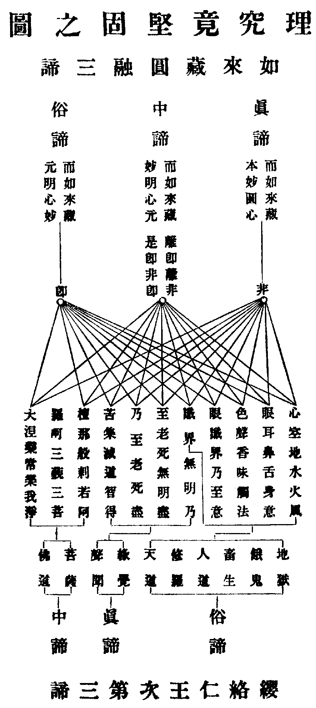
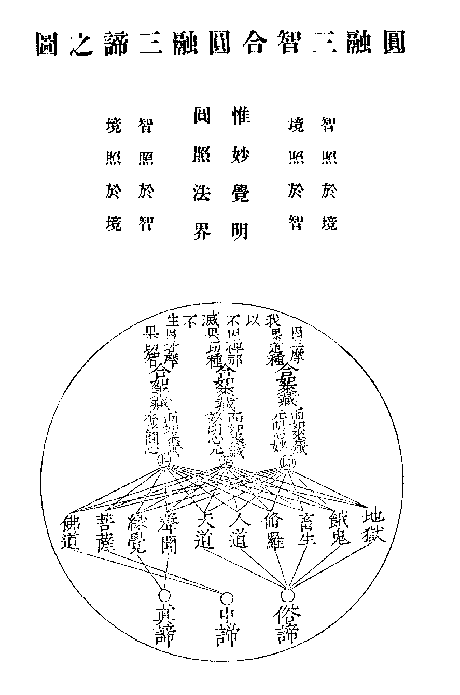

# 楞严经玄义



> **藏经**：卍新纂大日本续藏经（新纂卍续藏）　**册次** 第 13 册（X13）　**编号** X0282　**部类** 经疏部　**卷次** 4 卷　**篇幅** 71,093 字

> **作者（译者）**：天台山幽溪沙门　传灯　述

> **卷／品**：4 卷 · 0 品



---



## 目录



- [大佛顶首楞严经玄义卷第一](#大佛顶首楞严经玄义卷第一)

- [大佛顶首楞严经玄义卷第二](#大佛顶首楞严经玄义卷第二)

- [大佛顶首楞严经玄义卷第三](#大佛顶首楞严经玄义卷第三)

- [大佛顶首楞严经玄义卷第四](#大佛顶首楞严经玄义卷第四)



---



No. 282-A 楞严玄义叙



夫契经文心，不易标指也。唯智者大师发旋陀罗尼，起遵法华，具演十妙，絓是教网，无不炳著详悉，称玄义云。然而止观大部全体法华十妙，是知教观殊袠，理无二辙也。乃大觉世尊於佛顶又揭总持所示境观，有悬契焉。但是典后入真丹，未经判释，时味偏圆，莫知适从。我百松和尚甞撰百问，启重玄之渐，终慨洞庭钧天环而听之之无几也。参兄灯公不虑世忤，作楞严玄义四卷，岂助总持夙夜愿见之意耶？抑竟先师穷诘沉疑之意耶？灯兄偕不慧行三昧忏法，於卷荷根得入流地，故于玄义三观十乘教理行证，无不究竟而委示之。即灵山、大苏相与首肯，不慧篇端附言，亦茅屋不间庠序之谓乎？然当是时，多闻流亚既昧一真，拨无万行，排藏心为世智，值登伽为乐境，触目教观，多怀颦蹙。如来说为可怜愍者，即谆谆圣诰无奈之何，予言独奈之何。



万历丁酉春季沙门传如书於西溪之九沙忏室



No. 282



------



## 大佛顶首楞严经玄义卷第一



**译者**：天台山幽溪沙门　传灯　述



夫大佛顶首楞严之为法也，去来惟一，生灭恒如。性七大而互周，妙三科而等入。真空真色，因缘自然之四计圆；离性色性空，俗有真无之二偏绝。寄方乎宝鉴，类彼摩尼。三谛之济济像归，十界之穰穰珍雨。为众妙之灵府，为万善之玄基。寥𠔃廓𠔃，不可名而强名如来藏；希𠔃夷𠔃，无得称而寓称常住心。嘅众生之性倒也，昧斯一理融通，局彼知见殊异。或涂空而割有，错乱乎修习之门；或贱边而贵中，肯綮於僧祇之劫。在凡夫则计内计外，在外道则执断执常。类皆以真知为妄知，如迷头而逐影；以妄见为真见，似弃海而认沤。如来说为可怜愍者，此大佛顶首楞严经之所以说也。此经唯宣胜义，独被圆机。剖常心於生灭之中，指驶流为谧水；会藏性於色空之内，镜额疮为髻珠。酬诸佛菩提达道，阴入处界，本如来藏，而体之即神；诘娑婆圆通本根，理智根尘，诸生灭法，而亡之俱寂。举要言之，闻思修而皆妙，戒定慧以俱圆。正与助而并駈，显与密而双运。历因果始终之阶级，泰风送逝川之舟。摧生死见爱之波旬，烈𦦨销邻虗之雪。信所谓方等实相之真诠，大事因缘之先容也。声闻在昔，教衍於今。后五百年，均一佛日。尔时祇桓精舍，既有妙悟阿难。此国摩诃支那，宁无宿根上士。第为经文语活，佛旨意玄。解者唯缉网而秘於纲，学者举弃纲而投诸网矣。故有穷年教苑，研几而莫得融通。矧彼毕世禅关，索隐而能之解脱者乎。(灯)获瞻秘诰，听学有年。譬入海而算砂，徒颠眩而自困。既而掩卷思义，置解寻经。兼读台宗，乃有餘地。非唯悟楞严为法华之要纲，抑以见智者惬如来之本心。谈藏性则冥符性具之宗，说止观则暗合大定之旨。乃至悬判地位，预防阴魔。一切名言，靡不殚契。噫，玉泉慈霔，几千万言，人无证者。佛陇西望，数十餘载，盖有以焉。今輙秉斯义海，仰疏经王。以佛心印佛心，不亦培膏助明。即楞严释楞严，孰谓以水醨乳。徵文立义，略拟悬谈。学慙疎野，而词愧不文。言肆支离，而义求或当。勒为四卷，质诸同志。匪图取捷於龙门，聊托逸尘於骥尾云耳。



将释此经玄义五重：初释名，二辨体，三明宗，四论用，五教相。就此五章大分为二：初总释，二别释。总释又二：初生起，二简别。生起者，光明玄义云：此娑婆国土以音声为佛事，或从善知识所闻名，或从经卷中闻名，故名在初。以闻名故，次识法体。体显次行，行即是宗。宗成则有力，力即是用。用能益物，益物故教他。闻名是自行之始，施教是化他之终。有始有卒者，其唯圣人乎。五章生起次第如此。次简别者，简是料简。问：若略则唯一，若广则无量。今此五章进不是广、退不是略，何故五耶？答：非略非广。非略故不一，非广故不多。广则令智退，略则义不周。我今处中说，令义易明了。五章中当其义如此。别者，分别也。前一章总三法共为名，次三章派三法以为别，后一章兼总别而明教相也。又显体一章明理，餘四章明事。又前三章是因，后二章是果。又前四章是行，后一章是教。又前四章是自利行，后一章是利他行。又前四章是圣默然，后一章是圣说法。如此等种种分别料简(云云)。二别释者，别释五章也。先解释名章为二：初详定经题，二解释经题。初详定者，若依经中如来答文殊问名，其称有五：一曰大佛顶悉怛多般怛啰无上宝印十方如来清净海眼，一曰救护亲因度脱阿难及此会中性比丘尼得菩提心入徧知海，一曰如来密因修证了义，一曰大方广妙莲华王十方佛母陀罗尼呪，一曰灌顶章句诸菩萨万行首楞严。今译人标题，则存三隐二，所谓以约该博也。盖如来立名之意，必随所诠而设。一经大旨，不出体宗力用。今五名中，初云大佛顶悉怛多般怛啰无上宝印十方如来清净海眼，此两从体德功用而立称也。亦名救护亲因度脱阿难及此会中性比丘尼得菩提心入徧知海，此单从功德而立称也。亦名如来密因修证了义，此单从宗要而立称也。亦名大方广妙莲华王十方佛母陀罗尼呪，此两从体德宗要而立称也。亦名灌顶章句诸菩萨万行首楞严，此单从宗要而立称也。夫宗要者，一经之主也。体德者，宗要之所归也。功德者，宗要归体之所自至者也。功德自至，虽缓而弗举，亦未为过。惟体德宗要，不可偏废。故今於体德，举其要而标之曰大佛顶。虽三字之少，已能囊括众德矣。何则？盖大佛顶者，三德秘藏之异称也。如大以法身当体得名，佛以般若普覆为义，顶以解脱无染立称，即悉怛多般怛啰之大白伞盖也。此大佛顶，楷定诸法，无诸魔事，即一实相之无上宝印也。此大佛顶，广大圆满，轨持万法，居染不污，自在称尊，即大方广妙莲华王也。此大佛顶，遮一切恶，持一切善，出生十方诸佛，即十方佛母陀罗尼也。若灌顶章句，则出此经流出之所。自以密语言之，亦不出乎密因二字。盖密有微密之密，秘密之密故也。此盖译人善巧，撮略有方。只此一十九字，略举体德，备取宗要。擅五名之称谓，召一经之旨归。故云大佛顶如来密因。修证了义诸菩萨万行首楞严第二解释经题，又为二：初通别合释，次通别各释。初义者，光明玄义云：夫教有通别，依教明行。行有通别，从行显理。理有通别，且置行理。但明教通别者，夫理无名字，名字显理。如虗空无丈尺，丈尺约虗空。天王般若云：总持无文字，文字显总持。若从能显之文字，是名则通。若从能显之所以，此名则别。云何为通？如圣所说，一经、一时、一处、一部、一偈、一句、一言，皆是文字。从此文字，通称为经。云何为别？别则有四：一、令世谛不乱，欢心悦耳；二、逗化所宜，间发宿善；三、对其业障，令恶灭罪除；四、点示道理，霍然妙悟。悦宜对悟，各各所以，其致不同，称之为别。譬如盐梅和合，成种种滋味，组织纵横，成种种文绣。从别所以，故有大佛顶等一十九字，标今教异於诸教。从通文言，故有经之一字，众经通称也。今经通别合标，故云大佛顶(云云)。次通别各释，为二：先释别，次释通。释别又二：先定名，次解释。定名者，今家释诸经别名，别相最多，取要立名，不出三种，谓人、法、譬。於此三中，复有单三复三，并具足一，以成七别。今於七名之中，而定此经，当复三中，人法为名也。於人法中，各有因果。大佛顶，果法也；如来，果人也。密因，万行因法也；诸菩萨，因人也。修证了义，首楞严则该因该果。此经因果，人法合标，故云大佛顶(云云)。次解释，为二：初解大佛顶等十六字，次解首楞岩。初中大佛顶如来密因修证者，夫密有微密之密，秘密之密。今此密因，义该二种：一是当机所请妙奢摩他、三摩、禅那，举一即三，言三即一，故称为妙，妙即密也。以此为因，故称密因。一是如来所宣神呪，诸佛密言，人莫能测，故称为密。令行人持此以登圣果，故称密因。然显密之行虽殊，而所依之理同。如来藏又必显密双修，方能证入果位，故以一名而召两行矣。谓之如来密因者，在显言之，所谓此奢摩他等，是十方如来得成菩提者也。在密言之，所谓此悉怛多般怛啰，十方如来因此持此得成正觉者也。谓之大佛顶如来者，此指宣说神呪之化佛也。是世尊顶放百宝无畏光明之所化者，故曰大佛顶如来。佛称为大者，梵云摩诃也。古人或云不可翻，以含大、多、胜三义故。故释论云：梵云摩诃，谓大、多、胜。为此方文字，义无兼含，故不可翻。今题中单翻大者，由此方大字，字虽不含，义实该博。如老子云：域中有四大，而王处一焉。所谓道大、天大、地大、王亦大。然王者人耳，而所以与天地北大者，诚由道致中和，得其胜位，天地位而万物育也。致中和而天地位，此同天地为大也。万物均育，此以多为大也。又得其胜位，此以胜为大也。又如世人称父母长上为大人，此亦胜为大也。沙门称多众为大众，此亦多为大也。是则此方大字，义亦多含。虽以单翻，理无所失。今先约梵音兼含以释大佛，次约明言当体以释大佛。初兼含释者，释论云：摩诃含大、多、胜者，大取包广，多取含摄，胜取秀出。章安云：法身法界遍一切处，是广大义。报身智境，照发相应，不可穷尽，是含摄义。应身自在，无能遏绝，是胜出义。是则法报应三，俱称大佛。今若唯约应佛之胜，而释此藏通之大佛也。唯约报身之多，而释此别教之大佛也。唯约法身之大，而释此圆教之大佛也。此所说经，既是圆经，能说教主，合是圆佛。虽是圆佛，据现迹观，乃属应身。但此应身，其来有本。其本者何？所谓法报。是全此法报所垂之应，只应身即是法报。故华严云：清净妙法身，湛然应一切。天台云：水银和真金，能涂诸色像。功德和法身，处处应现往。故知未甞有法报，而不垂应身。亦未甞有应身，而不即法报。但随机见不同，或胜劣之差降耳。今经当机，乃用业识而见，则佛依中理，而应依中而现，岂不即法即报者耶？故经述偈赞云：妙湛总持不动尊。妙湛赞真谛，即报身也。总持赞俗谛，即应身也。不动赞中道，即法身也。盖由当机妙悟，洞见法源，故形言於口，称性而赞。今题目是总，岂不以总而贯於别？是故此之大佛，须约三义而释，即法大、报多、应胜也。言法大者，所谓大取包广。法身法界，遍一切处，是广大义。普贤观经云：毗卢遮那，遍一切处。此经云：空生大觉中，如海一沤发。即法身广大义也。报多者，所谓多取含摄。报身智境，照发相应，不可穷尽，是含摄义。经云：我以不灭不生，合如来藏。而如来藏，唯妙觉明，圆照法界。是故於中，一为无量，无量为一，小中现大，大中现小，乃至非心非空等，即报身不可穷尽义也。应胜者，所谓胜取秀出，应身自在，无能遏绝，是胜出义。经云：不动道场遍十方界，身含十方无尽虗空，於一毛端现宝王刹，坐微尘里转大法轮，即应身自在，无能遏绝义也。此以三字对释三身如此。若以三字共释一身者，则法身不唯大，亦多亦胜；报身不唯多，亦胜亦大；应身不唯胜，亦多亦大。法身三者，大义如前。法多者，法身具足诸法，非如大虗逈无一物。故观经云：毗卢遮那徧一切处，一切诸法无非佛法。此经云：阴入处界本如来藏，性色真空等，清净本然，周徧法界。即法身含摄多义也。法胜者，此之法身如彼圆伊，当上一点最尊无上，为报应二修所归。故天台云：如众星之环北辰，万流之宗东海。即法身秀出胜义也。报身三者，报智既与法性相应相冥，法身遍一切处，报身亦遍一切处。故般若云：佛说非身，是名大身。即报身广博义也。报多准前。又报智以法门为身，所谓第一义为髻，八万陀罗尼为发，无漏为鼻等(云云)，亦报身含摄多义也。报胜者，前之法身虽名为胜，乃素法身，未有庄严。今之报智庄严法身，功德巍巍，斯名为胜。如家有宝藏，不探似人，人孰知胜？要须耘除粪秽，掘出金藏，五欲自恣，人乃称叹此大富人、大胜人矣。又报智即法，法身胜故，报身亦胜，即报身秀出胜义也。应身三者，如无量寿佛应极乐国，高六十万亿那由他由旬；净华宿王智佛应净光庄严国，高六百八十万由旬；释迦世尊应东方庄严国，别号照明庄严自在王佛，佛身高大，寿命长远等，即应身广大义也。应多者，此经云：一中无量，无量中一，称性而应，随机而见，何可数量？即应身含摄多义也。应胜准前。又如云：天上天下，唯吾独尊等，即应身秀出胜义也。又应即法报，法报大，应亦大，乃至法报胜，应亦胜。此则举一即三，言三即一，不纵不横，微妙寂绝，故称大佛。约梵音兼含释竟。更约明言当体释者，夫佛乃万德之都名，大是众实之美称，岂得以区区一义，局彼太虗？今寻天台成义，复用十种果德释之。虽秪十法，而佛之万德，亦包括殆尽。言十法者，所谓：一、理大，二、誓愿大，三、庄严大，四、智断大，五、遍智大，六、道大，七、用大，八、权实大，九、利益大，十、无住大。一、理大者，所谓究竟三德秘藏一切佛法故。一切佛法，即性具十法界，阴、入、处、界等也。三德秘藏，即如来藏，性色真空，性空真色等，清净本然，周徧法界也。此三德一切佛法，唯佛与佛，乃能究尽。故经云：我以不灭不生，合如来藏。而如来藏，俱非俱即等，故理大也。二、誓愿大者，所谓究竟圆满三种菩提，无缘慈悲，无作弘誓，普覆法界。故经云：入於如来妙庄严海，圆满菩提，归无所得。妙庄严海是福究竟，即方便菩提，亦是生缘慈悲；圆满菩提是智究竟，即实智菩提，亦是法缘慈悲；归无所得是理究竟，即真性菩提，亦是无缘慈悲。又当机赞佛云：大雄、大力、大慈悲。故誓愿大也。三、庄严大者，所谓究竟不可思议解脱首楞严寂照大定，成就一切万行诸波罗蜜。故经云：尘销觉圆净，寂照含虗空。又云：等觉圆明，入於如来妙庄严海。经初云：有三摩提，具足万行。故庄严大也。四、智断大者，所谓菩提、涅槃，究竟圆断法界无明生死。故经云：觉迷迷灭，觉不生迷。喻云：譬如金鑛杂於精金，其金一纯，更不成杂；如木成灰，不重为木。诸佛如来菩提、涅槃亦复如是。故智断大也。五、徧知大者，所谓究竟五眼，圆见法界三谛，如风於空中，一切无障碍。故经云：我以不灭不生合如来藏，而如来藏唯妙觉明圆照法界。又云：如我按指，海印发光。故徧知大也。六、道大者，所谓究竟圆入一切法门，以二十五王三昧冥益众生。故经云：摩登婬女无心修行，神力冥资，速证无学。故道大也。七、用大者，所谓究竟身、口、意业，能显一切神通，谓三轮不思议化，弥满法界，显益众生。故经云：一中无量，无量中一，小中现大，大中现小，不动道场，遍十方界，身含十方无尽虗空，於一毛端现宝王刹，坐微尘里转大法轮。故用大也。八、权实大者，所谓究竟一切权实之法，能为实施权，开权显实，令诸众生入一乘道。故经云：我以妙明合如来藏，十界三谛俱非。此以实智究尽诸法之实也。十界三谛俱即，此以权智究尽诸法之权也。离即离非，是即非即，此权实泯合也。又云：令汝会中定性声闻，及一切未得二空回向上乘阿罗汉等，皆获一乘寂灭场地。故权实大也。九、利益大者，所谓究竟严净一切佛土，能以一切世出世法利益众生故。故此经能令登伽证於四果，当机顿获法身，及令普会获本妙心，常住不灭。又选圆通竟，普会大众凡有十恒河沙，皆得本心，远离尘垢，获法眼净，无量众生皆发无等等三菩提心。秖此一会，利益尚尔，况餘经餘处耶？故利益大也。十、无住大者，一切究竟不住究竟，一切圆满无圆满。故经云：入於如来妙庄严海，圆满菩提，归无所得。故无住大也。第一还是法身大多胜，二三四五并第十还是报身大多胜，七八九还是应身大多胜。三身不纵不横，复见于此，是则兼含及以当体，皆不出三身之义。三身乃十种三法之一，三法体通，举一纲目，而九种三法随来矣。盖由三德具足，诸法聚集，名为三身。若此三德尊重，即是三宝。三德不生不灭，即是三涅槃。三德运载负荷，即是三大乘。三德不可异趣，名三菩提。三德觉了清净，名三般若。三德是如来种，名三佛性。三德分别不谬，是名三识。三德即事通理，名为三道。大则十种三法俱大，多则十种三法俱多，胜则十种三法俱胜，不并不别，故称大佛。经云：我以不灭不生，合如来藏十界三谛。若以意会，十种三法，文义俱成。言大佛顶者，世尊肉髻无见顶相也。顶门为无上果，亦表第一义谛。如来者，大佛顶放百宝无畏光明，出生千叶宝莲，有佛化身，结跏趺坐，宣说神呪之化佛，故曰大佛顶如来。夫顶居大佛之首，佛从顶光而化，显此如来，弥为玄极。故如来自云：斯是知来无见顶相，无为心佛。惟三身玄极，故有此顶。有此顶相，故能於中放光现佛。有此心佛，故能宣说心呪。有此心呪，故能使恶呪销灭，婬心顿除，神力冥资，速证无学。乃至能令十方如来，因此执此等，得成正觉，降魔转法轮，授记付法等事。盖此神呪，乃融即三身大佛所证秘藏之理。全呪是佛，全佛是呪，一如无二如者也。如来证此，故能慑魔。阿难迷此，是以遭难。至此方挹流寻源，闻香讨根，乃以首楞大定为请。盖大佛三身，实由妙奢摩他等所剋。故经请云：十方如来，得成菩提，妙奢摩他，三摩禅那。而经题亦因之而召，为大佛顶如来密因矣。释此密因为二：初显，次密。显复为三：初定名，次定体，三正释。定名者，此奢摩他等三名，昔资中沇师唯以天台三观而解，彼云：准圆觉经，奢摩他以寂静为相，三摩提以幻化为相，禅那俱离寂静为相。此大意与一心三观相应，寂静相即空观也，幻化相即假观也，俱离相即中观也。孤山圆师唯以天台三止而释，盖准涅槃经中，奢摩他此云止，毗婆舍那此云观，优毕叉此云止观等。今经三名既与涅槃一同二异，乃於彼奢摩他中开出三义，为奢摩他、三摩、禅那也。而云间师乃评之云：今观二师之释，孤山所得多矣。且如圆觉三法经中亦名为定，如彼经云：尔时便有二十五种清净定轮(云云)。又偈云：辨音汝当知，一切诸菩萨，无碍清净慧，皆从禅定生。所谓奢摩他、三摩提、禅那，是知彼圆觉尚可直作三止而释，况今经乎？矧涅槃显以奢摩他当定，又圆觉三摩名等持，禅那名静虑，并是定法名义，三止消文复何疑乎？今详云间所评，引圆觉证成今名，可作定释，则孤山以三止消文所得果多。盖虽定体融通，止即是观，而所主之者须从於别，如吴兴所谓阿难既以多闻小慧自咎，正以楞严大定为请也。二定体者，前之定名欲从所主，故偏以定称。若三止之体，体无所局，故孤山亦会通云：此之三止即是三观，以即照而寂、即寂而照，故奢摩他即空观，三摩即假观，禅那即中观。所以天如会解引孤山三止已，乃云：今复释而明之。奢摩他，寂静之义也；三摩，观照之义也；禅那，寂照不二之义也。此盖复出孤山会通之义耳。况经云：是种种地皆以奢摩他中毗婆舍那清净修证。又云：此是过去先佛世尊奢摩他中毗婆舍那(云云)。据此二文，则不唯此定止观融通，弥显孤山三止消文，当於经旨以云奢摩他中毗婆舍那故。第三、正释者，约前会通之义，双明止观也。涅槃经中三名：奢摩他，此云止；毗婆舍那，此云观；优毕叉，此云止观等。今经三名虽与一同二异，后文既云奢摩他中毗婆舍那，故须双约止观而释。於止观中各开三义，谓体真止、方便随缘止、息二边分别止、从假入空观、从空入假观、从空假入中道观。今抄止观成文，以明斯义。初释止观名，次释止观体。初、释名者，大师云：止观各有三义。止三者：息义、停义、对不止止义。息义者，诸恶觉观、妄念思想寂然休息。净名曰：何谓攀缘？谓缘三界。何谓息攀缘？谓心无所得。此就所破得名，是止息义。停义者，缘心谛理，系念现前，停止不动。仁王云：入理般若名为住。大品云：以不住法住般若波罗蜜中。此就能止得名，是停止义。对不止以明止者，语虽通上，意则永殊。何者？上两止对生死之流动，约涅槃论止息；心行理外，约般若论停止。此约智断通论相待，今别约谛理论相待。无明即法性，法性即无明。无明亦非止非不止，而唤无明为不止；法性亦非止非不止，而唤法性为止。此待无明之不止，而唤法性为止。如经云：法性非生非灭，而言法性寂灭；法性非垢非净，而言法性清净。是为对不止而明止也。观三义者，贯穿义，观达义，对不观观义。贯穿义者，智慧利用，穿灭烦恼。大经云：利镢斵地，磐石沙砾，直至金刚。法华云：穿凿高原，犹见乾土；施功不已，遂渐至泥。此就所破得名，立贯穿观也。观达义者，观智通达，契会真如。瑞应经云：息心达本源，故号为沙门。大论云：清净心常一，则能见般若。此就能观得名，故立观达观也。对不观观者，语虽通上，意则永殊。上两观亦通对生死弥密而论贯穿，迷惑昏盲而论观达。此通约智断相待明观，今别约谛理。无明即法性，法性即无明。无明非观非不观，而唤无明为不观；法性亦非观非不观，而唤法性为观。如经云：法性非明非暗，而唤法性为明；第一义空非智非愚，而唤第一义空为智。是为对不观而明观。是故止观各从三义得名。(更有绝、待、会、异、通三德之文，兹不具引。)次释止观体分三：初次第三止，二次第三观，三一心中三止观。次第三止者：一体真止，止於真谛；二方便随缘止，止於俗谛；三息二边分别止，止於中道第一义谛。体真止者，诸法从缘生，因缘空无主，息心达本源，故号为沙门。知因缘假合，幻化性虗，故名为体。攀缘妄想，得空即息，空即是真，故言体真止。方便随缘止者，若二乘同以无言说道，断烦恼入真，真则不异，但言烦恼与习有尽不尽。若二乘体真，不须方便；菩萨入假，正应行用。知空非空，故言方便；分别药病，故言随缘。心安俗谛，故名为止。经言动止心常一，亦得证此意也。息二边分别止者，生死流动，涅槃保证，皆是偏行，不会中道。今知俗非俗，俗边寂然，亦不得非俗。空边寂然，名息二边。此三止名，虽未见经论，映望三观，随义立名。释论云：菩萨依随经教，为作名字，名为法施，立名无咎。若能寻经得名，即悬合此意也。(云间楞严补遗云：孤山以大师三止消今经文，则知天台三止有悬合矣。故止观云：此三止名，虽未见经论，映望三观，随义立名云云。今果得之楞严矣。今谓圆觉三名，显云是定，亦唐译之经，彼为最亲。故知三止悬合二经矣。又准涅槃云：善男子！为三事故，修奢摩他。何等为三？一者不放逸故，二者庄严大智故，三者得自在故。复次为三事故，修毗婆舍那。何等为三？一者为观生死恶果报故，二者为增长诸善根故，三者为破诸烦恼故。准此经文，止观各开三义，即是三止三观之明文。次第对义，在文不差。故谷响钞云：涅槃云：为三事故，修奢摩他。此乃止中具三之明证也。而与阿难所请之三，宛若符契。然大师亲见涅槃而不指之者，岂非欲使学者自得之乎？)详此三止，与前释名，名髣髴同，其相则异。同者，止息止似体真，停止止似方便随缘，非止止似息二边，其相则别，所谓三谛相也。前三成次三，后一具前三。何以故？如体真止时，达因缘假，名空无主，流动恶息，是名止息义。停心在理，正是达於因缘，是停止义。此理即真，真即本源，本源不当止与不止，是非止止义。此三义共成体真止。若方便止时，照假自在，散乱无知息，是止息义。停心假理，如净名入三昧，观比丘根性，分别药病，是停止义。假理不动，是非止止义。如是三义，共成方便随缘止相也。息二边分别时，生死涅槃二相俱息，是止息义。入理般若，名为住缘心中道，是停止义。此实相理，非止不止，是不止止义。如此三义，共成息二边止相，故与前永异也，亦非今所用也。二、次第三观者：一、从假入空观，亦名二谛观；二、从空入假观，亦名平等观；三、二空观为方便，得入中道第一义谛观。心心寂灭，自然流入萨婆若海。此名出缨络经。今释其意，假是虗妄，俗谛也；空是审实，真谛也。今欲去俗归真，故言从假入空观。假是入空之诠，先须观假，知假虗妄而得会真，故言二谛观。此观若成，则证一切智也。从空入假观者，若住於空，与二乘何异？不成佛法，不益众生，是故观空。不住於空而入於假，知病识药，应病授药，令得服行，故名从空入假观。而言平等者，望前称平等。前破假用空，今破空用假，破用既均，故言平等观。此观成时，证道种智。二空为方便者，初观空生死，次观空涅槃，此之二空为双遮之方便。初观用空，次覩用假，此之二用为双照之方便。心心归趣，入萨婆若海，双照二谛也。此观成时，证一切种智。是为次第三观也。此三观与前三观名，一往似同，义相则异。前贯穿观，观诸虗妄，似从假入空；观达观，达理理和，达事事和，似从空入假；不观观，似中道观。其相异者，前是一谛相，今是三谛相。又前三通成后三，后三具足前三。所以者何？如从假入空，破四住磐石，是贯穿观；所入之空，空即是理，智能显理，即观达观；此之空理，即是非观观义。如此三义，共成入空观相也。从空入假，亦具三义：如识假名法，破无知障，即贯穿义；照假名理，分别无谬，即观达义；假理常然，即不观观义也。此之三义，共成假观相也。中道之观，亦具三义：空於二边，即贯穿义；正入中道，即观达义；中道法性，即不观观义。如此三义，共成中道观相也。三、明一心中三止观者，依前摩诃衍，明三止三观之相，以义随相，条然各别。若论三观，则有权实浅深；若论三智，则有优劣前后；若论三人，则有诸位大小。此则次第分张，非今所用也。圆顿止观相者，以止缘於谛，则一谛而三谛；以谛系於止，则一止而三止。譬如三相在一念心，虽一念心，而有三相。止谛亦如是，所止之法，虽一而三；能止之心，虽三而一也。以观缘於境，则一境而三境；以境发於观，则一观而三观。如摩醯首罗面上三目，虽是三目，而在一面。境观亦如是，观三即一，发一即三，不可思议，不权不实，不优不劣，不前不后，不并不别，不大不小。故中论云：因缘生法，即空即假即中。金刚般若云：如人有目，日光明照，见种种色。若眼独见，不应须日。若无色者，虽有日眼，亦无所见。如是三法，不异时，不相离。眼喻於止，日喻於观，色喻於境。如是三法，不前不后，一时论三，三中论一，亦复如是。若见此义，即解圆顿止观相也。何但三一一三？总前诸义，皆在一心。其相云何？体无明颠倒，即是实相之真，名体真止。如此实相，遍一切处，随缘历境，安心不动，名随缘方便止。生死涅槃，静散休息，名息二边止。体一切诸假，悉皆是空，空即实相，名入空观。达此空时，观冥中道，能知世间生灭法相，如实而见，名入假观。如此空慧，即是中道，无二无别，名中道观。体真之时，五住磐石砂砾，一切休息，名止息义。心缘中道，入实相慧，名停止义。实相之性，即非止非不止义。又此一念，能穿五住，达於实相，实相非观亦非不观。如此等义，但在一念中，不动真际，而有种种差别。经言：善能分别诸法相，於第一义而不动。虽多名字，盖是般若之一法。佛说种种名，众名皆圆，诸义亦圆。相待绝待，当体不可思议。不可思议故，无有障碍。无有障碍故，具足无减。是圆顿显止观体也。孤山云：阿难始以三法为请，既蒙开示，至乎领解，还以三法而叹於佛。故经云：妙湛总持不动尊。妙湛即空智也，总持即假智也，不动即中智也。及佛为富楼那说如来藏本妙圆心，非心非空，即心即空，离即离非，三谛炳然，如指诸掌。及为阿难说六解一亡，而结叹云：是名妙莲华，金刚王宝觉，如幻三摩提。华开华现，喻即中也。金刚坚利，喻即空也。如幻有形，喻即假也。洎文殊简圆通，亦以此为叹。故曰：阿难汝谛听，我承佛威力，宣说金刚王，如幻不思议，佛母真三昧。但以佛母喻中道为异耳。其於诸文，重重演说，一一破迷。或用乎空，或谈乎假，或显乎中。言偏意圆，悉具三法。盖酬阿难三止之请也。今谓妙湛总持等三法，亦可作止观各三名而释。如妙湛及金刚王等，即止息贯穿也。总持及如幻等，即停止观达也。不动及妙莲等，即对不止止，不观观也。是则奢摩他等三，随举其一，皆具妙湛等三义。经云：此阿毗达磨，弹指超无学。此之谓矣。惟此圆融，故称为妙。妙即密也。言密因修证者，经云：是种种地，皆以奢摩他中，用诸如来毗婆舍那，清净修证，渐次深入。故云密因修证。释显竟。次密者，入道场诵持神呪也。经明四种律仪已，乃云：若有宿习不能灭除，汝教是人一心诵我佛顶光明摩诃悉怛多般怛啰无上神呪。乃至示以结坛之法，定以克证之期，其为行者进修最为详尽。但依经设坛，其费大富，末世缘薄，鲜能办之。於中所立期限共四等，合一百二十一日，后坐禅百日。既云端坐安居，则入道之方，依奢摩他以修大定，不俟告而可知矣。向前初七中云：至诚顶礼十方如来、诸大菩萨、阿罗汉号，恒於六时诵呪围坛，至心行道，一时常行一百八遍。第二七中，一向专心发菩萨愿，心无间断，我毗奈耶先有愿教。第三七中，於十二时一向持佛般怛啰呪(云云)。昔吴兴岳师甞按此述修证仪一卷，今虽蔑闻，若依天台诸忏通轨，亦略可知。惟其行道诵呪之顷，既涉繁动之缘，苟不以理观而导事行，灭罪或难。矧夫结坛轨则，种种取象，言不唐施。故温陵师等皆取意以明表法，所谓法王、法言，即事即理也。又且神呪秘密，唯佛证知，乃密诠三谛之境，而称之为摩诃悉怛多般怛啰呪心，盖有以焉。是故行者登坛之时，必宜事理兼行，显密双运。如四明师之言三种忏法云：法虽三种，行在一时，宁可阙於前前，不得亏於后后。无生最要，取相尚宽。盖妙观之宗，是大乘之主。灭障如翻大地，草木皆枯。显德如照澄江，森罗尽现。以此理观，导乎事行。则一礼一旋，罪消尘劫。一灯一水，福等虗空。此盖法华三昧之功勋也。彼既如是，此亦宜然。盖一心定慧，说於呪。先四十四心，明於此。后理须秉定慧而持神呪，藉显密以历圣阶矣。次了义者，褒美此经所说，义无不了也。净名宝积及涅槃等经，皆云依了义，不依不了义。宝积经舍利弗问：何等经中，名为了义？何等经中，名不了义？佛告舍利弗云：若诸经中，宣说世俗，名不了义。宣说胜义，名为了义。宣说作业烦恼，名不了义。宣说烦恼业尽，名为了义。宣说厌离生死，趣求涅槃，名不了义。宣说生死涅槃，无二无别，名为了义。宣说种种文句差别，名不了义。宣说甚深难见难觉，名为了义。今经云：如来今日，普为此会，宣胜义中，真胜义性。即宝积宣说胜义，名为了义也。经云：入妙庄严海，圆满菩提，归无所得。即宣烦恼业尽，名为了义也。经云：阴入处界，本如来藏。即生死涅槃，无二无别，名为了义也。经云：我以不生不灭，合如来藏(云云)。即宣说甚深难见难解难觉，名为了义也。次诸菩萨万行者，藏通别教皆有菩萨，虽可称诸，非今经意。今则始从乾慧终至等觉，五十六位阶级不等，故名为诸。万行者，即大品般若所说一切佛法诸三昧门，所谓百八三昧、五百陀罗尼及诸解脱、大慈大悲、一切种智、五眼、六神通、三明、八解脱、十力、四无所畏、十八不共法、三十二相、八十种好、六波罗蜜、三十七品、四弘誓愿、四无量心、如意神通、四摄法等诸法。故大品万行中偈云：从初发心至成佛，一身一心一智慧，欲为教化众生故，万行名字差别异。然此经题虽云万行，而十轴内都不见列一两种行名，但云有三摩提名大佛顶首楞严王具足万行。是知题中虽称万行，实不俟乎别修。盖此密因是首楞严定，能获此定则种种万行法尔现前。故南岳思大禅师释万行云：如是无量佛法功德，一切皆从禅生。盖众生心性本来具足如是佛法，故经云：阴入处界本如来藏。惟行人修此定时，直下照了具足诸法，则无量功德功至自至。故昔天台一时代南岳讲般若，至一心具万行处，忽有所疑。思师因诫之曰：如汝疑者，乃大品次第意耳，未是法华圆顿旨也。吾昔於夏中一念顿证诸法现前，吾既身证不必疑矣。以此而知，则今经万行之称特是表显密因之妙，故云有三摩提名大佛顶，首楞严王具足万行也。次释首楞严者，涅槃经云：首楞者名一切事竟，严者名坚，一切毕竟而得坚固名首楞严。今人释此名义多分单约定解，若然岂大佛顶等非首楞严耶？矧涅槃经云：一切众生尽有首楞严定，首楞严定亦名般若、亦名金刚三昧、亦名师子吼、亦名佛性。且佛性非大佛顶耶？三昧般若非密因万行等耶？师子吼非了义耶？昔孤山师以教行理三悉号楞严而释，盖有旨焉。但孤山三法於经摄义虽足，在题主对犹疎，今当别约天台八法一一主对释之，谓教、理、智、断、行、位、因、果。盖大佛顶者理也，如来者果也，密因者智也，修证者断与位也，了义者教也，诸菩萨者因也，万行者行也。故此八法非唯诠义具足，亦乃深合经题。释此为二：初约八法行布释，次约诸字圆融释。初八法行布释为三：初生起，二料简，三正释。生起者，八种中教为能诠故居其首，七为所诠故居其后。於七种中理为所照属性，智为能照属修，非所照之理不能起能照之智，故先理次智也。智既起已必能断惑，故第四明断也。惑断理显种种万行由之而生，故次断说行也。智断行发浅深不同，故有位次也。望果德以修因行，由因行以克果德，智断行位，莫非其事，故有第七、第八，总说四果也。二、料简者。问：智之与行，有何差别？答：智分因果，行唯在因。问：因智与行，复何差别？答：若略作教行理说，则因智亦名为行。兹广明八法，则因智三止，行名万行矣。问：位次、因果，有何差别？答：因果为能历，位次为所历。又位次开说因果，因果总说位次也。问：此八种中，为各各异，为互互通？答：亦异亦通。异如向说，通者如一经，总是八法，离能诠无所诠，离所诠无能诠，故教具七也。全理起智，无别有智，此智能断，离智无断。理显行彰，行是理行，六种即理，名为位次。大乘因果，不离实相，故理通也。智是理智，断是智断，智是首楞，具足万行。全理之智，虽无浅深，浅深宛然，虽无因果，不离因果，故智通也。全理之智，能断此惑，断故发行，而有浅深不同，因果各异，故断通也。即理之智，能具万行，智断彼惑，万行斯显，行显浅深，则有位次因果，故行通也。六种妙位，皆即於理，虽皆即理，六位有殊，智为能历，位为所历。智断惑故，自浅之深，前五为因，后一为果，故位通也。实相因果，无差而差，智断行位，条然有异。因果实相，差而无差，智断行位，无不即理，故因果通也。三、正释者，释此依数为八：先理，次智，三断，四行，五位，六因，七果。至於第八，方明教相。何故尔耶？以教无别体，秪是七种能诠之声色耳。若七种理显，即是教显。后略分别，弥为容易故也。於中，初明理，即经中所诠三谛理也。此三谛理，徧在十界依正之上。若离此，则无所寄。经明阴、入、处、界，本如来藏，此之谓也。释此为二：初竖约十界明三谛，次横约十界明三谛。初竖者，此之名义，出仁王、缨络二经。彼云：一者有谛，二者无谛，三者中道第一义谛。初有谛者，谓二十五有。众生妄情所见，名之为有。如彼情见，审实不虗，名之为谛，亦名俗谛。虗假凡俗，故亦名世谛。涅槃所谓如世人之所见者，名为世谛。此以六凡法界为俗谛也。二、无谛者，三乘圣人所见真空之理，无名无相，故名为无。审实不虗，目之为谛，亦名真谛。真实不虗，故亦名第一义谛。涅槃所谓如出世人之所见者，名第一义谛。此以声闻、缘觉两法界为真谛也。三、中道第一义谛者，遮二边，说名为中。此理虗通，无壅无塞，称之为道。最上无过，故名第一。深有所以，目之为义。诸佛菩萨之所证见，审实不虗，命之为谛。故言中道第一义谛。此以佛、菩萨两法界为中谛也。次横约十界明三谛者，此三谛义，出中观论。论云：因缘所生法，我说即是空，亦名为假名，亦名中道义。十法界皆是因缘生法，以佛种从缘故。我说即是空，十界缘起皆真也；亦名为假名，十界缘起皆俗也；亦名中道义，十界缘起皆中也。此是横约十界以诠三谛。今释此二种三谛为三：初、名义整足不整足，二、理体圆融不圆融，三、理体可坏不可坏。初义者，四教中藏是界内拙度，但诠森罗万象之俗，偏空涅槃之真，故禀教人至於果成灰断而已。界内通教虽名为巧，其所诠者亦只二谛，是故禀兹教者同於三藏，灰身灭智以为圆极。若界外别教，教虽不融，而初心亦闻但中之名，是故禀兹教者以三十心成二观方便已，登於初地得证中道。但彼教行历别，而犹未知十界横具三谛义也。若今经三谛则备兹二义，如云：而如来藏非心非空，非地水火风，非眼耳鼻舌身意，非色声香味触法，非眼识界乃至非意识界。此所非者，即缨络、仁王所谓二十五有妄情所见之俗谛也。又云：非无明乃至非老死，非无明尽乃至非老死尽，非苦集灭道，非智非得。此所非者，即仁王、缨络所谓出世圣人所见之真谛也。又云：非擅那乃至非般剌若，非阿罗诃三藐三菩，非大涅槃，非常乐我净。此所非者，即仁王、缨络所谓诸佛菩萨所见之中道第一义谛也。此是十界竖义横义者，如十界并非，此则通以十界为真谛也。云何并非？以如来藏本妙圆心，体绝情伪故。次十界并即，此通以十界为俗谛也。云何俱即？以如来藏元明心妙，性具十界故。次离即离非，是即非即，此通以十界为中道第一义谛也。云何俱即俱非？以如来藏妙明心元，虽即二边，而无二边如异故。初俱非中云本妙圆心，乃以心字为主。次俱即云元明心妙，乃以妙字为主。次双非即云妙明心元，乃以元字为主。心者，真空也。妙者，妙有也。元者，本元中道佛性也。盖自一心而观，何有万法之差？故一切并非，而云本妙圆心者，犹言即中俗之真也。自万法俱妙而观，则十界宛然，故一切并即，而云元明心妙者，犹言即中真之俗也。自本元心性而观，则双遮二边，真俗俱遣，双照二谛，真俗炳然，而云妙明心元者，犹言即俗真之中道也。又经尔前性色真空、性空真色等，清净本然，周徧法界。性，中也。空，真也。色，俗也。并是横论三谛之义。次理体圆融不圆融者，若明二谛之理，分界内界外，则界内藏教为不融，以彼徧真，理在事外，灭色方空故。界内通教，理名圆融，以言即色是空，非色灭空故。兹明三谛，彼通教竖义尚未具足，况圆融乎？故非所辨。今所辨者，但对别教为融不融耳。盖别教竖明中道之理，如云外月逈出二边，现在真俗不即中道，故须先空次假破有破无，此之中理方得分见，是故虽有三谛不称圆融。今经三谛既具二义，以横融竖则无竖不横，以竖列横则无横不竖，无横不竖则三三宛然，无竖不横则皆名一实妙谛。三谛俱实只一十界，十界绝待独一妙心，斯则复名无谛之谛。故说真谛时则十界并非，此名一空一切空，无有无中而不空，以六凡俱非有亦空也，二乘俱非空亦空也，佛与菩萨俱非中亦空也。说俗谛时则十界并即，此名一有一切有，无空无中而不有，以六凡俱即有亦有也，二乘俱即空亦有也，佛与菩萨俱即中亦有也。说中道时则十界俱非，破立此名一中一切中，无空无有而不中，以六凡俱非破立有亦中也，二乘俱非破立空亦中也，佛与菩萨俱非破立中亦中也。又前性空真色即中真而俗也，性色真空即中俗而真也，色空并不离性即真俗而中也。是故若言真谛者，泯诸法名无相，而六凡被泯之，且言无相矣。二乘既亦泯，岂非真非真而真即俗乎？佛菩萨既亦泯，岂非中非中而中道即真即俗乎？真谛者泯情不泯法斯谓矣，孰谓真谛无相乎？若言俗谛者，立诸法是有相，而六凡被立之，且言有相矣。所立二乘真谛者，有相乎？佛菩萨中道者，有相乎？俗谛者，立法不立情，斯谓矣。孰谓俗谛有相乎？若言中谛者，双遮二边法是但中，而六凡二乘之真俗被遮之，且言不即矣。佛菩萨既亦遮，岂非中非中而即二边乎？中谛者，统诸法，斯谓矣。孰谓中道不即乎？良由常住真心，具足诸法。即此诸法，充塞天虗。彼彼互具，名如来藏。彼彼互遍，名无尽灯。虽一尘而十界三谛不少，虽刹海而十界三谛不多。所谓如捣万种香为丸，若烧一尘，具足众气。亦如剖栴檀柝碧玉，若多若小，片片皆真，故曰九界。徒欲言之，言则伤其实。徒欲思之，思则丧其真。所以如来掩室於摩竭，净名杜口於毗耶。法华三请而不说，今经委曲而后谈。胎经云：佛法如大海，不说有是非。凡夫贤圣人，平等无高下。法华云：诸法寂灭相，不可以言宣。又云：是法非思量分别之所能解。今经云：一切众生，皆由不知常住真心，性净明体，用诸妄想。此想不真，故有轮转。皆此谓也。此之妙法，乃诸佛如来所谛。故经云：我以不灭不生，合如来藏(云云)。法华云：唯佛与佛，乃能究尽诸法实相。佛今说之，欲令行者，全以此谛，为修首楞大定之本。得此为本，则心心法界，事事圆融。常住妙果，即法圆成。观音智门，当念具足。此所谓以不生不灭为本，修因而求不生不灭之果者也。三、可坏不可坏者：三藏所诠，理在事外，要须灭色，然后入空，此则六凡之俗须坏。夫真谛者，真必即俗，灭色之空，非真空也，此则二乘之真可坏。通教之色，虽云即空，而未甞云空即是色，以空不即色，故必灰身灭智，此亦六凡之俗须坏。坏俗后真，真非毕竟，此则二乘之真可坏。别教中道，既不即边，离中之边，故须双遣，此则八界真俗皆坏。夫中必真俗，彼云逈出二边，离边之中，岂是究竟？故佛菩萨中道之理可坏。问：别教真俗，不即中道，或云可坏，中道佛性，岂可坏乎？答：若论中理，实不可坏，今言坏者，据彼教道所诠耳。岂唯别教中道，即前三教所有九界真俗，若论理体，又孰能坏？但彼禀教偏小，自於夷途作趺，好身剜疮耳。故天台云：此理灼然，世间常住，有佛不能益，无佛不能损，得之不为高，失之不为下，名之为佛理佛也。今经三谛，乃是称此本理而说，故真则十界三谛俱非，俗则十界三谛俱即，中则十界三谛俱非，破立真则俱非。且言十界三谛可坏，俗则俱立，中则俱非，破立何所可言坏乎？须知真乃即中俗之真，俗乃即中真之俗，非之则法界炳然，即之则情谓閴尔。经文若此，孰能诬哉？是为理究竟



理究竟坚固之图。







------



## 大佛顶首楞严经玄义卷第二



**译者**：天台山幽溪沙门　传灯　述



次明智究竟者，三智也。名义出大品、般若及释论，所谓一切智、道种智、一切种智。欲成此智必籍观因，空观为因证一切智，假观为因证道种智，中观为因证一切种智。若就理实论，则观之与智皆通因果，例如佛性通於因果，别则因名佛性、果名涅槃。今就别义，一往分观因智果也。此之三智在今经中，因名妙奢摩他、三摩、禅那。若论其果，出名则有多处，如首卷中云无始菩提涅槃元清净体(云云)，二卷云此见及缘元是菩提妙净明体等，此皆即因心以指果德也。七卷初地云於大菩提善得通达，此指分证果德也。十卷云圆满菩提归无所得，此指究竟果德也(云云)。今例前三谛以分二种：一、竖合十界三谛之三智；二、横合十界三谛之三智。初义者，释论明两种三智，初为易解故分对三人，声闻对一切智，菩萨对道种智，佛对一切种智。是则一切智竖合声闻缘觉法界之真谛也，道种智竖合六凡法界之俗谛也，一切种智竖合佛菩萨法界之中谛也。二、横合十界三智之三智者，论约三人对三智已，复云三智实在一心中得，秪一观而三观，观於一谛而三谛。一谛三谛与今真则十界三谛俱非义同，一观三观与今妙奢摩他、三摩、禅那义同。谛是智之所谛，观是智之所因。既有所谛之境，必有能谛之智；既有三止之因，必有三智之果。盖是经文总略，但云我以不灭不生合如来藏耳。况不灭即寂灭，不生即无生。寂灭忍是究竟三智之总体，无生忍是分真三智之总体。以此义例，是则应云我以不灭不生一切智合如来藏之真，而十界三谛并非等(云云)也。辨此为三：初名义周足不周足，二智体圆融不圆融，三名体俱转不俱转。初义者，藏通二教，因既单修空观，果智岂能周足？故释论唯用一切智以对二乘。若别教次第修乎三观，登於十住空观，成证一切智，即释论分对声闻果也。登於十行假观，成证道种智，即释论分对菩萨果也。登於初地及妙觉中观，成证一切种智，即释论分对佛果也。如此次第，唯是竖合十界三谛之义耳。若今经三智，则具足横竖二义。如我以不灭不生合如来藏真谛，则十界三谛并非。非六凡俗谛者，一切智也。非二乘真谛者，道种智也。非佛菩萨中道者，一切种智种类知也。约竖义虽有三种，望横义秪是一切智耳，以一切并非为主故。次我以不灭不生合如来藏俗谛，则十界三谛并即。即六凡俗谛者，道种智也。即二乘真谛者，一切智也。即佛菩萨中道者，一切种智寂灭相遮二边也。约竖义虽有三种，望横义秪是道种智耳，以一切并即为主故。又次我以不灭不生合如来藏中道，则十界三谛俱非破立。六凡俗谛，俱非破中道双照之道种智也，俱非立中道双照之一切智也，双俱非破立中道双遮之一切种智也。二乘真谛，俱非破中道双照之一切智也，俱非立中道双照之道种智也，双俱非破立中道双遮之一切种智也。佛菩萨中道，俱非破一切种智双遮二边也，俱非立一切种智双照二边也，双俱非破立一切种智寂灭相种种行类皆知也。约竖义虽有三种，若望横义秪是一切种智耳。以俱非破立为主，故此则秪一不灭不生合如来藏三谛，而横竖二种三智悉得具足矣。二、智体圆融不圆融者，别教三智但今经三智中之一竖义耳，岂足以称圆融？今经三智如上所论，若以横望竖则有三三，以竖望横仍是一三，一三相即三亦无寄，一三三三唯是一心，故经唯以一不灭不生而当之矣。盖三谛者所合之境也，三智者能合之心也，谛既即一而三，智亦即三而一矣。又谛如函底，智如函盖，岂唯际畔相当？亦乃谛智冥泯，泯而无际，独一常心。故经云：我以不灭不生合如来藏，而如来藏唯妙觉明圆照法界。天台立境智四句云：智照於境，境照於智，智照於智，境照於境。并此圆照法界，其义善符。三、名体俱转不俱转者，前之三教因行既昧，性具三观皆成别修，是故至果不唯名转，体亦须转。今经圆止，虽曰一是性具，二是修成，乃全性起修，修非别有，是故终日修而无修，终日作而无作。盖以佛之自谛而为大定之本，一一皆全修在性故也。



圆融三智合圆融三谛图







故天台释三般若云：般若名实慧。实相般若，非寂非照，即一切种智。(文)与今禅那寂照不二义同。又云：观照般若，非寂而寂，即一切智。(文)与今奢摩他寂静义同。又云：方便般若，非照而照，即道种智。(文)与今三摩观照义同。是则今之三智，虽从胜而受大菩提、圆满菩提等之称，其实体无所转，盖因果皆不异於寂照义。故经云：是名妙莲华，金刚王宝觉。此其是也。是名智究竟。



第三、断究竟者，用前三种智慧以断三惑也。一、见思惑，从解等得名，即利钝十使分品有八十八、八十一之夥，此障真谛理。二、尘沙惑，从所障谛理得名，以法门如尘沙之多，一一不能了知故，此障俗谛理。三、无明惑，不了法界无所明也，大分有四十二品，此障中谛理。此三惑名义，在今经中但出见思、无明两惑。经云：我等今者二障所缠，良由不知寂常心性。解云：烦恼、所知名为二障。烦恼障谓根本及随，此即见思惑。所知障亦云智障，障一切种智故，此即无明惑。又云：一切众生不成菩提及阿罗汉，皆由客尘烦恼所误，此说见思惑。又云：清水现前名为初伏客尘烦恼，去泥纯水名为永断根本无明，此说见思、无明两惑。又云：得须陀洹果已灭三界见所断惑，然犹未知根中虗习，彼习要因修所断得，何况此中分剂头数？见修所断即见思惑，分剂头数即无明惑(云云)。所以经中不言尘沙者，以克论谛理但有中真，则能障之惑亦只两种，故烦恼所召生死亦分段变易而已。但此真中遍在十界依正之上，即此十界名之为俗，以性具故称为谛理。故诸佛二障既除，二谛理显，神通妙用皆从此发，故得名为无谋而应。华严一微尘中出大千经卷，此之谓也。今经三谛所以不离十界而辨，亦是此意。若然，则惑秪有二，何得立三？答：此有三意：一、因别人不知性具，要须别学，是以十住菩萨知所入空未是毕竟，乃从空入假，於无量劫遍习遍学，导利群品，故名尘沙。二、圆人既知心性本具，则一切众生不唯不见真、中二理，亦复不得本有妙用。障真、中者，是二惑矣；障妙用者，岂不又是一惑？但圆人不须别破此惑。初心直下，称性观中，至於观成，自然而断，故种种法门称性施设。故止观云：圆教十信、六根净时，即能遍见十法界事。五品正行，六度广能说法，皆是入假之位。又初心之人能知如来秘密之藏，圆观三谛尚能即中，岂不能即假乎？三者、例能观之观。诸经既立有三，则所破之惑亦依义立三矣。问：若诸佛二障除已，真中之理方显，神通妙用皆从此发，名之为俗。是则先应破见、思、无明，然后断除尘沙，何故尘沙先破，方断无明？答：若定理而论，诚宜破尽无明，俗谛之理方究竟显。今破见、思惑，便言破尘沙显俗谛者，良由见、思麤垢先落，又侵界外无明麤垢，中理虽未现前，俗谛亦得相似而显，化导之功亦得少分无谋而应。菩萨既急在度生，即乘此以导利群品，以此少分见者，得名尘沙惑断，俗谛理显也。问：见、思以五利、五钝为体，尘沙、无明以何为体？答：无明无别体相，即以见、思为体，但麤细差殊，有界内、界外之分。故天台云：别教三十心断界内见、思，伏界外见、思、无明；十地断界外见、思、无明。若圆教十信断界内见思，圆伏界外见思无明，发趣初心断界外见思无明，终至等觉方尽。故地持明清净净禅云：离一切见清净净禅。大涅槃云：十地菩萨为无我见论惑所转。又云：十地菩萨虽见佛性而不了了，诸佛如来见於佛性而得了了。此皆约见惑尽不尽，故有了了不了了等殊也。问：界外见思为只有四十二品，为更多耶？答：今言四十二品者，以大乘经论多说分真及究竟有四十二位，故大约作此数耳。若论无明重数，岂有品量？盖入位转深，能断之智转利，於一位中难定断若干品惑。故大师云：后心菩萨无功用道，其疾如风，一日之间能破无量品无明惑障。何况缨络经明等觉地於百千万劫入重玄门，报修凡夫事乎？今例前谛智分二种断义：一、竖断障十界三谛无明，二、横断障十界三谛无明。辨此为三：初、名义全不全，二、伏断次不次，三、无明断不断。初义者，界内二教既不诠中道之理，无明名字尚不得闻，何况伏断？是故极至果头但只竖断，阻二乘真谛见思惑而已。若别教所诠虽名但中，能覆之惑别圆不异，但彼要至初地才破一品，极至妙觉破一十二品，只成一往竖义，非如圆家横竖具足，登於初住即破无明，竟至妙觉共四十二位，须破四十二品方名究竟。故今经初住即能十用涉入圆成一心，如是重重单复十二，方尽妙觉也。次伏断，次不次者，别人修因，既先空次假后中，伏断之时，岂能不次？是故至於十信，方伏界内见思，十住断界内见思，兼断界内上品尘沙，十行断中品尘沙，十向断下品尘沙，至此方伏无明，登於初地，方破无明，是为竖伏竖断义也。今经外凡，即能用一心三智，圆伏障十界三谛之惑。故乾慧地中，即云欲爱乾枯，根境不偶，现前残质，不复续生等。经叹弹指超无学，亦此意也。十种信心，名为内凡，界内见思，自然先落。故初信即云圆妙开敷，从真妙圆，重发真妙等(云云)。若登初住，断一品无明，证一分三德，十种大果，分得现前，现十界身，百界作佛。故经云：是善男子，以真方便，发此十心，心精发辉，十用涉入，圆成一心，名发心住。从於此去，极至妙觉，无明转转破，功德转转胜，是为一断一切断也。问：既云一断一切断，云何信位先断见思及以尘沙？答：四教仪云：圆人本期不断见思及以尘沙，意在入住，断无明，见佛性，虽不期断，而见思麤垢，自然先落。譬如冶铁，意在成器，器虽未成，麤垢先落。虽见先落，其人无一念欣心，以未遂所期故。故妙玄云：同除四住，此处为齐，若伏无明，三藏则劣。斯则名为以横伏竖，以竖破横。以横伏竖，故初心五住顿伏，以竖破横，故见思麤垢先落。故阿难问云：又此五阴为并消除？为次第尽？如来答云：此五阴元重叠生起，生因识有，灭从色除。理则顿悟，乘悟并消，事非顿除，因次第尽。问：若横伏亦横破，而言圆胜於别可尔。既横伏竖破与别不异，又何贵于横伏乎？答：若竖伏竖破，成功则难；横伏竖破，奏勋则捷。如澄浊水，愚人则旋取旋澄，故迟回日久；智者总取，置一大器，虽百千斛，日可顿得。以此喻知，则圆别胜劣较然矣。三、无明断不断者，别教但明断无不断义，以常住佛性名为但中，生死烦恼皆非性具。故空观破见思已，六凡法界随坏；假观破尘沙已，二乘法界随坏；中观破无明已，己界菩萨亦坏。至於果地，自谓萧然。是为缘理断九，非今所论。今之圆教则具斯二义，谓亦断亦不断。言不断者，以圆人悟一切法皆是性具，离菩提无烦恼，离烦恼无菩提，烦恼不能障菩提，菩提不能破烦恼。故净名云：佛为增上慢人说断婬怒痴名为解脱，无增上慢者婬怒痴名为解脱。无行经云：婬怒即是道。又云：六十二见为如来种，即六根六尘而无限阂，只眼中见色，亦眼中入三解脱门。华严明十眼乃至六眼，皆明於一尘中具十方三世诸佛八相，成佛、转法轮、度众生等事。涅槃云：谁有智慧？谁有烦恼？而言毗婆舍那能破烦恼。今经云：五阴六入本如来藏常住妙明。又彰自证中十界苦集皆即元明心妙。此等诸经皆说不断而明了也。言断者，前不断之言，盖约至理虗玄，无明体相，本自不有，以闲众生之情计耳。究论成佛，何处有天生弥勒、自然释迦？且净名云：若无增上慢人，婬怒痴即是解脱者。今人谁无增上慢乎？若不增上慢者，终不应言己即是佛。何以故？於婬怒痴未得萧然无累故，六根六尘亦未得无限阂故，亦不能如华严於一尘中成佛转法轮故。须知诸经言即者，理即也。若不知此即空所由，而妄生取著，所谓鼠唧鸟空矣。故华严等诸大乘经，皆明历位修行断惑之相。涅槃云：暗时无明时，明时无暗时。有烦恼时则无智慧，有智慧时则无烦恼。今经云：如澄浊水，贮於静器，静深不动，沙土自沉，清水现前，名为初伏客尘烦恼。去泥纯水，名为永断根本无明。又云：汝勗修行，欲得菩提，要除三惑。又云：三缘断故，三因不生。心中达多，狂性自歇。歇即菩提，不从人得。此则名为不断而断，断而不断。不断而断故，十界三谛并非；断而不断故，十界三谛并即。断与不断，两义俱时故，十界三谛俱非破立故。寂调音天子问文殊师利言：宝相如来世界，以何说法？仁者乐彼。答云：彼所说法，不为生贪欲故，不为尽贪欲故；不为生嗔恚故，不为尽嗔恚故；不为生愚痴故，不为尽愚痴故；不为生烦恼故，不为尽烦恼故。所以者何？夫法本无生，则无有尽。此即不断而断，断而不断之诚证也。是名断究竟。



次明行等究竟者，问：前理智断三法皆论横竖二义，后行位因果中亦得例否？答：约义皆有，如初心修首楞大定，以三智合三谛，达此一境具足万行，至於初发心住万行，於一心中发，此即横也。初住二住至於等妙，所发万行分极不同，此即竖也。五十五位以分六即，六不妨即横也，即不妨六竖也。大乘因果皆是实相，横也。实相体通因果宛然，竖也。今先明行究竟，题中诸菩萨万行，经中三摩提具足万行也。经题经首总标虽尔，洎乎下文未甞略言万行具足之义。然则具足之义果何似乎？今以义求不出有三，曰本有为具、该摄为具、积聚为具也。初本有者，众生心性法尔具足，过恒河沙性功德故，如天台释天行云即是第一义天天然之理，理由行显、因理成行，故名理为天行。次该摄者，但修首楞大定即能该摄万行，天台所谓若巧修止观即能一心具足万行矣。次积聚者，众生旷劫以来所有善本皆积聚於如来藏中，若入深位即得显现，故天台明圆教初住发三种心中缘因开发云众生无量劫来所有低头合掌、弹指散华、发菩提心、慈悲誓愿、勤行六度等一切善根，一时开发具足万行，诸波罗密是也。今经既云有三摩提具足万行，此则正当第二该摄为义。虽是该摄，一必具三，以依圆理而修大定故，旷劫善根因之而发故。故天台明三因佛性，正因是一性，缘了属二修；虽是一性，全性起修；虽属二修，非适今有。言正必具缘了，言了必具正缘，言缘必具了正，举一即三，言三即一，不纵不横，是妙三因。今之万行虽是缘因，既是妙缘，必具三义：初本有，即正因也；次该摄，即了因也；次积聚，即缘因也。虽说具三，若望理三及以智三，今三但是一中之三。前之二三望今之三，亦各唯是一中之三。故前理智及今万行，以三因分之。理中虽名三谛，但属正因；智中虽名三智，但属了因；行中虽具三义，但属缘因。是则虽有三三，只是一三，但三不定三，而三三宛然。故此三因，在中谛中智本有，名正因，是真性妙境；在真谛空智该摄，名了因，是观照如智；在俗谛假智积聚，名缘因，是资成圆行。此则万行中本有之义，在理为俗谛；该摄之义，在智为三摩；积聚之义，在今为万行。而经言有三摩提，名大佛顶首楞严王，具足万行，又甚相当於此义矣。今辨此为三：初、名义全不全；二、理体具不具；三、显发次不次。初义者，藏通二教虽有菩萨，其所庄严但是事理两种六度，而百八三昧等万行尚不闻名，何况修习？若别教菩萨，诸大乘经皆明经劫修行万行，及今圆经题目经文皆总说万行，是则别圆二教万行名义俱名整足，但理体具足及不具足有异耳。盖别人所修空假，以非中故，尚不云一三相即，况云具足万行？既不能一行一切行，是故要须经劫一一历别次第修习。今经既云有三摩提具足万行，此则岂唯一行一切行？亦且无烦别修，但能得此首楞大定，则一切诸三昧皆从禅定生矣。言显发次不次者，大品、般若明两种万行，今经纯圆唯是一种，但万行名义佛说虽尔，次及不次唯证乃知。证之之位复有真似，似位而证者，如南岳自言一夏亲证是也。真位而证者，如智者明初住缘因善心开发，云一切善根登於初住，一时显理，一心具足万行诸波罗蜜，乃至即是住大慈大悲、十力、四无所畏、十八不共、四无碍智、大悲、三念、六神通、四摄法波罗蜜、一切三昧陀罗尼等，此乃圆教一心具足一时顿证，非比别教行向出假位中次第修证之义，是为行究竟



第五、位究竟者，修行所历浅深阶级也。有人言：顿悟即佛，无复位次之殊。引思益云：如此学人，不从一地至一地。又有师言：顿悟初心，即究竟圆极，而有诸位次者，是化钝根方便，立浅深之名耳。引楞伽云：初地即二地，二地即三地，寂灭真如，有何位次？天台云：今谓诸说，悉是偏取。然平等法界，尚不论悟与不悟，孰辨浅深？而今既得论悟与不悟，何妨论於浅深？究竟大乘，无过华严、大集、大品、法华，虽明法界平等，无说无示，而菩萨行位，终自炳然。普贤观经云：大乘因者，诸法实相是；大乘果者，诸法实相是。虽俱实相，因果历然。若有因果，即有浅深，不得一向云无位次也。今辨此为三：初、名义圆足、不圆足；二、位次相即、不相即；三、位次超入、不超入。初义者，藏有七贤、四果，声闻、辟支、菩萨、佛果，共一十五位；通有乾慧及辟支、菩萨、佛果，共一十位。此是界内巧拙之位，比於今经，岂唯证殊，亦乃名异。若缨络经明五十二位：一、十信；二、十住；三、十行；四、十向；五、十地；六、等觉；七、妙觉。仁王明五十一位，五与前同，合等、妙二觉为一佛地，故云三贤十圣住果报，唯佛一人居净土。今经五十二位，名同缨络，但於十信之前，更立乾慧，於十向中，更开四种加行，共五十七位。而经云五十五位真菩提路者，苕溪所谓乾慧非真，妙觉非路也。此则三经位次，莫不大同，但彼兼别，多诸委曲，非若今经心言直故，乃至始终地位，无委曲相也。二明位次相即不相即为二：初正明相即不相即，次约六即以判今位。初义者，天台大师於四教四念处中，一一皆辨六即之相。故四念处问云：大乘生死即涅槃，得有理即，乃至究竟三藏等，亦得作六即判否？答：欲作亦得。如三乘同有偏真之理，是理即。三藏中习学名字语言，是名字即。五停心别总念处，是观行即。四善根，是相似即。苦忍真明至九无碍道，是分真即。三十四心断烦恼及习气，是究竟即。乃至通别圆六即(云云)。问：若四教皆有六即，则偏圆大小之道，胡以区别？答：三教皆判六即，此盖名同义异之说。若以偏圆大小之义，而定此名，能使纤毫不滥。如尔雅训，即者合也。若依此训，似如两物相合，名之为即。今圆教即名，不依此训。但约义解，谓即者是也。直下便是，名之为即。是则前之三教，皆称即者。正如尔雅所训，两物相合，名之为即。非同今之生死烦恼，直下便是涅槃菩提也。今当更立四句，以拣此义。庶俾始学，不滥教旨。一即而不六，二六而不即，三亦六亦即，四非六非即。即而不六者，凡夫所谓由诸众生，遗此本明。虽终日行，而不自觉，枉入诸趣故。六而不即者，藏通别三教，所谓不知二种根本，错乱修习，不能得成无上菩提故。亦六亦即者，今经五十五位，所谓是种种地，皆以金刚观察如幻十种深喻，奢摩他中用诸如来毗婆舍那清净修证故。非六非即者，如来所谓入妙庄严海，圆满菩提，归无所得故。次约六即以判今位者，此之即义，出净名经。大士呵弥勒云：佛知一切众生即涅槃相，不可复灭；一切众生即菩提相，不可复得。故天台约烦恼即菩提，生死即涅槃，以明六即之义。是则能即者，烦恼、生死；所即者，菩提、涅槃。烦恼、生死以何义故，即是菩提、涅槃？此义须约十界修性善恶言之，方见的旨。如本有佛界，名为性善；本有九界，名为性恶。缘起佛界，名为修善；缘起九界，名为修恶。性之善恶，不可异趣，同是一切种智性净涅槃。修之善恶，既名缘起，善恶须分。九界修恶，名烦恼、生死；佛界修善，名二种修成。菩提、涅槃，即一切智、道种智菩提，圆净、方便净涅槃也。是则净名之云即者，乃九界修恶，当体即是性恶。性恶融通，无法不趣，任运摄得。佛界性善，以全性起修，全修在性。如全水为波，波还即水。故云烦恼即菩提，生死即涅槃。故天台解净名经明六即，则云生死即涅槃等，理即也。能如此解，与修多罗合，名字即也(云云)。至解观经佛字，则云理即佛，名字即佛(云云)。解金光明经，则云理即金光明(云云)。乃至理即三道、三识等十种、三法、六即(云云)。此即妙宗所谓六即之义，不专在佛。一切假实、三乘、人天，下至蛣蜣、地狱、色心，皆须六即辨其初后。以论十界皆理性故，无非法界一不可改。故名字去不唯显佛，九亦同彰，至於果成十皆究竟。然则今经圆位六即，於天台诸判必何所属？若依经首示二种根本云：一者无始生死根本，则汝今者与诸众生用攀缘心为自性者；二者无始菩提涅槃元清净体，则汝今者识精元明能生诸缘缘所遗者。又云：此见及缘元是菩提妙净明体。又云：一切世间诸所有物皆即菩提妙明元心。斯则正与净名生死即涅槃等宛合。及乎如来彰自证三谛，则遍历十界，而云而如来藏元明心妙，即心即空乃至即常乐我净，斯又与妙宗至於果成十皆究竟宛合。是故此经六即，於智者诸判无斯不在。今啚言约义尽，唯取如来藏判之。盖一经所明十界迷悟因果，曾不外乎如来藏故也。明此为六：初理即如来藏，二名字即如来藏，乃至第六究竟即如来藏。初理即如来藏者，自徵心辨见去讫于四卷，发明圆理无非理即如来藏义。若就文便以阴入处界本如来藏之文判作理即，其义弥显。阴入处界虽三谛中文局六凡，义实通乎十界，以界外有法性五阴等故。如来藏依宝积经则有其三，所谓一空如来藏，离不解脱一切烦恼；二不空如来藏，具？河沙不思议法；三空不空如来藏，随为色空普应一切。今经虽单云如来藏，而第四卷中，则备出三义。如云：而如来藏，本妙元心，非心非空等，此空如来藏也。即如来藏，元明心妙，即心即空等，此不空如来藏也。即如来藏，妙明心元，离即离非，是即非即，此空不空如来藏也。言本如来藏者，谓圣凡色心，本来圆净，与如来藏，平等无差。大师所谓：此是圆智，圆觉诸法，遍一切处，无不明了。虽五无间，皆解脱相。虽昏盲倒惑，其理存焉。斯理灼然，世间常住。无佛不能损，有佛不能益。得之不为高，失之不为下。故曰：阴入处界，本如来藏。今更释其义。经言：性色真空，此阴入处界，本空如来藏也。性空真色，此阴入处界，本不空如来藏也。清净本然，周遍法界，此阴入处界，本空不空如来藏也。以本代即，其义弥显。二、名字即如来藏者，修德之始，闻前理性，能诠名也。然有收简：收则耳历法音，不问明昧，异全不闻，俱在此位；简则未得圆闻，齐别内凡，尚属理即。以七方便，未解首楞严究竟之名，故不知如来藏常住之理。经云：一切众生，生死相续，皆由不知常住真心。此之谓也。三、观行即如来藏者，经云：汝今修证佛三摩地，於是本因元所乱想，立三渐次，方得除灭(云云)。三渐次者：一者修习，除其助因；二者真修，刳其正性；三者增进，违其现业。此乃名字升进之位，不独解名，又能修观。但未入品，非观行位。若此三种，修之不已，近能伏五住而入乾慧，远能破三惑以登真似。故经云：因不流逸，旋元自归。尘既不缘，根无所偶。返流全一，六用不行(云云)。乃至是人，即获无生法忍。然三渐次中，除助因，刳正性，经固明言矣。且第三违其现业，果以何法而违之乎？须知违之之法，散在一经。括而行之，正在乎此。夫一经所诠者，解、行、证也。解喻如目，行喻如足。目足相假，能到凉池。故天台大师释法华，先演十妙为玄义，以开圆解。次立十乘为止观，以明圆行。推此二途，目足备矣。今倣彼意，取一经所诠八法，以释首楞。虽曰行之与证，亦在其中。然於行门修造之法，犹未大备。故须复采所诠，例立十乘，以为违现业入地位之本。其中名义，或与八法多有肖类。然彼详此略，意不徒然。言十乘者：第一、观不思议境，第二、真正发菩提心，第三、善巧安心止观，第四、破法遍，第五、识通塞，第六、道品调适，第七、对治助开，第八、知次位，第九、能安忍，第十、离顺道法爱。此十乘法，於今经中，文义甚备。若搆空心立，似难取信於人。故节节须引成文，出之於先。然后援经，以为证据。亦所以彰天台建立名言，善符於此经之深旨也。○第一、观不思议境者。止观大意云：境为所观，观为能观。所观者何？谓阴、入、处、界，不出色、心。色从心造，全体是心。故经云：三界无别法，唯是一心作(文)。此经云：阴、入、处、界，本如来藏，妙真如性(云云)。又云：此之能造，具足诸法，若漏、无漏、非漏非无漏等，若因、若果、非因非果等。故经云：心佛及众生，是三无差别(文)。此经明如来藏十界俱非、俱即、俱非、破立等，皆此义也。又云：众生理具，诸佛已成，成之与具，莫不性等。谓一一心中一切心，一一尘中一切尘，一一心中一切尘，一一尘中一切心，一一心中一切刹，一一刹尘亦复然(文)。此经云：如来藏中，性色真空，性空真色，清净本然，周徧法界，七大之性，莫不咸尔。前五大尘也，后二大心也，此是众生理具一一心中一切尘等。下云：一中无量，无量中一，小中现大，大中现小，一微尘里转大法轮，於一毛端现宝王刹，此是诸佛已成一一心中一切心等。迷悟因果，同一如来藏性，即成之与理，莫不性等也。又云：诸法诸尘诸刹身，其体宛然无自性，无性本来随物变，所以相入事恒分，故我身心尘刹遍，诸佛众生亦复然(文)。此经云：汝以生灭之心合如来藏，而如来藏随为色空，周遍法界。我以不灭不生合如来藏，而如来藏惟妙觉明，圆照法界。会文可知。又云：一一身土体恒同，何妨心佛众生异，异故分终染净缘，缘体本空空不空(文)。此经明三谛中，以由异故，十界俱即；以由同故，十界俱非。空故，故云性色真空；不空，故云性空真色。又云：三谛三观三非三，三一一三无所寄，谛观名别体复同，是故能所二非二。(文)此经三谛同一如来藏，故谛三非三。妙奢摩他、三摩禅那，故观三非三。全如来藏起於三止，全三止在於三谛。所谓惟妙觉明圆照法界，故体同非二也。又云：如是观者，名观生死即涅槃，烦恼即菩提。(文)此经阴、入、处、界，即生死烦恼。本如来藏，故即涅槃菩提。我以妙明不灭不生合如来藏，即观生死即涅槃，烦恼即菩提也。下去九乘，皆用此句以为纲格。○第二、真正发菩提心者，起无缘慈悲，发四弘誓愿也。知涅槃即生死，此苦可度。未度苦者，我令度之。故誓云：众生无边誓愿度。此依苦谛境发。知菩提即烦恼，此集可解。未解集者，我令解之。故誓云：烦恼无数誓愿断。此依集谛境发。知烦恼即菩提，此道易安。未安道者，我令安之。故誓云：法门无量誓愿学。此依道谛境发。知生死即涅槃，此灭易得。未得灭者，我令得之。故誓云：佛道无上誓愿成。此依灭谛境发。如是慈悲，无缘无念，普覆一切，犹如大云。不加功用，如磁石吸针。是名真正发菩提心。(文)此经当机悟如来藏不思议境已，乃说偈赞佛，并发誓云：愿今得果成宝王，还度如是恒沙众。又云：五浊恶世誓先入，如一众生未成佛，终不於此取泥洹。成宝王，即佛道。誓成一愿，摄得法门。誓学，必学法门而后得果。故还度沙众，即众生。誓度一愿，摄得烦恼。誓断，必断烦恼方能度生。故当机既悟阴、入、处、界本如来藏已，而发此愿，即真正发菩提心也。但发此誓，位有深浅。若肇论云：发僧那於始心，终大悲於赴难。此名字位发心也。仁王云：十善菩萨发大心，长别三界苦轮海。此相似位发心也。华严云：初发心时，便成正觉。此分证位发心也。今当机所发，位在分真。纵非分真，亦登相似矣。○第三、善巧安心止观者，初乘名上求，次乘名下化。乘何等法向上向下？所谓善修止观。观生死即涅槃，生死心息，秪此心性，名大涅槃深禅窟穴，即善修止也。观烦恼即菩提，烦恼心破，只此心性，名实相智慧，即善修观也。如阴阳调适，万物长成。若巧修止观，即能一心具足万行。法华云：定慧力庄严，以此度众生。岂非乘止观而上求下化乎？故名善巧安心止观。(文)此经正宗之始，殷勤启请一心止观。首楞大定天如云：虽以大定为请，然如来下文所示，别无其方。始则决择真妄，次则真妄和融。乃至第四卷中，皆是发明圆理而已。盖此圆理，乃大定之本也。圆理即阴、入、处、界本如来藏。依此圆理以修大定，与观生死即涅槃等义同。而云善修止观，即能一心具足万行，又与此经有三摩提具足万行，宛若符契也。○第四、破法遍者，前乘止观，向上向下。向上应得果，向下应得度。今不果不度，何物为妨？盖破法有所不遍也。又须研生死即涅槃，横破十法界梗塞。研烦恼即菩提，竖破十法界梗塞。本不即十法，那忽即十法？是故须破。本不离十法，那忽离十法？是故须破。不即不离，菩提道成。譬如转轮圣王能破一切强敌，亦不有所破。般若波罗蜜亦复如是，能破一切，亦不有所破也。(文)此经云：我以不灭不生合如来藏，而如来藏非心非空等十界。岂非不即十法，那忽即十法？是故须破耶。又云：而如来藏即心即空等十界。岂非不离十法，那忽离十法？是故须破耶。又云：而如来藏离即离非，是即非即。岂非不即不离，菩提道成耶？若云此是如来果地之事，非关因心破法遍者，云何合下文若於因地以生灭心为本修因，而求佛乘不生不灭之果，无有是处之语乎？请以理求，弗以情阂可也。○第五、识通塞者。三观破法既遍，此心应与理会。那犹不会，当更细检。一切诸法中皆有安乐性，那忽并破？一切诸法中皆是魔罗网，那忽并取？须明识通塞。若迷生死非涅槃，迷烦恼非菩提，则十界俱塞。若达生死即涅槃，达烦恼即菩提，则十界俱通。故名识通塞。(文)此经云：汝以色空相倾相夺於如来藏，而如来藏随为色空，周遍法界。此由迷生死烦恼即涅槃菩提，故以烦恼、生死、色空相倾相夺，致十界俱塞。亦是不解一切诸法中皆是魔罗网，而皆并取之过也。又云：我以不灭不生合如来藏，而如来藏唯妙觉明，圆照法界。此即达生死烦恼即涅槃菩提，故十界俱通。亦是悟一切诸法中，皆有安乐性，而不并破之功也。又十界三谛，俱非俱即等，皆不并取并破之义。又知见立知，即无明本，即通而塞也。知见无见，斯即涅槃，即塞而通也。为物所转，故於是中，观大观小，即通而塞也。若能转物，即同如来，即塞而通也。○第六、善修道品者。行者既识通塞，云何於坦途中而修道品？当观身不净即不净，修於净非净非不净。乃至即无常，修於常非常非无常。此是非荣非枯，於其中间，入於涅槃。乃至种种道品，亦复如是。涅槃经云：从初发心，常观涅槃行道，具百句解脱，名百觔金。烦恼即菩提，名为首楞严三昧。修治於心，犹如虗空，亦名二十五有王三昧。是名善修道品(文)。此经云：有三摩提，名大佛顶首楞严王，具足万行。正是观烦恼即菩提，名首楞严三昧，修治於心等(云云)之意也。○第七、对治助开者。既善修道品，必能流入三解脱门。若未入而难起，方救他而难起。云何对治？若悭敝难起，当观悭即菩提，受、不受、亦受亦不受，乃至五不受。不受即檀，檀即法界。檀义含於六，资生无畏法。此中一二三，餘敝亦如是。又对治、转治、不转治等(云云)。是名对治助开(文)。此经先说一心定慧中，明四种律仪。三学既备，餘度在其中矣。尚云具足万行，况六度乎？又若婬敝，宿习难防，佛令专诵神呪，此又对治之胜法也。婬敝难防，诵呪既能除灭，餘敝轻薄，藉神力以销镕，最为容易。是故行者，若敝难起时，宜好取意，用度对治。其或守文封意，不识变通，而饱伤甘露，斯则名为欲遐龄而弱丧矣。可不慎哉！○第八、善知次位者。行人若不识位次，则有未得谓得，未证谓证，增上慢之失。当知生死即涅槃，理即也。能如此解，与修多罗合文，字涅槃也。所观合文，经文合观，观行涅槃也。见思初破，六根清净，相似涅槃也。无明分破，佛性分显分，真涅槃也。智齐诸佛，断同大觉，究竟涅槃也。当自观察筹量，今所得者，於六即中，属何位次？慎勿抚臆论心，欺自欺他。是名善知位次。(文)今经所明位次，即其事也。○第九、安忍成就者。行人行道，时熟未熟，多动障难，每须安忍。若知生死即涅槃，即不为阴入处界境、病患境、业相境、魔事境、禅心境、二乘境、菩萨境得便。若知烦恼即菩提，即不为烦恼境、诸见境、增上慢境得便。能忍此无作苦集，则生死不能罗，烦恼不能染。十法界见爱，皆为侍者，分段变易，以为给使。是名安忍成就。(文)此经明阴入处界，本如来藏，即阴入界境。十习因、六交报，并诸天等，即业相境。色无色界天，即禅心境。二乘境亦在其中。又识阴后二种，亦二乘境。又摄得菩萨境五十种阴魔，通是魔事境。烦恼、诸见、增上慢，亦在其中。唯病患一境，不出大归。一经一论所明诸境，虽数有存略，要之皆不出生死烦恼。如诸见烦恼、上慢属烦恼，其餘皆属生死。故天台安忍之法，唯云：达生死烦恼即涅槃菩提，则不为诸境罗染。今经则云：成就破乱，由汝心中五阴主人。主人若迷，客得其便。当处禅那，觉悟无咎。则彼魔事，无奈汝何。当处禅那，即天台观生死即涅槃也。亦首楞三昧经云：知魔界如，佛界如，一如无二如之谓也。○第十、离法爱者，既能修前诸乘，又能安於强软，必与法性有所相应。於此若生爱著，住而不前，是为将登而崩，将过而坠，岂不大失？故云：涅槃即生死，贪著涅槃故。生死即涅槃，进而不退故。是故当观生死即涅槃，生一切禅定三昧种种功德。观烦恼即菩提，生诸陀罗尼、四无所畏、十八不共、四无碍智、一切种智等佛法。若能如是，是名顺爱不生，而生般若。故云离法爱(文)。此经云：众生狂迷，不自忖量。逢此现前，各以所爱，先习迷心，而自休息。将为毕竟所归宁地，自言满足无上菩提。声闻、缘觉，不成增进。汝等存心，秉如来道。将此法门，於我灭后，传示末世。普令众生，觉了斯义。令其身心，入佛知见。从始至终，不遭邪岐。乃至入妙庄严海，圆满菩提，归无所得。是为离顺道法爱也。大师云：此十重法，横竖收束，微妙精巧。初则简境真伪，中则正助相添，后则安忍无著。意圆法巧，该括周备。规矩初心，将送行者，至彼萨云。非暗证禅师、文字法师所能知也。譬如毗首羯磨造得胜堂，不疎不密，间隙容𫄧，巍巍昂昂，峙於上天，非拙匠所能揆则。又如善畫，图其匡廓，写像偪真，骨法精巧，生气飞动，岂填彩人所能点缀(云云)？若欲周知，当启摩诃止观，知彼则知此，知此经然后以知如来及智者矣。此法修之始於名字，成之登於观行，观行即五品也。此经名乾慧地。经云：执心虗明，纯是智慧，慧性明圆，蓥十方界。乾有其慧，名乾慧地。盖以不思议观观不思议境，达阴入处界本如来藏，人法二执了无实性，故云执心虗明，纯是智慧。而如来藏惟妙觉明圆照法界，故云慧性明圆，蓥十方界。此皆圆伏五住观行，即如来藏初成之相。所谓欲爱初乾，未与如来法流水接也。第三、相似即如来藏者，十信位也。言相似者，观空如来藏得相似相应，观不空如来藏得相似相应，观空不空如来藏得相似相应。天台云：相似者，二物相类，如𨱎似金，若瓜比匏，犹火先煖，涉海初平，水性至冷，饮者乃知，渴不掘井，听说何为？略举其要，如法华六根清净，即是其相。其位有十：一、信心，二、念心，乃至第十、愿心。天台於法华圆位十信，以十乘对。缨络经别住十心云：以修平等法界即入信心，善修慈愍即入念心，乃至善修无著即入愿心。此约竖对，故以一乘对一信。若横论者，一一信中皆具十乘。故缨络经云：一信有十，十信有百，百法为一切法之根本也。荆溪云：一一信中言善修者，由缘实相，行於五悔，䇿勤精进，至第五品，得入十信，名为善修。由善修故，相似解起，是故十法在相似位，转名信心。乃至愿心，亦复如是。何者？不思议境，以信为本，慈悲弘誓，藉念力持，心安止观，功由精进，破於三惑，由决定力，於通无塞，方称妙慧。元修道品，为求不退，正助无阙，回因向果，不滥位次，方能护法，内外不动，由善防非，於法无爱，由大愿力，故得至此，名为信心。乃至愿心十法，既许初心具修，当知信信皆具十法，是则十信有百明矣。普贤观经无生忍前有十境界，即此位也。入此十信，能破界内见思，又破界外尘沙，及伏无明住地之惑。初信云：一切妄想，灭尽无餘。此之谓也。第五分真，即如来藏者，亦名分证，即分破无明，分证真理也。除四加行，共四十一位，谓十住、十行、十回向、十地、等觉。此四十一位，既俱称分真，是则位位具诸位功德，分分皆真也。大品明四十二字，语等字等，若闻阿字门，则解一切义，所谓诸法初不生故。乃至第四十二荼字，入诸边境，不终不生，过茶无字可说，一一字皆入四十二字，四十二字皆入一字。南岳师云：何必不表四十二位？以圆初住获无生忍，与阿字初不生义同；妙觉终穷究竟，与荼字不终不生义同；位位具诸位功德，与一字入多字，多字入一字义同。故华严云：从初地具足诸地功德。今准此义，但略解初发心住所证功德，以明分真之义。诸位功德，例此可知。初发心住者，仁王云：入理般若，名之为住。所谓以不住法，住秘藏中。天台释此，大略有二：一明入住之因，二明发心之相。入住之因者，如妙玄云：以从相似十信，能入十住真中智也。发心之相者，初发心时，有三种心发：一缘因善心发，即是住不思议解脱首楞严定。二了因慧心发，即是住摩诃般若毕竟之空。三正因理心发，即是住实相法身中道第一义。举要言之，即是住三德一切佛法。又住清净圆满菩提心，无缘慈悲，无作誓愿，普覆法界。又住一念中，成就一切万行诸波罗蜜。又住一切种智，圆断法界见思无明。又住得佛眼，圆见十法界三谛之法。又住圆入一切法门，所谓二十五有三昧，冥益众生。又住菩萨圆满业，能显一切神通，谓三轮不思议化，弥满法界，显益众生。又能成就开权显实，入一乘道。又能严净一切佛土，能起三业，供养一切十方佛，得圆满陀罗尼，受持一切佛法，如云持雨。又住能从一地，具足诸地功德，心心寂灭，自然流入萨婆若海。荆溪云：证不思议，名住一切佛法。证三种菩提，名住慈悲普覆。证寂照止观，名住一心三智。证(破三惑，名住一切种智。证於通无塞，名住佛眼圆见。)证无作道品，名住法身冥益。证助道万行，名住神通显益。证圆门实位，名住开显二乘。证安忍内外，名住严净佛土。证无诸法爱，名住诸地功德。此初住证，转似为真也。此经云：是善男子，以真方便，发此十心。心精发辉十用，涉入圆成一心，名发心住。十心，前之十信心也。言以真方便，发此十心者，正天台明十住之因，以从相似十信，能入真中智也。心精发辉十用，涉入圆成一心者，正天台明发心之相，转似为真，发十种德也。然此初住，文犹总略。若一一显示其相，当如观音所叙。经云：生灭灭已，寂灭现前。即是住三德一切佛法。经云：十方圆明，获二殊胜。一者上合十方诸佛本妙觉心，与佛如来同一慈力。二者下合十方一切六道众生，同一悲仰。即是住清净圆满菩提心，无缘慈悲，无作誓愿，普覆法界。亦是住得佛眼，圆见十法界三谛之法。经云：忽然超越世出世间。即是住一切种智，圆断法界见思无明。经云：与佛同慈力故，令我身成三十二应，入国土身。即是住菩萨圆满业，能显一切神通三轮，不思议化，弥满法界，显益众生。经云：与众生同悲力故，令诸众生，於我身心，获十四无畏功德。即是住圆入一切法门，二十五有三昧，冥益众生。经云：不动道场，涉入世间，不坏世界，能遍十方，供养微尘诸佛如来。又云：六根圆明，明照无二，含十方界，立大圆镜，空如来藏，承顺十方如来秘密法门，受领无失。即是住能严净一切佛土，能起三业，供养如来，得圆满陀罗尼，受持一切佛法。如云持雨经云：若诸菩萨入三摩地，进修无漏，胜解现圆，我现佛身而为说法，令其解脱。即是能成就开权显实，入一乘道。总前功德，即是能从一地具足诸地功德，心心寂灭，自然流入萨婆若海。亦是住一念中，成就一切万行诸波罗密。但观音所证，不局初住，然亦不妨以初住解释。初住既尔，下去三观现前无功用心，断法界无量品无明，所有功德不可称计。大分略为十品智断，明十住位也。如经次十行者，即於佛性第一义谛无漏真明，一心具一切行，念念进趣，流入平等法界，破十品无明，成十品智断，一切诸行波罗蜜不可思议，增长出生自行化他功德，与虗空等，故名十行。如经三十回向者，无功用不思议无漏真明，念念开发，增长一切法界愿行，事理和融，心心寂灭，自然回入平等法界萨婆若海。又进破十品无明，证十品智断，故名十回向。如经四十地者，无漏真明入无功用道，犹如大地，能生一切佛法，能荷负法界众生，普入三世佛地，广大如法界，究竟如虗空。又进破十品无明，成就十品智断，约此以明十地也。如经五等觉者，观达无始无明源底边际，智满毕竟清净，断最后穷源微细无明，登中道出顶，与无明父母别，是名有所断者，名有上士。如经此上四十一位，同名分真，即如来藏也。第六究竟即如来藏者，第四十二妙觉位，究竟解脱无上佛智，故言无所断者，名无上士。此即三德不纵不横究竟后心大涅槃也。一切大、理大、誓愿大、庄严大、智断大、徧知大、道大、用大、权实大、利益大、无住大，即是前十观成乘圆极，竟在於佛过茶，无字可说，故卢舍那佛名为净满，一切皆满也。荆溪云：妙觉位中名大涅槃，十法至此俱名为大。是故文云：御车达到，犹名为车。自尔已前，虽具诸法，未究竟显，不名为大；虽有慈悲，为无明隔，故不名大；虽常寂照，所严未穷，能严非大；虽破三惑，智未周穷，故智非大；虽知通塞，塞仍未尽，故知非大；虽得道品，道未至极，故道非大；虽用正助，正行未满，故用非大；虽复开权，理未穷终，故开非大；虽忍二边，犹有餘惑，故益非大；虽不著位，位未至极，故位非大。是故妙觉十皆名大，名究竟乘。今经首题称为大佛，盖此谓也。是名究竟即如来藏三位。次超入、不超入者，此六即所判之位，一往约钝根，位不躐等，故作此五十七翻修证智断。若利根捷智，自有一生超入十地、等觉、后心者，亦未必定拘此限。故经云：如是乃超十信、十住、十行、十回向、四加行、菩萨所行、金刚、十地、等觉、圆明，入於如来妙庄严海，圆满菩提，归无所得。又前之三教，教教俱有超、不超之异，以分利钝，但偏小与今为异耳。是名位究竟。



------



## 大佛顶首楞严经玄义卷第三



**译者**：天台山幽溪沙门　传灯　述



第六、因究竟者，四教因位各各不同，若三藏一往约菩萨论，始从停心终至三十四心，通教从初乾慧至於九地，别教始从十信终至等觉，圆教始从五品乾慧终至等觉。辨此为三：一、始终改不改；二、因果异不异；三、因心作不作。初、始终改不改者，若藏、通始终唯一空观，无复可论改与不改。若别教菩萨三观俱修，先空、次假、后中，是则始终节节须改。唯今圆人初心即修首楞大定，以此大定为历位之本，岂唯因心不改？至於果地亦秪证此大定而已。故经总结五十五位云：是种种地皆以金刚观察如幻十种深喻，奢摩他中用诸如来毗婆舍那清净修证，渐次深入。次、因果异不异者，果无生，三德之果也。藏、通之果灰身灭智，果尚生灭，因岂无生？若别教登地，证与圆同，妙觉位中生灭之心虽犹未尽，然皆称理分证，亦得果名无生。若因心空假既不即中，是故修之与成无非生灭，此则因生灭而果无生也。今之圆人既闻生灭去来本如来藏常住妙明不动周圆妙真如性，是则发轸便须以无生之智修此大定。故经明二种决定中云：汝等若欲捐舍声闻、修菩萨乘、入佛知见，应当审观因地发心与果地觉为同为异？若於因地以生灭心为本，修因而求不生不灭之果，无有是处。又云：汝今欲令见闻觉知远契如来常乐我净，应当先择生死根本，依不生灭圆湛性成，以湛旋其虗妄灭生，复还元觉得元明觉，无性灭性为因地心，然后圆成果地修证(云云)。此即天台所谓全性起修、全修在性，因果始终无非常住者也。三、因心作不作者，前之三教不知生死烦恼即涅槃菩提，是故所有业惑定须翻破，故其因心皆成有作。今之圆人知阴入处界本如来藏，阴入处界何须翻破？如来藏性亦无烦别显。故初心行者直下体此圆理以修大定，至於果成而见思尘沙无明任运销落，如来藏三谛之理法尔证得。故乾慧地中即云：执心虗明纯是智慧。二信即云：阴入界三不能为碍，何况住行向地等位耶？是名因究竟。



第七、果究竟者，果地有二种德，所谓智、断。智德名菩提，断德名涅槃。总云菩提，别则有三，谓一切智、道种智、一切种智也。总云涅槃，别亦有三，谓圆净涅槃、方便净涅槃、性净涅槃也。此果人所证之法也。约能证人则有三身，约所居土则有三土，谓法身居寂光土、报身居实报土、应身居有餘土也。辨此为三：一、圆证不圆证，二、究竟不究竟，三、有所得无所得。初、圆证不圆证者，藏、通不闻圆名，岂论圆证？若别教，教、行二道虽不明圆，至初地证道，证与圆同，则一证一切证，三智、三德、三身悉能分得，特以圆家之真因为别家之极果，与圆为异耳。若今圆人，则教、行、证道无不俱圆，故名字圆闻，观行圆修。至於分真究竟，则一证一切证，三种智、断及以三身一时顿得。故今初住位云：心精发辉，十用涉入，乃至十身灵相一时具足。自非圆证，莫能销释此语矣。第二、究竟不究竟者，藏教果佛发真无漏三十四心，断见思习气，证一切智，坐木菩提树下，生草为座，成劣应身佛，居方便有餘净土，薪尽火灭，入方便净涅槃。通教果佛，以一念相应慧，顿断见思残习，证一切智，坐七宝菩提树下，以天衣为座，成劣胜应佛，居方便有餘净土，薪尽火灭，入方便净涅槃。别教破十二品无明，证一切种智，入妙觉位，即圆教二行，坐莲华藏世界七宝菩提树下，大宝华王座，成圆满报身，居实报无障碍土，入圆净涅槃。此三教果佛，地位虽殊，要之悉未究竟。唯今圆佛，破尽四十二品无明，入妙觉位，诸法不生，般若不生，不生不生，名大涅槃，以虗空为座，成清净法身，居常寂光土。故经云：如是重重单复十二，方尽妙觉，成无上道。又云：入妙庄严海，圆满菩提。第三、有所得无所得者。前之三教，由不闻生死烦恼即是菩提涅槃，必须去生死烦恼之故，证涅槃菩提之新，故至果地，似有所得。今经圆人，既知生死烦恼即是涅槃菩提，则生死烦恼之故，故则非故，涅槃菩提之新，新则非新。故若非故，虽在生死烦恼，又何所失？故云：阴入处界，本如来藏。新若非新，虽证涅槃菩提，又何所得？故云：圆满菩提，归无所得。是名果究竟。



第八教究竟者，教为能诠，既无别有体相，是则前之所辨七种究竟，而教究竟在其中矣。但别相虽彰，总相未了，故亦立三意以辨明之：一七法整足不整足，二七法俱圆不俱圆，三教道可废不可废。初义者，此七种义遍布如来一代大小偏圆教中，於诸经内或有整足不整足者，今经七义如向所引最为整足。次俱圆不俱圆者，或七种俱圆此是圆教，七种偏小此是前教，或前偏后圆此是别教，或圆接通别，或前后俱圆中间带一二种偏名，此是圆教借名之意。如今经当机证初果三果地位之中，借通教初乾慧地，及借藏教四加行位，虽是偏名义无不圆。三可废不可废者，前三教所诠七种既非究竟，故或被方等弹呵而废，或被般若淘汰而废。此二时若废而不转，必待法华开显而废。若不预法华三周废者，又须涅槃捃拾而废，如退席声闻是也。又前二时但能废人不能废教，或有废者以机未熟寻又建立，必待法华毕竟而废。若此经纯圆在方等般若，则为诸佛菩萨之所褒叹，何况能废。纵令法华，亦不能废。故法华云，是诸人等，闻我所说，已入佛慧等(云云)。盖於四时之中，求为法华网目之圆融整足，无愈楞严矣。是名教究竟。约八法行布释首楞严竟。次约诸字圆融释者，前明八法既皆究竟，则因超果海，果彻因源，理智行位，重重互入。故法身报身应身，如来之大多胜也。奢摩他三摩禅那，密因之大多胜也。入於如来妙庄严海，圆满菩提，归无所得，修证之大多胜也。以三菩提上求佛道，三慈悲下化众生，诸菩萨之大多胜也。有三摩提，名大佛顶，首楞严王，具足万行，万行之大多胜也。法身本觉，二德始觉，始本不二，大佛顶之如来也。中道属性，空假属修，修性不二，密因之如来也。修恶即性，善恶不二，六种位次，无不即理，修证之如来也。发心究竟二不别，诸菩萨之如来也。缘即了正，了正即缘，万行之如来也。三德秘藏，如天主三目，大佛顶之密因也。法报应三，如世伊三点，如来之密因也。烦恼即菩提，菩提即烦恼，六不妨即，即不妨六，修证之密因也。大乘因者，诸法实相，诸菩萨之密因也。有三摩提，具足万行，万行之密因也。正因属性，缘了属修，全性起修，全修在性，大佛顶之修证也。如者本觉，来者始觉，如来之修证也。三止三德，体一名异，修者修此，证者证此，密因之修证也。性具诸法，离性无人，诸菩萨之修证也。本有名具，此属於理，该摄积聚，此属於事，万行之修证也。微妙三德，遍在十界，大佛顶之菩萨也。诸佛果地融通，全证众生理本，如来之菩萨也。方便随缘止，止於俗谛，蜜因之菩萨也。不灭不生，合如来藏，惟妙觉明，圆照法界，修证之菩萨也。本有为具，性具十界，万行之菩萨也。三种具足，即是三德，大佛顶之万行也。复有一行，是如来行，虽是一行，而具五行，如来之万行也。有三摩提，具足万行，蜜因之万行也。住前圆修，登住圆证，修证之万行也。普贤愿海，万行庄严，诸菩萨之万行也。楞严教旨，微妙如斯，了义之说，莫此加矣。故曰：大佛顶如来密因修证了义诸菩萨万行。首楞严释别名竟。



次释通名者，经之一字也。梵云修多罗，旧云有翻无翻历贯线等五，一一约教行理成十五义，委如妙玄。今但略释为二：一约通别以明教体，二约相代以训经义。初义者，神宝记云：夫经者，圣人所以示教也。因教以悟道，则有通有别。通谓十方佛土该於六尘，皆为教体。故净名云：以一食施於一切，於食等者於法亦等，於法等者於食亦等。此则偏用舌根所对为经。或有国土以天衣触身即能得道，此偏用触尘为经。或见佛光明得道，此偏用色为经。或寂然无言观心得道，此偏用意为经。如众香土以香为佛事，此偏用香为经。盖由他方根识峻利，故得通以六尘为经。又若推而广之，彼一一尘皆具六根，而一一根皆具六尘，徧法界中根根尘尘皆可入道，无适非经。纵使教外别传心要，至於无说无字，但有一法当情及无当情者，是亦教体。何处何法为别传耶？自非深见此理，难以笔舌既也。次别者，他方六根识利，六尘可得为经。此方三根识利，唯以色声及法尘为经。以声为经者，妙玄云：如佛在世金口演说，但有音声诠辩听者得道，故以声为经。大品云：从善知识所闻也。用色为经者，若佛在世可以声为经，今佛去世纸墨传持，应用色为经。大品云：从经典中闻也。用法为经者，内心思惟，心与法合，不由他教，亦非纸墨，但心晓悟，即法为经。故云：修我法者，证乃自知。此三尘为经，施於此土也。私谓：次以色为经，唯在灭后可尔。若初声为经，不局佛世，如今时自有不识文字，亦因声得悟。然能说者，终从色法纸墨中得，故大师偏约佛世说也。第三、用法为经，则佛世、灭后皆可论之。又此通、别，盖是因明教体，故作此说。若行、理皆名为经，则此土根、尘、识三亦遍可为经，如二十五圣从十八界悟入，此行经遍也。普贤观经云：毗卢遮那遍一切处，一切诸法无非佛法。法华经藏深固幽远，无人能到，此理经遍也。故知若约行、理而论，根根、尘尘遍法界中，皆可为经。次约相代以训经义者，古以修多罗翻为经者，开善云：非正翻也，但以此代彼耳。此方圣说为经，贤说子史；彼圣称经，菩萨称论。既不可翻，宜以此代彼，故称经也。既以此代彼，此方经义训法、训常，法乃万代轨则，常则百王不易。佛经亦然，天魔、外道不能沮坏，是为教常；真正无杂，无能逾过，是为行常；湛然不动，决无异趣，是为理常；此方真教体，清净在音闻，是名教轨；十方薄伽梵，一路涅槃门，是名行轨；觉海性澄圆，圆澄觉元妙，是名理轨。释名竟。



大章第二、辨体者，体是主质，前文解释大佛顶等二十来字皆能诠名，今辨此名所诠之体，欲令学者因筌得鱼，寻名显体。寻名意在忘名，显体知无别体，此乃今家释名辨体之妙意也。大分为三：初、明诸经通体；次、出此经别名；三、以别合通。初诸经通体者，天台大师引释论云：除诸法实相，餘皆魔事。大乘经以实相印为经正体，无量功德共庄严之，种种众行而归趣之，言说问答而诠辨之，譬众星之环北辰，如万流之宗东海，故以实相为经体也。书家解礼者，训体也。体有尊卑、长幼，君父之体尊，臣子之体贱，当知体礼之释是贵极之称也。复次，体是底也，穷源极底，理尽渊府，究畅实际，乃名为底。释论云：智度大海，唯佛穷底。故以底释体也。复次，体是达义，得此体意，通达无壅，如风行空中，一切无障碍，一切异名别说皆与实相不相违背。释论云：般若是一法，佛说种种名。故以体达释经体也。次出此经别名者，诸大乘经虽通以实相而为正体，然实相体通，遍受众号，故释论云：般若是一法，佛说种种名。若能以实相而定诸名，则名无不圆，义无不实，故四明云：毗卢遮那，遍一切处，一切诸法，无非佛法。是则世出世间，二死五住，至鞞茘多，蠢动蜎飞，五无间等，若因若果，无非圆极第一义谛。故此诸名，皆实不虗。五住二死等，尚是实相异名，况实际等诸名，非实相乎？故天台释诸大乘经体，有时亦就别名而辨。如观音玄以灵智合法身为体，光明玄以法性为体等。然则今经之体，於此通别两楹，必何所归？古之宗台教而解释此经者，不下十餘家。於立五重玄义之所及见者，唯孤山圆师之经疏，吴兴岳师之说题。孤山则以常住真心为体，吴兴则以空如来藏为体。虽泾渭分清，兰蕙竞秀，然於中间所得偏正，亦或不无容议。如孤山以常住真心为体，谓此经正宗之首。佛告阿难：当知一切众生，生死相续，皆由不知常住真心，性净明体，用诸妄想。此想不真，故有轮转。然依此而立，是得经之正体者也。但不应云经文显云常住真心，性净明体，安得不以此为体？今谓若显言其体，而便立为体者，且经中处处言体。如首卷云：无始菩提涅槃元清净体。二卷云：元是菩提妙净明体。又云：其性真为妙觉明体。此皆经文显言其体，何独舍彼而取此乎？吴兴以空如来藏为体者，谓如来藏是经之盛谈故也。若以经之盛谈，宜立为体者，一经始末，无非常体常宗之诠表，是则常住真心，其谈尤盛，乌得晦其义而独取於言乎？须知常住真心，即空如来藏也。经云：空如来藏等七种，称谓虽别，清净圆满，体性坚凝，如金刚王，常住不坏。此其是矣。是知若以常心为体，名义俱正，常住体遍，无所不摄。今还双收二家，正以常住真心为体，旁取如来藏文释义。以常住真心为体，则有多意：一是经之首领，如经初发轸，即云：一切众生，不知常住真心性净明体故。二是经之盛谈，如屈指飞光，验见不动，观河之见，童𮫃不迁，讫第四卷，皆明常住真心故。三以智验谛，盖体是如来妙智究尽之法，既云：我以妙明不灭不生，合如来藏。能究尽者，既是常住，所究尽者，安得不常？四以宗验体，盖体是宗之所归，宗常体亦宜常。经云：若於因地，以生灭心为本，修因而求不生不灭之果，无有是处。因果之宗，既须常住，所归之体，安得不常？又当机发行之由，具圆、通、常三义，弥须以常住真心为体矣。言通取如来藏文释义者，盖常住真心，是一切法之总体，离常心，无诸法可论，离诸法，亦无常心可论。故经云：如来常说，诸法唯心所现，一切因果，世界微尘，因心成体。又云：我常说言，色心诸缘，及心所使，诸所缘法，唯心所现。汝身汝心，皆是妙明真精妙心中所现物。云何汝等，遗失本妙圆妙明心，宝明妙性，认悟中迷。又云：此见及缘，皆是菩提妙净明体(云云)。良由实相真心，具足诸法，诸法法尔，性本无生。故如来藏文中，广约阴入处界，以明常住妙明，不动周圆之义。苟非具足诸法，性本无生，难以销会此语。然彼四科，文虽浩汗，义犹总略。惟七大之文，则备明常住真心的义。所谓性色真空，性空真色，清净本然，周遍法界是也。盖竖穷三世，不生不灭之谓常。横亘十虗，无去无来之谓住。体性清净，不受妄染之谓真。今言清净本然，周遍法界。夫清净，即体性清净，不受妄染也。本然，即竖穷三世，不生不灭也。周遍法界，即横亘十虗，无去无来也。一大既然，餘大亦尔。以后验前，即何之四科，所谓常住妙明等，亦从而可知矣。问：七大之文，前四乃对空而辨，曰性色真空，性空真色等。第五空大，乃对觉而辨，曰性觉真空，性空真觉。第六见大，乃对觉明而辨，曰性见觉明，觉精明见。第七识大，又乃对明知而辨，曰性识明知，觉明真识。如此对辨不同，其说何也？答：此由众生无始迷真觉以为根识，局内身以遗外境，对空色以分大小。如经所谓晦昧为空，空晦暗中；结暗为色，色杂妄想；想相为身聚缘，内摇趣外，奔逸昏扰；扰相以为心性，一迷为心，决定惑为色身之内。不知色身外洎山河虗空大地，咸是妙明真心中物。譬如百千澄清大海，弃之惟认一浮沤体，目为全潮，穷尽瀛渤。如来怜愍斯辈，将为指迷而即悟，故必自浅以之深，先以无边之虗空，对辨有边之四大。故往复言之，而曰性色真空，性空真色，乃至性风真空，性空真风。所以然者，地大之色，坚质而有方所者也；虗空融通，故无方所矣。水火风大，摇动而有生灭者也；虗空恒然，故无摇动矣。凡有生灭去来，则有虗妄；无生灭去来，故性真圆融矣。今曰性色真空，性空真色，犹言空性色亦性，空真色亦真，色之与空，本无差别。故於第五空大文中而和会云：若此虗空，性圆周遍，本不动摇，当知现前地水火风，均名五大，性真圆融，皆如来藏，本无生灭。阿难，汝心昏迷，不悟四大元如来藏，当观虗空为出为入，为非出入？是则四大与空，均一常住，相虽似异，性乃元同，莫不清净本然，周遍法界。称之为大，不亦宜乎？复次，色空之常遍虽融，身境之无差未会。故又於空大文中，而云性真觉空，性空真觉。所言觉者，通而言之，即根与识也。所以空觉相对而辨者，夫根识有觉知者也，虗空无觉知者也。事固如是，理实不然。故往复言之，而曰性觉真空，性空真觉。犹言觉性空亦性，觉真空亦真。空之与觉，元无殊异。故於见大文中，而和会云：若见闻知，性圆周遍，本不动摇。当知无边虗空，并其动摇，地水火风，均名六大。性真圆融，皆如来藏，本无生灭。斯则以根识均虗空，岂唯虗空非无情，而地水火风亦非无情。以虗空均根识，岂唯虗空常遍，而根识亦常遍也。称之为大，不亦宜乎？复次，内外既会，身境圆融。然於真妄两途，情执犹云冠履。故又於见识两大文中，而云性见、觉明、觉精、明见、性识、明知、觉明、真识。性见、明见，清净六根也。觉明、觉精，众生六受用根也。性识、真识，八识、九识也。明知、觉明，六识、七识也。此皆全体起用，全用在体。故往复言之若此。所以古德云：约诸识门，虽一多不定，皆是体用缘起，本末相收。从本向末，寂而常用。从末向本，用而常寂。寂而常用，故静而不结。用而常寂，故动而不乱。静而不结，故真如是缘起。动而不乱，故缘起是真如。真如是缘起，故无涅槃不生死，即八九为六七。缘起是真如，故无生死不涅槃，即六七为八九。无涅槃不生死，故法界皆生死。无生死不涅槃，故法界皆涅槃(云云)。识既如是，根亦复然。岂唯六根，即向之五大，莫不体用相即。以三界唯心，一切惟识故。故於识大文中而和会云：若此识心本无所从，当知了别见闻觉知，圆满湛然，性非从所。兼彼虗空，地水火风，均名七大，性真圆融，皆如来藏，本无生灭。夫诸法真常，圆会若此，称之为大，不亦宜乎？是以圣言至此，诠理既极，当机氷执，情亦泮然。故经叙阿难及诸大众，蒙佛如来微妙开示，身心荡然，得无罣碍。是诸大众，各各自知，心遍十方，见十方空。如观手中所持叶物，一切世间诸所有物，皆即菩提妙明元心。心精遍圆，含裹十方。反观父母所生之身，犹彼十方虗空中，吹一微尘，若存若亡。如湛巨海，流一浮沤，起灭无从。了然自知，获本妙心，常住不灭(文)。观斯妙悟，验前圆诠，岂唯见藏性会通之玄，抑以知经体性具之妙。由数来所宣，惟明藏性。欲委常住，尚须义求。今此叙悟，乃云一切世间诸所有物，皆即菩提妙明元心。洎乎结文，又云获本妙心，常住不灭。岂非为其常住真心，性具诸法，即此诸法，性本无生，而谓之常住真心，性净明体乎？是故今经之体，其义遍圆。前曰双收二家，义又见乎此也。问：常住真心，理固若是。即事而騐，可得示乎？答：根尘识三，理虽常住。即事而騐，难可毕指。良由众生循业既久，情器确分。即鼻舌诸根，尚不及牛马，矧六尘乎？今择其目前可以对𫾻，即法易乎直指。唯耳根及以眼根，庶几可以为似。虽曰眼根，明前不明后，四维亏一半。观其见性洞然，而於不灭不生之义，犹不假乎晏居而辨，似有愈於耳根者。今撮其枢要而言之。如经初以盲人瞩暗喻见非眼之后，如来将示阿难此见不生灭地，乃先以客尘之义而问之言：我初成道於鹿苑中，为阿若多五比丘等及汝四众言：一切众生不成菩提及阿罗汉，皆由客尘烦恼所误。汝等当时因何开悟，今成圣果？时憍陈如起立白佛：我今长老於大众中独得解名，因悟客尘二字成果。世尊，譬如行客投寄旅亭，或宿或食，食宿事毕，俶装前途，不遑安住。若实主人，自无攸往。如是思惟，不住名客，住名主人，以不住者名为客义。又如新霁，清阳升天，光入隙中，发明空中诸有尘相，尘质摇动，虗空寂然。如是思惟，澄寂名空，摇动名尘，以摇动者名为尘义。佛言：如是(文)。憍陈如，所言客尘，乃喻烦恼生灭之法也。主之与空，乃喻不生灭常住真心也。陈如之答既已了然，即此可以亲示阿难客尘主空之义。是故经云：即时如来於大众中屈五轮指，屈已复开，开已又屈，谓阿难言：汝今何见？阿难言：我见如来百宝轮掌众中开合。佛告阿难：汝见我手众中开合，为是我手有开有合，为复汝见有开有合？阿难言：世尊，宝手众中开合，我见如来手自开合，非我见性有开有合。佛言：谁动谁静？阿难言：佛手不住，而我见性尚无有静，谁为无住？佛言：如是。如来于是从轮掌中飞一宝光在阿难右，即时阿难回首右盻；又放一光在阿难左，阿难又则回首左盻。佛告阿难：汝头今日何因摇动？阿难言：我见如来出妙宝光来我左右，故左右观，头自摇动。阿难！汝盻佛光左右头动，为汝头动？为复见动？世尊！我头自动，而我见性尚无有止，谁为摇动？佛言：如是(文)。阿难所答我见如来手自开合，即客义也；非我见性有开有合，即主义也。我头自动，尘义也；而我见性尚无有止，谁为摇动？空义也。当机领解既已亲切，於是如来普告大众云：若复众生以摇动者名之为尘，以不住者名之为客。汝观阿难头自摇动，见无所动；又汝观我手自开合，见无舒卷。云何汝今以动为身，以动为境，从始洎终，念念生灭，遗失真性，颠倒行事？盖曰：汝观阿难头自摇动，岂非尘乎？见无所动，岂非空乎？如来手自开合，岂非客乎？阿难见无舒卷，岂非主乎？是则主之与空，不生灭义。阿难既然，人固有之，诚宜即此非动而体悟真常。云何汝今以动为身，以动为境，从始洎终，念念生灭，遗失真性，颠倒行事乎？且有动之身，非真身也；有动之境，非真境也。今人者以之为身，以之为境，所谓性心失真，认物为己，轮回是中，自取流转矣。此中及下文印匿王观河之见，垂手无遗，悉是明见性不生灭义。然下文虽以六十年观河之见，騐其不迁，而於直指见性之义，犹似太缓。不若此间屈指飞光，騐见不动，乃目前对𫾻之事，而常住深旨，易为领略。学人於此，切宜自騐，弗效贫人数他财宝。古师云：此寄觕相，密谈真见，分别显了，并在后文。此言似太容易，智者勘之。经文继此，辨於八还，择於诸物，洞视十方，非舒非缩等，是明见性周遍也。佛告文殊及诸大众：十方如来及大菩萨，於其自住三摩地中，见与见缘，并所想相，如虗空华，本无所有。此见及缘，元是菩提净妙明体，云何於中有是非是等去，是明见性真净也。然见性之妙常，则必徧必净，但言不顿彰，是故有此次第大归。自首卷盲人瞩暗，讫第二卷，辨见性非和不和，悉是明见性常住真净之义。盖见性洞然，易乎直指故也。若耳根常住真净之义，则备明於第六卷。文殊选圆通偈云：声有亦非生，声无亦非灭，此则常真实，即闻性不生灭也。十方俱击鼓，十处一齐闻，此则圆真实，即闻性周遍也。隔垣听音响，遐迩俱可闻，此则通真实，即闻性真净也。此皆就凡夫迷事，以指悟理。行人苟能即此常徧而扩充之，功用转深，则德量转胜，经体之妙，当不逾於见闻矣。经云：若能转物，即同如来身心圆明不动道场，於一毛端现宝王刹，遍能含受十方国土。此其效也。第三、以别合通者。诸经通以诸法实相为经正体，今经别以常住真心为体。名虽有别，义则不殊。如法华方便品长行云：唯佛与佛，乃能究尽诸法实相。偈颂云：是法住法位，世间相常住。世间相即诸法也，常住即实相也。今经始标常住真心，下文乃广明阴、入、处、界，本如来藏妙真如性，此与法华世间相常义同。是故虽以常住真心为体，义实同乎诸法实相。此之妙体，横亘十虗，无去无来，即天台所谓体者，礼也。体有尊卑，君父之体尊，臣子之体贱。当知体礼之释，是贵极之称也。此之妙体，竖穷三世，不生不灭，即天台所谓体是底义。穷源极底，理尽渊府，究畅实际，乃名为底也。此之妙体，性体清净，不受妄染，即天台所谓体是达义。得此体意，通达无壅，如风行空中，一切无障碍也。复次，如来藏本妙圆心，非心非空等，体底也。如来藏元明心妙，即心即空等，体达也。如来藏妙明心元，离即离非，是即非即，体礼也。复次，耳根圆通，具圆、通、常三义。圆，体礼也；通，体达也；常，体底也。体礼是法身德，体底是般若德，体达是解脱德。若以三德分对五章，名章总三德，教相说三德。体章别在法身，宗章别在般若，用章别在解脱。今体章别在法身，而明体底、体达者，妙宗所谓空即中故，故般若德是法身底；假即中故，故解脱德是一切法自在之体(云云)。



大章第三明宗者，妙玄云：宗者，修行之喉襟，显体之要蹊。如梁柱持屋，结网纲维，提维则目动，梁安则桷存。盖因果之宗，是一经显体之要故也。释此为二：初简宗体，次正明宗。简宗体者，妙玄云：有人言：宗即是体，体即是宗。今所不用。何者？宗致既是因果，因果即二理，体非因非果，体即不二。体若是二，体即非体；体若不二，体即非宗；宗若不二，宗即非宗；宗若是二，宗即非体。云何而言体即是宗，宗即是体？又梁柱是屋纲维，屋空是梁柱所取，不应以梁柱是屋空，屋空是梁柱。宗体若一，其过如是。又宗体异者，则二法孤调，宗非显体之宗，体非宗家之体。宗非显体之宗，则邪倒无印；体非宗家之体，则体狭不周。离法性外，别有因果。宗体若异，其过如是。今言不异而异故有宗，不一而一故有体。释论云：离诸法实相，餘皆魔事。普贤观经云：大乘因者，诸法实相是；大乘果者，诸法实相是。即其义也。当知实相体通而非因果，行始辨因，行终论果，是则诸大乘经皆以实相因果为经宗要也。次正明宗者，诸大乘经虽通以实相因果为经宗要，但因果体通而遍应众号，如观经疏以修心妙观感四净土为经宗要。修心妙观，实相因也；四种净土，实相果也。今经云：汝等若欲捐舍声闻，修菩萨乘，入佛知见，应当审观因地发心与果地觉为同为异？若於因地以生灭心为本，修因而求佛乘不生不灭之果，无有是处。此义正同普贤观经大乘因果皆是实相。然通义若此，别义云何？昔孤山圆师甞判此经以圆通妙定为宗，盖的取观音耳根圆通，通取一经所明定行。云间师则以楞严妙定为宗，谓阿难始以三止为请，故经之初后非谈空假即说中道，此为宗要。今观二师所立，虽俱得其旨，然皆有义无文，悉非经之正意。其正意者，乃佛之知见也。以此为宗，不唯摄法周备，文义亦复显然。如经初如来首告之云：一切众生生死相续，皆由不知常住真心性净明体。徵心之初，如来问云：惟心与目今何所在？当机复请云：发妙明心开我道眼。如来许云：令诸众生获妙微密性净明心得清净眼。四卷斥凡小云：用世语言入佛知见。阿难请入华屋云：得陀罗尼入佛知见。如来答云：汝欲捐舍声闻修菩萨乘入佛知见，应当审观因地发心。五卷云：知见立知即无明本，知见无见斯即涅槃。此等经文凡若干处，显言知见体用。复次知见乃是略举备必六根，故经云：令汝安乐妙常。同是六根，更非他物。然根必对境，对必发识。是以经中前之四卷明体，广约阴入处界及以七大以明常住真心。下文明宗，亦各以体中一法以陈圆通，故有二十五圣之多以明佛之知见。故经云：十方如来於十八界一一修行皆得圆满菩提。此等经义皆所以显诠佛之知见也。言摄法周备者，如知见既备六根，则耳根在其中矣。既曰知见无见，斯即涅槃，此则六根通须首楞大定为本，谓之佛之知见也。故阿难经初有通别两请，如来下文亦有通别两答。自徵心讫自证，皆所以答通请奢摩他也。请入华屋讫选圆通，皆所以答别请最初方便也。然答别之中，虽正意在别，而意亦兼通。如初心二决定义云：汝等若欲捐舍声闻(云云)，此则意令依常住真心以修大定，乃通义也。次云汝等(云云)，此则意令即六根降伏烦恼，乃别义也。又此二决定义，乃应前二种根本而说。彼云：一者无始生死根本，即第二决定也。二者无始菩提涅槃元清净体，即第一决定也。须知一经所诠，不出二种决定，如来乃先立二种根本。是则一经大旨，於首卷中先已举似，后之经文，不过敷陈委悉二决定之义耳。又二种根本决定，亦是总答。阿难通别两请，第一根本及第二决定，答别也。第二根本及第一决定，答通也。所以阿难必通别两请，如来必通别两答者，盖通若无别，则通无所入之门。别若无通，则别为事相之行。如世人谁无六根，由知见立知，即无明本。诸佛岂无六根，由知见无见，斯即涅槃。如人有目，日光明照，乃能见种种色也。问：若以佛之知见为宗者，则佛𠡠文殊选择耳根，又何所谓？答：佛所以命文殊惟选耳根者，盖入道虽有多门，初心岂能遍入？故令但於一门深入，入一无妄，彼六知根一时清净。然於所入一门又必有要，苟得其要，则与不圆根日劫相倍。此方众生餘根识钝，惟耳根最利，故文殊顺机选之，以此耳根圆通为入佛知见之要门，非谓圆通但只耳根而已。此与摩诃止观初心修观必先内心，故於三科拣却界入，复於五阴又除前四，的取识阴为所观境，如去丈就尺、去尺就寸，伐树得根、灸病得穴，千枝百病自然销殒，大同小异。所以异者，彼观第六识成圆妙三谛，此观耳根以入圆通，所观之境虽异，其於所显之理又则一也。今释此取意为二：初顺机对待以明耳根，次顺理绝待以明诸境。初顺机对待以明耳根者，所谓此方真教体，清净在音闻，欲取三摩地，实於闻中入。闻即耳根，以耳根为所观之境而入圆通，故观音自叙云：初於闻中入流亡所。然耳根为境，必云何观之而能入流亡所？须知今明宗者，能观之观也；向明体者，所观之境也。而观依境发、境资观显，此中略不言入流工夫者，为已备於前文故也。故入流之旨其法无他，但初於闻中称性观此耳根本理如是常住、如是真净，即是入流。言流者，乃圆通之异称也。不入流则已，若能入流即已亡，所以声处是耳处故。是则凡言有声尘之所者，因循声而流转故也。既入圆通，何容有所？问：若体此耳根常住真净，即是入於圆通，则根尘识三皆可等入，又何贵於耳根？答：根尘识三虽皆常住，秪可随佛正教之量皈依仰信，实非众生所有智分。若耳根常住真净，就众生现量而示，其理灼然。故文殊偈云：如观音所说，譬如人静居，十方俱击皷，十处一齐闻。此则圆真实。隔垣听音响，遐迩俱可闻，此则通真实。声无亦无灭，声有亦非生，生灭二圆离，此则常真实。常真实，常也；圆真实，住也；通真实，即也。此数偈不唯可以騐耳根本理，圆妙行者亦宜持此以资圆修。如人静居之时，随其音声发於何方，应於障外，或动或静，而吾之闻性圆通常住，於此弥可资而得矣。经云：今此娑婆国，声论得宣明。又云：此方真教体，清净在音闻。深有意乎其言之也。下言所入既寂，动静二相了然不生者，所谓流既入矣，则返流全一，能所都亡，妙净明心迥然独脱，皆自然而然，妙证一时，不容前后。而经方言如是渐增等者，有以见语言文字不足以载道者，盖在乎此。学者殆不可以次第取思议会，其於此理殆庶几焉。问：前云六根通以首楞大定为本，而为佛之知见。今云入流之旨，其法无他，但体此耳根常住真净即是入流，且与前释名中奢摩他等云何会合？答：观子之问，似必以止而止其动，必以观而观其昏，方曰修於止观。亦必曰以空而破其有，以假而破其无，以中而泯其边，方曰修於三观。即世人之忽视圆顿止观，类若是也。若然，则缨络初地之修三观，此经始终之修奢摩，皆成有作，何名圣阶？须知夫止观者，无妄名止，不昏名观，明静寂照，定慧之异称也。如方其入流之时，胷中稍有一丝情系，则彼闻性莫得其圆，通且常矣，乌足以为入流乎？故善入流者，当是时根尘逈脱，独露真常，知灭对遗，惺惺寂寂。如偈所谓闻复翳根除，尘消觉圆净。净极光通达，寂照含虗空矣。何止观而不在乎？又复应知，法本非空非假，亦非非空假。秪由法性绝待，就此寓名为中；秪由法性无染，就此寓名为空；秪由法性具足诸法，就此寓名为假。只一法性，即绝待，即无妄，即具法。如摩尼宝珠，即莹彻，即具宝，即体圆。虽三宛然，而是一珠；虽是一珠，而三宛然。耳根圆通，亦复如是。十方俱系皷，十处一齐闻。就此绝待，说名为中。能观此圆，是观中道。故经云：空觉极圆，空所空灭。隔垣听音响，遐迩俱可闻。就此无碍，说名为空。能观此通，是观真空。故经云：尽闻不住，觉所觉空。声无亦非灭，声有亦非生。就此无生，说名为有。能观此常，是观妙有。故经云：动静二相，了然不生。天台云：全由性具，实匪修成。不其然乎？此犹约不次中说於次第。若不次不次说者，举圆必通必常，举通必圆必常，举常必圆必通。是故返闻之时，但观其圆，则通之与常，皆在是矣。故观音云：我从耳门，圆照三昧，缘心自在，因入流相，得三摩地。又云：我由观听，十方圆明，故观音名，遍十方界。此乃称性而观，绝待而照。天台云：圆人始终，皆以中观为体。此经初信云：即以此心中，中流入如来。彰自证云：我以不灭不生，合如来藏，而如来藏，惟妙觉明，圆照法界。二决定云：依不生灭，圆湛性成，以湛旋其虗妄灭生。皆此意也。此之妙观，照而常寂，亦名息二边分别，止一切妄思。由体此而息，亦名体真止，亦名空观。随闻一切音声，达此声处，全是耳处，以闻性圆故，亦名方便随缘止，亦名假观。此乃即观之止，即止之观，即中道之空假，即空假之中道也。入流之时，五住磐石砂砾，一切休息，名止息止。心缘中道，入实相慧，名停止止。实相之慧，即非止非不上(云云)。偈云：宣说金刚王，如幻不思议，佛母真三昧。又云：闻熏闻修，金刚三昧，无作妙力，旨归於此。问：经中入流亡所，古人有以法性流释之，或言圣流之流。栢庭拣云：然皆通而未的，不当经旨。以今言之，此一流字，正指耳根闻机所在，至微至极，间不容发，差之毫厘，失之千里。今论圆通常云：秪由法性绝待，说名为中。何与栢庭所立，顿相反耶？答：夫法性者，有通有别。通谓诸法同以一真法界为性，别谓诸法各有自性。然诸法是一真法界本有，即通是别，即别是通，故无通不别，无别不通。是以一真法界之性圆通常，诸法之性亦莫不皆圆通常。他乃混以法性流释，故拣云通而不的。今则的指耳根法性即圆通常，正在其所取，不在其所拣也。问：天台明法性有三种：一曰性体，此当正因；二曰性量，此当了因；三曰性具，此当缘因。今观耳根圆通，於三性中为观何性？答：夫耳根者，本无明生死之法，以由性具，故能当体即圆通常，圆通常即性体性量。今则称此而观，乃即性具观性体性量也。问：若性具者，必生佛互具，根尘互摄。在今耳根，其义云何？答：性具之法，有自有他，自心生佛，他心生佛，只此耳根，靡不毕具。耳根圆通常，自他生佛亦圆通常，故曰阴入处界本如来藏，又曰清净本然周遍法界。譬如一室千灯，彼彼互具，彼彼互遍。故今只观耳根，而自他生佛莫不等观。故观音妙证之时，而云忽然超越世出世间，上合十方诸佛同一觉心，下合六道众生同一悲仰，顿获三十二应、十四无畏、四不思议。若不修时，一念顿观果地，何能顿合生佛？又若自心不具己他生佛，则三十二应等皆成作意神通。须知此云合者，即前不生不灭合如来藏十界三谛也。称性而修，名之为合；背性而修，名为不合。览教之者，故宜会通。耳根圆通竟。次顺理绝待以明诸境者，所谓归元性无二，方便有多门，圣性无不通，顺逆皆方便也。此中绝待须明两意：一、顺耳根之理以论绝待，次、顺诸境之理以论绝待。初意者，前之耳根既圆通常，若此则当体法界摄法无餘，未甞有一法非耳根圆通所在。故善入流者，奚惟观声处，即耳处、味处、香处、根处、识处乃至七大，皆可入耳门圆照三昧。离耳根圆通外，更无他法可得，故云绝待。次顺诸境之理以明绝待者，前之绝待傍兼而已。若正论者，一切诸法莫非圆通，故阴、入、处、界皆云本如来藏常住妙明、不动周圆、妙真如性。不动周圆，圆也；妙真如性，通也；常住妙明，常也。七大云：清净本然，周遍法界。周遍法界，圆也；清净，通也；本然，常也。又一二卷中显示见性周遍，圆也；非舒非缩，通也；屈指飞光騐见不动，常也。是故以理言之，无非圆通，岂独耳根之可取，餘境之可去乎？但此方众生餘根识钝，耳根最利，故佛顺初机𠡠文殊选之，故诸圣亦不一槩称理陈述。盖遵佛𠡠，所谓汝等最初悟十八界，从何方便入三摩地之意耳。但众生心病既多，疗治难专一药，即世人之善摄生者尚能导养得所，矧学佛之知善权者乎？且此经未来人亦得道，应病顺习，岂得必拘？是故逆取经宗载伸两意：一、顺经文，二、顺藏理。顺经文则二十四门大小有殊，顺藏理则阴、入、处、界一味平等。何则？盖世尊既命各述最初所悟方便，则诸圣宜遵佛𠡠，随以本时所悟而宣。故经二十五门，大小偏圆，条然有异。此义皎然，固无足以开权未开，而为纷纷之竞矣。今之所释，意存修入，合顺藏理，以辟圆门。顺经文，已如诸解。所释顺藏理，今略明之。大意为二：一缩法并义，二正明诸门。缩法并义者，若二十四门逐一分释，则似文繁。单明一十八界，则似义阙。故缩地水火风空五大以入六尘，缩见大以入六根，缩识大以入六识，秪作三科而释。并七大如来藏性色真空等义，以例三科而解。文约既尽，义深且明。况界以大为体，大与界同义，故缩之并之。行者苟能持此缩并文义，以历六根，则虽刹刹尘尘，皆斯妙观矣，又何直於二十五门而已哉。次正明诸门，为三：初六尘，次六根，三六识。六尘者，色声香味触法也。数虽秪六，义各有三。所谓违色顺色，非违非顺之色。乃至违法顺法，非违非顺之法。不可意者为违，可意者为顺，非可意非不可意者为非违非顺。众生日用，目之所覩，乃至意之所知，不出此法。由众生盲瞑，不了此法，其相虗假，其性乃真，所以执之以为实有。於是逢可意之色，乃至逢可意之法，即起贪爱。逢不可意之色，乃至逢不可意之法，即起嗔恚。逢非可意非不可意之色，乃至逢非可意非不可意之法，即瞢然无记。此之三毒，诸惑根本。根本既立，技末浩然，流浪生死，莫之遏绝。今之行人，既闻圆理，逢此等境，即当了达法无自性，当体我心，性色真空，性空真色，乃至性法真空，性空真法，清净本然，周遍法界，无能无所，非有非无。若逢违顺之境，以此称性三止而止息之，则贪嗔之心，预能降伏。若逢非违非顺之境，以此称性三观而照了之，则无记之心，预得破除。次六根者，非取浮尘根以为根体，乃取能见能闻胜义之根。此之六根，乃眼因明暗，耳因动静，鼻因通塞，舌因甘淡，身因离合，意因生灭。吸此尘象，以为见闻嗅尝觉知之性，离此诸尘，毕竟无体。众生不了，谓能见闻，取境发识，念念执著，流浪生死，不能断除。今之行人，既闻圆理，於此诸根，即当了达法无自性，当体我心，性见觉明，觉精明见，乃至性知觉明，觉精明知，清净本然，周遍法界，无能无所，非有非无。若因明暗生眼见时，乃至生灭生意知时，以此称性三止而止息之，则善恶之心，不能生起。若明暗等灭，见亦随灭，乃至生灭灭时，意亦随灭，以此称性三观而照了之，则无记之心，预得破除。三六识者，谓众生日用根尘相对，即有心起，取境分别，名之为识。此之六识，乃眼色为缘，生於眼识，乃至意法为缘，生於意识，离此根尘，本无自体。众生不了，谓为我心，念念分别，心心生灭，致罗生死，无有尽期。今之行人，既知圆理，於此六识，即当了达。识无自性，当体妙心，性识明知，觉明真识，妙觉湛然，周遍法界。若根尘缘起，生分别时，以此称性三止而停止之，如此等心，即得并息。若根尘缘离，生无记时，以此称性三观而照了之，此无记心，即得破除。此妙奢摩他，是金刚王宝觉，诸尘劳门，拟之即销。行者自当取意而修，不暇多云矣。问：耳门三昧，与餘三昧，相比较量，胜劣有几？答：耳根圆通，胜妙甚多。今以要求，大略有二。盖圆修法门，一须因果名目相应，一须浅深可以长修。因果相应者，如经云：因地发心，与果地觉，为同为异？若於因地，以生灭心为本修因，而求佛乘不生不灭，无有是处。且经言：果地觉中，有七种名，所谓菩提、涅槃、真如、佛性、庵摩罗识、空如来藏、大圆镜智。是七种名，称谓虽别，莫不清净圆满，体性坚凝，如金刚王，常住不坏。今观二十五圣，因地发心，唯观音耳门三昧，具圆通常，与果地觉名目相应。其餘三昧，或得其一，不得其二，况复具三。如二十四中，择其利者，则眼根为上。若相与比较，惟屈指飞光，騐见不动，正与耳根击钟，騐常相类。若论圆通眼根，则见性虽洞然，明前不明后，四维亏一半，及不能观於障外。非如耳根，十方俱击皷，十处一齐闻，隔垣听音响，遐迩俱可闻。故眼见虽得一种常住不坏，与果地名目相应，既不得圆之与通，则果地清净圆满之德，又不能与之相应矣。又复应知，今耳根圆通，十方俱击皷，十处一齐闻，即果地大圆镜智也；隔垣听音响，遐迩俱可闻，即空如来藏也；声无亦非灭，声有亦非生，即真如佛性庵摩罗识也；净极光通达，寂照含虗空，即菩提涅槃也。又耳根三昧，若以题中大佛会通者，十方俱击皷，十处一齐闻，即大取包括法身法界，遍一切处，是广大义也；声无亦非灭，声有亦非生，即多取含摄报身智境，照发相应，不可穷尽，是含摄义也；隔垣听音响，遐迩俱可闻，即胜取秀出应身自在，无能遏绝，是胜出义也。乃至十种大义，十种三法，一一会通可知。是故耳根三昧，若总若别，皆与果位相应。次浅深长修者，其餘法门，或浅位可修，深位不可，如优波尼沙陀修不净观等；或深位可修，浅位不可，如普贤心闻洞十方，生於大因力等。故文殊拣云：自餘诸方便，皆是佛威力，即事舍尘劳，非是长修学，浅深同说法。今耳根三昧具圆通，常初心修此，尚与极果名目相应，况其餘深位乎？故结位中云：是种种地，皆以金刚观察如幻十种深喻，奢摩他中，用诸如来毗婆舍那清净修证，渐次深入。普贤观经云：大乘因者，诸法实相是；大乘果者，诸法实相是。於兹见矣。



大章第四明用者，天台云：用是佛之妙能，经之胜用。灭恶生善，为经力用。灭恶故言力，生善故言用，灭恶故言功，生善故言德。此皆偏举，具论必备也。旧或以破疑生信为此经力用，此滥同法华。孤山以返妄归真为用，以经云：一人发真归元，十方虗空悉皆消殒。故此说宗之力用可尔。若当章明义，则又不然。何者？以妙玄拣宗用中云：宗亦有用，用亦有宗。宗用非用用，用用非宗用，用宗非宗宗，宗宗非用宗。宗用者，因果是宗，因果各有断伏为用。用有宗者，慈悲为用宗，断疑生信为用用。若论於宗，且置断伏，但论因果。今明於用，但论断疑生信，且置慈悲。(文)孤山返妄归真，正是宗中因果各有断伏之用。今章中正意，不说宗用，正明用用。宜以破妄知见、显真知见，为如来之妙能，此经之胜用也。破妄知见是灭恶，显真知见是生善。灭恶边际，直至等觉；生善边际，直至妙觉。所谓生一切善，灭一切恶也。故经云：一切众生，生死相续，皆由不知常住真心。性净明体，用诸妄想，此想不真，故有轮转。常住真心，唯佛究尽。经之生善，生此善也。一切众生，言该九界。经之灭恶，灭此恶也。一经之旨，不出乎此。故於经首，提而示之，以为下文张本。若分文段义，则初二两卷，徵心辨见，破妄知见为正，显真知见为傍。三四两卷，明如来藏，显真知见为正，破妄知见为傍。如仁王王世，志在宣文。国乱民离，又须先武。故武王继文王而兴，则先之以征伐。周公辅成王而治，则先之以礼乐。文武既济，妙得其宜。经之力用，亦复如是。众生心病，偏执既甚，药弗瞑眩，厥疾不瘳。故破心极之於在内在外，破见极之於在面在眼。岂大圣引物入如来藏之本心哉？盖亦有所不得已而然也。然於所破，虽后深先浅，其为所显，莫不初后俱深。略如屈指飞光，騐见不动。示人真见，直指灵源。餘之旨归，多若是也。问：用之力用，既闻命矣。宗之力用，可得示乎？答：宗中断伏之义，已如释名断究竟中说。虽非此章正意，若欲立名，亦可以破妄知见，显真知见，以为力用。如经之后文，明地位，防阴魔，即其事也。



------



## 大佛顶首楞严经玄义卷第四



**译者**：天台山幽溪沙门　传灯　述



大章第五，明教相者。教者，圣人被下之言。相者，分别异同也。释迦如来所说一代时教，适时而进，大小偏圆，各有区分。天台智者大师，以五时八教而判释之，昭如日星丽天，靡不览而可别。但智者之时，此经未至，虽尝企仰，终不获瞻。后代诸师，既无凭据，故阡陌纵横，莫之攸当。良由经文互指，似非一时，而生起有由，又如一席。以故说者收前则失其后，收后则失其前，时味之迷，其来久矣。有宋栢庭法师者，法智之云孙，台宗之哲匠也。善秉天台判教通轨，而以此经大归之於方等。故曰：谨按一家判摄规矩，凡为五时，而有通别。别则据其部类，通则言其说时，又有互徧之义(云云)。但非四时所摄，悉得以方等通收。故收经长，摄法广，唯此时尔。此经既不专餘四时部类，谓属方等，则无餘论也。此论诚为释经檃括，判教指南。惜乎其言不广，不能尽破学人封执。矧复近代义学，急於疏经，时味之要，皆置而弗论。间有一二举其大节，则又莫不习於孤山、吴兴味同醍醐之说。故使栢庭一定之旨，翻为时隐；天台通别之判，举世蔑闻。此无异乎佛法已灭，深可嘅已。百松先师覩斯灭裂，忍俊不禁，因取栢庭之意，扩充其说，裁为百问，以诘诸方。务令即问端以求答意，因答处以见旨归。其为定楞严天食之时，决非亭午；辟法华象由之路，迥绝兔踪。实此数千言得矣。今因释次，秉而用之。凡遇事，则加之以笺注；每问下，敢申之以答词。庶使时味易於发明，判摄有所祖述云。



○百问总序已下，先问五章，次辨时味，后明八教诸门四悉本迹，终推机应以尽疑情。惟时味之中一往一复，欲明此经的在何时八教之中而审地位，盖位不离教故。



○先问五章



问：天台智者大师凡释经题，须约五重玄义。初明名者，欲令行者因筌得鱼，寻名显体。体既得於名下，名为体之先导，则知明名不可阙也。不知此经以何为名？昔孤山印海以人法为名，是耶？非耶？若舍此两名，别有名称，请指其要。



答：今亦以人法为名，但人法所以与彼大异，已如前释。



问：经名有七，此经之名当何名耶？



【注】经名有七者，经名甚多，天台立七种通名收尽，谓单三、复三，并具足一。单三者，单人，如阿弥陀经等；单法，如大般涅槃经等；单，譬如梵网经等。复三者，人法，如文殊问般若经等；法，譬如玅法莲华经等；人，譬如如来师子吼经等。具足一者，谓人法，譬如胜鬘师子吼、一乘大方便方广经等。



答：今经乃复三中人、法为名也。



问：经名有通、有别、有教、有行、有理，此题何通、何别、何教、行、理耶？



答：经之一字是通名，大佛等十九字是别目。若约一化教行理以明通别者，通则经之一字，别则有七。从此七种立名不同，即教别；同名为经，即教通。为行不同，从一乃至无量，即行别；同会常乐我净，即行通。理虽无名，将门名理。理随於门，四四十六，即名理别；门随於理，即名理通。(观经疏)若约一题以明通别者，了义属教，密因万行修证属行，大佛顶如来诸菩萨属理。首楞严通教行理，此三皆别。以对经字，即是三通。通别之意，任运而有。此教行理，即是三德。所谓教是般若，智在说故；行是解脱，用从缘故；理属法身，是所显故。若就诸字互具说者，大即法身，佛即般若，顶即解脱。如来者，小般若云：无所从来，亦无所去，故名如来。此法身如来也。转法轮论云：第一义谛名如，正觉名来。此报身如来也。成实论云：乘如实道，来成正觉。此应身如来也。密因者，奢摩他，般若德也；三摩，解脱德也；禅那，法身德也。以全修在性故。修证者，修此三德，证此三德也。诸菩萨者，以三般若上求佛道，三慈悲下化众生也。万行者，天然之理，名为天行，即法身德；有三摩提，具足万行，即般若德；低头合掌，弹指散华，即解脱德。了义者，总说此三也。首楞严者，所谓教、行、理三，悉号楞严也。天台云：当知即一达三，即三达一，一中解无量，无量中解一。於一字尚达无量，况诸字？况一题？况一经、一切经耶？此经题目，其义善成。



问：所言寻名者，意在忘名；忘名者，意在得体。未审此经以何为体？昔人以常住真心为体，又以禅那显理为体，又以空如来藏为体，其所立体，同耶？异耶？经之体者，犹众星之环北辰，万流之宗东海。今体罔辨，归者何从？



答：禅那显理者，即经云：我以不灭不生合如来藏，而如来藏惟玅觉明，圆照法界也。既云不灭不生，又云合如来藏，则三师所立之体，名虽有异，义乃攸同。但禅那显理，通而不的；空如来藏，漫而寡要。惟孤山常住真心，名义俱正，故承用之。



问：古师以圆通玅定为宗，亦以甄别真妄为宗，有以首楞大定为宗。宗之所长，未知孰是？



答：二师所立，俱得其旨。若分别较计，则圆通为长。然今乃以佛之知见为宗，已如前说。其甄别真妄，自是经用。以之为宗，亦甚失旨。



问：此经宗体为相即不相即耶？相即不相即，大师已破，今经宗体又何为耶？



问：普贤观经云：大乘因者，诸法实相是；大乘果者，诸法实相是。实相因果，不异而异，故有宗；不一而一，故有体。如斯宗体，不定一异。倘属此经，为何定耶？



答：今经云：若因地以生灭心为本，修因而求佛乘不生不灭之果，无有是处。不生不灭即常住，常住即实相。因果皆须常住，即此经不异而异，故有宗；常住不离因果，即此经不一而一，故有体也。



问：此经旧以返妄归真为用，有以广破性恶为用，或以破疑生信为用，此等用别，义何所从？



【注】性恶，即性计也。性计有四，谓自、他、共、无因。中论云：诸法不自生，亦不从他生，不共不无因，是故说无生。



答：今以破妄知见显真知见为力用，则广破性恶摄得在中，餘如前释。



问：所言用者，力用也。力有掷象、树倒之别，用有彻鼓、不彻之异。此经之用，掷象耶？树倒耶？彻鼓耶？不彻鼓耶？



【注】掷象等者，佛本行经捔力争婚品云：悉达、调达及诸王子，争婚瞿夷，种种捔力。瞿夷尔时在高楼上，观其捔试。是诸王子，弯常人弓，或满不满，一切诸弓，皆悉不任悉达所弯。净饭王曰：汝祖王庙中，有轮王弓，堪任汝弯。悉达得之，满弯此弓。箭势一发，贯七铁鼓。箭之餘势，仍至水轮。乃至斫树，诸王子斫，或一或二，随斫随倒。悉达一刀，斫过七树，而树不倒。乃至掷象等(云云)。荆溪云：此并用中，示为凡力，未关圣力。力中之大，不过悉达。故智者借喻法华力用，昔三教及近成力用，如诸王子。



答：彻鼓等，法华力用也。不彻等，餘经力用也。今经圆力，若对法华迹门，佛之知见一往似同，再研有异。如法华佛之知见所究尽十界十如权实之法，与今经不灭不生合如来藏十界三谛是同。但彼十界皆究竟显，此经十界显而犹覆。何者？盖十界之中惟二乘保果，牙焦种败心极难转。法华则直会其权当体是实，故云汝等所行是菩萨道。二乘亦领悟云：我等今者真是声闻，以佛道声令一切闻。我等今者真阿罗汉，普於其中应受供养。今经则斥之云：皆由不知二种根本错乱修习，乃至别成声闻缘觉。又云：汝先厌离声闻缘觉，发心勤求正道(云云)。并无一言同法华会权之意。虽云令汝定性声闻回向上乘，阿罗汉等皆获一乘寂灭场地，然但云获而已矣，未曾说言当体即是，此则与法华同而复异。若望法华本门开迹显本，而如来久远本果，此经未甞见一言道，及普会之众亦未甞想见，此则与法华永异。将择其一分与迹门同者，则此经亦有彻鼓等力，其不同处但是凡弓数百步力耳。



问：或以醍醐为教相，或以生酥为教相，为用生酥耶？为用醍醐耶？



答：应以生酥为教相。



○次辨时味



此中一往一复，欲明此经的在何时，故问此经说何时，教何味。若时味不知，则前后紊乱。前后若乱，则理义尽差，深浅莫辨矣。从而释之者，得不以深作浅，以浅作深乎？若然，则调御化仪，几乎昧矣。而曰不必究明时之与味，可乎？



问：此经孤山等诸师判入法华、涅槃之间，唯环师判入般若之后，又有判归方等，并不一时，未知孰当？



【注】孤山云：此经以上妙醍醐为教相，唯被圆机。开权显实，与法华无殊。扶律谈常，与涅槃不异。吴兴云：今经所谈，唯一圆教。以明如来藏，故非前藏通。中间无诸委曲相，故非别教。环师云：楞严，即般若法中大乘终极之教。良由般若慧学方盛，定力未全，溺於多闻，失於正受。於是示楞严大定，资般若深慧。既定慧均学，解行两全，而究竟於一乘之道，此楞严之所以作也。究夫三经大旨，无非大事因缘，而必获般若发明。次由楞严修证，终至法华印可，然后尽诸能事，判归方等者，乃神智印海栢庭师也。栢庭，如前所引。神智，后当引之不一。时亦二师：一、神智，二、长水。下亦当引。



答：今以判归方等为当。



问：若在法华、涅槃之间，则味同醍醐，时同当午。味既同，云何容有未全道力之餘味乎？时既同，云何容有不知真际之侧影乎？



问：法华云：我今无复疑。此经云：若此发明不是心者，我乃无心，同诸土水。我实惊怖，兼此大众无不疑惑。若谓同味，云何法华无疑，此又惊疑耶？



问：法华云：安住於佛道。此经云：为彼所转，溺於婬舍。若谓同味，云何法华安住而於此经转溺耶？



问：法华化城之人既到宝所，彼经云：既知是息已，引入於佛慧。此经云：於是阿难及诸大众观佛菩提犹如有人，明了其家所归道路。此经菩提岂非法华佛慧乎？菩提佛慧既同宝所，其家何别？云何法华已到此方识路耶？



问：法华穷子既领宝藏，彼经云：我本无心有所希求，今此宝藏自然而至。此经云：发心勤求无上菩提。若谓同味，云何法华早已领藏，此经方勤求而未得耶？



答：诚如所问，不属醍醐。



问：若谓阿难是权，不妨此语。如吴兴岳师云：大权引物，唯变是宜。且法华既称开权显实，会权归实，废权立实，云何阿难之权而不开会废乎？



问：阿难在法华，已蒙授记作佛，并得法性觉自在三昧。世尊开权云：我与阿难空王佛所同时发心，阿难即时忆念过去无量千万亿诸佛法藏，通达无碍。如今所闻，来至此经，反云：不知身心本不相代，失我本心。虽身出家，心不入道。岂有开显自觉之后，又生迷哉？



问：若谓阿难在实后施权，妙玄云：华开莲现，华落莲成。华开喻开权，莲现喻显实，华落喻废权，莲成喻立实。由此观之，则知华落之后而不再敷华，岂有开权之后而又施权者乎？



答：俱无是理。



问：若谓阿难必欲施权，何不施在法华以前，待法华开显耶？



问：若谓法华之后，见有楞严机兴，故阿难权施方便，接引此一类机。且施权引物，贵生物信，故空拳杨叶，能止儿啼。若阿难者，未得开权之时，而法华会机，莫不颙望；既得开显之后，而人天之众，无不欣知。今又实后施权，示堕婬室，必将取信於谁人哉？



问：若谓楞严经前有法华机熟，故先开废，则法华招开废不了之咎。何则？教既开前，而不开后故也。彼经云：诸求三乘人，若有疑悔者，佛当为除断，令尽无有餘。如此开前四味麤，令成一乘妙，云何独存此经一人哉？



问：法华云：若众生住於二地，如来尔时即便为说汝等所作未办，乃至云当观察筹量所得涅槃非真实也。若楞严经前先出此言而收法华已熟之机，法华之后未熟之者又云何耶？岂再说法华而收之乎？不然，则法华有不了之咎；若然，则法华有重繁之过。两楹无措，谓楞严同於法华可乎？



问：法华乃纯一无杂，独得妙名。如云：十方佛土中，唯有一乘法，无二亦无三，正直舍方便，但说无上道，但为菩萨，不为小乘。此经阿难随闻，获证四果三果等，岂是惟有一乘法，无二亦无三，但为菩萨，不为小乘乎？七徵八辨，委曲搜扬，岂是正直舍方便，但说无上道乎？二十五圣，各陈圆通，大小有殊，偏圆成异，岂是纯一无杂，独得妙名乎？



答：诚如所谕，不同法华。



问：法华叹教，大如海，高如山，圆如月，照如日，自在如梵王，极如佛。若以此经同乎法华，何处齐其叹耶？



答：此经教相若与法华相并，其中有齐有劣。何者？如法华叹教大如海，妙玄云：海是坎德，万流归故、同一醎故。法华亦尔，佛所证得万善同归、同乘佛乘，江河川流无此大德，餘经亦尔，故法华最大也(文)。若论此经阴入处界本如来藏之圆，同法华诸法实相之圆，是则亦齐其叹，但有呵斥声闻狭劣等语，终不如法华汝等所行是菩萨道，万善同归、同乘佛乘，万流归海、同一醎味。然则是经之海小海而已，江河虽归犹未能尽夫百川也。次高如山者，妙玄云：山王最高，四宝所成故、纯诸天居故。法华亦尔，住四味教之顶，离四诽谤开示悟入，纯一根一缘、同一道味，钝是菩萨、无声闻弟子故(文)。若论此经得陀罗尼入佛知见，同彼开示悟入，则亦齐四宝所成之叹。但经有摩登庆喜，初果而之三果、阿那而之罗汉，终不如法华纯一根缘、同一道味，纯是菩萨、无声闻弟子，及在四味教相之顶。然则是经之山亦宝山也，但不得迥居极顶纯是诸天，秪在山之下停及乎山半，虽有四天之所居，犹夹夜叉之在下也(住世因本经云：须弥山下别有三级，皆七重墙院，夜叉所居)。第三圆如月者，妙玄云：月能亏盈故、月渐圆故。法华亦尔，同体权实故，会渐入顿故，灯炬星月与暗共居。譬诸经存二乘道果，与小并立(文)。若论此经，有不灭不生，合如来藏十界同体权实，则亦齐月能亏盈之叹。但犹存二乘道果，终不如法华会渐归顿，不与暗俱。然则是经之月，弦月也，非望月也。虽非灯炬群星之可比，岂能不与小暗并立哉？第四、照如日者，妙玄云：日能破暗故。法华破化城，除草庵故。又日映夺星月，令不现故。法华拂迹，除方便故(文)。夫二乘，人也；化城、草庵，所居之处也。若但废人，不废其处，则使先者虽去，而后者还来，厮下绳绳，何时能已？故法华破则俱破，所谓荡化城之执教，废草庵之滞情，开方便之权门，示真实之玅理，会众善之小行，归广大之一乘，上中下根皆与记莂。今经虽有定性声闻皆获一乘寂灭场地之语，但云令汝会中获之而已，尚不废人，矧能废教？及乎随闻获证，经叙犹是小乘，此正方等之中。过是已后，心相体信，入出无难，然其所止犹在本处，岂同法华执教滞情一切俱破，直指声闻是我亲子同年而语哉？然则是经之日，被蚀初醒之日也，仅得一分还光，犹是朦胧恍忽。是时星月虽不争辉，而乍有乍无，起灭还如熠燿。岂所谓皜日当天，暎夺诸明者乎？第五自在如梵王者，玅句云：轮王号令，止齐四天。帝释号令，齐三十三天。梵王号令，总上冠下。譬餘经说，三谛三昧，各不相收，不得自在。此经所说，以实相入真，决了声闻法，是诸经之王。实相入俗，一切治生产业，不相违背。实相入中，诸法无非佛法(文)。若论此经，阴入处界，本如来藏，则亦同实相入中，诸法无非佛法，而得自在。但不能决了声闻法，是诸经之王。及不言治生产业，不相违背。犹未得实相入真入俗，而得自在。虽有我以不灭不生，合如来藏，十界俱非，俱即俱非，破立之文。然是佛於三谛，自得自在，终不能开显决了，令一切人，皆得自在也。然则是经之王，摩醯首罗王也。虽得报胜，居无色界顶为王。终不如梵王，居大千之中，以统御上下为王也。第六极如佛者，妙句云：此明果第一也。餘经明果，近於寂场。此经明果，远指无量劫前本地，故最第一(文)。今经佛告阿难，既云汝我同气，情均天伦。以此而推，亦是寂场近得之果，非寂光无量劫前，久远久远之果。然则法华能喻之佛，等妙究竟佛也。是经能喻之佛，十向分真佛也。容貌心行，虽同分极，犹差两间矣。



问：波斯匿王请佛营斋，时当自恣。二卷问难，犹有匿王，洎谈七趣，乃云琉璃废父坠海而终，可见匿王父子不预法华，何谓此经与法华同味耶？



【注】波斯匿王，琉璃父也。废父缘起，出琉璃王经。言匿王不预法华者，盖波斯匿王，与佛同庚。二卷中云：我今六十，又过于二。至第七卷乃云：琉璃废父，坠海而终。约经定日，则匿王父子，崩于是年寒际。而世尊说法华时，年登七旬有二。则匿王已逝，十载于兹，固不预于法华矣。是经既有匿王问答，孰谓同於法华乎？



答：诚如所显，不同法华。



问：若见是经有是名妙莲华之句，而谓同味，则阿含经等亦有妙莲华之称，岂将小小纯麤而并法华纯玅乎？



答：名同义异，此例固然。借使名义俱同，今以文通义通收之，亦不属於法华也。



问：若见此经有最后开示之句，故置法华之后者，且涅槃之后方称最后，何不置耶？



【注】经称最后者，乃楞严一经之最后，非如来一化之最后也。纵令即是，亦不必置於法华之后，以涅槃之后，方称最后故。



问：若谓此经与涅槃同味，经中何无唱灭之文？若在涅槃之前故无唱灭者，法华唱灭后文应置楞严之后，楞严一经应在法华流通之前，如斯倒置。若曰不可，云何同味？



答：诚如所破，不同法华。



问：楞严一经，自夏徂冬，法华、涅槃共乎八载。法华说竟，即便唱灭；说涅槃经，才一日半夜。可见事甚急而时甚迫，宁将欵欵楞严插于迫时之间哉？



【注】言楞严一经，自夏徂冬者，此无文证。盖是大约今经文秪十卷，欵欵而宣，数月足矣。经始既值，休夏自恣，不亦徂於是冬乎？



问：因果经云：佛与波斯匿王同日而生。今经云：我今六十，又过于二。若除阿含十二、方等八年、三十成道时，当般若第十二年方说此经，何谓与法华同味耶？



【注】若以此说而定，则似判入般若为当。但此经说非一时，终难以片言只义而限，故有下文之破矣。



答：诚如所定，不同法华。



问：若谓此经同於熟酥般若转教，不生一念爱乐之心，且云但为菩萨说其实事，而不为我说斯真要。此经发心勤求无上菩提，乃大人光用，岂与失明婴儿同年而语哉？



问：般若领知家业，而无希取一飡之意，岂同此经疑惑销除，心悟实相者乎？



问：般若所止，犹在本处，岂获一乘寂灭场地乎？



问：般若方不夭伤慧命，岂不历僧祇而获法身乎？



问：般若菩萨游戏神通净佛国土，声闻不生一念爱乐，岂比应身无量度脱众生者乎？



答，方等四教，并谈般若。带通别二，正说圆教。此经发心勤求无上菩提，乃方等四教中之一圆。般若不生爱乐，乃第四时之一偏耳。



问：若谓此经在般若后，故不妨如是等语，所谓因般若但慧，次立楞严大定，至於法华，印可授记。且经云：恨无始来，一向多闻，未全道力。若如所判，则抑般若以为小慧矣，岂般若果小慧乎？



答：般若佛母，诸佛由生，非小慧之足比也。



问：夫如来说般若之意者，盖为二乘於阿含方等，先已得定，但执小保果，住而不进，故以般若空慧之水，淘之汰之，俾定慧均等。至於法华，易为开显。今抑之以为但慧，则使般若全无所以也。此云何通？



问：如来化物，举必有则，所谓先以定动，次以智拔。若谓般若但慧之后，方立楞严大定，且阿含、方等二十年间，如来何所作为？二乘何所利益耶？



答：诚如所谕，非般若后也。



问：此经若是般若慧后之定，则在法华、般若两者之间，今当摄归何际？若法华味同醍醐，若般若时同禺中，两难所属，教部何归？为两楹其归耶？



答，归后则碍同法华，归前则碍同般若，两楹其归，固无此理。



问：此经不属两际，则五时之外须添一时，五味之中更加一味，别何目名耶？天台四教，龙树二轮，皆无是例，此如何归？



答：诚无是例，教部难归。



问：若归般若边际，般若结经自有仁王，般若仁王之后又有楞严，称为结经可乎？



【注】仁王般若为结经者，仁王经云：如来成道二十九年已，为我说摩诃般若。故知仁王在大品般若后。说仁王经已，即说无量义经，以为法华弄引。故今家指仁王以结般若。



答：固无此理。



问：此经若在方等，文云心悟实相，回向上乘，岂与焦谷败种同耶？



答：若收后归前，则心悟实相等文，自在法华。若当时明义，则回向上乘之言，是方等四教中之圆义也。



问：此经应身无量度脱众生，岂与见不思议自鄙无分同耶？



【注】净名经云：摩诃迦叶闻维摩诘说菩萨芥纳须弥，无所增减；海入毛孔，不娆鱼鳖等不思议解脱法门，叹未曾有。谓舍利弗言：譬如有人，於盲者前，现众色像，非彼所见。一切声闻，闻是不可思议解脱法门，不能解了，为若此也。智者闻是，其谁不发阿耨多罗三藐三菩提心？我等何为永绝其根？於此大乘，已如败种。一切声闻，闻是不可思议解脱法门，皆应号泣，声震三千大千世界。



答：应身无量，义通大小。若小乘应身，如目连神通第一，亦能化一身作无量身，应供於天上人间。此方他界，虽不能称机说法，亦非一向不能依教利生，此约方等当分说也。若大乘不思议化，弥满法界，一音演唱，群情等悦，则是经家约后分之义而叙矣。



问：此经不历僧祇获法身，岂与三生六十劫同耶？



【注】三、生六十劫者，㭊玄明二乘修行云：声闻利者三生，钝者六十劫；支佛利者四生，钝者百劫。



答：今经顿获法身，或方等中圆，或法华中义，分别准前。



问：此经开示无生法身之理，岂与乞乳资身受殃崛维摩之所讥嫌耶？



【注】维摩经云：昔时世尊身有小疾，当用牛乳。阿难即持钵诣大婆罗门家门下立。时维摩诘来谓阿难言：唯！阿难！何为晨朝持钵在此？阿难言：居士！世尊身有小疾，当用牛乳，故来至此。维摩诘言：止！止！莫作是言。如来身者，金刚之体，诸恶已断，众善普会。当有何疾？当有何恼？默往！阿难！勿谤如来，莫使异人闻此麤言，无令大威德诸天，及他方净土诸来菩萨，得闻斯语(云云)。时阿难心怀慙愧，而作是念：得无近佛而谬听耶？即闻空中声曰：阿难！如居士言，但为佛出五浊恶世，现行斯事，度脱众生。行矣！阿难！取乳勿慙。即时阿难复诣取乳。殃崛讥呵，词意大同，兹不繁引。



答：乞乳受呵，乃方等中追叙阿含时事。正使在於方等，今经开示无生法身之理，说在后时，亦无妨也。



问：此经有宣妙莲华，发菩提心，入遍知海，若祖王弓满洞地水轮，岂与凡弓数百步而较耶？



答，若约后分言之，此义自属法华。若约当分言之，则方等中圆，与法华不异，亦无妨是名妙莲华之语而褒美之。况所引者，乃持地追叙往生之事，且非释迦所宣妙法莲华。古师以此言而局是经，不亦昧哉。



问：经指楞伽山上破外自然，明知不属方等，何同时耶？



【注】楞伽破外，正是方等之经。问：谓今经既追指方等中事，须别在一时，故曰不属方等。



答：此正前分之语，而此经说在方等后时，追指前说，故无所妨。



问：或不一时，教部何收？收前则失其后，收后则失其前，前后收经，为有例耶？为无例耶？无则且置，有如何收？



答：经既前后互指，所说的非一时。天台判摄通轨，收经不无其例。如四明祖师光明玄记云：以凡判教，有前后分。前分有次，后分不定。后虽不定，须摄归前。今经前分有次，后分不定，摄归方等，无容置喙矣。



问：若不一时，何故经文连贯生起都无间断耶？



问：既不一时，何无追叙昔事，乃成一席之说，况与摩登伽经所叙无别耶？



答：此乃结集经者，要成部类庠序，次第生起。有由参入后事，故连环不绝，似乎一席。故报恩经优波离问佛曰：佛云何一切说？为应时适会随宜说耶？为当部党相从说耶？答：佛随物适时，说一切法。后诸弟子，结集法藏，以类撰之。



问：若非不一时，经有知呵，非弹偏意耶？经有空藏等文，非淘汰意耶？经有回向上乘，非会归意耶？



答：由此而知，正显说不一时。



问：若不在方等，阿难示堕婬室，启请楞严大定，执心在内在外，局见在面在眼，小大同谭，摄属何耶？



答：约此前分而判，正属方等。



问：圆师云：纵异阿含，岂殊方等？意谓此经味同醍醐，不属方等。且醍醐之圆，岂殊方等之圆耶？不亦迷法华纯一无杂之旨乎？



【注】圆师释四卷中摩登婬息得阿那含云：此经惟圆，登伽所以证小者，以接引小乘，故重施小，而皆解圆。今云那含，即圆教相似位也。登伽实行，乃证那含；阿难权人，示居初果。若以登伽惟作小释者，则使此经全同阿含，纵异阿含，岂异方等？



问：玄文云：藏、通、别、圆之圆，义遍三时，三时之圆，即同第五，与法华无二无别，更不须开。若谓第五之圆不同方等者，不亦违背祖教乎？



问：若以此经之圆，不与方等圆同。方等云：譬如日照平地，影临万水，逐器方圆，随波动静。示一佛土，令净秽不同；示现一身，巨细各异；一音说法，随类各解。此等语言，不成偏劣耶？



答：诚如所破。



问：若不在般若，匿王同佛六十二岁，数齐般若，岂定法不定年乎？



答：若约年定法，则应属般若。今为不专般若空慧部类，故摄后向前，而判归方等矣。



问：若不在法华经有修菩萨乘、入佛知见、心悟实相等文，如何会通？



答：若约后分，则文属法华。若约当分，则方等中圆，即第五时圆也。



问：判教既约五时，五时通别，此教何收？



【注】妙玄云：夫五时半满，论别，别有齐限；论通，通於初后。若华严顿乳，别但在初，通则至后。故无量义云：次说般若，历劫修行；华严海空，法华会入佛慧，即是通至二经。



(释签云：二经者，谓般若、法华。以般若亦得名华严，故法华佛慧不殊初故。)又像法决疑经云：今日坐中无央数众各见不同，或见如来入涅槃，或见如来住世一劫、若减一劫、若无量劫，或见如来丈六之身，或见小身，或见大身，或见报身莲华藏世界海为千百亿释迦牟尼佛说心地法门，或见法身同於虗空无有分别、无相无碍遍同法界，或见此处山林土地沙，或见七宝，或见此处乃是三世诸佛所行之处，或见此处即是不可思议诸佛境界真实之法。(释签云：彼经既有住世无量劫之言，又见报身莲华藏海说心地法门等，故知华严至涅槃后，以彼像法决疑结涅槃故。)夫日出初照高山，日若垂没亦应餘辉峻岭，故莲华藏海通至涅槃之后，况前教耶？



○若修多罗半酪之教，别论在第二时，通论亦至於后。何者？如迦留陀夷於法华中面得受记，后入聚落被害，作结戒缘起。又如身子法华请主，后入灭，均提持三衣至佛问(云云)。岂非三藏至后耶？(释签云：二人虽於法华得记，此后犹作三藏结戒之缘，故知三藏至后。)释论云：从初鹿苑至涅槃夜，所说戒定慧，结为修多罗等藏。当知三藏通至於后。



○若方等教半满相对，是生苏教。别论是第三时，通论亦至於后。何者？陀罗尼云：先於王舍城授诸声闻记，今复於舍卫国祇陀林中复授声闻记，昔於波罗奈授声闻记。身子云：世尊不虗所言真实，故能第二、第三授我等记。(释签云：言此经至法华后者，即指王城授记，同于法华。舍卫国记，即指方等在法华后。)故知方等在法华后。



○般若带半论满，是熟苏教。别论在第四时，通论亦至初后。何者？从初得道夜，至泥洹夜，常说般若。又释论云：须菩提问毕定不毕定，当知般若亦至於后。(释论云：大论三十九先举经云：须菩提白佛言：世尊！菩萨摩诃萨为毕定？为不毕定？佛言：毕定，非不毕定。须菩提言：为何处毕定？佛言：非二乘道中。须菩提复问：为初心菩萨？为后心菩萨？佛言：初心及跋致，皆悉毕定。须菩提於法华中，已闻菩萨得记，故已毕定。今复更问，故知须菩提更为未入者问。故知法华之后，更说般若明矣。般若不殊，故结集者同为一部。)



○若涅槃满教，别论在第五时，通论亦至於初。何者？释论云：从初发心，常观涅槃行道。前来诸教，岂无发心菩萨观涅槃耶？大经云：我坐道场菩提树下，初成正觉。尔时无量阿僧祇恒河沙世界诸菩萨，亦曾问我是甚深义。然其所问句义功德，亦皆如是，等无有异。如是问者，则能利益无量众生。此则通至於前。



○若法华显露边论，不见在前；秘密边论，理无障碍。故身子云：我昔从佛闻如是法，见诸菩萨受记作佛。岂非证昔通记之文？(释签云：通记者，昔日授记，佛意不壅。小乘情隔，自无希取。况约秘密，已记二乘。据斯以论，通至鹿苑。)



答：古师所谓收通归别也。



问：结经须约文通、义通、摄归时，味此经文何通、义何通、文何归、义何归耶？



答：北峰本无师云：文通义通者，如后分华严及方等陀罗尼之流，乃结集经家收通归别，皆文通也。若义通者，如般若明华严海空，与夫莲华藏海通至涅槃之后，此於他部明华严义，不必结归本部。今楞严经前分有次，后分不次，收归方等，似合其宜。如先达所谓一代教中除华严、般若、法华、涅槃别部帙外，凡所说小乘皆收归鹿苑，凡所说大乘皆收归方等。栢庭玄览云：但非四时所摄，悉得以方等通收之。此经既不专餘四时部类，谓属方等则无餘论也。虽经有定性声闻皆获一乘寂灭场地之言，但云令汝会中而已，固不与法华同日而语，政使出於方等，不妨以弹斥意密示与进，况时在其后，说亦无违(文)。此则经之前分正属方等，是故云尔。若经有耶输受记等文，应是后分经，乃结集家收通归别，结归前文，此正通五时中文通之类也。



问：此经为全分耶？为有前后分耶？若有前后，何处为前？何处为后？若然者，以后归前耶？以前归后耶？



答：此经有前后分，但所判不同。长水师乃以第八卷文殊问名已，还判为前分；广辨七趣去，判为后分。神智师判前后分，则不定指。谓经文有次第者，前分也；互相指者，后分也。结集者，以后分明义，气类若同，向前集之。如金光明经是方等，后分乃指般若为己广说空。若其然者，今经波斯匿王年六十二，又云是名玅莲华定性声闻，及诸一切皆获一乘寂灭场地，岂非亦是后分之经耶？今详二说，神智为当。



○后明八教诸门四悉本迹



此中寄明地位，盖位不离教故。



问：此经若是顿教所摄，经文何故从麤入细，自浅而深，如七徵、八辨、五阴、六入、十八界等，次第入藏耶？又如初果而之二果，阿那而之罗汉，此皆渐入之相，云何为顿？



答：夫言顿者，须分人法。若论此经所说之法，则一向是顿。如经初发轸，即云：一切众生，不知常住真心，性净明体。举此一端，餘可知矣。其阴入处界，虽次第而宣，乃次第之渐，非渐顿之渐。所谓说虽次第，理非次第也。若论能入之人，先假七徵八辨，然后初果而之二果，阿那而之罗汉，似应判入渐教。然观当机最初，即以奢摩他等而为请由，至於不历僧祇，顿获法身，是亦不渐中渐入之渐，终非偏渐之渐也。



问：此经若是渐教所摄，云何经有忽然狂歇，头非外得，歇即菩提，不从人得之文耶？



答：以此而知，正属於顿。



问：若谓是渐，渐初耶？渐中耶？渐末耶？



【注】渐有二：一、渐部，二、渐教。顿亦如是。前问顿、渐之渐，渐教也。今言渐初等者，渐部也。渐部有三：阿含为渐初，方等为渐中，般若为渐末。若方等四教并谈，般若带通、别二，正说圆教，则前之二、三部教俱渐。后之圆教，部虽在渐，教实在顿，乃圆顿之顿也。



答：是渐中。



问：若渐初者，阿难在家属十二年前，阿含第八年中方始出家，其年八岁，纵尽阿含止年十二，岂被摩登牵摄婬躬抚摩而毁戒体耶？由此推之，明知不属渐初，宁有定法不定年乎？



答：正由此说，不作渐初。



问：若中末者，已如方等、般若所夺，必谓中末，云何会通？



答：今经既属方等，故是渐中。然是渐部之渐，终非渐教之渐。会通之文，已如前说。



问：此经若是秘密教收，如或为此人说顿，或为彼人说渐、说不定，或为此人说渐，或为彼人说顿、说不定、说默，相对互不相知，方为秘密。今经之文何为秘密耶？



答：此经是显露，非秘密。



问：此经若是不定教收，此则如来不思议力，一音演说，随类各解，能令众生於渐说中得顿益，於顿说中得渐益。如是得益不同，方为不定。今经乃云：是诸大众得未曾有，各各普获金刚三昧。又云：如阿难辈习漏未除，兼此大众无不疑惑。如此同闻同解，何为不定？



答：诚如所谕，非不定也。



问：经有天龙八部，有学二乘，新学菩萨，其数凡有十恒河沙，皆远尘离垢，得法眼净。惟性比丘尼，别成罗汉。无量众生，发菩提心。如此闻同证异，是不定否？



答：约证虽殊，约解恒一，故非不定。



问：此经若属藏教，文云於菩提心未自在者，又云修菩萨乘入佛知见，又如二十五圣之中有诸声闻，指称鹿苑所证，此既追叙昔事，明知不属三藏，何为摄耶？



答：诚如所谕，不属藏教。



问：若非藏教，阿难不知心之内外、目之所在，执眼能见，认贼为心，与藏胡别耶？



答：此是大权引物入如来藏，从凡至圣，深浅阶差，文虽似藏，意非藏也。



问：此经若属通教，所谓通者，通前藏教、通后别圆，此经何处通前、何处通后耶？



问：此经若属别教，所谓别者，别前藏通、别后圆教，此经何处别前、何处别后耶？



答：今经始末，惟谈圆义，通别两教，不能预此。



问：此经若属圆教，理宜饱飡王膳，云何经有不知寂常心性，如人说食终不能饱之言耶？



答：此是首卷之文，当机正为显发圆义，故以不知寂常如人说食之问以为请由。若第三卷中不历僧祇顿获法身，方是当教中圆饷飡王膳也。



问：凡立地位必依教，为此经地位依何教耶？



答：依圆教也。



问：依藏经有地等，依通非止十地，依别无明品多，依圆名字相滥。今经地位云何定耶？



答：诚如所并，不属前三，以义定圆，名则不滥。



问：一家明位，以经论异文，有借位之义。此经地位，借何教名？名何教位耶？



答：今经位名，三教俱借。借三教名，名圆教位也。



问：大品通教有乾慧地，今经圆教亦立乾慧，何耶？



答：此正今经借通教位也。



问：藏教加行有煖、顶、忍、世第一位，今经列为圆教加行，何耶？



答：此正今经借藏教位也。



问：常途立位，等觉一生即入妙觉。今经等觉之后，始获金刚心中初乾慧地，何耶？



答：此正今经借别教之位，如缨络别位等觉性中，有一人名金刚幢慧是也。由此菩萨以大愿力，住寿百劫修千三昧，破最后微细无明，而今始获，故云金刚心中初乾慧地。



问：如此位次参杂，为名同义异耶？为名同义同耶？



答：虽借前教之位，是种种地，皆以奢摩他中，用诸如来毗婆舍那清净修证，故名虽乍同，而义理逈异。



问：四教各有四门，此经何教何门入道耶？若藏之四门，则门门皆见藏义。今经一一会归藏性，岂藏门之义乎？



答：今经乃依圆门入道，而三藏之藏，盖以经律论各含一切文理为义，比之如来藏性，具足十界三谛，霄壤相悬。又藏等诸门，虽皆见藏，但是约三界生灭实有之有，灭有归无之空，而互论双亦双非，以离断常而已。今经会归藏性，乃秘藏之理，故空则十界三谛俱非，有则十界三谛俱即，双亦双非，则十界三谛俱非，破立岂藏门之足较哉？



问：若通之四门应见通义，云何递递生起世界众生业果等事耶？



【注】通之四门，应见通义者，通教入道，门虽有四，要之通以幻化为主。故妙玄云：通以若业若果，善恶等法，乃至涅槃，皆如幻化。譬镜中像，虽无实性，而有幻化头等六分，是为有门。诸法既如幻化，幻化本自无实，无实故空；乃至涅槃，亦如幻化。如镜中像，假有形色，本不可得，是为空门。诸法既如幻，故名为有；幻不可得，故名为空。如镜中像，见而不可见，不可见而见，是亦空亦有门。幻有尚不可得，况复幻空而当可得？即是非空非有门。



答：四教四门虽殊，莫不皆以因缘生法为所照境，故通之四门，皆历若业若果善恶等法，以明如幻之义，即今经世界众生业果递递生起，亦其事也。然所照之境虽同，能照之观则别，以今经所诠惟圆门，故虽有如幻三摩提，及如幻等十种深喻之言，此是圆家妙体三止，义言如幻也。



问：若别之，四门经中止用一奢摩他，何耶？



【注】妙玄云：别教四门，所据决定妙有善色，不关於空。据毕竟空，不关於有。乃至非空非有，亦如是(文)。是故能入之观，三不相即。要须先空，次假，后中，历别而进。今经前后，既止用一奢摩他，故非历别义也。问：经之前后，亦有时言三摩，有时又双举云修奢摩他、毗婆舍那(云云)。至总结禅境，又云禅那现境。何言前后止一奢摩他耶？答：经之前后，虽有三名，皆是奢摩他中间出。此义已如释密因中说。又言毗婆舍那者，所谓奢摩他中毗婆舍那也。故知虽有三名，只是一义。盖今经标心，在於大定，以奢摩他属於定故。



答：诚如所难，非别门也。



问：若圆之四门，云何闻大证小，止得小果耶？



答，今经闻大证小，惟摩登庆喜二人。摩登既非当机，且置不论。若庆喜所证，名虽在小，义无不圆。盖圆家断惑，亦约不次而次。所入因位，比前三教，亦不齐而齐。如初信断见惑，与初果齐。乃至七信断思惑，与四果齐。所谓同除四住，此处为齐也。阿难既先是小乘经家，乃顺其本习，即以小果叙其圆证。况部在方等，借位宜然。若不尔者，则当机自叙，不历僧祇获法身等语，难以会通矣。



问：四教之中，单约有等四门，何门入道？有门不应一切俱非，空门不应一切皆是，双亦双非，例此可推。其入道者，是何门耶？



答：经中所以一切俱非俱是等者，由今经圆教四门等开，门门法界摄法无餘，故说空门非则四门俱非，说有门是则四门俱是，至於双亦双非莫不咸尔。盖他经所说乃以六凡为有、二乘为空、菩萨为双非、佛界为双亦。今经既云我以不灭不生合如来藏，而如来藏妙明元心十界俱非，此即空则四门俱空也。又云而如来藏元明心妙十界俱即，此即是则四门俱是也。又云而如来藏妙明心元离即离非、是即非即，此即四门俱离即离非以为双非，四门俱是即非即以为双亦也。然虽四门俱立，而入道之要约义当依有门，有门即十界也，以四门皆不离十界而说故。故依有门所修之观，曾於释名之中备明十乘观法皆是此义，是则经中或奢摩他、或三摩、或禅那皆须照此妙有，耳根圆通即其要焉。经云一门超出妙庄严路，又云但於一门深入，彼六知根一时清净，又云我从耳门圆照三昧缘心自在，又云此是微尘佛一路涅槃门，又云十方薄伽梵一路涅槃门，皆此谓也。



问：四门之中各有四悉，是何悉檀得益耶？若为人，何处为善根未发耶？若世界，何处为未种善根耶？若对治，何处为未破恶耶？若第一义，何处为已熟耶？



问：四悉既称利益闻者，此经何处是信、戒、进、念而得开发，谓为人耶？



问：悉中既有世界，此经何处是欢喜赞用受行耶？



问：贪恚愚痴，豁尔氷消，谓之对治。革凡成圣，入法流水，谓第一义。今经何文是耶？



答，一经所说，无非如来以四法遍施众生，若随闻获益，其文盖多。今且以一人言之，如阿难为登伽所摄，即未种善根也。七徵八辨，正是为种善根，而阿难犹故种种迷执，即善根未发也。约阴入处界，明如来藏，广破因缘自然，正是破恶，而阿难犹执世谛，以疑第一义谛，即恶未破也。如来更约如来藏性色真空，以明七大非和不和，直使阿难情尽理穷，即是善根已熟也。及乎豁然大悟，顿获法身，於如来前，说偈赞佛，所谓欢喜赞用等四益，一时顿得矣。此犹一往若二往，说世界中非无为人等，乃至第一义中非无世界等。如如来藏者，第一义也，乃历阴入处界种种差别而辨，此即世界也。莫不拟宜当机，令生正念，即为人也。广破因缘自然，即对治也。是故一经之中，种种言说，若以意会，无非悉檀。



问：既有四悉，必对五章。且为人何对耶？乃至第一义何对耶？



答：妙玄云：世界悉檀对释名，名该一部，世界亦冠於三。第一义对体最分明，为人对宗，宗论因果，为人生善义同；对治对用，用破疑滞，与治病事齐。分别悉檀对於教相也。



○终推机应以尽疑情



问：此经机应为本耶？为迹耶？本经何不显迹？为久耶？近耶？



答：此经机应，是迹非本，亦是近迹，非久迹也。开迹显本，功在法华。今经方等，未预其事。



问：应者佛也，佛为弟子之师，今师之本为道树已前之本，为道树已后之本，前则无文所据，后则碍同法华，其本也何定乎？



【注】道树，菩提树也。自世尊近迹言之，六年苦行已毕，于菩提树下实智始满，起道树始施权智。今言道树已后之本，即始证之实智也。若言道树已前之本，此中仍有远近。法华寿量品尘点尘点所喻之劫为远本，道树已前一节两节去为近本。今云道树已前之本，即寿量品中之远本也。言前则无文可据，后则碍同法华者，诸师既判此经同於法华，应是远本，奈何无文可证？若云道树已后之本，又与法华远本有碍矣。



答：若论说法华之佛即是今佛，法华既指远本为本，今佛之本又岂异乎？但此经未经开显，虽有远本，敝而不言，随情而说，犹是道树已后之本，既有碍於法华，不同醍醐也明矣。



问：机者，二乘弟子也。今弟之本，为未入权实二智已前之本？为入实甚久，亦先解行权之本？先解行权，若未开显，虽本而不敢言。今经既无开显，何谓同於法华？



【注】妙玄云：诸经明二乘弟子不得入实智，亦不能施权智。今法华经明弟子入实甚久，亦先解行权。



问：此经之应，若谓是本，本则同於法华。法华云：我实成佛来久远若斯。又云：一切世间皆谓今始得道，我成佛来无量无边那由他劫。若以此经同於法华，何故无如是言耶？



答：诚如所谕，非远本也。



问：华严前后推之远迹近迹，楞严得非近乎？



【注】言华严前后推之者，自华严已前，尘点劫已后，中间数数唱生，数数唱灭，为远迹。华严已后，五时施化，为近迹。



答：诚如所谕，是近迹也。



问：所言本迹者，此经本迹为即迹之本、即本之迹？若迹本不二，义同法华，何无文证耶？



答：若约当部言之，则本迹有殊；若跨节会之，则本迹不二。未经开显，故无证文。



问：此经之机何机耶？为权耶？实耶？若如孤山等诸师，谓是大权，虽是小果，即同大证，所谓名同体别。若尔，苟按位升进，进何位？接何位？能接之教为别耶？圆耶？



答，当机庆喜，诚是大权。若按位升进，则所证初果，进今二信，二三果，进四五六信。既是升进信位，即是圆教受接。经虽无文，义合如之。



问：夫应者，佛也。此经之应，是何佛耶？为本菩提树下生草为座之佛耶？为七宝菩提树下天衣为座之佛耶？为莲华藏世界大宝华王为座之佛耶？为以虗空为座之佛耶？机之与应，乃教之大节，置而不明，为可乎？为不可乎？



答：生草为座者，藏教佛也。天衣为座者，通教佛也。宝华为座者，别教佛也。虗空为座者，圆教佛也。圆佛是法身，别佛是报身，藏通是应身。法身属本有，是一性。报应是庄严，属二修。虽是一性，全性起修。虽是二修，全修在性。如天王三目，世伊三点，举一即三，言三即一者也。是故四教三佛，难以相之多少而定胜劣。须以鉴机及所说法，在圆则圆，在偏则偏矣。如今经教主，若约现迹而观，始既休夏自恣，赴波斯匿王之请。洎阿难答发心见相之由，又曰：我见如来三十二相，胜妙殊绝。岂非藏教丈六老比丘乎？及乎敷演经义，则唯一圆理。观机拯溺，则独一圆鉴。由此而稽，又是圆教法身之佛。今以生草为座者，盖是为化穷子示现如斯。所谓脱除缨络细輭上服，更著麤敝垢腻之衣。其实垢衣内身，即是缨络长者。祇为未经开显群机，犹未即知。若观阿难说偈赞佛，然亦未尝不知今佛即以虗空为座也。问：今经唯演圆常，此说可尔。若鉴机者，且经文何处是其鉴机？那又知是圆鉴？答：天台云：佛之鉴机有乎多种：若言一日三时入定观可度机，此三藏佛照九界机，析空感应也；若言即俗而真，不须入出，任运能知，此通教佛照九界机，体空感应也；若言用王三昧历别照十法界机，此别佛次第感应也；若言王三昧一时照十法界机，此法佛圆妙感应也。今阿难既启请十方如来得成菩提妙奢摩他，正是佛界寂光之机。经中又不言入定观机等事，但云如来知彼婬术所加，此知之一字即是无缘慈悲寂而常照之地，所谓以王三昧一时顿照者也。问：如来知彼婬术所加，此则正同通教，不须入出，任运而知，云何谓是圆鉴？答：任运而知，界内通佛、界外圆佛皆有此义，须以所鉴机之多少、理之偏圆以分胜劣。如藏、通两佛，与而言之，虽云能照九界真俗，夺而言之，秪能照於八界真俗，以菩萨所证同二乘故。若别、圆二佛俱能照於十界三谛，惟有次不次之分。今经既云我以不灭不生合如来藏十界三谛，俱非俱即，俱非破立，以后騐前，故知必是圆鉴。



上所录百问，是先师再定之藁，故与旧刻稍有开合去取之异。其间虽前起五章，后讫诸门四悉等，求其正意，惟在辨明时味。盖为时师[蔑-戍+目]於法华纯绝之圆，混同方等对麤之妙，故委曲搜𫾻，以成百问。观其末云：机之与应，乃教之大节，置而不明等(云云)。此其意良亦勤矣。研味之者，须识旨归。

