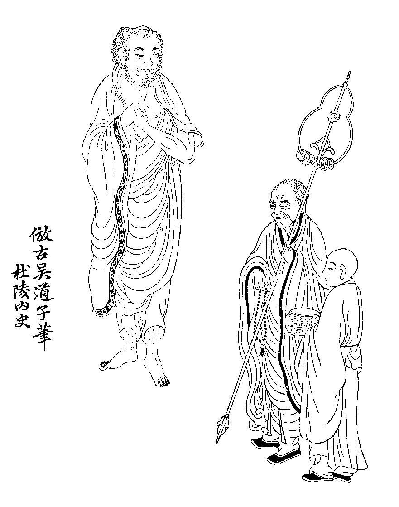

# 楞严经证疏广解



> **藏经**：卍新纂大日本续藏经（新纂卍续藏）　**册次** 第 14 册（X14）　**编号** X0288　**部类** 经疏部　**卷次** 10 卷　**篇幅** 160,239 字

> **卷／品**：10 卷 · 1 品



---



## 目录



  - [No. 288-B 刻楞严经标指序](#no-288-b-刻楞严经标指序)

- [大佛顶如来密因修证了义诸菩萨万行首楞严经卷第一](#大佛顶如来密因修证了义诸菩萨万行首楞严经卷第一)

- [大佛顶如来密因修证了义诸菩萨万行首楞严经卷第二](#大佛顶如来密因修证了义诸菩萨万行首楞严经卷第二)

- [大佛顶如来密因修证了义诸菩萨万行首楞严经卷第三](#大佛顶如来密因修证了义诸菩萨万行首楞严经卷第三)

- [大佛顶如来密因修证了义诸菩萨万行首楞严经卷第四](#大佛顶如来密因修证了义诸菩萨万行首楞严经卷第四)

- [大佛顶如来密因修证了义诸菩萨万行首楞严经卷第五](#大佛顶如来密因修证了义诸菩萨万行首楞严经卷第五)

- [大佛顶如来密因修证了义诸菩萨万行首楞严经卷第六](#大佛顶如来密因修证了义诸菩萨万行首楞严经卷第六)

- [大佛顶如来密因修证了义诸菩萨万行首楞严经卷第七](#大佛顶如来密因修证了义诸菩萨万行首楞严经卷第七)

- [大佛顶如来密因修证了义诸菩萨万行首楞严经卷第八](#大佛顶如来密因修证了义诸菩萨万行首楞严经卷第八)

- [大佛顶如来密因修证了义诸菩萨万行首楞严经卷第九](#大佛顶如来密因修证了义诸菩萨万行首楞严经卷第九)

- [大佛顶如来密因修证了义诸菩萨万行首楞严经卷第十](#大佛顶如来密因修证了义诸菩萨万行首楞严经卷第十)



---



No. 288-A 锓楞严缘起



迟日闲居，白云封户，黄岩之击竹成风，晦堂之华香盈座。忽跫然履声，有客启扉而入，兀坐良久，叹曰：人生驹隙，终日忙忙，究竟何如？余漫应之曰：腰紫绂，肘黄金，如是足矣。客不应。余复谓之曰：生前简白，死后翰青，如是止矣。客曰：嘻，吾所谓究竟，不有人生一大涅槃乎？余未解，客亦逡巡而退。越数日，取楞严读之，廼后知一切事法，莫不有究竟。吾夫子所云：生知、学知、困知、安行、利行、勉行、归根到知之一、成功一，皆一切究竟法。人患不学耳，学者并心一路，则即利即钝，即渐即顿，何上乘人下乘人之别？温陵老人曰：导达禅乘，决择正见。观心主人曰：广含法界，细剖隣虗。是楞严杜旁门，塞岐路，皈依一切究竟法，作明心了性之真诠。然旨奥义繁，世又多钝根，学必先渐入，舍注疏蔑证真诠。茫茫大海中，舍宝筏谁登彼岸？蒙眬两眼，舍金针孰转双瞳？澄法师诚度河之宝筏，拨眼之金针矣。余维是手加披阅，广译穷搜，采天如之会解，摘真光之正脉，荟天都之标指，葺观心之参标，益以云栖祖之摸象，继以天台师之截流。若长水孤山、温陵醉季、吴兴憨山等法师，不下数十家，盈篇累牍，展卷灿然，一新世界法眼。庀工鸠材，历春夏而告成。倐焉金𩙪荐冷，玉露横秋，闭关偃息，焚香结趺坐，庄诵楞严数过。客复叩关请曰：子悟究竟法乎？法一也。子作出世法，屏除妄想，脱离幻相，从此明心了性，莲华日日现前。子作入世法，断却因循二字，从此竿头更进，皂囊白简，功垂青史，拾紫如拾芥耳。余霍然而解，与客晤对终日。



天启元年七月上弦日，吴兴天池居士凌弘宪叔度父识



------



### No. 288-B 刻楞严经标指序



余师事宣尼氏，游心古文辞，见谓六经浑浑噩噩，圣人之言哉。丘明艶而则，其文皮；国䇲辨而诡，其文宕；屈平幽而怨，其文激；庄周宏而肆，其文奇；韩非辨而刻，其文达；马、班博而裁，其文雄。由汉以前百氏诸书，虽言人人殊，大都洋洋𫄥𫄥，正正奇奇，秉六经而建旗鼓，靡不𫖯首颜行，扶服犇奏。见谓千古胜游，至矣尽矣，蔑有尚矣。然皆世间谛耳，非出世谛也。楞严，出世谛也。有有无无，有无无有，幽奇幻怪，不可为名。辟太虗空，其来无首，其去无尾。声为万籁，色为百昌。在目满目，在耳盈耳。去者成故，来者成新。彼虗空体，何有何无，何名何相？故高如须弥，表可测也；深如瀛渤，渡可窥也；庄严如浮幢，华可饰也；幻如偃师，巧可造也；音如迦陵，声可写也；隐见出没，如蜃楼，如化城，影可望也。若廼不表而高，不度而深，非华而严，无巧而幻，见弗以影，音弗以声，非有非无，谁为名相？世儒执有卑者，专旧守残，用涂耳目；其次绣为鞶帨，用博世资。即百氏未游其籓，何暇论乎六籍之外？夫雕玉为楮，孰与造化之巧？棘刾为猴，孰与形性之工？丘樊而游，孰与四虗之达？故有方内游，有方外游。今人拘於冥室中，目无见，耳无闻，愀然不乐也。穿穴隙，见雨零，则快然而叹之，况出室坐堂，见日月光乎？见日月光，肆然而喜，况登泰山，履石封，视天都若葢，江河若带，万物在其间乎？登泰山尚旷然而乐，又况旁日月，挟宇宙，电为鞭䇲，雷为车轮，纵志舒节，游太虗空，其为乐岂不大哉！百氏六籍，方之内也；楞严，方之外也。游方之外，游之至也；游方之内，游之不至也。虽然，无世间心，其操不实；无出世想，其趣不高。实则高之，高则实之，其说葢出于儒。世之读楞严者，皆出世想也。循经则辞奥，循传则义繁，两者俱无当焉。故离为章节句读，以直剖古人之心。既融通部之意以分支，又融通支之意以分章；既融通节之意以分句，又融通句之意以标义。要使血脉流通，按经络之微茫而不慁；神情注结，定孔轮之幽眇而有常。既如常山之蛇，首击尾应；又如照妖之镜，形现神彰。埽千年之芜秽，嘘万古之神光，岂谓能游？亦唯是百家六籍外，更有如来宝藏昱耀乎天壤间者。故愿寓目焉，以为宣尼左袒云。



万历丙午春佛出世日，新安俞王言臯如著



No. 288-C 楞严摸象记引



如经所言，有诸盲人，群手摸象。其摸鼻者，云象如箕；其摸股者，云象如柱；其摸尾者，云象如箒；其摸腹者，云象如石；乃至模眼，则云如鼓风橐；摸耳，则云如倒垂叶；摸蹄，则云如覆地杯。人执所摸，互相是非，观者捧腹。今日谭经，何以异是？佛已涅槃，咨询无繇，出情识手，为想像摸，彼此角立，如盲讥盲，予实慨焉。知己亦盲，救弊为急，因入盲侣，与众同摸。唯首楞严，於诸经中，更多疑义。由是诸盲，竞共鼓噪，交臂攒指，莫可谁何。爰取是经，百有餘则，略为剖析，以例全帙。昔佛弟子，各陈己见，佛谓众言：汝等所说，皆非我意，然各当理，足以利物。则彼群摸，除悖理者，以理而摸，虽不得象，未尝非象。故不患摸，唯执是患。若虗其中，不主先入，会文切理，理协文顺，厥旨自彰。象之为象，跃如卓如，不於摸外，别得一象。如执所摸，坚壁自持，摸之弥勤，失之弥远。秪增戏论，成谤法咎，则何益矣？此特教事，其谭禅者，为摸尤甚。或有摸马，谓是象者；或有摸空，谓是象者；或有俱摸，谓一切处，咸是象者；或於一切，摸之不得，谓无象者。种种异见，未易更仆。愿诸仁者，反摸其眼，得具眼已，象不须摸。



万历三十年岁次壬寅千佛澡浴日，后学云栖寺沙门袾宏书于翠竹山房。



姓氏



译天竺沙门般剌密帝



译语乌苌国沙门弥伽释迦



笔授菩萨戒弟子前正议大夫同中书门下平章事房融



证译罗浮沙门怀迪



证疏西蜀沙门界澄(以上墨本)



会译资中法师弘沇  

真际法师崇节  

𭬥李法师洪敏  

长水法师子璇  

孤山法师智圆  

吴兴法师仁岳  

泐潭法师晓月  

温陵法师戒环  

师子林沙门惟则  

师子窟沙门镇澄  

京都沙门真鉴  

吴兴沙门广莫  

观心居主人王应乾  

天都居士俞王言  

憨山禅师德清(以上朱解)



订解云栖沙门袾宏



总论天台沙门傅如



参攷点释天池居士凌弘宪(以上黛解)



阅正玉华山人徐武  

独孤子高继贤  

𧓍庵居士施扆宾  

盛山山人盛文明  

旦庵主人凌启康  

天目山人凌惇德  

五老山人凌汝标  

广成子凌元爌  

云秋山人凌云  

尧光山人凌元灿



No. 288-D 科经



莲池谓序、正、流通三分，温陵、长水所定略同。而正宗中开为见、修、证、结、助五科，亦甚当理。初、见道分，从阿难启请，以至宣胜义中真胜义性，使行人最初明见自己常住真心，以为修行准的也。二、修道分，从初心二决定义，以至宣说神呪，使行人依真见而起真修，不于心外别有造作也。三、证道分，从云何名为乾慧之地，以至方尽妙觉，成无上道，使行人知因真果正，因地不真，果招迂曲也。四、结经分，从何名此经，至汝当奉持，使行人知五种名义，摄今题二十字中也。五、助道分，从地狱七趣，以至微细魔事，使行人正助交资，乘戒双急，则能速到萨婆若海也。中间细科，或小不同，亦无大碍。后学只须遵古，不必别立新科，增益繁碎，为得其解。余用是当与众共遵之。



凡例



是经墨刻，悉遵澄师证疏，参攷诸本，间有差脱，未敢窜改，但以黛刻标于其上，而下则或○或



以指明之。  

是经朱刻，大槩开阐法王神髓，搜集诸师议论，以补证疏之缺略。间有字句未尽者，则又细注于旁，以备玄览。  

是经黛解订人，宏师摸象。间有词章繁蔓，略删字句，以存大意。别有管见，诸师所未及者，更低一字，以备参稽。  

经中诸师直称名者，尊佛之意，如儒书集注、集说通称名也。  

经中纲领及要问处俱用。◎节目及要答处俱用‧  

经中大段络则用﹄，小分界则用﹂。  

经中开演透悟神会处，则用。译语精美明露处，则用、。  

经中纲领节目外，有旁分缕悉处，则用



。  

经中句逗则用。  

疏中证经明透亦俱用。、。







未见佛，虽名为赞，是名为谤。既见佛，思作是赞，寔无可赞、不可赞、不可说、不可思议，是故名为佛。人文子摹是象已，乞居士重摹，摹象而作赞语。居士寔无所赞，因说偈曰：法本法无法，无法法亦法，今付无法时，法法何曾法？怿迦付法迦叶，迦叶付法阿难，如是如是，是即为赞。



𧓍庵居士　施扆宾焚香写



No. 288



------



## 大佛顶如来密因修证了义诸菩萨万行首楞严经卷第一



〔疏〕经有五名，题中存三，而略其二。谓大方广等，是诸部通称。今名取别，故题从简。言大佛顶者，表於尊胜，兼明密呪，从顶说故。



〔温陵曰〕：觉王示之以大法，使不迷於小径，而默得乎无外之体。喻之以佛顶，使不滞於相见，而妙极乎无上之致。



〔疏〕如来者，按经云本如来藏妙真如性，即般若所谓诸法如义也。今言密因，即指众生本觉之心，诸佛因此以成菩提，所以名为如来密因。因心本具，隐而未显，曰密；修证显了，受称从果，则名如来。故如来名通因通果，有性有修。从因趋果，名菩萨万行；以果通因，则曰如来。梵语首楞严涅槃，翻一切事究竟，即大定之名也。



一缘起分(文四)



如是我闻：一时，佛在(首序佛所居)室罗筏城祇桓精舍，与(次序佛所与)大比丘众千二百五十人俱。



皆是无漏(内冥中道不漏落取相不取相二边)。大阿罗汉，佛子住持(三序诸比丘之德)，善超诸有。能於国土，成就威仪。从佛转轮，妙堪遗嘱。严净毗尼，弘(开扩)范(师范)三界(欲界色界无色界)。应身无量，度脱众生。拔(捝起)济(接过)未来，越诸尘累。



(四、序诸比丘坐次)。其名曰：大智舍利弗、摩(大)诃目犍连(采菽氏)、摩诃拘𫄨罗(大膝)、富楼那弥多罗尼子(满慈子)、须菩提、优婆尼、沙陀等，而为上首(五、序诸菩萨坐次)。复有无量辟支、无学，并(一本作并)其初心，同来佛所，属诸比丘，休夏自恣(自夏至秋，开律放游三日)。十方菩萨，咨(问)决(断)心疑，钦(敬)奉(侍)慈(恩)严(威)，将求密义。即时如来，敷座宴安，为诸会中，宣示深奥，法筵清众，得未曾有(闻所未闻)。迦陵仙音，徧十方界，恒沙菩萨，来聚道场，文殊师利，而为上首。



〔初、集众叹德〕。



〔疏〕言无漏者，即总叹众德。由尽漏故，名阿罗汉。佛地论云：由胜教力，彼圣道生，名为佛子。即住所得法，任持无失，名佛子。住持诸有者，即业、惑、果三有漏之法也。能於下，叹叙别德。清严可畏，轨范行人，名成就威仪。禀佛遗言，能建大义，名妙堪遗嘱。乃至净尸罗而作范，示应身以度生。此则智悲俱运，积功长劫，故能拔济未来，而超诸尘累也。辟支迦罗，此云独觉。俱舍云：尽智生时，名为无学，惟作利他事故。中阿含谓自恣为从解脱，即受夏解制，恣任所如之意。故阿难别请远游未还，而十方菩萨已集道场也。迦陵鸟，即乌凤之属。桂海虞衡志：乌凤如凤鸣，清越如笙箫，妙合宫商，能为百虫之音。故经中每比於佛音。



时波斯匿王，为其父王讳(忌)日营斋，请佛宫掖(其处则内)，自迎(其迎则亲)如来，广设(其设则广)珍羞(其羞别珍)无上妙味(其味则妙)，兼复亲延(其伴则同)诸大菩萨。城中复有长者(齿德爵兼隆)居士(清净自居)，同时饭僧，伫佛来应。佛敕文殊，分领菩萨及阿罗汉，应诸斋主。



唯有阿难，先受别请，远游未还，不遑僧次。既无上座及阿阇黎，途中独归，其日无供。即时阿难，执持应器(钵)，於所游城，次第循乞。心中初求最后檀越(施主)以为斋主，无问净秽，刹利尊姓(贵而净者)及旃陀罗(贱而秽者)，方行等慈，不择微贱，发意圆成一切众生无量功德。



阿难已知如来世尊诃(斥责)须菩提及大迦叶为阿罗汉，心不均平，钦仰如来，开阐无遮，度诸疑谤，经彼城陧(无水之地)，徐步郭门，严整威仪，肃恭斋法。



〔二、误堕所由〕。



〔疏〕仁王经波斯，匿名月光，德行十地。讳日者，曲礼云：卒哭而讳。谓诸矦既葬，七月有祭于庭庙，谓之卒哭，乃命於宫中舍故而讳新，无敢称名。故匿王以其日设斋，恭延圣众，所以资先王之灵也。宫掖者，按唐志及宋元宫殿录，掖皆为掖垣掖门，而非内庭，盖云宫城也。



〔温陵〕上座阿阇黎，律制僧远出，侣须三人，一上座，一轨范，所以严行止，防误失也。又法华云：入里乞食，将一比丘。亦防戒之意。最后檀越，谓未饭僧者。平等之慈，於己等心而化，令彼等心而施，所以圆成众生无量功德。若登伽者，即秽而贱，而阿难既无拣择，故误堕之。阿难下，叙平等之意。须菩提舍贫从富，大迦叶舍富从贫，一谓贫者植因，一谓富者易施，故如来诃之，欲令心无遮限，以息不均之疑谤。



〔疏〕斋法者，分卫经云：一切贤圣，欲济贫苦，故入聚落，当乞食时，乃至入无城想，见无人想。故阿难严整威仪，肃恭此法。



尔时阿难，因乞食次，经历婬室(娼家)，遭大幻术(外道妖术)。摩登伽女，以娑毗迦罗先梵天呪，摄入婬席，婬躬抚摩，将毁戒体。如来知彼婬术所加，斋毕旋归。王及大臣、长者、居士，俱来随佛，愿闻法要。于时(将毁未毁之时)，世尊顶放百宝无畏(群邪并伏)光明，光中出生千叶宝莲，有佛化身，结跏趺坐(叠足而坐)，宣说神呪，敕文殊师利，将呪往护，恶呪销灭(如从梦醒)，提奖阿难及摩登伽，归来(婬心顿歇)佛所。



〔三、说呪往救〕。为度亲因，明经胜义，故以摩登而为发起。按摩登女经言误堕之事，佛在王舍城，阿难行乞，有女子汲水，母名摩登，阿难从女乞水，女便随阿难，视阿难所止处，归告其母，啼泣委卧，欲嫁阿难，其母不得已，乃以蛊道缚阿难入室，阿难不肯就卧处，母持阿难将入火中，佛知此已，即遣神脱阿难，乃其事也。又首楞严三昧经亦有魔界密迹，将显摩登宿因，非此经莫能救度，故以之为缘，浚发大教，谓彼经中当说法时，魔王将行恼乱，有菩萨名魔界行不污，入於魔宫，时魔诸女於菩萨各起欲心，菩萨知其夙缘可度，化作天身，与其从事，因而得度。



阿难见佛，顶礼(以头至地)悲泣，恨无始(受生之初)来，一向多闻，未全道力(见非故起婬爱，但是力不胜邪)，殷勤启请十方如来，得成菩提，妙奢摩他、三摩、禅那最初方便。於时复有恒沙菩萨，及诸十方大阿罗汉、辟支佛等，俱愿乐闻，退坐默然，承受圣旨。佛告阿难：汝我同(共本)气，情均天伦(兄弟)，当初发心，於我法中，见何胜相，顿舍世间深重恩爱？阿难白佛：我见如来三十二相，胜妙殊绝，形体暎彻，犹如琉璃。常自思惟：此相非是欲爱所生。何以故？欲气粗浊，腥臊交遘，脓血杂乱，不能发生胜净妙明紫金光聚，是以渴仰，从佛剃落。



佛言：善哉阿难！汝等当知，一切众生，从无始来，生死相续，皆由不知常住(无出无入)真心，性净明体，用诸妄想。此想不真，故有轮转。汝今欲研(细究)无上菩提，真发明性，应当直心酬(一本作詶)我所问。十方如来，同一道故，出离生死(不堕轮转)，皆以直心。心言直故，如是乃至终始地位，中间永无诸委曲相(皆以直心证入)。



阿难！我今问汝，当汝发心缘於如来三十二相，将何所见？谁为爱乐？阿难白佛言：世尊！如是爱乐用我心目，由目观见如来胜相心生爱乐，故我发心愿舍生死。



〔四、发起经宗〕。阿难下。叙多闻无功，所以发进修之旨。奢摩他等三观，乃此经修行之法。盖十方如来，因修此法，得成菩提，而初心入之，必有方便。言最初者，即未获正观所有初心也。



〔吴兴曰〕：阿难既厌多闻，而欣妙定。如来欲谈实相，先诘妄缘。故问发心见相之由，为止散入寂之本。



〔疏〕佛言下，示迷真之由。由迷真净，故有妄轮。此指阿难见相发心，乃生死攀缘之性也。体性坚凝，不涉尘妄，名常住真心；妙圆离垢，无诸昏昧，名性净明体。此经中所谈之妙性，故佛於此纫玄立极，而印定经宗也。然华严净印言发心者，亦由见佛相好，而楞严三昧亦以爱乐为缘。应知此经将显真心实际，对简扳缘之体，非不以见相之故而发起菩提也。故净印经云：见相发心，有其四种：一者、初发心菩萨，见相庄严而得清净；二者、修行位菩萨，观佛功德，心得清净；三者、不退转位菩萨，观佛法身而得清净；四者、补处位菩萨，无法可观，亦非无观，离於二边而发心故。应当直心酬我所问者，净印经云：发心者，无有谄诳，其心正直。此所谓出离生死，皆以真心也。如是乃至终始地位者，言皆以是心而证入也。



二方便分(大科六)



初徵心。文七。



佛告阿难：如汝所说，真所爱乐因於心目，若不识知心目所在，则不能得降伏尘劳(染污扰乱)。譬如国王为贼所侵，发兵讨除，是兵要当知贼所在，使汝流转心目为咎。吾今问汝，唯心与目今何所在？阿难白佛言：世尊！一切世间十种异生，同将识心居在身内，纵观如来青莲华眼亦在佛面，我今观此浮根四尘秪在我面，如是识心实居身内。



佛告阿难：汝今现坐如来讲堂，观祇陀林，今何所在？(阿难言：)世尊！此大重阁清净讲堂，在给孤(施园建舍檀越之名)园，今祇陀林，实在堂外。阿难！汝今堂中，先何所见？(阿难言：)世尊！我在堂中，先见如来，次观大众，如是外望，方瞩林园。(佛告：)阿难！汝瞩林园，因何有见？(阿难言：)世尊！此大讲堂，户牖开豁，故我在堂，得远瞻见。尔时世尊，在大众中，舒金色臂，摩阿难顶，告示阿难及诸大众：有三摩提(正定)，名大佛顶首楞严(无上一切究竟坚固心)王，具足万行(各门修证)，十方如来一门(千经共由)，超出妙庄严路，汝今谛听。阿难顶礼，伏受慈旨。



佛告阿难：如汝所言，身在讲堂，户牖开豁，远瞩园林。亦有众生在此堂中，不见如来，见堂外者。阿难答言：世尊在堂，不见如来，能见林泉，无有是处。(佛告)阿难：汝亦如是，汝之心灵，一切明(显)了。若汝现前所明了心实在身内，尔时先合了知内身。颇有众生先见身中，后观物外？纵不能见心、肝、脾、胃，爪生、发长、筋转、脉摇，诚合明了，如何不知？必不内知，云何知外？是故应知，汝言觉了能知之心住在身内，无有是处。



〔一、推在内〕。前已开宗，次当显义。将夷道梗，为沮心怨，故推七处攀缘，以为入观方便。佛告下。问。心眼所在者，推妄情也。浮根四尘，即眼之体。心在身中，眼见在外，依世间所见，以为答意。汝今下。佛因阿难言心在内，在内之心，必应见内，故问堂中先何所见。有三摩地，名大佛顶。首楞严王者，此标三昧名也。



〔温陵〕首楞严三昧，千圣共游，故曰一门。妙庄严海，由此而至，故谓之路。



〔疏〕按首楞严三昧经，唯住十地菩萨得此三昧。此三昧者，不以一事、一缘、一义可知，譬如大海，悉受诸流，故云首楞严王具足万行。又金刚三昧本性清净经云：法云地菩萨住首楞严三昧，其心淡泊，安住不动，犹十五日月，圆满可观，明相具足。则知此经所谈，皆此三昧之法也。又云：住是三昧已，修百三昧，然后乃入金刚三昧，如牟尼珠，光光相照。入首楞严三昧海，所有智慧如空中日，诸烦恼海如微烟瘴。



〔疏〕如汝下，谓心若在内，合见身中，可有众生先见身中，后观外物耶？



阿难稽首而白佛言：我闻如来如是法音，悟知我心实居身外。所以者何？譬如灯光然於室中，是灯必能先照室内，从其室门后及庭际(室外)。一切众生不见身中独见身外，亦如灯光居在室外不能照室，是义必明将无所惑，同佛了义得无妄(自信)耶？佛告阿难：是诸比丘，适来从我室罗筏城，循乞抟食归祇陀林，我已宿(预)斋。汝观比丘，一人食时诸人饱不？阿难答言：不也。世尊！何以故？是诸比丘，虽阿罗汉躯命不同，云何一人能令众饱？佛告阿难：若汝觉了知见之心实在身外，身心相外自不相干，则心所知身不能觉，觉在身际心不能知。我今示汝兜罗绵手，汝眼见时心分别不？阿难答言：如是。世尊！佛告阿难：若相知者，云何在外？是故应知，汝言觉了能知之心住在身外，无有是处。



〔二、推在外〕。彼食不能饱此，外心不能知身，固知此心不在身外。我已宿斋者，谓佛已受食。汝观比丘下，谓一人受食，不能饱餘人，以喻外心不能知身，故复举手为证。兜罗绵者，格古论云：出西番等处，从树所生。然眼见手而心分别，则心非在外矣。眼属於身，故云觉在身际。



阿难白佛言：世尊！如佛所言：不见内故，不居身内；身心相知、不相离故，不在身外。我今思惟，知(疑信相参)在一处。



佛言：处今何在？阿难言：此了知心既不知内而能见外，如我思忖潜伏根里。犹如有人取琉璃椀(喻眼)合其两眼(喻心)，虽有物合而不留碍，彼根随见随即分别。然(故)我觉了能知之心不见内者(心在眼故，不见身内)，为在根故；分明瞩外无障碍者(心在眼故，能见身外)，潜根内故。佛告阿难：如汝所言，潜根内者犹如琉璃。彼人当以琉璃笼眼，当见山河、见琉璃不？如是，世尊！是人当以琉璃笼眼，实见琉璃。佛告阿难：汝心若同琉璃合者，当见山河，何不见眼？若见眼者，眼即同境，不得成随。若不能见，云何说言此了知心潜在根内如琉璃合？是故应知，汝言觉了能知之心潜伏根里如琉璃合，无有是处。



〔三、推潜根〕。



〔长水〕琉璃喻根，眼喻於心，眼根色净，不碍於心，同琉璃椀，不碍於色，随照一镜，心则随知。



〔疏〕其如眼见琉璃，心不见眼，纵能见眼，眼即成境，眼既成境，岂能随即分别耶。而琉璃者，质碍之物，故以之笼眼，外见山河，亦见琉璃。



阿难白佛言：世尊！我今又作如是思惟：是众生身，腑藏在中，窍穴居外，有藏则暗，有窍则明。今我对佛，开眼见明，名为见外；闭眼见暗，名为见内。是义云何？佛告阿难：汝当闭眼见暗之时，此暗境界，为与眼对？为不对眼？若与眼对，暗在眼前，云何成内？若成内者，居暗室中，无日月灯，此室暗中，皆汝焦腑。若不对者，云何成见？



若离外见，内对所成。合眼见暗，名为身中。开眼见明，何不见面？若不见面，内对不成。见面若成，此了知心及与眼根乃在虗空，何成在内？若在虗空，自非汝体，即应如来今见汝面亦是汝身。汝眼已知身合非觉，必汝执言身眼两觉应有二知，即汝一身应成两佛。是故应知，汝言见暗名见内者，无有是处。



〔四、推两在〕。



〔吴兴〕一身之中，有藏则暗，故见暗即名见内，何必须见内身之物耶？有窍则明，故见明即是见外，岂应更责不相干耶？



〔疏〕其如开眼不能见明，闭眼不见身中，故不免其后问。汝当下，辨内见也。谓黯与眼对，则暗在眼前；不与眼对，即不名有见，皆不可也。若离下，谓眼但外见，无容内对，故云纵离外见，内对所成。以见暗名身中，则开眼时何不见汝之面乎〔？温陵〕展转辨明，无反观理也。汝眼已知身合非觉者，既眼在虗空，自非汝体矣。



〔疏〕焦府者，素问五藏别论：以能藏精气而不泄者曰藏，其传化物而不藏曰府。三焦者，所以消化五谷，分润[勝-力+天]理，有上下清浊之殊，故曰三焦。



阿难言：我常闻佛开示四众，由心生故种种法生，由法生故种种心生。我今思惟，即思惟体实我心性，随所合处心则随(一本作即)有，亦非内外中间(指根里)三处。



佛告阿难：汝今说言，由法生故种种心生，随所合处心随有者，是心无体则无所合。若无有体而能合者，则十九界因七尘合。是义不然。



若有体者，如汝以手自挃(触)其体。汝所知心，为复内出？为从外入？若复内出，还见身中；若从外来，先合见面。



阿难言：见是其眼(惟眼能见)，心知非眼(心但能知，非眼比也)，为见非义(不可言见)？佛言(以下用喻，以显能见惟心)：若眼能见，汝在室中，门能见不(门即室之眼，亦能见否)？则诸已死，尚有眼存，应皆见物(喻徒眼不能见物)。若见物者，云何名死？



阿难！又汝觉了能知之心，若必有体，为复一体？为有多体？今在汝身，为复徧体？为不徧体？若一体者，则汝以手挃一支时，四支应觉；若咸觉者，挃应无在(一本作所)。若挃有所，则汝一体自不能成；若多体者，则成多人，何体为汝？若徧体者，同前所挃；若不徧者，当汝触头，亦触其足，头有所觉，足应无知。今汝不然，是故应知，随所合处，心则随有，无有是处。



〔五、推随合〕。



〔温陵〕以心法相生，则随境思惟，即是心体。心法合处，即为心在。



〔疏〕思惟之心，其体浮而不实，故难其体之有无也。若无有体，则不能合。如七尘九界，本非有体，岂能合耶？九界者，涅槃云：魔作佛像，语首罗长者言：我先所说四谛法者，是说不真。今当为汝更说五谛、六蕴、十三入、十九界。阿难闻已，寻思法相，都无此理。



〔温陵〕阿难下。解上难也。谓心但能知，不可言见，曾不悟能见在心，徒眼不见也。佛言下。举门喻能见在心，举死喻徒眼不见。



〔疏〕俱舍说：世间正见，唯意识相应。故论云：以眼为门，惟为见色。又汝下，复推别义。徧体与一体同，不徧与多体同，故云若徧体者，同前所触。今四义无成，则不可谓随所合处，心随有故。



阿难白佛言：世尊！我亦闻佛与文殊等诸法王子谈实相(不作妄执)。时世尊亦言：心不在内，亦不在外。如我思惟，内无所见，外不(作又)相知。内无知故，在内不成；身心相知，在外非义。今相知故，复内无见，当在中间。



佛言：汝言中间，中必不迷，非无所在。今汝推中，中何为在？为复在处？为当在身？若在身者，在边非中，在中同内。若在处者，为有所表？为无所表？无表同无，表则无定。何以故？如人以表，表为中时，东看则西，南观成北。表体既混，心应杂乱。阿难言：我所说中，非此二种。如世尊言：眼色为缘，生於眼识。眼有分别，色尘无知。识生其中，则为心在。佛言：汝心若在根尘之中，此之心体，为复兼二(根尘)？为不兼二(根尘)？若兼二者(双兼眼色)，物体杂乱。物非体知，成敌两立(有知无知，相为敌对)，云何为中？兼二不成非知，不知即无(心尚无有)体性，中何为相？是故应知，当在中间，无有是处。



〔六、推在中〕。



〔温陵〕为复下，辨定中位身耶？根处即境。若在身者下，身有中边二义，在边则不得为中，在中则同前在内，应见内矣。若在处者下，亦辨中位无定。表者，标物显处之谓，混乱则无所取中。



〔疏〕若兼二者下，破兼二不得为中。物指尘，体指根，尘非同根有知，故杂乱成敌，此兼二不得为中也。兼二不成下，破不兼二亦不得为中也。不兼根则非知，不兼尘则非不知，二义既非，中无可定。故维摩经云：心不在内，亦不在外，不在中间，如其心然，罪垢亦然。



阿难白佛言：世尊！我昔见佛与大目连、须菩提、富楼那、舍利弗四大弟子共转法轮，常言：觉知分别心性，既不在内，亦不在外，不在中间，俱无所在，一切无著，名之为心。则我无著，名为心不？



佛告阿难：汝言觉知分别心性俱无在者，世间虗空水陆飞行诸所物象，名为一切。汝不著者，为在为无？无则同於龟毛(龟无毛)、兔角(兔无角)，云何不著？有不著者，不可名无。无相则无，非无则相，相有则在，云何无著？是故应知，一切无著名觉知心，无有是处。



〔七、推无著〕。已知此心元非内外中间，故言一切无著。虽云无著，而犹存境相，故有不著之难。水陆空行，约外境诘不著也。此中诘意有三：一、物在无在；二、相有相无；三、有无著。所著是境，能著是心，即心境二门。已上七处，略推徧计，且穷其妄，未显即真。至下标陈二本，始以真妄对辨。



显常住文七。



〔疏〕言显常住者，前已略释七徵文竟。此下经意，多离境显性，义当奢摩他观。由离根尘等法，与空相应故；显不摇等性，与常相应故；辨析真妄，简缘尘故。盖以初观真理，未能涉动，故须澄襟海定，保固灵根，使心源允宴，觉识沈波，寂六动而不摇，冥一如以息虑。故金刚三昧经云：輭心众生，其心多喘。故令存三守一，入如真际。是以经中先陈二本，为此门决择之由，即斯意也。



尔时阿难，在大众中，即从座起，偏袒右肩，右膝著地，合掌恭敬，而白佛言：我是如来最小之弟，蒙佛慈爱，虽今出家，犹恃憍怜，所以多闻，未得无漏，不能折伏娑毗罗呪，为彼所转，溺於婬舍，当由不知真际所诣。惟愿世尊，大慈哀愍，开示我等奢摩它路，令诸阐提，隳弥戾车。作是语已，五体(首与四肢)投地，及诸大众，倾渴翘伫，钦闻示诲。尔时世尊，从其面门(眼耳鼻舌)，放种种光，其光晃耀，如百千日，普佛世界，六种(动、踊、震、起、吼、攀)震动，如是十方微尘国土，一时开现。佛之威神，令诸世界，合成一界，其世界中，所有一切诸大菩萨，皆住本国，合掌承听。佛告阿难：一切众生，从无始来，种种颠倒，业种自然，如恶叉聚，诸修行人，不能得成无上菩提，乃至别成声闻(口耳之学)、缘觉(偶触之知)，及成外道，诸天魔王，及魔眷属，皆由不知二种根本，错乱修习，犹如煑沙，欲成嘉馔(妙喻)，纵经尘劫，终不能得。云何二种？阿难！一者无始生死根本，则汝今者，与诸众生，用攀缘心，为自性者；二者无始菩提(不染烦恼)、涅槃(不涉生死)、元清净(不染不渉)体，则汝今者，识精元明，能生诸缘，缘所遣者，由诸众生，遗此本明，虽终日行，而不自觉枉(不应入而入曰枉)、入诸趣



〔初、标真妄二本〕。尔时下，阿难叙昔所迷，求诣真际。先问奢摩他路者，所以入实际之门也。杂集论云：无倒所缘，说名实际。故涅槃经奢摩他有五义：一、名能灭，能灭烦恼故；二、名能调，能调诸根故；三、名寂静，令三业寂静故；四、名远离，远离五欲故；五、名能清，能清贪等三浊故。尔时世尊下，放光显说。此经放光，凡有四处，将宣微密法门，而现微妙之瑞。按光义有三：胜思惟经论云：说法光明，依三种差别：一、因，二、名，三、成办。一、因者，谓佛所放光，显说因故。法华优婆提舍云：现见异相不可思议，名为说因，如即照明诸佛世界种种事等。二、名者，谓光有名字，如华严、法华所放光明，名大人相等。三、成办者，谓光所作业，如第四经诸佛放光，来祇陀林，灌如来顶，成辨所说等。言六种者，优婆提舍云：前所放光，显示外境诸事，今明内证甚深，故六种震动。然光中所现，欲示本觉菩提，觉心显发，故微尘国一时开现；显本涅槃心，元无差别，故十方界合成一界；显元清净体，不妄随缘，故菩萨众皆住本国。了兹光瑞，则说因显矣。



〔温陵〕众生业果成聚，行人不知二本，错乱修习，故须决择。不染烦恼名菩提，不渉生死名涅槃。不染不渉，故号元清净体。识精，陀罗识性也。元明，本觉妙明也。根身器界，一切缘法，依此而生。而人者认缘失真，故名缘所遗者。



〔疏〕识精元明，湛不摇性，其体即是菩提涅槃。由不杂尘妄曰精，未尝昏昧曰明，而行人遗此本明，所修皆妄，故须决择也。



阿难：汝今欲知奢摩他路，愿出生死，今复问汝。即时如来举金色臂，屈五轮指，语阿难言：汝今见不？阿难言：见。佛言：汝何所见？阿难言：我见如来举臂屈指为光明拳，耀我心目。佛言：汝将谁见？阿难言：我与大众同将眼见。佛告阿难：汝今答我：如来屈指为光明拳，耀汝心目。汝目可见，以何为心，当我拳曜？阿难言：如来见今徵心所在，而我以心推穷寻逐。即能推者，我将为心。佛言：咄！阿难，此非汝心。(直喝破)阿难矍然，避座合掌，起立白佛：此非我心，当名何等？佛告阿难：此是前尘虗妄相想，惑汝真性。由汝无始至于今生，认贼(应前)为子，失汝元常，故受轮转。



阿难白佛言：世尊！我佛宠弟，心爱佛故(欣慕三十二相)，令我出家。我心何独供养如来，乃至徧历恒沙国土，承事诸佛及善知识，发大勇猛，行诸一切难行法事，皆用此心。纵令谤法，永退善根，亦因此心。若此发明不是心者，我乃无心，同诸土木。离此觉知，更无所有。云何如来说此非心？我实惊怖。兼此大众无不疑惑，惟垂大悲，开示未悟。



尔时，世尊开示阿难及诸大众，欲令心入无生法忍。於师子座，摩阿难顶，而告之言：如来常说，诸法所生，唯心所现。一切因果，世界微尘，因心成体。阿难！若诸世界，一切所有，其中乃至草叶缕结(丝麻之类)，诘(追问)其根元，咸有体性。纵令虗空，亦有名貌。何况清净妙净明心，性一切心，而自无体？若汝执恡分别觉观，所了知性，必为心者，此心即应离诸一切色香味触诸尘事业，别有全性。如汝今者，承听我法，此则因声而有分别。纵灭一切见闻觉知，内守幽闲，犹为法尘分别影事。我非敕汝，执为非心(转语警切)。但汝於心，微细揣摩，若离前尘，有分别性，即真汝心。若分别性，离尘无体，斯则前尘分别影事，尘非常住。若变灭时，此心则同龟毛兔角，则汝法身同於断灭。其谁修证无生法忍？即(应前)时阿难与诸大众，默然自失。佛告阿难：世间一切诸修学人，现前虽成九次第定，不得漏尽成阿罗汉。皆由执此生死妄想，误(应前)为真实。是故汝今虽得多闻，不成圣果。



〔一、离尘常性〕。阿难下，显离尘常性。尘，谓随缘分别之见。常者，本然自性之体。真心绝妄，故说离尘。如来举臂，正显本明。而阿难认缘失真，乃以妄心推穷寻逐，才生一念，转人前尘，失其元常。所谓缘所遗者，此也。若此发明下。



〔吴兴〕阿难以对境觉知，异乎木石，封为我心。此正当人执之相，忽闻呵斥，故以无情为难。不知真我无我，灵知无知，妙净明心，何所不在。



〔疏〕诸法所生，惟心所现者，以明竖拳之理，皆推心义。一切因果，即依报、正报也。性一切心者，即草木等，皆此心为性也。若汝下，牒能推心。此心下，示离尘义。谓分别觉观所了知性，是离尘无体之心，不应取著。故复示云：如汝今者承听我法，乃缘尘分别之性也。纵灭下，甄明影事。谓汝纵灭见闻觉知，以外离缘尘分别，而内守幽闲。此幽闲心，犹是法尘影事，直须内外圆寂，影象俱无，方是真心之体也。故佛答阿难：我非敕汝执为非心，但欲汝识其真也。云何为真？谓若离前尘有分别全性，即真心耳。如前尘自暗，见觉不昏，音响双销，闻性不灭，岂非离尘有全性分别耶？所以不用缘尘分别为心者，尘非常住，随即变灭，以此为因，安取常果？缘尘之心，有如是咎。是故学人虽成九定，不得漏尽，皆由执此妄想为真实也。故成实论说：乃至有顶，犹有退堕，皆由不知烦恼过故。又成实云：若人得九次第定，不能入诸禅，名慧解脱。释曰：按二定，圣者、凡夫皆能修之。而经言不得漏尽者，盖指有学凡夫缘尘未断者说。



阿难闻已，重复悲泪，五体投地，长跪合掌而白佛言：自我从佛发心出家，恃佛威神，常自思惟：无劳我修。将谓如来惠我三昧，不知身心本不相代(如来身心不能代己修)，失我本心。虽身出家，心不入道，譬如穷子舍父逃逝。今日乃知，虽有多闻，若不修行，与不闻等，如人说食终不能饱。世尊！我等今者二障所缠，良由不知寂常心性。惟愿如来哀愍穷露，发妙明心，开我道眼。



即时，如来从胷卍字涌出宝光，其光晃昱有百千色，十方微尘普佛世界一时周徧，徧灌十方所有宝刹诸如来顶，旋至阿难及诸大众，告阿难言：吾今为汝建大法幢，亦令十方一切众生获妙微密(不可测知)，性净(垢不染)明(暗不昏)心，得清净眼(见离眚病)。



阿难！汝先答我见光明拳，此拳光明因何所有？云何成拳？汝将谁见？阿难言：由佛全体阎浮檀金赩(赤焰)如宝山，清净所生，故有光明。我实眼观，五轮指端屈握示人，故有拳相。佛告阿难：如来今日实言告汝，诸有智者要以譬喻而得开悟。阿难！譬如我拳，若无我手不成我拳，若无汝眼不成汝见。以汝眼根例我拳理，其义均不？阿难言：唯然世尊！既无我眼不成我见，以我眼根例如来拳，事义相类。佛告阿难：汝言相类，是义不然。何以故？如无手人拳毕竟灭，彼无眼者非见全无。所以者何？汝试於途询问盲人：汝何所见？彼诸盲人必来答汝：我今眼前唯见黑暗，更无他瞩。以是义观，前尘自暗，见何亏损？阿难言：诸盲眼前唯覩黑暗，云何成见？佛告阿难：诸盲无眼唯观黑暗，与有眼人处於暗室，二黑有别？为无有别(越翻越透)？如是世尊！此暗中人与彼群盲，二黑校量曾无有异。阿难！若无眼人全见前黑忽得眼光，还於前尘见种种色，名眼见者；彼暗中人全见前黑忽获灯光，亦於前尘见种种色，应名灯见。若灯见者，灯能有见，自不名灯。又则灯观何关汝事？是故当知，灯能显色，如是见者是眼非灯；眼能显色，如是见性(镕作一片)是心非眼。



〔二、离根之见〕。寂常心性，本来常住之性也。此性本吾所有，乃反求之於外，既非他修我得，岂当恃佛威神？今日乃知，若不修行，与不闻同。是以责躬请教，希明道眼。二障者，圆觉云：一者是障，续诸生死；二者理障，碍正知见。又云：永断贪欲，先除事障，未断理障。释曰：俱舍以贪等为事，见谛为理，则阿难误堕淫舍，即事障未断也。缘尘分别，理障未断也。阿难下，蹑前拳理，以为难意。问相类者，以明不类。所以不类者，无手则无拳，无眼则有见，是故不类也。拳有生灭，见非有无，故虽群盲，亦能覩暗，此则常性之实也。又经论皆云：眼非见色。故破色心论云：以彼梦中，於无色处，则见有色；於有色处，不见色故。释曰：无色处者，梦中境也；有色处者，寤时境也。梦中之色，非眼处之境，故云眼非见色。然世间以眼为见，无眼时则不能见。眼非常性，义在离根。



阿难虽复得闻是言，与诸大众口已默然，心未开悟，犹冀如来慈音宣示，合掌清心，伫佛悲诲。尔时，世尊舒兜罗绵网相光手，开五轮指，诲敕阿难及诸大众：我初成道，於鹿园中为阿若多五比丘等及汝四众言：一切众生不成菩提及阿罗汉，皆由客尘烦恼所误。汝等当时因何开悟，今成圣果？时憍陈那(亦云憍陈如)起立白佛：我今长老於大众中独得解名，因悟客尘二字成果。世尊，譬如行客投寄旅亭，或宿或食，宿食事毕，俶(整)装前途，不遑安住。若实主人，自无攸往。如是思惟，不住名客，住名主人，以不住者名为客义。又如新霁，青(日)旸升天，光入隙中，发明空中诸有尘相，尘质摇动，虗空寂然。如是思惟，澄寂名空，摇动名尘，以摇动者名为尘义。佛言：如是。



〔三、离客尘之性〕。陈如得解，因悟客尘，此从本立称也。



〔吴兴〕客尘，喻见思生灭。主空，喻真谛寂然。客义粗，喻迷事之惑。尘义细，喻迷理之惑。



〔疏〕按俱舍论说：见惑烦恼，迷谛理起，易断不退，此客义也。修惑烦恼，依粗事生，难断易退，此尘义也。佛性论云：客尘烦恼有九：一、贪，二、瞋，三、痴，四、上心惑，五、无明，六、见所断，七、修所断，八、不净地惑，九、净地惑。此二惑在第七地至究竟位中。释曰：从贪等至净地惑者，总释一切凡圣客尘义也。又若经论所说客尘之义，约有四种：一、约所显。成实云：经言客尘者，以显心性是常。二、约所修。圆觉云：修奢摩他者，觉识烦动，静慧发生，客尘永灭。三、约所证。佛地论云：为断客尘，证净法界。四、约所离。佛地论云：圆镜智者，正净无垢，离客尘故，而其体即分别为性。故胜鬘云：如虗空净心，常明无转变，为虗妄分别，客尘烦恼染。然经以不住名客，住名主人；以澄霁为空，动摇名尘。又云：若实主人，自无攸往。以明分别若除，常心自住。则知此中即以缘尘分别之心为客尘之义。



即时如来於大众中屈五轮指，屈已复开，开已又屈(作开合相)，谓阿难言：汝今何见？阿难言：我见如来百宝轮掌众中开合。佛告(一本作言)阿难：汝见我手众中开合，为是我手有开有合？为复汝见有开有合？阿难言：世尊宝手众中开合，我见如来手自开合，非我见性有开有合。佛言：谁动谁静？阿难言：佛手不住(佛手是动)，而我见性尚无有静(见性无动)，谁为无住？佛言：如是。



如来於是从轮掌中飞一宝光在阿难右，即时阿难回首右盻；又放一光在阿难左，阿难又则回首左盻。佛告阿难：汝头今日因何摇动？阿难言：我见如来出妙宝光来我左右，故左右观，头自摇动。阿难！汝盻佛光左右动头，为汝头动？为复见动？世尊！我头自动，而我见性尚无有止，谁为摇动？佛言：如是。於是如来普告大众：若复众生以摇动者名之为尘，以不住者名之为客。汝观阿难头自动摇，见无所动；又汝观我手自开合，见无舒卷。云何汝今以动为身、以动为境，从始洎终念念生灭，遗失真性颠倒行事，性心失真认物为己，轮回是中自取流转？



〔四、不摇之性〕。



〔长水〕手有开合，见无动静，对外境辩也。次於内身自分动静，动中有不动也。



〔疏〕佛徵见性，以显超情。而言无摇动者，以明妙见性静离妄。故无尽意经云：奢摩他者，寂近寂密，不动不摇，及知止足。则真空观之体也。又佛地论云：圆镜智者，依缘法界，穷生死际，相续不断，名无动摇。则根本智之用也。释曰：奢摩他者，以静为体，以止为相。而阿难答佛言见性尚无有静者，以明妙性超情，即静离静也。又佛问谁动谁静，而答云见性尚无有止者，以明妙性无著，即止离止也。故金刚三昧经云：当止是生，止已无止，亦不住於无止，亦不住於无住。又云：知心无心，无心可止；现识不生，无生可止。何以故？止无止故。若复下，指法责劝。以动为身，即左右顾盻者是；以动为境，即手有开合者是。既迷不摇常住之真精，反取动摇生灭之身境，岂非遗失真性，颠倒行事哉？故知身为劳虑，妄动虗假。是以内蠲我想，外抵人相，断摇俗之妄，栖法界之真。此如来所以开奢摩他也。



镇澄赞曰：　阿难示堕，调御垂怜。七重徵诘破攀缘，心目耀金拳。真妄同源，决意在当权。



> 传如截流曰：　大佛顶者，即释迦大觉神变相也。以象示意，圣教咸然。兹阿难溺于淫舍，大众愿闻法要。世尊具大威力而手不之援，具大乐说而言未之启，廼从肉髻中涌百宝光，有佛化身宣说神呪者，意表显密之俱胜，彰形声之兼玅，荡见闻之幻翳，而一经之大旨无餘蕴矣。显密俱胜者，经为显，呪为密，呪心藏心，无二无别。顶为无上之相，经为了义之谈，以密该显，全彰顶中，故曰俱胜。形声兼玅者，顶光化佛是形外之形，化佛呪语是声外之声，惟形与声逈超思议之表，故曰兼玅。见闻幻翳者，浮尘幻化，虗妄称相，一切不了，妄生取著，障清净之慧眼，通之本根。故当机云：我见如来三十二相胜玅殊绝，是以渴仰从佛剃落。又云：而我悟佛现说法音，现以缘心，𠃔所瞻仰。此非逐色声之求善提者耶？一著色声，本明斯昧，若登伽者，乌得不乘其间哉？何以故？佛身女身均相也，佛见女见均情也。阿难独恨婬躬抚摩为魔障，未达胜相爱乐为厉阶，诚为贼媒在室，瞢然不觉，而且恃其多闻之慧，先梵呪语之所能摄者，葢有自矣。今示佛顶化佛，则知三十二相形非形；化佛说呪，则知四无碍辩声非声。从是而悟阴入处界七大之法，无非如来藏中循业发现。循业即性故非有，即性循业故非空，离即离非、是即非即，真妄两融、戏论并绝，道场修证无复秘要，见是为见见、闻是为闻闻，当下海印发光、万象毕照，全题云是经名大佛顶悉怛多般怛啰十方如来清净海眼者以此。或作文言纷纭释者，恐非至圣垂象密被利机之意矣。如华严种种光相表诸地法门，聊例一经诸可意得。文殊将呪往护、恶呪消灭，阿难登伽归来佛所者，正智行而魔事息也。序分竟。经文自下直至第四卷中，剋依性体以融万法，明如来密因，如华严所谓先悟毗卢法界也。自四卷至尽经，全性修证，明诸菩萨万行，首楞严所谓后修普贤行门也。首楞严此云究竟，坚固斯经教理行果无不究竟，是曰了义。题有五种，后当具释。阿难见佛顶礼悲泣者，省戒体几毁於登伽、多闻莫益乎道力，人或处此怡然，则楞严玅典无所发起、生死欲流无所遏截，大权示迹岂无为哉？十方如来得成菩提，玅奢摩他、三摩、禅那者，玅即密也，奢摩他等因也。结题反约但标密因，请法须详别开三种。奢摩他者，凝然湛寂；三摩者，廓然圆照；禅那者，寂照不二。从用有三，其体恒一，三一圆融故称曰玅。是诸佛之种智、当人之灵知，一经之宗体也。宗为能显，斯曰密因；体为所显，斯曰藏性。宗体元无异途，果因岂非一致？故后文或举一摄三、或举宗含体，译师之所不飜者，神而明之存乎其人耳。最初方便者，入三摩提之门也。门有泛明的指之别，四卷阿难既悟藏心之后，请云：我今犹如旅泊之人，忽蒙天王赐与华屋，要因门入。世尊示以发觉初心二决定义，虽示六根优劣，令一门深入，然未的指何门为要，故又别请圆通本根。佛令诸圣各陈所证，则又泛明阴入处界，以及七大，皆为入道之门。惟文殊奉敕，於诸圣之后，的指观音所证，其偈云：此方真教体，清净在音闻，欲超三摩提，实以闻中入。愿加被未来，於此门无惑，堪以教阿难，及末劫沉沦。经以耳根圆通为最初方便无疑也。堪以教阿难者，葢阿难以蓄闻成过，观音以薰闻成德，所谓功之与衅，只在循声入流之间而已。今示大士本玅之圆根，为多闻创修之秘要，是令不失故步，大用现前，如从地倒，还从地起，舍此将何聆密因？舍此凭何谈万行？故阿难以多闻未全道力自咎，更陈发心见相之由。世尊就其所迷而示之曰：一切众生，皆由不知常住真心，性净明体，用诸妄想，此想不真，故有轮转。性净明体，即佛所表绝诸分别者；用诸妄想，即因相爱乐者。欲治此想，更无别法，故曰：有三摩提，名大佛顶，首楞严王，具足万行，十方如来，一门超出，玅庄严路。阿难前请，具列三名，但举三摩提者，以举一摄三，宗体咸在也。三摩提名大佛顶者，斯以词系象，摄密归显也。首楞严王者，彰所诠究竟坚固之体，一切无上也。离体无用，故曰具足万行。十方如来一门超出玅庄严路者，从三摩提显常住心，圆满菩提，归无所得，佛佛然也。夫心所以为常住者，常住则无所不住，无所不住则不可以言住。然阿难计内计外至计无著，宁有是处乎？试观如来放面门之光，动普佛之界，异境一合，遥住同闻，则七处妄局，直下廓然，无始涅槃，元清净体，备在我而不在佛矣。阿难尚以能推之心为心，非认贼为子，失其所谓寂常心性者耶？由是再从卍字涌出宝光至微尘如来，阿难大众无不徧及者，知妄尘莫隔乎智光，则玅心岂殊乎道眼至托盲人以辩灯，见心眼之一体照然，令陈那而叙客尘，寂常之玅性显矣。阿难悟手有开合，犹客也；见无舒卷，犹主也；头有摇动，犹尘也；见无所动，犹空也。然如来先寄陈如以悟阿难，因阿难而责在会，故曰若复言以摇动者名之为尘，不住者名之为客者，责众不悟动中之有不动，故云汝观阿难头自摇动，见无所动；手有开合，见无舒卷。云何汝今迷其寂常之主空，而以动为身，以动为境，非心性失真乎？逐其扰动之客尘，而从始洎终，念念生灭，非认物为己乎？寂常之性，本来在我，而迷之背之，故曰轮回是中，自取流转。



音释



般剌



(音钵腊。)



苌



(音长。)



𫄨



(音痴。)



属



(音烛。)



掖



(音亦。)



伫



(直吕切。)



臊



(苏曹切)



遘



(音搆。)



瞩



(音烛。)



抟



(音团。)



秪



(音支。)



窍



(启呌切。)



挃



(音质。)



隳



(喧规切。)



翘



(祈尧切)



矍



(居缚切。)



恡



(良刃切。)



揣



(初委切。)



昱



(音育。)



赩



(喜力切。)



握



(於角切。)



缕



(力主切。)



椒



(昌六切)



隙



(乞逆切。)



盻



(匹苋切。)



------



## 大佛顶如来密因修证了义诸菩萨万行首楞严经卷第二



显常性之餘。



尔时，阿难及诸大众闻佛示诲，身心泰然，念无始来失却本心，妄认缘尘，分别影事。今日开悟，如失乳儿忽遇慈母。合掌礼佛：愿闻如来显出身心真妄虗实，现前生灭与不生灭。二、发明性。时波斯匿王(体诸大众欲问之心)起立白佛：我昔未承诸佛诲敕，见迦旃延、毗罗胝子，咸言：此身死后断灭，名为涅槃。我虽值佛，今犹狐疑，云何发挥证知此心不生灭地？今此大众诸有漏者，咸皆愿闻。佛告大王：汝身现在，今复问汝：汝此肉身为同金刚常住不朽？为复变坏？世尊！我今此身终从变灭。佛言：大王！汝未曾灭，云何知灭？世尊！我此无常变坏之身虽未曾灭，我观现前念念迁谢，新新不住，如火成灰，渐渐销殒，殒亡不息，决知此身当从灭尽。佛言：如是，大王！汝今生龄已从衰老，颜貌何如童子之时？世尊！我昔孩孺，肤腠润泽，年至长成，血气充满。而今頺龄，迫於衰耄，形色枯悴，精神昏昧，发白面皱，逮将不久，如何见比充盛之时？佛言：大王！汝之形容应不顿朽。王言：世尊！变化密移，我诚不觉，寒暑迁流，渐至於此。何以故？我年二十，虽号年少，颜貌已老。初十岁时，三十之年，又衰二十。於今六十，又过於二。观五十时，宛然强壮。世尊！我见密移，虽此殂落，其间流易，且限十年。若复令我微细思惟，其变宁唯一纪(十二年为一纪，一云十年)二纪，实惟年变。岂唯年变，亦兼月化。何直月化，兼又日迁。沈思谛观，刹那刹那，念念之间，不得停住。故知我身，终从变灭。佛告大王：汝见变化，迁改不停，悟知汝灭。亦於灭时，汝知身中有不灭耶？波斯匿王合掌白佛：我实不知。佛言：我今示汝不生灭性。大王！汝年几时见恒河水？王言：我生三岁，慈母擕我谒耆婆天，经过此流，尔时即知是恒河水。佛言：大王！如汝所说，二十之时，衰於十岁，乃至六十，日月岁时，念念迁变。则汝三岁见此河时，至年十三，其水云何？王言：如三岁时，宛然无异。乃至於今，年六十二，亦无有异。佛言：汝今自伤发白面皱，其面必定皱於童年。则汝今时观此恒水，与昔童时观河之见，有童耄不？王言：不也。世尊！佛言：大王！汝面虽皱，而此见精，性未曾皱。皱者为变，不皱非变。变者受灭，彼不变者，元无生灭。云何於中受汝生死？而犹引彼末伽梨等，都言此身死后全灭。



王闻是言，信知身后舍生(遗假形)、趣生(全真性)，与诸大众踊跃欢喜，得未曾有。



〔五，观河之见〕。



〔疏〕即无常生灭之身，显常住不灭之性，故指观河为喻，以明流而不易之体也。夫一切有身，无不皆灭，若俱舍以二种观无常，所谓邻虗分刹那灭者，即身心二念性也。此文所显，略有三节，即三念处：一、从佛问汝未曾灭下，是以心念处观无常。念念迁谢，心之体也；新新不住，无常之性也。如火成灰者，不更新之意。二、从问汝今生龄下，是以身念处观无常。颜貌肤腠，身之相也。孩孺者稚龄，而血气者壮年色也。頺耄枯悴，总指老年之状。以至於逮将不久者，言无常之理然也。三、从问汝之形容下，是以法念处观无常。寒暑岁月，诸法之体也。我年二十下，取十年为限，以宽数粗观也。实惟年变下，取从宽至促，以细相密观也。殂落者，迁谢之义。年变月化，皆无常之体。以至于终从变灭者，指必然之势也。佛告下，显不迁之性。盖生生者不生，化化者不化，故虽受世间之身而不受变於世，此观河之见所以无童耄也。



〔孤山〕见精即见性也。皱者为变，则显生死无常；不皱非变，则显涅槃常住。



〔疏〕涅槃论五种常：一、无穷常，二、无起常，三、恒在常，四、湛然常，五、无变常。无变常，即观河之性。



阿难即从座起，礼佛合掌，长跪白佛：世尊！若此见闻，必不生灭。云何世尊名我等辈遗失真性，颠倒行事？愿兴慈悲，洗我尘垢。即时如来垂金色臂，轮手下指，示阿难言：汝今见我母陀罗手(结印)，为正？为倒？阿难言：世间众生以此为倒，而我不知谁正？谁倒？佛告阿难：若世间人以此为倒，即世间人将何为正？阿难言：如来竖臂兜罗绵手(解见前卷)，上指於空，则名为正。佛即竖臂，告阿难言：若此颠倒，首尾相换，诸世间人一倍瞻视，则知汝身与诸如来清净法身比类发明(比于手指正倒之类而发明之)。如来之身名正徧知，汝等之身号性颠倒。



随汝谛观，汝身佛身，称颠倒者，名字何处，号为颠倒？於时阿难与诸大众，瞪瞢瞻佛，目睛不瞬，不知身心颠倒所在。佛兴慈悲，哀愍阿难及诸大众，发海潮音，徧告同会：诸善男子，我常说言，色心诸缘，及心所使，诸所缘法，唯心所现。汝身(幻身)、汝心(妄心)，皆是妙明真精妙心中所现物，云何汝等，遗失本妙圆妙明心，宝明妙性，认悟中迷？



晦昧为空，空晦暗中。结暗为色，色杂妄想。想相为身，聚缘内摇。趣外奔逸，昏扰扰相，以为心性。一迷为心，决定惑为色身之内。不知色身外洎(及)山河虗空大地，咸是妙明真心中物。譬如澄清百千大海，弃之惟认一浮沤体，目为全潮，穷尽瀛渤。汝等即是迷中倍人，如我垂手，等无差别。如来说为可怜愍者。



〔六、离倒真性〕。



〔温陵〕因王问答，反动疑尘，以谓真性有生有灭，可说遗失，既无生灭，云何能遗。佛答谓诸佛众生，同一体性，固无遗失，特因见倒言之也。如手顺垂为正，反以为倒，逆竖为倒，反以为正，是失真也。



〔疏〕此下渐约即境明心，故佛广举根身器界，显徧知也。色心诸缘，即根尘之法，以体言之，为宝明妙性。心所使者，即染净诸法，以徧言之，为圆妙明心。盖诸法所生，惟心所现，是本来之悟。遗此本悟，取之色身，是认悟中迷矣。晦昧下，明颠倒之处。谓真性圆徧，无内无外，由一念晦昧，变顽为空。次则结晦昧为色，杂想相为身。其妄动之情，聚缘於内，奔流於外，昏扰不停。而人则取此缘气以为己心，遂谓此心在藐尔身中。不知外及山河，虗空大地，咸是妙明之体也。故法华云：是法住法位，世间相常住。由其取小遗大，如弃海认沤，故为迷中倍人。倍，犹增倍也。



阿难承佛悲救深诲，垂泣叉手而白佛言：我虽承佛如是妙音，悟妙明心，元所圆满，常住心地。而我悟佛现说法音，现以缘心，允所瞻仰(信尊佛说)，徒获此心(即上玅明之心)，未敢认为本元心地。愿佛哀愍，宣示圆音，拔我疑根，归无上道(阿耨菩提)。佛告阿难：汝等尚以缘心听法，此法亦缘，非得法性。如人以手指月示人，彼人因指，当应看月。若复观指以为月体，此人岂唯亡失月轮，亦亡其指。何以故？以所标指为明月故。岂唯亡指，亦复不识明之与暗。何以故？即以指体为月明性，明暗二性无所了故。汝亦如是，若以分别我说法音为汝心者，此心自应离分别音，有分别性。譬如有客寄宿旅亭，暂止便去，终不常住，而掌亭人都无所去，名为亭主。此亦如是，若真汝心，则无所去，云何离声无分别性？斯则岂唯声分别心，分别我容，离诸色相，无分别性。如是乃至分别都无，非色非空，拘舍离等，昧为冥谛，离诸法缘，无分别性。则汝心性各有所还，云何为主？阿难言：若我心性各有所还，则如来说妙明元心，云何无还？惟垂哀愍，为我宣说。佛告阿难：且汝见我见精明元，此见虽非妙精明心，如第二月非是月影。汝应谛听，今当示汝无所还地。阿难！此大讲堂洞开东方，日轮升天则有明耀，中夜黑月云雾晦暝则复昏暗，户牖之隙则复见通，墙宇之间则复观壅，分别之处则复见缘，顽虗之中徧是空性，郁(杂)𡋯(沓)之象则纡(结)昏尘，澄霁敛氛又观清净。阿难！汝咸看此诸变化相(即上八种相)，吾今各还本所因处。云何本因？阿难！此诸变化明还日轮。何以故？无日不明，明因属日，是故还日。暗还黑月，通还户牗，壅还墙宇，缘还分别，顽虗还空，郁𡋯还尘，清明还霁，则诸世间一切所有不出斯类。汝见八种见精明性，当欲谁还？何以故？若还於明，则不明时无复见暗。虽明暗等种种差别，见无差别，诸可还者自然非汝，不汝还者非汝而谁？则知汝心本妙明净，汝自迷闷丧本受轮，於生死中常被漂溺，是故如来名可怜愍。



〔七、无还常性〕。



〔温陵〕因闻法音，悟妙明心，本来圆满，了无遗失，故曰常住心地。然情犹卤莽，见未精明，尚以能闻缘心，为所悟妙性。此固常情疑混，根於心而难拔者，故愿佛拔之。



〔疏〕阿难以缘心听法，即前缘尘分别故。复以客义推徵亭中主人，喻常住之性，即八中无还者也。此显奢摩他之终，将明起行，故示无还之性。



〔温陵〕声分别心，指声上缘心，即分别法音者也。分别我容，谓色上缘心，即允所瞻仰者也。如是乃至者，即该举六尘皆无自性也。缘尘之心，离尘无体，故拘舍离等昧为冥谛。



〔吴兴〕阿难问妙明元心，佛以见精为答者，应知此见亦是前来缘尘之见。但缘尘分别之见有还？缘尘能见之性无还？如下文所谓其目周视，但如镜中，无别分析，即见精者也。汝识於中次第标指是文殊等，即缘尘分别者也。



〔疏〕明精明心，即第八妙圆真心。见精明元，则眼根映色之性。六湛精明，乃第八所分，名第二月。由妙心全体难见，故指见精以示无还。成实云：以指按目，则见二月。阿难下，欲示无还之性，先指可还之相。言本因者，谓日为明因，黑为暗因，隙为通因，乃至霁为清净因。此皆有还，惟见精无还也。



显见性文七



此下经义，多即境显性，义当三摩波提。由其境界与观照义相应故，涉能所性显即离故。且以由前寂静之力，照体既立，理应发诸事业。盖所以赏触类之妙，尽缘情之鉴，由真立俗，理应然故。义例如前，亦分七种见性。



阿难言：我虽识此见性无还，云何得知是我真性？



佛告阿难：吾今问汝，今汝未得无漏清净，承佛神力(一声闻见)，见於初禅得无障碍(二罗汉见)，而阿那律见阎浮提如观掌中庵摩罗果(三菩萨见)，诸菩萨等见百千界(四如来见)，十方如来穷尽微尘清净国土无所不瞩(五众生见)，众生洞视不过分寸。阿难！且吾与汝观四天王所住宫殿(上自四天)，中间徧览水陆空行(下至大地)，虽有昏明种种形像(一切物相所在之处)，无非前尘(目前诸尘)分别留碍。



汝应於此分别自(我)、他(物)。今吾将汝择於见中，谁是我体？谁为物象(一本作相)？阿难！极汝见源(尽汝眼力)，从日月宫(最上物相)，是物非汝；至七金山(居中物相)，周徧谛观，虽种种光，亦物非汝(此以下最下物相)；渐渐更观，云腾鸟飞，风动尘起，树木山川，艸芥人畜，咸物非汝。阿难！是诸近远诸有物性，虽复差殊，同汝见精清净所瞩，则诸物类自有差别，见性无殊。此精妙明，诚汝见性。



〔一、能遍一切见性〕。佛告下，泛叙见用。由阿难至如来，略分四种见相。众生洞视不过分寸者，不能观障外也。且吾下，先指物境。是诸下，后显见用。见精即能徧之性，远近即所徧之境。见境性异，是谓分别自他也。按佛地论说：妙观察智有十种因，由三摩波提者，是观察性故，此智以观三界为性故。十因者，论云：观察智以观世界众生为建立因，观器世间为生起因，以观世界、洲渚、日月、四天王天、三十三天及夜摩、兜率、变化乃至梵众天为分别因。释曰：此分别因，即今文所显者。但经约顺观，故从初禅而下；论约逆观，故从洲渚而上。经所谓分别自他者，即分别因也。



若见是物，则汝亦可见吾之见。若同见者，名为见吾。吾不见时，何不见吾不见之处？若见不见，自然非彼不见之相。若不见吾不见之地，自然非物，云何非汝？又则汝今见物之时，汝既见物，物亦见汝，体性纷杂，则汝与我并诸世间不成安立。



阿难！若汝见时，是汝非我，见性周徧，非汝而谁？云何自疑汝之真性？性汝不真，取我求实(照应)。



〔二，无相之见〕。



〔疏〕地论观察智以观空无相法界教理，为降伏怨敌，因由观空，故无见相。又法界者，无见相故。若见下，示见非是物。



〔真际曰〕：若见是物，吾见亦同是物，汝应可见。



〔疏〕若同下，圆悟。以物为香台，尤为易晓。谓阿难与佛同见香台，名见佛见者。若佛不见香台，汝何所见耶？纵谓佛不见香台，吾亦不见，名见佛见者，此亦非佛不见之相。彼不见之相，本自无相，岂汝所能见之？若不下，谓性无见相。若不起见，则即汝之性也。又若谓见是物，则物应有见，故物亦见汝。若相见者，即有杂乱之过，故不成安立。



〔温陵〕：见性周徧，即汝真性，何疑不真而求质於我耶？此结答云何得知是我真性之问也。



阿难白佛言：世尊！若此见性必我非餘，我与如来观四天王胜藏宝殿居日月宫，此见周圆徧娑婆国，退归精舍秪见伽蓝，清心户堂但瞻簷庑。世尊！此见如是，其体本来周徧一界，今在室中唯满一室，为复此见缩大为小？为当墙宇夹令断绝？我今不知斯义所在，愿垂弘慈，为我敷演。



佛告阿难：一切世间大小内外诸所事业，各属前尘，不应说言见有舒缩。譬如方器(喻前尘)中见方空(喻见体)，吾复问汝：此方器中所见方空，为复定方？为不定方？若定方者，别安圆器，空应不圆；若不定者，在方器中，应无方空。汝言不知斯义所在，义性如是，云何为在？阿难！若复欲令入无方圆，但除器方，空体无方，不应说言更除虗空方相所在。



若如汝问，入室之时，缩见令小，仰观日时，汝岂挽见，齐於日面？若筑墙宇，能夹见断，穿为小窦，宁无续迹？是义不然。



〔三、随量应现〕。观四天等者，约量为问。言各属前尘者，即见随境显，非性有舒缩也。以器喻量，空喻体性，量故定方，空故不定。入无方圆者，言不随情起限量见也。又地论以观世界自相、共相为断疑因，谓如大千世界，大小轮围之所围绕，以大轮围为共相，小轮围为自相。譬如镜智，虽知自、共相而不能说，惟观察智能说，以断他疑。释曰：按经，此见徧娑婆国，此共相也。乃至但瞻簷庑，此自相也。为复缩大令小，此问疑也。



一切众生从无始来，迷己为物，失於本心，为物所转，故於是中观大观小。若能转物，则同如来身心圆明不动道场，於一毛端徧能含受十方国土。



〔四、转物同如〕。转前尘之物，同真如之体，则无小大之观，亦能含受无碍，所以显同如之用也。又转物者，前以即空门中，约实际理地，不受一尘，故己身皆物。今以观照义边，约事相门中，不舍一法，故外物皆己。又地论以观世界共相种种众会为受用因。释曰：按他受用身，亦为如来之义，则经言含受，是约自体也。



阿难白佛言：世尊！若此见精，必我妙性。今此妙性，现在我前，见必我真。我今身心，复是何物？而今身心，分别有实。彼见无别，分辨我身。若实我心，令我今见。见性实我，而身非我。何殊如来先所难(诘)言，物能见我？惟垂大慈，开发未悟。



佛告阿难：今汝所言，见在汝前，是义非实。若实汝前，汝实见者，则此见精，既有方所，非无指示。且今与汝坐祇陀林，徧观林渠，及与殿堂，上至日月，前对恒河。汝今於我师子座前，举手指陈是种种相，阴者是林，明者是日，碍者是壁，通者是空。如是乃至草树纤毫，大小虽殊，但可有形，无不指著。若必其见现在汝前，汝应以手确实指陈，何者是见？阿难当知，若空是见，既已成见，何者是空？若物是见，既已是见，何者为物？汝可微细披剥万象，析出精明净妙见元，指陈示我，同彼诸物，分明无惑。



阿难言：我今於此重阁讲堂，洎远恒河上观日月，举手所指纵目所观，指皆是物无是见者。世尊！如佛所说，况我有漏初学声闻乃至菩萨，亦不能於万物象前剖出精光，离一切物别有自性。佛言：如是，如是！



〔五、即物所显〕。由上云转物，故以山河皆我自性为难。然经中之意，在即物所显。阴者是林，下言除物无见，喻离相无体。故云若离物有体，则可指陈。若空是见，下言物若是见，即别无物体。故云若见是物，则无见可剖。今于万象不能剖出，应即物所显矣。故僧问赵州：如何是佛？州云：庭前栢树。又地论观察智，以观种种可玩园林池等为欢喜因，是则无一物不播如来之名。无情共说，义在兹矣。



佛复告阿难：如汝所言，无有见精离一切物别有自性，则汝所指是物之中无是见者。今复告汝，汝与如来坐祇陀林，更观林苑乃至日月种种象殊，必无见精受汝所指。汝又发明，此诸物中何者非见？阿难言：我实徧见此祇陀林，不知是中何者非见。何以故？若树非见，云何见树？若树即见，复云何树？如是乃至若空非见，云何见空？若空即见，复云何空？我又思惟，是万象中微细发明无非见者。佛言：如是，如是。



〔六、离物所显〕。复告下。谓见非是物，方有所见。故云：若树非见，云何见树？又物若即见，则无所见。故云：若树即见，复云何树？是万象中无非见者，此可剖出也。又前以能所互夺，故除树无见。今以能所互分，故树能有见。故长庆云：万象之中独露身。而法眼问云：是拨万象，不拨万象？此辨验之意也。地论以此因同上。谓欢喜因也。又地论与此经，有开合不同，有先后各异。谓地论约相分所起，故先以建立因，总观世界众生。此经约见分所起，故先以分别因，别观日月泗洲等。



於是大众非无学者，闻佛此言，茫然不知是义终始，一时惶悚，失其所守。如来知其魂虑变慴，心生怜愍，安慰阿难及诸大众：诸善男子！无上法王(证极之号)是真实语，如(称义)所如(真如)说，不诳不妄，非末伽黎四种不死矫乱论议。汝谛思(详审)推，无忝(辱)哀慕。



是时，文殊师利法王子愍诸四众，在大众中即从座起，顶礼佛足，合掌恭敬而白佛言：世尊！此诸大众不悟如来发明二种精见色空是非是义。世尊！若此前缘色空等象，若是见者应有所指，若非见者应无所瞩。而今不知是义所归，故有惊怖，非是畴昔善根轻尠。惟愿如来大慈发明，此诸物象(色空)与此见精元是何物？於其中间无是非是。



佛告文殊及诸大众：十方如来及大菩萨，於其自住(证)三摩地中，见与见缘并所想相，如虗空华本无所有。此见及缘元是菩提妙净明体，云何於中有是非是？文殊，吾今问汝，如汝文殊，更有文殊是文殊者？为无文殊？如是，世尊，我真文殊，无是文殊。何以故？若有是者，则二文殊。然我今日非无文殊，於中实无是非二相。佛言：此见妙(精见)明与诸空(色空)尘亦复如是，本是妙明无上菩提净圆真心，妄为色空及与闻见。如第二月，谁为是月？又谁非月？文殊，但一月真，中间自无是月非月。是以汝今观见与尘种种发明，名为妄想，不能於中出是非是。由是精真妙觉明性，故能令汝出指非指。



〔七，证性离言〕。将入自住三昧，绝相离言，无所对待。故以文殊问，明无是非义。精见色空，名为二种。是非者，是见非见，是空非空也。



〔吴兴〕始终者，始则见性是物，终则见性非物。



〔疏〕自证三摩地者，自证境也。自性为见，色空为缘，分别之情，名所想相，俱无所有，故如空华。如汝文殊，喻妙圆无二，更有文殊。是文殊者，离增益也；为无文殊，离损减也。若二文殊，则有第二之月，即起是非之情。然世间之月，本无第二，喻妙圆真心，本无闻见，亦无是非也。由是下，结明经意。是空是见，名为可指；非空非见，名不可指。妙觉真精，此相俱离，是故出之。三摩地，五蕴论云：即三摩波提也。而梵语差殊，有多种名义，如涅槃云：毗婆舍那，一名正见，一名了见，一名能见，一名徧见，一名次第见。此皆观照义性也。故地论释观察智品云：即陀罗尼及三摩地，俱名为门，有通生义故。又彼论说：三摩地名妙生，菩萨得此定，故立妙生号。而妙生者，文殊也。故以此定之人，发此定之问，释三摩波提竟。



简情文七



此下经意，多为简情显性，义当禅那。由离前空假沉掉二境，显中道故；及平等性中，融无二故；显圆成实，绝戏论故。盖以见网易萦，若不讯诸动寂，将或谬以随迎。是以拟议四句，甄陶二边，剪诸见之萌，褰积疑之网。然圣言每约，属意多途，前哲由兹作论，后贤所以殷学。



阿难白佛言：世尊！诚如法王(佛)所说，觉缘遍十方界，湛然性住，性非生灭，与先梵志(外道)娑毗迦罗所谈冥谛，及投灰等诸外道种，说有真我徧满十方，有何差别？世尊亦曾於楞伽山，为大慧等敷演斯义，彼外道等常说自然，我说因缘非彼境界。我今观此觉性自然，非生非灭，远离一切虗妄颠倒，似非因缘与彼自然，云何开示不入群邪，获真实心妙觉明性？



佛告阿难：我今如是开示方便真实告汝，汝犹未悟惑为自然。阿难！若必自然，自须甄(辨)明有自然体。汝且观此妙明见中以何为自？此见为复以明为自？以暗为自？以空为自？以塞为自？阿难！若明为自，应不见暗；若复以空为自体者，应不见塞。如是乃至诸暗等相以为自者，明於明时见性断灭，云何见明？



〔一、简自然〕。言觉缘者，指前见与见缘根境之法，亦即下文觉缘非眚之体。然黄发之徒亦说有真我徧界，以滥真说。故佛於楞伽山上说因缘义，破彼境界。今观觉性有自然体，则与外道自然有何分别？且汝下，约明暗色空推自然性。如谓妙见以明为自体者，则性一於明，应无见暗。若性非自然之体，则因缘之性俱为情计可知。故中观论云：若无有自性，云何有他性？按经论所破，各有差别。谓经约徧破诸见，故以自然为初；论约竖穷诸见，故以生灭为首。



阿难言：必此妙见性非自然，我今发明是因缘生，心犹未明咨询如来，是义云何合因缘性？



佛言：汝言因缘，吾复问汝，汝今因见，见性现前，此见为复因明有见？因暗有见？因空有见？因塞有见？阿难！若因明有，应不见暗，如因暗有，应不见明，如是乃至因空因塞，同於明暗。



复次，阿难！此见又复缘明有见、缘暗有见、缘空有见、缘塞有见。阿难！若缘空有应不见塞，若缘塞有应不见空，如是乃至缘明缘暗同於空塞。当知如是精觉妙明，非因非缘，亦非自然非不自然，无非不非，无是非是，离一切相即一切法。汝今云何於中(精觉)措(着念)心，以诸世间戏论名相而得分别？如以手掌撮摩虗空秪益自劳，虗空云何随汝执捉？



〔二、因缘〕。此中因缘，义同前破。谓见若因明，则性一於明，固无见暗。故净名经云：法不属因，不在缘故。



〔温陵〕假物为因，循物为缘，既无定趣，非因缘矣。因缘自然，皆为徧计，故曰离一切相。徧计既离，圆成实现，故曰即一切法。



〔疏〕经言非因缘等者，离一切相也；非不自然等者，即一切法也。此中诸句，略有四义：一、非因缘等者，显非相义及一相义。辨中边论云：故说一切法非空非不空有无及有故是则契中道。一相者，佛性论云：一切法性，惟有一相，所谓非相。非相即是平等法性。二、离一切相等者，显远离义及圆融义。地论云：远离异相，即无有相；远离非相，即无无相。又当离即法，离无离相；当法即离，即无即相。离即不二，圆融之旨也。精觉妙明，义性如是，故非世间戏论名相可能分别。



阿难白佛言：世尊！必妙觉性非因非缘。世尊！云何常与比丘宣说见性具四种缘，所谓因空、因明、因心、因眼(引经问难)？是义云何？



佛言：阿难！我说世间诸因缘相，非第一义。阿难！吾复问汝：诸世间人说我能见，云何名见？云何不见？阿难言：世间因於日、月、灯光见种种相，名之为见；若复无此三种光明，则不能见。阿难！若无明时名不见者，应不见暗；若必见暗，此但无明，云何无见？阿难！若在暗时不见明故，名为不见；今在明时不见暗相，还名不见；如是二相俱名不见。若复二相自相陵夺，非汝见性於中暂无，如是则知二俱名见，云何不见？是故，阿难！汝今当知：见明之时，见非是明；见暗之时，见非是暗；见空之时，见非是空；见塞之时，见非是塞；四义成就。汝复应知：见见之时，见非是见；见犹离见，见不能及。云何复说因缘、自然及和合相？汝等声闻狭劣无识，不能通达清净实相。吾今诲汝，当善思惟，无得疲怠妙菩提路。



〔三、世间〕。



〔温陵〕缘生之法，因空而有，因明而显，因心而知，因眼而见，乃世间名相，於第一义皆为戏论。



〔疏〕入楞伽云：第一义谛，即圆成实性故。第一义空经云：眼等以第一义谛故无，世谛故有。又成实论云：以世谛故，得成中道。释曰：谓若第一义谛无有世谛，即成一边之见，不名中道。故净名云：法住实际，诸边不动故。是故下，显超情义。见、闻、觉、知为根，明、暗、色、空为境。是非是明者，以明真性超境缘也；见非是见者，以明真性超根缘也。故天童觉云：超见缘也，是而无是；出情量也，当而无当。又下文以见与见缘为我觉明所缘之眚，而我觉明之体不堕眚中，即超出之意也。



阿难白佛言：世尊！如佛世尊，为我等辈，宣说因缘，及与自然，诸和合相，与不和合，心犹未开(一疑)。而今更闻，见见非见，重增迷闷(二疑)。伏愿弘慈，施大慧目(观空者)，开示我等，觉心明净。作是语已，悲泪顶礼，承受圣旨。尔时，世尊怜愍阿难及诸大众，将欲敷演大陀罗尼诸三摩提妙修行路，告阿难言：汝虽强记，但益多闻，於奢摩它(三止)微密观照(三观)，心犹未了。汝今谛听，吾当为汝分别开示，亦令将来诸有漏者，获菩提果。阿难！一切众生，轮回世间，由二颠倒分别(迷别为同，迷同为别)见妄，当处发生，当业轮转。云何二见？一者众生别业妄见，二者众生同分妄见。云何名为别业妄见？阿难！如世间人目有赤眚，夜见灯光，别有圆影五色重叠。於意云何？此夜灯明所现圆光，为是灯色？为当见色？阿难！此若灯色，则非眚人何不同见？而此圆影唯眚之观。若是见色，见已成色，则彼眚人见圆影者，名为何等？复次，阿难！若此圆影离灯别有，则合傍观屏帐几筵有圆影出。离见别有，应非眼瞩，云何眚人目见圆影？是故当知，色实在灯，见病为影？影见俱眚，见眚非病，终不应言是灯是见。於是中有非灯非见，如第二月非体非影。何以故？第二之观揑所成故。诸有智者不应说言：此揑根元是形非形、离见非见。此(灯影)亦如是，目眚所成，今欲名谁是灯是见？何况分别非灯非见。



〔四、别业〕。问：见见非见下。发明二业之疑也。别业者，一人妄见。同业者，多人妄见。灯影之喻，以明妄不妨真，即寂而照，名奢摩他，微密观照故。俱舍云：中定者，即静而虑，名静虑故。何难下。



〔孤山曰〕目喻本具真智，灯喻本具真理，赤眚喻妄业，圆影喻妄境，境即五阴也。是故下色实在灯，理体本真也。见病为影，妄心成境也。见病非眚者，谓有智眚人，知因目眚，终不执言缘影实有，故虽见眚，不为见病。



〔补注〕惟眚之观，谓独有眚者见之。名为何等，谓若是见色，既以成色，不可名见矣。



〔疏〕中观论云：灯中自无暗，住处亦无暗。暗者，即影像；住处者，境界也。灯中无暗，故知妄影本虗，真智本明，虽有眚色，不为见病，以明即妄而真之意。



云何名为同分妄见？阿难！此阎浮提除大海水，中间平陆有三千洲(水环陆地曰洲)，正中大洲(指阎浮)东西括量，大国凡有二千三百，其餘小洲在诸海中，其间或有三两百国，或一或二至于三十四十五十(此皆布于大洲之外者)。阿难！若复此中有一小洲(最小)，秪有两国(最少)，唯一国人同感恶缘，则彼小洲当土(同业)众生，覩诸一切不祥境界，或见二日或见两月，其中乃至晕适珮玦、彗孛飞流、负耳虹蜺种种恶相，但此国见，彼国众生本所不见亦复不闻。



阿难！吾今为汝以此二事进退合明。阿难！如彼众生别业妄见，瞩灯光中所现圆影虽似前境，终彼见者目眚所成，眚即见劳非色所造，然见眚者终无见咎。例汝今日以目观见山河国土及诸众生，皆是无始见病所成，见与见缘似现前境，元我觉明见所缘眚觉见即眚，本觉明心觉缘非眚。



〔五、同业〕。



〔疏〕引不祥境界，以明同业之妄。夫眚灾变易，非常之有也，由众生妄业所感，故象见於天。晕适珮玦，日月之灾象也。日月食曰适。礼云：适见　天，日为之食。适，谪也。周礼，𪸩有十种。𪸩，晕也。恶气环日相连曰珮，中断曰玦。诸晕皆环而无端，唯虹有端倪，故曰虹蜺。虹，红也。白虹贯日曰弥，䗖𬟽旁升曰𬯀，即赤虹也。皆因日而有，故并曰晕。彗孛飞流，星辰之灾象也。彗曰旄头，孛曰蔽暗。春秋有星孛于东方，常星不见。繁露作星茀，茀即孛也。葢灾星变象，其行有凌犯逆顺之殊，疾徐留守之异。飞，疾行也。流，徐行也。所以省下民德过之祥，示天下吉凶之象。故素问气交变大论云：以道留久，逆守而小，是为省下。以道而去，去而速来，是谓省过。此飞流之象也。又曰：久留而环，或离或附，是谓议灾与其德也。此负耳之象也。阿难下，以少例多曰进，以多例少曰退。同业多，别业少，而彼众合下，进别例同也。例汝今日下，退同例别也。皆是无始等者，释成妄本也。元我觉明者，言妄依真起也。觉见即眚者，觉则本觉，见即见缘。言本觉虽有觉见之眚，而本觉明心能觉眚缘者，性非眚耳。



觉所觉眚，觉非眚中，此实见见，云何复名觉闻知见？是故汝今见我及汝，并诸世间十类众生，皆即见眚，非见眚者。彼见真精，性非眚者，故不名见。



阿难，如彼众生同分妄见，例彼妄见别业一人，一病目人同彼一国。彼见圆影眚妄所生，此众同分所现不祥，同见业中瘴恶所起，俱是无始见妄所生。例阎浮提三千洲中，兼四大海娑婆世界，并洎十方诸有漏国及诸众生，同是觉明无漏妙心，见闻觉知虗妄病缘，和合妄生，和合妄死。若能远离诸和合缘及不和合，则复灭除诸生死因，圆满菩提不生灭性，清净本心本觉常住。



〔疏〕觉所觉眚，觉非眚中者，重释本觉明心离眚之义，以答明前问也。觉见，即见见也。云何复名者，显智超情，谓而性觉之体离名言也。故论云：以智实性离名言故，智非智境；以智超过一切境故，不可说是智非智境。释曰：按圆觉云：修禅那者，无知觉明，不依诸碍，永得超过碍、无碍境，受用世界及与身心相在尘域。如器中锽，声出于外，烦恼涅槃，不相留碍。则觉明者，即本觉明心也。超过碍、无碍境者，即觉非眚中也。受用世界，即器世间也。以本觉明心，非著世间，非出世间，故世界身心相在尘域，而超然尘外也。例彼妄业下，展转例明十方众生同业、别业虗妄见相，亦复如是。又中观论云：大圣说二业，思与从思生，是业别相中，种种分别说。又净印法门经云：菩萨於一切智无所依著，随顺缘生之法，如实觉了，无因无缘，不断不常，远离边见。故净名云：世间、出世间为二。世间性空，即是出世间。於其中不入不出，是为入不二法门。



阿难，汝虽先悟本觉妙明性非因缘、非自然性，而犹未明如是觉元非和合生及不和合。阿难，吾今复以前尘问汝，汝今犹以一切世间妄想和合诸因缘性，而自疑惑证菩提心和合起者。



则汝今者妙净见精，为与明和？为与暗和？为与通和？为与塞和？若明和者，且汝观明，当明现前，何处杂见？见相可辨，杂何形象？若非见者，云何见明？若即见者，云何见见？必见圆满，何处和明？若明圆满，不合见和，见必异明，杂则失彼性明名字。杂失明性，和明非义。彼暗与通及诸群塞，亦复如是。



复次，阿难！又汝今者妙净见精，为与明合？为与暗合？为与通合？为与塞合？若明合者，至於暗时明性已灭，此见即不与诸暗合，云何见暗？若见暗时不与暗合，与明合者应非见明。既不见明，云何明合？了明非暗，彼暗与通及诸群塞亦复如是。



〔六、和合〕。次破和合之见。和如水乳，合如函盖，杂如金沙。所云因缘和合者，婆沙论云：近是因，远是缘。近则和合，远则不和合。因亲缘疎，故分二义。〔资中曰〕：若明和下，明属前相，见属内心。齐何处所，而论其杂？见之与相，目击可分。明见相杂，作何形像？



〔温陵〕若非下，谓明若非见，则不能见明，明若即见，谁为能见。



〔疏〕所云见者，则必异于明，方云有见。若两相参杂，则见与明名字俱失，岂得为见明哉？性即见也。杂则既失明性两名，则知谓见和明，不成义理。复次下，别推合义。和则杂而不辨，合则附而不离。既不离明，应无见暗；今既见暗，则非合明。又中观论破染相而不说和者，应知和即染义。



阿难白佛言：世尊！如我思惟，此妙觉元与诸缘尘及心念虑非和合耶？佛言：汝今又言，觉非和合。吾复问汝，此妙见精非和合者，为非明和？为非暗和？为非通和？为非塞和？若非明和，则见与明必有边畔。汝且谛观，何处是明？何处是见？在见在明自何为畔？阿难！若明际中必无见者，则不相及，自不知其明相所在，畔云何成？彼暗与通及诸群塞亦复如是。



又妙见精非和合者，为非明合？为非暗合？为非通合？为非塞合？若非明合，则见与明性相乖角，如耳与明了不相触。见且不知明相所在，云何甄明合非合理？彼暗与通及诸群塞，亦复如是。阿难，汝犹未明一切浮尘诸幻化相，当处出生，随处灭尽，幻妄称相，其性真为妙觉明体。如是乃至五阴、六入，从十二处至十八界，因缘和合，虗妄有生；因缘别离，虗妄名灭。殊不能知生灭去来，本如来藏常住妙明，不动周圆妙真如性。性真常中，求於去来、迷悟、生死，了无所得。



〔七、非和合〕。



〔温陵〕和则同而无畔，不和则异而有畔。且求畔不得，非非和矣。



〔吴兴〕非和约，体不相入，故以际畔求之；非合约，处各异位，故以乖角破之。



〔疏〕中观论云：见可见见者是三各异方如是三法异终无有合时。已上七义，皆以互简偏情，互明中道，忘然存然，逈超言谓，而无生之理显矣。故中观论云：诸法不自生亦不从他生不共不无因是故说无生。汝犹下，结归圆实。既当生随灭，则幻妄名相，无容称谓矣。其性真为妙觉明体者，以明幻相虽妄，其性则真。故佛性论说生灭断常等八遣相门，皆有真如实性也。言生灭去来本如来藏常住妙明者，由离生灭断常之见，而得圆妙藏性之体。故净印经云：相即是生，无相即灭。若无相无无相，则诸法本来常住，法界无坏，真如无动，实际不变。是则解了缘生之法，现证实际无为真理。又起信论：是心生灭因缘相，能示摩诃衍相用。故释曰：既知生灭去来皆真如之相用，则知妙圆真性含裹三世，可谓如来藏性无有终穷。故曰：性真常中，求於去来、迷悟、生死，皆不可得。斯则圆极之妙谈，称性之玄旨也。



五、如来藏性之一(五阴)。



〔疏〕从五阴、六入至七大等，皆明藏性。所言藏者，蕴摄为义。恒沙德用，总在其中；百千法门，皆由此起。是以神谟继阐，庶开幽奥。今明此体，略有二义：一、如来义，二、藏性义。如来者，有四种：一、佛性论云：谓从自性来至故名如来。此如来者，约本觉法身说故。二、成实云：乘如实道，来成正觉，故曰如来。此如来者，约始觉报身如来说故。三、涅槃云：所说不变，名曰如来。如十二部经，三世诸佛皆如是说。此如来者，约后得智化身如来说故。四、今言如来藏妙真如性者，合体、用诸法说故。二、释藏性，略有三义，即体、相、用三大之法。佛性论总以如来藏性为体，通摄凡、圣、因、果性故。故显体分云：如来藏有三义：一、所摄义，谓如如性。如如者，即妙真性也。此义属因，摄众生体故。二、隐覆义，谓众生如来，性隐不现。此隐覆者，即五阴体。五阴者，隐覆义故。三、能摄义，谓果地功德，此指出缠如来藏故。此三藏者总显体大义也。言相大者，辨相品云：佛性种相有十义：一、自体相，耶自然性；二、因相；三、缘相，即因缘性；四、事相，即七大性；五、总相，即藏体性；六、别相，即入处界性；七、位相，即色空性；八、遍相，即周遍法界性；九、无变相，即清净本然性；十、无差别相，即妙真如性。三、用大者，即体用交作繁兴为用。若依渐次释者，谓体相用三由显示义边理无顿设，是则经谈五阴所以显於体空，入处七大所以摄乎相用。又经广推因缘生灭去来之相者，所以显即相之真；言本如来藏妙真如性者，融即真之妄。故起信云：是心真如相，即示摩诃衍体故；是心生灭因缘相，能示摩诃衍相用故。又云：体大者，谓一切法真如平等；相大者，谓如来藏具性功德；用大者，谓能生世间善恶因果。



阿难！云何五阴本如来藏妙真如性？



阿难！譬如有人以清净目观晴明空，唯一晴空逈无所有。其人无故，不动目睛瞪以发劳，则於虗空别见狂华。复有一切狂乱非相，色阴当知亦复如是。



阿难，是诸狂华非从空来，非从目出。如是，阿难，若空来者，既从空来还从空入，若有出入即非虗空。空若非空，自不容其华相起灭，如阿难体不容阿难。若目出者，既从目出还从目入，即此华性从目出故当合有见。若有见者，去既华空旋合见眼；若无见者，出既翳空旋当翳眼。又见华时目应无翳，云何晴空号清明眼？



是故当知，色阴虗妄，本非因缘、非自然性。



俱舍云：诸有为法和合聚集，是为蕴义。此义有三：辨中边论云：一、非一义，谓过现等色略为一聚；二、总略义，谓一切诸色略为一聚；三、分段义，谓各别安立色等相故。譬如下，释色阴所起也。空喻藏体本净，华喻色阴虗妄。言不动目睛者，喻取著之相也。是诸下，言华从空有，则空不生华。若是从眼生，则眼非有翳。故圆觉云：非唯惑此虗空实性，亦复迷彼实华生处。〔温陵〕若有出入，则有实体，故非虗空。非空则实，故如阿难体更无所容。若华从目出，则得目之性，故应有见。今旋时既不见眼，又不翳眼，非目出矣。又若华从目出，则华在空时，其目已应无翳，何待须见晴空无华，方号清明眼耶？



阿难！譬如有人手足宴安百骸调适，忽如忘生性无违顺，其人无故以二手掌於空相摩，於二手中妄生澁滑冷热诸相，受阴当知亦复如是。



阿难，是诸幻触不从空来，不从掌出。如是，阿难，若空来者，既能触掌，何不触身？不应虗空选择来触。若从掌出，应非待合。又掌出故，合则掌知，离则触入。臂腕骨髓应亦觉知入时踪迹，必有觉心知出知入，自有一物身中往来，何待合知要名为触？



是故当知，受阴虗妄本非因缘、非自然性。



〔疏〕受、想等蕴，义同前释。谓过、现等受，略为一聚，名受蕴等。



〔温陵〕纳境於心曰受。宴安调适，喻藏性本无，诸受由妄情引起也。若空来者，谓空体常徧，不应有择，掌当自出，不应有待。



阿难，譬如有人谈说酢梅，口中水出，思蹋悬崕，足心酸涩，想阴当知亦复如是。



阿难，如是酢说，不从梅生，非从口入。如是，阿难，若梅生者，梅合自谈，何待人说？若从口入，自合口闻，何须待耳？若独耳闻，此水何不耳中而出？想蹋悬崖与说相类。是故当知，想阴虗妄，本非因缘，非自然性。



〔疏〕成实论云：受、想、行等，皆心差别，如道品中一念五名。



〔温陵〕人谈梅而口水，耳不能谈，则计梅出者妄也。耳闻梅而心想，口不能闻，则计口入者妄也。



阿难！譬如瀑流波浪相续，前际后际不相逾越，行阴当知亦复如是。



阿难，如是流性，不因空生，不因水有，亦非水性，非离空水。如是，阿难，若因空生，则诸十方无尽虗空成无尽流，世界自然俱受沦溺；若因水有，则此瀑流性应非水有，所有相今应现在；若即水性，则澄清时应非水体；若离空水，空非有外，水外无流。是故当知，行阴虗妄，本非因缘，非自然性。



行因识生，从妙湛流出。而明暗色空，皆八识真体，故以空水为难。若行因空生，则空当流动。若因水有，则流与水应为二物。又瀑流性应不是水，而瀑流性未尝非水也。有所有相者。



〔资中曰〕：能有是水，所有是流，二相若殊，俱应现在。



〔疏〕又若此瀑流即水性者，则瀑流灭性亦应灭，而波澜灭则为澄。水性既不灭，则此瀑流非水性也。



〔温陵〕空非有外，水流其间，水外无流，流终依水，则瀑流性非离空水矣。



阿难！譬如有人取频伽缾，塞其两孔满中擎空，千里远行用饷他国，识阴当知亦复如是。



阿难，如是虗空，非彼方来，非此方入。如是，阿难，若彼方来，则本缾中既贮空去，於本缾地应少虗空；若此方入，开孔倒缾应见空出。是故当知，识阴虗妄，本非因缘，非自然性。



〔疏〕论云：总摄八种识，名为识蕴。按俱舍谓识最微细，总取境相难分别故者，约第八说故。



〔孤山〕：瓶喻妄业，空喻妄识。业牵识走，如瓶擎空行。舍身受身，喻以远行。现阴如此国，后阴如他国。



〔温陵〕性空真觉，周徧法界，一迷为识，故如瓶中之空。内外一空，喻性识一体。塞其两孔，喻妄分同异也。空无来往，不可擎饷，喻性无生灭，亦无舍受。今言擎饷者，比迷性为识，妄随流转之状也。



〔疏〕毗婆沙云：远行是心业，即第八识续生心也。第八名藏识。按楞伽以藏识为如来藏，谓若无藏识名如来藏者，则无生灭。然诸圣人皆有生灭，故云生灭去来本如来藏也。今应更释五阴差别。俱舍云：色谓总名分别，则有十色，即眼界、色界乃至触界。受有三种：苦、乐及舍分别，则有六受，即眼受等。想谓取像男、女、长、短分别，则有六想，当如受说。有为名行分别，有六思身，行名造作，思是业性。总取境相为识分别，则有六识，谓眼等识。即此所说受、想、行蕴及无表色三种无为，於处门中说名法处，於界门中立为法界。



〔疏〕今并释法界者，华严云：应观法界性一切惟心造。俱舍云：造是因义，谓法界一分无表业色是所造故。又界是种子等义，如十八界说。中边论云：由圣法因义，说为法界。此中界者，即是因义。俱舍云：法界一分是见有所缘故。十八界中全是无常，准法界一分无为是常。



〔释曰〕：已上通释染净法界也。



〔疏〕又法界无差别论云：清净法性即是法界。佛性论云：由修习三种因故，一切如来唯法界胜，谓修大乘定、慧、大悲三因。此显法界是熏生故。俱舍云：法界唯一刹那生，谓从无漏苦法忍一刹那中生。佛性论云：初地获理、量二智，得通达法界理故。又俱舍云：法界是等流生，从同类因、徧行因所生，亦果报生，非增长生，无碍法界非增长故。法界摄无为性惟是同分，由无边意识非已生、当生故。由圣人刹那生心，於第二刹那皆成境界，缘一切境无不周徧，是故法界恒名同分。餘十七界各有同分及彼同分。故释净法界竟。应释因熏习者，佛地论云：以净法界离名言故。然诸法教亦不唐捐，是证法界展转因故。由此教法是诸如来大悲所流，能展转证离言说义，如以众彩彩畫虗空，甚为希有。



镇澄赞曰：　发明见性，直示缘尘，若能转物即能仁。离指自观心玅觉，常春五阴本来真。



传如截流曰：　尔时阿难及诸大众，蒙佛示诲，自陈开悟者，即了达客尘主空之义也。诚能悟此，则身心真妄，虗实现前，生灭及不生灭，复何所疑。但阿难所以为悟者，一为世尊所挨逼，一傍陈如之齿唇，正谓依他作解，反省犹迷。故愿显出二义，冀以发明也。及匿王所陈观河不变之见，虽属见精，其体元真，即前观光本无动静之见耳。了此见体本无动静，亦如佛手本无正倒，於无正倒而正倒立，即无生灭而生灭起，生灭起而照性亡，故曰晦昧。只此晦昧，为空为色，色杂妄想，而五阴之躯备焉。如是则根由尘隔，智逐情昏，虽承如来如是法音，现以缘心，允所瞻仰。此心既缘色声而有，即非常住之主。故世尊复标指外之月，示无还之性，扩心见，齐物我，一撤真妄是非之藩，直造玅净常徧之境。故寄酧文殊云：十方如来，自住三摩地中，见与见缘，并所想相，如虗空华，本无所有。此见及缘，元是菩提玅净明体，云何於中有是非是？言汝今观见与尘，种种发明，名为妄想，不能於中出是非是者，由迷己逐物，是非迭生也。由是真精玅觉，明性发明，故能令汝出指非指者，由达境即心，是非双亡也。以上总答阿难身心真妄二发明性之问耳。阿难言：诚如法王所说，觉缘徧满十方，湛然法住，性非生灭者，葢领上见性常徧，无是无非之旨也。言与娑毗迦罗所谈冥谛，及诸外道说有真我，徧满十方，有何差别者，以梵志所计滥真，故须甄别也。阿难虽矫外道自然之失，不自知其所执因缘，亦非葢觉精明见，本非明暗塞空所能有，故不可言因此而缘彼也。汝复应知，见见之时，见非是见者，言此真见，不独离浮尘根四种之外尘，且离见精明元也。然此见精尚遣，餘复何言？故曰见犹离见，见不能及，云何复说因缘自然及和合相？阿难於是重增迷闷者，葢见见既进於见精，觉觉始离乎觉眚，故世尊先举别业一时易知之眚影，以开庆喜积劫难了之见缘，故云例汝今日以目观见山河国土及诸众生，皆是无始见病所成。然能觉此见闻觉知悉皆是妄者，何尝为妄所终覆？故言觉所觉眚，觉非眚中，惟觉超眚外，方知眚妄，故曰此实见见。云何复明觉闻知见者，责其未达现前身心本如空华，无当见见之体也。言彼见真精至故不名见者，所谓见者可见，而见见者不可见。有云尽大地是沙门只眼者，知言哉。此下若同若别，交互具显，展转推广，使悟十方法界，凡所有相，皆是虗妄。故曰例阎浮提，乃至十方诸有为国，及诸众生，同是觉明无漏玅心。见闻觉知，虗妄病缘，和合妄生，和合妄死。然由有见闻觉知之妄因，遂有根身器界之妄缘。因缘和合，一切妄计，生死死生，浩然无极。若能远离诸和合缘，及不和合，则复灭除诸生死因，圆满菩提不生灭性，清净玅体，本觉常住。惜阿难和合之疑未释，世尊重约四义辩之，更广陈诸相者，务令遣情必尽，柝法无遗也。浮尘诸幻化相，当处出生，随处灭尽者，如言初生即有灭也。幻妄称相者，物无当名之实也。实惟一真，故曰其性真为玅觉明体。如是廼至五阴六入，从十二处，至十八界，因缘和合，虗妄有生，因缘别离，虗妄名灭者，蹑总以开别也。殊不能知生灭去来，本如来藏，玅真如性者，背觉合尘故也。性真常中，求於去来，迷悟生死，了无所得者，所谓实际理地，生佛并忘也。色受想行识，通为玅心区宇，故曰五阴



音释



胝



(音支。)



殒



(于敏切。)



腠



(仓奏切。)



颓



(徒回切。)



耄



(音㡌。)



殂



(才枯切。)



瞪



(澄应切。)



瞢



(莫邓切)



瞬



(音舜。)



瀛



(音嬴。)



渤



(音勃。)



𡋯



(蒲没切。)



纡



(一俱切。)



庑



(音武。)



确



(克角切。)



柝



(先旳切)



悚



(音耸。)



慴



(之涉切。)



尠



(音鲜。)



甄



(稽延切。)



撮



(仓活切。)



秪



(音支。)



眚



(所景切。)



揑



(乃结切)



晕



(音运。)



只



(藏本秪字，今依会解而书，声义异，后同。)



适



(陟革切。)



玦



(音决。)



彗



(徐醉切。)



蜺



(研奚切。)



逈



(户顶切)



涩



(色入切。)



腕



(乌贯切。)



酢



(仓故切。)



蹋



(徒合切。)



瀑



(薄报切。)



饷



(式亮切。)



------



## 大佛顶如来密因修证了义诸菩萨万行首楞严经卷第三



如来藏之二。



〔疏〕此从六入至十八界，总有三科。夫三科之门，摄尽万法，故一切经无不说此。俱舍云：入亦名根。根依增上立名，入以来门为义。又法界无差别论云：不空如来藏有过恒沙佛法。是故经标阴、入、处、界，所以即相而谈性；言妙真如者，所以即性而融相也。胜鬘云：依如来藏有生死，依如来藏有涅槃。此则归根指体，所以示迷悟之源也。



复次，阿难！云何六入本如来藏妙真如性？



阿难！即彼目睛瞪发劳者，兼目与劳同是菩提瞪发劳相，因於明暗二种妄尘发见居中，吸此尘象(明暗)，名为见性。



此见离彼明暗二尘，毕竟无体。如是，阿难，当知是见非明暗来，非於根出，不於空生。何以故？若从明来，暗即随灭，应非见暗；若从暗来，明即随灭，应无见明；若从根(目)生，必无明暗。如是见精，本无自性。若於空出，前瞩尘象，归当见根。又空自观，何关汝入？是故当知，眼入虗妄，本非因缘，非自然性。



〔疏〕即彼目睛者，指前劳目之事。以菩提性中，本无眼等尘劳名相，故以瞪劳为喻。温陵由尘发见，因根吸尘，故名眼入。然有三科：即彼目睛下，依真起妄；因於明暗下，辨妄无实；是故当知下，明妄即真。



阿难！譬如有人以两手指急塞其耳，耳根劳故头中作声，兼耳与劳同是菩提瞪发劳相，因於动静二种妄尘，发闻居中吸此尘象(动静)，名听闻性。



此闻离彼动静二尘，毕竟无体。如是，阿难，当知是闻，非动静来，非於根出，不於空生。何以故？若从静来，动即随灭，应非闻动；若从动来，静即随灭，应无觉静；若从根(耳)生，必无动静。如是闻体，本无自性。若於空出，有闻成性，即非虗空。又空自闻，何关汝入？是故当知，耳入虗妄，本非因缘，非自然性。



〔疏〕耳闻动静，犹目见明暗也。言非动静来者，破计情也。故超日明经云：色受想行识，眼耳鼻身心，及地水火风空，皆无所从来，无所至去，缘合则有，缘离则灭，如幻如化。故下经云，当处发生，随处灭尽，即斯旨也。



阿难，譬如有人急畜其鼻，畜久成劳，则於鼻中闻有冷触，因触分别通塞虗实，如是乃至诸香臭气。兼鼻与劳，同是菩提瞪发劳相，因於通塞二种妄尘，发闻居中吸此尘象(通塞)，名齅闻性。



此闻离彼通塞二尘，毕竟无体。(阙文)当知是闻，非通塞来，非於根出，不於空生。何以故？若从通来，塞则闻灭，云何知塞？如因塞有，通则无闻，云何发明香臭等触？若从根生，必无通塞，如是闻机，本无自性。若从空出，是闻自当回齅汝鼻，空自有闻，何关汝入？是故当知，鼻入虗妄，本非因缘，非自然性。



〔疏〕畜，缩气也。冷因畜有，不畜本无，然鼻闻通塞，亦犹耳闻动静也。而觉知以尘为相，故离彼无有，则非唯缘彼而生，而亦即彼为体也。故知明暗动静，乃至离合生灭之尘，与今见闻觉知之性，混而为一，本如来藏中妙真如性矣。



阿难！譬如有人，以舌䑛吻，熟䑛令劳。其人若病，则有苦味；无病之人，微有甜触。由甜与苦，显(明)此舌根不动之时，淡性常在。兼舌与劳，同是菩提瞪发劳相。因甜苦淡二种妄尘，发知居中，吸此尘象(甜苦甛)，名知味性。



此知味性，离彼甜苦及淡二尘，毕竟无体。如是，阿难，当知如是尝苦淡知，非甜苦来，非因淡有，又非根出，不於空生。何以故？若甜苦来，淡则知灭，云何知淡？若从淡出，甜即知亡，复云何知甜苦二相？若从舌生，必无甜淡及与苦尘，斯知味(甜苦淡)根本无自性。若於空出，虗空自味非汝口知，又空自知，何关汝入？是故当知，舌入虗妄，本非因缘，非自然性。



〔疏〕䑛，以舌取味也。熟䑛令劳甚，言取著之状。



阿难！譬如有人，以一冷手触於热手。若冷势多，热者从冷；若热功胜，冷者成热。如是以此合觉之触，显於离知。涉势若成，因於劳触(皆因触致)。兼身与劳，同是菩提瞪发劳相。因於离合二种妄尘，发觉居中，吸此尘象(离合)，名知觉性。



此知觉体离彼离合，违顺二尘毕竟无体。如是，阿难，当知是觉非离合来，非违顺有，不於根出，又非空生。何以故？若合时来，离当已灭，云何觉离？违顺二相亦复如是。若从根(身)出，必无离合违顺四相，则汝身知元无自性，必於空出，空自知觉，何关汝入？是故当知，身入虗妄，本非因缘，非自然性。



〔疏〕身入之觉，由触所显。葢以离触之时，觉知此身无合之觉，是以合觉显於离知也。



阿难！譬如有人，劳倦则眠，睡熟便寤，览尘斯忆，失忆为忘，是其颠倒。生住异灭，吸习中归，不相逾越，称意知根，兼意与劳，同是菩提瞪发劳相。因於生灭二种妄尘，集知居中，吸撮内尘(生灭)，见闻逆流，流不及地，名觉知性。



此觉知性，离彼寤寐、生灭二尘，毕竟无体。如是，阿难！当知如是觉知之根，非寤寐来、非生灭有，不於根出亦非空生。何以故？若从寤来，寐即随灭，将何为(知)寤？必生时有，灭即同无，令谁受灭？若从灭有，生即灭无，谁知生者？若从根(意)出，寤寐二相随身开合，离斯二体，此觉知者同於空华，毕竟无性。若从空生，自是空知，何关汝入？是故当知，意入虗妄，本非因缘、非自然性。



〔疏〕意以生灭为性，而其体不出忆忘眠寤之境。由四相妄迁，名曰颠倒。吸撮内尘，即见闻逆流也。尘流逆内，无间即灭，即不相违越，名不及地。此言意根之处，葢如斯而已，故曰毕竟无体，则虗妄可知矣。按婆沙云归趋是意业，谓五根各别所行，意则总领受彼所行及彼境界，能归趣彼作诸事业，故名意根。



〔资中〕庄周云：其寤也形开，其寐也魂交。寤寐二相，自是形之开合而觉知之性。离斯二者，故如空华。



复次，阿难！云何十二处本如来藏妙真如性？



阿难！汝且观此祇陀树林及诸泉池。於意云何？此等为是色生眼见、眼生色相？阿难！若复眼根生色相者，见空非色，色性应销，销则显发一切都无。色相既无，谁明(显)空质？空亦如是。若复色尘生眼见者，观空非色，见即销亡，亡则都无，谁明空色？



是故当知，见与色空俱无处所，即色与见二处虗妄，本非因缘、非自然性。



〔疏〕显宗论云：处谓生门，心心所法於中生长，故名为处。是能生长彼作用义故。然前谈六入，则以尘对辨；今十二处，则以根对扬。由根尘同源，法不孤立也。汝且下，以能生破所生。谓若眼生色相，则眼为能生，色为所生。然见空之时，既无所生之色，则色性应销，色销则谁明空质乎？谓无色则不能显空也。若复下，谓若色生眼见，则色为能生，眼为所生。然观空之时，既无所生之眼，则见性应销，见销则以谁明空色乎？此明眼色二处俱无生也。



阿难！汝更听此祇陀园中，食办击鼓、众集撞钟，钟鼓音声前后相续。於意云何？此等为是声来耳边？耳往声处？阿难！若复此声来於耳边，如我乞食室罗筏城，在祇陀林则无有我。此声必来阿难耳处，目连、迦叶应不俱闻，何况其中一千二百五十沙门，一闻钟声同来食处？若复汝耳往彼声边，如我归住祇陀林中，在室罗城则无有我。汝闻鼓声，其耳已往击鼓之处，钟声齐出应不俱闻，何况其中象、马、牛、羊种种音响，若无来往亦复无闻。



是故当知，听与音声俱无处所，即听与声二处虗妄，本非因缘、非自然性。



〔温陵〕我入城，祇林无我，喻声来耳。则餘处无声，然千众皆闻，则声非来耳。



〔疏〕声非来耳，以明声处无生也。无闻者，闻无闻性也。闻尚无闻，安有往来之事。



阿难！汝又齅此𬬻中旃檀，此香若复然於一铢，室罗筏城四十里内同时闻气。於意云何？此香为复生旃檀木？生於汝鼻？为生於空？阿难！若复此香生於汝鼻，称(既云：)鼻所生，当从鼻出。鼻非旃檀，云何鼻中有旃檀气？称(既云：)汝闻香，当於鼻入。鼻中出香，说闻非义。若生於空，空性常恒(不变)，香应常在，何藉𬬻中𦶟此枯木(旃檀)？若生於木，则此香(木)质因𦶟成烟。若鼻得闻，合蒙烟气，其烟腾空未及遥远，四十里内云何已闻？



是故当知，香鼻与闻俱无处所，即齅与香二处虗妄，本非因缘、非自然性。



〔温陵〕鼻非旃檀，非鼻生也。藉𦶟而有，非空生也。香质是木，烟非其木，离木离烟而能远闻，岂鼻生哉？



〔疏〕鼻根闻香，但由境有胜劣，故使闻有远近。苟香有百里之气，即百里能闻，此则根无优劣，境有远近明矣。



阿难，汝常二时众中持钵，其间或遇酥酪醍醐，名为上味。於意云何？此味为复生於空中？生於舌中？为生食中？阿难，若复此味生於汝舌，在汝口中秪有一舌，其舌尔时已成酥味，遇黑石蜜应不推移；若不变移，不名知味；若变移者，舌非多体，云何多味一舌之知？若生於食，食非有识，云何自知？又食自知即同他食，何预於汝名味之知？若生於空，汝噉虗空，当作何味？必其虗空若作咸味，既咸汝舌，亦咸汝面，则此界人同於海鱼，既常受咸，了不知淡；若不识淡，亦不觉咸，必无所知，云何名味？



是故当知，味舌与尝俱无处所，即尝与味二俱虗妄，本非因缘、非自然性。



〔温陵〕舌无定味，又非多体，则味不生舌矣，石蜜、沙糖也。此若生食，食不自知，因舌知味，非生食矣。



阿难，汝常晨朝以手摩头。於意云何？此摩所知，谁为能触？能为在手？为复在头？若在於手，头则无知，云何成触？若在於头，手则无用，云何名触？若各各有，则汝阿难应有二身。若头与手一触所生，则手与头当为一体。若一体者，触则无成。若二体者，触谁为在？在能非所，在所非能，不应虗空与汝成触。是故当知，觉触与身俱无处所，即身与触二俱虗妄，本非因缘，非自然性。



〔疏〕触因境有，然以手触头，则能所皆身，无定趣矣。谓触有能所，方名为触，今头足一体，岂名为触耶。



阿难！汝常意中所缘善、恶、无记三性生成法则，此法为复即心所生？为当离心别有方所？阿难！若即心者，法则非尘、非心所缘，云何成处？若离於心别有方所，则法自性为知、非知？知则名心，异汝非尘、同他心量，即汝即心，云何汝心更二於汝？若非知者，此尘既非色、声、香、味，离合冷暖及虗空相，当於何在？今於色空都无表示，不应人间更有空外，心非所缘，处从谁立？



是故当知，法则与心俱无处所，则意与法二俱虗妄，本非因缘、非自然性。



〔温陵〕法若即心，则不属尘，既非所缘，何成意处？若离於心，则法尘因意知显，故问为知非知？



〔疏〕法若非知，则非色声；若是色声，自应可知。今既无知，岂应藏於色空之外？既心无所缘，处从何立？释曰：此十二处者，是心体根本，而诸根缘此以生，故外论谓之勃路挐。勃路挐者，是根本义故，及作用义故。又毗婆沙云：若欲观察诸法性相，当依如是十二处教，便生十二处影像明镜。故经谓之如来藏性。



复次，阿难！云何十八界本如来藏妙真如性？



阿难，如汝所明，眼色为缘，生於眼识。此识为复因眼所生，以眼为界？因色所生，以色为界？阿难，若因眼生，既无色空，无可分别，纵有汝识，欲将何用？汝见又非青黄赤白，无所表示，从何立界？若因色生，空无色时，汝识应灭，云何识知是虗空性？若色变时，汝亦识其色相迁变，汝识不迁，界从何立？从变则变，界相自无，不变则恒。既从色生，应不识知虗空所在。若兼二种眼色共生，合则中离，离则两合，体性杂乱，云何成界？



是故当知，眼、色为缘生眼识界，三处都无，则眼与色及色界三，本非因缘、非自然性。



〔疏〕毗婆沙云：以四事故，立十八界：一、由自性故，建立色界乃至法界；二、由作用故，建立眼识界乃至意识界；三、由能作故，建立眼界乃至意界；四、由差别故，建立十八界。显宗论云：界者，因义、种族义。谓由一身或一相续中，有十八类诸种族，故名十八界。由根等展转相望，种族不同，故名为界。释曰：按杂集论，十八界总有五义，谓一切种子义、因义、持自相义、持因果性义、持一切法差别义。故知种族者，即种子义也。以有十八种子差别，名十八界。



〔温陵〕若识因眼生，则无尘可知，故见非青等。若识因色生，则当随色灭，即应不识空。又色有迁变，识应知变。识若知变，则色灭识存，无与为界。又若汝识亦变，变则无体，界相自无。若不随变，则识应常一，当不识空。理又不然，非色生矣。若谓眼色共生，则此识性应与根尘两合，合则其识中离，亦不成界矣。



阿难！又汝所明，耳声为缘生於耳识，此识为复因耳所生以耳为界？因声所生以声为界？阿难！若因耳生，动静二相既不现前，根不成知必无所知，知尚无成识何形貌？若取耳闻无动静故，闻无所成，云何耳形杂色触尘名为识界？则耳识界复从谁立？若生於声，识因声有则不关闻，无闻则亡声相所在。识从声生，许声因闻而有声相，闻应闻识，不闻非界。闻则同声，识已被闻，谁知闻识？若无知者终如草木，不应声闻杂成中界。界无中位，则内外相复从何成？是故当知，耳声为缘生耳识界，三处都无，则耳与声及声界三，本非因缘、非自然性。



〔疏〕若识因耳生，则无动静可识，既无所识，界义不成。若取耳根，闻无动静，不藉声尘者，则耳根所依，是形色触法，故耳识依声，不杂触尘也，此识不生根明矣。又若识生於声，则不关闻，不关闻即无声相，则无所识知。纵谓识从声有，然许因闻有声，识若声生，声应有识，则闻声时即是闻识，不闻又非界闻，则此识即同於声，理无是矣。



〔长水曰〕：既能了之识，作所闻之声，则谁为能知？知此闻识也。



阿难，又汝所明，鼻香为缘生於鼻识，此识为复因鼻所生以鼻为界？因香所生以香为界？阿难，若因鼻生，则汝心中以何为鼻？为取肉形双爪之相？为取齅知动摇之性？若取肉形，肉质乃身，身知即触，名身非鼻，名触即尘，鼻尚无名，云何立界？若取齅知，又汝心中以何为知？以肉为知，则肉之知元触非鼻；以空为知，空则自知，肉应非觉。如是则应虗空是汝，汝身非知。今日，阿难，应无所在，以香为知，知自属香，何预於汝？若香臭气必生汝鼻，则彼香臭二种流气不生，伊兰及旃檀木二物不来，汝自齅鼻为香为臭？臭则非香，香应非臭。若香臭二俱能闻者，则汝一人应有两鼻，对我问道：有二，阿难，谁为汝体？若鼻是一，香臭无二，臭既为香，香复成臭，二性不有，界从谁立？若因香生，识因香有，如眼有见不能观眼，因香有故应不知香，知即非生，不知非识。香非知有，香界不成；识不知香，因界则非从香建立。既无中间，不成内外，彼诸闻性毕竟虗妄。



是故当知，鼻、香为缘生鼻识界，三处都无，则鼻与香及香界三，本非因缘、非自然性。



根有二相：肉形双爪，浮尘根也；觉知动摇，胜义根也；若肉形下，破浮尘根。



〔温陵〕名身则非鼻，名触则身根之尘，故鼻尚无名也。若取嗅知下，破胜义根。肉质之知属身，故元触非鼻；虗空之知属境，故肉应非觉。



〔疏〕若香臭气下，若从鼻生，则香臭二种不生伊兰及栴檀树，故曰二物不来，汝自嗅鼻为香为臭。伊兰，臭树也。臭则非香下，以根从境破，谓境既有二，根应成两，故先定云臭则非香，香则非臭，意在俱闻，堕两鼻之失。若鼻是一下，以境从根破，谓根既是一，境应非二，故臭亦非香，复成臭也。



〔温陵〕眼识因眼而有，既不能见眼；鼻识因香而有，应不知香。若曰能知，即非香生；若曰不知，即不名识，皆不可也。香非知有者，谓香不因根，即不成香界；识不知香，即不成识界。中间，识也；内外，根境也。



阿难，又汝所明，舌味为缘生於舌识，此识为复因舌所生以舌为界？因味所生以味为界？阿难，若因舌生，则诸世间甘蔗、乌梅、黄连、石盐、细辛、姜、桂都无有味，汝自尝舌为甜为苦？若舌性苦，谁来尝舌？舌不自尝，孰为知觉？舌性非苦，味自不生，云何立界？若因味生，识自为味，同於舌根应不自尝，云何识知是味非味？又一切味非一物生，味既多生识应多体，识体若一体必味生，咸淡甘辛和合俱生，诸变异相同为一味应无分别，分别既无别不名识，云何复名舌味识界？不应虗空生汝心识，舌味和合即於是中元无自性，云何界生？



是故当知，舌、味为缘生舌识界，三处都无，则舌与味及舌界三，本非因缘、非自然性。



〔温陵〕味因舌尝，若舌本苦，则无能尝者，孰为识体？若舌本淡，既不因境，味无所生。食自为味，谓食即味也，同於舌根，舌不自尝也。



阿难，又汝所明，身触为缘，生於身识。此识为复因身所生，以身为界？因触所生，以触为界？阿难，若因身生，必无合离，二觉观缘，身何所识？若因触生，必无汝身，谁有非身知合离者？阿难，物不触知，身知有触，知身即触，知触即身，即触非身，即身非触，身触二相元无处所，合身即为身自体性，离身即是虗空等相，内外不成，中云何立？中不复立，内外性空，则汝识生，从谁立界？



是故当知，身触为缘生身识界，三处都无，则身与触及身界三，本非因缘、非自然性。



〔温陵〕觉观即身识，而以离合二境为缘，若无缘则无识，是则因境非因身也。



〔疏〕瑜伽云：为身所证，说名为触。触因感物而生，物无情，不能知触，则知触者身也。今以手触头，则身即触，触即身，身触互夺，元无处所。又合身则无处位，故即为身体；离身则无触因，故即同虗空。释曰：俱舍说五识有觉观，而唯识破之。观今经之义，则唯识之破非也。



阿难！又汝所明，意法为缘生於意识，此识为复因意所生以意为界？因法所生以法为界？阿难！若因意生，於汝意中必有所思发明汝意。若无前法，意无所生，离缘无形，识将何用？又汝识心与诸思量兼了别性，为同为异？同意即意，云何所生？异意不同，应无所识。若无所识，云何意生？若有所识，云何识意唯同与异？二性无成，界云何立？若因法生，世间诸法不离五尘，汝观色法及诸声法、香法、味法及与触法，相状分明以对五根，非意所摄，汝识决定依於法生。今汝谛观，法法何状？若离色空、动静、通塞、合离、生灭，越此诸相终无所得。生则色空诸法等生，灭则色空诸法等灭。所因既无，因生有识，作何形相？相状不有，界云何生？



是故当知，意、法为缘生意识界，三处都无，则意与法及意界三，本非因缘、非自然性。



〔疏〕所思即法尘也。若无前法，意无所生，是则因境，非因根也。又汝下，识心即意识，思量即所思，了别即意根，经以根尘识兼举也。经问：识与根尘，为同为异？故叠破云：同意即意，云何说是意所生耶？异意则应无法尘，故无所识。云何识意者，谓尘由意生，今识既异意，而复有所识，则识尘时即同识意，然识无识意之理也。若因下，破从法生。擕李曰：生灭即法尘也。然生灭但是五尘通相，离五无体，故云生则诸法生也。



〔疏〕显宗论云：由六识身无间灭已，皆名为意。此於意识作所依根。意识既唯依过去，故云生则诸法生，灭则诸法灭也。所因，即法尘。所因之法，自无因之生，识复作何状？释曰：已上略释心、意、识竟。今更总释者，复有多义。毗婆沙云：过去名意，现在名识，未来名心。又界中施设心，处中施设意，蕴中施设识。又心是种族义，意是生门义，识是积聚义。又远行是心业，前行是意业，续生是识业。又彩畫是心业，归趣是意业，分别是识业。此心、意、识，又有二种分别。脇尊者说云：滋长是有漏心，分割是无漏心；思量是有漏意，思惟是无漏意；分别是有漏识，解了是无漏识。如是等，广如论说。



如来藏之三(七大)。



七大者，俱舍云：地水火风，於诸世间，能作大事，故名为大。盖真空性火，以妙万物而为言；随处发生，显徧周而为性。良以空不空如来藏中，有过恒沙德用。故理事交彻，所以融乎真俗；体用相即，所以俱乎空假。此如来藏性，为圆明摄德之门，性海全收，而万法交归矣。故经云：清净本然，周徧法界。则真空理体也。又云：应所知量，随业发现。则俗谛中相用也。又云：性色真空，性空真色。则交彻融涉，所以圆明法界也。夫圣性非远，体之即神。是故析尘钻火，拂镜披衣，乃至凿井指众，繁兴交作，皆明即事而真之理也。



阿难白佛言：世尊！如来常说和合因缘。一切世间种种变化，皆因四大和合发明，云何如来因缘、自然二俱排摈？我今不知斯义所属，惟垂哀愍，开示众生中道了义无戏论法。尔时，世尊告阿难言：汝先厌离声闻、缘觉诸小乘法，发心勤求无上菩提，故我今时为汝开示第一义谛，如何复将世间戏论妄想因缘而自缠绕？汝虽多闻，如说药人，真药现前不能分别，如来说为真可怜愍。汝今谛听，我当为汝分别开示，亦令当来修大乘者通达实相。阿难默然，承佛圣旨。阿难！如汝所言，四大和合发明世间种种变化。阿难！若彼大性体非和合，则不能与诸大杂和，犹如虗空不和诸色。若和合者，同於变化，始终相成，生灭相续，生死死生，生生死死，如旋火轮未有休息。阿难(例文)！如水成冰，冰还成水。



〔孤山〕阿难执昔所谈，疑今第一义谛，将恐众生闻昔和合则滞於有，闻今排摈则溺於空，不达中道，动成戏论，故请开示。



〔吴兴〕若彼大性下，意谓四大之性，不和四大之相，斯则性居相外。此约真如随缘，不同顽空之性也。若和合下，既破非和，恐计和合，故复破之。此约真如不变，不同变化等相也。



〔疏〕按超日月三昧经云：天、人、菩萨、声闻、缘觉，斯之所行，有合有散，不得成於无上正道。皆由不知道本，於是广谈色心二法，乃至如来法身，方得无合无散。甚与今经互相发明。今复略引者，经云：谓地、水、火、风，有色无见，未有三界是四色者，而常自然，无有作者，自然动起，唯道能名。释曰：谓四大动起，皆道体而然也。经又曰：乃至补处，能名斯道。无象之象，亦曰心色。阿惟越致见心色，阿惟颜见四色心，如来见四色心之本也。释曰：色心之本，唯如来始见。经又曰：於三界而不然者，是为心色，名曰心本。释曰：谓不如三界，见於三界之色者，则为心色，是为心本。经又曰：故曰非不然，於菩萨法，故曰为然。释曰：菩萨有度生之情，故起四大之色。经又曰：无心色志，三界自然，自然如空，乃名曰道。释曰：如声闻灭色，可谓有志於心；菩萨不滞空，可谓有心於色，皆合散之道也。经又曰：於是诸佛无合无散，所以者何？假使合者，则人本也；假使散者，则生死也。释曰：即所谓若和合者，同於变化，乃至生生死死，如旋火轮也。经又曰：见生死苦，泥洹之乐，则名声闻；处在中间，无益一切，名曰缘觉；无合无散，名曰法身。法身无形，普入一切，亦无所入，无所不入。释曰：下经阿难领解，不立僧祇获法身者，领解此义也。故密藏经云：如来法身住一切众生身中，光影外现，犹如净缕褁牟尼珠，无所障碍，即无合无散之身也。又经阿难二字，当在氷还成水之下，汝观地性之上，盖文倒耳。



汝观地性，麤为大地，细为微尘。至邻虗尘，析彼极微色边际相七分所成，更析邻虗即实空性。阿难，若此邻虗析成虗空，当知虗空出生色相。汝今问言，由和合故，出生世间诸变化相。汝且观此一邻虗尘，用几虗空和合而有？不应邻虗合成邻虗。又邻虗尘析入空者，用几色相合成虗空？若色合时，合色非空；若空合时，合空非色。色犹可析，空云何合？汝元不知，如来藏中，性色真空，性空真色，清净本然，周徧法界，随众生心应所知量，循业发现。世间无知，惑为因缘及自然性，皆是识心分别计度，但有言说，都无实义。



〔疏〕言微尘者，十地论云：唯不动地菩萨得自在行，观地、水、火、风诸微尘性，皆如实知。然今云析色者，皆为破计。汝观下，以色空义破和合计。由性色即是真空，故合无所合；性空而是真色，故非合而合。性即空也，空即性也。真色亦然。由色空之体皆即真性，故相融而无碍。又经明析色者，由诸瑜伽师依圣教量，以假想力析色为空，遂为虗空。由析而有，因而计彼世界亦由合而成。故金刚般若云：若世界实有者，即是一合相。



〔孤山曰〕：既能析色为空，亦可合空为色。若空不可合，色从何生？然而不知皆即妄心分别。故密严云：地等和合微尘之聚，若离於心，即无所得。



阿难！火性无我，寄於诸缘。汝观城中未食之家，欲炊爨时，手执阳燧，日前求火。阿难！名和合者，如我与汝一千二百五十比丘，今为一众，众虽为一，诘其根本，各各有身，皆有所生氏族名字，如舍利弗婆罗门种，优楼频螺迦叶波种，乃至阿难瞿昙种姓。阿难！若此火性因和合有，彼手执镜，於日求火，此火为从镜中而出？为从艾出？为於日来？阿难！若日来者，自能烧汝手中之艾，来处林木皆应受焚。若镜中出，自能於镜出然於艾，镜何不镕？纡(屈)汝手执尚无热相，云何融泮？若生於艾，何藉日镜光明相接，然后火生？汝又谛观，镜因手执，日从天来，艾本地生，火从何方游历於此？日镜相远，非和非合，不应火光无从自有。汝犹不知，如来藏中，性火真空，性空真火，清净本然，周徧法界，随众生心，应所知量。阿难！当知世人一处执镜，一处火生，徧法界执，满世间起，起徧世间，宁有方所？循业发现世间无知，惑为因缘及自然性，皆是识心分别计度，但有言说，都无实义。



〔疏〕按俱舍释地、水、火、风有三种义。论云：地、水、火、风体宽广故，一切餘色所依止故。又云：能持自相及所造色，故名为界。又云：以能增广一切有色物生，及於世间能作大事。然由体大故，能周徧法界；然由用周故，能循业发现。此性火真空之义也。



〔温陵〕火无自体，寓物成形，故曰无我。众名和合，诘之各有根本，非和合也。



〔疏〕阳燧，取火珠也。以铜为者，则其形如镜。淮南云，物类相动，本标相应。阳燧见日，则然而为火；方诸见月，则津而为水。言日镜相远者，显非和之性；无从自有者，破自然之情。佛地论云，如镜中火，无别自体，随众生心，亦非和合。



阿难，水性不定，流息无恒，如室罗城迦毗罗仙、斫迦罗仙及钵头摩诃萨多等诸大幻师，求太阴精用和幻药。是诸师等於白月昼，手执方诸承月中水，此水为复从珠中出？空中自有？为从月来？阿难，若从月来，尚能远方令珠出水，所经林木皆应吐流，流则何待方诸所出？不流明水非从月降。若从珠出，则此珠中常应流水，何待中宵承白月昼？若从空生，空性无边，水当无际，从人洎天皆同滔溺，云何复有水陆空行？汝更谛观，月从天陟，珠因手持，承珠水盘本人敷设，水从何方流注於此？月珠相远，非和非合，不应水精无从自有。汝尚不知如来藏中性水真空，性空真水清净本然，周徧法界，随众生心应所知量，一处执珠一处水出，徧法界执满法界生，生满世间宁有方所？循业发现世间无知，惑为因缘及自然性，皆是识心分别计度，但有言说都无实义。



〔温陵〕求则流，否则息，所谓流息无恒也。太阴精即月中水，方诸取水珠也。



〔疏〕方诸，阴物。月者，群阴之宗，其气类相感，故水之从出，若月上潮生，亦其类也。然川泽陂池，流用不息，而独言方诸者，取业用言之也。



阿难，风性无体，动静不常。汝常整衣入於大众僧伽梨角，动及旁人，则有微风拂彼人面。此风为复出袈裟角，发於虗空，生彼人面？阿难，此风若复出袈裟角，汝乃披风，其衣飞摇，应离汝体。我今说法，会中垂衣，汝看我衣，风何所在？不应衣中有藏风地。若生虗空，汝衣不动，何因无拂？空性常住，风应常生。若无风时，虗空当灭，灭风可见，灭空何状？若有生灭，不名虗空，名为虗空，云何风出？若风自生被拂之面，从彼面生，当应拂汝。自汝整衣，云何倒拂？汝审谛观，整衣在汝，面属彼人，虗空寂然，不参流动，风自谁方鼓动来此？风空性隔，非和非合，不应风性无从自有。汝宛不知如来藏中，性风真空，性空真风，清净本然，周徧法界，随众生心应所知量。阿难，如汝一人微动服衣，有微风出，徧法界拂，满国土生，周徧世间，宁有方所循业发现？世间无知，惑为因缘及自然性，皆是识心分别计度，但有言说，都无实义。



〔温陵〕拂衣则动，垂衣则静，故动静不常。



〔疏〕被拂之面，谓他人也。风性动，空性静，故不相参杂。



阿难，空性无形，因色显发。如室罗城去河遥处，诸刹利种及婆罗门、毗舍、首陀，兼颇罗堕、旃陀罗等，新立安居，凿井求水，出土一尺，於中则有一尺虗空，如是乃至出土一丈，中间还得一丈虗空，虗空浅深随出多少。此空为当因土所出？因凿所有？无因自生？阿难，若复此空无因自生，未凿土前何不无碍？唯见大地逈无通达。若因土出，则土出时应见空入。若土先出无空入者，云何虗空因土而出？若因出入，则应空土元无异因，无异则同，则土出时空何不出？若因凿出，则凿出空应非出土，不应凿出，凿自出土，云何见空？汝更审谛谛审谛观，凿从人手随方运转，土因地移，如是虗空因何所出？凿空虗实不相为用，非和非合，不应虗空无从自出。若此虗空性圆周徧本不动摇，当知现前地水火风，均名五大性真圆融，皆如来藏本无生灭。阿难，汝心昏迷，不悟四大元如来藏，当观虗空为出、为入、为非出入？汝全不知如来藏中性觉真空，性空真觉清净本然周徧法界，随众生心应所知量。阿难，如一井空，空生一井；十方虗空亦复如是，圆满十方，宁有方所循业发现？世间无知，惑为因缘及自然性，皆是识心分别计度，但有言说，都无实义。



〔疏〕空因凿土而出，所谓因色显发也。未凿土前，地无通达，则空非无因也。若因凿土而出，则空居土外，故土出时，应见空入，此则辨明空不因土也。又若无异因，则空土同体；若同体者，则土出时，何不见空？同土而出，又非同体矣。又凿体坚实，空体虗通，故不相为用，非和合矣。释曰：按六大经说地水火风空识，而不言见大，故彼经名六大。又彼以六大合内外而说，则知此经之义，是谈外以该内也。



阿难，见觉无知，因色空有。如汝今者在祇陀林，朝明夕昏，设居中宵，白月则光，黑月便暗，则明暗等因见分析。此见为复与明暗相并太虗空？为同一体？为非一体？或同非同？或异非异？阿难，此见若复与明与暗及与虗空元一体者，则明与暗二体相亡，暗时无明，明时无暗。若与暗一，明则见亡。必一於明，暗时当灭，灭则云何见明见暗？若明暗殊，见无生灭，一云何成？若此见精与暗与明非一体者，汝离明暗及与虗空，分析见元作何形相？离明离暗及离虗空，是见元同龟毛兔角。明暗虗空三事俱异，从何立见？明暗相背，云何或同？离三元无，云何或异？分空分见，本无边畔，云何非同？见暗见明，性非迁改，云何非异？汝更细审，微细审详，审谛审观，明从太阳，暗随黑月，通属虗空，壅归大地，如是见精因何所出？见觉空顽，非和非合，不应见精无从自出。若见闻知性圆周徧，本不动摇，当知无边不动虗空，并其动摇地水火风，均名六大，性真圆融，皆如来藏，本无生灭。阿难，汝性沈沦，不悟汝之见闻觉知本如来藏。汝当观此见闻觉知，为生为灭？为同为异？为非生灭？为非同异？汝曾不知如来藏中，性见觉明，觉精明见，清净本然，周徧法界，随众生心应所知量。如一见根，见周法界，听齅尝触，觉触觉知，妙德莹然，徧周法界，圆满十虗，宁有方所？循业发现世间无知，惑为因缘及自性性，皆是识心分别计度，但有言说，都无实义。



〔疏〕文中六问，显六种义，所以破诸见计情也。谓一、非一、同、非同、异、非异为六：第一、以常易义破一见，谓见性常住，境性代易，云何为一也？第二、以相因义破非一见，谓根境相因而有，离明暗空，则无见相，云何非一也？第三、以差别义破同见，谓明暗有差别，见性无差别，云何或同也？第四、以相由义破异见，谓根尘相由而有，离三元无二，何为异也？第五、以边际义破非同见，谓分空分见，本无边际，云何非同也？第六、以常变义破非异见，谓见无迁改，境有变更，云何非异也？



阿难，识性无源，因於六种根尘妄出。汝今徧观此会圣众，用目循历，其目周视，但如镜中无别分析。汝识於中次第标指，此是文殊，此富楼那，此目犍连，此须菩提，此舍利弗。此识了知，为生於见，为生於相，为生虗空，为无所因突然而出？阿难，若汝识性生於见中，如无明暗及与色空，四种必无，元无汝见，见性尚无，从何发识？若汝识性生於相中，不从见生，既不见明，亦不见暗，明暗不瞩，即无色空，彼相尚无，识从何发？若生於空，非相非见，非见无辨，自不能知明暗色空非相灭缘，见闻觉知无处安立。处此二非，空则同无，有非同物，纵发汝识，欲何分别？若无所因突然而出，何不日中别识明月？汝更细详，微细详审，见托汝睛，相推前境，可状成有，不相成无，如是识缘因何所出？识动见澄，非和非合，闻听觉知亦复如是，不应识缘无从自出。若此识心本无所从，当知了别见闻觉知，圆满湛然，性非从所。兼彼虗空地水火风，均名七大，性真圆融，皆如来藏，本无生灭。阿难，汝心麤浮，不悟见闻发明了知本如来藏。汝应观此六处识心，为同为异？为空为有？为非同异？为非空有？汝元不知如来藏中，性识明知，觉明真识，妙觉湛然，徧周法界，含吐十虗，宁有方所循业发现？世间无知，惑为因缘及自然性，皆是识心分别计度，但有言说，都无实义。



〔真际〕根但照境，故如镜中；识具了别，故能标指。



〔疏〕觉明者，即本觉明心也。前约真性离妄，故云觉明为咎；此以真妄融即，故云觉明真识。孤山若生空下，谓空无相见，不能发识也。



〔温陵〕非是见则无所辨，非是相则无所缘。又若处此二非之间，识体若有，非同物象；识体若空，则同龟毛。既无自体，安能有用？若无所因者，如日中无月，则无见月之识，又非无因也。又识有分别名动，见无分别名澄。见与识隔，闻知亦然，非和合矣。



尔时，阿难及诸大众蒙佛如来微妙开示，身心荡然，得无罣碍。是诸大众各各自知心徧十方，见十方空，如观手中所持叶物，一切世间诸所有物皆即菩提妙明元心。心精徧圆，含褁十方，反观父母所生之身，犹彼十方虗空之中吹一微尘，若存若亡，如湛巨海流一浮沤，起灭无从。了然自知获本妙心，常住不灭，礼佛合掌，得未曾有，於如来前说偈赞佛：



〔温陵〕初自决择心见，终至阴入七大，多方发明，使悟器界万法，当体全真，本如来藏，妙真如性，是谓微密开示也。



妙湛总持不动尊，首楞严王世希有，销我亿劫颠倒想，不历僧祇获法身。愿今得果成宝王，还度如是恒沙众，将此深心奉尘刹，是则名为报佛恩。伏请世尊为证明，五浊恶世誓先入，如一众生未成佛，终不於此取泥洹。大雄大力大慈悲，希更审除微细惑，令我早登无上觉，於十方界坐道场。舜若多性可销亡，烁迦罗心无动转。



〔疏〕以明领解获益，故说偈赞佛。初中颂意，略显三德：妙湛颂清净本然，周徧法界；总持颂圆满十方，宁有方所；不动颂当业发生，随处灭尽。言法身者，总领根身等法身也。法身之义，略有十种：一、藏识法身，如楞伽以根身器略为藏识境界法身故；二、在缠法身，如究竟一乘宝性论云：法身遍无差，皆实有佛性，是故说众生，皆有如来藏；三、本智法身，即上论云：依自身根本智故，知众生有清净法身；四、在缠离染法身，如法界无差别论云：众生界净，应知即是法身；五、功德法身，谓戒、定、慧等五分法身；六、无为法身，如佛性论云：初无为相者，显如来法身；七、言说法身，如宝性论云：说法习气，为如来法身；八、具相法身，即上论云：如虗空无相，而现色等相，法身亦如是，具足六根相。又法华云：微妙净法身，具相三十二；九、应物法身，如金光明云：佛真法身，犹若虗空，应物现形，如水中月；十、难思法身，如密藏经云：如来法身，住一切众生身中，光影外现，犹如净缕裹牟尼珠，无所障蔽。此法身者，为难思故。愿今下，颂有四心，谓：度尽恒沙，是大悲心；以奉尘刹，是报恩心；恶世先入，是忍苦心；不取泥洹，是无尽心。



镇澄赞曰：　三科七大，藏性攸居，总缘尘业事纷舆。全体即真如理事，双袪信步驾长车。



传，如截流曰：　所称六入者，根为吸尘名，入从所得名，亦能入尘，破属识故。今文虽则根尘对辩，而正破在根。十二处者，根尘互依，通名曰处。文虽根尘互破，正破在尘。十八界者，根尘识三，种族区别，故名曰界。文虽根尘识三，相对推破，而正破在识。连前色阴，名为四科，总由见相发心一句生来。如般若经中，色心开合之义，大意无非破妄显真，会相归性，叠拂因缘自然诸计，明玅奢摩他微密观照耳。自阿难示和合疑，以究七大禅那，玅旨乃毕。于是疑意含二：一迷所开权教，发明世间之粗相，异乎今日所谈之真空，故云如来常说和合因缘。一切世间种种变化，皆由四大和合发明，云何如来因缘自然，二俱排摈？次谓真谛纵离乎诸相，而圆理岂容乎偏遣？葢偏遣偏立，总非究竟，故曰唯垂哀愍，开示众生中道了义无戏论法。佛约非和不和二节破之者，此也。言虽多闻，如说药人，真药现前，不能分别者，上闻阴入处界，本如来藏，是即了义之法。迷此别请，故喻云实相，即七大清净之相。言若彼大性，体非和合，则不能与诸相杂和，犹如虗空，不和诸色者，此破非和合。葢大性即相，一切圆融，不同空色之成敌，故不可计非和合也。言若和合同于变化至如旋火轮无有休息者，此破和合。葢大相即性，凝然常寂，焉同火轮之旋转，故不可计为和合也。上约二义难破，今将详示，故复召告，特启氷水之喻，结上以起下焉。结上者，如水成氷，喻性即相也；如氷成水，喻相即性也。观冰水原非二体，而氷水宛然，则和合非和之疑，真可谓之氷释矣。起下者，循业发现，犹水之成氷；清净本然，犹冰之成水。阿难但举四大，今自地大至识有七者，明如来藏性摄法无遗也。若论无始生起，则因识有见，因见有空，因空而世界始立。今将反末以归本，自局而之徧，故先陈地火水风有障有为之色法，对无边无动之虗空，逐一以性印之，通称曰性。复示之曰：若此虗空性圆周徧，本无动摇，当知现前地火水风，均名五大，性真圆融，皆如来藏，本无生灭。此止色空对辩，意在因空之徧，以显前四皆徧皆常也。上明依徧，未明正徧，故继无情色空之外境，随举见闻觉知之内根，亦以性印之，而示之曰：若见闻觉知性圆周徧，本不动摇，当知无边不动虗空，并其动摇地火水风，均名六大(云云)。上融色以归空，复融色空以归见，通为根境合辩。又摄根尘以归识心，因识之徧，以显根根尘尘，无非法界互摄互徧也。然有识有知，固虽是妄，以藏性印之，更无别法。故曰性识明知觉，明真识。以例色是性色，空是性空，七大互显，莫不尔尔。能以此性印诸万法，全性泯色，曰性色真空，是为奢摩他；全色泯空，曰性空真色，是为三摩；空色互融，清净常徧，是为禅那。如是玅色玅心，俱非拟议所及，故重重结曰：但有言说，都无实义。阿难所请玅奢摩他、三摩、禅那，其义已竟，下唯领悟赞谢发愿耳。然上明七大万法，一一周徧。据今领悟，且明心徧，未涉色徧者，以在见道位中，务明本智故也。叙云：是诸天众，各各自知心徧十方至心精徧圆，含褁十方。此领心徧也。见十方空，如观手中所持叶物，反观父母所生之身至如湛巨海，流一浮沤，起灭无从。此未涉色徧也。法华约六根互用，即於父母所生常身，如净琉璃，十界影现。比於此者，则知今言获本玅心，本觉常住，即观行位中之获耳。旧谓经文尚属见道，及云且叙解悟者，卓哉见乎！偈云玅湛等者，由悟三种微密观照，乃即以佛法而赞佛法也。前未蒙开示，但云我见如来三十二相。葢有见则浊，有数则限，有相则生灭具焉。今闻藏体清净，无复滞见，故曰玅湛。此赞如来般若之德，而身属报，功由奢摩也。闻藏体圆照，无复自限，故曰总持。此赞如来解脱之德，而身属应，功由三摩。闻藏体性相一如，无复生灭，故曰不动。此赞如来法身之德，而身万法，功由禅那。如来以德为身，如证而说，即人即法，俱无有上，故曰妙湛总持不动尊，首楞严王世希有也。颠倒想，即前所计因缘和合，种种攀缘为自性者。此之妄想，本於无始，断由闻法，故曰销我亿劫。此想既销，正体随悟，故曰不历僧祇获法身。希更审除微细惑者，如未知华屋之门，及根中积生无始虗习，无明分齐头数皆是也。或谓阿难赞佛，既悟三身，而未涉色徧，是义不尔。观法华谓随顺此经，非己智分，不其然乎？更观六卷，阿难闻观音圆通之后，尚云观佛菩提及大涅槃，犹如有人因事远游，未得归还，明了其家所归道路。以此未属证悟，复何所疑？



音释



吸



(迄及切。)



齅



(许救切。)



䑛



(神尔切。)



吻



(武粉切。)



铢



(音殊。)



藉



(慈救切。)



摈



(音鬂。)



爨



(音窜)



燧



(音遂。)



纡



(忆俱切。)



泮



(音判。)



陟



(竹力切。)



洼



(音洼。)



烁



(式灼切。)



------



## 大佛顶如来密因修证了义诸菩萨万行首楞严经卷第四



审除细惑(文八)。



尔时，富楼那弥多罗尼子在大众中即从座起，偏袒右肩，右膝著地，合掌恭敬而白佛言：大威德世尊！善为众生敷演如来第一义谛。世尊常推说法人中我为第一，今闻如来微妙法音，犹如聋人逾百步外聆於蚊蚋，本所不见，何况得闻？佛虽宣明令我除惑，今犹未详斯义究竟无疑惑地。世尊！如阿难辈，虽则开悟，习漏未除。我等会中登无漏者，虽尽诸漏(已断烦恼障)，今闻如来所说法音，尚纡疑悔(未断所知障)。世尊！(一疑循发之义)若复世间一切根、尘、阴、处、界等，皆如来藏清净本然(紧问)，云何忽生山河大地诸有为相，次第迁流，终而复始？(二疑徧融之义)又如来说：地、水、火、风，本性圆融，周徧法界，湛然常住。世尊！若地性徧，云何容水？水性周徧，火则不生，复云何明水火二性俱徧虗空，不相陵灭？世尊，地性障碍，空性虗通，云何二俱周徧法界？而我不知是义攸往。惟愿如来宣流大慈，开我迷云(翳障)及诸大众。作是语已，五体投地，钦渴如来无上慈诲。尔时，世尊告富楼那及诸会中漏尽无学诸阿罗汉：如来今日普为此会宣胜(玅)义中真胜义性，令汝会中定性声闻及诸一切未得二空回向上乘阿罗汉等，皆获一乘(大白牛车)寂灭场地真阿练若(无杂喧)正修行处。汝今谛听，当为汝说。富楼那等钦佛法音，默然承听。佛言：富楼那，如汝所言，清净本然，云何忽生山河大地？汝常不闻如来宣说性觉妙明、本觉明妙？富楼那言：唯然，世尊，我常闻佛宣说斯义。佛言：汝称觉明(双举)，为复性明称名为觉？为觉不明称为明觉？富楼那言：若此不明名为觉者，则无所明。



〔疏〕经初二问：一、云何忽生，问三相续因以断轮回；二、地性周徧，问不相容以穷幻相。



〔温陵〕清净则疑无诸相，本然则疑无迁流。又地水火风，众相相违，不合相容，是常情所疑，故此置问。



〔疏〕胜义，陈翻真谛。中边论云：此有三义：一、义胜义，谓真如智境；二、得胜义，谓涅槃果；三、正行胜义，谓诸圣道。释曰：经言真胜义性，即义胜义也。此义以觉真如智境为性，故觉明立所，是迷此性也。言性觉者，以体本自然曰性，从体所出曰本。起信云：觉义者，谓心体离念；本觉者，谓平等法界。



〔孤山〕本亦性也。以本元自性，既能所双绝，寂照互融，即寂而照曰妙明，即照而寂曰明妙。



〔疏〕佛诘觉明之义，答忽生之由。谓汝称觉明，为复性本自明，称为明觉？为觉性不明，称名为觉哉？而富楼那欲立所明，乃情存取舍，故谓觉性不明，必有所明，方称明觉。而不知真觉无所，有所非真。故山河大地，无状忽生，皆由此矣。



佛言：若无所明，则无明觉。有所非觉，无所非明(妄明)，无明(即妄明)。又非觉湛明性，性觉必明，妄为明觉。



佛言下，牒诘富那之意。无所明则无觉，然真觉非所，有所者即是无明，故曰无明又非觉湛明性。盖富那不知性觉必明，而妄立明觉也。此中诸句总显四义：一、有所非觉者，显不觉义，谓立所之觉虽云有觉，即是不觉，以未能离念故。起信云：所言觉者，谓心体离念，一切众生不名为觉。以从本以来未能离念，故说无始无明。二、无所非明者，显简情义，谓本觉之体亦非无所明故。经云：觉所觉眚，觉非眚中，本觉明心，觉缘非眚。若本觉非所明者，则根本智应无所缘，缘义则亦非无所明矣。三、无明又非觉湛明性者，显起惑义，谓因明立所，起惑相续皆由此体故。起信云：以依阿黎耶识说有无明，不觉而起能见、能现、能取境界，起念相续。又三无性论云阿黎耶识为诸惑本，有漏即是无明，有取即是贪爱是也。四、显中道者，宝积经论云：明与无明无异无别，为横执义边显於中道，以一相中有觉、不觉皆是对治义故。又起信云：依於本觉而起始觉，以始觉者即同本觉故。则始本不二，中道显矣。



觉非所明，因明立所，所既妄立，生汝妄能。无同异中，炽然成异，异彼所异，因异立同，同异发明，因此复立无同无异。如是扰乱，相待生劳，劳久发尘，自相浑浊，由是引起尘劳烦恼，起为世界，静成虗空。虗空为同？世界为异？彼无同异，真有为法。



释因甚深，而明起惑。因明立所，即背觉之始也。生汝妄能，则相续之由也。谓妙觉体中，本无同异。由觉明立所，遂起妄情。故於无同异之真空，起炽然之虗妄。既有能所立之分别，复立无同异之是非。相因扰乱，对待不休。於是乎有烦恼尘劳之生，而相续乎世界轮回之域。皆觉明之咎也。



〔吴兴〕彼指上之辞。上云无同无异，名滥于理，今指其体实有为耳。



〔疏〕按缘生经，无明有十殊胜，全涉此文。今复略引者，经云：一、无明所缘殊胜，谓缘染净因果，即经因明性故；二、行相殊胜，谓显现虗妄，即经妄能性故；三、因缘殊胜，谓烦恼惑耶经扰乱性故；四、引起殊胜，谓能引所引，即经引起性故；五、转异殊胜，谓相应等随眠，即炽然性故；六、邪行殊胜，谓增益谛理等，即立所性故；七、相状殊胜，谓微细不共等法，即非所明性故；八、作业殊胜，谓流转等，即有为性故；九、障碍殊胜，即诸法体故；十、随缚殊胜，即世界相续性故。又起信论依无明不觉，亦有九相，谓：一者、业相，即因明性；二、能见相，即妄能性；三、境界相，即炽然性；四、分别相，即所异性；五、相续相，即生劳性；六、执取相，即烦恼性；七、计名字相，即发明性；八、作业相，即有为性；九、业果相，即世界性。故总释觉、明、立、所，都有十相：一、背真，二、涉妄，三、涉缘，四、转变，五、能、所，六、分别，七、同、异，八、作业，九、差别，十、流转。及边邪、断、常等诸见，贪、瞋等之烦恼，皆由此生起。



觉明空昧相待成摇，故有风轮执持世界。因空生摇，坚明立碍，彼金宝者，明觉立坚，故有金轮保持国土。坚觉宝成，摇明风出，风金相摩，故有火光为变化性。宝明生润，火光上烝，故有水轮含十方界。火腾水降，交发立坚，湿为巨海，乾为洲潬。以是义故，彼大海中火光常起，彼州潬中江河常注。水势劣火结为高山，是故山石击则成焰，融则成水。土势劣水抽为草木，是故林薮遇烧成土，因绞成水。交妄发生，递相为种，以是因缘，世界相续。



〔一、世界相续〕。夫世界生起，皆因觉明立所而感，故有五行之异。自风、金以下，略无觉明，但相蹑为次。故觉明空昧为风轮种，因空立碍为金轮种，风、金相摩为火大种，金、火又为水大种，火、大又为海洲种，水、土复为草木种。然实风、金、水、火皆递互相生，无定前后。经以觉明为因，故略分次第。又其始则以制伏为生起，如因空生摇，故立碍生金以制风；因金有碍，故立化生火以制坚，即火尅金也。次以水而尅火，复以土而制水。洲，潬土也。自此以下，又以相生为次，盖五行顺逆之势也。水势劣火者，牒前水制火也。结为高山者，即火生土也。土势劣水，抽为草木，即水生木也。生尅备，则五行具。然经言四大而不言木，此经则言之；世言五行而不言风，八卦则言之，各从其略也。又缘生经无明有五甚深，亦涉此文，谓：一、因，二、相，三、生起，四、差别，五、流转。即觉明为因，执持等为相，立碍等为生起，风、金等为差别，相续等为流转。



复次，富楼那！明妄非他，觉明为咎，所妄既立，明理不逾。以是因缘，听不出声，见不超色，色香味触，六妄成就。由是分开，见觉闻知，同业相缠，合离成化。见明色发，明见想成，异见成憎，同想成为，流爱为种，纳想为胎，交遘发生，吸引同业。故有因缘，生羯罗蓝、遏蒲昙等，胎卵湿化，随其所应。卵唯想生，胎因情有，湿以合感，化以离应，情想合离，更相变易，所有受业，逐其飞沈。以是因缘，众生相续。



〔二、众生相续〕。



〔吴兴〕明妄，即妄明也。非局而局，故明理不逾。听不出声，示不逾之理。



〔温陵〕同业相缠，合离成化，此六道四生之始也。父母己三者业同，故相缠有生。若但由己业，不因父母，或合湿而成形，或离异而托化。



〔孤山〕以妄心见妄境，名见明色发，即中阴身见父母也。依妄境起妄惑，为明见想成，即异见憎父，同见爱母也。



〔疏〕圆觉云：由於欲境起诸违顺境，背爱心而生憎疾，造种种业。此众生相续之由也。故成实云：以爱淫欲故，卵生、胎生；贪香味故，故受湿生；随其所欲故，受化生。此四生六趣之由也。然众生之类，唯中有位，不名为生。显宗论云：依所至位，建立生名。中阴身体虽起没，而未至彼，故不名缘生，但名缘起。又中有之说，诸论各有差别。今复略引者，总有七论：一、分别论师说三界受生皆无中有；二、应理论师说欲、色界生定有中有；三、毗婆沙师为破彼执，说一切有中有；四、施设论说中有者，五趣摄；五、法蕴论说别有中有眼；六、品类足论亦如是说；七、尊者达罗达多说有中有趣。毗婆沙师释云：施设论说是颂文者，谬。法蕴论说别有中有眼，以彼类微细，是故别说。由此评曰：中有非趣，扰乱性故。趣者，安住之义也。



富楼那！想爱同结，爱不能离，则诸世间父母子孙相生不断，是等则以欲贪为本。贪爱同滋，贪不能止，则诸世间卵化湿胎，随力强弱递相吞食，是等则以杀贪为本。以人食羊，羊死为人，人死为羊，如是乃至十生之类，死死生生互来相噉，恶业俱生穷未来际，是等则以盗贪为本。汝负我命，我还汝债，以是因缘经百千劫常在生死。汝爱我心，我怜汝色，以是因缘经百千劫常在缠缚。唯杀、盗、婬三为根本，以是因缘业果相续。富楼那！如是三种颠倒相续，皆是觉明明了知性，因了发相从妄见生(应前云何忽生)，山河大地诸有为相次第迁流，因此虗妄终而复始。



〔三、业果相续〕。



〔吴兴〕欲贪通乎四生，今多就人伦辨之，从易见也。杀贪者，以强凌弱，不滋口体，则属瞋恚。盗贪，由过去世於身命财非理而取，故致生生互来相噉。



〔疏〕饮食相噉，即任持缘起；因贪负命，即非爱非憎。分别欲存诸境，爱属乎心。经云：由有诸欲，助发爱性，是故能令生死相续。



〔温陵〕汝负下，上明业报之本，此明相续之由。负债，杀盗由也。爱怜，贪欲由也。又缘生经无明有八缘起，亦涉此文。一、受用世俗缘起，谓眼色生识，即见明色发等。二、任持缘起，谓四种食，即食羊等。三、食因缘起，即杀贪等。四、生身相续缘起，即想爱同结等。五、依持缘起，即诸世界。六、差别缘起，即卵胎湿化。七、清净缘起，谓依教思修。八、自在缘起，谓诸静虑。此二缘在下经。又有八种分别，亦涉此文，出三无性论。



富楼那言：若此妙觉本妙觉明，与如来心不增不减，无状(端)忽生山河大地诸有为相。如来今得妙空明觉，山河大地有为习漏何当(时)复生？佛告富楼那：譬如迷人於一聚落惑南为北，此迷为复因迷而有？因悟而出？富楼那言：如是迷人亦不因迷，又不因悟。何以故？迷本无根，云何因迷？悟非生迷，云何因悟？佛言：彼之迷人正在迷时，倐有悟人指示令悟。富楼那！於意云何？此人纵迷，於此聚落更生迷不？不也。世尊！富楼那！十方如来亦复如是。此迷无本，性毕竟空。昔本无迷，似有迷觉，觉迷迷灭，觉不生迷。亦如翳人见空中华，翳病若除，华於空灭。忽有愚人於彼空华所灭空地，待华更生。汝观是人为愚？为慧？富楼那言：空元无华，妄见生灭。见华灭空，已是颠倒，敕令更出，斯实狂痴。云何更名如是狂人为愚？为慧？佛言：如汝所解，云何问言：诸佛如来妙觉明空，何当更出山河大地？又如金鑛杂於精金，其金一纯，更不成杂。如木成灰，不重为木。诸佛如来菩提涅槃亦复如是。



〔四、究竟正觉〕。



〔疏〕众生如来之迷悟，习漏前后之有无，世界始终之生灭，清净忽生之相反，良由邪疑为绊，谬起惑因，故边邪断常之见，皆突然而兴。此觉体中细惑，那可不问。故难意谓本觉之体，生佛理同，而佛己既证妙空明觉，则山河等相何因复生。佛引迷人既悟，悟不生迷，以喻如来究竟证觉，无妄山河也。故圆觉云，既已成金，不重为鑛，如来圆觉，亦复如是。昔本无迷，指木觉也，觉迷迷灭，即始觉故。



〔温陵〕亦如下，翳喻妄见，华喻山河空华，灭地喻妙空明觉。又如下，以金喻菩提果觉无变，灰喻涅槃果德无生。经举四喻，使知迷悟虽妄，不废修证也。



〔疏〕此文辩惑，约性修二门，不可偏废，故两义兼举。故文殊说般若云：佛言：汝入不思议三昧耶？答：我即不思议，云何言入？此云本具，无劳修证也。又云：我初发心，欲入是三昧，如人学射，久习自中。此言性虽本具，不无修证也。又云：如试金鑛，要以椎煅。如是不退智相，要行境界，不忘不著，具足不动，然后方明得不退智。故圆觉金刚章亦有销金等喻，以明证智无退转相。则阿难误堕之事，皆所以自试而然也。



富楼那，又汝问言：地、水、火、风本性圆融，周徧法界。疑水、火性不相陵灭。又徵虗空及诸大地俱徧法界，不合相容。富楼那，譬如虗空体非群相，而不拒彼诸相发挥。所以者何？富楼那，彼太虗空，日照则明，云屯则暗，风摇则动，霁澄则清，气凝则浊，土积成霾，水澄成映。於意云何？如是殊方诸有为相，为因彼生？为复空有？若彼所生，富楼那，且日照时既是日明，十方世界同为日色，云何空中更见圆日？若是空明，空应自照，云何中宵云雾之时不生光耀？当知是明非日非空，不异空日。观相元妄，无可指陈，犹邀空华结为空果，云何诘其相陵灭义？观性元真，唯妙觉明，妙觉明心先非水火，云何复问不相容者？真妙觉明亦复如是，汝以空明则有空现，地、水、火、风各各发明则各各现，若俱发明则有俱现。云何俱现？富楼那，如一水中现於日影，两人同观水中之日，东西各行则各有日，随二人去，一东一西先无准的。不应难言：此日是一，云何各行？各日既双，云何现一？宛转虗妄，无可穷诘。



〔五、诸相圆融〕富那下，答第二问。虗空无相，不拒发挥，喻妙觉明心，先非水火。故佛地论云：譬如依空，有大地、光明、水火、日月，而虗空界非彼诸相。又圆觉云：一切众生种种幻化，皆生如来圆觉妙心。是则体性虽空，而无妨幻相也。为因下，辨妄无实。谓明若生日，则与日同色，不应於空更见圆日。明若生空，则中宵无日，其空应明。观相元妄，答不相陵灭；观性元真，答不相容者，举两人观日，以明诸相虗妄，不容穷诘也。



富楼那！汝以色空相倾相夺於如来藏，而如来藏随(循此妄见)为色空周徧法界，是故於中风动空澄、日明云暗，众生迷闷背觉合尘，故发尘劳有世间相。我以妙明不灭不生合如来藏，而如来藏唯妙觉明圆照法界，是故於中一为无量、无量为一，小中现大、大中现小，不动道场徧十方界，身含十方无尽虗空，於一毛端现宝王刹(小中现大)，坐微尘里转大法轮(大中现小易知，故略而不言)，灭尘合觉故发真如妙觉明性。而如来藏本妙圆心，非心非空、非地非水、非风非火，非眼非耳鼻舌身意、非色非身香味触法、非眼识界如是乃至非意识界，非明无明、明无明尽(只是无无明之意，多二明字勿泥)，如是乃至非老非死、非老死尽，非苦非集、非灭非道，非智非得，非檀那(布施)、非尸罗(持戒)、非毗黎耶(忍辱)、非羼提(精进)、非禅那(禅定)、非般剌若(智慧)、非波罗蜜多(此总上六度)，如是乃至非怛闼阿竭(如来)、非阿罗诃(应供)、三耶三菩(正徧知)、非大涅槃，非常、非乐、非我、非净，以是俱非(结上起下)。世、出世故，即如来藏元明心妙，即心、即空、即地、即水、即风、即火，即眼、即耳鼻舌身意，即色、即声香味触法，即眼识界，如是乃至即意识界，即明、无明，明、无明尽，如是乃至即老、即死，即老、死尽，即苦、即集、即灭、即道，即智、即得，即檀那、即尸罗、即毗黎耶、即羼提、即禅那、即般剌若、即波罗蜜多，如是乃至即怛闼阿竭、即阿罗诃、三耶三菩、即大涅槃，即常、即乐、即我、即净，以是俱即(又结上起下)。世、出世故，即如来藏妙明心元，离即、离非，是即、非即。如何世间三有众生及出世间声闻、缘觉，以所知心测度如来无上菩提，用世语言入佛知见？譬如琴、瑟、箜篌、琵琶，虽有妙音(喻藏性)，若无妙指(喻实智)，终不能发(喻起用)。汝与众生亦复如是，宝觉真心(合前玅音)各各圆满，如我按指，海印发光。汝暂举心(合前无玅指)，尘劳先起，由不勤求无上觉道，爱念小乘，得少为足。



〔六、三谛妙心〕。长水本妙圆心，非心非空等，约非相以明真谛。元明心妙，即心即空等，约即相以明俗谛。妙明心元，离即离非等，约遮照以明中谛。



〔疏〕海印者，大集云：阎浮所有色像大海，皆现印文，谓影现难思，感发自在，故曰海印。



富楼那言：我与如来，宝觉圆明，真妙净心，无二圆满。而我昔遭无始妄想，久在轮回，今得圣乘，犹未究竟。世尊，诸妄一切圆灭，独妙真常。敢问如来，一切众生，何因有妄，自蔽妙明，受此沦溺？



佛告富楼那：汝虽除疑，餘惑未尽。吾以世间现前诸事，今复问汝。汝岂不闻，室罗城中，演若达多，忽於晨朝，以镜照面，爱镜中头，眉目可见，瞋责己头，不见面目，以为魑魅，无状狂走。於意云何？此人何因，无故狂走？富楼那言：是人心狂，更无他故。佛言：妙觉明圆，本圆明妙，既称为妄，云何有因？若有所因，云何名妄？自诸妄想，展转相因，从迷积迷，以历尘劫，虽佛发明，犹不能返。如是迷因，因迷自有。



识迷无因，妄无所依，尚无有生，欲何为灭？得菩提者，如寤时人说梦中事，心纵精明，欲何因缘取梦中物？况复无因本无所有，如彼城中演若达多(云祠授)，岂有因缘自怖头走？忽然狂歇，头非外得，纵未歇狂，亦何遗失？富楼那！妄性(体)如是，因何为在？



汝但不随分别世间业果众生三种相续，三缘断故，三因不生，则汝心中演若达多，狂性自歇，歇即菩提。胜净明心，本周法界，不从人得，何藉劬(勤)劳肯綮修证？譬如有人於自衣中系如意珠，不自觉知，穷露他方，乞食驰走，虽实贫穷(万妄交驰)，珠不曾失(一真宛在)。忽有智者指示其珠，所愿从心，致大富饶，方悟神珠非从外得。



〔七、推穷妄本〕



〔温陵〕既悟无二，益显妄伦，故请穷其因。识迷下，富那自谓昔遭妄想，而称世尊诸妄圆灭，似谓迷有所因，妄有可灭，故告以此。如彼下，牒喻重显，令了妄无因无可灭者。



〔补注〕不随因缘者，指上三种相续中因缘也。



〔疏〕圆觉云：始知众生本来成佛，所谓狂心若歇，歇即菩提也。又云：生死涅槃，犹如昨梦，所谓如寤时人说梦中事也。盖迷头认影，皆由狂性因缘，若影灭情亡，则本性菩提非从外得，故曰何藉劬劳，肯綮修证。



即时阿难在大众中，顶礼佛足，起立白佛：世尊现说杀、盗、婬业(文虽止此，意谈世界众生)，三缘断故，三因不生。心中达多，狂性自歇，歇即菩提，不从人得。斯则因缘皎然明白，云何如来顿弃因缘？



我从因缘，心得开悟。



世尊！此义何独我等年少有学声闻？今此会中大目犍连及舍利弗、须菩提等，从老梵志闻佛因缘，发心开悟得成无漏。今说菩提不从因缘，则王舍城拘舍棃(外道)等所说自然成第一义。



惟垂大悲，开发迷闷。



佛告阿难：即如城中演若达多，狂性因缘若得灭除，则不狂性自然而出。因缘、自然，理穷於是。阿难(以下以因缘破自然)：演若达多头本自然，本自其然，无然非自，何因缘故怖头狂走(以下以自然破因缘)？若自然头因缘故狂，何不自然因缘故失？本头不失，狂怖妄出，曾无变易，何藉因缘？本狂自然，本有狂怖，未狂之际，狂何所潜？不狂自然，头本无妄，何为狂走？若悟本头，识知狂走，因缘、自然，俱为戏论。



〔八，因缘自然〕。



〔温陵〕演若下，以因缘破自然。自然者，本自天然，不假因缘也。若本自天然，即无往而非自然，何假照镜因缘，怖头狂走，则自然之计堕矣。又若由因缘故狂，则何不自然，而以因缘故失本狂下。若谓狂怖亦是自然狂怖者，则未狂之际，狂何所潜，亦非自然之狂怖矣。



是故我言：三缘断故，即菩提心。菩提心生、生灭心灭，此但生灭、灭生俱尽，无功用道。若有自然，如是则明自然心生、生灭心灭，此亦生灭、无生灭者，名为自然。犹如世间诸相杂和成一体者，名和合性；非和合者，称本然性。本然(自然)非然、和合(因缘)非合、合然俱离、离合俱非，此句方名无戏论法(乃真无功用道)。



菩提、涅槃尚在遥远，非汝历劫辛勤修证。虽复忆持十方如来十二部经清净妙理如恒河沙，秪益戏论。汝虽谈说因缘，自然决定明了，人间称汝多闻第一。以此积劫多闻熏习，不能免离摩登伽难。何须待我佛顶神呪，摩登伽心婬火顿歇，得阿那含，於我法中成精进林(进速证多)，爱河乾枯，令汝解脱。是故，阿难！汝虽历劫忆持如来秘密妙严，不如一日(正应历劫)修无漏业，远离世间憎、爱二苦。如摩登伽宿为婬女，由神呪力销其爱欲。法中今名性比丘尼，与罗睺母耶输陀罗(亦女身)同悟宿因，知历世因贪、爱为苦，一念熏修无漏善故，或得出缠、或蒙授记。如何自欺(知此不为)，尚留观听(著躭戏论)？



〔疏〕示还灭以遣情显性。夫诸法性空，非生之所生生，非灭之能灭灭。由修断义边，妄功用中有诸差别：初以智遣情，还沈识海；次以灭灭灭，复滞功能；乃至遣无可遣，道合无功，则体证理穷，还源之至。故佛性论有次第离於六种二边，显於中道，皆由破执也。何者为六？一者、谓诸法毕竟可灭，及执毕竟灭尽。又执实有能执、所执，乃至第六执不生、同生，及可能灭灭，皆成一边。故大品云：法及非法，俱无自性，由觉此理，故名菩提。若然者，则所谓生灭智情者，皆为戏论而已。



三发心分(文二)



阿难及诸大众闻佛示诲，疑惑消除，心悟实相，身意轻安，得未曾有，重复悲泪(悟彻悲深)，顶礼佛足，长跪合掌而白佛言：无上大悲清净宝王善开我心，能以如是种种因缘方便提奖，引诸沈冥出於苦海。世尊！我今虽承如是法音，知如来藏妙觉明心徧十方界，含育如来十方国土清净宝严妙觉王刹。如来复责多闻无功，不逮修习。我今犹如旅泊之人，忽蒙天王(周称天子曰天王)赐与华屋(见性)，虽获大宅，要自门入。惟愿如来不舍大悲，示我在会诸蒙暗者，捐舍小乘毕(竟)，获如来无餘涅槃本发心路，令有学者从何摄伏畴昔攀缘，得陀罗尼(慧性)，入佛知见。作是语已，五体投地，在会一心，伫佛慈旨。



〔疏〕此由前经种种开示，信解具足，应须发行，希尅圣果，故次发心也。其文分二：第一、发心以破阴显理，取观真空，证涅槃德，即奢摩他行；第二、发心以备显六根功德，从选根入要，空假双流而进中道；故第三、观无发心之文，有修行之义。初中三。



尔时，世尊哀愍会中缘觉、声闻於菩提心未自在者，及为当来佛灭度后末法众生(兼小乘)发菩提心，开无上乘妙修行路，宣示阿难及诸大众：汝等决定发菩提心，於佛如来妙三摩提(定性)不生疲倦，应当先明发觉初心二决定义。云何初心二义决定？阿难！第一义者，汝等若欲捐舍声闻修菩萨乘(一乘顿圆)入佛知见，应当审观因地发心与果地觉为同为异？阿难！若於因地以生灭心为本修因，而求佛乘不生不灭，无有是处。以是义故，汝当照明诸器世间可作之法皆从变灭。阿难！汝观世间可作之法谁为不坏？然终不闻烂坏虗空。何以故？空非可作，由是始终无坏灭故。则汝身中坚相为地、润湿为水、煖触为火、动摇为风，由此四缠分汝湛圆妙觉明心，为视、为听、为觉、为察，从始(色)入终(识)，五叠浑浊。云何为浊？阿难！譬如清水清洁本然，即彼尘土灰沙之伦本质留碍，二体法尔(理应如是)，性不相循。有世间人取彼土尘投於净水，土失留碍、水亡清洁，容貌汩然名之为浊。汝浊五重亦复如是。



〔一示果德〕。



〔疏〕先示涅槃不生灭地，以为初心发觉之本。则汝身中者，指有为性也。清水，譬圆湛妙心。尘土灰沙，喻五阴生法。能令眼视耳听，分别湛源，五叠乱真，故以五阴为浊。



阿难！汝见虗空徧十方界，空见不分，有空无体，有见无觉，相织妄成，是第一重，名为劫浊。汝身现抟四大为体，见闻觉知(此六受根)壅令留碍，水火风土(此六尘境)旋令觉知，相织妄成，是第二重，名为见浊。又汝心中忆(过去)识(见在)诵习，性发知见，容现六尘，离尘无相，离觉无性，相织妄成，是第三重，名烦恼浊。又汝朝夕生灭不停，知见每欲留於世间，业运每常迁於国土(亦世间)，相织妄成，是第四重，名众生浊。汝等见闻元无异性，众尘隔越无状(端)异生，性中相知(性元无异)，用中相背(众尘隔越异生)，同(性)异(用)失准，相织妄成，是第五重，名为命浊。



〔二、明五浊〕。



〔孤山〕五浊依於五阴，根尘皆色，而以眼根见空说者，浑浊义显也。成、住、坏空，皆名为劫，故以见空为劫浊。空无好丑可觉，特由见空交织，浊乱性真，名劫浊故。



〔疏〕见浊为受阴。见闻觉知，名六受根。水火风土，六尘境也。因根有相，故令留碍；由尘发知，故旋令觉。烦恼浊为想阴。忆识诵习，皆想为体。忆想过去，识别现在，诵习未来。贪瞋烦恼，由想而生，想念力故，发知见性。六尘容貌，现於想中，故想为烦恼浊。众生浊为行阴。生灭不停为行，行相迁流，故曰业运。妄想知见，即行阴体；诸行无常，故国土每迁。命浊为识阴。性中相知，斯无异姓，由尘隔越而相背也。同谓识体，异即根尘，即彼此失准，名相织故。经云：涅槃者，名无织。织者，两物相涉，经纬造作之义。而涅槃之体，自性清净，不涉众缘故。佛性论云：涅槃者，无所趣故，离编织故。



阿难，汝今欲令见闻觉知远契如来常乐我净，应当先择死生根本，依不生灭圆湛性成，以湛旋其虗妄灭生，伏还元觉，得元明觉无生灭性为因地心，然后圆成果地修证。如澄浊水贮於静器，静深不动，沙土自沈，清水现前，名为初伏客尘烦恼。去泥纯水，名为永断根本无明。明相精纯，一切变现，不为烦恼，皆合涅槃清净妙德。



〔三、明伏断〕。生死根本，五浊业用也。圆湛之性，本智真体也。初伏客尘，谓先除正使，永断根本，即更侵习气。宝性论云：贪等客烦恼，犹如浊水尘。无分别智上，果法如池水。示现佛法身，一切诸功德。又伏断客尘，有二种入：一者、理入，二者、行入。理入者，金刚三昧经云：深信众生，不异真性，不一不共。但以客尘所障，当凝住觉见，谛观佛性，寂静无为，无有分别。是为理入。然客尘之体，即奢摩他所治之惑。以喻况法，则水喻自性本净，尘喻虗妄分别。而诸论等，取契经义，立心性本净。诸师各有立破，今复略引者。如分别论师引经云：众生之心，本来清净，明彻洁白。但为客尘烦恼所覆，见不清净。烦恼断除，即得解脱。毗婆沙师破云：若心性本净，为烦恼所污，见不清净者，何不烦恼本性染污，为本染污心而见清净？释曰：心性义本出华严、净师等经，而陈那引之耳。婆沙欲以义准破之，故云何不也。杂集论安慧释云：所谓客尘者，由未永拔所取能敢种子故，令依他性心二行相转，非法性心，以诸法性自性清净故。释曰：安慧欲以简别义救，故云非法性心。又成实论经部师破云：经说心性本净者，以显心体是常，说客尘言。释曰：经部欲以违宗破他，故以显常矫之。又若辨中边论，则以双破二边之情，双立二边之义，令染净情亡，是非泯绝，则心性显矣。故论云：此若无杂染，一切应自脱；此若无清净，功用应无果。非染非不染，非净非不净，心性本净故，客尘烦恼染。



第二、发心(文四)。



第二义者，汝等必欲发菩提心，於菩萨乘生大勇猛，决定弃捐诸有为相。应当审详烦恼根(六根)本，此无始来发业润生，谁作谁受？阿难，汝修菩提，若不审观烦恼根本，则不能知虗妄根尘何处颠倒。处(结处)尚不知，云何降伏取如来位？阿难，汝观世间解结之人，不见所结，云何知解？不闻虗空被汝隳裂。何以故？空无形相，无结解故。



则汝现前眼耳鼻舌及与身心，六为贼媒自劫家宝，由此无始众生世界(是正报)生缠缚故，於器世间(是依报)不能超越。



〔一、审明因地〕。言因地者，谓同前发心，观圆湛性，合涅槃空，则以无生灭性为本。修因即乘此因，圆满果地功德，故指虗空坏烈为喻。此审因也。由三观修心，皆因空起，行深涉远，理定该前。故修假者，必因於空；修中者，必缘空假。欲知观义，请观圆觉最初三章。



〔吴兴〕发业润生，指烦恼谁作谁受，此推本也。



阿难！云何名为众生世界？世为迁流，界为方位。汝今当知，东、西、南、北、东南、西南、东北、西北、上、下为界，过去、未来、现在为世。方位有十，流数有三。一切众生织妄相成，身中贸迁，世界相涉。而此界性，设虽十方定位可明，世间秪目东、西、南、北，上、下无位，中无定方，四数(东、西、南、北)必明与世(过、现、来)相涉。三、四(以三世涉四方)、四、三(以四方涉三世)，宛转十二，流变三叠，一、十、百、千，总括始终。六根之中，各各功德有千二百。



阿难！汝复於中克定优劣。如眼观见，后暗前明，前方全明，后方全暗，左右旁观三分之二，统论所作，功德不全，三分言功，一分无德，当知眼唯八百功德。如耳周听，十方无遗，动若迩遥(相似非实)，静无边际，当知耳根圆满一千二百功德。如鼻齅闻，通出入息，有出有入，而阙中交，验於鼻根，三分阙一，当知鼻唯八百功德。如舌宣扬，尽知世间出世间智，言有方分，理无穷尽，当知舌根圆满一千二百功德。如身觉触，识於违顺，合时能觉，离中不知，离一合双，验於身根，三分阙一，当知身唯八百功德。如意默容，十方三世一切世间出世间法，唯圣与凡，无不包容，尽其涯际，当知意根圆满一千二百功德。



〔二、显本功德〕。



〔温陵〕世者，三世迁流；界者，各从定位。界位有十，世数有三，一身所具，理自互涉，故曰身中贸迁。



〔疏〕方位有十，故十倍为数；流数有三，故三变而止。此所以垂变化之故，具功德之门，皆因数起，故所显之。



〔补注〕言千二百功德者，四方各二百，四隅各一百也。鼻通出入，入则闻香，出则不闻。出入之中，其境不交，故三分阙一。是则六根俱以能了别处为功德也。又如身有离合，则以离境不知为阙一分。意根了境，通於三世，具现比二量。又以忆识诵习，中惯力强，故能默容十方三世等也。



阿难！汝今欲逆(挽)生死欲流，反穷流根至不生灭，当验此等六受用根，谁合谁离？谁深谁浅？谁为圆通(用具)？谁不圆满(用缺)？若能於此悟圆通根，逆彼无始织妄业流，得循圆通与不圆根日劫相倍。我今备显六湛圆明，本所功德数量如是，随汝详择其可入者，吾当发明令汝增进。十方如来於十八界一一修行，皆得圆满无上菩提，於其中间亦无优劣，但汝下劣未能於中圆自在慧，故我宣扬令汝但於一门深入入一无妄，彼六知根一时清净。



〔疏〕阿难下流根，即妙湛不动者也。眼耳以离中取境，鼻等以合中知法，离则境远为深，合则境近为浅。显宗论云：五根初二用远，境不合故。俱舍云：眼用远速，远见山河，不闻声故。如先见击鼓，后方闻声，鼻舌无远事是也。



阿难白佛言：世尊，云何逆流深入一门，能令六根一时清净？佛告阿难：汝今已得须陀洹果(不入六尘)，已灭三界众生世间见所断惑(即八十一使)，然犹未知根中积生无始虗习，彼习要因修所断得(即八十一思)，何况此中生住异灭分剂头数？今汝且观，现前六根为一为六？阿难，若言一者，耳何不见？目何不闻？头奚不履？足奚无语？若此六根决定成六，如我今会与汝宣扬微妙法门，汝之六根谁来领受？阿难言：我用耳闻。佛言：汝耳自闻，何关身口？口来问义，身起钦承。是故应知，非一终六，非六终一，终不汝根元一元六。阿难，当知是根非一非六，由无始来颠倒沦替(即惑业)，故於圆湛一六义生。汝须陀洹虽得六销，犹未亡一。如太虗空参合群器，由器形异，名之异空，除器观空，说空为一。彼太虗空云何为汝成同不同？何况更名是一非一？则汝了知六受用根亦复如是。



〔疏〕见所断惑，即八十一使。根中虗习，即生、住、异、灭也。分剂头数者，如凡夫觉灭相，二乘觉异相，法身位菩萨觉住相，满足位菩萨觉生相，即断惑分剂所有头数也。圆觉云：修禅那者，心中了知生、住、异、灭，分剂头数。然此中之说与彼有异者，此文之义欲断彼生，彼经之谈欲知彼数，观体异故。〔孤山〕须陀洹不入色、声、香、味、触、法，故得六销。犹未忘一者，滞有涅槃也。



〔温陵〕虗空本非同异喻，圆湛本非一，六合器除器，喻一六义生。



由明暗等二种相形(互显)，於妙圆中，黏湛发见，见精映色，结色成根，根元目为清净四大，因名眼体，如蒲萄朵，浮根四尘，流逸奔色。由动静等二种相击，於妙圆中，黏湛发听，听精映声，卷声成根，根元目为清净四大，因名耳体，如新卷叶，浮根四尘，流逸奔声。由通塞等二种相发，於妙圆中，黏湛发齅，齅精映香，纳香成根，根元目为清净四大，因名鼻体，如双埀爪，浮根四尘，流逸奔香。由恬变等二种相参(杂和)，於妙圆中，黏湛发尝，尝精映味，绞味成根，根元目为清净四大，因名舌体，如初偃月，浮根四尘，流逸奔味。由离合等二种相摩，於妙圆中，黏湛发觉，觉精映触，搏触成根，根元目为清净四大，因名身体，如腰鼓颡，浮根四尘，流逸奔触。由生灭等二种相续，於妙圆中，黏湛发知，知精映法，揽法成根，根元目为清净四大，因名意思，如幽室见，浮根四尘，流逸奔法。



〔三、斥相冥真〕。外拔六根，内冥真性，使闻见合而为一，圆湛开而徧应。则诸根互用，而虗习全消矣。故经云：非汝六根互用合开，则此妄想无时得灭。则知拔根义在断惑。於妙圆中者，示根结所起。见由黏湛而发，根因结色所生。故眼之名体，从兹而立。则知见等六用，为虗妄也。俱舍云：蒲萄眼体，皆有极微。极微名不可见色。故见根之元，是清净四大。而浮根四尘，亦能奔色。



阿难！如是六根，由彼觉明，有明明觉，失彼精了，粘妄发光。是以汝今离暗离明，无有见体；离动离静，元无听质；无通无塞，齅性不生；非变非恬，尝无所出；不离不合，觉触本无；无灭无生，了知安寄？汝但不循动静、合离、恬变、通塞、生灭、明暗，如是十二诸有为相(皆生灭法)，随拔一根，脱粘内伏，伏归元真，发本明耀，耀性发明。诸餘五黏，应拔圆脱，不由前尘所起知见(外不由尘)，明不循根(内不循根)，寄根明发，由是六根互相为用。



阿难！汝岂不知今此会中阿那律陀无目而见，䟦难陀龙无耳而听，殑伽神女非鼻闻香，骄梵钵提异舌知味(舌常如牛哨)，舜若多神无身觉触，如来光中映令暂现，既为风质其体元无，诸灭尽定得寂声闻。如此会中摩诃迦叶久灭意根，圆明了知不因心念。阿难！今汝诸根若圆拔已内莹发光，如是浮尘及器世间诸变化相如汤销氷，应念化成无上知觉。阿难！如彼世人聚见於眼，若令急合暗相现前，六根黯然头足相类(无辨)。彼人以手循体外绕，彼虽不见头足一辨，知觉是同缘见因明，暗成无见不明自发，则诸暗相永不能昏。根尘既销，云何觉明不成圆妙？



阿难下，示流逸之妄。循尘丧真，故失彼精了。粘湛发光，即有明。明，觉也。根以循尘而知，故离尘无觉。随拔一根，即一门深入也。发本明耀，即不由前尘能了别也。寄根於心，则不循尘於外。既依本明开发，故得六根互相为用。阿那律下，引证拔根之用。而兼举六人者，以明六妄皆能圆拔，则精真可纯而独照。所谓一耳目之所知，而心未尝死者。是则视听不用耳目，而不异耳目之用，无足异矣。无眼，失明也。非鼻，不以齅闻也。舜若多，即虗空神。意根执受为体，灭定能治受想，故无意根。生肖论云：龙亏聪。故字书以龙耳为聋。今言无耳，盖异诸龙矣。宋人李觏，执孔孟之教，常为排佛。一日读般若心经，至无眼耳鼻舌身意，豁然有省。乃以书寄门人曰：古之儒者用於世，必有以教导之。民之耳自鼻口心知百体，皆有所主，彼浮屠何暇及哉？后之儒者用於世，则无以教导之。民之耳目鼻口心知百体，皆无所主，舍浮屠何适哉？此亦不循尘之一事也。



〔吴兴〕真智如汤，妄念如氷，故应念化成无上知见。前明真智不由於根，故举那律等无目能见。今示真见不假於缘，故指世人暗中有见。彼人，谓合眼之人。循体，谓他人之体。知见是同，言暗中之境与明无殊也。凡夫尚不假明缘而能有见，况圣人真觉何藉缘发乎。



〔疏〕世人聚见於眼者，谓唯以眼为见也。



阿难白佛言：世尊！如佛说言：因地觉心欲求常住，要与果位名目相应。世尊！如果位中，菩提(正觉性)、涅槃、真如、佛性、庵摩罗识、空如来藏、大圆镜智，是七种名，称谓虽别，清净圆满，体性坚凝，如金刚王，常住不坏。若此见听离於明暗、动静、通塞，毕竟无体，犹如念心离於前尘，本无所有，云何将此毕竟断灭以为修因，欲获如来七常住果？世尊！若离明暗(单举眼根，例该餘五)，见毕竟空，如无前尘，念自性灭，进退循环，微细推求，本无我心及我心所，将谁立因求无上觉？如来先说湛精圆常，违越诚言，终成戏论。云何如来真实语者？唯垂大慈，开我蒙恡。



佛告阿难：汝学多闻未尽诸漏，心中徒知颠倒所因，真倒现前实未能识，恐汝诚心犹未信伏，吾今试将尘俗诸事当除汝疑。即时如来敕罗睺罗击钟一声，问阿难言：汝今闻不？阿难大众俱言：我闻。钟歇无声，佛又问言：汝今闻不？阿难大众俱言：不闻。时罗睺罗又击一声，佛又问言：汝今闻不？阿难大众又言：俱闻。佛问阿难：汝云何闻？云何不闻？阿难大众俱白佛言：钟声若击则我得闻，击久声销音响双绝，则名无闻。如来又勅罗睺击钟，问阿难言：尔今声不？阿难大众俱言：有声。少选声销，佛又问言：尔今声不？阿难大众答言：无声。有顷罗睺更来撞钟，佛又问言：尔今声不？阿难大众俱言：有声。佛问阿难：汝云何声？云何无声？阿难大众俱白佛言：钟声若击则名有声，击久声销音响双绝，则名无声。



〔四、别名常性〕。阿难下。举果辨因，决进修之疑也。夫欲审因修，先明果证。如人学射，以的为期。故此中七法，义各二种，谓：一、果，二、常。菩提，正觉性也。涅槃，断德体也。由无变异，说名真如。为觉本体，说名佛性。体本清净，名庵摩罗。烦恼不居，名空如来藏。清净显照，名大圆镜。皆果上妙德也。又菩提常觉，涅槃常乐，真如常然，佛性常知，庵罗常净，空藏常虗，镜智常明，皆法上真体也。又菩提心论以补处菩提为果摄故，宝积经论以亲缘果体名涅槃故，杂集论以无变异名真如故，宝性论以六十种德为佛性故，无性论以无变异真如名庵罗识故，胜鬘以离一切烦恼名空藏故，佛地论以具十种功德为镜智故。此经论释义也。



〔温陵〕离幻复真，常住不坏，名常住果。而见听六用，离尘无体，焉取常住。



佛语阿难及诸大众：汝今云何自语矫乱？大众阿难俱时问佛：我今云何名为矫乱？佛言：我问汝闻，汝则言闻；又问汝声，汝则言声。唯闻与声报答无定，如是云何不名矫乱？阿难！声销无响，汝说无闻。若实无闻，闻性已灭，同於枯木钟声更击，汝云何知？知有知无，自是声尘或无或有，岂彼闻性为汝有无？闻实云无，谁知无者？是故阿难！声於闻中自有生灭，非为汝闻声生声灭，令汝闻性为有为无？汝尚颠倒惑声为闻，何怪昏迷以常为断？终不应言离诸动静闭塞开通说闻无性。如重睡人眠熟床枕，其家有人於彼睡时捣练舂米，其人梦中闻舂捣声别作他物，或为击皷、或为撞钟，即於梦时自怪其钟为木石响。於时忽寤，遄知杵音，自告家人：我正梦时惑此舂音将为鼓响。阿难！是人梦中岂忆静摇开闭通塞？其形虽寐，闻性不昏。纵汝形销，命光迁谢，此性云何为汝销灭？



以诸众生从无始来，循诸色声逐念流转，曾不开悟性净妙常，不循所常逐诸生灭，由是生生杂染流转。



若弃生灭，守於真常，常光现前，根尘识心应时销落，想相为尘，识情为垢，二俱远离，则汝法眼应时清明，云何不成无上知觉？



〔疏〕欲表圆根，正修方便，故扣钟验闻，以显耳根常住，为一门深入之本。闻无生灭，境有生灭，故声闻各问，今审辨也。



〔吴兴〕佛语下。举所昧事验。妄识至昏，而闻性不寐，复恐谓昧虽不昧，死则销灭，故重示云：纵汝形销，性非迁改。



镇澄赞曰：　深穷万法同异俱生，广陈相续本无明。玅体觉圆澄因业，推惩法眼应时清。



传如截流曰：　以上文会相归性，明清净本然之藏体恒如；即性成相，言循业发现之心境常徧。满慈领是而且疑曰：如世尊言：果清净也，则山河大地诸有为相，云何忽生？果本然也，又何次第迁流，终而复始？且土之剋水，地性徧，则水无所容；火遇水亡，则水性周，而焉能有火？加以地性障碍，空性虗通，又曷可以并驱？有是诸疑，钦渴慈诲。世尊於是不直答其所问，反诘其常所闻者，葢欲就其欵而导其迷也。言玅明，则不可不明；言明玅，又不可谓所明。故曰：本觉妙明，性觉明玅。满慈曰：唯然已闻者，如阿难妄意，同佛了义之谓也。佛廼迎其所解，两徵之曰：汝称觉明，为复性明，称名为觉？为觉不明，称为明觉？斯问也，正谓平剖玉环施异饵，任渠左右上吾竿。而满慈果曰：若此不明名为觉者，则无所明。意谓不明者，不得谓之本觉玅明也。世尊述其辞而进之曰：汝意谓若无所明，则无明觉。殊不知清净本然之中，云何更容他物？故告之以有所非觉，无所非明。意满慈疑：何谓无所非明？佛随释云：无明又非觉湛明性，是故无所不得谓之本觉玅明也。何谓有所非觉？文似隔句释云：性觉必明，妄为明觉，是故有所不得谓之性觉明玅也。文以隔句释者，以满慈所计在明，但以无明又非觉湛明性一句，杜其转计，随执其所明之欵，广其说焉。必者，定计之辞。定计觉际有明，便非清净本体，故曰妄为明觉。此妄识初萌，即起信所称业相是也。觉非所明，因明立所，所既妄立，生汝妄能。无同异中，炽然成异者，无同异，指上清净本然之体。一有所明，而能斯随之，法尔而然也。始则清净本然，今则能所杂沓，故曰炽然成异。此起信所称转相是也。以能所炽然之异为异，复立无能无所之同以异之，故曰异彼所异，因异立同也。斯异之未遣，而同斯立矣。故同之与异，相待宛然，故曰同异发明。由是更立无同以异乎同，无异以异乎异，故曰因此复立无同无异。玅净体中，本无诸相，今则能所迭生，情尘日起，故曰如是扰乱，相待成摇，劳久发尘，自相混浊。此起信所称现相是也。由是引起尘劳烦恼者，由三细而致六粗也。以能所为异为起，是世界之因；以无能所为同为静，是虗空之因。故曰起为世界，静成虗空，虗空为同，世界为异也。言彼无同异，而曰真有为法者，以相待妄立，名滥本然，故特示之。此合同异，而为有情业果之因。结云：如是三种，颠倒相续，皆是觉明。明了知性，因了发相，从妄见生，山河大地。诸有为相，次第迁流，因此虗妄，终而复始。觉明，即本觉玅明也。明了知性，即必明而妄为同异诸相者，了属妄心，见属妄眼，但举心眼，而六乱妄想备焉。故曰因了发相，从妄见生，诸有为相，本此而已。是故但令妄想顿息，则山河大地无复发生；达藏性本圆，则地水火风又何窒碍？色空倾夺，良由背觉合尘；依正互融，玅在灭尘合觉。前言诸佛习漏永息，如木成灰，不重为木；如空华灭，不复见华。葢得诸此，惟此体也。理由本具，故若世出世，而一切俱非；事非缘生，故是正是依，而一切俱即。惟其即非而离是，则无即不非；惟其即是而离非，则无非不即。互即也，则均是；互非也，则双离。天台的约法华实相，结示玅观，毫不异此。如云：空则一念寂然，假则三千备矣。而此体性，非空非假，即空即假，是为不思议境，是为无作行门。又言：介尔有心，三千具足。一念迷，则二死相续；一念悟，则三德圆彰。摄无量法门，罄无不尽。叔世才闻教观，绝如厉己而怀颦蹙者，谓彻楞严可乎？此下举照镜之喻，葢明妄本无因，但能顿歇分别之识情，无事劬劳肯綮而修证。肯綮，犹言觔骨，丽其辞耳。言三缘者，即世界众生业果之上，攀缘之心是也。三因者，因此世界众生业果，引起分别缘影，反缘三种相续为因也。如达多因镜中之头，以致狂走，缘心若息，镜头本空。故曰：三缘断故，即菩提心。言菩提心生，生灭心灭，此但生灭，至离合俱非，此句方名无戏论法者，展转遣情也。葢缘心如波，觉性似水，但了波息而水湛，毋计彼灭而此生，一堕生灭，秪益戏论。故经要自一心，广及万法，遣至无遣，无遣亦遣，凡诸情计，片雪红炉，然后躳行践解，始契首楞三昧也。以上通明如来密因见道分竟。今文又蹑前密因，以起万行，所谓全性起修，始为究竟坚固。必须起行者，若秪谭名理，不䇿修证，纵得玅悟，但成狂慧。故指菩提涅槃之尚远，责多闻薰习之无功。阿难领藏心全体，喻之如屋，求所入之门。世尊指常心圆根，名决定二义，为创修之要。然二义泛明全体，谓之慧觉圆通。诸门独选耳根，始是最初方便，至示摄心轨则，安立道场，通为修道分。今第一义门，令审因地不生灭心，而示之以可作之法，皆从变灭见闻觉知五叠浑浊者，葢不知其灭，无以复常，不知其浊，无以旋湛。故令先择生死根本，依不生灭圆湛性成，以湛旋其虗妄，灭生复还元觉，得圆明觉无生灭性，为因地心，然后圆成果地修证。言不生灭心者，即初卷所谓常住真心，性净明体也。此之心体，既以喻之屋矣，而复答其所请之门者，葢此一念发觉之心，诸惑由是而伏断，果位由是而超入，故得为门耳。今第二义门，令择不生灭根，先审烦恼根本者，犹不知其结，欲解弗能也。识能致尘，重喻贼媒降伏，即前发兵讨除之意。斥六为贼媒，无始缠缚，随举世为迁流，界为方位者，将明流变三叠，显凡夫现量功德，密启即结是解，庶可进修也。言上下无位，中无定方者，此拂六存四，以明流变三叠，成千二百之数也。如器内有的方之体，始有四角之隅。中无定方，则四隅无寄矣。流变三叠，一十百千者。初以三世四方，宛转相涉，数成十二。自十变百，百变千，本乎十二，故成千二百也。葢众生不离世界，故佛权依世数，用显六根功德之量耳。汝复于中克定优劣至汝今欲逆生死欲流，当念此等六受用根，谁合谁离等者。此显六根优劣，令择圆根为发行之由也。性循生死，决之而出，曰欲流。性合涅槃，旋元自归，曰法流。圣凡虽异，流体不别。故得于凡夫之根，通称六湛圆明。阿难言：云何深入一门，能令六根一时清净？问含二疑。葢既称六湛圆明，不可谓逆流深入，然后称净。其疑一也。若必欲逆流而后称净，则此六根织妄相背，又不可谓一入六净。其疑二也。言汝今已灭三界众生世间见所断惑，然犹未知根中积生无始虗习，何况此中生住异灭分齐头数者。此释初疑。由其有如是浊惑，务须逆流深入，然后为净也。言今汝且观现前六根，为一为六至辩非一非六者。此释次疑。由其一六俱非，故得一入六净也。更观太虗元非同异，则玅心岂定一多？由粘湛以奔逸，是为浊流；不循尘而伏归，遂发明耀。故有证性不因六根可喻，合眼犹能一辩达。声销而闻恒在，形𥧌而性不昏。如是则断灭之虑洒然，七常住果复何疑？



附秋溟居士殷白野牛首山夜坐阅楞严至此诗云：　一轴楞严阅未终，四山风静暮林空。忽逢华屋身能入，自得神珠道不穷。树影欲迷云度处，经声遥听月明中。共传鹿鸟春深后，犹向烟萝礼法融。



又书于座右云：　坐如是山中，观如是世界，对如是经文，必其人如氷，庶情与境合，不负此缘。不然，如玉壶中粪团耳。



音释



蚋



(如税切。)



潬



(音但。)



薮



(音叟。)



绞



(古巧切。)



曷



(乌葛切。)



鑛



(古猛切。)



霾



(音埋。)



羼



(初限也)



怛



(当割切。)



綮



(弃挺切。)



汩



(音骨。)



贸



(音茂。)



剂



(才诣切。)



萄



(音桃。)



恬



(徒亷切。)



抟



(音团)



殑



(其正切。)



黯



(乌忏切。)



矫



(居小切。)



遄



(市缘切。)



颡



(苏朗切。)



------



## 大佛顶如来密因修证了义诸菩萨万行首楞严经卷第五



发心之餘(文六)。



阿难白佛言：世尊！如来虽说第二义门，今观世间解结之人，若不知其所结之元，我信是人终不能解。世尊！我及会中有学声闻亦复如是，从无始际与诸无明俱灭俱生，虽得如是多闻善根，名为出家，犹隔日疟。惟愿大慈哀愍沦溺，今日身心云何是结？从何名解？亦令未来苦难众生得免轮回，不落三有。作是语已，普及大众五体投地，雨泪翘诚，伫佛如来无上开示。



〔初，无明根本〕。



〔疏〕已说第二义门，将明第一义谛圆明显德，故问解结因缘，而为此经发起所结之元，即无明本根也。此根本无明，乃第一义谛中所治之惑，始无所始，故谓之无始。言俱灭俱生者，以积迷不觉，而为生、住、异、灭妄想所迁。如声闻善根，名虽出家，而根本之惑，犹然未断，愈而还发，故为隔日之疟。是以殷求解结，冀无上开示。释曰：按起信生、住、异、灭四相无明，以凡夫觉灭相，声闻觉异相，乃至满足方便位菩萨觉生相，犹是未觉，以未能离念故。是则阿难言俱生俱灭者，以无明果相言之也。佛以立知见为本者，以无明因相言之也。知见，谓增益、损减诸边等见，即以此体为无明性。故五蕴论云：边见者，障中道，以出离为业。即今经无明也。今应总释无明体者，谓无明者，即是愚痴。故俱舍以痴为无明故，唯识以愚为无明故。又无明者，即不了知等，婆沙以不达、不解、不了知为无明故。释曰：论说：无明者，谓三界无知。按成实云：谓不知过去世等，不知色等及无常等，故名为无明。又无明者，即是无智，五蕴论以无知为无明故。又无明者，即是见惑，五蕴论又以慢、疑、见等为无明。又成实以不明如实及邪分别为无明，或邪明故为无明。又以能生烦恼因缘及邪念性皆是无明，此皆见惑所摄性也。又无明者，即第八识。三无性论云：无明者，即阿黎耶识，为诸惑本，而起三界业果。故圆觉云：身心等性皆是无明。又师子吼经说：诸取皆以无明为本。又无明者，即是思惑。三无性论云：有漏即是无明，有取即是贪爱。由过去烦恼已灭，不可分别，故总曰无明。释曰：按论说：取是漏家果。由因已谢去，故名曰漏；果来在现，故名曰取。则知无明之体，以随愚何法，即以此愚为无明。故品数众多，不出三界业果之法矣。



尔时，世尊怜愍阿难及诸会中诸有学者，亦为未来一切众生，为出世因作将来眼，以阎浮檀紫金光手摩阿难顶。即时，十方普佛世界六种震动，微尘如来住世界者，各有宝光从其顶出，其光同时於彼世界来祇陀林灌如来顶，是诸大众得未曾有。



於是阿难及诸大众，俱闻十方微尘如来，异口同音告阿难言：善哉阿难！汝欲识知俱生无明，使汝轮转生死结根，唯汝六根更无他物。汝复欲知无上菩提，令汝速证安乐解脱寂静妙常，亦汝六根更非他物。



阿难虽闻如是法音，心犹未明，稽首白佛：云何令我生死轮回，安乐妙常，同是六根，更非他物？



佛告阿难：根尘同源缚脱无二，识性虗妄犹如空华。阿难！由尘发知因根有相，相见无性同於交芦。是故汝今知见立知即无明本，知见无见斯即涅槃无漏真净，云何是中更容他物？



〔二、解结根本〕。



〔疏〕尔时下，答明问意。摩阿难顶者，显无上开示也。各放宝光者，表同破无明也。言生死结根，及安乐妙常，唯汝六根者，显无二之体也。故宝积经论云：明与无明，无异无别。为横执谤边，显示中道。以无明即明，故非他物。佛告下，释成无二。根尘相因而有，故曰同源。缚脱皆由此起，故曰无二。知见立知者，示无明本始也。知见无见者，明解结之门也。以灵知性，见本六用之菩提，但不因此增益见知，以滋无明结根，非别有所谓菩提涅槃矣。体本真净，故中不容他。此即释成皆汝六根之旨也。



〔释曰〕：前已略释无明之体，今应更释依人所断。宝性论云：声闻、辟支及大力菩萨，皆不离无明住地，所谓漏、无漏二无明为缘，而起三界意生之果。又璎珞云：妙觉地中所断无明，名不了一切法，而起三界业果。则知三乘与佛所有无明，皆依三界所断也。盖无明感业，非唯三乘，乃至妙觉，犹酬业果，尽妙觉位，业果方空。故仁王云：三贤十圣住果报，唯佛一人居净土。是则三乘与佛无明，虽有浅深粗细之不同，皆以感果於三界为体也，乃所谓生相无明。住相无明者，即三界业果生灭之性，由修断位中分剂头数而觉观之，智有浅深渐次之异，至妙觉位，业果俱空，生相乃尽，是谓生相无明始尽也。若约诸位所断，有三十生，故仁王云：圆智无相三界王，三十生尽等大觉。又仁王云：一切众生烦恼业果报不出三界，诸佛应化亦不出三界，三界外无众生，佛何所化？故佛说一切众生三界业果报若尽者，即名为佛。然经云知见立，知即无明本者，而知见亦不出三界法也。



尔时，世尊欲重宣此义，而说偈言：真性有为空，缘生故如幻；无为无起灭，不实如空华。言妄显诸真，妄真同二妄；犹非真非真，云何见所见？中间无实性，是故若交芦；结解同所因，圣凡无二路(解即圣，结即凡)。汝观交中性，空有二俱非；迷晦即无明，发明便解脱。解结因次第，六解一亦亡；根选择圆通，入流成正觉。



〔二、破执明中〕。



〔疏〕真性下，破执以显明法体者，婆沙云：有为、无为，俱通胜义，世俗谛摄。小品云：如来名无所住，不住有为性，不住无为性。即离二边义也。故净名云：有为、无为二，若离一切数，心如虗空，以清净慧无所碍者，是为入不二法门。然佛地论云：大觉池中无边功德，有为、无为二种所摄。但诸行者边执未亡，起有为、无为之见。故掌珍论释此颂义，有两重比量，皆为破执。谓论云：有为、无为二所知境，愚夫不觉谛理，妄执诸法自性差别。有为者，谓眼等十一处。今以真性立宗，真义自体说名真性，即胜义谛，故立为空。非谓世俗诸缘生法皆无自性，亦即是空，亦皆无生。



〔释曰〕：此即第七比量也。论又曰：今当遣除朋党毒执，住处中慧。无为者，即虗空、择灭、非择灭及真如性，亦就真性故，无有实为宗。即此所立，就真性故，无实、虗空二宗，皆许为不起。故此二比量，元无异品。此审定言，诸不起者，皆无有实；非审定言，诸无实者，悉皆不起。虽复勤勇所发，不徧同品，亦许为宗，故此无过。



〔释曰〕：此即第二比量也。言妄下，颂真妄无二。交中则离于二边，故曰俱非。以芦喻者，明执一则不立也。迷晦发明，颂缚脱无二。净明云：生死涅槃为二，若见生死性，则无生死，无缚无脱，是为入不二法门。



陀那微细识，习气成暴流。真非真恐迷，我常不开演。自心取自心，非幻成幻法。不取无非幻，非幻尚不生。幻法云何立，是名妙莲华(不净不污)。金刚王宝觉，如幻三摩提。弹指超无学，此阿毗达磨(无比法)。十方薄伽梵，一路涅槃门。



〔四颂，明惑本〕。



〔温陵〕陀那下。颂根结初起之由也。陀那，此翻执持。执持种子，发起现行，即第八黎耶。含藏种子为习气，积生识浪为暴流，湛由是分，结由是起也。此识依真如，合生灭，杂乎真妄之间，故曰真非真也。若以为真，恐迷妄习而自误。以为非真，恐迷自性而外求。故权小教中，皆不开演也。深密经曰：阿陀那识甚微细，一切种子成暴流，我於凡愚不开演，恐彼分别执为我。外道所执神我，即此识也。



〔疏〕今应总释此识体者：一、杂集云：阿陀罗者，谓令相续及持诸根。佛性论云：意即阿陀罗。五蕴论云：阿赖耶亦名阿陀罗。



〔释曰〕按成业论云：以能续后有及执持，名阿陀罗；能摄藏种子，名阿赖耶；能酬业果，名为异孰。则知诸识皆随义之名也。暴流者，即生灭性，从习所生，而说有多种，如金刚经三心不可得义。净本云：心陀罗者，说名无持。由无持故，心遂流转。而陈译以流转为相续，隋译以相续为流注。故知暴流者，即相续等义也。由此识性，全离取舍，但是自心，故譬为妙。莲华者，染净无妨，无所住著。言金刚王觉者，断结摧邪，究竟坚固。此大定法门，非幻无以为譬，故云如幻。正受圣足所履，其乘无二，故云一路也。



於是阿难及诸大众，闻佛如来无上慈诲(指前偈)，祇夜伽陀，杂糅精莹，妙理清彻，心目开明，叹未曾有。阿难合掌，顶礼白佛：我今闻佛无遮大悲(博济)性净妙常真实法句，心犹未达，六解一亡，舒结伦次。惟垂大慈，再愍斯会，及与将来，施以法音，洗涤沈垢。即时如来，於师子座，整涅槃僧，敛僧伽棃，揽七宝几，引手於几，取劫波罗天所奉华巾，於大众前，绾成一结，示阿难言：此名何等？阿难大众，俱白佛言：此名为结。於是如来，绾叠华巾，又成一结，重问阿难：此名何等？阿难大众，又白佛言：此亦名结。如是伦次，绾叠华巾，总成六结。一一结成，皆取手中所成之结，持问阿难：此名何等？阿难大众，亦复如是，次第詶佛：此名为结。佛告阿难：我初绾巾，汝名为结。此叠华巾先实一条，第二、第三云何汝曹复名为结？阿难白佛言：世尊！此宝叠华缉绩成巾，虽本一体，如我思惟，如来一绾得一结名，若百绾成，终名百结，何况此巾秪有六结，终不至七，亦不停五，云何如来秪许初时第二、第三不名为结？佛告阿难：此宝华巾，汝知此巾元止一条(喻真体本空)，我六绾时，名有六结，汝审观察，巾体是同(真体无二)，因结有异(六用妄分)。於意云何？初绾结成，名为第一，如是乃至第六结生，吾今欲将第六结名成第一不？不也，世尊！六佶若存，斯第六名终非第一，纵我历生尽其明辩，如何令是六结乱名？



〔五、解结次第〕。



〔疏〕祇夜云应颂，又云重颂，即颂上长行也。伽陀云讽诵，亦云略偈，即孤起颂也。二颂合明，故曰杂糅。糅，米不纯也。涅槃，僧里衣；僧伽黎，大衣；劫波罗，时分天也。



〔吴兴〕同谓一真之性，理本无差，譬巾之体也。异谓六根之情，事用有别，如巾之结也。



〔疏〕巾譬真体无二，结喻六用妄分，故第六名终非第一，即如眼根之名不可作耳等矣。若乐成一体，莫非解除，结惑不生，则同异圆泯，故有下文解结之喻。



佛言：如是，六结不同。循顾本因，一巾所造，令其杂乱，终不得成。则汝六根，亦复如是，毕竟同中(真性)生，毕竟异(六根)。佛告阿难：汝必嫌此六结不成。愿乐一成，复云何得？阿难言：此结若存，是非锋(当作蜂)起，於中自生。此结非彼，彼结非此。如来今日，若总解除。结若不生，则无彼此。尚不名一，六云何成？佛言：六解一亡，亦复如是。由汝无始，心性狂乱，知见妄发(根结之由)。发妄不息，劳见发尘。如劳目睛，则有狂华。於湛精明，无因乱起。一切世间，山河大地，生死涅槃，皆即狂劳颠倒华相。阿难言：此劳同结，云何解除？如来以手，将所结巾，偏掣其左(喻边见)。问阿难言：如是解不？不也。世尊！旋复以手，偏牵右边(喻边见)。又问阿难：如是解不？不也。世尊！佛告阿难：吾今以手，左右各牵，竟不能解。汝说方便，云何解成？阿难白佛言：世尊！当於结心解即分散(喻观中道，则二边俱解)。佛告阿难：如是，如是！若欲除结，当於结心。阿难！我说佛法从因缘生，非取世间和合麤相。如来发明世、出世法(六凡、四圣)，知其本因，随所缘出。如是乃至恒(远)沙界外一滴之雨，亦知头数；现(近)前种种松直、棘曲、鹄白、乌玄，皆了元由。是故，阿难！随汝心中选择六根，根结若除，尘相自灭，诸妄销亡，不真何待？阿难！吾今问汝：此劫波罗巾，六结现前，同时解萦，得同除不？不也。世尊！是结本以次第绾生，今日当须次第而解。六结同体，结不同时，则结解时，云何同除？佛言：六根解除，亦复如是。此根初解，先得人空；空性圆明，成法解脱；解脱法已，俱空不生。是名菩萨从三摩地得无生忍。



〔六、正陈解结〕。



〔疏〕无始知见，正示根结之由。狂华，谓无而妄有。结者，系而不解之义也。左右牵巾，喻生死涅槃之二边，行人执而不解，故如双结。然当於结心，解即分散，喻观中道，则二边俱解，知其本因，从所缘出。乃至恒沙雨滴，亦知头数者，此明如来觉法皆尽，证其所说，皆诚谛语。圆觉云：禅那名数门，故大千界主，居四禅之极。能知恒沙雨滴，则松直棘曲。皆了缘由者，即所知障尽，故能学法之实也。此根下，结成三观修证。始从初解六根而获人空，从人空而证法空，从法空而证俱空，以明三观修进，渐次法如是。故成实云：佛法初不顿深，犹如大海。皆所以示渐次之义也。故首楞严三昧经云：学首楞严三昧者，先学爱乐心，次学深心，如是渐增，乃至得无生法忍，诸佛授记，能入第八地。又复渐增，乃至具十地，受佛职位，得一切菩萨三昧，然后得首楞严三昧。复引喻云：如人学射，先射大准，次学射的，能射的已，次学射杖，乃至能射百毛之一。於是结云：是名善射，随意不空。复云：是人若於夜中闻人音声，若人非人，不用心力，射之皆中。此楞严三昧渐次之义也。



四说圆通分



(此下究圆通本根)阿难及诸大众，蒙佛开示，慧觉圆通，得无疑惑。一时合掌，顶礼双足，而白佛言：我等今日，身心皎然，快得无碍。虽复悟知一六亡义，然犹未达圆通本根。世尊！我辈飘零，积劫孤露，何心何虑，预佛天伦？如失乳儿，忽遇慈母。(再见)若复因此，际会道成，所得密言，还同本悟，则与未闻，无有差别。惟垂大悲，惠我秘严，成就如来，最后开示。作是语已，五体投地，退藏密机，冀佛冥授。



尔时，世尊普告众中诸大菩萨及诸漏尽大阿罗汉：汝等菩萨及阿罗汉，生我法中得成无学。吾今问汝，最初发心悟十八界，谁为圆通？从何方便入三摩地？



〔疏〕五阴、六入、十八界，本如来藏妙真如性。佛欲将显诸菩萨万行首楞严，故寄选根，令二十五圣间众妙之门，显彼无非正修，即一一门莫不究竟圆通真实，所以革小成於后心，根大衍於初会者也。



〔温陵〕慧觉圆通，存乎一心，已蒙开示，故身心皎然。圆通本根，冥乎万法，犹未通达，故冀佛冥授。



憍陈那五比丘即从座起，顶礼佛足而白佛言：我在鹿苑及於鸡园，观见如来最初成道，於佛音声悟明四谛(生、住、异、灭)。佛问比丘：我初称解，如来印我名阿若多妙音密圆，我於音声得阿罗汉。佛问圆通：如我所证，音声为上。



〔疏〕从於，音尘。默悟圆理，此依内证，故名曰密，即如如智证境自性也。一尘密证，诸尘圆契，故曰圆通。



优婆尼沙陀即从座起，顶礼佛足而白佛言：我亦观佛最初成道，观不净相生大厌离，悟诸色性，以从不净白骨微尘归於虗空。空色二无，成无学道，如来印我名尼沙陀。尘色既尽，妙色密圆，我从色相得阿罗汉。佛问圆通：如我所证，色因为上。



〔温陵〕优婆尼沙陀亦云：尘性微尘，是色之少分，因尘悟解，故得此名。由多贪欲，佛令作不净观也。



香严童子即从座起，顶礼佛足而白佛言：我闻如来教我谛观诸有为相。我时辞佛，宴晦清斋，见诸比丘烧沈水香，香气寂然来入鼻中。我观此气，非木、非空、非烟、非火，去无所著，来无所从，由是意销，发明无漏，如来印我得香严号。尘气倐灭，妙香密圆，我从香严得阿罗汉。佛问圆通，如我所证，香严为上。



〔疏〕非木等者，观中道也。非木则不住有，非空则不住无，有无俱非，中道显矣。



药王、药上二法王子并在会中，五百梵天即从座起，顶礼佛足而白佛言：我无始劫为世良医，口中尝此娑婆世界草木金石名数凡有十万八千，如是悉知苦、酢、醎、淡、甘、辛等味，并诸和合俱生变异，是冷、是热，有毒、无毒，悉能徧知。承事如来，了知味性非空、非有，非即身心、非离身心，分别味因从是开悟。蒙佛如来印我昆季药王、药上二菩萨名，今於会中为法王子，因味觉明，位登菩萨。佛问圆通：如我所证，味因为上。



〔吴兴〕空、有、味，尘也；身、心、舌，识也。味非空，故非离身、心；味非有，故非即身、心。



䟦陀婆罗并其同伴十六开士，即从座起，顶礼佛足，而白佛言：我等先於威音王佛，闻佛出家，於浴僧时，随例入室，忽悟水因，既不洗尘，亦不洗体，中间安然，得无所有，宿习无忘，乃至今时，从佛出家，令得无学。彼佛名我䟦陀婆罗，妙触宣明，成佛子住。佛问圆通：如我所证，触因为上。



〔吴兴〕水因谓所触之因，尘体即能触之缘，尘境无染，体亦常净，能所如幻，二边俱空，故中间觉触之心，安然契性。



〔疏〕胜思惟经论云：何名䟦陀婆罗等？名大贤士，以为示现心行胜故，谓教化众生等。



摩诃迦叶及紫金光比丘尼等，即从座起，顶礼佛足，而白佛言：我於往劫，於此界中，有佛出世，名日月灯，我得亲近，闻法修学。佛灭度后，供养舍利，燃灯续明，以紫光金，涂佛形像。自尔以来，世世生生，身常圆满紫金光聚。此紫金光比丘尼等，即我眷属，同时发心。我观世间六尘变坏，唯以空寂修於灭尽，身心乃能度百千劫，犹如弹指。我以空法成阿罗汉，世尊说我头陀为最，妙法开明，销灭诸漏。佛问圆通，如我所证，法因为上。



〔疏〕头陀有十二行，今则以抖擞法尘为号也。以紫金涂佛，感报如此，因深果茂，其理宜然。



阿那律陀即从座起，顶礼佛足而白佛言：我初出家常乐睡眠，如来诃我为畜生类。我闻佛诃啼泣自责，七日不眠失其双目。世尊示我乐见照明金刚三昧，我不因眼观见十方，精真洞然如观掌果，如来印我成阿罗汉。佛问圆通如我所证，旋见循元斯为第一。



〔疏〕乐见照明金刚三昧，即不因眼根见色者也。旋暎色之性，循真精之元。



周利槃特迦即从座起，顶礼佛足而白佛言：我阙诵持无多闻性，最初值佛闻法出家，忆持如来一句伽陀，於一百日得前遗后、得后遗前。佛愍我愚，教我安居调出入息。我时观息微细穷尽，生住异灭诸行刹那，其心豁然得大无碍，乃至漏尽成阿罗汉，住佛座下印成无学。佛问圆通如我所证，反息循空斯为第一。



〔疏〕宝积经云：愚痴报有多种因，谓悋惜法故，得不闻障报；依不闻故，得愚痴报。於现法中不生正解，及於未来众缘不具。或复有义，若请不请，一向不说，弃舍正法，或妬心倒说。如是障法因缘，令生难处。



憍梵钵提即从座起，顶礼佛足而白佛言：我有口业，於过去劫轻弄沙门，世世生生有牛呞病。如来示我一味清净心地法门，我得灭心入三摩地，观味之知非体非物，应念得超世间诸漏，内脱身心外遗世界，远离三有如鸟出笼，离垢销尘法眼清净成阿罗汉，如来亲印登无学道。佛问圆通如我所证，还味旋知斯为第一。



〔疏〕波提口如牛哨，乃轻弄报佛，为遮谤以数珠念佛，是为一味心地法门。



毕陵伽婆蹉即从座起，顶礼佛足，而白佛言：我初发心，从佛入道，数闻如来说诸世间不可乐事。乞食城中，心思法门，不觉路中毒刺伤足，举身疼痛。我念有知，知此深痛，虽觉觉痛，觉清净心，无痛痛觉。我又思惟：如是一身，宁有双觉？摄念未久，身心忽空。三七日中，诸漏虗尽，成阿罗汉，得亲印记，发明无学。佛问圆通，如我所证，纯觉遗身，斯为第一。



〔疏〕无痛痛觉，即清净觉心，痛不能及之地。不可乐事，即无常苦空等之法门。由系念故，因刺足而悟空。又三七日诸漏虗尽者，始因顿悟，乘悟并消也。



须菩提即从座起，顶礼佛足而白佛言：我旷劫来心得无碍，自忆受生如恒河沙，初在母胎即知空寂，如是乃至十方成空，亦令众生证得空性，蒙如来发性觉真空，空性圆明得阿罗汉，顿入如来宝明空海，同佛知见印成无学，解脱性空我为无上。佛问圆通如我所证，诸相入非非所非尽，旋法归无斯为第一。



〔疏〕诸相入非。非者，空也。非所非尽，能空所空皆尽也，故曰旋法归无。无者，即空之异称。



舍利弗即从座起，顶礼佛足，而白佛言：我旷劫来，心见清净，如是受生，如恒河沙，世出世间，种种变化，一见则通，获无障碍。我於中路，逢迦叶波，兄弟相逐，宣说因缘，悟心无际，从佛出家，见觉明圆，得大无畏，成阿罗汉，为佛长子，从佛口生，从法化生。佛问圆通，如我所证，心见发光，光极知见，斯为第一。



〔吴兴〕世出世间四谛之境也，种种变化生灭之相也。由眼识明利，故一见斯通。



普贤菩萨即从座起，顶礼佛足而白佛言：我已曾与恒沙如来为法王子，十方如来教其弟子菩萨根者修普贤行，从我立名。世尊！我用心闻，分别众生所有知见。若於他方恒沙界外，有一众生心中发明普贤行者，我於尔时乘六牙象，分身百千皆至其处。纵彼障深未得见我，我与其人暗中摩顶，拥护安慰令其成就。佛问圆通，我说本因，心开发明，分别自在，斯为第一。



〔疏〕普贤，亦曰徧吉。以等觉位后，无行不修，无德不备，故曰普贤。以心闻者，法华云：我於宝威德上王佛国，遥闻此娑婆世界说法华经。以心闻也。又普贤现身安慰等，如普贤观经中所说。



孙陀罗难陀即从座起，顶礼佛足而白佛言：我初出家，从佛入道，虽具戒律，於三摩地心常散动，未获无漏。世尊教我及拘𫄨罗观鼻端白。我初谛观，经三七日，见鼻中气出入如烟，身心内明，圆洞世界，徧成虗净，犹如琉璃。烟相渐销，鼻息成白，心开漏尽，诸出入息化为光明，照十方界，得阿罗汉。世尊记我当得菩提。佛问圆通。我以销息，息久发明，明圆灭漏，斯为第一。



〔疏〕陀以散心故，而观鼻息所以行对治也。盖数息所以发识，观息所以驻识。



富楼那弥多罗尼子即从座起，顶礼佛足而白佛言：我旷劫来辩才无碍，宣说苦空深达实相，如是乃至恒沙如来秘密法门，我於众中微妙开示得无所畏。世尊知我有大辩才，以音声轮教我发扬，我於佛前助佛转轮，因师子吼成阿罗汉。世尊印我说法无上，佛问圆通，我以法音降伏魔怨销灭诸漏，斯为第一。



〔温陵〕说法第一，辩才无碍，因以降魔灭漏，皆舌识力也。



优波离即从座起，顶礼佛足而白佛言：我亲随佛逾城出家，亲观如来六年勤苦，亲见如来降伏诸魔制诸外道，解脱世间贪欲诸漏，承佛教戒，如是乃至三千威仪、八万微细性业遮业悉皆清净，身心寂灭成阿罗汉。我是如来众中纲纪，亲印我心持戒修身，众推为上。佛问圆通，我以执身身得自在，次第执心心得通达，然后身心一切通利，斯为第一。



〔疏〕俱舍云：染污心名性罪，假制罪名遮罪，如以酒制戒是也。依身有识，故先从执身，次第执心。



大目犍连即从座起，顶礼佛足而白佛言：我初於路乞食，逢遇优楼频螺、迦耶那提、三迦叶波，宣说如来因缘深义。我顿发心，得大通达。如来惠我袈裟著身，须发自落。我游十方，得无罣碍神通(天心慧性)，发明推为无上，成阿罗汉。宁唯世尊，十方如来叹我神力圆明清净，自在无畏。佛问圆通，我以旋湛心光发宣，如澄浊流，久成清莹，斯为第一。



〔疏〕意为诸法生因，万法缘此以通，故闻因缘，顿发神通。论以神境通，亦云如意成境是也。



乌刍瑟摩於如来前，合掌顶礼佛之双足，而白佛言：我常先忆久远劫前，性多贪欲。有佛出世，名曰空王，说多淫人成猛火聚，教我徧观百骸四肢，诸冷煖气，神光内凝，化多淫心，成智慧火。从是诸佛皆呼召我，名为火头。我以火光三昧力故，成阿罗汉，心发大愿。诸佛成道，我为力士，亲伏魔冤(护法)。佛问圆通，我以谛观，身心暖触，无碍流通。诸漏既销，生大宝𦦨(摧魔)，登无上觉，斯为第一。



〔疏〕百骸，暖气。暖气，火也。力士以呵护为道，即三门火首金刚。然此经法门，精粗无二，故尘劳欲火，俱证圆通。



持地菩萨即从座起，顶礼佛足而白佛言：我念往昔普光如来出现於世，我为比丘，常於一切要路津口、田地险隘，有不如法妨损车马，我皆平填，或作桥梁，或负沙土。如是勤苦，经无量佛出现於世。或有众生於阛阓处要人擎物，我先为擎，至其所诣，放物即行，不取其直。毗舍浮佛现在世时，世多饥荒，我为负人，无问远近，唯取一钱。或有车牛被於泥溺，我有神力为其推轮，拔其苦恼。时国大王延佛设斋，我於尔时平地待佛。毗舍如来摩顶谓我：当平心地，则世界地一切皆平。我即心开，见身微尘与造世界所有微尘等无差别，微尘自性不相触摩，乃至刀兵亦无所触。我於法性悟无生忍，成阿罗汉，回心今入菩萨位中，闻佛如来宣妙莲华。佛知见地，我先证明而为上首。佛问圆通，我以谛观身、界二尘等无差别，本如来藏虗妄发尘，尘销智圆，成无上道，斯为第一。



〔疏〕俱舍云：微尘性体不相触，同於空也。故悟此实性而刀兵无所触。古今注云：阛，市垣；阓，市门。



月光童子，即从座起，顶礼佛足，而白佛言：我忆往昔，恒河沙劫，有佛出世，名为水天，教诸菩萨，修习水观，入三摩地，观於身中，水性无(呌)夺，初从涕唾，如是穷尽，津液精血，大小便利，身中旋复，水性一(应)同，见水身中，与世界外，浮幢王刹，诸香水海，等无差别。我於是时，初成此观，但见其水，未得无身，当为比丘，室中安禅。我有弟子，闚窓观室，唯见清水，徧在室中，了无所见。童稚无知，取一瓦砾，投於水内，激水作声，顾盻而去。我出定后，顿觉心痛，如舍利弗，遭违害鬼。我自思惟：今我已得阿罗汉道，久离病缘，因何今日，忽生心痛，将无退失？尔时童子，捷来我前，说如上事，我则告言：汝更见水，可即开门，入此水中，除去瓦砾。童子奉教，后入定时，还复见水，瓦砾宛然，开门除出。我后出定，身质如初，逢无量佛，如是至於山海自在通王如来，方得亡身，与十方界诸香水海，性合真空，无二无别。今於如来，得童真名，预菩萨会。佛问圆通，我以水性，一味流通，得无生忍，圆满菩提，斯为第一。



〔疏〕初成水观，复逢无量佛，乃得亡身，以明圣道长远，乃可成就。然圣人皆有身苦，有无不定，故十二缘不立病文。



瑠璃光法王子即从座起，顶礼佛足而白佛言：我忆往昔经恒沙劫，有佛出世名无量声，开示菩萨本觉妙明，观此世界及众生身，皆是妄缘风力所转。我於尔时观界安立、观世动时、观身动止、观心动念，诸动无二等无差别。我时觉了此群动性，来无所从、去无所至，十方微尘颠倒众生同一虗妄，如是乃至三千大千一世界内所有众生，如一器中贮百蚊蚋啾啾乱鸣，於分寸中鼓发狂閙，逢佛未几得无生忍。尔时心开，乃见东方不动佛国，为法王子事十方佛，身心发光动彻无碍。佛问圆通，我以观察风力无依(了妄)，悟菩提心(达真)，入三摩地(证圆通)，合十方佛(同佛果)，传一妙心(化众生)，斯为第一。



〔疏〕琉璃光风观，逢无量声佛，亦犹月光水观，承事水天，以表师资一道，用而不杂。则今诸家教观，多务圆摄，失其旨矣。



虗空藏菩萨即从座起，顶礼佛足而白佛言：我与如来定光佛(一本佛字作向)所得无边身，尔时手执四大宝珠，照明十方微尘佛刹化成虗空。又於自心现大圆镜，内放十种微妙宝光，流灌十方尽虗空际诸幢王刹，来入镜内涉入我身。身同虗空不相妨碍，身能善入微尘国土，广行佛事得大随顺。此大神力，由我谛观四大无依妄想生灭，虗空无二佛国本同，於同发明得无生忍。佛问圆通：我以观察虗空无边入三摩地，妙力圆通斯为第一。



〔疏〕空体无边，故得无边之身。为显此明，徧圆一切，手执四珠，照十方际，空能显物，为大圆镜，虗空无二，为同佛国也。



弥勒菩萨即从座起，顶礼佛足而白佛言：我忆往昔经微尘劫，有佛出世，名日月灯明。我从彼佛而得出家，心重世名，好游族姓。尔时，世尊教我修习唯心识定，入三摩地。历劫以来，以此三昧事恒沙佛，求世名心，歇灭无有。至然灯佛出现於世，我乃得成无上妙圆识心三昧，乃至尽空如来国土、净秽、有无，皆是我心变化所现。世尊！我了如是惟心识故，识性流出无量如来，今得授记，次补佛处。佛问圆通，我以谛观十方唯识，识心圆明，入圆成实，远离依他及徧计执，得无生忍，斯为第一。



〔疏〕识性不守如如而外分别名相，是游族姓而求名也。故今瑜伽、唯识差别名相，皆从慈氏演出。又此三性者，有多不同。密严云：妄立种种名，是为徧计性，众生若诸法，此悉依他性。三无性论云：尘即分别性，识即依他性，如如即真实性。又尘名无相性，识名无生性，如如名无性。此经论各有所立也。



大势至法王子，与其同伦五十二菩萨，即从座起，顶礼佛足，而白佛言：我忆往昔恒河沙劫，有佛出世，名无量光，十二如来相继一劫，其最后佛，名超日月光，彼佛教我念佛三昧。譬如有人，一专为忆，一人专忘，如是二人，若逢不逢，或见非见，二人相忆，二忆念深，如是乃至从生至生，同於形影，不相乖异。十方如来，怜念众生，如母忆子，若子逃逝，虽忆何为？子若忆母，如母忆时，母子历生，不相违远。若众生心，忆佛念佛，现前当来，必定见佛，去佛不远，不假方便，自得心开。如染香人，身有香气，此则名曰香光庄严。我本因地，以念佛心，入无生忍，今於此界，摄念佛人，归於净土。佛问圆通，我无选择，都摄六根，净念相继，得三摩地，斯为第一。



〔疏〕势至以见大入圆，由总摄六根，故但云念佛。文中三喻：二人喻生佛初感，子母喻气分已接，染香喻法身冥会。故十住毗婆沙云：念佛者，先念色身，次念法身。



镇澄赞曰：　六根受用，生死岩阿，纵今解脱更非他。六解一谁河诸圣，吹螺决意应高科。



传如截流曰：　阿难询第二义，结解之元。世尊摩顶，佛光灌顶者，表诸佛之道，皆悉无上，今将开示也。六种震动者，将解六结瑞兆也。诸佛告以安乐玅常，轮转生死，皆由六根，更非他物者，葢离结无解故也。言根尘同源，缚脱无二者，由尘发知，则知本是幻。因根有相，则尘本是幻。二种皆空，故喻交芦。是得同源，是得无二也。根境既空，识本不有，故曰识性虗妄，犹如空华。如是则本无知见而知见立，即无明本。了无知见而知见亡，斯即涅槃。涅槃之体，一切圆满绝待，故曰无漏真净。云何是中更容他物？偈云真性者，即涅槃之体也。此体不同有为之空，故曰真性有为空。缘生故如幻者，释成空义也。此体亦不同无为之无起灭，故曰无为无起灭。不实如空华者，释成无起灭也。若以有为为妄，无为为真，是为言妄。显诸真妄，真同二妄，斯不得谓之无漏真净之性。今真妄双遣，故曰犹非真非真。知无为之真尚遣，况有为之妄乎？故曰云何见所见。见即根，所见即尘，根尘两立而中虗，故喻之以交芦。识居二者之间，是曰交中性。根尘两非，识体何在？圣人了此是为解，凡夫昧此是为结，故曰解结同所因，圣凡无二路也。汝观交中性者，举喻重令审详也。知交中之性，未甞因交而始有，不交而后空，故曰空有二俱非。言迷晦即无明，发明便解脱者，结成圣凡无二路，即知见立知等意也。言解结因次第，六解一亦亡者，即应前一入六净之义。根选入圆通，入流成正觉者，应前谁为圆通，及逆生死欲流之义。欲流逆归，便合玅湛，故成正觉。知观音因入流相，成就菩提也。偈指流之所自，故云：陀那微细识，习气成瀑流。陀那，此云执持，即赖耶所变之初相也。由赖耶受薰而起，故曰习气。念念代谢，其相甚微，故曰瀑流。后文云：由生灭等，於玅圆中，粘湛发知，浮根四尘，流逸奔法者，本此。或疑浮根奔逸，其相甚粗，焉称微细？经云：本自一精明，分为六和合。葢从玅圆，粘湛发流，但举六识，而八识斯在矣。此之识体，言真，则外道计为神我；言妄，则凡夫无从进修。故言真非真，恐迷我常不开演也。世间依正，全性转变，本无能所，而强生计别，是为自心取自心，非幻成幻法。此颂知见立知，即无明本也。不取无非幻，非幻尚不生，幻法云何立？此颂知见无见，斯即涅槃也。莲华处染而常净，华果以同时，经谭结解同所因，圣凡无二路，故名玅莲华。金刚为坚利之宝，诸物莫撄其锋，今经真妄悉破，故名金刚王宝觉。昔也由迷而结，是为生死垢浊；今也由悟而解，是为涅槃真净。迷悟转变，本于无住，故名如幻三摩提。能一达此，则惑尽而真亦究，故得弹指超无学。如是无上之法，诸圣莫不由斯，故曰：此阿毗达磨，十方薄伽梵，一路涅槃门。阿难既曰祇夜伽陀，杂糅精莹，偈及长行，固多出入耳。阿难已知解结之因，而复欲知六解一亡，舒结伦次，佛取劫波罗巾，挽结详问，令审一巾无异，妄起六结伦次也。初绾结成，名为第一，此伦次之相已定也。吾今能将第六结名成第一否者，令知伦次不可乱名，则知六根不相为用，故合法云毕竟同中成毕竟异。汝必嫌此六结不成者，嫌前一不成六也。既嫌乎彼，必乐乎此，故曰愿乐一成。一成者，一以成六也。对前不成，故曰复云何得。此结若存，是非蜂起，而彼此相非者，如前不可乱名也。欲无彼此，莫如解除，故言若总解除，则无彼此，以彼此俱无，故言尚不名一，六云何成。此正答愿乐一成之问也。尚不名一，即一亡六，云何成即六解，故曰亦复如是。言一切世间生死涅槃，皆即狂劳颠倒华相者，玅净体中，不独计有为生死之为结，计无为涅槃亦即是结也。后文云将欲复真，欲真已非真，真如性者，此尔。解结当於结心者，真妄两亡，中道观智也。我说佛法下，此杜阿难之情计，使知因根修证也。杜计者，前云解结因次第，又云结解同所因，是则因迷而结，缘悟而解，恐阿难计为世间之因缘，故曰我说佛法从因缘生，非取世间和合粗相。佛法者，佛种之法，众生计世间因缘，是为凡夫之法，今因入流而成正觉，是为出世佛法，惟得此法，故於世出世法，知其本因，随所缘出。如是故应选择六根，一门深入，而销诸妄也。已言此根初解，先得人空者，由逆欲流之功，见思虗习，於是销落，故曰人空。见思虽落，尘沙尚存，是为法执。进破此惑，故曰空性圆明，成法解脱。尘沙虽亡，尚须中观，对破无明。无明若尽，观智亦亡，故曰解脱法已，俱空不生。从三摩地，得无生忍者，即以如幻三昧，照破三惑，而真常之体，於是顿显，即无得而得也。既称玅三摩地，此似次第者，未达三观一体，则圆亦历别，了无一三，用在一时矣。阿难大众，已知六解一亡，故言慧觉圆通，得无疑惑。未示一门深入，故言然犹未达圆通本根。所得密言，还同本悟，则与未闻，无有差别者。慧觉虽明，了无实证，故须别求秘严，乃可造修也。秘严，即隐密义。阿难将谓别有秘严，故退藏密机，冀以冥授。然不了前之所示，根根尘尘，无隐乎尔。故世尊普告大众，询以最初发心，悟十八界，谁为圆通，从何方便，入三摩地。经自陈那至迦叶，悟六尘。次那律至空生，悟六根。自鹙子至目莲，悟六识。自乌𫇴瑟摩至大势至，悟七大。当知诸圣之所陈，陈如来之所宣。如来之所宣，宣诸圣之所证。差别有秘严可授，非一路涅槃门矣。至下观之所证，未越乎此。为施对治悉檀，故广演胜玅之相，非诸圣之所不能耳。



音释



疟



(逆约切。)



糅



(女救切。)



揽



(音览。)



绾



(乌板切。)



缉



(七入切。)



绩



(七入切。)



绩



(则力切。)



掣



(尺列切)



萦



(於营切。)



倐



(音叔。)



呞



(音诗。)



蹉



(仓何切。)



隘



(乌介切。)



阛



(音还。)



阓



(胡对切。)



推



(他回切)



液



(夷益切。)



漩



(旬宣切。)



澓



(房六切。)



抖



(音斗。)



擞



(音叟。)



癃



(音隆。)



稚



(直利切。)



砾



(音历)



啾



(即留切。)



------



## 大佛顶如来密因修证了义诸菩萨万行首楞严经卷第六



耳根圆通(文六)



尔时，观世音菩萨即从座起，顶礼佛足而白佛言：世尊！忆念我昔无数恒河沙劫，於时有佛出现於世，名观世音，我於彼佛发菩提心。



〔初、叙古因修〕。



〔疏〕尔时下，释菩萨名者。若约观世言音，圆悟圆应，则观是自智，音是他机。若约妙音观音，梵音海潮，则观是随德之名，音是应名之德，即自行化他之二用。又若听根说法，则观音者，是鉴机之妙智，非耳目闻见之境也。



〔温陵〕所师之佛，亦名观音者，因果相符，古今一道也。



〔疏〕按观音授记经言：菩萨於过去金光师子游戏如来所发菩提心。皆示迹不同也。今释此心有无量义。大乘集菩萨学论云：菩提心者，谓劝发大悲、欢喜、爱敬义故。又观音经云：发正觉心者，善利一切众生故。观音不空秘密王经云：菩提者，即是正慧；萨埵者，即是方便。又宝积经论云：菩提是智性，餘波罗密依彼智生。此四菩提即悲、智为体。又法界无差别论云：菩提心者，是不思议果因，如白月初分故。又云：菩提心於不净位中名众生心，於净、染位中名菩萨，於清净位中名如来。又发菩提心论云：菩提有四种发心，谓信、解、行、证。此诸菩提约因、果、解、行说故。叉法界论云：菩提心於一切众生身中有十种差别，所谓：无作，以无为故；无初，以无起故；无尽，以无灭故；无染著，以自性清净故；无形相，以无根故；圣所行，是诸佛境界故。此菩提者，是约理说。又金刚三业大教王经：五方如来於菩提心各有所说，谓：阿閦如来以诸法无生、无我等说，宝生如来以诸法无性、离相等说，弥陀如来以非性、非无性等说，不空如来以无得、无证等说，毗卢如来以离蕴、处、界无取舍平等性所说。此诸菩提皆约般若相说故。又宝积经论云：有四法忘失菩提心，谓欺诳阿阇黎等故。经云：发菩提者，其心正直，无有谄诳。欲修耳根圆通者，先须发此大道心也。



彼佛教我从闻思修入三摩地，初於闻中入流亡所，所入既寂，动静二相了然不生，如是渐增，闻所闻尽，尽闻不住，觉所觉空，空觉极圆，空所空灭，生灭既灭，寂灭现前，忽然超越世出世间，十方圆明，获二殊胜：一者、上合十方诸佛本妙觉心，与佛如来同一慈力；二者、下合十方一切六道众生，与诸众生同一悲仰。



世尊，由我供养观音如来，蒙彼如来授我如幻闻薰闻修金刚三昧，与佛如来同慈力故，令我身成三十二应，入诸国土。



彼佛下叙修证法门，谓闻等三慧义顺耳根，所以此经为正修行。从初於闻中至了然不生，闻慧也。次如是渐增至闻所闻尽，思慧也。觉所觉空至寂灭现前者，即修慧也。瑜伽以三贤为闻所成地，以加行为思所成地，十地为修所成地。吴兴於此节文为四，并约耳门修证言之，亦不相违也。言入流者，流谓法性，所谓音尘，尘动性静。今初入流则知法性本寂，音尘亦亡故动静不生。如是下以智遣情至无所遣，亡情绝解则寂灭现前矣。忽然超越者，次言同体之功，故与生佛合其悲仰。闻熏闻修金刚三昧者，谓始从熏习讫乎修证，皆以决定智断究竟坚固而为正受。



世尊！若诸菩萨入三摩地，进修无漏，胜解现圆，我现佛身而为说法，令其解脱。若诸有学寂静妙明，胜妙现圆，我於彼前现独觉身而为说法，令其解脱。若诸有学断十二缘，缘断胜性，胜妙现圆，我於彼前现缘觉身而为说法，令其解脱。若诸有学得四谛空，修道入灭，胜性现圆，我於彼前现声闻身而为说法，令其解脱。若诸众生欲心明悟，不犯欲尘，欲身清净，我於彼前现梵王身而为说法，令其解脱。若诸众生欲为天主，统领诸天，我於彼前现帝释身而为说法，令其成就。若诸众生欲身自在，游行十方，我於彼前现自在天身而为说法，令其成就。若诸众生欲身自在，飞行虗空，我於彼前现大自在天身而为说法，令其成就。若诸众生爱统鬼神，救护国土，我於彼前现天大将军身而为说法，令其成就。若诸众生爱统世界，保护众生，我於彼前现四天王身而为说法，令其成就。若诸众生爱生天宫，驱使鬼神，我於彼前现四天王国太子身而为说法，令其成就。



〔三十二应〕以普门身随宜说法，初无定形，名三十二应。一、四圣者，初菩萨以胜解力入徧知海，但未现证，故为现佛身，令彼成就。胜妙即寂静之心，缘断即还灭之性。言胜性者，各据所获胜妙言之。次、六凡者，梵王自在，欲、色二界之王。欲界第六名自在天，居色顶者名大自在天将军，为帝释上将。四天王臣于帝释太子，即那咤之类，能驱鬼神。此皆臣辅属也。



若诸众生乐为人王，我於彼前现人王身而为说法，令其成就。若诸众生爱生族姓，世间推让，我於彼前现长者身而为说法，令其成就。若诸众生爱谈名言，清净自居，我於彼前现居士身而为说法，令其成就。若诸众生爱治国土，剖断邦邑，我於彼前现宰官身而为说法，令其成就。若诸众生爱诸数术，摄卫自居，我於彼前现婆罗门身而为说法，令其成就。若有男子好学出家，持诸戒律，我於彼前现比丘身而为说法，令其成就。若有女人好学出家，持诸禁戒，我於彼前现比丘尼身而为说法，令其成就。若有男子乐持五戒，我於彼前现优婆塞身而为说法，令其成就。若有女子五戒自居，我於彼前现优婆夷身而为说法，令其成就。若有女人内政立身，以修家国，我於彼前现女主身及国夫人、命妇、大家而为说法，令其成就。若有众生不坏男根，我於彼前现童男身而为说法，令其成就。若有处女爱乐处身，不求侵暴，我於彼前现童女身而为说法，令其成就。若有诸天乐出天伦，我现天身而为说法，令其成就。若有诸龙乐出龙伦，我现龙身而为说法，令其成就。若有药叉乐度本伦，我於彼前现药叉身而为说法，令其成就。若乾闼婆乐脱其伦，我於彼前现乾闼婆身而为说法，令其成就。若阿修罗乐脱其伦，我於彼前现阿修罗身而为说法，令其成就。若紧那罗乐脱其伦，我於彼前现紧那罗身而为说法，令其成就。若摩呼罗伽乐脱其伦，我於彼前现摩呼罗伽身而为说法，令其成就。若诸众生乐人修人，我现人身而为说法，令其成就。若诸非人、有形无形、有想无想乐度其伦，我於彼前皆现其身而为说法，令其成就。



是名妙净。三十二应入国土身，皆以三昧闻熏闻修，无作妙力自在成就。



人王以位统民，长者以德命族，居士隐身放言，宰官以政莅国，婆罗门术数治生，皆世间属也。比丘四众，乞法守戒，近事三宝。天子之后曰女主，邦君之妻曰君夫人，妻因夫荣曰命妇，辅治内宫曰大家，皆国属也。药叉名轻捷，能飞行也。乾闼婆名香阴，帝释乐臣也。阿修罗名无端正，女美男丑也。紧那罗名疑神，人形头角也。摩呼罗名腹行，此云蟒也。非人等者，该其餘，应如六字章句经：或现作饿鬼，手出香色乳，乃至作淫女，为度贪众生。



世尊！我复以此闻熏闻修金刚三昧无作妙力，与诸十方三世六道一切众生同悲仰故，令诸众生於我身心获十四种无畏功德：一者、由我不自观音，以观观者，令彼十方苦恼众生观(持念)其音声，即得解脱。二者、知见旋复，令诸众生设入大火，火不能烧。三者、观听旋复，令诸众生大水所漂，水不能溺。四者、断灭妄想，心无杀害，令诸众生入诸鬼国，鬼不能害。五者、熏闻成闻，六根销复，同於声听，能令众生临当被害，刀段段坏，使其兵戈犹如割水，亦如吹光，性无摇动。六者、闻熏精明，明徧法界，则诸幽暗性不能全，能令众生药叉(解同前)、罗刹(连疫鬼)、鸠槃茶鬼(厌魅鬼)及毗舍遮(噉精气鬼)、富单那(热病鬼)等，虽近其傍，目不能视。七者、音性圆销，观听返入(内无所系)，离诸尘妄(外无所累)，能令众生禁系枷鎻所不能著。八者、灭音圆闻(内外无待)，徧生慈力，能令众生径过险路(逆境)，贼(烦恼)不能劫



〔十四、无畏〕以能脱苦，总称无畏。不随前尘所起知见，名不自观。故令有苦众生，蒙我真观，皆得解脱，此是总德。其下皆以不循尘为观，故通云旋复。知见属火，观听属水，二者旋复，则不能烧溺。鬼性杀害，从妄想生，断灭妄想，则鬼不能害。熏闻成性，六根俱复，则声听同体，根尘无间，故刀段段坏，割水吹光，言无分隔也。闻熏精明者，熏闻久，精明则发，明暗之体性不两全，故鬼不能视。音性圆消，则体性无局，故禁系枷鎻所不能著。灭音圆闻，则物我不敌，故贼不能劫。又音闻圆徧，则慈力亦徧，慈无敌故，无能为贼者。



九者、熏闻离尘，色所不劫，能令一切多婬众生远离贪欲。十者、纯音无尘，根境圆融，无对所对，能令一切忿恨众生离诸瞋恚。十一者、销尘旋明，法界身心犹如琉璃，朗彻无碍，能令一切昏钝性障诸阿颠迦永离痴暗。十二者、融形复闻，不动道场，涉入世间，不坏世界，能徧十方供养微尘诸佛如来，各各佛边为法王子，能令法界无子众生欲求男者，诞生福德智慧之男。十三者、六根圆通，明照无二，含十方界，立大圆镜空如来藏，承顺十方微尘如来秘密法门，受领无失，能令法界无子众生欲求女者，诞生端正福德、柔顺众人、爱敬有相之女。十四者、此三千大千世界百亿日月现住世间诸法王子，有六十二亿恒河沙数，修法垂范，教化众生，随顺众生，方便智慧各各不同，由我所得圆通本根，发妙耳门，然后身心微妙含容，周徧法界，能令众生持我名号，与彼共持六十二亿恒河沙诸法王子，二人福德正等无异。世尊！我一名号与彼众多名号无异，由我修习得真圆通。是名十四施无畏力，福备众生。



九者、下欲由习境而生，今离尘远色，则根境不偶，故令多淫众生远离贪欲。



〔温陵曰〕瞋由违情所起，对境而发，音性纯净，无复所妄，故圆融无违，无能所对，则不瞋矣。痴以习暗成性，为根本无明性障，今以销镕尘妄，旋复真明，身心垢净，故性障永离。阿颠迦，此云无善心，亦性障也。



〔疏〕十二下，融形，则体无质碍，故涉界不坏；复闻，则性无迩遥，故不动而徧；供佛，则福足为法；王子，则绍继之道，故能应其求。



〔温陵〕圆故无二，通故含界。明照则大，圆镜之质；含界则空，如来藏之体。故能承顺法门，受领无失。承顺即坤仪柔德，受领即闺门能事。有女之道，故能应其求也。



〔疏〕十四下，较量福胜耳根。为顺闻思，名正修行，故称名福胜。又入大乘论说：福胜者，是称观音法身。法身是常，以应化身者是无常故。已上功德，有复有销，有徧有圆，有融有通，渐次深入。



世尊！我又获是圆通修证无上道故，又能善获四不思议无作妙德。一者、由我初获妙妙闻心，心精遗闻，见闻觉知不能分隔，成一圆融清净宝觉故，我能现众多妙容，能说无边秘密神呪。其中或现一首、三首、五首、七首、十首、十一首，如是乃至一百八首、千首、万首、八万四千砾迦罗首；二臂、四臂、六臂、八臂、十臂、十二臂、十四、十六、十八、二十至二十四，如是乃至一百八臂、千臂、万臂、八万四千母陀罗臂；二目、三目、四目、九目，如是乃至一百八目、千目、万目、八万四千清净宝目。或慈、或威、或定、或慧，救护众生得大自在。



二者、由我闻思脱出六尘，如声度垣不能为碍，故我妙能现一一形、诵一一呪，其形其呪能以无畏施诸众生，是故十方微尘国土皆名我为施无畏者。



三者、由我修习本妙圆通清净本根，所游世界，皆令众生舍身珍宝，求我哀愍。



四者、我得佛心证於究竟，能以珍宝种种供养十方如来，傍及法界六道众生，求妻得妻，求子得子，求三昧得三昧，求长寿得长寿，如是乃至求大涅槃得大涅槃。



佛问圆通：我从耳门圆照三昧，缘心自在，因入流相，得三摩地，成就菩提，斯为第一。世尊！彼佛如来叹我善得圆通法门，於大会中授记我为观世音号，由我观听十方圆明，故观音名徧十方界。



〔四，不思议〕。一能现多，名不思议。妙妙闻心，即中中流入之心。



〔温陵〕言初获者，指本因也。首为六用之总，臂表提接之悲，目为照了之智，各依本数充之，以至八万四千，表依根本智用，泛应尘劳也。一体之中，万法咸备，而继二十四圣示现者，明彼分具，圆会於此也。烁迦罗云金刚坚固，母陀罗云印手，慈以摄化，威以折伏，定以复湛，慧以开觉，通指众多妙容也。



〔疏〕密部神呪，多观音所说，能安乐众生，名施无畏。舍身珍宝者，普门品云：仁者愍吾等故，受此璎珞。即求哀之事。



尔时，世尊於师子座，从其五体同放宝光，远灌十方微尘如来及法王子诸菩萨顶。彼诸如来亦於五体同放宝光，从微尘方来灌佛顶，并灌会中诸大菩萨及阿罗汉。林木池沼皆演法音，交光相罗如宝丝网。是诸大众得未曾有，一切普获金刚三昧。即时天雨百宝莲华，青黄赤白间错粉糅，十方虗空成七宝色。此娑婆界大地山河俱时不现，唯见十方微尘国土合成一界，梵呗咏歌自然敷奏。



尔时，下至梵呗咏歌，自然敷奏，总显圆通之瑞。



於是如来告文殊师利法王子：汝今观此二十五无学诸大菩萨及阿罗汉，各说最初成道方便，皆言修习真实圆通，彼等修行实无优劣前后差别。我今欲令阿难开悟二十五行，谁当其根？兼我灭后，此界众生入菩萨乘求无上道，何方便门得易成就？文殊师利法王子奉佛慈旨，即从座起，顶礼佛足，承佛威神，说偈对佛：觉海性澄圆，圆澄觉元妙，元明照生所，所立照性亡。迷妄有虗空，依空立世界，想澄成国土，知觉乃众生。空生大觉中，如海一沤发，有漏微尘国，皆依空所生。沤灭空本无，况复诸三有，归元性无二，方便有多门。圣性无不通，顺逆皆方便，初心入三昧，迟速不同伦。



〔六、选择圆通〕偈中，初二句颂本觉之体，次二句明迷妄之端。迷生世界，妄有众生，所谓当知虗空生汝心内是也。是则归源之性，理无有二。而修证之道，则有多门。虽圣性即逆顺皆可，在初心则有迟速。所以诸圣圆通，不无简择。



色想结成尘，精了不能彻，如何不明彻，於是获圆通？音声杂语言，但依名句味，一非含一切，云何获圆通？香以合中知，离则元无有，不恒其所觉，云何获圆通？味性非本然，要以味时有，其觉不恒一，云何获圆通？触以所触明，无所不明触，合离性非定，云何获圆通？法称为内尘，凭尘必有所，能所非徧涉，云何获圆通？见性虽洞然，明前不明后，四维亏一半，云何获圆通？鼻息出入通，现前无交气，支离匪涉入，云何获圆通？舌非入无端，因味生觉了，味亡了无有，云何获圆通？身与所触同，各非圆觉观，涯量不冥会，云何获圆通？知根杂乱思，湛了终无见，想念不可脱，云何获圆通？



色想下。初简六尘。伊，惟也。舌入非无端，乃亦因味身。有中边二义，故为涯量。不冥会者，因触知身也。乱思动相，故非湛了。



识见杂三和，诘本称非相，自体先无定，云何获圆通？心闻洞十方，生于大因力，初心不能入，云何获圆通？鼻想本权机，祗令摄心住，住成心所住，云何获圆通？说法弄音文，开悟先成者，名句非无漏，云何获圆通？持犯但束身，非身无所束，元非徧一切，云何获圆通？神通本宿因，何关法分别？念缘非离物(不离物则有所著)，云何获圆通？



若以地性观，坚碍非通达，有为非圣性，云何获圆通？若以水性观，想念非真实，如如非觉观，云何获圆通？若以火性观，厌有非真离，非初心方便，云何获圆通？若以风性观，动寂非无对，对非无上觉，云阿获圆通？若以空性观，昏钝先非觉，无觉异菩提，云何获圆通？若以识性观，观识非常住，存心乃虗妄，云何获圆通？诸行是无常，念性元性灭，因果今殊感，云何获圆通？



识见下。次简六识。识杂根尘，诘之无本。大因力者，谓法界行所生，故不宜初心。权机，谓止孙陀之散乱，故权为观白音文。为开先已成就之者，故与之说法。又持地平填，功涉有为。月光水观，想非真实；乌刍火观，是厌欲非真；琉璃光风观，而性有动静。空性晦昧，则昏钝无觉；识性分别，则性非常住。势至都摄六根，故诸行无常，果则断灭。



我今白世尊，佛出娑婆界。此方真教体，清净在音闻。欲取三摩提，实以闻中入。离苦得解脱，良哉观世音。(叹观世言音，脱苦与乐也。)於恒沙劫中，入微尘佛国。得大自在力，(叹三十二应。)无畏施众生。(叹四不思议，十四无畏。)妙音观世音，(叹随德之名。)梵音海潮音。(叹随名之实。)救世悉安宁，(叹众德。)出世获常住。(能救世间苦，能与出世乐。)我今启如来，如观音所说。譬如人静居，十方俱击鼓。十处一时闻，此则圆真实。目非观障外，口鼻亦复然。身以合方知，心念纷无绪。隔垣听音响，遐迩俱可闻。五根所不齐，是则通真实。音声性动静，闻中为有无。无声号无闻，非实闻无性。声无既无灭，声有亦非生。生灭二圆离，是则常真实。纵令在梦想，不为不思无。觉观出思惟，身心不能及。



〔温陵〕圣人设教，随方不同。此方教体，必籍音闻，亦随机之宜也。离苦者，叹十四无畏。入微尘国，叹三十二应。得大自在，叹四不思议。餘皆随德之名。说法无滞名妙音，寻声救苦为观音，音性无著为梵音，应不失时为潮音。音性动静，皆属声尘。耳根圆离，不随生灭，是则常性之真也。无声号无闻，指阿难闻钟之事。



今此娑婆国，声论得宣明。众生迷本闻，循声故流转。阿难纵强记，不免落邪思。岂非随所沦，旋流复无妄。阿难汝谛听，我承佛威力。宣说金刚王，如幻不思议。佛母真三昧，汝闻微尘佛。一切秘密门，欲漏不先除。畜闻成过误，将闻持佛佛。何不自闻闻，闻非自然生。因声有名字，返闻与声脱。能脱欲谁名，一根既返源。六根成解脱，见闻如幻翳(通指妄根)。三界若空华(通指妄境)，闻复翳根除。尘销觉圆净，净极光通达。寂照含虗空(根解脱)，却来观世间。犹如梦中事(境解脱)，摩登伽在梦。谁能留汝形，如世巧幻师。幻作诸男女，虽见诸根动。要以一机抽，息机归寂然，诸幻成无性。六根亦如是，元依一精明，分成六和合，一处成休复。六用皆不成，尘垢应念销，成圆明净妙，餘尘尚诸学。明极即如来，大众及阿难，旋汝倒闻机，反闻闻自性。性成无上道，圆通实如是，此是微尘佛，一路涅槃门。过去诸如来，斯门已成就，现在诸菩萨，今各入圆明。未来修学人，当依如是法，我亦从中证，非唯观世音。诚(信允之辞)如佛世尊，询我诸方便，以救诸末劫，求出世间人。成就涅槃心，观世音为最，自餘诸方便，皆是佛威神。即(就)事舍(脱)尘劳，非是长修学，浅深同说法，顶礼如来藏。无漏不思议，愿加彼未来，於此门无惑，方便易成就。堪以教阿难，及末劫沉沦，但以此根修，圆通超餘者。(二十四圣)真实心如是。



〔疏〕声论者，依声所论，义理发明，即名、句、文、身三为教体。众生下，言循声之咎。闻非有名，对声尘故有。若能反闻自性，外脱根尘，则复以谁名为闻哉？见闻为根，三界为尘。闻复则根翳自除，尘消则觉心本净。反观世间，犹如梦事。然则摩登伽女正在梦中，谁能留汝形骸，使不解脱哉？诸根喻有为，生灭一机，谓妄心造作。



〔温陵〕成就涅槃妙心，不生灭性，唯耳根为然，餘则佛之威神加被。今即己事而舍尘劳，非始终长修，浅深同说之法也。



五修证分(文三)



一、四重伏断。



於是阿难及诸大众，身心了然得大开示，观佛菩提及大涅槃，犹如有人因事远游未得归还，明了其家所归道路，普会大众天龙八部有学三乘，及诸一切新发心菩萨，其数凡有十恒河沙，皆得本心远尘离垢获法眼净。性比丘尼闻说偈已成阿罗汉，无量众生皆发无等等阿耨多罗三藐三菩提心。阿难整衣服，於大众中合掌顶礼，心迹圆明悲欣交集，欲益未来诸众生故，稽首白佛：大悲世尊！我今已悟成佛法门，是中修行得无疑惑，常闻如来说如是言：自未应度先度人者，菩萨发心；自觉己圆能觉他者，如来应世。我虽未度，愿度末劫一切众生。世尊！此诸众生去佛渐远，邪师说法如恒河沙，欲摄其心入三摩地，云何令其安立道场远诸魔事，於菩提心得无退屈？



尔时，世尊於大众中称赞阿难：善哉！善哉！如汝所问，安立道场，救护众生末劫沈溺。汝今谛听，当为汝说。阿难大众唯然奉教。佛告阿难：汝常闻我毗奈耶中宣说修行三决定义，所谓摄心为戒，因戒生定，因定发慧，是则名为三无漏学。



〔疏〕初、明伏断者。夫欲储净法，先涤身器；将越爱流，前鸠行楫。故严宣四重品戒，为入修方便。葢木叉义远，草系情殷，是以切身口而流训，因动静以研几。阿难下，说四波罗夷及安立道场，所以明第一发心之修证，乃至不起於座，获须陀洹，示得果之相也。夫阿难虽未得度，而悲及后来，乃菩萨发心。然起行之初，虑妨邪误，故问诸方便，远於魔事也。戒定慧学，大小均修，故于此中，初明三学，以为决定进修之旨也。



阿难！云何摄心我名为戒？若诸世界六道众生其心不婬，则不随其生死相续。汝修三昧本出尘劳，婬心不除尘不可出，纵有多智禅定现前，如不断淫必落魔道，上品魔王、中品魔民、下品魔女，彼等诸魔亦有徒众，各各自谓成无上道。我灭度后末法之中，多此魔民炽盛世间，广行贪淫为善知识，令诸众生落爱见坑失菩提路。汝教世人修三摩地先断心淫，是名如来先佛世尊第一决定清净明诲。是故，阿难！若不断淫修禅定者，如蒸砂石欲其成饭，经百千劫秪名热砂。何以故？此非饭本，砂石成故。汝以淫身求佛妙果，纵得妙悟皆是淫根，根本成婬轮转三途必不能出，如来涅槃何路修证？必使淫机身心俱断，断性亦无，於佛菩提斯可希冀。如我此说名为佛说，不如此说即波旬说。



众生缠绵生死，皆因淫欲，故首此为戒。



阿难！又诸世界六道众生，其心不杀，则不随其生死相续。汝修三昧，本出尘劳，杀心不除，尘不可出。纵有多智禅定现前，如不断杀，必落神道。上品之人为大力鬼，中品则为飞行夜叉、诸鬼帅等，下品当为地行罗刹。彼诸鬼神亦有徒众，各各自谓成无上道。我灭度后，末法之中，多此鬼神炽盛世间，自言食肉得菩提路。阿难！我令比丘食五净肉，此肉皆我神力化生，无本命根。汝婆罗门地多蒸湿，加以砂石，草菜不生。我以大悲神力所加，因大慈悲，假名为肉，汝得其味。奈何如来灭度之后，食众生肉，名为释子？汝等当知，是食肉人，纵得心开似三摩地，皆大罗刹，报终必沈生死苦海，非佛弟子。如是之人，相杀、相吞、相食未已，云何是人得出三界？汝教世人修三摩地，次断杀生，是名如来先佛世尊第二决定清净明诲。是故，阿难！若不断杀修禅定者，譬如有人自塞其耳，高声大叫，求人不闻，此等名为欲隐弥露。清净比丘及诸菩萨，於岐路行，不蹋生草，况以手拔？云何大悲取诸众生血肉充食？若诸比丘不服东方丝绵绢帛，及是此土靴履裘毳、乳酪醍醐，如是比丘於世真脱，酧还宿债，不游三界。何以故？服其身分，皆为彼缘。如人食其地中百谷，足不离地，必使身心於诸众生。若身身分、身心二涂，不服不食，我说是人真解脱者。如我此说，名为佛说；不如此说，即波旬说。



〔孤山〕律明三净，谓不见、不闻、疑为我杀。今言五者，及自死、鸟残也。



〔温陵〕修禅行杀，是欲隐弥露，不故蹋，不故拔，仁慈以至，犹及草木，况食众生肉耶？身谓血肉等，身分谓[求/毛]酪等，身服心贪，是为二途。



阿难！又复世界六道众生，其心不偷，则不随其生死相续。汝修三昧，本出尘劳，偷心不除，尘不可出。纵有多智禅定现前，如不断偷，必落邪道。上品精灵，中品妖魅，下品邪人，诸魅所著，彼等群邪，亦有徒众，各各自谓成无上道。我灭度后，末法之中，多此妖邪，炽盛世间，潜匿奸欺，称善知识，各自谓己得上人法，詃惑无识，恐令失心，所过之处，其家耗散。我教比丘，循方乞食，令其舍贪，成菩提道。诸比丘等，不自熟食，寄於残生，旅泊三界，示一往还，去已无返。云何贼人，假我衣服，裨贩如来，造种种业，皆言佛法，却非出家具戒比丘为小乘道。由是疑误无量众生，堕无间狱。若我灭后，其有比丘，发心决定修三摩提，能於如来形像之前，身然一灯烧一指节，及於身上𦶟一香炷，我说是人无始宿债一时酬毕，长揖世间永脱诸漏。虽未即明无上觉路，是人於法已决定心，若不为此舍身微因，纵成无为必还生人酬其宿债，如我马麦正等无异。汝教世人修三摩地后断偷盗，是名如来先佛世尊第三决定清净明诲。是故，阿难！若不断偷修禅定者，譬如有人水灌漏巵欲求其满，纵经尘劫终无平复。若诸比丘衣钵之餘分寸不畜，乞食餘分施饿众生，於大集会合掌礼众，有人捶詈同於称赞，必使身心二俱捐舍，身肉骨血与众生共，不将如来不了义说，回为己解以误初学，佛印是人得真三昧。如我所说名为佛说，不如此说名波旬说。



比丘行乞，本为除贪，故不自熟食。旅泊者，以去为事也。



〔温陵〕：一切难舍，无过己身。难舍尚舍，况餘贪爱？其或身虽行舍，心尚贪求，则徒增黑业，无益於道，亦於佛法非决定心。



〔孤山〕盗者，取他依报，资乎己身，今损正报，以供贤圣，故无始宿债，一时酬毕。



阿难！如是世界六道众生，虽则身心无杀盗淫，三行已圆，若大妄语即三摩地不得清净，成爱见魔失如来种，所谓未得谓得、未证言证。或求世间尊胜第一，谓前人言：我今已得须陀洹果、斯陀含果、阿那含果、阿罗汉道、辟支佛乘。十地地前诸位菩萨，求彼礼忏贪其供养，是一颠迦销灭佛种。如人以刀断多罗木，佛记是人永殒善根无复知见，沈三苦海不成三昧。我灭度后，勅诸菩萨及阿罗汉，应身生彼末法之中，作种种形度诸轮转，或作沙门、白衣、居士、人王、宰官、童男、童女，如是乃至婬女、寡妇、奸偷、屠贩，与其同事称赞佛乘，令其身心入三摩地，终不自言我真菩萨、真阿罗汉，泄佛密因轻言未学，唯除命终阴有遗付。云何是人惑乱众生成大妄语？汝教世人修三摩地，后复断除诸大妄语，是名如来先佛世尊第四决定清净明诲。是故，阿难！若不断其大妄语者，如刻人粪为旃檀形，欲求香气无有是处。我教比丘直心道场，於四威仪一切行中尚有虗假，云何自称得上人法？譬如穷人妄号帝王自取诛灭，况复法王如何妄窃？因地不真果招纡曲，求佛菩提如噬脐人，欲谁成就？若诸比丘心如直弦一切真实，入三摩地永无魔事，我印是人成就菩萨无上知觉。如我所说名为佛说，不如此说名波旬说。



〔温陵〕四果十地，未得谓得，故大妄语，贪人供养，求己尊胜，名爱见魔。贝多罗木，断则不生，大妄语人，善根永绝。



〔疏〕已上四重，名根本烦恼。九品所断，各有浅深。如三结断，名须陀洹，薄贪瞋痴，名为三果。故身肉骨血与众生共，此断身见也。示一往还，去已无反，此断戒取也。是人於法能决定心，此断疑也。楞伽云：须陀洹身见者，谓缘起妄想身相。妄想身见断，贪则不生。云何不取戒？谓善见受生处苦相故。云何疑相断？谓不於餘处大师见为净不净。故知四重皆地上伏断。



镇澄赞曰：　观音玅观，独拔圆根。一根既返六归元，请佛涅槃门。定慧重开，永劫度沉沦。



传如截流曰：　观音将陈所证，追叙於无量恒沙劫前之事者，密显性本圆通，且真常也。有佛出世，名观世音者，所师为圆通之师，师资名同，古今一道也。观即如幻金刚观察，世音谓十界音声，惟音可观，廼谓圆通。从闻思修入三摩地者，禀师之教，谛审损益，故得证入也。当机固称多闻，曾未及此，特以是启之。初於闻中，入流亡所者，凡夫耳根发识为闻，闻识奔境为流，今观音观听反入，故曰入流。能灭音圆闻，故曰亡所。上所指声尘，下所指入流，以流内伏，外尘自销，故曰所入既寂，动静二相，了然不生，如是渐增。闻所闻尽者，以获玅玅闻心，心精遗闻，故得曰尽，即前云此根初解，先得人空也。觉有尽闻之尽，是亦不尽，故曰尽闻不住。觉所觉空，即空性圆明，成法解脱也，空觉极圆。空所空灭者，即空觉之空亦空，所谓俱空不生也。生灭者，外尘内根，及以识心，诸有惑业，皆名生灭之法，今悉空空，故曰既灭。以既灭则不复更灭，故曰寂灭。弥灭弥显，是曰现前。弥超弥同，故上合十方诸佛本玅觉心，与佛如来同一慈力，以三十二应，入诸国土。下合十方一切六道众生，与诸众生同一悲仰，施十四无畏，福备众生，及现众多玅容，能说无边神呪，斯皆亡所遗闻，朗彻廓照所致。结云：佛问圆通，我从圆照三昧，缘心自在，因入流相，得三摩地，成就菩提，斯为第一。或疑三十二应菩萨却现佛身，十四无畏沉迷即离苦恼，身心含广莫之法界，作用现众多之手眼，皆为表法，曾无实证。噫！斯非自生障碍，蔑彼圆通者耶？当知观音为正法明如来，何独泥对扬之迹？众生能感应道交，奚难离幻妄之苦？俛仰再抚于四海，且为缘虑之知；身心互徧於十方，始是遗闻之玅。鱼之成龙，头角遂异；人之登圣，手眼固神。毋自望洋拘墟，请事入流亡所，仍藉大悲光耀，一示本来面目，始信圣言圣证，未之或欺也。然诸圣既陈圆通，而释尊五体放光，远灌微尘如来，微尘如来亦于五体同放宝光，来灌佛顶者，葢表净极光通，极果所同也。彼界此土，菩萨罗汉，光亦灌顶者，表因果互融，所陈所证，一一无上也。林木池沼，皆演法音，宝光相罗，如宝丝网者，信山河大地，无非如来藏，无非玅庄严也。斯为希有之瑞，故令一切普获金刚三昧。金刚喻断惑之速获，即初住真因之位也。以践正位，故天亦以诸瑞应之。真因智中，十界圆彰，则成百界，故天雨百宝莲华。青黄赤白，间杂粉糅者，住行向地，或超或次，递递涉入也。十方虗空，成七宝色者，从寂灭体中，克七常住果也。入圆通常门，习漏永除，依正不隔，是故娑婆山河，俱时不现，微尘国土，合成一界也。梵呗歌咏，自然敷奏者，表证入之人，无作法音，皆如是也。圆通法门止此。於是佛告文殊师利：汝今观此诸大菩萨及阿罗汉，各说最初成道方便。彼等修行，实无优劣前后差别者，圣性无不通也。以无不通，故感诸瑞如此。我今欲令阿难开悟二十五行，谁当其根？兼我灭度此界众生，入菩萨乘，何方便门，得易成就？文殊奉勅，唯择耳根者，所谓偏为当机也。偈称觉海性澄圆，圆澄觉元玅者，即前所云本觉玅明，性觉明玅是也。将择圆通之根，先标圆通之体，著一海字，便见入流之意。下云旋流获无妄，葢本於此。元明照生所者，元明本玅觉明也。从元明而妄发所照，故曰所立。所照既立，真性遂晦，故曰照性。亡照性者，起照之真性也。迷妄有虗空，因空立世界者，即晦昧为空，空晦暗中，结暗为色也。想澄成国土，知觉廼众生者，即色杂妄想，想相为身也。葢一因所妄，依正斯分，则澄玅之体，莫得而圆，莫得而通，即一迷为身，决定惑为色身之内也。空生大觉中，如海一沤发，沤灭空本无，况复诸三有者，此明觉体本周，一不循尘，圆通之体，本无涯量，故净极光通达，寂照含虗空。行人得此，诸境咸玅，故却来观世间，犹如梦中事，将闻持佛佛，何不自闻闻者。佛佛者，诸佛所谈觉性也。此之觉体，即吾真闻，不能闻闻，何知佛佛？故策云：大众及阿难，旋汝倒闻机，反闻闻自性。阿难大众，闻是开示，观佛菩提，及大涅槃，如远游人，未得归还。明了其家，所归道路者，前云慧觉圆通，及辩圆通本根，但明起行之由，故曰知路而已。若欲还家，必须俶装，故请摄心轨则，安立道场，至示五十五位真菩提路，正明万行修证也。戒定慧三通，称无漏者，葢众生觉海，本自圆澄，以粘湛发识，流逸奔境名漏。今依清净律仪，制止身心，内莹发光，三摩正定，圆通玅慧，皆具于此。佛以婬杀盗妄，一一宣其重过，剧称决定明诲。复言不如此说，即波旬说者，葢此戒相，本是易知易解之法，为难受难持之行，轮回苦本，安乐玅常，莫不由斯观佛，谆谆切切，宁弗媿死惧死。



音释



驱



(丘于切。)



毳



(音翠。)



靴



(许瓜切。)



耗



(音好。)



詃



(古犬切。)



裨



(音卑。)



揖



(伊入切。)



巵



(音支)



捶



(之累切。)



詈



(力智切。)



泄



(思列切。)



诛



(音朱。)



噬



(音逝。)



弦



(音言。)



------



## 大佛顶如来密因修证了义诸菩萨万行首楞严经卷第七



二、结坛取证。



阿难！汝问摄心，我今先说入三摩地修学妙门。求菩萨道，要先持此四种律仪，皎如氷霜，自不能生一切枝叶，心三口四生必无因。阿难！如是四事若不遗失，心尚不缘色香味触，一切魔事云何发生？若有宿习不能灭除，汝教是人一心诵我佛顶光明摩诃萨怛多般怛罗无上神呪，斯是如来无见顶相无为心佛从顶发辉坐宝莲华所说心呪。且汝宿世与摩登伽，历劫因缘恩爱习气，非是一生及与一劫，我一宣扬爱心永脱成阿罗汉。彼尚婬女无心修行，神力冥资速证无学，云何汝等在会声闻，求最上乘决定成佛？譬如以尘扬於顺风，有何艰险？若有末世欲坐道场，先持比丘清净禁戒，要当选择戒清净者第一沙门以为其师。若其不遇真清净僧，汝戒律仪必不成就。戒成已后，着新净衣然香间居，诵此心佛所说神呪一百八遍，然后结界建立道场，求於十方现住国土无上如来，放大悲光来灌其顶。



阿难，如是末世清净比丘，若比丘尼、白衣檀越，心灭贪淫，持佛净戒，於道场中发菩萨愿，出入澡浴六时行道，如是不寐经三七日，我自现身至其人前，摩顶安慰令其开悟。



〔温陵〕内摄为要，故宣说妙门，先持四律。四律洁净，则枝叶不生，缘尘不偶，而魔事潜消，正定可入。



〔疏〕其次不能断结，是宿疾深重，故须神呪冥资，使业障轻微，则惑根渐伏。摩诃萨怛多般怛啰，此云大白伞盖，即无见顶相也。大白伞盖，陀罗尼经翻梵语云一切如来顶髻中出白伞盖佛母，餘无能总持持是矣。言摩登伽宿世因缘恩爱习气者，按摩登女经，阿难既反，女啼不止，续念阿难，随至寺门。佛使追呼，问曰：汝逐阿难何索？女言：我闻阿难无妇，我又无夫。佛言：阿难！沙门无发，汝宁剃头。女归白母，已许剃发。佛问：汝爱阿难何等？答曰：我爱阿难眼，爱阿难耳，爱阿难口，爱阿难鼻。佛言：阿难！眼中但有泪，耳中但有垢，口中但有涶，鼻中但有涕，身中但有𡱁尿。有夫妻者便有恶露，恶露中生子，有子便有死，有死便有啼哭。是身何益？汝何所爱？女闻是语，便自正心，即得阿罗汉道。佛言：是摩登女，先时五百世为阿难妇，常相敬重，常相贪爱。於今夫妻相见，如兄如弟，故同於我经戒中得道。今言由於神呪，是冥资之功也。净戒为师，则真精阴速，故感佛放光，来灌其顶。诵呪百八，表百八烦恼也。



阿难白佛言：世尊！我蒙如来无上悲诲，心已开悟，自知修证无学道成，末法修行建立道场，云何结界合佛世尊清净轨则？佛告阿难：若末世人愿立道场(第一筑台)，先取雪山大力白牛，食其山中肥腻香艸，此牛唯饮雪山清水，其粪微细，可取其粪和合栴檀以泥其地。若非雪山，其牛臭秽不堪涂地，别於平原穿去地皮五尺以下，取其黄土和上栴檀、沈水、苏合、薰陆、郁金、白胶、青木、零陵、甘松及鸡舌香，以此十种细罗为粉，合土成泥以涂场地，方圆丈六为八角坛(二规制)，坛心置一金银铜木所造莲华，华中安钵，钵中先盛八月露水，水中随安所有华叶，取八圆镜各安其方围绕华钵，镜外建立十六莲华、十六香炉(三供养)，间华铺设庄严香炉，纯烧沈水无令见火。



取白牛乳置十六器，乳为煎饼并诸砂糖、油饼、乳糜、苏合、蜜、姜、纯酥、纯蜜，於莲华外各各十六围绕华外，以奉诸佛及大菩萨。每以食时若在中夜，取蜜半升用苏三合，坛前别安一小火炉，以兜楼婆香煎取香水，沐浴其炭然令猛炽，投是酥蜜於炎炉内，烧令烟尽享佛菩萨。



行人所修不获，由无始宿障，故须结坛。若佛来应，则可证入。夫坛为建设之基，信为入道之本。雪山白牛，表纯净大力。茹退遗餘，则内实真净。二相和合，理信冥会也。香以达信，必十种者，圆达之相，除地为场，封土为坛，理圆事方。坛有八角，方圆丈六，表四果四向，由十六心见道也。此坛取数，盖依阿阇黎法。大教王经云：四法十六法，八法并十二，阿阇黎事业，彼等成就法。所谓表法者，经云：信解心为线，称分量所作，以智慧絣量，住三业观想。十二肘量作，四方与四隅，四门四楼阁。谓结坛有佛菩萨等法，及喝姹等法，各有肘量之数。彼经云：阿阇黎者，一依其教，不得相违。即前净戒僧为师者是。华以开觉，水表真理。此华在中，表根本妙观。四忍四智，为大圆镜。次以十六莲华食器者，即十六心理智之表也。信力真纯，名烧沉水。真智内冥，名无见烟。



令其四外徧悬幡华，於坛室中四壁敷设十方如来及诸菩萨所有形像，应於当阳张卢舍那、释迦、弥勒、阿閦、弥陀诸大变化观音形像，兼金刚藏安其左右，帝释、梵王、乌刍瑟摩并蓝地迦、诸军茶利与毘俱胝四天王等，频那夜迦张於门侧左右安置。又取八镜覆悬虗空，与坛场中所安之镜方而相对，使其形影重重相涉。於初七中，至诚顶礼十方如来、诸大菩萨、阿罗汉号，恒於六时诵呪围坛至心行道，一时常行一百八遍。第二七中，一向专心发菩萨愿心无间断，我毗奈耶先有愿教。第三七中，於十二时一向持佛般怛罗呪，至第七日十方如来一时出现，镜交光处承佛摩顶，即於道场修三摩地，能令如是末世修学身心明净犹如瑠璃。阿难，若此比丘本受戒师及同会中十比丘等，其中有一不清净者，如是道场多不成就。从三七后端坐安居经一百日，有利根者不起于座得须陀洹，纵其身心圣果未成，决定自知成佛不谬(见之真而守之固)。汝问道场建立如是。



当阳正位张卢舍那者，即佛部主。观音等，即贤圣部主。乌刍瑟摩等，金刚部主。频那夜迦，天神部主。如密部广说也。盖坛局阇黎之法，以致其精。位置八部之圣，以会其通。故三七日礼佛称名，诵毗尼而发大愿，以明三业交懃，冥资密剋。经云：身语心三种，此名为秘密。诸佛菩萨等，此名为集会。当知所用法，秘蜜数如是。镜交光处，则生佛智照。摩顶之次，则感应冥会。即於此中修三摩提，获得身心明净，犹如瑠璃，则德合涅槃，而奢摩他之体显矣。安居百日，证须陀洹，则前交光佛现，即是此中得果前相。



三说呪冥加



阿难顶礼佛足而白佛言：自我出家，恃佛憍爱，求多闻故，未证无为。遭彼梵天邪术所禁，心虽明了，力不自由，赖遇文殊令我解脱。虽蒙如来佛顶神呪，冥获其力，尚未亲闻。惟愿大慈重为宣说，悲救此会诸修行辈，末及当来在轮回者，承佛密音，身意解脱。于时，会中一切大众普皆作礼，伫闻如来秘密章句。尔时，世尊从肉髻中涌百宝光，光中涌出千叶宝莲。有化如来坐宝华中，顶放十道百宝光明，一一光明皆徧示现十恒河沙金刚密迹，擎山持杵徧虗空界。大众仰观，畏爱兼抱，求佛哀祐，一心听佛无见顶相放光如来宣说神呪。



南无萨怛他苏伽多耶阿罗诃帝三藐三菩陀写。萨怛他佛陀俱胝瑟尼钐。南无萨婆勃陀勃地萨跢鞞弊。南无萨多南三藐三菩陀俱知。南娑舍啰婆迦僧伽喃。南无卢鸡阿罗汉跢喃。南无苏卢多波那喃。南无娑羯唎陀伽弥喃。南无卢鸡三藐伽跢喃三藐伽波啰底波多那喃。南无提婆离瑟𧹞。南无悉陀耶毗地耶陀啰离瑟𧹞舍波奴揭啰诃娑诃娑啰摩他喃。南无䟦啰诃摩泥。南无因陀啰耶。南无婆伽婆帝𠰷陀啰耶乌摩般帝娑醯夜耶。南无婆伽婆帝那啰野拏耶槃遮摩诃三慕陀啰。南无悉羯唎多耶。南无婆伽婆帝摩诃迦罗耶地唎般剌那伽啰毗陀啰波拏迦啰耶阿地目帝尸摩舍那泥婆悉泥摩怛唎伽拏。南无悉羯唎多耶。南无婆伽婆帝多他伽跢俱啰耶。南无般头摩俱啰耶。南无䟦阇啰俱啰耶。南无摩尼俱啰耶。南无伽阇俱啰耶。南无婆伽婆帝帝唎茶输啰西那波罗诃啰拏啰阇耶跢他伽多耶。南无婆伽婆帝。南无阿弥多婆耶跢他伽多耶阿啰诃帝三藐三菩陀耶。南无婆伽婆帝阿刍毗耶跢他伽多耶阿啰诃帝三藐三菩陀耶。南无婆伽婆帝鞞沙阇耶俱𠰷吠柱唎耶般啰婆啰阇耶跢他伽多耶。南无婆伽婆帝三补师毖多萨怜捺啰剌阇耶跢他伽多耶阿啰诃帝三藐三菩陀耶。南无婆伽婆帝舍鸡野母那曳跢他伽多耶阿啰诃帝三藐三菩陀耶南无婆伽婆帝剌怛那鸡都啰阇耶跢他伽多耶阿啰诃帝三藐三菩陀耶帝瓢南无萨羯喇多翳昙婆伽婆多萨怛他伽都瑟尼钐萨怛多般怛㘕南无阿婆啰视躭般啰帝扬岐啰萨啰婆部多揭啰诃尼羯啰诃揭迦啰诃尼䟦啰毖地耶叱陀你阿迦啰蜜唎柱般唎怛啰耶宁羯唎萨啰婆槃陀那目叉尼萨啰婆突瑟咤突悉乏般那你伐啰尼赭都啰失帝南羯啰诃婆诃萨啰若阇毗多崩娑那羯唎阿瑟咤冰舍帝南那叉刹怛啰若阇波罗萨陀那羯唎阿瑟咤南摩诃揭啰诃若阇毗多崩萨那羯唎萨婆舍都𠰷你婆啰若阇呼蓝突悉乏难遮那舍尼毖沙舍悉怛啰阿吉尼乌陀迦啰若阇阿般视多具啰摩诃般啰战持摩诃叠多摩诃帝阇摩诃税多阇婆罗摩诃䟦罗槃陀啰婆悉你阿唎耶多啰毗唎俱知誓婆毗阇耶䟦阇啰摩礼底毗舍𠰷多勃腾罔迦䟦阇啰制喝那阿遮摩啰制婆般啰质多䟦阇啰擅持毗舍啰遮扇多舍鞞提婆补视多苏摩𠰷波摩诃税多阿唎耶多啰摩诃婆啰阿般啰䟦阇啰商羯啰制婆䟦阇啰俱摩唎俱蓝陀唎䟦阇啰喝萨多遮毗地耶乾遮那摩唎迦啒苏母婆羯啰跢那鞞𠰷遮那俱唎耶夜啰菟瑟尼钐毗折蓝婆摩尼遮䟦阇啰迦那迦波啰婆𠰷阇那䟦阇啰顿稚遮税多遮迦摩啰刹奢尸波啰婆翳帝夷帝母陀啰羯拏娑鞞啰忏掘梵都印菟那麼麼写乌𤙖唎瑟揭拏般剌舍悉多萨怛他伽都瑟尼钐虎𤙖都𠰷雍瞻婆那虎𤙖都𠰷雍悉耽婆那虎𤙖都𠰷雍波罗瑟地耶三般叉拏羯啰虎𤙖都𠰷雍萨婆药叉喝啰刹婆揭啰诃若阇毗腾崩萨那羯啰虎𤙖都𠰷雍者都啰尸底南揭啰诃娑诃萨啰南毗腾崩萨那啰虎𤙖都𠰷雍啰叉婆伽梵萨怛他伽都瑟尼钐波啰点阇吉唎摩诃娑诃萨啰勃树娑诃萨啰室唎沙俱知娑诃萨泥帝[口*隸]阿弊提视婆唎多咤咤甖迦摩诃䟦阇𠰷陀啰帝唎菩婆那曼茶啰乌𤙖莎悉帝薄婆都麼麼印菟那麼麼写啰阇婆夜主啰䟦夜阿祗尼婆夜乌陀迦婆夜毗沙婆夜舍萨多啰婆夜婆啰斫羯啰婆夜突瑟叉婆夜阿舍你婆夜阿迦啰蜜唎柱婆夜陀啰尼部弥劒波伽波陀婆夜乌啰迦婆多婆夜剌阇坛荼婆夜那伽婆夜毗条怛婆夜苏波啰拏婆夜药叉揭啰诃啰叉私揭啰诃毕唎多揭啰诃毗舍遮揭啰诃部多揭啰诃鸠槃荼揭啰诃补丹那揭啰诃迦咤补丹那揭啰诃悉乾度揭啰诃阿播悉摩啰揭啰诃乌檀摩陀揭啰诃车夜揭啰诃醯唎婆帝揭啰诃社多诃唎南揭婆诃唎南𠰷地啰诃唎南忙娑诃唎南谜陀诃唎南摩阇诃唎南阇多诃唎女视比多诃唎南毗多诃唎南阿输遮诃唎女质多诃唎女帝钐萨鞞钐萨婆揭啰诃南毗陀耶阇嗔陀夜弥鸡啰夜弥波唎䟦啰者迦讫唎担毗陀夜阇嗔陀夜弥鸡啰夜弥茶演尼讫唎担毗陀夜阇瞋陀夜弥鸡啰夜弥摩诃般输般怛夜𠰷陀啰讫唎担毗陀夜阇瞋陀夜弥鸡啰夜弥那啰夜拏讫唎担毗陀夜阇瞋陀夜弥鸡啰夜弥怛埵伽𠰷茶西讫唎担毗陀耶阇瞋陀夜弥鸡啰夜弥摩诃迦啰摩怛唎伽拏讫唎担毗陀夜阇嗔陀夜弥鸡啰夜弥迦婆唎迦讫唎担毗陀夜阇瞋陀夜弥鸡啰夜弥阇耶羯啰摩度羯啰萨婆啰他娑达那讫唎担毗陀夜阇瞋陀夜弥鸡啰夜弥赭咄啰婆耆你讫唎担毗陀夜阇瞋陀夜弥鸡啰夜弥毗唎羊讫唎知难陀鸡沙啰伽拏般帝索醯夜讫唎担毗陀夜阇瞋陀夜弥鸡啰夜弥那揭那舍啰婆拏讫唎担毗陀夜阇嗔陀夜弥鸡啰夜弥阿啰汉讫唎担毗陀夜阇瞋陀夜弥鸡啰夜弥毗多啰伽讫唎担毗陀夜阇瞋陀夜弥鸡啰夜弥䟦阇啰波你具醯夜具醯夜迦地般帝讫唎担毗陀夜阇瞋陀夜弥鸡啰夜弥啰叉罔婆伽梵印兔那麼麼写婆伽梵萨怛多般怛啰南无粹都帝阿悉多那啰剌迦波啰婆悉普咤毗迦萨怛多钵帝唎什佛啰什佛啰陀啰陀啰频陀啰频陀罗瞋陀瞋陀虎𤙖虎𤙖泮咤泮咤泮咤泮咤泮咤娑诃醯醯泮阿牟迦耶泮阿波啰提诃多泮阿素啰毗陀啰波迦泮萨婆提鞞弊泮萨婆那伽弊泮萨婆药叉弊泮萨婆乾闼婆弊泮萨婆补丹那弊泮迦咤补丹那弊泮萨婆突狼枳帝弊泮萨婆突涩比𠼐讫瑟帝弊泮萨婆什婆𠼐弊泮萨婆阿播悉摩𠼐弊泮萨婆舍啰婆拏弊泮萨婆地帝鸡弊泮萨婆怛摩陀继弊泮萨婆毗陀耶啰誓遮𠼐弊泮阇夜羯啰摩度羯啰萨婆罗他娑陀鸡弊泮毗地夜遮𠼐弊泮者都啰缚耆你弊泮䟦阇啰俱摩唎毗陀夜啰誓弊泮摩诃波啰丁羊义耆唎弊泮䟦阇啰商羯啰夜波啰丈耆啰阇耶泮摩诃迦啰夜摩诃末怛唎迦拏南无娑羯唎多夜泮毖瑟拏婢曳泮勃啰诃牟尼曳泮阿耆尼曳泮摩诃羯唎曳泮羯啰檀迟曳泮蔑怛唎曳泮唠怛唎曳泮遮文荼曳泮羯逻啰怛唎曳泮迦般唎曳泮阿地目质多迦尸摩舍那婆私你曳泮演吉质萨埵婆写麼麼印兔那麼麼写突瑟咤质多阿末怛唎质多乌阇诃啰伽婆诃啰𠰷地啰诃啰婆娑诃啰摩阇诃啰阇多诃啰视毖多诃啰䟦略夜诃啰乾陀诃啰布史波诃啰颇啰诃啰婆写诃啰般波质多突瑟咤质多唠陀啰质多药叉揭啰诃啰刹娑揭啰诃闭𭌚多揭啰诃闭舍遮揭啰诃部多揭啰诃鸠槃荼揭啰诃悉乾陀揭啰诃乌怛陀摩揭啰诃车夜揭啰诃阿播萨摩啰揭啰诃宅祛革茶耆尼揭啰诃唎佛帝揭啰诃阇弥迦揭啰诃舍俱尼揭啰诃姥陀啰难地迦揭啰诃阿蓝婆揭啰诃乾度波尼揭啰诃什伐啰堙迦醯迦坠帝药迦怛𨽻帝药迦者突托迦昵提什伐啰毖钐摩什伐啰薄底迦鼻底迦室隷瑟蜜迦娑你般帝迦萨婆什伐啰室𠰷吉帝末陀鞞达𠰷制剑阿绮𠰷钳目佉𠰷钳羯唎突𠰷钳揭啰诃揭蓝羯拏输蓝惮多输蓝迄唎夜输蓝末麼输蓝䟦唎室婆输蓝毖栗瑟咤输蓝乌陀啰输蓝羯知输蓝䟦悉帝输蓝邬𠰷输蓝常迦输蓝喝悉多输蓝䟦陀输蓝娑房盎伽般啰丈伽输蓝部多毖跢茶茶耆尼什婆啰陀突𠰷迦建咄𠰷吉知婆路多毗萨般啰诃凌伽输沙怛啰娑那羯啰毗沙喻迦陀耆尼乌陀迦末啰鞞啰建跢啰阿迦啰蜜唎咄怛歛部迦地栗剌咤毖唎瑟质迦萨婆那俱啰肆引伽弊揭啰唎药叉怛啰刍末啰视吠帝钐娑鞞钐悉怛多钵怛啰摩诃䟦阇𠰷瑟尼钐摩诃般赖丈耆蓝夜波突陀舍喻阇那辫怛隷拏毗陀耶槃昙迦𠰷弥帝殊槃昙迦𠰷弥般啰毗陀槃昙迦𠰷弥哆姪他唵阿那隷毗舍提。鞞啰䟦阇啰陀唎槃陀槃陀你䟦阇啰谤尼泮虎𤙖都𠰷瓮泮娑婆诃



阿难！是佛顶光聚悉怛多般怛啰秘密伽陀微妙章句，出生十方一切诸佛。十方如来因此呪心，得成无上正徧知觉。十方如来执此呪心，降伏诸魔制诸外道。十方如来乘此呪心，生宝莲华应微尘国。十方如来含此呪心，於微尘国转大法轮。十方如来持此呪心，能於十方摩顶授记，自果未成亦於十方蒙佛授记。十方如来依此呪心，能於十方拔济群苦，所谓地狱、饿鬼、畜生、盲聋瘖痖、怨憎会苦、爱别离苦、求不得苦、五阴炽盛、大小诸横同时解脱、贼难、兵难、王难、狱难、风火水难、饥渴贫穷应念销散。十方如来随此呪心，能於十方事善知识，四威仪中供养如意，恒沙如来会中推为大法王子。十方如来行此呪心，能於十方摄受亲因，令诸小乘闻秘密藏不生惊怖。十方如来诵此呪心，成无上觉坐菩提树入大涅槃。十方如来传此呪心，於灭度后付佛法事究竟住持，严净戒律悉得清净。若我说是佛顶光聚般怛啰呪，从旦至暮音声相联，字句中间亦不重叠，经恒沙劫终不能尽，亦说此呪名如来顶。汝等有学未尽轮回，发心至诚取阿罗汉，不持此呪而坐道场，令其身心远诸魔事，无有是处(决无是事)。



阿难下。明神呪功能。十方如来因心成道，故此呪心能出生诸佛。如是次第有十三句，显本呪心之功，则为如来成佛之因，则为降魔之用，则为应现之心，则为说法之心，则为受记之心，则为拔苦之心，为事善知识之心，则为摄受亲因之心，则为成道入灭之心，则为付授大事之心。由章句实际究竟坚固，故义利如此。



阿难！若诸世界随所国土所有众生，随国所生桦皮、贝叶、纸素、白㲲，书写此呪贮於香囊，是人心昏未能诵忆，或带身上、或书宅中，当知是人尽其生年，一切诸毒所不能害。阿难！我今为汝更说此呪，救护世间得大无畏，成就众生出世间智。若我灭后末世众生，有能自诵、若教他诵，当知如是持诵众生，火不能烧、水不能溺，大毒、小毒所不能害，如是乃至龙天、鬼神、精祗、魔魅所有恶呪，皆不能著心得正受。一切呪诅、厌蛊、毒药、金毒、银毒、艸木、虫蛇、万物毒气，入此入口成甘露味。一切恶星并诸鬼神碜心毒人，於如是人不能起恶。



频那夜迦诸恶鬼王并其眷属，皆领深恩常加守护。阿难当知，是呪常有八万四千那由他恒河沙俱胝金刚藏王菩萨种族，一一皆有诸金刚众而为眷属昼夜随侍。设有众生於散乱心、非三摩地心忆口持，是金刚王常随从彼诸善男子，何况决定菩提心者。此诸金刚菩萨藏王，精心阴速发彼神识，是人应时心能记忆，八万四千恒河沙劫周徧了知得无疑惑，从第一劫乃至后身，生生不生药叉、罗刹及富单那、迦咤富单那、鸠槃茶、毗舍遮等并诸饿鬼，有形无形、有想无想，如是恶处



是善男子若读、若诵、若书、若写、若带、若藏，诸色供养，劫劫不生贫穷、下贱、不可乐处。此诸众生纵其自身不作福业，十方如来所有功德悉与此人，由是得於恒河沙阿僧祇不可说不可说劫，常与诸佛同生一处，无量功德如恶叉聚，同处熏修永无分散。是故，能令破戒之人戒根清净，未得戒者令其得戒、未精进者令其精进、无智慧者令其智慧、不清净者速得清净、不持斋戒自成斋戒。



阿难！是善男子持此呪时，设犯禁戒於未受时，持呪之后众破戒罪，无问轻重一时销灭。纵经饮酒、食噉五辛种种不净，一切诸佛、菩萨、金刚、天仙、鬼神不将为过。设着不净破弊衣服，一行一住悉同清净，纵不作坛、不入道场、亦不行道，诵持此呪还同入坛，行道功德无有异也。



若造五逆无间重罪，及诸比丘、比丘尼四弃、八弃，诵此呪已，如是重业，犹如猛风吹散沙聚，悉皆灭除，更无毫发。



阿难！若有众生从无量无数劫来，所有一切轻重罪障，从前世来未及忏悔，若能读诵书写此呪身上带持，若安住处庄宅园馆，如是积业犹汤销雪，不久皆得悟无生忍。



次明劝持有七种功德：一、若诸世界下，明书写功德。二、若我灭后下，明读诵功德。桦皮贝叶等者，言随遇而书无简择也。世间金银艸木等皆有毒气，唯诵呪能销灭也。三、当知是呪下，明拥护功德。精心阴速者，拥呪金刚以妙精明冥发神识也。第一劫者，发心之初。至后身者，成佛时也。四、是善男子下，明供养功德。五、阿难下，明灭罪功德。比丘以犯四波罗夷戒为四弃，比丘尼以破八不敬法为八弃，唯持此呪能销灭之，故劝令受持也。



复次，阿难！若有女人未生男女欲求孕者，若能至心忆念斯呪，或能身上带此悉怛多般怛罗者，便生福德智慧男女，求长命者即得长命，欲求果报速圆满者速得圆满，身命色力亦复如是。命终之后，随愿往生十方国土，必定不生边地下贱，何况杂形。



阿难！若诸国土州县聚落饥荒疫疠，我复刀兵贼难鬬诤，兼餘一切厄离之地，写此神呪安城四门，并诸支提或脱阇上，令其国土所有众生奉迎斯呪，礼拜恭敬一心供养，令其人民各各身佩，或各各安所居宅地，一切灾厄悉皆销灭。阿难！在在处处国土众生，随有此呪，天龙欢喜风雨顺时，五谷丰殷兆庶安乐，亦复能镇一切恶星，随方变恠灾障不起，人无横夭，杻械枷鎻不著其身，昼夜安眠常无恶梦。阿难！是娑婆界有八万四千灾变恶星，二十八大恶星而为上首，复有八大恶星以为其主，作种种形出现世时，能生众生种种灾异。有此呪地悉皆销灭，十二由旬成结界地，诸恶灾祥汞不能入。



是故如来宣示此呪，於未来世保护初学诸修行者入三摩地，身心泰然得大安隐，更无一切诸魔鬼神及无始来冤横宿殃、旧业陈债来相恼害。汝及众中诸有学人及未来世诸修行者，依我坛场如法持戒，所受戒主逢清净僧，於此呪心不生疑悔。是善男子於此父母所生之身不得心通，十方如来便为妄语(何等激劝、何等𢢪切)。



六、若有女人下，明随求功德。七、若诸国土下，明息灾功德。支提佛国，脱阇幢也。灾异有八，谓饥荒、疫疠、刀兵、财难、鬪诤、风雪、刑罸及灾变恶星也。夫日月失其行，则薄蚀为妖；风雨非其时，则毁拆为灾；五星失其行，则周国受殃。此反常逆理，由人所致，则天以变应之也。故诛暴则多飘风，枉法则多虫螟，杀不辜则国赤地，令不收则多淫雨。言八万四千者，则周天列宿也。二十八星为周天之经，八大者乃循经之纬，即罗、计、孛兼五星也。顺应为福，逆则为灾，故谓之灾变恶星。今以呪力消禳，故反违从吉，所有厄难悉皆消灭。是故如来下，明感通功德。言父母生身得心通者，此现应之符也。



说是语已，会中无量百千金刚，一时佛前合掌顶礼，而白佛言：如佛所说，我当诚心保护如是修菩提者。



尔时，梵王并天帝释、四天大王，亦於佛前同时顶礼，而白佛言：审有如是修学善人，我当尽心至诚保护，令其一生所作如愿。



复有无量药叉大将，诸罗刹王、富单那王、鸠槃茶王、毗舍遮王、频那夜迦诸大鬼王及诸鬼帅，亦於佛前合掌顶礼：我亦誓愿护持是人，令菩提心速得圆满。



复有无量日月天子、风师、雨师、云师、雷师并电伯等，年岁巡官诸星眷属，亦於会中顶礼佛足而白佛言：我亦保护是修行人，安立道场得无所畏。



复有无量山神海神，一切土地水陆空行万物精祇，并风神王无色界天，於如来前同时稽首而白佛言：我亦保护是修行人，得成菩提永无魔事。



尔时八万四千那由他恒河沙俱胝金刚藏王菩萨，在大会中即从座起，顶礼佛足而白佛言：世尊！如我等辈所修功业，久成菩提不取涅槃，常随此呪救护末世修三摩提正修行者。世尊！如是修心求正定人，若在道场及餘经行，乃至散心游戏聚落，我等徒众常当随从侍卫此人，纵令魔王大自在天求其方便终不可得。诸小鬼神去此善人十由旬外，除彼发心乐修禅者。世尊！如是恶魔若魔眷属，欲来侵扰是善人者，我以宝杵殒碎其首犹如微尘，恒令此人所作如愿。



总显护持之力。已上群灵，皆获本妙心，能建大义，故用二方便，或逆或顺，而作利益。释曰：案经中每言呪功之益，盖诵持者而寡於获效，则是传授失真，未识其义。故密部持诵，自有作法，苟非其事，虽玄无益。今读尊那菩萨仪轨，所诵大明，本唯一呪，随事施用，即有不同。如诵云：唵引左隷祖隷尊祢。若作息灾法，则云莎诃；作增益法，则云冐沙咤；作爱敬法，则云南无；作调伏法，则云弱呬吽发咤；作勾召法，则云纥哩；作发遣法，则云吽。此持诵不同之一也。所祀圣像，又多不一，如畫频那夜迦天像，或二臂、六臂至十六臂者，各有所表也。或用旃陀罗、摩登伽舍，以至人香五辣之法，皆因其所宜而施，非可訾也。又持明人，或慈或威，种种不一，如数珠之一事。若作禁止法，则水晶为珠；作信受法，赤檀为珠；作降伏法，木槵为珠。必取珠日，皆有时方宿曜，种种各异，如加持之法，或用菖蒲、檀木、白芥子等。而诸部真言，亦各有异，如莲华灌顶部等。语言章句，又有清浊呼吸之差，若稍存讹略，即呼召不相应。故谓之真言者，乃五部圣贤本语也。此非口授难明，理不可以玄妙通知明矣。故圆通显密之说，自谓彻秘密之阈，欲冀感通获効，恐无此理。



修证分之二(文三)



初，十二类生。



阿难即从座起，顶礼佛足而白佛言：我辈愚纯好为多闻，於诸漏心未求出离，蒙佛慈诲得正熏修，身心快然获大饶益。世尊！如是修证佛三摩提未到涅槃，云何名为乾慧之地？四十四心至何渐次得修行目？诣何方所名入地中？云何名为等觉菩萨？作是语已五体投地，大众一心伫佛慈音瞪瞢瞻仰。尔时，世尊赞阿难言：善哉，善哉！汝等乃能普为大众及诸末世一切众生，修三摩提求大乘者，从於凡夫终大涅槃，悬示无上正修行路。汝今谛听，当为汝说。阿难大众合掌刳心默然受教。佛言：阿难！当知妙性圆明离诸名相，本来无有世界众生，因妄有生、因生有灭，生灭名妄、灭妄名真，是称如来无上菩提及大涅槃二转依号。



〔疏〕此中第二修证，亦因前经第二发心之文，以世界相涉，显本功德。故此问明修行地位，亦约众生、世界宣明十二类生之因，乃至三种渐次成就五十菩提，所以酬发心第二义也。问中，初乾慧地，即断惑所显如实之性。信、住、行、向及四加行，名四十四心。从此见道，得修行目。欢喜已去，名为十地。十地之后，名为等觉。佛言下，答修证之由。所谓生灭、真妄、菩提、涅槃，皆名相者也。妙性之中，本来无有，由迷悟相因，故有修有证。於是转不觉而依菩提，转生死而依涅槃，故有二依名字。欲修正受，先识妄因，故谈众生、世界二种颠倒，所以明流转之本，示类生之缘也。



阿难！汝今欲修真三摩地直诣如来大涅槃者，先当识此众生、世界二颠倒因，颠倒不生斯则如来真三摩地。阿难！云何名为众生颠倒？阿难！由性明心性明圆故，因明发性性妄见生，从毕竟无成究竟有，此有所有非因所因，住所住相了无根本，本此无住建立世界及诸众生。



〔疏〕阿难下，释有为诸相。性明心，即性觉妙明之心；性明圆，即无不徧明之性；因明发性，即照了之性起也。由妄明而发妄觉，因妄性而有妄相，於是从无相真成有相妄，此众生世界所由始也。所有即生相，生相本无所因，故以非因而为所因；住相本唯妄住，故皆了无根本。此所谓众生世界之相，有为生灭之体也。今释有为依三种差别，谓因、果及识。俱舍云：意识相应贪、瞋、慢，能遍行三世；五识相应贪、瞋、慢，唯系自世，以是别相惑故。由此义故，建立三世诸有为相。



〔疏〕今初，释有为体者，婆娑云：有为之法，以生、住、异、灭为体。俱舍云：有三有为相，谓生、住、异、灭。又婆娑云：有为以四义安立世相：一、约类安立，二、约相安立，三、约分位安立，四、约相待安立。又有四种差别：一、依觉慧观察差别，二、依色相观察差别，三、依刹那相续差别，四、依分位差别。



〔释曰〕：由上诸义，婆沙於此立宗，说三世是有，故云：若人说一切有宗，决定应许去来世有。以依三世皆定实有，故许是说一切有宗。若人唯说现在及未来世未与果故，说无未来及过去世已与果业，彼可许为分别说部。



〔疏〕次释有为刹那者，毗婆沙云：有为之法，一刹那中俱有三相，以作用异故，故不相违。显宗论破云：如体不同，用有别故，执所相外无别生等，一一刹那有四相者，如斯过失，不可救疗。



〔释曰〕毗沙恐执世相，故约作用有异，而立四相同时。显宗恐破世相，故依体性立三世有异。而俱舍则有三义，释成三世有异及四相同时，俱无有碍。故论云：有别义故，生即是灭，谓色生、色灭；有别义故，别生、别灭，谓未来生、现世灭；有别义故，世生、正生，世所摄故，从现世生、未来世，不同刹那故。



〔疏〕三、辨有无者，谓有为之法，性相二宗，各有所立。譬喻论师云：诸有为法，非实有体。毗婆沙师为破彼执，诸三世俱有。



〔释曰〕譬喻师说非有者，是约性说。婆沙师说俱有者，是约相说。经云：性妄见生，生即相也。又云：从毕竟无成究竟有者，性相义也。故二论各据为破立也。然经意欲显此体非有非无，故总以妄见破性相之二见。毗婆沙云：言非生非灭者，此显有为本唯是妄。



迷本圆明，是生虗妄。妄性无体，非有所依。将欲复真，欲真已非真。真如性，非真求复，宛成非相，非生非住，非心非法。展转发生，生力发现，熏以成业，同业相感。因有感业，相灭相生，由是故有众生颠倒。



阿难！云何名为世界颠倒？是有所有分段妄生，因此界立；非因所因、无住所住、迁流不住，因此世成。三世四方和合相涉，变化众生成十二类，是故世界因动有声、因声有色、因色有香、因香有触、因触有味、因味知法。六乱妄想成业性故，十二区分由此轮转，是故世间声、香、味、触穷十二变为一旋复。乘此轮转颠倒相故，是有世界卵生、胎生、湿生、化生，有色、无色，有想、无想，若非有色、若非无色，若非有想、若非无想。



〔疏〕此明还灭之相。言将欲复真者，除真如外，凡有修证，皆属於妄，故曰已非。非生非住，牒性见妄，生住所住相也。非心非法，牒非真求复，宛成非相也。生力发明，示感业之事。生即是果，力即是业，熏即远业之惑。如现在生身，由过去业力之所发明，复由现在起惑，重引未来之果。故婆娑云：有为者，属因属缘，因缘和合，有生灭相。取果与果，堕在三世，有前后际，有上中下。既非真性常住，故有三世迁流。三世和合，故变化众生，成十二类也。然类生之体，略有七义：一、名，二、义，三、情，四、合，五、业，六、缘，七、果。一、名者，按俱舍陈云：众生，唐名有情。有情即类生也。二、义者，显宗论云：言类生者，是众生义。三、情者，谓众生依情立名，不依趣。显宗云：趣虽有情，而非徧故。此唯情徧，独立生名。四、合者，谓众生由业由缘合生。显宗云：业缘合起，故说为生，亦无有缘而得生起。五、业者，谓有唯业生。显宗云：彼业力强，不待缘故。六、缘者，谓从缘生立名。显宗云：有缘卵等，从卵标名，名卵生等。七、果者，谓依现果立生名。婆沙云：若受欲界果者，名欲界有情等。是故下，结明业、惑、果三因。动有声动，即业力。六乱妄想，即是惑类。是有世界卵生、胎生等者，即果类也。



阿难，由因世界虗妄轮回动颠倒故，和合气成八万四千飞沉乱想，如是故有卵羯逻蓝流转国土，鱼、鸟、龟、蛇其类充塞。



由因世界杂染轮回欲颠倒故，和合滋成八万四千横竖乱想，如是故有胎遏蒲昙流转国土，人畜龙仙其类充塞。



由因世界执著轮回趣颠倒故，和合煖成八万四千翻覆乱想，如是故有湿相蔽尸流转国土，含蠢蠕动其类充塞。



由因世界变易轮回假颠倒故，和合触成八万四千新故乱想，如是故有化相羯南流转国土，转蜕飞行其类充塞。



〔疏〕卵以想缘合业，妄动名动，颠倒飞沈，唯气即动，业之力也，故感卵为缘，生为鱼鸟。胎因情有，杂染欲情也，以滋漫横竖，故缘胎而为人畜。湿唯缘合，执著趣赴，所趣无定，故合湿为缘，生为蠢蝡。化以虗假，不待於缘，由业力强，故变易转蜕。此四生者，以业缘俱胜，相合为类，故分四种。



由因世界留碍轮回障颠倒故，和合著成八万四千精耀乱想，如是故有色相羯南流转国土，休咎精明其类充塞。



由因世界销散轮回惑颠倒故，和合暗成八万四千阴隐乱想，如是故有无色羯南流转国土，空散销沈其类充塞。



由因世界罔象轮回影颠倒故，和合忆成八万四千潜结乱想，如是故有想相羯南流转国土，神鬼精灵其类充塞。



由因世界愚纯轮回痴颠倒故，和合顽成八万四千枯槁乱想，如是故有无想羯南流转国土，精神化为土木金石，其类充塞。



有色者，由缘偏胜，从果立生，精耀留碍，即业果之色也。故有休咎吉凶之殊，如爝火蚌珠之类。无色者，销散阴隐，如四空之类，以业力强，不待缘故。有想者，唯业所生，故罔象虗无，由想结沈凝，不待缘合，而精明为鬼。无想者，以情业劣，故愚钝顽痴，此但由缘，故为金石土木。此四生者，以缘业偏胜，相离为类，故分为四种。



由因世界相待轮回伪颠倒故，和合染成八万四千因依乱想，如是故有非有色相成色羯南流转国土，诸水母等以虾为目其类充塞。



由因世界相引轮回性颠倒故，和合呪成八万四千呼召乱想，由是故有非无色相无色羯南流转国土，呪诅厌生其类充塞。



由因世界合妄轮回罔颠倒故，和合异成八万四千回互乱想，如是故有非有想、相成想羯南流转国土，彼蒲卢等异质相成其类充塞。



由因世界怨害轮回杀颠倒故，和合恠成八万四千食父母想，如是故有非无想相。无想羯南流转国土，如土枭等附块为儿，及破镜鸟以毒树果抱为其子，子成父母皆遭其食，其类充塞。



是名众生十二种类。



次非有色成色者，以无待有伪为因依，彼业力微故必假於缘，如水母等须虾为目。非无色无色者，以有引无呼召成体，由缘业俱微故，受生时必资乎呪诅。非有想成想者，彼业微故妄取他缘，如彼蒲卢无为蜂想，业缘微故附异成蜂。非无想成想者，以妄想心附离他缘，如土枭附块破镜毒果，子成害母多有想心。此四生者，以缘业俱微附离成化，故分为四种。已上类生之属，但依缘业有厚薄、感果有胜劣，故三四十二以是为差。唯佛世尊能穷众生轻重业性，将明流转之因，故云颠倒之性也。



镇澄赞曰：　坚持净戒，建立坛场，顶光神呪大敷扬。修道事功亡顶礼，慈王更演后佳章。



传如截流曰：　广明菩萨行相，令持四种律仪，皎如氷霜，自不能生一切枝叶者。益万行虽多，此为根本。今人果能不缘色香味触，魔事自销。奈何宿习所牵，则心齐于诸佛，暮则行歉乎下凡。闻见愈多，惑业愈炽。非假神呪之功，毕竟无由解脱。今明建坛诵呪，能克圣果。化佛为不思议佛，呪为不思议法，坛为不思议境，净戒诸侣为不思议人。同如是人，发如是心，入如是境，行如是法，获如是果，决定无疑。呪有胜益，故天龙八部，一切鬼神，发愿拥护。受持之者，得无魔事。末世舍呪心而谈楞严者，徒益多闻耳。行者勉之。以上理行既备，若不开圣位，其何以显证果之相。初卷云：心言直故，如是乃至终始地位，中间永无诸委曲相。今须详明。是故请云：云何名为乾慧之地？四十四心，至何渐次得终行目？诣何方所名入地中？云何名为等觉菩萨？然问辞列渐次於诸位之中，葢先令知三渐次，以通含诸位故也。佛将示诸圣位，次先示众生世界。二颠倒因者，性颠别故，转菩提为烦恼，则成十二类生。性不颠倒，转生死为涅槃，则成六十圣位。此为迷悟之源，不可不辩。指要而言，性明元心瞥起，妄明能覆所覆，皆为无住。本此无住，建立世界及诸众生。若了无住，则知妄本无依，真亦不有。一欲复真，斯为颠倒之本，而十二类生肇焉。是故世界因动有声至六乱妄想，成业性故。十二区分，由此轮转者，此明依正妄织，为十二类生生起之本也。是故世间声香味触，穷十二变，为一旋复者，重结依报之中，三世四方，和合相涉，能变有情，成十二之数也。色声香味为能变，即世界之本。世界宛转相涉，为十二数。旋复即宛转义。下云乘是轮转，颠倒相故，是有世间卵生等。如是则不可以穷十二变之能变为所变耳。十二类生，各各具十二颠倒者，以同一理性，彼彼互具也。天台所明，现起之一名事造，餘冥伏者为理具。具无所具，全一觉体。若以六即收之，所谓理即是也。由生类即佛，故可进修。一闻理即，便为名字。今三渐次中，自除其助因，刳其正性，此属观行相似二即。文自父母肉身，不须天眼，自然观见十方至宿命清净，得无艰险，此属相似，即第三、违其现业。是又蹑前观行、相似二位，进明分证耳。文云反流全一，六用不行者，即圆伏五住，同前观行位也。十方国土皎然清净至一切如来密圆净妙皆现其中者，此见思先断，同前相似位也。是人即获无生法忍者，此从十信超入初住，无明初破，为分证位也。从是渐修，安立圣位，指分证位中当位升进之相，非直接乾慧之位也。以乾慧之文合前者，欲爱乾枯，根境不偶，同前反流全一，六用不行之义；执心虗明，纯是智慧，慧性圆明，莹十方界，同前十方国土皎然清净等义。若作未破见思，即属观行将成之相；若作见思已破，即同十信位中相似之相。今乾慧既居十信之前，当直作观行位释。然十卷有云从互用中能入菩萨金刚乾慧，乃至云如是乃超十信、十住等者，斯是经文错综，非谓六根互用，始入信前乾慧耳。此后信、住、行、向乃至等觉诸位，无不属此金刚观察之观。故后文云至等觉已，是觉始获金刚心中初乾慧地。不言妙觉之中获者，圆满菩提，归无所得故也。今自乾慧至妙觉，重以六即定之者，乾慧以前，凡夫本具圣位，是理即，从此得闻为名字即，乾慧为观行即，十信为相似即，十住至等觉为分证即，妙觉为究竟即也。经始自乾慧，终至妙觉，为单复十二者，逐位别开为单，每位具十曰复，故十信十住十行十向十地为五复，乾慧煖顶忍世第一等玅为七单，以单七复五，数为十二，解如长水经云，是种种地，皆以金刚观察十种深喻，奢摩他中，用诸毗婆舍那，清净修证，渐次深入，观察乃心之异名也。更详皆以二字，亦应曰至等觉已，是觉始获金刚心中，初信二信，乃至十地，今云是觉始获金刚心中，初乾慧地者，犹云发心究竟二不别，非等觉心中，别有一乾慧也。华严明善财童子，始谒文殊，终会文殊，旨不异此，又云渐次深入，则知渐次通贯诸位，不可以三渐次，直接乾慧地也。如是皆以三增进故，善能成就五十五位真菩提路，以诸位之中，递递增进，由观行之相似，由相似之分证，由分证之究竟，又非截三渐次，居乾慧之前耳。单七复五，共五十七，今云五十位真菩提路者，乾慧非真，玅觉非路，止五十五，解如吴兴



音释



澡



(音早。)



轨



(古委切。)



腻



(乃计切。)



胶



(音交。)



糜



(忙皮切。)



钐



(斯鉴切。)



怛



(当割切。)



鞞



(步逮切)



跢



(丁个切。)



揭



(居列切。)



剌



(卢达切。)



毖



(音秘。)



瓢



(步宵切。)



嚂



(呼览切。)



叱



(昌栗切。)



儜



(女耕切)



赭



(音者。)



啒



(音骨。)



菟



(音兔。)



握



(劬勿切。)



𤙖



(虗今切。)



甖



(音莺。)



谜



(莫计切。)



粹



(音邃)



枳



(音纸。)



叉



(音诣。)



姥



(莫补切。)



堙



(音因。)



昵



(尼质切。)



钳



(巨淹切。)



惮



(徒按切。)



迄



(许勿切)



盎



(乌浪切。)



辫



(皮典切。)



桦



(胡化切。)



氎



(音叠。)



诅



(庄[烈-列+助]切。)



厌



(邀琰切。)



蛊



(音古。)



碜



(初锦切)



疠



(音利。)



阇



(视遮切。)



杻



(𠡠九切。)



械



(音戒。)



刳



(音枯。)



逻



(郎个切。)



蠢



(尺尹切。)



蝡



(乳尹切)



蜕



(音税。)



槁



(音考。)



𫚥



(虚加切。)



枭



(音浇。)



块



(音快。)



------



## 大佛顶如来密因修证了义诸菩萨万行首楞严经卷第八



三种渐次



阿难！如是众生一一类中，亦各各具十二颠倒，犹如揑目乱华，发生颠倒妙圆真净明心，具足如斯虗妄乱想(一本乱想下有阿难二字)。



汝今修证佛三摩提。於是本因元所乱想。立三渐次方得除灭。如净器中除去毒蜜。以诸汤水并杂灰香。洗涤其器后贮甘露。



云何名为三种渐次？一者、修习，除其助因；二者、真修，刳其正性；三者、增进，违其现业。



云何助因？阿难！如是世界十二类生，不能自全依四食住，所谓段食、触食、思食、识食，是故佛说一切众生皆依食住。阿难！一切众生食甘(无毒曰甘)故生，食毒故死。是诸众生求三摩提，当断世间五种辛菜(葱、蒜、薤、兴渠也)。是五种辛，熟食发婬，生啖增恚。如是世界食辛之人，纵能宣说十二部经，十方天仙嫌其臭秽咸皆远离，诸饿鬼等因彼食次，䑛其唇吻常与鬼住，福德日销长无利益。是食辛人修三摩地，菩萨、天仙、十方善神不来守护，大力魔王得其方便，现作佛身来为说法，非毁禁戒赞婬怒痴，命终自为魔王眷属，受魔福尽堕无间狱。阿难！修菩提者永断五辛，是则名为第一增进修行渐次。



〔疏〕欲趣极证，理难顿升，故立三种渐次，以为入位方便。葢前谈类生，已知业惑颠倒之相，故立三种渐次以伏除之，所谓淫杀之惑。此第一渐次，以本根全在，故但除助因。助因者，谓五种辛菜，熟食发淫，生啖增恚，欲薄贪瞋，先伏除之。又瑜伽以於食知量，观察食因及食过患者，谓於所缘境中，未能永伏能所取相，为欲除遣断灭，故於根律仪中防护观察，於所行境中不取其相。



〔释曰〕按密严谓阿赖耶识有能所取二种相故，如蛇二头，所乐同往。而辨中边论以六尘为所取种子，六根为能取种子，六识为彼取种子。则知瑜伽防护诸根，即是制伏藏识中种子性也。以根尘者，即藏识亲相分故。种子者，属相分故，为八识亲缘故。



云何正性？阿难！如是众生入三摩地，要先严持清净戒律，永断婬心不餐酒肉，以火净食无啖生气。阿难！是修行人若不断婬及与杀生出三界者，无有是处。当观婬欲犹如毒蛇如见怨贼，先持声闻四弃八弃执身不动，后行菩萨清净律仪执心不起，禁戒成就则於世间永无相生相杀之业，偷劫不行无相负累，亦於世间不还宿债。是清净人修三摩地，父母肉身不须天眼，自然观见十方世界，覩佛闻法亲奉圣旨，得大神通游十方界，宿命清净得无艰险，是则名为第二增进修行渐次。



〔疏〕清净戒律，即四弃等。由淫等四惑，初渐次中已伏不起，此则永断，是故说名刳其正性。淫杀为罪根本，犹於缘中生犯，故皆戒断，无啖生气，防杀之至，悲之类也。续生相酬，皆由淫杀盗妄。此既清净，则父母肉身，不须天眼，此断惑之力也。三种渐次，以戒为体，戒属奢摩他。观宝积经论云以戒故，於奢摩他分同，戒是三昧因故；以多闻故，於毗婆舍那分同，能领得无漏智故是也。



云何现业？阿难！如是清净持禁戒人心无贪淫，於外六尘不多流逸，因不流逸旋元自归，尘既不缘根无所偶，反流全一六用不行，十方国土皎然清净，譬如瑠璃内悬明月，身心快然妙圆平等获大安隐，一切如来密圆净妙皆现其中，是人即获无生法忍。从是渐修，随所发行安立圣位，是则名为第三增进修行渐次。



第三、渐次承前伏断之功，现流永息，旋元自归，故得世界清净，皎如琉璃，则真空之体显矣。圆觉云：清净奢摩他，如镜现诸像。是故一切如来密圆净妙，皆现其中。言获无生法忍者，即仁王法忍位也。宝积经论云：对治诸果，说名无生。故下言残质不复续生者，即此忍之力也。



〔释曰〕按俱舍说，忍是智之等流，故此言获法忍。次即明乾慧，则知无生法忍者，即乾慧地无间道也。又杂集论云：缘无生故，名无生智；缘智故，名智智。即依士释也。然智虽现证，而所能断惑，是忍功能，故一切位皆先忍后智。



阿难，是善男子，欲爱乾枯，根境不偶，现前残质，不复续生，执心虗明，纯是智慧。慧性明圆，蓥(与莹同)十方界，乾有其慧，名乾慧地。



由三渐次欲爱乾枯，而欲为续生之本，此既永断，故不续生。由根尘不偶，则执心虗明，故纯是智慧矣。荧界则智圆，欲乾则慧生，依慧任持，故名曰地。如来法界，悲智双流，此唯有慧，故未与接也。



〔释曰〕按仁王经於法忍位修长养已，次起乾慧，与此文同。而华严十地论於第七地方入法流，与此文异者，由教观不同也。以单观真理，名曰乾慧；止观双运，名入法流。故此经於初信位入流，华严於七地入流者，岂非教观不同耶？故十地论云：第七地菩萨於一念中，奢摩他、毗婆那二行双修，入法流水。即此义故。



欲习初乾，未与如来法流水接，即以此心中中流入，圆妙开敷，从真妙圆，重发真妙，妙信常住，一切妄想灭尽无餘，中道纯真，名信心住。



真信明了，一切圆通，阴、处、界三不能为碍，如是乃至过去、未来无数劫中，舍身、受身一切习气皆现在前，是善男子皆能忆念，得无遗忘，名念心住。



妙圆纯真，真精发化，无始习气，通一精明，唯以精明，进趣真净，名精进心。



心精现前，纯以智慧，名慧心住。执持智明，周徧寂湛，妙寂常凝，名定心住。



定光发明，明性深入，唯进无退，名不退心。



心进安然，保持不失。十方如来，气分交按，名护法心。



觉明保持，能以妙力回佛慈光、向佛安住，犹如双镜光明相对，其中妙影重重相入，名：回向心。



心光密回，获佛常凝无上妙净，安住无为得无遗失，名戒心住。



住戒自在，能游十方，所去随愿，名愿心住。



一、信心住。以初入流并观真俗，名之曰中。妙圆开敷，初入流也；重发真妙，深入流也。二、妙重敷为中。中谓前枯欲爱，但有其慧，今入法流，回智入悲，则菩提生长，故曰妙圆开敷。圆觉云如幻三摩提，如苗渐增长是也。此圆妙心入流即住，名妙信常住。由此菩萨已枯欲流，获乾慧性，其心易住故。二、念心住。能忆习气，名为念心。阴、处、界三，即世间生处习气也。三、精进心。前虽忆念，习气未融，此既精明，故得发化。四、慧心住。



〔温陵〕妄习既尽，心精现前，进趣云为，纯智无习，名慧心住。



〔疏〕五、定心住。有慧无定，则至德不凝，故次以定凝慧，周徧寂湛，圆定相也。六、不退心。定久生光，湛极而动，故能进也。七、护法心。久进涉动，失於安然，故保持无失，以护法故。八、回向心。既与如来气分交接，故能回佛慈光向於己身，亦能回己身心向佛安住。己身佛身，彼此回向，故如双镜。九、戒心住。既能回佛慈光，故得护佛常凝。凝者，妙净无为体也。安住无违，名曰戒心。十、愿心住。住戒自在，则戒不能拘，故能游十方，所去无碍。



阿难，是善男子以真方便发此十心，心精发辉，十用涉入，圆成一心，名发心住。



心中发明，如净瑠璃内现精金，以前妙心履以成地，名治地住。



心地涉知，俱得明了，游履十方，得无留碍，名修行住。



行与佛同受佛气分，如中阴身自求父母，阴信冥通入如来种，名生贵住。



既游道胎，亲奉觉胤，如胎已成，人相不缺，名方便具足住。



容貌如佛，心相亦同，名正心住。



身心合成，日益增长，名不退住。



十身灵相，一时具足，名：童真住；形成出胎，亲为佛子，名：法王子住。



表以成人，如国大王以诸国事分委太子。彼刹利王世子长成，陈列灌顶，名灌顶住。



一、发心住。即前十种妙心，於此圆成为一，而得安住，名发心住。二、治地住。以前妙心之理，履而成地，安住其中，名治地住。履即治义，地即妙心，内现真金，言明露可见。三、修行住。以心住境，名履以成地；以境住心，名心地涉知。心境无夺，故得明了，能游十方，名为修行。四、生贵住。



〔温陵〕妙心密契，则妙理冥感，将生佛家，为法王子，名生贵住。阴喻冥感之理，五方便具足住。



〔孤山〕此在因中，其自行利他人相同，佛不缺故，彷佛道胎，名方便具足住。六、正心住。



〔疏〕容貌既同，心亦相应，故名正心。七，不退住。内外合同，且能增长，名不退住。八，童真住。



〔温陵〕具体而微，故以童称九法王子住。



〔疏〕自发心至生贵，名入圣胎；自具足至童真，名长养圣胎。至此长养功终，出胎为法王子。十，灌顶住，表有成圣之功，故以灌顶喻之。



阿难！是善男子成佛子已，具足无量如来妙德，十方随顺，名：欢喜行。



善能利益一切众生，名：饶益行。



自觉觉他，得无违拒，名无瞋恨行。



种类出生，穷未来际，三世平等，十方通达，名无尽行。



一切合同种种法门，得无差误，名离痴乱行。



则於同中显现群异，一一异相各各见同，名：善现行。如是乃至十方虗空满足微尘，一一尘中现十方界，现尘、现界不相留碍，名：无著行。



种种现前咸是第一波罗蜜多，名尊重行。



如是圆融，能成十方诸佛轨则，名善法行。



一一皆是清净无漏，一真无为，性本然故，名真实行。



行者，住之增进，以十度为体。初欢喜行，即檀度，十方随顺，约自行为欢喜故。二饶益行，即戒度，戒无恼害，能饶益故。三无瞋恨行，华严名无违逆，由无违逆，故无瞋恨。四无尽行，即精进，华严名无屈挠，无屈挠者，精进义也。凡圣种类，出生无尽，此义有二，谓横竖二体，即三世平等，十方无尽。五离痴乱行，即禅度，禅能止散，故离痴乱，由无痴乱，种种法门，得无差误。六善现行，即慧度，理能显事，名同中现异，事能显理，名异相现同，由空慧成就，故理事善现。七无著行，即方便，方便以权为事，尘中现界，即权智所显。八尊重行，即愿度，华严名难得行，难得无尊重也。九善法行，即力度，圆融轨则，即善法故。十真实行，即智度，无漏无为，皆实智故。



阿难！是善男子满足神通成佛事已，纯洁精真远诸留患，当度众生灭诸度相，回无为心向涅槃路，名救护一切众生离众生相回向。



坏其可坏，远离诸离，名不坏回向。



本觉、湛然觉、齐佛觉，名等一切佛回向。



精真发明地如佛地，名：至一切处回向。



世界如来互相涉入，得无罣碍，名：无尽功德藏回向。



於同佛地，地中各各生清净因，依因发挥，取涅槃道，名随顺平等善根回向。



真根既成，十方众生皆我本性，性圆成就，不失众生，名随顺等观一切众生回向。



即一切法离一切相，唯即与离二无所著，名真如相回向。



真得所如，十方无碍，名无缚解脱回向。



性德圆成，法界量灭，名法界无量回向。



〔温陵曰〕前十住十行，出俗心多，大悲行劣。故此以愿济悲，处俗利生，回真向俗，回智向悲，使真俗圆融，悲智不二，是名十回向，亦名十愿也。



〔疏〕由前妙行满足，神通纯洁，精真故神，远诸留碍故通。葢十住多是出俗，自行为体；十行多是入俗，利他为用。今中道观中，真、俗相回，理、事相向，故名回向。第一、以即相、离相为回向义。由即故，当度众生；由离故，灭除度相。二、不坏回向，以涅槃、生死为回向义。可坏者，生死之境；诸离者，涅槃之心。由坏可坏，故不住生死；由离诸离，故不住涅槃。俱舍涅槃名离。三、等一切佛回向，即本、始二觉为回向义。湛然，本觉也；齐佛觉者，即等觉故。四、至一切处者，真如随徧为回向义。真精即真如，地即所徧。佛地无所不徧，故真如随徧而至。五、无尽功德藏者，约依、正回向。如来名正，世界为依。两相涉入，故得无碍。六、随顺平等善根，约一、多回向。于同佛地，一也；各生净因，多也。此二相涉，故得平等。又平等者，清净涅槃；善根者，诸生因。七、等观一切众生，约自、他回向。依因发生，故曰真根。皆我本性，回众生为己也；不失众生，泯己同他也。八、真如相回向。真如随缘，故即一切法；随缘不变，故离一切相。此即性、相为回向义。九、无缚脱回向。以真如如所境，境亦如如，故十方无碍。十方，所也；无碍，如也。真如故非缚，有所故非脱。此即能、所缚、脱为回向之义。十、法界无量回向。性德圆成，结通前义也。法界量灭，拂迹泯相，以明解绝。



阿难！是善男子尽是清净四十一心，次成四种妙圆加行，即以佛觉用为己心(此用佛智为因心)。若出未出，犹如钻火欲然其木，名为煖地。



又以己心成佛所履(此以因心同佛境)，若依非依，如登高山，身入虗空，下有微碍，名为顶地。



心佛二同，善得中道。如忍事人，非怀非出，名为忍地。



数量销灭，迷觉中道，二无所目，名世第一地。



将入见道，故起加行。唯识云：初地见道，地前加行是也。释加行者，略有三义：一、体，二、性，三、差别。唯识云：加行以寻思为体，印持为性，依四寻思，故为四加。一、煖法。释名有三：一、唯识云：依明得定，名之为煖，初获慧日前行相故。此煖法者，是约智说。二、俱舍云：能烧惑薪，名之为煖，四圣道火前行相故。此煖法者，是约断说。三、毗婆沙云：智於境转，名之为煖。此煖法者，是合境智相应说故。言以佛觉用为己心者，由观察义边，能所之心未能泯证故。唯识云：面前立少物，非是住唯识，由是带相观，心有故得故。顶位者，唯识有二：一、约加行，二、约善根。唯识云：寻思之极，发上上品善根，名之为顶。俱舍有二：一、约最胜，二、约有退。俱舍云：动善根中，此法最胜。或由此是进退两际，犹如山顶。言以己心为佛所履者，是观心即境，以能依从所依义故，喻登高入空也。忍法者，俱舍有二义：一、忍理名忍，二、无退堕名忍。俱舍云：最极能忍四谛理故，以无退堕故。唯识有二义：一、印顺为忍，二、定持为忍。唯识云：依印顺定决定印持立为忍位。然前以心境相倾各止一边，今心佛二同故获中道，虽功用现成犹有所得，故非怀非出如忍事人。尊者法救云：世第一法以思为性，诸心心所是思差别。然经论释世第一法略有六种，谓一离、二合、三即、四异、五中、六边。今应略识六种说世第一法者，一俱舍云此法是有漏故名世间，此法是最胜故名第一者，是离有漏最胜为二名世第一故。二经云数量销灭迷觉中道二无所目名世第一地者，是合迷觉二法名世第一故。数量者，迷与觉也。由第一故不可名迷，由世间故不可名觉，故二非所名。三唯识云异生法中此法最胜名世第一者，是即异生中显於最胜名世第一故。四唯识云依无间定发如实智印二取空名世界一者，是以智异忍名世第一故。五尊者法救云：世第一法处在圣者异生之间无所偏倚者，是即凡圣二道显中名世第一故。六婆沙云世第一法表圣道之始异生之终者，是即始终二边名世第一故。已上四加俱名善根。经云：若有成就煖等善根，名相似圣者。



阿难！是善男子於大菩提善得通达，觉通如来，尽佛境界，名欢喜地。



异性入同，同性亦灭，名离垢地。



净极明生，名：发光地。



明极觉满，名𦦨慧地。



一切同异所不能至，名难胜地。



无为真如，性净明露，名现前地。



尽真如际，名远行地。



一真如心，名不动地。



发真如用，名善慧地。



阿难，是诸菩萨从此已往，修习毕功功德圆满，亦目此地名修习位，慈阴妙云覆涅槃海名法云地。



〔疏〕十住毗婆沙云：佛法无边，初地为本。此中地者，总有六名，谓：一、地，二、欢喜，三、通达，四、见道，五、现观，六、离生。云何名地？唯识云：总摄功德，为胜依持，令得生长，故名为地。云何欢喜？以入见道，亲证真如，於多百门已得自在，自知不久证大菩提，生欢喜故。云何通达？唯识云：由无分别智缘於真如，此智生时，名通达故。云何见道？唯识云：初照真理故。云何现观？唯识云：从此已故，名现观故。云何离生？婆沙云：见道起已，摧烦恼势力，不复增长故。二、离垢地：已离异生性障，名异性入同；同无同相，名同相亦灭。唯识以初地断异生性障，得与如来觉通故；瑜伽以此地为增上戒学，治微细犯戒垢故。三、发光地：由前离垢，此地明生故。唯识以断暗钝障，净极明生，成就胜定大法总持，能发无边妙慧光故；瑜伽云增上定学故。四、焰慧地：前地明生，此地觉满，腾发慧焰故。地论以此地住菩提分法，慧焰增故。五、难胜地，唯识以此地断皆生死愚，真俗两智合令相应故；及离同异，真俗之法为难胜故。六、现前地，同异既远，则妙真如性明露现前。唯识以此住缘起智，无分别智现在前故。瑜伽上三地名增上慧学。七、远行地，妙真如性远尽无际故。地论以此地住无功用后边，过二乘道，名远故。释曰：以前六地是三乘同证故也。楞严、华严皆同此说。八、不动地，自欢喜至焰慧，渐远其垢；自难胜至不动，渐显其如。此地则纯一真如，名不动地，真如之性本不动故。地论以无分别智任运相续，得不动故。九、善慧地，依如起用，发宣善慧故。地论此地成就四无碍解，善说法故。亦目此地为毕功者，法云地上明行已足，无功用故。十、法云地，唯识云：荫蔽一切，充满法身故。然十地功德，义类无边，今复显示，略有十种差别。谓修十地，为得十种身故，对治十种障故，证十种法界故，获十种真如故，修诸法门故，诸地差别义故，诸相对治故，诸地得名故，证四果名号故，通三乘修证名门故。



一、得十种身者，胜天王般若经云：初地得平等身，通达法性，见平等故；二地得清净身，清净戒故；三地得无尽身，离瞋恚故；四地得善修身，常动进修佛法故；五地得法身，见诸谛理故；六地得离觉观身，观因缘理，非觉观所知故；七地得不思议身，具足方便故；八地得寂静身，离一切戏论，无烦恼故；九地得等虗空身，身相不可量，徧一切处故；十地得智身，成就一切种智故。



二、对治十障者，十地论云：对治十障，故说十地：一、凡夫我相障，二、邪行障，三、闻思修法障，四、法慢障，五、我慢障，六、微烦恼习障，七、细相习障，八、无行有相障，九、不能善利益众生障，十、於诸法中不得自在障。



三、证十种法界者，辨中边论云：初地证徧行法界，得自他平等法性故。二地证最胜法界，能修同出离行故。三地证胜流法界，知所闻法是最胜等流，为求此法入大火坑，如三千界不以为难故。四地证无摄法界，乃至法爱亦皆转变故。五地证相续无差别法界，得十意乐平等净心故。六地证无杂染无清净法界，知缘起法无染净故。七地证种种无差别法界，知法无相，不行契经等种种法相故。八地证不增不减法界，圆满得无生法忍，於染净法中不见一法有增有减故。由此说有四种自在：一、无分别自在，二、净土自在，三、智自在，四、业自在。八地唯能通达前二。九地通智自在，得无碍解故。十地复能通达业自在所依义，随意化作利益事故。



四、证十种真如者，如唯识论所说故。



五、修诸法门者，十地经论云：於二地观烦恼，三地修禅定、观无常，四地修念处、四神足，五地修圣谛，六地观因缘，七地止观双修，八地止观成就。



六、诸地修证差别者，佛地经论云：初地得遍真法界，游大乘法；二地修三聚戒；三地得胜定，发四无量平等利乐；四地证菩提法，离诸分别；五地断见惑，不分别种种分别，观四圣谛皆平等性，摧伏魔怨；六地观十二支缘起，远离声闻、独觉系念分别；七地证无相理，得广大法味，喜乐所持；八地一切烦恼不复现行，超五怖畏；九地决定入趣，名不退转；十地得大法身，起大悲云，雨大法雨，除众生苦故。



七、诸地诸相及所修对治者。十住毗婆沙云：初地得数百定，见数百佛，是其果相。舍一切恶，不行放逸，是二地相。二地修道品，观七正道，故离邪行，无杀、盗、淫、妄十不善行。又初地十无尽句，即是发愿离垢地中行头陀行云云。



八、诸地释名者，入大乘论云：初地出过凡夫，得不思议出世间道，生欢喜故，名欢喜地。二地离破戒垢，故名离垢地。三地依十二门禅，得明智慧，故名明地。四地得增上觉意，分别道品，烧烦恼薪，故名焰地。五地修习十智，虽伏烦恼，未能胜故，名难胜地。六地能逆顺观十二因缘，得法现前，故名现前地。七地爱佛功德次第，不闻餘心，深入法相，故名深远地。八地离色等相，坚固难动，名不动地。九地入四辨才，解一切音声，能问答故，名善慧地。十地能受一切佛法，犹如大云，能注法雨，名法云地。



九、证四果名字者，庄严经论云：菩萨有四果：一者、入初地时生如来家，即须陀洹果；二者、於第八地中而得受记，是斯陀含果；三者、於第十地中而得受职，是阿那含果；四者、佛地，是阿罗汉果。



十会三乘修证名门者，菩萨璎珞本业经云：梵语鸠摩罗伽，秦言逆流，欢喜地。须阿伽一波，秦言逆流，离垢地。须那迦，秦言逆流，照明地。须陀洹，秦言观，明焰地。斯陀含，秦言度障，难胜地。阿那含，秦言薄流，现前地。阿罗汉，秦言过三有，远行地。阿尼罗汉，秦言变化生，不动地。阿罗诃，秦言慧光，妙善地。阿诃罗弗，秦言明行足，法云地。摩诃一和沙，秦言无相，无垢地。婆伽婆佛陀，秦言妙觉者，无上地。佛子！是故名门摄一切功德行，佛及菩萨无不入此名门。又胜天王般若云：菩萨身与如来无差别，但功德有满未满故，垢障有餘无餘故。譬如初月至十五月，亏盈有异，月体无差。如是初地乃至十地，所有功德亦复如是。又十地经论云：菩萨从六地来，能入灭尽定而不证故。五地虽有闻陀罗尼成就法师者，非得义陀罗尼，以平等清净心甚难得故。又乐出世间智，现世间智最难故云云。



如来逆流，如是菩萨顺行而至觉际入交，名为等觉。阿难！从乾慧心至等觉已，是觉始获金刚心中初乾慧地。



〔疏〕等觉者，即法云菩萨与逆流如来於此位中两觉相际，其体平等，名曰等觉。等义有三：一、等无间义，以属忍位故；二、正等义，增一经有八等道故；三、徧义，假名论等者，徧满义。故璎珞云：等觉照寂，妙觉寂照。又云：等觉者，名渐渐觉。若约摄事释者，复有八义：一、约人数，璎珞以等觉位唯一人故；二、约定，仁王云：灌顶菩萨四禅王，始入金刚一切了。即金刚定故；三、约地，璎珞以等觉为无垢地故；四、约断，仁王云：等慧灌顶三品士，除前餘习无明缘。即断无明习故；五、约谛，仁王云：无明餘习故烦恼，二谛理穷一切尽。即摄二谛故；六、约劫，璎珞云：金刚慧幢菩萨住於顶定，住寿百劫，修千三昧故；七、约应，即上菩萨现同古佛，但有应名故；八、约心，璎珞云：等觉名四十一地，名入法界心，入重玄门故。仁王云：三十生尽，等大觉故。



如是重重单复十二，方尽妙觉，成无上道。



〔疏〕妙觉者，即大觉位。谓等觉菩萨以断惑力，离忍证智，获大法身，名曰妙觉。言尽妙觉者，一、尽者，最极义。法华云：成最正觉故。二、尽者，徧满义。觉者，妙悟义。华严云：正徧知觉，妙悟皆满故。依摄事释，复有七义：一、约断，璎珞云：妙觉位中所断无明，名不了一切法，迷於法界，而起三界业果故。二、约身，金刚三昧经云：等觉三地，妙觉三身，於九识中皈然明净故。三、约地，璎珞云：妙觉名一切智地，非有非无，一切相尽，顿解大觉，穷化体神故。四、约转，仁王云：寂灭忍中下品观一转妙觉常湛然，即转忍成智故。五、约生，仁王云：圆智无相三界王三十生尽等大觉，即生相全尽故。六、约谛，仁王云：第一义谛常安隐穷源尽性妙智存，即证第一义谛故。七、约报，仁王云：三贤十圣住果报唯佛一人居净土，业果俱尽故。言单复十二者，单复指观体，十二指位数。观谓信前三种渐次，是单修奢摩他；入信已去，齐修空、假，则名为复。此同圆觉定轮单复之义。释曰：今复略释单复之义者，更有一经一论。今先释观体，次释单复。谓奢摩他等，以止观为体。故庄严经论云：安心於正定，此即名为止；正住法分别，是名为观相。此识体也。又曰：普欲诸功德，是二悉应修，一分非一分，修有单双故。释曰：一分为单，非一分为双，双即复也。此单复之义也。又杂集论云：有四种道，谓已得奢摩他者，则进修毗婆那；已得毗婆那者，则进修奢摩他。释曰：此二法皆单修也。又曰：若二俱不得者，则制伏沈掉，双修二道；若已得二道者，则合止观，平等双转。释曰：此二法皆复修也。此单复之义也。言位数者，经论判位不同，唯瑜伽十二住与此文合。彼以地前为胜解行住，初地欢喜住，二地增上戒住，三地增上心住，四地觉分相应住，五地诸谛相应住，六地缘起相应住，七地无相有功用住，八地无相无功用住，九地无碍解住，十地最上菩萨住，后加如来为十二住。菩萨善戒经亦同此说。故妙觉者，穷原尽性之地，是谓单复十二，方尽妙觉，成无上道。



是种种地，皆以金刚观察如幻十种深喻。



〔疏〕皆以金刚观察者，释成观法。谓诸地智断，皆有金刚喻定，名金刚观察。俱舍云：金刚喻定，通依九地以说。略如九品所断，则有八十一定。此非最后金刚定也。金刚三昧本性清净经云：菩萨摩诃萨住首楞严三昧已，修百三昧，然后入金刚三昧。此百三昧从道种智十波罗密生，住尔𦦨地，不熏不修，自然常得八万四千诸三昧门。於诸法中不见来、去及住、灭相，其心寂然，即得超入金刚三昧。此金刚三昧不减结使，结使自灭。金刚三昧从毘婆舍那出，入舍摩他中。是金刚三昧不住不起，不灭不坏，不断不异，不脱不变，入明慧性，举起甚深一合相智，不见身、心、法，然后成阿耨多罗三藐三菩提。然金刚句义略有多种，如净印经中有十四句，其间一句即金刚定，所谓：一切法、佛法是金刚句，於一切智随入解故。又云：此金刚句能随解了金刚喻定。则知金刚定者，在一切法所显也。所谓十四句者，经云：自身是金刚句，自性无分别故；无明是金刚句，入诸明故；五无间是金刚句，无加行平等故；瞋际是金刚句，慈际平等故；痴际是金刚句，慧光平等故；一切众生，一众生是金刚句，徧入众生平等故；一切众生心，一众生心是金刚句，入无心故；一切佛，一佛是金刚句，徧入真如平等故；一切刹土，一刹土是金刚句，徧入无尽刹土故；一切法，佛法是金刚句，於一切处智随入解故；诸魔事业，佛法事业是金刚句，入诸魔业能警悟故；一切语言，如来语言是金刚句，徧入一切音声随解了故；一切法无生是金刚句，以无灭故；一切法无起是金刚句，入无止息故。释曰：此中句义，谓一、无分别，此是总体；二、入诸明暗；三、无加行；四、瞋慈平等；五、愚慧平等；六、一多众生平等；七、心无心平等；八、一多佛性平等；九、尽无尽平等；十、随解一切平等；十一、邪正平等；十二、一切语平等；十三、生灭平等；十四、起息平等。葢金刚体性，其义如是。又按究竟一乘宝性论释金刚句义，总为七句。论云：言金刚者，难可沮坏，所证之义，亦复如是。又云：能作根本，故名为句。言七句者，谓佛、法、僧、众生、菩提、功德与业，所谓心缘，尚不能知，何况名字章句？於诸地中，皆用此观，故云是种种地，皆以金刚观察。言如幻十种深喻者，为遮防修，故以幻喻。宝积经论：若色等法实无者，徒修诸行。护此患故，说畫师喻；为防遮发行事故，说幻师喻。



奢摩他中，用诸如来毗婆舍那，清净修证渐次深入。阿难，如是皆以三增进故，善能成就五十五位真菩提路。作是观者名为正观，若他观者名为邪观。



〔疏〕结成观体也。谓三观所修，皆有次第，故名渐次。今复略释三观体者。所言观行，其体是何？谓奢摩他者，以照了自性为体；三摩波提，以分别境界为缘。圆觉云：奢摩他寂静，三摩正忆持。此即一体三名，为正定观察及总持也。又名毗婆舍那者，即观察义也。杂集论云：奢摩他有九行，谓令住故，等住故，安住故，近住故，调顺故，寂静故，最极寂静故，专注一趣故，平等摄持故。毗婆舍那者，总有四句：一、拣择诸法，谓所有故；二、最极拣择，谓所有故；三、故徧寻思，谓以分别作意俱行慧建立诸法相故；四、周审观察，谓委具推求故。论复释曰：此中诸句，或依净行所缘境说，或依善巧所缘境说，或依净行烦恼所缘境说。言禅那者，圆觉云：禅那唯寂灭，如彼器中锽。寂灭者，息二边分别也。器中锽者，不即不离，无所碍也。此有二名：一名忧毕叉。涅槃云：优毕叉为舍。复有四名：一名平等及不垢不净等。此三观体相也。又复经言：是种种地及至渐次深入者，结诸地观法也。谓从乾慧乃至妙觉，皆因三观而为渐次。如诸论所说：一者谓庄严论云：止观二法，若在信地，名依止修。地上有四种修习，谓初地为通修，二地至六地为有相方便修，七地为无相修，后三地名无为修。又如杂集释暖位观法者，论云：暖法者，谓各别内证，由净定心，依谛增上契经等法，於意言问，诸义显现，缘彼所生奢摩他、毗婆那等为体相故。又如释见道位观法云：见道者，谓世第一无间所得三摩地及彼相应等法，由无分别奢摩他、毗婆那等为体相故。又如十地经论释七地云：第七地於一念中，奢摩他、毗婆那二行双修。又云：八地智慧，应知但是修奢摩他、毗婆那道，彼处成就故。释曰：此诸地中用诸观法之文也。



尔时，文殊师利法王子在大众中即从座起，顶礼佛足而白佛言：当何名是经？我及众生云何奉持？佛告文殊师利：是经名大佛顶悉怛多般怛罗无上宝印十方如来清净海眼，亦名救护亲因度脱阿难及此会中性比丘尼得菩提心入徧知海，亦名如来密因修证了义，亦名大方广妙莲华王十方佛母陀罗尼呪，亦名灌顶章句诸菩萨万行首楞严，汝当奉持。



〔孤山曰〕：此经发起，为救阿难，是故先开圆解，次显圆行，行成入位，极乎妙觉，垂范来世，有始有终。於是文殊请问经名及奉持法也。



〔疏〕此经初以顶呪救阿难，兼度摩登，故名大佛顶，亦云救亲因。次徵阿难发心而开佛知见，故名清净海眼。言入徧知海者，获正觉智也。名大方广者，显三大体也。大方即体相，广是其用。处染而净，名妙莲华王；出生大觉，名佛母总持。按吴兴曰：此经从密部流出，故名灌顶章句。诸经皆说名题者，以约摄繁，令易授持也。



六助道分(文八)



说是语已(结叙)，即时阿难及诸大众，得蒙如来开示密印般怛罗义，兼闻此经(通指前经奥义)了义名目，顿悟禅那修进圣位增上妙理，心虑虗凝，断除三界修心六品微细烦恼。即从座起，顶礼佛足，合掌恭敬而白佛言：大威德世尊！慈音无遮，善开众生微细沈惑，令我今日身心快然，得大饶益。世尊！若此妙明真净妙心本来徧圆，如是乃至大地艸木蝡动含灵，本元真如，即是如来成佛真体。佛体真实，云何复有地狱、饿鬼、畜生、修罗、人、天等道？世尊！此道为复本来自有？为是众生妄习生起？世尊！如宝莲香比丘尼，持菩萨戒，私行淫欲，妄言行淫，非杀非偷，无有业报。发是语已，先於女根生大猛火，后於节节猛火烧燃，堕无间狱。琉璃大王、善星比丘，琉璃为诛瞿昙族姓，善星妄说一切法空，生身陷入阿鼻地狱。此诸地狱，为有定处？为复自然？彼彼发业，各各私受。惟垂大慈，发开童蒙，令诸一切持戒众生，闻决定义，欢喜顶戴，谨洁无犯。



〔疏〕说是下，领解获益。修道所断之惑，谓贪等烦恼，於三界九地各分九品：断欲界六品，证二果；断后三品，证三果；断上界各九品，证无学。阿难已获初果，故於此中更断六品而证二果。仁王云：一切众生烦恼不出三界，一切众生果报亦不出三界，诸佛应化法身亦不出三界。是故说云：若信众生本业是诸菩萨本所修行，十地所修是佛本业。世尊下，问业因者，兼於扶律故戒。宝莲香之淫贪，琉璃王之诛杀，善星之妄语。定处，谓地狱所在。自然，谓随业感现。私受，即作者自受，众所不能同见。同见则是其处有定，自然则是私受而已。



佛告阿难：快哉此问！令诸众生不入邪见。汝今谛听，当为汝说。阿难！一切众生实本真净，因彼妄见有妄习生，因此分开内分、外分。



阿难，内分即是众生分内，因诸爱染发起妄情，情积不休能生爱水，是故众生心忆珍羞口中水出，心忆前人或怜或恨目中泪盈，贪求财宝心发爱涎举体光润，心著行淫男女二根自然流液。阿难，诸爱虽别流结是同，润湿不升自然从坠，此名内分。



阿难，外分即是众生分外，因诸渴仰发明虗想，想积不休能生胜气。是故众生心持禁戒举身轻清，心持呪印顾盻雄毅，心欲生天梦想飞举，心存佛国圣境冥现，事善知识自轻身命。阿难，诸想虽别，轻举是同，飞动不沈自然超越，此名外分。



阿难，一切世间生死相续，生从顺习，死从变流。临命终时，未舍煖触，一生善恶俱时顿现。死逆生顺，二习相交，纯想即飞，必生天上。若飞心中，兼福兼慧及与净愿，自然心开，见十方佛、一切净土，随愿往生。情少想多，轻举非远，即为飞仙、大力鬼王、飞行夜叉、地行罗刹，游於四天，所去无碍。其中若有善愿善心护持我法，或护禁戒随持戒人，或护神呪随持呪者，或护禅定、保绥(安)法忍，是等(如天龙八部之类)亲住如来座下，情想均等，不飞不坠，生於人间。想明斯聪，情幽斯钝，情多想少，流入横生，重为毛群，轻为羽族。七情三想，沈下水轮，生於火际，受气猛火，身为饿鬼，常被焚烧，水能害己，无食无饮，经百千劫。九情一想，下洞火轮，身入风火二交过地，轻生有间、重生无间二种地狱，纯情即沈入阿鼻狱。若沈心中，有谤大乘、毁佛禁戒、诳妄说法、虗贪信施、滥膺恭敬、五逆十重，更生十方阿鼻地狱。循造恶业，虽则自招，众同分中兼有元地。阿难，此等皆是彼诸众生自业所感，造十习因，受六交报。



〔一、内分因果〕。众生由情续生，故称有情。而爱为情惑之本，故称分内。以想为外者，由渐超情，囿上而不沈，此指人天想心，非三乘智想也。事善知识，自轻身命，则亦轻举之类。次下分别情想。夫爱生恶死，众生之情，故生顺死逆，此情见之惑也。福慧之想，则能见佛。兼情之想，则能飞升。乃至持戒护法，则出世净想，故能亲住如来座下。沈下水轮者，俱舍云：大地最下，有金水风轮，有八寒热狱。以火为身，故受气猛。火见水则焚，是水亦害己也。热狱第八，亦名五无间，受罪苦具。身量、劫数、寿命五者，皆无遮间故。谤大乘经，断灭佛种，其罪最重，故入此中。兼有元地者，言各随元由也。



云何十因？阿难，一者、淫习交接，发於相磨研磨不休，如是故有大猛火光於中发动，如人以手自相摩触暖相现前；二、习相然，故有铁床铜柱诸事。是故十方一切如来，色目行淫同名欲火，菩萨见欲如避火坑。



二者贪习交计，发於相吸吸揽不止，如是故有积寒坚氷於中冻冽，如人以口吸缩风气有冷触生。二习相陵，故有咤咤波波罗罗青赤白莲寒氷等事。是故十方一切如来，色目多求同名贪水，菩萨见贪如避瘴海。三者慢习交陵，发於相恃驰流不息，如是故有腾逸奔波积波为水，如人口舌自相绵味因而水发。二习相鼓，故有血河灰河热沙毒海融铜灌吞诸事。是故十方一切如来，色目我慢名饮痴水，菩萨见慢如避巨溺。



四者、瞋习交冲，发於相忤，忤结不息，心热发火，铸气为金，如是故有刀山、铁梱、剑树、剑轮、斧钺、鎗锯。如人㘅冤，杀气飞动，二习相击，故有宫割、斩斫、剉刺、槌击诸事。是故十方一切如来，色目瞋恚，名利刀剑，菩萨见瞋，如避诛戮。



五者诈习交诱，发於相调引起不住，如是故有绳木绞校，如水浸田艸木生长。二习相延，故有杻械枷鎻鞭杖檛棒诸事。是故十方一切如来，色目奸伪同名谗贼，菩萨见诈如畏豺狼。



〔温陵〕十习：初言所感之境，次明所报之事。淫感火业，因相磨而发，能所交炽，名二习相然，故有鉄床等报。如来为导师，故色目以警之。菩萨为行人，故深怖以避之。贪习感水，由吸取而发，吸积风为寒，风结水为氷。俱舍云：咤咤波波，忍寒之声。青赤白莲，寒氷之色。慢习轻陵，由恃己而发，骄逸驰流，故感腾逸奔波之境。积致恶毒，故有血河灌吞之报。心属火，气属金，瞋者由心作气，反动其心，加之冲击抵忤，则心火转炽，气金转刚，故心热发火，铸气为金。诈习依奸起恶，而渐滋蔓，故如水灌田，艸木斯长。由调引相延，故感绳木延引之事。谗贼，奸诈败正者也。



〔疏〕狱事皆一物两见者，由先明所具，后明所施。如瞋习有刀山、鉄梱、剑树、剑轮之具，则有宫击、槌剉之施；有斧钺、鎗锯之体，则有斩斫、刺剉之用。成实云：以无谓有名诈，曲心诈善名谄，谄心事成名诳。憍慢差别者，婆沙云：染著自法，慠逸名骄，方他自举名慢。



六者、诳习交欺，发於相罔。诬罔不止，飞心造奸，如是故有尘土屎尿，秽污不净，如尘随风，各无所见。二习相加，故有没溺、腾掷、飞坠、漂沦诸事。是故十方一切如来，色目欺诳，同名劫杀；菩萨见诳，如践蛇虺。



七者、冤习交嫌，发於㘅恨，如是故有飞石投礰、匣贮车槛、瓮盛囊扑。如阴毒人，怀抱畜恶，二习相吞，故有投掷、擒捉、击射、抛撮诸事。是故十方一切如来色目冤家，名违害鬼。菩萨见冤，如饮酖酒。



八者、见习交明。如萨迦耶见戒禁取邪悟诸业，发於违拒，出生相反。如是故有王使主吏正执文籍，如行路人来往相见。二习相交，故有勘问、权诈、考讯、推鞫、察访、披究、照明。善恶童子手执文簿，辞辩诸事。是故十方一切如来色目恶见，同名见坑。菩萨见诸虗妄偏执，如临毒壑。



九者枉习交加发於诬谤，如是故有合山合石碾硙耕磨，如谗贼人逼枉良善。二习相排，故有押捺搥按蹙漉衡度诸事。是故十方一切如来，色目冤谤同名谗虎，菩萨见枉如遭霹𮦷。



十者讼习交諠发於藏覆，如是故有鉴见照烛，如於日中不能藏影。二习相陈，故有恶友业镜火珠，披露宿业对验诸事。是故十方一切如来，色目覆藏同名阴贼，菩萨观覆如戴高山履於巨海。



〔温陵〕诳者，其志诬罔，其心飞扬，如风鼓尘，使人无见，故感尘土秽恶之境，没溺腾坠之报。冤习衔恨，阴隐为伤，故感飞石囊扑之境，投掷抛撮之报。



〔疏〕飞石以投也，如张良击秦；投石以掷也，如封人投礰。礰，完石子也。匣贮以擒也，以脱函人曰匣贮。车槛以捉也。瓮盛以击射，即覆火鍾之事。囊扑以抛撮也，如秦扑二弟，皆阴隐为伤，使人无见也。见习证验，由我执起，萨迦耶云，身即我见也。戒取者非果执果，见取者非因执因，由违拒相反，故感斯境。勘问，王使也。权诈，主吏也。证执文籍，所以考讯推究也。路人往来，必有访察披究，照明验实，及狱门逻逋之事，皆恶见所感也。



〔温陵〕於不宜曲而曲之曰枉。枉非真情，由诬谤所发，逼压於人，感报如此。



〔疏〕蹙漉，沥血也，即合山合石之事。衡度，横出也，即碾硙耕磨之事。



〔温陵〕讼非官讼，公发其覆之谓也。此覆彼諠曰交諠。阴贼覆藏，发则自害。覆罪适足以自陷自坠，故如戴山履海。



〔疏〕鉴，见恶友也。照烛，业镜火珠也。披露明显，故如日中不能藏影。



云何六报？阿难！一切众生六识造业，所招恶报从六根出。云何恶报从六根出？



一者见报，招引恶果。此见业交，则临终时，先见猛火满十方界，亡者神识飞坠，乘烟入无间狱。发明二相：一者明见，则能徧见种种恶物，生无量畏；二者暗见，寂然不见，生无量恐。如是见火，烧听能为镬汤洋铜，烧息能为黑烟紫𦦨，烧味能为焦丸铁糜，烧触能为热灰炉炭，烧心能生星火迸洒，煽鼓空界。



二者闻报招引恶果。此闻业交，则临终时先见波涛没溺天地，亡者神识降注乘流入无间狱。发明二相：一者开听，听种种閙精神愗乱；二者闭听，寂无所闻幽魄沈没。如是闻波，注闻则能为责为诘，注见则能为雷为吼为恶毒气，注息则能为雨为雾洒诸毒虫周满身体，注味则能为脓为血种种杂秽，注触则能为畜为鬼为粪为尿，注意则能为电为雹摧碎心魄。



三者齅报，招引恶果。此齅业交，则临终时先见毒气充塞远近，亡者神识从地涌出，入无间狱。发明二相：一者通闻，被诸恶气熏极心扰；二者塞闻，气掩不通，闷绝於地。如是齅气，冲息则能为质、为履；冲见则能为火、为炬；冲听则能为没、为溺、为洋、为沸；冲味则能为馁、为爽；冲触则能为绽、为烂、为大肉山，有百千眼，无量𠯗食；冲思则能为灰、为瘴、为飞沙礰，击碎身体。



〔六交〕六根造业，由於因中互相缘助，故感果时，於六根中亦交相受报。〔温凌〕见觉属火，故感猛火，畏见於境，恐藏於心。闻听属水，故为镬汤洋铜。鼻嗅主气，为黑烟紫焰。舌主味，丸糜味类也。身主触，灰炭触类也。



〔二闻报〕注闻发声，故为罪责诘情。注见为雷吼，水薄火成声也。注息为雨露，水随气变也。乃至为雷电，皆随感而应也。



〔三齅报〕质碍履通，皆齅业所依。饥馁乖爽味，类绽折烂坏。形类意杂乱，思感为灰沙。



四者味报招引恶果。此味业交，则临终时，先见铁网，猛𦦨炽烈，周覆世界。亡者神识，下透挂网，倒悬其头，入无间狱。发明二相：一者吸气，结成寒氷，冻裂身肉；二者吐气，飞为猛火，焦烂骨髓。如是甞味，历甞则能为承为忍，历见则能为然金石，历听则能为利兵刃，历息则能为大铁笼弥覆国土，历触则能为弓为箭、为弩为射，历思则能为飞热铁从空雨下。五者触报招引恶果。此触业交，则临终时，先见大山，四面来合，无复出路。亡者神识，见大铁城，火蛇火狗、虎狼狮子、牛头狱卒、马头罗刹，手执鎗矟，驱入城门，向无间狱。发明二相：一者合触，合山逼体，骨肉血溃；二者离触，刀剑触身，心肝屠裂。如是合触，历触则能为道为观、为厅为按，历见则能为烧为𦶟，历听则能为撞为击、为剚为射，历息则能为括为袋、为考为缚，历甞则能为耕为钳、为斩为截，历思则能为坠为飞、为煎为炙。六者思报招引恶果。此思业交，则临终时先见恶风吹坏国土，亡者神识被吹上空，旋落乘风堕无间狱。发明二相：一者不觉，迷极则荒，奔走不息；二者不迷，觉知则苦，无量煎烧，痛深难忍。如是邪思，结思则能为方为所，结见则能为鉴为证，结听则能为大合石、为氷为霜、为土为雾，结息则能为大火车、火船火槛，结甞则能为大叫唤、为悔为泣，结触则能为大为小、为一日中万生万死、为偃为仰。阿难！是名地狱十因六果，皆是众生迷妄所造。若诸众生恶业同(一本作圆)造，入阿鼻狱受无量苦，经无量劫六根各造，及彼(各)所作兼境兼根，是人则入八无间狱；身口意三作杀盗淫，是人则入十八地狱；三业不兼，中间或为一杀一盗，是人则入三十六地狱；见见一根单犯一业，是人则入一百八地狱。由是众生别作别造(承上五恶业不同)，於世界中入同分地，妄想发生非本来有。



〔四味报〕。



〔温陵〕舌噉生命，使彼乘忍。故历甞发苦，使己承忍。依见贪味，故为然金石。依听发恶，故为利刀兵。依齅笼味，故为大铁笼。触味伤物，故感弓箭以自伤。缘味思物，故感飞鉄以充味。



〔五触报〕大山来合，皆恶触杂感也。触业所依，不出离合，屠裂离相也。道趋狱，路观狱，王门阙也。厅案，治罪之处，身处所依也。括袋，所以收气也。思业漂荡，故感飞坠。以刃曰剚，剚射考缚，则相因旁举也。



〔六思报〕思属土而飘荡，故恶风坏国。荒奔，迷思也。知苦，觉思也。凭思则有所，故为受罪方所。



〔疏〕见能证鉴，听为氷霜，闻波所结也；为车槛火船，息所出入也；为叫唤悔泣，舌所出言也；为大小偃仰，身与身业也。阿难下，总结经意。十因俱起为圆造，由他所起为兼境，由身所起为兼根。泥犁经云：火狱有八，寒狱有八，又有十八。鬲子地狱，即有间也。及三十六狱，一百八狱，皆眷属狱也。



复次，阿难！是诸众生，非(毁)破律仪，犯菩萨戒，毁佛涅槃，诸餘杂业，历劫烧然，后还罪毕，受诸鬼形。若於本因，贪物为罪，是人罪毕，遇物成形，名为恠鬼。贪色为罪，是人罪毕，遇风成形，名为魃鬼。贪惑为罪，是人罪毕，遇畜成形，名为魅鬼。贪恨为罪，是人罪毕，遇虫成形，名蛊毒鬼。贪忆为罪，是人罪毕，遇衰成形，名为厉鬼。贪傲为罪，是人罪毕，遇气成形，名为饿鬼。贪罔为罪，是人罪毕，遇幽为形，名为魇鬼。贪明为罪，是人罪毕，遇精为形，名魍魉鬼。贪成为罪，是人罪毕，遇明为形，名役使鬼。贪党为罪，是人罪毕，遇人为形，名传送鬼。阿难！是人皆以纯情坠落，业火烧乾，上出为鬼。此等皆是自妄想业之所招引，若悟菩提，则妙圆明，本无所有。



〔四鬼道〕本因，指造罪之处。遇物，即感果之时。随贪何物为因，则感何物为果。色贪者乾枯，感旱魃。惑贪者迷罔，感魑魅。恨贪者䖧螫，感蛊毒。忆贪者念旧，感衰厉。慠贪者虗骄，感饿鬼。罔贪者幽绵，感魇鬼。明贪者精耀，感魍魉。成贪者期功，感役使。党贪者趋势，感传送。



复次，阿难！鬼业既尽，则情与想二俱成空，方於世间，与元负人冤对相值，身为畜生，酬其宿债。物恠之鬼，物销报尽，生於世间，多为枭类。风魃之鬼，风销报尽，生於世间，多为咎徵一切异类。畜魅之鬼，畜死报尽，生於世间，多为狐类。虫蛊之鬼，蛊灭报尽，生於世间，多为毒类。衰厉之鬼，衰穷报尽，生於世间，多为蛔类。受气之鬼，气销报尽，生於世间，多为食类。绵幽之鬼，幽销报尽，生於世间，多为服类。和情之鬼，和销报尽，生於世间，多为应类。明灵之鬼，明灭报尽，生於世间，多为休徵一切诸类。依人之鬼，人亡报尽，生於世间，多为循类。阿难！是等皆以业火乾枯，酬其宿债，旁为畜生。此等亦皆自虗妄业之所招引，若悟菩提，则此妄缘本无所有。



如汝所言，宝莲香等及琉璃王、善星比丘，如是恶业本自发明，非从天降、亦非地出、亦非人与，自妄所招还自来受，菩提心中皆为浮虗妄想凝结。



〔五、畜生〕物销报尽，夙业已偿，故转形畜道，以酬餘报。鸱枭附块，贪物餘报。咎徵㐫事前验，魃雪餘报。狐狼多惑，蛇虺多毒，蛲蛔恶类，猪羊食类，蚕虫服类，燕隼应类，休徵麟类，猫犬循类，各从其餘也。



复次，阿难！从是畜生酬偿先债，若彼酬者分越所酬，此等众生还复为人反徵其剩。如彼有力兼有福德，则於人中不舍人身酬还彼力；若无福者，还为畜生偿彼餘直。阿难当知，若用钱物或役其力偿足自停，如於中间杀彼身命或食其肉，如是乃至经微尘劫相食相诛，犹如转轮互为高下无有休息，除奢摩他及佛出世不可停寝。汝今应知，彼枭伦者酬足复形，生人道中参合顽类；彼咎徵者酬足复形，生人道中参合异类；我狐伦者酬足复形，生人道中参於庸类；彼毒伦者酬足复形，生人道中参合狠类；彼蛔伦者酬足复形，生人道中参合微类；彼食伦者酬足复形，生人道中参合柔类；彼服伦者酬足复形，生人道中参合劳类；彼应伦者酬足复形，生人道中参合文类；彼休徵者酬足复形，生人道中参合明类；彼诸循伦酬足复形，生人道中参於达类。阿难！是等皆以宿债毕酬复形人道，皆无始来业计颠倒相生相杀，不遇如来不闻正法，於尘劳中法尔轮转，此辈名为可怜愍者。



〔六、人道〕



〔温陵〕为畜正酬，酬过其分，则为反徵。过分，谓非理苦役，食噉无度等。



〔疏〕枭伦复形而为人，参合顽类者，是亦餘习使然。顽木，无别亲疎也。异，诡奇。庸，驽钝也。凶狼微贱，柔懦勤劳，以至文明而通达者，由随习之不同，故感报亦然也。



阿难！复有从人不依正觉修三摩地，别修妄念存想固形，游於山林人不及处，有十种僊。阿难！彼诸众生坚固服饵而不休息，食道圆成，名地行僊；坚固草木而不休息，药道圆成，名飞行僊；坚固金石(炼养丹砂)而不休息，化道圆成，名游行僊；坚固动止(运气调身)而不休息，气精圆成，名空行僊；坚固津液(吐故纳新)而不休息，润德圆成，名天行僊；坚固精色(服虹饮露)而不休息，吸粹圆成，名通行僊；坚固呪禁而不休息，术法圆成，名道行僊；坚固思念(澄凝精思)而不休息，思忆圆成，名照行僊；坚固交遘而不休息，感应圆成，名精行僊；坚固变化而不休息，觉悟圆成，名绝行僊。阿难！是等皆於人中炼心，不修正觉别得生理，寿千万岁，休止深山或大海岛，绝於人境。斯亦轮回妄想流转，不修三昧，报尽还来散入诸趣。



〔七、仙道〕仙者，山中人也。绝世离俗，存想固形，是为别修。然必和顺仁信为质，故比天为劣，於人为优。药饵驻寿，未能轻举，曰地行。还丹点化，游戏人间，曰游行。此假物成行者也。伏息导引，动止自运，名空行。津液内润，婥约皎洁，名天行。吸取精粹，引生光色，名通行。呪术灵秘，变化万物，名道行。此能通力者也。明鍊精思，念心独照，名照行。坎离水火，自相交遘，名精行。深穷化理，觉物自然，名绝行。此最超越者也。



阿难，诸世间人不求常住，未能舍诸妻妾恩爱，於邪淫中心不流逸澄莹生明，命终之后邻於日月，如是一类名四天王天。於己妻房淫爱微薄，於净居时不得全味，命终之后超日月明居人间顶，如是一类名忉利天。逢欲暂交去无思忆，於人间世动少静多，命终之后於虗空中朗然安住，日月光明上照不及，是诸人等自有光明，如是一类名须𦦨摩天。一切时静，有应触来未能违戾，命终之后上升精微，不接下界诸人天境，乃至劫坏三灾不及，如是一类名兜率陀天。我无欲心应汝行事，於横陈时味如嚼蜡，命终之后生越化地，如是一类名乐变化天。无世间心同世行事，於行事交了然超越，命终之后徧能出超化无化境，如是一类名他化自在天。阿难，如是六天，形虽出动，心迹尚交，自此以还名为欲界。



〔八、天道〕欲界一、四天者，非己匹配，名曰邪淫。能窒邪淫，则心渊澄莹，感生初天。二、忉利者，前止邪淫，未制其正。今亦微薄，故得生彼。三、夜摩者，前虽云薄，心尚绵微，未能纯於净居之味。此既暂交，於前有间，故动少静多，感报於此。四、兜率



〔温陵〕虽静心愈多，亦未免应触，此能少欲，未能无心。五、变化。



〔疏〕我本无心，应汝而已。嚼蜡，言无味。超越化地，越，於也。六，他化自在。前虽无心，犹应境事；此虽超越，故暂同世间。



镇澄赞曰：　修行增进，证果功圆。首楞万行一言诠，助道意乾乾。诸趣纷然，戒备在心田。



传，如截流曰　明。五种经题，谓之结经分者，前开理解修证，文义浩博，必须结撮纲要，乃便记忆。故文殊师利言：当何名此经？我及众生云何受持？是经名大佛顶悉怛多般怛啰无上宝印十方如来清净海眼者，此全从神呪得名，义兼体、宗、用也。悉怛多般怛啰，乃神呪之总称。呪从大觉顶中所说，故曰无上；能别魔外，故曰宝印；三世诸佛，莫不由此破诸妄尘，彻照万象，故曰清净海眼。海之一滴，即具百川，故但举眼，全体斯在。亦名救护亲因度脱阿难，及此会中性比丘尼，得菩提心，入徧知海者，文见四卷之中，此用契宗、体以得名也。亦名如来密因了义者，文虽分属见道，其体本徧初后，此兼宗、体、力、用，及以教相得名也。亦名大方广玅莲华王十方佛母陀罗尼呪，文见五卷之前，此兼体、用以得名也。亦名灌顶章句诸菩萨万行首楞严者，此虽分属修、证二分，亦彻於前，以用兼体、宗故也。言灌顶者，西竺凡方等深经有密语者，通灌顶部摄。若约当经，则诸佛放光，交灌其顶，及明菩萨受职，智水灌顶，是故云也。天台凡释题，具有五重，所谓名、体、宗、用、教、相。名中复有七种，谓单三、复三，及具足一。此经首题，人、法、喻三，悉皆具足。大佛顶，兼化佛人也；呪心，法也；宝印，喻也。餘可例知。此经实相为体，经云：欲令汝等通达实相故。微密观察为宗，明玅奢摩他等，为十方诸佛成道之法，因果圆该，故破妄显真为用。经广明诸法虗幻，断诸惑业，显常住真心，故大乘生酥为教相。经始於常心，终克极果，类法华其间渐次深入，广显性真，多谈相妄。且非维摩所谈不二法门，明天魔劳侣皆为侍者等。圆觉所谈大光明藏，一切障碍，即究竟觉，得念失念，无非解脱等。华严圆彰法界，婆须密女、无厌足王、胜热婆罗门、诸善知识，若逆若顺，皆为法门等。智者大师谓华严尚兼一别，此经判属方等，不及法华纯一无杂，斯言当哉。说是经题之后，阿难大众得蒙如来开示密印。般怛啰义之义者，无上宝印十方如来清净海眼义，为佛顶神呪所表曰密。经题非一，故曰兼闻。了义名目，顿悟禅那，修进圣位，增上玅理者，此通结见修证三分之益。断除三界修心六品微细烦恼者，葢闻深证浅，且思惑未尽，机教权实可知。结经之后，将明助道，先举宝莲香比丘尼之婬、琉璃王之杀、善星之妄。婬杀妄中，义兼于盗。四种律仪，随破一种，皆致泥犁之苦。今示此者，务使末世多闻，及诸博地因教，知非怖果绝因也。众生心念，循境下流，谓分内之情。众生志虑，逆情外慕，谓分外之想。今宝莲香等，唯顺恶业，故皆陷入地狱。文举十习六交种种苦报，具明地狱相也。地狱报尽，还为饿鬼。鬼报既尽，更生畜生。畜生报尽，仍复为人。所谓如汲井轮，无有暂已。行者穷研佛语，不毛竖者，真一阐底迦也。



音释



刳



(音枯。)



噉



(音淡。)



䑛



(袖尔切。)



吻



(武粉切。)



蓥



(莹同。)



𠉥



(羊晋切。)



钻



(祖官切。)



复



(音福)



愞



(乳苑切。)



涎



(徐延切。)



液



(音亦。)



盻



(匹见切。)



毅



(音貮。)



绥



(音虽。)



滥



(卢暂切。)



吸



(许及切)



咤



(师加反。)



忤



(五故切。)



梱



(与阃同。)



斫



(职略切。)



剉



(千卧切。)



刺



(七迹切。)



槌



(音椎。)



调



(徒吊切)



绞



(古巧切。)



校



(音教。)



挝



(陟瓜切。)



棒



(步顶反。)



谗



(助咸切。)



豺



(音才。)



诬



(音无。)



屎



(音始)



尿



(乃吊切。)



掷



(音直。)



虺



(许鬼切。)



衔



(音咸。)



礰



(音历。)



槛



(丁斩切。)



扑



(普卜切。)



撮



(七活反)



鸩



(直禁切。)



鞠



(音菊。)



碾



(尼展切。)



硙



(鱼对切。)



押



(乙甲切。)



捺



(乃葛切。)



槌



(音堆。)



蹙



(子六切)



漉



(音鹿。)



迸



(北盂切。)



煽



(音扇。)



愗



(音茂。)



诘



(音吉。)



雹



(弼角切。)



馁



(奴罪切。)



𠯗



(作答切)



矟



(色角切。)



溃



(胡对切。)



剚



(侧刺切。)



魃



(音跋。)



疠



(音例。)



魇



(於琰切。)



魍



(音罔。)



魉



(音两)



剩



(其证切。)



狠



(乎恳切。)



------



## 大佛顶如来密因修证了义诸菩萨万行首楞严经卷第九



色界天



阿难！世间一切所修心人，不假禅那无有智慧，但能执身不行婬欲，若行若坐想念俱无，爱染不生无留欲界，是人应念身为梵侣(能戒)，如是一类名梵众天(超越欲界)。欲习既除离欲心现，於诸律仪爱乐随顺，是人应时能行梵德(能戒定)，如是一类名梵辅天(超越梵众)。身心玅圆威仪不缺，清净禁戒加以明悟，是人应时能统梵众为大梵王(能戒定慧)，如是一类名大梵天(超越梵辅)。阿难！此三胜流，一切苦恼所不能逼，虽非正修真三摩地，清净心中诸漏不动，名为初禅。阿难！其次梵天，统摄梵人圆满梵行，澄心不动寂湛生光，如是一类名少光天。光光相然照耀无尽，暎十方界徧成琉璃，如是一类名无量光天。吸持圆光成就教体，发化清净应用无尽，如是一类名光音天。阿难！此三胜流，一切忧悬所不能逼，虽非正修真三摩地，清净心中麤漏已伏，名为二禅。



〔疏〕梵众，即诸天之类，离欲所生，相念俱无，无淫欲之想也。梵辅，即臣佐之属。



〔温陵〕初天但能伏欲，此则又得定共戒，故能於诸律仪爱乐随顺。大梵由前净心威仪戒行，进至於妙圆清净，又加以明悟超达，则盛德之至，故为梵王。



〔疏〕梵志经大梵依住，忍辱温良是也。初禅名离，生喜乐地故，一切苦恼所不能及。四、少光天，此蹑大梵之行以为升进，谓前初得定，未能生光，此则寂湛，故名少光。五、无量光天，谓身境俱发故，十方界变成琉璃。六、光音天，有教体之用，故曰发化；教以言音为体，名曰光音。俱舍云：禅天有正思惟等，为言说因故。如来藏经云：九地菩萨具四无碍辨，於二千梵中得自在力，善说法故。二禅名定，生喜乐地故，忧悬不逼。



阿难！如是天人圆光成音(教体)，披音露妙发成精行通寂灭乐，如是一类名少净天。净空现前引发无际，身心轻安成寂灭乐，如是一类名无量净天。世界身心一切圆净，净德成就胜托现前归寂灭乐，如是一类名徧净天。阿难！此三胜流具大随顺，身心安隐得无量乐，虽非正得真三摩地，安隐心中欢喜毕具，名为三禅。



七、少净天，前天言教，此则发成精行，故入寂灭乐，不事言音，为少净故。八、无量净天，前天少净，今净境无量，身心二行俱得轻安故。九、徧净天，前天依身引净，今则身境俱圆，胜托现前故。俱舍云：上流那含，唯托胜因往上界故。胜因者，即纯善业行，故有往无还。大品云：菩萨依第四静虑起空处定，故十福生天。下天喜乐皆为麤重，今既舍之，故净福性生。



阿难！复次，天人不逼身心，苦因已尽，乐非常住，久必坏生，苦乐二心俱时顿舍，麤重相灭，净福性生，如是一类名福生天。舍心圆融，胜解清净，福无遮中，得玅随顺，穷未来际，如是一类名福爱天。阿难！从是天中有二岐路，若於先心无量净光，福德圆明，修证而住，如是一类名广果天。若於先心双厌苦乐，精研舍心，相续不断，圆穷舍道，身心俱灭，心虑灰凝，经五百劫，是人既以生灭为因，不能发明不生灭性，初半劫灭，后半劫生，如是一类名无想天。阿难！此四胜流，一切世间诸苦乐境所不能动，虽非无为真不动地，有所得心功用纯熟，名为四禅。



四禅九天：一福爱，前天舍有遮限未能圆融，今所舍既广心无所托，故胜解清净。二广果、三无想，此二悉是三禅取果之处，谓广果无想乃福爱同分所居，名二岐路俱以净光为因，而广果取有故福德圆明，无想取空故灰凝心虑。初半劫者，谓生此天中犹经半劫方得无想。俱舍云：第四定离内灾故，说彼名不动。然非常住，由不共一地相应，彼器体非常故。



阿难！此中复有五不还天，於下界中，九品习气，俱时灭尽，苦乐双忘，下无卜居，故於舍心众同分中，安立居处。阿难！苦乐两灭，鬬心不交，如是一类，名无烦天。机括独行，研交无地，如是一类，名无热天。十方世界，玅见圆澄，更无尘象，一切沉垢，如是一类，名善见天。精见现前，陶铸无碍，如是一类，名善现天。究竟群几，穷色性性，入无边际，如是一类，名色究竟天。



五不还天，般若云：阿那含名为不来，即此天故。苦乐双忘者，兼指禅天之结皆尽，四禅为舍念清净，地名舍心同分。俱舍云：杂修净虑，有五品不同，故生五净居。一无烦者，苦乐相倾，日以心鬪，今既两灭，故云不交。二无热天，上云苦乐，仅得不交而已，今乃研交无地，故机括独行。三善见天，前无烦热，是於心境得清凉义，此既圆澄尘象，则法眼清明，故得善见。四善现天，陶铸者，造作之义，由机发自然，善善现故。五色究竟天，群机者，即造作性也，究竟谓机括允终，无复流动，即色性穷极，与空为邻，入无边际。



阿难！此不还天，彼诸四禅四位天王，独有钦闻不能知见，如今世间旷野深山圣道场地，皆阿罗汉所住持故，世间麤人所不能见。阿难！是十八天独行无交未尽形累，自此已还名为色界。



即此净居，经论多说是如来成正觉处。如入大乘论云：如来在净居天成於正觉，以福德果报有定处故。仁王经云：十地菩萨作第四禅大净天王，得理尽三昧，同佛行处，尽三界原，教化众生。入大乘论又云：十地菩萨获如来秘藏，得无边禁呪方术，自在无碍，作摩兮首罗天，为世间依止。又云：此天有二：一、净居摩兮首罗，是菩萨隣於佛地，得首楞严三昧，受佛灌顶，登如来地，能於世间显现色身。其二、谓毗舍摩兮首罗。言但有钦闻者，释问经云：诸天闻名有天，为色究竟，愿生彼中，常得阿那含。



复次，阿难！从是有顶色边际中，其间复有二种岐路。若於舍心发明智慧，慧光圆通便出尘界，成阿罗汉入菩萨乘，如是一类名为回心大阿罗汉。若在舍心舍厌成就，觉身为碍销碍入空，如是一类名为空处。诸碍既销无碍无灭，其中唯留阿赖耶识，全於末那半分微细，如是一类名为识处。空色既亡识心都灭，十方寂然逈无攸往，如是一类名无所有处。识性不动以灭穷研，於无尽中发宣尽性，如存不存、若尽非尽，如是一类名为非想非非想处。此等穷空不尽空理，从不还天圣道穷者，如是一类名不回心钝阿罗汉。若从无想诸外道天穷空不归，迷漏无闻便入轮转。阿难！是诸天上各各天人，则是凡夫业果酬答，答尽入轮。彼之天王，即是菩萨游三摩提，渐次增进回向圣伦所修行路。阿难！是四空天身心灭尽定性现前，无业果色从此逮终，名无色界。



此皆不了妙觉明心积妄发生，妄有三界中间，妄随七趣沉溺，补特伽罗各从其类。



无色界者，显宗论云：无色界中都无方所，由生胜劣，以於是处得彼定者，即彼处生。故俱舍云：非杂修定上流人，随品品定起噉味心，於三无色次第生已，复生有顶，方入涅槃。又云：前五净居那含是毗婆舍那行，此是奢摩他行，乐定乐慧不同故。然佛性论说：空界唯有定所生色，无业生色。故初空处觉身为碍，销碍入空者，俱舍云：空天唯命、意、舍三根，以无身故。二识处以灭色故无碍，留识故无灭。全末那者，犹有执取分别念虑。故毗婆沙云：意识於无色界有二分别，谓随念自性，除计度故。三无所有处，识性寂然，见无攸动，便以为灭，是以灭研穷也。又识性寂然，有似於灭，故曰若存；而实非灭，故曰若尽。婆沙云：外道以此为世间塔，以在诸有顶故。



〔吴兴〕此等穷空，通指凡圣。欣厌未尽，名不尽空理，以未得灭受想定故。



〔疏〕四空既是凡圣通修，故从不还天穷者，此属圣流；从无想穷者，此属外道。外道穷空，自无想始也。入轮者，如郁头蓝弗得非想定，还坠狸身。故诸外道天，若穷空不止，无想寿尽，必入空处。



复次，阿难！是三界中复有四种阿修罗类。若於鬼道以护法力乘通入空，此阿修罗从卵而生，鬼趣所摄。若於天中降德贬坠，其所卜居邻於日月，此阿修罗从胎而出，人趣所摄。有修罗王执持世界力洞无畏，能与梵王及天帝释四天争权，此阿修罗因变化有，天趣所摄。阿难！别有一分下劣修罗，生大海心沉水穴口，旦游虗空暮归水宿，此阿修罗因湿气有，畜生趣摄。



阿难，如是地狱、饿鬼、畜生、人及神仙、天洎修罗，精研七趣，皆是昏沉诸有为相，妄想受生，妄想随业，於玅圆明，无作本心，皆是空华，元无所有(一本作著)，但一虗妄，更无根绪。阿难，此等众生，不识本心，受此轮回，经无量劫，不得真净，皆由随顺杀、盗、淫故。反此三种，又则出生，无杀、盗、婬，有名鬼伦，无名天趣，有无相倾，起轮回性。若得玅发三摩提者，则玅常寂，有无二无，无二亦灭，尚无不杀、不偷、不婬，云何更随杀、盗、婬事？阿难，不断三业，各各有私，因各各私，众私同分，非无定处，自妄发生，生妄无因，无可寻究。汝勗修行，欲得菩提，要除三惑。不尽三惑，纵得神通，皆是世间有为功用，习气不灭，落於魔道。虽欲除妄，倍加虗伪，如来说为可哀怜者。汝妄自造，非菩提咎。作是说者，名为正说；若他说者，即魔王说。



〔温陵〕修罗，此云非天。福力等天而无天行，随业轻重有四生之异。水穴，即尾闾也。如是下。结明业惑。由杀、盗、淫三为根本，有是三业则名鬼伦，无是三业则名天趣。因有而坠，因无而升，有无相倾，起轮回性。有无二无，言相倾业断。无二亦灭，言分别情亡。因各各私，众私成同，非无定处。此答明前经也。



七辨魔分(寄五阴修证禅那为体)



即时如来，将罢法座，於师子床，揽七宝几，回紫金山，再来凭倚，普告大众，及阿难言：汝等有学，缘觉声闻，今日回心，趣大菩提，无上玅觉，吾今已说，真修行法，汝犹未识，修奢摩他，毗婆舍那，微细魔事，魔境现前，汝不能识，洗心非正，落於邪见，或汝阴魔，或复天魔，或著鬼神，或遭魑魅，心中不明，认(再见)贼为子，又复於中，得少(眼目)为足，如第四禅，无闻比丘，妄言证圣，天报已毕，衰相现前，谤阿罗汉，身遭后有，堕阿鼻狱。汝应谛听，吾今为汝，子细分别。



阿难起立，并其会中同有学者，欢喜顶礼，伏听慈诲。佛告阿难及诸大众：汝等当知，有漏世界十二类生，本觉玅明，觉圆心体，与十方佛无二无别。由汝妄想，迷理为咎，痴爱发生。生发徧迷，故有空性；化迷不息，有世界生。则此十方微尘国土非无漏者，皆是迷顽妄想安立。当知虗空生汝心内，犹如片云点太清里，况诸世界在虗空耶？汝等一人发真归元，此十方空皆悉销殒，云何空中所有国土而不振裂？汝辈修禅饰三摩地，十方菩萨及诸无漏大阿罗汉，心精通㳷，当处湛然。一切魔王及与鬼神、诸凡夫天，见其宫殿无故崩裂，大地振坼，水陆飞腾，无不惊慴。



凡夫昏暗，不觉迁讹，彼等咸得五种神通，唯除漏尽恋此尘劳，如何令汝摧裂其处？是故鬼神及诸天魔、魍魉、妖精，於三昧时佥来恼汝。然彼诸魔虽有大怒，彼尘劳内，汝玅觉中如风吹光、如刀断水，了不相触。汝如沸汤，彼如坚氷，煖气渐邻，不日销殒。



徒恃神力，但为其客，成就破乱，由於心中五阴主人。主人若迷，客得其便，当处禅那，觉悟无惑，则彼魔事无奈汝何。阴销入明，则彼群邪咸受幽气，明能破暗，近自销殒，如何敢留扰乱禅定？若不明悟，被阴所迷，则汝阿难必为魔子，成就魔人。如摩登伽殊为眇劣，彼唯呪汝破佛律仪，八万行中秪毁一戒，心清净故，尚未沦溺。此乃隳汝宝觉全身，如宰臣家忽逢籍没，宛转零落，无可哀救。



〔温陵〕前法既终，当机无问，故将罢法座，而又揽宝几，回金容。无问自说者，以止观中微细魔事，非一切智莫能辨识，能隳宝觉，破法王家，故须特告，乃最后深慈也。



〔疏〕觉圆真体，生佛无殊，由迷真理，随迷转化。故有漏世界，皆迷顽者之所安立，非无漏圣人有此相也。故一人发真，则见其消殒，如片云等，言易坏也。心精通脗，谓宝觉圆融，见闻不隔，凡夫昏暗，故不觉迁讹。然彼下，言正定胜邪而邪亦胜正，是则成就破乱，皆由心中五阴主人。如魔登伽者，举劣比胜，令深防也。



阿难当知，汝坐道场，销落诸念(缘念)。其念若尽，则诸离念，一切精明，动静不移，忆忘如一，当住此处，入三摩提。如明目人，处大幽暗，精性玅净，心未发光，此则名为色阴区宇(区局性真)。若目明朗，十方洞开，无复幽黯，名色阴尽，是人则能超越劫浊。观其所由，坚固妄想以为其本。



阿难！当在此中精研玅明，四大不织，少选之间，身能出碍，此名精明流溢前境。斯但功用暂得如是，非为圣证。不作圣心，名善境界；若作圣解，即受群邪。



阿难！复以此心精研玅明，其身内彻，是人忽然於其身内拾出蛲蛔，身相宛然，亦无伤毁，此名精明流溢形体。斯但精行暂得如是，非为圣证。不作圣心，名善境界；若作圣解，即受群邪。



又以此心内外精研，其时魂魄、意志、精神，除执受身，餘皆涉入，互为宾主。忽於空中闻说法声，或闻十方同敷密义，此名精魄递相离合，成就善种。暂得如是，非为圣证。不作圣心，名善境界；若作圣解，即受群邪。



又以此心澄露皎彻，内光发明，十方徧作阎浮檀色，一切种类化为如来。于时忽见毗卢遮那踞天光台，千佛围绕，百亿国土及与莲华俱时出现，此名心魂灵悟所染。心光研明，照诸世界，暂得如是，非为圣证。不作圣心，名善境界；若作圣解，即受群邪。



又以此心，精研玅明，观察不停，抑按降伏，制止超越。於时忽然十方虗空，成七宝色，或百宝色，同时徧满，不相留碍，青黄赤白，各各纯境，此名抑按。功力逾分，暂得如是，非为圣证。不作圣心，名圣境界。若作圣解，即受群邪。



〔色阴十魔〕阴以覆蔽为义，故名区宇。处於幽暗者，色阴未破之相也。十魔皆依境起：一、身能出碍者，由观照力故，使精明心与四大身两不相涉，故能出碍。此名精明流逸前境，指所因也。二、流逸形体者，即精明心内彻於身，故蛲蛔可拾。三、精魄离合者，承前流逸通彻之力，故精神四大递相涉入也。四、灵悟所染者，由前四大递为宾主，染此灵悟，故见千亿佛俱时出现。五、功力逾分者，由观察过越，使精明徧彻，故十方虗空现重重色。



又以此心，研究澄彻，精光不乱，忽於夜半，在暗室内，见种种物，不殊自昼，而暗室物，亦不除灭，此名心细。密澄其见，所视洞幽，暂得如是，非为圣证。不作圣心，名善境界；若作圣解，即受群邪。



又以此心圆入虗融，四体忽然同於草木，火烧刀斫，曾无所觉。又则火光不能烧𦶟，纵割其肉，犹如削木，此名尘并。排四大性，一向入纯，暂得如是，非为圣证。不作圣心，名善境界；若作圣解，即受群邪。



又以此心，成就清净。净心功极，忽见大地，十方山河，皆成佛国，具足七宝，光明徧满。又见恒沙诸佛如来，徧满空界，楼殿华丽。下见地狱，上观天宫，得无障碍。此名欣厌。凝想日深，想久化成，非为圣证。不作圣心，名善境界。若作圣解，即受群邪。



又以此心研究深远，忽於中夜遥见远方市井街巷、亲戚眷属，或闻其语，此名迫心，逼极飞出，故多隔见，非为圣证。不作圣心，名善境界；若作圣解，即受群邪。



又以此心，研究精极，见善知识，形体变移。少选无端，种种迁改，此名邪心，含受魑魅。或遭天魔，入其心腹，无端说法，通达玅义，非为圣证。不作圣心，魔事消歇；若作圣解，即受群邪。



阿难！如是十种禅那现境皆是色阴，用心交互故现斯事。众生迷顽不自忖量，逢此因缘迷不自识谓言登圣，大妄语成堕无间狱。汝等当於如来灭后，於末法中宣示斯义(及现身法)，无令天魔得其方便，保持覆护成无上道。



〔疏〕六、密沉其见。由定心澄彻，精光不乱，故暗能见物。不除灭者，言皆实境也。七、由排摈力，故四体虗融，故刀火无损。八、由厌想日深，净心功极，故见十方皆成佛国。九、由观照力，功用深远，迫心飞出，故多隔见。十、由色尽受现，受属於心，故有邪心含受幽魅及种种迁改者，皆阴尽之相也。



阿难，彼善男子修三摩提，奢摩他中色阴尽者，见诸佛心如明镜中显现其像，若有所得而未能用，犹如魇人手足宛然见闻不惑，心触客邪而未能动，此则名为受阴区宇。若魇咎歇，其心离身反观其面，去住自由无复留碍，名受阴尽。是人则能超越见浊，观其所由，虗明妄想以为其本。



〔温陵〕受，以领纳前境为义。已破色阴，内外虗融，故见诸佛心，如镜现像。然玅体虽具，而未能得用。受阴消歇，则能离身反观，去住无碍也。因违顺之幻境，生损益之妄受，此虗明妄想之咎也。



阿难，彼善男子当在此中得大光耀，其心发明内抑过分，忽於其处发无穷悲，如是乃至观见蚊蝱犹如赤子，心生怜愍不觉流泪，此名功用抑摧过越，悟则无咎非为圣证，觉了不迷久自消歇。若作圣解，则有悲魔入其心腑，见人则悲啼泣无限，失於正受当从沦坠。



阿难！又彼定中诸善男子，见色阴消，受阴明白，胜相现前，感激过分，忽於其中生无限勇(狂躁)，其心猛利，志齐诸佛，谓三僧祇(无数劫)一念能越，此名功用陵率(骤躁)过越。悟则无咎，非为圣证；觉了不迷，久则消歇。若作圣解，则有狂魔入其心腑，见人则夸，我慢无比，其心乃至上不见佛、下不见人，失於正受，当从沦坠。



又彼定中诸善男子，见色阴消受阴明白，前无新证归失故居，智力衰微入中隳地逈无所见，心中忽然生大枯渴，於一切时沉忆不散，将此以为勤精进相，此名修心无慧自失，悟则无咎非为圣证。若作圣解，则有忆魔入其心腑，旦夕撮心悬在一处，失於正受当从沦坠。



又彼定中诸善男子，见色阴消受阴明白，慧力过定失於猛利，以诸胜性怀於心中，自心已疑是卢舍那，得少为足？此名用心忘失恒审溺於知见，悟则无咎非为圣证。若作圣解，则有下劣易知足魔入其心腑，见人自言我得无上第一义谛，失於正受当从沦坠。



又彼定中诸善男子，见色阴消受阴明白，新证未获故心已亡，历览二际自生艰险，於心忽然生无尽忧，如坐铁床如饮毒药，心不欲活常求於人，令害其命早取解脱，此名修行失於方便，悟则无咎非为圣证。若作圣解，则有一分常忧愁魔入其心腑，手执刀劒自割其肉欣其舍寿，或常忧愁走入山林不耐见人，失於正受当从沦坠。



受有邪正，正受属定，邪受属魔。故失其正受，则当从沦坠。大光曜者，即正受之心，明白之境也。一、摧抑过分，发无穷悲，示魔事之由也。由前色阴皆依境起，此独依心，故生悲含受。二、勇猛精勤，生於功用陵率。三、智力衰微，生於无慧自失。四、疑虑之心，生於忘失恒审。五、忧悬之心，生於失其方便。



又彼定中诸善男子，见色阴消受阴明白，处清净中心安隐后，忽然自有无限喜生，心中欢悦不能自止，此名轻安无慧自禁，悟则无咎非为圣证。若作圣解，则有一分好喜乐魔入其心腑，见人则笑，於衢路傍自歌自舞，自谓已得无碍解脱，失於正受当从沦坠。



又彼定中诸善男子，见色阴消受阴明白自谓已足，忽有无端大我慢起，如是乃至慢与过慢及慢过慢，或增上慢或卑劣慢一时俱发，心中尚轻十方如来，何况下位声闻缘觉？此名见胜无慧自救，悟则无咎非为圣证。若作圣解，则有一分大我慢魔入其心腑，不礼塔庙摧毁经像，谓檀越言：此是金铜或是土木，经是树叶或是叠华。肉身真常不自恭敬，却崇土木实为颠倒。其深信者，从其毁碎埋弃地中，疑误众生入无间狱，失於正受当从沦坠。



又彼定中诸善男子，见色阴消受阴明白，於精明中圆悟精理得大随顺，其心忽生无量轻安，己言成圣得大自在，此名因慧获诸轻清，悟则无咎非为圣证。若作圣解，则有一分好轻清魔入其心腑，自谓满足更不求进，此等多作无闻比丘，疑误众生堕阿鼻狱，失於正受当从沦坠。



又彼定中诸善男子，见色阴消，受阴明白，於明悟中得虗明性，其中忽然归向永灭，拨无因果，一向入空，空心现前，乃至心生，长断灭解，悟则无咎，非为圣证。若作圣解，则有空魔入其心腑，乃谤持戒，名为小乘。菩萨悟空，有何持犯？其人常於信心檀越，饮酒噉肉，广行淫秽，因魔力故，摄其前人，不生疑谤。鬼心久入，或食屎尿，与酒肉等一种俱空，破佛律仪，误入人罪，失於正受，当从沦坠。



又彼定中诸善男子，见色阴消，受阴明白，味其虗明，深入心骨，其心忽有无限爱生，爱极发狂，便为贪欲，此名定境安顺入心。无慧自持，误入诸欲，悟则无咎，非为圣证。若作圣解，则有欲魔入其心腑，一向说欲为菩提道，化诸白衣平等行欲。其行淫者，名持法子，神鬼力故，於末世中摄其凡愚，其数至百，如是乃至一百、二百，或五、六百，多满千万。魔心生厌，离其身体，威德既无，陷於王难，疑误众生，入无间狱，失於正受，当从沦坠。



阿难！如是十种禅那现境，皆是受阴用心交互，故现斯事。众生顽迷，不自忖量，逢此因缘，迷不自识，谓言登圣，大妄语成，堕无间狱。汝等亦当将如来语，於我灭后，传示末法，徧令众生开悟斯义，无令天魔得其方便，保持覆护，成无上道。



〔疏〕第六、无慧自持，生无限喜；第七、以见胜无慧，生大我慢；第八、以因慧轻清，生于轻安；第九、以空心现前，拨无因果；第十、以爱尽想现，故有贪欲之事。盖受相有三，则诸境中发为悲哀、衰微、忧悬者，即苦违境也；发为勇猛、大喜、我慢、贪欲者，顺乐境也；发为轻安、空心、疑虑者，中容境也。



想阴十魔



阿难！彼善男子修三摩地受阴尽者，虽未漏尽心离其形，如鸟出笼已能成就，从是凡身上历菩萨六十圣位，得意生身随往无碍。譬如有人熟寐寱言，是人虽则无别所知，其言已成音韵伦次，令不寐者咸悟其言，此则名为想阴区宇。若动念尽、浮想消除，於觉明心如去尘垢，一伦生死首尾圆照，名想阴尽，是人则能超烦恼浊。观其所由，融通妄想以为其本。



〔疏〕总叙受空想现，以明入位之深，故得上历菩萨六十圣位，即从三渐次乃至等、妙二觉，为六十位故。意生身者，一名意生法身，谓所去迅速，犹如意根，由离执受，超色根故。此有三种，楞伽谓从三地得正受乐意生身故。寱言者，即想阴之相，谓眼等五根明了不寐，想从意生，引熏五识，故令咸悟。其言由是细相妄想，故云不自觉知。盖十魔以变化为相，贪欲为境。由想属融通，故多变化；属烦恼浊，故多贪欲。成实云：一切烦恼皆在第六识中，以想行第六故，而以眼等为开道故。



阿难，彼善男子受阴虗妙，不遭邪虑圆定发明，三摩地中心爱圆明，锐其精思贪求善巧。尔时，天魔候得其便，飞精附人口说经法。其人不觉是其魔著，自言谓得无上涅槃，来彼求巧善男子处敷座说法。其形斯须，或作比丘令彼人见，或为帝释，或为妇女，或比丘尼，或寝暗室身有光明。是人愚迷惑为菩萨，信其教化摇荡其心，破佛律仪潜行贪欲，口中好言灾祥变异，或言如来某处出世，或言劫火，或说刀兵，恐怖於人，令其家资无故耗散。此名恠鬼，年老成魔恼乱是人，厌足心生去彼人体，弟子与师俱陷王难。汝当先觉不入轮回，迷惑不知堕无间狱。



〔疏〕一、心爱圆明者，谓欲圆明诸法，以徧知一切。由心爱故，是以锐其精思，贪求善巧，其人不觉，是其魔著，所谓主人若迷也。故十魔皆以心爱而起。



阿难！又善男子受阴虗玅，不遭邪虑圆定发明，三摩地中心爱游荡，飞其精思贪求经历。尔时天魔候得其便，飞精附人口说经法，其人亦不觉知魔著，亦言自得无上涅槃，来彼求游善男子处，敷座说法自形无变。其听法者忽自见身坐宝莲华，全体化成紫金光聚，一众听人各各如是得未曾有。是人愚迷惑为菩萨，淫逸其心破佛律仪潜行贪欲，口中好言诸佛应世，某处某人当是某佛化身来此，某人即是某菩萨等来化人间。其人见故心生倾渴，邪见密兴种智消灭，此名魃鬼，年老成魔恼乱是人，厌足心生去彼人体，弟子与师俱陷王难。汝当先觉不入轮回，迷惑不知堕无间狱。



〔疏〕二、心爱游荡，即经历之事；自形无变，指魔著之人。又此十魔，即前贪物为罪恠等十鬼也。



又，善男子！受阴虗玅，不遭邪虑，圆定发明。三摩地中，心爱绵㳷，澄其精思，贪求契合。尔时，天魔候得其便，飞精附人，口说经法。其人实不觉知魔著，亦言自得无上涅槃，来彼求合善男子处，敷座说法。其形及彼听法之人，外无迁变，令其听者未闻法前，心自开悟，念念移易，或得宿命，或有他心，或见地狱，或知人间好恶诸事，或口说偈，或自诵经，各各欢娱，得未曾有。是人愚迷，惑为菩萨，绵爱其心，破佛律仪，潜行贪欲，口中好言：佛有大小，某佛先佛，某佛后佛，其中亦有真佛假佛，男佛女佛，菩萨亦然。其人见故，洗涤本心，易入邪悟。此名魅鬼，年老成魔，恼乱是人。厌足心生，去彼人体，弟子与师，俱陷王难。汝当先觉，不入轮回，迷惑不知，堕无间狱。



〔疏〕三、心爱绵㳷，即冥合之事。潜冥契合，皆是妄想。未闻法前，心即开悟，人间好恶，亦能有知，皆冥契事也。



又善男子，受阴虗玅，不遭邪虑，圆定发明。三摩地中，心爱根本，穷览物化性之终始，精爽其心，贪求辩析。尔时天魔，候得其便，飞精附人，口说经法。其人先不觉知魔著，亦言自得无上涅槃。来彼求元善男子处，敷座说法，身有威神，摧伏求者，令其座下，虽未闻法，自然心伏。是诸人等，将佛涅槃菩提法身，即是现前我肉身上。父父子子，递代相生，即是法身，常住不绝。都指现在，即为佛国，无别净居，及金色相。其人信受，亡失先心，身命归依，得未曾有。是等愚迷，惑为菩萨，推究其心，破佛律仪，潜行贪欲。口中好言，眼耳鼻舌，皆为净土，男女二根，即是菩提涅槃真处。彼无知者，信是秽言，此名蛊毒，魇胜恶鬼，年老成魔，恼乱是人。厌足心生，去彼人体，弟子与师，俱陷王难。汝当先觉，不入轮回，迷惑不知，堕无间狱。



〔疏〕四、穷览物化，即本末之事。爽，精明也。然物有本末，事有终始，但入禅者，非今境界，徒为魔扰。圆觉云，非彼所闻，终不可取。父父子子，递代相生，此物化之理也。



又善男子受阴虗玅，不遭邪虑圆定发明，三摩地中心爱悬应，周流精研贪求冥感。尔时天魔候得其便，飞精附人口说经法，其人元不觉知魔著，亦言自得无上涅槃。来彼求应善男子处敷座说法，能令听众暂见其身如百千岁，心生爱染不能舍离，身为奴仆四事供养不觉疲劳，各各令其座下人心知是先师本善知识，别生法爱粘如胶漆得未曾有。是人愚迷惑为菩萨，亲近其心破佛律仪潜行贪欲，口中好言：我於前世於某生中先度某人，当时是我妻妾兄弟，今来相度与汝相随，归某世界供养某佛。或言：别有大光明天佛於中住，一切如来所休居地。彼无知者信是虗诳遗失本心，此名厉鬼，年老成魔恼乱是人，厌足心生去彼人体，弟子与师俱陷王难。汝当先觉不入轮回，迷惑不知入无间狱。



〔疏〕五、心爱悬应，即远知之事。现身千岁，知是先师本善知识，此悬应远知也。



又善男子，受阴虗玅，不遭邪虑，圆定发明。三摩地中，心爱深入，剋己辛勤，乐处阴寂，贪求静谧。尔时天魔，候得其便，飞精附人，口说经法。其人本不觉知魔著，亦言自得无上涅槃。来彼求阴善男子处，敷座说法，令其听人，各知本业。或於其处，语一人言：汝今未死，已作畜生。勅使一人，於后蹋尾，顿令其人起不能得。於是一众，倾心钦伏。有人起心，已知其肇，佛律仪外，重加精苦，诽谤比丘，骂詈徒众，讦露人事，不避讥嫌，口中好言未然祸福，及至其时，毫发无失。此大力鬼，年老成魔，恼乱是人，厌足心生，去彼人体，弟子与师，俱陷王难。汝当先觉，不入轮回，迷惑不知，堕无间狱。



〔疏〕六、心爱深入，即深知之事。乐处阴寂，贪求静密，所以剋深入之功也。各知本业未死，作畜深入之验。



又善男子，受阴虗玅，不遭邪虑，圆定发明。三摩地中，心爱知见，勤苦研寻，贪求宿命。尔时天魔，候得其便，飞精附人，口说经法。其人殊不觉知魔著，亦言自得无上涅槃。来彼求知善男子处，敷座说法。是人无端，於说法处，得大宝珠。其魔或时化为畜生，口䘖其珠，及杂珍宝，简策符牍，诸奇异物，先授彼人，后著其体。或诱听人，藏於地下，有明月珠，照耀其处。是诸听者，得未曾有，多食药草，不飡嘉馔。或时日飡一麻一麦，其形肥充。魔力持故，诽谤比丘，骂詈徒众，不避讥嫌。口中好言，他方宝藏(皆潜区异事)，十方圣贤，潜匿之处。随其后者，往往见有奇异之人。此名山林，土地城隍，川岳鬼神，年老成魔。或有宣淫，破佛戒律，与承事者，潜行五欲。或有精进，纯食草木，无定行事，恼乱是人。厌足心生，去彼人体，弟子与师，俱陷王难。汝当先觉，不入轮回，迷惑不知，堕无间狱。



〔疏〕七，心爱知见，即明见之事。得知珠宝，及知圣人，此明见无疑也。宣淫，宣，谈也。左传，陈灵公宣淫於朝，君臣为谑。



又善男子，受阴虗玅，不遭邪虑，圆定发明。三摩地中，心爱神通，种种变化，研究化元，贪取神力。尔时天魔，候得其便，飞精附人，口说经法。其人诚不觉知魔著，亦言自得无上涅槃，来彼求通善男子处，敷座说法。是人或复手执火光，手撮其光，分於所听四众头上。是诸听人，顶上火光，各长数尺，亦无热性，曾不焚烧。或水上行，如履平地。或於空中，安坐不动。或入瓶内，或处囊中，越牖透垣，曾无障碍。惟於刀兵，不得自在。自言是佛，身著白衣，受比丘礼，诽谤禅律，骂詈徒众，讦露人事，不避讥嫌，口中常说神通自在。或复令人旁见佛土，鬼力惑人，非有真实。赞叹行淫，不毁麤行，将诸猥媟，以为传法。此名天地大力山精、海精、风精、河精、土精、一切草木积劫精魅，或复龙魅，或寿终仙再活为魅，或仙期终计年应死。其形不化，他恠所附，年老成魔，恼乱是人。厌足心生，去彼人体，弟子与师，多陷王难。汝当先觉，不入轮回，迷惑不知，堕无间狱。



〔疏〕八，心爱神通，即变化之事。研究化元，求变化所由也。分火行空，逾墙透墉，以明神通变化也。



又善男子受阴虗玅，不遭邪虑，圆定发明。三摩地中，心爱入灭，研究化性，贪求深空。尔时天魔候得其便，飞精附人，口说经法。其人终不觉知魔著，亦言自得无上涅槃。来彼求空善男子处，敷座说法。於大众内，其形忽空，众无所见，还从虗空突然而出，存没自在。或现其身洞如琉璃，或垂手足作旃檀气，或大小便如厚石密。诽毁戒律，轻贱出家。口中常说无因无果，一死永灭，无复后身及诸凡圣。虽得空寂，潜行贪欲。受其欲者，亦得空心，拨无因果。此名日月薄蚀精气，金玉芝草，麟凤龟鶴。经千万年，不死为灵，出生国土。年老成魔，恼乱是人。厌足心生，去彼人体。弟子与师，多陷王难。汝当先觉，不入轮回。迷惑不知，堕无间狱。



〔疏〕九，心爱入灭，即存没之事。研究化性，贪求深空，所以致存之理也。其形忽空，还从空出，存殁自在。



又善男子受阴虗玅，不遭邪虑，圆定发明。三摩地中，心爱长寿，辛苦研几，贪求永岁，弃分段生，顿希变易，细相常住。尔时，天魔候得其便，飞精附人，口说经法。其人竟不觉知魔著，亦言自得无上涅槃。来彼求生善男子处，敷座说法，好言他方，往还无滞。或经万里，瞬息再来，皆於彼方取得其物。或於一处，在一宅中，数步之间，令其从东诣至西壁。是人急行，累年不到，因此心信，疑佛现前。口中常说：十方众生皆是吾子，我生诸佛，我出世界，我是元佛，出世自然。不因修得，此名住世自在天魔。使其眷属如遮文茶及四天王、毗舍童子未发心者，利其虗明，食彼精气。或不因师，其修行人亲自观见，称执金刚与汝长命，现美女身，盛行贪欲。未逾年岁，肝脑枯竭，口兼独言，听若妖魅。前人未详，多陷王难，未及遇刑，先已乾死，恼乱彼人，以至殂殒。汝当先觉，不入轮回，迷惑不知，堕无间狱。



〔疏〕十、心爱长寿。以想空入行，行为恒审，细相变易，故有希求永岁之爱。乘分段之麤，求常住之细，此破阴已深，故显理益微。他方往还，万里瞬息，数步之间，累年不到，皆变易之验也。陀罗尼经有遮文茶天毗舍童子，即毗舍遮鬼隷四天王。已发心则护人，未发心则害人，以彼定力虗明为则，故食其精气。或不因师者，不因魔附之师而亲见魔现也。口兼独言者，间出异言也。



阿难当知，是十种魔於末世时，在我法中出家修道，或附人体，或自现形，皆言已成正徧知觉，赞叹淫欲，破佛律仪。先恶魔师与魔弟子淫淫相传，如是邪精魅其心腑，近则九生，多逾百世，令真修行总为魔眷，命终之后必为魔民，失正徧知，堕无间狱。汝今未须先取寂灭，纵得无学，留愿入彼末法之中，起大慈悲，救度正心，深信众生，令不著魔，得正知见。我今度汝已出生死，汝尊佛语，名报佛恩。阿难，如是十种禅那现境，皆是想阴用心交互，故现斯事。众生顽迷，不自忖量，逢此因缘，迷不自识，谓言登圣，大妄语成，堕无间狱。汝等必须将如来语，於我灭后传示末法，徧令众生开悟斯义，无令天魔得其方便，保持覆护，成无上道。



〔疏〕阿难下，总结前经，戒勗修证。言魔於我法出家者，涅槃云末世魔现比丘等像，混坏正法，非毁戒律是也。



镇澄赞曰：　修罗天道，苦乐条然，精妍皆是受生渊。妄镜中天，法座垂全，详辨阴魔怨。



传。如截流曰：　蹑前十僊，广明天道，斯从胜想得升，方乎三恶及以人伦。苦乐虽有不同，无非生死轮转。结云：此等众生不识本心，受此轮回。又云：精研七趣，无非昏沉诸有为相。使悟此有为，始获无漏耳。上之七趣，葢通明三世因果。今详约当世进修，明诸魔境。大要务在了达身心本空，魔佛一体。行人於禅定中所发境界，不取则魔亦是佛，取著则佛亦是魔。如色阴中云：斯但功用暂得如是，非为圣证。不作圣心，名善境界；若作圣解，即受群邪。此阴境之要旨也。助道大分由初卷云：众生无始种种颠倒，业种自然，如恶叉聚。诸修行人不能得成无上菩提，乃至别成声闻、缘觉，及成外道、诸天、魔王及魔眷属。故今杜此多岐，正道可阶也。



音释



逈



(户顶切。)



贬



(必歛切。)



勗



(虚玉切。)



凭



(音平。)



魑



(丑知切。)



魅



(音媚。)



脗



(音愍。)



坼



(耻格切)



慴



(之涉切。)



眇



(弥沼切。)



隳



(呼为切。)



黯



(乙减切。)



蛲



(音挠。)



魇



(於琰切。)



蝱



(眉庚切。)



寱



(音艺)



锐



(俞芮切。)



耗



(䐇娱。)



析



(音昔。)



粘



(尼占切。)



胶



(音交。)



谧



(音密。)



蹋



(徒言切。)



肇



(音兆)



𫍥



(甫尾切。)



詈



(音吏。)



讦



(音结。)



牍



(音读。)



馔



(音撰。)



猥



(乌贿切。)



媟



(私列切。)



薄蚀



(音博食)



瞬



(音舜。)



------



## 大佛顶如来密因修证了义诸菩萨万行首楞严经卷第十



辨魔分之二



阿难，彼善男子修三摩提想阴尽者，是人平常梦想销灭，寤寐恒一，觉明虗静，犹如晴空，无复麤重前尘影事。观诸世间大地山河，如镜鉴明，来无所黏，过无踪迹，虗受照应，了罔陈习，唯一精真，生灭根元从此披露。见诸十方十二众生，毕殚其类，虽未通其各命由绪，见同生基，犹如野马，熠熠清扰，为浮根尘，究竟枢穴，此则名为行阴区宇。若此清扰，熠熠元性，性入元澄，一澄元习，如波澜(大波)灭，化为澄水，名行阴尽，是人则能超众生浊。观其所由，幽隐妄想以为其本。



〔疏〕夜之梦寐，即昼之想像。想阴尽，则觉寐为一。尘影既灭，故山河如镜，无所分别，即虗应而已。陈习，谓宿习想缘，生灭根元。行，阴体也。十方众生，同此生基。熠熠，怳惚状也。想灭则此心为澄空，行现故游尘清扰於其间。识为立命由绪，其性元澄，行破还元，则流习顿灭，故为澄水。因心所计，亦有十魔。然行想二魔，即见思为体。行中诸见有六十二，即六十二见。释曰：六十二见，古德未详其义，遂令百世同迷。而经论虽有其名，未出其体。惟长阿含所说，与此经合，但义类多含，而诠别不一。经中之义，皆依世界劫量起计。故自四徧常至四矫论，总十六见为本劫本见；从十六我见至五涅槃，总四十四见为末劫末见。故长阿含以二无因论居本末之间，共六十二。此经论次第所以各依本起也。



阿难当知，是得正知奢摩他中诸善男子凝明正心，十类天魔不得其便，方得精研穷生类本，於本类中生元露者，观彼幽清圆扰动元，於圆元中起计度者，是人坠入二无因论：一者、是人见本无因。何以故？是人既得生机全破，乘于眼根八百功德，见八万劫所有众生业流湾环，死此生彼，秪见众生轮回其处，八万劫外冥无所观，便作是解：此等世间十方众生，八万劫来无因自有，由此计度亡正徧知，堕落外道，惑菩提性。二者、是人见末无因。何以故？是人於生既见其根，知人生人，悟鸟生鸟，乌从来黑，鹄从来白，人天本竖，畜生本横，白非洗成，黑非染造，从八万劫无复改移，今尽此形亦复如是。而我本来不见菩提，云何更有成菩提事？当知今日一切物象皆本无因，由此计度亡正徧知，堕落外道，惑菩提性。是则名为第一外道立无因论。



〔一、圆元计度〕为二无因论。谓周徧计度本元之因，而以乘眼根功德，见过去八万劫者，此以方涉世之数，而依本劫本见起计。故八万劫外，冥无所观，遂计本来无因，业流湾环者，即人还生人，鸟还生鸟也。二者、见末无因，与上义同。但观未来自体，依末劫末见起计。释曰：阿含以二无因论居四矫论之后，在十六我见之前。又约自观宿命起计，谓：第一、无因者，有从无想中来，自忆前事，本无所有。第二、无因者，以世智观察，作如是计。释曰：诸见皆有定心、世智二相，以依根本、后得二境故。



阿难！是三摩中诸善男子凝明正心，魔不得便，穷生类本，观彼幽清常扰动元，於圆常中起计度者，是人坠入四徧常论：一者、是人穷心境性，二处无因，修习能知二万劫中十方众生所有生灭咸皆循环，不曾散失，计以为常。二者、是人穷四大元，四性常住，修习能知四万劫中十方众生所有生灭咸皆体恒，不曾散失，计以为常。三者、是人穷尽六根、末那、执受、心、意、识中本元由处，性常恒故，修习能知八万劫中一切众生循环不失，本来常住，穷不失性，计以为常。四者、是人既尽想元，生理更无流止运转，生灭想心今已永灭，理中自然成不生灭，因心所度，计以为常。由此计常，亡正徧知，堕落外道，惑菩提性，是则名为第二外道立圆常论。



〔二、圆常计度〕为四徧常论。此徧常论为四者：一、观心境；二、观四大；三、观八识；四、观阴理。总计为常，名四徧常。又阿含四徧常论约观劫量起计：一、能忆二十成败劫；二、能忆四十成败劫；三、能忆八十成败劫；四、以自智观察世间，并计彼我皆常，名四徧常。



又三摩中诸善男子坚凝正心，魔不得便，穷生类本，观彼幽清，常扰动元，於自他中起计度者，是人坠入四颠倒见，一分无常，一分常论。一者，是人观妙明心徧十方界，湛然以为究竟神我，从是则计我徧十方，凝明不动。一切众生於我心中自生自死，则我心性名之为常，彼生灭者，真无常性。二者，是人不观其心，徧观十方恒沙国土，见劫坏处，名为究竟无常种性，劫不坏处，名究竟常。三者，是人别观我心精细微密，犹如微尘，流转十方，性无移改，能令此身即生即灭。其不坏性，名我性常，一切死生从我流出，名无常性。四者，是人知想阴尽，见行阴流，行阴常流，计为常性，色、受、想等今已灭尽，名为无常。由此计度一分无常，一分常故，堕落外道，惑菩提性。是则名为第三外道一分常论。



〔三、自他计度〕为颠倒论有四：一者、所观以湛寂之理为常，生灭之性无常；二者、别观恒沙国土，谓三禅以下为三灾所坏，名无常性，四禅以上三灾不及，名究竟常；三者、观心精细流转，即细相生灭；四者、以阴行流性为常，色受想为无常。又阿含颠倒论约观天人起计：一、以梵天为常，众生无常；二、以戏乐命终者为无常，餘者为常；三、以失意变灭者为无常；四、以自智观世间，计常无常。名四颠倒论。



又，三摩中诸善男子坚凝正心，魔不得便，穷生类本，观彼幽清常扰动元，於分位中生计度者，是人坠入四有边论：一者、是人心计生元，流用不息。计过、未者，名为有边；计相续心，名为无边。二者、是人观八万劫，则见众生八万劫前寂无闻见。无闻见处，名为无边；有众生处，名为有边。三者、是人计我徧知，得无边性。彼一切人现我知中，我曾不知彼之知性，名彼不得无边之心，但有边性。四者、是人穷行阴空，以其所见心路筹度一切众生。一身之中，计其咸皆半生半灭，明其世界一切所有，一半有边，一半无边。由此计度有边、无边，堕落外道，惑菩提性。是则名为第四外道立有边论。



〔四、分位计度〕为有边。论有四者：一、以观过未有分位为有边，相续无分位名无边。二、观无闻见处其境叵测名无边，有闻见处其境可了名有边。三者、观我徧知之性其知无涯名无边，彼所观者其境有极为无边。四者、於密移中观造化性，故计一身半生半灭，即以生为有边，灭为无边。又阿含四有边者，约观世界起计，其初二三以四方上下为有边无边，第四以自智观世间计有边无边。



又三摩中诸善男子，坚凝正心，魔不得便，穷生类本，观彼幽清，常扰动元，於知见中生计度者，是人坠入四种颠倒，不死矫乱，徧计虗论。



一者是人观变化元，见迁流处名之为变，见相续处名之为恒，见所见处名之为生，不见见处名之为灭，相续之因性不断处名之为增，正相续中中所离处名之为减，各各生处名之为有，互互亡处名之为无。以理都观，用心别见。有求法人来问其义，答言：我今亦生亦灭，亦有亦无，亦增亦减。於一切时皆乱其语，令彼前人遗失章句。二者是人谛观其心，互互无处，因无得证。有人来问，唯答一字，但言其无，除无之餘，无所言说。三者是人谛观其心，各各有处，因有得证。有人来问，唯答一字，但言其是，除是之餘，无所言说。四者是人有无俱见，其境枝故，其心亦乱。有人来问，答言：亦有即是亦无，亦无之中不是亦有。一切矫乱，无容穷诘。



由此计度，矫乱虗无，堕落外道，惑菩提性，是则名为第五外道四颠倒性不死矫乱徧计虗论。



〔五、知见计度〕为四种矫论。此由分别境相，立知见名字。第一约解，总观八境，故知见多端，报答不定。二三约证，偏观一境，故唯见一义。第四於有无双观，报答矫乱。此四知见，第一圆知，二三徧诐，第四折中。又阿含四种矫论，约观因果起计，异问异答。一者善恶之报，异问异答。二者他世有无，异问异答。三何者善恶，异问异答。四以愚冥暗钝，异问异答。已上十六见，每论前三，皆以定意三昧现证，后一以捷疾相智观察，即从真立俗之义。



又三摩中诸善男子，坚凝正心，魔不得便，穷生类本，观彼幽清，常扰动元，於无尽流生计度者，是人坠入死后有相，发心颠倒。或自固身，云色是我；或见我圆含徧国土，云我有色；或彼前缘随我回复，云色属我；或复我依行中相续，云我在色。皆计度言死后有相，如是循环有十六相。从此或计毕竟烦恼、毕竟菩提，两性并驱，各不相触。由此计度死后有故，堕落外道，惑菩提性。是则名为第六外道立五阴中死后有相心颠倒论。



〔六、无尽计度〕有十六相者，经标四计，兼出其因：一者、谓由计色是我故，自固其身。二者、由见我性徧含故，计我有色。三者、由见前缘随我故，计色属我。四者、由见诸行相续故，计我在色。并受、想、行三亦如是，计为十六见。宝积经论云：我者，谓主宰性。我所者，谓五阴性。又阿含十六我见，约观来世生处有想起计，即末劫末见：一者、谓我终后生有色有想。二者、生无色有想。三者、生亦有色亦无色有想。四者、生非有色非无色有想。五者、生有边有想。六者、生无边有想。七者、生亦有边亦无边有想。八者、生非有边非无边有想。九者、生有乐有想。十者、生有苦有想。十一者、生亦有乐亦有苦有想。十二者、生非有乐非有苦有想。十三者、生唯有一想。十四者、生有若干想。十五者、生有少想。十六者、生有无量想。



又三摩中诸善男子，坚凝正心魔不得便，穷生类本观彼幽清常扰动元，於先除灭色受想中生计度者，是人坠入死后无相发心颠倒，见其色灭形无所因，观其想灭心无所系，知其受灭无复连缀，阴性销散纵有生理，而无受想与草木同，此质现前犹不可得，死后云何更有诸相？因之勘校死后相无，如是循环有八无相，从此或计涅槃因果一切皆空，徒有名字究竟断灭，由此计度死后无故，堕落外道惑菩提性，是则名为第七外道立五阴中死后无相心颠倒论。



〔七、前灭计度〕有八相者。



〔温陵曰〕阴性消散，谓色受想灭也。生理即行阴。此以四阴，现在因亡，未来果灭，因果合论，故成八相。



〔疏〕阿含云：或有沙门、婆罗门，於末劫末见，生无想论，谓我终后，生有色无想，有生无色无想，有生亦有色亦无色无想，有生非有色非无色无想，有生有边无想，有生无边无想，有生亦有边亦无边无想，有生非有边非无边无想，是为八见。



又三摩中诸善男子，坚凝正心魔不得便，穷生类本观彼幽清常扰动元，於行存中兼受想灭，双计有无自体相破，是人坠入死后俱非起颠倒论。色受想中见有非有，行迁流内观无不无，如是循环穷尽阴界八俱非相，随得一缘皆言死后有相无相。又计诸行性迁讹故，心发通悟有无俱非虗实失措，由此计度死后俱非，后际昏瞢无可道故，堕落外道惑菩提性，是则名为第八外道立五阴中死后俱非心颠倒论。



〔八、存灭计度〕有八相者，谓前三已灭故，色、受、想中见有、非有；后一犹存故，行迁流内观无、不无；前后双观，有、无俱非，故成八相。即非有色、受、想、行，非无色、受、想、行也。阿含八俱非论者，谓有沙门、婆罗门，於末劫末，见生非想非非想论，谓我此终后，生有色非有想非无想，有生无色非有想非无想，有生亦有色亦无色非有想非无想，有生非有色非无色非有想非无想，有生有边非有想非无想，有生无边非有想非无想，有生亦有边亦无边非有想非无想，有生非有边非无边非有想非无想，是为八见。



又三摩中诸善男子，坚凝正心魔不得便，穷生类本观彼幽清常扰动元，於后后无生计度者，是人坠入七断灭论，或计身灭、或欲尽灭、或苦尽灭、或极乐灭、或极舍灭，如是循环穷尽七际现前销灭，灭已无复由此计度，死后断灭堕落外道惑菩提性，是则名为第九外道立五阴中死后断灭心颠倒论。



〔九、后无计度〕为七断灭论者，阿含云：或有沙门、婆罗门，於末劫末见，起断灭论，总有七见：或计我身从因缘生，必归磨灭；或计我於欲天断灭；或计我於色天断灭；或计我於无色界空处断灭；或计我於识处断灭；或计我於不用断灭，即无所有处；或计我於有想、无想处断灭。是为七见。



又三摩中诸善男子，坚凝正心，魔不得便，穷生类本，观彼幽清，常扰动元，於后后有生计度者，是人坠入五涅槃论。或以欲界为正转依，观见圆明，生爱慕故；或以初禅，性无忧故；或以二禅，心无苦故；或以三禅，极悦随故；或以四禅，苦乐二亡，不受轮回生灭性故。迷有漏天，作无为解，五处安隐，为胜净依。如是循环，五处究竟，由此计度五现涅槃，堕落外道，惑菩提性，是则名为第十外道立五阴中五现涅槃心颠倒论。阿难！如是十种禅那狂解，皆是行阴用心交互，故现斯悟。众生顽迷，不自忖量，逢此现前，以迷为解，自言登圣，大妄语成，堕无间狱。汝等必须将如来语，於我灭后，传示末法，徧令众生觉了斯义，无令心魔自起深孽，保持覆护，销息邪见，教其身心开觉真义，於无上道不遭枝岐，勿令心祈得少为足，作大觉王清净标指。



〔十、后有计度〕为五。涅槃论者，以行尽还元故，取五种果。唯欲界具根、尘、识故，观见圆明而生爱乐。阿含云：於现在法生泥洹论，尽入五见中。谓有说：我於现在五欲自恣，是现在泥洹。或以初禅为现在泥洹，或以二禅为现在泥洹，或以三禅为现在泥洹，或以四禅为现在泥洹，是为五见。又云：若沙门、婆罗门於末劫末见，皆入此四十四见中；或有於本劫本见，尽八十六见中；或有於本劫本见、末劫末见，尽入六十二见中。唯有如来知此见处，如是执，如是持，其所知亦复过是。虽知不著，是为如来微妙大法光明。释曰：此六十二见，世尊亦如是知，如是见，但不执著耳。盖外道以知见立知，故成见网；如来以知见无见，故成菩提。所以结云：堕落外道，惑菩提性。又总论诸见所起者，大毗婆沙云：梵网经说：六十二见以身见为本，依等起说故。师子吼经说：种种异见皆依有无，约推求说故。释曰：法华云：若有若无等，依止此诸见，具足六十二。即推求义也。又若统论诸见所起，不出五利使，此即唯识之说。故涅槃经云：身边邪见、戒取、见取，是五见主。六十二见



识阴十魔



阿难，彼善男子修三摩提行阴尽者，诸世间性幽清扰动，同分生机倐然隳裂沉细纲纽，补特伽罗酬业深脉感应悬绝，於涅槃天将大明悟如鸡后鸣，瞻顾东方已有精色，六根虗静无复驰逸，内外湛明入无所入，深达十方十二种类受命元由，观由执元诸类不召，於十方界已获其同，精色不沉发现幽秘，此则名为识阴区宇。若於群召已获同中，销磨六门合开成就，见闻通邻互用清净，十方世界及与身心，如吠瑠璃内外明彻，名识阴尽。是人则能超越命浊，观其所由罔象虗无，颠倒妄想以为其本。



〔温陵〕通叙：行灭识现也。行为世间迁流之体性，扰动生机之纲纽，众生酬业之深脉。故行阴尽者，生机纲纽倐然隳裂，酬业深脉感应悬绝，而涅槃性天将大明悟矣。



〔疏〕识为受命之元，行穷识现，故深达命元。六根虗尽，无复驰逸，即生机不扰也。行阴迁流，不出根境之法。由感应悬绝，故内外湛明；诸类不召，故入无所入；十方世界已获其同，即越异生之性也。由消磨六门，故合开成就；由见闻通隣，故六尘不隔而诸根互用矣。然识为还元之地，故诸乘於此妄立因依而取果证，总成十魔。



阿难当知，是善男子穷诸行空，於识还元已灭生灭，而於寂灭情妙未圆，能令己身根隔合开，亦与十方诸类通觉，觉知通㳷能入圆元。若於所归立真常因生胜解者，是人则堕因所因执，娑毗迦罗所归冥谛成其伴侣，迷佛菩提亡失知见，是名第一立所得心成所归果，违远圆通，背涅槃城，生外道种。



〔一、因所因执〕。



〔温陵〕识由行流，故行空则还元。然即以此为真所归地，而立为真因，故堕因所因执。



〔疏〕密严经云：阿赖耶识是诸圣人现法乐住三昧之境，人天等趣，诸佛国土，悉以为因，常与诸乘而作种性。即此义也。



阿难！又善男子穷诸行空已灭生灭，而於寂灭精玅未圆，若於所归览为自体，尽虗空界十二类内所有众生，皆我身中一类流出生胜解者，是人则堕能非能执，摩醯首罗现无边身成其伴侣，迷佛菩提亡失知见，是名第二立能为心成能事果，违远圆通背涅槃城，生大慢天我徧圆种。



〔二、能非能执〕。执识元为自体，而谓一切众生自此流出，遂执我能生彼，而实不能也。



又，善男子！穷诸行空已灭生灭，而於寂灭精妙未圆。若於所归有所归依，自疑身心从彼流出，十方虗空咸其生起，即於都起所宣流地，作真常身无生灭解。在生灭中早记常住，既惑不生亦迷生灭。安住沈迷生胜解者，是人则堕常非常执，计自在天成其伴侣，迷佛菩提亡失知见。是名第三立因依心，成妄计果，违远圆通，背涅槃城，生倒圆种。



〔三、常非常执〕。以识元为所归依故，疑彼能生我及一切法，遂计生起流出之地为真常之体。此在生灭中妄计常住，既惑真不生性，又迷现生灭法也。故密严云：外所执胜性微尘自在时等，悉是清净阿赖耶识。



又善男子穷诸行空，已灭生灭，而於寂灭精妙未圆。若於所知知徧圆故，因知立解，十方草木皆称有情，与人无异。草木为人，人死还成十方草树。无择徧知生胜解者，是人则堕知无知执。婆咤霰尼执一切觉成其伴侣，迷佛菩提，亡失知见。是名第四计圆知心成虗谬果，违远圆通，背涅槃城，生倒知种。



〔四、知无知执〕。所知即识元也。谓识有知而一切法由知变起，因计知体圆徧诸法，遂谓无情有知，无所拣择。



又善男子穷诸行空，已灭生灭，而於寂灭精明未圆。若於圆融根互用中已得随顺，便於圆化一切发生，求火光明，乐水清净，爱风周流，观尘成就，各各崇事。以此群尘发作本因，立常住解，是人则堕生无生执。诸迦叶波并婆罗门，勤心役身，事火崇水，求出生死，成其伴侣，迷佛菩提，亡失知见。是名第五计著崇事。迷心从物，立妄求因，求妄冀果，违远圆通，背涅槃城，生颠化种。



〔五，生无生执〕。



〔疏〕由於根互用中得圆融性，於是计一切法皆能生化，故崇火事水，爱风观尘，为圆化之因，异生胜果。



又善男子，穷诸行空，已灭生灭，而於寂灭精妙未圆。若於圆明计明中虗，非灭群化，以永灭依为所归依，生胜解者，是人则堕归无归执无想天中。诸舜若多，成其伴侣，迷佛菩提，亡失知见。是名第六圆虗无心，成空亡果，违远圆通，背涅槃城，生断灭种。



〔六、归无归执〕。



〔温陵〕观理不谛，误堕虗妄，故於圆明性中，计皆虗无，於是绝灭群化，归於永灭，因以空为归。



又善男子穷诸行空，已灭生灭，而於寂灭精明未圆。若於圆常固身常住，同於精圆长不倾逝生胜解者，是人则堕贪非贪执。诸阿斯陀求长命者成其伴侣，迷佛菩提，亡失知见。是名第七执著命元，立固妄因，趣长劳果，违远圆通，背涅槃城，生妄延种。



〔七、贪非贪执〕。识精元明湛不摇处，名之为常。今见其常，乃执色身同於精元，身本无常，实不可贪，空长劳耳。



又，善男子！穷诸行空已灭生灭，而於寂灭精妙未圆，观命互通却留尘劳，恐其销尽，便於此际坐莲华宫，广化七珍多增宝媛，恣纵其心生胜解者，是人则堕真无真执，咤枳迦罗成其伴侣，迷佛菩提亡失知见，是名第八发邪思因，立炽尘果违远圆通，背涅槃城生天魔种。



〔八、真非真执〕。以识阴为命元，互通三际，识阴若尽，我命亦尽。故化诸欲境，以留尘劳，不令消尽，自以为真。



又善男子穷诸行空，已灭生灭，而於寂灭精妙未圆，於命明中分别精麤，疏决真伪，因果相酬，唯求感应，背清净道，所谓见苦、断集、证灭、修道，居灭已休，更不前进生胜解者，是人则堕定性声闻，诸无闻僧增上慢者成其伴侣，迷佛菩提，亡失知见。是名第九圆精应心，成趣寂果，违远圆通，背涅槃城，生缠空种。



〔九、定性声闻〕。



〔疏〕依识明理曰命明。谓生灭由识，精粗由业，依四谛法分别决择，以苦集为粗伪，灭道为精真，专修道因，求感灭果，居灭即休，即不前进，名定性声闻。日明经云：畏苦厌身，志存泥洹，堕阿罗汉。



又善男子穷诸行空，已灭生灭，而於寂灭精妙未圆。若於圆融清净觉明，发研深妙，即立涅槃，而不前进生胜解者，是人则堕定性辟支，诸缘独伦。不回心者，成其伴侣，迷佛菩提，亡失知见。是名第十圆觉㳷心，成湛明果。违远圆通，背涅槃城，生觉圆明，不化圆种。



〔十、定性辟支〕。妙圆真体，惑习俱尽，名清净觉明。於寂妙中，极其本真，发研深妙，以此为果，名定性辟支。故日明经云：著佛身相，不达善权，中道而止，堕缘觉道。然此识阴，总统八识。而八识者，是诸乘根本。故於此中，通叙声闻、辟支诸修证法。故密严云：佛及诸菩萨，悉是赖即名。佛及辟支、声闻，见理无怯人，所观皆此识。



阿难！如是十种禅那，中途成狂因依迷惑，於未足中生满足证，皆是识阴用心交互故生斯位。众生顽迷不自忖量，逢此现前各以所爱，先习迷心而自休息，将为毕竟所归宁地，自言满足无上菩提，大妄语成外道邪魔，所感业终堕无间狱，声闻缘觉不成增进。汝等存心秉如来道，将此法门於我灭后传示末世，普令众生觉了斯义，无令见魔自作沈孽，保绥哀救销息邪缘，令其身心入佛知见，从始成就不遭岐路。如是法门，先过去世恒沙劫中，微尘如来乘此心开得无上道。识阴若尽，则汝现前诸根互用，从互用中能入菩萨金刚乾慧，圆明精心於中发化，如净瑠璃内含宝月，如是乃超十信、十住、十行、十回向、四加行心。菩萨所行金刚十地等觉圆明，入(直入无渐次)於如来妙庄严海，圆满菩提归无所得。此是过去先佛世尊，奢摩他中毗婆舍那，觉明分析微细魔事，魔境现前汝能谙识，心垢洗除不落邪见，阴魔销灭天魔摧碎，大力鬼神褫魄逃逝，魑魅魍魉无复出生，直至菩提无诸少乏下劣增进，於大涅槃心不迷闷。若诸末世愚钝众生，未识禅那不知说法乐修三昧，汝恐同邪，一心劝令持我佛顶陀罗尼呪。若未能诵，写於禅堂或带身上，一切诸魔所不能动。汝当恭钦十方如来，究竟修进最后垂范。



阿难下。总结前经。金刚乾慧等者。结修证也。此禅那所修不历诸位，故超信等直入妙庄严海，成就普贤行也。



八结经分



阿难即从座起，闻佛示诲，顶礼钦奉，忆持无失。於大众中，重复白佛：如佛所言，五阴相中，五种虗妄，为本想心。我等平常，未蒙如来微细开示。又此五阴，为并销除？为次第尽？如是五重，诣何为界？惟愿如来，发宣大慈，为此大众，清明心目，以为末世一切众生，作将来眼。



佛告阿难：精真妙明本觉圆净，非留死生及诸尘垢乃至虗空，皆因妄想之所生起。斯元本觉妙明真精，妄以发生诸器世间，如演若多迷头认影。妄元无因，於妄想中立因缘性，迷因缘者称为自然。彼虗空性犹实幻生，因缘、自然皆是众生妄心计度。阿难，知妄所起说妄因缘，若妄元无说妄因缘元无所有，何况不知推自然者？是故如来与汝发明五阴本因同是妄想。



〔疏〕真精妙明下，复明遣妄，即禅那之餘。以双摈因缘自然，令情空理寂，结一经之大致。盖终而不泯，则归涂扶疎，所以指五妄根本，泯其归寄。阿难下，言五阴虗妄，为本想心。此问生起因缘。又此五阴，为并消除，为次第尽？此问还灭因缘。佛告下，破因缘自然之情。释曰：按经论释因缘义，略有多种。显宗论云：因谓能生，缘能长养。由因摄助，因方能生。生已相续，缘力长养。或因惟一，缘乃众多。又因不共，共者是缘，如眼如色。又作自事名因，作他事名缘。又因能引起，缘以任持。又近名因，远名缘。因者能生，缘者能辨。又正有义名因，能助显发义名缘。因亲缘疎，故因缘中观疎数广。又自然者，或名自性，或名自相，或名自体，或名自法，或名自觉等。



汝体先因父母想生，汝心非想则不能来。想中传命，如我先言：心想醋味，口中涎生；心想登高，足心酸起。悬崕不有醋物未来，汝体必非虗妄通伦。口水何如？因谈醋出。是故当知，汝现色身，名为坚固第一妄想。



即此所说临高想心，能令汝形真受酸涩，由因受生能动色体，汝今现前顺益违损二现驱驰，名为虗明第二妄想。



由汝念虑，使汝色身，身非念伦，汝身何因？随念所使，种种取像，心生形取，与念相应，寤即想心，寐为诸梦，则汝想念摇动妄情，名为融通第三妄想。化理不住，运运密移，甲长发生，气销容皱，日夜相代，曾无觉悟。阿难！此若非汝，云何体迁？如必是真，汝何无觉？则汝诸行念念不停，名为幽隐第四妄想。



又汝精明湛不摇处名恒常者，於身不出见闻觉知。若实精真不容习妄，何因汝等曾於昔年覩一奇物，经历年岁忆忘俱无，於后忽然覆覩前异，记忆宛然曾不遗失？则此精了湛不摇中，念念受熏有何筹算？阿难！当知此湛非真，如急流水望如恬静，流急不见非是无流。若非想元，宁受想习？非汝六根互用开合，此之妄想无时得灭。故汝现在见闻觉知中串习几，则湛了内罔象虗无，第五颠倒微细精想。



一，坚固妄想为受身因缘。



〔温陵〕想为虗妄影像。欲爱深脉，遗体自想爱中流出。阴心乘想爱，冥求酢梅等说。以验体因妄结，故与妄理相应也。二、虗明妄想为违顺因缘。临高空想，而酸涩真发；违顺皆妄，而损益现驰。融通妄想为形取因缘。念虑者，虗情；色身者，实质。虗实不伦，而能相使者，由想融之也。幽隐妄想为体迁因缘。密移非汝，云何体迁？若即汝体，自应有觉。精微妄想为串习因缘。



〔吴兴〕见闻为精明，动用为常体。以识无所存，徧在诸根，诸根对境，用在无记。未起善恶之先，皆精明之体。佛恐众生计此为常，故以习妄为破。



〔疏〕精明者，识性澄湛之体也。住精明则澄空滞寂，废建化之门，即识阴未破，所谓坐竿头之人也。故佛说为非真，令破阴显智，免缠空之见，入起行之门。



阿难，是五受阴，五妄想成。汝今欲知因界浅深，唯色与空是色边际，唯触及离是受边际，唯记与忘是想边际，唯灭与生是行边际，湛入合湛归识边际。此五阴元重叠生起，生因识有，灭从色除，理则顿悟，乘悟并销，事非顿除，因次第尽。我已示汝劫波巾结，何所不明？再此询问，汝应将此妄想根元心得开通，传示将来末法之中诸修行者，令识虗妄深厌自生，知有涅槃不恋三界。



五受阴亦名五取阴，然有简别。俱舍云：是有取说名阴有，但阴非取，谓无漏有为。释曰：唯识云：佛果报身，有为无漏，以非惑业所生故。俱舍云：此中以惑为取，阴从取生，故名取阴，如草糠火。或阴属取，名取阴，如王臣湛。入合湛者，上湛六识湛精，下湛八识湛体。六湛精明，元八识所分。今既入合妙湛，两湛相冥，是其边际。



阿难，若复有人徧满十方所有虗空盈满七宝，持以奉上微尘诸佛，承事供养心无虗度。於意云何？是人以此施佛因缘得福多不？阿难答言：虗空无尽，珍宝无边。昔有众生施佛七钱，舍身犹获转轮王位，况复现前虗空既穷，佛土充徧皆施珍宝，穷劫思议尚不能及，是福云何更有边际？



佛告阿难：诸佛如来语无虗妄，若复有人身具四重、十波罗夷，瞬息即经此方、他方、阿鼻地狱，乃至穷尽十方无间靡不经历，能以一念将此法门於末劫中开示未学，是人罪障应念销灭，变其所受地狱苦因成安乐国，得福超越前之施人百倍、千倍、千万亿倍，如是乃至算数譬喻所不能及。



阿难！若有众生能诵此经、能持此呪，如我广说，穷劫不尽。依我教言，如教行道，直成菩提，无复魔业。佛说此经已，比丘、比丘尼、优婆塞、优婆夷，一切世间天、人、阿修罗，及诸他方菩萨、二乘、圣仙童子，并初发心大力鬼神，皆大欢喜，作礼而去。



若复下，校量福胜盈宝奉施，不如将此法门开示末劫，此名流通之益也。俱舍云：分别种种法门皆为弘持，若正说者，佛正教法便住世间。所以者何？



〔颂曰〕：大师世眼久已闭，堪为证者多散灭。不见真理无制人，由鄙寻思乱圣教。释曰：堪为证者，谓佛正教法，由多散灭，故不能引证。如惟则师引天台释悉檀云：悉，徧也。檀，施也。而天台亦无所据，乃取思大之说。而思大之说，亦非引证之言。此皆文献可徵而不徵之咎也。又如清凉以五蕴约三世，释六十二见。由不引教，乃以寻思为断，遂有彼失。故兹著疏释例，皆引圣言而为证量。



镇澄赞曰：　楞严海会，阿难因缘，摩登伽女意牵缠。光摄世尊前显性，拔还唱诵利人天。



真鉴偈曰：　稽首本师说法主，异口同音诸世尊。佛顶显密首楞严，即非十界如来藏。圆通本尊观自在，各入圆明众圣贤。三尊威力默加持，秘旨微言令开发。注释不违於本意，始终语脉得融通。契机契理契佛心，於佛智海同消滴。倘获管窥符圣意，流通缘具速传持。见闻现未结良因，同证闻熏不思议。



传如截流曰：　如是法门，先过去世界恒沙劫中，微尘如来，乘此心开，得无上道。识阴若尽，则汝现前诸根互用。从互用中，能入菩萨金刚乾慧。圆明精心，於中发化，如净琉璃，内含宝月。如是乃超十信、十住、十行、十回向、四加行心。菩萨所行金刚十地，等觉圆明，入於如来玅庄严海，圆满菩提，归无所得。知菩提尚不可得，何况他物？能达斯旨，群魔自息矣。言从互用能入菩萨金刚乾慧，此通指金刚之智，不独指信。前为乾慧，故言如是乃超十信等位。又言菩萨所行金刚十地，细研超及行字，知乾慧通彻，诸位甚明。前云经文错综者，以此魔境之后，重请修断五阴诸相。答文其要云：理须顿悟，乘悟并销；事非顿除，因次第尽。故佛责言：我已示汝劫波罗巾，何所不明？再此询问，汝应将此妄想根元，心得开通者，明自利也。传示将来末法之中，令识虗妄者，明利他也。深厌自生，知有涅槃，不恋三界者，明功用也。正宗止此，下惟广明胜益，结劝弘持，为流通分耳。是经始缘，阿难不了佛身非色，声亦非声，致登伽婬躬幻呪之所转。佛乃因其发心徵其心，因其见相辩其见，以至四科七大。至於尽经重请，五阴尽相，曾未外此。是故能了顶光化佛，色声本幻。如是则摩登在梦，受转者其谁耶？噫！大佛顶之为教也，亦至矣。当於现量一体形教，以及文言可也。又悟象忘言，今截流意也。



皇明天启元年秋九月重阳日告竣



音释



殚



(音丹。)



绪



(音序。)



熠



(羊入切。)



枢



(昌朱切。)



湾



(乌关切。)



孽



(鱼列切。)



缀



(陟卫切。)



秉



(音丙)



媛



(于愿切。)



霰



(苏见切。)



褫



(𠡠尔切。)



串



(古患切。)



No. 288-E 题楞严疏解后



佛弟子极聪明者，莫如阿难。大凡聪明之人，极是误事。何以故？惟聪明生意见，意见一生，便不忍舍割。𨓏𨓏溺于爱河欲海者，皆极聪明之人。阿难惟聪明之极，不忍舍割，直至迦叶时，方得度为第二祖。然必待迦叶力摈，不与话言，又待大众星散，视之如仇，故阿难慌忙无措。及至无可奈何之极，然后舍却从前见解，方乃印可迦叶传法为第二祖。设使阿难犹有一毫聪明可倚，何以悟此妄身，其微如尘，其幻如沤，其不溺于爱河欲海者几希。故佛说楞严，无非为阿难聪明难舍，开方便门，种种晓谕，直使还其本来面目，真于爱河欲海中接引援拔也。陆象山有言：此理与溺于利欲之人即易入，与溺于意见之人言难入。人谓象山之学近禅，岂谓是欤？不知学无禅儒，妄自分别。此有宋诸儒，不唯意见用事，亦多利欲昏心。试参楞严，必不妄生分别，打破异同。



古闽乐纯思白父撰

