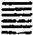

# 楞严经合辙



> **藏经**：卍新纂大日本续藏经（新纂卍续藏）　**册次** 第 14 册（X14）　**编号** X0289　**部类** 经疏部　**卷次** 10 卷　**篇幅** 301,950 字

> **作者（译者）**：明　二楞庵释　通润　述

> **卷／品**：10 卷 · 1 品



---



## 目录



  - [No. 289-B 楞严合辙自序](#no-289-b-楞严合辙自序)

- [大佛顶如来密因修证了义诸菩萨万行首楞严经合辙卷第一](#大佛顶如来密因修证了义诸菩萨万行首楞严经合辙卷第一)

- [大佛顶如来密因修证了义诸菩萨万行首楞严经合辙卷第二](#大佛顶如来密因修证了义诸菩萨万行首楞严经合辙卷第二)

- [大佛顶如来密因修证了义诸菩萨万行首楞严经合辙卷第三](#大佛顶如来密因修证了义诸菩萨万行首楞严经合辙卷第三)

- [大佛顶如来密因修证了义诸菩萨万行首楞严经合辙卷第四](#大佛顶如来密因修证了义诸菩萨万行首楞严经合辙卷第四)

- [大佛顶如来密因修证了义诸菩萨万行首楞严经合辙卷第五](#大佛顶如来密因修证了义诸菩萨万行首楞严经合辙卷第五)

- [大佛顶如来密因修证了义诸菩萨万行首楞严经合辙卷第六](#大佛顶如来密因修证了义诸菩萨万行首楞严经合辙卷第六)

- [大佛顶如来密因修证了义诸菩萨万行首楞严经合辙卷第七](#大佛顶如来密因修证了义诸菩萨万行首楞严经合辙卷第七)

- [大佛顶如来密因修证了义诸菩萨万行首楞严经合辙卷第八](#大佛顶如来密因修证了义诸菩萨万行首楞严经合辙卷第八)

- [大佛顶如来密因修证了义诸菩萨万行首楞严经合辙卷第九](#大佛顶如来密因修证了义诸菩萨万行首楞严经合辙卷第九)

- [大佛顶如来密因修证了义诸菩萨万行首楞严经合辙卷第十](#大佛顶如来密因修证了义诸菩萨万行首楞严经合辙卷第十)



---



No. 289-A 楞伽楞严合辙小引



夫谈性宗者，多落理圈缋。谈相宗者，多落事圈缋。不知相即是性，性外无相。如波即是水，水外无波。真空妙有，理事无碍。此不二法门也。楞伽有以相宗目之者，而达摩西来，持此为传佛心印。葢以三界唯心，万法唯识。但能了识藏即如来藏，则知自心所现虗妄之相，本无自性，本自无生，即得自觉圣智境界。此直指一心，不落阶级，为大乘顿教也。若夫楞严为如来密因，修证了义，真可以总摄诸经。其所指六根、六尘、七大、十二处、十八界，岂不涉相。而经云：诸法所生，唯心所现。辟如空华，毕竟无体。了知幻妄，即自归真。舍此生灭心，更无涅槃妙心耳。故曰：根尘同源，缚脱无二。一切事究竟坚固，即一切理究竟坚固。非谓破相而后为真也。通乎此者，岂惟二经合辙，即一大藏教，同出一轨矣。一雨禅师，冥契真诠，洞彻心镜。登坛说法，非止一会。在在能发明心性，令人开正知见。绝非时师饾饤摭拾，以应期场者比。顷卓锡天界，缁白皈依。上首西竺，请其所著楞伽。楞严二经合辙，出以示人。余谛观之，直截通畅，性相圆融，一扫葛藤。真义海之指南，暗室之明烛也。西竺募诸同志，刻而广其传。属不佞为之序，且乐助之。



天启元年孟冬朔，浮渡居士吴用先和南譔



------



### No. 289-B 楞严合辙自序



予少孤，生於贫里，虽托身萧寺，雅尚佛法，而意无所属。时山中有老宿然公者，能医能诗，且能究教乘，喜与之谈，谈则往往拈提楞严要旨以起予，予亦能默领其旨。尔时乃属意楞严，且私淑天如会解，即祁寒溽暑，不废检讨。或稍见一斑，则沾沾自喜，以为此经奥旨尽乎是，当终身遵守无餘慕，遂潜伏太湖之西山。岁丙戌，适无锡华藏启楞严讲期，时主法者为先大师雪浪，首座为山中老宿源公。公与然公为同参友，亦知教知诗，与予亦有交，寄一劄云：金陵雪浪，寔当代大法师，识见卓远，而谭锋澎湃，如江倾河潟，真末世津梁，人天眼目。今驻锡华藏，大阐楞严，公僻处一隅，目瞪云汉，何不出山一赴讲席，预沾法味？予熟思曰：楞严深意，十师尽发其玄奥，而天如复撮其要义为会解，若众宝聚，即讲师口如悬河，不过恃聪明知见涂抹世人，岂外此而能别竖新义乎？卒不去。公复致书云：如来妙旨，广大深渊，岂一知一见、一文一义所能尽？譬如大海，蚊蝱饮之亦饱，鼹鼠饮之亦饱，修罗饮之亦饱，此各随其量耳，安见一口吸尽海水者乎？公且来，当不负公，勿贡高为也。余遂欣然买舟，直趋法会。于时先业师手拈麈尾，左顾右指，罄欬欠伸，无非显示第一义谛，尽扫文字支离之习。一时听众有咋指者，有忭舞者，有赞叹者，佥曰：希有哉！是大宗师而复为大教主者哉！余亦怳然失而恬然得也。廼合掌谢首座曰：不虗公劝驾，不孤我一来。自是日侍座侧以听，遇聱牙屈曲处，必咨请师。师曰：如来教法，源委不二，而流派千差。然楞严一经，统万法为儿孙，摄群经为眷属。文虽十卷，实大藏之都序也。有志教法者，不可不先读，又不可不熟读。熟则心目口齿间隐隐隆隆，自有入路，不必借人颏颊，拾人涕唾。若果先明经义，回视诸家注疏，泾渭立见。否则为注疏夺心，而经义反晦矣。予始得看经法。自是以后，唯独坐静处，案上唯置楞严，即胸中、眼角、口吻边，亦唯置楞严。且读且思，遇不惬心处，即书而粘之壁。时时参究，务求必达，故亦时时会心。积数年，而楞严一贯之旨，字字皆契佛心，毫无龃龉。反观向时伎俩，真管天蠡海。覆取诸家注疏读之，则是非得失了然，胷中略无疑滞。於是将平生零星所得於师友边者，及平生自得者，录成私记，藏之笥箧，以备遗忘。无何，偶於友人案头得见楞严正脉，展卷读之，其指瑕擿疵处，则与向所私记者大半相合，其不合者十之三四。然较前诸师注疏，虽分镳并辔，而骎骎时轶乎其前矣。余欢喜自庆曰：安所有如是法师？我辈僻处一隅，曾不耳其名，今何幸而获无上希有之宝，岂所谓不求而自至者耶？即欲谋诸檀越，登枣梨以广其传，不知板传於嘉湖久矣。第鉴师婆心太切，欲使人人尽解，故经义无论易难，皆详释之。唯详，故语亦繁，繁则不便於初学，皆望洋而退。余故复将平日私记而与诸佛性相若合一辙者，裒成一帙，以付欹劂，寔欲诱引同志好繁好简者，并入圆通法门耳。若夫经之大旨，已先揭於定判，故不重叙，聊叙得法源委如此。



天启龙飞辛酉二楞庵释通润书



No. 289



------



## 大佛顶如来密因修证了义诸菩萨万行首楞严经合辙卷第一



**译者**：明　二楞庵释　通润　述



初释题目，　次释译人、译语、笔授之名



大佛顶三字，若据他经，即是佛身三十二相中无见顶相也。在青螺绀发中，周围红色，如春山吐日，而顶不可见。初降生时，应持以九地菩萨为乳母，欲穷其顶，上历？河沙佛土，终不能见。此即三密中之一密也。此经始於无见顶相放光说呪，而如来首标有三摩提，名大佛顶。若据经显义，是指菩提涅槃元清净体如来藏心言也。由此心体含吐十虗，弥纶万有，五目不能覩其形，四辩莫能谈其状，唯我大觉覩明星时，开佛知见，直覰其顶，故名此法为大觉最尊最胜之顶法也。如来密因修证了义者，即是显此法所以为大佛顶也。言如来者，即大觉之别号。不变名如，随缘为来，小乘如而不来，凡夫来而不如，唯我大觉亦如亦来，故名如来。言密因者，独知独见之谓密，出生圣果之谓因，谓大觉依此顶法为因而兴万行也。言修证者，鍊磨治习之谓修，忘心默契之谓证，谓大觉依此顶法而断惑证真也。言了义者，无不究尽之谓了，不落言思之谓义，谓大觉为此第一义谛大事因缘出现於世，今已究尽无餘，故曰了义也。良以众生业识茫茫，全无知觉，恒处长夜，流转生死，无有了期。小乘坐守化城，躭寂灭乐，自止中途，不能前进，亦未能了。即使菩萨至等觉位，前程有路，未至圆极，尚未毕功，终是不了。唯是大觉，障尽惑空，因穷果满，能事已毕，更无餘事，一义皆了，更无餘义。故知法性山高，惟如来直造其顶，无复可上，方始得了，成无上觉。下文云：如是重重，单复十二，方尽玅觉，成无上道。故曰如来密因，修证了义也。诸菩萨万行首楞严者，谓始从乾慧，以至等觉，亦皆以此顶法为因，而修六度，分断无明，分证真理，上历菩萨圣位，故能步步踏佛阶梯，事事得成坚固，所谓析栴檀而片片皆香，碎拱璧而尘尘是玉。然虽未了，已得分真，故曰诸菩萨万行首楞严也。是知元清净体，如来藏心，唯佛与佛，乃能究尽，名究竟觉。唯诸菩萨，分断分证，名随分觉。故下文云：过去诸如来，斯门已成就，现在诸菩萨，今各入圆明。除诸佛菩萨，其餘出世小果，治世圣贤，虽亦各有悟入，依稀髣髴，窥见一斑，类皆坐在相似觉中。以不能空五蕴，销六根，尽五住，超二死，未超心量，未至圆极故也。唯诸佛菩萨，穷高极深，透性彻相，证无上法，是无等等。故经中标曰大佛顶首楞严王，厥旨深哉。经者，常也。作终古之常规，为佛灯之后𦦨故。若依下文，心可轨持，故称曰经。如是则三科七大，悉皆是经，以心徧摄一切法故。若依法华玄义，则偏用一尘。如佛在时，金口宣扬，听者得道，是以声为经。若佛去世，纸墨流传，是以色为经。若谓修我法者，证乃自知，是以法为经。此方用三尘而已。餘三根钝，鼻齅纸墨，则无所知。身触经卷，亦不能觉。舌噉纸墨，亦不能解。若他土，则全用六尘。如净名云：於食等者，於法亦等。此即偏用舌根所对为经。或有国土，以天衣触身而得道，此偏用触为经。或见佛光明而得道，此偏用色为经。众香国中，以香为佛事，此偏用香为经。或寂灭无言，观心得道，此偏用意为经。他方六根利，六尘皆得为经。此土三根钝，唯以三尘为经也。



天竺沙门般剌密谛译。



天竺，西域国之总名，此翻月邦，以大国形於小国，众国如星，此邦如月故。沙门，此云勤息，勤行善法，止息恶行故。般剌密谛，此云极量，译师名也，译者翻梵字而成华字。



此经系龙胜菩萨於龙宫默诵而出，五天世主最所宝惜，秘而不传。昔天台智者大师闻西域有是经，夙夜西望，拜求愿见，而未及见。般剌密谛欲传，震旦屡窃而来，皆被获回。后以微妙细㲲书之，乃破臂藏於皮中，航海而达广州。会宰相房融知南铨在广，请就制止寺译出而笔受之。经成，誊写入奏。适中宗初嗣，国家多事，未遑颁行。有神秀禅师入内道场，见所奏本，传写归荆州度门寺。时慧振法师常慕此经，访度门寺而得之，经始传。天宝十年，西京兴福寺惟悫法师复於故相房融家得其笔受之本，始作疏解而广传之。



乌苌国沙门弥伽释迦译语。



乌苌，此云苑，古大国之苑囿，国以此得名，在北天竺。弥伽释迦，此云能降伏，译语即度语，谓裁度两方正理，翻梵语而成华言也。



菩萨戒弟子前正议大夫同中书门下平章事房融笔受。



菩萨戒者，宰官而受菩萨戒者也。弟子者，以三宝为大师也。前者，旧也，谓现谪广州，知南铨事，故指以下官名，乃其旧职也。正议者，史称正谏，言官也。大夫者，谓大扶世教，正风化，举直措枉，树立人才之称。同者，兼也。中书、门下，二俱内省，即左右相府也。然中书多掌王言，门下多出政事，融乃权兼二省，故并书之。平章事者，书曰平章百姓，谓平均万物，章明庶政，是其职事也。房融即房琯之父，父子俱相，而融略出琯传。笔受者，谓译语之后或拙丑，则秉笔而润色之。房相在译场中，亦兼此职，故与二师互显其功也。



凡经大旨，无论丰约，科为三分：一、序分，二、正宗分，三、流通分。初先明序分，有通有别。



如是我闻：一时，佛在室罗筏城祗桓精舍，与大比丘众千二百五十人俱，皆是无漏大阿罗汉。



先明通序，诸经通用故。亦名证信序，证法有所授，令人生信故。昔世尊将涅槃时，阿难以三问问佛：一问佛涅槃后，我等云何依止？二问佛灭度后，谁当作师？三问一切经首，作何等语？佛言：我涅槃后，当依四念处。从今日后，波罗提木叉，是汝之师。一切经首，当安如是我闻等。及世尊灭度后，阿难升座说法，三疑竞起：一疑佛再生，二疑他方佛来，三疑阿难转身成佛。阿难举如是我闻等，三疑顿息。故经首皆以此冠之。如是者，指法之辞。我者，结集之人自称。谓如是之法，是我亲从佛闻，非己臆说。一时者，以说法时，西天东土，纪历不同，故总云一。佛者，觉也。谓自觉觉他，觉行圆满故。室罗筏，或名舍卫，此翻丰德。以国丰四德，谓财宝、五欲、多闻、解脱也。祗，具云祗陀，此云战胜，匿王太子名，生时父王与外国战胜，因立美号。桓，即林也，须达布金买园，而太子施林，即祗树给孤独园。精舍，亦名精蓝，即给孤所建寂静处也。比丘，含三义，谓乞士、破恶、怖魔。千二百五十人者，初度陈如等五人；次度三迦叶兄弟，兼徒一千；次度舍利弗、目犍连，各兼徒一百；次度耶舍长者五十人，经举大数，故减五人。此众并先事外道，勤苦累劫，一无所证，才遇如来，即得圣果，故感佛恩，常随佛化，为常随众也。漏，谓渗漏，此漏有三，谓欲漏、有漏、无明漏，今无此三种渗漏，故曰无漏。阿罗汉，含三义，谓不生、杀、贼、应供。大者，拣非定性，是回心向佛。乘者，此上即六种成就，谓信、闻、时、主、处、众也。



佛子住持，善超诸有；能於国土，成就威仪；从佛转轮，妙堪遗嘱；严净毗尼，弘范三界；应身无量，度脱众生；拔济未来，越诸尘累。



此叹德也。先叹自利德。住者，安住如来宫殿，故经云：如来宫殿无有边，自然觉者处其中。持者，掌握如来法印，故经云：持此呪心，能於十方摩顶授记，自果未成，亦於十方蒙佛授记。住此殿，握此印，能行法王，令绍法王位，故名佛子。善超诸有者，谓欲有、色有、无色有，总指三界受生处，以三界人天不亡因果，故曰诸有。小乘以出三界为超，不名为善，今则即三界而出三界，非若昔日畏三界如牢狱，故曰善超也。能於下，叹利他德。调而熟之曰成，即而顺之曰就，有威可畏，有仪可法，如三千威仪、八万细行，自能成就，亦成就人，所谓不起灭尽定而现诸威仪，非若昔日躭寂灭而不肯成就众生也。从佛转轮者，谓助佛扬化，转大法轮，非若昔日但念空、无相、无作，不欣说法也。妙堪遗嘱者，谓如来以家业付之之谓遗，以后事托之之谓嘱，今既荷担家业，又能发愿持经，故曰妙堪，非若昔日不堪受是法，不生一念好乐也。严净毗尼，弘范三界者，毗尼，此云调伏，调练身心，制伏过非，即三聚戒也。严以身言，净以心言，十目所视，十手所指，敢不严乎？毫厘系念，三途业因，敢不净乎？今已具足清白梵行，言为世法，行为世则，非若昔日戒有漏缺，目为名字罗汉，不能为法於三界也。应身无量，度脱众生者，度谓除其苦，脱谓解其缚，正言随类度生，随方解缚，非若昔日胶柱鼓瑟，无方便也。拔济未来，越诸尘累者，谓堕见刺者拔之，溺欲泥者济之，污根为尘，牵心为累，今皆令彼超越，不落陷穽，此见悲心极於未来，非若昔日唯为一身，如獐独跳也。



其名曰：大智舍利弗、摩诃目犍连、摩诃拘𫄨罗、富楼那弥多罗尼子、须菩提、优波尼沙陀等而为上首。



此列名也。名者，实之宾，故有实必有名。舍利，此云鹙弗，即子也。其母名舍利，以其眼黑白分明，动转流利如之，故连母为名。目犍连，此云采菽氏名。拘律陀，此云无节树。摩诃拘𫄨罗，此云大膝，舍利弗之舅，即长爪梵志。富楼那，此云满父名。弥多罗尼，此云慈母名，今连父母名，故云满慈子。须菩提云：空生，生时库藏皆空。占者云：解空之相，既善且吉，亦名善现、善吉。优波尼沙陀，此云尘性空，於六尘中悟色性故。上首者，上，过也，即君子不欲多上人之上，首即首出庶物之首。言诸罗汉各有过人之能，出人头地，如舍利弗智慧第一，目犍连神通第一，拘𫄨罗博学第一，满慈子说法第一，须菩提解空第一等。



复有无量，辟支无学，并其初心，同来佛所，属诸比丘，休夏自恣。十方菩萨，咨决心疑，钦奉慈严，将求密义。即时如来，敷坐宴安，为诸会中，宣示深奥。法筵清众，得未曾有，迦陵仙音，徧十方界。恒沙菩萨，来聚道场，文殊师利，而为上首。



此叙云集众也。辟支，此云独觉，亦云缘觉。出无佛世，观物变易，自觉无生者，名独觉。出於佛世，观十二因缘，流转还灭，而悟无生者，名缘觉。其根比声闻稍利，以能侵断习气故。无学，即真穷惑尽者。初心，即研真断惑者。同来佛所者，即不谋而至，不约而亲也。属诸下，出其来意。属者，适当也。休夏自恣者，比丘当初夏时，即结制禁足安居，不令乞食，名休夏。亦名坐蜡自恣者，是期满解制之日，即七月十四、十五、十六三日也。九旬禁足，无由觐佛，故於解制之日，自知有过，恣其自陈，自不知过，恣任僧举，所以考九旬之德业也。十方者，谓不止一方。菩萨，此云觉有情。咨，问也。决，通也。谓心有疑滞，故请问而求决通也。钦，敬也。奉，承也。慈以摄言，严以折言，谓如来具折摄二门，故敬承也。将求密义者，言所以钦承者，不独求决通疑滞，且欲更求密修密证之了义也。即时下，顺机说法也。敷坐宴安者，展坐具而宴然安居也。宣示深奥者，为说幽深秘奥之法也。法筵犹法席，清众即清净众。得未曾有者，闻所未闻也。迦陵，此云好音鸟，佛音似之，故以为比。徧十方界者，昔目连穷佛音声，尽其神力，历？河沙界，至一佛国，报身甚大，饭钵边围可当大路，目连振锡而游其上。彼诸弟子问其佛曰：安所有虫而人其貌者？彼佛曰：是娑婆世界释迦高足弟子，未可以小而易之。因问目连：何为至此？连以穷佛音声对。彼佛语连云：佛音无尽，非汝可穷。连乃反。故知如来音声徧十方界。恒沙菩萨来聚道场者，由心洞十方，闻声而集也。文殊，此云妙德，表根本智，为择法眼，故居上首。



时波斯匿王，为其父王讳日营斋，请佛宫掖自迎如来，广设珍羞无上妙味，兼复亲延诸大菩萨。城中复有长者居士，同时饭僧伫佛来应。佛勅文殊，分领菩萨及阿罗汉，应诸斋主。



此匿王请供也。波斯匿，此云胜军，是舍卫国王。讳日，即忌日。人子於亲亡之日，言之酸楚，故隐讳而不敢言，故以死日为忌日也。营斋者，修冥福以资先王也。宫掖者，王之内庭及左右掖。设斋内庭者，敬之至也。自迎者，敬法王之德，忘人王之势也。珍羞者，羞，进也。言所进之饍，皆世间贵重之物，非凡品也。延，亦迎也。既自迎佛，复自迎僧，敬师以及弟子也。福德俱隆，名长者。清净自居，名居士。同时饭僧者，上行下效也。𥩟，竢立也。佛勅分应者，慰众心也。王命曰勅，故法王之命亦曰勅。问：世尊分身无量不自应，而令文殊分领应供者，何义？答：示同世法，无相夺伦也。若言分身无量，即菩萨、罗汉各各皆能，奚必世尊耶？



唯有阿难先受别请，远游未还不遑僧次，既无上座及阿阇黎，途中独归其日无供。即时阿难执持应器，於所游城次第循乞，心中初求最后檀越以为斋主，无问净秽刹利尊姓及栴陀罗，方行等慈不择微贱，发意圆成一切众生无量功德。



此发起序也。发起此经由绪故亦名别序，各有发起因缘故。此经以误堕婬室为发起，故先叙误堕之由。阿难此云庆喜，斛饭王之子，佛成道日生净饭，既闻太子成道，斛饭复奏王宫生男，举国欣庆因名庆喜，佛堂弟也。先受别请者，谓自恣日前先受别方之请也。不遑犹无暇，诗云不遑将父是也。应供常规轮次而出，今阿难既受别请尚未还归，无暇列於众僧之次也。上更无人曰上座。阿阇黎此云轨范师，能紏正弟子者，律制僧远出二师翊从，所以严行止防误失也。今无二师故独归，不列僧次故无供。即时下叙平等行慈。应器钵也，应己食量为大小故。次第循乞者，谓挨门而乞无拣择也。最后檀越谓曾未饭僧行施者，初求二字便是阿难走作处，经云愿求诸佛慧亦不著，愿求求佛慧尚不令贪著，况无供而求未饭僧之檀越乎？且才有求心便有分别，既有分别便有净秽有贵贱，安能一目平等视之哉？刹利王家、栴陀罗屠家也。方行等慈者，既曰初求又曰方行，见得阿难本无是心，因无供而卒起是心也。发意犹言作意，调而应偶而会者，方能入鄽垂手平等行慈，今言作意见得勉强，非不思不勉之比。



阿难已知如来世尊诃须菩提及大迦叶为阿罗汉心不均平，钦仰如来开阐无遮度诸疑谤，经彼城隍徐步郭门，严整威仪肃恭斋法。



此叙发意行乞，是随顺佛语，不由中出也。须菩提舍贫从富，大迦叶舍富从贫。一谓富者易施，一谓贫者植因。如来诃其心不均平，以有去不去故不均，分贫分富故不平。今阿难钦仰如来昔日之语，故发是意。一以阐平等无遮无碍之慈，一以度众人生疑生谤之口。言疑谤者，若专向贫家，则富者疑之曰，是必诡名乞食者，非佛弟子也。若专向富家，则贫者谤之曰，是必窃慕声势者，非佛弟子也。阿难发意欲度疑谤，故於高门悬薄，次第循乞也。经，犹历也。城外无水之地曰隍。郭门，城门也。经彼四句，描写乞食时规行矩步之态，正见心未融化处。如此行履，可入净而不可入秽，可入佛而不可入魔，可比丘而不可菩萨。今比丘而卒行菩萨事，何异见弹而求鸮炙。然不至於折鼎足而覆公𫗧者，如来神呪之力也。此段发起因缘，但看金刚经尔时世尊著衣持钵，入舍卫城乞食等语，自然中节，毫无勉强。则圣贤心迹判然，断非蜡等可进矣。



尔时，阿难因乞食次，经历婬室，遭大幻术。摩登伽女以娑毗迦罗先梵天呪摄入婬席，婬躬抚摩，将毁戒体。



此叙误堕婬室也。因乞食次，犹言因次第乞食也。幻术者，变无为有，化有为无，以虗幻之术惑人心目者也。摩登伽，此云本性妓女也。娑毗迦罗，即金头外道所传呪术名。先梵天者，谓是古昔梵天所授，神其说以动人也。摄入婬席者，由阿难具佛二十相好，色美如银，登伽起爱，遂以呪力摄之而入婬席也。婬躬抚摩，将毁戒体者，谓以婬身逼近，欲毁阿难净戒之体也。由尊者求心未歇，作意未忘，心未曾平，见何曾等，乃欲平等行慈，竟遭魔手。故知非得事事无碍者，断不能入泥入水，平等行慈矣。真净云：事事无碍，如意自在。手把猪头，口诵净戒。趂出婬房，未还酒债。十字街头，解开布袋。如此行履，方堪垂手接人，行平等慈，入净入秽，都无障碍。问：此经直显楞严大定，何故以多闻误堕为发起？答：大都性识聪敏者，乐博闻广见。闻见既多，则心不专而志不一，无由得此大定，故假多闻之人为发起。然必误堕婬室者，以欲漏未除，纵有多闻，皆滋爱本。若欲漏一除，则多闻皆成智宝。故下经云：欲漏不先除，畜闻成过误。先德亦云：闻中生解，意下丹青。目前虽美，久蕴成病。故以多闻误堕为发起也。问：若是，则如来所说三藏十二部类皆无用，何故经中复说闻一句一偈者皆得作佛，其不解者为无闻比丘？答：若闻法而肯进修，即一句一偈皆得菩提；若多闻而不修，即三藏十二部澜翻熟读，只滋爱染。故大经云：如人善方药，自疾不能救，於法不修行，多闻亦如是。问：若是，则修正定者不必读经看教，唯是隳肢体，黜聪明，守愚抱拙以为事，可乎？曰：若不通经教，则理性不明，禅观不解，尚不知径路，何由得入？若唯以堆堆死坐如枯桩为事，古人诃之为魂不散死人，落空亡外道，又谓之默照邪禅，恶乎可？故知理观未明，必先讨寻经教；经教既明，已知入路，方堪进修。若经教已明，禅观已解，入路已知，而哓哓唯以口舌争雄，不肯潜修密证为不可耳。尊者正为以多闻为实证者作标牓，不为蠢然无知者作标牓也。



如来知彼婬术所加，斋毕旋归，王及大臣、长者、居士俱来随佛，愿闻法要。於时世尊顶放百宝无畏光明，光中出生千叶宝莲，有佛化身结跏趺坐，宣说神呪，勅文殊师利将呪往护，恶呪销灭，提奖阿难及摩登伽归来佛所。



此如来哀救也。如来常仪斋毕说法，今既速归必有所为，故王臣大众随来也。顶放百宝无畏光明者，示此光明是最胜法，无善不具故曰百宝，无恶不摧故曰无畏。光中出生千叶宝莲者，示此智光为万行之本也。有佛化身结跏趺坐者，示此智光为诸佛之母也。佛不自说呪令化佛说者，示此呪心是不动智，必是不动佛说也。佛勅文殊将呪往护恶呪销灭者，魔呪元属婬根，佛既说呪复勅大智慧人持呪而往，则全呪是人、全人是呪，以此呪力加之婬根，如汤销氷、如明破暗，故令摩登婬火顿歇，阿难戒体如初。提奖归来者，谓提撕奖劝令归见佛也。序分竟。



此下正宗，分大科为二：一是菩提涅槃根本，二是生死流转根本。○初科复分为四：一见道分，二修道分，三证道分，四结经分。且初见道分。



阿难见佛顶礼悲泣，恨无始来一向多闻未全道力，殷勤启请十方如来，得成菩提妙奢摩他、三摩、禅那最初方便。於时复有恒沙菩萨，及诸十方大阿罗汉、辟支佛等，俱愿乐闻，退坐默然承受圣旨。



此因误堕而请大定也。古人得一指头禅，一生用之不尽。阿难历劫忆持如来秘密妙严，不能免离摩登伽难。故知博学多闻，若不真修实证，尽落鬼家活计。及对境风，一吹便倒。皆由平日学力有餘，道力不足，故因误堕而陡然发愤。正如苏季敝裘还乡，不得不刺股揣摩，以图卿相也。恨是愤愤悱悱，意道人不可无此恨。恨是获法身之前茅。阿难悟后改愿，由此一恨，向后悲泪痛责，皆从此恨流出。一向多闻，未全道力者。一向者，正指等与释迦空王佛所同时发心言也。从外入者为多闻，从内出者为道力。古德云，从语言文字入者其力浅，从自己胸中流出者其力大是也。殷勤下。欣佛果而请，因心也。菩提，果觉也。奢摩他等，因心也。若准常途，奢摩他云止，三摩云等至，禅那云静虑。若准圆觉，寂静销幻寂灭为义。若准本经，妙湛总持不动为义也。言妙湛者，谓此心体妙觉湛然，本来清净故。总持者，谓此心体三科七大，无不周徧故。不动者，谓此心体在圣而圣，在凡而凡，不落圣凡故。或奢摩他是不变义，三摩是随缘义，禅那是不变随缘，随缘不变义。或奢摩他是空如来藏，三摩是不空如来藏，禅那是空不空如来藏也。意谓此一心三观，我已熟闻，但不曾悟，不曾修，不曾证，不得其用，故为魔力摄持，无由自脱，始信多闻，无益於己。然我虽蒙如来授记作佛，若不修因，终难得果，十方如来悉由此三得成正觉，不知如来最初何由而得开悟，何由而得证入也。问：此经既请三观，何处是答奢摩他，何处是答三摩提，何处是答禅那？答：若在见道分，是先与剖析其义，令彼解悟，故从破妄心，破业识，以至破因缘自然，和合不和合，直显玅觉性是本有究竟坚固不坏之体，是答奢摩他义。复明阴入处界，一一皆是妙觉性中流出，悉无自性，以显一切事究竟坚固不坏，以答三摩提义。复明七大相本是妄，性本是真，虽循业发现，周徧法界，而清净本然，不曾动著，以明即事即理，是答禅那义。故阿难从此开悟，而赞佛法身即是玅湛总持不动尊也。故自四卷初复兴二问，辨明三科七大之疑，而以三如来藏作结，以显一心圆通具含三义，故称为妙。若起信一心具含体相用三，故称为大耳。意谓即此一如来藏心，离万法而独露曰奢摩他，即万法而无迹曰三摩提，在即离而非即离曰禅那，名虽有三，总一如来圆通藏心也。若在修道分，二十五圣於三科七大各证圆通，而独选耳根一门深入者，是以耳根为入三如来藏之门也。若证道分，即以三如来藏为因地心，中中流入以至妙觉，此又以三如来藏为果地觉也。故知见道见此，修道修此，证道证此，更无他法。问：三观已知大槩，若最初方便，下文当何所指？答：若在见道分，当以破心显见为最初方便，修道分的以耳根入门为最初方便，证道分以不生不灭因心为最初方便也。若据阿难一问，则一经大旨，见修证道尽可包罗，故下文见道一分是答妙奢摩他、三摩、禅那，修道一分是答耳根为最初方便，证道一分是答十方如来得成菩提。意谓欲得菩提果觉，必先入妙奢摩他、三摩、禅那如来藏心为因地，欲入如来藏心，必从耳根反闻为修行方便也。



佛告阿难：汝我同气情均天伦，当初发心於我法中见何胜相，顿舍世间深重恩爱？



此最初审知见也。阿难既请三观为成佛之因，世尊即当答云：如何是奢摩他？如何是三摩？如何是禅那？不如是答，而反诘其最初发心者何居？葢妙之一字，是如来自证法门，向人轻吐不得。且阿难正当初发愤时，又不可即施峻厉法药。故先逆探其病源，缓缓道出。如我同气，情均天伦者，所以慰其心也。意谓他人请问，亦必尽情吐露。况汝与我同条共本，有所请问，而不尽情向汝道者哉？蔼然兄弟之情，溢乎言表。但汝问我成道最初方便，我却问汝出家最初发心。葢车无三寸辖，则不可行；户无三尺关，则不可闭。病不知其源，则难施法药。故因其请而反诘之也。意谓世间至恩至爱，莫如父母。而汝最初发心，在我法中，有何所见？顿将深恩重爱，一时割舍，投我出家。先德云：末后牢关，不离最初一句。故阿难如是问，世尊亦如是审之。



阿难白佛：我见如来三十二相，胜妙殊绝，形体映彻，犹如琉璃，常自思惟：此相非是欲爱所生。何以故？欲气麤浊，腥臊交遘，脓血杂乱，不能发生胜净妙明紫金光聚，是以渴仰，从佛剃落。



此初，陈众生知见也。我见如来三十二相，见即见分，相即相分。三十二者，始於无见顶相，终於足下安平。胜妙殊绝者，是认三十二相为奇特也。超万类而首出曰胜，处五浊而不染曰妙，混众形而独异曰殊，在诸圣而特尊曰绝。形体映彻，犹如琉璃者，长短大小曰形，百骸四肢曰体，内外洞明曰映彻，故以琉璃为喻。阿难被世尊一问，将底蕴尽情吐出，却被三十二相一时换却眼睛，岂知能见所见皆属依他，尽是虗妄耶？常自思惟下，复从见相处分净分染，生爱生憎，是虗妄中重添虗妄，此则从依他而生徧计也。故曰此相不是欲爱所生，以欲气麤浊，不能发生琉璃映彻之胜净，紫金光聚之妙明。故见如来三十二相，生渴仰心，作奇特想，作希有想，於是顿舍恩爱，从佛剃落。此则厌麤浊而欣净明，皆是识心分别计度。岂知染相不忘，故为魔转。净相不忘，又为佛转。虽佛魔有异，净秽差殊，无非知见立知，总是合尘背觉。此中所说见相，是三细中之转现。思惟是六麤，为一经之发脉。故下文先破六麤，次破三细，次显如来藏心。次第䌷绎，方见深旨。



佛言：善哉！阿难！汝等当知，一切众生从无始来生死相续，皆由不知常住真心性净明体用诸妄想，此想不真故有轮转。



此双标真妄，为一经之纲宗也。善哉者，纵辞。言汝见三十二相，便能割爱出家，岂非世间决裂大丈夫事，何善如之。第此一念，厌染爱净，正是众生知见。此从发润二种无明流出，生死相续，皆由於此。故即夺云汝等云云。一切众生，总指三界未超分段生死者言。不知，即不觉也。常住真心，性净明体，即佛知见也。在纷扰而不变异曰常，在生灭而无去来曰住，在幻妄而不烂坏曰真，在万法而不动摇曰性，在污浊而不染曰净，在欲气而不昏曰明。言汝有此心体胜净妙明，本周法界，而不知反认如来胜净妙明形体映彻之相，以为奇特，而生渴仰。是即舍尔灵龟，观我朵頥，非妄想而何。由汝日日所用者，皆用此妄想。此想不是汝之常住真心，是汝生死根本。由汝错用此心，认贼为子，故有生死流转耳。临济云，你一念心清净光，是你屋里法身佛。一念无差别光，是你屋里报身佛。一念无差别光，是你屋里化身佛。此三种佛，是你即今听法者是。尊者不自反观，向外驰求，可谓业识茫茫，无本可据矣。



汝今欲研无上菩提真发明性，应当直心詶我所问。十方如来同一道故，出离生死皆以直心，心言直故，如是乃至终始地位，中间永无诸委曲相。



此恐尊者言有隐讳，故勉其直心答问也。言汝既欲研究无上菩提，真欲发明自性，应当直心吐露於我，有疑直问，有问直答，不得半吞半吐，藏头露尾。若尔，便成委曲相矣。先德云：拟心思量早是曲，了不拟心，一一天真一一明。妙净名云：直心是道场，由直故能出生死，由直故能证菩提。十方诸佛皆以直心直言为造道之始，心言既直，内外一如，则生死可以直超，妙庄严海可以直入。故台山婆子凡见人问路，便云蓦直去，若有一毫委曲，便落众生知见，即遭枝岐。下文云：狂心自歇，歇即菩提。此直路也。不成菩提，乃至别成声闻缘觉及外道天魔者，皆曲路也。今尊者分净分秽，便是一心有两条路，早成迂曲，故勉之也。



阿难！我今问汝，当汝发心缘於如来三十二相，将何所见？谁为爱乐？阿难白佛言：世尊！如是爱乐用我心目，由目观是如来胜相，心生爱乐，故我发心愿舍生死。



此细审众生知见也。尊者索头已在世尊手里，故捻定见相，发心重翻问端，要令自己搜寻妄本，言：汝当初见三十二相时，将恁麼物去见？生渴仰时，又是谁去爱乐？尊者若向此处识得谁何二字，一生参学事毕，争奈不分缁素，信口答云：由目观见，心生爱乐。目即眼根，心即意识，眼见心知，便是众生知见。岂知藏识名心，心之精光是见？下文重重开示，不过翻众生知见为佛知见耳。



佛告阿难：如汝所说，真所爱乐因於心目，若不识知心目所在，则不能得降伏尘劳。譬如国王为贼所侵发兵讨除，是兵要当知贼所在，使汝流转心目为咎。我今问汝，唯心与目今何所在？



此细审众生知见所生处也。由阿难认定见者是眼，爱者是心，不知生死颠倒，正坐於此。故世尊就上一拶，鞠其所起之处，言：汝既认爱乐三十二相者是心，见三十二相者是眼，已著贼了。譬如国被贼侵，发兵讨除，要先知贼所依之处，然后塞其去路，绝其资粮，捣其巢穴，斩其首级，则边境肃清，烽烟自息。今汝轮转生死，不由外物，元是自己家亲作祟，自劫家宝。若欲以三观神兵除之，必先知其处所。故诘之曰：唯汝能见之目，与能知之心，今在何所？心目所在，是第二番审辞。由尊者病根深厚，故世尊将其病源，一一审究明白，方始对病发药耳。



阿难白佛言：世尊！一切世间十种异生，同将识心居在身内，纵观如来青莲华眼亦在佛面。我今观此浮根四尘秖在我面，如是识心实居身内。



此是尊者初呈枪法，执心在内也。十种异生者，十二类生中，除空、散、无想，以无身心二相故。识心，指意识言。青莲华眼者，以如来目净修广，如青莲故。浮根四尘，即色、香、味、触所成麤浮眼根，以对胜义，名浮尘根。意谓自凡至圣，莫不眼在外而心在内，我宁不知眼在外而心实居身内乎？尊者虽是伶牙俐齿，旁若无人，殊不知脑门已是著地，即今三尺童子，试问其心。即以手指点胷而曰在内者，此由父母胎中受形之始，吸取赤白二滴为身，便有此执，不待教而自能，谓之俱生无明，亦谓之坚固妄想，故牢执此身为心之舍宅，若瓶鹅井蛙，终不能出，更不知身反在於心中，若大海之一沤，此即众生一大迷也。故尊者亦同此计。若使尊者向心目所在一问处，识得地头，便与世尊把手共行，优游觉海，安得复有下文种种妄执耶？



佛告阿难：汝今现坐如来讲堂，观祗陀林今何所在？世尊！此大重阁清净讲堂在给孤园，今祗陀林实在堂外。阿难！汝今堂中先何所见？世尊！我在堂中先见如来，次观大众，如是外望万瞩林园。阿难！汝瞩林园因何有见？世尊！此大讲堂户牖开豁，故我在堂得远瞻见。



尊者执心在内，以为必然，如壮士鼓气，上冲牛斗。世尊是一切智人，洞见肺腑，不与分文折句，展疏牒科，就将目前浅近易了之事，以反诘之，令他亲口答出，无处躲闪，然后用法窟法爪，生擒活捉。故先审定内外境，故曰汝今等。尊者答出，堂在林中，林在堂外，故曰此大等。次复审定先后见，尊者答出，先见内而后见外。三复审其见外之因，尊者答出，因户牖开豁而得见外。世尊三问，尊者亦连下三转语，一一皆落。世尊绻缋向下，即用其语以破之，所谓执子之矛，刺子之盾也。



尔时，世尊在大众中，舒金色臂摩阿难顶，告示阿难及诸大众：有三摩提，名大佛顶首楞严王，具足万行，十方如来一门超出妙庄严路，汝今谛听。阿难顶礼，伏受慈旨。



此先示三观之体，为开佛知见之根本也。阿难始问妙奢摩他，三摩，禅那，最初方便。世尊反诘其最初发心，验其知见，是真是妄。而阿难果用识心，取著有相可见之如来，却迷自己无相可见之真佛。如来复诘其缘三十二相时，将谁见而将谁爱乐。尊者答以目见而心乐。如来复徵心目所起之处。尊者确然执定此心在色身之内。至此则阿难贼身已露，贼物现存，无隐讳处。今欲进而破之，故先示之曰，有三摩提云云。意谓此大佛顶，周徧含容，无法不具，无行不圆。然不可以智知，不可以见见。为菩萨父，为诸佛母。即我三十二相，皆是此中所现影像。云何反认此在色身之内耶。今汝欲研无上菩提，开佛知见，要先识此无见顶相。则不奢摩而自成奢摩，不三摩而自成三摩，不禅那而自成禅那。谓之真如三昧，亦名一行三昧。菩萨得此三昧，则万行具足。念念可以证真常，头头可以到究竟。又谓之首楞严王。十方如来，依此一门，超出妙庄严果海。不遭枝岐，更无委曲。又何患畜闻之过误，道力之不全耶。故古德云：道源不远，性海非遥。但向己求，莫从他觅。觅即不得，得亦不真。然则欲研无上菩提，此是下手第一著也。若欲成就此著，须从一门为最初方便。以此一门，是入妙庄严之大路。所谓一路涅槃门也。下文七番破处，皆是揭露此义。惜尊者以思惟心，测度如来顶法。自隔萧墙，终不得见耳。问：此中不标奢摩禅那，而独标三摩提者，何故？答：此三摩提，即下文所指大陀罗门。诸三摩提，妙修行路也。奢摩由此而悟，禅那由此而证。故曰：如幻三摩提，弹指超无学。以除此一门，别无修行之路。故世尊注意於三摩提，而二十五圣，皆从此入。即古观音如来亦曰：从闻思修，入三摩地。以如来藏中，是大总持如来藏故也。○定林曰：摩顶者，抚以示爱。礼足者，伏以示敬。上爱下，故摩顶。下敬上，故礼足也。



佛告阿难：如汝所言，身在讲堂，户牖开豁，远瞩林园。亦有众生在此堂中，不见如来，见堂外者。阿难答言：世尊在堂，不见如来，能见林泉，无有是处。阿难！汝亦如是，汝之心灵一切明了。若汝现前所明了心实在身内，尔时先合了知内身。颇有众生先见身中，后观外物？纵不能见心、肝、脾、胃，爪生、发长、筋转、脉摇，诚合明了，如何不知？必不内知，云何知外？是故应知，汝言觉了能知之心住在身内，无有是处。



此破妄心不在内也。如汝下，先牒前言。亦有下，次覆审所见。阿难下，三、自堕术中。向下世尊不别开炉灶，即借其现成挺杖以击之，意谓在堂不见如来，决不能见林泉。今汝所计却是在堂不见如来，而能外见林泉者矣，故曰汝亦如是。若汝灵知之心在六根门头，明明不昧，了了常知。若此现前明了之心实在身内，尔时先合内见腑脏，后观外物，方始法喻相合。可有众生先见腑脏，而后方观外物者乎？纵不能见其中深，亦当见其肤浅，如何深浅都不知耶？若汝心灵，内既不见心肝脾胃，中不见爪生发长、筋转脉摇，而在外又能见林泉者，此与在堂不见如来、不见大众，而能外见林泉者何异？此何故而然耶？故曰必不内知，云何知外。云何二字是反诘而为生下之端也。阿难枪法至此，却被世尊一总担折倒了也。是故下，结破不在内处。



阿难稽首而白佛言：我闻如来如是法音，悟知我心实居身外。所以者何？譬如灯光然於室中，是灯必能先照室内，从其室门后及庭际。一切众生不见身中独见身外，亦如灯光居在室外不能照室，是义必明将无所惑，同佛了义得无妄耶？



此第二，执心在外也。此因世尊寻常为执心外有法者，说三界唯心，有情无情同一法性，尊者性识聪敏，一闻必不内知，云何知外二语，拨动旧习便舍内取外，故曰我闻等。所以下，引喻曲成见外而不见内，故曰譬如灯光从室门出后及庭际故能见外，亦如灯光在外不能照室故不见内也。是义决然明白定无疑惑，即同如来了义之谈必无谬妄，故曰同佛了义得无妄耶。



佛告阿难：是诸比丘，适来从我室罗筏城，循乞抟食归祗陀林，我已宿斋。汝观比丘，一人食时诸人饱不？阿难答言：不也。世尊！何以故？是诸比丘，虽阿罗汉躯命不同，云何一人能令众饱？



世尊是大手宗匠，左来左转，右来右转，这边那边，无可不可，在内在外，皆可扫除。亦将一喻相詶，所谓投桃报李，得马还牛也。故曰是诸等。抟食者，有形段而可抟取者也。宿，止也。一人食时诸人饱否者，审其彼食而能此饱乎否也。不也者，谓彼罗汉子缚虽尽，果缚犹存，不能合众人为一体，安能一人食而令众饱。观此答辞，则尊者所计又脱节矣。



佛告阿难：若汝觉了知见之心实在身外，身心相外自不相干，则心所知身不能觉，觉在身际心不能知。我今示汝兜罗绵手，汝眼见时心分别不？阿难答言：如是，世尊。佛告阿难：若相知者，云何在外？是故应知，汝言觉了能知之心住在身外，无有是处。



此正破心不在外也。若身心相外，则彼此了不相干，是则心所知者身不能觉，身所觉者心不能知，方合躯命不同，彼不饱此。我今下，验其身心果相外否也。兜罗，此云细香。绵色如霜，佛手如之。如是者，言眼见而心即生分别，是相知而不相外也。佛告下，一拨便转，不劳餘力。是故下，结破不在外处。阿难点个纸灯与世尊相见，却被世尊一吹顿灭矣。



阿难白佛言：世尊！如佛所言，不见内故不居身内，身心相知不相离故不在身外。我今思惟知在一处。佛言：处今何在？阿难言：此了知心既不知内而能见外，如我思忖潜伏根里。犹如有人取琉璃椀合其两眼，虽有物合而不留碍，彼根随见随即分别。然我觉了能知之心不见内者，为在根故；分明瞩外无障碍者，潜根内故。



此第三，计潜根也。此计亦是世尊谈法相时，四缘生识，根为增上。以有此种子故，一闻眼见心生分别之语，即跃然引起，转计潜根，故曰彼根随见。随即分别也。潜，藏也。根即胜义根，以能发识比知是根，不知此心自本自根，生一切法，妄计根能生心，而心潜伏根里。犹如下，引喻以成己执。琉璃喻眼，眼复喻心，琉璃合眼而不碍眼见，如眼根合心而不碍心见也。然我下，曲成不见内而见外者，皆由潜根故也。



佛告阿难：如汝所言，潜根内者犹如琉璃，彼人当以琉璃笼眼，当见山河、见琉璃不？如是，世尊，是人当以琉璃笼眼，实见琉璃。佛告阿难：汝心若同琉璃合者，当见山河，何不见眼？若见眼者，眼即同境，不得成随。若不能见，云何说言此了知心潜伏根内如琉璃合？是故应知，汝言觉了能知之心潜伏根里如琉璃合，无有是处。



此正破心不潜根也。世尊将错就错，审问琉璃来历，故曰如汝等。争奈尊者来历不明，答云如是，又踏空也。世尊明察秋毫，搜人短处，乃云：喻中眼见，山河亦见。琉璃法中既是心见，山河亦应见，眼云何不见？若使心能见眼，眼即反为心家所缘之境，不是能生之根，则汝所计彼根随见随即分别，则不得成，是犯自语相违过。若使心不见眼，又犯法喻不齐过。如是则二俱不成，云何汝计潜伏根内如琉璃合？是故下，结破不在根处。阿难捧出琉璃椀子与世尊鬬，富又被世尊碎成虀粉矣。



阿难白佛言：世尊！我今又作如是思惟：是众生身，腑脏在中、窍穴居外，有脏则暗、有窍则明。今我对佛开眼见明，名为见外；闭眼见暗，名为见内。是义云何？



此第四，双计内外也。此亦世尊谈法性时，所说眼能见明，亦能见暗。故尊者一闻，眼即同境，不得成随。即持两可之说，双计根能见明见暗，为见内见外。吴兴云：初计在内，佛以不见腑脏为破。次计在外，复招身心相离之难。又计潜根，且乖琉璃笼眼之喻。良以有藏则暗，则见暗时，即名见内，不必要见心肝脾胃。有窍则明，故见明时，即名见外，不必责其身心相外。内外若成，又非独潜根里。如此则可免前三者之过。然不知此义当与不当，故曰是义云何。所谓中心疑者，其辞枝



佛告阿难：汝当闭眼见暗之时，此暗境界为与眼对？为不对眼？若与眼对，暗在眼前，云何成内？若成内者，居暗室中，无日月灯，此暗室中皆汝焦腑。若不对者，云何成见？



此破见暗名见内也。汝当下，双开二关以审定。若与下，正破。谓此暗相若与眼对，则此暗相在汝眼前，云何成得闭眼见暗名为见内？设许暗相虽在眼前亦可成在内者，则凡住暗室中无光明处，此诸暗室则应尽是汝之三焦六腑，无是理也。若此暗相不与眼对，则应此眼不与暗合，云何眼前又见黑暗？如是则眼与暗相，对与不对皆不成内矣。



若离外见，内对所成。合眼见暗，名为身中。开眼见明，何不见面？若不见面，内对不成。见面若成，此了知心及与眼根乃至虗空，何成在内？若在虗空，自非汝体，即应如来今见汝面亦是汝身。汝眼已知身合非觉，必汝执言身眼两觉应有二知，即汝一身应成两佛。是故应知，汝言见暗名见内者，无有是处。



此纵夺例破见暗不成见内也。言纵许此暗相不在外而在内，亦许合眼见暗之时，名为反观身中。是则开眼见明之时，亦应反观己面。若开眼时，既不能返观己面，则合眼时，亦不能返观身中。故曰：若不见面，内对不成。若谓开眼见明之时，亦能见面，则汝心眼皆在虗空，亦不得成反观身中，名内对矣。若心眼既在虗空，则应虗空即是汝体，汝身反不属汝。若谓心眼在空，虽见己面，还是己身，则应如来今见汝面，岂如来身亦即汝之身乎？且汝心眼既在虗空，已有知觉，则汝此身应无知觉。必汝执言身自有觉，空中之眼亦自有知，则汝一身应有两知：一在虗空，一在己身。既有二知，则汝一身应成两佛。有是理乎？如是展转推穷，则两可之说，瓦解氷销。是故下，结破不在内外处。双计内外，尤见阿难巧思，所谓巧累於理，俊伤其道。世尊破处，如庖丁解牛，随手运转，不犯锋铓。所以云：万般支准费工夫，一切顺随成善巧。○先德云：欲识佛去处，只这语音是。是则能知之心，住在身内，未甞不是。如云：天地同根，万物一体。三科七大，咸是真如。则计身外，未甞不是。如云：汝观此会圣众，用目循历，其目周视，但如镜中，无别分折。汝识於中，次第标指。则计潜根，未甞不是。若曰：见暗见明，性非迁改。则双计内外，亦未甞不是。但阿难执迹生情，故问处句句成病。世尊随方解缚，故答处句句成药。古德云：会得则死句皆成活句，会不得活句皆成死句。神奇化为臭腐，臭腐复化为神奇，实无定法。此上四计，皆因世尊云何知外一语，钩动阿难。故尊者舍一执一，所谓承言者丧，滞句者迷。向后三计，知见已穷，复牵引世尊所说性相深义，引蔓抽条，妄生计度，唐突世尊。不知是则总是，非则总非也。



阿难言：我常闻佛开示四众，由心生故种种法生，由法生故种种心生。我今思惟，即思惟体实我心性，随所合处心则随有，亦非内、外、中间三处。



此第五，计心在随所合处也。阿难见世尊展转逐破，故先引世尊所说者为证据，欲以杜如来之口。岂知如来浑身是剑，触之即死，毫不容情哉。心法相生，正谓心境皆从业识变起，同时妄有，如两束芦互相依倚，离心无境，离境无心，非谓心能生境，境能生心也。尊者谬为心法相生，以为必是，故计随合随生。我今下，正出己意，言我思惟世尊所说心法相生，即此能思惟者实我心性。此心随与那一法合，即随那一法生，不是定在内外等处。此是尊者以己之心度人之心，又将醍醐化成毒药矣。



佛告阿难：汝今说言：由法生故，种种心生，随所合处，心随有。者，是心无体，则无所合。若无有体而能合者，则十九界因七尘合。是义不然。若有体者，如汝以手自挃其体，汝所知心，为复内出？为从外入？若复内出，还见身中；若从外来，先合见面。



此正破心不随合也。世尊！如耆婆揽草，无非是药，手到病除，故约有体无体破之。合者，如葢合函，必彼此有体，然后可合。今汝思惟之，心元是浮想，实无自体。既无自体，则无合处。若谓无体而能合者，则应十九界与七尘亦应有合。今无是义，故曰不然。若有体者，定有来处；若有来处，必有出入；若有出入，必有内外；既有内外，复蹈前非，岂能随合而随生乎？



阿难言：见是其眼，心知非眼，为见非义。佛言：若眼能见，汝在室中门能见不？则诸已死尚有眼存，应皆见物。若见物者，云何名死？



愚法声闻不分根识，故一闻见内见面之语，反生疑难。意谓心可名知，眼可名见，今以心为见，恐不合义。所谓胡人饮乳，翻怪良医。世尊任短任长，随高随下，口头三昧，拈来便是。连举二喻答之。初以阿难喻心，以门喻眼。喻中门虽通见，必室中有人而后有见，若室中无人，而门岂能见乎？法中眼虽通见，须眼处有心而后有见，若无有心，而眼岂能见乎？此正显能见在心。则诸下，次明徒眼不见。



阿难！又汝觉了能知之心，若必有体，为复一体？为有多体？今在汝身，为复徧体？为不徧体？若一体者，则汝以手挃一支时，四支应觉；若咸觉者，挃应无在。若挃有所，则汝一体自不能成；若多体者，则成多人，何体为汝？若徧体者，同前所挃；若不徧者，当汝触头，亦触其足，头有所觉，足应无知。今汝不然，是故应知，随所合处，心则随有，无有是处。



意谓法有定相，心无定体。正如水上葫芦，按著便转；日中宝石，色无定形。安有定体哉？若有定体，为是一体、多体、徧体、不徧体？若一体者，则应拔一毛而群毛皆动，触一支而浑身咸觉。若浑身咸觉，应无挃处。若有挃处，决非一体。挃犹触也。若多体者，则成多人。以一人只有一体，故多体亦成多人。不知多人之中，何体为汝？若徧体者，同前触一支而四支咸觉。若不徧者，当汝触头而并触其足。若头知而足不知，可名不徧。今触头头知，触足足知，又非不徧，故曰不然。故知心体非一非多，非徧不徧，则知心无定体。既无定体，则不随有定之法合可知。是故下，结破不在随所合处。阿难将个东瓜印子卖弄聪明，又被世尊撇向大洋海底了也。



阿难白佛言：世尊！我亦闻佛与文殊等诸法王子谈实相时，世尊亦言：心不在内，亦不在外。如我思惟，内无所见，外不相知。内无知故，在内不成；身心相知，在外非义。今相知故，复内无见，当在中间。



此第六，复据圣教以执中间也。世尊所言不在内外，正言心无定在，非谓心在中间也。而尊者复执为中，不知才唤作中即有定在，故下审其在身在境也。



佛言：汝言中间，中必不迷，非无所在。今汝推中，中何为在？为复在处？为当在身？若在身者，在边非中，在中同内。若在处者，为有所表？为无所表？无表同无，表则无定。何以故？如人以表，表为中时，东看则西，南观成北。表体既混，心应杂乱。



先审定中间在身在境，而后两破其中俱无定在也。若在下，谓在身有中边二义。在边则不得为中，在中则同前，在内应当见内。若在下，谓在处有表不表二义。标物以显中曰表，谓无表则无中，表则中无定在。今表体尚无有定，则心宁有一定之中而不杂乱乎？



阿难言：我所说中非此二种。如世尊言：眼色为缘生於眼识，眼有分别色尘无知，识生其中则为心在。



尊者一闻身境两破，其中如火到头上急忙便扑，故曰我所说中非此二种，旋复嫁祸於人，故曰如世尊言也。眼色为缘生於眼识者，谓根境合而生识，以眼为增上缘、色为所缘缘，故眼有分别色尘无知者，是尊者错解佛意重添注脚，殊不知眼能照境、识能分别，而眼实无分别，故下文云其目周视但如镜中无别分析，汝识於中次第标指，此其证也。世尊之意以眼色二种为生识之缘，非谓眼色即能生识，以识自有能生种子故，且根境二法皆是色种，岂有色种而生心现行哉？故曰根之种现但能导识之种现，谓根为生识之缘则可，若谓生识则不可。尊者不知根境识三各有种子，遂执根境皆能生识，故曰识生其中。



佛言：汝心若在根尘之中，此之心体为复兼二？为不兼二？若兼二者，物体杂乱，物非体知，成敌两立，云何为中？兼二不成，非知不知，即无体性，中何为相？是故应知，当在中间，无有是处。



世尊约兼二、不兼二以破之。言兼二者，如父母合而共生子也；不兼二者，如不因父母而自生子也。若兼二者下，破有二义。若约世尊将错就错，顺阿难之计而破，则物当指尘，体当指根，故曰：若使兼二而合生，则应根尘杂乱一处，不应成敌两立。今尘之为物，不同根体之有知，抑且成敌两立，不能两兼，谁曰兼二而识生其中乎？若约如来自己正义破，物字通指根尘，体字当指心体，故曰：若使兼二合生，则应物体杂乱，以根尘是物，识心是体。若兼根尘而共生，是色法生心法，故曰杂乱，以根境无知，不同心体有知故。且根境属相分，心体属见分，见相二分是对待法，成敌两立，尚无中位，云何而言识生其中耶？若使不兼根尘而自生，既无根尘，即无心体，以无能生，即无所生故。然则中何所定，而曰识生其中耶？是故下，结破不在中处。阿难将个不著边际破，沙盆呈似世尊，又击碎矣。尊者执内、执外、执中间，正如常山之蛇，击首则尾应，击尾则首应，击中间则两头应，岂知所谓夜深不向芦华宿，逈断中间与两头者哉？



阿难白佛言：世尊！我昔见佛与大目连、须菩提、富楼那、舍利弗四大弟子共转法轮，常言：觉知分别心性，既不在内，亦不在外，不在中间，俱无所在，一切无著，名之为心。则我无著，名为心不？



此第七、计无著也。世尊在般若会中谈无著真宗，不在内、外、中间，正言心无处所，无处住心，不应复有所著。故大品云：若住一切法，不住般若；不住一切法，方住般若。释云：若住法，则不见般若；若住般若，则不见法。以法有相，般若无相故。亦非离有相法别立无相般若，以相即无相，全是般若。故经云：若学般若，应学一切法。何以故？夫般若者，是无住义，起心即是住著。若不住著，一切法即是般若。故曰：心处无在，无在之处唯是一心，一心之体本来寂灭，唯有入者，只在心知等。尊者错解佛意，乃云：我今将心不去，著在一切法上。如此可得名为心否？殊不知将心不著，早是著也。故先德云：唤作如如，早是变也。智不到处，切忌道著，道著即头角生。



佛告阿难：汝言觉知分别心性俱无在者，世间虗空水陆飞行诸所物象名为一切，汝不著者，为在为无？无则同於龟毛兔角，云何不著？有不著者不可名无，无相则无，非无则相，相有则在，云何无著？是故应知，一切无著名觉知心，无有是处。



世尊向开口不得处，就与一拶云：汝之不著一切者，是汝之心本有处所，而今不著一切法耶？抑亦本无处所，而自然不著一切法耶？若汝心本无处所，而自然不著此心，则同龟毛兔角之本无，云何更添不著乎？若汝心有处所，而不去著一切法者，则是汝心已有著处，安得名为无著哉？故牒破云：若汝果无心相，是真无心，决无有著。若非真无心，则定有心相。既有心相，定有所在，决定有著。云何而说一切无著？如是则不唯有相不可名无著，即无相亦不可名无著。以才说无相，即堕有相故也。故先德云：无生终不住，万象徒流布。若作无生解，还被无生锢。若了妄念无生，即是真心不动。昔有学人问忠国师云：不作意时，得寂然否？答：若见寂然，即是作意。所以意根难出，动静皆落法尘。不唯作无著任缘之解，堕於邪思，即起冥合寂然之心，亦存见地。故知尽是意见为禅，说病为法。如蒸砂作饭，缘木求鱼，费力劳功，枉经尘劫。心若不起，万法无生。才有起心，即成住著。是故下，结破不在一切无著处。阿难将个没著落处死猫头，呈似世尊，又被世尊掷向他方世界了也。○法身无在，而无乎不在。始阿难计心在内在外，潜根双计，随合中间，是以心为有在也。故世尊皆以无在破之。及至第七，又计心为无在，故世尊以相有则在破之。虽是一期破执，实显无在无不在之旨。先德所谓有佛处不得住，无佛处急走过是也。大佛顶首楞严王，於此具见。即使后文离一切相，即一切法，离即离非，是即非即处，虽是极力形容三如来藏，亦不能加於七处之外。智者於七处剖明一经大义，思过半矣。○七番问答，只是破识心本无处所。出入无时，莫知其乡者，心也。俛仰天地，再抚四海者，心也。世尊见阿难迷心滞相，头头粘著，乃诘之曰：唯心与目，今何所在？此在字，从三十二相之相字发起，故未以相有则在一语作结。○又云：七番破处，只是破自生、他生、共生、无因生。如在内一计是自生，在外一计是他生。潜根一计是心随根生，亦是自生。随所合处是心随境生，亦是他生。双计内外，亦是计自生。中间一计是根境共生，无著一计是无因生。又随所合处是执一切相生，无著一计是执离一切相生。潜根，是执相宗增上缘。中间，是执相宗增上所缘缘。无著，是执性宗无相甚深义。据此七问，足见尊者𡎺著满肚皮佛法。然世尊七番逐破，不过就其执处，与他解粘去缚耳。先德云：佛法里迷却多少人，世法里悟却多少人。故知法无定相，迷悟在人。易曰：神而明之，存乎其人。○七番问处，节节有顿挫。如云：如是识心，实居身内。一实字，见其意气扬扬，旁若无人，如虎生三日，有食牛之气。至第二番，引灯光喻云：同佛了义，得无妄耶？虽是强项，观得耶二字，亦少屈矣。至第三番，则云：如我思惟，潜伏根里。如我者，谓以己意度之，理或如此，其志又稍降矣。第四番，则云：是义云何？言不知是与不是，未敢断以为必然也。至第五番，即思惟体实我心性，由执圣言量为证，自谓必无差谬，故复开强口，又曰实也。至第六番，当在中间，言据我所见，或当如此，当字觉郎当已甚。至第七番，则我无著，名为心否。否者，疑而未定之辞，则委靡不振矣。所谓壮心初起，春江怒涛。锐志一销，秋霜败叶。此经无论意趣深奥，即译人之笔，润色之手，若郢人之运斤，庖丁之游刃，并入神化，渊乎妙哉！



尔时，阿难在大众中即从座起，偏袒右肩右膝著地，合掌恭敬而白佛言：我是如来最小之弟，蒙佛慈爱，虽今出家犹恃娇怜，所以多闻未得无漏，不能折伏娑毗罗呪，为彼所转溺於婬舍，当由不知真际所诣。惟愿世尊大慈哀愍，开示我等奢摩他路，令诸阐提隳弥戾车。作是语已五体投地，及诸大众倾渴翘伫钦闻示诲。



阿难被世尊七纵七擒，至此弓折箭尽，纳欵输诚，责躬请教也。最小之弟，是照应天伦同气语。慈爱者，谓如来慈心爱物，非情爱也。犹恃娇怜者，所谓家富小儿娇也。良因蒙爱恃怜，不肯进修，反认多闻，以为实证。不知真心实际，是我所当造诣之处。所以不得无漏者由此，为魔所转者亦由此。此领前皆由不知常住真心，用诸妄想，故有轮转等语。故自悔自咎，蒙爱恃怜，虽是尊者真情，亦是为末世藉父兄之名位，而不肯进修者劝也。唯愿下，正陈请教。言我等愚迷，一向悠悠忽忽，恃爱不修，毫无实证，此固大慈所当怜愍者。然我等虽欲诣此真际，无路不达，故愿指出诣真际之路。以奢摩他是诣真际之大路，故阐提云信不具，弥戾车云恶见。谓不信自己有此大佛顶首楞严王，而妄认三十二相为奇特妙好，向外驰求者，皆阐提恶见也。今得此路，诣此际，方能生信，坏此恶见矣。倾心渴仰，翘首伫立，以敬闻教诲者，见其重人重法，非泛泛之比也。



尔时，世尊从其面门放种种光，其光晃耀如百千日，普佛世界六种震动；如是，十方微尘国土一时开现。佛之威神，令诸世界合成一界，其世界中所有一切诸大菩萨皆住本国，合掌承听。



此放光默示也。将欲显示本明，不离当处，故先在六根门头，默示其体，以发其信。临济云：有一无位真人，在汝六根门头，放光动地，诸人未证据者，看看是也。其光晃耀，如百千日者，所谓应眼时如千日，万象不能逃影质是也。普佛世界，六种震动者，将欲破六识以显六根，故先动地以觉之也。微尘国土，一时开现者，妄尘不隔，如彼芥瓶，炳然齐现也。十方世界，合成一界者，智境现圆通，为一佛国土也。菩萨听众，皆住本国者，心量本周，心闻本洞也。由众生有此本光，昧而不知，分为根尘识三，於器世间，不能超越。若能内莹发光，根尘识心，应时销落，见闻通邻，合开成就，故以此瑞先示之。果能了兹光瑞，则菩提涅槃，元清净体，不动步而得矣。六震者，即动、起、踊、震、吼、击也。



佛告阿难：一切众生从无始来，种种颠倒业种自然如恶叉聚，诸修行人不能得成无上菩提，乃至别成声闻缘觉，及成外道诸天魔王及魔眷属，皆由不知二种根本错乱修习，犹如煑砂欲成嘉馔，纵经尘劫终不能得。云何二种？阿难！一者无始生死根本，则汝今者与诸众生，用攀缘心为自性者。二者无始菩提涅槃元清净体，则汝今者识精元明，能生诸缘缘所遗者。由诸众生遗此本明，虽终日行而不自觉枉入诸趣。



此下将前性净，明体用诸妄想，复开二种根本，为一经之纲宗也。种种颠倒，业种自然，如恶叉聚者，颠，顶也。如颠毛种种之颠，谓以顶向下，而足向上，故曰颠倒。心知眼见，是颠倒根本。下文若干颠倒，皆是此中发去。言业种者，谓迷此觉心，忽起无明，由此无明，转成业识，造种种业，熏成种子，名为业种。种必有果，子子相生，则轮转生死，无有断绝。故惑业苦三，生必同条，如恶叉果，恶叉毒树，名生子必三同一蒂。故唯识云：由诸业习气，二取习气俱，餘异熟既尽，复生餘异熟。下文别业同业，循业发业，业本皆从业种流出。此为后文广明七趣之张本。声闻缘觉，背大心而证小果者。外道者，外正道而趣邪道者。诸天者，修十善而欣乐果者。魔罗，此云杀者，躭欲境而乱正修者。此等皆由不识真妄二途，认砂为米，盲修瞎鍊，成致如此。此为后文详辨魔境之张本。由尊者云：开示我等奢摩他路。故就尊者觌体，指出两条路来。言无始生死根本者，即根本无明也。此由最初迷一法界，不觉心起，而有其念，故曰无始。如睛劳华现，睡熟梦生，本无缘起之由，非有定生之处，皆是妄念，非他外缘，从此而成细微业识。次起转相，转作能见，后起现相，现外境界。由此三种细识，复生智相，相续执取，计名四种麤识。於是执内执外，攀此缘彼，念念不停，无暂止息，起惑造业，轮转生死。此生死本，即汝现今用此东攀西缘以为自性者，即是别成声闻、缘觉、天魔、外道七趣之根本也。无始菩提涅槃元清净体者，菩提涅槃，果觉也；元清净体，因心也。此清净体，即汝现前第八微细精想，名为识精。本来具足元明一真法界，无生无动，不为生死所染，不为涅槃所净，不为无明所迷，不为菩提所觉者是也。然此元明元清净体，虽不与妄染相应，由不守自性，随缘而生种种妄想，东攀西缘。一切众生，但认此种种攀缘妄想，以为心性，而反将元明清净之体，弃而不顾。即此弃而不顾者，是菩提涅槃之根本也。意谓欲证菩提涅槃果觉，必得不生不灭元清净体为因心，而此因心，必从识精中求也。故佛地论云：清净法界者，一切如来真实自体，无始时来，自性清净，具足种种过十方界极微尘数性相功德，无生无灭，犹如虗空，徧一切法，平等共有，於一切法，不一不异，非有非无，离一切相，一切分别，一切名言，皆不可得，唯是清净圣智所证，二空无我所显真如，为其自性，诸圣分证，诸佛圆证。此清净法界，即真如妙心，为诸佛果海之源，作群生实证之地。由诸众生，遗此本明，终日圆觉，而未甞圆觉，故诸趣本不当入而入，曰枉入也。用攀缘心，遗此本明，一用一遗，即颠倒之实也。



阿难！汝今欲知奢摩他路，愿出生死，今复问汝。即时，如来举金色臂，屈五轮指，语阿难言：汝今见不？阿难言：见。佛言：汝何所见？阿难言：我见如来举臂屈指，为光明拳耀我心目。佛言：汝将谁见？阿难言：我与大众同将眼见。



此举拳验见也。言汝问我奢摩他路，欲出生死、诣真际，故我为汝指出两条大路，一一分明，不知现今从何路去？故举拳勘其见处，曰：汝今见否？所谓掇出中原无价宝，不同赵璧与燕金。阿难不解，向未举拳时荐取，具实而答曰：见。世尊就上一拶，云：汝何所见？烂泥中有刺。阿难当面蹉过，却云：我见如来屈指为光明拳，耀我心目，也只是认得拳头。世尊赤心片片，更与一锥，云：汝将谁见？阿难眼钝头迷，重重蹉过，依旧道个我与大众同将眼见，所谓昔年行处半步不移。故温陵云：金拳举处，直下要识本明；尘相未除，依旧认贼为子。



佛告阿难：汝今答我：如来屈指为光明拳耀汝心目，汝目可见，以何为心当我拳耀？阿难言：如来现今徵心所在，而我以心推穷寻逐，即能推者我将为心。佛言：咄！阿难！此非汝心。



此重徵出妄心而破之也。世尊见尊者语不相投，遂拈转话头，别行一路云：汝今答我，如来屈指为光明拳，耀汝心目。纵许汝目可见，汝将何物为心，以当我拳之光耀？所谓口里雌黄，舌端利劒。争奈尊者依旧刻畫无盐，唐突西子，复认能推以为心性，故曰如来现今等。所谓好个阿师，又恁麼去也。不知此心如钟里之形，无体而全因外境；似水中之月，不实而虗现空轮。认此为真，迷之甚矣。世尊见阿难头头不荐，奋师子踞地之威，振声一喝云：咄！此非汝心。易所谓击蒙利用刑人，用脱桎梏也。当尔时，若是黄檗、德山、临济、岩头，也须耳聋三日。故宗镜云：阿难执此妄心，世尊所以诃斥；二祖求此妄心，了不可得。初祖於是传衣。前七番破处，是捣贼之巢穴；此番诃斥，是斩贼之首级也。



阿难矍然，避座合掌，起立白佛：此非我心，当名何等？佛告阿难：此是前尘虗妄相想，惑汝真性。由汝无始至於今生，认贼为子，失汝元常，故受轮转。



此被喝生惊也。矍然，恐惧貌。阿难被世尊一喝，果然措手不及，搆副不上，直得瓦解氷销，七华八裂。所谓夜光投人，鲜不按劒，却又孤负此一喝也。故曰：此非我心，当名何等？世尊见阿难惊疑不定，即收机云：此心是因前尘虗妄相上所起，名曰妄想。由此妄想惑乱汝之真性，岂可认此以为心乎？由汝无始至今误认为心，如认贼为子，反将常住真心弃而不顾，故枉受生死轮转无穷耳。所谓寒山失路，拾得擕归。



阿难白佛言：世尊！我佛宠弟，心爱佛故，令我出家。我心何独供养如来，乃至徧历恒沙国土，承事诸佛及善知识，发大勇猛，行诸一切难行法事，皆用此心。纵令谤法，永退善根，亦因此心。若此发明不是心者，我乃无心，同诸土木，离此觉知，更无所有。云何如来说此非心？我实惊怖，兼此大众无不疑惑，推垂大悲，开示未悟。



此恋妄不舍而惊疑也。世尊一片婆心，翻成钝置。古人云：非但能言人不可得，正索解人亦不可得。果然向下尊者历叙平生作善作恶许多功能，皆用此心。除此心外，更无有心，即成断灭。而我亦同土木无知之物。殊不知作善作恶者，是属发业无明，名曰妄想。不思善不思恶者，却是尊者本来面目。弃本有而不知，恋妄想而不舍，所谓小时了了，大未必佳。我实惊怖者，大有迳庭，不近人情。故兼此大众无不疑惑者，同坑无异土也。先德云：忽地晴天霹𮦷声，禹门三级浪砰訇。几多头角成龙去，螃蠏依前努眼睛。尊者之谓欤？



尔时，世尊开示阿难及诸大众，欲令心入无生法忍，於师子座摩阿难顶而告之言：如来常说，诸法所生唯心所现，一切因果世界微尘因心成体。阿难！若诸世界一切所有，其中乃至草叶缕结，诘其根元咸有体性，纵令虗空亦有名貌，何况清净玅净明心，性一切心而自无体？



此曲示真心有体，以释无心土木之疑也。无生法忍，即无善无恶之心体也。世尊见阿难执妄为实，故振威喝之，矍然生怖，复摩顶慰之。所谓有时铁褁绵团，有时锦包特石，假嗔假喜，能放能收。故宗镜云：朝四暮三，令众狙而喜悦；苦涂水洗，养婴儿以适时。如来下，历举诸法有体，以显真心之必有体也。一切因果，指十界正报言；世界微尘，指十界依报言。草叶缕结，是有形之最细者；虗空，是无形之最巨者。正言有情无情，若大若小之物，皆有体性。何况清净玅净明心，为天地始，万物母，为一切善恶心之本性者，反无体耶？昔大颠初参石头，头问：那个是汝心？师云：见言语者是。头便喝出。经旬日，师却问：前者既不是，此外何者是心？头曰：除却扬眉瞬目将心来。师曰：无心可将来。头曰：元来有心，何言无心？无心尽同谤。师於言下大悟。若尊者知原来有心，当不费如来许多曲折。



若汝执恡分别觉观所了知性必为心者，此心即应离诸一切色香味触诸尘事业，别有全性。如汝今者承听我法，此则因声而有分别，纵灭一切见闻觉知，内守幽闲，犹为法尘分别影事。我非𠡠(敕当作斥)汝执为非心，但汝於心微细揣摩，若离前尘有分别性，即真汝心。若分别性离尘无体，斯则前尘分别影事，尘非常住。若变灭时，此心则同龟毛兔角，则汝法身同於断灭，其谁修证无生法忍？



此令尊者揣摩，能推是妄，以去其恋妄之心也。执而不舍曰执悋。分别觉观，即寻伺也。言汝执此现行分别六尘者，必为真心，而不肯舍此心，即应离却六尘，别有无渗无漏完全之体，方是真心。今汝在座承听我法，此听法心，是亦因我说法音声而起分别，是渗漏心，非完全体，岂得为真？不但汝今尚有六识现行分别，不名为真，纵汝将此六识现行种子，一切灭尽，成阿罗汉，若使内守幽闲，躭寂灭乐，不肯放舍，即此守幽闲者，尚属意根，犹为影事，不得为真。呪今现种未空，乃欲认此以为真乎？言我今日不是，故意斥汝所执者为非汝心，但汝将此分别觉观，微细揣摩，是有是无，是真是妄？若离前尘而有体者是真，离前尘而无体者是妄。今汝所执分别觉观，皆是因尘而有，既能生之尘，元非常住，倐变倐灭，则所生之心，亦随尘灭，心既随灭，则汝法身亦成灰断，更将何物为因地心，而证此无生法忍耶？故知心本不有，因尘故生，离前尘而无想可成，除分别而无尘可得。



即时，阿难与诸大众默然自失。佛告阿难：世间一切诸修学人，现前虽成九次第定，不得漏尽成阿罗汉，皆由执此生死妄想，误为真实。是故，汝今虽得多闻，不成圣果。



此因开示而自失也。自失者，自无主宰，欲恋不能，欲舍不得之意。世尊见其廉纤搭滞，故复极口痛斥以激之。诸修学人，即指前三果人在修进时言。九次第定，即四禅四空并灭尽定。以九番次第而入，故前八是凡定，后一是圣定。故得第九定者，超生死，证涅槃，得罗汉果。今言不得漏尽成阿罗汉者，皆由恋著灭定，不肯放舍。即此灭定，犹为影事。即此恋著，犹然妄想。由彼执此妄想，误为真实法性，故虽修而不得成真阿罗汉。故曰：百尺竿头坐底人，虽然得入未为真。况汝灭定未修，幽闲未守，且执前尘虗妄相想，误为真实而不肯舍。故虽一向多闻，道力未全，而不得成圣果者以此。前云守者，抱定而不移。此云执者，固执而不舍。守字是病，执字亦是病。除却守字，便非影事。除却执字，便是真实。世尊两番作苦切语，深锥痛劄，皆是彻底为人，要令尊者舍妄识而觅真心耳。



阿难闻已，重复悲泪，五体投地，长跪合掌，而白佛言：自我从佛发心出家，恃佛威神，常自思惟，无劳我修，将谓如来惠我三昧，不知身心本不相代，失我本心，虽身出家，心不入道，譬如穷子舍父逃逝。今日乃知有虽多闻，若不修行，与不闻等，如人说食，终不能饱。世尊！我等今者二障所缠，良由不知寂常心性，惟愿如来哀愍穷露，发玅明心，开我道眼。



由前两番诃想劝离，故陈情自悔，以乞心眼也。自阿难答出见相发心之后，世尊已知阿难认能分别者是心，能见物者是眼。及问唯心与目，今何所在。则计眼在外，而心在内。至如来破心有体时，而阿难复以眼见心知为难。及至举拳以问，汝将谁见。则曰，我与大众，同将眼见。以何为心。则曰，即能推者为心。故如来急将能推斥破，以显真心有体。阿难始信能推之心是妄，故乞真心，而并乞道眼也。重复悲泪者，始而自恨，继而自咎，终而悲泪，皆是阿难真实痛心处。葢阿难与释迦，等於空王佛所，同时发心。而释迦成佛，已经尘劫。阿难从无量劫，好乐多闻，尚不知常住真心，性净明体。兴心及此，宁不痛心。故悲泪陈情也。前云恃佛娇怜而不修，此云恃佛神通而无劳我修。正谓如来是我天伦，必然惠我三昧。岂知父子上山，各自努力，替代不得。故曰，不知身心，本不相代。及闻喝斥，则知如来毫不容情，将此一片希望之心，全落空处。故我一向已来，身虽出家，实未曾有入头处，何异身处膏腴，不能自润，而反向外奔驰，从人乞食者乎？今日乃知说得一丈，不如行取一尺，故虽多闻，若不修行，终无得益，以话饼不能充饥故也。二障所缠者，谓烦恼所知也。烦恼障事，所知障理，断烦恼而证生空，断所知而证法空。今我为二障所缠，不能自脱者，良由不知寂常心性，执此妄想，误为真实故也。言寂常者，以不动摇，故曰寂；以无去来，故曰常。言穷露者，谓无法味资神，故曰穷；无法衣蔽体，故曰露。发玅明心者，言我虽有玅心，一向隐覆，不识好恶，误认能推，以为真实，不知别有涅槃玅心，故愿世尊发其覆而出之。开我道眼者，言我虽有道眼，一向蒙蔽，不分皂白，但认肉眼，以为能见，不知别有正法眼藏，故愿世尊刮其翳而开之。此是正请开示佛知佛见也。



即时，如来从胸卍字涌出宝光，其光晃昱有百千色，十方微尘普佛世界一时周徧，徧灌十方所有宝刹诸如来顶，旋至阿难及诸大众，告阿难言：我今为汝建大法幢，亦令十方一切众生获玅微密性净明心，得清净眼。



此先默示光相，而后许说也。从胸涌光者，正显佛知佛见，要从自己胸中流出，方始葢天盖地，非粘妄所发光也。晃昱者，光明闪烁之貌。有百千色者，万德之所成就故。光徧尘刹，以及如来大众者，正显有情无情，及与圣凡，总在平等光中流出故。为汝建大法幢者，言汝自性法幢，堕地已久，我今为汝建立，不复使倾颓也。内外追寻一总无，境上施为浑太有，故曰玅微密性。万象森罗影现中，一颗圆光非内外，故曰净明心。入诸尘而不杂，应诸根而不染，故曰清净眼。性以寂言，心以照言，眼以智言也。



阿难，汝先答我见光明拳，此拳光明因何所有？云何成拳？汝谁将见？阿难言：由佛全体阎浮檀金，赩如宝山，清净所生，故有光明。我实眼观五轮指端，屈握示人，故有拳相。



前已斥缘心是妄，今欲显能见是真，故拈前见性，叠兴三问以详审，令彼分明答出，然后借事发挥。阎浮檀金，此云胜金。须弥山南，有此檀树，果汁入水，砂石成金。此金一粒，置常金中，悉皆无色，佛之身色如之。赤𦦨曰赩。清净所生者，言如来不从爱欲生，是从无量功德智慧生，故有光明如𨶒浮檀金，此答光明因何所有也。我实眼观者，依旧认肉眼为能见，此答汝将谁见也。如来指端，皆有轮相，故曰轮指。屈握者，屈五指而成握，以成拳相，此答云何成拳也。



佛告阿难：如来今日实言告汝，诸有智者要以譬喻而得开悟。阿难，譬如我拳，若无我手不成我拳，若无汝眼不成汝见，以汝眼根例我拳理，其义均不？阿难言：唯然，世尊，既无我眼不成我见，以我眼根例如来拳，事义相类。



世尊见尊者依旧认眼为见，就将赤手空拳作个耀眼镜子，以为比例。问之：譬如我今有手则有拳，例汝有眼则有见，其义是同是别？阿难只解顺水推舩，不解逆风把柁，不善比例，却言：有眼则有见，有手则有拳。以眼例拳，事义俱类。殊不知将个寂常心性，例成断灭知见矣。



佛告阿难：汝言相类，是义不然。何以故？如无手人，拳毕竟灭；彼无眼者，非见全无。所以者何？汝试於途询问盲人：汝何所见？彼诸盲人必来答汝：我今眼前唯见黑暗，更无他瞩。以是义观，前尘自暗，见何亏损？



是义不然者，车不横推、理无曲断，以无手必无拳、无眼未常无见，斥其比例不当，故曰不然。所以下复引盲人以证。昔有无目山人卖卜，大雨后著鲜鞋路上行，不沾泥滓。人问其故，曰：我拄杖头上有眼。则知盲人虽是无眼，未甞无见。故曰：前尘自暗，见何亏损？此是世尊就凡夫肉团上指出一双定乾坤眼、辉天鉴地，故知无明窟里具有大光明藏，所谓灵光独耀、逈脱根尘者，岂同妄心离尘无体者哉？古语云：一般面𪎊，由人做造。不同阿难将个寂常心性例成断灭知见，可谓点金成铁。世尊就此断灭知见以显寂常心性，可谓点铁成金。



阿难言：诸盲眼前唯覩黑暗，云何成见？佛告阿难：诸盲无眼唯观黑暗，与有眼人处於暗室，二黑有别？为无有别？如是，世尊！此暗中人与彼群盲，二黑校量曾无有异。



甚矣，根识之难分也。阿难一向将心眼认作两物，又不知根与灯光黑暗，皆是见性增上缘。一向认缘失真，故一闻前尘自暗，见何亏损之语，撒呆粧昏，便不敢信，反申难云：诸盲眼前，一无所见，唯覩黑暗，云何亦名为见？世尊将个有眼人所见黑暗，与无眼人所见黑暗例定，以诘尊者：是同是别？尊者答出：曾无有异。意谓有眼无眼，虽是不同，而所见黑暗，等无差别。



阿难！若无眼人全见前黑，忽得眼光，还於前尘见种种色，名眼见者；彼暗中人全见前黑，忽获灯光，亦於前尘见种种色，应名灯见。若灯见者，灯能有见，自不名灯，又则灯观何关汝事？是故当知，灯能显色，如是见者，是眼非灯；眼能显色，如是见性，是心非眼。



世尊因阿难无异之答，即为例明能见属心，而不属眼。故曰：若无眼人，在黑暗中，得眼光而见色，名眼见者。彼暗中人，在黑暗中，得灯光而见色，则应名灯见乎？若灯有见，灯即是见，不应名灯。若眼有见，眼即是见，不应名眼。当知灯为增上，但能显色，不能见色。其见色者，是眼而非是灯。则应例知眼为增上，但能显色，不能见色。如是见色之性，是心而非是眼。尊者向来误以为二者，世尊今日合而为一。所谓离之则两伤，合之则双美也。问：见性与心，有何差别？答：此中见性，即是阿赖耶识见分。以在眼名见，故即指见性是心也。要知世尊此番开示，虽是会见归心，亦是暗与发明。妙心道眼，不离见性。由阿难一向但知见性是眼，不知见性是心。故反之曰：是心非眼。是心二字，与前非心照应。正谓前所斥能缘者非心，即汝能见者是心。既知能见者是心，即知能见非眼。此则向来心知眼见之执，一言了当矣。所谓一滴水墨，两处成龙也。



阿难虽复得闻是言，与诸大众口已默然，心未开悟，犹冀如来慈音宣示，合掌清心，伫佛悲诲。



此当机不荐，更俟发挥也。世尊虽将见无亏损，见性是心，指示寂常心性，而当机虽深信佛语，故口已默然，然识鎻未开，故不能领悟，犹冀重宣也。先德云：只为分明极，翻令所得迟。信然。



尔时，世尊舒兜罗绵网相光手，开五轮指，诲勅阿难及诸大众：我初成道於鹿园中，为阿若多五比丘等及汝四众言：一切众生不成菩提及阿罗汉，皆由客尘烦恼所误。汝等当时因何开悟今成圣果？



此如来欲令弟子从旁赞助，借口发明，故发此问。世尊虽以盲人瞩暗，见无亏损之语，与彼发明玅心道眼，而阿难久为二障所缠，沉湎濡首，不得开悟，故巧施方便，却举旧时验过良方，佯问弟子，令其同伦旁通一线，所谓惜得自己，殃及他人，故曰我初成道等。鹿园者，古国王养鹿处。五比丘者，佛初为太子时，王命五人随侍：一、阿鞞，此云马胜；二、䟦提，此云小贤；三、摩诃男，此父族也；四、阿若多，此云解本际；五、迦叶，此云饮光，母族也。五比丘中，而阿若多最先发解者也。



时，憍陈那起立白佛：我今长老於大众中独得解名，因悟客尘二字成果。世尊，譬如行客投寄旅亭，或宿或食，宿食事毕，俶装前途不遑安住，若实主人自无收住。如是思惟，不住名客，住名主人，以不住者名为客义。又如新霁清旸升天，光入隙中，发明空中诸有尘相，尘质摇动虗空寂然。如是思惟，澄寂名空，摇动名尘，以摇动者名为尘义。佛言：如是。



此陈那自陈悟处也。如来初得果时，为憍陈如等五比丘，先转四谛法轮，开示客尘二字，而陈那先解。故如壁上高僧，一呼便譍，遂陈悟处。所谓敲唱俱随，接拍成令也。譬如下，先陈悟此妄身为苦谛也。行客，喻色身。投宿旅亭，喻旅泊三界。或宿或食，喻大秊小秊。不遑安住，喻报尽则迁。由此身相，迁流不住，故喻如行客。古诗云：人生天地间，犹如远行客。李翰林云：天地者，万物之逆旅。阴阳者，百岁之过客。皆可类推。若实主人，自无攸往者。攸，所也。谓主人恒居其所，而无去来也。由我如是思惟观察，於无常身中，已得亲见主人。则知迁流不住者名客，不迁流而常住者名主人矣。又如下，悟此妄心为集谛也。新霁清旸升天者，喻破分别身见，初得智慧日也。光入隙中，发明空中尘相者，喻智慧日有一隙之明，始得照见八十一品微细思惑也。尘质摇动，虗空寂然者，见尘之动，而因悟空之不动也。谓我如是思惟观察，於乱思中悟得空理。故知摇动者名尘，不住者名空。然此不独为阿难旁通大义，亦是替世尊亲传法旨。故世尊印之曰：如是



即时，如来於大众中屈五轮指，屈已复开，开已又屈，谓阿难言：汝今何见？阿难言：我见如来百宝轮掌众中开合。佛告阿难：汝见我手众中开合，为是我手有开有合？为复汝见有开有合？阿难言：世尊！宝手众中开合，我见如来手自开合，非我见性有开有合。佛言：谁动？谁静？阿难言：佛手不住，而我见性尚无有静，谁为无住？佛言：如是。



此先以手验见也。世尊见陈那答出客尘主空二义，要令阿难因客悟主，因尘悟空，引他向开手合手处识取，故以手开合问之曰：汝何所见？阿难具实而答：我见轮掌众中开合。世尊就上一拶云：汝见我手众中开合，为是我之手有开合？为是汝之见有开合？阿难信口便答：我见如来之手自开自合，非我见性之有开合。世尊见其言中有响，故审之曰：谁动谁静？阿难答云：佛手不住，而我见性尚不见有静，云何有动？可谓钓尽江波，锦鳞始遇。世尊见阿难已知痛痒，便将寂常心性坐在身上，要令担荷，故印之曰：如是。意谓若知手动而见不动，此即客尘主空之义也。



如来於是从轮掌中飞一宝光在阿难右，即时阿难回首右盻；又放一光在阿难左，阿难又则回首左盻。佛告阿难：汝头今日因何摇动？阿难言：我见如来出玅宝光来我左右，故左右观，头自摇动。阿难！汝盻佛光，左右动头，为汝头动？为复见动？世尊！我头自动，而我见性尚无有止，谁为摇动？佛言：如是。



此从疎至亲，又以头验见也。初引尊者在开手合手处荐取不动之见性，复恐所见不亲，故又将个大光明藏飞在眉稍眼角边，令彼左顾右盻，要他向回头转脑、左顾右盻处认取，所谓要得周郎顾，时时误拂弦。佛告下勘其动，因言：汝今日左回右盻，因何如此？亦是一往深情。尊者不孤所问，答云：因见飞光左右，故顾盻而头动。世尊婆心真切，澈底为人，故复勘其谁动谁静。阿难向没推托处尽力担当，重新答出：头动而见不动，所谓纵有千般草，终无两样风。故世尊复印之曰：如是。意谓若知头动而见不动，亦是客尘主空之义。



於是如来普告大众：若复众生以摇动者，名之为尘；以不住者，名之为客。汝观阿难头自动摇，见无所动；又汝观我手自开合，见无舒卷。云何汝今以动为身，以动为境，从始洎终，念念生灭，遗失真性，颠倒行事，性心失真，认物为己，轮回是中，自取流转？



此虽寄责大众，实借大众成就阿难也。世尊见尊者解得主空不动之义，故在众中激扬，所谓打草惊蛇。意谓我今如此重重开示，可谓明了。若使更有众生，尚以摇动者为尘，不住者为客，不能领会不动之主空。汝等但观阿难在头摇动处，悟得见无所动，手开合处，解得见无舒卷。即今面前已有样在，云何汝等但以动者为身，而不解不动之主，动者为尘，而不识寂然之空。抑且从始至终，但用念念攀缘生灭，摇动者为心，而反遗不动之真性，岂非颠倒行事而何。性心失真，牒上遗失真性也。认物为己，牒上念念生灭也。由认物为己，用诸妄想，所以轮回颠倒之中，生死不绝。然此轮转，非从天降，不从地出，亦非人与，故曰自取。此章大意，先令陈那从旁注破客尘主空二义，次令阿难向开手合手回头转眼处，领会客尘主空二义，次在众中激扬，以坚其信，亦见世尊循循善诱之一斑云。



------



## 大佛顶如来密因修证了义诸菩萨万行首楞严经合辙卷第二



**译者**：明　二楞庵释　通润　述



尔时，阿难及诸大众闻佛示诲，身心泰然，念无始来失却本心，妄认缘尘，分别影事，今日开悟，如失乳儿忽遇慈母，合掌礼佛：愿闻如来显出身心真妄虗实，现前生灭与不生灭二发明性。



此请生灭身中的示不生灭性也。因前两番验见，两番印许，则阿难缁素，已明领悟寂常心性，故身心泰然。泰然者，安然也。身心安然，是照应矍然避座，我实惊怖，重复悲泪等。自念从无始来，失却本有不动真心，反认缘尘，分别影事，今日始得开悟。正如失乳之儿，忽遇慈母，此亦照应心未开悟，穷子舍父等。然此寂常不生灭性，虽蒙印许，若据寻常，见即是眼，则眼与见，皆属生灭。若据今日，手开合而见无开合，头摇动而见不摇动，则是生灭身中有不生灭性。今虽领得头有摇动，见无所动之旨，向未明其所以，犹存疑惑。故求佛发明，要在现前动摇生灭身中，的的指出不生灭性，令此二性，皎如星月，方到自信不疑之地。葢阿难向以无心断灭为疑，如来虽示寂常，但信佛语，不能自信，故曰愿闻等。



时波斯匿王起立白佛：我昔未承诸佛诲敕，见迦旃延、毗罗胝子，咸言：此身死后断灭，名为涅槃。我虽值佛，今犹狐疑，云何发挥证知此心不生灭地？今此大众诸有漏者，咸皆乐闻。



此匿王自陈断见，以请不生灭也。匿王昔事外道，曾有邪心种子入其心腑，今被阿难抓著痒处，遂乘机发问，所谓因逢桃李树，却忆故园春。迦栴延，此云剪发。毗罗胝，此云不作。其道皆以断灭为宗，以不解第八阿赖耶识去后来先为生死根本，转此八识名为涅槃，而反计此身断灭名涅槃。若此方所计，生为七尺躯，死作一棺土，即有剉烧舂磨无所用之等，皆此类摄，岂知有死而不亡者在也。我虽值佛，今犹狐疑者，言我未见佛时，曾被邪师邪教栽此种子在八识田，今虽值佛，至今未忘。故虽闻说不生灭性，尚有餘疑，必要现前有个证据，方能信得此心是不生灭，故曰云何发挥证知此心不生灭地。



佛告大王：汝身现在，今复问汝：汝此肉身，为同金刚常住不朽？为复变坏？世尊！我今此身，终从变灭。佛言：大王！汝未曾灭，云何知灭？世尊！我此无常变坏之身，虽未曾灭，我观现前，念念迁谢，新新不住，如火成灰，渐渐销殒，殒亡不息，决知此身，当从灭尽。佛言：如是。



欲示不生灭性，故先审其生灭也。言汝在未来死处生疑，我只据现在生处问汝，要汝自己勘验。若现在变灭，则未来亦变灭；现在不灭，则未来亦不灭。若能知生，便能知死。今汝尚未知生，焉能知死？故诘之曰：汝身现在，为复毕竟是不朽之物耶？为复毕竟是变坏之物耶？我今下，答出此身终从变灭。意谓若据现在论，毕竟归於断灭，此却与迦栴延一鼻孔出气。佛言下，重重细审，钓出狐涎。言汝此身现今尚在，有何所以预知此身必断灭耶？世尊下，答出断灭所以。意谓身虽现在，但我观察现前迁变，刹那不停，念念见新，步步趋死。若东逝之波，西垂之照，击石之火，骤隙之驹，风里微灯，草头悬露，临崖朽树，闪目电火，决知此身到底灭尽，方得了当。佛言如是者，印其悟得此身是无常速朽之法也。



大王！汝今生龄已从衰老，颜貌何如童子之时？世尊！我昔孩孺，肤腠润泽，年至长成，血气充满。而今颓龄，迫於衰耄，形色枯悴，精神昏昧，发白面皱，逮将不久，如何见比充盛之时？



此又细审其自少至老，精神容色，是同是别也。世尊下。答出三时，大相悬绝。言我为童子时，肌肤腠理，滋润鲜泽，及至长成，精完神足，血气充满，今在老耄，则颜色枯槁，精神暗塞，鸡皮鶴发，行步龙钟，日在桑榆，殆将不久，如何乃以精神充足盛满之时见比也。



佛言：大王！汝之形容应不顿朽。王言：世尊！变化密移我诚不觉，寒暑迁流渐至於此。何以故？我年二十虽号年少，颜貌已老初十岁时，三十之年又衰二十，於今六十又过於二，观五十时宛然强壮。世尊！我见密移虽此殂落，其间流易且限十年，若复令我微细思惟，其变宁唯一纪二纪，实为年变；岂唯年变，亦兼月化；何直月化，兼又曰迁。沉思谛观，刹那刹那念念之间不得停住，故知我身终从变灭。



此又细审生灭之顿渐也。汝之形容，应不顿朽者，谓一气不顿尽，一形不顿亏，必因渐而至此乎？变化密移，我诚不觉者，言我虽念念迁变，实不知其顿衰之与渐朽，所谓夜半有力者负之而趋，昧者不觉也。但见日往月来，寒暑迭迁，似乎渐朽，非顿衰耳。以我细思推度，二十之时，衰於十岁；三十之时，衰於二十；乃至於今，六十又二，又衰五十。如此推穷，而以十年为率，此特举其麤略而言。若我微细推穷，岂独十年为限，实唯年变月化而日迁。若更沉其思虑，审谛观察，则刹那刹那，念念不住，故知此身决至灭尽。尚书以魂升魄降为殂落，此以形色渐销，精神日损为殂落。十二年为一纪，时之最促者为刹那，谓一念间具九十刹那，以利刃透九十纸为一念，凖分刹那。故经云：一息一瞬，众生寿命四百生灭。智者若能观命如是，是名能观念念生灭也。但凡夫心麤，殊不知觉。先德偈云：如以一睫毛，置掌人不觉；若置眼睛上，为害极不安。愚人如手掌，不觉行苦迁；智者如眼睛，为极生厌患。昔梁时有高僧，奉帝勅请百大德。试有道者请至朝门，严备一百种甲兵，旌旗耀日，怖百大德。九十九人悉皆惊走，唯有一大德不生惊怖。王问：和尚何故不怕？答云：怕何物？我初生孩童时，刹那刹那，念念已死，何得今日反畏死乎？若此大德，是真念念了生死行苦者也。



佛告大王：汝见变化迁改不停，悟知汝灭，亦於灭时，汝知身中有不灭耶？波斯匿王合掌白佛：我实不知。佛言：我今示汝不生灭性。



世尊见匿王历叙变灭之相，丝毫不漏，故向急处一提言：汝既知生灭不停，决从灭尽，还知念念生灭迁谢处，有不生灭性耶？答言：我实不知。古人道不知处最亲切，所谓日用而不知也。使其知此，决不迷於断见矣。我今示汝不生灭性者，言汝既不知，我即就汝生灭身中，指出不生灭性，以释汝断灭之疑也。



大王，汝年几时见恒河水？王言：我生三岁，慈母携我谒耆婆天，经过此流，尔时即知是恒河水。佛言：大王，如汝所说，二十之时衰於十岁，乃至六十日月岁时念念迁变，则汝三岁见此河时，至年十三，其水云何？王言：如三岁时宛然无异，乃至於今年六十二亦无有异。



欲示不生灭性故。先审六十岁时观河之见，与三岁时观河之见有同异者，欲其了知年变而见不变也。耆婆，此云长命，祠之得长命故。



佛言：汝今自伤发白面皱，其面必定皱於童年，则汝今时观此恒河，与昔童时观河之见，有童耄否？王言：不也。世尊！佛言：大王！汝面虽皱，而此见精性未曾皱，皱者为变，不皱非变，变者受灭，彼不变者元无生灭，云何於中受汝生死？而犹引彼末伽黎等，都言此身死后全灭。王闻是言，信知身后舍生趣生，与诸大众踊跃欢喜，得未曾有。



复审观河之见有童耄者，欲其答出见无童耄也。世尊下。分明指示。意谓汝面虽皱而见精不皱，皱者变而不皱者不变，变者灭而不变者不灭，即此便是生灭身中不生灭性。先德云：欲识庵中不死人，岂离而今这皮袋。是知颜貌虽童耄，见性不亏；明暗有去来，灵光不昧。此即穷子衣中宝，乃轮王髻里之珠；贫女室中金，即如来藏中之物。何得高推极圣，自鄙下凡，一向外求，不能内省，枉经多劫，违背己灵，空言断灭，失本真性。云何於中受汝生死者，言此见精既不皱不变，云何乃随汝身现在同受生灭耶。既现在不受生灭，而言此身死后乃全灭者，不益误乎。末伽黎。此云不见道。王闻下。转邪成正也。舍生趣生者，谓悟得舍此趣彼，从一暗室投一暗室，出一苦轮入一苦轮，未曾断灭也。此章由匿王在身上观察，故成断灭。世尊在见上发明，故无生灭。所谓不离华下路，引入洞中天也。此则不唯破匿王断灭之见，抑亦酬阿难二发之请矣。问：昔忠国师问禅客：从何方来？客曰：南方来。师曰：南方知识如何示人？曰：彼方知识直示学人，即心是佛，佛是觉义。汝今悉具见闻觉知之性，此性善能扬眉瞬目，去来运用，徧於身中，挃头头知，挃脚脚知，故名正徧知。离此之外，更无别佛。此身即有生灭，心性未曾生灭。身生灭者，如龙换骨，蛇蜕皮，人出故宅，即身是无常，其性常也。师曰：若然者，与彼先尼外道无有差别。彼云：我此身中有一神性，此性能知痛痒，身坏之时，神则出去，如舍被烧，舍主出去。舍即无常，舍主是常。审如是者，邪正莫辩矣。今如来开示皱者为变，不皱非变，得无与半生半灭、半不生灭之旨同乎？答：国即破一时之执，如来开一时之权，皆妙辩也。当以意得，不得妄生卜度，获戾佛祖。



阿难即从座起，礼佛合掌长跪白佛：世尊！若此见闻必不生灭，云何世尊名我等辈遗失真性颠倒行事？愿兴慈悲洗我尘垢。



此因答生疑也。匿王知见不多，故一言之下，心地开明，蓦直信去。阿难多知多见，触事生情，故方信而忽疑。此疑因闻遗失真性，颠倒行事之语，将谓离生灭外，别有不生灭性，故请发明生灭不生灭性。及闻见精不变，反动疑情，意谓见闻必是生灭，可名遗失。既此见闻必不生灭，便是寂常，即与诸佛等无差别。云何世尊名我等辈遗失真性，颠倒行事，而诸佛不名遗失颠倒？所谓收得反魂香，来挝涂毒皷。



即时如来，垂金色臂，轮手下指，示阿难言：汝今见我母陀罗手，为正为倒？阿难言：世间众生，以此为倒，而我不知谁正谁倒？佛告阿难：若世间人，以此为倒，即世间人，将何为正？阿难言：如来竖臂，兜罗绵手，上指於空，则名为正。佛即竖臂，告阿难言：若此颠倒，首尾相换，诸世间人，一倍瞻视，则知汝身，与诸如来清净法身，比类发明。如来之身，名正徧知，汝等之身，号性颠倒。随汝谛观，汝身佛身，称颠倒者，名字何处，号为颠倒？於时阿难，与诸大众，瞪瞢瞻佛，目睛不瞬，不知身心颠倒所在。



此世尊以手下垂，验其倒情也。母陀罗，此云印，手相好也。阿难曾遭毒手，不敢自任，嫁祸於人，而以世间众生为答，故曰世间众生云云。世尊就与一拶云，若世间人以此为倒，又将何等为正。阿难拗直作曲云，若如来以手上指，则名为正。世尊将错就错，即竖臂告曰，若汝果以上指为正，即此便是冠履倒置，翻头作尾，翻尾作头矣，何处别求颠倒哉。且此一臂，本无倒正，举世间在臂上，分正分倒，故曰一倍瞻视。岂知下垂为倒，固倒也，上指为正，亦倒也，何得以上指为正，下垂为倒哉。由汝等倍生此见，而如来不作是见，故将汝身与如来清净法身，比例发明，则如来身，号正徧知，汝等之身，称性颠倒，则汝自谓与佛等无差别，不名颠倒者，误矣。既与发明颠倒，复加锥劄，令其循名求实，自揣颠倒实处，故曰随汝谛审，观察汝身，兴如来身，比例发明，如来之身，号正徧知，汝等之身，称性颠倒，则汝既有颠倒之名，必有颠倒之实，从何实处而得此名。阿难被世尊一问，有眼如盲，有口如哑，直得无言可对，无理可伸，故曰不知身心颠倒所在，所谓大智慧人，面前常有三尺暗是也。



佛兴慈悲，哀愍阿难及诸大众，发海潮音，徧告同会：诸善男子，我常说言，色心诸缘，及心所使，诸所缘法，唯心所现。汝身汝心，皆是妙明真精妙心中所现物，云何汝等遗失本妙圆妙明心，宝明妙性，认悟中迷？



此下正与发明颠倒实处也。应不失时，故曰海潮。色者，十一色法。心者，八识心王。能缘是心，所缘是境，故曰诸缘。心所使者，五十一心所法也。诸所缘法，即不相应及无为法也。唯心所现者，唯，独也。心，即如来藏心也。言色心五位，皆在如来藏心显现，如明镜之现影像。既一切法皆从藏心影现，则汝身心皆是妙心中所现物可知。身即根身，心包王所。烁群昏而独照，曰妙明。混万物而独露，曰真精。即身心而离身心，曰妙心。云何下，正明颠倒实处。本妙者，本来自妙，不假修成也。圆妙明心，以感通言。宝明妙性，以不动言。悟字，指妙明真精妙心言。迷字，指身心言。以身心二法，皆是迷妙明而妄现故。意谓汝之身心，皆是广大妙明心中所现之物，直如镜像海沤。而汝将此灵明廓彻普徧周圆之妙心，弃而不顾，反认此蕞尔身心，以为本性，岂非认悟中迷哉。



晦昧为空，空晦暗中，结暗为色，色杂妄想，想相为身，聚缘内摇，趣外奔逸，昏扰扰相，以为心性。一迷为心，决定惑为色身之内，不知色身外洎山河虗空大地，咸是妙明真心中物。譬如澄清百千大海，弃之唯认一浮沤体，目为全潮，穷尽瀛渤。汝等即是迷中倍人，如我垂手，等无差别，如来说为可怜愍者。



此下发明身心所以为悟中迷也。谓此圆明妙心本无身心之相，皆由妙明心体最初不觉，忽起动心，将此第一义空晦昧而成无知无觉之顽空，所谓痴爱发生，生发徧迷，故有空性。由此一迷而从迷积迷，故於顽然空中凝结而成四大之色，所谓化迷不息，有世界生。既有四大，复以妄见搏取少分四大之色，结成五蕴根身，故曰色杂妄想，想相为身，所谓见精映色，结色成根等。此即身之所以为悟中迷也。既有根身，四大内外合成，妄有缘气於中积聚，於是内缘影事而动摇不休，外缘实色而奔驰不已，昏昏扰扰，不明不净，复执此昏昏扰扰者以为真精妙心、宝明妙性，此即心之所以为悟中迷也。既一迷此昏昏扰扰者为妙明心性，旋复惑此妙明心性在色身之内，殊不知不独此身是妙明心中所现之物，即虗空器界皆是妙明心中所现物也。今汝弃此广大妙心，而妄认四大为自身相，六尘缘影为自心相。何异弃彼百千澄清大海，而反认海中一浮沤体，以为海中之全潮在是，即大海亦在是。由是观之，则知汝身与如来身，比类发明。虽同是一体，本无差别。但如来了得海是海，沤是沤。不弃海认沤，故曰正知。不认沤为海，故曰徧知。汝等既弃海认沤，复认沤为海，故曰颠倒性。所以目汝等，即是迷中加一倍迷之人也。正如我垂手时，实无倒正差别。而汝以下垂为倒，上指为正。此即是汝颠倒所在。故知汝等本无遗失。因颠倒而称遗失，如来说为可怜愍者，此也。意谓汝等若真遗失，似犹不足深愍。今由颠倒故，常如遗失。正如持珠作丐，枉受贫穷。如来所以深愍之耳。



阿难承佛悲救深诲，垂泣叉手而白佛言：我虽承佛如是妙音，悟妙明心，元所圆满，常住心地。而我悟佛现说法音，现以缘心，𠃔所瞻仰，徒获此心，未敢认为本元心地。愿佛哀愍，宣示圆音，拔我疑根，归无上道。



此第三番，约现用而复认能缘也。言悲救者，谓万劫倒悬，一生迷惑，一旦发明，然犹心疑惑，故复垂泣请问。言我虽承佛语，悟得此妙明心，即是自己本来具足圆满、不生不灭、常住心地，但我等一向遗此广大真性，而认此昏昏扰扰者为心性，故名我等为性，颠倒宜矣。然我现今见佛闻法，皆用缘心，世尊虽不欲我认，而斥为非心，由得其用，故不敢不认。世尊要我认者，是圆满妙心虽则广大，现今不得其用，徒然获此，故又不敢认。此正尊者方摇未稳之际，而缘心、真心两持不决之时，如人惑於岐路，恍惚不定，故请拔疑根，到不疑之地，始得归无上道。先德云：易开终始口，难保岁寒心。尊者以之自此直至各各自知心徧十方，获本妙心，常住不灭处，方肯承认耳。不敢认，与前认悟中迷之认字照应。



佛告阿难：汝等尚以缘心听法，此法亦缘，非得法性。如人以手指月示人，彼人因指当应看月。若复观指以为月体，此人岂唯亡失月轮，亦亡其指。何以故？以所标指为明月故。岂唯亡指，亦复不识明之与暗。何以故？即以指体为月明性，明暗二性无所了故。汝亦如是。



此责其认声尘而不达法性也。尚字是病责之辞。言我如此吐心吐胆，落草槃桓，欲汝舍妄缘而达法性，岂意汝之见解，尚与昔时一毫无异。且汝既以缘心听我圆满常住心法，则此圆满常住心法，便成所缘之境，汝又安能契此法性哉。不知说法者，如指月人耳。若汝说法之后，绝言语，黜聪明，一切放下，默究自心，此是因指看月，不存指相之人。若汝依旧多知多解，不肯消归自己，是逐句寻言，执指为月之人也。若执指为月，岂唯不识月，亦不识指，岂唯不识指，亦复不识明之与暗，以月明而指暗故也。今汝执法音而不达法性，何异执指为月，皂白不分，昏晓不觉者哉。故曰汝亦如是。宗镜云，若欲研究佛乘，披寻宝藏，一一须消归自己，言言使冥合真心。但莫执义上之文，随言生解，直须探诠下之旨，契本会宗。如是则天真之道不昧，无师之智现前。若一向背己狥文，执学兴辩，是对木人而待语，期石女以生儿，空历尘沙，终无得理。



若以分别我说法音为汝心者，此心自应离分别音有分别性。譬如有客寄宿旅亭，暂止便去终不常住，而掌亭人都无所去名为亭主。此亦如是，若真汝心则无所去，云何离声无分别性？斯则岂唯声分别心分别我容，离诸色相无分别性，如是乃至分别都无非色非空，拘舍离等昧为冥谛，离诸法缘无分别性，则汝心性各有所还，云何为主？



此责其认妄心而不认真心也。妄心如客，真心如主，客有去来，主人不动。若汝认此分别法音之心以为真者，此心则应离声而有体性，云何离声遂无性耶？不但分别我声离声无性，即分别我容离我色相亦无有性，以此皆属前六妄识分别，固非真心。纵使前六分别都无处，以为别有自性，不属色，不属空，正是第七缘八属带质境，亦是分别，亦非自性。彼数论师昧而不知，遂执此为冥初自性。故知七缘第八虽无间断，尚非自性，况间断意识念念迁流者，云何执为自性，计有实用而不肯舍耶？然则声识因声而有，离声则无，乃至意识因法而有，离法则无，如此则汝心性俱属客边，各有所还，汝之主人竟何所在？岂终为无主沙弥哉？



阿难言：若我心性各有所还，则如来说妙明元心，云何无还？惟垂哀愍，为我宣说。



此因还而请不还也。还者，如借来之物，必要还人。若是自己屋里物，无处可还。故问：缘心各有所还，而妙明元心无还处者，何也？答：昔张无垢谒善权清禅师，问云：此事人人有分，个个圆成，是否？清曰：然。公曰：为甚麼无个入处？清於袖中出数珠示之，曰：此是谁底？公俛首无对。清复袖之，曰：若是汝底，即拈取去。才涉思惟，便不是汝底。公悚然。故知才有分别，即有可还也。



佛告阿难：且汝见我见精明元，此见虽非妙精明心，如第二月非是月影。汝应谛听，今当示汝无所还地。



此下托见精以示不还真性也。谚云：逢人且说三分话，未可全抛一片心。故先以见精示之。良以妙净明心，宝明妙性，具有三大，谓体、相、用。由无明不觉，一念妄动，转此本体，而成业识。转此智光，而成见分，名转识。复转此真境，而成相分，名现识。此中见精，即是能见之性。此能见性，即是本觉体中所具徧照法界大智慧光明。由无明故，转此智光，而成见性。今言且汝见我见精明元者，正指阿难见三十二相时，此点光明，元是本具，不从日月灯光借来，故曰明元。由彼应眼根，而缘尘不杂，名曰见精。此见虽是精明，不昏不杂，但体犹带妄，尚存能所，不得互用，不得称妙。然体即是真，故如第二月，非若水中月影，与真月隔一重也。以此妙明元心，本无形相，亦无方所，卒难指陈，故托见精，方便开示。若悟见精，则妙明元心，便可超悟矣。此有三喻：一、真月，喻妙明元心；二、第二月，喻见精；三、月影，喻缘尘分别。此当楞伽之三性，谓圆成实性，依他起性，徧计执性也。



阿难，此大讲堂洞开东方，日轮升天则有明曜，中夜黑月云雾晦暝则复昏暗，户牖之隙则复见通，墙宇之间则复观壅，分别之处则复见缘，顽虗之中徧是空性，郁𡋯之象则纡昏尘，澄霁敛氛又观清净。阿难，汝咸看此诸变化相，吾今各还本所因处。云何本因？阿难，此诸变化明还日轮。何以故？无日不明，明因属日，是故还日。暗还黑月，通还户牖，壅还墙宇，缘还分别，顽虗还空，郁𡋯还尘，清明还霁，则诸世间一切所有不出斯类。汝见八种见精明性，当欲谁还？何以故？若还於明，则不明时无复见暗。虽明暗等种种差别，见无差别，诸可还者自然非汝，不汝还者非汝而谁？则知汝心本妙明净，汝自迷闷丧本受轮，於生元中常被漂溺，是故如来名可怜愍。



欲示无还，故先标可还之境，其相有八也。阿难下，次、显八相各有所还。如明随日来，还随日去是也。汝见下，三、显见性不还。以还明则不见暗，还暗则不见明。今明来见明，暗来见暗，则知见性不还。以此见性是自己物，是法性家𦦨，日日用，时时用，未曾间断，非若缘尘分别之见有去来也。故示之曰：诸可还者，皆由假借外尘而有，自然不是己物。汝之不还者，不由假借，非自己物，更是阿谁物也？但汝识此见性不还，则知汝心本妙、本明、本净矣。以见性是宾中主，真心是主中主故也。由汝昏迷不醒，既不识宾中主，又不识主中主，所以遗失真性，枉受轮回，於生死中，头出头没，无有出期。是故我说汝等实为可怜愍者。此中大讲堂，喻妙明元心不动之体。明喻智慧；暗喻无明；通喻六根通达，八面玲珑，触处洞然；塞喻心胷茅塞，面壁面墙，头头是碍；分别喻善恶；顽虗喻无记；郁𡋯喻昏迷；澄霁喻醒觉。正显种种幻化，皆生如来妙明元心。而妙明元心，明来明现，暗来暗现，通来通现，塞来塞现，实无见相，若讲堂然。而且见明、见暗、见通、见塞者，皆属见性。故先托见性以显不还，而后显妙明元心之本净也。故后文云：见见之时，见非是见，见犹离见，见不能及。实由此中发起。故喻中大讲堂三字，大有关系，不得草草放过。



阿难言：我虽识此见性无还，云何得知是我真性？



此因闻见性即真，呈疑请决也。由前文初指见性是第二月，末指见性即是本妙明心，言无定准，未免生疑。故曰：我虽识此见性无还，但不知此见性云何即是我之真性。所谓大道只在目前，要且目前难会，所以请决。



佛告阿难：吾今问汝，今汝未得无漏清净，承佛神力见於初禅得无障碍，而阿那律见阎浮提如观掌中庵摩罗果，诸菩萨等见百千界十方如来，穷尽微尘清净国土无所不嘱，众生洞视不过分寸。



此借见精缘现量境，不生分别处，即是真性也。见初禅者，有学人慧眼之见量也。见阎浮提，应作见娑婆界，无学人天眼之见量也。见百千界，菩萨法眼之见量也。见微尘国，佛眼之见量也。洞视不过分寸，众生肉眼之见量也。虽五眼不同，五量亦异，即照境时，亦有广狭，然都属现量见精所瞩，不生分别。今欲即此发明真性，故先标出五种现量也。吴兴曰：庵摩罗，此云难分别，似桃非桃，似柰非柰故。问：佛与众生，缘现量境，霄壤悬殊，则此现量见精，安得无异？答：众生现量见精，如一星火，佛之现量见精，如大地火。然不可说一星之火，异大地之火也，以一星之火，扩而充之，皆可徧烧大地故。又如圣之清任和时虽异，而圣性未甞异也。



阿难！且吾与汝观四天王所住宫殿，中间徧览水陆空行，虽有昏明种种形像，无非前尘分别留碍，汝应於此分别自他。今吾将汝择於见中，谁是我体？谁为物象？阿难！极汝见源，从日月宫，是物非汝；至七金山，周徧谛观，虽种种光，亦物非汝；渐渐更观，云腾鸟飞，风动尘起，树木山川，草芥人畜，咸物非汝。阿难！是诸近远诸有物性，虽复差殊，同汝见精清净所瞩，则诸物类自有差别，见性无殊，此精妙明，诚汝见性。



此下发明现量见精，见现量境，不离不即，要令阿难在万象中自审自择，以显有形可见者是物，无形而不可见者是真性也。故曰：且吾与汝同见目前种种形像，无非皆是前尘分别之见停留障碍处。若汝见性果能分别，汝应於此万象之中分别自他。今吾将汝者，将，请也，如将仲子𠔃之将。言吾请汝在於所见万象之中，任意决择谁是能见之性，谁为所见之物，以现量见照现量境，如钳取物，似目舒光，亲照亲持，了无障隔，元是一体，本无自他。便其次第，头头法法，一一审其见精所在，令彼自知自会。故示之曰：即今尽汝见量，先从高处自日月宫一一谛观，汝所见者，岂皆是物而非汝之见性乎？次从远处自七金山周徧谛观，所见种种光明照耀，岂皆是物而非汝之见性乎？汝更向云腾鸟飞、森罗万象处一一谛观，凡所见者，岂皆是物而非汝之见性乎？如此一一审问，正欲令阿难闹市丛中识取天子，百草头上荐取老僧，以此见性即一切法故也。既已令其推审，复示之曰：且汝目中所见，若远若近，大小物象，皆列见性之中，而汝见性徧在诸法之上。虽则物有种种差殊，尽是汝之清净现量见精所瞩，则知差别者是物，不异者见性，则此精而不杂於物者，即前所说妙净明心。此妙净明心实汝见性，更非他物，以见性离一切相故也。故宗镜云：分明可验，自绝思量；现证无疑，谁分前后？由前五识与第八识俱缘现量境，得诸法自性，故不带名言，又无分别。若六、七二识，以有计度、随念二种分别，便落比、非二量。故知见性周徧湛然，似镜常明，如空不动，万象自分出没，一性无有往还。且如正见相时，是谁见相？以六尘钝故，名不自立，相不自施；以六根利故，强自建立，而为缘对。若能了境本寂，见不自生，则入平等真空，方称究竟见性矣。



若见是物，则汝亦可见吾之见。若同见者，名为见吾。吾不见时，何不见吾不见之处？若见不见，自然非彼不见之相。若不见吾不见之地，自然非物，云何非汝？



此因上是物非汝之语，又恐认见是物，故就见物处以示无见顶相也。故曰：若见是物，则吾与汝同观四天王胜藏宝殿中间，徧览水陆空行时，则汝亦可见吾之见矣。若谓尔我同见物时，汝能见吾之见者，则我离物不见物时，亦当见我离物不见之处，汝何不见？若谓离物不见物时，亦能见吾离物不见之处，则汝所见不见之处，自然非彼不见之相。以彼不见之相，本无处所，不可见故。若不见吾不见之处，此见自然不是有相之物。既非有相之物，岂非汝之无见顶相哉？此义正显见能见物，不能见见。以物有相有处故可见，以见无相无处故不可见。所以云：纵令逼塞满虗空，看时不见微尘相。故宗镜云：且见性者，当见之时，即是自性。以性徧一切处，分明显露，纤毫不隔，不可以性更见於性，无有彼此迭相见故。



又则，汝今见物之时，汝既见物，物亦见汝，体性纷杂，则汝与我并诸世间不成安立。阿难，若汝见时，是汝非我，见性周徧，非汝而谁？云何自疑汝之真性，性汝不真，取我求实？



此又发明见若是物，则成混滥。以相见二分，成敌两立故。故曰：若谓汝今见物之时，见必是物，则物亦应有见。汝既见物，物亦见汝，则诸世间有情无情，体性杂乱，不成安立矣。下又结显相见分明，不成混滥。故曰：今汝见时，是见属汝，与我无预，丝毫不杂，则知见性离一切相。虽不相杂，而能周徧一切，分明照瞩，则知见性即一切法。如是则汝所见日月宫、七金山、云腾鸟飞、风动尘起处，皆是汝之真性周徧，总与他人无预。云何不自信而反疑耶？且此真性是汝固有之物，而自疑其不真，反从我口角边讨分晓，而言云何得知是我真性，不亦迷乎？正言即当了此真性，不当更别求也。故宗镜云：若信入之时，自然洞鉴圆明。了达之际，尚不因於心念，何况就他人而求自法，取彼眼以作圆通？数宝终不济贫，说食焉能得饱？但自亲到，顿入绝学之门；唯在发明，方达无为之旨。



阿难白佛言：世尊！若此见性必我非餘，我与如来观四天王胜藏宝殿居日月宫，此见周圆徧娑婆国，退归精舍秪见伽蓝，清心户堂但瞻簷庑。世尊！此见如是，其体本来周徧一界，今在室中唯满一室，为复此见缩大为小？为当墙宇夹令断绝？我今不知斯义所在，愿垂弘慈，为我敷演。



由前见性周徧，非汝而谁二语，遂认见为相，故有大小舒缩之疑。良由识精元明之体，具有三分，一自证分，二见分，三相分。虽有三分，而见相二分，总属自证。喻如蜗牛二角，开则成双，合则成一。故世尊托见性周徧处，发明真性圆满。而阿难意谓见性周徧，不杂於物，则应随处不变。何故在国唯见一国，在室唯见一室，在庑则唯见一庑。为复此见本大，今缩大而小耶。为复此见本通，抑墙宇夹断而不通耶。今我不知毕竟在一界之内，毕竟在一室之中，毕竟在廊庑之际。故曰我今不知斯义所在。斯义指见性也。所谓一处失功，两处不通。两处不通，触途成滞。



佛告阿难：一切世间大小内外诸所事业各属前尘，不应说言见有舒缩。譬如方器中见方空，吾复问汝：此方器中所见方空，为复定方？为不定方？若定方者，别安圆器，空应不圆；若不定者，在方器中应无方空。汝言不知斯义所在，义性如是，云何为在？



此总明舒缩大小，在相而不在见也。诸所事业，即大小内外通塞明暗等。前尘，即根身器界相分等。譬如下，喻明以器喻相，以空喻见。正谓相有舒缩，见无大小。譬之器有方圆，空无定相。故下云由器形异，名之异空也。义性如是，云何为在者，言汝见性本无大小，随根器而现大小。亦如虗空本无方圆，随瓶器而有方圆。是则大小方圆，本无定在。云何汝今必欲求其定在耶？此所谓以无方之辩，驱必定之执，运无得之智，屈有量之心也。



阿难，若复欲令入无方圆，但除器方，空体无方，不应说言更除虗空方相所在。



既以喻明本无方圆，复以喻明入无方圆之法。所谓移华得蝶，买石饶云也。意谓但除瓶器，空体自无方圆。不应除瓶器外，更除虗空方圆所在，以虗空方圆在瓶器故。故经云，若不得世谛，不得第一义谛。以了俗无性，即是真如。何乃逐物随情，横生异见。局方隅之远近，定器量之浅深。如屈蠖寻条，安前足而进后足。似狂猿得树，放高枝而捉低枝。若能除器观空，自无方圆长短。知心是境，岂有高下是非。



若如汝问，入室之时缩见令小，仰观日时汝岂挽见齐於日面？若筑墙宇能夹见断，穿为小窦宁无续迹？是义不然。



此正斥其问之不当也。若谓此见入室时既可缩之令小，则应仰头观日时定可举之令上；若谓筑墙处既可夹之令断，则应穿窦处定可引之令续。今既不能挽之令上，安能缩之令小？不能引之令续，又安能夹之使断哉？故曰：是义不然。



一切众生从无始来，迷己为物，失於本心，为物所转，故於是中观大观小。若能转物，即同如来身心圆明不动道场，於一毛端徧能含受十方国土。



此以法合喻，重与发明也。由彼无始迷此自己本有广大圆明妙性，於妙圆中粘湛以成见，揽色而成根，托根而奔色，由是内为浮根所锢，外为器界所局，中为业识所持，不能超越，故於前尘大小境界上观大观小，非谓见性有大有小，正如虗空本无方圆，随器而各现方圆也。若能内脱身心，外遗世界，中翻业识，则妙性圆通，六根互用，如是浮尘及世界界应念化成无上知觉，则身为法性身，土为法性土，尽十方世界为一只眼，尽十方世界为一佛土，以如是眼见如是土，则数量销灭，圆明了知，故不能动道场而身徧十方，於一毛端而含受国土，何舒缩大小之有哉？所谓但除器方，空体无方，葢如此。



阿难白佛言：世尊！若此见精必我妙性，今此妙性现在我前见必我真，我今身心复是何物？而今身心分别有实，彼见无别分辩我身。若实我心令我今见，见性实我而身非我，何殊如来先所难言物能见我？惟垂大慈开发未悟。



此又认相为见，故有是我非我之疑，所谓一狐疑了一狐疑也。若此见性必我妙性者，牒前此精妙明，诚汝见性。今此妙性现在我前者，牒前见性周徧，非汝而谁。见必下，正出疑情。意谓若使见精周徧一切，必是我之真性，是则见性现在目前外物上，而我现今身内之心能分别者，是何物耶？而今身内之心分别外物，实有作用，而彼徧外物之见性，实无作用分别我身，是则见性徧在我身，不应说言徧一切法。此与前文缘心有用，而妙心不得其用，故不敢认同旨。足知阿难向来悟处，总是口行人事，尚未能肯舍缘心，安能肯认见性周徧乎？若谓徧一切法者，实是我心，为我身中主宰，令我现今见种种物，则是见性在外物上，而外物实是我身，反能见我，此身应不是我。如是，则不应说我能见物，则与如来所说物能见我之难无殊。展转推穷，实所未喻，故愿垂慈，重为启廸也。



佛告阿难：今汝所言，见在汝前，是义非实。若实汝前，汝实见者，则此见精，既有方所，非无指示。且今与汝坐祗陀林，徧观林渠，及与殿堂，上至日月，前对恒河。汝今於我师子座前，举手指陈是种种相，阴者是林，明者是日，碍者是壁，通者是空。如是乃至草树纤毫，大小虽殊，但可有形，无不指著。若必其见现在汝前，汝应以手确实指陈，何者是见？阿难当知，若空是见，既已成见，何者是空？若物是见，既已是见，何者为物？汝可微细披剥万象，析出精明净妙见元，指陈示我，同彼诸物，分明无惑。阿难言：我今於此重阁讲堂，远洎恒河，上观日月，举手所指，纵目所观，指皆是物，无是见者。世尊！如佛所说，况我有漏初学声闻乃至菩萨，亦不能於万物象前剖出精见，离一切物别有自性。佛言：如是，如是。



此下直显相见一体，离是离非，以显本无自他物我。先德云：这个若是头上安头，这个不是斩头觅活。世尊见阿难将个见性分自分他、分大分小、分是分非，要令尊者向万象中亲手指出何者是见、何者非见，然后与他发明无是无非、天地同根、万物一体之旨，故特示之曰：汝今所言见在汝前，是诚妄说，都无实义。若此见精实在汝前，则汝定有相状可见。既有相状，决有方所。既有方所，决可指示在某处某处矣。且汝徧观有相之物在现前者，历历皆可以手指示。若此见性必在汝前，亦应以手确实指陈何者是见。阿难下，令其即万象而目观手指何者是见也。汝可下，复令即万象而剖析见精，同诸物而分明示我也。阿难下，两答不能。言我即物而目观手指何者是见，固不能；即物而剖出见精，离诸物而分明显示，亦不能也。如是如是者，印其即万象中无一物而是见，以见性离一切相故。



佛复告阿难：如汝所言，无有见精离一切物别有自性，则汝所指是物之中无是见者。今复告汝，汝与如来坐祗陀林，更观林苑乃至日月种种象殊，必无见精受汝所指。汝又发明此诸物中何者非见？阿难言：我实徧见我祗陀林，不知是中何者非见。何以故？若树非见，云何见树？若树即见，复云何树？如是乃至若空非见，云何见空？若空即见，复云何空？我又思惟，是万象中微细发明无非见者。佛言：如是，如是。



先牒定阿难决定不能向万象前指出何者是汝见性。汝又下，复令向万象中指出何者非是汝之见性也。阿难下，答出万象之中无一物而非见。如是如是者，印其即万象中无一物而非见，以见性徧一切故。昔地藏问修山主云：山河大地与上座是同是别？修曰：别。藏竖两指。修急曰：同。藏又竖两指。既不可言同言别，又可言是言非耶？先德云：是他得的人，道是也有出身路，道非也有出身路。所以世尊无是见、无非见，两皆印许。稠禅师云：一切外缘本无定相，是非生灭一切由心。若自心不生，谁言是非？能所俱无，诸相恒寂。故曰：是柱不见柱，非柱不见柱，是非里去了，是非里荐取。



於是大众非无学者，闻佛此言，茫然不知是义终始，一时惶悚，失其所守。如来知其魂虑变慴，心生怜愍，安慰阿难及诸大众：诸善男子！无上法王是真实语，如所如说，不诳不妄，非末伽黎四种不死矫乱论议。汝谛思惟，无忝哀慕。



此由闻两番印许，故一众茫然也。自阿难问寂常心性之后，几番开示？如云：前尘自暗，见何亏损？又云：手自开合，见无舒卷。又云：皱者为变，不皱非变。又云：汝身汝心，皆是妙明真心中所现物。又云：若真汝心，则无所去。又云：诸可还者，自然非汝；不汝还者，非汝而谁？又云：物类差别，见性无殊。又云：大小由尘，见无舒缩。无非破尘出经，离相见佛，尚易领会。至欲令阿难就万象而剖出见精，固不能；又令即万象而指出不是见性，又不能。而如来两皆印可，宜乎一会茫然，总不知其落处也。始终，犹言颠末。一时惶悚者，河汉其言；失其所守者，亡其故步。是真下见其变，慴而慰之也。言我两番印许，皆是称理之谈，诚谛之语，非狂言，非妄语，亦非外道有即是无，无不是有，架乎两楹之说。但汝等心麤虑浅，不谛思惟，若肯谛思，当有入路，必不忝汝哀慕之诚也。



是时，文殊师利法王子愍诸四众，在大众中即从座起，顶礼佛足，合掌恭敬而白佛言：世尊！此诸大众不悟如来发明二种精见色空是非是义。世尊！若此前缘色空等象，若是见者应有所指，若非见者应有所座。而今不知是义所归，故有惊怖，非是畴昔善根轻鲜。惟愿如来慈知发明此诸物象与此见精元是何物？於其中间无是非是。



此因大众茫然，故假大智慧人代请决疑也。意谓若果色空是见，应当即万象而指出其相，胡为不能？若果色空非见，应当即万象而一无所见，胡为一瞩之时，无处不是？今此大众，正由闻此深法，义趣玄远，无所归著，卒难领会，故有惊疑怖畏。非若畴昔在法华会上，善根轻鲜，闻大法而不肯担当，实有惊怖也。唯愿下。正请决疑。言不知此相见二分，元是何等物件，而在两者之间，既无有是，又无非是也。此与列子述两小儿辩日事相类。



佛告文殊及诸大众：十方如来及大菩萨，於其自住三摩地中，见与见缘并所想相，如虗空华本无所有。此见及缘元是菩提妙净明体，云何於中有是非是？



此会相见而归真如，以发明无是无非之旨也。自住三摩地，即如来及八地已上菩萨，自证首楞严三昧也。其餘菩萨，虽有三摩地，由解心未忘，但缘他境，未住自地。故见即能见见分，见缘即所见相分，所想相即前六麤识所想之相也。由前问云：此诸物象，与此见精，元是何物？於其中间，无是非是。故告之曰：由彼大众，未得首楞严大定故，於万象中，分物分我，分是分非。若诸佛菩萨，住此三摩，凡所见者，元是菩提妙净明体。故华严云：法性如虗空，诸佛於中住。住此法性，尚不见有色空精见，云何於中有是，而复有非是乎？此是世尊和盘托出，更无餘蕴矣。应立量云：见与见缘，并所想相，是有法无，是无非是。宗因云：本无所有，元是菩提妙净明体故。喻如虗空华，虗空本无华。则知妙净明体，本无相见二分，以相见是业识妄现故也。且相见尚不可得，又何是非之有哉？



文殊！吾今问汝，如汝文殊更有文殊，是文殊者为无文殊？如是，世尊！我真文殊无是文殊。何以故？若有是者则二文殊。然我今日非无文殊，於中实无是非二相。佛言：此见妙明与诸空尘亦复如是，本是妙明无上菩提净圆真心，妄为色空及与闻见。如第二月，谁为是月？又谁非月？文殊！但一月真，中间自无是月非月。



世尊既与发明，复恐不能信解，要令文殊从旁添注，就体发明。故问之曰：即汝此身，是个真文殊。还许此文殊外，更添一个文殊，唤作是文殊，得麼？还许此文殊外，减却一个文殊，唤作无文殊，得麼？文殊是大智慧人，气味相投，自然同声相应。故曰：即我一个是真文殊，此外不得更添一个是文殊。若更添一个是文殊，则我便有两个文殊。然我有一个真文殊在，又不得唤作无文殊。此喻正言除却一个真文殊外，添一个不得，减一个不得。以真如体，不剩一法，不欠一法，圆同太虗，无欠无餘故也。佛言下法合。既知真文殊上，本无是非。则知真体上，亦本无是非也。由彼色空闻见，本是无上净圆真心。不觉心起，而有其念。故迷为业识，转为相见，妄有色空精见。良以色空精见，依真而起，如第二月。既如二月，则知本无。岂可在第二月上，妄生卜度，以为是真月，非真月。不知生是生非，皆是未见真月者也。若见真月，则不妄立是非矣。故圆寂经云：一切法唯心无对，即自性解脱。又云：一切法不与眼作对。何以故？法不见法，法不知法故。



是以汝今观见与尘，种种发明名为妄想，不能於中出是非是。由是真精妙觉明性，故能令汝出指非指。



此又以法合喻，重与发明也。由汝未曾住此首楞严定，智眼不明，於依他法上，生种种徧计，名曰妄想，故不能出是出非。如目眚人，於第二月，卜度是月非月也。若得妙发真三摩提，则根尘识三，成一圆融清净宝觉。由证此妙觉，更不落是落非。如净眼人，得见真月，决不指此月为是月非月。故知迷现量，则是非纷然。悟真性，则空明廓彻。



阿难白佛言：世尊！诚如法王所说，觉缘徧十方界，湛然常住性非生灭，与先梵志娑毗迦罗所谈冥谛，及投灰等诸外道种，说有真我徧满十方，有何差别？世尊亦曾於楞伽山，为大慧等敷演斯义，彼外道等常说自然，我说因缘非彼境界。我今观此觉性自然非生非灭，远离一切虗妄颠倒，似非因缘与彼自然，云何开示不入群邪，获真实心妙觉明性？



此下复误认觉缘为妙觉明性，且计妙觉明性为自然也。世尊一往发明常住心地，而阿难不肯担当，故不敢认，反认现在缘心为有用。及至发明见性至周徧处，又不审详见性来历，故又认见为相，复认相为见。至此发明精见色空，元是菩提妙净明体，方得领悟见性周徧之语，故曰诚如法王等。复疑滥於外教，违於自宗，故复请决疑也。言诚如者，净信之辞，谓如来果是真实语，非诳妄也。觉缘者，以见性能见明见暗，见通见塞，徧缘一切，故目之为觉缘。即此觉缘，果然周徧，果然常住，果然不生灭也。与先下，先出滥外教。梵志，此云净行。娑毗迦罗，此云金头外道。冥谛，即彼所计二十五谛中第一谛也。投灰，即苦行外道，如拔发、熏鼻、炙身、卧杵之类。所计神我，有大、小、不定三种，此即计广大我也。言世尊寻常说此神我为妄计，而今所说觉缘徧十方界，与彼所计冥谛神我徧十方界者，有何差别？此与认鱼目为明珠，认山鸡为彩凤者无异。世尊下，次出违自宗。楞伽，此云不可往，唯神通者可达故。斯义者，指因缘也。自然者，言内外法无劳造作，不假修成，悉本无因，自然而有。如云：谁开河海堆山岳？谁削荆棘畫禽兽？世无一切能生者，是故诸法常自然。以彼不知阿赖耶识含藏种子，惑润受生，为趣生本，遂计身中有一神我，常在不灭，处处受生，徧十方界等。因缘者，因谓种子，缘谓助发，言内外法必由众缘成就，方能办果。意谓往日彼外道等常说自然，世尊在楞伽山，常以因缘深义，破外道之自然，以我所证境界，非彼所证境界故也。我今观此觉性，元是本有，不自借来，千差之内，处处现成，万象之中，头头逈出，如是不特与如来所说因缘相违，反与外道自然相合。不知世尊更有何等方便，开示如来所说与彼外道所计各有不同？我等始得不入群邪，方得真心及妙觉性。



佛告阿难：我今如是开示方便真实告汝，汝犹未悟惑为自然。阿难！若必自然，自须甄明有自然体。汝且观此妙明见中以何为自？此见为复以明为自？以暗为自？以空为自？以塞为自？阿难！若明为自，应不见暗；若复以空为自体者，应不见塞；如是乃至诸暗等相以为自者，则於明时见性断灭。云何见明？



此破觉体非自然生，以不守自性，能随缘故。我今下，先痛责而后破。言我见汝不达法性，故先破妄心以显见性，次又借见性以显觉性，不知费多少曲折，开多少方便，真实为汝，汝犹不悟，乃复惑为自然耶？若汝以湛然不生灭性为自然者，须当甄别明白自己有个实体，不迁不变，方是自然。且汝观此见性所见明暗空塞之中，定指何法为自然体？若以明为自然者，则此见性只合见明，不合见暗；若以空为自然者，则此见性只合见空，不应见塞。今既明来见明，暗来见暗，随见随变，则知觉性定非自然，云何执为自然耶？故薛简问六祖曰：师说不生不灭，何异外道？祖曰：外道所说不生不灭者，将灭止生，以生显灭，灭犹不灭，生说不生。我说不生不灭者，本自无生，今亦不灭，所以不同外道。正此意也。



阿难言：必此妙见性非自然，我今发明是因缘生，心犹未明，咨询如来，是义云何合因缘性？佛言：汝言因缘，吾复问汝，汝今因见，见生现前，此见为复因明有见？因暗有见？因空有见？因塞有见？阿难！若因明有，应不见暗，如因暗有，应不见明，如是乃至因空因塞，同於明暗。复次，阿难！此见又复缘明有见？缘暗有见？缘空有见？缘塞有见？阿难！若缘空有，应不见塞，若缘塞有，应不见空，如是乃至缘明缘暗，同於空塞。



此复认妙觉性为因缘性也。资始为因，助因为缘，意谓既非自然，定属假借，如四缘生识之类。但此觉性本来徧常，性非生灭，云何方得契合因缘之旨？故曰是义云何合因缘性。佛言下，先破见性不从因生。因即种子也。言汝因见明暗通塞，而后有见性现前者，则此见性於明暗通塞中因何而出？若以明为种子而得生者，应不见暗；如以暗为种子而得生者，应不见明。今既见明，又能见暗，则知体性不变，不随因生明矣。如是下，例破。复次下，破见性不从缘生，可知。合论云：世有宝镜，种性清莹，有翳有拭，有开有掩。方其翳，非暗与之；方其拭，非明与之；方其开，非空兴之；方其掩，非塞与之。暗、明、开、塞之不常，而其种性则有常。故世尊示见精明性者，其能容受明、暗、通、塞四种缘尘。此宝镜如之。



当知如是精觉妙明，非因非缘，亦非自缘，非不自然，无非不非，无是非是，离一切相，即一切法。汝今云何於中措心，以诸世间戏论名相而得分别？如以手掌撮摩虗空，秪益自劳，虗空云何随汝执捉？



此下重重拂迹，结显觉性不变随缘，随缘不变也。以执自然者，不解随缘。执随缘者，不知不变。故有外道小乘之别。若夫不变随缘，随缘不变，是世尊说法之弘范，入理之深谈。故结示云，当知如是精觉妙明，不属因缘，不属自然。不属非因缘，不属非自然。以此精觉妙明，元清净体。本无非与不非，亦无是与不是。以彼离一切相，即一切法故也。是则非思量分别之所解。以拟心即差，动念即隔。然则此中尚不许一念停留，云何汝等在妙觉中措心作意，乃以世间戏论名相，所谓自然因缘，测度如来妙觉明性。何异以手撮摩虗空，虗空云何随汝执捉耶。故宗镜云，因缘自然，皆是世间言论。有无真俗，悉是分别识心。应须亲到，不俟更言。似镜照容，直须心眼相似。如鱼饮水，方能冷暖自知。若不直见其事，欲以意解情求。如将兔角弓，驾龟毛箭。以无手人，拟射须弥山。似压热沙油，点无灯火。贮漏巵内，欲破铁围昏。徒役狂劳，终无是处。又先德云，非因缘，非自然，妙中之妙玄中玄。森罗万象光中现，寻之不见有根源。与此互相开发。



阿难白佛言：世尊！必妙觉性非因非缘。世尊！云何常与比丘宣说见性具四种缘，所谓因空、因明、因心、因眼？是义云何？



此引昔教以证妙觉明性为因缘也。自八还章中，托见精以显妙觉性，直至文殊请问章中，发明见与见缘，元是菩提妙净明体。而阿难却将鶴唳误作莺啼，遂认此见精为妙觉性。故曰，诚如觉缘，徧十方界，湛然常住，性非生灭。既又执此性为自然，为因缘，故世尊一一扫除，然后直显精觉妙明，无非不非，无是不是，离相即相，不可措心，乃以自然因缘而妄议之乎。故阿难因闻此语，引昔教以证妙觉性之必属因缘也。故曰，必妙觉性，非因非缘。云何世尊寻常谈说，见性具四种缘，所谓空、明、心、眼。此中心是因缘，空、明、眼三是增上缘。不知法相宗中，但说四缘生识，初未曾说四缘生妙觉性，以妙觉性非生因之所生故。而阿难既认妙觉性与见性为一，已是混误，复认妙觉性从因缘生，其混误尤甚。故下文先破见性不属因缘，反显妙觉性是见性所不及者，决不属因缘也。微言妙旨，最好深思。



佛言：阿难！我说世间诸因缘相，非第一义。阿难！吾复问汝：诸世间人说我能见，云何名见？云何不见？阿难言：世人因於日、月、灯光见种种相，名之为见；若复无此三种光明，则不能见。阿难！若无明时名不见者，应不见暗；若必见暗，此但无明，云何无见？阿难！若在暗时不见明故，名为不见；今在明时不见暗相，还名不见；如是二相俱名不见。若复二相自相陵夺，非汝见性於中暂无，如是则知二俱名见，云何不见？是故，阿难！汝今当知：见明之时，见非是明；见暗之时，见非是暗；见空之时，见非是空；见塞之时，见非是塞；四义成就。汝复应知：见见之时，见非是见；见犹离见，见不能及。云何复说因缘、自然及和合相？汝等声闻狭劣无识，不能通达清净实相。吾今诲汝，当善思惟，无得疲怠妙菩提路。



此正发明见性不属因缘，以例妙觉性决非因缘也。言我昔日常谈四缘生识者，正为外道妄执自然，故借因缘以破自然之执耳。此即以楔出楔是第二头事，非若今日谈妙觉性第一义时也，乃误认妙觉性为因缘法乎？然且不独妙觉性不属因缘，即见性又何曾属因缘哉？若谓见性是因缘生者，即如世人各各自说我为能见，是因何物而成见？既已成见，复因何物而不见？阿难答：出世人因日月灯光故见，因无日月灯光故不见，此则见与不见皆属因缘，故知见性从因缘生。世尊借其语以破之曰：若此见性无此三种光明名不见者，应不见暗；若谓虽不见明，必能见暗，斯则但是无明，云何称为无见耶？若谓在黑暗中不见光明名不见者，则应在白昼时不见黑暗亦名不见，如是则见暗见明俱名不见，有是理乎？若谓明来暗谢，暗来明谢，自是明暗二相自相倾夺，非关见性暂有暂无，如是则见暗见明皆名为见，云何见暗之时名为不见？既知此义，则知此见见明非明，见暗非暗，见空非空，见塞非塞，是则见性不藉缘生，逈然独露明矣。然此见性虽不属缘生，犹属自己业识变现，与妙觉性尚隔一层，故乘便破之曰：即此见性四义虽得成就，汝复应知此妙觉智照见此见性时，此妙觉智非是见性，以妙觉智照见此见性时，即不与见性和合，故见性之所不及，以明来暗谢，智起惑亡故也。当知此妙觉性，居见闻之地，见闻之所不及。处思议之中，思议之所不到。乃欲以世间因缘自然，及和合相，而妄拟之耶？此是世尊引尊者向万仞悬崖处，更与一推，要令撤手承当耳。见见二字，上见字，指妙觉性。下见字，指见性也。问：此见性与妙觉性，同缘性境，有何差别，而言不及？答：见精缘现量性境，虽不相杂，犹存能所。故阿难目为觉缘。若妙觉性智，缘真如境，则理智一如，即无能所。此见精之所不及也。故净名云：法离见闻觉知。由阿难彷佛不真，依稀似是，故混而为一。世尊浑身是眼，明察秋毫，故分而为两。所谓合之则两伤，离之则双美。汝等下，极口勉励。言汝等声闻，发心狭劣，立志麤浮，故不识此见精是凡圣之关，为彼所障。佛知佛见不开，故不能即见精而通达实相。吾今既已诲汝，汝已得闻，当更深思细察，努力勤行，直破见精，入於妙觉。勿得悠悠忽忽，半途止息也。故宗镜云：应须尅己办事，晓夜忘疲。若问程而不行，家乡转远。似见宝而不取，枉受贫穷。直如善财登阁，龙女献珠。当此之时，自然亲见，不待思量矣。言妙菩提路者，谓欲至菩提，唯此见精一路为最妙也。○自初卷世尊问尊者云：汝见如来三十二相，将何所见？谁为爱乐？答云：犹目观见如来胜相，心生爱乐。是则认浮根为见，认意识为心。两认皆错，全落众生知见。故世尊先破识心无处，次破识心无体，故曰：此非汝心。而阿难一向执此意识为生死根本，故一闻斥破，矍然避座，遂有无心土木之疑。世尊历举世界所有，乃至草叶缕结，诘其根元各有体性，何况性一切心而自无体？始知所认缘心是妄，遂有寂常心性之问，乞心乞眼之请。而世尊举盲人瞩暗，发明寂常心性，随即指出如是见性是心非眼，正显见性是心，反显尊者向所执者非心也。当尔时，世尊唯恐尊者不肯认此见性是心之语，故飞光以显其不动，观河以验其不变，垂手以明其不失，八辩以显其不还，历观以示其周徧。复显此见无舒缩，无即离，无是非，元是菩提妙净明体。由此重重开示，而阿难遂认定此见性即是妙觉性。故世尊向顶门一针而告之曰：见见之时，见非是见。先德所谓才恁麼便不恁麼也。意谓此见性比妙觉性尚隔一层，不当便认此见性为妙觉性，以此见性是业识所变故。若破此业识，则此见性方是妙觉性矣。故下文举别业，则曰：皆是无始见病所成。举一国，则曰：俱是无始见妄所成。举大千，则曰：同是觉明无漏妙心。见闻觉知，虗妄病缘，和合妄生，和合妄死。则知二种生死根本，皆由业识。破此业识，方是妙觉。故知业识为迷悟之通关，圣凡之共路，非关意识。方知前文此非汝心，见性是心二语，为入道之要门也。



阿难白佛言：世尊！如佛世尊为我等辈，宣说因缘及与自然诸和合相与不和合，心犹未开而今更闻，见见非见重增迷闷。伏愿弘慈施大慧目，开示我等觉心明净。作是语已，悲泪顶礼承受圣旨。



此因破见精而生疑，故重请发明也。如佛下，陈其已解。诸和下，陈其未解。而今下，正出疑情。意谓世尊既曰见性不动不灭，非舒非缩，乃至云见与见缘元是菩提妙净明体，则此见精即妙觉性明矣。而复忽云见见之时，见非是见，见性是一，何故说真说妄？且我但知此见性不属因缘自然，尚未知此见性是和合是不和合，心犹未开已是迷闷，而今更闻见见非见，尤不知其所以然，故迷闷益增。前斥缘心是妄故矍然，今斥见性不真故迷闷也。伏愿下，重请发明。大慧目即妙觉智，由迷此而成见精者也。觉心明净即妙觉性，在见精而不属见精者，此即始本二觉也。言我自请发妙明心开我道眼时，世尊即以见性示我，向以见性为大慧目为妙觉性矣。世尊又斥此见性为非，决知别有大智慧光明正法眼及明净觉心以授我，故伏请开示也。向下，世尊为彼发明。见性元是三细中见分与相分，俱从业识变现，故须除业识破见性，方是妙觉性，方是佛知见也。



尔时，世尊怜愍阿难及诸大众，将欲敷演大陀罗尼诸三摩提妙修行路，告阿难言：汝虽强记但益多闻，於奢摩他微密观照心犹未了。汝今谛听，吾当为汝分别开示，亦令将来诸有漏者获菩提果。



将欲敷演者，欲说而未说曰将。陀罗尼，此云总持，即指妙觉性。诸三摩提妙修行路者，总指下文三科七大，故曰诸此三科七大皆是修行下手做工夫处，是造菩提之大路。下文云十方如来於十八界一一修行皆得圆满无上菩提是也。汝虽下，责其迷闷。言我向来为汝破心斥见，大总持门亦既开辟，将欲与汝谈说妙修行路，令汝入此陀罗尼门。岂知汝虽强记，但益多闻，不善思惟，不通实相，而於奢摩他中微密观照犹然未明。故我且将微密观照为汝发明，然后更谈妙修行路。微密观照者，对麤疎言，故曰微密。以分别觉观为麤疎，故以反观之智为微密观照。以用此而见暗见明，谓之觉观。用此而反观见性，破除业识，直见觉性，即名微密观照，非二物也。今汝但知见性是真，而不知其所以真，即知是妄，又不知其所以妄，宜乎闻此而重增迷闷。岂知见性是不龟手之药，在善用不善用耳。若果善用，则获妙微密性净明心，得清净眼，在反掌间，何难之有？故当为汝分别开示。若依此一门而入，可以直超无学，竟登妙觉，不劳餘力，故曰亦令将来诸有漏者获菩提果。而下文亦云如幻三摩提，弹指超无学也。



阿难！一切众生轮回世间，由二颠倒分别见妄，当处发生、当业轮转。云何二见？一者、众生别业妄见，二者、众生同分妄见。



此下将此见性演为二种妄见，为分段变易二死之根本，亦为菩提涅槃二果之根本，以此二见皆从无明业识现起故也。一切众生轮回世间，若约界内，此众生即凡夫二乘及十二类生也。由二颠倒分别见妄者，背觉性而合无明，故曰颠倒。以有微细流注分别根身器界为亲疎，故曰分别见妄。下文云知见立知，即无明本是也。当处发生者，起信云：谓不了一法界故，不觉心起而有其念，念无自性不离本觉，正显二妄切近乎真，为菩提涅槃之本。当业轮转者，起信云：以依不觉故心动，说名为业，动则有苦，果不离因故。又显二妄即是业识为二死之本也。由阿难向以六识三毒为生死涅槃根本，不知业识为根本，故先标此二句，以显二种见妄通妄通真也。言别业同分者，有二解：若据法相宗，言别业者，即不共业所感根身，从黎耶识中不共种生。以是自业所感，自所受用，故曰别也。言同分者，即共业所感器界，以从黎耶共种所生。由共业所感，众皆有分，故曰同也。若据此经，约一人一识所见根身器界，为别业妄见。故下文云：例汝今日，以目观见山河国土及诸众生，皆是无始见妄所成。若一人如此，彼彼皆然。故复约多人多识所见根身器界，为同分妄见，以同迷觉体故。故下文云：同是觉明无漏妙心，见闻觉知虗妄病缘，和合妄生，和合妄死。问：阿难既疑见见非见，世尊不直答，而广明二种妄见者，何耶？答：若不广示妄见有见，不能显发真见无见。故下文广约一人多人对辩，应知未离无明眚病者，无论凡小，即等觉菩萨，亦名见妄。唯佛一人，眚病尽除。彼见精真，性非眚者，方名真见耳。



云何名为别业妄见？阿难！如世间人目有赤眚，夜见灯光别有圆影五色重叠。於意云何？此夜灯明所现圆光，为是灯色？为当见色？阿难！此若灯色，则非眚人何不同见？而此圆影唯眚之观，若是见色见已成色，则彼眚人见圆影者名为何等？复次，阿难！若此圆影离灯别有，则合傍观屏帐几筵有圆影出，离见别有应非眼瞩，云何眚人目见圆影？



此设喻以明别业妄见也。目喻自觉圣智，灯喻本觉真理，赤眚喻无明业识，圆影喻根身器界。意谓理智一如，本无能所，无明一动，能所遂分，故有根身器界发现耳。於意下，双开二关，以辩圆影不即灯见而有，亦不离灯见而有也。若此圆影即灯而有，则无眚人何不同见者，喻如来自住三摩提，见与见缘，本无所有，元是菩提妙净明体也。而此圆影唯眚之观者，喻有无明业识，方见有根身器界也。若此圆影即见而有，此见已成圆影，而能见圆影者，更是何物？喻此根身器界若从见生，则此见性已成身器，而见根身器界者，更是何物？故知根身器界从业识变，非关见性也。若此圆影离灯而有，则合傍观屏帐几筵有圆影出者，喻此根身器界若离清净真如，即是无因生，不合云当处出生也。若此圆影离见别有，应非眼瞩者，喻此根身器界离见而有，则应有妄见者不见根身器界，云何有妄见者必见根身器界也？



是故当知，色实在灯，见病为影，影见俱眚，见眚非病，终不应言是灯是见。於是中有非灯非见，如第二月非体非影。何以故？第二之观揑所成故。诸有智者不应说言：此揑根元是形非形，离见非见。此亦如是，目眚所成，今欲名谁是灯是见？何况分别非灯非见！



此发明圆影起处也。谓此圆影，既非即灯见而生，又非离灯见而有。然则从何处起？故示之曰：灯上只有光明，眼上曾无圆影。秪因净眼有眚，故转此灯光而成圆影。是则圆影从赤眚生。故曰：色实在灯，见病为影。不唯所见圆影是赤眚生，即能见圆影者，亦是赤眚所成。以目非眚而不病，灯非眚而无影。故曰：影见俱眚。然能见眚之见体，未甞堕眚病中。故曰：见眚非病。是则圆影从赤眚生，无关灯见。不应执此圆影即灯见生，离灯见有。故知以如如智合如如理，决不见有根身器界。若灯见之，本无圆影也。因一念不觉，无明妄动，转此觉性，遂成见分。以有见分，遂有相分，乃成圆影耳。故起信云：以依动故能见，以依能见故有境界妄现。所谓见病为影也。是则不唯所见根身器界是无明起，即能见者亦是从无明起。所谓影见俱眚也。然能照破相见二分是无明起者，谓之微密观照，亦名自觉圣智。此则灵光独耀，逈脱根尘，初未甞病。所谓见眚非病也。如是则知根身器界从无明业识生，决不执此根身器界即觉性而生，离觉性而有也。正如第二月，非真月体，亦非月影。以是揑目所成故也。既从揑出，岂应执此是月体生非月体生，离见生非离见生。以第二月从一揑生，则知见性从一动起也。此喻正与前文此见虽非妙精明心，如第二月非是月影照应。此亦下复以圆影合第二月。



云何名为同分妄见？阿难！此阎浮提除大海水，中间平陆有三千洲，正中大洲东西括量，大国凡有二千三百，其餘小洲在诸海中，其间或有三两百国，或一或二至於三十四十五十。阿难！若复此中有一小洲秪有两国，唯一国人同感恶缘，则彼小洲当土众生，覩诸一切不祥境界，或见二日或见两月，其中乃至晕适珮玦，彗孛飞流负耳虹蜺，种种恶相但此国见，彼国众生本所不见亦复不闻。



此明同分妄见也。此阎下，总举须弥山南一面洲也。海水，即七金外咸水海也。平陆，平地也。水中可居曰洲。正中一洲，大国凡有二千三百，其餘二千九百九十九洲中，所有国土多少皆无论，但论其中最小一洲。洲中秪有两国，其一国中共感恶缘，覩诸不祥，所谓晕、适、珮玦等。恶气环匝曰晕，薄蚀曰适珮玦，妖气近日如之，星芒徧指曰彗，芒气四出曰孛，横去曰飞，下注为流，气夹日而如背如耳曰负耳，气映日而或明或暗为虹蜺，此皆众生共业所感，众皆有分，故得同见也。彼国不见者，以无同业，故不见也。



阿难！吾今为汝以此二事进退合明。



进退者，先进别业之喻，合明别业之法，以显一人之妄见为别。次退别业之法，复进别业之喻，以例同分之法。次复退一人别业之喻，进一国同分之法，例大千之同分，以显多人之妄见为同也。言合明者，谓以法喻同别比例发明也。观例汝、例彼、例阎浮提，可知。下文云皆是者，举喻例法，以法喻各别，故曰皆。次曰俱是者，以同别合明，故曰俱。三曰同是者，以一国例大千，故曰同。



阿难，如彼众生别业妄见，瞩灯光中所现圆影，虽似前境，终彼见者目眚所成。眚即见劳，非色所造，然见眚者终无见咎。例汝今日以目观见山河国土及诸众生，皆是无始见病所成，见与见缘似现前境。元我觉明，见所缘眚，觉见即眚；本觉明心，觉缘非眚。



此进别业喻，合明别业法也。先牒喻。虽似前境，目眚所成者，谓此圆影虽有相现，是赤眚成，非是实有，故曰似也。眚即见劳，非色所造者，谓此目眚从劳见起，实非灯光所自出也。然见眚者，终无见咎者，若能见此赤眚是劳见所起者，此见终非有眚病之妄也。例汝下，次以喻合法。目观是见分，国土众生是相分，合圆影也。皆是无始见病所成者，见病即无明业相，由彼无明业相熏熏不已，遂起能见而成所见，故曰见病所成。合上终彼见者，目眚所成也。由无明业相而起相见二分，如目有赤眚而见圆影也。见与见缘，似现前境者，谓业识转似二分，相见俱依自证起故，由依他起，不是实有，故曰似。此合虽似前境也。元我觉明，见所缘眚者，谓此见相二分，元是我本觉妙明心体，忽起一念而成眚妄，遂有能见及所缘耳，非觉明心体本自有也。此合眚即见劳，非色所造也。觉见即眚，本觉明心，觉缘非眚者，若以本觉明心觉此见精从赤眚生，则此本觉明心虽在日用，徧觉诸缘，实非有眚之妄见可并。此合上然见眚者，终无见咎也。



觉所觉眚，觉非眚中，此实见见，云何复名觉闻知见？是故汝今见我及汝，并诸世间十类众生，皆即见眚，非见眚者。彼见真精，性非眚者，故不名见。



此牒答见见非见，重增迷闷之疑也。若以本觉明心，觉此所觉之见性从眚妄起，而此觉心不属眚妄者，此即向前所说见见之时，见非是见之义也。既知妙觉之性若此，则知见精属见妄明矣。云何将此妙觉明性而与见闻觉知齐称并列？何异将荆山之璧与碔砆共价？不亦误哉！黄檗云：世人不悟，秪认见闻觉知为心，为见闻觉知所覆，所以不覩精明本体，但直下无心，本体自现，如大日轮升於虗空，徧照法界，更无障碍。故学道人莫认见闻觉知施为动作，空却见闻觉知，即心路绝无入处，但於见闻觉知处认本心，以本心不属见闻觉知，亦不离见闻觉知故也。是故当知，汝今见我，并见十二类生。此见有能有所，皆是目中带眚之见，正如病目见圆影相似，非是照见眚病是虗之见。以彼照见眚病是虗之见，真而不杂於妄，精而不杂於眚，若摩尼之应色，似明镜之现形，终日见而不见，有世间相，故不可以带眚之见目之。故曰：见犹离见，见不能及也。故起信云：若离业识，则无见相，以诸佛法身无有彼此色相迭相见故。仁王经云：金刚定前所有知见皆不名见，唯佛顿解具一切智所有知见而得名见。故曰：妄知有知，有所不知；真知无知，无所不知。妄见有见，有所不见；真见无见，无所不见。是知众生知见尽，而后佛知见现也。



阿难！如彼众生同分妄见，例彼妄见别业一人，一病目人同彼一国，彼见圆影眚妄所生，此众同分所见不祥，同见业中瘴恶所起，俱是无始见妄所生。



此退别业之法，复进别业之喻，合明同分之法也。何故作此例耶？以别业妄见虗而易明，同分妄见实而难信，意欲将实者皆同虗也。一、病目人所现圆影属眚妄生。例明一国之人所见不祥，从恶缘起。虽虗实有异，所见不同，然俱属见妄所生。



例阎浮提三千洲中，兼四大海娑婆世界，并洎十方诸有漏国及诸众生，同是觉明无漏妙心，见闻觉知虗妄病缘，和合妄生，和合妄死。



此退别业之喻，进同分之法，以例大千也。别业喻何以不例大千？答：以大千与一国，同在同分妄见中収。但恐一时不能领会，故以喻合明一国之同分。即以一国之同分，例大千之同分也。既一国所见不祥，从瘴恶起，则南阎浮提三千洲中诸国皆然。南洲诸国既尔，其餘三洲诸国皆然。一日月所统世界既尔，则释迦所统百亿日月大千世界亦然。大千世界既尔，则释迦十方分身诸佛所统世界诸有漏国亦然。故曰：同是觉明无漏妙心，最初一念妄动，转为见闻觉知虗妄病缘，而有生死。故俱舍论云：眼所现见，名为所见。从他传闻，名为所闻。自运己心之所思搆，名为所觉。自内所受，及自所证，名为所知。由此四种根中，积生无始虗习，乃至(生住异灭分剂头数)和合一处，为虗妄病缘。俱时而生，俱时而死，生死根本，实基於此。故起信云：生灭与不生灭和合，非一非异，名阿黎耶识，为流转生死因也。



若能远离诸和合缘及不和合，则复灭除诸生死因，圆满菩提不生灭性，清净本心本觉常住。



此下发明转二种见妄，而为涅槃菩提元清净体也。诸和合缘者，即发润二种无明，以与境界为缘，和合而起，即六麤识相，为分段生死因。不和合缘者，即根本无明，此由背清净觉，突然而起，名不和合，即三种细识相，为变易生死因。起信所谓相应心，不相应心也。若将此微密观照，照破二种无明，则二死之因永离，二死之果永绝矣。至此可称圆满菩提，可称不生灭性，可称清净本心，可称本觉常住。今汝二种见妄未除，二死未出，业识茫茫，无本可据，便欲将此生死根本，当妙觉性，不亦太早计乎。若善思惟，能以微密观照，照见生死根本，从命根下，猛力一刀，一斩齐断，方与清净妙觉名目相应矣。自初卷至此，是一大结局，正谓无始生死根本尽，则无始菩提涅槃，方得圆满。密严偈云，如来清净藏，世间阿赖耶，如金与指环，展转无差别。以诸佛了之，成清净藏，异生执之，为阿赖耶。如真金随炉火之缘，标指镮之异名，类真心随染净之缘，成凡圣之异号。认假名而二见俄兴，悟真体而一心圆证。



阿难！汝虽先悟本觉妙明性非因缘、非自然性，而犹未明如是觉元非和合生及不和合。阿难！吾今复以前尘问汝，汝今犹以一切世间妄想和合诸因缘性而自疑惑，证菩提心和合起者，则汝今者妙净见精，为与明和？为与暗和？为与通和？为与塞和？若明和者，且汝观明，当明现前，何处杂见？见相可辩，杂何形像？若非见者，云何见明？若即见者，云何见见？必见圆满，何处和明？若明圆满，不合见和，见必异明，杂则失彼性明名字，杂失明性，和明非义。彼暗与通及诸群塞，亦复如是。复次，阿难！又汝今者妙净见精，为与明合？为与暗合？为与通合？为与塞合？若明合者，至於暗时明相已灭，此见即不与诸暗合，云何见暗？若见暗时不与暗合，与明合者应非见明，既不见明，云何明合？了明非暗，彼暗与通及诸群塞，亦复如是。



此下。破和合也。和合者，混万物而为一也。若果无和合，应无菩提。由前云无漏妙心与见闻觉知和合一处，故有生死。复恐彼谬解，故不待其再问，即牒其语而破之。所以破者，生灭与不生灭非一相故。汝虽下。许其已能。而犹下。示其未解。言觉元者，即指元清净觉体也。阿难下。审定和合之处。言我向前如是开示，尚未开悟，汝今犹以世间妄想诸因缘性而自疑惑，执此清净觉心亦是和合而起者，则汝妙净见精在明暗通塞之内，与谁和耶？证即执证之证。夫言和者，如水和土，混而而不分之谓。若谓见精与明和者，且汝举眼见明，适当明相现前之时，从何处所杂此见精而与之和耶？且明之与见，两不相杂，故历历可辩。若两相杂，则明失其明，见失其见，复何形像而知见与明和耶？若谓明相现前而非是见，则相在相处，见在见处，各不相知，不应有见，云何开眼即见明耶？若谓明相现前即是见者，则汝见明之时，何异见见？必曰见性圆满，则无空处可与明和；若曰明相圆满，又无隙处可容见性。若谓见必是见，明必是明，各各相异，今若杂和，则见失其名，明失其字，名字尚无，而曰见与明和，决无是义。如是则离亦不可，即亦不可，一亦不可，异亦不可，而和明之义不成矣。彼暗下，例破。夫言合者，如葢合函，附而不离之谓。若此见精，既与明合，至与暗时，明相已灭，此见亦随明灭，决不复与暗合，云何暗来又能见暗？若谓虽则见暗，而实不与暗合，与明合时，则应亦不见明，云何明合了然，知其是明而不是暗？今既能见明，复能见暗，决知此见不与明合，云何而言见与明合耶？中论云：若以一法合，若以异法合，若一则无合。何以故？一法云何自合？如指端不能自触。若以异法合，是亦不可。何以故？以异成故。彼暗下，例破。



阿难白佛言：世尊！如我思惟，此妙觉元与诸缘尘及心念虑非和合耶？佛言：汝今又言，觉非和合。吾复问汝，此妙见精非和合者，为非明和？为非暗和？为非通和？为非塞和？若非明和，则见与明必有边畔。汝且谛观，何处是明？何处是见？在见在明自何为畔？阿难！若明际中必无见者，则不相及，自不知其明相所在，畔云何成？彼暗与通及诸群塞，亦复如是。又妙见精非和合者，为非明合？为非暗合？为非通合？为非塞合？若非明合，则见与明性相乖角，如耳与明了不相触，见且不知明相所在，云何甄明合非合理？彼暗与明及诸群塞，亦复如是。



此破不和合也。不和合者，不与万法为侣也。若果不和合，应无生死。所以破者，生灭与不生灭非异相故。如我下，先明出计缘尘境也。心指业识，念虑指分别事识也。佛言下，审定不和合处。若非下，先破不和。若此妙净见精不与明和，则见与明各有界限。汝且谛观二种界限，何处属明？何处属见？若谓明边必无见者，则彼与此各有疆界，各不相到，自不知其明相所在，云何识其界限乎？又妙下，破不合。若谓见性不与明合，正如牛之两角，两相乖戾，各不相顺，如耳与明了无关系。既不相关，则此见精且不知其明相所在，云何甄别明白合与不合耶？故宗镜问云：此妙明性既非因缘自然，无有一法不从和合而生。如无所证之真理，何有能证之妙智？则境智和合，能成见性。答：若智外有如，则可为所证；若如外有智，则可为能证。今智外无如，如外无智，欲将何法以为和合非和合耶？是则智与真如亲证其体，尚不许言和合，岂与缘尘念虑和合耶？自初卷破心、破见、破业识以显如来藏者，以如来藏不变，不与心见等和合故。下文即三科、即七大，以显如来藏者，以如来藏随缘，能与三科七大和合故。此是世尊破立之门户，转换之机轴。海潮之音，决非虗发。故不待再请而答也。已上正当法界观中，会色归空观。○此经自阿难请三观后，世尊即审其最初发心。阿难答以见相而心生爱乐，故我发心。虽是信口答出，实不知见是何人，相是何物，爱乐者是谁。亦不知此相此见，从何生起。故世尊一一为彼指出此爱乐者是妄想，是缘心，是徧计执，喻如月影。故自徵心以至不成圣果，是破意识以显见性。次指见精是现量心相分，是现量境，是依他起，是真妄根，喻如第二月。故自乞心乞眼之后，世尊托见精以发明真性。直至文殊请问精见色空是非二义，如来直指见与见缘，元是菩提妙净明体。此是会见相以显藏性。第阿难但知见相是真，不知是妄，皆由陀那识中变现。故在同别二种见妄章中，破业识以显藏性。至此则奢摩他观已明，微密观照已了，空如来藏性已显。然此藏性，不在七处，不在八门，不在因缘中，不居自然里，不属见性，不属那陀，毕竟不知著落，无下手处，无用心处。故复为彼指出三科七大，即是如来藏性，为妙修行路。欲令阿难用此微密观照，向旧路上，处处寻觅，头头荐取，直令滴水边识大海，芥孔里见虗空。若除此外，更无修行之路矣。前文所云，将欲敷演大陀罗尼，诸三摩提妙修行路者，葢指此也。下文二十五圣，各陈圆通，皆是从此证入。而阿难亦在七大徧周之后，豁然有省，皆是即假而入中也。问：前云见与见缘，并所想相，本无所有，元是菩提妙净明体，已将根尘识三，会归藏性矣。何故此下，复以三科七大会归，不亦赘乎？答：前之会归，是明如来藏性，不立一法，以显理究竟坚固也。此之会归，是指三科七大，当体即是如来藏性，以明事究竟坚固也。前欲令人即性以推相，见诸法之无相。此欲令人即相以推性，见诸法之无性。见诸法之无相，则相相寂灭。见诸法之无性，则性性圆通。实交明而互显，恶得赘



阿难，汝犹未明一切浮尘诸幻化相，当处出生，随处灭尽，幻妄称相，其性真为妙觉明体。如是乃至五阴、六入，从十二处至十八界，因缘和合，虗妄有生；因缘别离，虗妄名灭。殊不能知生灭去来，本如来藏常住妙明，不动周圆妙真如性。性真常中，求於去来、迷悟、生死，了无所得。



已上广破徧计依他，显圆成实性，以答奢摩他已竟。下复广举三科，会归藏性，以明大陀罗尼。要令阿难善用其心，通达实相，从兹发悟，以答三摩钵提之请也。言汝虽知二种见妄，当处发生，当业轮转，皆有归宿处。然犹未知一切浮尘诸幻化相，如阳𦦨乾城，空华圆影，镜像水月，野马浮埃，无根之物，皆是当处生而当处灭，皆有著落之处也。幻妄称相，其性真为妙觉明体者，正指出诸幻化相著落处，全在不动妙真如性。意谓世间极浮虗幻化之物，究其根源，皆有落地。况汝阴处界入，皆是平生自己护惜之物，已不知其生从何来，灭从何去。妄谓父母己三，因缘和合，名之为先。四大六根，各各分散，名之为灭。了不知其下落。殊不知生死去来，未曾动著丝毫，总不离汝当处常住不动妙真如性。若汝於此悟得不动真性，於中求其生死去来迷悟，尚不可得。乃谓因谁缘谁，而有生死去来者，不亦谬哉。具足众德，曰如来藏。本无去来，曰常住。本无迷悟，曰妙明。本无生死，曰不动。无处不在，曰周圆。体万物而至神，性一切而不异，曰妙真如性。惟常住故，去来不可得；唯妙明故，迷悟不可得；唯不动故，生死不可得。故中论疏云：常则人天定位，故无往来；无常则六趣各尽一形，亦无往来。又常即凝然不动，则无往来；无常则念念变异，令谁往来？是则常与无常俱不相到，皆无往来。肇论亦云：昔物自在昔，不从今以至昔；今物自在今，不从昔以至今。仲尼云：回也见新，交臂非故。如红颜自在童子之时，白首自处老年之体，何曾迁动？故华严云：诸法无作用，亦无有体性，是故彼一切，各各不相知。譬如河中水，湍流竞奔逝，各各不相知，诸法亦如是等。法华云：诸法从本来，常自寂灭相，是法住法位，世间相常住。所谓唯佛与佛乃能究竟诸法实相，此经所以名一切事究竟坚固，而首标有三摩提，名大佛顶首楞严王也。若向此处得知下落，则佛知佛见不用力而开，大陀罗尼不动步而入，故欲於一切法成等正觉者，无离三科别求也。



阿难！云何五阴本如来藏妙真如性？



先总徵。长水云：梵语塞徤陀，此云蕴，古飜为阴。蕴是积聚，阴是盖覆。积聚有为，盖覆真性。此阴有五，摄有为尽。谓此五蕴，皆是有为生灭法。云何知其为如来藏耶？故先徵起也。三科总不出色心二法，但为愚心愚色者，开合不同，分为三耳。此为愚心不愚色者说，故合色开心也。



阿难，譬如有人以清净目观晴明空，唯一晴虗逈无所有。其人无故，不动目睛瞪以发劳，则於虗空别见狂华。复有一切狂乱非相，色阴当知亦复如是。



此即色阴以明实相也。先举喻以明妄色，虽举根身，实无器界，即十一色法也。色以质碍为义，人喻众生，无故犹无。端瞪，直视貌。清净目喻如如智，晴明空喻如如理。瞪喻无明，劳喻眚妄。狂华喻色，狂乱非相，如毛轮二月，飞蝇垂发等。以色类非一，故曰一切。以不如实知真如法一，故不觉动念，现六尘境。若翳目见华，所谓一翳在眼，空华乱坠，故曰色阴。当知亦复如是。



阿难，是诸狂华，非从空来，非从目出。如是，阿难，若空来者，既从空来，还从空入，若有出入即非虗空。空若非空，自不容其华相起灭，如阿难体不容阿难。若目出者，既从目出，还从目入，即此华性从目出故，当合有见。若有见者，去既华空，旋合见眼；若无见者，出既翳空，旋当翳眼。又见华时目应无翳，云何晴空号清明眼？是故当知，色阴虗妄，本非因缘，非自然性。



初三句先标定。无生下，同。如是下，破外色不从空生。由彼凡外不达空即是色，计真空为断空，从空生色，故就其计而达之，故曰若此狂华从空来者。既从空来，还从空入。若此狂华既有出入，则此虗空便有内外。既有内外，决非虗空。空若非空，便是实体，自不容其华相起灭。正如阿难既有实体，更不复容阿难生起，云何而言华生於空耶？若目下，次破内色不从目出。由权教菩萨虽知色从内现，然又计为实色，故亦就其计而导之，故曰若此狂华从目出者。既从目出，即应还归於目。若从目出，则此华性当合有见。若有见者出，既为空中之华，旋应见自己之眼。若无见者出，则既能翳空，旋亦当令翳眼。又若华从目出，则应目翳皆销。是则眼见空华，便可称清明眼。何故必见晴空无华，方号清明眼耶？问：若破外色，可称当理。若内色者，是万法唯识之宗，何故亦破之耶？答：心不在外，亦不在内，何容拟议？能变之心尚无内外，况所变之色有内外乎？若不破依他，定执内色为实有，秪名半头唯识，未是全头，故须破之。是故下，结妄即真。言此色法二处皆非，足知虗妄。究其本根，不离当处，本自无生，岂因缘自然可及哉？若果能善用其心，微细观察，亲见色阴根本，即此色阴便可通达实相矣。



阿难，譬如有人手足晏安百骸调适，忽如忘生性无违顺，其人无故以二手掌於空相摩，於二手中妄生涩滑冷热诸相，受阴当知亦复如是。阿难，是诸幻触不从空来，不从掌出。如是，阿难，若空来者，既能触掌，何不触身？不应虗空选择来触。若从掌出，应非待合。又掌出故，合则掌知，离则触入。臂腕骨髓应亦觉知入时踪迹，必有觉心知出知入，自有一物身中往来，何待合知要名为触？是故当知受阴虗妄，本非因缘，非自然性。



此即受阴以明实相也。受以领纳为义。若约法相宗，是徧行心所，以能领纳违顺俱非之境，而生苦乐舍受。虽诸识中皆有受相，而前五识合三离二，受用偏多，固当分属眼等五识。以眼等五识，必根境相对而生触，故以两手摩空为喻。譬如下，喻心念不起时，四肢轻安，百骸调适，尚不觉有身，安知有受？但由根境相对擘空，妄生诸受。正如两手摩空，而妄生澁滑诸触也。以触喻受者，触亦徧行心所，以触缘受故也。若空下，破幻触不从空生。若谓此触是空生者，空无分别，定无拣择。既能触掌，应触其身。岂虗空亦有选择，而故触其掌乎？若从下，破幻触不从掌出。若谓此触是掌出者，应须独掌自生。掌未合时，何无澁滑？何故必待掌合而后生耶？若使必从掌出，掌合则知其出，掌离应知其入。若必有入，则其隣近之臂腕骨髓，应亦知其入时踪迹，云何不知？纵使臂腕骨髓实有觉心，知其出入，则是元有一物，身中往来自触。何必更待掌合而知其出，方始名为触耶？既知二处皆非，即此受阴，便可通达实相矣。



阿难，譬如有人谈说酢梅，口中水出，思蹋悬崖，足心酸涩；想阴当知亦复如是。阿难，如是酢说，不从梅生，非从口入。如是，阿难，若梅生者，梅合自谈，何待人说？若从口入，自合口闻，何须待耳？若独耳闻，此水何不耳中而出？想蹋悬崖与说相类。是故当知，想阴虗妄，本非因缘，非自然性。



此即想阴以明实相也。想以缘虑为义，此想亦是徧行心，所以能安立自境分齐故。诸识皆能安立自境，而意识偏多，以能缘虑三世境，固当偏属意识，以是融通妄想故。谈梅水出，思崖足酸者，口不食梅而口中水出，足不至崖而足心酸澁者，岂非想乎？此想阴者，毕竟从何而出也？阿难下。辨酢□之非实，以明想阴之虗。即如酢梅是□谈说，而此酢说不从梅生，非从口入，云何闻说而口中水出？若此酢说是梅生者，梅合自谈，口中之水当从梅生，何待人说而口中水出？若此酢说从口入者，口应自闻而口出水，何待耳闻而口中水出？若独耳闻，此水何不从耳中出，而反从口出者，何耶？既知酢说无根，则知想阴不实矣。故谭子云：有言臭腐之状，则辄有所哕；闻珍羞之名，则妄有所咽。臭腐不曾来，珍羞未曾至，而有哕咽者，非妄而何？想蹋悬崖，与说相类者，应云：如是崖想，不从崖生，不从足入。若崖生者，崖合自思，何待人想？若从足入，足应有思，何须心想？若独心思，此酸不应心中自有。既知口水与酸澁无从，则知想阴之所出，便可即想阴而通达实相矣。楞伽经云：前圣所知，转相传授，妄想无性。至哉言乎！是法性之真宗也。



阿难，譬如暴流波浪相续，前际后际不相逾越，行阴当知亦复如是。阿难，如是流性，不因空生，不因水有，亦非水性，非离空水。如是，阿难，若因空生，则诸十方无尽虗空成无尽流，世界自然俱受沦溺；若因水有，则此暴流性应非水有，所有相今应现在；若即水性，则澄清时应非水体；若离空水，空非有外，水外无流。是故当知，行阴虗妄，本非因缘，非自然性。



此即行阴以明实相也。行以迁流为义，此行即是徧行心所之思，以能驱役自心，能造善不善等故。即是业行，於百法中摄法最多。虽八识皆有迁流，而末那迁流最胜，以念念不断故。虽八识皆有思，而末那思为最胜，以思量为性故。固当偏属第七识。以暴流为喻者，以是陀那细识习气所成故。前际后际不相逾越者，由彼日夜迁流无间故。当知行阴为生灭根元，亦如暴流也。下约空水二喻破。空喻真如，水喻业识。故曰若此暴流因空而生，则诸十方虗空成无尽流者，喻真如无际，行阴亦无际，不可尽也。若此暴流因水而有，则此暴流性应非水，应离水外别有处所，别有相状，两俱现在，如父生子，各有体性。若此暴流浑浊之时即是体性，则澄清时应非水体，以暴流尽而水澄，行阴尽而心静故。若此暴流离空离水，则无流相，以行阴离真如业识外无自体故。既知空水不即不离，则知暴流之所自出，便可即行阴而通达实相矣。



阿难，譬如有人取频伽瓶，塞其两孔满中擎空，千里远行用饷他国，识阴当知亦复如是。阿难，如是虗空，非彼方来，非此方入。如是，阿难，若彼方来，则本瓶中既贮空去，於本瓶地应少虗空；若此方入，开孔倒瓶应见空出。是故当知，识阴虗妄，本非因缘，非自然性。



此即识阴以明实相也。识以了别为义，以能了别自分境故。虽诸识皆能了别，而此业识了别三类性境，固当偏属业识也。性觉真空，周遍法界，含吐十虗，宁有方所？一、迷为心，惑为身内，自私自小，故以缻空为喻。人喻业行，即第七识。瓶喻中有，本有二身。空喻业识，塞其两孔，谓烦恼、所知障塞二空也。以有二障，遂有二死，故业牵身识而走，如人擎瓶空而行也。故经云：雀来入瓶中，罗谷掩瓶口，𣪺穿雀飞去，识神随业走。千里远行，用饷佗国者，三界六道无处不往也。业识为主，而迁此识往来六道者，是末那识，以随所生所系故。下约彼方此方破者，以真如不动，由七八二识迁流不住，似有去来，故有彼此。若彼下，破此识不从彼方来，以不离当处故。若此下，破此识不从此方入，以此方不曾欠少故。涅槃经云：若人舍命之时，心意识即生善道。而是心法实无去来，亦无所至，直是前后相似相续，相貌不异耳。昔慧明上座有新到参，明问：近离何处？僧曰：都城。明曰：上座离都城到此，则都城欠上座，此间剩上座。剩则心外有法，少则心法不周。与此同旨。今彼方不见空少，此方不见空出，则知识阴之所自出，便可即识阴而通达实相矣。已上总明五阴虗妄，本无实体，非自然生，非因缘有。若以微密观照，照见五蕴，则聚沫之色既虗，水泡之受何有？阳𦦨之想非实，芭蕉之行惟空，幻妄之识无住，则如来藏性逈然独露矣。永嘉明一念之中即具五阴，谓历历分明即是识阴，领纳在心即是受阴，心缘此理即是想阴，行用此理即是行阴，污秽真性即是色阴。此五阴者，举体即是一念；此一念者，举体即是五阴。历历见此一念之中无有主宰，即人空慧；见如幻化，即法空慧。与此皆可互参。



------



## 大佛顶如来密因修证了义诸菩萨万行首楞严经合辙卷第三



**译者**：明　二楞庵释　通润　述



复次，阿难！云何六入本如来藏妙真如性？



此下显如来藏不离六根也。梵语钵啰吠奢，此云入。不言根而言入者，以通能入所入故。如眼根流逸奔色，耳根流逸奔声等，为能入。眼以虗受色，耳以虗受声等，为所入也。亦为迷内色者别开故，以十一色法同名内色。而六尘属现量，五根属比量，以能发识比知是根故。本如来藏者，一切如来从此流出故。妙真如性者，以六根门头触处菩提故。大经云：眼耳鼻舌身，心意诸情根，以此常流转，而无能转者。又云：知眼无生无自性，说空寂灭无所有。此即妙真如性之旨也。



阿难！即彼目睛瞪发劳者，兼目与劳同是菩提瞪发劳相，因於明暗二种妄尘发见居中，吸此尘象名为见性，此见离彼明暗二尘毕竟无体。



此是阿那律陀以葡萄朵换天眼处也。先引事以显眼根是妄。直视曰瞪。劳因瞪目而发，故曰瞪发劳相。前文云：譬如净目，瞪以发劳，别见狂华。是以目睛喻真性，以瞪喻劳，以狂华喻劳相。此言不但狂花是劳相，即目睛亦是瞪菩提心所发劳相也。以见相二分，总属无明业识故。因於下。释成瞪发劳相义。因明暗二尘粘湛发见，而即居见尘之中。见精映色，即吸此尘象而成见性。此见由尘而发，离尘无体。故知见性亦是菩提心中瞪发劳相也。问：前说缘心离尘无体，以显见性有体。此又言见性离尘毕竟无体者，何故？答：前以阿难认定缘心，不肯放舍。世尊欲其舍缘心而认见性，故托见性以显其有体。今欲其即见性而认妙真如性，故复言见性无体，亦是菩提心中瞪发劳相。所谓以楔去楔也。



如是，阿难，当知是见非明暗来，非於根出，不於空生。何以故？若从明来，暗即随灭，应非见暗；若从暗来，明即随灭，应无见明；若从根生，必无明暗。如是见精本无自性。若於空出，前瞩尘象，归当见根。又空自观，何关汝入？是故当知，眼入虗妄，本非因缘，非自然性。



初三句，先标无生。若从明来下，破不从尘生，以明暗相背故。若因明生，即不当见暗，以暗时无明，见随明灭故。因暗反此。若从根生下，破不从根出，以离尘无根故。若於空出，进既观象，退可观根。又空自能见，何关汝根？是故下，结妄即真。三科七大，总是指示阿难在日用见色闻声、穿衣吃饭处讨寻头脑。祖师家教人看话头，便是此法。但祖师不肯轻易与人说破，令其自猜自疑，自寻自觅。毕竟此见从何处起？久久挨拶，到工夫纯熟，向冷地里蓦然亲见，便得千了百当，决不轻易道出眼入虗妄四字。故香严云：我不重先师佛法，只重先师不与我道破。如来慈悲大煞，急推赤心置人腹中，故开口便为人说破。此如来禅、祖师禅之所以异也。



阿难，譬如有人以两手指急塞其耳，耳根劳故头中作声，兼耳与劳同是菩提瞪发劳相，因於动静二种妄尘发闻居中，吸此尘象名听闻性，此闻离彼动静二尘毕竟无体。如是，阿难，当知是闻非动静来，非於根出，不於空生。何以故？若从静来，动即随灭，应非闻动；若从动来，静即随灭，应无觉静；若从根生，必无动静，如是闻体本无自性。若於空出，有闻成性，即非虗空。又空自闻，何关汝入？是故当知，耳入虗妄，本非因缘，非自然性。



此是观音以新卷叶换圆通根处也。先以事显耳根之妄。耳根劳与瞪发劳之劳同义。兼耳与劳之劳，是指声言，即劳耳根所现之相也。瞪目是眼家劳，塞耳是耳家劳。若狂华，若作声，皆属劳所现相，故曰劳相。由瞪目故，眼见狂华。由塞耳故，耳中作声。劳眼根而色发，劳耳根而声发。言能劳所劳，皆是劳菩提心而现，故曰同是菩提瞪发劳相也。因於下，释成劳相。如是下，标无生处。何以故下，破。若谓此闻从静境生，若动境现时，此闻即随静灭，应非闻动，而闻万窍怒号者是谁？若谓此闻从动境生，若静境现时，此闻即随动灭，而知寂然无声者是谁？若从根生，不假动静，亦复无闻。若从空出，是空能闻，应名为耳，不名虗空。又空自闻，何干於耳？观音大士证圆通时，其发轫工夫，亦从是闻，非动静来，非於根出，毕竟在甚麼处？如是思惟，如是修习，得入此门。故下文云：动静二相，了然不生，如是渐增，闻所闻尽等。



阿难，譬如有人急畜其鼻，畜久成劳，则於鼻中闻有冷触，因触分别通塞虗实；如是乃至诸香臭气兼鼻与劳，同是菩提瞪发劳相。因於通塞二种妄尘，发闻居中，吸此尘象，名齅闻性。此闻离彼通塞二尘，毕竟无体。当知是闻非通塞来，非於根出，不於空生。何以故？若从通来，塞则闻灭，云何知塞？如因塞有，通则无闻，云何发明香臭等触？若从根生，必无通塞，如是闻机本无自性。若从空出，是闻自当回齅汝鼻，空自有闻，何关汝入？是故当知，鼻入虗妄，本非因缘，非自然性。



此是槃特迦以双垂爪换辽天鼻孔处也。畜，缩气也。急畜是鼻家之劳，冷触是劳相。古人道：有些气息亦是病。故曰：兼鼻与劳，同为劳相也。志公云：终日添香换水，不知身是道场。果能向闻香闻臭处打失鼻孔，便与三世诸佛同一鼻孔出气。所以世人急畜而成劳，特迦调息而成道。



阿难，譬如有人以舌䑛吻，熟䑛令劳。其人若病则有苦味，无病之人微有甜触。由甜与苦，显此舌根不动之时，淡性常在。兼舌与劳，同是菩提瞪发劳相，因甜、苦、淡二种妄尘，发知居中，吸此尘象，名知味性。此知味性，离彼甜、苦及淡二尘，毕竟无体。如是，阿难，当知如是尝苦、淡知，非甜、苦来，非因、淡有，又非根出，不於空生。何以故？若甜、苦来，淡则知灭，云何知淡？若从淡出，甜即知亡，复云何知甜、苦二相？若从舌生，必无甜、淡及与苦尘，斯知味根本无自性。若於空出，虗空自味非汝口知，又空自知，何关汝入？是故当知，舌入虗妄，本非因缘，非自然性。



此是憍梵钵提在嚼饭处所证法门也。以舌舔物曰䑛，䑛之不已曰熟。熟䑛是舌家劳，甜苦是舌家劳相也。由此舌根知甜知苦，名知味性。此知味性离彼甜苦，毕竟无体。且道将甚麼吃茶吃饭？若向此中寻得舌头落处，便知徧覆三千大千世界广长舌相，元不曾离却䑛吻边嚼饭处。



阿难，譬如有人以一冷手触於热手，若冷势多，热者从冷；若热功胜，冷者成热。如是以此合觉之触，显於离知。涉势若成，因於劳触，兼身与劳，同是菩提瞪发劳相。因於离合二种妄尘，发觉居中，吸此尘象，名知觉性。此知觉体，离彼离合、违顺二尘，毕竟无体。如是，阿难，当知是觉，非离合来，非违顺有，不於根出，又非空生。何以故？若合时来，离当已灭，云何觉离？违顺二相亦复如是。若从根出，必无离合、违顺四相，则汝身知元无自性，必於空出，空自知觉，何关汝入？是故当知，身入虗妄，本无因缘，非自然性。



此毕陵婆蹉在忍痛处所证法门也。触是身家所对之尘，此以二手之冷热为触尘也。合觉之触，显於离知者，知觉即身根也。言此身根，必藉冷热二触相合而后觉，亦藉冷热二触相离而后知，正见身根由二尘而知离知合也。涉势若成，因於劳触者，涉势有胜负义，谓以热涉冷，使冷成热，以冷涉热，使热成冷，而发觉知也。涉势是身家劳，冷热因劳所现之相也。违顺者，如热见重裘，冷得𫄨绤则违，夏得凉风，寒得暖火是顺。若果向动手时搔著痒处，兜鞋时踏著脚跟，便与婆蹉觌面相见。



阿难！譬如有人劳倦则眠，睡熟便寤，览尘斯忆，失忆为忘，是其颠倒生住异灭，吸习中归不相逾越，称意知根兼意与劳，同是菩提瞪发劳相。因於生灭二种妄尘，集知居中吸撮内尘，见闻逆流流不及地，名觉知性。此觉知性离彼寤寐，生灭二尘毕竟无体。



此是空生，从意知根入宝明空海处也。此意知根是指第八识精言，以能生意为意之根，名意知根。劳倦则眠，睡熟便寤者，以此识精揽此根身，领以为境，令生觉受，安危共同，故曰寤曰寐，以显根身是其亲相分也。览尘斯忆，失忆为忘者，如见奇物而忆忘都无，覩前异而宛然不失，故曰忆曰忘，以显器界是其疎相分也。是其颠倒生住异灭者，谓此识精本是妙圆真净妙心，由彼不觉而起其念，颠倒妙圆真净妙心，转此不生灭性而成生灭业识，能缘根身器界，故有寤寐有忆忘，是即颠倒生灭也。吸习中归不相逾越者，谓能含藏相见二分种子，以种子皆归此中，而念念受熏无有间断，故具此三义。缘此三境，故称意知根也。兼意与劳同是菩提瞪发劳相者，言不但业识所现三类性境是劳相，即业识亦是菩提心中瞪发劳相也。集知居中者，前五根皆言发见发闻等，唯此言集知者，发以现行言，集以种子言，以前五根现行，皆从此中种子发生故。吸撮内尘者，吸谓吸习，撮谓撮取，内尘即内色，是指三类性境，谓此觉知性，念念吸取此三类境，亦时时受此三类性境熏也。见闻逆流，流不及地，名觉知性者，言前五根，但能缘自分现量性境，不能一一返缘，故五根见不到，闻不到，齅不到，尝不到，觉不到处，此意知根，皆能缘能知，名意知根。此意离彼寤寐生灭，毕竟无体者，以寤寐属身，生灭属心，身是彼之相分，心是彼之见分，故离彼见相二分，即无体性也。



如是，阿难，当知如是觉知之根，非寤寐来，非生灭有，不於根出，亦非空生。何以故？若从寤来，寐即随灭，将何为寐？必生时有，灭即同无，令谁受灭？若从灭有，生即灭无，谁知生者？若从根出，寤寐二相随身开合，离斯二体，此觉知者同於空华，毕竟无性。若从空生，自是空知，何关汝入？是故当知，意入虗妄，本非因缘，非自然性。



先标无生，次破。若谓此觉知性从寤来者，寐时即随寤灭，而令昏昏熟睡者为谁？是则在寤在寐，未尝暂离。所谓夜夜抱佛眠，朝朝还共起也。若谓此觉知性从生时有，灭时即随生已灭，其受灭者是谁？若从灭有，生时则同灭已无，其知生者又是谁？一何字，二谁字，皆是教阿难揣摩，令其自省自觉耳。若谓此觉知性唯从根生，不知寤寐二尘随身开合，以劳倦则形交而眠，熟眠则形开而寤。若离寤寐二尘，则此觉知之性毕竟无体，以单根不生故。殊不知此意知根，不独为天地根，为万物根，为无明根，为诸识根，为生死根，抑且为涅槃根，为菩提根。转凡成圣，正在乎此。若打破此关，唤作正徧知，唤作始觉、本觉、圆觉、妙觉、无上觉、一切觉、究竟觉，此是开佛知见一大关键处。可惜世尊无端道破。经云：六自在王常清净。是以眼根任运观色，自在无碍。又常在现量，本性不迁，岂非如王常得自在？故曰：眼门放光，照破山河大地，乃至意根一念千里。如云：应意时，绝分别，照瞩森罗终不歇，透过山河石壁间，要且照时常寂灭。故曰：六根所对，无非佛法。如耆婆揽草，无非是药。若摩诃男执瓦砾，无非是宝。故下文云：轮生死，证妙常，唯汝六根，更非他物。故大经云：法性本无生，示现而有生，是中无能现，亦无所现物。眼耳鼻舌身，心意诸情根，一切空无性，妄心分别有。如是而观察，一切皆无性。



复次，阿难！云何十二处本如来藏妙真如性？



先总徵此十二处为愚色而不愚心者，别开也。处，谓处所。以十一色法，皆是心之所虑所托处。意之一法，是十一色法所现所生处也。此十二处，元一圆融，清净宝觉。由众尘隔越，无状异生，各分疆界，如六国然，不得混成一统，故令阿难处处攻击。若破一处，则十一处不待招降而自服矣。故其攻击处，皆不施巧计，不设云梯，但借现前梴杖，直驱之耳。初卷七处，是破心无处所。此十二处，是破处无处所也。



阿难，汝且观此祇陀树林及诸泉池。於意云何？此等为是色生眼见？眼生色相？阿难，若复眼根生色相者，见空非色，色性应销，销则显发一切都无；色相既无，谁明空质？空亦如是。若复色尘生眼见者，观空非色，见即销亡；亡则都无，谁明空色？是故当知，见与色空俱无处所，即色与见二处虗妄，本非因缘，非自然性。



此优波尼沙陀悟入处也。法相宗以见、相二分喻如蜗牛两角，出则成双，缩则为一，以彼皆从自证分变现故。故世尊举现前见色处诘之曰：且汝寻常但说一切法仗因托缘而生，即今开眼见祇陀林，还是因祇陀林生汝眼中之见，见此祇陀林乎？抑亦因汝眼中之见生祇陀林，而汝得见之乎？此二句便是金刚圈、栗棘蓬，即三世诸佛分。疏不下。若谓是汝眼根生此祇陀林，而汝得见者，则汝眼根见空之时，不见祇林，而祇林便应销灭。若所生之色性既销，则能生之见性亦灭。见既销亡，又无色相，更有何物显其空质耶？空亦下。例破。若谓此祇陀林生汝眼见，而令汝见祇陀林者，则汝眼观空时，非是观色。既无能生之色，自无所生之见。见既销亡，而见空、见色者更是何物？殊不知色不生眼，眼自寂灭；眼不生色，色自寂灭。故宗镜云：心外无有一毫𨤲法而有体性，各各不相知，各各不相到。何者？以是一法，故无法可相知、相到；若有二法，即相往来。肇公云：是各性住於一世，有何物而可往来？此物之所以称不迁，而事之所以名究竟坚固也。



阿难，汝更听此祇陀园中，食办击鼓，众集撞钟，钟鼓音声前后相续。於意云何？此等为是声来耳边？耳往声处？阿难，若复此声来於耳边，如我乞食室罗筏城，在祇陀林则无有我。此声必来阿难耳处，目连、迦叶应不俱闻，何况其中一千二百五十沙门，一闻钟声同来食处？若复汝耳往彼声边，如我归住祇陀林中，在室罗城则无有我。汝闻鼓声，其耳已往击鼓之处，钟声齐出应不俱闻，何况其中象马牛羊种种音响？若无来往亦复无闻。是故当知，听与音声俱无处所，即听与声二处虗妄，本非因缘，非自然性。



此憍陈如悟入处也。前曰色生眼见，眼生色相。此曰声来耳边，耳往声处。虽是看孔著楔，只是用不及时。若向阿难初番答出我见如来三十二相，心生爱乐时，世尊应合问云：为是眼生色相，色生眼见？管取阿难杜口无言，不敢施呈鎗法。既已放过，应向第二番请问悟佛现说法音处，世尊亦合问云：为是声来耳边，耳往声处？管取阿难塞断咽喉，寻个转身活路。世尊两番放过，致令尊者东卜西卜，所谓当断不断，反招其乱。直待此中拈出，亦是贼过后张弓也。若谓声来阿难耳边，则应餘人耳边悉皆无声，不合诸人齐听。若谓耳往鼓处，则钟处无耳，不合更闻钟声。故知声尘生灭，动静皆空。声不至於耳根，根不往於声处。既无往来，则心境俱虗，了不可得。则汝能闻与彼所闻，毕竟从何出乎？世人一往，在声色门头蹉过者多。故世尊审问，亦与寻常不同。若向二问处荐得，方信一切色是佛色，一切声是佛声。亦知古人道：即此见闻非见闻，无餘声色可呈君。个中若了元无事，体用何妨分不分。是真实语。



阿难，汝又齅此𬬻中栴檀，此香若复然於一铢，室罗筏城四十里内同时闻气。於意云何？此香为复生栴檀木？生於汝鼻？为生於空？阿难，若复此香生於汝鼻，称鼻所生当从鼻出，鼻非栴檀，云何鼻中有栴檀气？称汝闻香当於鼻入，鼻中出香说闻非义。若生於空，空性常恒，香应常在，何藉炉中𦶟此枯木？若生於木，则此香质因𦶟成烟。若鼻得闻合蒙烟气，其烟腾空未及遥远，四十里内云何已闻？是故当知，香鼻与闻俱无处所，即齅与香二处虗妄，本非因缘，非自然性。



此处香严，得五分法身香处也。终日闻香，不知香之来处，故令其详究从何而出，故曰为从木生、空生及鼻生也。若谓此香从鼻出者，鼻非栴檀，云何鼻中而有香气？称鼻闻香，当是取香入鼻，方可称闻。若是鼻中出香而说为闻，又不合义。若谓此香生於空者，空常在而香亦常存，何藉炉中𦶟而后有？若生於木，则此香气因𦶟成烟，而鼻得闻。若鼻得闻，合当蒙其烟气，其烟未远四十里内，云何已闻？既知此香非木非空，又非鼻出，则知香性本来周徧，何待合知哉？



阿难，汝常二时众中持钵，其间或遇酥酪醍醐，名为上味。於意云何？此味为复生於空中？生於舌中？为生食中？阿难，若复此味生於汝舌，在汝口中秪有一舌，其舌尔时已成酥味，遇黑石蜜应不推移；若不变移，不名知味；若变移者，舌非多体，云何多味一舌之知？若生於食，食非有识，云何自知？又食自知即同他食，何预於汝名味之知？若生於空，汝噉虗空，当作何味？必其虗空若作咸味，既咸汝舌，亦咸汝面，则此界人同於海鱼，既常受咸，了不知淡；若不识淡，亦不觉咸，必无所知，云何名味？是故当知，味舌与甞俱无处所，即甞与味二俱虗妄，本非因缘，非自然性。



此是药王得一味禅处也。人皆饮食，知味者鲜，故令其向钵盂边讨个滋味出处，故曰此味为复生於空中、舌中及食中也。若谓此味生於汝舌，则汝一舌应知一味，不应变移更知别味。若不变移而独知一味，则不名知味。若变移而知别味，云何一舌而知多味？是则此味不生舌中明矣。若谓此味生於食中，食非有识，云何自知为甜为苦？纵使食能自知甜苦，此食即同他人，无预於汝，何故称汝名知味者？是则此味不生於食明矣。若谓此食生於空中，汝噉虗空作何滋味？若作咸味，则此界人受其咸味皆同海鱼。既常受咸，必不识淡。若不知淡，必不识咸。既两不相识，又不可名知味之人。是则不生於空明矣。既不在此三处，则知此味不离当处。若果识得地头，不劳咀嚼，百味具足。



阿难，汝常晨朝以手摩头。於意云何？此摩所知，谁为能触？能为在手？为复在头？若在於手，头则无知，云何成触？若在於头，手则无用，云何名触？若各各有，则汝阿难应有二身。若头与手一触所生，则手与头当为一体。若一体者，触则无成。若二体者，触谁为在？在能非所，在所非能，不应虗空与汝成触。是故当知，觉触与身俱无处所，即身与触二俱虗妄，本非因缘，非自然性。



此是跋陀婆罗在澡浴边摸著脚跟处也。世尊寻常戒勅弟子，一日三摩其头，口自诵云：守口摄意身莫犯，如是行者得度世。故佛弟子一遵其法。今汝虽依我法，一日三度摩头，即摩头处亦不知蹉过多少。且汝正当以手摩头时，则手知有头，头知有手，是谁为能触而生此知？为手触头，即手为能触而生此知乎？为头触手，即头为能触而生此知乎？若以手为能触而生此知者，则触知在手，头则成无知之物，云何知手之触我头而成触乎？若以头为能触而生此知者，则触知在头，手则成无用之物，云何知头之触我手而名触乎？若头与手各有一知，则汝阿难应有二身。若头与手只有一知，则手与头应成一体。若一体者，不应成触。若二体者，此触当何所属？为属能触？为属所触？若触属能，则在手在头皆成能触而无所触。既无所触，岂虗空与汝成所触乎？若触属所，则在手在头皆成所触而无能触。既无能触，岂虗空与汝成能触乎？是知寻常日用最浅最近者尚不能知，安能知其深者远者乎？若果在摩头处撞著道伴，则触处菩提无劳揣摩矣。



阿难，汝常意中所缘善、恶、无记三性生成法则，此法为复即心所生？为当离心别有方所？阿难，若即心者，法则非尘、非心所缘，云何成处？若离於心别有方所，则法自性为知、非知？知则名心，异汝非尘，同他心量。即汝即心，云何汝心更二於汝？若非知者，此尘既非色、声、香、味，离合冷煖及虗空相，当於何在？今於色空都无表示，不应人间更有空外，心非所缘，处从谁立？是故当知，法则与心俱无处所，则意与法二俱虗妄，本非因缘、非自然性。



此迦叶悟入处也。生成法则者，是前五根所取三性，现行落卸，现成影子，各有轨则，而为意家所缘之境，名曰法尘。此法与心不即不离，故审其即心离心也。若此法尘即是心者，此法则非是尘，不是意家所缘之境，云何得成意根所缘之处乎？若此法尘离心而别有处所，则法尘自性是有知乎？是无知乎？若以为知，则应名心，不名法尘。若此有知之法尘不是汝心，则同他人心量，与己无预之。此有知之法尘即是汝心，云何一人而有二心？故大集经云：如是心缘，为异不异？若心异缘，则一时中应有二心；若心即缘，不应复能观於自心，犹如指端不能自触。若此法尘是无知者，则此法尘既离无知，五尘之外当在何处？今於色空之间既无表示，不应人间更有空外而为法尘所容之处乎？纵居空外，又非内尘，定非意家所缘之境，则此法尘从谁而立？然则举心动念尚不知其落处，岂终为无主孤魂耶？故知六根无对皆是无诤法门，诸境含虗尽冥不二之道，即今众生境界真是不可思议，曷用远求诸圣作用而自鄙劣哉？涅槃经云：譬如葵藿随日而转，如是葵藿亦无敬心、无识、无业，异法性故而自回转。如芭蕉树因雷增长，是树无耳亦无意识，异法有故异法增长，异法无故异法坏灭。如阿迦叔树，女人摩触华为之出，是树无心亦无觉触，异法有故异法出生，异法无故异法坏灭。滋石吸铁亦复如是，异法有故异法出生，异法无故异法坏灭。众生佛性亦复如是，不能吸取阿耨多罗三藐三菩提。善男子，无明不能吸取诸行，行亦不能吸取识，亦得名为无明缘行、行缘於识，有佛无佛法界常住。此世尊显演诸法无生为若此。



复次，阿难！云何十八界本如来藏妙真如性？



此十八界，开色开心，为色心俱愚者说也。梵语駄都，此云界。界者，因义，种族义，界限义。今取界限不相紊乱为义，以对尘者根，当根者尘，中间了别者识，各有界限，故三六合成一十八界。然界虽三六，体即是一，故曰本如来藏妙真如性。



阿难，如汝所明，眼色为缘生於眼识，此识为复因眼所生以眼为界？因色所生以色为界？阿难，若因眼生，既无色空无可分别，纵有汝识，欲将何用？汝见又非青黄赤白，无所表示，从何立界？若因色生，空无色时汝识应灭，云何识知是虗空性？若色变时，汝亦识其色相迁变，汝识不迁，界从何立？从变则变，界相自无，不变则恒。既从色生，应不识知虗空所在。若兼二种眼色共生，合则中离，离则两合，体性杂乱，云何成界？是故当知，眼色为缘生眼识界，三处都无，则眼与色及色界三，本非因缘、非自然性。



此即舍利弗悟入处也。如汝所明者，就其明处而导之也。言我从前种种开导，复恐汝不得明了。今复就汝所已明者，更为汝说。即汝寻常解得，眼色为缘，生於眼识。此识为从眼生，名为眼所生识，即以眼为界限乎？为从色生，名为色所生识，即以色为界限乎？若谓此识从眼根生，即以眼根为界限者，识以了尘，若无色空，纵生汝识，将何所用？且汝见根，本不可见，又无色相可以表显，从何立此见根为识之界限乎？若谓此识从色尘生，即以色尘为界限者，空相现前，识随色灭，不合识空，云何识知是虗空性？若谓虽从色生，汝亦识其色变，而识不变，此则类既不同，岂有不变之识，从可变之色为界乎？故曰界从何立？若谓色变而识亦随色变，则能生所生，皆无自体，此则界相自无，亦不可说以色为界。若谓色变而识不随色变，则识体是恒，既从色生，当恒识色，不合识空。今既识空，定非以色为界。若谓此识根境二法，合而共生，现见根尘二法，敌体相对，如敌国然。若以为合，则各不相到，中间本离；若以为离，则开眼便知，现见两合。然则根尘体性，混殽杂乱，两无准的，从何为界，而共生此识耶？如是推求，则此眼识，不自生，不他生，不共生。如汝所解，眼色为缘，生於眼识，义不成矣。则此眼识，毕竟从何所来？请自著眼。



阿难！又汝所明，耳声为缘生於耳识，此识为复因耳所生以耳为界？因声所生以声为界？阿难！若因耳生，动静二相既不现前，根不成知必无所知，知尚无成识何形貌？若取耳闻无动静故，闻无所成，云何耳形杂色触尘名为识界？则耳识界复从谁立？若生於声，识因声有则不关闻，无闻则亡声相所在。识从声生，许声因闻而有声相，闻应闻识，不闻非界。闻则同声，识已被闻，谁知闻识？若无知者终如草木，不应声闻杂成中界。界无中位，则内外相复从何成？是故当知，耳声为缘生耳识界，三处都无，则耳与声及声界三，本非因缘、非自然性。



此是普贤悟入处也。若因耳生下，辩耳识不从胜义根生也。动静二相既不现前者，无境也。根不成知者，无闻也。必无所知，知尚无成者，牒上二句，言无境则无闻也。识何形貌者，言无闻则无识也。若取下，辩浮尘根不能生识也。前三句，牒上胜义根尚不能生识，云何将此杂色尘触尘无知之耳，形为识界，而欲生识耶？既胜义不可，浮尘不可，决知耳识非因耳生，亦非以耳为界矣。若谓识从声生，不假闻根，岂知无闻，则声且不有，从何生识？纵许识从声生，亦许因闻根而有声相，是则闻声之时，亦应闻识，以识从声生故。若不闻识，则声非识界。若果闻识，则识亦同声，全无知觉。识既无知，已被耳闻，知闻识者，又是何物？若谓更无有知，知闻识者，则汝便应同於草木。既单根不出，独境不生，不应根尘交杂，以成中界，而识生於根境之间耶？界既无中，又无内外，则此耳识，复从何立？正好参详。



阿难，又汝所明，鼻香为缘生於鼻识，此识为复因鼻所生，以鼻为界？因香所生，以香为界？阿难，若因鼻生，则汝心中以何为鼻？为取肉形双爪之相？为取齅知动摇之性？若取肉形，肉质乃身，身知即触，名身非鼻，名触即尘，鼻尚无名，云何立界？若取齅知，又汝心中以何为知？以肉为知，则肉之知元触非鼻；以空为知，空则自知，肉应非觉。如是则应虗空是汝，汝身非知。今日，阿难，应无所在，以香为知，知自属香，何预於汝？若香臭气必生汝鼻，则彼香臭二种流气不生，伊兰及栴檀木二物不来，汝自齅鼻为香为臭？臭则非香，香应非臭。若香臭二俱能闻者，则汝一人应有两鼻，对我问道：有二，阿难，谁为汝体？若鼻是一，香臭无二，臭既为香，香复成臭，二性不有，界从谁立？若因香生，识因香有，如眼有见不能观眼，因香有故应不知香，知即非生，不知非识。香非知有，香界不成；识不知香，因界则非从香建立。既无中间，不成内外，彼诸闻性毕竟虗妄。是故当知，鼻香为缘生鼻识界，三处都无，则鼻与香及香界三，本非因缘，非自然性。



此孙陀罗难陀悟入处也。若因鼻生下，辨鼻识不从鼻生。肉形双爪之相，指浮尘根言。齅知动摇之性，指胜义根言。若取肉形下，辨浮根无体。肉质乃身，身知即触者，双表无鼻之实。名身非鼻，名触即尘者，双表无鼻之名。名实皆虗，从何立界？若取齅知下，辨胜义根无体。若以肉为齅知之性，则肉知同於身知，身知即身家之触尘，何预於鼻？则鼻非齅知矣。若以空为齅知之性，空若有知，则汝鼻根应无知觉，是则虗空是汝，而阿难应无所在矣。以香为知下，辨鼻中所闻之香，亦非齅知性也。若香下，反显香臭二气不从鼻生，非齅知性也。伊兰，臭树也。吴兴云：二物不来下，以根从境破。境既有二，根应成两。若鼻是一下，以境从根破。根既唯一，境何有二？已上展转破不从根生也。若因香生下，辩非尘生。若见因眼有而不能见眼，则识因香有亦应不知香。若曰知香，即非香生。若不知香，不应名识。香非从知而有，安能生识而成香界？此转释知即非生也。识不知香，亦不得名从香生识。此转释不知非识也。前云中位，此云中间，皆指根境之中，以识生其中故也。内外，根境也。应云既无内外，不成中间。



阿难！又汝所明，舌味为缘生於舌识，此识为复因舌所生以舌为界？因味所生以味为界？阿难！若因舌生，则诸世间甘蔗、乌梅、黄连、石盐、细辛、姜、桂都无有味，汝自甞舌为甜为苦？若舌性苦，谁来甞舌？舌不自甞，孰为知觉？舌性非苦，味自不生，云何立界？若因味生，识自为味，同於舌根应不自甞，云何识知是味非味？又一切味非一物生，味既多生识应多体，识体若一体必味生，醎淡甘辛和合俱生，诸变异相同为一味应无分别，分别既无则不名识，云何复名舌味识界？不应虗空生汝心识，舌味和合即於是中元无自性，云何界生？是故当知，舌味为缘生舌识界，三处都无，则舌与味及舌界三，本非因缘、非自然性。



此富楼那悟入处也。若谓识从根生，则五味未合时，汝自甞舌为甜为苦？若谓舌性是苦，则汝舌性已成苦味，谁来甞舌？既不能自甞其舌，云何得知舌之成苦味耶？若谓舌性非苦，则此舌者尚不能自生其味，云何立界以生识乎？若谓识从味生，识即是味，则不能甞味同於舌根，不自甞舌，云何知其是味非味？又一下言味多识亦应多，识体下言识一而味亦一，应不知其味之多种。若不知其味之多种，不得名之为识，云何乃以味为识界乎？吴兴曰：和合者，众味共成也。俱生者，本性不易也。变异者，烧煑异味也。不应下，辩非无因生。舌味下，辩非共生。言根尘既合为一，尚无自性，岂有中间空隙之处可容识界之生乎？既非自生、他生、共生，无因生即是无生，岂因缘所生者哉？



阿难，又汝所明，身触为缘，生於身识。此识为复因身所生，以身为界？因触所生，以触为界？阿难，若因身生，必无合离，二觉观缘，身何所识？若因触生，必无汝身，谁有非身知合离者？阿难，物不触知，身知有触，知身即触，知触即身，即触非身，即身非触，身触二相元无处所，合身即为身自体性，离身即是虗空等相，内外不成，中云何立？中不复立，内外性空，则汝识生，从谁立界？是故当知，身触为缘，生身识界，三处都无，则身与触及身界三，本非因缘，非自然性。



此优波离悟入处也。若因身下，辩单根不立。觉观即身识也，必有合离二缘方有身识，以合觉之触显於离知故。若因触下，辩独境不生，以有身而后知离知合故。凡言触者，是物触身，而身知其为冷暖澁滑之名。若未及身，祗名为色，不名为触。阿难下，辩非共生。若谓徒物，则不能自触而生知，必与身合方知有触，是身与触合而后共生此识乎？然知有身，是知即从触生，非因身有；若知有触，是知即从身生，非从触出。若此知即触所生，决非身出；若此知即身所出，决非触生。且此知在身在触元无定所，若离触而合身，则此知为身自体性；若离身而合触，则此知为虗空等相。即此触知在内在外皆无定在，云何而言身触合而为中耶？既无中位，内外不成，则汝识生从何立界？则知当处出生明矣。



阿难！又汝所明，意法为缘生於意识，此识为复因意所生以意为界？因法所生以法为界？阿难！若因意生，於汝意中必有所思发明汝意。若无前法，意无所生，离缘无形，识将何用？又汝识心与诸思量兼了别性，为同为异？同意即意，云何所生？异意不同，应无所识。若无所识，云何意生？若有所识，云何识意唯同与异？二性无成，界云何立？若因法生，世间诸法不离五尘，汝观色法及诸声法、香法、味法及与触法，相状分明以对五根，非意所摄，汝识决定依於法生。今汝谛观，法法何状？若离色空、动静、通塞、合离、生灭，越此诸相终无所得。生则色空诸法等生，灭则色空诸法等灭。所因既无，因生有识，作何形相？相状不有，界云何生？是故当知，意法为缘生意识界，三处都无，则意与法及意界三，本非因缘、非自然性。



此目连悟入处也。先辩非根生。言汝意中必有所思法尘，而后意根之相方显。若无前法，则意根尚无，将何生识？抑且离法尘而别无形相可辩，即使意能发识，亦将何所用乎？又汝下，辩根识异同。识心即意识，从意根生故。思量即意根，恒番思量故。兼了别性者，言意识意根皆以了别为自性，故曰兼意。谓意识与意根皆能了别，而分能生之根、所生之识，毕竟根识是同是别？故曰为同为异。若谓识同於意，则识即是意，云何乃名意为能生？识为所生？若谓意识不同於意，则所生之识应无所识。既无所识，不得名为从意所生。若有所识，则识与意同了别性，云何是识？云何是意？根识二体尚不能辩，凭何而立生识之界限乎？若因下，辩不从境生。现见五尘历历分明，以对五根皆非意根所摄。若谓意识不从意生，从法尘生，汝观法尘之法作何形状？若离五尘别无形状可得，是则法尘生灭即是五尘生灭，离五尘而别无法尘生灭可得。且所因之法尘求其体相尚不可得，况因法尘所生之识有何形相可见乎？既法尘之相状尚且不有，而欲立界以生识，恶可得哉？故知十八界中皆是意识建立根本，立处尚空，所生枝叶何有？既无处所可得，又无界限可凭，事诳理虗，情危势劣，恶见之根株尽拔，妄识之巢穴齐倾，独朗真心，周圆法界。故宗镜云：若直下能了内心，莫疑外境。心若了得外境皆空，则独目寓情无非妙性，泥涂瓦砾尽是家珍。已上可当法界观中明空即色，观



阿难白佛言：世尊！如来常说和合因缘，一切世间种种变化，皆因四大和合发明，云何如来因缘、自然二俱排摈？我今不知斯义所属，惟垂哀愍，开示众生中道了义无戏论法。



前破妙觉不属因缘已，次破阴界入处不属因缘。故阿难复执因缘，以兴四大和合之问也。意谓妙觉性是寂灭法，是第一义，不属因缘，已闻命矣。阴界入处是生灭法，是第二义，定属因缘。云何世尊例皆摈弃？且世尊寻常谈说，世间种种诸变化相，皆因四大和合而生。则应摈弃自然，不应摈弃因缘。云何因缘自然二俱排摈？若昔日之不摈是，则今日之摈非也。若今日之摈是，则昔日之不摈非也。且昔日之不摈，似堕有见。今日之摈，似堕无见。既落一偏，殊非中道。似属戏论，亦非了义也。故我等不知斯义定何所属，愿为开示中道了义无戏论法。问：此经阿难先后三度执因缘，而世尊亦三度逐破，亦有异乎？答曰：三问三答，各有深旨。此亦经中一大关节也。由阿难虽在法华会中预闻授记，而向所熟闻熟习者，皆小乘因缘法。不知世尊对初机说因缘法者，正欲引入一大事因缘也。故因阿难请妙奢摩他三摩禅那时，而世尊即乘其便而渐引之。始由阿难执妙觉性为因缘，世尊乘机即与发明见见非见，见不能及，此借因缘引入妙奢摩他也。复因世尊破阴入三界本非因缘之后，阿难亦乘机发问，而世尊答以七大徧周本如来藏，是借因缘引入三摩钵提大陀罗尼门也。及至下文闻三缘断故，三因不生，阿难复执因缘以问，世尊答以本然非然，和合非合，合然俱离，离合俱非，此句方名无戏论法，此借因缘以引入禅那也。故曰：因缘所生法，我说即是空，亦名为假名，亦名中道义。此即一心三观之深旨，皆藉因缘发明如来为一大事因缘出现於世，盖如此。



尔时，世尊告阿难言：汝先厌离声闻、缘觉诸小乘法，发心勤求无上菩提，故我今时为汝开示第一义谛，如何复将世间戏论妄想因缘而自缠绕？汝虽多闻，如说药人，真药现前不能分别，如来说为真可怜愍。汝今谛听，我当为汝分别开示，亦令当来修大乘者通达实相。阿难默然，承佛圣旨。



此先痛责愚迷，而后许说也。言汝昔日爱乐小乘，故我为说因缘和合诸小乘法，不了义教。今汝厌离诸小乘法，殷勤启请无上菩提，故我今日为汝显示最上第一义谛。汝既不能领荷，反将昔日所闻世间戏论妄想因缘，自缠自绕，而不肯舍者，何耶？且世间人皆称汝为多闻第一，及闻真谛，不能信解。正如有人熟记本草，不识真药，及乎拈示，不能分别，反生疑惑，不亦可怜愍哉！然此第一义谛，离言说相，离心缘相，本不可分别，不可开示。今汝既以戏论妄心因缘缠绕，故我亦以方便为汝分别开示。然此番开示，不独令汝通达实相，亦令当来求大乘者，通达实相。言实相者，即指七大幻妄，本如来藏也。



阿难，如汝所言，四大和合发明世间种种变化。阿难，若彼大性体非和合，则不能与诸大杂和，犹如虗空不和诸色。若和合者同於变化，始终相成，生灭相续，生死死生，生生死死，如旋火轮未有休息。阿难，如水成氷，氷还成水。



此是持地菩萨所证法门也。先立量以楷定，然后逐破，令其无遁辞也。如汝下，牒前问辞。次立量云：大性是有法体，非和合为宗。因云：则不能与诸大杂和故，同喻如虗空不和诸色。言大性者，谓四大种性。诸大者，即四大实色。又量云：大性是有法，和合为宗。因云：始终相成故，生灭相续故，喻如旋火轮。先立此二量者，正为阿难向来执定世间种种诸变化相，皆因四大和合发明。一闻世尊说阴入处界，本非因缘自然，遂遽生疑问，而反指世尊两摈为偏说，则其迷执可知。故世尊先立三支以楷定。若谓四大之性不与四大和合，犹如虗空不和诸色，此即偏於自然，堕於常见，以知不变而不知随缘故。若谓四大之性实与四大和合，如旋火轮，始终相成，同於变化，此则偏於因缘，堕於断见，以知随缘而不知不变故。而如来藏性岂如是哉？而汝以为偏乎？故复标正量之同喻，示之曰：如水成氷，氷还成水。直至下文辨破始终不得相成，非真和合，然后立正量以成立己宗，方显因缘自然二说皆偏，非中道也。厥旨深玄，最宜详玩。



汝观地性，麤为大地，细为微尘。至邻虗尘，析彼极微色边际相七分所成，更析邻虗即实空性。阿难，若此邻虗析成虗空，当知虗空出生色相。汝今问言：由和合故，出生世间诸变化相。汝且观此一邻虗尘，用几虗空和合而有？不应邻虗合成邻虗。又邻虗尘析入空者，用几色相合成虗空？若色合时，合色非空；若空合时，合空非色。色犹可析，空云何合？



此下正显始终不能相成，以破和合之计也。尘之细者曰微，细之又细者曰极微，微之又微者曰邻虗。以极微犹有微相，故名色边际相。更析极微为七分，则微色殆虗，故名邻虗。若将邻虗更析，即成虗空，此正显大地可析成虗空也。若此邻虗既可析成虗空，当知虗空必能出生色相，是则可名始终相成真和合相。今殆不然。汝今下正破虗空不能生色。故曰：汝今问言，由和合故，出生世间诸变化相，则汝观此一邻虗尘，用几虗空和合而有，以析色至邻虗而终？若更析邻虗即实空性，故欲合邻虗，必以虗空为始。抑岂不用虗空合成邻虗，即将此邻虗合邻虗乎？若虗空不能合成邻虗，则知虗空不能出生色相明矣。又邻下二句，正破色相不能合空。若谓析彼邻虗即实空性，则此虗空用几色相合成虗空，而今析此色相成虗空耶？若色相不能合成虗空，足知析邻虗不能出生空性明矣。若色下二句，言色但合色，不能合空，云何邻虗析成虗空？若空下二句，言空但合空，不能合色，云何虗空出生色相？如是则始终相成之同喻，瓦解氷消，反成虗空不和诸色之异喻矣。故纵破之曰：若色相犹可析而为空，若虗空断不可合而为色。如是则不但破其析色明空是假，即向来从空生色之计，皆负堕矣。以彼不知空生大觉，如海一沤故也。



汝元不知如来藏中，性色真空，性空真色，清净本然，周徧法界，随众生心，应所知量，循业发现。世间无知，惑为因缘及自然性，皆是识心分别计度，但有言说，都无实义。



此正成立己宗，以显色空皆出如来藏，而色不出空，空不合色也。言汝寻常但知析色为空，而不知性本自空，不待析色而成空。但知合空成色，而不知性本自色，不待合空而成色。以此法性身，法性土，本来清净，本来不动，本来周徧故也。但九界众生，心有染净，量有大小，业有善恶。故各随其心，各应其量，各循其业，而发起现行。转如来藏而为识藏，转法性身而为根身，转法性土而为器界。世间迷於清净本然周徧法界者，则惑为因缘，堕於断灭。迷於随心应量循业发现者，则执为自然，堕於死常。然此皆是众生意识计度分别所生，岂知不变随缘，随缘不变之真宗耶。应立量云，性色真空，性空真色。是有法，非因缘，非自然。是宗因云，不变随缘，随缘不变。故喻如水成氷，氷成水。故宗镜云，譬如寒月，水结为氷。及至煖时，氷释为水。众生迷时，结性成心。众生悟时，释心为性。此则不唯破邻虗不能析成虗空，虗空不能出生色相，抑且显自然因缘之执皆非。故前二量，深为有用。然则世尊说法，初未甞离因缘自然，但善用因缘自然耳，又何曾摈弃哉？故知向来所说阴入界处本如来藏，皆是为汝发明大事因缘，开示中道了义。则知汝所执者，皆是妄想戏论，岂了义之谈乎？问：上文阴入处界，已显本如来藏，与此中所显如来藏，是同是别？答：法虽同，而义则别。言法同者，以五阴即色心二法，入处界即根尘识三。五大是尘，见大是根，识大是识，故曰法同。然三科中所指如来藏，是指薪以告其有火也，指井以告其有水也，指鞴以告其有风也，指芥孔以告其有空也。七大所显本如来藏，是充薪火之量，与大千世界之量等。充井水之量，与香水海等。充鞴风之量，与毗岚风等。充芥孔之量，与无边虗空等。乃至充蜎飞蝡动知见之量，皆与佛知佛见等无差别。故总目之为大，其义有不同也。



阿难！火性无我，寄於诸缘。汝观城中未食之家，欲炊爨时，手执阳燧，日前求火。阿难！名和合者，如我与汝一千二百五十比丘，今为一众，众虽为一，诘其根本，各各有身，皆有所生氏族名字，如舍利弗婆罗门种，优楼频螺迦叶波种，乃至阿难瞿昙种姓。阿难！若此火性因和合有，彼手执镜，於日求火，此火为从镜中而出？为从艾出？为於日来？阿难！若日来者，自能烧汝手中之艾，来处林木皆应受焚。若镜中出，自能於镜出然於艾，镜何不镕？纡汝手执，尚无热相，云何融泮？若生於艾，何藉日镜光明相接，然后火生？汝又谛观，镜因手执，日从天来，艾本地生，火从何方游历於此？日镜相远，非和非合，不应火光无从自有。汝犹不知，如来藏中，性火真空，性空真火，清净本然，周徧法界，随众生心，应所知量。阿难！当知世人一处执镜，一处火生，徧法界执，满世间起，起徧世间，宁有方所？循业发现世间无知，惑为因缘及自然性，皆是识心分别计度，但有言说，都无实义。



此乌刍瑟摩所证法门也。先标定。言火性本无有我，寄诸缘而似有我，非真如合。汝观下，验出无我。汝观世人手执阳燧，对日求火，而有火出，因名火性和合而生。即如现前一千二百五十比丘，和合一处，名和合众。虽千二百，总名一众。诘其根本，各有身名种族，是真和合。若汝火性因和合生，则彼手执阳燧及艾，对日求火而火出，则应一一诘其根本，各有来处。此火为从镜出？为从艾出？为从日来？若日下，辨非日来。若镜下，辨非镜出。若生下，辨非艾生。汝又下，令其审观所自出。言此三物各有处所，此火从何所来？既於三处诘之，了无根本，不应无因而自出耶？言必有本也。汝犹下，方指出火之来处，不在镜中、艾中、日中，元在如来藏中，循业发现，非和合也。前言元者，是本来不知也。今言犹者，言我已为汝说，而犹然不知也。崔豹古今注云：阳燧者，以铜为之，如镜之状，照物则影倒，向日则火出。淮南子云：阳燧，火方诸也。论衡云：於五月丙午日午时，销鍊五方石，圆如镜，中央洼，天晴向日，则火出。



阿难，水性不定，流息无恒，如室罗城迦毗罗仙、斫迦罗仙及钵头摩诃萨多等诸大幻师，求太阴精用和幻药。是诸师等於白月昼，手执方诸承月中水，此水为复从珠中出？空中自有？为从月来？阿难，若从月来，尚能远方令珠出水，所经林木皆应吐流，流则何待方诸所出？不流明水非从月降。若从珠出，则此珠中常应流水，何待中宵承白月昼？若从空生，空性无边，水当无际，从人洎天皆同滔溺，云何复有水陆空行？汝更谛观，月从天陟，珠因手持，承珠水盘本人敷设，水从何方流注於此？月珠相远，非和非合，不应水精无从自有。汝尚不知如来藏中性水真空，性空真水清净本然，周徧法界，随众生心应所知量，一处执珠一处水出，徧法界执满法界生，生满世间宁有方所？循业发现世间无知，惑为因缘及自然性，皆是识心分别计度，但有言说都无实义。



此月光童子所证法门也。流息无恒者，求则流，不求则不流也。迦毗罗，此云黄赤色。斫迦罗，此云轮。钵头摩，此云赤。莲华诃萨，多未详。此等外道，於定或覩日月轮，或见红莲华及黄赤色。故楞伽云：譬如日月形，钵头摩深险，如虗空灰烬，外道道通禅是也。太阴，精水也。望前为白月，月当正中曰昼。方诸，阴燧水精珠也。淮南子曰：方诸见月，则津而为水。此水下，诘其出处。阿难下，辨非月来。若从珠出下，辨非珠出。若从空生下，辨非空生。汝更下，令其审详出处。陟，升也。汝尚不知者，言我已为汝说过两番，尚然不知也。



阿难，风性无体，动静不常。汝常整衣入於大众僧伽梨角，动及傍人，则有微风拂彼人面。此风为复出袈裟角，发於虗空，生彼人面？阿难，此风若复出袈裟角，汝乃披风，其衣飞摇，应离汝体。我今说法，会中垂衣，汝看我衣，风何所在？不应衣中有藏风地。若生虗空，汝衣不动，何因无拂？空性常住，风应常生。若无风时，虗空当灭，灭风可见，灭空何状？若有生灭，不名虗空，名为虗空，云何风出？若风自生被拂之面，从彼面生，当应拂汝。自汝整衣，云何倒拂？汝审谛观，整衣在汝，面属彼人，虗空寂然，不参流动，风自谁方鼓动来此？风空性隔，非和非合，不应风性无从自有。汝宛不知如来藏中，性风真空，性空真风，清净本然，周徧法界，随众生心应所知量。阿难，如汝一人微动服衣，有微风出，徧法界拂，满国土生，周徧世间，宁有方所循业发现？世间无知，惑为因缘及自然性，皆是识心分别计度，但有言说，都无实义。



此琉璃光所证法门也。动静不常者，如摇箑则动，不摇则静也。僧伽梨，大衣也。此风下，徵其出处。袈裟，此云坏色衣。阿难下，辨非衣生。若非下，辨非空出。空性常住，风应常生者，言空常而风亦常也。若无风时，虗空当灭者，风灭而空亦灭也。灭风可见，灭空何状者，风济则众窍皆虗，故有状可见。空灭应无状貌可见，何苍苍之色常在？若有生灭，则是可作之法，不名虗空。既名虗空，则知风非是空，云何执言风从空出？此正显名实不相当也。风生於空，是凡小之常执，故详辨之。若风下，辨非面生。若谓此风不从自己整衣而生，生於彼人被拂之面。既生彼面，应来拂汝。自汝整衣，应拂彼面。云何复说风生彼面而倒拂耶？汝宛不知者，言我三番开示，宛然与未闻之时无异也。故知风本不动，能动诸物。若先有动，应失自体，不复更动。今此风性周徧法界，湛然不动，寂尔无形。推此动由，皆从缘起。且如密室之中，若云有风，风何不动？若云无风，遇缘即起。故知风大不动，动属诸缘。若执自然，只合常生，何得紧慢不定，动静不恒？故知悉从缘起。又推诸缘和合成事，各各不有，和合亦无。缘缘之中俱无自性，但是心动。反推自心，心亦不动。以心无形，起处不可得，即知皆从真性起。若真性不起，方见真性徧十方界，性合真空。故曰：性风真空，性空真风。故龙胜云：地若是坚相，不应舍其相。如凝酥蜡蜜树胶融，则舍其坚相，堕湿相中。金银铜铁，亦复如是。如水为湿相，寒则转为坚相。如是等种种，悉皆舍相。又云：若火实有热性，云何有人入火不烧，及人身中火不烧身？云中火水不能灭，以火无有定热性故。神通力故，火不能烧身。业因缘故，五藏不热。神龙力故，水不能灭。若热性与火异，火则非热。若热性与火一，云何言热？如火性，餘性亦如是。如是总性别性无故，名为性空。合论云：若地性是实，则不可易。法身菩萨能变大地为金，地种顿失，则岂真实？水性若实，则不可易。天人见水，谓是琉璃。饿鬼见水是火，鱼见是室庐，则岂是实？火性是实，则不可易。树提伽生於火中，又西国有布，以火浣之鲜明，名火浣布，则岂是实？风性是实，则不可易。列子御之而行舟，得其便而驾之，则岂是实？故龙胜设问曰：云何地水火风实法，亦但有名字？答：无智人谓地等诸法以为实，圣人慧眼观之，皆是虗诳。譬如小儿见镜中像以为实，欢喜欲取。大人观之，但诳惑人眼。诸凡夫见和合而成，谓为实地。有天眼者，能散此地，但是微尘。慧眼分别，虽散此地，实不可得。故知无实地水火风，亦非眼见实地水火风。所以盘山云：三界无法，何处求心？四大本空，佛依何住？璇玑不动，寂尔无言。觌面相呈，更无餘事。可作此中总注脚。



阿难，空性无形，因色显发。如室罗城去河遥处，诸刹利种及婆罗门、毗舍、首陀，兼颇罗堕、栴陀罗等，新立安居，凿井求水，出土一尺，於中则有一尺虗空；如是乃至出土一丈，中间还得一丈虗空。虗空浅深随出多少，此空为当因土所出？因凿所有？无因自生？阿难，若复此空无因自生，未凿土前何不无碍？唯见大地逈无通达。若因土出，则土出时应见空入。若土先出无空入者，云何虗空因土而出？若无出入，则应空土元无异因，无异则同，则土出时空何不出？若因凿出，则凿出空应非出土；不因凿出，凿自出土，云何见空？汝更审谛谛审谛观，凿从人手随方运转，土因地移，如是虗空因何所出？凿空虗实不相为用，非和非合，不应虗空无从自出。若此虗空性圆周徧本不动摇，当知现前地水火风，均名五大性真圆融，皆如来藏本无生灭。阿难，汝心昏迷，不悟四大元如来藏，当观虗空为出、为入、为非出入？汝全不知如来藏中性觉真空，性空真觉清净本然周徧法界，随众生心应所知量。阿难，如一井空，空生一井；十方虗空亦复如是，圆满十方，宁有方所循业发现？世间无知，惑为因缘及自然性，皆是识心分别计度，但有言说，都无实义。



此虗空藏所证法门也。空性无形者，言无大小方圆之形量也。刹利种，王族也。婆罗门，此云净行，居家守道，洁白其操者也。毗舍，商贾也。首陀，农夫也。此西天之四姓。颇罗堕，此云利根。旃陀罗，此云屠者，屠杀人畜故。西天婬杀同贱杀者，尤目为恶人。国法令其摇铃执帜，警人异路，不与良民同行，故亦翻严帜。此空下，诘其生处。阿难下，辨非无因生。若因土出下，辨非土出。若因凿出下，辨非凿出。若谓此空因凿而出，则应随手凿出虗空，不须出土。若谓不因凿出，凿自出土，云何井中得见虗空？汝更下，警令用心观察。审谛者，审其实也。谛审者，毋浮察也。谛观者，必欲见其端的也。若此下，会成五大。汝心昏迷下，痛责之也。言汝昏暗迷痴，不知好恶，故执四大和合，不肯舍其旧习，不悟四大本如来藏。汝但例观空大，以审其有出入、无出入。若悟空大，不动周圆，非出非入，非不出入，即悟四大非和非合，非不和合矣。汝全不知者，谓愈说而愈昏，若全然不解事之人也。性觉真空。性空真觉者，以见空生大觉，非是无本圆觉，亦云无边虗空觉所显发是也。



阿难，见觉无知，因色空有。如汝今者在祇陀林，朝明夕昏，设居中宵，白月则光，黑月便暗，则明暗等因见分析。此见为复与明暗相并大虗空？为同一体？为非一体？或同非同？或异非异？阿难，此见若复与明与暗及与虗空元一体者，则明与暗二体相亡，暗时无明，明时无暗。若与暗一，明则见亡。必一於明，暗时当灭，灭则云何见明见暗？若明暗殊，见无生灭，一云何成？若此见精与暗与明非一体者，汝离明暗及与虗空，分析见元作何形相？离明离暗及离虗空，是见元同龟毛兔角。明暗虗空三事俱异，从何立见？明暗相背，云何或同？离三元无，云何或异？分空分见，本无边畔，云何非同？见暗见明，性非迁改，云何非异？汝更细审，微细审详，审谛审观，明从太阳，暗随黑月，通属虗空，壅归大地，如是见精因何所出？见觉空顽，非和非合，不应见精无从自出。若见闻知性圆周徧，本不动摇，当知无边不动虗空，并其动摇地水火风，均名六大，性真圆融，皆如来藏，本无生灭。阿难，汝性沉沦，不悟汝之见闻觉知本如来藏。汝当观此见闻觉知，为生为灭？为同为异？为非生灭？为非同异？汝曾不知如来藏中，性见觉明，觉精明见，清净本然，周徧法界，随众生心应所知量。如一见根，见周法界，听齅甞触，觉触觉知，妙德莹然，徧周法界，圆满十虗，宁有方所？循业发现世间无知，惑为因缘及自然性，皆是识心分别计度，但有言说，都无实义。



此大势至证圆通处也。见觉即见性，常居现量，不起分别，故曰无知。然必因色空而显，所谓不变随缘也。如汝下，诘此见之起处。此见下，辨见性不与三法一体，以明暗二相自相陵夺，见性不殊故。若此下，辨见性不与三法异体，以见性离尘无体故。明暗相背下，辨非或同或异。分空分见下，辨非非同非异。汝更下，令其审察见性毕竟从何处来。初云细审，次则细不徒细而加以微细，审不徒审而加以详审。次谛观，已是密察而又审谛审观者，其意不过令其审详密详，实见其起处而后已也。若见下，会成六大。必欲作此会者，以见相二分元是一体故。汝性沉沦者，责其溺於因缘而不能自出也。不悟与当观二字相呼应。汝曾不知者，言汝前来因斥破见性无体，重加迷闷，而我虽与汝发明，至今还不知此见精清净本然周徧法界本如来藏也。性见觉明，觉精明见者，言性中之见即本觉之光明，本觉之光明即性明之见，岂汝向以眼为见哉？如一下，会六根也。甞触即舌根，以味合方觉，故觉触觉知身意二根也。妙德莹然者，言此六根即妙真如性所具之德相大智慧光明，故能昼夜常然，灵明不昧，周徧圆满。其相如此，宁有方所，而汝执为大小舒缩耶？不知此等皆是循业发现，岂真见真闻哉？



阿难，识性无源，因於六种根尘妄出。汝今徧观此会圣众，用目循历，其目周视，但如镜中无别分折。汝识於中次第标指，此是文殊，此富楼那，此目犍连，此须菩提，此舍利弗。此识了知，为生於见，为生於相，为生虗空，为无所因突然而出？阿难，若汝识性生於见中，如无明暗及与色空，四种必无，元无汝见，见性尚无，从何发识？若汝识性生於相中，不从见生，既不见明，亦不见暗，明暗不瞩，即无色空，彼相尚无，识从何发？若生於空，非相非见，非见无辨，自不能知明暗色空非相灭缘，见闻觉知无处安立。处此二非，空则同无，有非同物，纵发汝识，欲何分别？若无所因突然而出，何不日中别识明月？汝更细详，微细详审，见托汝睛，相推前境，可状成有，不相成无，如是识缘因何所出？识动见澄，非和非合，闻听觉知亦复如是，不应识缘无从自出。若此识心本无所从，当知了别见闻觉知，圆满湛然，性非从所。兼彼虗空地水火风，均名七大，性真圆融，皆如来藏，本无生灭。阿难，汝心麤浮，不悟见闻发明了知本如来藏。汝应观此六处识心，为同为异？为空为有？为非同异？为非空有？汝元不知如来藏中，性识明知，觉明真识，妙觉湛然，徧周法界，含吐十虗，宁有方所循业发现？世间无知，惑为因缘及自然性，皆是识心分别计度，但有言说，都无实义。



此弥勒所证圆通门也。无源者，因根尘而妄出故。汝今下，验其无源而妄出。观即根，圣众即尘。标指者，识言眼根，周圆而视，如镜中像，而无分别。此眼识仍兼同时明了意识，以眼识缘性境时，有自性分别，不带名言，无筹度心。由彼同时意识於性境上起第二念，执取名字，如某某等名，随念计度分别也。阿难下，辨单根不生。若汝下，辨单境不生。若生下，辨不从空生。若谓此识不从见生，不从相生，是从空生者，若非见，则色空莫辩；若非相，则根无从立。既无相见，唯是一空，空则识亦同无。若必有识，又不与根尘相偶，纵发汝识，欲何分别？是则离根尘而言识从空生，尤不可也。若无下，辩非无因生。汝更下，令彼审观。见托二句，指根尘。可状二句，指色空。言此四者，历历分明，汝识从何而出也？识动见澄者，言识有分别故动，见无分别故澄，动静不同，本非和各，定无生处，不应识之缘由无从而自出耶？若此下，会成七大。当知了别见闻觉知者，了别指识，见闻觉知指根，谓生了别之见闻觉知也。并前五大，均名七大者，前则会相归见，此则会相见总归於识也。汝心麤浮者，痛责其用心麤浅轻浮，不肯深入。由不深入，不悟六根所发之识，是如来藏。汝应观察六处识心，是同是异，是空是有，非同非异，非空非有。若是同，不应用中相背。若是异，不应性中相知。若是空，不应现有分别。若是有，不应了无踪迹。非同四句，反上应知。汝元不知者，言我前来斥破无体，而矍然不知。如此重重开示，至今元旧不知，责之极也。性识明知，觉明真识者，言本性之藏，即妙明之知。本觉之明，即性真之识。是汝前来所明觉性，湛然徧十方界。性非生灭者，即是此物。岂汝向以意识为心知哉。含吐十虗者，含即容义，吐即徧周义，十虗即十方虗空也。其体如此，岂有方所，而汝反执在色身之内。殊不知在色身之内者，是循业发现之体，非真体也。初卷七处破心，段段结云无有是处。四科之文，段段结云无有处所。七大之文，段段皆云宁有方所。皆是心目所在。一句根本，发出许多枝叶。以阿难头头认有方所，故世尊法法破除。向后世尊说出因明立所，方知所立之处。入流亡所，方知除所之法。所之一字，真迷悟之大关也。



尔时，阿难及诸大众蒙佛如来微妙开示，身心荡然，得无罣碍。是诸大众各各自知心徧十方，见十方空，如观手中所持叶物，一切世间诸所有物皆即菩提妙明元心。心精徧圆，含褁十方，反观父母所生之身，犹彼十方虗空之中吹一微尘，若存若亡，如湛巨海流一浮沤，起灭无从。了然自知获本妙心，常住不灭，礼佛合掌，得未曾有，於如来前说偈赞佛：



此叙悟也。微妙开示者，以世尊破心之后，阿难有云何是我真性之请，世尊托见精以发明。故发轫之初，即曰：见性周徧，非汝而谁？由此一语，或认相为见，或认见为相，种种誵讹，惶惑不定。故世尊示之曰：此见及缘，元是菩提妙净明体。阿难由此一语，遂认定此见性即是妙觉性。故领悟云：诚如法王所说，觉缘徧十方界，湛然常住，性非生灭。世尊见其认定是真，则又曰：见见之时，见非是见。先德所谓你有拄杖子，我与你拄杖子；你无拄杖子，我夺却拄杖子也。阿难由此重增迷闷。故世尊复示之曰：此见尚属业识，当业轮转。若能远离和合不和合缘，则复灭除诸生死因，圆满菩提不生灭性，清净本心，本觉常住。至此，则阿难已知见性是妄，妙觉是真，然不知此妙觉性毕竟在甚麼处著落。世尊复恐离波求水，离像索镜，故不待其请，而复示之曰：汝将谓我前所破见精为非真，而如来藏妙觉性为真乎？然欲识妙觉性，又不得离却见闻觉知阴入处界也。故复指阴入处界，一一皆如来藏，一一皆周徧法界。故自发明地大以至识大，妙觉湛然周徧法界处，而阿难方蓦然省悟。故知阿难之悟，实由如来见性周徧一语为发机，而后有诚如觉缘徧十方界之一信。由此一信，世尊许多宛转，东敲西击，挑其悟门。故至妙觉湛然周徧处，忽然鬪上阿难旧时机括，不自知其跃然而起，岂非微妙开示哉？身心荡然，得无罣碍者，二卷叙悟处，虽曰身心泰然，尚有许多疑碍，故一一详明。至此则触处皆通，得大无碍矣。是诸下，正陈悟处。各各自知，心徧十方者，是总领妙觉湛然，徧周法界，含吐十虗也。言自知者，意显向来只是藉佛语而知，不是自知；今方自肯自信，更不随人口吻转换矣。向也见量极於初禅，今则见十方空如观掌中叶物矣。向也为物所转，分大分小，见舒见缩，认见为物，认物为见，惶惑不定；今则见一切世间诸所有物，元一圆融，清净宝觉，更无一物为障为隔矣。向也昏扰扰相以为心性，决定惑为色身之内；今则已知心精徧圆，含褁十方，反观父母所生之身，若空中一尘，海中一沤，不复弃海认沤，认沤为海矣。向也不知真际所诣，不知寂常心性，不知身心颠倒所在，不知见性是心，不知阴入处界是如来藏，不知七大徧周法界；今则一一自知，毫无疑惑矣。向也世尊与我发明宝明妙性元所圆满常住心地，而我则徒获此心而未敢认；今则获本妙心，常住不灭，不待认矣。此正阿难㘞地一声时，悬崖撒手处，所谓称锤移到彻梢头，忽然拶落翻䈥斗。故下文即以所见所悟处，说偈赞佛也。



妙湛总持不动尊，首楞严王世希有，销我亿劫颠倒想，不历僧祇获法身。愿今得果成宝王，还度如是恒沙众，将此深心奉尘刹，是则名为报佛恩。伏请世尊为证明，五浊恶世誓先入，如一众生未成佛，终不於此取泥洹。大雄大力大慈悲，希更审除微细惑，令我早登无上觉，於十方界坐道场。舜若多性可销亡，烁迦罗心无动转。



此阿难既悟七大徧周，而因悟如来所示大佛顶首楞严王，即是一心三观也。即诸法而不染曰妙湛，即诸法而不失曰总持，即诸法而随缘不变、不变随缘曰不动。由妙湛故曰清净，由周徧故曰总持，由本然故曰不动。所谓清净者，即是上文所说性净明体，菩提涅槃元清净体，元是菩提妙净明体，圆觉所谓一身清净、多身清净，乃至十方众生圆觉清净是也。此当奢摩他义。所谓总持者，即是上文所说圆妙明心，即是大陀罗尼，即是如来藏，圆觉所谓根尘四大，乃至陀罗尼徧满法界是也。此当三摩钵提义。所谓本然者，即是上文所说常住真心，即是不动真如，即是实相，圆觉所谓虗空如是平等不动，当知觉性平等不动是也。此当禅那义。由如来证此七大之性、三观之体，故世间目之为妙湛总持不动尊。非谓三十二相称尊也，亦由即幻妄而得究竟坚固之体，故又目之为首楞严王。不独以破有称王也，此即世出世间最上希有奇特事。我初不解，一见如来三十二相形体映彻，作奇特想，作希有想。今日乃知世尊之希有奇特，不在三十二相也。向以缘尘分别、念念生灭者为清净心，而不知妙湛之体为清净心也。向以身为总持，而心居身内，而不知心精徧圆，含褁十方者为总持也。向以阴、入、界、处为生灭法，地、水、火、风为变化性，而不知即是不动周圆妙真如性也。此皆昔日颠倒妄想。如来今日一一微细为我开示，将此亿劫颠倒妄想一并销除，令我不劳经历三阿僧祇，即见如来大佛顶相平等法身，何幸如之！所谓过得桥来岸上行，始觉浑身泥水湿也。问：婆沙论叙三阿僧祇劫修六度行，百劫种相好因，然后获五分法身。唯识谓地前历一僧祇，初地至八地历一僧祇，九地至佛地历一僧祇，然后获究竟法身。何故此中说不历僧祇耶？答：彼约渐修，此约顿悟。以渐修言之，则从微至著，自信、住、行、向以至等觉，方证极果。以顿言之，则一念不生，前后际断，即名为佛，尚不涉地位阶差，岂历僧祇哉？昔广额屠儿至佛座下，无明顿息，乃置刀谓佛曰：世尊！我是千佛一数。佛即印可。夫以广额放下屠刀，无明顿息，预千佛数，今庆喜法眼清明，则其言获也宜矣。但其觉虽佛觉，而功行未逮於极果，故不言五分及究竟耳。愿今下，重发大愿。当我未见大佛顶平等法身时，自谓唯佛一人独得觉性，一切众生悉皆无分，故我上不求佛道，下不度众生。今日乃知佛与众生平等无二，故我愿求佛果，亦愿度生。世尊既以种种方便委曲详示，令我得见此平等法，如此深恩实难酬报。今我办此二种深心，上则承事刹尘诸佛，下则度脱刹尘众生，是则堪报难报之深恩。所谓真龙得水，便解兴波作浪矣。伏请下。申明度生之愿。以阿难在法华会上，畏此五浊，心怀谄曲，不堪受化，故皆发愿异国持经。今见平等法身，重兴大愿，故於五浊恶世誓愿先入，度尽众生，方入灭度。此亦改玉改步之意也。泥洹，此云灭度。大雄下。申明求佛之愿。撒无明之重障曰大雄，拔惑业之深根曰大力，与众生二灭之乐曰大慈，拔众生二死之苦曰大悲也。希更审除微细惑者，言我麤惑虽除，根中积生无始虗习，与诸无明分剂头数犹未能尽，故冀世尊大雄大力及大慈悲，暗中加被，审除细惑，令我五住究尽，二死永亡，早成正觉，徧坐道场，方得了当耳。舜若下。结成大誓。舜若多，此云空。烁迦罗，此云坚固，即金刚心也。谓空性无体，不可销亡者。或可销亡，而我金刚坚固之心终不可转。此即虗空可尽，我愿无穷之意。已上可当法界观中空色无碍观。



------



## 大佛顶如来密因修证了义诸菩萨万行首楞严经合辙卷第四



**译者**：明　二楞庵释　通润　述



尔时，富楼那弥多罗尼子在大众中即从座起，偏袒右肩，右膝著地，合掌恭敬而白佛言：大威德世尊，善为众生敷演如来第一义谛。世尊常推说法人中我为第一，今闻如来微妙法音，犹如聋人逾百步外聆於蚊蚋，本所不见，何况得闻？佛虽宣明令我除惑，今犹未详斯义究竟无疑惑地。世尊，如阿难辈，虽则开悟，习漏未除。我等会中登无漏者，虽尽诸漏，今闻如来所说法音，尚纡疑悔。世尊，若复世间一切根、尘、阴、处、界等，皆如来藏清净本然，云何忽生山河大地诸有为相，次第迁流，终而复始？又如来说地、水、火、风本性圆融，周徧法界，湛然常住。世尊，若地性徧，云何容水？水性周徧，火则不生，复云何明水、火二性俱徧虗空，不相陵灭？世尊，地性障碍，空性虗通，云何二俱周徧法界？而我不知是义攸往，惟愿如来宣流大慈，开我迷云及诸大众。作是语已，五体投地，钦渴如来无上慈诲。



此下满慈因闻三科七大皆是如来藏性，故执性难相以兴二问也。满慈位登无学，已断见思，已破我执，已证人空，然无明未破，法执犹存，不达全相是性，不知万法生起之源，未明全性是相，不知七大徧周之故，故乘机发问。然必待满慈者，葢阿难以多闻居首，满慈以说法居先，皆以义虎称雄故也。大威德者，有大雄大力以拔人之迷根曰威，有大慈大悲以迪人之悟门曰德。善为众生敷演如来第一义谛者，正领三科本如来藏七大徧周法界，此皆如来自证法门，极难措口，而如来曲狥人情，头头显露，令俾众生善用其心而得悟入，故曰善为也。然此第一义谛理极玄微，绝难搆副，即世尊推我说法人中最为第一，今闻如来微妙法音，喻如聋人逾百步而聆蚊蚋，抑且本所不见，又焉能闻其声乎？此不见不闻只是形容法音微玅之意。列子曰：江浦间生麼虫，名曰焦明，群飞而集於蚊睫，栖宿去来，蚊弗觉也。离朱拭眦而望之，弗见其形；师旷俛首而听之，弗闻其声。惟黄帝与容成子居空同之上，心死形废，徐以神视，块然见之，若泰山之形；徐以气听，哄然闻之，若雷霆之声。与此相类。佛虽宣明此法，令我除疑，然我毕竟不能入於无疑之地。且阿难辈虽得开悟，然而根中积生无始虗习，宛然尽在。其疑固然，即我等辈无学已证、诸漏已除者，尚纡疑悔，况未得无漏者乎？世尊下，先牒三科以呈疑。既曰清净，不应忽生秽染器界、根身、业果；既曰本然，又不应从旷劫来相续不断。如世界有成住坏空，众生有生老病死，业果有往复循环等。又如下，次牒七大以陈疑。若谓七大本性各各圆融，周徧法界，则土能尅水，地水不合相容；水能尅火，水火何能共徧？通塞各异，地空安得互周？故我不知是义之所归趣。此二问者，一是圣教相违难，一是世间相违难也。惟愿下，正请除疑。言迷云者，以此二疑能障性天故。



尔时，世尊告富楼那及诸会中漏尽无学诸阿罗汉：如来今日普为此会宣胜义中真胜义性，令汝会中定性声闻及诸一切未得二空回向上乘阿罗汉等，皆获一乘寂灭场地真阿练若正修行处。汝今谛听，当为汝说。富楼那等钦佛法音，默然承听。



此许说也。胜义中真胜义性者，法相宗说胜义有四：一蕴处界为世间胜义，四谛为道理胜义，二空真如为证得胜义，一真法界为胜义胜义，此中所显即最后胜义也。漏尽无学，中根也；定性声闻，下根也；未得二空回向上乘者，上根也。二空者，即人空、法空。得人空者，知众生无性；得法空者，知诸法无性也。一乘，即佛乘也。寂灭场地，即大寂灭海。阿练若，又名阿兰若，此云离諠诤，亦云闲静处。由人法俱空，故名真离諠诤。真闲静处，即指首楞严大寂定，是行人安心之地也。正修行处者，除此一乘，其餘皆是旁蹊曲径，不名正修。方便教说定性声闻、无性阐提，不得成佛，如焦芽败种。今则咸归一乘，究竟涅槃，悉当作佛，方尽大乘至极之谈，故曰正修。如法王经云：若定根机，为小乘人说小乘法，为阐提人说阐提法，是断佛性，是灭佛身，是说法人当历百千万劫堕诸地狱。何以故？众生之性即是法性，从本已来无有增减。故知一切法皆是佛法，一切性皆是佛性。



佛言：富楼那！如汝所言清净本然，云何忽生山河大地？汝常不闻如来宣说性觉玅明、本觉明玅？富楼那言：唯然世尊！我常闻佛宣说斯义。佛言：汝称觉明，为复性明称名为觉？为觉不明称为明觉？富楼那言：若此不明名为觉者，则无所明。佛言：若无所明则无明觉，有所非觉无所非明，无明又非觉湛明性，性觉必明妄为明觉，觉非所明因明立所，所既妄立生汝妄能，无同异中炽然成异，异彼所异因异立同，同异发明，因此复立无同无异。



此下发明阴、界、处人循业发现，全性成相，以答忽生山河大地之问也。尊者置个问端，如向荆棘林中掇出胶盆子相似，使人动转不得。世尊是一切智人，知尊者抱守因缘，未忘法执，而於性觉真空、性空真觉之理未能透脱，即将前所说法作深竿影草而诘之曰：如汝所问清净本然，云何忽生山河大地等？然我向来在法会中所说性觉玅明、本觉明玅者，汝常不闻之乎？言性觉玅明者，谓性觉之体本玅而常明，不因明以有玅者也；本觉明玅者，谓本觉之用本明而常玅，不因玅以有明者也。满慈被世尊一钓，便上答云：我常闻佛宣说斯义，不知鼻孔已在世尊手里。故复双开两关以审之曰：汝既闻此性觉玅明、本觉明玅，如何意会？为复性觉玅明之体犹如明镜，本来自明，不假明而明之，故称之为性觉玅明耶？为复觉体本来不明，如镜之有尘垢，必假明而明之，故称为所明之觉耶？一是本然义，一是因缘义，尊者熟处难忘，依旧浑身落在因缘知见坑中，不觉认明堕所，故曰：若使不假明而明之名为觉者，则无所明之觉矣。意谓必假明而明之，必有所明方名觉者，是则决非无所明而称觉，必是有所明而称觉也。岂知才立所明，便落生灭因缘知见，即非清净本然之觉性矣。故世尊告之曰：汝谓无所无明，则无玅明性觉；必是有所有明，方有玅明性觉乎？故曰：若无所明，则无明觉。岂知性觉玅明，不但不可以有所目之，亦不可以无所目之；以有所则非性觉，无所又非妙明。故不但不可以无明目之，亦不可以有明目之；以不明则堕於昏昏默默，明则堕於昭昭灵灵。故今汝认此觉性以为必明，即此一念，便将性觉玅明、本觉明玅、清净本然之体晦昧，而成无明业识矣。以其本非所明，而强立所明，故妄为明觉。先德所谓：欲明今日事，暗却本来人也。故示之曰：性觉玅明、清净本然之体，本不属所，以无在而无不在故；亦不属明，以无明而无不明故。故曰：觉非所明。今汝在清净性觉中，认此性觉以为必明，即此必明一念，遂将无方所之性觉转成业识，若瓶中之空，便落方所。故曰：因明立所。既落方所，复转此大智慧光明，而成能见见分。故曰：所既妄立，生汝妄能。既有见分，复将无同无异真谛理境转成相分，遂有种种差别。故曰：无同异中，炽然成异。故宗镜云：最初不觉，忽起动心，成业识之由，为觉明之咎。因明立所，见分俄兴；随见立尘，相分安布是也。异彼所异者，上异字，指炽然成异之异；彼所异，指因明立所之所字也。言此炽然成异之异，与彼因明立所之所异又异也。以立所之异，是约一念说。此炽然异，所该甚广。有因异而立同，即同亦异；有因同异而复立无同无异，即无同无异亦异。以世界众生业果，皆在此异字中包含，故与前所异不同也。



如是扰乱，相待生劳，劳久发尘，自相浑浊。由是引起尘劳烦恼，起为世界，静成虗空。虗空为同？世界为异？彼无同异，真有为法。



此牒上因无明而生三细，复点出因三细而生六麤也。谓上来如是种种扰乱，皆由清净觉心，因明一念生起。化而为业识，转而为见分，裂而为相分。故曰相待生劳，劳久发尘。劳即见分，尘即相分。此等皆是自相浑浊，非由外物浑之浊之也。故结之曰，由是引起尘劳烦恼。由是二字，指最初一念无明言。尘劳，指相见二分言。烦恼，指六麤言。显此因明一念，不但引起三细，即六麤烦恼诸相，亦因之而起。故将烦恼二字点出。而下文乃确示之曰，汝前问我，云何忽生山河大地诸有为相。即汝清净心中，无故突起认明一念，便是忽生世界。远公所谓一微涉动境，成此頺山势是也。即汝一念认明，而令清净觉心，忽然晦昧，便是静成虗空。前之所言因异立同者，异即世界，同即虗空。以虗空无二，故曰同。以世界差别，故曰异。前之所言因此复立无同无异者，非本来无同无异之性觉，是虗空世界既成之后而复立者，即众生业果六麤诸有为法也。众生业果之所以为无同无异者，以离业果无众生，离众生无业果，故无异。而众生为能造能受，业果为所造所受，故不同也。故知一念才生，万法皆备。则知一念无生，万行具足矣。昔有僧问瑯瑘觉和尚云：清净本然，云何忽生山河大地？觉厉声云：清净本然，云何忽生山河大地？又有僧问玄挺禅师云：如何是真性中缘起？师云：大德正兴一念时，是真性中缘起。此又见如来祖师各出手眼接人处。



觉明空昧，相待成摇，故有风轮，执持世界。因空生摇，坚明立碍，彼金宝者，明觉立坚，故有金轮，保持国土。坚觉宝成，摇明风出，风金相摩，故有火光，为变化性。宝明生润，火光上蒸，故有水轮，含十方界。



前约最初一念无明答忽生，此约发润二种无明答相续也。先明世界相续之因。华严经云：三千大千世界，以无量因缘所成。且如大地依水轮，水轮依风轮，风轮依空轮，空轮无所依。然众生业感，世界安住，此亦如是。故先辩风轮。良以真法性土本来不动，由突起知见，遂转此玅明智体而为觉明，复转性觉真空而成晦昧之顽空。所谓知见立知，即无明本也。由此知见与无明风忽然鼓动，充塞虗空，故空轮之上而有风轮执持世界。此由最初一念知见妄立，迷本觉而为无明，成风轮种。是故器界凝结，皆由无明风力执持，得不散失。因空下，次明金轮。既有无明风依空鼓动，而此觉明知见执揽愈固，复从晦昧空中结成金轮，保持国土。故四宝结成须弥，纯金结成七山。彼金山、宝山，皆是明觉立坚所致。此即因见分而揽结相分，为地大种。坚觉下，三、明火大。坚觉宝成者，牒前明觉立坚所成金宝也。摇明风出者，牒前无明摇动知见所出之风也。觉之与明，即知见也。谓此知见，内为无明所鼓，外为相金所眩，风金相摩，转生火大，故有火光，为变化性。言变化者，谓变生为熟，化有成无。此由无明与相金鼓发，知见益炽，引发瞋火，为火大种。宝明下，四、明水大。由火光上蒸，而於所见之金宝，及能见之觉明，愈生光润，津津爱著，不肯放舍，遂生爱水，故有水轮，含十方界。言含者，见世界总是爱水包裹也。此由相见引发，润生无明，为水大种也。故知四大种子，本乎痴爱，相续不断。古钞云：由妄见动故，外感风轮；由执心坚故，外感金轮；由研求燥故，外感火轮；由爱心深故，外感水轮也。



火腾水降，交发立坚，湿为巨海，乾为洲潬。以是义故，彼大海中火光常起，彼洲潬中江河常注。水势劣火结为高山，是故山石击则成𦦨，融则成水。土势劣水抽为草木，是故林薮遇烧成土，因绞成水。交妄发生，递相为种，以是因缘，世界相续。



前依无明一发，展转结成四大种子，此因水火二大种子，展转结成器界也。火腾者，火性灾上，故曰腾。水降者，水性润下，故曰降也。交发立坚者，水火济而互生器界也。湿为巨海者，即甘水海与盐水海，是水族众生器界水降之所成立。乾为洲潬者，即四部洲，是陆居众生器界火腾之所成立。以是义故，大海本流湿之地，不应有火而有火者，以受火之气分，故火光常起。洲潬本就燥之处，不应有水而有水者，以受水之气分，故江河常注也。水势下，复由水火土三种，而生陆地之高山，林薮之草木也。水势劣火者，以水能尅火，若水性不降而就火，则势必灭，火岂能生物？今则降水之性而就火，故水火相合，结成高山。是故山石击则成焰者，是受火之气分，融则成水者，是受水之气分也。土势劣水者，以土能尅水，若土性不降而就水，则势必灭，水岂能生物？今则降土之性而就水，故水土相合，抽为草木。是故林薮遇烧成土者，是受土之气分，因绞成水者，是受水之气分也。交妄下，结成相续。由无明为风轮种，执心为金轮种，瞋心为火大种，爱心为水轮种，由此四轮交妄发生，递相为种，复生四大而器界立，於是世界成住坏空，始终相续。若无明破而风轮息，坚执消而金轮坏，瞋心歇而火轮空，爱心尽而水轮涸。是则器界应念，化成无上知觉矣。(关尹云：五行之运，因精有魂，因魂有神，因神有意，因意有魄，因魄有精。五行回环不已。精者水，魄者金，神者火，魂者木，意者土。升者为火，降者为水。欲升而不能升者为木，欲降而不能降者为金。金木者，水火之交也。然则五行者，皆吾思虑计之而有。是以万物之来，我皆对之以性，而不对之以心。性者，心未萌也。无神则无意，葢无火则无土。无意则无魄，葢无土则无金。一者不存，五者皆废。世之论五行者，皆不推其本。若关尹者，善推本者也。然四大五行，实非有异，故并录之。)又俱舍云：谓诸有情业增上力，先依最下，依止虗空，有风轮生。如是风轮，其体坚密，不可沮坏。设有洛那力人，以金刚杵奋威悬击，金刚有碎，风轮无损。又诸有情业增上力，起大云雨，树风轮上，渧如车轴，积水成轮。众生业力，水不流散，如食未消，不堕识藏。又如仓贮米，水轮亦尔，由风所持，令不流散。诸有情业，感别风起，抟击此水，上结金轮，如熟乳停，上凝成膜。故水轮减，唯厚八洛叉，餘转成金。於金轮上，有九大山，玅高处中，餘八周匝，绕玅高山。於八山中，前七名内，於第七山，外有四洲，洲外复有铁轮围山，周匝如轮，围一世界，持双等七，唯金所成。玅高山王，四宝为体，如次四面，北东南西，金银琉璃，颇胝迦宝，随宝威德，色显於空，故赡部洲，空如琉璃，如是宝等，亦诸有情增上业力之所成就。复有大云起，雨金轮上，滴如车轴，积水奔涛，其水即为众宝种藏，由其威德，猛风钻击，变生众宝，如是变水众宝时，因灭果生，体不俱有。如是变生金宝等已，复由业力，引起别风，简别众宝，摄令积聚，成山成洲，水分甘咸，令别成立内海外海。如是九山，住金轮上，中间八海，前七名内，七中皆具八功德水，第八名外，咸水盈满。於外海中，大洲有四，各对玅高，南赡部洲，北广南狭，三边量等，其相如车。唯此洲中，有金刚座，上穷地际，下据金轮，一切菩萨，将登正觉，皆坐此座上，起金刚喻定，以无餘依，有坚固力，能持此故。东胜身洲，形如半月，西牛货洲，形如满月，北俱卢洲，形如方座，随其洲相，人面亦然等，此即一须弥一日月所统世界也。问：何故此经先金轮而次水轮，俱舍先水轮而后金轮？答：彼约世界安立，自下生上，以成其次，此约世界生起，由内感外，以立其次，故不同也。



复次，富楼那！明妄非他，觉明为咎，所妄既立，明理不逾。以是因缘，听不出声，见不超色，色、香、味、触六妄成就。由是分开见、觉、闻、知，同业相缠，合离成化。见明色发，明见想成，异见成憎，同想成爱，流爱为种，纳想为胎，交遘发生，吸引同业，故有因缘生羯罗蓝、遏蒲昙等。胎、卵、湿、化随其所应，卵唯想生，胎因情有，湿以合感，化以离应，情、想、合、离更相变易，所有受业逐其飞沈。以是因缘，众生相续。



此答众生相续之因也。葢法性身，本来周遍，实无根身。即此根身，推其本原，亦是明妄所成。此明妄者，实非他物，亦由妙明觉心，最初突起一念，转为觉明，而成所妄。所妄既立，於是湛圆玅明觉性，分成六处。故在眼名见，在耳能闻，遂生局碍，不复周徧圆通。以是因缘，於器世界，不能超越，故听不出声，而见不超色。此无他，都由色香味触六妄成就，染六根而成尘；亦由见闻觉知六妄成就，揽六尘而成根。於是六根六尘，各有定处；情想合离，各有定业；胎卵湿化，亦各有定报。其同业者，则一处相缠；业不同者，则或离或合也。温陵曰：同业即胎卵类，因父母己三者业同，故相缠著而生。合离即湿化类，不因父母，但由己业，或合湿而成形，或离异而托化。此言本有身，颠倒执著，故感中有。投胎时，亦复如是也。见明下，明中有投胎之因。谓胎卵二中有身，欲投胎时，其无缘处，大地如墨，唯於父母有缘处，见有一点明色发现。此中有身，既见明色，即趋其处，其想遂得成就。故曰：见明色发，明见想成也。孤山云：异见者，谓父是所憎境；同想者，谓母是所爱境。女子反此。流爱下，正明投胎之因，由润生无明也。言此中有，既见可爱之境，即注爱於父母赤白二渧以为种。此赤白二渧，即纳此想心而成胎。此想虽因父母交遘发生，实由己业相同，故吸搅而不舍，若磁石之吸铁。以是父母己三为因缘故，遂入胎中，成五阴身，故有羯罗蓝等相。故俱舍云：胎中凡有五位：一七名羯罗蓝，此云凝滑；二七名遏蒲云，此云疱，状如疮疱；三七名闭尸，此云輭肉；四七名健南，此云坚肉；五七名钵罗奢佉，此云形位。今举其二，故曰等也。(瑜伽云：言中有者，谓此五趣有情身，在生有死有间，名中有。亦以异熟五蕴为体，是业招故。其胎卵中有身，便如当生本有身，形状如人，中有似人。餘趣中有亦尔。身如五六岁孩子大，其形量虽小，然诸根猛利。如本有身，能作诸业，於父母边，起颠倒想，或唯见男，或唯见女。如是渐近彼之处所，渐渐不见父母餘处，唯见男女根门。若男中有，缘母起爱，生於欲心；若女中有，缘父起爱，生於欲心。由起二种爱心，己与爱境合，所泄不净，流入胎藏，认为己身，便生欢喜。此心生己，中有身没，受生有身，故曰同业相缠。若湿化二生中有，由先业力，不简近远，染著称情，当染香处，便即受生。毗毗产问：世尊云：众生死已，受中阴身，新身未受，云何而住？佛言：如种生芽，为先种灭而后芽生？为先芽生而后种灭？为种灭经久而芽乃生？毗毗产言：世尊，非种灭已而后芽生，非芽生已而后种灭，生灭同时，无先无后。佛言：如是，楞伽王，非旧身后识灭已，而新身初识生；亦非新身初识生已，而旧身后识灭。生灭同时，无先无后。如吉弥虫行，虫有所至，身总随之，一著不移，步易乃去。如是先识托身，识总随之，一托不离，死方迁舍。毗毗产言：若如是者，有中阴不？佛言：如卵生众生，弃身托卵，以业风力，在于卵中，凝沍无知。至卵熟时，识方有觉。所以者何？业法如是。以业力故，卵生众生，熟时未至，无所觉知。又转轮王及轮王子，以福业故，受身之时，不为胎秽所污，不与胎秽和杂。无胎秽染，故多化生。应当以是而表中阴。)胎卵湿化，随其所应者，谓四生各以定业相感，故随其感，而应之以四生之定报也。乱思不定曰想，鍾爱不舍曰情，亲附不变曰合，舍此趋彼曰离。由此四心感召，而四生亦以类应也。情想下，明不定业所感之果也。言因心或情变为想，或想变为情，或合化为离，或离化为合。故其受报，或飞变为沉，若雀之化蛤；或沉变为飞，若鱼之化龙等，亦不定也。(且如人中，亦具四生。如毗舍佉弥罗母，三十二子，是卵生。揜如罗婆利，顶生。转轮圣王，名湿生。阿婆罗比丘尼，地中化生。又如志公生於鹰巢，五祖生於馆舍，伊尹生於空桑，后稷生於巨迹。乃至复有至暴者，化为猛虎；至婬者，化为女人。故知善恶由心，心之所变，不得不变。)以是下，结成相续。



富楼那！想爱同结，爱不能离，则诸世间父母、子孙相生不断，是等则以欲贪为本。贪爱同滋，贪不能止，则诸世间卵、化、湿、胎，随力强弱递相吞食，是等则以杀贪为本。以人食羊，羊死为人，人死为羊，如是乃至十生之类，死死生生，互来相噉，恶业俱生，穷未来际，是等则以盗贪为本。汝负我命，我还汝债，以是因缘，经百千劫常在生死。汝爱我心，我怜汝色，以是因缘，经百千劫常在缠缚。唯杀、盗、婬三为根本，以是因缘，业果相续。



此明业果相续之因也。想爱同结等者，谓彼此情爱，如胶似漆，固结而不能解，故受生时，则流爱为种，纳想为胎，而父母子孙，生生不断，此等皆以婬欲而正性命，故曰欲贪为本。贪爱同滋等者，谓彼贪我豢养，我爱其肉血，此皆以贪爱相滋，故随力强弱，递相噉食，如言半斤还八两是也。以人下，以一例诸，非谓止人羊相食而已。恶业俱生者，谓有此恶业，故世世俱生，一处相值，以偿其债也。盗贪者，谓不与而取，及阴取者皆盗，以人食羊，羊未尝与人食，而人以强力取食，是不与而取，羊死为人，互来相噉，而彼亦不知取噉之故，是为阴取。虽杀盗婬三种不同，总是一贪为本，故知三界流转，唯一贪爱，若断贪爱，便出三界矣。汝负二句影略，当云汝负我命，汝还我命，我负汝命，我还汝命，此属杀贪；我负汝债，我还汝债，汝负我债，汝还我债，此属盗贪。此言命债不了，故生死相结，亦不了也。汝爱二句亦影略，当云汝爱我心，我爱汝心，我怜汝色，汝怜我色，由爱怜不断，故生死相缠，亦不断也。唯杀下，结成相续。合论云：譬如世人，葬其祖先於吉地，则世受其福，不然有祸。人有亲姻，地无情识，而福祸之应，捷於影响。一切众生，杀盗婬力，妄计而生，业果如之。



富楼那，如是三种颠倒相续，皆是觉明明了知性，因了发相从妄见生，山河大地诸有为相次第迁流，因此虗妄终而复始。



此总结三种相续不断之现行，皆由最初一念忽生之种子。言此三种相续不断，虽各不同，推其所自，皆由性觉玅明心体。最初不觉，突起一念，故转成业识，名为觉明。因有觉明，次又转为明了知性。因有了知，次又转为相分，故曰因了发相。由此妄见山河大地有为诸相，忽然生起，即次第迁流亦因此，终而复始亦因此，所谓种种幻化，皆生如来圆觉玅心也。



富楼那言：若此玅觉本玅觉明，与如来心不增不减，无状忽生山河大地诸有为相，如来今得妙空明觉，山河大地有为习漏何当复生？



此执因性以难果性，反诘如来何时复循业发现也。意谓众生性觉妙明，本觉明玅之体，与诸如来平等无二。众生既从清净本然体中无状忽生，如来既得清净觉体，何时又当无状而忽生邪？有为即众生，习漏即业果也。



佛告富楼那：譬如迷人，於一聚落惑南为北，此迷为复因迷而有？因悟而出？富楼那言：如是迷人，亦不因迷又不因悟。何以故？迷本无根，云何因迷？悟非生迷，云何因悟？佛言：彼之迷人正在迷时，倐有悟人指示令悟。富楼那！於意云何？此人纵迷，於此聚落更生迷不？不也。世尊！富楼那！十方如来亦复如是，此迷无本性毕竟空，昔本无迷似有迷觉，觉迷迷灭觉不生迷。



此显觉性不动，本无迷悟也。先举喻以审迷因之自出。如是下，答出迷因无所从来。谓此无明本从清净觉心突然而起，了无根本，故不因迷。若使迷人忽然醒悟，悟则无迷，亦不因悟。既此迷人不因迷悟，则知觉性本来不动，而迷悟皆属生灭门中所收也。佛言下，复举喻反诘。言汝虽知迷悟无根，然彼正当惑南为北时，忽有悟人指示令悟，此人纵使先迷，今已醒悟，於此聚落更生迷不？不也者，谓既悟决不复迷也。十方下，法合。言此无明了无根本，彻底元空，正如迷方之迷，更无所因。以此清净觉性在昔本无有迷，由彼忽生一念，似乎迷其清净觉体，非是真迷。若使真迷，则迷已有根，安得复觉？以迷本无根，故曰似有。正如惑南为北，方实不转。今既觉得是迷，迷即便灭，灭则岂复更生哉？昔忠国师问紫璘供奉云：佛是何义？答云：觉义。师曰：佛曾迷否？曰：不曾迷。师曰：用觉作麼？故知尚无有觉，云何有迷？所以云：昔时迷悟似迷，今日悟迷非悟。



亦如瞖人，见空中华，瞖病若除，华於空灭。忽有愚人，於彼空华，所灭空地，待华更生。汝观是人，为愚为慧？富楼那言：空元无华，妄见生灭，见华灭空，已是颠倒，敕令更出，斯实狂痴，云何更名如是狂人，为愚为慧？佛言：如汝所解，云何问言：诸佛如来，玅觉明空，何当更出山河大地？



复举喻以明瞖除华灭。如来自喻待华，更生喻富楼那为愚为慧，审之之辞。空元下，喻清净觉心本无迷悟也。即言其悟，已是落第二头，况既悟之后而更索其迷，斯实世间极愚之人，云何乃问其愚与慧耶？佛言下，轻轻拨转，言汝解得晴空待华更生之人是愚非慧，而汝乃於清净觉心更索山河大地，与此愚人何异哉？如上二喻，皆显迷时尚不曾实迷，况既悟之后乃复有迷耶？



又如金鑛杂於精金，其金一纯更不成杂，如木成灰不重为木，诸佛如来菩提涅槃亦复如是。



金鑛杂精金者，鑛喻无明，金喻觉性，言无明与觉性和合也。其金一纯者，喻无明尽而纯觉也。不重为鑛者，喻诸佛本觉已现，不更生无明心识相也。故圆觉云：一成真金体，不复重为鑛。木喻烦恼，灰喻涅槃，灰不为木者，喻已证涅槃不更生烦恼也。此二喻言已觉者更不生迷，况既觉之后又加四十二番煅炼之功，而成正等正觉得大涅槃者更生迷耶？



富楼那，又汝问言：地水火风本性圆融，周徧法界。疑水火性不相陵灭。又徵虗空及诸大地俱徧法界，不合相容。富楼那，譬如虗空体非群相，而不拒彼诸相发挥。所以者何？富楼那，彼太虗空，日照则明，云屯则暗，风摇则动，霁澄则清，气凝则浊，土积成霾，水澄成映。於意云何？如是殊方诸有为相，为因彼生？为复空有？若彼所生，富楼那，且日照时既是日明，十方世界同为日色，云何空中更见圆日？若是空明，空应自照，云何中霄云雾之时不生光耀？当知是明非日非空，不异空日。



此明七大皆依如来藏心循业发现，全相是性，以答七大徧周不合相容之问也。又汝下，先牒定前疑。譬如下，举同喻。以明虗空体非群相者，喻如来藏心清净本然，周徧法界也。不拒群相发挥者，喻七大循业发现也。彼太下，释成。日照则明，喻火大。大明当空，群暗皆消故。云屯则暗，喻识大。迷云一起，真空晦昧故。风摇则动，喻风大。飘风忽起，大虗震惊故。霁澄则清，喻空大。万里无云，碧空如洗故。气凝则浊，喻见大。空见不分，两相浑浊故。土积成霾，喻地大。阴霾昼飞，晴空蔽塞故。水澄成映，喻水大。水天一色，晴空映发故。如是下，双徵七大所自出。若彼下，辨破。意谓太虗既是因日而有明，则十方虗空但有明处皆是一日，云何空中更见圆日如盘盂者在乎？若使空中更有圆日可见，则自日之外皆是空明，安得言因日而明耶？若谓是明不因於日而因於空，空既常存，明应常在，云何暗来则无光耀？当知是明不即空日，亦不离空日。既不即不离，则知清净本然，循业发现矣。



观相元妄，无可指陈，犹邀空华，结为空果，云何诘其相陵灭义？观性元真，唯玅觉明，玅觉明心，先非水火，云何复问不相容者？



此错简当在后文无可凭据下，是牒上虗妄以答前问辞也。但汝细观七大之相，若果是实，或可指陈，正如水中月影，本来虗妄，尚不能能定其为一为二，为西为东，乃欲诘其相陵灭义，是犹邀空华而结空果，恶可得哉？汝若细观七大之性，元是真常玅觉明体，更非别物，如是则玅觉性本无水火，水火尚无，云何乃问其不相容也？



真玅觉明亦复如是，汝以空明则有空现，地水火风各各发明则各各现，若俱发明则有俱现。云何俱现？富楼那，如一水中现於日影，两人同观水中之日，东西各行则各有日。随二人去，一东一西先无准的，不应难言：此日是一，云何各行？各日既双，云何现一？宛转虗妄，无可凭据。



此以法合喻也。应立量云：真觉玅明是有，法非离非即是。宗因云：体非七大而不拒彼七大发挥，故同喻如虗空。汝以空明则有空现者，即是循发空之业而空相现，如凿井而空出是也。各各发明各各现者，若各循业而境各现，如一处求火一处火出，一处求水一处水出是也。俱明俱现者，同循业而境同现，如徧法界执满世间起是也。云何下。引喻以明俱现之妄。各现犹不足显共业之虗，而俱现足以显共业之妄，故承俱现复以喻显也。水中日影是一，而东西有日各随人去者，以日影随东是循东人之业而东，日影随西是循西人之业而西，而水中日影初未尝随人东西也。如是则知循业发现，虗妄无凭，大都如此。而欲难其是一是二、是东是西耶？此正与非日非空不异，空日同一虗妄而已。



富楼那！汝以色空相倾相夺於如来藏，而如来藏随为色空周徧法界，是故於中风动空澄、日明云暗，众生迷闷背觉合尘，故发尘劳有世间相。我以玅明不灭不生合如来藏，而如来藏唯玅觉明圆照法界，是故於中一为无量、无量为一，小中现大、大中现小，不动道场徧十方界，身含十方无尽虗空，於一毛端现宝王刹，坐微尘里转大法轮，灭尘合觉，故发真如玅觉明性。



此释明上文二义。言七大之相如此，则不可诘其相陵灭义。七大之性又如此，又不可问其不相容者。然则七大何故而有？由汝业识不空，相见未破，循色空之业互相倾夺於如来藏，而如来藏即循汝业而现空现色，故见色空周徧法界。是故於中开眼时，但见物象森罗，尘劳满前，全成秽土，不知相本虗而无可凭据。良由众生内为无明所蔽，业力所使，心自迷闷，不自了知。实由背清净觉，和合妄尘，故发尘劳，见世间相，不见真如玅觉明性，所以全性成相。我则不然，无明已尽，业识已空，唯是清净玅明智体，更无所有。即以玅明智体合如来藏，而如来藏唯见玅觉明心徧十方界，更无一物为障为碍，是故於中事事无碍，所以全相成性。故知心有也，娑婆境现；心无也，华藏含空。一为二句，一多相容也；小中二句，广狭无碍也；不动二句，即一为无量，所谓不起而升，不动而徧也；身含二句，即无量为一也。毛端现刹者，正中现依；微尘转轮者，依中现正，即小中现大也。此皆如理智中现如量境。若但证如理之旨，普贤大用不得现前；若唯行如量之宗，文殊正智不能究竟。具此二智，方得圆满。灭尘下，翻上可知。是知业识不空，头头是障；业识一空，事事无碍矣。宗镜云：心性遍一切处，所以四生九类皆於自性身中现。以自真心为一切万有之性，故随为色空，周徧法界，循业发现，果报不同。处异生，则业海浮沉，生死相续；在诸圣，则法身圆满，玅用无穷。隐显虽殊，一性不动。



而如来藏本玅圆心，非心非空，非地非水，非风非火，非眼非耳鼻舌身意，非色非声香味触法，非眼识界，如是乃至非意识界，非明无明，明无明尽，如是乃至非老非死，非老死尽，非苦非集，非灭非道，非智非得，非檀那，非尸罗，非毗梨耶，非羼提，非禅那，非般剌若，非波罗蜜多，如是乃至非怛闼阿竭，非阿罗诃、三耶三菩，非大涅槃，非常非乐，非我非净，以是俱非世出世故，即如来藏元明心玅。即心即空，即地即水，即风即火，即眼即耳鼻舌身意，即色即声香味触法，即眼识界，如是乃至即意识界，即明无明，明无明尽，如是乃至即老即死，即老死尽，即苦即集，即灭即道，即智即得，即檀那，即尸罗，即毗梨耶，即羼提，即禅那，即般剌若，即波罗蜜多，如是乃至即怛闼阿竭，即阿罗诃、三耶三菩，即大涅槃，即常即乐，即我即净，以是俱即世出世故，即如来藏玅明心元。离即离非，是即非即。



此总将寂灭一心，非即非离，以显其玅，为三观之体。楞伽所谓寂灭者，名为一心，一心名如来藏是也。先明离万法以显空如来藏，以如来藏体非群相，清净本然故。非七大，非六根，非六尘，非六识，此非世间法也。非缘觉法，非声闻法，非菩萨法，此非出世间法也。非如来三号，非涅槃四德，此非出世间上上法也。次明即万法以显不空如来藏，以如来藏周徧法界，循业发现故。三明双遮双照以显空不空如来藏，以如来藏不落心思言议故。由前世尊一往发明三科七大皆如来藏，满慈正为不了此义，故兴二难。一难：清净本然，云何忽生山河大地等者，是迷於循业故。世尊首以因明立所答之，以见皆由循业发现。此显万法性虽真，而相本妄，是全性而成相也。二问：七大徧周，不合相容者，是不知七大本乎性觉。世尊首以虗空体非群相，而不拒彼群相，发挥以喻之，以见七大皆是玅觉明性。此显万法相虽妄，而性本真，以见全相是性也。由汝背觉合尘，故见相而不见性；由我背尘合觉，故见性而不见相。至此，则七大循业已明，如来藏性亦显。然犹可思议，未显其玅。殊不知如来藏不可以即论，又不可以非即论；不可以离论，又不可以非离论。若以即地、水、火、风等论如来藏，圣应同凡见妄，凡应同圣见真，应无二谛。若以不即地、水、火、风等论如来藏，则应凡圣永别，凡夫不能作圣。若以非地、水、火、风等论如来藏，则凡夫见色，应同圣智见空，应无二谛。若以不非地、水、火、风等论如来藏，则凡夫见色，长隔真空，永不成圣。至此，方显如来藏心之玅，不容有声而为玅。奢摩他、三摩、禅那之体，此当法界观中，泯绝无寄观也。故曰：谓此所观真空，不可言即色不即色，亦不可言即空不即空，一切法皆不可，不可亦不可。此语不可受，泯绝无寄，非言所及，非解所到，是为行境。何以故？以生心动念，即乖法体，失正念故。



如何世间三有众生及出世间声闻、缘觉，以所知心测度如来无上菩提，用世语言入佛知见？譬如琴、瑟、箜篌、琵琶，虽有玅音，若无玅指，终不能发。汝与众生亦复如是，宝觉真心各各圆满，如我按指，海印发光。汝暂举心，尘劳先起，由不勤求无上觉道，爱念小乘，得少为足。



此责满慈不勤修而徒事口舌，以策其进也。言如来藏玅明心元如此，而世间众生乃以所知有限量心，测度如来无限量境，复用世间五行生尅之语，而欲入佛知见乎？故圆觉云：但诸声闻所圆境界，身心语言皆悉断灭，终不能至彼之亲证所现涅槃，何况能以有思惟心测度如来圆觉境界？如取萤火烧须弥山，终不能著；以轮回心生轮回见，入於如来大寂灭海，终不能至。至此，则知法华所言佛之知见，但有其名，未竟其实。此经方明言佛知见是三观圆融，寂灭一心，如来藏性也。譬如下，复举喻以励之。汝与下，法合。宝觉真心各各圆满者，合琴瑟等皆有玅音也。而有发不发者，在有玅指与无玅指耳。言我得之於心，则应之於手，故一按指而光明焕发，照天照地，皆成玅用者，喻如有玅指而发玅音也。汝则一举心而尘劳满眼，物象森罗，不发玅用者，喻如无玅指而不发玅音也。所以不发玅用者，无他，由汝但得涅槃一日之价，以为大得，不肯进修无上觉道，故不发耳。若肯进修，即与如来把手共行，决不相赚。故宗镜云：乐蕴奇音，按指则宫商应节；人怀觉性，智巧则功用冥符。得失在人，精麤由己。所以善逝按指，发海印之光；含识举心，现尘劳之相。龙胜云：众生心性犹如利刀，唯用割泥，泥无所成，刀就日损。理体常玅，众生自麤；若善用之，即合本玅。



富楼那言：我与如来，宝觉圆明，真玅净心，无二圆满。而我昔遭无始妄想，久在轮回，今得圣乘，犹未究竟。世尊！诸妄一切圆灭，独玅真常。敢问如来，一切众生，何因有妄，自蔽玅明，受此沦溺？



此穷索妄因而拟断也。我与下，领宝觉真心各各圆满。而我昔遭无始妄想，领前忽生也。久在轮回者，领前相续也。今得下，领爱念小乘得少为足也。世尊下，领金鑛木灰喻也。敢问下，正请妄因。言我见思虽尽无明尚存，不知妄因生起固宜。世尊五住尽而二死亡，独玅真常称为大觉，其知妄因必矣。敢问一切众生何因而有妄起？前问清净本然云何忽生？世尊答以因无明起。今问此无明者复因何起？所谓直穷到底也。



佛告富楼那：汝虽除疑，餘惑未尽。吾以世间现前诸事，今复问汝。汝岂不闻室罗城中演若达多，忽於晨朝，以镜照面，爱镜中头，眉目可见，瞋责己头，不见面目，以为魑魅，无状狂走。於意云何？此人何因无故狂走？富楼那言：是人心狂，更无他故。佛言：玅觉明圆，本圆明玅，既称为妄，云何有因？若有所因，云何名妄？自诸妄想，展转相因，从迷积迷，以历尘劫，虽佛发明，犹不能返。如是迷因，因迷自有，识迷无因，妄无所依，尚无有生，欲何为灭？得菩提者，如寤时人，说梦中事，心纵精明，欲何因缘取梦中物？况复无因，本无所有，如彼城中演若达多，岂有因缘自怖头走？忽然狂歇，头非外得，纵未歇狂，亦何遗失？富楼那！妄性如是，因何为在？



此下。借事发明。妄本无因，突然而起也。言汝已知相续起於因明，七大由乎循业，如来玅觉不生，山河大地犹不知妄本无因，而妄索其因。故曰：汝虽除疑，餘惑未尽。即今目前偶有一事，我即借此与汝发明，汝即因此而知其妄矣。汝岂不闻演若达多迷头认影，以为魑魅狂走之事乎？且此达多头本不失，已非魑魅，而忽然自以为魑魅无状狂走者，此狂是从何因而起也？演若达多，此云祠授，从神乞得。故满慈被世尊一问，当下分明。答云：此人但是心发颠狂而走，更无他故。佛言下。就事发明。由满慈於事上却解，於理上却迷，故就其明处以导之。言此玅觉明心，本来自圆，本来自明，本来自玅，未尝有妄。既已称之为妄，云何有因？若有所因，即名为真。云何名妄？若究其现在，即是自己妄想，展转相因而生，初无定处。若推其本始，即是一迷，而积迷历乎尘劫，亦无有因。如初一人忽然妄说，递递相承，从妄说妄，及推其因，递递皆虗，即初一人及与后人，二俱是妄。何者为因？我已前来尽力与汝发明，汝犹不能自已反求，而反从人索妄本耶？如是迷因，即是因迷自己本圆玅心而有，别无他故。若汝识此迷本无因，则汝妄想元无所依，是则汝今虽遭妄想，久在轮回，尚无有生，云何乃说世尊诸妄一切圆灭，独玅真常，索妄本於我耶？我今虽得菩提，但能说此妄本无因，岂能拈出无因之妄以示人乎？正如寤人说梦中事，心纵精明，别无方法拈取梦中之物以示人也。且梦中物，影影响响，亦似有因，似可拈取，尚不能取，况复本无之妄想，索其生起之因，乃欲取而断之，恶可得哉？此妄无因，正如达多狂性相似，不是因人教他狂，亦不是头上本来有狂，元是自己迷头认影而自狂。忽然此狂一歇，则知此头本不曾失，纵使未曾歇狂，眉毛元在眼上，鼻孔依旧下垂，曾不动著一丝毫，是故头无得失，狂有起歇耳。故示之曰：汝之妄想，即如达多之狂无异，其因岂有定在，乃欲索之耶？



汝但不随分别世间、业果、众生三种相续，三缘断故，三因不生，则汝心中演若达多，狂性自歇。歇即菩提胜净明心，本周法界，不从人得，何藉劬劳肯綮修证？譬如有人於自衣中系如意珠，不自觉知，穷露他方，乞食驰走，虽实贫穷，珠不曾失。忽有智者指示其珠，所愿从心，致大饶富，方悟神珠非从外得。



此告以歇狂之法也。不随二字，是歇狂之初步。分别，即是分别法执。言汝但不去随顺世间业果众生三种分别现行相续心，则三种现行相续心一时顿歇，三种种子便不生起。此即所谓缘断而因不生也。下又借达多之狂，以例满慈之狂。达多之狂，迷头认影；满慈之狂，认明堕所。狂事不同，狂心无异。故云：若果三缘断，而三因不生，即是汝之心中演若达多狂性自歇时也。若此狂一歇，当下即证菩提，不劳餘力。圆觉所谓：知幻即离，离幻即觉。祖师所谓：但离妄缘，即如如佛。至此则知胜净玅心，清净本然，周徧法界，元是己物，不从人得。何藉粘皮带骨，动经劫数，勤苦修证哉？永嘉所谓：觉即了，不施功也。此不独与满慈发明云何有妄，即阿难见相发心，惠我三昧等疑，皆释然矣。故寒山云：男儿大丈夫，作事莫卤莽。径挺铁石心，直取菩提路。邪道不用行，行之转辛苦。不要求佛果，识取心王主。懒瓒云：莫谩求真佛，真佛不可见。玅性及灵台，何曾受熏鍊？心是无事心，面是娘生面。劫石可动移，个中无转变。皆此义也。前云：自诸妄想，展转相因。又云：因迷自有。又云：自怖头走。皆自迷也，与头无预。又云：狂心自歇，歇即菩提。是自悟也，亦与头无预。则知迷悟由人，而宝觉真心，各各圆满，本无迷悟。故宗镜云：此宗所悟，还有师否？答：此是自觉圣智，无师智、自然智之所证处，不从他悟。自证之时，法从心现，不从外来。故楞伽云：不由於他，通达佛法。但可自知，方见真实。所以千圣拱手，作计校不得。故曰：不烦问师匠，心王应自知。譬如下，以喻结喻。衣喻无明，珠喻胜净明心。言虽有此胜净玅心，而为无明包褁，故虽有而不觉。乞食驰走者，怀宝迷邦，持珠作丐也。所愿从心，致大饶富者，现尘现界，无不如心也。



即时阿难，在大众中，顶礼佛足，起立白佛：世尊现说，杀盗婬业，三缘断故，三因不生。心中达多，狂性自歇，歇即菩提，不从人得，斯则因缘，皎然明白。云何如来，顿弃因缘？我从因缘，心得开悟。世尊！此义何独我等年少有学声闻？今此会中，大目犍连，及舍利弗、须菩提等，从老梵志，闻佛因缘，发心开悟，得成无漏。今说菩提，不从因缘，则王舍城、拘舍梨等，所说自然，成第一义。惟垂大悲，开发迷闷。



此第三番，蹑佛语而执因缘也。正如矢在弦上不得不发，意谓如来既已摈弃因缘，语中复说缘断而因不生，狂歇而菩提现，斯则因缘皎然似不可废，云何乃欲顿弃之耶？且此因缘是我等入道之门、发悟之地，於我等辈实有利益，又不独我等年少有学蒙其利益，即先辈耆宿亦皆由此而得悟入，如天帝释不修天业，宫殿何以随身？转轮王不作王因，七宝何由集聚？唯凭自善外感胜缘。今言不藉因缘，则外道所说八万劫后自然成道，犹如缕丸极处停止者，翻成第一义谛耶？纵使如来不堕因缘，宁不堕自然哉？此又我等迷闷而不解者，更请发其覆而决其疑也。因缘二字是小乘悟入之门，故不肯舍，不知守此悟而不肯舍，是真迷也。



佛告阿难：即如城中演若达多，狂性因缘若得灭除，则不狂性自然而出，因缘、自然理穷於是。阿难！演若达多头本自然，本自其然，无然非自，何因缘故怖头狂走？若自然头因缘故狂，何不自然因缘故失？本头不失，狂怖妄出，曾无变易，何藉因缘？本狂自然，本有狂怖，未狂之际，狂何所潜？不狂自然，头本无妄，何为狂走？



此下双遣因缘自然也。言汝以为狂性因缘灭除，则不狂性自然而出，故汝所执因缘自然，以为世出世间玅理尽在於是，更无餘蕴，所以执悋不肯吐却，殊不知未尽然也。若谓头本自然，则应本自常然，无一时一处而不自然，不得惊为魑魅而发狂。今者忽惊无头而狂走者，谅必有因，决非自然，不知何因而怖头狂走？此则头非自然明矣。若谓头本自然，因照镜故忽惊无头而狂走者，何不因照镜故而并失其头耶？且正当狂怖妄出时，而头不曾失，此头决不藉因缘明矣。若谓狂本出於自然，即当本来常常有此狂怖，不知未狂之先，此狂藏於何地而不起耶？若谓狂不出於自然而出於因缘者，则头本无狂妄，胡为而忽然狂走也？故知不但头不属因缘自然，即狂亦不属因缘自然。既知头之与狂不属因缘自然，则知玅觉之与无明皆不属因缘自然矣。



若悟本头，识知狂走，因缘自然，俱为戏论。是故我言，三缘断故，即菩提心。菩提心生，生灭心灭，此但生灭，灭生俱尽，无功用道。若有自然，如是则明，自然心生，生灭心灭，此亦生灭，无生灭者，名为自然。犹如世间，诸相杂和，成一体者，名和合性，非和合者，称本然性。本然非然，和合非合，合然俱离，离合俱非，此句方名，无戏论法。菩提涅槃，尚在遥远，非汝历劫，辛勤修证。虽复忆持，十方如来，十二部经，清净玅理，如恒河沙，只益戏论。



此下发明正义。一悟字，一知字，是歇狂悟本处。由其悟得本头，然后知得狂走。以悟本头，方见本来面目是真。以知狂走，才觉向外驰求是妄。又悟本头，则知清净本然。识狂迷，则知循业发现。言汝一向自迷家宝，向外驰求，执缘执自，固所不免。若使亲见本头，狂心顿歇，则知因缘自然，皆是梦中䆿语，俱成戏论，非实义也。是故我说三缘断故，即菩提心者，是歇狂悟本之法，岂因缘自然之可拟哉。虽然，若执狂心歇，而菩提心生者，亦是因缘，亦是狂心，亦是戏论，犹然生灭，非是寂灭。不独尔也，即使灭生俱尽，至於无功用处，若有自然，作自然想，此名自然心生，生灭心灭。即此自然，亦是戏论，亦是狂心，亦是生灭，非是寂灭。何以故？因以生灭为因缘，而以无生灭者为自然。以去一重因缘，而又堕一重自然，是去作病，而堕任病，故即自然，亦属生灭也。喻如世间，因杂和而成一体者，名和合性。对此和合，则以非和合者，称本然性。即此本然，是对待法，非真本然故。亦如戏论，所谓毫厘系念，三涂业因，瞥尔情生，万劫系缚。直至本然非本然，和合非和合，和合本然，二俱远离，离与不离，二俱双非。至此方是正句，方是活句，方是真因缘，方是无戏论法。故中论云：不生亦不灭，不常亦不断，不一亦不异，不来亦不去，能说是因缘，善灭诸戏论。而岩头亦云：大统纲宗，要须识句。甚麼是句？百不思时，唤作正句。故曰：此句方名无戏论法也。复恐尊者以解为证，故说到极则处，当头一点云：虽然得到这个田地，菩提涅槃，尚遥远在。正谓得句之时，才是发心，正好修行，趋向菩提。岂似汝等，但以多闻记持，历劫辛勤者，可能修证？由不肯舍戏论法故也。抑且不但记持我所说法，如瓶受水，无遗一滴为戏论；即汝向来忆念过去千万亿诸佛法藏，通达无碍，亦是戏论；即使更能忆持十方如来十二部经，其中清净玅理，又如？河沙之多，亦只是增添戏论，与本分事，了无交涉。所以云：从门入者，不是家珍。以文字之学，总是名言习气，障自悟门，不能洞当人之性故也。故盘山云：向上一路，千圣不传；学者劳形，如猿捉影。要须发大勇猛，断言语，息思想，忘能所，绝影像，一超直入，不涉途程，大事因缘，方知端的。故知此经，为见性修行，不取多闻知解。是以阿难已悟玅觉明心，知宗不昧，下乃重告善逝，密请修行。故知先悟后修，理行冥合。若但取一期知解，不慕进修，欲证究竟菩提涅槃，无有是处。



汝虽谈说因缘，自然决定明了，人间称汝多闻第一。以此积劫多闻熏习，不能免离摩登伽难，何须待我佛顶神呪，摩登伽心婬火顿歇，得阿那含，於我法中成精进林，爱河乾枯，令汝解脱。是故，阿难！汝虽历劫忆持如来秘密玅严，不如一日修无漏业，远离世间憎爱二苦。如摩登伽宿为婬女，由神呪力销其爱欲，法中今名性比丘尼，与罗睺母耶输陀罗同悟宿因，知历世因贪爱为苦，一念熏修无漏善故，或得出缠，或蒙授记，如何自欺，尚留观听？



此下极言多闻之弊，以激其进修也。言汝谈说自然因缘，决定明了，毫无差误，声闻众中推汝多闻以为第一，用此多闻积劫熏习，不能远离婬术之难。若果多闻可以脱苦离缚，何须待我神呪冥加之力，立使登伽婬火顿歇，不待多生，便证三果，报居不还，不生欲界，汝亦得脱。不然，汝又安能得脱婬难哉？一呪力而顿超三果，一呪力而即得解脱，则知呪力与多闻力日劫相倍。是故汝虽忆持如来秘密玅严，不如一日肯修秘密玅严，便可远离憎爱二苦。以此二苦，从投胎时异见成憎、同想成爱处便有，是与正俱生，极难除者。若肯一日修无漏业，即能永断，况其他乎？但汝不肯进修耳。故下文复举劣机得益以痛责之。言一念者，则非一日之比；言熏修者，则非徒胜口说出。缠指登伽，授记指耶输，言耶输女身已为弱质，登伽婬女更是劣机，但以一念熏修，皆获大益。而汝以堂堂丈夫，为人天中众所知识，反自迷自昧，自缠自缚，尚留见闻，躭著戏论，而不肯修无漏业者，真自欺也。此等苦切语，是责之也，劝之也，进之也。○自阿难请三观之旨，而如来初则离三细以显奢摩，次则即三细以显三摩，次则不即不离以显禅那，最后则双遮双照，离即俱非，以显如来藏心为三观之体。至此则一心三观之旨已明。阿难解心至此已极，故世尊激其进修。良以见解虽圆，若不进修，秪是承虗接响，知解宗徒无由得入。故先德云：单明自己，不了目前。如此之人，只具一只眼，理孤事寡，终不圆通。只翼单轮，岂能飞运？应须责躬省己，策发进修。故起信云：譬如大摩尼宝，体性明净，而有鑛秽之杂。若人虽念宝性，不以方便种种磨治，终无得净。法界观云：若不洞明前解，无以蹑成正行。若守解不舍，无以入兹正行。是故行由解起，行起解绝。故即前见解，开修证门。已上发明玅奢摩他、三摩、禅那，以当见道分竟。下文发明最初方便，以明修道分。



阿难及诸大众闻佛示诲，疑惑销除，心悟实相，身意轻安，得未曾有，重复悲泪，顶礼佛足，长跪合掌而白佛言：无上大悲清净宝王善开我心，能以如是种种因缘方便提奖，引诸沉冥出於苦海。世尊！我今虽承如是法音，知如来藏玅觉明心徧十方界，含育如来十方国土清净宝严玅觉王刹。如来复责多闻无功，不逮修习。我今犹如旅泊之人，忽蒙天王赐与华屋，虽获大宅，要因门入。惟愿如来不舍大悲，示我在会诸蒙暗者捐舍小乘，毕获如来无餘涅槃本发心路，令有学者从何摄伏畴昔攀缘，得陀罗尼，入佛知见？作是语已，五体投地，在会一心，伫佛慈旨。



此叙大众领悟得益也。疑惑销除者，通指前文五重问答也。心悟实相者，即指前文真胜义性寂灭场地及无戏论法也。身意轻安者，已悟楞严大定故。得未曾有者，极庆闻所未闻故。重复下，别叙阿难得益。悲泪者，由大事已明，悲向来之唐丧也。超过一切，故曰无上。佛诸功德，大悲为首，故独称之。离垢末尼，随意出生，赈给无尽。佛亦如是，故曰清净宝王。善开我心者，言我向为因缘茅塞，不能开悟。世尊三番开示，心得开明，故曰善开。种种因缘者，如约头以推其无因，约狂以推其无缘也。提谓提撕，以警其迷执。奖谓奖劝，以振其疲怠。引谓诱掖。沉谓陷溺。冥谓昏蔽。苦谓憎爱。世尊下，特请入佛知见之门也。知即前文了然自知之知。含育谓包含生育。如来即正报，刹即依报。言我向来有此广大觉性，清净本然，周遍法界，含育十方，而不知不解。世尊以种种方便，提携奖诱，令得解悟。比之向日，已觉改头换面，庆幸己甚。以为知此一事，千了百当，不复更有所事矣。而如来复责多闻无功，不如一日修无漏业。然此藏性，十方无壁，四面无门，无由得入。正如旅泊之人，虽蒙天王赐屋，不得其门，终不能入。故求指示入门之处。睦州云：汝等诸人，还得个入头处也未？若未得个入头处，须觅个入头处。若得个入头处，已后不得辜负老僧。故曰得其门也，等诸佛於一朝。若不得其门，不见室家之好。故悟藏心之后，而重请入门也。宗镜。问云：此宗镜中，如何信入？答：但不动一心，不住诸法，无能所之证，亡智解之心，则是无信之信，不入之入。人法二空，心境双寂。如大般若云：系缘法界，一念法界，知真法界，不应动摇。若言我入法界，已动法界，能所两忘，入相斯寂。故不动法界，是入法界也。是故若有能证，即为有人。若有所证，即为有法。以唯一真法界，心外无法，不可以法界更证法界。下文所说入处，葢如此。示我下。正请发心。障蔽曰蒙，昏迷曰暗。意谓已证小乘有餘涅槃者，令其舍小乘而获大果。不知发何等心，为入门之路。复令下。次请断惑。谓未证四果，如我等辈者，意识尚存。世尊既不许用意识观察降伏，又从何处摄伏畴昔攀缘，然后得陀罗尼，入佛知见。



尔时，世尊哀愍会中缘觉、声闻於菩提心未自在者，及为当来佛灭度后末法众生发菩提心，开无上乘玅修行路，宣示阿难及诸大众：汝等决定发菩提心，於佛如来玅三摩提不生疲倦，应当先明发觉初心二决定义。



先略标二义。菩提心未自在者，是现在已发心。或进或退而未决定者，无上乘即佛乘也。玅修行路者，由此路而直至佛乘也。不生疲倦者，得此路而不滞化城也。应当者，示其所当必用也。发觉初心者，觉即菩提，谓最初欲发得菩提心，决定不可废此二义。若无三如来藏第一义心为因，则无由证极果。若不知现业流识第二义心为业本，则无处降心。故要决定审因心，又要决定审业本也。



云何初心二义决定？阿难！第一义者，汝等若欲捐舍声闻、修菩萨乘、入佛知见，应当审观因地发心与果地觉为同为异？阿难！若於因地以生灭心为本修因，而求佛乘不生不灭，无有是处。以是义故，汝当照明诸器世间可作之法皆从变灭。阿难！汝观世间可作之法谁为不坏？然终不闻烂坏虗空。何以故？空非可作，由是始终无坏灭故。则汝身中坚相为地、润湿为水、煖触为火、动摇为风，由此四缠分汝湛圆玅觉明心，为视、为听、为觉、为察，从始入终五叠浑浊。云何为浊？阿难！譬如清水清洁本然，即彼尘土灰沙之伦本质留碍，二体法尔性不相循。有世间人取彼土尘投於净水，土失留碍、水亡清洁，容貌汩然名之为浊。汝浊五重亦复如是。



此以第一义答第一问也。第一义者，即前所说第一义谛，三如来藏心也。楞伽所谓性自性第一义心，故曰：法筵龙象众，当观第一义。言汝等决欲弃舍小乘，修菩萨行，而欲入佛知见，应当用此微密观照，审详观察此因地心与果地觉，是同是异？以末后牢关，不离最初一念，故令其审观也。由阿难向所用者，皆是因缘生灭心，不曾用不生不灭第一义心。生灭心如药汞银，入煅则流去；不生不灭心犹如精金，有实作用。今欲入佛知见，故先令其审察，当以第一义心为大事因缘，方能入佛知见。故法华云：如来为一大事因缘，出现於世。葢指此也。言发心者，谓此觉心本来清净，周遍法界，但为二障所缠，郁而不起。若得此心开发，则於菩提果觉何有？故华严云：有一大经卷，量等三千界，在於一尘中，一切尘亦然。有一智慧人，慧眼悉明净，破尘出经卷，广饶益众生。若因中开发此心，直下荐取，即用此心广修万行，则头头究竟，事事坚固，流入玅庄严海，如水投水，脗然契合。若不以此为因地心，仍用旧时名言所熏，业种所起，生灭识心，以为本因，而欲求佛果觉，如敲氷索火，掘地觅天，恶可得哉？故求佛乘者，必欲审因心也。宗镜云：摄前则摄后，如举初步，即到千里之途程；得一则得餘，犹观天月，即了一切之水月。婆沙论云：若离初发念，则不成无上道。所以云：一切功德，皆在初心。以是下，令其在器界审观有坏不坏，以例心有生灭不生灭义。汝当徧观世间可作之法，皆有变坏，唯是虗空不坏，无造作故。如是则知第一义心为因，方得究竟金刚不坏之体。若以生灭为因，多劫终成败坏。故求佛乘者，必审因心也。然此不生灭性，不离现在生灭识中，但为四大六根浑浊而不得见，故令其详审观察也。四缠即四大，由四大拘缚，不得自在，故名曰缠。本来清净而无浑浊曰湛，本来徧周而不分隔曰圆。玅觉是体，明心是用。言汝具有湛圆玅觉，明心清净，本然周徧法界。一为四大所缠，则不徧周；裂为六根，则不本然；翻为五浊，则不清净。故从始至终，而成五浊。始终者，劫浊为始，命浊为终。云何下，喻明浊相。清水喻净觉，尘土喻四大六根。伦，犹类也。留碍者，有形块也。法尔者，自然也。循，顺也。汩，湣汩也。正显清净觉心，本与四大六根了无交涉。由彼最初一念忽起，遂分能所，而清净觉心浑浊不见，故曰汝浊。五重亦复如是。下文云：自心取自心，非幻成幻法。取字是浑浊之根也。



阿难，汝见虗空徧十方界，空见不分，有空无体，有见无觉，相织妄成，是第一重，名为劫浊。汝身现抟四大为体，见闻觉知壅令留碍，水火风土旋令觉知，相织妄成，是第二重，名为见浊。又汝心中忆识诵习，性发知见，容现六尘，离尘无相，离觉无性，相织妄成，是第三重，名烦恼浊。又汝朝夕生灭不停，知见每欲留於世间，业运每常迁於国土，相织妄成，是第四重，名众生浊。汝等见闻元无异性，众尘隔越无状异生，性中相知，用中相背，同异失准，相织妄成，是第五重，名为命浊。



此别明五浊相也。五重浊相，皆是就目前发挥。先明劫浊。梵语劫波，此云时分。言汝举头一见空时，两无边畔，各自徧周，不能分析。空本无体，由汝一见，便觉苍苍莽莽者为空。见本无知，由空入眼，便知明明了了者是见。然则无体者，因见而有体。无知者，因空而有觉。故一见空时，绵绵密密，混作一团，便是浑浊，便是时分不净，故曰劫浊。见空既尔，见色亦然。○汝身下，明见浊。抟，取也。言汝投胎时，吸取父精母血，而成四大之身。见、闻、觉、知，元一精明，本无留碍。由汝四大壅塞，不能超越。无留碍者，成留碍矣。地、水、火、风，元非一物，本无知觉。被此精明，领以为境，令生觉受。无知觉者，有觉知矣。是则现前六根、四大，织妄相成浑浊真性，名为见浊六根。单言见者，举一以该餘也。○又汝下，释浊烦恼。即汝意识，忆识诵习，能缘三世境界。此意识性，从六根发，根能发识故。此意识相，在六尘现，识能了境故。是则离尘无意识相，离根无意识性。故知根、尘、识三，混作一处，起贪、瞋等浑浊真性，名烦恼浊。○又汝下，明众生浊。知见是主人公，业运是善恶业。谓此一身，虽是主人执受，步步关心，无奈业力推移，不容作主。故欲留者，因业力迁，而不能常存。欲迁者，因主人留，而不能即去。由此去留，混成一处，浑浊真性，名众生浊。以此业运，是众生同分生基，名众生浊。○汝等下，释命浊。即汝六根，元是一体。由此四缠，分为六处。事同一家，不得名异，故性中相知。各开门户，不得名同，故用中相背。唯同与异，二不可定，故曰失准。由此一同一异，若经纬密织，而不可分，不得自在，浑浊真性，名为命浊。此五浊者，自一念晦昧为空之后，便不澄清，故示其相。下复授以澄浊之方也。



阿难，汝今欲令见闻觉知远契如来常乐我净，应当先择死生根本，依不生灭圆湛性成，以湛旋其虗妄灭生，伏还元觉，得元明觉无生灭性为因地心，然后圆成果地修证。如澄浊水贮於静器，静深不动，沙土自沉，清水现前，名为初伏客尘烦恼；去泥纯水，名为永断根本无明。明相精纯，一切变现，不为烦恼，皆合涅槃清净玅德。



见闻觉知，即是湛圆玅觉。明心所分开者，即因心四德。常乐我净，即果观四德。今欲依此根性为修因之本，故先以此标定也。言汝正当清浊不分时，欲将此因中四德，远契如来果上四德。有个方法，应先决择死生根本。由阿难向以六识三毒为死生根本，不知此是如来诱引小根出三界之权巧，非真实法。今阿难欲求无上菩提，故令其先择死生根本，不依生灭六识，原依不生不灭六根圆湛之性所成。此不生灭圆湛之性，即汝向来所遗，而世尊说为是心者。此生死根本，即汝向来所用，而世尊斥为非心者。然此生灭六识，实非他物，元从圆湛之性引起。故即以圆湛不生灭性，旋其界内界外二种虗妄灭生，令彼回心不至跳梁，伏归净觉。用此清净觉为因地心，如金作器，器器皆金，故能圆成果地修证。此因心，正当下文发心住。自初住至等觉名修，玅觉名证。如澄下，喻合静。器合圆湛根性。沙土合客尘，即界内无明。泥合根本无明，即界外无明。若此二种无明既尽，则明相精纯，毫无纤翳。故或瞋或喜，任意纵横，更无烦恼，皆与如来常乐我净相契合矣。问：审因心而必因见闻觉知者，何也？答：由此四缠，分汝湛圆玅觉明心，为视听觉察。故见闻觉知，全是妙觉明心。是则既由见闻觉知而成浊，必由见闻觉知而澄浊。所谓既从地倒，还从地起也。大智度论云：譬如清净池水，狂象入中，令其浑浊。若水清珠入，水即清净。不得言水外无象无珠。心亦如是，烦恼入心，能令心浊。诸慈悲等善法入心，能令心净。然垢净不定，真妄从缘。若昧之，则念念轮回，遗失真性。若照之，则心心寂灭，圆证涅槃。是以楔出楔，将麤接麤。若不执妄，尚不说空，幻影潜消，智光息𦦨矣。



第二义者，汝等必欲发菩提心，於菩萨乘生大勇猛，决定弃捐诸有为相。应当审详烦恼根本，此无始来发业润生，谁作谁受？阿难，汝修菩提，若不审观烦恼根本，则不能知虗妄根尘何处颠倒。处尚不知，云何降伏取如来位？阿难，汝观世间解结之人，不见所结，云何知解？不闻虗空被汝隳裂。何以故？空无形相，无结解故。则汝现前眼、耳、鼻、舌及与身、心，六为贼媒，自劫家宝。由此无始众生世界生缠缚故，於器世间不能超越。



前以不生不灭为因地心，故标第一义；此以现业流识为死生根，故标第二义，以答第二问也。意谓欲入不生不灭第一义心，决要向第二头见色闻声处荐取，以依六根修行是第二头事，故前喻之。如第二月先德云：第一句荐得堪与诸佛为师，第二句荐得堪与人天为师是也。诸有为相即是旧时所修因缘法，由彼向执意识为发业润生烦恼根本，不知现业流识为发润烦恼根本也。良以业不发处是真发心，生不润时是真无生，故令其审详发业润生是谁作而谁受。且夫六根是八识体，六根引生六识及诸烦恼作苦因，六识造业招引生死是苦果。麤论似唯六识造业，细推实是六根自作，现观似唯六识受报，而六坏亦唯六根自受。故令其审详者，意明八识自作自受非六识也。既知业识造业受报，则知转业识方得发心证果也。故楞伽云：七识不流转，不受苦乐，非涅槃因。如来藏者，受苦乐与因俱，若生若灭，故知生死根本非六识也。阿难下，反显欲修行者决定当知此烦恼根本也。若不知烦恼根本，则不知根身器界从何处颠倒而生，颠倒起处尚不能知，从何降伏畴昔攀缘而欲取如来玅觉之果乎？葢一真法界本无根尘，由一念不觉妄生能所遂成颠倒，由颠倒故引生六识，生生灭灭轮转无穷，故欲取玅觉决当先知颠倒起处也。下以喻明不识颠倒不知降伏，此与下文若不知结则不知解同意，结可解而空无结解者，喻根结可解而玅觉性本无结解也。则汝下，正指出六根是结是颠倒处，此六根是指六精堕於胜义、浮尘二根中，而与六尘相对以成结体，此即颠倒处也。由此六根为媒，招引内贼劫取如来藏中珍宝，散失於外漫无归宿，人但知六识为内贼劫家宝，不知招引内贼劫家宝者实六根也，故知起惑是六根、造业是六根、受报是六根、劫家宝亦是六根，此六根者实为生死结元，故前云谁作谁受，此云自劫是呼应处，众生世界即根身也，器世间即器界也。言此六根所以成结者，皆由四缠分，汝湛圆玅觉为视听觉察，於是见不超色、听不出声等，遂交织而成结，故知根缚则世不能越，根解则尘方得超也。



阿难！云何名为众生世界？世为迁流，界为方位。汝今当知，东、西、南、北、东南、西南、东北、西北、上、下为界，过去、未来、现在为世。方位有十，流数有三，一切众生织妄相成，身中贸迁，世界相涉。而此界性，设虽十方定位可明，世间秪目东、西、南、北，上、下无位，中无定方，四数必明与世相涉。三四四三，宛转十二，流变三叠，一十百千，总括始终，六根之中，各各功德有千二百。



此约众生世界，以显六根数量也。心本无时，亦无方所。故曰：十世古今，不离当念；无边刹海，不隔毫端。但一涉思惟，便有方所；一有方所，便有定量；一有定量，便有迁流。故界有十方，世有三世；方有限量，世有迁流。若经纬然，一切众生，皆由世界相织，而成此身。故世与界，即在身中，贸易迁流，未甞停住，人自不知耳。所谓有力者负之而趋，昧者不觉也。界有十方，而十方中，唯取四方为正，不取四隅。以非正故，不取上下；以无位故，不取中位；以无定故，唯取三世与四方相涉。故三世与四方相涉，数有十二；而四方与三世相涉，亦数十二也。流变三叠者，谓迁流变易，自一而成三叠也。一十百千者，吴兴曰：谓增一为十，增十为百，增百为千。今且以方涉世明三叠者，第一约四方各论三世，共成十二。第二於东方三世变一为十，成三十。南西北方亦复如是。四方各三十，成一百二十。第三於东方三十变十为百，成三百。三方亦尔。四方各三百，成千二百也。以世涉方，其例可解。此世界自然之定数也。如大衍之数五十，用十乘五，用五乘十，亦是定数。但易约五行，故五十相乘。此约世界，故十二相涉。三世四方是唯识不相应行中摄，以依根中色心假立分位故。然六根功德皆是自体本具，无不圆满，故约三世四方自少增多，显其圆满而已。且此功德皆是统论凡夫所具，非真性胜用。即如下文耳舌意三圆满千二，亦比餘根稍圆而已，岂徧周法界之谓哉。故知称真圣人六根功德，数皆无量。



阿难，汝复於中克定优劣。如眼观见，后暗前明，前方全明，后方全暗，左右旁观三分之二，统论所作，功德不全，三分言功，一分无德，当知眼惟八百功德。如耳周听，十方无遗，动若迩遥，静无边际，当知耳根圆满一千二百功德。如鼻齅闻，通出入息，有出有入，而阙中交，验於鼻根，三分阙一，当知鼻惟八百功德。如舌宣扬，尽诸世间、出世间智，言有方分，理无穷尽，当知舌根圆满一千二百功德。如身觉触，识於违顺，合时能觉，离中不知，离一合双，验於身根，三分阙一，当知身惟八百功德。如意默容，十方三世一切世间、出世间法，惟圣与凡，无不包容，尽其涯际，当知意根圆满一千二百功德。



上以世间相涉论故无优劣，此以六根功用论欲其选根，故以六根之全缺克定优劣也。眼根三分之二者，则师云：四方各二百，四隅各一百。今眼所见前及左右三方已成六百，并前二隅二百共成八百，唯后方并二隅不见，故曰三分之二。耳根周听无遗者，十方击鼓十处俱闻，故闻声时似有近远，不闻之时实无近远，故为圆根。鼻根缺中交者，温陵云：出能取香，入能闻香，出入之中无能，故缺中交。长水云：出入中交共成三分，一分四百缺於中交，故唯八百。舌根言有分而理无穷者，谓一句含无量义故。又麤言细语皆有至理，故孤山云：此取能说不论甞味，若取甞味其功则劣，合中知故。身根离一合双者，离中不知是缺一分，合时有觉有违有顺，故具二分。意默容者，谓此意根能受熏持种，能默容十方三世乃至世出世法，若凡若圣无不包含，尽其涯际是故圆满。



阿难！汝今欲逆生死欲流，返穷流根至不生灭，当验此等六受用根，谁合谁离？谁深谁浅？谁为圆通？谁不圆满？若能於此悟圆通根，逆彼无始织妄业流，得循圆通与不圆根日劫相倍。我今备显六湛圆明，本所功德数量如是，随汝详择其可入者，吾当发明令汝增进。十方如来於十八界一一修行，皆得圆满无上菩提，於其中间亦无优劣，但汝下劣未能於中圆自在慧，故我宣扬令汝但於一门深入入一无妄，彼六知根一时清净。



前令决择死生根本，是六根已。次又显六根功德，有全缺已。此令其拣选六根之中，谁为圆根也。逆字，是转凡入圣之玅用。以此六根，顺之则生死始，逆之则轮回息。如流逸奔色，顺也。返流旋一，逆也。前之不随，后之不循，皆是逆义。如易之地天为泰，天地为否，地山为谦，山地为剥，皆逆义也。故曰：五行顺行，大地火坑。五行颠倒，大地法宝。易，逆数也。要知修行，无别巧玅。只此逆字，该括无餘。故曰：汝今欲逆生死欲流，乃欲反穷欲流之根，以至不生灭性，别无下手工夫。应当勘验此等能受用之六根，谁为合中知，谁为离中知，谁深而难测，谁浅而易知，谁为用具，谁为用缺。若能向此六受用根中，自推自勘，悟得何者是圆通根。用此圆根，反穷生死欲流，入不生灭。则与不离不深不圆之根，较功量德，如日劫相倍矣。此意密显耳根是难是深是圆，以眼虽离而不圆，舌虽圆而不离，意离圆深而不纯离。以前五根虽离合不同，皆缘现量境，缘现在境，不带名言，无筹度心。而意根能缘三类境，缘三世境，缘五根离合境，故非纯离。今耳根既能离中取境，又能周听无遗，故亦离亦圆亦深也。今我备显六湛圆明，本来所具功德，有离有合，有深有浅，有全有缺，一一分明。但汝自随意乐详择，其中有可入处，吾当发明，令汝直往向前，不生退堕。然我必欲令汝自择，而我不为汝择者有故。以十方如来法眼圆明，圣性皆通，於一切法若顺若逆，皆成方便，实无优劣，无可拣择。但汝劣根未得圆通自在智慧，於六根门头不免窒碍，故我令汝在六门中独选一门，深入至无生灭。若深入一门，则餘五根应时齐拔，皆得解脱，不劳餘力矣。上来密示耳根已竟，下因问而更加详明也。



阿难白佛言：世尊！云何逆流深入一门，能令六根一时清净？



此因解不明彻，故蹑前二意以请益也。意谓欲逆生死欲流至不生灭，不知何者是生死欲流，是我所当逆者。又言六根功德既有优劣，则根根不同，云何一门深入，而六门一时皆得清净？了此问辞，方知答意。



佛告阿难：汝今已得须陀洹果，已灭三界众生世间见所断惑，然犹未知根中积生无始虗习。彼习要因修所断得，何况此中生住异灭分剂头数？



此先答其所当逆之流相也。须陀洹，此云预流。谓小乘从凡入圣，证初果而预入圣流故。见所断惑，即八十八使，亦名见流。谓意根对法尘起分别见，因此见惑流转三界，不能出离故。断此见惑，即证初果。入见道位根中，积生无始虗习者，即八十一品思惑，亦名欲流、有流、无明流也。言欲流者，谓五根贪爱五尘，名为思惑，即贪瞋痴慢。由此思惑流转欲界，不能出离，故名欲流。言有流者，因果不亡，名之为有。谓色无色界思惑，即贪与慢。因此思惑流转色无色界，不能出离，故名有流。言无明流者，无所明了，故名无明。即三界思惑中痴，由此无明流转生死，不能出离，故名无明流。断此三流，即证四果。由二果三果，至阿罗汉向，皆名修道，故曰修所断惑也。何况其中生住异灭、分剂头数者，其中指根中，以离阿赖耶识，诸惑无依故。生住异灭者，即菩萨所断惑也。天台目为界外见思是也。按起信论，三细中之业相是生相，三细之后二、六麤之前二为住相，六麤之三四为异相，第五为灭相，而第六不与焉。分剂头数者，谓初住以上，至於玅觉，总有四十二品也。言汝虽今已断见流，得证初果，尚有界内思惑，犹未能尽，况界外见思乎？此皆汝所当逆而当反穷者。向后五卷中之三空六结，皆由此立。而证道分之所断者，亦此也。



今汝且观现前六根为一为六？阿难，若言一者，耳何不见？目何不闻？头奚不履？足奚无语？若此六根决定成六，如我今会与汝宣扬微玅法门，汝之六根谁来领受？阿难言：我用耳闻。佛言：汝耳自闻，何关身口？口来问义，身起钦承。是故应知，非一终六，非六终一，终不汝根元一元六。阿难，当知是根非一非六，由无始来颠倒沦替，故於圆湛一六义生。汝须陀洹虽得六销，犹未亡一。如太虗空参合群器，由器形异，名之异空，除器观空，说空为一。彼太虗空云何为汝成同不同？何况更名是一非一？则汝了知六受用根亦复如是。



此下欲答一解六净之义，故先辨本无一六也。言汝既不知一解六净之故，汝且审观现前六根，毕竟是一？毕竟是六？若言是一，则耳可见而眼可听，头可履而足可语。今则不然，若言是六，则身口与耳各不相关，胡为问法之时，必待身钦口问，而后耳始得闻耶？是故应知，若不是一，决当是六，以用中相背故；若不是六，决当是一，以性中相通故。决非汝根元有一定之一，又元有一定之六。既非有一定之一六，而今现有一有六者，皆由无始一念颠倒，与外六尘固结一处，交沦互替，故五浊凡夫执之为六，伏根有学执之为一耳。今汝虽证初果，不入六尘，已得六销，决非执六根中虗习尚未曾除，犹未亡一。由汝不能亡一，六根种子一一具在，宜乎不知一解六净之义也。且湛圆玅性之堕六根，正如太虗之合群器，由器异而说空为异，除器异而说空为一，其一其异，自在器形，岂太虗有一异乎？当知根与尘合则有异，根尘不合则为一，其一其异，自在根尘，合与不合，非汝湛圆玅性定有一六也。故知根尘结则同结，解则同解。



由明暗等二种相形，於玅圆中，黏湛发见，见精映色，结色成根，根元目为清净四大，因名眼体，如蒲萄朵，浮根四尘，流逸奔色。由动静等二种相击，於玅圆中，黏湛发听，听精映声，卷声成根，根元目为清净四大，因名耳体，如新卷叶，浮根四尘，流逸奔声。由通塞等二种相发，於玅圆中，黏湛发齅，齅精映香，纳香成根，根元目为清净四大，因名鼻体，如双垂爪，浮根四尘，流逸奔香。由恬变等二种相参，於玅圆中，黏湛发甞，甞精映味，绞味成根，根元目为清净四大，因名舌体，如初偃月，浮根四尘，流逸奔味。由离合等二种相摩，於玅圆中，黏湛发觉，觉精映触，抟触成根，根元目为清净四大，因名身体，如腰鼓颡，浮根四尘，流逸奔触。由生灭等二种相续，於玅圆中，黏湛发知，知精映法，揽法成根，根元目为清净四大，因名意思，如幽室见，浮根四尘，流逸奔法。



此明根结由尘也。夫湛圆玅心，本无黏著，犹如明镜，一切影像，皆现其中。由一念妄动，即为明暗二尘黏著，而湛性被黏，引发见性，然未成根结也。既而见精，复与明暗二尘，互相照映，混合一处，遂揽结二尘，为胜义根。此根即是最初清净四大所成，故曰根元，目为清净四大。然微细难显，唯圣天眼，方始得见，故以葡萄朵显其体，而浮根但为胜义所依耳。流逸奔色者，谓此见精，托彼二根，流逸於外也。故宗镜云：根有二种，有清净五色根，有浮尘五色根。若清净五色根，即是不可见。有对净色以为体，能发生五识。有照境用，谓於眼中，一分净色，如净醍醐，此色有故，眼识得生，无即不生。俱舍云：眼根微尘，在眼星上，傍布而住，清彻膜覆，如颇胝迦，不相障覆。耳根微尘，在耳穴内，旋环而住，如卷桦皮。鼻根微尘，在鼻頞内，背上面下，如双爪甲。舌根微尘，布在舌上，形如满月。身根微尘，遍住身分，如身形量。若浮尘五根，即扶清净根照境，自体不能照境，以浮根是麤显色，与清净根为所依故。由动下，释耳结也。击者，鼓动义。清浊不遗曰卷。由通下，释鼻结也。发谓引发。薰犹皆受曰纳。由恬下，释舌结也。五味相入曰参。细嚼其味曰绞。由离下，释身结也。冷煖相交曰摩。抟，揽取也。腰鼓即细腰鼓，俗呼杖鼓，颡腔也。由生下，释意结也。言意思者，意以思量为性，故意之浮根即肉团心，正法念经所谓状如莲华开合者是也。中有一窍，此由最初吸取父母精血时，而意即附著於中以奔法，所谓无明壳也。然在身中，人不可见，故用思字，以明有思量处，即其所在也。如幽室见者，处明者不能见暗中一物，而处暗者能见明中诸事。葢意根处此杳冥昏默之地，为前五根运筹布䇿，故以此状其知体也。此即前文由此世界生缠缚故，於器世间不能超越，所谓结即同结也。



阿难，如是六根，由彼觉明，有明明觉，失彼精了，黏妄发光。是以汝今离暗离明，无有见体；离动离静，元无听质；无通无塞，齅性不生；非变非恬，甞无所出；不离不合，觉触本无；无灭无生，了知安寄？



此牒上因尘故有结，以明离尘故无结也。言此六根，皆由性觉湛明之体，一动而转为能明之明觉，遂失觉明精了之体。由是粘明暗而发见，结动静而成听等。光即指六根精光，如眼光命光之类，此即揽尘以成结也。是以离明暗则无见性，离动静则无听精等，此则离尘则无结也。此见体听质等，是指结体言，非指性体也。而阿难误认，故有下文断灭之疑。



汝但不循动静、合离、恬变、通塞、生灭、明暗，如是十二诸有为相，随拔一根，脱黏内伏，伏归元真，发本明耀，耀性发明。诸餘五黏，应拔圆脱，不由前尘所起知见，明不循根，寄根明发，由是六根互相为用。



此下教以离尘，则一解六亡，本无一六也。不循，犹不随也。此不字，即是制奔色奔声之羁靮也，与前逆字、反字、旋字同义。言汝欲令六根不随六尘流转，应当选一圆根为下手处，念兹在兹，并力於一而先拔之。若使一根外脱内伏，根尘不相偶合，则熟处渐生，生处渐熟，自然还伏元明本觉之体，从此更不黏妄发光，而本有常光逈然独露。若此一根既拔，则餘五根当时齐拔，此即一根反源，六根解脱也。至此则外不由尘，内不循根，常光现前，即有鉴照，不过权托彼根，示有照明之相而已。此虽不易耳目之用，而视听实不用耳目，如是则一根能作诸根用矣。此即入一无妄，彼六知根一时清净也。故宗镜云：常照常耀，铁围不能匿其辉；遍界遍空，穹苍不能覆其体。岂假前尘发照，对境生知？自然寂然灵知，湛然无际。



阿难！汝岂不知今此会中，阿那律陀无目而见，跋难陀龙无耳而听，殑伽神女非鼻闻香，骄梵钵提异舌知味，舜若多神无身觉触，如来光中映令暂现，既为风质其体元无，诸灭尽定得寂声闻。如此会中，摩诃迦叶久灭意根，圆明了知不因心念。



此恐凡小不信，六根互用，故引此以证。阿那律，此云无贫。䟦难陀，此云贤喜。殑伽，河名，此云天堂来，以其自雪山顶无热恼池流出故。骄梵钵提，此云牛相，人而牛饲者也。舜若多，此云空，即主空神也。迦叶，此云饮光。阿那律以心见，龙以角听，钵提牛舌而知味，空神无身而觉触。葢空神多劫以无身为苦，如来放拔苦光时，身触暂现，则乐不可言。无色界天亦复类之。修灭尽定者，六七二识分别俱生，我执悉断，故无心念。合论曰：如蛇以眼听，不必疑䟦难陀龙也。如蛟无目而能行，水母得𫚥乃能行，不必疑阿那律陀也。如蝼蚁以身为鼻，不必疑殑伽神女也。蜂以腋为舌，不必疑骄梵钵提也。如风无形物，拒之则怒，不必疑舜若多神也。呜呼，众生争於口耳鼻舌数寸之间，自以色香味触为异，可不哀哉。孤山曰：那律等六人，或是凡夫业报，或是小圣修得，斯皆妄力，尚不依根，何况圆脱，岂无互用。



阿难！今汝诸根若圆拔已内莹发光，如是浮尘及器世间诸变化相如汤销氷，应念化成无上知觉。



此牒根身既超，而器界亦超也。以根尘二法，解则同解。故六根齐拔，内莹发光，得法性身。则浮尘器界，乃至明暗动静等相应念，全成法性土矣。是知六根未解，非惟器界不得自在，即根身亦不得自在。若六根既解，非唯根身得大自在，即器界亦得自在。故学者但当解根，无劳出界。世界自在，如观音得三十二应，入国土身之类。是以含识界中，从无始来，内为六根所縻，外为六尘所结。触途现境，寓目生情。如弥猴而六处俱黏，类𧉑𬟼而诸尘尽泊。所以见不超乎色界，听不出乎声尘。若投网之鱼，似处笼之鸟。进退俱阻，如羝羊之触藩。惊惧齐临，若乳燕之巢幕。若能知尘是识，了物即心。不为延促所拘，岂令大小所转。即能随物应迹，赴感狥机。不动道场，分身法界矣。



阿难！如彼世人聚见於眼，若令急合，暗相现前，六根黯然，头足相类。彼人以手循体外绕，彼虽不见，头足一辨，知觉是同，缘见因明，暗成无见，不明自发，则知暗相永不能昏。根尘既销，云何觉明不成圆玅？



此引世人不藉明而得见，以证明不循根，寄根明发也。聚见於眼者，谓性本周遍，而迷者不知，但谓因明而聚见於眼，离明则无见。假令世人正当因明聚见於眼时，忽然急合其眼，则暗相现前，与餘根无异。设复有人当前而立，则六根黯然，不复知其头之与足。然世合眼人，以手循彼外人之体而抚摩之，虽不假眼，而头足一辨，了然无惑。是则暗中所知，与明中所见者，了无有异。故知藉明而见者，离明则无见。若不藉明而见自发者，是不明之相，无见之见，自然寂照灵知，何曾间断？此则明所不能明，暗所不能暗者，谁谓见必藉明而有耶？故学人问先德云：如何是大悲千手眼？答曰：如人夜间摸得枕子。是知凡夫之根，尚不藉明而见，况根尘既销，真光独露之人，有不发圆通，不得大自在者哉？



阿难白佛言：世尊！如佛说言：因地觉心欲求常住，要与果位名目相应。世尊！如果位中菩提、涅槃、真如、佛性、庵摩罗识、空如来藏、大圆镜智，是七种名称谓虽别，清净圆满体性坚凝，如金刚王常住不坏。若此见听离於明暗、动静、通塞，毕竟无体，犹如念心离於前尘本无所有，云何将此毕竟断灭以为修因，欲获如来七常住果？世尊！若离明暗见毕竟空，如无前尘念自性灭，进退循环微细推求，本无我心及我心所，将谁立因求无上觉？如来先说湛精圆常，违越诚言终成戏论，云何如来真实语者？惟垂大慈开我蒙恡。



此误执结体为性体，以起断灭之疑也。先牒定前文，若於因地以生灭心为本修因，而求佛乘不生不灭，无有是处为疑根。世尊下，先推果觉是常。菩提，是断五住而得者。涅槃，是断二死而证者。真如，是经煅炼而成者。佛性，是因磨砻而显者。空如来藏，是空诸有而现者。庵摩罗识，此云白净识，与大圆镜智，皆是转业识所成者。但分别一切而无染著，曰白净。圆照万法而无分别，名圆智耳。此之七种，名虽差别，皆是如来自证法门，一得永得，更无迁变，故喻之如金刚也。清净，即玅湛。圆满，即总持。坚凝，即不动。常住不坏，即首楞严大定也。若此下，次推因心断灭，不合果觉。先牒离明离暗，无有见体等文。次牒一卷尘非常住，若变灭时，此心即同龟毛兔角等文。意谓见性离尘无体，与前识心离尘无体皆同。云何将此毕竟断灭为因地心，乃欲获如来七常住果，是何异邀空华而结空果耶。世尊下，复转辩根识不异。进以识心推，退以见性审。循环者，推审不止一度也。言我如是微细推审，若离前尘，决无我心及心处所。既成断灭，欲将何物为因，而欲求如来无上知觉乎。今此见性既成断灭，云何如来先说见性是湛是精，是圆是常，是则违越诚言，亦成戏论。云何如来自称真实语者，蒙谓识见不明，恡谓疑惑不舍。



佛告阿难：汝学多闻未尽诸漏，心中徒知颠倒所因，真倒现前实未能识，恐汝诚心犹未信伏。吾今试将尘俗诸事，当除汝疑。



此先责其颠倒也。言汝好学多闻，无心尽漏，故汝心中但是记得颠倒所因而已。其实自己现前颠倒，不能谙识，设我更有开示，恐汝所执甚真，一时不解，故我且将尘俗易了之事为汝发明，汝必因此而除疑矣。



即时如来勅罗睺罗击钟一声，问阿难言：汝今闻不？阿难大众俱言：我闻。钟歇无声，佛又问言：汝今闻不？阿难大众俱言：不闻。时罗睺罗又击一声，佛又问言：汝今闻不？阿难大众又言：俱闻。佛问阿难：汝云何闻？云何不闻？阿难大众俱白佛言：钟声若击，则我得闻。击久声销，音响双绝，则名无闻。



世尊一往答阿难语，皆是金城汤池，无可攻势，而阿难能攻人之所不能攻，此真善云梯仰攻者。世尊不操一弓，不费一矢，但借钟声为彼发明，亦是城门失火，殃及池鱼也。若是别人，只消罗睺一击，疑团粉破，何须再审？世尊见阿难是个细作，故令罗睺再击，而再审者，欲令在闻声边究其落处也。争奈阿难佯打不知，错转一语，岂知堂堂佛弟，却与断灭外道同流哉？故知不识自己恒常之闻性，却狥声尘生灭之闻相，岂非迷本闻而循声流转乎？先德云：颜色规模恰似真，人前拈弄越光新，及乎入火重烹炼，到底终归是假银。尊者之谓欤？



如来又勅罗睺击钟，问阿难言：汝今声不？阿难大众俱言：有声。少选声销，佛又问言：尔今声不？阿难大众答言：无声。有顷，罗睺更来撞钟，佛又问言：尔今声不？阿难大众俱言：有声。佛问阿难：汝云何声？云何无声？阿难大众俱白佛言：钟声若击，则名有声；击久声销，音响双绝，则名无声。



此复令击钟再騐者，欲其知声有声无，非关闻性也。少选有顷，犹言少时顷刻也。



佛语阿难及诸大众：汝今云何自语矫乱？大众阿难俱时问佛：我今云何名为矫乱？佛言：我问汝闻，汝则言闻；又问汝声，汝则言声。惟闻与声，报答无定，如是云何不名矫乱？



此斥其矫乱也。由问闻答闻，问声答声，随风倒柁，言无定准，故名矫乱。



阿难！声销无响，汝说无闻。若实无闻，闻性已灭，同於枯木钟声更击，汝云何知？知有知无，自是声尘或无或有，岂彼闻性为汝有无？闻实云无，谁知无者？是故，阿难！声於闻中自有生灭，非谓汝闻声生声灭，令汝闻性为有为无。汝尚颠倒惑声为闻，何怪昏迷以常为断？终不应言离诸动静、闭塞、开通，说闻无性。



释迦父子既借钟声与阿难说法竟，复与钟声添个注脚，故告之曰：钟声初歇之时，只是无响，非是无闻。若是无闻，则汝闻性随声已灭，汝则同於无知枯木。若钟声更击，汝应不闻，今更击仍闻，则汝闻性不随声灭明矣。然知声有声无，自是声尘或有或无，岂彼闻性因声有而成有，因声无而成无耶？若使闻性实随声灭，则汝知声无者更是阿谁？是则声有知有，声无知无，闻性何曾断灭哉？故知声於闻中有生有灭，非是汝之闻性因声生而令汝闻性为有，因声灭而令汝闻性为无也。故因责之曰：若是断常，或恐难知；若是声闻，固当易了。而汝现今尚且惑声为闻，何怪以真常性为断灭见耶？今既解此，不应复执离尘无性矣。阿难会搜人短处，世尊亦会见人破绽，真作家敌手哉。



如重睡人眠熟床枕，其家有人於彼睡时捣练舂米，其人梦中闻舂捣声别作他物，或为击鼓、或为撞钟，即於梦时自怪其钟为木石响。於时忽寤遄知杵音，自告家人：我正梦时惑此舂音将为皷响。阿难！是人梦中岂忆静摇开闭通塞？其形虽寐闻性不昏，纵汝形销命光迁谢，此性云何为汝销灭？



此引梦事以騐闻性不断也。重睡，犹浓睡也。捣练，杵声。舂米，碓声。梦时自怪者，梦中占梦也。忽寤遄知杵音者，觉而后知其梦也。自告家人者，醒时述梦中事也。阿难下，就打鼾作寱处点明，闻性不昏。纵汝下，复就眼光落地时点明，闻性不灭也。



以诸众生从无始来，循诸色声，逐念流转，曾不开悟性净妙常，不循所常，逐诸生灭，由是生生杂染流转。若弃生灭，守於真常，常光现前，根尘识心应时销落，想相为尘，识情为垢，二俱远离，则汝法眼应时清明，云何不成无上知觉？



此下普示迷常逐断，故有轮回。弃断守常，即成正觉也。不循所常，逐诸生灭者，背根性而随逐声色也。弃者，谓舍之不近。守者，谓用之不离。弃生灭而守真常者，脱黏内伏也。常光现前者，发本明耀也。根尘识心，应时销落者，即一根解而五根应拔也。想相为尘，是微细法尘。识情为垢，是微细法爱。皆是贴体汗衫也。离此二种，则眼根当下清明，便是正法眼藏。云何不成无上知觉乎？故学人问高城和尚云：和尚夜后无灯时如何？师曰：悟道之人，常光现前，有甚麼昼夜？学人云：何不见和尚光？师曰：拟将什麼眼见？学人云：世人现在，同将眼见。师弹指曰：善哉！一切众生，根尘相涉。从无始来，认贼为子。至於今日，常被枷锁。汝将眼见，意识分别，拟求佛道，即是背却本心，逐念流转。如此之人，对面隔越。



------



## 大佛顶如来密因修证了义诸菩萨万行首楞严经合辙卷第五



**译者**：明　二楞庵释　通润　述



阿难白佛言：世尊！如来虽说第二义门，今观世间解结之人，若不知其所结之元，我信是人终不能解。世尊！我及会中有学声闻亦复如是，从无始际与诸无明俱灭俱生，虽得如是多闻善根，名为出家，犹隔日疟。惟愿大慈哀愍沦溺，今日身心云何是结？从何名解？亦令未来苦难众生得免轮回，不落三有。作是语已，普及大众五体投地，雨泪翘诚，伫佛如来无上开示。



此别索生死结元，故牒前第二义门以请也。与诸无明俱灭俱生者，此即领前根中积生无始虗习，及生住异灭分剂头数，故曰诸。此诸无明，一出母胎，与之俱生，不待教而自能，谓之无始虗习，亦名俱生无明。如初生孩子，见父母则喜，见他人则哭是也。犹隔日疟者，谓说时似悟，对境还迷，楞伽谓之鼠毒发。故观师云：悯我心明力不迨，时时种子发现行。如人饮酒而发狂，戒饮輙复逢嘉酝。又如欲洁而偏染，好正而固邪。此皆俱生无明力之所使然。我已知此无明者，是生死根本，不知何处是其所结之元，必从何处下手，方能得解。故曰云何是结，从何名解。



尔时，世尊怜愍阿难及诸会中诸有学者，亦为未来一切众生，为出世因作将来眼，以阎浮檀紫金光手摩诃难顶。即时，十方普佛世界六种震动，微尘如来住世界者，各有宝光从其顶出，其光同时於彼世界来祗陀林灌如来顶，是诸大众得未曾有。於是，阿难及诸大众俱闻十方微尘如来，异口同音告阿难言：善哉，阿难！汝欲识知俱生无明，使汝轮转生死结根，唯汝六根更无他物。汝复欲知无上菩提，令汝速证安乐解脱寂静妙常，亦汝六根更非他物。



此诸佛共证六根，为结解之元也。先摩顶者，欲以顶法开示也。六种震动者，六根为无明住他根本，今欲拔之，故先摇动也。十方如来顶光共灌释迦顶者，示此顶法是十方薄伽梵一路涅槃门也。自初卷开二种根本之后，至修道分，阿难虽蒙如来指示根中积生无始虗习，及生住异灭分剂头数，然毕竟不知无明生死根源是何物为元，菩提涅槃是何物为始，至此故问结解之元。而十方如来同声共告之曰：生死结根，无上菩提，皆是六根，更无他物。先德云：见闻觉知俱为生死之因，见闻觉知俱为解脱之本。所谓解铃，即是系铃人也。异口同音者，以所证是同，故所说不异。二死永亡曰安乐，五住究尽曰解脱，绝言绝思曰寂静，无生无灭曰妙常，即无上大菩提果也。



阿难虽闻如是法音，心犹未明，稽首白佛：云何令我生死轮回，安乐妙常，同是六根，更非他物？佛告阿难：根尘同源，缚脱无二，识性虗妄，犹如空华。阿难，由尘发知，因根有相，相见无性，同於交芦。是故汝今知见立知，即无明本；知见无见，斯即涅槃无漏真净。云何是中更容他物？



此释尊细释结解皆由六根也。阿难将谓离六根外别有生死结元，十方如来共说生死解脱唯是六根，但未说其所以，犹是半明半暗。故阿难自疑生死根元应是根尘识三，今独举根而不举尘与识者，不知何义？故复请问轮生死、证妙常，云何皆是六根，更无他物？故释尊抽条引蔓，复与诠注。言独举根而不举尘者，以相见皆依自证，分同一源故。唯同源故，缚则同缚，脱亦同脱，故曰无二。唯无二故，举根而尘在其中矣。所以不举识者，以识性无源，亦由根尘妄出，本无实体，犹如空华，故举根而识亦在其中矣。是则生死涅槃唯是六根，更无他物也。故通心论云：缚从心缚，解从心解，解缚从心，不关餘处。故知心无自性，缘起即空。如欲断其流，但塞其源；欲免其生，但断其根。不用多功，最为省要。阿难下，重释上义。由尘发知者，因六尘而发六根之知也。因根有相者，因六根而有六尘之相也。是则根尘二法，交倚而生，实无自性，离尘无根，离根无尘，如二束芦，相倚而立。是故若於所知所见处，明暗妄形，粘湛发见，流逸奔色，即此知见，便是无明根本。若於所知所见处，不随前尘，脱黏内伏，内莹发光，即此知见，便是涅槃根本。然则此六根者，实生死涅槃之元。云何是生死涅槃中，除六根外，岂更容他物为元哉。譬如水逢沍寒，结而为冰，冰遇和煦，化而为水，是则冰结水融，在日寒日煦为元，岂离寒沍和煦之外，而别有一物为冰水之元哉。故宗镜云，世间生死，出世涅槃，皆从知见文字所立。若无知见文字，名体本空，於妙明心中，更有何物为缘为碍。所以六祖云，菩提本无树，明镜亦非台，本来无一物，何处惹尘埃。是知一翳在眼，空华乱起，一妄在心，河沙生灭。若能离念，则当处道场，转大法轮，俱成佛道。前云因明立所，此云知见立知，立之为害如此。故有道者，见无所见，知无所知，一法不立，则立处皆真矣。



尔时，世尊欲重宣此义，而说偈言：真性有为空，缘生故如幻；无为无起灭，不实如空华。言妄显诸真，妄真同二妄；犹非真非真，云何见所见？中间无实性，是故若交芦；结解同所因，圣凡无二路。汝观交中性，空有二俱非；迷晦即无明，发明便解脱。



自审因心业本后，皆托第二月以示。真月至此，是一大结局处。故特标真性为宗体，以显六根虽是第二义门，切近第一义谛，故能为生死涅槃之本。若起信之生灭门中，含觉不觉义也。以真如门中，生死涅槃，二俱不立故。故曰，若於真性中，反观有为生死法，悉是虗妄。以是仗因托缘而生，故喻之如幻。应立量云，有为是有法，空为宗因。云缘生故，同喻如幻。不但观有为生死法是妄，即观无为涅槃法，犹然是妄。以无起无灭，故喻如空华。应立量云，无为是有法，无起灭为宗因。云不实故，同喻如空华。是则有为无为，皆属对待。生死涅槃，同於昨梦。故知对妄说真，即真亦妄。则知真性，尚不与无为法相应，云何乃与能见所见有为生死法相应乎。且相见二法，皆属缘生，中间实无自性，如交芦然，不可以有无论也。若缚於有为者，则以交芦为有性，而性非实有。缚於无为者，则以交芦为无性，而性非实无。故知交芦之处，是结解总因，圣凡共路，实生死涅槃之元。汝但谛观此文中性，空有两非。谓其空耶，元是菩提妙净明体。谓其有耶，本无所有。汝於此中，颠倒沦替，迷晦不觉乎，即是无明之根。汝於此中，脱黏内伏，发本明耀乎，即是解脱之本。是则六根为解结总因，圣凡共路明矣。然虽如是，要知缚解圣凡，总与真性无干。正如演若达多，迷则自迷，悟则自悟，总与头无预也。应立量云，真性是有法，非有为非无为。是宗因云，空有俱非故，喻如净明镜。



解结因次第，六解一亦亡，根选择圆通，入流成正觉。



此四句是孤起颂，为下文张本。此正微言欲绝，复吐一丝。



陀那微细识，习气成暴流。真非真恐迷，我常不开演。自心取自心，非幻成幻法。不取无非幻，非幻尚不生。幻法云何立，是名妙莲华。金刚王宝觉，如幻三摩提。弹指超无学，此阿毗达磨。十方薄伽梵，一路涅槃门。



此下点出六根所以为生死涅槃因者，以六根当体即是陀那识故。至此始结归初卷是心非眼一句。陀那，此翻执持，以执持三类性境故。二乘不能知其元，故曰微。等觉未能穷其际，故曰细。习气者，谓熏习气分，即根中无始烦恼虗习，与生住异灭。无明虗习，乃种子异名也。由此识中带彼虗习，故有微细流注生灭。如暴流然，能发现行波浪。解深密经云：如暴流水，多波浪生。楞伽亦云：水流处，藏识转，识浪生。以此六根即是此识所发见分，六尘即是此识所发相分。由此二分织妄相成，遂转如来藏性而为识藏。若离二分，藏识即是如来藏性。故前文喻之如第二月，以第二月由揑目所成，藏识由立知而有。故起信云：生灭与不生灭和合，非一非异，名阿黎耶识。然此藏识，寻常不轻易向人说破，必待十方如来说破者有。故以此识即是六根交中之性，亦是圣凡通名，不可说真，不可道妄。若以为真，是认贼为子。以为非真，是冤子为贼。所以含忍久默，常不开演也。自心下，又说明转识成智之方。言此见相二分，俱属自心自证分起。如蜗牛两角，出则成双，合则一体。本无能取，亦无所取。今以根境角立，互相牵引，揽结成根，遂成能取所取。此即自心取自心也。是知藏性真常，本非是幻。而由见妄忽生，六尘相现，遂成幻法。若使对境不生取著，即非幻者，尚无有生。云何复有能见所见之幻法哉。故宗镜云，取我是垢，不取我是净。若无能取所取之心，亦无是幻非幻之法。所谓妄真同二妄也。若果到真妄两忘时，即知此陀那细识，元非他物。即是前文清净本然，周徧法界之藏性也。言妙莲华者，即清净义。金刚王宝觉者，即本然义。如幻三摩提者，即周徧法界义。若果能转此陀那细识，成如来藏。即一弹指顷，便可立超罗汉，坐进妙觉。尚无阶级可立，何藉劬劳肯綮修证哉。故知此法神功妙力，无可比拟。十方如来，莫不由此一路而登正觉，亦莫不由此一门而入涅槃。汝等可不努力乎。至此方与初卷有三摩提，名大佛顶首楞严王，一门超出妙庄严路，照应作结。是知前文一门一路，皆是密指藏识。亦知法华所谓是舍唯有一门，而复狭小者，亦是密指藏识也。



於是阿难及诸大众，闻佛如来无上慈诲，祗夜伽陀杂糅精莹，妙理清彻心目开明，叹未曾有。阿难合掌顶礼白佛：我今闻佛无遮大悲性净妙常真实法句，心犹未达六解一亡舒结伦次，惟垂大慈再愍斯会及与将来，施以法音洗涤沉垢。



此因领悟而复请未明也。祗夜，此云应颂，应上长行而颂故。伽陀，此云讽颂，不应长行，但孤起而讽美称颂故。杂糅精莹者，谓二颂合明，文如织锦，义若贯珠，无不精透也。妙理清彻者，谓真妄交陈，根尘互举，理无不彻也。心目开明者，言我昔日认攀缘为心，不知心是妙莲华王，认浮根为目，不知根是陀那细识，自今心目开明，皆知所在，更无疑惑矣。叹未曾有者，以如来未甞开演，今始开演故。无遮大悲者，言如来知无不言，言无不了，略无纤毫遮碍，以此皆从大悲心中流出故。性净妙常真实法句，皆是领悟结解，唯是六根，更无他物等语。六解一亡者，谓六结解而一亦不存也。舒结伦次者，谓解与结皆有等伦次第，不躐等而进也。此即蹑前结解因次第，六解一亦亡二语以发问也。沉垢，犹言细惑，即微细法执也。



即时如来，於师子座，整涅槃僧，敛僧伽梨，揽七宝几，引手於几，取劫波罗天所奉华巾，於大众前，绾成一结，示阿难言：此名何等？阿难大众，俱白佛言：此名为结。於是如来，绾叠华巾，又成一结，重问阿难：此名何等？阿难大众，又白佛言：此亦名结。如是伦次，绾叠华巾，总成六结，一一结成，皆取手中所成之结，持问阿难：此名何等？阿难大众，亦复如是，次第詶佛：此名为结。



先示结有伦次者，欲显因有六种迷根，而一巾遂成六结，如明暗发见、动静发听等是也。涅槃僧云里衣，僧伽梨云大衣，劫波罗云时分，郎夜摩天叠华。西天之帛价直无量，今天献尤为贵重可知。



佛告阿难：我初绾巾，汝名为结，此叠华巾先实一条，第二、第三云何汝曹复名为结？阿难白佛言：世尊！此宝叠华缉绩成巾，虽本一体，如我思惟，如来一绾得一结名，若百绾成，终名百结，何况此巾秪有六结，终不至七，亦不停五，云何如来秪许初时，第二、第三不名为结？



一巾喻业识，六结喻六根，意谓一巾应成一结，何故成六？故返诘其第二、第三不名为结者，要令阿难答出巾体是一，因结成六，以显六结全是一巾所成也。



佛告阿难：此宝华巾，汝知此巾元止一条，我六绾时名有六结。汝审观察，巾体是同，因结有异。於意云何？初绾结成名为第一，如是乃至第六结生，我今欲将第六结名成第一不？不也。世尊！六结若存，斯第六名终非第一，纵我历生尽其明辩，如何令是六结乱名？佛言：如是，六结不同，循顾本因一巾所造，令其杂乱终不得成，则汝六根亦复如是，毕竟同中生毕竟异。



此又审其巾体是一，因结成六，必欲将六成一，若何而可？将六成一者，如将意根作眼根用也。世尊以性中相知，故难其可能以六成一。尊者以用中相背，故答六结不可乱名。毕竟同中生毕竟异者，谓未结之先，元是一体，本无异同。既结之后，各有界限分隔，则意不可为眼用，眼不可为意用矣。



佛告阿难：汝必嫌此六结不成，愿乐一成，复云何得？阿难言：此结若存，是非锋起，於中自生，此结非彼，彼结非此。如来今日若总解除，结若不生，则无彼此，尚不名一，六云何成？佛言：六解一亡，亦复如是。



此复审其必欲反异为同，将六作一，用何筹策，方可得成？尊者谓六结若存，则彼此各有定位，复有定名。若以六作一，则诤论锋起，决不可得。以彼结非此结，此结非彼结故也。若将六结一总解除，既无有结，即无彼此。彼此既无，即一尚不可得，而况六乎？佛即就喻以答之曰：所谓六解一亡，亦如此也。问：逆流章中已明一解六亡，何故此中又说六解一亡？答：前之一六，是举一根对五根言。故曰：若使一根脱黏内伏，诸餘五根应拔圆脱。此中一六，是全举六根对识精言。以六根全体是个识精，由中串习几故，在眼名见，在耳名闻。故六根解而识精空，犹六结解而一巾亡也。故曰：尚不名一，六云何成？问：六根解而识精空，六结解而一巾在，得无犯法喻不齐之过欤？答：六根依识精而生，识精依藏性而起，则知识精是虗。喻如六结依一巾而有，一巾依㲲华而生，则一巾岂是实耶？故知识精是名，而一巾亦是名也。



由汝无始心性狂乱，知见妄发，发妄不息，劳见发尘。如劳目睛则有狂华，於湛精明无因乱起。一切世间山河大地、生死涅槃，皆即狂劳颠倒华相。



此示根结生起次第以合喻也。心性者，指清净。觉心狂乱者，谓清净心中不觉心起而有其念，遂成业识。此合前一巾也。知见妄发者，由业识而转成见分。劳见发尘者，由见分而复生相分。此合一巾而成六结也。如劳下，复以喻合法。瞪目是劳喻见分，狂华喻相分，湛精明即业识。心性狂乱而劳见发尘，如从湛精明瞪目而发狂华也。一切下，复以法合喻。一切世间山河大地即相分，生死涅槃即见分。若执相分以为有而堕我见者为生死，若空相分以为无而堕法见者为涅槃。大经云：有诤说生死，无诤说涅槃，生死与涅槃，二俱不可得。故曰皆即狂华颠倒华相。以此六结皆由业识狂劳生起，故知一巾六结皆是菩提瞪发劳相，非菩提清净心体本来所有也。



阿难言：此劳同结，云何解除？如来以手将所结巾偏掣其左，问阿难言：如是解不？不也，世尊。旋复以手偏牵右边，又问阿难：如是解不？不也，世尊。佛告阿难：我今以手左右各牵，竟不能解，汝设方便，云何解成？阿难白佛言：世尊，当於结心解即分散。佛告阿难：如是，如是。若欲除结，当於结心



此复问解结之方，而密示其要也。谓此劳见发尘之劳，即是一巾所成之结，不知用何等工夫，方能得解。左右各牵，竟不能解者，喻凡夫执有，二乘著空，皆是以结去结，尽属偏邪，俱不能解。当从结心下手，方得解除也。言结心者，即指陀那细识，是根结之心，故曰结心。古人所谓从命根下一刀，千了百当是也。向后二十五圣，无非皆从结心下手，以破除识阴，方证圆通故。是则当於结心一语，最宜吃紧。广博严净经云：自在世导师，不可说而说。於空中作结，即空而解之。释曰：心有即结，心空即解。若无於心，无结无解。宗镜引古释云：左右偏掣，况有见无见。当於结心，即正明中道。所以云：昧真空而有无见起，执根尘而一六义生。谛了自心，解缚俱泯。



阿难！我说佛法从因缘生，非取世间和合麤相。如来发明世出世法，知其本因随所缘出，如是乃至恒沙界外一滴之雨亦知头数，现前种种松直棘曲、鹄白乌玄皆了元由。是故，阿难！随汝心中选择六根，根结若除尘相自灭，诸妄销亡不真何待？



此下激其欲除结心，必选圆根为发悟之缘也。以解此结心，要从缘入。故先德云，从缘入者，永无退失。如灵云见桃，香严击竹，二十五圣於三科七大各证圆通，此皆与法有缘，故触之而即入。法华所谓佛种从缘起，故曰我说佛法从因缘生。复恐尊者又以昔日世间因缘缠绕，故曰我说因缘。非取世间四缘和合而生识，三缘和合而生人，二缘和合而生物之类。今说因缘，是欲拣选圆根一门深入，发明大事因缘也。然我观察六凡四圣，一一知其本因皆从缘出。如六凡以善恶不动业为因，以趣生时所见憎爱二境为缘。四圣以多生闻法界等流法为因，所遇善知识开导为缘。如是乃至极难知者，如恒沙界中雨滴，皆知其数。现前松直棘曲，鹄白乌玄，皆了元由，毫无错谬。故所说者，必不赚误。汝当确信选择圆根而入也。根结若除，尘相自灭者，即一门深入也。诸妄销灭者，即五根应拔圆脱也。不真何待者，即云何不成无上知觉也。



阿难，我今问汝，此劫波罗巾六结现前，同时解萦，得同除不？不也，世尊。是结本以次第绾生，今日当须次第而解。六结同体，结不同时，则结解时云何同除？佛言：六根解除亦复如是。此根初解先得人空，空性圆明成法解脱，解脱法已俱空不生，是名菩萨从三摩地得无生忍。



此明解有伦次也。先反诘其同解同除者，欲其答出结有次第，而解亦有次第也。结有次第者，谓最初由无明迷本觉，而成业识为一巾，因业识而成见分，因见分而成相分，复因见分在相分上，引起分别、俱生我法二执，而成六结也。解有次第者，谓根初解而先证人空，即是空分别、俱生二种我见也。以但空我见，其空尚小，未得圆明，复空分别、俱生二种法见，故得空性圆明，成法解脱。由证人空，则分别、俱生二种我见不起；由证法空，则分别、俱生二种法见亦亡。虽证二空，尚有二空相在，次复空其二空，故曰俱空不生，所谓空病亦空也。此则六结已解，一巾已亡，则生灭既尽，始得不生不灭为因，地心入，发心住，是名得无生忍，所谓结解因次第也。问：逆流章中所说六结，但指六根，何故此中竖说六重？答：此是六结中具有六重，非是强立。前不云乎，根尘同源，故举根而尘自在；识性虗妄，是举根而识自在。是则一巾绾成六结，而六结中各各具有六重。不然，则根中积生无始虗习，与根中生住异灭分剂头数，何以消释？故知虽举六结，而根尘识三无始虗习等，悉皆具足也。



阿难及诸大众，蒙佛开示，慧觉圆通，得无疑惑。一时合掌，顶礼双足，而白佛言：我等今日，身心皎然，快得无碍。虽复悟知一六亡义，然犹未达圆通本根。世尊！我辈飘零，积劫孤露，何心何虑，预佛天伦？如失乳儿，忽遇慈母。若复因此，际会道成，所得密言，还同本悟，则与未闻，无有差别。惟垂大悲，惠我秘严，成就如来，最后开示。作是语已，五体投地，退藏密机，冀佛冥授。



此承上文根选择圆通，以请圆通根本也。慧觉圆通，即领悟六根互用、六解一亡之义，虽今未证而心已无疑惑矣。身心无碍者，由悟六解故身无碍，一亡故心无碍。虽复二句述其已悟，然犹二句述其未悟。世尊下，哀恳陈情。无师导引之谓孤，无德庇身之谓露。何心下，自庆出於望外。若复因此际遇得成圣果，不负为如来之弟。今我虽得如来开示密语，犹是多闻记持，非己智分，还同数他家宝，未有一毫新证，实与未闻之时无有差别，故再乞如来惠我秘严，令我得入。言秘严者，即前所说无渗漏涅槃门，暗指圆根也。最后开示，即前最初方便，以此一门是起首工夫，故曰最初方便。然必待一心三观已明，因心业本已审，舒结伦次已知，然后指出此六门中从一门入，以此开示最在末后，故又云最后开示。此即正请圆通本根为入华屋之门也。退藏密机者，言礼佛已毕，即默而不言，退藏於密，不敢复望如来金口亲说，意令世尊𠡠诸圣众各说，而我因言得入，故曰冥授。



尔时，世尊普告众中诸大菩萨及诸漏尽大阿罗汉：汝等菩萨及阿罗汉，生我法中得成无学。我今问汝，最初发心悟十八界，谁为圆通？从何方便入三摩地？



此令二十五圣各陈圆通，以副阿难之望。言最初发心者，是问最初从那一法上发菩提心，得入此门也。举十八界而不举七大者，以五大是尘，见大是根，识大是识故。前文虽显三科七大皆是如来藏性，尚无证据，故令二十五人各陈入处，以显所说之不谬也。



憍陈那五比丘即从座起，顶礼佛足而白佛言：我在鹿苑及於鸡园，观见如来最初成道，於佛音声悟明四谛。佛问比丘：我初称解，如来印我名阿若多妙音密圆，我於音声得阿罗汉。佛问圆通：如我所证，音声为上。



此陈声尘悟入也。鹿苑鸡园皆古帝王养畜之地。憍陈那此云火器，以先世为事火外道故。五比丘乃佛最初得度者，佛出家时净饭乃命家族三人母族二人随卫，后各修异道，佛成道时最先度之，故曰观见如来最初成道。佛为五人三转四谛，而陈那最初先悟，故曰於佛音声悟明四谛。阿若多此云解，以最初先解如来，即以解名印证也。妙音密圆者，即音声而悟入无声三昧，故曰妙音。一切声是佛声，故曰圆。唯陈那自闻他人不闻，故曰密。下文云一切密圆净妙皆入其中是也。故宗镜云：如卷大海之波澜收归一滴，犹撮十方之刹土指在一尘。



优婆尼沙陀即从座起，顶礼佛足而白佛言：我亦观佛最初成道，观不净相生大厌离，悟诸色性，以从不净白骨微尘归於虗空。空色二无，成无学道，如来印我名尼沙陀。尘色既尽，妙色密圆，我从色相得阿罗汉。佛问圆通：如我所证，色因为上。



此因色尘悟入也。因多贪欲，佛令作九想观以治之，令彼转好心而成恶心也。言不净者，谓观此身，内有三十六物，外则九孔，恶露常流，从生至死，终无一净，如种子不净，住处不净，生处不净，究竟不净等。言九想者，一䏺胀想，二青瘀想，三坏想，四血涂漫想，五脓澜想，六虫噉想，七散想，八骨想，九烧想。以从下是从九想而渐归於空也。空色二无者，始以色为病，九想与空为药，至此则药病皆除，忽然悟入，成无学道。优波尼沙陀，此云近少，亦云色性，谓微尘是色之少分故。妙色密圆者，一切色是佛色也。色因为上者，前云我说佛法从因缘生，此陈悟入因缘在色尘也。且如观一色法，五教证入不同，初小乘见是实色，不说性空，始教见此色法从缘所生，必无自性，终教见色空无碍，以真空不守自性，随缘成色，即是幻色，顿教色法无非真理所收，是故此色即真理一味，更无别法而可显说。水波双绝，圆教起即全收，一多互摄，同时成立一块圆明，随举即色，随举即空，义味自在，随智取用，故随举一门，无不显现。



香严童子即从座起，顶礼佛足而白佛言：我闻如来教我谛观诸有为相。我时辞佛，宴晦清斋，见诸比丘烧沉水香，香气寂然来入鼻中。我观此气，非木、非空、非烟、非火，去无所著，来无所从，由是意销，发明无漏，如来印我得香严号。尘气倐灭，妙香密圆，我从香严得阿罗汉。佛问圆通，如我所证，香严为上。



此因香尘悟入也。晏晦者，谓晏坐晦息也，清斋静室也。我观下究竟香之来处，非木者不从自出，非烟火者不从他出，非空者非无因出。由是意销者，狂心自歇也。发明无漏者，由此即见如来藏性也。妙香密圆者，一切香皆是法身香也。如鲁直闻桂，老尼齅梅，皆是因香悟入。



药王、药上二法王子并在会中，五百梵天即从座起，顶礼佛足而白佛言：我无始劫为世良医，口中甞此娑婆世界草木金石名数凡有十万八千，如是悉知苦、酢、咸、淡、甘、辛等味，并诸和合俱生变异，是冷、是热，有毒、无毒，悉能徧知。承事如来，了知味性非空、非有，非即身心、非离身心，分别味因从是开悟。蒙佛如来印我昆季药王、药上二菩萨名，今於会中为法王子，因味觉明，位登菩萨。佛问圆通：如我所证，味因为上。



此因味尘悟入也。先叙宿因。甞药作医师，如神农之类。承事下，明其宿习不忘，即从味处观察也。非空非有者，交中之性，空有俱非也。身即舌根，心即舌识。观此味性，不即根识生者，以诸味不来，淡性常在故。不离根识生者，离根识外，无有味故。分别味因，从是开悟者，正言味处观察，即从味处悟入也。因味觉明者，即世味而证得一味三昧，所谓味味纯是醍醐也。如德山棒，临济喝，俱胝指头等，皆是发明此味。



䟦陀婆罗并其同伴十六开士，即从座起，顶礼佛足，而白佛言：我等先於威音王佛闻法出家，於浴僧时，随例入室，忽悟水因，既不洗尘，亦不洗体，中间安然，得无所有，宿习无忘，乃至今时，从佛出家，令得无学。彼佛名我䟦陀婆罗，妙触宣明，成佛子住。佛问圆通，如我成证，触因为上。



此因触尘悟入也。䟦陀婆罗，此云贤守，亦云贤护，此即轻慢常不轻之一人也。我等下。陈其宿昔从水因触发也。触是身根，与色尘相合，中间觉其冷暖澁滑，名之为触。今因浴时水身相合，而因究其中间所生之触，因何而出？谓能洗是水，所洗是尘，中间冷暖澁滑之触，既不能洗尘，又不能洗体，本自安然，了无自性，从此悟入。故在威音时，已得见谛，今从佛化，又得无学也。从此一触，则触处道场，触目菩提，故曰妙触宣明。



摩诃迦叶及紫金光比丘尼等，即从座起，顶礼佛足，而白佛言：我於往劫，於此界中，有佛出世，名日月灯，我得亲近，闻法修学。佛灭度后，供养舍利，然灯续明，以紫金光涂佛形像。自尔以来，世世生生，身常圆满紫金光聚。此紫金光比丘尼等，即我眷属，同时发心。我观世间六尘变坏，唯以空寂修於灭尽，身心乃能度百千劫，犹如弹指。我以空法成阿罗汉，世尊说我头陀为最，妙法开明，销灭诸漏。佛问圆通：如我所证，法因为上。



此因法尘悟入也。我於下，叙宿因。我观下，叙所入也。世间时劫皆由法尘妄动而有，今修灭定空法尘，则心念不动，故忘处忘时，度百千劫犹如弹指。今持金襕袈裟於鸡足山入定，待弥勒下生，此其证也。头陀，此翻抖擞，以能抖擞法尘故。妙法开明者，转世法而成出世法，所谓是法住法位，世间相常住也。六尘皆言妙者，不缚於尘故，则知六尘自性徧一切处，头头皆是入路，岂局一门？动作施为无非佛事，华飞钏动并可栖神矣。六尘圆通竟。



阿那律陀即从座起，顶礼佛足而白佛言：我初出家常乐睡眠，如来诃我为畜生类。我闻佛诃啼泣自责，七日不眠失其双目。世尊示我乐见照明金刚三昧，我不因眼观见十方，精真洞然如观掌果，如来印我成阿罗汉。佛问圆通如我所证，旋见循元斯为第一。



此曰眼根悟入也。阿那律陀，此云无贫，是佛堂弟，白饭王之子。过去以一饭施辟支佛，感九十一劫受如意乐，多乐睡眠。如来诃云：咄咄胡为睡？螺蛳蚌蛤类，一睡一千年，不闻佛名字。那律於是彻晓不眠，失其双目，后修金刚三昧，得天眼通。此由肉眼换天眼也。我不因眼观见十方者，即明不循根，寄根明发也。常言半头天眼能见一佛世界，今言观见十方者，此显实证如来藏性，故反其见以见性曰旋见，不循尘而循根曰循元。



周利槃特迦即从座起，顶礼佛足而白佛言：我阙诵持无多闻性，最初值佛闻法出家，忆持如来一句伽陀，於一百日得前遗后、得后遗前。佛愍我愚，教我安居调出入息。我时观息微细穷尽，生住异灭诸行刹那，其心豁然得大无碍，乃至漏尽成阿罗汉，住佛座下印成无学。佛问圆通如我所证，反息循空斯为第一。



此因鼻想悟入也。槃特迦，此云蛇奴，亦云继道，以生路边故。即诵帚比丘，过去为大法师，秘吝佛法，不肯教人，感愚钝报。以宿善故，遇佛出家，五百比丘同教一偈，经九十日不得成熟。为治散乱故，佛教其调息。我时下，叙调息工夫。由心息相依故，心渐微而息亦渐细。於息微细处，又穷其生住异灭，乃至推穷一念，复具九十刹那，一刹那复具九百生灭。如此专力既久，向冷灰里一粒豆𪹼，便得心息两妄，得大无碍。所谓一息不存，道将来契也。反息循空者，谓反穷气息至极细处，亦归於空也。昔莫将尚书谒南堂静禅师，咨决心要。堂使其好处提撕，适入厕，闻秽气，急以手掩鼻，遂有省。呈偈曰：从来姿韵爱风流，几笑时人向外求。万别千差无覔处，得来原在鼻尖头。此亦从气息边打失鼻孔。



憍梵钵提即从座起，顶礼佛足而白佛言：我有口业，於过去劫轻弄沙门，世世生生有牛呞病。如来示我一味清净心地法门，我得灭心入三摩地，观味之知非体非物，应念得超世间诸漏，内脱身心外遗世界，远离三有如鸟出笼，离垢销尘法眼清净成阿罗汉，如来亲印登无学道。佛问圆通如我所证，还味旋知斯为第一。



此因舌根悟入也。憍梵钵提，此云牛呞。往昔见老僧无齿而食，笑其似牛，故世世感生牛舌，常如牛呞。佛为遮谤，赐之数珠，令常念佛，断诸杂缘，纯一净念，故曰一味清净心地法门。既成念佛三昧，复观味性，非从根生，非从物出，应念之间，忽然悟入如来藏性，顿超诸漏，内脱根身，外遗器界，如鸟出笼，所向无碍。还味旋知者，味有多种，知无两般也。



毕陵伽婆蹉即从座起，顶礼佛足，而白佛言：我初发心，从佛入道，数闻如来说诸世间不可乐事。乞食城中，心思法门，不觉路中毒刺伤足，举身疼痛。我念有知，知此深痛，虽觉觉痛，觉清净心，无痛痛觉。我又思惟：如是一身，宁有双觉？摄念未久，身心忽空。三七日中，诸漏虗尽，成阿罗汉，得亲印记，发明无学。佛问圆通，如我所证，纯觉遗身，斯为第一。



此因身根悟入也。毕陵伽婆蹉，此云餘习，呼河神为婢子，以宿生有尊贵习气故。不可乐事即苦谛，因念不可乐事，遂触不可乐境，亦啐啄同时也。我念下，研究身觉来处，言我正当知此深痛时，不为痛转，即便观察，此知痛者，即是身觉，觉此深痛，而我本觉清净心体，痛所不及，实无有痛，痛此觉心。如是详思，正痛之时，有知痛者，有痛所不及者，岂此一身，宁有双觉？如此推穷，摄心一处，未久之间，身觉俱忘，漏心都尽，悟入性觉。言纯觉遗身者，唯一圆融清净宝觉，更无身相，如玄沙、云门、临济，皆从痛处纯觉遗身者。



须菩提即从座起，顶礼佛足而白佛言：我旷劫来心得无碍，自忆受生如恒河沙，初在母胎即知空寂，如是乃至十方成空，亦令众生证得空性，蒙如来发性觉真空，空性圆明得阿罗汉，顿入如来宝明空海，同佛知见印成无学，解脱性空我为无上。佛问圆通如我所证，诸相入非非所非尽，旋法归无斯为第一。



此因意根悟入也。我旷下，叙往昔已证空性。心得无碍者，无隔阴之昏也。蒙如下，次叙今证大乘空性，即前性空真觉、性觉真空。由证此觉，故与如来把手共行，同游觉海。诸相入非者，初以空空诸相也。非所非尽者，次以空空其空相也。旋法归无者，旋意根而归毕竟空也。永嘉云：诸行无常一切空，即是如来大圆觉也。此五圣曰旋见、曰反息、曰还味、曰纯觉、曰旋法，皆是反流旋一之义。五根圆通竟。



舍利弗即从座起，顶礼佛足，而白佛言：我旷劫来，心见清净，如是受生，如恒河沙，世出世间，种种变化，一见则通，获无障碍。我於中路，逢迦叶波，兄弟相逐，宣说因缘，悟心无际，从佛出家，见觉明圆，得大无畏，成阿罗汉，为佛长子，从佛口生，从法化生。佛问圆通，如我所证，心见发光，光极知见，斯为第一。



此因眼识悟入也。先叙宿生眼识明利。心见即眼识。葢见性照境时，但如镜中，无别分析，而眼识随见，即能了达黑白大小，不带名言，历然不乱。若迫求徧索种种名字，即属同时意识。今言一见则通者，谓不劳意识深穷细究而后知，即眼识一掠而过，洞然无碍。此正显眼识明利也。我於下，复叙此生悟入也。宣说因缘者，即因缘所生法，我说即是空，亦名为假名，亦名中道义也。言我始虽见地透彻，未能穷深诣远，登峰造极。后一闻此偈，悟得藏心，周遍法界，含吐十虗。见觉即眼识明圆，谓事事明了，无不透彻，葢恐畏生於不足。今心见清净，则识见超人，见理明透，故说法无畏。是知鹙子智慧第一，乃於眼识明利处得之。心见发光者，谓从眼识证彻而发光明也。光极知见者，谓其光明与眼识无际也。



普贤菩萨即从座起，顶礼佛足而白佛言：我已曾与恒沙如来为法王子，十方如来教其弟子菩萨根者修普贤行，从我立名。世尊！我用心闻分别众生所有知见。若於他方恒沙界外，有一众生心中发明普贤行者，我於尔时乘六牙象，分身百千皆至其处。纵彼障深未得见我，我与其人暗中摩顶，拥护安慰令其成就。佛问圆通，我说本因，心闻发明分别自在，斯为第一。



此因耳识悟入也。行弥法界，位极邻圣，故曰普贤。绍佛家业，故为法王子。言普贤行者，即十大愿王，举一色一香，俱徧法界是也。心闻，即耳识。分别众生知见者，就众生知见，择普贤行而成熟之。设有一人发心，我即现身亦至其处，彼虽不见，我亦暗中加被也。拥护者，不令魔扰。安慰者，不令心退。分别自在者，即用耳识自性分别，不用意识随念计度分别也。



孙陀罗难陀即从座起，顶礼佛足而白佛言：我初出家，从佛入道，虽具戒律，於三摩地心常散动，未获无漏。世尊教我及拘𫄨罗观鼻端白。我初谛观，经三七日，见鼻中气出入如烟，身心内明，圆洞世界，徧成虗净，犹如琉璃。烟相渐消，鼻息成白，心开漏尽，诸出入息化为光明，照十方界，得阿罗汉。世尊记我当得菩提。佛问圆通，我以销息，息久发明，明圆灭漏，斯为第一。



此因鼻识悟入也。先叙作观因缘。孙陀罗难陀，此翻艶喜，佛之亲弟。出家之初，爱心鼓动，佛令注心观鼻端白，不令散乱。我初下，叙悟入工夫。温陵云：息由风火而起，鼓烦恼浊，故其状如烟。昧者不觉，唯谛观者始见。故六交中见火烧息，能为黑烟紫𦦨者，皆烦恼所发也。净观发明，则烦恼渐消，故内明外虗，而烟销成白。庄生云：瞻彼阕者，虗室生白。观白之法，气初如烟，中成白，末后化为光明，照十方世界。此皆神凝所致。故曰：用志不分，乃凝於神。



富楼那多弥罗尼子即从座起，顶礼佛足而白佛言：我旷劫来辩才无碍，宣说苦空深达实相，如是乃至恒沙如来秘密法门，我於众中微妙开示得无所畏。世尊知我有大辩才，以音声轮教成发扬，我於佛前助佛转轮，因狮子吼成阿罗汉，世尊印我说法无上。佛问圆通，我以法音降伏魔怨消灭诸漏，斯为第一。



此因舌识悟入也。辩才无碍，四无碍之一也。秘密法门者，或如来久默不说之法，或半明半暗之法，或言东意西之法也。微妙开示者，皆曲尽其意而阐明也。教我发扬者，令其助佛扬化也。如法华会上，世尊说破诸大弟子，皆是内秘外现，助宣大教之人。故在楞严会中，诸大弟子方敢恣口自陈远因，皆非一劫两劫种善根者，悉从无量劫中种善根者也。其称无漏无学阿罗汉，亦非寻常证人空之辈流所得并驱也。



优波离即从座起，顶礼佛足而白佛言：我亲随佛逾城出家，亲观如来六年勤苦，亲见如来降伏诸魔制诸外道，解脱世间贪欲诸漏，承佛教戒，如是乃至三千威仪、八万微细性业遮业悉皆清净，身心寂灭成阿罗汉。我是如来众中纲纪，亲印我心持戒修身，众推为上。佛问圆通，我以执身身得自在，次第执心心得通达，然后身心一切通利，斯为第一。



此因身识悟入也。优波离，此云上首，以持戒为众中纲纪故。又翻近执，佛为太子，彼为亲近执侍之臣，故承佛教。戒者，即比丘二百五十戒也。如是下，即菩萨戒也。温陵曰：行住坐卧律仪各二百五十，对三聚成三千，复以三千配身口七支成二万一千，复配四分烦恼成八万四千。言三聚者，谓摄善法、摄律仪、摄众生也。四分者，谓多贪、多瞋、多痴及等分也。性业者，谓杀、盗、婬业，性元是妄，不待制止，犯即成业，故其餘即因过始制以遮其恶，制前所犯即为无罪，故云遮业也。身心寂灭者，由比丘戒以寂其身，由菩萨戒以灭其心，故得发慧而悟入也。身得自在，身不毁犯也。心得自在，心亦不毁犯也。然后身心一切通刹者，从身识而证入圆通也。



大目犍连即从座起，顶礼佛足而白佛言：我初於路乞食，逢遇优楼频螺、伽耶那提、三迦叶波，宣说如来因缘深义，我顿发心得大通达，如来惠我袈裟著身𩯭发自落，我游十方得无罣碍神通发明，推为无上成阿罗汉。宁唯世尊，十方如来叹我神力圆明清净自在无畏。佛问圆通，我以旋湛心光发宣，如澄浊流久成清莹，斯为第一。



此因意识悟入也。优楼频螺，此云木瓜癃，胸前有癃如木瓜故。伽耶，山名。那提，河名。因缘深义者，显非少乘所证浅因缘法，故曰深也。我顿发心者，即从意识顿发菩提心也。得大通达者，由意识而顿入圆通也。神通发明者，由意识圆通而获神通也。圆明清净自在者，即总持妙湛不动三义。我以旋湛心光发宣者，谓旋意识而归妙湛，由妙湛而发光明也。六识圆通竟。



乌刍瑟摩於如来前，合掌顶礼佛之双足，而白佛言：我常先忆久远劫前，性多贪欲，有佛出世，名曰空王，说多婬人成猛火聚，教我徧观百体四肢，诸冷煖气，神光内凝，化多婬心，成智慧火。从是诸佛皆呼召我，名为火头。我以火光三昧力故，成阿罗汉，心发大愿。诸佛成道，我为力士，亲伏魔怨。佛问圆通，我以谛观身心煖触，无碍流通，诸漏既销，生大宝𦦨，登无上觉，斯为第一。



此因火大悟入也。乌刍瑟摩，此云火头，成猛火聚者，如下文云婬习相交，发於相摩，研摩不休，有大火光於中发现等。教我下，令其观察火大也。冷字疑误，据下文当是诸暖触气，因专心不散，神光内凝，於是转婬心而成智火，故我浑身住在火光三昧，诸佛即印我名火头。我以火光力故，烧烦恼薪，成阿罗汉，复以大愿而为诸佛力士，亲伏魔冤也。言登无上觉者，是带果行因，逆流菩萨也。



持地菩萨即从座起，顶礼佛足而白佛言：我念往昔普光如来出现於世，我为比丘，常於一切要路津口、田地险隘，有不如法妨损车马，我皆平填，或作桥梁，或负沙土。如是勤苦，经无量佛出现於世。或有众生於阛阓处要人擎物，我先为擎，至其所诣，放物即行，不取其直。毗舍浮佛现在世时，世多饥荒，我为负人，无问远近，唯取一钱。或有车牛被於泥溺，我有神力为其推轮，拔其苦恼。时国大王延佛设斋，我於尔时平地待佛。毗舍如来摩顶谓我：当平心地，则世界地一切皆平。我即心开，见身微尘与造世界所有微尘等无差别，微尘自性不相触摩，乃至刀兵亦无所触。我於法性悟无生忍，成阿罗汉，回心今入菩萨位中，闻诸如来宣妙莲华。佛知见地，我先证明而为上首。佛问圆通，我以谛观身、界二尘等无差别，本如来藏虗妄发尘，尘销智圆，成无上道，斯为第一。



此因地大悟入也。先叙往昔平地之行。要路渡口，皆舟车必由处。有不如法者，或险或隘，或隆或洼等。作梁负土，犹言造桥补路也。或有下，叙効力之行。阛，市墙。阓，市门也。毗舍浮，此云徧。一切自在，唯取一钱者，资身命故。时国下，叙遇佛开示，即得心开也。见身下，正陈悟处。身界微尘，了不相触者，由达天地同根，万物一体，故兵亦无所措刃也。我於法性，悟无生忍者，以达蕴中无我，证得人空也。回心下，因悟获证。谓虽悟无生，而广修万行，具菩萨道，故遇宣说佛知见地，我必预会，为作证明也。身界二尘，元是如来藏性，本无差别。由昔无明一动，知见妄发，劳见发尘，故见有根尘差别耳。今根尘既销，镜智圆满，云何不成无上知觉乎？



月光童子即从座起，顶礼佛足，而白佛言：我忆往昔恒河沙劫，有佛出世，名为水天，教诸菩萨修习水观，入三摩地。观於身中，水性无夺，初从涕唾，如是穷尽津液、精血、大小便利，身中旋复水性一同，见水身中与世界外浮幢王刹诸香水海等无差别。我於是时初成此观，但见其水，未得无身，当为比丘室中安禅。我有弟子闚窓观室，唯见清水徧在室中，了无所见。童稚无知，取一瓦砾投於水内，激水作声，顾盻而去。我出定后，顿觉心痛，如舍利弗遭违害鬼。我自思惟：今我已得阿罗汉道，久离病缘，云何今日忽生心痛？将无退失？尔时，童子捷来我前，说如上事，我则告言：汝更见水，可即开门入此水中，除去瓦砾。童子奉教，后入定时，还复见水，瓦砾宛然，开门除出。我后出定，身质如初，逢无量佛，如是至於山海自在通王如来，方得亡身，与十方界诸香水海性合真空，无二无别。今於如来得童真名，预菩萨会。佛问圆通，我以水性一味流通，得无生忍，圆满菩提，斯为第一。



此因水大悟入也。佛名水天者，亦从水大悟入故。教习水观者，即以所证示人也。观於下，闻法入观也。水性无夺者，以水性是同，故不相倾夺也。准华严经，华藏海中有大莲华，其莲华中有无量香水海，一一香水海各有一华，为诸佛刹世界之种。华藏世界在香水海中，故曰浮幢王刹。以华藏世界有二十重，累高如幢，最为高大故。今观身中之水与彼海水等无差别者，是观心所融也。观心虽成未得亡身者，以水想虽成未得无我，犹存水相全水即身，未亡法见故。如舍利弗遭违害鬼者，身子入定於恒河岸，由宿冤力为鬼所掌，出定头痛。佛言：汝若无定，身当碎坏矣。今出定心痛，故疑退失四果也。身质如初者，心不痛也。问：室中之水，是从何来？答：定心所化定果色。昔外道以坚执心化石，则定心化水，葢可知矣。是知万法唯心。问：月光入定时，因童子投入瓦砾水中而心痛，后令除去瓦砾而痛除。此一瓦砾，毕竟在心内，在心外？若在心外，不应作痛。若在心内，则此瓦砾从何处入？答：瓦砾且置，即此室中之水，毕竟在身外，在身内？若在身外，入定之后，此水从何处出？若在身内，出定之后，此水从何处入？若知水之出入，即知瓦砾之内外矣。方得亡身者，执破而蕴空也。此身既空，水观亦空，即与性空真水，性水真空，打成一片，周徧法界。反观此身，何啻大海一沤哉？得童真名者，具童子之真德。预菩萨会者，证菩萨之法空也。



琉璃光法王子即从座起，顶礼佛足而白佛言：我忆往昔经恒沙劫，有佛出世名无量声，开示菩萨本觉妙明，观此世界及众生身，皆是妄缘风力所转。我於尔时观界安立，观世动时，观身动止，观心动念，诸动无二等无差别。我时觉了此群动性，来无所从去无所至，十方微尘颠倒众生同一虗妄，如是乃至三千大千一世界内所有众生，如一器中贮百蚊蚋啾啾乱鸣，於分寸中鼓发狂閙，逢佛未几得无生忍。尔时心开，乃见东方不动佛国，为法王子事十方佛，身心发光洞彻无碍。佛问圆通，我以观察风力无依，悟菩提心入三摩地，合十方佛传一妙心，斯为第一。



此因风大悟入也。琉璃光，是其悟后洞彻无碍犹如琉璃，故得此名。所师之佛名无量声者，亦从万窍怒号边证入故。风力所转者，庄子所谓天地噫气其名为风，但彼不知风之所自出耳。我观下，叙入观。观界安立者，观察世界由风力所持方得安立。观世动时者，观察三世亦由风力迁变而有。观身动止者，观察此身一动一止，亦由风力所使。观心动念者，观察此心念念迁流新新不住，亦由风力生灭。如此观察世界身心各各不同，究其所因皆从一念无明风动而有，等无差别。我时下，了动虗妄。言微尘众生皆是妄缘风力所转，自一世界众生乃至大千世界众生亦如此，故曰同一虗妄。於分寸中鼓发狂閙者，言此众生皆是自己方寸中鼓閙，亦不在外。故祖师云：非旛动，非风动，仁者心动。逢佛下，叙悟入也。东为震方群动之首，由在群动中见不动佛，即能绍隆佛位也。风力无依者，来无所从，去无所至故。合十方佛传一妙心者，言十方诸佛无不观察此无明风，而证不动之觉体也。



虗空藏菩萨即从座起，顶礼佛足而白佛言：我与如来锭光佛所得无边身，尔时手执四大宝珠，照明十方微尘佛刹化成虗空。又於自心现大圆镜，内放十种微妙宝光，流灌十方尽虗空际诸幢王刹，来入镜内涉入我身。身同虗空不相妨碍，身能善入微尘国土，广行佛事得大随顺。此大神力，由我谛观四大无依妄想生灭，虗空无二佛国本同，於同发明得无生忍。佛问圆通，我以观察虗空无边入三摩地，妙力圆明斯为第一。



此因空大悟入也。先叙果中大用。手执四大等者，表已得四智，即用此智照见四大皆是性色真空，是摄用归体也。又於自心等者，以表十法界皆是自心大圆镜智平等光中所现，以显性空真色是从体起用也。诸幢下，以刹入身，无身非刹也。身能下，以身入刹，无刹非身也。清凉云：用则波腾鼎沸，随真体而运行；体则镜净水澄，举随缘而会集。若秦镜之互照，似帝网之相收。即此义也。此大下，显因心也。由我谛观四大无依，元从生灭而有，终归於空。既又观察虗空无二，佛国本同，是则空不异土，土不异空，乃於色空同处忽然发明，得无生忍，故有如此大用也。妙力圆明者，正指空色无碍，身土相入也。



弥勒菩萨即从座起，顶礼佛足而白佛言：我忆往昔经微尘劫，有佛出世，名日月灯明。我从彼佛而得出家，心重世名，好游族姓。尔时，世尊教我修习唯心识定，入三摩地。历劫已来，以此三昧事恒沙佛，求世名心，歇灭无有。至然灯佛出现於世，我乃得成无上妙圆识心三昧，乃至尽空如来国土、净秽、有无，皆是我心变化所现。世尊！我了如是唯心识故，识性流出无量如来，今得授记，次补佛处。佛问圆通，我以谛观十方唯识，识心圆明，入圆成实，远离依他及徧计执，得无生忍，斯为第一。



此因识大悟入也。心重世名者，务虗名而不务真实也。好游族姓者，不内旋而向外驰求也。修习唯心识定者，令其审观万法皆从心识所变，非实有也。求世名心歇灭无有者，知幻境不实，名心顿空，一意内观也。至然灯下，因观成而悟入妙圆识心如来藏性也。乃至下，悟得器界净秽皆从识变，不自外来也。世尊下，明诸佛皆从识性流世，不由他变也。次补佛处者，由所证已极，故补佛位也。依他起性，即业识及业识所现相见二分也。徧计执性，即从相见二分复生周徧计度，所谓我法二执也。远离依他徧计，即是圆成。以徧计有名无体，依他有相无性，故唯圆成是彼体性。



大势至法王子，与其同伦五十二菩萨，即从座起，顶礼佛足，而白佛言：我忆往昔恒河沙劫，有佛出世，名无量光，十二如来相继一劫，其最后佛，名超日月光，彼佛教我念佛三昧。譬如有人，一专为忆，一人专忘，如是二人，若逢不逢，或见非见，二人相忆，二忆念深，如是乃至从生至生，同於形影，不相乖异。十方如来，怜念众生，如母忆子，若子逃逝，虽忆何为？子若忆母，如母忆时，母子历生，不相违远。若众生心，忆佛念佛，现前当来，必定见佛，去佛不远，不假方便，自得心开。如染香人，身有香气，此则名曰香光庄严。我本因地，以念佛心，入无生忍，今於此界，摄念佛人，归於净土。佛问圆通，我无选择，都摄六根，净念相继，得三摩地，斯为第一。



此因见大悟入也。观经云：以智慧光，普照一切，令离三途，得无上力，名大势至。悲华经云：往昔因中，弥陀作轮王时，观音为长子，势至为次子。今在极乐，居於弥陀左右。十二如来者，谓无量光、无边光、无著光、端严光、爱光、喜光、可观光、不思议光、无等光、不可称量光、映蔽日光、映蔽月光、超日月光。意在十二时，不得弹指顷念世间五欲，是谓十二如来。净念相继，成一劫也。言念佛者，若据理念，念即始觉，佛即本觉，始本合一，是名念佛。若据事念，冥记不忘之谓念，放光接引之谓佛，则能念属己，所念属佛也。一人专忆者，喻佛念众生。一人专忘者，喻众生不念佛也。若逢非逢，若见非见者，以佛专念众生，未尝不在众生前，故若逢若见。众生不念佛，故佛虽在众生前，而不逢不见也。果如母子相忆，则永不相隔矣。如文喜初见文殊，当面蹉过，所谓不逢不见也。后文殊在粥锅上现，是若逢若见也。十方三句，合一人专忆。若子二句，合一人专忘。子若四句，合两忆不离。去佛不远者，若专心忆佛念佛，佛亦不远。只在当处，朝暮即得相见。更不必别假方便，而得心开。亦唯专注念佛，自得心开也。染香人有香气者，喻念佛必见佛也。香光庄严者，谓以念佛香光，庄严法性本佛也。我本下六句，谓以自证之法度人也。都摄六根者，谓一心念佛，则六根都摄，六处皆念佛也。如眼不取色，是眼念佛。乃至意不念法，则意念佛。唯其六根都摄，故得净念相继。葢一心念佛，与决志参禅者，本无二致。故念佛之后，而继之参禅也。则知此方唯有二门，为入道之捷径。葢观音、势至，皆弥陀辅弼之臣。一以念佛接人，一以参禅诲众。皆是就此界根机，各开户牖。乃世人例以参禅为高，而卑视念佛者。吾知其不唯不知念佛之奥诀，亦不知参禅之妙旨也。苟不以一心不乱之诀去参禅，则禅决不悟。若不以如猫捕鼠之心去念佛，则净土必不生。勿谓念佛易，而参禅难。当知难则俱难，易则俱易。是在当人信力浅深，习气浓淡耳。问：参禅者，不但不容起我、人、众生、寿者见，即佛见、法见，亦不容起。故此经斥见相发心为生死，金刚诃声求色见为邪道。若夫念佛者，志在净念相继，现前当来，决定见佛。此则空有二门，迥然各别，恶得同日而语？答：参禅者，志在泯一切相，所以不容起念，善恶尽扫。念佛者，志在佛来接引，要须净念相继，头头见佛。唯能尽扫一切，方能见性。既能见性，见佛何难？亦唯净念相继，必能见佛。既能见佛，见性亦易。所以云：唯真空者证妙有，唯妙有者见真空。门虽有二，其究岂有二哉？第参禅者，志在见性，而难於入流亡所。念佛者，志在见佛，而难於一心不乱。正宜各擅专门，不必念挂两头。若念挂两头，不唯不能见性，抑且不能见佛矣。七大圆通竟。



------



## 大佛顶如来密因修证了义诸菩萨万行首楞严经合辙卷第六



**译者**：明　二楞庵释　通润　述



尔时，观世音菩萨即从座起，顶礼佛足而白佛言：世尊！忆念我昔无数恒河沙劫，於时有佛出现於世，名：观世音。我於彼佛发菩提心，彼佛教我从闻、思、修入三摩地。



此陈耳根圆通也。若依次第，当次那律，由二十四圣总是圆通，皆不当此方之机，唯此一门，机教合宜，圆通义广，庆赞相连，故此别说。言观音者，眼声耳色之名，人以耳闻，此以眼观，故所师之佛，亦名观音者，证法有所授，以源远流长故。从闻思修入三摩地者，此方教体，唯在音闻，从闻根入，故此闻字，即指击钟所騐，不生不灭之闻性也。思者，非徧行思，亦非思善思恶之思，以思善思恶，皆属邪思，故下文云：阿难虽强记，不免落邪思。此即善恶都莫思量之思。以百不思是正思者，谓行人用此百不思之正思，专注闻性，专究此根从何所来，令彼颠倒闻机，脱黏内伏，为拔根之利器，除结之先锋，向下入流亡，所以至寂灭现前，皆仗此一思而得深入。楞伽所谓：唯心直进，观察流注。前文所谓：若欲除结，当於结心。皆仗此思之力也。罗山云：声前一思，大家共知。沩山云：以思无思之玅，反思灵燄之无穷，思尽还源，性相常住，事理不二，即如如佛。故曰：思之思之，鬼神将通之。修者，亦非造作种种功行之谓。但达诸法如幻，了无根本，不生取著，则诸微细尘垢，自然销落，觉性现前，是名正修。以思是知，修是离。故圆觉云：知幻即离，离幻即觉是也。入者，和身已到之谓。三摩地者，即前大陀罗尼门。谓拔此一根，便得和身入此大陀罗尼门矣。问：初卷已斥思惟是妄，何故此中复用此思？答：前之所以斥者，以阿难一向认此思惟为真，不肯放舍，是认贼为子，故须斥破，欲其识贼而求真子也。今复用此思者，是知其为贼，是借贼以杀贼，转祸为功也。若认贼为子，是自劫家宝。若借贼杀贼，则贼为功臣。且二十四圣所修门虽不同，要其用心观察，皆用此思。若无此思，无下手处。故即二十四圣下手功夫，皆在观音一门显发。譬如油蜡作灯烛，不以火点终不明。若谓不假思惟，直下离心意识参究，则此一门，似是单为上上根说。既违古观音之教，复违下文浅深同说法之旨。且念佛一门，最为简易。犹然简之者，则知此门较念佛为尤易也。奈何以最难行之事解之，何异招其入门而卒拒之也？故知一闻此法，直下承当，不落思惟者，是上上根。其或根器稍钝，不免借思而入。若下根人，既得闻思，又必尽力於修，方能得入。故知上根不用思惟，直下便见；中下之根，必用思修。是则闻思修为浅深同说法，岂不彰彰明矣？但不可用乱思邪思，若用邪思乱思，决不能入。故曰：知根杂乱思，湛了终无见。又云：阿难纵强记，不免落邪思。故用百不思之正思观察，自然得入矣。问：既参禅可用百不思之正思，则念佛亦可用百不念之正念，何故下文亦拣之耶？答：若用百不思之正思，思无相之真心，与用百不念之正念，念无相之真佛，则参禅即念佛，念佛即参禅，正合是心作佛，是心是佛之旨，恶用简？若口必诵如来之名，心必忆如来之像，则是有念之念，便落参禅一著，故拣之也。且参禅以心心放下为主，念佛以念念提起为宗。放下则立地见佛，故易；提起则心心无间，至隔世而来迎，故难。此则参禅尤易於念佛，其简之也宜矣。



初於闻中入流亡所，所入既寂，动静二相了然不生。如是渐增，闻所闻尽，尽闻不住，觉所觉空，空觉极圆，空所空灭，生灭既灭，寂灭现前。



此叙入观始终也。初於闻中者，即指闻性中也。谓我最初以闻性为所观之境，终以闻性为所入之门也。入流者，随流曰出，返流曰入。金刚经云：不入色声香味触法，名为入流。行人最初下手工夫，仗此入流之力，为拔根之具。然逆流之法，须仗百不思之正思也。灌顶经云：禅思比丘，无他想念，唯守一法，然后见真。良由动静二尘，黏湛发听，听精暎声，卷声成根。所以根尘交结，而不能解。今欲解之，必先用此百不思之正思，观察此闻，从何而有。是从动来，是从静出。如是观察，则能逆彼颠倒闻机，令其不外随声尘，而内注闻性。久之则生处渐熟，熟处渐生。自然与彼所结之尘，不相黏著。故曰亡所。葢入流是注根，亡所是忘尘。永嘉所谓念非忘尘而不息，尘非息念而不忘。尘忘则息念而忘，念息则忘尘而息之意。所入既寂，动静二相，了然不生者，能入是根，所入是尘。以能入之根逆流，故所入之尘得寂。斯则不唯动相不生，即静相亦不生矣。此将闻性与尘分开，不令织妄相成。是见山不是山，见水不是水。脱黏内伏时，正当起信，断灭相无明，以断分别我执故。然有根中积生虗习未尽，故复加功行，次尽内根也。○如是渐增，闻所闻尽者，闻即闻机。由前根尘交结，故将颠倒闻机，反闻自性，不与尘交。今外尘虽脱，闻机虽伏，未得尽净，故次尽内根。此当起信，断异相无明，以断俱生我执故。所谓此根初解，先得人空也。人执虽空，尚有空执之智在，而闻性未圆，故次复空其智也。○尽闻不住，觉所觉空者，觉即是智。言虽尽闻根空我执，若智相不舍，即为智碍，为法障，故并觉所之觉亦空也。此当起信，断住相无明，即分别、俱生二种法执，所谓空性圆明，成法解脱也。智相虽空，空相犹在，故下复断空相也。○空觉极圆，空所空灭者，言觉智既空，已到空性圆明至极之地。然空相未亡，犹有空在，空即是病，故复空其空，所谓空病亦空也。此当起信，断生相无明，即是空二空之空，所谓解脱法已，俱空不生也。○生灭既灭，寂灭现前者，言初入流亡，所尘空矣，尚有根在，根即是所；根空矣，有空根之智在，智即是所；智空矣，有空智之空在，空即是所。尘也、根也、智也、空也，皆所也，皆不离生灭业识也。今二执既除，二空亦遣，则业识一分动相亦灭，而不生不灭，清净本然，周遍法界，圆融三观之真体，逈然独露。此即观音一根初拔时，入三摩地时，以果地觉为因地心时也。



忽然超越世出世间十方圆明，获二殊胜：一者、上合十方诸佛本玅觉心，与佛如来同一慈力；二者、下合十方一切六道众生，与诸众生同一悲仰。



言正当顿断无明，顿证真理时，则世出世间，忽然超越，即得二种殊胜功德。故起信云：若断无明证法身，自然而有不思议业用是也。上合十方诸佛者，谓十方如来，传此玅心，元一圆融，清净宝觉。故证此心者，即与如来同一慈力也。下合十方众生者，谓此菩萨之所证，即是众生之同秉。故证此理者，即能与众生同忧患，曲成而不遗也。法集经云：观世音白佛言：菩萨若受持一法，一切诸佛法，自然如在掌中。何者是一法？所谓大悲。释曰：此同体大悲也。以此大悲性，遍一切众生界，故能一雨普滋，兰艾齐荣，一念全收，邪正俱济。问：既能超越世出世间，而又上同下合者，何故？答：唯超唯越，是以能同能合。亦唯非圣非凡，是以能圣能凡。譬如月处虗空，然后能分光散影於江河沟渎之间，郊原林薮之上耳。此中若约位次，应同初发心住。虽曰分断无明，分证真理，然一断一切断，一证一切证，而四十二地功德，隐然具在。故前云：有三摩提，具足万行。○前由因明立所，遂起三种相续。此由入流亡所，遂获二种殊胜。立所是迷根，亡所是悟本。立所是约最初一念迷根为最细，亡所是约最初下手工夫为最麤。以迷时从细至麤，悟时从麤入细。迷悟转换之机，不出立亡二字。然此所字，尤为难除。故世尊自初卷心目所在为发端，其后展转所破者，只一所字。至富楼那章，因明立所，说明所之生起。至论修断，则曰亡所，曰闻所，曰觉所，曰空所。以出一所，即入一所。所之一字，真贴体难刮之垢，实微细我法二执之根也。直至圆满菩提，归无所得，而所相方尽。故法华经云：众生处处著，引之令得出。处即所也。



世尊，由我供养观音如来，蒙彼如来授我如幻闻熏闻修金刚三昧，与佛如来同慈力故，令我身成三十二应入国土身。



此释成上与诸佛同一慈力也。授我者，虽是归功於师，亦显自有德本也。如幻闻熏，闻修金刚三昧者，谓此闻性虽是业识，亦由本觉内熏，发起清净种子，断彼无明，然后方得金刚坚固不坏之体。由得此体，故能上合佛心，同一慈力，随机感应，无刹不现也。入诸国土者，即十身中国土身也。此国土身，由转彼器界，成法性土，故有不思议业用。华严云：清净玅法身，湛然应一切。今言三十二者，亦约对机分限量耳。若约菩萨现十法界身，圆应群机，则无类不入，岂止三十二应哉？然三十二应，亦能摄尽群类。



世尊！若诸菩萨入三摩地，进修无漏，胜解现圆，我现佛身而为说法，令其解脱。若诸有学寂静玅明，胜玅现圆，我於彼前现独觉身而为说法，令其解脱。若诸有学断十二缘，缘断胜性，胜玅现圆，我於彼前现缘觉身而为说法，令其解脱。若诸有学得四谛空，修道入灭，胜性现圆，我於彼前现声闻身而为说法，令其解脱。



此现四圣身也。言胜解者，若约唯识，於决定境印持为性，不可引转为业，此中则指所修因行已极，所起证悟之智也。现圆者，即智证将彻未彻，将圆未圆，菩萨则现身说法，亦机教相投，啐啄同时也。孤山曰：指别圆机也。若菩萨入相似三摩地，进修中道无漏，则分真胜解现圆，乃至若进修金刚无漏，则究竟胜解现圆，大士皆现佛身，为说顿法，令得分真究竟解脱。问：菩萨何能现佛身耶？答：心性理显，高下无殊，如镜已明，形对像现。臣家之镜，王苟临之，岂无王像？王家之镜，臣苟临之，岂无臣像？当知人有高下，镜无贵贱，然亦不妨明有优劣。问：等觉菩萨，岂假初住现身说法耶？答：闻法得解，何必求人？复假胜身，弥增内慧。且天魔现为佛像，曲多尚乃致礼，况初住菩萨，玅理所现，等觉虽尊，焉敢不仰？温陵曰：出无佛世，观物变易，自觉无生，故名独觉。乐独善寂，求自然慧，故曰寂静玅明。禀佛之教，观缘悟道，故曰缘觉。知迷胜性，由十二缘，缘断性显，故曰缘断胜性。胜性即无生性也。𭬥李曰：三果已前，贤位圣位，俱属有学，见道一十六心，断四谛下惑，证生空理，故曰得四谛空。初果后进，断三界八十一品俱生，品品皆证一分，择灭无为，故云修道入灭。



若诸众生欲心明悟，不犯欲尘，欲身清净，我於彼前现梵王身而为说法，令其解脱。若诸众生欲为天主，统领诸天，我於彼前现帝释身而为说法，令其成就。若诸众生欲身自在，游行十方，我於彼前现自在天身而为说法，令其成就。若诸众生欲身自在，飞行虗空，我於彼前现大自在天身而为说法，令其成就。若诸众生爱统鬼神，救护国土，我於彼前现天大将军身而为说法，令其成就。若诸众生爱统世界，保护众生，我於彼前现四天王身而为说法，令其成就。若诸众生爱生天宫，驱使鬼神，我於彼前现四天王国太子身而为说法，令其成就。



此现相天中说法也。欲心、欲身二欲字，皆是乐欲之欲，谓乐欲心明悟而身清净，以有欲尘则障塞悟门，心不明了身亦秽浊，故乐不犯欲尘。此欲尘不独指人间麤弊之色，即他化之乐亦所不乐者也。梵王即色界天主，亦三界主说法者。金光明经云：大梵天王说出欲论解脱者，令其离欲尘而生梵世也。帝释即欲界第二天主，彼天横有三十二天，而帝释统之说法，谓十善也。金光明云：释提桓因种种善论是也。言成就者，应其希求而满其愿也。自在天是欲界顶天，梵语婆舍䟦提，此云他化自在，假他所作以成己乐，即魔王天，欲界天主也。或云：第六天上别有魔王居处，亦自在天摄。大自在即色顶摩醯首罗天，大论云：三目八臂，骑白牛，执白拂。又云：过净居天有十住菩萨，号大自在，大千教主是也。天大将军，帝释所管将也，分住三十二天，各领鬼神镇护四方。四天王者，上升之元首，下界之初天，於须弥山各居一埵，臣於帝释，分统四洲者也。四王太子，即那咤之类，跨握鬼物，护世益人者也。四王当次帝释后，天将军似是四天所统。



若诸众生乐为人主，我於彼前现人王身而为说法，令其成就。若诸众生爱主族姓，世间推让，我於彼前现长者身而为说法，令其成就。若诸众生爱谈名言，清净自居，我於彼前现居士身而为说法，令其成就。若诸众生爱治国土，剖断邦邑，我於彼前现宰官身而为说法，令其成就。若诸众生爱诸数术，摄卫自居，我於彼前现婆罗门身而为说法，令其成就。若有男子好学出家，持诸戒律，我於彼前现比丘身而为说法，令其成就。若有女人好学出家，持诸禁戒，我於彼前现比丘尼身而为说法，令其成就。若有男子乐持五戒，我於彼前现优婆塞身而为说法，令其成就。若有女子五戒自居，我於彼前现优婆夷身而为说法，令其成就。若有女人内政立身，以修家国，我於彼前现女主身及国夫人、命妇、大家而为说法，令其成就。若有众生不坏男根，我於彼前现童男身而为说法，令其成就。若有处女爱乐处身，不求侵暴，我於彼前现童女身而为说法，令其成就。



此现相人中说法也。所谓在天而天，在人而人，在在称尊也。王，往也，人皆归往故。自金轮至粟散，皆是人王所摄。粟散者，如邦国小王，散於天下，如粟之多故也。长者具十德，谓姓贵、位高、大富、威猛、智深、年耆、行净、礼备、上叹、下归，以德位俱隆，故世间推让也。居士者，不求仕宦，不乐名闻，博闻强识，以道自娱者也。爱治国土，如立纲常，正风化之类。剖断邦邑，如片言折狱，一语解纷之类。三台辅相，州牧县长，各有所司，皆号宰官。爱诸术数者，即和合占相，推步盈虗之类。摄卫自居者，如调护自心，延年益寿之类。婆罗门，此云净行，四姓之一也。诸律者，自十戒进具，至二百五十戒。诸戒者，亦自五戒进具，至五百戒也。优婆塞云近事男，优婆夷云近事女，皆以五戒自守，堪任近侍比丘比丘尼者也。女正位乎内，故曰内政。如贵而能勤，富而能俭，情欲之感，无介容仪，厌昵之私，不形动静，故曰立身。家通大夫以下，国通诸侯以上，女主天子之后，国夫人邦君之妻，命妇妻因夫荣之称。大家者，如后汉扶风曹世叔妻，同郡班彪之女，名昭字惠姬，和帝数召入宫，令皇后贵人师事焉，号曰大家。不坏男根，即终身不犯女色者。处女，未嫁之女，爱乐处身，不求侵暴者。愿为处女，而无慕夫之心，即有强施聘币，矢志不从者也。此皆菩萨调而应，偶而会，竿木随身，逢场作戏，所谓同事摄也。



若有诸天乐出天伦，我现天身而为说法，令其成就；若有诸龙乐出龙伦，我现龙身而为说法，令其成就；若有药叉乐度本伦，我於彼前现药叉身而为说法，令其成就；若乾闼婆乐脱其伦，我於彼前现乾闼婆身而为说法，令其成就；若阿修罗乐脱其伦，我於彼前现阿修罗身而为说法，令其成就；若紧那罗乐脱其伦，我於彼前现紧那罗身而为说法，令其成就；若摩呼罗伽乐脱其伦，我於彼前现摩呼罗伽身而为说法，令其成就；若诸众生乐人修人，我现人身而为说法，令其成就；若诸非人、有形无形、有想无想乐度其伦，我於彼前皆现其身而为说法，令其成就。



此现八部身相也。上乐入故令其成就，此乐出故亦令成就也。诸天乐出者，谓诸天爱乐，有不愿受天乐欲出天界者，即就其所好说法而出之也。现龙身者，如龙树化五百龙众俱受具戒之类。药叉，此云轻捷，有三种：一在地，二在虗空，三天夜叉也。地夜叉但以财施故不能飞空，天夜叉以车马施故能飞行。佛转法轮时，地夜叉唱空夜叉闻，空夜叉唱四天王闻，如是乃至梵天也。又云伺察，以守护天门城池故。菩萨亦现身者，以菩萨面夜叉心不隔一线故。乾闼婆云香阴，亦云寻香行，帝释乐神也。帝释欲作乐烧沉水，此神体上有相出，即寻香而往故。阿修罗云无端正，以女美男丑从男彰名。亦云非天，以诈谄无天行故。菩萨亦现身者，以瞋化瞋也。紧那罗形似人而头有角，人见之言：人耶？非人耶？因呼为疑神。天帝，丝竹乐神也。小劣乾闼婆，乾闼婆奏世间乐，此奏出世乐也。摩呼罗伽云大蟒神，如迦毗尊者为蟒受三归，听讫现老人素服而去。足显菩萨龙蛇混杂，无定名亦无定相也。乐人修人者，谓在人中愿世世不脱人身而进修不怠者，为说人伦成就之也。长水云：有形如休咎精明等，无形如空散销沉等，有想如神鬼精灵等，无想如精神化为土本金石等，皆非人也。



是名玅净。三十二应入国土身，皆以三昧闻熏闻修，无作玅力自在成就。



此结名也。应现即不无，染污即不得，曰玅净。若朝曦散彩，明镜现形，不劳精力，不费心思，曰无作玅力。逐浪随波，泛应曲当，曰自在成就。



世尊！我复以此闻熏闻修金刚三昧无作玅力，与诸十方三世六道一切众生同悲仰故，令诸众生於我身心获十四种无畏功德。



此释成下与众生同一悲仰也。由菩萨证得众生同体大悲，故众生悲苦仰乐，而菩萨即拔苦与乐也。於我身心者，如一人有庆兆民赖之之谓。无畏功德者，谓众生遭苦难处怖畏，而一称其名即蒙救脱，不生怖畏即获功德也。



一者、由我不自观音，以观观者，令彼十方苦恼众生，观其音声，即得解脱。二者、知见旋复，令诸众生，设入大火，火不能烧。三者、观听旋复，令诸众生，大水所漂，水不能溺。四者、断灭妄想，心无杀害，令诸众生，入诸鬼国，鬼不能害。五者、熏闻成闻，六根销复，同於声听，能令众生，临当被害，刀段段坏，使其兵戈，犹如割水，亦如吹光，性无摇动。六者、闻熏精明，明徧法界，则诸幽暗，性不能全，能令众生，药叉、罗刹、鸠槃茶鬼，及毗舍遮、富单那等，虽近其傍，目不能视。七者、音性圆销，观听返入，离诸尘妄，能令众生，禁系枷锁，所不能著。八者、灭音圆闻，徧生慈力，能令众生，经过险路，贼不能劫。



此令众生得八难无畏也。言我不但自观音声，自得解脱，又能观能念观音之人，而以慈力加被，故令苦恼众生观其音声者，即得解脱也。葢至人无已，靡所不已，故众生悲苦，菩萨则拔苦，众生仰乐，菩萨则与乐，是自己解缚，而又解人之缚也。若曰众生自观其音，即得解脱，则与菩萨无干，而曰於我身心获无畏功德，不亦左乎？知见是火因，观听是水因，菩萨二因旋复，故令火烧水溺者，一称其名，火水皆不能烧溺也。问：菩萨见闻旋复，与众生何预，而令彼称名者，即脱水火，何耶？答：昔蔡顺之母啮指，而顺心痛，岂非母子同体而相通乎？且凡夫尚能如此，况证同体大悲者，疑其不能如是耶？若曰不烧由己，不溺由己，俱无关於菩萨，则菩萨何以称同体大悲乎？心无杀害者，杀害是鬼因，而菩萨断鬼因，故令称名。众生入鬼国，而鬼不能害，此亦仗菩萨加被力也。熏闻成闻者，谓菩萨以本觉内熏，颠倒闻机，成真闻性，故令六根销复皆同耳。根，所谓一根反而六根销也。刀段段坏，言能斫之刀。割水吹光，言所斫之体，有身可以受刃。今六根既销，无受刃处，故兵无所措刃也。闻熏精明者，言菩萨闻熏功极，内莹发光，光徧法界，故无明性皆不能全也。罗刹云可畏鬼，鸠槃茶即魇魅鬼，毗舍遮即噉精气鬼，富单那即热病鬼。虽近其傍，目不能视者，如土地不见洞山，鬼使不见主事僧，则知恶鬼尚不能视，况加害乎？以明能破暗，近自销殒故。音性圆销者，尘空也。观听反入者，根空也。由菩萨根尘两销，则内无所系，外无所缚，故离诸尘妄。以此玅力加被众生，能令枷锁不能羁系。若瞥尔生情，则万劫羁锁，恶能脱哉？灭音圆闻者，谓菩萨音尘已尽，闻性已圆，内外融通，同为一体，故一切处徧生慈力。以此慈力加被众生，能令碜心毒人化为慈悲眷属，无复恶心相向，故令众生经险路，而贼不能劫也。



九者熏闻离尘，色所不劫，能令一切多婬众生远离贪欲。十者纯音无尘，根境圆融，无对所对，能令一切忿恨众生离诸瞋恚。十一者销尘旋明，法界身心犹如瑠璃，朗彻无碍，能令一切昏钝性障诸阿颠迦永离痴暗。



此令众生得三毒无畏也。旋闻脱尘，则不与物交，故能随色现色，而色不能劫，如水现影，如镜现像，影像安能劫水镜哉？以此无贪玅力加被众生，故令多婬众生离贪欲也。瞋恚生於鬪心，发於相忤，今菩萨纯一圆音，了无外相，既无接搆，又绝是非，何恚之有？以此无瞋玅力加被众生，能令众生离瞋恚也。销昏翳之妄尘，旋精明之玅觉，故外而法界，内而身心，朗彻无碍，如净琉璃。以此无痴玅力加被众生，能令具缚诸阿颠迦永离痴暗。阿颠迦，此云无善心，即极痴人也。



十二者、融形复闻，不动道场，涉入世间，不坏世界，能徧十方供养微尘诸佛如来，各各佛边为法王子，能令法界无子众生欲求男者，诞生福德智慧之男。十三者、六根圆通，明照无二，含十方界，立大圆镜空如来藏，承顺十方微尘如来秘密法门，受领无失，能令法界无子众生欲求女者，诞生端正福德、柔顺众人、爱敬有相之女。



此令众生得二求无畏也。融形复闻者，形举一身而言，谓浑身成一圆融清净宝觉。若身相不融，则此身非彼，彼身非此，安得不起而升，如月印千江乎？由身相既融，故能不动道场，遍一切处，各各佛边，为法王子。虽为佛子，不失众生，故又为法界无子众生作子也。由菩萨福慧两足，具男子德，故能以福慧之男，应其求也。明照无二者，谓眼如耳，耳如鼻，皆可互用故。含十方界者，含育如来玅宝王刹故。由圆镜智，明照无二，故立大圆镜，以显无像不现。由平等空，含十方界，故立空如来藏，以明无物不容。唯含故，能承顺法门；唯明照故，能受领无失。由菩萨含容承顺，具女子德，故能以柔顺爱敬之女，应其求也。



十四者、此三千大千世界百亿日月现住世间诸法王子，有六十二恒河沙数，修法垂范、教化众生、随顺众生，方便智慧各各不同，由我所得圆通本根发玅耳门，然后身心微玅含容周遍法界，能令众生持我名号，与彼共持六十二亿恒河沙诸法王子，二人福德正等无异。世尊！我一名号与彼众多名号无异，由我修习得真圆通，是名十四施无畏力福备众生。



此令众生称名无畏也。六十二亿菩萨，虽自利利他法门，各各差别，然我所得圆通本根，只在耳根一门发玅，能令一身应无量身，一心应无量心，含容周遍，自在无碍，则知六十二亿恒沙菩萨所证，皆不离我法界海慧，故持我一名功德，与持众名功德，等无有异。孤山曰：法华亦有此较量，及观此经，方知彼意。葢此方众生，耳根利故，受道者多，所以观音化胜；餘根钝故，受道者少，所以诸圣化劣。是知行位虽齐，对机有异，总彼？河沙菩萨，止敌观音一人，故使持名二福正等。据此所说，已自密简耳根圆通，为未晓者，更俟文殊详择耳。



世尊！我又获是圆通修证无上道故，又能善获四不思议无作玅德。



此明四不思议，融前二观也。前虽显明上同下合，皆是随机，犹有限量，犹可心思言议。此更充其圆极之量，则不容拟议矣。观修证无上道一语，自是等觉所证，故温陵以等觉释之。



一者、由我初获玅玅闻心，心精遗闻，见闻觉知不能分隔，成一圆融清净宝觉，故我能现众多玅容，能说无边秘密神呪。其中或现一首、三首、五首、七首、九首、十一首，如是乃至一百八首、千首、万首、八万四千烁迦罗首；二臂、四臂、六臂、八臂、十臂、十二臂、十四、十六、十八、二十至二十四，如是乃至一百八臂、千臂、万臂、八万四千母陀罗臂；二目、三目、四目、九目，如是乃至一百八目、千目、万目、八万四千清净宝目。或慈、或威、或定、或慧，救护众生，得大自在。



此明一身多身不思议也。言二十四圣所证圆通，一一皆玅，而我所证耳根圆通，是一切圆通根本，为玅中玅，故曰玅玅。闻心下，复释云：即此闻心知玅玅者，由彼一拔闻根，令其六根一时俱拔，故令见闻觉知不能分隔，复还一真法界之体，故於一身现众多身，於众多身说无边呪也。烁迦罗，云坚固母。陀罗，云印清净宝。目，即金刚正眼。首，为六用之总。臂，表提接之悲。目，表照了之智。对众生八万四千尘劳，以显八万四千手眼。但众生浑身手眼，迷而不知，俱成业用。菩萨得之，如春入律，如月行空，信手拈来，俱成玅用。或施慈以摄善人之心，或彰威以折邪魔之胆，定以杜散动之门，慧以破无明之窟，故能泛应尘劳，曲施诱廸，无不如心，故曰得大自在。



二者、由我闻思脱出六尘，如声度垣不能为碍，故我玅能现一一形、诵一一呪，其形其呪能以无畏施诸众生，是故十方微尘国土皆名我为施无畏者。



此明各身各形不思议也。由众生机器不同故，对机现形亦不同。由众生习气不同故，对机说呪亦不同。其一一身一一呪，皆以无畏施诸众生，而令微尘国土众生，悉皆称为施无畏者。



三者、由我修习本玅圆通，清净本根，所游世界，皆令众生舍身珍宝，求我哀愍。



此明过化不思议也。由我已得清净本根，於六尘境毫无恋著，悉能舍施，故所游世界皆过化存神，亦舍所珍求我哀受，故知唯我不取而人则与。



四者、我得佛心证於究竟，能以珍宝种种供养十方如来，旁及法界六道众生，求妻得妻，求子得子，求三昧得三昧，求长寿得长寿，如是乃至求大涅槃得大涅槃。



此明供养不思议也。我得佛心者，谓初获如来藏心也。证於究竟者，毕获如来藏心也。由始终得此如来藏心故，能运出家珍广作佛事，既以种种法宝供佛，复以种种财法无畏等施众生。以菩萨观法界众生全是佛体故，妻子长寿是世间乐，三昧涅槃是出世乐。



佛问圆通：我从耳门圆照三昧，缘心自在，因入流相，得三摩提，成就菩提，斯为第一。世尊！彼佛如来叹我善得圆通法门，於大会中授记我为观世音号，由我观听十方圆明，故观音名徧十方界。



此结圆通也。言我从耳根一门深入，彼六知根应拔圆脱，故得上同诸佛，下合众生，随缘施设，无不自在。故法集经云：能知一切唯是一心，名心自在。能於掌中出诸珍宝，亦以虗空而为库藏，名物自在。一切身口意业以智为本，名智自在。因入流相得三摩提者，结因心也。成就菩提者，结果觉也。世尊下，兼明得记得名，皆由此门也。由菩萨以十方耳目为观听，故十方观听皆是菩萨耳目。尚书云：天视自我民视，天听自我民听。近之。



尔时，世尊於师子座，从其五体同放宝光，远灌十方微尘如来及法王子诸菩萨顶。彼诸如来亦於五体同放宝光，从微尘方来灌佛顶，并灌会中诸大菩萨及阿罗汉。林木池沼皆演法音，交光相罗如宝丝网。是诸大众得未曾有，一切普获金刚三昧。即时天雨百宝莲华，青黄赤白间错纷糅，十方虗空成七宝色。此娑婆界大地山河俱时不现，唯见十方微尘国土合成一界，梵呗咏歌自然敷奏。



此如来圆证诸圣圆通也。五体同放宝光者，以显浑身是大光明藏也。诸佛交会灌顶者，以显十方如来同证顶法也。并灌菩萨罗汉者，即其所证圆通本无优劣，皆是如来一光所摄也。林木演音交光相罗者，以显根尘既销音光交罗，非若织妄相成世界相涉也。一切普获金刚三昧者，以显首楞严王即是金刚宝觉平等法界也。十方国土合成一界者，以显数量销灭通为一佛国土也。梵呗咏歌自然敷奏者，以显圆通法乐无乎不在也。



於是如来告文殊师利法王子：汝今观此二十五无学诸大菩萨及阿罗汉，各说最初成道方便，皆言修习真实圆通，彼等修行实无优劣前后差别。我今欲令阿难开悟二十五行，谁当其根？兼我灭后，此界众生入菩萨乘求无上道，何方便门得易成就？



此勅文殊选择圆通也。修行实无优劣者，正如一火因然得草火木火种种之号，一水就用成或羮或酒多多之名，非水火有异也。谁当其根者，虽知诸圣证入皆同，不知谁可对阿难之机也。何方便门得易成就者，言不但当现在一人之机，即灭度后诸修行者必从何门而入，易得成就也。



文殊师利法王子奉佛慈旨，即从座起，顶礼佛足，承佛威神，说偈对佛：觉海性澄圆，圆澄觉元玅。元明照生所，所立照性亡。迷妄有虗空，依空立世界。想澄成国土，知觉乃众生。空生大觉中，如海一沤发。有漏微尘国，皆依空所生。沤灭空本无，况复诸三有。归元性无二，方便有多门。圣性无不通，顺逆皆方便。初心入三昧，迟速不同伦。



此明从真起妄，故有返妄归真。由返妄归真，路有迟速，故须选根也。言玅觉性海，本来澄清圆满。而圆澄觉性，本来自玅，不假作为，亦无方所。良由元明性体，忽起照用，遂落方所。所既妄立，而照用之本性遂亡，此即依本觉而成业识也。既迷性觉而成业识，遂迷性空而成顽空。由是空晦暗中，结暗为色，复立无情有情二种世界，以取一分浮虗乱想凝结而无知者成器界，一分浮虗妄想凝结而有知者成根身，此即依无明业识生起相见二分也。殊不知虗空生乎大觉性中，不异一沤之发大海。空尚如此，况有漏微尘国土，悉依虗空建立者，其眇小可知矣。若了沤灭，则空亦本无，况从虗空所生三有而独存耶？故知若得归元觉性，固无有二。但欲入此无二觉性，则方便固有多门，不止一途。若是圣人全证此性，则法法圆融，事事无碍。故或憎或爱，或苦或乐，无非皆是入理之门，不须拣择。若初发心人，欲入三昧，而得圆根与不圆根，日劫相倍，则定有迟速，故必用选根也。言迟速者，谓闻法有一念便得无心者，有至十地乃得无心者。



色想结成尘，精了不能彻，如何不明彻？於是获圆通。音声杂语言，但伊名句味，一非含一切，云何获圆通？香以合中知，离则元无有，不恒其所觉，云何获圆通？味性非本然，要以味时有，其觉不恒一，云何获圆通？触以所触明，无所不明触，合离性非定，云何获圆通？法称为内尘，凭尘必有所，能所非徧涉，云何获圆通？



此拣六尘，非圆通也。前云彼等修行，实无优劣。但对此方之机，有迟有速。故令文殊向无优劣处，强分优劣。无差别处，强分差别。於是将二十四圣，掂斤播两，一一品题，皆不当此方圆通之本末。后独选耳根一门，为最胜焉。沙陀虽观色性空而悟入，但此色性，是杂妄想而结成质碍之物。既杂妄想而生，则精了性不能明彻。岂有不明不彻，昏昏扰扰之物，初心依之而欲证圆通耶。陈如虽闻法音而悟入，但此声一落言诠，即属名句。以名诠自性，句诠差别。文即是字，为二所依。古以文为味者，字能显二，如味能显食中之咸淡也。且理圆言徧，一言不能徧摄一切，云何依之而欲证圆通耶。香严虽齅香尘而悟入，然香尘合鼻则有知，离鼻则无知，既此香有合有离，则此知亦或有或无，是则觉知之性尚不能恒，谁曰因此而欲证入圆通耶？药王虽因味尘而悟入，但此味性亦非本来常然之体，亦因味合而有，既不能令味性恒一，云何因此而欲证圆通耶？䟦陀虽因触尘而悟入，然此触尘必以身为能触，物为所触，能所两合，方有中间冷、暖、澁、滑之触相，若无所触与能触合，则触相不显，况此触相或合或离，性非有定，云何依此而欲证圆通耶？迦叶虽因法尘而悟入，然法尘是前五尘落谢影子，称为内尘，若此意根既凭内尘而有，则此内尘必有方所，既有能所，则不能徧涉初心之人，云何因此而欲证圆通耶？



见性虽洞然，明前不明后，四维亏一半，云何获圆通？鼻息出入通，现前无交气，支离匪涉入，云何获圆通？舌非入无端，因味生觉了，味亡了无有，云何获圆通？身与所触同，各非圆觉观，涯量不冥会，云何获圆通？知根杂乱思，湛了终无见，想念不可脱，云何获圆通？



此拣五根非圆通也。律陀因见性而悟入，然见性虽是洞然明白，但能见前三方二隅，向后一方二隅即不能见，云何依此不圆之根而欲证圆通耶？槃特因鼻根悟入，但鼻根出则取香，入则闻香，而缺中交，既缺中交，则支离间断，不相涉入，云何依此支离之物而欲证圆通耶？钵提因舌根而悟入，然此舌根不是入於无端而显，必因味及方生觉了，若味一亡，则此觉了亦不可得，云何依此而欲证圆通耶？毕陵因身根而悟入，然此身根要与所触相同而后了，以触非身而不知，身非触而不显，既有能所，则各有边际，不能冥会，云何依此有量之物而欲证圆通耶？须菩提因意根而悟入，然此知根杂於意识乱思，已成浑浊，则湛了性终不能见，正如非想天人入非想定，微细研穷，犹不能见，报尽还坠，是则久修之人尚不能脱想念，云何初心乃欲依此证圆通耶？



识见杂三和，诘本称非相，自体先无定，云何获圆通？心闻洞十方，生於大因力，初心不能入，云何获圆通？鼻想本权机，秪令摄心住，住成心所住，云何获圆通？说法弄音文，开悟先成者，名句非无漏，云何获圆通？持犯但束身，非身无所束，元非徧一切，云何获圆通？神通本宿因，何关法分别？念缘非离物，云何获圆通？



此拣六识非圆通也。舍利弗！因眼识而悟入，虽此识因根尘和合而生，若诘其本，则无定相。体既无定，云何依此而欲证圆通乎？普贤！因耳识而悟入，虽此心开，洞彻十方，皆由修普贤大行所致，非初心小机所能得入，云何於此而欲证圆通耶？孙陀罗！因鼻识而悟入，然此鼻观元是权机，令彼收摄散心而得暂住，实非无住真心。若使心既有住，则定有所住之处，云何依有住心而欲证圆通耶？富楼那！因舌识而悟入，然说法者虽由舌识调弄语言文字，亦是满慈旷劫已来宿因成熟，具辨才力，故得开悟，非由一时舌识所能。况名句是不相应行，元属有为，非无漏法，云何於此而欲证圆通耶？波离！因身识而悟入，然此持戒但能检束身识，除身识外，更无所束，以束此不能束彼。既不能徧束一切，则所遗尚多，云何依此而欲证圆通耶？目连！因意识而悟入，然意识是法尘分别之性，神通是旷劫宿因之力，了无关涉。即使神通因意识有，而此意识念念攀缘，不能离物，云何依此而欲证圆通耶？



若以地性观，坚碍非通达，有为非圣性，云何获圆通？若以水性观，想念非真实，如如非觉观，云何获圆通？若以火性观，厌有非真离，非初心方便，云何获圆通？若以风性观，动寂非无对，对非无上觉，云何获圆通？若以空性观，昏钝先非觉，无觉异菩提，云何获圆通？若以识性观，观识非常住，存心乃虗妄，云何获圆通？诸行是无常，念性元生灭，因果今殊感，云何获圆通？



此拣七大非圆通也。持地因地大而悟入，然此地性是坚固质碍之物，不能四通八达，抑且平填要物多属有为功行，遇佛平心方得圣性，今初心人全涉有为，云何依此有为而欲证圆通耶？月光因水大而悟入，且此水观正由系想所成，非真实性，况如如不动之体，非生灭觉观之心，云何依此分别觉观而欲证圆通耶？乌刍因火大而悟入，且彼遍观火性亦是厌而求离，非真实本离之法，亦非初心一定之方，云何於此而欲证圆通耶？琉璃光因风大而悟入，但彼遍观四大身心皆是风力所转，则是有动有静，是对待法，既有对待非无上觉，云何於此而欲证圆通乎？虗空藏以空大而悟入，且此空性是晦昧所成顽钝之物，非有知觉，既无知觉即非灵明智体，云何於此而欲证圆通乎？弥勒因识大而悟入，然此识性念念生灭，非常住性，元属虗妄，云何於此而欲证圆通耶？大势至以六根念佛而悟入，凡有动作皆属行阴，既属行阴定是无常，今念性既属生灭因，必不能证不生灭果，云何於此而欲证圆通耶？



我今白世尊，佛出娑婆界，此方真教体，清净在音闻，欲取三摩提，实以闻中入。



此下独选耳根为圆通也。温陵云：圣人设教，随方不同。或有佛土，以佛光明为佛事。或有佛土，以佛菩提树为佛事。乃至或以园林台观，或以虗空，或以寂无说示。如香积佛国，无文字说，但以众香，令诸天人得入律行。而此方教体，全藉音闻。欲取正定，必由闻入者，以各随机缘故也。正脉云：此方二句，意谓此方耳根偏利，皆由闻性徧达无量差别事理。故佛对此一方机宜，而以音声施作佛事，所以逗彼闻根之利。是则合音与闻，乃为此方清净教体。虽常途但取音声为教，似不兼闻。不知离彼听者之闻根，则音声泯然无托，教体奚得而存耶。故知教体虽在音闻，而欲入正定者，岂可舍教体而别取，应从耳根闻性而入也。良以声教但为弄引，闻性实为妙心。故领悟虽是双托音闻，而修定但宜单取闻性。故曰：须以闻中入也。是则从选根已来，惟此一句，方是决定分明指出耳根为圆通本根至妙之法门矣。



离苦得解脱，良哉观世音。於恒沙劫中，入微尘佛国，得大自在力，无畏施众生。妙音观世音，梵音海潮音，救世悉安宁，出世获常住。



此赞能证人自利利他之德也。离苦者，离二死苦。得解脱者，得人法二种解脱。言从闻性而得离系自在者，唯观音为能也。举沙劫，则时为极长。举尘刹，则处为极广。得大自在力者，叹三十二应，随缘说法也。无畏施众生者，叹十四无畏，寻声救苦也。三十二应，随类说法，而不失其本音，曰妙音。三涂八难，齐观并救，而以无畏施众生，曰观世音。本根清净，而无染著，曰梵音。徧赴其求，而不失时，曰海潮音。具此四音，故救世间在苦难者，悉得安宁。复令出世者，亦得常住之果也。



我今启如来，如观音所说。譬如人静居，十方俱击鼓，十处一时闻，此则圆真实。目非观障外，口鼻亦复然，身以合方知，心念纷无绪。隔垣听音响，遐迩俱可闻，五根所不齐，是则通真实。音声性动静，闻中为有无？无声号无闻，非实闻无性。声无既无灭，声有亦非生，生灭二圆离，是则常真实。纵令在梦想，不为不思无，觉观出思惟，身心不能及。



此显耳根功德之胜也。俱击俱闻，显其圆也；逈异五根，显其通也；生灭远离，寤寐恒一，显其常也。以闻性徧一切处，十方声尘应时而有，无有前后，同时周徧。以声处全闻，闻处无法，即是本性自具，非待证圣方有斯事。故高城和尚云：应耳时，若幽谷，大小音声无不足，十方钟皷一时鸣，灵光运运常相续。所谓圆真实也。目非观障外者，如隔纸膜不见外边，隔皮肤不见五脏是也。身以合方知，口鼻亦复然者，以此三根皆合中知，略离尺寸便不知故。意根虽通，而散乱不常。若耳根者，隔垣皆听，非若眼根隔纸肤而不见；遐迩俱闻，非若三根离尺寸而不知；无思常静，非若意根之常思而散动。此五根之所不齐，而耳根为最，所谓通真实也。且音声有动静，在闻性中或有或无而颠倒者，乃以寂然无声惑为无闻，然非闻性实无，以此闻性不随声生声灭故。即使在梦想中，正当独头意识用事之时，似乎闻性暂断，然犹闻舂捣声惑为鼓响，则知不为不思而灭。是则闻性之体用出於思惟之外，此身心之所不及，所谓常真实也。此三种真实，皆是凡夫现具，不待证而后有。若就此更修，是顺风行船，因风吹火，何难之有？



今此娑婆国，声论得宣明。众生迷本闻，循声故流转。阿难纵强记，不免落邪思。岂非随所沦，旋流获无妄。



此明耳根最便初心也。言此方之机，耳根明利，必须语言，方得明了。故对此方偏利之根，广宣一切经论。而经论所诠，无非发明圆湛妙性。而圆湛妙性，不离能闻之根性。因当借声论，而反闻自性。若因指而见月，而众生不达如来本意，反迷自己本有闻性，循声逐响，不顾本闻，所以便随语脉流转，何异执指为月哉。抑且不独众生循声流转，即阿难纵能强记十方如来十二部经，清净妙理，如恒河沙，尚不免落於邪思，溺於婬舍，不得自由。岂非随彼声尘，不能自反，而被沦溺者耶。若知循声流转，则知旋流必获无妄矣。是则耳根与此方根机，药病相投，一切初心，无不可用。所谓瘥病不假驴䭾药也。



阿难汝谛听，我承佛威力，宣说金刚王，如幻不思议，佛母真三昧。汝闻微尘佛，一切秘密门，欲漏不先除，畜闻成过误。将闻持佛佛，何不自闻闻？



此专嘱当机，必依此门而修也。言我今日选根，皆是承佛威力，亦非自专自用，故为低昂。然此所说者，即前金刚王宝觉，如幻三摩提，十方薄伽梵，一路涅槃门也。汝闻下，出其循声流转之过。言汝记持佛法已为极多，然唯乐多闻不除欲漏，故所畜愈多而爱根愈深，无益於道徒增过误，是以不免摩登之难。故先德云：祖师言句如破草鞋，宁可赤脚不著最好。将闻二句，正激其反闻也。言汝将此闻机以记持佛，佛法何不旋此闻机而自闻其闻性乎？且如来设教无非欲人自悟本性，今乃弃本性而务驰言教，岂如来设教之意哉？葢多闻则心放而难收，反闻则神凝而易入，故令其一反闻而即得无妄矣。此二句实对多闻之妙药也。昔宋孝宗问天竺僧曰：观音手中持数珠念甚麼？曰：念观音。又问：自念己号作麼？曰：求人不如求自己。正此意也。



闻非自然生，因声有名字。旋闻与声脱，能脱欲谁名。一根既返源，六根成解脱。见闻如幻翳，三界若空华。闻复翳根除，尘消觉圆净。净极光通达，寂照含虗空。却来观世间，犹如梦中事。摩登伽在梦，谁能留汝形。



此下极显反闻之益也。言此颠倒闻机，非是自然生起，特因声尘动静相击，粘湛发听，故听精映声，遂卷声而成结，於是即有耳根之名。既知声卷而成结，应知脱声而成解，故欲解者必旋闻而与声脱也。若所脱之尘既销，能脱之根亦尽，岂复有耳根之名乎？所谓尘既不缘，根无所偶也。若此一根既脱，彼五根者应时圆脱矣。故知见闻犹如幻翳，器界亦似空华。若见闻一复，则幻翳即除；器界一销，则觉体圆净。是则根尘结则同结，解则同解，故根拔而器界自然超越也。然至根尘销到净极之地，即是明相精纯之时，此常寂光通达法界，即虗空虽大，而寂照光明周遍含裹，不翅如大海之含一沤，况依虗空所立器界根身耶？若果能到此境界，却来反观世界种种诸事真如在梦，以在迷时未曾证此如幻境界，认以为实，觉而后知为梦也。如此即摩登伽当时以邪呪力摄入婬席，亦是在梦，又安能以梦事而系汝身？由汝见闻未除幻翳，故为空华所眩，认以为实，为彼流转耳。



如世巧幻师，幻作诸男女，虽见诸根动，要以一机抽，息机归寂然，诸幻成无性。六根亦如是，元依一精明，分成六和合，一处成休复，六用皆不成。尘垢应念销，成圆明净妙，餘尘尚诸学，明极即如来。



此喻一根解而六根拔也。幻师喻真性，有随缘义，故名为巧。幻法喻无明，真妄和合，变成六根，正如幻作诸男女也。一机抽，即幻人手中所提线索，喻一精明。由幻师手中线索动，故幻人口眼亦动。故曰，虽见诸根动，要以一机抽。若线索不动，则幻人口眼亦不动。故曰，息机归寂然，诸幻成无性。六根下，法合一精明，即识精元明陀那微细识也。六根为能依，一精明为所依。由一精明而揽尘成结，各各不同，遂分为六。於是在眼名见，在耳名听等。故曰，元依一精明，分成六和合。若一根休复，则六根应拔圆脱矣。尘垢者，即前想相为尘，识情为垢，是指业识中微细无明也。良以六解之后，闻所闻尽，已证人空。若从此进而顿空法执，则尘垢亦应念皆销，而识精转为圆融清净宝觉。若尘垢有餘而未尽者，尚居学位，未得毕功。若明相精纯，到至极处，即是如来所证圆成极果。是则法门既妙，成佛无难。固当选此一根，为初心入门之路也。



大众及阿难，旋汝倒闻机，反闻闻自性。性成无上道，圆通实如是，此是微尘佛，一路涅槃门。过去诸如来，斯门已成就；现在诸菩萨，今各入圆明；未来修学人，当依如是法，我亦从中证，非唯观世音。



此复广举所证，以发其欣慕之心，普劝进修也。言返闻之功，效验之速如此，汝等即当旋汝颠倒闻机，不循外而循内。若果能反汝闻如来秘密法门之闻，而闻自己本有之闻性，得此性为因地心，立可成无上觉道。故圆通之门，虽有多种，若真实圆通，可当此方之机，治多闻之病者，唯此一门。以此一门，是微尘佛到菩提家一条大路，入涅槃海一重大门。所以过去诸佛，由此而入，现在菩萨，亦由此入。是则已有许多榜样在前，故未来学人，必当依此法门而入也。抑且不唯诸佛菩萨从此门入，即我亦从此门而入，岂特观音为然哉。又若推广此门，不但诸佛菩萨从此门入，即二十四圣，皆从此门入。不唯二十四圣，即孔老二氏，亦从此门入也。故仲尼云，朝闻道，夕死可矣。蒙庄云，我所谓闻者，非谓其闻彼也，自闻而已矣。故知反闻二字，实此方对病之良药，三教之所共用，但所证有浅深不同耳。所谓浅深同说法者，葢如此。问，念佛法门，三根普被，何故亦拣之耶。答，念佛虽被浅深之根，亦须先从耳根流入阿弥陀佛名号，然后意根始得念念不忘。是则念佛法门，亦必因於耳根，故即念佛亦拣之也。



诚如佛世尊，询我诸方便，以救诸末劫，求出世间人。成就涅槃心，观世音为最，自餘诸方便，皆是佛威神。即事舍尘劳，非是长修学，浅深同说法。



此报复尊勅也。诚如佛世尊，询我诸方便，牒前所问二十四圣谁当其根也。以救诸末劫者，牒前兼我灭度后此界众生也。求出世间人者，牒前入菩萨乘也。成就涅槃心者，牒前成无上道也。观世音为最者，言前所问四种全顺者，唯观音耳根一门为第一也。自餘二十四圣所入之门，皆是佛之威神加被，偶触一事而舍尘劳，非是通长可修，亦非上中下根同说之法。如那律之失明，毕陵之触刺，人不皆然，岂寻常一槩可入乎。如普贤之大因，满慈之宿辩，善吉之解空，鹙子之净见，皆局深心，岂初机可入乎。沙陀之贪婬，周利之阙诵，但局浅心，岂大心之所入乎。既各有所局，则定有所偏，岂浅深同说之法哉。反显通长可修，浅深可说者，唯观音反闻一门而已，极欲其专修也。



顶礼如来藏，无漏不思议，愿加被未来，於此门无惑。方便易成就，堪以教阿难，及末劫沉沦，但以此根修。圆通超餘者，真实心如是。



此顶礼求加也。谓此耳根一门，即是前所说三如来藏，即前所说无漏业，即前所说如幻不思议佛母真三昧也。愿诸佛以神力加被未来进修者，皆从此门单刀直入，更不令彼一念生疑。若将此法门为最初方便，则易成就，故堪以此法教阿难，亦可以此法度末劫沉沦也。然但用此一门而不用餘门者，以依此一门进修，可超二十四圣之圆通，以真实心唯此一事，更无他法故也。此经文殊凡四见，皆有深旨。初勅文殊将呪往护者，非大智人不堪持此呪心故。次问色空是非二义者，非大智不能为人排难解纷故。三勅拣选圆通者，非大智不具正眼，非正眼不能选根，必鵞王而后能择水中之乳故。四请问经名者，以一会之法始终皆归於本智故。



於是阿难及诸大众，身心了然得大开示，观佛菩提及大涅槃，犹如有人因事远游未得还归，明了其家所归道路。普会大众、天龙八部、有学二乘及诸一切新发心菩萨，其数凢有十恒河沙，皆得本心，远尘离垢，获法眼净。性比丘尼闻说偈已，成阿罗汉。无量众生皆发无等等阿耨多罗三藐三菩提心。



此叙悟也。前五卷云身心皎然者，是知身心结解之次第，然未知何门得入。今已确知从耳门入，更无疑惑，故身心皆了然也。菩提涅槃，皆指极果，故喻之如家。耳根，喻如道路。意谓久为穷子，逃逝他乡，即欲归家，路头不识。今日指出一条还家道路，虽未即得还家，若使直往向前，决不复遭枝岐矣。前曰路曰门，至此则曰家者，谓了悟耳根，是到菩提家之路，入菩提家之门也。最初方便，至此方结。普会下，大众获益，皆得本心者，即初信所得因心也。远离尘垢者，即所断之惑也。得法眼净者，即彻证圆通，以果地觉为因地心，即十住初心也。发菩提心者，即初入信心也。般若云十善菩萨发大心，长别三界苦轮海是也。



阿难整衣服，於大众中合掌顶礼，心迹圆明悲欣交集，欲益未来诸众生故，稽首白佛：大悲世尊！我今已悟成佛法门，是中修行得无疑惑。常闻如来说如是言：自未得度先度人者，菩萨发心；自觉已圆能觉他者，如来应世。我虽未度，愿度末劫一切众生。世尊！此诸众生去佛渐远，邪师说法如恒河沙，欲摄其心入三摩地，云何令其安立道场远诸魔事，於菩提心得无退屈？



此请安立道场，为末世摄心之轨则也。心迹圆明者，谓先悟不生灭心，即是大佛顶首楞严王，心圆明也。又悟得耳根，是入不生灭之门路，迹圆明也。悲谓悲旷劫之沉迷，欣谓欣今日之顿悟，因久迷而忽悟，故悲欣交集也。欲益未来者，是自疾既除，复愍他疾也。是中修行得无疑惑者，已悟成佛法门，决定从耳根入而无疑也。常闻下，引佛言以自励。自未度而思度人者为菩萨，自度已毕而专於度生者为如来，虽诸佛菩萨皆以度生为事，而我所急者，则愿学菩萨也。世尊下，正请言。我遇佛说法，已知修行之路从闻中入，但恐末世众生去佛渐远，而邪师说法岐路复多，既邪正混淆，令修进者心无适从，欲摄其心入三摩提，云何令彼安立入道之场地，则邪说不得倾动，於菩提心方得无退屈乎？



尔时，世尊於大众中称赞阿难：善哉！善哉！如汝所问，安立道场，救护众生末劫沉溺。汝今谛听，当为汝说。阿难大众唯然奉教。佛告阿难：汝常闻我毗奈耶中宣说修行三决定义，所谓摄心为戒，因戒生定，因定发慧，是则名为三无漏学。



此下为说四种清净明诲，而为末世修行之定式也。毗奈耶，律藏也。三决定义者，言决定依此三种，为修行根本也。摄心为戒者，言不止束身，正不容有毫厘系念也。因戒生定者，经云：尸罗不清净，三昧不现前。因定发慧者，经云：无碍清净慧，皆依禅定生。故知戒为定慧之前茅，戒根不净，则定慧无由而生。故六祖云：心性无非自性戒，心性无乱自性定，心性无碍自性慧。三种具足，毫无渗漏，名无漏学。问：何故下文但说四戒，而不说定慧？答：前文忘前尘、尽内根等，皆是发挥定慧，但未曾说戒，故特明之耳。问：前云逆流、返流、旋流、不循、不随等，皆是摄心之法，岂非是戒？答：逆流等是令其违现业，四戒是令其刳正性。若能先刳正性，则现业易违。故明定慧之后，而继之以戒也。以此四戒，是断发润之基，入定慧之本。譬如造宅，先固其基。若无基址，徒架虗空，必不成就故也。



阿难！云何摄心我名为戒？若诸世界六道众生其心不婬，则不随其生死相续。汝修三昧本出尘劳，婬心不除尘不可出。纵有多智禅定现前，如不断婬必落魔道，上品魔王、中品魔民、下品魔女。彼等诸魔亦有徒众，各各自谓成无上道。我灭度后末法之中，多此魔民炽盛世间，广行贪婬为善知识，令诸众生落爱见坑失菩提路。汝教世人修三摩地先断心婬，是名如来先佛世尊第一决定清净明诲。



此先说婬戒也。一切众生皆以婬欲而正性命，故缠缚生死。今欲绝其源，故以断婬为首也。其心不婬者，言不止於身，不犯而已。但举一念婬心，即名破戒。故祖师云：内心不出，外境不入。心如墙壁，可以入道。则不随其生死相续者，以婬心不起，即是逆生死欲流也。三昧即指耳根圆通，尘劳即指见思二惑。若婬心不除，则见思决不能断，生死亦不能出。纵使定慧现前，於禅定中不舍婬根，或有思惟，则欲境随现，如火遇薪，安有不烧者哉？故必堕魔道。以魔之惑人，不越於此。故广行贪婬为善知识者，谓以行婬为佛事，而婬婬相传也。落爱见坑者，即见思也。谓欲出见思，反堕见思坑中而不能出。如郁头蓝弗得非想定，才触女手，遂生爱心，便失神通是也。温陵曰：诸经杀戒居首，谓设化以慈悲为本。此经以婬戒居首，谓真修以离欲为本。葢欲气粗浊，染污妙明，欲习狂迷，易失正受。续生死，丧真常，莫甚於此。故须首戒而为清净第一明诲也。观阿难起教，示遭邪染，而厥初发心，先厌欲浊，至於三渐次中，一一首惩，然后身心圆明，得大安隐。十信初心，由欲爱乾枯，而慧性圆明，遂阶等妙。诸世间人，由心不流逸，而澄莹生明，渐乎六天。是故真修内摄，必先离欲也。



是故，阿难！若不断婬修禅定者，如蒸砂石欲其成饭，经百千劫秪名热砂。何以故？此非饭本，砂石成故。汝以婬身求佛妙果，纵得妙悟皆是婬根，根本成婬，轮转三涂必不能出，如来涅槃何路修证？必使婬机身心俱断，断性亦无，於佛菩提斯可希冀。如我此说名为佛说，不如此说即波旬说。



此下，断定不婬方得成菩提也。如蒸下，喻明。汝以下，合蒸砂作饭。纵得下，合经劫名砂，所谓苦瓠连根苦也。既知婬是生死之根，则知不婬为菩提之本矣。机者，发动之由，喻如弩牙。婬机者，即五徧行作意心所也。由彼一作意而婬心始动，心一动而身随动，故必杜其几，而身心二婬之根俱断矣。昔五天有僧达磨达者，有辩慧，师事师子尊者。师子尊者知其悟解，对众称之。至传法嗣祖，则以婆舍斯多当之。达磨达心恨之曰：尊者知我之深，至嗣祖位，不以见授，岂有说乎？久之，一日独行渡水，有女子浣露其足，达磨达念曰：此胫乃尔白晳耶？师子尊者忽在其旁曰：汝每念我，不以祖位付汝，今日之心可授祖位乎？达磨达於是摄念礼足求哀曰：微细误犯，如是之难敌乎？此所谓婬机也。若终极而论，虽身心俱断，断性若存，犹存缘影，未得勦净，犹是生死根本。必使断性亦无，方是菩提根本。既得其根，则菩提之果可希冀矣。如我下，结定正邪说法之式。良以阿难启请，正为末世邪说混淆，人心易惑，故求如来说就定式，使邪说不能倾动。如来说此四根本戒，只一不字，便是不随不循，逆流旋流之意。言末世说法，如我所说，即是如来正说。若不如此说，而别言行婬不碍者，便是魔说矣。



阿难！又诸世界六道众生，其心不杀，则不随其生死相续。汝修三昧，本出尘劳，杀心不除，尘不可出。纵有多智禅定现前，如不断杀，必落神道。上品之人为大力鬼，中品则为飞行夜叉、诸鬼帅等，下品当为地行罗刹。彼诸鬼神亦有徒众，各各自谓成无上道。我灭度后，末法之中，多此鬼神炽盛世间，自言食肉得菩提路。阿难！我令比丘食五净肉，此肉皆我神力化生，本无命根。汝婆罗门，地多蒸湿，加以砂石，草菜不生。我以大悲神力所加，因大慈悲，假名为肉，汝得其味。奈何如来灭度之后，食众生肉，名为释子。汝等当知，是食肉人，纵得心开似三摩地，皆大罗刹，报终必沉生死苦海，非佛弟子。如是之人，相杀、相吞、相食未已，云何是人得出三界？汝教世人修三摩地，次断杀生，是名如来先佛世尊第二决定清净明诲。



此明杀戒也。必落神道者，如世间血肉之神大力鬼，即天行罗刹，今人奉之为帝为天者。各各自谓成无上道者，认己是而不知其非，如鸮虎不知暴也。自言食肉得菩提路者，如言酒肉不碍菩提路之类。五净肉者，不见不闻不疑，加自死鸟残也。假名为肉者，如鱼米肉山之类，皆是大悲权化，岂真有生命哉？奈何食众生肉名为释子者，经云设得餘食，当如饥世食子肉想，何况食噉众生血肉者，乃称释子耶？命终必沉生死苦海者，经云为利杀众生，以财网诸肉，二俱是恶业，死堕呌呼狱是也。相杀相吞等者，正言恶业俱生，詶偿冤对，无由解脱也。



是故，阿难！若不断杀修禅定者，譬如有人自塞其耳，高声大呌求人不闻，此等名为欲隐弥露。清净比丘及诸菩萨，於岐路行不蹋生草，况以手拔？云何大悲取诸众生血肉充食？若诸众生不服东方丝绵绢帛，及是此土靴履裘毳乳酪醍醐，如是比丘於世真脱，酬还宿债不游三界。何以故？服其身分皆为彼缘。如人食其地中百谷足不离地，必使身心於诸众生，若身身分身心二涂不服不食，我说是人真解脱者。如我此说名为佛说，不如此说即波旬说。



此断定不杀，方得真解脱也。欲隐弥露者，喻欲出生死，而反入生死也。不蹋不拔，是仁及草木，况禽兽乎？服其身分，皆为彼缘者，或寝其皮，或用其毛，皆是彼身有分之物，即与成缘，况取众生血肉充食哉？语云：小人不可与作缘，况生死乎？足不离地者，温陵云：劫初之人，体有飞光，足若蹑云，由食地肥，㗖香稻，故其体坚重，而足不离地。身谓血肉骨髓等，身分谓乳酪裘毳等。身心二涂，不服食者，谓不但身不服食，而心亦不许有一毫思念服食，故二涂须并断也。



阿难！又复世界六道众生其心不偷，则不随其生死相续。汝修三昧本出尘劳，偷心不除尘不可出，纵有多智禅定现前，如不断偷必落邪道，上品精灵、中品妖魅、下品邪人诸魅所著，彼等群邪亦有徒众，各各自谓成无上道。我灭度后末法之中，多此妖邪炽盛世间，潜匿奸欺称善知识，各自谓己得上人法，詃惑无识恐令失心，所过之处其家耗散，我教比丘循方乞食，令其舍贪成菩提道。诸比丘等不自熟食，寄於残生旅泊三界，示一往还去已无返，云何贼人假我衣服，裨贩如来造种种业，皆言佛法却非出家，具戒比丘为小乘道，由是疑误无量众生堕无间狱。若我灭后，其有比丘发心决定修三摩提，能於如来形像之前，身然一灯烧一指节，及於身上𦶟一香炷，我说是人无始宿债一时酬毕，长揖世间永脱诸漏，虽未即明无上觉路，是人於法已决定心。若不为此舍身微因，纵成无为必还生人酬其宿债，如我马麦正等无异。汝教世人修三摩地后断偷盗，是名如来先佛世尊第三决定清净明诲。



此明盗戒也。偷者，不惟偷人之财而已，谓假设形仪，邀人恭敬利养者，皆是也。其心不偷者，谓此贪得之心，一念不容生起，方得生死永断，反显偷心不除，生死决不能出也。必落邪道者，谓存心不正大光明，假粧模样，诳惑无知，故堕邪类。精灵，如山精水怪具。邪通者，妖魅现。妖通而魅人者，邪人，谓诸魅所著妖言惑众之人也。各各自谓成无上道者，邪魔入其肺腑，不自知其过也。潜匿奸欺者，藏匿瑕疵，诈称得道知识，复以妖言恐人，令彼改心易志，敬如神明，於是尽命倾财以奉之，故所过之处，其家耗散也。我教下，明其甚违佛语，以见是妖也。循方乞食者，谓我弟子令持应器，乞食支身，正欲令其舍贪心而成觉道。且我尚不许自炊，以恣口腹，故令日中一食，树下一宿，令此残生如旅泊，三界如客舍，示此一度往还而已。自此一往更不复来，岂欲令其恋恋人间作地狱滓耶？云何贼人窃我衣服，假我僧仪，以如来为取利之媒，广行贩卖，造三涂业因者，一例谓之佛法乎？彼且不唯不自知其非，而反指行正道者为小乘，而以己所为者称大乘，是以盲引盲，相率而堕於火坑，永不复出矣。且人之至宝惜者，莫如此身，故杨子一毛不拔，儒者不敢毁伤。我教世人修三摩地，先於如来像前作舍身微因，令彼詶偿宿生负债。能行此行，虽未能即登大菩提路，是人决定能信大菩提法矣。若不行此行，纵得菩提，还来人间詶偿宿债，如我曾於毘兰邑王马廐食马麦三月是也。由我先世诟骂比丘可食马麦，故偿此报。且我出一恶言尚尔詶偿，况宿生逋负有不偿者哉？今时颠倒众生若有利处，即龙渊虎窟尚不知顾，是爱身不如爱物也。即然一指，亦恐不能偿宿债矣。



是故，阿难！若不断偷修禅定者，譬如有人水灌漏巵欲求其满，纵经尘劫终无平复。若诸比丘衣钵之餘分寸不畜，乞食餘分施饿众生，於大集会合掌礼众，有人捶詈同於称赞，必使身心二俱捐舍，身肉骨血与众生共，不将如来不了义说，回为己解以误初学，佛印是人得真三昧。如我所说名为佛说，不如此说即波旬说。



此断定不偷，方得真三昧也。漏巵，言非法器也。衣钵之外不畜者，止贪也。餘分施饿众生者，止悋也。合掌礼众者，不慢也。捶骂同赞者，无我相也。身心俱舍者，无系恋也。身肉骨血与众生共者，舍头目髓脑如弃涕唾也。比丘之行如此，岂可以偷心曲取以自奉耶。不了义教，如萨婆多论，许百物各可畜一，但禁餘二。又布施不及身分等，回为己解者，谓己不能行大乘事，而反曲引权乘所行，以为是果能念念清净，心不希求，不萌一念利养之心，佛许是人必得真三昧矣。故晦堂曰，今之学者，未脱生死，在甚麼处，在偷心未死耳。



阿难！如是世界六道众生，虽则身心无杀盗婬，三行已圆，若大妄语，即三摩地不得清净，成爱见魔失如来种，所谓未得谓得、未证言证。或求世间尊胜第一，谓前人言：我今已得须陀洹果、斯陀含果、阿那含果、阿罗汉道、辟支佛乘。十地地前诸位菩萨，求彼礼忏贪其供养，是一颠迦销灭佛种。如人以刀断多罗木，佛记是人永殒善根无复知见，沉三苦海不成三昧。我灭度后，𠡠诸菩萨及阿难汉，应身生彼末法之中，作种种形度诸轮转，或作沙门白衣居士、人王宰官童男童女，如是乃至婬女寡妇奸偷屠贩，与其同事称赞佛乘，令其身心入三摩地，终不自言我真菩萨真阿罗汉，泄佛密因轻言未学，唯除命终阴有遗付。云何是人惑乱众生成大妄语？汝教世人修三摩地，后复断除诸大妄语。是名如来先佛世尊第四决定清净明诲。



此明不妄语戒也。若言行不相顾，君子所耻，况佛弟子贪求供养，而指空说有者，云何得成三昧耶？我灭下，甚言如来不妄语也。言我𠡠诸菩萨罗汉度生，与彼和光同尘，为同事摄，称扬佛乘，诱彼入道，尚不许自称是真菩萨，是真罗汉，泄漏密机，於初学人前，唯除命终时，略露消息，令人生敬信耳。如法华志言，和尚将化，谓人曰：吾从无量劫来，成就逝多国土，分身扬化，今南归矣。以住则不泄，泄则不住，若泄言仍住，决是要求恭敬利养之邪人矣。



是故，阿难，若不断其大妄语者，如刻人冀为栴檀形欲求香气，无有是处。我教比丘直心道场，於四威仪一切行中尚无虗假，云何自称得上人法？譬如穷人妄号帝王自取诛灭，况复法王如何妄窃？因地不直果招纡曲，求佛菩提如噬脐人，欲谁成就？若诸比丘心如直弦一切真实，入三摩地永无魔事，我印是人成就菩萨无上知觉。如我所说名为佛说，不如此说即波旬说。



此下断定不妄语，方得成正觉也。刻冀求香者，听其言则是，考其行则非，所谓羊质而虎皮者也。经云：直心是道场，无虗假故。我教比丘，一行一止，皆要直心直言，不容一念虗假。云何妄称得上人法？是何异一介之人，妄号帝王，自取丧身失命而已。且一国小王，尚不容妄窃尊号，况巍巍堂堂，为出世之极尊，而欲窃其名位耶？以如是因，求如是果，如人噬脐，决不可及。必欲成就菩提，当以直心直言为本。所以云：学道从不妄语始。



------



## 大佛顶如来密因修证了义诸菩萨万行首楞严经合辙卷第七



**译者**：明　二楞庵释　通润　述



阿难，汝问摄心，我今先说入三摩地修学妙门。求菩萨道，要先持此四种律仪皎如氷霜，自不能生一切枝叶，心三口四生必无因。阿难，如是四事若不遗失，心尚不缘色香味触，一切魔事云何发生？



此结答问辞也。妙门，指耳根圆通，四为根本，餘为枝叶。心三者，谓贪、瞋、痴。口四者，谓妄言、绮语、两舌、恶口也。不遗失者，谓念念不忘，纤毫不犯也。一切魔事，皆缘贪爱六尘生起，今既不缘，魔事自绝，是则戒根清净，而后现业可违，定慧可发也。



若有宿习不能灭除，汝教是人一心诵我佛顶光明摩诃萨怛多般怛啰无上神呪，斯是如来无见顶相无为心佛，从顶发辉坐宝莲华所说心呪。且汝宿世与摩登伽，历劫因缘恩爱习气，非是一生及与一劫，我一宣扬爱心永脱成阿罗汉。彼尚婬女无心修行，神力冥资速证无学，云何汝等在会声闻，求最上乘决定成佛？譬如以尘扬於顺风，有何艰险？



此令持呪以销宿业也。温陵云：现业易制，自行可违；宿习难除，必假神力。今夫行人好正而固邪，欲洁而偏染，隐然若有驱䇿而不能自已者，皆宿习之召也。宿习者，即过去惑业种子。摩诃萨怛多般怛啰，此云大白伞葢，即如来藏心。量廓沙界曰大，体绝妄染曰白，用覆一切曰伞。无见顶相者，华严九地知识为佛乳母，初生亲捧持，谛观不见顶，示顶法不可以见见也。爱心永脱者，如涂毒皷，触之即死；如阿陀药，服之即疗。故求最上乘者，不同无心修行也。尘扬顺风者，言易为力也。



若有末世欲坐道场，先持比丘清净禁戒，要当选择戒清净者第一沙门以为其师。若其不遇真清净僧，汝戒律仪必不成就。戒成已后，著新净衣，然香闲居，诵此心佛所说神呪一百八徧，然后结界，建立道场，求於十方现住国土无上如来放大悲光来灌其顶。阿难，如是末世清净比丘，若比丘尼、白衣檀越，心灭贪婬，持佛净戒，於道场中发菩萨愿，出入澡浴，六时行道，如是不寐经三七日，我自现身至其人前，摩顶安慰，令其开悟。



此明欲坐道场，必先择师也。师者，人之模[墓-旲+汜]，邪正之所自出。若模不模[墓-旲+汜]不[墓-旲+汜]，而能有成者鲜，故须择师也。戒既成而著新净衣者，内外一如，身心俱洁也。求如来放光灌顶者，因戒而求定也。问：阿难见相发心，世尊斥之为妄。何故行人必求如来灌顶？答：阿难目见如来不肯进修，故令其反观。今行人既反观，故欲亲求灌顶也。梵网经云：千里内无授戒师，当於佛前自誓受戒。先忏七逆，后求戒法。皆见好相，方知灭罪。得戒不尔，不得戒也。如是不寐者，谓发愤忘食，发愿忘寐。如是孜孜矻矻，昼三夜三，则诸佛来舍，故现身摩顶也。令其开悟者，因定发慧也。



阿难白佛言：世尊！我蒙如来无上悲诲心已开悟，自知修证无学道成，末法修行建立道场，云何结界合佛世尊清净轨则？



此请结坛轨度也。悲诲，即四种清净明诲。自知修证无学道成者，言由此进修，必证无学也。建立道场，即牒前安立道场一语。若欲建立道场，云何结界，方合菩提场中清净轨则。



佛告阿难：若末世人愿立道场，先取雪山大力白牛，食其山中肥腻香草。此牛唯饮雪山清水，其粪微细，可取其粪和合栴檀以泥其地。若非雪山，其牛臭秽不堪涂地，别於平原穿去地皮五尺以下，取其黄土和上栴檀、沉水、苏合、薰陆、郁金、白胶、青木、零陵、甘松及鸡舌香，以此十种细罗为粉，合土成泥以涂场地。



此先明涂地法式也。世尊为三界师，动而世为天下道，言而世为天下法，行而世为天下则。故凡有所作，皆为一事。所以说的即是行的，行的就是说的。故世尊於法华会上，欲集分身诸佛，必须三变净土，亦不过内外明净，欲令天龙八部生敬信而尊重其事。故曰：如清净池，莲华庄严。岂非有胜处而后堪集圣众欤？今此亦然。欲修净行，必择净侣；欲容净侣，必得净地；既有净地，必设坛场；欲设坛场，必有轨则。轨则既备，使人不严而栗，不肃而敬。如入宗庙，琅琅但见礼乐器，虽欲不齐不敬，不可得也。故人王宫殿，轨则法四象五行；法王坛场，轨则法四智六度。各以其法法之，故立坛场必有轨则也。道场者，表菩提心也。雪山、大力、白牛、法华，表最上一乘。今则表一超直入，不立阶级，上上根人也。意谓发菩提心，必是过量上上根人，方能堪任此事。食香草者，表此人浑身是波罗密香也。饮雪山清水者，表此人不与万法为侣，诸尘作对，纯清绝点，心境一如也。取粪涂地者，表此人不但精纯处是菩提心，即嬉咲怒骂，皆是妙菩提心。故茹退者，皆堪涂地。永嘉云，雪山肥腻更无杂，纯出醍醐我常纳是也。若非雪山牛粪不堪涂地者，以表非不生不灭心，决不堪为基址也。别於下，别显上根人亦得成此基地也。谓若无上上根人，即上根人亦可成就此道场基也。圆教菩萨是上上根，别教菩萨是上根也。高土曰原，穿去地皮者，表色阴空也。五尺以下者，表五阴皆空也。黄土者，表深信人也。厚德载物莫如土，故取深信笃厚之人，为入道之基。所谓上士闻道，勤而行之者也。有此深信，又以十种波罗密香和合，而成就此场地也。故知欲以不生不灭为因地心者，必上上根与上根人，方得成就也。



方圆丈六为八角坛，坛心置一金银铜木所造莲华，华中安钵，钵中先盛八月露水，水中随安所有华叶，取八圆镜各安其方围绕华钵。



此明结坛及坛场器用仪式也。方圆丈六为八角坛者，是圆融行布两不相碍也。坛心者，表中心树子也。金银铜木，表地向行住也。莲华表行，言以地向行住所修法行，而为此坛中心树子也。华中安钵者，钵为应量器，表随量之可行而行也。如当住即住，当行即行，当向即向，当地即地等。钵中先盛八月露水者，表从真流而起行，行行契真，已上皆表正行也。水中随安华叶者，表助行也。圆镜各安其方围绕华钵者，圆镜表智，谓以智行随量而行，此即法空智行也。此法空智，是空生住异灭分剂头数也。



镜外建立十六莲华、十六香炉，间华铺设庄严，香炉纯烧沉水，无令见火。



上表实智实行，此表权智权行，即十六行十六智也。以菩萨亦修四谛，证人空故。此人空智行，是空根中积生无始虗习也。香炉纯烧沉水，无令见火者，谓烧五分法身香，令烦恼火不现行也。



取白牛乳置十六器，乳为煎饼并诸砂糖、油饼、乳糜、苏合、蜜、姜、纯酥、纯蜜，於莲华外各各十六围绕华外，以奉诸佛及大菩萨。每以食时若在中夜，取蜜半升用酥三合，坛前别安一小火罏，以兜楼婆香煎取香水，沐浴其炭然令猛炽，投是酥蜜於炎罏内，烧令烟尽享佛菩萨。



此明供养法式也。先明三贤位中以法供养，既以牛之茹退者涂地，即以牛之精醇者供佛也。乳及砂糖等者，谓以醍醐上味和众味也。每以下，明入地菩萨法供养也。食时中夜，即子午二时神明相交之处也。单用蜜酥者，表地地皆有无间解脱二智断惑证真也。别安一小火炉者，表八地已上所证觉心也。沐浴其炭然令猛炽者，自初地至八地皆烧烦恼薪而化为炭已，此复以十波罗蜜香水沐浴其炭然令猛炽者，表死中发活道火益增也。投酥蜜而烧令烟尽者，谓将此二智投於觉心勇猛煅炼，不但使习气烁绝缘影销亡，即二智至此亦复空尽，是名真法供养，然后为佛所享，此即生灭既灭寂灭现前时也。



令其四外徧悬幡华，於坛室中四壁敷设十方如来及诸菩萨所有形像，应於当阳张卢舍那、释迦、弥勒、阿閦、弥陀诸大变化观音形像，兼金刚藏安其左右，帝释、梵王、乌𫇴瑟摩并蓝地迦、诸军茶利与毗俱胝四天王等、频那夜迦张於门侧左右安置。



此明设像仪式也。温陵曰：四外幡华，外行严饰也。卢舍那，寂场真主也。释迦，娑婆真主也。弥勒，当来真主也。阿閦居东，弥陀居西，智悲真主也。诸大变化，观音形像，上同下合真主也。金刚藏，常领金刚护持呪人，伏魔断障真主也。门侧左右，释梵等众有力外护也。末法修行，皆赖於此，一有阙焉，不得成就。乌𫇴，火头金刚。蓝地迦，青面金刚。军茶利，金刚异号也。毘俱胝，三目持鬟髻是也。频那夜迦，即猪头、象鼻二使者。一坛室中，主伴齐彰，慈威毕备，使人心存敬畏，洋洋如在左右，安敢一念纵恣乎？



又取八镜覆悬虗空，与坛场中所安之镜方面相对，使其形影重重相涉。



空中八镜，与坛中八镜相对者，使行人处处要见自己面目，时时检点，不得放逸。且欲令其知境界之圆融，互入互摄，不令生住著想也。坛场法式竟。



於初七中，至诚顶礼十方如来、诸大菩萨、阿罗汉号，恒於六时诵呪围坛，至心行道，一时常行一百八徧。第二七中，一心专念发菩萨愿，心无间断，我毗柰耶先有愿教。第三七中，於十二时，一向持佛般怛罗呪，至第七日，十方如来一时出现，镜交光处承佛摩顶，即於道场修三摩地，能令如是末世修学，身心明净犹如瑠璃。



此明坛中诵呪得益也。初七六时诵呪，犹未纯一也。二七专心发愿，亦未纯一也。三七一心持呪，则心心不离此坛，念念不离此呪，则持呪工夫纯一矣。至第七日镜交光处，承佛摩顶，是水清月现，感应道交，即凡心而见佛心时也。即，就也。言就此道场而修正定，能令行人得大开悟，身心明净，犹如瑠璃，一切密、圆净密悉现其中，此即因定发慧也。故知显修密持功德，正等无异。



阿难！若此比丘本受戒师，及同会中十比丘等，其中有一不清净者，如是道场多不成就。从三七后，端坐安居经一百日，有利根者不起於座得须陀洹。纵其身心圣果未成，决定自知成佛不谬。汝问道场建立如是。



此反显道场成就，必由于师也。一不净而多不成就者，如鼠粪一粒，坏却锅羮也。从三下明证果利根者，谓惑障俱薄，慧性明悟者也。孤山曰：须陀按位，即圆初信。若依涅槃，乃是初入别圆地住也。至此则了见佛性，信得本来是佛，更不向外驰求矣。汝问下，结答。



阿难顶礼佛足，而白佛言：自我出家，恃佛憍爱，求多闻故，未证无为。遭彼梵天邪术所禁，心虽明了，力不自由，赖遇文殊，令我解脱。虽蒙如来佛顶神呪，冥获其力，尚未亲闻。惟愿大慈，重为宣说，悲救此会诸修行辈，末及当来在轮回者，承佛密音，身意解脱。於时会中，一切大众，普皆作礼，伫闻如来秘密章句。



此重请说呪也。虽前文殊密诵以解难，犹未亲闻，今复请显说者，意欲流通末代耳。力不自由者，以道力不全故不得自由，犹如魇人手足宛然见闻不惑，心触客邪而不能动之意。秘密章句与前之秘密妙严及一切秘密门，皆指呪心也。



尔时，世尊从肉髻中涌百宝光，光中涌出千叶宝莲。有化如来坐宝华中，顶放十道百宝光明，一一光明皆徧示现十恒河沙金刚密迹，擎山持杵徧虗空界。大众仰观，畏爱兼抱，求佛哀祐，一心听佛无见顶相放光如来宣说神呪：



此重说呪也。百宝光者，即大智慧光明也。从光涌出莲华者，表从智起行也。有化如来坐宝莲华者，表诸佛皆从智行流出也。化佛顶放宝光，光中复现密迹者，化复作化，密中之密，所以降魔制外者，皆藉乎此。畏爱兼抱者，谓既畏其威，复爱其慈，故兼抱也。放光如来说呪者，谓从毘卢师法身主口中流出也。



南无萨怛他苏伽多耶阿罗诃帝三藐三菩陀写。萨怛他佛陀俱胝瑟尼钐。南无萨婆勃陀勃地萨跢鞞弊。南无萨多南三藐三菩陀俱知。南娑舍啰婆迦僧伽喃。南无卢鸡阿罗汉跢喃。南无苏卢多波那喃。南无娑羯唎陀伽弥喃。南无卢鸡三藐伽跢喃三藐伽波啰底波多那喃。南无提婆离瑟赧。南无悉陀耶毗地耶陀啰离瑟赧舍波奴揭啰诃娑诃娑啰摩他喃。南无䟦啰诃摩泥。南无因陀啰耶。南无婆伽婆帝𠰷陀啰耶乌摩般帝娑醯夜耶。南无婆伽婆帝那啰野拏耶槃遮摩诃三慕陀啰。南无悉羯唎多耶。南无婆伽婆帝摩诃迦罗耶地唎般剌那伽啰毗陀啰波拏迦啰耶阿地目帝尸摩舍那泥婆悉泥摩怛唎伽拏。南无悉羯唎多耶。南无婆伽婆帝多他伽跢俱啰耶。南无般头摩俱啰耶。南无䟦阇罗俱啰耶。南无摩尼俱啰耶。南无伽阇俱啰耶。南无婆伽婆帝帝唎荼输啰西那波啰诃啰拏啰阇耶跢他伽多耶。南无婆伽婆帝。南无阿弥多婆耶哆他伽多耶阿啰诃帝三藐三菩陀耶。南无婆伽婆帝阿刍鞞耶哆他伽多耶阿啰诃帝三藐三菩陀耶。南无婆伽婆帝鞞沙阇耶俱卢吠柱唎耶般啰婆啰阇耶跢他伽多耶。南无婆伽婆帝三补师毖多萨怜捺啰剌阇耶跢他伽多耶阿啰诃帝三藐三菩陀耶。南无婆伽婆帝舍鸡耶毋那曳跢他伽多耶阿啰诃帝三藐三菩陀耶南无婆伽婆帝剌怛那鸡多啰阇耶跢他伽多耶阿啰诃帝三藐三菩陀耶帝瓢南无萨羯唎多翳昙婆伽婆多萨怛他伽都瑟尼钐萨怛多般怛㘕南无阿婆啰视躭般啰帝杨岐啰萨啰婆部多揭啰诃尼揭啰诃揭迦啰诃尼䟦啰毖地耶叱陀你阿迦啰密唎柱般唎怛啰耶儜揭唎萨啰婆槃陀那目叉尼萨啰婆突瑟咤突悉乏般那你伐啰尼赭都啰失帝南羯啰诃娑诃萨啰若阇毗多崩娑那羯唎阿瑟咤冰舍帝南那叉刹怛啰若阇波啰萨陀那羯唎阿瑟咤南摩诃揭啰诃若阇毗多崩萨那羯唎萨婆舍都𠰷你婆啰若阇呼蓝突悉乏难遮那舍尼毖沙舍悉怛啰阿吉尼乌陀迦啰若阇阿般啰视多具啰摩诃般啰战持摩诃叠多摩诃帝阇摩诃税多阇婆啰摩诃䟦啰槃陀啰婆悉你阿唎耶多啰毗唎俱知誓婆毗阇耶䟦阇啰摩礼底毗舍𠰷多勃腾罔迦䟦阇啰制喝那阿遮摩啰制婆般啰质多䟦阇啰擅持毗舍啰遮扇多舍鞞提婆补视多苏摩𠰷波摩诃税多阿唎耶多啰摩诃婆啰阿般啰䟦阇啰商羯啰制婆䟦阇啰俱摩唎俱蓝陀唎䟦阇啰喝萨多遮毗地耶乾遮那摩唎迦啒苏毋婆羯啰跢那鞞𠰷遮那俱唎耶夜啰菟瑟尼钐毗折㘕婆摩尼遮䟦阇啰迦那迦波啰婆𠰷阇那䟦阇啰顿稚遮税多遮迦摩啰刹奢尸波啰婆翳帝夷帝毋陀啰羯拏娑鞞啰忏掘梵都印兔那麼麼写乌𤙖唎瑟揭拏般剌舍悉多萨怛他伽都瑟尼钐虎𤙖都𠰷雍瞻婆那虎𤙖都𠰷雍悉耽婆那虎𤙖都𠰷雍波啰瑟地耶三般叉拏羯啰虎𤙖都𠰷雍萨婆药叉喝啰刹娑揭啰诃若阇毗腾崩萨那羯啰虎𤙖都𠰷雍者都啰尸底南揭啰诃娑诃萨啰南毗腾崩萨那啰虎𤙖都𠰷雍啰叉婆伽梵萨怛他伽都瑟尼钐波啰点阇吉唎摩诃娑诃萨啰勃树娑诃萨啰室唎沙俱知娑诃萨尼帝[口*隸]阿弊提视婆唎多咤咤甖迦摩诃䟦阇𠰷陀啰帝唎菩婆那曼茶啰乌𤙖莎悉帝薄婆都麼麼印兔那麼麼写啰阇婆夜主啰䟦夜阿祗尼婆夜乌陀迦婆夜毗沙婆夜舍萨多啰婆夜婆啰斫羯啰婆夜突毖叉婆夜阿舍你婆夜阿迦啰密唎柱婆夜陀啰尼部弥剑婆伽波陀婆夜乌啰迦婆多婆夜剌阇坛茶婆夜那伽婆夜毗条怛婆夜苏波啰拏婆夜药叉揭啰诃啰叉私揭啰诃毕唎多揭啰诃毗舍遮揭啰诃部多揭啰诃鸠槃茶揭啰诃补丹那揭啰诃迦咤补丹那揭啰诃悉乾度揭啰诃阿播悉摩啰揭啰诃乌檀摩陀揭啰诃车夜揭啰诃醯唎婆帝揭啰诃社多诃唎南揭婆诃唎南𠰷地啰诃唎南忙娑诃唎南谜陀诃唎南摩阇诃唎南阇多诃唎女视比多诃唎南毗多诃唎南婆多诃唎南阿输遮诃唎女质多诃唎女帝钐萨鞞钐萨婆揭啰诃南毗陀耶阇瞋陀夜弥鸡啰夜弥波唎䟦啰者迦讫唎檐毗陀夜阇瞋陀夜弥鸡啰夜弥茶演尼讫唎檐毗陀夜阇瞋陀夜弥鸡啰夜弥摩诃般输般怛夜𠰷陀啰讫唎檐毗陀夜阇瞋陀夜弥鸡啰夜弥那啰夜拏讫唎担毗陀夜阇瞋陀夜弥鸡啰夜弥怛埵伽𠰷茶西讫唎担毗陀夜阇瞋陀夜弥鸡啰夜弥摩诃迦啰摩怛唎伽拏讫唎檐毗陀夜阇瞋陀夜弥鸡啰夜弥迦波唎迦讫唎担毗陀夜阇瞋陀夜弥鸡啰夜弥阇耶羯啰摩度羯啰萨婆啰他娑达那讫唎担毗陀夜阇瞋陀夜弥鸡啰夜弥赭咄啰婆耆你讫唎担毗陀夜阇瞋陀夜弥鸡啰夜弥毗唎羊讫唎知难陀鸡沙啰伽拏般帝索醯夜讫唎担毗陀夜阇瞋陀夜弥鸡啰夜弥那揭那舍啰婆拏讫唎担毗陀夜阇瞋陀夜弥鸡啰夜弥阿罗汉讫唎担毗陀夜阇瞋陀夜弥鸡啰夜弥毗多啰伽讫唎担毗陀夜阇瞋陀夜弥鸡啰夜弥䟦阇啰波你具醯夜具醯夜迦地般帝讫唎担毗陀夜阇瞋陀夜弥鸡啰夜弥啰叉罔婆伽梵印兔那麼麼写婆伽梵萨怛多般怛啰南无粹都帝阿悉多那啰剌迦波啰婆悉普咤毗迦萨怛多钵帝唎什佛啰什佛啰陀啰陀啰频陀啰频陀啰瞋陀瞋陀虎𤙖虎吽泮咤泮咤泮咤泮咤泮咤娑诃醯醯泮阿牟迦耶泮阿波啰提诃多泮婆啰波啰陀泮阿素啰毗陀啰波迦泮萨婆提鞞獘泮萨婆那伽獘泮萨婆药叉獘泮萨婆乾闼婆獘泮萨婆补丹那獘泮迦咤补丹那獘泮萨婆突狼枳帝獘泮萨婆突涩比𠼐讫瑟帝獘泮萨婆什婆唎獘泮萨婆阿播悉摩𠼐獘泮萨婆舍啰婆拏獘泮萨婆地帝鸡獘泮萨婆怛摩陀继獘泮萨婆毗陀耶啰誓遮𠼐獘泮阇夜羯啰摩度揭啰萨婆罗他娑陀鸡獘泮毗地夜遮唎獘泮者都啰缚耆你獘泮䟦阇啰俱摩唎毗陀夜啰誓獘泮摩诃波啰丁羊义耆唎獘泮䟦阇啰商羯啰夜波啰丈耆啰阇夜泮摩诃迦啰夜摩诃末怛唎迦拏南无娑羯唎多夜泮毖瑟拏婢曳泮勃啰诃牟尼曳泮阿耆尼曳泮摩诃羯唎曳泮羯啰檀迟曳泮蔑怛唎曳泮唠怛唎曳泮遮文茶曳泮羯逻啰怛唎曳泮迦般唎曳泮阿地目质多迦尸摩舍那婆私你曳泮演吉质萨埵婆写麼麼印兔那麼麼写突瑟咤质多阿末怛唎质多乌阇诃啰伽婆诃啰𠰷地啰诃啰婆娑诃啰摩阇诃啰阇多诃啰视毖多诃啰䟦略夜诃啰乾陀诃啰布史波诃啰颇啰诃啰婆写诃啰般波质多突瑟咤质多唠陀啰质多药叉揭啰诃啰刹娑揭啰诃闭隷多揭啰诃毗舍遮揭啰诃部多揭啰诃鸠槃茶揭啰诃悉乾陀揭啰诃乌怛摩陀揭啰诃车夜揭啰诃阿播萨摩啰揭啰诃宅祛革茶耆尼揭啰诃唎佛帝揭啰诃阇弥迦揭啰诃舍俱尼揭啰诃姥陀啰难地迦揭啰诃阿蓝波揭啰诃乾度波尼揭啰诃什伐啰堙迦醯迦坠帝药迦怛隷帝药迦者突托迦眤提什伐啰毖钐摩什伐啰薄底迦鼻底迦室隷瑟密迦娑你般帝迦萨婆什伐啰室𠰷吉帝末陀鞞达𠰷制剑阿绮𠰷钳目佉𠰷钳羯唎突𠰷钳揭啰诃揭蓝羯拏输蓝惮多输蓝迄唎夜输蓝末麼输蓝䟦唎室婆输蓝毖栗瑟咤输蓝乌陀啰输蓝羯知输蓝䟦悉帝输蓝邬𠰷输蓝常迦输蓝喝悉多输蓝䟦陀输蓝娑房盎伽般啰丈伽输蓝部多毖跢茶茶耆尼什婆啰陀突𠰷迦建咄𠰷吉知婆路多毗萨般𠰷呵凌伽输沙怛啰娑那羯啰毗沙喻迦阿耆尼乌陀迦末啰鞞啰建多啰阿迦啰密唎咄怛歛部迦地栗剌咤毖唎瑟质迦萨婆那俱啰肆引伽獘揭啰唎药叉怛啰刍末啰视吠帝钐娑鞞钐悉怛多钵怛啰摩诃䟦阇𠰷瑟尼钐摩诃般赖丈耆㘕夜波突陀舍喻阇那辫怛隷奴毗陀耶槃昙迦𠰷弥帝殊槃昙迦𠰷弥般啰毗陀槃昙迦𠰷弥跢姪他唵阿那隷毗舍提鞞啰䟦阇啰陀唎槃陀槃陀你䟦阇啰谤尼泮虎𤙖都𠰷瓮泮莎婆诃



呪者，祝愿也。佛以此呪呪众生，使众生道成德备而不知。如蜾臝之呪螟蛉曰：类我！类我！久则肖之矣。若以义言，显说则因言生解，密说则忘言绝解。此二门虽不同，实相须而成也。故大梵天王问观世音：愿为说此陀罗形状相貌。菩萨答曰：大慈悲心是，平等心是，无为心是，无染着心是，空观心是，恭敬心是，卑下心是，无杂乱心是，无见取心是，无上菩提心是。当知如是等心，即是菩提心相貌也。正脉云：秘呪非但只是梵语，乃是一切圣贤秘密之语。盖梵语此方不晓，而天竺所共解者也。至於秘呪，非但天竺常人不知，即下位圣贤亦不达上位之呪，故曰密也。孤山曰：诸经神呪，例皆不翻。自古人师，多有异说。天台会之，不出四悉：一云呪者，鬼神王名，称其王名，部落敬主，不敢为非，此世界义也。二云呪者，如军中密号，唱号相应，无所诃问，不相应者，即执治之，此为人义也。三云呪者，密默遮恶，餘无识者，如微贱人，奔逃异国，讹称王手，国以公主妻之，而多瞋难事。有一明人，从其国来，主往诉之，其人语曰：若当瞋时，应说云：无亲游他国，欺诳一切人，麤食是常食，何劳复作瞋？说是偈时，默然瞋歇，即对治义也。四云呪者，诸佛密语，唯圣乃知，如王索先陀婆，一名而具四实，谓盐、水、器、马，群下莫晓，唯智臣解之。呪亦如是，秪一法语，徧有诸力，病愈罪除，生善合道，即第一义也。具此四义，故存本音。五不翻中，即秘密故不翻。



阿难！是佛顶光聚悉怛多钵怛啰秘密伽陀微妙章句，出生十方一切诸佛。十方如来因此呪心，得成无上正徧知觉。十方如来执此呪心，降伏诸魔制诸外道。十方如来乘此呪心，坐宝莲华应微尘国。十方如来含此呪心，於微尘国转大法轮。十方如来持此呪心，能於十方摩顶授记，自果未成亦於十方蒙佛授记。十方如来依此呪心，能於十方拔济群苦，所谓地狱、饿鬼、畜生、盲䏊、瘖痖、怨憎会苦、爱别离苦、求不得苦、五阴炽盛、大小诸横同时解脱、贼难、兵难、王难、狱难、风火水难、饥渴、贫穷应念消散。十方如来随此呪心，能於十方事善知识，四威仪中供养如意，恒沙如来会中推为大法王子。十方如来行此呪心，能於十方摄受亲因，令诸小乘闻秘密藏不生惊怖。十方如来诵此呪心，成无上觉，坐菩提树入大涅槃。十方如来传此呪心，於灭度后付佛法事，究竟住持严净戒律悉得清净。若我说是佛顶光聚般怛啰呪，从旦至暮音声相联，字句中间亦不重叠，经恒沙劫终不能尽，亦说此呪名如来顶。汝等有学未尽轮回，发心至诚取阿罗汉，不持此呪而生道场，令其身心远诸魔事，无有是处。



此显呪功能也。言呪心者，即大白伞盖，广大无染，周徧法界。如来藏心，即转结心而成者。若粘湛、发见、发听等，是将呪心转为结心。若从逆流以至寂灭现前，是将结心转为呪心。盖呪心、结心，一物而两名也。以此法含育一切如来，出生一切性德，衣被一切诸法，不得已而命之曰大白伞盖。以此法离言说相，离文字相，离心缘相，不得已而命之曰呪也。出生诸佛者，以此呪心即是佛母真三昧故。因此呪心得成正觉者，谓此呪心是正觉之因，依而为因，然后得果，故又云密因也。执此呪心降魔制外者，谓此呪心如金刚剑，如毗卢印，执之则权衡在手，杀活由己，故群魔外道悉属指挥，所谓执大象天下往也。乘此呪心应微尘国者，乘者，运载义，如大白牛车无不运载。故起信曰：一切诸佛本所乘故，一切菩萨皆乘此法到如来地故。由彼得是道以处己，又能运是道以利物，故能应微尘国也。含此呪心转大法轮者，含，犹藏也。石蕴玉而山辉，水含珠而川媚，内无德本，外岂能谈？故必含此而后能转轮也。持此呪心，摩顶授记者，持犹握也。以佛佛授手，祖祖相传，唯此一物，更无他物故。依此呪心，拔济群苦者，依犹仗也。以此呪心，如如意宝珠，无适不可，地狱得之而空，饿鬼得之而饱，畜生得之而脱，盲得之而明，聋得之而聪，瘖痖得之而能说，怨憎得之而欢喜，别离得之而和合。不从外得，故无求不得苦；阴销入明，故无五阴炽盛苦；不灭不生，故无诸横；贼不能劫，故无贼难；刀不能伤，故无兵难；王法不能拘，故无王难；牢狱不能锢，故无狱难；风不能漂，火不能烧，水不能溺，故无风水火难；饥得之而饫，渴得之而解，贫穷得之而富足，故无不如心也。随此呪心者，谓随顺不逆，即随顺净觉也。由随顺净觉，故能十方事善知识，四事供养，无不如意。行此呪心者，谓施之於事物，应之於日用，令人心悦诚服故。凡往劫与此呪有亲有因者，今此呪心皆得摄授也。如阿难、登伽皆是与此呪宿有亲因，故一闻而不生惊怖，爱心永脱也。若小根劣器与此呪无缘，闻之未有不生惊怖者，况永脱乎？诵此呪心而得成正觉、证菩提、入涅槃者，以常转此呪未曾间断也。传此呪心者，谓以此呪心心心相印、灯灯相续，所谓吾以正法眼藏付嘱於汝，汝当受持无令断绝，故曰付佛法事。令彼究竟往持亦由此，令彼严净戒律亦由此也。终不能尽者，大经云：假使须弥为笔、大海为墨，不能书写普眼一门中一品、一品中一句、一句中一义，所谓一字法门海墨书而不尽。唯其说不能尽，故其书不能尽也。亦名如来顶者，谓此呪心即是经中所说大佛顶，名虽异而体实同也。汝等下，劝持。三果已前未出分段，故曰未尽轮回。若轮回未尽而不持此呪，定不能远诸魔事。合论云：呪者不可思议力之寄，非智识可到、义理可穷。如世以龟瓦卜，以无理故有灵；如童子谣，以无心故有騐。小者犹然，况大者乎？



阿难，若诸世界随所国土所有众生，随国所生桦皮、贝叶、纸素、白氎，书写此呪贮於香囊，是人心昏未能诵忆，或带身上，或书宅中，当知是人尽其生年，一切诸毒所不能害。



此言书呪佩带功德也。白氎，天竺贵物，有价值无量者。诸毒不害者，以此呪心如阿陀药，诸毒触之无不销故。



阿难！我今为汝更说此呪，救护世间得大无畏，成就众生出世间智。



此总标二义，以显呪之神用也。即与救世获安宁，出世获常住之意同。彼曰圆融清净宝觉，此曰呪心，实非二法故。



若我灭后末世众生，有能自诵、若教他诵，当知如是持诵众生，火不能烧、水不能溺、大毒小毒所不能害，如是乃至天龙鬼神、精祇魔魅所有恶呪，皆不能著心得正受。一切呪诅厌蛊毒药、金毒银毒、草木虫蛇万物毒气，入此人口成甘露味。一切恶星并诸鬼神碜心毒人，於如是人不能起恶。频那夜迦诸恶鬼王井其眷属，皆领深恩常加守护。



此释救护世间得大无畏也。谓得此呪心则知见旋伏、观听旋伏，入诸鬼国鬼不能害也。心得正受者，谓不受诸受故曰正受，唯不受群邪故一切群邪皆不能动也。一切诸毒入此人口成甘露味者，言得此呪心则搅长河为酥酪、变大地作黄金，如汤销氷，应念化成无上知觉故即有诸毒，不但不能伤抑且化成甘露上味也。一切毒人不能起恶者，观德容而意销、望慈风而心化故。诸恶鬼神常加守护者，不唯不起恼反来加护，不但不为祸反为吉祥，故知吉凶祸福尽在乎已。



阿难当知，是呪常有八万四千那由他恒河沙俱胝金刚藏王菩萨种族，一一皆有诸金刚众而为眷属，昼夜随侍。设有众生於散乱心、非三摩地，心忆口持，是金刚王常随从彼诸善男子，何况决定菩提心者。此诸金刚菩萨藏王，精心阴速发彼神识，是人应时心能记忆，八万四千恒河沙劫周徧了知，得无疑惑。



此释成众生出世间智也。金刚随侍者，以此呪即是金刚宝觉，故同声相应，同气相求也。以散乱心持亦常随者，以戏笑之所寓，亦呪心之所在，故法华经云：若人散乱心，入於塔庙中，一称南无佛，皆已成佛道也。阴，暗处也。言决定菩提心者，又不但常随而已，复能在冥冥中以神力加被，速令开发神识，使得开悟，且得无疑，以金刚慧能断人之疑，使到不疑之地故。



从第一劫乃至后身。生生不生药叉、罗刹。及富单那、迦咤富单那、鸠槃茶、毗舍遮等。并诸饿鬼。有形无形。有想无想。如是恶处。



此明不堕恶趣也。以此呪心是白净法，是最上善，故第一劫即初发菩提心时，后身即最后成佛时也。中间修行永无诸委曲相，如药叉等皆是委曲相。



是善男子，若读若诵，若书若写，若带若藏，诸色供养，劫劫不生，贫穷下贱，不可乐处。



此明不生下贱也。以此呪心是至尊至贵之法，故读诵书写者，皆如太子处胎，贵厌群臣也。对本曰读，背本曰诵，图印曰写，密佩曰藏。



此诸众生纵其自身不作福业，十方如来所有功德悉与此人，由是得於恒河沙阿僧祇不可说不可说劫，常与诸佛同生一处，无量功德如恶义聚，同处熏修永无分散。是故能令破戒之人戒根清净，未得戒者令其得戒，未精进者令得精进，无智慧者令得智慧，不清净者速得清净，不持斋戒自成斋戒。



此明现获功德也。如来功德悉与此人者，由此呪心具足万行，一切如来密圆净妙悉现其中故。诸佛同生一处者，谓与诸佛气分交接心精通脗，佛不离心心不离佛故。恶义聚喻戒定慧同修无散者，以行人之所修即诸佛之所证，打成一片故。破戒之人戒根清净者，灵丹一粒点铁成金故。未戒得戒者，具戒根故。未进得进者，具进根故。无慧得慧者，具慧根故。不净自净者，具清净根故。所谓一切障碍即究竟觉，故无不成就无不如意也。



阿难！是善男子持此呪时，设犯禁戒於未受时，持呪之后众破戒罪，无问轻重一时销灭，纵经饮酒食噉五辛种种不净，一切诸佛菩萨金刚天仙鬼神不将为过。设著不净破弊衣服，一行一住悉同清净，纵不作坛不入道场亦不行道，诵持此呪还同入坛行道功德无有异也。若造五逆无间重罪，及诸比丘比丘尼四弃八弃，诵此呪已，如是重业犹如猛风吹散沙聚，悉皆灭除更无毫发。



此明灭现在业也。未受时者，未受戒时也。持者，谓捧持而著之心胸间，永无忘失之谓。谓破戒於未持呪之先，销罪於既持呪之后也。纵经饮酒噉辛不为过者，若使果能持此呪心，纵不除助因诸佛菩萨，亦不为过。虽然，须是真能持呪心者，始说得酒肉不碍菩提路也。著破弊衣，与著新净衣等。不入坛，与入坛功德等。是则一切秽恶不净之人，及秽恶不净之处，但肯专持此呪，则与清净人、清净处所持功德，等无有异。孤山曰：比丘四弃，即杀、盗、婬、妄四根本罪。梵语波罗夷，此云弃。谓犯此四者，永弃佛法海外，犹如死尸，大海不受。故比丘尼复加四弃，曰触八覆随。即第五不得与染心男相触。第六不得与染心男捉手、捉衣、入屏处、屏处共立、共语、共行、身相倚、相期等八事。第七不得覆他重罪。第八不得随举大僧共给衣食，即为僧所举。未作共住法者，不得随彼。通上四弃，故名八弃。僧所举者，即举讦之义。更无毫发者，言犯如此重罪，若诵此呪，一切皆断也。



阿难！若有众生从无量无数劫来，所有一切轻重罪障，从前世来未及忏悔，若能读诵书写此呪身上带持，若安住处庄宅园馆，如是积业犹汤销云，不久皆得悟无生忍。



此灭过去业也。所谓千年暗室，一灯能破，不久皆得悟无生忍者，结前成就众生出世间智。



复次，阿难！若有女人未生男女欲求孕者，若能至心忆念斯呪，或能身上带此悉怛多般怛罗者，便生福德智慧男女，求长命者即得长命，欲求果报速圆满者速得圆满，身命色力亦复如是。命终之后，随愿往生十方国土，必定不生边地下贱，何况杂形。



此明所求如意也。海宝千般，先求如意，以此呪心是如意珠，取之无禁，用之不匮，故生时随心自在，而命终时亦得随愿往生也。不生下贱者，以此呪心是无比法，是至贵物，故独往独来，处处称尊也。



阿难！若诸国土州县聚落饥荒疫疠，或复刀兵贼难鬬诤，兼餘一切厄难之地，写此神呪安城四门，并诸支提或脱阇上，令其国土所有众生奉迎斯呪，礼拜恭敬一心供养，令其人民各各身佩，或各各安所居宅地，一切灾厄悉皆消灭。



此显国界安宁也。以此呪心，是镇国宝，非和氏之璧、照乘之珠所能并也。饥荒、疫疠、刀兵，三灾也。温陵曰支提，此云可供养处，即净刹，通称脱阇，云幢。一心供养者，必专心致敬，始得灵騐也。一切灾厄皆灭者，正如沸汤投水，红炉点雪故。



阿难！在在处处国土众生，随有此呪，天龙欢喜，风雨顺时，五糓丰殷，兆庶安乐。



此显民和岁丰也。以此呪心是四时宗，万象主，由人心欢喜，天龙之心亦懽喜，故雨旸时若。庄生云：其神凝，使民不疵疠而年糓熟。



亦复能镇一切恶星，随方变怪，灾障不起，人无横夭，杻械枷鎻不著其身，昼夜安眠常无恶梦。阿难，是娑婆界有八万四千灾变恶星，二十八大恶星而为上首，复有八大恶星以为其主，作种种形出现世时，能生众生种种灾异。有此呪地悉皆消灭，十二由旬成结界地，诸恶灾祥永不能入。



此显转凶为吉也。变恠灾障等，皆是同分妄业所感，故有此呪心，一切皆销也。常无恶梦者，良以昼无不祥之境，故梦中所现，皆是菩提境界。恶星有八万四千者，皆由众生八万四千烦恼所感。故曰：人事作乎下，天道应於上，爻象动乎内，吉凶应乎外也。二十八者，四方各七，即二十八宿也。八大恶星，即五行及罗计孛也。以二十八宿及八大恶星，皆可作吉作凶。书曰：惠廸吉，从逆凶是也。譬之人参、茯苓，亦可杀人；砒霜、酖毒，亦可活人。今举逆处言，故总名恶星也。永不能入者，以有此呪心处，则天地合德，日月合明，四时合序，鬼神合其吉凶，故灾祥无罅隙可入。



是故如来宣示此呪，於未来世保护初学诸修行者入三摩地，身心泰然得大安隐，更无一切诸魔鬼神及无始来冤横宿殃、旧业陈债来相恼害。汝及众中诸有学人及未来世诸修行者，依我坛场如法持戒，所受戒主逢清净僧，於此呪心不生疑悔。是善男子於此父母所生之身不得心通，十方如来便为妄语。



此结劝当持也。父母生身者，言现身即证也。心通者，即明心见性也。吴兴云：心通者，据前所说，不出三义：一者证果，即端坐百日，有利根者，不起於座，得须陀洹。二者发解，纵其身心圣果未成，决定自知成佛不谬。三者宿命，是人应时心能记忆，八万四千恒河沙劫，周徧了知，得无疑惑。



说是语已，会中无量百千金刚，一时佛前合掌顶礼而白佛言：如佛所说，我当诚心保护如是修菩提者。尔时，梵王并天帝释、四天大王，亦於佛前同时顶礼而白佛言：审有如修是学善人，我当尽心至诚保护，令其一生所作如愿。复有无量药叉大将、诸罗刹王、富单那王、鸠槃茶王、毗舍遮王、频那夜迦诸大鬼王及诸鬼帅，亦於佛前合掌顶礼：我亦誓愿护持是人，令菩提心速得圆满。复有无量日月天子、风师、雨师、云师、雷师并电伯等年岁巡官、诸星眷属，亦於会中顶礼佛足而白佛言：我亦保护是修行人，安立道场得无所畏。复有无量山神、海神、一切土地水陆空行万物精祇并风神王、无色界天，於如来前同时稽首而白佛言：我亦保护是修行人，得成菩提永无魔事。



此明众神护呪也。金刚力士众，尔时下诸天众，复有无量药叉下八部众，复有无量日月下天神众，复有无量山神下地祇众。以此呪是毗卢心印故，凡所有处，百灵守护。又如大将兵符，符到令行，自然遵守也。



尔时，八万四千那由他恒河沙俱胝金刚藏王菩萨，在大会中即从座起，顶礼佛足而白佛言：世尊！如我等辈所修功业，久成菩提不取涅槃，常随此呪救护末世修三摩提正修行者。世尊！如是修心求正定人，若在道场及餘经行，乃至散心游戏聚落，我等徒众常当随从持卫此人，纵令魔王大自在天求其方便终不可得。诸小鬼神去此善人十由旬外，除彼发心乐修禅者。世尊！如是恶魔若魔眷属，欲来侵扰是善人者，我以宝杵殒碎其首犹如微尘，恒令此人所作如愿。



此菩萨护呪也。首楞严王，亦名金刚三昧。地上菩萨，皆以金刚智心断惑。以根本无明，最极微细坚固，非金刚心，决不能破。故金刚藏王，常加冥护。故知末世修行，纵有金刚断惑之智，若无金刚藏王冥加护助，亦不能成。定心散心，常随侍卫者，虽是菩萨深慈，於持呪人，亦当自生尊重，勿见弃於菩萨也。求其方便，终不可得者，即虽近其傍，目不能视。除彼发心乐修禅者，彼等亲住如来座下，可得近傍，亦得瞻视也。以宝杵碎首者，此大权菩萨，以杀为慈也。此中修行，有正有助。若利根人，即从耳根一门正修足矣。若根器稍劣，必须入坛持呪为助行，方得成就。修道分已竟。○下显证道分。解行双行，须知位次。若不识知位次，恐行仍虗拟圣阶，便同佛境。而不知有浅深次第，故须问明也。前之耳根圆通，如得门而入。此如升堂入室，以尽其奥耳。此正答启请十方如来，得成菩提之事也。



阿难即从座起，顶礼佛足而白佛言：我辈愚钝好为多闻，於诸漏心未求出离，蒙佛慈诲得正熏修，身心快然获大饶益。世尊！如是修证佛三摩提未到涅槃，云何名为乾慧之地？四十四心至何渐次得修行目？诣何方所名入地中？云何名为等觉菩萨？作是语已五体投地，大众一心伫佛慈音瞪瞢瞻仰。



此请修证位次也。好字是病，言我根性下劣，但好多闻，不求出漏。今得耳根及加行二门，开示修行门户，决定无疑，故得身心快然。至何渐次得修行目下，显三渐次是修行名目，则知此二句错简，当在未到涅槃之下。前云菩提、涅槃尚在遥远，又云观佛菩提及大涅槃，犹如有人因事远游，未得还归，明了其家所归道路。阿难至此，虽已得知还家道路，从脚跟下起，然不知到家有几许途程，故问自始至终几何阶级。此如远行人问途经也。若远行人不得途经，不知里数，则中涂告倦，止息化城，认为宝所。故必得其途经，明其里数，则不滞中途，直造如来大涅槃矣。涅槃指极果言，乾慧指最初因心。信、住、行、向及四加行，名四十四心。三渐次是修行目，初地至等觉，名正入。



尔时，世尊赞阿难言：善哉，善哉！汝等乃能普为大众及诸末世一切众生，修三摩提求大乘者，从於凡夫终大涅槃，悬示无上正修行路。汝今谛听，当为汝说。阿难大众合掌刳心，默然受教。



此许说也。悬，远也。前云远契如来常乐我净，此云悬示如来正修行路。自三渐次以至妙觉，中间经历五十五位，然后至菩提法性之家，岂不远乎。言汝今虽未得入，预先为汝揭而示之，则从始至终，直趋宝所，更无委曲矣。刳者，剜也，谓虗心而受教也。



佛言：阿难！当知妙性圆明离诸名相，本来无有世界众生，因妄有生、因生有灭，生灭名妄、灭妄名真，是称如来无上菩提及大涅槃二转依号。阿难！汝今欲修真三摩地直诣如来大涅槃者，先当识此众生、世界二颠倒因，颠倒不生斯则如来真三摩地。



此先明所依真如离一切相也。妙性者，直指真如之体，统众德而大备之谓圆，烁群昏而独照之谓明。离诸名相者，良以真如界内绝生佛之假名，平等性中无自他之形相，是则不但本来无有世界众生，亦复无有菩提涅槃。故大智度论云：以佛眼观一切，十方国土中一切物尚不见无，何况有法？毕竟空法能破颠倒，菩萨成佛是事尚不可得，何况凡天颠倒有法乎？因妄下三句，因染缘而有众生世界之名也。良以妙性离名绝相本无诸妄，由最初一念不觉妄动遂有生相，无明因生相而复起住异灭相，唯其有生有灭所以称之为妄，遂有二种颠倒，所谓依本觉故而有不觉也。灭妄下五句，因净缘而有菩提涅槃之名也。谓转世界颠倒依菩提，转众生颠倒依涅槃，所谓依不觉故而有始觉也。故宗镜云：宝觉真心各各圆满，本不名诸佛亦不名众生，秪以此心灵妙自在不守自性，随迷悟之缘成圣凡之事，如金随工匠缘成时转作指镮，如指镮随炉火缘坏时即复为金，成坏展转但是一金更无差别。如来藏心亦复如是，但随染缘时迷作阿赖耶，随净缘时悟成如来藏，展转唯是一心毕竟无别。故曰：若识无始即法性为无明，若知今日即无明为法性，法性之於无明徧造诸法名之为染，无明之於法性徧应众缘名之为净。此即十玄门中唯心回转善成门也。若逆转则名涅槃，顺转则名生死，以生死涅槃皆不出如来藏心故也。阿难下。直示二种转依果，当在二种颠倒因中求也。故净名云：诸佛解脱当於众生心行中求。以此二种颠倒不生处，即是如来真三摩地。前云：狂心自歇，歇即菩提是也。故知凡圣二途皆由生灭迷悟而立，真如门中实无是事。



阿难！云何名为众生颠倒？阿难！由性明心性明圆故，因明发性性妄见生，从毕竟无成究竟有，此有所有非因所因，住所住相了无根本，本此无住建立世界及诸众生。



此总标无明熏真如，成其染用，为二种颠倒因也。众生二字，当是二种两字之讹。性明心，即本觉体也。圆谓通妄通真。因明发性者，明指无明言，发性谓无明所发之性，即业识也。妄见即见分，究竟有即相分。此言从本觉体一念妄动而有无明，因无明而转成业识，因业识而有见分，因见分而有根身器界，所谓无同异中炽然成异也。下又讲明三细皆从无中突然而起，故曰此能有之无明，与彼所有众生世界，本无有因为彼所生之因，亦非有住为后所住之处，如空中华，如睡时梦，诘之无根，覔之无本，即本此无住之无明，遂尔建立世界众生二种颠倒。故知众生世界，总由无明熏变而有，由无明与见思互起，故有众生颠倒，由无明与根尘交涉，故有世界颠倒耳。



迷本圆明，是生虗妄。妄性无体，非有所依。将欲复真，欲真已非真。真如性，非真求复，宛成非相，非生非住，非心非法。展转发生，生力发明，熏以成业，同业相感。因有感业，相灭相生，由是故有众生颠倒。



此别明众生颠倒，由见思而起也。言此众生所以称颠倒者，由彼迷圆明体，一念忘动，遂转此圆明之体而成虗妄。此虗妄性，元从最初生相无明生起，非实有体，亦非实有所依之处。今欲将此无明复归元真，即此欲真一念，尚属妄想，已非真真如性，必欲去尽而后已。若不以欲真之心求复，是则从迷积迷，何由得见本来面目？但见满目尘劳，宛成虗妄之相耳。所谓非相者，内有生住二种无明熏发，外有心境二法互生，由是展转复起见思二惑。故曰：非生非住，非心非法，展转发生。由此见思二惑，发生力胜，熏成业相。既成业相，则有业系苦相，迁流不住，由是轮转不息。由此非相，众生所以称为颠倒。故华严记云：厌修善法，尚恐有著心，况恣情造恶乎？又云：入理观佛，犹恐起心，更造恶业，特违至教。洞山云：学得佛边事，犹是错用心。此即欲真已非真，真如性非真，求复宛成非相之意。



阿难！云何名为世界颠倒？是有所有、分段妄生，因此界立；非因所因、无住所住、迁流不住，因此世成。三世四方和合相涉，变化众生成十二类，是故世界因动有声、因声有色、因色有香、因香有触、因触有味、因味知法。六乱妄想成业性故，十二区分由此轮转，是故世界声、香、味、触穷十二变为一旋复。乘此轮转颠倒相故，是有世界卵生、胎生、湿生、化生，有色、无色，有想、无想，若非有色、若非无色，若非有想、若非无想。



此别释世界颠倒由根尘而起也。世界本来清净，何有颠倒？悉由众生颠倒织妄相成，成十二类，故世界亦成颠倒耳。此则世界颠倒基乎众生，故大经云：众生无法器，世界成杂染。是有所有者，即指前无明所起之众生，因有分段根身建立有情界限，此界之名所由立也。本无有因为彼所生之因，亦无有处为彼所住之处，皆由念念迁流遂成三世，此世之名所由立也。由此世界三四四三宛转十二和合相涉，故十二类亦应数而成化。前修道分明世界相涉而成功德，此明世界相涉而成颠倒也。是故下，约一念妄动，而内根外境无前无后一时具足，故曰因动有声等。如世间万物一动必有声，有声处必有色，有色处必有气，有气处必可齅而触，有触处便知其味，有味处即知其为何物。尘既如此，根亦宜然。葢业转现三，总由一念不觉妄动而起。今此十二虽是区分类别，亦由一念妄动而生。於是眼取色，耳取声，鼻取香，舌取味，身取触，意取法，六根六尘相织而成轮转。故一根一境现造一业，而餘根餘境亦皆冥伏合成一业。所以举一根而六根具在，举一境而六境齐彰。以六根造业既同，故六境亦复如是。是故根尘穷十二变为一旋复。言旋复者，谓此根尘穷十二变为一周旋往复。乘此下由能造根尘既具十二，故所造众生乘此亦具十二类也。以此十二颠倒总是迷见相二分而起，谓胎卵二种与有色有想非无色非无想迷见分居多，湿化二种与无色无想非有色非有想迷相分居多。又众生颠倒是众生之别，业见所独故。世界颠倒是众生之共，业相所共故。若破我执证人空，断分段生死而证有餘涅槃成三菩提，则众生颠倒始息。若破法执证法空，断变易生死而证无餘涅槃成大菩提，则世界颠倒始空。故曰颠倒不生，斯则如来真三摩地。



阿难，由因世界虗妄轮回动颠倒故，和合气成八万四千飞沉乱想，如是故有卵羯逻蓝流转国土，鱼、鸟、龟、蛇其类充塞。



此明卵生因果也。依壳而生曰卵。由因下，明能造之因。如是下，显所造之果。下文皆然。虗妄者，即想也，卵唯想生故。动颠倒者，谓迷不动之真体，而忽然妄动，於是俛仰天地，再抚四海，偾骄而不可系，非颠倒乎？和合气成者，谓此颠倒，悉由无明风动而成也。飞沉乱想者，谓此妄想，忽起忽灭，忽上忽下，无有一定故。羯罗蓝，此云凝滑，即胎中第一位也。十二类生，各言八万四千者，悉由八万四千烦恼感变故。鱼鸟龟蛇，皆飞沉乱想所感之果也。鱼化为鸟，蛇化为龟，彼倐然忘屈曲之状，而得蹒跚之质，此忽然忘游泳之态，而得飞鸣之体，皆气交神化所致。至如鶴鶴相唳，鶃鶃相视，皆气交之果也。



由因世界杂染轮回欲颠倒故，和合滋成八万四千横竖乱想，如是故有胎遏蒲昙流转国土，人畜龙仙其类充塞。



此明胎生因果也。含藏而出曰胎生。言杂染者，亦由迷此性净明体，而忽堕情尘浑浊真性故。欲颠倒者，如一受成形。不亡待尽者，是本有之未妇，舍之而不亲，而妄求匹配，交遘腥臊，非颠倒乎？和合滋成者，贪爱同滋，贪不能止也。横竖乱想者，婬有正邪，一夫一婬为正婬，更向外求为邪婬，以情有偏正故，所感之果亦有横竖也。遏蒲昙，此云疱，即胎中第二位也。人仙本竖，龙畜本横，是其果也。然想有内分外分，情有世情道情，故能转情想者，即是真三摩地。



由因世界执著轮回趣颠倒故，和合煖成八万四千飜覆乱想，如是故有湿相蔽尸流转国土，含蠢蠕动其类充塞。



此明湿生因果也。假润而生曰湿。执著者，即合也，湿以合感故。趣颠倒者，亦由不知无住真心，如摩尼珠随色现色本无定形，而触境奔风附时趋势，非颠倒乎？和合煖成者，以人情尽向热閙处趋承，所谓富贵它人合也。翻覆乱想者，谓翻手作云覆手作雨，如翟公之门可以罗雀，孟甞归齐宾客复满之类。蔽尸，此云软肉，即胎中第三位也。含蠢蠕动，如醯鸡蠛蠓之类。唯其平生不配道义，事事皆馁无丈夫气，故感此蠢然无知之报也。



由因世界变易轮回假颠倒故，和合触成八万四千新故乱想，如是故有化相羯南流转国土，转蜕飞行其类充塞。



此明化生因果也。无而忽有曰化。变易轮回者，谓倐敬倐怠，忽喜忽怒，朝三暮四之类。假颠倒者，由彼不知真主人公，随缘不变，不变随缘，而反面是背非，口甜心苦，非颠倒乎。和合触成者，谓此假人触处变其所守，失其本心。故新故乱想者，如厌故喜新，好丹非素，富即易妻，贵即易交，岂知衣不厌新，人不厌故哉。羯南云：硬肉即胎中第四位也。转蜕飞行者，如雀化为蛤，转飞为沈也。蜣蜋之化蝉，转行为飞也。唯其生平毫无操守，触处生变，故感此果也。



由因世界留碍轮回障颠倒故，和合著成八万四千精耀乱想，如是故有色相羯南流转国土，休咎精明其类充塞。



此明有色因果，即色界也。留碍轮回者，精耀生於明，明生於著，故精耀有附丽。障颠倒者，由彼不知自性具有大智慧光，周遍法界，本无留碍，而反事水火日月以求明，因明而立所，遂成障碍，不得圆通，非颠倒乎？和合著成者，弃自己无尽之光明，而反认昭昭灵灵者以为极，则事色界诸天，皆坐於此，以诸天皆有随身光明故。精耀乱想者，古人所谓弄精魂者是也。休咎精明者，如日月星辰之类，吉者为休，凶者为咎，至於爝火蚌光，皆此因也。



由因世界销散轮回惑颠倒故，和合暗成八万四千阴隐乱想，如是故有无色羯南流转国土，空散销沉其类充塞。



此明无色因果，即无色界也。销散轮回者，由彼不知有相身中无相身，无明山上无生路，故灭身以归无，绝智以沦虗也。惑颠倒者，谓迷有漏天，作无为解，非颠倒乎？和合暗成者，谓执此昏昏默默、杳杳冥冥为极处，四空诸天皆坐於此，所谓晦昧为空也。阴隐乱想者，若存非存，似尽非尽，於无尽中发宣尽性故。空散销沉者，谓将此身心销磨沉没，散入於空也。已上二种，是情之变也。



由因世界罔象轮回影颠倒故，和合忆成八万四千潜结乱想，如是故有想相羯南流转国土，神鬼精灵其类充塞。



此明有想因果也。罔象轮回者，谓依稀似是，彷佛不真故。影颠倒者，由彼不知自性，不见根本，故执影而遗真。如云道之为物，恍恍惚惚等，皆见其影，而未真见本来面目，非颠倒乎？和合忆成者，谓旦夕撮心，悬在一处，若守中缘督之类。潜结乱想者，如绵绵若存，用之不勤，由用之愈久，故愈结而不散也。神鬼精灵，如下五阴文天魔、精怪、罔两等，皆因错乱修习，得其影而不得其真，即有五通，未得漏尽故。有僧指月问古德云：两个并现时如何？德曰：一个是影，以是发相似慧，非真慧故。



由因世界愚钝轮回痴颠倒故，和合顽成八万四千枯槁乱想，如是故有无想羯南流转国土，精神化为土、木、金、石，其类充塞。



此明无想因果也。愚钝轮回者，以有法障故愚，有烦恼障故钝。痴颠倒者，言不知自性本来圆活，在眼能见，在耳能闻，如日中宝石，色无定形，似水上葫芦，不可按捺，而勉强抑伏，如压石草，如夹冰鱼，古德谓之魂不散的死人，非颠倒乎。和合顽成者，谓隳肢体，黜聪明，而入冥顽之地也。枯槁乱想者，若寒灰槁木，无生暖气故。土木金石等者，如华表生精，黄头化石之类，此是发相似禅，非真禅也。已上二种，是想之变，自有色无色，有想无想，皆是修行而不得其真者，故派成四类。



由因世界相待轮回伪颠倒故，和合染成八万四千因依乱想，如是故有非有色相成色羯南流转国土诸水母等，以𫚥为目其类充塞。



此明非有色因果也。相待轮回者，有所恃怙，如景待形，罔两待景之类。伪颠倒者，由不知自性，不与诸尘作对，万法为侣，卓然立於物先，而反恃他人以为己力，非颠倒乎？和合染成者，如沾染势力，资藉声名之类。因依乱想，如狐假虎威，客行主令之类。非有色相成色羯南者，以本无势而待人成势，故所感之果，本非有色而待物成色。如水母以水沫为体，以𫚥为目，乃至一切依草附木诸鬼神等，以及身中八万四千户虫，皆此因也。故曰：待文王而兴者，非豪杰之士。



由因世界相引轮回性颠倒故，和合呪成八万四千呼召乱想，如是故有非无色相无色羯南流转国土，呪诅厌生其类充塞。



此明非无色因果也。相引转回者，谓以邪语邪业牵引人也。性颠倒者，由彼不知自性具有恒沙称性功德，不能引之发生，反以邪语邪业熏习诱引而易其性，非颠倒乎？和合呪成者，谓以呪诅之力而转换人也。呼召乱想者，若今之书符捻诀、呼神召鬼之类。如云：主人公惺惺著。如此自呼自召，则能引生称性功德。今不自引而引人，不自呼召而呼召鬼神，故成乱想也。非无色相、无色羯南者，以呪诅则有，故非无色；不呪则无，故无色也。呪诅厌生者，若今樟柳神之类。世间别有一种邪神邪鬼，听人驱役。若夫正神，非至诚至德则不能感，岂妄人所能呼召哉？此由因中呼召鬼神，故果上为人呼召也。已上二种是合之变。



由因世界合妄轮回罔颠倒故，和合异成八万四千回互乱想，如是故有非有想、相成想羯南流转国土，彼蒲卢等异质相成其类充塞。



此明非有想因果也。合妄轮回者，实离而强合，谓之妄合。罔颠倒者，由彼不知真君是最亲之物，而反背之，乃以非己亲而强以为亲，非己子而强以为子，非己物而强以为物，非颠倒乎。和合异成者，非其同类，故曰异。回互乱想者，回他人之所有，而互为己有也。非有想，相成想，羯南者，言他人之物，本无心与我，故曰非有想。而我强而有之，乃成我想，故曰成想也。如彼蒲卢，本为桑虫，非有蜂想，而卒成蜂想。



由因世界怨害轮回杀颠倒故，和合怪成八万四千食父母想，如是故有非无想相。无想羯南流转国土，如土枭等附块为儿，及破镜鸟以毒树果抱为其子，子成父母皆遭其食，其类充塞。



此明非无想因果也。怨害轮回者，本合而反离，故成怨害。杀颠倒者，亦由不知一切众生同为一体，皆是先世父母亲戚眷属，由昏昧故互相食噉作诸怨对，非颠倒乎？和合怪成食父母想者，谓父母爱子无所不至，即欲报恩昊天罔极，今反忘至恩至爱而害之食之，此诚不忍，愿闻是天下极怪异事也。非无想相无想羯南者，如土枭附块为儿，土块本无食父母想，故曰无想。以枭等卵之，遂成枭等食父母想，故曰非无想也。孤山云土枭破镜者，按史记孝武本纪云：祠黄帝用一枭破镜。孟康云：枭，鸟名，食母。破镜，兽名，食父。黄帝欲绝其类，使百物祀皆用之破镜，如䝙而虎眼。今云鸟者，恐译人误，或鸟字合是等字，后人妄改耳。若按道安法师檄魔文云：枭𧴈竞起。是则镜当作𧴈。已上二种是离之变也。



是名众生十二种类。



结成名数。



大佛顶如来密因修证了义诸菩萨万行首楞严经合辙第七



------



## 大佛顶如来密因修证了义诸菩萨万行首楞严经合辙卷第八



**译者**：明　二楞庵释　通润　述



阿难！如是众生一一类中，亦各各具十二颠倒，犹如揑目乱华发生颠倒妙圆真净明心，具足如斯虗妄乱想。



此结前起后也。言各各具者，每一颠倒中各具十二颠倒也。一则现起，餘则冥伏。言虽各各具足十二乱想，究其所以，皆是颠倒妙圆真心而有，都无实事。上约无明熏真如而成染用，为十二类生之因已竟。下约真如熏无明而成净用，为五十五位菩提之因也。



汝今修证佛三摩提，於是本因元所乱想，立三渐次方得除灭。如净器中除去毒蜜，以诸汤水并杂灰香，洗涤其器后贮甘露。云何名为三种渐次？一者修习除其助因，二者真修刳其正性，三者增进违其现业。



此明就染飜净也。本因，即颠倒因也。就本因乱想立三渐次者，教其翻染成净，必从染处下手，所谓当处出生，随处灭尽也。故先德云：影由形起，响逐声来。弄影劳形，不识形为影本。扬声止响，不知声是响源。除烦恼而趣涅槃，喻去形而觅影。离众生而求佛果，喻嘿声而求响。故知迷悟一涂，智愚非别。是以修证佛三摩地，必从本因元所乱想入也。浮器，喻根中所具真心本来元净之体。除去毒蜜者，喻除助因刳正性也。灰汤涤器者，喻违现业也。后贮甘露者，喻得无生忍而安立圣位也。云何下，出渐次之名。谓欲修习耳根圆通，先当立此三种渐次，方得证入也。助因为增上缘，正性是生死根本为因缘，现业是根缘境缘。除此三种缘，则甘露寂灭法显矣。昔青原初参六祖，即问云：当何所务，即不落阶级？祖曰：汝曾作甚麼？曰：圣谛亦不为。祖曰：落何阶级？原曰：圣谛亦不为，何阶级之有？则知法无渐次，渐次由人。故如来观机逗教，於无渐次中强立渐次，无阶梯处强立阶梯。若是上上根人，知幻即离，离幻即觉，何渐次之有？



云何助因？阿难！如是世界十二类生，不能自全依四食住，所谓段食、触食、思食、识食，是故佛说一切众生皆依食住。阿难！一切众生食甘故生，食毒故死。是故众生求三摩提，当断世间五种辛菜。是五种辛，熟食发婬，生啖增恚。如是世界食辛之人，纵能宣说十二部经，十方天仙嫌其臭秽咸皆远离，诸饿鬼等因彼食次，䑛其唇吻常与鬼住，福德日销长无利益。是食辛人修三摩地，菩萨、天仙、十方善神不来守护，大力魔王得其方便，现作佛身来为说法，非毁禁戒赞婬怒痴，命终自为魔王眷属，受魔福尽堕无间狱。阿难！修菩提者永断五辛，是则名为第一增进修行渐次。



此别释除助因也。众生日用最切要者饮食，若无饮食命不自全，故依四食而住也。谭子云：牛可使之负，马可使之驾，鹰可使之击，犬可使之守。故知十二类生皆依食住，而食为命根之所系，故甘毒不可不择也。唯识云：食以资益诸根大种心心所法，能生喜乐相续执持，故有四种。段食者，本曰抟食，唐僧义净易为段食，谓一分一段之食，以欲界香味触三正消变时有资益义，乃名为食。触食者，谓根境识三种和合，能引意识相应触起，触对前境能生喜乐，资益诸根及心心所。思食者，谓意识相应思与欲俱转，於可意境希望偏胜有资益义。识食者，谓第八识依前三种食住，由前三种食缘助势力，此第八体有增胜故，能执持诸根大种，能与诸法为长养因有摄益义，故名为食。此四种食，若大槩论有具不具，人间段食鬼神歆触而饱有触食，禅天思食，识天识食，既无形色但以识想故。五辛者，葱蒜韭薤兴渠也，兴渠根如萝卜出土辛臭，此方所无故不翻也。此五辛者能发婬增恚，故须断也。如是下出过，天仙嫌其臭秽，饿鬼䑛其唇吻，菩萨不来拥护，魔王得其方便，过恶增而福德消，尘滓近而清虗远，若不断除则日就月将渐为魔眷，此初心入道者所以必欲先除也。



云何正性？阿难！如是众生入三摩地，要先严持清净戒律，永断婬心不餐酒肉，以火净食无啖生气。阿难！是修行人若不断婬及与杀生出三界者，无有是处。当观婬欲犹如毒蛇如见怨贼，先持声闻四弃八弃执身不动，后行菩萨清净律仪执心不起，禁戒成就则於世间永无相生相杀之业，偷劫不行无相负累，亦於世间不还宿债。是清净人修三摩地，父母肉身不须天眼，自然观见十方世界，覩佛闻法亲奉圣旨，得大神通游十方界，宿命清净得无艰险，是则名为第二增进修行渐次。



此别释刳正性也。对助而言，故曰正。葢婬杀若固有之物，不待教而自能，与身俱生，与性俱有，实生死之正性，故当刳之也。无啖生气者，谓无情。有生气者，尚不忍伤，况有情有命者耶？此亦防微杜渐之至也。如高柴不折方长，茂叔不除庭草，皆是此意。当观婬欲如毒蛇怨贼者，害法身，损慧命，莫不由斯，势不两立。故我不害彼，彼必不害我。若视如毒蛇，则不敢狎；视如怨贼，则不敢近矣。故经云：使人愚蔽者，爱与欲也。又云：但离此门，出尘罗汉。故以毒蛇喻之，而教令观察也。宝积经云：文殊言：天子！若人一心，专精自受，贪欲心发，即应觉知，方便散除，还令寂静。云何散除？应作是念：此是空，此不净。求此欲心，生处灭处，从何处来？去至何所？其中谁染谁爱？谁为染者？谁为染法？如是观时，不见能染、不见所染、不见染事，以不见故则无有取，以不取故则无有舍，以不舍故则无有受，不舍不受则名离欲寂静涅槃矣。执身不起者，七支不犯也。执心不起者，一念不生也。断婬则不相生，断杀则不相杀，断偷则不偿宿债，三业既除名清净人。修三摩地者，因戒而修定也。肉眼观见十方世界者，即色阴尽相，后文云十方洞开无复幽暗是也。按位当在初信齐小初果，此当菩萨初断见惑时也。覩佛下四句，即受阴尽相，后文云去住自由无复留碍，又云得意生身随往无碍是也。按位当在二信齐小二果。宿命清净得无艰险，是想阴尽相，后文云於觉明心如去尘垢，一伦生死首尾圆照，今言宿命清净，则是去尘垢而照见生死矣。又言得无艰险者，以彻通宿命，若除己愿力，永不误入恶趣，故离生死险难恶趣也。按位当在四五两信对小三果。



云何现业？阿难！如是清净持禁戒人心无贪婬，於外六尘不多流逸，因不流逸旋元自归，尘既不缘根无所偶，反流全一六用不行，十方国土皎然清净，譬如琉璃内悬明月，身心快然妙圆平等获大安隐，一切如来密圆净妙皆现其中，是人即获无生法忍。从是渐修，随所发行安立圣位，是则名为第三增进修行渐次。



此别释违现业也。如是清净持禁戒人，即牒上五信三果。因持戒而发定慧者，由欲界九品思惑已尽，故心无贪婬。因内无贪婬，故於外六尘不多流逸，而不许绝无者，以根中无始虗习尚未净尽，所对之尘犹在，而现业犹未违也。因不下，方显忘尘尽根，始违现业也。谓既不流逸於外，则不随前尘所起知见，而复归元真。如是则外无所入，而内无所出，根尘不接，两不相偶，始得反欲流而全一精明。至是六根对境，始得不生分别，如镜照像。故曰反流全一，六用不行也。此正行阴尽相。下文云六根虗静，无复驰逸是也。按位齐七信，当小之四果。十方下，复显忘尘尽根已后，识阴尽相。按位当与后三信齐也。由根不接尘，则世界清净，故见十方国土表里洞彻，犹如琉璃内悬明月。下文云识阴若尽，十方世界及与身心内含宝月，如吠琉璃时。圆觉所谓一世界清净，乃至多世界清净时也。由尘不交根，则无所系缚，故身心快然，而身量心量不等不动，故曰妙圆平等，获大安隐。圆觉所谓四大不动，当知觉性平等不动，由不动故安隐也。一切如来密圆净妙者，密谓秘密，深固幽远，无人能到故。圆谓圆满，交彻含摄，重重无尽故。净谓清净，明相精纯，纤尘不立故。妙谓神妙，一切变现，皆不为碍故。此即果上四德也。皆现其中者，谓此果德皆现是人之心也。大经所谓一切法门无尽海，普会一法道场中是也。是人即获无生法忍者，是人指前清净持禁戒人，其功用至此，则不见有少法生，不见有少法灭，始得不生不灭果地觉为因地心，故曰获无生忍，所谓从定发慧也。若此方历代诸大祖师所证无生法忍，皆此位摄，此当菩萨断思惑尘沙惑也。从是渐修等者，此则通指后之诸位也。谓以此不生不灭为因地心，然后圆成果地修证，所谓先悟毗卢法界，后修普贤行门。故下文住以成德，行以成行，向以成愿，地以断惑证真，皆以此位为基也。此答前至何渐次得修行目也。



阿难，是善男子欲爱乾枯，根境不偶，现前残质，不复续生，执心虗明，纯是智慧。慧性明圆，蓥十方界，乾有其慧，名乾慧地。欲习初乾，未与如来法流水接。



此即束前三渐次中所含十信无生法忍，以显是初乾慧。孤山云所谓合十信为乾慧是也。欲爱四句，束前七信已断，三界思惑已尽，而三界生缘逈绝无分，不受后有，此则因戒生定，即行阴已尽之相。执心二句，正显思惑尽而人空智发，此当天台断尽思惑，证一切智也。慧性二句，束后三信，正显慧性圆明而照用徧界，此牒前文识阴已尽之相，正当天台断尘沙惑，顿开法眼，见俗谛理，成道种智，此则因定发慧也。然圆人本期不断见思尘沙，意在入住，断无明，见佛性。譬如冶铁，粗垢先去，非本所期，意在成器，器未成时，自然先落。虽见先去，其人无一念欣心。所以者何？未遂所期故。圆教行人亦复如是，虽非本所期断，自然先落。欲习下，出其所以，名乾慧也。由现种习三，而习气最细。今言欲习初乾者，是欲爱之最细习气初得乾枯也。最细习气即断性，虽见思已尽，断性亦无，而根本无明全在，未与如来法流之水相接，故曰乾有其慧。若一入初住，分破无明，分证真理，则与如来法流水接矣。问：既云行识皆尽，何故复云欲习初乾，未与如来法流水接？答：自有二说。若圆人通别二惑同时顿尽，便能超入金刚后心乾慧，不历阶级。故下文云：识阴若尽，则汝现前六根互用，从互用中能入菩萨金刚乾慧，圆明精心於中发化，如净琉璃内含宝月，如是乃超十信、十住、十行、十回向、金刚十地、等觉圆明，入於如来妙庄严海，圆满菩提，归无所得，如观音寂灭现前，忽然超越世出世间，获二殊胜是也。若圆人志在断别惑，而通惑先断者，便入初乾慧地，历阶级而进矣。问：前渐次中已含十信，而乾慧地复束为一位矣，何故下文复开十信？答：前之十信但是总束圆通，助正始末，以为后位初心方便。然圆通历证三空，实居十信，此位之后别有十信，名借常途，义则逈别，以是初住开出，故



即以此心，中中流入，圆妙开敷，从真妙圆，重发真妙，妙信常住，一切妄想，灭尽无餘，中道纯真，名信心住。



此明信心住，即信根也。此心者，蹑前乾慧心也。中中流入者，按修圆通初心，虽直观闻性，不著空有，是亦绝待灵心之中道，而麤垢先落，人法双销，未免任运趋於圆明之空性，非中道纯真，至此位则俱空不生，前之中道於斯益纯，故曰中中流入。盖言中而复中，顺法流而深入也。六根互用曰圆，情器双超曰妙。开敷者，如华始开也。次二句，明乘此心开益增进也。从真妙圆者，言此非同前位似妙似圆，乃真妙真圆也。重发真妙者，使真妙者益进於妙，真圆者益进於圆，应是根尘互周，身土重重渐广，如华正开也。妙信者，亲见心、佛、众生三无差别，非同比量之信。常住者，坚固不动，非同前位轻若鸿毛。妄想灭尽者，固是我想、法想及非法想俱时荡尽，亦是圣凡见息，因果情忘也。末二句总摄前意，结成信心。葢纯真中道，非同前位兼带趋空也。以亲见此理，深忍乐欲，故名信心，乃成就之相。住即常住不退也。后皆傲此。又此位既摄前乾慧所成，而乾慧合前三渐所含十信，故知此位乃究竟前之十信而抵於成就，所以独标信心住。若作常途十信，初心岂能当此圆妙常住、妄想无餘等义乎？孤山云：此下十信虽与诸经十信名同，而於名下皆结住名，故知即是初住分开。况云中道纯真，岂是相似位耶？故知此经原始要终，莫不皆用中道妙观观常住妙理。苟不如是，将何以显此经纯圆耶？自此以至十回向，当起信之解行发心也。



真信明了，一切圆通，阴、处、界三不能为碍，如是乃至过去、未来无数劫中，舍身、受身一切习气皆现在前，是善男子皆能忆念，得无遗忘，名念心住。



念心住，即念根也。初二句，蹑前位生起。圆通者，谓根根尘尘，周徧法界，故称一切圆通。由一切圆通故，阴不能覆，处不能局，而界不能隔。因此遂能远忆过去无数劫舍身，与未来无数劫受身，乃至业力所熏，随眠习气，皆现在前。是人皆能冥记，毫无遗失。此属宿命、漏尽二通也。言习气者，按唯识不出三种，谓名言、我执、有支。今言舍受，多是有支，即异熟识。然一切之言，必兼餘二。若在我执位中，即是种子。法执位中，乃种子所遗微细习影，如毕陵之慢，身子之瞋等。又前位是深信本有佛性，此位是忆念近习种性。此二位所以别也。



妙圆纯真，真精发化，无始习气，通一精明，唯以精明，进趣真净，名精进心。



精进心，即进根也。首四句，蹑前二位，成就一精字也。真精者，言妙圆纯真之观力渐久，故精明也。发化者，观智强而能起镕妄之力用也。葢由精故化，由化益精耳。次二句，蹑念心。上句正蹑下句，明其并前习气，镕尽无餘，皆成智慧，故曰通一精明。葢前位本有近习，未融为一，至此尽镕为一精明智体矣。次二句，蹑前精字，加以进字，而成就精进二义。葢精明即菩提体，亦是如如智体。真净即涅槃体，亦是如如理体。今以精明进趣真净，是纯以如如智契如如理也。永嘉云：但得怀中解垢衣，谁能向外夸精进。此之谓与。



心精现前，纯以智慧，名慧心住。



慧心住，即慧根也。上位转惑习而成智慧，此明惑尽而慧心显现，菩提之体无复妄杂矣。问：何故乾慧不名住，而此位名住？答：以前云执心虗明，犹有执在；此云心精现前，则其执浑融成化矣。前云纯是智慧，犹带是在；此云纯以智慧，则日用在在皆慧，并忘其是矣。以，用也，谓识其宝而能用也。识其宝而能用此慧，所以名住也。



执持智明，周徧寂湛，寂妙常凝，名定心住。



定心住，即定力也。前位以见心朗彻，故智慧纯明。而此智明，若无定力执持，则妄念起而偏局不徧，正念失而间断不常。所谓无寂之照，如风中灯，故曰徧寂，而又曰常凝，皆大定之相。所谓一心不动，入诸禅也。此五皆言根者，如果木之有根也。



定光发明，明性深入，惟进无退，名不退心。



不退心，即进力也。自此以下属五力，如果木结根既久，有不可拔之力用故。定光发明者，从定发慧也。明性深入者，言不住於明，若磨镜然，愈磨而愈明，明明不已，故曰深入。惟其深入，有进无退，故名不退也。



心进安然，保持不失，十方如来气分交接，名护法心。



护法心，即定力也。心进安然者，前虽不退，而勤勇无间，尚涉工夫，至此虽精进，而不见有勤劳之相，故曰安然。持心至於安然，则优游垣荡，永保无处矣。然所保持者何物？不失者又何物？即诸佛法身命脉也。由我保持法身命脉而不失，自然得与诸佛气分通同脗合，故名护法。



觉明保持，能以妙力回佛慈光、向佛安住，犹如双镜光明相对，其中妙影重重相入，名：回向心。



回向心，即慧力也。首句蹑前定力所持觉体。妙力，即慧力也。前虽初与如来气分交接，蒙佛慈光摄受，尚有自他之分。此则复以己之妙力，回佛慈光，向自己心佛安住，实无二种。如眼眼相对，心心相照，心不离佛，佛不离心。如两镜相写，传耀无尽，故名回向。



心光密回，获佛常凝无上妙净，安住无为得无遗失，名戒心住。



戒心住，即信力也。首句蹑前心光密回，既获自性天真，不动佛体，即安住无为，毫末不漏落於有为。一渗有为，即名破戒。是则心愈密而戒愈严，所谓佛性戒珠，永无遗失，故名戒心。



住戒自在，能游十方，所去随愿，名愿心住。



愿心住，即念力也。首句蹑前。既住戒心不动之体，此则渐发自在之用。则无求不达，无适不可，故所去如愿。人能小心翼翼，亦可行於蛮貊。况住戒自在，毫无勉强，恶乎往而不可哉。十信竟。



阿难，是善男子以真方便发此十心，心精发晖，十用涉入，圆成一心，名发心住。



此明第一发心住。此当起信论中信发心也。真方便者，即从真妙圆重发真妙也。谓真如心中本来具足十心妙用，以无方便，终不能发。今依真如方便发此十种妙心，中间不容一毫杂染，纯是智慧，其心精矣。既精而心光愈显，五根、五力皆悉具足，而一心即十心，十心即一心，涉入重重，本无二体，总是一心圆满成就，故名发心住。则知离前十心，无此住体。言发心者，谓从一心发起十心，由此十心而结心始解，万行具足。下文不过推广此十心以至究竟耳。故大经云：初发心时，便成正觉。天台解云：初发心者，初住名也。便成正觉者，八相成道也，是分证果。若谓已成妙觉，则二住已后，诸位徒施矣。先所云发觉初心，盖指此耳。此如中阴揽先业而成阴体也。大经又云：发心毕竟二不别，如是二心先心难。天台解云：细识不二之旨，龙女便成正觉，诸声闻人受当来成佛记莂，皆是此位成佛之相。故宗镜云：此菩提心有大势力，如狮子筋弦，如师子吼，如金刚锤，如那罗延箭，具足众宝，能除贫苦，如如意珠，虽小懈怠，小失威仪，犹胜三乘功德。举要言之，此心即具一切菩萨功德，能成三世无上正觉，所以华严广赞此心功德无尽。故六祖闻金刚经，应无所住而生其心处，忽然悟入，遂云何期自性本自清净，何期自性本自圆明，何期自性本自具足，始可名真正发菩提心矣。若准华严，此菩萨缘十种法而发心，所谓是处非处智、善恶业报智、诸根胜劣智、种种解差别智、种种界差别智、一切至处道智、诸禅解脱三昧智、宿命无碍智、天眼无碍智、三世漏普尽智。何以故？欲令菩萨於佛法中心转增广，有所闻法，即自开解，不由他悟故。自此位至十地，当菩萨断(灭异住相)无明，所谓尽闻不住，觉所觉空也。



心中发明，如净琉璃内现精金，以前妙心履以成地，名治地住。



此明第二、治地住也。初句蹑前。琉璃喻智，精金喻理。以前妙心者，即以十用所成初住之心以为基地，始堪践履。从此步步脚踏实地，於一切时、一切处，借众生以练治心地，自然出生一切善法，增长大悲，故名治地。此如中阴，乘彼业力，结为境界，为依止处也。大经云：此菩萨於诸众生发十种心，所谓利益心、大悲心、安乐心、安住心、怜愍心、摄受心、守护心、师心、导师心。何以故？欲令众生於诸菩萨增长大悲故。具此十心，心地不治而自治矣。



心地涉知，俱得明了，游履十方，得无留碍，名修行住。



此明第三修行住也。初句蹑前，谓将十心履以成地，然后涉历见色闻声处、日用动静边，则一一天真一一明了，见闻不惑无有错谬，如此而游履十方，任运纵横得无拘碍，所谓百华林里过，片叶不沾身，名修行住不亦宜乎？此如中阴见远如在目前，所去速疾山壁不碍也。大经云：此菩萨以十种行观一切法，所谓一切法无常、苦、空、无我、无作、无味，不如名、无处所、离分别、无坚实，如此观法何碍之有？



行与佛同受佛气分，如中阴身自求父母，阴信冥通入如来种，名生贵住。



此第四，生贵住也。初句蹑前。大经云：此菩萨从圣教生，成就十法，所谓永不退转，於诸佛所深生净信，善观察法，了知众生、国土、世界、业行、果报、生死、涅槃。又能了知三世一切佛法，修集三世一切佛法，圆满三世一切佛法，了知一切诸佛平等。何以故？欲令增进於三世中，心得平等故。其行如此，则为如来肩所荷担，则为如来衣之所覆，受佛气分，不通而通，不入而入。斯则秉佛遗体，初托圣胎，正如太子处胎，贵压群臣，故名生贵。前云气分交接，犹二也。此云受佛气分，入如来种，几合为一矣。此如中阴与父母业，同会合一处也。



既游道胎，亲奉觉胤，如胎已成，人相不缺，名方便具足住。



此第五，方便住也。初句蹑前。亲奉觉胤者，谓揽佛权实二智凝结圣胎也，如中阴揽赤白二渧而结凝滑等。如胎已成人相不缺者，谓六根圆满具足一切方便善巧，度脱众生克肖於佛无所乏少，如中阴身六根成就克肖父母也。大经云：此菩萨所修善根，皆为救护一切众生、饶益一切众生、安乐一切众生、哀愍一切众生、度脱一切众生，令一切众生离灾难、出生死、发净信、悉调伏、证涅槃，故名具足方便。



容貌如佛，心相亦同，名正心住。



此明第六正心住也。初句蹑前。心相亦同者，言心亦同佛也。大经云：此菩萨闻十种法心定不动，所谓闻赞佛、毁佛心定不动，赞法、毁法心定不动，赞菩萨、毁菩萨心定不动，赞菩萨所行、毁菩萨所行心定不动，说众生有量无量、易度难度心定不动，说法有量无量、有成有坏、若有若无心定不动，唯其一无所动名正心住，才有一毫心动则不得其正矣。故宝积赞佛偈云：毁誉不动如须弥，於善不善等以慈。



身心合成，日益增长，名不退住。



此明第七不退住也。初句蹑前，谓内外一如也。日益增长者，谓亭毒涵养渐渐增长也。大经云：此菩萨闻有佛无佛、有法无法、有菩萨无菩萨、有菩萨行无菩萨行、菩萨修行出离不出离，心不退转；闻过去有佛无佛、未来有佛无佛、现在有佛无佛，心不退转；闻佛智有尽无尽、三世一相非一相，心不退转。由不动故不退也。



十身灵相，一时具足，名童真住。



此明第八童真住也。十身者，谓菩提身、愿身、化身、力身、庄严身、威势身、意生身、福身、法身、智身也。前则增长，此则具有如来智慧德相，但具体而微，其力未充，故名童真。大经云：此菩萨住十种业，所谓身行、语行、意行无失，随意受生。知众生种种欲、种种解、种种界、种种业，知世界成坏，神足自在，所行无碍。又知一切佛刹，乃至一切刹中，承事供养无数诸佛等。由具足十种业故，十身灵相亦一时具足。



形成出胎，亲为佛子，名法王子住。



此明第九法王子住也。形成是蹑前位犹未显著，至此则赫然炽盛，故曰出胎。堪绍如来家业，具有如来宝藏之分，所谓从佛口生、从法化生，为佛长子也。大经云：此菩萨修习法王十种观察之事，所谓法王善巧、轨度宫殿、趣入观察、灌顶力持、无畏宴寝，乃至法王赞叹，故名法王子住。



表以成人，如国大王以诸国事分委太子。彼刹利王世子长成，陈列灌顶，名灌顶住。



此明第十灌顶住也。初句蹑前位而具成人之德。孤山曰：表以成人者堪行佛事也。太子、世子异其文耳。春秋曰：会太子於首止。礼曰：文王、世子皆天子之子也。陈列灌顶者，华严云：转轮圣王所生太子，母是正后，身相具足，坐白象宝妙金之座，张大网缦，奏诸音乐，取四大海水置金瓶内，王执此瓶灌太子顶，是时即名受王职位。菩萨受职亦复如是，诸佛智水灌其顶故，名为受大智职菩萨。彼第十法云地名灌顶菩萨。今此十住亦分得也。然圆教分以来真悉有应用，若论智力不无优劣，故初住百佛世界现十界相利祐众生，位位竖入倍倍增胜。经中所明各就一义，若论一位具诸位功德，则十义俱徧。十住既尔，餘位皆然。大经云：此菩萨成就十种智，所谓震动无数世界，照耀住持，往诣严净无数世界，开示无数众生，观察无数众生，知无数众生根，令无数众生趣入，令无数众生调伏。又劝学十种智，所谓三世智，佛法智，法界无碍智，法界无边智，充满一切世界智，知一切众生智，知一切法智，知无边诸佛智。何以故？欲令增长一切智故。今曰灌顶，是以智水灌顶也。以一切财宝，皆是子有。先所出内，是子所知。如佛子所应得者，皆已得。既有成人之德，可当大任。故分之以政，化导十方，以试行道之端也。十住竟。○已上十信为积德之基，十住为积德之渐。至此位，则道成德备。若不度生行事，是自了汉。故广行六度，大作佛事。故次之十行，所谓恃源而往也。易曰：君子以成德为行。又云：大车以载，积中不败。言其德广而行亦广也。



阿难！是善男子成佛子已，具足无量如来妙德，十方随顺，名：欢喜行。



此第一施度行也。大经云：菩萨行不可思议，与法界虗空等，以菩萨学三世诸佛而修行故。此菩萨为大施主，凡所有物悉皆惠施，其心平等无有悔悋，不望果报名称利养，但为救护摄受饶益一切众生。菩萨修此行时，令一切众生欢喜爱乐，随诸方土有贫乏处，以愿力故往生於彼，豪贵大富财宝无尽，广行财施乃至求身肉者，尔时即施身肉令其欢喜。如是无量众生乞求身肉，倍复欢喜。复作是念：此等众生是我福田、是我善友，不求不请而来教我入佛法中，我当不违一切众生之心。又作是念：愿我已作、现作、当作所有善根，令我未来於一切世界一切众生中受广大身，以是身肉充足一切饥苦众生。乃至若有一小众生未得饱足，愿不舍命，所割身肉亦无有尽，以此善根得证菩提。愿诸众生食我肉者，亦得菩提广作佛事。如是利益众生而无我想、众生想，不见施物、不见受者等，由前位具足妙德浃洽，於中成佛子住，故睟面盎背大喜徧身。今复广行布施，则近者慕其德、近者怀其惠，故十方随顺结名欢喜，宜哉！自此以至四加行，当起信之解行发心也。



善能利益一切众生，名：饶益行。



此第二戒度行也。此以戒德利益众生，故得此名。若内无德本，何以利人？故见其德容使人意消者，内必有本矣。大经云：此菩萨护持净戒，於色声香味触心无所著，亦为众生如是宣说。菩萨持净戒时，於一日中假使无量百千亿那由他诸大恶魔，一一各将无量百千亿那由他天女，皆以五欲善行方便，端正姝丽倾惑人心，执持种种珍玩之具，欲来惑乱菩萨道心。菩萨作如是念：此五欲者是障道法，乃至障碍无上菩提。是故不生一念欲想，心净如佛，唯除方便教化众生，而不舍一切智心。菩萨不以欲因缘故恼一众生，宁舍身命而终不作恼众生事。菩萨自得见佛已来，未曾心生一念欲想，何况从事？尔时菩萨应作是念：一切众生於长夜中想念五欲、趋向五欲、贪著五欲，其心决定躭染沉溺，随其流转不得自在。我当令此诸魔及诸天女住无上戒，住净戒已於一切智心无退转。乃至云：自得度令他得度，自快乐令他快乐等。所谓饶益众生葢如此。



自觉觉他，得无违拒，名无瞋恨行。



此第三行忍度也。大经云：此菩萨常行忍法，谦下恭敬，不自害害他，不自取取他。但作是念：我当为众生说法，令离一切恶，断贪瞋痴、憍慢覆藏、悭嫉谄诳，令恒安住忍辱柔和。菩萨成就忍法，假使百千亿那由他阿僧祇众生来至其所，一一众生化作百千亿那由他阿僧祇口，一一口出百千亿那由他阿僧祇语，所谓不可喜语、非善法语，乃至不堪听闻语，以是言辞毁辱菩萨。又此众生一一各有百千亿那由他阿僧祇手，一一手各执百千亿那由他阿僧祇器仗，逼害菩萨。如是经於阿僧祇劫，曾无休息。菩萨受此极大楚毒，身毛皆竖，命将欲断，作是念言：我因是苦，心若动乱，则自不调伏，自不守护，乃至自生执著，云何令他心得清净？菩萨尔时复作是念：我从无始劫住於生死，受诸苦恼。如是思惟，重自勤励，令心清净，而得欢喜，善自调摄，自能安住於佛法中，亦令众生同得此法等，自能安住於佛法中自觉也，复令众生亦得此法觉他也。一切骂辱打辱，皆能欢喜忍受，是无违拒也。故金刚云：若有我相、人相、众生相、寿者相，菩萨於支解时，应生瞋恨。故知毁辱无瞋，始名真忍。



种类出生，穷未来际，三世平等，十方通达，名无尽行。



此第四，行进度也。大经云：此菩萨修诸精进，所谓第一精进，乃至普徧精进。性无三毒憍慢，终不为恼一众生故，而行精进；但为断一切烦恼惑本，除一切习气，而行精进；但为知一切众生界，一切众生死此生彼，一切众生烦恼心乐境界，诸根胜劣心行故，而行精进；但为知一切法界，知一切佛法根本性，知一切佛法平等性，知三世平等性，得一切佛法智光明，证一切佛法智，乃至得分别演说一切佛法句义智故，而行精进。菩萨如是行精进已，设有人言：汝颇能为无数世界所有众生，以一一众生，於阿鼻地狱，经无数劫，备受众苦，令彼众生，得值无数诸佛，出兴於世，以见佛故，具受众乐，乃至入於无餘涅槃，得成菩提，尔能否耶？菩萨不以闻此语故，而生一念悔恨之心，但更增上欢喜踊跃等。此中种类出生，穷未来际者，即是尽诸阿鼻众生种类，经无数劫，皆令入於无餘涅槃，得成菩提也。三世平等者，即为知三世平等性故，而行精进。十方通达者，即为知一切法界，而行精进。夫种类出生，是第一心；尽未来际，是常心；三世平等，即不颠倒心；十方通达，即广大心。四皆无尽，故名之也。



一切合同种种法门，得无差误，名离痴乱行。



此第五，行禅度也。大经云：此菩萨成就正念，心无散乱，无有迷惑。以是正念，善解世间一切语言，能持出世诸法言说，所谓能持色法、非色法言说，能持建立色自性言说，乃至能持建立受、想、行、识自性言说，心无痴乱。於世间中，死此生彼，入胎出胎，发菩提心，事善知识，勤修佛法，觉知魔事，离诸魔业，於不可说劫，修菩萨行，心无痴乱。此菩萨成就如是无量正念，於无量劫中，从诸佛、菩萨、善知识所，听闻正法，经无量劫，不忘不失，心常忆念，无有间断。复次，此菩萨种种音声，不能惑乱，所谓高大声，极令人恐怖声，乃至沮坏六根声。假使充满阿僧祇世界，未曾一念心有散乱，乃至善入一切诸禅定门，知诸三昧同一体性，了一切法无有边际等。此中一切合同种种法门者，即一念定心，能持一切法也。得无差误者，即闻无量法，经无量劫，不忘不失也。良以定心不能持诸法门，是为痴定；於诸法门，未免差误，仍是乱心。今一念定心，持种种法，即有种种音声，不能惑乱，一一分明，不爽毫发，故无差误，是知痴乱俱离也。



则於同中显现群异，一一异相各各见同，名善现行。



此第六行，即理事无碍智也。大经云：此菩萨三业清净住无所得，凡所示现无性无依，住如实际超诸世间无有所依，入离分别无缚著法，入最胜智真实之法，入非诸世间所能了知出世间法，此是菩萨善巧方便示现生相。此菩萨作如是念：一切众生无性为性，一切诸法无为为性，一切国土无相为相，一切三世唯是言说。乃至云：佛法不异世间法，世间法不异佛法，佛法世间法无有杂乱亦无差别，了知法界体性平等，转更增长大菩提心，与一切众生作所依处等。此中同者，即出世间平等法也；异者，即世间差别法也；同中现异者，平等法中现差别法也；异中现同者，差别法中现平等法也。斯由真俗互融，故名善现。



如是乃至十方虗空满足微尘，一一尘中现十方界，现尘现界不相留碍，名无著行。



此第七行，事事无碍智也。兼下三行，皆是满足智度。言不但同异互融，扩而充之，则大小相容，一多无碍。如云华藏世界所有尘，一一尘中现法界是也。不相留碍者，界入尘而界不小，是小不碍大；尘含界而界不大，是大不碍小。三祖云：极大同小，不见边表；极小同大，忘绝境界。此由无著，方能如是。若有一毫执著，安得大小互融耶？大经云：此菩萨以无著心，於念念中能入阿僧祇世界，於诸世界心无所著；於念念中见无数佛，於诸佛所心无所著。又於毛端徧现法界，於一毛端处尽不可说不可说劫，教化调伏一切众生。如一毛端处，一一毛端处皆亦如是。乃至不於一弹指顷执著於我，起我、我所想是也。



种种现前咸是第一波罗蜜多，名尊重行。



此第八，行究竟彼岸智也。先德云：明明百草头，明明祖师意，是现前咸是，第一波罗蜜。於六度中亦唯般若最为尊重，名尊重行；华严名难得行，以有智慧行行皆到彼岸故。此菩萨成就难得善根，於念念中能转阿僧祇生死，而不舍菩萨大愿。此菩萨虽了众生非有，而不舍一切众生界。此菩萨不住生死、不住涅槃、不住生死中流，而能运此岸众生到於彼岸安隐无畏无忧恼处，不於众生数而有所著。何以故？菩萨深入众生界如法界，众生界、法界等无有二，无二法中无增无减，故曰种种现前咸是第一波罗蜜也。



如是圆融，能成十方诸佛轨则，名善法行。



此第九、行说法度生智也。如上圆融无碍，德既同於如来，行亦齐於诸佛，是则一言一行皆合十方诸佛轨则，故名善法。大经云此菩萨为一切世间天、人、魔、梵、婆罗门作清凉池，摄持正法，不断佛种，得四无碍辩，随诸众生根性乐欲，以广长舌於一音中现无量音，应时说法，皆令欢喜是也。



一一皆是清净无漏，一真无为，性本然故，名真实行。



此第十行，不违实相智也。由全性是修，故成轨则。全修是性，故本无为。今既具此妙德，出生妙行。故虽万变，总属一真。大经云：此菩萨成就第一诚谛之语，如说能行，如行能说。此菩萨学三世诸佛真实语，得三世诸佛无二语。随如来学，智慧成就。故所说所行，皆是真实。已上十行竟。○下明十回向。良以十住之中，虽皆纯用中道，而文中未甞显言利生之事，是则趣空之行居多。十行位中，方始明言度生，是则出假之悲最胜。此十回向，显然悲智等运，真俗互融。位位愿愿，圆满中道。此回向法，不过三处：谓回向众生、回向菩提、回向实际也。准华严经，回向即是发愿。良以有行无愿，行必茫然。有愿无行，愿唯虗设。故行愿兼资，方入如来大涅槃海。



阿难！是善男子满足神通成佛事已，纯洁精真远诸留患，当度众生灭除度相，回无为心向涅槃路，名救护一切众生离众生相回向。



此第一，离相。回向与次位，皆是回向众生也。前四句，蹑前十行。清净无漏，即纯洁。一真无为，即精真。远诸留患，即摄十行。盖十行既备，则凡有作为，皆无留碍。故正当度生之时，不见生之可度，是终日有为，而实无为。以无为心，向涅槃路，名曰回向。若度生而存度相，即著我人，是添枷带鎻，非回向法。如南岳大师云：三世诸佛，一口吞尽，何处更有众生可度？是真回向也。大经云：此菩萨行六度时，作如是愿：愿此善根，普能饶益一切众生，皆使清净，至於究竟，永离地狱、饿鬼、畜生无量苦恼。若有善根，不欲饶益一切众生，不名回向。随一善根，普以众生而为所缘，乃名回向。安置众生於无所著，法性回向。菩萨如是回向之时，度脱众生，常无休息，不住法相，所谓救护一切众生，离众生相也。



坏其可坏，远离诸离，名不坏回向。



此第二，不坏回向也。坏其可坏者，即上灭诸度相也。诸离者，即上离众生也。远离诸离者，即离众生相亦远离也。结名不坏者，谓不坏度生事业也。合上位论之，上位言虽度生而不著度生相，故曰远离；此位言虽不著生相而不妨度生，故曰不坏。智悲双运，自他二利之中道也。大经云：此菩萨於一切众生得不坏信，慈眼等观，善根回向，普利众生。此则有生可度也。



本觉、湛然觉、齐佛觉，名等一切佛回向。



此第三等佛回向智，同佛智也。已下四位皆是回向佛道。本觉湛然者，谓自己本佛显现也。觉齐佛觉者，谓与一切如来心精通同脗合也。等一切佛回向者，我与如来宝觉真心无二圆满也。大经云：此菩萨随顺修学诸佛回向之道，如是修学回向道时，见一切色乃至触法，若美若恶不生爱憎，心得自在无诸过失，广大清净欢喜悦乐，离诸忧恼心意柔软，诸根清凉。菩萨得是安乐之时，复更发心回向诸佛，作如是念：愿以我今所种善根，令诸佛乐转更增胜。等由诸佛如是回向，我亦如是回向，名等一切佛回向。



精真发明地如佛地，名：至一切处回向。



此第四，至处回向境，同佛境也。精真即本觉体，发明即发挥妙用地。如佛地者，此表发挥自己因地心中所含无边境界，全同诸佛果地所现无量刹土也。至一切处者，尽佛境界之意。大经云：此菩萨修善根时，作是念言：愿此善根功德之力至一切处，譬如实际无处不至，至一切物、至一切世间、至一切众生、至一切国土等。愿此善根亦复如是，至一切诸如来所，以如诸天诸供养具而为供养，充满无量无边世界，乃至三业普入一切世界以作佛事等。



世界如来互相涉入，得无罣碍，名：无尽功德藏回向。



此第五、无尽回向，身土互融也。若以世界涉如来，则一毛孔中有无量宝刹庄严微妙；若如来涉世界，则一微尘内有无量如来转大法轮。得无罣碍者，言世界涉如来时，不碍如来，即入世界；如来涉世界时，不碍世界，即入如来。名无尽功德藏者，以佛身、佛界各具无量庄严，备表无尽功德故也。大经云：此菩萨以普贤行为根本，以尽法界、虗空界，无边、无际、无尽，皆从如来智慧所生，妙宝之所庄严。所谓：一切香华、衣服乃至音乐，如是等无量无数庄严之具，庄严一切。尽法界、虗空界，十方无量种种业起，佛所了知、佛所宣说一切世界。乃至住此回向，得十种无尽藏，所谓：得见佛无尽藏、见法无尽藏。此皆以普贤大行愿为根本，华藏世界庄严所显功德，故云尔也。



於同佛地，地中各各生清净因，依因发挥，取涅槃道，名随顺平等善根回向。



此第六，平等回向也。谓此身土互融，无尽藏中各各出生无尽清净因，复依此清净而证清净果，所谓物物灯明智体，头头普贤行门，如金作器，器器皆金，故曰平等善根也。大经云：此菩萨或为帝王，临御大国，威德广被，名震天下，执持一盖，溥荫万方，以四摄法摄诸众生，为转轮王，一切周给，或施外财，或施内身，回向众生等。此即地中各各生清净因，依因发挥，取涅槃道也。



真根既成，十方众生皆我本性，性圆成就，不失众生，名随顺等观一切众生回向。



此第七，等观回向也。大经云：此菩萨以净志愿菩提心力修诸善根时，作是念言：此诸善根是菩提心之所积集，皆为怜愍一切众生，皆为趣求一切种智。作是念时，善根增进，永不退转。菩萨以所集善根，於念念中如是回向，所谓：愿一切众生财宝丰足，无所乏少；愿一切众生成就大功德藏等。如是回向时，众生不违一切刹，刹不违一切众生；刹众生不违业，业不违刹众生；思不违心，心不违思；思、心不违境界，境界不违思、心；世平等不违佛平等，佛平等不违世平等；菩萨行不违一切智，一切智不违菩萨行。菩萨如是回向时，得业平等、报平等、众生平等、三世诸佛平等。前位地中各各生清净因者，则是化善根而为真根。真根既成，十方众生成一圆融清净宝觉。故见一切众生皆我本性之众生，一一随顺等观，一一圆满成就，故不遗失一众生。愿一切众生皆得成就大功德藏，此常不轻，所以逢人即礼拜云：我不敢轻於汝等，汝等皆当作佛。



即一切法离一切相，唯即与离二无所著，名真如相回向。



此第八，真如相回向也。已下三位皆回向真如。大经云：此菩萨正念明了，远离迷惑，专意修行，深心不动，成不坏业，趣一切智，终不退转，生胜善根，修白净法，以智方便而为回向。如是一切种种门、种种境、种种相、种种分、种种行等，菩萨尔时慧眼普观，所有善根无量无边，悉是趣向十力乘心之所建立，皆悉回向一切种智，唯一无二，乃至不著世间，不取众生，其心清净，无所依止等。譬如真如徧一切处，无有边际，善根回向亦复如是等。此中即一切法者，即彼所修世、出世间诸法，所谓种种境、相、事、行等。离一切相者，即不著世间，不取众生，其心清净，无所依止等。前虽上求下化，然总未出即相、离相之间。今并其即、离而两忘之，方契真如相矣。



真得所如，十方无碍，名无缚解脱回向。



此第九，解脱回向也。前离即双离，名真如相。若著真如相，则为真如相缚，故并忘其如相，名真得所如。若真得所如，则处处皆如，更有何碍哉？大经云：以无著无缚解脱心，成就普贤身业、语业、意业，精进自在力，乃至普贤行愿，弥纶法界，得一百五十六种甚深微细智，如是则安往而不自在乎？名无缚解脱者，即入法界不可思议解脱也。前位是理无碍，此位即理事、事事二无碍也。



性德圆成，法界量灭，名法界无量回向。



此第十无量回向也。盖无著获性德之全体，无碍获性德之大用。故曰性德圆成也。法界量灭者，良由体无不徧，用无不周。故举一毛一尘，皆等法界，无有限量。前虽如是，犹在法界量里，尚未至销其限量。今则根根尘尘，周徧法界，则限量情忘，不堕诸数。故名法界无量。大经云：此菩萨以离垢缯而系其顶，住法师位，广行法施，为诸众生而作导首。以此法施善根回向，愿得修习、成就、增长、广大一切无碍境界等。作是念言：我当普於一切世界，为诸众生精勤修习，得徧法界无量自在身，乃至徧法界无量利益众生善根等。皆是法界量灭之意。已上十回向竟。○下明四加行。若据别教，前三名资粮位。资谓资具，粮谓粮食。谓所积既多，所适必远。如适千里者，必三月聚粮。故假十住以成其内德，十行以成其利他德，十回向以成其自他互融之德。万德既备，可入圣域。然而犹有微碍，於此复立加行位，自非世尊洞晳奥密，孰能辩之？故唯识论云：现前立少物，谓是唯识性，以有所得故，非真住唯识。言少物者，即微碍也。此中则借别名圆名，虽同而实不同也。以别教之初地，与圆教之初住齐，故圆教初住，即断一品无明。次从二住至十住，各断一品无明，与别教十地齐。次从初行断一品无明，与等觉齐。次入二行，与妙觉齐。从三行已去，别教之人，尚不知其名字，何况伏断？以别教但破十一品无明故也。是知圆凡已超别圣，况四种妙圆加行乎？然唯识四种加行位，各有能发定所发观，及所观法。今详此经，都无此义，但以心佛二字对辩，成四位而已，故不同也。



阿难！是善男子尽是清净四十一心，次成四种妙圆加行。



此明加行为入地之胜进也。温陵云：四十一心，乾慧一信，住行向各十也。小乘通教皆有四加，而非妙非圆，故此特标妙圆，则不可以寻常加行目之矣。前文云：欲真已非真，真如性三渐次，是欲真之念初起；从真妙圆，重发真妙，是欲真之念再起；至四加行，是欲真之念三起。至初地而欲真之麤念断，至八地而欲真之细念亦断，至妙觉而欲真最细之念永断矣。



即以佛觉用为己心，若出未出，犹如钻火欲然其水，名为煖地。



此明煖地也。前云觉齐佛觉，但是发愿希求，犹有觉在，未能超佛，是而为己心至是欲超佛见，而用为己心。然佛见未忘，欲超而未能即超，故曰若出未出。喻如钻火，欲然木而未然，但有煖相而已，故名煖地。故龙牙云：学道如钻火，逢烟且莫休，直待金星现，归家始到头。



又以己心成佛所履，若依非依，如登高山，身入虗空，下有微碍，名为顶地。



此明顶地也。前云地如佛地，亦是发愿希求，未能超己见而成佛所履，至是始以己心成佛所履。然己见未忘，故若依而不可谓之依。喻如人登高山，身虽入於虗空，而脚跟点地尚有微碍，未能挟日月而游八表，故名顶地。



心佛二同，善得中道。如忍事人，非怀非出，名为忍地。



此明忍地也。自始焉中中流入，以至即以佛觉用为己心，又以己心成佛所履。然曰用曰成，犹存二相，非善得也。至此则全心是佛，全佛是心，而不可分，故曰二同，而又云善得中道。然谓之善得，而非真得。如忍事人，既不怀之於心，又不出诸於口，是名善忍。然非真忍，故名忍地。



数量销灭，迷觉中道，二无所目，名世第一地。



此明世第一也。前云善得中道，虽心佛不分，未忘数量，至此则心佛两融，而数量始销，所所谓非心非佛也。故南泉云：莫认心认佛，设认得是境，古人唤作所知愚。故马大师云：不是心，不是佛，不是物也。至此则迷觉中道，二无所目。迷中道者，是自己因心；觉中道者，是如来果智；二无所目者，是下不见自心，上不见佛智。若有迷有觉，世人尚可指目，不名超出。今数量销，迷觉尽，中道亡，高出乎世人之上，为世第一，所谓只有天在上，更无山与齐也。若进而登地，方名出世，超乎妙觉，又名出世第一也。唯识论云：此四种加行，皆带相故，未能证实。以彼空有二相未除，带相观心，有所得故，非实安住真唯识理，彼相灭已，方得安住。此中曰以、曰成、曰善得，皆是带相，至於无所目则几矣。然未登出世之地，故曰世第一，直至圆满菩提，归无所得，是出世第一矣。正脉云：初位佛即是心，次位心即是佛，三位即心即佛，四位非心非佛。故不离心、佛，而四位章章矣。唯识则空、有二相未除，此则心、佛二相未尽。此亦借别名圆也。四、加行竟。○次明十地。良以非住不能成德，非积德不能自利，非自利不能利他。故於众德既成，神通已就，大愿已满之后，复立四种妙圆加行，以淘汰情量。必使心、佛两忘，纤毫不立，中道不存，然后登地。言地者，谓蕴积前法，至於成实。一切佛法，依此发生。盖地以坚实为体，发生为因。若据前文，以果地觉为因地心，则自发心住，以至等觉，皆属因地。究竟妙觉，方为果地也。问：既圆教初住，以至等觉，皆是分断无明，分证真理。何故至此，复用四种加行，而后入地？答：若以顿悟言，则因该果海，果彻因源。初发心时，便成正觉。若以修证言，十地既称真修，影显地前皆是似修。佛位既是真证，影显十地亦是似证。是则初心究竟，理虽顿同。而历位浅深，序而不乱。圆融行布，两不相碍矣。



阿难！是善男子於大菩提善得通达，觉通如来，尽佛境界，名欢喜地。



此明初地也。由前四种妙圆加行，则心佛两亡，中道不立，方得超出世间，入佛真境，大喜徧身，名欢喜地。若据唯识，此菩萨断异生性障，初得圣性，证徧行真如，以此真如二空所显，无有一法而不在故，故云觉通如来，尽佛境界。论中即立此地为通达位，故大经云：若有众生深种善根，善修诸行，善集助道，善供养诸佛，善集白净法，为善知识，善摄善清净深心，立广大心，生广大解，慈悲现前，为求佛智故，为得十力故，为得大无畏故，为得佛平等法故，为净大慈悲故，为得十方无餘智故，为净一切佛刹无障碍故，为一念知一切三世故，为转大法轮无所畏故。菩萨以如是心，即得超凡夫地，入菩萨位，生如来家，无能说其种族过失，离世间趣，入出世道，得菩提法，住菩提处，入三世平等，於如来种中决定当得无上菩提。菩萨住如是法，名住菩萨欢喜地，以不动相应故。菩萨住此欢喜地，念诸佛故欢喜，念诸佛法故欢喜，乃至云入一切菩萨平等性故欢喜等。此中觉通二字，是亲到实证，非同比知。由前忍地虽曰即心即佛，尚在将证未证，故曰善得中道。世第一地虽曰迷觉中道，二无所目，犹存影响，未名出世。至此则实证非心非佛之旨，方得超出世间，入佛真境，故曰善得菩提。自此以至妙觉，当起信之证，发心



异性入同，同性亦灭，名离垢地。



此明第二地也。前位是断九界异性而入平等佛性，故曰异性入同。但始证此平等佛性尚未能忘，而佛境当情亦是清净觉心一点微垢，故将此同性亦复除灭，方得离垢清净。葢异性是浊边垢，同性是净边垢，故须双离。若准唯识，异性入同是离异生障，而初获徧行真如，由前地生大欢喜，故有悮犯三业，名为邪行。今断此障，证极净尸罗，远离微细毁犯烦恼，故名离垢。若准华严，性自远离十不善业破戒之垢，名离垢地。



净极明生，名：发光地。



此明第三地也。由前法垢已离，已称极净，故净觉光明自然显发，所谓净极光通达也。若准唯识，由破暗钝障，成就胜定大法总持，能发无边妙慧光。故大经云：此位菩萨修四禅、四空定，但随顺法故，行而无所染著，证得六种大神通，故曰发光。此即内莹发光也。



明极觉满，名𦦨慧地。



此明第四地也。前云明生，如火始然；此云明极，如大火聚。先德云：金刚𦦨慧，如大火聚，触著便烧，一切缘影，悉皆烁绝是也。觉满者，所谓明极，即如来也。不曰慧而曰𦦨慧，慧之至也。若准唯识，此菩萨破微细烦恼现行障，安住最胜菩提分法，烧烦恼薪，慧𦦨增故。大经云：此菩萨修十法明门，所谓观察众生界、法界、世界、虗空界、识界、欲界、色界、无色界、广心信解界、大心信解界，得入𦦨慧地。住此地已，观察三十七品菩提助道法，烧烦恼薪，故得大火炽然也。



一切同异所不能至，名难胜地。



此明第五地也。地前智名异，地上智名同。今净极觉满，则同异烁绝，故异同所不及也。若有异可及，则凡情可胜；若有同可及，则圣解可胜。今一切异同，凡情圣解皆已烁绝，故不能至。至且不能，孰能胜哉？若准唯识，此地断下乘般涅槃障。以彼厌生死求涅槃，有厌有求，即是凡情圣解未忘，所以名障。此障五地无差别智，故即断也。故大经云：此地菩萨以十种清净心趋入，所谓三世佛法平等清净心，乃至教化一切众生平等清净心，得入此地。入此地已，如实知此四圣谛等，如实知一切有为法虗妄诈伪诳惑愚夫，於诸众生转增大悲，生大慈光明，不舍一切众生，常求佛智。此菩萨为利葢众生故，世间枝艺靡不该习，所谓文字算数、图书印玺，乃至戏笑谈说，悉善其事。良由真俗二智行相相违，今合令相应，故曰难胜。所以逈超同异，故同异不能及也。



无为真如，性净明露，名现前地。



此明第六地也。由前凡情圣解悉已刬除，则无为真体自然明露，故曰现前。若准唯识，此位断麤相现行障，住缘起智，引无分别最胜般若令现前故。彼障六地无染净道，故入六地便能永断，以有染有净皆名麤相故。若准华严，此地菩萨以十平等法而为对治，所谓一切法无相故平等，无体、无生、无灭、本来清净、无戏论、无取舍、寂静乃至有无不二故平等。菩萨住此地则入空三昧，谓自性空、第一义空、第一空、大空、合空乃至百千无相无作三昧门皆悉现前，名现前地。良以圆人发心即顿悟真如妙性、忘情佛境，然五住未破、心垢未除，其於真如尚属比知，岂即亲证？今由似修而历真修，极尽有为功行，将至无为功用，故於斯地真如方始显露，初得亲证。然真如大用当在八九两地，而八地真无功用，此地方到无为，始显真如而已。



尽真如际，名远行地。



此明第七地也。上地真如既已明露，此则尽其边际。寻常望之而不见其涯，穷之而不尽其量。今则徧界徧空，无不呈露，不但现前已也。若准唯识，是断细相现行障。由前乐观空，即是细相现行。入七地时，便能永断。此地随有不著，修无量无功用为对治。故华严云：此地菩萨修十种方便慧，起殊胜道。所谓虽善修空、无相、无愿三昧，而慈悲不舍众生；虽得诸佛平等，而乐供养佛；虽入观空智门，而勤修福德；虽尽离三界，而庄严三界等，方入七地。入已，入无量众生界，入无量众生业。世界网清净国土种种差别法，此地菩萨於十波罗蜜，於念念中皆得具足。如是乃至一切菩提分法，念念中皆得圆满。以此地修无相观，念念皆入正受，故得尽真如际也。



一真如心，名不动地。



此明第八地也。由远行既尽其际，此则全得其体。言不动者，由远行而见其不动之体也。以此地菩萨根身器界一尘一毛皆是真如不动之体，自违现业中所获无生法忍，至此方得亲证，所谓彻法源底，故名不动尊也。若准唯识，此地菩萨断无相中作加行障，令无相观不任运起。前之五地，有相观多，无相观少；於第六地，有相观多，无相观少；至第七地，纯无相观，虽恒相续而有加行。由无相中有加行故，未能任运现相及土。如是加行障第八地无功用行，入八地时便能永断，得二自在。故大经云：此菩萨入一切法本来无生、无起、无相、无性为性，初、中、后际皆悉平等，无分别如如智之所入处，离一切心、意、识分别想，无所取著，犹如虗空。入一切法如虗空性，是名得无生法忍。菩萨成就此忍，即入第八不动地，离诸諠诤，寂灭现前，即舍一切功用，得无功用道，身、口、意业念务皆息，住於报行，即佛心、菩提心、涅槃心尚不现起，况复起於世间之心？由此菩萨本愿力故，诸佛劝勉，然后十身相作，得大自在。此中一真如心，亦是无生法忍也。



发真如用，名善慧地。



此明第九地也。前位已得真如全体，此位是发真如大用，此即从真体而起用也。前位一尘一毛，皆同真如，周徧法界，此则一一互摄互入，即徧即包，故自乾慧已来，至此方结。名善慧者，以初证得法界无障碍智故。若准唯识，此断利他中，不欲行障，乐修己利，彼障九地四无碍解，入九地时，便能永断。大经云：此地菩萨，如实知善不善无记法行等，如实知众生心种种相，又知诸根輭中胜相，又知随眠种种相，又知受生种种相，又知习气种种相，又知正定邪定不定相。此菩萨以四无碍智，演说无量阿僧祇句义，无有穷尽，作大法师，广度群品，应时合节，故曰善慧。问：七行之尘界互现，五向之依正互涉，与斯何异？答：七行方有是行，五向方有是愿，未是亲证自体，从体起用，故不同也。



阿难！是诸菩萨从此已往，修习毕功功德圆满，亦目此地名修习位。



此通结前位也。诸字远则通指上位，近则指四加，以至九地已往二字，亦是指九地已前诸位也。盖自初地亲证妙真如性，由是历位修断，以至於此，则真如全体大用皆悉现前，而修习出世功德一切毕备，故至此地方称圆满。然又目此地为修习者，正显此位死中发活，广修诸行，广度众生，广作佛事，故又以此位为修习之始，而以妙觉所证为终也。



慈阴妙云覆涅槃海，名法云地。



此明第十地也。慈心如阴，妙智如云，是菩萨之因德也；涅槃海，是如来之果德也。菩萨至此，则悲智如阴如云，故隣於佛果，覆涅槃海。若准唯识，此菩萨断诸法中未得自在障，彼障十地大法智云及所含藏、所起事业，入十地时，便得永断。故大经云：此菩萨於两足下及其顶上，放百万阿僧祇三千大千世界微尘数光明，普照十方一切世界诸佛如来道场众会，右绕十匝，住虗空中，成光明网，发起种种诸供养事，供养於佛。此大光明作如是等供养事毕，复绕十方一切世界诸佛道场众会，经十匝已，从诸如来足下而入。尔时，十方所有受职菩萨，皆於金刚庄严臆德相中出大光明，名能坏魔冤，百万阿僧祇光明以为眷属，普照十方，而来入此菩萨金刚庄严臆德相中。尔时，诸佛从眉间出清净光明，名增益一切智神通，普照十方一切世界，从大菩萨顶上而入。当尔之时，此菩萨得先所未得百千三昧，名为已得受职之位，入佛境界，具足十力，堕在佛数。



如来逆流，如是菩萨顺行而至觉际入交，名为等觉。



此十一地也。如来逆流等者，谓如来已先证入妙觉果海无复进取，但不舍众生倒驾慈航逆流而出，此位菩萨进取未竟方趋果海顺流而入也。觉际入交者，等觉菩萨与妙觉佛分剂正齐，但顺逆不同耳。璎珞经云：等觉照寂，妙觉寂照。即其义也。温陵云：十地菩萨利生与如来同，但所趋逆顺与如来异。盖如来逆流出同万物，菩萨顺流直趋妙觉，已至觉际故名入交，与佛无闻故名等觉，即解脱道前无间道也。然初乾慧云：欲习初乾，未与如来法流水接。此云觉际入交，正与如来法流水接矣。一曰未接，一曰入交，则知后乾慧不异初乾慧，但以交不交分为两位耳。此当起信断生相无明时，所谓空觉极圆空所空灭也。



阿难！从乾慧心至等觉已，是觉始获金刚心中初乾慧地。



此结显得慧也。言从初乾慧以至等觉，至等觉而始得金刚心中初乾慧地也。问：何故初乾慧地至等觉而始获？答：以乾慧之体始终无二故。然必至此而后称始获者，以初之乾慧譬初生之月，后之乾慧若望夜之月。然初生之月与望夜之月实无有二，初生之月阴气尚多，望夜之月阴气尽而光明炽盛，极其圆满耳。然不可谓初生之月异望夜之月也。此乾慧心亦复如是，初之乾慧已用金刚慧断异相无明，已得一分光明显露，如初生月。今至等觉，亦用金刚后心断生相无明，始得光明圆满，如望夜月。若以易卦喻，初乾慧如复卦



，一阳初复也，十住如临卦



，十行如泰卦



，十回向如大壮卦



，十地如夬卦



，至等觉之乾慧如乾卦



，至此则阴尽而阳体全矣。故前云：以不生不灭为因地心，然后圆成果地修证。言圆成者，谓圆满成就也。既称妙觉为圆成，则知初住已后皆分证矣。通议云：始终乾慧二地，从古解者不一，学者难凭，但未观佛法源头耳。以九界众生因三种流，名五住烦恼，感二种生死。五住者，欲爱住地、色爱住地、无色爱住地、见一切住地、无明住地。三种流者，谓欲流、有流、无明流。前四烦恼为欲流、有流，感分段生死，此在初信已断；无明住地名无明流，感变易生死，至佛果乃断。今经约生死染缘，重在流字，故在六根则曰流逸奔境，返妄观行则曰返流旋一，入流亡所，专约三种流相以为真妄之本也。今首楞严、大定总名金刚如幻三昧，故上文云：是种种地皆以金刚观察渐次深入。是知从初乾慧即用金刚观照，发心之初志在直断生相无明，何待等觉后心耶？以此证之，则初乾慧地乃用金刚心任运先断欲有二流，出分段生死，故曰欲爱乾枯，根境不偶，现前残质不复续生，如澄浊水，沙土自沈，清水现前，名为初伏客尘烦恼。其无明流从入信已来即志断之，但无明深厚，故历五十四位直至等觉后心，生相无明才乾，以此无明在观心断，故曰是觉始获金刚心中初乾慧地，五住究尽，二死永亡。无明流至此才乾，乃入妙觉，出变易生死，所谓去泥纯水，名为永断根本无明。此明文的证也。是则位有始终，观无先后，以力行深浅为次耳。



如是重重单复十二，方尽妙觉，成无上道。



此明如来极果也。首二句结因位尽，下二句明证果位也。一名一位曰单，一名多位曰复。十二者，谓乾信住行向煖顶忍世地等妙也。十一为因，后一为果。以此乾慧，至等觉而始获，至妙觉而始尽。获则尚有得在，尽则归无所得矣。此当天台断尽无明，证一切种智也。然此智称妙，岂能加於初之乾慧哉。即是磨砻初乾慧心，至於光明莹彻之极，以显其妙耳。言无上道者，谓圆顿初心，虽与如来同一觉道，但约位次，则后后胜於前前。直至等觉，尚名有上。至此则更无有上，故曰无上。前世第一地，是世间无上。此则出世间无上也。由前十二类生，穷十二变，为一旋复。故修因证果，亦有单复十二也。问，观音圆通章中，以生住异灭显因心，此又以生住异灭显果觉者，何也。答，前以修道言，故以因心为始。此以证果言，故以果觉为终。正显即因之果，果不离因。即果之因，因不离果也。



是种种地皆以金刚观察如幻十种深喻，奢摩他中用诸如来毗婆舍那清净修证，渐次深入。



此总明诸位工夫也。种种地者，即指上因地与果地也。以，用也。金刚者，即金刚宝觉断惑之利器也。十种深喻者，观一切业如幻，一切法如𦦨，一切身如水中月，妙色如空，妙音如响，诸佛国土如乾城，佛事如梦，佛身如影，报身如像，法身如化，以不可取舍一切空故。此言不但观有为法皆空，即观无为亦如梦幻，故曰深喻。言以十种深喻观察，而以金刚慧断其惑也。或观师云：修习空华万行，宴坐水月道场，降伏镜里天魔，证得梦中佛果。奢摩他，即自性本定。用此观察，是为微密观照也。毗婆舍邪，即如幻三摩钵提也。言此金刚宝觉，更非别物，即是二卷中之微密观照，三卷中之三摩钵提。用此观察，故能从性起修，从修得证，渐次深入也。至此方结归得成菩提妙奢摩他、三摩禅那。



阿难！如是皆以三增进故，善能成就五十五位真菩提路。作是观者名为正观，若他观者名为邪观。



此归重初心，欲人下学而上达也。吴兴云：三增进者，即三渐次也。由前云：是名增进修行渐次。又云：从是渐次，随所发行，安立圣位。五十五位者，自乾慧以至十地，皆是入菩提家之路。若等觉、妙觉，是菩提家矣。作是下。欲人舍邪而归正也。吴兴曰：须知圆教之外，三乘所修，皆属邪观。邪之一字，对胜拣劣，为邪非邪，非叛道之邪也。证道分已竟。自初卷至此方完。无始菩提涅槃元清净体一科下。明结经分。



尔时，文殊师利法王子在大众中即从座起，顶礼佛足而白佛言：当何名是经？我及众生云何奉持？佛告文殊师利：是经名大佛顶悉怛多般怛罗无上宝印十方如来清净海眼，亦名救护亲因度脱阿难及此会中性比丘尼得菩提心入徧知海，亦名如来密因修证了义，亦名大方广妙莲华王十方佛母陀罗尼呪，亦名灌顶章句诸菩萨万行首楞严，汝当奉持。



此经一往自破心显见，破因缘自然，破三科七大，使人悟此不生灭性。次自审因心推业本，指耳根一门为修行方便，使人修此不生灭性。次又广明五十五位真菩提路，使人证此不生灭性。然则如来欲人悟者悟此，修者修此，证者证此，但不知此不生灭者唤作何物，令人顶戴奉持不失故。世尊与之安名曰大佛顶，以无相可见故，诸佛所证最上顶法故；曰大白伞葢，覆被一切众生故，含育如来妙宝王刹故；曰无上宝印，三科七大一法所印故，持此而号令人天降伏魔外故；曰清净海眼，圆照法界不遗一物故，此约理智立名也。亦名救护亲因，亲即阿难，因即摩伽，以无畏光明秘密神呪能脱诸难，令彼得因心而证果海故，此依功用立名也。亦名如来密因，修证了义是诸佛所修所证正因正果无不圆满故，此约人法立名也。亦名大方广妙莲华王，以体相用三清净本然周徧法界，因果交彻无不自在故，即此一名华严法华二题，合见十方佛母陀罗尼呪者，出生一切诸佛，总持一切诸法故，此约显密立名也。亦名灌顶章句者，此经从灌顶部中流出故，诸菩萨万行首楞严者，以修此定於一心中具足万行究竟坚固故，此约教行立名也。当知此经显密理智教行人法功用无不包容，以具有如是种种功德故，有种种名目，汝当谨守奉持不可失也。



说是语已，即时阿难及诸大众，得蒙如来开示密印般怛罗义，兼闻此经了义名目，顿悟禅那修进圣位增上妙理心虑虗凝，断除三界修心六品微细烦恼。



此叙当机获葢也。密印者，秘密心印也。般怛啰，即大白伞葢也。此叙前文重为说呪也。兼闻了义名目者，即前五种名也。顿悟禅那，修进圣位，增上妙理者，即前顿悟无生法忍，从此安立圣位，一阶一级，渐渐增进，而极於妙觉也。心虑虗凝者，言至此则正助修证之行，始终之位，显密之义，无不了然，毫无疑惑。故心虗虑凝，而六品欲漏已断，得证二果也。温陵曰：修道所断之惑，小乘於三界分九地，地地各九品。断欲界前六品，而证二果。断后三品，而证三果。断上二界各九品，而证四果。阿难备闻全经，方证二果。是表多闻之劣，不如进修无漏之胜。结经分竟。○此下明第二大科，无始生死根本也。自初卷至此，虽真妄互明，其正意皆是发明无始菩提涅槃元清净体，不生灭性为本修因，而证不生不灭之果。此下则广明生灭为因，而感生灭之果也。由初卷云：一切众生，从无始来，种种颠倒，业果自然，如恶叉聚。故有别明诸趣一科。又云：诸修行人，不能得成无上菩提，乃至别成声闻缘觉，及成外道诸天魔王，及魔眷属。故有详辨魔境一科。此皆因地不真，果招纡曲。是初修心人，最紧极要。故详明之，令人披砂拣金，不误认瓴甋为璠玙也。



即从座起，顶礼佛足，合掌恭敬而白佛言：大威德世尊！慈音无遮，善开众生微细沉惑。今我今日身心快然，得大饶益。世尊！若此妙明真净妙心本来徧圆，如是乃至大地草木蝡动含灵本元真如，即是如来成佛真体。佛体真实，云何复有地狱、饿鬼、畜生、修罗、人、天等道？世尊！此道为复本来自有？为是众生妄习生起？



此问七趣生起之因也。慈音无遮者，教诲不倦悋也。善开者，巧示也。微细沉惑，指前五十五位所断者言。此微细沉惑虽不能顿断一超直入，然闻此慈音令我快然，亦得断除六品思惑，得大饶益也。世尊下，正请。意谓真净妙心本来周徧圆满至一切处，则一切无情有情咸与如来同一圆融清净宝觉，云何复有种种异类杂形各各差别耶？然此杂形复从何出？为即清净体中本来自有耶？抑亦无始妄想习气之所发起耶？此问亦类清净本然，云何忽生大地之义。



世尊！如宝莲香比丘尼，持菩萨戒，私行婬欲，妄言行婬，非杀非偷，无有业报。发是语已，先於女根生大猛火，后於节节猛火烧然，堕无间狱。琉璃大王！善星比丘！琉璃为诛瞿昙族姓，善星妄说一切法空，生身陷入阿鼻地狱。此诸地狱，为有定处？为复自然？彼彼发业，各各私受。惟垂大慈，开发童蒙，令诸一切持戒众生，闻决定义，欢喜顶戴，谨洁无犯。



此详问地狱也。梵语泥犂，此云地狱，又名不自在，谓彼罪人为狱卒阿旁之所拘系，不自在故。宝莲香比丘是犯婬谤戒而招现报、生报者，琉璃是犯杀戒，善星是犯妄语戒而堕者。温陵曰：琉璃匿王太子废父自立，挟宿嫌诛释种，取万二千释种诸女，刵劓耳鼻，截断手足，推之坑堑。佛记其七日当入地狱，王泛海以避，水中自然烧灭。言宿嫌者，旧恨也。(佛在世时，波斯匿王新绍王位，使臣求亲迦毗罗国释种家。时摩诃男婢出一女，颜貌端正，送与匿王。后生一子，名曰琉璃。及年八岁，与梵志子好苦诣摩诃男家。时迦毗罗国新起一讲堂，欲请如来供养。尔时琉璃大子至讲堂，即升师子之座。时诸释种见之，骂曰：此婢生物，敢於中坐！琉璃出，语梵志好苦曰：此诸释种辱我至此，若我绍位，汝当告我。后琉璃绍位，好苦以前事告之，琉璃集兵往伐释种。佛告比丘：往昔之时，此罗阅城有捕鱼城。时，世饥俭，彼村有池多鱼。时，城多人向於池中捕鱼食之。池中有二种鱼：一名、麸，二名、多舌，各怀报怨。时，有一小儿在岸，见鱼跳而喜，以杖打鱼头。尔时，罗阅人者，今释种是；麸鱼者，琉璃王是；多舌鱼者，梵志好苦是；小儿者，即我身是。以是因缘，琉璃王杀释种，怀宿嫌也。)善星是佛堂弟，妄说法空，拨无因果。生陷者，以业力强，连肉身陷下也。如此地狱，为复本来自有定处，为复因彼造业而各各私受其报也？



佛告阿难：快哉此问！令诸众生不入邪见。汝今谛听，当为汝说。阿难！一切众生实本清净，因彼妄见有妄习生，因此分开内分、外分。



此总明内外二分为七趣之因也。由惬佛本怀，故称快哉。犯戒破禁，皆是邪见，悉非正因。故因问而令众生不入邪见也。实本真净者，言七趣之体，实是本来真净，无诸妄染。由迷此真净心，遂起妄见。因有妄见，复生妄习。言妄见者，即烦恼现行。妄习者，即业习气。由惑业为因，遂分内外二分。言内分者，情也。由情动於中，从躯壳起念故。言外分者，想也。由想缘於外，从胜境起念故。前以情想为十二类生之根本，此以情想为七趣之原由。虽情想不同，胜劣有异，总之皆属一虗妄耳。



阿难！内分即是众生分内，因诸爱染发起妄情，情积不休能生爱水，是故众生心忆珍羞口中水出，心忆前人或怜或恨目中泪盈，贪求财宝心发爱涎举体光润，心著行婬男女二根自然流液。阿难！诸爱虽别流结是同，润湿不升自然从坠，此名内分。



此别释内分也。以情爱是众生分内所有，故曰内。最初对境起著为爱染，躭恋不舍为妄情，情积不休而为水，遂无往而不流矣。是故下，验其爱为欲流也。忆珍羞而水出，想前人而泪盈，贪财宝而体润，著行婬而流液，皆爱染之所致也。阿难下，明爱水之必坠。言所爱之物虽各各不同，然皆令固结不解，则爱心无异。以情爱属水，故流下而凝结，所以下坠不升，为三涂之因也。



阿难，外分即是众生分外，因诸渴仰发明虗想，想积不休能生胜气。是故众生心持禁戒举身轻清，心持呪印顾盻雄毅，心欲生天梦想飞举，心存佛国圣境冥现，事善知识自轻身命。阿难，诸想虽别，轻举是同，飞动不沉自然超越，此名外分。



此别释外分也。以胜气非众生分内所有，故曰外。渴仰者，谓慕圣境如渴之仰水也。发明虗想者，即天外真人之想也。胜气者，是浩然之气也。最初闻胜境而希望为渴仰，恋极而神驰不断为虗想，想积而益增为胜气，遂无往而不达矣。是故下，验其想之为胜气也。持禁戒而举身轻清，持呪印而顾盻雄毅，欲生天而梦想飞举，存佛国而圣境冥现，事知识而自轻身命，皆胜气之所召也。阿难下，明胜气之必升。言所想之境虽各各不同，然皆令轻举不沉，则胜气无异。以胜气属火，故轻举而上升，所以超越不坠而为上界之因也。



阿难！一切世间生死相续，生从顺习、死从变流，临命终时未舍煖触，一生善恶俱时顿现，死逆生顺二习相交。



上明情想为七趣因，此下明情想所招果也。生从顺习死从变流者，言生时所造善恶二业，皆顺意作为无有违逆，及其将死未舍煖触时，则平生所顺习者，皆变为流类而现乎前，如善心起而宝殿生，恶念兴而火城现，故一生善恶俱时顿现，所谓游魂为变也。生顺死逆二习相交者，言作恶人生顺而死必逆，作善人生逆而死必顺，如作恶人生时爱女色之乐，皆任情纵意，及其死也，纵有金车玉女现前，皆拂其意；若作善人生时逆女色之乐，而坚守戒禁，及其死也，则金幢玉女以迎之，皆顺其意，故善恶二习逆顺相交也。此二句当在煖触之下为顺。显识经云：大药白佛言：世尊！众生舍身，云何生诸天中？乃至云何生地狱中？佛言：众生临终时福业资者，弃本视得天妙视，见六欲天，见身动摇，见天宫殿等，乃至若睡不睡，安隐舍寿。将舍寿时，天父、天母同至一坐，天母手中自然华出，天母见华，顾谓天父：庆子之欢，时将不久。天母遂以两手摇弄其华，弄华之时，命便终尽。无相之识，弃舍诸根，持诸根事；弃舍诸境，持诸境业；弃舍诸界，持诸界事。迁变果报，犹如乘马，弃一乘一，如日引光，如木生火。识资善业，速托华内。天父、天母同坐视之，甘露欲风，吹华七月，宝珰严身，光耀炫焕，天童朗洁，现天母手。若众生积不善根，命终之时，作如是念：我今此身，弃舍父母亲知所爱，甚大忧苦。见诸地狱，及见己身应合入者，见足在上，头倒向下。又见一处，地皆纯血，见此血已，心生味著，缘味著心，便生地狱。腐败恶水，臭秽因力，识托其中，譬如粪秽臭处因虫生。故知心作天堂，心作地狱。



纯想即飞必生天上。若飞心中兼福兼慧及与净愿。自然心开见十方佛。一切净土随愿往生。情少想多轻举非远。即为飞仙大力鬼王。飞行夜叉地行罗刹。游於四天所去无碍。其中若有善愿善心护持我法。或护禁戒随持戒人。或护神呪随持呪者。或护禅定保绥法忍。是等亲住如来座下。



此明想多情少者，生逆而死顺也。纯想生天者，即卜居於天而非游於天也。三界诸天皆想心所感，其间有兼修六度而心想佛国者，亦得随想往生，如想念西方而生西方之类。轻举非远者，竖不越四天，横不出轮围也。一情九想为飞仙，二情八想为大力鬼王，三情七想为飞行夜叉，四情九想为地行罗刹。游者，谓暂时游行，非久住也。其中者，指上四类。绥，安也。住如来座下者，转恶心而为护教神，如八部之类也。



情想均等，不飞不坠，生於人间。想明斯聪，情幽斯钝。



均等，即五情五想也。不飞不坠者，上不在天，下不在地，参於天地之两间。然而上智下愚，情想均等，聪钝皆具。由彼想明益进，则聪者愈聪，遂成上智。若情幽日进，则钝者愈钝，遂成下愚。若使高明者日用在暗昧处用心，此心亦日就暗昧，则转聪为钝。若使昏钝者在高明处用心，此心亦日就高明，则转钝为聪。故关尹云：升魂为贵，降魄为贱。轻魂为明，重魄为暗。不明不暗者，魂魄半之。故知人所具者，皆半明半暗。若暗者习明，则反暗为明。明者习暗，则反明为暗。此聪钝智愚之所由分也。



情多想少，流入横生，重为毛群，轻为羽族。七情三想，沉下水轮，生於火际，受气猛火，身为饿鬼，常被焚烧，水能害己，无食无饮，经百千劫。九情一想，下洞火轮，身入风火二交过地，轻生有间，重生无间二种地狱，纯情即沉入阿鼻狱。若沉心中，有谤大乘，毁佛禁戒，诳妄说法，虗贪信施，滥膺恭敬，五逆十重，更生十方阿鼻地狱。循造恶业，虽则自招，众同分中，兼有元地。



此明情多想少者，生顺而死逆也。六情四想为横生，若情重而想稍轻者为毛群，情轻而想稍重者为飞禽，七情三想为饿鬼。温陵云：俱舍说大地最下有金水风三轮，有八寒八热，地狱在三轮之上。此文说沉下水火风轮，又似地狱在三轮之下。疑此所指非地下三轮，乃地狱三轮也。言水轮火际，即寒狱第八也。受气猛火，谓受火气以为身，故常被火烧，或得水饮，亦化为火，故曰水能害己。真际曰：八情二想生有间狱，九情一想生无间狱。有间即十八狱，无间即八无间狱也。下洞火轮，即八热狱也。身入风火二交过地者，交过犹交胜也。在火轮而又近风轮，是风火交盛之地，而身处此，其苦可知。纯情则坠入阿鼻，即大无间狱也。温陵曰：谓受罪苦，具身量、劫数、寿命五者，皆无遮间，名五无间。此惟情业最重，坠入至劫坏乃出。若兼谤大乘等，则此劫虽坏，更入十方阿鼻，无有出期。以谤法者，令无穷人生邪见故。言毁佛禁戒者，如宝莲香比丘尼之类。诳妄说法者，言善星妄说法空之类。无功而贪人信施之谓虗，无德而当人恭敬之谓滥。乃至犯五逆十重者，皆十方阿鼻之种族也。可不畏哉！循造下。结答。由前问云：此诸地狱，为有定处？为各私受？故云：虽是自招私受，在众同分中，兼有元地。元地即定处，正言别造同受也。故知七趣，皆以情想为本。若不著於情，则三涂空；不著於想，则天堂空。情想俱空，在虽人间，宛然净土。若七趣有元地，净土亦有元地。故灵辩云：此心能坏一切，能成一切。故一切法，皆是佛法。心作天，心作人，心作鬼神、畜生、地狱，皆心所为。好恶皆由心，要生亦得，要不生亦得。若了心外无法，即无一法当情，一切皆是解脱。所以云：阿鼻依正，常处极圣之自心；诸佛法身，不离下凡之一念。



阿难！此等皆是彼诸众生自业所感，造十习因，受六交报。



此结略说，以起详明也。前明情想为七趣因，七趣为情想果。下明十习为三涂因，三涂为十习果。言自业所感者，谓非天造地设，亦非人与，是自作自受。故曰：应观法界性，一切唯心造。



云何十因？阿难！一者婬习交接发於相磨研磨不休，如是故有大猛火光於中发动，如人以手自相摩触煖相现前。二习相然，故有铁床铜柱诸事。是故十方一切如来色目行婬同名欲火，菩萨见欲如避火坑。



此详明婬习因果也。一者下，先、陈日用所习之因；如人下，次、设喻以验知其实；二、习下，三、明死后所感之报。下皆放此。交者，结搆之始。发者，临时之动。接者，染心会合。磨者，贪求触乐。舒王曰：婬习研磨不休，自耗其精，则火界炽然。於其生也，尚有痟渴、内热等疾；则其死也，见大火宜矣。二、习者，业习、种习也。发於相磨，业习也；研磨不休，种习也。由此二习交炽，遂感此苦报也。故知昔之锦衾、角枕，是今日铁床之基；昔之交相搂抱，是今日铜柱之媒。因果相符，不爽毫发。果若道念同乎情念，则婬心化为智火，如乌刍瑟摩者，何铁床、铜柱之有哉？如来名之为火者，言不染则已，染则必至焦头烂额。菩萨避之如坑者，言不堕则已，堕则丧身失命。毒哉！火也。是如来之所诃，菩萨之所避，愿世世生生勿自投於火坑也。



二者贪习交计，发於相吸吸揽不止，如是故有积寒坚氷於中冻冽，如人以口吸缩风气有冷触生。二习相陵，故有咤咤波波罗罗青赤白莲寒氷等事。是故十方一切如来，色目多求同名贪水，菩萨见贪如避瘴海。



此详明贪习因果也。贪谓吸取於有，有具染著为性。计谓算计，如握牙筹，钻李核，简发而栉，数米而炊之类。贪吸属水，吸之不已，结水而成氷，故见坚氷冻冽之境。陵，侵夺也。由二习相凌，故受咤咤罗罗之报。咤咤波波罗罗，皆忍寒声。青赤白莲，皆冻色。若使努力向前，打开自己宝藏，则取之无禁，用之不竭，何用交计哉。言贪水者，若今之贪泉，饮之使人生贪。故谓多求之人，愈得愈为不足，必溺死而后已也。言瘴海者，如南方瘴疠之气，触之即死，甚言可惊避也。贪利如此，餘贪亦然。



三者、慢习交陵，发於相恃，驰流不息，如是故有腾逸奔波。积波为水，如人口舌自相绵味，因而水发。二习相鼓，故有血河、灰河、热沙、毒海、融铜、灌吞诸事。是故十方一切如来色目我慢，名饮痴水；菩萨见慢，如避巨溺。



此详明慢习因果也。慢者，恃己於他，高举为性，生苦为业。谓有慢於德，有德心不谦下，由此生死轮转无穷，受诸苦故。陵，欺压也。恃，倚也。憍慢者，必有所倚，如倚财、倚势、倚名位、文学、智勇、才能，乃至一技一艺，必倚恃其所长，而后陵人傲物，故曰发於相恃也。殊不知是法平等，无有高下，一慢生而举趾高，心亦荡矣。於是若后波之陵前波，奔驰不息，故感腾逸奔波之境，所谓平地波涛也。如人以舌根绞其上腭，则口水津津，流出血河等事，皆所感之报。痴水者，西土有水，饮之则痴，若此方之贪泉也。合论云：滔天之浸，出於涓滴；岑楼之木，发於毫末。其始於甚微，而终於不可御，故圣人於所习多慎之。习性之难除，虽亲奉世尊如阿难者，有婬习；於说法会，常谛视女人如毕陵迦婆蹉，有慢习；呼恒河神女为小婢。是皆果位圣人，其折伏婬慢，尚有餘习，况众生乎？故所习不可不慎也。



四者、瞋习交冲，发於相忤，忤结不息，心热发火，铸气为金，如是故有刀山、铁橛、剑树、剑轮、斧钺、鎗锯。如人䘖冤，杀气飞动，二习相击，故有宫割、斩斫、剉刺、槌击诸事。是故十方一切如来，色目瞋恚，名利刀剑，菩萨见瞋，如避诛戮。



此详明瞋习因果也。瞋习者，於苦苦具增恚为性，恶行所依为业，谓瞋必今身心热恼，起诸恶业不善性故。交冲者，彼此搪揬也。谚云：一言不合，怒气相冲是也。忤，逆也。由彼此相逆，则动气而生瞋火，以瞋火而铸气金，故先见刀山剑树之境。殊不知能随顺众生，即是随顺觉性。瞋火若除，气金不铸，则无所容其刃矣。宫者，去其势。割者，劓其鼻。斩斫者，谓断首截臂也。剉刺者，剉其骨而刺其肉。利刀剑者，触之即死，犯之即伤也。



五者诈习交诱，发於相调引起不住，如是故有绳木绞校，如水浸田草木生长。二习相延，故有杻械枷鎻鞭杖挝棒诸事。是故十方一切如来，色目奸伪同名谗贼，菩萨见诈如畏豺狼。



此详明谄习因果也。诈即小随之谄，为罔他故，矫设异仪，险曲为性。诱，哄赚也。调者，谓以谄言调弄勾引之谓。狙诈之人，设机巧而诱彼入其绻缋，若绳缚木禁，索绞校锢，使无所脱，故感绳木绞校之事。校，枷也。易曰荷校灭耳是也。然狙诈设巧诱人，必浸润已久，令其中心悦服，然后引其入於壳中，正如水之浸田，草木滋长也。若使日用直心直口，则如来果海可以直进矣。延，引也。谗贼者，谓以谗言中伤人，故喻之如贼。豺狼能卜事，出必有获。狙诈诱人，亦百发百中，故畏之。



六者、诳习交欺，发於相罔，诬罔不止，飞心造奸，如是故有尘土屎尿，秽污不净，如尘随风，各无所见。二习相加，故有没溺、腾掷、飞坠、漂沦诸事。是故十方一切如来，色目欺诳，同名劫杀；菩萨见诳，如践蛇虺。



此详明诳习因果也。诳者，为获利养，矫现有德，诡诈为性，邪命为业。诬者，说有为无，指空为有也。罔者，欺其不知不见而谩之也。飞心造奸者，不动声色，而罗网四张，作诸奸恶，人不觉知也。由彼志在谩人，故感尘土不净，以遮没之，令彼亦不见也。因以诳语陷人，故感没溺。以诳语撮弄人，故感腾掷。以诳语或天或渊，故感或飞或坠也。岂知不诳不妄不自欺，皆是成佛之正因哉。言劫杀者，以遭此必伤命故。言蛇虺者，以遭此必解腕故。



七者、怨习交嫌发於衔恨，如是故有飞石投礰、匣贮车槛、瓮盛囊扑，如阴毒人怀抱畜恶。二习相投，故有投掷、擒捉、击射、抛撮诸事。是故十方一切如来色目怨家名违害鬼，菩萨见怨如饮酖酒。



此详明怨习因果也。怨，即恨也。由忿为先，怀恶不舍，结怨为性，热恼为业。嫌，憎也。衔，包藏也。由包藏恨心，故感飞石投礰等事。匣贮，即匣床也。车槛，即囚车也。瓮盛，如请公入瓮之类。囊扑者，以囊贮人而扑杀之，如史记始皇囊扑两弟是也。相吞者，谓衔恨之人，唯欲囓其肉而啖之也。不知视怨如亲，不念旧恶，衔恩而不衔怨者，是出世之正因也。违害鬼，违昔正理，暗中害人，鬼中最恶鬼也。鸩酒者，鸩鸟最毒，以翼毛划酒，饮之即死。



八者、见习交明。如萨迦耶见戒禁取邪悟诸业，发於违拒出生相反，如是故有王使主吏证执文籍，如行路人来往相见。二习相交，故有勘问权诈、考讯推鞠、察访披究、照明善恶。童子手执文薄辞辩诸事，是故十方一切如来色目恶见同名见坑，菩萨见诸虗妄偏执如临毒壑。



此详明见习因果也。见者，於诸谛理颠倒推求，染慧为性，招苦为业。此见行相差别有五：一萨迦耶，此云身见，谓执身有我，种种计著。二边见，於一切法执断执常。三邪见，邪悟错解，拨无因果。四见取，非果计果，如以无想为涅槃。五戒禁取，非因计因，如持牛狗戒为生天因。由彼顺邪反正，故曰发於违拒。彼亦一是非，此亦一是非，故曰出生相反。由彼不肯从人就正，故感王使证执文籍，以正其是非也。如行路人来往相见者，狭路相逢，无处逃避也。权诈者，用权变诈术，以诱其出言也。推鞠者，推详穷鞫，以审其是非也。照明者，在业镜台前，令其照明，无所隐讳也。岂知离四句，绝百非，是如来之正见哉。名见坑者，谓堕此见，永不能出也。毒壑者，诸毒之中，见毒最深，能陷法身，故以壑喻。



九者枉习交加发於诬谤，如是故有合山合石碾硙耕磨，如谗贼人逼枉良善。二习相排，故有押捺搥按蹙漉衡度诸事。是故十方一切如来，色目怨谤同名谗虎，菩萨见枉如遭霹𮦷。



此详明枉习因果也。枉者，情本无罪，而加之以罪。理本不曲，而强谓之曲。是以气𦦨降压人也。由逼害良善，损恼於他，心无悲愍，是害所摄。诬谤者，谓以本无之事加谤也。合山者，两山相合，无逃遁也。由倚声势而枉逼良善，故感合山合石之境。排，谓推排。押捺者，谓心不服，强押之而遏捺也。搥按者，谓意不甘，强按之而搥击也。蹙漉者，谓攒其手足，压之而漉其血也。衡，谓称锤。度，谓衣尺。谓称其轻重，量其短长也。岂知即使罪得其情，尚欲哀矜而宽宥之，况无罪而枉逼哉。谗能伤人，故曰虎。雷能击人，故曰霹𮦷。



十者讼习交諠发於藏覆，如是故有鉴见照烛，如於日中不能藏影。二习相陈，故有恶友业镜火珠，披露宿业对验诸事。是故十方一切如来，色目覆藏同名阴贼，菩萨观覆如戴高山履於巨海。



此详明讼习因果也。讼即覆习，由覆发讼故。覆者，於自作业，恐失利养，隐藏为性，悔恼为业。諠者，诤竞也。发於藏覆者，谓攻发阴私，故成讼也。由平生不能隐恶扬善，而反吹毛求疵，攻人之恶，而自匿其恶，故感鉴见照烛之境，在业镜火珠前，阴私毕露，无所容覆矣。所谓攻人之恶者，人亦攻之也。阴贼者，暗贼也。人虽不知是贼，而实是贼也。戴山履海，谓戴愈重而溺愈深也。已上十习，贪、瞋、慢、见四根本烦恼。婬即贪一分摄，怨即瞋一分摄，诈即小随之谄与小随之诳皆贪一分摄，枉亦瞋一分摄，讼即小随之覆贪痴一分摄。此十虽因果并彰，而所重在因，故曰十因。此十种因，十方诸佛洞见其根，十方菩萨谨洁无犯，唯佛菩萨说无七趣可也。除此言无，即是妄说法空矣。今时有等增上慢禅，大言自肆，儿视如来，奴视菩萨，以为言不足信，亦可畏哉。



云何六报？阿难！一切众生六识造业，所招恶报从六根出。



此下详明六交报也。前十二类生中，言一因中具足众因，此言一果中具足诸果；前明一根返源，六根解脱，此明一根造业，六根受报也。六识造业者，引满二业，皆六识所招也。恶报从六根出者，以六根属第八业识故。若麤而言之，造业者是六识，而受报者是业识；究而言之，总是业识自作自受，以由业识引起六识故。前文审业，本云谁作谁受，而卒云自作自受也。



云何恶报从六根出？一者见报，招引恶果。此见业交，则临终时先见猛火满十方界，亡者神识飞坠，乘烟入无间狱。发明二相：一者明见，则能徧见种种恶物，生无量畏；二者暗见，寂然不见，生无量恐。如是见火，烧听能为镬汤洋铜，烧息能为黑烟紫焰，烧味能为焦丸铁糜，烧触能为热灰炉炭，烧心能生星火迸洒，煽鼓空界。



此举眼根交报也。见报招引恶果者，谓眼识与意俱识造业，招引眼根受恶果也。此见下，是临终所见之境。见觉属火，故感猛火徧十方界，乘紫烟而坠狱。此与乘飞龙而御天者反也。成论云：极善极恶，皆无中阴，所以直入六交。皆言直入，就重言也。发明下，是入狱所见之境。由彼因中不能反观，唯是流逸奔色，故在狱中元与人间见明见暗无异。由人间明目张胆，造诸恶业，了无畏心，故在此中徧见恶物，生无量畏。言恶物者，如铁蛇铜狗、剑树刀山、牛头阿旁之类。由在人间暗地瞒人，作诸恶业，恬不介意，故在此中寂无所见，生无量恐。葢畏生於境，而恐藏於心也。如是下，详明交报。因中耳所听者，或鼓乐弦歌，娇声艳语，今为见火所烧，耳中但闻镬汤炉炭之声。因中鼻所齅者，龙涎麝脐，华香酒气，今为见火所烧，鼻所闻者皆为黑烟紫𦦨。因中舌所甞者，膏梁美味，适悦其口，今为见火所烧，舌所甞者皆成焦丸铁糜。因中身所触者，吴姬越艳，柔软细滑，今为见火所烧，身所触者化为热灰炉炭。因中心所思者，俛仰天地，盘旋九州，今为见火所烧，心所思者俱成星火，迸洒空界。此由不能返见循元流逸奔色之报，所谓生顺死逆也。



二者闻报招引恶果。此闻业交，则临终时先见波涛没溺天地，亡者神识降注乘流入无间狱。发明二相：一者开听，听种种閙精神愗乱；二者闭听，寂无所闻幽魄沉没。如是闻波，注闻则能为责为诘，注见则能为雷为吼为恶毒气，注息则能为雨为雾洒诸毒虫周满身体，注味则能为脓为血种种杂秽，注触则能为畜为鬼为粪为尿，注意则能为电为雹摧碎心魄。



此详明耳根交报也。闻听属水，故临终时先见波涛没溺，天地降注。乘流等者，谓神识乘流而入於狱也。此於大浸稽天而不溺者异矣。开听者，耳有所闻也。听种种閙者，谓耳中但闻音声嘈杂，波涛汹涌，一切不可意声，令精神愗乱而无主。闭听者，谓一无所闻，令幽魄沉没而无觉。以因中责人则明，恕己则昏，故受报时亦闻责罪诘情之事。因中鼓其盛气，喑呜叱咤，瞑目裂眦，故听水注於见火，化为雷吼，为恶毒气。因中唾雾迷人，含沙射影，故听水注息时，则化为雨雾，为毒虫，周遍身体，翻成己害。因中所嗜矦鲭禁脔，三㸐八爼珍羞之味，今听水注味，皆闻臭腐脓血杂秽之物。因中触体者，娈童季女气息香洁，今为听水所注，皆为畜鬼粪尿。因中作威用势，出其不意而加害人，使人措手不及，今为听水所注，化为雷雹，摧心碎魄。此由不能反闻自性流逸奔声之报也。



三者齅报，招引恶果。此齅业交，则临终时先见毒气充塞远近，亡者神识从地涌出，入无间狱，发明二相：一者通闻，被诸恶气熏极心扰；二者塞闻，气掩不通，闷绝於地。如是齅气，冲息则能为质、为履；冲见则能为火、为炬；冲听则能为没、为溺、为洋、为沸；冲味则能为馁、为爽；冲触则能为绽、为烂、为大肉山，有百千眼，无量𠯗食；冲思则能为灰、为瘴、为飞砂礰，击碎身体。



此详明鼻根交报也。鼻息属气，具出入息，吸则从上而入，呼则从下而出，故临终时觉得识神从地涌上，又从上而坠下也。通闻者，谓鼻有所齅而被臭秽之气熏极鼻根，使心扰乱也。塞闻者，谓鼻一无所闻，故气掩不通，闷绝於地而无所知觉也。由因中恃虗气以冲人，故行处皆通，今即冲本根，皆质碍而不能行矣。质谓质碍，履是足之所依，自不能行者也。因中恃见火而害人，今息冲见火而火愈炽，故为火炬而自烧，无所躲避。因中恃听之聪利而无所不达，今气冲听水，其闭则为没溺，寂无所闻而生恐，通则为大洋沸海，作波涛之声而生畏。因中以滋味为厌饫，为爽口，今息冲其味皆成烂坏，所谓神奇化为臭腐也。孤山曰：通俗文云：鱼败曰馁，羮败曰爽。因中恃气以利刀剑触众生肉四分八裂，为醢为脯以肥己身，今息冲其触则为绽裂，为腐烂，为大肉山，而为无量众生𠯗食，所谓吃半斤还八两也。因中恃气瞒心昧己，暗里中人使人不觉，今息冲思则为灰瘴砂礰击碎身体，所谓出乎尔者反乎尔也。此皆不能反息循元，流逸奔香之报也。



四者味报，招引恶果。此味业交，则临终时，先见铁网，猛𦦨炽烈，周覆世界。亡者神识，下透挂网，倒悬其头，入无间狱。发明二相：一者吸气，结成寒冰，冻冽身肉；二者吐气，飞为猛火，焦烂骨髓。如是甞味，历甞则能为承为忍，历见则能为然金石，历听则能为利兵刃，历息则能为大铁笼弥覆国土，历触则能为弓为箭、为弩为射，历思则能为飞热铁从空雨下。



此明舌根交报也。舌根属兑，兑为金，因中为此舌根用诸罗网网诸禽兽以滋口腹，故临终时先见铁网周覆世界，而神识则从上而下，故诱网倒悬其头而直入无间狱也。吸气从外入者属水，故结成寒冰；吐气从内出者属火，故飞为猛火。因中为此味故食噉生命，令彼忍痛受苦，故历甞亦承忍历苦也；为此味而用火炮炙，今味金历见火为流金石不可食矣；为此味故以刀剖割，故味金历听则为利兵刃而反自害；为此味故笼取禽兽，故味金历息则为大铁笼弥覆国土；为此味故用弓弩以触禽兽，今味金历触为弓弩以自射；为此味故悬想飞禽从空而下，故味金历思则热铁从空而下。此由不能旋味循元、流逸奔味之报也。



五者、触报招引恶果。此触业交，则临终时先见大山四面来合，无复出路。亡者神识见大铁城，火蛇、火狗、虎、狼、师子、牛头狱卒、马头罗刹，手执鎗矟驱入城门，向无间狱发明二相：一者、合触，合山逼体，骨肉血溃；二者、离触，刀剑触身，心肝屠裂。如是合触，历触则能为道、为观、为厅、为案，历见则能为烧、为𦶟，历听则能为撞、为击、为剚、为射，历息则能为括、为袋、为考、为缚，历甞则能为耕、为钳、为斩、为截，历思则能为坠、为飞、为煎、为炙。



此明身根交报也。身根所对是触，因中有男女身分之乐触，故临终时有大山来合之苦触，而所见者皆铁城火蛇等也。离合皆身家之触，故合触感合山逼体，而离触则感屠裂肝心也。此身为五根之身，因中为此身而奔走道途，闲游园观，故身根历触，则能为道为观，为厅为案，道趣狱路，观狱王门阙两观也，厅案皆治罪之处，亦身根所依处也。为此身而触色，故今触目所见者，皆烧热不堪见之触。为此身而触声，故历听皆撞击刺射不可闻之触，剚插刃於肉，射插箭於身也。为此身而触息，故历息皆括袋考缚不可通之触，括袋犹括囊，谓结其口而不令吐气也，考缚谓系其身而不容转动也。为此身而触味，故历甞则为耕钳斩截不可口之触。为此身而攀缘，故历思则为坠飞煎炙不可意之触，以思则或升或降或热恼故。此由不能反身自修，流逸奔触之报也。



六者、思报招引恶果。此思业交，则临终时先见恶风吹坏国土，亡者神识被吹上空，旋落乘风堕无间狱。发明二相：一者、不觉，迷极则荒，奔走不息；二者、不迷，觉知则苦，无量煎烧，痛深难忍。如是邪思，结思则能为方、为所；结见则能为鉴、为证；结听则能为大合石、为冰、为霜、为土、为雾；结息则能为大火车、火船、火槛；结甞则能为大呌唤、为悔、为泣；结触则能为大、为小、为一日中万生万死、为偃、为仰。



此明意根交报也。意为主，无明风所自出，故临终时，先见恶风吹坏国土，而神识被无明风吹入虗空，旋从空落，乘风而入无间，此与驭风而行者异也。不觉者，谓迷极不知道路，故荒乱而奔走不息，不迷则觉知无量煎熬，苦痛难忍。葢心无方所，莫知其乡。今邪思一结，故有方向处所，因中掩不善而著其善，故邪思结见而为证见，使无所隐其恶。心火结听水，故使流者结为大石，热者化为氷霜，明者化为土雾。心火结息为火车、火船、火槛者，车、船、槛皆载物之器，气所化也。气能载物，故心火烧舌根，则能为呌唤，为悔，为泣，以痛苦难忍，号天扣地无及矣。心火结触，则为大小生死偃仰者，葢邪思所触，翻覆无定，故结触亦不可定也。此由不能反思自咎，流逸奔法之报也。问：何故一根作业，而五根皆徧受？答：以六根造业时，性中相知，故报亦相通；用中相背，故诸根各别。唯识之理，信其不诬。此六交报，皆是不思议业力熏变，而业力甚深，尤不可测。唯佛眼洞明其端倪，实非思议心所能知也。若以因果对论，则真毫末不爽。故宗镜云：十因既作，六报宁亡？皆是一念恶觉心生，颠倒想起，对境作因成之假，随情运相续之心，不以智眼正观，遂陷凡夫业道。虽则一期狥意，罔思万劫沉身。是以一切如来同宣，审宜刻骨；十方菩萨皆惧，实可惊心者也。



阿难！是名地狱十因六果，皆是众生迷妄所造。



此结前妄业，皆是迷真实心，而循业发现，非实有也。若果识得自心，则大地无寸土，况地狱乎。



若诸众生恶业同造，入阿鼻狱受无量苦，经无量劫六根各造，及彼所作兼境兼根，是人则入八无间狱；身口意三作杀盗婬，是人则入十八地狱；三业不兼，中间或为一杀一盗，是人则入三十六地狱；见见一根单犯一业，是人则入一百八地狱。由是众生别作别造，於世界中入同分地，妄想发生非本来有。



此明因果重轻也。同造者，谓此六根十因具足，於一切时无不同造，此则极重，入无间大地狱而受苦为极长，故经无量劫。六根各造者，亦是六根具足十因，但前后异时，故曰各也。及彼所作兼境兼根者，或兼一根一境各造，或兼二根二境各造，乃至三四等，此罪次轻於前，入八无间狱。若身口意三根，唯造杀盗婬三因，餘不兼涉，稍轻於前，入十八狱。泥犁经云：火狱有八，寒狱有十，或是十八鬲子狱。三业不兼者，谓具杀盗之二，而缺一婬。或字影略，具有九句：一、身口犯杀盗杀婬婬盗，或身意犯杀盗杀婬婬盗，或口意犯杀盗杀婬婬盗也。此又次轻於前，入三十六狱。见见者，吴兴作能见所见单境单根，於杀盗婬各犯一业，或身杀身盗身婬，或口杀口盗口婬，或意杀意盗意婬。此又次轻於前，入一百八狱。由是下，结别作同受。别作者，谓各各私造也。入同分地者，其业是同，故感同分狱也。由前问云：此之地狱，为是本来自有，为是众生妄习生起？故结答云：是妄想生，非本来有。呜呼，地狱之苦，比之人间牢狱更万亿倍，乃恬不知畏，而甘心造业，自堕其中，何愚痴之甚也。或谓虗谈三世报应，妄说六道轮回者，不亦可怜愍哉。庄生曰：为不善乎，显明之中者，人得而诛之。为不善乎者，杳冥之中者，鬼得而诛之。真可畏哉。



复次，阿难！是诸众生，非破律仪，犯菩萨戒，毁佛涅槃，诸餘杂业，历劫烧然，后还罪毕，受诸鬼形。若於本因，贪物为罪，是人罪毕，遇物成形，名为恠鬼。贪色为罪，是人罪毕，遇风成形，名为魃鬼。贪惑为罪，是人罪毕，遇畜成形，名为魅鬼。贪恨为罪，是人罪毕，遇虫成形，名蛊毒鬼。贪忆为罪，是人罪毕，遇衰成形，名为厉鬼。贪慠为罪，是人罪毕，遇气成形，名为饿鬼。贪罔为罪，是人罪毕，遇幽为形，名为魇鬼。贪明为罪，是人罪毕，遇精为形，名魍魉鬼。贪成为罪，是人罪毕，遇明为形，名役使鬼。贪党为罪，是人罪毕，遇人为形，名传送鬼。阿难！是人皆以纯情坠落，业火烧乾，上出为鬼。此等皆是自妄想业之所招引，若悟菩提，则妙圆明，本无所有。



此蹑前地狱罪毕，而入鬼趣也。非谤也，破犯也，既谤戒而复破戒也。犯菩萨戒者，但破而不谤。毁佛涅槃者，谤佛而兼谤法也。诸餘杂业，即十因也。戒为众生出苦之具，佛为众生拔苦之师，法为众生尽苦之地。谤此三种，即名断佛种性，其罪特重。故入地狱，而历劫为业火烧然。俟其地狱业空，然后受鬼形而为鬼。问：若尔，则地狱受苦者，尚非鬼身，是谁受报？答：此是众生业识身，随识变现。直待此业识身尽，方受鬼身，入鬼趣尔。梵语闪多，此云鬼。梵语闭戾多，此云饿鬼。以多劫不闻浆水之名故。又云：被驱役使名鬼，恒为诸天处处使役，常驰走故。又云：有希求名鬼，谓彼饿鬼，恒从他人希求饮食，活性命故。若於下，详明鬼趣。爱染生情，情始乎贪。故十习因，先以贪言之。葢好德者，视金玉如瓦砾。若多求之人，即视粪土亦如黄金。由彼轻身爱物，而贪畜珍异，吝著不舍。故其餘习，附奇物而成形，如附金玉芝草，而为精为怪，故曰怪鬼。好德之人，心如磐石，了不可动。唯好色者，触情流转。故其餘习，附风成形，而为魃鬼。或东或西，随风不定也。以魃鬼是亢阳所致故。诈习之人，唯以甘言魅惑前人。故其餘习，遇畜成形，而为魅鬼。若狐精猿精，现美色以媚人是也。怨习发於衔恨。故其餘习，附毒虫以成形，为蛊毒鬼以毒人。若南方有妖术，令人成蛊病者，此鬼主之。瞋习发於相忤，忆念旧恶，刺心入骨，俟其势衰以图报，故其餘习遇衰成形，为疫疠鬼，若今行瘟行疟之类是也。慢习发於相恃，由内无实德，虗骄恃气以傲人，故其餘习遇气成形，而为饿鬼，以饿鬼无饮食充腹，唯存恹恹气息故。诳习发於相罔，昧良心而瞒人压人，终身处於暗昧之地，故其餘习遇幽为形，而成魇鬼，犹在暗里压人，葢寤者不能欺压，而昧者尚能欺压也。见习发於交明，殊非正见，亦是邪明，故其餘习附精灵而成魍魉鬼，由彼见地不真，杳冥恍惚，即为鬼物，亦似有如无也。枉习发於诬谤，成人之恶，然彼胸中明知是枉，不过强彼承认，故其餘习附明成形，为役使鬼，由彼明了，故为天神役使也。讼习发於交諠，结党羽以相执证，故其餘习附人成形，为传送鬼，环师所谓附巫祝而传吉凶者也，良以因中结党，讦露人之阴私，以传递人，故为鬼亦附人，而以阴私告人也。阿难下，结妄。纯情者，若据前文，唯阿鼻为纯情，九情一想生无间，八情二想生有间，今言纯情者，举重以该轻也。业火烧乾者，情属水，今以业火烧乾情水，则地狱因穷果尽，故生鬼趣也。此等皆是妄业所招，妙圆心中本无是事，所谓了即业障本来空，未了应须偿宿债。



复次，阿难！鬼业既尽，则情与想二俱成空，方於世间与元负人怨对相值，身为畜生酬其宿债。物怪之鬼，物消报尽，生於世间多为枭类。风魃之鬼，风销报尽，生於世间多为咎徵一切异类。畜魅之鬼，畜死报尽，生於世间多为狐类。虫蛊之鬼，蛊灭报尽，生於世间多为毒类。衰厉之鬼，衰穷报尽，生於世间多为蛔类。受气之鬼，气销报尽，生於世间多为食类。绵幽之鬼，幽销报尽，生於世间多为服类。和精之鬼，和销报尽，生於世间多为应类。明灵之鬼，明灭报尽，生於世间多为休徵一切诸类。依人之鬼，人亡报尽，生於世间多为循类。阿难！是等皆以业火乾枯，酬其宿债傍为畜生，此等亦皆自虗妄业之所招引。若悟菩提，则此妄缘本无所有。如汝所言，宝莲香等及琉璃王、善星比丘，如是恶业本自发明，非从天降，亦非地出，亦非人与，自妄所招还自来受，菩提心中皆为浮虗妄想凝结。



此蹑前鬼业尽而生畜生趣也。情想俱空者，但空阿鼻之纯情，无间之九情一想，有间之八情二想，饿鬼之七情三想，此皆业火烧乾，尚留六情四想，为润生而生毛群羽族中，与元负人詶偿宿债也。梵语底栗车，此云畜生。畜谓畜养，谓彼横生，禀性愚痴，不能自立，仗他畜养故。物怪下。详明诸畜昔因贪习而为物怪之鬼，故所著之物销而鬼命亦尽，随其餘习生於世间，多分为枭类。枭为不孝鸟，生食父母，及其附块为枭雏，雏复食其父母，皆大怪事。故前云和合怪成八万四千，食父母想。因贪色之习而为风魃之鬼以报灾，故鬼业尽而随其餘习生为咎徵。咎徵者，凶事之先验，如商羊舞水，江豚拜风之类。因贪惑之习而为魅鬼，鬼业尽而复为狐类，作妖媚以惑人。因怨习而为毒鬼，鬼业尽而复生毒类，奋咀螫以害人。葢魅多凭狐，故卒为狐，蛊集於毒，故终为毒，皆餘习所使也。因瞋习而为厉，厉业尽而为蛔，葢昔依人而作疠疟，今依藏而销饮食，虽是餘习，亦由至暴而化为至柔。因慢习而为饿鬼，鬼业尽而生食类者，以空腹高心，人所切齿，皆欲寝其皮而食其肉，故卒为食类，所以谦为至德也。因诈习而为绵幽魇鬼，鬼业尽而复为服类者，以作鬼常从暗中欺魇人，故为牛马驴骡，明中为人服乘也。见习遇精为魍魉鬼，鬼业尽而复为应类，如社燕寒鸿，应节而至，亦明见之餘习也。枉习遇明为役使鬼，鬼业尽而复为休徵，如祥麟瑞凤，以报祯祥，亦贪明餘习也。讼习贪党而依人为鬼，鬼业尽而复为循类者，由彼昔循顺人，今虽在异类，亦驯扰可畜，若鸡犬猫猴之类是也。阿难下，总结三涂也。本自发明者，言此三涂恶业，皆是自己发明，非天造地设，亦非人与，元是自作自受，故知实无一法外来，皆是妄想凝结所成，如水之成水耳。



复次，阿难！从是畜生酬偿先债，若彼酬者分越所酬，此等众生还复为人反徵其剩。如彼有力兼有福德，则於人中不舍人身酬还彼力；若无福者，还为畜生偿彼餘直。阿难当知，若用钱物或役其力偿足自停，如於中间杀彼身命或食其肉，如是乃至经微尘劫相食相诛，犹如转轮互为高下无有休息，除奢摩他及佛出世不可停寝。



此蹑前畜生业尽而复人形也。鬼之为畜，以六情四想为润生，詶偿宿债，债毕即当两无交涉。若使詶偿越分，则此等众生复以情想均等为润生，复生人中而反徵其剩负。徵，如徵税之徵。剩，餘也。言复索其所负之餘债也。若彼负剩之人善业力胜，或兼有福德而处富贵，则就人中偿其剩负，或遭窃取，或遭劫夺之类。若善业不胜，福德不兼，无所偿地，复转为畜生以詶剩负。阿难下。复明负债易偿，负命难偿也。谓此人若反偿餘直，为彼负重致远，售其钱以偿，或耕田耘地，役其力以偿，偿足则停。若使既用其钱，得其力，而复杀其身，食其肉，则生生递相食噉，如汲井轮，互为高下，无有了期。若非自己得道，诸佛出世，则终不能释此怨对也。愿诸仁者，当以慈心，当加爱护，不宜过用其力，尤不宜贪口腹以伤其生，不负如来叮咛苦口。



汝今应知，彼枭伦者酬足复形，生人道中参合顽类；彼咎徵者酬足复形，生人道中参合异类；彼狐伦者酬足复形，生人道中参合庸类；彼毒伦者酬足复形，生人道中叅合狠类；彼蛔伦者酬足复形，生人道中参合徵类；彼食伦者酬足复形，生人道中参合柔类；彼服伦者酬足复形，生人道中参合劳类；彼应伦者酬足复形，生人道中参於文类；彼休徵者酬足复形，生人道中参合明类；彼循伦者酬足复形，生人道中参於达类。阿难！是等皆以宿债毕酬复形人道，皆无始来业计颠倒相生相杀，不遇如来不闻正法，於尘劳中法尔轮转，此辈名为可怜愍者。



此明畜生业尽而复人形也。梵语摩菟沙，此云人，谓於六趣中能止息烦恼，故人即止息义。又人者，忍也，谓於世间或违或顺，能安忍故。贪物为怪为枭，枭复为顽者，心不测德义之经为顽，总是不识仁义，不知廉耻，毫无伦理，不可化而为善者。言参合者，带畜生之餘习，而参杂混合於人中也。魃鬼为咎徵，复生愚类者，由本於贪婬，溺爱不明，事事皆成过咎，故为咎徵。虽复人形，犹然愚痴昏钝，事事不得精明。经云：使人愚蔽者，爱与欲也。魅鬼为狐，狐复为庸者，昔为狐媚，虽复人形，唯是曲情饰貌，摇尾乞怜，以谄世求容，不能卓然自立，所谓因人成事，碌碌庸人也。蛊鬼为毒，毒复为狠者，即是蜂目豺声，刚愎自大，甘心奋毒以螫人，不自知其非者也。疠鬼为蛔，蛔复为微者，蛔以衰气附物，今物为微贱之人，虽亲附人，人不齿录者也。饿鬼为食，食复为柔者，由傲物而为人切齿，转为食类，故虽复人形，无丈夫气，不能奋发，委靡不振之徒也。魇鬼为服，服又为劳者，由宿生负重致远，仆仆不休，今亦被人驱役，为牛马走，勤劬不息，所谓劳力者，事於人也。魍魉为应，应复为文者，由宿昔亦有聪明知见，不得其真，故堕为魍魍，今为文类者，只是小有情才，通文解义，与人应接，不失其序，亦有可观而已，非经天纬地之文也。役使为休徵，今复为明者，由宿习托明成形，复为明类，亦是有应世一隙之明而已，非有辉天鉴地之大明也。传送为循，循复为达者，由宿昔循顺人心，今亦谙练世故，通达人情而已，非能通达一切也。据上十种，则知人道参乎想明者十三，合乎情幽者十七，所以昏愚顽钝者多，文明特达者少，向上者少，而下流者多也。然此界为五趣杂居，故究其用心，则人趣中五趣皆有复形者，不止畜生一类。如天竺僧耆域，晋惠时入洛阳，诸比丘作礼，域指支法渊曰：此菩萨从羊中来。又指竺法兴曰：此菩萨从天中来。又僧昙翼生时，胁有雉毛，故名翼，因宿生听法华经，得解雉身故。然则人中诸类皆有，不止一类。如富贵而慈善者，似天中来。聪明而萧散者，似仙中来。凶恨而刚愎者，似修罗中来。贫贱而常冻馁者，似饿鬼中来。顽痴而无知识者，似畜生中来。常牢禁而囚首垢面者，似地狱中来。夫种类不同，胜劣各异，则知来路定非一处。今则偏就畜生一道复形者说，以见人身难得，而袈裟一失，人身尤难复也。故裴公序圆觉云：鬼神沉幽愁之苦，鸟兽怀獝狘之悲，修罗方瞋，诸天正乐，可以整心虑，趣菩提，唯人道为能耳。人而不为，吾末如之何也已。读此，宁不惕然自警耶。阿难下，总结可怜以警人也。言复形者，正言往昔在人道中，作三涂业，受三涂报，报尽而重复人形。此皆从无始无明障心，烦恼障意，不爱物命，恣情杀噉，以为活计。故劫劫生生，詶偿宿债，债尽而复形人中，反徵其剩。虽得人身，若不遇如来出世，不闻如来正法，令其转杀为慈，则此人身不久复入三涂，为鬼为畜矣。盖其得人身也甚难，失人身也甚易。如来所以目此辈为真可怜悯者。



阿难！复有从人不依正觉修三摩地，别修妄念存想固形，游於山林人不及处，有十种仙。阿难！彼诸众生坚固服饵而不休息，药道圆成名地行仙；坚固草木而不休息，药道圆成名飞行仙；坚固金石而不休息，化道圆成名游行仙；坚固动止而不休息，气精圆成名空行仙；坚固津液而不休息，润德圆成名天行仙；坚固精色而不休息，吸粹圆成名通行仙；坚固呪禁而不休息，术法圆成名道行仙；坚固思念而不休息，思忆圆成名照行仙；坚固交遘而不休息，感应圆成名精行仙；坚固变化而不休息，觉悟圆成名绝行仙。阿难！是等皆於人中鍊心，不修正觉别得生理，寿千万岁，休止深山或大海岛，绝於人境，斯亦轮回妄想流转，不修三昧，报尽还来散入诸趣(前五行字作平声读，后五行字作去声读)。



此从人道进修，而入仙道也。说文云：仙者，迁也。老而不死，迁入山也。仙趣有处不别开者，人道摄故。次於天者，不持戒故，无定慧故。前三涂业，皆以十习为因。初得人身，犹带十种餘习。今此仙趣，则与十种无干矣。第此一趣，亦是厌畏无常，希求常住，而不得其道，故错解修习为可惜。若洞宾遇黄龙，而弃飘摵琴，不亦幸哉。从人者，谓从人道进修也。不依正觉修三摩者，不依如来正教，以不生不灭，元清净体，为本修行也。别修妄想者，谓执五蕴身，有性可修，有命可接，可令长生久住。世间不知此身，元是妄想凝结而成，纵留世间八万劫，终落空亡也。存想固形者，言虽有十种不同，而存想固形，是其总诀。言存想，便是用诸妄想，非销落诸念者可比。言固形，便是妄认色身，非究竟坚固之比也。山林人不及处，即深山人迹不到之地，若此方洞天福地是也。阿难下，正列诸仙有十种，前三是外修，后三是内修。坚固服饵者，谓以服饵固形，若此方服秋石、红铅之类，但能驻颓龄，不能轻举，故曰地行。若西域之阿私陀，此方之彭篯是也。殊不知甘露浆、禅悦食、金牛饭、云门饼，一饱可以忘百饥也。坚固草木，谓食草木而固形，若此方䬸黄精、苍术、松栢、茯苓、菖蒲之类，由久服身轻，即能飞举，故曰飞行。若毛公、毛女之类，殊不知阿伽陀药，触之则根结皆消，随往无碍，服之则万苦尽除，寿命无量也。坚固金石者，谓鍊金石之药，服之固形，如鍊五金八石，养砂接汞，九转大还之类。化道者，变白石而为黄金，化凡身而为仙骨，故能游行世间，所向无碍。若吕洞宾、何仙姑之类，殊不知打开自己宝藏，证此不坏之身，游戏神通，净佛国土，无处不在，岂待化道成而游行哉？故洞山心丹诀云：吾有药，号心丹，烦恼炉中炼岁年。知伊不变胎中色，照耀光明徧大千。开法眼，覩毫端，能变凡圣刹那间。要知真假成功用，一切时中煅炼看。亦无灭，亦无起，森万罗像皆驱使。不论泥土但将来，入此炉中无不是。此即从上佛祖真丹也。坚固动止者，谓一动一止，皆守气以固形。庄生所谓纯气之守，老子所谓绵绵若存，用之不勤是也。气精圆成者，谓精化气，气化神，神化虗，故能挟日月，御飞龙，而游於四海之表，名曰空行。若此方列子御风之类，殊不知不依气息，不依形色，不依地水火风者，是真空行也。坚固津液者，谓𠻳津咽液以固形也。润德圆成者，谓颠倒阴阳，使水升而火降，精既完固，形亦光润，肌肤若雪，颜貌如童，不食五糓，不交世欲，与天相似，故曰天行。若姑射神人之类，殊不知自己性水真空，周徧法界，贯彻十方，其津液涎沫，皆与香水海一脉流通，不待固精而后成也。坚固精色者，谓食日月之光华，吸云霞之精色，以固形也。吸粹圆成者，吸粹既久，则尘滓日去，清虗日来，故能贯金石，蹈水火，略无妨碍，若五通仙之类。殊不知自己光明，照天照地，六根门头，随处贯彻，不待吸粹而后通也。坚固呪术者，以呪术之力，坚固其形也。谓持呪既久，凝神不动，亦得成道。西域多传此呪於井中，持诵三年，自能从井飞出，故名道行。不知悉怛多般怛啰，是转凡成圣之呪，心不以此为道，非正道也。坚固思念者，如存想顶门，系心气海，以固形也。如仙书初系心脐轮，下透尾闾，升夹脊，乃达泥洹以冲顶，所谓夹脊双关透顶门。然此思忆所成，彼亦谓之回光返照，故曰照行。岂知不思善，不思恶，而元明清净之体，圆照法界哉。坚固交遘者，谓取坎填离，以固形也。感应圆成者，谓以坎男离女，匹配夫妻，弹指之顷，两相感应，便能产药而成丹，丹成而上升九天。盖人身有一点真精，即先天太乙之元精，老子所谓其中有精之精，广成所谓无摇汝精之精，一得此精，立时成道，故曰精行。殊不知识精元明清净之体，一受成形，同行同正，不曾相离，乃弃而不顾，而别求太乙之元精以交遘，非妄想而何。坚固变化者，谓观变化，以固其形也。此观世间，皆悉如幻，悟通化理，留形世间，若刘根、左慈之类，甚至移山倒水，改易四时，此仙道之绝行也。昔老成子学幻於尹文先生，先生告之曰：有生之气，有形之状，尽幻也。造化之所始，阴阳之所终者，谓之生死。穷数达变，因形移易者，谓之幻化。知幻化之不异生死，始可学幻矣。吾与汝皆幻也，何须学哉。老成子归，用尹文之言，深思三月，遂能存亡自在，飜校四时，冬起雷，夏造水，飞者走，走者飞，终身不著其术，故世莫传焉。此虽知幻化为绝行，然不知幻化之所自出者，绝对待为绝行也。阿难下，结妄。别得生理者，谓不达自己金刚宝觉，亘古亘今，真常不变，却在匡廓里别求延生之理，寿千万岁。岂知此长仅足胜短，譬如蕣华之於松栢，蟪姑之於冥灵，虽修短不同，岂真不死耶。故黄龙斥为守尸鬼，玄沙呼为魂不散死人。此等亦在轮回数中，以不知性本无生，命非妄立，而执此为长生久视之道故也。若於此中得遇圣师，幡然改辙，亦可进入妙三摩地。若固守不舍，仙报一尽，犹然改头换面，堕异类中。且夫非想天人寿八万劫，而一旦报终，还受飞狸之身。况神仙寿止千万，尚未及四空天之一昼夜，而众人匹之，不亦悲乎。故学人当忧闻道之不早，勿忧年寿之不永也。仲尼云：朝闻道，夕死可矣。至哉言乎。近见羡长年者，悉是一种愚痴富贵人，求住人间，长享欲乐。若果长生可求，欲乐可久，则秦皇、汉武当不速死。富贵之习，迷心如此，真可发一笑。



阿难！诸世间人不求常住，未能舍诸妻妾恩爱，於邪婬中心不流逸澄蓥生明，命终之后邻於日月，如是一类名四天王天。



此明欲界第一天也。天者，自在义，又光明照耀义。又云：天者，颠也，首出庶物义。天有三，谓欲界、色界、无色界也。欲界天自须弥腰顶以至空居，共有饮食、婬欲、睡眠，具足三欲，故号欲天。其男女嫁娶妻妾，亦如人间。但诸天人皆无骨肉，亦无大小便利不净，身放光明，无别昼夜，报得五通，形无障碍，是知天趣为界内极尊也。言诸世间人者，亦是从人道修而入於天道也。不求常住者，亦是不依不生灭心为本修因，而以十善为本修因，希求世乐无尽五欲为果。此人虽持不婬戒，而婬有正邪，自己妻妾为正婬，他人妻妾为邪婬，此人但无邪婬，尚有正婬也。言心不流逸者，言不但身不犯邪婬，而心亦无一念犯也。澄蓥生明者，以欲念有时心不乱动，故爱水澄蓥，意地生白，命终时舍肉身而受天身，所居报土在须弥腰，隣日月宫，名四天王天，以山腰四面有持国增长，广目多闻，各据一面，各护一洲，故此但邪婬心不流逸，便能澄蓥生明。则知违现业中，清净持戒，心不流逸，十方国土皎然清净，一切密圆净妙皆现其中，类可见矣。人道之流而为地狱三涂者，婬习为首也。人道之升而为上界诸天者，伏婬习为首也。人道之升而成圣成贤者，断婬习为首也。婬习之为害，不翅如怨贼毒蛇，戒之哉！戒之哉！



於己妻房婬爱微薄，於净居时不得全味，命终之后超日月明居人间顶，如是一类名忉利天。



此明欲界第二天也。言此人不但邪婬不流，即自己妻房，亦不多流逸。或於清净独居之时，间有念起，不得全味，比之前人，已超一倍。故命终后，高升一倍，生须弥顶，名忉利天。忉利，此云三十三，帝释所统之界。此上二天，名地居，犹未离地故。然此二天，形交成婬，与人无别。但风气一泄，欲漏便除，非若人间有不净流溢也。



逢欲暂交，去无思忆。於人间世，动少静多。命终之后，於虗空中，朗然安住。日月光明，上照不及。是诸人等，自有光明。如是一类，名须𦦨摩天。



此明欲界第三天也。言此人不逢欲境，前婬念不起。即逢欲境，唯暂交一过，更无追恋。此於静居，已得全味。故於欲心，动少静多，倍胜於前。故命终后，朗居空界。问：空居既无地界，宫殿皆何所据？答：七宝琉璃，与大地无异。但欲下时，即虗豁无碍。例如人间大地，圣贤天鬼，皆能上下虗豁无碍。当知万法虗妄，业力使然。故虗实并现，昧者诚未达也。此天较须弥，更高一倍。故日月光，不及上照。唯自有身光，互相照耀耳。须𦦨摩，此云时分环。师谓以莲华开合为昼夜是也。正法念经云：此天人，或一百一千，共聚一莲华。须同坐，不隘不窄。以善业故，自业力故，此天唯搂抱成婬，不交遘矣。



一切时静，有应触来未能违戾，命终之后上升精微，不接下界诸人天境，乃至劫坏三灾不及，如是一类名兜率陀天。



此明欲界第四天也。一切时静者，言动静之间，全无婬念，已胜动少静多又一倍矣。但有极得意之境，必可应之触，自来强逼，未能无心不应，犹顺从之，故命终之后，生知足天，能於五欲生知足故。上升精微等者，是指弥勒内院言。此天有内院外院，总五十重，每一重有五百亿天宫，内则四十有九，外则一也。弥勒菩萨所处大摩尼殿，居其中焉。此则无漏报土，是为别报天，若五那含之寄居四禅也。以此内院，是补处菩萨寄居之地，即外院不得窥其堂奥，况下界诸天乎？故曰精微，而不接下界也。纵使劫坏三禅，而此内院，三灾不及，亦未尝坏，以是圣人得后智所现故。上生经云：今此天主，名曰弥勒者是也。已具三品九类，行者念念发弘誓愿，得生彼处，以无漏力，三灾不及。今言三灾不及者，通叙内外院也。盖外院由第九品中一分不精进者所生之处，生七日后，弥勒菩萨放光雨华，引入内院小摩尼殿，寻为说法，俾发起精通力故，然后引之，令入内院。二院之外，又有业报一天，乃有漏业果所成，是为总报天也。修十善业者，得生彼处，以有漏果故，三灾可坏。是虽俱同一天，然以总报望外院，尚如仙凡之隔，况内院乎？此文或先言外天，而后兼内院，译者过於省文耳。不然，此天何幸，以少欲劣功，而遽护超三禅之胜报哉？



我无欲心，应汝行事。於横陈时味如嚼蜡，命终之后生越化地，如是一类名乐变化天。



此欲界第五天也。前有应触，尚有应心，此人即有应触，横陈於前，亦无应心，了无滋味，如嚼蜡然。此又胜前一倍，故命终时，生越化地。言越化者，谓能超越下天，又能自化乐具也。名乐变化者，此天以笑为婬欲，故乐其自所变化也。言横陈者，谓横列於前也。如司马相如好色赋曰：华容自献，玉体横陈。又古诗云：回眸百万横自陈。皆此义也。



无世间心，同世行事，於行事交，了然超越，命终之后，徧能出超化无化境，如是一类，名他化自在天。



此明欲界第六天也。无世间心者，言此守戒人心希上界，了无一念世间情欲，但同世间权作夫妇，至於交时不但全然无味，抑且了然超越毫无沾染，此又胜前一倍，故命终后超出化无化境。化即第五，无化即下四天也。名他化自在者，诸欲乐境不劳自化，皆由他化而自在受用耳。此天以相视为婬欲，故益胜下天。



阿难！如是六天形虽出动心迹尚交，自此以还名为欲界。



此总结也。动是单指欲心躁动。世人为欲所动，若奔流逸火，醉象狂猿，腾跃驰实，莫能控御。今能渐制以至静，故曰出动。尚未至於真，无心迹而不交，故总名欲界。自此已下，直至阿鼻，皆欲界摄，谓之五趣杂居地。



------



## 大佛顶如来密因修证了义诸菩萨万行首楞严经合辙卷第九



**译者**：明　二楞庵释　通润　述



阿难！世间一切所修心人，不假禅那无有智慧，但能执身不行婬欲，若行若坐想念俱无，爱染不生无留欲界，是人应念身为梵侣，如是一类名梵众天。



此明色界四禅十八天也。温陵曰：前明六天虽出尘扰，而未能绝欲，故通名欲界。自此已下，明十八天虽离欲染，尚有色质，故通名色界。又通名梵世，为已离欲染也；通号四禅，为已离散动也。欲天但十善感生，此天兼禅定感生。然持有漏禅，观六事行耳。六行者，厌欲界，是苦、是麤、是障；欣色界，是净、是玅、是离。此则凡夫伏惑，超欲界道也。问：若凖天台说，六欲天业，皆以十善为本。若兼护法心，是四天王业；若兼慈善人，是忉利天业；若兼不恼众生，善巧纯熟，是𦦨摩天业；若兼修禅定，是兜率陀天业；欲界定，是变化天业；未到定，是他化天业。是则前天亦间有禅定，而此界方名禅者何故？答：以前结云形虽出动心迹尚交故，自此以上绝无女人，心迹俱离无所交接，兼无食眠三欲俱忘，稍觉饥倦即入禅定，出定则饱满精明，是但以禅悦为食为息也。阿难下，先明初禅第一天也。言世间一切所修心者，谓三界天人虽非实得真修心法，而亦各各自谓已得修心，故曰世间修心，显非出世间之修心也。不假禅那者，无首楞严定也。无有智慧者，无金刚慧也。身不行婬者，谓以有漏静虑为因心制彼婬习，於一切时想念俱无，由彼身心俱洁下无卜居，故临终时应念而生梵世为梵民。是知形虽出动心迹尚交者，不可谓梵，至於想念俱无方是梵天伴侣。言梵者，较之欲界秽浊，此则清净无染耳，然非具足清白梵行之相也。



欲习既除，离欲心现，於诸律仪爱乐随顺，是人应时能行梵德，如是一类名梵辅天。



此初禅第二天也。初二句结前。於诸下，正明本天。谓欲习既除，定心明露，而此天於定共戒，无不爱乐，无不随顺，故临终时，宿习不忘，应念而行梵德，匡弼梵主，名梵辅天。



身心玅圆，威仪不缺，清净禁戒，加以明悟，是人应时能统梵众，为大梵天。如是一类，名大梵天。



此初禅第三天也。初二句结，前清净下正明。此天由前定心显露故身心圆玅，复具梵德故威仪不缺。此天从定戒中发生智慧，然非慧性圆明莹十方界之比，由其慧胜前天堪为梵主，故临终时应念而生大梵统摄梵众。俱舍说威德光明独一而住，无寻有伺定力所感，下二天具有寻伺。又劫末后去劫成先来，外道不测便执为常。又因起念见有天生，便执能生世间为一因生。



阿难！此三胜流，一切苦恼所不能逼，虽非正修真三摩地，清净心中诸漏不动，名为初禅。



此结示三天名初禅也。言胜流者，谓非初果之入流为胜，但背下界之欲流，故曰胜也。此天以寻伺觉观不净慈悲，治欲界欲恚害障，故能离五欲，断十恶，除五葢，尽苦受，欲界苦恼所不能逼，名离生喜乐地。以离欲恶故生喜，身心轻安故生乐也。虽非正修真三摩地者，简非首楞严大定也。但彼戒心清净，漏心已伏，不为欲习所动，离诸欲恶不善法，有觉有观，离生喜乐，初得禅定，无有刹那杂念间入，故名初禅。此天虽离欲火，内有觉观扰乱，初心在缘，名为觉行，细心分别，名为观行。谓依未到地，发初禅色界清净色法，触欲界身根，心大惊悟，尔时即生身触，觉此色触未曾有功德利益，故名觉支。既证初禅功德，即以细心分别此禅定中色法诸妙功德，境界分明，无诸盖覆，如是功德，欲界之所未有，故名观支，即寻伺也。初之二天，寻伺皆有，至第三天，无寻有伺，由内有寻伺故，外感火灾，而火灾坏初禅也。此三天，若据阿毗昙、婆沙论竖分，当有三层，相去倍远。若天民、天臣、天王各居一层，何成一统？且臣民可许众多，而天王满天独居一层，彼此皆王，何所使令？或是以德之优劣相较，堪为民、为辅、为王耳。故列为三，非一天尽臣民而无王，一天尽王而无臣民也。据俱舍云：梵天无别处所，但於梵辅中有高楼阁是。又云：威德光明独一而住。此似梵天独尊，而梵民、梵辅共居一天，而供使令。此则三天同在初禅，秪一地耳。仁王经说十八梵，亦应有民主之异。又云：四禅中有大静王。璎珞经云：禅禅皆有梵王。本经亦云：四禅四位天王。今详初禅既以大梵为王，而三经皆说四禅有王，则知光音、遍净、广果皆王，自餘皆一臣一民之义。有处说色界诸天，惟此天有君臣庶民，已上都无。或是梵王统王娑婆，故独称尊耳。故志槃师横分四禅为四地，初禅、二禅、三禅各三天为一地，四禅九天为一地，当依此为准。



阿难！其次，梵天统摄梵人，圆满梵行，澄心不动，寂湛生光，如是一类名少光天。



此二禅，初天也。前三句蹑梵天而升进，特加圆满耳。澄心不动，寂湛生光者，前有觉观麤动，发生三识。今内净一心，已无觉观，惟缘内尘，不同初禅有三识，故心水澄清不动，而生光耀。然光明尚劣，未极其量，故曰少光，所谓泰宇定而天光发。然非周遍湛寂之比，以我法二执纤毫未破故。



光光相然，照耀无尽，映十方界，徧成瑠璃。如是一类，名无量光天。



此二禅，第二天也。从前少光，更发多光，故光光互明，照耀无尽，映十方界，成瑠璃色。此虽已极其量，犹未成音，故名无量光。然非如净瑠璃内含宝月之比。



吸持圆光，成就教体，发化清净，应用无尽，如是一类，名光音天。



此二禅第三天也。吸圆光成教体者，由此天已无寻伺，故无语言，惟以光明发清净化，以表言诠，而随机开示，应用无尽，故曰光音。



阿难！此三胜流，一切忧悬所不能逼，虽非正修真三摩地，清净心中麤漏已伏，名为二禅。



此结示三天，名二禅也。此三天，总名定生喜乐地。由觉观心息，故名定生。若净鉴止水，故身心适悦，亦名喜俱禅。以定生时，与喜俱发故。以有定喜，灭世间贪忧，故忧悬不能逼也。麤漏已伏者，谓以定力，伏前五识。由二禅伏前五，故无寻伺。未伏第六，故有喜乐。内有喜水扰动，故外感水灾，而水灾坏二禅。前三天以戒胜，此三天以定胜。



阿难！如是天人圆光成音，披音露玅，发成精行，通寂灭乐，如是一类名少净天。



此三禅第一天也。圆光二句，蹑前天而升进也。言前天虽有圆光为教体，披光则玅理自露，然有喜心分别乱动，能障定乐，此天转寂，故依理发成精行，而通寂灭乐。由定乐才通，净空初显，故曰少净。此中用舍、念、正知三心，所以伏六识，现行离喜支，是精行也。瑜伽云：由舍、念、正知数修习故，令心踊跃，俱行喜受，便得除灭。离喜寂静，与喜相违，乐受生起。彼於尔时，色身、意身领纳受乐及轻安乐，故说有身受乐。此寂灭乐，由伏第六识故，相似二乘之寂灭，非生灭既灭，寂灭现前之比。



净空现前引发无际，身心轻安成寂灭乐，如是一类名无量净天。



此三禅第二天也。以伏六识，而似得人空，故曰净空现前。此蹑前升进也。引发无际者，谓扩而充之，则喜心愈寂，净空愈广，故身受心受，皆得轻安。至此则灭乐已成，净空无量，名无量净。



世界身心，一切圆净，净德成就，胜托现前，归寂灭乐，如是一类，名徧净天。



此三禅，第三天也。言前天彻意地乐，止在身心，未名为徧。今则根身、器界、触处，无非妙乐。天中玅乐，至此已极，更无有加。便认此为清净极乐之乡，终身归托之地。故曰托，曰归。由彼净乐，触处皆得，故曰徧净。显扬论云：谓离喜之乐之所滋润、徧滋润、徧适悦、徧流布者，是谓第三静虑近分。即此身中，於一切处，无有少分离喜之乐所不徧满者，是谓第三静虑根本。言近分者，静虑未满故。言根本者，静虑已满故。



阿难！此三胜流具大随顺，身心安隐得无量乐，虽非正得真三摩地，安隐心中欢喜毕具，名为三禅。



此结示三天名三禅也。具大随顺者，言此玅乐无不随心顺意，故曰大也。身心安隐者，言前初二禅心有喜受，故多散动，不得身亲受乐。今则喜受既除，身心皆亲受无量玅乐，故得安隐。言欢喜毕具者，是显身心俱受乐也。谓下地无如是乐及无间舍，上地有舍而无乐，故诸佛弟子说第三禅具有能舍及念正知而复受乐，故诸乐中三禅独胜。地持目此为乐俱禅，此定功德与徧身乐俱发，故此天已伏意识，无喜受，有出入，息扰乱，故外感风灾，而风灾坏三禅也。



阿难！复次，天人不逼身心，苦因已尽，乐非常住，久必坏生，苦乐二心俱时顿舍，麤重相灭，净福性生，如是一类名福生天。



此四禅第一天也。复次下，结三禅之德。乐非下，显三禅之过。苦乐下，正示福生。葢初禅离苦受有忧受，二禅离忧受有喜受，三禅离喜受有乐受。此天则知乐受亦不常，以乐久必坏，坏即成苦，故将苦乐二心一时顿舍。乐既谢灭，则不动之定与舍俱发，故内心湛然，不苦不乐，名舍念清净地。瑜伽云：一切下地灾患已断，谓寻、伺、苦、忧、喜、乐及出入息，是故此中舍念清净鲜白。由是此禅心住无动，由苦乐双舍故，得麤重相灭。麤重者，即六识分别种子也。由不受妙乐故，净福发生，名福生天。地持亦目此地为舍俱禅。



舍心圆融，胜解清净，福无遮中，得玅随顺，穷未来际，如是一类，名福爱天。



此四禅第二天也。前舍心初生，尚未至圆融，至此则无一毫乐念不舍，故曰舍心圆融。於舍心中，仍生胜解，於此决定忍可印持，不为异缘所转，故曰胜解清净。由舍心圆融故，净福亦无遮碍。今在净福无遮碍处，有所愿求，无不如意，故能得大自在，穷於未来也。言穷未来者，即福资二路，受报无穷之义，非真得常住也。言福爱者，谓诸天之福，惟此天为最可爱，以三灾不及故。或此天积福，别有爱求，即希上二路也。



阿难！从是天中有二岐路，若於先心无量净光福德圆明修证而住，如是一类名广果天。



此四禅第三天也。是天指福爱，有二岐路者：一、直往道，趣广果；二、迂僻道，趣无想。先心即指福爱圆融舍心也。无量净光即舍俱禅所发定光也。福德圆明修证而住者，以初禅戒胜，二禅三禅定慧皆胜，是净德圆明。至於四禅则全是福报，是净福圆明故。从福爱天无量光中修四无量心，滋长福德证广大果，名广果天。色界诸天所感福报至此为极，以四禅报境惟此三天故。第四无想是福爱之差支，五不还天是三果圣人之别寓故。问：四禅既无三灾扰乱，何故不常？答：是刹那无常所坏故。



若於舍心双厌苦乐，精研舍心相续不断，圆穷舍道身心俱灭，心虑灰凝经五百劫，是人既以生灭为因，不能发生不生灭性，初半劫灭后半劫生，如是一类名无想天。



此四禅之别支也。先心亦指福爱，但广果厌苦乐而增修福慧，此天则厌苦乐而精研舍心，此两天所以分岐也。首二句蹑前精研，下三句显此天用功处。精研舍心者，谓以定力深搜细索其舍心也。相续不断者，功无间歇也。圆穷舍道者，必欲究竟尽其舍心也。身心三句，舍定成而尅获无想异熟也。言以舍定灭除舍心，故令心虑灰凝暂尔不行，如夹氷鱼如压石草，不知微细生灭流注，妄谓涅槃非真涅槃也。经五百劫者，大劫也。言从初生以至寿终，凡经五百大劫也。是人下，断其错修。不得真果者，以彼生灭为因，不能感不生灭之果也。初半劫灭者，言初生此天，习定半劫始得灭想。后半劫生者，此天报尽在四百九十九劫半，后想心复生也。问：此无想定与灭尽定有何差别？答：灭尽定既灭第六识，兼灭第七染分。无想但灭六识分别见，而诸邪见尚未能尽，何况其他。问：身界俱空，此与四空何异？答：出定则有，故不同也。此三界总有三十二天，二惟凡位，五惟圣位，其餘皆是凡圣同居。二惟凡位者，谓大梵天不达业因，惟说我能造一切天地人物，恃此憍慢轻蔑一切圣人，故圣贤不居。此无想天亦惟凡住，惟是外道。修无想定者，生受五百劫无心之报，外道不达妄为涅槃，受报已毕必起邪见谤阿罗汉，身遭后有复入地狱，以是圣人亦不居也。五惟圣位者，即下五那含也。



阿难！此四胜流，一切世间诸苦乐境所不能动，虽非无为真不动地，有所得心功用纯熟，名为四禅。



此结示三天，名四禅也。由苦乐双亡，故心念不动。圣位第八，证真无为，名不动地，以灭六尽七故。此之不动，有所得故，非真无为，以彼但能伏六识故。此圣凡之疆域，判然不滥矣。已上禅天，初禅伏鼻舌二识，无段食故。二禅伏前五识。三禅伏意识分别现行，故得玅乐。四禅伏意识分别种子，故得舍心。总是伏第六分别见惑耳。然则孟子之四十不动，庄生之死生不动，较之禅天不动，尚如天渊，况如来真三摩地不动之体，便欲窃而拟之哉。



阿难！此中复有五不还天，於下界中九品习气俱时灭尽，苦乐双亡，下无卜居，故於舍心众同分中安立居处。



此明五不还天是此天之别报也。言不还者，即第三果，以断尽欲界九品思惑，不复欲界受生故。言习气者，即思惑种子，谓贪瞋痴慢任运而起微细之惑，由彼难除，故分八十一品断之。葢於三界分九地，地各分九品，今断欲界一地九品，故苦亡而欲界无卜居，复断上三地各九品，故乐亡而色界三地无卜居，惟四禅是其同分，故独於此卜居也。



阿难！苦乐两亡，闘心不交，如是一类名无烦天。



此名五不还天，第一天也。苦乐未亡时，则欣厌二心交战胸中，故烦燥。今既两亡，则心不交闘，渐入冷淡，故无烦。烦，燥动也。此天似断离生喜乐地九品思惑。



机括独行，研交无地，如是一类，名无热天。



此不还第二天也。机，发动也。括，收敛也。言心之或发或止，毫无苦乐系著，常行於独，故曰机括独行。前虽闘心不交，尚有交地，今并其交地亦复研尽，则心如氷壶，清凉透彻，何热之有。热，微烦也。此天似断定生喜乐地九品思惑。



十方世界，玅见圆澄，更无尘象，一切沉垢，如是一类，名善见天。



此不还第三天也。烦热既除，内心澄莹，发天眼通，故见量徧十方界，而所见之境，触处皆玅，故曰玅见圆澄。尘象是境，沉垢是惑，正显心境两忘，故所见皆善也。此天似断离喜玅乐地九品思惑。



精见现前陶铸无碍，如是一类名善现天。



此不还第四天也。范土曰陶，镕金曰铸。由天眼既净，一见则通，故能镕鍊自在。若陶冶之铸物，随心成就，更无隔碍，故名善现。前由心闘而所见所现犹未尽善，此由心不闘而所见所现皆尽善，故曰善见。善现，此似断舍念清净地九品思惑也。



究竟群几穷色性？性入无边际，如是一类名色究竟天。



此不还第五天也。究竟，研穷也。几，微也。言穷色而至於极微也。抑且不但穷色至极微而已，复能穷色性之性从何处起，则知性色真空，性空真色，清净本然，周遍法界，故曰入无边际。如是而究，方知色之究竟，名色究竟。此天似断四空四地三十六品思惑也。以色究竟是尽色，四空皆究竟离色故也。



阿难！此不还天，彼诸四禅四位天王，独有钦闻不能知见，如今世间旷野深山圣道场地，皆阿罗汉所住持故，世间麤人所不能见。



此结示五天惟是圣居也。凡生彼天，要是进向那含身得四禅，发无漏慧，起熏禅业，或起一品乃至九品，方始得生。凡夫无此熏禅业，故不得生彼。诸下显此五天不独天人不见，即四位天王但钦其名，不知其心，亦不见其形。以四天修有漏凡定，五天修无漏圣定，凡圣不相及故，即四位天王亦如盲瞽，况天人乎？昔云居膺结庵三峰，经旬不赴堂。洞山问曰：子近曰何不赴堂？曰：每日有天人送供。山曰：我将谓汝是个人，犹作这个见解，汝晚来。膺晚至，山召曰：不思善，不思恶，是甚麼？膺回庵，寂然宴坐，天人寻覔三日不见，乃绝。四王之不见五天，亦犹天人之不见膺师也。如今下以人间例明圣道场地，若天台、峨眉、五台等。



阿难！是十八天独行无交，未尽形累，自此已还名为色界。



此结属色界也。孤山曰：独行无交，以无情欲故。未尽形累者，尚有色质故。故自色究竟，以至梵众，皆色界摄。仲尼曰：我未见好德如好色者也。若以欲色分两界，则欲界人好欲心多，而好色者绝无，当云吾未见好德如好欲者也。



复次，阿难！从是有顶色边际中，其间复有二种岐路，若於舍心发明智慧，慧光圆通便出尘界，成阿罗汉入菩萨乘，如是一类名为回心大阿罗汉。



此标圣独出也。究竟居色顶，故曰有顶。与无色隣，故曰色边际。由三果根有利钝，故於舍心复分二路。其利根者，研穷色性，彻见真空，发无漏慧，慧光圆通，横出无色，入菩萨乘，名大罗汉。若钝根者，亦由舍心，穷尽色阴，生无色界，渐断渐证，竖出三界也。



若在舍心，舍厌成就，觉身为碍，销碍入空，如是一类名为空处。



此无色界第一天也。谓灭三种色，缘空而入定者，名空处定。行者厌患色如牢狱，心欲出离，即修观智，破色入空，名空处定。首二句，蹑前天。觉身下，明本天。觉身为碍者，觉有身为质碍，而不自在也。销碍入空者，修空观而灭身归无也。大经云：谓超一切色想，灭有对想，不念种种想，入无边虗空，住空无边处。释曰：超一切色想者，超可见有对色也。灭有对想者，耳、鼻、舌、身识和合想灭故，此灭不可见有对色也。不念种种想者，不念意识和合想故，意识分别一切法故，说名种种，此灭不可见无对，即意识也。入无边虗空者，谓三色想绝，即入空理，廓尔无边，由厌色依空，名为空处。此下四天，皆是不悟性色真空，而勤劬於销碍，岂知舍有而之无，是逃峰而赴壑也。长水曰：舍心有二：一者、若於有顶，用无漏道，断惑入空，即乐定那含也；二者、若於广果，用有漏道，伏惑入空，即凡夫外道也。



诸碍既销，无碍无灭，其中惟留阿赖耶识，全於末那半分徵细，如是一类名为识处。



此无色界第二天也。谓舍空缘识而入定者，名识处定。行者厌患虗空无边，缘多则散，能破於定，即舍虗空，转心缘识，心与识法相应，名识处定。温陵曰：诸碍既销而无，则不依於色；无碍之无亦灭，则不依於空。惟留阿赖末那，即厌空依识也。赖耶即第八识，末那即第七识也。何以末那惟留半分微细？以转末那功在第六，以第六分别已伏，末那一分亦伏；第六俱生现行，末那一分亦现行。故大经云：超一切虗空无边处，入无边识，住识无边处。释曰：心缘内识，作无边行相，故以为名。初超空无边处，是离障。彼何所障？外念为麤故。云何对治？见彼外念麤，分别过患故。入无边识，是修行利益也。问：末那赖耶罗汉未了，凡外那含何以知之？答：此自佛眼了见，与之作名，非许彼知也。在彼固自以为离色离空，即是性真而迷，实同无想。法华云：众生住於种种诸地，惟有如来如实知之是也。



空色既亡，识心都灭，十方寂然，逈无攸往。如是一类，名无所有处。



此无色第三天也。若舍识处，心依无所有法而入定者，名无所有处定。行者厌患於识，三世之识无边，缘多则散，故舍缘识转，心依无所有法，名无所有处定。首句蹑前天识心，即前半分末那。而言都灭者，凭深定力，伏其现行不行，例如无想之伏六现行，非如罗汉种现俱断之谓也。逈无所有者，灭识定中所证境界，即厌识归无也。所谓杳杳冥冥之处，昏昏默默之乡，外道执为冥谛，老庄呼为混成，皆在於此。大经云：起一切识无边处，入无所有处。释曰：无所有处者，内外皆无也。超无边识者，是明离障。何故须超？事念麤故。云何对治？见麤念事，分别过患，故入无所有，是明修行利益也。前以舍外缘内，故为麤念。既无所取，能取亦无，故内外俱无，斯为利益，名无所有也。



识性不动以灭穷研，於无尽中发宣尽性，如存不存、若尽非尽，如是一类名为非想非非想处。



此无色第四天也。谓舍二边之想而入定，名非有想非无想定。行者厌患无所有处想如痴，有想处如痈如疮，更有定名非有想非无想，即舍无所有处，缘念非有非无想之法，是谓非有想非无想处定。前以末那为识心，此以第八为识性也。以灭穷研者，前天既以定力伏末那，此天更加功用研穷识性而欲灭之，殊不知无金刚慧断不可灭，此在不可灭尽处而自谓灭尽，其实若存而非存，似尽而非尽。若以为存而未尽，则识性不动；以为不存而尽，犹有灭穷研者在。故大经云：超一切无所有处，住非有想非无想处。释曰：超一切无所有处，是所离障，云何对治无彼无所有？以见麤分过患故。问：能治既寂无所有，云何名麤？犹有无所有想。故瑜伽云：先入无所有处定，超过一切有所有想，今复超过无所有想。故有云：既曰非想，又曰非非想者，非如无想及灭尽定，以一切诸想皆悉灭尽，惟有微细想缘无想境转故。此中所以不出三界者，由缘无想境即是细想，外道不了，谓为涅槃，未能无缘，岂离心境？况计此为我，复生爱味。若知此患，更求上进，求上所缘，竟无所得，无所得故，灭而不转，则得灭受想定也。若未得此定，厌想为先，后想不行，即入无想定矣。此又圣凡一大关键处也。



此等穷空不尽空理，从不还天圣道穷者，如是一类名不回心钝阿罗汉。若从无想诸外道天穷空不归，迷漏无闻便入轮转。



此总明圣凡出坠之地也。此等者，总指前四天人也。初天穷色而归空，次天穷空而归识，三天穷识心以归无，四天穷识性以归尽。如此穷空，岂惟不达圆顿性色真空之旨，即人法二空之理，皆所不了，而妄欲起心，销之空之，灭之尽之，岂知终不能销空灭尽也。故自五不还天穷空而入此天者，其根本尚正，俟其八万劫满，断尽思惑，而出三界者，名钝根罗汉，以对前有顶之回心者，故曰钝也。若从无想穷空而入此天者，其根本原邪，以彼迷有漏天，作无为解，故八万劫受报已满，无所归托，便入沦坠矣。问：经谓无想临终，谤佛堕狱，安能得入非想？答：偶或有之，岂无想天人，尽皆尔耶？世尊举一以警众耳。如佛在世时，有一比丘，得四禅，生增上慢，谓得阿罗汉，不复求进，命欲尽时，见四禅中阴相，便生邪见，谓无涅槃，佛为欺我，恶邪生故，失四禅中阴，便见阿鼻中阴相，命终即堕阿鼻狱中。此等犹是坐禅持戒之人，一念妄证，遂沉苦海，较今禅人，得少为足，荡心狂想者，其报又当何如？圣有明谟，宁不惕然自省哉！



阿难！是诸天上各各天人则是凡夫，业果酬答答尽入轮。彼之天王即是菩萨，游三摩地渐次增进，回向圣伦所修行路。



此通结三界天人天主凡圣各别也。天人即天之臣民，是凡夫摄。业果詶答等者，谓因中修十善八定，而以六欲四禅詶之，故报尽入轮。天王即是菩萨等者，如华严说，初地为阎浮王，二地为轮王，三地为忉利天王，四地为夜摩天王，乃至十地为摩醯首罗天王等，此皆菩萨寄位进修不落轮回者也。此段当在下文无色界下。



阿难！是四空天身心灭尽定性现前，无业果色从此逮终，名无色界。



此结属无色也。前二天色空俱无，是身灭尽。后二天伏识现行，是心灭尽。由身心俱灭故，定性现前也。无业果色者，非若欲色二界业报所感根身器界，以有胜定故，随化依正，自在受用，所谓定果色也。此从非想以至空处，统名无色。



此皆不了玅觉明心，积妄发生，妄有三界中间，妄随七趣沉溺，补特迦罗各从其类。



此总结三界，此字通该六欲以至非想，皆由不能了达本有妙觉明心，从迷积迷妄生三界，故诸天人随业报尽中间不免，又随七趣沦溺不得休息也。补持伽罗，此云数取趣，即中有身也，以能数数受生取诸趣故。世尊曾以甲头土问比丘曰：甲头土多？地上土多？诸比丘言：地上土多，不可为喻。佛言：天上命终还生人间者如甲头土，堕地狱者如地上土。何以故？以本发阿耨菩提心，或於禅中集诸福德，方得还生人中闻佛法故。故知净业纯熟目覩天宫，恶业将成心现地狱，如福德之士执砾成金，业贫之人变金成砾，砾非金而金现，金非砾而砾生，金生但是心生，砾现亦从心现，转变在我金砾何从？抱疑之徒可晓此旨。



复次，阿难！是三界中复有四种阿修罗类。若於鬼道以护法力乘通入空，此阿修罗从卵而生，鬼趣所摄。若於天中降德贬坠，其所卜居隣於日月，此阿修罗从胎而出，人趣所摄。有修罗王执持世界力洞无畏，能与梵王及天帝释四天争权，此阿修罗因变化有，天趣所摄。阿难！别有一分下劣修罗，生大海心沉水穴口，旦游虗空暮归水宿，此阿修罗因湿气有，畜生趣摄。



此明四种修罗也。梵语阿修罗，此云非天，谓其多瞋，有天福而无天行故。亦云无端正，以夫丑而妇美故。亦云无酒，以瞋无和气，酿酒不成故。言鬼道者，显其前因，从鬼道发心也。如护戒、护定、护经、护呪等，皆名护法，谓从鬼道藉护法力而生此趣，能乘神通而入。居空界者，约其现果是卵生，以卵从想生故。约其因，或是三夜叉亲住如来座下转生者，当是鬼趣摄也。言天中者，指其前因。降德者，谓在天中有损德而下谪也。卜居隣日月者，以不离人间，固是胎生，人趣所摄也。执持世界者，谓能驱役鬼神，兴灾兴福。力洞无畏者，言其力量广大，通贯人天，故心无怖畏。经称化身十六万八千由旬，手撼须弥，诸天震恐，帝释四天常与鬬战。今言梵王亦争者，或帝释不胜，则梵王以下俱助力也。若力不能胜，则藏身入藕丝孔中，约可大可小，知是化生，力与天等，是天趣摄也。四种之中，此为最胜，故称王以别，即罗睺阿修罗王也。生海心水口者，经称毗摩质多阿修罗王，此云响高，亦名穴居，谓在大海水底出大音声，唱言我是毗摩质多，住在海穴，能波海水出声，疑即是类。以居水底是湿生，以下劣故是畜生摄。正法念经云：修罗衣食自然，冠缨衣服纯以七宝，鲜洁同天，所䬸饮食随念而生，悉皆百味，惟彼凡所食时，末后一口变为青泥。是故经说不如人也。



阿难，如是地狱、饿鬼、畜生、人及神仙、天洎修罗，精研七趣，皆是昏沉诸有为相，妄想受生，妄想随业，於玅圆明无作本心，皆如空华，元无所著，但一虗妄，更无由绪。



此总结虗妄也。言精细研究七趣之由，皆是发润二种妄想为惑业因，故随妄想而受生，亦因妄想而受报也。若於圆明无作本心，照此昏沉诸有为相，直如空中之华，无著落处，惟是一槩虗妄而已，更无根本由绪为生起也。故宗镜问云：平等空门，一心玅旨，既善恶无际，凡圣皆圆，何乃润受有差，苦乐不等？答：万事由人自造，唯心一理无亏。善恶但自念生，果报岂从他得？是以西施爱江，嫫母嫌镜，实为痴也。故知此心是凡圣之宅，根境之源。只为凡夫执作赖耶，成生死苦恼之因；圣者达为藏心，受涅槃常乐之果。若云赖耶，则有名无体，以情执为有，不究竟故，故当证时，其名即舍。若云藏心，则有名有体，以是本有，非情执故，尽未来际，其名不断。若念念昧如来法界之性，步步造众生业果之因，恶业日增，苦缘无尽，於安隐处生衰恼心，向解脱中成系缚果，受𦦨口针咽之体，经劫而饥火焚烧，作披毛戴角之身，触目而网罗萦绊，或堕无间狱，抱剧苦而长处火轮，或生修罗宫，起鬬争而恒雨刀剑，或暂居人界，刹那而八苦交煎，或偶处天宫，倐忽而五衰相现，皆为不知如来藏心遗失，惟识玅性，背真慈父，佣赁外方，舍大智王，依投他国，是以诸佛惊入火宅，祖师特地西来，指真归而不归，示正见而弗见，都为藏识熏处，无始坚牢，执情厚而如万叠氷崖，疑根深而似千重暗室。今者广明深奥，直示一心，可谓会性天於此时，更无异种，定父子於今日，惟一家风，凡有知者，自宜深究。



阿难！此等众生不识本心受此轮回，经无量劫不得真净，皆由随顺杀、盗、婬故。反此三种，则又出生无杀、盗、婬，有名鬼伦，无名天趣，有无相倾起轮回性。若得妙发三摩提者，则妙常寂，有无二无，无二亦灭，尚无不杀、不偷、不婬，云何更随杀、盗、婬事？



此言迷时妄有，悟后元无也。本心者，即玅圆明无作本心也。言此等七趣众生，皆由不识本心，受此轮转，虽经多劫，不得真净，而常居妄染。此由随顺杀、盗、婬故，而成三恶；既又反此杀、盗、婬故，而成三善。有三恶，则下坠三涂；无三恶，则上升天界。由彼善恶有无，互相倾夺，故上升下坠，亦轮转无穷。既善恶皆属轮回，必得发此无善无恶妙三摩心，则即妙即常即寂矣。若得入此三摩地中，则善恶二涂，升沉二果，当时灭尽，得证人空，超出三界。故曰：有无二无。不但善恶二性，当时销灭，即无二之性，亦不可得。故曰：无二亦灭。此则不但超生死，更超小乘涅槃矣。如是则尚无无二，云何随二？故曰：如是尚不见有不杀、不盗、不婬之事，云何更随杀、盗、淫事哉？



阿难，不断三业，各各有私，因各各私，众私同分，非无定处，自妄发生，生妄无因，无可寻究。汝勗修行，欲得菩提，要除三惑。不尽三惑，纵得神通，皆是世间有为功用，习气不除，落於魔道。虽欲除妄，倍加虗伪，如来说为可怜悯者。汝妄自造，非菩提咎。作是说者，名为正说；若他说者，即魔王说。



此结答问辞，而戒勗真修也。前问云：为有定处，为复自然彼彼发业，各各私受？故牒答云：因不断此三种善恶业故，各各私造。因各各私造故，在众私同分之中，非无定处。正言造业私而受报，则有定处也。然此定处，从何所来？元是自妄之所招感。既所生是妄，实无有因，故不可究其起处也。勗，勉力也。三惑，即三恶三善之根本也。三业根於惑起，故直指其本而令断也。若不断惑本，纵得五通，皆是有为，非无漏道。以但伏现行，习气不除，不得漏尽，必落魔道。虽欲除妄，是以火救火，名之益多。此如来之所大哀而深愍者，由阿难初问：佛体真实，云何复有诸趣？故答云：汝妄自造，非佛体有咎也。菩提，即佛体也。故复警云：若使末世劝人离此三种者，此人即为佛说。若末世赞此三种以为无碍者，此人即是魔说也。是则必断三惑，方能得入真三摩地也。已上详明七趣竟。下详辩魔境。



即时，如来将罢法座，於师子座揽七宝几，回紫金山，再来凭倚，普告大众及阿难言：汝等有学缘觉、声闻，今日回心趣大菩提无上妙觉。吾今已说真修行法，汝犹未识；修奢摩他、毗婆舍那微细魔事，魔境现前，汝不能识。洗心非正，落於邪见，或汝阴魔，或复天魔，或著鬼神，或遭魑魅，心中不明，认贼为子。又复於中得少为足，如第四禅无闻比丘，妄言证圣，天报已毕，衰相现前，谤阿罗汉，身遭后有，堕阿鼻狱。汝应谛听，吾今为汝子细分别。阿难起立，并其会中同有学者，欢喜顶礼，伏听慈诲。



先明世尊无问自说，良以世尊一往直示真修行路，而阿难等尚未亲历，不知途中艰阻。世尊是过来人，险阻艰虞，历历自试，故将罢座而回身复留，一一指明途中所遇，令其自识，预备不虞。此如爱子远行，慈母於临行时，付嘱途中善为之语。如来不尽之慈，意亦如此。汝等下，叮咛魔之当识也。真修行法，即指反闻一门也。言我虽为汝等指出奢摩他中妙修行路，汝犹未明路中所发魔事最为微细，不知不觉忽尔现前，皆能契合人心，又不识其为邪为正。若汝胸中有一毫邪心未曾洗净，彼则乘此一毫之隙，便能勾汝入邪见矣。言阴魔者，即色阴中初心自现，不自外来者也。天魔、鬼神、魑魅，皆受、想二阴所现者也。言正当魔现之时，要曾辨得一副辩龙蛇眼，不为彼惑。若道眼不明，为彼所转，遂认贼为子，立使家宝劫尽矣。心、见二魔，皆无外境，以行阴、识阴所现者，皆是自心邪见，得少为足之过也。如第下，举一例诸。言无闻者，但修无想为极则事，不乐闻法，不知正修，自谓成无上道。及报将尽，想心复生，衰相亦现，不知自己本非证圣，反谤圣人身遭后有，坐谤法故，遂堕地狱。其毒如此，可不畏哉！汝等回心趋大菩提，岂可不知其利害耶？故我为汝仔细分别，非草草也。若据下文，无学破除四阴，惟识阴未破耳。



佛告阿难及诸大众：汝等当知，有漏世界十二类生，本觉妙明，觉圆心体，与十方佛无二无别。由汝妄想，迷理为咎，痴爱发生。生发徧迷，故有空性；化迷不息，有世界生。则此十方微尘国土非无漏者，皆是迷顽妄想安立。当知虗空生汝心内，犹如片云点太清里，况诸世界在虗空耶？汝等一人发真归元，十方世界悉皆销殒，云何空中所有国土而不振裂？



此言动魔之由。葢谓本觉圆明，生佛无二。良由妄想一动，遂迷此觉圆心体，而成过咎。於是发业润生二种无明，瞥尔发生。既一生已，则觉体徧迷，遂成空性，所谓晦昧为空也。既一迷此，於是化迷不息，遂生世界，所谓依空立世界也。是则十方有漏微尘国土，皆依妄想建立，岂知空生大觉。若云点太清，已是微眇，况复依空所立世界，其微眇益可知已。且举世之人，尽皆发妄不息，循声逐色，无发真者，所以世界安立如故。若使一人发真归元，则虗空粉粹，大地平沉，况依虗空所有国土，而不振裂者耶？问：自古至今，发真不少，何故世界宛然如故？答：世界元是众生共业所感，一人发真，一人之世界销殒。若举世界人发真，则举世界悉销殒矣。葢世界既从妄想生而建立，必由妄想尽而后销殒也。是以妄想尽者见销殒，妄想不尽者世界犹然建立也。



汝辈修禅饰三摩地，十方菩萨及诸有漏大阿罗汉，心精通脗当处湛然。一切魔王及与鬼神诸凡夫天，见其宫殿无故崩裂，大地振坼水陆飞腾无不惊慴，凡夫昏暗不觉迁讹。彼等咸得五种神通，惟除漏尽恋此尘劳，如何令汝摧裂其处？是故鬼神及诸天魔魍魉妖精，於三昧时佥来恼汝。



此言动魔致乱也。饰，严防也。言汝等修禅，正当发真时，与诸圣贤气味相投，心精通脗，混合为一，故当处湛然，清净不动，不相恼乱。魔王，即天魔也。鬼神，即一切精灵也。凡夫天，即无想天也。水居，即河精、海精之类。陆居，即山林土地、川岳鬼神之类。飞腾，即空居，如大力鬼王、飞行夜叉之类。言行人正当发真之时，大地震惊，宫殿崩裂，而魔王之在水居、陆居及空居飞腾者，无不惊怖。惟下界凡夫，未得五通，瞢然不觉，讹言地震，故无惊恐。彼等魔王神鬼，咸得五通，未除习漏，既恋尘劳，决定不容崩裂宫殿，各各恃其所能，惟欲破坏禅定，故佥来恼乱也。



然彼诸魔虽有大怒，彼尘劳内汝妙觉中，如风吹光、如刀断水，了不相触。汝如沸汤、彼如坚氷，煖气渐隣不日销殒，徒恃神力但为其客成就破乱。由汝心中五阴主人，主人若迷客得其便，当处禅那觉悟无惑，则彼魔事无奈汝何。阴销入明，则彼群邪咸受幽气，明能破暗近自销殒，如何敢留扰乱禅定？若不明悟被阴所迷，则汝阿难必为魔子成就魔人，如摩登伽殊为眇劣。彼惟呪汝破佛律仪，八万行中秪毁一戒，心清净故尚未沦溺，此乃隳汝宝觉全身，如宰臣家忽逢籍没，宛转零落无可哀救。



此明悟则无咎，迷则受邪也。以彼是尘劳中物，汝为妙觉中人，故虽大怒，不能加害。正如风刀之吹光断水，终不能令光水之有动损也。不但不能加害，而汝反能化彼。喻如沸汤之近坚氷，暖气逼而坚氷自销矣。彼虽恃其五种神通，犹是外客。客从外来，尚易看待。成就破乱，不在於客，悉由主人。若使主人心中不明，认贼为子，客则乘间而入，为乱为虐。若使主人当处禅那，惺惺了了，不受颟顸，纵彼魔力虽强，无由动汝。所以不能奈何汝者，由汝阴气已销，已得大光明藏，彼则咸受幽气，住於昏沉冥漠之乡。彼若隣近光明，幽气自然销殒。正如枭之入昼，罗刹之向阳，尚不可见，安敢久留扰乱汝之禅定耶？若使五阴主人，心不明悟，见虗幻境，或生恐怖，或生爱著，被阴所迷，反堕彼类矣。是则化家为国亦由汝，丧身亡家亦由汝也。即如摩登，其人眇劣，纵能呪汝，秪破一戒，其害尚小。况汝心犹清净，未至沦溺。若此等魔王，又非眇劣之比，宝觉全身，又非一戒之比，为害甚大。喻如宰臣之家，忽遭天王籍没，则不但失官罢职，而身且不免於刑戮。是则展转日就零落，纵有神力，其可救乎？



阿难当知，汝坐道场销落诸念，其念若尽，则诸离念一切精明，动静不移忆忘如一，当住此处入三摩提。如明目人处大幽暗，精性妙净心未发光，此则名为色阴区宇。若目明朗，十方洞开无复幽黯，名色阴尽，是人则能超越劫浊。观其所由，坚固妄想以为其本。



此叙色阴始终之相也。由未破已破，境相不同，故先明其始终。坐道场有二：坐八角坛等，是事道场；於一切反闻专注，心不流逸，是理道场。销落诸念等者，谓专注反闻已久，万念自离，圆觉所谓居一切时，不起妄念也。此离念相，犹如虗空，於一切时，惺惺不昧，了了常知，故曰离念精明。於是与动静之境无干，忆忘之识无预，此正打成一片时也。当住此离念精明之处，便可入耳根圆照三昧矣。然为色阴所覆，心未发光，故目前所见，惟是黑暗。此黑暗相，即是色阴，区局性真，如屋宇然，故名色阴区宇，此即色阴未破之相也。若使心光发泄，障碍皆通，即肉眼所见，十方洞明，而前之黑暗，皆化成光明，内彻五藏，外彻山河，天上人间，悉如指掌，即前十方国土，皎然清净时，此即色阴已破之相也。由此色阴，元从空晦暗中结暗所成，故一有此色，便成劫浊，此浊离彼，色阴无体，故色阴尽而劫浊超也。至此始知色阴之由，元从坚固妄想之所凝结，由妄想故，坚执外四大为我所，又坚执内四大为我，而成此色阴黑暗之体也。



阿难！当在此中精研玅明，四大不织，少选之间，身能出碍，此名精明流逸前境。斯但功用暂得如是，非为圣证。不作圣心，名善境界；若作胜解，即受群邪。



此下十种，明色阴中间将破未破之相也。先明外彻，良以藏心统含四土，不离当处，不隔毫端。秪因色阴所覆，岂惟不见上三，即同居一土，现前朗然者，不能也。今入定者，既舍一区之明，全处无边之暗，当色阴未开之际，在此离念精明之地，正好著力精究，研穷此玅明性。由斯研究，故得四大虗融，如云如影，世界不相交织。故少顷之间，此身透墙过壁，了无隔碍。斯由定中加功用行，逼拶之极，偶令心光泄露，暂得前境虗融，随得随失，不同证果圣人一得永得也。若使行人得遇此境现前，平平坦坦，毫不介意，动止寻常，不生欢喜，依然只是顾话头，亦足验其功夫得力处，诚为善境。若行人自无识见，又无涵养，若暂遇此境，妄言证圣，则魔得其便，可乘间而入，向后渐成大害矣。故先德云：才有所重，即非沙门。又云：但尽凡情，别无圣解。



阿难！复以此心精研玅明，其身内彻，是人忽然於其身内拾出蛲蛔，身相宛然，亦无伤毁，此名精明流溢形体。斯但精行暂得如是，非为圣证。不作圣心，名善境界；若作圣解，即受群邪。



此明内彻也。内彻者，心光忽然透彻身内，反观五藏，亲见蛲蛔，以手拈出，而身无伤毁。此是精光流溢形体，暂得如是，不可为常。所谓路途之乐，终未到家者也。



又以此心内外精研，其时魂魄、意志、精神，除执受身，餘皆涉入，互为宾主。忽於空中闻说法声，或闻十方同敷密义，此名精魄递相离合，成就善种。暂得如是，非为圣证。不作圣心，名善境界；若作圣解，即受群邪。



此明内外俱彻也。医经云：魂藏於肝，魄藏於肺，意藏於脾，志藏於胆，精藏於肾，神藏於心。除执受身，餘皆涉入者，谓除此第八执受之身，安然不改，其餘魂魄等，皆失其故位，而递相涉入也。互为宾主者，一为主，而餘五为宾也。闻空中说法者，闻一处说法也。十方同敷者，闻十方说法也。递相离合者，岳师谓或精离本位而合於魂，或魂离本位而合於精等。葢离即失本位，而合则就他位也。此由初闻六根互用，熏成善种，故於定中偶一发露，非若圣人证入圆通，一得永得也。环师云：夙昔闻熏，自能发挥而有所闻也。今夫刻意凝神，讨论之极，则奇文丽藻，未甞经意，往往焕然得於梦寐，则精神激发，神者偶现，类可知也。



又以此心澄露皎彻，内光发明，十方徧作阎浮檀色，一切种类化为如来。于时忽见毗卢遮那踞天光台，千佛围绕，百亿国土及与莲华俱时出现，此名心魂灵悟所染。心光研明，照诸世界，暂得如是，非为圣证。不作圣心，名善境界；若作圣解，即受群邪。



此明现佛境也。此由反闻功胜，心体益明，故澄露皎彻，始觉之智融透，而本觉之心发明，故所见一切色是佛色，一切形是佛形也。梵语毗卢遮那，此云光明，徧照百亿国土及莲华等，所谓一华百亿国，一国一释迦是也。此亦宿昔耳根曾闻梵网等经，而心灵所染习气，今由研究，故心光发明，照诸世界，偶一发露耳，非一证永证也。



又以此心，精研玅明，观察不停，抑按降伏，制止超越。於时忽然十方虗空，成七宝色，或百宝色，同时遍满，不相留碍，青黄赤白，各各纯现，此名抑按功力逾分。暂得如是，非为圣证。不作圣心，名善境界。若作圣解，即受群邪。



此明空成宝色也。始由晦昧为空，结暗为色。今反闻功切，用心緜密，毫无间断，於过去之念更加抑按，现在之念更加降伏，未来之念更加制止。如是用功，鞭逼太过，忽见虗空成七宝色，或百宝色，或青黄赤白等色。此由玅明逼极，焕散而现，故见如此种种异境，非实证也。



又以此心，研究澄彻，精光不乱，忽於夜半，在暗室内，见种种物，不殊白昼，而暗室物，亦不除灭，此名心细。密澄其见，所视洞幽，暂得如是，非为圣证。不作圣心，名善境界；若作圣解，即受群邪。



此明暗中见物也。精光不乱者，心光凝定，明暗不移也。见种种物等者，非室中元有之物，是暗中所现，如鬼神精魅，及奇形怪状之物。而此暗室所有之物，犹然如故。葢鬼神精魅，恒杂人居，互不相见。今由用心细密，而见亦密澄，故寻常所不见者，今皆洞见也。此亦研究澄彻之功，暂时发露，非真得常光，古今如一也。



又以此心圆入虗融，四体忽然同於草木，火烧刀割，曾无所觉。又则火光不能烧𦶟，纵割其肉，犹如削木，此名尘并。排四大性，一向入纯，暂得如是，非为圣证。不作圣心，名善境界；若作圣解，即受群邪。



此明身同草木也。圆入虗融者，谓反闻功切，纯觉遗身，故四体同於草木，烧亦不觉，研亦不知。由不觉不知，故火不能烧，刀不能伤也。此名下，出其不觉不伤之由。环师所谓五尘并销，四大排遣，纯觉遗身，故无伤触也。此亦暂时发露，非真得性色真空也。



又以此心，成就清净。净心功极，忽见大地，十方山河，皆成国土，具足七宝，光明徧满。又见恒沙诸佛如来，徧满空界，楼殿华丽。下见地狱，上观天宫，得无障碍。此名欣厌。凝想日深，想久化成，非为圣证。不作圣心，名善境界。若作圣解，即受群邪。



此明覩界覩佛也。净心功极者，言心净之功，至此已极也。忽见佛国者，同居净土也。又见诸佛者，见净土现在如来也。又见地狱天宫者，同居秽土也。由净心功极故，彻上彻下，若净若秽，无不洞瞩。此由闻教中净秽二土，随起欣净厌染之念，熏习成秽，凝想久而化成，偶一发露，非真得寂光土也。



又以此心研究深远，忽於中夜遥见远方市井、街巷、亲族、眷属，或闻其语，此名迫心，逼极飞出，故多隔见，非为圣证。不作圣心，名善境界；若作圣解，即受群邪。



此明遥见遥闻也。研究深远者，谓用心研究到极深最远处，遂令心光逼极飞出，故障隔处皆能见闻也。此亦暂时光景，然非实证无边刹海不隔毫端也。



又以此心，研究精极，见善知识，形体变移。少选无端，种种迁改，此名邪心，含受魑魅。或遭天魔，入其心腹，无端说法，通达玅义，非为圣证。不作圣心，魔事销歇；若作圣解，即受群邪。



此明见知识也。研究精极者，谓研究之功，已到至精至极之地，实与诸佛心精脗合，而色阴将破之时，故魔心震惊，而魔扰亦於此兆端也。见善知识种种变迁者，是行人自见此所见知识，元是行人曾有邪心，含受邪种，至此忽然发露，非真见圣。或是魔入行人身中，持其心神，故令行人无端说法，又能通达玅义，以渐发其狂慧，非实证圣也。行人至此，虽不为色阴拘挛，复为魔罥系缚，故用心者，不可不密也。



阿难！如是十种禅那现境皆是色阴，用心交互故现斯事。众生顽迷不自忖量，逢此现前迷不自识谓言登圣，大妄语成堕无间狱。汝等当依如来灭后，於末法中宣示斯义，无令天魔得其方便，保持覆护成无上道。



此勉令覆护也。言此禅那所现十境，皆是行人自己禅观，与坚固妄想交攻互战，或胜或负，现此十事。如一善境现，即是观力胜妄想。若暂现复隐，是妄想胜观力。由互出互入，不得互融，此魔之所以乘间而入也。众生顽迷，不自忖量己之见地与佛何似，功用与佛何如，逢此境现，便为圣证。是未得谓得，未证谓证，大妄语成，堕无间狱。所谓初证於天，后入於地也。汝当以此义传示将来修禅观者，令彼晓了，无令天魔得其方便。言保持覆护者，保谓保任，持谓维持，覆谓遮覆，护谓卫护。谓当以神力冥加，不令至惑也。色阴魔相已竟。



阿难，彼善男子修三摩地，奢摩他中色阴尽者，见诸佛心如明镜中显现其像，若有所得而未能用，犹如魇人手足宛然见闻不惑，心触客邪而不能动，此则名为受阴区宇。若魇咎歇，其心离身返观己面，去住自由无复留碍，名受阴尽。是人则能超越见浊，观其所由，虗明妄想以为其本。



此明受阴未破已破之相也。修三下六句，蹑前色阴已尽，见诸佛心如镜现像，此正奢摩他已成之相也。故圆觉云：寂静奢摩他，如镜照诸像。此当初信位也。若有所得而未能用者，言虽亲见本来，已得其体，未能称体发自在用，以有受阴未破故也。手足二句，喻若有所得。心触二句，喻不得其用。此则二句，言有体而不能用，便是受阴区局葢覆处。心本不局，身中无始迷执，非局而局。生局现阴，死局中阴，安有离身自由之分？要皆受阴为结缚之本。若受阴一破，便能发用，得意生身，随往无碍。如先德生死去留，视此身如贾胡传舍者，皆受阴已尽相也。以此受阴为身见之本，故受尽离身，身见解脱，得超见浊也。至此方能亲证本心，不在身中，但是受阴妄为领纳，虗以发明而已。以虗故受，以明故能受之而不谬。受即苦乐忧喜舍也。



阿难，彼善男子当在此中得大光耀，其心发明内抑过分，忽於其处发无穷悲，如是乃至观见蚊蝱犹如赤子，心生怜愍不觉流泪，此名功用抑摧过越，悟即无咎非为圣证，觉了不迷久自销歇。若作圣解，则有悲魔入其心腑，见人则悲啼泣无限，失於正受当从沦坠。



此明受阴将破未破之相也。先内抑生悲，此中即色阴破，而受阴未破之中，得大光耀者，即十方洞开，无复幽黯也。其心发明者，见得一切众生，同具佛光，枉受轮转也。内抑过分者，是自责自咎，不蚤悟而度生也。定中发无穷悲，故观见蚊蝱，犹如己子，不觉流泪，斯亦因是同体之悲，但由抑摧太过而发，於正受中，不宜有此。若当下，谓行人若知非，还顾本参，不作圣证，久自销灭。若谓已得诸佛菩萨同体大悲，则有悲魔乘间而入，见人则悲，悲之不已，遂失正受而下坠矣。所谓如宰臣家，忽逢籍没也。



阿难！又彼定中诸善男子，见色阴销受阴明白，胜相现前感激过分，忽於其中生无限勇，其心猛利志齐诸佛，谓三僧祇一念能越，此名功用陵率过越。悟则无咎非为圣证，觉了不迷久自销歇。若作圣解，则有狂魔入其心腑，见人则夸我慢无比，其心乃至上不见佛、下不见人，失於正受当从沦坠。



此明视己如佛也。胜相现前者，色阴尽而见诸佛心也。感激过分者，谓一向但闻即心是佛，未曾亲见，今始得见本来佛性，故激烈而奋发大勇，自谓不历僧祇，立地成佛。不知理虽顿悟，事要渐除。此由陵篾轻率，越分自僭，故作斯语。若自反知非，复归无咎。若迷而不反，则有狂魔入心，生大我慢，上无诸佛，下无众生，自谓天上天下，唯我独尊。其失正受，沦坠无疑。问：如南岳云：不从诸圣求解脱。青原云：圣谛亦不为。岂非陵率过越乎？答：斯由高推圣境，畏难不进，故以此语激之耳。岂知沩山有信位人位之别，长沙有因果涅槃之语哉？吁！破色阴之圣人，谓三祇劫一念能超，尚名陵率过越，狂魔入心。今之自谓得向上一著效颦，呵佛骂祖者，不知破几阴，得何位，亦敢大言自夸，我慢恣肆，恬不知畏。圣有明文，当自警省。



又彼定中诸善男子，见色阴销受阴明白，前无新证退失故居，智力衰微入中隳地逈无所见，心中忽然生大枯渴，於一切时沉忆不散，将此以为勤精进相，此名修心无慧自失，悟则无咎非为圣证。若作圣解，则有忆魔入其心腑，旦夕撮心悬在一处，失於正受当从沦坠。



此无慧沉忆也。前无新证者，受阴未破也。退失故居者，色阴已破也。尔时当以慧力照破受阴本空，自可证入。若智力衰微，则堕在两楹，无所依倚。入中隳地，则前后皆迷，逈无所见矣。由无慧水灌溉，故忽生枯渴。由前后双脱，进退无地，故时时刻刻深思沉忆，不敢走作。复将沉忆不散，以为勤精进相，而欲破受阴，不亦过乎？此名无慧而自失也。若知非速改，即得无咎。若以沉忆不散为圣证，则忆魔乘间而入，日夜撮心悬挂一处，则失正受而从沦坠矣。问：先德云：置心一处，无事不辨。何故此中撮心一处者，反失正受？答：此为散乱多者作对治药耳，非若以悬心一处为精进也。



又彼定中诸善男子，见色阴销受阴明白，慧力过定失於猛利，以诸胜性怀於心中，自心已疑是卢舍那，得少为足？此名用心亡失恒审。溺於知见，悟则无咎，非为圣证。若作圣解，则有下劣易知足魔入其心腑，见人自言：我得无上第一义谛。失於正受，当从沦坠。



此慧偏发狂也。失於猛利者，过在慧之猛利也。以诸胜性怀心中者，谓佛性本来具足不假修成，故自疑己身即是舍那，更不求进得少为足，此名用心之处亡失恒审，由不恒常审察自己功用与佛何似，唯是溺於己之知见，以为即是佛知佛见，故执性废修也。若速悔知非则无过咎，若自任舍那废修不进，则有同类天魔乘间而入，大发狂言必从沦坠矣。问：先德云心本是佛不假修成，何也？答：此为执修成而孤负己灵者作对治药耳。然亦有令人大死一番，竿头进步极尽今时等语，何甞废修证哉？



又彼定中诸善男子，见色阴销受阴明白，新证未获故心已亡，历览二际自生艰险，於心忽然生无尽忧，如坐铁床如饮毒药，心不欲活常求於人，令害其命蚤取解脱，此名修行失於方便，悟则无咎非为圣证。若作圣解，则有一分常忧愁魔入其心腑，手执刀劒自割其肉欣其舍寿，或常忧愁走入山林不耐见人，失於正受当从沦坠。



此觉险生忧也。历览二际者，即中隳地也。自生艰险等者，如立悬崖，恐遭堕落，故生忧也。此忧元从戒慎恐惧中来，但彼太甚，无方便以自解，遂至如此。若使解得大道甚夷放下，便是差足解忧。若执忧心而不解，则魔乘间而入矣。



又彼定中诸善男子，见色阴销受阴明白，处清净中心安隐后，忽然自有无限喜生，心中欢喜不能自止，此名轻安无慧自禁，悟则无咎非为圣证。若作圣解，则有一分好喜乐魔入其心腑，见人则笑，於衢路傍自歌自舞，自谓已得无碍解脱，失於正受当从沦坠。



此因定生喜也。行人心得安隐，而忽生大喜，不知是路途之乐，终未到家也。此名无慧自禁而生。若以慧眼观察，方得浅证，何足深喜？则喜风自息，仍归无咎。若喜而不止，则魔乘间而入，自谓刀山火聚，总是道场；酒肆婬房，无非解脱矣。故知清净心中，纤毫不立。若一念忧心生，则有忧魔乘间而入；一念喜心生，则有喜魔乘间而入。所谓有所爱患，则不得其正；有所好乐，则不得其正也。



又彼定中诸善男子，见色阴销受阴明白自谓已足，忽有无端大我慢起，如是乃至慢与过慢及慢过慢，或增上慢或卑劣慢一时俱发，心中尚轻十方如来，何况下位声闻缘觉？此名见胜无慧自救，悟则无咎非为圣证。若作圣解，则有一分大我慢魔入其心腑，不礼塔庙摧毁经像，谓檀越言：此是金铜或是土木，经是树叶或是叠华。肉身真常不自恭敬，却崇土木实为颠倒。其深信者，从其毁碎埋弃地中，疑误众生入无间狱，失於正受当从沦坠。



此见胜生慢也。自谓已足者，谓见色销受现，便生满足，自高自大，故慢心起而眇视诸圣也。言我慢者，只是恃己而凌人傲物也。此我慢虽为七慢之一，亦诸慢之总也。於劣计己胜，於等计己等，为单慢。於胜计己胜，於等计己胜，为过慢。於胜计己胜，为慢过慢。未得谓得，计劣为多，为增上慢。自全无德，谓己有德，为邪慢。对多胜者，自甘劣下，不敬不求，为卑劣慢。慢之所起，皆由见得自己尊胜，无慧以救其獘，故忽生也。若使见得是法平等，无有高下，尚不见有一众生可慢，况诸圣乎。若执迷不改，则有大我慢魔乘间而入矣。近代此魔遍地皆是，毁佛像为金铜土木，指佛经为贝叶氎华，计肉身为真常活佛，守鄙语为无字真经，信口自肆，大言不惭，欺己欺人，昧天昧地，质之於经，当入阿鼻，可不畏哉。问：临济之不礼祖塔，丹霞之烧木佛，德山说一大藏如拭涕唾帛，岩头说祖师言句是破草鞋，非大我慢乎？答：此为执外求而不达自心，执言教而不肯进修，故作此峻厉语以激之。此一片真慈也，谁曰慢心。若使祖师真有慢心，则亦不免泥犁，况其他乎。



又彼定中诸善男子，见色阴销受险明白，於精明中圆悟精理得大随顺，其心忽生无量轻安，己言成圣得大自在，此名因慧获诸轻清，悟则无咎非为圣证。若作圣解，则有一分好轻清魔入其心腑，自谓满足更不求进，此等多作无闻比丘，疑误后生堕阿鼻狱，失於正受当从沦坠。



此轻安自足也。色阴已破，故得精明；受阴将尽，故能圆悟精理；获意生身，故能得大随顺，所向如意。而忽生轻安，自谓登圣，得大解脱，不求前进，此因发慧而暂得轻清。殊不知纵有玅悟，也须吐却。若使坐定轻清窟中，不肯拕泥带水，努力向前，魔则乘间而入，䘚为无闻比丘，而生疑生谤，成大堕落矣。



又彼定中诸善男子，见色阴销，受阴明白，於明悟中得虗明性，其中忽然归向永灭，拨无因果，一向入空，空心现前，乃至心生，长断灭解，悟则无咎，非为圣证。若作圣解，则有空魔入其心腑，乃谤持戒，名为小乘。菩萨悟空，有何持犯？其人常於信心檀越，饮酒啖肉，广行婬秽，因魔力故，摄其前人，不生疑谤。鬼心久入，或食屎尿，与酒食等一种俱空，破佛律仪，误入人罪，失於正受，当从沦坠。



此著空毁戒也。得虗明性者，谓受阴已破，见得虗明之体，本无一物，故忽起断灭，拨无因果，而入增上慢空。岂知但空二阴，尚有三阴未空也。若悟此空，是恶取空，非究竟空，则无过咎。若守定不改，空魔乘间而入，自谓饮酒食肉，一切皆空，行盗行婬，无非是道，见持戒者为小乘，为执著，见破戒者为大乘，为彻悟，自误误人，不可胜纪。岂知皆是魔体所著，魔口所说哉。问，如志公罗什三车蚬子酒仙布袋等，则又何如。答，此皆大菩萨应身，借此以作佛事，而为人解拈去缚者，岂拨无因果之谓哉。



又彼定中诸善男子，见色阴销，受阴明白，味其虗明，深入心骨，其心忽有无限爱生，爱极发狂，便为贪欲，此名定境安顺入心。无慧自持，误入诸欲，悟则无咎，非为圣证。若作圣解，则有欲魔入其心腑，一向说欲为菩提道，化诸白衣平等行欲。其行婬者，名持法子，神鬼力故，於末世中摄其凡愚，其数至百，如是乃至一百、二百，或五、六百，多满千万。魔心生厌，离其身体，威德既无，陷於王难，疑误众生，入无间狱，失於正受，当从沦坠。



此著有行婬也。味其虗明等者，由於虗明味著不舍，遂起爱心。葢禅定中自有玅触轻安之境，随顺人心。若一躭味，则转成贪欲。此名定境安顺入心，由无慧操持而误入诸欲也。若悟得不受诸受，方名正受。便不躭著，复归无咎。若迷而不舍，遂有欲魔乘间而入，化为魔眷，宛转零落，无可救矣。



阿难！如是十种禅那现境，皆是受阴用心交互，故现斯事。众生顽迷，不自忖量，逢此因缘，迷不自识，谓言登圣，大妄语成，堕无间狱。汝等亦当将如来语，於我灭后，传示末法，徧令众生开悟斯义，无令天魔得其方便，保持覆护，成无上道。



此勉令覆护也。迷不自识，谓言登圣者，言不识是何因缘而生悲生喜等，便误为登圣也。



阿难！彼善男子修三摩提受阴尽者，虽未漏尽心离其形，如鸟出笼已能成就，从是凡身上历菩萨六十圣位，得意生身随往无碍。譬如有人熟寐寱言，是人虽则无别所知，其言已成音韵伦次，令不寐者咸悟其语，此则名为想阴区宇。若动念尽、浮想销除，於觉明心如去尘垢，一伦生死首尾圆照，名想阴尽，是人则能超烦恼浊。观其所由，融通妄想以为其本。



此明想阴未尽已尽之相也。受阴尽，则见惑已尽，而分别我执亦尽。然思惑未除，俱生我执犹在，故曰虽未漏尽。直至七信位，不受后有，习漏方尽。此当二三信中，故未尽也。然虽不得漏尽，无四果之六通十八变，而受阴已尽，不执身相，故能心离其形，如鸟出笼，所向自在也。言六十圣位者，孤山谓始於三渐，终至妙觉。问：何故凡身便能历位？答：此约圆顿最利之根，不实取证。即以凡身上历诸位，以显圆融，不碍行布，如善财、龙女之类。非若别教皆实取证，故历三祇而后得果也。问：既受尽者得历圣位，何故下文说堕无间狱？答：别教经劫历位，尅定取证，一证即无堕落。圆顿不历僧祇，一超直入中间，更不取证，直以初住为第一峰头，方名不退。今言从是凡夫，足见不取圣果。上历圣位，但是历过而已，岂一一取证哉？故知识阴未破，未入圆通已来，不妨有堕也。意生身者，楞伽云：譬如意生，速疾无碍，故曰意生。而有三种：一谓三昧乐意生身，起浪识相不生，安住心海故，得三昧乐正受也，即相似初信至七信入空位也。二谓觉法自性意生身，以通达自性法故，能普入佛刹，即相似八信出假位也。三谓种类俱生无行作意生身，以觉一切佛法故，即九信、十信修中位也。然虽受尽得意生身，而想阴未破，正如魔咎虽歇，而熟寐未醒，犹作寱语。此寱语人，自己虽不知作何等语，然所出寱言，已成音韵，有伦次而不紊乱，令醒悟人咸悟其语。喻如想阴未破之人，自己虽不能圆照生死，然於上历六十圣位，有次第而不乱，诸佛皆知其必得亲证，此想阴未破之相也。觉明如镜，浮想如尘，尘净而镜体自明，想除而觉明自净，则三界一类，分段生死，皆能知其生从何来，死从何去，故曰一伦生死，首尾圆照，此则想阴已尽之相也。由此想阴，实为烦恼根本，故想阴尽而超烦恼浊。想为融通者，如心想酢梅，口中水出是也。



阿难，彼善男子受阴虗妙，不遭邪虑圆定发明，三摩地中心爱圆明，锐其精思贪求善巧。尔时，天魔候得其便，飞精附人口说经法。其人不觉是其魔著，自言谓得无上涅槃，来彼求巧善男子处敷座说法。其形斯须，或作比丘令彼人见，或为帝释，或为妇女，或比丘尼，或寝暗室身有光明。是人愚迷惑为菩萨，信其教化摇荡其心，破佛律仪潜行贪欲，口中好言灾祥变异，或言如来某处出世，或言劫火，或说刀兵，恐怖於人，令其家资无故耗散。此名怪鬼，年老成魔恼乱是人，厌足心生去彼人体，弟子与师俱陷王难。汝当先觉不入轮回，迷惑不知堕无间狱。



此贪求善巧也。见惑是受阴根本，故前十种，皆言见色阴销。思惑是想阴根本，故下十种，皆由贪爱而起也。受阴虗妙者，谓能离身反观，作用自在也。不遭邪虑者，不为十境惑动也。圆定发明，由受阴一破，见惑已销，於诸前尘，不起分别，成一精明，故曰圆定也。心爱圆明者，以想阴未尽，於觉明心，犹有尘垢，未得圆明。今爱圆明者，是心生爱乐，欲令妄想尽，而觉心圆明，无不了知，而善巧方便，无不成就。将欲度生，以行教化，故发愤锐思，而贪求善巧。只此一贪，便是动魔之本矣。梵语魔罗，此云杀者，以能破禅定，杀慧命故。魔之害定，犹小人之害君子，必伺其间隙而后入。所谓高明者，鬼瞰其门，故君子之待小人，不恶而严预防之也。世间若有一人，真得禅定，则魔党纷列左右，以伺其间。若使心如墙壁，无纤毫渗漏，纵魔眼虽多，不能窥覰。若有一毫渗漏，则乘罅而入矣。今此行人，有一念贪善巧心，则天魔乘此一念之隙，即飞精附人说法以惑之。言飞精者，精如下文河精土精，一切精魅之精。飞者，如飞票之飞，犹言急遣之也。附人者，附素所邪惑之人也。以受尽之人，邪魔不能入其心腑，故遣精灵附旁人以扇惑，令其自坏定心耳。此即魔之善巧也。其人，即魔所附之人也。不觉者，言即此人亦不知为魔著其身，故口说经法，亦自谓得证涅槃，於是向求巧人前，投其所好说法，变形作诸善巧，蛊惑其心。是求巧人既已惑为菩萨，复肯倾心受教，於是将昔日之定心，今已摇荡，昔日之律仪，今已破坏，而一一皆堕魔术中，不能出矣。此由一念贪巧所致也。向使无求巧心，即尽大地皆是天魔，不能惑动，况一小小妖魔哉。摇荡三句，是魔之设计也。若行人智眼明彻，戒根坚固，开口便见其胆，反以此三语作照魔之镜，安能惑乱。故前四根本戒中，皆结云不如此说，即魔王说也。口中好言灾祥等者，是指魔附之人，发言诡异，总是惑乱人心之语耳。佛出世，祥也。劫火刀兵，皆灾也。此名下，指名示害。怪鬼者，即是贪习遇物成形，至老方为魔使，此即天魔飞遣之精灵以惑人者，故指其名，令人辨识也。厌足心生，去彼人体者，谓久之魔鬼生厌，去彼所附人之体也。弟子，即求巧之人。师，即说法之师也。先觉者，谓凡有毁戒诱婬者，便知是魔，决不随彼脚跟转，故不堕不识，则随彼转，必堕无疑矣。



阿难！又善男子受阴虗玅，不遭邪虑圆定发明，三摩提中心爱游荡，飞其精思贪求经历。尔时天魔候得其便，飞精附人口说经法，其人亦不觉知魔著，亦言自得无上菩提，来彼求游善男子处，敷座说法自形无变。其听法者忽自见身坐宝莲华，全体化成紫金光聚，一众听人各各如是得未曾有。是人愚迷惑为菩萨，婬逸其心破佛律仪潜行贪欲，口中好言诸佛应世，某处某人当是某佛化身来此，某人即是某菩萨等来化人间。其人见故心生倾渴，邪见密兴种智销灭，此名魃鬼，年老成魔恼乱是人，厌足心生去彼人体，弟子与师俱陷王难。汝当先觉不入轮回，迷惑不知堕无间狱。



此贪求经历也。爱游荡，贪经历，如南天台，北五台，化人之国，昆仑之墟，乃至十方诸佛国土，无不徧往。岂知无边刹海，不隔毫端，果熟因圆，自然发现，不必贪求也。由此一念贪求，故天魔即速遣精灵附人，向前惑乱也。不自变形而变他形，现生成佛者，由彼贪求经历佛土，故即现佛国以投其好也。是人，指行人也。婬逸其心，化定心而纵荡不拘也。魔口所出，皆指目前。是佛土者，以彼好淫荡，故以此诱之也。其人，亦指行人也。既见诸佛，复闻其说，故倾心渴仰，舍己从他也。魅鬼，即是婬习遇风成形之鬼物，今为魔使也。



又，善男子！受阴虗玅，不遭邪虑，圆定发明。三摩地中，心爱緜㳷，澄其精思，贪求契合。尔时，天魔候得其便，飞精附人，口说经法。其人实不觉知魔著，亦言自得无上涅槃，来彼求合善男子处，敷座说法。其形及彼听法之人，外无迁变，令其听者未闻法前，心自开悟，念念移易，或得宿命，或有他心，或见地狱，或知人间好恶诸事，或口说偈，或自诵经，各各欢娱，得未曾有。是人愚迷，惑为菩萨，绵爱其心，破佛律仪，潜行贪欲，口中好言：佛有大小，某佛先佛，某佛后佛，其中亦有真佛假佛，男佛女佛，菩萨亦然。其人见故，洗涤本心，易入邪悟，此名魅鬼，年老成魔，恼乱是人。厌足心生，去彼人体，弟子与师，俱陷王难。汝当先觉，不入轮回，迷惑不知，堕无间狱。



此贪求契合也。爱绵脗而贪求契合者，緜，密也；脗，合也。谓以此心上契诸佛，下合众生也。殊不知工夫若到寂灭现前时，自然上同下合，不必贪求也。由行人有贪契之心，故魔亦现默契之事。念念移易者，谓心开之人，念念不同，如下所云也。或得宿命者，是己寻常不知者，今忽知也。或得他心者，是彼寻常所念者，今亦知其所念也。乃至说偈诵经，皆是现密契之事，以惑其心也。緜爱其心者，谓行人被惑，亦密爱之，亦欲遂其心之所求也。而魔口复以妖言竦动行人，既见目前有密契之人，又闻魔口出妖异之语，由是将昔日正定之心，洗涤无餘，而转入邪知邪解矣。魅鬼是诳习遇畜成形之物，由行人好契合，故此鬼现五通以魅之也。



又善男子受阴虗玅，不遭邪虑，圆定发明，三摩地中心爱根本，穷览物化性之终始，精爽其心，贪求辨析。尔时天魔候得其便，飞精附人，口说经法。其人先不觉知是其魔著，亦言自得无上涅槃。来彼求元善男子处，敷座说法，身有威神，摧伏求者，令其座下虽未闻法，自然心伏。是诸人等将佛涅槃菩提法身即是现前，我肉身上父父子子递代相生，即是法身常住不绝，都指现前即为佛国，无别净居及金色相。其人信受，忘失先心，身命归依，得未曾有。是等愚迷，惑为菩萨。推究其心，破佛律仪，潜行贪欲，口中好言：眼耳鼻舌皆为净土，男女二根即是菩提涅槃真处。彼无知者信是秽言，此名蛊毒，魇胜恶鬼，年老成魔，恼乱是人。厌足心生，去彼人体，弟子与师俱陷王难。汝当先觉，不入轮回；迷惑不知，堕无间狱。



此贪求辨析也。爱根本者，求万物之本也。穷览物化性之终始，如乌何因而黑，鹄何因而白之类。精爽其心，欲使物化一一洞彻根柢，毫无疑滞，使精豁神爽，故贪求辩析。然此皆是如来尽性之事，而初心妄冀，是见卵而求时夜也。由此一念，即是招魔之端，故魔乘间而惑也。身有威神摧伏求者，谓以魔力摄伏人心也。诸人即是领魔法以递相开化，蛊惑人心者也。由彼行人贪求化元，故指目前断灭者为常住本，秽污者为清净根，以投其欲。行人既信受其言，遂将辨析之心一并弃去，即信目前父父子子递代相生者为物化本，於是日将魔心魔语推究以为至理，遂入其党，永为魔眷。彼魔精者，既令魔党宣秽言以扇惑己，复出秽言以印证魔之惑人，计亦甚巧，安有不被惑者哉。蛊鬼，即恨习遇虫成形者也。由彼贪求辨析，故蛊鬼现形以蛊惑之耳。



又善男子受阴虗妙，不遭邪虑圆定发明，三摩地中心爱悬应，周流精研贪求冥感。尔时天魔候得其便，飞精附人口说经法，其人元不觉知魔著，亦言自得无上涅槃。来彼求应善男子处敷座说法，能令听众暂见其身如百千岁，心生爱染不能舍离，身为奴仆四事供养不觉疲劳，各各令其座下人心知是先师本善知识，别生法爱黏如胶漆得未曾有。是人愚迷惑为菩萨，亲近其心破佛律仪潜行贪欲，口中好言：我於前世於某生中先度某人，当时是我妻妾兄弟，今来相度与汝相随，归某世界供养某佛。或言：别有大光明天佛於中住，一切如来所休居地。彼无知者信是虗诳遗失本心，此名厉鬼，年老成魔恼乱是人，厌足心生去彼人体，弟子与师俱陷王难。汝当先觉不入轮回，迷惑不知堕无间狱。



此贪求感应也。爱悬应求冥感者，谓欲以定心求诸佛之感应也。且感应之道，如水清月现，山鸣谷响，岂可以意求？一有此心，遂有邪魔乘间而应之矣。暂见其身如百千岁者，魔现老人之相也。因见其年老，令座中人知是先世之师，前生知识，故别生法爱，如胶漆之固结而不能解。此皆诈现冥感之事，故行人为彼迷惑，日日亲近，不知不觉，遂将佛子转为魔眷。其魔既诈现冥感之事，口中复诈陈冥感之语，人安得不信哉？厉鬼者，即瞋习遇衰成形者也。



又善男子受阴虗玅，不遭邪虑，圆定发明。三摩地中，心爱深入，剋己辛勤，乐处阴寂，贪求静谧。尔时天魔候得其便，飞精附人，口说经法。其人本不觉知魔著，亦言自得无上涅槃。来彼求阴善男子处，敷座说法，令其听人各知本业。或於其处语一人言：汝今未死，已作畜生。𠡠使一人於后蹋尾，顿令其人起不能得，於是一众倾心钦服。有人起心，已知其肇，佛律仪外，重加精苦，诽谤比丘，骂詈徒众，讦露人事，不避讥嫌，口中好言未然祸福，及至其处，毫发无失。此大力鬼年老成魔，恼乱是人，厌足心生，去彼人体，弟子与师多陷王难。汝当先觉，不入轮回，迷惑不知，堕无间狱。



此贪求宿命也。心爱四句，当与下章心爱三句换过，则前后相应矣。爱知见贪宿命者，谓行人欲尽知三世之境，欲尽见他人之心，故心爱宿命。不知知见立，而邪魔入矣。汝今未死，已作畜生者，由爱宿命通故，诈现宿命通也。有人起心，已知其肇者，由爱他心通故，现他心通也。佛律仪外，重加精苦者，是诈现精进，以惑人心也。如拔发熏鼻，卧杵卧棘之类。诽谤二句，是指正人为邪人也。讦露二句，攻发人之阴私，而欲人信伏也。口中四句，诈现天眼天耳通也。此上五通，是空行大力鬼之所诈现者也。



又善男子，受阴虗玅，不遭邪虑，圆定发明。三摩地中，心爱知见，勤苦研寻，贪求宿命。尔时天魔，候得其便，飞精附人，口说经法。其人殊不觉知魔著，亦言自得无上涅槃。来彼求知善男子处，敷座说法。是人无端，於说法处，得大宝珠。其魔或时，化为畜生，口衔其珠，及杂珍宝，简策符牍，诸奇异物，先授彼人，后著其体。或诱听人，藏於地下，有明月珠，照曜其处。是诸听者，得未曾有，多食药草，不飡嘉馔。或时日䬸，一麻一麦，其形肥充。魔力持故，诽谤比丘，骂詈徒众，不避讥嫌。口中好言，他方宝藏，十方圣贤，潜匿之处。随其后者，往往见有奇异之人。此名山林，土地城隍，川岳鬼神，年老成魔。或有宣婬，破佛律仪，与承事者，潜行五欲。或有精进，纯食草木，无定行事，恼乱是人。厌足心生，去彼人体，弟子与师，俱陷王难。汝当先觉，不入轮回，迷惑不知，堕无间狱。



此贪求静谧也。静谧是禅定极境，餘人不知，惟佛能知；餘人不入，惟佛能入。殊不知工夫不到不方圆，即深入静谧，亦不可爱也。一有爱心，魔则乘爱现阴寂之事以惑之矣。是人无端得大宝珠者，即行人从说法处得珠也。或先㘅珠投人以附体，或先藏珠地下以诱人，或食药草麻麦而充肥，此皆诈现阴寂不可知之事，以投其好也。魔既现阴事以动人，复说阴事以惑众，此皆居陆地之鬼神，久之而成魔使者也。或有下此，又魔党成群结队，以搅乱行人也。



又善男子，受阴虗玅，不遭邪虑，圆定发明。三摩地中，心爱神通，种种变化，研究化元，贪取神力。尔时天魔，候得其便，飞精附人，口说经法。其人诚不觉知魔著，亦言自得无上涅槃，来彼求通善男子处，敷座说法。是人或复手执火光，手撮其光，分於所听四众头上。是诸听人，顶上火光，皆长数尺，亦无热性，曾不焚烧。或水上行，如履平地；或於空中，安坐不动；或入瓶内，或处囊中，越牖透垣，曾无障碍，惟於刀兵，不得自在。自言是佛，身著白衣，受比丘礼，诽谤禅律，骂詈徒众，讦露人事，不避讥嫌，口中常说神通自在。或复令人傍见佛土，鬼力惑人，非有真实。赞叹行婬，不毁麤行，将诸猥媟，以为传法。此名天地大力山精、海精、风精、河精、土精、一切草木积劫精魅，或复龙魅，或寿终仙再活为魅，或仙期终计年应死。其形不化，他怪所附，年老成魔，恼乱是人。厌足心生，去彼人体，弟子与师，俱陷王难。汝当先觉，不入轮回，迷惑不知，堕无间狱。



此贪求神力也。神通神力，但得六根互用，自然具足，岂可贪求？一著贪求，便招魔事。所以古人只贵眼明，不贵神通。故仰山点罗汉云：神通即不无，若是佛法，须是某甲始得。是人下，诈现十八神变以惑人也。惟畏刀兵，足知邪魅。口中下，说神通以乱人也。赞婬而不毁麤行，足徵魔说。此皆水居陆居诸精灵类，诈现神通也。



又善男子受阴虗玅，不遭邪虑，圆定发明。三摩地中，心爱入灭，研究化性，贪求深空。尔时天魔候得其便，飞精附人，口说经法。其人终不觉知魔著，亦言自得无上涅槃。来彼求空善男子处，敷座说法。於大众内，其形忽空，众无所见，还从虗空突然而出，存没自在。或现其身洞如瑠璃，或垂手足作栴檀气，或大小便如厚石蜜。诽谤戒律，轻贱出家。口中常说无因无果，一死永灭，无复后身及诸凡圣。虽得空寂，潜行贪欲。受其欲者，亦得空心，拨无因果。此名日月薄蚀精气，金玉芝草，麟凤龟鶴。经千万年，不死为灵，出生国土。年老成魔，恼乱是人。厌足心生，去彼人体。弟子与师，俱陷王难。汝当先觉，不入轮回。迷惑不知，堕无间狱。



此贪求深空也。妄想尽而真空显，生灭除而寂灭现，深空寂灭非可贪之境也，若一起贪心便有魔扰矣。於大众下，因贪空而现空以投其欲也。毁谤二句，因空而谤法轻僧也。口中下，说断灭空以拨无因果也。虽得空寂潜行贪欲者，谓能空其空而不能空其所不空，故口谈空而心著有也。受其欲而得空心者，魔力摄持与之俱化也。此名下，令人识名而严防也。薄蚀者，韦昭云：气往迫之为薄，亏毁为蚀。



又善男子受阴虗玅，不遭邪虑，圆定发明。三摩地中，心爱长寿，辛苦研几，贪求永岁，弃分段生，顿希变易，细相常住。尔时，天魔候得其便，飞精附人，口说经法。其人竟不觉知魔著，亦言自得无上涅槃。来彼求生善男子处，敷座说法，好言他方，往还无滞。或经万里，瞬息再来，皆於彼方取得其物。或於一处，在一宅中，数步之间，令其从东诣至西壁。是人急行，累年不到，因此心信，疑佛现前。口中常说：十方众生皆是吾子，我生诸佛，我出世界，我是元佛，出世自然。不因修得，此名住世自在天魔。使其眷属如遮文茶及四天王、毗舍童子未发心者，利其虗明，食彼精气。或不因师，其修行人亲自观见，称执金刚与汝长命，现美女身，盛行贪欲。未逾年岁，肝脑枯竭，口兼独言，听若妖魅。前人未详，多陷王难，未及遇刑，先已乾死，恼乱彼人，以至殂殒。汝当先觉，不入轮回，迷惑不知，堕无间狱。



此贪求永岁也。此中所希，是罗汉果，在行破后，自然得之。今躁求速得，故遭魔扰也。分段生死，三界惑尽，方始得离。二乘无学，登地菩萨，皆得变易。今未离染，顿欲於分段身上，变麤作细，易短为长，故曰弃分段，生顿希变易也。瞬息而万里再来，急行而累月不到，皆诈现时之可延可促，以投其欲也。疑佛现前者，是认优孟为叔敖也。口中下，说长寿以竦听也。自在天，即欲界魔王天，在第六天。摄使其眷属者，正显魔王自不现身，是飞精附人也。遮文茶，旧云嫉妬女，又云奴神，即役使鬼也。毗舍遮，此云啖精气，皆属四天。若已发心者，则护人；若未发心者，则啖人。由彼行人定力虗明，故食其精气以害之也。或不因师者，言魔身不必附人说法，而亲现身，今行人自见也。口称金刚，现美女身者，此魔害人之巧计也。口兼独言者，素问云：谵语者，气虗独言。此美女口中独言，徐而听之，若妖若魅。行人若不详其意，受其说，而行猥媟者，多陷王难，虽未及行刑，精神先枯竭而死矣。此由魔力所恼，故至丧身失命。



阿难当知，是十种魔，於末世时，在我法中，出家修道，或附人体，或自现形，皆言已成正徧知觉，赞叹婬欲，破佛律仪。先恶魔师与魔弟子，婬婬相传，如是邪精，魅其心腑，近则九生，多逾百世，令真修行，总为魔眷，命终之后，必为魔民，失正徧知，堕无间狱。汝今未须先取寂灭，纵得无学，留愿入彼末法之中，起大慈悲，救度正心，深信众生，令不著魔，得正知见。我今度汝，已出生死，汝遵佛语，名报佛恩。



此嘱当机留愿度生也。前十种魔，惟第十自现形，餘皆附人。昔佛住世，诸魔坏法，佛神力故，皆不能坏。魔作誓言：如来灭后，依教出家，破坏佛法。佛即堕泪曰：无柰汝何，譬如师子身中虫，自食师子肉。是知末世坏法比丘，皆魔侣也。汝今下。正劝当机。阿难前发愿云：愿今得果成宝王，还度如是恒河众。此复叮咛留愿人间，流通教法也。前云：将此深心奉尘刹，是则名为报佛恩。故又嘱其遵佛语而传法度生，即是报恩也。是知阿难入风奋迅三昧，四派入灭，亦是依佛语而留愿在世冥救者欤。



阿难！如是十种禅那现境，皆是想阴用心交互，故现斯事。众生顽迷，不自忖量，逢此因缘，迷不自识，谓言登圣，大妄语成，堕无间狱。汝等必须将如来语，於我灭度，传示末法，徧令众生开悟斯义，无令天魔得其方便，保绥覆护，成无上道。



此勉令覆护也。尊者所以结集诸经者，受佛嘱也。即今教法流通，孰非尊者愍世之心，悲救之力耶？想阴魔相已竟。



------



## 大佛顶如来密因修证了义诸菩萨万行首楞严经合辙卷第十



**译者**：明　二楞庵释　通润　述



阿难，彼善男子修三摩地想阴尽者，是人平常梦想销灭，寤寐恒一，觉明虗静犹如晴空，无复麤重前尘影事。观诸世间大地山河，如镜鉴明，来无所粘，过无踪迹，虗受照应，了罔陈习，唯一精真，生灭根元从此披露。见诸十方十二众生毕殚其类，虽未通其各命由绪，见同生基，犹如野马熠熠清扰，为浮根尘究竟枢穴，此则名为行阴区宇。若此清扰熠熠元性，性入元澄，一澄元习，如波澜灭化为澄水，名行阴尽，是人则能超众生浊。观其所由，幽隐妄想以为其本。



此明行阴未破已破之相也。先明想尽行现。昼想夜梦，皆独头意识为主。故想尽则寤寐一如，而性觉玅明，虗静不动。正如晴明太虗，纤云尽净，逈无所有也。既法尘已空，麤重相灭，而意识成玅观察智。观诸世间大地山河，直如镜之照像，毫无去留。以虗而受，以照而应，了无旧时我执习气沾带。唯是八识精真之体，逈然独存。此想尽之相也。生灭根元，即行阴也。以迁流造作，故为生灭之元。由麤重在前，故幽隐不见。今粗重既灭，而幽隐者始得披露。故知三界生死根元，非关意识，是第八识中含藏种子为本。故曰：那陀微细识，习气成暴流。由见此根本，故能尽见十二类生，皆由此而生生灭灭也。虽未通其各命由绪等者，识寿煖三，合为命根。言想阴已尽，虽未曾知十二类生，各各受命之由绪，而十二类同生之基，已见其肇。若阳𦦨光明，闪烁不定。故曰：犹如野马，熠熠清扰。言野马者，乃田气游气，春晴伏地可见，状如水而光如𦦨，渴鹿认以为水，而实非水，即阳𦦨也。言清扰者，谓此行阴，幽清扰动，非若意识之如大流也。为浮根尘，究竟枢穴者，门簨曰枢，门臼曰穴，皆动转之要处，言根尘生灭，皆以行阴为枢穴，此即行阴未尽之相也。葢想阴如大流，行阴如细流，识阴如无波之流，前之想阴尽，如大流息，此之行阴现，如细流生，若将此细流元习之性，反入无波元澄之体，则元习澄矣。若元习一澄，则此细流，皆为澄清之水，此即清水现前，名为初伏客尘烦恼，此即行阴已尽之相，亦是转第七识为平等性智时也。葢众生之浊，本乎行阴，故行阴尽，而超众生浊，至此则知异生之性，迁变不生，皆由行阴主之也。环师云：生灭不停，业运常迁，名众生浊，故行阴尽则超之，由行阴密移，曾无觉悟，名幽隐妄想。



阿难当知，是得正知奢摩他中诸善男子，凝明正心，十类天魔不得其便，方得精研穷生类本，於本类中生元露者，观彼幽清圆扰动元，於圆元中起计度者，是人坠入二无因论。



此下明行阴将破未破时，有十种相也。得正知者，言想阴已破，不遭邪虑，方得正知。破后二阴，名徧如矣。奢摩他中，即圆定发明也。凝则不动，明则不惑，正则不偏，用心如此，故天魔不能伺其便也。葢受想二阴未破，观力犹浅，天魔尚可窥其用心，伺其间隙，坏其正定。今二阴已破，唯一精真，即外魔无所窥其浅深，又安能扰乱哉。故下十种，皆是内魔作㜸也。方得精研，穷生类本者，言想阴既尽，天魔不扰，方得加功用行，精研穷究十二类生之根本，故十二类生根元，方得披露也。幽清圆扰动元者，隐密难见曰幽扰，微波轻动曰清扰，十二同基曰圆扰，合而言之，谓之动元。然虽观察动元，实未曾净藏识种子，故忽起异计，坠入无因。



一者、是人见本无因。何以故？是人既得生机全破，乘於眼根八百功德，见八万劫所有众生业流湾环，死此生彼，秪见众生轮回其处，八万劫外冥无所观，便作是解：此等世间十方众生，八万劫来无因自有，由此计度亡正徧知，堕落外道，惑菩提性。



此单计迁流不住，以为无常，而起断见也。是人，指想行已尽之人。本无因者，谓前际无因也。生机全破者，行阴披露也。由行阴全破，六用不行，故乘定中眼根功德，彻见过去八万劫中，诸类众生，随业波流，死此生彼，相续不断。八万劫前，冥然不见，妄计冥无所观处，为冥谛，为自然，为浑混。不知己之见量有限，遂生妄计，以为一切众生，皆从八万劫前，无因而有。由此计度，便惑此冥谛，为正徧知菩提性。坐守於此，更不前进，所谓依旧认贼为子，故曰堕，曰亡，曰惑。言外道者，即异端也。以彼不见根本，妄生异计故。



二者、是人见末无因。何以故？是人於生既见其根，知人生人，悟鸟生鸟，乌从来黑，鹄从来白，人天本竖，畜生本横，白非洗成，黑非染造，从八万劫无复改移，今尽此形亦复如是。而我本来不见菩提，云何更有成菩提事？当知今日一切物象皆本无因，由此计度亡正徧知，堕落外道，惑菩提性，是则名为第一外道立无因论。



末无因者，后际无因也。何以下，是以前际推后际也。言我前际本来不见菩提，云何后际更有成菩提事？此由未见识阴，不能别见各命由绪，但是总相见於多分众生，长时不变，起斯计耳。若四果罗汉行开识现，便能别见各命由绪，终不执於自然矣。岳师云：本无因之本字，当是末字亡。正徧知者，执无因非正知，观前后际止八万劫非徧知，由彼不达善恶，循业发现，妄计八万劫前自然而有，八万劫后自然而无，成断灭论。此在邪见中摄。



阿难！是三摩中诸善男子凝明正心，魔不得便，穷生类本，观彼幽清常扰动元，於圆常中起计度者，是人坠入四徧常论：一者、是人穷心境性，二处无因，修习能知二万劫中十方众生所有生灭咸皆循环，不曾散失，计以为常。二者、是人穷四大元，四性常住，修习能知四万劫中十方众生所有生灭咸皆体恒，不曾散失，计以为常。三者、是人穷尽六根、末那、执受、心、意、识中本元由处，性常恒故，修习能知八万劫中一切众生循环不失，本来常住，穷不失性，计以为常。四者、是人既尽想元，生理更无流止运转，生灭想心今已永灭，理中自然成不生灭，因心所度，计以为常。由此计常，亡正徧知，堕落外道，惑菩提性，是则名为第二外道立圆常论。



此单计迁流不住者为徧常，而起常见也。长水曰：行阴生灭相续不失，故名常。由计四种徧一切法，故名圆也。瑜伽云：依止上中下静虑，起宿命住，随念而生。四、徧常论：一者、下计心境常。是人想破行现，乘此心开，遂究心境二性从何而有。然见量有限，故穷至二万劫外则不能见，遂计一切众生二万劫中无因而有。然不计劫外无因为断灭，唯计劫内相续为徧常，所心异乎前计。二者、下计四大常。此亦行人乘心开，而究四大种性本来常住，依此修习。然心量有限，故见四万劫中众生虽有生灭，而四大体性常恒，此亦计劫内所见而已。三者、下计八识常。根字，识字之讹。六识，即眼、耳、鼻、舌、身、意识也。末那，即第七识。执受，即第八识也。此由行人乘心开，后穷心意意识本元由处，本性常恒。岳师云：本元由处，指行阴也。依此修习，能观八万劫中一切众生死此生彼，本性常住。良由六八二识皆依第七为生灭根元，故即计此生灭根元为常住性。如见细流，谓之止水，此尚未望见八识真常流注，况菩提妙性乎？所谓无量劫来生死本，痴人唤作本来人也。四者、下计想尽常。想元，想阴也。生理，行阴也。行人妄谓流转生灭皆属想心，今已永灭，则不生不灭之理自然属行，不待研穷观察便计为常，不知行阴即生灭根元也。此四皆计生灭为圆常，在边见中摄。



又三摩中诸善男子坚凝正心，魔不得便，穷生类本，观彼幽清，常扰动元，於自他中起计度者，是人坠入四颠倒见，一分无常、一分常论。一者、是人观玅明心徧十方界，湛然以为究竟神我，从是则计我徧十方，凝明不动。一切众生於我心中自生自死，则我心性名之为常；彼生灭者，真无常性。二者、是人不观其心，徧观十方恒沙国土，见劫坏处，名为究竟无常种性；劫不坏处，名究竟常。三者、是人别观我心精细微密，犹如微尘，流转十方，性无移改，能令此身即生即灭。其不坏性，名我性常；一切生死从我流出，名无常性。四者、是人知想阴尽，见行阴流，行阴常流，计为常性；色、受、想等今已灭尽，名为无常。由此计度一分无常，一分常故，堕落外道，惑菩提性。是则名为第三外道一分常论。



此双计常无常也。自即己身，他即众生、国土。葢平等性中本无自他，而妄计自他；中道了义本无偏执，而妄执两边。国师所谓南方佛法半生半灭是也。一者下，在自他处计常无常。首二句举其观行，湛然下明其堕计。神我者，即二十五冥谛中末后谛也。我徧十方，即量同虗空我也。由彼计有真我周徧十方，无生无灭，故常；众生在我心中生生死死，故是无常。二者，计三灾及不及处为常无常。此由不观自心，但观国土。自三禅以下，三灾所及处计为无常；自四禅以上，三灾所不及处计之为常。三者下，计自己身心为常无常。以身麤而心细，故别观。心虽流转十方，而性无改变为常，能令此身生死为无常。故唯识云：体常至细，如一极微，潜转身中，作事业故。四者下，观四阴而双计也。计前三阴已灭为无常，行阴现在迁流名为常。由此下，结成外论。此亦边见中摄。



又三摩中诸善男子，坚凝正心，魔不得便，穷生类本，观彼幽清常扰动元，於分位中生计度者，是人坠入四有边论：一者、是人心计生元，流用不息。计过未者，名为有边；计相续心，名为无边。二者、是人观八万劫，则见众生八万劫前寂无闻见。无闻见处，名为无边；有众生处，名为有边。三者、是人计我徧知，得无边性。彼一切人现我知中，我曾不知彼之知性，名彼不得无边之心，但有边性。四者、是人穷行阴空，以其所见心路筹度一切众生。一身之中，计其咸皆半生半灭，明其世界一切所有，一半有边，一半无边。由是计度有边、无边，堕落外道，惑菩提性。是则名为第四外道立有边论。



此双计有边无边也。分位有四，谓三际、见闻、彼我、生灭也。一者下，约三际以计有边无边。生元流用不息者，谓观行阴现在迁流无有间断，遂计过去已去、未来未至为有边，计现在相续不断处为无边。此在无边际中妄立边际，所谓刻畫虗空也。岂知菩提之道无去来今者哉！二者下，约见闻以计有边无边。谓八万劫内有见有闻处为有边，以限於八万之数也；无闻无见处为无边，以无穷无极不可得而知也。三者下，计彼我为有边无边。由彼计自己神我，色来见色，声来听声，无不徧知。自谓唯我一人得无边性，而彼一切众生皆现我性之中。然我但见其人，不见其人之性，便计彼人不得无边之性，名有边性。岂知汝自不见，非彼人性有边也。四者下，约生灭以计常无常。此人穷此行阴，始有而后空，先生而后灭。据自己识见，妄计众生身中一半属生，一半属灭，遂判生为有边，灭为无边。此在邪见中摄惑菩提性者，以菩提性无分位、无边际故。



又三摩中诸善男子，坚凝正心，魔不得便，穷生类本，观彼幽清常扰动元，於知见中生计度者，是人坠入四种颠倒不死矫乱徧计虗论。一者是人观变化元，见迁流处名之为变，见相续处名之为恒，见所见处名之为生，不见见处名之为灭，相续之因性不断处名之为增，正相续中中所离处名之为减，各各生处名之为有，互互亡处名之为无。以理都观，用心别见。有求法人来问其义，答言：我今亦生亦灭，亦有亦无，亦增亦减。於一切时皆乱其语，令彼前人遗失章句。二者是人谛观其心，互互无处，因无得证。有人来问，唯答一字，但言其无，除无之餘，无所言说。三者是人谛观其心，各各有处，因有得证。有人来问，唯答一字，但言其是，除是之餘，无所言说。四者是人有无俱见，其境枝故，其心亦乱。有人来问，答言：亦有即是亦无，亦无之中不是亦有。一切矫乱，无容穷诘。由此计度，矫乱虗无，堕落外道，惑菩提性。是则名为第五外道四颠倒性不死矫乱徧计虗论。



此计四种矫乱也。上计常与无常，边与无边，尚未至混淆，此则亦常亦无常，亦边亦无边，一向矫乱，此颠倒之尤者也。知见者，据彼定中所知所见而倒计也。婆沙论云：外道计天常住，名为不死。计不乱答，得生彼天。若实不知而輙答者，恐成矫乱。故有问时，答言秘密，不应皆说。或不定答，佛法诃云：此真矫乱。一者下，明八亦矫乱。以一生灭行阴而计八种，即四句中双亦也。就上迁流有边处名变，中间相续无边处名恒，非随缘不变之旨。以八万劫内所见处名生，八万劫外不见处名灭，非果生因灭之旨。相续不断处为增，中间所离处为减，非不增不减之旨。生处为有，灭处为无，非有无俱遣之旨。以理都观者，以观行阴也。用心别见者，别生八义也。以自无定见，故逢人问，即以两楹之说而混答之，令彼前人於章句中不得义理，故随闻随失也。二者下，明唯无矫乱。此人在无处观心，即从无处有个入路，故逢人问而答，物物皆无。三者下，明唯是矫乱。此人在有处观心，即从有处得个入路，故逢人问而答，处处皆是。问：前以八义并陈，可名矫乱。今单计有无，而以一字答人，何故亦名矫乱？答：执物而不顺理为矫，中无主正为乱。今观第一、第四言皆两可，乱意为多，而终非顺理，亦兼於矫。第三、第四言惟一偏，矫意为多，而终非主正，同归於乱。故总名矫乱。四者下，明有无矫乱。有无俱见者，谓既见互其互有，又见其互互无也。其境枝故，其心亦乱者，言所见之境不定，能见之心亦不定。故有问者，即答云：亦有即是亦无，以有即是无，不专於无也。亦无不是亦有，以无不是有，不专於是也。良以知见纷错，杳冥恍惚，中无定衡，故总归矫乱而已。此亦邪见中摄。若是真实得底人，道有道无，总有出身活路。



又三摩中诸善男子，坚凝正心，魔不得便，穷生类本，观彼幽清，常扰动元，於无尽流生计度者，是人坠入死后有相，发心颠倒。或自固身，云色是我；或见我圆含徧国土，云我有色；或彼前缘随我回复，云色属我；或复我依行中相续，云我在色。皆计度言死后有相，如是循环有十六相。从此或计毕竟烦恼、毕竟菩提，两性并驱，各不相触。由此计度死后有故，堕落外道，惑菩提性。是则名为第六外道立五阴中死后有相心颠倒论。



此计后际有想十六也。无尽流即行阴也。此由见行阴有相，故并前已灭想阴，皆成有相。色有四相者，一色是我者，即色是我也。二我有色者，我大色小，色在我中也。三色属我者，离色是我也。四我在色者，色大我小，我在色中也。色阴既尔，三阴亦然。此以现在之生有，推未来之死亦有，故曰死后有相。此即六十二见中之四见也。从此下更成转计，言烦恼则摄尽染法，言菩提则摄尽净法。既知四阴是常，则知烦恼菩提二性竝行，各不相触。故凡则决定凡，圣则决定圣。决无转凡成圣，转烦恼成菩提之事也。惑菩提性者，迷於不变随缘之旨，而认确定死常，故曰惑。此亦边见中摄。



又三摩中诸善男子，坚凝正心魔不得便，穷生类本观彼幽清常扰动元，於先除灭色受想中生计度者，是人坠入死后无相发心颠倒，见其色灭形无所因，观其想灭心无所系，知其受灭无复连缀，阴性销散纵有生理，而无受想与草木同，此质现前犹不可得，死后云何更有诸相？因之勘校死后相无，如是循环有八无相，从此或计涅槃因果一切皆空，徒有名字究竟断灭，由此计度死后无故，堕落外道惑菩提性，是则名为第七外道立五阴中死后无相心颠倒论。



此计后际八无相也。此由见前三阴已灭无相，而因计行阴皆成无相也。形因色有，故色灭则形无所因。心因想系，故想灭则心无所系。以有受则连持色心，故无受则无缀。三阴既销，纵有行阴，亦归断灭。此则以断推断也。今观此身，现在尚无阴相可得，死后岂有阴相哉。此又以身騐死，决知无阴相也。从此下转计涅槃因果，一切皆无，同归断灭也。惑菩提性者，以菩提性不立一尘，不舍一法，真空妙有，妙有真空，非断灭故。此亦边见中摄。



又三摩中诸善男子，坚凝正心魔不得便，穷生类本观彼幽清常扰动元，於行存中兼受想灭，双计有无自体相破，是人坠入死后俱非起颠倒论。色受想中见有非有，行迁流内观无不无，如是循环穷尽阴界八俱非相，随得一缘皆言死后有相无相。又计诸行性迁讹故，心发通悟有无俱非虗实失措，由此计度死后俱非，后际昏瞢无可道故，堕落外道惑菩提性，是则名为第八外道立五阴中死后俱非心颠倒论。



此计有无俱非也。双计有无者，谓以存处计有，灭处计无也。自体相破有，以行阴之现有，而破前三之已无，以前三之已无，破行阴之现有也。死后俱非者，以破无则成非无，破有则成非有，故曰非有非无。色受想中，见有非有者，谓在色受想灭中，虽见行有，亦同色受想灭而非有矣。行迁流内，观无不无者，谓在行阴扰动之内，虽见前三已无，亦同行存而非无矣。如是穷四阴而徧计，遂成八俱非相，故随举一蕴，皆成双非也。又计诸行者，盖不单指一行，而兼指万法，言此万法，迁流变化，无不双非，故曰心发通悟也。虗实失措者，以非无故，不可言虗，以非有故，不可言实也。由此计度，死后俱非者，谓以生存例死后也。后际昏瞢，无可道故者，后际即死后未来际，昏瞢犹言杳冥，谓后际之事，杳冥恍惚，故道有亦非，道无亦非，而皆不可道也。以未得真知灼见，揣摩彷佛，而创为此论，若真得见谛者，不妨道有道无，皆成玅论。惑菩提性者，以菩提性非有非无，言思路绝故，此亦邪见中摄。



又三摩中诸善男子，坚凝正心魔不得便，穷生类本观彼幽清常扰动元，於后后无生计度者，是人坠入七断灭论，或计生灭、或欲尽灭、或苦尽灭、或极乐灭、或极舍灭，如是循环穷尽七际现前消灭，灭已无复由此计度，死后渐灭堕落外道惑菩提性，是则名为第九外道立五阴中死后断灭心颠倒论。



此计七处断灭也。后后无，即行阴念念灭也。或计生灭等，此计阴性，如无源之水，有流近而竭者，有流远而竭者，故虽生七处，近远不同，后皆断竭。七际，谓四洲、六欲、初禅、二禅、三禅、四禅、四空也。身灭即欲界人天，欲尽即初禅，苦尽即二禅，极乐即三禅，极舍即四禅及无色界也。现前销灭者，三阴已灭，行阴亦尔也。七处皆现断灭，死后必不复生也。若此方儒宗末流，但计人间断灭，仍不许有六处惑菩提性者，以菩提性亘古亘今，常住不断故。此亦边见中摄。



又三摩中诸善男子坚凝正心，魔不得便，穷生类本，观彼幽清常扰动元，於后后有生计度者，是人坠入五涅槃论。或以欲界为正转依，观见圆明生爱慕故；或以初禅性无忧故；或以二禅心无苦故；或以三禅极悦随故；或以四禅苦乐两亡，不受轮回生灭性故。迷有漏天作无为解，五处安隐为胜净依，如是循环五处究竟，由此计度五现涅槃，堕落外道惑菩提性，是则名为第十外道立五阴中五现涅槃心颠倒论。



此计五现涅槃也。或者，不定之辞。以欲界为涅槃者，如仙家计玉皇横统三十三天，为玄都上清之境，无生无死，不知此即六欲之帝释也。由此天澄莹生明，超过日月，便计此处是现涅槃。若据前文，初禅离苦受，一切苦恼所不能逼；二禅离忧受，一切忧悬所不能至。故今云初禅无忧，二禅无苦，误也。三禅极乐，以得寂灭乐故；四禅苦乐双亡，一切世间诸苦乐境所不能动，三灾不坏，无生灭故。此皆迷有漏作无为，认生死为涅槃也。此由见下界之不安，遂计五处为安隐；以见下界之秽浊，遂计五处为胜净耳。言究竟者，计此五处皆是极果也。五现涅槃者，谓此五处是现在涅槃，以现在受乐不待来生故。此亦邪见摄惑菩提性者，以菩提涅槃尚在遥远故。



阿难！如是十种禅那狂解，皆是行阴用心交互，故现斯悟。众生顽迷，不自忖量，逢此现前，以迷为解，自言登圣，大妄语成，堕无间狱。汝等必须将如来语，於我灭后，传示末法，徧令众生觉了斯义，无令心魔自起深孽，保持覆护，消息邪见，教其身心开觉真义，於无上道不遭枝岐，勿令心祈得少为足，作大觉王清净标指。



此结劝覆护也。故现斯悟者，心发邪悟，知其悟而不知其迷也。自起深孽者，言外魔不扰，皆是自己心魔为孽，所谓自作孽也。故知心正事正，心邪事邪。若未达一心，触途皆伪，正行亦成邪行，佛门变作魔门。若了一心，则无往不利，苦行亦成玅行，邪宗即是正宗。只如五熟炙身，外道一法，若了之，则胜热，为无分别智𦦨之门；若昧之，则尼乾，作大邪见严炽之解。是以法无邪正，道在变通。於无上道，不遭枝岐者，言此十种，如木之枝而非本，如路之岐而非正也。无令心祈，得少为足者，祈，求也。勿令心之所求，而以偃鼠鹪鹩之见自限。葢遭枝岐，即堕於外道；得少为足，即堕於二乘。故嘱其为众生作成佛之标指，令其直往，不令中途遭委曲也。



阿难，彼善男子修三摩提行阴尽者，诸世间性幽清扰动，同分生机倐然隳裂沉细纲纽，补特伽罗酬业深脉感应悬绝，於涅槃天将大明悟如鸡后鸣，顾瞻东方已有精色，六根虗静无复驰逸，内外湛明入无所入，深达十方十二种类受命元由，观由执元诸类不召，於十方界已获其同，精色不沉发现幽秘，此则名为识阴区宇。若於群召已获同中，消磨六门合开成就，见闻通隣互用清净，十方世界及与身心，如吠瑠璃内外明彻，名识阴尽。是人则能超越命浊，观其所由罔象虗无，颠倒妄想以为其本。



此明识阴未尽已尽之相也。诸世间性，即异生性也。同分生机，即同生基也。基表生之根，机表动之始。沉细纲纽，亦指行阴言。以幽隐深微，故曰沉细。生灭总要，故曰纲纽。由前坚凝正心，用功不辍，至此而生死纲纽，忽然隳裂也。补特伽罗，此云数取趣，即中有身也。纲纽既立，则三界诸趣，受生偿业之深脉，此感而彼应者，皆悬远隔绝矣。此行阴已尽之相也。由生死既绝，而涅槃性天，将大明悟，如鸡后鸣也。葢涅槃性天，为五阴所覆，昏如长夜。每一阴现，如报鸡一鸣。故色阴现，如鸡初鸣。受阴现，如鸡二鸣。至识阴现，则如鸡后鸣矣。回顾涅槃性天，已有精色微露，但未能透明。以有一层识阴，区宇未破故也。然行阴既尽，无复迁流。而六根始得虗静，不复驰逸。於是内根外尘，化为一味湛明之境。故内不见有能入之根，外不见有所入之尘。唯识所谓离二取相，故得真住唯识也。受命元由，即前各命由绪，指第八识也。良以根尘既销，业识始露。今既观见受命由绪，复能执守受生元本。故十二类中，不能复牵召其受生矣。至此则断异生性障，证徧行真如，故曰於十方界已获其同。然此才是初入地相，初证真如，初见佛境界，如见东方已有精色，殊非向前昏沉，望佛境而不见也。但所见佛境，若黎明时见物，非若大明当空，无不洞彻，此识阴未尽之相也。若於群类既不能召，而於十方又获其同，若使更用金刚智力销磨六门，使其分者合，壅者开，皆得成就，则六根如隣之相通，可以互用，而世界身心内外明彻，如吠瑠璃成一圆融清净宝觉，此非发现幽秘之比，是识阴已尽之相也。藏经音义曰：吠琉璃，宝名。此宝青色，其体甚坚，一切宝刀皆不可坏，亦非烟𦦨所能镕铸，唯鬼神有神通力者能攻之为器也。亦云即金翅鸟卵，以清莹明彻犹如金刚不可破坏，故借以为喻。故知行尽无过者，在七信位齐小罗汉，识尽乃十信满心住位，初心始得证入圆通。是知凡言罗汉获圆通者，皆指初住，以圆住齐於别地，是大乘罗汉故。葢受命之浊本乎识阴，识阴已尽，则连持色心不断者亦已断尽，故得超命浊。至此方见受命之元，是罔象虗无妄想主之也。言罔象虗无者，谓此虗无恍惚不真，是真识中生灭影子，非真虗无也。



阿难当知，是善男子穷诸行空，於识还元已灭生灭，而於寂灭精妙未圆，能令己身根隔合开，亦与十方诸类通觉，觉知通脗能入圆元。若於所归立真常因生胜解者，是人则堕因所因执，婆毗迦罗所归冥谛成其伴侣，迷佛菩提，亡失知见，是名第一立所得心成所归果，违远圆通，背涅槃城，生外道种。



此下明识阴将尽未尽之相，其类有十也。一、因所因执。穷诸行空者，照见行阴空也。於识还元者，谓行相泯然归於识海，如波澜灭化为澄水时，亦是生灭已灭、寂灭将现时，由识阴未破尚有所覆，故於寂灭精玅之理未得圆满，然令向之六根隔开者，今始合也。亦与十方诸类通觉者，即诸类不召已获其同，此是行尽而识现也。觉知通脗能入圆元者，言此知觉上与诸佛相通，下与众生脗合，即受命之元、发觉之元，皆由於此。今四阴荡尽，浑身已住其中，故曰能入圆元，此正识阴区宇也。若於下，谓於是中起法执而堕外道也。所归，指圆元，谓即於圆元为归休处，遂立此处为真常因，以为决定而不可转，不知此圆元处实非真常因，而妄执为真常因，故堕因所因执。若作此解，则与黄头外道所执冥谛同一类矣。言冥谛者，百论云：从冥生觉，从觉生我知，从我知生五唯量，从五唯量生五大，从五大生十一根，神我为主，常觉相处中，不败不坏，摄受诸法。此中所执冥谛为第一谛，中间二十三法从冥谛生神我，即受用此二十三法者也。迷菩提者，谓不知正果。亡知见者，谓不知正因。是名下，结成外种。立所得心，成所归果者，以不达圆满菩提归无所得，而妄计有所得所归也。向也根隔合开，圆通将近，今则圆者徧而通者隔，反违远矣。向也於涅槃天将大明悟，今则背涅槃城而不见矣。向也觉心欲发，将为佛子，今则反成外道种姓矣。



阿难，又善男子穷诸行空已灭生灭，而於寂灭精妙未圆。若於所归览为自体，尽虗空界十二类内所有众生，皆我身中一类流出生胜解者，是人则堕能非能执，摩醯首罗现无边身成其伴侣，迷佛菩提亡失知见，是名第二立能为心成能事果，违远圆通背涅槃城，生大慢天我徧圆种。



此计能非能执也。前认识阴为归托处，此即以前所归托处揽为识体，而谓一切众生皆从我体流出，遂执我能生彼，彼不能生，故曰能非能执。由作此解，正与摩醯首罗同一种类。盖首罗能现无边众生身，遂为一切众生皆我流出，是能窥见海，能生沤，而不知己身尚未离沤也。能为心，能事果者，谓我能作为，我能办事，因因果果，总是我也。大慢天，即指摩醯，以执我能生物，轻慢一切故。我徧圆种者，谓我徧我圆，故十二类生，皆我流出也。



又，善男子！穷诸行空已灭生灭，而於寂灭精妙未圆。若於所归有所归依，自疑身心从彼流出，十方虗空咸其生起，即於都起所宣流地，作真常因无生灭解。在生灭中早计常住，既惑不生亦迷生灭。安住沉迷生胜解者，是人则堕常非常执，计自在天成其伴侣，迷佛菩提亡失知见。是名第三立因依心，成妄计果，违远圆通，背涅槃城，生倒圆种。



此计常非常执也。谓行尽识现时，即以识阴为自身所归所依之处，故自疑身心世界皆从彼中流出，即此便是不生灭性。此认湛不摇处为不生灭，不但不见不生灭性，亦迷现在生灭之法，是以非常为常，故曰常非常执。作此见解，正与计自在天为万物因者同一类矣，岂知自在亦非常之天哉？由外道不知，遂执此为生天生地之本。温陵曰：由依识元，妄计常住，故曰立因依心，成妄计果。前计我圆生物，此计彼圆生我，故曰倒圆。问：万法唯识是如来正说，云何此中皆堕外种？答：内教万法唯识从缘变起，悉如梦幻，不是实生，故不立知见，不生法执。今曰立所得心，立依因心，立能为心，皆是知见立知，故总堕外道。



又，善男子！穷诸行空，已灭生灭，而於寂灭精妙未圆。若於所知知徧圆故，因知立解，十方草木皆称有情，与人无异。草木为人，人死还成十方草树。无择遍知生胜解者，是人前堕知无知执。婆咤霰尼执一切觉成其伴侣，迷佛菩提，亡失知见。是名第四计圆知心成虗谬果，违远圆通，背涅槃城，生倒知种。



此计知无知也。所知，即所观识阴。知徧圆者，谓此识性无处不徧也。因知立解者，谓因知徧圆而生见解。妄谓无情草木与人无异，不分有情无情，故曰无择。是人则堕有情无情皆有知觉，则与婆咤霰尼二种外道同一类矣。温陵曰：此谬计圆知以为因心，则果终虗谬矣。以无知为知，是倒知也。问：观国师有情与无情其一体之说，忠国师有无情作佛之谈，有何差别？答：内教谓由迷真如而成业识，从业识而起相见，遂分有情无情，各自安立。既悟之后，则转业识而成真如。故有情无情同一圆融清净宝觉，通为一佛国土，谓之法性身、法性土。全身是土，全土是身，岂复有草树为人、人为草树种种差别？是知内教所说无情说法，是说破识之后浑成一心时也。此则业识尚在，相见犹存，未能融为一体，是妄计也。问：前文草木金石，皆能作妖为孽，岂非有情乎？答：此是依草附木之精灵有知，非草木元有知也。曰：若老枫化为羽人，朽麦化为胡蝶，此自无情而之有情；贤女化为贞石，山蚯化为百合，此自有情而之无情，则又何谓？答：此偶有所感而化也，非老枫、朽麦元有情也，亦非贤女、山蚯元无情也。今之未破识阴，而妄言天地同根，万物一体者，皆婆咤、霰尼之俦也。昔晦堂老人与夏倚公立论道，至会万法为自己，及情与无情其一体时，有一犬卧香案下，以压尺击犬，又击香案曰：犬有情便去，香案无情自住，情与无情，何得便成一体去？夏不能答。堂云：才入思惟，便成剩法，何曾会万法为自己耶？



又善男子穷诸行空，已灭生灭，而於寂灭精妙未圆。若於圆融根互用中已得随顺，便於圆化一切发生，求火光明，乐水清净，爱风周流，观尘成就，各各崇事。以此群臣发作本因，立常住解，是人则堕生无生执。诸迦叶波并婆罗门，勤心役身，事火崇水，求出生死，成其伴侣，迷佛菩提，亡失知见。是名第五计著崇事。迷心从物，立妄求因，求妄冀果，违远圆通，背涅槃城，生颠化种。



此计生无生执也。识阴尽者，销磨六门，诸根互用，今虽未得互用，已得随顺十八神变，便能覩见四大元化之相，妄谓一切变化，皆从四大发生，於是背自己之性火光明，而求火光明，背自己之性水清净，而求水清净，背自己之性风周流，而爱风周流，背自己之性地无法不生，而妄计地大为能生，於是事水事火事风事地，求出生死，以此四大为造物之根源，遂立此四大为司物之真宰，妄计能生万物，而实不能生，故曰生无生执。迦叶波，即事火外道，言作如是解者，便与此等同一类也。迷心逐物，犹言背觉合尘，不当求而求曰妄求，不当冀而冀曰妄冀，四大为所生所化，而实非能生能化，执此不能生不能化者，为能生能化，是名颠倒化理。且心为化原，识是化种，今迷心从物，舍本逐末，非颠倒而何？欲出生死，返入生死矣。



又善男子，穷诸行空，已灭生灭，而於寂灭精妙未圆。若於圆明计明中虗，非灭群化，以永灭依为所归依，生胜解者，是人则堕归无归执无想天中。诸舜若多，成其伴侣，迷佛菩提，妄失知见。是名第六圆虗无心，成空亡果，违远圆通，背涅槃城，生断灭种。



此计归无归执也。圆明，即识阴也。见圆明而遂计明中罔象虗无之体为毕竟空性，便欲灰身泯智，以永灭空为归休之地。不知此永灭空亦是幻境，非实归处也。无想天，是略言非非想以该四空，是其同类也。圆虗无心者，以罔象虗无为因也。成空亡果者，以断灭空亡为果也。



又善男子穷诸行空，已灭生灭，而於寂灭精妙未圆。若於圆常固身常住，同於精圆长不倾逝生胜解者，是人则堕贪非贪执。诸阿斯陀求长命者成其伴侣，迷佛菩提，亡失知见。是名第七执著命元，立固妄因，趣长劳果，违远圆通，背涅槃城，生妄延种。



此计贪非贪执也。圆常，亦识因也。观圆常而欲固身常住，同於精圆者，亦若此方性命双修，形神俱玅之意也。贪非贪执者，此是妄生贪著，留形世间，不知此身本不可贪以为常，以此身如芭蕉电露故也。阿斯陀，此云无比，即古仙也。执著命元者，以识阴为长命之元。立固妄因者，身非常住，久必坏生，故以长生为固妄也。趣长劳果者，劳我以生，息我以死，故以久寿为长劳也。生妄延种者，不知法身是亘古亘今、不毁不坏之体，而欲希延寿命以长存，故曰妄也。



又，善男子！穷诸行空已灭生灭，而於寂灭精妙未圆，观命互通却留尘劳，恐其销尽，便於此际坐莲华宫，广化七珍多增宝媛，恣纵其心生胜解者，是人则堕真无真执，咤枳迦罗成其伴侣，迷佛菩提亡失知见，是名第八发邪思因，立炽尘果违远圆通，背涅槃城生天魔种。



此计真无真执也。观命互通者，以识寿暖三连持不断者为命。今观见各命由绪，皆以识阴为主，是识阴互通一切命也。若识阴尽，则彼我之阴亦尽，谁证真常？谁为度生？故却留尘劳以固命根。复恐销尽，故自化七珍宝媛，穷奢极欲，以为大菩萨行事。不知纵恣其心，邪思已久，非若菩萨真见命，元留法执以度生也。由彼妄计此是真菩萨行，而不知非真，故曰真非真执。咤枳迦罗，即欲顶自在天，能化欲境而自娱乐者。发邪思因，立炽尘果者，始欲以缘思净尽为因，今反以邪思纵恣为因矣。始欲以纤尘不立为果，今反以尘劳炽盛为果矣。昔郁头蓝弗，以世俗智，伏下地惑，得非想定，具五神通。时君尊敬，迎以入宫。宫中女子，接足而礼。蓝弗触女子手，遂用贪爱，便失神通。故曰才生一念欲，便失五神通。岂有邪思炽尘而不退堕者乎？



又善男子穷诸行空，已灭生灭，而於寂灭精妙未圆，於命明中分别精麤，疏决真伪，因果相詶，惟求感应，背清净道，所谓见苦、断集、证灭、修道，居灭已休，更不前进生胜解者，是人则堕定性声闻，诸无闻僧增上慢者成其伴侣，迷佛菩提，亡失知见。是名第九圆精应心，成趣寂果，违远圆通，背涅槃城，生缠空种。



此计定性声闻也。命明，犹言命光，即识阴也。此识既含藏漏无漏种，故於此中分别决择，苦集种子是有漏，是麤是伪，灭道种子是无漏，是精是真。修道为因曰感，证减为果曰应，此皆实修实证，唯求速出生死而趋涅槃，殊不知清净道中，本无生死及涅槃也。故永嘉云，知苦常怀厌离，断集恒畏其生，慕灭独证无为，修道唯论自度。故一居寂灭，即便休息，於诸菩萨，游戏神通，净佛国土，不生好乐，所以恋住化城，不趋宝所。言定性声闻者，即不回心钝阿罗汉也。无闻僧，即愚法声闻，未得谓得，未证谓证者。圆精应心，谓满其专精求应之因，成其独感趣寂之果。然此有餘涅槃，仅齐七信，识阴所覆，尚不达圆通因地，安能至无餘果地哉。此由空所缠缚，以小知小见为足，亡失佛之知见，不能趋向大乘寂灭场地，所谓夜明帘外转身难也。



又，善男子！穷诸行空，已灭生灭，而於寂灭，精妙未圆。若於圆融清净觉明，发研深妙，即立涅槃，而不前进生胜解者，是人则堕定性辟支、诸独觉伦。不回心者，成其伴侣，迷佛菩提，亡失知见，是名第十圆觉脗心，成湛明果。违远圆通，背涅槃城，生觉圆明，不化圆种。



此明定性辟支也。销六入一为圆融，破有归空为清净，了见命元为觉明。发研深妙者，独觉则观物变易，发深妙之悟；缘觉则观十二因缘，发深妙之悟也。即於发深妙处，立为涅槃归休之地，坚执不舍，滞在圆明一路，不趋宝所，所谓水澄月满道人愁也。定性辟支比之声闻，已胜一步，以能侵断习气故也。圆觉脗心者，独觉、缘觉虽皆与觉明脗合，但非圆融清净宝觉，还是精觉脗合之心，故成元澄湛明之果也。不化圆种者，以有觉在，非若菩萨常觉不住，故曰不化。昔有僧问曹山：朗月当空时如何？山曰：犹是阶下汉。僧云：请师接上阶。山日月落后相见。问：声闻、辟支皆是出世圣人，何故亦列魔数？答：此经以圆通为宗，略有纤毫沾带，便是违背圆通，故约其沾著法执处，实与众魔无异。然但取其不回心者，若肯回心，便名大阿罗汉，不堕斯类矣。



阿难！如是十种禅那，中涂成狂因依迷惑，於未足中生满足证，皆是识阴用心交互故生斯位。众生顽迷不自忖量，逢此现前各以所爱，先习迷心而自休息，将为毕竟所归宁地，自言满足无上菩提，大妄语成外道邪魔，所感业终堕无间狱，声闻缘觉不成增进。汝等存心秉如来道，将此法门於我灭后传示末世，普令众生觉了斯义，无令见魔自作沉孽，保绥哀救销息邪缘，令其身心入佛知见，从始成就不遭岐路。



此勉劝覆护也。中途成狂，前八居多；未足生足，后二居多也。因依迷惑者，言此十种皆依无明妄执生起。所爱先习，即无始来堕贪爱境所薰习气，今於定中各自发现，故在中涂自畫不进，妄谓究竟，此皆堕在大妄语中也。前七是外道，第八是邪魔。若魔外既由邪心感邪福业，俱未断惑，故业尽而必堕。若后二种已能断惑取证，但不增进，亦无堕落矣。见魔者，分别曰见。岳师曰：前七纯是见，第八是见爱，以留尘劳生胜解故。至於二乘界内，见爱虽尽，而法爱犹存，总属分别见妄。绥，安也。邪缘，即指见孽。除此见孽，则自然证入佛知见地，中间更无诸委曲相矣。故初卷云：皆由不知常住真心，用诸妄想。至此则知妄想即是五阴。若此五阴妄想有一毫不净，不能得入佛知佛见。若破除五阴，方得真无生法忍。譬如髯公五关斩将，方能得见真主之意。已上五十种见解，竝是迷宗失旨，背湛乖真，揑目生华，迷头认影。若敲氷索火，缘木求鱼，畏影逃虗，扪空捉电。苦非甘种，砂岂饭因？皆不能以法性融通，一旨和会。尽迷方便，悉入见缠；不达正宗，皆投见网。所以天魔外道本无其种，修行失念遂派其原。故知但有所重所依，立知立解，丝毫见处不亡，皆成外道。故华严经云：见在即凡，情亡即佛。祖师云：不用求真，唯须息妄。是以悟宗之士尚不得无见无解，岂可更随言执意而起有见有解乎？



如是法门，先过去世恒沙劫中微尘如来，乘此心开得无上道。



此结显诸佛共证也。如是法门者，是指识阴中辨魔法门。言恒沙如来未有不从破除识心而成无上菩提者。前文云：陀那微细识，习气成暴流，真非真恐迷，我常不开演。所以迷之则中途成狂，悟之则转识成智。故曰：过去诸如来，斯门已成就。



识阴若尽，则汝现前诸根互用，从互用中能入菩萨金刚乾慧，圆明精心於中发化，如净琉璃内含宝月，如是乃超十信、十住、十行、十回向、四加行心，菩萨所行金刚十地等觉圆明，入於如来玅庄严海，圆满菩提归无所得。



此明入住菩萨，将此不生不灭为本修行，然后圆成果地修证。故曰：识阴若尽，则一根可作诸根用。此正初住圆通位也。以初住中，即能直入等觉后心，更无委曲。故曰：从互用中，能入菩萨金刚乾慧。究其所以，皆由初住心精，发晖十用，涉入圆成一心。所谓现在诸菩萨，今各入圆明也。从此圆明心中，发清净化，正如琉璃之含宝月。如是而超越四十四心，以至等觉后心，则圆明发化已极。故从金刚无间道，转入解脱道。故曰：入於如来妙庄严海。所谓一门超出妙庄严路也。圆满菩提，归无所得者。金刚经云：若有一法可得，然灯佛则不与我授记。故得无所得，证无所证。即是见性成佛，不从外得。华严所谓：初发心时，便成正觉。以此圆教，是上上根人，一生顿超。如龙女善财，皆从初住超之。前文所谓：后是凡夫，上历菩萨六十圣位。葢圆宗只有二位，一断前通惑，从观行位，一超直入初住，中间更不取证。二断后别惑，从入初住，一超直至等觉，中间亦不取证。非若别教一位，必经多劫，渐断渐证，直至满三祇劫，因圆果满，取证菩提也。此圆顿法门，若上上根知此，当下便是，更无欠少。二乘知此，回心增进，得大涅槃。此奢摩他、三摩、禅那，所以为妙觉，非寻常观行可修得者。故始曰妙奢摩他等，而终曰妙觉妙庄严海。始曰悟妙明心，元所圆满，常住心地，而终曰圆满菩提，归无所得也。通议云：从互用中，即入金刚乾慧者，此言识阴一破，则不历诸位，一超直入，圆证佛果。此乃上根利智，如观音耳根圆通，生灭既灭，寂灭现前，忽然超越世出世间。故今识阴一破，则六根互用，从互用中，即入菩萨金刚乾慧。是则但破生相无明，便成佛果，不必定历诸位也。是知五阴次第，未必一一经历，但约观心通途，故须一一开示耳。



此是过去先佛世尊奢摩他中毗婆舍那，觉明分析，徵细魔事，魔境现前，汝能谙识，心垢洗除，不落邪见，阴魔销灭，天魔摧碎，大力鬼神褫魄逃逝，魑魅魍魉无复出生，直至菩提无诸少乏下劣增进，於大涅槃心不迷闷。



此言先佛授受心法，以示行人也。言此魔事，皆是古佛在止观中，用始觉智，观察魔事，历历分明。虽害定者是魔，而致魔者，实由五阴主人。若主人心净，汝能谙识，即有魔事现前，不生取著，不落邪见，则阴魔天魔，神鬼魍魉，皆丧魄逃逝，不复出生矣。若发足不成颠倒，中涂不致成狂，则直至圆满菩提，万德庄严，无不具足。若下劣声闻，滞迹化城，不趋宝所者，由此增进，直至如来大涅槃海，亦不迷闷矣。



若诸末世愚钝众生，未识禅那，不知说法，乐修三昧，汝恐同邪，一心劝令持我佛顶陀罗尼呪。若未能诵，写於禅堂，或带身上，一切诸魔所不能动。汝当恭钦十方如来，究竟修进，最后垂范。



此重示密修功用也。若利根人，从发心住，一超直入，更无魔事留难。若钝根者，既不识禅那，又不解说法，而心复好乐直修，反闻大定。汝恐落於邪见，何由保护。令彼专心一意，持此呪心，则一切诸魔，自不能扰。以见显密皆是大佛顶至尊至胜第一法门，不可思议境界，故复以持呪终之。最后垂范。若约当经，则此魔事在末后宣扬，故曰最后。若约一大时教，则此经在法华已后宣说，亦曰最后也。第二大科已竟。



阿难即从座起，闻佛示诲，顶禅钦奉，忆持无失。於大众中，重复白佛：如佛所言，五阴相中，五种虗妄，为本想心。我等平常，未蒙如来微细开示。又此五阴，为并销除？为次第尽？如是五重，诣何为界？唯愿如来，发宣大慈，为此大众，清明心目，以为末世一切众生，作将来眼。



此复问五阴所以名妄想也。世尊寻常但说此五阴法皆是仗因托缘而生，曾未说此五种皆本妄想生起，如色名坚固妄想、受名虗明妄想等。我等今日虽一往闻此微细开示，然不知此五种阴何故通明妄想？若此五阴既总名妄想，今日若欲刬除，为当一时并尽？为复次第渐除？若欲断除，至於何处方得尽其边际？更愿大慈无倦，重为发宣也。



佛告阿难：精真妙明本觉圆净，非留生死及诸尘垢至乃虗空，皆因妄想之所生起。斯元本觉妙明真精，妄以发生诸器世间，如演若多迷头认影。妄元无因，於妄想中立因缘性，迷因缘者称为自然。彼虗空性犹实幻生，因缘、自然皆是众生妄心计度。阿难，知妄所起说妄因缘，若妄元无说妄因缘元无所有，何况不知推自然者？是故如来与汝发明五阴本因同是妄想。



此总示五阴皆以妄想为本也。言此精真妙明本觉之体，本来圆满，本来清净，纤毫不著，一物不留，即根身、器界乃至虗空，皆非清净心中所有之物。生死，根身也；尘垢，器界也。以此根身、器界、虗空，皆因妄想之所生起，所谓晦昧为空，空晦暗中结暗为色，色杂妄想，想相为身也。斯元本觉玅明真精，本来圆净，皆由妄想发生。诸器世间本非实有，而妄认为实，正如演若迷头而认镜中之影以为实无异也。既从妄生，则非有因。汝等寻常但知五阴从因缘生，非妄想有，不知此因缘性皆依无知业爱而生也。由迷此无知业爱而生，则又计为本觉妙明心中自然而有。且此虗空从清净觉中一念晦昧而起者，尚非实有，又况因缘自然皆是众生妄想分别计度生起者，乃实有耶？然我向来见诸众生妄执五阴以为实法，故我强说五阴从妄心起，从因缘生。今既知得五阴元无处所，故说妄性因缘元无所有，故我所说五阴诸法从因缘生，非一定语。故曰：因缘所生法，我说即是空，亦名为假名，亦名中道义。且因缘所生诸法尚无实有，但是假名，又况不知因缘而推一切法从自然生者，非妄而何？是故如来今日与汝发明五阴本因同是妄想，欲令汝知一切诸法皆以妄为本也。



汝体先因父母想生，汝心非想则不能来想中传命。如我先言：心想酢味，口中涎生；心想登高，足心酸起。悬崖不有酢物未来，汝体必非虗妄通伦，口水如何因谈酢出？是故当知，汝现色身名为坚固第一妄想。



此名色阴为坚固妄想也。汝且不知色阴为坚固妄想耶？即汝形体先因父母妄想生起，以有爱染而后有赤白故也。虽有父母想心，若汝中阴爱涎不发，决不能流爱为种而来父母想中结胎以续其命，则知浑身都是妄想所成。复恐不知，故复以喻明云：正如想酢味而水出，想悬崖而足酸。且悬崖不曾有，酢物不曾来，汝体若非妄想同类，则口中之水如何因人谈酢梅而出乎？色阴所以名坚固妄想者如此。言坚固者，父母己三和合一处凝结而成故。



即此所说临高想心，能令汝形真受酸澁，由因受生能动色体，汝今现前顺益违损二现驱驰，名为虗明第二妄想。



此明受阴为虗明妄想也。即将前足心受酸澁处发明者，所谓一滴水墨，两处成龙也。言此悬崖不来令汝足心真受酸澁，岂非汝之胸中已先领受悬崖高峻之语，故能动汝色体，能令汝形真受酸澁乎？且汝现前因违顺二境而生损益二受，交驱互驰而不休息，此受阴所以称虗明妄想也。受有三，谓苦受、乐受、舍受。损益即苦乐二受也。以虗故受，如太虗之受物；以明故受，如明镜之受像。



由汝念虑，使汝色身，身非念伦，汝身何因？随念所使，种种取像，心生形取，与念相应。寤即想心，寐为诸梦，则汝想念，摇动妄情，名为融通第三妄想。



此明想阴为融通妄想也。念虑即意识也，谓一身以意识为主宰，故眼耳鼻舌以及手足，皆听其使役。汝身若非意识同类，何因随意所使令耶？故凡目前种种取像，必因意识先动，而后诸根方取，足知此身与念相应，无顷刻离。正如歌舞工伎之人，随他拍转，拍缓则步缓，拍急则步急。五根亦如是，但随意转。何者？意地若生，身轮动作；意地若息，根境寂然。故寤与形接则为想，寐与神交则为梦，则知汝身皆是想念摇动妄情，此想阴所以名融通妄想也。言融通者，谓此想心在五根中，若寤若寐，皆由此作主，故得圆融通贯也。



化理不住，运运密移，甲长发生，气销容皱，日夜相代，曾无觉悟。阿难！此若非汝，云何体迁？如必是真，汝何无觉？则汝诸行念念不停，名为幽阴第四妄想。



此明行阴为幽隐妄想也。运运者，变之又变也。密移者，密密推移，人不觉知也。甲长发生，生也。气销容皱，灭也。言生灭日夜相代乎前，而无一人能觉悟者，正见其密移也。故粥熊曰：运转亡已，天地密移，畴觉之哉？此若下，指出行阴是妄想。若此行阴非汝体者，云何使汝甲生发长等？若此行阴真汝身者，云何日夜迁变曾无觉悟？则知行阴念念迁变而不觉知，所以名幽隐妄想也。



又汝精明湛不摇处名恒常者，於身不出见闻觉知。若实精真不容习妄，何因汝等曾於昔年覩一奇物，经历年岁忆忘俱无，於后忽然覆覩前异，记忆宛然会不遗失？则此精了湛不摇中，念念受熏有何筹算？阿难！当知此湛非真，如急流水望如恬静，流急不见非是无流。若非想元，宁受妄习？非汝六根互用开合，此之妄想无时得灭。故汝现在见闻觉知中串习几，则湛了内罔象虗无，第五颠倒微细精想。阿难！是五受阴五妄想成。



此明识阴为微细精想也。精明，即前文一精明也。湛不摇处，即湛若止水，皆指第八识也。名恒常者，言汝以精明湛不摇处为真常乎？则汝一身不出六根。若果精真，则不杂不妄，不应复受杂妄薰习。何因昔年曾覩之物，忘失已久，而再覩时，宛然如故？葢最初薰习，虽由前六，而记持不失，则第八之功。以第六如聚敛之臣，第八如库藏之吏，故再覩奇物，经多年而记忆宛然者，皆由第八精了湛不摇处，念念受薰之力也。由其罔象虗无，故薰之以真则真，薰之以妄则妄耳。阿难下，喻明非真。言此湛不摇处，尚非真常不动之性。喻如急流之水，望之若安恬寂静。此但流急，故不见其流相，非真不流。则知水流处藏识，亦复如是，非真不动。以此是前四妄想根元，故受妄习。若非妄想根元，宁受前四妄习之心哉？然此想元，非得六根互用，开合成就，无由得灭。何以故？以第八与前六根，同一体性，安危其同。真则同真，妄亦同妄。故六根销磨，则此妄元如汤销氷，应念化成无上知觉。今汝现在六根之中，串习几微，不忘视听者，都由精想念念受薰。故在眼能见，在耳能听。以此精了湛不摇者，元从一念无明而有。故似有如无，而非真无。故曰罔象虗无。此识阴所以名颠倒微细精想也。言颠倒者，颠倒妙圆真净玅心而有故。言微细者，流急不见故。言精想者，听精见精，皆是此一精想故。故知此五受阴，虽有粗细五种不同，然皆五种妄想所成，非本来自有也。是以若见五阴有，即众生世间。若了五阴空，即真谛世间。若了五阴实相，即中道第一义正觉世间。离此五阴，三世间外，更无一法能建能立，为俗为真。一代时教所诠，除此别无方便。迷此为凡，悟此成佛。唯是一心，开合无异耳。已上答五阴皆名妄想已竟。



汝今欲知因界浅深，唯色与空是色边际，唯触与离是受边际，唯记与忘是想边际，唯灭与生是行边际，湛入合湛是识边际。



此答前五阴诣何为界也。因即五种妄想因，界即五种妄想因之界限边际也。浅深者，谓五种妄想，前为浅浅，后为深深也。唯色与空是色边际者，有分段曰色，无分段曰空。寻常但知有分段身色为色阴边际，而不知空此分段色身亦是色阴边际也，以无色界尚有微细色质故。根境相对曰触，根境不对曰离。寻常但知领纳违顺二境为受边际，不知不领纳二境亦是受边际也。故梵志以不受为宗，世尊诘之曰：是见受否？故知受固受，而一切不受亦受也。有念为记，无念为忘。人但知念一切法为想边际，不知不念一切法亦是想边际也。如圆觉云：动念息念，皆归迷闷是也。化无而有曰生，化有而无曰灭。人但知念念迁流，喻如暴流者为行，不知至不迁处化为澄水时，亦是行边际，以有无风匝匝之波。故经云：至於无生法忍，犹为三相迁流是也。反还曰入，混一曰合。人但知分汝湛圆觉性为视听观察，而流逸奔色奔声等为识边际，不知反流旋一合於圆湛，犹是识之边际，以欲真已非真真如性故。故知但知色之为色，而不知空亦是色者浅，若知空色皆色者深。乃至但知出流分湛为识，不知反流合湛亦识者浅，若知出流分湛与反流合湛皆识边际者深。是则如来发明五重妄想边际，可谓极尽其界矣。



此五阴元重叠生起，生因识有，灭从色除，理则顿悟，乘悟并销，事非顿除，因次第尽。我已示汝劫波巾结，何所不明？再此询问，汝应将此妄想根元心得开通，传示将来末法之中诸修行者，令识虗妄深厌自生，知有涅槃不恋三界。



此答前问五阴顿除渐断也。重叠生起者，谓一重叠，一重次第生起也。由一念不觉，而转此觉心为业识，因识有行，因行有想，因想有受，因受有色，此五阴元从次第而生也。今日解除，固当先灭色，次灭受、灭想、灭行，而后灭识也。生则从细至麤，犹如着衣；灭则从麤至细，犹如脱衣。但五阴之理圆，元从一念妄想生，故一言之下，心地开通，乘其一悟而疑惑顿除，若销我亿劫颠倒想是也。若五阴之相从次第结，故当从次第而渐尽也。我已前来绾巾示结，以明次第生者，当次第解已，是法喻昭然，何所不明，而於此再问者何耶？故知前之六结，此之五阴，皆是次第生而次第解也。汝应下，结劝传示也。心得开通者，谓了达根元全是妄想生起，非性本有，此教其自悟也。传示下，复教其悟人也。令识虗妄者，言令一切众生皆达此五阴虗妄也。深厌自生者，若达此五阴虗妄，则深厌此生之苦，便知有涅槃之乐，而不复留恋三界矣。问：顿悟渐除之义何如？答：如大海猛风顿息，波浪渐停；犹孩子诸根顿生，力量渐备；似曦光之顿出，霜露渐消；若印文之顿成，读有先后。如华严云：初发心时，便成正觉。三贤十圣，次第修证。若未悟而修，非真修也。良以非真流之行，无以契真。何有饰真之行，不从真起。经云：若未闻此法，多劫修六度万行者，竟不证真。此皆顿悟渐除义也。有云：顿悟顿修者，此说上上智根性，乐欲俱胜。一闻千悟，得大总持。一念不生，前后际断。若欲断障，如斩一籰丝，一斩一切断。若约修德，如染一籰丝，一染一切色。又顿悟者，不离此生，即得解脱。如师子儿，初生之时，是真师子。即修之时，即入佛位。如春竹生笋，不离於春，即与母齐。何以故？心空故。若除妄念，永绝我人，即与佛齐。经云：不坏世间而超世间，不舍烦恼而入涅槃。不修顿悟，犹如野干随逐师子，经百千劫，终不得成师子。故知若不直了自心，岂成顿悟。随从妄学，终不成真。故证道歌云：是以禅门了却心，顿入无生知见力。故知直了真如，即心成佛者，是圆顿宗。若不了此心，妄有修证者，是藏通教灰断之果。若依此心，依行别修者，是别教大乘与圆教。即心便具者，所有行位功程，日劫相倍。故曰：即心是者疾，发心行者迟也。正宗分竟。



阿难，若复有人徧满十方所有虗空盈满七宝，持以奉上微尘诸佛，承事供养心无虗度。於意云何？是人以此施佛因缘得福多不？



此流通分也。先举功令较，言十方虗空，处无尽也；盈满七宝，财无尽也；奉微尘佛，田无尽也；心无虗度，念无尽也。是人下，令其校量得福多少也。



阿难答言：虗空无尽，珍宝无边。昔有众生施佛七钱，舍身犹获转轮王位，况复现前？虗空既穷，佛土充徧，皆施珍宝，穷劫思议尚不能及，是福云何更有边际？



此较定无量也。首二句单言财胜。昔有下，以劣显胜。以一钱施一佛，财田俱劣而获轮王胜报，况现前徧空佛土即田胜也，皆施珍宝即财胜也。穷劫下，决其获福尚不思议，况求边际乎？



佛告阿难：诸佛如来语无虗妄，若复有人身具四重、十波罗夷，瞬息即经此方、他方、阿鼻地狱，乃至穷尽十方无间靡不经历，能以一念将此法门於末劫中开示未学，是人罪障应念销灭，变其所受地狱苦因成安乐国，得福超越前之施人百倍、千倍、千万亿倍，如是乃至算数譬喻所不能及。阿难！若有众生能诵此经、能持此呪，如我广说穷劫不尽，依我教言如教行道，直成菩提无复魔业。



此以法施之胜，较财施之劣也。若复有人者，设有一人也，四重即杀盗婬妄，十波罗夷即梵网所说十重罪，是极恶因也。十方阿鼻，是极恶果也。一念弘经者，即指将堕地狱之人。言一念者，即暂尔发心，非长久也。此法门是确指大定圆通深入之一门也。言末劫者，圣远魔强之日。言末学者，难进易退之人。是人罪障，即上四重十恶。应念销灭者，即应弘经之一念，皆得销灭也。变其下，不但只消恶业，复能转苦处而为极乐国也。夫一念微功，便能脱极苦，生极乐者，由万法唯心，转迷为悟故也。得福下，言不唯灭罪，而且获福，超前以虗空刹宝，供养微尘诸佛之人。葢虗空盈满七宝，世间岂有是事。以佛眼观，变大地为黄金，亦寻常事耳。况妙真如性，是本来家宝，而清净本然，周遍法界，岂止徧满虗空。以一切珍施佛者，尚获无量功德，况将此法施人，使人尽得家珍，运用无尽，其福德岂可以心思较量哉。故能超越前百千万亿倍，乃至譬喻亦不能及也。且极重罪人，一念弘经，尚能灭罪获福如此，何况轻罪无罪，乃至有福多福之人，弘经果报，殊胜可知。一念如此，何况久弘，乃至尽形者，其果报益可知矣。阿难下，显无罪之持经持呪，功德无尽也。良以诵经持呪，方得闻慧，其功德已至，便说不尽呪，复依教而行，则直至如来大菩提果，无复魔业为留难者，其功德岂可量哉。故法华经云，若有闻法者，无一不成佛。昔泥蛤听法而生天，廐象听经而悛恶，比丘戏笑而获果，女人思惟而悟空，况闻此大乘圆顿之教，有不灭罪生福者乎。



佛说此经已，比丘、比丘尼、优婆塞、优婆夷，一切世间天、人、阿修罗，及诸他方菩萨、二乘、圣仙童子，并初发心大力鬼神，皆大欢喜，作礼而去。



此明法会欣庆也。圣仙童子，是居仙趣而修内教，希获童真妙果者也。发心大力，是具神通，得无畏，回心护教，而住如来座下者也。皆大欢喜者，谓预闻大法，得大饶益，故庆快非常也。

