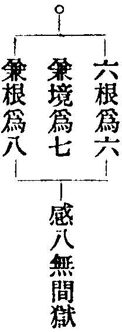
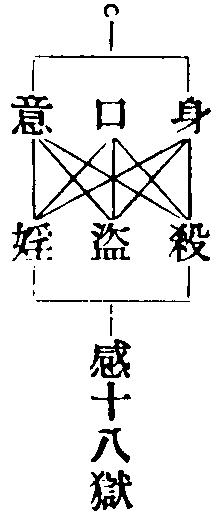

# 楞严经观心定解



> **藏经**：卍新纂大日本续藏经（新纂卍续藏）　**册次** 第 15 册（X15）　**编号** No. 306（X0306）　**部类** 经疏部　**卷次** 10 卷　**篇幅** 423,756 字

> **作者（译者）**：住嘉禾楞严讲寺天台比丘　灵耀　述

> **卷／品**：10 卷 · 0 品



---



## 目录



- [大佛顶如来密因修证了义诸菩萨万行首楞严经观心定解卷第一](#大佛顶如来密因修证了义诸菩萨万行首楞严经观心定解卷第一)

- [大佛顶如来密因修证了义诸菩萨万行首楞严经观心定解卷第二](#大佛顶如来密因修证了义诸菩萨万行首楞严经观心定解卷第二)

- [大佛顶如来密因修证了义诸菩萨万行首楞严经观心定解卷第三](#大佛顶如来密因修证了义诸菩萨万行首楞严经观心定解卷第三)

- [大佛顶如来密因修证了义诸菩萨万行首楞严经观心定解卷第四](#大佛顶如来密因修证了义诸菩萨万行首楞严经观心定解卷第四)

- [大佛顶如来密因修证了义诸菩萨万行首楞严经观心定解卷第五](#大佛顶如来密因修证了义诸菩萨万行首楞严经观心定解卷第五)

- [大佛顶如来密因修证了义诸菩萨万行首楞严经观心定解卷六](#大佛顶如来密因修证了义诸菩萨万行首楞严经观心定解卷六)

- [大佛顶如来密因修证了义诸菩萨万行首楞严经观心定解卷第七](#大佛顶如来密因修证了义诸菩萨万行首楞严经观心定解卷第七)

- [大佛顶如来密因修证了义诸菩萨万行首楞严经观心定解卷第八](#大佛顶如来密因修证了义诸菩萨万行首楞严经观心定解卷第八)

- [大佛顶如来密因修证了义诸菩萨万行首楞严经观心定解卷第九](#大佛顶如来密因修证了义诸菩萨万行首楞严经观心定解卷第九)

- [大佛顶如来密因修证了义诸菩萨万行首楞严经观心定解卷第十](#大佛顶如来密因修证了义诸菩萨万行首楞严经观心定解卷第十)



---



## 大佛顶如来密因修证了义诸菩萨万行首楞严经观心定解卷第一



**译者**：住嘉禾楞严讲寺天台比丘　灵耀　述



弥天高判之后，诸经皆约三分分文：此经从始至归来佛所为序分，从阿离见佛至不恋三界为正宗分，此后为流通分。序中，先通序，次别序。通序文通而义别，别在今经故；别序事别而义通，通皆有故。又今通序，声闻约开显以叹德，菩萨因自恣以来，列特异於诸经，则又是通中之别矣。经前五事，今为六种成就：一、信成就。



如是！



如是，乃指法之词，犹言此事、此人、此物之谓也。今指此经中所诠，初正观一心，次别约招报，以明圆解行证，直至圆满菩提，归无所得之法也。言此一种密因修证之轨则，是我阿难亲从佛边咨问钦闻而得也。今复依一宗成范，以因缘约教释文。初四悉释者，三世佛经初皆安如是，诸佛道同，不与世诤，世界悉檀也。大论云：举时、方、人，令人生信者，为人悉檀也。又对破外道阿、欧二字，阿之言无，欧之言有，外人所计，此二为宗。今立如是破外道不如不是，对治悉檀也。又如是者，信顺之辞，信则所闻之理会，顺则师资之道成，即第一义悉檀也。次用约教释者，佛先已说，今复重述，故云如是。约文言如，约理言是，以文是重述，故约能诠而论如，理本无差，故约所诠而论是也。约教有四：佛言：世、出世法皆从因缘生，因烦恼故有生死，若离烦恼即无生死。烦恼是集谛，生死是苦谛，离烦恼是道谛，无生死是灭谛。阿难传此，与佛说不异，故云如是，此三藏经初如是也。佛言：因缘生法，当体即空，来时不从自他共离来，去时不向东西南北去，即有而空，非色灭空。阿难传此，文如理是，则通教经初如是也。佛言：生死之法，皆若空华，真空涅槃，亦如幻化，佛性如云外月，逈出二边。阿难传此，与佛说不异，则别教经初如是也。佛言：生死即是中道，况复涅槃，宁非中道？地水火风，与空见识，一性咸具，妙觉明心，即相离相，虽空而具，虽具而空。阿难传此，与佛说不异，曰如，理本无非，曰是，则圆教经初如是也。楞严在方等时，应具四种如是，复经开显，则全成圆教如是矣。经虽开显，部在方等，且庋本迹。此经正宗，全明心观，故於序内，勿论观心。



○二闻成就。



我闻：



我即阿难自指。正法念经明有三阿难：阿难陀，此云欢喜，持小乘藏；阿难䟦陀，此云欢喜贤，受持杂藏；阿难娑伽，此云欢喜海，持佛藏。阿含经有典藏阿难，持菩萨藏。葢指一人具於四德，传持四法门也。小乘即藏教，杂藏即通教，菩萨即别教，佛藏即圆教。故释签初云：具如疏文，四种阿难。然第一义中无我、无闻。今言我者，凡夫三种我，谓见我、慢我、名字我；学人二种，无见我、能伏慢我、未能即断慢我；无学一种，随世名字，称我无咎。然大经云：阿难！多闻士知我、无我而不二，故能传持如来无碍智慧也。闻者，大论云：耳根不坏声，在可闻处作心欲闻，众缘和合，故云我闻。大经云：有不闻闻，有不闻不闻，有闻不闻，有闻闻。一家用配四教：若持藏教，是传闻闻法；持通教，是传闻不闻法；持别教，是传不闻闻法；持圆教，是传不闻不闻法。今此经中具有四义，或有经云闻如是，葢前后其词耳。更有多解，不能具出。



○三时成就。



一时。



法王启运嘉会之时，感应道交，当机得道，不后不前，名为一时，故不标春夏秋冬、日月岁时也。



○四主成就



佛。



佛者，具云佛陀，此云觉者。于道场树下，知觉世间、出世间，总相、别相。于六即佛中，即究竟觉也。复能开觉一切众生，故云：奇哉！众生具有如来智慧德相，但以妄想执著而不证得。佛於法性，无动无出，能令众生感见动出。身长丈六，现八十老比丘相，木菩提树下，三十四心正习俱尽者，三藏佛自觉觉他相也。若带比丘像，现尊特身树下，一念相应，断餘残习，即通教佛自觉觉他相也。单现尊特身，坐莲华台，受佛职者，即别教自觉觉他相也。若现不可思议身，如虗空相，遍于法界，即圆教佛自觉觉他相也。今经具四教，则具四佛。约开会说，惟一圆佛，即向身是圆常之身，向佛是圆常之佛也。



○五处成就。



在室罗筏城祇桓精舍。



室罗筏，或云舍卫，新翻丰德。以国丰四德：一、货财；二、欲境；三、多闻；四、解脱。祇，具云祇陀，正云逝多，此翻战胜，太子之名也。生时父王与外国战胜，因立美号，即须达。为之买园造立精舍以施佛者，桓即林也。精舍者，冬屋、夏堂、僧寮、禅窟，沙门精行所居，故以名焉。佛内住首楞严定，能建大法，故迹住精舍以利群生。



○六众成就分三：一、声闻众。五、一明类。



与大比丘众。



与者，阿难与彼千二百五十人为同闻众，故举为证信序也。又与是共义，或云佛与比丘同住一处，即佛为主，比丘为伴，其说亦通。若据证信，则阿难同众之说为长；若据主伴，则佛与比丘为当。今以证信为正意耳。梵言摩诃，今具三义，谓大、多、胜也。器量尊重，为天王等大人所敬，故云大；徧知内外经书，故云多；胜出九十五种外道，故云胜。比丘名含三义：乞士、怖魔、破恶。乞士者，有四种食：合药种植田园，名下口食；仰观星宿，名仰口食；四方巧语，名方口食；呪术卜算，名四维口食。比丘不作此四，名清净乞士，至果成应供德也。怖魔者，自既出家，复化餘人，俱离三界，乖于魔意，魔用力制，反被五系，但愁惧而已，故名怖魔，至果成无生德也。破恶者，能破烦恼，九十八使皆断，故名破恶，至果成杀贼德也。众者，四人以上，乃至百千无量一处，羯磨作法，行筹布萨，事理二和，无有违诤，名和合众。



○二示数。



千二百五十人俱。



佛初成道，度陈如等五人。次度三迦叶兄弟，兼徒一千。次度舍利弗、目犍连，各兼徒一百。次度耶舍长者等五十人。经举大数，但云千二百五十。此等竝先事外道，累劫勤苦，一无所证。才遇佛法，即得上果。感佛恩深，为常随众也。



○三显位。



皆是无漏大阿罗汉。



孤山曰：无漏者，内冥中道，不漏落二边也。阿罗汉名含三义：杀贼、应供、无生。准涅槃四依品第四。依即十地菩萨，名阿罗汉。若常途所释三漏者：一、欲漏，谓欲界一切烦恼，除无明；二、有漏，谓上二界一切烦恼，除无明；三、无明漏，谓三界无明。然惑业为诸漏之因，生死为诸漏之果，今言无漏，是无分段、变易两种三界诸漏，故孤山指为十地。此从开显释也。



○四叹德



佛子住持，善超诸有；能于国土，成就威仪；从佛转轮，妙堪遗嘱；严净毗尼，弘范三界；应身无量，度脱众生；拔济未来，越诸尘累。



此明诸大弟子皆住首楞严定也。古解首楞严定者，不起灭定，现诸威仪。今初四句，标住此定也。在法华中，领付家业，是佛之子；住佛境界，护持正法，亦是住于大定之中，故曰住持。言诸有者，指二十五有。即有而超，名为善超，岂非住大乘灭尽定耶？既超诸有，已得寂光之本，故能应下三土，正容悟物，岂非现诸威仪耶？从佛下，释上四句。初二句，释佛子住持。从佛转轮者，佛有顿渐，法轮悉能随转。法华疏云：夫首楞严种种示现，称适根性，靡所不为。若法轮初启，甘露门开，诸大士化缘未熟，示为聋哑，全生如乳。若所化缘熟，则素丝易染，池华早开，革凡成圣，转乳成酪。师宗为上首弟子，或智慧、神通、辩才、三昧，各各第一，共辅法王，更度未度，重熟已熟，于方等座席，闻菩萨不可思议功德，耻小慕大，如转酪为生酥。次闻般若摩诃衍门，初历色心，终于种智，含挟小大，出内取与，或共或别，或偏或圆，奉命领知，心渐通泰，如转生酥为熟酥。次闻法华，会天性，定父子，授记莂，付大乘，废三归一，如餘四味，同一醍醐。诸大罗汉，从法身地，俯影随缘，迹临万水。首楞严力，方便善权，为若此(文)。葢从佛转五时法轮，示为权行，使实行成五味之益，是从佛转轮义也。然佛在世，则随转法轮，佛灭度后，则妙堪遗嘱，皆佛子之事。如父临终，必有遗嘱，佛以教法，付诸弟子，亦名遗嘱。须知声闻，不堪付嘱，如老病人，不堪寄金。无上佛法，应付菩萨，如二十五人，百金可托。以诸菩萨，善能问答，使佛法久住于世，增益炽盛，利安众生，方名妙堪。如此经阿难能种种问佛，诠显深义，乃妙堪之相也。又临灭时，种种问答，名妙堪。灭后使佛法久住，亦名妙堪。故此二句，是释佛子住持也。次二句，释善超诸有。毗尼翻灭，灭身口诸非故。或云此非正译，正翻为律，律者铨也，铨量轻重，分别犯非犯也。善超诸有，定慧之力，而定慧由戒而得，若具大乘十戒，则定慧亦在其中，故云惟佛一人持净戒，餘人皆名污戒者。今就分真所证，分与佛同，可称严净。如是则广为三界之范，苟非超出诸有，岂为二种三界之师范乎？应身下，释能于国土，成就威仪，久得法报之本。应下三土，现十界身，方名无量，是度说九界众生，归於佛界也。复拔济未来有情越三界尘累，此显已得常住法身，非灰身灭智者比，若自若他威仪咸具，故是释成就威仪也。此文先标次释，皆明诸大弟子已住首楞严定，具二种开显之义：一者开权显实，谓开小乘之权即大乘之实；二者开迹显本，谓外现声闻之迹、内蕴菩萨之本。此法华开显之旨咸於经首明之，则是经必与法华同醍醐味明矣。然或谓今经在法华后说，亦未必然。今经初会所说徵心辨见等文实在法华之前，而叹德反胜法华者，以是经佛为结集人说，历二十年始成一部，初会所说虽在法华前，四五卷去是法华后说，阿难自记所闻前后悟门皆在今经，若所闻开权显实开迹显本之旨不于经首发明，更于何处露此意耶？葢通序是经前序，在一经之首故亦名经后序，是结集人所安故，故结集者得明己意。若开今经，餘经可例知矣。由结集人自述所知阐明教意，故叹德之语反胜法华也。复由结经五名中亦名大方广妙莲华王，所以开显之义得于经首明之。



○五列名



其名曰：大智舍利弗、摩诃目犍连、摩诃拘𫄨罗、富楼那弥多罗尼子、须菩提、优波尼沙陀等而为上首。



舍利弗，具云舍利弗罗，此翻身子。其母好形身，身之所生故云身子。又云鹙子，其母于女人中聪明，聪明相在眼，眼黑白分明转动流利如鹙，故名鹙子。又舍标父、利标母，双显父母故名舍利弗。弗，子也，父名优波提舍故也。云大智者，声闻众中智慧第一，如菩萨众中之有文殊，故称第二。世尊！佛说一句，身子以一句为本，七日七夜作狮子吼，更出异句异味使无穷尽，况佛多说则身子智辩宁可尽耶？大目犍连，姓也，翻赞诵。文殊问经翻莱茯根。真谛云：此翻胡豆。二物古仙所嗜，因以命族。名拘律陀，此云无节树。释论称舍利弗为右面弟子，大目连为左面弟子，神通第一通因定生，是定慧一双也。称为大者，拣异算数目连等故。摩诃拘𫄨罗，此翻大膝。舍利弗舅常论胜姊，姐怀鹙子论则不胜，知怀智人寄辩母口，遂往南天竺学十八经。时人笑之累世难通一生非冀，喟然叹曰：在家为姊所胜，出路为他所轻。誓读不休无暇剪爪，时号长爪梵志。学讫还家问甥所在，人云：为佛弟子。即大憍慢：我甥八岁声震五天，彼沙门者有何道术诱我姊子？径往佛所思惟良久，不得一法入心，语佛言：一切法不忍。忍是安义，此言一切法我皆能破使不得安，故言一切法不忍。佛问：是见忍否？梵志自思：我堕两负处。若忍是见，前云一切法不忍；若不忍是见，何以胜佛？即低头得法眼净。身子扇佛闻舅论，得阿罗汉。增一云：得四辩才，触难能答，拘𫄨罗第一。富楼那，父名，此云满。弥多罗尼，母名，此云慈。今连父母名，云满慈子，于说法人中最为第一。中阿含云：生处安居比丘，称叹满慈子少欲知足，精进闲居，一心正念，智慧无漏，劝法亦称第一。时身子闻念：我何时得见此人？他示云：白皙、龙鼻、鹦鹉嘴者，是其形像。后于安陀林见满慈子。身子问：贤者！于瞿昙所修梵行耶？答：如是。又问：为戒净修梵行耶？答：不也。为心净、见净、度疑净、知道非道净、道亦知见净、道迹智断净修梵行耶？答：不也。又问：向言如是，今言不也。此义如何？答：为无餘涅槃故修梵行。又问：以戒净故，设无餘涅槃？答：不也。乃至道迹智断净，设无餘涅槃？答：不也。又问：此义云何？答：若以戒净，设无餘者，此以有餘称无餘。乃至道迹智断净，设无餘者，亦是有餘称无餘。若离此七者，凡夫人当般涅槃，凡人离七故。以不离故，从戒净至心净，乃至道迹智断净。仁者！听我说喻。如波斯匿王，欲从拘萨罗至婆鸡帝，中间布七车，舍初乘二，乃至舍六乘七。婆鸡帝人问：为乘初车？答：不也。乃至乘第七车？答：不也。准喻可知。身子问：贤名何等？梵行人云何称汝？答：我父名满，母名慈，梵行人称我为满慈子。身子称叹：善哉贤者！满慈子为如来弟子，智辩聪明，决定安隐无畏，逮大辩才，得甘露幢，于甘露自作证，值汝者得大利益，诸梵行人应萦衣顶戴。满慈子问：贤者何名？梵行人云何称？答：我父字优波提舍，母名舍利，故称我为舍利子。满慈子叹曰：今与世尊等弟子共论而不知，与第二世尊共论而不知，与法将共论而不知，与转法轮复转弟子共论而不知。若我知尊者，不能答一句，况复深论？善哉善哉！为如来弟子，乃至萦衣顶戴(云云)。大膝满慈，是辩才说法，为一双也。须菩提翻空生，生时仓库器皿一切皆空，占者言吉，因空而生，字曰空生。若供养者，得现果报，故名善吉。佛忉利下，率土辐辏，争前顶礼。尊者端坐石室，念诸法空，色非佛乃至识非佛，眼非佛乃至意非佛，豁然悟道。佛告莲华比丘尼：非汝前礼，汝礼色身。须菩提岩中晏坐，前见法身。优波尼沙陀，此云尘性，以观尘性空得道故，空生尘性，是以空有为一双也。更有餘人，经不具载，故云等也。此皆头角声闻，为众知识，故曰上首。孤山曰：诸经列名不同，或尚年腊，则先陈如；或尚声德，则先身子。今从尚德之例。



○二，缘觉众。



复有无量，辟支无学，并其初心，同来佛所。



梵语辟支迦罗，此翻缘觉，观十二因缘而悟道故；亦翻独觉，出无佛世，无佛自悟故。景德云：梵言毕勒支底迦，此云各各独行。音义云：独觉，正得其义也。长水云：此分二类：其利根者曰麟，喻麟之独角，出无佛世，观物变易，自觉无生；其钝根者曰部行，亦出无佛世，部党而行，师徒训化。即中云：经既云并其初心，正似师徒共集，是佛世亦有部行也。然部行未必全钝，为师者必自悟，即麟喻也；徒众随之，可名为钝，即部行也。言无学者，㭊玄云：至此位中，四智已圆，无法可学，故名无学。有四无生智：一、我生已尽，苦谛智也；二、不受后有，集谛智也；三、梵行已立，道谛智也；四、所作已办，灭谛智也。初心者，即是初发辟支佛心。妙玄云：此人根利，不须制果，又能侵习，譬如身壮，直到所在，不中止息，故不制果。虽不制果，岂无初心之人？缘觉、独觉有种种辨，今不繁述。不列名叹德者，厌喧乐静，多在空闲，不为众所知识故耳。若据开显，则阿罗汉位在十地，无学亦然。若从本为名，且从小乘释之，以无叹德之文也。



○三、菩萨众，此文应在别序中成发起序。言发起者，如来当说戒时，而阿难将毁戒，体意必相关，故云发起。然通序中列众未竟，故且属通序。又托因缘以列菩萨，益见此经巧妙。



属诸比丘休夏自恣，十方菩萨諮决心疑，钦奉慈严将求密义。即时如来敷坐宴安，为诸会中宣示深奥，法筵清众得未曾有。迦陵僊音遍十方界，恒沙菩萨来聚道场，文殊师利而为上首。



属者，当也。夏於此休，故云休夏。孤山曰自恣，律开三日，七月十四、十五、十六也。自迷所犯，恣任僧举，当忏清净，曰自恣。菩萨者，具云菩提萨埵。大论云：菩提名佛道，萨埵名成众生，用诸佛道成就众生故。又菩提是自行，萨埵是化他。言十方者，䟦陀婆罗等菩萨是本国人，为菩萨众中之主，餘诸菩萨多从十方来。左氏云：访问于善。为咨心疑者，尘沙无明未尽则有疑也。如来大慈时当说戒，故云慈严。钦奉显菩萨之心，慈严显如来之德，九旬禁足无由见佛，故于夏终而觐礼焉。将求密义者，约时而论，于般若时欲闻法华、涅槃；约教而论，对佛说戒，指大乘深定慧为密义也。即时下，明应机说法。宴安属定，宣示是慧，非禅不智须先入定，末世狂慧多不从三昧而得，圣人应物垂范，于一文中具三学，可不遵耶？深奥者，大经云：十二部经修多罗中，微细之义为菩萨说，浅近之义为声闻说。即中云无常无我即是浅近，无常中有常，无我法中有真我，岂非微细？今云深奥，意亦如是。迦陵频伽，翻妙声鸟，出雪山，在壳中能鸣即胜诸鸟，其声和雅听者无厌，佛音如之。遍十方界是佛圆音，如俗典载吴孙休时有人能为响言，言于此而闻于彼，自其所听之不觉其声之大也，自远听之如人对言不觉声之自远来也。声之所往随其所向，远者所过十数里，凡夫报法尚有如此，况如来僊音宁不遍到？所谓圆音落落该十刹而顿周，又岂目连所能穷究者哉？恒沙菩萨，非即前十方之众，因闻僊音故来聚集，感应道交法门是起。文殊师利，此翻妙德，以证法身、般若、解脱三德，于楞严会上为择法眼，故居上首也。



○二、别序二：一、王臣营斋，二、阿难被摄。初又二：一、佛应王宫。



时，波斯匿王为其父王讳日营斋，请佛宫掖自迎如来，广设珍羞无上妙味，兼复亲延诸大菩萨。



波斯匿，此云和悦，亦翻胜军。仁王经：波斯匿名月光，德行十地也。讳日者，曲礼云：卒哭而讳。谓诸侯既葬，七月有祭於庭庙，谓之卒哭。乃命于中宫，舍故而讳新，无敢称名。故匿王以其日设斋，恭延圣众，所以资先王之灵也。又讳日亦云忌日。祭义曰：忌日必哀，称讳如见亲。宫掖者，按唐志及宋元宫殿录，掖皆谓掖垣、掖门，而非内庭，葢云宫城也。若班固西都赋云：后宫则有掖庭椒房。吕向注：掖庭，宫名，在天子左右，如肘掖也。此文请佛下有五重，见敬之至，其迎则亲，其设则广，其羞则珍，味则无上，伴则诸大士也。若请佛宫掖，是处中之道耳。斋者，齐也，不过中食。方言云：羞，熟也。谓熟食也。或云：羞，进也。



○二、僧应臣舍。



城中复有长者居士，同时饭僧，伫佛来应。佛勅文殊，分领菩萨及阿罗汉，应诸斋主。



天竺以积财巨亿为长者，守道居正为居士。韩子曰：厚重自居，谓之长者。玉藻云：居士锦带。注曰：居士，道艺处士也。



○二、阿难被摄二：一、独行无供，二、乞食遭摄。初又二：一、简阿难他行。



惟有阿难，先受别请，远游未还，不遑僧次。



先受别请，或因他事而非斋也。长水曰：涅槃言阿难不受别请，葢不随佛受别请耳。四分律明请僧有二种，谓僧次请、别请也。虽律开别请，而诸文中多斥别请，偏赞僧次。十诵律云：别请佛及五百罗汉，不如僧次请一似像极恶比丘。成论云：僧次请僧，如饮海水，即饮众流。梵网经中亦作此说。



○二、明独还无供。



既无上座及阿阇黎，途中独归，其日无供。



上更无人名。上座阿阇黎，此云轨范师。律制僧远出，侣须三人，一上座，一轨范师，所以严行止，防悮失也。今无上座阿阇黎，故独归，不遑僧次，故无供，是为乞食遭摄之缘也。



○二乞食遭摄。二一乞食运怀。三一俯运等慈。



即时阿难执持应器，於所游城次第循乞，心中初求最后檀越以为斋主，无问净秽刹利尊姓及旃陀罗，方行等慈不择微贱，发意圆成一切众生无量功德。



当日初分，乞食易得，故云即时。钵云应器，以其体、色、量三，皆应法故。熏闻云：律明钵体，大要有二，泥及铁也。色者，熏作黑色、赤色，或孔雀咽色、鸽色等。量者，大钵受三斗，小者受斗半，中者可知。南山云：此姬周之斗也。凖唐斗，上钵一斗，下者五升。城即室罗筏城。檀越，此云施主，望前僧次，是为最后。即中云最后檀越，谓从末饭僧者。求得此人，即名初求。非阿难初发是心也，摩登非其人耶？所求斋主中，净秽为一双，贵贱为一双。刹帝利王族，即贵姓也。旃陀罗云杀者，即贱姓也。方，法也。轨则，如来行平等慈也。微贱之言，兼秽与旃陀罗。既云不择，岂择摩登伽乎？欲令净秽皆趣菩提，故云圆成无量功德。夫大士行门，全凭本愿。后来性比丘尼，速取无学，必归佛果，亦可谓成无量功德矣。



○二、仰遵诃诫。



阿难已知如来世尊诃须菩提及大迦叶为阿罗汉心不均平，钦仰如来开阐无遮度诸疑谤。



言已知者，阿难未证罗汉，已知罗汉有偏，所以独仰如来。又此时已过方等，故云已知也。须菩提舍贫从富，大迦叶舍富从贫，一为富者易施，一为贫者植因，如来诃之，是阐明平等无遮之慈，而超越不均之疑谤。言钦仰者，阿难钦仰如来之至训耳。



○三肃仪如法



经彼城隍，徐步郭门。严整威仪，肃恭斋法。



城之濠堑曰隍。斋法者，齐整严重，次第行乞之谓也。分卫经明一切贤圣，欲济贫苦，故入聚落，当乞食时，乃至入无城想，见无人想。阿难，严整威仪，肃恭斋法是已。此等运心行事，皆遭摄之由也。



○二、经历遭摄二：一、摄入淫席。



尔时，阿难因乞食次，经历淫室，遭大幻术。摩登伽女以娑毗迦罗先梵天呪，摄入淫席，淫躬抚摩，将毁戒体。



长水曰：摩登伽，义翻本性，下文云性比丘尼是也。孤山曰：摩登伽经云：阿难昔五百世，曾与此女而为夫妇，爱习未忘，故有斯事。资中曰：娑毗迦罗，即金头僊食米脐外道，师事梵天，而得此呪。幽溪曰：戒体，即无作戒体也。谓授戒之时，三白四结，身口承受，心不异缘，因作得戒，发得无作之戒。无作者，戒体常存，任运成就，非关身口造作，故云无作戒。疏所谓不起则已，起则性无作假色是也。须知毁戒，正毁此体。后云心清净故，尚未沦溺，则将毁而已。当机初果，已断邪淫，不入欲流，故不沦溺。



○二、如来慈救三。一、在宫密知。



如来知彼淫术所加。



大经云：佛求侍者，心在阿难，如东日照西壁，当此被摄，岂得不知？彼指阿难，以呪导淫，名为淫术。幽溪曰：如来知彼淫术所加，正明佛界机兴，感应道交也。知之一字，即如来鉴机之智，寂而常照，无缘慈悲之体也。



○二归园演法。



斋毕旋归，王及大臣、长者、居士俱来随佛，愿闻法要。於时，世尊顶放百宝无畏光明，光中出生千叶宝莲，有佛化身结跏趺坐，宣说神呪：



如来常仪，受请斋毕，俱为说法。今既速归，必别有意，故王臣大众相随而来也。於时者，是将毁戒体之时，顶即无见顶相。华严云：初生疾捧持，谛观不见顶。故知此顶即法身也。然不但从顶现，而且放光；不但放光，而且涌千叶宝莲。故知无为心佛无上神呪，尊之至矣。无善不具，故曰百宝；无恶不摧，故曰无畏。因果满足，故现千叶宝莲；化佛从顶现，且坐千叶宝莲，即报身也。故此文中三身咸具：释迦，应身也；顶，法身也。华台现佛报身说呪，全是智光特勅文殊，有由来矣。问：如来既知逼切，何不于王宫施救，而必待返精舍耶？答：佛知初果不犯邪淫，不妨稍缓，且提奖归来。登伽亦至王宫，岂所宜乎？问：登伽小术，佛何不自说呪而假之化？佛且特遣大智文殊，区区恶呪，安用牛刀？答：今值希有之事，故施难思之法。希有事者，文云遭大幻术，摩登伽女何但小术？故以微贱而欲得阿难王子为夫，一奇也；以邪摄正，二奇也；以凡匹圣，三奇也。初果圣人戒体将毁，岂无缠绵之意？良由五百世中常为夫妇，恩爱已深，岂小缘哉？非法、报、应三身之力，莫破著相之惑，非文殊大智不堪受勅，况淫爱之障为生死本？今借阿难发起以救末代众生，此所谓难思法也。若据摩登伽经，但是如来自说一呪，解彼淫术。问：他人犯淫，如来未必即救，今救阿难，一何骚扰？答：初果之法不堕邪淫，今佛设救，即其騐也。末代有证初果者，感应亦然。其未证须陀洹者，本是凡夫，安得责如来之不应乎？苟放逸不谨，但於生死海中头出头没而已。



○三、文殊护归。



勅文殊师利将呪往护，恶呪消灭，提奖阿难及摩登伽归来佛所。



顶光化佛体势尊严，所说神呪在小智尚不能解，况往救乎？非文殊固不能受勅也。而文殊密说妙解恶呪，阿难亦不显闻，故后文(云云)。提谓提拔，奖者助也，亦借力也。与登伽同归者，如下经题五名中云救护亲因度脱阿难及性比丘尼是也。登伽不但出家兼证圣果，如下文云淫火顿歇得阿那含，此中特未叙耳。至文殊简圆通竟成阿罗汉，若据登伽经说，闻呪时未言得益，寻求阿难自到佛所，且非文殊提奖而归，至闻说法亦证四果。然则两经并由闻经证阿罗汉，但大小机见不同。古注云：若约实行则机熟，得道之时由阿难牵，以欲钩后令入佛道也。若是大权，乃同阿难发起是教以益群机耳。别序竟。



○正宗大分二章。从阿难启请妙奢摩他去至问结经名，乃正观总无明心，以明修证。从阿难问七趣何生至不恋三界，约别能招报心，以明修证。大凡行人修行，贵乎先得其本。一切众生自一念不觉，即成根本无明，以障本觉。而即本觉心亦不变，随缘为一念阴识。所谓法性之与无明，遍造众恶，名之为染，乃成现行，发得业报枝末。而不知一念识阴，体虽虗妄，亦即真常。如经云：一切浮尘，诸幻化相，当处发生，随处灭尽。其性真为本如来藏妙真如性。又云：使汝流转生死结根，即汝六根，更非他物。使汝究竟安乐妙常，亦汝六根，更非他物。知见立知，即无明本。知见无见，斯即涅槃。迷妄有无明发明，即解脱。故只须观此总无明心，则自然妄去真显，垢尽明生。如灸病得穴，伐本枝枯之要道。今如来开口，即徵问此心，正令观破此一念阴心，真心自显之妙法。今家拣境修观，观现前一念，显难思妙境，皆先根本之意也。至下七趣五阴，是五识五意识，受想行三心之现行能招报。及禅定中发起，则观不发。不观之发，得能招报。皆枝末相应惑也。故略一拣斤，令行人不著，即显本如来藏矣。如大纲中说。今初为两章：一正明修证，二结显经名。初中作三大章：一约破显以开圆解，二示正助以修圆行，三明迷悟以证圆位。初开解中，一对阿难，双约次不，次明三止观。次对满慈，更审除细惑，明如来藏。初又三：一阿难悔请。



阿难见佛顶礼悲泣，恨无始来一向多闻未全道力，殷勤启请十方如来，得成菩提妙奢摩他、三摩、禅那最初方便。



阿难持法藏人，示迹恒为魔娆。此独悲泣者，悲从自恨而发也。法华经云：昔於空王佛所同如来发心，佛常勤精进故成菩提，阿难常乐多闻未得无漏。据此则无始来一向多闻信矣。此时在法华前尚未发迹，然圣位中人讵不自知多生习性乎？道言体也，力言用也，有道而后有力，有体而后有用，既以多闻小慧自咎，故自叙殷勤启请等。十方如来者，言诸佛道同小乘中，不言有十方佛。阿难发心本在圆大，故言十方，所谓一切无碍人，一道出生死也。如来是极果人，菩提是极果法，果必有因，妙奢摩他、三摩、禅那是也。妙者，言一心中具此三法。考诸翻译，奢摩他翻止，乃寂静之义，宜属於空；三摩翻俗，宜属於假；禅那翻静虑，双收止观，宜属于中。空假中在一心中，故名为妙。古今解此文者具有三说。会解云：奢摩他等乃楞严大定之别名也。孤山甞用三止配之：一曰体真止，止於真谛，即奢摩他也；二曰方便随缘止，止於俗谛，即三摩也；三曰息二边分别止，止於中道第一义谛，即禅那也。依此，则三名皆属于止。或云：一、奢摩他是空观，二、三摩是不空观，三、禅那是中道观。则三名皆属於观。然攷圆觉经中，三皆名定，又名三净观，如释题中已引。故知偏止、偏观皆非圆乘，三名咸具止观，方为正义。奢摩他者，真谛之止观也；三摩者，俗谛之止观也；禅那者，中谛之止观也。如是解之，庶无遗漏，人情自属，安可依耶？或云：奢摩他是止，三摩是观，禅那双收止观。作此释者，于义无碍，消文即偏。言于义无碍者，如止观云：次第三观中，二乘及通菩萨有初观分，此属定多慧少，不见佛性；别教菩萨有第二观分，此属慧多定少，亦不见性。二观为方便，得入第三观，则见佛性。则以空观属定，而今以奢摩属止，止即是定；以假观属慧，而今以三摩属观，观即是慧。义正相符，故无碍也。言消文即偏者，诸师分文以徵心辨见属奢摩他，而其中岂可无观？以五阴三科为诸三摩提，而其中岂可无止？岂非欲圆而反偏耶？故以三名圆具止观为正释也。三止观咸在一心，始称为妙。应知若约圆乘，空、假、中三既在一心，定、慧二轮必无偏取。古人云：义立三名，体惟一法。举一即三，言三即一，三一互融，故谓之妙。如是妙修，方曰楞严大定。准此，亦应云：义立止观，体惟一法。举定即慧，言慧即定，方谓之妙，方可称楞严大定。又圆觉经中，奢摩他三，悟后方修。今从初即论者，亦约圆乘释义，境、智、行三在一心中，方名妙也。如玄签三下，行妙。初文盛明此义。若昧此义，何以消今文耶？束上所说，共有三义：一、三法在一心；二、三观、三止咸在一心；三、解、行、证亦在一心，始称为妙。此乃一经之要旨，趣理之玄门。菩萨所修，宗极于此；如来所证，亦不出此。的是今经能观之观，且是如来成道之本。一佛既尔，诸佛咸然。文中但言十方，而三世可准知矣。最初方便者，三观之先，更有一三摩提，即最初方便，是名为假也。阿难此问，彻上彻下，该果该因。如来下文所说，总酬斯问之意而已。



○二、大众愿闻。



於时复有恒沙菩萨，及诸十方大阿罗汉、辟支佛等，俱愿乐闻，退坐默然承受圣旨。



三观法门，兼於圆别，孰不当闻？大众欲闻，假于请主，故默然承受。至下如来一喝中，当有无量三乘四众在座悟入，如良马见鞭影，即归正路者，皆此处愿闻之众也。



○三、如来演说二：初、酬请开示，二、闻法领悟。初文分三：初、寄从假入空，酬奢摩以助圆理，即徵心辨见之文是也。二、寄从空出假，酬三摩以归圆理，即五阴三科之文是也。三、明中道了义，酬禅那以显圆理，即性具七大之文是也。璎珞云：从假入空观，亦名二谛观。从空出假观，亦名平等观。二观为方便，得入中道第一义谛观。双照二谛，心心寂灭，自然流入萨婆若海，与今楞严宛然符契。但今经一以圆融为主，约次第以显不次，节节明别，节节入圆。攷之止观，意亦如是。故辅行云：先明次第意者，令不思议易显故也。若弃思议，别求不思议者，远矣。从来解者虽立三观，而不善用璎珞经文，故于解释多有不顺。今以七番逐破为空前之假，假即三摩提，的是最初方便。为从假入空观，庶合经旨。大论云：因缘所生法，我说即是空，亦名为假名，亦名中道义。因缘生法，即假也。观假为入空之诠，非方便乎？就初从假入空中分二：初审问心见，二破妄显真。破妄显真，即从假入空观也。如来欲示能观妙观，且先徵出现前阴心为所观境。境既定已，观方可施。如射必定的，灸先定穴。须知一切名色、五识、五意识、受想行心，竝是今境，俱得为观，但宽漫难入。若观心者，近而复要，故须徵出。此总无明心，为今破显张本。言总者，真妄皆在其中也。葢心有真心妄心，见有真见妄见。下文云：使汝流转，使汝安乐，皆此六根，更非他物是也。今如阿难所执，若知若见，无非是妄，所谓知见，立知法在。必破下文所显，若知若见，无非是真，所谓知见无见，又所当护矣。葢此心为众生出生死之大本，诸佛度众生之要诀。若心境不定，即妙奢摩他等能观妙观，从何处用耶？初文中分为二：一审问发心，二详审心见。初又二：一问



佛告阿难：汝我同气情均天伦，当初发心於我法中见何胜相，顿舍世间深重恩爱？



阿难，此云庆喜，斛饭王子。如来成道，夜生净饭。既闻太子成道，斛饭又奏宫中生男。举国欣庆，因名庆喜。孤山曰：斛饭王子者，初师子颊王有四子：一曰净饭，二子：一悉达，二难陀。二曰斛饭，二子：一调达，二阿难。三曰白饭，二子：一摩诃男，二阿那律。四曰甘露饭，二子：一䟦提，二提沙。弟兄为同气。情均天伦者，阿难是佛堂弟，与嫡无殊，故曰情均。言天伦者，天然伦序，是天性之亲也。此出家之由也。当初下，更审出家之意。夫遇境生心，每事皆然。而徵问阿难之发心见相，以严初离俗一念，为出生死成佛之因。因地若真，必获圣果。苟带凡情，即混生死。故特徵之，益知真妄皆在一心中也。发心，即该下文所徵之心。见何胜相，即下文所辨之见。



○次答



阿难白佛：我见如来三十二相，胜妙殊绝，形体映彻，犹如琉璃，常自思惟：此相非是欲爱所生。何以故？欲气麤浊，腥臊交遘，脓血杂乱，不能发生胜净妙明紫金光聚，是以渴仰，从佛剃落。



我见下，是答见相。常自思惟下，是答发心。三十二相者，下自奁轮，上至肉髻，超胜转轮，故云胜。端严美丽，故言妙。殊绝者，谓世间所必无也。映彻者，当是世间色象皆于身中现，故譬琉璃。答发心中，先标，次徵释。言麤浊者，人当欲时，气息极麤，以知昏浊之至，男女遘精，故是腥臊，谓臭秽也。所成之形，则脓血杂乱。胜净与腥臊相反，净谓无秽。妙明与麤浊相反，玅则非麤明，非昏浊。紫金光聚者，阎浮檀金比迦叶身，金犹如聚墨；若比佛身，迦叶复如聚墨。如此妙身，岂从欲生？若据渴仰之心，亦欲成佛，故舍深重恩爱而出家，所谓见相发菩提心也。天如曰：阿难！见相乃缘尘分别之见，其所发心乃妄想攀缘之心。后文七徵八辨，重重逐破者，此也。交光曰：下文正破思惟之心，不破见相之见，以见是所显，非所破故。然见有真妄，真见是所显，妄见是所破，何云全不破耶？后云如是见性，是心非眼，是所显也。又云见闻如幻翳，是所破也。故交光显见之言，不如辨见为妥。又所发之心亦通真妄，若知爱乐之心从缘而起，本无心相，即通於真；若认爱乐为心，即属於妄。故於善哉！阿难下，双示真妄也。



○二、详审心见，又三：一、直示常心，二、劝进直心，三、正审心见。先示常心者，如来之意，谓发心贵乎真正。阿难！缘相好发心，不可不谓之正。而攀缘未息，著相未忘，未必全真，故特示常心，即首标不思议境也。契悟真常，则发心真正矣。



佛言：善哉！阿难！汝等当知，一切众生从无始来生死相续，皆由不知常住真心性净明体用诸妄想，此想不真故有轮转。



善哉阿难者，美恶不嫌同辞也。如来将示第一义谛，先以大慈哀悯之辞与而进之，如止观明发心有多种，有见种种相好而发心者，有闻种种法而发心者，乃至第十(云云)。今阿难见相发菩提心，诚可嘉叹。汝等指现前大众，一切众生徧及有情，从无始来竖穷过去，由所示者大，故所告者多，所追溯者远也。生死相续，谓积苦至今，从来未悟，故云不知，即无始无明也。常住真心者，言语道断，心行亦讫，不生不灭，离根离尘，一切皆妄，唯此独真。常途以随缘为心，不变为性，此文心即是性，然亦以遇缘常了为心，从来不改为性，离染常照，故曰净明，是人心体，亦是经体。须知小乘诠真理，大乘诠中理，葢心非心，智非智之别也。辅行云：藏通三乘皆为灭心，以为极果。据此文则真理非心，今云常住真心，故中理是心。小乘灰身灭智，故真理非智，今云性净明体，故中理是智。然以心智为中理，亦通圆别二教，如下文云：诸法所生，唯心所现，一切因果，世界微尘，因心成体。夫心既常住，则一切莫非常住。二卷云：五阴六入，从十二处，至十八界，本如来藏，常住妙明，不动周圆，妙真如性。性真常中，求於去来迷悟生死，了不可得。据此文，则总指诸法皆常，为常住真心，亦即现前一念心王。若证此心，即如意珠王身也。妙玄云：小乘灰断，无如意珠身。正是此意。言如意珠者，譬如来现形十界，随所宜身，说所应法，不须作意。身土互融，如如意珠王，随意雨宝。妙玄之意，以十界身土，性本具足，随机变现，方名圆教常住。岂但以性不生灭为常住乎？今经七徵之后，有圆别进否之义。进则明圆，否则明别。在圆教中，以圆融三谛为常，而带最初方便。或但指见性为常，根尘非常。虽拨根尘，与小乘空理有异，实别教耳。今经正意，的显圆常，旁兼别教。苟不甄别，鲜不以别而为圆矣。向下更明，兹不繁述。用诸妄想，谓用攀缘心为自性也。妄想非一，如五阴即有五重妄想，故名曰诸妄想。生已即灭，元非实有，如镜上尘垢而已。今若以此为因，则所感生死之报，起灭不停，犹如轮转。如来将欲破妄，故双示真妄。真心是其所显，妄心是其所破。两重能所，不待下文，而已宛然於此矣。



○二劝进直心。



汝今欲研无上菩提真发明性，应当直心詶我所问。十方如来同一道故，出离生死皆以直心，心言直故，如是乃至终始地位，中间永无诸委曲相。



真发明性，是了因也。谓真欲发明性体也。或云真发明性者，从真发现之谓也。如后文云：我以妙明不灭不生合如来藏(至)故发真如妙觉明性。是真发明性也。劝进直心者，经云：一者直见不邪，二者直闻不听，三者直治不曲，四者直说不烦，五者直行不迷，六者直念不思，七者直意不动，八者直受不寻。今言直心，即是常心。此心下不落乎攀缘，上可合于常住。后徵问时，欲阿难有疑即陈，勿自遮掩。故如来答之，便成应病与药之益。所以欲傚十方如来出离生死，先当傚其直心。古人云：后文言识精元明，能生诸缘。缘所遗者，即直心也。攀缘心者，即虗假也。古人所言，良可思矣。言者，心之声。由心直故，所言皆直。酬问即言直也。此文正明十方如来心言皆直，故所历地位咸无委曲，以有顿超十地之用。先言终而后言始，意劝当机之倣傚焉。



○三、正审心见，分二：一、审心见，二、审心目之处。初中先问：



阿难！我今问汝，当汝发心缘於如来三十二相，将何所见？谁为爱乐？



前阿难言见三十二相发心爱乐，真妄端倪已露，如来就此端倪更为研究。前虽云见，未曾言目，故今问将何所见？前云渴仰即是爱乐，故复问谁为爱乐？



○次答



阿难白佛言：世尊！如是爱乐用我心目，由目观见如来胜相心生爱乐，故我发心愿舍生死。



如是下，总答。由目下，别答也。由目观见，是答将何所见？下文云：如是见性，是心非眼。而今以目为见，谬矣。心生爱乐，是答谁为爱乐？真心本无攀缘，而今以爱乐为心，是取缘尘分别之心，谬矣。两谬之外，更有一谬。尊者是谓心不能见，岂非谬耶？虽发心愿舍生死，生死由之起矣。然如是病根，今七徵初，尚不即破，至辨见初，方破此病。幽溪云：止观明见相发心有四种：有见父母生身而发心者，有见胜应而发心者，有见报身而发心者，有见法身而发心者。今阿难所见，即父母生身。然四教虽即不同，莫不一以生为身境，解圆则圆，解偏则偏。故如来先标常住真心为本，然后诲勅阿难，当以直心詶我。使阿难果能依常住而发心，一以直心训佛所问。如栢庭所谓：我以心见，见佛惟心。我心遍于佛身，佛身现我身内。心不自知心，佛不自见佛。心有想则痴，无想则泥洹。是真见佛。般舟云：又能了知如来之身，前际不来，后际不去，今亦不住。不观色，不观色如，不观色性等。净名云：是则依於佛慧，不以二相见於如来，唯依心现，不离真如。能如是答，则七处徵心，无从生起，安有是经？惟阿难发起是教，特閟其妙，惟以缘心酬佛所问。曰：如是爱乐，用我心目，安能契常住真心哉？



○次审心目之处，先问：



佛告阿难：如汝所说，真所爱乐因於心目，若不识知心目所在，则不能得降伏尘劳。譬如国王为贼所侵发兵讨除，是兵要当知贼所在，使汝流转心目为咎。吾今问汝，唯心与目今何所在？



阿难言：目见心乐，佛即当破。见者非目，爱乐非心。但尊者病根已露，必使病根尽露，方堪应病与药。葢病有根标，药有缓急。先破心在内者，所谓急则治其标也。真所爱乐，谓真诚爱乐。所字，助语词耳。文有法、譬、合。因于心目，即下心目为咎之意。下文七徵，以破妄心之处，是降伏尘劳。假使阿难不执在内，何由破其内乎？餘六亦尔。以心例目，其意亦然。执目在面，然后可破在面之目。如云：眼能显色，如是见性。是心非眼，非破在面之目耶？或谓此文但破心而不破目，岂不谬耶？尘谓尘缘，由尘缘而劳累心神也。譬中，国王譬真心，贼譬妄心。如来七徵，喻发兵讨除。贼所在，喻七处合中使汝流转。同国王为贼所侵，心目为咎，是妄心妄目。若真心真见，有何咎与？又此文双标心目为咎，而今特破心者，是所对所观之阴心根本。若破心已，如伐本枝枯，擒贼擒王法也。目是枝末，至下略破即足矣。问：心与目何在者，合是兵要，当知贼所在。



○次答



阿难白佛言：世尊！一切世间十种异生，同将识心居在身内，纵观如来青莲华眼亦在佛面。我今观此浮根四尘祗在我面，如是识心实居身内。



先举凡心在内，次举佛眼在面，例己亦然，是尊者答词之巧也。十种异生者，或云十二类中，除空散消沉，及精神化为土木金石，但有十类熏闻。云青莲华眼者，天竺有青莲华，其叶修而复广，青白分明，有大人目相，故以为喻。𭬥李云：浮根四尘，即外五根，名浮尘根。浮谓麤浮，尘以染污为名，染污真性故；根以能生为义，能生五识故。然内五根，皆清净四大所造，属不可见，有对色也。又内外五根，皆具八法所成，能造四大，地水火风；所造四尘，色香味触。今在浮根中，能造四大，性不可见，故指所造而已。夫前指目为能见，是一重谬；今云眼根在面，是第二重谬也。前指爱乐为心，是一重谬；今云心在身内，是第二重谬也。后文云：十方虗空，生汝心内，犹如片云，点太清里。又云：汝身汝心，皆是妙明真心中物。今言识心，实居身内，乃当机之大谬，须先擒破，此属心王也。至於眼根二谬，枝末稍缓，俟辨见中破。若不破眼根，则恐又堕根尘之中，成常见外道矣。



○二、破妄显真。破妄即是从假，显真即是入空。从假，即假观也。显真，即空观也。嗟夫！世人不善观心，不知圆别门户。闻次第三观，先空，次假，后中，便欲直从空观而入。不知欲入空者，先须观假。所以璎珞云：从假入空观，亦名二谛观。摩诃止观云：观假为入空之诠。空由诠会，圣说如此，岂可违乎？若不观假而能入空，此古今必无之事。须知从假入空，乃空前之假，非空后之假也。今观妄心不在七处，意显妄心元非实有，岂非假乎？所言假者，非谓永无，但非实有。苟直以妄心为一无所有，即如水消盐之邪空矣。又从来习台教者，皆谓楞严尚耳根，天台观六识。然今所破妄心，岂非第六意识？此与止观去丈就尺，去尺就寸，简去四阴，唯观识阴，的观现前一念，总无明心，文意正同。昧者犹欲岐而二之，不可解也。文中先约三摩提观假，次约奢摩他显真。二科之中，皆明圆理。初文分七。先破心在内，又三：一、以现事比例，二、示最初方便，三、正破斥在内。初中三：一、定内外。心若在内，应先见内。内必先见，外必后见，故先问内外也。



佛告阿难：汝今现坐如来讲堂，观祇陀林今何所在？世尊！此大重阁清净讲堂在给孤园，今祇陀林实在堂外。



现坐者，谓现在可据之事，当以为例也。讲堂在内，祇陀林在外，其事显然。而反问阿难者，欲其亲自答出，则无可回避耳。若比例者，阿难例心，讲堂例身，现坐讲堂例心在身中，祇陀林以喻身外。世尊下，阿难答也。堂在园中，隐然指身为内境；林在堂外，隐然指物为外境。据其自说，则内外定矣。



○二定先后



阿难！汝今堂中先何所见？世尊！我在堂中先见如来，次观大众，如是外望方瞩林园。



此定见之次第也。内外既定，先后斯分，故问先后。文意本以阿难例心，而今问汝在堂中先何所见，则俨然以心为能见矣。但急攻心在内之执，未显破目在面及见者，是目之病者先根本而后枝末，自然之道也。阿难所答，必先见内而后见外，以此例心，亦当先见焦腑后见外物明矣。葢以讲堂例身，如来大众当例五脏故也。



○三定因由



阿难，汝瞩林园因何有见？世尊，此大讲堂户牖开豁，故我在堂得远瞻见。



内外先后已定，绰然可以破心在内。兹复问因由者，欲阿难答出户牖开豁。葢既以阿难例心，便当以户牖例五根也。隐然指五根开通，然后心得缘於外境。是则据当机所答，外以眼为户牖明矣。执心在内，此计既破眼为户牖，即此可破眼为能见之执。故知破有傍正，此中正破妄心，傍驳妄见，正根露枝枯也。



○二、示最初方便。



尔时，世尊在大众中，舒金色臂摩阿难顶，告示阿难及诸大众：有三摩提，名大佛顶首楞严王，具足万行，十方如来一门超出妙庄严路，汝今谛听。阿难顶礼，伏受慈旨。



前比例已竟，即应破执。佛不即破，而云有三摩提等者，示最初方便也。破法先须观假，假是三摩提，特举其名，以冠徵心辨见之首焉。此名古师讲之太略，但云圆融三谛，举一即三。今人讲之太讹，云三摩提是总相法门。夫首楞严已是总相，今又以三摩提为大总相，何所总耶？考圆觉经以静幻寂释奢摩他等三名，而云三摩提起幻。今经亦云如幻三摩提，则三摩提为三观中之假观，三定中之假定明矣。又翻译中翻三摩提为等持，释云：离沉掉为等，令心专住一境为持。既云专住一境，非假而何？然特举假者何也？当机首请一心三观，理最圆融，要因门入。世尊于三法中，特举三摩提为入门方便，使措心有地，亦通途修定之法耳。葢三观有二种：一次第三观，二不次第三观。次第三观，必先假后空。璎珞经云：从假入空观，亦名二谛观；从空入假观，亦名平等观。人但知空假中为三观，而不知有空前之假，有空后之假。空前之假名从假入空，止观云：观假为入空之诠，空由诠会，正是此义。空后之假名从空出假，止观明复疎倒，入即是其义。二假义异，其名则同。今经有三摩提，乃是空前之假，后文开示奢摩他路，非从假入空乎？圆融三观，必约假以立空中。三大部中，其例甚多，聊举四文，不能尽引。妙乐释经，万二千人俱观心中云：境据假边，且存其数，空中尚无，其数安在？然必约假以立空中，观亦如是。止观云：若一法一切法，即是因缘所生法，是为假名，假观也。若一切法即一法，我说即是空，空观也。若非一非一切者，即是中道观。彼文观不思议境中，历阴入界等，文文如是，是亦约假以立空中也。辅行云：三谛无形，俱不可见，然即假法，可寄事辨，即此假法，即空即中。妙玄云：见思幻破，真谛幻成，无知幻破，俗谛幻成，无明幻破，中道幻成。如上四文，总明圆教行人，必从妙假入门，假即空中，一心具三止观。今经圆旨，义趣全同，故首标有三摩提，下即云大佛顶等，其意可见。如是则七徵之文，即是圆门。但世尊以圆融立宗，阿难每从方便启请，至七徵后，重请示奢摩他路，显今七徵，但是从假，至后辨见，方是入空。此别教义，分圆即别，融别即圆，圆别岂相碍耶？后有三番进否之文，进则明圆，否则明别，进否之义，实昉于此。名大佛顶下，此世尊以圆融立经名也。上虽但立三摩提，而假能破法，即是空中。圆融三谛，是法身之理，法身徧到，妙明无相，名大佛顶。证入此谛，由三止观首楞严王，该三止观，即具万行，总定具别，故称为王。准题中名诸菩萨万行，今虽不言菩萨，义已该之。又在菩萨，但名万行首楞严，在佛名首楞严王，今文多就如来说也。次云十方如来，一门超出妙庄严路，即如来密因修证了义也。一门超出，岂非密因？因即是门。后文云识阴若尽，如是乃超十信等五十五位是已。妙庄严是修证，谓一心具万行之因，庄严果德也。然一门对十方说，十方佛虽多，孰不由此一门超出？路对果说，门之与路，皆却指因中之修耳。经题存三隐二，义得于此。须知十方如来，皆从观假得入，由观假故，证大佛顶，乃至具妙庄严行人，舍此何从证入耶？而以此为最初方便者，空假中之前，又有一假，岂非最初方便乎？定林云：摩顶者，抚以示爱；礼足者，伏以示敬。上爱下，故摩顶；下敬上，故礼足。



○三正破斥在内。二一立例按定。



佛告阿难：如汝所言，身在讲堂户牖开豁远瞩林园，亦有众生在此堂中，不见如来见堂外者。阿难答言：世尊！在堂不见如来能见林泉，无有是处。



如汝所言，牒阿难语也。身在讲堂而见堂外，牒前初、二两答。户牖开豁，牒前第三答。此两义皆是能例。次云亦有众生就所例说，与能例违，此众生隐然指阿难也。不见如来而见堂外，正如阿难心在身中，不见身内而但见身外也。如阿难答，断无不见内而见外之事，是自破心在内义。长水云：只知据理直申，不觉计宗危矣。



○二、循例正破。破中，先例，次纵，后结。



阿难！汝亦如是，汝之心灵一切明了。若汝现前所明了心实在身内，尔时先合了知内身。颇有众生先见身中，后观外物？纵不能见心、肝、脾、胃、爪生、发长、筋转、脉摇，诚合明了，如何不知？必不内知，云何知外？是故应知，汝言觉了能知之心住在身内，无是处。



例破中，初句正斥。汝亦如是者，谓汝即是不见如来、能见林泉之人也。汝之下，破计。先立义云：心灵一切明了，有二义：一者、内外皆见，故曰明了；二者、眼见耳闻皆是心灵，故云一切明了。如是即旁破眼为能见，应上文户牖之喻也。若汝至身内。此句牒执。尔时，句定也。颇有下，正破在内之计。古解云：颇者，可也，或云少也。意言不问其多，还少有人见身中否？既无此人，不合言心在内。此句即是破辞。纵破者，谓太近不见，或不能见心、肝、脾、胃。如眼不见睫，理亦有之，而爪发生长，筋脉转摇，诚应明了，如何不知？此句责破。必不内知等者，并责不应见外。言汝心在内而不内知，况外物疎远而能知耶？此句生起下文心不住内也。阿难计心在外，由闻此语，谓除非心在外，则知外耳。结破者，一切凡夫皆谓心在身内，阿难初果宜无此执，示与众同，亦言在内。如上所破，心不在内，其义了然。然佛虽破妄心之处，乃破妄心，非实有也。不实即假，是之谓三摩提。已即中云：问：交光正脉中大非天，如会解谓如来所答，前四卷皆明奢摩他性定道理，只言性而不言修。会解硬配三止，甚违经旨。今以七徵为三摩提观假之法，及前约空假中分科，得非以修释性耶？答：若约圆乘，解行证三，一念具足，修性可岐为二乎？若约方便，解行或分修性，难擘止观非理，何依理非止观不显？纵在别教，亦须约奢摩他等三名以明三谛，况圆乘乎？然会解中，实未甞以修释性。如云：阿难请楞严大定如来，下文所示，别无其方。始则决择真妄，次则真妄和融，乃至会通藏性，深穷万法，皆是发明究竟之圆理而已。葢此圆理，乃大定之本也。会解此文，以前三卷半文为发明究竟圆理，何甞硬配三止理非性乎？须知空假中名，是谛非观。如观经玄义云：假是虗妄，俗谛也。空是审实，真谛也。释签云：观中之观，名为中观。据此，知观空之观，名为空观，而空则未甞非谛。观假之观，名为假观，而假则未甞非谛。观中亦然。谛是性，观是修，岂得才见空假中名，便以为三观耶？不惟交光不知空假中是谛，今人弘台教者，亦谓真俗中是谛，空假中是观。株守此说，所以来交光之难也。若寻古辙，谛观竝举，方名三观。故今经前三卷半，以空假中三谛之理，使阿难开悟，然必托止观以彰深理。兹七徵文托三摩提，俗谛止观会归圆理，皆修性相依，交光分擘，修性岂通方之说乎？又如彼所释，谓今文是奢摩他性定，其如七徵之首，如来即云有三摩提，乃强解云：三摩提名，随便寄居干此。夫三摩既是寄居，奢摩之名何能无寄居？无奢摩而强加，有三摩而不用，如此僻解，安可判修性耶？彼云：性定似不必用修。又云：略带缘修，益不可解。皆回经就情，全成臆说而已。问：幽溪科经亦以七徵为奢摩他，何也？答：幽溪以五阴三科为从空出假，以徵心辨见为从假入空。既许从假，今必是假，特引而不发耳。又复计心在内，名为性执，天下人同耳。但闻破心在内之人，三根不同。上根人闻破在内，性计既空，契入无生，解行证三，当下圆成，一部楞严至此毕矣。其名首楞严王，具足万行宜乎。亦即中论观因缘生法，显即空假中也。中根性执方破，圆解全开，即当说妙湛总持之偈而领谢之也。如前恒沙菩萨、十方三乘同时愿闻中，必有此二根性。惟阿难示同人法，机在下根，故更有转计在外潜根之问，所谓众生处处著正闻，破有即计空亡，闻不在内即计在外也。下文节节皆有三根同闻，上中先悟之机，例之可知。



○二、破心在外。二、一立计。三、一因破转计。



阿难稽首而白佛言：我闻如来如是法音，悟知我心实居身外。



如上所破，以不见内故，心不在内；转计能见身外，心在身外也。如是法音指必不内知。云何知外？



○二、立喻例显。



所以者何？譬如灯光然於室中，是灯必能先照室内，从其室门后及庭际。一切众生不见身中独见身外，亦如灯光居在室外不能照室。



所以者何？徵也。譬如下，释。先立例中灯光喻心。若心在身中，必先知内，然后及於外物。言室门者，领上户牖开豁之喻，由耳目开通，心方能识外境也。一切下，合法。不见身中，独见身外，是立计之本，与室中灯其义相反。此中废一喻、立一喻，谓废室内灯喻、立室外灯喻，以心在身外则不知身内，犹灯在室外则不能照室。又灯然於室中，从其室门后及庭际，以门开之故，室外灯光不能照室；以门闭之故，例心在身外，不知身中亦为皮膜所隔耳。



○三、结意请正。



是义必明，将无所惑，同佛了义，得无妄耶？



如上所计，心有离身之过。尊者谓室外灯与室外心，法喻宛齐，同佛了义，犹怀疑而请正焉。夫心不在内，势必居外，亦所谓直心酬佛也。



○二、正破。二一、立例按定。



佛告阿难：是诸比丘，适来从我室罗筏城，循乞抟食归祇陀林，我已宿斋。汝观比丘，一人食时诸人饱否？阿难答言：不也。世尊！何以故？是诸比丘，虽阿罗汉躯命不同，云何一人能令众饱？



心若离身即同他人，故引诸比丘一人受食众皆腹饱。立此例者，明相外则不相涉也。孤山曰：前云受请，今云从我乞食者，提奖阿难在赴请日为彼演法，事应隔宵，故指即日循乞为例。我已宿斋者，即我一人已饱也。斋乃经宿方食，故云宿斋。谷响云：谓待明相故加宿之一字，足显斋义，谓今日明相现时方可得食。熏闻云：循与巡同。抟食即第八云段食是也。今存古翻。



○二、循例破执。



佛告阿难：若汝觉了知见之心实在身外，身心相外自不相干，则心所知身不能觉，觉在身际心不能知。我今示汝兜罗绵手，汝眼见时心分别不？阿难答言：如是，世尊。佛告阿难：若相知者，云何在外？是故应知，汝言觉了能知之心住在身外，无有是处。



初若汝至身外，牒计。心总餘根，故言觉了知见。次例破，文分三节：初身心至不能知，以理定其相外。初句标心在身外。身在心外，故云相外。若尔，则如一食，难令众饱。则心下，释。上句明心知未必眼见，以心在身外也。下句明眼见未必心知，以眼在身根也。如是则为心在外矣。此定心在外之式也。次我今下，约见騐其相知。兜罗，此云细香，其绵色如霜，佛手柔软似之。文云：汝眼见时，心分别否？此句为后潜根计本。如是世尊者，谓眼见时，心即分别，如世尊所言也。三、佛言：若相知者，云何在外？此句方是正破。上文止是示其相外，定其相知耳。若立相外之义，必如彼食不能此饱。今既相知，一体不分，可言心在外耶？是故下，结破。前破在内，今破在外。只一念妄心，破之不已，所谓专心一境，非耶？须知如来之意，不但破妄，兼明观道。利根闻之，解行竝进。科就钝根，但名为开解耳。问：既具行解，亦具证否？答：七徵之文，约证释之，其义始便。何者？若约开解，只须销落诸念，直契本心，苟用推简，反觉迂远。古人云：中论观法，被末代钝根。此从开解说也。若欲断惑证真，入贤圣位，浅者从因缘入，故阿难云：我从因缘心得开悟。深者必从破因缘入，须用四性推简，如孤山云：七番中，在内潜根似自性，在外似他性，中间似共性，随合无著似无因性，四句求生皆不可得，即是无生。夫如此推简，直就惑体观察，故得断惑证真，所谓观阴心以显不思议是也。是则如来七番所说，元明证位之道。观文云：名大佛顶首楞严王，具足万行。岂无证而能若是乎？闻者未能破惑，但能进行，则兼於行；钝根闻之，但能开解，则惟於解。经意元为初心进道之人，故科云开解，而佛旨渊深，实明证入之道也。此义人多不晓，并中论观法亦似受屈，今并为申之。



○三破潜根。三一立计。二一因破计生。



阿难白佛言：世尊！如佛所言：不见内故，不居身内；身心相知、不相离故，不在身外。我今思惟，知在一处。



阿难计内计外，所计俱穷，复因世尊之言而生转计，实自无主宰性，计不能守定矣。



○二因徵叙计。



佛言：处今何在？阿难言：此了知心既不知内而能见外，如我思忖潜伏根里。犹如有人取琉璃椀合其两眼，虽有物合而不留碍，彼根随见随即分别。然我觉了能知之心不见内者，为在根故；分明瞩外无障碍者，潜根内故。



以两义故，成潜根之计：一、不知内，二、能见外。潜者，藏也，谓潜伏于五根之中也。次譬琉璃椀者，喻潜根之状。彼根随见等八字，就法上说。琉璃喻眼根，琉璃合眼之见，喻分别之心，以潜根里，故分别极速。然潜伏根里之根，指五根也。彼根随见之根，指眼根也。此宽狭之分耳。然我下，谓成上两义：一、成不见内义，以在根则不在内，故不见内也。二、成见外之义，以清净四大，犹如琉璃，心在根内，分明瞩外也。



○二、逐破。二一、立例按定。



佛告阿难：如汝所言，潜根内者犹如琉璃，彼人当以琉璃笼眼，当见山河，见琉璃不？如是，世尊！是人当以琉璃笼眼，实见琉璃。



初句牒计。古人云：此责阿难有法喻不齐之过。其说是也。彼人下，明在喻则俱见。山河与琉璃，有两重所见，观实见之，言阿难之计危矣。



○二、循例破执。



佛告阿难：汝心若同琉璃合者，当见山河，何不见眼？若见眼者，眼即同境，不得成随。若不能见，云何说言此了知心潜在根内如琉璃合？



汝心至何不见眼。正责其法喻不齐也。在喻则有两重所见，在法止有一重所见。但见山河，不见己眼，潜根之计破矣。若见下，双责。纵彼所计能见眼者，则眼为心家所缘之境，何得言随？汝所言彼根随见，随即分别，其义不成。所言随者，一体之义。使眼为外境，尚能与心为一体乎？若不见眼，又堕法喻不齐之过。眼根不可见，岂同琉璃之可见耶？进退失据，其计穷矣。



○三，结破。



是故应知，汝言觉了能知之心，潜伏根里如琉璃合，无有是处。



○四破内外三一立计。



阿难白佛言：世尊！我今又作如是思惟：是众生身，腑脏在中，窍穴居外，有藏则暗，有窍则明。今我对佛，开眼见明，名为见外；闭眼见暗，名为见内。是义云何？



此问吴兴释之至矣。阿难此计虽不同潜根，元与潜根相类。前云既不知内而能见外，故计潜根，又蒙破斥。今复立此计，明不知内而能见外之故，可免第一第二之难也。初云腑脏在中，窍穴居外，是众生身相。次云有藏则暗，定暗为内境也。有窍则明，定见外之由也。今我下，正立计。良由有窍则明，故开眼而眼光向外，亲见明相，如主人开门而见门外，何必心定在外而招外不相干之难耶？有藏则暗，故见暗时即是见内，如主人闭户而见暗室，何必定见心肝爪发等耶？是不知内而能见外，各有其由。此计若成，还成计心在内之义。据下佛破云：何成在内？计内明矣。然计中心体活泼，有向内向外之义，故下文以对眼不对眼破之。



○二、佛破温陵作三节破。或云：此文只有二义，如经云：为与眼对？为不对眼？温陵作三节，非也。但对中有二义：一、约眼前，一、约内对。今科分二：一、双约对不对破，二、单约内对破。初中二：一、双定。



佛告阿难：汝当闭眼见暗之时，此暗境界为与眼对？为不对眼？



计中双计，见明见暗，然闭眼见暗，成心在内之计，故特破之。双定对不对者，对则成见，故可计对不对，眼则成内，故可计不对。



○二双破。



若与眼对，暗在眼前，云何成内？若成内者，居暗室中，无日月灯，此室暗中皆汝焦腑。若不对者，云何成见？



文中初破对。先正破。本取在内之暗，今暗相实在眼前，则非内矣。次纵破。若成内者，立纵计也。据阿难意，以暗为内，则眼前之暗，必成身内。居暗室下，破也。暗室开眼之见，不同合眼之见。然既以暗为内，则开眼所见室中之暗，必是焦腑。以皆是暗，则皆是内。作此破者，甚言暗之非内也。上皆是破对也。古注云：焦，元也。天地有三元之气，生成万物。人法天地，亦以三元之气而养身形。白虎通曰：五藏，谓肝、心、肺、肾、脾。六府者，五藏之宫府也。胃为脾之府，膀胱为肾之府，三焦为命之府，胆为肝之府，大小肠为心府、肺府也。次破不对。对在眼前，既非身内，则不对者，当是身内。若取不对之暗，内义虽成，又非所见。眼根明前不明后，以其不对故耳。今既不对，何成见耶？



○二、单破内对二：一、立内对。



若离外见，内对所成。



此中元欲取对，但与前对不同。前对在眼前，今离外见之暗，取内对之暗，以成身中之义。意谓合眼则眼光向内，名内对也。补遗云：此文是牒前计。如前计云：开眼见明，闭眼见暗，乃外见内对之义不同。意明离於外见，内对自成。今重牒之(谓离外见之明，即是内对之暗，故今文是牒前计也)，欲使内外两相例难(以开眼见明难，闭眼见暗是两相例难)，义不得成。故下破中，应今所牒(指合眼见暗，名为身中句)。虽双牒内外，意在破内(合眼见暗是牒内，开眼见明是牒外，所破但在内对)。即中谓补遗之意，谓离外见之明，即是内对之暗。然外见之言，亦得离外见之暗。离此外暗，而取返观所对之暗，故云内对所成。补遗另一途尔。



○二破内对二。一、正破。



合眼见暗，名为身中。开眼见明，何不见面？若不见面，内对不成。



合眼至身中，亦牒计也。开眼下，准外破内也。合眼既能返观身中，逃前不见焦府之责。今准此义，开眼亦应返观己面，故云何不见面？若开眼不能返观己面，则内对之义不成，而合眼又何能返观身中乎？



○二纵破。



见面若成，此了知心及与眼根乃在虗空，何成在内？若在虗空，自非汝体，即应如来。今见汝面亦是汝身，汝眼已知，身合非觉。必汝执言身眼两觉应有二知，即汝一身应成两佛。



文有三重纵计。初重约在空破。云见面若成者，且纵彼成於见面之义。阿难所执见性既开，眼即在外境，是眼光元可在外，又能返观，是必成见面之势。破云：如是则心与眼皆在虗空。葢眼非知，意非见，两者相合，方能成见。今两者皆在虗空，容有是耶？不特无此事，而阿难多分计心在内，义亦堕矣。次若在虗空下，约自他破。阿难见性在外，又可返观，又有心眼在空之势，故今转破在空。此计有三重破：一者在空则非汝体；二者汝既无身，则如来今见汝面，反是汝身；三者汝眼及了知之心俱在身外，身宁更有觉耶？此三重俱破第二心眼在空之转计也。三、必汝下，约两觉破。若必欲成返观外见之义，又何妨执身眼两觉？故并破之。谓汝若执眼觉明暗，而心知附眼光而起；身觉痛痒，而心知亦附身触而起。故云两觉，又云二知，则一身应成两佛审矣。至此则破尽计穷，后即结破。



○三、结破。从来解者，皆谓闭眼见内，成心在内之计，故独破之。此文中之意，若据显文，只是破暗为内境而已。



是故应知，汝言见暗名见内者，无有是处。



开眼见外，不能返观，则闭眼见暗，亦非见内。但破见内者，文中带破见外，如心眼在空是也。



○五破随合三一立计。



阿难言：我常闻佛开示四众，由心生故种种法生，由法生故种种心生。我今思惟，即思惟体实我心性，随所合处心则随有，亦非内、外、中间三处。



孤山曰：心生法生，境从心起也。法生心生，心逐境迁也。即中云何难。前之四计，既被穷逐，今转推心生之由。所以引开示之言者，谓诸法本无，由心故有。心亦本无，因法故有。此引文之意也。虽引二句，意重下句法生心生及种种二字。我今等者，此定思惟是心。葢阿难本计如此。前文多以见为心，今独表心惟是心。言随合随有者，如系心身中，则合于内。驰心千里，则合於外。不定在一处，故云非内外中间。其实徧该三处，中间指潜根也。



○二、佛破二：一、牒执。



佛告阿难：汝今说言：由法生故，种种心生，随所合处，心随有者。



阿难欲计法生心生，故通举二句，葢佛常有此说故也。其实只就下句为计，所以佛破祗牒其下句。



○二、正破二：一、直明无体。



是心无体则无所合，若无有体而能合者，则十九界因七尘合，是义不然。



心既随合而有，似先无心体，因合而有，故今破云：心若无体，则并无此合。若无下，纵破。若无体之心与物能合，比例言之，应十九界与七尘合。界止十八，今言十九者，更加一无体之尘为第七尘，合成十九界也。既无无体之尘，岂有无体之心乎？补遗云：如世之火，自有体性，然后假于阳燧为缘，而能发焰。若云心自无体，假缘能合者，状似火自无体，乃合阳燧尔。



○二、委破有体二：一、约内外出入破二：一、破。



若有体者，如汝以手自挃其体，汝所知心，为复内出？为从外入？若复内出，还见身中；若从外来，先合见面。



既破无体，必计有体，故约内出外入破之，明心无所从来。挃音质，古注云：挃，犹触也。



○二救。又二。一救。



阿难言：见是其眼，心知非眼，为见非义。



自初徵以来，佛即以见为心，阿难亦权顺佛语。然阿难前云：由自观见如来胜相，心生爱乐。据此，则阿难本意，岂以见为心乎？故今反难如来，谓见自属见心，但能知心既非眼，而以为见，于义成非。前来未有此问，至此方出阿难本意，此受病之根也。



○二破



佛言：若眼能见，汝在室中门能见不？则诸已死尚有眼存，应皆见物。若见物者，云何名死？



初句牒计。汝在下，释难。佛谓汝言：眼能见，心不能见。例如汝在室中，必见室外，亦由门开而后能见。眼但如门，心则如人。心因眼开而后能见，如人因门开而见室外也。倘谓眼见而心不见，亦可云门见而人不见耶？故能例中，门虽通见，必室中有人而后见，则见者是人而非门矣。所例中，眼虽通见，必眼中有心而后见，则见者是心而非眼矣。更举已死为例者，温陵云：举门喻能见在心，举死明徒眼不见。其说是也。由生时心见非眼，故死后徒眼不见。若见下，更纵破也。如此明文，皆言心识为主，破显唯心。根但如门，从门出入，乃是方便而执者，何言用根不用识耶？



○二约一多遍，局破二一定。



阿难！又汝觉了能知之心，若必有体，为复一体？为有多体？今在汝身，为复遍体？为不遍体？



此中，遍与不遍似从一体中分出，而一体、多体指心为体，徧与不徧指身为体。遇事时为知觉遍到一身之中，为但在一处而知觉不能遍耶？



○二破



若一体者，则汝以手挃一支时，四支应觉；若咸觉者，挃应无在。若挃有所，则汝一体自不能成；若多体者，则成多人，何体为汝？若徧体者，同前所挃；若不遍者，当汝触头，亦触其足，头有所觉，足应无知。今汝不然。



文分四：初、破一体。初句牒。则汝下，难。汝若一体而有二觉，则非一体。有觉有不觉，即二相也。故难以四支应觉，是出一体之相。若成下，破。若言俱觉痛痒者，是则欲击汝头，但击汝足，欲击汝左，但击汝右，有是理乎？挃应无在，谓不定在一支也。若挃下，结破。挃有定在，便成离合两觉，即是二相，非一体义。二、破多体。一体既破，或转计觉有多体。然一人止有一觉，多觉即成多人，其中必分自他，以何觉体而为汝耶？三、破徧体。徧者，知觉徧于一身。挃一支时，应遍于有觉之处，则与前四支应觉，义正相同。难辞虽同，意则有别。一体者，谓无二相。徧体者，觉处咸徧。四、破不徧。不徧者，谓知觉不徧于一身。若执心不徧，头足俱触，一既有觉，一合无知。今汝不然者，谓俱触俱觉，则非不徧也。



○三，结破。



是故应知，随所合处，心则随有，无有是处。



如上所说，有体既非，无体亦谬，心尚难立，何云随合随有耶？



○六破中间三一立计。



阿难白佛言：世尊！我亦闻佛与文殊等诸法王子谈实相时，世尊亦言：心不在内，亦不在外。如我思惟，内无所见，外不相知。内无知故，在内不成；身心相知，在外非义。今相知故，复内无见，当在中间。



此计从第五发来，因前佛破有体中云：若复内出，还见身中；若从外来，先合见面。内外既破，故复计中间也。于中，初举佛与文殊谈实相者，实相即是心，心不在内，非内六根，亦不在外，非外六尘，此实相离根离尘之义。阿难不解，复起谬执，文有三重：初举前破辞。内无所见，谓在内则不当无所见也。外不相知，谓在外当不相知也。次明不成内外三方。计中间不遽定者，见踟蹰之意耳。问：上阿难言亦非内外中间，今何复计中间耶？答：上言中间，乃以潜根为中，与今有异。今被重重难破，又不得已，引彼不在内、不在外之语为例。既不在内外，而必居中间矣。此之中间，实有根尘为二边，影显中相，与前中间不同。



○二、佛破二：一、约身。处破二：一、按定。



佛言：汝言中间，中必不迷，非无所在。今汝推中，中何为在？为复在处？为当在身？



中必不迷者，迷则不知所在，不迷则非无所在。迷，谓惑也。处，谓依报之处。身，谓正报。



○二、推破二：一、破在身。



若在身者，在边非中，在中同内。



身之可见者皆边，非中在中。同内，谓同前计心在内也。



○二，破在处。



若在处者，为有所表？为无所表？无表同无，表则无定。何以故？如人以表，表为中时，东看则西，南观成北，表体既混，心应杂乱。



表者，如立杖以表其处，大地广博以何为中？故无表则同于无中矣。表则下，破有表，先标，次释。人在表东则以表为西，人在表南则以表为北，表之四方既混，以心为在中，亦得云在边，故杂乱也。



○二、约根尘破二：一、救。



阿难言：我所说中非此二种。如世尊言：眼色为缘生于眼识，眼有分别色尘无知，识生其中则为心在。



眼即清净四大，色即眼家之尘，有眼而无色则不生识，有色而无眼亦不生识，二法相合以为生识之缘，即生眼识。云眼有分别者，眼根能引生眼识，眼识生时有随念分别，故云眼有分别，是指能生分别为有分别也。而色毕竟无知，眼识生起在有知无知之中，故招下杂乱之难。又前四计皆先有心识，五六皆论生心，约生论处故曰识生，其中则为心在。



○二破



佛言：汝心若在根尘之中，此之心体为复兼二？为不兼二？若兼二者，物体杂乱，物非体知，成敌两立，云何为中？兼二不成，非知不知，即无体性，中何为相？



文中，先定，次破。破中，先破兼二。然前定中云此之心体，乃指心知为体；破中云物体杂乱，乃指眼根为体。物即尘也。以阿难计云：眼有分别，故且就所执而破之。适时之语，不须定执。当知物体杂乱，此句之难，谓一识而兼根尘之二，尘为物，根为体，当杂乱于一识之中矣。物非体知下，破其不成中也。外物之无知，不同根体之有知，即成敌对之法，相形而立，更无调停为一法之义，何以为中？破兼二也。非知下，是破不兼。不兼根则非知，不兼尘则非不知。凡言中者，必有双非之体。今之心知，若离根尘，更无体性，中何在耶？



○三，结破。



是故应知当在中间，无有是处。



兼二不兼二，义俱无成，则当在中间之计，其不可立也明矣。



○七破无著三一立计。



阿难白佛言：世尊！我昔见佛与大目连、须菩提、富楼那、舍利弗四大弟子共转法轮，常言：觉知分别心性，既不在内，亦不在外，不在中间，俱无所在，一切无著，名之为心。则我无著，名为心不？



前之六计，以有处所，皆被穷逐。阿难不得已而计无著，所引佛与四大弟子共转法轮，是通教义，而有通别之义，故言心性，谓觉知分别中有此心性也。不在内外，如前文解。中间应指识心，既非内外中间，则一切无著，此佛语也。而阿难还以不著内外中间为心，又成计著，故须破之。泐潭云：既非内外中间，即知心无所著。而不知佛意破妄无体，令识本真。如云：三际求心心不有，心不有故妄元无，妄心无处即菩提，生死涅槃本平等。不了此意，谬引佛言，妄立无著。



○二佛破



佛告阿难：汝言觉知分别心性俱无在者，世间虗空水陆飞行诸所物象名为一切，汝不著者，为在为无？无则同于龟毛兔角，云何不著？有不著者不可名无，无相则无，非无则相，相有则在，云何无著？



阿难妄计因一切无著而起，故佛拈此一句破之。于中先研核无著之体；次相有下，结斥非无著也。虗空水陆一切有法，此阿难计为实有者也。汝以不著此法者为心？为实有一不著之心，而但不滞于物象耶？为并无此不著心耶？此句是双问。下正研云：若并无不著之心，则心同龟毛，有名无体，并不必言无著。阿难言不著者，必有一不著之心，是即有心，非无心也。无相下，重以相无相申释上句。以上未言相无相，故再定之。既定有相，次即结破。当知阿难胸中实计有心，而强谓无著，故被佛破。则所破乃伪无著，非真无著。下文云无有是处，亦但阿难所计无是处耳。若并破转法轮之言，是因咽废食矣。问：古解云：为在？为无？问：汝心不著，而彼物象为存在耶？为虗无耶？今何违古注？答：古解云：若彼物象空无，则同龟毛。试思水陆虗空，则该依报；飞行之类，则该正报。乃谓我心不著，便同龟毛兔角，义恐不妥，故今作此释也。



○三，结破。



是故应知，一切无著名觉知心，无有是处。



上来七番穷逐妄心，使无住著，乃三摩提起观之门，谓之最初方便可也。止观十乘观法中，最初拣示所观之境云：去丈就尺，去尺就寸，置色等四阴，唯观识阴。识阴者，心是也。此意与今文同。彼止观文先拣去界入，故譬去丈就尺；於五阴中又拣去四阴，唯取识阴，故譬去尺就寸。辅行云：直尔观心，义当观王。四明云：即能观为所观，易绝念故。皆是此意。须知止观中明两重所观之境：一、指第六识心为境，即拣境之文是也；二、观不思议境，即一念三千是也。观六识心，意在显不思议境，故孤山云：观一念之妄心，显三谛之真理。妄心为第一重，真心为第二重，虽立二重，观之不已，则阴境转成不思议境矣。今经亦然，初七番穷逐，是以妄心为境。后文云：诸法所生，唯心所现，一切因果，世界微尘，因心成体。又云：汝身汝心，皆是妙明真心中物。又云：若能转物，即同如来，于一毛端，遍能含受十方国土。岂非一念三千为观境耶？至三卷云：如来藏中，性识明知，觉明真识。则观六识以成不思议境，葢无疑矣。是则今经前三卷，多明十乘中第一不思议境。三卷末阿难大众说偈赞佛云：如一众生未成佛，终不于此取泥洹。是第二真正发菩提心，请入华屋。是第三巧修止观。十乘观中，前三最要，故略配之。第四破法徧，是证果时事。二十五圆通，即破徧也。若第五识通塞，是破遍之餘意耳。在今经，耳根则通，餘根则塞。第六对治助开，可配建坛持呪。第七道品调适，但从不思议境分出识次位，能安忍，离法爱，正属圆位。葢能忍能离，方得证入圆位也。此于总无明心，用十乘妙观，始终修证法也。至于七趣阴魔，即五识、五意识等能招报心，亦当用十乘能观之法而修证之，使一一皆成一念三千之不思议境，方显两重所观，观识即真也。夫两重所观，十乘观法，佛祖意合。而或谓天台专观六识，楞严独用耳根，未必然也。苕溪曰：总此七番，似破四性。若四性未破，此觉了心，世而非谛。破四性已，乃名世谛。世谛虗假，犹存于相。若破此相，方名真谛，亦曰第一义谛。故智者大师云：世谛破性，真谛破假。假破即相空，性破即性空。今文七徵，是破性一喝，即真谛破相也。即中云：初心观假，名空前之假，经称三摩提。斯时三谛未彰，但观诸法不实，故云假也。如今文七番逐破，岂得谓妄心为实有乎？但属性空。下文如来一喝，使当机言思道断，妄心全空，方入真谛。此真谛显，名奢摩他，乃从假入空也。在利根人，观空前之假，即悟三谛。所以云：有三摩提，名大佛顶首楞严王，具足万行。在钝根者，真谛未彰，但属观假。故此后文，更请示奢摩他路。圆教进否，其源在兹。问：四句推检，止耶？观耶？答：一往言之，宜属乎止。辅行释止观体真止云：案文解释，其文尚略具足。应以四句推检，破性相已，具二空故，方得名空。据此文，应属止。然辅行释弘誓中，即以四句推检性相二空，为能观智。须知就停心谛理称止，就能照了称观。



○二、约奢摩他显真。前虽破妄，似但以世谛破性，尚未以真谛破相。此后咄破妄心，岂非破相即是空也。然圆别竝明，圆则三谛在一心中，别则次第三谛而已。故有三番进否之义，不可不知。科分二：一、请奢摩他。



尔时，阿难在大众中即从座起，偏袒右肩右膝著地，合掌恭敬而白佛言：我是如来最小之弟，蒙佛慈爱，虽今出家犹恃憍怜，所以多闻未得无漏，不能折伏娑毗罗呪，为彼所转溺于淫舍，当由不知真际所诣。唯愿世尊大慈哀愍，开示我等奢摩他路，令诸阐提隳弥戾车。作是语已五体投地，及诸大众倾渴翘伫钦闻示诲。



即从座起者，听法在座，请益故起。于中具三业：恭敬偏袒至合掌是身业也，恭敬是意业，而白佛言是口业。文先悔过，次请法。悔过中皆以上句生下句。幽溪云：当机悔过而有六重：溺淫舍过由不能伏邪，不能伏邪过由有漏，有漏过由多闻，多闻过由恃佛憍爱，恃佛憍爱过由为佛最小堂弟。六重中最自恨者，未得无漏，故结重于不知真际所诣；若得无漏，即知真际所诣矣。即中云憍怜者，不以难事苦之曰憍，怜谓世尊怜惜。为彼所转者，彼指娑毗罗呪。所以自叙者，向蒙佛慈，未甞如今日七番穷逐，故作是说。惟愿下，次请法。或云真际之家以奢摩他为能诣，故称为路。然前标三摩提是从假法起观，今言奢摩他即是从假入空。前七徵但破四性，名世谛破性；后咄破妄心，乃真谛破相。因相空故，得见真心，岂非路乎？见真即获圣果，能除阐提邪恶之见。阐提翻信不具，弥戾车翻恶见。据经所言，知有道果则能息众生邪见，不见真谛安有道果？佛既七番穷逐，阿难知欲荡相显空，故作此请也。然有二义：一、三摩提与奢摩他合，空有不二即是禅那，是名三观，在一心中不必更出禅那之名。二者、从假入空，意重于空，止名奢摩他，正是阿难之所求耳。倾渴者，倾心渴仰。翘谓翘首而望，伫是立待之意。



○二、演奢摩他二：一、现瑞。



尔时，世尊从其面门放种种光，其光晃耀如百千日，普佛世界六种震动；如是，十方微尘国土一时开现。佛之威神，令诸世界合成一界，其世界中所有一切诸大菩萨皆住本国，合掌承听。



今经放光现瑞至多，此当其首，是为总瑞，总冠一经。将欲开示圆妙三观，先以形示也。形示也顿，上根利智，目击而道存。声示也渐，中下之机，耳提而方悟。今经形声双示，渐顿兼施，无法不融，无机不摄。面门，口也。或以面门为眼耳鼻舌，则无据矣。吴兴云，此中现瑞，凡有四意，谓教行人理也。口放种种光，表从一理演出众教，即此方真教体，清净在音闻也。六种震动，表依教修行，破六根惑，即一根既返源，六根成解脱也。十方合成一界，表十界染净，同一真心，即沤灭空本无，况复诸三有也。诸大菩萨，皆住本国，表行门虽殊，各证一理，即归元性无二，方便有多门也。(文)吴兴之说，谓放光表楞严之教，地动表楞严之行，十方合成一界，表不二之理。大菩萨是住定之人，教行人理备矣。以住定故，菩萨不必远来，亦由合成一界，则远听无隔，且密表耳根圆通也。文句记曰，六动者，动起涌震吼击。摇飏不安曰动，自下升高名起，璘珑凹凸名踊，六方出没亦名踊，隐隐有声名震，砰磕发响名吼，令物觉悟名击。动起踊形，三也。震吼击声，三也。震动者，形声各举其一耳。然此放光合土，是真谛破相之形。下文一喝，即真谛破相之声。真谛不思议，本不属形声。然即此形声，亦即不思议也。



○二、声益二：一、示二种根本。又二：一、标示。



佛告阿难：一切众生从无始来，种种颠倒业种自然如恶叉聚，诸修行人不能得成无上菩提，乃至别成声闻、缘觉及成外道，诸天魔王及魔眷属，皆由不知二种根本错乱修习，犹如煑沙欲成嘉馔，纵经尘劫终不能得。



阿难请示奢摩他路，而世尊示以二种根本，为后破妄显真之本也。种种颠倒者，众生有三种颠倒：心颠倒，想颠倒，见颠倒。古师解云：识有心倒想，受有想倒，行有见倒。有云：初心妄计名心倒，次心想成名想倒，想成外执名见倒。由此三倒，起种种倒。颠倒是妄惑，即业种也。种必有果，业惑苦三，生则同条，如恶叉果，一枝三子，常聚不离，故令众生流转三有。如来先示此者，以见众生执妄心为自性，是颠倒也。次示修行岐路，藏通佛果，权教所说，皆非无上菩提。声闻缘觉，保证涅槃，未免沉空滞寂。外道即六师之类，诸天以十善为宗，魔罗此云杀者，葢自谓成无上道，躭荒五欲，断人慧命者也。彼皆不知二种根本，妄意欲成菩提，犹煑沙成馔，岂可得乎？馔，熟食也。



○二正明



云何二种？阿难！一者、无始生死根本，则汝今者与诸众生用攀缘心为自性者；二者、无始菩提、涅槃元清净体，则汝今者识精元明，能生诸缘、缘所遗者。由诸众生遗此本明，虽终日行而不自觉，枉入诸趣。



初根本中言攀缘心者，思量分别之心，至下文咄破者是也。如见色之后自谓见色，闻声之后自谓闻声，乃以第二念追缘第一念中所历之事，故号攀缘心。众生轮回生死，由此心不绝之故。以此心是著相之心，著相则生痴爱，由痴爱故便入生死，其事了然。下阿难云：发大勇猛行，诸一切难行法事皆用此心，纵令谤法亦由此心。若此非心，我乃无心，同于土木。岂非执此为自性耶？二示菩提涅槃根本。菩提智德，涅槃断德，众生本具二德，不假修成，无始已然，是根本也。而指阿难现前识精元明者，所谓无明即法性，而观现前一念识心，即显不思议境是也。或云识精是八识，元明是九识，恐未必然。何者？第二卷云：且汝见我见精明元。此见虽非妙精明心，如第二月非是月影。下文明元是第二月，则今元明其义亦然。葢攀缘心是月影，今精明是第二月，皆非第一月也。识体深细名精，未杂思量分别，故曰元明。若于此而起攀缘，全成生死根本；若於此不起攀缘，则尘劳即是智慧，生死即是涅槃，故指为二转依号焉。言能生诸缘者，从见色闻声，后人必自谓见色闻声，非攀缘从此起耶？言缘所遗者，有二义：一、显攀缘若起即失真体；二、显真体元非攀缘，故为诸缘所遗。由众生下，结过。无明全是智慧，故曰本明。涅槃经云：无明明者，即毕竟空。是此义也。既遗此体，遂为根尘埋没、言思缠扰，本无生死而为生死所缚，名枉入诸趣，良可悲夫！问：前已云不知常住真心用诸妄想，今何复出二种根本耶？答：前欲示三摩提之宗，先示常住真心之体，令成空前之假，葢必得体而后可以成宗也。今欲示奢摩他之宗，复示菩提涅槃元清净体，令成从假入空之观。前云用诸妄想，此中云用攀缘心为自性；前云常住真心，今示识精元明为智断体。广前所说，所指更切。



○二、明奢摩他路。又二：一、双徵心目。



阿难！汝今欲知奢摩他路，愿出生死，今复问汝。即时，如来举金色臂，屈五轮指，语阿难言：汝今见不？阿难言：见。佛言：汝何所见？阿难言：我见如来举臂屈指为光明拳，曜我心目。佛言：汝将谁见？阿难言：我与大众同将眼见。佛告阿难：汝今答我：如来屈指为光明拳，曜汝心目。汝目可见，以何为心当我拳曜？阿难言：如来现今徵心所在，而我以心推穷寻逐，即能推者，我将为心。



前示常住真心，后即云有三摩提；今示二种根本，后即云奢摩他路，皆是约体以明宗也。此下经文权实竝谈，实则圆三观，权则先明空理。云欲知奢摩他路，指空明矣。当机请妙三观，故以圆酬；带初方便，故以权酬。非权无以入实，非实无以究竟，进退明之，经文甚显。出生死者，空观之力也。今复问下，有四问答。初屈五轮指者，或云如来五指，有地、水、火、风、空五相在其指端，此五皆称轮也。举臂屈指而问见者，示奢摩他观之所依也。即呈拳示掌，举青莲，竖一指，要当人直荐本明之法耳。藏教空理，见闻冥寂，今指见体为常住真心，即超小教。阿难言见，未出常情。次问汝何所见者，即问汝见个甚麼之意。答曜心目者，眼非知，意非见，合而言之，双曜心目也。三、四问答，分目与心为二番。世尊问谁见，正问能见者是谁，亦即念佛者是谁，而答眼见，则阿难谬矣。见即是心，可云眼乎？其病在不离根尘也。此等问辞及下一喝，并上现瑞，皆不落言思之真谛也。岂惟下之一喝方是真谛乎？佛不即斥，而复问以何为心，欲彰重迷以斥之耳。至以能推为心，则迷甚矣，其病在不离思量也。前文曰由目观见如来胜相，心生爱乐，佛指其为贼所侵。今经七番穷逐，妄想之贼现矣，故佛即施致太平之劒，直与一喝斩断思量命根也。



○二、斥妄辨真二：一、斥妄心，次、辨真心。所斥即第一生死根本也，所辨即第二菩提涅槃根本也。初中三：一、咄破。



佛言：咄！阿难！此非汝心。



性相二空，为入真之要道。前破妄心之处，虽不在内外中间，但是破自他共无因之性耳。而一念推测之心，尚未能除，犹存其相。故佛以师子奋迅之威，震声一喝曰：咄，此非汝心。此所谓命根下杀一刀也。故知思量推度，必宜急断。起信云：若离于念，名为得入。又云：所言觉义者，谓心体离念。离念相者，等虗空界，无所不遍。法界一相，即是如来平等法身。又云：若离心念，即无一切境界之相。据起信文，知意根断绝，方合真谛。是谓真谛破相之道也。夫定此一喝为真谛，禅教两宗，皆有疑议。禅人谓一咄上多立名相，教师谓言语法何指为真。殊不知此一喝非语言，而真谛非名相也。正如说药人，真药现前，反不能识。葢当机既蒙多番穷逐至此，则羽翼已去，巢穴亦空。惟现前一念思量，命根未断。若再施有意味之法语，则更引起当人思量妄念，而不能断，所谓重增迷闷矣。故佛直与无意味难思量之一喝，竟斩断当人念想攀缘之妄，而使无可凑泊。商量凑泊攀缘之妄，绝功由一咄，名真谛破相。则此一喝，即不思议境也，即第一义谛也。虽似语言音声，不落音声语言之相。若从一咄之下勦绝妄情，即金刚王宝劒；若一切攀缘心不能及，即踞地师子。在凡情认为一喝，在如来则全体大用，即一喝不作一喝用。当机于此一喝下，有领有不领，领有浅深之殊。如阿难云：我乃无心，同於土木。即探竿影艸。一咄之下，和盘托出家珍即是体，因机叩而遽施即是用。须知如前所列，有无量菩萨、声闻、天人大众，闻此一咄，顿断相心，直证无生者，不可算数。及东土吐舌耳聋者，皆上根利智，因此喝而深契不思议境，故曰真谛，又岂语言名相法哉？惟阿难尘相未忘，秪作得个探竿影艸耳。又佛言：此非汝心。正指体上之妄非心，非指六识心王为非心也。妄去真现，即识即智，何曾有二哉？如大纲中说。然当机既示为迷惑，未断攀缘，故佛于今文示离思量，至后辨见示离根尘，应机之序又如是耳。若近日交光，谓一念未生正是根相，此别据眼根而起妄计，不知见根、闻根亦须脱去，况一念未生，又安有根相耶？



○二惊问。



阿难矍然，避座合掌，起立白佛：此非我心，当名何等？



矍然，遽视貌。阿难见佛前来推穷，竝无怒意，忽闻咄破，如冷水浇背，陡然一惊，遽视如来，避坐而问。妙玄云：痴犬逐块，徒自疲劳，块终不绝。如黠师子放块逐人，块本既除，块则绝矣。阿难被咄，当忽悟自心不从人得，则如师子放块𫜪人，吐舌耳聋，深入不暇。今恋恋于妄心而复问，当名何等？与逐块何异乎？



○三、显示。



佛告阿难：此是前尘虗妄相想，惑汝真性。由汝无始至於今生，认贼为子，失汝元常，故受轮转。



初句明妄心所从来。前尘者，目前所对之五尘也。第二卷云：且吾与汝观四天王所住宫殿，中间徧览水陆空行，虽有昏明种种形像，无非前尘分别留碍。此文但指目前所对为前尘，然前尘实通五尘也。前尘已是虗妄之相，又於相上起想，成今妄心。次句明妄心功能。惑者，谓使人不知也。妄心是生灭法力，能惑乱真性，不生不灭，而使人不知。由汝下，明妄认受轮。此正前文所谓用攀缘心为自性，名无始生死根本也。夫六识是贼，性如父，心如子。今以攀缘为己心，即认贼为子，损法财，失慧命，莫不由兹，皆是贼义。以不知不生灭法，而失元来常住慧命，妄心所惑，岂非贼乎？轮转之根，实在于此。据此文，知前生死根本，当指见思第六识心，审矣。



○次辨真心二。一、疑问。



阿难白佛言：世尊！我佛宠弟，心爱佛故，令我出家。我心何独供养如来，乃至徧历恒沙国土，承事诸佛及善知识，发大勇猛，行诸一切难行法事，皆用此心。纵令谤法，永退善根，亦因此心。若此发明不是心者，我乃无心，同诸土木，离此觉知，更无所有。云何如来说此非心？我实惊怖，兼此大众无不疑惑，惟垂大悲，开示未悟。



此问最有关系。大凡人情，必得真心，方舍妄心。阿难尚未得真，遽欲舍妄，势必不能，故发此问。初明善行由心。言令我出家者，谓因爱佛，而佛命我出家也。以爱一佛，遂欲遍事诸佛及善知识，因发勇猛而行善行，此心之功也。次明恶行由心。谤法与爱佛供养相反，断善与行善相反，是心之罪也。若此下，明无心即同土木。阿难谓除推度心，则更无心，便与土木相类。离此觉知，更无所有，是释上同于土木。谓何故同于土木？以离觉知，更无心故。我实惊怖，明矍然避席之意也。阿难此问，亦似因咽废食。如来虽示推测非心，然发心行善，未必皆属推测。须知纷然思议中，元有不思之体，即是真心。今时讲者，但知佛破六识非心，后显见性是心。不知佛说色心诸缘，及心所使，惟心所现。已明六识元是真心，此是圆义。后明见性是心，自属别义。经意难知，可妄判耶？



○二、开示有三番进否。三番中，初番先略示圆心，次别显见性。初文为二：一、略示惟心，又二：一、显惟心。



尔时，世尊开示阿难及诸大众，欲令心入无生法忍，於师子座摩阿难顶而告之言：如来常说，诸法所生惟心所现，一切因果世界微尘因心成体。



此第一番，开示唯心，进明圆理也。夫世尊岂欲指见为心？正欲显诸法唯心耳。因何难不解？故退指见性是心。今之所示，正是圆宗。此后共有三番进否：进则明圆，否则明别，然后广明如来藏理。文初云开示等者，谓下文所说，是以圆教开示阿难大众也。无生法忍者，悟惟心之旨，不见有一法生，不见有一法灭，称无生法忍。师子座者，座无师子之形，但有所表。大论云：佛是人中师子。故佛所坐，名师子座；佛之所说，名师子吼。如来常说者，正标宗旨。前既以推穷者为非心，则今所云心，必是真心。据后文云：咸是妙明真心中物。故必是真心也。诸法生起，更无别体，惟是心现，则无非常住。既皆常住，即自心本具诸法，故所造法，全能造心。葢此文正明圆融三谛。诸法所生，假也；惟心，中也。所现者，现如镜像，不实空也。三谛在一心中，莫非常住，皆是真心，即酬妙奢摩他、三摩、禅那之请。而古人谓真心为妄所熏，变起根身器界一切俗法。真心是空，俗法是不空，此二不二，遂成中道。若尔，真心是妙，俗法不妙，俗既不妙，惟应存真，三观之中，独存一观而已。今谓古人所说，于二造中，但得事造之义。而事造全由理具，具故能造，名为理造。如此方合华严心造之旨。观今文，岂不宛然具二义耶？如云：诸法所生，事造也。惟心所现，理造也。事造即理造，全妄即真。故曰：诸法皆真心所现，理造即事造。则事造一念中，亦具十界因果。故荆溪云：惟心之言，岂惟真心也？问：释今经文，云惟真心，其义已足。何故复云惟妄心耶？答：观二卷云：色身外暨山河虗空大地，咸是妙明真心中物，是惟真心。后八卷云：心忆珍羞，口中水出。心发爱涎，举体光润。据此，岂无惟妄心之义乎？同在一经，义不可缺。如人多饶财宝，遇不肖子，便成浪用，岂得非长者之物？故不立妄具，则真具义亦不全。工夫之要，在达妄即真。所以先云惟真心耳。孤山曰：一切因果，即十界正报。世界微尘，即十界依报。此释上诸法所生也。因心成体，此释上惟心所现也。即中云：正报惟心，故成百界千如。依报惟心，故名无情有性。正报为能依，依报为所依。依正既居一心，一心岂分能所？此文因阿难疑心无体，遂特揭之，以树宗旨。其语甚略。至第二番明圆理云：色心诸缘，及心所使。诸所缘法，惟心所现等文，方是畅明今义。



○二举物况



阿难，若诸世界一切所有，其中乃至草叶缕结，诘其根元咸有体性，纵令虗空亦有名貌，何况清净妙净明心，性一切心而自无体？



一切所有遍该万物，乃至草叶有根种缕结，因丝麻故咸有体性。又涅槃说空有四名，谓虗空、无所有、不动、无碍。貌者，如杂集论说空一显色。论云：显色岂非貌耶？子书云：苍苍者，其正色亦貌也。空无体而有名，貌亦体之类也。以此况显真心毕竟有体，三谛无形，故曰清净。妙谓非三非一，净即是空，明即是假心，性即中性。一切心者，谓为十界心之本性。如辅行云：十界诸法皆以三谛为不改之性。正此义也。如此清净之心岂无体耶？上约圆法开示，所以解阿难之疑也。



○二、明妄无体，又二：一、斥妄，次、结过。初又二：一、正斥，二、即时阿难下，默领。初又二：一、明无体。



若汝执恡分别觉观所了知性必为心者，此心即应离诸一切色香味触诸尘事业，别有全性。如汝今者承听我法，此则因声而有分别，纵灭一切见闻觉知，内守幽闲，犹为法尘分别影事。



初句牒计。坚执不舍，故云执恡。初心在缘名觉，细心分别名观，即指前推穷之心也。此心至全性，反显离尘无体。色香味触，先举四尘，声尘则在下文明之。五根各缘一尘，意则总缘诸尘，故曰诸尘事业。业者，谓外尘牵心而有业用也。据法相说，意根不能自缘外尘，或与五识同时而缘，或相续而起分别，总皆因尘而有。若依他有，大半诸尘所成，岂离尘而有全性乎？故佛反说：若离尘有性，即是心也。如汝下，正明离尘无性。声是耳家之尘，闻声时有。同时意识起，与耳识同缘声尘，是随念分别。若以后念缘前声尘，名独影境，是计度分别。闻声尚非实有，影事那得是真？纵灭等者，谓不但有意，所缘皆是虗妄。纵六识皆灭，犹缘法尘。大论曰：眼曰见，耳曰闻，鼻舌身曰觉，意曰知。今云灭者，似是深定境界，而古人以为散位独头。以定中亦缘性境，何但影事？其说亦是。然据后文云：现前虽成九次第定，不得漏尽成阿罗汉。今恐指次第定中六识渐灭，至灭尽定受想不行，佛名此定为内守幽闲。以无六尘粗相，故曰幽闲虽灭。受想心王尚在，所对正是法尘。有灭有守，岂非分别？能缘为分别，所缘为影事。葢是五尘俱灭之影，是事而非理也。以定中亦有比量，故名分别影事。况未阶此定而推穷寻逐，非影事而何？



○二勅揣摩。



我非勅汝执为非心，但汝於心微细揣摩，若离前尘有分别性，即真汝心。若分别性离尘无体，斯则前尘分别影事，尘非常住。若变灭时，此心则同龟毛兔角，则汝法身同于断灭，其谁修证无生法忍？



勅者，诫勅。荆公云：此亦是心。然达本心，则此心是妄。然前文云：诸法所生，唯心所现。岂分别反在惟心之外？然果悟性识，明知觉，明真识，则此心即性识。阿难未悟，不可认妄为真，须自揣摩。前文先反显妄心无体，次正释离尘无性。今复同前者，劝其依佛语而揣摩也。若离下，反显。既云分别，即依前尘，便非真心，故此句是反显也。佛作此语者，意显离尘独立，方是真心耳。若分下，正释。五根所对，名为前尘。而意识缘落谢影子，名分别影事。前因声分别，犹属随念分别。今此正判推穷之心，全属计度分别，古人以为散位独头是已。尘非下，明执妄成失。心虽赖尘，而尘非常住，除生住已，即是异灭，变即异也。此时如形亡影灭，安有心乎？真心即法身，若以无常为真心者，义合法身，同于断灭。法身既灭，智照亦不能起，其谁修惟心之道，而证无生法忍耶？佛意在进明圆理，故结语及之。



○二默领



即时，阿难与诸大众默然自失。



上闻开示圆心，茫然不解，及斥妄心无体，自亦知非。泐潭云：所执既消，故云自失。



○二、结过。



佛告阿难：世间一切诸修学人，现前虽成九次第定，不得漏尽成阿罗汉，皆由执此生死妄想误为真实，是故汝今虽得多闻不成圣果。



学人指前三果。前云灭一切见闻觉知，故以九次第定当之。九次第定，三果已成，位当身证。修此定者，必先修九想、八背舍、八胜处、十一切处。如初背舍位在初禅，第二背舍位在二禅，三净背舍位在三禅，四禅次历四空，第八是灭尽定，总名八背舍。此观禅也。上来虽得八禅，入则有间。今欲纯熟，重从初禅至灭尽定，次第而入，中间更无散心，令不次第者，次第故名次第。此练禅也。释要云：灭尽定者，灭六全分，尽七染分也。四果漏尽，义当空观已成，故不执生死妄想。三果后心，妄想未尽，未成罗汉。阿难亦在学人数中，故结斥之。今谓九次第定，内外俱修。内弟子在初果位中，已断现前生灭妄见。从修道已去，不同性解脱人，缘空直入，烧灭骨人，故重修观禅九次第定，断八十一品思惑，方得漏尽，成俱解脱罗汉。若外人但知修六行观，厌下忻上，全用见妄而灭思惑，此则九次第定虽成，未断思惑故。虽成上定，漏不尽，果不成。如本断超人，见思齐断，其位退下是也。两个虽字，极是噄紧处，正显成罗汉，得圣果有餘，而反为不足。不成者，见妄不除故也。予释恰与长水疏云凡夫所修，随禅感果，不出三界义合。上第一番，据圆破妄，略示圆心竟。



○二、别显见性。前文破妄心以显真心，如经云：诸法所生，惟心所现。世界因果，因心成体。其辞虽少，其旨极圆。昧者不悟圆旨，似但破妄而未显真。故阿难至此，重复悔过哀请，佛不得已而辨见性，于义为别。此圆教之否也。古今解者，谓前破妄心已竟，从此处起，文明见性，谁曰不然？然进圆退别，其义不明。夫以别为圆，势必至并圆成别。今使圆别分途，其理不滥。如华严顿教，尚兼别明圆，况阿难请示最初方便，暂用别教，非屈经旨。然进否中，忽别而又忽圆者，即大部所立圆接别通之义也。文分二：一、重哀请。



阿难闻已，重复悲泪，五体投地，长跪合掌而白佛言：自我从佛发心出家，恃佛威神，常自思惟：无劳我修。将谓如来惠我三昧，不知身心本不相代，失我本心。虽身出家，心不入道，譬如穷子舍父逃逝。今日乃知，虽有多闻，若不修行，与不闻等，如人说食终不能饱。世尊！我等今者二障所缠，良由不知寂常心性。惟愿如来哀愍穷露，发妙明心，开我道眼。



此请与前请义同意异，前是三摩提假观之后，请开奢摩他入真之路，今所请示寂常心性，即奢摩他所契之理，是义同也。但前虽请奢摩他，而佛示诸法唯心之旨属圆三观，阿难闻已仍不知真心体性，故今求开见道之眼，则意异也。自我等者，出家禀戒虽可从佛，定慧必由自修，岂可望如来惠我耶？失我下有两重法喻：初、失心喻。失本心如舍父，徒出家如穷子，不入道如逃逝也。今日下次多闻喻。多闻如说食，若不修行喻终不能饱。二障者，谓烦恼障、所知障。古今诸师依地持论云：二乘无漏人无我智，为烦恼障净智；佛菩萨法无我智，为智障净智。又云：断爱故得心解脱，烦恼障净；断无明故得智解脱，所知障净。若以二障配二惑，烦恼是见思惑，所知是尘沙无明惑。玄签云：二障者，烦恼障及智障。具如止观引达磨郁多罗释。今师依大品、大论开为三惑，是故智障兼于事理，障事智者是尘沙惑，障理智者是无明惑。若通俗解者，见思粗惑能令心烦使心作恼，为二乘人无我智之障，故云烦恼障也。所知者，指佛菩萨法无我智为所知，无明未断能障此智，故云所知障也。寂常心性者，寂谓寂静，常是常住，心谓随缘之能，性是不变之体，即奢摩他止观所契也。夫心性之言本在于中，而今属空者，奢摩是空所依与中不隔，岂与小乘空观同耶？穷露者，如穷子背父则奔走长途风飡露宿，约法则以不识本心无慧行，食行行衣曰穷，常在生死曰露。发妙心开道眼元非二事，下文云如是见性是心非眼，则显见即显心也。元明之体不可思议，名妙明心。道眼者，见道之眼



○二、正开示二：一、现瑞。许说二：一、现瑞。



即时，如来从胸卍字涌出宝光，其光晃昱有百千色，十方微尘普佛世界一时周徧，徧灌十方所有宝刹诸如来顶，旋至阿难及诸大众。



前光从口，冠戴一经；今光从胸，必表从心。显见百千色者，表说三科七大，即万行也。普徧十方，灌如来顶者，表此法门是大佛顶也。普佛世界，显真性无所不徧，即大义也。时会当获此益，故旋至阿难等耳。卍字，梵云阿悉底迦，此云有乐，亦云吉祥海云，是吉祥万德之相。有此相者，必受安乐，以是吉祥万德所集故也。华严？如来相海品云：如来胸臆有大人相，形如卍字，名吉祥海云，摩尼宝华以为庄严，放一切宝光。



○二许说。



佛告阿难言：吾今为汝建大法幢，亦令十方一切众生，获妙微密性净明心，得清净眼。



如来之意在明圆顿，故名大法幢。幢表摧邪立正，建者竖也。次明见性是心，指此心为妙微密性，净明心指此见为清净眼耳。云亦令者，即兼明教也。妙者忘相之义，下文云奢摩他微密观照，例今妙微密等，亦属奢摩慧眼所见，云微密也。奢摩所照乃本性净明之心，不假修成，而云清净眼者，谓见离根尘即清净矣。上文请发妙明心故，今云获妙微密惟净明心。上文云道眼，今云清净眼。上来现瑞许说，虽在别明见性科内，义通圆别，文意岂有隔耶？



○二、正辨见性。古人云：先破妄心，次破妄见者，以前破妄心，且离缘尘分别想相，而未能知心性常住。今破妄见，则引盲人瞩暗等，以彰见性不灭，乃至举手飞光，皆显性无摇动。当知如来自浅而深，示阿难奢摩他路也。即中云：阿难执目在面，而心在内。故对机而说，宜先破妄心，次辨见性，似有两意。若就如来说意，不过前破妄心，次显真心，岂有二耶？然文意总归圆融，而以此为别者，前显心则云：诸法唯心。今辨见则云：头自动摇，见无所动。手自开合，见无舒卷。其以动摇对不动摇，舒卷对不舒卷，明矣。又云：汝面虽皱，而此见精性未曾皱。皱者受灭，彼不变者元无生灭。其以变易对不变易，生灭对不生灭，又明矣。故此是第一番退明别教，葢非别无以辨见。见性之后，诸法皆常，岂非别教为圆教之门乎？交光不知教分权实，于此后作十重显见之科，是为平头十王，略无统摄，所不取焉。又古人云：破妄见，显真见。交光独云：此是显见，不是破见。又云：破识心而不用，取根性为因心。夫显见但是立义之偏，取根足见悟门之谬。如今文中，取盲人瞩暗，验见性无亏。彼盲人眼根已坏，而见性宛然，则已脱于根尘之外。交光反云：是取根中之性，可乎？况众生见闻之性，虽曰在六根中，而未始少带根尘。佛因钝根不解，不得已而取盲人为例，所以建首辨见，即离根尘。如云：前尘自暗，见何亏损？离尘也。见性是心非眼，离根也。若恋恋于六根，正如净名诃云：若求见闻觉知，是则见闻觉知非求法也。若脱根尘，方是以不生灭心为本修因，然后圆成果地修证。此是要义，不得不辨。又先破后立，法门常规。古人云：破妄显真，言实不谬。如经中明眼不能见，见者是心，岂非破妄见，显真见耶？交光不知此义，反欲取根，又云：带妄显真。夫妄何物而可带乎？岂非外道邪常，旧医乳药乎？但若破若显，义似相违。今云辨见，即兼之矣。科分三：一、示见性是心，次、明见性不变，三、明见性常住。初中三：一、徵定拳见。于中，先问



阿难！汝先答我见光明拳，此拳光明因何所有？云何成拳？汝将谁见？



首句总，下三句别。总中见之一字是文正意。前阿难言：我见世尊举臂屈指为光明拳耀我心目。故今文云：汝先答我见光明拳。下三别问。初问光明何因相带来耳，非文正意。次问拳者，欲以拳理例眼根也。三问谁见，此见即是离根之见，而阿难必以为根，故重问之。



○二答



阿难言：由佛全体阎浮檀金，赩如宝山，清净所生，故有光明。我实眼观五轮指端，屈握示人，故有拳相。



梵语阎浮提，此云上胜。赩，盛也。佛全体金色，光明照耀，犹如宝山，此光明拳之近由也。清净所生，不从爱欲，此光明之远因也。次答我实眼观，卷初即云，由目观见如来胜相，认眼为见，是阿难病根。前文又云，我与大众同将眼见，今云眼观，总是内根未脱耳。



○二复例。拳见三一问。



佛告阿难：如来今日实言告汝，诸有智者要以譬喻而得开悟。阿难！譬如我拳，若无我手不成我拳，若无汝眼不成汝见，以汝眼根例我拳理，其义均不？



实言告汝者，此后佛言见性是心，其言最实，遂先示之。要以譬喻得开悟者，指后客尘主空，及今以拳例见，皆譬喻也。譬如下，立譬。若无下，是法。无手不能成拳，无眼不能成见，此法喻不齐者也。佛见阿难依旧认眼能见，故问如此。于前三问中，但举两事为例。拳理者，理谓物理。



○二答



阿难言：唯然，世尊！既无我眼不成我见，以我眼根例如来拳，事义相类。



阿难！果以无见例于无拳，此大悮也。见为眼之本，见不与眼俱丧；拳为手之末，拳必与手俱丧。本末可相齐乎？然阿难言最逊顺，无拳之语不以唐突世尊，故自居于无眼，而例同于无拳，足显相类。



○三破



佛告阿难：汝言相类，是义不然。何以故？如无手人，拳毕竟灭；彼无眼者，非见全无。所以者何？汝试于途询问盲人：汝何所见？彼诸盲人必来答汝：我今眼前惟见黑暗，更无他瞩。以是义观，前尘自暗，见何亏损？



以盲人立义者，当知识精元明，真妄和合。自成眼根以来，常情惟知眼为能见，不知离眼有见。若欲指见性离根，庶惟盲人可显此体。以盲人眼根既坏，而见性不昏，则无眼有见，其义昭然。故特藉盲人以开道眼，则眼为能见之执破矣。又当机不知心为能见，如来意在指见归心。惟彼群盲，见不依眼，则心为能见，其义亦成。故特藉盲人以显妙心，则目在面之执亦破矣。阿难前有二执，今始破之。于中，先标不类；何以故下，释不类之故。手为拳本，本丧则末亡；见是根元，末亡而元在。所以者何下，释盲非无见。盲人而言诸者，示此理之同也。诸盲见暗，若论所见，非是全无；若论能见，即是全有。而于此彰见性之离尘矣。



○三、会见归心四。一、计诸盲立难。



阿难言：诸盲眼前唯覩黑暗，云何成见？



难者，见暗非见，此常情也。阿难之意，全以眼为能见耳。



○二以二黑相校



佛告阿难：诸盲无眼唯覩黑暗，与有眼人处于暗室，二黑有别？为无有别？



诸盲承上文来，无眼对下有眼。佛不急明盲人有见，而但以二黑相校者，前佛云：前尘自暗，见何亏损？则盲人有见，其义了然，不必更明。阿难固执眼为能见，此是妄想攀缘之心，仍妄根所缚。佛此下竟明眼非能见，则妄根自破，真见自显。欲斥妄根非见，须明灯眼同功；欲明灯眼同功，先明二黑无别。至妄见破，真见立，盲人有见，其义自成。不心结显者，此非要义故也。



○三复顺问而答。



如是，世尊，此暗中人与彼群盲，二黑校量曾无有异。



阿难生希有心，不意有眼无眼二黑无异。佛止欲明二黑是同，故应云如是。



○四、正破根显见。



阿难！若无眼人全见前黑，忽得眼光，还于前尘见种种色，名眼见者；彼暗中人全见前黑，忽获灯光，亦於前尘见种种色，应名灯见。若灯见者，灯能有见，自不名灯，又则灯观何关汝事？是故当知，灯能显色，如是见者，是眼非灯；眼能显色，如是见性，是心非眼。



文又分三：一、明二黑无异，则灯眼同功。若者，假如也。无眼者，山河大地一无所瞩，故云全见前黑。有能治目，还得眼光，前无眼而见前黑，今有眼而见前尘，似惟眼为能见，此阿难胸中所执也。例推暗中之人，无灯而见前黑，有灯而见前尘，灯亦应名能见，以有眼而不见黑，与有灯而不见黑，其功均也。前阿难执眼能见，今示眼仅同灯，以破当机之执耳。二、破灯非能见。此中藏破眼见之义，欲破眼见，故破灯见。二黑既同，二不见黑亦同，灯见若破，眼见亦破。古人云：此是纵破。说汝许灯能见者，灯即是人，岂名灯耶？又灯既另是一人，彼自能观，与汝何涉？三、正破根显见。此中之文，或以灯能显色，对有眼在暗室时；眼能显色，对盲者得眼光时亦可。然一人之见，实亦赖两重显色也，是故两字承上破灯见来。灯能显色者，灯体无知，而无灯不见，有灯即见，是显色义。眼根同灯，体亦无知，但如镜中，无别分析。以眼根是清净四大所成，刻论则与灯无异。其灵知之性，是心而非眼也。以此论见，见性了然。前既斥妄想非心，今所云心，必是常心。心心自见，岂赖根乎？文云：是眼非灯，则见离尘。又云：是心非眼，则见离根。离根离尘，厥旨显矣。问：六根皆是有知，今何云眼体无知？答：佛意实尔，非关臆说。如二黑校量以来，眼根事事同灯。二黑既同，二见前尘亦同。灯见既破，眼见亦破，其义亦同。乃至二名显色，无知亦同。眼若有知，岂得同于灯乎？故后文云：见觉无知，因色空有。维摩经云：是身无知，如土木瓦石。皆是明证。以眼体无知，故现前之见，即是真见，元离根尘。此所谓破妄见，显真见也。自卷首徵问心目以来，至此方结其义。



○二、明见性不变二：一、默请。



阿难虽复得闻是言，与诸大众口已默然，心未开悟，犹冀如来慈音宣示，合掌清心，伫佛悲诲。



口已默然者，前阿难以为心，而佛斥云非心；阿难以为见，而佛复云是心。知醉辩无益，故默然也。未悟者，已闻见性是心，而未能顿破诸惑，状同未悟。又见性虽离根尘，而此性随根尘之缘，见有外物，则客尘未除，义当空观未成，故未开悟。伫佛悲诲者，依然是请世尊开我道眼之意。



○二、正示。夫教相有四：一、藏，二、通，三、别，四、圆。如是四教，共诠二理。藏、通诠真，别、圆诠中。析空、体空，则诠真之教殊；但中、圆中，则诠中之教殊。此四教所繇分也。所以不言俗者，俗乃事法，由观俗而会真中，真中名理，二理一事，共成三谛。今楞严带权说实，定兼别教。别教诠次第法，必先空、次假、后中，而空观实用，藏、通方便。今文佛因阿难未悟，还叩鹿苑初悟以发明之，岂非藏乎？此文既兼藏教，前后文必有通教，又引藏入别，即是通也。此文来意，因前见性随缘，见有外法。见性虽显，根尘尚在，即是客尘。根尘是客，见性是主，须去客而存主。根尘未空，总喻为尘，须去尘以存空，方合奢摩他空观之义。是则陈如所悟，可以助释见性。此佛叩问之意也。文分三：一、徵名騐悟，三、一问



尔时，世尊舒兜罗绵网相光手，开五轮指，诲勅阿难及诸大众：我初成道于鹿园中，为阿若多五比丘等及汝四众言：一切众生不成菩提及阿罗汉，皆由客尘烦恼所悮。汝等当时因何开悟今成圣果？



兜罗绵，此云细香，义翻氷。或云兜沙，此云霜，以色得名。或云名妒罗绵。妒罗，树名，绵从树生，因而得称。熏闻云：佛手柔软，加以合缦。似此绵也。三十二相中云：五手足指合缦，网胜餘人。正是此相。似自前屈指握拳以来，至此方舒手耳。鹿园者，群鹿所居，故云鹿苑。昔释迦行菩萨道时，为鹿王，居此园，慈救群鹿，缘在辅行。佛初成道时，居鹿苑说法，从树为名，亦名柰。二僊所居，亦名僊苑。五比丘者，太子入山学道，父王思念，遣五人追侍：一、憍陈那；二、额鞞，即马胜比丘也；三、䟦提，亦名摩诃男；四、十力迦叶；五、拘利太子。不成菩提及阿罗汉者，藏教中以三十四心断结成道，正习俱尽为菩提。然在鹿苑时，亦得密示大乘菩提，即三智一心中得，如今经所云得成菩提是矣。由客尘烦恼不成圣果，故云为所悮也。然经云：昔于波罗柰，转四谛法轮，分别说诸法，五众之生灭。是知最初所说，必该四谛。据后文以根境二种通喻客尘，则客尘之言，但是见思之集而已。政以集能招苦，故为所误，是该苦谛。若知是悮，不起于集，即道谛。无集则无苦，即灭谛。今经一语，四谛义足，而正意在烦恼之集也。如来所以引此者，前攀缘妄想及根尘妄法，皆是客尘烦恼众生为其所误，令常住真心不得明了，故引彼释此，令当机悟入见性之不动主人焉。因何开悟，指初果见道，即下因主客而断见，以开悟真谛也。圣果指四果，即下因空尘而断思，以成罗汉果也。



○二答



时，憍陈那起立白佛：我今长老於大众中独得解名，因悟客尘二字成果。世尊，譬如行客投寄旅亭，或宿或食，食宿事毕，俶装前途不遑安住，若实主人自无攸往。如是思惟，不住名客，住名主人，以不住者名为客义。又如新霁清旸升天，光入隙中发明空中诸有尘相，尘质摇动虗空寂然。如是思惟，澄寂名空，摇动名尘，以摇动者名为尘义。



答中，初总述有长人之德，故曰长老。独得解名者，夫巨夜长寝，无人能觉。日若未出，明星前现。憍陈如比丘初得无生智，譬若明星在众明之始。一切人智明无前，陈那独得解名，不亦宜乎？悟客尘二字者，以譬喻得开悟也。不悟主空而悟客尘者，妙玄云：如来初教，正诠思议之俗谛，旁诠思议之真谛。签云：初但说无常苦等，故云思议之俗。虽通涅槃，涅槃是小乘法性。若初诠法性，恐增邪倒，不能破常我等僻。故俗正真旁(文)。据此文，则鹿苑初教，客尘为正，而主空为旁。机教相符，故悟客尘二字成果。愚谓客尘之喻，乃陈如追述鹿苑场中，断见思二惑，而证真谛涅槃之解也。客喻见惑，尘喻思惑。主空即是见性真理八十八使，如狂澜无定，名为利使，触处便生。法华喻如魑魅魍魉，处处皆有。忽而起贪，忽而起瞋。著有著无，如客之不定一处也。著见之心，暂久不同，名为或宿或食。而见心无定，名为不遑安住。因观见惑之狂澜无住，即会出恒住之主人公。主人公则初无去来也。只一旅字，即该尽喻中生客同时，法上真妄交际矣。易中旅卦，艮山为内为主，止於此而不动。离火为外为客，去其所而不留。喻中主客一段，宛然明白。即法上陈如断见时，修忍位三十一周，减缘减行，真妄竝驰，推四真谛理，排利钝使惑，如子夏交战于胸中之时，正主客同时，真妄交际义也。此约卦体而言，若审爻词，九四得其资斧，则客有得利之象，如陈那舍利，先皆著见，忙忙然以求理息而不可得，故不安住，一闻如来因缘之说，初闻再悟，先得泥洹一日之价，即投得好主，人有获利之义也。此述断见见真之解明矣。又如新霁清阳升天一段，即追述畴昔断思惑也。八十一品烦恼尘劳之多，如昏鹜尘埃，若未见真前，混混而去，不觉其烦，因已断去见惑，如雨天新霁，用四谛智慧，重虑缘真，以断思惑时，如清阳升天，而思惑烦恼，弥觉其烦多矣。清阳甚嫩，显非菩萨般若如日光，诸佛智慧如日轮停午也。光入隙中，乃化他之权，不能当门正照，即牖中窥子，门侧见父之意，今于隙中而见空相，即初果初断见后，所显偏真小空，而重缘此空以断思惑，初但见思惑尘劳，纷纷不已，久视而尘静光澄，三空涅槃，当下证矣。断思证寂，法喻分明，佛既印之，而犹恐阿难不领此旨，故举拳以显断见之后，有常住之主人，飞光以显断思之后，有不动之真空也。常住真心，无乃不动之见性乎。



○印可



佛言：如是！



○二、现相证成，又二：一、以客尘义令见性脱尘。



即时，如来于大众中屈五轮指，屈已复开，开已又屈，谓阿难言：汝今何见？阿难言：我见如来百宝轮掌众中开合。佛告阿难：汝见我手众中开合，为是我手有开有合？为复汝见有开有合？阿难言：世尊！宝手众中开合，我见如来手自开合，非我见性有开有合。佛言：谁动？谁静？阿难言：佛手不住，而我见性尚无有静，谁为无住？佛言：如是。



此阿难因客尘之喻，而悟见性离根尘也。夫如来之言，一闻之而得道果，再研之而识指归。客尘之喻，在阿含初教，陈那悟此而尽见思。大集经云：甚深之理不可说，第一实义无声字。陈如比丘於诸法获得真实之知见，此初教之益，所谓一闻而得圣果，非欤？然初教以俗谛为正，真谛为旁，所云真谛，亦不明指见闻尝臭之性。今经不然，以界外真谛为正，界外俗谛为旁，则主空是正，客尘是旁。主空以喻真见，客尘以喻妄心。妄见昔教灭心，今见性是常住真心，则与昔殊；昔教灭智，今见性是无分别智光，复与前异。所谓再研而识指归，非欤？由前阿难闻见性是心非眼，茫然未解，佛使陈如旁通一线，当机始悟外境内根皆是客尘，见性是主空。以昔之喻，移喻今法，主空得显，功由客尘。不惟阿难领旨，而陈如之悟亦进，如峰回谷转，别一溪山。无量义经云：性欲无量，故说法无量。无量义者，从一法生。不其然乎？文中佛手凡两屈一开，此如来以自手当阿难之外境，而与见性对辨也。阿难言我见如来百宝轮掌，众中开合者，不惟见性对境而为内外，而其中且有主客譬义。见是主，手是客，方其见时，主客会合明矣。前旅亭为主客交会之处，今见时即旅亭也。开合是往来之类也。忽开忽合，弥显不住。葢佛手倐开而倐合，如客之乍去而乍来，正喻邪见之或常而或断也。如来掌中有千辐轮相，具百宝光，故云百宝轮掌。佛告下。重问阿难，发明主客之义。汝见我手众中开合者，如言见客往来也。为是我手有开有合者，如言但客有往来也。为复汝见有开有合者，如言内心亦可作客而有往来也。阿难言下。答出正义。言世尊宝手众中开合，谓手为外境，如客有往来。我见如来手自开合，谓内心对外而见外境如客。非我见性有开有合，谓内心为主，定无往来。如上所说，见中主客之义明矣。又问谁动谁静，更欲合尘空之义。而阿难答中言不住者，不住是客，动是尘，客尘元是一义，故兼言之。而我见性尚无有静者，见性是真常之体，拟议皆绝，可云静耶？静尚难言，何况动乎？无住即动也。前来客尘主空，有喻无法。今佛手对见，正可合喻。又前约见思烦恼以喻客尘，是主空之喻具而未彰。今约见性以显真心，则主空之义辨而方的。佛印如是者，阿难至此已知见是常住，真心脱於色尘之外，可不印欤？



○二、以客尘义令见性脱根。



如来于是从轮掌中飞一宝光在阿难右，即时阿难回首右盻；又放一光在阿难左，阿难又则回首左盻。佛告阿难：汝头今日为何摇动？阿难言：我见如来出妙宝光来我左右，故左右观，头自摇动。阿难！汝盻佛光左右动头，为汝头动？为复见动？世尊！我头自动，而我见性尚无有止，谁为摇动？佛言：如是。



次约内身与见对辨也。左右头动，元是阿难之身，较之外境，境疎身亲，复须载示。盻应作盼，流视也。回首右盼，谓回之于右也。左盼亦然。汝头今日因何摇动者，头是身根，根因尘动，故作此问。阿难答因见光头动，而头动中实兼眼动之义。我头自动，总合客尘，而我见性，无止与动，所谓动静二相，了然不生，并主空尚不立，谁为摇动乎？须知见性脱于根尘之外，前佛手开合，而见无开合，明示脱尘之义。头自摇动，而见无摇动，次示脱根之义。既脱内根，可不印如是乎？



○三、结会责失。



於时，如来普告大众：若复众生以摇动者，名之为尘；以不住者，名之为客。汝观阿难头自动摇，见无所动；又汝观我手自开合，见无舒卷。云何汝今以动为身，以动为境，从始洎终，念念生灭，遗失真性，颠倒行事，性心失真，认物为己，轮回是中，自取流转？



前双印陈那、阿难之后，因普告大众而总责之。若复下，述陈那所答。汝观下，述阿难所答。云何下，责失也。如来之意，本欲明诸法惟心，根境非动，不得已而明见性是心非眼。阿难因陈那所答，虽悟动不动义，然谓根境有动，见性不动，终非诸法唯心之旨，故责其缘尘分别，岐心境为二途也。身本无动，而阿难以为动，如云头自动摇是己。境本无动，而阿难以为动，如明手自开合是己。如是则始终惟一生灭。据现生，则始从胎中五位，终至身坏命尽。据后经文，始则晦昧为空，终则执心存内，念念莫非生灭也。乃遗圆融真性，而认六识攀缘为心，是颠倒行事。此责阿难大众不但迷圆，且以能推为心也。如来之意，谓阿难既知见闻唯一真心，何不知根身器界亦唯真心，而岐之为二耶？性心等者，幽溪科云：前云何下，初责逐末忘本，今责弃本循末。其说是也。不变之性，随缘之心，本皆依正不二，不解圆理，则失其真。言认物为己者，始既迷己为物，终必认物为己。如最初不觉心动，变成根身器世间等，是迷己为物。今妄认四大为自身相，六尘缘影为自心相，是认物为己。见有生死，生死得而苦之，故云轮回是中，自取流转。若不见有生死，岂复招分段、变易二苦报耶？如来用权引物，总为入实。上来明见性不动，义虽属权，秪令众生入实而已。经中进圆退别，脉络相通。此章之文，是起第二番进明圆教也。天如以为普告大众，语意浅深，随机各解，亦是一说。若尔，即八教中不定教相矣。



------



## 大佛顶如来密因修证了义诸菩萨万行首楞严经观心定解卷第二



○三、明见性常住。二、一请。二一、庆喜密请。



尔时，阿难及诸大众闻佛示诲，身心泰然，念无始来失却本心，妄认缘尘，分别影事，今日开悟，如失乳儿忽遇慈母，合掌礼佛：愿闻如来显出身心真妄虗实，现前生灭与不生灭二发明性。



前当机请示寂常心性，佛明见性不动，已言其寂。今大众愿闻二发明性，复深探常住之旨。生灭即无常，不生灭即常住也。闻示诲者，闻见性离根尘之示诲，而身心泰然，则异前矍然避座，重复悲泣，心怀忧惧之时，失却本心。不知见性是心，非眼也。妄认缘尘，分别影事，认攀缘心为自性也。今日开悟，知妄想非心，而见性是心。一向遗失本心，如失乳儿；今受真法之乳，如遇慈母。领前已竟。次合掌礼佛下，请后显出身心者，心指见性，便属不生灭，而身中有生灭、不生灭二义。又身心各具真妄等三双：真妄约体，心有真心、妄心，身有肉身、法身；虗实约相，真为实相，妄则为虗。虗妄为生灭法，真实为不生灭法。二发明性者，不生灭法显露开发，为真发明性；生灭之法发明显露，为妄发明性。因前佛示二种根本，判然分途，故今请二发明性也。古来解者，谓前示阿难见无摇动，后示匿王性无生灭，一往似同，义必有异。今如来於生灭中示无生灭，即变论不变，岂与见无摇动、身自摇动为同年耶？窃谓此文生灭与不生灭，逈然二途，大旨与前不殊。但此中细明无常，以显见常，前文所无，须重说之，故云显出真妄等耳。



○二匿。王显问：



时波斯匿王起立白佛：我昔未承诸佛诲勅，见迦旃延、毗罗胝子，咸言：此身死后断灭，名为涅槃。我虽值佛，今犹狐疑，云何发挥证知此心不生灭地？今此大众诸有漏者，咸皆愿闻。



仁王般若经称月光王满足十地，今示为狐疑以破断见。迦旃延，姓也，名迦罗鸠陀，翻牛领剪发，此人说诸法亦有亦无。毗罗胝，母名，自名删阇夜，翻正胜，说众生任运时熟得道，如缕丸所投，极则停住。又言八万劫满，自然得道。二外道皆执断见者也。涅槃，此云不生，亦云不灭，彼谓死后断灭，并无见闻之性，即安乐涅槃。匿王亦以为非，但须亲证常住之心，则狐疑永断矣。发越，挥散也。不生灭地，指常住心也。阿难大众双请生灭与不生灭，据下匿王显示生灭，似已知无常，故但请不生灭。



○二、答二：一、开示二：一、明身有迁变。欲明常住，而先明迁变者，必先破妄，而后显真也。妄法不尽，真如不显，彼诸外道，孰不自谓已证真常？由未破妄，而即显真，遂成邪倒之见。匿王位阶十地，深知法门，故先使其发明无常也。



佛告大王：汝身现在，今复问汝：汝此肉身为同金刚常住不朽？为复变坏？世尊！我今此身终从变灭。



佛言：大王！汝未曾灭，云何知灭？世尊！我此无常变坏之身，虽未曾灭，我观现前，念念迁谢，新新不住，如火成灰，渐渐销殒，殒亡不息，决知此身当从灭尽。



佛言：如是，大王！汝今生龄已从衰老，颜貌何如童子之时？世尊！我昔孩孺肤[勝-力+天]润泽，年至长成血气充满，而今颓龄迫於衰耄，形色枯悴精神昏昧，发白面皱逮将不久，如何见比充盛之时？



佛言：大王！汝之形容应不顿朽。王言：世尊！变化密移我诚不觉，寒暑迁流渐至於此。何以故？我年二十虽号年少，颜貌已老初十岁时，三十之年又衰二十，於今六十又过於二，观五十时宛然强壮。世尊！我见密移虽此殂落，其间流易且限十年。若复令我微细思维，其变宁惟一纪、二纪，实为年变；岂唯年变，亦兼月化；何直月化，兼又日迁。沉思谛观，刹那刹那念念之间不得停住，故知我身终从变灭。



文有四番问答。是时匿王年老，故无常之义，佛不亲宣，但使王自述渐衰，则生灭之旨宛然矣。四番中，初、二略明，三、四广述。初问中，现在对死后说，且无论死后断灭，只据现在言之。王已言死后，今复问无常，故云复耳。问为两端：一、常；二、无常。无常中又有二义：变是一义，坏是一义。而匿王断定此身终灭，亦自然之理，非染断见。佛知匿王能观无常，故载审变灭之由。答中断定无常，首句即云无常变坏，谓但观现前，即知究竟。现前不灭，则未来亦不灭；现在变灭，则未来变灭可知。而现前念念迁谢，是无常之细相也。不相应行，故云念念。文中先言其故，后言其新，新而又新，是相续假。文有法、譬、合。譬火烧木，言渐渐销殒，有二义：一者、渐销；二者、终灭。殒亡下，合譬，亦有二意：殒亡，灭没也。第三、问盛衰相比。从迁谢不住发来，而发挥初问答义。夫身心皆有无常，身相无常，人所易见，故复问颜貌。十五曰童，未巾冠也。然佛止问二时，王加长成，即成三时，所谓少、壮、老也。孩，才成体也。孺，需人以养也。耄谓昏忘。礼云：八十、九十曰耄。匿王年六十二，通言昏忘耳。形色枯悴释衰，精神昏昧释耄。逮，及也。将及死亡，岂反比充盛耶？逮恐应作殆。殆，几也。第四问，从王答三时发来，而发前第二问答义。佛欲匿王详述无常，故问应不顿朽。答中我诚不觉者，化理不住，元属不相应行，故已不觉。后经云：甲长发生，气消客皱，日夜相代，曾无觉悟是也。渐至之言，答不顿朽。次徵释中，先叙无常粗相，则十年而增。文中有三进三退：初进至二十，退至十岁；次进至三十，退至二十；三进至六十，退至五十。非进无以见其年老，非退无以见其渐衰。次述无常细相，则一纪而减。从六十二追溯五十之年，已当一纪，故约纪而减之。刹那者，时之至促。从年、月、日、时以至刹那，念念不停，可谓善悟无常矣。夫无常者，入道之根本，观法之初门。今於见性之前论无常者，正如维摩经中文殊云：所可见者，更不可见也。如是则不以第二念缘第一念而见性，得其真矣。



○二、示性无生灭二：一、审问真性。



佛告大王：汝见变化迁改不停，悟知汝灭，亦於灭时，汝知身中有不灭耶？波斯匿王合掌白佛：我实不知。



变化等，变也。悟知汝灭，灭也。身中有不灭者，涅槃云：如持戒比丘观无虫水，而作是念：此中动者，虫耶？尘耶？久视不已，方知是尘，不大明了。十住菩萨於己身中观如来性，亦复如是，不大明了。彼经有十喻，今经云身中有不灭，正与涅槃意同。彼经以蛊动喻无明，尘不动喻佛性。今以生灭为不明，不生灭为佛性，义亦无殊，以十住菩萨不大明了故。王答：不知也。



○二，如来开示。



佛言：我今示汝不生灭性。大王！汝年几时见恒河水？王言：我生三岁，慈母𢹂我谒耆婆天，经过此流，尔时即知是恒河水。佛言：大王！如汝所说，二十之时衰於十岁，乃至六十日月岁时念念迁变，则汝三岁见此河时，至年十三其水云何？王言：如三岁时宛然无异，乃至於今年六十二亦无有异。佛言：汝今自伤发白面皱，其面必定皱於童年，则汝今时观此恒河，与昔童时观河之见，有童耄不？王言：不也。世尊！佛言：大王！汝面虽皱，而此见精性未曾皱，皱者为变，不皱非变，变者受灭，彼不变者元无生灭，云何於中受汝生死，而犹引彼末伽黎等，都言此身死后全灭？



文中如来先许，次示问几年见恒河者，的指见为真性也。或疑此见是根中之见，不知根中之见，实离根尘。良由妄心未除，所以见性随缘，流转生死。若见性离妄，亦离诸缘。若以识心攀缘，则根尘永不可绝。不起识心，根尘安在。欲返真源，舍此见性，更无路矣。交光不达此意，独倡用根不用识之说。谓见性在根中，但取照色之时，一如镜中，无别分析，即是见性。起念分析，即属於识。愚谓不起念时，根亦不可得。而交光谓此中有根，亦识心未忘之故耳。前来盲人瞩暗，及举拳騐见，皆即指现前之见。所谓无明即法性，不其然乎。当知二种根本中，指识精元明为菩提涅槃，义见於此。恒河亦云殑伽河，翻天堂来。如药师直解中说，世变沧桑，而恒河不改。以此为所见之境，足显能见无迁。王答中云，即知是恒河水者，王性警悟，因此一知，记有昔日之见。以知答见，合见性是心之义也。幽溪云，此中文有三重，始则寄以恒河之水，次则进以观河见精，三则彰以见精之性。如云，而此见精，性未曾皱。虽有三重，而正意在性。佛初问三岁见此河时，至年十三，其水云何。此明水之无异。以是所见，故云见耳。文意非正显见性也。初卷以眼根与见性对辨，今复就见精以显见性。见精之名，实昉于此。前辨眼根，则云如是见性，是心非眼。以眼根无知，与见性硕异。今见精切近于真，故云而此见精，性未甞皱。若辨明见精，则见性可识。见精似是能见，而内托眼根，外托尘象。故见恒河者，实见精也。然外托尘象，不过无情之俦。内托眼根，亦是显色之类。故见精非真能见。其洞然能见者，唯见性耳。见精但吸取尘象，以向内根。故属眼根者，不属于耳根。根尘既立，反为真见之碍。能见岂其功哉？据今文，似见境、见精、见性，三皆不迁。然不皱者，独指见性。苟谓见精不皱，失文旨矣。但此文明别教而显性，又有三重。初云面皱而性不皱，非皱不皱为两途乎？次皱者变，不皱非变，非变不变为两途乎？三变者灭，而不变者无灭，非灭不灭为两途乎？别意昭然，读者讳言之耳。葢非别则悟性不确。悟性之后，指性具法，即入圆教。别圆之分，具法不具法之异也。故别教为圆教之门，所谓最初方便也。梵语末伽黎，此云不见道。等者，等於匿王所举二人。则外道六师中，共有三人，执断明矣。



○二领悟



王闻是言，信知身后舍生趣生，与诸大众踊跃欢喜，得未曾有。



信知等者，破断见也。前明生灭以破常见，今示见性以破断见，故大众皆喜。不然，岂以舍生趣生而生喜耶？第一番退明别教竟。



○第二番，圆别进否。文分为二：一、圆，二、别。初又二：一、畅明圆理，二：一、蹑前致问。



阿难即从座起，礼佛合掌长跪白佛：世尊！若此见闻必不生灭，云何世尊名我等辈遗失真性颠倒行事？愿兴慈悲洗我尘垢。



此阿难因佛告匿王，而疑前普告大众之语。前佛辨见，今并言闻，餘根可例知矣。夫虽知不生灭，而不知根境即是自心，本无动相，便成颠倒，岂知不生灭即非颠倒耶？故阿难之问非也。



○二、正为开演他师科，立十重显见。此为第四科。窃观阿难问中有一见字，祗是牒前，然亦兼问闻性。如来答中无一见字，而以为显见，何哉？葢此文乃佛第二番进明圆理。前第一番中进明圆理，则论唯心；退明别教，则辨见性。而佛意必在于圆，故第二番复揭唯心，以破颠倒。不过鬯前所说文中色心依正，既唯一心，岂但辨见而已。为三：一、喻显倒正。



即时如来，垂金色臂，轮手下指，示阿难言：汝今见我母陀罗手，为正为倒？阿难言：世间众生，以此为倒，而我不知谁正谁倒？佛告阿难：若世间人，以此为倒，即世间人，将何为正？阿难言：如来竖臂，兜罗绵手，上指於空，则名为正。佛即竖臂，告阿难言：若此颠倒，首尾相换，诸世间人，一倍瞻视，则知汝身，与诸如来清净法身，比类发明，如来之身，名正徧知，汝等之身，号性颠倒。



先倒臂以问阿难者，明止是一臂而有倒竖之分，犹止是一境而有生佛之别。母陀罗，此云印手，乃三十二相之一。或倒或正，只顺世情，其义已足，不必更作他说。初轮手下指，世既以为倒矣，次佛即竖臂，顺世间为正也。言若此颠倒者，指垂臂为颠倒也。竖臂则以尾为首，若即此臂颠倒下垂，则以首为尾，故云首尾相换。一倍是两番，倒为一番，正为一番。汝身佛身从臂上说来，故举身为言。如来之意欲明妙性周圆，而周圆即是法身，所谓毗卢遮那徧一切处也。离诸倒乱，故云清净。比类发明者，谓以两身比垂臂之类，则可发明。如臂不异而有正有倒，今身不异而有正有倒，其义亦然。葢如来之臂本无正倒，而众生分为正倒，犹生佛之身元无正倒，而众生迷为正倒。如来下正是比类，在如来名正徧知，身不异而名为正，则同于竖臂之正。在众生名性颠倒，身不异而言倒，则同于倒臂之倒。其实身臂无正倒之分，而强为正倒之名号也。正徧知者，知中道曰正，达法界曰徧。知应属心，今属身者，是身心不二之义。



○二被问茫然。



随汝谛观，汝身佛身称颠倒者，名字何处号为颠倒？於时阿难与诸大众，瞩瞢瞻佛目睛不瞬，不知身心颠倒所在。



既云汝身佛身比类发明，则颠倒之义似乎可知。故还问大众，谓汝身与佛二身相比，而名汝为颠倒者，将指何处为颠倒耶？当知身无颠倒，而颠倒由迷也。大众先闻常住，未悟周圆，故不知颠倒所在。如下真妄依正皆是妙心，体本周圆，有何正倒？而生则不知。瞪，直正切，直视貌。瞢，莫红切，又眉庚切，目不明也。



○三、正示圆融。又二：一、正示色心不二，以斥遗失真性。



佛兴慈悲，哀愍阿难及诸大众，发海潮音，徧告同会：诸善男子，我常说言，色心诸缘，及心所使，诸所缘法，唯心所现。汝身汝心，皆是妙明真精妙心中所现物，云何汝等遗失本妙圆妙明心，宝明妙性，认悟中迷？



此如来畅示唯心，以明楞严、大定、圆融三观也。海潮音者，全海而涌，无人不闻，可喻徧告大众。今明圆教不同别教，故音亦异乎前矣。文为三：初、引昔圆教。上言清净法身，此云心者，如来达此周遍之心，遂使法身竖穷横徧。众生未得法身，唯有妙心可论而已。前第一番明圆教云：诸法所生，唯心所现。今是广前所说。色是五根、五尘及法界少分，心是意根、六识。诸缘，即指上色。心、心所使，是心数法。诸所缘法，广举一切真妄、邪正、性相、因果也。唯心现者，心如工画师，能画诸色像。若云心造，似有物可得。今云心现，当体全虗。诸法是假，唯心是中。现是空，三谛在一心中明矣。二、汝身下，示心含色心。文意正拣异别教。妙明、真精，妙心正指心也。妙名不可思议，明者如镜现像，即寂而照，故曰妙明。虽现诸法，实无外物相杂，故曰真精。具上诸义，复曰妙心。身心皆妙心所现，莫非常住。若如他师云：空理是真，俗法是妄。则真妙而俗不妙，岂经旨乎？须知身心虽为无明所成，实从妙心中现。在众生则全体无明，无法不妄，故有倒正之分。故后文云：精研七趣，皆是昏沉诸有为相。自如来观之，则妙心所现，无法不真，故无倒、正之目。而后文有性具七大，一为无量，无量为一之言。观今文，岂不宛然具二义耶？前拣妄心，则曰缘尘分别；拣根境，则曰头自摇动。今知是妙心，岂复指为心外耶？故知前文所说皆是权教，始为圆而施别，既废别而立圆。圆教以唯心为门，又先观色、心不二。如不二门云：心之色、心，即心名变。不其然乎？三、云何下，斥遗失。真性本妙者，本来是妙。如四卷云：因明立所，则明亦有过。明与妙合，始无过咎。今云本妙，言本来无过也。温陵云：心之与性，体用互称。心则从妙起明，如镜之光；性则即明而妙，如镜之体。其说亦是。即中云本妙，正指中谛。圆妙者，以圆融而称妙，复从寂而有照，所谓不变随缘曰心，是俗谛也。宝明者，宝是具德之明，复摄照而归寂，所谓随缘不变曰性，是真谛也。此真与俗观，文势各具三谛，中亦具三，合三离九，是众生本具心性，而不知色、心不二全是妙心，遗失多矣。前来阿难明见性不动是其悟处，不知色、心不二即是迷处，故云认悟中迷。此文先说身心正报，下文方指山河依报。



○二、兼示依正不二，以斥颠倒行事。



晦昧为空，空晦暗中，结暗为色，色杂妄想，想相为身，聚缘内摇，趣外奔逸，昏扰扰相，以为心性。一迷为心，决定惑为色身之内，不知色身外洎山河虗空大地，咸是妙明真心中物。譬如澄清百千大海，弃之唯认一浮沤体，目为全潮，穷尽瀛渤。汝等即是迷中倍人，如我垂手，等无差别，如来说为可怜愍者。



文分二节：初约事造明颠倒之相。晦昧迷之始，即无始无明。无明本有，故言无始。因此而成空界根身，故又云迷始也。空为无明所生，全体是无明惑。如世间虗空，无日月灯，则无光明，故即空为晦昧明矣。有空之后，次生山河大地。法性为因，无明为缘，结暗为四大之色，是依报也。有依报已，方有正报。以四大色杂妄想心，妄想所成之相，是为众生之身。上色字指四大之色，下相字乃众生之相。众生有旁正研丑之相，元是结暗所成，故隔皮膜，不见五脏也。有身之后，次论心识。五尘影子，积聚于内，摇动不停。六识之用，各缘外境，奔逸无已。以无止动之功能，一以昏动而为心性。幽溪云：始则无始无明，元以昏动而为依界。如后文云：觉明空昧，相待成摇。则昏动具说，今文但影略耳。后则众生妄想，又以昏动而为病根。昏则昧昧，失本性之明。动则扰扰，失本性之寂。妙明既失，常轮生死。既以为心，决认在幻质之内，讵非迷之至乎？不知下，次约理造明颠倒之由。又为三：初法，次譬，三斥。初法中色身，正也。山河虗空大地，依也。咸是妙明真心中物，依正不二也。前云一切因果、世界微尘，因心成体，今亦是广前所说。如十不二门论不思议境，而有总别二意。总在一念，别分色心。今文亦然。妙明真心，总也。色心依正，别也。若不论别，则不知自心元具诸法，将谓诸法皆妄念所成。若不论总，则不知现前诸法唯是一心，而色心依正各各差殊，何以契一相一味之旨乎？知总知别，意在摄别入总，方得心性之全。经文似明真具亦兼妄具，以色心依正皆是妙心，岂不具耶？荆溪云：他人咸知一切唯识，不知身土居乎一心。四明云：现前一心，本具千法。此圆观也。次譬心量广大，如百千大海。圆离三惑，如海澄清。观譬意，则知依正本妙。若非依正色心本是妙心，何以喻澄清大海乎？弃此心量，而秪认身内之心，是唯认浮沤体也。言浮沤，则非澄清之本矣。谓此外毕竟无心，如阿难云：离此觉知，更无所有。即目浮沤为全海之潮，穷尽瀛渤之量，是岂可哉？三斥倍是两重。以迷望悟，名为一倍。若在悟中，安有倍乎？前以垂手喻倒，而此人颠倒，与垂手全同。其实手无正倒，性无迷悟。众生迷之为二，故为如来之怜愍也。



○二、当机不悟此文，至云何为主，应作一科下，即更问更答，不必合下科，为显见无还也。今科之意，止斥缘心，其文即竟一呈疑。



阿难承佛悲救深诲，垂泣叉手而白佛言：我虽承佛如是妙音，悟妙明心，元所圆满，常住心地。而我悟佛现说法音，(未能忘言，则现有说法之音，而我从有言说处悟，故云悟佛现说法音也。)现以缘心，允所瞻仰。(现以攀缘心，信所尊重人之言。)徒获此心，未敢认为本元心地。愿佛哀愍，宣示圆音，拔我疑根，归无上道。



文中初领佛旨，次陈疑根。悲救者，救其颠倒。深诲者，诲以圆理当机，知所示非常而缘心未脱，故至垂泣。前第一番佛显圆理，当机未解直似不闻，故知华严乳味二乘在席，如聋如痖固无疑矣。今第二番畅示唯心，始似领悟而又非真悟，圆闻岂易易哉？虽者，未尽之辞。妙音者，单承上发海潮音以下之文。上标心性其名虽多，妙明二字略已摄尽，色心依正皆在心中，故云圆满圆常竝说，指圆教也。而我下，正述攀缘未忘。现谓现在，佛说法音现前可据，正是所缘，而我胸中确有一能缘之心，亦现前可据，能所历然乃分别未忘之象，因如来是所瞻仰尊重之言，何敢不信？允者，信也。徒获此心者，此心指缘心，如此信根起念则有，不起念则无，言思未离根尘不脱，岂本元心地乎？重望示圆音以拔疑根，似以能拔疑根者称为圆音，佛不得不以别接之矣。



○二、佛斥二：一、遣所缘之教，分三：法、譬、合。



佛告阿难：汝等尚以缘心听法，此法亦缘，非得法性。如人以手指月示人，彼人因指应当看月。若复观指以为月体，此人岂唯亡失月轮，亦亡其指。何以故？以所标指为明月故。岂唯亡指，亦复不识明之与暗。何以故？即以指体为月明性，明暗二性无所了故。汝亦如是。



前文云：而我悟佛现说法音，现以缘心，允所瞻仰。故知阿难宝重法音，谓至理在是，不知封文迷理，则失教意，佛故立喻晓之。初法中，谓阿难未得真悟，以能缘之心听法，则法亦成所缘，非真得圆常法性。次指月喻中，迷有三重：一、迷月体；二、迷指体。文中，先标，次释，三、迷明暗。亦先标，次徵释。若就喻论，乃极愚之人，故具出其过也。三、合者，喻佛以教指心示人，当机闻教，应自观心。若执言教以为自心，此人岂唯迷昧自心？亦迷于教。何以故？以能诠教为自心故。岂唯迷教？亦复不识缘与无缘。何以故？即以缘体谓为自心，缘与无缘无所了故，故示汝亦如是。



○二、破能缘之心，亦法、譬、合。



若以分别我说法音为汝心者，此心自应离分别音有分别性。譬如有客寄宿旅亭，暂止便去终不常住，而掌亭人都无所去名为亭主。此亦如是，若真汝心则无所去，云何离身无分别性？斯则岂唯声分别心分别我容，离诸色相无分别性，如是乃至分别都无，非色非空拘舍离等昧为冥谛，离诸法缘无分别性，则汝心性各有所还，云何为主？



文中意含纵夺。须知前文阿难呈疑之语，所拣极严。今此文初句是牒前文，分别正是六识，谓以佛所说圆妙法音为己圆妙之心。葢承佛妙音，胸中有一圆妙影子，似是妙心，故特斥云：若分别是汝心者，应离所分别之音，而有能分别之性。此即纵也。此闻声时，有同时意识起，名随念分别；后念相续，名计度分别。是皆缘尘而有，岂自性欤？喻中意兼纵夺。客喻六尘、六识，旅亭可喻苦东掌亭，人喻真心。去者，谓有时而去也。常住之谓无去，合法中此字指分别心。若真汝心，则无所去，合上亭主之喻，谓无去则与真心同矣。此即纵也。云何离声至云何为主，俱合上客喻。纵少夺多，以文意在夺故耳。于中分四：初先约声夺。离声则无分别之性，是则心有时而去。声既是客，此独非客乎？次以声例色。前云允所瞻仰，是分别我容。既依色而起分别，则离色亦无性。三、约外计夺。言冥谛者，依百论云：一、堕冥初生觉，从觉生我心，过我心则生五尘，五尘则生五大，五大生十一根，第二十五神我主谛。古人云：二十五谛离冥谛外，不出色、心、空。今分别都无，非心也。非色则非五尘、五大等，非空则非空、大，非二十四，正是冥谛。拘舍离，外道名，即末伽黎异称，详述如桐洲注。葢性觉妙明常自现前，外道别缘最初以为冥谛，岂非邪见？从来解者俱谓分别六识不行，第七缘第八识以为神我，正此外道所执也。四、责成可还。如上分别都无，尚成外道，况从声、色而起分别？离诸法尘之缘，则胸中便无声、色之影。此时分别声、影者还之于声，分别色、影者还之于色，其是客而非亭主明矣。前第一番进明圆理，后亦责缘尘分别，与今大同。



○二、退明别教。前第一番进明圆理，则曰唯心；退明别教，则指见性。今第二番亦然。又第一番退明见性时，初举盲人瞩暗，直示见性离根离尘，阿难不解。次因客尘之喻，比知见性离尘离根，当机彷髴有解，而非真解焉。岂有缘心不离，而反离根尘者乎？故世尊前章重破缘心。今第二番退明见性，重举离尘，后方重示离根。如云见见非见，是离根也。尘是见精所托，故先明之。此中八还，葢辨见性离尘耳。为二：一、明见性无还，二、先承责咨请。



阿难言：若我心性各有所还，则如来说妙明元心，云何无还？惟垂哀愍，为我宣说。



问中言有还无还者，从声色生即还，声色不与心性相涉，是无还也。下文云：汝见八种见精明性，当欲谁还？阿难不解，故问无还之体。



○二、示以无还三：一、简示许说。



佛告阿难：且汝见我见精明元，此见虽非妙精明心，如第二月非是月影。汝应谛听，今当示汝无所还地。



阿难虽问妙心，佛不进明圆理，而且约见性以示别义。又佛欲示无还，而且于可还中示其无还，故云且也。前匿王章中始言见精，今复言见精明元。葢识精元明在眼，曰见精明元。精亦明义，如十卷云：顾瞻东方，已有精色，乃明相未散之象。思量分别未起，称曰明元。此体真妄和合，以含真故，遇物能见；以含妄故，见相未忘。较之真心，只少一妙字而已，以妙是亡相之义也。只就目前指出，故云且汝见我，有汝有我，犹带妄见，自他俱冥，方全奢摩之照，名曰妙心。喻有三重：孤山曰：第一月喻妙精明心，第二月喻见精明元，水中月影喻缘尘分别。孤山此释为正。下文云：汝今徧观此会圣众，但如镜中无别分析。此见精也，即第二月也。又云：汝识於中次第标指。此是文殊等此缘虑之心，即月影也。见精中相是可还，性是无还，六识心皆是可还，此两种可还之异。古人云：第二月由揑目而成，见精由迷真而起。但不揑目，二月自无。若亡能所，则真心可了。故於见精中指出无所还地，其义如此。



○二、正辨境见二：一、明境可还二：一、示八境二：一、显境。既相是可还，性不可还，第先简其可还，则不可还者自露。



阿难，此大讲堂洞开东方，日轮升天则有明曜，中夜黑月云雾晦暝则复昏暗，户牖之隙则复见通，墙宇之间则复观壅，分别之处则复见缘，顽虗之中徧是空性，郁𡋯之象则纡昏尘，澄霁敛氛又观清净。



先示可还之相，共有四双：先明暗，次通塞，次空有，次染净。其中有体有相：日轮是体，明曜是相；黑月是体，昏暗是相。然六句皆先体后相，唯空与尘先相后体。故后文云：顽虗还空，郁𡋯还尘。葢绮文互现耳。分别者，谓物象差别，如高下、曲直、青黄、长短、远近等。缘即是有，对下空境而说。𡋯，尘起貌。氛亦是气。



○二明还。



阿难！汝咸看此诸变化相，吾今各还本所因处。云何本因？阿难！此诸变化，明还日轮。何以故？无日不明，明因属日，是故还日。暗还黑月，通还户牖，壅还墙宇，缘还分别，顽虗还空，郁𡋯还尘，清明还霁。



诸变化相者，四双八双，一一相违。如明化为暗，暗化为明，尘氛化为清净，决无竝存，是变化也。本所因，即日轮黑月等。还者，明还日轮，与见性无关，乃至澄霁亦尔。然此中可还，与前可还不同。前以分别声色之心，还於声色，此第六识中之可还者也。今以明暗之相，还於外境，此见精之可还者也。应知见精附於八境，八相既还，则见精亦不可得矣。经意谓欲穷不还之体，须尽除可还之相。如明暗等现有之境，尚是可还，况分别心乎？故简之若此。



○二、明该摄。



则诸世间，一切所有，不出斯类。



简现境则该眼根所对，故云不出斯类。



○二、明见无还。



汝见八种见精明性，当欲谁还？何以故？若还於明，则不明时无复见暗。虽明暗等种种差别，见无差别，诸可还者自然非汝，不汝还者非汝而谁？



经云汝见八种等者，是指见性，所谓性不可还者也。才言见性，即已离根，岂不离尘耶？问：前托见精指性，今何直指见性耶？答：今亦就见精指性，故云见精明性耳。然见者毕竟是见性，而非见精。何者？见精附性而起，复托根尘附性而起，似自能见。既托根尘，根尘体是无知，则见精必非能见。故今直以能见而归於性，当欲谁还？明无还也。何以故下，徵释。若明还日轮，并见性而归於明，便不见暗，安见八种？文中欲辨还无还，先以差无差对辨。八种皆见，即是无差。应知见精虽见八种，然非无差。以由八种而起，故体是差别，非无差也。见性体非八种，是常住法，故无差别。差即是妄，无差即真。诸可还下，结显还无还义。不汝还者，谓不须汝还也。若是阿难自体，则真而非妄明矣。



○三、指心责迷。



则知汝心本妙明净，汝自迷闷丧本受轮，於生死中常被沦溺，是故如来名可怜愍。



据今结文云则知汝心本妙明净，知前无还之见是妙明心净觉，不作结前之解，惟言此句是真，而云见性不还，犹第二月，此见属妄，将亦须还，惟有真月所喻真性诚不还耳。然观经文，此句元是结前，又前文盛谭不还，而岳师言还，恐违经旨。然亦有义，以前文云见精明性，似带见精，今云本妙明净，与前有异。葢前就见精中指性，性是妙心，今结前妙心以责阿难，文意非更进也。汝自下，结责。不知见性常住，逐诸妄想，是丧本受轮，一入生死，轮转无已。如来怜愍众生，借阿难以发此叹怜，故退明别教，作还无还之论，总是权说，安有隔日轮於心外而可为圆宗乎？



○二、明见性非物二。一、问：



阿难言：我虽识此见性无还，云何得知是我真性？



见性无，还承上文也。言云何得知是我真性者，如下佛答，则外物有相，见性无相，岂不了然？由未闻真性无相，故言云何得我真性，真性即见性也。



○二、答二：一、正明真见非物二：一、示见量。



佛告阿难：吾今问汝，今汝未得无漏清净，承佛神力见於初禅得无障碍，而阿那律见阎浮提如观掌中庵摩罗果，诸菩萨等见百千界十方如来，穷尽微尘清净国土无所不瞩，众生洞视不过分寸。



言问汝者，下云谁是我体，谁为物象，岂非问辞？阿难得初果，但断见惑，未断三界思惑，假他而观，以佛力见於初禅而已。据净名经，那律答严净梵王云：我见三千大千世界，如观掌果。此云阇浮，从近示耳。阿那律，此翻无贫。阎浮，树名，此翻秽树。庵摩罗，翻难。分别其果，似桃非桃，似李非李。故此文泛叙见用，而有五重：一学人，二无学，三菩萨，四如来，五众生。言穷尽微尘清净国土者，如来不唯见秽土，且见净土。净名经云：有佛世尊，得真天眼，常在三昧，悉见诸佛国，不以二相。据此文，则如来国土，无不清净，故云微尘清净国土也。长水云不过分寸者，隔纸膜不见外物，隔皮肤不见五藏。或云：以众生较诸圣，所见不过分寸而已。须知见量有差，见性无差。



○二、示非物二：一、劝检自他。



阿难！且吾与汝观四天王所住宫殿，中间徧览水陆空行，虽有昏明种种形像，无非前尘分别留碍，汝应於此分别自他。今吾将汝择於见中，谁是我体？谁为物象？



文中先定所观。言且吾与汝者，虽至初禅，且观四天王宫也。佛与阿难居日月宫，则先观四王宫殿，然后徧观世间，故云中间徧览水陆空行。目根所对，不出昏明二种。昏是外象昏暗，明亦非眼根之明，总是前尘而已。前尘者，目前之尘。分别者，物象差别。留碍者，眼光至此而留碍也。是则虽明犹昏，於见性有何涉乎？汝应下。劝简自他。因前问云何得知是我真性，故劝分别自他。他即妄也，自即真也。今吾下。正问自他。后文云：我与如来观四天王胜藏宝殿，居日月宫。据此，则佛将阿难明矣。谁自谁他，即问辞也。



○二、正简自他二：一、明他。



阿难，极汝见源，从日月宫，是物非汝；至七金山，周徧谛观，虽种种光，亦物非汝；渐渐更观，云腾鸟飞，风动尘起，树木山川，草芥人畜，咸物非汝。



简外物中，文有三重：从日月宫起，见是见之源。因佛力加被，使阿难至日月宫，便可徧观外物，故见从日月宫起也。或以见源为真见，其说谬矣。此文因上云谁是我体，谁为物象，故今承上简三重所见，皆是物象。七金山者，此界有九山八水，须弥居中，铁围在外。中七金山，绕山有七香水海。第七山外，铁围之内，即第八咸海。今四洲皆在咸海中耳。七金山有种种宝林，皆有光明。言渐渐更观者，既居日月宫，则日月宫为近，由近而远，故云渐渐。风动尘起等，即所见四洲之事。芥，小草也。如此三重，昏明不同，皆所见外物，非阿难能见之真性。此属他而不属己，审矣。



○二明自



阿难，是诸近远诸有物性虽复差殊，同汝见精清净所瞩，则诸物类自有差别，见性无殊，此精妙明诚汝见性。



指上三重，名诸近远。近指日月宫，远指云腾鸟飞等。上文三重所见，咸物非汝，皆是外象。至此中方出自体。先指见精，次指见性。言见精清净者，即根中清净四大，是见精所托。然见精亦未离物象，统诸差别。虽属於汝，犹是妄见。若见性无差，离物独立，则真汝之性矣。大涅槃经云：众生佛性，非内非外，犹如虗空。一切诸法，因缘故生，因缘故灭。众生佛性，不破不坏，不牵不捉，不系不缚，如众生中所有虗空。彼经明众生身中无有佛性，故曰非内，是见性离根。今经明见性离尘，即是非外。其意大同，皆明真性如虗空耳。此真性的是中道，亦名佛性。在今文明见性无殊，即不破不坏，不牵不捉，不系不缚之体也。由随染缘，丧本受沦。若见此者，即信众生皆有佛性。佛因众生不知此性，故离尘示之。离尘之处，名奢摩他。然前章明见性无还，今明见性非物，义犹未全。若晓日轮本无，艸芥非有，如同别妄见中说，方名奢摩他微密观照耳。



○二、展转破见是物三：一、示见非物。



若见是物，则汝亦可见吾之见。若同见者，名为见吾。吾不见时，何不见吾不见之处？若见不见，自然非彼不见之相。若不见吾不见之地，自然非物，云何非汝？



若汝不知真性，认见即是差别之物，则吾见亦即彼物，汝应见之。若同下，纵也。谓若吾与汝同见，名为见吾之见。破云：吾不与汝同见之时，於外境上应少一物，而汝何不见耶？如来天眼无所不瞩，然不与阿难同见，亦可云不见，此顺肉眼而为言也。若见不见者，纵妄意推测，谓见吾不在，即是见吾不见。既云不见，岂可见乎？彼不见者，以见望不见，称不见为彼也。於外境上既不能辨吾之不见，则亦不能见吾之见，见之非物明矣，云何非汝？



○二、约物我结过。



又则汝今见物之时，汝既见物，物亦见汝，体性纷杂，则汝与我并诸世间不成安立。



汝执见性是物，亦应物即是见，则汝见物时，物亦见汝，而体性纷杂矣。又汝见是物，我见亦是物，外物复即是见，自他不分，情无情无辨，一切俱不安立。葢若论世谛，必汝是汝，我是我，情与无情，逈然各别，方安立也。若失本位，岂安立之道耶？



○三、结责当机。



阿难！若汝见时，是汝非我，见性周徧，非汝而谁？云何自疑汝之真性，性汝不真，取我求实？



承上言汝自汝，我自我，汝见之时，是阿难而非佛，方名安立，则汝见性周徧照物，非汝而谁乎？葢汝是无相，佛是有相，虽云承佛威力见於初禅，而见时实是阿难而非佛也。因问：云何得知是我真性？故今结云：是汝非我。言周徧者，从日月宫至七金山等，一一皆见，故曰周徧。周徧之言，密显阿难有平等法身，与佛无殊。孤山曰：性汝不真者，谓真性在汝而不自知，反取我言以求其实，迷之甚也，责之深也。



上两科虽退明别教，然是入圆教之方便，以明见性非物，则根尘自破。根尘破已，方可会根尘而为自心。不然，未破妄而显真，岂不全同外道耶？



○第三番圆别进否，文分为二：先明圆证，次明别理。前二番进明圆理，则论唯心。退明别教，则论见性。今第三番即就见性以辨圆理，文分为三：初明圆证超观大观小，次明圆证出是见非见，三明圆证离因缘自然。初文先问。前言见性非物，无相之旨已自昭然。今复以大小缩断为问者，大小缩断即是有相。更除此疑，方彻无相之旨。此阿难愈疑而愈深，如来愈谈而愈妙也。



阿难白佛言：世尊！若此见性，必我非餘。我与如来观四天王胜藏宝殿，居日月宫，此见周圆，徧娑婆国。退归精舍，祗见伽蓝，清心户堂(户边堂内)，但瞩簷庑。世尊！此见如是，其体本来周徧一界，今在室中，唯满一室。为复此见缩大为小？为当墙宇夹令断绝？我今不知斯义所在，愿垂弘慈，为我敷演。



问中，先叙见远近。因前文云：见性周徧，非汝而谁？细推远近，不无致惑，故作此问。文有三重，牒前佛云观四天王所住宫殿，故云观四天王等胜藏殿。若欲观四王宝殿，必须居日月宫，以佛神力，欲居则居，此阿难随佛事也。承上居日月宫，故云退归精舍。伽蓝，梵语，此云众园。先徧一国，次见伽蓝，后瞻簷庑。庑，大屋，四边重簷也。世尊下，次疑大小。重牒前问，唯作两重，若欲对辨，两重即足。一界，初禅也。一室，讲堂也。借力见宽，自力见狭，已陈大小。次作缩、断两疑。言不知斯义所在者，缩则非断，断则非缩，缩耶？断耶？斯义何在？下文答意，亦非断，亦非缩，故曰义性如是。云何为在？



○二答二一正破疑二一正破



佛告阿难：一切世间大小内外诸所事业各属前尘，不应说言见有舒缩。譬如方器中见方空，吾复问汝：此方器中所见方空，为复定方？为不定方？若定方者，别安圆器，空应不圆；若不定者，在方器中应无方空。汝言不知斯义所在，义性如是，云何为在？阿难，若复欲令入无方圆，但除器方，空体无方，不应说言更除虗空方相所在。



一切下，先总明离相。既明见性非物，即无诸相，故总决之。一切世间，即根身器界之类。大如一界，小如一室，内外如墙宇。夹，断也。诸所事业，如方圆、高下、通塞、明暗等。前尘，即天宫、精舍等。阿难虽就见性为问，然所疑大小、内外实属前尘，尘则非见，岂可混耶？言见无舒缩者，以非大则无舒，非小则无缩也。譬下，以虗空为譬。器喻前尘，空喻见性。见性无相，唯空可以譬之。方圆喻大小，见性无大小，不妨示为大小；虗空无方圆，不妨示为方圆，故见方空。吾复下，双问。为复定方，为不定方？此问辞也。若定下，双破。别安下，破定方。空若是方，於此处别置圆器，空应无圆相矣。在方器下，破不定方。汝言下，结显。汝言见性或缩或断，要将一义决定。但虗空中无定方、不定方二义，岂可又於二中决定一义乎？见性可例知已。若复欲令入无方圆等者，明复本也。但除器方，不须说虗空之中更有方相可除。只一方相，何必两番除之？见性亦然，但离前尘则无大小，不须言离尘之外更离见性中之大小。



○二反难。



若如汝问，入室之时缩见令小，仰观日时汝岂挽见齐於日面？若筑墙宇能夹见断，穿为小窦宁无续迹？是义不然。



前文是总破舒缩，今是别破夹缩。先破缩中云挽见者，挽如挽弓之挽，既非可挽，则非可缩明矣。次破夹中云续迹者，内外皆见，夹使不通，穿窦续之，续必有痕，此如来之巧辩也。结云是义不然者，谓缩与夹二义不然。



○二、明圆证。



一切众生从无始来，迷己为物，失於本心，为物所转，故於是中观大观小。若能转物，则同如来身心圆明不动道场，於一毛端徧能含受十方国土。



文中，先明迷本。观大观小，执情之本，故先斥之。何但阿难，一切皆然。何但今日，无始如是。迷己为物，无明惑也。谓无始来，不觉心动而有其念，从此变生根身器界，迷真性之己，成色心之物。色心既成，真性即隐，故云失於本心。始既迷己为物，终必为物所转。观大作大会，观小作小会，非为物所转而何？须知为物所转之言，已徧该三惑矣。若能下，明圆证。云若能者，难言之也。名字观行位中，初修转物之观，至相似位，犹未能真转，唯别初地、圆初住，方能转物，便同如来到此，身即是心，名为圆明。此与上失本心相反。道场者，证道之处。今论自证边事，故曰道场。道场在同居土中，不须移动，而一毛端能含十方国土。毛端且不动，何况道场乎？前既以观大观小为物所转，则小能容大，名为转物，其义明矣。又身心属己，而毛含国土，即是会物为己，此离迷己为物之惑也。古人如长水释此文，同四卷之圆照法界。吴兴评之，谓今文是摄事归理，非从体起用，其义极精。交光徒非古人，安知古人之意哉？问：毛端亦事，国土亦事，安云摄事成理？答：一毛端正是理体，即寂光土。寂光诸土，无二无别。寂光是理，诸土是事。寂光理通，诸土别异。以理通故，云一毛端。以别异故，所以称为十方国土。问：一毛端是身分极微之处，何以称寂光乎？答曰：若论今文，有多种义。而摄事归理，为义中之要。言多种义者，若转大小，即大小相容也。若会物为己，即自他不隔也。若身心圆明，即色心不二也。若以身对土，即依正互融也。若一毛含十方土，即一多无碍也。更有多义，不暇具明，而义中有要。以前两番进明圆理，只论唯心。今番进明圆证，独揭唯色。比前更深，是发明身心圆明之騐。葢心具易知，色具难解。经第四云：如意默容十方三世一切世间出世间法，唯圣与凡，无不包容，尽其涯际。据经所言，心具诸法，人所易晓。世虽至愚之人，亦能记忆少壮及老及他人之事，有何限量。由其所知，推及其所不知，靡不包容。殆信然矣。所以前两番，初明圆旨。且论唯心，人犹易信。唯色唯心，义实不异。在凡位中，色具难解。唯圣人达依正之色，无非自心。色具宛如心具，毛端国土，皆是色法。以类相从，自能容受。所以经言：身心圆明。正显色即是心，成唯色法门也。此中虽论毛含刹海，而亦兼明一念具法。以上文云：身心圆明。岂非明色具即是一念具耶？一念是时之极促，一毛端是色之极微。时虽极促，处虽极微，然分量已全，可论具法。身土既融，时处岂不即耶？前两番云：诸法所生，唯心所现。其中自含一念具法之义。今揭色具，意亦兼之。古人明一念具法，是寂光土体。如义例云：他人咸知一切唯识，不知身土居乎一心。故知心体，即常寂光。寂光诸土，无二无别。遮那之身，与土相称。法与报应，一体无差。今例此义，色具即心，岂非寂光？寂光摄下三土，故含受十方国也。色心依正，镕融总摄，全成寂光。则古人摄事成理之说，更无惑矣。前两番明圆教之因，今论圆教之果。如来本意在圆，故对观大观小，而即明小大相容耳。



○二、明圆证出是见非见。前章虽从见性明圆，是圆即别义，而云身心圆明，其语尚宽。今云此见及缘，元是菩提妙净明体，是的就见以明圆证。於中先问：



阿难白佛言：世尊！若此见精必我妙性，今此妙性现在我前见必我真，我今身心复是何物？而今身心分别有实，彼见无别分辨我身。若实我心令我今见，见性实我而身非我，何殊如来先所难言物能见我？惟垂大慈开发未悟。



若此见精必我妙性者，前文於见精中点出见性，如云：同汝见精，清净所瞩，则诸物象虽有差别，见性无殊。此於见精中点出见性也。而妙性之言，指毛含国土等义。故此问从见性无还、见性非物及若能转物三章发来。见性现在我前，此句是生疑之本。由前文有见性周徧，非汝而谁等语，据此而疑现在前也。后文云：汝见虗空徧十方界，有空无体，有见无觉。故知见精中元有一分不附身根，名无觉之见。阿难先已见及此矣。见必下，执见以疑身心。见性洞然，必是我真。此性既在眼前，已离我体，现今身心须不是我，复是何物？次而今下，执身心以疑见。谓如我思惟，则身心有知，彼见无辨，则见未必是我真也。彼者，外之之辞。三、若实下，明堕物能见我之过。如世尊言：必以见者为心，以令我今见故。见性是我，则身非我，以身不能见故。前文云：汝既见物，物亦见汝。今见在身外，何殊物能见我耶？汝即我也。言何殊者，亦非全同。以见在身外，似有反见我身之义。阿难之意，似犹未信见性是心，然皆据见现在前发此疑端。惟垂下，结请。



○二、答二：一、破执，二、会通。初文三：一、如来破执，又二：一、总破见在我前。



佛告阿难：今汝所言，见在汝前，是义非实。



见在我前，是生疑之本，故先斥之，以其堕劫浊也。



○二、别破是见非见，又二：若实至别有自性等，总明物非是见。须知文意元不立物即是见以为所破，但破见在前耳。因阿难执见在前，故佛难云：明暗色空，无一是见，可云见在前乎？然纵物无是见，而於万象前剖出精明，同物无惑，亦得谓之见在眼前。故佛难破中，具有二义，即破是见也。答中亦分为二：先答物无是见。次如佛所说下，明不能於万物象前剖出精见，则必不可云见在眼前。阿难所说，合佛难意，故印云如是。



若实汝前，汝实见者，则此见精既有方所，非无指示。且今与汝坐祇陀林，徧观林渠及与殿堂，上至日月，前对恒河。汝今於我师子座前，举手指陈是种种相，阴者是林，明者是日，碍者是壁，通者是空，如是乃至草树纤毫，大小虽殊，但可有形，无不指著。若必其见现在汝前，汝应以手确实指陈何者是见。阿难当知，若空是见，既已成见，何者是空？若物是见，既已成见，何者为物？汝可微细披剥万象，析出精明净妙见元，指陈示我，同彼诸物，分明无惑。阿难言：我今於此重阁讲堂，远洎恒河，上观日月，举手所指，纵目所观，指皆是物，无是见者。世尊，如佛所说，况我有漏初学声闻乃至菩萨，亦不能於万物象前剖出精见，离一切物别有自性。佛言：如是，如是。



文云汝实见者，谓实有眼前之见，则必有实法可示。且今与汝者，且以物为例，祇陀林下皆是所见，日月恒河极见所至之处亦所见耳。下文方明种种相皆有形可指。若必句，重牒计也。以物例见，物在眼前而见亦在前，则物有可指而见亦必可指，故云汝应以手确实指陈也。阿难当下，明物无是见，又二：先明即物无见，谓若以空即见，则既谓之见，即不得谓之空。次物亦然。汝可下，谓即物既不可得，会须於万象前剖出一见，方可云见在汝前。譬如壁画，画虽依壁，然不妨壁是壁、画是画，是即可剖。今见亦然。合此二义，皆名物无是见，谓万物中无一是见之处耳。佛已明示物无是见，而犹未决其辞，以使阿难自决，所以断其疑也。文言精明净妙见元，则见精见性皆在其中矣。阿难答中，方正明物无是见。重阁讲堂领上祇陀林等，恒河日月领上上至日月前，对恒河举手等领上物无是见。言纵目者，义当举手，故下即云指皆是物无是见者。如佛所说下，正明不能剖物出见。阿难虽云见在眼前，而佛令其析出见性，则不可得，故竟决之。



○二、明物无非见。



佛复告阿难：如汝所言，无有精见离一切物别有自性，则汝所指是物之中无是见者。今复告汝，汝与如来坐祇陀林，更观林苑乃至日月种种象殊，必无见精受汝所指。汝又发明，此诸物中何者非见？阿难言：我实徧见此祇陀林，不知是中何者非见。何以故？若树非见，云何见树？若树即见，复云何树？如是乃至若空非见，云何见空？若空即见，复云何空？我又思惟，是万象中微细发明无非见者。佛言：如是，如是。



如汝下。述其所言。精见二字，亦该见精见性。前世尊先明即物无见，次明析物无见。析即离也。阿难答中，亦分为二。今但言离者，是必前文意重於离耳。前谓见现在前，必有可指，岂明暗色空即是见乎？此既不可，须於万象中剖出一见，亦得谓之见在眼前。则前问答中，意重於离明矣。虽言为离，元是是见中义。以若於万象中析出一见，即是物中有此见也。故结云则汝所指等。结语虽单承离物无见，亦该即物无见，故云是物之中无是见也。今复下。别徵非见。更观之，意在徵非见也。然佛亦不结，而使阿难自决。既云徧见，便不得云非见。此中祗应破非见，而即非俱破者，谓进退皆不可，而决其无非见耳。言我又思维者，前思无是见，今又思无非见也。微细者，欲寻非见之义，故云微细。两关皆破，佛意可明，故复印之。温陵云：二义无定，佛皆印者，以色空等象，如虗空华，本无所有，不可定指也。



○二大众茫然



於是大众非无学者，闻佛此言，茫然不知是义终始，一时惶悚，失其所守。



大众茫然者，如前问答，以为是见，则无所指，故是见之义难立，大众已怀迷闷。以为非见，应无所瞩，故非见之义难立，大众复怀迷闷。而佛反两印之，迷闷转深，故茫然不知终始。幽溪云：经家特言非无学者，无学之人已证偏真，则色空已尽，岂更执乎？所不及者，此见及缘，元是菩提妙净明体耳。大乘小乘，渐顿偏圆，於是乎分。终始者，如虗空华是义之始，元是菩提妙净明体是义之终。又如虗空华是义之终，是见非见，至此而断也。追溯其本，元是菩提妙净明体，即其始也。有无不决，故失其所守。



○三、如来安慰。



如来知其魂虑变慴，心生怜愍，安慰阿难及诸大众：诸善男子！无上法王是真实语，如所如说，不诳不妄，非末伽黎四种不死矫乱论义。汝谛思惟，无忝哀慕。



变慴者，失其所守则变，一时惶悚是慴。慴，专入声，怯也，或云惧也。特言无上法王真实语者，是见非见皆非真实，今俱非之，意欲明圆教中道是真实语也。如所如说者，如於真如之理，是称理而说。不诳则不欺於人，不妄是断除妄语。或以如来五语释之亦是，具如会解。不死矫乱者，言其立义甚有无不决，如十卷中云：或言其有，或言其无，亦有即是亦无，亦无之中不是亦有，即矫乱而不决也。



○二、会通二。一、文殊腾疑请问。



是时，文殊师利法王子愍诸四众，在大众中即从座起，顶礼佛足，合掌恭敬而白佛言：世尊！此诸大众不悟如来发明二种精见色空是非是义。世尊！若此前缘色空等象，若是见者应有所指，若非见者应无所瞩。而今不知是义所归，故有惊怖，非是畴昔善根轻尠。惟愿如来大慈发明，此诸物象与此见精元是何物？於其中间无是非是。



大众虽蒙安慰，未启幽关，故假文殊槌砧相叩。文分三节：初、总述四众不悟。发明二种者，谓是见、非见二义也。精见与色空相对，有色空是见、色空非见二义。若其悟明，即知离是非是，亦成佛果。二、明不悟所以。若是见者，应有所指者，谓物既是见，必可指其何者为物中之见也。是义指物无是见、物无非见二义所归，是旨归之地。如下明菩提妙净明体，离是非是，岂非义所归乎？因如来所示，其意甚深，尚非无学偏空境界，况阿难有学及诸四众，能无惊怖？故非善根微薄。三、惟愿下，请如来发明。此正叩所归，举二以叩不二也。元是何物者下，佛云元是菩提净明体，正答此语。



○二、如来正为会通二：一、正明绝待。



佛告文殊及诸大众：十方如来及大菩萨，於其自住三摩地中，见与见缘并所想相，如虗空华本无所有。此见及缘元是菩提妙净明体，云何於中有是非是？



此中文意，近代诸师，皆以万物一体释之，未必然也。考天地同根，万物一体，语见外书。自肇公引用，遂为见性之极谈，亦须究其所以。夫根身器界，皆是虗妄。欲以目前万法，而即会成一体。此乃带妄释真，徒成妄法。今此文中，有破有立。欲证菩提净体，必须破尽根尘。破后论立，方明万物与己为一。苟或未破即立，岂通方之大道乎。文云如来大菩萨者，如来极果，菩萨分证，皆有自行权实二智。三摩地，或云即是三摩提。然三摩提是所修妙因，三摩地是所证习果，当有因果之分。果上所证，或即三昧之别名也。见是根，见缘是尘。所想相者，六识各有所想之相。如虗空华者，自缘而言之，不可谓之见，不可谓之非见。缘无定性，即不可信，则缘若空华。自见而言之，不可谓之缘，不可谓之非缘。见无定性，则不可信，故□若空华。前文大意，是破前尘。此中破法，根尘咸破。又自首卷来，言见性脱离根尘，未言根尘本无所有，至此方喻如空华，故非极果圣人、登地菩萨，安能破尽根尘二相乎？根尘既破，六识例知，此乃自行之权智也。破法之后，须明立法，根尘同源，本无二法，唯一菩提妙净明体。妙即中也，净即空也，明即假也。窃观此处文意，方指物与见元是一体，万象叵得，见亦安在？唯妙净明体而已。文重此见及缘四字。涅槃云：明与无明，智者了达其性无二；行之与识，智者了达其性无二。无二之性，即是佛性。今见与缘，其义亦然。本无二法，即是妙明。如立是见，是指妙明，即是妙明，此语诚赘。如立非见，乃指妙明，非是妙明，此语更乖。妙明离是非，此自行之实智也。问：前文殊问：元是何物，於其中间无是非是？今答：元是菩提妙净明体，云何於中有是非是？其义已足。奈何於破法中，先云不可谓是见，不可谓非见耶？答：前云若树非见，云何见树？若树即见，复云何树？常作是观，知如空华，即推检入空之道。应知权简之法，必以自他相对，破是非是。若妙净明心，只是一体，中无是非是也。



○二、引例释成二：一、指人。引例二：一、指人。问：以见与见缘，元止一真心，故直以文殊喻之。问：前云：若树非见，云何见树？若树即见，复云何树？是将根尘对辨，无是非是耳。今何直就真体，言无是非耶？答：前云：此见及缘，元是菩提妙净明体，已是卷妄归真。故此问答中，直就真体，言无是非也。



文殊！吾今问汝，如汝文殊更有文殊，是文殊者为无文殊？



妙明似远，今举菩萨当身而问，则执情易破，玄指易彰。如汝文殊，例立菩提妙净明体，更有文殊是文殊者，例立妙明是妙明也。譬如今人居平无事，必不言我是某甲，若作此念，全成疣赘，文殊亦然。故今佛问，为更指文殊是文殊乎？为无文殊例立妙明非妙明也？为不许说是文殊遂无文殊耶？此喻义旨最深，语言最浅，讲者勿支离其词也。



○二、领意答。



如是，世尊！我真文殊，无是文殊。何以故？若有是者，则二文殊。然我今日非无文殊，於中实无是、非二相。



文殊答佛：我真文殊，本无乖舛，何须印定我是文殊？真之为言最妙，出於是非之外。若有是者，须言文殊是文殊，岂非一句中而叠两文殊耶？然我今日虽不言是文殊，非定无文殊可得也。故只就一人之身，本无是非二相，此事易明，而非文殊不能答，妙明真性，可例知矣。



○二、说法释成二：一、离是非。



佛言：此见妙明与诸空尘亦复如是，本是妙明无上菩提净圆真心，妄为色空及与闻见。如第二月，谁为是月？又谁非月？文殊！但一月真，中间自无是月非月。



世尊合喻双明真妄此见至如是总标真妄。本是妙明等者，言止是一实谛法。大经云：如醉未吐，见有转日及不转日，醒人但见不转，不见於转。今亦如是，止是一实相，无根尘之异。妙明即寂照也。无上菩提，寂照不二之道也。於中无法不具，无相不融，故曰净圆真心。妄为等者，谓真心中本无二法，妄心起时，遂为色空之尘、闻见之根，以不二而成二法，葢无明之力耳。如第下更立喻也。上文既双立真妄，以根尘为妄，妙明为真，此喻从上根尘发来。第二月总喻根尘，如第二月对第一月，不可言是月非月；色空对见，不可言是见非见。以见中有妙明，即可以真月喻之。但一月下举一月喻净圆真心，此喻从上妙明发来，正同文殊喻意。二月既妄，一月乃真，何必言是月非月？是直明真体中无是非耳。



○二、明得失。上文双明真妄，故今以妄为失，真为得。



是以汝今观见与尘，种种发明名为妄想，不能於中出是非是。由是真精妙觉明性，故能令汝出指非指。



见与尘，是根尘之妄。若言色空是见非见，即种种发明，乃从根尘而起攀缘。故妄想一动，终不出是非之外，虽不可定，亦不能出。葢善观则出是非之外，不善观但见其不可定耳。若契妙性，遂脱根尘，岂论妄想？指非指，即是非是也。前云若是见者，应有所指，讵非以指为是乎？则非指之为非是可知矣。辅行云：妙境义成，妙观斯立。正此意也。由是言之，圆融之理，必脱根尘，而言根尘是道，亦须善会。圆教之门，必除妄想，而言妄想即道，不可浪宣。故前咄破妄心，为入真之要路矣。



○三、明圆证离因缘自然。前两科皆明圆证，此亦是进明圆证之文。菩提妙净，明体必离因缘自然，故有此番问答。后文处处言离因缘自然，从此文始为四：一、明见性离自然。二、一疑自然。



阿难白佛言：世尊！诚如法王所说，觉缘遍十方界，湛然常住性非生灭，与先梵志娑毗迦罗所谈冥谛，及投灰等诸外道种，说有真我徧满十方，有何差别？世尊亦曾於楞伽山，为大慧等敷演斯义，彼外道等常说自然，我说因缘非彼境界。我今观此觉性自然非生非灭，远离一切虗妄颠倒，似非因缘与彼自然，云何开示不入群邪，获真实心妙觉明性？



问中言觉缘者，历观前后诸文，多指见性而为觉体，缘指万象森罗，缘即是觉，乃以缘广显觉体之徧。上文以第二月喻诸根尘，以是非是等为妄想分别，今皆远离，即常住非生灭也。次与外道对辨者，小乘中明无常无我与外道逈别，大乘所说每似外道，故涅槃中有旧医乳药、新医乳药之喻。又云非圣凡夫皆说有我，悉是此意。梵志即婆罗门，谓是梵天所生，秦言净裔，而云先者，乃已死之人也。娑毗迦罗秦言金头，所立二十五谛中首云冥谛，谓冥然莫觉不生不灭，有似乎湛然常住性非生灭。投灰苦行外道说真我徧十方，有似觉缘徧十方界，内外恐混诚须辨明。世尊下引昔教对辨。楞伽山名，此云不可往，唯得通者能到斯义，即内教外教差别之义也。一切外道多宗自然，彼云：如龟陆生，自能入水；毒蛇生已，自然食土；如刺头尖，谁之所作；飞鸟毛羽，自然色别。世间众生亦复如是，有利有钝，有富有贫，有得解脱，有不得者。是故当知，一切法中皆有自性。果如外说，则断惑证真，义皆不立。佛说因缘者，由烦恼因缘则有生死，由修道因缘则有涅槃。众生能净三业，便革凡成圣，正说胜邪，岂外道所能及乎？往日所说，以因缘而破自然，义犹易识，何意今经所说全类自然？葢非生非灭，即是自体本然也。言远离虗妄颠倒者，虗妄谓根尘，颠倒为妄想，离此则凝然不变，必非因缘。今观下文言常不言徧者，常可以该徧也。是则邪教亦有自然，正教亦有自然。何以辨耶？获真等者，谓不同冥初神我也。



○二、破自然二：一、斥疑总责。



佛告阿难：我今如是开示方便，真实告汝，汝犹未悟，惑为自然。



从首卷来，种种开示，已非一端，故云如是开示。开示二字，冠下方便真实，谓开示权实二义。前两番退，明别教是方便；三番进，明圆教是真实。权实竝用，汝犹未悟，反起计度，惑为自然。



○二、历境别破。



阿难！若必自然，自须甄明有自然体。汝且观此妙明见中以何为自？此见为复以明为自？以暗为自？以空为自？以塞为自？阿难！若明为自，应不见暗；若复以空为自体者，应不见塞；如是乃至诸暗等相以为自者，则於明时见性断灭。云何见明？



此中先定次破。甄者，别也。阿难以常住之法不从因缘，故疑自然。而今以见明暗等为自然，明暗空塞仍属因缘生灭，与问似不相蒙。因外道以鹄白乌玄及刺头尖等为自然，是未破五阴而计自体本然。今欲例之，仍当于根尘中立自然计，然后委破，故须以见明暗等为自然，则与彼相肖。又此中文意，非以明暗空塞为自体也，乃以见明见暗之见为自体耳。故定中云此见为复以明为自暗等例之。若明为自下，破。谓若以见明为自，应不见暗，见暗则随缘转变，非自然也。元可见暗，故见非明。下三句亦然。次云明时见性断灭者，明时便无自体，是断灭也。



○二、明见性离因缘二：一、疑因缘。



阿难言：必此玅见性非自然，我今发明是因缘生，心犹未明諮询如来，是义云何合因缘性？



长水云：既非自然，必是因缘。因缘之法，无常生灭，此有彼无，岂同觉性？湛然常住，圆满十方，故问云何合也。



○二、破因缘。



佛言：汝言因缘，吾复问汝，汝今因见见性现前，此见为复因明有见？因暗有见？因空有见？因塞有见？阿难！若因明有应不见暗，如因暗有应不见明，如是乃至因空因塞同於明暗。复次，阿难！此见又复缘明有见？缘暗有见？缘空有见？缘塞有见？阿难！若缘空有应不见塞，若缘塞有应不见空，如是乃至缘明缘暗同於空塞。



若中先破因、次破缘，皆先问次破。言汝今因见见性现前者，交光云：汝今因见下应补明等二字，未必然也。彼谓见性仗外缘始现，不知此中具见根见性二义，因见根显色而见性现前。前文云眼能显色，如是见性是心非眼，正是此义。所见不离明暗空色，故曰因明有见等。问：若无见根，见性遂不现前耶？答：凡夫固赖见精映色，圣人亦寄根明发。又盲人瞩暗，见性何甞不现前？今就阿难，故云汝今因见也。破意者，若因明有见，见从明生，明去则见亦去，岂见暗乎？餘亦例之。次破缘者，因是亲生种子，缘是助缘。如苗以谷种为因、水土等为缘，缾以泥团为因、轮绳陶师等为缘。因明有见此义难立，缘明有见乃是正义，何故破之？葢小乘虽立因缘，大乘起时须破因缘，所谓深观缘起即证无生也。言缘空有者，谓见性藉空助发而有，苟为空所助发，塞必不能助发之矣。此文因中以明暗例空塞，缘中以空塞例明暗。真际云：因亲缘疎故分二门。



○三明正体。



当知如是精觉妙明，非因、非缘，亦非自然、非不自然，无、非不非，无是、非是，离一切相即一切法(若离思议，当体即是)。



破执已竟，次明正体。无妄缘杂，称为精觉，即见性也。云间补遗云：此中先破性执；从无非不非下，破相执。非因缘，破因缘，性计也；亦非自然，性计也。非不自然，乃觉性之自然也。以由上文将觉性自然与彼外道自然相类，今分别之，破彼立此。然补遗云：据理合有非不因缘句，然既无文，何必强加？后云必妙觉性非因非缘，据此文便不必加美。补遗又谓：无非不非句，破自然之相执；无是非是句，破因缘之相执。愚谓：性相分文，甚有眉目。然无非之非，总承上四个非字，而破非与不非之相。非与是对，故复言无是非是，亦破相也。以下文云即一切相，故预遣其是，而言是无非是。古德云：情可破，法不可破。情可破故，离一切相；法不可破故，即一切法。所谓存然亡然，不可得而名焉。



○四、结责。



汝今云何於中措心，以诸世间戏论名相而得分别？如以手掌撮摩虗空秪益自劳，虗空云何随汝执捉？



阿难起诸计度，总由思虑不忘之故。故责云：於中措心，因缘自然，皆世间戏论名相。外道计自然，小乘见因缘，悉名世间。正觉中不容有此分别也。孤山云：手掌喻妄情，撮摩喻推度，虗空喻真心，秪益自劳喻生死轮转。真觉不可措心，如虗空不可措手。



○二、第三番退明别教为圆教之否。何故有此番退别？前示菩提妙净，明体不属因缘，自然离一切相，即一切法。阿难终疑见从因缘生，佛明见性毕竟不属因缘，言离而不言即，遂成别教。又此科中，先明见非明暗通塞，次明见非是见，真妄分途，岂非别乎？以至后文同别二妄等，皆是别义。二妄之后，终开解，文不复论。别科分三：一、辨真俗二谛，二、一问。



阿难白佛言：世尊！必妙觉性非因非缘。世尊！云何常与比丘宣说见性具四种缘，所谓因空、因明、因心、因眼？是义云何？



问中必妙觉性，亦指见性。温陵云：缘生之见，因空而有，因明而显，因心而知，因眼而见。幽溪云：唯识明眼识具九缘：一、空，二、明，三、根，四、境，五、作意，六、分别，七、染净，八、根本，九、种子。若加等无间缘，即成十也。今於外合境为空，明因眼即根缘，因心即作意等五缘，然涅槃中亦但四缘耳。



○二答二。一判二谛。



佛言：阿难！我说世间诸因缘相非第一义。



诸佛常依二谛说法，世谛有因缘，第一义谛不属因缘。葢外道不知因缘生法，但言见者是我。佛说见具四缘，破彼我为能见之执。虽破外道，但是世谛，非第一义。



○二明二谛三：先破世谛。此文与初卷盲人瞩暗见性是同，义亦无别，葢重举之以破世谛耳。前明见性是心非眼，正离内根，不赖明缘，亦离前尘。今明见性不赖明缘，是离前尘，暗中有见，何藉内根？辨见将终，双脱根尘，以结归前之见性。向下谈见见非见，与是心非眼何以异乎？



阿难！吾复问汝：诸世间人说我能见，云何名见？云何不见？阿难言：世人因於日、月、灯光见种种相，名之为见；若复无此三种光明，则不能见。阿难！若无明时名不见者，应不见暗；若必见暗，此但无明，云何无见？阿难！若在暗时不见明故，名为不见；今在明时不见暗相，还名不见；如是二相俱名不见。若复二相自相陵夺，非汝见性於中暂无，如是则知二俱名见，云何不见？



初、世尊问世间人，说我能见。以世间人心所解，名为世谛，故问世间人也。见后起执，说我能见，正见之时元无此执，故知世间之称总该二乘。说我能见，指凡夫迷执耳。云何下，双问见、不见。谓何因缘名见，何因缘名不见也？答中，世人之言总该凡小。因於下，答上云何是见。凡夫不知因缘，亦不忆见因日月。若知因日月，即不言我为能见。今云世人因日月灯，似隐讥凡夫之失。凡夫因三光有见，而归功於目，此是我执。二乘知从因缘生见，而法执未忘，亦名为见，皆以见明为能见也。若复下，答上云何非见。故知凡小秪贪多见，若得三光，所见即多，故云种种。黑止一种，故不云见。阿难下，佛破不见之执。文分三：初、反破。既云不见，则一无所见，岂见暗乎？次、若必下，正破。暗中有见，则不赖根，并不赖尘，何仗空与能分别心？故佛此言四缘俱破。若在下，立，竝显不见之谬也。以明例暗，明亦无见，遂至二相俱名不见，是岂可哉？三、若复下，结破明来暗灭。暗来明灭，是相陵夺，见性常住，不籍根尘，无时不有，可云无三种光明不见耶？世间人所见既谬，则因世立谛，亦无究竟，此以第一义破因缘也。



○二、明第一义。



是故，阿难，汝今当知，见明之时见非是明，见暗之时见非是暗，见空之时见非是空，见塞之时见非是塞，四义成就。汝复应知，见见之时见非是见，见犹离见，见不能及，云何复说因缘、自然及和合相？



先示见性离前尘。明暗色空，四种是尘。古人谓见精离前尘，然见性可不离前尘耶？后经云：见精映色，结色成根。又云：此见离彼，明暗二种，毕竟无体。据此文，则谓见精离尘，恐未必然，当是见性离前尘耳。次明见性离内根四义。成就四字，温陵以为结上起下，其说是也。见见等者，上见字是见性，下见字是见根。见性非是见根，故云见非是见。从古解者，谓有真见见於妄见之义。如吴兴云：见明之时，见非是明等。皆以能见见於所见，能非是所也。例今见见之时，义亦如是。即以上见字为能见，下见为所见。吴兴此解最当。葢明暗空塞，元由妄见而立，体即妄见。若见明暗空塞，即见妄见。妄见既为所见，则能见者，必是真见，而非妄见矣。故云见非是见。真见尚离妄见，妄见何可及乎？须知见明暗时，即是见见之时，不可作两时释之。又凡位已然，但不自觉，不可定入圣位，方能见见。此义稍似难明，所以下文重问重释。言因缘自然及和合者，下文将破和合，故竝举和合也。



○三、结斥劝进。



汝等声闻狭劣无识，不能通达清净实相，吾今诲汝当善思惟，无得疲怠妙菩提路。



部属方等，故须弹斥。但知因缘，不知见性，故云狭劣等。吾今下。劝勉。离根离尘，即妙菩提路也。辨见至此，其文将终。有师云：前文秪辨得个见精，到见见之时，见非是见二句，方破见精，恐未必是。幽溪云：经文始於是心非眼，至於见见非见，一就见性而辨。无动无迁，无还非物，皆是见性。唯无还中云：且汝见我，见精明元。此见虽非妙精明心，如第二月，非是月影。然虽托见精，实辨见性。故结云：则知汝心本妙明净，非即妙精明心乎？所以前后皆显见性。问：若尔，诸文何异？答：经文进圆退别，其三番圆教，自是一途。别教辨见诸文，亦有次第。如最初举盲人瞩暗，示见性是心非眼，正示离根。又云：前尘自暗，见何亏损？亦示离尘。阿难不解，所借客尘之喻，明头自动摇，手自开合，见无所动，双离根尘。阿难稍解，而缘心犹未伏也。欲伏缘心，再辨八还，正示离尘，兼示离根。离尘易解，故先明之。嗣后多以离尘为正意，直至今文，双离根尘，明见见非见，始复如是。见性是心非眼之宗，而辨见之文竟矣。向下同别妄见，深明见见非见之义也。



○二、破同别妄见二：一、牒前说疑请。



阿难白佛言：世尊！如佛世尊为我等辈，宣说因缘及与自然，诸和合相与不和合，心犹未开而今更闻，见见非见重增迷闷。伏愿弘慈施大慧目，开示我等觉心明净。作是语已，悲泪顶礼承受圣旨。



因闻见见非见，重请发明。但此中远请和合不和合相，近请见见非见。桐洲云：和合即因缘相，不和合即自然相。虽闻因缘，未晓和合。虽闻自然，未知不和合相。所以上文云：云何复说因缘自然及和合相。下文云：汝虽先悟本觉妙明性非因缘非自然性，而犹未明如是觉元非和合生及不和合也。见性朗然，名大慧目。破除妄见，则觉心明净。



○二、约二见开示二：一、诃诫许宣。



尔时，世尊怜愍阿难及诸大众，将欲敷演大陀罗尼诸三摩提妙修行路，告阿难言：汝虽强记但益多闻，於奢摩他微密观照心犹未了。汝今谛听，吾当为汝分别开示，亦令将来诸有漏者获菩提果。



如来欲示后文深谈空观，将欲敷演者，将说五阴三科之文。陀罗尼，此云总持。下文阴、入、处、界，一一皆是如来藏理，总摄诸理，岂非大总持乎？诸三摩提者，上文从徵心起为一三摩提，自行从一门入也。下文五阴三科为诸三摩提，欲化众生，须徧习诸法门，破尘沙惑也。又上是从假入空，故七徵之后，请示奢摩他。今从空出假，故佛先阐奢摩他微密观照，然后明诸三摩提。虽顺别教次第，正意在圆，即云妙修行路。诸三摩提，一一达之，无非圆妙三观，是入菩提之路也。上是经家叙意如此。次如来云奢摩他微密观照者，是从空定而起空观，慧眼所见，非肉眼见，非微密乎？上来停心谛理，多属於止，今徧破诸法，应属於观，止观皆名奢摩他。但观今文，先奢摩而后三摩，从空出假，其义明矣。幽溪云：此文以方便随缘止，徧历万法为总持，故曰大陀罗尼诸三摩提妙修行路。而云於奢摩他微密观照，心犹未了者，葢欲示以即定之慧，犹璎珞所谓从空出假也。所以前文奢摩他，唯约一根而辨，非以舍博从约者为奢摩乎？次渐推广，历三科而辨，非以约该博为三摩乎？次明七大各各清净本然，周徧法界，随众生心，应所知量，非以博约双融为禅那乎？幽溪以从空出假判释今文，甚得经旨。假从空出，故於今文无惑可入。后科获菩提果者，亦酬前得成菩提，圆三止观之请耳。化他之法，无不咸备，令诸有漏，亦得菩提。



○二、推因正说二：一、示轮回由妄。



阿难！一切众生轮回世间，由二颠倒分别见妄，当处发生、当业轮转。云何二见？一者、众生别业妄见，二者、众生同分妄见。



阿难本问见见，而佛明二妄者，以妄见有相、真见无相，妄既有相可以真见而见之，即见见也。於中先标，次云何下列。标中轮回世间多指分段生死，见有轮回则受生死，故云由二颠倒分别等。逐妄迷真名为颠倒，分别是颠倒之因也。窃研见妄之言是指妄惑，然此惑以苦为体，由见有苦报是名见妄，岂非以苦为体乎？见妄本无所从来，故云当处发生。二妄皆由业之所成即招轮转，故云当业轮转。是则惑业苦三聚在一处不得相离。天如曰：别业者一人妄见也，同分者多人妄见也。故后文先引别业且喻阿难一人眼根之妄，次连同分广喻十方众生根身器界同一妄耳。交光云：同分有惑无业，别业方能造业。然后文云：同见业中瘴恶所起。瘴恶岂非苦乎？见业岂非业乎？知故同别二妄皆具业惑苦三明矣。



○二、约二见广释二：一、正明，二、例合。初文二：一、别业妄见三：一、指人。



云何名为别业妄见？阿难！如世间人目有赤眚，夜见灯光别有圆影五色重叠。



云如世间人者，下文自有例释，能例如所例，故云如也。病目见影，亦可称别业，但文意不过以为能例而已。葢以别业之易知，例别业之难知也。目本无病，灯亦无影。赤眚为妄见之因，圆影为妄见之境。眚翳之类，如人病目多红色也。



○二、正破。二、一破。即：



於意云何？此夜灯明所现圆光，为是灯色？为当见色？阿难！此若灯色，则非眚人何不同见，而此圆影唯眚之观？若是见色，见已成色，则彼眚人见圆影者，名为何等？



先定，次破。五色圆影元是目病，恐人疑病目所见，病既是实，圆影非虗，故须委破。破即灯中，谓果是灯，色非眚人亦应见之，故责非眚何不同见，而唯有眚之人见耶？破即见中，见已成色，不应别更有见，则见影者应不名见，是何物耶？见色之言太混，所以受难。若云见病为色而见圆影者，元是无病之体，有何过乎？会解云：色即影也。



○二，破离。



复次，阿难！若此圆影离灯别有，则合傍观屏帐几筵有圆影出，离见别有应非眼瞩，云何眚人目见圆影？



屏帐几筵，既无圆影，则非离灯。应非眼瞩者，谓应是耳鼻所识。此展转破离，以生下结显之文也。



○三、结显。



是故当知，色实在灯，见病为影，影见俱眚，见眚非病，终不应言是灯是见，於是中有非灯非见。



如第二月，非体非影。何以故？第二之观，揑所成故。诸有智者，不应说言：此揑根元，是形非形，离见非见。



此亦如是，目眚所成，今欲名谁是灯是见？何况分别非灯非见？



文分三节：初、结示色实在灯。言彼五色重叠，实赖灯现，如屏帐等，不出圆影，则在灯明矣。此结非离灯别有也。然虽不离灯，而实不从灯有，乃见病所成。此结非离见别有也。影见俱眚，见眚非病者，谓圆影与见影之见，俱是目眚。见指见病，影即是见，而影见即眚，葢三名而一体耳。影是眚，结非灯色；见是眚，结非见色。眚乃见病，可即言是见乎？见眚非病，释成见圆影者名何等也。然应云见影，而云见眚者，影即是眚，故云见眚。又眚为有病之见，见眚即见见也。有病之见既为所见，则能见此眚者，岂非无病之目耶？由上文云则彼眚人见圆影者名为何等，今出其义，谓是无病之目也。即影之见是一个见，可例妄见；离影之见又是一个见，可例真见。如是则见见可晓矣。终不下，总结上义。影是眚，云何是灯？见病是眚，云何是见？於是中者，於见圆影之中也。色实在灯，云何非灯？见病为影，云何非见？谓安得於见圆影中而有非灯非见之义耶？二、如第下，喻显。以第二月喻见圆影，同是眼家之妄故也。此第二月非真月体，非水中影。何以故？以揑目所成故。既揑所成，则见第二月时得不以为见见乎？由以揑为根元，即名第二月为揑根元。吴兴云：双是形与非形，双离见与非见。其说甚是。形谓月形，离见是非见，离非见即是见。不应说是形，结非体也；不应说非形，结非影也；不应说离见，结第二之观；不应说非见，结揑所成故。三、此亦下，合法。目眚所成与揑所成，其言相对。今欲名谁下，合喻可知。吴兴云：是灯是见，谓圆影由灯见而有因缘义也。非灯非见，谓圆影离灯见而有自然义也。谓仗因托缘犹且不可，况非灯非见自有实体，是岂可哉？别业破最委悉，以为下文众破之本耳。



○二、同分妄见。



云何名为同分妄见？阿难！此阎浮提除大海水，中间平陆有三千洲，正中大洲东西括量，大国凡有二千三百，其餘小洲在诸海中，其间或有三两百国，或一或二至於三十四十五十。阿难！若复此中有一小洲秪有两国，唯一国人同感恶缘，则彼小洲当土众生，覩诸一切不祥境界，或见二日或见两月，其中乃至晕适珮玦，彗孛飞流负耳虹蜺，种种恶相但此国见，彼国众生本所不见亦复不闻。



一国众生共所感者，名为同分。然此文亦是能例，下文以一国例多国，是所例也。今文先数诸国，次明妄见。数诸国中，先举咸海阎浮一面，中间平陆有三千洲，次明大洲，三明小洲。其间数国，初从多至少，谓从二千三百至三两百国。又从少至多，谓从或一或二至四十五十。次明妄见中，但举小洲两国之一，以明同感恶业。温陵曰：晕适珮玦，日月之灾象也。彗孛飞流，星辰之灾象也。负耳虹蜺，阴阳之灾象也。恶气环日曰晕，日蚀曰适，妖气近日月如珮玦之状。星芒如帚曰彗，芒气四出曰孛，孛孛然也。绝迹而去曰飞，光迹相连曰流。阴阳之气，或背日如负，旁日如耳，或明而为虹，暗而为蜺。寂音引。春秋传云：鲁哀公六年，楚有云如赤鸟，夹日以飞二日。楚子使问诸周太史，太史曰：其当王身乎？杜预注曰：日为人君，妖气守之，故以为王身。云在楚上，唯楚见之，故祸不及他国。又鲁昭公二十六年冬十一月，齐有彗星，齐候使穰之。晏子曰：无益也，只自诬焉。天道不陷，不二其命，若之何禳？且天道之有彗也，以除秽也。君无秽也，又何禳焉？若德之秽，禳之何损？杜预注曰：出齐之分野也。不出鲁，故鲁不见。以此观之，经言騐矣。葢自一国言之，则谓之同；两国言之，则谓之异。非同不称同分，非异何以名妄见乎？交光云：同分有惑无业。其说非也。据经所言，乃并业苦而为妄见之惑耳。字书云：水中可居曰洲。洲者，聚也，人及鸟物所聚之处。



○二例合二。一、总标。



阿难！吾今为汝以此二事进退合明。



二事者，指同别二妄。进退者，谓进别例同、退同例别，故曰合明一往观之。下文似有三重进退：初以灯影例目观，二以一人例多人，三以一国例多国，皆可谓之进退。但灯影是别中之喻，目观是别中之法，法喻既齐有何进退？一国多国是同分中法喻，其义亦尔。唯如彼众生下一节，是以同别相例可云进退，吴兴之说是也。以法喻既立方可引同例别，故先以灯影例目观，乃为进退之地耳。



○二、别示三：一、别中法喻三：先喻。



阿难！如彼众生别业妄见，瞩灯光中所现圆影，虽现似境，终彼见者目眚所成。眚即见劳，非色所造，然见眚者终无见咎。



先举能例，其文有四：初、直指灯光、圆影为别业妄见。二、虽现似境者，谓灯影虽现在前，似乎外境。三、终彼至非色所造，谓实非外境，乃是能见之人目有赤眚，故成圆影，此指圆影是也。眚因见劳而发，此指眚是见也，则圆影即见无疑。影即眚而眚即见劳，葢三名而一体耳。非色所造，断定是见。四、然见眚者终无见咎，见影即是见眚，又眚即是有病之见，但云见眚，即该之矣。若尔，则见病已为所见，故能见者非病，咎即病也。上即眚之见是一个见，此离眚之见又是一个见，实有见见之义，故举为能例焉。前文云影见俱眚，见眚非病，意与今同。



○二法



例汝今日以目观见山河国土及诸众生，皆是无始见病所成，见与见缘似现前境，元我觉明，见所缘眚，觉见即眚，本觉明心，觉缘非眚，觉所觉眚，觉非眚中，此实见见，云何复明觉闻知见？



所例亦四：一、从例汝今日至见病所成，合上如彼众生别业妄见，瞩灯先中所现圆影也。此语共显三义：一、显灯影是夜见，山河大地是日间所见；二、显睹圆影者，病在一时，睹依正者，病在无始；三、显睹赤眚时，好眼非病，睹依正时，好眼即病。例显之意甚多，略举三义而已。二、见与见缘似现前境，合上虽现似境句，见是根，见缘是尘，然见缘是境，而见亦称境者，根尘不相离，皆对觉而名境，是见附见缘而为现前之境，无境而名境，故云似也。三、元我觉明。见所缘眚，觉见即眚，合上终彼见者，目眚所成。眚即见劳，非色所造。所言我者，即真我也。觉明觉见，明性离根尘之体也。特立觉明者，前文云见非是见，既非是见，当是觉明之体。觉明起病，为能见之根及所见之缘，当体是眚，故云见所缘眚。见即所缘，而所缘即眚，亦三名一体耳。次云觉见即眚，谓从觉而起眼根之见，即是眚也。此句但指见为眚，正显睹依正时，好眼即病。佛意欲破除眼根，故作此语。前指圆影是眚，今指所缘是眚；前指眚即见劳，今亦指见即眚，法喻齐矣。又觉见即眚之语，与上非色所造，其意极合。四、本觉明心，觉缘非眚，觉所觉眚。觉非眚中，合上然见眚者，终无见咎。本觉明心者，不涉眼根之心；觉缘者，觉有依正外缘也。缘即是眚，眚为所觉，则能觉非眚明矣。又缘字但指依正，所觉该乎根尘，故再简云觉非眚中。或云觉缘非眚，对上觉见即眚，谓见缘则见即是眚，觉缘而觉非是眚，见缘之时即觉缘之时，以真妄和合之故。此实下，结归见见非见。如上觉明能照诸法，亦可称见，既称觉明，即是非见。阿难谓闻见见非见，重增迷闷。然能觉之明非真见乎？所觉之目非妄见乎？则真见果有见于妄见之义，而真见离眼根即不名见，复离耳鼻等根亦非闻与觉知，故前文云见非是见也。前云觉所觉，今复云见见，祗是一义而已。此一番以别例别，葢目睹依正难知其妄，而圆影则易知其妄。真见见妄见，其义难彰，而赤眚之见见易彰，故以易知之别业例难知之别业也。既云合法，有何进退？然此中合法最详，以为众合之本故耳。



○三结。



是故汝今见我及汝并诸世间十类众生，皆即见眚。非见眚者，彼见真精；性非眚者，故不名见。



前明目睹依正是眚，今明目观生佛自他皆是眚。众生有十二类，谓胎、卵、湿、化、有色、无色、有想、无想、非有色非无色、非有想非无想。内除无色是空散销沉，无想化为土木金石，但有十类。前十种异生亦然。皆即见眚，谓是妄见之眚，而非见眚之觉体。此中生佛自他，同于上文圆影，而云皆即见眚，同上文影见俱眚。葢影与见眚，三名一体，终不相离，而真见独脱于三种之外，故云非见眚者，即同上文见眚非病，又见眚即见见也。彼见下，明真见非见性。非眚者，指眼眼为眚，既脱眼根，可云见乎？故前文称之为觉明也。别业法喻竟。



○二、进退合明



阿难！如彼众生同分妄见，例彼妄见别业一人，一病目人同彼一国，彼见圆影眚妄所生，此众同分所现不祥，同见业中瘴恶所起，俱是无始见妄所生。



进退中，先退同例别。同分妄见，指彗孛飞流等，退同一人所见圆影。葢灯影是一人所见，其妄易知。而日月灾祥象见於天，人皆谓为实有。若是实有，彼国亦见。今唯在此国，则知众人同分妄见，与灯影无异矣。一、病目人下，进别例同。彼见下，正是合明彼见至不祥。先牒二喻。同见句，就喻说，谓不但同分称为瘴恶，而眚妄亦可称瘴恶。瘴，不和之气也。瘴恶之言，元从同分而得。众人同感瘴恶，象见於天无，而妄谓为有。然眚妄岂非见业中不和之气耶？前同分文，迷者以为有惑无业。今云见业，岂非业乎？当知瘴恶即苦也。此句是合别于同也。俱是句，就法说，是合同於别。谓灯光圆影，喻一人无始见妄。彗孛飞流等，喻众人无始见妄。妄该无始无明之惑，故同别二妄中，咸该惑业苦三道明矣。作此进退者，佛意明同分之妄，悉同别业之妄，故合明之。上文别中法喻已足，今方作此进退耳。



○三、同分合法。又二：一、以起妄正合。



例阎浮提三千洲中，兼四大海娑婆世界，并洎十方诸有漏国及诸众生，同是觉明无漏妙心，见闻觉知虗妄病缘，和合妄生，和合妄死。



上合明中已牒同分之喻，今以一国例多国，是合法也。阎浮提就一面言，四大海就四面言，娑婆世界则该大千，十方有漏则该尘刹，此从狭至广耳。多国是依报，众生是正报，同是从真所起之妄。觉明无漏妙心，即非见之体，如无病之目，见闻觉知如目上之眚，故曰虗妄病缘。不但见此依正者是见闻觉知虗妄病缘，而彼依正当体皆具妙心，亦彼各各妙心中所起见闻虗妄病缘也，故下即云和合等。和合者，觉明与无明合，无漏与有漏合，妙心与有相心合。前目病则见圆影，灾象则感兵荒，今真妄和合则感生死，其义均也。此番虽以少例多，然既是合法，不必言进退。如上诸文，名奢摩他微密观照，尽破根尘，皆是虗妄，不但明见性离根尘而已。



○二以归真显示。



若能远离诸和合缘及不和合，则复灭除诸生死因，圆满菩提不生灭性，清净本心本觉常住。



前明同别二妄竟。次明返妄归真。前文云：由是真精妙觉明性，故能令汝出指非指。今文亦然，须远知合及不和合二边，分别不起，则攀缘既脱，而根尘必从此离矣。则复下。谓果除二边，不但离和合等情计，并除惑业。无惑业则无苦，三道皆离，所谓菩提不生灭性也。除同别二妄，则获清净本心，既免轮回，本觉常住。此破二妄。文连下。破和合及非和合。齐此是第三番退明别教竟。和合非和合，圆教亦须破除。然圆别二门，咸离二计，今因文便，附于别教之后。葢圆须融妄即真，而别必破妄显真。文明同别二妄，以释见见非见，分真分妄，其为别也审矣。明别之意，元为显圆，其中脉络相通，故破和合文，不妨两属於别圆也。



○三、破和合及不和合二：一、责迷。



阿难，汝虽先悟本觉妙明性非因缘、非自然性，而犹未明如是觉元非和合生及不和合。



前文阿难闻菩提妙净明体，疑为自然，佛因广破自然；又疑因缘，世尊复破因缘。当机闻此，必有悟入，故云先悟。又前阿难自云：诸和合相与不和合，心犹未开。然和合即因缘，非和合即自然。今未明者，以计因缘则麤，计和合为细；计自然则麤，计非和合为细也。问：何名麤细？答：计因缘者，计觉性或因明暗空塞，或缘明暗空塞，但成二义。今计觉性或与因和，或与因合，或与缘和，或与缘合，即成四义。计自然者，计觉性非因非缘，但成二义。今不与因和，不与因合，不与缘和，不与缘合，复成四义。此麤细之分也。



○二、徵破二：一、破和合疑二：一、标责。



阿难！吾今复以前尘问汝，汝今犹以一切世间妄想和合诸因缘性，而自疑惑证菩提心和合起者。



吾今句，标。汝今下，责。世间凡夫多计和合是妄想执著，故云妄想和合。何者？如因不能生，缘不能生，凡夫亦信此语。若因缘和合而生，世人谓现见诸法无不如是，故和合最难破也。吴兴曰：菩提心者，觉性也。上文云而犹未明如是觉元非和合生等，古人以佛果菩提解者，谬矣。阿难疑觉元与诸尘和合而生，故云证菩提心和合起也。



○二正破二一破和二一定



则汝今者妙净见精，为与明和？为与暗和？为与通和？为与塞和？



见精而云妙净，即见性也。温陵曰：则汝下意谓，设有所和，即涉妄尘，而不名妙净矣。



○次破二：一、正破明和。



若明和者，且汝观明，当明现前，何处杂见？见相可辨，杂何形像？若非见者，云何见明？若即见者，云何见见？必见圆满，何处和明？若明圆满，不合见和，见必异明，杂则失彼性明名字。杂失明性，和明非义。



文分四节：初明相杂何形见，明现前何处。杂见者，显明中无见也。杂是和义，故以可辨破杂。见属内，相属外，见有知，相无知，宛然可辨，有何杂耶？次若非下，明即离俱过。此承上杂何形像，谓所云杂者，为非见而杂乎？为即见而杂乎？皆辨形像也。若非见而和，明既非见，即不合见明矣。如此合是即见。若即见而和，见不自见，今云何见见耶？上文有见见之义，而今破见见者，上文以真见见于妄见，故云见见。今不分真妄，则见见不可立也。三、必见下，明圆满非和。圆满，犹周徧也。由见相俱满，故须论和。若一切处徧是於见，则无明相可和；若一切处总是於明，则无有见可杂。和则间杂，不圆满矣。四、见必下，明和失自性。见必属内心，明属外相，两不容混，故云必异。言杂则失彼性明名字者，如微尘与水相和，但名泥团，不名泥水。性明亦然，性即见也。今明见二名不失，则以为和明者，非矣。佛展转破明和之义，以众生胸中有此情计也。



○二、例破餘境。



彼暗与通及诸群塞，亦复如是。



○二破合二一定



复次，阿难！又汝今者妙净见精，为与明合？为与暗合？为与通合？为与塞合？



赀中曰：上和义如水和土，今合义如葢合函。



○二破二。一正破。明合又二。一正破



若明合者，至於暗时明相已灭，此见即不与诸暗合。云何见暗？



温陵云：和则杂而不辨，合则附而不离。合既不离，故明相灭时，见亦随灭，不复见暗。须知明灭则见亦灭，方是合义。不尔，即非合矣。



○二转破。



若见暗时不与暗合，与明合者应非见明。既不见明，云何明合了明非暗？



恐转计云：见暗之时，一无所见，何必言合？破云：不合而见，则合反应不见，便不应见明矣。既不下，牒破。明合两字，是牒上文。上又云：与明合者，应非见明。今明合时，了明非暗，则与应非见明违矣。如是，则明合见明，又岂可云见暗时不与暗合耶？既与暗合，则破前明合之义。



○二、例破餘境。



彼暗与通及诸群塞，亦复如是。



塞非一种，故云群塞。群塞亦非一种，云诸群塞。上诸暗亦然。如上所破，合义不成，故菩提心非和合起也。



○二、破非和合二。一、转计。



阿难白佛言：世尊！如我思惟，此妙觉元与诸缘尘及心念虑非和合耶？



凡夫计执，如屈步虫，得一舍一。阿难大权，示同凡执，才破和合，即著非和合。谓觉元与前尘不和合，亦与妄想不和合也。前文云：一切世间妄想和合诸因缘性。今心念虑即妄想，诸缘尘即诸因缘性。



○二，佛破。二一，责疑。



佛言：汝今又言：觉非和合。



和合尚不可立，况非和合？故佛责之。



○二正破二一破非和二一定



吾复问汝：此妙见精非和合者，为非明和？为非暗和？为非通和？为非塞和？



○二破二：一、正破非明。又二：一、约边畔指问。



若非明和，则见与明必有边畔。汝且谛观，何处是明？何处是见？在见在明自何为畔？



边畔即是疆界。何处下，问其边也。在见下，问其畔也。



○次显不和非畔。



阿难！若明际中必无见者，则不相及，自不知其明相所在，畔云何成？



此文即以边畔而破边畔之义。谓纵许有畔，即明际外有见，际中无见，见与明遂不相及。如是则见不知明之所在而不相接，有畔即是无畔，并非和之义，自难立矣。再往观文，似乎以边破畔，畔不成则边亦不成。



○二、例破餘境。



彼暗与通及诸群塞，亦复如是。



○二破非合二一定



又妙见精非和合者，为非明合，为非暗合，为非通合，为非塞合。



○二破二。一、正破非合



若非明合，则见与明性相乖角，如耳与明了不相触。见且不知明相所在，云何甄明合非合理？



见之与明，其性不合，故云乖角。如耳非明家之根，明非耳家之尘，了不相涉。前非和中言，自不知其明相所在，明其不相接也，不接则际畔不成。今云见且不知明相所在者，谓以根尘相对，而见非明之根，明非见之尘，便同耳之与明，两不相触，纵在一处，亦不能知，则不合尚不可说，何况合乎？此文即以非合而破非合之义也。理，谓物理。



○二、例破餘境。



彼暗与通及诸群塞，亦复如是。



吴兴云：非和约体不相入，故以际畔推之；非合约性自差别，故以乖角破之。问：现前众生本无和合、不和合计，何须苦破？答：众生虽不计和合，然计有生灭，即计和合将来必有，故须破之。又防转计，复破不和合也。如此情计，圆教亦须破除，今因文便附别教之后耳。上来三次明圆，三番用权，当机惑重，带权说实，齐此是寄，从假入空，以助圆观，竟后文不烦进否，竟明圆旨。所以前不出如来藏之名，而后名如来藏也。虽正谈圆，旁亦兼别，於圆融中，旁兼复疎、倒入而已。言覆疎、倒入者，辅行云：自行虽破，未忘分别，故名为疎；次为利他，更广分别，故名为覆；破已复来，故名倒入，亦名却入。



○二、寄从空出假酬三摩以归圆理。前二种见妄之初，言佛将欲敷演大陀罗尼诸三摩提妙修行路，标题在先，而犹有奢摩他之餘义未酬，故复示二种见妄，并破和合非和合等，以终前义。至此汝犹未明下，方起诸三摩提。於中，初总示本真，次别会诸观。初中又二：一、略示。



阿难！汝犹未明一切浮尘诸幻化相，当处出生，随处灭尽，幻妄称相，其性真为妙觉明体。



前文虽就眼根显真见体，略会此见及缘，元是菩提妙净明体，而未明五阴三科皆如幻化，性即真常，故此指之。浮尘者，古解云：虗浮无体，尘亦真性。或云：浮尘即阳焰，庄生所谓野马尘埃是也。阳焰幻化，此举十种深喻之三，以喻诸法悉非实有。诸法本无所从来，故云当处出生；去亦无所至，故云随处灭尽。葢诸法暂现，如石火电光，是无常义。而先云诸幻化相，故是无常即空，不同小乘析空，以无常为实有矣。幻妄等者，古解喻如空起华，华处全空；如镜现像，全像是镜。其说甚是。然幻即牒上幻化，妄即牒上生灭其性。真为妙觉明体者，起念分别，即是著相；不起分别，莫非真性。不但见有真见，若臭、听、甞、触、色、声、香、味等，一一皆有真性，皆离妄想根尘，故无非妙觉明体。觉是中道妙明者，即寂而照，皆三谛之体耳。



○二广示。



如是乃至五阴六入，从十二处至十八界，因缘和合虗妄有生，因缘别离虗妄名灭，殊不能知生灭去来本如来藏常住妙明不动周圆妙真如性，性真常中求於去来迷悟生死了无所得。



阴、入、处、界，广上浮尘诸幻化相。孤山曰：诸经皆列三科，谓阴、处、界三，对愚、根、乐各有三故。而今有四，更加六入，秪是破十二处中内六处耳。随机增减，何必定三？此竝色心开合之殊也。因缘下，广上当处出生，随处灭尽。夫因缘者，行人立观之要境，而有二种。若推其始，则法性为因，赖耶为缘，此大乘圆教所观。若论其末，则惑为因，业为缘，和合而生阴、入、处、界。缘不久聚，别离则灭。应知因不能生，缘不能生，而见和合有生，此虗妄耳。妄灭亦然。殊不能知下，广上幻妄称相，其性真为。妙觉明体见生灭者，多不知常住真性，故言殊不能知。约体相言生灭，约踪迹言去来。本如来藏者，九界即佛界，故曰如来。多所含藏而无积聚，曰藏。常住妙明，对生灭说。大经云：生亦是常，住无常故，生亦无常；住亦是常，以生生故，住亦无常；异亦是常，法无常故，异亦无常；灭亦是常，以本有今无故，灭亦无常。善男子！以性故，生、住、异、灭，一切皆常。据经所言，生、住、异、灭，皆本性所具，其为常住明矣。本具之法，即是自心，故妙明也。不动周圆，对去来说。净名经文殊师利云：若来已，更不来；若去已，更不去。所以者何？来者无所从来，去者无所至。所谓见者，更不可见。经作此说者，以来去祗一刹那，但一念住，来无所从，去无所至。既无去来，即无迁动。是人本具心性，总该一切，无不徧到，故曰周圆。据其亡相之德，又称妙真如性。如上所说，常与无常，在一心中。涅槃鸟喻品明二鸟双游，答迦叶云何共圣行娑罗迦邻提之问，正此义也。次云性真常等者，恐疑去来生灭，既皆自性，便不须亡泯。当知诸法即性，一切寂灭。如法华云：终归于空也。又云迷悟者，上来殊不能知即迷，知之即悟，故兼举之。观相元妄，尚无可陈，况观性元真，求於去来迷悟生死，岂可得乎？下文明阴、入、处、界，令阿难以因缘等四性，一一推之，是皆於性真常中，求不可得也。



○二、别明诸观。四、一会五阴。又二：一、总徵。



阿难！云何五阴本如来藏妙真如性？



因灭是色，获得常色。受想行识，亦复如是。即法性五阴，名体不转，皆本如来妙真如性也。会解云：梵语塞犍陀，此云蕴，古翻为阴。蕴谓积聚，阴谓葢覆。积聚有为，葢覆真性。幽溪云：法性五阴，体本真常。不真常者，生灭去来为之蔽，因缘自然为之悮也。如来欲为开迷而即悟，先且破有以归空。空华之相既无，瞪目之劳自息。悟尚无得，何因立迷？是所谓性真常中，求於去来，迷悟生死，了无所得。故曰：本如来藏妙真如性。唐溪曰：诸三摩提一科，世人谓属假观。今总徵中云：如来藏妙真如性，自属圆融三谛，而以为假观，可乎？应知若据次第，实是从空出假，而文旨则归於圆。所谓圆融行布，不相碍也。又妙玄三上云：十住正修空，傍修假中；十行正修假，傍修中。前徵问心目，至同别二妄，其中退明别教，是正修空，傍修假中之义。今亦正明圆教，兼带别教，正修假，傍修中之义耳。



○二、别示五：一、色阴二：一、立喻显法。



阿难！譬如有人以清净目观睛明空，唯一晴空逈无所有。其人无故，不动目睛瞪以发劳，则於虗空别见狂华。复有一切狂乱非相，色阴当知亦复如是。



孤山曰：净目喻本具真智，睛空喻本具真理。唯一睛空，即理智一如，逈无所有。绝九界妄色，其人无故者，即下文山河大地，无状忽生，演若迷头，无状狂走也。不动目睛，喻妄心取著。瞪喻起惑，劳喻造业。於妙性中现九界色，故曰於空见狂华等。言别见者，华因劳目而见清明眼，则无之矣。以喻众生则有，诸佛则无。即中云：经意明妄念未起，理智一如，喻以净目观晴空，纤尘不杂，众生不能识取。起惑造业，喻目空相对，反为生华之因缘。如止观云：无明法性，生一切法。即其义也。则以瞪目喻无明，虗空喻法性可也。狂以不实为义，复有等者，谓或见毛轮第二月等，可喻餘阴生起。因缘生法，皆是虗幻，故须破之。既以狂华喻色，若破狂华，即破色阴也。



○二、寄喻破执二：一、喻阴相无生二：一、正示。



阿难！是诸狂华非从空来、非从目出。



○二反破二，一破空来。



如是，阿难！若空来者，既从空来还从空入，若有出入即非虗空。空若非空，自不容其华相起灭，如阿难体不容阿难。



见华既从空来，不见应从空入。若有下，纵破。纵许有出入，即有内外，故非虗空。空若下，破空非空。空若非空，即是实法，须并华亦实，故不容华相起灭。喻以阿难体中不容阿难，上阿难喻虗空，下阿难喻空华也。既无此事，故谓从空来者非矣。



○二破目出



若目出者，既从目出还从目入，即此华性从目出故当合有见。若有见者，去既华空旋合见眼；若无见者，出既翳空旋当翳眼。又见华时目应无翳，云何晴空号清明眼？



还从目入者，谓不见华时，应从目入也。既从至目入，是定其有出入耳。即此下，破。先约华性出入有见破。华空者，为华於空也。华得目之气分，必当有见，则旋应见眼矣。次约华性出入无见破。华既无见，故旋当翳眼。又见下，复破。出既翳空，华从目出，目即无翳，无翳即是清明，何待晴空始号清明眼耶？释要云：若见华是好眼，应见晴空却是病眼。何以世人观晴空时，号清净明眼？



○二、结虗妄离计。



是故当知，色阴虗妄，本非因缘、非自然性。



前以空来目出，推破狂华，乃破因缘以明空也。今双非因缘自然，是明中道。总而言之，俗即空中，故名如来藏耳。



○二、受阴二：一、立喻显法。



阿难！譬如有人手足宴安百骸调适，忽如忘生性无违顺，其人无故以二手掌於空相摩，於二手中妄生涩滑冷热诸相，受阴当知亦复如是。



宴，静也。调，和也。适，悦也。手足至无违顺以譬正受。幽溪曰：如来藏性本无诸受，今有之者，乃无故发生。如触之为法，必托境生，徒有一身，自不成触。今以二手于空相摩，于一体中而妄生涩滑，岂有故哉？众生于藏性中幻受损益，亦复如是。即中谓二手譬生受之因缘，涩滑冷热譬违顺诸受，冷暖诸触从空而生，今受亦从空生，故知是妄。



○二、寄喻破执二：一、喻阴相无生二：一、正示。



阿难！是诸幻触不从空来、不从掌出。



冷暖本无，二手相摩，於空妄出，故云幻触。



○二反破。



如是，阿难，若空来者，既能触掌，何不触身？不应虗空选择来触。若从掌出，应非待合。又掌出故，合则掌知，离则触入。臂腕骨髓应亦觉知入时踪迹，必有觉心知出知入，自有一物身中往来，何待合知要名为触？



初破空生。触从空来，必不应相摩而有，故破云：何不触身？言选择者，谓虗空选相摩之处而来触也。次破掌出。凡从内出，如须发等，未必待合。今触从掌出，岂待合耶？又掌下，约出入破，带一转计。计云：掌虽生触，必待合时，此触方出。若尔，合既触出，离应触入。必有等者，恐谓入时人未必知，故破云：身中出入，必有觉心。知之，此能觉也。而所觉者，自有一物往来，此皆离时有觉，岂待合耶？以入之踪迹，乃离时所觉也。掌入既非，则掌出破矣。



○二、结虗妄离计。



是故当知，受阴虗妄本非因缘、非自然性。



前以幻触喻受，幻触既破，受亦随破。约四性推之，非因缘，非性中本有，即非自然。三摩观照，全是中道。既约虗妄离计，应属但中，然圆中亦岂远乎？



○三想阴二：一、立喻显法。



阿难，譬如有人谈说酢梅口中水出，思踏悬崖足心酸涩，想阴当知亦复如是。



想以取相为义，如乍遇一人，以为亲则欢爱之念生，以为怨则忿恨之心起，妄谓冤亲，自生想著。如他人说梅而吾口水出，自思悬崖而足心酸涩，岂有实耶？此以想譬想也。



○二、寄喻破执二：一、喻阴相无生二：一、正示。



阿难，如是酢说，不从梅生，非从口入。



酢梅即酸梅也。酢说能引水出，似从梅生，而实不从梅生；水从口出，似说从口入，而实不从口入。义海云：以水喻想。今推酢说，说既不有，水从何生？



○二反破。



如是，阿难，若梅生者，梅合自谈，何待人说？若从口入，自合口闻，何须待耳？若独耳闻，此水何不耳中而出？想踏悬崖，与说相类。



若酢说从梅而生，梅合自谈，方是从梅，何假于人？此求说之来处不可得也。若从口入，与下若独耳闻对看，良由他人说梅，吾口水出。此说当从口入，而口不能闻，计口入者非矣。此求说之入处不可得也。若独耳闻，水非耳出，此计亦非。此求水之来处不可得也。想之虗妄，可胜言哉！想踏悬崖者。真际曰：如是思踏，非悬崖来，非足心入。若从崖来，崖合自想，何待人思？若足心入，足合自思，何待心想？若独心思，何故足心觉有酸涩？



○二、结虗妄离计。



是故当知，想阴虗妄本非因缘、非自然性。



○四行阴二：一、立喻显法。



阿难！譬如瀑流波浪相续，前际后际不相逾越，行阴当知亦复如是。



行阴所该最广，如通大地。心数有十，谓想、欲、触、慧、念、思、脱、忆、定、受。此十中但除想、受，餘皆属行。以其念念不住，取喻瀑流。飞泉悬水曰瀑，葢取急流之意。前际后际，喻生住异灭也。



○二、寄喻破执二：一、喻阴相无生二：一、正示。



阿难，如是流性，不因空生，不因水有，亦非水性，非离空水。



○二反破。



如是，阿难，若因空生，则诸十方无尽虗空成无尽流，世界自然俱受沦溺；若因水有，则此瀑流性应非水有，所有相今应现在；若即水性，则澄清时应非水体；若离空水，空非有外，水外无流。



○二、结妄离计。



是故当知，行阴虗妄本非因缘、非自然性。



问：前之三阴皆以根境对明，下识阴文云譬如有人亦约人说，今行阴中直约空水，其意何居？答：后十卷中行阴名同生基，葢自他依正同此行阴，如爪生发长、筋转胍摇，密密推移曾无觉悟，果成华落、树老藤枯，运运迁谢无可见知，即如瀑流亦无非行阴迁流之相，故竟约外境而辨。今此文四性具足，水及水性为自为因，以空为他为缘，二法合为共，离空外为无因。然推流性而云因空者，流非即水或从空生，故须破之。言因水有者，义海云：能有是水、所有是流，二相若殊今应俱在，如树生果、果不是树，二俱现在。今且不然，破即水及离空水可解。有指自然为无因生，未必同也。葢性中本具称为自然，此与无因亦复小异，然赖缘则必非自然矣。



○五识阴二：一、立喻显法。



阿难！譬如有人取频伽缾，塞其两孔满中擎空，千里远行用饷他国，识阴当知亦复如是。



频伽，妙声鸟也。缾形似之，故有两孔。塞其孔，则内空与外空别。若合喻者，古人云：识阴无形，在有情身，如缾擎空是也。然识阴喻空者，前行阴已通无情，水流华谢，皆是行阴。今识阴离此生灭，故如虗空。而投胎之识，其去后来先，必在身中，所以有擎空之喻。十方虗空，以喻真心。一迷为识，如缾中之空。内外一空，喻真妄同体。喻意最微，不可不晓。言塞两孔者，古注谓临命终时，诸根不通，是塞两孔。今谓身诸根不能取境，是塞一孔。受想行心数不行，又塞一孔。唯有识在身内，为满中擎空。千里远行，喻六道受生。当知识之来往，良由根身器界。故经云：缾盛虗空，千里远行也。用饷者，饷，馈也，非饷而言饷耳。既是馈送，故下文有开孔倒缾之言也。他国者，喻舍身受身，现阴为此国，中阴生阴，悉如他国。吴兴云：以人喻业，以缾喻身，以空喻识。人擎缾空而行，犹业持身识而去。他国者，六道依报也。夫舍身受身时，实无往来，而似有往来，乃识阴之相，非饷言饷，亦是此意。



○二、寄喻破执二：一、喻阴相无生二：一、正示。



阿难，如是虗空，非彼方来，非此方入。



前云塞其两孔，有彼方来之意，故明虗空不从彼方来入此方。当知虗空有三义：一、周徧义，二、无相义，三、无来往义。识阴亦然，体具十界，是周徧义；离行阴生灭，是无相义。三、无来往义者，如大经云：若有善男子、善女人，善能修治身口意业，舍命之时，虽无亲族取其尸骸，或以火烧，或投大水，或弃冢间，狐狼禽兽竞共食啖，然心意识即生善道。而是心法实无去来，亦无所至，直是前后相似相续，相貌不异。即此意也。



○二反破。



如是，阿难，若彼方来，则本缾中既贮空去，於本缾地应少虗空；若此方入，开孔倒缾应见空出。



今日指前日之缾称为本缾，彼方之地为本缾地。又开孔倒缾，不见空出，则谓来入此方者，谬矣。合喻者，如从天宫来生人间，是从彼方来，天身中识已离彼方，似本缾中贮空去也。如是则天宫应少一识，然识体元徧，岂遗天宫？则谓从天宫来者，妄也。又若天宫之识变为人识，同此方入诸识，重复取境，是开孔心王，同前四阴缘境，是倒缾。然天宫识何甞携至人间？人间之识本来具足，则谓天识来至人间，亦妄见耳。总之，彼处有空，此处亦有空，不借彼方之空而为此方之空，故空无出入。人天之识元皆具足，不借天宫之识而为人间之识，故识无去来。空尚不相借，而况识乎？



○二、结虗妄离计。



是故当知，识阴虗妄，本非因缘、非自然性。



识之来往，良由根尘即因缘，谓性中自有此识，是自然。离此二边，即是中道。上来五阴，在二十五圆通中，一一须破，故先言之。



------



## 大佛顶如来密因修证了义诸菩萨万行首楞严经观心定解卷第三



○二会、六入、四科通名会者，即会阴入诸法，以归本如来藏妙真如性。此经既历三时，至法华后，则今文正同般若会八十一科，皆摩诃衍性也。彼部称摩诃衍，则无法不藏，何异今之本如来藏？而今经四科，足该八十一也。然据今经，章章皆用四句推破，似但入空，而诸法咸会。又即从空出假，一一皆本如来藏，讵非圆中妙旨乎？是章章皆显圆融三谛也。若据次第酬请，此文正是覆疎倒入，从空出假。葢自行一门，亦足欲度众生，须於二十五门一一谙练，方能知病识药，应病与药。如自於耳根入道，而众生有眼根之机，不可使其定入耳根，故须徧习诸法，则可应无穷之机也。然此中正意在圆，旁兼出假，假亦圆融所摄。大经云：譬如金刚，若在日中，色则不定。金刚三昧，亦复如是。若在大众，色亦不定。是故名为金刚三昧。今经亦然。据佛性五，名首楞严三昧，亦名金刚三昧。以此文圆融行布，两不相碍，正是金刚三昧不定之相。前奢摩他中，带权说实，其意亦尔。前文带藏、通、别，尚入圆旨，况今文惟常别乎？文中二十五门，即是预说二十五圆通之相。下文诸圣，皆是依此文修证而已。然界、入可该七大，七大亦可该界、入。故於界、入后，约七大明中，文旨互通，而如来藏则无别也。六入中，一、总徵。



复次，阿难！云何六入本如来藏妙真如性？



央掘经云：所谓彼眼根，於诸如来常，了了分明见，具足无减修。所谓彼耳根，於诸如来常，了了分明闻，具足无减修。乃至意入亦如是。大品云：六自在王，性清净故。是故六入，皆如来藏妙真如性。此句乃文旨所归。若据下文所说，祗用四句推检，破因缘自然。四句推检，似但入空，破因缘自然，是中道双非之旨。而意显如来藏妙真如性，遮照咸该。故今首句，是文旨所归也。梵语钵罗吠奢，此云入，亦云处，大尘所入之处也，亦是识生处故。然根尘二法，俱识生处。今分六根别破，故惟以根为入也。问：所云妙真如性，为亡泯诸相，故名妙真如性乎？为是性具六入，故名妙真如性乎？答：亡泯是真空，性具是妙有。此二不二，方是中道。然至下文七大，始明性具。今文引而不发，而意则无不该矣。



○二、别示六。一、眼入是阿那律陀悟处。依温陵释，分文为三。盖理长即用，无彼此之分也。一、依真起妄。



阿难，即彼目睛瞪发劳者，兼目与劳同是菩提瞪发劳相。



此重指前色阴之喻也。目睛，即前清净目。因瞪发劳，别见狂华。目以譬真，劳以譬妄。狂华以譬色阴，在前文中，但是能喻，至今兼目与劳，复为所喻。而目喻以瞪发劳相，不但劳自劳，而目亦劳，故云兼也。因对菩提，则目与劳，两重皆妄。然今文是带法立喻，菩提是法，瞪发劳是喻。若言菩提如清净眼，目之与劳，皆如瞪发劳相，则法喻全矣。由菩提二字，取喻净目，则现今净眼，亦退居空华之位。恐人执前净目为真，故并斥之。然此文乃会妄归真之意，似云目之与劳，皆是菩提。其所以成目劳者，以由瞪发劳耳。若全妄即真，则目劳即菩提矣。



○二、辨妄无实，又二：一、约世谛假立。前阿难举四缘生见，佛言：我说世间诸因缘相，非第一义。今明因尘有见，此世谛也。下文约四处推穷，即第一义也。



因於明暗二种妄尘，发见居中，吸此尘象，名为见性。此见离彼明暗二尘，毕竟无体。



性本无尘，亦无对尘之见。由迷真性，初发明暗二尘，因粘湛体，而发眼见。所发之见，乃真妄和合之见也。性本真为妄，尘所粘是妄，故云真妄和合。能统明暗，故曰居中。幽溪云：因於明暗二种妄尘者，由尘发知也。吸此尘象者，因根有相也。吸字与磁石吸铁义同。磁石本为铁母，故称磁母石。直以气分相同，天性不异，所以磁独吸针，不吸餘物。今文六根，亦复如是。直是气分相同，故眼独吸色成根，而不吸乎声等。若根能互用，则根尘一体，而照用寂然，又何言吸？前明盲人瞩暗，则见暗不赖眼根，今何兼吸二种？答：见暗虽不赖根，而根亦可见暗，故兼摄之。以真妄和合，故名见性。言离明暗无见者，如镜照像，像去则照不可得。性觉虽明，元无对尘之见，其义亦然。



○二、明真谛无生。



如是，阿难，当知是见非明暗来，非於根出，不於空生。何以故？若从明来，暗即随灭，应非见暗；若从暗来，明即随灭，应无见明；若从根生，必无明暗。如是见精本无自性。若於空出，前瞩尘象，归当见根。又空自观，何关汝入？



文中先列四处不生，何以故下释四处不生。非明暗来即非他生，非於根出即非自生，若根尘合生不可即非共生，不於空生即非无因生。破根生中言必无明暗者，因避他生故云根生，故必无明暗也。若无明暗见精尚无，由见精映色结色成根，既无见精根不可得明矣。空生中言归当见根者，归者向内之义，非归本之义。又空若自观则无藉根，故云何关汝入？作此推捡者，是明妄根无见，四句求之不可得耳。



○三、了妄即真



是故当知，眼入虗妄，本非因缘，非自然性。



虗者实之对，妄者真之偶。盖言真则实，而妄则虗。亦可云实则真，而虗则妄。前之四处，悉明因缘。不从因缘者，谓不因四处而有见也。性中虽无妄见，而又必随根尘之缘，故非自然性。如是则性离二边，无知无见，不可思惟，是为中道妙真如性矣。若据后叙圆通，陈那为首。若据根尘识次第，以阿那律陀为首。那律是无眼人，徧居首者，表根尘识之宜破也。近代交光，有决定用根之说。根若宜用，则阿那律陀不应得圆通矣。岂不与经旨相违耶。后以陈那居首者，以是佛初度弟子，且顺此方教体尔。



○二、耳入。是观音入圆通处为三：一、依真起妄。



阿难，譬如有人以两手指急塞其耳，耳根劳故头中作声，兼耳与劳同是菩提瞪发劳相。



古师解此文，谓耳喻真性，手喻无明，真妄和合名塞等。霅川云：譬如者，此乃假设其事，晓训令悟，非取比况之义也。下鼻舌等亦尔。即中云：耳本无声，因急塞故，头中作声，此声是妄。佛意以塞耳作声之妄，例同耳根之妄，莫不皆然，正是譬喻。所以下句即云：兼耳与劳等，菩提如清净眼，耳之与劳，皆如瞪发劳相。复取此譬者，今明耳根若不取喻於目根之妄，何以知其如空华乎？幽溪云：不特头中发声为劳，即因外声有闻，亦劳相也。前因劳见华，云喻色阴，耳根是色，故得引之。



○二、辨妄无实二：一、约世谛假立。



因於动静二种妄尘，发闻居中，吸此尘象，名听闻性。此闻离彼动静二尘，毕竟无体。



动静二尘相待而有，故名为妄。因於二尘发起妄闻，是由尘发知也。故闻居动静之中，能吸二边，是因根有相也。具此二义，名听闻性。言听闻者，与下齅闻辨异。后文约四处辨不生，即相见无性，同於空华也。应知凡外不知因缘生法，但总计见闻为我，因迷世谛，难入真谛。今明闻性从妄尘有，而尘又非一种，是显听闻无实，明此世谛入真有地。言离彼二尘，毕竟无体者，是明闻性无我耳。孤山曰：耳闻动静，犹目覩明暗也。诸经所说，对声有闻，缘明有见。今文了义，静亦名闻，暗亦名见。鼻闻通塞，意知生灭，亦复如是。



○二、明真谛无生。



如是，阿难，当知是闻非动静来，非於根出，不於空生。何以故？若从静来，动即随灭，应非闻动；若从动来，静即随灭，应无觉静；若从根生，必无动静，如是闻体本无自性。若於空出，有闻成性，即非虗空。又空自闻，何关汝入？



先标四处不生；何以故下，释四处有生。境不动静，一闻则一不闻，以能生动静有生灭故，则所生之闻应有生灭也。此破他生。若从根生下，破自生。凡言根者，以发识为义。耳识生时，能辨音声高下是钟是鼓。然初对音声时，未辨钟鼓，指此为根，可以发识，故后文云：但如镜中，无别分析。今明离尘并无根体，何可言生？若於空出下，破无因生。文中具性、相二空之义，前后皆尔，不从四性是性空，空亦不可得是相空也。



○三、了妄即真



是故当知，耳入虗妄，本非因缘，非自然性。



如上根境及空，皆不能闻，应是闻性能闻。而闻性中本无根尘之妄，安有此闻？是不从四句因缘而有闻也。闻性又必随缘，故非自然。如是双遮，即兼双照，菩提从此显矣。



○三、鼻入是周利槃特迦悟处，分为三：一、从真起妄。



阿难，譬如有人急畜其鼻，畜久成劳，则於鼻中闻有冷触，因触分别通塞虗实，如是乃至诸香臭气兼鼻与劳，同是菩提瞪发劳相。



譬如下，先明劳相；因触下，次明鼻相；兼鼻下，双结虗妄。畜者，缩也，吸也。呼则热而吸则冷，冷热皆触。今畜久但闻冷触者，葢鼻之为用全赖乎息，故出则取香而入则嗅香，任其出入则不名劳。今禁其出入，禁之且久，自成劳矣。冷热乃呼吸之分，今因畜久，无别香臭，但有冷触，姑借之以显鼻根胜义之所依，不得谓是身根所对之尘也。即中云冷触本无，因久畜有，足知其妄。可通譬鼻根皆妄，故先举之。次通明鼻相。通塞虗实，槩论鼻根所对，不但就畜鼻言也。於呼吸中，通则虗而闻，塞则实而不闻。通中能辨诸香臭气，正是鼻根之用。上文急、畜等，明鼻依於息；因触下，明息依於鼻也。兼鼻下，双结者，上急、畜等，但举劳相；通塞虗实，槩举鼻相。人但知畜久为劳，不知鼻亦是劳。以菩提之体本无名相，而胜义名清净四大肉，鼻为浮根四尘，如双垂爪，岂无相之理乎？其为劳相无疑矣。大经云：因灭是色，获得常色。今文亦然。灭此劳相，菩提自显。下文推破鼻入，正意在显菩提也。



○二、辨妄无实二：一、世谛假立。



因於通塞二种妄尘，发闻居中，吸此尘象，名齅闻性。此闻离彼通塞二尘，毕竟无体。



文具三假：因者，因成假也。通塞是相待假，吸此尘象是相续假。鼻闻香臭而云因於通塞，乃鼻根之大端也。言离尘无体者，是空前之假也。空后徧习，故云倒入。



○二、真谛无生。



当知是闻非通塞来，非於根出，不於空生。何以故？若从通来，塞则闻灭，云何知塞？如因塞有，通则无闻，云何发明香臭等触？若从根生，必无通塞，如是闻机本无自性。若从空出，是闻自当回齅汝鼻，空自有闻，何关汝入？



因通而知香臭，则闻似从通来，便不应知塞。因塞而知不香不臭，亦谓之闻。此闻从尘来，又不应知通。吴兴曰：机者，弩牙也。根有发闻之义，故取譬之。次破空，生前则闻，境归则鼻根。又空自有闻，此鼻何用？此中不但破四性，亦破四相。即於问香臭时，鼻根叵得，故名即空。在通教中，亦用此方便。而今意为显如来藏性，即不止於通。别教复疎倒入，正是今义。而今意为显圆，又不止於别。意虽在圆，不妨兼别。



○三、了妄即真



是故当知，鼻入虗妄，本非因缘，非自然性。



鼻入虗妄，已不可得，何可论其因缘？有因尚不可，况自然乎？二卷文云：精觉妙明，非因非缘，亦非自然。今云鼻入虗妄，非因缘自然，其义一也。



○四、舌入是憍梵钵提悟处。文分三：一、从真起妄。



阿难！譬如有人，以舌䑛吻，熟䑛令劳。其人若病，则有苦味；无病之人，微有甜触。由甜与苦，显此舌根不动之时，淡性常在。兼舌与劳，同是菩提瞪发劳相。



䑛，上纸切，时上声。以舌取食物也。熟䑛是舌家劳，甜苦是舌家劳相。甜苦本无，因熟䑛有，故知是妄。以譬舌入之妄，无不皆然。言兼舌者，遇淡苦物，知是淡苦，是舌入体。人谓非劳，然亦与劳同妄也。



○二、辨妄无实，又二：一、约世谛假立。



因甜苦淡二种妄尘，发知居中，吸此尘象，名知味性。此知味性，离彼甜苦及淡二尘，毕竟无体。



甜苦合为一种，淡为一种，故云二种。淡是不动，何称为妄？因甜苦显，皆名妄也。大凡二法能生一法，尘既有二，是生舌，知二生一明矣。能统二边，名为居中。言离尘无体者，以属二故，兼赖二尘。畜一尚不能立，况离二乎？



○二、约真谛无生。



如是，阿难，当知如是甞苦淡知，非甜苦来，非因淡有，又非根出，不於空生。何以故？若甜苦来，淡则知灭，云何知淡？若从淡出，甜则知亡，复云何知甜苦二相？若从舌生，必无甜淡及与苦尘，斯知味根本无自性。若於空出，虗空自味非汝口知，又空自知，何关汝入？



或云舌知，元双从苦淡而来。今列中言非甜苦来者，谓不但从甜苦来耳，非与甜苦为交涉也。释云：若专从甜苦来，则不应知淡。既知淡味，岂与淡无涉乎？既亦从淡来，则不从甜苦来审矣。如人自力能举石，何赖他人？若赖他人共举，俱自无举石之力。故石虽被举，非实有能举者也。如是而云未尝举石，岂直不举石耶？此释亦有义。然细研文意，是明甞性能知。而甞性中元无妄法，亦无此甞味之知，故云不从因缘生耳。据彼所释，乃是共生，故不可也。若从舌生等者，以避他生故，计自生故，必无甜苦等也。补遗曰：虗空自味至何关汝入四句，似乎相滥。应知上二句明味尘，下二句明舌入。以其味而言之，虗空自味，非汝之味，故云非汝口知。以其根而言之，虗空自知，非汝之知，故云何关汝入。上句对味以辨根，故云知耳。此文中以知为根，其意甚明。



○三、了妄即真



是故当知，舌入虗妄，本非因缘，非自然性。



因缘总不能生，故非因缘双离。因缘自然，即是中道。



○五、身入是毕陵伽婆蹉圆通。文分三：一、从真起妄。



阿难！譬如有人以一冷手触於热手，若冷势多，热者从冷；若热功胜，冷者成热。如是以此合觉之触显於离知，涉势若成因於劳触，兼身与劳同是菩提瞪发劳相。



初譬如至离知，约离合触以显身觉。次涉势下，结成劳触以例身入。冷热是触，觉是身根。如是者，承上之词。合者，两手合也。触谓冷热二触，谓两手合时所觉冷热之触也。合觉对离知说，人身离则不知。今因合中有觉，对显离时应知。若不相涉，即是离也。谓对显不相涉时，知其无冷热相触耳。离合俱触，犹动静俱闻、明暗俱见之意。次文云涉势若成，因於劳触者，上未云劳，此结成劳触，亦独举劳触以例身触。劳触者，触之久也。冷热相涉，两无定势，足其知妄。身根之妄亦然。菩提如清净眼，身之与劳，两重俱是瞪发劳相。身根之劳，若不取喻於眼根之劳，何以知其如空华乎？



○二、辨无实二：一、约世谛假立。



因於离合二种妄尘，发觉居中，吸此尘象，名知觉性。此知觉体，离彼离合违顺二尘，毕竟无体。



身根因何而有？由於离合二尘。觉是身根违顺，即离合中之违顺，故惟二尘而已。觉苦即是违，觉乐即是顺。或云：因离合有二，故下文云：非离合来。因违顺有二，故下文云：非违顺有。因离尘无体，故下文云：不於根出。窃谓不然。文意总明根尘无知，下文特借离合破，非谓离合共能生觉。根尘亦尔，若堕共生，非佛意矣。



○二、约真谛无生。



如是，阿难，当知是觉非离合来，非违顺有，不於根出，又非空生。何以故？若合时来，离当已灭，云何觉离？违顺二相亦复如是。若从根出，必无离合违顺四相，则汝身知元无自性，必於空出，空自知觉，何关汝入？



文中先标不生，次释不生。言云何觉离者，特借离当已灭，显合不能生觉，非谓共能生觉也。破根生中云四相者，尘则惟二，相即有四。离合是二相，合中有违顺；又是二相，据离一合双之语，离中无违顺明矣。问：五阴三科虽标如来藏性，然文明观法，但频出性相二空，何以见如来藏乎？答：世谛是立，真谛是破。若作意破立，属前二观；若任运破立，属中道观。如缨络经云：二观为方便，得入中道第一义谛。观止观解此文云：初观破假，次观破空，此之二空为双遮之方便；初观用空，次观用假，此之二用为双照之方便。辅行释止观文云：由前异时双亡方便，今入中道任运双亡；由前异时双照方便，今入中道任运双照。据止观记此言，故知任运遮照即是中道，空假破立其理不异。今所以结归於如来藏者，以作意之遮照当入任意之遮照耳。



○三、了妄即真



是故当知，身入虗妄，本非因缘，非自然性。



身入尚不可得，何言因缘，况自然乎？即中云自然之言，未必即指空生。如二卷云：我今观此觉性自然，非生非灭，远离一切虗妄颠倒，似非因缘。据此文，安得谓从空生为自然乎？今文指身根之觉，不从四性来为自然耳。



○六、意入是须菩提悟宝明空海处。分文为三：一、从真起妄。



阿难！譬如有人劳倦则眠，睡熟便寤，览尘斯忆，失忆为忘，是其颠倒生住异灭，吸习中归不相逾越，称意知根兼意与劳，同是菩提瞪皆劳相。



初句劳倦则眠，是意根劳相，餘是意根所有之相。故下结云：兼意与劳，同是菩提瞪发劳相。若据常解，六情昏昏曰眠，委放四支曰睡。今文眠属意根劳相，盖肉团心形如莲华，上有七叶，合即为寐，开即为寤，此胜义所依之浮尘根也。幽溪云：六入所破虽正在胜义，而胜义所依又在浮尘。如不动目睛，瞪以发劳；耳根劳故，头中作声；急畜其鼻，畜久成劳；以舌䑛物，熟䑛令劳；涉势若成，因於劳触。劳倦则眠，睡熟便寤，皆其事也。故六浮尘根皆属身根，如下云：寤寐二相，随身开合是也。故知劳倦则眠，睡熟便寤者，意根所依浮尘之体也。揽尘斯忆，失忆为忘者，意根之用也。受寤受寐，览之失之，意根之正体也。忆之则生，失之则灭。又寤为生，寐为灭，两间名住，前后名异，是为颠倒生住异灭。即中云：初句是劳相，寤寐二种是肉团根相，忆忘生住异灭是意家之尘，而览之失之及吸习中归，则意根之相。言颠倒者，若论真如，安有四相？今有四相，咸颠倒耳。吴兴曰：寤则览尘斯忆，寐则失意为忘。又睡中有梦，寤中有忘，皆是览尘失忆之相。忆之则生，忘之则灭。故下文云：因於生灭二种妄尘也。此二妄尘，复为生、住、异、灭四种细相。吸习等者，上来忆妄生灭，已是意家所对之尘。而复云中归者，乃是吸习尘象，中归意根，以尘对根说耳。释要云：意根是第七识，梵语讫利瑟咤耶末那，此云染污意。恒审思量，名之为意。相宗所说，但能缘内，计第八见，分为内我。若小乘，但说一切诸法皆从六识建立，不说七、八二识。然心亦多种，相宗说七识为心根，是不可见法，非同色法可见胜义也。然今经不论色与不色，尽是菩提性中无明劳相，皆同空华，无体可得，以是藏性故也。补遗云：孤山以记忘为习，吴兴意谓意根览吸。此记忘之相，若学习然。疑者谓生可吸习，灭何可吸习？即中云：既称为尘，亦可吸习，如善灭、恶灭之类，四相刹那不相逾越。言兼意与劳者，如人本不眠，因劳故眠，足知其妄。意根之妄亦然。



○二、辨妄无实二：一、约世谛假立。



因於生灭二种妄尘，集知居中，吸撮内尘，见闻逆流，流不及地，名觉知性。此觉知性，离彼寤寐生灭二尘，毕竟无体。



孤山曰：前举四相，此唯二者，以生摄住，以灭摄异。而且以忆者为生，忘者为灭。据孤山之释，则生灭之言，该前生、住、异、灭、寤、寐、忆、忘八种法也。皆是前尘，悉属所知。生灭非一，名集知居中，五尘落谢影子，皆意根所对，故云生灭非一。集是集起，与前发见发闻等，其意皆同。吸撮皆取也。内尘者，非同前五，照外境界，故云内尘。资中曰：眼耳取外境界，刹那流入意地，从外入内，名为逆流。至第二念，流之不及，故云流不及地。资中谓见闻是第一念，意根吸取是第二念，反是第一念所不及耳。然古来解者，多以忆之则生为见闻，逆流失忆为忘，为流不及地。如会解释，良是地之一字，通乎生灭之间。忆忘二种，皆觉知之性，则此性该昏明之相也。寤寐兼身根，生灭惟是意根所对，故双举之。



○二、约真谛无生。



如是，阿难！当知如是觉知之根，非寤寐来，非生灭有，不於根出，亦非空生。何以故？若从寤来，寐即随灭，将何为寐？必生时有，灭即同无，令谁受灭？若从灭有，生即灭无，谁知生者？若从根出，寤寐二相，随身开合，离斯二体，此觉知者，同於空华，毕竟无性。若从空生，自是空知，何关汝入？



熏闻曰：非寤寐来破共生，非生灭有破他生，不於根出破自生，空生破无因生。熏闻意谓寤寐是意家所对之尘，又带浮尘根说，则根尘共生也。幽溪曰：天如补注谓将何为寐，令谁受灭，为受二字当作知字。予谓若改字，其义反晦，况既无寐，不复有知，不若为字，其义为顺。盖曰既随寤灭，将何人为寐者乎？既随生灭，令谁人受灭者乎？幽祖之言是也。生即灭无者，谓当生时，灭相已无，则知亦无，谁知生耶？破根生中云随身开合者，指肉团心元属身根，肉团开则寤，而合则寐。即胜义根亦托浮尘，所以肉团、胜义咸属身根。如是则竟无知觉，故同空华。离二体者，谓离开合之二体也。作此推检者，意明知觉必是觉性，非关意根。人谓意根能知，是妄计耳。根尘皆不能知，而觉性随缘，方有意知。然觉性实不从因缘生，故经云：根尘皆无知也。不然，岂人竟无知觉如木石乎？前后诸文，义皆如是。如初卷云：如是见性，是心非眼。据此，则知见闻觉知皆是常住真心之用，所以前明明暗根空皆不能见，今文明根尘皆不能知，总显真性能见能知，其义是同。是知佛意原在言外，令人自悟。中论推检，其义亦然。若竟谓无知，即成断灭见矣。又觉性虽随妄根妄尘能为见闻，而觉性中本无妄缘，安有见闻？故见闻如幻，毕竟叵得。如此明空，不落断见。



○三、了妄即真



是故当知，意入虗妄，本非因缘，非自然性。



揽尘立根，既皆无用，故意入虗妄。觉性亦不从因缘有，故非因缘。而觉性又必随缘，故非自然。前云精觉妙明，非因非缘，亦非自然，此不空之理也。六、入虗妄非因缘自然，明入理之门也。由门入理，故二种非因缘自然，其义元一。



○三会十二处二。一、总徵。



复次，阿难！云何十二处本如来藏妙真如性？



云台、宝网、寂光四德，普贤观法身，遍处琉璃光，青光智性故，皆如来藏也。长水云：处以生门为义，六根六境是识生处，根已破会，今正会境，然亦以根相对而破，故双问色生、眼生等也。孤山曰：前六入破六根，虽以尘对辨，而五意在根；今十二处虽根尘互破，止破在尘；后十八界虽根尘识三相对而破，而正意惟在识耳。即中云：前五阴中全约喻比用破执情，次六入中犹带譬喻显其妄相，今十二处乃至七大即於现前见闻之境及近所目击者示其藏性。譬意是同，故不更述。



○二、别示六。一、眼色处是优波尼沙陀圆通。文分三：一、举事徵起。



阿难！汝且观此祇陀树林及诸泉池。於意云何？此等为是色生眼见、眼生色相？



前六入中先立次破，今汝且观下亦先立也。祇树泉池举目前所见色也。问：但举所见云何称立？答：前卷云以目观见山河大地，皆是无始见妄所成，则所见不可得，其义明矣。今祇林是高，泉池是下，尽取一刹那中所见，是立之为观境耳。色生眼见是由尘发知，眼生色相是因根有相。亦为所破者，既有相见即须破除，方显如来藏也。



○二、牒执推破。



阿难，若复眼根生色相者，见空非色，色性应销，销则显发一切都无，色相既无，谁明空质？空亦如是。若复色尘生眼见者，观空非色，见即销亡，亡则都无，谁明空色？



初、破眼生色相中，以根为能生，色为所生。见空非色者，谓目更观空，空则非色，此时能生之根既转，所生之色应消，不但空自空，而色亦空，故云一切都无也。但一切法相待而有，色相既无，何以显空？故曰谁明空质。今空元从色显，眼根不能生色明矣。空亦如是者，应云若复眼根生空相者，见色非空，空性应灭，灭色可见，灭空何状？此义可了，故佛言存略，或译者省之。二、破色生眼见中，以色为能生，见为所生。此中亦以观空破色，谓所观之空非色，见离其母，见当销亡。都无者，指观空观色之见都无，则正当观空时，谁明空之与色？今既明空色，则色不生眼见明矣。



○三、了妄即真



是故当知，见与色空俱无处所，即色与见二处虗妄，本非因缘、非自然性。



色不能生见，则见无处所；见不能生色空，则色无处所。故云二处虗妄。因色有见，因见有色，是因缘也；不因色而有见，不因见而有色，此自然也。二计俱离，故眼色界即空。如来藏性，於兹显矣。



○二、耳声处是憍陈如圆通。文分三：一、举事徵起。



阿难！汝更听此祇陀园中，食办击鼓、众集撞钟，钟鼓音声前后相续。於意云何？此等为是声来耳边、耳往声处？



桐洲云：击鼓以作众，撞钟以静之。又击鼓以报食办，撞钟则众来集。前后相读，非齐出也。



○二、牒执推破。



阿难，若复此声来於耳边，如我乞食室罗筏城，在祇陀林则无有我。此声必来阿难耳处，目连、迦叶应不俱闻，何况其中一千二百五十沙门，一闻钟声同来食处？若复汝耳往彼声边，如我归住祇陀林中，在室罗城则无有我。汝闻鼓声，其耳已往击鼓之处，钟声齐出应不俱闻，何况其中象、马、牛、羊种种音响？若无来往，亦复无闻。



初句牒计。如我下，破。先立喻。以佛喻声，城喻阿难耳，林喻餘人耳。佛入城中，则林中无佛，示同凡夫惟一色身也。此声下，合。若有来往，声即有限。声来阿难耳处，则阿难耳中有声，如佛到城也。目连、迦叶耳中便无音声，如林中无佛。今既俱闻，则谓声来耳边，非矣。次破耳往声处，即将世尊归林破之。耳有来往，耳闻亦复有限。此中以佛喻耳，以林喻鼓声，城喻鍾声。耳往鼓边，则鼓边有耳，如佛归住林中也。若鍾鼓相续，不妨更闻鍾声。倘一时齐出，耳必不能更到鍾边。是时鍾边无耳，如佛不在城，况餘声乎？若无下，破无来往。谓声不来耳，耳不往声，闻义不立。是则有来往固非，无来往亦谬。义不可定，不可谓实有也。



○三、了妄即真



是故当知，听与音声俱无处所，即听与声二处虗妄，本非因缘、非自然性。



耳往不可，不往不可，则听处不立；声来不可，不来不可，则声处不立。非来往，则非因缘；非无来往，即非自然。因缘、自然俱非，何但即空义成，藏性亦显？



○三鼻香处，是香严童子圆通。文分三：一、举事徵起。



阿难！汝又齅此炉中旃檀，此香若复然於一铢，室罗筏城四十里内同时闻气。於意云何？此香为复生旃檀木？生於汝鼻？为生於空？



长水云：此中但问境生之处，不同前文根尘对破。窃观结文云：香鼻与闻俱无处所，是破根尘两处。而前文但从香破者，正如古注云：今十二处虽根尘互破，正破在尘也。四十里者，谓四面各十里。



○二、牒执推破。



阿难，若复此香生於汝鼻，称鼻所生当从鼻出，鼻非旃檀，云何鼻中有旃檀气？称汝闻香当於鼻入，鼻中出香说闻非义。若生於空，空性常恒，香应常在，何藉炉中𦶟此枯木？若生於木，则此香质因𦶟成烟。若鼻得闻，合蒙烟气，其烟腾空未及遥远，四十里内云何已闻？



文分三节：初、破鼻生。虽带鼻说，实破香生处也。初句牒。称鼻下，正破。称汝下，纵破。设许汝鼻能生於香，生义虽成，闻义不立，以但能出香，不从外入，而与鼻合，则非闻也。凡云闻者，以入为义，出非闻义。次、空生中云𦶟木有香，共显二义：一、非常住；二、非生空。此以木生破空生也。三、破木生。木既成烟，若蒙烟齅香，便得云从木生香。今既不尔，何云生旃檀木？或云：若生於木，四十里内云何已闻？是也。擕李云：此中义理稍难成立，且鼻、舌、身三者是合中知也。设四十里内闻香，亦是香有殊胜之力，其气远腾，彼合知处久久方闻，而言不待鼻蒙烟气等，甚与教相及现量相违。今此释者，恐取圣人根力强利，能速疾远闻，不取凡常钝劣者说，理实必须气通於鼻，方得成闻。经中一往，据麤显边，似不到鼻，故作斯破。吴兴云：敏师一往之说，其实然也。若尔，但是香有殊胜之力，不须更取圣人根力强利也。然合三离二，是惟识法相。后文亦云：香以合中，知俱舍不尔。如玅乐二十八引俱舍云：且六根中，眼、耳、鼻三不假至者，还依不至。可见对眼，可闻对耳，有气对鼻。舌、身二根须到了者，依至变现。今楞严所说：香然一铢，四十里内同时闻气，不须烟到鼻边，然后得闻。与俱舍最合，不必专据惟识以责经也。张华博物志云：汉武帝时，西国遣使献香四枚，大如鸡卵。汉制：香不满斤，不得受。后长安染疫，使者奏请焚香，烧一枚，四十里间民疫病皆愈。香有殊胜之力明矣。律历志云：二十四铢为一两。今云：一铢得四分一厘六毫六丝六忽。



○三、了妄即真



是故当知，香鼻与闻俱无处所，即齅与香二处虗妄，本非因缘、非自然性。



香鼻与闻者，鼻字牒上鼻生，香字意牒空生、木生，皆破香处。闻字破根，故知前但破香处，今双破根、尘二处也。非因缘自然者，香处不立破缘，闻处不立破因。若不缘鼻而有香，不缘香而有鼻，即自然也。二边既破，中道即显，岂非如来藏性乎？



○四味舌处是药王圆通。文分三：一、举事徵起。



阿难！汝常二时众中持钵，其间或遇酥、酪、醍醐，名为上味。於意云何？此味为复生於空中？生於舌中？为生食中？



二时，大食、小食时也。众中持钵者，谓同众乞食，酥酪醍醐名为上味，遇必经心故独举之。先举空者，求其生处而不可得，疑从空生，今文先标而后破也。



○二、牒执推破。



阿难，若复此味生於汝舌，在汝口中只有一舌，其舌尔时已成酥味，遇黑石蜜应不推移。若不变移，不名知味。若变移者，舌非多体，云何多味一舌之知？若生於食，食非有识，云何自知？又食自知即同他食，何预於汝名味之知？若生於空，汝噉虗空，当作何味？必其虗空若作咸味，既咸汝舌，亦咸汝面，则此界人同於海鱼，既常受咸，了不知淡。若不识淡，亦不觉咸，必无所知，云何名味？



文分三节。初破舌生。若复句，先牒。在汝下，破。先一舌不知多味，是约不变破。先正破。味既从舌生，而口中只有一舌，便只有一味。古注云以味从舌，味应无别是也。若酥酪醍醐只成一味，石蜜亦然，混滥极矣。黑石蜜者，善见律云：甘蔗糖也，其坚如石。若不下，纵破。设许味不变者，味既不分，何名知味？次约变移破。若变移者，谓变移而又生於舌也。舌非多体，谓口中无多舌。古注云以舌从味，舌便应多是也。既无多舌，即止一舌，而变移则有多味。云何多味？一舌之知，意言一舌不能生多味耳。次破食生，亦先正破。若谓味生於食，而味由知有，离知无味。后文云必无所知，云何多味，则全以知为味，其义明矣。然食无情识，而以为味生於食，可乎？云何自知，言云何自知味之美也。又食下，纵破。设许食能自知，即非汝知。虽非他食，而义已同於他食矣。此与汝何涉，而名从味所生之知乎？三、破空生，先劝噉空审味。因计食中之味皆从空生，则目今太空亦必有味，须噉而审之。必其下，次约一味推破。初句按定咸味。既咸下，明展转成谬。先通身是咸，缪。舌面既咸，何但咸面？通身皆咸，故同海鱼。次惟咸无淡，谬。遍界皆咸，则无有淡。受此咸者，何由知淡？三、并不识咸，缪。咸淡相待，无淡则不知咸矣。结云必无等者，味由知显，不知则无味也。



○三、了妄即真



是故当知，味舌与甞俱无处所，即甞与味二俱虗妄，本非因缘、非自然性。



味字破空生食生舌，破舌生破外尘也。甞字破内根，观下即甞与味之言，则知舌味二字，是专破尘明矣。非因缘者，非根则非因，非尘则非缘。若不因舌食空三处而有味尘，亦不藉因缘而有内根，是自然也。因缘自然，俱非藏性显矣。



○五、身触处是䟦陀婆罗圆通。文分三：一、举事徵起。



阿难！汝常晨朝以手摩头，於意云何？此摩所知，谁为能触？能为在手？为复在头？



世尊寻常诫勅弟子，一日三摩其头，口诵云：守口摄意身莫犯，如是行持得度世。言此摩所知者，如色香等虽不见不闻，体是外尘，今触必待知而成尘，故云此摩所知。所知指触尘也，能触指身根也。又所知指冷煖涩滑等，能触即知冷知煖之身根，故可以所为无知、触为有知。云在手在头者，手是吾手、头是吾头，在手则手为能触而头为外尘，在头则头为能触而手为外尘，义实难定故双举之。又头痒而以手搔之则能触在头，手冷而就煖於身则能触在手，今晨朝摩头非此例也。问：下破中有五段，今何但举二义？答：下文五段次第相生，故但标初二义也。



○二、牒执推破。



若在於手，头则无知，云何成触？若在於头，手则无用，云何名触？若各各有，则汝阿难应有二身。若头与手一触所生，则手与头当为一体。若一体者，触则无成。若二体者，触谁为在？在能非所、在所非能，不应虗空与汝成触。



初二破在手在头，是破互有互无。初若在句，牒执。头则无知，定也。云何成触？破也。若能触在手，头则同於木石，何以成头之触乎？次番若能触在头，手亦同於木石，必不能举手摩头，安得名触？是皆以能为有知，所为无知耳。三、破各有。初句立计，谓头亦有知，手亦有知，名各各有汝，则句破也。能知是身根，故破应有二身也。四、破一触。初若头至所生立计。二身既破，须计一触。一触者，谓头与手止在一身，安有二触生起？故云一触所生，则手下，定。若一下，破。既名一触，是手与头当粘著而为一体，一体则触不成矣。一体既穷，还计二体，故更破二体。此中体则有二，触惟是一。体虽有二，而又不得同上之二身，以带有一触之义故。触虽是一，而又不同上文一触所生，以头、手毕竟成二之故，则知触者必属一边，故问触谁为在，谓在手耶？在头耶？次破中云能所者，即头手也。在能者，头亦可为能，手亦可为能，而在头之能则不在手之所，在手之能则不在头之所。在所者，头亦可为所，手亦可为所，而在头之所则不在手之能，在手之所则不在头之能。须知触谁为在，与初二破不同。前对所论能，能为有知，所为无知。今知通能所，而在能则非所，在所则非能，以一触必有所属故也。问：前既以所为无知，何前后相违耶？答：初二破中对能论所，所为无知无用，元是破辞，不可定执。今以头手相对，则知又通能所。观第三破中云各各有故，不定以所为无知矣。又能所之名亦通头手，不定以头为能触也。次破空者，既在头不可，在手不可，应是头手中间有空成触，故须破之。初二破头手，可当自生、他生；三、各各有去，是破共生；今破空，是破无因也。



○三、了妄即真



是故当知，觉触与身俱无处所，即身与触二俱虗妄，本非因缘、非自然性。



结中言觉触者，因觉名触，故曰觉触。头手相对，不知何者是外尘，是无触处；不知何者是内身，是无身处。二处及空，俱不能定能所，是非因缘。若天然有身，不藉触显；天然有触，不赖身显；是自然性，情计俱离，如来藏显。



○六意法处，是摩诃迦叶圆通。文分三：一、举事徵起。



阿难！汝常意中所缘善、恶、无记三性生成法，则此法为复即心所生？为当离心别有方所？



幽溪曰：意根为能缘，善恶无记三性为所缘。意中所缘等者，虽标所以彰能，实弃能以显所也。生成法则者，法，法尘也；则，矩度也。如伏羲以八卦而矩度万物，乃天然矩度，不加勉强。意之所缘，何翅河沙，善恶无记三性摄尽，乃生成之法则，非尘外之强名也。温陵以善恶为缘虑心，无记为昏住心。夫不属善恶，即名无记，何定属昏住乎？



○二、牒执推破。



阿难，若即心者，法则非尘，非心所缘，云何成处？若离於心别有方所，则法自性为知非知？知则名心，异汝非尘，同他心量，即汝即心，云何汝心更二於汝？若非知者，此尘既非色声香味，离合冷热及虗空相，当於何在？今於色空都无表示，不应人间更有空外，心非所缘，处从谁立？



初、破即心。言云何成处者，谓云何对心而成二处也。二、破离心。先牒计双徵。知则下，破有知。知则名心，此句是定。离心有法，法既有知，亦名为心。异汝下，破也。离心则异汝，有知则非尘，异汝是他，故同他心。即汝即心者，防转计也。虽离於心，而元即汝，不是异汝；虽离於心，而元即汝心，不同他人之心。此句对上文说即汝，对上异汝即心，是非他心。如是则汝有二心，云何汝心更异於汝元来之心耶？前已破即心，今又破者，前但破即心，今破离中之即耳。若非下，破非知。非知则与意根不同，是意家所不摄，宜属外尘，而又非五尘及空，则法尘在何处耶？今於下，明无表示。色空之内既无表示，应在空外，而人间岂有空外乎？结中约离心说，故曰心非所缘。非色非心，故曰处从何立。又解：上色空诸境无此法尘，除非心是法尘，而心非所缘，何以成尘？心境俱非法尘，处从何立？



○三、了妄即真



是故当知，法则与心俱无处所，则意与法二俱虗妄，本非因缘、非自然性。



上明法处即心离心，义俱难定，则法处虗妄，意根之妄亦然。若因心有法，因法有心，谓之因缘。离心有法，离法有心，谓之自然。二计俱非，如来藏显。上来十二处俱破，意显有相对待之法，莫非虗妄。惟绝对待色心不二之法，乃为真实。因缘自然俱非，即中道也。



○四会十八界二。一、总徵。



复次，阿难！云何十八界本如来藏妙真如性？



以法界对法界，起法界故，皆本如来藏妙真如性也。温陵曰：根、境、识三各六，分内、外、中为界。长水云：梵语䭾都，此云界。界是因义，根、境、识三互为因故。又种族义，根、境、识三各一种族，又眼等六种族别故。幽溪曰：因界者，因之为界也。如经云：此识为复因眼所生，以眼为界；因色所生，以色为界。然则虽曰十八，义惟成六，以曰此识故也。前孤山云：十八界虽根、境、识三相对推破，而正意惟在六识，厥旨显然。若以族释界，则根、境、识三各有种族，十八之义仍显。孤山又曰：本如来藏者，妄执既破，藏性即立。故此一经，原始要终，皆即破即立。虽或偏破，而未甞不立；虽或偏立，而未甞不破。文有出没，旨常圆备。破即空也，立即假也，破立相即即中也。以此中文意，虽修从空出假之观，而意在圆融，不过兼别而已。故首标如来藏性，五阴三科，其义咸尔。



○二、别示六。一、眼识界是舍利弗圆通。文分三：一、指解徵起。



阿难！如汝所明，眼、色为缘，生於眼识。此识为复因眼所生，以眼为界？因色所生，以色为界？



霅川曰：如汝所明者，小乘所解因缘生法皆是实有，不了即空。今据彼诘之，用破其执也。他皆倣此。即中云阿难是初果人，见因缘而悟道，故云如汝所明也。外典言一生二，夫一则不生，岂能生二？今明眼色二法生识之一法，此世间现见内教所以异於邪宗者在此。



○二、牒执推破三：一、破以眼为界。



阿难，若因眼生，既无色空，无可分别，纵有汝识，欲将何用？汝见又非青、黄、赤、白，无所表示，从何立界？



独因眼生则定不用。色空既无外尘，识为可癈。言识无用者，欲显其不能立界也。如国家任人，必其有用然后立之，无用不立。今识亦然。汝见下。明单根无色。真际曰：汝见指根也。是不可见有对色，非青等色故不可见，能照境发识故有对。此是胜义根，非浮尘根。既不可见，即无表示。即中谓汝见非青黄赤白者，谓汝见虽现在前，如前云此见周圆是也。但见非青黄赤白，有何表示？则不能生识矣。



○二、破以色为界。



若因色生，空无色时，汝识因灭，云何识知是虗空性？若色变时，汝亦识其色相迁变。汝识不迁，界从何立？从变则变，界相自无；不变则恒。既从色生，应不识知虗空所在。



交光云：文意明变与不变，皆应不识空，皆应不立界，而交错成文。前以从变为不识空，而后以不变为不识空；前以不变为不立界，而后以从变为不立界。其说是也。於中，初、约识灭破。既从色生，空现色亡，识应随灭，云何识知虗空所在？二、约识不迁破。若当色变，而汝元识其变，则汝识不迁明矣。但此识本从色生，既无色相，从何立界？三、从变不成界破。识从色变，则识亦迁变。若对虗空，更无有识。是不但不迁无以立界，而从变亦无界相也。四、不变不知空破。从色而生，祗应见色，名之为恒。是不但识灭不能知空，即识不灭亦不能知空也。上四节，皆破色不能生，从无而有，岂得认识为实有乎？



○三破眼色共生



若兼二种眼色共生，合则中离，离则两合，体性杂乱，云何成界？



合则中离，离则两合者，交光所解，不如旧释。仁庵云：约离合论，无中位也。合则中离者，言此识半合於眼，半合於色，而中位离矣。离则两合者，承上句而言，谓中体既离两属，眼色祗成两合，有何中位？其说与旧解大同。孤山曰：体性杂乱者，谓根境两属，乖种族也。



○三、了妄即真



是故当知，眼、色为缘生眼识界，三处都无，则眼与色及色界三，本非因缘、非自然性。



眼识界，如文所破。既无中界，内外不成。前文云：眼色为缘，生於眼识。是界缘也。不因眼色，即属自然。根境例之。问：眼识名识界，何也？答：单根不能生识，对色生识，故名识为色界。后文例之。



○二、耳声识界是普贤圆通。分文为三：一、指解徵起。



阿难！又汝所明，耳声为缘，生於耳识。此识为复因耳所生，以耳为界？因声所生，以声为界？



又汝下，指解。此识下，徵起。



○二、牒执推破三：一、破以耳为界。



阿难！若因耳生动静二相，既不现前，根不成知，必无所知。知尚无成，识何形貌？若取耳闻无动静故，闻无所成，云何耳形杂色触尘名为识界？则耳识界复从谁立？



古人以此文配胜义、浮尘二根，其说最是。但若取耳闻等，不必即破浮尘，当取耳形为浮尘耳。初明耳胜义根因动静而有，无尘则根不立。必无所知者，判定离尘，则根必无知也。根尚无知，何能生识？若取下，破转计。计云：动静二相不现前时，不能生识。今取耳正闻时，应能生识。此是共生正意，是从根生。破云：耳正闻时，闻根元赖动静而有，无尘根亦不立，安谓根能生识乎？云何下，正破浮尘根，故云耳形。然耳形虽属耳根，尚杂色法所对，即是触尘，宜属身根，何能生耳识耶？则耳下，双质二根也。



○二、破以声为界。



若生於声，识因声有，则不关闻，无闻则亡。声相所在，识从声生，许声因闻，而有声相。闻应闻识，不闻非界，闻则同声。识已被闻，谁知闻识？若无知者，终如草木。



声能生识，何假於闻？此亡根也。若无有根，声亦不有，此亡境也。根境俱亡，识从谁生？识从下，防转计也。谓识必从外声而生，而内闻亦不可缺，此似共生，正意在从声生。以上文云无闻则亡，声相所在，故今须有闻，方有声相。破云闻应闻识者，谓耳根应闻此识也。识得声之气分，识亦有响，故是可闻。不闻非界者，谓若不闻识，识界安在？若果闻识，识即有响，便同外境。识已被闻者，被字上声识已成无情之法，对根而为所闻。夫识心了然，方知己之闻声，今识化为无情，谁知根之闻此识耶？若无知者，听而不觉，虽有闻根，如草木耳。



○三破耳声共生。



不应声闻杂成中界，界无中位，则内外相复从何成？



单根单境既不生识，或计根境共生，但有情无情种类各殊，岂得杂成？中界中位是根尘和合之处，若无和合，则根境不相到，何内外之有？



○三、了妄即真



是故当知，耳、声为缘生耳识界，三处都无，则耳与声及声界三，本非因缘、非自然性。



如上所破，中及内外，义俱不立，故三处都无。岂得约都无而论因缘，又约都无而论自然，是计梦境为实有也。二边俱非，如来藏妙真如性由兹显矣。



○三、鼻香识界是孙难陀圆通。文分三：一、指解徵起。



阿难！又汝所明，鼻香为缘，生於鼻识。此识为复因鼻所生，以鼻为界？因香所生，以香为界？



鼻、香是二法，生识是一法，所生惟一，故叩其因鼻、因香也。



○二、牒执推破二：一、破以鼻为界二：一、立徵。



阿难！若因鼻生，则汝心中以何为鼻？为取肉形双爪之相？为取齅知动摇之性？



肉形即浮尘根，齅知即胜义根。下文因肉鼻无在，是胜义难安。



○二、推破二：一、约浮尘根破。



若取肉形，肉质乃身，身知即触，名身非鼻，名触即尘，鼻尚无名，云何立界？



初句牒计，据世间人皆谓肉形为鼻耳。肉质下破其所取之谬。鼻之肉形元附於身，故肉质乃身，若取其尘便是寒煖痛痒之类，岂非触乎？即触等者，上二句明其所取，今二句明其所非，以身夺鼻、以触夺香，名无两属故俱非也。触即身尘故曰即尘，据其所取尚失鼻名，况其实耶？



○二、约胜义根破。



若取齅知，又汝心中以何为知？以肉为知，则肉之知元触非鼻；以空为知，空则自知，肉应非觉。如是则应虗空是汝，汝身非知，今日阿难应无所在。以香为知，知自属香，何预於汝？若香臭气必生汝鼻，则彼香臭二种流气不生，伊兰及旃檀木二物不来，汝自齅鼻为香为臭？臭则非香，香应非臭。若香臭二俱能闻者，则汝一人应有两鼻，对我问道：有二阿难，谁为汝体？若鼻是一，香臭无二，臭既为香，香复成臭，二性不有，界从谁立？



初句总牒取齅知，即取胜义根也。次句徵起。以肉下破中，文分四节：初破以肉为知。言以肉为知者，前文若取肉形，是但取肉，今取肉形而具齅知之性也。据世人意，孰不以肉鼻为能闻，而岂识其谬耶？既从肉取知，则仍取肉上之知，故云元触非鼻。次破以空为知。空者，鼻中倒垂之空也，此中堕根不能觉之过。如是下，推广其说。鼻空有知，则一切虗空皆应有知，故云虗空是汝。鼻肉无知，则徧身皆无知，故云汝身非知。孤山云：言空是汝，则不见形；言身是汝，则不能知。两求不得，则无所在。其说是也。三破以香为知。上因世人皆以肉鼻为知，故破肉知；除肉惟空，故破空知。今或计香能发胜义，则全赖此香，故破以香为知，与下香能生识不同。意谓以香为知，则离香无知，故知自属香也。四破香臭生鼻。此因上第三破而生转计。计云：非不相关，香臭到鼻，鼻知香臭，餘处不觉，故香臭生鼻。此计似以香臭共鼻能生，而生处在鼻。所云必者，谓是肉是空，鼻虽难定，然必赖鼻也。既云香臭生鼻，则仍取胜义之知，亦复宗归鼻根耳。则彼下，破中文为五重：一、约流气生鼻破。流谓流动，流动之气不生於木而生於根，何名流气耶？二、二物不来破。二物若来，可云香臭生鼻；苟俱不来，鼻於香臭当何所属？若不来，无有香臭，则香臭不生於鼻明矣。三、香臭偏属破。香臭决不两立，纵许其香，香则非臭，臭必与香为二；纵许其臭，其义亦然，此似约不来时说也。四、以根从境破。谓鼻若不偏，二俱能闻，俱闻即是俱生，故一人应有两鼻。复以人从根，应有二人，当以香者为阿难，臭者为阿难耶？五、以境从根破。因上破二鼻，今计一人只有一鼻，香臭皆从一鼻生，复用一鼻闻，是无二也。臭既下，破。生香即是生臭，闻香即是闻臭，故长水云：若无香臭，说何为知？名生识界。问：此文名破胜义，何以为胜义耶？答：齅知是胜义之用，人谓胜义附於肉形，便知香臭，是以肉为知。破云：若取身浮尘根，即取身胜义，不过肉之知耳。其所知即是触，而非鼻胜义根。所附既非，能附岂是？或谓胜义赖空取香，是以空为知，故复破空，皆破胜义根也。



○二、破以香为界。



若因香生，识因香有。如眼有见，不能观眼；因香有故，应不知香。知即非生，不知非识。香非知有，香界不成；识不知香，因界则非。从香建立，既无中间，不成内外，彼诸闻性毕竟虗妄。



初句牒。次破中，先以眼见立例。文有法、譬、合、识。因句是法。如眼下，是喻。因香下，是合。知即下，次以知、不知对辨。若曰能知，则非香生；若曰不知，即不名识。香非下，明不知堕二种边：一、香界不成过。不以识而知香，则香界何在？二、识界不成过。识不知香，是无有识，而以为从香生识，何耶？既无下，总结破也。



○三、了妄即真



是故当知，鼻、香为缘生鼻识界，三处都无，则鼻与香及香界三，本非因缘、非自然性。



中间内外俱破，则三处都无。又前约浮尘胜义，是破鼻根；香尘不能生识，是破香界，即三处都无也。三处相因，是声闻因缘之义；若不相因，是外道自然之计。二义俱破，如来藏显。



○四、舌味识界是富楼那得圆通处。文分三：一、指解徵起。



阿难！又汝所明，舌味为缘，生於舌识。此识为复因舌所生，以舌为界？因味所生，以味为界？



○二、牒执推破四：一、破从舌生。



阿难！若因舌生，则诸世间甘蔗、乌梅、黄连、石盐、细辛、姜、桂都无有味。汝自甞舌，为甜？为苦？若舌性苦，谁来甞舌？舌不自甞，孰为知觉？舌性非苦，味自不生，云何立界？



破中，先约五味破。问：此文辨从舌生识，何先破从舌生味耶？答：识从舌生，则不从味生，无味何由生识？故先从舌生味，而后可云从舌生识。言都无有味者，谓味不从物生，惟从舌生也。因举无五味以问舌根，谓诸味不来之时，舌作何味？次舌性苦者，但举一味为例。谁来甞舌者，谓能甞之根已为所甞之境，更无他物来甞舌也。舌不自甞者，谓舌根又不能自甞也。两句自他相对，皆不能甞，孰知觉其苦乎？次破非苦者，谓味必从舌生，而舌又无味，味自不生矣。既不生味，则不生识。



○二、破因味生



若因味生识自为味，同於舌根应不自甞，云何识知是味非味？又一切味非一物生，味既多生识应多体，识体若一体必味生，咸淡甘辛和合俱生，诸变异相同为一味应无分别，分别既无则不名识，云何复名舌味识界？



初句牒次破中分三：初引例无知破。识从味生，识即有味，如父姓张，子亦姓张也。同上若舌性苦，舌不自甞，岂知是苦非甜乎？二又一切下，以心从境破。如前五味各从一物而生，识既从味生，亦应多体，是识从於味，识即成多也。三识体若一下，以境从心破。多体既破，应计一识，而此一体必由味生，是则多味而入一体，便成一味。识生之时，必无分别，谓纵在异时(先咸后苦，名为异时)，亦无分别，岂成识乎？又云何名舌味所生之识界耶？吴兴云：咸淡甘辛，略举四味，详则有六，更加苦酢。言和合者，众味共成也。俱生者，本性不易也。变异者，烧煑异本也。



○三、破虗空生



不应虗空生汝心识。



上明舌不能生，味不能生，应是虗空所生，而虗空自不能生识也。



○四破和合生



舌味和合，即於是中元无自性，云何界生？



破和合者，若和合生，则所生识全是舌之与味，安有自性？既无自性，便无识界。交光曰：无性者，无两开各自之性也。又云：云何界生者，言根尘既已合一，尚无自性，岂有中间空隙以容识界之生乎？然无性之言，教家常用。如斯之解，实所未见。良由交光平日不用四性推简以观其心，故茫昧如此。孤山曰：初因舌是破自生，二因味是破他生，三不应虗空是破无因生，四舌味和合是破共生。前后诸文皆尔，此中最显。



○三、了妄即真



是故当知，舌、味为缘生舌识界，三处都无，则舌与味及舌界三，本非因缘、非自然性。



○五、身触识界是优波离圆通。文分三：一、指解徵起。



阿难！又汝所明，身触为缘，生於身识。此识为复因身所生，以身为界？因触所生，以触为界？



○二、牒执推破三：一、破以身为界。



阿难！若因身生，必无合离，二觉观缘，身何所识？



必无合离者，谓必不取合离二触也。初心在缘名觉，细心分别名观。合离二触，是生觉观之缘。



○二、破以触为界。



若因触生，必无汝身，谁有非身知合离者？



必无汝身，谓必不取身根也。徒触不知，故云谁有非身知合离者。



○三、破身处合离。



阿难！物不触知，身知有触，知身即触，知触即身，即触非身，即身非触，身触二相，元无处所。合身即为身自体性，离身即是虗空等相，内外不成，中云何立？中不复立，内外性空，则汝识生，从谁立界？



初二句正明和合。盖触尘与餘尘不同，如色香等，虽不见不闻，亦得称尘。今触必待知而后成，故徒物不名为触，亦无有知待身知而后名触，是全以知为触也。知身下，正破共生。先定，次破。定中言知身即触者，如知冷煖在身，即是知身，而此冷煖即触也。言知触即身者，知受冷煖之触，即是知触，而此冷煖实在身也。即触下，破。既谓之触，则内相不成，故非身。既谓之身，则外相不成，故非触。所以下云内外不成。须知界相既分，内外恒别，若相混则俱非矣。言身触无处者，非身则身处不立，非触则触处不立。合身下，双破离合。如上身知有触，皆就合说。夫触法有八：痛痒、轻重、冷煖、涩滑。痛痒是风相，轻重是地相，冷煖是火相，涩滑是水相。凡合於身，皆成自身体性，所以身触二处，两皆不立。若就离说，亦无二处。何者？色声等虽离诸根，元是外尘，惟有触尘离身不立，即同虗空，何名身触？故二处亦不立，其义明矣。上双破离合竟。下总结破。如上若离若合，内外两皆不成。内外不成，则中无所显，故云中云何立？中位即识也。中既不立，则根尘不相到，而内外亦空矣。则汝等者，长水云：三处俱空，识从何立？



○三、了妄即真



是故当知，身触为缘生身识界，三处都无，则身与触及身界三，本非因缘、非自然性。



须知十八界中虽正破识，亦兼破根尘，如上初破徒身，次破徒触，三破合离，皆先破根尘以及於识，所以结云三处都无也。又佛明阴、入、处、界诸文，悉是止观，行人须依教以观其心，今生必不空过。若但消文，正如止观云黑蚖怀珠，何益於长蛇者乎？



○六、意法识界，是目连尊者圆通。文分三：一、指解徵起。



阿难！又汝所明，意、法为缘，生於意识。此识为复因意所生，以意为界？因法所生，以法为界？



若云从因缘生皆是无常，则就声闻所明已是析空之道，析空即无常也。但未明无常即空，况即假中？故今徵起，为显三谛在一心中，令当机入如来藏耳。



○二、牒执推破二：一、破以意为界二：一、约法有无破。



阿难！若因意生，於汝意中必有所思发明汝意。若无前法，意无所生，离缘无形，识将何用？



必有所思者，谓汝意中必有所思之法尘，然后显发其意根之用。若无现前所缘之法尘，则意亦无从生起，如前耳。识界中文云：动静二相既不现前，根不成知。今亦例之。离缘等者，长水云：尚无根之形貌，况所生识将何起用？



○二、约识同异破。



又汝识心与诸思量兼了别性，为同、为异？同意即意，云何所生？异意不同，应无所识。若无所识，云何意生？若有所识，云何识意？惟同与异，二性无成，界云何立？



此文亦破意生。俱舍云：集起名心，筹量名意，了别名识。今文识心同彼第一，思量同彼第二，即意根也；兼了别性同彼第三，即意根所生之识也。长水云：识心，第八也；思量，第七也；了别，第六也。七八二识俱第六根，亦同名意，故此双问。此解与今大同。同意下，破同异也。若识同意，意既明了，识亦明了，则识亦可称意，方将成一体之义，岂得谓根为能生，识为所生？故同则不成能所也。若识异意，种类不同，则所生应无所识，故异亦不成意识。若无下，更明同异皆不可说。不但异不成意识，意既明了，所生何得顽愚？故异乃必无之事。不但同不成能所，识既与意同其明了，云何有识与意之异？故同乃必无之事。所以下即云：惟同与异，二性无成。如是则识界云何可立耶？海印师云：据上必有所思而推之者，是将三义而合辨之也。识心者，即意根也；诸思量者，即尘境也；了别性者，即识体也。由有所思之相，方成意根之知，所以将是三事而合辨之。其说亦是。



○二、破以法为界。



若因法生，世间诸法不离五尘，汝观色法及诸声法、香法、味法及与触法，相状分明以对五根，非意所摄。汝识决定依於法生，今汝谛观法法何状？若离色空、动静、通塞、合离、生灭，越此诸相终无所得。生则色空诸法等生，灭则色空诸法等灭，所因既无，因生有识作何形相？相状不有，界云何生？



先约外五尘破。初法字，指法尘。诸法下，皆指五尘为法。非意所摄者，如上诸尘非意根所能缘也。若是，则法尘果何在乎？汝识下，次正约法尘破。言决定依法者，计谓不缘五尘，所以决定依於法尘，故使谛观法尘之法有何相状。若离下，此文正指五尘生灭以为法尘。盖念前五尘即谓之生，不念则灭，如前云览尘斯忆，失忆为忘，注云忆之则生，忘之则灭是也。如此生灭，不过五尘影子而已。越者，超於外也。此诸相者，五尘影子之相也。此二句义似重叠，然若离句，虽总举六尘，而意重於生灭。次句云诸相，单指意根中五尘影子，以生灭中有前五尘落谢之相，其相最多，故再言之。生则下，明法尘无实。念前五尘则谓之生，岂更有别法生乎？不念则灭，岂更有别法灭乎？夫诸法如影，所以诸法皆空。今法尘元是影事，有何实体？所因下，明生



识亦无所因之法，尘既无因之生，识复作何状？则识界不能立矣。



○三、了妄即真



是故当知，意、法为缘生意识界，三处都无，则意与法及意界三，本非因缘、非自然性。



文自五阴来，皆云本非因缘，非自然性。夫非因缘生，法则非有。若法离因缘，即自然性。而法性必随诸缘，则非自然，是非无。非有非无，是中道义。又有义者，离有则入空，离空亦可入假。入假是覆疎倒入，正是别教之义。所以自五阴来，皆具圆别二教。虽具圆别二教，正意在圆。故此文名诸三摩提。又首标如来藏妙真如性也。



○三、约中道了义，酬禅那以明圆理。此文明七大，广显性具。观性具者，不同但空，亦异但中。观但空者，观法不从自他共离生，性相俱空，妄法非有，真亦叵得。今性具之理，远取诸物，近取诸身，法法圆融，尘尘周徧，故与空不同也。观但中者，观常住真心，离因缘自然，不可以智知，不可以言议，然不具法，故名但中。今性具之理，遮照咸备，虽具而空，虽空而具，故与但中不同也。温陵云：大性先非水火，亦非空识，全一如来藏体，循业发现而已。七大既尔，万法皆然。凡我依正，先非根身，亦非器界，皆即循业之相。性真圆融，初无生灭。幽溪曰：温陵此语，虽本诸经文，后之阅者，要知先非之义，不则几同偏教矣。盖言七大之性，非如世间水火，有互相陵灭之相，不无性具之理。如云性色真空，性空真色等，皆性具中明文了义。故知天台一宗，深谈性具，与佛诚言，同示一律。即中云：辅行二十卷云：一家教门永异诸说，该摄一切十方三世、若凡若圣、一切因果者，良由观具。具即是假，假即空中。理性虽具，若不观之，但言观心，则不称理。又释签解能观心性名为上定云：若以心性观彼界如，界如皆空，常具诸法，非空非具，而空而具，双遮双照，非遮非照，亦秪是一念心性而已。如斯之定，讵不上耶？由荆溪二文观之，具之与空，二义一体，故幽溪深明性具，诚得佛旨，而温陵亦无失也。以此答禅那者，梵语禅那，秦言静虑。静即空也，虑即假也，空假不二，正是中道。故今明中道了义是答禅那，有何惑哉？问：具既是假，何约此以论中乎？答：具是中道中之假法，以中道中元具三谛，性具之假即第一义空，方是中道。今文亦非但明性具，如经云：性色真空。又云：清净本然。夫清净则无一法可得，岂非第一义空？故今中道了义是圆融三观之道也。文分二：一、疑。请



阿难白佛言：世尊！如来常说和合因缘，一切世间种种变化，皆因四大和合发明，云何如来因缘、自然二俱排摈？我今不知斯义所属，惟垂哀愍，开示众生中道了义无戏论法。



幽溪云：如来常说和合因缘者，即前引楞伽经中所演，彼外道等常说自然，我说因缘，非彼境界也。因缘而言和合者，因亲缘疎，二法和合而有生也。种种变化者，有情则生死死生，无情则变生作熟，化有为无等，不出地水火风四大。世相无他，惟此而已。此昔日以因缘破自然之正谈。夫以正破邪，则邪去而正留。今日二俱排摈，未知斯义所属，即中云二俱排斥，自属中道双遮之义。闻者未达圆旨，不知不变随缘，故云不知斯义所属。如下七大文中，深明不变随缘，得此则义有所属矣。又不变随缘，是双照也。非因缘自然，是双遮也。遮照不二，体用始备，名中道了义。无戏论法，戏论即指因缘自然也。言了义者，前文已有中道，但未明了义。今对前文，名为了义。若对前五阴三科，则以遮照俱备，方名了义。若对前初卷已来诸文，则以不带空假，纯明中道，而中道中自具三谛，名了义。盖此经圆别竝明，约次第以论不次。自初卷来，共有五番圆别进否之义。初从假入空，中以观假，为入空之诠，故首标三摩提。而於文首，即建圆宗云：有三摩提，名大佛顶首楞严王，具足万行。故知空前之假，达之即是一心三观。在别教人，不达圆宗七处徵心，仅或空前之假，所谓圆融不碍隔别也。此第一番圆别进否之义。次正入空，开示奢摩他路。文有三番进否，进则明圆，否则明别，如前已说。次明诸三摩提，是从空出假。文首即标如来藏妙真如性，亦是明一心三观。而五阴三科，文末皆云本非因缘，非自然性，遮照未备，亦是带别。所以总结上文，共有五番进否。今七大文，在别教次第，已入中道第一义谛，次第三观，会入圆宗。若在圆教，虽初后无殊，而达惟心了，体具前文之义，至后更鬯，独称了义，其意在此。讲者若贵简要，则但以遮照俱备为了义，亦无失焉。幽溪曰：此经当机，每以因缘自然为问者，有两说焉。一以此经为圆顿，博地凡夫，可即生成办大事，故所问至浅，而所示至深。一以因缘自然等语，义本该深，况有真因缘自然者在，以近钩玄椎砧相应。然当机问意，以四大发起七大，七大与阴入处界，同耶异耶？或谓七大即十八界，地水火风空之五大，六尘摄也。见大，六根摄也。下见大文云：如一见根，见周法界，听齅甞触，觉触觉知，妙德莹然，徧周法界。岂非六根摄耶？识大，六识摄也。故知七大即十八界，阴入处界及七大，祗开合之异耳。又复二十五圆通，既各有属，则七大与界，虽同而异，不可不知。如四大中所具四微，有多少之别，风但有触，火具色触，水具色触，味地具色香味触，能具所具，未可全同，故圆通亦异。空虽属色，而今经恒以色空相对，则空非即色，见大识大是总，六根六识是别，总别不同，圆通亦异，故成二十五门也。



○二、开示。二一、诃诫。



尔时，世尊告阿难言：汝先厌离声闻、缘觉诸小乘法，发心勤求无上菩提，故我今时为汝开示第一义谛，如何复将世间戏论妄想因缘而自缠绕？汝虽多闻，如说药人，真药现前不能分别，如来说为真可怜愍。汝今谛听，吾当为汝分别开示，亦令当来修大乘者通达实相。阿难默然，承佛圣旨。



问：阿难何处厌小求大？答：即经初云殷勤启请十方如来得成菩提、妙奢摩他等，是厌小求大也。诸法不生，惟如来藏是第一义谛。若因缘生法，秪是世谛。后文云我说佛法从因缘生，非取世间和合麤相。今阿难执四大和合，岂非世间和合麤相？乃世谛中之最浅者，於论成戏，於想成妄，缠绕即疑惑之相，此责阿难执世间因缘而昧第一义谛也。诸佛秘藏靡不悉知，故云说药。今闻佛法皆如来藏，名真药现前，举昔方便，疑今真实，是不能分别，此责阿难虽有多闻而昧实相也。汝今下，诫听。实相是三谛之理，下文明七大正是实相，为大乘之体，通达即成体家之宗矣。次当机伫听，如文。



○二、正说二：一、牒疑。总示二：一、牒疑。



阿难，如汝所言，四大和合发明世间种种变化。



○二、总示。



阿难，若彼大性体非和合，则不能与诸大杂和，犹如虗空不和诸色。若和合者同於变化，始终相成，生灭相续，生死死生，生生死死，如旋火轮未有休息。



总示中先言大性者，阿难自引四大和合之言。今佛答中辨大性与相非和不和者，欲明性具随缘不变之旨，故以性相为言端也。大性之显，即下文性水性火之性也。幽溪云：此经始终一理，皆明即空即假即中之旨。如下性色真空、性空真色，此为妙俗；清净本然，此为妙空；周徧法界，此为妙中；圆融三谛，总属圆中。全理具而为事造，故有世间七大之相。如来将欲开示，先以非和不和示之。谓若大性非和合者，则不能与大相杂和。因设喻云：犹如虗空不和诸色，斯则佛性不能变造诸法。性居相外，而相不即性。非但无情无即性之理，即有情亦无归真之期矣。今下文明有情无情皆有佛性，岂非性相和合而成耶？若性之与相实和合者，则相有生灭，而性亦随之，故云同於变化。言始终相成、生灭相续者，始终亦生灭也。生为始，灭为终。上句明相成，下句明相续。续者，谓生而即灭，灭而即生。生死死生者，顺次而言；生生死死者，间隔而论。因设喻云：如旋火轮无有休息，旋火之轮无有实体。喻虗妄相成相续，斯则真如有随缘之污，众生无息妄之年矣。今现见有出生死人，岂果无休息耶？非和合既不可，和合又不可，非双遮双照、中道了义而何？是为总示七大之旨趣也。



○二、历大别显七。一、地大为四：一、示地性无坚。



阿难！如水成氷，氷还成水。



欲明地大皆双非双照，性色真空，性空真色，清净本然，周遍法界。先示其性本皆圆融，初无坚执。循业发现时，不妨结成无明大地，坚碍非常。复性还源时，还归清净流澌，圆融法性。盖当时法性之与无明，遍造众恶，名之为染，如水成氷也。今日无明之与法性，遍融诸法，名之为净，氷还成水也。此岂非地性融通，而初无坚执之性，故可以循业发现，亦可以清净本然耶。如下推破，乃氷还成水之功夫。今则直示性本圆融耳。天溪师曰：氷即地也。大论云：水以寒因缘，故成地。观无量寿佛经有氷地观是也。若据请观音经，应云地性无主。今云氷还成水，则科为地性无坚为妙。凡六大前，必皆先示大性。而吴兴等师，擘地性二句为总示，非也。



○二举色空相成。



汝观地性，麤为大地，细为微尘，至邻虗尘，析彼极微色边际相七分所成，更析邻虗即实空性。阿难，若此邻虗析成虗空，当知虗空出生色相。



文有二义：先明析色成空。霅川曰：汝观地性，盖指析法差别之性，非真性也。随文释义，不可混同。如地持中有二法性：一、事法性，性差别故；二、实法性，性真实故。麤谓麤大之麤，细谓微细之细。经中尘有三名：一、微尘；二、极微，是色边际相；三、邻处尘。析极微为七分，便成隣虗，是一极微为七邻虗尘也。更析邻虗，即入空矣。孤山曰：邻虗尘者，以此尘至细，邻於虗空。故七隣虗为一透金尘，七透金尘为一透水尘，七透水尘为一兔毛头尘，七兔毛头尘为一羊毛头尘，七羊毛头尘为一牛毛头尘，七牛毛头尘为一隙中游尘。准孤山此言，则经云极微色边际相，乃透金尘也。更析隣虗，即实空性者，小乘中以析空为拙度。若据止观，以无常为正析，析尘为邪析。止观引释论云：若有极微色，则有十方分；若无极微色，则无十方分。若析极微色不尽，则成常见、有见；若析极微尽，则成断见、无见。此外道析色也(云云)。论文仍明三藏析色之观云：色若麤若细，总而观之，无常无我。何以故？麤细色等，从无明生。无明不实故，麤细皆假。假故，无常无性，即得入空。上皆止观文也。然法界次第中，亦有析尘之言。故知佛法中，仍以此为助道。今经持地菩萨云：观身微尘，与造世界，所以微尘，等无差别。金刚云：若有善男子、善女人，以三千大千世界，碎为微尘。如经所言，皆空观成就之相。但经中析身析界，至成微尘，即是空观已成之相。今文更析邻虗入空，并尘不可得也。次明从空生色。幽溪云：若此邻虗，析成虗空者，牒小解析色成空也。当知虗空出生色相者，准例合空成色也。如上析色明空，既析大以为小，自有而之无。以空例色，亦应积小以成大，合空以成色。若循环之无端，理必然者。夫万象皆从空中发现，然不以空为生因。据今文所说，即以空为生因。乃佛先顺小宗，权立此义，以为下文所破之法。与下文日镜艾生火，方诸承月中水，其例是同。故下即破析色成空，合空为色也。



○三破和合之妄



汝今问言：由和合故，出生世间诸变化相。汝且观此一邻虗尘，用几虗空和合而有？不应邻虗合成邻虗。又邻虗尘析入空者，用几色相合成虗空？若色合时，合色非空；若空合时，合空非色。色犹可析，空云何合？



文中先研破。次若色下，出正义。初文汝今下，牒阿难问辞。汝且下，研破。共破三义：一、破和合，二、破合色为空，三、破合空为色。然破和合，即附合空为色、合色为空共显之耳。初汝且观下，破合空为色。如前析尘至邻虗尘而止，尘既有大小，虗空亦有分量，特不知用几许虗空合成一邻虗尘？此句即研破也。盖邻虗为色之始，此若非合，一切皆非和合。而隣虗之前更无有尘，势必合空以成隣虗，然空岂可合哉？不应下，防转计。计云：空不可合，乃合尘以成尘。然邻虗前更无有尘，势必合隣虗以成隣虗。但隣虗止可合为极微，岂可复合为隣虗乎？故云不应等。尘既难合，定应合空，其如空之不可合哉？此即约自他性以破尘之来原。隣尘即自性，空即他性也。又隣虗下，破合色为空。十方虗空甚大，析几色相合成大空？此句亦是研破。或谓析之与合，义似相违，佛意正破相违。然文意本明先析后合，何必以相违难之？如先析一隣虗以成小空，次析多尘以成大空，后析无量尘成十方界，如是则太费力。此正破和合，兼破析色也。若色合下，结出正义。文有纵结，有正结。若色合时，合色非空，结用几色相合成虗空？盖若合邻虗，祗成极微色边际相，此正明空非合成也。若空合时，合空非色，结用几虗空合成隣虗？此正明色非合成也。上皆纵结，次明色尚有相可析令空，空无有相，云何合之使有？方是正义。



○四示非和不和之真



汝元不知如来藏中，性色真空，性空真色，清净本然，周徧法界，随众生心，应所知量，循业发现。世间无知，惑为因缘及自然性，皆是识心分别计度，但有言说，都无实义。



此中云性，即是真性。文辨地大，而云色者，以地得色之全性也。幽溪曰：阿难向执常说因缘为是，疑今二俱排摈为非。如来双示非和不和，然后历大广显。此中示不变随缘，正非和不和之义也。盖世出世之道，有影响，有形声。世人迷头认影，覔响寻声，於因缘自然，妄生卜度。如来深愍其愚，示以形声。文中凡示二义：初指悟性圆融，次斥迷情失指。初又二：初明性具之理，次明性具体用。初中如来藏，指能具也。性色真空，性空真色，指所具也。凡界即佛界，故曰如来。众生本觉，妙明性中，法尔具足恒沙性功德，义之为藏。中者，指其间所具之大数有七，此以一二(谓色空也)言之。然大数须如下文，具明十界依正，俱非俱即，三如来藏。今虽言七，摄得下十。以地木火风空，祗是十界依报，根识祗是十界正报故也。色空二字，温陵师以空为体，七大循业发现为用。又云：故七大皆言真空。不知此中色空，体则俱体，用则俱用。前四大则对空以辨，后三大又自对辨不同，岂智者千虑之一失乎？孤山师云：如来藏即心性中道也。即俗而真，曰性色真空。即真而俗，曰性空真色。以真俗即中，故竝云性。不知此中色空，真则俱真，俗则俱俗，亦失之详矣。须知此承上文，析色为空之空，合空为色之色，影响上发来，以示乎形声。盖言如来藏中，所具之色乃性色，所具之空乃性空。性色无妄，故曰真色。性空无妄，故曰真空。如是色空，在如来藏中，同一本性，体自相即，故互言之曰性色真空，性空真色。次明性具体用，又为二：初明性具之体不变，似自然非自然。次明性具之用随缘，似因缘非因缘。初中言清净本然，周徧法界者，兼前言性之三德也(谓兼前文及与此文，即具三德)。盖上色空言性具，即妙有也。清净本然言性体，即真空也。周徧法界言性量，即圆中也。谓上性具法体，无三惑二死污染系缚，故曰清净。非相生而然，非相含而然，性德天然，故曰本然。此清净本然之色空，於十法界无不充满，一真法界亦无不充满，故曰周徧法界。此即前文阴入处界，本如来藏常住妙明不动周圆妙真如性。但彼即妄明真，故先云殊不能知生灭去来，乃随众生心应所知量边事。此文指真即真(指性具即性体性量)，故曰清净本然，乃性色真空，性空真色边事。又前明会妄归真，此明从体起用。然非后义，无足以显前义。会而归之，不同而同也。次明性具之用随缘，似因缘非因缘。上不变，言真如之体。此随心应量，乃真如之用。众生义含十界，佛名无上众生。故体言性而用言心者，古德所谓随缘不变名性，不变随缘名心也。随十界心，应十界量者，下文云：汝以色空相倾相夺於如来藏，而如来藏随为色空周徧法界。我以妙明不灭不生合如来藏，而如来藏惟妙觉明圆照法界。又如一见根阿难，承佛神力，见於初禅那律，见大千菩萨，见百千界如来，穷尽国土众生，洞视不过分寸，皆其事也。循业发现者，业由心造，心由业牵，单心不感，独业不发，文虽互言，合明方足。谓恶心、善心、染心、净心，黑业、白业、染业、净业，三惑心、三观心，九界业、佛界业，俱名为业，以皆有身口运为故。如三祇六度行，百劫相好因。法华云：久修业所得，庸非业乎？而独云众生业，佛不业，不可也。应知众生心业，皆感之之道，应所知而发现，皆应之之道量，则言其能感所应之分剂耳。然特科为不变、似自然、非自然、随缘、似因缘。非因缘者，非自然因缘，彰离过也；似自然因缘，彰功能也。离过功能，初无二体，今但合明其义。自见过有四种：一、外计；二、小乘；三、大乘初门，即通教；四、大乘终极，即别教。前之邪计，或计自然，或计因缘，以为小乘所破，姑不重辨。若后之三种，虽禀正因缘，亦宗自然。如小乘析色，通教体色，别教次第体色，皆因缘也。小乘与通教，所计法性，自天而然，苦不能恼，集不能染；别教但中佛性之自然，本自其然，皆自然也。离过功能者，离即破也，非破无以显离故也。或以不变破因缘，随缘破自然；或即以不变破自然，随缘破因缘。知炬破暗，无施不可，然有正傍。若映前文，则以破析显体为正；若原佛意，则以破别显圆为正。故此中破析，非直破藏前三教，皆名为折显体；亦非直通教体色明空，三谛皆即，方名为体。今先约圆正破前二，兼破别教，然后正破别教。初约不变破因缘者，如上所辨，析色归空，合空成色，小乘和合因缘也。今曰性色即真空，固不待析色而后空；性空即真色，固不待合空而成色矣。体幻色即偏空，通教之因缘也。今性色俱真空，岂但偏空？性空即真色，岂但幻色耶？但中佛性，不即色空，破去色空，佛性方显，此别教之因缘也。今性色真空，性空真色，则无中不边，无边不中，不须破二。中道常然不变破自然者，偏真法性，苦、集不干，此藏、通之自然也。虽无界内色空之染，尚有界外色空之碍，与而言之，见、思已破，真谛、清净二惑未破，俗谛、中谛未清净，一谛复本二，未本然周徧二乘法界，八法界不得周徧。今如来藏性色真空，性空真色，三谛无不清净本然，十法界无不周徧也。如云外月，逈出二边，此别教之自然也。中不具二边，与而言之，二边清净本然一，未清净本然周徧九界，佛界未得周徧。今如来藏性色真空，性空真色，三谛无不复本清净，四圣六凡无不周徧法界也。次以随缘破和合者，既如来藏所具色空，能随众生心应所知量，汝以色空相倾相夺於如来藏，而如来藏随为色空，周徧法界，固不待折色而后空，合空而后色也。既曰性色真空，性空真色全体发现，固不但体幻色入徧空已也。既曰性色真空，性空真色，则三谛色空，法法具足，固不须次第而体，次第而破，方见中道也。随缘破自然者，如来藏不变随缘，具造诸法。徧色徧空，徧苦徧集，岂寒空法性，如严枯木，不能生诸法者乎？如来藏性色真空，能随染净缘，具造十法界，岂同但中佛性，如淳善人，被恶人逐，强来作恶，为恶所染者乎？应知此章是如来秘藏，具无畏力，如上所说，小力而已。其大功能，正与别教对垒。前虽兼明，於离过彰能，犹有未尽，故重申之。盖清净本然，周徧法界者，彰性色真空，性空真色，真如之体不变也。随众生心，应所知量者，明真如之体，能随染净缘，具造十法界也。若但能不变，不能随缘，此如淳善人，不能为恶，可喻别理但中不具九界。若但能随缘，不能不变，此如淳善人，被恶人逼，强作众恶，可喻别教但中迷佛性。而强觉忽生，以非性具故，所有迷中染恶，定须翻破，故皆即义不成。今性色真空，清净本然，周徧法界，而随众生心，应所知量，乃不变随缘。如君子不器，善恶皆能，即随众生心，应所知量，而当处清净本然，周徧法界，谓之随缘不变。如君子作事，但彰己能，何过之有？此今经之圆旨也。故迷中一切染恶，若七大，若阴入处界，皆如来藏妙真如性。众生虽在生死烦恼，而此体不减丝毫。如来虽证菩提涅槃，而此体亦无增益。虽勤修证，而实无修无证。所以云：汝但不随分别三种相续，乃至狂性自歇，歇即菩提，何藉劬劳肯綮修证？此修证无修证之明文也。世间无知下，斥迷情失旨。众生妄心，一以无知为之相，惑著为之用。所惑因缘自然，已如上辨。其惑之所以，皆於影响以事卜度。故因缘者，随缘之影也。自然者，不变之影也。皆是识心分别计度者，指上无知惑著，乃以分别识心为体。不但凡夫分别谓之识心，三乘七方便，於如来藏未证真理，皆名识心；未悟实相，皆是计度。但有言说，都无实义者，言说即计度因缘自然之表诠也。谓但於不变随缘中，模写影响以为因缘自然，戏论名相而自缠绕，寔无真寔义味也。故大经云：世谛但有名无实义，第一义谛有名有实义。何谓实义？不变随缘是也。何谓有名？自然因缘是也。前云非不自然，后云我说佛法从因缘生，非取世间和合麤相。荆溪云：三谛者，天然之性德也。法华云：佛种从缘起，是故说一乘。是以圆修行者，悟得清净本然之不变，则一味天真，不劳修证；悟得随众生心应所知量之随缘，则不妨修证。即不变而随缘，全性以起修；即随缘而不变，全修而在性。修性双泯，境观两忘，能了乎此，始可言道。然有有情之色焉，无情之色焉；有有情之性焉，无情之性焉。在色似有情与无情之殊，在性岂有情无情之异？是以能悟性色即真空，性空即真色者，则不疑古人无情成佛之说矣。此持地菩萨所入法门，而幽溪大师所释义意也。



○二、火大分四：一、略示无我。



阿难！火性无我，寄於诸缘。



火具二微，谓色与触。无我者，火不能自立，必假竹木然后有火，故云寄於诸缘。无我是无自性，若寄他缘似有他性，如下明日镜艾不生火，即无他性也。共无因亦如下说。又於四性中随计一性是有见，若谓是事实，餘妄语即是有我。若检四性不得，此谓见火是无，是事实，餘妄语即是我也。若见火亦有亦无，谓是事实，餘妄语亦是我也。若见火非有非无，是事实，餘妄语亦是我也。若於此四句有所计执，即皆是我。以有我故尚不见空，何况性具？今观火性无我能破诸见，因之得显性具。涅槃云：无我法中有真我。其义是同。然真我不可执



○二举事。



汝观城中未食之家，欲炊爨时，手执阳燧，日前求火。



一切法皆无我，而火之赖缘，其义更著。执燧求火，此其事矣。火具照、烧二德，今欲炊爨，即是烧也。𭬥李曰：阳燧者，崔豹古今注曰：以铜为之，形如镜，照物则影倒，向日则火生，以艾为炷。又淮南子云：阳燧，火方诸也。论衡曰：於五月丙午日午时，销鍊五方石，圆如镜，中央洼。炊㸑者，字书云：取其气上谓之炊，取其进火谓之㸑。幽溪云：火性五行皆具，下文风金相摩，故有火光为变化性。又如火镜，以金为之，此金具火性也。古人钻榆取火，今人锯竹取火，此木具火性也。又云：彼大海中，火光常起，此水具火性也。又云：山石击之则𦦨，名为土骨，此土具火性也。故知火性无我，处处可求。今独云执燧日前求火，显所寄之缘胜，所依之处大。盖火太阳之子，日为太阳之母，而日又无我，以光明所在为之体。然日又依空而不住空，则火之周徧，将何限极？用彰性火真空，性空真火，岂非所寄之缘胜，所依之处大乎？对空而辨，意实在兹。



○三破和合，二一例同。



阿难！名和合者，如我与汝一千二百五十比丘，今为一众，众虽为一，诘其根本，各各有身，皆有所生氏族名字，如舍利弗婆罗门种，优楼频螺迦叶波种，乃至阿难瞿昙种姓。



古云：所举舍利弗三人不同，例同日、镜、艾三也。文云身氏名字者，如舍利弗是身及名字，婆罗门种是氏族。身据现在，氏族是来，原因有身而成众故。身亦是和合之本，及身与名字是名实之分，餘皆例之。优楼频螺，此云木瓜林。迦叶波，此云龟氏。瞿昙，云地最胜，亦云日种。孤山曰：瞿昙，星名。至於后代，改姓释迦。补遗云：舍利弗等三人，例同日、镜、艾和合之义。水中珠空月三，风中衣空面三，其义亦然。



○二、正破。佛欲明性具，必先破和合者，涅槃云：因灭是色，获得常色。涅槃所云，谓必先破妄色，而后显真色也。又於妄法中求其来由，既不可得，知是性中本有，方是不变随缘之义。於中先徵。



阿难！若此火性因和合有，彼手执镜於日求火，此火为从镜中而出？为从艾出？为於日来？



和合是所破之义，故先拈之。若果因和合有，当於日、镜、艾三处得火。今三处俱无，不得称和合也。



○二破



阿难，若日来者，自能烧汝手中之艾，来处林木皆应受焚。若镜中出，自能於镜出然於艾，镜何不镕？纡汝手执尚无热相，云何融泮？若生於艾，何藉日镜光明相接然后火生？汝又谛观镜因手执，日从天来，艾本地生，火从何方游历於此？日镜相远，非和非合，不应火光无从自有。



此中法、喻一往观之，文势不齐；再往观之，法、喻元合。言一往观之，文势不齐者，前喻中三人各有来由，成一众和合之义，是未和合前已先有来由。略举三人，例显千二百人皆有来由，其来由多也。法中日、镜、艾各无火之来由，故不成日、镜、艾和合之义。其无来由者，一也，则一多不同。又因火无来由，显日、镜、艾不成和合，是不和合即在无来由时也，则一时、异时不同。况千二百人外无别和合，日、镜、艾之外别有一火，欲其文势之相齐，得乎？言载往观之，法、喻元合者，三人各有来由，成一众和合之义，日、镜、艾各无火之来由，遂不成和合之义。法、喻中意何尝不齐？今但就齐处论之可耳。文中先破三处，破日生中云自能烧汝手中之艾者，不藉镜生，故名为自。次破镜生，言自亦然。纡者，屈也。於日、镜、艾三处中求火来处，一不可得，似明火不与三人同，实即明火不成和合，是此中早已破和合矣。须知火若有来处，亦不成和合。何也？若从日来，便不藉镜、艾，何名和合？今显火无来处，亦不成和合也。然破三处中有破自生、他生之义，火是自，三处是他。因建首云火性无我，早已破自，故今但破他也。如古人释，即以镜为自，日为他，如后识大破和合中说。汝又谛观下，深明火无来由，谓日、镜、艾各有来由，而惟火无所从来，故云何方游历於此？当知日、镜诸法元离四性，皆无所从生。今欲对显火无来因，权言彼有来因耳。日、镜相远下，别破共生。此二句似结显上不成和合，然作结显，义似不便。此中文意皆破和合，则皆破共生因。上破他生中，破日、镜、艾和合之义，以无来因显不和合。今据文次第，宜别破共生，但言日、镜非和非合，以相远显不和合，似有二义，故别言之。从日至手四万由旬，故云远也。不云艾者，艾与日远，不与镜远，故略不言艾。是他生中和合反宽，而此中和合反狭也。不应句破无因生，此句似亦破自性。然最初言无我，我是自性，今云无从自有，显属无因，故是破无因也。



○四、明非和不和之真二：一、指悟性圆融。二、斥迷情失旨。



汝犹不知如来藏中，性火真空，性空真火，清净本然，周徧法界，随众生心，应所知量。阿难当知，世人一处执镜，一处火生，徧法界执，满世间起，起徧世间，宁有方所？循业发现世间无知，惑为因缘及自然性，皆是识心分别计度，但有言说，都无实义。



初明不变之体，有性具、性体、性量三义。言性火者，上明火大不从日、镜、艾来，不从自、他、共、离生。然则火从何有？因结显云：如来藏中原有此火，名为性火。相火不破，性火不显。涅槃云：因灭是色，获得常色。今经亦然。上文约四性以破有相之火，是破无明。无明既破，火即是佛性也。问：四句推检性、相二空，在通教止破见、思，今亦破无明耶？答：妙玄五下云：龙树作论，以不可得空洗荡封著，习应一切法空，是名与般若相应。此空岂不空於无明？释签云：当知前空亦空无明。玄签此语正与今义相合。上文虽但破性，亦兼破相，故得顿破无明，而显如来藏中之性火也。性火圆融，即第五空大。相火是非顽空，性火即是真空，乃会四大而通第五大耳。复言性空者，文中先未辨空，例今火大亦有性空。空既云性，火复云真，观相元妄，惟性火为真。火与空既皆性具，即本有俗谛也。次云清净本然是性体，即本有真谛也。清净谓不立诸相，本然谓不假造作。前文日前求火，即是造作，性中岂有此造作耶？据文当以清净为真，本然为中。今依幽祖，以性具为俗，性体为真，於义无失。若依古人，即直以性体为中也。三云周徧法界是性量，即中谛也。火、空二大於十法界无不徧满，既徧於俗，复徧於真，故得是本有中谛。如上性具、性体、性量，咸是不变之体。辅行云：三谛无形，俱不可见。然即假法，可寄事辨。即此假法，即空即中，空中二理，二无二也。辅行此言，与今极合。本有三谛中，不但真中无形，性具火大，亦无形相。今人不达此理，但约事论俗，故俗成妄法，而非真法。其欲拂去性中七大，岂无故哉？今知火大无形，不须除俗，明矣。就佛而辨，须约假以立空中。辨性亦然，须约性具以明性体、性量也。如是圆义，可破前藏、通、别三教。一、破藏教者，此教析色明空，元以无常为正。析世间无常，莫过火大，𦦨𦦨不停，才生即灭，故顺入空。今性火即真空，岂析火而后空？性空即火，岂空中便无火耶？二、教通观一切法，如大火聚，四边不可触。自、他四性，有、无四句，皆是四边，悉不可取。是为体色入空之观。今性火即真空，岂体幻色而入偏空？性空即真火，岂住空耶？三、别教中道，如云外月，逈出二边，则中在火外。故涅槃云：非佛性者，谓墙壁、瓦砾。如经所云：墙壁既非，火大岂是？此别教佛性之义。今性火真空，性空真火，无边非中，无中非边，岂舍边求中耶？性具一义，既破前三教性体、性量，例前，可知。具如圆通疏说。次、约随缘之用。四、明指要。钞中有但理随缘、性具随缘之辨。但理，谓但中之理，不具九界，亦随染缘造九界法。如淳善人不能为恶，被恶人逼，强作众恶，以非性具故。所有迷中染恶，定须翻破，故皆即义不成。古人称为缘理断九是也。若性具十界，如君子不噐善恶，皆能随十界缘，变造十界。如君子作事，但彰己能，何过之有？所以九界之法，不须翻破，即是佛界。此今经之圆旨，与别教但理随缘，其义霄壤。今云随众生心者，能随为不变之性，所随为众生之心。心有迷悟，凡为惑心，圣为净心。所谓能随染净缘，具造十法界也。凡圣心中，皆有所知之量。如凡夫取火之法，各有不同。圣人火光三昧，亦有大小。性不作意，而能应其所知之量。阿难当知下，举事以騐。执镜求火，火似有限。到处执，到处起，火实无限。宁有方所者，谓莫测所从来也。幽祖云：此下五大，多举事騐随缘一段例。地大则欠，非欠也，将以空大。出土一尺，则有一尺虗空例之耳。言循业发现者，循，顺也。上随心之言，止能该惑。惑为缘，业为因，方感火大。故於业中，方言发现也。惑业皆能惑，性为能应。既全性以起修，则所现之火，全修即性。纵是凡夫业火，与火光三昧，有何别乎？所以乌刍瑟摩，化多婬心，成智慧火，有自来矣。世间下，斥迷情失旨。三惑所覆，故言无知。以不知不变，惑为因缘。不知随缘，惑为自然。又不知不变，起自然之执。不知随缘，成因缘之悟。世间凡外，及前三教行人，皆由识心未忘，起此计度，故皆有言无旨。纵得圣果，尚属权乘而已。识心若忘，自有明悟，不赖分别，火头金刚得之矣。



○三水大分四。一、略示不定。



阿难！水性不定，流息无恒。



水具三微，谓色、触、味。不定者，水性元无定住，以其住者，池沼方圆碍之即住，非水有定性也。又不定者，若於自他四性中，随计一性，即是有见，是定非不定。若检四性不可得，此为见水是无，亦是定非不定。若见水亦有亦无，乃至非有非无，亦是定非不定。今不住有四句中，亦不住无四句中，亦不住不可说中，故言水性不定。性不定故，或流或息。古人云：求则流，否则息。今若以流水为流，止水为息，亦无不可。不恒，即不定也。恒，常也。



○二举事。



如室罗城迦毗罗仙、斫迦罗仙，及钵头摩诃萨多等诸大幻师，求太阴精用和幻药。是诸师等於白月昼，手执方诸承月中水。



室罗伐，此云丰德，或云闻物。迦毗罗，此翻黄赤色。斫迦罗，此翻轮山。钵头摩，此翻赤莲华。诃萨多，从古未详，译语皆外道名，善幻术者。太阴精，月中之水也。望前曰白月，亭午曰昼。方诸，取水之珠也，即阴燧也。孤山曰：淮南子云：方诸见月，则津而为水。高诱注曰：方诸，阴燧，大蛤也。熟拭令热以向月，则水生。许慎注曰：方，名也。诸，珠也。译人今取许注，故文云从珠中出等。



○三徵破二。一徵。



此水为复从珠中出？空中自有？为从月来？



水即自性，珠空，月即他性也。或以珠为自空，月为他，亦无不可。元破和合，故举三处以应上三人之喻。



○二破



阿难，若从月来，尚能远方令珠出水，所经林木皆应吐流，流则何待方诸所出？不流明水非从月降。若从珠出，则此珠中常应流水，何待中宵承白月昼？若从空生，空性无边，水当无际，从人洎天皆同滔溺，云何复有水陆空行？汝更谛观，月从天陟，珠因手持，承珠水盘，本人敷设，水从何方流注於此？月珠相远，非和非合，不应水精无从自有。



文中，先破三处，又二：先正牒破，次劝审观。破月来中，初句牒；尚能下，定。言令珠出水者，明珠无出水之功，功皆在月，如是则月光到处，遇物即流。珠与林木不殊，皆能出水，从月至手，亦四万由旬，故云远也。流则下，破。若林木果能吐流，何待珠出？此句破林木出水，言必无此事耳。若林木不流，则珠元有功，而水不降月，月来之义破矣。次破珠出。则此下，定也。不赖月光，故云常应流水，何待句破也。三、破空生。空性下，定滔水没也。云何下，破，可知。次汝更下，劝谛观。月、珠、水、盘三物各有根因，水无根因，故云何方流注於此。陟，音职，之石切，升也。问：三处既无，水不可得，何更穷流注耶？答：所言空者，空其情见，非谓永无。当知性具之法，其犹形声；有相之法，其犹影响。影响不实非，并影响亦无。今盖穷影响之来原，以示形声耳。上文破自他生，亦有三处无来由，显不和合。次月珠下，别以两物相远，显非和合，是破共生。三、不应句，破无因生。但破四性，不破四相者，辅行云：有秪是自，无祇是他，乃至双非，秪是无因。经文存略。如荆溪此说，则破性可兼四相也。然此中破相，非但显空，故云水从何方流注於此。虽破来因，仍立假法，穷假法之来原，即中道性体，故下接云性水真空等。



○四明非和不和之真



汝尚不知，如来藏中，性水真空，性空真水，清净本然，周徧法界。随众生心，应所知量，一处执珠，一处水出，徧法界执，满法界生，生满世间，宁有方所？循业发现，世间无知，惑为因缘，及自然性，皆是识心，分别计度，但有言说，都无实义。



性水真空，谓有水之处即空；性空真水，谓无水之处皆水。据前滔溺之言，空不生水。今论性水，法法融即，尚即性火，何况空耶？心谓迷悟之心，业谓染净之业。



○幽溪曰：论水大，亦五行皆具。如金能生水，固理气之常谈。经云：是故林薮，遇绞成水。此木具水性也。又曰：宝明生润，火光上蒸。故有水轮，含十方界。此火具水性也。又云：彼洲潭中，江河常注。此土具水性也。今特取白月昼，手执方诸，承月中水者，亦显所寄之缘胜，所依之处大也。盖水为太阴之子，而月为太阴之母。而月又无我，以光明所在为之体。依空而不住空，则水之周徧，将何限极？用以彰性水真空，性空真水。岂非所寄之缘胜，所依之处大乎？对空而辨，意实在兹。旧以循业发现句，通属上文。交光则连下世间无知而解。不知随心，但彰真如有随缘之应。若无十界染净之业，则无感之之力。要知九界众生，起无边染用，与夫佛起无边妙用，皆得此感应之道也。或疑自己性用，何必作感应释？然十卷云：补特伽罗，酬业深脉，感应悬绝。亦其例矣。交光又云：此四字，双具两种不自在意。一者世出世间诸净玅色，若不循彼种种净业，虽欲发现，不可得也。二者三途四恶一切苦秽之色，若不戒彼种种染业，虽欲不发现，不可得也(云云)。不知如此论议，只可解释第二门头事。於此圆顿直捷谛理，不但了无交涉，抑且使圆顿旨趣，反增晦昧。盖首楞严王，一切事法，莫不究竟坚固，尚理而不尚情。曷为情？世间惑为因缘，自然是也。曷为理？不变随缘，随缘不变是也。惟其不变而随缘，故得终日随缘而不变。在随缘，固有自在不自在之殊。在不变，虽终日随情不自在，而未甞不自在。故观经疏云：此理灼然，世间常住。虽五无间，皆解脱相。虽昏盲倒惑，其理存焉。盖深得乎此。故此段经文，深明常住真心，圆顿至理。要使人人体会一切所随染净之缘，直下便是不变之性。莫不清净本然，周徧法界，以成楞严大定。即修证而无修证，举心即错，拟议即乖，乃观心之要道也。



○四风大分四。一、略示无体。



阿难！风性无体，动静不常。



风於四微，止具一触。无体者，未动之时，不知所在，既拂之后，了不可得。又若於自他四句中，随计一性，谓是事实，餘妄语，即是有体。若检四性不得，见风是无，谓是事实，亦是有体，乃至见风非有非无，亦是有体。若四句观风，风不可得，即是无体，无体故无碍，即得入如实之际。温陵曰：拂衣则动，垂衣则静，所谓动静不常也。



○二举事。



汝常整衣入於大众，僧伽梨角动及傍人，则有微风拂彼人面。



僧伽梨，此翻杂碎衣，剪碎制成，条相多故。亦翻坏色衣，名含多义：或名离尘服，断六尘故；或名消瘦服，割烦恼故；或名莲华服，离染著故；或名间色服，如法色故。出真谛杂记，亦三衣通称。幽溪曰：佛意广明七大，儒典只说五行空大，彼将以为天矣。若四大与五行敌对言之，水火二大，名实俱同。土金二行，儒则开一为二，佛则合为地大。盖土能生金，金未成，则金为土之坚性；金既就，则金为土之体骨。故一有地，足当二行，木行即为天也。风以动为性，木属东方震卦，为群动之首。若论风性，亦五行皆具。如金风怒号，水波汹涌，火𦦨之摇光吐舌，大块之噫气为风，皆其事也，所以风称为大。今特云汝常整衣等者，以騐风性无体，动静不常耳。此中文势，与前不同。前阴燧求水，阳燧求火，明其自无之有，足显性具，而其事稍难。今微风生衣，亦自无之有，足显性具，而其事更易。以风於四微中，但有一触，水火假缘稍多，此难易之分也，易则尤足显性具矣。



○三徵破二。一徵。



此风为复出袈裟角，发於虗空生彼人面？



○二破



阿难，此风若复出袈裟角，汝乃披风，其衣飞摇，应离汝体。我今说法，会中垂衣，汝看我衣，风何所在？不应衣中有藏风地。若生虗空，汝衣不动，何因无拂？空性常住，风应常生。若无风时，虗空当灭，灭风可见，灭空何状？若有生灭，不名虗空，名为虗空，云何风出？若风自生被拂之面，从彼面生，当应拂汝。自汝整衣，云何倒拂？汝审谛观，整衣在汝，面属彼人。虗空寂然，不参流动，风自谁方鼓动来此？风空性隔，非和不合，不应风性无从自有。



文分三：先破三处中二：先正牒破。初破衣生中，初句牒，汝乃句难。其衣下，破。言我会中垂衣者，汝衣既风，我衣亦风。汝因整衣则有，佛因埀衣则无，则衣之非风明矣。不应句破，转计可知。次破空生中云汝衣等者，先以衣对辨。空若生风，何须假汝动衣方有？次明空无。风若必谓空能生风，则空体常在，风应无歇。既空自能生风，而有无风之时，岂非并空亦灭耶？灭风下，纵破。纵汝计谓虗空已灭，然物不动时，灭风可见。虗空若灭，有何相状？若有生灭下，犹是纵破。或以风生为虗空之生，风灭为虗空之灭。破云：既有生灭，何成虗空？以虗空乃三无为之一也。名为虗空下，结破。因世人常计空能生风，故结显之。长水曰：风性摇动，虗空寂然，岂有寂然而生摇动？是也。三、破面生中自汝等者，承上文来。风还拂汝，即是倒拂。岂自汝整衣而反拂汝耶？具足应云：自汝整衣，云何从彼面生而反拂汝耶？次劝审观中云：整衣在汝，面属彼人。明风不生於面也。此句亦可足前破面生义。虗空寂然，不参流动，明风不生於空也。故即云：风从何方鼓动来？此总承上二义，明风之来处必不可得耳。二、破和合，即破共生。相风顽空，其性必隔。前文已破空能生风，是破独空能生；未破风空和合，故重破之。於三处中但以空为言者，以常情每谓空中有风也。又性隔之言，亦是承上虗空寂然，不参流动。所言性者，是相中之性耳。不应下，破无因也。



○四显真。



汝宛不知如来藏中性风真空，性空真风清净本然，周徧法界，随众生心应所知量。阿难，如汝一人微动服衣，有微风出，徧法界拂，满国土生，周徧世间，宁有方所循业发现？世间无知，惑为因缘及自然性，皆是识心分别计度，但有言说，都无实义。



初悟性圆融中，初明不变之体。经中地水火风，皆与空对辨。如今文云：名为虗空，云何风出？前三大亦然。虽明有相之四大与空恒隔，而意欲显性中四大与空相即。故先云风空性隔，后即云性风真空。性空真风，此性具也。言清净本然者，真风不动，真火不焦，真水不溺，真地不塞。如此之风，岂待整衣方出？此性体也。风即是空，何处不徧？非但风空相即，亦可云性风真地。性地真风，水火亦然。故云周徧法界，此性量也。次明随缘之用。先随心应量，次举事騐问。前明衣不生风，今何云微动服衣，有微风出？答：前破因缘生法，今明因缘显法。性具之风，毕竟不由因缘而生，故前言三处皆不能生。然风虽本具，赖缘方显。如暗室瓶盆井中七宝，假炬方彰，非炬能生七宝。风性亦然，因微动之缘，有微风出。有劫尽之缘，则毗岚猛风，由心而现。皆藉缘而显，岂藉缘而生耶？教中常明缾衣等法，从因缘生，故皆无常。惟佛性之理，从因缘显，故是常住。今经明四大五阴，皆如来藏妙真如体，即本有佛性。故皆缘显，非缘生也。又众生妄心不停，故风之吹拂无已。蓬蓬然起於北海，蓬蓬然入於南海，皆即众生之心。而众生见动，圣人见其不动，所知之量别也。心异则所循业亦异，风是所感之报耳。



○五空大四。一、略示无形。



阿难！空性无形，因色显发。



空有四名：一虗空，二无所有，三不动，四无碍。今略言无形，可兼四义。幽溪云：因者，待也。世间万物相待成形，因色显空，此为有待之根元。温陵曰：凿土得空，所谓因色显发也。



○二举事。



如室罗城去河遥处，诸刹利种及婆罗门、毗舍、首陀，兼颇罗堕、旃陀罗等，新立安居凿井求水，出土一尺於中则有一尺虗空，如是乃至出土一丈中间还得一丈虗空，虗空浅深随出多少。



温陵曰：西天贵贱，族分四性。如此方四民：刹帝利，王族也；婆罗门，净志也，亦云净行，以守道居正，洁白其操也；毗舍，商贾也；首陀，农夫也。是谓四姓。颇罗堕，利根也；旃陀罗，魁脍也。此又智愚之族也。孤山曰：颇罗堕，此翻捷疾，亦利根。慈恩云：婆罗门凡十八姓，此居其一。旃陀罗，此云严帜，恶业自严，行特标帜，谓摇铃持竹也。幽溪曰：出土一尺，则有一尺虗空。显发二义，前地大则对空而明，今空大则对色而辨。准餘三大，各互缺一，待可知。



○三徵破二。一徵。



此空为当因土所出？因凿所有？无因自生？



○二破



阿难，若复此空无因自生，未凿土前何不无碍？惟见大地逈无通达。若因土出，则土出时应见空入。若土先出无空入者，云何虗空因土而出？若无出入，则应空土元无异因，无异则同，则土出时空何不出？若因凿出，则凿出空应非出土。不因凿出，凿自出土，云何见空？汝更审谛谛审谛观，凿从人手随方运转，土因地移，如是虗空因何所出？凿空虗实不相为用，非和非合，不应虗空无从自出。



文分三：先破三处，又二：先正牒破，次劝审观。三处中先破无因者，虗空最是无因，故先破之。如所凿是土，所求是水，而虗空忽现，得不疑其无因乎？破中逈，远也。谓大地旷远，曾无通达。次破土生长水云：若因至空入，先牒破。土若生空，土出井时，应见虗空出土入井。若土下，结非。若土先出，不见虗空从土跃出，还入於井，何言空从土而有耶？若无下，转破无出入。若不见空出土入井，则应空土无相异之因。由言无异因者，如土因凿出，空亦因凿而出，是所因同也。所以破云：则土出时，空何不出也？此正破无异。然土出而空不出，反似因土而出空矣。故以此破无出入也。此文天如所解大同。其云：虗空若从土出，应见虗空出於土而入於井。此妙解也。交光不用，而立开池引水之喻，甚觉宽缓。但得空入之义，不得土出之义。至转破中，若无出入句，必须解云：若不见空，出土入井。交光解云：仍承上难。必言土自出入，空无出入，故即约空无出入以难也。与经意亦不相肖。三、破凿生。若谓虗空因凿而出，则凿意反为出空，而非出土矣。不因下，反破。若不因凿而出者，则凿自出土而已。空既非土，何因见有空耶？劝审观中，吴兴云：当以三谛配前因，土因凿无因。其说是也。土因地移者，土从地中运凿移出也。凿从人手，则凿有因。土因地移，则土有因。惟空无所因。言无因者，欲明空是自性中具耳。次、破和合意。言凿是凿土，以实为用者也。空是虗通，以虗为用者也。本是异法，安得用实以成其空，用虗以成其实？桐洲云：二者体性相乖，故不相为用。犹云不相为因是也。不应下，破无从。前已破无因，今复破者，前之无因，亦可言因。今并不因无因，故曰无从。



○四显真。三一均前四大。



若此虗空性圆周徧，本不动摇，当知现前地、水、火、风均名五大，性真圆融，皆如来藏，本无生灭。



此文古人有异释。泐潭直以大为如来藏义。霅川曰：四大后所以点空均名五大者，盖诸经常谈，唯四而已。此既异彼，故特言之。下根识中，其例亦尔。通名大者，且从事立。智论云：佛说四大，无处不有，故名为大。若言大性周徧，必须指事即理，摄末归本，不可名而名之，是谓如来藏也。或有直以藏性释於大名者，一何悮哉！即中云虗空性圆周徧者，若言空处有空，实处无空，即非周徧。虗空不尔，故言周徧。具如涅槃一十复次所说。下文云：无边不动虗空，并其动摇地、水、火、风。据此文，则空大独名不动也。言性真圆融者，性空即真四大，性中四大即是真空，故曰圆融。此是以空均四，会归藏性。言本无生灭者，虽四大灭，而经云性空真色，则空在即地、水、火、风在也，故四大无灭。虽四大生，而经云性色真空，则四大在即空在也，故四大无生。空无生灭，例此可知。空在即四大在，故空无生；四大在即空在，故空无灭。然今云无生灭，谓在圆融性中无生灭耳。



○二、斥迷令悟



阿难，汝心昏迷，不悟四大元如来藏，当观虗空为出、为入、为非出入？



汝心昏迷者，晦昧为空，汝心昏迷亦然。虗空为出为入，如前破出土入井是也。前又破无出入，及不因凿出等，即非出入也。虗空圆离诸计，本是真性，四大亦然。幽溪曰：自五大之相而言之，一虗四实，不相为伦。自性而言，均一如来藏性也。



○三、不变随缘。



汝全不知如来藏中，性觉真空，性空真觉，清净本然，周徧法界，随众在心，应所知量。阿难，如一井空，空生一井，十方虗空亦复如是。圆满十方，宁有方所？循业发现世间无知，惑为因缘及自然性，皆是识心分别计度，但有言说，都无实义。



幽溪云：相，末也。性，本也。相之圆融，元由性具，故曰汝全不知(云云)。此中对辨，与前不同者，前欲以空均四，故历对空辨。此欲以根识均空，故对觉而辨。会归藏性，其进有序。温陵不详乎此，故以体用而释。交光不详乎此，乃云比前。变其文而复颠倒其意。环师之失在於约，鉴公之失在於凿也。即中谓此中对辨，较前稍详。初均前四大中，重将空与四大对辨，而云性真圆融不如此，不与前文映合。今示性具中，复以空对觉者，空是晦昧之法，故与觉对，明其圆融。空既即觉，不可消殒。虽不可销，只一觉体而已。随缘中，晦昧为空，随众生之心也。宝觉真空，随圣人之心也。又汝以色空相倾相夺於如来藏，故於是中风动空澄。我以妙明不生不灭合如来藏，故身含十方无尽虗空，由所知量不同耳。举事中，空生一井，是应其取空之道。十方空，如空无边处。依此悟道，则虗空藏菩萨云：虗空无二，佛国本同。於同发明，得无生忍是矣。



○六见大四。一、略示无知。



阿难！见觉无知，因色空有。



见觉者，见闻觉知略称见觉，此根中之知由离尘无体，故首云见觉无知。义海云：根无自性因境而有，见觉是根因色空显。下文云：由尘发知也。今谓有无四句皆是有知，今观无知则破四见，云根但如镜无别分析，故云无知。此说亦可。



○二引事



如汝今者在祇陀林，朝明夕昏，设居中宵，白月则光，黑月便暗，则明暗等因见分析。



云因见分析者，前明由尘发知，今示因根有相。



○三徵破二。一徵。



此见为复与明暗相并？太虗空为同一体？为非一体？或同非同？或异非异？



擕李曰：此问四句，一同，二异，三亦同亦异，四非同非异，但经文分两同两异，各成一句，然此中先立三相，以应上三人之喻，次立同异四句，以为所破，此下之文，不即破见所从来，而先破一体等者，以前明由尘发知，因根有相，则根尘似为一体，苟非一体，则计异体，乃至或计双亦双非，故先破之，至劝审观中，方破见所从来，及破和合，以结归性具也。



○二、破，分三：先、破四句；二、破和合；三、破无因。初中二：初、正牒破；次、劝审观。初中四：一、破一体。



阿难，此见若复与明与暗及与虗空元一体者，则明与暗二体相亡，暗时无明，明时无暗。若与暗一，明则见亡。必一於明，暗时当灭，灭则云何见明见暗？若明暗殊，见无生灭，一云何成？



初句牒。则明下，破。破中，先明二尘相夺。见虽与明暗虗空一体，其如明暗二体相亡。但言明暗者，以空不在相违中也。若与下，正推破。当明之时，暗体既亡，则见暗之见亦亡。故明时不但无暗，而且无见暗之见。下句准说。若一，即亡灭之义。灭则云何？灭字总承上。暗时当灭，明则见亡；明则见亡，云何见明？暗时当灭，云何见暗？若明下，结破。



○二、破异体。



若此见精与暗与明非一体者，汝离明暗及与虗空，分析见元作何形相？离明离暗及离虗空，是见元同龟毛兔角。明暗虗空三事俱异，从何立见？



初句但牒明暗。汝离下，约三事破，又为三意：初、明见相难分。如正见明暗虗空之时，离此三事别求见体则不可得。见元者，见精明元也。二、明离尘无体。前明正见三相之时不可分析，今明设离三相此见必无。盖见与明暗虗空终日和合，人不觉其和合也。故佛明若离三相，则见元无体也。三明俱异，无见无明则依暗，无明暗则依空，三事俱无斯见不立。



○三破双亦。



明暗相背，云何或同？离三元无，云何或异？



前但计一边，秪拈一难；今双计同异，则拈两难。或同中不言空者，是以色摄空也。



○四、破双非。



分空分见本无边畔，云何非同？见暗见明性非迁改，云何非异？



非同则举空，非异则举明暗，盖绮文互现耳。无边畔则似同，故不可云非同；性无改则似与明暗异，故不可云非异。问：同异四句一不可立，为是妄相无有决定？为是中道不可思议？答：同异四句皆是妄见，妄见不立，妄相元空，而中道之不可思议亦於是可知。何者？妄尚无定，中道岂有住著？无住即不思议也。



○二劝审观。



汝更细审，微细审详，审谛审观，明从太阳，暗随黑月，通属虗空，壅归大地，如是见精，因何所出？



霅川以四审配前四句。补遗云：根大中有四审字，初一句总标，下三审字审其明、暗、空三不能生根大。前空大中，审谛亦是总标。次云凿从人手，乃谛审也；土因地移，乃谛观也。至下识大中，只有二详字，乃对见、相二义。霅川是对前，补遗或对前，或对后，数亦不合。然观文势，初句实是总标，下二句谓细不但细，而且微细；审不但审，而且审详。又就境而言，则为审谛；就观而言，则为审观。作此释已，复以四审字对前同异四句，或更对明、暗、通、壅四句，则无漏矣。上破同异等四句，示破见之来处。今云明从太阳等者，谓明、暗、通、壅皆有所因，见则无因。言见精者，指六之根为见精也。



○二破和合



见觉空顽，非和非合。



但言空者，以空摄色。前破异体中似明见相和合，又破双非中云分空分见本无边畔，云何非同？究论见觉空顽，体性硕异，不可云和合也。前破非一体，似破和合，然但破一体，未破和合，故今再破。



○三、破无因。



不应见精，无从自出。



夫见精者，与真同体，无始恒有，何必求所自来。然既是无始无明异，竟从迷真而有，故不得谓无从因出也。上明见精因何所出，即似无因，故再破无因。



○四显真，三一均成六大。



若见闻知性圆周徧本不动摇，当知无边不动虗空，并其动摇地水火风，均名六大性真圆融，皆如来藏本无生灭。



孤山曰：前於六根，广破眼见，餘根竝略。今乃类通，显示其性皆徧。闻即耳根，觉即鼻舌身根，知即意根。不言觉者，略也。性圆周徧，故不偏见色空；本不动摇，遂乃远离生灭。然犹就事而论，未必全真。如前破一体中云：若明暗殊，见无生灭。经虽云无生灭，无迁改，岂即谓之真乎？故与不动、虗空、动摇、地水火风，均名六大也。至会如来藏性，本无生灭，方得谓之真耳。幽溪曰：此中先以根大均空大，次以根大均餘五大。意显二大展转，超胜於前。空则以不动无相胜，根则以有觉无灭胜。然此胜劣，亦不过随相分别。如藏言之，略无差别。故今均之，而曰性真圆融，皆如来藏，本无生灭。幽祖以根大均空大者，如经云：性圆周徧，本不动摇。是以根大均空也。



○二、斥迷令悟



阿难！汝性沉沦，不悟汝之见闻觉知本如来藏。汝当观此见闻觉知，为生为灭？为同为异？为非生灭？为非同异？



沉沦者，沉滞於无为寂灭之理，谓真理中无见闻觉知，故当观现前见闻等也。能见物外者，为生为灭，与外物相对，为同为异。温陵曰：生灭同异，皆因妄尘，非生非异，不离妄计，离此诸妄，即如来藏也。



○三、不变随缘。



汝曾不知，如来藏中，性见觉明，觉精明见，清净本然，周徧法界，随众生心，应所知量。如一见根，见周法界，听齅甞触，觉触觉知，妙德莹然，徧周法界，圆满十虗，宁有方所？循业发现，世间无知，惑为因缘，及自然性，皆是识心，分别计度，但有言说，都无实义。



初明悟性圆融。初不变中，先明性具之理。本性之见，即是觉体之明。觉体不杂妄法，故曰精。觉体之精，即是明了之见。此中以用对体而辨性。见明，见用也；觉明，觉精体也。后识大亦然。此性具中道之理，异於藏通。藏通真理，既无见闻，亦非觉体。今是圆中，异於偏真也。别教中正点见闻，即是佛性。然见性闻性，逈脱根尘之外。今指见闻诸根，即是觉体，故破别教，此性具也。清净者，性中六根，元无根相，故清净本然，则非因缘所感，此性体也。周徧法界者，别教性体中，虽具见闻，然有情有佛性，无情无佛性，则不周徧。圆教色香之体，即是见闻，故惟色惟心，能徧法界，此性量也。上明不变之体已竟，次明随缘。随众生净心，则为佛界之六根；随众生染心，则为九界之六根。经云：世孰有真天眼者？有佛世尊，不以二相见诸佛土。故所知量最广，九界展转渐狭。此文具该六根。前就易明，先约见辨。以见准五，莫不咸然。云见周法界者，指现前众生见根，对境咸瞩，是周法界。温陵云：甞触指舌根，以味合方觉，故亦名触。觉触身根，觉知意根，六根应用，皆是妙德。云莹然者，是明彻义，皆同见根，悉周法界。循业者，谓十界之业不同，故十界见闻各别。世间下，斥迷情无旨。须知大性，总绝名言，才属思议，即非实义。此大势至所入法门，以彼云都摄六根故。



○七识大。此大是弥勒悟处。科分四：一、略示无源。



阿难，识性无源，因於六种根尘妄出。



根尘之体，切近於真，故曰根尘同源。识性虗妄，即是无源。若以根尘为源，而根尘已是妄，故无源也。从根尘而有识，如大经云：眼色二语，生识一语。问：前火性无我等，皆作离四句释。今无源之语，亦能作此释乎？答：有无四句，皆识心所计。今知识性虗妄，从识起见，悉不可信，即离四句之根元矣。



○二引事



汝今徧观此会圣众，用目循历，其目周视，但如镜中，无别分析。汝识於中次第标指：此是文殊，此富楼那，此目犍连，此须菩提，此舍利弗。



初举根对简。言徧观者，与下次第标指异也。真际曰：根但照境，故如镜中；识有分别，故能标指。交光曰：万象对照，一念不生，正是根相。幽祖曰：圣众，尘也；徧观，根也。二卷所显见精，初卷所指识精，正是此体。交光意指此为真常，故有决定用根之语。不知用目循历，虽如镜中，无别分析，尚属无记。欲证菩提，要须见，见即用目循历，未是一念不生境界。何者？有根有尘，必有妄念。如八识中有作意心数，六根岂能离作意耶？但此是根本无明，於此不起攀缘，即是法性。或直指为无明，或直指为法性，其谬均耳。若即此悟性，方为得旨。汝识下，正显识体。前根如镜，故能发识。如前五识并五意识及第六识，皆名为识。眼色亲得色相，有自性分别，不带名言，无计度分别，亦属根本无明。於此不起攀缘，根尘自空，即是法性。由彼同时意识起第三念，计执名字，如某某等名，随念计度分别也。然五识、五意识皆缘性境，至第六识，离前五识，自缘独影境，亦为今识大所摄。



○三徵破二。一徵。



此识了知，为生於见，为生於相，为生虗空，为无所因，突然而出？



义海云：四处不生，显无生也。言无因者，三处既不能生，或计无因而有。



○二破分三：一、破四处二：一、正牒破。



阿难，若汝识性生於见中，如无明暗及与色等，四种必无，元无汝见，见性尚无，从何发识？若汝识性生於相中，不从见生，既不见明，亦不见暗，明暗不瞩，即无色空，彼相若无，识从何发？



作此推检者，明藏性之无源也。前释中谓根尘是妄，故识无源。今推根尘不能生识，故曰无源。初番破从见生，识若生於见，则必不生於相，其如无相之时，见亦不可得。当斯时也，根性尚无，识何由生？是欲以见为源而不可得也。次番破从相生，识若决定从相而生，则不从见生，而无见则无相。方斯时也，相尚不立，何由有识？是欲以相为源而不可得也。



若生於空，非相非见，非见无辨，自不能知。明暗色空，非相灭缘，见闻觉知，无处安立。处此二非，空则同无，有非同物，纵发汝识，欲何分别？



第三、破从空生。先破能生之空。言双非者，谓以非相非见为空也。不从尘生，故曰非相；不从根生，故曰非见。以空性无形，因色显发，既无明暗之色，并空相不可得。此空又深一层，非见则不能分辨外境，故不知四种外尘是绝无生识之机。外尘是所缘，非相则灭；所缘而无相，则亦无见，定无生识之道。上来所辨，皆明见相相因而有也。处此下，正破识从空生。义海云：非相非见，故曰二非。正指空也。空则同无者，谓生识是空，即同龟毛；或识是有，亦不同根尘之物。纵发汝识等者，以同根尘之故，方能分别外尘。既不同根尘，纵发汝识，岂能分别外尘乎？



若无所因，突然而出，何不日中别识明月？



日中识月是无所因，既无此识，安得谓无因耶？



○二劝详审。



汝更细详，微细详审，见托汝睛，相推前境，可状成有，不相成无，如是识缘，因何所出？



补遗云：汝更细详，总标也；微细详审，别举也。夫总别之释极是，而详相详见，亦在乎其中矣。见托根，相托境，有出可状，无出非有，是则根境空有，皆有来因，惟识无所从来也。



○二破和合



识动见澄，非和非合，闻听觉知，亦复如是。



动或识能了别，澄谓根但照境。阿难前以和合立难，故复宗破和合。若识从根生，即有和合之义；既不从根生，岂复成和合耶？熏闻云识动见澄，非和非合者，此约根识动静相违，名非和合。若望他境，还破自生耳。若风大中云风空性隔，非和非合，既对境论，乃破他生也。若火大中云日境相远，非和非合，此乃自他相望，正是破和合性，随意而说，故非一涂。闻听下，例破餘识。闻听者，以耳与鼻辨异，鼻名齅闻故。



○三破无从。



不应识缘无从自出。



识缘者，谓识起缘。由前已破无因，而无因亦是所从，故再破无从。



○四显真三，一会成七大。



若此识心，本无所从，当知了别，见闻觉知，圆满湛然，性非从所。兼彼虗空，地水火风，均名七大，性真圆融，皆如来藏，本无生灭。



言本无所从者，正以无所从来，故是性中本具。了别见闻觉知，非六识也，指前根大耳。性非从所，亦示根性本具。均识均根竟，然后以有情均无情，皆性本具，故无生灭。温陵云：地等既然，世界众生，物物皆尔。不惟地等名大，草芥尘毛，皆可名大。问：五识是第八识见分，元属现量，可会归如来藏。五意识及第六识，是攀缘心。今经斥为生死根本，何亦是如来藏耶？答：九界攀缘之心，无非理具。辅行云：竝由理具，方有事用。正此义也。此攀缘心，会入理体，皆是佛法，名如来藏。问：如来藏中，何用此攀缘心耶？答：生灭之法，性中本有。以无生智现前，生灭即除，非性中永无生灭故。攀缘之心，亦性中本有。以无得心现，攀缘自息，非性具永无攀缘。复以性真圆融，缘即无缘。此义如涅槃中广说。又从略言之，且会心王。既会心王，亦会心所。故第二卷云：我常说言，色心诸缘，及心所使，诸所缘法，惟心所现。



○二、斥迷令悟



阿难！汝心麤浮，不悟见闻发明了知本如来藏。汝应观此六处识心，为同为异？为空为有？为非同异？为非空有？



荆公云：於空云：汝心昏迷，空性觉故。於见云：汝性沉沦，见性外现故。於识云：汝心麤浮，识心内潜故。浮则但认浮根，麤则不达识精。即中云：阿难始执心在内，并计七处。既执心从因缘生，是麤浮也。见闻二字，意该六根，发明了知，当指六识。为同等者，为与根尘同？为与根尘异？同异对根尘说，空有就自体说。或谓六识体同用异，本一精明是同也，分成六识是异也，亦不违理。



○三、不变随缘。



汝元不知如来藏中，性识明知，觉明真识，妙觉湛然，徧周法界，含吐十虗，宁有方所？循业发现世间无知，惑为因缘及自然性，皆是识心分别计度，但有言说，都无实义。



文分二：初悟性圆融，二迷情失旨。初中二：一明不变，次明随缘。初文中亦具性体、性具、性量三义。本性之识即妙明之知，觉体之明即性真之识。幽溪云：性识真识，存本位而言，即第九白净识也。明知觉明，废本位而言，即本觉妙明也。前五大相会，或会有相以归无相，会无情以归有情，至见大识大，理无不极，但会其异名别说而已。此言存本位、废本位，即体兼用冥之义，是性具也。特言妙觉湛然，不云清净本然者，上六大有相，故言清净，以彰离相。今识心元自无相，融入觉体，是名妙觉。以无分别而善分别，故觉名妙。下文云：此湛非真，流急不见。盖八识之湛非真，而性识白净为真湛耳，此性体也。周徧法界，是性量也。次随缘中无随心应量者，前五大是无情，法根是清净，四大皆可云随心。今正是心，何必言随心？既不云心，亦不必云所知量矣。含吐者，后文云：如意默容十方三世世出世法，惟圣与凡无不包容。据经所说，岂非含十虗乎？又能分别诸法，岂非吐乎？宁有方所？故不可於七处求之。七处，如首卷徵心中说。循业发现者，现为圣凡诸识，或随佛界之业，或随九界之业，凡具心识，咸是妙觉。如匠作舍，运斤若风；如人作书，心手相称。是其灵明廓彻不思议之力，虽在梦幻空华中，而具足成就不差毫发，孰非佛性之用？此心识不赖根尘，非关卜度，众生以妄想侵之，故落生死。若知其本绝言思，则九界无非佛界。古人云分别亦非意，正此义也。世间下，斥迷。迷何在？在识心分别计度耳。故知分别之心，元非思量分别所及，其义明矣。须知止观明两重所观，今经亦尔。彼文第一重立六识为所观境，即去丈就尺等文是也；第二重观不思议境，即一念三千之文是也。虽立阴观妄，而融妄即真，观之令成不思议境，则两重止是一重。今经自初卷来，亦以妄心为所观境，然破妄显真，且指攀缘心为生死本，直至今文，方云性识明知，觉明真识，均成七大，皆不生灭，然后知现前六识即是不思议境，岂不与止观文若合符节？皆观妄心以成真心，大显两重止是一重，不惟正观总无明心，别约能招报心是同而已。故今经徵心之说，至此方竟。所以自初卷来，节节呈疑，以问起答，至明识大圆义始毕。下文大众领解，亦经文一大结局也。问：七大之文，前四乃对空而辨，云性色真空，性空真色等；第五空大乃对觉而辨，云性觉真空，性空真觉；第六见大乃对觉明而辨，云性见觉明，觉精明见；第七识大又乃对明知而辨，曰性识明知，觉明真识。如此对辨不同，何也？答：此由众生无始迷真觉以为根识，局内身以远外境，对空色以分大小。如经所谓晦昧为空，空晦暗中，乃至惟认一浮沤体，目为全潮，穷尽瀛渤。如来怜愍斯辈，将为指迷而即悟，故必自浅以之深，先以无边之虗空，对辨有边之四大。故往复言之，而曰性色真空，性空真色，乃至性风真空，性空真风。所以然者，地大之色，坚质而有方所者也；虗空融通，故无方所矣。水火风大，摇动而有生灭者也；虗空恒然，故无动摇矣。凡有生灭去来，则有虗妄；无生灭去来，故性真圆融矣。今日性色真空，性空真色，犹言空性色亦性空，真色亦真色之与空，本无差别。故於第五大文中而和会云：若此虗空，性圆周徧，本不动摇，当知现前地水火风，均名五大，性真圆融，皆如来藏，本无生灭。阿难，汝心昏迷，不悟四大元如来藏，当观虗空为出为入，为非出入？是则四大与空，均一常住，相虽示异，性乃元同，莫不清净本然，周徧法界。称之为大，不亦宜乎？复次，色空之常徧虽融，身境之无差未会。故又於空大文中，而云性觉真空，性空真觉。所言觉者，通而言之，即根与识也。所以空觉相对而辨者，夫根识有觉知者也，虗空无觉知者也。事固如是，理实不然。故往复言之，而曰性觉真空，性空真觉，犹言觉性空亦性觉，真空亦真空之与觉，元无殊异。故於见大文中而和会云：若见闻知性圆周徧，本不动摇，当知无边虗空，并其动摇，地水火风，均名六大，性真圆融，皆如来藏，本无生灭。斯则以根识均虗空，岂惟虗空非无情，而地水火风亦非无情。以虗空均根识，岂惟虗空常徧，而根识亦常徧也。称之为大，不亦宜乎？复次，内外既会，身境圆融，然於真妄两途，情执犹如冠履。故又於见识两大文中，而云性见觉明，觉精明见；性识明知，觉明真识。此皆全体起用，全用在体，故往复言之若此。所以古德云：约诸识门，虽一多不定，皆是体用缘起，本末相收。从本向末，寂而常用；从末向本，用而常寂。寂而常用，故静而不结；用而常寂，故动而不乱。静而不结，故真如是缘起；动而不乱，故缘起是真如。真如是缘起，故无涅槃不生死，即八九为六七；缘起是真如，故无生死不涅槃，即六七为八九。无涅槃不生死，故法界皆生死；无生死不涅槃，故法界皆涅槃。识既如是，根亦复然。岂惟六根，即向之五大，莫不体用相即，以三界惟心，一切惟识故。故於识大文中而和会云：若此识心本无所从，当知了别见闻觉知，圆满湛然，性非从所。兼彼虗空，地水火风，均名七大，性真圆融，皆如来藏，本无生灭。夫诸法真常，圆会若此，称之为大，不亦宜乎？是以圣言至此，诠理既极，当机氷执，情亦泮然。上皆取幽祖玄义，重示



○二、闻法领解。此科从初卷如来演说分来，初酬请开示已竟，今是第二领解，又分为二：初、长行，二、偈颂。长行是经家叙益，为二：一、叙当机获益，二：一、略叙益，为大众所同得之益也。



尔时，阿难及诸大众，蒙佛如来微妙开示，身心荡然，得无罣碍。



言微妙开示者，总指三科：初、从假入空，徵心辨见；二、从空出假，诸三摩提；三、中道了义，无戏论法现前。一念即空、即假、即中，诸相皆融，是微妙开示也。幽溪云：了身无身相，即是法身；心无心相，即是常心。故身心荡然，疑惑销除，是无罣碍。



○二、广上文二：一、悟心徧。



是诸大众，各各自知心徧十方，见十方空，如观手中所持叶物，一切世间诸所有物，皆即菩提妙明元心。心精徧圆，含裹十方，反观父母所生之身，犹彼十方虗空之中，吹一微尘，若存若亡；如湛巨海，流一浮沤，起灭无从。



此即广上身心荡然，而有三重。初心含虗空。孤山曰：各各自知，即能觉之智也。心徧十方，即所觉之理也。前文云：色心诸缘，及心所使，诸所缘法，惟心所现。又云：色身外洎山河，虗空大地，咸是妙明真心中物。今正得此益。盖前文有圆别二示，圆示诸法惟心，别则拨去根尘，独显见性。而示别正为显圆，今是领圆，故曰心徧。心者，常住真心也。於性具七大之后，方领心徧者，良由性具，故惟一心。若领惟心，即领性具。约不变，则称性具。约随约，即曰心徧。其旨大同。於此见圆教初心，彻三谛之底，而性具七大，秪是诸法所生，惟心所现之义耳。长水曰：向执心在身中，谓言是我真性。今知空在心内，如片物持於掌间。孤山曰：十方空者，谓循业发现之空也。迷妄有空，比真为小，故以掌叶为喻。



○次心含世界。吴兴云：一切世间等，谓依空立世界也。即十界循业，发现依正之法耳。皆即菩提等，谓十方虗空，十界依正，一法叵得，皆我真心。观此文者，岂疑无情有性，无情作佛之说耶？长水云：向执心外有法，今悟法法惟心。菩提云觉，觉即是佛。乃至立量示等，具如义海及桐洲注。心精徧圆，含裹十方，结上空界皆心耳。



○三、反观自身。此文从广至狭，先十方空，次及世界，三及自身。谓阿难大众自观己界正报之身也。文有二喻：初空中一尘，以喻肉质至小，理即事故若存，事即理故若亡。次湛海浮沤，以喻阴本无生，来时不从自他共离来，去时不向东西南北去，故云起灭无从。桐洲注云：若以文往观，则有空尘一喻，可无海沤一喻。有海沤一喻，可无空尘一喻。若以义往求，则非空尘一喻，无以显心徧而身局。非海沤一喻，无以显身局即心徧。二义相须，故有二喻。亦犹河图、洛书相为经纬，八卦、九畴相为表里。前后文虽为显心徧身局，且欲显身心一体，故竝用尘沤一喻(二卷、六卷)。至辨魔文，欲谈此心至大，虗空世界至小，故复以云点太清为喻。观者详之。



○二获常心。



了然自知，获本妙心，常住不灭。



霅川曰：得分真智，知本觉理。幽溪云：前佛告阿难：一切众生，从无始来，生死相续，皆由不知常住真心性净，明体用诸妄想。此想不真，故有轮转。故自首卷来，无非明常住真心，当机圆悟。故此经云：获本妙心，常住不灭。前云不知，今则云知，迷悟二相，了然可别。又前明心量，对依正以明圆具；今明心体，故云常住不灭，体用咸备。是当机妙契圆常之旨，即所谓不历僧祇获法身也。



○二、叙外敬内悦。



礼佛合掌得未曾有，於如来前说偈赞佛：



○二，偈颂五。一，赞叹述益。



玅湛总持不动尊，首楞严王世希有。



孤山曰：妙湛赞真谛，般若德也。总持赞俗谛，解脱德也。不动赞中谛，法身德也。又即三而一，故曰妙湛。即一而三，故曰总持。非三非一，故曰不动。尊者，十号之一也。由证此三，号世中尊。首楞严，大定之总名，此云事究竟也。冥三德之理，故曰究竟。别而往目，即奢摩他等三焉。阿难以别名而请，今举总名而叹，以显圆定三一无碍也。出偏小上，喻之以王。是则行从理而得名，教从行而立称。教行理三，悉号楞严。今正举能诠以叹也。如来在世，所说经中，最为殊胜，曰世希有。幽溪曰：上句赞能说之人，下句赞所说之法。或谓妙湛二字，领上初卷至二卷辨见之益。总持领上诸三摩提益，不动领上闻七大益。其说固是。然徵心之初，佛言：有三摩提，名大佛顶。首楞严王，具足万行。已指徵心法门，即是性识，明知觉，明真识。三谛法门，一语全该，方尽今偈之意。亡相为妙，清彻为湛。



销我亿劫颠倒想，不历僧祇获法身。



桐洲云：初偈即显三宝：初句是能说教主，即佛宝；次句是所说经教，即法宝；销我二句是受益之人，即僧宝。孤山曰：亿劫颠倒想，即无始无明也。不历僧祇者，若婆沙论明三阿僧祇劫修六度行，百劫种相好因，然后获五分法身。乃至如唯识云：地前历一僧祇，初地至七地，满二僧祇，八地至等觉，是三僧祇，然后获究竟法身。此皆方便之谈，时长行远。今云不历，即同法华八岁龙女南方作佛，华严初发心时便成正觉，胎经凡夫贤圣人，平等无高下，惟在心垢灭，取证如反掌。赀中曰：由前广破人法二执，故此分见如来藏心也。又解：或是诸佛神力示现，暂令得见。如华严中金刚藏菩萨说十地境界，恐有不信，以神通力摄诸大众皆入身中。菩萨既尔，佛亦如是。不尔，何故阿难向后方得二果耶？长水曰：据此经文，且叙解悟。如云各各自知，心徧十方，知即解也。叙虽论解，不无证悟，以随人入位，浅深不同故。吴兴曰：此文疑论者久矣，而多所未决，今试辨之。且经家叙云尔时阿难及诸大众蒙佛开示，身心荡然等，是则说偈领悟，非述一人，而释者争以阿难一人为妨，可乎？当知若约解证言之，必属於证，以知为解，无的可凭。如云正徧知者，岂属解欤？须据偈中不历僧祇获法身义，验前知字，实顿证之智也。若释销我之言，应有二义：一者、且指诸菩萨及利根等人为我，阿难虽在众中，未同其证，盖从多分得证者言之。二者、设是阿难自称为我，已同其证，斯亦无妨。下文所得二乘，不可以小乘实证为比及乎？喻以旅人请入华屋，乃为钝根者发起行门耳。大权引物，惟变是宜。或曰不然，予不知其然也。上文皆录会解



○二誓愿报恩。



愿今得果成宝王，还度如是恒沙众，将此深心奉尘刹，是则名为报佛恩。



孤山曰：前获初住分果，今愿成正觉极果也。乃至配摄四弘誓(云云)。即中云：前获法身，今愿得报身。即於今世，愿成报果，故曰愿今。下奉尘刹，语该应身，如入五浊，岂非应乎？奉尘刹者，以我深心，归奉尘刹如来众生，是酬佛微妙开示之恩也。幽溪曰：前阿难尊者，缘佛相好，发心出家。所依之境，狭而不周，事而非理，正而不真，惟自利而未利人。今闻前法，悟不思议境，故所发心，非惟自利兼人，亦乃真正广大，乃权乘菩萨所不能及，可谓真正发菩提心也。但发心位次不同，如肇公云：发僧那於始心，终大悲以赴难。此名字发心也。仁王云：十善菩萨发大心，长别三界苦轮海。此相似发心也。华严云：初发心时，便成正觉。此分真发心也。据迹则阿难位居相似，论本则位当初住。次陈报恩者，盖圆闻深法，已获深悟，大感深恩，非浅心所能报。故欲报深恩，莫若深心；欲创深心，莫如深愿。先陈愿而后述心，其意在此。是则前文是观不思议境，今为真正发心也。前作三身，今配两乘者，随位浅深，意不相妨。



○三请证大愿。



伏请世尊为证明，五浊恶世誓先入，如一众生未成佛，终不於此取泥洹。



吴兴云：前愿度人如释迦，故云愿度是众。今愿取土如释迦，故云五浊誓入。此正深心奉尘刹之事，既入五浊，非释迦不能证明。泥洹即涅槃，此云安乐，有一生未度，则不归於安乐之处。补遗云：此中誓入五浊，乃行因与物结缘之相。吴兴指果，则成佛之后，大悲赴难，不但受大涅槃之安乐。补遗指因，而泥洹之名，亦不专在小乘，谓纵成佛果，亦不入涅槃耳。法华中二乘畏入五浊，元非阿难所说。



○四希更说法。



大雄大力大慈悲，希更审除微细惑，令我早登无上觉，於十方界坐道场。



孤山曰：请更开导除细惑者，以今始入初住，尚有微细无明故。又后文富那所问，即微细惑也。无上觉即妙觉，除细惑是烦恼誓断，成妙觉是佛道誓成。前还度句是众生誓度，而愿今得果及希更之言，即摄法门誓学。前后偈文，四弘摄尽。桐洲云：前明三德之体，故曰妙湛等。今明三德之用，故曰大雄等。涅槃云：佛性雄猛，故知大雄是法身之用。又云：是诸声闻无有慧力，故知大力是般若之用。又云：慈即解脱，故知大慈是解脱之用。既理显智极断圆，廼能无谋而化，故今更请开导除我细惑，桐洲之释至矣。於十方界坐道场者，初住百界作佛，二住千界作佛，乃至妙觉无有穷尽，总名十方界也。治无明糠，显法性米，是名道场。当机欲速取菩提而不入涅槃，乃慈悲度生之义。



○五、总结前偈。



舜若多性可销亡，烁迦罗心无动转。



舜若多，此云空。烁迦罗，云坚固。空性无体尚可销殒，弘誓坚确终无动移，即前四弘誓愿不可动转也。



------



## 大佛顶如来密因修证了义诸菩萨万行首楞严经观心定解卷第四



○二、对满慈，更审除细惑，明如来藏。即中云三卷末闻法领解中偈云：大雄大力大慈悲，希更审除微细惑。即今富那所问，如来所破之微细惑也。科为二：一、答富那问，次、更释餘疑。初中四：一、疑请二：一、述未达。



尔时，富楼那弥多罗尼子，在大众中即从座起，偏袒右肩右膝著地，合掌恭敬而白佛言：大威德世尊！善为众生敷演如来第一义谛。世尊常推说法人中我为第一，今闻如来微妙法音，犹如聋人逾百步外聆於蚊蚋本所不见，何况得闻？佛虽宣明令我除惑，今犹未详斯义究竟无疑惑地。世尊！如阿难辈虽则开悟习漏未除，我等会中登无漏者虽尽诸漏，今闻如来所说法音尚纡疑悔。



言第一义谛者，对偏小因缘生法，祗是世谛，今名第一义谛。世尊所演是一心三谛之道，总名第一义谛。能善敷演，是真善说法也。富那但於真谛说法第一，今闻中道了义，故不能知。喻中含三比况之义：聋人之耳，觌面不闻，况逾百步？大声不闻，况於蚊蚋？形之大者，远或可见，今尚不见，何况得闻？然聋人之譬，本譬声闻根性远於佛智，故云逾於百步，亦兼以蚊蚋喻微玅法音也。问：前后皆云今闻，喻中何言何况得闻？答：言不闻者，乃是聋人不见不闻，不必以喻难法而言富那不闻。此中文意但明闻犹不闻而已。本所不见，喻本不知中道之理。何况得闻，喻不悟中道。百步外，喻二乘真理去中道远，不生闻慧，如聋人也。秪因二乘不悟，令佛微妙法音喻同蚊蚋，若悟则同涂毒鼓音，闻即杀人，岂蚊蚋乎？本所之言对下何况，不必以本为昔，而作今昔相对之解。交光云：叙昔未闻。又云：回思昔日，方显叙昔。一何谬哉？未究竟无疑者，如下问二疑是也。阿难虽悟，而未除漏，则於所悟幽微之处必未了了。我等除漏，尚纡疑悔，较之阿难，似各有得失。长水云：罗汉烦恼障轻，故得无漏；所知障重，故纡疑悔。阿难所知障轻，故先开悟；烦恼障在，未除习漏。



○二呈二疑二。一疑世界生起



世尊！若复世间一切根、尘、阴、处、界等，皆如来藏清净本然，云何忽生山河大地诸有为相，次第迁流终而复始？



此问总蹑前三科七大而生。其中山河忽生，发起下文妄为明觉之义。次第迁流，发起下文三种相续之义。幽溪曰：温陵云：清净则宜无诸相，本然则宜无迁流。与下答文似不相应。富那问意谓：七大既清净本然，而随缘不变。方其随缘之始，且云何忽然而生？既生已后，云何无有已时，次第迁流，终而复始？如来下文，答以妄为明觉，正答生起之由。觉明空昧，相待成摇。明妄非他，觉明为咎。想爱同结，爱不能止。正答次第迁流，终而复始。盖富那问意谓：随缘即是不变，何故有染法生起？如云：世间一切根、尘、阴、处、界等，是随缘也。皆如来藏清净本然，是不变也。岂非随缘即不变乎？若尔，则不应有山河大地诸有为相矣，况相续乎？



○二疑大性周遍



又如来说地水火风本性圆融，周徧法界，湛然常住。世尊，若地性徧，云何容水？水性周徧，火则不生，复云何明水火二性俱徧虗空，不相陵灭？世尊，地性障碍，空性虗通，云何二俱周徧法界？而我不知是义攸往，惟愿如来宣流大慈，开我迷云。及诸大众作是语已，五体投地，钦渴如来无上慈诲。



前问总蹑三科七大而起，今闻专从七大而有。前如来明七大周徧，融成一性，满慈闻此，执相上互相陵灭，疑性中不合相容，此正疑性具之理也。譬如慈母而生七子，兄弟相争，惑者谓未生子前，慈母胸中已先具䦧墙之变，岂有是哉？良由满慈未晓即空而具，即具而空，故怀此惑，是未明三如来藏耳。幽溪曰：此虽问理而实问行，问行而实问惑，乃不随三种分别之一揆。如曰：汝以生灭之心相倾相夺於如来藏，而如来藏随为色空，非惑乎？吾以妙明不灭不生合如来藏，而如来藏惟妙觉明圆照法界，非行乎？祗此二语，而如来藏能随染净缘具，造十法界之理俱明，可谓善问善答者矣。攸，所也。如后所说，则此义往至三如来藏中也。惟愿下，结请。



○二许宣。



尔时，世尊告富楼那及诸会中漏尽无学诸阿罗汉：如来今日普为此会宣胜义中真胜义性，令汝会中定性声闻及诸一切未得二空回向上乘阿罗汉等，皆获一乘寂灭场地真阿练若正修行处。汝今谛听，当为汝说。



欲答其问，先示闻法之益。诸会中指诸听众，漏尽下别指罗汉。大乘为胜义，圆教为真胜义。又胜义根中拣显真如胜义之性，故云也。定性下有二种声闻，保证涅槃名定性声闻，不及回心罗汉已向上乘。然皆获一乘者，此经前三卷未开权教，四卷已去时有开显之言，恐已入法华时矣。盖法华八年所说，其中未必无餘经，如方等陀罗尼经亦其类也。今云定性声闻皆获一乘，讵非开显之明文乎？未得二空者，未得大乘人法二空，亦未得大乘性相二空。吴兴曰：寂场指得果之地，练若指修因之处，因果所依皆是实相，故曰寂曰真也。阿练若翻无喧杂，正是寂因，故以为正修行处。



○三伫听。



富楼那等钦佛法音，默然承听。



○四、正说二：一、答世界生起，二、答大性周徧。初世界生起中二：初、明众生迷真故起妄，二、明如来证真故无妄。初又二：先、答清净本然，云何忽生山河大地诸有为相？二、答次第迁流，终而复始。初中又二：一、直拈正义有问答。



佛告富楼那：如汝所言，清净本然，云何忽生山河大地？汝常不闻如来宣说性觉妙明、本觉明妙？富楼那言：唯然，世尊！我常闻佛宣说斯义。



性觉妙明，本觉明妙，即前开示七大中，性色真空，性空真色，性识明知，觉明真识，只一圆融总相，天然三谛之理，具足诸法。觉是圆中，妙是真空，明是妙假，而妙假中天然能生诸法，而诸法一一性具，皆即空中正全性起修，即理具而为事造，一一无非本如来藏，清净本然，周遍法界。如即中云：妙而明，不失俗谛之照，山河大地，何甞不现其中？明而妙，不乖真谛之空，何曾有山河之相？如下文云：汝称觉明，是知觉明离妙，便为生界之由。故觉妙明三，缺一不可，乃天然三谛，初无能生所生之相。其如富那，虽闻已上开示，未能师子咬人，犹认名言，将山河与真性，分作两橛，而问云何忽生？此一问，即见当机未解前七大中，所明空不空如来藏，皆具三谛，无非清净周遍之妙矣。故佛换转话头，直示之曰：既曰清净本然，何有能生所生之相？汝岂不闻如来比说，性色真空，性空真色，性觉妙明，本觉明妙，能所既绝，对待俱亡之天然谛德乎？此是如来高提向上一事，意令当机直荐，周遍圆融，随缘不变，清净本然者也。正如古人疑问：清净本然，云何忽生山河大地？而答者只高声蹑其所问而答之，疑者一闻即悟无生之玅诀也。其如机情未解，但曰闻说而已。佛则不得已，且置向上，用中下法以勘出迷源也。此中解释，吴兴、天如言之皆当，可无烦辞。但恐交光异说，诒误后贤，再为辨之。夫性觉本觉，只一中道，不过转易其文耳。而交光曰：性本异称，各有诠表。性表一真理体，未有事用，而旧以三谛释之，不知其无俗谛也。本表天然本具，不论修为，而旧以三观释者，不达其非工夫也。据交光之说，斥孤山谬论三谛。吴兴云：空假中复是三观。不知孤山所言俗谛，是性觉中本具妙有，何得定云此中无俗谛耶？不知谛之与观，皆名空假中，乃谬斥云此非工夫。又不知性中本具体用，乃呵云此中未涉事用。交光法相不明，妄斥古人皆是此类。如观经玄云：假是虗妄俗谛也，空是审实真谛也。据此文，岂非空假亦名谛乎？今经性具七大，岂非本有妙俗，体兼用冥，宁不该事？予岂好辩哉，聊存古规而已。交光又云：此是空劫以前真理。愚谓遇饭即饭，遇茶即茶，所谓性觉妙明，本觉明妙，何定属空劫前耶？



○二、勘出忽生二：一、明世界生起迷源，二、示世界生起相状。今初。有问答定。



佛言：汝称觉明，为复性明称名为觉？为觉不明称为明觉？富楼那言：若此不明名为觉者，则无所明。佛言：若无所明则无明觉，有所非觉、无所非明，无明又非觉湛明性。



已过关者，在佛提性觉妙明处，如俊鹰快鹞，翱翔而去，不必更说。机既未悟，则易騐迷情，故佛只将两个话头以探试之。为复性明，称名为觉，此是自然性明一途，富那元以此说为是。为觉不明，称为明觉，此是晦昧无明一途。觉体不明而称之为觉，元无此事，是如来以此觉不明三字权词，以探试当机者。而当机即曰：若觉体不明而名之为觉，则全然是一段无明境界矣，乌得称之为觉？又乌得称之为明哉？盖以无明为觉，人人知其不可也。何者？以其觉体昏昏，既无能明之明，亦无所明之觉，非无明而何哉？故曰：则无所明。富那此答，虽清不觉，堕在能所因缘生起内矣。盖所明二字，大是病根，有所明之觉，有能明之明，能所历然，对待齐立。下云：明妄非他。又云：所立照，亡所明。岂非迷本乎？盖富那语势，已落在必是有一能明之明，去明所明之觉，方得名为觉明耳。故佛即提富那病根，而足成其语，以结出忽生之源云。据汝说，若无所明，则无明觉，则必要有一能明所明矣。讵知性觉妙明，境智一如，如来藏体，即大光明藏，譬大圆镜，法尔自有光明，明非外有，亦无能所。今汝谓若无所明，则无明觉，是欲於明镜上，更加一个能明之物，方称明觉。岂知此所加之明，即是镜上障碍，正能所立而照性亡，大有所有，而本觉妙明，白云万里矣。故曰：有所非觉。此句乃断定能所因缘，而忽然生起之迷源也。下即继之以无所非明等者，此如来截定众生因缘自然，及与双非之计，皆是妄也。盖恐愚人不知见，认为有所，则落於能所句内，为生起根本，即生转计，计无所为究竟，斯则又堕於自然窟内。故佛复遮之曰：无所非明。又恐愚人见佛有无皆斥，即计为不有不无，不局因缘自然，而但是任运随他去，此则又落於非自然之无明窟内矣。岂是灵明洞彻之性觉明妙乎？故又曰：无明又非觉，湛明性也。



○夫性色真空，性空真色。性觉妙明，本觉明妙。清净本然，周遍法界。即所谓圆满太虗，无欠无餘也。世人之所以迷妄忽生者，良由取舍所以不如耳。富楼那之见，必要有一能明之法，以明觉体。此是体上加明，成乎增谤之取。若曰无所，此又於体上去明，成乎减谤之舍也。宁知这个上，取不得，舍不得耶。或者以为任运昏昏，不取不舍。此又落在非有非无无明窟内。均非本觉妙明，圆满太虗正体。所以佛以三关，通斥迷情也。又复若斥富那忽生迷源，只有所非觉一句，至矣尽矣。其如世间执计之人，知见甚活。如佛世外道，破有计空，破空计双，亦破双，亦计双非。所谓恶见稠林，处处贪著。佛欲法门详尽，破执周悉。故约三句斥之，而双亦该在其中矣。又复应知，已能了悟清净本然，周遍法界者，有亦是如来藏，元具诸法也。无亦是第一义空，不存一相也。双亦双非，亦是圆中寔相。离即离非，是即非即也。今不了悟者，有亦不是有，所非觉矣；无亦不是无，所非明矣；不有不无，亦不是无，明又非觉，湛明性矣。然如来先以两关诚问，虽是勘騐迷人之权法，亦是如来不得已而施之者也。盖无状忽生，难以形言，秪是真如不守自性，一念不觉而有动，动即有苦，遂成世界河山。论到忽生之源，地住菩萨方见其终，等觉后心能见其始，惟佛与佛破尽明了，所谓冷煖自知，难以拈出示人。以其全体虗妄，如迷头狂走，初无因由，所以如来亦只就富那现前不了处点示之耳。昔鱼朝恩问钦禅师：如何是无明？无明从何起？钦曰：世衰道微，奴也解问佛法。鱼朝恩大怒，钦曰：此即是无明，无明从此起。亦□只就现前点示意也。则知今日富那谓有所明，未甞非真。盖如来藏明，元自生法索照，以其未了执有，即忽生迷源矣。富那方便土中，能所是现前法；朝恩同居土中，大怒是现前法。一同此段，诸说甚夥，但一涉法相，便觉支离，故愚竟以浅直之语解之。



○二、示世界生起相状二：初、能所细相，二、依正麤相。先细后麤，次第应尔。初中二：一、立妄能所。



性觉必明，妄为明觉。觉非所明，因明立所。所既妄立，生汝妄能。



此如来重释，明上忽生之妄，以成能所细相。上虽有有无，双非三妄，富那只执所明，故今亦只在所明上点迷。言性觉必明者，性觉既明，便不须更明此觉，其如明必索照，遂起妄心，还来明此觉体，是妄为明觉也。觉非所明二句，又是释清妄为明觉意。问：何故此明却是妄耶？即释曰：觉体是中道，亡能绝所，元非所明。而明既索照，因别立一所照，如人作梦，从无而有。因明立所，其义亦然。今经示从真起妄，多先成外境，后成内根。今由明索所照，妄立外境本无忽有，是为所明。所明既立，复妄立能明，以照前境，到此全是妄法，真明隐矣。言生汝妄能者，汝指富那。富那漏尽，已脱分段生死，在变易界中，业识未空，妄所妄能，富那咸具，故云生汝妄能也。所以此文是能所细相，后劳久发尘下，方是依正麤相。又复因明立所空，如来藏中具有三谛：性觉、本觉，中道之体也；妙明、明妙，空假之用也。空是寂，寂故妙；假是照，照故明。三谛之中有一谛能生山河，俗谛是也。经云：觉非所明。因明立所，岂非於俗谛开出诸法乎？此义在妙玄、妙玄五下三法妙中，以第一义谛为中，如来藏为假，第一义空为空，而云佛从何法开出权乘，於如来藏开出声闻、缘觉及通、别菩萨等乘？据彼文於俗谛开出权乘，今亦例彼於俗谛出生山河，义最相合。何者？经云：所既妄立，生汝妄能，汝是富那。例推藏、通果位，别教因人，妄所妄能全在，皆可出生山河，故於俗谛开出权乘，即於俗谛出生山河也。溯因明立所，以前明是俗谛，元非妄法，至立所时，明即妄因，故后偈云：元明照生所，所立照性亡。是则因明而生不明之法，其义明矣。须知俗谛能生诸法，而以真谛达其本空，即是以不灭不生合如来藏，故在如来称妙空明觉。若为事法所惑，不达空理，便成三种相续矣。此明能生法，惟即中四十年台宗，随缘三十载教观，方能说能证也。



○二出能所相



无同异中炽然成异，异彼所异，因异立同，同异发明，因此复立无同无异。



从性觉妙明之无同异，上因明立所成森罗山河大地之异相，异彼晦昧森罗之异者，即成虗空之同相，此依报所相先立也。於空色边投一分妄想，即知觉乃众生之正报能相立，故曰因此复立无同无异。此无同异即下所谓真有为法，非虗空故非同，即四大故非异，是妄能所成有情正报之本。又同与异乃上妄所之所成也，非同非异乃上妄能之所成也。先分能所，后成依正，理数然耳。能所皆惑心所具，故不同依正二报也。今言无同异者，如性具七大，本无同异，今於妄所中忽彰四大等相及十二诸有为相等，故云炽然成异。问：尘劳未发，安有四大？答：性中已有四大，今因明立所，岂不即彰其相？须知四大相非一种，如背舍禅中见无烟清净之火、无尘逈净之风、黄白净洁之地、深渊清澄之水，如此四大岂有尘耶？咸是一心所现。今亦例之，於根本惑中彰此四大，是为下文世界之本也。今名麤细，实不配同起信三细六麤，而引背舍禅为证者，昔天台智者谓八色流光是界外法，正与今文所既妄立，生汝妄能，其相相似。何者？汝指富那，富那是阿罗汉，已成背舍等定，见思既破，无明尚在，其所见地水等相，非即分段生死中事也。若尔，应是方便土相，然妄所妄能又在方便土先，此是无明细惑先有，此惑后成方便土，又成同居分段生死，方便同居皆属尘劳。故后文斥富那云：汝暂举心，尘劳先起。又云：背觉合尘，故发尘劳，有世间相。是则尘劳之言尚该方便，皆在妄能所后，其义明矣。



○二、依正麤相二：初、烦恼因，二、依正果。问：此中既有因果，前能所细相中，何无因果？答：妄为明觉，妄即最初之因。又云：因明立所，及因异立同，乃至因此复立无同无异。即后文所云：自诸妄想，展转相因也。若以前念为因，后念为果，则前文已有因果，但不及此中因果彰显耳。但如是下，古人俱作指上之辞。今谓如是之言，虽是指前尘劳烦恼，此中别立。



如是扰乱相待生劳，劳久发尘自相浑浊，由是引起尘劳烦恼。



如是者，牒上之辞。因细生麤，须承上文。上文同异及无同无异三种显发，故云扰乱。又云：相待费力曰劳。劳久发尘者，欲成山河大地，先现微尘，尘具四微，谓色、香、味、触，并声成五。据后文云：相待成摇，故有风轮。则此中相待岂无声乎？以此五尘混入见闻觉知，名自相浑浊。由尘劳故，心则昏烦恼乱，是五住烦恼为生死因也。观劳久之言，则知后时方起尘相，不得作指前之释。又六尘劳扰，心则烦恼。前相待生劳，是觉体之劳；后尘劳烦恼，是人心之劳。



○二、依正果。



起为世界，静成虗空。虗空为同？世界为异？彼无同异，真有为法。



上尘劳烦恼，元该五住。此中依正，该同居方便二种。三界起为世界者，欲界色界也。静成虗空者，现前顽空及无色界也。言虗空为同等者，指今三界为前同异所成。前是根本，今是枝末，指枝末即根本之相耳。无同异是正报，众生造善造恶，靡不由此。真是有为之法，对前真无同异，故云彼无同异也。当知未成依正，先有妄所妄能，此是细惑。后依正成，而正报为能依，依报为所依，元是能所之相。又先成外境，后成内根，其相皆然。故知依正只一能所，其根源皆在妄为明觉耳。



○二、答次第迁流终而复始。前答忽生已竟，今约三种相续答迁流，分二：一、别示三相，三、一世界相续，二、一释相，又二：一、成四大。



觉明空昧，相待成摇，故有风轮，执持世界。因空生摇，坚明立碍，彼金宝者，明觉立坚，故有金轮，保持国土。坚觉宝成，摇明风出，风金相摩，故有火光，为变化性。宝明生润，火光上蒸，故有水轮，含十方界。



初成风。大中言觉明者，即觉体之明也。觉明为生界之由，故首言之。觉明是元明，然因明立所，所即空昧。一有昧空，则真妄相待。明欲摇暗，暗亦欲摇明，是相待成摇。世界最下，依风轮住，故云执持世界。大槩二法能生一法，明昧二法生风轮一法，下文例之。温陵以五行助释，而云土水生木者，此时未有土水。明得水性，昧得土性。风属东方木，是为土水生木也。次生金轮，虽相待成摇，而易摇实由虗空，如空处必生风，是其騐也。觉明之体，因摇发坚，故号坚明。上觉明犹是真明，今加一坚相，是为妄心所染。言立碍者，昧欲摇动其明，而明既发，坚不为昧所摇，亦不为风所动。彼金下，出金宝体。此中以明为主，明不为昧所摇，而觉是其体，故先言明而后言觉也。所立坚相，便是金宝。金得觉体最多，故为世间上宝。经云：如来之身，金色微妙，其明照耀。据经所言，故知但除情坚，即证金光明法门矣。轮有圆转之义，世间最下，风轮之上，次有水轮，后有金轮。然生起之序，实先金后水，於义无碍。言木土生金者，如云因空生摇，空昧属土，风摇属木，由此二法，生金宝一法。国土之名，当属地大，而下为金轮所持，故皆属地也。次生火大，坚觉宝成，牒上文也。金得觉体，而染妄情之坚，故云坚觉。宝之一字，义该於明，然上句坚觉，以觉该明，下句摇明，以明该觉，同一风也。前因摇觉明而成金，今又因摇明光而成火，火必由相摩而有，如金木生火是已。言变化性者，火能变生作熟，化有为无也。后生水大，谷响云：若以五行论之，金生水，金是水之母，水是金之子，故生润即金之含育也。火是金之贼，火尅金，既母被尅，故子下流成水轮也。如釜中含水，下以火蒸，则其水腾气流汗而下也。即中云金火生水，水虽在风轮之上，金轮之下，而实为金之所生，不专在下，亦徧於上，故云含十方界。如上四轮，虽不离众生现前一念，然以法性为因，无明为缘，生此大种，不必专约有情心释，恐滥同於众生业果耳。



○二、成诸相。上文虽明四大，而明觉立坚，故有金轮，实未阐国土之相。今明水火生土，方成大地，并示艸木烧绞，以尽其相。



火腾水降，交发立坚，湿为巨海，乾为洲潬。以是义故，彼大海中火光常起，彼洲潬中江河常注。水势劣火结为高山，是故山石击则成𦦨，融则成水。土势劣水抽为草木，是故林薮遇烧成土，因绞成水，交妄发生，递相为种。



上明世界之体，今明器界之相。交发立坚者，是水火成土。此与明觉立坚，坚相虽同，而金土别矣。湿为巨海，水降之所立也。乾为洲潬，水火之所成也。湿为巨海而在立坚中者，海有底岸，讵非土乎？洲者，水中可居处，人及鸟物所聚息也。潬音坛，水中沙渚。观海中火起，则知火交於水。观洲中河注，则知水交於火。水势劣火者，是水势少，火势多。击则成焰，复火之本也。融则成水，复水之本也。水底蛟龙以石为食，亦融则成水之证也。草木为地之毛，草木多处为林薮。或谓五行生尅，非楞严经旨。难云：遇烧成土，是火生土。因绞生水，岂木生水乎？今谓水生木是相生之次，木成水是复本之义。水既生木，故木还成水。文中击成焰，融成水，乃至烧成土，皆复本释耳。交妄下，总结上文。文中皆以二法和合而生一法，故云交妄。然最初觉明空昧是真交妄，餘俱二妄相交。递相为种者，如木土生金，金木生火，火金生水，水火生土，土水生木是也。



○二、结示。



以是因缘，世界相续。



真妄和合，名为因缘。又两妄交合，亦名因缘。前后相望为世，方位为界，终而复始是相续。即以两法生一法之因缘，而世界相续也。



○二、众生相续。前答忽生之故，必先立所明，后立能明。所即是境，能即是根。今三种相续中，国土即妄所也，众生业果即妄能也。故妄所妄能，摄尽前后之义。文云：所妄既立，明理不逾。明既称理，不可即是妄能。而所必先立，其义了然。至云六妄成就，由是分开见觉闻知，则先所后能明矣。为二：一、释相二：一、明根尘和合，流转四生。



复次，富楼那！明妄非他，觉明为咎。所妄既立，明理不逾。以是因缘，听不出声，见不超色，色、香、味、触六妄成就。由是分开见、觉、闻、知，同业相缠，合离成化。



前文因明立所，所既妄立，生汝妄能，乃至相待成劳以后之事，皆明妄也。非他者，言更不从他处起，乃因中道之觉，具有照法之明，遂生诸法，故曰为咎。所妄既立，即上文所既妄立，明理为本明之体，是理非事，即性觉必明也。由所妄乃明觉所成，故明理即附合於所妄，而不能逾越，乃真妄和合之义耳。众生相续中先揭此者，以国土是无明昏昧所成，众生是明所成，而众生之明又必依附於无情之法，故先示之。以是因缘者，以真妄和合之因缘也。此中当以明理为因，所妄为缘。听见是人本性，听附於声，故不能过声而及色；见附於色，亦不能超色而及香，所以成根。此二句承上真妄和合，而明根隔之故也。色香下，专显根隔。言六妄成就者，在前细能所中，尘未彰露，今麤尘既彰，名六妄成就。又世界相续中，风但有声及触，火具色触，水具色触，味地则咸具，名为成就。尘成则根愈隔，众生为根尘所局，其相孰不然耶？同业下，明四生相。温陵曰：同业即胎卵类，因父、母、己三者业同，故相缠著而有生。合离即湿化类，不因父母，但由己业。或合湿而成形，即蠢蝡也；或离异而托化，如天、狱、鬼等类也。



○二、明受生形相升沉不定二：一、别示胎生。



见明色发，明见想成，异见成憎，同想成爱，流爱为种，纳想为胎，交遘发生，吸引同业，故有因缘生羯罗蓝、遏蒲昙等。



人投胎时见大地皆黑，惟一处明了，祗见父母交会之色，故云见明色发。於明了处既见此相，即成托胎之想，如下所云异见同想是也，故曰明见想成。若识神是男，则以父为异为憎，以母为同为爱，女人反此，此中阴身中所见母，纳受此想而成胎耳。流爱者，当是父母所流赤白二滴，即是爱水，此为受身之种。纳想者，纳想於赤白二滴之中也，因父母交遘发生后阴，而实由父母与己其业相同，故为所吸引，如磁石吸铁，故有因缘。下明胎中五位，俱舍云：一七名羯罗蓝，此云凝滑；二七名遏蒲团，此云疱；三七名闭尸，此翻软肉；四七名徤南，此云硬肉；五七名钵罗奢佉，此翻形位。今略举前二等取后三。有因缘者，凝酥薄酪各有因缘，在母胎中每须一相，即用一风染之(在句记十二卷二纸具明)，则胎中五位各有因缘可知。孤山曰：纳想者，有福者想其母胎如华林殿堂，薄福人惟棘树圊厕(云云)。



○二、总明四类。



胎卵湿化，随其所应。卵惟想生，胎因情有。湿以合感，化以离应。情想合离，更有变易。所有受业，逐其飞沉。



随其所应者，随其所造惑业而受此果也。想者，取相执著，有似乎卵。情则鍾爱躭恋，结而为胎。合者，附著不离，以此业而感湿。离者，不与物合，故得化生之应。四句中，感应交杂，因果互陈。情想下，更论改易。先因，次果。因心中，或情变为想，合易为离。所有下，示其果也。受业者，所有受报，随业善恶，三世受生，不定一道。在六道中，或飞而升，或坠而沉。然前云情想合离，有似乎惑。既云受业，应是业苦，受即苦果也。盖总论多生，则有变易飞沉之不定，故下即云众生相续。或云雀变为蛤，鱼化为龙，别一途耳。止在畜趣，不太局耶？又卵生居首者，想念初动，情爱后起，又兼胎湿化故耳。此文论想，乃内分染想，非外分净想。论化，乃转蜕业化，非意生妙化也。



○二、结示。



以是因缘，众生相续。



以根尘不脱之因缘故。众生相续，欲出生死，必须脱根。欲脱内根，必先脱尘。以根由尘所成耳。乌有不脱根尘而出生死者哉。



○三、业果相续。业为招果之因，因果竝陈，故云业果。业即淫、杀、盗三。世间众生，惟见现在，不见未来。於此三事，谓名教所不禁，恣意放行。不知生死之由，实在乎此。为二：一、释相。又二：一、别示三：一、欲贪果。



富楼那！想爱同结，爱不能离，则诸世间父母子孙相生不断，是等则以欲贪为本。



想爱下。举业。则诸下。举果。想爱之言似专指惑，然观文意想指淫想，爱即兼业，如男女相爱岂非业乎？以惑助业故云同结。父母子孙恐不专在人伦，亦不独在胎生，即想爱之果也。是等下。举果彰业。谓眷属繁多蒸甞相继，皆以欲贪之业而为其本，观子孙相继则己身生死相续可知。



○二杀贪果。



贪爱同滋，贪不能止，则诸世间卵化湿胎，随力强弱递相吞食，是等则以杀贪为本。



贪是贪彼之味，爱则自爱其身，贪爱两念互相滋长，虽欲自止其贪而不可得。以强食弱，是递相吞食，畜生中鱼鳞相咀，亦其类也。杀是嗔业，实可助贪，以助贪故，杀不可止。又酬命时亦兼贪嗔，酬命是嗔也，贪味是贪也。文中递相吞食一句，杀业及果皆在其中，以强弱可互为耳。是等下，举果彰业。相吞相报，其事甚多，皆以杀贪之业而为其本。



○三盗贪果



以人食羊，羊死为人，人死为羊，如是乃至十生之类，死死生生，互来相噉，恶业俱生，穷未来际，是等则以盗贪为本。



盗贪中复论相食者，杀生罪重，故重举之。又前杀贪必资始於欲，故建首云贪爱同滋。今盗贪又资始於杀，故云以人食羊等。淫杀盗三，相由而致，可不慎哉。特言羊者，举一例诸。又旁生中，羊最无罪，人喜食之，是弱肉强食耳。羊死为人，人死为羊，是强弱可互为也。羊既无罪，为人甚易。人死为羊，偿报宜然。世人但贪滋味，岂知人羊酬报之相似乎。十生，如二卷中已释。死死生生者，前死后死，前生后生。前生则我噉彼，今生则彼噉我。前死后死例之，言历无量世，恒相吞噬也。恶业俱生者，冤对相聚，故曰俱生。不与而取曰盗，如羊不与人食，而人食之盗也。盗贪为本者，谓还偿以盗贪为本。盗亦名贪，人能止贪，则三恶业皆除矣。



○二、总显。前别示中，是举果以彰业。今总显中，是举业以明果。



汝负我命，我还汝债，以是因缘，经百千劫，常在生死。汝爱我心，我爱汝色，以是因缘，经百千劫，常在缠缚。



此省文影互，故合杀盗为一股，以成对偶。若汝负我命，汝还我命，我负汝命，我还汝命，我负汝债，我还汝债，汝负我债，汝还我债，则二句即成八句。言百千劫在生死者，或谓众生以淫欲受生，杀盗非续生之本。不知负财负命，还偿无已，何由出生死乎。爱怜相对，只有二句。如一人有色可怜，一人有心可爱，便可相当。而有色者未必有心，有心未必兼色，故只二句而已。纵再演之，惟有四句。或汝爱我心，或我爱汝心，色亦例之，无八句也。言百千劫在缠缚者，前父母子孙，相生不断，此种类相续，非己业报。今所明者，即己之业果，而自他业果，皆在其中矣。又杀盗淫三种皆贪，则三种皆续生死。又三种业果，皆通自他，思之可见。



○二、结示。



惟杀盗淫，三为根本。以是因缘，业果相续。



以身三恶业之因缘，而业果相续。前二相续，皆是已成之局。惟今业果，最宜痛戒，为报在未来故也。



○二、总结缘由。



富楼那，如是三种颠倒相续，皆是觉明明了知性，因了发相从妄见生，山河大地诸有为相次第迁流，因此虗妄终而复始。



初句总牒前文。三种颠倒，不出依正，皆是觉明者，推其原也。如初告满慈即云：汝称觉明，非其原乎？而此觉明，性元非妄。因明而起，明了知性，妄之始也。如前云妄为明觉，谓妄心起而还自照其觉，此明是妄之始。即今云明了知性，虽属妄始，未离真明。真妄和合，亦名为性。因了发相，即因明立所也。妄见，即生汝妄能也。诸有为相，意该有情。因此虗妄者，指妄为明觉，及妄所妄能，皆名虗妄。前文有三妄字可据。若竟指觉明为妄，岂中道之觉，俗谛之明，皆称妄耶？但俗谛为生法之原，故必依此而起妄念耳。



○二、明如来证真故无妄二：一、疑问。



富楼那言：若此玅觉本妙觉明，与如来心不增不减，无状忽生山河大地诸有为相，如来今得妙空明觉，山河大地有为习漏何当复生？



问：此妙觉乃众生同有之妙觉也。妙觉体中本具三谛，故云本妙觉。明此心在诸佛不增，在众生不减，平等无差。满慈先立此句，以为设难之本。意谓在众生不减，既无状而忽生，无状犹无故也。在如来之不增，山河大地何当复生乎？有为即众生，习漏即业果。



○二、喻释二：一、明妄因妄果，其体本虗。二、明真智真断，不重起妄窃观。此文四喻，而有三结。观下结文，喻意可识。初迷方，喻妄因本空，兼破有为习漏复生之疑。次空华，喻妄果非有，破前山河复生，兼斥富那之问。第三、第四，喻菩提涅槃，法喻相合，文甚了然。初中二：一、迷方，喻妄因本空，又二：一、别喻，二、一喻迷因无本有问答。



佛告富楼那：譬如迷人於一聚落惑南为北，此迷为复因迷而有？因悟所出？富楼那言：如是迷人亦不因迷又不因悟。何以故？迷本无根，云何因迷？悟非生迷，云何因悟？



迷人喻众生，聚落喻如来。藏民之聚居，故名聚落。夫山河忽生，有因有果。果是山河，因是妄心。人之忽然起妄，其犹迷方之人，惑南为北。南北正方，以喻本觉。惑南为北，总喻妄心。不必如古注，以南喻性明，北喻所明，则伤於凿矣。此迷下，意显妄心无体。故佛设两关，以待富那之自答也。骤然起迷，故曰无根，是不因迷也。若谓悟能生迷，悟岂为迷之因耶。法有来原，方能自立。既无来由，则妄心非有明矣。



○二喻觉不生迷。



佛言：彼之迷人正在迷时，倐有悟人指示令悟。富楼那！於意云何？此人纵迷，於此聚落更生迷不？不也，世尊！



前富那疑悟后生迷，故以觉不生迷。晓之悟人，即是先佛。此显诸佛，莫不由师之指示而破无明。无明既破，永不复迷。文中以迷为彼人，悟为此人。指昔曾迷，故曰纵迷。然悟后实不迷也。答：不也。世尊者，若在喻，则以迷虗方实，故不复迷。若就法论，众生性德必迷，须以修德合之。真如出缠，便成佛果。又迷虗理实，故不迷耳。



○二总合。



富楼那，十方如来亦复如是，此迷无本性毕竟空，昔本无迷，似有迷觉，觉迷迷灭，觉不生迷。



十方如来皆先迷后觉，可总合上两喻，故云亦复如是。此迷下，合前喻。妄体本空，迷是最初妄念。尔前无迷，故不因迷；性中无迷，故不因悟。既无来原，迷即非有。昔本下，合后喻。觉不生迷，昔本无迷，承上文说，因指示而知。无迷则似有，昔迷今觉，若名为似，即非实有。觉迷之后，迷则永灭，修性一合，岂更迷哉？



○二、空华喻妄果非有二：一、妄果元空。



亦如翳人见空中华，翳病若除华於空灭，忽有愚人於彼空华所灭空地待华更生，汝观是人为愚为慧？富楼那言：空元无华妄见生灭，见华灭空已是颠倒，勅令更出斯实狂痴，云何更名如是愚人为愚为慧？



佛问中，翳喻妄见，华喻山河，意明空本无华，良由目翳见空中华，华灭亦然。妄见若亡，山河即灭；山河既灭，生灭咸亡。忽有愚人的譬富那，前翳人未必皆愚，今此愚人，翳而愚者也。於彼空华所灭空地者，华因翳生，与空何涉？今不归之於目，而求之於空，故称空为彼也。空无华处，名为空地。目既无翳，待华更生，惑之甚矣。满慈答中，言空本无华者，指空决不生华。言妄见生灭者，上云亦如翳人见空中华，是妄见生；次云翳病若除，华於空灭，是妄见灭。生灭未亡，容有此见，此但妄见，非是颠倒。次见华灭空，而云颠倒者，华随翳灭，而云华灭於空，故颠倒也。颠倒之见，为待华更生之因。勅者，命也，命其重出也。又必欲其生华，故云勅也。言狂痴者，既有妄见，又加颠倒，况华是目病，反立待空华之生，谓可悦目，如是狂痴之人，不必商酌其愚慧矣。问：诸佛无始曾迷，可譬翳人，今妄见灭，即是诸佛。若以富那喻愚人，岂富那空华已灭耶？答：譬有要意，此中只有空地譬佛所证妙觉明空，复以待华更生为狂愚，以斥富那之问，此要意也。岂可以妄见生灭譬佛所证妙觉果耶？故见生见灭，只可譬声闻小果，佛元无生灭。妄见既是小果，不妨富那已证，犹昧妙觉明空，似不知空地无华，故有待华更生之惑耳。须知富那小果，见思已破，山河虽未全除，亦有分灭之处，故云妄见生灭也。



○二印合结责。



佛言：如汝所解，云何问言：诸佛如来妙觉明空，何当更出山河大地？



如汝所解者，印上富那指待华更生为狂，是其所解已知空不生华矣。云何下，结责。佛证妙觉，明空正喻空地，何问其复生山河耶？观此一结，即知空华当喻山河，而兼斥富那之问明矣。



○二明真智真断，不重起妄。



又如金鑛杂於精金，其金一纯更不成杂，如木成灰不重为木，诸佛如来菩提涅槃亦复如是。



初以金灰立喻。鑛喻无明，金喻菩提，木喻生死，灰喻涅槃。烧木锻金，俱假於火，火即中间智行之功也。次以智断合喻。菩提是智果，涅槃是断果。智果不变如金，断果不生如灰。何疑山河习漏，有复生之患乎？温陵(云云)。



○次答大性周徧二：一、牒问。



富楼那，又汝问言，地水火风本性圆融，周徧法界，疑水火性不相陵灭。又徵虗空及诸大地俱徧法界，不合相容。



富那虽总疑大性，而所疑在前五大，以相上有相陵相夺之迹，故执相以疑性也。



○二、正答二：一、立譬喻显法，二、明三如来藏。初中二：一、喻虗空，二、喻俱现。初中三：先立虗空譬二：一、先明不拒诸相二：一、总明不拒。



富楼那，譬如虗空体非群相，而不拒彼诸相发挥。



譬如来藏，体非七大，而不拒彼七大。发挥不拒喻随缘，正喻藏性能不变随缘也。问：前卷明性具七大，今又云体非群相，何前后相违乎？答：如来藏性，不可思议。适言其有，一相不立；适言其无，七大宛然。虽云染具，体离染污。若历然有七大之相，便非清净本然矣，故得以虗空譬之。然但云无相，不言无性中七大，乃具无具相耳。



○二、别喻七大。



所以者何？富楼那，彼太虗空，日照则明，云屯则暗，风摇则动，霁澄则清，气凝则浊，土积成霾，水澄成暎。



随义对法，当以日照则明，譬火大；云屯则暗，譬空大。晦昧为空，故日云是体，明暗是相。三、风摇则动者，风是体，动是相。虗空无体，安有动哉？吹万不同，而若有所撼耳。四、霁澄则清，譬见大。见能照境，而相清净故。五、气凝则浊，譬识大。识徧缘五尘影子，有凝聚义。想念分杂，故云浊也。土对地大，水对水大。尔雅云：风而雨，土成霾。水澄则空，故能映物。映即相也，所谓不拒诸相发挥也。



○次明诸相虗妄。



於意云何？如是殊方诸有为相，为因彼生？为复空有？若彼所生，富楼那！且日照时既是日明，十方世界同为日色，云何空中更见圆日？若是空明，空应自照，云何中宵云雾之时不生光耀？当知是明非日、非空、不异空日。



文中先徵，次难，三结。徵中言殊方者，七事不在一方，故曰殊方。殊方则一，显空体不殊；有为则反，显空体无为。为因彼生徵他生？为复空有徵自生？次若彼下，难破。初句牒计。前文云日照则明，今先破明相，以例餘六。文中有标、有定、有破。且日照下，标也。承上若彼所生故，即云既是日明。十方句，定也。言因日明故，十方同日色也。云何下，破也。既是日明，不当有藉虗空，何空中更见圆日，而日外皆空耶？日少空多，当知空自有明，与日何涉？若谓空明，又不然矣。中宵是夜，益以云雾，明相全无。当知下，结明。虗妄即、离俱非，求其定相，了不可得，安得以明为实有乎？幽溪云：若彼所生去，破他生；若是空明去，破自生；非日非空，破共生；不异空日，破无因生。故此结中兼破共、离二性。



○二即譬显法。以法中七大，喻中七事，皆以四句推捡，知其虗妄。推检既同，归真则一。故法譬合明也。



观相元妄，无可指陈，犹邀空华，结为空果，云何诘其相陵灭义？观性元真，惟妙觉明，妙觉明心，先非水火，云何复问不相容者？



观相之相，指上文殊方诸有为相，及前卷七大之相。以七大群相，皆如来藏随缘之用，不妨竝举也。如上以四性推之，是观相元妄，即离俱非，是无可指陈。邀者，留也。空华无质，何可邀留？然空华犹可见，空果更不可得。如水火尚无，复诘相陵，何殊空华邀令结果？则不但性无陵灭，而有相之水火，亦无陵夺也。相既全空，观相即性。所云性者，即性具之性也。性具之法，已离相著，全体是真，体兼用冥。惟一三谛之理，妙属真谛。兹欲荡相，故居其首。觉明是中假二谛，三谛在一心中，但空偏假，至此全袪，惟一圆中具三谛理。言性而复言心者，谓性具七大，更无形相，惟一圆三谛心而已。亦显一念之心，必具三千三谛之法。辅行云：三谛无形，俱不可见。不其然乎？先非水火者，此句结譬。归法妙心，非云非日，亦非水火。先者，已也。谓妙心已非水火，何更问其不相容耶？此文解者不同。有云：妙心本无水火，而前卷有性水性火之称者，因随缘时有水火之相，相由性起，故名水火为性水性火。的论性体，元无水火。作此解者，乃指未随缘时为先，而云性中空无一物。於今文似顺，於前卷则违。或云：妙觉明心，但无相水相火，非无性水性火。若谓性中一总无水火，即非此经性具之旨也。作此说者，与前文最合，释今文稍偏。今谓三、四两卷皆是佛说，何容顿乖？须知今文观性之性，正指性具。而云先非水火者，指前性水、性火其体寂灭，惟一真心乃具无具相如来藏不思议之德也。后文三如来藏，义出於此。世人不明性具，又不知全具即空，故释今文每多掣肘。今点具无具相，於前卷既合，与今文复符，岂不妙得两卷之意欤？又先非水火者，先非同居水火，亦先非有餘水火。释论云：出三界外有清净土，声闻、辟支佛出生其中。释论所云，即方便有餘土也。此土中亦有水火。何以知之？如后文云汝以色空相倾相夺於如来藏至云风动空澄，日明云暗，汝指富那。富那已出同居三界，犹见色空，则所生有餘土中必有水火明矣。以今妙觉明心是光光土体，寂光、实报相为表里，而同居、方便二土乃为所非，故非水火。又寂光土中体具七大，即具而空，则并非寂光水火。前卷明具德，则七大无非本然；今文因释难，则妙心元非水火。二义不具，何以成三谛乎？又世人闻惟心之言，但知三界之法惟一心造，不知性具之法亦惟一心。事用惟心，能泯诸相；性具惟心，岂不泯诸相耶？此文就喻显法，而先非水火，已合譬中体非群相至汝以空明下，合不拒诸相，其文了然。交光欲移此文置於无可凭据之后，岂可先合不拒诸相，而后合体非群相乎？



○三、正合空喻。前科云就喻显法者，因前文以空喻藏性，云日等七以喻七大，空非云日而不碍云日，喻性非七大而不拒七大。后以空日对简，并喻亦显真性。据其文势，就喻归法，非是正合，今方是正合之文也。



真妙觉明亦复如是，汝以空明则有空现，地、水、火、风各各发明则各各现，若俱发明则有俱现。



真妙觉明，亦复如是。承上观性元真，惟妙觉明来。上文已合体非群相，故今但合不拒诸相。言汝以空明者，满慈已出分段生死，未超变易三界，如前引出三界外有清净土，声闻、辟支佛出生其中，正其文也。既有净土，土中必有四大虗空明矣。於觉心中发起空相，如后偈云空生大觉中，如海一沤发，是即有空现。又前云出土一尺，则有一尺虗空，亦其事也。四大亦然，如方诸取水，阳燧取火，皆是发明之道。方便土中有无烟清净之火，无尘逈净之风等，亦如前引。若俱发明者，土色空各明，今色空齐显，故曰俱现。同居、方便二土，皆有色空，若非俱发，土何由成？言俱现者，是一念中俱现其相耳。七大尚於一念俱现，况色空乎？齐此合不拒喻已竟，后文重喻俱现。



○二、俱现喻。此喻从上不拒喻中分出。上合不拒喻中，有俱现之言。佛恐满慈不解俱现之妄，重以水中日影喻之。又二：一、喻。



云何俱现？富楼那，如一水中现於日影，两人同观水中之日，东西各行则各有日。随二人去，一东一西先无准的，不应难言：此日是一，云何各行？各日既双，云何现一？宛转虗妄，无可凭据。



一水。古人以水喻妄心，近人云水喻真觉妙明。盖妄心无体，元是真心。苟无妄心，何以现色空之境乎？如各行见日，元在水中，水亦通妄，其义可知。今但以水喻心，则真妄皆在其中矣。日影喻色空之相，体非实有。一水中现，止是一日，喻色空元非异法。如前文云：空晦暗中，结暗为色。据经此文，色空岂异法乎？故以一日喻之。又天日喻性具色空，日影喻色空妄境。有天日而后有日影，岂不由性具而后有妄相乎？如来藏中，性色真空，性空真色。今成妄境，色空亦合，令知妄具全是真具也。两人喻能感色空之业。此二种业，初时同感一境，故云同观水中之日。以二业元在一人一念之中，故亦同感一境。不尔，则不名俱现矣。东西各行者，喻分别色空之念。两念背驰，此时两人各见一日，便有两日。如以心分别於色，则惟见色。以心分别於空，是惟见空。喻各有日，随两人也。两日喻色空二种，古人以七大释之，其说太烦。若据本文，俱现正喻色空而已。一东一西，喻色空顿分。先无准的者，谓先非定一定二。准者，则也。的谓射的，丹面白的是也。不应难下，结成虗妄。同观是一，似当以一难二。各行是二，似应以二难一。然日影虗妄，何必作此难耶？俱现亦然。虽同招一境，分别则成二法。不应难言：同感一境，云何成二？分别有二，何名一境？以若一若二，皆是虗妄，有何定乎？霅川云：宛转虗妄者，同观是一，知二是虗。各行既双，騐一是妄。是也。须知各行见双，亦止喻一人一念中事。如分别色时，对空显色。分别空时，对色显空。故云俱现。



○二合二一，正合随染缘。



富楼那！汝以色空相倾相夺於如来藏，而如来藏随为色空周徧法界，是故於中风动空澄、日明云暗，众生迷闷背觉合尘，故发尘劳有世间相。



前满慈问地水火风本性圆融，疑水火性不相陵灭，即相倾也。虗空大地不合相容，即相夺也。今以色空两心发明藏性，正合俱现。前喻云两人同观水中之日，其义在此。而如来藏随为色空者，此该同居、方便二土。二乘证人无我，未证法无我，在同居土中犹见色空之相，生方便土亦有色空，故云周徧法界。须知法界中事咸於一念中现，故可合上俱现之喻。於中者，於法界中也。前已详喻日照则明等七句，今以约该广，但云风动空澄、日明云暗，动静为一双，明暗为一双，该上七句，亦该七大。又云日等，前是喻文，今作合法，故知法喻元非硕异，所以前文得就喻显法也。前二卷云为物所转，是故於中观大观小，与今正仝。对后如来文中，今则一为一，无量为无量，小为小，大为大，其病在分别未亡，而背觉合尘耳。众生迷闷者，众生该九界，以未开悟，称为迷闷。前文云觉非所明，今背无能无所之觉，而合妄所之尘，又背寂光之觉体，合两土之尘相。两土者，谓同居方便也。尘劳之名，兼於五住。尘劳是集，世间相是苦，即日明云暗等是已。幽溪曰：生佛迷悟，前后二文，其相天悬。然须了知相虽有异，性本不殊。盖全性以为相，则全相而在性。性犹湿也，相犹水也。水相虽有动静之不同，湿性岂有波澄之差别？不变之旨，此喻最亲。故知我以妙明不灭不生合如来藏，非弃波而观湿，乃即相以达性。境风若息，性水自澄，百千澄清大海，海印发光，全体大用现前，元不异乎众生界也。



○次兼明随净缘。



我以妙明不灭不生合如来藏，而如来藏惟妙觉明圆照法界，是故於中一为无量、无量为一，小中现大、大中现小，不动道场徧十方界，身含十方无尽虗空，於一毛端现宝王刹，坐微尘里转大法轮，灭尘合觉，故发真如玅觉明性。



上合随染缘，今明随净缘。以上明俱现，乃於一念中顿现诸相，元全性以起修，但不能全修即性，遂成同居、方便两土之相。今如来达修即性，故俱现之法，一多无碍，大小相容，成寂光、实报两土融即之相。但菩萨自初住至等觉，证一分寂光，感一分实报，故实报乃菩萨所居之土。今文所明，是究竟寂光无上报土。涅槃云：我今所献食，愿得无上报。此无上报土，乃妙觉如来之所居也。苟非众生俱现之本，无以成如来融通之用。全性起修，全修在性，不其然乎？於中，先明能合、所合，次明所起净用。言妙明者，能合之智，以妙融明，故成寂照之德。自因明立，所以来皆生灭法，以妙融明，则无生灭。又无相陵灭之相，则法不灭；观相元妄，则法不生。对上互相陵灭，故先不灭而后不生也。如来藏是所合之理，即众生一念心体而已。如来藏下，明起净用。先明净用之体。惟妙觉明，谓无尘相，惟一三谛之理。觉即如来藏，体是一性，妙明是二修，修性一合，无复分张，故能圆照法界。言圆照者，示与东西各行不同也。众生以识心分别，故空非色，色非空，喻以东西各行。今如来分别既忘，色空不二，百界千如，靡不彰显，是转众生迷中之俱现，而为果上之胜用耳。又惟妙觉明，祗是一念忘情之智，而忘情之处，诸法圆彰圆照。下文及三如来藏，皆委明其义也。次是故下，正示净用之相，分三：初列，二释，三结。初列中。言於中者，於法界中也。列有四句：一属理，无量属事。前二卷中，霅川解於一毛端徧能含受十方国土云：此明无量为一，盖摄事成理，非从体起用也。对显今文体用备陈，事理双照，故云一为无量，则全理而成事；无量为一，则全事而成理。玄签十上释二鸟双游，亦以一为理，无量为事。今岂有异释乎？然下文以道场释一，是以所证一理为一；又云身含十方，是以法身正报为一；云徧十方界，是以多为无量；云无尽虗空，是以无穷极为无量，而非多也。大之与小，一往且约事论。二卷经云：为物所转，是故於中观大观小。对显今文佛能转物，故小中现大，大中现小。小大虽约物论，然毛端微尘即是妙心，又岂转属於事耶？又正当一为无量之时，反显多不碍一，即无量为一；正当小中现大时，反显大不碍小，即是大中现小。束此四句，不出二句。毛端微尘既是妙心，即当一理，故知小中现大，即是一为无量。束此四句，全归一句而已。不动下，别释其相。初释一为无量。据下如来藏文，有十界诸法，当以十界为无量，立义方确。故今十方之言，义含十界。是则百界千如，不出一念，正是初句中义。且就现文释之。道场指成道之地。字书曰：治谷曰场。今治无明糠，显法性米，名曰道场，即寂光土也。正当成道之时，不动寂光，而十方机感，则应身即徧於十方，是垂为下之三土。妙玄云：寂光理通，如镜如器；三土别异，如像如飰。正是其义。前云无上报土，乃从胜为言。文句云：同居有餘自体，皆是妙色妙心果报之处。据疏此言，岂非三土皆无上报耶？起应之时，示为实报。他受用身及方便同居胜劣二应，就佛言之，皆是寂光，故云不动寂场。苟寂光有动，即非寂场矣。若以十界对三土者，同居有十，方便有四，谓无六。凡实报有二，寂光惟一。兹以应徧三土，故云徧十方界。须知道场不离同居，即同居为寂光，还即寂光而徧三土耳。次释无量为一。法身正报与寂光依报无二无别，故云含受无尽虗空。此以无边际为无量也。而云全事成理者，融三土色归寂光空，故有摄事成理之义。然此句正意在显遮那依正不二之相，故不言器界也。虗空之义，具如涅槃一十。复次，不得以邪空释之。既是遮那依正，即佛自受用境界，与初句示他受用不同，然皆正中现依也。三、释小中现大。毛端现刹，是正中现依正也。毛端是身分极微处，身心圆明，毛端即是一念。既是一念，则毛竭即常寂光土。於寂光中现宝王刹，如后文云清净宝严妙觉王刹是也。宝王是正，刹即是依，乃从寂光而现实报。虽小中现大，亦该大中现小。如现宝刹而不坏毛端之相，非大中现小乎？尘里转轮，是依中现正。上句惟色，此句惟依。一微尘亦是一心，则五时八教不出一尘之外。以时教全是一心，故大圣安坐微尘而转法轮。说法破惑，必有所被之机，是自他皆现尘中。而此句正意，同剖尘出经也。问：坐微尘里，即坐道场，与初句何别？则末句亦该四土耶？答：若论四土，何句不该？如毛端现刹，岂离同居？此文四句，初句明他受用，次句明自受用，三句惟色，四句惟依。当依此分文耳。毛端微尘处极狭者，显一念具法，不假他念。故妙乐云：此中一心，无复餘心也。霅川曰：不释大中现小，近人非之。然由上文以第三句该第四句，无别释第四句，故霅川作此说也。灭尘下。总结前义。前因背觉合尘，则有同居方便土相。今因背尘合觉，则有寂光及无上报土之相。分别情忘，是曰背尘。以妙融明，便合觉体。霅川曰：不思议用，非修所成，故曰发。今不言用而言性者，竝由理具，方有事用。近来释此文者，多引十玄门及四法界。须知四土是此中要义，故特引之。



○二、明三如来藏。上云：我以妙明不灭不生，合如来藏。妙明之言，似中道智。然中道中，具有三谛，故须广明。又上云：一为无量。无量之名，当指十界诸法，方有归著。故广约之，以明三谛。为二：一、正明，二、斥迷。初为三：一、明空如来藏，二、不空如来藏，三、明中道正义。虽曰空与不空，实是中道。所以十界俱空，十界俱假，乃至空、假即中，与次第三谛，其相不同。常途所明，以璎珞经中三谛为次第义，如初卷已引。以中论四句为不次第义。中论云：因缘所生法，我说即是空，亦为是假名，亦是中道义。幽溪云：十界皆因缘生法，以佛种从缘起故。我说即是空，十界缘起皆真也。亦名为假名，十界缘起皆俗也。亦名中道义，十界缘起皆中也。即中云：中论与今经大同，亦复稍异。以中论明缘生十界，即空、假、中，此通染、净二缘。今明妙明心中所具十界，即空、假、中，专属佛界。随净缘法，一空如来藏。



而如来藏本妙圆心，非心、非空、非地、非水、非风、非火，非眼、非耳鼻舌身意，非色、非声香味触法，非眼识界如是乃至非意识界，非明无明、明无明尽如是乃至非老非死、非老死尽，非苦、非集、非灭、非道，非智、非得，非檀那、非尸罗、非毗梨耶、非羼提、非禅那、非般剌若、非波罗蜜多如是乃至非怛闼阿竭、非阿罗诃、三耶三菩，非大涅槃，非常、非乐、非我、非净。



前云妙明不灭不生合如来藏，而今云本妙圆心者，空如来藏以妙为主，本来自妙也。明能生法故不言明，十界皆空惟是一心，非圆心乎？非心至非意识界，总非六凡法界，非明无明等，非缘觉界也。先缘觉而后声闻者，十二因缘声闻恒有，四谛法轮非佛不宣，故先缘觉。缘觉以无明为初支，而先举明者，不知因缘名为无明，自悟因缘名之为明。譬如人坐暗中，一见电光便能覩物，正见电光是第一刹那，是人方知眼藉电光始能见物，是第二刹那。第一刹那是集法忍，第二刹那是集法智，此两刹那所得忍智名之为明。若无此明谁晓因缘？故先举明而后言无明。又十二支有流转还灭二门，今兼举焉。次非声闻界，缘觉以集为初门，声闻以苦为初门，先知苦而后断集，先慕灭而后修道，声闻法中畏果断因见果行因，次第然也。言智得者，大论三十六卷第十九纸云：智者谓无漏八智，得者谓得圣道。据论所言，智之与得惟在初果，今谓初果徧观四谛，后三果唯观一谛，故举四谛则可以该四果矣。非檀那等，非菩萨界，菩萨以道谛为初门，非六度即非道，此先非能趣之行。非波罗蜜多者，总非所趣之理，六度有事理之殊，次第不次第之别，无非性具，今皆非之。非怛闼下，非佛界，怛闼阿竭云如来，阿罗诃云应供，三耶三菩云正徧知，此先非能证之人，次非所证之法，涅槃四德是也。涅槃二十八卷云：若言我者则是如来，何以故？身无边故，无疑网故，不作不受故名为常，不生不灭故名为乐，无烦恼垢故名为净。涅槃二十一卷末明大我大乐大净须者，往检前非二乘是非空，非菩萨界是非假，非佛界是非中，空如来藏俱空十界，故止观云一空一切空，无假无中而不空，总空观也。



○二、不空如来藏。此经止有空如来藏名，今依大宝积经，称俱即为不空如来藏。文二：一、结前文。



以是俱非世、出世故。



如如意珠，俱非众宝，能具众宝，藏性亦然，故结上云俱非等也。世结六凡，出世结四圣。



○二、明俱即。



即如来藏元明心妙，即心、即空、即地、即水、即风、即火，即眼、即耳鼻舌身意，即色、即声香味触法，即眼识界如是乃至即意识界，即明无明、明无明尽如是乃至即老、即死、即老死尽，即苦、即集、即灭、即道，即智、即得、即檀那、即尸罗、即毗梨耶、即羼提、即禅那、即般剌若、即波罗蜜多如是乃至即怛闼阿竭、即阿罗诃、三耶三菩、即大涅槃，即常、即乐、即我、即净。



言元明心妙者，以明为主，本具俗谛之照，故曰元明。前不言明，而今言明，明岂不属假乎？十界惟是一心，故云心。前真谛中以即有而空，故云本妙；今俗谛之心即空而有，故复云妙。元明心妙，是能即之体。即心下，明所即之法具历十界，一一即之。问：所云即者，为性中本具十界，故名为即；为即俗谛之相，故名为即？答：此中文意，因前云故发真如妙觉明性，后遂有三谛之文，则今俗谛不空之法亦是真如妙觉明性，其义明矣。既是妙性，非关造作，岂非性具之法乎？以一性而具十界，则十界互融，界界具十，岂非百界？一性无性，百界宛然。但前文妙觉明性元是所发，此乃如来从法界体起法界用，非众生境界，亦与次第十界不同。复以一心而具十界，此中有一有多，而一多相即；有大有小，而大小互融，无非不生灭法。涅槃云：虽非常住，不念念灭。正此义也。当知众生境界念念生灭，今非生灭，故与众生不同。次第三谛中，前六凡界秪是因缘生灭，后之四圣对次第三谛，二乘为空，菩萨为假，佛界为中。大约以无性之空、随缘之假，二者相即，方名曰中。未修中时，空假皆非性德，皆非佛界。空假即中，中为性德，方是佛界。佛界是实，九界是权。今是圆教俗谛，十界皆是佛界，一一皆实，无非性德，故与次第不同。故荆溪云：次第即已，方成今即；今若即已，三俱圆极。据荆溪意，次第不可不即，次第即已，便归纯圆，惟圆三谛为究竟耳。此圆俗谛虽是如来所发，而众生性德本具，非硕异也。又常途所说，空是破法，假是立法。今文既立十界，则三谛咸立。止观云：一假一切假，无空无中而不假。总假观也。若以十界历四教者，金錍云：藏、通造六，别、圆造十。此犹一往论於所造。据辅行意，藏、通明八法界，谓六道法界及声闻、缘觉也。藏、通菩萨弘誓未全，止八界半。别教或九或十，分教证故。圆教始终不二，而二文在三十八卷。既云始终不二，则从初即观，性具十界，与别不同也。按宝积经云：空如来藏离不解脱一切烦恼，不空如来藏具？河沙佛不思议法。霅川以山河忽生及三种相续为不空藏，但彰染污生灭之相，应如今文十界咸具，方合宝积云具恒沙佛不思议法耳。又据文，次第虽在空后，此中十界实为空如来藏之本。苟非不空藏中元具十界，安得约十界以论空耶？空得具本，方是真空耳。



○三明中道正义。



以是俱即世出世故，即如来藏妙明心元，离即离非，是即非即。



十界有万不同，即如来藏妙明心元者，假即中也。承上妙空明俗咸归一心，心元之名正指中道，本来如是故名为元。离乃非之异名，是为即之殊称。上离俗谛十界俱即，下离真谛十界俱非，此显中道双遮二边也。上是俗谛十界俱即，下是真谛十界俱非，此显中道双照二边也。但次第三观中道亦名双亡双照，对前异时亡照而立此名。以初观破假、次观破空，此之二破为双亡之方便；初观用空、次观用假，此之二用为后双照之方便。由前异时作意遮照，得入中道任运遮照，此以作意为任运之方便。入中道时无心亡照、任运寂知，与前异时亡照不同，故名中道观也。今圆三观中，前之二藏已是圆理，兹明中者，如释签云：应以毕竟空、不思议假相对以成圆融三谛。正与今合。初十界俱空名毕竟空，次十界俱假名不思议假。今云双亡，是双亡毕竟空、不思议假，双照亦然。此名圆中之圆不可思议、中不可思议，应知二边分别若亡即是中道，於中道中更点三谛皆是圆融。止观云：一中一切中，无空无假而不中，总中观也。与今意大同。三文之中皆云心者，通指佛界随净缘之心耳。



○四斥凡小不了三一法



如何世间三有众生及出世闻、声闻、缘觉，以所知心测度如来无上菩提，用世语言入佛知见？



上明三谛竟。今指三谛是如来所证，非凡小能知。如何两字，正责之之辞。前云众生迷闷，背觉合尘，又云汝以色空相倾相夺於如来藏，则凡夫二乘皆不能测佛明矣。其病在所知心不忘世，语言不绝，坠落空有二边，不知所滞之有即真空，所著之空即妙有，以迷背中道，故动成戏论也。圆融三谛，名无上菩提。



○二喻



譬如琹瑟、箜篌、琵琶，虽有妙音，若无妙指，终不能发。



琹等喻十界众生，妙音喻如来藏理，妙指喻实智，发谓发明。白虎通云：琹者乐也，所谓禁止诸邪以正人心也。广雅云：长三尺六寸以象三百六十日，五弦象五行，大弦为君宽和而温，小弦为臣清廉不乱，文王武王加二弦以合君臣之恩也。瑟者缜密也。五十弦箜篌者，白虎通云：汉武帝命乐工候调作，或云候晖作，其声坎坎然以应奏节，故谓之坎候，复讹转为箜篌耳。候者因彼乐工而得名也。杨升庵云：琹瑟秦筝之属，丝木相去皆未寸许，惟空侯丝与木相去远，声自空出，空侯之名或因此立。又谓二字不必加竹，恐未必然。瑟琶者，汉遣乌孙公主嫁昆弥，念其远行故思慕无已，使工巧裁筝筑为马上之乐，以手推却前后而奏声，故名琶琶。推手为琶、却手为琶，有打拨钩桃之音，今四弦者是已。云妙音者，琴瑟等音通实报土，如大树紧那罗王弦歌一动声震大千，须弥山王低昂踊没，一切声闻犹如舞戏。天冠菩萨问迦叶言：少欲知足头陀第一，云何今日犹如小儿？迦叶言：非本心也。妙乐判云：彼经属方等部，以大斥小，紧罗奏於别圆之乐，故使迦叶不能自安，所谓菩萨胜妙五欲能令迦叶起舞也。或以琴喻宝觉真心，妙音喻无方大用，妙指喻楞严大定。然考大经中亦以箜篌喻众生、音喻佛性，故知琴等喻众生，其说最是。



○三合



汝与众生，亦复如是。宝觉真心，各各圆满，如我按指，海印发光。汝暂举心，尘劳先起，由不勤求无上觉道，爱念小乘，得少为足。



汝与众生略该九界，合前琴等；宝觉真心，合前妙音。具德为按，即妙俗也。觉即圆中，真即妙空，一心具此三谛，何人不然？言按指发光者，佛意元是引证，必有所指，今不可晓，聊举维摩经及赀中解以发明之。维摩经云：佛以足指按地，即时三千大千世界若干百千珍宝严饰，譬如宝庄严佛无量千德宝庄严土，一切大众叹未曾有，而皆自见坐宝莲华。岂非海印发光之明证乎？谓於海印三昧中发光明也。资中云：海印者，大集云：阎浮所有色像大海皆有印文。此喻如来法身性海普现一切世间之相，正性具，依正无不具足，喻同海印。如来证此法门，复从体起用，即是海印发光。是时山河大地即无上知觉，无碍融通，成无上报。而从按指发之者，喻同有妙指而发妙音也。次云汝暂举心尘劳先起，合若无妙指终不能发。声闻举心已是尘劳，不待动形故云先起。若以四住为尘劳，富那已断四住，今不指见思麤惑，当以习气为尘劳耳。习气即尘沙无明惑也。据此文知二乘生方便土，犹有劳久发尘之相，与同居土隙中微尘其相不远，义推实报土中虽有尘相，不同下之二土也。后偈云餘尘尚诸学，故实报当有尘相。然既依正无碍，岂比二下土乎？由不勤求下，释尘劳先起之由也。若求无上菩提，知竝由理具方有事用，即相似海印发光。今保证小果得涅槃，一日之价自以为足，故虽在尘中而不知是尘耳。此方等部应有禅斥，虽已入法华时顺方等部仪，故宜斥小。



○二、更释餘疑二：一、满慈重徵妄因，二、阿难再执缘起。初中二：一、疑问。



富楼那言：我与如来，宝觉圆明，真妙净心，无二圆满。而我昔遭无始妄想，久在轮回，今得圣乘，犹未究竟。世尊，诸妄一切圆灭，独妙真常。敢问如来，一切众生，何因有妄，自蔽妙明，受此沦溺？



问中分三：初明己佛无殊。具德之觉，名曰宝觉，是不但中也。十界俱照，名为圆明，是不思议假也。第一义空，名真妙净。一心具此三谛，此句领上三如来藏之义，亦蹑上宝觉真心各各圆融而发此问也。次而我下，明己迷佛悟。无始妄想，指无明惑，即妄为明觉等，是久在轮回，该三种相续之相。今得四果，但除四住，未破无明，故云犹未究竟。次推佛悟中，明佛圆断五住，是诸妄皆灭。对彼诸妄，则三谛俱名妙真常矣。三敢问下，正穷妄因。前问云何忽生山河大地，佛答妄为明觉，故生山河。明觉之义，辨之已详。今问此妄从何而有，是到底一问也。



○二、佛答，分三：一、以演若失头为喻，二、以妄本无因合喻，三、示顿乘不藉修证。初中二：一、牒惑。



佛告富楼那：汝虽除疑，餘惑未尽。



闻妄为明觉，则除山河忽生之疑。闻三如来藏，则除大性周徧之疑。而疑妄必有因，是餘惑也。



○二引喻



吾以世间现前诸事，今复问汝。汝岂不闻室罗城中演若达多，忽於晨朝以镜照面，爱镜中头眉目可见，瞋责己头不见面目，以为魑魅无状狂走。於意云何？此人何因无故狂走？富楼那言：是人心狂，更无他故。



文有问答，世事易明，故佛引以为问。演若覔头，是诸事之一耳。夫喻本喻法，喻若未明，何由知法？前释因明立所，而云因明立所，所既妄立，生汝妄能。今以镜照面，喻明觉也。爱镜中头，瞋责己头，喻立所也。以为魑魅无状狂走者，喻妄能也。妄所在前，文为同异；妄能在前，为无同无异。无同异是有为众生，故喻狂走。文相甚齐，无劳异议。盖妄有三重：一、妄为明觉；二、所既妄立；三、生汝妄能。今喻亦有三重：一、以镜炤面；二、爱镜责己；三、无状狂走。岂非文相相齐之甚乎？孤山曰：晨朝者，喻起妄之始。然晨朝炤面，男子所不必然，是炤面已有狂意，故演若炤镜责头之意在其中矣。上举事竟。於意下，正问。何因之言，问其因也。富那答中，心狂二字，正明其因。据后经文，有狂性因缘之言。此中当以心狂为因，炤镜为缘，是则世尊说其缘，满慈出其因。盖心狂在炤镜狂走之前，狂走以心狂为因，而心狂则更无因，故曰更无他故。若合后文，心狂喻最初之妄也。炤镜至狂走。所谓自诸妄想，展转相因也。演若达多，此云祠授，从神乞得故也。山神虎头曰魑，宅神猪头人形曰魅。



○二、以妄本无因合喻二：一、合，二、结。初中三：一、决明妄本无因。



佛言：妙觉明圆，本圆明妙，既称为妄，云何有因？若有所因，云何名妄？自诸妄想，展转相因，从迷积迷，以历尘劫，虽佛发明，犹不能返。如是迷因，因迷自有，识迷无因，妄无所依，尚无有生，欲何为灭？



初云妙觉明圆者，妙即是空，觉即是中，明即是假，三谛在一心中，故云圆。此句立圆融三谛以为性本，本圆明妙，非修之始妙。此句亦明妄想之无本也。既称下，反覆明妄无因，因即是本。既妄为明觉矣，又何有因？又有因即不名妄，乃约名以申其义耳。然无因之妄是无始无明，由此而生四住烦恼，则展转相因，故云从迷积迷。若对前文，自妄为明觉，后因明立所，所既妄立，生汝妄能，乃至三种相续，是展转相因也。若对喻文，因照镜而责头，因责头而狂走，亦展转相因也。虽佛发明，但断四住，成声闻果，无明尚在，名不能返，乃责满慈以责众生耳。如是迷因仍指最初无明，此更无因，故曰因迷自有。是则妄有二种：一者、最初之妄必无有因；二者、妄所妄能展转相因。前文云：是人心狂，更无他故。今云：既称为妄，云何有因？法、喻齐矣。次示灭妄之方。云识迷无因，妄无所依者，迷即是妄，因即所依，迷无因即妄无依也。以最初妄前更无有妄，而真又不生妄，所依竟安在乎？无因则不能生，无生则亦无灭，如来所以永断无明，识此而已。



○二、约得菩提况释。



得菩提者，如寤时人说梦中事，心纵精明，欲何因缘取梦中物？况复无因，本无所有。



疑者云：妄既本无，何以得菩提人言妄有生灭因缘乎？故以寤寐释之。菩提如寤，妄想生灭如梦。梦不知梦，至寤而始知梦；迷不知迷，至寤方能辨迷。如说梦中事，以其心之精明故也。能辨五住枝末，故曰精明。然梦竟叵得，况字从因缘上发来，心精明故，梦物因缘如在目前。然不能据梦中因缘以取梦中之物，况一念梦心不从因生，并梦亦无，而梦物岂可取哉？梦物有因缘者，喻妄所妄能依於明觉也。梦心无因，喻妄为明觉之妄不从因生也。前但示无因，则无生灭；今兼示有因缘者，亦无生灭。言梦心无因者，梦前无梦，是不因梦；醒时非梦，是不因醒。



○三、复宗明无得失。



如彼城中演若达多，岂有因缘自怖头走？忽然狂歇，头非外得，纵未歇狂，亦何遗失？



前更约寤梦为喻，今复宗重举演若。演若狂走，虽以心狂为因，照镜为缘，然因缘毕竟叵得。如他人炤镜不狂，而彼独狂，是无当狂走之缘也。狂性无本，是无当狂走之因也。次明头无得失，正显妄心无因。头喻真心，头无得喻真之无得。演若谓己失头，所以狂走，而头实不失，喻在妄时真不曾失。



○二结。



富楼那！妄性如是，因何为在？



前虽双明有因、无因二种妄法皆不可得，然满慈所问是最初之妄，此妄无因，故结显之。真不为妄因，如不狂不为狂因。



○三、示顿乘不藉修证，又二：一、法。



汝但不随分别世间、业果、众生三种相续，三缘断故，三因不生，则汝心中演若达多，狂性自歇。歇即菩提，胜净明心，本周法界，不从人得，何藉劬劳肯綮修证？



直示顿乘，要在不随分别四字。分别之心，即是三种相续。由分别故，成世界相。乃至众生业果亦然。此中云世间，该二种三界之相。所以不随分别，即得成菩提也。吴兴云，三缘，即业果中杀盗淫也。三因，即三种贪。亲生为因，疎助为缘。以杀盗淫，是身根所造之业。三种贪，是意根能造之惑。惑亲缘疎，因缘之义彰矣。天如非之，谓三缘三因，是三种相续之因缘。而配释亦未明了。即中，谓佛语多含三种相续，意已穷深。下三缘三因，独在业果。浅深俱断，三惑圆除，正是歇狂之方。何必纯在於深方，不藉修证耶。故当以吴兴解，为正心中演。若达多，即妄为明觉之心。此心起时，还欲照明觉体。是向外驰求，反生器界。此三种相续，所由来也。今明真本无得，但须歇狂。歇即菩提，顿成佛道。经自初卷来，渐说居多。独此中文，最为圆顿。偏渐教中，须无量劫修菩萨行。乃至后文云，菩提涅槃，尚在遥远。俱属渐教。渐说是权，良由阿难未除四住，当与言渐。满慈已除四住，宜其言顿。顿说是实，乃究竟旨归之地耳。胜净明者，谓不随分别，自然清净明鉴，名之为胜。胜於明觉，曰胜净明。周法界者，如圆觉云，觉徧十方界，即得成佛道也。此心虽赖师示，实不从人得。上文云，忽然狂歇，头非外得。今以此文合之，是则头喻真觉，照镜喻明觉，其义明矣。肯綮，出庄子。养生篇云，技经肯綮之未尝，而况大觚乎。骨间肉曰肯，筋肉经处曰綮。刀经此处，便觉艰难。今以勤劬修证，名肯綮也。圆顿根人，悟修证在一心中，何必肯綮修证哉。



○二喻



譬如有人，於自衣中，系如意珠，不自觉知，穷露他方，乞食驰走，虽实贫穷，珠不曾失。忽有智者，指示其珠，所愿从心，致大饶富，方悟神珠，非从外得。



前迷头，喻众生之狂性。次梦事，喻迷妄之不实。惟今神珠，堪比妙心。复显迷时无失，悟时无得。苕溪以衣譬五阴，珠喻胜净明心。由无明故，不觉所遭，皆是穷途，曰穷。在三界中，如风飡露宿，曰露。流转六道，如驰走他方。因流转故，求小乘偏教，或取人天之乐，为乞食驰走，此与怖头狂走何异？无功德法财，曰贫。虽贫珠在，喻迷时无失也。佛如智者，教为示珠，证理起用，名大饶富。虽藉师教，不从师授，以显悟亦无得。幽溪曰：法华系珠，与今不同。彼明十六王子，覆讲法华，结大乘缘种，喻以亲友系了因珠。今经於自衣中，系正因珠，喻本有佛性，虽穷不失。一解一性，自不同年。上文佛答富楼那竟，或疑解门将毕，修证方兴。佛告满慈：即云何藉劬劳肯綮修证，何也？答：如来说教，破立同时。据圆顿教，悟修证在一心中，初发心时，便成正觉，故云何藉劬劳肯綮修证，非废修证也。若在渐教，必先悟后修，先修后证。此如来方便，析重派深，应彼渐机，以施权教。既是权说，须先扫后立。要之为顿施渐，渐必归顿，圆实部主，永无异途。



○二、阿难再执缘起。幽溪云：经自二卷来，破因缘自然者屡矣。今阿难复以因缘为难，何惑情之难袪乎？答：因缘自然，其言虽一，义涉多门。有在缠之因缘自然，有出缠之因缘自然。前三卷所破，是在缠之因缘而已。若今重以为问，乃出缠之因缘自然。虽单问因缘，实兼自然。是以世尊答中，双破二义。原其问意，而备在答中。将谓解门已竟，当辨修途。圆因搆造，有似乎因缘。分果冥契，有似乎自然。苟不双遣，必堕双非。故冀如来有以明之，庶不堕於偏修偏证之失。如曰：若悟本头，识知狂走，因缘自然，皆为戏论。乃至云：合然俱离，离合俱非，此句方名无戏论法。其事理修证之殊，了然可知矣。为二：一、疑请三：一、引所说之理。



即时阿难，在大众中，顶礼佛足，起立白佛：世尊现说，杀盗淫业，三缘断故，三因不生。心中达多，狂性自歇，歇即菩提，不从人得。斯则因缘，皎然明白，云何如来，顿弃因缘？



阿难不引三种相续，而引杀、盗、婬三缘。三因者，立因缘之名也。缘狂性歇，即成菩提，此因缘之义也。既出其名，又立其义，斯则因缘皎然明白，虽有不从人得之言，似属自然，然岂以此而碍因缘乎？言顿弃因缘者，如前文云：既称为妄，云何有因？若有所因，云何名妄？是顿弃因缘也。



○二引己他得悟



我从因缘，心得开悟。世尊！此义何独我等年少有学声闻？今此会中大目犍连及舍利弗、须菩提等，从老梵志闻佛因缘，发心开悟，得成无漏。



舍利弗、目连同师沙然梵志，梵志道术，身子皆得。师有二百五十弟子，悉付身子而成就之。沙然临死，欣然而笑。身子问故，答：世俗无眼，为恩爱所缠。我见金地国王死，夫人投火聚，愿同生一处。言已命终。后见金地商人，问之果然。身子追悔：我未尽师术，而不授此法，为我非其人师秘乎？自知未达，更求胜法，而无师可事。於路见頞䫌威仪庠序，因问师法。頞䫌答云：诸法从缘生，是故说因缘，是法缘及尽，我师如是说。一闻即得须陀洹果，来至佛所，十五日后，得阿罗汉。目连闻偈，亦证初果，后见佛，亦得罗汉。须菩提闻因缘事，未攷。梵志，或翻净裔。頞䫌偈中，略说三谛：初句苦谛，次句集谛，第三句灭谛。法即苦，缘即集，苦集俱尽，是究竟灭。



○三、结所说同邪。



今说菩提不从因缘，则王舍城、拘舍梨等所说，自然成第一义。惟垂大悲，开发迷闷。



前佛云：识迷无因，妄无所依，尚无有生，欲何为灭？即是菩提，不从因缘也。拘舍梨外道名。维摩经云：末伽梨，拘舍梨子。什公云：末伽梨，字也，拘舍梨是其母名。其人起见云：众生罪垢，无因无缘。据此，似末伽梨为拘舍梨之子。或云末伽梨、俱舍梨，字形楚越，前后译不同耳。翻译名义云：末伽梨，此云不见道。其计自然，亦是断灭自然。然，是也；自如，是也。婆沙云：法应尔，不可改易，不可徵诘，是法尔义。自然与法尔同。即中云：自然有二种：一、断灭自然，二、常见自然。交光云：外道自然，此八万劫自然成道，犹如缕丸，极则停住。此常见、删阇夜、毗罗胝子所计，与拘舍黎何涉？删阇夜计常，拘舍梨计断，因名自然。若以等字摄之，则无不可。阿难就对待说，不执因缘，必入自然，似外道反为得之，故作此难。



○二、佛示二：一、委辨因缘自然，二、发起行门方便。初中二：一、辨因缘自然，二、明无戏论法。初中二：一、总述。



佛告阿难：即如城中演若达多，狂性因缘若得灭除，则不狂性自然而出，因缘自然理穷於是。



狂性因缘者，心狂为因，照镜为缘也。不杂因缘，称为自然。狂赖因缘，不狂则不赖因缘，故曰不狂性自然而出。温陵曰：不狂之前，二皆本无。由是观之，凡所谓因缘自然，本皆不有，悉由狂妄而立，故曰理穷於是。



○二、别破三：一、以因缘破自然。



阿难！演若达多头本自然，本自其然，无然非自，何因缘故怖头狂走？



此文以头为自然，故云头本自然。又前文云不狂性自然而出，似不狂在后。今明头元自然，乃立自然之义也。本自下二句，定自然计。本自其然者，谓先来元是自然；无然非自，谓后日无非自然。何因下，破不藉因缘方名自然。今何以心狂炤镜之因缘而怖头狂走乎？则自然之计穷矣。



○二、以自然破因缘。



若自然头因缘故狂，何不自然因缘故失？本头不失，狂怖妄出，曾无变易，何藉因缘？



初二句定；何不下，破；本头下，结。此文以狂为因缘，立自然者不赖因缘，立因缘者必先有自然，自然头即不狂不杂因缘之头也。彼计云：自然之头元来不狂，后以照镜因缘故狂。破云：若立此计，亦应自然头不失，以照镜因缘而失，何不尔耶？结云：今既本头不失，狂自妄出，则狂与头了不相涉，何曾变换而假因缘？则因缘之计穷矣。言失头者，演若自谓失头故也。此文及前因缘不须合法，但就喻观，妙义自显。



○三破转计自然。



本狂自然，本有狂怖，未狂之际，狂何所潜？不狂自然，头本无妄，何为狂走？



由前以头为自然、狂为因缘，既因缘被破，转计狂亦自然、不狂亦自然，故此破之。初破狂自然，初句立计，次句释本狂二字，未狂下二句破，如文。次破不狂自然，初句立计，头本下破。既头本无妄而有今日之狂走，安得定云本来无妄？则不狂自然之计破矣。



○二、明无戏论法，又二：一、明悟本俱非，以显前义。



若悟本头，识知狂走，因缘自然，俱为戏论。是故我言：三缘断故，即菩提心。



欲明无戏论法，先斥戏论。在今释此文者，多指因缘自然，皆是狂走。前屡明头是自然，狂是因缘，恐此释未妥。详文意，似谓悟本头而知其非自然，识狂走而知其非因缘，则两俱戏论，其义明矣。次结显前义。三缘断，则不关自然。即菩提心，则不涉因缘。所以前文之言，本离戏论也。



○二、简二种生灭，名无戏论。



菩提心生、生灭心灭，此但生灭、灭生俱尽，无功用道。若有自然，如是则名自然心生、生灭心灭。此亦生灭、无生灭者，名为自然。犹如世间诸相杂和成一体者，名和合性；非和合者，称本然性。本然非然、和合非合、合然俱离、离合俱非，此句方名无戏论法。



菩提心中最宜甄别，故复重重研核。大要以因缘自然对简，有两重生灭，既离对待，方除戏论。初约菩提简生灭。云菩提心生者，向来不悟菩提，今悟菩提，故曰生。分别情忘，是生灭心灭。智生惑灭，既成对待，岂非生灭法乎？遣此生灭，方成无功用道。云灭生者，由断惑而证真也。此以住前缘修，名为灭生。登住证真，不见有断惑证真之功，称无功用道，方离第一重生灭耳。若有下，更约自然简生灭。言若有者，非相似之。若谓情计不忘，复立自然，如是则名自然心生，生灭心灭。此仍指智生惑灭为生灭也。上云灭生俱尽，即俱灭也。又须遣之，故云此亦生灭。此生灭与上智生惑灭不同，乃指自然为生，智生惑灭俱灭为灭。前简缘修为因缘生灭，今贬自然亦归生灭，以亦是对待法耳。次云非生灭者，名为自然，释成自然是生灭义。疑云：何故自然亦是生灭？释云：对彼智生惑灭称无生灭者为自然，岂非是对待法乎？对待即生灭也。犹如下，立喻。如地水火风和合成一，譬第二重中智生惑灭之义也。虗空非合号曰本然，譬上无智生惑灭之自然也。就喻既成，对待法中可知。所以本然之计决不可立，故云非然。和合之计亦不可立，故非合。合然俱离，承上文和合本然二俱远离而说，是离第二重中无智生惑灭之自然与智生惑灭之和合耳。离合俱非者，离即离然离合，合谓并离，亦非即不离也。夫离合离然既非对待，已是正义。今又非之，不但非离，并亦非合。到此一句方名无戏论法，当是妙觉之所证耳。前云歇即菩提，理最直捷。今遣之又遣，似与前违非违也。满慈得意祗贵承当，阿难多闻须除计执，故前后互出耳。



○二、发起行门方便，分四：一、佛果尚遥。



菩提涅槃，尚在遥远。



菩提智德，涅槃断德。阿难志在佛果，欲成菩提涅槃，就其情计，尚执因缘，去离合俱非甚远，故云尚在遥远。



○二、须勤修证。



非汝历劫辛勤修证，虽复忆持十方如来十二部经清净妙理，如恒河沙秪益戏论。



文意谓苟非历劫修证，虽有多闻，只益戏论。以为下。谓行门之开端也。



○三、戏论无益。



汝虽谈说因缘，自然决定明了，人间称汝多闻第一。以此积劫多闻熏习，不能免离摩登伽难，何须待我佛顶神呪摩登伽心，淫火顿歇，得阿那含，於我法中成精进林，爱河乾枯，令汝解脱。



阿难是初果人，从十六刹那证入因缘二字，具十六刹那之义。如云：法从因缘生，亦从因缘灭，我佛大沙门，常作如是说。夫缘生之缘是集谛，生是苦谛；缘灭之缘是道谛，灭是灭谛。一往观之，具四刹那明矣。然见苦者有一忍一智，见集亦然；见灭者有一忍一智，见道亦然。再往观之，具八刹那明矣。又欲界四谛名法忍、法智，上色、无色界四谛名比忍、比智。因观欲界缘生缘灭，比知上二界缘生缘灭。欲界既有四忍四智，上界亦然。反覆详观，具十六刹那明矣。此谈因缘决定明了也。又云：法性自天而然，苦不能恼，集不能染，道不能通，灭不能尽。因灭会真，灭非真谛，灭尚非真，三谛焉是？此谈自然决定明了也。阿难所闻又不止此，就证十六心辟支佛、声闻分为三品，於声闻中，身子上，目连中，餘皆下，一一知之，故多闻第一。况自空王佛来，多闻熏习而不能免摩登伽难，孰谓多闻有益乎？何须下，谓汝若多闻有功，何须待我呪力？言精进林者，精进法多名林，梵语阿那含，此云不来，不来欲界受生故。已断欲界九品俱生，於一生中超过七生七返，故名精进林也。令汝解脱，得离淫室也。



○四、结劝进修。



是故，阿难！汝虽历劫忆持如来秘密妙严，不如一日修无漏业，远离世间憎、爱二苦。如摩登伽宿为淫女，由神呪力销其爱欲。法中今名性比丘尼，与罗睺母耶输陀罗同悟宿因，知历世因贪、爱为苦，一念熏修无漏善故，或得出缠、或蒙授记。如何自欺，尚留观听？



前谓不修无漏只益戏论，故今劝修。言秘密妙严者，即三德秘藏微妙庄严也。幽溪云：无漏业者，不随分别是也。世间轮回由憎爱生，憎爱由分别起，分别则漏落於世界，众生业果相续，故以不随分别为无漏业。此因中说果，举果标因耳。文中始云历劫，次云一日，又次云一念者，前云菩提在远尚须历劫修行，今斥多闻无功不如一日修习，须知历劫修持祗图一念相应而已。又恐疑历劫多闻即是辛勤修证，故云不如一日修无漏业。复举摩登者，前云婬火顿歇显呪力耳，今意谓彼是女人尚证无漏，汝是男子云何自欺？不明自心即自欺也。无漏之言亦通深浅，故或出欲缠如性比丘尼，或蒙授记如华色比丘尼也。今经第四卷必在法华后说此文，是其证也。方等收经摄后归前其例实多，然法华亦授阿难记莂，今引二尼是策其断结耳。尚留观听者，谓为根尘所碍。霅川云：略举见闻以摄觉知，即六妄也。大章第一约破显以开圆解竟。



○大章第二、示正助以修圆行。自古诸师，如温陵、孤山、长水、吴兴、天如，莫不大判，先解后行，独交光悬示，通驳诸家。而自判从初至此，答阿难奢摩他已竟，向下开行门，乃答三摩之请，作如此说，割截三谛，不会佛心。须知前开解门，是谈奢摩他等所照三谛；后开行门，乃示三法中因果名目相应，及决定烦恼根本，与夫选择一门深入。故知开解三法必俱，行门三法亦必俱，第有修性之分，境智之殊尔。前三卷末，当机闻法领解，已是结文，安有不具三法，而遽结益，至此后方明三摩者乎？又上根利智，悟证必俱，修在其中。例如小乘舍利弗，闻说因缘，悟心无际，悟也；即证初果，证也。前十五心名见道，第十六心名修道，是修在其中也。大乘圆教，初发心时，便成正觉。发心，悟也；正觉，证也。前十五心为信行，第十六心名信解，如法华信解品，正是其文，是修在其中也。如此根性，末代必无，阿难为后人法式，故先请解，而后请行耳。为二：一、示观理直入正行；二、示带事兼修助行。初又二：一、庆喜叹领述请；二、一经家叙相



阿难及诸大众闻佛示诲，疑惑销除心悟实相，身意轻安得未曾有，重复悲泪顶礼佛足，长跪合掌而白佛言：



自佛答满慈来，未有结益，今即总结上文之意也。三卷末云：希更审除微细惑。今云：疑惑销除，与前相应。言心悟实相者，二卷云：汝等声闻狭劣无识，不能通达清净实相。三卷七大文初云：亦令当来修大乘者通达实相。当知实相秪是三谛之理耳。无量义经云：无相不相，不相无相，名为实相。释云：无相者，无生死相也。不相者，不涅槃相也。夫无生死相，岂非空乎？不涅槃相，岂非假乎？经又云：不相无相，岂非中乎？或解经文云：究竟除因缘，自然为实相。窃谓前文云：离合俱非，此句方名无戏论法，何但离因缘自然耶？应知合然俱离，离合俱非，无句可指，故名实相。今所悟者，即此理也。桐洲曰：舍生死重担，息肩於藏性，轻安之义。



○二、庆喜陈辞。二一、叹领。



无上大悲清净宝王善开我心，能以如是种种因缘方便提奖，引诸沉冥出於苦海。



幽溪云：赞佛无上大悲清净宝王者，知佛悟妄如迷方空华本无所有，证真如精金湿灰更不重生，位无有上万累多捐，无心无缘而能拔苦与乐故。又叙益云：善开我心等也。前破妄会真归三如来藏，故云种种因缘。皆有别有圆，故云方便提奖。五住为沈冥，二死为苦海。



○二、述请三。一、述前但解。



世尊，我今虽承如是法音，知如来藏妙觉明心徧十方界，含育如来十方国土清净宝严妙觉王刹。如来复责多闻无功，不逮修习。



庆喜已开圆解，深得文旨，故今云知如来藏，等妙觉明，即三谛也。藏心既徧，三谛咸徧。但观今文，岂非诸法所生，惟心所现，一切因果，世界微尘，因心成体，及二卷云汝身汝心，皆是妙明真心中物等，为前文之要义乎？补遗云：心具为含，心生为育，清净言无染，宝严谓具庄严，世界因明生。今以妙合觉故，王此净土，心含净刹，是因心彻果也。上十方犹兼净秽，此专在净。解心至是，可谓极圆，然未兼修证，则不逮修习，故佛责之。问：解行相去几何？答：解则广兼诸法，修即惟在一门。例初果见道，通观四谛，后三果重虑缘真，止观一谛耳。今经亦然。据阿难自呈所解，心含十方，而后文拣选圆通，止在一根，讵非解广而行专耶？



○二、通喻解行。



我今犹如旅泊之人，忽蒙天王赐与华屋，虽获大宅，要因门入。



陆宿曰旅，水宿曰泊，喻心行理外也。天王赐与华屋者，有喻必有法，远指即前三卷半经，近指即虽承如是法音，知如来藏，妙觉明心等也。要因门入，远指即后修道分经，近指即下本发心路也。总之，法在前后，喻在中间，观要因门入之言，解广行专，其义明矣。



○三正请行门。



惟愿如来不舍大悲，示我在会诸蒙暗者，捐舍小乘，毕获如来无餘涅槃本发心路，令有学者从何摄伏畴昔攀缘，得陀罗尼，入佛知见。作是语已，五体投地，在会一心，伫无慈旨。



在会多先习小乘之人是诸蒙暗，今已开权，故求毕获无餘涅槃。补遗云：小乘烦恼子缚断名有餘涅槃，生死果缚断名无餘涅槃，今此大乘五住二死究竟尽名无餘涅槃，是圆果义通分满，对此涅槃而指最初能入之路为本发心路。此文与初卷云殷勤启请十方如来得成菩提，妙奢摩他、三摩、禅那最初方便其义是同，但前云菩提是究竟果，此云涅槃是究竟果，果前举三观及最初方便，今云本发心路则兼之矣。下文摄伏攀缘是奢摩他，得陀罗尼是三摩提，入佛知见是中道义，总该解门三义而请其最初方便，故建首云从何耳。问：此中当机所问与初卷同，何分解行？答：初卷问意欲明从假是最初方便，故佛答云有三摩提是最初方便也。此中欲明耳根是所从之假乃行门之要，故重问之。问：前七处徵心以妄心为所从之假，今以耳根为所从之假，云何得同？答：七处穷逐使言思道断，今耳根云觉观出思惟身心不能及，相虽不同其旨一也。又三科七大名诸三摩提，那得不同？云有学者，或云等觉已还皆名有学，今谓尊者之意恐指前三果人名有学，以上文云捐舍小乘则兼四果，今别指前三者，由第四果人空观已成，亦得云摄攀缘也。



○二、如来宣示行门二：一、经家叙。



尔时，世尊哀愍会中缘觉、声闻於菩提心未自在者，及为当来佛灭度后末法众生发菩提心，开无上乘妙修行路，宣示阿难及诸大众：



此时已说法华，会三归一，故声闻、缘觉咸向菩提。初心之人未明中道，名不得自在，此为现在之机也。及为下，是为未来众生。若知心徧十方，自趋佛果，名菩提心。开无下，总承上现、未二机。无上乘者，谓超过三乘。妙修行路者，谓一心三观。



○二、正宣示二：一、发觉初心，二、显示修证。初中二：一、正明二义，二、从七常住名去，决通疑滞。初又二：一、总述。



汝等决定发菩提心，於佛如来妙三摩提不生疲倦，应当先明发觉初心二决定义。



妙三摩提者，梵语三摩提，此云等持。离沉掉曰等，专心一境曰持。於三观中，独当假观，假即空中，故云妙也。解行之要，皆在乎此。问：前释有三摩提，约次不次两门。次第则从假入空，不次则假即空中。今亦具二义否？答：前次第中，虽明从假入空，元非正意。此经之意，正为显圆，在约假以立空中。今文亦然。前约开解，解是行家之解。今约起行，行是解后之行。故特举三摩提为入门，使措心有地，立修定之轨则，其旨正同。又前开解，正明圆旨，兼用别教，而经旨在会别入圆。今妙三摩提，尽摄后文。如观音圆通，正是约假以立空中。而憍陈如等小乘圣位，岂无从假入空之义？会权归实，无非圆矣。幽溪云：决定有二义：一者如来圣人，决而方定。二者已受决於如来，定不可易。同是一义，但有机应授受之殊耳。或谓二决定义，与前二种根本，为同为异？答：同而不同。前先云生死根本，次云菩提涅槃元清净体，则先妄而后真。今先审观因地发心，次审详烦恼根本，则先真而后妄。立名虽尔，今一义中，实兼前二种根本。何者？第一义审观因地发心，与果地觉，为同为异？先择生死根本，依不生灭圆湛性成。夫因果名目相应，则与智断根本中涅槃义同。前为开解，但示生死根本。今为立行，须择去生死根本。则第一义中，具二种根本明矣。第二审详烦恼根本，意兼选择圆通，显六湛圆明本所功德。夫觉体不离六根，是称六湛圆明。此与前第二根本中，识精元明，能生诸缘，缘所遗者，何以异乎？而烦恼根本，与生死根本，义亦相通。则第二义中，亦具二种根本明矣。同而不同，其义如此。今所以有二义者，第一以因心彻果，第二就自身观察，而意皆所以选耳根也。发觉初心者，指初心所发之悟。如五卷云：最初发心，悟十八界，谁为圆通是已。



○二、别明二：一、徵起。



云何初心二义决定？



○二、正释二：初、审观因地发心。文三：初、略示因果同异；二、以是下，明生灭不生灭；三、则汝下，正示起浊除浊。初中，先劝审观，次明须审所以。初审观因地者，所谓以因心彻果，辅行四教，因心不同，今是圆初心也。何者？前阿难问中云：捐舍小乘，毕获如来无餘涅槃。佛答中云：求佛乘不生不灭。后结云：皆合涅槃清净妙德。是以界外灭为初门，属圆明矣。问：第二义初云：汝修菩提，菩提是道。是仍以道为初门，何也？答：灭为初门，非不修道。第二义中云：汝修菩提，乃以道谛助成灭谛也。由其契理至深，故合灭谛。而道为修行之法，岂可废乎？此之果理，必从六根证入，故劝审详烦恼根本耳。应知第一义中，以灭治苦。生死根本，苦也；不生不灭，灭也。第二义中，以道治集。烦恼根本，集也；得循圆通，道也。是为四谛同观，而以灭为首，非圆教而何？



阿难！第一义者，汝等若欲捐舍声闻修菩萨乘入佛知见，应当审观因地发心与果地觉为同为异？阿难！若於因地以生灭心为本修因，而求佛乘不生不灭，无有是处。



既舍声闻因果，便求菩萨因果，入佛知见，岂非果乎？因地该信前。乾慧后文云：初伏客尘烦恼。客尘指见思，见思尚伏，故通信前。吴兴云：因该十信，果通分满。发心指所发之悟，亦指初心所修止观法门。如后文云：以湛旋其虗妄，灭生伏还元觉。以湛之言，正指起行。盖初修止观时，圆伏五住，发心求佛，亦是发心，毕竟二不别也。若於下，明须审所以。交光直指识心为生灭，则与下文相违。盖四大五浊是生灭法，若除四大，即是涅槃不生不灭之果。下文了然，无劳异议。因心稍带五浊，则与佛果不相符矣。问：前开解中指攀缘心为生死根本，今以四大为生死本，岂不异耶？答：根本名同而义异。攀缘是集，集为苦本，故名生死根本，是相生之根本也。今云根本者，四大为生死之体，若无四大，安成生死？是当体之根本也。前举其因，今言其果，由因致果，元非硕异。前为开解，解门以识心为障，故断攀缘；今为成行，行门以根尘为障，须除四大。用与不同，当识文旨。



○二、辨生灭不生灭。



以是义故，汝当照明诸器世间可作之法皆从变灭。阿难，汝观世间可作之法，谁为不坏？然终不闻烂坏虗空。何以故？空非可作，由是始终无坏灭故。



此文之意，明有生必有灭。可作是生，后则有灭。若前无生，后亦无灭。幽溪云：地水火风，可作者也。湛圆妙觉，明心不可作者也。然此是法说之义，今文是喻。喻中先可作，次不可作。可作中先正说，次反显。正说中以外四大喻内四大，故举器世间明其生灭。山河国土，器世间也。而云诸器世间可作之法，则瓶衣等皆在其中矣。虗空喻真心，其义可知。



○三、正示五浊及除五浊，分二：一、示浊妄，二、除五浊。初又二：一、明浊相，二、示五浊。初又二：一、法。



则汝身中，坚相为地，润湿为水，煖触为火，动摇为风。由此四缠，分汝湛圆，妙觉明心，为视为听，为觉为察，从始入终，五叠浑浊。



身中是根，四大是尘，揽尘为根，成一期生死之相，则四大为生死根本，更无疑矣。涅槃亦云：为非佛性，说为佛性。非佛性者，谓墙壁瓦砾。据涅槃所云，知外四大定非佛性，今揽四大以成内身，岂成佛性？四缠即四蛇也。人固有湛，圆妙觉明。心元在生死之外，本无四大曰湛，六根互用为圆妙觉明，即三谛之理，一心具五种功德，而此妙心为四缠所分，即真妄和合，全成妄中之用也。为视为听等者，四大有色，因结色而成眼，四大有声，因卷声而成耳鼻舌，身曰觉，意曰察，六根应用，皆以真妄和合而为浊耳。如此似成十二入，而前有空大，后有烦恼等，从劫至命，共有五番浑浊也。



○二喻为二：一、立喻。二、略合。



云何为浊？阿难！譬如清水清洁本然，即彼尘土灰沙之伦本质留碍，二体法尔性不相循。有世间人取彼土尘投於净水，土失留碍、水亡清洁，容貌汩然名之为浊。汝浊五重亦复如是。



幽溪曰：水喻湛圆真心，灰沙喻四大缠缚。言土失留碍者，喻四大无知，而反成有知。水亡清洁者，喻真心无生死，而反成生死。须知水亡其洁，咎归灰沙。真心成生死，咎则归於四大明矣。然则水虽浊，而清体不亡。浊徧之处，即是清徧。故圆修者，非拨浊以求清，乃即湛以复湛也。汩，乱也。熏闻曰：准悲华经，人寿八万至三万岁，未有浊名。至二万时，为五浊之始。今文盖约五阴妄想为五浊。故辨魔中，色阴有坚固妄想，受阴有虗明妄想，想阴有融通妄想，行阴有幽隐妄想，识阴有罔象虗无颠倒妄想。是故色阴尽则超劫浊，受阴尽则超见浊，想阴尽则超烦恼浊，行阴尽则超众生浊，识阴尽则超命浊。以后騐前，知是五阴。



○二、示五浊。五、一劫浊。前文明四大妄法，能浊真心，此就身中说耳。四大之前，实先有空，能浊见也。



阿难，汝见虗空徧十方界，空见不分，有空无体，有见无觉，相织妄成，是第一重，名为劫浊。



寻常所论五浊之义，但云劫浊是总，四浊是别。然劫虽总四，岂无劫浊之体乎？今正出劫浊之体，即空见不分是也。空徧十方界，能容地水火风；见亦徧十方界，能包见闻觉知，众生所共，故可总乎四浊。劫者，时也。四浊既聚，此时则浊，何但以空劫当其义哉？若云此经论劫浊与他经有殊，便失经旨，亦无会通之趣。有空无体者，空无形质故；有见无觉者，不附身根故。见既无觉，故与见浊中见闻觉知义不相同。见徧十方，闻岂不徧？今但以见为言端，总之徧十方者尽名劫浊，如下见闻觉知总名见浊，意可知矣。相织妄成者，以无体之空织无觉之见，以无觉之见织无体之空，故妄成第一重浊见。至於无觉而犹名浊者，以为空所杂也。二卷云：见在眼前，是义非实。当知今之徧十方者，亦妄见耳。吴兴曰：应知五浊皆就阿难现前而示，是故五节文初竝云汝见汝身等，孤山用配五阴。初劫浊配色阴者，空名一显，色是色之根本也。



○二见浊。



汝身现抟四大为体，见闻觉知壅令留碍，水火风土旋令觉知相织妄成，是第二重名为见浊。



前浊云见，但取徧空无觉之见，今则附著於身，故云汝身现抟等。抟，揑聚也。见闻觉知，本非留碍，而以四大织之。四大有色，结色成根，四大有声，卷声成耳，是壅滞也。因之见不逾色，听不超声，是留碍也。水火风土，本非觉知，而以见闻织之，转无知成知。如四大净色，能见能觉，此取六根有发识之用，故曰觉知，是局在身根明矣。此句虽似局根，而上句见闻觉知，实通指见精闻精等也。名见浊者，见闻觉知，总名为见，而为四大所浊。妄成者，妄成第二重浊也。以次序言之，先有劫浊，今当第二。此浊配受阴者，六根有知，则能领纳前境，故属受



○三烦恼浊。



又汝心中忆识诵习，性发知见，容现六尘，离尘无相，离觉无性，相织妄成，是第三重，名烦恼浊。



上见浊通举六根及现量识，今从见浊生攀缘心，名烦恼浊。如首卷云：此是前尘虗妄相想惑汝心性。正是此浊，故孤山以配想阴。观文意似多指第六识王数，故建首云：又汝心中也。长水云：忆过去境，识现在尘，诵习未来境界。长水以诵习属未来者，言诵习之力能至未来耳。性发知见者，六根生识，初刹那未起分别，次一刹那转入意地，故妄想之性发於前之知见。性者，体也。然第六识离六尘无别有相，故妄想之容现於六尘。次云：离尘无相，明相是妄；离觉无性，明性是妄。相织者，知见六尘相织妄成，第三所谓昏烦之法恼乱心神也。观今文则第一决定义中双具二种根本明矣。



○四众生浊。



又汝朝夕生灭不停，知见每欲留於世间，业运每常迁於国土，相织妄成，是第四重，名众生浊。



前见浊及烦恼浊，皆是妄法，念念生起，刻刻迁谢，即众生浊。生灭属行，行有二种：一、不相应行，徧於根尘；二、思即是行，能造业招果。孤山曰：造作之心，能趋於果，名行。行有六种，大品经中说为六思。思即是业，谓六想之后，各起不善业。善业，不动业也。即中云：前烦恼是惑，从惑生业，从业生苦，而双取业苦为众生浊。文云：业运每常迁於国土。岂非竝取业苦为今浊乎？知见欲留者，欲留六根於世间也。为业所运，不能久住，初朝夕不停，细生灭也。从细至麤，流转国土，乃成一期生死之相。一去一来，名为相织。法华疏云：众生浊亦无别体，揽见慢果报上，立此假名。今文双该上之二浊，又以业苦为今浊相，与彼文何异耶？又上四浊，皆有从前生后之义。



○五命浊



汝等见闻，元无异性，众尘隔越，无状异生，性中相知，用中相背，同异失准，相织妄成，是第五重，名为命浊。



五浊中以命浊为主，见性即闻性，是无异也。众尘指六尘，卷声结色，成根有异，生识亦异。问：前文云见闻觉知壅令留碍，与今何殊？答：前但明异，不言其同。今意欲明同异相织，故与前异。又前壅碍之言虽该根识，似未及第六分别。今则第六分别亦在其中。虽第六通缘前五，对彼五识其相不同，亦得云无状异生耳。性中句释上元无异性，如后文云彼人以手循体外绕，彼虽不见，头足一辨，知觉是同，是其义也。用中句释上无状异生，同是识体，异是识用。适言其同，则用相背；适言其异，则性相知，是无定准。同异相织成命浊者，识体本同，与异相织，是阿赖耶识为人命根，故曰命浊。据无异之性，真妄已是相合，而同异又复相织，岂不浊耶？此五浊文，长水用三细六麤以释其相，孤山改用五阴，与后辨魔文合，千古承用。然当文自有五相，如劫浊以无体无觉为相，则该乎四浊也。文云汝见虗空徧十方界，非总四浊乎？若见浊，则以识精之附身者为相；烦恼浊，则以历缘对境所起分别心为相。在三道中，前之三浊皆属惑道，劫、见二浊属无明惑，烦恼是第六识王所属见思惑，众生浊以从惑起业苦为相。文云业运每常迁於国土，其义了然。至於命浊，乃指报因，必有命根真妄和合，同异混杂，而为五浊中主。虽在受报之后，实可统前四浊。相虽有五，举业、惑、苦三，即该之矣。



○二、除五浊。分二：一、择真妄。



阿难，汝今欲令见闻觉知远契如来常乐我净，应当先择生死根本，依不生灭圆湛性成。



见闻觉知，其性本真，因四大浑浊，而成生死。言远契等者，前云菩提涅槃，尚在遥远。又阿难初请行门云：捐舍小乘，毕获如来无餘涅槃。是欲远契如来之四德也。温陵云：生死根本，五浊业用也。其言甚是，交光非之。自立六处识心，初卷七番所破者，为生死根本。不知生死以根尘为体，今欲立行，须破根尘。云先择者，盖欲择去根中之尘，则见闻觉知，自复真体。况经自坚相为地以来，频言四大，能混真性。既浊真性，故今结显，须除四大。前后相映，文旨可识。乃反远引初卷之文，则成解行不分之过矣。幽溪云：择，去也。依，取也。前文已示。由此四缠，分汝圆湛，则一真一妄，徧乎五浊。今当先择生死之浊者而不用，竟取圆湛性之清者而成之也。或问：根中四大，何法能除？答：不循外尘，则内尘自灭。外尘皆妄心所成，识心愈动，则四大逾生，五浊逾盛。夫执持世界者，风轮也。今空中之风，蓬蓬然起於北海，蓬蓬然入於南海，孰非众生心力所致乎？意念弥增，则风轮弥广，人自不觉。乃至贪爱为水，觉观为火，坚执为地，皆是攀缘所成。但除攀缘，尘相自灭，六根亦净。是依不生灭，圆湛性成也。成，谓成因成果。



○二、明伏断二：一、正明伏断。



以湛旋其虗妄灭生，伏还元觉，得元明觉无生灭性为因地心，然后圆成果地修证。



以湛下，先明因。然后下，次明果。因即是伏，果即是断。以湛之言，以清治浊，正是起行。虗妄灭生，指五浊耳。前地水火风空，为生死根本，有此五大，则成虗妄灭生。灭生既妄，故可转旋，但除攀缘，即以湛旋灭生也。伏是伏惑不动之义，灭生既旋，觉心不扰，为伏还元觉。元觉者，无五大之觉性，本来如是，故名曰还，乃以工夫合本体耳。得元明等者，明由湛得。据下文云明相精纯，而接以变现之言，则明含假义。觉即中道，无生灭即空，契合此性，为因地心。古人云：修三止观，照三谛境。不其然乎？此心如指南车，所向皆正，故可圆果地修。证三观功成，证三德秘藏，则修证圆矣。



○二、喻显修证。



如澄浊水贮於静器，静深不动，沙土自沉，清水现前，名为初伏客尘烦恼。去泥纯水，名为永断根本无明。明相精纯，一切变现，不为烦恼，皆合涅槃清净妙德。



五浊喻浊，水湛喻静。器澄浊水，喻旋其虗妄灭生。静深不动，喻伏还元觉。静是器静，不动是水不动。止观明静，能穷觉体，故复喻以深也。沙土自沉，喻无生灭性。清水现前，喻得元明觉。名为初伏下，本文自合喻耳。客尘烦恼，即界内见思。初伏应指十信。前五品位中，圆伏五住，不但无明初伏，即见思亦是初伏。涅槃云：具足烦恼，能知如来秘密之藏。即其例也。纵断见思尘沙，未断无明，此十信位人，亦为初伏所摄也。去泥下，喻果位。既澄之后，泥自泥，水自水，故可去泥而为纯水，喻上圆成果地修证。名为下，本文自合。永断无明，合去泥。明相下，合纯水。古注云：言永断者，且约从因至果，通相而说。理寔妙觉，方名永断。盖因穷五品之初心，果穷妙觉之极证。但举初后，自摄诸位。一切变现，孤山以为随机所感；十界现形，幽溪引前文惟妙觉明圆照法界。是故於中一为无量，无量为一等是也。妙假观成，从法界体，起法界用，岂与凡位烦恼同耶？涅槃清净妙德，即四德也。为对五浊，故以清净观之。



○二、审详烦恼根本，所谓就自身观察也。前第一决定义云：汝今欲令见闻觉知，远契如来常乐我净。只此一语，已该尽两门之意。以二决定义，说虽次第，用必同时。故前见闻觉知之言，已该今文所辨六根矣。今云烦恼根本者，对前生死根本。烦恼从六根出，故云烦恼根本。烦恼是因，生死是果。烦恼既净，生死根本亦尽。详究文意，岂非知苦而断集乎？又前文云：涅槃清净妙德。今云：汝修菩提。菩提是智德，属道谛。涅槃是断德，属灭谛。详究文意，岂非慕灭而修道乎？四谛法门，於起行时，缺一不可。生死若尽，便证涅槃。故第一义中，明断妄果而证真果。烦恼若净，名修菩提。故第二义中，明除妄因而修真因。此与初卷二种根本，其文相映。菩提涅槃，皆在第二根本中。而第一生死根本，亦该苦集。生死是苦谛，根本指攀缘心，即集也。或以二决定义，分配二种根本。而以第一根本，同第二决定义。以第二根本，同第一决定义。未必然也。今之二义，分配四谛，宛转相成。惟灭为首，故成无作四谛之相。灭既居首，以灭治苦。为灭修道，以道治集。义势然也。文分二：一、总劝审详，二、正示审详。初文二：一、劝审详。



第二义者，汝等必欲发菩提心，於菩萨乘生大勇猛，决定弃捐诸有为相。应当审详烦恼根本，此无始来发业润生，谁作谁受？



梵语菩提，此翻道。发菩提心，谓发愿修道也。前云涅槃，此以灭谛而超生死。今云菩提，廼以道谛而治烦恼。四谛宛然诸有为相，指上文四大五浊等也。慕果修因，须详烦恼根本。注者云：寻声逐色所起贪嗔名烦恼，眼耳等六根为烦恼根本。今谓如下文云：若不审观烦恼根本，则不能知虗妄根尘。据此当以六根取境为烦恼，对彼六尘则以六根为烦恼根本。盖六尘元无分别，起贪嗔由於六根，故独受根本之名。又烦恼虽由六根，而返穷流根至不生灭，则圆通亦不出六根，故须审之。言发业润生者，六根当体是惑，又能生识起见思枝末之惑，故发善不善业，遂润将来生死。当观发业谁作，润生谁受。盖六根自作，斯六根自受也。



○二、示须审。文有法譬，一法。



阿难，汝修菩提，若不审观烦恼根本，则不能知虗妄根尘何处颠倒。处尚不知，云何降伏取如来位？



虗妄根尘何处颠倒者，谓六根六尘虽皆虗妄，而颠倒必归六根，非六尘也。六根不取六尘，是降伏义。问：第一义中先择生死根本，今言降伏六根，何法为要？答：择生死根本，是去根中之尘，正是降伏义耳。



○次譬



阿难！汝观世间解结之人，不见所结，云何知解？不闻虗空被汝隳裂。何以故？空无形相，无结解故。



喻。意谓世间解结之人，不一时解结，贵先见结。知先时如何而结，则知今时如何而解。法中谓行人观十八界，孰不欲解烦恼结故。解结之名，意犹通泛。结所从生，名为所结。所结的指六根，以是烦恼根本故耳。下文六结之名，从此处起。若不知根为结要，则或於尘而解根，或於识而解根。解之则难，故云云何知解。所结，喻颠倒之处也。解，喻降伏，取如来位也。次虗空，喻真性。以内根有四大四微著相所致，故须解之。真性无形，本无有结，又焉用解。此与第一义中，虗空不坏，取喻大同。总名有相非真，惟无相为真耳。



○二、正示详审。分二：一、委示颠倒处所；二、正劝详择降伏。初又二：一、明六为贼媒。



则汝现前眼耳鼻舌及与身心，六为贼媒自劫家宝，由此无始众生世界生缠缚故，於器世间不能超越。



夫见闻觉知元是真性，由揽四大成根而生烦恼。六尘为四大所成，缘外四大则内四大增长，是六尘为贼明矣。六根取此六尘为贼之媒，更无疑也。交光云：尘虽在外而体本无情，说贼非义，且於本经无据。今谓涅槃经中明以六尘喻六大贼。经云：菩萨观此六尘如六大贼。何以故？能劫一切诸善法故。如六大贼能劫一切人民财宝，是六尘贼亦复如是，能劫一切众生善财。乃至云：如六大贼欲劫人时要因而入，若无内人则便中还。是六尘贼亦复如是，欲劫善法要因内有众生知见常乐我净不空等相。若内无有如是等相，六尘恶贼则不能劫一切善法。经文了然，何谓无据？今经虗处使人离尘，独非据乎？交光自立决定用根之义，而根为四大四微所成。若指尘为贼，则根亦贼伴，非决定可用之法。故回经就情作此颠倒之说，盲人是之，良可悲夫。温陵云：则汝下，示虗妄根尘颠倒也。眼等六根，妄根也。媒引六贼，妄尘也。自劫真性，颠倒也。世界有三种，谓众生、五阴、国土。今举众生，亦该五阴。五阴是实法，众生是假名。揽五阴成众生，故言缠缚。吴兴云：由六根所起烦恼，故发业润生，乃有无始众生世界等。然众生见闻所及，亦名众生世界，以是千二八百功德所涉也。若起贪著，是生缠结，六结由此而成，故於器界自难越矣。须知从根生识，称烦恼根本。以根对尘，名曰贼媒。后卷十方如来告阿难言：汝欲识知俱生无明，使汝轮转生死结根，惟汝六根，更非他物。汝复欲知无上菩提，令汝速证安乐解脱寂静妙常，亦汝六根，更非他物。今文初指六为贼媒，所谓沦生死惟六根也。后云六湛圆明本所功德，所谓证妙常惟六根也。心有真妄，根亦真妄，何独用根不用心耶？



○二、释众生世界，是明千二八百功德所繇成也。功德数量，由世界相涉。数量既明，则选择圆通，有自来矣。前六为贼媒，明根是妄。此下意兼真妄。如云织妄相成，妄也。返穷流根，至不生灭，真也。若世界相涉之言，则通真妄。六千功德，凡夫尚具，岂圣反无？故通於真。以前烦恼根本之义，亦通真妄故尔。分二：一、约众生以明世界；二、约世界以历六根。初中二：一、释名辨体；二、简定变叠。初中二：一、释名



阿难！云何名为众生世界？世为迁流？界为方位？



孤山云：上示两种世界：一、众生世界，是正报；二、器世界，是依报。以由正报缠缚，故於依报不能超越，故今但约正报而明。



○二、辨体二：一、指相示数。



汝今当知，东、西、南、北、东南、西南、东北、西北、上、下为界，过去、未来、现在为世，方位有十，流数有三。



汝今下。指相。方位下。示数。寻常世谓差别，界谓五阴，今以三世四方为正报之世界也。此中元明众生六根正报，而今文约三世十方者，为示六根有此功德，本与依报世界相涉而成故也。



○二、结归众生。



一切众生，织妄相成，身中贸迁，世界相涉。



三世十方。在众生莫非是妄，故云织妄相成。有时则必有方，是相成也。下身中贸迁等，正示织妄之义。言身中者，众生见闻所及，总名身中。何必以六尺躯中为身中乎？身者，聚也。谓阴入界，聚在一处也。既属阴入，岂非身中？长水云：贸迁，世也。世界交织，故云相涉。即中云：身中是界，贸迁是世。贸是贸易，迁是迁流。以过去易现在，以现在易未来，故名贸迁。於界贸迁，名世界相涉。夫世界相涉，乃千二八百功德数量之本。在凡夫则为织妄相成，在圣人则为真性妙用。古人谓迷本元明，是生虗妄。一念不觉，故有三世十方。但法华六根清净，亦具六千功德。若在圣位，数量元同，宁无世界相涉之义？惟织妄之名，独在凡夫。



○二、简定变叠二：初、简四涉三。



而此界性，设虽十方定位可明，世间秪目东西南北，上下无位，中无定方，四数必明，与世相涉。



十是数方，故云十方。其实定位止有四方。言定位者，且如东南一隅，止是两借，元无定位，故定位只有东西南北。上下无位，即上下无界也。相待而言，不知自何为上，自何为下。故天如曰：指著上下，皆是四方之上下耳。中亦为四方所摄，故无定方。文中先简四维，次简上下，次简中方。故最明显者，惟有四方。言与世相涉者，或为过去之四方，或为现未之四方，是与三世相涉也。



○二流变增叠



三四四三，宛转十二，流变三叠，一十百千，总括始终。六根之中，各各功德，有千二百。



三世各有四方，四方各有三世，皆成十二，故云宛转流变。似就世言，正是世界相涉，一、十、百、千通举增数之法耳。谓增一为十，增十为百等。此流变三叠，古今解之不一，惟吴兴为最当。今依其所释，稍为敷演。初以方涉世明三叠者，第一约四方各论三世，共成十二世。第二叠於东方三世变一为十，谓一世变为三世，三世各立过、现、未，便成九世，并最先根本一世，故成十世。则东方有三十世，四方各三十，有一百二十也。其中十二世为能变，一百八世皆是所变。第三叠复将一百二十世，一世变为十世，共成一千二百世也。其中除根本十二世，餘一百八世咸是所变，复为能变，皆成根本。若畏支离，能变、所变不论亦可。次以世涉方明三叠者，第一叠三世各有四方，成十二方；第二叠一世变为九世，并根本成十世，每世有四方，则成四十方，合三世共有一百二十方；第三叠复将一世变为十世，则十世变为百世，三十世变为三百世，每世四方成一千二百方也。能变所变不复更论。吴兴又云：斯盖如来只指凡夫六根，根尘相织，世界相涉，从麤至细，且至三叠，以彰厥德。大意令知现在见闻觉知，刹那刹那皆涉方世麤细之相也。此据六根了别之性是同，故云各各功德有千二百。下对六尘了别之用有异，所以功德全缺不等。言功德者，功言力，德言用，谓六根各有竖穷横徧之力用耳。云始终者，一变为十为始，至千二百即其终矣。



○二、约世界以历六根二：一、总标。



阿难，汝复於中克定优劣。



十方如来元无优劣。阿难，六根不无优劣，故须定之。



○二别简六一眼根。



如眼观见，后暗前明。前方全明，后方全暗。左右旁观，三分之二。统论所作，功德不全。三分言功，一分无德。当知眼惟，八百功德。



天，如云：四方各二百，四隅各一百。今眼所见，前及左右三方已成六百，并前二隅二百共成八百，惟后方二百及后二隅二百不见，故云三分之二也。仁庵云：三分之二者，文云：前方全明，后方全暗，左右旁观，则后方无德，而前后左右为二分，故成八百功德也。二说皆是，不必以指空唱数非之。或云：此中功德约方而不约时，然前文以方涉世，以世涉方，故有千二八百功德。苟但约方，八百竟安在哉？补遗云：此中以方涉世是也。



○次耳根



如耳周听十方无遗，动若迩遥静无边际，当知耳根圆满一千二百功德。



言十方无遗者，既显周听十方，又兼障不能隔，此约方论。动若下，以世涉方论也。因声有远近，而闻亦似远近，其实闻性何遐迩乎？若静无边际，则与法界合体矣。



○三鼻根



如鼻齅闻，通出入息。有出有入，而阙中交。验於鼻根，三分阙一。当知鼻惟，八百功德。



鼻有出入息，而出能取香，入能齅香，所以异於无情之风气也。非出即入，非入即出，终不停止，是阙中交。苕溪云：鼻中通出入息，前后两不相交是也。此中以世涉方，如出息属过去，入息属未来，则中交属现在。故后偈云：鼻息出入通，现前无交气。但或出或入，不可定其前后耳。长水云：出入中交，共成三分，一分四百，阙於中交，故惟八百。



○四舌根



如舌宣扬尽诸世间、出世间智，言有方分，理无穷尽，当知舌根圆满一千二百功德。



孤山曰：舌取能言，不论甞味。若取甞味，其德则劣，以合中知。故华严云：佛法无人说，虽慧莫能了。譬如大暗中，非灯无所见。故舌功最大，有小言、有大言，而即小可以喻大；有深言、有浅言，而即浅可以明深。是言有分，而理无穷也。况因言悟理，理岂可穷尽哉？



○五身根



如身觉触，识於违顺，合时能觉，离中不知，离一合双，验於身根，三分阙一，当知身惟八百功德。



补遗云：离则根境单一，故阙其知；合则根境双触，故知违顺。



○六意根



如意默容十方三世一切世间出世间法，惟圣与凡，无不包容，尽其涯际。当知意根圆满一千二百功德。



默容者，对口能宣演而言。十方是横，三世是竖。世出世约法，圣凡约人。圣凡无不容，则具十界。尽其涯际，则具十如。幽溪曰：默容者，谓此根性具功德，法尔如斯，不假思量拟议。如来掩室，净名杜口，皆从此默字上得来。天台明一念性具百界千如，诸法实相，亦得乎此。即中云：佛是一切智人，十界十如，靡不洞达。故法华云：惟佛与佛，乃能究尽。而凡夫一念心中，亦性具百界，此性德之容也。苟能洞达，意根徧照，此修德之容也。既有修性二重，凡夫毕竟咸具。故经直云默容，不别凡圣。苟不明修性，何以释默容乎？古人云：意根独生，徧缘诸法。此修德之少分耳。孤山曰：此经明六根功德，与法华不同。今示发觉初心，令知颠倒处所。故辨六根优劣，俾阿难择於耳根，以为修证之本。彼经依经修行，已发似解。六根清净，互用无方。虽眼八百，亦具餘五根功德。乃至意根，亦复如是。即同今经：一根既返源，六根成解脱。



○二、正劝详择降伏二：一、简劝略明，二、因疑广说。初文二：一、劝简根修行，二、示须拣所以。初又三：一、简圆通。



阿难！汝今欲逆生死欲流，返穷流根至不生灭，当验此等六受用根，谁合谁离？谁深谁浅？谁为圆通？谁不圆满？



汝今下。先牒阿难所愿。六根流逸，取外六尘，因之而致生死，名生死欲流。顺之而出，故招生死；逆之而入，名为入流。生死，苦也；欲流，集也。返穷流根，道也至不生灭。灭，谛也。即中云烦恼流从六根出，今不逐外境，自达见闻，即返穷流根，所谓将闻持佛，佛何不自闻闻也。返穷即逆生死流，流根即妙湛不动者也。前第一决定义中，明生死根本及果地不生不灭，今此中具明四谛，岂非两门合一耶？又返穷者，若欲脱根，必先脱尘，先亡前尘，次尽内根，名返穷；契涅槃四德，名不生灭。与前云汝今欲令见闻觉知远契如来常乐我净，其义一耳。故此二句，是两门之文心也。当验下。次劝简根。前拈烦恼根本及具显六根功德，意取一根修行，故须拣之。受者，谓受六尘；用，谓众生所用。六受用根，亦可别配离合等六。合者，身也，身由合知故；离者，意也，不亲缘外境故；深者，舌也，言有方分，理无穷尽故；浅者，鼻也，鼻缺中交，浮於外故；圆通者，耳也，耳闻十方故；不圆满者，眼也，明前不明后故。如是简騐，意显耳根为当修矣。前来多言六根是妄，今云至不生灭。知根中有真，复令选根修行，选其最合真者而已。



○二较优劣。



若能於此悟圆通根，逆彼无始织妄业流，得循圆通与不圆通，日劫相倍。



若能於此悟圆通根，结上当騐此等文也。不待文殊选择，自知耳门为胜，岂非悟乎？逆彼无始织妄业流，结上汝今欲逆生死欲流至不生灭也。上云欲流兼於惑业，今织妄是惑，业流是业，根逐外境，造善恶业，故云业流。得循下，正较优劣。圆根密指耳根，於圆根修习，则根尘易脱，妙用宜成，能以一日同彼一劫。前文备显六根功德，其意在此。又前审观因地发心，是修行纲要，尚未的指华屋之门，第二义方密指其门，乃两决定义，结穴之处。



○三许发明。



我今备显六湛圆明，本所功德数量如是，随汝详择其可入者，吾当发明令汝增进。



云备显者，前云六根之中各各功德有千二百，又云汝复於中克定优劣，即备显也。觉性不离六根，名六湛圆明。言木所功德者，行人虽从六根悟明自性，元须因其本然，故从眼根入者不及耳根，岂返穷流根至不生灭，便转劣根而成胜乎？故云本所功德数量如是。苟悟后便能转根，则不须拣选圆通。观音得真圆通，名无作妙用，由善知本数量耳。



○二、示须拣所以。



十方如来於十八界一一修行，皆得圆满无上菩提，於其中间亦无优劣；但汝下劣，未能於中圆自在慧。故我宣扬，令汝但於一门深入，入一无妄，彼六知根一时清净。



十方如来称机设化，世界非一，众机不同，或以天衣而作佛事，或以寂默无言而作佛事，香飰金光，其类非一。故佛修时，於十八中随研一法，皆成无上菩提。言圆满者，一成一切成，但证一法，於十八界皆成解脱。以佛证圆理，故根、尘、识皆无优劣，则六根之中各各功德有千二百，不待言矣。阿难下劣，不但逊佛，并非圆机，岂能随举一法便该十八？选根之法，急宜宣说。於十八中拣去尘、识，惟取六根，如去丈就尺；又於六根中拣去餘五根，惟取耳根，如去尺就寸，所谓汝复於中克定优劣也。佛应劣机，带别说圆，故施此法，岂得已哉！一、简劝略明竟。



○二、因发广说二：一、疑请。



阿难白佛言：世尊！云何逆流深入一门，能令六根一时清净？



前云但於一门深入，阿难已知华屋之门必在兹矣，故再问以畅其义。



○二、广示三：一、举果比斥。



佛告阿难：汝今已得须陀洹果，已灭三界众生世间见所断惑，然犹未知根中积生无始虗习。彼习要因修所断得，何况此中生住异灭分剂头数？



阿难但断见惑，尚未断思及尘沙无明，故未知一入六净也。须陀洹，此云预流。小乘初果已预圣流，故是见道位。已除见惑八十捌使，见惑历三界，於二世间中，属众生世间。云见所断者，谓见道所断之惑也。见惑历四谛下，增减不同。俱舍颂云：苦下具一切(身见、边见、邪见、戒取。见取为五利使，贪、嗔、痴、慢、疑为五钝使，共十使)，集灭各除三(除身见、边见、戒取)，道除於二见(身见、边见)。上界不行嗔，共八十八使。准辅行二十三卷去，有料简缺具之义。集注亦引，兹不烦录。根中无始虗习，指思惑，谓思道所断之惑。以修道时重虑缘真，故云见思，亦云见修，即后三果所断也。历三界九地，每地有九品，贪、嗔、痴、慢共有八十一品。此迷事思，亦云俱生。我执与生俱生，故在根中，不惟积生，且无始恒有。惟圣者重修止观，方能断之。生、住、异、灭，即同体尘沙无明也。初住已上四十二品，为分剂头数。下明理无一六，及六根互用，则分剂不隔，头数亦融。佛意明八十八使，初果断之；八十一思，后三果除之。生、住、异、灭，分剂头数，惟破无明者，能融能消耳。



○二理无一六，二一法二喻。一法中二：一根非一六，二一六义生。初又三：一徵。



今汝且观现前六根，为一为六？



前云深入一门者，或从眼入，或从耳入也。为一为六者，现前六根，为止一体，为有六体也。此一字与前一字不同。



○二破二。一破一



阿难！若言一者，耳何不见？目何不闻？头奚不履？足奚无语？



六根之用不同，一身之中犹若异域，故以为一者非矣。



○二、破六有问答。



若此六根，决定成六。如我今会，与汝宣扬微妙法门，汝之六根，谁来领受？阿难言：我用耳闻。佛言：汝耳自闻，何关身口？口来问义，身起钦承。



初句牒计。次问答中问六根谁领，而阿难答耳。闻者，所谓此方真教体，清净在音闻也。佛言下，结破。虽六根各不相知，而用复相随，安可云定六乎？



○三、结。此中明理非一、六者，幽溪云：前当机问行，实兼问理。盖由不达理无一、六，故於六根生一、异执。意谓六根成结，要须次第一一而解。云何深入一门，能令六根一时清净耶？世尊全约理答，盖理明而行疑自销，故答理全是答行。所以前破一、六，次明非一、六也。



是故应知，非一终六，非六终一，终不汝根元一元六。阿难，当知是根非一非六。



非一者，破执一之惑，以诸根之用终然有六，故非一也。次破执六之计，以六根之用终自相随，故非六也。终不下，正双遣一六以显双非。元者，本也。以非六之故名为终一，而非本来是一。又以不一之故名为终六，而非元来是六。一六之计既不可立，则是根非一非六明矣。当知六根虽由妄立，实与真理相符，非一非六岂非理乎？若生双非之见即是违理，今以离见故云双非，是佛所证，岂小圣所能及欤？



○二、一六义生。前明理体虽非一六，然若无一六，云何可说非一非六？故一六义生。此义又不可少。所以下文立喻，亦先喻一六义生，次喻理非一六。



由无始来颠倒沦替，故於圆湛一六义生。汝须陀洹虽得六销，犹未亡一。



颠倒约惑，沦替约业，果三道所缠，故迷圆湛之体而为一六。上文元明根非一六，今圆湛亦不离根，即根是理曰圆，理无根相为湛。又非一为圆，非六为湛，而初果法执未忘，不得不为之一，众生六根现具，不得不谓之六，安知一六即非一六哉。次约人斥中，虽得六销六，指六根交光，谓止销六尘，未销六根，未必然也。此中元辨根之一六，故文首云现前六根为一为六，而反以六为六尘可乎。夫根由尘有，既不入六尘，则六根自销，第法执尚存，故未妄一耳。然孤山以一为涅槃，吴兴云下文见精乃至知精元是一体，或疑小乘灭智涅槃岂非一精明体，但阿难既悟大乘，岂犹执灰断之说，所证涅槃正是一精明体，无足疑也。六根既除，伏归元真，未能起用，故云犹未亡一也。



○二喻二。一喻二。合喻中二。一喻一。六义生。



如太虗空，参合群器。由器形异，名之异空。除器观空，说空为一。



太虗喻圆湛之性，群器以喻六根，人皆知之。然前明六根非一非六，双非之理，不离六根。今云如空，正指六根当体如太虗空耳。故后合云：则汝了知六受用根亦复如是。此根凡夫见六，二乘见一，不知根性圆离二边，如太虗空，体非群相也。参合群器，喻非六而六，如方器中见有方空之类。名之异空，喻凡夫不见一体，必立六根之名，岂定六乎？除器观空，喻非一而一，初果已证有餘涅槃，故云除器。法华亦云：是名转法轮，便有涅槃音。即说空为一之意。



○二、喻理无一六。



彼太虗空，云何为汝成同不同？何况更名是一非一？



虗空之体，元非同异，岂可更加之以名耶？太虗参合群器，则似有异；除器观空，则似有同。故今遣云：云何为汝成同不同？名之异空，说空为一，是更加之以名。故今遣云：何况更名是一非一？异空即是非一，交光以防转计释之谬矣。



○二合



则汝了知，六受用根，亦复如是。



观此合文，知六受用根，其义甚深，凡夫小乘，不能测也。



○三、一入六净二：一、明六根生起，二、明一入六净。欲示一入六净，而先明六根生起者，知根所从生，则一入六净亦可明也。初又二：一、正明生起，二、明离尘无体。初又二：一、列六根六：一、眼根。



由明暗等二种相形，於妙圆中黏湛发见，见精映色结色成根，根元目为清净四大，因名眼体如蒲萄朵，浮根四尘流逸奔色。



今经中明依正生起，必先立妄所，次立妄能，成根亦然。前三卷云：因於明暗二种妄尘，发见居中。今云：由明暗等二种相形，於妙圆中黏湛发见。前示二种皆妄，今示二种由相形而有，皆所既妄立之义耳。前云发见居中，乃以中统二边。今云黏湛，表见所从来，皆生汝妄能之义耳。夫明暗既由相形而有，苟分别不起，则明暗皆忘。此虽起妄之由，而归真之路，因此可知。言妙圆者，即有而无为妙，六根互用为圆。妙圆中有明湛之德，正是见性，而不别属於见。为色所黏，专发眼根之见，即是见精，岂非真妄和合之义耶？即吴兴由明暗等尘，染起净性之说也。见精映色句，是牒上文。上云黏湛发见，即见精也。由明暗而有见，即映色也。应知无见方是真见，有见即属见精。方其映时，见与明暗，几附合而为一体，故得结色成根。所结指明暗之色，而四大亦在其中。根元目为清净四大，明胜义根也。有能造四大，所造四尘。今但云四大，即摄得所造。云清净者，乃八法中至精之物，故云清净，所谓染中说净也。因名眼体如蒲葡朵，则通上胜义，亦通下浮尘。盖胜义如形，浮尘如影，无有影而不类形者。经文省约，故以此句通上而冠下也。擕李释为浮尘根，岂胜义果无其状耶？故云间师准显宗论为之辨云：眼根极微，居眼星上，体清净故，如秋泉池。耳根极微，居耳穴内，旋还而住，如卷桦皮。又旧婆沙论云：舌根邻虗，居舌中央，如半月形。鼻根极微，居鼻頞内，背上面下，如双垂爪。据此等文，岂属浮尘耶？又准婆沙说：人身根如腰鼓颡。颡，鼓筐也。上下濶，中间小。汉宫女谓之细腰，正与相类。若男人身根，应取熏闻记引他经说：身如立戟槊。此则居然有丈夫之状。今眼根既谓之如蒲萄朵，又谓之如秋泉池者，正以眼根四微圆转，光洁如水晶萄，映彻照物如秋泉池也。上皆圆通。疏文言浮根四尘者，前胜义是不可见有对色，能照境发识，乃天眼圣目所见，其义深远。今浮尘根麤浮浅露，虗假可坏曰浮，体无知觉不能照境曰尘，亦用能所八法为体。今言四尘，但举所造二根相假流逸奔色。以眼根元是色之所成，而又成相对之势，故色可以牵之。况眼所知在色而不在他，故专念而成奔逸。



○二耳根



由动静等二种相击，於妙圆中黏湛发听，听精映声，卷声成根，根元目为清净四大，因名耳体如新卷叶，浮根四尘流逸奔声。



由动句是所既妄立，发听句是生汝妄能。声由叩击而发，有动静之势，故云相击无相为妙，即真谛也。六用互具为圆，即中道也。明湛是俗谛，有照境之用，故动静得而粘之。三谛中有一谛能生诸法，不其然乎？但云映声，举动该静也。卷声为听精之用，此乃带用而成根体。长水曰：声性虗散，须卷摄以成听义。既卷成根，还如卷叶，新卷之叶，完好如耳。此则似乎浮尘之根，而胜义为根之元，或亦似之。二根相助，流逸奔声，前虽带用成体，今则专指根用以耳。根元是动静所成，故惟知动静。



○三鼻根



由通塞等，二种相发。於妙圆中，黏湛发齅。齅精映香，纳香成根。根元目为，清净四大。因名鼻体，如双垂爪。浮根四尘，流逸奔香。



通塞关乎鼻息，而其中可以取香，由通知塞，由塞知通，故云相发。纳，吸取也。所纳虽香，而香合四大，故可成根。长水曰：香气上腾，根垂下取，如双垂爪。



○四舌根



由恬变等二种相参，於妙圆中粘湛发甞，甞精映味绞味成根，根元目为清净四大，因名舌体如初偃月，浮根四尘流逸奔味。



淡味为恬，餘味为变。参者，杂和也。精必有光，故能映声乃至映味，餘根亦然。方其映时，几附合而为一体，及根尘成两，始流逸而奔尘。言绞味者，或卷或舒，舌状如绞。初偃月，即半月也。



○五身根



由离合等二种相摩，於妙圆中粘湛发觉，觉精映触抟触成根，根元目为清净四大，因名身体如腰鼓颡，浮根四尘流逸奔触。



离合相遇而往来不停，有相摩之状。抟，取也。或谓文中有四时，初由离句是二尘相形之时，第二句明发觉是从真起妄之时，第三句觉精映触是未成根时，第四句抟触成根是成根形时，六根皆然。今谓二种相摩已是从真起妄，何待第二句耶？若觉精映触句是牒上文觉精所发之觉，映触即映难合之触，不得谓是第三时也。惟未成形及成根形似有前后，然是两义，不得谓是二时。何者？觉精体虗，但以精光映物，至成根则有实色，故成两义。但成根后岂便无觉精映触乎？亦不能言有二时也。故四时之说不足凭也。腰鼓颡如桐洲注，即中云两根相假流逸奔触者，由成根后仍有觉精映触，故具流逸之势。流逸从根而说，奔望外尘而言，前后皆尔。



○六意根



由生灭等二种相续，於妙圆中粘湛发知，知精映法，揽法成根，根元目为清净，四大因名意思，如幽室见浮根，四尘流逸奔法。



初二句明由尘发知。妙圆中岂无有知？而真知无知，由生灭所黏，专发为意根之知。知精映法句，仍牒上文。揽者，取也。前五根胜义，名清净四大，意根亦然。言意思者，补遗云：意既无体，不可说形量。今经就虑知所托肉团，则如幽室之相也。孤山、吴兴竝以意托肉团为幽室见，非也。此文上下竝明清净四大胜义根相。意之胜义者，清净四大托於肉团之内，引发意思，而外缘法尘，如处幽室而见於外。六根之中，眼之胜义发在於外，惟此意之胜义在肉团内，故有室之喻耳。又前五根皆有窍穴通外，惟意所托包在肉团，亦能引思，故譬幽室。又幽室如意之浮尘根也，以胜义根附托於内，故云见耳。为显意之浮尘犹如幽室，非意所托，何名幽室？正法念经云如莲华开合者是也。补遗谓意必无形，而虑知所托亦有其相，名胜义根。经云意思，思指虑知而已。言幽室见者，肉团在人身中已如幽室，而清净四大复托之以知法，如幽室中有人能见也。人在幽室，我见人而人不见我，意根亦然。正法念经云：形如莲华，上有七叶，朝开暮合，色法所摄。正今文所喻为幽室者也。前云寤寐二相随身开合，亦是此意。七徵。初执心在内，不见脏腑，正在乎此。



○二结。



阿难！如是六根，由彼觉明，有明明觉，失彼精了，黏妄发光。



觉即中道之体，明即俗谛之照，觉明失妙，则生世界，六根岂不从此生乎？以六根属妄能也。觉明是真明，元不可少，因有明故，明必索照，妄心起时，还以明照此觉，故曰有明明觉。且觉体何所不徧？故明所照处，正是觉体，称为明觉，不亦宜乎？失彼精了者，如前云所既妄立，后文殊偈云所立照性亡也。前明六根因六尘有，未明六尘从何而有，今示前六尘十二相皆从明觉而生，所中无明，故照性亡而失精了耳。妄所既立，生汝妄能，因粘六尘而发六根照用之光。前示六尘粘湛，今则湛粘六尘，既名为黏，必有相黏之义也。言发光者，则映色映声等，皆精光所映，正是妄明而已。



○二、明离尘无体。



是以汝今离暗离明，无有见体；离动离静，元无听质；无通无塞，齅性不生；非变非恬，甞无所出；不离不合，觉触本无；无灭无生，了知安寄？



此文正示拔根之道。根若从一法生，则永劫难离。赖因两法对待，如明待於暗，动待於静，故尘可离而根可拔。幽溪云：惟其生起，因尘而有。所以现用，离尘无体。故眼见因色而有，离色无体。耳听因声，离声无体。乃至意根亦然。谚所谓躃者命在杖，失杖则颠是也。



○二、明一入六净。前由明暗下文意，本明一入六净，而先示六根生起者，意显只一妙圆黏湛而成六根，所以入一无妄，则六根咸净。今则正明一入六净也。为二：一、明脱根尘，二、明消根尘。初又二：一、明一入六净，二、一一入六净。



汝但不循动静合离、恬变通塞、生灭明暗，如是十二诸有为相，随拔一根，脱粘内伏，伏归元真，发本明耀，耀性发明。诸餘五黏，应拔圆脱。



初总明不顺六尘。言不循者，不起分别也。人情不著於动，则著於静。若分别不生，二俱不著。下观音动静二相，了然不生是也。前文皆先论眼根，今忽以动静居首，其选用耳根之意乎。如是十二皆离，则六尘咸脱。六尘本由明觉而有。明觉者，谓照了觉体，因之反起外尘。今不循声色，则治明觉之病，所以六尘皆亡。楞伽云：不了心及缘，则生二妄想。了心及境界，妄想则不生。今经圆通，正因此入。前审详烦恼根本，惟在六根，似应从根用力。今明脱根之要，先在脱尘，以根从尘起故耳。次随拔一根下，正示其要。言一根者，初心但离一根之尘，则一根即拔。因脱根尘，便归真理，名曰内伏。根尘为外，真如为内。伏者，不动义，即性寂也。伏归元真句，乃牒上文。此时当有六用不行之义，是先入空。发本明耀，是由真入中。当内伏时，见闻之用不彰。若并不住空，则妙用顿显。发本明耀，耀性本是圆湛之体。今得此体，复其本然。本无六根，故六根圆拔。五黏，指五根及十种外尘之相，此廼由假而入空中。吴兴云：阿难所疑，一入六净。正释在兹。



○二六根互用



不由前尘所起知见，明不循根，寄根明发，由是六根互相为用。



此明本明既发，则不藉根尘，而六根互用也。文有四句：不由前尘句，明不藉尘。凡夫六根，由尘发知。今是本明，故不由前尘也。明不句，明不依根。凡夫结色成根，有根则有知见。今是本明，何赖六根？循者，顺也。第三句，言寄根明发者。吴兴云：寄二种根，觉明开发。如智论云：报生天眼，在肉眼中。此廼寄於肉眼，而发天眼。今亦如是。吴兴言：二种根，乃浮尘、胜义根也。谓虽不依根，而权借浮尘、胜义，以彰其用。此亦示同凡夫而已。若法身之体，光明徧满，又何赖六根哉？第四句，言由是者。由本明寄根，所以六根互用。谓眼能闻声，耳能见色。然必根隔既消，方是真互用义。若带根隔，而能合开，根未全消，非本明也。今因发本明耀，一根之中，即能见色闻声，齅香别味。人以为根根互用，而岂知本明之所寄乎？手鉴云：此显证真起用，约位明之，即相似分满也。前云：从何析伏？畴昔攀缘，得陀罗尼，入佛知见。斯由随拔一根，脱粘内伏，故得不由前尘所起五眼、三智开明，而互用自在也。不漏意识引五识生，一一通缘一切境故。然六根既自在，六识、六境亦自在，由是根、尘、识三皆自在故，方曰互用。若细分别，有十二重，谓各有四句：一、根自在四句：一根发六识，六根发一识，一根照六境，六根照一境。二、识自在四句：一识依六根，六识依一根，一识缘六境，六识缘一境。三、境自在四句：一境依六根，六境应一根，一境牵六识，六境牵一识(云云)。然此示本明不藉根、尘，因此而及互用，故云由是。且就根言，未详及尘、识，而义必具焉。又十二重亦有未尽，应云：一根作六根，六根作一根，一根作一根，六根作六根。初二句可晓。言一作一者，如眼反司闻，耳反司见，变换言之，共有三十六句，其中只三十句是互用耳。若眼司见，但是寄根，非互用也。六作六者，六六有三十六也。



○二证明不循根。



阿难！汝岂不知今此会中，阿那律陀无目而见，䟦难陀龙无耳而听，殑伽神女非鼻闻香，憍梵钵提异舌知味，舜若多神无身觉触，如来光中映令暂现，既为风质其体元无，诸灭尽定得寂声闻。如此会中，摩诃迦叶久灭意根，圆明了知不因心念。



引阿那律陀等者，证明不循根之有据也。阿那律，此云无贫，或云无灭。以多睡故，如来呵之。从此精进，七日不眠，而失双目。佛令修乐，见照明金刚三昧。大论云：得天眼，人中最为第一者。阿尼卢头，色界四大造色，半头清净。佛眼，四大造色，全头清净。䟦难陀云：贤善龙王名。大槩鱼龙，皆无耳而听也。殑伽，河名，此云天堂来。以其自雪山顶，无热恼池流出，故得此名。河神是女，故曰神女。憍梵钵提云：牛呞下云：於过去劫，轻弄沙门，世世生生，有牛呞病。今取其舌似牛，故云异舌。以能辨人所食味，故云异舌知味。舜若多云：虗空主空神名。虽无有身，而能觉触。此神多劫，以无身为苦。如来放拔苦光，映令暂现身触，则乐不可言。所现身质，其相如风，则元无体明矣。灭尽定，亦云灭心定，亦云灭受想定。今云灭尽者，长水云：灭六全分，尽七染分。释要云：留净分不断，要持种。吴兴云：诸灭尽定，即九次第定中，灭受想定也。摩诃迦叶，入鸡足山，待弥勒佛，正是此定。意根既灭，圆明了知，即是本明。故对境时，不假兴心动念耳。然上所说，是证明不循根，非证六根互用。其中或小乘，或凡夫，且因根缺之故，迫於不得已而发，非六根互用之比。而真明不假根尘，亦因此可知。本明人人皆具，所谓在圣不增，在凡不减者是也。



○二、明销根尘三：一、正明销根尘。



阿难！今汝诸根若圆拔已内莹发光，如是浮尘及器世闻，诸变化相如汤销氷，应念化成无上知觉。



前明离尘拔根，或疑根既拔已，内根外尘，便为无用。今明根尘尽销，即所归也。幽溪曰：应念化成无上知觉者，化乃变化，当体改转之义。盖根身器界，元是妙圆真心，由无始从清净本然中，随心应量，成九界染碍色心，如水成氷，非碍而碍。今诸根圆拔，内莹发光，如汤销氷，氷还成水，当体改转，不遗餘力，故曰应念化成无上知觉。即中云浮尘，指正报浮尘根也。器世间，指依报山河国土也。诸变化相，总指四大所成法，是则根尘依正，全成正觉，故曰无上。下文云：一人发真归元，十方虗空，悉皆消殒，况诸世界在虗空耶？此由内莹发光，故根尘销落，本明发露，名内莹发光。吴兴云：真智如汤，妄境如氷，了妄即真，化成智觉。



○二证暗不能昏。



阿难！如彼世人聚见於眼，若令急合，暗相现前，六根黯然，头足相类。彼人以手循体外绕，彼虽不见，头足一辨，知觉是同。



前明根尘销落，或疑见闻是因缘生法，不假根尘，从何有见？故引世人亦不假根尘为证。言聚见於眼者，见性本周法界，今局在眼，故云聚见。良由明暗二尘黏湛发见，故聚於眼而不及他处也。若令急合，则离见根；暗相现前，则离明缘。六根，指他人。六根方合眼时，头足秪一暗相，故云相类。彼人，指合眼人也。以手循绕他人之体，故云外扰。知觉是同者，谓暗中知觉与明中所见不殊，须知能知之心即是能见之心，故以合眼而当开目耳。此则虽无根尘，元自有见，凡夫岂必假根尘乎？



○三显觉心圆妙。



缘见因明，暗成无见，不明自发，则诸暗相永不能昏。根尘既销，云何觉明不成圆妙？



缘见下。仍是牒前文也。缘尘之见，凡夫必假於明。言暗成无见者，指上暗相现前，至头足相类也。不明自发，指上循体外绕，至知觉是同。由是观之，见不藉於根尘，其义显然。故结云：则诸暗相，永不能昏。离根离尘，皆是暗相，故云诸耳。次根尘下。方明圣境。凡夫之见，尚不假根尘，况圣人根尘已销，岂无妙用？上不假根尘，犹是性德。今销根尘，即是修德。根是隔义，尘是暗义。隔暗已销，圆妙斯显。六根互用曰圆，即有而空曰妙。一入六净，道极於斯。第二义竟。



○二、决通疑滞，分二：一、明因果竝常，通初义；二、明解结无二，通次义。初中二：一、庆喜疑二：一、疑因心不能克果。



阿难白佛言：世尊！如佛说言：因地觉心欲求常住，要与果位名目相应。世尊！如果位中，菩提、涅槃、真如、佛性、庵摩罗识、空如来藏、大圆镜智，是七种名称谓虽别，清净圆满体性坚凝，如金刚王常住不坏。若此见听离於明暗、动静、通塞，毕竟无体，犹如念心离於前尘本无所有，云何将此毕竟断灭以为修因，欲获如来七常住果？



此疑虽从初决定义发来，实执第二义中离尘无体之语，难第一义中因果相应之文也。为四节：初如佛说言下，举第一义审觉因地之文，因地觉心即觉悟也，欲求常住即求常住果也。果位名目即下所列七种名是。二明果地常住，菩提是智，涅槃是断，真如是正因之体，合此三因名曰佛性，因果无殊故云性耳。庵摩罗此翻白净，第九识名，由来地摄二论立识，互诤地人止立第八阿赖耶识，摄大乘人立第九识，今经乃有二名，今文庵摩罗是第九识，下卷云陀那微细识是第八识，然大圆镜智乃转第八识所成。温陵曰：分别一切而无染著曰庵摩罗识，洞照万法而无分别曰大圆镜智。此释显了，但既云分别又云无分别者，似即破即立之义，故以空如来藏而居其中即该三谛，以多所含藏而无积聚名空如来藏也。称谓下，言名异体一，灭尽无明曰清净，具足众德曰圆满，更无改变日坚凝。金刚王即金刚宝，或云帝释所执者是。此约喻明常住耳。三、若此下，明因无常，即举第二义中离尘无体之语也。阿难之意似谓前闻见性常住，将谓见听必离尘有体，便当依比以求佛果。今闻离暗离明无有见体，离动离静元无听质，无通无塞齅性不生等，则与第六念性何以异乎？初卷文云：若分别性离尘无体，斯则前尘分别影事，尘非常住。若变灭时，此心则同龟毛兔角，则汝法身同於断灭。故今云离於前尘，本无所有也。四、云何将此下，疑因不克果。若离前尘见闻，则同龟毛兔角，是毕竟断灭之因，岂依此而获七常住果乎？盖修门之要在离根尘，根尘既离，见听安在？此人情必有之疑，故此问决不可少。又前明内莹发光，根尘销落，正指见闻之性为本明耀。但前云脱黏内伏，后发本明，本明似非根中见闻，故此叩之。



○二、以念与见性再推。



世尊！若离明暗见毕竟空，如离前尘念自性灭，进退循环微细推求，本无我心及我心所，将谁立因求无上觉？如来先说湛精圆常，违越诚言终成戏论，云何如来真实语者？惟垂大慈开我蒙恡。



前文眼耳例同意识，今复以眼见同意者，因初卷中以心眼对辨，言攀缘非心，眼见是心。今疑念因前尘而有，见亦因尘，何必与见而夺念乎？前第一番以离尘无体难因果相应，虽引初卷之文，而所难者在二决定义，今第二番并难初卷文也。进退者，进以眼根而推之，若离明暗，见毕竟空；退以意根而推之，如无前尘，念性自灭。循环者，前以眼耳与意对推，今以见性与意对推，两番推求，名循环也。於根尘中微细推求，本无有心，何云见性是心亦无？见中心数是无心所，此翻难前如是见性是心，非眼耳。若见性常，必依此立因而求佛果。今既不尔，将谁立因？初卷云其谁修证无生法忍，今云将谁立因求无上觉，其意是同。如来下，讥佛顿乖。先说前文云六湛圆明本所功德，又自初卷来，屈指飞光等，频言见性常住，及云见精明性等，今又言见无自性，两端不定，非戏论欤？惟垂下，请佛开决。恡者，执恡也。



○二、世尊答三：一、斥迷许说。



佛告阿难：汝学多闻未尽诸漏，心中徒知颠倒所因，真倒现前实未能识，恐汝诚心犹未信伏。吾今试将尘俗诸事，当除汝疑。



幽溪曰：缘尘而有分别，是为颠倒所因。离尘而有知见，即是真常。反谓之无常，是为真倒现前。阿难虽有多闻，未尽思惑，故知此而不知彼也。恐汝下者，谓直说谛理，恐汝不信，须示尘俗诸事，方可除疑。下文击钟梦寤，皆尘俗诸事耳。



○二、示闻性常二：一、就闻鍾显迷倒；二、就闻性示因常。初又二：一、诘闻声；二、斥矫乱。初又二：一、诘闻；二、诘声。此中文势与诸文不同。前文处处以根、尘对说，今皆以闻性与声、尘对辨。当知闻性其犹清水，若在根中，为根所浊，如溪流入河，变成浊水。虽成浊水，湿性不失；虽入根中，闻性不入。故皆以性与声辨明一常一无常。前文云：离动离静，元无听质。此以根、尘对说。且明根、尘若袪，闻性圆妙，阿难疑毕竟断灭。似谓水既不清，并失湿性，岂其然哉？故今直以性与尘辨，庶不迷於性也。初、诘闻中二：一、诘有无；二、云何下，诘所以。



即时如来勅罗睺罗击鍾一声，问阿难言：汝今闻不？阿难大众俱言：我闻。鍾歇无声，佛又问言：汝今闻不？阿难大众俱言：不闻。时罗睺罗又击一声，佛又问言：汝今闻不？阿难大众又言：俱闻。佛问阿难：汝云何闻？云何不闻？阿难大众俱白佛言：鍾声若击，则我得闻。击久声销，音响双绝，则名无闻。



即时与尔时少异。尔时者，谓前事之末，后事之始，其时尚宽，名为尔时。即时亦是前事之末，急续前事，故称即时。勅罗睺击鍾者，佛意将选耳根圆通也。初诘有无中，初番言闻而兼大众，表所见之同也。第二番俱言不闻，此答为谬。据佛后文所简，不闻之言含三种过：一、含以声为闻之惑；二、含不知闻性常惑；三、含不知闻静之惑。故知凡小所言，无非是惑，岂不痛哉！次罗睺再击者，温陵曰：此但无声，非谓无闻，必再击叠问者，欲令审辨而而悟也。次诘所以中，总问闻与不闻，答亦总示其意。言音响者，响是餘响，音是正击，故云双绝。答中无闻之言，谬之甚矣。下文云声销无响，汝说无闻，牒此语也。前云不闻，已含三惑，至此则显言之。然阿难以闻为根，如来指闻为性，根有生灭，性无改更，故阿难言闻，佛亦言闻，阿难言不闻，佛亦云闻，则闻性是常明矣。前后文欲除根尘，故对明其妄，今阿难堕断灭见，苟不直显性真，何以除疑？故将闻性对尘俗诸事言之，其意在此。



○二诘声亦二：一诘有无，二诘所以。



如来又勅罗睺击鍾，问阿难言：尔今声不？阿难大众俱言：有声。少选声销，佛又问言：尔今声不？阿难大众答言：无声。有顷，罗睺更来撞鍾，佛又问言：尔今声不？阿难大众俱言：有声。佛问阿难：汝云何声？云何无声？阿难大众俱白佛言：鍾声若击，则名有声；击久声销，音响双绝，则名无声。



又勅之意，欲明是声生灭，非闻生灭。温陵曰：上答为倒，此答为正。盖声有生灭，闻性常在，迷情不了，以闻同声，是以常为断也。



○二斥矫乱。



佛语阿难及诸大众：汝今云何自语矫乱？大众阿难俱时问佛：我今云何名为矫乱？佛言：我问汝闻，汝则言闻；又问汝声，汝则言声。惟闻与声，报答无定，如是云何不名矫乱？



矫者，矫强。乱者，杂乱。据阿难疑闻者是根，根由尘有，无声便合无闻。然答闻答声，语全相似，难免杂乱之失。语意必有矫强，故以矫强责之。如来谓闻者是性，声属外尘，不应报答无定。无定者，相似也。若言声有生灭，闻非有无，语不相类，即无矫乱之咎矣。



○二、就闻性示因常二：一、就闻正示，二、引梦明常。阿难！前疑见性断灭，本无我心及我心所。今明闻钟，正是闻性。此性常住，乃至重睡之时，觉观宛然，岂非心及心所？所以破断灭之疑也。初中三：一、正破无闻。



阿难，声销无响，汝说无闻。若实无闻，闻性已灭，同於枯木鍾声更击，汝云何知？



先斥矫乱竟，次正出其过。先出汝言不闻，则堕断见之过。声销下，牒计。前诘闻中，第二番阿难大众俱言不闻。次诘所以中云音响双绝，则名无闻，指上不闻为无闻耳。今总牒云汝说无闻，据无闻之语，是不知闻性常住，故今破云闻性已灭。但观此言，知阿难疑闻根，而如来正辨闻性。闻性若灭，至鍾声再叩，应无第三更答之文矣。知即闻也。阿难因昧闻者是性，遂成断见，所谓目对真而莫觉，故先斥之。



○二、辨析闻尘二：一、斥谬。



知有知无，自是声尘或无或有，岂彼闻性为汝有无？闻实云无，谁知无者？



知有下，示答声为是答闻总差之过。若论有无，声尘为正，对此声尘说彼闻性为汝有无，犹言被汝有无也。夫声无既无灭，声有亦非生，则不惟答无为悮，而答有亦成谬矣。阿难不知辨析，故惑声以为闻也。次闻实下，示不知闻静亦是闻尘之过，兼斥以常为断。前破无闻，正破以常为断，今文中亦具斥三过。



○二显正。



是故，阿难！声於闻中自有生灭，非为汝闻声生声灭，令汝闻性为有为无？



前但云声尘或无或有，今云声於闻中自有生灭，以声与闻交互说也。於闻中者，谓於常住闻性中耳。故后偈云：音声性动静，闻中为有无？引今文也。前但云：岂彼闻性为汝有无？今以闻与声交互而说，故后偈云：无声号无闻，非实无闻性。声无既无灭，声有亦非生。生灭二缘离，是则常真实。亦引今文。当知前为出过，今为结显。正义既云闻无生灭，则常住义成；既云非为汝闻声生声灭，令汝闻性为有为无？闻声灭，则闻静义成。辨析闻尘，不得认声为闻，其义亦成。前有三过，今结三义，对之了然。长水云：声於闻中者，闻性不动，其犹镜明；声生声灭，正如影像。岂由影像有去有来，令其镜明为生为灭？但闻性中本无根尘，而有根时，其闻声者亦是闻性。二卷经云：见见之时，见非是见。例此亦应云：闻闻之时，闻非是闻。虽有闻，即涉闻精，而闻即无闻，不得舍闻以求无闻也。



○三、斥显闻性。



汝尚颠倒惑声为闻，何怪昏迷以常为断？终不应言离诸动静、闭塞、开通，说闻无性。



初句斥其以尘为性，非斥其以尘为根。夫以声之生灭为闻之有无，非惑声为闻乎？声可灭亡，闻性常住。既认声为闻，则必以常为断矣。言何怪者，势必然也。终不下，正显闻性。前虽就闻声显性，而闻性必离根尘。动静，尘也；开闭通塞，根也。性既常住，离根尘则性愈明。前云离动离静，元无听质，是离根尘；而疑毕竟断灭，是说闻无性。佛先明性必有闻，故击鍾以验之；今明闻必有性，不与根尘同，失其明常住均耳。阿难堕断见中，谓性无闻，非击鍾则疑不破，而闻声之性即离根尘之性，故结归於离根尘也。



○二、引梦明常二：一、引睡梦验常。



如重睡人眠熟床枕，其家有人於彼睡时捣练舂米，其人梦中闻舂捣声别作他物，或为击鼓或为撞钟，即於梦时自怪其鍾为木石响。於时忽寤遄知杵音，自告家中：我正梦时惑此舂音将为鼓响。阿难！是人梦中岂忆静摇开闭通塞？其形虽寐闻性不昏。



引梦闻舂捣，与前击钟不同。前明闻性常，今兼明闻性离根尘识也。眠轻易醒，故举重睡，以重睡则根尘不接耳。长水云：睡人六识归种，思觉不行，但任运闻，即真闻性。其说最是。捣练是杵音(杵，椎也，亦名鍾馗)，舂米是碓声。其人睡时，即以闻舂捣声为梦，更无别梦。此闻既非根识，决是闻性，更无疑也。别作下，验非醒时根尘。别作他物句，是总标。或为下，别出二声，释成上句耳。即於下，验非醒时意识。怪为木石，正是梦时意识。前阿难疑离根尘时，本无我心及我心所，今梦时能闻，岂非心乎？疑为击鼓撞鍾，乃至自怪，非心所乎？后偈云：纵令在梦想，不为不思无，觉观出思惟，身心不能及。正引今文。别作下，是觉。即於下，是观。梦中有觉观，其义了然。於时忽寤者，因梦闻而寤也。遄知杵音，是醒时根尘。自告下，是醒时意释。以鼓释鍾，文意互现。举醒对梦，显梦中无醒时根尘识耳。阿难下，结显闻性。言岂忆者，忆即是识。根尘由忆而有，不忆即无，故以忆居首。不忆静摇，明不忆尘，则无尘相可知。不忆开闭等，明不忆根，则无根相可知。无根尘识，全是真性，故云闻性不昏。言不昏者，文意但取梦闻舂捣，是闻性不昏，不取惑为木石声也。以是梦中意识，故不取之。若尔，何故如来曲为模拟，云别作他物等耶？佛意明梦中有心及心所，而正意在取闻性不灭也。问：既梦闻是性，何故与外尘相对？性岂有外尘乎？答：一切众生皆用此疑。须知不忆外尘，即无尘相，此忘尘之要道也。



○二、结形销不灭。



纵汝形销命光迁谢，此性云何为汝销灭？



既晓梦中不昏，便知身死不灭。以真性本离根尘，岂随幻影而灭亡耶？言命光者，前文云黏妄发光，即是命光。为者，被也。真性常然，不被舍报所灭。前阿难通疑六根离尘无体，如来所以别显闻性为常，诚欲发耳根圆通之机也。二、示闻性常竟。



○三、结会通示。分二：一、明迷常故无常。



以诸众生从无始来，循诸色声逐念流转，曾不开悟性净妙常，不循所常逐诸生灭，由是生生杂染流转。



意明众生流转生死，皆由不识常住。言无始者，指无明住地惑也。循者，顺也。根尘相对，循声逐色，因之起识，是逐念流转。不曾知见闻之性，本来常住，清净无相，是为无常所惑，而乏见道之智耳。不悟性常，故不依常住而起修。逐念流转，是逐诸生灭，由是永沉生死。非净妙则杂染矣，非常住则流转矣。前云流转，是流转於意念。今云流转，即流转於生死。此由集而起苦也。



○二、明弃无常即常。



若弃生灭，守於真常，常光现前，根尘识心应时销落，想相为尘，识情为垢，二俱远离，则汝法眼应时清明，云何不成无上知觉？



前是起集招苦，今是修道证灭。弃生灭守真常者，长水云於妙常寂绝念而游，於真觉明亡缘而照是也。若观文意，弃根尘识为弃生灭，守见闻性为守真常。常光者，内莹发光如前所说，根既圆拔尘识亦除，上是修道今证灭也。想相下，释根尘识销落之义。夫尘者，忆之则有、不忆则亡，是想所成之相也。识情若起爱憎随之，故名垢秽二可远离，而根则惟在乎转眼，根转为见法之眼，一入六净餘根可知，尘垢离则清明矣。远离之言释弃生灭守真常，法眼清明是释常光现前。云何句正释销落，如前文云如汤销氷。应念化成无上知觉，前文举要但明拔脱根尘，今并明应去识耳。无上知觉应指分满佛果，前第一义明苦灭，第二义明集道，今正两门竝用也。



------



## 大佛顶如来密因修证了义诸菩萨万行首楞严经观心定解卷第五



○二、明解结无二通次义。前第二义云：阿难！汝修菩提，若不审观烦恼根本，则不能知虗妄根尘何处颠倒。处尚不知，云何降伏，取如来位？汝观世间解结之人，不见所结，云何知解？似必断去烦恼，方证佛位。解去其结，方名解脱。岂非缘理断九，历别行门乎？今明根尘同源，缚脱无二。知见立见，即无明本。知见无见，斯即涅槃。则此六根，即迷中实相，无住本也。经云：使汝流转生死结根，惟汝六根，更非他物。此迷则三道流转也。令汝速证安乐妙常，亦汝六根，更非他物。此悟则果中胜用也。喻如秪一华巾，绾之成六，此因缘和合，虗妄名生。解之无一，此因缘别离，虗妄名灭。殊不能知生灭去来，本如来藏，妙真如性。只一华巾，结解无二。岂非决通历别，而入圆融，为起行之大要乎？又前云：菩提，道也。涅槃，灭也。烦恼，集也。生死，苦也。以道治集，灭超生死，此前三教四谛耳。今云缚脱无二，结解惟一，即显示无作四谛，只一圆中实相矣。玅玄四上云：无作四谛慧者，解惑因缘而成四也。大经云：宝珠在体，谓呼失去，忧愁啼哭，但见其体及疮，不见宝珠及镜，惟有忧愁，无复欢喜。此迷道灭而起苦集，是知见立知，而成流转生死也。若解疮体即是宝珠，则喜不哭，因灭无明，即得炽然三菩提灯。此解悟因缘即是道灭，是知见无见，而归安乐妙常也。岂非四谛只一中实耶？大经云：无苦无谛有实，无集无谛有实，无灭无谛有实，无道无谛有实。实即中道虗空佛性，亦即六根，更非他物也。今经中双非空有，及若欲解结，当於结心皆显中实，为解结不二之本。如此方名从性起修，成无作妙行，故科云融通。次义为二：一、正明解结无二，二、兼显六解一亡。初中二：一、疑请



阿难白佛言：世尊！如来虽说第二义门，今观世间解结之人，若不知其所结之元，我信是人终不能解。世尊！我及会中有学声闻亦复如是，从无始际与诸无明俱灭俱生，虽得如是多闻善根，名为出家，犹隔日疟。惟愿大慈哀愍沦溺，今日身心云何是结？从何名解？亦令未来苦难众生得免轮回，不落三有。作是语已，普及大众五体投地，雨泪翘诚，伫佛如来无上开示。



前第二决定义中，文云：阿难！汝观世间解结之人，不见所结，云何知解？佛意指根即结，而阿难乃於根外更求所结之元，故有此问。如云：元来云何成此结也？下合文云：云何是结？后文云：知见立知，即无明本，是所结之元也。幽溪云：元，本也，谓最初结起根元。若晓结起之元由知见立知，则知见无见，斯即涅槃，诚为解结之方矣。合喻中，初云有学声闻亦复如是者，未得四果，名为有学。言无始无明者，长水曰：始自迷真，随逐有情，生灭不离。故前文云：和合妄生，和合妄死。此文云：俱灭俱生。其意咸同。熏闻云：此有二义：一、约阿难权证初果，俱生尚在，则与界内无明俱灭俱生；二、约阿难别惑未除，则与界外无明俱灭俱生也。喻如隔日疟者，见惑已断，如安日；俱生未破，如发日。又通惑先落，如安日；别惑犹在，如发日。多闻善根可出三界，故云出家。而无明全在，是但有结而不知解也。惟愿大慈下，请示。阿难意谓无始无明必是结元，但今日身心已断八十八使，不知何者是无明之结？云何之言，即问结元。又不知解结之法从何用力？一、问结；二、问解。未知结、解惟一六根，故下诸佛双示结、解只在六根也。



○二，开示。二一，现瑞。



尔时，世尊怜愍阿难及诸会中诸有学者，亦为未来一切众生，为出世因作将来眼，以阎浮檀紫金光手摩阿难顶。即时，十方普佛世界六种震动，微尘如来住世界者，各有宝光从其顶出，其光同时於彼世界来祗陀林灌如来顶，是诸大众得未曾有。



佛愍现未二机而独摩阿难顶者，寄当机以表众生当证佛果耳。据下偈云弹指超无学，则无学亦在所益中，但有学未离分段，故特愍之。上诸字指诸人也，下诸字指前三果及四向也。将来众生若闻解结法门，不但能出分段，兼出变易，故云作出世因，所以诸佛示语便为将来眼目。即时下，正现瑞。诸佛顶光灌释迦顶者，示宣无上顶法无相不相、不相无相之理也。经中放光至此共有四番，前三番俱在初卷：一、顶光说呪；二、七徵后，从面门放光，即示二种根本；三、从胸卍字涌出宝光后，即示见性。前三番皆释迦放光，今诸佛放光灌释迦顶，表微尘诸佛同证顶法，又显诸佛当说圆中无作四谛之法，故先显神通。六种动者，表破六根惑也。



○二、正说二：一、诸佛同宣。二、释迦申释。初诸佛同音告阿难者，以阿难初卷中元请十方如来得成菩提妙奢摩他、三摩、禅那最初方便故也。今虽示六根，义该三观，而重在圆中也。



於是阿难及诸大众，俱闻十方微尘如来，异口同音告阿难言：善哉阿难！汝欲识知俱生无明，使汝轮转生死结根，惟汝六根更非他物。汝复欲知无上菩提，令汝速证安乐解脱寂静妙常，亦汝六根更非他物。



阿难问：今日身心，云何是结？从何得解？而诸佛皆指归六根。下文所云：结解同所因，圣凡无二路也。今先约圆实谛释，次随文分别。无明是集谛，生死是苦谛，菩提是道谛，涅槃是灭谛。四谛同在六根，即一实谛，乃圆教无作四谛之旨。妙玄云：以迷理故，菩提是烦恼，名集谛；涅槃是生死，名苦谛。以能解故，烦恼即菩提，是道谛；生死即涅槃，名灭谛。当知理惟一实，随顺众生，说有世谛因果，是名苦集，而体即道灭。故云：出世人知，即第一义谛。是则此文，具一谛、二谛、四谛之义。此义纯圆，永超偏教。诸佛证此法门，而成正觉，故同说之。次随文分别。言俱生无明者，不知三谛，名曰无明。大品云：诸法无所有，如是有，如是无所有，是事不知，名为无明。正其义也。此是根本无明，众生因此无明，轮转二种生死。云结根者，正答所结之元，由众生对境起念，寻声逐色，故入轮回，是惟汝六根也。结既因根，解亦因根，菩提是习果，与上无明相对，涅槃是果果，与上生死相对，涅槃有四德，安乐乐德，妙常常德，寂静净德，解脱我德。言速证者，与下弹指超无学，其文相应。解者，引下文知见立知，故轮生死，知见无见，即证妙常，使生死涅槃二途可别，眉目朗然。然诸佛之意，正明道灭即苦集，苦集即道灭，当体即是，不须翻破，是无作义，由迷悟有殊，故成四谛，四实非四，所谓一切众生，即菩提相，不可复得，即大涅槃，不可复灭也。然交光云，决定用根，决定不用识，实引今文为证，但圆教法门，元无拣择，若以别意甄分，沦生死者，乃凡夫之六根，证妙常者，乃互用之六根，又不可不辨也。



○二、释迦申释二：一、疑问。



阿难虽闻如是法音，心犹未明，稽首白佛：云何令我生死轮回，安乐妙常，同是六根，更非他物？



上来所说是圆中实法，所谓生死即涅槃，烦恼即菩提也。阿难于此不能无惑，向疑结非根元，今闻结即结元。又众生皆具六根，何云即是妙常？语既深妙，请更明之。



○二、答释二：一、长行，二、偈颂。长行中三：一、约十八界示。



佛告阿难：根尘同源，缚脱无二，识性虗妄，犹如空华。



根尘识三，摄十八界，真则俱真，妄则俱妄。言同源者，根尘同以陀那为源，此妄源也。又同以法性为源，此真源也。故维摩经云：从无住本，立一切法。无住之言，该乎真妄。缚脱无二者，如圆觉云：不与法缚，不求法脱。注云：性平等故。其义正同。夫根尘识既同源真妄，故缚与脱无二也。真则俱真，俱名无二。妄即俱妄，同如空华。岂分根尘为真，而决定当用识性，空华决不可用之异见乎？况有用唯识五位，硬配今文，而言识决空妄，真深经浅，解谥鶴以乌也。



○二、约十二入示。



阿难，由尘发知，因根有相，相见无性，同於交芦。



此处明示根尘二皆无性，同於空妄，妄既破去，即同真源矣。何曾独指根尘是真决当用，识性是妄决不用耶？断章节句，岂能解佛经之大全乎？交芦相藉失一则俱仆。或云：交芦别是一种，麤大过於常芦，生必两茎交抱而立，二根盘结相连，单则扑地不能自立。



○三、约六根示。



是故汝今知见立知即无明本，知见无见斯即涅槃无漏真净，云何是中更容他物？



根界入三，本一圆中实谛，所谓同源无二也。净名指为无住本，祖师指为迷中实相，今经竟指根尘识，以皆本如来藏妙真如性故也。此乃就事点理，极为圆顿，而所以有无明涅槃之分者，即妙玄解惑因缘，而有四谛二谛之异，而体只是一。又前约界入示真空，以遮俗有二观之义明矣。今特就六根以显圆中，故迷亦惟此，悟亦惟此，真亦惟此，妄亦惟此，三道流转，果中胜用，如因地倒，还因地起，岂此外别有实谛，中观灼然矣。云何是中，更容他物，唤作物即不中，乃惟色惟声惟根惟境之最亲切语也。次释文者，见色闻声时，自谓见色闻声，即知见立知也。六根宛然，根本无明，只此念是知见，无见者。见色时，不作见色之解，闻声亦然。如人饮食时，不自言我今饮食，行路时，不自言我今行路，此即解脱之道。以行不言行，则与坐卧同，见不言见，则与甞听同，是灭见安隐之法，真空必由此证。而行不言行，即是真行，见不言见，即是真见，真见即闻，亦即甞齅，六根互用，非大涅槃之旨欤。然真闻真见，正於不立知见时，湛然明露，不可不知。问：闻不言闻，见不言见，知见岂遂忘耶？答：见闻无性，上文元譬交芦，亦类空华，众生以妄念执之，故成实有。苟妄念不执，知见体虗，惟一真心而已，此即涅槃，更无他法可得涅槃。然众生饮食时，孰有自言我今饮食者哉？故云一切众生即大涅槃，不可复灭也。



○二、偈颂。分二：一、颂正说。二、是名妙莲下，赞美。初中二：一、重颂。二、孤起。据后文云：祇夜、伽陀，杂糅精莹。则此颂之有重颂，有孤起，明矣。重颂中具明三观之相，而重在唯圆。憨山师云：此偈以三观观八识是也。夫三观为佛法之纲宗，今人或得空而失假，或得假而失中，或影响乎中而失空假，或慕次第三观而忘圆融之道。今偈意指三观在一心中，即唯圆也。自初卷来，阿难首请三观。前为开解，文长意广。今示修门之要，妙义萃于一文。故后章赞其妙理清彻，心目开明，是一经之要也。分三：一、颂十八界。



尔时，世尊欲重宣此义，而说偈言：真性有为空，缘生故如幻，无为无起灭，不实如空华。



憨山师以初句为空，如幻句为假，无为下为中，极有眉眼。恐初学未得其门，更作一释。真性二字标起中道，欲入中道，须先会空，故又标有为法空，空从观假而入缘生，如幻即是假也。夫缘生者，谓众缘生法，既赖众缘，即无自性，喻为如幻，不亦宜乎？从假入空，故云无为无起灭，而此空法亦是不实，有类空华。此偈前三句遮有，后一句遮空，即中道双遮之义也。须知三观中，前之二观俱为中道双遮所摄。问：此中俱明从假入空，何无从空出假之观？答：妙玄云：若空非空，点空出假。今云无为不实，即并空亦非，而假观在其中矣。但文正意在中道双遮耳。若以此文颂上长行真性，即根尘之源也。根尘识三皆是有为，今云无为，尚似空华，则识等之同空华可例知矣。问：今文本明一心，三观何同次第耶？答：此文以真性立宗，直显中道中以双遮为体，故明空假以遮二边，正是三观在一心中耳。



○二颂十二入。



言妄显诸真，妄真同二妄，犹非真非真，云何见所见？中间无实性，是故若交芦。



言妄二句，释明上意。幻即妄也。言妄无自性，所以显诸法皆真。所谓真者，即无为无起灭也。观经玄云：假是虗妄，俗谛也。空是审实，真谛也。与今意同。妄真同二妄者，中论云：若法因待成，是法还成待。既有对待，非皆妄乎？犹非下，意含。况显真即无为，非真即有为。前云缘生如幻，指空前之假。今非真，既在真后，即该空后之假。文中正明中道双非，不但非空前之假，并非空后之假。问：空前之假，与空后之假，亦有别乎？答：位有圣凡，法无高下。以空前是凡，空后是圣，故人必有殊。然空后观假，止观名为覆疎倒入。辅行释云：自行虽破，未委分别，故名为疎。次为利他，更广分别，故名为复。破已更来，故名倒入。亦名却入，未前进故。据记此文，知观假人殊，而假亦不异。今经文葢前后互现耳。又须知中道双遮，亦兼双照。以初观破假，次观破空，名曰双非。而初观用空，次观用假，复名双照。今举任运双非，以该任运双照。双非是中道之体，故独举之。言况显者，谓真与非真，一破一立，咸是圣证，尚为中道所非。况根尘未除，成见所见，与真性有何涉乎？交光决定用根，读此可以悟矣。中间者，根尘相交之中也。根尘相交，斯有相见。是相与见，皆无实体，失一俱倒。譬若交芦。



○三颂六根。



结解同所因，圣凡无二路。汝观交中性，空有二俱非。迷晦即无明，发明便解脱。



初二句明结解无二，结即是凡、解即是圣，同依六根更无二路。此明结即结元，故解亦无他路也。汝观下，示解结之方。交中性者，根尘相交之中也。以为空则幻用非无，以为有则实体叵得。交中之言似该根尘，而意则在乎根，以根亦从相交有耳。此中复先空后有，与上犹非真非真其言相映，正以中道法门非空假二观，乃指别教十住所证为空，十行去所证为有。中虽别地圆住所证，实不离现前六根，故云汝观交中性耳。净名经云：说法不有亦不无，以因缘故诸法生，无我无造无受者，善恶之业不败亡。从来解者以此文为圆顿教相，岂不与今文同乎？涅槃云：见有二种：一者常见，二者断见。如是二见不名中道，无常无断乃名中道。今文亦然。迷晦下，出结解相。因迷晦故寻声逐色，见空见有皆是无明，颂上知见立知，即无明本也。发明则思议情忘立证解脱，颂上知见无见，斯即涅槃也。若论圆融三谛，须如富那章中十界俱离、十界俱即，以明如来藏理方为畅论。而入观之法必以今文为司南，文中有空前之假、空后之假，遮照咸备、初后无殊，三谛一心正在唯圆，故以为一经之要义焉。



○二、孤起偈，分三：一、起后文意。



解结因次第，六解一亦亡，根选择圆通，入流成正觉。



偈中凡示四义，皆起后文：一、示解结有序，如后文云是结本以次第绾生，今日当须次第而解是也。二、示六解一亡，如后云如来今日若总解除，结若不生，则无彼此，尚不名一，六云何成是也。三、示圆通须拣，为后选择圆通根本。四、示入流为要。若据小乘，须陀洹名入流，今云成正觉者，小乘止断八十八使，前无诸见不生，犹滞偏空，今空有二边之见俱皆不生，故成正觉，以由入流成正觉故。



○二示陀那识。



陀那微细识，习气成暴流，真非真恐迷，我常不开演。



前云知见立知，即无明本知见之体，陀那识是也。陀那，此翻执持，即第八识，具如桐洲注辨。言微细者，起信云：非凡夫所知，亦非二乘智慧所觉。谓依菩萨从初正信发心观察，若证法身，得少分知，乃至菩萨究竟地不能尽知，惟佛明了。习气者，熏习气分，乃种子异名也。以第八识中无始习气微细生灭，流注不息，故如暴流。又能引生五、六、七识，复如暴流生诸波浪。此识生灭与不生灭和合，具真非真。前文云犹非真非真者，谓真性之体双非真与非真，本离对待。今识体中既成二法，相对而说，便有真与非真二义。佛于大小教中不说此识者，恐凡小闻真，谓识体空无生灭，则执妄为真，兼昧真性双非之旨。若闻此识非真，又似拨波求水，离此别求自心，岂可得乎？佛不开演，其意在此。此偈虽名孤起，实推广长行知见立知之意。



○三、诫取自心，即双明解结之故也。



自心取自心，非幻成幻法，不取无非幻，非幻尚不生，幻法云何立？



此亦一心顿证之道。文意明陀那元即自心，但由取著之故，成根本无明，则识体非幻，而成幻妄之法。苟不取著，陀那即是真性，真性非幻，岂有妄乎？又自心取自心者，指上知见立知，是取自心也。知见中有一分不生灭义，是真非幻，因取著故，遂成有为之幻。次明知见无见，即不取也。此时对待俱忘，非幻之真不立，况幻俗乎？此偈总意在离对待。幽溪云：上明中道双遣，即不取之理；此明不取，即中道双非之观。



○二赞美。



是名妙莲华。金刚王宝觉，如幻三摩提。弹指超无学，此阿毗达磨。十方薄伽梵，一路涅槃门。



先约观力叹。中道现前，不为二边所染，譬莲华在淤泥中，不为淤泥所染。如法华开示悟入佛之知见，众生若离思量分别，佛知见即开也。今文云自心取自心者，取即思量分别，若离取著，自心即显，与离分别思量，佛知见即显，其义大同，故名妙莲华。又今偈意，收次第三观，归一心三观，即同法华开权显实，乃十界皆中之道也。次叹真空荡相，如金刚王宝，所拟皆碎。梵语䟦折罗，此云金刚，至坚至利，能摧万物。譬以自心佛知见体，遍入诸法，则虗空销殒器界，化成无上知觉，是十界皆空之道也。三云如幻三摩提者，上佛知见，喻金刚宝，能碎万物，实无摧碎之迹。但修幻假，法自归真，不但结惑是幻，能解亦幻。此义最要，乃十界俱假之道。观今文，则三摩提自属幻假，更无疑矣。上三句，的是圆三观相，故即结云弹指超无学。只须不取自心，便超小乘极位，是顿教也。已叹观力竟。次约法门叹。阿毗达磨，此云无比法。薄伽，梵名，含六义，谓自在、炽盛与端严、名称、吉祥及尊贵也。十方诸佛，同此一路，而为涅槃之门。一路对十方说，门对涅槃而言。门名能通，惟此三观，通入涅槃果位耳。前请十方如来，得成菩提之妙三观，於今起行文中，开示已尽，故结示之。



○二、兼显六解一亡。二、一疑请。二、一经家叙事。



於是阿难及诸大众，闻佛如来无上慈诲，祇夜伽陀杂糅精莹，妙理清彻心目开明，叹未曾有。阿难合掌顶礼白佛：



幽溪曰：经家叙事，则能诠在前，所诠在后。次阿难请，则所诠在前，能诠在后。初文云无上慈诲，兼指长行、偈颂。祇夜云应颂，又云重颂，即颂上长行也。伽陀云讽颂，亦略云偈，不因长行，但讽美而颂之。二颂合明，故云杂糅精莹，此指能诠也。孤山云：前四偈是重颂，后五偈是孤起。今谓前四偈中，言妄显诸真等，亦是孤起；后五偈中，自心取自心等五句，亦是重颂。若然，则杂糅精莹，於义为明。二颂虽杂，而诠理之言，精而不杂。莹者，照明之义。次云妙理清彻，指所诠之理。如上所明，以三观观八识理，绝思议曰妙，无染曰清，尽底曰彻。理既皎然可见，故使人心开而目明耳。



○二、阿难陈辞。



我今闻佛无遮大悲性净妙常真实法句，心犹未达六解一亡舒结伦次，唯垂大慈再愍斯会及与将来，施以法音洗涤沉垢。



当机请中，无遮大悲，言其博济也。真性中道，离诸对待，有无俱遣，为性净妙常。言法句者，复指能诠长行偈颂之文。既闻法句，三观之旨，幸已洞然。所未悟者，六解一亡，舒结伦次尔。幽溪曰：文虽两句，义则有六。六解一也，一亡二也，舒开三也，结成四也，伦类五也，次第六也。伦类则取义于结成，次第则义该乎解结。惟垂下，请答。



○二、开示二：一、明结成次第，二、明六解一亡。初中三：一、以六结总譬六根。



即时如来，於师子座，整涅槃僧，敛僧伽黎，揽七宝几，引手於几，取劫波罗天所奉华巾，於大众前，绾成一结，示阿难言：此名何等？阿难大众，俱白佛言：此名为结。於是如来，绾叠华巾，又成一结，重问阿难：此名何等？阿难大众，又白佛言：此亦名结。如是伦次，绾叠华巾，总成六结，一一结成，皆取手中所成之结，持问阿难：此名何等？阿难大众，亦复如是，次第酬佛：此名为结。



涅槃，僧里衣也。此方裙号僧伽黎，大衣也。劫波罗云时分，或云即夜摩天，或云髑髅天，是四天王太子以华巾奉如来也。谷响云叠即布名，字或作氎，即中云此巾。六结必喻六根，古人视之太易，但注如文，以致交光忽生异说。公言六结不喻六根，不知从四卷来，以根喻结，法喻了然。乃至前文云结解因，次第六解，一亦亡根，选择圆通。若不指根，结何所喻？此非难见，如何固迷？文中佛绾华巾成结，问此名何等，意重名字。唯名可以定六结前后，以结是总名，结成之后，又可名第一结、第二结耳。名必有实，而此文中有六实、六名，名为最要。然实为名本，实者绾也。言伦次者，伦谓伦类，六结相似；次谓次第，先后不紊。夫根既有六，结亦成六，则以六结喻六根当矣。



○次喻六根，总名为结。



佛告阿难：我初绾巾，汝名为结，此叠华巾先实一条，第二、第三云何汝曹复名为结？阿难白佛言：世尊！此宝叠华缉绩成巾，虽本一体，如我思惟，如来一绾得一结名，若百绾成，终名百结，何况此巾秪有六结，终不至七，亦不停五，云何如来秪许初时，第二、第三不名为结？



次番问答，明巾虽是一，结不妨六；喻虽是一精明，不妨成六根。此次番之意也。初如来反问。我初下，牒前。此叠下，反问。一条喻立一精明，佛意似欲以巾比结。巾既唯一，结亦不应有二，云何二三皆名结耶？汝曹，指阿难。大众但问二三，此后可知。佛故问者，以法上容有此疑，如疑秪一精明，何故分成六根？以巾比之，则可知矣。次阿难答中，先领一精明之义，故云一体。缉绩，是织成义，明巾之来由耳。如我思惟下，明结不妨多。先泛言百结；次何况下，指归六结。言终不至七，亦不停五，则喻六根明矣。此阿难以正义答如来也。



○三喻六根，体一用异。



佛告阿难：此宝华巾，汝知此巾元止一条，我六绾时名有六结。汝审观察，巾体是同，因结有异。於意云何？初绾结成名为第一，如是乃至第六结生，吾今欲将第六结名成第一不？不也。世尊！六结若存，斯第六名终非第一，纵我历生尽其明辩，如何令是六结乱名？佛言：如是，六结不同，循顾本因一巾所造，令其杂乱终不得成，则汝六根亦复如是，毕竟同中生毕竟异。



第三番问：巾体是一，名或可乱？阿难答谓：巾虽是一，结名难换。此第三番之意也。问中汝知下，牒前，是牒第二番，非牒初番，谓汝知以一精明分成六根也。汝审下，反问六名。故问言：巾体是同，因结有异者，不得仍以一精明分成六根解之，乃佛以巾例结，而欲换前后之名耳。谓六结之义，虽被汝成前后互换之义，我还欲立。於意下，正明欲换名也。前但总名为结，此中兼定六名前后。夫因初绾名一，乃至六结名六，似有来由，名不可换。然巾体毕竟同，则第六亦可名第一否？譬六根元一精明，则见根可忽易为闻，甞根可忽易为齅否？次阿难复以正答六结次第，名不可乱，可显六根成毕竟异。六结正喻凡夫六根，六结若存是实异，六名非一是名异。言实异者，结时异故，是实异也。喻凡夫根体隔异，终无目听、耳视、舌齅、鼻甞六根互换之事也。纵我下，谓不循其实，但逞强词夺理，而欲以明辨乱名，岂可得乎？此中交光有异，释言：六结是竖，六根是横，以竖喻横，法喻不齐。自立义云：结时伦次非横，喻眼耳等六，以彼根结元决非先眼后耳故也。按后圆通所解六重结相：一、动；二、静；三、闻；四、觉；五、空；六、灭。以此为次，与六结同，即中云交光所解，显然背经。佛意本以六结之异名，喻六根之异用，根则见闻用殊，结则先后名异，以异名喻异用，法譬宛齐，何论其横竖耶？况六结以次第成，现文可据，六根必无次第，有何诚证？如后经云：因动有声，因声有色，因色有香，因香有触，因触有味，因味知法，六乱妄想成业惟故，十二区分由此轮转。如经所言，乃世界生起之次第，六尘既有次第，六根岂无次第耶？又据众生入胎成根次第，如止观云：业行力故，自然能起一念思心感召其母，母便思青色呼声、臊气、酢味，因此念力生一毫气，气变为水，水变为血，血变为肉，母气出入以相资润，便得成肝藏，向上成眼，向下成手足大指；若思白色哭声、腥气、辛味，便成肺藏，上向为鼻，下向为手足第二指。若思赤色，语声、焦气、苦味，便成心藏，上向为口，下向为手足第三指。若思黄色，歌声、香气、甜味，便成脾藏，上向为舌，下向为手足第四指。若思黑色，吟声、臭气、咸味，便成肾藏，上向为耳，下向成手足第五指。如止观所说，胎中成根，亦有次第，安得谓六根是横定，无先后耶？然在今经，先声后色，即先成耳，次成眼。经部不同，不须和会。而今文正意，祗是以异名喻异用耳。佛言：如是下，提譬合法，结显正义。先提譬中，六结喻六根不同，一巾喻一精明。言循顾者，循是循环之义，谓还顾本因也。令其下，明虽是一巾，名不可乱。则汝下，合譬。毕竟同是一精明，合上一巾；毕竟异是六根，合上六结。上来问答，俱辩六结异名。文云令其杂乱，终不得成者，显名之不可乱也。又云毕竟同中，生毕竟异者，显根之事用殊也。名异者，谓第一非第二，乃至第五非第六。用殊者，谓见非闻，尝非嗅。法喻宛齐，有何惑耶？



○二明六解，一亡为三一喻，一六俱亡二一立喻。



佛告阿难：汝必嫌此六结不成，愿乐一成，复云何得？阿难言：此结若存，是非锋起，于中自生，此结非彼，彼结非此。如来今日若总解除，结若不生，则无彼此，尚不名一，六云何成？



先明六结次第已竟，次明六解一亡。佛复故问，以使阿难自答。六结不成者，谓六结不成一也。佛意云：汝意必嫌六根妄隔，乐成一体，有何方便使成一耶？阿难答中言：此结若存，是非锋起者，就凡夫立喻也。若总解除者，就圣人立喻也。葢对六名一，六解则一自亡，岂更有六相哉？幽祖云：上明从本向末，在末观之，则六根不得不异。故曰：则汝六根，亦复如是，毕竟同中，生毕竟异。乃结成伦类义也。此明循末归本，则六若解时，其一亦亡。故曰：尚不名一，六云何成？故合法云：六解一亡，亦复如是。乃结成六解一亡也。



○二合法



佛言：六解一亡，亦复如是。由汝无始心性狂乱，知见妄发，发妄不息，劳见发尘。如劳目睛则有狂华，於湛精明无因乱起。一切世间山河大地、生死涅槃，皆即狂劳颠倒华相。



佛答中，先合法。六根若解，则一精明亦亡，不得如交光，以动、静、闻、觉、空、灭为六结也。前卷云：入一无妄，彼六知根一时清净。前偈云：结解因次第，六解一亦亡。皆以六为六根，安得作餘解耶？由汝下，欲明根解则尘亦净，故先示颠倒相。心性即本觉之理，狂乱指无始无明，知见妄发指六根为知见也。前文云：所既妄立，生汝妄能。今此知见属妄能，发妄不息。劳见发尘者，如前文云：如是扰乱，相待成劳，劳久发尘也。文中有法、譬、合。譬中目睛喻心性，劳喻狂乱，狂华喻知见妄发至劳见发尘。合中山河大地是依报，生死涅槃是正报，由根尘合而成生死，脱生死已复见涅槃。生死为六，即知见也；涅槃为一，亦为知见所摄，皆喻狂华，则依正凡小皆狂华矣。合文从粗至细，狂劳颠倒四字，合劳目睛也。此经前后所明，皆先成依报，后成正报。今独依根发尘者，如前云：由尘发知，因根有相。今顺因根有相之义耳。结解之要摄归六根，故明根解则尘亦净。后文云：根结若除，尘相自灭。与今文相应。



○次喻解结由心二：一、正显由心。



阿难言：此劳同结，云何解除？如来以手持所结巾，偏掣其左，问阿难言：如是解不？不也，世尊。旋复以手偏牵右边，又问阿难：如是解不？不也，世尊。佛告阿难：吾今以手左右各牵，竟不能解，汝设方便，云何解成？阿难白佛言：世尊，当於结心解即分散。佛告阿难：如是，如是。若欲除结，当於结心



上文虽合六解一亡，至由汝下，仍是明结，未论其解。故今明解结由心，六根劳相，因于六结而言。云何解除？就法问也。如来复就喻显，左右牵掣，古人以喻二边；当於结心，古人以喻中道。语甚谛当，然株守此言，惧失古人之意。须知一切二边，尽名左右；无分别智，总名结心。如圆通章，动静二边，即是左右；菩萨证无分别智，则动静二相，了然不生，即结心。次之根尘相对，即左右；离根离尘，即结心。乃至世出世间，名左右；忽然超出，即结心。结心喻无结之处，如绾叠成结，其心本空，空处解之，结则分散。若就根尘辨别，如左右牵掣，当知根尘之中，有离根尘之处。如首卷云：如是见性，是心非眼。岂非根尘中之见性，即非根尘乎？此脱根尘之要道，动静、世出世等，例推可知。故云：若欲除结，当于结心。结心有四义：一非结，二不离结，三结从此结，四解从此解。在法亦有四义：一非根尘，二不离根尘，三根尘从此结，四根尘从此除。阿难言：当于结心解。即分散喻也。佛言：若欲除结，当于结心法也。当知心即中实，圆观双遮二边者是也。



○二、释明因缘二：一、释疑。



阿难，我说佛法从因缘生，非取世间和合麤相。



此文释疑。疑云：从结心解，结即是因缘，何故前文排斥因缘？故释云：我说佛法等。佛说因缘穷尽细微，即通非因缘自然之理，岂同世间和合麤相？若就本经，前云四大和合，发明世间种种变化，即和合麤相尽理而言。小乘教中明集因缘有苦，道因缘有灭，莫非和合麤相。小乘四谛虽该真俗，若对大乘，秪名世谛而已。小乘於世谛因缘未穷其细，况出世因缘，况因缘即非因缘自然乎？



○二正明



如来发明世出世法，知其本因随所缘出，如是乃至恒沙界外一滴之雨亦知头数，现前种种松直棘曲、鹄白乌玄皆了元由。是故，阿难！随汝心中选择六根，根结若除尘相自灭，诸妄销亡不真何待？



此明佛说因缘，穷尽微细，即通入于真也。佛说世谛因缘，已超麤相。更有出世因缘，靡不悉知。故胜鬘云，无量四圣谛者，无作四圣谛也。恒沙界外，言其最远。一滴之雨，言其最少。亦知头数，则无遗照现前。松何以直，棘何以曲，鹄何以白，乌何以玄，惟佛能知。是知世间法。根结若除，尘相自灭，亦因缘也。是知出世间法。前卷云，汝但不循十二诸有为相，随拔一根，脱黏内伏等。此因由尘发知，故先离尘。今顺因根有相，故先除根。据下观音圆通，亦先亡尘，而后净根。此文之意，恐人疑工夫唯在六根，何不言尘。故言根除，则尘相永亡矣。根尘俱销，不真何待。岂真属于因缘自然乎。



○三喻解当次第二。一、立喻。



阿难，吾今问汝，此劫波罗巾六结现前，同时解萦，得同除不？不也，世尊。是结本以次第绾生，今日当须次第而解。六结同体，结不同时，则结解时云何同除？



佛问中似欲以巾例结而令同除，而不知六结只因同体，所以解结不能同时，此意反含未露。阿难正论体结，谓解从结来，不从巾来。结既次第绾生，故六结异名第一乃至第六。今日解结，云何得同时而除？默与佛意相符。正以六结之异时，喻六根之异用，不必其皆有次第也。但六结次第既非一时而解，则六根异用岂可一时解也？



○二合法



佛言：六根解除亦复如是。此根初解先得人空，空性圆明成法解脱，解脱法已俱空不生，是名菩萨从三摩地得无生忍。



文中，先明解根有六番；此根下，更明三空次第。五根虽未解，已知根皆无我，故云先得人空。前卷云伏归元真，发本明耀，耀性发明，诸餘五黏，应拔圆脱，是空性圆明也。根尘俱解，名法解脱。俱空不生者，人法二空皆不生也。前是六解，此是一亡，故至此文，方圆六解一亡之义焉。索隐云：六根解结，不可以华巾为例。解巾则从一至六而为次第，六根则以三空为次第，即中云应拔圆脱。虽无前后，然如一心中而有生、住、异、灭，虽具四相，止是一念。今五根解除，当亦如是，虽在一念，或有先后，岂非圆脱耶？三摩地者，三摩提，观成之名也。大论云：一切禅定心，皆名三摩地。泰言正心行处，是心无始常曲不端，入正行处，心则端直，如蛇行常曲，入筒则直，亦名三昧。无生忍者，不见一法生，不见一法灭，以此理忍可于心，此别地圆住所证。或问：前云空有二俱非，今何言俱空耶？答：就人法言，则谓之空；就所显真如，则谓之中。况俱空不生，则其为中道明矣。前偈明中道，岂不从空有而入耶？从五卷首至今明解结无二以通第二义一科竟。



○二、显示修证。此科从四卷阿难问入天王华屋，如来正为宣说发来。正行有二：一、发觉初心，二、显示修证。今为五：一、阿难请问圆根二：一、述解陈疑。



阿难及诸大众，蒙佛开示慧觉圆通，得无疑惑，一时合掌，顶礼双足，而白佛言：我等今日，身心皎然，快得无碍，虽复悟知一六亡义，然犹未达圆通本根。



前所示一心三观名为慧觉，六解一亡即属圆通，然犹未达圆通本根，此问语中正意。



○二、叙意陈请。



世尊！我辈飘零，积劫孤露，何心何虑，预佛天伦？如失乳儿，忽遇慈母。若复因此，际会道成，所得密言，还同本悟，则与未闻，无有差别。惟垂大悲，惠我秘严，成就如来，最后开示。作是语已，五体投地，退藏密机，冀佛冥授。



际会道成，承上文来，谓从前孤露，今生预佛天伦，而际会如来道成之时也。不即说圆通本根是为密，言未晓本根何在，即同先来所悟无用力之处。既无处用力，则与未闻一六亡义无以异矣。非器不授曰秘严，虽说而严，终当惠我。说经在法华、涅槃之间，名最后开示。显请已毕，而惟以内心默念为机，故曰密机。佛不自说，因众敷陈，是冥授也。



○二、如来询诸圣众。



尔时，世尊普告众中诸大菩萨及诸无漏大阿罗汉：汝等菩萨及阿罗汉，生我法中得成无学。吾今问汝，最初发心悟十八界，谁为圆通？从何方便入三摩地？



长水云：从佛口生，从法化生，名生我。法中最初所发之悟，即是发心；所从之界，即方便也。孤山曰：此下二十五圣，观十八界及以七大，乃开合之殊耳。识大则合于六识，根大则合于六根，餘之五大则总收六尘，以六尘之体不出地、水、火、风、空故也。但言十八，已摄七大，故前文云：十方如来于十八界一一修行，皆得圆满无上菩提。又此十八只是六根，以各开根、尘、识三故，是则言六，其义亦周。故前云：令汝生死轮转，安乐妙常。同是六根，更非他物。



○三、诸圣各说圆通。五一、观六尘成道。六一、陈那观声。六尘宜先优波尼沙陀，今先声尘。幽祖谓有三义：一以娑婆世界音声为佛事，一以如来成道而陈那先悟，一以耳根圆通为此方最初方便。正显普门所修为当也。分二：一、叙悟缘起。



憍陈那五比丘即从座起，顶礼佛足而白佛言：我在鹿苑及於鸡园，观佛如来最初成道，於佛音声悟明四谛。佛问比丘：我初称解，如来印我名阿若多。



五人偈云：頞鞞䟦提并俱利，此三属在父之亲，陈如十力母之亲，三转法轮先度此。太子初入山求道，父王思念，遣五人追侍。二人喜五欲，三人喜苦行。太子勤行苦行，二人舍去，三人犹侍。太子舍苦行，还受酥油煖水，三人又舍去。太子得道，念五人侍我，劳苦在波罗奈。念已便往，为说四谛。时三人乞食，初教二人，拘邻法眼净，四人未得。次二人乞食，复教三人，三人法眼净。第三说法时，八万诸天远离尘垢，五人得无生。佛三问：知法未？即三答：已知。地神唱，空神传，乃至梵世，咸称已知。拘邻最前初见佛道相，初闻法鼓，初服道香，初甞甘露，初入法流，初登真谛。阎浮提得道，最在一切人、一切天、一切罗汉前。憍陈如是姓，此翻火器。阿若者，名也，此翻已知，或言无知。无知者，非无所知也，乃知无耳。若依二谛，即是知真，以无生智为名也。今文云我初称解者，是得阿罗汉而称解，不指得初果时。中阿含云：佛灭度后，诸上德比丘皆住鸡园。智论云：昔有野火烧林，林中有雉，入水渍羽，以救其焚。纂要云：即鸡头摩寺也。



○二、牒证结答。



妙音密圆，我於音声得阿罗汉。佛问圆通，如我所证，音声为上。



妙音密圆者，若在藏教，指法性为妙音。葢小乘法性，元神断灭，即微妙之音声。下文妙色、妙香等，例此可知。离尘为密，圆通为圆，此在小教。若通大教，则以常住为妙，三德为密，圆具诸法为圆。开小入大，方有此义。吴兴曰：夫开权显实之说，惟诸佛秘密之事，非诸菩萨、罗汉所能显示。其犹礼乐征伐自天子出，非诸侯之事。今佛所问最初发心悟十八界谁为圆通者，且欲诸圣各述本根权实之道耳。在昔方便，未会真实。诸声闻人言与菩萨同入法性，孰不自谓悟入圆通？如陈那等虽曰妙音密圆，但是闻生灭四谛微密圆悟，未可混同如来藏理。故中阿含云：我至波罗奈，击妙甘露鼓。又云：如来说法，初中后妙。岂彼妙名便同法华之妙乎？只如下文说圆觉声闻云胜妙现圆及胜性现圆等，又说大梵善见身心妙圆及妙见圆澄，岂此妙圆亦同圆觉妙明之性乎？应知如来先令诸圣次第说竟，后告文殊言：此二十五无学诸大菩萨及阿罗汉，各说最初成道方便，皆言修习真实圆通。彼等修行，实无优劣前后差别。斯则开权会实之正文也。文殊偈云：圣性无不通，顺逆皆方便。葢演如来之旨也。



○二，沙陀观色二。一，叙悟缘起。



优波尼沙陀即从座起，顶礼佛足而白佛言：我亦观佛最初成道，观不净相生大厌离，悟诸色性以从不净白骨微尘归于虗空，空色二无成无学道，如来印我名尼沙陀。



观不净者，九想之前先修死想，不在九想之列。九想中第一胖胀，乃至第八白骨观成，分为二种：一坏法人入第九烧想，烧灭骨人急取无学；二不坏法人住骨想，观八色流光，进修背舍、胜处、十一切处禅，历观练熏修，名俱解脱，成大阿罗汉。今是坏法罗汉，九想成时得慧解脱。又云：以从不净该胖胀、青瘀等七想。次云：白骨微尘归于虗空，乃从第八骨想入第九烧想，烧后止存微尘，微尘复归空耳。空色二无，更离二边。又色是欲色二界，空为无色界。析空观成，故佛印彼为尼沙陀。九想者：一胖胀，二青瘀，三烂坏，四血涂，五脓烂，六败坏，七噉，八骨，九烧。



○二、牒证结答。



尘色既尽，妙色密圆，我从色相得阿罗汉。佛问圆通：如我所证，色因为上。



尘色下。结显圆通。尘色是不净所成法性，即妙色也。言色因者，界是因义，根境识三互为因故。



○三、香严观香二：一、叙悟缘起。



香严童子即从座起，顶礼佛足而白佛言：我闻如来教我谛观诸有为相。我时辞佛宴晦清斋，见诸比丘烧沉水香，香气寂然来入鼻中。我观此气，非木、非空、非烟、非火，去无所著、来无所从，由是意销发明无漏，如来印我得香严号。



教我谛观诸有为相，令其即事观理也。非木等者，如三卷彼鼻香处所说。若蒙烟嗅香，便得云从木生香。今香气寂然，未蒙烟气，则不生于木矣。若生于空，空性常恒，香应常在，嗅餘烟火而无香，岂得云生于烟火乎？去不至东西南北，来不从自他共离，香既无生，复何分别？故云意销。分别不有，能所俱亡，因妙香而庄严法身，故号香严童子。



○二、牒证结答。



尘气倐灭，香气密圆，我从香严得阿罗汉。佛问圆通：如我所证，香严为上。



先云香严童子，则从菩萨受称。复云何得阿罗汉？葢叙昔日所证，如月光童子初得小果，后于佛所得童真名，预菩萨会耳。



○四药王观味二。一、叙悟缘起。



药王、药上二法王子并在会中，五百梵天即从座起，顶礼佛足而白佛言：我无始劫为世良瞖，口中甞此娑婆世界草木金石名数凡有十万八千，如是悉知苦、酢、咸、淡、甘、辛等味，并诸和合俱生变异，是冷、是热、有毒、无毒，悉能徧知承事如来，了知味性非空、非有、非即身心、非离身心，分别味因从是开悟。蒙佛如来印我昆季药王、药上二菩萨名，今于会中为法王子。



药王！药上初为世之良医，因以是道而承事如来。言非空非有者，众味宛然故非空，咸离四性故非有。如前偈云：真性有为空，缘生故如幻，无为无起灭，不实如空华。则先非有而后非空，今先非空而后非有，皆所以明中道也。如涅槃第十九佛告光明遍照高贵德王菩萨云：云何复名甚深之义？虽知众生实无有我，而于未来不失业果；虽知五阴於此灭尽，善恶之业终不败亡；虽有诸业，不见作者；虽有至处，无有去者；虽有系缚，无受缚者；虽有涅槃，亦无灭者。是名甚深秘密之义。据此经文，虽知众生下，先明非有而后非空；虽有诸业下，复先明非空而后非有。是甚深秘密之义，岂不与楞严经旨相符合乎？又涅槃二十五佛告师子吼菩萨云：十二因缘，其义甚深，无知无见，不可思惟，乃是诸佛菩萨境界，非诸声闻、缘觉所知。以何义故甚深甚深？众生业行不常不断而得果报，虽念念灭而无所失，虽无作者而有作业，虽无受者而有果报，受者虽灭，果不败亡，无有虑知和合而有。此文明十二因缘非有非空，即是中道。今明味性非空非有，大旨略同。无药，则舌与识不能别味，故不即身心；而别味者，定是舌识，故不离身心。妙不决定，亦中道也。



○二、牒证结答。



因味觉明，位登菩萨。佛问圆通：如我所证，味因为上。



具三谛为圆，遍知十万为通。



○五，䟦陀观触二。一，叙悟缘起。



䟦陀婆罗并其同伴十六开士，即从座起，顶礼佛足，而白佛言：我等先于威音王佛闻法出家，於浴僧时，随例入室，忽悟水因，既不洗尘，亦不洗体，中间安然，得无所有，宿习无忘，乃至今时，从佛出家，令得无学，彼佛名我䟦陀婆罗。



䟦陀婆罗，此云贤守，亦云贤护。自守护贤德，亦守护众生，故水为所触，是十八界中事。界即名因尘，垢本非吾体，故洗之意不在乎尘。若离外尘，体元无垢，故洗之意亦不在体。二俱不必洗，岂得云因体有尘而人浴乎？中间是共性，各既无洗，共岂有洗？故安然也。求其所洗者而不可得，是得无所有。



○二、牒证结答。



妙触宣明，成佛子住。佛问圆通：如我所证，触因为上。



即触无触，体是法性，名为妙触宣明。



○六，迦叶观法二。一，叙悟缘起。



摩诃迦叶及紫金光比丘尼等，即从座起，顶礼佛足，而白佛言：我於往劫，於此界中，有佛出世，名日月灯，我得亲近，闻法修学。佛灭度后，供养舍利，然灯续明，以紫金光涂佛形像。自尔以来，世世生生，身常圆满紫金光聚。此紫金光比丘尼等，即我眷属，同时发心。我观世间六尘变坏，唯以空寂修于灭尽，身心乃能度百千劫，犹如弹指。我以空法成阿罗汉，世尊说我头陀为最。



摩诃迦叶，此云大饮光，是世尊传衣弟子。有佛名日月灯者，法华疏云：日是慧，月是定，定慧自行德也。灯明是化他德。又日月灯是三智。云观世间六尘者，法尘是五尘，落谢影子兼于五尘，故云六也。悟空寂法以修灭尽定，而能度百千劫，即是妙法开明也。空法，谓空去法尘。头陀，新云杜多，此云抖擞，有十二行。增一阿含云：佛法中行十二头陀，难行、苦行，大迦叶为第一。



○一、阿兰若，二、常乞食，三、粪扫衣，四、一坐食，五、节量食，六、中后不饮浆，七、冢间，八、树下，九、露坐，十、常坐，十一、次第乞，十二、但三衣。



○次牒证结答。



妙法开明，销灭诸漏。佛问圆通：如我所证，法因为上。



虽不依法尘，而圆明了知。不由心念，是妙法开明。



○二、观五根成道五：一、那律观眼二：一、叙悟缘起。



阿那律陀即从座起，顶礼佛足而白佛言：我初出家常乐睡眠，如来诃我为畜生类。我闻佛诃啼泣自责，七日不眠失其双目。世尊示我乐见照明金刚三昧，我不因眼观见十方，精真洞然如观掌果，如来印我成阿罗汉。



乐见或指习三昧之心，然须以法性无时不瞩名乐见也。自性能照为照明，金刚喻见性不坏。精真者，不杂根尘曰精，是心非眼为真。那律即阿㝹楼䭾，此云无贫，亦云如意，乃白饭王之子，过去世以一食施辟支，感九十一劫受如意乐。增一阿含云：佛在给孤园为众说法，那律於中眼睡，佛说偈诃曰：咄咄何为睡？螺蛳蚌蛤类，一睡一千年，不闻佛名字。那律於是达晓不眠，眼根便失，因是修禅得四大净色，半头而见，观三千界犹如掌果。今云金刚三昧观见十方精真洞然而与昔异者，此经开显故约内秘以谈，昔引物机乃约现小而说。吴兴谓阿含云修禅葢总略而示，今云金刚三昧则别显其名，非谓金刚惟喻大定，如阿难入电光三昧断最后思惑亦名金刚三昧，此喻小乘无漏之智耳。智论云：那律失眼，四大造色半头清净。佛天眼，四大造色徧头清净。智者云：三藏佛全头天眼彻见无碍。故知全半之名，但约分满相望，不以大小为异也。又若据阿含观大千，此经见十方，谓有优劣，固未可也。彼经云：那律天眼见十方域，不亦同乎？掌果之譬既齐，精真之言何别？下文明善现天尚云精真现前，陶铸无碍，况今罗汉发真无漏，岂不得云精真洞然耶？自初卷来，示盲人瞩暗是心非眼，已明见性不属眼根。今那律失明而得遍见，正此义也。下观音章须入流忘所闻，所闻尽，然后空中现前，得耳根圆通。正明闻性是心非耳，而闻不属于耳根矣。奈何世人犹执圆通在根不在心也。



○二、结答圆通。



佛问圆通，如我所证，旋见循元，斯为第一。



旋见循元，谓旋眼根之见，而归之于本元也。孤山曰：见尽元明，圆通著矣。



○二、周陀观鼻二：一、叙悟缘起。



周利槃特迦即从座起，顶礼佛足而白佛言：我阙诵持无多闻性，最初值佛闻法出家，忆持如来一句伽陀，於一百日得前遗后、得后遗前。佛愍我愚，教我安居调出入息。我时观息微细穷尽，生住异灭诸行刹那，其心豁然得大无碍，乃至漏尽成阿罗汉，住佛座下即成无学。



周利、槃特迦，向来注疏不分作二人，想以圆通之同，而略其兄弟之非一人也。周利一云周陀，此云大路边生。佛本行经云：其母是长者之女，随夫他国，久而有孕，垂产思归，行至中路，即诞其子。如是二度，凡生二子。乃以大小而区别之，大即周陀，小即莎伽陀。或云槃特迦，此云小路边生，以其继兄生于道路，又翻继道。据此，则其为二人明矣。法华经五百弟子受记品，列周陀、莎伽陀等。又其一证资中云：特迦过去为大法师，善解经论。有五百弟子，秘吝佛法，不肯教人。后生暗钝，以宿善故，遇佛出家，五百比丘同教一偈，经九十日不得成就。佛知其根，教以数息。释要云：百日一句者，兄见其弟诵之不得，乃谓弟曰：若不能诵，何不还作白衣？槃特闻已，诣祇洹门泣。佛问，具答上事。佛云：成菩提由汝兄。佛即以手牵诣静室令诵：守口摄意身莫犯，如是行者得度世。诵得上口，佛曰：汝今年老，唯诵一偈，不足为奇，须解其义。所谓身口意十，观其所起，察其所灭，由之生天，由之入渊，由之得道，菩提自然。因此心开，得阿罗汉。微细二字，贯至刹那，以息细故，心亦微细，能穷尽诸有为相。息有四相，谓生、住、异、灭，此四相即名诸行。或云：一念具四相，即具四百刹那。息岂不然？是生中有诸刹那，乃至异灭亦尔，名诸行刹那。因观无常，破四颠倒，根身器界，悉入空理，故云豁然，得大无碍。幽溪引六妙门禅，谓调息出入是一数；二、随我时下，三止；四、观其心下，五还；六、净



○二、结答圆通。



佛问圆通，如我所证，反息循空，斯为第一。



长水云：反生灭息，循无生空。空即大无碍，圆也；反息而入，通也。



○三、憍梵观舌二：一、叙悟缘起。



憍梵钵提即从座起，顶礼佛足而白佛言：我有口业，於过去劫轻弄沙门，世世生生有牛呞病。如来示我一味清净心地法门，我得灭心入三摩地，观味之知非体非物，应念得超世间诸漏，内脱身心外遗世界，远离诸有如鸟出笼，离垢销尘法眼清净成阿罗汉，如来亲印我为无学。



憍梵钵提，此翻牛呞。或云：往世见老僧无齿而食，笑其似牛，故世世感生牛舌，常如牛呞。温陵以念佛为一味清净心地法门，恐非正解。当如孤山所云：了味无味，名为一味。为是观味下，明观法。徒舌不知则非体，徒物不知则非物，非体非物则知非实有，知非实有知即是空，是为从假而入空。非体所以内脱身心，非物所以外遗世界，应念得超故，所以远离三有。离垢销尘者，前卷云：想相为尘，识情为垢。而或以尘为见惑，垢为思惑，尘浮易袪，垢腻难净，故喻见思未必然也。当知离垢销尘皆在初果，垢是见惑，尘是尘相，初果已得六销，名曰尘销。法眼清净正是须陀洹，由初果进成阿罗汉也。



○二、结答圆通。



佛问圆通：如我所证，还味旋知，斯为第一。



应念得超为通，内外离等为圆，还味即得一味，旋知斯入无知。舌乃合中知，是故兼味而说。



○四、毕陵观身二。一、叙悟缘起。



毕陵伽婆蹉即从座起，顶礼佛足而白佛言：我初发心从佛入道，数闻如求说诸世间不可乐事。乞食城中，心思法门，不觉路中毒刺伤足，举身疼痛。我念有知，知此深痛，虽觉觉痛，觉清净心，无痛痛觉。我又思惟：如是一身，宁有双觉？摄念未久，身心忽空，三七日中诸漏虗尽，成阿罗汉，得亲印记，发明无学。



毕陵伽婆蹉，此翻餘习。五百世为婆罗门，餘习多慢如骂河神，非彼实心葢习气也。数闻如来说诸世间不可乐事，通而言之即八苦也。思不可乐法、触不可乐事，举疼痛适当痛苦。我念下，次、释所悟。初、立双觉。我念有知，知此深痛，念即是观。虽觉等者，虽身根之觉觉身根之痛，而觉心本来清净，无身根之痛与夫知痛之觉。我又下，次、遣双觉。双觉者，即谓知痛之觉与觉清净心也。摄念下，三、明证。长水云有所得心一念不起名之为摄，即与前若叶生灭守于真常其意是同，身心皆空必不觉其痛矣。诸漏之言不出三道，惑业为诸漏之因，生死为诸漏之果。



○二、结答圆通。



佛问圆通：如我所证，纯觉遗身，斯为第一。



纯觉，秪一真觉也。答：圆。遗身，身心忽空也。答：通。



○五空生观意二。一叙悟缘起。



须菩提即从座起，顶礼佛足而白佛言：我旷劫来心得无碍，自忆受生如恒河沙，初在母胎即知空寂，如是乃至十方成空，亦令众生证得空性，蒙如来发性觉真空，空性圆明得阿罗汉，顿入如来宝明空海，同佛知见印成无学，解脱性空我为无上。



先叙解行。心得无碍，具从意根入也。无碍，即空理也。母胎知空，正报空也。十方成空，依报空也。出胎之后，亦使他证。次明证入。性觉真空，是中道义。空性圆明，不但空见思惑，而且六根皆空。或但存通教，彻证空理，以是空故，得阿罗汉果。以被圆教接故，入宝明空海。宝明空海者，长水云：以空是如来藏故，满足周徧，具一切法，如摩尼珠，随意出生。光明徧照法界性故，如大溟渤，深广含摄。因是中道正空，故同一切种智之知，佛眼之见也。或疑：小乘之空，尚非性体，何得云性觉真空？要在如来所宣，是中道正空。在空生，则先证空，而复被别、圆所接，权、顺偏教，印为无学耳。人、法二空及俱空不生，是解脱性空。谓得解脱而证性空，我为第一。



○二、结答圆通。



佛问圆通：如我所证，诸相入非，非所非尽，旋法归无，斯为第一。



是圆接通，故曰圆通。言诸相入非者，诸相，法尘也。入非，入空也。非所非尽者，非但所非之相皆尽，即能非之空亦空，所谓如前火木然诸薪已，亦复自然也。尊者后意根入，而云旋法者，如前云必有所思，发明汝意，故今旋法尘而归空无，不但忘法尘，并忘意根也。



○三观六识成道六。一身子观眼识二。一叙悟缘起。



舍利弗即从座起，顶礼佛足，而白佛言：我旷劫来，心见清净，如是受生，如恒河沙，世出世间，种种变化，一见则通，获无障碍。我於路中，逢迦叶波，兄弟相逐，宣说因缘，悟心无际，从佛出家，见觉明圆，得大无畏，成阿罗汉，为佛长子，从佛口生，从法化生。



心见即眼识也。此与后文普贤心闻其义稍异。普贤不假耳根，而于意根便发耳识，故曰心闻。今据下文，一见则通，是元因眼见而起心见。然普贤心闻既非初心可入，则身子心见决非他人可到，智慧利根全由此得。言清净者，不从眼识缘尘分别也。从旷劫来，依眼识修，已非一生，故得清净。二十五有因果为世间法，三乘因果为出世间法。缘尘分别，则苦为苦，集为集，不见道灭。惟其于世间法一见而知苦集，反是则为修道证灭，故曰一见则通，获无障碍。虽然，但依此而修，未获真证，故於此世路逢良友，宣说因缘，悟心无际。夫因缘为新医破邪之妙法，一遇金錍，须消翳膜，重闻得悟，转解为证。见觉即心见，始虽见觉，未得明圆，今既悟心，得大无畏。此与那律法门同而异者，眼根三昧以体无分别为用，故云旋见循元；眼识三昧以分别为功，故曰心见发光。光极知见，即中云识从根境而发。今亦兼二世出世种种变化，即是兼尘。一见则通，即是兼根。故文殊拣云识见杂三和也。因缘之言实指四谛，故云法从因缘生，亦从因缘灭。我佛大沙门，常作如是说。法从因缘生，是苦集二谛。因缘是集谛，生是苦谛。此句中已含苦法忍、苦法智、苦比忍、苦比智。集谛亦然。亦从因缘灭，是道灭二谛。因缘是道谛，灭是灭谛。此句中已含道法忍、道法智、道比忍、道比智。灭谛亦然。故两句内具十六刹那。身子一闻即证初果，虽同在初果，而身子根利悟心无际。餘经云身子路逢马胜，今云迦叶波者，天如以为闻因缘义非止一人，葢彼此互出耳。见觉即眼识，亦取见即觉悟，故云见觉。觉者，悟也。明圆是彻证之义，不但眼识明，而五识皆明。为佛长子下。意兼释难。难云：既是佛子，从何处生？释云：从佛口生。又四生中应属何生？释云：从法化生。既从佛法和合生，其为僧宝无疑矣。



○二、结答圆通。



佛问圆通：如我所证，心见发光，光极知见，斯为第一。



前五根中皆有循元、旋知等语，今识兼二方有，故不可以循元为例。而云光极知见者，光徧十方，照穷万法，智光既发，五根皆通也。



○二、普贤观耳识二：一、叙悟缘起。



普贤菩萨即从座起，顶礼佛足而白佛言：我已曾与恒沙如来为法王子，十方如来教其弟子菩萨根者修普贤行，从我立名。世尊！我用心闻，分别众生所有知见。若於他方恒沙界外，有一众生心中发明普贤行者，我於尔时乘六牙象，分身百千皆至其处；纵彼障深未得见我，我与其人暗中摩顶，拥护安慰令其成就。



行弥法界曰普，居众伏之顶名贤。手鉴云：谓不假耳根，而于意根便发耳识，故曰心闻。此即一根发六识，名互用自在也。然不同餘圣具谈初因者，则与观音无异也。若尔，何得不是此界之当机耶？谓尘非根则不了别，识非根则不发生。根亲识疎，是故文殊约此以拣。又心闻之义，即是真因。初心绝分，故拣之矣。心中发明。普贤行者言：心中发明，非心闻孰能知之？葢心闻不假耳根，则所有知见亦不假音声而能闻之。虽从意根发耳识，而所闻亦是法尘。此见互用之妙。问：为以百千分身至一人处乎？为至百千处乎？答：应至百千处也。但明於恒沙界外，不遗一众生耳。故云皆至其处。手鉴云：若於下，显机显应。纵彼下，即冥机冥应。机应相赴，凡有四句。展转多句，如妙玄明。幽溪曰：文殊虽云心闻徧十方，生于大因力，非初心方便。谓非娑婆初心方便可尔，岂有无始之终乎？故首楞严百八三昧中，有分别众生诸心数法三昧。要知以耳识分别所有众生，亦有从微至著工夫。镜净明生，其体自现。若与观音耳闻论同异者：一、因异，是初心方便；二、境异，乃耳根圆通；三、闻异，则拔苦为先。



○二、结答圆通。



佛问圆通：我说本因，心闻发明，分别自在，斯为第一。



本因即真因也。至等觉时，分别自在，又不假耳根，名为自在心。闻洞十方是圆，遍至其处是通。



○三、难陀观鼻识二：一、叙悟缘起。



孙陀罗难陀即从座起，顶礼佛足而白佛言：我初出家从佛入道，虽具戒律，於三摩地心常散动，未获无漏。世尊教我及拘𫄨罗观鼻端白，我初谛观经三七日，见鼻中气出入如烟，身心内明圆洞世界，徧成虗净犹如琉璃，烟相渐销鼻息成白，心开漏尽，诸出入息化为光明，照十方界得阿罗汉，世尊记我当得菩提。



三摩地者，三昧之别名。观鼻端白，所以驻心，与鼻识何涉？然观息出入时，岂不用鼻识？故吴兴云：似发十六特胜禅也。此禅中第一、知息入，第二、知息出，第三、知息长短等，岂不用鼻识为能知耶？身心内明下，明观成相。至鼻息成白，则不但鼻端白矣。身心下，因观生灭息相。空慧将发，遂洞世界，犹在方便，未能忘缘，故见其烟变成白相。无生空慧现前，诸息不生，纯是智慧，慧光明照，一切皆如，世界众生，无非圆妙，由斯漏尽，当得菩提。孙陀罗云：好爱，妻名也。难陀云：欢喜，己号也。慈恩两名，共翻艶喜，为简放牛难陀，故标其妻，乃如来亲弟也。



○二、结答圆通。



佛问圆通：我以销息，息久发明，明圆灭漏，斯为第一。



烟相渐销，故曰销息。息久发明，即前云诸出入息化为光明。



○四、满慈观舌识二：一、叙悟缘起。



富楼那弥多罗尼子即从座起，顶礼佛足而白佛言：我旷劫来辩才无碍，宣说苦空深达实相，如是乃至恒沙如来秘密法门，我於众中微妙开示得无所畏。世尊知我有大辩才，以音声轮教我发扬，我於佛前助佛转轮，因师子吼成阿罗汉，世尊印我说法无上。



舌识通于知味说法，今别在说法。宣说苦空属小乘，深达实相属大乘。是则苦空在阿含时，深达在方等时。以如来之音声轮，而使满慈助扬，此般若转教时也。



○二、结答圆通。



佛问圆通：我以法音降伏魔怨，销灭诸漏，斯为第一。



手鉴云：满慈舌识，故以法音言之。中道法音，降无明魔怨也。说法可以制外，故以魔怨言之。



○五优波观身识二。一、叙悟缘起。



优波离即从座起，顶礼佛足而白佛言：我亲随佛逾城出家，亲观如来六年勤苦，亲见如来降伏诸魔、制诸外道，解脱世间贪欲诸漏，承佛教戒，如是乃至三千威仪、八万微细性业遮业悉皆清净，身心寂灭成阿罗汉。我是如来众中纲纪，亲印我心，持戒修身，众推无上。



优波离，此云上首，以其持律为众纲纪故。或翻近执，以佛为太子时，彼为亲近执事之臣故。温陵曰：言亲随亲观，乃至承教，皆明身识钦承。又自持戒修身，亦身识也。颂曰：四重十三三不定，三十九十四提尼，一百众学七灭诤，总论二百五十戒。行住坐卧律仪，各二百五十，对三聚成三千。复以三千配身口七支，成二万一千。复配四分烦恼，成八万四千。性业即杀盗淫等，谓本性是戒，如杀盗淫妄，王法亦禁。遮业即支末愆失，因过遮止者，律中得度。波离第一，若以二百五十戒作五篇者，一夷即淫杀盗妄四波罗夷，比丘四条，尼八条。二残即十三僧残，比丘十三条，尼十七条。三提即三十尼萨耆，九十波逸提，比丘百二十条，尼二百八条。四尼即四提舍尼，比丘四条，尼八条。五吉即究吉罗，比丘一百条，尼一百条。作七聚者，一弃，二众残，三丑恶，四堕，五可呵，六恶作七恶。说身心寂灭，必是定慧，葢内戒生定发慧也。亲印我心者，印心清净，得证四果也。



○二、结答圆通。



佛问圆通：我以执身身得自在，次第执心心得通达，然后身心一切通利，斯为第一。



自在者，无毁犯也。通达者，细防意地，以至八万皆备也。一切通利，三学具矣。八万皆备为圆，通达为通。



○六、目连观意识二：一、叙悟缘起。



大目犍连即从座起，顶礼佛足而白佛言：我初於路乞食，逢遇优楼频螺、伽耶那提、三迦叶波，宣说如来因缘深义，我顿发心得大通达，如来惠我袈裟著身须发自落，我游十方得无罣碍神通发明，推为无上成阿罗汉。宁唯世尊，十方如来叹我神力圆明清净自在无畏。



优楼频螺，此云木瓜癃，胸前有癃，如木瓜故。伽耶，山名，即象头山也，亦云城，城近此山故。那提，河名，一兄二弟，名三迦叶。发心，谓证初果。神通由心性而发，故曰发明。云圆明清净者，下云心光发宣是也。神通属意者，如前卷云：以湛旋其虗妄灭生，方能发通，故有旋湛之言。乃至明相精纯，一切变现，不为烦恼，皆合涅槃清净妙德。又吴兴曰：神名天心，通名慧性。而此心性，即意识发明，故通属意也。大乘发如来藏，小乘发根本禅。六神通中，惟漏尽通是其内证，餘之五通，皆属外用。



○二、结答圆通。



佛问圆通，我以旋湛，心光发宣，如澄浊流，久成清莹，斯为第一。



圆明为圆，神通为通。旋湛者，旋意识而复妙湛，乃转意识为心光也。我以下，法。如澄下，喻。须菩提章云：心得无碍，直名为心。知是意根，今旋湛而发心光，当是意识。



○四观七大成道。七一、乌刍观火大。二一、叙悟缘起。三一、贪欲为因。



乌刍瑟摩於如来前，合掌顶礼佛之双足，而白佛言：我常先忆久远劫前，性多贪欲。



乌刍瑟摩，此云火头，即火头金刚也。金刚立於佛前，故文中无即从座起句。



○二遇佛得道



有佛出世，名曰空王，说多淫人，成猛火聚，教我徧观，百骸四支，诸冷煖气，神光内凝，化多淫心，成智慧火，从是诸佛，皆呼召我，名为火头。



观四支百骸诸冷煖气，此观法也。夫对煖而称冷，对冷而名煖，此对待之法。若分别不起，对待俱亡，则神光内凝矣。不由两法起观，则分别何由忘？神光何由凝？而交光云：句中冷字，译文误耳。应云诸煖触气，是岂知观心之道哉？神光即智火，内凝即三昧，于火大法门为上首，故曰火头。



○三、结成火光。



我以火光三昧力故，成阿罗汉，心发大愿：诸佛成道，我为力士，亲伏魔怨。



初成小果，后发大心，乃普现色身，以执金刚神辅佛扬化者也。



○二、结答圆通。



佛问圆通：我以谛观身心煖触无碍流通，诸漏既销生大宝焰登无上觉，斯为第一。



虽借冷以观煖，而正意在煖，先证四果，后登无上觉，即佛道也。问：身心煖触者，触应是尘，今是体煖，何以触言？答：煖因境发，全煖即触，故前又云：知身即触，知触即身。经意谓知冷煖在身，是名知身，而此冷煖即触也；知受冷煖之触，即是知触，而此冷煖实在身也。桐洲云：煖触即空，故云无碍；性火妙发，故曰流通；内凝外现，故生宝焰；化淫心为智火，即成佛道。



○二、持地观地大二：一、叙悟缘起二：一、值无量佛具修福业。



持地菩萨即从座起，顶礼佛足而白佛言：我念往昔普光如来出现於世，我为比丘，常於一切要路津口、田地险隘，有不如法妨损车马，我皆平填，或作桥梁，或负沙土，如是勤苦。经无量佛出现于世，或有众生於阛阓处要人擎物，我先为擎，至其所诣，放物即行，不取其值。毗舍浮佛现在世时，世多饥荒，我为负人，无问远近，惟取一钱。或有车牛被於泥溺，我有神力为其推轮，拔其苦恼。时国大王延佛设斋，我於尔时平地待佛。



经以平填道路为正，擎物推轮为傍。要路指陆地，津口指水滨，田地通指一切地。高下凸凹曰险，逼窄难行曰隘。高则平之，下则填之。桥梁以济津口，沙土以填陆路。阛，市垣也。阓，市门也。毗舍浮名，徧一切自在，以饥荒故，惟取一文。车则推轮，牛则拔苦。



○二、别从毗舍浮闻教获悟二：一、开解。



毗舍如来摩顶谓我当平心地，则世界地一切皆平。我即心开，见身微尘与造世界所有微尘等无差别。



佛言当平心地，乃圆顿上乘心造一切之旨，而从地尘悟入，故曰心开。身尘从心有，造世界尘亦从心有，故云无别。虽见依正无别，但证小果后开佛知见，则尘销智圆而成大道。



○二入证二，一证阿罗汉。



微尘自性不相触摩，乃至刀兵亦无所触，我於法性悟无生忍成阿罗汉。



但就尘观，登第四果，尘之自性，本不相合，安有触摩？正如俱舍论说：微尘自性，皆有间隙也。乃至刀兵所加，适复其本，有何相触？无触则无害，可知法性即尘性也。作此观时，生灭皆空，即无生忍。故般若云：阿罗汉若智若断，是菩萨无生法忍也。



○二、开佛知见。



回心今入菩萨会中，闻诸如来宣妙莲华佛知见地，我先证明而为上首。



后闻佛性，方名回入。法华云：是法非思量分别之所能解。又云：开示悟入佛之知见。是则知见不可无，思议不可有，名一实相地。小乘由外法而证，佛乘由心性而入。据比则经通法华之后，宜以方等被开醍醐为教相矣。



○二、结答圆通。



佛问圆通：我以谛观身界二尘等无差别，本如来藏虗妄发尘，尘销智圆成无上道，斯为第一。



二尘无别，不偏属小故，即入如来藏。故前见身微尘，与造世界尘无别。此义双冠大小，尘销则通，智圆即圆。



○三月火观水大二：一、叙悟缘起二：一、值佛受教。



月光童子即从座起，顶礼佛足而白佛言：我忆往昔恒河沙劫，有佛出世名为水天，教诸菩萨修习水观入三摩地。



觉海性澄圆，是水之第一义天。



○二、修观入证二：一、修观。



观于身中水性无夺，初从涕唾，如是穷尽津液、精血、大小便利，身中旋复水性一同，见水身中与世界外浮幢王刹诸香水海等无差别。



一味水性，更非餘大之所相倾，故名无夺。津液精血，为外物所资，乃由外入。大小便等，乃由内出，有旋转往复之义。津液是身中之润泽耳。资中曰：准华严经，华藏海中有大莲华，其莲华中有诸香水，一一香水海为诸佛刹世界之种。华藏世界在香水中，故云浮幢王刹。华藏二十重，累高如幢，最为高大，故称王。此方水脉，江源则发岷山，河源则星宿海，更穷至昆仑无热恼池，水源极矣。今穷所从来，至浮幢王刹诸香水海，此如来之教，亦菩萨法眼之所观也。等无差别者，起观时元以无分别为观法，故内外无殊，净秽不二。



○二、入证二：一、证小四：一、未得忘身。



我於是时，初成此观，但见其水，未得无身。



即中云未得无身者，未无变易之身，非未无分段之身。教中言变易者，移麤形为细质，易短寿为长年。今唯见清水徧在一室，岂非移麤形为细质乎？后又云逢无量佛，岂非易短寿为长年乎？问：变易界中安有童子及瓦砾耶？答：止观十七卷二十一纸云：八色之光是界外法。当知戒、定、慧法悉不可尽，故虽在界内，已通界外。今水、定正是八色之一。其云今我已得阿罗汉道及离病缘，正指变易之身久离病缘也。



○二、因观值缘。



当为比丘室中安禅，我有弟子窥牕观室，唯见清水徧在室中，了无所见。童稚无知，取一瓦砾投于水内，激水作声，顾盻而去。



初修假想，虽见其水与香水海等无差别，但自心见，非通他人。今定力转胜，乃通他见，亦定果色也。不同十徧处想，成自见耳。十者，青、黄、赤、白、地、水、火、风、空、识，皆从所观境徧满得名也。



○三出观知病。



我出定后，顿觉心痛，如舍利弗遭违害鬼。我自思唯：今我已得阿罗汉道，久离病缘，云何今日忽生心痛？将无退失？



吴兴曰：得阿罗汉，久离病缘等。按智论明诸圣人皆有身苦，如舍利弗风病，毕陵伽眼病等。今言已得罗汉，久离病缘，最难消会。此葢过去曾取小果，既无见思惑业之事，是离分段病苦之缘，其时回心却入三界，本无实疾，所以疑之。然此菩萨所修三昧，与前持地观法大同，但由无明尚在，未得无功用道，是故出定不知病缘。即中云：已得四果，而又久离病缘。据久离病缘而生心痛，是可疑也。或有缘而不知，则无宿命天眼，将无退失果位欤？亦是一说，然古解为正。释要云：舍利弗新剃发竟，正身端坐，以衣覆头。尔时有二夜叉，一名为害，二名复害。于时复害与为害言：我于今日，欲以拳打剃头沙门。为害云：此有神德，汝勿因此受长夜苦。时复害以恶炽盛，故以拳打。打已，地烈现身，陷入地狱。今云为害，举同时所逢也。



○四审缘获安。



尔时，童子捷来我前，说如上事。我即告言：汝更见水，可即开门，入此水中，除去瓦烁。童子奉教，后入定时，还复见水，瓦砾宛然，开门除出。我后出定，身质如初。



○二证大。



逢无量佛。如是至於山海自在通王如来。方得亡身。与十方界诸香水海。性合真空。无二无别。今於如来。得童真名。预菩萨会。



既证法身，分亡变易之身，性水真空，其相不二，正是中道，非但法空而已也。



○二、结答圆通。



佛问圆通：我以水性一味流通，得无生忍圆满菩提，斯为第一？



淮前持地，当以水观成时，号无生忍，至性合真空，方为圆满菩提。然据今义，得无生忍，即满菩提，不必分二时也。



○四、琉璃观风大二：一、叙悟缘起二：一、值佛受教。



琉璃光法王子即从座起，顶礼佛足而白佛言：我忆往昔经恒沙劫，有佛出世名无量声，开示菩萨本觉妙明，观此世界及众生身，皆是妄缘风力所转。



此菩萨以即动不动为圆通，梵语吠琉璃，此云远山宝。后经云因动有声，今即动显静，故佛名无量声也。本觉妙明为本有三谛，而云观此世界等者，正示动中有不动者在，欲其观动以显不动之性，不堕偏观清净真如之失。上本有三谛是不动性，妄缘风力即是动也。应知妄法未空，三谛不显。



○二、修观入证二：一、修观。



我於尔时观界安立、观世动时、观身动止、观心动念，诸动无二等无差别。我时觉了此群动性，来无所从、去无所至，十方微尘颠倒众生同一虗妄，如是乃至三千大千一世界内所有众生，如一器中贮百蚊蚋啾啾乱鸣，於分寸中鼓发狂閙。



此明依教修观。界之安立，为风轮所持。三世迁流，亦风力所使。身动止相待，必皆有风。如行有行风，坐有坐风。心动于内，风动于外。今空中之风，蓬蓬然起于北海，蓬蓬然入于南海，孰非心力所致乎？皆是风力，故无差别。来无所从，去无所至者，一往观之则妄，再往观之则真。既不从自他共离来，不向东西南北去，则动非实有，即是妄也。然来无所从，即是无来。去无所至，即是无去。无去无来，是不动性。从虗妄边，立空假二观。从不动边，立中道观。正三观在一心中也。前持地月光，观有次第，证中甚迟。今观法巧妙，证中甚速。十方微尘下，先成空假二观。既来无所从，去无所至，即是颠倒见。同一妄见，故云同也。如一器下，喻三昧。一器喻大，千百蚋喻众生。而器又极小，不过分寸中之狂閙而已。以菩萨知群动之源，只一风力，故所见如是。



○二、入证。



逢佛未几，得无生忍。尔时心开，乃见东方不动佛国，为法王子，事十方佛，身心发光，洞彻无碍。



此以见中为无生忍，与前引阿罗汉若智若断，是菩萨无生法忍不同。东方为群动之首，而佛国号不动，岂非动中有不动者存乎？身心发光等，此正言得名所自。以洞了三谛在一心中，故内外照彻，如净琉璃也。



○二、结答圆通。



佛问圆通：我以观察风力无依，悟菩提心入三摩地，合十方佛传一妙心，斯为第一。



风力无依者，一切依正依风而住，而风则无所依，故非实有。妙心者，专动非妙，专静亦非妙，即动无动，三观一心，乃名为妙。问：上明三谛二粗一妙，安显圆通？答：释签云：次第即已，方成今即。签谓点彼偏空、偏假，即是中道，是为次第即也。后点此三俱空、俱假、俱中，成妙三谛。是故欲知圆理，先须即彼次第。



○五、空藏观空大二：一、叙悟缘起，三：一、同佛所得。



虗空藏菩萨即从座起，顶礼佛足而白佛言：我与如来定光佛所得无边身。



○二、备显神用。



尔时，手执四大宝珠，照明十方微尘佛刹，化成虗空。又於自心现大圆镜，内放十种微妙宝光，流灌十方尽虗空际诸幢王刹，来入镜内，涉入我身。身同虗空，不相妨碍；身能善入微尘国土，广行佛事，得大随顺。



幽溪云：四大宝珠，表能观四大之智。十方尘刹，表所观四大之境。第四卷中，元将地水火风会入虗空，今以手喻观空之慧。空含四大，故执四珠。四珠本空，故照佛刹亦成虗空。前卷又云：性空真觉，故于自心现大圆镜，表觉体也。为照十方，故现十光。以光摄诸刹，悉入心镜。而镜内所照，其分量不止于镜，则涉入我身矣。而身质本空，安有碍耶？此时不必言诸刹皆空，但虗空身不碍土耳。身能善入者，如此大身入诸国土，不失本相，土亦不窄，故名善入。又前以土入身，今以身入土，身如虗空，故名善入。生善灭恶名佛事，小大相容为随顺。



○三、由观获证。



此大神力，由我谛观四大无依妄想生灭，虗空无二佛国本同，於同发明得无生忍。



四大依空而立，既名曰空，即无所依，无依则无实，不过妄想生灭而已。诸佛国土亦复皆空，故云本同。既会四大入空，复明空即空性，并空亦忘，名无生忍。



○二、结答圆通。



佛问圆通：我以观察虗空无边入三摩地，妙力圆明斯为第一。



虗空无边，即会四大入空也。入三摩地，即发明性觉也。身土互入为圆，光照刹土为明，五大觉体互通为通。又圆明即是圆通，如后云：现在诸菩萨，今各入圆明。



○六、弥勒观识大二：一、叙悟缘起三：一、遇佛受教。



弥勒菩萨即从座起，顶礼佛足而白佛言：我忆往昔经微尘劫，有佛出世名日月灯明，我从彼佛而得出家，心重世名好游俗姓。尔时，世尊教我修习唯心识定入三摩地。



贪著世名，是向外驰求，破外向内，故令修唯识定。手鉴云：唯心识定有二种：地前加行，名影像唯识观；初地见道，作真实唯识观。一切法以识为相，真如为性。据此，则唯识之言，应唯八识，至成无上妙圆识心三昧，即九识也。



○二、依教离过。



历劫以来，以此三昧事恒沙佛，求世名心歇灭无有。



修习此观，正是对治，知世名利有无厚薄，皆我自己唯识所变，不从他来，故驰求顿息也。



○三观成得道。



至然灯佛出现于世，我乃得成无上妙圆识心三昧，乃至尽空如来国土净秽有无，皆是我心变化所现。世尊，我了如是唯心识故，识性流出无量如来，今得授记，次补佛处。



无上妙圆识心三昧，即第三卷性觉明知，觉明真识，妙觉湛然，周徧法界。今云识性流出无量如来，依正色心，内外自他，圣凡生佛，一切不隔，岂非无上妙圆之理耶？现土霅川云：现有二义：一者约理，现即是具；二者约事，谓三世变现。良由理具，方有事现。前三卷正明性具，所谓现即是具也。今曰唯心，乃至净秽有无之言，所谓三世变现也。然两处皆具二现，唯心为性具之门，性具乃唯心之本。不作此释，何以会入于三卷之文？而唯心亦失其本矣。次现诸佛者，尽十方三世诸佛，皆我心性本具，故复从识性流出。如华严云：若人欲了知，三世一切佛，应当如实观，心造诸如来。岂不与今大合？造有二义，准前二现，可哓。



○二、结答圆通。



佛问圆通：我以谛观十方唯识，识心圆明，入圆成实，远离依他及徧计执，得无生忍，斯为第一。



谛观之言，若兼因中所修，即该真妄。至识心圆明，即唯九识。徧该依正为圆，妙觉湛然为明，通至果佛为通。徧计性者，众生迷惑，不了诸法本空，妄于我身及一切法，执为实有。依他性者，谓所有识法，皆依众缘相应而有，都无自性，唯是虗妄。圆成性者，谓真如自性，不迁不变，圆满成就。又徧计即我执，依他即法执。



○七、势至观根大二：一、叙悟缘起二：一、遇佛受教。又二：一、法。



大势至法王子与其同伦五十二菩萨即从座起，顶礼佛足而白佛言：我忆往昔恒河沙劫，有佛出世名无量光，十二如来相继一劫，其最后佛名超日月光，彼佛教我念佛三昧。



所禀之佛，光光相传，共有十二。一名无量光，二名无边光，三名无碍光，四名无对光，五名大𦦨光，六名清净光，七名欢喜光，八名智慧光，九名不断光，十名难思光，十一名无称光，十二名超日月光。故曰十二如来，相继一劫。彼佛教我等，明秉教之始，立行之名。念是能观，佛是所观。三昧曰正受，因念佛力，不受诸受，而得正受。但念佛之名，其法最通。以四种三昧，通称念佛。餘三昧，皆念本性之佛。今此三昧，同彼观经，乃托他佛，而为所缘。经叙昔秉，虽不云专托弥陀，而意则轨今行人，一意西方也。



○二、喻下去，两重譬喻，明必须念佛所以。一、相忆譬。二、染香譬。初譬二：一、立喻二：一、喻众生不念之失。



譬如有人，一专为忆，一人专忘。如是二人，若逢不逢，或见非见。



一人专忆，喻诸佛发僧那于始心，终大悲以赴难，无时不忆众生。一人专忘，喻众生背父逃逝，竛竮五道，唯贪麤弊色声香味触也。若逢等者，诸佛无时无处不现色身而行度脱，随法身徧处而应身亦徧。奈众生机疎，无感佛缘，故虽逢而不逢，或见而不见耳。



○二喻念佛之得



二人相忆，二忆念深，如是乃至从生至生，同于形影，不相乖异。



二、人相忆喻。佛既念众生，众生亦应念佛。然佛念众生，无时无处不念，其念已深；众生念佛，亦无时无处不念，方名二忆念深。如是则生生常见佛，土土觐如来，故喻同形影，不相乖异。



○二合法。二、一帖合不念之失。



十方如来怜念众生如母忆子，若子逃逝，虽忆何为？



前二人相忆，其喻也泛，故复举母子而帖合之。父严母慈，故独举母子逃逝者帖合。一人专忘，虽忆何为？帖若逢不逢，或见非见。



○二帖合念佛之得又二一帖喻



子若忆母，如母忆时，母子历生，不相违远。



教子忆母之方，要当如母忆时，不得一弹指顷念世五欲，是为正念。



○二正合



若众生心忆佛念佛，现前当来必定见佛，去佛不远，不假方便自得心开。



忆佛，思忆而欲见也。念佛，念诸功德法门也。现前下，合母子历生不相违远。去佛不远者，念佛众生虽未成佛，不久定当得之，与佛相去不远。云不假方便者，二十四门虽大小偏圆不同，悉假方便，惟今念佛只须忆念，不劳更作餘观。葢念佛虽属意根，不须卜度。前经云：但如镜中，无别分析。今云不假方便，是不将心推测，其旨大同。古人云：执持名号，名事一心；即念无念，名理一心。今谓不起卜度，则事一心即理一心也。



○二染香喻



如染香人身有香气，此则名曰香光庄严。



再喻众生必须念佛者，如染香人身有香气故也。身本不香，因染香而有香气；生本非佛，因念佛而有佛香。香光庄严，谓以如来德香光明而自庄严也。



○二自行化他



我本因地以念佛心入无生忍，今於此界摄念佛人归於净土。



苕溪云：以证騐修念佛之心，不可单约事相而解。念存三观，佛具三身，心破三惑，无生忍位，方可入焉。观经云：是心是佛，是心作佛，为念佛之要。净土者，别指极乐，通及寂光。



○二、结答圆通。



佛问圆通：我无选择，都摄六根，净念相继，得三摩地，斯为第一。



意根若净，诸根咸摄，不须检选也。如念佛时，眼不观色，眼念佛矣。乃至身不贪触，即身念佛。日用间，惟弥陀是念，净土是求，无有间断，名净念相继。如此法门，直契心地，超胜餘门，故为第一。



------



## 大佛顶如来密因修证了义诸菩萨万行首楞严经观心定解卷六



○五、观音观耳根。若依三科七大次第，此应在那律眼根之次。今以圆通义广，正是此方便宜。备显修证之门，广出化仪之相。故於最后，别列一章也。亦二：一、叙悟缘起。又二：一、值佛受教。



尔时，观世音菩萨即从座起，顶礼佛足而白佛言：世尊！忆念我昔无数恒河沙劫，於时有佛出现於世，名：观世音。我於彼佛发菩提心，彼佛教我从闻、思、修入三摩地。



观世音。观是大士本有大光明藏，意密鉴机。世是三十二应，身密普现。音是四无碍辩，口密说法。皆由大士证得中道应本，故能三轮不思议，设化无穷也。此直作一句呼之，正指圆中应本。若观字作一句，世音作一句读，则大士普观十法界机，呼之即应。如云观其音声，即得解脱也。若观世作一句，音字作一句，则大士先观十界机，叩不同而为说法。如云应以何身得度，即以何身而为说法是也。此二属慈悲与拔假观也。若直呼观音二字，即大士初闻佛教音声，而入心成观。观即能观之智，音即所观之境。境智双冥，直破十界五住二死之真空荡相观也。如云初于闻中，入流忘所，乃至生灭灭已，寂灭现前，忽然超越世出世间是也。具如普门肤说。此三观妙门，乃十方三世如来得成菩提之妙奢摩他、三摩、禅那。故古佛亦名观世音，今佛亦名观世音。正前圣后圣，其揆一也。然入门必假耳闻，乃起修中之最初方便。世有执方便而为真实，极力排斥三观者，是斩绝诸佛观音圆通法门妙庄严路矣。复有法华化他，楞严自行之辩。须知楞严令彼十方苦恼众生，观其音声，即得解脱。则即自行而为化他矣。又观字有平声去声二义。如云：观去声诠其体，独标能想之心。观平声显其用，兼召所对之境。止观云：以观观昏，即昏而朗。则二义皆须用也。亦如普门肤说，从闻思修入三摩地，此三慧有横有竖。横则名字已上，位位有之。竖则名字为闻，观行为思，相似为修。涅槃二十二卷十功德中第七功德文云：菩萨修大涅槃微妙经典，作是思惟：何法能为大般涅槃而作近因？菩萨即知有四种法为大涅槃而作近因：一者亲近善友，二者专心听法，三者系念思惟，四者如法修行。又今文三慧与餘门有异。凡秉教者，皆从耳根得闻，不定从耳根悟入。观音亦从耳根得闻，则与餘二十四门同也。复从耳根悟入，则与餘二十四门异也。



○二、备显修证二：一、述修证，二、显圆通。初中二：一、入空。



初於闻中入流亡所，所入既寂，动静二相了然不生。如是渐增，闻所闻尽，尽闻不住，觉所觉空，空觉极圆，空所空灭。



前云：十方如来及大菩萨，于其自住三摩地中，见与见缘并所想相，如虗空华，本无所有。此见及缘，元是菩提妙净明体。据此经文，先空次中。见与见缘下，空也。此见及缘下，中也。今菩萨入三摩地，其文亦然。当以空中二理，判定此文。从初于闻中，至空所空灭，空也。从生灭既灭，至上合下合，中也。言初于闻中者，葢约假以立空中，令从闻根假法而入，即最初方便也。若闻所闻尽，则此闻根亦空之矣。非执在耳根，而可得圆通也。吴兴分此文为四节，谓亡前尘，尽内根，空观智，灭谛理。即中云：菩萨修时，元必从闻动静入。言入流者，入者返也。前云：汝今欲逆生死欲流，返穷流根，至不生灭。此文即入流之正解也。凡夫耳根，流逸奔声，即是向外。今不起分别，名为入流。自因明立所以来，所之为害久矣。今虽闻声，不起分别，始亡声尘之所。所入既寂，是工夫得手之时。动静二相，了然不生，即是寂也。此时非不知动静，但不起动静之相。若不知动静，即非耳根。若分别二相，即属耳识。识起故，能生惑业。今则虽闻动静，不起前尘之相也。但菩萨本从根入，而先亡动静之尘者，由尘发知，尘脱则根必拔，故先亡之也。次尽内根者，夫由尘发知，因根有相，二法为偶，存一不可。前尘因根有，虽已亡之，根苟不亡，终非解脱。良由亡智，有亲有疎，故曰渐增。如分别不起，尘相既亡，此时根虽了然，亦安有相？是闻与所闻而俱尽也。乃正从耳根而入，既入之后，根相全亡。应知凡夫闻声时，元无根尘之相，起念执取，根尘始生。今菩萨适复其本，故涅槃云：虽见男女，无男女相；虽见五阴，无五阴相。纵使耳识入，复即分别而破。分别不然，便起惑业，况耳根乎？故于此根不起后念，即破根尘，入闻性矣。闻性即心，莫言不用。三、空观智者，尽闻牒前根尽之义，不住正明宜空觉照也。后知不起分别，元无觉照，譬如凡夫分别未生之时，有何觉照？因空根尘，权立能觉，对病以设药，病去而药亦亡。若病去执药，药反成病。故能觉其所觉之智，至此并空，则本元自复矣。四、灭谛理者，空觉即上空觉照之体，极是圆满，并空亦空。如前火木，然诸薪已，亦复自然。所空指上根尘及智，能空即是谛理。良由分别既亡，岂执空理？故有极圆之称，只一无分别心，任运有此四重之义也。何者？对尘而不执尘，则亡尘相；在根而不执根，则亡根相。岂在智照而执智照，在谛理而反执谛理乎？问：理本寂灭，复何灭乎？答：若谓寂灭，此灭犹生，但破其情，非破其理。如智论云：不破圣人心中所得。涅槃为未得者执成戏论，是故须破。维摩云：但除其病，不除其法是也。观此可知大士初步工夫，必先破去根尘，方得入空之门。奈何正脉必执圆通在耳根耶？正智论之执成戏论，净名之执病不除也。得大士先亡根尘之旨，则圆通可修，而入道有门矣。



○二入中



生灭既灭，寂灭现前，忽然超越世、出世间，十方圆明，获二殊胜：一者、上合十方如来本妙觉心，与诸如来同一慈力；二者、下合十方一切六道众生，与诸众生同一悲仰。



生灭者，上来四重展转生灭，以前生后，以后灭前，最后之灭与生相对，亦复须灭，因之寂灭现前。寂灭者，中道之理也。长水判云：此之观门即是圆修一心三观。初于闻中，假也；亡前尘净，内根空；观智灭，谛理空也。寂灭现前至超越二边，中也。问：若尔，即有先后，何名一心？答：大论释三智文云：虽一心中得，亦有初、中、后次第。如一心有三相：生因缘住，住因缘灭。正虎溪曰：境为妙假，观为空境，观双忘即是中，亡照何曾有先后？一心融绝，了无踪也。忽然下，释明寂灭。先双遮，次双照。世闻是俗，出世是真，超越二边，宁非中道？从来解者不知空中相接，遂失中道之义。十方下，是双照。圆明是中体，故能双照而获二殊胜。菩萨本深迹大至此示为等觉。能上合本妙觉心，谓本有妙觉之心也。慈能与乐下三十二应，孰非与乐之事？又以位在菩萨故下，合众生同一悲仰。悲谓悲苦，仰是慈仰。大圣无我，先忧而忧。然悲有二义：在众生则苦恼而生悲，在菩萨则拔苦而兴悲。又众生则仰赖于菩萨，菩萨则仰叩于法身，其义皆同。下十四无畏，无非拔苦事也。



○二显圆通，三一三十二应，三一总明。



世尊，由我供养观音如来，蒙彼如来授我如幻闻熏闻修金刚三昧，与佛如来同慈力故，令我身成三十二应，入诸国土。



同慈上合中，先总明三十二应。空中之道，必由假显，故先云如幻，是观耳根为幻俗也。言闻熏闻修者，前云闻思修，今易思为熏。思似有心，熏则任运，缘心自在，故宜易之。古云：声教熏习，故曰闻熏；闻而复修，故曰闻修。然据后十四无畏中，有熏闻、成闻等言，岂得专以声教释闻？葢以闻性而熏餘根餘尘，亦以闻性而熏耳识声尘，并熏闻根，皆成闻性，故曰熏也。依闻而修，复曰闻修。工夫虽由观假而入，所显真性，犹如金刚。此喻真性不坏，能摧破无明也。三十二应，即以法界无碍身云：普现十法身，圆应群机也。幽溪曰：二闻字，即所观之境；熏修二字，即能观之观。言熏修者，熏谓熏习，修谓修治。葢此法门，乃全性以起修，全修而在性。全性起修，则以本觉之性，而熏习乎始觉；全修在性，则以始觉之修，而修习乎本觉。如是而修，即为无为，亡情绝解，一切结惑，拟之即销，故称为如幻闻熏闻修金刚三昧。



○二、别列三十二：一、现佛身。



世尊！若诸菩萨入三摩地，进修无漏胜解现圆，我现佛身而为说法令其解脱。



初应菩萨入三昧已，进修中道无漏有定之慧，不同声闻，故曰胜解。将欲圆满，名为现圆。现佛身者，须八相成道，五时说法。问：既云胜解现圆，必将自证，何假现身？答：感应道交，如啐啄同时，以令其速证也。孤山云：菩萨别圆机也。若入相似三摩地，进修中道无漏，则分真胜解现圆，乃至若进修金刚无漏，则究竟胜解现圆。大士皆现佛身，为说顿法，令得分真究竟解脱。然大士所以能现佛身者，以上合诸佛同一慈力故也。



○二、现独觉身。



若诸有学寂静妙明，胜妙现圆，我於彼前现独觉身而为说法，令其解脱。



出无佛世，观物变易，自证无生，名为独觉。经名麟喻者，如大经云：麒麟，独一之行也。妙是亡相之义，妙明即空观也。真空之理，朗然自明，故曰妙明。言胜妙者，最胜真空之理，过诸有学，将欲现前也。



○三、现缘觉身。



若诸有学断十二缘，缘断胜性胜妙现圆，我於彼前现缘觉身而为说法，令其解脱。



缘觉独觉，皆能侵习，但见佛不见佛，禀教不禀教之殊耳。十二因缘，有流转还灭二门，断十二缘，即还灭也。缘断而胜性现，胜性即空性，谓最胜真空之理，过诸有学。前独觉中，言胜妙而不言胜性，后声闻中，言胜性而不言胜妙，似以侵习称妙，禀教称性。四谛十二缘，皆是佛说，不可更改，故云性也。又前之独觉，亦观因缘，如华飞钏动，皆是观缘悟道，但不闻十二因缘流转还灭，以此法相，非佛不能说故。又支佛根利，不制分果，而有学无学之殊者，以历三生六十劫判也。



○四、现声闻身。



若诸有学得四谛空，修道入灭，胜性现圆，我於彼前现声闻身而为说法，令其解脱。



擕李曰：三果俱属有学，见道一十六心，断四谛下惑，证生空理，故曰得四谛空。初果后进，断八十一品俱生，品品皆证一分，择灭无为，故曰修道入灭。最胜真空之性，将欲圆满大士，现身说法，令其速证。



○五、现梵王身。



若诸众生欲心明悟，不犯欲尘，欲身清净，我於彼前现梵王身而为说法，令其解脱。



孤山曰：梵王即色天主，名为尸弃，此云顶髻。文中欲心等，有尽作婬欲解者，未必然也。欲心欲身，希欲之欲也。欲尘，婬欲之欲也。欲心明悟，谓悟明初禅之法，如五支、八触、十功德等。又梵王能说出欲论，又有觉观语言之法，得为千界之主，非悟明而能若是乎？因不犯欲界之尘，而身根清净解脱者，令离欲尘也。



○六、现帝释身。



若诸众生欲为天主统领诸天，我於彼前现帝释身而为说法，令其成就。



乐行十善，即是欲为天主。彼天横有三十三天，而帝释统之。说法，谓说十善法也。



○七、现自在天身。



若诸众生欲身自在游行十方，我於彼前现自在天身而为说法，令其成就。



自在天是欲界顶天，具云婆舍䟦提，此云他化自在，假他所作以成己乐，即魔王也。或云第六天上别有魔王宫殿，亦自在天摄。



○八、现大自在天身。



若有众生欲身自在飞行虗空，我於彼前现大自在天身而为说法，令其成就。



孤山曰：大自在，华严称为色究竟天，即色顶摩醯首罗天。大论云：三目八臂，骑白牛，执白拂者是也。慈恩以自在为夜摩、兜率，大自在为化乐、他化自在，未必然也。



○九现天大将军身。



若诸众生爱统鬼神救护国土，我於彼前现天大将军身而为说法，令其成就。



上举正统，此明臣辅。金光明以散脂为大将。大经云：八臂健提是天中力士。大论称：坞摩罗伽，此云童子，骑孔雀，擎鸡，持铎，捉赤旛。复有韦纽天，此云徧闻，四臂，捉贝，持轮，骑金翅鸟。皆是诸天大将。未知此中定是何等，何妨菩萨随机俱现。



○十现四王身。



若诸众生爱统世界，保护众生，我於彼前现四天王身而为说法，令其成就。



四天王者，东方提头赖咤天王，此云持国，居黄金埵，领乾闼婆、富单那。南方毗留勒叉天王，此云增长，居琉璃埵，领鸠槃茶、薜茘多，王有九十一子。西方毗留博叉天王，此云广目，居白银埵，领毗舍阇、毒龙等。北方毗沙门天王，此云多闻，居水晶埵，领夜叉、罗刹。制此鬼神不令害人，故称护世。妙玄云：不杀戒生四天处，不杀不盗生三十三天。



○十一、现四王太子身。



若诸众生爱生天宫，驱使鬼神，我於彼前现四天王国太子身而为说法，令其成就。



国太子，如世间太子，入则监国，出则抚军也。



○十二、现人王身。



若诸众生乐为人王，我於彼前现人王身而为说法，令其成就。



王者，往也，人皆归往也。四轮粟散，皆人之主。手鉴云：金、银、铜、铁四轮王，如次王四、三、二、一天下。若中、下品十善报，为粟撒小王，众多如彼粟，故从喻立名。又言粟散，如人把粟散置盘中，各得分位。王喻亦尔，以上化下，物无不从，所谓一人有庆，兆民赖之也。抑又佛法兴隆，增长精气。大集经云：国王护法，增长三种精气：一、地精气，谓五谷丰熟；二、众生精气，谓形貌严正，无诸疾苦；三、善法精气，谓修施、戒、信等。



○十三、现长者身。



若诸众生爱主族姓，世间推让，我於彼前现长者身而为说法，令其成就。



长者儒佛两出。天竺以积财巨亿为长者，则惟富而已。亦有为富不仁者，不足以尽此名也。韩子曰：厚重自居谓之长者，以对轻薄待人谓之小人。则指其德号。史记汉高祖封侄为调羮候，曰：为其母不长者耳。王陵母对使者曰：汉王长者，宜善事之。推此则候王之位可力取，而长者之名难幸邀者也。葢候王举世直名与之而貌事之，长者则实与之而心服之，故云世间推让。此儒名而儒解也。若佛经长者则具十德，谓姓贵、位高、大富、威猛、智深、年耆、行净、礼备、上叹、下归。此本维摩经文，然须分世出世。闻长者世间长者，姓则三王五帝之后，左貂右插之家；位则辅弼丞相，盐梅阿衡；富则铜陵金谷，丰饶侈靡；威则严霜隆重，不肃而威；智则胸如武库，权奇超拔；年则苍苍棱棱，物仪所伏；行则白圭无玷，所行如言；礼则节度庠序，世所式瞻。上则一人所敬，下则四海所归。出世长者，如维摩经云：已曾供养无量诸佛，深植善本(姓贵)，得无生忍(位高)，辨才无碍，逮诸总持(大富)，称无所畏，降伏劳冤(威猛)，善于智度，通达方便，明了众生心之所趣，又能分别诸根利钝(智深)，久于佛道，心已纯熟(年耆)，决定大乘，诸有所作，能善思量(行净)，住佛威仪，心大如海(礼备)，诸佛咨嗟(上叹)，弟子释梵，世主所敬(下归)。



○十四现居士身。



若诸众生爱谈名言清净自居，我於彼前现居士身而为说法，令其成就。



居士亦儒佛两出，今先分释二宇。六书精蕴云：上之十字，一乃数之始，十乃数之终。举十则摄尽世间千万之法，如十十为百，十百为千，十千为万，十万为亿。举凡世间千万森罗之法，皆吾分内所当知者。十下用一者，皆当以一贯之也。故士乃美称，如云彦士、髦士、秀士、文士、多士、博士、都人士、上中下士、贡士、进士。三代无生贵，故世子皆初就元士之位，以卿大夫候王。天子皆以士为本，如绘事后素然，故居四民之首也。今士上用居字者，尸即屋也。屋下所蕴者，乃千古圣凡同禀一真也。如云居天下之广居，此居字非谓大屋，乃指古圣贯道德仁义，皆吾分内所当怀蕴也。天竺以守道居正为居士，而礼记？玉藻云：居士锦带。郑康成注云：道艺处士也。岂非逢掖章甫，天纵多能之谓乎？若佛经所出梵语迦罗越，即维摩居士，大品经中居士是也。补遗云：博闻强识，不求仕宦，居财大富，秉志廉贞，故云居士。得之矣。今世措大家闻呼居士，便愠为佛家轻菲之称，殊不知皆儒书极尊极贵之目也。名言华严云：风雅典则语也。



○十五、现宰官身。



若诸众生爱治国土，剖断邦邑，我於彼前现宰官身而为说法，令其成就。



国，城也。大曰邦。邦，封也，有功者封于是也。邑即是县。三台、辅相、州牧、县长，悉号宰官。



○十六、现婆罗门身。



若诸众生爱诸数术，摄卫自居，我於彼前现婆罗门身而为说法，令其成就。



婆罗门，梵语也，此云净行，西域四姓之一。劫初种族，山野自闲，故名净行。东土即黄冠道士伦也。周时李伯阳初生，发白，名老子，著道德五千言。庄周著内外杂篇，号南华经。汉子房从黄石受书，辟谷山林，即全真之𭽍。后汉张道陵之从老子受云中科教，为天师，书写符录，为人驱役鬼神，时号三斗米张，即正乙之𭽍也。后全真分二类：一鍊养，二服食。正乙分二类：一符录，二科教。更有南宗修性，北宗修命，茅山道士，江西天师之别。所修金丹之外，千餘旁门，其法既繁，其类亦夥。呪禁算艺，调养方法，皆其旁门数术也。大士为度此类，亦现身其中，为师为主。如摩利支天，元是大权，应现而为净行，尊为斗母，无不可也。



○十七、现比丘身。



若有男子好学出家，持诸戒律，我於彼前现比丘身而为说法，令其成就。



好习三乘，远离家狱。尸罗曰戒，毗尼曰律。由依律法，防非止恶。比丘，此云乞士。上从诸佛乞法，以资慧命；下从檀越乞食，以资身命。戒有二百五十条，名义如初卷。



○十八、现比丘尼身。



若有女人好学出家，持诸禁戒，我於彼前现比丘尼身而为说法，令其成就。



尼，女也。文句云：通称女为尼，即女比丘也。比丘尼戒五百条，谓触八覆随，持止身过。又尼戒八弃，杀、盗、淫、妄，与比丘四弃戒同。其触八覆随者：触，谓与男身触；八具、八相，谓与染心男子捉手、捉衣、入屏处、屏处共立、共语、共行、身相倚、相期；覆，覆他罪恶；随，随举大僧供给衣食。



○十九，现优婆塞身。



若有男子乐持五戒，我於彼前现优婆塞身而为说法，令其成就。



优婆塞，此云近事男。谓以五戒自守，堪任亲近出家比丘者也。五戒，谓不杀、不盗、不邪淫、不妄语、不饮酒。优婆塞经说：五戒者，天下大禁忌。若犯此五，在天违五星，在地违五岳，在方违五帝，在身违五藏。如是等世间，违犯无量。若约出世，则坏五分法身。一切佛法，以五戒是大小尸罗根本故。好学此者，现清净男，与说此法。



○二十，现优婆夷身。



若有女子五戒自居，我於彼前现优婆夷身而为说法，令其成就。



优婆夷，此云近事女，亦以五戒自守，堪近事出家比丘尼者也。



○二十一、现女主等身。



若有女人内政立身以修家国，我於彼前现女主身及国夫人、命妇、大家而为说法，令其成就。



女主，即天子之后。周礼：天子之后，立六宫、三夫人、九嫔、二十七世妇、八十一女御。国夫人，如云邦君之妻，君称之曰夫人。命妇，谓因夫荣而受封诰者也。大家，如曹世叔妻号大家之类。



○二十二、现童男身。



若有男子不坏男根，我於彼前现童男身而为说法，令其成就。



○二十三、现童女身。



若有女人爱乐处身，不求侵暴，我於彼前现童女身而为说法，令其成就。



○二十四、现天身。



若有诸天乐出天伦，我现天身而为说法，令其成就。



诸天方乐而能厌乐，是乐出天伦。虽欲出本伦，而于三乘中实未有定身之处，故菩萨且现同类身，则易于化导。



○二十五现龙身。



若有诸龙乐出龙伦，我现龙身而为说法，令其成就。



此下七种，虽有神通福德，均名恶趣，各有苦恼，故皆欲脱去。



○二十六、现药叉身。



若有药叉乐度本伦，我於彼前现药叉身而为说法，令其成就。



药义，此云轻捷。此有三处：海岛、空中、天上。度，亦脱也。



○二十七、现乾闼婆身。



若乾闼婆乐脱其伦，我於彼前现乾闼婆身而为说法，令其成就。



乾闼婆，此云香阴，新翻寻行。熏闻云：帝释，乐神也，在须弥山南金刚窟住。天欲作乐，此有异相。



○二十八，现阿修罗身。



若阿修罗乐脱其伦，我於彼前现阿修罗身而为说法，令其成就。



阿修罗，此云无端正，以女美而男丑，故从男彰名。新翻非天，以谄诈无天行故。净名疏名此神果报最胜，隣次诸天，而非天也。苕溪云：准普门品八部，此阙迦楼罗，即金翅鸟，恐在下文杂类中收。



○二十九，现紧那罗身。



若紧那罗乐脱其伦，我於彼前现紧那罗身而为说法，令其成就。



紧那罗，形似人而头有一角，因呼为疑人。天帝，丝竹乐神，小劣。乾闼婆，新翻曰歌神。



○三十，现摩诃罗伽身。



若摩诃罗伽乐脱其伦，我於彼前现摩诃罗伽身而为说法，令其成就。



罗伽。什师云：地龙。肇公云：大蟒腹行也。净名疏云：即世间庙神，受人酒肉，悉入蟒腹。毁戒邪谄，多瞋小施，贪嗜酒肉，戒缓堕。鬼神多嗔，虫入其身而唼食之。亦名莫呼洛。



○三十一、现人身。



若诸众生乐人、修人，我现人身而为说法，令其成就。



补遗云：天龙等皆言乐出其伦，而人谓乐人。修人者乐入其类，或欲出其伦，皆随而应之。



○三十二、现非人等身。



若诸非人，有形、无形，有想、无想，乐度其伦，我於彼前皆现其身而为说法，令其成就。



长水曰：有形有色蕴，如下休咎精明等；无形无色蕴，如下空散销沉等；有想有四蕴，如下鬼神精灵等；无想无四蕴，如下精神化为草木金石等。上皆非人也。霅川云：除人道外，餘五悉号非人。有形，色界；无形，无色界。有想，空识二天；无想，无所有及非想天。幽溪曰：此经三十二应身，与法华普门品同，其所说法则异。彼为流通法华，纯说佛法，故其文曰：应以何身得度者，即以何身而为说法。此经为显从妙体起妙用，无刹而不现，无法而不说。以泛应言之，则楞严沤和之用广；以大体言之，则法华实智之本大。一施权，一显实，事不雷同；一叙因，一叙果，道非厓异。



○三、总结。



是名妙净。三十二应入国土身，皆以三昧闻熏闻修，无作妙力自在成就。



温陵曰：迹示同类，心绝爱见，名妙净。依无作智，起大神用，名妙力。无作无为，随缘之应，名自在成就。正一月在天，影临万水也。但此与普门俱无菩萨并地狱身者，或曰圣言之略，或曰观音已是菩萨，何须更现？地狱苦重，不可度也。智者依正法华，具现菩萨界身。又准释论，菩萨亦化地狱，则无碍身云具现十界也。



○二十四无畏，三一总明。



世尊！我复以此闻熏闻修金刚三昧无作妙力，与诸十方三世六道一切众生同悲仰故，令诸众生於我身心获十四种无畏功德。



三十二应、十四无畏与法华有同有异。三十二应是人，十四无畏是法。异三十二应是慈，十四无畏是悲。同三十二应是福，十四无畏是慧。同三十二应是应身，十四无畏是法身。同三十二应是如意珠身，十四无畏是药树身。同三十二应是显益，十四无畏是冥益。同三十二应是权，十四无畏是实。同三十二应是迹，十四无畏是本。同三十二应是缘，十四无畏是因。同三十二应是断，十四无畏是智。同三十二应俱显，十四无畏显机冥应也。



○次别列十四：一、从音得无畏。



一者、由我不自观音，以观观者，令彼十方苦恼众生观其音声，即得解脱。



菩萨音尘已销，何必自观。众生观声，菩萨加以观智，故云不自观音，以观观者。又众生所观音声，即是称观音之音声也。众生观此音声，菩萨亦观此音声，机应皆观，寻声赴救也。吴兴谓圣人无已，惟物是利，故以观音之智，加彼观声之机，於苦得脱，不旋踵矣。菩萨正以观众生之音得名也。交光非吴兴，而自作如字之释，不亦异哉。



○二、从眼根得无畏。



二者、知见旋复，令诸众生设入大火，火不能烧。



别行疏释火难有三种：一、果报火，下从地狱，上至初禅；二、恶业火，通三界；三、烦恼火，通三乘。火难既然，下皆倣此。



○三从耳根得无畏。



三者、观听旋复，令诸众生大水所漂，水不能溺。



六根互用，听即是观，故曰观听。温陵曰：内外四大常相交感，见觉属火，闻听属水，故见业交则见猛火，闻业交则见波涛。今知见旋复则无见业，观听旋复则无闻业，故水火不能烧溺也。



○四、从灭妄想得无畏。



四者、断灭妄想，心无杀害，令诸众生入诸鬼国，鬼不能害。



妄想起时，计有冤恨，妄想断灭，冤亲等视，何杀害之有哉？众生自忘杀害，则他不能害，今以被加，与自忘杀机同也。前后无畏，多从脱根尘得，唯此无畏，从灭妄想而得。



○五从六根销，复得无畏。



五者熏闻成闻，六根销复同於声听，能令众生临当被害刀段段坏，使其兵戈犹如割水，亦如吹光性无摇动。



熏闻成闻，六根为闻所熏，皆同于闻性也。然古人皆云：熏于妄闻，成其闻性。恐不可违。同于声听者，外来如声，内根同听。刀段段坏，似音声之念念灭也。割水吹光，似听闻之无隔碍也。义疏云：刀段段坏者，明人执杀具，一折一来，随来随断，弥显力大。



○六、从闻熏得无畏。



六者、闻熏精明，明徧法界，则诸幽暗性不能全，能令众生药义罗刹、鸠槃茶鬼及毗舍遮、富单那等，虽近其傍，目不能视。



闻熏精明等，如四卷云：内莹发光。如是浮尘及器世间诸变化相，如汤消氷，应念化成无上知觉也。妄法不起纯一精明，此明周徧法界，烁彼幽暗。药义等类，咸受幽气，故虽近傍而不能视。前四自入鬼国，今是鬼来恼人，药义如前。罗刹云：可畏鸠槃茶厌魅鬼，毗舍遮噉精气鬼，富单那热病鬼。



○七从销音得。无畏。



七者音性圆销，观听返入，离诸尘妄，能令众生禁系枷鎻所不能著。



音销听返，所以离诸尘妄。尘累缚人，如枷鎻禁系。尘妄既销，枷鎻咸绝。温陵曰：音性圆销，则内无所系。听返入，则内无所累。故枷鎻自脱也。



○八从圆闻得无畏。



八者灭音圆闻，徧生慈力，能令众生经过险路，贼不能劫。



前文云：六为贼媒，自劫家宝。故长水云：音能劫心，害善为贼也。灭音圆闻，故得徧生慈力。以音销之，故贼不能劫。又普门品云：或值冤贼绕，各执刀加害，念彼观音力，咸即起慈心。据此偈，贼心生慈，故不劫矣。即中云灭音，故无六尘之贼；圆成一闻，故生同体大慈。自心无贼，外亦无贼，因徧生慈力，贼起慈心。夫音闻两立，则物我成敌。今灭音圆闻，则内外无待，故能徧生慈力，无复怨敌也。



○九、从离尘得无畏。



九者、熏闻离尘色所不劫，能令一切多婬众生远离贪欲。



承第八来，故云不劫。闻性所熏，声尘尚离，色何能劫？然只据众生闻根，色质不能为碍，尘即成空，亦有离尘之义，故以闻熏眼，而色不能劫也。众生色根重，非闻不能熏眼也。



○十从纯，音得无畏。



十者、纯音无尘，根境圆融，无对所对，能令一切忿恨众生离诸瞋恚。



纯音无尘者，性中本具之音，了无尘相。前云灭音圆闻，又音性圆销，故知今云纯音者，乃音徧法界，是音之本性耳。根境圆融者，根境皆性，圆融无二也。瞋由违情而起，对境而生，音性纯净，无违无对，不瞋矣。



○十一、从旋明得无畏



十一者销尘旋明，法界身心犹如琉璃，朗彻无碍，能令一切昏钝性障诸阿颠迦永离痴暗。



痴由妄尘所蔽，无明所覆。销尘则无蔽，旋明则无覆。故外之世界，内之身心，凝融朗彻，离痴暗矣。性障，即痴也。阿颠迦，此云无善心。内业有十，而坏灭法身，惟婬、怒、痴为甚，故举三以兼餘。



○十二、从复闻得无畏。



十二者、融形。复闻不动道场涉入世间不坏世界，能徧十方供养微尘诸佛如来，各各佛边为法王子，能令法界无子众生欲求男者，诞生福德智慧之男。



闻性朗耀，色质尽空，故云融形复闻。闻性元不动而到，故不动道场而涉入世间。形碍既消，故虽涉入而不坏世界。不用开门，为不坏涉入世间。不坏世界，是从法起应，又为法王子，多能干事，则属权智之用。



○十三、从根圆得无畏。



十三者、六根圆通，明照无二，含十方界，立大圆镜空如来藏，承顺十方微尘如来秘密法门，受领无失，能令十方无子众生欲求女者，诞生端正，福德柔顺，众人爱敬有相之女。



六根解脱无非圆通，是六根皆得圆通。以圆通故，明照无二。此是法身之体，故含十方界也。明照则为大圆镜智，含界则为空如来藏。此属实智，实智属理，理能含育，故生于女。当知此是法身境界，故能承顺秘密法门。



○十四、从妙门得无畏。



十四者、此三千大千世界百亿日月现住世间诸法王子，有六十二恒河沙数，修法垂范，教化众生，随顺众生，方便智慧各各不同。由我所得圆通本根，发妙耳门，然后身心微妙含容，周徧法界，能令众生持我名号，与彼共持六十二亿恒河沙诸法王子，二人福德正等无异。世尊！我一名号与彼众多名号无异，由我修习得真圆通。



百亿日月，即千个百万也。修法是自行，垂范是化他。言随顺众生方便智慧，即属权智；各各不同，是权智不同。此与观音实同权异，以诸菩萨权用有偏，惟观音体用皆圆，胜诸菩萨。此举所较。由我下，次举能较。即中云身心微妙含容，如前云六根圆通含十方界。又身心之言该十八界，则尽摄二十四种圆通，是则周徧法界之言当该七大。能令下，正较量。法华疏云：圆人惟一，偏人则多。格六十二亿偏菩萨也。又别行疏云：一、多性不可得，无有二相，同入实际。实际、正等，是故无异。法华论云：毕竟决定知法故。法即法性、真如、法身，是故六十二亿与观音无别。葢法华为流通本经，故智者二疏约待、绝二妙之义互显其文。格、偏等圆，相待义也；实际、正等，绝待义也。况复本论以法性释等，今经为对诸圣说圆通本根，校量胜劣。然则两经义不全同，傥或一向将此例彼，岂唯见智者未晓，抑亦观天亲弗明矣。世尊下，结所以无缺欠为真圆通。孤山曰：此方众生耳根利故，受道者多，所以观音化胜；餘根钝故，受道者少，所以诸圣化劣。是知行位虽齐，对境有异，总？河沙数但敌观音一人，故使持名二福正等。从来观音耳根利于诸圣之餘根，而反就众生说者，是举所化显能化也。



○三、总结。



是名十四。施无畏力，福备众生。



○三四，不思议。二一，总标。



世尊！我又获是圆通修证无上道故，又能善获四不思议无作妙德。



前三十二应是菩萨往应众生，十四无畏是众生来叩菩萨。今四不思议虽亦是感应，而正明菩萨自所证得，心不能思，口不能议，故云修证无上道。据后云我得佛心，证于究竟，即是已证，然由修方证。或云三十二应是初住境界，至此方是等觉位，浅深恐不可定。



○次别列四一现容说呪。



一者、由我初获妙妙闻心，心精遗闻，见闻觉知不能分隔，成一圆融清净宝觉，故我能现众多妙容，能说无边秘密神呪。其中或现一首、三首、五首、七首、九首、十一首，如是乃至一百八首、千首、万首、八万四千烁迦罗首；二臂、四臂、六臂、八臂、十臂、十二臂、十四、十六、十八、二十至二十四，如是乃至一百八臂、千臂、万臂、八万四千母陀罗臂；二目、三目、四目、九目，如是乃至一百八目、千目、万目、八万四千清净宝目。或慈、或威、或定、或慧，救护众生得大自在。



妙妙两字，确指空中。妙以亡相为义，空亡根尘之相，中亡空假之相。若就前文，则入流亡所下，是初妙义。寂灭现前下，是次妙义。若就本文，则心精遗闻，是初妙义。见闻觉知，不能分隔，成一圆融清净宝觉，是次妙义。心性真常，不杂妄法，故曰心精。脱去耳根，故曰遗闻。六根圆融，了无一相，是清净。具诸妙用，曰宝觉。夫一根已具千二百功德，况六根互具，妙用岂穷。霅川曰：首表法身，超出二边。臂表解脱，提拔众苦。目表般若，照了万境。皆云八万四千者，即障显德也。障即八万四千尘劳。偈云：十使互具成一百，历十法界成一千，身口七支为七千，三世共成二万一，四心各具二万一，共成八万四千数。清净宝目者，能除他垢曰清净，令他得益曰宝目。身手目咸有慈威定慧之相，见必利益，故能救护。现容说呪，其相如此，可思议乎。



○二形呪。无畏。



二者、由我闻思脱出七尘，如声度垣不能为碍，故我妙能现一一形、诵一一呪，其形其呪能以无畏施诸众生，是故十方微尘国土皆名我为施无畏者。



闻即初于闻中，思即入流亡所等。於三慧中但言前二，葢省文耳。如声下。譬也。闻思如声，六尘如垣。六尘不能系缚，如垣不碍声。葢妄形已尽，真形如声之无碍，以真形全是闻性也。形与声类，故以声为喻。故我下。明不思识。承上文来，重言现形诵呪。既一切不能拘缚，何畏之有？微尘国中皆施无畏，可思议乎？此与前十四无畏不同，以前不云微尘国也。光师云：根如声之无形。此妙语也。以无碍故，无刹不现，故曰妙能。以无碍故，令他无畏。碍则有畏，不碍何畏？



○三令众求哀



三者、由我修习本妙圆通清净本根，所游世界能令众生舍身珍宝，求我哀愍。



本妙圆通清净，本根者，上谓本来自妙，下谓圆通清净。本惟耳根，耳根利则机应捷，本根清净则一切无著。故令众生舍身珍宝。夫一切众生以财为命，悭心最难破，舍心最难发，而所游之处皆舍身珍宝，可思议乎？



○四，己他愿满。



四者、我得佛心证于究竟，能以珍宝种种供养十方如来，傍及法界六道众生，求妻得妻，求子得子，求三昧得三昧，求长寿得长寿，如是乃至求大涅槃得大涅槃。



过去已成正法，明如来即究竟觉。虽成佛果，行菩萨道，愿无不满。能供如来，则满己愿。能应诸求，则满他愿。可思议乎？又供佛珍宝，安知非即众生所施之珍宝乎？己他满愿，亦因能克果之义。吴兴曰：此四不思议，前二属应，后二对机。应中备显形声二益。初文虽云说呪，而正示形益，即应身功德也。次文虽复现形，而正示声益，即名称普闻也。机中具明因果二相。先明修因，则六度之中，略举布施，俾求福故。后明感果，则世出世愿，靡不成就，令得乐故。



○二、结答圆通。



佛问圆通：我从耳门圆照三昧，缘心自在，因入流相，得三摩地，成就菩提，斯为第一。世尊！彼佛如来叹我善得圆通法门，于大会中授记我为观世音号，由我观听十方圆明，故观音名徧十方界。



身根，圆照似简他根，缘心似简耳识。缘心自在者，系缘法界，不须作意也。因入下，似总结上文所说。因入下，因也；成就下，果也。其言入流者，能脱根尘，可谓入流也已。吴兴曰：按观音三昧经及大悲经并云：此菩萨过去久已成佛，号正法明。又悲华经云：往昔宝藏如来授不瞬太子记，名观世音。然则悲华与今经皆覆本随迹之名，今得圆通，即太子后身也。补遗云：今正释出观音之名，於闻听中用观观其闻性，方成圆明。从德立名，故不云闻而云观也。是则云观已兼其听矣。由我以观为听，故能圆明。前云观听旋复，亦此意。观听十方圆明，观周普也；称名周徧世音，普也。此见普门之义。经自初卷辨见，所显独在眼根，大士从耳根入，而云由我观听者，六根互用，双收二根，则见道、修道之文咸归一辙也。



○四放光现瑞印可。



尔时，世尊於师子座，从其五体同放宝光，远灌十方微尘如来及法王子诸菩萨顶。彼诸如来亦於五体同放宝光，从微尘方来灌佛顶，并灌会中诸大菩萨及阿罗汉。林木池沼皆演法音，交光相罗如宝丝网。是诸大众得未曾有，一切普获金刚三昧。即时天雨百宝莲华，青黄赤白间错粉糅，十方虗空成七宝色。此娑婆界大地山河俱时不现，唯见十方微尘国土合成一界，梵呗咏歌自然敷奏。



初放光；即时下，现瑞。现瑞中，表三德五体。放光，放全体之光。十方佛总诸圆通，十方菩萨各入圆通，故远灌其顶，以明道之不二。又十方佛既从二十五门入，今佛与大众亦然，故微尘佛亦放光来此灌顶，以表所入法门无非无上顶法、无相真理。菩萨、罗汉不言顶者，省文耳。林木池沼皆演法音，表七大皆如来藏，正一切声是佛声，一切色是佛色也。微尘诸光，其光交接，互相笼罩，故曰相罗。喻宝丝者，以宝丝为重重相映，如光之彼彼互彻。金刚三昧从性体得，是大经十功德中第六功德。经云：譬如金刚，若在日中，色则不定。金刚三昧亦复如是，若在大众，色亦不定。所以今经下文即云天雨百宝莲华，乃至虗空成七宝色也。又金刚三昧者，虽见男女，无男女相；虽见五阴，无五阴相。故下文又云大地山河俱时不现等也。雨华至不现，表般若；唯见下，表法身；梵呗下，表解脱。又青黄赤白四华，表四十位国土；合一，表大众俱入一法界。既不见诸界，自然成一界矣。二十五种圆通不一，故华具众色，自行化他，赞叹随喜，合成百宝。二十五门，一一皆是金刚三昧，咸具因果，故以百宝莲华表之。青黄赤白等，正明色之不定也。证圆通后，十方虗空悉皆销殒，化成宝觉真空，亦以金刚三昧其色不定，或成色也。



○五、佛勅文殊简辨三：一、佛勅文殊，二、奉命简辨，三、时众获益。初中二：一、示圆融。



於是如来告文殊师利法王子：汝今观此二十五无学诸大菩萨及阿罗汉，各说最初成道方便，皆言修习真实圆通，彼等修行实无优劣前后差别。



最初成道。方便者，所从之门，即方便也。长水云：修行之要，入实为期，今皆实证，故无优劣。据曰劫相陪，便成前后差别，既各证果，有何前后？吴兴曰：夫如来藏性，元无异乘，以根有利钝，故教分大小。约三谛言之，则小教所诠者，真也；大教所诠者，中也。而此真中，徧在一切俗谛之上，即前所悟十八界及七大也。当知三谛具足，名如来藏，俗谛不空，真中俱空。故二十五圣中，凡声闻所证，或析俗见真，或体俗见真，皆分入空藏也；菩萨所证，或离俗显中，或即俗显中，皆全入空藏也。今以藏性融会，全分无差，即同法华开方便门，示真实相，决了声闻法是诸经之王也。既以此文为开显下，拣圆通必是别教无疑。问：前释观皆圆通，云是一心三观，今何言别？答：观音自圆，拣选自别，既云简选优劣，非别而何？应知此经元教，初机之人自当分别，不可直作纯圆而释。



○二、明须拣二：一、为阿难！



我今欲令阿难开悟二十五行，谁当其根？



易开悟者，即当其根。



○二为未来。



兼我灭后，此界众生入菩萨乘求无上道，何方便门得易成就？



每一世界必有所宜，而此界所宜何在？菩萨乘，因也；无上道，果也。何方便门使因果得易成就？所从之根名为方便。前四卷第二决定义中云：得循圆通与不圆根，日劫相陪。直至今文尚未拣出圆通本根。兹欲的示华屋之门，故命文殊拣选。又前文云：十方如来于十八界一一修行，皆得圆满无上菩提，亦无优劣。故佛不自拣。降佛已还，每为根局，则选圆通是菩萨因人之事，文殊应命，不亦宜乎？



○二、奉命拣辨二。一、述敬仪。



文殊师利法王子奉佛慈旨，即从座起，顶礼佛足，承佛威神，说偈对佛：



○二、正说偈二：一、通明所证理。又二：一、从真起妄。



觉海性澄圆，圆澄觉元妙。元明照生所，所立照性亡。迷妄有虗空，依空立世界。想澄成国土，知觉乃众生。



欲选圆通，先原始要终，以明迷悟之大途。觉海之觉，即四卷中性觉、本觉之觉也。海字亦可从喻，亦可从法，觉体无涯，称为海耳。此是性体，而云澄圆者，或谓同于性觉妙明、本觉明妙，未必然也。明字自在下文，岂可强对圆字？若以澄字当妙，则元妙之妙，何以释之？澄是澄寂，圆是圆满，觉字即下成众生之本，澄字即下成国土之本。但下文全妄，此处全真，在性中澄寂之德，义含本有依报，依正不二，故名曰圆。次句圆澄觉三字，犹言一体之依正也。元妙者，元来无相，故以为妙。次言元明照生所者，至此方用明字。葢三谛中有一谛能生诸法，俗谛是也。性觉妙明中有一字能生诸法，明字是也。若以前二句为真中二谛，今元明为俗谛，亦无不可。前非无俗，合俗而为真中。元明即是真中，合真中而为俗。明必有照，照必生所，即是因明立所也。照性亡者，从觉明而成晦昧也。迷妄有虗空，是释明照性亡耳。空晦暗中，结暗为色而成世界，先成无情之国土，次成有情之众生。想澄者，妄想中有澄静之体，葢全觉海之澄，而为妄想之澄。知觉是正报，亦全觉体而为知觉。文殊皆引第四卷文，以立三谛之体，此七大十八界所由来也。



○二、返妄归真。



空生大觉中，如海一沤发，有漏微尘国，皆依空所生。沤灭空本无，况复诸三有？



幽溪曰：前依第四卷文，明从真起妄。今一行半，明返妄归真。葢众生未见道时，非惟迷万法本空，抑且谓物大已小。此二迷展转相因而有，惟不了万法本空，故有天有地，有依有正。一堕于有，则谓依大正小，身大心小。所谓一迷为心，决定惑为色身之内是也。能见道者，则了觉海性澄圆，圆澄觉元妙。从大觉而生虗空，依虗空而立大地，依大地而妄立众生。所谓不知色身，外洎山河，虗空大地，咸是妙明真心中物。譬如澄清百千大海，弃之唯认一浮沤体，目为全潮，穷尽瀛渤。故曰：空生大觉中，如海一沤发。有漏微尘国，皆依空所生。此中且破物大己小，若破万法皆有，又在下二句也。沤灭空本无，况复诸三有者，前文云：今汝诸根，若圆拔已，内莹发光，如是浮尘及器世间诸变化相，如汤销氷，应念化成无上知觉。后文云：一人发真归元，十方虗空悉皆销殒，何况空中所有国土。灭沤方为修道，沤灭正言证果。此二句正破于有，有破则万法之体空，体空则大小之计亡，惟一宝觉真心本元之性矣。



○二、别显能入门二：一、总述意。



归元性无二，方便有多门。圣性无不通，顺逆皆方便。初心入三昧，迟速不同伦。



前明迷悟大途竟。下正简圆通。二十五门名曰多门，佛赴宿根随其宜乐，故圣性无不通。又前云十方如来于十八界一一修行，皆得圆满无上菩提，亦是圣性无不通。如前三卷初六入十二处等皆是佛说，是圣性无不通。云顺逆皆方便者，耳根则顺，顺此方之机也；诸根则逆，逆此方之机也。



○二、别简辨二：一、简诸行非，二、显观音是。初为四：一、简六尘六：一、简色尘。



色想结成尘，精了不明彻。如何不明彻，於是获圆通。



优波尼沙陀因观不净白骨微尘，根色明空，尘色既尽，妙色密圆。今此简云：色由妄想结成诸尘，尘质粗凝，故精明了别之性不能通彻，云何以此而取圆通耶？



○二简声尘。



音声杂语言，但伊名句味，一非含一切，云何获圆通？



陈如悟四谛声妙音密圆简，谓音声是径直声，语言是屈曲声，故曰杂。名句等者，名诠自性，句诠差别，文即是字，为二所依。如名为眼，即诠自性；若言佛眼、天眼，乃显句诠差别，味即文也。一非含一切云何获圆通者，谓若非一，即一切不名圆通，非定谓一不能含一切。



○三简香尘。



香以合中知，离则元非有，不恒其所觉，云何获圆通？



香严童子闻香入鼻，观其来无所从，去无所至，尘气倐灭，妙香密圆。今此拣云香之一法，合有离无，既非其常，未为圆观。



○四简味尘。



味性非本然，要以味时有，其觉不恒一，云何获圆通？



药王药上因甞众味了味无生，非即身心非离身心，由味觉明位登菩萨。今云味性本无待根方觉，无根无味故非圆通。味时者，甞时也。



○五简触尘。



触以所触明，无所不明触，合离性非定，云何获圆通？



䟦陀婆罗忽悟水因，既不洗尘，亦不洗体，中间安然，得无所有，妙触宣明，由是证果。今言此触，要因所触之尘合于身时，而触相方明，性非常定，故不圆通。



○六简法尘。



法称为内尘，凭尘必有所，能所非徧涉，云何获圆通？



迦叶从法尘入，不依五根所取，称为内尘。荆公曰：法尘为所缘，意为能缘，但心无并虑，如缘善心数，则不能缘恶，故曰非徧涉。



○二简五根为五。一简眼根。



见性虽洞然，明前不明后。四维亏一半，云何获圆通。



律陀旋见循元，由斯证得。然前方全明，后方全暗，左右傍观，三分之二，故简之也。须知文殊所简，皆在初机。若少得禅定，则十方洞达，况圣性乎。次此即应耳根，以观音呈解在后，而文殊所取正此，故留在后。



○二简鼻根。



鼻息出入通，现前无交气，支离匪涉入，云何获圆通？



长水云：周利槃特因教数息，微细穷尽，生住异灭，返息循空，因是得道。今云鼻息虽通出入，出入各据而不相交，支分既离，岂成圆观？



○三简舌根。



舌非入无端，因味生觉了。味亡了无有，云何获圆通。



舌根为识所依，亦名舌入，令文语倒云舌非入耳。然钵提观味之，知非体非物，是对物推简，故云味亡了无有。



○四简身根。



身与所触同，各非圆觉观，涯量不冥会，云何获圆通？



毕陵伽婆蹉，因毒刺伤足，有觉觉痛觉清净心，无痛痛觉纯觉遗身，获无学果。简谓身为能触，尘为所触，徒物不触，因身知而有触，惟身不触，因外尘而有触，故云同。然合中有觉，离中不知。各者，离也。初心在缘为觉，细心分别为观，既离中则无，岂圆觉观乎？涯量者，边际也。承上离中不知，是不能冥会。又圆者圆融，知身即触，知触即身，可谓圆觉观矣。然合时则圆，离则不圆，故云各，非圆觉观也。且身与触之边际，显处相通，冥则不通，故不冥会。



○五简意根。



知根杂乱思，湛了终无见，想念不可脱，云何获圆通？



空生旷劫，心得无碍。如是乃至十方成空，空性圆明，顿入如来宝明空海。今简意知之根，每杂乱思，使湛了之性，终不能见。圆通本离思量分别，而想念不脱，岂可获哉。



○三简六识为六。一简眼识。



识见杂三和，诘本称非相。自体先无定，云何获圆通？



舍利弗心见清净，由遇佛故见觉明。圆简中云识见，即眼识也。论云二和生识，今云三和者，能所合说耳。从因缘生即无定相，故下句云自体先无定，如下耳根圆通常，皆是真实决定之法，岂无定乎？



○二简耳识。



心闻徧十方，生於大因力，初心不能入，云何获圆通？



唯以心闻，不由根听，此是普贤大人境界，由修法界行大因所生。初心之人，纵修耳识，决不能以心闻而洞十方。若洞十方，名为圆通。不洞十方，非圆通也。由此观之，可见所选的指初心入门方便矣，云何必执为真实耶。



○三简鼻识。



鼻想本权机，祗令摄心住，住成心所住，云何获圆通？



权机者，谓权用此机宜，因孙陀罗心多散乱，教观鼻端，以摄其心。心既住已，则息成心之所住，而真元无住，有住即非。



○四简舌识。



说法弄音文，开悟先成者，名句非无漏，云何获圆通？



音谓音声，文谓名句。文等满慈，从旷劫来辨才无碍，岂非先已成就，今重使转轮即得开悟？然法离文字，故名句非无漏也，亦非初心所宜，是故简之。



○五简身识。



持犯但束身，非身无所束。元非徧一切，云何获圆通。



持犯甄别，但束身耳。持戒虽用身识，而所束实在有形之身。苟无形象，何以束之？身既是有形之法，不能徧到一切，岂圆通乎？



○六简意识。



神通本宿因，何关法分别？念缘非离物，云何获圆通？



目连神通由宿习所得，虽云旋湛心光发宣，非关于法分别而现，然小乘神通皆是作意，缘物则有离物则无，分别法尘是为意识。



○四简。七大为七，一简地大。



若以地性观，坚碍非通达，有为非圣性，云何获圆通？



地性观者，谓观地性，下文亦然。持地平填，尚涉有为，非实圣性。即中云生住灭为三有为相，恐指地性是有为耳，乌得非持地之行乎？



○二简水大。



若以水性观，想念非真实，如如非觉观，云何获圆通？



月光童子入定成水，乃是想念所成。禅中有觉观如如之理，则非觉观。



○三简火大。



若以火性观，厌有非真离，非初心方便，云何获圆通？



乌刍厌欲观火，非真解脱。且初心之人，岂可使其尽修，火定故须简也。



○四简风火。



若以风性观，动寂非无对，对非无上觉，云何获圆通？



琉璃光观风性动，见东方不动佛国，是动寂相对。



○五简空大。



若以空性观，昏钝先非觉，无觉异菩提，云何获圆通？



晦昧为空则昏钝，迷空是无明，故先非觉。



○六简识大。



若以识性观，观识非常住，存心乃虗妄，云何获圆通？



弥勒修惟识，而所观之识念念迁谢，故非常住。又言有识心即是存心，如云识简心空，岂非存心乎？



○七简根大。



诸行是无常，念性元生灭。因果今殊感，云何获圆通。



前之六大皆有观法，惟势至念佛不假方便，故不言观。先总明有为诸行悉是无常，次明念亦诸行故不离生灭，生灭即无常也。惟此一门，以生灭因而得不生不灭之果，所感之果与因殊异，以他力故入无生忍。因不该，果非圆；因不通，果非通。吴兴曰：已上二十四圣，皆由所得圆通本根，非此土当根乃为所简。须知简圣全是简机，岂文殊之有慢心、诸圣之有慙德？古谓此等龙门点额，宁不长吁者，鄙哉！



○二、显观音是。分六：一、明方便。



我今白世尊，佛出娑婆界，此方真教体，清净在音闻，欲取三摩提，实以闻中入。



此土众生，闻根偏利，而佛以音声为教，体最清净，偏逗此方机宜，故欲取三摩提，必从音闻而入也。音即所闻之境，闻即能闻之根，举所显能，而正示闻性，故云欲取等也。自第二决定义来，直至此句，分明指出圆通本根，郑重殷勤，无过此语。三摩提是假观，假即空中，义含三观。



○二叹观音。



离苦得解脱，良哉观世音。於恒沙劫中，入微尘佛国，得大自在力，无畏施众生。妙音观世音，梵音海潮音，救世悉安宁，出世获常住。



离苦者，离分段、变易二生死苦。前入流亡所下，得空解脱。忽然超越等，得中解脱。良者，善也。恒沙劫者，明成道已来利物时，长入微尘佛国。叹三十二应得自在，是叹四不思议。无畏句，是叹十四无畏。妙音下，约三谛以叹。名、音、字皆是所观，三智观故。音成三境，双遮空有，即妙音、观音。赴救是妙，假梵音清净以叹于空。海潮总喻三音应不失恃。救世安宁，利他三千赴物也。出世常住，自行惟在空中也。又三谛救世，咸获安宁；三谛出世，莫非常住。葢令众生先得世乐，后获常乐。



○三显圆通。三、一圆真实。



我今启如来，如观音所说。譬如人静居，十方俱击鼓，十处一时闻，此则圆真实。



古云：十方者，十界也。击鼓者，机动也。一时闻者，应不失也。交光直就凡夫现前闻性释之，于凡有分，于圣不亲。然此文以凡騐圣，故云如观音所说。又云譬如，谓不特观音应徧十方，就凡夫闻声，亦可徵騐。



○二通真实。



目非观障外，口鼻亦复然。身以合方知，心念纷无绪。隔垣听音响，遐迩俱可闻。五根所不齐，是则通真实。



目非观障外，隔纸不见外物，隔皮不见五藏。口鼻亦然，若有所隔，咸不能知。惟耳隔垣能听，不惟闻迩，又能闻遐。如铜山西崩，灵钟东应，则所闻何限乎？问：此是根用，何言真实？答：根是四大所成，岂能闻声？既能闻声，全是闻性，必不关于四大。性虽真实，附根而显，故曰真非真，恐迷也。吴兴曰：此明圆通，且寄耳用，以显闻性异于五根也。即中云圆真实者，谓真实是圆；通真实者，谓真实是通也。



○三常真实。



音声性动静，闻中为有无，无声号无闻，非实闻无性。声无既无灭，声有亦非生，生灭二圆离，是则常真实。纵令在梦想，不为不思无，觉观出思惟，身心不能及。



明常中，先引击钟騐常，动则闻中有声，静则闻中无声，正如前云声于闻中自有生灭也。无声号无闻者，如前钟歇无声，阿难大众俱言不闻也。前云若实无闻，闻性已灭，钟声更击，汝云何知？故今云非实闻无性。此一行明离断见，次一行正明常住。文从无灭显出无生，谓不但闻声时闻性无灭，即有声时闻亦不生，故阿难前文答声为是，答闻总差。夫声无无灭，声有不生，则不惟答无为误，而答有亦成谬矣。故佛云：自是声尘或无或有，岂彼闻性为汝有无？次二句承前半行，即结常住。问：明常未毕，何遽结常？答：此有二意：一者、前一行离断见，次一行正明常住，故应结常；二者、纵令下一行，开人入道之门，圆通常皆从此而入。何者？日间耳闻与意识杂，惟梦想时闻离意识，即是闻性，故悟门必从此入。言梦想者，梦中有想，如自怪其声为木石响。方斯时也，有梦时之意识，无醒时之意识，故前文云：岂忆静摇开闭通塞？不忆静摇是不忆尘，不忆开闭通塞是不忆根，则根之不动可知。虽不思忆，必闻舂捣声，是不为不思无也。言觉观者，前文有觉观义，如云：其人梦中闻舂捣声，别作他物，或为击鼓，或为撞钟。葢初心在缘名觉也，即于梦中自怪其钟为木石响，即细心分别为观也。此皆梦中觉观，出于醒时思惟之外。夫五根身心不即是性，梦闻即性，故前云：其形虽寐，闻性不昏。若见性者，一闻此言，宜猛自提取矣。此文虽明常真实，而圆通常必皆从此入也。



○四、别示迷悟二：一、明循声故迷。



今此娑婆界，声论得宣明，众生迷本闻，循声故流转。阿难纵强记，不免落邪思，岂非随所沦，旋流获无妄。



如上奉命拣选已竟，今点出闻中迷悟功过，晓喻当机，使之倒闻反闻，以旋迷归悟，即仰体如来开示在会之慈旨也。文中先结功成过。声论宣明是功，循声流转是过。如上文云无灭无生，是本闻也。而声尘有生灭，随遂此声，必招流转。岂非下，结过成德。以闻随声为闻之过，是为沦溺而旋流灭妄，即获真常，是闻之功。



○二、明入流则悟二：一、诫谛听。



阿难汝谛听，我承佛神力，宣说金刚王，如幻不思议，佛母真三昧。



长水科。此文为后明观行。今定之金刚，空也；如幻，假也；幻即空中不可思议佛母中也。此则首楞严定体具法身、般若、解脱三德秘藏也。又十方三世诸佛皆从此妙奢摩、三摩、禅那出，故名佛母。



○二、明入流二：一、标闻闻。



汝闻微尘佛，一切秘密门，欲漏不先除，畜闻成过误。将闻持佛佛，何不自闻闻？



欲漏句，勉其断思惑。佛佛者，佛说三藏十二部，皆成佛道之法，故名佛佛。闻闻者，闻性现前，不涉思量，则自闻其闻也。谓从闻而入闻性，即下文反闻闻自性也。



○二、释闻闻二：一、明修证圆满，二、譬一返六脱。初中二：一、明根脱则尘返。



闻非自然生，因声有名字。旋闻与声脱，能脱欲谁名。一根既返源，六根成解脱。



向下正明闻闻交光，云听精映声，卷声成根，遂有耳根之名。今谓不尔，因音声而有名句文，故云名字。旋闻者，非谓舍动求静，正当闻声时不起思量分别，动静二相了然不生，则与声脱。若作此释，不但成脱声之义，而前圆通常三德之旨皆焕然矣。音声之径直者尚不可得，名字之屈曲者复何有哉？声尘既亡，耳根随拔，故五粘皆拔而六根成脱也。



○二、明根除则尘消二：一、由假入空中。



见闻如幻翳，三界若空华。闻复翳根除，尘销觉圆净。净极光通达，寂照含虗空。



前明由离尘故脱根，今偈复明根除则尘相尽销。先明生死之由，众生见闻其犹翳眼，翳眼见华，故三界如空华矣。次明除尘之由，翳根若除，尘相自殒，情虗理实，觉心圆净。葢前言离尘脱根者，离自分之六尘，脱自分之六根也。今明脱根之后，三界空华皆殒，故妙觉明心圆满清净。及其净之极也，中道智光通达无碍，寂照之觉尚含虗空，矧空中所有之器界乎？或云闻复尘销，此分证也。后云净极，乃极证也。



○二、由空中出假



却来观世间，犹如梦中事，摩登伽在梦，谁能留汝形？



却来者，解脱之后，退入三界，还来度生，以自他之幻皆销，摩登不能留矣。登伽是梦，得圆通者是醒，安见梦中之人，能拘摄醒中之人乎？



○二譬一返六脱。二、一喻又二。一喻依真起妄。



如世巧幻师，幻作诸男女，虽见诸根动，要以一机抽。



譬上一返六脱等文，即总譬法说也。喻中有四意：一幻师，二诸男女，三诸根，四一机。古人云：幻师喻真如，有随缘义，故名为巧。幻作喻真如，随无明缘。诸男女当喻诸众生。诸根动喻下文六和合。一机者，幻师手中所提线索，喻一精明。若线动，则幻人手足皆动。抽者，抽牵也。



○二喻反。妄归真。



息机归寂然，诸幻成无性。



线索不动，则幻人手足皆不动。此譬下一处成，休复六用皆不成也。以六用不成，合诸幻无性，其旨最明。幽祖云：此喻喻众生根尘情虗，无实可以生而可以灭。如识精元明，能生诸缘，即诸幻可生也。见见非见，闻闻非闻，即诸幻可灭也。前文云：狂心若歇，歇即菩提。正同此意。



○二合二。一合起妄



六根亦如是，元依一精明，分或六和合。



或以一精明合前幻师，则不合一机；以六和合合诸男女，则不合诸根。今谓不尔，如前以一机喻一精明，诸根喻六和合，其义甚明。然一精明是陀那细识真妄，和合为六根所依，则幻师与幻法之一机皆在其中矣。六和合是众生之六根，则诸男女亦在其中矣。



○二合归真三，一一返六脱。



一处成休复，六用皆不成。



一处成休复，合上息机归寂然。一处即一根也。六用皆不成，合上诸幻成无性。



○二、辨分满位。



尘垢应念销，成圆明净妙，餘尘尚诸学，明极即如来。



孤山曰：尘垢等二句，登圆初住。餘尘等二，自从分至满。



○三、结劝闻闻。



大众及阿难，旋汝倒闻机，反闻闻自性，性成无上道，圆通实如是。



此结上闻闻之义。夫人情必有所偏，意重于声，则遗其闻，所谓倒闻机也。机以可发为义，根可发闻，亦可发识，故名为机，令矫其獘。而云反闻闻自性者，颠倒分别，则但闻声。兹不外闻其闻，而反闻其闻。正当闻时，分别不起，并亡生灭，根尘尽脱，从此闻而入闻性。若性成无上道，即如前云：净极光通达，寂照含虗空，却来观世间，犹如梦中事。至却来时，无一音而不照，即观世音。故云：性成无上道，圆通实如是。



○五、明同证。



此是微尘佛，一路涅槃门。过去诸如来，斯门已成就；现在诸菩萨，今各入圆通；未来修学人，当依如是法；我亦从中证，非惟观世音。



一路涅槃门者，十方三世如来，皆由耳根一门而超出，故为涅槃之门。此二句，总标过去六句，别开三世如来以劝修证，而十方该在其中。末二句，约彼我菩萨以劝修。意云：我文殊与观音，既皆修此而证入，后之欲究竟悲智者，可不依此而修乎？



○六、结宜修二：一、结酬以明去取。



诚如佛世尊，询我诸方便，以救诸末劫，求出世间人。成就涅槃心，观世音为最，自餘诸方便，皆是佛威神。即事舍尘劳，非是常修学，浅深同说法。



佛以二十五方便使我选择，故以询也。元教阿难而但云末劫者，阿难示迹亦为未来，岂实钝乎？耳根当体即是涅槃妙心，是故名为最。又救末劫令入涅槃，亦惟观音为最。即事者，即所遇之事也。言二十四圣各随所因事相而成观行，皆是佛之威神方便令其得道，非是久长修学浅深二机同入之法门也。反显观音即是浅深二机同说同入久长修学之法门也。如失明而旋见，触刺而遗身等，皆为即己事而修证者。



○二请加以显真实。



顶礼如来藏，无漏不思议，愿加被未来，於此门无惑。方便易成就，堪以教阿难，及末劫沉沦，但以此根修。圆通超餘者，真实心如是。



前佛云：我今欲令阿难开悟二十五行，谁当其根？兼我灭后，此界众生入菩萨乘，求无上道，何方便门得易成就？今此结文，对前可晓。应知佛言：何方便门得易成就？今文殊云：於此门方便易得成就。则佛与文殊皆以耳根为初心入门方便，未甞言根为究竟真实也。奈何人师故违佛说，偏执用根不用心耶？真实心，即文殊自指选圆通之心也。



○三、时众获益四。一、阿难明道。



於是阿难及诸大众，身心了然得大开示，观佛菩提及大涅槃，犹如有人因事远游未得归还，明了其家所归道路。



此节皆就耳根说。阿难等方悟圆通从耳根入，耳根属身与心，故身心了然。见道分中已赐华屋，今得华屋之门，是大开示。菩提涅槃是二转依号。犹如下，立喻。因事未还，明其心未常不欲归也。一时在会，尚未得修耳根，为因事未归。然知菩提涅槃是家，耳根圆通为路，则于修证皆无惑矣。



○二普会入位。



普会大众，天龙八部，有学二乘，及诸一切新发意菩萨，其数凡有十恒河沙，皆得本心，远尘离垢，获法眼净。



皆得本心者，悟明自心也。尘垢皆是见惑，获法眼净，成须陀洹。然法华以为位在六根，即七信已上。今闻圆通得证，当亦是六根位也。



○三、登伽证果。



性比丘尼闻说偈已，成阿罗汉。



性尼独言闻偈者，与他人不同。他人之益，兼在圆通。摩登初从文殊获度，功独归偈。然所证小果，未必便齐第四依也。



○四、众生发心。



无量众生皆发无等等阿耨多罗三藐三菩提心。



法华疏云：毕竟之理是无等。初缘毕竟理而发心，能等于理，故云无等等也。彼中有三释，文句云：无等等者，九法界心不能等理，佛法界心能等此理，故无等而等也。次即疏中所引。又心之与理俱不可得，将何物等何物，而言无等等耶？心之与理俱不可说，不可说而说此心等此理，故言无等等耳。初一是横释，次一是竖释，又次非横非竖释。



○二、带事兼修名助行三：一、持根本大戒，二、明诵呪除习，三、明结坛立行。初二：一、陈请，二、一经家叙。



阿难整衣服，于大众中合掌顶礼，心迹圆明，悲欣交集，欲益未来诸众生故，稽首白佛：



长水曰：圆通即是心所行路，故曰心迹。悲昔不闻，欣今得悟。又念未来众生未悟故悲，观现存大众得益故欣。



○二、正陈请二：一、叙自悟。



大悲世尊！我今已悟成佛法门，是中修行得无疑惑。



○二、请利他二：一、禀佛教。



甞闻如来说如是言：自未得度先度人者，菩萨发心；自觉己圆能觉他者，如来应世。



吴兴曰：菩萨四誓，以度人为先；如来十号，以度世为本。当知五住究尽，二死永亡，方云得度。



○二、述意请二。一、欲以正行益物。



我虽未度，愿度末劫，一切众生。



云：愿度众生，似专仗如来之力。若安立道场，远离魔事，则未来众生永得度脱。



○二更请助行益物。



世尊！此诸众生去佛渐远，邪师说法如恒河沙，欲摄其心入三摩地，云何令其安立道场远诸魔事，於菩提心得无退屈？



长水云：此诸众生根劣也，去佛渐远时劣也，邪师说法难多也。此则时浇解昧惑障尤多，修定摄心难为进趣，况遭魔惑邪见弥增，如此修行如何无退？



○二、宣说二：一、赞德诫听。



尔时，世尊於大众中称赞阿难：善哉，善哉！如汝所问，安立道场，救护众生末劫沉沦。汝今谛听，当为汝说。阿难大众唯然奉教。



○二、正为宣说，为二：一、举戒为众基。



佛告阿难：汝常闻我毗奈耶中，宣说修行三决定义，所谓摄心为戒，因戒生定，因定发慧，是则名为三无漏学。



摄心为戒者，摄是止义。恶念既息，积以岁月，如水久澄，寂然入定。定生慧者，谓于所观之境，专一不移，须臾证之，疑惑尽裂。教有大小之分，而此三阶，终无躐等。温陵曰：三藏之中，毗奈耶律藏也。此大小乘戒通称也。小乘禀法为戒，粗治其末。大乘摄心为戒，细绝其本。法戒则无犯而已，心戒则无思犯也。夫能摄心，则定由是生，慧由是发。三者圆明，则诸漏永尽，故名三无漏学。别示四重，则十戒之初，婬、杀、盗、妄四波罗夷，为根本重罪。其所谓其心不婬，其心不偷等，皆使无思犯也。摄持执则，莫尚乎此。



○二、明持犯损益二：一、徵起。



阿难！云何摄心我名为戒？



戒以防非止恶为义，摄心为戒，防莫大焉。



○二、解释四婬杀盗妄。初中二：一、辨示持犯。二、结显邪正。初又二：一、正明。二、重示。初又二：一、宣示损葢。二、嘱诫灭后。初又二：一、持则不随生死。



若诸世界六道众生其心不婬，则不随其生死相续。



六道皆因婬有，婬心若绝，六道俱息。



○二犯则必落魔道。



汝修三昧本出尘劳，婬心不除尘不可出，纵有多智禅定现前，如不断婬必落魔道。上品魔王、中品魔民、下品魔女，彼等诸魔亦有徒众，各各自谓成无上道。



因邪智而发欲定，定无戒基，全不顺三学次第。正长水云：魔不断婬而修定，魔定顺惑，得易成就，因其定功浅深而分三品也。若论婬欲，当入三涂，以禅智力，故落魔道。若论禅定，应生天上，以不断婬，又落魔道，是福胜见强，而且破戒，乃戒见俱破，以婬转化，故自谓成道，且有徒众也。



○二、嘱诫灭后又二：一、魔令毁犯。



我灭度后，末法之中多此魔民，炽盛世间，广行贪婬，为善知识，令诸众生落爱见坑，失菩提路。



佛在世时，魔但欲坏法，不自附于佛法。佛灭度后，附佛法而成魔，徒众反盛，乃遂其坏法之计。长水曰：末世众生无正法眼，多被魔民广行贪婬，假称善友，诱化无识，失正遭苦。



○二、汝教坚持。



汝教世人修三摩地先断心婬，是名如来先佛世尊第一决定清净明诲。



温陵曰：诸经戒杀居首为设化，以慈悲为本。此经婬戒居首为真修，以离欲为本。葢欲气粗浊，染污妙明，欲习狂迷，易失正受。续生死，丧真常，莫甚于此。故须首戒而为清净第一明诲也。观阿难起教，示遭邪染，而厥初发心，先厌欲浊，至于三渐次中，一一首惩，然后身心妙圆，获大安隐。十信初心，由欲爱乾枯，而慧性圆明，遂阶等妙。诸世间人，由心不流逸，澄莹生明，渐乎六天。是故真修内摄，必先离欲也。



○二、重示二：一、犯障修证。



是故，阿难！若不断婬修禅定者，如蒸沙石欲其成饭，经百千劫秪名热沙。何以故？此非饭本，沙石成故。汝以婬身求佛妙果，纵得妙悟皆是婬根，根本成婬，轮转三涂必不能出，如来涅槃何路修证？



前已云纵有多智禅定现前，今又云不得禅者，前指邪智所发之定，非由戒发即非真定，今明非戒无从得定。然下合文云求佛妙果，今云修禅，岂佛果但属禅定耶？应知禅定之称是牒上修三摩地，入三摩地妙慧即发佛果现前，故前后之言皆相应也。定力极浅者，如电光三昧亦必从断婬而得，今不断婬正与相反，故如蒸砂作饭，合中汝以婬身求佛妙果，合上蒸砂成饭，纵得下至必不能出，合上经百千劫只名热沙。又纵得妙悟皆是婬根，先合此非饭本，以是婬根则非佛本也。言妙悟者，彼纵悟贪欲即道，愈增其婬故皆婬根，虽以福力得生魔宫，后历三恶永无出期，如来涅槃何路修证耶？



○二、持获菩提。



必使婬机身心俱断，断性亦无，於佛菩提斯可希冀。



机者，发动之由，喻如弩牙。易云：几者动之微，身心皆有婬。机须使皆断有无二，无无二亦灭，是断性亦无。



○二、结显邪正。



如我此说，名为佛说；不如此说，即波旬说。



波旬，又名波卑夜，此翻恶者，即是魔王，或言杀者。



○二杀戒二：一、辨示持犯二：一、正明二：一、宣示损益二：一、持则不随生死。



阿难！又诸世界六道众生其心不杀，则不随其生死相续。



若论戒相，断婬较易，断杀较难。如蚤虱蚊蚋，及蛇蝎毒虫，遇而不杀，殊为不易。今经先禁食肉，犹是易持，至禁丝绵绢帛，靴履裘毳，则亦出家易犯也。



○二犯则必落神道。



汝修三昧，本出尘劳，杀心不除，尘不可出。纵有多智禅定现前，如不断杀，必落神道。上品之人为大力鬼，中品则为飞行夜叉、诸鬼帅等，下品当为地行罗刹。彼诸鬼神亦有徒众，各各自谓成无上道。



多智是修智，禅定是修福，带杀修福报为神道，功深福厚为大力。鬼即五岳四渎，系祠祀者，功浅福薄，列在中下八部所管，及大海边罗刹国类。因修定故，皆有业通，迅疾无碍，不断杀故，受此恶趣。若但行杀害，直入地狱矣。一、雨云：各各自谓成无上道者，认己是而不知其非，如鹗虎不知暴也。此四戒虽俱根本，以堕落为言，不无轻重，如婬堕魔道，杀堕鬼道，盗堕妖邪，岂非为罪渐鄙，而为报转微乎？至于妄语，则永殒善根，无复知见，沉三苦海，此则不惟失如来种，而三恶道又某永居也。



○二、嘱诫灭后三：一、鬼神诳世。



我灭度后，末法之中，多此鬼神，炽盛世间，自言食肉，得菩提路。



上但云杀，至此方云食肉，是杀之所以也。



○二、如来简显二：一、释疑情。



阿难！我令比丘食五净肉，此肉皆我神力化生，本无命根。汝婆罗门地多蒸湿，加以砂石草菜不生，我以大悲神力所加，因大慈悲假名为肉，汝得其味。



疑者云：既戒食肉，何令比丘食五净肉？故此释之。是知令食五净，正是令人不食肉也。五净肉，律中三净：不见为我杀，不闻为我杀，不疑为我杀。今言五者，加自死、鸟残二也。温陵云：我以大悲等者，恐害鸟兽，以神力加，即是大悲。复加慈字，令之得味，即与乐也。



○二斥邪计。



奈何如来灭度之后，食众生肉，名为释子。汝等当知，是食肉人，纵得心开似三摩地，皆大罗刹，报终必沉生死苦海，非佛弟子。如是之人，相杀、相吞、相食未已，云何是人得出三界？



如来灭后，既非神力所化，即实是众生报阴，岂可食哉？似三摩地，鬼神定也。亦能知过去、未来事，与善定相似。戒、定、慧三，俱有顿、渐。故梵网顿制，对别、圆机，久断食肉。但鹿苑以来，毗尼渐制，对藏、通机，故开三净。化道将终，则收渐归顿。故楞伽、涅槃，今经俱唱断肉。楞伽正制藏、通菩萨，此经则兼制三乘。故下云清净比丘及诸菩萨不踏生草等，洎至涅槃，更独制声闻。



○三嘱付阿难。



汝教世人修三摩地，次断杀生，是名如来先佛世尊第二决定清净明诲。



○二、重示二：一、犯障修证。



是故，阿难！若不断杀修禅定者，譬如有人自塞其耳，高声大叫求人不闻，此等名为欲隐弥露。清净比丘及诸菩萨，於岐路行不踏生草，况以手拔？云何大悲取诸众生血肉充食？



修禅之意，元为入三摩地，然不断杀而修禅，岂得禅乎？自塞其耳，元欲不闻，然大叫而求不闻，人岂不闻？欲隐弥露，承上大呌，求人不闻，喻欲出生死，而反彰生死之过。温陵曰：不故踏，不故杀，仁慈之至，犹及草木，况食众生肉耶？



○二、持戒解脱。



若诸众生不服东方丝绵绢帛，及是此土靴履裘毳、乳酪醍醐，如是比丘於世真脱，酬还宿债不游三界。何以故？服其身分皆为彼缘。如人食其地中百谷足不离地，必使身心於诸众生。若身身分、身心二途不服不食，我说是人真解脱者。



东方不无裘毳，西土不无丝绵，各以多分言也。酬还宿债，只此生身，舍此则永别三界矣。物理论云：梁者，黍稷之总名。稻者，粳糯之总名。菽者，众荳之总名。三谷各二十，合六十。蔬果之实各二十，合为百谷。足不离地者，劫初之人，体有飞光，足若御云。由乎食地肥，啗粳糯，故其体坚重，而足不离地也。必使下，双结服食身血肉骨髓也。身分裘毳乳酪也。既云身心，又云身心二途者，上并标身心，下明身心分二途也。谓身服食，心贪求也。



○二、结显邪正。



如我此说，名为佛说；不如此说，即波旬说。



○三盗戒二：一、辨示持犯二：一、正明二：一、宣示损益二：一、持则不随生死。



阿难！又复，世界六道众生其心不偷，则不随其生死相续。



不与而取谓之盗，起心即犯，故云心不偷。



○二、犯则必落邪道。



汝修三昧，本出尘劳，偷心不除，尘不可出。纵有多智，禅定现前，如不断偷，必落邪道。上品精灵，中品妖魅，下品邪人，诸魅所著。彼等群邪，亦有徒众，各各自谓，成无上道。



诳取人财，义同穿窬，故号偷心多智。禅定从修福修慧而得，取利则其心不正，故落邪道。精灵者，如山精水怪，神通自在，犹若神仙。妖魅者，如狐狸猿猴，或取人精气，或盗人财物。下品为诸魅所著，即依傍假托，取人财食也。



○二、嘱诫灭后。二一、邪徒乱正。二一、妖邪惑世。



我灭度后，末法之中，多此妖邪，炽盛世间，潜匿奸欺，称善知识，各自谓己得上人法，詃惑无识，恐令失心，所过之处，其家耗散。



潜匿奸欺，谓潜藏奸盗诈伪取利之心也。称善知识，盗贼渠率也。奸欺之人，苟求不与之利，詃诱无识之人，猛贪异语，令彼愚者顿罄家财，仍遭王难，故云耗散。十诵律有六种盗心，谓苦切取(即乞怜状)、轻慢取(有规威状)、以他名字取(谓我是善知识)、触突取(谓嫚骂使伏乞)、受寄取(谓昏昧他寄附)、出息取(谓以钱责人之息者)。五分律有四，谓谄心、曲心、瞋心、恐怖心。四分律有十种，谓黑暗心(谓不识正理)、曲戾心(谓谄附)、恐怖心(谓唯恐失之)、常有盗他心(既言常有，则不论多寡，必欲盗耳)、决定取(以力强求，不问可否)、寄物取(可解)、恐怖心(谓以言恐之，因而取财)、见便取(谓伺其可取之，便而盗之)、倚托取(谓假指权势。经云恐令失心，即恐怖取。失心，即令前人失己正念，俱堕邪见)。此经潜匿奸欺等，其言虽略，足以蔽诸。而偏指称善知识者，将非如来悬鉴末世，其徒实繁耶？子女玉帛者，当以自省矣。



○二、如来简显二：一、显正斥邪。



我教比丘循方乞食，令其舍贪成菩提道。诸比丘等不自熟食，寄於残生旅泊三界，示一往还去已无返。云何贼人假我衣服，裨贩如来造种种业皆言佛法，却非出家具戒比丘为小乘道？由是疑误无量众生堕无间狱。



循方下，标。随所到处乞食自活名循方。诸比丘下，释。一往还者，纵不即出而一往一来则非久住之义，若去已不返则直去不回矣。又一往来是二果，去已是三果。裨贩者，裨音悲，补也。欲自补益须事贩卖，以佛法为取利之具，是裨贩如来之贼人也。造种种业者，如贮糓米置田房，言是佛法，葢假借佛法为名，而与俗人治生无异。涅槃邪正品云：我灭度后是魔波旬渐当坏乱我之正法，乃至作比丘比丘尼像及阿罗汉等形，以此有漏之身称是无漏，乃至说言无四波罗夷十三僧残不定法舍堕等法，亦无五逆等罪及一阐提，乃至若犯如是等罪亦无有报，如是说者并是魔说。但今文所指意在取利不在坏法，然已同于魔说矣，疑误。无量众生者，人皆有好利之根，今闻邪说，彼等众生一一皆以取利为事，不守正法非毁戒律，岂不堕无间狱乎？僧祇律云：乞食谓之分卫，谓分施众僧卫护道力。肇师云：乞食略有四意：一为福利众生，二为折伏憍慢，三为知身有苦，四为除去滞著。今经令其舍贪不自熟食，即除去滞著也。成菩提道，即卫护道力福利众生也。知身为倘寄，知世为旅泊，无事畜藏无所顾恋，皆所谓循方。方，法也。



○二、示灭罪法。



若我灭后，其有比丘发心决定修三摩提，能於如来形像之前，身然一灯烧一指节，及於身上𦶟一香炷，我说是人无始宿债一时酬毕，长揖世间永脱诸漏。虽未即明无上觉路，是人於法已决定心，若不为此舍身微因，纵成无为必还生人酬其宿债，如我马麦正等无异。



盗者，取他依报资于己身，今损正报以供上圣，故能翻破无始盗业。正一切难舍无过于身，难舍能舍则自餘贪爱决能弃舍，故曰是人于法已决定心。苟舍身而心不舍，则徒增业苦无益于道，故下云必使身心二俱弃舍也。佛为宿诟比丘可食马麦，故证果后於毗兰邑食之，示宿债必酬也。



○二嘱付阿难。



汝教世人修三摩地，后断偷盗。是名如来先佛世尊第三决定清净明诲。



○二、重示二：一、犯障正定。



是故，阿难，若不断偷修禅定者，譬如有人水灌漏巵欲求其满，纵经尘劫终无平复。



譬凿巵令漏，灌水求满，水来虽复无限，而巵之漏去无穷。以无穷之漏，待无限之来，纵经尘劫，终无平复。以喻禅定之水无限，盗罪之漏无穷，纵修之旷劫，秪益酬偿先债，何能满足菩提？



○二持获三昧。



若诸比丘衣钵之餘分寸不畜，乞食餘分施饿众生，於大集会合掌礼众，有人捶詈同于称赞，必使身心二俱捐舍，身肉骨血与众生共，不将如来不了义说，回为己解以误初学，佛印是人得真三昧。



长水云：此文劝离四过，谓贪、慢、瞋、痴，配文可见。初贪中又二：一衣钵之餘不畜者，止贪也。二餘分施饿鬼众生，止吝也。于大集下离慢使，有人下离瞋使，必使下离痴使。不了义者，如烧身得兰，烧指得吉之类。回为己解者，不了义说合其私心，故回佛说而为己解，以佛说而成己解，故云回耳。又回为己解者，己不能行大乘，却引权乘所说为是，初学闻之弃大从小执权迷实，故曰误也。其云合掌礼众视毁如赞，矫称善知识之弊也。



○二、结显邪正。



如我所说，名为佛说；不如此说，即波旬说。



○四妄语戒二：一、辨示持犯，二、一正明，二、一宣示罪障，三、一标示。



阿难！如是世界六道众生，虽则身心无杀、盗、婬，三行已圆，若大妄语，即三摩地不得清净，成爱见魔，失如来种。



修行之人，才得影响，即自彰言，多成妄语。内贪利名，欲他重己，则成爱魔。内起邪见，谓己均圣，则成见魔。



○二显相。



所谓未得谓得，未证言证。或求世间尊胜第一，谓前人言：我今已得须陀洹果、斯陀含果、阿那含果、阿罗汉道、辟支佛乘，十地地前诸位菩萨，求彼礼忏贪其供养。



前标爱见，今示其根。先总示其相。未得三果，未证无学及十地，此似见魔。或求下，正示爱魔。谓前人言下，别示爱见之相。文列三乘、辟支佛，亦有方便，即是得也。果位，即证也。乃至地前，即得登地，即证涅槃。邪正品云：若有说言：我已得成阿耨菩提。何以故？以有佛性故。有佛性者，必定得成阿耨菩提。当故是人犯波罗夷罪。何以故？虽有佛性，以未修习诸善方便，是故未见。以不见故，不得成就阿耨菩提。故知略不修断，自称即是佛者，皆大妄语也。犯波罗夷，非佛弟子。



○三、结过。



是一颠迦消灭佛种，如人以刀断多罗木，佛记是人永殒善根无复知见，沉三苦海不成三昧。



一、颠迦，即一阐提。一、云何颠益迦？此云极恶熏，闻云多罗树，形如棕榈，高者七八十丈，具云贝多罗，此翻岸形，以刀断即不复活，喻大妄语人永断善根。三、苦海者，三途也。



○二、嘱诫灭后二：一、显正破邪。



我灭度后，勅诸菩萨及阿罗汉，应身生彼末法之中，作种种形度诸轮转，或作沙门、白衣、居士、人王、宰官、童男、童女，如是乃至婬女、寡妇、奸偷、屠贩，与其同事称赞佛乘，令其身心入三摩地，终不自言我真菩萨、真阿罗汉，泄佛密因轻言未学，惟除命终阴有遗付。云何是人惑乱众生成大妄语？



真四果十地，从法起应，尚不许说自证，况凡夫妄语乎？作种种形，是总标。度诸轮转，是现形之意。沙门至童男女，是同其胜净。婬女等，是同其秽劣。葢四摄法中，同事利行，尽为益他，非为利己，何必说自证耶？如此应化同凡，皆是佛之密因。而於后生晚学之前，轻言已证，泄佛密因，殊为不可，阴有遗付。如南岳之言铁轮，天台之示五品，功德铠之说偈，真观师之屈指是也。然此犹言此生亲证，若文殊、普贤之化为寒山、拾得、戒师、七娘，方是应身生此末法也。南岳、天台，如统纪本传。求陀䟦摩，此云功德铠，宋文时死，反屈二指，表证二果。真观，居钱塘下天竺，隋文帝时死，反屈三指，表证三果。



○二嘱付阿难。



汝教世人修三摩地，后复断除诸大妄语。是名如来先佛世尊第四决定清净明诲。



○二、重示二：一、立三喻。



是故，阿难，若不断其大妄语者，如刻人粪为栴檀形，欲求香气无有是处。我教比丘直心道场，於四威仪一切行中尚无虗假，云何自称得上人法？譬如穷人妄号帝王自取诛灭，况复法王如何妄窃？因地不真果招纡曲，求佛菩提如噬脐人，欲谁成就？



此文举浅况深，餘之妄语尚不可为，况大妄语耶？妄号帝王，喻如圆通。疏：求升反坠，名曰纡曲。以妄语人而求菩提，如以自口而噬自脐，不可及矣。文有三喻：初、刻粪为栴檀形，喻妄言证圣，是假非真。妄称帝王，明其僭妄之罪。三、噬脐喻，喻欲求佛果，终不成就。



○二正劝诫。



若诸比丘心如直弦一切真实，入三摩地永无魔事，我印是人成就菩萨无上知觉。



此语与上相反，直心即不诳妄，心言直故。如是乃至始终地位，中间永无诸委曲相，故成无上知觉。



○二、结显邪正。



如我此说，名为佛说；不如此说，即波旬说。



------



## 大佛顶如来密因修证了义诸菩萨万行首楞严经观心定解卷第七



○二、明诵呪除习二：一、结前文。



阿难，汝问摄心，我今先说入三摩地修学妙门。求菩萨道，要先持此四种律仪，皎如冰霜，自不能生一切枝叶，心三口四生必无因。阿难，如是四事若不失遗，心尚不缘色香味触，一切魔事云何发生？



前阿难问：欲摄其心入三摩地，云何令其安立道场远诸魔事？阿难摄心之言早已问戒，故佛先说持戒，所以应阿难之请也。入三摩等者，欲入三摩地必须修学妙门，妙门即是耳门，从门入奥，如是而后可谓求菩萨道，皆持戒后事也。先说之先对后诵呪立坛，先持之先对下一切枝叶入坛，而后修学圆通入三摩地。然以戒为基址，可不先说乎？四根本戒既除，一切枝叶自去，可不先持乎？心三即意贪瞋痴，备举十重也。大乘摄心为戒，自兼心三，若口四但枝叶耳，故四重若持则该心口。不失遗者，谓于戒不漏失，是则未入道场已远魔事矣。



○二、明今意二：初、略显诵持利益，二、略示道场方轨。初文分二：一、劝诵持。



若有宿习不能灭除，汝教是人一心诵我佛顶光明摩诃萨怛多般怛啰无上神呪，斯是如来无见顶相无为心佛，从顶发辉坐宝莲华所说心呪。



如来藏心超出群有，永离诸相，四眼二智所不能窥，故称无见顶相。无为心佛者，此佛正是无生灭如来藏心所成也。又不但从顶现，且从顶发辉；不但发辉，且坐宝莲华所说。温陵曰：现业易制，自行可违；宿习难除，心假神力。今夫行人好正而仍邪，欲洁而偏染，不教而能，不愿而为，隐然若有驱䇿而不能自已者，宿习之使也。德隆而福轻，行善而身凶，多障多冤，数病数恼，绵然若有机缄而不能自释者，宿习之召也。兹非一生一劫之缘，乃无始来念念受熏者，故非神力莫能脱之。摩诃萨怛多般怛啰，此云大白伞盖，即藏心也。量廓沙界曰大，体绝妄染曰白，用覆一切曰伞葢。神呪从此流演，故名心呪。无见顶者，华严九地知识自说为佛乳母，初生疾捧持，谛观不见顶，示顶法不可以见见也。幽溪曰：前说律仪以制现业，今说神呪以除宿习，不独设教周圆，亦见慈心独至。苟非有此说，宿习现前，果将何法以治之乎？准温陵师，有宿习之使，有宿习之召，苟能持此神呪，则罪灭福生。然宿习藏之於心，非心呪而弗改；宿习有之於为，非无为而莫治。今以大白伞葢体相用以临之，将三惑以俱忘，四魔而共灭，尚何宿习敢潜藏於其间哉？



○二、显利益。



且汝宿世与摩登伽，历劫因缘恩爱习气，非是一生及与一劫，我一宣扬爱心永脱成阿罗汉。彼尚婬女无心修行，神力冥资速证无学，云何汝等在会声闻，求最上乘决定成佛？譬如以尘扬於顺风，有何艰险？



较量中先举登伽爱习深厚尚成罗汉，言宿生则非一生，言历劫即非一劫。次举婬女及无心修行，因呪力故资其宿善尚证无学。又登伽速证无学，彼方举行邪呪，今以正呪破之，彼是当机故得速证，阿难但是旁益而已。幽溪曰：此中较量呪力之义有四不同：一、汝等在会显非一人，既为比丘爱习则薄。二、约人品贵贱，登伽婬女为品则贱，声闻佛子为品则贵。三者、彼无心修行其心则劣，今求最上乘其心则胜。第四应云大小果位不同，登伽闻呪速证无学，阿难发愿决定成佛。后举譬者，尘扬顺风其事非难，喻藉呪成佛有何艰险？不必以尘喻习及以风比呪也。



○二、略示道场方轨二：一、方便。



若有末世，欲坐道场，先持比丘清净禁戒，要当选择戒清净者第一沙门以为其师。若其不遇真清净僧，汝戒律仪必不成就。戒成已后，著清净衣，然香闲居，诵此心佛所说神呪一百八徧。



承上决定成佛，故云欲坐道场。前科显诵持利益，谓之略者，以对后文广显也。此科示道场方轨，谓之略者，亦以对次文广示也。方轨文二。今文正明方便。准止观，于正修前具二十五种方便：一、具五缘，二、呵五欲，三、弃五葢，四、调五事、五行、五法。用对今文，略皆具足。如云：先持比丘清净禁戒，即持戒清净也。戒成就已，著新净衣，即衣食具足也。建立道场，必择闲林深谷，即闲居静处也。专心入坛，一心行道，即息诸缘务也。选第一沙门以为之师，即近善知识也。经云：如是四事，若不失遗，心尚不缘色香味触，即呵五欲也。始於三七日，六时行道，如是不寐，后则端坐安居，经一百日，即弃五葢也。端坐安居，必调心不沉不浮，调身不缓不急，调息不涩不滑，调眠不节不恣，调食不饥不饱，是为调五事也。坐禅之时，必须具足乐欲，精进志念，巧慧一心，即行五法也。是则此经不惟正修与止观㳷合，即方便亦复大同。未结界前，先诵神呪一百八遍，然后结界。结界方法，此经不说。应准大悲经，或以刀畫为界，或以白芥子散掷四方为界，或以想到之处为界。幽溪大师山中道场，则依后法，以想为界也。长水云：今此持戒，应通大小。若出家者，除戒体本净，当须忏净，如更禀菩萨律仪，弥益其善。若在家者，或受近事戒，或但受菩萨戒，以下文有白衣故。真际曰：诵呪百八，表灭百八烦恼也。



○二、正修二：初、一修。



然后结界建立道场，求於十方现住国土无上如来，放大悲光来灌其顶。



○二、明证。



阿难！如是末世清净比丘，若比丘尼白衣檀越，心灭贪婬持佛净戒，於道场中发菩萨愿，出入澡浴六时行道，如是不寐经三七日，我自现身至其人前，摩顶安慰令其开悟。



心灭贪婬，则专至於第一戒也。持佛净戒，即先所受比丘戒等也。持戒之后，更须发愿。天如补注曰：求佛灌顶，今佛现身，名为感应。既得感应，心必开悟。孤山曰：佛本是无，心净故有。水清月现，感应自然。若见此相，当观空寂。是佛显然，是魔则灭。幽溪曰：经中开众为三：一比丘，二比丘尼，三优婆塞，即白衣檀越。然白衣近事，男或可同坛进修。若比丘尼必欲行道，自当别置道场，如古之法华圣尼，必有成法交光，乃许白衣女亦可同坛。此则内违律制，外招讥嫌，本图利益，反致损之。幽溪据经云：白衣檀越不通女人，必有深旨，尚须再攷。



○三、明结坛立行二：初、广示道场方轨，二、重宣佛顶呪辞。初文二：一、请问。



阿难白佛言：世尊！我蒙如来无上悲诲心已开悟，自知修证无学道成，末法众生建立道场，云何结界合佛世尊清净轨则？



此阿难问结坛轨则之详也。或云：悲诲，即四种清净明诲。此说太局，应知从初卷来，无非无上悲诲。以圆教法门，是如来无上之诲，从悲心出，故曰悲诲。心已开悟者，指上多番开悟。自知句，温陵曰：知呪力冥加，圣果可期也。幽溪曰：自知修证无学道成者，谓佛世不必建坛也。而有四义：面奉慈容故，亲承圣教故，根器淳厚故，已登初果故。末世反是，故须建立。幽溪此释，亦指呪力加被，故知无学可期。此句复含二义：一者自知修证之法，二自信如此修证，必登无学四果之位。次为末法请建立道场者，前阿难问：欲摄其心入三摩地，云何令其安立道场，远诸魔事？今摄心之法，已得闻矣。若立道场，必须结界，其清净轨则，非佛自说，何由知之？言清净者，即如下文牛粪为场，十香涂地等。



○二、答示二：初、别示二：初、明坛法二：一、立场方法。



佛告阿难：若末世人愿立道场，先取雪山大力白牛，食其山中肥腻香草。此牛唯饮雪山清水，其粪微细，可取其粪和合栴檀以泥其地。若非雪山，其牛臭秽不堪涂地，别於平原穿去地皮五尺以下，取其黄土和上栴檀、沈水、苏合、熏陆、郁金、白胶、青木、零陵、甘松及鸡舌香，以此十种细罗为粉，合土成泥以涂场地，方圆丈六为八角坛。



夫法王法言即事即理，楞严坛法古有表示，但所表尚有未尽，今重以观心释之。文中先取之取，取其牛也。山中肥腻香草表首楞严经，饮雪山清水表楞严大定，其粪微细表万行，可取之取取其粪也。雪山或表圆教，然攷大经云：雪山者名为如来，忍辱草者名大涅槃经。今亦例彼，以雪山为如来，表行人能入佛境界也。大力白牛者，攷文句以大白牛譬无漏般若，今谓雪山表佛境异即属法身，法身中道之理超出如山，离二边无明故如雪，行人依之而起般若之智，具大根力故表白牛，非此纯白之法安与大白伞葢相应耶？肥腻香草是圆顿教典，谓般若大智从教而得也。雪山清水者，是性具之定，智与定合能见佛性，而言其粪微细者，从无分别理、无分别智起无分别之用，具足万行非微细乎？此显即秽无秽，更和栴檀以表解脱，三德既具方是道场。次简云：若非雪山者，未入佛境界也。则无分别用反成魔事，如大经云：纵使大火焚烧身首，终不求救舍念法心。此以无分别而成佛事，苟末代众生谓婬杀盗妄於道无碍，以此为无分别行反成麼矣。别於下，乃佛预指末代修行，如东震旦等，不近雪山，亦无白牛，故为别立此法，乃表圆机。有云表别机者，非也。平原表众生心地，穿地五尺表破五住烦恼，黄色之中土表信心以显中信。如上雪山、白牛喻上根性，法华龙女方是其人，此不易得。降此尚有圆机，但依心性中理以起中信。云上栴檀者，即指上文和合旃檀之语。既以黄土而当牛粪，可不和栴檀耶？此中十香须表十信，虽未破无明登住，当以圆信历此十心，细罗为粉，亦万行也。方圆者，理圆而矩方。丈六表十六刹那，八角表八忍。忍者，人也，谓八人地中具十六刹那耳。下文云不起於座，得须陀洹，则为十六刹那明矣。坛者，起土为之，方与圆合为丈六。问：十六刹那但在小乘，今何入大？答：法华？释信解品，谓信解之名准小望大，即属圆教修道之位。是则十六心中，前十五心为初住见道，至十六心即为第二治地住之向也。问：既具十六刹那，何云八人？答：前十五心中八忍具足，智少一分，故名八人。此属须陀洹果，至第十六即名斯陀含向。有云：在菩萨位中，十六心但名八忍，惟如来得智名也。问：前粪和栴檀用表解脱，今之十香何配十信？答：解脱之法亦可从十心而得，作此配会，於义无违。



○二、供养方法二：初、坛中供物二：初、昼夜常供三：一、坛心庄严。



坛心置一金、银、铜、木所造莲华，华中安钵，钵中先盛八月露水，水中随安所有华叶。



坛心置莲华者，法华三昧为今经之宗也。现前一念具佛知见，离思量分别，为法华三昧之体。或云金银铜木，随丰俭为之，不必具用。此四即中，谓木茎、铜叶、银须、金台，共为一华。金表灭智，银表道，铜表苦，木表集。木能生长，故表集也。铜附於木，故表苦也。金最贵而银次之，以对道灭，其义可知。苦集即道灭，乃无作四谛之义，如莲华之出泥不染也。以不生不灭为本，修因然后圆成果地，修证因果在一心中，即莲华也。钵为盛水，即无漏性水。八月是秋之中，表得中道理水。水中安华叶者，叶以表权，理水是实，实中有权，葢同体权实之义。或云八月亦表八正，大经云：若修八正，即见佛性，如八月露水。



○二，八方庄严。



取八圆镜，各安其方，围绕华钵，镜外建立十六莲华、十六香炉，间华铺设，庄严香炉，纯烧沉水，无令见火。



此第二层取八圆镜者，上下八镜为一坛之主，今先列八镜以表行人之八忍也。须知八忍从四谛立，又四十五位所得法华三昧皆八人地所成，故云围绕华钵。法华八王子亦表八人地耳。镜外下为第三层施十六莲华者，八人地中十六刹那一一皆是法华三昧，如法华十六王子皆於八方成正觉也。十六香炉表十六心皆是解脱，纯烧沉水表竖穷实相。无令见火者，寂灭忍也。葢火是因缘生法，今实相理是因缘所显，非因缘所生，故不令见火。



八王子配八忍者，经云：一名有意，此苦法忍也。四谛中苦有阴质，故有意即苦忍也。经云：二名善意，此集法忍也。集为不善，以善破之。三名无量意，此灭法忍也。灭则无量，故得此名。四名宝意，此道法忍也。道可尊贵，故云宝也。经云：五名增意，此苦比忍也。从苦法忍增成苦比忍也。六名除疑意，此集比忍也。疑为惑首，故应除之。七名响意，此灭比忍也。灭法忍如声，灭比忍如响。八名法意，此道比忍也。道是轨则，故云法也。圆教八忍乃初发心境界，故八子皆名意，葢取发心、毕竟二不别也。



十六王子配十六刹那者，法华云：其二沙弥东方作佛：一名阿閦，在欢喜国；二名须弥顶。即中云：此配苦法忍、苦法智也。苦必三相迁移，而佛名不动，是子动中证不动也。达苦即乐，故云欢喜，应配苦忍明矣。须弥亦不动义，智在忍上，故须弥顶是苦法智也。经云：东南方二佛：一名师子音，二名师子相。此配集法忍、集法智也。集是烦恼，闻师子音，五住烦恼皆裂，故属集忍。从忍发智，则具师子之相。经云：南方二佛：一名虗空住，二名常灭。此配灭法忍、灭法智也。经云：西南方二佛：一名帝相，二名梵相。此配道法忍、道法智也。四谛中惟道谛最尊，故道忍称帝；惟道清白，故道智称梵相也。经云：西方二佛：一名阿弥陀，二名度一切世间苦恼。此配苦比忍、苦比智也。弥陀在极乐国，达苦即乐，应属苦比忍。第二可知。经云：西北方二佛：一名多摩罗䟦栴檀香神通，二名须弥相。此配集比忍、集比智也。梵语多摩罗䟦，此云性无垢贤，烦恼及业皆垢秽不贤之法，得集比忍可以治之。又集则四心流动，得集比智即不动，如须弥也。经云：北方二佛：一名云自在，二名云自在王。此配灭比忍、灭比智也。灭则自在，得此名也。经云：东北方佛名坏一切世间怖畏第十六。我释迦牟尼於娑婆国土成阿耨多罗三藐三菩提。此配道比忍、道比智也。道忍无畏，能坏怖畏。至十六道比智，圣果已圆，故於忍土而得菩提。此十六名配十六心，绝无矫强，览者知之。葢圆教十六刹那是初发心境界。大经云：不离初发心而得阿耨多罗三藐三菩提。此之谓矣。



○三分置供物



取白牛乳置十六器，乳为煎饼并诸沙糖、油饼、乳糜、苏合、蜜、姜、纯酥、纯蜜，於莲华外各各十六围绕华外，以奉诸佛及大菩萨。



此第四层，上来文中取数，惟八与十六最多。初云方圆丈六为八角坛，则能供、所供皆在其中矣。次云八月露水及八圆镜各安八方，镜外莲华、香炉数各十六，亦兼能供、所供，莲华为所，香炉为能。今文八味十六器则惟能供，良以期心初住，故皆属意於八忍十六刹那，岂容他释乎？白牛乳即譬佛性。大经云：雪山有草，名曰肥腻，牛若食者，即得醍醐。此上味也，而置十六器中，岂非佛性在十六刹那中耶？乳为煎饼，表经融鍊。然八味皆十六者，明八忍中一一各具十六心，苟非圆初发心，岂彼彼互具若此？或云围绕华外者，是坛心所置之莲华，非镜外十六莲华也。恐未必然，此第四层有一百二十八数在外明矣。佛及大菩萨究竟此八忍十六心，故以为供。



○二两时别供。



每以食时若在中夜，取蜜半升用酥三合，坛前别安一小火炉，以兜楼婆香煎取香水，沐浴其炭然令猛炽，投是酥蜜於炎炉内，烧令烟尽享佛菩萨。



温陵云：佛以日中受食，故日中致享是也。而云中夜例之，岂中夜亦受供欤？应知佛住中道，故中日、中夜皆表中道。取蜜半升，用酥三合，古人以为三五和合，半升是五。如大经婴儿行有五句：一、不能起者，如来终不起诸法相；不能住者，如来不著一切诸法；不能来者，如来身行无所动摇；不能去者，如来已至大般涅槃；不能语者，如来虽为一切众生演说诸法，实无所说。是为五句。又五句者，第一义空为一句，不思议假为第二句，有即是空为第三句，空即是有为第四句，不落有无为第五句。酥三合者，如大经云：一指、二指、三指皆见，即三谛也。蜜从华出，华是大乘之因；酥从乳出，密酥皆可喻习果。小火炉是镕鍊之处，乃喻现前一念假缘而起，故号火炉。三即是五，同在一念。以香浴炭及令烟尽，表除习气也。仁庵云：投酥蜜於炎炉，必有釜也；烧令烟尽，鍊纯使无餘嗅也。兜楼婆出鬼神国，此方无，故不翻。或翻香草，旧云白茅香也。幽溪曰：白茅香，台山处处有之，出香琳峰者佳。



○二、坛外庄严二：一、列诸位。



令其四外遍悬幡华，於坛室中四壁敷设十方如来及诸菩萨所有形像，应於当阳张卢舍那、释迦、弥勒、阿閦、弥陀诸大变化观音形像，兼金刚藏安其左右；帝释、梵王、乌刍瑟摩并蓝地迦、诸军茶利与毗俱胝四天王等、频那夜迦，张於门侧左右安置。



四外者，坛之四外。苕溪云：西域当阳，皆取东向，所云左右，则右尊而左卑也。此方敷置，或可随宜，应以尊居右，卑居左。如大论以舍利弗为佛右面弟子，目连为佛左面弟子，不惟西域，此方古者亦以右为尊也。即中云：此经在灌顶部中录出。毗卢为主，故须张卢舍那，盖法身无相，即以胜应兼法身耳。举五佛以该诸佛，举二菩萨该诸菩萨，此佛菩萨中之要也。古注谓金刚藏常领金刚护持呪人，伏魔断障，故观音与金刚藏当安左右。蓝地迦、青面力士、军茶利，金刚异名。毗卢神变经云：右边毗俱胝，手垂数珠鬘，三目持发髻，尊形犹皓素，圆光色无比。频那夜迦，即猪头、象鼻二使者，具如桐洲注。



○二悬八镜。



又取八镜覆悬虗空，与坛场中所安之镜方面相对，使其形影重重相涉。



前八镜以表行人八忍，今八镜以表诸佛八智。诸佛不离初发心而得阿耨多罗三藐三菩提，故恰与行人八忍相对。此科在列诸像后，故表诸佛八智明矣。然不但初后皆八，真因真果，诸位靡不从心而得，岂非重重相涉乎。感应道交，在其中矣。初明坛法竟。



○二、示诵仪二：初、修二：初、行道二：初、明成就二：一、明助行。



於初七中，至诚顶礼十方如来、诸大菩萨、阿罗汉号，恒於六时诵呪围坛，至心行道，一时常行一百八遍。第二七中，一向专心发菩提愿，心无间断，我毗奈耶先有愿教。第三七中，於十二时，一向专持般怛啰呪。至第七日，十方如来一时出现，镜交光处，承佛摩顶。



前卷云：十方如来於十八界一一修行亦无优劣。又云：此二十五无学诸大菩萨及阿罗汉，彼等修行实无差别，故须咸礼。然菩萨、罗汉之名亦不拘於二十五也。初七六时诵呪云一时常行一百八遍者，长水云：此呪四百二十七句，前诸句数但是皈命诸佛菩萨众贤圣等，及叙呪愿加被离恶鬼病等诸难。至四百十九句云跢姪他，此翻即说呪曰，从四百二十句唵字去方是正呪。如云六时行道诵呪，每一时诵一百八遍，正诵此心呪耳。吴兴云：此说未当，所言每一时诵一百八徧者误也。前文自说常於六时诵呪围坛，至心常行一百八徧，斯是行道遍数耳。又云诵呪但诵唵字以下，恐非经意。据吴兴说，葢以绕坛为行道也。第二七发菩萨愿心无间断者，此心既发必须相续，不尔恐成遗忘，故勗之以无间愿教。吴兴曰：如梵网经十大愿等(云云)。即中云：初二七中虽但云持呪礼佛发愿，必具五悔。言五悔者，一忏悔破大恶业罪，二劝请破谤法罪，三随喜破嫉妬罪，四回向破为诸有罪，五发愿破邪倒罪。即导前四令至所在，能行五悔令至菩提，况灭罪乎？第三七一向持呪，则纯依佛不思议力。镜交光者，表感应道交，圆人至此多入初住，故承佛摩顶



○二明正行



即於道场修三摩地，能令如是末世修学，身心清净犹如琉璃。



修三摩地，恐即指后。端坐安居，经一百日，身心清净如琉璃者，泐潭云：观行成就也。吴兴云：此观行净，或六根净。然经意何必不指六根真清净位？



○二示不成



阿难！若此比丘本受戒师，及同会中十比丘等，其中有一不清净者，如是道场多不成就。



此反显道场成就，必由於师友也。



○二坐禅。



从三七后，端坐安居，经一百日。



苕溪曰：天台止观示四种三昧：一曰常坐，如一行三昧；二曰常行，如佛立三昧；三曰半行半坐，如方等法华；四曰非行非坐，如请观音等诸大乘经。今经所属，亦半行半坐也。幽溪云：今经道场，初三七日，则专於常行；后一百日，端坐安居，则专於常坐。是则一经兼乎两行也。



○二证。



有利根者，不起於座得须陀洹，纵其身心圣果未成，决定自知成佛不谬。



须陀洹者，十六刹那进趣见真，是第二依人。故大经云：第八人者，不名凡夫。纵圣果未成，谓未成须陀洹，而自知成佛不谬，是初依菩萨。大经云：具烦恼性，能知如来秘密之藏。又云：是名凡夫，非第八人。前云：身心清净，犹如琉璃，是过於须陀洹者也。应是三、四依位。



○二、总结。



汝问道场建立如是。



○二、重宣佛顶呪辞三：初、阿难述请，二、如来宣说，三、述愿加护。初中二：一、阿难请。



阿难顶礼佛足而白佛言：自我出家恃佛憍爱，求多闻故未证无为，遭彼梵天邪术所禁，心虽明了力不自由，赖遇文殊令我解脱。虽蒙如来佛顶神呪，冥获其力尚未亲闻，惟愿大慈重为宣说，悲救此会诸修行辈，末及当来在轮回者，承佛密音身意解脱。



不以难事苦之曰憍。未证无为者，在小乘则三界惑尽名证无为，在大乘则二死已断名曰无为天。如补注曰：昔阿难密承呪力得解婬难，故曰冥获而未闻，今乃重请显说，意在悲救此会及当来也。



○二大众请。



於时，会中一切大众普皆作礼，伫闻如来秘密章句。



○二、如来宣说二：初、现化佛说呪。



尔时，世尊从肉髻中涌百宝光，光中涌出千叶宝莲，有化如来坐宝华中，顶放十道百宝光明，一一光明皆徧示现十恒河沙金刚密迹，擎山持杵徧虗空界。大众仰观，畏爱兼抱，求佛哀佑，一心听佛无见顶相放光如来宣说神呪：



南无萨怛他苏伽多耳(云云)



前云无见顶相，无为心佛，从顶发辉，坐宝莲华，所说心呪。今云肉髻，即无见顶相也。熏闻引无上依经云：顶骨涌起，自然成髻，涌百宝光，即从顶发辉也。次云千叶宝莲等，即坐宝莲华也。补遗云：此第六番放光，百宝光表百法界，千叶华表千如有化如来，坐华表千法同一觉性，从佛顶现表千法是佛所证无上之法，化佛顶又现十道百宝光，表千法门佛理齐也。然初从佛顶现化佛，又从化佛现金刚密迹，擎山持杵，表此神呪即生善灭恶之用。孤山曰：诸经神呪，例皆不翻，自古人师，多有异说。天台会之，不出四悉：一云呪者，鬼神王名，称其王名，部落敬主，不敢为非，此世界义也。二云呪者，如军中密号，唱号相应，无所呵问，不相应者，即执治之，此为人义也。三云呪者，密默遮恶，餘无识者。如微贱人奔逃异国，讹称王子，因以公主妻之，多瞋难事。有一明人从其国来，王往䜣之，其人语曰：若当瞋时，应说偈云：无亲往他国，欺诳一切人，麤食是常食，何劳复作瞋？说是偈时，默然瞋歇。即对治义也。四云呪者，诸佛密语，惟圣乃知。如王索僊陀婆，一名而具四实，谓盐、水、器、马也。群下莫晓，惟智臣解之。呪亦如是，秪一法语，徧有诸力，病愈罪除，生善合道。即第一义也。具此四义，故存本音。五、不翻中即秘密，故不翻。於四翻中即翻字，不翻音天。如补注曰：孤山所引四悉者，四悉檀也。悉，徧也；檀，施也。佛以四法徧施众生也。初、世界悉檀者，随方异说，令生欢喜益也；二、为人悉檀者，生善益也；三、对治悉檀者，破恶益也；四、第一义悉檀者，八理益也。



○二、述功德劝持二：初、举果人由此自行化他二：初、正示三：初、备列众义，又二：一、总明出生果德。



阿难！是佛顶光聚悉怛多般怛啰秘密伽陀微妙章句，出生十方一切诸佛。



佛顶光聚者，前文云：从肉髻中涌百宝光，又化如来顶放十道百宝光明，故是光聚。伽陀云：讽诵呪亦名颂，五会曰章，细分曰句，从法生佛故曰出生。



○二、别示十种功能。十一、成正觉。



十方如来因此呪心，得成无上正徧知觉。



十方诸佛得此呪故，八相成道。因此呪心为因地入道之门，该乎兜率、降神、入胎、出胎、出家、逾城等相也。



○二降魔外



十方如来执此呪心，降伏诸魔，制诸外道。



幽溪曰：金刚降魔，必执宝杵。金刚王宝觉，义亦如之，故言执也。金刚杵指山山崩，指海海竭，表当人观照般若，断除疑惑，觉心不昧。



○三应尘土。



十方如来乘此呪心，坐宝莲华应微尘国。



凭据是乘义，故云坐宝莲华。运动是乘义，故云应微尘国。又乘者，法华明诸法空为座，此言诸佛以呪心为所坐之法。乘以运载为义，坐宝莲华是载，应微尘国是运。



○四转法轮。



十方如来含此呪心，於微尘国转大法轮。



含者，具德为本也。



○五蒙授记。



十方如来持此呪心，能於十方摩顶授记；自果未成，亦於十方蒙佛授记。



持此呪心者，念力曰持。授记者，果与心期曰记。是以佛之记心，而成众生之记心也。又持以握持为义，葢依手持以摩顶也。自果未成者，言记佛自凡入圣，初入分果，未成妙觉，故蒙佛记。是以忆呪，不忘成佛果之可忆耳。又虽自果未成，而能持此呪，即能持将来之佛果，故佛与记。



○六拔群苦。



十方如来依此呪心，能於十方拔济群苦，所谓地狱、饿鬼、畜生、盲聋瘖痖、冤憎会苦、爱别离苦、求不得苦、五阴炽盛、大小诸横同时解脱，贼难、兵难、王难、狱难、风火水难、饥渴贫穷应念消散。



依，取依赖义。此中八苦，与常不同。常途以生、老、病、死、足爱、离冤、会求、不得五盛阴为八。今以三涂及盲、聋、瘖、痖、足餘四为八。有声无字为瘖，声字俱无为痖。孤山云：灌顶经云：大横有九，小横无数。具如桐洲注。此文八难，亦与常途不同。今以贼、兵、王、狱、水、风、火、饥为八。自既依赖神呪，以道化他，他亦依赖之也。



○七事知识。



十方如来随此呪心，能於十方事善知识四威仪中，供养如意恒沙如来，会中推为大法王子。



随取随顺之义，带果行因事。善知识！又十方分证诸佛，须事极果如来。



○八摄亲因。



十方如来行此呪心，能於十方摄受亲因，令诸小乘闻秘密藏不生惊怖。



行名进趣亲因，是宿世受化之人，从小向大，是进趣义。故闻秘藏，从乘此呪心至此，皆转法轮事。又曾受化者为亲因，多住小乘，须闻秘藏，方是进趣之义。



○九入涅槃



十方如来诵此呪心，成无上觉，坐菩提树，入大涅槃。



诵谓刹那无间之义，因此呪心刹那无间，故从成佛直至涅槃。



○十付佛法



十方如来传此呪心，於灭度后付佛法事，究竟住持严净戒律悉得清净。



如今佛重说神呪，即传此呪心也。阿难是持法藏人，故云付佛法事。法事即结集法藏，及怜悯人天，为世间依也。使佛法究竟住於世间，护持不失，以呪力故，戒律清净。桐洲注曰：传持之义，直至灭后，偕前第九同涅槃相也。



○二、指广结名。



若我说是佛顶光聚般怛啰呪，从旦至暮音声相联，字句中间亦不重叠，经恒沙劫终不能尽。



吴兴曰：总言呪心者，即前文云：斯是如来无见顶相无为心，佛所说心呪也。亦是秘密藏中精要之语，故曰呪心也。幽溪曰：经之前四卷则显诠藏心，入华屋以来则修此藏心。今说神呪则密诠藏心，入坛持诵则修此藏心。是则呪名摩诃悉怛多般怛啰，而义翻大白伞葢者以此。所以呪心亦准显诠而说，文有十一段，初段总名出生果德，后十别开十种功能。须知事虽有十，心惟一种，而有三义：量廓沙界曰大，即空不空如来藏呪心；体绝妄染曰白，即空如来藏呪心；用覆一切曰伞葢，即不空如来藏呪心。昔印海法师甞以天台十乘妙观消呪心十因，义多勉强。每恠山教诸师往往强以止观配释楞严，名义多不相循，类似捕风捉影，由此不能服於物论，致使台教与楞严本相符合者，而反成乖隔，岂非欲流通之，反壅塞之乎？大率欲以台教释楞严者，必属文义相符，参同於圆觉三观，印定於本有心宗，如函葢之相应，水乳之相冥，不知孰为楞严，孰为台教，然后为得也。祗如楞严一经，要而论之，不外天台所立十乘观法。惟第一不思议境，而有两重：一显，二密。显如初卷至四卷，约常心以开圆解；密如坛法庄严，种种取像，皆不思议境也。第二真正发菩提心，文见两处：一则当机赞佛，继之发愿，而云：愿今得果成宝王，还度如是恒沙众。此总该四弘。一则坛中专心发菩萨愿，我毗柰耶先有愿教。第三善巧安心止观，亦有两处。显则自请入华屋以来，讫于耳根圆通，乃至端坐安居，经一百日，莫非善巧安心止观。密则依坛诵呪，坛是不思议像，呪乃不思议体。观之缘之，忘情绝解，正以止观安心於不思议境也。第四破法徧。竖而言之，则一经所明三惑，无所而不破。横而言之，如圆融三谛十界，无所而不非。第五识通塞。如一切诸法，无非涅槃。若知见立知，即无明本，则於通成塞。若知见无见，斯即涅槃，则於塞成通。是故修大定者，有塞须当破，有通须当护。第六道品调适。苟於觉路通而不塞，当於坦途中使道品调适。即万行中三十七道品，一一称性，踏於大方，行步平正也。第七对治助。开耳根法门，固为正修。若有獘病，亦须对治。或以六度治六蔽，如以四种律仪以治贪欲，持呪以治宿习。经云：具足万行，则何行而不修。第八知位次。九能安忍。十离法爱。所明五十五位真菩提路，即其事也。次研七趣，辩阴魔。乃别约二种能招报心，以明修证。一一必须十乘具足，如止观例。历餘心及发得九境，皆即十观成乘也。葢十乘观法，为如来开佛知见之大途，通乎实相之指要。无此则不足以称大乘，缺一则不足以成正教。即小乘经中，若关涉教理智断行位因果者，无不具之。如曰声闻乘、辟支佛乘、菩萨乘、佛乘、最上乘。凡一言乘，必如法华具足十乘，方可自运运人，以至道场也。



○三、更说别名。



亦说此呪，名如来顶。



幽溪曰：前云佛顶光聚，从所依而立称也。葢此神呪依化佛所说，化佛依光明示现，光明依顶发辉，则此摩诃萨怛多钵怛啰秘密伽陀所依在顶，故曰佛顶光聚。今曰名如来顶，则直就顶法而言之也。



○二劝持



汝等有学未尽轮回，发心至诚取阿罗汉，不持此呪而坐道场，令其身心远诸魔事，无有是处。



上须陀洹既在大乘，此阿罗汉未必专在於小，故坐道场之言，亦指破无明惑。温陵曰：上显如来境界，此明亦摄渐修，下显持呪之益也。



○二、举因人以此灭恶生善二：初、广明生善灭恶二：一、总劝受持。



阿难，若诸世界随所国土所有众生，随国所生桦皮、贝叶、纸素、白氎，书写此呪贮於香囊，是人心昏未能诵忆，或带身上，或书宅中，当知是人尽其生年，一切诸毒所不能害。



诸世界则不止於娑婆一界，又有多土，今尽举诸界中土，故云随也。又云随国者，指桦皮、贝叶为随国所生也。



○二、别明功德二：一、标。



阿难！我今为汝更说此呪，救护世间得大无畏，成就众生出世间智。



长水曰：世间凡夫奉信此呪，必能背尘合觉，渐明出世间智，三乘妙心顿获开悟。



○次释十一能除诸难。



若我灭后末世众生，有能自诵、若教他诵，当知如是诵持众生，火不能烧、水不能溺、大毒小毒所不能害，如是乃至龙天鬼神、精祇魔魅所有恶呪，皆不能著心得正受。一切呪诅厌蛊毒药、金毒银毒、草木虫蛇万物毒气，入此人口成甘露味。一切恶星并诸鬼神碜心毒人，於如是人不能起恶。频那夜迦诸恶鬼王并其眷属，皆领深恩常加守护。



大毒小毒者，大经九云：譬如良毉，善知除毒无上呪术，若恶毒蛇、若龙、若蝮，以诸呪术呪药使良，用涂革屣，触诸毒虫，毒为之消，惟除一毒，名曰大龙。据大经此文，则毒有大小明矣。心得正受者，不受诸受，故曰正受。以邪受不能动，故恶呪不能著也。熏闻云：厌鬼名眠内不祥，伏合人心曰厌蛊。蝮中虫，谓蛊行毒也。正法华有蛊狐，旧维摩经有妖蛊，左传云皿虫为蛊，竝音古。上但云小大毒，今备举诸毒。幽溪云：此显神呪有灭恶生善之力用也。如有诵持者，水火不能焚溺，大毒、小毒、精魅、恶鬼所不能害，皆灭恶力也。心得正受呪诅，毒药入口，反成甘露，诸恶鬼王领恩守护，皆生善力也。



○二、能生诸智。



阿难当知，是呪常有八万四千那由他恒河沙俱胝金刚藏王菩萨种族，一一皆有诸金刚众而为眷属，昼夜随侍。设有众生於散乱心、非三摩地，心忆口持，是金刚王常随从彼诸善男子，何况决定菩提心者。此诸金刚菩萨藏王，精心阴速发彼神识，是人应时心能记忆，八万四千恒河沙劫周徧了知，得无疑惑。



熏闻云：那由他此当万亿，俱胝此当千万。见应师音义。后文所列金刚藏王菩萨数与今合，一类相聚故曰种族，非以菩萨而兼种族也。下列诸金刚众方是眷属，行住坐卧常在菩提心中，名决定发彼神识。彼指决定心者，补遗云：金刚藏王得如来藏心，去惑纯精阴密神速，发彼持呪人神识。即中云：神识既发即能见道。是人下更言发宿命也。既识宿世无数劫苦则道心增盛，若更知未来即是天眼。



○三、不堕恶趣。



从第一劫乃至后身，生生不生药义罗刹，及富单那、迦咤富单那、鸠槃茶、毗舍遮等，并诸饿鬼有形无形、有想无想如是恶处。是善男子，若赞若诵、若书若写、若带若藏诸色供养，劫劫不生贫穷下贱不可乐处。



长水云：第一劫者，发心修行之初时也。直至菩萨最后身时，於其中间不落杂类，或生人中亦非贫贱，以持尊胜法故身尊胜也。



○四、具诸功德。



此诸众生纵其自身不作福业，十方如来所有功德悉与此人，由是得於恒河沙阿僧祇不可说不可说劫，常与诸佛同生一处，无量功德如恶义聚，同处熏修永无分散。是故能令破戒之人戒根清净，未得戒者令其得戒，未精进者令得精进，无智慧者令得智慧，不清净者速得清净，不持斋戒自成斋戒。



自身不作对下，诸佛悉与。言不作福业，则呪是慧业，可知。此人但持神呪，诸佛功德皆以与之，呪力所使也。由是下，明诸佛与福为见佛之因。恒河沙尚少，增至阿僧祇，非谓有恒河沙数之阿僧祇也。文有三重：初言恒沙，次言僧祇，三、再言不可说以结之。其与诸佛同生一处，葢为诸佛之弟子耳。古注云：如恶义聚，喻与诸佛无分散也。今谓无量功德不出戒、定、慧，不出空、假、中，故如恶义聚。同处熏修，重明与佛同生一处。是故能令破戒下，重明无量功德如恶义聚。故此两科应是一文。不清净者，指三业秽浊，如下文食噉五辛等亦是不净。此前后文多言初心功德，疏云：果报虽未成就，华报先已现前。其说是也。而此中但言戒、慧，不言定者，持呪即是正定，如后



○五、除诸垢罪。



阿难！是善男子持此呪时，设犯禁戒於未受时，持呪之后众破戒罪，无问轻重一时销灭，纵经饮酒食噉五辛种种不净，一切诸佛菩萨金刚天仙鬼神不将为过。设著不净破弊衣服，一行一住悉同清净，纵不作坛不入道场亦不行道，诵持此呪还同入坛行道功德无有异也。若造五逆无间重罪，及诸比丘比丘尼四弃八弃，诵此呪已，如是重业犹如猛风吹散沙聚，悉皆除灭更无毫发。



前云破戒之人戒根清净，今出其相。未受时者，桐洲云：谓犯戒已未经忏悔重受之时。言纵经者，谓未持呪前有饮酒食辛之过，饮食中言纵经，衣言设著，又云纵不作坛等，皆明不净为净之意。一行一住悉同清净者，谓无一行一住而非清净，作坛之后须入道场，入道场后又须行道，今三事皆无，特以持呪等彼三事。孤山曰：比丘四弃，即杀、盗、淫、妄四根本重罪，梵语波罗夷，此云弃，谓犯此者永弃佛海边外，犹如大海不受死尸。比丘尼复加四弃，谓触、八覆、随也。



○六宿业消除。



阿难！若有众生从无量无数劫来，所有一切轻重罪障，从前世来未及忏悔，若能读诵书写此呪身上带持，若安住处庄宅园馆，如是积业犹汤消雪，不久皆得悟无生忍。



前但除一生之罪，今举往劫诸罪悉皆消灭，至得无生忍即入圣果，利益可谓极矣。所谓成就众生出世间智，义见於此。忏悔者，忏是梵语，具云忏摩，此翻悔过。悔是华言，华梵兼称，故云忏悔。止观云：忏名陈露先罪，悔名改往修来。馆，客舍也。



○七、所求如愿。



复次，阿难！若有女人未生男女欲求孕者，若能至心忆念斯呪，或能身上带此悉怛多般怛啰者，便生福德智慧男女，求长命者即得长命，欲求果报速圆满者速得圆满。身命色力亦复如是，命终之后随愿往生十方国土，必定不生边地下贱，何况杂形。



前明诵呪功德已极，至此更说女人。长水云：命终尚能随愿往生诸佛净土，况世间所求而不获耶？即中云：此节多就女人说也。求长命下，虽兼男子，属女意多。欲求果报速圆满者，是求近效，谓持呪之报当在来世，而现在欲速得之。温陵云：杂形谓鬼畜等类。



○八国界安宁。



阿难！若诸国土州县聚落饥荒疫疠，或复刀兵贼难鬬诤，兼餘一切厄难之地，写此神呪安城四门，并诸支提或脱阇上，令其国土所有众生奉迎斯呪，礼拜恭敬一心供养，令其人民各各身佩，或各各安所居宅地，一切灾厄悉皆销灭。



前明男女持呪功德，今通及一国。疠者，四时不和之气，人得之而生疾也。餘厄难，如水火等。地字，即指州县等。支提，云可供养处，即净刹之通称。脱阇，此云幢，又阇音都，脱都即城台也。雨公云：一心供养者，必专心致敬，始得灵騐也。



○九年丰障消。



阿难，在在处处国土众生，随有此呪，天龙欢喜，风雨顺时，五糓丰殷，兆庶安乐，亦复能镇一切恶星，随方变恠，灾障不起，人无横夭，杻械枷锁不著其身，昼夜安眠，常无恶梦。



明呪功诸文，大槩以前生后。前明国界安宁，今明天龙等卫护。又前有难令安，今兼指无难之地。五糓谓麻黍稷麦豆。十亿曰兆，谓京兆大国多民也。星各有方，故曰随方。在手曰杻，在足曰械，在头曰枷，在身曰锁，葢三木一铁也。



○十恶星不入。



阿难！是娑婆界有八万四千灾变恶星，二十八大恶星而为上首，复有八大恶星以为其主，作种种形出现世时，能生众生种种灾异。有此呪地悉皆销灭，十二由旬成结界地，诸恶灾祥永不能入。



上云能镇恶星，今具出其相。二十八宿为四方之纪，而称为恶者，从应逆而言也。文云作种种形出现世时，即非寻常所见明矣。由旬，正云逾缮那，此云合应，计合尔许度量也。或云此无正翻，乃是轮王巡狩一停之舍，犹如此方馆驿。然彼由旬数有大小，或四十里，或二十里，诸经论中多用小数耳。温陵曰：天反时，物逆理，皆所以为灾。而反之逆之，职由乎人，天与物应之而已。所谓灾变恶星，则应人之灾恶者也。八万四千，应众生之烦恼业也。二十八则四方之纪，八则五行之经及罗计孛也。顺则福应，逆则灾应。所谓惠廸吉，从逆凶也。能生灾异者，亦应其逆而已。如彗孛飞流，为应同分，非星之为也。今以呪力叶乎百顺，故恶变悉灭乎天，灾祥不入其境。祥，吉凶之先兆也。



○二、总述佛意结劝。



是故如来宣示此呪，於未来世保护初学诸修行者入三摩地，身心泰然得大安隐，更无一切诸魔鬼神及无始来冤横宿殃、旧业陈债来相恼害。汝及众中诸有学人及未来世诸修行者，依我坛场如法持戒，所受戒主逢清净僧，於此呪心不生疑悔。是善男子於此父母所生之身不得心通，十方如来便为妄语。



前初卷阿难请问最初方便，今云保护初学显密二门，文皆相应。冤谓冤对，横谓横逆。前生所结，名曰宿殃。旧业是六蔽之业，陈债如负财负命等。熏闻云：具四缘故，方能获益。谓依我坛场：一如法持戒，二所受戒主逢清净僧，三於此呪心不生疑惑，四忆持此呪者当自惟念。於此四缘，为全不全？吴兴曰：心通者，据前所说，不出三义：一者证果，即端坐百日，有利根者，不起于座，得须陀洹。二者发解，谓纵其身心圣果未圆，决定自知成佛不谬。三者宿命，谓是人应时心能记忆，八万四千恒河沙劫，周徧了知，得无疑惑。



○三述愿加护六一金刚众。



说是语已，会中无量百千金刚，一时佛前合掌顶礼，而白佛言：如佛所说，我当诚心保护如是修菩提者。



以上显呪之益，下出护持之人。前文云金刚藏王菩萨一一皆以诸金刚众而为眷属，今正是诸金刚众，故云如佛所说。前如来所说虽明呪功，实所以嘱金刚也。长水云执金刚神由护法故亦护人也。



○二天王众



尔时，梵王及天帝释、四天大王，亦於佛前同时顶礼，而白佛言：审有如是修学善人，我当尽心至诚保护，令其一生所作如愿。



梵释四王坛中所供，皆有护法之责，故次金刚发愿所作之事，如现生取证及世间无畏也。既云一生，则不止建立道场时矣。



○三八部众



复有无量药义大将，诸罗刹王、富单那王、鸠槃茶王、毗舍遮王、频那夜迦诸大鬼王及诸鬼帅，亦於佛前合掌顶礼：我亦誓愿护持是人，令菩提心速得圆满。



药义等皆呪中有名，频那夜迦坛中所供，故诸鬼神皆佛所嘱。帅者，将帅首领也。云令菩提心速得圆满，则於此呪为有权矣。上文云修菩提，指持呪即修菩提也。上云如愿，愿即心也。今双承上文云菩提心耳。



○四天神众



复有无量日月天子、风师、雨师、云师、雷师并电伯等，年岁巡官诸星眷属，亦於会中顶礼佛足而白佛言：我亦保护是修行人，安立道场得无所畏。



前云天龙欢喜，风雨顺时，所以日月风雨，皆护神呪。补遗云：阴阳相感，薄而为电。电，雷光也。而言师与伯者，必有神物主之也。法华疏云：有四电师：东身味，南百主，西阿竭罗，北阿祝蓝。逐年巡察世间善恶者，名巡官。此则於有道场时，誓为保护。葢前所作之事，可论一生。若水旱风雨等，惟在立道场时，使不为害耳。



○五灵祇众



复有无量山神海神，一切土地水陆空行万物精祇，并风神王无色界天，於如来前同时稽首而白佛言：我亦保护是修行人，得成菩提永无魔事。



前明国界安宁，国界是诸神所统，故山海神等，皆为永护。土地即地神，水陆空行，亦各有神。万物精祇，指主稼主林神等。神王两字，是总承上文也。苕溪云：无色界天，但无麤色，非无细色，故有稽首白佛之事。涅槃云：非想等天，若无色者，云何得有去来进止？如是之义，诸佛境界，非诸声闻缘觉所知。桐洲注更引诸经，明无色有色。又云：无色天不列天众，而在杂众者，以其无色，非前天之俦类，故与风神无色者类而言之。(文)所发之愿，为成菩提之外护也。



○六、金刚藏王众二：一、述意。



尔时，八万四千那由他恒河沙俱胝金刚藏王菩萨，在大会中即从座起，顶礼佛足而白佛言：世尊！如我等辈所修功业，久成菩提不取涅槃，常随此呪救护末世修三摩提正修行者。



述意即是本迹，久成菩提本也。若入涅槃则不住世间，故不取涅槃，随呪护人迹也。具此本迹，故云精心阴速发彼神识。



○二、叙护持。



世尊！如是修心求正定人，若在道场及餘经行，乃至散心游戏聚落，我等徒众常当随从侍卫此人，纵令魔王大自在天求其方便终不可得。诸小鬼神去此善人十由旬外，除彼发心乐修禅者。世尊！如是恶魔、若魔眷属欲来侵扰是善人者，我以宝杵殒碎其首犹如微尘，恒令此人所作如愿。



求入正定在道场时本所应护。前云於散乱心心忆口持常随从彼，故今云乃至散乱心等。前云金刚藏王菩萨一一皆有诸金刚众而为眷属昼夜随侍，故今云徒众等。长水云：欲界第六名大自在，即魔所居处。求方便者，谓求恼人之方便也。诸小鬼神欲为障难驱令远离，若发心修禅即不在制。所作如愿者，成就是人出世间智，及於世间得大无畏也。既云恒令，故不止在道场时矣。此文有三双：一、修行有定散为一双；二、魔有大小为一双；三、遮恶持善为一双。宝杵碎首，遮恶也；所作如愿，持善也。孤山曰：夫大圣之训物也，或用摄受、或行折伏；群邪之屏迹也，或感其惠、或畏其威。恒此二途咸令得度，今行折伏俾畏其威，若涅槃杀一阐提、法华破诸恼乱、僊豫之诛净行、满足之僇众生，皆由住无缘慈得一子地乃能如是耳。从第四卷中请入华屋以来，齐此通名示正助以修圆行，向下即证圆位。



○三、明迷悟以证圆位。阿难於证入圆位之初，独问修证地位。世尊答文，首叙十二类生，而后明五十七位者，意使一切众生，依此法门，从凡入圣，重重研极，至尽妙觉，成无上道也。为二：初、阿难述请二：一、叙过述益。



阿难即从座起，顶礼佛足而白佛言：我辈愚钝好为多闻，於诸漏心未求出离，蒙佛慈诲得正熏修，身心快然获大饶益。



前屡呵多闻，故今谦言愚钝。此又是尊者誓愿，故於诸漏未求出离。诸漏，指三界思惑。前见道、修道二文，皆慈诲也。於身心中见有佛性，如大经云我身即有佛性种子，故云快然等。



○二因行请位。



世尊！如是修证佛三摩地未到涅槃，云何名为乾慧之地？四十四心至何渐次得修行目？诣何方所名入地中？云何名为等觉菩萨？作是语已，五体投地，大众一心伫佛慈音，瞪瞢瞻仰。



以好多闻故求闻五十五位，以得正熏修故叩修证阶级，乾慧之后信住行向及四加行为四十四心，其说是也。然十信与初住但是开合之殊，开为方便、合为住体，共成四十四心，故孤山之说不可全弃。至何渐次者，准下三种渐次，初则除其助因，所谓五辛未为正行，至於第二刳其正性，所谓婬心。由是之故修三摩地能得第三，违其现业乃至获无生忍，所以第二渐次名为真修，即修行之目。孤山曰：阿难所请斯有二意：一者既受行门必有位次，如得门入宅须知堂室浅深，是故请之。二者经初佛语阿难：心言直故，如是乃至终始地位中间永无诸委曲相。前解行圆融则心言直矣，地位无曲未知其相，因此请之。



○二、如来宣说二：一、赞许。



尔时，世尊赞阿难言：善哉，善哉！汝等乃能普为大众及诸末世一切众生，修三摩地求大乘者，从於凡夫终大涅槃，悬示无上正修行路。汝今谛听，当为汝说。阿难大众合掌刳心，默然受教。



未证先示，故云悬示。幽溪曰：刳音枯。增韵云：剖也，虗其中也。易云：刳木为舟。今云刳心者，凡弟子受法於师，若引瓶之受水，必虗其心，然后有所得也。



○二、宣说二：初、标明，二、别示。初又二：一、明理绝名相。



佛言：阿难！当知妙性圆明离诸名相，本来无有世界众生。



妙，空也。性，中也。圆明，假也。三谛无形，俱不可见，何有名相？温陵云：生灭真妄，菩提涅槃，皆所谓诸名相也。



○二、明对迷立悟二：一、迷真起妄。



因妄有生，因生有灭，生灭名妄。



长水云：此为分别叙。迷真起妄，为立位之因。地位之兴，本由迷悟。迷真起妄，本性即虗。故有断分，断即成悟。悟有浅深，因成阶降。阶降既分，名位斯别。若不迷真，焉有斯位？故顺叙也。



○二、灭妄名真。



灭妄名真，是称如来无上菩提及大涅槃二转依号。



此文略示妙位始终。大经云：佛性者，有因有因因，有果有果果。有因者，即十二因缘；因因者，即是智慧；有果者，即是阿耨多罗三藐三菩提；果果者，即是无上大般涅槃。幽溪云：一理之中，本无地位，因灭妄故，不得已而强立名相也。二转依号者，众生则转菩提而依烦恼，转涅槃而依生死，此从理绝名相中，而妄生名相也。诸佛则转烦恼而依菩提，转生死而依涅槃，此从妄生名相中，而复乎理绝名相也。又复应知，非谓直至妙觉，方谓理无名相，要须圆家名字位中，了知即名相，而本无知相。能如是知，则修即无修，虽说地位，本无地位可得也。



○二、别示二：初、迷真起妄颠倒类生，二、返妄归真浅深位立。初中二：初、总明二种颠倒，次、别明十二类生。初文二：一、叙意。



阿难！汝今欲修真三摩地，直诣如来大涅槃者，先当识此众生、世界二颠倒因，颠倒不生，斯则如来真三摩地。



如前所明，因妄故有世界众生，灭妄则成二转依号，故知欲证真源先须识妄。但言涅槃不言诣菩提者，真三摩地即菩提也。长水云：前明三种相续，今明二种颠倒，以众生颠倒即摄业果故。



言二倒者，众生为正报，世界为依报，正报为能依，依报为所依，倒则俱倒，二不可阙，故标二颠倒因。颠倒何因？因妄而有，妄谓不实，二倒咸因不实而有，以先当识颠倒因故。於五十五位之前，先明十二类生，类生之后，即广明妙位始终，其意如此。三摩他亦有真伪，如涅槃明无真三昧等，及能生人颠倒之心，故惟如来所得为真三昧耳。吴兴云：位由悟入，悟必由迷，迷之为凡，悟之为圣。吴兴之意，以在迷为因，在悟为果，悟必由迷，故以颠倒为因。此是台家正义，可与前解竝用。前解谓二倒以妄为因，今谓悟果以迷为因。



释中云众生为正报，世界为依报，未必然也。观下经文，是以生灭为众生颠倒，有数量者为世界颠倒，故众生中亦有依正，世界中亦有依正，其文显然。即十二类生，似亦世界所摄。



○二、正明二：初、明众生颠倒，又二：一、竝明能依所依。



阿难！云何名为众生颠倒？阿难！由性明心性明圆故，因明发性性妄见生，从毕竟无成究竟有，此有所有非因所因，住所住相了无根本，本此无住建立世界及诸众生。



初句牒徵。由众生而有依正二报，故下文所说总属众生倒摄。性明心者，前四卷中明世界生起，则舍妙而言明。今文亦然，前云妙性圆明，兹欲释颠倒所由，即舍妙言明也。心为依正之总，故特言之。性明圆者，以此无相性具依正二报，天台所谓圆具圆徧，性具十界是也。因性明一照，而依正二报之性一一发明，还成无情有情之种。由是於本性中还生妄见，而此是正，此是依，判然分二途矣。妄见即无始无明，从此无明生四住惑，於毕竟无依正中成究竟有依正。佛顺众生情见，故云究竟有耳。应知无明亦性本具，故云性妄见生。释签云：法性即无明，法性无住处；无明即法性，无明无住处。不其然哉！问：此中依正成究竟有，后文何云妄性无体，非有成依？答：所言依正不可得者，但云无实，谁云永无？以非永无，故顺凡情云毕竟有，以无实体，故后文云无体无依。善观空者，但观不实，终不起断灭见，言无依正。辅行云：所言三世不可得者，但言无实，谁谓永无？正此义也。此有下，委出众生世界之相，以明无住本义。能有即众生，所有即世界，据后文即以所有为界。因所因者，三世中后为能因，前为所因，以不住故。虽曰能因，复为所因；虽曰所因，复作能因，故曰非因所因也。如此则无住著，而亦无所住之处。此迁流无住中，安有根本可得？而无住内有无始无明，为生世界众生之本。



○二、正示众生颠倒。



迷本圆明，是生虗妄。妄性无体，非有所依。将欲复真，欲真已非真。真如性，非真求复，宛成非相，非生非住，非心非法。展转发生，生力发明，熏以成业，同业相感。因有感业，相灭相生，由是故有众生颠倒。



前虽因明发性，发性之时圆明即隐，如前偈云所立照性亡也。因此生妄见，即无始无明。无明元无体质，似为诸妄所依，然非实有，故曰无依。上文云本此无住，恐谓实有此本，故今遣之。将复真者，恐指明觉照性之时，元欲复归性真，而欲真之念即非真。真如性非真至非相似，释明上句既是真如，便不须复必自谓非真，故求复归真元耳。如此则宛成非真之相矣。非生下，明诸法生起，以为生而复为住，以为住而复为异，故曰非生非住。以为心则能生法，以为法则又能生心，故下即云展转发生惑，能生起业苦，最有力用，是生力也。妄惑之力熏习成业，业能招苦，然必有同业相引，方成十二类生。同业互相招感，名为感业。长水云：婬欲故相生，杀盗故相灭。幽溪云：同业相感。此但举胎卵二生，不言湿化者，亦以造业力大者言之也。



○二、明世界颠倒二：一、能成所成，分成二种十二。



阿难！云何名为世界颠倒？是有所有分段妄生，因此界立；非因所因、无住所住、迁流不住，因此世成；三世四方和合相涉，变化众生成十二类。



初句总徵世界颠倒。是有所有者，众生为能有，世界为所有。分段者，指东西南北之界，有分量形段也。又声香味等，相因而有，总以后为能因，前为所因，前后不停，故曰无住。亦无无始无明，故非所住，以不住而成三世也。孤山云：以世涉方，以方涉世，俱成十二。所以众生正报，因果和合，亦成十二。吴兴曰：第四卷方世相涉，加流变三叠，对彼依报，显於正报，六根功德，各千二百也。此中相涉，以依从正，明世界颠倒，立十二类生也。既前云功德，今云颠倒，古师用此释前三叠者，其可同乎？桐洲云：三世四方，显是依报，因此世界颠倒，出生十二类生。吴兴所云非也。桐洲此释最是。葢三世四方之十二，非十二类生之十二也。经文三世四方，和合相涉，已成一个十二。次云变化众生，成十二类，又是一个十二。明文显然。但下文十二区分，似指十二入，又是一个十二。此十二入，皆在一身，而亦有内外之分。若以三世四方为世界，显是依报。后以色声味等为世界，则通正报。两种世界，不二而二。当知后文束前三世四方之十二，但为六尘，故复对六乱妄想，以明十二也。葢色声等六尘，离众生而论，但属乎依。就众生而辨，即可通正。经文具离合二义，不可不知。



○二依报正报合成一种十二。



是故世界因动有声，因声有色，因色有香，因香有触，因触有味，因味知法，六乱妄想成业性故，十二区分由此轮转。是故世间声、香、味、触，穷十二变为一旋复。



此文从是有所有，非因所因，无住所住发来故。以是故承之因动有声等。人师解云：因念动而闻声，因闻声而见色。其说非也。文初以世界标名，明指无情之体。先论见闻，不亦谬乎？至因味知法，始属意知。六乱妄想，方对六尘辨六根耳。当依长水解云：内由动相，外感风轮，故有声现。因空生摇，坚明立碍，故有色立。风金相摩，则有火光，光则有气，气即香也。宝明生润，火光上蒸，由斯流水。水有冷气为触，触分涩滑，与舌相对，是有味生。五境合意，则名为法。上皆长水语也。此中有字点上，非有所有。因字点上，非因所因。从声至色香，又点无住所住而为世。六境既分，众生六情染之，遂成乱想。众生六情虗妄，如猕猴窥於六牕，不恒其一，故曰六乱。由此造作诸业，而成业性。十二区分，是十二入。此是所感之报，便属轮转。十二变，即十二区分也。一番受生轮转，必具内根外尘，故云为一旋复。旋即转旋，复即回复。



○次别明十二类生三：一、总列。



乘此轮转颠倒相故，是有世界卵生、胎生、湿生、化生，有色、无色，有想、无想，若非有色、若非无色，若非有想、若非无想。



前文有两种十二：一者、三世四方和合而成十二；二者、六尘六根相对而成十二。今云乘此轮转，是近承因声有色等颠倒，承上世界颠倒十二区分，穷变旋复既具十二，变化众生亦成十二，取其数之相合耳。此方十二时、十二月亦是其类。



○二、别示。文分十二：一、卵生。



阿难，由因世界虗妄轮回动颠倒故，和合气成八万四千飞沉乱想，如是故有卵羯逻蓝流转国土，鱼、鸟、龟、蛇其类充塞。



世界已具十二，轮回复具十二。颠倒之言，多属有情，亦多在因。言由因世界者，谓世界中有虗妄轮回，名动颠倒也。轮回之言，该今世来世。轮回虽历三世，而同一种颠倒。古注云：卵惟想生。虗妄即想也。想体轻举，名动颠倒。其说甚是。言和合气成者，同业和合，而卵以气交。如庄子云：雄鸣于上风，雌鸣于下风，而风化。又孔雀闻雷而孕，亦是其事。想体轻举，可上可下，为八万四千飞沉乱想。此为受生之由。鱼偏得其下，鸟偏得其上。当知受生之时，已具上下之相。故曰飞沉乱想。羯逻蓝云：凝滑入胎。初位胎卵未分之相也。众生知觉之体，若离器界，便登圣位。若合器界，便为类生。故云流转国土。卵生之后，为鱼鸟龟蛇，其类充塞，亦不止于鱼鸟而已。卵羯逻蓝，映上妄动。鱼鸟龟蛇，映上飞沉。一往偏承，作此释耳。又十二皆名想生。复云卵惟想生者，十二乱想，乃受生时之想。卵生之想，是因中想著，故独得虗妄之名也。



○二胎生



由因世界杂染轮回欲颠倒故，和合滋成八万四千横竖乱想，如是故有胎遏蒲昙流转国土，人畜龙仙其类充塞。



世界中有可以杂染之处，如形类之色，男女之相，皆可欲之境也，众生因之起欲颠倒。然轮回该十二，旋复有欲，即杂名曰杂染，欲字亦杂染之义。轮回既称杂染，则颠倒必以欲为性矣。胎以情感，情爱如水，有滋成之义。情有偏正，名横竖乱想，以此为入胎之由。遏蒲昙，此云疱，状如疮疱，即入胎第二位，胎卵已分也。国土之名，与世界稍别，世界该根尘，国土则专属无情矣。出胎之后，为人畜龙仙。资中云：人怀正道，竖首而行，违正从邪，斯生横类。即中云：入胎之初，但名横竖之想，至出胎后，其相始现。胎遏蒲昙，承上滋成，人畜龙仙，承上横竖，一往承释耳。



○三、湿生，湿以合感者，对下化生，是离而名合也。



由因世界执著轮回趣颠倒故，和合煖成八万四千翻覆乱想，如是故有湿相蔽尸流转国土，含蠢蝡动其类充塞。



湿以合感，合即执著，世界中有可以起著之处，众生感之而成轮回，故具六根、六尘、十二法也。趣是趣附，轮回既称执著，则颠倒必以趣附为性矣。颠倒中有世界、众生两法和合，湿以阳生，名之为煖。翻覆者，此类最多，非翻即覆，受生乱想之中，已具此相。苕溪云：翻覆，飞伏之貌，此约形说，谓飞动蝡伏是也。资中云：违心背信，翻覆任情，遂感此类。或翻或覆，即中云众生所趣不同，或翻或覆，非是一物，翻覆不定，似不必以违心背信释之。然资中之说，亦自有义，以众生背信者多，而翻覆之报，不妨各得其一，以酬因心也。蔽尸，此云软肉。湿生初相，既不入胎，则无前二位矣。湿相应上煖成，含蠢蝡动承上翻覆，一往偏承，意必互具。



○四化生



由因世界变易轮回假颠倒故，和合触成八万四千新故乱想，如是故有化相羯南流转国土，转蜕飞行其类充塞。



化生有二种：有无而忽有之化，如诸天化生是也。有当体转变之化，如虫化为蝶，百合化为蚯蚓是也。古来解者，如温陵孤山取虫化为蝶之义，吴兴取无而忽有之义。然经云其类充塞，岂偏取一义哉？初云变易者，化是转变之相，故云变易。世界中有可以变易之道，众生乘之，具十二入，名轮回法。假是假托新质。温陵云：离此托彼，名假颠倒。其说是也。触者，新故相触，或云根境相触。如生初禅，必先现八触。新故乱想者，若从诸天之化，则以欲界为故，初禅为新。若当体转变，则以旧质为故，变体为新。此为受生之由。次云化相羯南，应上变易。羯南，胎中第四位也。今是化生，即无前三，乃成第一位矣。转蜕飞行，应上新故。转蜕属故，飞行属新。此文会解，具列古释。天如所评最当，更录於后。



温陵曰：化以离应，变易即离也。离此托彼，名假颠倒。触类而变，名和合触成。转故趣新，名新故乱想。故感应亦尔，蜕脱故趣新也。如虫为蝶，则转行为飞。如雀为蛤，则转飞为潜。凡以不同形而相禅，皆转蜕也。羯南云：硬肉蜕即成体，无蝡相也。自下皆称羯南者，诸类通称也。若第五钵罗奢佉曰：成形则名随状貌，非通称也。孤山曰：化相者，非无而忽有之化。如蛴螬虫脱换故皮，欣取新质，意欲飞腾，故曰转蜕飞行也。吴兴曰：转蜕飞行，未必唯举蛴螬之类，葢是化生取譬之象。如列子曰：天地委蜕。下文纯想则飞，皆取譬也。是则转蜕譬故形之易蜕，飞行喻新质之轻举。无而忽有，理合在兹。天如曰：环、圆、岳三师所解化生，固合经意。若论诸天狱鬼等皆有化相，则岳师无而忽有之说，亦有理焉，宜备取之。



○五有色



由因世界留碍轮回障颠倒故，和合著成八万四千精耀乱想，如是故有色相羯南流转国土，休咎精明其类充塞。



资中曰：事日月水火，和合光明，坚执不舍，障隔不通，名为留碍。精明显著，因此受生，故名色相。即中云：此下四类，皆修行不得正道者，派成四种。今言留碍者，众生精神，结聚一处，即生留碍。由世界中，有可以留滞之处，如日月水火，可以尊事。众生事之，或吞吸精色，诚意感通，是留碍轮回也。障颠倒者，如星辰堕地，即化为石，非当体障碍耶。故知精耀，元由障碍所成，所以和合著成，精耀乱想也。色相羯南，承上留碍，而障即留碍之意。伏咎精明，承上精耀，休为吉，咎为凶。光现其象，名曰精明。如景星庆云，祥麟威凤，与彗孛飞流，虹霓商羊，皆是其类。资中温陵，言皆有义。大槩修心炼气者，能感生此耳。



○六无色



由因世界销散轮回惑颠倒故，和合暗成八万四千阴隐乱想，如是故有无色羯南流转国土，空散销沉其类充塞。



此类与上文精耀相反，上云著成精耀，今云暗成阴隐，敌体相翻。然胎因情有，此有色无色，皆情之变。销散虽不可云情，而灭情正情之变也。云由因等者，世界中有可以销散之法，众生惑之，以形为有待，身为患本，销之散之，历十二入，名曰轮回。轮回虽具十二，而颠倒之性，惟一惑耳。资中曰：由迷惑不了，厌坏色想，思无边空，岂非颠倒？即中云：颠倒既名为惑，则颠倒多就有情说也。暗者，其形不著为暗，有细色在，名为阴隐。熏闻问：既云无色，何谓羯南？答：应取一分细色，通名其类，不可即同坚硬之状，亦化生之类也。即中云：销散则无色阴隐，故亦称羯南。空散销沉者，幽溪云：且论欲界，如舜若多神之类，不必以无色界外道言之。其说甚是。补遗中以空散销沉别对四空：空指空处，以脱色笼故；散指识处，缘识生定，未免散乱故；销指无所有处，销前识故；沉指非想非非想处，到空之底故，方允其类。充塞之义，此说亦可兼用。如是故有下，通承上文，不必以空散等应上销散，无色应上阴隐。



○七有想



由因世界罔象轮回影颠倒故，和合忆成八万四千潜结乱想，如是故有想相羯南流转国土，神鬼精灵其类充塞。



罔象者，不真之貌，为想所取，亦具十二入，名为轮回，而从始至终，以影响颠倒为体。资中曰：论因或如外道凡夫，祠祷神明，托附形像，终身奉事，志慕灵通，因果相酬，故生其类。资中论因之说，可释八万四千。潜结乱想，从因招果，可释如是，故有想相羯南。但此中忆成等，或是类生果上乱想，以类生之果，是乱想所成也。葢鬼神与人，幽潜相结，为感为应，无非心想所注，故鬼神忆人，甚於人忆鬼神，称为想相，不亦宜乎。想相之言，通承上文，不必偏映。伸者为神，屈者为鬼，精者无形而有，灵者能为灵通。言其类充塞者，乩仙巫觋，皆是其类，今世最多此种。八万四千者，应八万四千烦恼数也。



○八无想。



由因世界愚钝轮回痴颠倒故，和合顽成八万四千枯槁乱想，如是故有无想羯南流转国土，精神化为土、木、金、石，其类充塞。



隳技黜聪，以六根而法外尘，则具十二入，故曰轮回。彼谓至道在是，岂非痴乎？顽者，无知也。情识者，人之生意。生意俱无名，枯槁乱想如是。下通承上文华表生精，黄头化石，如桐洲注所载。须者往检天台山志，有化石僧事云：天台山东有洞，入十餘里，有居人市肆，多卖饮食。乾符中，有游僧入洞，经历市中，饥甚，闻食香，买蒸饼啗之。同行一僧，服气不食，行十餘里，出洞门，已在青州牟平县，而食僧俄化为石。已上二种，是想之变。自有色无色至此，皆修行而不得正道，悮成此类。



○九非有色



由因世界相待轮回伪颠倒故，和合染成八万四千因依乱想，如是故有非有色相成色羯南流转国土，诸水母等以虾为目其类充塞。



凡相假借，有待而成，即名虗伪。相待中具有根尘，如上以虾为目，则六根亦可假待，况六尘乎？因中亦然，以具十二入曰轮回也。所云染者，不同欲染之染，依附不离，即是染著。从染而感，故是因依乱想。水母以水沫为身，故疏云：不从自类受身，是非有色相而成色相也。又以虾为目，是无目之色相，而有其色相待。及伪染成因依，皆类生果上之事。因中亦然，故托此类而为羯南。长水云：托秽成身，藉物为导。此释与水母最合。幽溪曰：世人君臣、父子、兄弟之间，孰有不因依以成其类？亦求其正而已矣。苟有不正，未有不堕兹类也。水母，俗谓之虾蛇，一名蟦，形如羊胃。夫蛩蛩、巨驉之负蟨亦然。蛩蛩、巨驉，二兽名，前足高，不得食而善走。北方有兽名蟨，走则蹙食，得甘草必啮以遗蛩蛩、巨驉。二兽见人来，必负蟨而走。二兽非爱蟨也，为其得甘草以遗之。蟨非爱二兽也，为假足也。



○十非无色。



由因世界相引轮回性颠倒故，和合呪成八万四千呼召乱想，由此故有非无色相无色羯南流转国土，呪咀厌生其类充塞。



引者，牵引。以呪术牵引，令鬼附托，具十二入，名曰轮回。性者，禀自然之质也。今因相引，假他而成，非颠倒而何欤？世界中有此轮回，众生有此颠倒，以此之故，而成类生。古注云：如虾蟇等，以声附卵者，葢卵必得声，然后长养，非声即坏。此与相引呼召虽合，而称为无色羯南，可乎？当知呪诅之力，能使现形厌物，故非无色相。然因呪即有，非呪即无，因呼召即至，非呼召即不至，是本无色质也。无色中色，亦号羯南，乃初受生时，得此名目耳。前后皆云如是故有，今变云由是，通承上文，不必偏映。呪诅，亦呼召也。厌祷之鬼，元非先有，实因呼召而生，名曰厌生。辅行有梵志起尸使鬼事，宜检世入鍊樟木鬼，亦是其类。已上二种，是合之变。



○十一非有想



由因世界合妄轮回罔颠倒故，和合异成八万四千回互乱想，如是故有非有想、相成想羯南流转国土，彼蒲芦等异质相成其类充塞。



合妄者，资中曰：弃本蒸甞，承他宗嗣，以此为因。其说甚是。无子而有子则子即妄，无父而有父则父即妄，故云合妄无而为有曰罔。异成者，即下云异质相成。回互者，交互也。此乱想或是受生之因，或是果上乱想，皆可释之。如是下，通承上文。言非有想相者，非有父子之想而竟成父子之想，如蒲芦等是其类也。蒲芦，蜾蠃也，取青虫为子。杨子法言云：螟蛉之子殪而逢蜾蠃，祝之曰：类我，类我。久则肖之矣。速哉！



○十二非无想。



由因世界怨害轮回杀颠倒故，和合恠成八万四千食父母想，如是故有非无想相。无想羯南流转国土，如土枭等附块为儿，及破镜鸟以毒树果抱为其子，子成父母皆遭其食，其类充塞。



此类生以怨害为因，怨害中具十二入，故曰轮回。众生起杀心，即是颠倒。众缘和合，恠成食父母想，此想亦类生果上乱想。长水曰：冤对相寻，连环不止，托至亲之父子，发至怨之杀害，岂不恠哉？其说是也。如是下，通承上文，本为报怨而来，故非无想。土块毒树，实是无想，古有多释，而此解於羯南稍顺。孤山曰：土枭破镜者，史记孝武本纪云：祠黄帝，用一枭破镜。孟康云：枭，鸟名也，食母。破镜，食父。黄帝欲绝其类，使百物祠皆用之。破镜如䝙而虎眼，今云鸟者，恐译人误，或鸟字合是等字，后人妄改耳。䝙音抠，似狸而大。已上二种，是离之变。



○二、总结。



是名众生十二种类。



类生文首皆言世界，结言众生者，有数量故名世界，而受生实众生也。佛意将明圣位中有单复十二，故先明凡类十二。又餘经多言四生，今云十二，是推广其说，足见今经为了义矣。



------



## 大佛顶如来密因修证了义诸菩萨万行首楞严经观心定解卷第八



○二、返妄归真浅深位立三：初、总明渐次二：初、结前生后二：一、结颠倒因。



阿难！如是众生一一类中，亦各各具十二颠倒，犹如揑目乱华发生颠倒妙圆真净明心，具足如斯虗妄乱想。



此文初法，次喻，次一句释颠倒二字，后一句合喻。类生是果，颠倒是因，果隔难知，因通易显，一一类中，各具十二，颠倒具其因也。如今胎生之人，或悖逆犯分，即枭獍食父母想；或弃本蒸尝，承他宗祀，即蒲芦之类；呪诅呼召，现有人为，非性颠倒乎？乩仙巫觋，幽明相结，非影颠倒乎？假他有作，即水母以虾为目；专观无方空境，即空散锁沉之类；尊事日月水火，即休咎精明之类；妄想起灭，或高或下，是动颠倒；触境趣附，反覆任情，是趣颠倒；离此托彼，即新故乱想；顽如木石，即枯槁乱想。胎生一类，既具十一，餘类亦然，故喻以空华乱生也。言颠倒妙、圆、真、净、明心者，真心具五种功德，离纵横为妙，具三谛为圆；真即是中，净即是空，明即是假。颠倒此心，狂华乱起，粗而非妙，偏而不圆，妄而非真，染而非净，暗而非明，故云颠倒。具兹乱想，安有出十二轮旋之期也？



○二、生渐次法。文中先法，次喻，正喻三渐次也。



汝今修证佛三摩地。於是本因元所乱想。立三渐次方得除灭。如净器中除去毒蜜。以诸汤水并杂灰香。洗涤其器后贮甘露。



大论云：一切禅定心，皆名三摩地，秦言正心行处。是心无始常曲不端，入正行处心则端直，如蛇行常曲，入筒则直。今文云入三摩地，即是修圆三观之所证也。于是本因元所乱想，明所观之境也。立三渐次，明能观之观也。次喻中，净器喻心性，即识精元明。毒蜜者，欲境可爱如蜜，令人堕狱如毒，正同四十二章经刀蜜之喻。吴兴云：除去毒蜜，喻除其助因及刳其正性也。吴兴以后贮甘露，当喻无生法忍，故以前三所除喻毒蜜。若尔，汤水灰香洗涤其器，当喻尘既不缘，根无所偶，返流旋一，六用不行。葢根尘既亡，其器始净，从此得无生忍，是入初住位矣。应知所观之境有二：乱想是事境，圆通常等为理境。此文中惟事境分明，而不无理境，以净器当之，最合止观两重所观之旨。又毒蜜可喻正使，汤水灰香喻除习气，习气即该尘沙无明，三惑既破，始登初住。汤水言诸者，谓或汤或水也。杂者，谓以灰香杂汤水中也。古人云：汤水如正行，灰香如助行。其说亦是。但不必以助行对除助因，正行对刳正性，当增进时自有正助二行耳。有人以毒蜜喻十二颠倒，汤水灰香喻下五十五位观智，恐未必然。此喻只喻三渐次，文



○二、标列正明二。一、标列。



云何名为三种渐次？一者、修习，除其助因；二者、真修，刳其正性；三者、增进，违其现业。



修习、真修，前六卷中已明，秪是三如来藏之理，故下文别标，但举云何助因、云何正性也。除其助因句中，其字正指乱想，下二例尔。修习、真修工夫虽在前卷，亦以望助因故，但名修习；望刳正性，名为真修；望前二故，第三名为增进。五种辛菜名助因者，杀、盗、婬名正性故。如经云：一切众生皆以婬欲而正性命。古注云：现业者，谓现前惑业。据幽溪疏，以六乱妄想为现业，前文云六乱妄想成业性故。



○二、正明三：初、修习除其助因三：一、徵。



云何助因？



助因者，谓助婬嗔。如后云：熟食发婬，生噉增恚。正是其义。



○二、释二：一、总明四食。



阿难！如是世界十二类生，不能自全依四食住，所谓段食、触食、思食、识食，是故佛说一切众生皆依食住。



真际云：佛初出家，于外道边六年苦行，日食麻麦，知其非衟，遂即舍之，于牧牛女边受乳糜食，外道闻之生谤。佛成道后，为除自饿外道苦行，乃说一切众生皆依食住，正觉正说，餘不能知。外道嗤曰：愚者亦知，何言正觉正知？佛更问之：食有几种？外道不能答，因说四食。食以资益为义，触食中能生喜乐，资益诸根；思食有希望义，亦能资益；识食即第八识执持之相，必赖前三能执持诸根大种。此中惟思食稍难释，林间录中现有引证。



○二，别断五。辛二，一述意。



阿难！一切众生食甘故生、食毒故死。



此举段食之损益，欲除五辛之助因。葢此五辛，在凡俗或以为甘，若在求菩提人，能损法身慧命，即是毒也。



○二、正断二：一、约断显助开。



是诸众生求三摩地，当断世间五种辛菜。是五种辛，熟食发婬，生噉增恚。



孤山云：五辛者，楞伽经云：葱、蒜、韭、薤，兴渠也。应法师云：兴渠，梵音譌也，正云兴宜。慈愍三藏云：根如萝卜，出土辛臭。慈愍冬至其土不见其苗，则此方无，故不翻也。



○二、约人明过患二：一、说法人过患。



如是世界食辛之人，纵能宣说十二部经，十方天僊嫌其臭秽，咸皆远离。诸饿鬼等因彼食次，䑛其唇吻，常与鬼住，福德日消，长无利益。



咸皆远离，谓不来听法也。



○二坐禅人过患。



是食辛人修三摩地，菩萨、天僊、十方善人不来守护，大力魔王得其方便，现作佛身来为说法，非毁禁戒、赞婬怒痴，命终自为魔王眷属，受魔福尽堕无间狱。



○三结。



阿难！修菩提者永断五辛，是则名为第一增进修行渐次。



○二真修，刳其正性三一徵。



云何正性？



此杀、盗、婬，正是生死之体，故曰正性。



○二、释二：初、以戒刳性二：先、持小乘戒二：先、正明。



阿难，如是众生入三摩地，要先严持清净戒律，永断淫心，不䬸酒肉，以火净食，无噉生气。



不食肉即断杀。温陵云：欲刳淫杀正性，必持戒律。不饮酒，防乱之至也；不噉生，防杀之至也。律中五果皆当火净，示不噉生气色。五果者，熏闻云：一、核果，如枣杏等；二、肤果，如蕈茇、桑椹、梨柰等；三、壳果，如椰子、胡桃、石榴等；四、𫞷果(𫞷，粗糠也)，如香茅、苏荏等；五、角果，如大小豆等。以比丘之法，不得自手坏生。若有所须，语净人言：汝知是，汝看是等。净入解者，以火触之，此名火净。律中更有爪净、揉净等，今且言火耳。以细况粗，生果尚顺净食，何况食肉伤慈乎？



○次反显。



阿难！是修行人若不断婬及与杀生出三界者，无有是处。当观婬欲犹如毒蛇、如见怨贼。



熏闻云：此中诫犯，于四重中略诫前二，又于二中偏重淫欲，故知刳性之意，斯为本欤？长水云：岂有具诸功德出离之体，而从婬杀中得？



○二、持大乘戒



先持声闻四弃、八弃，执身不动；后行菩萨清净律仪，执心不起。



泐潭云：小乘戒律，身触为犯；大乘戒律，起心即犯。



○二、持戒利益二：一、明利益。



禁戒成就，则於世间永无相生相杀之业。偷劫不行，无相负累，亦於世间不还宿债。



洞洲云：相生相杀等，如次配于四重，亦可无相负累，至不还宿债，皆由不偷劫也。但上句在因，下句属果，并前婬杀不行，即无三种相续。



○二得神通



是清净人修三摩地，父母肉身不须天眼，自然观见十方世界，覩佛闻法亲奉圣旨，得大神通游十方界，宿命清净得无艰险。



若论持戒，居第二渐次。若论得通，未必能依次究竟。得六通时，依戒得四通也。文意相连，因见十方界故得见佛，因见佛故闻法，见十方故游十方界，是相连也。天眼、天耳、身如意、宿命，共有四通。后得无生忍，是无漏通。虽缺他心，义能兼摄。今文四通，乃第二增进之所获也。断婬、杀、盗，未必即得通，葢由修三昧兼持戒之力耳。此人能得六通，其中四通，乃因持戒而得。幽溪曰：观见十方即天眼通，覩佛闻法即天耳通，游十方界即身如意通，宿命清净即宿命通，惟无他心与无漏通，以其未破惑故也。即中云：此论持戒功効究竟，因戒能获四通，非必在未破惑前得此通也。如第十信云：能游十方，所去随愿。正与今同，岂亦未破惑耶？



○三结。



是则名为第二增进修行渐次。



○三，增进违其现业。三，一徵。



云何现业？



六用不行，违现业之始相也；十方国土皎然清净等，违现业之中相也；即获无生法忍，违现业之后相也。文有浅深，前二渐次，俱是持戒；第三增进，方该定慧。返流旋一，六用不行，讵非定乎？十方皎然等，讵非慧乎？



○三、释三一。初、相。



阿难！如是清净持禁戒人心无贪婬，於外六尘不多流逸，因不流逸旋元自归，尘既不行根无所偶，返流全一六用不行。



后之乾慧，是其人也。前断食五辛，正为助婬，旁为助杀。次刳其正性，亦劝人永断婬欲，故此文承上云心无贪婬也。淫根已空，非但除男女之欲，而眼不奔色，耳不奔声，六根皆然，总无流逸。粗惑已断，细惑未除，故云不多。四卷中脱黏内伏，伏归元真，正是今义。长水云：元性之中，本无根尘，夫何为偶？根境不生，六用不起，惟一圆常，妙觉明体。此同观音圆通，生灭既灭，寂灭现前。长水此释，最得经旨。今文所明，正指性离根尘，而云返流全一，所谓虽得六销，犹未亡一也。



○二中相



十方国土皎然清净，譬如琉璃内悬宝月，身心快然妙圆平等获大安隐，一切如来密圆净妙皆现其中。



此净极光通达也。前因明而失妙，则生世界。妙明既冥，能合如来。琉璃譬国土，明月喻正报，当以六解名身心快然。一亡为妙，具法为圆，身土不二为平等安隐，即大涅槃也。如来密圆净妙皆现其中者，六用不行，己之密也，而如来之密亦现其中。十方皎然，己之净也，而如来之净亦现其中。妙圆可知。此文似可配十信六尘清净，在十方国土皎然一句。



○三后相。



是人即获无生法忍，从是渐修，随所发行安立圣位。



获无生忍者，一因寂照双融，二因诸佛合体，的是初住境界。有以细配十信者，恐未必然。圣位，指初住已后之位。



○三结。



是则名为第三增进修行渐次。



○二、别明诸位。九一、乾慧。



阿难，是善男子欲爱乾枯，根境不偶，现前残质，不复续生，执心虗明，纯是智慧。慧性明圆，蓥十方界，乾有其慧，名乾慧地。欲习初乾，未与如来法流水接。



是善男子，指第三渐次人也。欲爱乾枯者，由第二刳其正性，故至第三心无贪婬。今正指第三文也。根境不偶者，正指前文尘既不缘，根无所偶，勿作餘释。夫受生以婬欲为本，婬欲既断，则三界生尽而现前，止名残质矣。迹此似见思已断。执心虗明者，岳师云人法二执，了无实性是也。即中云根境不偶，已入空理，又不滞空，故执心虗明，而纯是中道智慧。应知中道之观，即智慧也。慧性下，正与前十方国土皎然清净是同，但未证无生忍耳。问：未证中道，何言慧性？答：圆人始终莫不以中道正观观中道理，蓥十方界，不其然乎？但非真证，故在信前。乾有其慧者，乾即承上欲爱乾枯，慧即承纯是智慧。如来法流水者，中道妙理为法流水，圆而未妙，故称未接。乾慧得名，其义有二：一者、欲爱乾枯，二者、未与法流相接。下文云中中流入，是法流之相也。



○二十信。第一入真。第二照俗。第三无俗非真。以此为慧即第四。以此为定即第五。至第六名不退。第七与如来气分交接。第八明己佛相对相入。第九得佛净戒。第十能游十方。此十信次第也。一信心。



即以此心，中中流入，圆妙开敷，从真妙圆，重发真妙，妙信常住，一切妄想，灭尽无餘，中道纯真，名信心住。



乾慧地中虽修中观未证十六刹那，今即以前之中观发十六刹那，十六心皆见中道，故云中中流入。中中二字收十六心所见之中，相续无间名为流入。圆妙者，释明中体显异，但中前圆未称为妙，今十信中十界俱照为圆，乃具德之假，离纵横竝别为妙，亦是亡相之空也。此心一发如莲华开敷，从真妙圆重发真妙，正指中中流入。或云此真妙真圆不同，似妙似圆未必然也。下句云中道纯真，即知上真字之解，真即中也。如释签云：无始时来奚甞非真，未发心前无真不俗，俗即百界千如，真即同居一念。据签此文知发心之日无俗不真，故后云纯真，今云从真耳。妙圆之后又发真妙，故是流入。言十六刹那者，谓四忍、四智、四比忍、四比智。今圆教中以一念为体，一念即烦恼之集，而烦恼之集即菩提道谛；一念是生死之苦，而生死之苦即涅槃灭谛。虽在一心，而法忍、法智、比忍、比智一一开发，一一心中，咸具三谛，无权非实。故小乘十六刹那，心心皆异；圆教十六刹那，心心不异。所以前名真妙，后复名真妙也。妙信等者，圆妙信心，体是常住，思量亦有，不思量亦有，提起亦有，不提起亦有，能离作辍之病，则修性皆常，一切妄想，应该三惑。言中道纯真者，体兼用冥，无空假而非中也。而云信心住者，明此信即入住功德。孤山云：此下十信，虽与诸经名同，而于名下，皆结住名，故知即是初住分开。其说是也。葢纵于住前立信，而初住百法，元是十信所成，亦可称为分开。纵谓信心即信，而十心才发，还是初住方便，岂无总别之义？今谓初住是总，十信是别，名初住方便，不亦宜乎？涅槃云：第八人者，不名凡夫。亦此位也。前乾慧人，未与如来法流水接，今中中流入，已接如来法流，是入圣位无疑矣。问：十六刹那，经中何不显说？答：阿难初果，已发刹那，今以小望圆，但云中中，其义可知。又小则真真流入，圆则中中流入。



○二念心



真信明了，一切圆通，阴、处、界三不能为碍，如是乃至过去、未来无数劫中，舍身、受身一切习气皆现在前，是善男子皆能忆念，得无遗忘，名念心住。



真信明了是牒上文十心皆名信，故第二心建首即名真信。一切圆通是真不碍俗，前心即边而中，今信即中而边，阴处界三皆为真信所照，故不能为碍，乃从真入俗也。此位应入修道，修道所除正属习气，圆照三世皆忆无遗，即得陀罗尼矣。大经十三不可思议文云：菩萨摩诃萨于一念顷悉能称量一切生死。即是今意。又前心破同体见惑，此位应破同体思惑。吴兴云：通指二死为舍身，总名五住为习气。讵不信然。



○三精进心



妙圆纯真，真精发化，无始习气，通一精明，惟以精明，进趣真净，名精进心。



妙圆纯真，指初信心。真精发化，指第二信心。从真入俗，即是发化。无始下，明精。显无明，即明也。唯以下，明进。既无明即明，则妄染皆为真净，岂非进乎？



○四慧心



心精现前，纯以智慧，名慧心住。



幽溪曰：向全惑成智，今无惑唯智。此解最确。心精，指前精进心也。



○五定心



执持智明，周徧寂湛，寂妙常凝，名定心住。



以今之定，持前之智。所持之智，即昏而朗。能持之定，即散而寂。故云周徧寂湛。吴兴云：周徧寂湛，谓定之用。寂妙常凝，谓定之体。又定慧不二曰妙。



○六不退心



定光发明，明性深入，惟进无退，名不退心。



前云执持智明，则定已有光，从此发明，是从定慧之体，而发明之用也。明体从定慧发，能深入法相，见法谛，当知进退之由，故惟进无退。问：此与前进何异？答：前即惑成智，故以精兼进，号精进心。今定慧均等，名从进得，与前自殊。又前云常凝，似乎不进不退，故今发明而成不退，胜前心也。又前以精兼进，今是深入之进。



○七护法心。



心进安然，保持不失，十方如来气分交接，名护法心。



初二句牒上文也。明从定发，故曰心进安然。前云无退，今云保持不失，定慧均等，能见佛性，故与如来气分交接。幽溪云：菩萨为心，志存护法，若有其心，无法可护，不得称为真护法也。今气分交接，有法可护，成第七心。补遗曰：恐取六地齐罗汉，七地道观双流，入假化物，故与如来气分交接。又保持不失，是护十方如来气分，是法既不退，则必成如来，故气分交接也。



○八回向心



觉明保持，能以妙力回佛慈光、向佛安住，犹如双镜光明相对，其中妙影重重相入，名：回向心。



初句牒上护法心也。既有觉明，妙不可少，明依觉有，故曰觉明保持是护。又觉在于果，即上如来；明在于因，即前明性深入之明。今因心契果，故云妙力。回佛慈光，则佛对己；向佛安住，则己对佛。苟非妙契心地，岂得对佛而喻以双镜乎？言妙影者，因中有果相，果中有因相，因复现果，果复现因，故喻两镜影复现影，重重相入。吴兴云：约十方如来对照亦然，故云重重也。



○九戒心



心光密回，获佛常凝无上妙净，安住无为得无遗失，名戒心住。



前定心中云寂妙常凝，此是己之所证；今获佛常凝妙净，是佛所得。又前以常凝泯己之智，今以常凝泯佛之光，称为无上妙净，是亡相之法，故号无为。以此为戒，即道共戒。荆公曰：前言回佛慈光，浅矣；此言心光密回，深矣。前言妙影相入，浅矣；此言获佛妙净，深矣。所言密回者，机括独连，非麤浮可见也。安住下。明行人所住无遗失，则无过咎。



○十愿心



住戒自在，能游十方，所去随愿，名愿心住。



初句牒前。上文是道共戒，亦是定共戒，故今云住戒自在。如云安住无为，得无遗失，即自在也。见佛闻法，利益众生，一一如愿，如前第二。渐次得大神通，游十方界，正与今合。究竟依戒，方得神通。吴兴曰：准天台圆教，未断无明，生同居者，名为愿生，正符此文也。又说十信出假，利益众生，今游十方，亦合其义。



○三十住，十一发心住。



阿难，是善男子以真方便发此十心，心精发辉，十用涉入，圆成一心，名发心住。



前乾慧地中云现前残质不复续生，明是己破见思，无牵生缘。若尔，则十信之初岂复破见？当为真家方便无疑矣。今云以真方便发此十心，总牒前十信心也。心精发辉，是破无明之义。前破同体见思，今正破无明惑也。因发辉故，一一互相涉入，如帝网珠，重重相入，即向十心，心心各具十心，而圆成初住一心，是除隔别见也。虽离前十心无此住体，而前十为别，此住为总，别为方便，总为住体，共成发心住焉。但观经文，总别宛然，初住百界作佛，以十心互具为本。考法华疏中，或以五品在十信前，或判五品即十信，如云初随喜品即入信心位，分一品为两心，五品即十信心，即是六根铁轮位也。五品既有二说，十信岂无两途？今判入真位方便，有何不可？



○二治地住



心中发明，如净琉璃内现精金，以前妙心履以成地，名治地住。



初句似承上文喻中，琉璃喻心，精金喻所发之明也。精金是地，即以上十用涉入之心履之。



○三修行住



心地涉知，俱得明了，游履十方，得无留碍，名修行住。



心之与地，涉入而有相知之义。地原是心中所发之明，故心地两俱明了。游履十方者，此之心地，能徧至十方，不拘一处也。得无留碍者，不为无明色质所碍，葢无往而非心地矣。幽溪云：初住已先，名为缘修，以未见佛性故。登住以来，名为真修，以见佛性故。然初心名发心，佛性现前，犹未加真修功行也。至第二住以前，妙心履以成地，方以分真始觉，照分真本觉。至第三住，心地涉知，俱得明了，则始本一合，始本俱忘。



○四生贵住。



行与佛同受佛气分，如中阴身自求父母，阴信冥通入如来种，名生贵住。



行与佛同者，山河大地皆是妙明真心，唯佛为然。今心地徧到，则行时与佛同。既似果佛，岂不受彼气分耶？如中下，立喻显法。前发心住，如投胎一分识心。次治地者，如中阴所行之地。三、修行住，如投胎必有所往。今生贵住，如求入胎中，投胎时自求父母，非父母求子也。中阴求父母，以业同故，自然相引。今证与佛同，亦自然相引。此菩萨能觅如来为父母也。阴信等者，此住阴信冥密相通，即自求之意。



○五方便具足住。



既游道胎，亲奏觉胤，如胎已成，人相不缺，名方便具足住。



初二句牒前道胎，而云游者，如游心法界之义。亲奉觉胤者，揽佛权实二智，凝结圣胎也。如胎下，正明今住人相不缺，当喻具佛五根，所谓五眼、五耳、五鼻等也。观后第七住，总承上五六二文，云身心合成，则此文中必以如来五根为方便明矣。如眼能视，耳能闻，岂非方便乎？若以修习无量善根为方便，乃权教所说。



○六正心住



容貌如佛，心相亦同，名正心住。



容貌如佛，牒上具足五根。心相亦然，则意根亦同。如来所谓真六根清净位也。自发心来，专论心体。譬初托胎，但以一念心托，未有形相。第五始明形相。至今第六，复云心相亦同，名正心住。正者，圣也。葢前明托胎之心，今明安住身中之心。



○七不退住



身心合成，日益增长，名不退住。



身心合成，牒上五六二住日益增长者，至此则五眼、五耳及五意等更过于前。葢无明分分破，佛性分分显也。既有增长，定无退失。



○八童真住



十身灵相，一时具足，名童真住。



玄签会本引旧译华严云：第八地说一切佛现身观，莫舍忍门，劝观常住，入无功用心。是菩萨现十种身，谓于众生身作己身、国土身、业报身、声闻身、辟支佛身、菩萨身、佛身、智身、法身、虗空身。次国土身作头亦如是，乃至虗空身作头亦如是。熏闻云：彼谈十身，一一具十，乃成百身。句记云：问：华严十身，此但二三，身数既少，摄义不周，是则此经摄义不足。答：义有通别，通义可尔，别则不然。彼通云身，故云十身卢舍那也。别释如来，故不应云业报佛、国土佛等。若欲通收彼经十身，应开为四，则以化身摄于业报，智即报身，虗空属法，餘皆化摄。孤山复作三身收之，谓虗空属法，智报餘应。问：既属三四，何故十身皆名舍那？答：以别圆地住所现之身正是实报，餘身皆是此身转变，从本受称，故曰舍那。又卢舍那者，宝梁经翻为净满，以诸患都尽故称净，众德悉圆故云满。十身虽异，净满是同，然于同中须知别相，不可三四混而无甄。然何以十身释童真名？良以十身舍那翻净满义，童真无染，与净满相当矣。



○九法王子住



形成出胎，亲为佛子，名法王子住。



形成二字，牒上十身具足。又破一分无明身相，赫奕显著，名为出胎。如来所有大乘家业，悉是子有，故云亲为佛子。亲为太子，则有问安视膳之仪，佛子亦然。华严云：此菩萨修习十种观察之事，所谓法王、善巧、轨度、宫殿、趣入、观察、灌顶、力、持、无畏、晏寝，乃至法王赞叹，故名法王子住。



○十灌顶住。



表以成人，如国大王以诸国事分委太子。彼刹利王世子长成，陈列灌顶，名灌顶住。



表谓仪表，仪表既已成人，即弱冠之义。补遗云：太子出则抚军，入则监国，是分委也。在法则八相成道，五时化物，皆所优为。既以佛事委之，大小逗机，顿渐说法为国事。



○四十行。十一欢喜行。



阿难！是善男子成佛子已，具足无量如来妙德，十方随顺，名：欢喜行。



上住有十，而但云成佛子摄无不尽，此结前也。长水云：有二义故欢喜：一、具足无量佛德故。如观音云：我又获是圆通修证无上道故，又能善获四不思议无作妙德。既云不思议，即无量佛德也。二、众生受化故欢喜十方者，现十界身利众生也。随顺有二：一、众生趣类不等根行有异，菩萨随顺以形以说，此明能化随顺也。二、众生随顺，一一受化咸皆得益，此明所化随顺也。能所既皆随顺，机应俱生欢喜，即中云具德为随顺之本，古人以十界解十方，其说是也。自行化他是如来妙德，而云无量者，谓现十界身说十界法，凡戒善谛缘度二道三法四果一一无缺，故能使众生欢喜。



○二饶益行



善能利益一切众生，名：饶益行。



以欢喜故，生第二饶益之行，得四悉益，名为利益。言善能者，谓是四教四门，门门四悉，而皆顺入圆教。幽溪曰：前十住位，明法王子自觉已圆；十行去，明导利群生也。或问曰：据天台所明三观，从名字来，修从假入空观，至七信位，破见思惑，为自利行；从八信去，修从空出假观，破尘沙惑，为利他行；从十信去，修中道观，破无明惑，登初住去，名自利、利人、觉行、圆满行。今楞严所明地位，至十行位，方饶益众生，为出假行，何也？答曰：三观破惑，以分自觉、觉他，乃一往之说，此是次第之义，非究竟之谈。何者？圆顿行人，三观一心中修，三惑一心中破，三觉一心中显，何有如此次第？如五品，初心随喜读诵，虽是自利，中心说法，后心兼行、正行两种六度，岂非利他觉人乎？虽然，圆顿教中不无次第，如曰理须顿悟，乘悟并销，则圆修圆悟之道彰；事非顿除，因次第尽，则渐修渐破之义显。非渐无以阶顿，非顿无以融渐，二者兼尽，而圆顿之道始备。然而有观行之次第焉，五品是也。有相似之次第焉，七信以还，破见思惑，以证空理；八、九信破尘沙惑，以证俗理；十信破无明惑，入初住位，证中理是也。有分真之次第焉，十住位破十品无明，住真谛理；十行位破二十品无明，出俗谛理；十向破三十品无明，更修四种妙圆加行，登十地位，证中道理是也。有究竟之次第焉，等觉菩萨证真理已，更住千劫，倒修凡夫之行，破断微细尘沙缘影，一切法门无所不尽，更破一品根本微细无明，入于如来妙庄严海，圆满菩提，归无所得，方为究竟。今是分真中、不次中之次序，论初住菩萨便能百界作佛，导利群生，岂止十行方利益众生耶？成佛子已，具足无量如来妙德，结上灌顶住之功德也。十方随顺，正明欢喜行之相也。即以是德，一切众生咸受利益，名饶益行。



○三无嗔恨行。



自觉觉他，得无违拒，名无嗔恨行。



幽溪以欢喜行为自觉，饶益行为觉他，其说是也。然自觉者，无明未必不违其智；觉他者，有情未必不拒其化，此理之常。今不拒不违，则无嗔恨。



○四无尽行。



种类出生，穷未来际，三世平等，十方通达，名无尽行。



种类，即四教四门，门门四悉也。皆从法界出生，法界不穷，则出生亦不穷，以皆归佛道为平等。又达性具之体，而出生诸法，从性起修，故曰种类。如摩尼珠，雨宝不穷。苟非全性起修，岂能穷未来际乎？三世只一性体，故平等；十方只一性体，故通达。以此度生，名无尽行。



○五离痴乱行。



一切合同种种法门得差误，名离痴乱行。



此似承上文来。上种类不同，一一出生，无非平等之道，故即云三世平等。今承上，故云一切合同。孤山云：异名别说，同归一理是也。既归一理，即无差误，皆破无明则不痴，同归一法则不乱。



○六，善现行。



则于同中显现群异，一一异相各各见同，名善现行。



则于下亦承上文，既应十界机说十界法，岂无异乎？而于同中显现，葢理不碍事也。次句一一等者，所谓一一不失，一一同趣也。索隐云：一真如心具足万行，而行行互显一心，如金作器而器器皆金，是于同中显现群异，一一异相各各见同也。或以前之六行配前六度，恐成别义，故不应尔。



○七无著行。



如是乃至十方虗空满足微尘，一一尘中现十方界，现尘现界不相留碍，名无著行。



如是下。亦承上文言。不但同异互融，扩而充之，则小大相容，一多无碍。十方虗空满足微尘者，或引华严云：华藏世界所有尘，一一尘中现法界也。不相留碍者，界入尘而界不小，是小不碍大；尘含界而界不大，是大不碍小。若有一毫执著，安能大小相容耶？又虽含十方界，而尘相不失，是现尘；虽止在一尘，而现十方界，是现界。上大不碍小，下小不碍大。



○八尊重行



种种现前咸是第一波罗蜜多，名尊重行。



种种现前者，总承上欢喜以来诸行方便位中十行，从真入俗，覆疎倒入，即不名第一波罗蜜。今之圆位，十行化物，无非一为无量，无量为一，乃至现尘现界，事事无碍，皆是圆融三德般若之所发现。若近承第七，如长水云云。



○九善法行



如是圆融，能成十方诸佛轨则，名善法行。



十方诸佛，八相成道，五时说法，皆用如上圆融之力。八相、五时，是轨则也。佛出净土，虽无五时，然即顿而渐，即渐而顿，亦是轨则，故名善法。



○十真实行。



一一皆是清净无漏，一真无为，性本然故，名真实行。



第十、结上九行。十行圆融即一不离十、十不离一，故最后结云一一皆是等也。权教十行但破尘沙，今皆破无明，故曰清净无漏，谓摄三谛十界无漏失也。虽度众生皆一中道无生灭体，虽涉事用莫非性具，故曰本然。名真实者，结上悉名真实也。



○五十回向。十一救护一切众生离众生相回向。



阿难！是善男子满足神通成佛事已，纯洁精真远诸留患，当度众生灭除度相，回无为心向涅槃路，名救护一切众生离众生相回向。



菩萨十信具足便成佛子，今十住又满足即云成佛事也。依体起用故曰神通。纯洁精真者，纯洁结上清净无漏，精真结上一真无为，留患已远即行成就也。当度众生下，明回向正义，若但以性相二空而除度相，与通教偏空何异？当者正也，正度众生而灭度相，是即有而空，虽似同通教，然通教能通妙、所通粗，能通妙故与圆何异？所通粗故惟入偏空，今当度无度相，葢能通妙而所通亦妙也。回无为心向涅槃路者，远离空假二边之为作，是曰无为，还趣空有俱非涅槃之路。前第十行云一真无为，已有无为心矣，今回转此心以向大涅槃路，是回因向果。佛地中菩提为果、涅槃为果果，今回向心直向果果。



○二、不坏回向。



坏其可坏，远离诸离，名不坏回向。



前灭除度相，则坏其可坏，此坏亦离，名远离诸离，离坏即证不坏，成第二回向也。



○三等一切佛回向。



本觉、湛然觉、齐佛觉，名等一切佛回向。



前初发心住，云心精发辉；二治地住，云以前妙心履以成地；三住即云心地涉知俱得明了。今第三、第四、第五回向与前相似，次第亦同。然前就菩萨说，虽有行与佛同之语，犹未全同。今回向中大似于佛，故与前异。云本觉者，前得不坏回向，所谓得无所离即除诸幻，故承上云本觉湛然。湛然即本觉之体澄渟不动，佛亦止证此本觉而已，故己觉齐佛觉也。



○四、至一切处回向。



精真发明地如佛地，名：至一切处回向。



四、至一切处者，前治地中云心中发明，明喻精金之地。今第四回向中亦以明为地，既觉如佛觉，则地如佛地，如来实相之地徧周法界。故二卷云：色身外洎山河大地，咸是妙明真心中物。据此，则知佛实相地徧一切处，而菩萨之地与佛无殊。若前治地之地，非必至一切处也。故前第四住但行与佛同，谓行时如佛而地未如佛，今则如佛地矣。



○五无尽功德藏回向



世界如来互相涉入，得无罣碍，名：无尽功德藏回向。



世界如来，互相涉入者，染净依正，悉皆不二，乃至毫端现界，尘中转法，故云无尽功德藏也。天如补注曰：准吴兴解，则世界即染，如来即净也。



○六、随顺平等善根回向。



於同佛地，地中各各生清净因，依因发挥，取涅槃道，名随顺平等善根回向。



第六回向，亦从第四文来。但前五回向，皆取所证之理，回因向果。今此位方明所修之行。前十行，是从住所生功德。今之功德，乃从同佛地中所生，以地有能生之义也。各各之言，所该最广。从佛地生，是清净因。既从佛地，则因当依发挥。从依因来，是修习之义耳。清净之因，能取涅槃之道。孤山曰：行从理起，名随顺平等。能生道果，名为善根。



○七、随顺等观一切众生回向。



真根既成，十方众生皆我本性，性圆成就，不失众生，名随顺等观一切众生回向。



前云随顺平等善根，故今牒云真根，真根即清净因也。恐谓惟生净因，不及染法，故今云众生皆我本性，则染净不二明矣。桐洲云：十方众生，皆我本性，非有众生也。性圆成就，不失众生，非无众生也。六七二向，咸明生法，俱从第四回向发来。随顺者，谓能顺理，从真根得，自他无殊，是等观也。



○八真如相回向



即一切法离一切相，惟即与离二无所著，名真如相回向。



前云不失众生，是即一切法；众生皆本性，是离一切相。然真如之体，毕竟非即非离，二无所著。孤山曰：即一切法，假也；离一切相，空也；二无所著，中也。据此，则三谛皆名真如也。



○九无缚解脱回向。



真得所如，十方无碍，名无缚解脱回向。



真是理体，云得所如者，当指十界依正皆即真理，故云所知。然真得所如之言，牒上文也。如是则十方依正有何碍乎？前三谛约体，今十方约用，葢指起用时十方皆无碍耳。



○十法界无量回向。



性德圆成，法界量灭，名法界无量回向。



十住证理，十行涉事。今十回向为回因向果。璎珞经云：回者，回易转变。初位救护众生，离众生相，回向即回易转变也。既离众生相，得无所离，即第二不坏回向。此二岂非回因向果乎？第三云等一切佛者，证不坏体即是本觉，而此本觉齐于佛觉，名等一切佛回向。本觉之体，履以成地。第四即云地如佛地，名至一切处回向。佛地徧到第五，即云世界如来互相涉入，名无尽功德藏回向。回者，回互。上三位多是己心与佛交互，亦回因向果之义也。前五回向多论证体，第六起行乃云於同佛地，地中各各生清净因，各各之言所该广矣。第七云十方众生皆我本性，合前五向，是心、佛、众生三无差别，皆交互之义也。第八三谛无著，第九十方无碍，亦约理事以论回互。上九大意多明三无差别，因果、自他、依正无殊，则本性之德圆满成就。既事理回互融成一体，彼此限量皆忘，亦不必言己心佛心、己地佛地，乃为第十法界无量回向矣。



○六四、加行。二一、总标。



阿难！是善男子尽是清净四十一心，次成四种妙圆加行。



擕李曰：据璎珞等经，皆不别列四加行位，若惟识等论，则以地前四十心为外凡资粮位，十回向后，则明暖等为内凡加行位。吴兴曰：今四加行，正如惟识所说也，而彼于地前分内外凡位者，乃别教一途之义，以登地是菩萨圣位，圣位难入，故开此加行耳。问：今经圆教，何用别义乎？答：借别名圆，斯有其例，如仁王云：三贤十圣住果报是也。敏师谓此经未必纯圆，应兼别义，其失甚哉。



○二、别列四：一、煖位。



即以佛觉用为己心，若出未出，犹如赞火欲然其木，名为煖地。



前十回向，皆是回因向果，而因不即果。今加行中，乃以佛觉为己心。天如曰：前之佛觉，虽曰能齐，未能正证。今将趣圣果故，即用佛觉为己因心。其说是也。言佛觉者，如杂华云：心、佛、众生，三无差别。法华中：百界千如，即空、假、中。正是其义。问：前经云：本觉湛然，觉齐佛觉。而以得无所离，即除诸幻释之，则佛觉似但精真之体。今何作此释耶？答：前文明觉齐佛觉，地如佛地，后即云世界如来，互相涉入。至第七回向云：十方众生，皆我本性。岂非心、佛、众生，三无差别耶？又岂非十界依正，在一心中耶？第八三谛无著，第九十方无碍，第十结云性德圆成，皆深明十界一心，即空、假、中之旨。此等皆是佛觉，与法华十如无异。虽不明言三千，而三千在其中矣。但犹是所向之佛觉。今以此觉，用为己心，是入地方便也。若出者，谓佛觉欲从心出，而犹未出。喻如钻火欲然，先有煖相。火喻初地之智，木喻所破无明。钻喻加行，煖喻初地圣火。前相亦得以火喻佛觉，木喻己心。



○二顶位。



又以己心成佛所履，若依非依，如登高山，身入虗空，下有微碍，名为顶地。



此义三现前：初住云心精发辉，二住即云以前妙心履以成地，第三回向云觉齐佛觉，第四回向即云地如佛地，当知地亦是所履也。此加行中，前煖地云即以佛觉用为己心，觉亦是地，故今即云又以己心成佛所履。夫佛觉为佛所履，以在己心中，故己心亦成所履。旧解云：佛者，即自心中所达果人之智。自觉齐佛觉、地如佛地以来，佛智洞然久矣。若依者，佛智还依己心之地也；非依者，佛超己心之外也，心相将尽故。若依非依，此唯登高山可以喻之，身入虗空以喻非依，下有微碍以喻若依，良由己心未尽，故有微碍也。



○三忍位



心佛二同，善得中道。如忍事人，非怀非出，名为忍地。



己心与佛虽未合一，其体不隔，故曰二同。须知虽至此地，己心犹未尽也。中道者，是佛所证。善得者，胜前以佛觉为己心之时，故云善得。如忍下，喻也。忍事者，如喜怒不形。非怀非出者，究竟当出而未出也。时似欲吐名非怀，藏之于心故非出，正喻善得之状。



○四世第一位



数量销灭，迷觉中道，二无所目，名世第一地。



此承上忍地来，心佛或二数也，同异量也，今皆消灭，则迷中道与觉中道二无所目，至此情见俱忘，虽非真证中道，已为世间第一流矣。



○七十地。十一欢喜地。



阿难！是善男子於大菩提善得通达，觉通如来，尽佛境界，名欢喜地。



十地中前之五地皆属觉体，初地云觉通如来，后之四地皆承其义，后之五地皆论真如，真离生灭故以涅槃结之。应知觉体离妄即名真如，非有二义。又菩提名大、涅槃名海者，以是如来二转依号故也。三智一心中得名大菩提，此如来寂灭道场所得，今入初地善能了达。前文云三有众生及出世间声闻缘觉，不能测佛无上菩提，至初住后始能得之，犹未名善，今始名善。孤山曰：觉通如来，智同佛智也。今谓既至无疑之地，则觉体通于如来，何必以智释觉乎？如前所云惟妙觉明圆照法界，初地已得，此境界犹是菩萨，故云通如来耳。言佛境界者，所谓一念三千即空假中，正是其旨。故法华经云：惟佛与佛乃能究尽诸法实相。今云尽佛境界，岂非一念中能穷百界千如之旨乎？舍此而谈佛境界，大槩皆菩萨境界耳。名欢喜者，既通极果自生法喜，故得此名。



○二离垢地。



异性入同，同性亦灭，名离垢地。



本经所云同异，如前云世界为异，虗空为同。后识阴文云：于十方界已获其同。今何必不用此义？由前云觉通如来，故今明世界之异，入于虗空之同，并空亦灭，惟归觉体。所谓一人发真归元，十方虗空悉销殒也。夫觉体有垢，良由空界未除，已离空界，则离垢矣。



○三发光地。



净极明生，名：发光地。



离垢则净，故承上文而云净。极言明生者，觉体之明也。前云晦昧为空，空晦暗中结暗为色。今觉体既离空界，明岂不生？以觉有妙明之德，觉不净则明不生也。明既云生，必是般若。智光所谓诸法不生而般若生，非欤？



○四𦦨慧地



明极觉满，名𦦨慧地。



明极之言，蹑上发光，光明既极，觉无所隐，故云觉满。三四地名，俱从明得。然三地承觉有明，四地明还显觉。名𦦨慧者，从喻得名，最后烧无明惑也。



○五难胜地。



一切同异所不能至，名难胜地。



上云明极觉满，觉体毕竟离同异，故复云同异不能至也。不但空界泯亡，并无同异之有为法咸灭。前文云同异发明，因此复立无同无异。据此知无同异，亦同异所摄也。如是则世界、众生、虗空三种相续，咸皆远离，此菩萨最是超出，岂可胜乎？幽溪云：前虽离同异，犹有异同缘影者在。至发光𦦨慧之后，同异缘影悉皆销灭，故一切所不能立。



○六现前地。



无为真如，性净明露，名现前地。



三种相续既离，则非有为，故曰无为。言真如者，觉体离染，转名真如，所以云性净明露也。如是则真如现前矣。



○七、远行地。



尽真如际，名远行地。



前位真如虽露，或有未尽，更加功以尽之，逈超极造，名为远行。此兼前后四位，咸从真如得称。吴兴曰：尽真如际者，斯是无际之际。理既无际，行岂近乎？



○八不动地。



一真如心，名不动地。



前穷尽真如之际，尚有功用，今只一真如心，更无功用，所以名不动也。



○九善慧地二。一正明。



发真如用，名善慧地。



前三位得真如之体，此位发真如用。资中曰：华严名此菩萨具四无碍智，作大法师，演说无量阿僧祇句义，无有穷尽，故云发真如用。即中云：真如即法身，用属解脱，以善慧为用，又属般若，三德备矣。此经所明十地，皆证入精真之体，较之地前，语意不同。有以檀度等名配诸地，恐兼别之说，不合今经也。



○二、结显。



阿难！是诸菩萨从此已往，修习毕功功德圆满，亦目此地名修习位。



已往者，此去也。此去不须修习，则修习之功至九地而毕。十地悲智兼圆，故曰功德圆满，即目九地为修习之位焉。应知十地乃菩萨习果也。幽溪云：古疑既无修习，安有断障？然修习与断障之义，一往则相齐，再往则九地前有即修习即断障之义，十地去惟断障而无修习。葢悲智功终唯在利人，而利人未及如来，亦名微细无明障也。



○十法云地。



慈阴妙云覆涅槃海，名法云地。



欲以菩提涅槃之乐而与众生，是名慈阴。不加功行而泽周法界，喻为妙云。覆者，藏也。涅槃海即具三德，葢云有形质、阴庇。形质喻身轮，阴庇喻意轮，云有声喻口轮。菩萨现此三轮广度众生，已证三德涅槃，而尚未入有覆藏之义。故涅槃称秘密藏名法云地，结三智三德为法慈阴名云。前初地云得大菩提，今十地云覆涅槃海。圣位垂终，将入果果二转，依号具矣。



○八等觉二。一、正明等觉。



如来逆流，如是菩萨顺行而至觉际入交，名为等觉。



入流已来，有进无出。若在如来，从真复俗，出同万物，是逆流也。菩萨顺圣位之流而入，一出一入，觉际恰好相交，俱到此地，名为等觉。谓如来初出之处，菩萨方入之地，二际相交，如一人出门，一人入门，俱在一门之中，岂不等耶？又须知如来已入还出，初出之处，菩萨亦到，非谓已到究竟之地。



○二金刚后心。



阿难！从乾慧心至等觉已，是觉始获金刚心中初乾慧地。



金刚心者，即是等觉。华严？十地品后十定品中云：普贤菩萨以金刚慧普入法界。彼之文义正属等觉，彼此咸有金刚慧名，则属等觉可知也。以能破最后无明，喻如金刚，故得此名。详夫是觉，与信前乾慧名同义异。前是欲爱初乾，乾有其慧，名乾慧地；今是无明初乾，乾有其慧，名乾慧地。岂可同年语耶？或引发心、毕竟二不别以释此文，恐未必然。此位诸师或合入等觉，或另立一位。温陵谓于等觉后心别开此位，诚亦有义以证。十地后更破一品无明，方入等觉；等觉后心又破一品无明，方入妙觉。则等觉后无明初破，未入法流，亦名乾慧。今正指此时得乾慧地名也。但宜合入等觉，不可云更有一位。吴兴辨之，天如评之，其说详矣。有谓等觉入重玄门，倒修凡夫事，重历前之乾慧，是重历信前乾慧，而不以无明初乾为义，俟再攷之。



○九妙觉位。



如是重重单复十二，方尽妙觉，成无上道。



结上诸位，并明妙觉。重重单复十二者，如后文云六十圣位，即有五重十二，故曰重重。言单复者，秪是双只，亦是奇偶。如初番为奇，次番为偶，三番为奇，四番为偶，至第五重又为偶也。前之妄见，既各具十二类生，今翻此妄，亦名十二。葢以妙觉一位，足前菩萨位，而成六十之数，斯具重重单复十二焉。然但数妙觉，不名妙觉所证者，以前问云何名为乾慧之地，四十四心至何渐次得修行目，诣何方所名入地中，云何名为等觉菩萨，今已具答。问既但至等觉，答亦至等觉而止，复数妙觉以终前之位焉。即中云十二者，一乾，二信，三住，四行，五向，六煖，七顶，八忍，九世第一十地，十一等觉，十二妙觉。此十二中，有单有复。乾慧等妙，只有一位是单，信位行加行地是复，随人用之，恐不如前说为妥。



○三、总结诸位三：一、以止观结。



是种种地皆以金刚观察如幻十种深喻，奢摩他中用诸如来毗婆舍那清净修证，渐次深入。



金刚是能观，十种喻是所观。长水云：於一一地，皆用金刚如幻三昧，观察诸法。据此，则金刚及十种深喻，皆属观照。金刚喻能破之智，如幻喻所破之法也。奢摩他是止，毗婆舍那是观。于止发观，则无谬矣。止能伏结，观能断惑，成清净修证。渐次者，位不躐等也。深入者，直阶妙觉也。问：十种深喻，云何观察？或即喻而观乎？为合法而观乎？答：观经大意，正须约法。约法修观，有通有别。通则直观诸法，悉如幻𦦨，水月空华，似有实无，了无所得，则分别之心自止。别则各有配属，应观一切业如幻，一切法如𦦨，一切性如水中月，妙色如空中华，妙音如谷中响，诸佛国土如乾闼婆城，一切佛事如梦，佛身如影，报身如像，法身如化。何则？不可取舍，毕竟空故。若以喻为法，亦有理焉。葢凡所分别，皆因著相。著相之病，在于谓实。若对镜观像，及观水中月时，谓实之心自无，著相之心亦息。是以正对镜，而分别义疎。过去则了罔陈习，未对而心无预缘。如是了知三际本平等，虽有心念如虗空。此可与观象得意者言，难与散心粗浮者说也。



○二、以渐次结。



阿难！如是皆以三增进故，善能成就五十五位真菩提路。



如上所明，地位虽深，推厥所由，皆由三种渐次。故知从戒生定，从定生慧，戒定前茅，断不可缺，根境不偶，修行要门。吴兴曰：三增进者，即渐次也。前三文下，皆结示云：是名增进修行渐次。又云：从是渐修，随所发行，安立圣位。或指金刚、奢摩、毗婆为三者，非也。五十五位者，除前乾慧，由信至等觉是也。问：何故舍乾慧，而又不取妙觉耶？答：既言真菩提路，则显乾慧非真，妙觉非路。今谓吴兴所解，至当然善能成就之言，意该乾慧。凡求佛者，不患不得菩提，但患不得其路，故特言之。况前阿难所请，实至等觉而止。



○三、以邪正结。



作是观者名为正观，若他观者名为邪观。



长水云：行人若能依此修证，不断而断，无到而到，此则名为真修行者，故云正观。若言都无地位，但尚理是，斯同邪见，拨无因果，故名邪见。仁王经中亦此料简，说地位竟，即云：若言越此而成佛者，是魔所说。吴兴云：五十五位既由三增进故而得成就，今简邪正，所以约观言之。须知圆教之外，三乘所修，皆属邪观。愚谓如上六十圣位，皆观法也。



○二、结显经名。此科从初正观总无明心，以明修证中来。正观中两大章：一、正明修证，二、结显经名。已上约解行证法，委明一期修证已竟，理当结名，以便流通。此结名中，宛是五重玄义，略无增减。则知此经不惟起尽观道，悬符止观，即所结名义，冥契一家。东土释迦，於兹益信。具如释题中明。今为二：一、问：



尔时文殊师利法王子，在大众中即从座起，顶礼佛足而白佛言：当何名是经？我及众生云何奉持？



孤山曰：此经发起，为救阿难，是故先开圆解，次显圆行，行成入位，极乎妙觉，垂范后世，有始有卒。於是文殊请问经名及奉持法，奉持即流通也。



○次答五。一、定经体。



佛告文殊师利：是经名大佛顶悉怛多般啰怛无上宝印十方如来清净海眼。



法华中文殊偈文，大师以证名、体、宗、用，释四伏疑。今经五名，亦应该五重玄义。第一名是定经体。大佛顶虽是呪名，亦是经名。如来藏心遍一切处，为大佛尊。而顶更为超出群有，无相可得，非经体乎？然大即法身，佛即般若，顶即解脱。此三字如次可配体、宗、用三章。但约性恒开，对修须合。今对下文，如来密因是宗，救护亲因是用，独名为体。葢体兼用冥，一切无相，称大佛顶。合三离九，不其然乎？然今名二十一字，首三字今题所存，餘十八字皆隐，则十八字不出大佛顶之义明矣。悉怛多等亦是密名，而通於显。性本无染，覆含法界，名大白伞。葢小乘经以无常、无我为前印，涅槃、寂灭为后印，印是佛说。今则三如来藏为无上宝印，印定诸法，法法全真。又如来以此而照穷法界，无一相可得，名清净海眼。正如妙玄取佛所见，为实相正体也。



○二、定经力用。



亦名救护亲因，度脱阿难及此会中性比丘尼，得菩提心，入徧知海。



夫历劫亲因，以爱相缠，今能断爱，与无明父母别，是真救护度脱。下举二人以例餘也。则亲因为总标，二人为别显矣。阿难为亲，摩登为因。得菩提心等者，此经断爱，穷见相之本，推至山河忽生之故，故佛果菩提可证，照彻三界，正徧知海从兹入矣。则此经以断爱显真为用也。得菩提心亦可名宗，入徧知海亦可名体，对餘二章，今但属用。幽溪云：文殊提奖，名为救护；佛示三如来藏，名为度脱。如是则显密咸该，而经题全隐此名也。又救护亲因，从上伞葢得名。得菩提心，从佛顶来，因也；入徧知海，从清净海眼来，果也。



○三定经宗。



亦名如来密，因修证了义。



圆修三止三观，是密因也。阿难首请妙奢摩他、三摩、禅那，乃十方如来得成菩提之法，正是密因。如来说三如来藏，以酬其请，权乘不识，故称为密。或解为疎密之密，一观为疎，三观为密，未必然也。如涅槃中明如来初说无常，次说常住，以无常隐常，故常住为秘密藏，乐我净等，无不咸然。今经以不生不灭为本，修因虽用别教，正显圆常，岂非密乎？依此而修，为了义之修，如二十五圆通中独选耳根是也。依此而证，为了义之证，如六十圣位是也。然此经开解起行，俱带方便，明证惟圆。以阿难初请三观，有最初方便之言，故解行带权，殊费拣选。后明地位，是旨归之处，其义纯圆，而带别明圆，亦所以引别教也，则经宗在一乘明矣。据密因有三止观，亦可分配三章，对餘二事，此惟属宗，是开合之义，餘具如释题中解。



○四、定经教相。



亦名大方广妙莲华王十方佛母陀罗尼呪。



大方广之言，似同华严，然但义同而已。约时而论，不可判属华严，正可冠于妙莲华之上耳。然方等时，经题中多有此名。吴兴曰：大方广，所说之法也。大方是体，广是其用，即空如来藏具不空之用也。又常遍曰大，轨持曰方，包富曰广，如次配法身、般若、解脱，亦如来藏之三德也。即中云三字，可配体、宗、用三，三者合，则可论教相矣。妙莲华王，名同法华。今经自四卷来，最多开显之言，如各说圆通后，佛云：此等修行，实无优劣。岂非各赐大车，与法华无异耶？指权即实，是莲华喻中意，於权实法一切自在，故称王也。云十方佛母陀罗尼呪者，乃是呪名，如方等陀罗尼经云：此陀罗尼呪，乃可为父，乃可为母。又云：诸佛道皆从此生，是佛父母。今题正与彼同，又应属方等矣。总判此经必是方等，被开成醍醐为教相也。然一经成二味者，开显之后前四时教皆入醍醐，今经亦然。又楞严与餘经不同，餘经各有当机怀疑叩佛，佛为除疑。结经者据一时问答记集成经，足明利益。餘人续闻法华，悟解转深得益在心，非阿难能记。今经当机即是阿难，是结经人亲为侍者常得咨疑，佛独为阿难亲弟说此楞严，历二十餘年但成一部。据经中说密同法华，据法华意以法华开方等，如前叹德之文是也。但开楞严餘可例知，亦由密同之故方得显同。问：既开权显实，亦开迹显本否？答：经初云：佛子住持善超诸有，能於国土成就威仪。此明阿难大众已住首楞严三昧，不起灭定现诸威仪，即是开迹显本。阿难侍佛日久能集诸经，苟不露开权开迹之意，何以为后人之式耶？此名题中全隐



○五别定。经名：



亦名灌顶章句诸菩萨万行首楞严，汝当奉持。



此名共十二字，灌顶章句四字，今题则隐，餘八字则存。灌顶章句者，中天竺国大乘秘典有五部：东方金刚部，阿閦鞞佛以为部主；南方宝生部，宝生佛以为部主；西方莲华部，无量寿佛以为部主；北方羯磨部，不空成就佛以为部主；中央灌顶部，毗卢遮那佛以为部主。吴兴曰：此经从灌顶部中流出，葢约密言，名灌顶章句。有诵持者，则如来智水灌其心顶，亦如刹利之受职也。菩萨由此受佛职位，故诸菩萨万行，首楞严当是经名。然上句从密呪立称，而密与显等；此句从经得名，而显与密等。菩萨万行，不出三观，三观一心，万行具矣。涅槃云：首楞者，一切事竟；严者，坚固。一切究竟而得坚固，名首楞严。今经三卷中，明性水、性火等，岂非一切事竟？又云：妙觉明心，先非水火，岂非坚固？葢今经之宗，虽具众因果，而意在以因该果，所以最后一名独标菩萨。如阿难所请，在最初方便如来徵问圆通，亦云最初从何方便入三摩地，经末亦云并初发心大力鬼神皆大欢喜，故知意重于因。又此名在释题中判属于用，但是宗家之用，非用家之用，而万行之言可摄用家之用，故以配用。兹五名中救护亲因别当力用，今不须配用而以为经名之要，不亦宜乎？如一卷云有三摩提名大佛顶首楞严王，又云首楞严王世希有，其为别显经名无疑矣。问：五题皆是经名，何独以此属名？答：五名既多，称者不能尽举，名中之要莫过于此。如今世人名此经为楞严，亦圣旨也。如上所说，五重既备，足堪受持，遂结云汝当奉持五重次第者，经体既要，故居其首；有体则有用，用居其次；依经修行，有因果之宗，故居其三。三章既备，须定教相。五者既俱，能该别文，则五重玄义皆总名也。



○二、约别能招报心以明修证。一经正宗为两大章：初、正观总无明心以明修证。次、约别能招报心以明修证。葢众生一念不觉，即为障理无明。此是根本，名惑障，而不牵生三有，所谓总无明心是也。故凡行人修证，急须破显此本，以开一念三千三如来藏而直还。本觉既近，复要如根如穴。根本既去，枝末自消。如上七卷半经文，明破明显，论修论证已竟。其如众生既迷之后，日趋日下，如江湖之趋，直至尾闾。因根本无明，而即分成六种和合，所谓五识、五意识、受想行三心。此等诸心，或贪或嗔，或诈或谄，与外尘相应，以架造无边巨业。业即招报，受七趣苦果。是为枝末牵生能招报心也。且众生过现习成，习久自然时时发现。故虽观根本，或有证入，或不相宜。如辅行云：初观总无明心，未必是宜。即当仍用前观，历餘一心，或贪心、嗔心、慢心。更例餘阴入，用十乘四运而推破开显之。但能招报心有二种：一、是现行能招报。即止观拣境内，於第六中取能招报，及破法遍中，历例餘心，或贪或嗔等心。辅行云：过现习生是也。二、是发得能招报。因正观总无明心，以发起多生宿习，障定牵生，即止观内所列烦恼病业九境，辅行云因观发习是也。今如来既因当机之请，以普示正观总无明心竟，惟恐众生机宜不同，根器中下，正观难入，则滞於二种能招报内，仍入生死轮回，故一一详示，不令住著。分二章：一、示现行能招报心，即十习因招七趣报是；二、详发得能招报心，即五十种禅那现境是。今经贪习诈习等十心，即止观辅行中贪心嗔心等，委如大纲中明。但止观唯明能招报之因心，而如来复详所招报之苦果，尤为章明较著也。经中显然，至文点示。至於明示两种能招报心已，而不明破显解行证法者，现行能招报，例上可知。如止观历例餘心，俱即三观，亦即三谛也。发得能招报因，修观发习，不知是过，一生住著，即入轮回。既已示明不生住著，自然流入萨婆若海，归无所得矣。然而总科亦名约别能招报以明修证者，倘一住著，例得为观，即四种三昧内随自意三昧，纵任三性，於中觉察及依经行法也。初为二：一、请问，二、开示。初又二：一、经家叙悟



说是语已，即时阿难及诸大众，得蒙如来开示密印般怛啰义，兼闻此经了义名目，顿悟禅那修进圣位增上妙理心虑虗凝，断除三界修心六品微细烦恼。



前定经名，共有五重：玄义显，密相织。今叙闻名得益，故云说是语已，及诸大众等。开示密印者，自建坛闻呪已来，虽知呪力，未闻呪是实相之印。今始闻之，亦初闻境智相。如是呪之义，似专指初名也。此经了义等，即显说之名也。顿悟禅那者，禅那此云静虑，乃止观一心之道。奢摩他三摩，在一心中，即是其义。如云奢摩他中，用诸如来毗婆舍那是也。良由阿难大众，本是圆机，故能顿悟中道耳。阿难已入初果，兹入修道，故云修进圣位。妙理指所证之理，二果所证之理，较初果为增上也。心虑等者，虗谓惑空，凝是凝寂，乃能证之心。增上妙理是慧，心虑虗凝是定，正合禅那静虑之义。纵在小乘，欲入圣位，必由定慧。今悟中道，与偏小不同，正定慧均等之时也。小乘定慧，秪名为定。偏教定慧，秪名为慧。若入圆乘，始能均耳。断除等者，阿难亦是超断之人。如小乘所明，证初果后，更历六番生死，方断欲界前六品惑。今此顿断，即超义也。云微细者，思惑比见为细，而阿难是大乘二果之人，更断所知惑，破无明，岂可测乎？据其示迹，且在思惑



○二、起礼陈疑二。一、起礼述益。



即从座起顶礼佛足，合掌恭敬而白佛言：大威德世尊慈音无遮，善开众生微细沉惑，令我今日身心快然得大饶益。



长水曰：修道所断，行相难了，故云微细。无始俱生，故曰沉惑。疑网消除，故身心快然。增进圣位，故曰饶益。考俱生烦恼，其数甚多。今但依小乘，则三界四谛下八十八使，名分别粗惑。贪瞋痴慢，是俱生细惑。又见思是枝末无明，今以根本无明，名为沉惑。



○二、对佛陈疑二：一、双问能所。



世尊！若此妙明真净妙心本来遍圆，如是乃至大地草木蝡动含灵本元真如，即是如来成佛真体。佛体真实，云何复有地狱、饿鬼、畜生、修罗、人、天等道？世尊！此道为复本来自有？为是众生妄习生起？



初问六道是所招苦报。为是下，即问能招报心。此声闻法中见苦果而问习因，从粗及细之意也，故科名双问。能所向下，如来开示趣趣，皆结云由妄想业之所招引，亦能所双答，明文宛在。真心具五种功德，所谓妙、圆、真、净、明也，如卷初说。今先言其四，妙字叠见，以三谛本离纵横，故云妙明真净，而此妙德在一心中，故称妙心。次句方云徧圆徧至无情有情，圆谓圆具，如是乃至正言一切即是真体。佛体下，方明问意。此问与富那问似同而异。前问山河忽生，是问所以生起之故，谓清净本然中何故生诸依正法也。今问佛体真寔，云何复有诸趣苦果？为是性本有耶？为是众生由五识、五意识、受、想、行诸心与外相应搆业而生起耶？此正能所双疑，而重在所招报果。如来之答则广详能招报因，谓一切众生寔本真净，因彼妄见遂成十种能招苦报之因，由有妄因生起七趣之果。则今问意正在能招所招因果来由，真净之说却是带起之傍也，故与前不同。然此文所以详明七趣者，他经以四生六道括尽群生，今经广四生为十二类生，亦应广六道为七趣也。



○二、别问所招。前虽能所双问，而疑在所招苦报，故别问之。是阿难重在所招七趣，而如来详在能招十习，明矣。



世尊！如宝莲香比丘尼，持菩萨戒，私行婬欲，妄言行婬，非杀非偷，无有业报。发是语已，先於女根生大猛火，后於节节猛火烧然，堕无间狱。琉璃大王！善星比丘！琉璃为诛瞿昙族姓，善星妄说一切法空，生身陷入阿鼻地狱。此诸地狱，为有定处？为复自然？彼彼发业，各各私受。惟垂大慈，发开童蒙，令诸一切持戒众生，闻决定义，欢喜顶戴，谨洁无犯。



私，行婬是行坏，妄言等是见坏。意谓杀盗有对，邪婬无对，故云无报。为复自然者，别业别报，不假他力，故云自然。吴兴云：问意有二，谓别业同报，别业别报。初问婬杀妄三，即别业也。为有定处，即同报也。为复自然下，次问别业别报。据下答意，皆是别业同报耳。文云：循造恶业，虽则自招，众同分中，兼有元地。乃至云：不断三业，各各有私，因各各私，众私同分，非无定处。惟垂下，请答。长水曰幼，小曰童，情昧曰蒙。阿难自鄙无有大智，愿垂开发也。若闻因果虗妄，犹如空华，则持戒何益？苟闻决定义门，必令谨洁无犯。桐洲云：善恶因果，虽皆虗妄，受报好丑，终不差忒。又云：一念幻恶，长劫沉沦；一念幻善，远阶佛果。即中云：此即决定之义，辨地狱受报之事，使知决定。不持戒者，闻则恐惧；持戒众生，闻则欢喜。此阿难正在所招报苦也。



○二、开示。二一、赞许。



佛告阿难：快哉此问！令诸众生不入邪见。汝今谛听，当为汝说。



地狱固由邪见而入，乃至天仙修罗，亦是修行岐径，即属邪见。如圆通疏说：



○二、正示二：初、约总别双答能所，二、结示劝断。初又二：一、总示能招所招因果，二、别详能招所招因果。初又二：一、能招报因二：一、约迷真双标。



阿难！一切众生寔本真净，因彼妄见有、妄习生，因此分开内分、外分。



长水云：诸法本真，未尝生起，由念分别，见诸法生。苟能离念，即见众生山河国土本来成佛，故云实本真净。由念分别，见诸法生，即妄见也。前问云：为是众生妄习生起？故佛云：有妄习生。妄习即辅行所谓过现习生五识、五意识、受想行心，与外相应而成，能招七趣之业因。一切众生实本真净，则阿难所问本元真如，即是成佛真体，其言不谬。然真净之言，独举空中，净即空，真即中也。下内外分，应属俗谛。阿难止问妄习，今明妄习之先已有妄见，此正指一念不觉而有动之总无明心为根本惑，由此妄本生起十习，彼此相应以搆业，乃现行能招报之牵生枝末，所谓境界为缘长六粗是也。



○二、约内外别示二：一、内分。



阿难！内分即是众生分内，因诸爱染发起妄情，情积不休能生爱水，是故众生心忆珍羞口中水出，心忆前人或怜或恨目中泪盈，贪求财宝心发爱涎举体光润，心著行婬男女二根自然流液。阿难！诸爱虽别流结是同，润湿不升自然从坠，此名内分。



前以内外而分两分，故云内分、外分。今释云：内分是本分之内，谓不能超越于常情之外也。交光云：贪恋本趣，名为分内；非本趣者，即称分外。爱为情欲之本，故先举爱。珍羞财宝有种种可爱，名诸爱染。妄情，即怜、恨、喜、怒等也。或云：无可著而生著，故名妄情。忆著贪求，名情。情积不休，口中水出，即生爱水也。问：从情积而生水，何生水之难乎？答：如人情轻，安肯下泪？必情重方泪。然但观口中水出，则其人情积久矣。心忆珍羞，岂非因爱染而起妄情乎？口中水出，岂非情积而生爱水乎？贪求财宝，应是有财之人，故举体光润。流结是同者，流则向下，结则重滞，如土得水，则结而不散也。



○二外分



阿难，外分即是众生分外，因诸渴仰发明虗想，想积不休能生胜气。是故众生心持禁戒举身轻清，心持呪印顾盻雄毅，心欲生天梦想飞举，心存佛国圣境冥现，事善知识自轻身命。阿难，诸想虽别，轻举是同，飞动不沉自然超越，此名外分。



以超越为外分。持戒生天等，非止一事，名诸渴仰。虗想，谓清虗之想，即指持戒持呪之心。想积不休，亦是习也。如持禁戒，非指暂时，必历岁月之久，方名为持。胜气者，超胜之气，气必向上，与水之润下相反。然上之妄情亦心，今之虗想亦心。三界无别法，惟是一心作成。此经惟心之旨，是故下举善法，以騐能生胜气之相。心持禁戒，岂非因渴仰而发明清虗之想乎？举身轻清，岂非想积不休而生胜气乎？呪印者，如今经无上宝印，亦呪名也。毅者，雄猛之相。熏闻云：如销伏毒害呪，是三世诸佛陀罗尼印。若呪龙等恶律仪事，非其义也。圣境冥现，葢于想中冥默，得见诸佛净土。或于梦中潜通此相，想既飞动不沉，众生自然超越。此约不堕三涂，名超胜也。



○二、所招报果二：一、牒，二、习因。



阿难！一切世间生死相续，生从顺习、死从变流，临命终时未舍煖触，一生善恶俱时顿现，死逆生顺二习相交。



欲騐升坠，当于生死。生则顺其习气，死则变其流类。前文云情积不休，又云想积不休，亦辅行过现习。生之现行心，是其习也。然其关要，不过在将终之时，善恶俱现业也。死则逆其习，生则顺其习。故云二习相交。然此二习相交一句，总该下文二习相然，二习相吞等诸句。诸师于下文更作餘解，尚当参酌。如贪婬人见地狱苦，具为欲境，是顺其习也。随受铁床铜柱之苦，是逆其习也。故云二习相交也。问：堕狱虽尔，生天何如？答：据临终时，必有爱生恶死之念，亦是二习。大凡解经，不可拘一途也。或死逆生顺，多就受恶报者言之。幽溪曰：临命终时，未舍煖触者，人禀识息煖三法为命。生时识先投胎，抟父精母血而为种子，故有息而后有煖。三事相合而有生，三事相离而有死。死时先舍煖而后舍息，舍息而后识去。所谓去后来先作主翁者是也。



○二、所招五果五：一、纯想。



纯想即飞，必生天上。若飞心中，兼福兼慧，及与净愿，自然心开，见十方佛，一切净土，随愿往生。



当知此等，亦现行心，能招净善之报也。必生天上，应在四王以上。既居天宫，与暂游者不同。故天上之言，该三界诸天也。下云游于四天，即暂游也。兼福慧等，虽在七趣之外，亦是现行善心，心数相应，造作净善之业，能招净善之果。兼福谓前五度，兼慧即般若，净愿即要期之心。欲生净土，此三缺一不可。吴兴云：於飞心中，旁论福慧，故皆云兼。幽溪曰：纯想中有二路：一生天，一生净土。生天之想，以上品十善为业。生净土，则四义俱备。而云随愿往生者，葢净土法门，以信行愿三法为之主。而三法中，又以净愿为之约也。四义谓纯想、福慧及净愿。



○二、情少想多



情少想多轻举非远。即为飞仙大力鬼王。飞行夜叉地行罗刹。游行四天所去无碍。其中若有善愿善心护持我法。或护禁戒随持戒人。或护神呪随持呪者。或护禅定保绥法忍。是等亲住如来座下。



夜叉有三种：一在地，二在虗空，三在天。地夜叉，但以财施，不能飞行。空天夜叉，以车马施，故能飞行。善愿，即护法之愿。善心，即皈向六度之心。禁戒法忍等，皆如来法，故住如来座下也。法忍，必由禅定而得。交光云：轻举非远者，谓竖不越四天，横不越轮围。游者，暂到而已。不同生天者，常得居住。去者，往也。保绥法忍，绥是安义，法忍即无生忍之类。真际云：情少想多，此通举也。理宜等降四类分之：一情九想，即为飞仙。二情八想，为大力鬼王。三情七想，为飞行夜叉。四情六想，为地行罗刹。幽溪云：情少想多，四等中亦分二路：一无善愿善心者，但以下品十善为行。二有善愿善心者，多是乘急戒缓之人，故得亲住如来座下，听闻大法也。



○三情想均等



情想均等，不飞不坠，生於人间。想明斯聪，情幽斯钝。



不飞为天仙，不坠为三涂。五情五想，名为均也。以想明，故人报聪于三涂；以情幽，故钝于天仙。孤山曰：由昔情想，感今聪钝。是知言均等者，总报之业也；言幽明者，别报之业也。由所习情想，各有强弱，致有聪钝之异。幽溪曰：情想均等，亦分二路。想虽五分，明暗不同，明者斯聪，故多睿智；情虽五分，亦分轻重，重者斯钝，故多愚蒙。



○四、情多想少



情多想少，流入横生，重为毛群，轻为羽族。七情三想，沉下水轮，生于火际，受气猛火，身为饿鬼，常被焚烧，水能害己，无食无饮，经百千劫。九情一想，下洞火轮，身入风火，二交过地，轻生有间，重生无间，二种地狱。



长水，云横生旁生也。然有轻重，若情稍重报为走兽，故曰毛群。若想稍强身为飞禽，故曰羽族。沉下水轮生於火际者，古解以为近於地狱，其说甚是。然水中有火，故水轮向下是火轮际，即前云火光上蒸，故有水轮含十方界。据前文所说，水下有火无疑矣。水能害己者，古解云纵得水饮亦化为火，最是。葢鬼虽受气猛火，以火为受生之因，而复以火助之，必致大害。如此则虽有所食噉悉成猛火，其无饮食可知。洞者，彻也。所居最下名风火二交过地，大地极下乃是风轮。今既洞火轮，便与风轮相近。前文云坚觉宝成摇明风出，故有火光为变化性。据此则风火必接，可知此地尚非风轮，但称风火二交过地，谓风火於此交际经过也。受风害者当为八寒，受火害者当为八热。须知地狱虽有猛风大火，而亦因地势之自然，建立地狱。所以云：众同分中，兼有元地。若寒狱得煖，热狱得凉，即是有间。一向受苦，即是无间。孤山云：只此七热地狱，自有轻重。而此无间，非五无间。下文阿鼻方是第八热狱，名五无间也。又古解谓此非地下三轮。如俱舍云：大地最下，有金水风轮，有八寒八热，地狱在三轮之上。此文云：沉下水火风轮，又似地狱在三轮之下。疑此所指，非地下三轮，乃地狱三轮也。窃研此，此文与前四卷火光上蒸，摇明风出等合，即是世界安立。本来如此，何必非地下三轮耶？况既云地狱三轮，何故饿鬼亦生此中？恐此说未确。若与俱舍不合，葢经部不同，例多如此。幽溪曰：情多想少，分四类。论其趣生，但有三种。于三种中，各分轻重，以论受报。二则明开，一则义隐。若分别者，则轻为有财，重为无财也。



○五纯情



纯情则沉入阿鼻狱。若沉心中有谤大乘，毁佛禁戒，诳妄说法，虗贪信施，滥膺恭敬，五逆十恶，更生十方阿鼻地狱。



温陵云：阿鼻，此云无间，谓受罪苦，具身量、劫数、寿命五者，皆无遮间，名五无间。此惟情业至重者坠入，至劫坏乃出。若兼谤大乘等罪，则此劫虽坏，更入十方阿鼻，无有出期。雨公云：谤法者，令无穷人生邪见，毁佛禁戒，如宝莲香比丘尼之类；诳妄说法，如善星妄说法空之类。无功而贪人之信施，无德而当人之恭敬，乃至犯五逆、十重，皆十方阿鼻之种也。幽溪曰：纯情无间，亦分二类：一、不谤大乘等，至劫坏出可尽之无间也；一、若谤大乘等，劫坏不出不可尽之无间也。谤大乘及五逆、十重，则事兼道俗；毁佛禁戒等四罪，性在于道。故在道之士，未空乎想，宜先空乎情，一涉乎情，便为失足之阶渐，况纯情至于不可尽之无间乎？



○二、别详能招所招因果。七一、地狱趣。三一、结前标起。



循造恶业虽则自招，众同分中兼有元地。阿难，此等皆是彼诸众生自业所感，造十习因，受六交报。



循者，顺也。随业招报，不关他人，而众人同感一报，非无定处。长水云：众名不一，同名为一。众有相似之同分，若造业同者，共中共变。苕溪云：此结情多想少及纯情之类也。然横生者，非有元地，以毛群羽族散在诸趣故。是则正言鬼狱二道，斯略酬阿难所问以结前也。十习因、六交报，乃是起后双标能招报因、所招报果。十习因，即止观所拣，於第六中取能招报之餘一心，所谓贪心、嗔心、慢心，及例餘阴入之五识、五意识、受想行三心，此等心使与根尘相应，共造大业，能招七趣报苦。六交报，即所招报果也。经虽双标能所，佛意重在能招习因，故先详十种习因。能招习因既除，则所招六交报苦自消也。次详辨因果二：一、能招十习因，二、所招六交报。即释明上二也。初中二：一、总徵。



云何十因？



○二、别示十一婬习。淫习中，一、顺习已含逆习，二、二习相交之状，三、圣贤诃弃(此科准后文第七冤习以分)。



阿难！一者、婬习交接，发於相摩，研磨不休，如是故有大猛火光于中发动，如人以手自相摩触，煖相现前。



交者，谓两相交也。下文例之。淫之始起，于两人相接而发为相摩，此名如是作。研磨不休成习，名如是性。大猛火光，乃是因中具果，何必专属顺习？必是逆习，名如是相。亦是摧折色心为体。交光云：交者，结搆之始。发者，临时之动。既云婬习，是积久为习，何云结搆之始？(或云淫之始发于相磨，或云淫习发为相磨，两说皆可。)



○二二习相交之状。



二习相然，故有铁床、铜柱诸事。



顺习发逆习之火，逆习还烧顺习之身，故云相然。此名因缘果报，亦兼如是力。然火犹是顺习所生，反加于身，烧然自体，则逆习也。既生地狱，则顺逆二习，共相烧然。顺习故，铁床可卧，铜柱可抱；逆习故，还烧自身。皆习心所现，宁有外境哉？



○三、圣贤诃弃。



是故十方一切如来，色目行婬同名欲火，菩萨见欲如遐火坑。



欲火之言，正是本末相等。补遗云：内分淫生爱水，今十习中，淫生火而贪生水者，淫有二义：一者贪爱，故亦生水；二者男女二根，相磨生煖，故受火报。上文内分，通取爱义，故淫生爱水；今十习义，淫取研磨，则生火报。十习各具性、作、力、相、体、因、缘、果、报、本、末等也。如此等心，皆能招於七趣六交报果。此等心习若起，即当觉察，用四运推其不在内、外、中间，东、西、南、北，以破其妄。妄因既破，妄果自亡。然后开显三千，会入性藏，而修证事毕矣。



○二、贪习三。一、顺习已含逆习。



二者贪习交计，发于相吸吸揽不止，如是故有积寒坚氷於中冻冽，如人以口吸缩风气有冷触生。



计秪是计较，而其体发于相吸，吸之不止，是称贪习。贪元是水，积令成氷，吸揽是顺习，积寒坚氷即是逆习已成之状，此表报为相也。云积寒坚氷亦是因中具果，於中冻冽者，氷结于贪习之中，非外法也。口吸成冷触，心吸成坚氷，可不惧耶？



○二二习相交之状。



二习相陵，故有咤咤、波波、罗罗、青、赤、白莲、寒氷等事。



俱舍云：頞部陀此云疱尼，剌部陀此云疱裂，此二从相。阿哳咤、唬唬婆、嚯嚯婆，此三从声。郁钵罗等三，即青白红莲，此三从色。以寒弥甚，身色同之。今之善作家者，观此宜知所惧。相陵者，陵是高举之意，氷者嵯峨之势，贪人多以财势陵人故也。



○三、圣贤诃弃。



是故十方一切如来，色目多求同名贪水，菩萨见贪如避瘴海。



氷由水结，名之贪水。瘴疠止是不和之气，而人所以谨避之者，以其遍也。贪心亦然，遍满世间，故云瘴海。



○三慢习三。一、顺习已含逆习。



三者、慢习交陵，发於相恃，驰流不息，如是故有腾逸奔波。积波为水，如人口舌自相绵味，因而水发。



交光云：陵者，欺义。相恃，如倚财倚势。窃谓相恃者，谓对物而有自恃之心，自恃而至陵他，是放逸之至也。故曰驰流不息。腾者，腾上。水之奔放者，势必腾上，故云腾逸。奔波爱著，元属水，故感奔波。奔逸是放恣所致。积波为水，谓积波为江河之水，亦是因中具果。绵味者，缠绵味著。交光云：是绞𠻳之状。盖绵味则不停，故生水也。



○次二，习相交之状。



二习相鼓，故有血河、灰河、热砂、毒海、融铜、灌吞诸事。



慢从贪嗔而有。荆公云：爱已掉动，故积波为水，令他伤恼，故感血灰热砂等，即中云血河等，是贪嗔和合之象。顺逆二习，互相鼓动，成此地狱相，而还害其身。



○三、圣贤诃弃。



是故十方一切如来，色目我慢名饮痴水，菩萨见慢如避巨溺。



慢发于贪嗔二分，得痴力最全，故云痴水。一说西域有水，饮之发狂，名为痴水，如此方贪泉之类。见慢者，交光云：谓见己心之慢，非见他慢也。下倣此。慢中具贪瞋痴，名巨溺，即积波为水之处。又溺者，以水兼泥，易陷难拔，巨溺良可畏夫。



○四瞋习，三一顺习，已含逆习。



四者、瞋习交冲，发於相忤，忤结不息，心热发火，铸气为金，如是故有刀山、铁橛、劒树、劒林、斧钺、鎗锯，如人衔冤，杀气飞动。



冲，突也。结者，郁结。瞋习以交冲为相，而其始也，发于相忤。温陵云：心属火，气属金，心火转盛，气金转刚，故云铸气为金也。补遗云：烦热不息，气忿成坚，故感金石等事。衔冤显瞋习，衔冤则忿气郁结，瞋既成习，浓积亦然。



○二二习相交之状。



二习相击，故有宫割、斩斫、剉刺、槌击诸事。



二习者，以瞋害他人为顺习，以瞋反害自身名逆习。斫则斩首，剉乃碎尸。孤山曰：宫割，古五刑之一。吴兴曰：五刑，谓墨、劓、剕、宫、辟、刺，即古之墨刑，槌、击、笞、杖之类。



○三、圣贤诃弃。



是故十方一切如来，色目瞋恚名利刀劒，菩萨见瞋如避诛戮。



名利刀劒，直以果名因耳。



○五诈习三。一、顺习已含逆习。



五者、诈习交诱，发于相调，引起不住，如是故有绳木绞校，如水浸田，草木生长。



诈者，诈现亲附。长水云：诈谓谄曲，罔冐于他，矫说异仪，险曲为性。调亦勾引之意。引起者，或使其亲己，或使其作恶，皆是引起。造因之时，以术制人，而所感报，亦为绳木等制。水性至柔，而浸润不已，成草木之坚质。诈术亦至柔，而坚固不解，成绳木等报。义实相肖，故以例之。



○次二，习相交之状。



二习相延，故有杻械、枷锁、鞭杖、檛棒诸事。



其初也，以术智延致他人，逆习一起，还延致此顺习之体，故云二习相延。



○三、圣贤诃弃。



是故十方一切如来，色目奸伪同名谗贼，菩萨见诈如畏豺狼。



谗者，𧮂也，佞也。谗贼本欲害人，诈亦害人，虽不直害，究竟还同豺狼。狗足群行，舌有逆刺。狼锐首白，颊大尾长。胡似犬。二兽能卜，事出必有获。奸伪之人，外示亲善，中怀谗贼，实豺狼之心。佛与大士，即以其心而定名。畏，避也。



○六、诳习三：一、顺习，已含逆习。



六者、诳习交欺，发于相罔，诬罔不止，飞心造奸。如是故有尘土屎尿，秽污不净，如尘随风，各无所见。



诳者，若就言语，即是见言不见。若就行止，即是虗现有德。此中云诳似妄言，以陷人之意，交欺之因，发于相罔。罔是暗昧之义，即相瞒也。诬是诬陷。飞心者，言其从空而起，无因而至也。志在瞒人，故感尘土。以恶名加于良善，陷人于罪，故感屎尿。类显云如尘等者，造因之时，使人无所见。感果之时，己身亦不可见。故云各无所见。



○次二，习相交之状。习相加，故有没溺、腾掷、飞坠、漂沦诸事。



以逆习加于顺习，名相加。诳能陷人，故受没溺。飞心所造，故受腾掷。诳语或天或渊，故遭飞坠。或此或彼，故受漂沦。其中有风，故曰飞曰漂也。



○三、圣贤诃弃。



是故十方一切如来，色目欺诳同名劫杀，菩萨见诳如践蛇虺。



杀人之术，诳为最便。又造诳之意，必欲杀人，故最毒者，无过于此。妙乐云：蝮者，尔雅云：虺长三寸，大如指。江南谓虺为蝮，有牙毒，鼻上有针。餘如桐洲注。



○七冤习三。一、顺习已含逆习。



七者冤习交嫌，发於衔恨。如是故有飞石投礰，匣贮车槛，瓮盛囊扑，如阴毒人，怀抱畜恶。



冤，古本作怨。长水云：怨，即恨也。由忿为先，怀恶不舍，结怨为性。今谓冤是讐义，不共戴天。如严仲子之刺韩相，子胥鞭平王尸，即名冤习。冤习是交嫌所致，而其相发为衔恨。衔者，含也。时时怀恨，必欲暗伤之也。此是顺习中已有逆习，非指感果。飞石投礰，是不意其忽至。礰，亦石也。匣贮，即匣床。车槛，即囚车。瓮盛，如请君入瓮。囊扑，囊藏而扑杀之。史记载秦始皇囊扑二弟，以因中衔恨杀人，故招藏匿受苦之报。交光云：阴毒喻能感之心，畜恶喻所感之境。此解未善。今谓此是类显，如素性阴毒之人，中藏恶念。若衔恨者，虽非素性，而畜恶适与相类，即似其因。桐洲云：畜恶在怀，其犹匣贮车槛等。阴毒伤人，如飞石投礰等，即似其果。



○二二习相交之状。



二习相吞，故有投掷、擒捉、击射、抛撮诸事。



前之含冤必报，犹是顺习，至死后受报，乃以逆习还吞顺习。以报怨时，必欲相害，故感投掷击射等，必欲相报，故感擒捉等。抛是抛掷，撮是捉撮，古本作挽。长水云：挽撮是牵系罪人之状，作抛者悮也。



○三、圣贤诃弃。



是故十方一切如来色目怨家名违害鬼，菩萨见怨如饮酖酒。



补遗云：违害鬼者，宿有相违，今为祸害，身子曾遭其事。孤山云：酖，鸟名，其羽有毒，以畫酒饮之则死。其鸟似鹗，食蛇蝮，雄名运目，雌名阴谐。即中云：鬼似无形而能害人，酒似可饮而藏酖毒，皆藏恨杀物之情状耳。



○八见习三。一、顺习已含逆习。



八者、见习交明。如萨迦耶见戒禁取，邪悟诸业发於违拒，出生相反。如是故有王使主吏证执文籍，如行路人来往相见。



见谓恶见，非一朝一夕之故，亦名见习。照镜为交，见有邪光，故曰交明。见有五：一身见，执身有我，因身计我，故名身见。二见取，如执非想为涅槃，是非果计果。三戒取，如执牛狗戒为生天涅槃之因，是非因计因。四边见，执常非断，执断非常。五邪见，谓拨无因果。初执断常，但属边见。若至拨无因果，即成邪见。是邪能摄边，故今文不言边见也。顺邪反正，故云发于违拒。执有非无，执无非有，故曰出生相反。有王必有使，有主必有吏，皆自心所见，手执文籍，以正其非。行路人不过生出来往二字，自谓其是，复见其非，如一往一来面目，无可迯也。又如行路，言其无情。



○次二，习相交之状。



二习相交，故有勘问权诈，考讯推鞠，察访披究，照明善恶。童子手执文簿，辞辩诸事。



勘问是总标权诈。考讯者，如考讯时必用权数也。推鞠察访者，推鞠其根由，察访其所言也。披究照明者，披究其理，照明使知邪伪也。见中有善有恶，须二童子。



○三、圣贤诃弃。



是故十方一切如来色目恶见同名见坑，菩萨见诸虗妄偏执如临毒壑。



此恶见由人情偏执故，是情多想少所摄。见是陷人之处，谓陷入三涂，故曰坑。诸毒之中，见毒最深，能损法身，故以壑喻。



○九、枉习三。一、顺习已含逆习。



九者，枉习交加，发于诬谤。如是故有合山合石，碾硙耕磨，如谗贼人，逼枉良善。



前云诳者，妄言以陷人，此同类加谤，亦能害人，故招恶报。今云枉者，似官长有权，枉害良善，加之罪谴，故云与诳习有异。交加者，加于人也。合山，谓见两山来合，罪人无迯避处也。合石如之。碾硙耕磨，皆逼害之状，因时欲使人为虀粉，故招此报。谗贼等者，谓感果如其因也。



○二二习相交之状。



二习相排，故有押捺、搥按、蹙漉、衡度诸事。



相排者，以逆习排顺习也。押捺者，谓心不服，强押之而遏捺也。搥按者，谓意不甘，强按之而槌击也。蹙漉者，谓攒其手足，压之而漉其血也。索隐云：衡度者，衡较轻重，度较长短，皆是定其罪状，使无迯避之意。



○三、圣贤诃弃。



是故十方一切如来，色目怨谤同名谗虎，菩萨见枉如遭霹𮦷。



以言害人曰谗，谗能伤人曰虎。不知所从而甚为可畏，为霹𮦷。



○十讼习三。一、顺习已含逆习。



十者、讼习交諠，发于藏覆，如是故有鉴见照烛，如於日中不能藏影。



我既藏覆，彼必发之，名讼。故藏覆正是讼习，我欲隐而人发之，遂成諠讼，是顺情中已生逆情之境。鉴见照明，俗称业镜台者是已。日中不能藏影，但喻所感之境。



○二二习相交之状。



二习相陈，故有恶友、业镜、火珠、披露、宿业、对验诸事。



二习相陈，以逆习陈露顺习也。恶友即证明人，言同类恶人证其讼事也。业镜火珠，皆能照其是非。



○三、圣贤诃弃。



是故十方一切如来色目覆藏，同名阴贼。菩萨见覆，如戴高山履于巨海。



补遗云：阴贼者，谓阴谋贼害。戴高山者，意欲覆藏，适以自压，下临无底之渊，无立身之地矣。温陵云：十习发于十惑，通根本而兼随。随烦恼二十：初曰忿、恨、恼、覆、诳、谄、憍、害。今诈习即谄也，怨即恨也，枉即害也，讼即覆也，略例而已。幽溪曰：十习既属根随烦恼，根本有六，谓贪、瞋、痴、慢、疑、不正见。或开为五随，有二十随：忿、恨、恼、覆、诳、谄、憍、害、嫉、悭、无惭、无愧、不信、懈怠、放逸、昏沉、掉举、失念、不正知、散乱。今婬习即所发之业，具足贪、痴；诈习即谄；冤习即恨；见即五见；枉即逼压良善，害所摄，亦瞋类；讼谓相论得失；恨为先恼之一，法性相应故。已上十习，即约能招报以明修证之境也。境虽有十，秪是现行贪、嗔、痴开合之异耳。用观当依止观第四非行非坐三昧。纵任三性，於中觉察，但使起心，即可用观以显不思议境，不必惧其盛大，所谓但使有鱼，多大维嘉也。详答能招报十习因竟。



○二、所招。六、交报二。一、总明。



云何六报？阿难！一切众生六识造业，所招恶报从六根出。



现行习因，准辅行只五识、五意识。今言六识者，非心王也，即意识心数及受想行心，亦能起恶，与六根相应造罪者。夫识从根出，既是根造，还从根受。吴兴云：造业招报，根识必俱。今以识为业，而报从根者，葢业竝由心，报多约色故也。所名六交报者，濬师云：因与果交。今则不尔，但是果时六根与恶报相涉也。幽溪曰：下文一一各明一根受报，五根与之同受者，六乱妄想使之然也。前不云乎，是故世界因动有声，因声有色，因色有香，因香有味，因味有触，因触知法，六乱妄想成业性故，十二区分由此轮转。彼明十二类生之根本，故曰穷十二变为一旋复。今六交报乃彼化生一类，方其造十习因时，必一根造罪，而六乱妄想趣外奔逸，与之同造，故一根受报，而五根与之同受，但互为主宾不同，以明六交差别，此的是所招报果也。



○二、别示二：一、徵。



云何恶报从六根出？



前云所招恶报从六根出，则根与报交，故名六交报。今即徵云：云何恶报从六根出？六交之义，益更显然。又云：一者、见报招引恶果，果即属报，亦是根与报交之义。虽云此见业交，乃是业与根交，然业变成报，故接云先见猛火，元是报与根交。若云业与果交，义似未顺。



○二、示。六、一见报。二、一标。



一者见报，招引恶果。



○二释三一临终见相。



此见业交，则临终时先见猛火满十方界。



温陵云：见觉属火，故感猛火。吴兴云：先见猛火即现报，亡者神识等即生报。



○二、入狱初相。



亡者神识飞坠，乘烟入无间狱。



火元腾上，故先飞后坠也。温陵云：六交皆直入无间者，就重言耳。成论云：极善极恶，皆无中阴，所以直入。



○三、入狱后相又二：一、发二相。



发明二相：一者明见，则能徧见种种恶物，生无量畏。二者暗见，寂然不见，生无量恐。



前辨见中明暗俱见，今入狱亦尔。雨公云：由人间明目张胆，造诸恶业，了无畏心，故在此中徧见恶物，生无量畏。言恶物者，如铁蛇、铜狗、劒树、刀山、牛头、阿旁之类。由在人间暗地瞒人，作诸恶业，恬不介意，故在此间寂无所见，生无量恐。葢畏生于境，而恐藏于心也。



○二交六根



如是见火烧听，能为镬汤；洋铜烧息，能为黑烟；紫𦦨烧味，能为焦丸；铁糜烧触，能为热灰；炉炭烧心，能生星火逆洒，煽鼓空界。



温陵云：闻听属水，故烧听能为镬汤洋铜。鼻嗅主气，故烧息能为黑烟紫𦦨。舌主味，丸糜味类也。身主触，灰炭触类也。心正属火，烧之转炽，故迸洒空界。即中云：心元属火，念虑纷杂，烧之遂成星火。迸洒者，一时尽洒也。字书云：迸者，走逸也。一根造业，六根助之，故一见火，遍烧六根。



○二，闻报。二一，标。



二者、闻报招引恶果。



○二释三一临终见相。



此闻业交，则临终时先见波涛，没溺天地。



据此，是业与根交，而业变为报，即报与根交。



○二、入狱初相。



亡者神识，降注乘流，入无间狱。



降，注下流也。



○三、入狱后相二：一、发二相。



发明二相：一者开听，听种种闹，精神愗乱。二者闭听，寂无所闻，幽魄沉没。



桐洲云：耳根所取动静二境，造种种业，今受其报，亦缘此二，开即动，闭即静也。熏闻云乱者，怐愗，上音寇，下音质，愚也(文)。幽冥中似有形质，受沉溺之苦，故云幽魄沉没。



○二交六根



如是闻波，注闻则能为责为诘，注见则能为雷为吼为恶毒气，注息则能为雨为雾洒诸毒虫周遍身体，注味则能为脓为血种种杂秽，注触则能为畜为鬼为粪为尿，注意则能为电为雹摧碎心魄。



言洒毒虫者，谓雨雾中散洒毒虫也。水中之畜，如鱼鳖等，水中亦有鬼，此水随形变，皆是恶触。吴兴云：上云见火，此云闻波，诸说弗明，今以近义详之。如易云：离为目为火，坎为耳为水。将恐见闻本乎水火之性，故发烧注之相也。温陵云：闻听属水，故观听旋复，则水不能溺，依之造业，则能感波涛。注闻发声，故为责罪诘情之事。注见能为雷吼者，闻波属阴，见火为阳，阴阳相薄而成雷故也。注息为雨雾，水随气变也。注味为脓血，水随味变也。注触为畜鬼，水随形变也。注意为雷雹，意出于心，水火交感也。一切物理，莫不因五行乘阴阳以变化，故今随根转变之事，皆不出此。



○三齅报二。一标。



三者，齅报招引恶果。



○二释三一临终见相。



此齅业交，则临终时先见毒气充塞远近。



资中曰：鼻根造业，贪嗅诸香，故招毒气，以受其报。



○二、入狱初相。



亡者神识，从地涌出，入无间狱。



从地涌出者，肖鼻有孔也。气息必从下而上，故从地涌出；又必从上而下，故入无间狱。



○三、入狱后相二：一、发二相。



发明二相：一者通闻，被诸恶气熏极心扰；二者塞闻，气掩不通闷绝于地。



○二交六根



如是齅气冲息，则能为质为履；冲见，则能为火为炬；冲听，则能为没为溺，为洋为沸；冲味，则能为馁为爽；冲触，则能为绽为烂，为大肉山，有百千眼，无量咂食；冲思，则能为灰为瘴，为飞沙礰，击碎身体。



洋，水盛貌，触身也。为大肉山者，谓身为大肉山，有百千孔，无量虫咂食之。为灰等者，心思纷杂，得毒气而为灰沙瘴，亦毒气也。孤山云：鱼败曰馁，羮败曰爽。温陵云：质，碍也。履，通也。嗅业所依，不离通塞，故冲息能为质履也。冲见为火炬，冲听为没溺，洋沸则见觉属火，闻听属水明矣。为馁为爽，味随气变也。绽拆烂坏，体随气变也。冲思为灰，沙依土感也。温陵云：依土感者，谓脾主思，脾属土也。



○四味报二一标。



四者，味报招引恶果。



长水曰：舌根作罪最广：一、贪味为罪，杀戮必多；二、发语造业，其罪又广。然既云味报，多是贪味之报。长水引妄语等，特旁义耳。然不可少，宜双用之。



○二释三一临终见相。



此味业交，则临终时，先见铁网，猛𦦨炽烈，周覆世界。



舌根造罪，犹若网罗，无所不覆，故临终先见铁网。犹大火无不被烧，故复见猛𦦨。此则似於妄语报也。



○二、入狱初相。



亡者神识下透，挂网倒悬其头，入无间狱。



下透挂网，倒悬其头，似神识沉埋于滋味中也，亦是发言颠倒之报。



○三、入狱后相二：一、发二相。



发明二相：一者吸气结成寒氷冻裂身肉，二者吐气飞为猛火焦烂骨髓。



长水云：吸气则取味所招，吐气则发语所致。今谓不应偏取发语，亦有忽冷忽热之势。彼贪味者，或贪其冷，或贪其热，如鲭鱼沉李，沸羮热臛，味别乐殊。故吸气为阴，属寒氷；吐气属阳，为猛火也。



○二历六根



如是甞味，历甞则能为承、为忍，历见则能为然金石，历听则能为利兵刃，历息则能为大铁笼弥覆国土，历触则能为弓、为箭、为弩、为射，历思则能为飞热铁从空雨下。



承忍者，谓承领忍受一切恶味，见觉属火，为然金石。语云：众口铄金。据此则是谤人之报。利兵刃者，取利兵相击之声，息本虗浮，能为铁网，此罗织人之报，亦网取群味之报。温陵云：触味伤物，故感弓箭以自伤。发言亦尔。弩亦弓也。黄帝始作弩，弩，怒也。其柄曰臂，钩弦曰牙，牙外有郭，下曰悬力，合名曰机，如机之巧也。射即从弩所发之箭。飞热铁者，造语从空，缘味之思亦从空发，故感飞铁从空而雨。



○五触报二。一标。



五者、触报招引恶果。



○二释三一临终见相。



此触业交，则临终时先见大山四面来合，无复出路。



五历皆是依报，而触为依报最著。如宫殿房宇，皆是依报之触。凉煖称意，人共求之。依此造业，故临终见四山来合。古人以男女身分为触，义岂不然？然此乃触之至近者耳。无出路者，无迯避也。



○二、入狱初相。



亡者神识，见大铁城，火蛇火狗，虎狼师子，牛头狱卒，马头罗刹，手执鎗矟，驱入城门，向无间狱。



古人称为恶触杂感。生前求游居之乐，可意之人，玩好之物，今见入狱初相如此。



○三、入狱后相二：一、发二相。



发明二相：一者合触，合山逼体，骨肉血溃。二者离触，刀劒触身，心肝屠裂。



温陵云：触业所依，不出离合。屠裂即离相也。



○二交六根



如是合触，历触则能为道、为观、为厅、为案，历见则能为烧、为热，历听则能为撞、为击、为剚、为射，历息则能为括、为袋、为考、为缚，历甞则能为耕、为钳、为斩、为截，历思则能为坠、为飞、为煎、为炙。



前贪房宇之触，凉燠称意，今见趣狱之路，治罪之处。观此文，则道途房宇为触审矣。谷响云：古者每门树两观于前，以标表宫，其上可居，登之可以远观，故谓之观。人臣将朝，至此则思其所阙，故谓之阙。烧热为眼家之触，烧为眼所见，热为身所受。撞击等为耳家之触，剚音恣，插刃于身也。射，插箭于身也。括袋等为鼻家之触，括，结也。括袋使气不通，息本依身，与身最切，变为考缚。耕钳等为口家之触，耕钳其舌，斩截其齿。飞坠等为意家之触，以思或升或降，或热恼故。



○六，思报。二一，标。



六者，思报招引恶果。



○二释三一临终见相。



此思业交，则临终时先见恶风吹坏国土。



妄念动于中，则风轮起于外，思之能感恶风明矣。



○二、入狱初相。



亡者神识，被吹上空，旋落乘风，堕无间狱。



或上或下，是随风飘荡。



○三、入狱后相二：一、发二相。



发明二相：一者不觉，迷极则荒，奔走不息。二者不迷，觉知则苦，无量煎烧，痛深难忍。



意根所对，有昏明二种。不觉即昏，觉即明也。荒者，神思乱也。由迷闷而致荒乱，理之自然。奔走虽身，实意根中所现之象。上句以不觉显迷，下句以不迷显觉。意能遍缘五根，所觉既遍，痛深餘根也。



○二交六根



如是邪思，结思则能为方、为所，结见则能为鉴、为证，结听则能为大合石、为氷、为霜、为土、为雾，结息则能为大火车、火船、火槛，结甞则能为大呌唤、为悔、为泣，结触则能为大、为小、为一日中万生万死、为偃、为仰。



长水云：恶习所成，皆是邪思。思以分别为义，意中现象，通是结成。结为方所，分别成矣。方所与鉴证相连，恐是造罪之方，故下即鉴证罪人事也。大合石等，温陵以为水土交感是也。前文云：山石击则成𦦨，融则成水。其义明矣。又云：火腾水降，交发立坚，湿为巨海，乾为洲潬。今氷霜亦水类，为土者，约雨言之，即霾也。霜别本作霿，与雺同，音蒙。天气下，地不应，曰雺。息通出入，故为火。车船槛，皆运行之象。呌唤悔泣，必有言词，亦舌根事。忽觉身大，忽觉身小，生死偃仰，皆身触受苦之相。葢万生非万遍，受形即是一身，而一日中万生万死也。详示所招报竟。



○三、总结显妄二：一、由妄所成，二、非真本有。一又二：一、总结由妄所成。



阿难！是名地狱十因六果，皆是众生迷妄所造。



问：据六交报，所堕之狱，皆云无间。然则十习因，悉是阿鼻之业耶？答：如贪习所感八寒地狱，非阿鼻也。乃至讼习所感业镜火珠等，是受报前事，亦通鉴照入狱之人。经云无间，恐是对彼轻狱，则八寒八热等，皆名无间，非定指阿鼻也。但阿鼻亦名大无间耳。众生若悟自心一切苦报，皆同幻化，因迷自心，妄见诸苦，岂实有哉？



○二、别结能所因果五：一、阿鼻狱因果。



若诸众生恶业同造，入阿鼻狱受无量苦，经无量劫。



同造者，谓同造十习因也。恶心重故，受苦经劫皆多。古人谓六根十习一时同造，今谓不然，但是一生具诸恶耳。



○二八，无间狱因果。



六根各造及彼所作兼境兼根，是人则入八无间狱。



各造者，六根各造，如眼造眼家之恶，乃至意造意家之恶。兼境等者，谓十因所造之事，十因虽兼，而根不兼，但名兼境。或造恶时，能造之根虽兼，而境不兼，但名兼根。兼境在十因中，或兼二三至八九。兼根在六根中，或兼二三至四五。各造为六，兼境为七，兼根为八，则有八因，能招八无间狱之苦。八因所招，故名八无间狱，不必定是何狱也。而无间狱名，非寒即热，亦不定指何狱。然此因纵入阿鼻，不至经无量劫矣。此中云八狱，当是八种人入。







即中附评无间狱名。



据经云：九情一想，下洞火轮，身入风火二交过地，轻生有间、重生无间二种地狱，纯情即沉入阿鼻狱。是则阿鼻似在无间之外。又云：恶业同造，入阿鼻狱，受无量苦，经无量劫，六根各造，及彼所作，兼境兼根，是人则入八无间狱。则无间似亦在阿鼻之外。但八热狱中，从古以阿鼻为第八狱。偈云：等活黑绳三众合，噑叫大叫六炎热，七极热下八阿鼻，此八寒热根本狱。二说如何会通？孤山解：前段经去轻生有间、重生无间者，秪前七狱自有轻重，应以第六为有间，第七为无间。此说较妥。但后段经未有会通之释，以偈语本出俱舍论及长阿含经，不可违也。若谓阿鼻定在八无间外，於今经似顺，而违阿含、俱舍，恐非通方之论。



○三十八、地狱因果



身口意三作杀盗婬，是人则入十八地狱。



言身口意三，则六根不全明矣。作杀盗婬，则十因不全明矣。须知杀盗婬业，世人多犯十习，非大恶人不能兼也。言十八狱者，身作杀盗婬，口作杀盗婬，意作杀盗婬。所造有九，能造有九，二九十八，以为能招报因，感十八地狱所招报果。有一因必有一果，理之自然，无足疑者。此现行能招报，名所招报，明文历然，例之前后，皆可知也。







○四、三十六狱因果



三业不兼，中间或为一杀一盗，是人则入三十六地狱。



三业不兼，即是复也。此有九句三十六因：一、身口作杀盗，二、身口作杀婬，三、身口作盗婬，四、身意犯杀盗，五、身意犯杀婬，六、身意犯盗婬，七、口意犯杀盗，八、口意犯杀婬，九、口意犯盗婬。既有三十六因，定招三十六狱。云中间或为一杀一盗者，亦有九句三十六因：一、身口作杀，二、身口作盗，三、身口作婬，四、身意犯杀，五、身意犯盗，六、身意犯婬，七、口意犯杀，八、口意犯盗，九、口意犯婬。其中能作既有十八，所作之业亦有十八，是三十六能招之因，招三十六地狱之果也。是人者，不止一人，如身口犯杀盗，便感四狱，其入狱多少，惟人所感。



○五一百八。地狱因果



见见一根，单犯一业，是人则入一百八地狱。



见见之言，古解不一。即中曰见见，可摄六根。前六交报中，闻根云先见波涛，鼻根亦先见毒气，则餘根受报，必先有见。烦恼数有一百八，狱亦如之。虽名数未详，义则可准，然根境相对，便成两狱。今但根犯未涉于境，如妄言谤人，人未受害；造谋杀人，人不被杀；眼耳犯故，往观听等。故于一百八中，止堕一狱也。



○二非真本有



由是众生别作别造，於世界中入同分地，妄想发生非本来有。



别作别造，谓别作此业，别造此果。熏闻云：前阿难问：此诸地狱为有定处，为复自然彼彼发业，各各私受？故今答：于世界中入同分地。又前问：此道为复本来自有，为是众生妄习生起？故今答：妄想发生，非本来有。夫众生性具十界，则地狱亦性中本有，但性具之法融成一理，无相可得，是为三谛一心中具，岂得云实有地狱乎？故云非本来有，由众生妄想见有地狱耳。地狱中能招、所招因果既详，下六趣可例知，总是现行相应心中所感相也。



○二，鬼趣。三一，总标。



复次，阿难！是诸众生非破律仪、犯菩萨戒、毁佛涅槃，诸餘杂业历劫烧然，后还罪毕受诸鬼形。



破戒毁法，是于佛法中起罪。诸餘杂业，是于世法中起罪。此总结能招苦报之十因。历劫烧然，即总结所招六报。后还下，起后之词。若不经地狱，直入鬼趣者，如前云：七情三想，沉下水轮，生于火际。畜趣例之。熏闻云：非破律仪。谓声闻戒也。拨无曰非，违犯曰破。



○二别显十一怪鬼。



若於本因贪物为罪，是人罪毕，遇物成形，名为怪鬼。



十因皆曰贪者，情多堕狱，即皆以贪为本因也。本因贪求财物，今遇金银镜劒等，还成怪鬼。言遇物遇风等者，如后文云：风销报尽，畜死报尽，乃至人亡报尽。是全仗此十法成形。



○二魃鬼



贪色为罪，是人罪毕，遇风成形，名为魃鬼。



魃鬼，如补遗所释，遇风则合其放逸之性，故成形也。神异经云：南方有人，长二三尺，袒身而目在顶上，行走如风，名魃。所见之国大旱，岂非地狱猛火之餘报乎。愚谓贪婬属火，故致大旱，甚则烧然，如欲火烧祆庙等。



○三魅鬼



贪惑为罪，是人罪毕，遇畜成形，名为魅鬼。



诈，习以甘言，谄惑于人。今为鬼，遇狐、猿、猪、犬，亦现美色，媚人名魅。



○四蛊毒鬼。



贪恨为罪，是人罪毕，遇虫成形，名蛊毒鬼。



前云怨习交嫌，发于衔恨，遇虫成形者，谓附毒虫而成形害人。南方有妖术，令人成蛊病者，此鬼主之。



○五疠鬼



贪忆为罪，是人罪毕，遇衰成形，名为疠鬼。



前云忤结不息，故知贪忆为瞋。习疠鬼。多求饮食，与毒不同，值人势衰，为疟疠鬼。



○六饿鬼



贪慠为罪，是人罪毕，遇气成形，名为饿鬼。



慢者，虗憍恃气则不得食，唯鬼亦然。饿鬼无饮食充身，止存恹恹气息。遇气者，谓受气猛火。



○七魇鬼



贪罔为罪，是人罪毕，遇幽为形，名为魇鬼。



前云诳习交欺，发于相罔，罔谓相瞒，今为魇寐，使人无知。



○八罔两鬼



贪明为罪，是人罪毕，遇精为形，名魍魍鬼。



前云见习交明，今云遇精，即日月精曜，山泽灵气。凡木石怪为魍魉，亦鬼中之伟大精明者也。



○九役使鬼



贪成为罪，是人罪毕，遇明为形，名役使鬼。



凡人欲成名利，必致颠倒是非，不分黑白，诬陷良善，故是枉习其人，必为有力驱使。今遇明神，亦为所役。名利之处，皆有光明。既在明中，则为天神所役，而彼亦乐于奔走。



○十传送鬼。



贪党为罪，是人罪毕，遇人为形，名传送鬼。



传送者，附巫觋而传吉凶也。讼者必有同党，发人隐微，传送亦所以发人之覆藏也。人有贪知吉凶者，今亦党之。



○三、总结。



阿难！是人皆以纯情坠落，业火烧乾，上出为鬼，此等皆是自妄想业之所招引。若悟菩提，则妙圆明，本无所有。



自妄想业，即结现行能招十习。因所招引，即结所招报果也。前阿鼻乃是纯情，餘有九情一想者，今以重该轻耳。孤山曰：纯情坠落者，爱水下流。业火烧乾者，烧乾爱水也。补遗云：非谓爱情已除灭也，但烧爱心中所感业水耳。



○三畜趣三。一、总明。



复次，阿难！鬼业既尽，则情与想二俱成空，方於世间与元负人怨对相值，身为畜生酬其宿债。



雨公云：此蹑前鬼业尽而生畜趣也。情想俱空者，但恐阿鼻之纯情，无间之九情一想，有间之八情二想，饿鬼之七情三想，尚留六情四想，为润生而生毛群羽族中，与元负人酬宿债也。元负人，即债主。



○二别显十一枭类。



物怪之鬼，物销报尽，生于世间，多为枭类。



始贪习为怪鬼，今报尽作枭伦附块，葢贪物之餘习也。又枭为不孝鸟，生食父母，即大怪事，故为怪鬼餘习。又贪利者必不孝。



○二异类。



风魃之鬼，风销报尽，生于世间，多为咎徵。一切异类。



婬乃衰败不祥之事，今为咎徵以报灾，魃亦能报旱也。一切异类四字，应在咎徵之下。交光置之下句之首，未是。



○三狐类。



畜魅之鬼，畜死报尽，生于世间，多为狐类。



魅鬼多凭狐，亦卒为狐。



○四毒类。



虫蛊之鬼，蛊灭报尽，生于世间，多为毒类。



虫蛊之鬼，多集于毒，故卒为毒。



○五蛔类。



衰疠之鬼，衰穷报尽，生于世间，多为蛔类。



疠鬼乘衰，多求饮食，今依脏而消食，名蛔。



○六食类。



受气之鬼，气销报尽，生于世间，多为食类。



饿鬼无食，今为食类，如鸡豚等。自既无食，须人畜养，卒为人所食也。



○七服类。



绵幽之鬼，幽销报尽，生于世间，多为服类。



诈习为魇，称绵幽之鬼。其始发于相瞒，今为蚕类，作茧自瞒。又绵者，著也。魇必附著于人，为绵幽之鬼。古注云：绵即绵密，不明露也。



○八应类。



和精之鬼，和销报尽，生于世间，多为应类。



因见习作罔两，为和精之鬼，言与精曜相和也。今为社燕寒鸿，亦明见之习耳。



○九休徵



明灵之鬼，明灭报尽，生于世间，多为休徵。一切诸类。



贪成后，为明灵之鬼。今预报休徵，亦贪成名利而已。



○十循类



依人之鬼，人亡报尽，生于世间，多为循类。



依人之鬼，如世乩仙变为畜类，多顺人意，如猫犬等。循者，顺也。



○三、总结二：一、正结虗妄。



阿难，是等皆以业火乾枯，酬其宿债傍为畜生，此等亦皆自虗妄业之所招引。若悟菩提，则此妄缘本无所有。



○二、引前重示。



如汝所言，宝莲香等及琉璃王、善星比丘，如是恶业本自发明，非从天降、亦非地出、亦非人与，自妄所招还自来受，菩提心中皆为浮虗妄想凝结。



熏闻云：问：此事本是地狱恶业之相，那于畜生后结示耶？答：前阿难所举三人，且约恶趣极重者示之。今佛于畜趣后说者，葢明鬼畜皆是地狱业。火烧乾爱水，出生其趣，则知宝莲香等一业，备历三趣也。历至畜趣，罪案已毕，宜结前文。自妄所招者，自妄即结能招习因，所招即结所招报果。



○四、人趣三：初、总明二：一、反徵其剩。



复次，阿难！从是畜生酬偿先债，若彼酬者分越所酬，此等众生还复为人反徵其剩。如彼有力兼有福德，则於人中不舍人身酬还彼力；若无福者，还为畜生偿彼餘直。



畜生为六情四想所感，亦为偿债。分越者，犹言过分，谓驱使则昼夜不息，烹庖则杀害无己，所取过于先债也。徵，如徵税之徵剩餘也。有力之语最宽，但指为有善业力甚妥，不但不失人身，兼有福德而处富贵，为彼用财用力，可酬所剩。若善业不胜，福德不兼，后转为畜，以酬剩负而已。酬还彼力，力字即上有力之力，故知言有力者，谓有财力及身力也。彼酬者，彼有力二彼字，指元负人，后二彼字，则指还复为人者耳。



○二、酬偿难息。



阿难当知，若用钱物或役其力偿足自停，如於中间杀彼身命或食其肉，如是乃至经微尘劫相食相诛，犹如转轮互为高下无有休息，除奢摩他及佛出世不可停寝。



或偿债，或徵剩，但宜用钱役力，酬足则自停止。若杀身食肉，便成怨仇，虽但偿宿债，犹为杀食之因，况分越所酬者耶？在喻则互为高下，在法则互为强弱，奢摩他成自出生死，佛出世则解冤释结，故除此二外，必不能停息也。



○二别显十一参顽类。



汝今应知，彼枭伦者，酬足复形，生人道中，参合顽类。



贪习为怪鬼，怪鬼为枭伦。枭为不孝之鸟，酬债已毕，复得人形。传曰：心不则德义之。经曰：顽正与枭合。参合者，雨公云：带畜生之餘习，而参杂混合于人中也。若不作此解，当云人中自分十类。今从傍生来者，各以其类而参合之，所以后之三类，云参而不云合。以人中恶多善少，善惟有三，彼得之未全，但参杂耳。又人道元五情五想所招，带彼餘习，故分十类。天如云是等皆非正报，乃餘习所偶，故云参合，正此意也。



○二、参异类。



彼咎徵者，酬足复形，生人道中，参合异类。



淫习为魃鬼，魃鬼为咎徵异类，或云愚类，未知孰是。前咎徵中亦云：一切异类生在人中，亦能致灾，众皆摈逐而成异类。若作愚类者，如长水云：欲多者，不别习善，但专一境。由不习善，故于善业成愚钝也。



○三、参庸类。



彼狐伦者，酬足复形。生人道中，参於庸类。



诈习为媚鬼，媚鬼为狐伦。雨公云：昔为狐媚，今复人形，惟曲情饰貌，摇尾乞怜，不能卓然自立，所谓因人成事，碌碌庸人也。



○四、参狠类。



彼毒伦者，酬足复形，生人道中，参合狠类。



冤习为蛊鬼，蛊鬼为毒伦。狠者敢于害人，无慈之称。



○五参微类。



彼蛔伦者，酬足复形。生人道中，叅合微类。



瞋习为疠鬼，疠鬼为蛔伦。蛔者，畜类之微趣，今为人亦不蒙齿录。



○六参柔类。



彼食伦者，酬足复形，生人道中，参合柔类。



慢习为饿鬼，饿鬼为食伦，穷饿被食之餘，唯能柔怯，至刚者变为至柔，轮回之事，岂可测乎？



○七、参劳类。



彼服伦者，酬足复形，生人道中，参合劳类。



诳习为魇鬼，魇鬼为服伦服类，缠绵于人，今必被人役使，故劳



○八、参文类。



彼应伦者，酬足复形，生人道中，参于文类。



见习为罔两，受畜为应伦，能知节序，今为人亦文采可观。



○九、参明类。



彼休徵者，酬足复形，生人道中，参合明类。



枉习为役使，役使为休徵。知有道而为休徵，是其明矣。今为人亦识善恶，知去就也。



○十、参达类。



彼循伦者，酬足复形。生人道中，参于达类。



讼习为传送，传送为循伦。葢始为乩仙，后为猫犬，必知人意，故曰达也。



○三、结示。



阿难！是等皆以宿债毕酬复形人道，皆无始来业计颠倒相生相杀，不遇如来不闻正法，于尘劳中法尔轮转，此辈名为可怜愍者。



皆无等者。业惑非始今日，故言无始。彼多从徵剩而来，故云业计。计即是惑，惑偿命为实有，故是颠倒。为徵债而相生，为索命而相杀，似牒前相食相诛互为高下之文，而结为可怜愍也。长水云：欲息颠倒唯戒定慧，无此三种不息轮回，佛若不出谁说此法？



○五仙趣。三一总明。



阿难，复有从人不依正觉修三摩地，别修妄念存想固形，游于山林人不及处，有十种仙。



妄想即能招报因，十仙即所招报果。不依正觉等者，言无正慧正定，别修妄念似于慧，存想固形似于定，另成一种仙趣正觉。如长水云：三乘行法，皆佛所教。今经尚斥二乘云：不识生死根本，错乱修习，况修仙道耶？(文)彼谓双修性命，即妄念能招报也。如下十种各别，即所招报也。存想固形，十种所共。如广成子云：神将守形，形乃长生。



○二、别显。



阿难！彼诸众生坚固服饵而不休息，食道圆成，名地行仙；坚固草木而不休息，药道圆成，名飞行仙；坚固金石而不休息，化道圆成，名游行仙；坚固动止而不休息，气精圆成，名空行仙；坚固津液而不休息，润德圆成，名天行仙；坚固精色而不休息，吸粹圆成，名通行仙；坚固呪禁而不休息，术法圆成，名道行仙；坚固思念而不休息，思忆圆成，名照行仙；坚固交遘而不休息，感应圆成，名精行仙；坚固变化而不休息，觉悟圆成，名绝行仙。



形之坚固，由于服饵，故云坚固服饵。下皆倣此。若云坚持此服饵之法，其说恐非。长水云：服饵者，即服麻仁草木之实。其说是也。但食草木，似类第二交光，以为生熟之分。服饵谓炮炼方，服草木即飡松噉栢。游行者，真际云：精穷变化，察物性元，点铁成金，恤贫哀苦。又鍊金石，可以化骨，故能游行人间，坚固动止。如熊经鸟伸，宜动而动，宜止而止，真精力久，可以游于虗空。天行者，温陵云：皷天池，𠻳精液，冰雪绰约，不交世欲，与天无异。或云此天非六欲天，如张蹇至昆仑顶，得见天宫也。通行者，古云：吸乎日气，润益姿容，吞彼霞光，将延世表。此其精神流注，而与造化交通也。道行乃呪术之道。坚固思念者，如桓先生修默朝之道，岂非思念？照行者，谓精神有所注照。谷响云：交遘者，易云：男女遘精，万物化生是也。神仙传云：彭祖修房中之术。葢此类矣。真诰中再三呵赤白之气、秽恶之事。夫精行仙若是其类，应如下文云：于邪婬中心不流逸者，方与斯趣。温陵云：内以坎男离女配匹夫妻。其说最是。两物相交即名感应，摄精自固名精行仙，变化不息如尸解之类。按真诰云：道有阴度、阳度。若鍊形道合，呼吸纯阳，秪自肉身次第变蜕，蜕而愈妙，身入无形，所蜕之皮宛同蝉壳，解变之后因无骸骨，虽葬坟冢，惟劒舄杖履存焉。此阳度也。若阴度者，即陆仙也。言觉悟圆成者，谓绝于视听，令如槁木等。行字，温陵皆作去声读。交光以前五为平声，后五为去声，然平则皆平，去则皆去。荆公云：地行仙能寿而不能飞，飞行仙能飞而不能游，游行仙能转化而游也。即中云：前三皆有待于外物，不能入空。若乘阴阳动止之气而自鍊气精，则能入空矣。坚固津液亦求之内耳。天一生水，水德合天，名为天行。通行者，吸日月、吞云霞，与造物相通。呪术能役鬼神、遣风雷，是道术也。交遘既云感应，必是坎离会合为交。若鍊精成气，鍊气成神，鍊神成虗，名为变化。觉悟超物，故云绝行。



○三、结示。



阿难，是等皆于人中鍊心，不修正觉，别得生理，寿千万岁，休止深山或大海岛，绝于人境。斯亦轮回，妄想流转，不修三昧，报尽还来，散入诸趣。



妄想流转，散入诸趣，结出能招所招，报相尽矣。神将守形，是炼心也。始在人中，不依正觉修心，忽成仙趣，别得依正二报，如蝉蜕鸠变，顿改人趣，不修三昧，终有报尽之期耳。云别得生理，则始而为人，既而为仙，固无疑也。长水云：言于人中者，以仙趣无别总报，即于人身总报之上，加于前来十种修炼，转成仙也。吴兴云：前文情少想多，轻举非远，即为飞仙，葢约命终随业受生而说。下文云：精研七趣，皆是昏沉诸有为相，妄想受生，妄想随业。而云仙趣无别总报者，此义不然。况复今云深山海岛，绝于人境，岂非别乎？应知人中鍊心者，非止服饵养生而已，必兼戒善，方曰炼心。别得生理者，正由人中之业，别感仙趣之报也。以其业种之性，经生不失，故曰生理。纵于人间现得长生久视之理，其数几何？若生仙趣，则千万岁信有之矣。如山海经云：昆仑之山，广都之野，轩辕之丘，不死之国，气不寒暑，人皆数千岁。此亦众私同分，非无定处。若但固形而不鍊心，便希千岁，是犹见卵而求时夜，不太早计乎？(文)即中云：复有从人总结云：人中鍊心，显然即生成仙。吴兴以为命终方生，非也。



○六天趣二：初、别示诸天三：一、欲界二：一、正释为六：一、四天王天。六天之欲有轻重者，婬是因缘生法，然从内心起者则重，从外缘感者则轻。初二天因是内心取境。初天之因已除邪淫，非时非处一切不犯，但未舍妻子恩爱。次天云於己妻房婬爱微薄，则内心犹未除也。第三第四以外缘而感内心。第三云逢欲暂交去无思忆，淫心既不自起，但为外缘所成。第四云有应触来未能违戾，前之逢欲实有交感，今但不违其情转薄。应触者是应理之触，如父母为嫁娶故不指老年之人，老者精力既衰，中岁心多灰冷，今少年好静故足奇耳。第五第六内心已忘惟应外境，故第五云我无欲心应汝行事，葢迫于不得已而味如嚼蜡。第六云了然超越，不但嚼蜡兼起厌患。故此二天唯有外缘也。但观其因，六天阶级槩可知矣。



阿难，诸世间人不求常住，未能舍诸妻妾恩爱，于邪淫中心不流逸澄莹生明，命终之后邻于日月，如是一类名四天王天。



不求常住一句，总贯下文。世人修善，秪希福报，是不求常住。初四王中，妻妾为正淫，非己妻为邪淫。但举不淫，十善可知。是人具足妻妾，但不犯非己之色，不但身远，心更无邪，如水之澄，如玉之莹。莹，洁也。从此身心皆有光明，然必命终生天，与前仙道异矣。邻于日月，明所居地也。此是欲界初天，为清升之首，居须弥山半，去地高四万二千由旬。东方黄金埵城，名上贤，持国天王所居。南方琉璃埵城，名善见，增长天王所居。西方白银埵城，名周罗，广目天王所居。北方水晶埵城，名天敬，多闻天王所居。身长半里，衣重半两，寿五百岁，以人间五十岁为一昼夜。今经则惟以十善中持邪淫戒，心不流逸，澄莹生明为因，以居邻日月为果。夫日月，人间世之光明，至圆满矣。苟无戒明，焉能与邻庆喜？以邪淫致堕而启教，葢有由也。



○二忉利天



於己妻房，淫爱微薄；于净居时，不得全味；命终之后，超日月明，居人间顶。如是一类，名忉利天。



是人但有一妻，与前有殊。前未舍其妻妾恩爱，今于一妻，爱又微薄，但非全无。故清净自居之时，未全清净之味，谓间有爱念起也。超日月者，以善增故，爱心又减，身则又升。考日天子，是观世音应作；月天子，大势至应作，岂应超胜？今居地，则超因修善之力也。忉利，此云三十三，帝释统焉。窃谓日月是菩萨变现，然日是太阳，月是太阴，遍统世间夫妇之事，葢顺凡情而现此象也。今已超世间夫妇，故反越日月。桐洲云：净居即坐禅，以上二天为地居天。葢三十三天，居须弥之极顶，去地高八万四千由旬。善见大城，周万由旬，极世间之庄严。身长一里，衣重六铢，寿一千岁，以人间百岁为一昼夜。今经以正淫微薄为因，超日月明为果。前适与隣，今则超之。可见淫为沉坠之本，戒为升济之因也。



○三须𦦨摩天。



逢欲暂交，去无思忆。于人间世，动少静多。命终之后，于虗空中，朗然安住。日月光明，上照不及。是诸人等，自有光明。如是一类，名须𦦨摩天。



言逢欲者，显未逢时，心则不起。逢欲不免暂交，去则但有悔心，更无追忆，又胜于淫爱微薄者矣。此人于净居时，已得全味，不同前人静中间有爱念起也。长水云：逢欲暂交，故云动少；去无思忆，故云静多。即中云动少静多，何必专指欲境？葢寡欲之人，每事淡泊，故纷动时少，静摄时多。孤山云须焰摩，此云时分，时时唱快乐故。此天为空居之首，身长一里半，衣重三铢，寿二千岁，以人间二百岁为一昼夜。今经以逢欲暂交，去无思忆为因，身有光明，不借日月为果，谓欲情又薄于前也。此天加修未到定，由其未入根本定故。如止观云：若端坐摄身，调和气息，泯然澄静，身如云影，虗豁清净，而犹见有身心之相，是则名为欲界定也。从此已去，忽然不见欲界定中身首、衣服、床铺等事，犹如虗空，冏冏安隐。身是事障，事障未来，障去身空，未来得发，如是名为未到定相。以此而言，则前之二天，已有欲界定。故初天云澄莹生明，次天云于净居时不得全味，岂非约一分好修禅者，渐窒欲而然乎？今天则云动少静多，岂非欲界定已成，兼坐未到定将成之相乎？第四天云一切时静，则兼后二天已成未到定，而根本禅亦兼修之者也。



○四兜率陀天



一切时静，有应触来未能违戾，命终之后上升精微，不接下界诸人天境，乃至劫坏三灾不及，如是一类名兜率陀天。



一切时静，对前动少静多，应触如前。前云暂交，乃实有交感之情，今但未能违戾，谓尚有和顺之心也。生天之后，以笑为欲，今未舍报时，逢欲未免随顺。上天定多，下天欲多。兜率处中，是补处所居，故曰精微，谓中道之境，粗心不能至耳。三灾不及，约内院言之，如云：我净土不毁，而众见烧尽。兜率陀，此云知足，於五欲知止足故。佛地论名为喜足，谓后身菩萨于中教化，多修喜足。幽溪曰：此空居第二天，身长二里，衣重一铢半，寿四千岁，以人间四百岁为一昼夜，有内院、外院。今云上升精微，不接下界，是约内院言之。凡求生内院者，不可单约事善，应修禅定，至未到定，然后可生。故求生内院，欲见补处菩萨者，当修三法：一、上品十善，二、大乘禅定，三、发往生深愿。如此三法，缺一不可。苟以片善而欲往生，是犹见弹而求鸮炙也。或问：何必禅定及以发愿？答：若无未到，或恐不及，不及则生下天及以外院。若无深愿，或恐过之，生于上天。



○五乐变化天。



我无欲心，应汝行事。於横陈时味如嚼蜡，命终之后生越化地，如是一类名乐变化天。



前未能违戾，犹有和顺之心。今但酬应，且无随顺之念。喻如嚼蜡，故胜前也。横陈是父母强为婚配。温陵云：此无心而境自至曰横陈。如此解之最妥，不必用宋玉赋及古诗也。泐潭云：下之诸天，衣食所须，尚假自化。此天所受用，思念即生。珙钞云：诸天用异熟境，此天不尔。虽有异熟五尘，乐自变化而以受用也。是则越下而化，名为越化。此空居第三天，身长二里半，衣重一铢，寿八千岁，以人间八百岁为一昼夜。今经以欲情味如嚼蜡为因，乐境自变化受用为果。葢欲情转薄，定力转胜，故因果皆越于下天也。



○六、他化自在天



无世间心，同世行事，于行事交，了然超越，命终之后，徧能出超化无化境，如是一类，名他化自在天。



前如嚼蜡，是无淫情。今更起厌欲之心，反增持戒之念，故云超越。不免行事，因生欲天。温陵云：化即第五天，无化即下天也。诸欲乐境，不劳自化，皆由他化而自在受用，名他化自在也。吴兴云：准天台说，六欲天业，皆以十善为本。若兼护法心，是四天王业。若兼慈化人，是忉利天业。若兼不恼众生，善巧纯熟，是𦦨摩天业。若兼修禅定，粗住细住，是兜率天业。欲界定，是变化天业。未到定，是他化天业。今经止约欲事轻重而分六天者，应有二义：一是阿难发起之缘故，二是欲界受生之本故。此是空居第四天，身长三里，衣重半铢，寿一万六千岁，以人间一千六百岁为一昼夜。今经以於行事交，了然超越为因，徧超化无化境为果。前三天修未到定，或深或浅，俱未成就。至于此天，方乃成之。此中应有二天，一正一邪。正则未到定成，更加修根本，能生色界初禅。邪即魔罗波旬，寿三万二千岁，躭著欲境，住而不前，报尽还来，散入诸趣。问：诸天寿命，定耶？不定耶？报尽定散，入诸趣耶？答：经论多约一分住果报，不更进修者言之。若进修者，随禅上生，寿应无定。若不上生，散入诸趣何疑？



○二、结示。



阿难！如是六天形虽出动心迹尚交，自此以还名为欲界。



交光云：欲字谓欲界躁动之心。其说是也。长水云：此之六天，身有光明，飞行自在，不同下之人趣，故云出动。前四天尚兼心欲，以有味故。后二天但是迹交，以无味故。俱舍颂曰：六受欲交抱，执手笑视淫。此言地居两天则形交，𦦨摩则勾抱，兜率则执手，变化则对笑，他化则相视。葢彼文各据六天受欲而说，今经则就人中辨欲事轻重，用显六天感报不同。内心六欲是现行能招之因，六天即所招报果也。



------



## 大佛顶如来密因修证了义诸菩萨万行首楞严经观心定解卷第九



○二、色界四：初、别明四：初、初禅二：初、正释三：一、梵众天(寿二十小劫，身半由旬)。



阿难！世间一切所修心人，不假禅那无有智慧，但能执身不行淫欲，若行若坐想念俱无，爱染不生无留欲界，是人应念身为梵侣，如是一类名梵众天。



前明六欲天，初云诸世间人不求常住，此总斥欲天不求常住之果也。今明色界，初云一切修心人不假禅那，无有智慧，亦总斥色界诸禅也。修心是以禅定修心，无智是无观智，故以禅那斥之。梵语禅那，此云静虑，乃止观不二之义。尽理而言，二乘入空是偏定，菩萨出假是偏慧，总为禅那所斥。今独斥禅天者，此以出世上上禅对斥根本味禅，以其初得禅定而无观慧之甚也。若引申禅那之义，亦可斥偏定偏慧之菩萨，宁止世间禅乎？问：何不以奢摩他、三摩提斥禅天耶？答：此二为禅那所摄，独举禅那，已该餘二，况禅那之名，显兼定慧，对斥禅天有定无慧，文便故取之耳。但能下，身不淫也。若行下，心不淫也。爱染不生，是无淫因。无留欲界，是离欲果。当知爱染所以不生，必由六行观之力，故辞世之日，不留欲界。应念者，不指现在世，谓临终时应念生色界也。初得色定，当为梵众。大论云：已得离淫火，则获清凉定，如人大热闷，入冷池则乐。言六行者，厌下苦粗障，欣上胜妙离。今以欲界为苦粗障，初禅为胜妙出，至修二禅，还以初禅为苦粗障也。随修一行，得入上地。色界绝无女人，兼无食眠，三欲俱忘，稍觉饥倦，即入禅定，出定则饱满精明。



○二梵辅天(寿四十小劫，身一由旬)。



欲习既除，离欲心现，于诸律仪，爱乐随顺，是人应时，能行梵德，如是一类，名梵辅天。



既有九品，则此中所发，胜于前也。补遗云：欲习既除，名伏为除也。离欲心现，初禅发也。以初禅九品，次第发故。长水云：于诸下，明此天于定共戒，心爱乐而体随顺(文)。故临终时，应念能行梵德。内定外戒，即梵德也。又梵王具慈、悲、喜、舍四无量心，今匡辅梵王，亦能行此德矣。



○三大梵天(寿六十小劫，身一由旬半)。



身心妙圆威仪不缺，清净禁戒加以明悟，是人应时能统梵众为大梵王，如是一类名大梵王。



初天云执身不淫，次天云离欲心现，今承上云妙圆。葢初禅有九品，下地不测曰妙，具发九品曰圆。前但云爱乐随顺，今于定共戒能具行无缺。定共禁戒，故云清净。梵王为三界之尊，若非明悟，岂能统摄？佛地论云：离欲寂静，故名曰梵。具云梵摩，此云清洁。寂静谓创离欲染，故名清洁。得根本定，名为寂静。貌如童子，身白银色，衣黄金衣，禅悦为食。资中云：俱舍论明大梵天威德光明，独一而住，无寻唯伺，定力所感。下二天具有寻伺，餘如桐洲注。



○二、结示。



阿难！此三胜流，一切苦恼所不能逼，虽非正修真三摩地，清净心中诸漏不动，名为初禅。



胜欲界，故名曰胜。流雨公云：此二天，若据阿毗昙、婆沙论竖分，当有三层，相去倍远。若天民、天臣、天王各居一层，何成一统？且臣民可许众多，而天王独居一层，彼此皆王，何所使令？或是以德之优劣相较，堪为民、为辅、为王耳。故列为三，非一天尽臣民而无王，一天尽王而无臣民也。据俱舍云：梵王无别处所，但於梵辅中有高楼阁是。又云：威德光明，独一而住。此似梵王独尊，而梵民、梵辅共居一天，而供使令。此则三天同在初禅，秪一地耳。正以独一而住之言，见三天之同居也。荆公云：诸漏不动。虽未能伏漏，然能持使不动，此天有觉观支故。或云：此天伏鼻、舌二识，除段食故。



○二、二禅二：初、正释，三：一、少光天(寿二大劫，身二由旬)。



阿难！其次，梵天统摄梵人，圆满梵行，澄心不动，寂湛生光，如是一类名少光天。



据其次梵天之言，则二禅亦名梵天。统摄至梵行，据古解皆以为牒前，以后三禅之文例推则蹑前，更进其说为是。澄心下。是正明少光也。已离觉观，故曰澄心。不动论云：是故离觉观，得入一识处，内心清净故，定生得喜乐。二禅有四支内净，喜禅一心寂湛生光，是定心发光，应是内净支也。二禅以内净为正支，此天以光之多少而分等级，其光尚少，名少光天。考小千世界至初禅，中千至二禅，大千至三禅，则初禅统千帝释，二禅统千梵王，以此解统摄梵人，义亦有据。或云一世界有一初禅，故云小千至初禅，是则二禅方统千梵王，及小千世界二禅方统千梵者，谓初禅不能统千释也。



○二、无量光天(寿四大劫，身四由旬)。



光光相然，照耀无尽，暎十方界，徧成琉璃，如是一类，名无量光天。



长水云：从前少光，更发多光，光相转增，名光光相。然温陵云：定力转明，妙光迭发，境随光变，徧成琉璃。真际云：映十方界者，约其定光随所受用东西等言之，非徧十方世界。(文)既统小千世界，则十方之言，所该亦广。



○三光音天(寿八大劫，身八由旬)。



吸持圆光，成就教体，发化清净，应用无尽，如是一类，名光音天。



吸言不散，持言不失。不散不失，则光圆矣。此天内无觉观，外无语言，惟以光明而成教体。发化清净者，谓所发之光，清净无染。十四变化中，二禅具三种变化：一二禅化，二初禅化，三欲界化。从内净支发，故皆清净。虽无觉观语言，应物之用更广。此皆二禅天王之事。此天王不出号令，而以光为指示，光即是音。



○二、结示。



阿难！此三胜流，一切忧悬所不能逼，虽非正修真三摩地，清净心中麤漏已伏，名为二禅。



吴兴云：地持论目二禅名喜俱禅，此定生时与喜俱发，故今云一切忧悬所不能逼。问：初禅五支已具于喜，何以二禅方名喜俱？答：初禅有觉有观犹带忧悬，今觉观俱尽故别受斯称(文)。觉察八触十功德，稍有不如法焉得无忧？粗漏已伏者，温陵云：初禅方得漏心不动而未能伏，此天已伏粗漏，则业渐劣行渐胜也。其说甚是。或云：二禅伏前五识故无寻伺，未伏第六故有喜乐。亦是一说。



○三、三禅二：初、正释，三：一、少净天(寿十六大劫，身十六由旬)。



阿难！如是天人圆光成音，披音露妙，发成精行，通寂灭乐，如是一类名少净天。



如是二句，牒前也。披音露妙下，正明三禅也。披去光音之教迹，露出妙性之正定。发成精行者，此天伏六识，现行离喜支，是精行也。言寂灭乐者，前初禅内有觉观外有语言，二禅虽无语言以光为音，今并去其音是寂灭乐。二禅有内喜之染，此中去之所以名净，证得少净故通入于寂灭乐也。三禅有五支，今文咸具。披音露妙即是慧支，发成精行是舍支，亦兼念支，通寂灭乐是乐支、一心支。大论云：由爱故有苦，失喜则生忧，离苦乐身安，舍念及方便。论言离苦乐者，谓三禅中离苦得乐，方便即慧支也。



○二无量净天(寿三十二大劫，身三十二由旬)。



净空现前引发无际，身心轻安成寂灭乐，如是一类名无量净天。



忧喜咸除，名为净空。吴兴云：既得少净空相现前，复以定力引发少相，令无边际。望上未徧，望下则多，故名无量。长水云：彻意地乐，遍身轻安，名无量净。(文)净空是净，引发无际是无量。



○三遍净天(寿六十四大劫，身六十四由旬)。



世界身心一切圆净，净德成就，胜托现前，归寂灭乐，如是一类名徧净天。



上身心轻安，且言其内。今世界等者，总摄于外。乐净圆融，通于依正，并世界亦为离忧喜之域。此殊胜妙乐，即净德也。言成就者，谓天中妙乐，至此更无可加，便认以为清净极乐之乡，终身归托之地，故曰托曰归。由彼净业，无处不徧，故曰徧净。



○二、结示。



阿难！此三胜流具大随顺，身心安隐得无量乐，虽非正修真三摩地，安隐心中欢喜毕具，名为三禅。



雨公云：具大随顺者，言此妙乐无不随心顺意，故曰大也。身心安隐者，前初二禅心有喜受，故多散动，不得身亲受乐。今喜受既除，身心皆亲受无量妙乐，故得安隐。言欢喜毕具者，显身心俱受乐也。资中云：具大随顺者，意地异熟乐随顺自在故。熏闻云：异熟乐者，彻于意地，遍身适悦，与五识相应，不可分别也(文)。离掉动为安隐心，三禅之乐亦名欢喜。吴兴云：名同体异，不以文害意也。



○四、四禅二：初、明四根本二：一、正释四：一、福生天。



阿难！复次，天人不逼身心，苦因已尽，乐非常住，久必坏生，苦乐二心俱时顿舍，粗重相灭，净福性生，如是一类名福生天。



初三句。结三禅之德。离下界内喜之动，则身心不逼具足。如俱舍论说：第四禅离八灾患，谓寻、伺、苦、乐、忧、喜、出入息。又不为三灾所动，名不动地。苦因句。明离苦所以。以能伏爱，故曰苦因已尽。如偈云：由爱故有苦，失喜则生忧。苦即忧喜也。又喜是苦因，成三禅乐，故云苦因已尽。乐非下。显三禅之过。三禅虽得彻意地乐，然不常住，此名坏苦。苦乐下。正示福生。色忧喜为苦，无忧喜为乐。今第四禅苦乐顿舍，名曰舍受。前一一地皆厌下苦粗障，今以离三禅为粗重相灭，心本无乐而乐生焉，即粗重也。或云：粗重者，即六识分别种子净，福性生者，不坏即福。补遗云：乐坏苦生，非所以为福也。



○二福爱天



舍心圆融，胜解清净，福无遮中，得妙随顺，穷未来际，如是一类名福爱天。



前舍心初生，尚未至圆融。今苦乐尽忘，故云圆融。舍心转胜，故云胜解。由此净福，体性无遮。能顺后之七天，名妙随顺。后之七天，名未来际。吴兴云，得妙随顺，即随顺下文二岐路也。(文)是则望后二天，名穷未来际，岂真常住耶。以爱乐修习胜妙之法，得福爱名。



○三广果天



阿难！从是天中有二岐路，若于先心无量净光福德圆明修证而住，如是一类名广果天。



先心之言，当是福爱。古人以四无量心，释无量二字。当指初禅以来，即修无量，备历四禅，至此福爱，更能增进。此四等心，能发净光，故云无量净光也。四等属福德性，至今离下地染，故曰圆明。不为外道，不为圣人，故云修证而住。妙玄云：四无量心，有通别二修。通者，大论云：是慈在色界四禅中间得修。别者，初禅修悲易，二禅修喜易，三禅修乐易，四禅修舍易。雨公云：色界所感果报，至此为极。以四禅报境，唯此三天。第四无想，是福爱之差支。五不还天，是三果圣人之别寓也。



○四无想天。



若于先心双厌苦乐，精研舍心相续不断，圆穷舍道身心俱灭，心虑灰凝经五百劫，是人既以生灭为因，不能发明不生灭性，初半劫灭后半劫生，如是一类名无想天。



资中曰：此计无想为涅槃，以舍心为方便。初舍粗心，入于微心。复从微心，入微微心。从微微心，便即灰凝。身心下，定成克果。问：身心俱灭，与四空何异？答：此定中境界，出定即有，故不同也。心虑灰凝者，以伏六识分别之心，如氷夹鱼，不知微细生灭，妄谓涅槃。是人不明无常之故。是人但于六识加工，以识舍识，舍心相续，岂非生灭？纵自谓涅槃，岂能证不生灭性乎？五百劫中，初之半劫，犹觉有心，方入无想。最后半劫，身心渐生，即入无常。



○二、结示。



阿难！此四胜流，一切世间诸苦乐境所不能动，虽非无为真不动地，有所得心功用纯熟，名为四禅。



大论云：若能知乐患，见不动大安，忧喜先已除，苦乐今亦断。无为真不动地者，或指第八为不动地。考大经中，持戒之果亦名不动地，已证常乐我净，位在别初地、圆初住也。有所得者，禅定是有所得心，故至第四出入息断，苦乐俱除，名功用纯熟。雨公云：已上禅天，初禅伏鼻舌二识，无段食故；二禅伏前五识；三禅伏意识分别现行，故得妙乐；四禅伏意识分别种子，故得舍心。



○二、明五不还三：一、总示。



阿难！此中复有五不还天，于下界中九品习气俱时灭尽，苦乐双忘，下无卜居，故于舍心众同分中安立居处。



习气，即思惑种子。温陵曰：第三果人，断欲界九品修惑尽，即生此天，不复欲界受生，故曰不还。亦名五净居，谓离欲净身所居也。习气，惑也。与现行皆灭，故曰俱尽。此指欲界无续生业也。苦乐双忘，兼指四禅已下无续业也。故云下无卜居。此五天，自四禅别立，通名舍念清净地，故曰舍心同分。



○二、别明五：一、无烦天。



阿难！苦乐两灭，鬬心不交，如是一类名无烦天。



吴兴云：若有苦乐，势必相倾，是犹鬬战交于内心也。长水云：苦乐心灭，敌对则亡，形待既无，故曰不交，不交则无烦也。即中云：四禅九天，咸除苦乐，故名舍心，众同分也。而圣独得无烦名者，将见苦乐两灭之处，即是真空法性，故名无烦。烦谓烦恼，苦乐交鬬，内心烦杂，今始除之。辅行云：无烦之始，得无烦名。据此文，岂非以断思惑为无烦乎？



○二、无热天。



机括独行，研交无地，如是一类，名无热天。



机，弩牙。括，筈也。箭本受弦处也。亦喻真心机括独行，虽欲求苦乐之交，而无其地。内心为烦，外境为热，所行之地，更无形对，宜名无热。



○三善见天。



十方世界妙见圆澄，更无尘象一切沉垢，如是一类名善见天。



大千世界，共一四禅三果，人能见大千，或更过之，见色而色不能隔，是妙见也。圆则普照，澄则清彻，虽有色法，莫能遮障，故云更无尘象，一切沉垢，以尘象是深沉垢秽所附著也。辅行云：见清彻故，名为善见。



○四，善现天。



精见现前陶铸无碍，如是一类名善现天。



精见现前。蹑前文也。见无不到，不为尘象所隔，故云精见。陶铸下。明今意。陶铸，融鍊也。范土曰陶，镕金曰铸。既易障隔而为通明，即能转变万象，现十四变化，乃指变化为善现耳。辅行云：果易障故，名为善现。若是即障碍已易，故云陶铸。



○五色究竟天



究竟群几穷色性？性入无边际，如是一类名色究竟天。



吴兴曰：究竟，研穷之义也。几者，动之微也。研穷多念至於一念，故曰究竟群几。以杂修五品，初用多念无漏熏多念有漏，乃至最后用一念无漏熏一念有漏，名上极品(云云)。穷色性性者，上性字是色之性，下性字即是总性体也。入无边际者，如马胜问佛：四大性当于何位灭尽无餘？佛云：空处近分，正在顶天也。辅行云：色中无上，名色究竟。考辅行云：五那含者，若以地为名，但名第四禅。此禅九处，五是圣居，名五含天。无想唯凡，三通凡圣。生五含者，由修熏禅有五阶差，大品九定通熏九地，此中唯熏第四禅地。先修得已，更以多念无漏相续现起，从此引生多念有漏，从此复生多念无漏，如是后后渐渐减少，乃至最后复生二念无漏，次复引生二念有漏，复生二念无漏，名熏加行成相。次唯一念无漏，次复唯有一念有漏，无间复生一念无漏，名根本成相。故俱舍云：成由一念杂。言五差者，谓下、中、上、上胜、上极。一品有三，后品兼前，故第五品合成十五。如是五品，如其次第三、六、九等，生五净居。言夹熏者，谓前后无漏、中间有漏，使多念有漏俱成一念无漏，故名夹熏。据辅行文，当于夹熏根本成后，方生五净居。虽有下、中、上、上胜、上极之分，皆是前后一念无漏熏中间一念有漏也。据吴兴注，则以多念无漏熏多念有漏为下品，至后一念无漏熏一念有漏为上极品。智者详之。



○三、结示。



阿难，此不还天，彼诸四禅、四位天王，独有钦闻不能知见。如今世间旷野深山、圣道场地，皆阿罗汉所住持故，世间粗人所不能见。



圣道场地，如白道猷之方广，唐玄宗之回向寺也。然乃四果别居，人所不见。今是三果圣人，寄居四禅，不及罗汉，但以为例而已。温陵云：下天修有漏凡定，此天修无漏圣业，粗细有异，故不能见。



○二、总结。



阿难！是十八天独行无交，未尽形累，自此已还名为色界。



孤山曰：独行无交，俱无情欲故。未尽形累，尚有色质故。



○三、无色界二：初、正明二：初、明感报二：一、简回心不入。



复次，阿难！从是有顶色边际中，其间复有二种岐路，若於舍心发明智慧，慧光圆通便出尘界，成阿罗汉入菩萨乘，如是一类名为回心大阿罗汉。



色究竟天居有色顶，与无色隣，名色边际。若谓慧光圆通但是尽无生智，秪应成阿罗汉，何由入菩萨乘？应知发明智慧必是中道智光，故即云慧光圆通，如是则以大小乘为二岐也。义纵不然，亦当以发明智慧当尽无生智，慧光圆通便入大乘，所谓别圆入通，于义方顺。凡夫尚有别圆之机，罗汉宁不受接？以通真含中，中又二种：但中、圆中。但中来接，是别接通；不但中接，是圆接通。以得尽无生智，故出尘界成阿罗汉；以别圆来接，是入菩萨乘，不必同涅槃五人发心。彼五人发心，动经八、六、四、二等劫，今在界内即回心，故亦不必为破定性之明文。今别圆接通，法华前亦有此机，故回小向大，故曰回心。



○二、明生者类殊二：初、别明四天，四、一空处。



若在舍心，舍厌成就，觉身为碍，销碍入空，如是一类名为空处。



初二句蹑前。长水云：舍心有二：一者、若于有顶，用无漏道断惑入空，即乐定那含也；二者、若于广果，用有漏道伏惑入空，即凡夫、外道也(文)。觉身下。正明空处。辅行引大品云：为过一切色相，灭有对色相，不念种种相，入无边空处。大论释云：过一切色，灭可见有对色；灭有对色，灭不可见有对色；不念种种色相，灭不可见无对色。一切色法唯十一种，谓五根、尘、法入少分。阿毗昙云：一、可见，谓色是；二、有对，有十，谓五根、尘。若云不可见有对，应但云五根、四尘。三、不可见无对，谓法入少分，欲入无色故灭此三。灭色方便，具如禅门。先想此身如甑、如笼、如网，乃至渐空。佛弟子修八圣种观等者，病、痈、疮、刺，及无常、苦、空、无我，名圣种观。前四对治，后四缘谛，故以此八缘于无色有总、有别。总者，总以八观观彼四阴和合不实。别者，前之四种治四阴事：受如病，想如痈，行如疮，识如刺。以无常等治四阴理：无常观识，苦观于受，空观于想，无我观行。以有此八，心易生厌，疾能舍离，修习无漏(云云)。又辅行云：空处如病，识处如痈，无所有处如疮，非想如刺。今初。成空处而即云如病者，以佛弟子能舍自地著也。



○二识处。



诸碍既销，无碍亦灭，其中唯留阿赖耶识，全於末那半分微细，如是一类名为识处。



依正之碍既销，无碍之无亦灭。色空既尽，六识分别不行，则唯留阿赖耶识，而七八相依，七识恒执八识为自内我。然七识不缘第六，今六识已伏，而云全於半分者，以转末那功在第六，六识分别既伏，则七识中分别之法因第六而有者，亦与六识同伏，故云全于半分微细也。若据唯识，末那不缘外境，唯执八识见分为我。今根身既除，前五识不行，则八识见分中粗缘已无，唯留半分微细执于识体而已。空多则散，舍空缘识，与识相应，名识处定。



○三，无所有处。



空色既亡，识心都灭，十方寂然，逈无攸往。如是一类，名无所有处。



前舍空缘识，识又生灭，故舍识缘无所有识心，指六七二识。然末那何以得灭？凭深定力，伏其现行，而使不行，非真灭也。葢前天七识缘八，能所历然，即是现行。今缘心暂息，名为都灭，岂种现俱断之谓乎？逈者，远也。前空识无边，则远处似有可到。今灭空识，是灭无边之相，斯远处无所往矣。



○四，非非想处。



识性不动，以灭穷研，于无尽中，发宣尽性(上句明存，下句明尽)。如存不存，若尽非尽，如是一类，名为非想非非想处。



止观云：识处如痈，无所有处如疮。舍识无识，即是非想非非想。或云：前以末那为识心，此以第八为识性。此说甚有。眉目不动者，逈无攸往也。以灭穷研者，前天以定力伏末那，此天更加功用，研穷识性而欲灭之。既无金刚三昧断最后惑，而强于无尽中发宣尽性。无尽故，如存尽性故，不存尽性故。若尽无尽，则非尽。似存不存，故非想也。似尽不尽，又非非想也。在外道法，亦自名为非想非非想。如须䟦陀所云：



○二、总辨二类。



此等穷空不尽空理，从不还天圣道穷者，如是一类名不回心钝阿罗汉。若从无想诸外道天穷空不归，迷漏无闻便入轮转。



吴兴云：此等二句，通该圣凡。斯言是也。大经须䟦陀言：是非想非非想，即一切智，寂静清净，常恒不变，是故我能调伏其心。佛言：善男子！汝云何能调伏心耶？汝今所得非想非非想定，犹名为想。涅槃无想，汝云何言获得涅槃？汝已先能诃责粗想，今者云何爱著细想？如是非想非非想处，故名为想，如痈如疮，如毒如箭。故今文云：此等穷空，不尽空理。不回心者，明此后不肯回心。是人乐定，在四禅不能尽漏，直至非想，断尽餘思，非钝而何？又此后不肯向大，亦名为钝。那含是标其因，罗汉是标其果。若从无想下，如补遗所释，为是不归，谓不归真理。交光以无所归托解之，非也。或指广果，皆名外道，其说亦非。如补遗云：此等指前四空也。穷空该于二类，即不还、无想。自从不还下，释出二类。穷空不归者，谓外道徒能穷空，不反照性，不归真理也。则显不还能穷空归真者矣。但诸师泥于经论，便谓无想不能复至四禅、四空。或指广果同名无想，或以不归强作不来。唯孤山云：然人根不一，诸教偏说一分耳。况今明云从无想诸外道天来，岂可违经？葢由无想天者，外道所居多分，寿尽应堕，又是斥邪，不得不尔。岂可无报尽复生四空者乎？无想初生半劫，想未全灭。又五百劫后，仍经半劫，有想复生。既未堕落，有利根者，又复穷空，乃生上天也。言迷漏无闻者，谓不广闻圣教，不辨诸禅漏与无漏，修证行相，命终随业，必入诸趣。



○二辨王民



阿难！是诸天上各各天人则是凡夫，业果酬答答尽入轮。彼诸天王即是菩萨，游三摩地渐次增进，回向圣伦所修行路。



此文结辨四空王民，而兼带前天，义无不可。有欲移置后文，恐未必然。天人即臣民也。前修八定之业，后得四禅四空之果，是相酬答。天王是菩萨。言渐次增进者，谓增进果位，温陵所云寄位升进是也。回向谓回事向理。圣伦即五十五位，虽为天王，实修入于菩提，故云所修行路。温陵云：通皆欲色无色天也。其众乃随业感报，未出轮回；其王乃随行权应，寄位升进。华严谓初地菩萨多作阎浮提王，二地轮王乃至六欲三梵天王是也。此竖论已终，故通结指。幽溪云：温陵引初地作人间王等者，以其皆法身大士故也。论圆教初住已证法身，华严云：初发心时便成正觉，所有慧身不由他悟，清净妙法身湛然应一切，应以何身说法即皆应之。则初住多作阎浮提王矣。今云初地，岂华严兼别之言乎？孤山云：游三摩地者，以菩萨善入出住百千三昧，故住此定而为天主。九次第定名善入，师子奋迅名善出，超越名善住，一一皆能深达实相，号首楞严。



○二、结示。



阿难！是四空天身心灭尽定性现前，无业果色从此逮终，名无色界。



身心既灭，则定为内性，故云定性现前。然非性体逮终，如六万、八万等。温陵云：身心灭尽者，无色蕴及粗识也。孤山云：无业果色，显有定果色也。补遗云：色是有质碍义，定法持心，使不散乱，似有质碍，亦假色也。若显扬圣教，论定自在所生色，乃定之用，非定果之比。定果色，具如百法论。



○二、总结虗妄。



此皆不了妙觉明心积妄发生，妄有三界中间，妄随七趣沉溺，补特伽罗各从其类。



此总结三界诸天，无非积妄发生，成现行能招报因，妄随七趣感所招报果。妙觉明心，谓三谛一心也。积妄者，如因明立所，所既妄立，生汝妄能等。三界是轮回之处，于三界中，妄随七趣，沉溺天人，有报尽入轮者，故得论七趣也。各从其类者，如应感无色，则生无色界天之类。孤山曰：补特伽罗，此云数取趣。谓诸有情，起惑造业，随诸趣受生。天如曰：能取当来诸趣，即中有也。幽溪曰：成论明极善极恶，皆不经中阴，如𥎝矛离手故也。今七趣中，三途则属极恶，天仙则属极善，善恶相兼，惟人与修罗耳。今既总结虗妄，其可以中阴释之乎？应是取其义相明之。众生七趣往来，数数舍此生彼，通名补特伽罗，皆是所招报果也。



○七修罗趣。



复次，阿难！是三界中复有四种阿修罗类。若於鬼道以护法力乘通入空，此阿修罗从卵而生，鬼趣所摄。若于天中降德贬坠，其所卜居邻于日月，此阿修罗从胎而出，人趣所摄。有修罗王执持世界力洞无畏，能与梵王及天帝释四天争权，此阿修罗因变化有，天趣所摄。阿难！别有一分下劣修罗，生大海心沉水穴口，且游虗空暮归水宿，此阿修罗因湿气有，畜生趣摄。



修罗是六趣之餘，故在后列。或谓第二修罗从天而降，前生是天，今为修罗，则第一修罗从鬼而升，前生是鬼，今为修罗，未必然也。第二、从天降，判属人趣，今从鬼升，何亦属鬼趣耶？即中云若于鬼道，是现在鬼道中也。或以前生、今生护法力故，乘通入空，通是五通，不但以入空为通，此修罗现从卵生，既在鬼道，即属鬼趣，鬼多有通故也。第二、若于天中，是其前身降德者，谓为天而无天德，因此贬坠。然天福未尽，居邻日月，前生、今生皆在天上，而判属人者，以从胎生也。第三、独称王，修罗之尊者也。洞者，彻也。其力贯穿世界而无所畏，尚与梵王争权，况帝释四王乎？或谓是罗睺阿修罗王，亦未可定。罗睺是畜生种，今是化生。补遗云：生大海心，总举其处也；沉水，别目也。即中云生大海心，是生于海；沉水穴口，是居于海。在泄水之穴，故云穴口。庄子云：尾闾泄之。注云：尾闾，东海川名。疏云：尾闾，泄海水之所也。在碧海之东，其处有石，濶四万里，百川之下，尾而为闾族，故曰尾闾。旦游暮归，状若蛟龙，判属畜趣。或指为毗摩质多阿修罗王，然毗摩质多脚波海水，手攻善见，帝释以般若呪力不能为害，又是帝释岳父，似之而已，不可全同。



○二、结示劝断二：初、结示，二、劝断。初又二：一、结能所本妄，二、示悟无能所。初又二：一、能招现行因妄。



阿难，如是地狱、饿鬼、畜生、人及神仙、天洎修罗，精研七趣，皆是昏沉诸有为相，妄想受生，妄想随业，于妙圆明无作本心，皆如空华，元无所著，但一虗妄，更无根绪。



一切浮尘诸幻化相，皆如空华，本无所有，是用最初方便推破，不在内外中间七处，不从自他共离而生，故现行能招，因妄皆空也。精研者，谓精细研核，无观照故，名为昏沉；无正定故，逐有为相，皆昏散之为害也。妄想是惑因，七趣受生，即是苦报，报必由业，故即云妄想随业，惑即贯于业苦之中。此二句该三道，若望妙心，本无所有。妙圆明即三谛，虽具诸法，体兼用冥，更无为作，不起分别思量，即是其体，名曰本心。在此心中，七趣皆同空华，空华不著虗空，则七趣亦不著本心。有本云元无所有，无有即无著之意。但一下，结成虗妄。前问此道为复本来自有，为是众生妄习生起？今答云更无根绪，根谓根元，绪谓由绪，即非性中本有明矣。



○二、所招七趣果妄



阿难！此等众生不识本心受此轮回，经无量劫不得真净，皆由随顺杀、盗、婬故无此三种，又则出生无杀、盗、淫，有名鬼伦，无名天趣，有无相倾起轮回性。



长水云：从此等至不得真净，示妄想受生也。从皆由至无杀盗淫，示妄想随业也。有名下，结轮转。温陵云：前问妙心徧圆，何有狱鬼人天等道？故此结示由杀盗淫三为根本。有是业则名鬼伦，言必坠也。无是业则名大趣，言必升也。出生无杀盗淫，即天趣也。七趣举二，以善恶通摄也。(文)有无相倾者，或从有而无，或从无而有，其性相夺，譬如车轮互为高下。然此所招七趣果报，皆一虗妄也。



○二、示悟无能所二：一、妙悟皆无。



若得妙发三摩提者，则妙常寂，有无二无，无二亦灭，尚无不杀、不偷、不淫，云何更随杀、盗、婬事？



四运推破，则三观全显，解行证法，当下圆成，归无所得矣，何更有现行名相哉。三摩提，如前释。假即空中，为妙发也。长水曰：妙，般若也。常，法身也。寂，解脱也。有无二无，非生死也。无二亦灭，非涅槃也。



○二、妄生本无。



阿难！不断三业，各各有私，因各各私，众私同分，非无定处，自妄发生，生妄无因，无可寻究。



妄生无寻。即四运推之，此等现行，能招报心，不从东西南北去也。温陵云：前问地狱，为有定处？为复自然？彼彼发业，各各私受。故此牒答(文)。诸家解此文，谓首二句，明造业各私；次二句，明受报有同分地。然前阿难问中，各各私受，是约报说。今结答前文，各各有私，何妨约报？谓业既私造，报亦私受，所造业同，故有同分地，而为定处。定处，即共处耳。虽有定处，元从妄生。此答自然二字。若云自然，即似本来元有。故今云自妄发生，非自然而有也。即妄之生，亦复无因。



○二、劝断二：一、结劝得失。



汝勗修行，欲得菩提，要除三惑。不尽三惑，纵得神通，皆是世间有为功用，习气不灭，落于魔道。虽欲除妄，倍加虗伪，如来说为可哀怜者。汝妄自造，非菩提咎。



习气，即荆溪云：过现习，生现行相应惑也。汝勗修行，是寄阿难劝勉他人。长水云：要除三惑者，此正劝也。前文云：三缘断故，三因不生，狂性自歇，歇即菩提。不尽下，明不断之失。修禅不持戒，是即魔罗业。前文云：若不断淫，必落魔道；若不断杀，必落神道；如不断偷，必落邪道。岂非世间有为功用乎？此句亦可该天仙等也。习气下，似专诫淫，此经所重。殷勤告诫，魔意亦欲除妄，其如虗伪转增，乃如来所怜也。汝妄自造者，谓上魔道自妄而生，非心体有咎。



○二、结显邪正。



作是说者名为正说，若他说者即魔王说。



名为正说者，如上所明，十习六交，升沉七趣之现行能招报，皆是妄因妄果，以之为所观之境，而用修德四运推破。此等起心，了悟当体全空，一一皆妄。圆解既足，更勗修行，断除三毒。若得妙发三摩提者，则妙常寂，有无二无，无二亦灭，圆满菩提，归无所得。是为观察现行能招报心，以明修证一期事毕，名为如来正说。此之观境，正同止观，历餘一心，即空假中，例餘阴入，皆用十乘法也，否则魔说矣。示现行能招报竟。



○二、详得发能招报。如前七卷中，正观总无明心时，现行因果之心，虽或不起，而用功深切，触动宿习，或贪或爱，业病禅见，纷纭而起。此等境起，本在牵生。今欲正观，出世魔业，伺便而兴。妨禅害观，令入轮回。行人不知，以为胜解。心生取著，即入群邪。故名发得能招报。如云：汝犹未识修奢摩他、毗婆舍那微细魔事。魔境现前，汝不能识。洗心非正，落於邪见，乃至堕阿鼻狱。为害既深，所当详示而破斥之，不令住著也。既不住邪，即归正观。倘现起不休，又当如止观例，用四运十乘，推之本空，以显三谛，而入性藏。则一切事，始得究竟坚固矣。在止观，名烦恼病魔禅见等九境。发则为观，不发不观。荆溪云：彼因观发昔是也。为二：一、正明发相，二、更断餘疑。初又二：一、结前



即时如来将罢法座，於师子床揽七宝几，回紫金山再来凭倚，普告大众及阿难言：汝等有学缘觉、声闻，今日回心趣大菩提无上妙觉，吾今已说真修行法。



将欲罢而再来凭倚，知有说以普利群生也。古云：曾来方识路高低。禅那细境，非初心能知，故为不请之示也。真修行法，如上所示正观总无明心七卷半文，及详现行能招报七趣因果是也。此等并是所观之境，俱得为观。若总若别，随於一境，可显三千三谛，入如来藏，故云已说真修行法。



○二、正详二：一、详明发得。二、结劝钦承。初又二：一、标示能所。三：一、标示。又二：一、标。



汝犹未识修奢摩他、毗婆舍那微细魔事，魔境现前汝不能识，洗心非正，落于邪见。



○二示



或汝阴魔，或复天魔，或著鬼神，或遭魑魅，心中不明，认贼为子，又复於中得少为足。如第四禅无闻比丘，妄言证圣，天报已毕，衰相现前，谤阿罗汉，身遭后有，堕阿鼻狱。



阴魔、天魔等，标示发得能招报之因。堕阿鼻狱，标示发得所招报果。微细魔事，落於邪见，是总标能所。阴魔下，又是列示能所。须知阴魔五十种境，即止观所明烦恼、见、慢九境，发起则观，不发不观。今正论发起能招报也。止观观餘九境，既一一皆用十乘，今亦应尔。但佛意要在正观总无明心为主，若此等因修发昔之境，只须说破，令行人不著，即归正路，所谓识得不为冤，故少示修证之文。然而理必具焉，例正可知也。即止观观发得九境，虽列十乘，亦但略例而已。佛祖同心，葢可知矣。洗心非正者，谓不以正法而洗涤其心也。孤山云：奢摩他，止也。毗婆舍那，观也。依常住真心，修圆融止观，未入初住，则多动魔事。吴兴云：此等魔事，悉是观行位中所发，从相似位破见惑后，必无大妄堕狱之理。若十信中，纵有魔事，观力易防，非此经所说之意。孤山谓未入初住，指位太深矣。交光云：言阴魔者，即色阴中初心自现，不自外来者。天魔、鬼神、魑魅，皆受、想二阴所现者。观下经文云得少为足，方指行阴所发心魔、识阴所发见魔，皆无外境，但是自心邪见，得少为足耳。如此分文，一往观之，似有眉目；再往观之，义则不然。葢阴魔之言，该于五阴。天魔至魑魅，虽受、想心中所现，然色阴中亦云此名邪心，含受魑魅，或遭天魔。大槩阴魔内动，魔鬼外应，前之三阴，皆有其文。魔鬼是贼，谬认为子，即坏禅观。至下行、识二阴发心，见二魔多成外道，魔外皆贼，故经诫之。则认贼为子之言，亦该五阴明矣。下文以四禅无闻比丘为例者，经五阴下，佛皆结云：众生顽迷，不自忖量，谓言登圣，大妄语成，堕无间狱。故先以无闻比丘为例，亦通五阴，岂局于行、识之文耶？长水引智论云：此比丘不寻经论，师心修行，无广闻慧，不识诸禅三界地位，但精勤不息，证初禅谓是初果，乃至四禅离八灾患谓证四果。至无常时，四禅中阴见有生处，忽然起谤：吾闻罗汉已得无生，今日云何更有生处？若如是者，佛说罗汉尽是虗妄，故知无有证涅槃者。因此邪见，天中阴灭，堕阿鼻狱。此四禅天报已毕，衰相现时，当生餘道，遂起谤堕狱耳。



○二许宣。



汝应谛听，吾今为汝，子细分别。



○三伫听。



阿难起立，并其会中同有学者，欢喜顶礼，伏听慈诲。



据有学欢喜，则所勗者必非十信后心之人也。



○二、释明能所二：一、总明发得因由。二、别释发得相状。初又三：一、明发得因由。二、明魔发本意。三、明损益劝诫。初又二：一、生佛理同。



佛告阿难及诸大众：汝等当知，有漏世界十二类生，本觉妙明觉圆心体，与十方佛无二无别。



此推原其始，以明魔发之由本觉，妙明三谛之理也。三谛在一心中，故云觉圆心体。无二无别者，辅行云：其相无二，其性无别。



○二、迷悟事别二：一、迷真起妄。



由汝妄想，迷理为咎，痴爱发生。生发徧迷，故有空性；化迷不息，有世界生。则此十方微尘国土非无漏者，皆是迷顽妄想安立。当知虗空生汝心内，犹如片云点太清里，况诸世界在虗空耶？



大经云：夫著相者，则能生痴，痴故生爱。今起妄想而迷理者，即著相也。以无相为有相，即痴也。因而爱此事相，觉体徧迷，遂成空性。虗空无所不到，随迷变化，故曰化迷。此依空立世界也。吴兴云：非无漏者，谓微尘国土，悉是有情有漏之所变造。亦可此句别指众生正报，兼于上文，复具虗空之同，世界之异。非无漏者，即有为法，无同无异。吴兴此解最是。然一往言之，有情所造，且属世界。迷谓迷理，顽谓无知。妄想是迷顽之体也。当知下，喻显真心甚大，虗空甚小。心是觉明，空是迷顽，故以片云太清比之。



○二、悟理魔发二。一、明归元妄灭。



汝等一人发真归元，此十方空皆悉销殒，云何空中所有国土而不振裂？



或云：虗空无相，何言销殒？答：空是昏昧之法，无日月灯则无光明，此正是无明之相，宁不消殒？虗空国土悉皆消裂，魔发之由正在此矣。



○二、明将归魔发。分二：一、明诸圣心通。



汝辈修禅饰三摩地，十方菩萨及诸无漏大阿罗汉，心精通㳷当处湛然。



此文正明动魔。饰谓修饰，所修之禅乃是饰三摩地，不同世间禅也。㳷应是䐇，武粉切，合也。㳷音忽，是青黑色，即非今意。湛然是了悟之意，亦不动之意，正当合圣，即动诸魔。



○次明魔凡惊慴。



一切魔王及与鬼神、诸凡夫天，见其宫殿无故崩裂，大地振坼，水陆飞腾，无不惊慴。凡夫昏暗，不觉迁讹。



因大地振坼，故异类皆惊。迁讹是迁动，或解是讹传，未必然也。吴兴云：凡夫昏暗，不觉迁讹。是释伏疑也。恐疑者云：魔及诸天既见其相，凡夫何事都不觉知？故此释云：初明发得因由竟，于三摩中触动发起，牵人入魔，正发得能招报之九境也。



○二、明魔发本意。



彼等咸得五种神通，惟除漏尽恋此尘劳，如何令汝摧裂其处？是故神鬼及诸天魔、魍魉、妖精，于三昧时佥来恼汝。



佥，皆也。



○三、明损益劝诫。



然彼诸魔虽有大怒，彼尘劳内汝妙觉中，如风吹光，如刀断水，了不相触。汝如沸汤，彼如坚氷，暖气渐邻，不日消殒。徒恃神力，但为其客，成就破乱。由汝心中五阴主人，主人若迷，客得其便。当处禅那，觉悟无惑，则彼魔事无奈汝何。阴消入明，则彼群邪咸受幽气。明能破暗，近自消殒，如何敢留扰乱禅定？若不明悟，被阴所迷，则汝阿难必为魔子，成就魔人。如摩登伽殊为眇劣，彼惟呪汝破佛律仪，八万行中只毁一戒，心清净故，尚未沦溺。此乃隳汝宝觉全身，如宰臣家忽逢籍没，宛转零落，无可哀救。



被阴所迷，发得能招之因；汝为魔子，发得所招之报也。初有三喻。幽溪云：初如风吹光，乃以不动而胜动；次如刀断水，是以柔胜刚。共喻妙觉照而常寂之体。方魔境现前，果能寂然不动，其奈我何哉？故曰了不相触。第三喻汝如沸汤，彼如坚氷，乃以阳而胜阴，喻妙定寂而常照之力。下文云：彼等群邪，咸受幽气。明能破暗，故曰煖气渐邻，不日消殒。即中云前之两喻，明魔不能加害。第三喻明不惟无害，反能化彼。四、主客喻，总贯下文。客是外人，元不能为损，成坏皆由主人。主人喻修正观之心，不必定其真妄。言主人若迷者，喻执阴为真。如主人或昏或醉，则客能为损。上双标成坏已竟。当处下，先明成就。长水云：当处禅那者，劝依本修治。其说是也。幽谿云：当处禅那有二义：一、任彼魔来，现恠我心，寂尔如空。然魔有强软，强来以寂，软来以照。若慈云之赞智者，华顶降魔云强软消磨寂照功是也。又如首楞三昧经云：观魔界如，佛界如。若魔界如，即佛界如。一如无二如，则魔界无所舍，佛界无所取。不取不舍，所谓当处禅那也。自若不下，次明破乱。不明悟者，谓不识是魔。被阴所迷者，五阴未破，所现虗妄境界。彼谓圣境，即是被迷。是观心主人既迷，而魔得其便，发得能招，因果具在是矣。吴兴云：此寄阿难，用警凡众。魔子，谓魔所生。魔人，谓人中之魔。眇，细微也。以未沦溺，而见登伽力小。但破佛律，尚非己法身。宝觉是己法身，全身固非一戒。功行将成，喻宰臣位高。总明发得因由竟。



○二、别详发得相状五：初、色阴。分三：一、总示始终。二、正详发得。三、结过劝示。初又三：一、三昧所依。



阿难当知，汝坐道场销落诸念，其念若尽，则诸离念一切精明，动静不移忆忘如一，当住此处入三摩地。



破阴是修，先须见道，故论离念坐道场者，破无明也。起信论云：若离于念，名为得入。则销落诸念，为坐道场之前相明矣。念尽则为见道之位，遇事明了，不劳卜度，是离念一切精明也。葢不得精明之体，不能离念，诸念尽灭，精明现前，故居静不移，涉动无失，忘之而观智明明，忆之而寂体了了，譬如明镜，不以不照而失其明也。当住下明三昧，必从此入，于此见道，亦即于此修道，决定物情，使无他向。



○二、示始终二：一、不尽始相。



如明目人处大幽暗，精性妙净，心未发光，此则名为色阴区宇。



如明目下，明色阴未尽。明目之人，处于大暗，则无所覩，是虗空为之障也。以空体晦昧，无日月灯，即无所照。今精性亦然。精者，不杂根尘；妙者，不可思议；净者，远离生灭。此性明了，如明目人，而心光未发，亦为虗空所昧。虽知心体离念，然内不见五藏，外不见山河，昼则有见，夜则无见，与明眼人处暗无异，岂非色阴为之障乎？如者，假如，非譬如也。目能见色，故将明目对辨色阴。古人以此为譬，岂不谬哉？为色阴拘局，故曰区；为色阴葢覆，故曰宇。



○二、已尽终相。



若目明朗，十方洞开，无复幽黯，名色阴尽，是人则能超越劫浊。



山河不能障，虗空不能昧，是色阴尽。若目明者，目明必赖日月灯光。若心光发时，十方洞开，不假三光，内见五藏，外见山河，昼能彻见，夜不能昏，至此名色阴已尽。一切色法皆起虗空，而劫浊以虗空为体。以劫浊是总，四浊是别，而虗空总乎地水火风，故是劫浊之体也。今超色阴能破虗空，则超劫浊可知。



○三、结显妄源。



观其所由，坚固妄想，以为其本。



观所由者，观色阴所由也。国土虽起虗空，而根身器界莫非窒碍，故是坚固妄想所成。破此妄想，是第一重破无明也。所云破者，破其坚固妄想而已。下四亦然。



○二、正详发得十一身能出碍。



阿难！当在此中精研妙明四大不织，少选之间身能出碍，此名精明流逸前境。斯但功用暂得如是，非为圣证。不作圣心名善境界，若作圣解即受群邪。



当在者，正当也。此中者，色阴将破未破之中间也。精研即是深观。涅槃云：于己身中，观如来性，有人木尘虫等喻，亦是此意。因正观总无明心，用功既深，乃发斯境，即能招之因。受群邪，即所招报果也。地水火风，四大相织，而成根境。今四大不织，外境虗融，而大相欲灭，然少选身能出碍耳，非一得永得也。此名等者，定其名以见，非圣证也。谓此名自性精明，流溢于目前，外境暂得，应上少选，是工夫边事，不可言证。行人得遇此境，不自满足，以谓证圣，诚为修观得力之处。若遽起证圣之解，是未得谓得，故外魔乘间而入，渐成大害。所谓主人若迷，客得其便也。



经四大不织，少选之间，身能出碍。前以外境虗融，解四大不织，其义略显。今谓如一石壁，体是地大，而水势劣，火结为高山，则具水火，有水火则有风，此四大织成石壁也。今观地无坚性，风无动性，水性不住，火性无我，四大欲亡，何能织乎？如是则石壁不可得，此山壁由之直度也。山壁既尔，餘亦例之。大论云：云何观一切法一相？所谓观一切法无相。如四大各各不相离，地中有水火风，但地多以地为名，水火风亦如是。此乃四大相织之明证也。妙玄引此文竟，复云：今观无此异相，若火中有三大，三大应并热。若三大在火中，三大遂不热，则不名火。若三大并热，则三大舍自性，皆名为火，无复三大。若言有三大，而细不可知，此与无何□□麤可得，则知有细。若无粗则无细，此不织之□□□观发相未甞不好，但心一著，即受群邪。佛既详示意，令行人不著，脱有著者，又当用四运十乘明破明显而修证之矣。则知佛详发得五十阴魔有两意：一令不著以入正观，二令识境以明修证也。



○二、拾出蛲蛔



阿难！复以此心精研妙明其身内彻，是人忽然于其身内拾出蛲蛔，身相宛然亦无伤毁，此名精明流溢形体。斯但精行暂得如是，非为圣证。不作圣心名善境界，若作圣解即受群邪。



蛲，腹中短虫。蛔，腹中长虫。拾出蛲蛔而无所伤，此内身无障碍也。精明本无碍，故流溢之处亦无碍。精行者，性精流行。



○三内外通闻。



又以此心内外精研，其时魂魄、意志、精神，除执受身，餘皆涉入，互为宾主。忽于空中闻说法音，或闻十方同敷密义，此名精魄递相离合，成就善种。暂得如是，非为圣证。不作圣心，名善境界；若作圣解，即受群邪。



毉书云：魂藏于肝，魄藏于肺，意藏于脾，志藏于胆，精藏于肾，神藏于心。此六不拘于内，不专于外，因精研妙明，六腑虗融，故除其色身质碍之外，魂魄等六互涉也。互为宾主，古本云：若为宾主，未知孰是。法音密义，皆善根所发，此善根由虗融而发也。空中说法，一处说法也。十方仝敷，十方说法也。离是离本位，合是合他位。虗融之中，善种成就，故闻说法，得未曾有，而法门密义，从此皆知之矣。长水云：善种者，谓先所习闻熏种子，定力所激，禅中发生，遂寄神魄，现于说法，此善种成就之相。



经除执受身，餘皆涉入。执受身者，谓根身是八识所执受也。古解执受各具二义。执二义者，一摄义，二持义。言摄者，即摄为自体也。言持者，即持令不散。受二义者，一领义，二觉义。领者，即领以为境。觉者，即令生觉受，安危共仝。根身具执受四义，一摄为自体，同是无记性故。二持令不散，第八能任持此身，令不烂坏故。三领以为境，根身是第八亲相分故。四令生觉受，安危共同，第八安五根安，第八危五根危故。若器世间量，但缘非执受，即受二义中，领以为境一义。今言除执受身者，谓除其色身，而内魂魄等六，互相涉入也。经意谓除有形之身，彼魂等无坚碍之质，故相涉入。葢色身虽有虗融之相，而不能涉入，魂魄等六，方能涉入也。善境界者，即以为六根互用之先兆耳。



○四、见佛依正。



又以此心澄露皎彻，内光发明，十方徧作阎浮檀色，一切种类化为如来。于时忽见毗卢遮那踞天光台，千佛围绕，百亿国土及与莲华俱时出现，此名心魂灵悟所染。心光研明，照诸世界，暂得如是，非为圣证。不作圣心，名善境界；若作圣解，即受群邪。



此心即色阴将破未破之心也。毗卢遮那即法身也，踞天光台即报身也，千佛围绕即应身也。言天光者，当是第一义天之光。华藏二十重世界，第十三重又有一大莲华，舍那坐华台，释迦坐华叶，一华千叶，一叶一释迦，一释迦又现百亿释迦，其餘九百九十九释迦现身亦尔。言心魂灵悟者，心思魂气俱为灵悟所渐染，以色阴未全破，故魂气能为变现。然心魂中以心为主，研穷发明，能照华藏中所有世界。观文意止辨其是悟非证，如云灵悟所染，又云非为圣证，其义了然。灵悟所染，乘悟势也，又带魂气，故非真证。幽溪曰：澄露皎彻者，谓以止澄之，以观露之，使此心皎洁清彻。以是之故，内光发明，十方徧作阎浮檀色，依报净也；一切种类化为如来，正报净也；于时下见华严世界也。或问：此己力所至乎？佛力所至乎？魔力所至乎？答：己力所至也。葢娑婆原居华藏，则一土一石莫非浮幢，一种一类莫非觉体，良为色阴所蔽，餘阴所封，故盲无所见。今已澄露皎彻，内光发明，照诸世界，使之发现，如此比前功用似为更胜，更不受不著，则色阴尽在不久也。熏闻云：毗卢遮那，此翻遍一切处，斯是法身。若见踞天光台，合是卢舍那报身之相，以唐时译经，法报不分故也。



○五空成宝色。



又以此心，精研妙明，观察不停，抑按降伏，制止超越。于时忽见十方虗空，成七宝色，或百宝色，同时徧满，不相留碍，青黄赤白，各各纯现，此名抑按功力逾分。暂得如是，非为圣证。不作圣心，名善境界。若作圣解，即受群邪。



抑按而使其降伏，制止而维以超越，此伏无明之功也。小乘中观八色流光，必先修胖[月*張]、青瘀等观。今因抑制而见空成宝色，亦是此意。仝时徧满者，所谓彼彼交彻，彼彼无碍也。止观释十一切处云：以青徧十方，十方皆青，餘色亦尔，故名一切处。若一切入者，以青徧一切时，黄来入青，亦徧一切处。青黄本不相失，相入又不相滥，餘色相入亦如是。今意亦尔。又宝色现者，将化顽空为宝，觉真空故现。如斯止观云：八色之光，是界外法。则此是界外色现无疑矣。然此等多是禅中所现，或有五支八触等，如止观说。言抑按功力逾分者，若论断惑，瞥尔便断，反不如此费力。今是伏制，故逾分耳。然观文意，止明其是伏非断，修胖[月*張]等，岂非抑按？始则抑按，既则降伏，后即制止不行，皆两字者，见用力之意也。或当以观察不停为观，抑按等八字皆属止，是由观入止。然观文意，乃以勤修观法，故烦恼被伏，所以先曰不停，而下即云抑制等也。温陵云：力用过越，故妙明逼极，焕散而现也。



○六、暗室见物。



又以此心，研究澄彻，精光不乱，忽于夜半，在暗室内，见种种物，不殊白昼，而暗室物，亦不除灭，此名心细。密澄其见，所视洞幽，暂得如是，非为圣证。不作圣心，名善境界；若作圣解，即受群邪。



精光不乱者，彼此不杂也。如暗室物亦不灭，即是其相。又见种种物，即澄彻之相。心细者，定心微细也。于微密中靡所不见，是澄清之极，故云密澄。洞幽者，视至于人所不到也。交光云：澄彻者，静极光通也。精光不乱者，心光凝定，明暗不移也。见种种物者，非室内元有之物，是暗中所现，如鬼神精魅及奇形异状之物。而此暗中所有之物，犹然如故，谓元见暗中之物。葢鬼神等恒杂人居，互不相见。今由用心细密，而见亦密澄，故能洞视。



○七、烧斫无损。



又以此心圆入虗融，四肢忽然同于草木，火烧刀斫，曾无所觉。又则火光不能烧𦶟，纵割其肉，犹如削木，此名尘并。排四大性，一向入纯，暂得如是，非为圣证。不作圣心，名善境界；若作圣解，即受群邪。



长水云：圆，遍也。以此定心，遍使一切己身他物无不虗融，如下有情如无情，有火如无火，皆其相也。四肢等者，不以顽碍似于无情，直以虗融仝于草木，葢亦异矣。火烧、刀斫，略举二事，总明身根无所觉也。又则下与上略异，上明火烧不觉，今明火不能烧；上言刀斫，今云割削，亦复少异。例上火不能烧，应云刀不能割，然纵割亦无损益。内四大无觉，则排四大于觉性之外；外四大无损，则失四大之性，亦是排也。又内四大已虗，虽有其形，犹如草木，故云直以虗融同于草木。外四大亦虗，故火不烧𦶟，斯则五尘并入于虗融，故云尘并。内外四大皆失其性，则排去其性，内外四大之性咸入于虗融之中，故云一向入纯内四大，以知痛痒为性。



○八、徧见圣凡。



又以此心，成就清净。净心功极，忽见大地，十方山河，皆成佛国，具足七宝，光明徧满。又见恒沙诸佛如来，徧满空界，楼殿华丽。下见地狱，上观天宫，得无障碍。此名欣厌。凝想日深，想久化成，非为圣证。不作圣心，名善境界。若作圣解，即受群邪。



三业俱无秽浊，故云清净。于中先见依报净，次见正报净，净即圣境。下见等是见六凡，凡即是秽。熏闻云欣厌，当约净秽凡圣二义分之。想久化成者，佛国依正定是化成，天宫地狱虽是本有，然下见上观亦今日所化成也。



○九夜见远方。



又以此心研究深远，忽于中夜遥见远方市井、街巷、亲族、眷属，或闻其语，此名迫心，逼极飞出，故多隔见，非为圣证。不作圣心，名善境界；若作圣解，即受群邪。



穷谛理为深，达法界为远，何但中夜静深之深，远方遐远之远乎？然中夜则其心静，而遥见不隔，亦深远之相也。谷响云：管子曰：处商必就市井。尹知章注云：立市必四方，若造井之制，故曰市井。补遗云：此名迫心等者，观解之心，推穷迫逐于色阴，故色阴虗融，不能为障，是则飞出能隔见矣。即中云通途逼于观心，非专迫逐于色阴也。而此观心被逼极，飞出多隔而见，此色阴将破之象。



○十、他变自说。



又以此心研究精极，见善知识形体变移，少选无端种种迁改，此名邪心，含受魑魅，或遭天魔入其心腑，无端说法，通达妙义，非为圣证。不作圣心，魔事消歇；若作圣解，即受群邪。



已过前九，故云精极。补遗云：善知识是行者依归，今见改变，欲坏行人之心，谓彼不足为凭故也。此第十人皆魔所为至能无端说法等。乃是行人因魔入心，故能如是。所以兴福云：天魔借辨是也。葢善知识是实人，而形体迁改，乃行人自见。下无端说法，亦是行人因魔入心，自能说法。资中曰：此人曾有邪心种子，合外魔境相因而来。此则非善境界，纯是魔娆，不仝前九，皆称善境。起心作证，方乃成魔者。温陵曰：前九但明定力，独此乃明魔事者。定力未成，不能动魔。研究精极，乃渐发魔事也。荆溪云：因观发昔，故九境皆名发得。而今经观心愈深，故下文魔事愈甚，竝属能招之因。大妄语成，堕无间狱，即所报果也。



○三、结过劝示。



阿难！如是十种禅那现境皆是色阴，用心交互故现斯事。众生顽迷不自忖量，逢此因缘迷不自识谓言登圣，大妄语成堕无间狱。汝等当依如来灭后，于末法中宣示斯义，无令天魔得其方便，保持覆护成无上道。



现境。不识是总结发得能招之因，堕狱是总结所招之报。或以邪而入正，或以正而入邪，故云交互。不自忖量，顽也；迷不自识，迷也。登圣者，自谓登四果及菩萨位，未必自云成佛。汝等当依者，谓当依佛之所诫，显则言说宣示，使魔不得便；冥则神力保持，俾成无上道。长水云：问：此不作五阴次第观门，何得阴次第尽明其境耶？答：观虽总相，五阴同观。阴有麤细，麤者先尽，譬如浣衣，麤垢先去。此阴既积妄所成，妄尽自然阴灭。从麤至细，理必然也。吴兴曰：用心交互者，用禅那心与色阴妄想交互，故现斯事。乃至识阴，例此明之。何则？以五妄想各于本阴区宇之中，为禅所观，将破未破，如灯欲灭，其光复炽，乃与定力交战其功，故成之败之，则魔佛之道于是乎辨。孤山曰：大妄语成，堕无间狱。此约名字位中修禅定者，及五品观行位中不能安忍，俱有堕义，以俱未得位不退故。然五阴尽相不仝，在色阴未尽之中，即名字位也。色阴尽者，犹居观行；受阴尽，则在相似初、二两信；想阴尽，则在三、四两信；行阴尽，则在五、六两信；识阴尽，则诸根互用。此在相似七信已去，正是麤垢先落六根清净位也。而其五阴各为十魔种子所依，共五十重，皆在观行初心所发，故有退堕。若入相似，堕义不成，故佛次第细辨相状，令初心识其所发气分。譬如色阴未破之中，或现天魔，此即想阴气分之所发也。问：受阴尽时既入相似，何故想等中复发十种魔境耶？答：若论阴破，岂应发魔？但文中说相似已前观行心中所发耳。令知所依，故历五阴次第说之。又只作相似位中发境，亦应可耳。何者？魔尚能恼深位，岂不能恼相似浅位耶？但相似位人发之，终不将为圣解。又如阿罗汉人回心入大接位，虽当相似进入，即破无明，故不为所动也。若名字观行位人观智强者，则寂尔如空，亦不将为圣解；观力弱者，则为所惑，堕落魔道，更受轮回。若相似位生法爱者，则名顶堕菩萨。吴兴云：问：若言此等魔事并是观行所发之境，秪如上文所告有学二乘及回心者，岂可尽是外凡之人乎？答：此有二意：一、告当机已破惑者，令其流通；二、告结缘未破惑者，令其保护。然结缘则少，当机则多，至下付嘱，自见其意矣。



○二、受阴三：一、总示始终。二、正详发相。三、结过劝示。初又三：一、三昧所依。



阿难！彼善男子修三摩提，奢摩他中色阴尽者，见诸佛心如明镜中显现其像。



依想阴已尽功夫以修三昧，则想阴尽，乃破受阴之根本也。苕溪云：色阴尽者，约已断说。见诸佛心，即相似证。如前文云：若目明朗，十方洞开，无复幽暗。即中云：苕溪所释，约伏断分文，最有眉目。会解不录者，因释经至九十卷，人心怠忽，择义不精，至近代解文，皆如梦中语耳。文中三摩提是假，奢摩他是空，即俗而真，此之谓欤？二者既合，即是禅那，故今云三摩提、奢摩他，前云禅那，其义一也。言色阴尽，见诸佛心者，色为结暗所成，今晦昧之空既破，则佛遍照之心朗然可见。如明镜下，喻见之亲切耳。



○二、预示始终。又二：一、不尽始相。



若有所得而未能用，犹如魇人，手足宛然，见闻不惑，心触客邪而不能动，此则名为受阴区宇。



此约色阴妄想，伏而未断，故更立魇人之喻也。应知色阴若断，进破受阴，纵有魔事，观力易防。只因色阴才伏，若有得于诸佛之心，明朗之相，而受阴未伏，是未能用。下文心离其身，去住自由，方有用也。魇本厌后，人加鬼伏，合人心曰厌。手足宛然，见闻不惑，喻明了之相也。心触客邪，喻为受阴所笼也。又手足宛然，见闻不惑，喻色阴伏。已得明了，即喻上若有所得也。彼被魇人，明见醒中之境，如色阴伏，此心有离色之道也。心触客邪，而不能动，喻上而未能用。客邪喻受阴，受即苦乐忧喜舍也。以此缚心，不得解脱，为受所区局葢覆，故云受阴区宇。苕溪曰：问：何故色阴前断后伏耶？答：断从悬示，伏就次论。若不明断，无以知离过显德之相。若不明伏，无以知依阴发魔之由。下诸阴文，初皆有此义。



○二、已尽终相。



若魇咎歇，其心离身，反观其面，去住自由，无复留碍，名受阴尽，是人则能超越见浊。



此预明受尽，以为修行之式。又次利根者，观色阴不悟，但伏非断；观受阴即悟，名魇咎歇也。其心离身有二故：一者、前除色阴；二者、今除妄受。补遗云：其心离身者，凡夫心必随根领受前境，今不随于眼等受境，乃是其心离身矣。非但不随眼等受境，又能返观能见等根，是反观其面。依根曰住，离根曰去，去住在己，故曰自由。夫受阴尽者，既离所受之四大，又离能受之情根，是受阴尽也。能超见浊者，前文云：见闻觉知，壅令留碍；水火风土，旋令觉知。此谓见浊。今心能离身，则不为四大所拘，能超见浊明矣。问：前破色阴，心破四大；兹破受阴，何亦离四大耶？答：前破色阴，是总破暗昧之相。暗相既除，四大自破，即有离受之爱，又除系恋，自然去住无碍。然伏惑者，实法虽去，或从幻境而起妄情，所以招魔，过在于此。今去妄情之受，则根中四大一一皆除，如是而谓之超见浊也。



○三、结显妄源。



观其所由，虗明妄想，以为其本。



言虗明妄想者，若因妄境生妄受，是虗妄照了，故曰虗明。又离色阴曰虗，领前境曰明，长水曰照境，而领虗通无碍，故曰虗明。此妄境中之虗明，非真境之虗明也。



○二、正详发相。十一、见物生悲二：一、指相定名。



阿难，彼善男子，当在此中得大光耀，其心发明内抑过分，忽于其处发无穷悲，如是乃至观见蚊蝱犹如赤子，心生怜愍不觉流泪，此名功用抑摧过越。



此中受阴，将破未破之中间也。前云若目明朗，十方洞开，无复幽暗，岂非大光耀乎？苕溪云：其心发明，即下文见色阴消，受阴明白。有以狂慧释之者，非也。内抑者，见己心中有此光明，痛惜向迷，深自尅责，名为内抑。忽于下，受阴发相，自悲悲人，悲则无穷。长水云：忧悲种子，在藏识者，忽然现起，凡见生类，皆如自己所生赤子。此名下，定名，以明非圣证也。此功用属于下化，修行之来，元为度生，而悲心至此，即为太过。



○二、用心邪正



悟则无咎，非为圣证，觉了不迷，久自消歇。若作圣解，则有悲魔入其心腑，见人则悲，啼泣无限，失于正受，当从沦坠。



正受者，离苦乐等三受，今啼泣无限，岂不失之？



○二、勇齐诸佛二：一、指相定名。



阿难，又彼定中诸善男子，见色阴消，受阴明白，胜相现前，感激过分，忽于其中生无限勇，其心猛利，志齐诸佛，谓三僧祇一念能越，此名功用陵率过越。



色为结暗所成，色阴既消，则所领受之法历历分明，是受阴明白，此所谓胜相也。因之感动激发，而思奋起忽于下，是受阴发。感激太过，勇志无限，于现在生欲齐诸佛，思以一念而超三祇，此功用属于上求。陵谓陵节，率谓粗率。吴兴云：谓勇心高率也。



○二、用心邪正



悟则无咎，非为圣证，觉了不迷，久自消歇。若作圣解，则有狂魔入其心腑，见人则夸，我慢无比，其心乃至上不见佛，下不见人，失于正受，当从沦坠。



见人下，乃魔入心之相。我慢者，恃己陵他，高举为性。此人初因勇猛大过，魔著生慢，非初心即慢。言上不见佛等者，非以荡相名为不见，乃慢心中不见有诸佛可尊，有他人可重也。如此则失定必矣。



○三枯渴沉忆二。一指相定名。



又彼定中诸善男子，见色阴消受阴明白，前无新证归失故居，智力衰微入中地隳逈无所见，心中忽然生大枯渴，于一切时沉忆不散，将此以为勤精进相，此名修心无慧自失。



前无新证者，受阴未破也。归失故居者，已过色阴而向受阴用心也，堕在两间无所依倚。智力下，先明工夫有失。长水云：若于色受尽末尽中，以无相慧观察阴体，本自不生今则无灭，惟一实相如此，有何无新证失故居之虑哉？今既不然，名智力衰微。云中隳者，隳是毁坏，中间无有悟证，遍观其处一无所见也。心中下，次明受发相。一无所见则枯渴矣，无善萌曰枯，乏理水曰渴。沉忆不散者，此有定无慧，即于逈无所见处而深沉思忆心无散失，既是定中境界，故以为勤精进相。有慧者必有解悟，何至一无所见？非以此而生怯弱，乃以此而为正修，堕中隳即失也。



○二、用心邪正



悟则无咎，非为圣证。若作圣解，则有忆魔入其心腑，旦夕撮心悬在一处，失于正受，当从沦坠。



悟者谓自知有定无慧，策心修观，则无偏定之咎。若谓圣人所解如此，斯忆魔以类附之。撮者，戏聚也。悬者，悬念也。问：此撮心与前沉忆何异？答：前沉忆不散，乃是自力。今旦夕撮心，悬在一处，更兼魔力，竟成窠臼，则与前少异。所以失正定而从沦坠，魔使然也。交光疏：问：古人谓置心一处，无事不办，何以异此？彼答：未善。今谓置心一处者，如或观身，或观受，是置心一处。今以中隳地，逈无所见为一处，自不侔矣。



○四、自疑舍那二：一、指相定名。



又彼定中诸善男子，见色阴消受阴明白，慧力过定失于猛利，以诸胜性怀于心中，自心已疑是卢舍那得少为足，此名用心亡失恒审溺于知见。



慧力过定等，用心有失也。既在定中，当知此人非是无定，但是慧力胜定。慧能过定，猛利可知。诸胜性者，慧力所见自性境界也。自心下，受阴发相。此受以自足为相，舍那是报智，自疑舍那受动使然。然前但失于猛利，次因受著得少为足。定名中如长水云：定力微故亡失恒审，慧力胜故溺于知见(文)。葢慧性猛利、定力恒常，恒常所以捄掉动之失。慧得定故方能审知审见，溺则有偏，并知见而成谬。前以偏定名为修心，今以慧胜名为用心。



○二、用心邪正



悟则无咎，非为圣证。若作圣解，则有下劣易知足魔入其心腑，见人自言我得无上第一义谛，失于正受，当从沦坠。



悟有慧无，定为失谬，疑舍那犹是自心之疑。次以魔力彰言得第一义谛，失定何疑？因偏而邪，岂云正受？



○五生无尽忧二。一、指相定名。



又彼定中诸善男子，见色阴消，受阴明白，新证未获，故心已亡，历览二际，自生艰险，于心忽然生无尽忧，如坐铁床，如饮毒药，心不欲活，常求于人，令害其命，早取解脱，此名修行失于方便。



二际，即前中隳地也。彼见修行得力如此其难，故生艰险，然何至于求死？文中先自不欲活，次令人害命，皆受阴为之崇耳。据其自生艰险，纵然害命，未即涅槃，彼亦自知之矣。但工夫中既自艰险，激动受中忧恼，忧非一端，故曰无尽。可忧既多，不如早丧，反获解脱，此舍寿之本怀也。言失方便者，譬如乘马，亦爱亦策，称为方便。今欲弃命，绝不自爱，名失方便。长水云定无方便，安忍其心是也。



○二、用心邪正



悟则无咎，非为圣证。若作圣解，则有一分常忧愁魔入其心腑，手执刀劒，自割其肉，欣其舍寿；或常忧愁，走入山林，不耐见人，失于正受，当从沦坠。



悟者，悟其为受阴发动。倘谓圣心如此多忧，则忧魔以类附之。前但心不欲活，令人害己，今至自割其肉，岂不过前？又忧闷填胸，即不耐见人强为欢笑矣。古注引婆裘河边诸比丘等，修不净观，厌患既甚，求刀自割，魔使之然，正此类也。



○六生无限喜二。一、指相定名。



又彼定中诸善男子，见色阴消受阴明白，处清净中心安隐后，忽然自有无限喜生，心中欢悦不能自止，此名轻安无慧自禁。



即以色消受现为清净，见其清净则安隐矣。忽然下。受发之相。此文以喜为受魔之端。推其所由，喜因轻安而发。色消为轻，安隐为安。若以慧照，所证尚浅，喜即禁止。今以无慧，不能禁喜。吴兴云：轻安七觉支中，其体属定。定若兼慧，正道可通。今所发者，既无慧自持，则定翻成散。魔得其便，喜乐附焉。(文)从定发喜，便属散动。此喜非七觉中之喜，彼多闻分别生喜。今从轻安生喜，义即不同。故知轻安属定，而非慧不能持定也。



○二、用心邪正



悟则无咎，非为圣证。若作圣解，则有一分好喜乐魔入其心腑，见人则笑，于衢路傍自歌自舞，自谓已得无碍解脱，失于正受，当从沦坠。



葢以不顾威仪，纵任不拘，为无碍解脱耳。魔入心腑，毕竟沦于大狂而不可挽，岂正受乎？



○七、起大我慢二：一、指相定名。



又彼定中诸善男子，见色阴消，受阴明白，自谓已足，忽有无端大我慢起，如是乃至慢与过慢，及慢过慢，或增上慢，或卑劣慢，一时俱发，其心尚轻十方如来，何况下位声闻、缘觉！此名见胜无慧自救。



前第二感激过分中，因发勇太过，魔著生慢，然但标我慢而已。今初即发慢，又具七慢，故与前异。自谓已足，乃慢所由起也。大我慢虽七慢之一，似总诸慢。我慢种子忽然自发，故曰无端。葢慢多对境而生，此人不须对境，诸慢尽发，甚觉无端。心轻诸佛，是卑劣慢。何况二乘，是慢过慢。但举诸圣，其餘可知，则该七慢明矣。见胜者，谓见自己高胜，良由自谓已足之故。若得平等大慧，必不起慢，今无此慧以自救其獘也。资中曰：此有七慢：恃己陵他，名我慢；称量自他，比较同德，但名为慢；于他等谓已胜，名过慢；于他胜谓己胜，名慢过慢；未得谓得，名增上慢；虽知下劣，返顾自矜，不敬不求，名卑劣慢；下毁经像，即是邪慢。成论有大慢为八慢。慢过慢者，慢中之慢也，于前过慢又加一倍。故补遗云：经中七慢自足，何故又云乃至？须知据佛意，众生慢相不止于七，故有斯语。是则今文七慢亦略举耳(文)。成论大慢未考。俱舍云：大慢者，于他胜谓己胜。据此，则俱舍大慢即今慢过慢也。今文以毁经像为邪慢。俱舍云：邪慢者，于有德中谓己有德。温陵云：不能谓能，故名大慢(文)。以轻十方如来为大我慢可也。



○二、用心邪正



悟则无咎，非为圣证。若作圣解，则有一分大我慢魔入其心腑，不礼塔庙，摧毁经像，谓檀越言：此是金铜，或是土木；经是树叶，或是叠华。肉身真常，不自恭敬，却崇土木，实为颠倒。其深信者，从其毁碎，埋弃地中，疑误众生，入无间狱，失于正受，当从沦坠。



不礼等者，前但起慢未至毁经坏像，复因魔附遂至此地入无间狱，是毁碎经像之报，邪见起故非正受也。



○八、轻安自足二。一、指相定名。



又彼定中诸善男子，见色阴消，受阴明白，于精明中圆悟精理，得大随顺，其心忽生无量轻安，己言成圣，得大自在，此名因慧获诸轻清。



前第六文因轻安生喜，喜魔得入，今直以轻安致魔。又前轻安属定，故文云无慧自禁。今轻安属慧，所以与前不仝。色消受现，即是精明，此人慧多，故云圆悟。重发悟解，乃能得大随顺，非破受也。长水云：定中发慧，与理暂契，名圆悟精理。理智相冥，得无违拒，故云随顺。起信云：若离于念，名为得入。虽说无有能说所说，虽念无有能念所念，名为随顺。离念之理，前已能契，故云则诸离念，一切精明，动静不移，忆忘如一，随顺之相，于今复见。忽生无量轻安，是受阴发相。吴兴云：轻安者，名虽仝前，其义则异。前以因慧获诸轻清，此由受阴于诸尘境无重浊之惑，便言成圣，得大自在。其说最是。然轻安亦因悟发，以受阴明白，更悟精理，则轻安无量，轻安随顺，皆自在也。悟离重浊，斯获轻清，轻清所以自在。后来著魔，更不求进，亦为轻清所误，谓只要轻清，不须餘事也。又前在定中，止一轻安，今属慧性，则生无量轻安。无障碍为轻，合理则安，因慧照空业障，所以获诸轻清。



○二、用心邪正



悟则无咎，非为圣证。若作圣解，则有一分好轻清魔入其心腑，自谓满足，更不求进。此等多作无闻比丘，疑误众生，堕阿鼻狱，失于正受，当从沦坠。



魔入好轻清之身，竝起自足之想，此人已妄谓登圣，又因魔附故不求进。无闻比丘如前所说，四禅比丘谓证四果，此人入定亦必以初禅为初果，四禅为四果，故云多作等。如此则疑误众生，而自当入无间矣。当其见中阴而谤如来，岂不失正受耶？又更不求进便失正受，亦不待见中阴时方失正受。



○九。拨无因果二，一指相推源。



又彼定中诸善男子，见色阴消，受阴明白，于明悟中得虗明性，其中忽然归向永灭，拨无因果，一向入空，空心现前，乃至心生长断灭解。



明悟者，恐是又得一番悟境，故所得是虗明之性，虗明只是虗明妄想而已。归向永灭，是总标。拨无因果下，是释永灭之相，谓悟空则更无因果。乃至心生者，谓纵然起念，念念不住，心法全空，适足长其断灭之解。



○二、用心邪正



悟则无咎，非为圣证。若作圣解，则有空魔入其心腑，乃谤持戒，名为小乘。菩萨悟空，有何持犯？其人常于信心檀越饮酒噉肉，广行淫秽，因魔力故，摄其前人，不生疑谤。鬼心久入，或食屎尿，与酒肉等一种俱空，破佛律仪，误入人罪，失于正爱，当从沦坠。



悟者，悟其为恶取空，非第一义。空既无因果，目持戒者反为著相。观后云食屎尿与酒肉等，则其人非好酒肉女色，直以此而明戒不必持，正是空见，不必云于解则空，于行则不空也。误入人罪者，令人误入于罪咎也。鼠唧鸟空，岂正受耶？



○十、爱极发狂二。一、指相定名。



又彼定中诸善男子，见色阴消受阴明白，味其虗明深入心骨，其心忽有无限爱生，爱极发狂便为贪欲，此名定境安顺入心，无慧自持误入诸欲。



色阴既消，离诸窒碍，曰虗。受阴明白，照了前境，曰明。深生味著，即味禅贪，此工夫遂有失也。其心下受阴发相，始但味受阴之虗明，既因发狂，触境皆爱，转成外境之贪欲。此名等者，前第九是慧之过，今第十是定中生过。安隐顺意之境，入于其心，而无观慧以破其爱，转成外欲。



○二、用心邪正



悟则无咎，非为圣证。若作圣解，则有欲魔入其心腑，一向说欲为菩提道，化诸白衣平等行欲。其行淫者名持法子，神鬼力故，于末世中摄其凡愚，其数至百，如是乃至一百、二百，或五、六百，多满千万。魔心生厌，离其身体，威德既无，陷于王难，疑误众生，入无间狱，失于正受，当从沦坠。



悟则能以慧照，故无咎也。不悟则为大恶，从味禅贪爱以来，展转增长。前但发欲，令因魔附，彰言赞欲，因之化人行淫。葢白衣行欲为便，平等则无拣择。邪风一扇，数至千万，所谓涓涓不绝，遂成江河也。陷于王难，自此人始。失于正受者，邪风广扇，岂正受乎？



○二、结过劝示。



阿难！如是十种禅那现境，皆是受阴用心交互，故现斯事。众生顽迷，不自忖量，逢此因缘，迷不自识，谓言登圣，大妄语成，堕无间狱。汝等亦当将如来语，于我灭后，传示末法，徧令众生开悟斯义，无令天魔得其方便，保持覆护，成无上道。



现境不识，乃结发得之因。堕无间狱，乃结所招之报。下皆例尔。前云修三摩提、奢摩他中，今云禅那现境，岂非二种既合即禅那耶？准吴兴解，即用禅那心与受阴虗明妄想交互，故现斯事。如来语者，即所宣受阴魔现之文也。



○三、想阴。三一、总示始终。三一、结前受阴。



阿难，彼善男子修三摩地受阴尽者，虽未漏尽心离其形，如鸟出笼已能成就，从是凡身上历菩萨六十圣位，得意生身随往无碍。



受阴尽者，约已断说。心之不能去住自由者，外为色阴所碍，内为受阴所留。二阴既尽，故心离其形，如鸟出笼也。未漏尽者，才断受阴，三阴犹存。然真断受阴，后三阴亦断在不久。不然，岂有得意生身而反为魔著者乎？故知后文所言是伏非断，故遭魔也。若真断色阴，后阴亦如破竹，况断受耶？从是凡身等者，凡身指父母生身。孤山以破受阴为初入圣位，其言曰：色阴未尽即名字位，色阴尽者犹居观行，受阴尽则在相似初二两信。吴兴之意则不然，色阴尽时已入相似，故云见诸佛心如明镜中显现其像。此人于色阴悟入，非但能尽色阴，餘之四阴亦空。其进观受阴者，葢于色阴未悟，但伏色阴更观受阴。今于受阴悟入，故云从是凡身上历菩萨六十圣位也。六十位者，十信、十住、十回向、四加行、十地，前如乾慧与三渐次，后加等妙成六十位。言意生身者，众生受身虽具色心，而身生不及意之迅疾，菩萨亦然，历六十位皆意生身为变易也。然天台判意生身多在未断无明之位，如妙玄六下十番利益中，止观三下摄一切惑中，辅行云：楞伽大慧问佛：何名意生？佛言：譬如意去疾速无碍，名为意生。此即从喻得名。彼经又有两义重释，初云如十万由旬外忆先所见疾至于彼，次云如幻三昧力忆本愿故生诸圣中，初云忆处，次云忆愿，二义并是意忆生故名为意生(文)。又有三种五种意生，略如大明法数解三种意生身甚明，若据华严随意生身，则通于破无明之位矣。



○二、预示始终二：一、不尽始相。



譬如有人熟寐寱言，是人虽则无别所知，其言已成音韵伦次，令不寐者咸悟其语，此则名为想阴区宇。



此喻伏受阴人也。因伏受阴，进观想阴，故复堕想阴区宇。寱者，梦中语也。喻受阴被伏，有所得法门也。彼所得法门，贤圣诸位皆在其中，而伏阴者不能自觉，故云无别所知。然地位高下皆在其中，故喻已成音韵伦次。证圣位者，则知彼之所言，可以分配诸位。文中熟寐喻想存，寱言喻受伏，音韵伦次喻贤圣诸位展转相生。



○二、已尽终相。



若动念尽，浮想消除，于觉明心，如去尘垢，一伦生死，首尾圆照，名想阴尽，是人则能超烦恼浊。



此预明进观想阴得悟之人也。想者，取相为义，分剂名言，从外尘起，岂非动念？因尘有想，亦名浮想，故喻为觉明之尘垢也。一伦生死等，古人解若悟真常，无始终生死之异。今谓生死根株，幽隐微细，浮想既祛，方能圆照。一伦，即一类也。生死非一，故曰一伦。首尾，即根株也。觉明能生法，故该二死。分段为生死之首，变易为尾。想阴尽，则见思断。前烦恼浊中，文云性发知见，容现六尘，岂非以取相为烦恼乎？故想尽则超烦恼浊。又前云忆识诵习，忆识即立境分剂，诵习即种种名言，则想生烦恼明矣。



○三、结显妄源。



观其所由，融通妄想，以为其本。



长水云：想能融变，身随于心，心想酢梅，口中流水，融通质碍。又想能取相，即是内外融合而相通也。此是妄境中之融通，不仝二谛融通。



○二、正详发相。十一、贪求善巧三：一、明想动。



阿难，彼善男子受阴虗妙，不遭邪虑圆定发明，三摩地中心爱圆明，锐其精思贪求善巧。



夫正观邪发，皆由妄想。因内想贪求，种种妄忆，遂发魔境。葢有诸内而应诸外，理之必然者也。文中贪求魔入，是发得能招之因。陷难入狱，是发得所招之报。结劝先觉，是令不贪著，即入正观。章章皆尔。前之悲喜为邪虑，权寔俱照为圆明。贪求二字，是想阴动魔之根本。



○二、致魔邪



尔时，天魔候得其便，飞精附人口说经法，其人不觉是其魔著，自言谓得无上涅槃，来彼求巧善男子处敷座说法。其形斯须，或作比丘令彼人见，或为帝释，或为妇女，或比丘尼，或寝暗室身有光明。是人愚迷惑为菩萨，信其教化摇荡其心，破佛律仪潜行贪欲，口中好言灾祥变异，或言如来某处出世，或言劫火，或说刀兵，恐怖于人，令其家资无故耗散。此名恠鬼，年老成魔恼乱是人，厌足心生去彼人体，弟子与师俱陷王难。



飞精者，急遣精魅也。温陵云：附人，附他人也。其人，所附人也。彼人、是人，皆指修定人也。(文)现形不同，有似随物现形之方便也。化为妇女，岂非破戒之渐？心摇荡，故破戒。导淫，乃天魔乱人之本意。既为怪鬼所惑，则潜行贪欲，似乎贪财，然必以淫为正意。口中好言者，指魔附之人。灾谓咎徵，祥谓休徵。如来出世即祥，劫火刀兵即灾。令人弃家迯散，故致耗散。怪鬼前因贪物，附物成形。今散人赀财，其宿习也。前七趣中，鬼名有十。今六种为魔，饿鬼苦极，不能为魔。餘之三鬼，皆能向上，不在魔数。吴兴云：弟子与师，即求巧之弟子，说法之师。下倣此。



○三劝先觉。



汝当先觉，不入轮回，迷惑不知，堕无间狱。



○二、贪求经历三：初、明想动。



阿难，又善男子受阴虗妙，不遭邪虑圆定发明，三摩地中心爱游荡，飞其精思贪求经历。



心有离形之机，则思游历世界，是爱游荡长水，云观中动掉举种子，故现此魔境。



○二、致魔邪



尔时，天魔候得其便，飞精附人，口说经法。其人亦不觉知魔著，亦言自得无上涅槃，来彼求游善男子处，敷座说法，自形无变。其听法者，忽自见身坐宝莲华，全体化成紫金光聚，一众听人各各如是，得未曾有。是人愚迷，惑为菩萨，淫逸其心，破佛律仪，潜行贪欲，口中好言：诸佛应世，某处某人当是某佛化身来此，某人即是某菩萨等来化人间。其人见故，心生倾渴，邪见密兴，种智消灭。此名魃鬼，年老成魔，恼乱是人，厌足心生，去彼人体，弟子与师俱陷王难。



不自变形而变他形，如佛菩萨，此游荡心中所好。葢贪游佛国，即现佛国景象以惑之耳。魃鬼遇风成形，以合其放佚之性也。行人心爱游荡，以类相附，故能淫逸其心，破戒行欲。诸佛应世，菩萨游人间，皆是游历之事，乃好游者所慕。又某佛某菩萨者，以欲钩牵其经历以参承也。其人见故者，谓见其作此说。邪见密兴者，多听邪说，则邪见生于胸中，而正观种智倐焉消灭。魃鬼是淫习所感，导淫宜矣。



○三劝先觉。



汝当先觉，不入轮回，迷惑不知，堕无间狱。



○三贪求契合三。一明想动。



又善男子，受阴虗妙，不遭邪虑，圆定发明。三摩地中，心爱绵㳷，澄其精思，贪求契合。



离影像为虗，除系恋为妙。资中云：夫忘机寂照，想念不生，理自玄会。若希求脗合，爱念潜增，拟心即差，遂招魔惑。澄，凝寂也。



○二、致魔邪



尔时，天魔候得其便，飞精附人，口说经法。其人实不觉知魔著，亦言自得无上涅槃，来彼求合善男子处，敷座说法。其形及彼听法之人，外无迁变，令其听者未闻法前，心自开悟，念念移易，或得宿命，或有他心，或见地狱，或知人间好恶诸事，或口说偈，或自诵经，各各欢娱，得未曾有。是人愚迷，惑为菩萨，绵爱其心，破佛律仪，潜行贪欲，口中好言：佛有大小，某佛先佛，某佛后佛，其中亦有真佛假佛，男佛女佛，菩萨亦然。其人见故，洗涤本心，易入邪悟，此名魅鬼，年老成魔，恼乱是人，厌足心生，去彼人体，弟子与师，俱陷王难。



对初二两人(初谓贪求善巧，二谓贪求经历)，故云自他俱无迁变。言外无言，以表内契。未闻法而心开，非密契乎？开悟之心展转不仝，故云移易。或得下，是移易中事。法师无言，弟子自说，岂非默契？各各欢娱，承上或口说偈二句。行者之心绵密爱著，致为邪术所动而破戒行婬。佛有先后大小者，皆显密契。魅鬼是诈习，遇畜成形之物，诈习以甘言诳惑于人为鬼，遇猿狐猪犬亦现美色媚人，由行人贪契合而魅鬼适足以坏之也。幽溪曰：绵，密也。㳷，合也。即前心精通㳷之㳷。夫我之因觉湛然，能与诸佛果觉脗合，亦求其任运而已。若心爱绵㳷，澄精思而贪契合，天魔得其便矣。令闻法者心自开悟，至于他心宿命，皆以密契之事而应之也。长水云：男女佛者，贵引行人行贪欲事，无妨成佛。约教固有偏圆之殊，而本同末异，岂果有大小乎？邪人灼然谓之大小，如来本迹岂易知之？邪人輙判某在先而某在后，又乃恣其不逊，有真伪之分，何其愚哉？洗涤本心者，反以邪见除去正见也。



○三劝先觉。



汝当先觉，不入轮回，迷惑不知，堕无间狱。



○四、贪求元本三。一、明想动。



又善男子，受阴虗妙，不遭邪虑，圆定发明。三摩地中，心爱根本，穷览物化性之终始，精爽其心，贪求辩析。



色受伏而想阴现，是圆定心爱根本，推万化所由生也。欲知其始，并欲知其终，而意则至于求元也。



○二、致魔邪



尔时，天魔候得其便，飞精附人，口说经法。其人先不觉知魔著，亦言自得无上涅槃。来彼求元善男子处，敷座说法，身有威神，摧伏求者，令其座下，虽未闻法，自然心伏。是诸人等，将佛涅槃菩提法身，即是现前我肉身上，父父子子，递代相生，即是法身，常住不绝，都指现在，即为佛国，无别净居及金色相。其人信受，亡失先心，身命归依，得未曾有。是等愚迷，惑为菩萨，推究其心，破佛律仪，潜行贪欲，口中好言，眼耳鼻舌，皆为净土，男女二根，即是菩提涅槃真处。彼无知者，信是秽言，此名蛊毒，魇胜恶鬼，年老成魔，恼乱是人，厌足心生，去彼人体，弟子与师，俱陷王难。



蛊魇二鬼，咸具威力，而加以天魔之威，故未闻法而使人心伏也。推原邪念，直将生生之法，等于三德秘藏，谓生理化元，咸在于此。如法身为因，菩提为果；菩提为因，涅槃为果。而肉身上，父为因，子为果；子又为因，子之子又为果。理无所存，遍在于事，即此生生是三德也。三德无非法身，即同父父子子，无非肉身。递代句，揭出生生本旨。三法中，法身为主，故复指法身常住。正报既尔，依报亦然。不但以生等无生，且谓生法超于无生。能使行人信受，亡失先心者，先心欲断结出生死，今反为生生所惑，日将生生之法，以究其心，自然舍正归邪，破戒导淫矣。口中好言等者，前是诸人之见，今是魔附者所说，不但净秽无殊，亦似依正不二。蛊为贪恨所成，附毒虫而成形害人者也。魇胜，或即是魔鬼。世有魇胜之术，取能压伏，故名魇胜。或二鬼相藉，以行魔业，葢影响于生死即涅槃，烦恼即菩提，而杂以秽言，故作此论。指妄为本，其本显然，不觉信受，并去其穷览之先心矣。指妄为本，谓不须别求也。



○三劝先觉。



汝当先觉，不入轮回，迷惑不知，堕无间狱。



○五贪求冥感，三一明想动。



又善男子，受阴虗妙，不遭邪虑，圆定发明。三摩地中，心爱悬应，周流精研，贪求冥感。



长水云：功深行著，感应自冥，起念妄求，魔精暗入。吴兴云：悬应在圣，冥感在己，于未证理前，求其休验也。



○二、致魔邪



尔时，天魔候得其便，飞精附人，口说经法。其人元不觉知魔著，亦言：自得无上涅槃。来彼求应善男子处，敷座说法，能令听众暂见其身如百千岁，心生爱染，不能舍离。身为奴仆，四事供养，不觉疲劳。各各令其座下人心，知是先师本善知识，别生法爱，粘如胶漆，得未曾有。是人愚迷，惑为菩萨，亲近其心，破佛律仪，潜行贪欲，口中好言：我于前世，于某生中，先度某人。当时是我妻妾兄弟，今来相度，与汝相随，归某世界，供养某佛。或言：别有大光明天，佛于中住，一切如来所休居地。彼无知者，信是虗诳，遗失本心。此名疠鬼，年老成魔，恼乱是人。厌足心生，去彼人体，弟子与师，俱陷王难。



暂见其身如百千岁者，言暂时相见如百千岁。补遗云：令听者谬忆此人是我先世本师，以倾其意耳。(文)别生法爱者，谓于寻常师弟情外别生法爱，亲爱既深遂致破戒。我于下，先引他人为例。今来下，正指行人。既以前生为今生之缘，复以今生为后世之缘，以见感应决不相离。当斯时也，虽欲出其樊笼不可得矣。古注云：休居地者，涅槃处也。真实涅槃岂有处耶？今指天为圆寂之地，非魔是何？信是等者，指前所说皆是虗诳疠鬼，即瞋习遇衰成形者也。此最能示感应，如今人事五瘟使者，此其验焉。



○三劝先觉。



汝当先觉，不入轮回，迷惑不知，堕无间狱。



○六、贪求深入三。一、明想动。



又善男子，受阴虗妙，不遭邪虑，圆定发明。三摩地中，心爱深入，尅己辛勤，乐处阴寂，贪求静谧。



深入定境，欲到人所不到也。非尅苦辛勤，不能得之。乐阴寂而求宁静，其所知必有超于显露者矣。孤山云：束约身心，名为尅己。



○二、致魔邪



尔时，天魔候得其便，飞精附人，口说经法。其人本不觉知魔著，亦言：自得无上涅槃。来彼求阴善男子处敷座说法，令其听人各知本业。或于其处语一人言：汝今未死，已作畜生。勅使一人于后蹋尾，顿令其人起不能得，于是一众倾心钦伏。有人起心已知其肇，佛律仪外重加精苦，诽谤比丘、骂詈徒众、讦露人事、不避讥嫌，口中好言未然祸福，及至其时毫发无失。此大力鬼年老成魔，恼乱是人，厌足心生，去彼人体，弟子与师俱陷王难。



只求阴两字，已尽一章之意。一各知本业，二蹋尾不起，三起心知肇，四讦露人事，五未然祸福。皆阴事也。律外加勤，以投其尅苦之好，唯此文无破戒语。讦露，谓攻人之阴私也。八卷有大力鬼王，乃情少想多之报。今但云鬼，未必是王，而神通力大者也。俱陷王难，有本云多陷王难，未知孰是。雨公云：心爱四句，当与下章心爱三句换过，则前后相应。因将此文竟作爱知见、贪宿命解之，未必然也。温陵云：邪定能具五通。本业，宿业也。畜生，后报也。此二，宿命通也。知肇，他心通也。讦露，眼耳通也。然知后报，即属天眼，岂皆宿命者哉？东土人师，只闻解经，不闻改经。



○三劝先觉。



汝当先觉，不入轮回，迷惑不知，堕无间狱。



○七、贪求知见三。一、明想动。



又善男子，受阴虗妙，不遭邪虑，圆定发明。三摩地中，心爱知见，勤苦研寻，贪求宿命。



○二、致魔邪



尔时天魔候得其便，飞精附人口说经法。其人殊不知其魔著，亦言自得无上涅槃，来彼求知善男子处敷座说法。是人无端于说法处得大宝珠，其魔或时化为畜生，口衔其珠及杂珍宝简策符牍诸奇异物，先授彼人后著其体，或诱听人藏于地下，有明月珠照耀其处。是诸听者得未曾有，多食药草不飡嘉馔，或时日飡一麻一麦其形肥充。魔力持故诽谤比丘，骂詈徒众不避讥嫌，口中好言他方宝藏十方圣贤潜匿之处。随其后者往往见有奇异之人，此名山林土地城隍川岳鬼神年老成魔，或有宣婬破佛戒律，与承事者潜行五欲，或有精进纯食草木，无定行事恼乱是人，厌足心生去彼人体，弟子与师多陷王难。



求知两字，便尽一章之意，是人即修三摩地人也。明珠珍宝，简策符牍，乃川岳所藏，而能知之，知见无不通矣。简策，秘书也。符牍，秘术也。补遗云：先授彼人，后著其体者，谓以奇异之物先授之，使其见，然后藏著身体之内，诱其起贪故也。有明月珠，照耀其处者，地下有珠，所以显其无所不见。多食下，是投其勤苦之好。辅行云：馔者，陈饮食也，亦具食也。宝藏则以宝珠为证，圣贤则以异人为证。或有下文分两节，说法师与弟子行淫。检郭璞传，暨阳人任谷，因息耕于树下，忽有一人著羽衣就淫之，既而不知所在，谷遂有娠。积月将产，羽衣复来，以刀穿其阴下，出一蛇子，便去。谷遂为宦者，后诣阙上书，自云有道术。晋元帝留谷于宫中，璞上疏曰：按周礼，奇服怪人不入宫。今谷妖诡，怪人之尤者，而登讲肆之堂，密迩殿省之侧，尘点日月，秽乱天听，臣之私情，窃所不取。后元帝崩，谷遂亡走。不杂五欲，名精进。此中不言宿命，当是文略。或别有意有欲，与前文互换，谓前文皆是宿命。考前文止有各知本业一句，似通宿命。若能知未死之前，已是畜生，是天眼通，非宿命通，而尽以为宿命，可乎？



○三劝先觉。



汝当先觉，不入轮回，迷惑不知，堕无间狱。



○八、贪求神力三。一、明想动。



又善男子，受阴虗妙，不遭邪虑，圆定发明，三摩地中，心爱神通，种种变化，研究化元，贪取神力。



长水曰化，元谓神变之本。此贪如意通，爱染忽生，正见消灭。



○二、致魔邪



尔时，天魔候得其便，飞精附人，口说经法。其人诚不觉知魔著，亦言自得无上涅槃，来彼求通善男子处，敷座说法。是人或复手执火光，手撮其光，分于所听四众头上。是诸听人，顶上火光，皆长数尺，亦无热性，曾不焚烧。或水上行，如履平地；或于空中，安坐不动；或入瓶内，或处囊中，越牖透垣，曾无障碍，惟于刀兵，不得自在。自言是佛，身著白衣，受比丘礼，诽谤禅律，骂詈徒众，讦露人事，不避讥嫌，口中常说神通自在。或复令人旁见佛土，鬼力惑人，非有真实，赞叹行淫，不毁麤行，将诸猥媟，以为传法，此名天地大力。山精、海精、风精、河精、土精、一切草木积劫精魅，或复龙魅，或寿终仙，再活为鬼；或仙期终，计年应死，其形不化，他怪所附，年老成魔，恼乱是人。厌足心生，去彼人体，弟子与师，多陷王难。



是人指魔附之人。火光乃不附草木者，长水云：必若真空，刀岂能沮？准仁王经，白衣高座比丘地立是法灭相，菩萨戒中亦同此说。旁见佛土者，身不入佛土而见佛土，故云旁见。猥，鄙也。媟，狎也。郭璞云：相亲狎也。山精河精等，以其得五行之精，故于四大无碍。寿终仙再活为魅者，以仙术犹在故。其形不化者，谓年死而形不化。



○三劝先觉。



汝当先觉，不入轮回，迷惑不知，堕无间狱。



○九贪求深空，三一明想动。



又善男子，受阴虗妙，不遭邪虑，圆定发明。三摩地中，心爱入灭，研究化性，贪求深空。



入灭，欲速入涅槃也。化性，万化之性也。



○二、致魔邪



尔时，天魔候得其便，飞精附人，口说经法。其人终不觉知魔著，亦言自得无上涅槃。来彼求空善男子处，敷座说法。于大众内，其形忽空，众无所见，还从虗空突然而出，存殁自在。或现其身洞如琉璃，或垂手足作栴檀气，或大小便如厚石蜜。诽谤戒律，轻贱出家。口中常说无因无果，一死永灭，无复后身及诸凡圣。虽得空寂，潜行贪欲。受其欲者，亦得空心，拨无因果。此名日月薄蚀精气、金玉芝草、麟凤龟鶴，经千万年不死为灵，出生国土，年老成魔，恼乱是人。厌足心生，去彼人体，弟子与师多陷王难。



古云：即色明空，是无上智。求空灭色，魔境随生。即中云：空不可著，著则遭魔。文云深空，亦是即有而空。故魔人所现，忽空忽有，存没无定，是示为深空也。虽空有不定，意重于空，故言无因无果，是投其爱灭也。或云：行人好空，故以空惑。至于体净支香，而又便蜜，虽与空无涉，而神异之事，真足动人。然体香便蜜，亦显深空功德，以惑人耳。受欲而得空心，为魔力所摄也。京房易传云：日月赤黄为薄。或曰：不交而蚀曰薄。长水云：薄蚀精气者，此即恶星精曜，能为蚀神，亦为魔怪。金玉芝草，虽无情物，而精怪依附，能成魔也。



○三劝先觉。



汝当先觉，不入轮回，迷惑不知，堕无间狱。



○十贪求长寿三。一、明想动。



又善男子，受阴虗妙，不遭邪虑，圆定发明。三摩地中，心爱长寿，辛苦研几，贪求永岁。弃分段生，顿希变易，细相常住。



欲弘佛法，心爱长寿，古亦有之。研几者，研及于微细之处也。古人云：分段生死，三界惑尽，方始得离。二乘无学，登地菩萨，皆得变易。补遗云：变易土中，微细生灭，缘相生坏，若望分段，亦名常住法性身。



○二、致魔邪



尔时，天魔候得其便，飞精附人，口说经法。其人竟不觉知魔著，亦言自得无上涅槃。来彼求生善男子处，敷座说法，好言他方，往还无滞。或经万里，瞬息再来，皆於彼方取得其物。或于一处，在一宅中，数步之间，令其从东诣至西壁。是人急行，累年不到，因此心信，疑佛现前。口中常说：十方众生皆是吾子，我生诸佛，我出世界，我是元佛，出世自然。不因修得，此名住世自在天魔。使其眷属如遮文茶及四天王、毗舍童子未发心者，利其虗明，食彼精气。或不因师，其修行人亲自观见，称执金刚与汝长命，现美女身，盛行贪欲。未逾年岁，肝脑枯竭，口兼独言，听若妖魅。前人未详，多陷王难，未及遇刑，先已乾死，恼乱彼人，以至殂殒。



口中常说等者，生佛依正，皆其所生，独为元佛，长寿可知。与汝长命，遂其长生之愿也。口兼独言者，修行之人，与魔对说，旁人不晓，以为独言，听之若妖魅之语。前人即旁人也，未详即不晓也。此人不但受阴是伏，即色阴亦是伏非断。不然，岂有已断色，受妄想，得意生身，而盛行贪欲，肝脑枯竭者乎？故知伏断不分，强释兹文，必多矛盾。温陵云：万里瞬息，乃得变易者之事也。陀罗尼经有遮文茶。夫毗舍童子，即毗舍遮鬼隷。四天王已发心则护人，未发心则害人。以彼定力，虗明为利，故食精气。或不因师者，不因魔附之师，而亲见魔现也。



○二、结过劝示二：一、约魔事结。



阿难当知，是十种魔，於末世时，在我法中，出家修道，或附人体，或自现形，皆言已成正徧知觉，赞叹婬欲，破佛律仪。先恶魔师与魔弟子，婬婬相传，如是邪精，魅其心腑，近则九生，多逾百世，令真修行，总为魔眷，命终之后，必为魔民，失正徧知，堕无间狱。汝今未须先取寂灭，纵得无学，留愿入彼末法之中，起大慈悲，救度正心，深信众生，令不著魔，得正知见。我今度汝，已出生死，汝遵佛语，名报佛恩。



劝教后人，正是灭后正观阴心之人，因一妄想，即有发得魔境，牵人入苦，故须教示。十种中，唯第八有身著白衣之言，餘多现比丘相。涅槃经云：未来世中，是魔波旬，渐当坏乱我之正法，乃至现比丘、比丘尼及阿罗汉像，非法说法，诽谤戒律，自言得圣，惑乱世间。古人共引此文，解今是十种魔。至出家修道，今亦依之。或附下，指前十中，前九是附人体，第十是自现形。九生百世，指修行之时节也。谓修行人能伏受阴，由九生百世之积功也。阿难虽入风奋迅四派，其身乃权力示现，而留愿救世，必依佛勅也。正心者，真欲自度度他。深信者，乐趣如来极果。善拣魔佛，名正知见。



○二、约想阴结。



阿难！如是十种禅那现境，皆是想阴用心交互，故现斯事。众生顽迷，不自忖量，逢此因缘，迷不自识，谓言登圣，大妄语成，堕无间狱。汝等必须将如来语，于我灭后，传示末法，徧令众生开悟斯义，无令天魔得其方便，保持覆护，成无上道。



谓言登圣者，谓逢十种魔而自谓登圣也。逢魔是发得境，堕狱即所招报，徧令不著，可入正观矣。



------



## 大佛顶如来密因修证了义诸菩萨万行首楞严经观心定解卷第十



○四、行阴。此五阴发得境中，前二属贪、爱、大慢等烦恼境，想阴的是魔境。今行阴十种是见境，五识阴中兼於禅、见等执，最后二乘住立涅槃而不前进，即二乘境。止观立十境，而初观阴入，有不得入者，反因观心发得。下九皆当用十乘妙观观之，一一令成不思议境。今经正为禅那行人因观不入，反发魔事，故微细详明，不令住著，则正观可入也。为三：一、总示始终。又三：一、结前想阴。



阿难，彼善男子修三摩地想阴尽者，是人平常梦想消灭，寤寐恒一，觉明虗静犹如晴空，无复麤重前尘影事，观诸世间大地山河如镜鉴明，来无所粘，过无踪迹，虗受照应，了罔陈习，唯一精真。



想阴尽者，约已断说。想以取相为义，寤则为想，寐则为梦。只就寤时，已纷然不一，何况寐乎？今想阴既除，故虽有寤寐，而其相恒一也。明平常心体如此。觉明下，有法、喻、合。如来得妙空明觉，此是果人之德。今在行人，觉明虗静。不取相故虗，无喧杂故静。晴空中无云烟，如觉明中无梦想粗重之习。苕溪曰：准智论，明阿罗汉有眠无梦。騐今想尽，即六根净。以圆观所破通别二惑，犹如冶铁，粗垢先除，故曰无复粗重等也。观诸下，明应物之用。世间该依正二报，独言山河大地者，想念所著，每在依报故也。如镜下，是喻鉴亦镜也。又镜有鉴物之明，来去无著。虗受下，是合法。不取外物之相，是以虗受唯照应之而已，更不起怨亲诸想，是无陈习。



○二、预示始终二：一、不尽始相。



生灭根元，从此披露。见诸十方十二众生，毕殚其类，虽未通其各命由绪，见同生基，犹如野马，熠熠清扰，为浮根尘，究竟枢穴，此则名为行阴区宇。



补遗云：皆谓想尽行现，故云披露。今谓前言想尽，约利根破惑，入相似位者说之。若钝根人，但是伏惑，想阴未破，惟得想心凝明而已，未可云尽。即中云想尽行现，其说元是。在断想者，行阴才现，即能断行。故后经文，明行阴尽相。在伏想者，便堕行阴区宇中。经含二意，元不相妨。生灭下，想伏而行现也。六识之体既伏，七识之体斯现。楞伽云：七识生灭，如来藏不生灭。此二和合，成阿赖耶。据楞伽此言，知前六识皆生灭，而根元在第七明矣。又如餘四阴，皆有生灭，而根元在行阴中，故言生灭。根元见诸下，明行现则通他人。前受想但在一身，今行阴露，则能穷十二类生。虽未下，明未见类生之识。见仝生基，明已见类生之行。葢各命由绪，其种子在八识中，尚未能通。而十二类仝生之基，状若无知，喻仝野马。野马，即阳焰也。春晴远望，其状如水。熠熠，闪烁貌。体离受想，虽扰而清。言浮尘根者，粗浮显露曰浮，体无知觉曰尘。除却清净四大，即浮尘根。其中爪生发长，筋转脉摇，人不自知，总为行阴所摄。虽在自身，似无情法。故经云：是身无知，如土木瓦石也。生住异灭，名不相应行，斯为浮根。究竟枢穴，门簨曰枢，门臼曰穴。簨，横木也。此人但伏想阴，故入行阴区宇。



○二、已尽终相。



若此清扰，熠熠元性，性入元澄，一澄元习，如波澜灭，化为澄水，名行阴尽，是人则能超众生浊。



若此下，谓利根人观行得悟，即于此灭行也。熠熠清扰，为十二类生基，故称元性。性入元澄者，生灭之性，入于本元澄寂之体也。或谓元澄是后识性，流急不见，非是无流，非也。即中谓行阴尽处，即是元澄。若以此为常行，亦得指为识耶？澄彼清扰之习，故云一澄元习。元习即上元性，故知性是习成之性。喻中澄水，当喻真性，不当喻识。惑业所招苦报，生灭不停，名众生浊，故行尽则超之。



○二、结显妄源。



观其所由，幽隐妄想，以为其本。



想阴之想是粗浮之想，行阴是微细之想。如前经云：变化密移，我诚不觉。故今云幽隐妄想。



○二、正详发相十一。二、无因论三。一、总述。



阿难当知，是得正知奢摩他中诸善男子，凝明正心，十类天魔不得其便，方得精研穷生类本，于本类中生元露者，观彼幽清圆扰动元，于圆元中起计度者，是人坠入二无因论。



想阴已伏，不起邪虑，名正知奢摩他，是入空止观也。有三缘故，魔不得便：一者、凝，谓心常在定故；二者、明，谓心常观照故；三者、正，谓不起邪虑故。方得精研等者，至此不但见己，并见他人，能穷十二类生之本，往昔已来已有类生，故云本类生元，即行阴也。即下文云幽、清、圆等，对下第二、外道是观常扰动元故。今云圆扰动元，穷十二类，故称圆也。圆元者，圆字承上观彼句，元字承上生元句。执无因者，良由未通各命由绪之故。



○二、别显二：初、本无因，又二：一、正明。



一者、是人见本无因。何以故？是人既得生机全破，乘於眼根八百功德，见八万劫所有众生业流湾环，死此生彼。只见众生轮回其处，八万劫外冥无所观，便作是解：此等世间十方众生，八万劫来无因自有。



初句标。何以故下，徵释。破是看破，以下即云眼根故也。长水曰：八百功德，谓由定力发其眼根，本分功德百倍增胜见八万劫。吴兴云：业流湾环者，行阴流转也。既见众生死此生彼，便知何人复为何人，自身曾从何类转入何类，他身亦然。若尔，与各命由绪何别？葢各命由绪是见识中所含种子，今但见业报转变，不见种子，如但见面，岂即见心？交光云：此人总见类生不停，非一一各详，似并不知何人为何人，则解文太粗矣。此人眼根只见众生轮回八万劫中，不见其识，而八万劫外亦无所观，吴兴指为外道冥谛是也。轮回其处者，指八万劫为处。便作下，是起僻解。



○二、结过。



由此计度，亡正徧知，堕落外道，惑菩提性。



无因则非正知，只见八万则非徧知，悮落外道，不知菩提之正轨矣。



○二、末无因二：一、正明。



二者、是人见末无因。何以故？是人於生既见其根，知人生人、悟鸟生鸟，乌从来黑、鹄从来白，人天本竖、畜生本横，白非洗成、黑非染造，从八万劫无复改移，今尽此形亦复如是。而我本来不见菩提，云何更有成菩提事？当知今日一切物象皆本无因。



夫人不生鸟，鸟不生人，生根有异，直以久远为生根也。乌从来黑者，其根既定，色相无改。前劫乌黑，今乌亦黑，餘三句亦然。白非洗，黑非染者，言其根定，不从因缘有也。以本例末，色相无殊。乌鹄等虽尽今日之形，而后劫之乌还如今黑，后劫人天亦如今竖。此中古人引身子观鸽，恐不相肖。是人既观八万劫，则自身必历诸道，他人亦然。经但云色相无殊，非云人死必为人也。如云乌从来黑，岂云乌死必为乌乎？而我下，以诸法之有根，显菩提之无根。昔有菩提，今后方有菩提；往昔既无，后来安有？是则一切皆有，菩提独无，谤法甚矣。结文本字合是末字，今日万象决不因修证而改，是末无因也。前计本无因，乃由不见其始；今计末无因，乃由不用修证，遂废修业之因。



○二、结过。



由此计度，亡正徧知，堕落外道，惑菩提性。



○三、结示。



是则名为第一外道立无因论。



吴兴曰：肇师云：外道末伽梨，谓众生苦乐不因行得，皆自然耳。前文云末伽梨等，都言此身死后全灭。今计无因，虽不云死灭，必至劫满，亦同其伦。当知诸见不出四句，谓断、常、双，亦双非也。上二无因，即断见；下四徧常及一分无常、一分常，乃至死后俱非，即后三句。餘之所计，皆源流于此。



○二四、徧常论。二一、正心绝魔。



阿难！是三摩中诸善男子，凝明正心，魔不得便。



修圆定者，空假在一心中故。或言奢摩他，或言三摩，良由正观现前，故魔不能发。即已断想受，前七卷半中，任运修证，证入圆位之人也。



○二穷元发见。三一总述。



穷生类本，观彼幽清，常扰动元，于圆常中起计度者，是人坠入四徧常论。



起计度者，即但伏不断因观，发昔起九境能招报因一类也。在佛法中以不生不灭为常，今以行阴常存曰常。温陵云：徧即圆也。故此标名徧常，后结名圆常。



○二、别显二：初、正明四：初、二万常。



一者、是人穷心境性，二处无因，修习能知二万劫中十方众生所有生灭，咸皆循环，不曾散失，计以为常。



此因穷心境二处，而知二万劫也。穷心性者，如目但能见，耳但能闻，必其生根之有异。穷境性者，如乌从来黑，鹄从来白，亦其生根有异也。生灭循环，不曾散失者，如钟声虽歇，叩则还生，不特一物性常，物物皆常，故有生有灭，不过循环之法，而二万劫来，众生未常少一人也。若少一人，即散失矣。正因观生灭而见其常，故此计从行阴发。内教明缘生无性，正破此计。声从钟槌而发，正是从因缘生，而彼计为无因，此一谬也。从因缘生，其性无常，无常即空，而彼反计为常，此又一谬也。问：性具诸法，不从因缘，大是常住，与此计何相似耶？答：性具七大诸法，必因破相而显。今生灭未破，特因众生经劫不散，计以为常，是执相为常，便成早计。又性具之理，虽非生因所生，亦是了因所显，可直云无因耶？此外道但见行阴，尚未知识阴，何由见性乎？幽溪云：前由眼根八百功德，故谓之见；今依意根千二百功德，故谓之知。所获意通，比前为小，但能知二万劫也。



○二四万常



二者、是人穷四大元，四性常住，修习能知四万劫中十方众生所有生灭，咸皆体恒，不曾散失，计以为常。



此因穷四大而知四万劫也。不相应行，状若无知，遍及器界。是人既观生灭根元，必能穷四大根元。而四大生而复灭，灭而又生，性岂不常？此性即众生之体，故使众生不失。以不失为常，非以不生灭为常。幽溪曰：上于心境二性生计，其见尚宽，遍色遍心。今穷四大性常，其见则狭，但在于色而已。其中意根功德，比前倍大，故言四万。言修习能知者，乃想伏行现之后，重加修习，方能知之也。



○三八万常



三者是人穷尽六根末那执受心意识中，本元由处性常恒故，修习能知八万劫中一切众生，循环不失本来常住，穷不失性计以为常。



补遗云：初就心境观生灭，次就四大观生灭，今就六识至八识中观其生灭，方为穷尽。言六根者，举所依根，即该六识。文中初从六根穷至八识，次又从八至六识。于此三中，凡有生灭与类生共者，是众生之元由，见其不断，乃谓性常。虽历六、七、八，只观行阴境耳。即中谓此人虽见行阴，仍观识阴，故能知八万劫也。从八万劫以至今日，即名本来常住，穷尽八识，知八万劫，是穷不失性。吴兴云：按楞伽经：阿梨耶识，除佛及八地菩萨，诸餘二乘、外道修行者，皆不能知。由是观之，今行阴未尽，岂能于此计以为常？应知心、意、识者，通举八识也；本元由处，别指行阴也。良以首楞严定顿穷八识，圆伏五住，而于想阴尽处，不了行阴微细生灭，妄认为常，非谓定中已见第八。悫师云：若了八识，何得异计？斯语善焉。天如曰：俱舍云：集起名心，思量名意，了别名识。百法疏云：八识名心，七识名意，六识名识。又婆沙云：心即意识，如火名焰，亦名为炽，亦名烧薪，只是一心有三差别。此中诸解，当取岳师通举八识，别指行阴之说为近理也。吴兴云：顿穷八识，圆伏五住，初正观总无明心，即六识心王，而既伏破受、想、六，即业识矣。一心三别，此之谓也。



○四不生灭常。



四者是人既尽想元生理，更无流止运转生灭，想心今已永灭，理中自然成不生灭，因心所度计心为常。



生理者，行中理体。若即以行阴为理体，恐未必然。如前文云：见同生基，熠熠清扰。据此文既以行为扰动，岂今谓其无流转耶？此人计行之生灭全由于想，故称想元。想阴既灭，行体必无流转，乃计为常。斯乃意根卜度，不谛甚矣，故不复立能知之劫量也。又生灭由想，故想为生灭之元。想元既尽，行中已无生灭之相，但存其理，或流或止，即是运转。想尽而行不流，如披其枝而根本亦枯也。生灭下，出自然计耳，故非重叠。前三人皆用修习，而第四人不用修习，故云自然成不生灭。行本生灭而以为不生灭者，因心所度故也。



○二、结过。



由此计常，亡正徧知，堕落外道，惑菩提性。



以无常为常则非正，不超二万乃至八万即非徧。



○三、结示。



是则名为第二外道立圆常论。



吴兴曰：此曰徧常所穷之境，从广至狭而成次第。初通五阴，二局色阴，三惟行阴，四但是行中不生灭理。若言第三计八识，第四复计行阴，其义既失，所次亦非。



○三四、一分无常。一分常论。二一、正心绝魔。



又三摩中诸善男子，坚凝正心，魔不得便。



○二穷元发见。三一总述。



穷生类本，观彼幽清，常扰动元，于自他中起计度者，是人坠入四颠倒见，一分无常，一分常论。



自他如后释。虽观常住非不生灭，虽观无常不能破法，皆成颠倒之见。



○二、别显二：初、正明四：一、我常彼无常。



一者，是人观妙明心徧十方界，湛然以为究竟神我，从是则计我徧十方，凝明不动。一切众生于我心中自生自死，则我心性名之为常。彼生灭者，真无常性。



据三卷末云：各各自知，心遍十方。则是人所观，似亦非谬。但若作此见，即成邪计。妙明心体，不离陀那。七识恒执陀那为自内我，岂不执妙明心为神我耶？七识为生灭根元，今存行阴，正七识现行之时，当有此计。故此计从行阴起，非即以行阴生灭为常也。我徧十方，是我大色小，我即是自，凝明不动，显其为自体也。众生即他，自生自死，言与真心无涉。我心为常，众生无常，即是立我慢幢，打自大皷。谓自悟心，即无生灭；他不悟心，但有生灭。是独得其常，而傲众生之无常。



○二、劫坏劫不坏。



二者、是人不观其心，徧观十方恒沙国土，见劫坏处名为究竟无常种性，劫不坏处名究竟常。



见同生基，但观十方。吴兴曰：三禅以下，终为三灾所坏，名无常种性。四禅以上，灾不能坏，名究竟常。常则为自所证涅槃之处，无常则为他生死之处。



○三、我如微尘转。



三者、是人别观我心，精细微密犹如微尘，流转十方性无移改，能令此身即生即灭。其不坏性，名我性常；一切死生从我流出，名无常性。



见同生基，而别观我心也。前计妙明徧十方，是我大色小；今观心如微尘，是色大我小。惟识云：体常至细，如一极微，潜转身中，作事业故。今流转十方，亦此类也。微尘所至，更无隔碍，故流转十方。性无改者，谓心之自性，无有改易。吴兴云：我既微细，生灭亦然。故云即生即灭。而此生灭，从细至粗，相续无间，故云一切死生等(文)。既云能令此身，岂非从我流出？文云流转十方，可知是行，虽行而常；身之生灭，是行而无常也。



○四行常，餘无常。



四者、是人知想阴尽、见行阴流，行阴常流计为常性，色、受、想等今已灭尽，名为无常。



吴兴曰：前观我心，虽流转十方，性无移改，不知我是行阴，其体常流。今虽见流，仍未见识阴之相，故对色受想等为常无常也。此四颠倒，初观神我及一切众生，即正报也。次观国土与劫，即依报也。此二对他明常无常。三观我心及身，四计阴等，此二约自色心明常无常，亦从广至狭也。



○二、结过。



由此计度一分无常，一分常故堕落外道惑菩提性。



○三、结示。



是则名为第三外道一分常论。



○四、四有边论二：初、正心绝魔。



又三摩中诸善男子，坚凝正心，魔不得便。



○二穷元发见。三一总述。



穷生类本，观彼幽清常扰动元，于分位中生计度者，是人坠入四有边论。



有边无边，在十四问中，悉是邪计。温陵曰：分位有四，谓三际分位，见闻分位，彼我分位，生灭分位。幽溪曰：四种分位，不外时之与处。如第一第四，约时以言之。第二第三，约处以言之。又以时为分，以处为位，合时与处，成四种分位。



○二、别显二：初、正明四：一、三世。



一者、是人心计生元，流用不息。计过、未者，名为有边；计相续心，名为无边。



过去之时虽远，然至现在而成边际。未来之时虽长，然至现在而亦成边际。边即边际，物之尽处也。过未约时，名为有边。现在相续之心，计为无边。葢流用之心，历然居现在之中，指此心为无边，非约时也。应知心在过去，则过去亦现在也。心在未来，则未来亦现在也。相续心唯居现在，现在有何边乎？温陵曰：不知真际本非有边非无边，故作此计。



○二众生



二者、是人观八万劫则见众生，八万劫前寂无闻见，无闻见处名为无边，有众生处名为有边。



长水云：八万劫见于众生，然有分剂，故曰有边。温陵云：前以不见为有边，此以无闻为无边，乃回互倒计也。



○三心性



三者、是人计我徧知得无边性。彼一切人现我知中，我曾不知彼之知性，名彼不得无边之心，但有边性。



此人穷至行阴，则所知无边，谓徧见众生，毕殚其类也。他人未穷行阴，故曾不知彼之知性，而有边无边分矣。我曾不知彼之知性者，谓曾不见有人能徧知也。



○四生灭。



四者、是人穷行阴空，以其所见心路筹度一切众生，一身之中计其咸皆半生半灭，明其世界一切所有，一半有边、一半无边。



行以生灭为义，直谓之空可矣。然以所见心路筹度，不能全空。见有生，见有灭，是其所见，即是其心所行之路。一切众生，指正报。下世界，兼依报。谓正生时，即现灭相，是半生半灭也。因谓世间一切所有，一半属生，是有边际；一半属灭，是无边际。



○二、结过。



由此计度有边无边，堕落外道惑菩提性。



○三、结示。



是则名为第四外道立有边论。



经中初标后结，但举有边者，有无相待，举一即该。有谓理体无边，故避之者，其说非也。



○五四、不死矫乱论。二一、正心绝魔。



又三摩中诸善男子，坚凝正心，魔不得便。



○二穷元发见。三一总述。



穷生类本，观彼幽清常扰动元，于知见中生计度者，是人坠入四种颠倒不死矫乱徧计虗论。



前文云：由是真精玅觉明性，故能令汝出指非指。今不见识精明元，唯见行阴，故于是中偏多计度。资中曰：准婆沙论释，外道计天常住，名为不死；计不乱答，得生彼天。若实不知而輙答者，恐成矫乱。故有问时，答言：秘密言辞，不应皆说。或不定答，佛法诃云：此真矫乱，故名不死。矫乱虗论。温陵曰：以邪倒故，于知见中狂解不决，遂矫乱其语也。今之邪人，妄谓得道，而中无主正，矫惑于人者，多类此。四。



○二、别显二：初、正明四：一、俱计四双。



一者是人观变化元，见迁流处名之为变，见相续处名之为恒，见所见处名之为生，不见见处名之为灭，相续之因性不断处名之为增，正相续中中所离处名之为减，各各生处名之为有，互互亡处名之为无。以理都观，用心别见。有求法人来问其义，答言：我今亦生亦灭，亦有亦无，亦增亦减。于一切时皆乱其语，令彼前人遗失章句。



只一行阴迁流相续之相以为根本，遂成八计：一、于根本中以有迁流处计之为变，即此迁流者前后相续复是恒义，乃亦变亦恒也。下皆充拓其见。初生灭者，于迁流一边更为二计：正生起时似有能见所见，生即有灭。入离能见所见相续亦分二计：相续有因则其体性不断，是展转增上；而正相续中前后相离之处必有间隙，即是缺减；迁流中前后二念各各生起，复以为有而前后互无，如瓶中无衣、衣中无瓶，即是无义。以理都观者，实有处所可观都称为理，而见之各别又复如是。八处所凭只一行阴，故云亦生亦灭等也。



○二计无。



二者是人谛观其心，互互无处，因无得证。有人来问，惟答一字，但言其无，除无之餘，无所言说。



既云谛观其心，知约行阴之相，非指行中所见诸法也。幽溪曰：生能互无其灭，灭能互无其生，故名互互无。前则枝于八，今则定于无。葢有灭则不可云生，有生则不可云灭，故幽溪以为互亡。无既云无，有亦云无，岂非矫乱？



○三计有。



三者是人谛观其心，各各有处，因有得证。有人来问，惟答一字，但言其是，除是之餘，无所言说。



幽溪曰：各各有处，生中有生，住中有住等，秪是生住异灭，循环不失，故云各各有也。证字不必作证验解，谓因此观法，证入于行阴也。是既称是，非亦言是，矫乱甚矣。前二卷中，阿难计色空是见，佛言：如是。复计色空非见，佛言：如是。大众惊慴，佛言：无上法王！如所如说，非是外道不死矫乱论议。据此便可知今矫乱之计。文云互互无者，如既有非见，则无是见，既有是见，则无非见，故一切皆无。各各有者，色空是见，此言亦是，色空非见，此言亦是，二义皆可成立，即各各有也。各立则俱有，相对则互无，经义显然，无烦异议。问：此与行蕴迁流何异？答：见解不定，正是迁流，不尔，何成外计？



○四、有无俱见。



四者、是人有无俱见，其境枝故，其心亦乱。有人来问，答言：亦有即是亦无，亦无之中不是亦有。一切矫乱，无容穷诘。



如前所释，有无俱见，其义可知。今更立一喻：如瓶衣是有，此亦有也；缾中无衣，衣中无瓶，是亦无也。而言亦无，不是亦有者，缾虽是有，而瓶中毕竟无衣；衣虽是有，而衣中毕竟无缾。无缾之中，毕竟不能有缾，故云亦无之中，不是亦有也。如是则又多一番枝岐之见矣。矫者不顺，乱者紊乱，此有无俱计，与第一人何异？然第一有八，亦今止计有无，所以为异。又亦无之中，不是亦有，乃此中新出之见。亦无之中，不是亦有，考之古人，惟长水云：虽于有中说无，二相各别，故云不是亦有。此解最是。



○二、结过。



由此计度，矫乱虗无，堕落外道，惑菩提性。



虗无即是虗妄。



○三、结示。



是则名为第五外道四颠倒性不死矫乱徧计虗论。



吴兴曰：从二至四，于前八中，有无分出也。二三单计，第四两亦。有即是无，如氷是水；无不是有，如水非氷。四句之中，但涉三句，未见双非，其计犹麤。



○六十六、有相论二。一、正心绝魔。



又三摩中诸善男子，坚凝正心，魔不得便。



○二穷元发见。三一总述。



穷生类本，观彼幽清常扰动，元于无尽流生计度者，是人坠入死后有相，发心颠倒。



无尽流者，谓行阴生灭之流，无有穷尽，故死后尚有四阴之相。始于佛道发心，而后于外道发心，是颠倒也。



○二、别显二：初、正明二：一、见发相。



或自固身云色是我，或见我圆含徧国土云我有色，或彼前缘随我回复云色属我，或复我依行中相续云我在色，皆计度言死后有相，如是循环有十六相。



色既是我，不可失坏，决须自固。云含徧者，能含国土，而又徧于国土。云我依行中相续者，谓色阴生灭相续，而我亦附此以常存。皆言我者，若破生灭，方显真心，倘留生灭妄法，则所计妙心，决是神我，以四阴是我所，而统之者我也。皆计度等者，如上四计，总明色不可少。温陵曰：心颠倒故，固执色身，以色是我。又谓我体圆遍，则色为我有，前缘即目前之色也，行阴续相亦色也。于色作此四计，于受、想、行亦然，故成十六相，皆计死后复有也。擕李曰：不言识阴者，所计之我，即识阴也。苕溪云：不尔，外道六法，我与识异，今行阴未破，识未当情，故不言耳。问：前三阴既破，何故於我复计四句耶？答：坚固妄想虽伏，而色质犹在，色等生灭，念念不停，即无尽流也。然此行阴，与常途所辨，粗细不同，如百论家以识阴为初，想阴居次，受阴第三，三皆无记，未能成业，至于行阴，方起烦恼，造作诸业，是则四阴之中，行阴最粗，此据平常未破时说也。今观行中已破受、想，须知行阴粗相亦尽，唯细相在，故通前三阴，俱见迁流幽隐之元，其实难晓。



○二见成相。



从此或计毕竟烦恼，毕竟菩提，两性竝驱，各不相触。



苕溪曰：上四阴与我，既死后有相，或复妄计烦恼菩提，理亦如是。以烦恼由阴而生，菩提由我而证，言毕竟者，即两性不相陵灭，入未来际，此皆后有也。



○二、结过。



由此计度死后有故，堕落外道惑菩提性。



既死后有，则此人不至无色。不知无色。



○三、结示。



是则名为第六外道立五阴中死后有相心颠倒论。



苕溪云：通结五阴，正在前四。又虽在前四，义唯行阴耳。



○七八无相论二。一、正心绝魔。



又三摩中诸善男子，坚凝正心，魔不得便。



○二穷元发见。三一总述。



穷生类本，观彼幽清常扰动元，于先除灭色受想中生计度者，是人坠入死后无相，发心颠倒。



前因行阴未尽，并计三阴皆有；今因三阴除灭，并计行阴亦空。因计度而入无相，即是颠倒。况想阴才灭，行阴未空，自谓涅槃，穷理未尽，故成外道。



○二、别显二：初、正明二：一、见发相。



见其色灭，形无所因；观其想灭，心无所系；知其受灭，无复连缀。阴性消散，纵有生理，而无受想，与草木同。此质现前，犹不可得，死后云何更有诸相？因之勘校，死后相无。如是循环，有八无相。



前阴之色既灭，后阴之形无所因起，取相则心系于外，故想灭则无系也。前受既灭，后受无复连缀，三句中初三两句，皆以前后相望，想独不然，乃内外相望耳。仅餘生理，即同草木者，以草木亦有生理故也。若餘生理，行阴尚存，而即计死后无相，是邪惑之本。此质现前，犹不可得者，谓此身现在，尚无阴相可得，死后岂有阴相耶？然皆约自身以计死后无相，故云见其色灭，观其想灭，其字指自身也。温陵云：此约四阴，现在因亡，未来果灭，因果合论，故成八相。



○二见成相。



从此或计涅槃因果，一切皆空，徒有名字，究竟断灭。



行在尚非涅槃，而彼即计涅槃，则过分矣。此人所计，谓空是涅槃因，空是涅槃果，以所证者与涅槃相似，遂移外计入佛法耳。非灭计灭判属断见。



○二、结过。



由此计度，死后无故堕落外道，惑菩提性。



○三、结示。



是则名为第七外道立五阴中死后无相心颠倒论。



○八八俱非论二。一、正心绝魔。



又三摩中诸善男子，坚凝正心，魔不得便。



○二穷元发见。三一总述。



穷生类本，观彼幽清常扰动元，于行存中兼受想灭，双计有无自体相破，是人坠入死后俱非，起颠倒论。



文有三意：一、双计有无，二、自体相破，三、死后俱非。下二节皆具三意。行存是有，受想灭是无，是双计有无也。有中复有不有，无中复有不无，是自体相破。以相破故，遂成俱非。有无四句，是人咸具。



○二、别显二：初、正明二：一、明见发之相。



色受想中见有非有，行迁流内观无不无，如是循环穷尽阴界八俱非相。



行阴未破，色受想之生灭尚在，故云见有。而色受想之惑已灭，故云非有。行中之色受想已除，故曰观无。而行之迁流尚在，故曰不无。此岂非双计有无及自体相破乎？见有即计行有也，观无即计前三阴无也。而非有即是破有，不无即是破无。如是下。明双非也。有是非无，故见有非有，即是非无非有。无是不有，故观无不无，即是不有不无。每一阴中具非有非无二义，共成八俱非相。将十八界细配可知。



○二明见成之相。



随得一缘，皆言死后有相无相。又计诸行性迁讹故，心发通悟，有无俱非，虗实失措。



每举一阴咸具双亦，如举色阴迁流尚存即是有相，色病已空即是无相，受想亦然。又行阴迁流即是有相，行中无前三阴之失即是无相。前总述中云双计有无，至此云随得一缘方尽其义。又总述中但云死后俱非，今死后亦双计有无。又见发中但云观见，今发为论议是见成之相。云死后者，究竟之义通死后也。又计等者，色与受想皆名诸行性。迁讹者，是自体相破，以为亦有而又亦无，以为亦有亦无而又不止于双，亦是迁讹也。心发下，结成双非。前云穷尽，但穷阴界中俱非之相而已。今云通悟，亦见成也。虗实即有无，有无不能安措，故云失措。



○二、结过。



由此计度死后俱非，后际昏瞢无可道故，堕落外道惑菩提性。



幽溪云：释中虽立双亦，结中但云俱非。葢论虽义立双亦，见实但成俱非，一归于断见而已。后际昏瞢者，不可言有，不可言无，是昏瞢无可道也。惑菩提者，菩提之道，亦语言道断，有无双非。今以外见雷同，讵非迷惑？



○三、结示。



是则名为第八外道立五阴中死后俱非心颠倒论。



○九七，断灭论。二一，正心绝魔。



又三摩中诸善男子，坚凝正心，魔不得便。



○二穷元发见。三一总述。



穷生类本，观彼幽清，常扰动元，于后后无生计度者，是人坠入七断灭论。



现前行阴，名为最后。复受后有，始归断灭，名后后无。孤山曰：七断灭者，欲开人天，色开四禅，无色合一，此计七处灭已不生也。



○二、别显二：一、正明。



或计身灭，或欲尽灭，或苦尽灭，或极乐灭，或极舍灭，如是循环，穷尽七际，现前消灭，灭已无复。



或者显非一人，是七人各随所计。身灭者，欲界人天也。欲尽灭，初禅欲染已尽故。苦尽灭，二禅极喜无忧念故。极乐灭，三禅之乐极故。极舍灭，四禅舍觉观喜乐故。无色舍，色碍故。然则极舍之言含其二也。或穷七处始入断灭，或六或五无不从现身而起，故曰循环现前。对灭已，谓七际现在之身也。



○二、结过。



由此计度，死后断灭，堕落外道，惑菩提性。



○三、结示。



是则名为第九外道立五阴中死后断灭心颠倒论。



谓五阴中有四阴，死后灭也。因经此句，吴兴谓从第七外道流出，然前但身灭，今穷七际，所以又成一类。吴兴曰：此计应从第七外道流出，但前约横论，今约竖说，若摄横归竖，则前无相属，今身灭。幽溪曰：第九外道虽于行阴后，后无生乎计度，观后结文云：立五阴中，死后断灭。则不独计行，兼计四阴，悉归断灭也。



○十五、现涅槃论二。一、正心绝魔。



又三摩中诸善男子，坚凝正心，魔不得便。



○二穷元发见。三一总述。



穷生类本，观彼幽清常扰动元，于后后有生计度者，是人坠入五涅槃论。



行阴为最后，复于最后身而计涅槃，故云后后有。



○二、别显二：一、正明。



或以欲界为正转依，观见圆明生爱慕故；或以初禅性无忧故；或以二禅心无苦故；或以三禅极悦随故；或以四禅苦乐二亡，不受轮回生灭性故。迷有漏天作无为解，五处安隐为胜净依，如是循环五处究竟。



前卷明初禅苦恼不逼二禅，一切忧悬所不能逼。今初禅无忧，二禅无苦，葢绮文互现也。初禅离欲则无忧，二禅极喜则无苦，三禅极悦。随者，前文云：得大随顺，身心安隐，得无量乐。二禅喜与忧对为苦，三禅无忧喜为乐。作无为解者，妄计为离系自在之果，即我德也。安隐，乐也。胜净依，净也。究竟，常也。此凡夫四倒也。补遗云：或以欲界为正转依者，正明欲定之相也。良以欲定成时，不见床铺事障，乃是定心之正报，能转依报，故下即云观见圆明。交光释转依，一依温陵。又以初得天眼，故云观见圆明。幽溪曰：涅槃计五处者，除欲界人道，并无色界。不计人道者，现居生死故。不计无色者，以四禅无想天为涅槃故。



○二、结过。



由此计度五现涅槃，堕落外道惑菩提性。



以禅定力生彼天已，不必舍身即得究竟安乐，故云五现涅槃。又五阴尚在而计涅槃，名现涅槃。



○三、结示。



是则名为第十外道立五阴中五现涅槃心颠倒论。



良由五阴不灭，遂以五天而为常住。故吴兴云：从第六外道流出。前第六云：或自固身，云色是我等。今从彼流出，是其流类，故五涅槃不至无色。具如桐洲注。



○二、结过劝示。



阿难！如是十种禅那狂解，皆是行阴用心交互，故现斯悟。众生顽迷，不自忖量，逢此现前，以迷为解，自言登圣，大妄语成，堕无间狱。汝等必须将如来语，于我灭后传示末法，徧令众生觉了斯义，无令心魔自起深孽，保持覆护，消息邪见，教其身心开觉真义，于无上道不遭枝岐，勿令心祈得少为足，作大觉王清净标指。



保持句，冥持息邪。教其句，显教归正。于无下，总明持善遮恶。十魔皆由得少为足，指其病根，使归极果，必以今文为清净标指焉。长水云：想阴未尽，犹引外魔。今想阴尽，行阴明露，但于所觉境界，别生异见，执此为是，故曰心魔。熏闻云：说文言：禽兽虫蝗之恠谓之孽。今云心魔自损，如彼之恠，消息犹除灭也。温陵曰：前云禅那现境，乃天魔候得其便。此云禅那狂解，乃心魔自起深孽。凡见道不真，多岐妄计，皆即狂解，是谓心魔，最宜深防也。吴兴曰：前色受想末，皆云无令天魔得其方便，此云心魔。后识阴云见魔，心见不出见爱二惑，即烦恼魔也。於受阴中，第五生无尽忧，心不欲活，犹死魔也。并所观五阴，即阴魔四魔具矣。幽溪曰：温陵师言见道不真，多岐妄计，此言深中乎学者之膏肓。葢世之修行，多堕二种失：一、师心自立，无有师承，徒仰古德之高风，深入兰若之绝境，邪推妄畫，忽尔心空，如氷夹鱼，谓为真道，因之起见，堕入邪宗，建立门庭，证引祖教，以𨱎石而比黄金，将碔砆以乱白璧，自陷及人，竟落魔党。一、秉承不久，研味非精，好作人师，自立规矩，既不甘以品位而下人，复欲援众流而归己，禅肩一竖，宗头愈高，甞药品既不关于神农，施汤剂岂能同于仲景，药非应病，病不合方，一槩妄投，视民如草，初虽少益，后致大妨，入邪见之丛林，堕波旬之罗网，建言立论，垂范后昆，本师失足，入火坑而不知，弟子盲牵，堕险途而罔觉，皆由未见道而遽修道，依邪道而悮证果故也。



○五识阴，三一总示始终，三一结前行尽。



阿难，彼善男子修三摩地行阴尽者，诸世间性幽清扰动，同分生机倐然隳裂，沉细纲纽补特伽罗，酬业深脉感应悬绝。



此明行灭之相也。长水云：世间性者，行阴即是世间体性。世间有三义：一有生灭，二性有漏，三可破坏。既堕世间，同以行阴生灭为性也。同分生机者，十二类生，同然所有之生机也。倐然隳裂，即是尽相。以止观力照破生机，故云隳裂。虽云同分隳裂，实在一人。沉细下，重释尽义。温陵、交光皆以沉细纲纽连上句读，云倐然隳烈，沉细纲纽。今谓无此句法，恐当连下读之。网上大绳曰纲，衣领结处曰纽，皆喻其要。十二类生，如网如衣；行阴结要，如纲如纽。体是七识，故云沉细。补特伽罗云：数取趣是中有身，能酬前业。行阴是深脉也，以幽隐妄想所成，故名深业。为感报为应，脉断不交，故云悬绝。感应悬绝，与下诸类不召，其义正同。葢行阴体遍，一通自他，二通情无情。三界类生，此感彼应。由行为相通之脉，故行尽则感应不交矣。或指深脉为沉细纲纽，如云沉细纲纽者何？即补特伽罗酬业深脉耳。



○二、预示始终二：一、不尽始相。



于涅槃天将大明悟，如鸡后鸣，瞻顾东方已有精色，六根虗静无复驰逸，内外湛明入无所入，深达十方十二种类受命元由，观由执元诸类不召，于十方界已获其同，精色不沉发现幽秘，此则名为识阴区宇。



于涅槃下。有法、譬、合、明。真理将明，识阴随现。初二句，法也。行阴之生灭既除，而无生灭法将欲现前，故云将大明悟。孤山云：三德涅槃名第一义天。补遗云：指前行阴若破，即入相似，将登分真于中道涅槃之天，将晓见相似三谛也。如鸡至精色喻也。鸡后鸣者，定其为将晓之时而已，何必以五更三唱配五阴及受想行之数耶？精色者，东方将晓之象，明相未杂，故云精色，喻相似三谛。六根下。合也。从六根虗静至发现幽秘，皆似清晓气象，其为合喻可知。行阴已破，现前六根无复奔走声色，是拔去浮尘根也。如后经云：于身不出见闻觉知，故标六根。无前四阴为虗，无扰动为静，行阴名幽清。今并除行，岂非虗静内外？内是识体，外是六根，惟一湛明之体，更无能入所入。葢行阴中甲长发生，气消容皱，曾无觉悟。今离此相，岂不湛明？第一义天所以将耀，亦由此也。深达下。识体现也。非但见众生死此生彼，亦见识中种子为受命元，由此徧知他人也。元由二字，义复有异。由即种子，今已能观；元即托胎一分识心，今已能执。能观故，无因之见；执守故，无受生之业。而尽十二类，莫牵其生，此即自利之事。十方之言，该依正自他，皆识所现，同一识体。言精色不沉，发现幽秘者，古人云：只此二句，是识阴区宇，前皆行尽之文。彼谓行尽文，别指能断行阴之人。行阴已断，识阴随断，故后即有超越命浊之言。唯精色二句，乃指伏行而未断者，并前受想及色，悉是暂伏。今进观识心明湛，故精色不沉，而发现幽秘也。即中云伏断之说，最得经宗。然分文如此，似犹未顺。精色二句，恐承上文六根虗静，至入无所入，岂非精色不沉乎？不沉是离隐没之病。次云深达十方受命元由，岂非发现幽秘乎？谓识中种子，含藏幽秘，今已发现也。由精色不沉，而现幽秘，幽秘之处，名识区宇。当行尽识现时，在断行者，识阴才现，复能断识。故经后文，明识阴尽相，在伏行者，便堕识区宇中，故成十种魔事。经含二意，元不相妨。前行阴初，文亦如是。



○二、已尽终相。



若于群召已获，同中消磨，六门合开，成就见闻，通邻互用，清净十方世界及与身心，如吠琉璃，内外明彻，名识阴尽，是人则能超越命浊。



初句指在识阴中也。群召虽异，识体是同。同则虗静湛一，召不能动。是时以止观之功，消磨根隔。前但六根虗静，今则无六根之相矣。合开成就者，合惟一识，开成六根。又合之为一，而六用森然，名开成就。开之为六，而一心自在，名合成就。又见闻通邻，开成就也。互用清净，合成就也。言通邻者，六用不隔，如邻之相通也。长水云：身心为内，世界为外，皆唯识现。今识阴尽，唯一觉体。觉体明妙，如净琉璃。前但精色不沉，今如琉璃明彻，是大明悟也。言超越命浊者，识住命存，识亡命谢。今识破，则超命浊，固无疑矣。窃研五阴区宇之后，即续明五阴尽相者。葢利根之人，于前阴断，后阴现时，妙悟若发，即破后阴，不待再观魔境而后悟也。所以此中明识尽相，云消磨六门，合开成就，在十境前。后云识阴若尽，则汝现前，诸根互用，乃在十境之后。文非重叠，览者知之。又断行者，多即破识。若伏行者，多起十魔。又超越等者，前观由执元，犹未能超罔象虗无，观之执之，真梦幻耳。今达其妄，何所执哉？故名超越。



○三、结显妄源。



观其所由，罔象虗无，颠倒妄想，以为其本。



罔象亦倣像，皆不实也。此是觉明初起影象之相，乃颠倒之本也。不实则非有，故云虗无。既罔象虗无而有，此计乃因颠倒之力。以是颠倒之本，故独受罔象虗无之名。



○二、正详发相。十一、因所因执。分二：一、行尽识现。



阿难当知，是善男子穷诸行空，於识还元已灭生灭，而于寂灭精妙未圆，能令己身根隔合开，亦与十方诸类通觉，觉知通㳷能入圆元。



文分三：初、行空还元。前文云：陀那微细识，习气成瀑流，真非真恐迷，我常不开演。今云于识还元，识即心王，元即陀那识也。前之七识皆从陀那识生，七识之生灭既破，返归陀那之元。二、已灭下，明其长短。对前行阴，故云已灭生灭。云精妙未圆者，葢真与非真，择焉而未精也。识阴未亡，生灭细相仍在，如后文云流急不见，非是无流，故前文以瀑流喻之。前云真非真恐迷，今正起迷之人也。三、出其所证。言根隔合开者，若消磨六门，则根相融泯。今诸根虽隔，已能合开，只一隔字，显是未消之相。与真六根互用者，云泥逈隔。补遗云：诸类通觉，是达其觉性，不同前文已获其同是唯识也。即中云：行阴若存，甲长发生，曾无觉悟。此行既消，则与类生通觉。行阴尚通，他人觉体岂不通乎？上合开惟在于己，今通觉则通他人。觉知通㳷，通承自他，工夫到此，能证入于圆元，即指诸根自他不隔之地为圆元。



○二、因计成过二：一、正叙。



若于所归立真常因生胜解者，是人则堕因所因执，娑毗迦罗所归冥谛成其伴侣，迷佛菩提亡失知见。



文分四：初、正明起计。所归即上还元，计此元为本心，能生诸法是真常因。此以非真为真，生灭为常，又有能生、所生，岂非谬见？二、是人下，定彼计名。诸法为能因，圆元为所因，与外道因常而果无常，其义正同。三、辨其伴侣。彼黄头外道立冥谛为能生，二十三法为所生，又冥谛亦为所归，不相类乎？虽云伴侣，未必全同，以此云觉，知彼云冥谛故也。义势相似，成其伴耳。四、斥其邪谬。迷佛菩提者，菩提曰觉，觉体离念。离念相者，等虗空界，无所不遍，法界一相。今执有法从一因生，能所差别，故云迷也。忘正知见，故云亡失。



○二、结斥。



是名第一立所得心，成所归果，违远圆通，背涅槃城，生外道种。



前文云：自心取自心，非幻成幻法。今立真常因而生胜解，即成所得，是取著也。或云：能入圆元，即圆元为所归之果。今谓指能生法，是为所归之因；指能证心，计为所归之果。



○二、能非能执二：一、行尽识现。



阿难，又善男子穷诸行空，已灭生灭，而于寂灭精妙未圆。



妙是忘相之智，是人识精虽现，未能忘相，故云未圆。



○二、因执成过二：一、叙执。



若于所归览为自体，尽虗空界十二类内所有众生，皆我身中一类流出生胜解者，是人则堕能非能执，摩醯首罗现无边身成其伴侣，迷佛菩提亡失知见。



初正叙所执。于识还元，故云所归。览者，取也。自体，即我身也。法本无我而揽为我身，岂非我见？因见识体遍于十方，便谓有情、众生皆从此出，于此法门印持忍可，名曰胜解。次是人下，定彼执名。彼谓我为能生而他不能，故称能非能执。三、辨其伴侣。摩醯首罗是大自在天，现无边身，则众生皆在其中矣。四、斥彼迷谬。佛菩提由无我智显，此人执我即迷佛觉，何由得正知见乎？



○二、结斥。



是名第二立能为心，成能事果。违远圆通，背涅槃城，生大慢天，我遍圆种。



能为心者，结上邪执览为自体等也。计我心为能生，故曰能为。成能事果，结上无边身为伴侣也。是人将感自在天，能现无边身之果，以彼有现无边身之能事故。既执识体，必有隔碍，岂曰圆通？涅槃如城，有防非御敌之义。妙乐云：非宽敌急，见逼思遥。今第二人方起见惑，是背涅槃城矣。俱舍云：于他胜谓己胜为大慢。若生色界顶天，谓众生从我身流出，纵遇圣贤，必谓己胜，非大慢乎？我遍圆者，计一切众生皆从我生，故我心周徧。又因前薄有圆解，而生此计，故受圆名。然我遍圆之名，通因通果。能为心，因也；能事果，果也。由因至果，已成种性。葢于佛法外，自成一种类矣。



○三、常非常执二：初、行穷识现。



又善男子，穷诸行空，已灭生灭，而于寂灭，精妙未圆。



○二、因计生过二：一、正叙。



若于所归有所归依，自疑身心从彼流出，十方虗空咸其生起，即于都起所宣流地，作真常身无生灭解。在生灭中早计常住，既惑不生亦迷不灭，安住沉迷生胜解者，是人则堕常非常执，计自在天成其伴侣，迷佛菩提亡失知见。



文中初出其执。始因行灭，于识还元，如息波归水，但是所归。复计以为常住之法，是我所归依，此倒计也。又识是自心，而反疑为彼，其倒逾甚。前文云：十方虗空生汝心内，犹如片云点太清里。此明真心起妄，遂成虗空。今竟谓从识阴流出，其都起宣流之地，是生灭而非真常也。既惑不生，谓不知有真常之理也。亦迷生灭者，谓生灭为无生也。有所归依，计得安住，则其迷深沉而不可醒。次是人下，定彼执名。温陵云：以非常为常，故名常非常执。三、辨其伴侣。资中曰：自在天与前不别。此天现有生灭，妄计为常。今在生灭中，早计安住，正其伴也。四、出其迷谬。如文。



○次结斥。



是名第三立因依心，成妄计果，违远圆通，背涅槃城，生倒圆种。



将来必生计自在天，故云成妄计果。以无常为常，疑自心为彼曰倒，薄有圆解，仍得圆名。



○四、知无知执二：一、行尽识现。



又善男子，穷诸行空，已灭生灭，而于寂灭，精妙未圆。



○二、因执成过二：一、正叙。



若于所知知徧圆故，因知立解，十方草木皆称有情，与人无异，草木为人，人死还成十方草树。无择徧知生胜解者，是人则堕知无知执。婆咤霰尼执一切觉成其伴侣，迷佛菩提，亡失知见。



初正明起见。因知立解，便不许有无知之法。十方是知遍之处，草木是知遍之物。此人所以执草木有知者，彼谓识心是知，而识体圆徧，更无不知。葢未达性觉妙明，元无识性，一念不觉，晦昧为空。空是晦昧之法，依空立界，故器界皆无知。由未达此，斯起谬执。或云：老枫化为羽人，朽麦化为蝴蝶，此草木为人之类也。贤妇化为贞石，蚯蚓化为百合，此人为草树之类也。此经十二类生，亦有精神化为土木金石。然此皆偶然之事，不可为常，而定谓有情无情互为转变，则大谬矣。温陵云：无情徧皆有知，无所简择，故云无择遍知。次定彼计名。此以无知为知，故名知无知执。三辨其伴侣。婆咤，或云䟦阇，此翻避霰尼，亦云先尼，亦云西你迦，此翻有军，二外道之名也。四斥其迷谬。菩提须破晦昧，而今谓晦昧之物即是觉体，岂非迷与？孤山曰：问：前说无情有性，无情作佛，何异此文邪执乎？答：不然。常住真心，一体无二(云云)。孤山之说，转觉迂远。如荆溪初立无情有性，次文即云：若云有性，即不合云无情。据此，则知佛性中更无无情明矣。特因点示世人所云无情，正是佛性周徧之处，故云无情有性。若达佛性即无情，岂与今同？



○二、结斥。



是名第四计圆知心，成虗谬果，违远圆通，背涅槃城，生倒知种。



温陵曰：此谬计圆知以为因心，则果终虗谬矣。以无知为知，是倒知也。



○五、生无生执二：一、行穷识现。



又善男子，穷诸行空，已灭生灭，而于寂灭，精妙未圆。



○二、因计生过二：一、正叙。



若于圆融根互用中已得随顺，便于圆化一切发生，求火光明，乐水清净，爱风周流，观尘成就，各各崇事，以此群尘发作本因，立常住解，是人则堕生无生执。诸迦叶波并婆罗门，勤心役身，事火崇水，求出生死，成其伴侣，迷佛菩提，亡失知见。



文为四：初、正明起计。六根互用，但能随顺，未得真证，温陵所解是也。然一根既现诸用，并欲变现诸尘，是使圆融变化，一切发生。言便于者，讥早计也。识阴未破，性中七大未显，而徒求四大之用，爱之乐之不得，则崇事外物以求发生，欲借外尘以发自心本具之尘，故云发作本因。如一星之火，能使燎原四大咸然，以外引内为发本因，亦犹是耳。立常住解者，谓本因既发，即是常住，地水火风，从古至今，未曾欠少，计以为常，不如其是事非理也。二、是人下，定彼计名。欲生诸用，而竟不能生，故号生无生执。三、辨其伴侣。三、迦叶波今已从佛，诸婆罗门邪党尚繁，是其俦类。云求出生死者，计得水火常住之理，即免轮回，未必出于三界之外也。四、斥其迷谬。性中七大清净，本然是佛菩提，今迷此菩提，而失正知见矣。



○二、结斥。



是名第五计著崇事。迷心从佛，立妄求因，求妄冀果，违远圆通，背涅槃城，生颠化种。



言计著者，计外物能发自心之用，因之崇事水火，是迷自心所现，而从物求冀也。如是则以缘木求鱼之因，妄冀常住之果，岂可得哉？生颠化种者，变化之元，本从心出，而反从物求，是颠倒化理。又立妄求因，结求火光明等；求妄冀果，结求出生死根尘各遍，为圆通依正。未一是不圆通事水火，非涅槃之道。



○六、归无归执二。一、行尽识现。



又善男子，穷诸行空，已灭生灭，而于寂灭，精妙未圆。



○二、因计生过二：一、正叙。



若于圆明计明中，虗非灭群，化以永灭，依为所归，依生胜解者，是人则堕归无归执。无想天中，诸舜若多，成其伴侣，迷佛菩提，亡失知见。



古解云：明中虗者，前云罔象虗无是也。恐未必然。前文谓识阴尽则见罔象虗无，颠倒妄想为本。今识阴未尽，安得雷同？葢明是识阴之明，此识阴明中妄谓虗无一物耳，岂能破识阴乎？从明而计虗者，亦谓此明能消诸尘垢也。以有色即碍明，故计明中虗耳。离尘不能离识，但欲识中虗无，何补于事？非破也，破灭十二类之群化也。不但依之，而且为归依。上依是依托，下归依是尊重意。无想天略举非非想以该四空，非取四禅无想。诸舜若多，总举四空为同类耳。从无想天来生空处，名诸舜若多。前文云若从无想诸外道天穷空不归是也。长水曰永灭依，即明中虗也。此计空为所归依处，即涅槃也。此明中虗实非所归而计于归，故云归无归执。孤山曰归于无归，故曰归无归执。舜若多，主空神也。



○二、结斥。



是名第六圆虗无心，成空亡果，违远圆通，背涅槃城，生断灭种。



非灭群化为圆虗无，心永灭依为空亡果。圆虗无者，此之虗无，总该八识及十二类，故名为圆。而引业所牵，当证空亡之果，不但立论而已。空亡果应即是四空等天，但彼天因修定生，今因计明中虗而生，别号空亡果耳。有无不合，则非圆通，当以转识为涅槃，今则非也。断灭种者，该于因果。虗无即发能招报之因，空亡即发得所招报之果，如此因果为断灭见之种。凡此种字，皆该发得境上因果二事，前后例尔。夫空亡断灭，尚历然辨发得因果不同，况他境哉！



○七、贪非贪执二：一、行尽识现。



又善男子，穷诸行空，已灭生灭，而于寂灭，精妙未圆。



○二、因计生过二：一、正叙。



若于圆常固身常住，同于精圆长不倾逝生胜解者，是人则堕贪非贪执诸阿斯陀，求长命者成其伴侣，迷佛菩提亡失知见。



幽溪曰：识体徧依、徧正、徧身、徧心，故曰圆。吴兴曰：识阴精明，湛不摇处，名之为常。固身常住，同识之常也。同于句，同识精之圆也。精圆二字，竟指识体。身本无常，实不可贪，以为长久。今坚贪著，故云贪非贪执。温陵曰：阿斯陀，此云无比，即长寿仙也。



○二、结斥。



是名第七执著命元，立固妄因，趣长劳果，违远圆通，皆涅槃城生妄延种。



命元是第八识。前文云：观由执元，其义是同。固妄者，唯欲固其妄身。补遗云：趣长劳果，恐取劳苦之义。庄周曰：劳我以生。今求长生延命，非法性身，秪成劳苦之果耳。妄延者，不知法身亘古亘今，而欲希延寿命，故曰妄也。



○八、真无真执二。一、行穷识现。



又善男子，穷诸行空，已灭生灭，而于寂灭，精妙未圆。



○二、因计生过二：一、正叙。



观命互通，却留尘劳恐其销尽，便于此际坐莲华宫，广化七珍多增宝缓，纵恣其心生胜解者，是人则堕真无真执，咤枳迦罗成其伴侣，迷佛菩提亡失知见。



命是识体，通真通俗，故曰互通。通真则事相销尽，通俗故可留尘劳。以有神力故，化诸欲境美女为媛。真无真者，孤山云：将欲复真，而反恋于俗也。咤枳迦罗，即斫迦罗，此翻轮山，前称大幻师，故可为神力变化之伴。交光之解，支离不可用，长水、真际俱有解，不暇多及。



○二、结斥。



是名第八发邪思因，立炽尘果，违远圆通，背涅槃城，生天魔种。



桐洲云：邪思因者，于定中发此邪念，不能善察，由此炽盛，起尘劳事，故同天魔。



○九、定性声闻二：一、行穷识现。



又善男子，穷诸行空，已灭生灭，而于寂灭，精妙未圆。



○二、因解起著二：一、正叙。



于命明中，分别精麤，疎决真伪，因果相酬，惟求感应，背清净道。所谓见苦断集，证灭修道，居灭已休，更不前进，生胜解者，是人则堕定性声闻。诸无闻僧，增上慢者，成其伴侣，迷佛菩提，亡失知见。



前云深达十方十二种类受命元由，即命明也。此人顺前境界，更不别起邪计。分别下，文有三重：初是了达世出世因果，分别苦集是粗是伪，灭道是精是真。惟求下，趣向小乘，但祈感应，故见苦而后断集，欲证灭而始修道。居灭下，既得果已，不复前进。若思前进，即回心罗汉，非声闻种也。增上慢者，未得谓得，未证谓证，又不及定性声闻，不过成其伴侣而已。未得谓得，亦可称为无闻。然是人下，秪是判属定性，非谓至此方成小果。桐洲云无闻僧者，妄执小道以为究竟，故与夫谓四禅为四果，增上慢人为害一揆。桐洲之意，竟以住小乘者为无闻上慢矣。



○次结斥。



是名第九圆精应心。成趣寂果，违远圆通，背涅槃城，生缠空种。



圆精应者，圆指识体，徧该在识体中，以祈求精洁之应而为因心，是牒上唯求感应等也。成趣寂果，牒上居灭已休等也。生缠空种，结上是人则堕等。



○十定性缘觉二。一、行穷识现。



又善男子，穷诸行空，已灭生灭，而于寂灭，精妙未圆。



○二、因解起著二：一、正叙。



若于圆融清净觉明，发研深妙即立涅槃，而不前进生胜解者，是人则堕定性辟支诸缘独伦，不回心者成其伴侣，迷佛菩提亡失知见。



文中亦有三重，与声闻无异。识精之体，洞三世，彻十方，消六入一，名曰圆融。远离爱取，名曰清净。觉明者，如前章曰命明。命属因果，不离感应。今既胜前，别得觉明之名，以成缘觉之体。如后所说，即以觉为因心，明为果心。然其义亦互通，亦可以初悟为觉，深知缘起为明，是以因缘之悟为觉明也。葢佛悟因缘显法，支佛悟因缘生法。故支佛以集为初门，胜声闻以苦为初门。发研深妙者，推十二因缘，究竟灭除无明，成自然慧，是深妙也。以此为因，涅槃是果，住果不进。幽溪曰：支佛所证，偏真涅槃，与声闻无异，但能侵习耳。然有独觉、缘觉二种不同。今云成其伴侣，未必因行同于二种也。前云缠空，今云不化，均是定性。不回心者，此亦今经破定性声闻之明文也。此即止观用十乘观法，观二乘境也。夫圆顿止观，并破二乘住果，非法华三昧而何？且二乘住识精为泥洹，即堕无为坑，而不能起用。今经破斥，又是方等弹诃之教意。故此经以方等被开成醍醐为相也。



○二、结斥。



是名第十圆觉㳷心，成湛明果。违远圆通，背涅槃城，生觉圆明，不化圆种。



于圆融觉明而生胜解，即是圆觉㳷心。圆须指识，觉须指因缘之悟。了三世因缘，亦了百千万世因缘，是成湛明果。言觉圆明者，因缘之悟仍不离识，而能遍了三世也。不化者，谓成定性，不能超过识精。长水云：证识觉之圆明，无悲化之妙用。二乘住识精为泥洹，即堕无为坑而不能起用。今经斥破，又是方等弹诃之教意是也。



○三、斥邪结正二：初、斥邪二：初、显过二：一、结由识。



阿难！如是十种禅那，中途成狂，因依迷惑，于未足中生满足证，皆是识阴用心交互，故生斯位。



交光曰：中途一句，前八意多；因依二字，意兼前后；于未二句，后二意多。



○次具明过二一八境。



众生顽迷不自忖量，逢此现前各以所爱，先习迷心而自休息，将为毕竟所归宁地，自言满足无上菩提，大妄语成外道邪魔，所感业终堕无间狱。



各以所爱，先习迷心而自休息，正辅行所谓因观发昔宿习现前之发，得能招报心。经文显了，人不细心会通经论，故致此经两章千秋迄无定判也。秪如自言满足堕无间狱，正因发得以招苦报之果，岂不瞭然哉？吴兴曰：大妄语，别指前八也。前八通名外道邪魔，亦可别指七是外道、八是邪魔，俱未断惑，故云堕狱。二乘异此，故云不进。



○二、二乘声闻缘觉不成增进。



○二劝示



汝等存心秉如来道，将此法门于我灭后传示末世，普令众生觉了斯义，无令见魔自作沉孽，保绥哀救消息邪缘，令其身心入佛知见，从此成就不遭岐路。



将此下。显教法门，谓辨魔。法门十种，皆称见魔。保绥下。冥持身心，入佛知见，该六根互用之义。长水云：入佛知见，证真位也。从此谓从观识中成就道业。吴兴曰：言见魔者，见以违理为名。前八违真中，二理起界内邪见；后二违中，道理起界外邪见，以二乘智即无明故。又前八中，七纯是见，八具见爱，以留尘劳，生胜解故。问：前受阴尽，已超见浊，何至行、识二阴又发诸见耶？答：前约断位得意生身者言之，今在伏位，于二阴区宇中发也。此五阴文若迷断、伏之义，虽有妙辩，其何以消之？



○二、结正二。一、示法门。



如是法门，先过去世恒沙劫中微尘如来，乘此心开得无上道。



吴兴曰：如是法门，且指识阴禅那现相，过去诸佛无不觉了，入佛知见，故曰乘此心开。



○二、明超能二：一、标示能超直至等觉。



识阴若尽，则汝现前诸根互用，从互用中能入菩萨金刚乾慧，圆明精心于中发化，如净琉璃内含宝月。



发得能招之境，既不住著，自然正观圆明，任运流入真因位也。六根互用，有似有真，从似入真，直至金刚乾慧，孤山之释最是。然未可定判在七信，或在十信，或在初住。经云：从互用中，其言甚宽，不杂无明，故曰圆精。明心根身器界，悉皆清净，故云发化。据识阴若尽之言，诚是已登初住，从此超入等觉后心，即圆人善超也。孤山据六根互用，有似有真，故兼用似位耳，而以初住为正。



○二委示能超直至如来。



如是乃超十信、十住、十行、十回向、四加行心、菩萨所行、金刚十地、等觉圆明，入于如来妙庄严海，圆满菩提，归无所得。



不但直入真因，抑且直入极果。此因观破发得能招报，以明修证一番事毕也。金刚乾慧是等觉后心，故直超等觉而入妙觉。孤山曰：妙庄严海是福究竟，圆满菩提是智究竟，归无所得是理究竟。福即解脱，智即般若，理即法身。不纵不横，三德秘藏于兹具显。此正由用圆顿止观观别能招报中发得等境而证入也。何者？葢圆解修证皆复本来，有何可得？而因修发得，五十境中一一皆由有得有爱而现魔孽。今既皆观破，则自当归本来之无所得矣。



○三、结劝钦承三：一、总结示。



此是过去先佛世尊，奢摩他中毗婆舍那，觉明分析微细魔事。



总结详辨五阴中因观发得魔境之意。



○二、劝两根二：一、利根宜精识。



魔境现前，汝能谙识。心垢洗除，不落邪见。阴魔销灭，天魔推碎。大力鬼神，褫魄逃逝。魑魅罔两，无复出生。直至菩提，无诸少乏。下劣增进，于大涅槃，心不迷闷。



前云洗心非正，落于邪见，今与相反。从奢摩他至魑魅句，皆与前文对映。五十种魔，孰非心垢？心垢至销灭，是明内魔不生。天魔下，明外魔不入。无乏少者，有此辨魔之法，则助道无乏少也。下劣恐指二乘，以彼证小涅槃，无心向大故。



○二钝根托秘呪



若诸末法愚钝众生，未识禅那、不知说法、乐修三昧，汝恐同邪，一心劝令持我佛顶陀罗尼呪。若未能诵，写于禅堂或带身上，一切诸魔所不能动。



吴兴云：夫返妄归真，非行不克。行之大略，唯信法焉。从闻法而入者曰信行，从思惟而入者曰法行。然其二行，必假相资。今云未识禅那即法行者，未识五阴禅那现境也。不知说法，谓不知以信行而资法行也。由是之故，名为愚钝。若于三昧好乐修习，佛虑斯人为魔所恼，故嘱阿难劝持神呪也。即中云：行人不知空假之定在一心中，名未识禅那，因此不知法相。然是法行人故，乐修三昧。此法行中之钝人，非法行中之利根也。又未识等，不过明其愚钝而已。不知说法，即不能辨魔。问：如上辨魔已详，修三昧者自能依文简辨，何云不能辨耶？答：今经所言，亦其大槩。而魔说多种在利根者，推广今经之意，故皆能辨，非钝所能。故今云汝恐同邪也。汝恐同邪者，谓或为邪说所动，一切诸魔所不能动，指外魔也。



○三令钦奉。



汝当恭钦十方如来，究竟修进最后垂范。



正观总无明心，若发宿习，众境纷现，若生住著，即如来修证皆不究竟坚固。今既详明不令住著，则正观心任运流入，是为修行最后要紧垂范也。前阿难殷勤启请十方如来得成菩提妙奢摩他、三摩、禅那最初方便，如来既答十方如来正观阴入一心三观最初方便已，今则更详十方如来修正观时，发得魔境，使不住著，则一切事方得竟竟坚固，又为十方如来最后垂范也。不必依孤山夏满说经，前春示灭之说，详发得能招报竟。



○二、更断餘疑。即上所详发得能招报五十阴魔中有未尽之义，更加问答料简以释明之，非别有疑事可断也。要之，五十发得境中，天魔、外道、邪鬼、妖魅，似乎外来害人。殊不知此等诸境，皆由正观阴入之人，心不自正，妄生取著，故发宿习，以致外邪得入也。故结出五十阴魔皆是妄想，则非外来可知矣。为二：一、疑问。



阿难即从座起，闻佛示诲，顶礼钦奉，忆持无失。于大众中，重复白佛：知佛所言，五阴相中，五种虗妄，为本想心。我等平常，未蒙如来微细开示。又此五阴，为并销除？为次第尽？如是五重，诣何为界？惟愿如来，发宣大慈，为此大众，清明心目，以为末世一切众生，作将来眼。



问有三：初问未蒙等者，意欲如来再为细示。二问顿渐。三问因界浅深。谓色以何为边际？乃至识以何为边际？



○二、答释二：初、正答所问三：初、答五阴妄想二：一、正答又二：一、总答二：一、明真如本净，妄生诸法。



佛告阿难：精真妙明本觉圆净，非留死生及诸尘垢乃至虗空，皆因妄想之所生起。斯元本觉妙明精真，妄以发生诸器世间，如演若多迷头认影。



死生，苦道也。尘垢，业烦恼也。真妄合生，正是不生灭与生灭和合。前文殊偈中，先生空界，后成有情，今亦如是。乃至者，追溯五阴以前之事，迷头如迷真，认影如生器世间。吴兴曰：精真，中道也。妙明，寂照也。三谛融通，云无尘垢，总名本觉圆净。此单论真性也。乃至下，单论妄想生起诸法。斯元下，合明真妄发生世间。所以尔者，无前单论，则不知离义。无后合明，则不知即义。幽溪曰：文中先明真觉无妄，次明妄以发生，三明真妄合生。非初二节，不足以彰离。非后一节，不足以彰即。离则真妄竝行，而不相害。即则真妄体融，而不相碍。不相害，则妄可去，而真可复。不相碍，则妄无相，而其体真。空华之喻，最好研详。波水之譬，犹堪取象。



○二、明因缘自然，二、计虗妄三：一、立。



妄元无因，于妄想中立因缘性，迷因缘者称为自然。



文有三重：妄元无因，一也；于想妄中立因缘性，二也；不了妄想当体全空，遂计妄想为能生也，迷因缘者称为自然，三也。桐洲云：立因缘性，谓自、他、共性，并下自然，则四性备矣。言自然者，五阴皆自然而有也。



○二破二。一、总破二计。



彼虗空性犹实幻生，因缘自然，皆是众生妄心计度。



二乘众生计五阴为因缘，外道众生计五阴为自然。不但二乘计因缘，恐别教亦然。



○二、别破二计二：一、破因缘。



阿难，知妄所起，说妄因缘；若妄元无，说妄因缘元无所有。



补遗云：谓若只知妄从真起，则有妄想因缘可言也。若能了妄即真，无妄可起，则妄想因缘亦无可言者矣。



○谓若知妄从真起，便谓真因妄缘而生五阴。若了妄即是真，岂复有因缘和合而复生五阴耶？



○知妄等者，谓见有妄法生起，可说妄之因缘。若不见有妄法，何因缘可论耶？



○二破自然



何况不知，推自然有。



○三结。



是故如来与汝发明五阴本因同是妄想。



如来说五阴以妄想为因，谓所生五阴，能生妄想，皆不可得也。



○如来发明五阴本因，而此因缘，元是妄想心中所见，故说五重皆妄想也。



○二、别答五：一、明坚固妄想。



汝体先因父母想生，汝心非想则不能来想中传命。如我先言：心想酢味，口中涎生；心想登高，足心酸起。悬崖不有酢物未来，汝体必非虗妄通伦，口水如何因谈酢出？是故当知，汝现色身名为坚固第一妄想。



因父母淫爱之想，而流赤白二滴，故云因父母想生。汝在中阴时，心无淫想，岂于父母想中而传命耶？此文大意，明身从妄想所生而已。齐想中传命四字，明妄想生身已竟。酢味登高等，举身由想动。以騐身从想生，口水足酸，皆从想生。前境不至，而体即为动，可谓虗矣，可谓妄矣。必非下，反显也。是知现前色身，总是妄结，与口水足酸无异。但因妄想窒碍，牢固而不可拔，故成色耳。色元不坚，在妄想中，即名坚固。汝体必非虗妄通伦者，体与虗妄，伦类相通。此句明身由想生，故还为想动，指想中传命为通伦也。



○二明虗明妄想



即此所说临高想心，能令汝形真受酸涩，由因受生能动色体，汝今现前顺益违损二现驱驰，名为虗明第二妄想。



点前色阴妄想，其中已具受阴。补遗云：想味临高，而令真酸受涩，此言因想生受。由因受生，能动色体，此言因受动色。如言心受爱境，则身业运动，有所为也。长水曰：照境而虗通，无碍故曰虗。明益损之受，由想而生，岂非第二妄想？长水释中，以即此至酸涩是牒前，由因下是正显，不及吴兴之说。而吴兴配文，又不如补遗也。



○三明融通妄想。



由汝念虑，使汝色身，身非念伦，汝身何因？随念所使，种种取像，心生形取，与念相应。寤即想心，寐为诸梦，则汝想念，摇动妄情，名为融通第三妄想。



由汝下，明身为念伦。念虑之言应该王数，而想亦在其中矣。良由六识取境之用全在于想，故于想中总举王数。前明色则与想对辨，今明想则与形对辨。初句正明念能使身。身非下，反显也。身实也，念虗也。然身是念之类，苟非其伦，何为念所使乎？前色中已明想中传命，此受生之始。今总举寻常日用，皆为念所役也。种种取像句，正明想阴。身是有相之法，既为念伦，故想还能取像。又形既为念之一类，故心生于内，形取于外。心生形取，想之用也。昼想夜梦，想之相也。想一动而色心皆动，故云摇动妄情。言融通者，内心外境融通为一，此妄想中之融通，非二谛融通之比。



○四明幽隐妄想



化理不住，运运密移，甲长发生，气消容皱，日夜相代，曾无觉悟。阿难！此若非汝，云何体迁？如必是真，汝何无觉？则汝诸行念念不停，名为幽隐第四妄想。



运，运即念念也。行阴通乎七识，以生灭为体，是十方十二类同分生机，而亦色心所共，故已多不觉。其见之形体者，甲长等是生，气消等是灭，属不相应行，故无觉悟。阿难，以是真非汝诘者，七识全是妄法，妄亦自心所现，不可谓非汝也。如必下，决其非真。真心是觉，而彼不觉，岂非妄乎？念念不停，即指甲长、发生等。以不觉故，名幽隐也。又非色非心，是名化理，故以是真非汝诘之。上既就色阴论迁流，下复遍历诸行。此化理实是妄想，曾无觉悟，故云幽隐。此文有二意。化理下，正明行阴。阿难下，是非双诘，明其虗妄。即汝非汝，幻妄极矣。则汝下，结出迁流之故，由于念念不停也。长水云：非汝不可，是汝无凭。故知虗妄



○五、明罔象妄想二：一、正辨识相。



又汝精明湛不摇处名恒常者，于身不出见闻觉知。若实精真不容习妄，何因汝等曾于昔年覩一奇物，经历年岁忆忘俱无，于后忽然覆覩前异，记忆宛然曾不遗失？则此精了湛不摇中，念念受熏有何筹算？



文中初句反徵精明湛不摇处，即陀那微细识也。离行阴之曾无觉悟，故曰精明；离行生灭，故云湛不摇处。于身不出见闻觉知，此句顺释，意明下文覩奇物者，即是精明之体也。见闻觉知出于念虑之外，念虑已属想阴中收，非今所指。前行阴尚不自觉，岂识阴而反杂念虑乎？今以前五识及第六现量未起推测，可为精明之用，用即是体。但陀那与现前六识粗细实分，良以阿难习漏未除，及末世众生未阶深位，非举浅騐深，则根源不显。又五卷中十方如来同云：唯汝六根，更非他物。诠显楞严大定必在六根，初心行人当依六根证入，所以根隔是凡夫相，六根互用即顿超十地之基也。若实下，反显。言精真则不杂妄，岂为妄熏人情？谓既离生灭，又无念虑，何得非真？故须辨之。何因下，正破。以寻常所见易于忽忘，故以奇物言之。忆忘俱无者，始必有忆，则有忘时；后既无忆，并不说忘。问：既有忆忘等语，騐前见闻觉知亦该比度。答：正破。文中止云记忆宛然，记忆二字应属比度，然不过借显含藏之用，而文意实不在记忆也。若见闻觉知四字，前文亦属见大，如云但如镜中无别分析是也。则此下，结显。以精了湛不摇体，即是见闻为彼所见，还为彼所藏，故自覩之后，即念念受熏，忆忘俱无，正是熏习之时。第八名含藏识，良由于此。有何筹算者，言受熏不止奇物而已。



○次更显微细。



阿难当知，此湛非真，如急流水，望如恬静，流急不见，非是无流。若非想元，宁受妄习？非汝六根互用合开，此之妄想无时得灭。故汝现在见闻觉知中串习几，则湛了内罔象虗，无第五颠倒微细精想。



此湛下。因其非常判其非真也。文有法譬，望若恬静，故行人至此多误认为真常。是知生灭有二：爪生发长，生灭犹粗；流急不见，生灭最细。前想阴犹是粗想，今识阴名想之元，即是细想。指最初不觉心动方成识阴，岂非想乎？非汝六根等者，以真如之体不即六根亦不离六根，非六根至于极妙无由复真，六根互用则根隔已消，是知生相无明从此分分得灭，识阴由兹而尽。古人判此为相似位，力用尚短，但前文云从互用中能入金刚乾慧，据此何必非深位耶？妄灭之后即名庵摩罗识，楞岩三昧至此成矣。故汝下。结成妄想。见闻觉知，指六识现量也。中串习几，指陀那识。湛了内者，前云此湛非真，今味内之一字，此湛又不止于非真，正所云真非真恐迷也。识体兼真，而受习之处乃是非真，众妄之本特受罔象虗无之名。五颠倒中是心颠倒，以是细想亦名颠倒。佛眼所择佛地方尽，曰细微精想，正陀那微细识也。



○二、结答。



阿难！是五受阴，五妄想成。



○二、答诣何为界。



汝今欲知因界浅深，惟色与空是色边际，惟触及离是受边际，惟记与忘是想边际，惟灭与生是行边际，湛入合湛归识边际。



或云：因者，五妄想为五阴之因；界者，五妄想因各有界畔。即中谓论云：无始时来界，一切法等因，由此有诸趣，及涅槃证得。此因界之解也。浅深者，色浅而识深，边际即界限，谓法至此而尽也。但举色空尽色之量，下四亦然。长水云：色谓形色，空谓显色，俱色阴摄。妄色妄空互形显故，略举色空摄一切法。资中云：触有苦乐，离则是舍，俱名为受。记则取诸法之相，忘则取昏昧之相，故俱名想。吴兴云：三相迁流俱属行阴，略举生灭以摄于异。湛入合湛者，上湛字是见闻觉知，下湛字乃指识体。见闻逆流合乎陀那，细识是归识之边际。但举见闻识阴未尽，合陀那识识体尽矣。上湛为浅，下湛为深，上可例知。



○三答并销次第三。一、约生灭。



此五阴元，重叠生起。生因识有，灭从色除。



重叠者，谓非一时生起，如巾之结，必由次第。孤山曰：约生则由内造外，从细至粗，如著衣也。故迷理有识，乃至有色。约灭则由外至内，从麤至细，如脱衣也。故悟理色尽，乃至识尽。



○二约理事。



理则顿悟，乘悟并销；事非顿除，因次第尽。



理谓真如之理，顿悟之时，乘此悟门，五阴之相皆消。事谓修证之事，阴既粗细不同，法尔粗者先去，若超断者，如鹰隼摩空，虽甚捷疾，亦必从风至高，则次第在其中矣。彼次断者，其义可知。古解云：初信则并销五阴中迷理之惑，二信至七信则渐除五阴中迷事之惑。此说最当。若作见思俱断，则事理在一心中，并消之时，事障亦尽，然不无次第也。葢悟理者，如知巾体是一，则无五结，约事则五结事殊，解应次第，故下即引巾结为例。



○三喻巾结。



我已示汝劫波巾结，何所不明，再此询问。



吴兴曰：所指前说，亦有顿渐二义。巾体是一，以喻真性悟则成顿也。巾结有异，以喻妄想除则成渐也。前文云：此五阴元重叠生起，是次第结义。复云：因次第尽，即次第解义。总是第三答中意耳。又重举巾结，以喻阴妄。如来巧说，冷然可会。有六根法喻，则六根之数不虗。有五阴法喻，则次第之言复合。非根阴两重，不足以尽一巾之喻。



○二、结劝传示。



汝应将此妄想根元，心得开通，传示将来末法之中诸修行者，令识虗妄，深厌自生，知有涅槃，不恋三界。



心得开通是自觉，传示将来是觉他。前阿难启请云最初方便，后佛问诸圣圆通复云最初发心，此经之意欲使凡夫修道速证圆理而已。此中云传示将来末法，与前文照应。令识等者，谓令识五阴皆妄想所成，则自然厌此五阴。识妄是知苦，深厌则断集，涅槃属灭，不恋属道。正宗竟。



○三、流通。分二：一、结劝流通二：一、以施福较劝，二、以成佛正劝。初又二：一、约施福较显，二：一、问。



阿难，若复有人徧满十方所有虗空盈满七宝，持以奉上微尘诸佛，承事供养心无虗度。于意云何？是人以此施佛因缘得福多不？



徧满等者，上满字指虗空满，下满字指七宝满，谓七宝填空而尽其处。承事供养者，谓承事座下身心供养。熏闻云：问中三意：一、徧满下举种子多，二、持以下示福田多，三、承事下明敬心多。以此三多为较量本，即中云：谓初举七宝多，二举佛多。以如是宝奉上诸佛，自然心无虗度。故此文中但有二意，与下答相应。



○二答：虗空珍宝，答上宝多。佛土充满，答上佛多。



阿难答言：虗空无尽，珍宝无边。昔有众生施佛七钱，舍身犹获转轮王位，况复现前？虗空既穷，佛土充满，皆施珍宝，穷劫思议尚不能及，是福云何更有边际？



言虗空无尽珍宝无边者，明其可以供诸佛也。然以上句生下句，虗空既无尽则珍宝无边。昔有下，举劣况胜。七钱甚少，对显七宝甚多。少施而感轮王位者，以佛福田胜故。轮王之福七宝具足千子围绕，况尽空珍宝供微尘如来，福宁有量耶？言虗空既穷，谓尽其处佛土充满。皆施珍宝者，谓施佛时徧其国土皆是珍宝，佛佛咸尔，故云皆施。



○二、举功德劝通二：一、灭罪功。



佛告阿难：诸佛如来语无虗妄，若复有人身具四重、十波罗夷，瞬息即经此方、他方、阿鼻地狱，乃至穷尽十方无间靡不经历，能以一念将此法门于末劫中开示未学，是人罪障应念消灭，变其所受地狱苦因成安乐国。



波罗夷，此云弃，亦云不可乐。弃故，即现无僧用；不可乐，即当入地狱。大乘十弃，于杀、盗、婬、妄外，更加酤酒等六，有此重罪，安得有此法门？借以校量功德耳。瞬息者，堕狱之速。此方狱坏，更至他方，乃至尽十方无间也。法门，指楞严法门。末劫乃难，弘法时未学，是无所开晓。一念者，机教相应之一念也。一念虽暂，而能化、所化机教相合，则自利、利他靡不具足。末劫中作此难事，诚为希有。言成安乐国者，以果显因也。前则十方阿鼻皆其所生，今则尽十方土皆安乐国，故云变。



○二生福德



得福超越前之施人，百倍、千倍、千万亿倍，如是乃至算数譬喻所不能及。



言百倍等者，以前施福但为一倍，今胜彼百千万倍等。施福太多，乐果无尽，反为成佛之障。今自他皆得首楞三昧，直成佛果，故能胜之。又施宝但满虗空，而空生大觉中，如海一沤发。今自他皆证大觉，能包虗空，施福不足言矣。



○二、以成佛正劝。



阿难！若有众生能诵此经、能持此呪，如我广说穷劫不尽，依我教言如教行道，直成菩提无复魔业。



前文云开示未学，恐疑利他方获此福，故复依显密教明自利福深。如我广说者，谓广说其福报也。次依我下，因上明诵经持呪未具三慧，今更具思修二慧，则自利利他必不缺少。依我教言，思也；如教行道，修也。三慧具足疾成菩提。直成者，应上直心酬我之语，从发心至成佛永无诸委曲相，何魔事之有？此科所说徧该经意，故以为结文焉。



○二、结益流通。



佛说此经已，比丘、比丘尼、优婆塞、优婆夷，一切世间天、人、阿修罗，及诸他方菩萨、二乘、圣仙童子，并初发心大力鬼神，皆大欢喜，作礼而去。



皆大欢喜是结益，作礼而去是流通。长水云：二十五圣及妙吉祥，虽各有说，功归于佛，皆名佛说。兴福云：此听法欢喜者，可列为三十六众也。即中云：三善道各有比丘等四，成十二众，历三乘即三十六众。此方亦有三乘，他方亦有四众，葢巧说互显耳。圣仙大力，既超于人，即附天趣，故但三十六众。言圣仙童子者，以仙趣而得圣果，且是童真也。初发心三字，彰此经所被，意在凡夫修道，有真位发心，有似位发心，今是内外凡发心而已。圣仙大力，皆此土机，鬼神最多，举大力以统之，皆大欢喜，通该凡圣。准大论云：有三义故喜：一能说人清净，二所说法清净，三依法得果清净。据此则前二属应，后一属机。幽溪云：若论经叙佛说此经已，皆大欢喜，惟在所说之法。但此法非机莫叩，非应莫说，感应交显，故具三义也。即中云：大论三句，义该四悉。三义即世界，能说人即为人，所说法即对治，依法得果即第一义。又此经扶律谈常，带权说实，即偏解圆，咸沾妙益，故大欢喜。作礼者，顶戴大法。而去者，此方他土，随力弘经，所谓二十五人，百金可托。故作礼而去四字，正是流通也。



灵耀自惟庸鄙，无所堪任，独忏罪往生之愿，默勤於大士前耳。丙午，猥蒙天溪老人托以衣拂，且与楞严诸解，命之曰楞严。不遇智者判释，竟成千秋疑案。诸家注疏云云，而未揭观心的旨。汝其悉心成解，启廸后昆，不惟山教功臣，寔亦报佛恩德。耀思寸管窥天，万难彷佛，师命莫违，惭惧拜领而已。癸丑秋，应海潮楞严之讲，即事剖判。葢此经既的是止观总别观心之法，则握管者惟在点会佛祖同心之妙，不当更赘他论也。大科两章，起尽一贯，如日月丽天，人皆知见。至於销文解句，博采诸长，而遵用幽溪，即中成说居多。如图畫者，神情既肖，匡廓已成，其填彩著色，不妨借手他人也。戊午春，首事剞劂。庚申冬，厥功告成。计刊随经定解十卷，大纲一卷，科章一卷，总十二卷。不敢言发前圣之未发，为千秋定解，庶几合佛祖之心观，以请证后之知音耳。切念灵耀，生死庸流，轮回下品。贪嗔痴毒，现行与种子俱存；惑业苦障，此生及后身还债。方勤正念，忽杂爱缠，暂起福门，难逃互用。得绳具缚，无端空入频伽；补特伽罗，一任蛾投火焰。往生有愿，接引何年？惟愿竭斯尘识，上报佛恩，了尽因缘，普沾含识。耀则自从无始，乃至今日，惑业苦障，悉得蠲除；自从今日，乃至成佛，戒定慧品，常得增明。往生净土，亲见弥陀，方至娑婆，广度有情者。



庚申冬日，传天台教观嗣兴第五世住嘉禾楞严讲寺随缘比丘灵耀书於大树方丈。



楞严经问答



清　净挺著



収于阅经十二种之第六，故不载於此。

