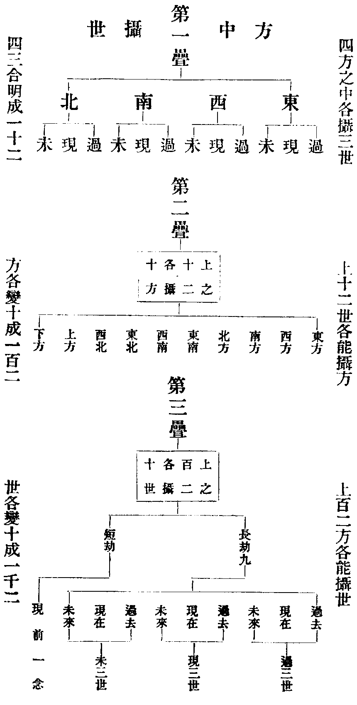

# 楞严经指掌疏



> **藏经**：卍新纂大日本续藏经（新纂卍续藏）　**册次** 第 16 册（X16）　**编号** X0308　**部类** 经疏部　**卷次** 10 卷　**篇幅** 538,594 字

> **作者（译者）**：京都拈华寺贤宗后学达天通理敬述

> **卷／品**：10 卷 · 0 品



---



## 目录



- [楞严经指掌疏卷一](#楞严经指掌疏卷一)

- [楞严经指掌疏卷二](#楞严经指掌疏卷二)

- [楞严经指掌疏卷三](#楞严经指掌疏卷三)

- [楞严经指掌疏卷四](#楞严经指掌疏卷四)

- [楞严经指掌疏卷五](#楞严经指掌疏卷五)

- [楞严经指掌疏卷六](#楞严经指掌疏卷六)

- [楞严经指掌疏卷七](#楞严经指掌疏卷七)

- [楞严经指掌疏卷第八](#楞严经指掌疏卷第八)

- [楞严经指掌疏卷第九](#楞严经指掌疏卷第九)

- [楞严经指掌疏卷第十](#楞严经指掌疏卷第十)



---



No. 308-A 续梦始末



余先注法华指掌，肇始於雍正二年甲辰，脱槀於乾隆十一年丙寅。及欲就梓，苦力有未充，不果。后於辛未冬，荷蒙和硕庄亲王奏放香界寺住持。阅明年，有徧空元等由岫云来参，请为过讲楞严正脉。初讲十门，即嫌其駮辨太甚，且前后次第与清凉大有径庭，不合贤宗家法。至题中繁言乱心，如洪阔等八义之类，亦私意之所不取。因不揣鄙陋，輙为签释。学众喜其易明，请制新疏。於是研精竭思，三越寒暑，草本虽创，未及再修。又蒙庄亲王举授僧录司副印，兼经呪馆供职。嗣是协办印务，对读呪经，仍复募梓前疏，遂於是经新疏无遑问矣。癸未夏，馆事少停，避暑山庵，即今三山庵也，旧名蔴家庵。岁久倾圮，不蔽风雨，拓其基而新之，易以今名。督工之餘，为兴、怀二子过讲是经，重订新疏。甫一过，又为二子过讲金刚般若，知无著菩萨昔於覩史多天慈氏尊处亲授八十行偈，於是有新眼疏、经偈合释之作。稿成之日，适万寿戒坛寺度博彚公过访，力任刊行，纪其事在乾隆三十年也。三十一年丙戌，正印秀翁逝世，又蒙庄亲王升授僧录司正印。未几，才不胜任，致干旧疾，四支不仁，难以任事。无何，乞假还山，静心调养。丁亥，疾稍可。戊子，取草本练覆，聊可自信。拟将募梓，旋蒙总管僧道录司皇六子谕令销假复印，兼奏放拈华寺住持。嗣是留兴子在山庵誊清，偕怀子随拈华校字，陆续募资料理寿枣。庚寅，奉旨照例於圆明园佛楼行走。三十六年辛卯，恭逢皇太后万寿盛典，赐紫於皇坛供事。自惟理以贫子出家，何当际斯隆恩？深生愧惭，无能仰报。讫今乾隆四十一年丙申，刊刻工竣，辞印潜修，祝延圣寿，答报国恩，了此餘年，实所愿也。余先於法华指掌编叙始末，有云：二十餘年，自视若梦期也；住此住彼，回想若梦中人也。几逾四十万言，皆梦中寱语。其间或逆或顺，皆梦中境界。即今编序始末，依然梦中说梦。然既云梦中说梦，则是一梦犹未醒耳。今又以二十餘年之工，制斯楞严新疏，岂不是一梦未醒，又续一梦也？且思如来说法四十九年，尚不曾道著一字，况是经是疏不足六十万言，又岂能道著一字乎？伏望后之读是经、阅是疏者，幸勿於中说是说非，又作实法会也。



旹乾隆四十一年岁次丙申僧自恣日



赐紫沙门贤宗后学通理谨识



阅疏凡例



是经流传震旦，疏记论解甚夥，采金集玉，诚让会解，辨脉寻源，无偕交光。今为接引初机，渐入堂奥，异彼旧说，恐骇新闻，宜强周览，勿轻间然。  

是疏自名指掌，取其明而且易。不避训诂，或涉繁蔓。智果超方，以任舍繁从要；立尚扶壁，且须由粗入微。勿嫌摘叶寻枝，莫便挂一漏十。  

(通理)资愧学知，智无兼人。未能徧扣高明，博览古著。疏中一言一句，多自胸襟流出。不善他文，未敢輙入。非有拣弃，勿强是非。  

全经脉络，有纲有目，目中复有纲目，如世祖父子孙，展转相生，曾无少紊。若纲之与纲，目之与目，则如兄弟相次，先后适宜。依此分科，自有层次。楞严正脉，颇得此诀，今疏倣之。但交师分析过甚，多於应续反断，初学不察，致义失贯，今疏别之。  

是疏为避繁分，间有一科之中含摄三二意者，若不眉目，莫决断连，因於本文用○断之。至疏中各标其意，如起首则曰初某意，释竟又曰某某下某意等，庶不至繁分而节旨判然。  

古疏随文科目，多不俱提。如一科分三，但标初科，即复曲分，或入文殊，令初学艰於检对。今遵弥陀疏钞科式，分已俱标，标已取次，会文疏讫，仍结某某科竟。若相邻甚近者，则不复结，为便观览，不至翻前揭后。  

楞严正脉交师用甲乙等字，以别科目层次，伯亭老人亦多承用。今疏全标科目，且疏竟仍结，前后次第，显然可见，故不更置甲乙等字。  

一音圆被，异解各呈。杵臼绳箕，共说象身之似。鹄雪贝稻，孰明乳色之真。因枝寻本，各选其由。入道从缘，不一而足。勿谓本疏多事，有碍此经广传。  

古德著疏，间有与私意相符者，亦微有采掇。若全用其语，则标以名字，如言正脉云等。若少有更换，则标唯义取，如言正脉义云等。盖不敢掩古之善也。  

金𨱎并列，玉石互陈，具眼者自能辨识，不在抑扬。按：正脉立义虽精，駮古太甚，致令后学一味在是非里卜度，不知向关节处跟寻，迷本昧源，其失非细。故今疏惟窃取其义，而执戈欲鬬之词，槩不敢用。又正脉於难处过详，於易处过略，唯逗利智，不接钝根。今疏於难处不过指授分明，於易处亦必略用敷演，为令三根俱被，利钝咸宜。



No. 308



------



## 楞严经指掌疏卷一



**译者**：京都拈华寺贤宗后学达天通理敬述



嗣法门人(兴宗祖旺誊清怀仁祖毓较字)



第九、总释名题者，谓名者实之宾，题者经之纲，一经大义萃在名题，故言总释，谓总释一经大义於名题中也。又名谓能译人名，题谓所译经题，而言总释者，谓人名经题以总释之也。即分为二：



一、经题二译人。



初。



大佛顶如来密因修证了义诸菩萨万行首楞严经卷第一。



释此经题，略作五义：一先会五名，二正释现题，三略备古法，四重申西名，五附释卷次。



初。



按经中佛自所说，有五种题名：一曰大佛顶悉怛多般怛罗无上宝印十方如来清净海眼。(正脉云境智为名，谓大等是境，十方下属智。)二曰救护亲因度脱阿难，及此会中性比丘尼，得菩提心入徧知海。(正脉云机益为名，谓阿难性尼为机，得菩提等是益。)三曰如来密因修证了义。(正脉云性修为名，以如来密因属性具，修证了义属修得。)四曰大方广妙莲华王十方佛母陀罗尼呪。(正脉云要妙为名，盖上七字为显为最妙，下八字为密为最要。)五曰灌顶章句诸菩萨万行首楞严。(正脉云因果为名，以菩萨万行为因，首楞严即果也。)今此题者，於五名中略取十九字，择要该广，次第摄经，乃结集者善巧所成。



二、正释现题四：一、指法宗体，即大之一字也。所言大者，即众生心，是心则摄一切世间、出世间法，故称为大。在华严即一真法界，而一真法界该四法界，统摄乎因因果果，无量妙门，无边妙义，不其大乎？诸经或目为实相，或目为佛性，或目为圆觉，或目为真如等，其实皆一心也。在本经即如来藏心，而如来藏心非一切法，一切法莫能收摄，即一切法，一切法莫能逃遁，离即离非，是即非即，言语道断，心行处灭，不得已强名为大。非对小言大，以对小言大，则大有分限，非真大故。亦非先小后大，以先小后大，则大有始终，非本大故。是知此大，十方无尽，三际莫穷，在迷为如来密因，在悟为修证了义，在因为菩萨万行，在果为首楞严王。一经要妙，不出此宗，十界纽枢，无逾兹体，以之冠首，良有以焉。



二、显法胜妙，即佛顶二字。所言佛顶者，即肉髻相上无见顶也。肉髻相为三十二相之一，在青螺绀发正中，如春山吐日，而顶不可见。如佛初降生，岚毗尼林神为佛乳母，捧持谛观，不见其顶。又佛成道后，游波罗奈，东方应持菩萨欲穷佛顶，上历沙界，终不能见，乃八十随好之一无见顶好也。用斯显法者，略有二义：一、佛顶最胜无上，显此法最胜，依之修习，直趣无上菩提故；二、佛顶最妙无见，显此法至妙，唯佛究尽，一切所不能了故。又上但显大，此复显其胜妙，盖直指法体为大，为佛顶耳。又佛顶亦可作喻，但不如直指之为亲也。



三、别出义相曲。分四：



一、正因密熏，即如来密因句也。如来者，十号之一，倣同先德号。释有二义：一、随相释，谓佛佛道同，后佛出世宛同，先佛再来，故名如来。二、入理释，随教浅深，难尽多种。今据终实，谓如为本觉，来为始觉，始觉究竟，即同本故，亦倣同先德义也。对下菩萨，即是果人，乃诸菩萨道后之号。密因者，即正因佛性。众生等有迷而不知，虽迷而不知，由内熏力故，遇缘信发，究竟可以成佛。正以可成佛，故名如来。因在迷不知，故复名为密。又因称如来，复名为密者，为遣两种人过：一、如来二字，遣小教二乘抱迷绝分之过。以彼不达即心即佛，自甘绝分，一向沈空。今闻因即如来，顿然梦觉醉醒，回小向大，成佛有分。二、密之一字，遣圆教狂慧废置进修之过。以彼才信自心，便谓是佛，一向废修。今闻但是密具，自知非是已成，从性起修，冀果方能。然此即是二根本中真本，所谓识精元明，能生诸缘，缘所遗者。至文中十番显见，且从眼根指出，以一例五，六根皆具。若扩而充之，不唯近具根中，实为远该万法。迨后会四科，融七大，明生续之因，示圆融之故，全彰三藏不离一心，如来密因之旨，显发无餘蕴矣。经文首从请定，至四卷前半，身意轻安，得未曾有？如来重重开示，令修奢摩，当机方以信顺。四分中开示奢摩成信分，义齐於此。



二、了因显发，即修证了义句也。因信起观曰修，盖即以观行为修，非历事造修也。由行成解曰证，盖即以解悟为证，非历位取证也。良以圆顿行人，信时即兼解悟，解时已有证入。故前分末即许阿难等心悟实相，而此段即云修证了义。其实前方是信，此方是解。盖以行布不碍，圆融取胜为言。然谓之了义者，有二义：一者了悟前义，二者了无餘义。了悟前义者，由前段当机信顺，虽知有如来密因，犹未能现量体悟。故自喻云：我今犹如旅泊之人，忽蒙天王赐与华屋，虽获大宅，要因门入(请观门求悟入也)。如是如来为之分门以定二义，验证以释二疑，绾巾以示伦次，冥授以选本根。盖即令其以耳门三昧修习证入，了悟前段如来密因义也。了无餘义者，谓耳根圆通，超二十四圣而独妙。依此修证，则因该果海，果彻因源，一修一切修，一证一切证，了无餘义可修可证。至下菩萨万行，亦不过圆融中略示行布之义。经文义分两段：首从四卷后半请华屋之门，至六卷中十恒沙众皆得本心，远尘离垢，获法眼净等，为开示理观。次从六卷后半请安立道场，至七卷中顶光说呪，显示利益，两众愿护等，为开示事仪。总为令修三摩四分中开示三摩成解分，义齐於此。



三、缘因助修，即诸菩萨万行句也。菩萨略梵语，具云菩提萨埵，此云觉有情。释有三义：一、约自利，谓觉虽分证，尚有情识故；二、约利他，谓觉彼有情，令他同己故；三、约两利，谓上求大觉，下化有情故。对上如来，即是因人，乃如来道前之号。而言诸者，通指禅那中分证诸圣五十五位之数。历位所修，行应无量，如十信全根力而植佛种，十住生佛家而成佛子，十行广六度而行佛事，十回向回佛事而向佛心，四加行泯心佛而灭数量，十地契真如而覆涅槃，等觉齐佛际而破生相。一具一切，主伴重重，缘起无碍，犹如帝网。今言万明多，非局定数也。准前释了义云：一修一切修，一证一切证，了无餘义可修可证。今又言万行者，良以行布既不碍於圆融，圆融又何嫌於行布？前为推重初心，解时即言证入，令知理由顿悟。此为对治狂慧，悟后仍分阶差，令知事必渐修。但悟后之修，无劳肯綮。如彼鹏飞万里，培风於未徙之先；龙骤千江，奋力在将行之际。是知圆顿行人功业，惟在初心乾慧，以后即属任运流入。故后识阴文云：从互用中，能入菩萨金刚乾慧，於是乃超十信、十住、十行、十回向、四加行、十地、等觉、圆明，入於如来妙庄严海。然既曰超入，自非蚁山蠖树可比。(蚁子登山，尺蠖上树，皆用力难到者。)经文自七卷后半，阿难请位，至八卷结示五名，中间历谈位行，皆为令修禅那。四分中开示禅那成行分，义齐於此。



四、妙果究证，即首楞严三字也。梵语首楞严。涅槃经佛自释云：首楞者，名一切事毕竟；严者，名坚。一切毕竟而得坚固，名首楞严。古德依此，遂明其为彻法底源，不动不坏。据古德意，言一切事毕竟者，即是穷彻诸法根底本源，如法华究竟诸法实相之义。或有翻为健相三昧者，亦以能究竟诸法实相故也。而得坚固者，谓事到毕竟，即性常住，故即明其为不动不坏。以既能穷彻诸法根底本源，法法无非实相，求於去来生灭，了不可得，有何动坏？如法华所谓世间相常住是也。承上，即是历前诸位修练治习，至斯乃穷彻诸法根底本源，不动不坏，证一切智，而成常住果矣。若以本经现文释之，与上稍异。谓凡一切事，毕竟坚固，即名首楞严。故古德亦有直翻为究竟坚固者。良以如来密因，久沦七趣；修证了义，动招五魔；菩萨万行，多缘理障。由是如来精研七趣，而明其原无；详辨五魔，而教以预识；重明五阴，而示以渐修。知此，则七趣不沦，五魔不扰，理障不蔽，奢摩、三摩、禅那，始终不坏。故直目之曰究竟坚固，所谓首楞严是也。是知首楞严义，通乎前之三分，以从前三离障得名。故初卷中，阿难所请者，乃妙奢摩他、三摩、禅那；而如来所许者，乃首楞严王经文。自八卷半，请谈七趣，至正宗分尽，无非令其成就乎此四分中，当开示楞严成证分也。已上别出义相竟。



四、结示诠体，即经之一字也。华梵名义，略见於藏乘分摄门中。杂心论出五义：一、涌泉，义味无尽故；二、出生，出生诸法故；三、显示，显示教理故；四、绳墨，辨析邪正故；五、结鬘，结成文相故。佛地论有二义：一、贯穿，谓贯穿所说法义；二、摄持，谓摄持所化众生。此方训释有四义：一、常，三世不易故；二、法，十方同遵故。昭明太子意也。三、径，修行径路故；四、典，摄生定典故。隐士刘虬意也。此属能诠，以大佛顶等是所诠故，通收声名句文，故为体也。已上正释现题竟。



三、略备古法二。



一、立题法，谓诸经立题，人、法、喻、单、复、具足，例有七种：一、单人，如净名；二、单法，如涅槃；三、单喻，如宝积；四、法喻，复如妙法莲华；五、人法，复如胜天王般若；六、人喻，复如佛说梵网；七、具足三，如大方广佛华严。今例华严，谓佛顶亦可作喻，如来菩萨为人，餘皆是法。然既法喻合明，足显幽深，况是如来菩萨境界，自非权小诸经可比。



二、释题。法正脉云：古式有二：一、作对释，二、离合释。今作对有五：一、法喻对，谓大字是法，佛顶是喻。二、体用对，谓大佛顶是体，如来密因等是用，以有生信、发解、成行、致果等用故。三、性修对，谓如来密因属性，修证了义属修。四、因果对，谓万行是因，楞严为果。亦动静对，可知。五、通别对，谓经是通题，以修多罗藏皆名经故；上属别题，以大佛顶等非餘经故。又诸经通五人说，故名为通；大佛顶等局在佛说，故名为别。



离合亦五：一、大字是法，约理故胜；佛顶是喻，约相故劣。佛顶上加之字，依主释也。二、如来密因属性，修证了义属修，两别双举，相违释也。下二句因果相违，可知。三、万字是数，行字是体，万下加，即字体挟数量，带数释也。四、经字是体，如来密因等是用，经上加，即字体持业用，持业释也。五、大佛顶等是经之所有，经上加，非字分取他名，有财释也。隣近一释，文不明显，必欲作者，应云大佛顶等是修多罗藏，故称为经，即居近隣，强隣近释也。正脉云：此不废古释，略备参考，餘不悉



四、重申西名。谓此经亦名中印土那烂陀大道场经，於灌顶部录出别行。释曰：此别行题目也。印土即是天竺，於下译人中释。那烂陀，此云施无厌。西域记云：此伽蓝南庵没罗林有池，其龙名那烂陀。据此，乃是以龙名池，依池名伽蓝，以其近彼池故。佛灭度后，六帝缉兴，园林绀宇，都建一门，主客万僧，住持高俊。印土名蓝，无过此者，故以大道场称之。经依道场，故即以道场名经。灌顶部者，彼经五部之一，此一部中，仍该多经。今此经者，乃於中录出各别行持，尤见其为至精至要法也。



五、附释卷次。卷者对舒而言，谓舒之以便诵持，卷之以便供奉也。又古经书多以轴为卷，今易制未易其名耳。第谓次第，一者数之始也。此经文有十卷，以次第论此卷为始，故云第一(后卷次例知)。经题竟。二、译人四。



一、主译人。二、译语人。三、证译人。四、笔受人。



初。



唐中天竺沙门般剌密谛译。



首言唐者，纪译经时也。按译经图记，此经翻译在则天罢政，中宗嗣位，神龙元年时，故中天竺标译人处也。灌顶云：天竺，或云乾竺、乾豆、身毒、印度等，皆梵音轻重耳。此云月邦，以其有圣贤继轨，导凡御物，如月照临故。又以此大国形诸小国，如星中月故。或云：三垂大海，北背雪山，北广南狭，如半月形故。地当阎浮中心，周九万餘里，东西南北及中，皆名天竺。译主乃中天竺人也。沙门者，释子通称，此云勤息，谓勤修戒定慧，息灭贪瞋痴故。般剌密谛者，译主别名，此云极量，谓自行化他，皆极尽其量故。或云到彼岸，或云成办究竟，皆极尽其量之义。末言译者，纪译经之事也。译谓翻易，谓翻易西梵之语，而为东华语故。正脉云：特科为主译者，以此经未来盛名，先至天台，西向拜求，一十八年，竟未谐愿。彼国禁为国宝，师潜匿航海，賷来於唐。中宗初年，达广州，适遇房相，请於制止寺，译成速回，以解责边之难(国王因师潜过，罪责守边官吏故也)。夫大师冒禁艰苦，志益此方，且具通方智辩，总统译场，虽功成身退，而名不可泯，故首标主译，以重元勋也。



二，译语人。



乌苌国沙门弥伽释迦译语。



乌苌，奘传名乌仗那，唐言苑，阿输迦王之苑囿也。旧曰乌场，或乌茶，在北天竺境。弥伽释迦，此云能降伏，以於内外魔怨皆能降故。译语即是翻音，言西梵语字与此全殊。若观梵本，非唯不知其语，兼亦不识其字，须先随其梵音，以此方之字易之，名为翻字。翻字之后，方可读之。然同於呪语，却须兼通两国言音者，变梵语为华言，名为翻音，今云译语是也。亦云度语，谓酌度两国言音，务使彼此相当，定言词成章句故。不先列翻字人者，以私译不备员，亦此师代之耳。



三，证译人。



罗浮山南楼寺沙门怀廸证译。



摸象云：古本并有第三罗浮沙门怀廸证译一行，不知今本何以不载，后刻经者宜增入之。灌顶云：廸师，循州人，因住罗浮山南楼寺，故山寺俱称，令远近皆知。故廸者，进也，循也。沙门名怀廸者，取其常怀精进，循道而行之意。证译者，谓於翻字、翻音二中，总为参详较正。以师久习经论，备谙五梵，故於译场之中，独充此职。然前二师身生西国，语精梵言，虽亦兼美唐文，乍来恐未尽善。经师参详较正，不唯不谬佛意，兼亦善合机心。佛法流通，厥功非细，愿诸后贤，各思报本。



四、笔受人。



菩萨戒弟子前正议大夫同中书门下平章事清河房融笔受



菩萨戒，大乘戒也。梵网经云：欲受国王位时，百官受位时，应先受菩萨戒。一切鬼神救护王身、百官之身，房相遵此受。此以菩萨为兄，以佛为父，故自以弟子称之。此法衔也。次下明世职。前者，先也。以下官名，皆其先任旧职故。正议，史称正谏，言官之名。大夫者，大正风化，扶树人才，有维持世道之任，举荐贤能之责也。同者，兼同协理之义。中书、门下，二俱内省左右相府之名。中书省多掌王言，门下省多出政事，融乃权兼两省，故并书之。平章者，书曰平章百姓。平，均也；章，显也。谓均理政务，章显法度也。事即政务法度之事。不言现职者，为讳被谪事故。清河，地名，房相之梓里也。房相名融，其子名琯，父子俱相，而融事略出琯之传文。笔受者，谓前三师已成草本，房相受之，秉笔润色，务使文质相当，雅俗兼利，故正脉以润文科之。夫如来灭度，佛法付嘱王臣，因缘会遇，遭际各殊。详融事，为相於武后末年，被谪於中宗元年，才至广州，便遇斯典，请译笔受，成此莫大功德。以世情观之似可悲，以佛法观之则庆甚矣。总释名题竟。



第十、别解文义者，谓文分十卷，义派干差，若不解千差之义，难以销十卷之文。空说名题，徒诵词句，信解无以，行果安成？为此别解，不避烦分。然道安雄判，既雅合於亲光，而指掌新疏，亦承用乎三分：一、叙分，二、正宗分，三、流通分。



初二。



一、六成证信叙。二、二缘发起叙。



初、(六成者，六种成就，谓信、闻、时、主、处、众也。六种阙一，大教不兴，故云成就。言证信者，谓标记主伴，指说时方证，法有所授，令人生信故。)二。



一总标五成，二别列听众。



初。



如是我闻：一时，佛在室罗筏城祇桓精舍。



如是者，信成就。为顺此义，作信顺之词。以信者言如是，不信者则言不如是，故此随相释也。又一切事究竟坚固名如，离生灭去来等见名是，此入理释也。又无上法王是真实语，如所如说名如，不诳不妄名是，此据文释也。又如佛所说，无有不是，亦信顺义。智论云：佛法大海，信为能入，故为第一。若对下文，应作指法之词，即指者一部经说。



我闻者，闻成就亦结集者，自述法有所授故。夫圣人无我而云我闻者，盖是随世假我，亦法身真我，拣非妄我及於邪我。闻谓亲闻，非私淑读古者可比。下云此方真教体，清净在音闻，故为第二。若连上为句，应云如是一经我从佛闻。



一时者，时成就不纪年月，但云一时者，以如来说法处无定方，灭后结集传通异域，约东西正建不同，约上下延促不等，彼此差互难以考稽，故总言之。盖取师资合会说听究竟为一时也。古德云：欲识佛性义，当观时节因缘。时节若至其理自彰，故为第三。若对上句，应是追忆昔闻，漫言彼一时也。



佛者主成就，梵语佛陀，此云觉者，十种通号之一。觉有三义：一、自觉，拣凡夫；二、觉他，拣二乘；三、觉满，拣菩萨。者字训人，通指能觉人说。若就今经别指释迦，以楞严会主非餘佛，故法华云唯有如来我等所归，故为第四。



在室下处。成就室罗筏，具云室罗筏悉底，旧云舍卫，或云舍婆提，此翻丰德，或翻闻物，谓国丰四德(财宝、五欲、多闻、解脱)，为物所闻故。祇桓精舍，在室罗近境。祇即祇陀，亦云逝多，匿王太子也，此翻战胜，以太子生时，匿王凯旋，故名桓林也，是其所施故。精舍，给孤园也，园中置舍，最极精奇，舍园从舍称，故原园林，俱属太子。给孤长者，买园建舍，请佛说法，不辞布金之费，遂感太子，并林施之，君尊臣卑，故桓先舍次。诸经多言祇树给园，此称校雅，下云属诸比丘，休夏自恣，佛僧安居，非此不可，故为第五(长者买园事，详涅槃、阿含、贤愚等经，非急不载)。总标五成竟。二、别列听众。二。



一、声闻众。二、辟支众。



初三：



一举类标数，二明位叹德，三略出上首。



初。



与大比丘众。



○千二百五十人俱



初、举类显胜。与者，并与兼及义也。大者，拣小，非有学故。又三义名大，谓大、多、胜。大者，天王、大人所共敬仰，非小德故；多者，内外典籍无不博通，非寡解故；胜者，超出九十六种外道，非劣器故。比丘名含三义：一、乞士，谓乞食、乞法，资益身心故；二、破恶，谓破见、破思，涤除诸恶故；三、怖魔，谓出家、出界，魔怖失党故。众者，梵语僧伽，此云和合众。和合有二：一、事和，谓戒、见利，身、口、意六事俱和故；二、理和，谓同证择灭无为法故。今但言众，不言和合者，以众则必和，不和非众也。



○下句标数显同。报恩经云：初度陈如五人，次度耶舍门徒五十人，次度优楼频螺门徒五百，次度伽耶门徒三百，次度那提门徒二百，次度身子门徒一百，次度目连门徒一百，共计一千二百五十五人。今减五人者，略零数故。俱犹同也。此等皆久修异道，空无所获，遇佛得益，感恩常随。今亦同听，故云与俱。举类标数竟。



二，明位叹德。



皆是无漏大阿罗汉。



○佛子住持，善超诸有；能於国土，成就威仪；从佛转轮，妙堪遗嘱；严净毗尼，弘范三界；应身无量，度脱众生；拔济未来，越诸尘累。



初、据迹明位皆是者，无异众故。漏谓三漏，谓欲漏(欲界烦恼)、有漏(上二界烦恼)、无明漏(三界无明)也。具此者，如漏器不堪用故。又於生死中有漏落故，此众已断，故云无也。大有三义：一、拣定性，能回心故；二、拣实行，是权现故；三、拣同类，称上首故。阿罗汉亦三义：一、应供，堪为福田故，即乞士果；二、杀贼，杀烦恼贼故，即破恶果；三、无生，永绝后有故，即怖魔果。小乘久擅斯名，故为迹也。



○佛子下，约本叹德明位，据迹叹德。约本者，引小乘向大乘故。外现声闻，内秘菩萨，故称佛子。既称佛子，不屑逃形自守，故云住持。谓住世间，持佛法化众生故。虽住世间，不为诸有所系，故曰善超。若一向沈空滞寂者，纵超非善。诸有者，略明有三，处中说九，广演成二十五。其中因果不亡，故称为有。国土，王都也。繁华射眼，胜欲牵心，具威具仪，不易可得。曰能於，曰成就者，自是尘中作主，非彼勉强诈饰者可比。从，随也。佛转法轮，教化众生，此众常随，引摄同类。故超有则不著於有，具仪则不沦於空。空有不覊，故以妙称。又以其从佛转轮，缘结有素，故堪遗嘱。谓遗命成佛，嘱累度生，二俱堪故。此上叹自利之德，虽兼利他，乃借物成已，仍属自利。毗尼者，戒律之总名。治身曰严，治心曰净。又事戒则严，理戒则净。今显理事双持，身心并治，故曰严曰净。然亦非徒自利，故曰弘范三界。谓弘开法范於三界中也。应身者，随机应现。无量者，机有无量，应身亦无量故。度脱众生者，不惟现身亦兼说法，如法华妙音观音之类。未来者，总该尽际。尘累者，通摄尘劳。言众生尘劳累坠轮转生死，如堕深渊、如沈巨溺，此众能挽之令起、渡之令过，故曰拔曰济。此上叹化他之德虽兼自利，乃以己成物仍属化他。此化他德中，初云弘范三界似局一土，次云应身无量则该十方，末云拔济未来乃通尽际，则横竖无不可化之生矣。(问：法华叹德显然声闻，此经叹德明是菩萨古德。据此判楞严在法华之后，似为当理。若在前者，此云何通？答：结集善权本迹互影，法华处处显本故叹德惟迹，楞严在在皆迹故叹德惟本。本迹原自无碍，互影方显不遗。若不尔者，则法华惟本不显摄生之权，楞严惟迹全迷实证之深，岂尽善哉？诸经亦有不尔，或但为一类机故。)明位叹德竟。



三、略出上首。



其名曰：大智舍利弗、摩诃目犍连、摩诃拘𫄨罗、富楼那弥多罗尼子、须菩提、优波尼沙陀等而为上首。



舍利尊者，母也。此云鹙鹭，以其母眼净口利可比此鸟，故以为名。弗翻为子，尊者是其所生，连母为号。亦云身子，以其母身形端正，犹云端正身者之子。故阿含云：我佛法中智慧无穷决了诸疑者，舍利弗为第一。故今以大智称之。



目犍连，此云采菽氏，姓也。上古有仙居山，采菽而食，因以为姓，尊者其苗裔耳。名尼拘律陀，此云无节树，以父母无子，祷树神而生，即以名焉。阿含云：我佛法中，神通轻举，飞到十方者，目犍连为第一。以其有大神化，故不名其名，惟姓上以摩诃拣之。



摩诃拘𫄨罗，此云大膝，身子舅也。往论胜姉，姊孕身子，则不能及。知其所怀智人，生必胜我。因而发愤，游学南竺，读十八种经，无暇剪爪，世称长爪梵志。学优还家，诣佛索甥。佛令立论，乃曰：我以一切法不受为宗。佛曰：还受是见否？自思：若受是见，自宗相违(以立不受宗故)；若不受是见，自宗则坏(以不受故，还同众见，不应立是宗故)。义堕词屈，向佛谢罪。佛令出家，证无学果。阿含云：我佛法中，得四辩才，触问能答者，拘𫄨罗为第一。



富楼那，此云满愿，尊者父也。弥多罗尼，此云慈女，尊者母也。尊者是其所生，称谓从略，故但云满慈子。阿含云：我佛法中善能广说分别义理者，满慈子为第一。



须菩提，此云空生。以尊者生时，其家库藏皆空，父母疑之，库藏复现，故又名善现。相师占曰：既善且吉，故亦名善吉。常修无诤三昧，佛弟子中解空第一。



优波尼沙陀，此云尘性，观尘性空而得道故。又云：近少白骨微尘，色将尽故。自陈圆通文云：以从不净白骨微尘归於虗空，空色二无，成无学道，如来印我名尼沙陀。餘众不能俱列，故置等言，并是法门头角，大众纲领，故云而为上首。声闻众竟。



二，辟支众。



复有无量辟支无学。



○并其初心，同来佛所。



○属诸比丘休夏自恣。



初正叙无学。楞严听众非止声闻一类，故云复有。数称无量者，极言其多故。辟支具云辟支迦罗，名含二义：一独觉出无佛世，随时观变体物自觉者；二缘觉出有佛世，禀教观缘缘断证真者。慈恩云：释尊出世，五百独觉从山中来(出无佛世住山待佛者)。仁王云：八百万亿缘觉大仙皆来集会。今二类俱有故存。梵言无学者，真穷惑尽，於自类中无所学故。



○并其下，兼明有学，师偕其资，故云并也。初心即是有学，谓初发取证辟支心，故同来者资随其师，亦风行草偃义也。



○属诸下。总陈来意。属，附也。言此众既非常随，许於异处安居。今相将而来，意为附诸比丘作自恣法耳。诸比丘，指常随众，以是声闻律仪僧故。休，竟也。佛制比丘夏月安居，一为结制办道，一为护生避嫌。今当竟夏之日，即九旬解制时也。佛制於七月十五，或十四、十六日解制，考劾九旬德业。自知己过者，自己陈说。自不知过者，恣任僧举。故曰自恣。葢恐稍有瑕玼，即玷清众故也。然此中辟支，与上科声闻，俱属当机。以此经原为融其小心，成就大志。古德云：子期不遇，伯牙绝弦。法若无人，说将谁听？故为第六。(此上六种成就，亦名通序，通於诸经故。亦名经后序，结集建立故。结集建立，有因有意。繁见诸疏，解中不录。)六、成证信叙竟。



二、二缘发起叙(诸教兴起，各有感发之缘，或多或少，各有取意，今具二缘)。二。



一菩萨发起，二声闻发起。



初二。



一、略示类引。二、新旧机发。



初(咨决心疑，引发戒学。敷座晏安，引发定学。宣示深奥，引发慧学。葢如来将示真戒定慧，先以一类之缘，引动本机。至正说时，自如时雨之化矣。)。



十方菩萨，咨决心疑，钦奉慈严，将求密义。



○即时如来敷座晏安，为诸会中宣示深奥。



初、妙机冥啐。菩萨奉命度生，各据一域，故以十方称之。离佛既久，就正无缘，於诸大乘律仪，未能心无疑惧。今当休夏，归来自恣，故云咨决。谓咨问於佛，请求决断也。钦敬、承奉、遵依也。佛具折摄二门，於所咨决，应析伏者，则如父之严；应摄授者，则如母之慈。而菩萨敬承遵依，无敢违越，以本为自恣来故。自恣已毕，妙机冥动，故曰将求。将求者，存诸心，未及言也。密义者，定慧均等之义。良以二乘人等，不达自性本定，纵修禅寂，俱堕偏枯。及乎般若，却又惟尚虗慧，遂令定慧均等之学，转成密义。菩萨知此，欲为引发，口虽未形，而意已彰著，故直记之曰将求密义。



○即时下，深应时啄。佛智鉴机，应不失候，故云即时真啐啄无违也。敷座者，敷具而坐。晏安者，晏静而安。葢将有所说，少时入定，审机观法，为物示轨耳。又晏而云安者，从容自然，不假造作，即天然本具之定也。出定酬机，故云为诸会中。会中亦兼声闻，谓能引所引，两俱为故。宣示者，宣演指示。深奥者，深微奥妙。即应前密义之求，而说定慧均等法故。准法华发起叙，初先说无量义经，次入无量义定，而为正说类引。今经先定后说，但未出经定名目。以义揆之，必是楞严一类，所谓先以定动，后以智发也。略示类引竟。



二、新旧机发。



法筵清众，得未曾有。迦陵仙音，徧十方界。



○恒沙菩萨来聚道场，文殊师利而为上首。



初、旧住机发，敷座设筵，为众说法，故曰法筵。清众者，常随众及先来众也。已经自恣，故曰清众。对下新来，因称旧住。密义深奥，向所不说，故曰未有。菩萨极领妙旨，二乘方闻绝唱，故云得也。迦陵，具云迦陵频伽，此翻妙声，鸟名也。音声微妙，和雅不伦，故以仙音称之。正脉云：在𣫘发声，已逾众鸟，知非凡鸟可比。取喻佛音者，以佛音之形众声，与迦陵之比凡鸟略相似耳。其实佛音圆徧，岂迦陵可及哉？如宝积第十目连试佛音声，以神足力飞过西方恒沙国土，还同近闻。今云徧十方界，可以例知。



○恒沙下，新来机发。恒即恒河，正音殑伽河，此云天堂。来源自雪山顶阿耨达池流出，状其来处最高故。河中沙细如面，用计菩萨，极显其数之多也。道场即指桓舍，以是佛僧办道处故。来聚者，闻音而来，会聚於此，乃不约而同也。文殊师利，亦云曼殊室利，此翻妙吉祥，以菩萨生时有祥光满室之兆故。或云妙德，或云妙首，以其具胜妙德，为群贤首故。古德云：过去成佛，号龙种尊王。现在北方，为欢喜摩尼宝积。当来成佛，名曰普现。葢为影向大化，示居因门。华严表根本智，今经作择法眼。且为发起性定，率众来兹，故以上首称之。然旧住之众，既得略教，自应进希广谈。新来菩萨，闻音而聚，明是要聆深法。机发之义，可以意会。(此上两科，虽为引发正说，而亦为显楞严会上众有菩萨。列众中不叙菩萨者，以此。)菩萨发起竟。二、声闻法起。三。



一、王臣斋供。二、阿难误堕。三、如来救度。



初二。



一匿王斋佛，二臣民供僧。



初。



时，波斯匿王为其父王讳日营斋，请佛宫掖，自迎如来，广设珍羞无上妙味。



○兼复亲延诸大菩萨。



初、正请如来时，即众僧自恣之时，诸佛欢喜之日。此日荐亲，功倍寻常，如盂兰经俱悉。波斯匿，本国王名，此翻胜军，谓军旅最胜，诸国无能敌故。为其下，寻常作句欠妥，当於讳日下作句，请佛下作句，如来下作句，於词既通，於理亦顺。讳日者，亲丧之日，讳有二义：一、忌讳，谓忌举吉事，哀切不胜故；二、隐讳，谓隐而不言，言之即恸故。世礼如是佛教，则令修冥福，以资神道。匿王遵此，故云为其云云。营斋者，营办斋供。请佛者，祈资冥福。以佛具大神力，有大慈悲，能追异世之魂，与当来之乐故。宫掖者，内庭左右门也。佛由中门，王不敢并，故但於左右迎之。言自迎者，为迓万德之尊，自屈万乘之贵故。珍羞者，贵重食品。广设者，诸般俱备，尽世所有，以供甘旨，故称无上妙味。



○兼复下。兼延。菩萨既已随佛，而重标亲延者，但是神顾语及，非另迎也。正脉云：请佛以下，有六重见敬之至。谓其处则内，其迎则亲，其设则广，其羞则珍，其味则妙，其伴则同。愚谓非世尊无以成匿王之信，非匿王无以见世尊之德。请者受者，均为典型。匿王斋佛竟。



二、臣民供僧



城中复有长者、居士同时饭僧，伫佛来应。



○佛勅文殊，分领菩萨及阿罗汉，应诸斋主。



初、延僧伫佛。盂兰仪范，上行下效，故云城中复有等。长者齿高德隆，居士守道居正，二皆有臣有民，如须达、东坡、耶阇、庞公之类(须达有位长者，东坡有位居士，耶阇无位长者，庞公无位居士)。同时者，不惟众同，亦与王同。葢以僧自恣日、佛欢喜日，乃合正制故。饭僧者，以饭供僧；伫佛者，引领望佛。然饭僧必伫佛者，以佛来僧方至故，又分应须佛勅故。



○佛勅下。佛勅分应。文殊身兼宾主，且为上首，故独勅之。又佛勅分领者，非勅文殊自领，葢令其分派两乘上首，各领大众依次赴请。如今主丛林者，命执事次第差僧之类，随请者意分众多少，故云应诸斋主。(此上两科虽为引叙阿难堕事，而亦为显楞严会上众有王臣，列众中不叙人天者以此。)王臣斋供竟。二、阿难误堕。二。



一、误堕之由。二、误堕之事。



初。三：



一、不矜小制，二、妄拟大乘，三、临事假饰。



初。



唯有阿难先受别请。



○远游未还不遑僧次。



○既无上座及阿阇黎，途中独归。



初离众受请，唯有二字直声其过。言众皆不尔，唯有阿难如此，岂得无过？别请者，别种事缘所请，如忏罪施物等。言先受者，受请在先似应无过，但自恣在迩海众咸集，纵遇别请亦不应受。此其不矜小制者一也。



○远游下故意愆期。远游二字，亦直声其过。言纵受别请，事毕即宜速归，乃乘便远游，届期未还，岂得无过？遑，暇也。不遑僧次者，谓自恣赴斋，俱不暇及众僧班次。此其不矜小制者二也。



○既无下，不依常度。上座者，坐次居上，或齿尊，或戒先，或智广，或德重，为众所推，皆可称之。论明三种：一、生年(即齿尊)，二、福德(即德重)，三、法性(兼智广、戒先)。阿阇黎，唐翻轨范，隋言正行。谓能行轨范，纠正弟子行故。四分开五：一、出家(即剃度师)，二、教授(即受具教仪)，三、羯磨(即禀白羯磨)，四、受经(即依之受经)，五、依止(依住乃至一宿)。首言既无者，亦直声其过。言律制一僧远出，必以二师翊从，所以严行止也。今言俱无，岂得无过？途中独归者，显信意无拘，违越毗尼，致非招难。此其不矜小制者三也。如此行履，深位犹难，方证初果，便尔无忌。则下之误堕婬室者，非无故也。



二、妄拟大乘三：一、无供循乞，二、展转释意，三、总出其由。



初。



其日无供，即时阿难执持应器，於所游城次第循乞。



其日无供者，谓归来之日，无人供斋。此有二因：一、无侣独归，人不知故；二、佛勅分应，数各备故。即时者，即於食时。应器者，受食之具。梵语钵多罗，此翻应量器，应己食量而为大小故。又体、色、量三，皆应法故。执而持之者，用以乞食，翼三宝，备六德也。闻物之国，地广人稠，一人乞食，岂能徧历？故但云於所游城，显经游不到处，则不乞故。次第者，从外向内。循乞者，顺序而乞。顺序而乞，则持心平等；从外向内，则不拣种族。此菩萨行履，而阿难拟之，将必有畫鹄类乌之羞矣。



二、展转释意。



心中初求最后檀越以为斋主，无问净秽刹利尊姓及旃陀罗。



○方行等慈，不择微贱。



○发意圆成一切众生无量功德。



初释循乞意，言小乘乞食向拣五家(官唱屠沽婬)，今一旦次第循乞，其意何居？故以心中初求等释之。檀越此翻施主，或云檀翻为施，越是华言，谓以施福越贫穷海故。言最后者，指至秽至贱之家，虽至秽至贱，若等心观之皆为檀越，但向所不乞今始发是心，欲得彼供以为斋主，故曰心中初求。秽贱尚求，何况净贵？故总以无问。刹利者，具云刹帝利，此翻王种，或翻田主，谓帝王种族奕世相承主国田者，四姓中尊故曰尊姓，此净而贵者也。旃陀罗，此翻屠者，亦名严帜，谓屠杀为业，不许与良民共处，行则持帜为严，见者避之，此秽而贱者也。



○方行下，释初求意。言初果力微，乞食应遵常法。初求最后，檀越何所为乎？故以方行等释之。方行等慈者，谓倣效菩萨行平等慈也。行平等慈，自应无所拣弃，故曰不择微贱。



○发意句，释方行意。言小贵安小，必欲方行菩萨，取何益耶？故以发意等释之。发意者，发大乘意。圆成者，圆满成就一切众生。总该净秽贵贱。言菩萨等慈而乞，众生随意而施，各得无量功德。若乞者拣择，则令一切众生，有得圆成，有不得者。阿难不屑於此，所以方行菩萨。然善则善矣，第恐从井救人，非智者之所为耳。展转释意竟。



三、总出其由。



阿难已知如来世尊诃须菩提及大迦叶为阿罗汉，心不均平。



○钦仰如来，开阐无遮，度诸疑谤。



初曾见被诃言，如上所说，已知次第循乞意矣。但意不自兴，感发有由，故云阿难已知等也。诃二圣事，古德指在净名。又自会云：净名诃，即知如来亦诃。又云：彼是金粟如来，与释迦何别？此说虽亦可通，终不稳顺。愚谓不必定指，良以三藏圣教，未来此土者尚多，即已来此土，目所不及者亦有。安知餘经餘论，别无诃责二圣之处，再俟参考。如来者，十号之首。世尊者，十号之末。为摄中间，故尔双称。正脉云：须菩提舍贫乞富，意在与续善根，恐将堕落，且无减尅之难。大迦叶舍富乞贫，意在怜其久苦，与植乐因，且无趋富之议。是以无学尊位，而为此不平之事，故佛诃责其非也。



○钦仰下。钦仰改辙。如来诃彼二圣，言犹在耳，敢不钦敬。佛为销其偏私，融归平等，可不仰慕。正由钦敬仰慕，所以顿兴大意。一则开启阐扬无遮限之普心，一则度诸世间难声明之疑谤。葢以心有遮限，则疑谤难免。谓偏贫多致疑，偏富多致谤也。妄拟大乘竟。



三、临事假饰。



经彼城隍，徐走郭门。



○严整威仪，肃恭斋法。



初入城之仪。城隍者，城外濠壍，有水为池，无水为隍，从外而入，故先经此。郭门者，门外护门，即今瓮城门也。将入城内，略加矜持，故曰徐步，谓安详徐徐而步履也。



○严整下。正乞之仪。严者慎其容，整者敛其服。慎其容则有威可畏，敛其服则有仪可仰，故曰威仪。肃谓严其心，恭谓敬其事。严其心则斋诚不乱，敬其事则法则不失，故曰斋法。戒经云：此丘入聚落，无违戾他事，但自观身行，若正若不正。楞伽云：乞食出游行，前视一寻地，摄念而行乞，犹如蜂采华。今阿难非不符式，但此要习之有素，用於临期，自然从容中道，不思不勉。看他般若经中，世尊临乞食时，着衣持钵，便入舍卫，何曾有丝毫加意。而此中曰经，彼曰徐步，曰严整，曰肃恭，一味有心，全属假饰，安得不令摩登伽女伺得其便哉。此论实行，若就权现者，阿难实不如是。葢为诈现威仪，已向不矜者作覆辙耳。误堕之由竟。



二，误堕之事。



尔时，阿难因乞食次，经历婬室，遭大幻术。摩登伽女以娑畏迦罗先梵天呪，摄入淫席，淫躬抚摩，将毁戒体。



尔时，即加意严肃时也。次，谓鳞次不相越逾之义。因乞食不相越逾，净秽无问，所以经历淫室。遭，遇也，堕也。谓不期而遇，堕落其中也。幻术者，虗幻呪术，眩惑心目。登伽经云：有摩登伽神语符呪，能移日月堕地，亦能呪梵天使下，况沙门阿难耶？据此知非寻常幻术，故以大称。依戒因缘经，摩登伽翻小家种，亦下贱种，是其母名。女名钵吉蹄，此翻本性，谓虽堕淫女，本性不失故。或翻石性，谓其性如石，不可转移故。在俗名性女，出家名性尼。今云摩登伽女者，依母彰名，故以用也。上为能用人，下为所用术故。娑毗迦罗，冥性外道也。此云黄发，亦云金头，谓头发黄如金色故。先梵天，指过去梵天。呪，祝词也。本是邪呪，伪称过去梵天所说金头，传登伽用，故逆次标之。摄入者，准戒因缘经，钵吉蹄白母，愿以阿难为婿。其母即以牛粪涂地，结彩然灯，烧香诵呪。阿难意便恍惚，随其呪术，竟至其家。婬席者，登伽寝席。淫躬者，登伽欲身。抚摩者，抚揉摩按。言阿难既入席临身，登伽自欲燄飞扬，其抚揉摩按之态，势所不免。但如扶醉抱尸，莫可如何耳。戒体者，律仪戒无作体也。谓於受戒时，心力巨大，能生妙善无漏色法。由此从思种上，便有一分防发功能，名无表色，故曰戒体。是非色非心聚，持之则肥，犯之则羸。若破根本，则戒体毁矣。下云：心虽明了，力不自由。又云：心清净故，尚未沦溺。故知阿难戒体，虽曰未毁，然已至危，故曰将也。(问：声闻众中，僧尼甚多。发起此经，必以阿难及登伽者，何也？答：各有二义。阿难二义者：一显闻不足恃，二显他不足恃。闻不足恃者，谓阿难多闻第一，一遭幻术，便不能免。况夫才登讲肆，方学读文，遇境逢缘，宁不惧乎？他不足恃者，谓阿难是佛堂弟，从佛出家，彼此身心，尚不相代。况夫师非圣贤，遇若萍水，恃而不修，岂不误哉？登伽二义者：一谓策发初心，二谓勉励久修。策发初心者，以登伽破他净戒，无自修心。一蒙呪力，便证三果。欲爱乾枯，成精进林。何况发菩提心，求佛利生。若更加持呪，则风帆顺水，萨婆若海，不患其不至矣。勉励久修者，以登伽宿为淫女，业障最深。一念熏修，无漏善故。或得出缠，或蒙授记。况夫久修净行，惑习已薄。若奋起精进，则斩丝染色，生死苦轮，谁谓其不出乎？)阿难误堕竟。



三、如来救度三。



一佛归众随，二化佛说呪，三勅救归来。



初。



如来知彼淫术所加，斋毕旋归。



○王及大臣、长者、居士俱来随佛，愿闻法要。



初、佛知速归。彼指阿难，如来法眼鉴彻，故能知也。淫术所加，事在危急，戒体将毁，救不容缓，故斋毕旋归，谓事讫作速转来也。



○王及下众，随希益资中云：如来常仪，受请斋了，皆为说法。今日速归，必有所为。故王臣等俱来随佛。其意以佛顿越常仪，必谈最胜之法。心要之义，各皆仰望。故曰：愿闻法要。正大机冥动也。



二，化佛说呪。



於时，世尊顶放百宝无畏光明，光中出生千叶宝莲，有佛化身结跏趺坐，宣说神呪：



阿难被术王等机动，救应无违，故即於此时放光。光从顶放者，亦表所说神呪最胜无上最妙无见之意。光具百宝利益之色，表呪具摄授之慈，无善不成。光具无畏威烈之相，表呪具折伏之严，无恶不摧。光明有破暗照物之功，表神呪有破惑照真之用。既有破惑照真之用，自能出生无碍圆因。以千叶莲华表圆因无碍，一具一切，一切即一故也。既能出生无碍圆因，自能成就无为妙果。以有佛化身表妙果无为，非空非有(有佛非空，化身非有)，空有无碍故也。结跏趺坐者，双叠其足如龙盘结，诸坐法中最安隐不疲极，摄手足心不散故。佛如此坐，化佛亦然，表此呪即是权实同归不动法故。能表既备，所表斯彰，故以化佛无障碍心而宣说之。呪而言神者，力用难思，至下自见。



三、勅救归来。



勅文殊师利将呪往护，恶呪销灭，提奖阿难及摩登伽归来佛所。



上命曰勅。人王法王，皆可称之，文殊所勅人也。佛不自救者，足三宝作将来式故。如来佛宝，神呪法宝，文殊僧宝。法虽佛说，非僧不传。僧宝所系，亦大矣哉。必勅文殊者，以阿难邪术魇，非大智莫能醒。登伽淫痴缚，非大智莫能解故。将犹持也，义通口意，谓口诵演，意观念也。若兼身往，则三业俱持。护谓遮护，遮邪术，护正心故。真法幻术，力用霄壤。故神呪才及，恶呪便销。汤雪日暗，可为譬矣。所谓力用难思者以此。提谓提擕，奖谓奖劝。言阿难如醉初醒，不能自归，故须提擕。登伽知非含羞，未便肯来，故须奖劝。总以大权示现，引发实行，曲尽其情耳。(此上二缘发起，亦名别序，别在当经故。亦名经前序，经前发起故。)叙分竟。二正宗分(正说本经性定宗旨)。二



一、阿难哀求成佛妙定。二、如来委示始终因果。



初二。



一、阿难悲悔诚请。二、大众普同希益。



初。



阿难见佛，顶礼悲泣，恨无始来，一向多闻，未全道力。



○慇勤启请，十方如来，得成菩提，妙奢摩他，三摩禅那，最初方便。



初、悲悔前非，特标见佛者幸得复面故。顶礼者，头面接足，虽是常仪，亦感谢佛恩。悲泣者，哀切涕泗，虽是惭惶，亦感伤自失。感伤不已，转成怨悔，故曰恨也。恨者，随惑之一，障慈助瞋，似不应有。若今日之恨，诚不可少，以阿难回小向大，反妄归真，乃至当来成佛，皆由此恨以为前驱。无始一向等，正叙所恨不得其始，故曰无始，极言其迷之远故。一向者，一味趣向。多闻者，多於闻持。要知多闻无过，唯无始一味趣向有误，真修四果道力尚未成全，固可恨也。



○慇勤下。诚请妙定。慇勤，谆切也。启白，请求也。十方如来等。正叙所求。言阿难已觉前非，重发深醒，纵全四果，亦非所愿。故求十方如来，得成菩提之法。此处有两重拣别：一、得成菩提，拣小教二乘。以彼所修，纵得灭尽，不成菩提故。二、妙之一字，拣权教菩萨。以彼所修，纵入唯识，不成圆妙故。良以奢摩等三，诸乘共有，错乱修习，毫厘千里，故须拣也。奢摩他，此云止，以寂静为义。谓止散乱，入寂静故。若依今经，则了识非心名止。以了识非心，不须强制，自然不随，乃真止故。识法皆性名寂。以识法皆性，不须强离，自然不动，乃真寂故。是知此之奢摩，与彼强制识心，闭目想空者，大不同也。三摩，具云三摩提，或三摩地，或三摩波提，三摩钵底等，皆梵音赊切耳。此云等至，以销幻为义。谓平等至定，销幻妄故。若依今经，则动静根解名等至。以动解不有，静解不无，根解定深，乃真等至故。觉空灭解名销幻。以觉解离照，空解离寂，灭解性现，乃真销幻故。是知此之三摩，与彼暂住似定(根不尽名似定)，竟守似真者(灭不解名似真)，大不同也。禅那，此云静虑，以寂灭为义，谓由静起虑，思惟修习至寂灭(即涅槃也)故。若依今经，则止观平等名静虑，以金刚观察十种深喻，奢摩他中毘婆舍那，乃真静虑故。从因至果名寂灭，以到茶无字可说，乃真寂灭故。是知此之禅那，与彼以悟为修，以分为满者，大不同也。然成佛妙定，修之诚难，须知渐进之由，乃无躐等之弊，故系之以最初方便，葢欲借方便以造正修故。古有多释，莫决从违，繁言乱心，一槩不录。今以三名所属之文，各开为四：一、最初方便，二、初方便，三、正修，四、究竟。如奢摩中，以了识非心为最初方便，领见是心为初方便，会四科、融七大、究生续之因、辨圆融之故为正修，备显一心、三藏无碍圆融为究竟。三摩中，以严持禁戒为最初方便，建立道场为初方便，解六结而越三空为正修，获二胜而发三用为究竟。禅那中，除乱想而修三渐为最初方便，由乾慧而发十心为初方便，三贤加地为正修，由等趣妙为究竟。至下自见阿难悲悔诚请竟。



二、大众普同希益。



於时复有恒沙菩萨，及诸十方大阿罗汉、辟支佛等，俱愿乐闻，退坐默然承受圣旨。



於时者，即於阿难启请时也。成佛之法海众共仰，故云复有等。恒沙菩萨者，音感后至众。及诸十方者，咨决先来众。十方下应有菩萨二字，或译者脱耳。罗汉者，常随声闻。辟支者，云集二觉。等该初心及与人天二序互影之众，此则全出菩萨随位增进，二乘厌小求大，人天随喜故俱愿乐闻。退坐默然者，凝神息虑。承受圣旨者，敬候佛音。乐闻之意於此可见。华严云：如病思良药，如饥思美食，如渴思冷水，如众蜂依蜜，我等亦如是，愿闻甘露法。智论云：听者端视如渴饮，一心入於语义中。皆此义也。阿难哀求成佛妙定竟。



二、如来委示始终因果四。



一、开示奢摩成信分。二、开示三摩成解分。三、开示禅那成修分。四、开示楞严成证分。



初三：



一为销倒想说空藏，二为除细惑说二藏，三为发圆信说三藏。



初(销倒想者，取阿难谢佛语也。认妄为真，以真为妄，皆为倒想。此想不销，何以舍妄心而取真心乎？空如来藏，即是真心。葢以一心有真如生灭二门，今约真如门说空藏也。然此空非断非灭，色非相外等空。以一切法不动不坏，当体即真，更无丝毫外法。如金狮子不镕不毁，全相皆金，更无杂质。所谓弥满清净，中不容他，即是第一义空。今以四科七大俱有如来藏名，故科为空藏也。)二。



一、斥破所执妄心，以开奢摩他路。二、显示所遗真性，令见如来藏体。



初(认见为心，即是奢摩他路，以三如来藏皆由此而进故。向以执识为心，错乱修习，则奢摩他路茅塞之矣。今令了识非心，将必认见为是，故云开也。)三。



一、取心显错。二、备破三迷。三、结斥误认。



初二。



一、探取所用之心。二、形显所用之错。



初二。



一、叙情探问。二、据实酬答。



初。



佛告阿难：汝我同气，情均天伦。



○当初发心，於我法中见何胜相，顿舍世间深重恩爱。



初叙情安慰。佛与阿难，不同父而同祖，故曰同气，谓同一祖宗气分来故。父子兄弟，皆称天伦，以是天合之伦次，故情眷爱也。言不但同气，其眷爱之私，实与孙陀罗等，无有异视，故置均言。是先以世情而安慰之，其意有二：一者怜其悲哀，安慰令息，此承上也。二者令其无惧，据实答问，此起下也。



○当初下。探问发心。心分真妄，定别实虗。故问当初发心，乃欲得其所用之心而破斥之，如探病施药也。见何胜相者，虽问所见，实为探其见后作麼生会。故深重恩爱，应云深恩重爱。葢世间恩之最深，莫过父母。爱之最重，莫过妻子。顿然俱舍，发心出家。非於佛法中的有所见者不能，故为此问。



二、据实酬答。



阿难白佛：我见如来三十二相，胜妙殊绝，形体映彻，犹如琉璃。



○常自思惟：此相非是欲爱所生。何以故？欲气麤浊，腥臊交遘，脓血杂乱，不能发生胜净妙明紫金光聚。



○是以渴仰，从佛剃落。



初答所见之相。能见之性，即是真心。所谓菩提涅槃，元清净体。阿难习矣，不察空言。我见三十二相者，始於顶上肉髻，终至足下平满，皆因修百福所感。相必具好，故不更言。轮王不及曰胜，菩萨莫比曰妙。殊者胜之至，绝者妙之极也。长短大小曰形，百骸四肢曰体。一一皆能外照内现，故曰映彻。琉璃，青色宝也。内映外彻，同佛形体，故以为喻。



○常自下。明见后思惟。即思惟体，便是妄心，所谓无始生死根本。阿难一向误认，故曰常自。此相亦兼形体定慧熏修，故曰非欲爱生。徵起可知。释中欲气者，淫欲之气，猥亵混淆，故曰麤浊。此总释也。母血父精，会合成孕，故曰腥臊交遘。此别释麤义。羯罗蓝位，凝结滑腻，故曰脓血杂乱。此别释浊义。然麤则不净，浊则不明，况云胜妙？故直断以不能发生紫金光聚，总指佛身，以佛身如紫金光聚故。又此中思惟，略具二识。此相非欲爱生，乃随念分别，尚属明了。至云欲气麤浊等，则是计度分别，仍落独头。是阿难无始病源，而世尊已得其脉矣。



○末二句结出家所以。佛身生身，净秽悬殊。既常思惟，宁不倾慕？故云是以渴仰。欲以生身而易佛身，学出家法，故云从佛剃落。圆觉云：弃爱乐舍，还滋爱本。阿难以爱舍爱，发心岂尽善哉？探取所用之心竟。二、形显所用之错。



佛言：善哉！阿难！汝等当知，一切众生从无始来生死相续。



○皆由不知常住真心性，净明体用诸妄想。



○此想不真，故有轮转。



初警指轮转。佛言善哉者，有三义：一者似赞实怪意，言汝竟用如是心耶？二者赞善自喜意，以得其心可施教矣。三者善言安慰意，以安其心好施破矣。遗真认妄已向不觉，今将次破显，故教以汝等当知，葢深警之也。一切众生总该凡外权小，至下普示。二本中自见无始来者，谓自有无明以来，无明初相叵得，故云无始。生死相续者，轮转不息之义。



○皆由下出其深。故正脉云：常住则非生灭，真心则非妄心。性净者，本自无染。明体者，本自不昏。即后文根中指出，渐次开显如来藏妙真如性。此其所迷之真，故曰不知。妄想者，识心分别。即上文所取思惟，下文所破缘尘。此其所执之妄，故曰用诸。诸，助语词也。



○末二句，结示令知。良以此想，本非真实。故众生一向错认，遭其误赚，轮转生死，浩劫漩澓。汝等其知之哉！取心显错竟。



二、备破三迷(正脉云：此妄识有三种非真：一者、本非是心而似是心，众生迷执以为是心；二者、本非有体而似有体，众生迷执以为有体；三者、本非有处而似有处，众生迷执以为有处。如来为之备悉俱破)。三。



一、密示妄识无处。二、显呵妄识非心。三、推破妄识无体。



初(密示者，明知无处而故意推徵，是佛密意令其自悟。三迷中，不直破前二非心无体，且但就其所执心处，令其一一审察，自觉其妄。必待七番情尽，终不自悟，然后呵其非心，明其无体。试喻明之。譬如有贼，自据薮泽以为巢穴，时时侵扰良民，致于国怒，发兵讨除。应先捣其巢穴，令其无归宁地，或可自此改业。倘犹不轨，隐匿乡井，乍称良民，密结餘党，欲复旧业，有国者必当处处宣令，布告其名，声正其罪，令其无所容於疆土。若归心则已，设不尔者，再发强兵劲敌，必尽杀乃止。佛亦如是，今先捣其巢穴。)。四。



一、教以直答，二、问出心目，三、徵定处所，四、约识独破。



初。



汝今欲研无上菩提真发明性，应当直心酬我所问。



○十方如来同一道故，出离生死皆以直心。



○心言直故，如是乃至终始地位，中间永无诸委曲相。



初、正教直答。前阿难启请妙定，意欲研求无上菩提，真实发明自性，故如来原其意而教之曰：汝今欲研无上菩提云云。而教以直心酬问者，恐其口是心非，难以施教故。



○十方下。引佛示劝。意谓我今教汝直心酬问者，以十方如来同一道故，出离生死，所谓皆以直心。良以心直则志猛，志猛则信坚愿固，无行不成，无果不就。如净名云：随其直心，则能发行。华严云：菩提妙法树，生於直心地。是知出离生死，舍此无由矣。



○心言下。结显利益。言直心一道，何以便出生死？谓以是心直，则言直故。如是历位进修，乃至成佛之时，终於其始地位。中间断证，势如破竹，永无委折曲屈之相。意显若不如是，则因地不真，果招纡曲，不成无上菩提。滞窒权小，流入魔外者，皆是也。(文中不言始终，而言终始者，谓纵成佛果，亦唯终其始初所发之心。上虽依此销文，恐犹未明，故此重申。)教以直答竟。二、问出心目。



阿难！我今问汝，当汝发心缘於如来三十二相，将何所见？谁为爱乐？



○阿难白佛言：世尊！如是爱乐用我心目，由目观见如来胜相，心生爱乐。



○故我发心，愿舍生死。



初、双问见爱。重呼其名者，另申问端故。意谓汝果如我所教，我今还要问汝。据汝所说，当汝最初发心，缘於如来三十二相，乃至云是以渴仰从佛剃落。然渴仰即是爱乐，但不知正当见我时，将何所见？渴仰我相时，谁为爱乐？必作是问者，为审见、爱二种迷故。良以见本是心，众生迷见为眼；爱本非心，众生迷爱为心。弃子认贼，不可不辩。



○阿难下，具答心目。文有四句，上二句合答，下二句分释，可知。



○故我下，结显发心。文有二句：上句承上结显，下句显发心真实，以是为舍生死发故。要知迷见为眼，认爱为心，正是生死根本。乃依之愿舍生死，其犹以薪益火，欲其速灭，岂可得哉？问出心目竟。三、徵定处所二。



一、蹑诃徵处。二、承徵引答。



初。



佛告阿难：如汝所说，真所爱乐，因於心目。



○若不识知心目所在，则不能得降伏尘劳。



○譬如国王为贼所侵，发兵讨除，是兵要当知贼所在。



○使汝流转，心目为咎。吾今问汝：唯心与目，今何所在？



初蹑词按定，前阿难答佛：爱乐因於心目。佛欲施破，乃告之曰：如汝上来所说，果真爱乐因於心目者，吾将有以示之。葢是按定其词，恐其改转耳。



○若不下，显处应知。良以由目观见，心生爱乐。由爱乐故，尘劳竞起。(尘劳即是烦恼。有染污义名尘，有扰动义名劳。)要必知心目处所，始可以降伏尘劳。故曰若不识知等，乃反显以决其应知之意。



○譬如下。借喻助明。国王喻见性真心本为一体，故惟以王喻媒贼相依。俱称为贼喻妄见妄心，由妄见而引起妄心，奔色尘而起诸尘劳，葢覆真心，扰乱性境，故以为贼所侵喻之。兵喻妙奢摩他、三摩、禅那。发喻依真而修。讨除喻破妄显真。是兵要当知贼所在者，喻修定之时要必知妄所起处，断其本而枝末自尽矣。此下徵破识心显见后即剖妄见，皆为得其处而破之也。



○使汝下，指过徵处。流转由於尘劳，尘劳起自妄心。心不自举，依妄见生。是知目为贼媒，心为贼主，尘劳则为贼伴。媒牵主动，伴乃为乱。心目为咎，可思而知。既知心目为咎，相应辩其处所。故即就其心目，双徵两在。(此下本为破识，而心目双徵者，其意有三：一、为显眼是浮尘，令觉别有见性故。葢以面上之眼，体是浮尘。阿难既认见为眼，必至遗彼见性。故此双徵，令其於面上观察，了得浮尘无见，自觉别有见体。其奈阿难不悟，必待十番显示，方以渐领。二、为显眼是贼媒，令知防媒破主。故正脉云：阿难既认贼为子，佛欲破贼指迷。其奈眼实贼媒，引识奔色。欲破其识，须防乎眼。故此双徵，令知眼若不驰，则识无所用而自破矣。三、为显眼有定处，令说识有定处。故正脉云：佛知众生迷识为心，决定惑为色身之内。恐阿难逃遁，不肯直言，故借眼之显然在面，取例而徵。心在何处？葢是要其说出心处，必如眼之在面，显然不混。此之三义，依后十番显见，别有见性，则初义为正。依上由目观见，心生爱乐，则次义为正。依下如是识心，实居身内，则后义为正。或云：此处双徵，后文双破，义亦可通。以下十番显见之后，别有剖除妄见文故。)蹑词徵处竟。二、承徵引答。



阿难白佛言：世尊！一切世间十种异生，同将识心居在身内，纵观如来青莲华眼亦在佛面。



○我今观此浮根，四尘秪在我面，如是识心，实居身内。



初、引他为例。一切世间虽通三种，今且约器，指依报言。十种异生乃约有情，指正报言。随业感报，受生不同，故曰异生。言十种者，十二类生中，除无色无有身相，无想无有心相，以彼不作心在身内计故。识心指第六意识，拣非前五，故居身内。此引生心在内，例己心也。生眼在面，姑置勿论，故曰纵观如来等。西域有青莲华，其瓣纤长，佛眼似之，故以为名。且指浮尘色相，拣非胜义，故亦在面。此引佛眼在面，例己眼也。



○我今下。指已结答。浮根拣非胜义，以胜义净色不可见故。此以可见名为浮尘，体通色、香、味、触，故言四尘。葢名体各称，合论即是浮尘根也。秪在我面者。谓己眼虽劣，而在面与佛无异，非有别在，故置秪言。如是二字例眼而言，良以眼既同佛，识心亦应同生。如是例知，识心实居身内。正脉云：此乃本计。如后云：一迷为心，决定惑为色身之内。足证此义。其餘六处但是因佛一时破夺，逼成转计，於中亦有同外异计，故须尽之。徵定处所竟。



四、约识独破七。



一破在内，二破在外，三破根里，四破救内，五破合处，六破中间，七破无著。



初四：



一密设破法，二许定安心，三定非反难，四指计结破。



初(佛不直破其非，且就现前所见分内分外，复於能见分先分后，阿难随口应答，亦不知其所以。及被如来逐一反难，自觉所计之非，始知如来不是等闲说话。葢是密设破计之法，令以无所逃遁。如彼孔明八阵，当其设置时，人皆不知其故。乃后陆逊身陷其中，始知孔明当时不是等闲排布耳。)。



佛告阿难：汝今现坐如来讲堂，观祇陀林今何所在？世尊，此大重阁清净讲堂在给孤园，今祇陁林实在堂外。



○阿难！汝今堂中先何所见？世尊！我在堂中先见如来，次观大众，如是外望方瞩林园。



○阿难，汝瞩林园，因何有见？世尊，此大讲堂户牖开豁，故我在堂得远瞻见。



初定境内外，汝指阿难。现在讲堂，密显所计心在身内，应同乎此。祇陀林，明在堂外，故意施问者，令其自说，至后反难，中无所逃故。重阁者，簷庑层飞。清净者，烦尘不到。讲堂者，佛据谈经，重阁言其相，清净显其德，讲堂标其名也。在给孤园，密显身在世界中，应同乎此。林在堂外，密显眼前所有一切诸法，俱在身外，应同乎此。



○阿难下，定见先后问。以先何所见者，亦明知故问，令其自说，以备反难。在堂先见如来，次观大众者，密显心在身内，即应先见心、肝、脾、胃，次覩爪生、发长、筋转、脉摇。外望方瞩林园者，密显心在身中，即应最后方见身外一切诸法。(至后反难中，一一皆不如是。而阿难只知顺口答话，不知己之所计，已堕世尊罗笼中矣。)



○阿难下，定外见。由因何有见，亦明知故问也。讲堂户牖开豁，故得远见者，密显心在身内，其计不成，以此身不如讲堂之户牖开豁也。密设破法竟。



二、许定安心(前阿难哀求妙定，如来且问发心。葢以心分真妄，定别实虗。恐阿难认妄为真，错乱修习。蒸沙作饭，终无实果。今徃复问答，再四徵诘。既得其所用之妄心，复探定所执之妄处。将次破斥，虑生惊惶。将谓不与说定，但见斥非。空怀攀仰，终成绝分。故如来许以有三摩提等。而阿难顶礼伏受，则内心既安。至下重重破斥，乃不为怪矣)。



尔时，世尊在大众中，舒金色臂摩阿难顶，告示阿难及诸大众：有三摩提，名大佛顶首楞严王。



○具足万行，十方如来，一门超出，妙庄严路。



○汝今谛听。阿难顶礼，伏受慈旨。



初出定总名，舒臂摩顶，示怜爱，安其心故。三摩提义通总、别。若三名鳞次，则是别义；若三摩孤标，则是总义。别义翻为等至，如前所释。总义翻为等持，或翻徧摄受，谓等徧摄持一切诸三昧故。如智论云：一切禅定摄心，皆名三摩提。此约总义，总摄前三故；复是通名，通於诸定故。首楞严对前名总，对他名别。以虽总前三，别在当经故，其体即是一心，故名为大论，理最胜最妙故。譬佛顶义详名题。益之以王者，有二义：一者、超出义，超出一切诸三昧故；二者、自在义，任运成佛，无障碍故。



○具足下。义具别目。具足者，圆满义。谓依此立位，断惑证真，如斩丝染色，一断一切断，一证一切证故。此即禅那中万行义也。舍此而求，历劫终无实果，故曰一门。依此而修，弹指可超无学，故曰超出。此又奢摩中密因，三摩中了义义也。据此则生信、发解、起行，全依乎此，故曰妙庄严路。(佛果万德，庄严全修，即性名妙。)然阿难请处唯别，而世尊答处兼总者，葢以首楞严不共之名，阿难不知，故请处唯以奢摩等共名，特加妙字拣之。佛智鉴机，总别具示。别三总一，故大章开为四分。



○汝今下，诫听礼受。谛有二义：一、审详义，谓审详语义，勿令漏失故。二、真实义，谓真实心听，离生灭心故。顶礼者，闻许暂谢。伏受者，伏俯领受。佛谕曰旨，以从真慈流出，故曰慈旨。许定安心竟。



三、定非反难二。



一定不次见之非，二难在内不次见。



初。



佛告阿难：如汝所言，身在讲堂，户牖开豁，远瞩林园。



○亦有众生在此堂中，不见如来，见堂外者。



○阿难答言：世尊在堂，不见如来能见林泉，无有是处。



初按定前答，如汝所言等，按定是其所说，令其无所逃故。身在讲堂下，应有先见如来，次观大众之语，乃超略说故。



○亦有下，故意反问。昧内见外，明知无有，故为反问，令其自说。



○阿难下，知不次非。在堂不见如来，能见林泉不次第也。已知其非，故云无有是处。此既无有，而心在身中之谬自见，以昧内知外，同乎此故。



二难在内，不次见。



阿难！汝亦如是。



○汝之心灵，一切明了。若汝现前所明了心实在身内，尔时先合了知内身。颇有众生先见身中，后观外物？



○纵不能见心肝脾胃，爪生发长，筋转脉摇，诚合明了，如何不知？



○必不内知，云何知外？



初句斥蹈前非，意言昧内见外。汝谓无有，想应有之，葢汝亦如是也。



○汝之下，定理难问。汝之心灵者，心性灵变。一切明了者，遇事便通，实在身内。先合知内者，判其正理。明知无有，问以颇有者，故为难问。颇犹还可，谓徧观世间，还可有是人否？意言有则在内之理成，无则所计之处非矣。



○纵不下，暂纵终夺。心，指肉。心，火藏也。肝，木藏。脾，土藏。胃，谷府。藏中举三，腑中举一，此皆近於内者。恐阿难逃云：目不见眉，只缘太近。今心、肝、脾、胃等，於心太近，云何令见？故纵许之。谓心、肝、脾、胃，纵许其不能见也。此是暂纵，下乃终夺。言在内甚近者，不知可尔。至於爪云何生？发云何长？筋云何转？脉云何摇？此皆皮里肉外，於心不甚近者，是诚所当明了。如何并此亦不能知？想究竟不能知内，在内之谬，已可见矣。



○末二句，转显其谬。言甚近次近，皆不能知。莫是为彼心肝脾胃所障，必不能在内有知。若尔，则身外诸境，亦不应知。以不知讲堂之户牖开豁，而今云何反能知外，不益见其谬乎？定非反难竟。四、指计结破。



是故应知，汝言觉了能知之心住在身内，无有是处。



是故者，谓以是昧内知外之故。应知者，谓应知所计之非也。觉了能知者，谓才有觉了即便分别能知，似兼明了及独头意识言之，亦为显心性灵变一切明了之义。住在身内相应，先见身中后观外物，今既不尔，故曰无有是处。破在内竟。



二、破在外二。



一、阿难转计在外，二、如来引事例破。



初。



阿难稽首而白佛言：我闻如来如是法音，悟知我心实居身外。



○所以者何？譬如灯光然於室中，是灯必能先照室内，从其室门，后及庭际。一切众生不见身中，独见身外，亦如灯光居在室外，不能照室。



○是义必明，将无所惑，同佛了义，得无妄耶？



初承前转计。稽首即是顶礼，谓以首至地稽留少时也。如是法音指前破内。所说悟知等者，正脉云：於不见身内悟知不在身内，於了见身外悟知必在身外，夺内执外凡情必然。



○所以下。徵引灯喻。徵起可知。譬如者。宗法既定，借喻以显也。(识是有法，居在身外。宗因云：昧内知外。故同喻室外灯，异喻室内灯。)灯然室中，先照室而后及庭际，(室外，屏内也。)此为正理。识既不尔，知非在内。一切众生，不见内而独见身外。识在身外，是其正理。故引灯在室外，不能照室为喻。



○是义下，自决。同佛是义，即心在身外之义。法喻合显，宗因极成，是为真量，故曰必明。将，犹得也。非同似量，故无所惑。佛说不在身内，今亦知不在身内，故云同佛了义。了义者，如来所说，义无不尽。故得无者，犹言莫不是也。耶字非疑词，葢是恐见破斥，预杜佛口之意。意言若不同佛，或有虗妄。今既同佛莫不是，仍有虗妄耶？想必无是理，可以自信。阿难转计在外竟。二、如来借事例破四。



一、借事问答。二、例出谬理。三、验证令觉。四、指计结破。



初二。



一、非理故问，二、据理正答。



初。



佛告阿难：是诸比丘，适来从我室罗筏城，循乞抟食，归祇陀林，我已宿斋。汝观比丘，一人食时，诸人饱不？



是诸比丘，唯约声闻言之，以菩萨事事无碍，自他融即不成非问故。适来，犹云方才佛及菩萨赴匿王请，罗汉随佛入城，分应斋主，故云从我。循乞二句，应作一气读之。循，顺也。言今虽赴请，仍顺常仪，乞得抟食归林，同众食故。抟食，亦名段食，谓有形段可抟取故。拣非触食(鬼神触气而饱)、思食(色天禅思资神)及识食(空天识想相续)故。宿，留也。比丘皆归来方食，唯佛及菩萨斋毕而归，故云我已宿斋，谓已於王宫留斋也。借此除佛，亦避自他融，即非问不成之意。比丘虽能空我，未得亡身，明知一人食时，诸人不饱，而故为非问，以显心在身外之谬。至下自见非理，故问竟。



二、据理正答。



阿难答言：不也。世尊！何以故？是诸比丘虽阿罗汉，躯命不同，云何一人能令众饱？



初直答。何以句，徵起。是诸下，释成。是诸比丘虽证阿罗汉果，而身躯性命各各不同。以子缚虽断，果缚犹存故。如后云各各有身，皆有所生氏族名字，足证此义。云何一人等，决言其必无是理。可惜阿难只知随口答话，不知自己舌头已堕世尊手里。借事问答竟。



二、例出谬理。



佛告阿难：若汝觉了知见之心，实在身外。



○身心相外，自不相干。则心所知，身不能觉；觉在身际，心不能知。



初、按定所计之语。觉了者，随前五识，觉了前境，即明了识。因事会意曰知，似指独头；遇境取相曰见，似指前五。以同为虗妄，破则俱破，心在身外，是其所计。加以实字，则按定莫转矣。



○身心下，例彼相应无干。言心既外身，身亦外心，故曰身心相外。既身心相外，自然彼此不相干涉。同彼罗汉，躯命不同，食不互饱。如此则心所知者，身应不觉。觉在身者，心应不知。果其互不相知，可说心在身外，恐未必然也。例出谬理竟。



三、验证令觉。



我今示汝兜罗绵手，汝眼见时心分别不？



○阿难答言：如是。世尊！



○佛告阿难：若相知者，云何在外？



初、示手令验。示，谓伸而示之也。西竺有绵名兜罗，约义翻为细香，谓细软香洁故。佛手似之，故以为名。眼见身之知，心别心之知，才见即别，似非身心相外明知，故问令自验之。



○阿难下，依问实答。如是者，谓如佛所问，眼见心别，实是尔也。



○佛告下。就示其谬。言既说眼见心别，则是身心相知。若果身心相知，义不同彼，食不互饱，云何而言心在身外？其亦未之思耳。验证令觉竟。



四，指计结破。



是故应知，汝言觉了能知之心住在身外，无有是处。



是故者，以是眼见心别之故。眼见心别，明知此心不在身外故，教以应知，而以无有是处破之。破在外竟。



三、破根里二。



一、阿难承前转计，二、如来就喻难破。



初三：



一、领前转计一处。二、承徵指在根里。三、脱前在内。二、谬。



初。



阿难白佛言：世尊！如佛所言：不见内故，不居身内；身心相知、不相离故，不在身外。我今思惟，知在一处。



如佛所言者，通指破内破外所说。不见二句，别指破内之语。身心三句，别指破外之语。我今思惟者，二俱被破，另觅心处。知在一处者，知在非内非外，不堕二谬处也。然妄心本无处所，真心不容思惟，则思惟已非，况云知处？无怪乎为世尊所破矣。



二、承徵：指在根里。



佛言：处今何在？



○阿难言：此了知心，既不知内，而能见外，如我思忖，潜伏根里。



○犹如有人取琉璃椀合其两眼，虽有物合而不留碍，彼根随见随即分别。



初因计就徵，一处之言，笼同难破，故徵以处。今何在？



○阿难下蹑前定处，既不知内，固知不在於内。而能见外，却又不在於外。如我舍此两途，更用思忖，必是潜伏根里。



○犹如下。借喻显理。瑠璃椀，眼镜类，喻眼根所合。眼即眼根，喻识心。然瑠璃虽是有物，合眼而不碍眼见。喻眼根虽是有相，合心而不碍心知。故曰：彼根随见，随即分别。葢是以彼根随见，合琉璃随物能照。随即分别，合眼根随琉璃能见。法喻合明，自谓理极成矣。



三、脱前在内二谬(初计在内，如来以昧内知外为破，因转计在外。今以在外被破，无可遮救，遂依如来所说昧内知外之义而忖度之。其意以为潜伏根里，则昧内知外，二谬俱脱矣)。



然我觉了能知之心不见内者，为在根故；分明瞩外无障碍者，潜根内故。



觉了能知，重举前心也。此心所以不见内者，为在根而不在内，故此脱昧内之谬。既以昧内，却又分明瞩外无障碍者，潜根内而根如椀，故此脱知外之谬。要知在内之计，唯乖自宗；在外之执，犹通外计。至於在根之谬，展转虗妄，自宗他宗，无不相违。总以自恃小慧，不务真修，以致问著拶著，东触西触。妙哉权人，吾徒龟鉴。阿难承前转计竟。



二、如来就喻难破三：



一、就喻定见，二、难法不齐，三、指计结破。



初。



佛告阿难：如汝所言，潜根内者犹如琉璃。



○彼人当以琉璃笼眼，当见山河，见琉璃不？



○如是，世尊，是人当以琉璃笼眼，实见琉璃。



初按定其喻。如汝所言者，按定是其所说。葢潜根之计，琉璃之喻，本不相齐。如来将欲施破，故先按定以发其词。



○彼人下，问见琉璃。言彼人当以琉璃笼眼，琉璃固不碍於眼矣。虽不碍於眼，而非无体之物。彼眼根者，尚能远见山河，岂不近见琉璃。乃故问见不者，令其自说，以备法中成难。



○如是下，答以实见。如是者，先浑答，谓如佛所问者是矣。是人下，次应问，谓琉璃笼眼，实见琉璃，乃应其所问答故。就喻定见竟。



二、难法不齐。



佛告阿难：汝心若同琉璃合者，当见山河，何不见眼？



○若见眼者，眼即同境，不得成随。



○若不能见，云何说言此了知心潜在根内，如琉璃合？



初正难不齐。意谓汝心在根，若同琉璃合眼者，则汝心同眼，眼根应同琉璃。汝心现今正当外见山河，先应见眼，乃何故不见？既法喻不齐，(以喻中琉璃笼眼，实见琉璃。法中眼根笼心，不能见眼故。)则所计在根者，不极成矣。



○若见下，兼防谬应。(恐谬应云：当见山河，亦能见眼，故为此防。)言汝心若能见眼，则眼同所对之境。设许同境，是对非随。汝前所云，彼根随见随即分别者，亦不极成矣。



○若不下，还归正破。(恐闻见眼之非，还计不见，故归正破。)言心若不能见眼，则非潜根，以不同眼根在琉璃中故。云何说言心在根内，如琉璃合？真妄计也。



三，指计结破。



是故应知，汝言觉了能知之心，潜伏根里如琉璃合，无有是处。



见与不见，俱无潜根之义，以是之故，应知所计之非，故曰无有是处。破根里竟。



四、破救内(旧云破内外。细详其文，阿难固无双计之语，如来亦无并破之词。正脉云：确论此计，仍归最初在内之执，但惟脱前二谬为异。又云：名虽别列，实惟救前在内负堕之失。故今疏以破救内科之)。二。



一、阿难转救在内，二、如来就词难破。初。



阿难白佛言：世尊！我今又作如是思惟：是众生身，腑脏在中，窍穴居外，有藏则暗，有窍则明。



○今我对佛开眼见明，名为见外。闭眼见暗，名为见内。是义云何？



初思惟申理，在外固错，在根尤非，仍还在内之执，转思脱过之理，故云又作如是思惟。腑同府，谓六府也(胃为水谷之府，小肠为盛受之府，大肠为行道之府，膀胱为津液之府，胆为清净之府，三焦为孤府。素问曰：其传化物而不藏者曰府)。脏亦作藏，谓五藏也(肾为精藏，心为神藏，肝为魂藏，肺为魄藏，脾为志藏。素问曰：能藏精气而不泄者曰藏。故次下即用藏字)。然腑脏皆身内之物，故曰在中。窍穴，谓七窍孔穴也(眼二、耳二、鼻二、口一)。皆面上所有，故曰居外。藏者，包藏义，故有处则暗。窍者，通洞义，故有处则明。此阿难欲脱前过，先申内暗外明之理。



○今我下，救难请决。因前计在内，如来难以二谬：一者在内昧内谬，二者在内知外谬。今以有窍则明，正同户牖开豁，故开眼见明，名为见外。此脱在内知外之谬。又以有藏则暗，暗者即是脏腑，故我闭眼见暗，名为见内。此脱在内昧内之谬。其意以如来前难非理，依然以在内为是。但屡被破夺，不敢自决。故曰：是义云何？是又向世尊口角边讨分晓也。阿难转救在内竟。



二、如来就词难破。三。



一、就词开欵。二、依欵成难。三、指计结破。



初。



佛告阿难：汝当闭眼见暗之时，此暗境界为与眼对？为不对眼？



此就其所计之词，双开对眼与不对眼为难欵也。二、依欵成难二。



一、难对眼之非。二、难不对之谬。



初。



若与眼对，暗在眼前，云何成内？



○若成内者，居暗室中，无日月灯，此室暗中，皆汝焦腑。



初正难对眼。相对成见，世间共许，故先约对眼难之。对则在前成外，故难以云何成内。



○若成下兼难成内，谓设许在前成内，则暗室无光时，此暗亦在眼前，亦许成内，如此则室是汝身，暗中所有，皆汝焦腑，岂理也哉？焦腑者，三焦也。黄帝难经云：三焦者，水谷之道路，气之所终始也。上焦在胃上，中焦在胃脐之间，下焦在脐下，六腑中一，故曰焦腑，谓焦即是腑耳。



二、难不对之谬三。



一、正难不对。二、兼防谬辩。三、展转显谬。



初。



若不对者，云何成见？



对既不成，自计不对，故次约不对难之。不对而见世间相违，故难以云何成见。



二、兼防谬辩(恐谬辩云：我言闭眼见暗名见内者，谓闭眼之时，此心已离外见旋转，内对脏腑，所以成见。是仍归在内之计，故世尊以此防之)。



若离外见，内对所成，合眼见暗，名为身中。



○开眼见明，何不见面？若不见面，内对不成。



初原谬纵。许意云：若汝谬谓闭眼之时，此心离於外见旋转，内对脏腑，所以成见者，则汝所计合眼见暗，名为身中者是矣。(令眼二句，即前所计闭眼见暗，名为见内，异变其文。)



○开眼下，取例显非。意云：闭眼之时，此心既能旋转，内见脏腑。开眼之时，亦应旋转，内见面目。汝今正当开眼见明，何不见面？若谓开眼之时，不能见面，是不能旋转也。以此为例，则闭眼之时，亦不能旋转。则汝所言内对之义，亦不得成。内对不成，云何而言闭眼见暗，名为见内？是固知所计者非矣。



三、展转显谬。



见面若成，此了知心及与眼根乃在虗空，何成在内？



○若在虗空，自非汝体。



○即应如来今见汝面，亦是汝身。



○汝眼已知，身合非觉。



○必汝执言，身眼两觉，应有二知。即汝一身，应成两佛。



初心眼在空谬(本为辩心兼带於眼者，以凡小等通计心随於眼，如前云彼根随见，随即分别是也)。意云：设许开眼亦能旋转，则见面之义成矣。若此则心与眼根乃在虗空，以相对方能成见，对面岂不在空乎？设许在空，乃属於外，故难以何成在内(正脉云：阿难本计心仍在内，故今结难心与眼根俱不成在内，责其自语相违也)。



○若在下，转自成他。谬意云：若定执心眼在空者，不唯不成在内，且在空离汝，自非汝体，乃成他心矣。



○即应下，转他成自谬。意云：若强谓虽离於汝，不妨还是汝体者，即应如来今见汝面，亦是汝身。以既许离汝，还是应通许故。此上二谬，乃责其坏世间相也。



○汝眼下身，成不觉谬。意云：自他互转，已坏世相。况夫汝心随眼，彼眼离身，已具觉知。则汝身合同无情，非有觉知。以一人唯有一心在眼，则不在身故。



○必汝下。一身二果。谬意云：必汝执言在身在眼两俱有觉，则汝阿难应有二知人，唯凭此觉知修因证果。汝今既有二知，即汝一身当来成佛时，应成两佛。此理所必无，唯是谬妄而已。依欵成难竟。



三，指计结破。



是故应知，汝言见暗名见内者，无有是处。



以是对眼与不对眼，展转谬妄之故，则见内之义不成，故曰无有是处。然闭眼见内，既其不成，已足破其救内，至开眼见外之义，无劳更破。正脉云单结见内，足见此计同在内矣。破救内竟。



五，破合处二。



一、阿难引教谬计。二、如来牒计难破。



初。



阿难言：我常闻佛开示四众，由心生故种种法生，由法生故种种心生。



○我今思惟，即思惟体实我心性，随所合处，心则随有。



○亦非内、外、中间三处。



初、谬引昔教常闻者，昔教曾闻，以心生、法生等通大小乘；昔教共说，故今约二乘，且指六识为心，六尘为法。灌顶云：由内心而攀缘外境，境随心起，故曰心生、法生；由外尘而激发内心，心逐境现，故曰法生、心生。正脉义云：心生、法生，见法不自生也；法生、心生，见心不自生也。正显心法互倚妄现，俱无实体。阿难失旨，反证缘心，随合随有，可谓迷之甚矣。



○我今下，妄计随有。思惟者，思惟心法互生义也。然正当思惟时，妄识力用，行相昭然。自觉别无心性，认此为真。故曰：即思惟体，实我心性。而不知如来重重破斥，皆为此想不真，故有轮转。是阿难孤负如来为不少矣。随合随有者，随所攀缘何法，心则随有。如现今思惟佛所说法，俨有心生。若更思惟别法，心生亦尔。例而推之，岂非随所合处，心随有乎？正脉义引经云：聚缘内摇，趋外奔逸，昏扰扰相，以为心性。古德谓攀缘妄想，状如野烧，岂可谓之真心？今阿难四番被斥，乃认随合随有，宛尔内摇外奔，真称昏扰。正是攀缘妄想，何异野烧？良由屡被挨拶，露出本相。然犹不觉其妄，亦曲尽迷态而已。



○亦非句，总遮前非，言随合随，有处乃无，定非定在三处也。中间且指根里，以根内脏外为中间故。阿难引教谬计竟。



二、如来牒计难破三：一、牒其所计；二、分宗两难；三、指计结破。



初。



佛告阿难：汝今说言：由法生故，种种心生，随所合处，心随有者。



前阿难所引虽有四句，其意但取后二句，以前二句心先有故，不可言随合随有，故此如来亦唯约后二句牒之。



二、分宗两难二。



一难无体非合，二难有体无据。



初。



是心无体，则无所合。



○若无有体而能合者，则十九界因七尘合，是义不然。



初正难非合。承上法生而心始生，则心无自生之体，体尚不有，凭谁说合？故曰无所合也。是则随合已非，况云随有不益妄乎？



○若无下，防其谬执。恐谬执云：心虽无体，不妨暂现能合，故为此防。意谓凡言合者，必二俱有体。如十八界因六尘合，(谓六根、六识，以六尘合之，则成十八界。)此昔教所许。若必谓无体而能合者，则如妄计十八界外有十九界。且说因七尘合，今教昔教皆所不许。以界唯十八，尘唯有六，本无十九及七之说，岂有能合之义？故曰：是义不然。难无体非合竟。



二、难有体无据二：



一、约二义成难，二、约四相成难。



初二。



一正难二义，二兼破谬辩。



初。



若有体者，如汝以手自挃其体，汝所知心，为复内出？为从外入？



○若复内出，还见身中。若从外来，先合见面。



初、按定令验所自。承上无体，既不成合，自执有体，故又约有体以难。意谓汝今若言此心有体者，当自验之。如汝以手自己挃触其体，当正挃时，自有知痛、知痒之心，汝即验其所以能知之心，为复内出？为从外入？要必有所据，乃可言有体耳。



○若复下，分途，取前例破。意谓若复内出，同前在内，还应先见身中。若从外来，同前内对，先合远见汝面。今俱不尔，则杳无所据。所谓有体者，唯虗妄计度而已。



二、兼破谬辩二。



一阿难谬辩，二如来难破。



初。



阿难言：见是其眼，心知非眼，为见非义。



因被如来内出见中，外来见面之难，遂谬辩云：见是眼家之用，心但能知，非同眼之能见。如佛所云内出还见身中，外来先合见面者，是欲责心为见。如果能见，则非心之义矣。如来其欺我哉！



二，如来难破。



佛言：若眼能见，汝在室中门能见不？



○则诸已死，尚有眼存，应皆见物。



○若见物者，云何名死？



初、约人生识在破。言心在身中，如人在室内。眼唯通明而能见者，是身内之心喻；门唯通明而能见者，是室内之人法中。若谓眼能见者，喻中须是门亦能见。但眼之能见，二乘犹不知非；门之能见，举世尽觉其谬。故就喻为难，令自觉其非。



○则诸下，约人死识去，破。言既以喻问，仍不知非。必谓眼能见者，喻中须是死人能见，故约已死者为难。已死者，心离其身时也。心虽离身，尚有眼存。此时若能自见，则是眼见，故难以应皆见物。葢明知必不能见，而故意为难。



○末二句，约义不符名破。言人唯不能见物，方可名死。若见物者，即是生人。故难以云何名死。如是则人死无见，眼唯空存，以识去故。知此义者，而见是其眼，心知非眼之谬，益可见矣。约二义成难竟。



二、约四相成难二：



一、牒体总徵，二、约相别难。



初。



阿难！又汝觉了能知之心，若必有体，为复一体？为有多体？今在汝身，为复徧体？为不徧体？



前难二义，已显有体之谬。恐未心服，定执有体，故重牒再徵。下乃一一难破。一体者，四支共一心体。多体者，四支各有心体。此约数徵。徧体者，一心徧满四体。不徧者，局在一体不徧。此约量徵。葢必有数有量有体之宗，方可成立。



二、约相别难二：



一难数二相，二难量二相。



初。



若一体者，则汝以手挃一支时，四支应觉；若咸觉者，挃应无在；若挃有所，则汝一体自不能成。



○若多体者，则成多人，何体为汝？



初难一体不成四支，一体有生通计，故先约一体为难。意谓若四支共一心体者，即今挃一支时，四支应当咸觉，以一体故。若汝闻我此语，谬谓咸觉者，则所挃之处，即应无所偏在，以成觉故。若其触头头知，触足足觉，而挃有所偏在者，则汝所计一体之义，自不能成，以四支不共故。



○若多下，难多体仍非。破一计多，情所必至，故又约多体为难。意谓一人一心，是其正理。若谬谓心有多体者，则汝阿难应成多人。设许成多，应有多名。今汝现前四体中，何体为汝以当阿难之名？试自思之，唯是展转虗妄，无可凭据，则多体仍非矣。难数二相竟。



二，难量二相。



若徧体者，同前所挃。



○若不徧者，当汝触头，亦触其足。头有所觉，足应无知。今汝不然。



初难徧体不成，同前所挃者，取例一体中难。良以一体者，四支共一心体。徧体者，一心徧满四支。虽能所往复，而会义无殊，不须别立难词。故但取例於前，而云同前所挃。谓同前挃一支时，四支应觉等也。(问：既一体徧体会义无殊，何必重列？答：数量异故，又为与不徧作对说故。)



○若不下，难。不徧仍非徧体，招难自计不徧。故次约不徧以难。意云：若谓此心不徧体者，理应局在一支，请试验之。当汝触头之时，亦触其足。若头有所觉，则是汝心局在於头，则足应无知。若足有所知，例此可思，无烦具说。此先断定其理。今汝不然句，乃破斥其非。谓齐触齐觉，不如上之所说，不徧之宗，岂能成立。所谓有体者，此又无所据矣。分宗两难竟。



三，指计结破。



是故应知，随所合处，心则随有，无有是处。



是字指上所辩无体非合、有体无据二义，故字起下应知。随所合处心，则随有二非。言无体非合，随合之义不成；有体无据，随有之义安在？故斥云无是处也。破合处竟。



六破中间二。



一、阿难引教立中，二、如来就中难破。



初二。



一谬引昔教，二思惟立中。



初。



阿难白佛言：世尊！我亦闻佛与文殊等诸法王子谈实相时，世尊亦言：心不在内，亦不在外。



例上常闻，故曰亦闻。虽未的指何经，然追述昔闻，应在般若会之前半，及方等深密时也。与文殊等者，以方等深密般若会中时，常以文殊等为当机故。方等如净名，般若如文殊问等。诸法王子，指文殊一类，如普贤观音等。迹示隣极者言之，所谈实相，略明有三：一者无相之相，名为实相。如般若云：是实相者，即是非相。始教意也。二者诸法皆真，名为实相。如净名云：观身实相，观佛亦然。终教意也。三者真空绝相，名为实相。如无量义云：其一法者，所谓无相。无相不相，名为实相。顿教意也。若据阿难得闻，应属第一，以是引小乘入大乘故。若约一闻异解，无妨兼闻后二。观下谬引，无庸过拣。非内非外，方等般若诸会，历有是语，多约真心言之。如净名舍利章云：心不住内，亦不在外。阿难真妄不分，谬引谬证。多闻人循名昧义，固如是也。其自意以昔亦曾闻，今仍计内计外，无怪乎为世尊所破矣。谬引昔教竟。



二，思惟立中。



如我思惟，内无所见外不相知，内无知故在内不成，身心相知不相离故在外非义。



○今相知故，复内无见，当在中间。



初思前两非。如我思惟者，依佛昔教，详佛今说也。今因我计在内，佛以内无所见难之，以不能见心肝脾胃等故。又因我计在外，佛以应不相知难之，以应同彼一食不饱众故。据佛之意，葢以内无知，故在内不成身心；相知不相离，故在外非义。仍符昔教不在内不在外之义也。



○今相下。待成中相。言昔教今说，既已相符，我又验之於己。现今身心相知，故亦知不在身外。复於身内无见，故亦知不在身内。舍此两途，更用思惟，当在中间，无可议矣。阿难引教立中竟。



二、如来就中难破三：



一、正难在中，二、兼遮谬救，三、指计结破。



初二。



一就中徵在，二依在成难。



初。



佛言：汝言中间，中必不迷，非无所在。



○今汝推中，中何为在？为复在处？为当在身？



初据理定有言中，中必不迷者，以迷则不言，言则必能了，故非无所在者。能了必能指授，指授必有所在。



今汝下，双徵两在。言在虽不无，答应珍重，故教以推中，谓细推中相也。中何为在句，谓总徵中相以何为在。为复在处等者，言一切诸法不出内之根身、外之尘处，故别约身处两问，要必有定在乃可以施破耳。



二、依在成难二。



一在身不成，二在处亦非。



初。



若在身者，在边非中，在中同内。



首句按定在身，下二句中边皆过。边附皮，中据内也。言在身有中有边，如谓在边，则不可言中，是自宗相违；如谓在中，则还同在内，於前来已破。既二俱有过，在身尚非，况夫言中，自不成矣。



二、在处亦非。



若在处者，为有所表？为无所表？无表同无，表则无定。何以故？如人以表，表为中时，东看则西，南观成北，表体既混，心应杂乱。



首句按定在处，次二句徵表有无。有表色处，无表空处也。言在处有有表，有无表。如在无表，则同於空无，汝心乃成断灭。如在有表，则绝无定相，汝心廼成杂乱。既二俱有过，在处已谬，况夫言中凭何立乎？何以故等，廼徵释表则无定之义。良以无定言浑，非释莫谕，故须徵释相连二表字。上表字指能表之物，下表字谓表显中相，故云以表表中。正脉云：表者标竿，修房舍者，立之以表中位。灌顶云：如周官土圭测景立标之类，东看则西，南观成北，文影西看则东，北观成南，可以意会。末二句言能表之体，既其四方混淆，所表之心，岂能自立中相？故应杂乱，谓四方交杂，称谓混乱。所谓无定者，以此正难在中，竟



二、兼遮谬救二。



一、阿难谬救中相，二、如来就谬遮中。



初。



阿难言：我所说中非此二种。



○如世尊言：眼色为缘，生於眼识。



○眼有分别，色尘无知，识生其中，则为心在。



初、异佛现说意言：我所说中另是一理，非此如来所说二种，谓身中、处中也。



○如世，下同。佛昔教世尊言者，指在深密教中。如唯识第五云：此中教者，如契经言：眼色为缘，生於眼识。又契经说：若根不坏，境界现前，作意正起，方能生识。葢眼能发识，是增上缘。色能牵生，为所缘缘。虽有餘缘，此二为要。以根境和合，识乃得生故。



○眼有下，妄断谬理。破合处中，以门喻眼，已显眼无分别。而此又云眼有分别，固为妄断。其意以眼有分别属内身，色尘无知属外境，内外各有定相，识生其中，历然不混，故曰则为心在。然谓之谬理者，略明其谬有三：一者，眼色为缘，生於眼识，是昔教所说。今於实教，一一破其相妄，显其性真，而为奢摩他体。阿难求此，而乃引彼为证，是权实不分谬。二者，眼根浮胜，俱属色法，无有分别，识乃有别。纵指根性，后文亦云：其目周视，但如镜中，无别分析。汝识於中，次第标指。今云眼有分别，是根识不分谬。三者，前云心生爱乐，属於意识。此云识生其中，乃是眼识。徵者在彼，答者引此，是五六不分谬。此亦多闻人循名昧义之故。阿难谬救中相竟。



二、如来就谬遮中(明知其谬，且不与之分析，但且遮其中相)。二。



一、按定总问，二、分遮两中初。



佛言：汝心若在根尘之中，此之心体为复兼二？为不兼二？



汝心句，先以按定，谓按定阿难谬救之语。此之下，方乃总问，谓总问心体兼二与不兼二也。然阿难计带三谬，如来不与分析。即就谬为问者，亦有三义：一者、不了义教素所习听，了义之教难以遽领，姑且破其旧见，新悟尚待后闻。二者、眼无分别，前已喻明，今复重执，知难顿革，姑且破其中相，餘容悟后自分。三者、眼、意二识，用异体同，破则俱破。阿难既认眼为意，如来即就便为破。阿伽他遇病即除，初无论先之与后。



二分遮两中二。



一、遮兼二之中。二、遮不兼二中。



初。



若兼二者，物体杂乱，物非体知，成敌两立。云何为中？



兼犹连带。兼二者，谓外连尘物、内带根体也。外连尘物则杂，内带根体则乱，曰杂曰乱难以分中，此约两合言之。若约两离者，物尘无知非同根体有知，汝心在中，一半外连尘物则相敌，一半内带根体则相成，半敌半成分中两立自无中相，是则两合两离俱不可言中，故总以结难。云何为中？



二、遮不兼二中。



兼二不成，非知不知，即无体性，中何为相？



兼二不成，即是不兼二也。然根是有知，尘是无知，各有相状。心若不兼於二，非同有知之根、无知之尘相状可见，故曰非知不知。如此则漫说无心，纵使有心，亦同龟毛兔角，故曰即无体性。体性尚无，况复云中？故难以中何为相兼？遮谬救竟。



三，指计结破。



是故应知当在中间，无有是处。



承上在身在处，言中招过，兼二不兼，立义不成，是故应知。汝言当在中间者，唯是妄计，无有是处可凭。破中间竟。



七，破无著二。



一、阿难引教谬计。二、如来据理难破。



初。



阿难白佛言：世尊，我昔见佛与大目连、须菩提、富楼那、舍利弗四大弟子共转法轮，常言：觉知分别心性，既不在内，亦不在外，不在中间，俱无所在。



○一切无著，名之为心，则我无著，名为心不？



初引昔所说。我昔见佛，指在般若。以般若时，佛勅转教，故置与言。如大品云：如是种种法门，汝当为菩萨说。即佛勅转教义也。目连等华梵释，见叙分。学后曰弟，谓学在师后也。法生曰子，谓智从法生也。僧首称大，谓佛弟子中，四人为上首也。领受佛勅，从佛转教，故置共言。说般若法，摧无明惑，故以轮喻。如法华云：我乘佛教，为大菩萨，以诸因缘，说无上道。即指般若会上，领受佛勅，共转法轮义也。般若宗於无住，故曰常言。觉知分别，即是妄心。圆觉呼为六尘缘影，此经斥是虗妄相想。既无实体，焉有定在？故於内之根处，外之尘处，中之识处，觅心了不可得，是曰不在。虽已各言不在，犹恐稍涉帘纤，有碍放舍。故复总结云：俱无所在。大品云：若住一切法，不住般若；不住一切法，方住般若。又云：般若者，是无住义。金刚般若云：应生无所住心，若心有住，即为非住。然既曰常言，似是义引。或诸部般若中，亦照样有是语也。



○一切下。臆断请决。言佛意葢以俱无所在，以显识心虗妄。而阿难不谕其旨，反以一切无著名之为心，真凭臆妄断也。虽凭臆妄断，因屡被破夺，不敢自是，依然请决於佛。故曰：则我无著，名为心不。(昔二祖於达磨大师处请求安心。师云：将心来，与汝安。祖云：觅心了不可得。师云：与汝安心竟。葢必到觅心了不可得处，方是真无著。妙明寂常心性，亦即於此显现。今阿难实未到此，强说无著，而又不敢体认脚根。不点地者，类多如此。)阿难引教谬计竟。



二、如来据理难破三：



一、按定双徵。二、有无并难。三、指计结破。



初。



佛告阿难：汝言觉知分别心性俱无在者。



○世间虗空，水陆飞行，诸所物象，名为一切。汝不著者，为在为无？



初按定。所言虽是佛语，阿难引用，即是阿难之语，故云汝言。此将为破斥，先以按定也。



○世间下。徵境有无。意谓汝言俱无在者，即是一切无著。然无著且置，何为一切？如世间虗空，属於依报。水陆飞行，属於正报。依正二报，品类差别，名为诸所物象。诸所物象，总统该括，此即名为一切。汝前言不著者，为是一切俱在，汝自不著？为是一切俱无，汝故不著？葢明知二俱不成，乃故问以发其端。



二、有无并难(上云在者，即是有也)。



无则同於龟毛兔角，云何无著？有不著者，不可名无。



○无相则无，非无则相。相有则在，云何无著？



初正难有无意。谓若言俱无名无著者，其意不成。以无则同於龟毛兔角，有名无实。且道不著何法？故难以云何无著。若言俱有自无著者，义亦不成。以既执为有，早已是著，故难以不可名无。



○无相下，转释难词。意谓我言无，则同於龟毛兔角者，以既云无相，则全无实体，非龟毛兔角而何？我言有，则不名无著者，以非无则相，相有则在。言非无则相者，非无即有，犹云有则有相也。相有则在者，在即是著，犹言相有则著也。相有则著，故不可名无。是则为在为无，俱无无著之义，故总以云何无著难之。无著尚不可说，况夫认为是心，不益妄乎？有无并难竟。



三，指计结破。



是故应知，一切无著名觉知心，无有是处。



是故等者，谓以是有无俱非无著之故，应当了知。若计无著名心者，浑然俱非，无有一是处也。(问，贼人改业，即是良民。念旧而杀，岂称善治。然识心之所以为害者，为有著故。今既无著，妄即是真。认此为心，何必更破。答，真心如海，妄心如浪。浪起拍舟，所以为害。若不拍舟，须待浪息。浪息风停，唯覩湛海。诸有智者，岂复离海寻浪。今阿难果其无著，自然觅心叵得。觅心叵得，自见真心，岂复遗真认妄。既犹认妄，则其所言无著，亦未足信。故我前言，阿难实未到此。亦如贼人口说改业，心实未革。有讨贼之责者，岂可置而不问。此如来所以为之更破正脉云。详此七番确定成处者，一内，二外，三根里，六中间，四处而已。以四还在内，五则无定处，第七则并处亦无也。又一四引众同计，二三己意推度，后三引教谬释。孤山曰，总上七番，似破四性。在内潜根救内，破自性。在外破他性，中间破共性，随合无著破无性。龙树云，诸法不自生，亦不从他生。不共不无因，是故说无生。据此则七番情尽，全身放舍，即入无生忍矣。阿难虽未及此，而平日所恃以为心者，亦杳无住处可跟究矣。)密示妄识无处竟。二显呵妄识非心。(前已捣其巢穴，此方声正其罪。)二



一、阿难责躬请教。二、如来示本呵非。



初二。



一、自责己误当迷。二、求佛开示修路。



初。



尔时，阿难在大众中即从座起，偏袒右肩右膝著地，合掌恭敬而白佛言：



○我是如来最小之弟，蒙佛慈爱，虽今出家，犹恃憍怜，所以多闻，未得无漏，不能折伏娑毗罗呪，为彼所转，溺於淫舍。



○当由不知真际所诣。



初、经家叙仪。尔时者，七处破竟时也。情尽计穷，望佛哀愍，故即从座而起。露肉曰袒。偏袒右肩者，偏露肉於右边之肩也。右表顺从，亦表便於服役意。故灌顶云：此土谢罪，顺命则肉袒；西域觐王，请命则偏袒。今阿难求佛，礼同觐王，显至敬也。右膝著地者，涅槃疏有三义：一、右膝有力，跪能安久；二、右膝有力，起止便易；三、右膝躁动，著地令安。古德云：三处翘耸，右膝著地，名为互跪。如此者，表谦卑逊顺。合掌者，表收摄散动。上皆身业。严肃曰恭，尊重曰敬，属意业。上示曰告，下启曰白，属口业。三业虔诚，足以感佛，故特为叙出。



○我是下，自责己误。四王八子，阿难居末，是故最小之弟。小则偏邀眷注，故蒙佛慈爱。出家尚带俗情，故犹恃憍怜。恃，倚仗。憍，矜恤。怜，愍念也。由有此恃，所以从侍佛来，未受恶辣楗槌，养成憍恣情态。专尚多闻，不务真修，未得无漏，方证初果。一遇娑毗罗呪，不能屈折治伏，而反为彼所转，溺於淫舍，不能自出。若非如来呪护，文殊提奖，唯有远遁，何颜见佛？此犹已往之误，然已不可挽矣。



○当由下，犹虑当迷。由字注多不训，讲者率以因义释之。细玩上文，殊无著落。良以历叙前误，次第各有因起。初则因最小而蒙佛慈爱，继则因蒙爱而久恃憍怜，次则因恃怜而尚闻误证，后则因误证而力不胜邪。既次第各有因起，而又云当由，若作因义，如何销会？今释当由者，谓当来之所经由。真际者，真心实际。是即以妄识为真心，以所在为实际，实不知别有真心实际耳。诣者，在也，谓究竟所在处也。其意以从前已误，知不可谏。当来所由，冀犹可追。但自觉七番情尽，尚不知真心实际，究竟所在，凭何进修，是所虑焉。观下请示奢摩他路，其为虑当来所由，意自可见。自责已误当迷竟。



二、求佛开示修路。



惟愿世尊大慈哀愍，开示我等奢摩他路。



○令诸阐提，隳弥戾车。



○作是语已，五体投地，及诸大众，倾渴翘伫，钦闻示诲。



初、正求修路。除佛一人，无可归投，故云惟愿世尊不求小乘之乐，故望大慈哀愍，以必兴大慈，方能与大乐故。哀者，哀前已误；愍者，愍后尚迷。请示奢摩路者，即求知心处，以不知心处，奢摩无路可修故。然阿难只知求路，不知认见为心，即是进步坦衢；只知求开，不知了识非心，即是辟道良吏。至下呵心显见，乃如来密符其请。



○令诸下，兼隳恶见。阐提，此云信不具，不信因果，无惭愧故。亦云断善根人。如楞伽云：阐提者，焚烧一切善根弥戾车，或翻边地，或翻恶奴，或名弊恶地处，或名乐垢秽人。此皆不符本经。兴福曰：恶见，资中云：边邪不正见人。二说合会，是今经义。以阐提知见不正，非边即邪，甚至谤佛谤法，拨因拨果，恶见特甚故。隳，坏灭也。言向以奢摩路壅正修，人亡类多，流入边邪，积成恶见，永堕一阐提中。今示修路，不唯阿难等从此离妄证真，亦令阐提辈自是改邪归正，故恶见自隳也。按如来行菩萨道时，凡遇加害者，不唯不报，且怜其愚迷，发愿度彼。今阿难无力胜邪，身受其辱，而乃请示修路，令隳恶见，亦菩萨愿度之意。



○作是，下同。众伫诲，五体投地者，肘膝首俱投於地，七礼中恭敬礼也。将请互跪合掌，请已抚心结拜，亦常仪耳。请意及他，故上云我等。伫诲兼众，故此云及诸。乃经家叙事精详，前后相照。倾渴者，倾心渴仰。翘伫者，翘首伫望。正脉云：如渴思水，如鸟张望。钦，敬也。知如来将为示诲，敬心承听，拣彼随班备数，漫不经意闻也。阿难责躬请教竟。



二、如来示本呵非二。



一普示二本，二直呵非心。



初二。



一、现相密示，二、发言显示。



初。



尔时，世尊从其面门放种种光，其光晃耀如百千日。



○普佛世界六种震动。



○如是十方微尘国土一时开现。



○佛之威神，令诸世界合成一界。



○其世界中，所有一切诸大菩萨，皆住本国，合掌承听。



初、密示根性。将现面上眼、耳、鼻、口，近通身处，远通意处，故名为门。能、所合论，即表六处根性。言六根各具根性，即是二根本中真本，所谓菩提、涅槃。元清净体，亦复各具自性光明，如眼见、耳闻等。但众生遗此本明，一向不觉，性虽不无，光乃不现。今将舍妄求真，从眼显现。例餘五显现亦尔，故以放种种光表之。种种者，青、黄、赤、白等，交映互现，色乃无尽。故此性一现，诸法顿朗。如后四科七大，全彰自性光明。十界三藏，无非本体朗照，故以其光晃耀表之。一日在空，照四天而无遗，况夫百千，明耀罔及。用表自性光明，辉天鉴地，一切光无能匹故。



○普佛下。密示六识，将破佛世界一佛化境也。统该四方上下，可表六处识心。言六处识心，即是二根本中妄本，所谓用攀缘心为自性者。然既属攀缘，即非自性。其柰众生一向坚执，难为动摇。阿难时节已至，不久放舍，故以六种震动表之。六种者，震兼吼击，动兼起诵，形声各具三动，共为六也。



○如是下，密示化他同己。如是者，承上一界震动而言。一界震动，展转及他，如是相连，十方微尘国土，俱於一时开通显现。若作表法者，言阿难舍妄，会众同闻，见贤思齐，通行放舍，仍复展转化导，有生皆然，故以尘国开现表之。



○佛之下。密示融妄归真。言上虽开现，犹有分隔，见量虽通，畛域宛在。复以佛之威神，掷铁围而偃须弥，会江湖而通香海，无复多地，唯有一天，故云令诸世界合成一界。若作表法者，融妄归真，须凭三昧之力，故以佛威令合表之。诸界表妄，一界表真，合会融通，能表所表，义亦相似。



○其世下，密示三昧成就。其世界，仍指十方尘国。尘国已合，仍云其界者，以未合时，各有分齐。从先为言大菩萨者，拣非初心，必至登地以上，廼可名大。本国承听者，既成一界，无复隔越，在彼即同在此，常得闻故。若作表法者，融妄归真，识心本自无碍，故仍以其界表之。化众同己有生，从此发心，故即以菩萨表之。既已归真，无复真妄之别，识即是智，常契本觉，故以本国承听表之。智契本觉，即是三昧。若时时常契，即是首楞严三昧也。现相密示竟。



二、发言显示(上智之人，目击而道存，故上以相示。中根者流，耳闻而心会，故此以言显。若有眼不见，有耳不闻者，则是下根，亦令随分结缘)。二。



一、叹迷标本，二、总徵别示。



初二。



一指所叹人，二标所迷本。



初。



佛告阿难：一切众生从无始来种种颠倒，业种自然如恶叉聚。



○诸修行人，不能得成无上菩提，乃至别成声闻、缘觉，及成外道、诸天、魔王，及魔眷属。



初、无知造业者，一切众生，通指泛尔凡夫、不知修行之人。从无始来者，指自有妄识已来，违真逐妄，背觉合尘，无我计我，无法计法等，故云种种颠倒，此属惑道。由颠倒故，造种种业，作将来因，故名为种，此属业道。惑道如薪，业道如火，依薪逸火，自相烧然，法身受其熏蒸，慧命由兹悬危，此属苦道。起惑造业，苦果随之，三事相因，故云如恶义聚、恶叉聚。西域果名灌顶云，此云绵贯珠，一蒂三果，同聚而生，相似三道，故以为喻。



○诸修下。有志修行者。凡夫起惑造业，轮转生死，固为可愍。纵令有志修行，中道纡曲，犹在可伤。诸者，大率义。虽云修行，乃指不依正修者言。菩提，此云觉道。三乘皆有深浅不同，唯佛无上。所以不能成者，正由不依正觉修故。乃至者，超略权教。菩萨，大乘也。声闻、缘觉，释见叙分。小乘也。虽别成乎此，犹是出世圣贤。然更有误之甚者，故云及成外道等。外道，心游道外，趣邪修者。诸天，三界诸天，著有漏者。魔王，居欲界顶，躭欲乐者。魔眷，精灵妖魅，侣魔罗者。此等亦是住世凡夫，但较彼无知造业者，犹为难救不益，可伤乎哉！指所叹人竟。



二，标所迷本。



皆由不知二种根本，错乱修习。



○犹如煑沙，欲成嘉馔，纵经尘劫，终不能得。



初、出由标迷。言如上所说，无知造业者，固无论矣。至於诸修行人，本期得道得果，而乃中途纡曲，滞窒权小，甚至误入魔外，欲洁偏染，求升反坠，其故何哉？故云皆由不知云云。二、本者：一、真本，至下十番所显者是；二、妄本，如上七处所破者是。前取心显错，文云：从无始来，生死相续，皆由不知常住真心，用诸妄想。义亦同此，但未明其为本。今言本者，以一切真因真果、妄因妄果，无不由此生故。错乱修习者，用妄想为真心，指伪果作实证，不唯错真用妄，且以妄乱真也。



○犹如下，举喻显错。言诸修行人，用妄想为因心，期证真果。如煑沙欲成嘉馔，沙非馔本，经劫徒劳，故曰终不能得。妄非真因，亦复如是。由此所以不成菩提，误入权小及外道天魔队耳。叹迷标本竟。



二、总徵别示二：



一、总徵，二、别示。



初。



云何二种？



将欲别示，先总徵以发其词。



二、别示二。



一、先示妄本，二、后示真本。



初。



阿难！一者、无始生死根本。



○则汝今者，与诸众生，用攀缘心，为自性者。



初出名无始以来，浩劫生死，溯流穷源，不出妄心，故曰根本。



○则汝下，示相。欲令悟妄，指在现前，故云则汝。今者，凡未了真者，无不认妄，故云与诸众生攀缘。心，即六识心也。六识缘境，随处生著，如猿猴攀树，似尺蠖缘木，故以为名。然此本非是心，亦非自性，而众生执为心性。故前云：即思唯体，实我心性。后云：即能推者，我将为心。今则分明指出是生死本，而阿难犹自不觉，亦可悲矣。



二、后示真本。



二者、无始菩提涅槃元清净体。



○则汝今者，识精元明，能生诸缘，缘所遗者。



○由诸众生遗此本明，虽终日行而不自觉，枉入诸趣。



初出名。此中无始，与上科不同。上科兼於中间，谓无始至今也。此科惟指初际，谓无始之时也。菩提有三：一实智，二方便，三真性。此是真性菩提，以性本自觉即菩提故。涅槃亦三：一性净，二方便净，三圆净。此是性净涅槃，以性本自净即涅槃故。元清者，非澄之使清，谓本来离生死浊，即显其为性净涅槃。元净者，非治之使净，谓本来离烦恼染，即显其为真性菩提。能为一切净法之本，故名为体。餘二菩提及二涅槃，亦依此故。是体即根本义也。又二本应作二释。妄本中生死下加之字，作依士释。真本中清净下加即字，作持业释。



○则汝下，示相。欲令现前体认，故云今者。不言与众者，不比妄心有生同认故。识精即是第八赖耶，本经呼为陀那细识。最极微细，故曰识精。於诸识中最为精故。又精者，精莹，有明照义。以此明非磨之使明，乃本来自明，故曰元明。如后云见精映色，闻精映声等。又拣选圆通偈云：元依一精明，分成六和合。是知体唯赖耶，应根成六。故下文破识之后，即於根中指出。能生诸缘等者，正脉云：诸缘者，前六转识也。楞伽云：藏识海常住境界风所动种种诸识浪腾跃而转生。是知前六皆此识海所生诸浪。但前六能徧缘一切，而独於本生识海自缘不及。如眼所起见，能徧见一切，而自不见眼。故云缘所遗者。纵使悟时，须一念不生，方能默契。六识若动，体即隐矣。故学人不舍缘心，毕竟如生盲不见性也。(愚谓前六转识，六字应是七字。如八识颂云：渊深七浪境为风。则七识皆是识海中浪也。且彼疏亦自问云：唯识何言七缘第八见分为我？答偈云：随缘执我量为非。既是非量，岂真能缘？此以第七缘八，不合缘所遗者，故为此问。若既唯约前六，则此问无从。或交师意是，而笔误耳。智者详之。)然此本是真心，而众生不知。今已分明指其为菩提、涅槃元清净体。至下阿难，犹未敢认。如云：我虽识此，见性无还。云何得知是我真性？又云：见必我真。我今身心复是何物？所谓把手相牵行不得也。



○由诸下。显过。良以阿难不能舍妄，全由迷真。故如来於示真本后，特显其过。过在遗真之故。故曰由诸众生，遗此本明。行犹历也。谓六根各历自所缘境，如眼见色，耳闻声等，无时暂歇。故曰终日行也。见色不知能见者谁，闻声不知能闻者谁等。故曰而不自觉。既不觉真，必至妄认缘尘，起惑造业，随业受报。故曰枉入诸趣。诸趣即是六道。谓生而趣此，死而趣彼，如旋火轮，无休息故。枉谓自屈。言众生本具菩提涅槃元清净体，而乃流入诸趣，岂非自屈乎哉。葢深警之也。普示二本竟。



二、直呵非心二。



一、阿难依旧遗认。二、如来痛呵非心。



初二。



一、依旧遗真。二、依旧认妄。



初二：一、乍验似领，二、再勘实迷。



初。



阿难，汝今欲知奢摩他路，愿出生死，今复问汝。



○即时，如来举金色臂，屈五轮指，语阿难言：汝今见不？阿难言：见。



初将问预示，意谓汝若不求奢摩他路，则是甘受生死，无庸问矣。据汝今者所请，是欲知奢摩他路，依之愿出生死。但此事大非草草，今复问汝，汝宜悉之。



○即时下，作相验问。佛身金色，其臂亦然。千辐轮相，指端俱有。即时举屈者，先以相验。若不循尘流转，自然从此见性。故温陵云：金拳举处，直下要识本明。天龙一指，窃比此耳。语言见不者，既验复问，令其无所假饰，所谓放过即不可也。阿难言见者，见中迷悟双关，迷则见尘，悟则见性。科为似领者，以此。



二、再勘实迷。



佛言：汝何所见？阿难言：我见如来举臂屈指，为光明拳耀我心目。



○佛言：汝将谁见？阿难言：我与大众同将眼见。



初勘定循尘。因上来阿难答见尘性未分，故复问以汝何所见。其意以见性者必能忘尘，见尘者自然迷性也。答以见拳足，见循尘。且言耀我心目，更是流转。所谓依稀似曲才堪听，又被风吹别调中也。



○佛言下。勘定迷见。明知阿难不悟，未便放舍，仍复亲切提持。故问以汝将谁见？谁字最宜珍重。肘后具符者，自能荐取。阿难不悟见性，依旧认见为眼。但前云见，是其眼已被佛破。若唯言我者，恐见呵斥。故曰与众同将。所谓临坑拉伴者，阿难是矣。正脉义云：此上有三审试，太煞叮咛。一问见不，二问见何，三问谁见。而阿难初答能见，次答见拳，末答眼见。如来可谓重重显示，阿难可谓头头错过矣。依旧遗真竟。



二、依旧认妄。



佛告阿难：汝今答我：如来屈指为光明拳耀汝心目，汝目可见，以何为心当我拳耀？



○阿难言：如来现今徵心所在，而我以心推穷寻逐，即能推者，我将为心。



初、牒答。纵见徵心，屈指为拳，光耀心目，是前阿难答佛之语。今欲就此徵心，故言汝今答我等以牒之也。唯目本不能见，因其引众同计，暂以纵许，故曰汝目可见。至下盲灯二喻，终显其谬。当，犹对也。重徵对境之识，故曰以何为心，当我拳耀。然如来於密示科中，已知阿难认取思惟为心，今复重徵者，以屡施破斥，将谓有所移耳。



○阿难下。答以能推即是徵心所在，即指前来密示七徵。应徵察思曰推，计尽再搜曰穷，反复义路曰寻，七处跟究曰逐。然正当推穷寻逐之时，似有心相，且觉现前得力，便尔误认。不知生死过患，正在乎此。故温陵云：尘相未除，依旧认贼为子。去指见性，良有以也。阿难依旧遗认竟。



二，如来痛呵非心。



佛言：咄！阿难！此非汝心。



○阿难矍然避座，合掌起立，白佛：此非我心，当名何等？



○佛告阿难：此是前尘虗妄相想，惑汝真性。



○由汝无始，至於今生，认贼为子，失汝元常，故受轮转。



初、振喝直斥。咄！振威痛喝也。临济一喝具四义：一、如金刚王宝劒，今则斩除妄本，即金刚劒也；二、如踞地师子，今则惊散狐疑，即师子吼也；三、如探竿影草，今则试闻遮解(试探闻性，遮障解路)，即探竿影草也；四、不作一喝用，今则随心荐取，即不作一喝用也。座有知音，自应吐舌，而又呼名示以非心者，因其耳尚未聋，带累世尊堕老婆禅也。



○阿难下，惊索名目。矍然者，惊愕貌。正脉云：经久自恃，唯知有此，一旦夺之，无有不惊者矣。避，离也。离座者，恐惧不安之貌。无可如何，唯有待教，故合掌起立。合掌者，待教之意。起立者，白佛之仪。白佛者，反以质索，索以此非我心。当名何等者，以阿难虽闻非心，犹未悟妄，无所称谓，恐落断灭故。



○佛告下。指以妄名。前尘，色声等性境也。虗妄相，法尘独影境也。想有二释：一、通指六识，以前五识对性境起，第六识对独影境起，故合云前尘及虗妄相上之想，同为妄本，破则俱破。二、唯指第六，以第六意识是前尘，落谢虗妄影相上所起之想，正显境且至虗，意识岂实有哉？一向遗真，皆由认此，故云惑汝真性。



○由汝下。出其过患。亦是释上惑真之义。如来意谓我言惑汝真性者，由汝於无始来至於今生，以妄作真，犹如认贼为子，其祸患可胜言哉。然如来以贼喻妄心者，以能损法财，灭功德故。以子喻真心者，以能持性德，续佛果故。既唯认妄，必至遗真。故云失汝元常。元常者，即真心。对彼妄心无常，立名正脉。云失元常者，如人既认贼为子，更不求觅真子矣。受轮转者，元常之心既失，无常之心益炽，起惑造业，六道往复。如人真子既失，贼子益纵，必至家私荡尽，驰骋求食。知此者，当预为辩之。不受其惑，则轮转息而元常立矣。显呵妄识非心竟。



三、推破妄识无体(上已声正其罪，此乃斩其首级，族其餘党)。三。



一、阿难惊怖求示。二、如来示有推无。三、会众知非无辩。



初二。



一历述得力，二怖无求开。



初二。



一已往由心，二例知将来。



初。



阿难白佛言：世尊！我佛宠弟，心爱佛故，令我出家。



宠者，重爱义。前云我是如来最小之弟，因小见宠亦常情也。心爱佛故令我出家者，见佛相好知非欲生故爱，愿得佛身厌家思修故出。又出家义含供佛，以现为侍者故。观下何独句可知。



二例知将来。



我心何独供养如来，乃至徧历恒沙国土，承事诸佛及善知识，发大勇猛行诸一切难行法事皆用此心？



○纵令谤法，永退善根，亦因此心。



初作善由心，意谓我言：心爱佛故，令我出家。是出家唯用此心。出家后为侍供佛，例此可知。此且约已往言之。若从此回小向大，我心何独供养如来一佛，或更供多佛，乃至徧历恒沙国土，亲承供事一切诸佛，亦用此心。不唯供佛，或有具正知见，兼大智识者，亦必亲承供事。又不唯亲承供事，仍复於彼诸佛及善知识所，披精进铠，发大勇猛，立坚固志，上求下化，於诸一切难行法事，周徧修行，一一皆用此心。设离此心，则无所能为矣。



○纵令下，作恶由心。纵令者，必无之事，而设言之也。意谓我今只是不敢谤法。纵令被呵生瞋，从此不信佛法，反生诽谤。因而退失善根，堕一阐提，亦因此心所使。是知此心功魁罪首，既得力於已往，知必需乎将来。呵为非心，讵能忘情。因历历叙述，希将有以教我矣。历述得力竟。



二，怖无求开。



若此发明不是心者。



○我乃无心，同诸土木。离此觉知，更无所有。



○云何如来说此非心？我实惊怖，兼此大众无不疑惑。



○惟垂大悲，开示未悟。



初按定佛语。若此者，指前呵示而言。如来既呵其非，又斥为虗妄相想，皆发明不是心义。



○我乃下。自申怖由。意谓功魁罪首，唯是此心。已往将来，势所必用。此既非是，而我乃成无心之人。人若无心，自应同诸土木。以离此觉知，更无所有故。



○云何下，正述惊怖。云何说非者，怪如来所说不宜。我实惊怖者，明自己闻之失措。兼此大众者，仍指小乘一类。以彼唯以六识建立染净根本，乍闻非心，无不疑惑。



○末二句结请开示。惊疑不安，殊属可愍，故惟冀垂大悲心。未悟有二：一者未悟，此识何故不得名心？二者未悟，离此何得不同土木？为释自怖及决众疑，故求佛开示。至下，安慰示。有正开示，不同土木，惊怖释焉。对尘推无正开示，不得名心，疑惑决矣。阿难惊怖求示竟。



二、如来示有推无二。



一安慰示有，二就尘推无。



初二。



一、摩顶引说惟心。二、况显真心有体。



初。



尔时，世尊开示阿难及诸大众，欲令心入无生法忍。



○於师子座，摩阿难顶，而告之言：如来常说，诸法所生，唯心所现。



○一切因果。世界微尘，因心成体。



初经家叙意开示阿难者，以惊怖故。及诸大众者，以疑惑故。欲令句，原佛开示本意，言阿难等向以识心分别妄见生灭，今开示无体令其离於分别，则入无生忍矣。华严云：无生忍者，不见有少法生。仁王云：一切法空得无生忍。又忍者信也，谓深信诸法无生义故。



○於师下，摩顶为说师子座者，制座像师，或不必像，但以师名座，表说法无畏义故。以其惊怖，故摩顶相告，示安慰意也。三界唯心，万法惟识，是佛教之大宗，故云常说。灌顶云：诸法者，略唯色心二种。所生者，所以得生也。所以得生，不离藏识，故曰惟心所现。楞伽云：心亦是唯心，非心亦心起。解深密云：诸识所缘，唯心所现。下文亦云：色心诸缘，及心所使，诸所缘法，唯心所现。足证常说。



○一切下，据说以断，谓据常所说断，定因心成体义故。一切因果，约正报言，有二释：一、圣凡各有因果，二、从劣向胜，前因后果。世界微尘，约依报言，亦因果义，以聚尘为因，成界为果。如是皆依藏识所现，意显心必不无，至下自见，故曰因心成体。摩顶引说惟心竟。



二、况显真心有体。



阿难，若诸世界一切所有，其中乃至草叶缕结，诘其根元咸有体性，纵令虗空亦有名貌。



○何况清净妙净明心性，一切心而自无体。



初举诸有体。若诸者，统举现前诸法，於中有总有别。总惟世界，别则一切所有。其中者，一切所有之中，兼显微，该巨细。言乃至者，超略之词。言显者巨者，固自有体。乃至最微最细，如草之一叶，缕之一结。若诘其根本元始，咸有体性可据。如叶以草为体，结以缕为性故。然此犹属有色有碍。纵令无色之虗，无碍之空，亦有状之可名，相之可貌。以虗空即名，苍翠即貌故。



○何况下。况显真心。此中清净即指下带妄所示之见，以性本无染故。妙净即指下剖妄所出之真，以离染独妙故。清净故在缠不昏，妙净故出障圆明，故总号明心。性徧四科七大，而为如来藏体，故又名性。一切心统为一真心也。如此之心，岂当无体？取例况显，令易发明。言叶结尚有体性，虗空且具名貌，如何比况，反说真心而自无体？葢深怪阿难不应作是说故。安慰示有竟。二、就尘推无。三。



一、据理应有全性，二、就尘验其虗伪，三、教以微细推审。



初。



若汝执恡，分别觉观，所了知性，必为心者。



○此心即应离诸一切色香味触诸尘事业，别有全性。



初、按定所执。执，谓坚执旧见。恡，谓悭恡不舍。分别觉观等，正所执所恡之心。分别者，对境起念。觉观者，内守幽闲。至下验伪中自见。灌顶云：粗心初念名觉，细心后念名观。所了知性者，谓正当分别觉观时，所有能了知性也。然此性全是识心，正属妄本。而阿难坚执不舍，认为是心。如来将欲施破，故先按定。如文中曰若、曰必，皆按定意。



○此心下。就执以难。即应者。据理论，谓上已况显。故色香味触，略举四尘。餘有声法二尘，总以诸尘该之。事业者。世间所作。初营曰事，既办为业。言世间所作事业，皆依尘成。能所合论，故云诸尘事业。对此分别，觉观方显。所了知性，须臾有离，了知便亏，岂能别有全性？乃故意为难。



二、就尘验其虗伪



如汝今者承听我法，此则因声而有分别，纵灭一切见闻觉知，内守幽闲，犹为法尘分别影事。



如汝句指在现前，谓欲显虗伪，指现前为验故。承听我法，因声有别；例知瞻仰我相，因色有别；齅我炉烟，因香有别等。超略言之，故曰纵灭等也。见闻眼耳二识，鼻舌身三，通名为觉，以同是合中知故。知即意识，此复有二：一明了识，与前五识俱时而起，亦名五俱意缘境。明了亲得法之自体，故以为名。二独头识，此复有三：一散位独头，缘独影境；二梦中独头，缘梦中境；三定中独头，缘定中境。今云灭者，约定中言。以定中眼不观色，耳不听声等，亦无散心及与梦想，则前五识与五俱意及散梦独头，一切皆悉不行。然纵能如此，亦非真灭，以犹有定中独头守定中境，故曰内守幽闲。葢内守之心，即是定中独头；幽深闲静，即是定中之境。定中之境虽微细，不离法尘；定中独头即绵密，亦属分别。不唯分别，且属影事，以离於法尘，即无体性故。



三、教以微细推审。



我非勅汝执为非心，但汝於心微细揣摩，若离前尘有分别性，即真汝心；若分别性离尘无体，斯则前尘分别影事。



勅，强命也。如来意谓汝前执为是心，我虽重重破夺，亦非强命於汝，令汝转执此为非心，但不可错认。汝自於心微细揣摩，设若离尘有性，即真汝心，以真心必有体故。若如我上来所说，离尘无体，斯则依附前尘所起分别，乃属虗妄影事，岂真心哉？如来示有推无竟。



三、会众知非无辩。



尘非常住，若变灭时，此心则同龟毛兔角，则汝法身同於断灭，其谁修证无生法忍？



○即时阿难与诸大众默然自失。



初、出过显非。承上既属影事，又惟依附前尘，执为是心，则有二过：一者、尘是缘生，非常住法。设若缘尽变灭时，此心无所依附，则同龟毛兔角，化为乌有。此有名无体过也。二者、心即法身，属於性具。依之修习，证无生忍，属於修得。心既无体，则法身同於断灭，法忍凭谁修证？此性修俱失过也。



○即时下。知已无辩。即时者，如来教以推审时也。微细揣摩，已知无体。又闻成过，情尽词穷。阿难既尔，法会亦然。故云与诸大众，既不知何者为真，又不敢依旧认妄，唯有默然，自觉两失。触藩之羊，可为譬也。总结备破三迷竟。



三、结斥误认。



佛告阿难：世间一切诸修学人，现前虽成九次第定，不得漏尽成阿罗汉，皆由执此生死妄想，误为真实。



○是故汝今虽得多闻，不成圣果。



初、结斥。大众、世间、学人，前三果也。三界未出故称世间，四果未证故称学人。现前者，从是进修成次第定，第四果也。以前八(四禅、四空)凡位所成，后一(灭尽定也。若但灭六识名无心定，兼灭七识名灭尽定，又偏厌受想亦名灭受想定)圣位所成故。若论四果，於小乘法中已为漏尽，即是罗汉。今云虽成不得等者，以向属权许理实未得，皆由执此等乃出其未得之故。妄想即指六识，以是生死根本，故称生死妄想。误为真实者，不了识空，正由不了识空虽成灭尽，不过如石压草、似绳缚贼，纵能度百千劫终有坏时。然灭定既非真实，所谓漏尽罗汉者岂真实哉？



○是故下。结斥阿难。是故者。承上罗汉非真言之言。罗汉深修灭定，漏尽尚属权许。阿难唯事多闻，圣果岂是实证？故斥以虽得不成。(问：正脉释九定云：前八凡位所成，第九无漏圣位所成。今云不得漏尽成罗汉者，当知彼所谓无漏圣位者，乃一时权许耳。今疏亦云：向属权许，理实未得。与交师为同为异？答：语虽似同，意实有异。葢正脉以五住究竟方为漏尽，故深许长水以十地为漏尽，无可疑也。殊不知若以五住究尽为漏尽者，唯佛一人可当此名。故十号中第二名阿罗诃，而诃字即汉字之变音。至等觉犹存生相，尚非漏尽，况十地乎？今之所释，但以妄心不除，断总非真。若能达妄识本空，则一断、永断、灭尽，正当四果多闻，堪入圣流。所谓但去其病，不毁其身。此则与交师异耳。)通结大科斥破所执妄心以开奢摩他路竟。



二、显示所遗真性，令见如来藏体。(正脉云：上科即是妄本，已破而不用矣。此科即是真本，正修必用。佛云：众生遗此本明，故科名承用遗字。然而现具六根之中，遍为一切法体，故此科始从眼根开显，以至四科七大也。)三。



一、阿难舍妄求真。二、如来极显真体。三、会众同信空藏。



初二。



一悲感悔责，二知过请求。



初。



阿难闻已，重复悲泪，五体投地，长跪合掌，而白佛言：自我从佛发心出家，恃佛威神，常自思惟：无劳我修。



○将谓如来惠我三昧，不知身心本不相代，失我本心。



○虽身出家，心不入道。譬如穷子，舍父逃逝。



初、悲前迷妄。阿难闻已者，闻如来备破三迷已竟也。中有所感，不觉悲泣流泪，对前淫室，归来顶礼悲泣，故云重复。正脉云：凡深悟者而后发悲，或悟妄而悲久苦，或悟真而悲久失，今是悟妄之悲。五体投地者，有所进求，应再拜故。长跪者，两膝齐跽。合掌者，一心归命。而白佛言者，备述迷遗。此上皆进求之仪耳。自我二句，从初叙起，显打头即错也。佛之威德能遮魔障，佛之神力能资果证，己向蒙佛慈爱，故自以为恃。常自思惟者，思惟有佛。无劳我修者，加被即是。殊不知思惟即是妄想，不修终无实证，此正阿难迷妄为妄所转也。



○将谓下，悔现遗真言。当其思惟之时，将谓如来慈惠施我，三昧自然道成，何劳自修为哉？此自追昔误也。不知二字，反上将谓二字，言将谓如彼不知，竟不能也。身心句，正明其不能之义，言佛与阿难虽属天伦，身心各异，身异故食不互饱，心异故智不互明，至於修因证果，岂能相代？此语亦今日方能言之。失我本心有二释：一者身心不相代，失我望佛慈惠之本心，此义於上似顺，以上有将谓惠我之意故。二者三昧不能得，失我寂常妙明之本心，此义於下似合，以下有寂常妙明之请故。若按下舍父逃逝之喻，后义为正。



○虽身下。责当受轮。葢以失本心故，蓄闻成过。有剃发染衣之相，无修因证果之实。故曰身虽出家，心不入道。不入道故，依旧轮转。故向下以喻明之。穷子，即阿难自喻。失三昧福，乏功德财，故以穷喻幸。唯佛性不断，可以子称。舍父，即喻失心。逃逝，即喻背道。以背道不入，枉受轮转，如彼逃逝他国，驰骋四方者，无以异故。然阿难以如来为兄，且又依之出家，彼此身心尚不相代。故正脉云：观此则不知修行，而但求加被者，可以知警矣。悲感悔责竟。



二，知过请求。



今日乃知，虽有多闻，若不修行，与不闻等。如人说食，终不能饱。



○世尊，我等今者二障所缠，良由不知寂常心性。



○唯愿如来，哀愍穷露，发妙明心，开我道眼。



初知闻无功，今日乃知者，因误堕始知也。言阿难已向恃佛专事多闻，将谓佛所说法，闻而能说即是。及乎登伽事起，乃知说丈不及行尺，少修胜似多闻。故云虽有多闻，不修与不闻等。阿难身受其误，作如是说。尚恐好闻一类，未便革习。故次下仍以喻明。言如来法味，闻而能说，宛似说食不修无功。圣果失望，何异不饱。莲师弥陀疏云：话饼何益饥肠，亦是此意。夫阿难以多闻得名，且历劫忆持。妙严尚曰：若不修行，与不闻等。故正脉云：观此则徒恃学问，而不务实修者，亦可以知警矣。



○世尊下，知障。由迷我等者，自指同等一类，即就现前地位言之，故曰今者。二障者，唯识论云：一、烦恼障，谓执徧计所执实我萨迦耶见(即身见也)而为上首。百二十八根本烦恼，及彼等流诸随烦恼，此皆扰恼有情身心，能障涅槃，名烦恼障。二、所知障，谓执徧计所执实法萨迦耶见而为上首。见、疑、无明、爱、恚、慢等，覆所知境，无颠倒性，能障菩提，名所知障。又烦恼障，亦名事障，续诸生死。所知障，亦名理障，碍正知见。圆觉云：先除事障，未断理障，但能悟入二乘境界。若事理障已永断灭，则入如来大圆觉海。又烦恼，即界内见、思。见，谓分别起者。思，乃任运起者。所知，即界外尘沙、无明。尘沙，谓於外境不达唯心，遇事生执。无明，谓於所修证不达性空，随分起爱。又烦恼障，即是我执。依我执起，能障我空理故。所知障，即是法执。依法执起，能障法空理故。此时阿难方证初果。所知固是俱在，烦恼亦未全离。况不了识空，断非真断。故如来斥以不成圣果，而自己谓为二障所缠。然障不自起，缠非无因。故次下，出其所由。良，犹诚也。寂常心性，是其意中所求。葢自觉妄识摇动，生灭无常，想应别有寂常心性。诚由不知此性，方乃认彼妄识，执我执法，无由解脱。所谓二障所缠是也。



○唯愿下。请求开发其意。以二障所缠，无由解脱，乏功德财，离涅槃舍，故曰穷曰露。穷则修证无资，故求哀。露则轮转无依，故求愍也。发谓启发。妙明心者，二死不能系，二障不能昏故。必求发此者，以不得此心，妄识难舍。奢摩无路可修，菩提涅槃无缘可证故。(问：上迷寂常，此发妙明。何缘迷发不相应耶？答：在迷属本觉，既发成始觉。本觉惟寂惟常，始觉便妙便明。前后异称，其实唯一心耳。)开谓开通。道眼者，见道之眼，即是始觉，仍前妙明心也。妙明虽发，前途尚遥。稍有丝毫凝滞，便是道眼未通。故此求开，葢为由始觉而至究竟觉。故阿难舍妄求真，竟



二、如来极显真体二：



一现相密显，二发言显发。



初二。



一正为现相，二教以亲领。



初。



即时如来，从胸卍字，涌出宝光。



○其光晃昱，有百千色，十方微尘，普佛世界，一时周徧。



○徧灌十方所有宝刹诸如来顶，旋至阿难及诸大众。



初、密显全体俱现。如来胸前有纹，十字右旋，名万德吉祥相。谓有此相者，必具万德，为吉祥人，故因翻为万。但翻音不翻字，以字是佛相，翻则失其相故。前从面门放光，表六根各局之性。此从胸前涌出，表藏性浑然之体。恒沙性德，悉皆具足，故又以卍字表之。



○其光下，密显大用全彰。言其体既现，其用自显，故以其光晃昱表之。晃昱者，明耀义也。百千色者，表用随缘变之义。用随缘变，法法全彰，故又以尘界周徧表之。



○徧灌下，密显上合下同。宝刹者，名译集云：刹摩，正音掣多罗，此翻土田，谓一佛化境也。是则仍指尘界，但从佛尊称，名为宝刹。灌，注也。徧灌佛顶者，表此用一现，上合佛界。所谓与诸如来同一慈力是也。旋者，回注义。至阿难及大众者，表此用一现，不唯上合佛界，亦且下同众生。所谓与诸众生同一悲仰是也。据此，则藏性全体，圆通胜用，皆於一光处现矣。正为现相竟。



二、教以亲领。



告阿难言：吾今为汝建大法幢，亦令十方一切众生，获妙微密性净明心，得清净眼。



此科义有两向，一指前令其现领，二许后教以预知。科依初义，应先明之。既已现相，又复告言者，恐密显不荐，仍用显教故。藏性全体，圆通胜用，即是大法。藏性显而妄识摧，圆通立而邪行灭，故喻如幢，以幢有显立摧灭义故。卍字流光，正为显此体用，故云建也。法幢既建，流光则已，必令十方尘界一时周徧者，应另有所表，故云亦令十方众生(云云)。获，得也。妙等七字，即前所求心性，始本异称。迷悟同体曰妙，此心性合赞也。微密性，净明心，乃各别立名。性即本觉，无动摇生灭之相，故称微密，即前寂常义也。心即始觉，有内莹外照之功，故称净明，即前妙明义也。依此心性，起於观照，观智现前，明见心性，为清净眼，即前道眼义也。是则阿难所求，一光俱应，恐犹未明，此复明明告示，令其亲领。若作许后释者，义通奢摩尽处，及三摩禅那之文。如吾今为汝等，许示奢摩他体，以建大法幢，即该三如来藏之全体大用。亦令十方等，许示奢摩他路，以微密净明，即该近具根中，远通万法之妙真如性。得清净眼者，许示三摩禅那，以三摩中从根入圆，禅那中中中流入，皆清净眼也。佛音圆妙，或领前，或伫后，一点水墨，两处成龙，信有之矣。现相密显竟。



二、发言显发三：



一就根性以指真心，二会四科而归藏性，三融七大以拂情计。



初(就根指心者，以此经最殊胜处，全在破识心，而不用取根性为因心。良以用识用根，乃权实两教之所由分。如云：以生灭为因心，如蒸沙作饭。以不生灭为因心，如依金作器。今阿难欲求无上菩提，故先就根指出，令其取为因心，则果地圆成，可希冀矣。)二。



一、带妄显真。二、剖妄出真。



初(良以根中之性，其体即是阿赖耶识。真妄和合，非纯真者。因阿难急欲舍妄求真，其如众生位中，别无纯真之心可指。若先言有妄，恐其不敢认取，姑且带之。但唯显其是真而已。)十。



一显见是心，二显见不动，三显见不灭，四显见不失，五显见无还，六显见不杂，七显见无碍，八显见不分，九显见超情，十显见离见。



初(六根中性虽同一精明，而就众生位中最便於领略者，无逾眼中见性，故唯从此显发，餘可例知)三。



一、取例引发，二、正与辩见，三、结显是心。



初(欲辩见乃是心，无由发端，故取拳例见，引起正辩义也)二。



一、徵定拳见。二、取例问答。



初。



阿难！汝先答我见光明拳，此拳光明因何所有？云何成拳？汝将谁见？



○阿难言：由佛全体阎浮檀金，赩如宝山，清净所生，故有光明。我实眼观五轮指端，屈握示人，故有拳相。



初双徵拳见。汝先答我等者，是前直呵，非心中语。此以阿难见相不悟，故重理前话而勘问之。见光明拳，正是见性家用。明知阿难不谕，必至循尘流转，故问以光因何有，云何成拳，所谓也须验过也。汝将谁见者，以正当见拳之时，真妄二心同时俱现。若但如镜中无别分析，则是真心。若推穷寻逐，光因何有，拳云何成，即是妄心。故重为此问，欲其真妄分明，一无所混耳。



○阿难下。各答其由。阎浮檀，树名也。须弥山南有此树，果汁入水，沙石成金，此金最胜故。古德义翻胜金，由佛全体同此故。赩如宝山。赩，赤𦦨也。以金体而具赤𦦨，如十宝山故。多劫熏修，非欲爱致，故云清净所生。正由清净所生，故得全体同金，而有光明。全体既尔，手拳可知。此答光因何有之问。我实眼观者。不知见乃是心，谬计为眼。此答汝将谁见之问。轮指屈握，故有拳相。廼答云何成拳之问。不依问次答者，随语便故。



二、取例问答。



佛告阿难：如来今日实言告汝，诸有智者要以譬喻而得开悟。



○阿难，譬如我拳，若无我手，不成我拳。若无汝眼，不成汝见。以汝眼根，例我拳理，其义均不。



○阿难言：唯然，世尊！既无我眼，不成我见。以我眼根，例如来拳，事义相类。



初许以说喻，如上徵拳问见无非指示，因其不能荐取故。许以实言，谓据实而言，不同上文犹带密意说故。诸，众也。有智即指中根，以上智无多不言诸故。要以等者，谓出廐良驹已摇鞭影，沈水俊鲤须设香钩。如法华？譬喻品初亦云：诸有智者以譬喻得解。则有智指中根明矣。



阿难下。取例问。均无手无拳，无眼无见，迷观似同，悟见实异。今如来以见例拳，用手譬眼，问以其义均不者，正勘其为迷为悟耳。(此中眼根应是眼所成见，拳理应是手所成拳，能例所例，各有不足，应善会之可也。)



○阿难下。答以相类见不属眼之理。究竟不悟，故曰既无我眼，不成我见。正以究竟不悟，故曰以眼例拳，事义相类。佛意亦为问出此语，引发下文辩见之义。取例引发竟。



二、正与辩见二。



一、辨无眼有见。二、辩无明有见。



初。



佛告阿难：汝言相类，是义不然。



○何以故？如无手人，拳毕竟灭。彼无眼者，非见全无。



○所以者何？汝试於途，询问盲人，汝何所见？彼诸盲人，必来答汝。我今眼前，唯见黑暗，更无他瞩。



○以是义观，前尘自暗，见何亏损。



初斥其所答不类，答类故斥以不然。



○何以下，徵辩不类。正脉云：手外无拳，故手无拳灭。眼见各体，故眼灭见存。非全无者，见体无亏，唯见明之用，根阙不现也。



○所以下，教以事验。将令取事验证，故重徵所以。试即验义。必令於途者，众所同听，乃可凭信。故特教询问盲人者，以无眼有见，非盲人无以证也。汝何所见句，乃示以询问之法。犹云你问他何所见也。彼必答汝等，是谅其所答不出此故。唯见黑暗者，见暗之用故在。更无他瞩者，见明之用暂隐。所谓非见全无者，信矣。



○以是下。结显有见。意谓以是盲人瞩暗之义观之，葢由根缺障明，而前尘自暗。既依然瞩暗，而见何亏损。理既如是，谁不凭信。所以汝言相类，我谓不然者，此也。噫。夫众生聚见於眼，迷性为根。但谓眼见，不知性明。所谓终日行而不自觉。今以此喻，显彼见性判然有离眼之体，全不系根而为有无。晓了此者，岂唯根具根缺，此性了不相关。乃至舍身受身，亦湛然不动。下之所显不动不灭不失等义，亦即於此可见。辩无眼有见竟。



二，辩无明有见。



阿难言：诸盲眼前唯覩黑暗，云何成见？



○佛告阿难：诸盲无眼，唯观黑暗，与有眼人处於暗室，二黑有别？为无有别？



○如是，世尊！此暗中人与彼群盲，二黑校量曾无有异。



初不许暗见，阿难意以见明为见人所共许，覩暗成见世间相违，故诤以唯覩黑暗。云何成见？葢不许无明有见也。



○佛告下，取例令审。无眼见黑，有眼处暗。约见似异，根有具缺故。论境实同，均称黑暗故。问：以有别无别者，令其自审。即有眼见暗成见，知无眼见暗亦成见也。



○如是下，答以无异。校量者，比校量度无异者，总是暗尘。然阿难既答二暗无异，自觉二见是同，故如来不复更结。设结之者，应云：以是义观，无明有见。噫！夫众生自结见为根以来，一向迷己为物，见不超色，听不出声，不唯无眼谓其无见，而无明亦谓无见。今以二黑校量，显彼见性历然有离尘之体，全不系尘而为有无。晓了此者，岂唯明去暗来，此见一无所碍，乃至神入重泉，识沈幽冥，亦全不相妨。古德所谓不是上天堂，定将下地狱者，亦唯此可恃耳。正与辨见竟。



三，结显是心。



阿难！若无眼人全见前黑，忽得眼光，还於前尘见种种色，名眼见者；彼暗中人全见前黑，忽获灯光，亦於前尘见种种色，应名灯见。



○若灯见者，灯能有见，自不名灯。又则灯观，何关汝事？



○是故当知，灯能显色，如是见者，是眼非灯。眼能显色，如是见性，是心非眼。



初、恐辩牒防(恐辨云：见暗之见，或不系眼。若谓见明，定属眼根。如无眼全黑，得眼见色。既因眼见色，非眼见而何？故为此防)。若无眼人全见前黑，乃至见种种色句，全是牒其致辨之词。名眼见者句，乃是按定所立之宗。欲破其宗，特用异喻反难，故曰彼暗中人云云。意以无眼得眼而后见，既名眼见；无灯得灯而后见，应名灯见。葢灯不名见，人所共知；眼不名见，人所共迷。故用灯反难，令自知眼见之谬。



○若灯下展转成谬，言设许灯见，则有二谬。一有见自不名灯，为转灯成眼谬。二灯观何关汝事，为转见成他谬。既展转成谬，则灯不名见明矣。眼不名见，例此可知。



○是故下。正为结显。是故当知者。谓以是展转成谬之故，应当了知，自有正义可申。所谓灯能显色，是眼见，非灯见。例知眼能显色，是心见，非眼见。然如来如是显发，可谓婆心太煞，闻者极宜深省。试徧观外教经书，及问诸明人达士，凡未亲佛教者，谁不曰见属於眼。今乃显其是心，且明其为逈脱根尘，灵光独耀，尽古今之迷根，启凡圣之性源，劈破天荒之论，唯吾佛有之耳。显见是心竟。



二、显见不动三：



一、未悟更希进示。二、如来借昔显今。三、普责知而故违。



初。



阿难虽复得闻是言，与诸大众口已默然，心未开悟，犹冀如来慈音宣示，合掌清心，伫佛悲诲。



正脉云：是言者，是心非眼之言。默然者，此中亦有微解，仍具三重：一者已向但知有眼有见，无眼便谓无见，今验盲人覩暗，始知无眼有见。二者已向但知见明成见，见暗不得成见，今例有眼暗同，始知见暗成见。三者已向但知见唯是眼，不名为心，今闻眼但显色，始知见乃是心。默然中反复研味此意耳。心未开悟者，未大开悟，意谓我前原以妄识动摇生灭，粗浮昏暗，别求寂常妙明之心，今虽知见性是心，不知此心还具寂常妙明等义与否，所谓似悟非真悟也。冀，犹望也。如来凡有音声，无非与乐，故以慈称。宣示者，宣演指示，冀因之而得乐故。合掌者，收摄散动。清心者，专注一境。如来凡有训诲，总为拔苦，故置悲言。伫者，翘首以待，冀依之而离苦故。又音但言慈，诲但言悲者，以与乐必能拔苦，离苦自然得乐，相因不离，互影说故。



二、如来借昔显今(谓借昔客尘显今身境动摇，借昔主空显今见性不动也)。二。



一辨定昔悟，二启发今迷。



初三：



一、如来询究原悟，二、陈那详辩客尘，三、如来印许其说。



初。



尔时，世尊舒兜罗绵网相光手，开五轮指。



○诲勅阿难及诸大众：我初成道，於鹿园中为阿若多五比丘等及汝四众言：一切众生不成菩提及阿罗汉，皆由客尘烦恼所误。



○汝等当时因何开悟，今成圣果？



初、引见现前。兜罗轮指，於前已释。手称网相光者，以如来两手指间，皆有缦网相连之相，兼有光明，即三十二相中指间缦网相也。无端舒开者，将欲显见不动，引令现前之意。言当时阿难大众，正尔合掌清心，翘首伫望，而如来舒手开指，一众同见，各有能见之性，湛然分明。设能於此直下承当，则无劳费词矣。



○诲勅下，述昔所说。诲勅二字，义摄不动科尽，谓诲以见性不动，勅令勿更错认也。我初成道句，指昔说时，谓三七日后，犹是初成时故。於鹿园中者，指昔说处，此处在波罗柰境上，古国王曾养鹿於此，相沿立名。为阿若多等，指昔听众。五比丘者，一阿若多，此云最初解，或云已知，谓如来初转四谛法轮，尊者最初称解，自言我已知故。二十力迦叶，十力华梵未定，迦叶此云龟氏，此是母族二人。三頞鞞，此云马胜。四䟦提，此云小贤。五拘力，华言未详，即摩诃男，斛饭王长子也，此是父族三人。如来初出家时，净饭王命五人伴修，后以不耐苦行，自奔鹿园，各修异道。佛初成道，演大华严，虽称本怀，不契时机，欲开方便之门，乃思谁应先度，悲二仙而已逝，喜五人而犹在，三七日后，就彼园中转四谛法轮，令五人得度。今之所述，即其事也。等该八万诸天，四众指僧俗弟子，彼时僧俗弟子，即今现前四众，对今述昔，故云及汝四众云云。众生言富，总该凡外及诸学人，故云一切菩提大乘果，罗汉小乘果也。客尘烦恼，即见思二惑，见惑分别行相，不停如客，思惑任运行相，微细如尘，此是三乘通惑，大小共断，如不断此，小果尚不能成，况复大果，故云皆由此误。此如来於四谛法中，略述集谛语耳。



○汝等下，正问悟由。当时者，当彼鹿园说是时也，本以佛说客尘烦恼，开悟证果。乃故问因何等者，佛意欲令详叙客尘主空，用例现前身境，见性动不动之义耳。(此中今字欠妥，或是得字。以五人一时证果，非今成故。再详。)如来询究原悟竟。



二、陈那详辨客尘二。



一总答悟由，二别明二义。



初。



时憍陈那起立白佛：我今长老於大众中独得解名，因悟客尘二字成果。



憍陈那，亦云憍陈如，亦云拘邻如，即阿若多之姓也，此云火器，以先世事火命族。起立白佛者，承佛下问，拟将有对故。我今长老者，语带自负之意，意谓设言别事则某不敢对，今问鹿园之事则我今为长老矣。以我当时最初称解，於彼大众之中独得以解为名，法性长老聊可自信，佛既有问敢不实答。然我当时即因悟得客尘二字得成圣果，据此则陈那於四谛法中从集谛入也。



二、别明二义二：



一先明客义，二次明尘义。



初。



世尊，譬如行客投寄旅亭，或宿或食，食宿事毕，俶装前途不遑安住，若实主人自无攸往。



○如是思惟，不住名客，住名主人。以不住者，名为客义。



初即喻观惑(当时陈那闻说客尘烦恼，不知烦恼何以名客，故即以客字观之)。已知客是比语，故云譬如名利所牵。离乡在外曰行客，喻境牵心生。背真逐妄名见惑也。见惑分别对境横生，如彼投寄旅亭。旅亭者，途旅亭舍，即行客食宿处也。见惑缘境久暂无定，如彼或宿或食。以宿喻长时分别，食喻少时分别故。食宿事毕者，食则既饱，宿则既翌，喻或久或暂分别一定也。俶装前途者，整顿行李预备他往，喻印定旧境转思新境也。遑犹暇也。新境既现分别从起，如彼不遑安住。攸犹所，往犹去也。若实主人自无攸往者，谓果是旅亭主人自无所去，喻偏真法性，在小乘中即许其为常住不灭性故。



○如是下。思惟开悟。如是思惟者，既观察已，即以如是客义思惟。所言客烦恼者，葢以见惑不住名客，法性常住名主。是我当时开悟，以不住者名为客义。



二、次明尘义。



又如新霁，清旸升天，光入隙中，发明空中诸有尘相，尘质摇动，虗空寂然。



○如是思惟，澄寂名空，摇动名尘，以摇动者名为尘义。



初即喻观惑(已知客义，复不知烦恼何以名尘，故又以尘字观之)，亦知尘是比语，故云又如雨后初晴曰新霁，喻见惑已断，初入见道位也。清旸者，日从云中初出，喻见道之智，乍离分别见也。乍离分别，显现於见道心中，故以升天喻之。初入见道，其智眇劣，於法性理，亦惟少分相应，故以光入隙中喻之。隙谓门窗缝间空处。少分法性，义同於此。由有少分相应，乃觉思惑任运，故以发明空中诸有尘相喻之。空中尘相，微细难见。云何发明？葢以尘质摇动，虗空寂然，相形易见。其意乃以尘质摇动，喻思惑任运；虗空寂然，喻法性不动也。



○如是下。思惟开悟。如是思惟者，既观察已，即以如是尘义思惟。所言尘烦恼者，葢以法性澄寂名空，思惑摇动名尘。是我当时开悟，以摇动者名为尘义。然陈那既悟客尘主空，必能舍客尘而取主空，断见思而证法性。今之身境见性动寂亦然。若果能触类旁通，即客尘而悟身境动摇，即主空而悟见性寂然。始知如来询究原悟，不是等闲说话耳。陈那详辨客尘竟。



三，如来印许其说。



佛言：如是！



此但印其所说客尘主空，动静分明，堪以启发现悟，非印其当日所证也。辨定昔悟竟。



二、启发今迷二。



一、约外境启发。二、约内身启发。



初三：



一、例示客主。二、启发开悟。三、一言印定。



初。



即时，如来於大众中屈五轮指，屈已复开，开已又屈，谓阿难言：汝今何见？阿难言：我见如来百宝轮掌众中开合。



既已印定昔说，就此启发现会，故云即时如来观彼大众，望其触类旁通故。例彼所说，先约外境见性以示客主义也。如来轮指，以阿难观之，则为外境屈开，反复正显外境不住义故。问：以何见者，为是见境？为是见性耶？答：以见掌等，只是见境，不复见性也。掌称百宝轮者，如来掌中有千辐轮相，可尊可贵，拟百宝故。然如来於询究原悟之前，舒手开指，大众俱见。至此屈已复开，开已又屈，大众又俱见。是则始终无异者，见也；屈开无定者，境也。宛尔主客，宜应类悟，乃竟只是见境，不复见性。所谓丝毫假饰不得者，唯此事耳。



二、启发开悟。



佛告阿难：汝见我手众中开合，为是我手有开有合？为复汝见有开有合？阿难言：世尊宝手众中开合，我见如来手自开合，非我见性有开有合。



○佛言：谁动谁静？阿难言：佛手不住，而我见性尚无有静，谁为无住？



初、启悟开合。佛告阿难者，因其不悟，仍欲向亲切处提持也。问：以手有开合，见有开合者，提醒阿难，类会客主义故。答：以手自开合，非见开合者，因如来提醒，始觉现前境性，宛同昔日客主，故其词不谬。



○佛言下，启悟动静。阿难答处依稀，如来未便儱侗，故复问其谁动谁静。要知动静二字，较前开合无开合，更深一层。言开合者，暂时动，犹有不动之时。无开合者，暂时静，犹有不静之时。今问谁动谁静者，令知谁为永动，谁为永静也。答以佛手不住者，不惟目前开合，名为不住。即当未开合前，既开合后，亦始终不住，以本是不住法故。答以见性尚无等者，上说无有开合，乃对动言静。其实见性从本以来，无有动时，对谁说静？故云尚无有静。静相尚无，况复说动，亦不可得。故曰谁为无住，无住即动也。是则动静二相，逈无所有，乃真不动。晓了此者，则楞严大定，常住妙果，不患其不得矣。



三，一言印定。



佛言：如是！



谈理入微，见处自真，故印言如是。正脉云：当知此中但举佛手为一切外境之例，既知佛手开合与见性无干，则凡一切万象及诸世界，任其纷乱动止，皆与见性无干矣。若人於万象中，忽然覰见此不动之性，常恒不昧，何至为境所夺？妙之至也。约外境启悟竟。



二、约内身启悟(外境与性尚疎，动静易见，内身与性最亲，动静难分，故此复约内身启悟)。三。



一、例示尘空。二、启发开悟。三、一言印定。



初。



如来於是从轮掌中飞一宝光在阿难右，即时阿难回首右盻；又放一光在阿难左，阿难又则回首左盻。



阿难已悟外境同客，见性同主，正当举一三反之时。故如来即於是时，例彼所说，次约内身见性，而示尘空义也。飞光左右者，为欲引头令动，乃因之以辨见性耳。头在阿难，即为内身。回首左右者，光引头动，宛同空里之尘。左盻右盻者，头动见静，宛同尘外之空。但此义人所难知，其犹云驶舟行，宛似月移岸动。究竟月岸本无移动，只可以意会，不可以见分。今头动见静亦然，唯有慧心者，乃可神契。



二、启发开悟。



佛告阿难：汝头今日何因摇动？阿难言：我见如来出妙宝光来我左右，故左右观，头自摇动。



○阿难！汝盻佛光左右动头，为汝头动？为复见动？世尊！我头自动，而我见性尚无有止，谁为摇动？



初启悟头动，明知头因光动，乃故意为问者，令知一向循尘，因而身不自在，设不循尘，则内身自若矣。答以见妙宝光来我左右者，已知循尘也。故左右观头自摇动者，既已循尘，随观头自然动，设欲不动，亦不可得。以此为例，则此身从朝至暮，劳碌奔波，竟年无休息之日，毕世绝安逸之时，总为循尘，更无他故。此自悟头随境转，宛同空里之尘也。



○阿难下，启悟见静。以阿难虽悟头随境转，未说见性无干，恐堕似是，终非真领。故复问其为汝头自动耶？为复兼见亦动？答以头自动摇，而我见性，尚无有止等者，自字与上不同。上是自然义，此是拣他义。言一向迷见为眼，只说头摇眼转，并见亦动。今则不然，明其头为自动，与彼见性，了不相关。以此为例，则此身千里万里，乃至死此生彼，亦唯自动，逈然与见性无关。此悟头动见静，宛同尘外之空也。又自者，由来义。言我头自动者，不唯顾盻佛光，名之为动。即在未顾盻前，既顾盻后，亦无不动。以由来便是动转法故。而我见性，尚无有止者，止即是静，对动而言。言此见性，不唯於未顾盻前，既顾盻后，名之为静。即正顾盻时，亦无有动。以由来元自无有动故，对谁说静？故云尚无有止。止相尚无，况复动摇，益不可说。故云谁为摇动。此亦深一层义也。



三，一言印定。



佛言：如是！



如是者，印其所说，身见尘空，动静酷似，将必舍动摇之身，而取不动之见矣。正脉云：若人悟此，恒常不随身转，则日用动用中，行住坐卧，皆在自性定中。其与闭目想空，自堕法尘之影者，天渊悬绝。志公云：无相光中常自在，即斯义也。如来借昔显今竟。



三、普责知而故违二。



一、料其必知取舍。二、责以故相违背。



初。



於是如来普告大众：若复众生，以摇动者名之为尘，以不住者名之为客。



○汝观阿难头自动摇，见无所动。又汝观我手自开合，见无舒卷。



初、料其悟昔。於是普告者，因陈那已悟客尘，阿难俱识动静，欲令大众同悟同识，与彼二士把手共行也。若复众生等者，虽泛言众生而意指现会，言陈那详辩客尘义亦甚悉，若复现前众生闻其所说自应同彼，以摇动者名尘，以不住者名客，此料其於昔必悟也。



○汝观下，料其知今言於昔。既悟於今，自应类知。汝观阿难头自动摇，见无所动，明是尘空。又汝观我手自开合，见无舒卷，明是客主。此何所不明？想已知取舍矣。



二，责以故相违背。



云何汝今以动为身，以动为境，从始洎终，念念生灭，遗失真性，颠倒行事？



○性心失真，认物为己。轮回是中，自取流转。



初责以故违。云何者，怪责意。意谓设若不知身境动摇之义，则是彻底迷昧，取舍颠倒，无足怪矣。云何汝今亦知以动为身，同彼尘义，以动为境，同彼客义，犹故不舍。乃从始初生，洎终将死，一期在身境中，执我我所，念念生灭，反将眼根中真常不动之性，遗而失之。明是知而故违，真为颠倒行事，成可怪也。



○性心下。判其失利。性心失真，牒上遗失真性。认物为己，牒上念念生灭。以身境皆物，於中执我我所，则是认物为己耳。性心失真，必堕生死。认物为己，不出身境。故曰轮回是中。是中即身境中也。无边生死，浩劫往复。非有魔驱鬼制，岂是地设天成。原其所由，唯以知而故违。取舍颠倒，故曰自取流转。言自取者，亦深警之意也。显见不动竟。



------



## 楞严经指掌疏卷二



**译者**：京都拈华寺贤宗后学达天通理敬述



嗣法门人(兴宗祖旺誊清怀仁祖毓较字)



三、显见不灭四。



一、会众因悟请益。二、匿王疑断求决。三、如来通为显示。四、王等踊跃喜庆。



初。



尔时，阿难及诸大众，闻佛示诲，身心泰然。



○念无始来，失却本心，妄认缘尘，分别影事。今日开悟，如失乳儿，忽遇慈母。



○合掌礼佛，愿闻如来显出身心真妄虗实，现前生灭与不生灭。二、发明性。



初因悟庆快，阿难大众既闻是心之示，复闻不动之诲，则非心名何之惊，离此更无之怖，一时顿释，故云身心泰然。泰然者，安舒义，谓内心既安，外貌亦舒，所谓庆快平生是也。



○念无下。念昔形今，遥忆最初，莫穷其始，故曰念无始来。晦昧本有，转成赖耶，虽能生诸缘，乃缘所不及，故云失却本心。内摇外奔，昏扰扰相，以为心性，故云妄认缘尘。缘尘即六处识心，分别言其用，影事显其相耳。今日开悟者，悟见性是心，其体不动，法身再续，慧命更延，故云如失乳儿，忽遇慈母。反显失却本心，如背母失乳；妄认缘尘，如身悬命危。今昔相形，何庆如之？上云身心泰然者，以此。



○合掌下。具仪、希益、愿闻等，非彼言请，乃经家描写其意。良以上科中，境动而见性不动，其理易明。至於头摇见转，身动心移，而言一动一不动者，其义难分。故尔合掌礼佛，其意葢欲如来显出此心所以为真为实，显出此身所以为妄为虗，必令现前生灭之身与不生灭之心，二者一一发明其性体，庶取舍定而不至颠倒行事矣。会众因悟请益竟。



二，匿王疑断求决。



时，波斯匿王起立白佛：我昔未承诸佛诲勅，见迦旃延、毗罗胝子，咸言：此身死后断灭，名为涅槃。



○我虽值佛，今犹狐疑，云何发挥证知此心不生灭地？



○今此大众，诸有漏者，咸皆愿闻。



初、曾闻断灭。灌顶云：域中四大道为第一人，法王中出世为胜。今问道於法王，礼须起白。我昔，指楞严已前诸语词也。如上两科诲勅，楞严乃有，故已前未承。此明正法未及染神，显邪说易入也。见迦旃延等出，先入邪说。迦旃延，此云翦，剃种姓也。名迦留鸠陀，此云牛领，其人计罪福苦乐皆自在天作。毗罗胝，此云空城，是其母名。子上加之字，依主释也。自名删阇耶，此翻圆胜，其人计修苦行以酬往因。此外道六师中，二虽说道不同，皆宗断见，故曰咸言。死后断灭者，谓灵随气散，无复后世。此方迂儒亦多同此计，但不名涅槃，其为害少细。涅槃，此云圆寂，或灭度，或寂灭等，虽有多义，犹以不生灭为要。彼迦旃延等，反以断灭名之。信其说者，必至拨无因果，妄为圣证，正言不入，诸佛不度，其为害不可胜言。此匿王未闻正法，先受其惑也。



○我虽下。述疑求决。值佛，即指今日。染邪既久，领见未深，舍非决定，取无果敢，故自述犹疑。疑而云狐者，以狐性多疑，渡冰听水，再四不果，人之多疑者似之。既犹狐疑，但是似领未到不生灭地，故求如来云何发挥。云何者，云何设方。发挥者，极力显示其意。葢欲现量、亲见、体证、了知此心必到不生灭地而后已也。



○今此下。代众达情。诸有漏者。意指生死凡夫，现在人天中者。以彼唯慕有漏，方欲舍生趣生，一闻断灭，各各惊疑，故云咸皆愿闻。后文与王同喜，即此众也。匿王疑断求决竟。



三、如来通为显示(真妄混淆，会众请示；死后断灭，匿王求决。如来圆音一唱，随机各符其心，故云通为)。三。



一显示此身虗妄，二显示此心真实，三结示现前二性。



初(此与下二科，乃尅就经文而立。以前文显出身心真妄虗实等，极难销会，故分而科之。庶请酬相应，对阅自知)。二。



一、略彰变灭。二、详叙变灭。



初三：



一、徵定此身终灭。二、问答必灭之由。三、印其所说不谬。



初。



佛告大王：汝身现在，今复问汝：汝此肉身为同金刚常住不朽？为复变坏？



○世尊！我今此身终从变灭。



初问身常变。佛告大王者，欲於此身显示虗妄生灭性故。正脉云：以王发起者，有二意：一就王老相易示迁变，二显身无常至贵不免。愚谓此二意似合四悉。前二若兼对治断见，指示不生灭性，则四悉具矣。就匿王示会众，故言汝身。世人多以身之现在不觉迁变，故特约现在问之。因求反徵，故曰今复问汝。金刚，帝释宝也，有坚利二义。今取坚义，故曰常住不朽。惟法身可以同此。若复肉身，乃父母所生，有为有漏，安得不坏？如来明知故问者，恐其躭著世乐，不复警念无常法故。



○世尊下，答以终灭。终者，究竟义。从，犹归也。言此身本属无常，纵以宿因报感，长年而会，必有离究竟归於变灭。此亦因闻断灭，惧其速死，时时体验此身，故所答不谬。



二，问答必灭之由。



佛言：大王！汝未曾灭，云何知灭？



○世尊！我此无常变坏之身，虽未曾灭，我观现前，念念迁谢，新新不住，如火成灰，渐渐销殒，殒亡不息，决知此身当从灭尽。



初问知灭由。人皆曰：少壮同体，百龄一质，所谓徒知年往，不觉形随。而匿王独能超出常情，审知变灭必有所由，故问以汝未曾灭，云何知灭？



○世尊下，答以观知我。此句先以判定此身是无常变坏法故。因是无常变坏，所以虽未曾灭，谛观自知。我观现前者，即谛观现前生灭身也。念念迁谢者，如前念延至后念，则此身故熊已随前念而迁谢故。故态既谢，则后念之身又是一新人矣。故仲尼曰：回也见新，交臂非故。但新无常新，故曰新新。谓新而复谢，谢而又新也。一念既尔，念念皆然，故曰不住。由不住故，须臾变新作故，故曰如火成灰。灰无常灰，顷刻转故为新，故曰渐渐销殒。谓销殒故灰，显露新火也。亡亦殒义，正由殒而复新，新而复殒，无所底止，故曰殒亡不息。现前既尔，将来亦然，故云决知此身当从灭尽。正脉云：只此数语，便可警念无常。剧贪世务者，宁不惕然。



三、印其所说不谬。



佛言：如是！



观现前迁谢，知当归灭尽，於理极成，故印以如是。略彰变灭竟。



二、详叙变灭三。



一、今昔殊异。二、时年迁变。三、细沉知灭。



初。



大王！汝今生龄已从衰老，颜貌何如童子之时？



○世曾。我昔孩孺，肤腠润泽。年至长成，血气充满。而今颓龄，迫於衰耄。



○形色枯悴，精神昏昧，发白面皱，逮将不久，如何见比充盛之时？



初，佛令自较。王重出世，以佛为尊；佛尊世法，以王为大。递互相恭，则佛法得世法以行，世法资佛法以立也。龄，同年。从，犹随也。言匿王生年六十有二，虽未极衰极老，已随衰老之列，颜色相貌自不如昔，况复童时。问以何如者，令其自较何所似於童子时也。



○世尊下。承教历述。始生曰孩，始行曰孺，所谓孩提之童是也。皮不枯悴，文不粗澁，故曰肤腠润泽。肤者，身之皮表。腠者，身之文理。滋润滑泽，亦孩提所固然耳。年至长成者，谓二三十岁长大成人时也。精神方以周足，故云血气充满。而今颓龄者，即现前六十二岁已觉颓败时也。不久便至极暮，故云迫於衰耄。迫，近也。七十曰衰，八十曰耋，九十曰耄，至此则极暮矣。



○形色下，结显逈异。形色者，形容颜色。枯悴者，枯槁憔悴，非若童时之肤腠润泽。精神者，精血神气。昏昧者，血衰气微，非若少时之血气充满。发白面皱者，迫於衰。逮将不久者，近於耄。逮，犹及也。如何见比者，犹言怎麼能相比也。充盛，即少壮之时。少壮之时，尚不可比，况复童年，自觉其逈异矣。



二，时年迁变。



佛言：大王！汝之形容应不顿朽。



○王言：世尊！变化密移，我诚不觉，寒暑迁流，渐至於此。



○何以故？我年二十，虽号年少，颜貌已老。初十岁时，三十之年，又衰二十。於今六十，又过於二。观五十时，宛然强壮。



初、如来引说，意谓据汝所说，形容朽於昔年，想从昔至今，应非顿然便朽，汝向亦自觉乎？



○王言下，答以渐至。变化者，变少为壮，化壮为老。密移者，行迁业运，密密变移。此系幽隐妄想，凡夫粗心莫辩，故曰我诚不觉。庄生喻夜壑负舟，孔子谓不知老至，皆此意也。寒暑渐至者，据理拟对，言我虽不觉，以理拟之，葢是寒来暑往，迁变流易，渐渐至此，诚如佛言不顿朽耳。



○何以下。徵释渐义。我年二十等长不如幼，三十之年等壮不如长，於今六十等耆不如艾。葢十岁名幼，二十为长，三十曰壮，四十谓强，五十称艾，六十号耆。中缺艾不如强、强不如壮者，超略言之可例知故。由此后后不如前前，则寒暑渐至可知其槩矣。灌顶云：因果经、释迦谱并明匿王与佛同日而生，则楞严说当佛六十二岁属般若时，非餘会摄。



○三、细沉知灭。



世尊，我见密移虽此殂落，其间流易且限十年。



○若复令我微细思惟，其变宁唯一纪、二纪，实为年变；岂唯年变，亦兼月化；何直月化，兼又日迁。



○沉思谛观，刹那刹那，念念之间，不得停住。故知我身，终从变灭。



初牒前粗推。我见密移者，谓如我上说，是我所见密密迁移之行相也。殂落者，死之异名。古释云：魂升於天曰殂，魄归於地曰落。今则但取迁变之义，犹云虽此迁变，尚未是不觉之密移，以其间迁流变易，且限十年言之。



○若复下。就中细思，言上来十年一变尚属可见，降斯似非所觉，然亦未之思耳。设若令我微细思惟，自觉不待十年，故曰其变宁唯一纪二纪。纪谓十二年也。今则不必十二，但是牒前十年以变其文，犹云岂唯十年二十年一变也。实为年年有变，月化日迁准此可知。



○沉思下。沉观知灭。沉思者，沉静其意而思。谛观者，谛审其几而观。刹那翻最少时。俱舍云：时之极长名劫波，时之极少名刹那。重言刹那者，言不唯日迁，实为刹那。刹那之间，即有变更也。仁王云：一念中具九十刹那，一刹那有九百生灭。是知刹那犹在念中。既刹那有变，则一念一念之间，皆不得停住矣。既念念不得停住，验知将来毕竟无常。因云：故知我身终从变灭。显示此身虗妄竟



二、显示此心真实二：



一、问答许示，二、借事显发。



初。



佛告大王：汝见变化迁改不停，悟知汝灭，亦於灭时，汝知身中有不灭耶？



○波斯匿王合掌白佛：我实不知。



○佛言：我今示汝不生灭性。



初、牒悟示问。佛告大王者，欲於此心显示真实不生灭性，故见变知灭，是王所悟，牒之为发问之端；灭中不灭，正王所迷，问之为发悟之机也。



○波斯下，秉心实对。匿王正恐断灭，忽承不灭之问，急於求示，故合掌秉心而白：我实不知者，非是谦伪。若果其知之，自不惑於断见。



○佛言下，许示不灭。言汝既不知，我今即於生灭身中示汝不生灭性。



二、借事显发二：



一引叙观河，二例水显见。



初。



大王！汝年几时见恒河水？王言：我生三岁，慈母擕我谒耆婆天，经过此流，尔时即知是恒河水。



问以几时见水者，欲取童时之见，与今耆零之见，显不变也。答以三岁即知者，正显孩提之年，已同耆零时之性故。恒河，正音殑伽河，此云天堂来，以此水自雪山顶阿耨达池流出，状其来处最高故。提抱曰擕，朝礼曰谒。耆婆，此云长命，国俗祀之乞寿慈母为子，因擕之而谒焉。



二、例水显见二。



一、先辩能例之水。二、次显所例之见。



初。



佛言：大王！如汝所说，二十之时衰於十岁，乃至六十日月岁时念念迁变。



○则汝三岁见此河时，至年十三，其水云何？



○王言：如三岁时，宛然无异，乃至於今，年六十二，亦无有异。



初、牒身有变。二十之时等，牒前粗推，约十年一变也。乃至等，超略三、四、五十，言六十故。举整略零，故不言二。日、月、岁、时等，牒前细推，极念念不停也。时即刹那，日、月、岁逆次说故。



○则汝下，例身问水。三岁至十三，且约十年问也。其水云何者，言身既十年一变，未知十年之内，水性亦有变不，亦故问也。



○王言下，答以无异。言宛然无异者，但取其湿性不改，碧色同前。若以水势言之，则十年之内，不无泛涨缩消之异，乃至等超略三四五十。言六十二，亦且以十年不变答之。



二、次显所例之见。



佛言：汝今自伤发白面皱，其面必定皱於童年。



○则汝今时观此恒河，与昔童时观河之见，有童耄不？



○王言：不也，世尊！



初牒面有变，前科牒时年迁变之文，此科牒今昔殊异之语，其面必定等，据所伤以断其必变也。



则汝下，例面问性。今时与童时者，约今昔相形为问。见有童耄者，耄取衰老之义，非指九十岁言。言面既今昔有异，未审二时观河见性亦有异不？以童耄即异也。



○王言下。答以无异。例上水性不改，因悟见性体同，故直以不也答之。然亦唯取始终能见。若以根言，则六十年内，不无清明昏华之异。(问：不动科中，已知身动而见性不动，与此何异？答：前虽已知，但一时觉照而已。至若现前生灭与不生灭，实无智以自分。今佛假匿王历历显出，而阿难等前此所觉所照，自应转更增明，非彼若也。)显示此心真实竟。



三、结示现前二性二。



一、正以结示，二、怪责轮迷。



初。



佛言：大王！汝面虽皱，而此见精性未曾皱，皱者为变，不皱非变，变者受灭，彼不变者元无生灭。



皱约颜貌，仍取殊异中文。变约时年，仍取迁变中语。然面皱而见性不皱，身心之妄真判然。皱变而不皱非变，身心之虗实攸分。变灭而不变无灭，则生灭性与不生灭性各有发明。会众之请，至此酬矣。



二、怪责轮迷。



云何於中受汝生死，而犹引彼末伽黎等，都言此身死后全灭？



云何者，怪责之词。言既具不生灭性，依之修证，便超生死。汝等云何不取，反在生灭身中，甘受汝之生死，自取轮转，已是错矣。而犹引彼末伽黎等一类外道，都言此身死后全灭，岂非错之又错，真为迷之甚者。末伽黎，此云不见道。其人谓罪福苦乐，不因行得，与迦旃延等同宗断见。佛恐匿王舍彼从此，故互出之，都言即同。咸言全灭者，身灭性亦随灭，理实不然，故尔结责。匿王断灭之疑，自此永尽。如来通为显示竟。



四王等踊跃喜庆。



王闻是言，信知身后舍生趣生。



○与诸大众，踊跃欢喜，得未曾有。



初、闻言生信。王闻是言，虽通承前文，而得力处在结责中。末后二句，葢匿王本不求取真心，虽闻不变无灭，不以为喜。又匿王本不求出生死，虽闻受汝生死，不以为惊。唯闻不许全灭，显有后世顿销断见之疑，故云信知身后云云。舍生趣生，正四相中人相。匿王迹居凡位，故唯信此。



○与诸下，与众同喜。大众者，唯就匿王一类，位在人天中者，乐著生死，惧成断灭，信与王同，故不禁踊跃於身，欢喜於心也。向谓身后全空，今知身后有性，且得舍生趣生，故云得未曾有。(问：大众语宽，何得但指凡位？答：权小信此喜此，是损非益。然彼非无喜，但喜其较前不动科中，转更增明。既非新悟，故不叙也。)按阿难所请四义中，此科正明常义。显见不灭竟。



四，显见不失二。



一、阿难执此疑前。二、如来显倒无失。



初。



阿难即从座起，礼佛合掌，长跪白佛：



○世尊！若此见闻，必不生灭。



○云何世尊名我等辈遗失真性颠倒行事？



○愿兴慈悲，洗我尘垢。



初起座具仪，疑佛语而致请，非同常说，故须礼跪而白。



○世尊下，按定现说。若此者，指上所说。上唯举见，此复兼闻者，以元是一体，见既不生不灭，闻性可例说故。而言必不生灭者，正按定佛语，为下致疑之端。



○云何下，反疑前言。意谓据佛现说，似应无所遗失，云何世尊前来名我等遗失真性，且责以颠倒行事，此又所不解也。



○愿兴下。求佛除疑。兴谓发起。谓愿佛发起慈悲心，故纤疑在念，尘垢障心。若蒙慈悲洗除，庶能获不灭乐，出遗失苦矣。



二、如来显倒无失二。



一、法喻合明，二、普为开示。



初二。



一、借臂为喻，二、约身以合。



初三：一、垂臂为倒喻；二、竖臂为正喻；三、相换无失喻。



初。



即时，如来垂金色臂，轮手下指，示阿难言：汝今见我母陀罗手，为正为倒？阿难言：世间众生以此为倒，而我不知谁正谁倒？



垂臂下指者，喻违真逐妄。示阿难言者，令因喻详。法母陀罗，此云印手。以印名者，以能随事结印成益，破恶神用不思议故。问：以为正为倒者，欲假此以喻正徧知身及性颠倒身也。答：以世间众生以此为倒者，喻建化门头，以违真逐妄，号性颠倒身故。而我不知谁正谁倒者，显臂无定相，喻实际理地，性颠倒身即是正徧知身，正徧知身即是性颠倒身故。然此中答文虽出阿难，亦佛意借口为喻，故无妨配释。



二，竖臂为正喻。



佛告阿难：若世间人以此为倒，即世间人将何为正？阿难言：如来竖臂兜罗绵，手上指於空，则名为正。



佛意既建化门头以违真逐妄，号性颠倒，即问：建化门头更说何者为正徧知？故仍就喻中问云：若世间人以此为倒，即世间人将何为正？答：以竖臂上指者，喻反妄归真也。反妄归真，约建化门头说为正徧知身，故以则名为正喻之。



三，相换无失喻。



佛即竖臂，告阿难言：若此颠倒，首尾相换。



佛即竖臂者，喻建化门头有反妄归真事也。若此者，指上竖为正言。意谓若此上竖为正，则所称颠倒者，不过将手稍之首与臂根之尾上下相换而已，岂离正臂外别有所谓倒者？用此为喻，喻建化门头若以反妄归真为正徧知，则所称性颠倒者，不过违真逐妄，真妄交错而已，岂离正徧知外别有所谓性颠倒者？是则妄非真外，因认妄而说遗真；正为倒本，缘背正而称颠倒。知此喻者，自不疑名为遗失及责以颠倒语矣。借臂为喻竟。



二，约身以合二。



一、总合。二、别合。



初。



诸世间人一倍瞻视，则知汝身与诸如来清净法身比类发明。



一倍者，三分之二，犹云多一倍也。言上竖为正，下垂为倒，诸世间人多一倍，皆如是瞻视，似可为凭矣。若以此为例，则知汝之杂染色身，与诸如来清净法身，所以称倒称正者，不过以违真逐妄，反妄归真，比类形显，约义发明而已，岂真有正倒哉。



二，别合。



如来之身，名正徧知。



○汝等之身，号性颠倒。



○随汝谛观，汝身佛身称颠倒者，名字何处号为颠倒？於时阿难与诸大众，瞪矒瞻佛目睛不瞬，不知身心颠倒所在。



初合竖臂为正喻。如来之身，即清净法身。若以阿难之身，比类形显，约义发明，则名正徧知身。葢以反妄归真，成正知见，徧知一切，与彼轮手上指者无异。



○汝等下。合垂臂为倒喻。汝等之身，阿难及众身也。未证清净法身，皆为杂染色身。若以如来之身，比类形显，约义发明，则号性颠倒身。葢以违真逐妄，成颠倒见，认妄遗真，如彼轮手下指者无异。



○随汝下。合相换无失。喻名字处，宜连上为句。意谓比类发明，似有正倒，其实本无正倒。如不信者，随汝谛审观察，此是汝身，此是佛身。汝身所以称颠倒者，不过以佛身比类，假立名字。究竟何处号为颠倒？葢如来明知无处，而故为难问，令自觉也。於时者，即如来示问时也。阿难大众承教谛观，故曰瞪瞢。瞪，直视。瞢，不明。谓瞪久反昏也。瞻佛者，先观佛身，以求正处。以正倒相对，欲因正而识倒。故目睛不瞬者，求正处不可得也。正处既不可得，反观自己身心，何处为倒？故亦不知。是知佛身生身，本无正倒。虽名倒无失，不过真妄交错。亦如金臂轮手，首尾相换者无异。法喻合明竟。



二、普为开示三。



一、示以正见，二、责以倒执，三、就喻结叹。



初。



佛兴慈悲，哀愍阿难及诸大众，发海潮音，徧告同会。



○诸善男子！我常说言：色、心诸缘及心所使，诸所缘法唯心所现。



○汝身汝心，皆是妙明真精妙心中所现物。



初、叙意标告。佛兴慈悲者，欲与正徧知乐，及拔性颠倒苦也。瞪瞻不瞬，如盲如痴，故可哀愍。不唯阿难，大众亦尔，故及之也。正脉云：应不失时，名海潮音。以此时阿难、大众适当可教之时，佛即及时而应，故徧告。同会者，一音圆被之义。



○诸善下，引说唯心。灌顶云：常说者，大乘深密等经也。色即十一色法，心即八识心王。诸缘者，生心有四缘，谓亲因缘、所缘缘、增上缘、等无间缘。生色唯二缘，以不须所缘及无间故。心所使，即五十一心所法也。随心驱役，故名为使。诸所缘法，即二十四种不相应行及六种无为。以不相应行亦是识之所缘，六种无为又是智所缘故。广如唯识百法论说。现，变起也。心之一字，虽即见闻觉知，乃指离妄纯真之体。无明不觉，三细俄兴。境界为缘，六粗兢作。故云唯心所现。作是观者，名为正见。



○汝身下，直指令悟。汝身者，直指阿难四大之身。汝心者，直指阿难六识之心。皆是者，无不是。故从来不昏曰妙明，即心之照用。从来不变曰真精，即心之寂体。寂照互融，体用无碍，故总以妙心称之。依起信，即一心本源。依华严，即一真法界。诸法皆为所现，阿难身心自应亦是中所现物。此如来直指阿难，即现前身心，证诸法本体，成正知正见也。示以正见竟。



二、责以倒执二。



一、法说，二、喻明。



初二。



一、违真逐妄。二、认妄遗真。



初。



云何汝等遗失本妙圆妙明心，宝明妙性，认悟中迷？



○晦昧为空，空晦暗中，结暗为色，色杂妄想，想相为身。



初责以违真。云何者，怪责之词。遗失等，皆所责之咎。本妙，即上科妙心。以是本来自妙，非修得故。圆乃通融流动，用之相也。宝乃清净坚实，体之相也。用则从妙起明，故曰妙。明显是即体之用。体则即明而妙，故曰明。妙显是即用之体。是则心之与性，用体暂分，亦有不分。以义既互融，开合无碍。故经中或单言心，或单言性，或心性对举。讲演者，随文立义，勿拘执也。认悟中迷者，以此乃悟时心性。下之昏扰扰相，乃迷时心性。然妄依真起，迷从悟生，故是悟中之迷。不认，则即妄即真，全迷全悟。正由误认，所以与真永违，与悟永隔也。



○晦昧下。责以逐妄。言心性本妙，云何遗失？又正在悟中，云何便迷？故约晦昧为空等，出其由也。始由一念妄动，隐覆本妙，故曰晦昧。此处即是赖耶。以正晦昧时，即是真妄和合时故。次由赖耶转出见分，於本无一法之中，妄作空相，故云为空。后云迷妄有虗空是也。葢空唯顽虗，亦晦暗相。但见分不守暗相，坚执欲缘，遂於空晦暗中，凝结暗相，而成世界之色。后云依空立世界是也。然世界有二：一情，二器。至此乃三细具足。以赖耶即业相，见分即转相，空界即现相。下乃六粗，色即上之所现。依此为缘，起於智续二相，故云色杂妄想。谓於境界色中，杂以二种妄想心故。想相者，想彼色相执取，计名起业。由此能感未来之生，故云想相为身。至此乃六粗成就。以身即业系苦相。此责其由细向粗，展转逐妄而不返也。违真逐妄竟。



二、认妄遗真。



聚缘内摇，趣外奔逸，昏扰扰相，以为心性。



○一迷为心，决定惑为色身之内，不知色身外洎山河虗空大地，咸是妙明真心中物。



初先明认妄。聚缘二句，指前七识言。上来既有身相，即分内外。由是於八识体上，现起前七转识、第六意识，聚集前五识所缘尘影，在内分别，名曰内摇。前五识趣逐前五外尘，驰骋放纵，名曰奔逸。不言七识者，以义摄故(以七识为自体用，内依八，外借六也)。内摇外奔，无暂清宁，故曰昏扰扰相。众生不知，反谓有实体用，故曰以为心性。所谓认悟中迷者以此。



○一迷下。次显遗真。一迷者，才一迷也。定惑者，无能脱也。言众生不迷则已，一迷则定。谓在内无有能脱此惑者。如阿难云：一切世间十种异生，同将识心居在身内是也。色身属正报。洎，及也。山河、虗空、大地，皆属依报。此等皆依妙明真心，随缘变现，而仍依彼建立。故曰：咸是中物。其如众生自认身内之心，谓其能广能大，有实体用。遂於此本来广大之心，依正通依之体，而不能知。所谓遗失本妙者，以此。法说竟。



二、喻明。



譬如澄清百千大海，弃之唯认一浮沤体，目为全潮，穷尽瀛渤。



澄清者，海之德，喻真心弥满清净。百千者，海之量(犹云百千顷也)，喻真心包含万有。餘海莫及，故称为大，喻心海非识海所及。一向遗失，故曰弃之。此喻违真，不喻逐妄者，以违真必逐妄故。浮沤，水上泡也。略具二义，可喻识心。一者依海暂现，喻识心依真妄起。二者有无不定，喻识心生灭不停。一向误执，故曰唯认。全潮者，全海潮涨也。泛滥无际，唯真心缘起妙用，可以类此。而众生既唯认妄，将必以妄想攀缘，视为真心妙用，故曰目为。瀛渤者，海外之海。唯海能潜通，喻如来究竟觉心，唯本觉可以密契。而众生既以妄想攀缘，视为真心妙用，将谓即此可以成佛，故曰穷尽。此喻认妄，不喻遗真者，以认妄必遗真故。责以倒执，竟



三、就喻结叹。



汝等即是迷中倍人，如我垂手等无差别。



○如来说为可怜愍者。



初就喻显倒。违真认妄，而又视为真心妙用，且谓其可以成佛，如弃海认沤，已是迷矣。而又目为全潮，且言其穷尽瀛渤，则是迷而复迷，故曰迷中倍人。无倒成倒，非失说失，故曰如我垂手，等无差别。



○末句结叹可愍。言果其有倒有失，尚不足愍。正以无倒成倒，非失说失。如垂手然，故可怜愍。是知欲正不难，竖手即是。复真亦易，反妄无非。闻佛结叹之语，宜发深省。(问：带妄显真，尚未深领。遽指真源，宁无河汉？答：显见原为契真，是佛密意。乘阿难不知有妄，就便显其殊胜，令其领见也。)按阿难所请四义中，此亦足前常字。正脉云：上科约未来说，如云：尽未来际，究竟不灭。此科约过去说，如云：从无始来，本有不遗。既唯约竖论，定属常字无疑。显见不失竟。五、显见无还。(正脉云：还者，去也。科名独标去意，文中兼有来意，显无去来耳。)三：一、阿难求决取舍，二、如来破显二心，三、结叹自受轮溺。



初。



阿难承佛悲救深诲，垂泣叉手而白佛言：



○我虽承佛如是妙音，悟妙明心，元所圆满常住心地。而我悟佛现说法音，现以缘心，允所瞻仰。徒获此心，未敢认为本元心地。



○愿佛哀愍，宣示圆音，拔我疑根，归无上道。



初、悲感白佛。正脉云：悲救者，救其颠倒受沦。深诲者，诲其极领正徧知也。垂泣者，有二义：一者、感佛救诲，悲深难报；二者、伤己愚迷，取舍未决。由斯二义，所以叉手而白。



○我虽下，自陈未决。虽者，暂纵义。谓纵悟真心也。如是妙音，即指上科所说。称性开示，迥异昔谈，故称妙音。悟者，随语生解，非是真悟。观下未敢认为之语可知。妙明等，即上科所示真心。上称妙明真精，此但云妙明者，用必有体，不言可知故。元所圆满者，本自圆具一切，满足无欠。此领上科心现诸法，法在心中之义。既闻无倒成倒，自知说失非失，故曰常住心地。而字有畏难义，以下有畏舍难舍意故。其意以悟佛现说，现用缘心。舍此缘心，凭何开悟？此畏舍意也。允，诚也。瞻仰者，恋慕义。谓恋慕缘心，不忍遽舍。此难舍意也。徒者，终枉义。谓枉获此心也。此心仍指真心。上云元所圆满等，明知其是本元心地。而犹云未敢认者，以认此必至舍彼，恐向后闻法开悟，无所凭耳。



○愿佛下。求佛宣示。良以缘心为生死根本，不能遽舍。真心为二果净体，未敢遽认。自知愚而且迷，故求佛哀愍。圆满音轮，高低普应，故求佛宣示。缘心难舍，是为疑真之根。拔而除之，庶可以取真心而归无上道矣。阿难求决取舍竟。



二、如来破显二心二：



一、破缘心有还，二、显见性无还。



初二。



一、先破所缘之法，二、正破能缘之心。



初(正脉云：不舍缘心，既全为於重法，故须破法而缘心自舍矣。)四。



一、直斥其法。二、异喻反显。三、同喻正明。四、结合警悟。



初。



佛告阿难：汝等尚以缘心听法，此法亦缘，非得法性。



汝等句，寓有深责之意。意谓我已重重破斥，令舍缘心，将谓永弃。不料汝等尚以缘心听法，诚为辜负，良可怜愍。此法亦缘者，以能听既属缘心，所听即属缘尘。既唯是缘，则正智迷於妄想，如如蔽於名相，故云非得法性。法性者，诸法实性，以一切诸法唯心所现故也。



二，异喻反显。



如人以手指月示人，彼人因指应当看月。



斥以非得法性，恐未心服，故先用异喻而反显之。言如来说教，原为显发心性，开示智者，如人以手指月示人。上人字喻佛，手喻教，月喻心，下人字喻智者。对愚迷者言，若果是智者，自能依教观心，如彼人因指应当看月，反显阿难等不能如是，足见其不得法性。



三、同喻正明。



若复观指，以为月体。



○此人岂唯亡失月轮，亦亡其指。何以故？以所标指为明月故。



○岂唯亡指，亦复不识明之与暗。何以故？即以指体为月明性，明暗二性无所了故。



异喻反显，恐犹未了，故复以同喻而正明之。文分三段：初喻迷心性，言愚迷之人以攀缘心，闻教便谓悟心，如若复有人观指为月。此中人喻愚者，正明阿难等愚迷同此。



○此人下，喻迷教体。言如是愚迷之人，不但不知心性，亦复不识教体。如彼观指为月之人，岂唯亡失月轮，亦亡其指。此中亡失，皆不知义也。何以句，喻中徵亡指所以，法中徵迷教所以。言如是愚迷之人，所以谓其不知教体者，何以故耳。释中由彼即以能诠之教，为所诠之心。如彼观指为月之人，即以所用能标之指，为所标明月。岂识指者之所为乎。要知识指者，自不以指为月。而知教者，岂复以教为心哉。



○岂唯下，喻迷二相。明即月相，喻灵觉为心相。暗即指相，喻顽尘为教相。言如是愚迷之人，不但不识教体，兼亦不识灵之与顽。如彼观指为月之人，岂唯亡指，亦复不识明之与暗。何以下，喻中徵释不识明暗所以，法中徵释不识灵顽所以。言如是愚迷之人，所以谓其不识灵顽者，何以故耳。葢教以顽尘为相，心以灵觉为相。而彼既以教体为心，是灵顽二相亦不能了。如彼观指为月之人，即以指体为月明性，明暗二性无所了故。此不唯不得法性，尤见其愚迷之甚也。



四、结合警悟。



汝亦如是。



此虽结合之语，寓有警悟之意。意谓如我上说，指月双失，明暗俱昧者，岂是他人。而汝等之心教双迷，灵顽莫辩，亦复如是。幸宜自悟，勿至为智者所哂也。(此上四科，总为破所缘法，不分亦可。但以法喻重叠，难以销释，故不厌烦析也。)先破所缘之法竟。



二、正破能缘之心三：



一、详破耳识。二、略例餘五。三、总以结破。



初(现惜缘声之心不能遽舍，故须详破)二。



一、据执反难，二、法喻合明。



初。



若以分别我说法音为汝心者，此心自应离分别音有分别性。



所缘既非法性，能缘岂是真心？恐其固执，故尔反难。意谓若汝必以分别我说法音之影子为汝心者，但心非无体，而今此心自应离却所分别音时，别有能分别性。然前已就尘推破，岂遽忘耶？



二、法喻合明。



譬如有客寄宿旅亭，暂止便去，终不常住，而掌亭人都无所去，名为亭主。



○此亦如是，若真汝心，则无所去，云何离声无分别性？



初喻说。客喻能缘之心，旅亭喻所缘之境。客非亭主，偶来栖托，曰寄宿。喻识非法性，倐尔攀缘，但依附也。亭不适意，一宿即舍，曰暂止便去。喻识心遇不可意声，不耐久缘，方生即灭也。终不常住者，纵使适意，非比故乡，三朝五日，定要舍离。喻识心纵遇可意之声，而所之既倦，情随事迁，终有谢灭时也。此是同喻，以缘心正同此故。掌亭人，谓执掌旅亭之人。喻真心能成立诸法，非同宿客故。都无所去，喻真心非比缘心故。常住不灭，又以无所去故，名为亭主。喻真心以常住不灭故，是称法性。此是异喻，以缘心不同此故。



○此亦下，法合。此指缘心，或生灭，或常住，亦应如是客主相似。此总合也。若真下，别合。意谓果若真是汝心，则应如亭主无所去也。此合异喻。云何下，合同喻。据前推破无体文云：如汝今者承听我法，此则因声而有分别，是则离声无性。阿难已知，故就此为难。意谓既不如主，云何反如暂止便去之客？如我前说离声无分别性，则其非真也明矣。详破耳识竟。



二、略例餘五(现执缘声为心，前已详破。餘五虽现执未起，种子方眠，方眠故须例破，未起故惟略言)。



斯则岂惟声分别心分别我容，离诸色相无分别性，如是乃至分别都无非色非空，拘舍离等昧为冥谛，离诸法缘无分别性。



斯则句，牒前为例，谓声分别心，离声无性，已知之矣。岂惟此也，即如分别我容之心，离诸色相，无分别性，亦但如暂止之客，非亭主也。如是者，重牒上二为例，言二心既皆如是，则分别香味触法之心，离四无性，可以例思。今超略而言，乃至分别都无，其内守幽闲之心，亦复如是。分别都无者，六识不缘六尘，唯留定中独头，内守幽闲，今云非色非空是也。已离六尘粗相，故曰非色，犹有幽闲细境，故曰非空。拘舍离，此云牛舍，即末伽黎之异称，灌顶谓是其生处，正脉谓是其母名，愚谓既属异称，生处为是，如此方以生处立奶讳之例。等指同计，如数论师等，彼以定力，能通八万劫外，则冥然莫辩，立为冥性，且谓是诸法实性，故称为谛。要知冥然莫辩，正同非色非空，幽闲之境，犹是微细法尘，由彼不知妄立，故曰昧为妄立。昧为即同内守之心，犹是微细分别，离於法尘为缘，依然无性，如彼声分别心等，无以异也。(据正脉悬示，略言识心有五种胜善之用：一者、缘佛色相心；二者、缘佛声教心；三者、闻法领悟心；四者、止散入寂心；五者、界外取证心。愚谓此五种心，从正宗以来，至此方已破尽。如前阿难云：我见如来三十二相，心生爱乐。如来斥以此想不真，故有轮转。此云分别我容，离色无性，皆破第一、缘佛色相心也。又前云：如汝今者，承听我法。此则因声而有分别，乃破第二、缘佛声教心也。又此阿难云：而我悟佛现说法音，现以缘心。如来示以缘心听法，此法亦缘等，即破第三、闻法领悟心也。又前云：纵灭一切见闻觉知，内守幽闲，犹为法尘分别影事。此云分别都无，离诸法缘，无分别性，即破第四、止散入寂心也。又前云：现前虽成九次第定，不得漏尽，成阿罗汉等。已破第五、界外取证心也。良以无始生死，皆为误认此心。若唯破其劣恶，恐尚留胜善。今既破其胜善，则劣恶之心，自知其不可用也。)略例餘五竟。



三，总以结破。



则汝心性各有所还，云何为主？



则汝心性总指六种缘心，离尘无性，故云各有所还。明是客义，故曰云何为主。既非是主，急当舍离。此且为阿难等拔除疑根，至下乃令其归无上道。破缘心有还竟。



二、显见性无还二。



一、阿难求示无还，二、如来详为显示。



初。



阿难言：若我心性各有所还，则如来说妙明元心，云何无还？唯垂哀愍，为我宣说。



若之一字，寓有不自信意。意谓若依佛说，我此六种心性，各有所还。此既有还，则如来已前所说妙明元心，自应无还。但不知云何无还？进取未定，退舍莫决，智堕两楹，如羊触藩。若非如来哀愍宣说，何由解脱？故云唯垂等也。



二、如来详为显示。三。



一、抑扬许示，二、能所对辩，三、警觉取舍。



初。



佛告阿难：且汝见我见精明元，此见虽非妙精明心，如第二月非是月影。



○汝应谛听，今当示汝无所还地。



初，略为抑扬。佛告阿难者，应其哀愍之求。且汝见我等，酧其宣说之请。如来意谓，汝既求我哀愍，我亦不必牵藤引蔓，姑且就汝见我言之。当斯时也，能见之情体明用，即是本元真心。但以二妄未除，尚欠於妙耳。要知此见，虽非妙精妙明之心，而见妄一除，当体即真。亦如揑目所现之第二月，放手即是真月。非与真月，实有异体可寻。月影者，水中月影。其与真月，上下悬殊，虗实不伦。见精明元之心，自不类此。故曰非是。(正脉云：月有三相，第一是天上净月，第二是揑目所现旁轮，第三是水中月影。其意以第一月喻纯真之心，第二月喻见精明元，第三月喻缘尘分别。知此，则抑其未妙，扬其切真之意，亦自可见。问：何不即指纯真之心，而乃用此曲示，费此申明乎？答：离妄纯真之心，唯佛乃具等觉，尚带生相。何况地前诸位，乃至五住凡夫，又焉有纯真之心可指。而此见性，真虽不纯，体终不变。如金在鑛，非金师莫能辩识。故佛如金师，略为抑扬。意在明其切真，但欠於妙。亦如指鑛说金，虽欠於精，终不如𨱎石之逈然非真也。)



○汝应下，诫听许示无所还地。即前阿难所称本元心地，无所从来，亦无所去，故直以无所还地称之。盖为应前云何无还之请，而许示耳。抑扬许示竟。



二、能所对辩二。



一、所见有还，二、能见无还。



初。二。



一具列所见，二备明有还。



初。



阿难，此大讲堂洞开东方，日轮升天则有明耀，中夜黑月云雾晦暝则复昏暗，户牖之隙则复见通，墙宇之间则复观壅，分别之处则复见缘，顽虗之中徧是空性，郁𡋯之象则纡昏尘，澄霁敛氛又观清净。



此中具列八相，而分四对：一、明暗对。讲堂洞开者，是户皆张，洞然大开也。东方二字，宜连下为句。言日轮始自东方，故云东方日轮。升天者，谓渐次上升，转历於中天也。光射讲堂，故云则有明耀。中夜，子夜也。黑月，月朔也。晦暝，掩蔽也。言子夜已昏，况当月朔，又值云掩雾蔽，则不唯微昏，且昏极而至於暗矣。户牖下。通壅对。隙谓中间空隙处也。内外不隔，故云则复见通。墙谓墙壁，宇谓屋四垂也。内外不通，故云则复观壅。壅者，窒塞之义。分别下。色空对。分别之处，谓诸识所分别境，如色声香味触，俱属所缘色尘，故云则复见缘。顽虗，异色处也。冥然无知，故以顽称通。以太空为体，故云徧是空性。郁𡋯下。染净对。气结曰郁，沙飞曰𡋯。纡，绾环也。言郁不自郁，乃绾彼昏昧之气。𡋯不自𡋯，乃环彼尘扬之沙。古德云：此与空虗体相颠倒，餘皆上体下相，至下还处自见。澄霁者，天澄雨霁之时。敛，收也。氛，尘气也。尘气既收，苍然一色，故云又观清净。



二、备明有还。



阿难！汝咸看此诸变化相，吾今各还本所因处。



○云何本因？阿难，此诸变化，明还日轮。何以故？无日不明，明因属日，是故还日。暗还黑月，通还户牖，壅还墙宇，缘还分别，顽虗还空，郁𡋯还尘，清明还霁。



○则诸世间一切所有，不出斯类。



初现前许还咸看者，现前俱见也。明暗通壅等时相凌夺，故云诸变化相本所因起之处，即是后来还灭之处。许示此义，故云吾今各还，谓各令其还也。



○云何下，详一例。餘徵起语略具足，应言云何各还本因。此诸变化等八相之中，且约明相言之。明随日灭，即是还日。何以故等，徵释还日所以。无日之时，不能见明，则明所因起之处，属於日轮。如影随形，形销影灭，故云是故还日。暗等七还，唯列标词，不具徵释者，可例知故。



○则诸下以类该尽，明该一切明类，乃至净该一切净类，故云不出。据此，则诸世间中，一切所有，无不还者。所见有还竟。



二，能见无还。



汝见八种见精明性，当欲谁还？何以故？若还於明，则不明时无复见暗；虽明暗等种种差别，见无差别。



汝见八种等，带所见之相，以标能见之性。以正见八种之时，见精明性，湛然盈满，易觉知故。当，将也。谁，何也。问以当欲谁还者，令其自审於八相中，将欲因何者俱还，亦明知必无，而故为难问。何以句，徵非问。谓以何以故，作如是问。若还下，显正理。谓设若见还於明，则不明无见，自应无复见暗。今实不尔。试观前尘，虽明暗等相倾相夺，种种差别，而见性明来见明，暗来见暗，始终无有差别。其犹明镜当台，有物斯现，镜岂有去来於其间哉？见无所还，亦复如是。能所对辩竟。



三，警觉取舍。



诸可还者，自然非汝；不汝还者，非汝而谁？



诸可还者，指八相言，俱属前尘，故曰自然非汝。不汝还者，指见性言，不离汝而与物俱还，明是自性，故曰非汝而谁。据此，则一向循尘忘失自性者，亦可以知警矣。如来破显二心竟。



三、结叹自受轮溺。



则知汝心本妙明净，汝自迷闷丧本受轮，於生死中常被漂溺，是故如来名可怜愍。



则知者，承上无还而言。无还故，不为诸相所迁曰本妙，不为明暗通壅所转曰本明，不为色空染净所夺曰本净。明知有此，而乃惑於缘心，无智自解，是为自迷自闷。由此所以丧其本妙明净之心，未能荐取，随彼不妙不明不净之识，受於轮转，在凡流於分段，习小坠於变易，於二生死中，常被漂溺，其犹佩珠作丐，亲友见伤。是故如来於前，名汝等为可怜愍者。呜乎阿难！亲於佛前，耳提面命，犹自取舍缠绵，动佛怜愍，况夫末世凡流，情识俱在，动以见道，自矜嗤他，不如闻佛结叹之语，宜知惭愧。按阿难所求四义中，此科兼具寂常三义，谓八相任迁而不动，寂也；八相任去而不灭，常也。显见无还竟。



六，显见不杂二。



一、阿难以物见混杂为疑。二、如来以物见分明为释。



初。



阿难言：我虽识此见性无还，云何得知是我真性？



阿难意谓，承佛上示，虽识见性不与诸相俱还，但正见诸相时，此见即徧在诸相，似非局於自己。云何得知不属於物，而是我之真性。此疑见性有时在物，有时在我，依然与彼有去有来者无异。是此科但为增明上科之义。(问，见性周徧，物我同体，正是妙悟。何不就其所见，引令玄会。而乃强与分析，令成局见。其犹驱海作沤，岂智者之所为乎。答，阿难尚未深领，岂成妙悟。若但以其口角相似，过为接引，反成狂解。今之本参未破，妄拟高远者，类多由於盲师瞎印。如来知机知法，岂若彼哉。)。



二、如来以物见分明为释三：



一、通明十界见量。二、别就阿难显示。三、结责疑问不当。



初(良以圣凡体同，远近用别，是知正见诸相时，徧在诸相，但是用之所及，岂可以此而疑见属於彼哉)。



佛告阿难：吾今问汝，今汝未得无漏清净，承佛神力见於初禅得无障碍，而阿那律见阎浮提，如观掌中庵摩罗果。



○诸菩萨等见百千界。



○十方如来，穷尽微尘，清净国土，无所不瞩。



○众生洞视不过分寸。



初二乘见量(文中虽无辟支，取例应有)。吾今问汝句，问字应是示字。以此下皆示教之语，无问词故。阿难方证初果，才断见漏，故未得无漏清净见量。虽通初禅，未必无碍，故是承佛神力。此初果见量也。阿那律，此云无贫，亦云不灭。因中以稗饭施辟支佛，果感九十一劫不受贫穷，享福不灭故。尊者是佛从弟，因乐睡被诃，精进失目。如来示以三昧，修习证果，遂获天眼，自陈圆通。文云：我不因眼观见十方，精真洞然，如观掌果。维摩经那律答严净梵王亦云：吾见此三千世界，如观掌果。今云见阎浮提，岂反劣於初果？详后显见无碍科中。阿难自述观胜藏殿，居日月宫，其见周圆，徧娑婆国。然居日月宫，其见只合徧阎浮提。或因两科鳞次，笔授互误。再详庵摩罗，此云难分别。桃柰相似，生熟难分，此方所无，故存梵名。此四果见量也。



○诸菩下。菩萨见量一界一佛土也。心地观云：初地见百佛土，二地见千佛土，乃至十地见无量土。今云见百千界者，谓或见百界，或见千界等，非一定也。



○十方下诸佛见量。清净国土，诸佛受用土也。散在华藏，不啻如佛刹微尘之数。其间种种形相，种种名字等，如来究竟明了，故曰穷尽。虽至纤悉，亦皆洞然无碍，故曰无所不瞩。



○众生下，凡夫见量。洞视者，约现量言。言众生现量所见，能以洞然无碍者，唯在障内。设有分寸之隔，则不过矣。(正脉云：不过分寸者，有二意：一者对胜说劣意。自诸圣极於如来，较至众生，纵穷其量，亦不过分寸而已。二者收尽含生意。上既齐於如来，下必齐於蜎蝡。故上至穷尽国土，下至不过分寸也。)通明十界见量竟。二、别就阿难显示。二。



一、正为显示；二、预防谬执。初三：



一、教以自分，二、代为拣择，三、结示不混。



初。



阿难，且吾与汝观四天王所住宫殿，中间徧览水陆空行，虽有昏明种种形像，无非前尘分别留碍。



○汝应於此分别自他。



初具列能所。此中曰观，曰览，皆为能见之性。曰四宫，曰三行，曰昏明等，皆为所见之境。且吾与汝等，即就现前所见言之。如来意谓汝今已超凡见，圣见尚非所及。纵见初禅，亦仗佛神力，方得无碍，俱非汝之现量。即今且就吾之与汝现前所观处言之。四天王宫，在须弥四面。东方持国天王，居黄金埵。南方增长天王，居琉璃埵。西方广目天王，居白银埵。北方多闻天王，居水晶埵。宫殿皆是众宝所成。平山腰而齐日月，去地四万二千由旬，犹是阿难现量所及。中间者，地上天下。地上有水有陆，天下有空。水行如鱼跃蛟驰，陆行如人来畜往，空行如云腾鸟飞等。一一用目循历，故云徧览。此约物体言之。其间云屯则昏，日照则明，山隔则塞，风过则通。分别成色，异色显空。尘起则染，澄霁则净。故曰种种形像。此约变相言之。此等俱属前尘，由分别显，於汝见性而作留碍，故曰无非。是能所已自历然，特阿难自混耳。



○末二句因其自混，故教以汝应云云。



二、代为拣择(佛虽教以自分，阿难终竟不悟，故复代择，所谓怜儿不觉丑也)。



今吾将汝择於见中，谁是我体？谁为物象？



○阿难，极汝见源，从日月宫，是物非汝。至七金山，周徧谛观，虽种种光，亦物非汝。渐渐更观，云腾鸟飞，风动尘起，树木山川，草芥人畜，咸物非汝。



初许以代择。将，与也，代也。择於见中，谓拣择於能见所见中也。二谁字乃教以著意，言物象我体，必代汝拣辩谁是，决不混也。



○阿难下。正与拣示。极，尽也。见源即是眼根，谓教以尽其眼根之量。观之从者，除上不论。言二宫齐於四王，正阿难现量所见。再上则非仗佛加，不能无碍故。是物非汝者。日月虽明，无灵觉故。七金山次日月而下也。持双、持轴、担木、善见、马耳、象鼻、鱼嘴，环绕须弥，间以香水，共有七重，其体皆金，一一用目循历，故曰周徧。谛观种种光，即金山之光，虽映物而成种种，终为顽明，故云亦物非汝。渐渐更观者。次金山而下，以至地上也。云腾、鸟飞、风动、尘起，皆属空中所有。树木、山川、草芥、人畜，兼於水陆，所明通为所见，故曰咸物非汝。如此开示，如来可谓眉毛拖地矣。代为拣择竟。



三、结示不混。



阿难，是诸近远诸有物性虽复差殊，同汝见精清净所瞩。



○则诸物类自有差别，见性无殊。



○此精妙明诚汝见性。



初牒前能所。近指地上，远指二宫，其间种种差殊，故云诸有物性。正脉云诸物罗列於见性之中者，千态万状是也。所见虽有差殊，能见实无二体，故曰同汝见精，清净所瞩。见精言清净者，以有清净本然义故。正脉云见性徧见於诸物之上者，朗然一照是也。



○则诸下，示以不混。物自差别者，不混於见。见性无殊者，不混於物。是物自物而见自见矣。



○末二句教以认取。然既瓜豆分明，理应无疑。故直教之曰：此精妙明，诚汝见性。如此开示，有何不明？而阿难犹未敢认，所谓知法者惧矣。正为显示竟。



二、预防谬执二。



一、自语相违防。二、世间相违防。



初(此科义稍隐晦，不避烦分)四。



一、防谬执，二、遮转救，三、破他宗，四、成自宗。



初(恐阿难谬执云：佛虽如是开示，而我自觉此见一涉於外，即同诸物，云何不是物耶？故如来以此防云。)。



若见是物，则汝亦可见吾之见。



意谓若汝一定执言见是物者，是物则成可见，彼此应同。则汝今者既能徧见诸物，亦可见吾之见。若不见吾之见，而言见是物者，则自语相违矣。



二、遮转救(恐彼救云：我与如来同见一物之时，我见佛见正相会遇，即为见佛之见，云何不见耶？故如来以此防云)。



若同见者，名为见吾。吾不见时，何不见吾不见之处？



意谓若汝谬言，同见一物之时，名为见吾之见者，吾今闭眼不见。当斯时也，吾见已离，彼物自应显然有吾不见之迹，汝亦应见。汝今云何不能见吾不见之处，而指其分齐？葢如来明知见性无迹可凭，为遮转救，故作如是难耳。



三、破他宗(恐又谬云：佛既闭眼不见，我即但见彼物，即是见佛不见之处，云何如来谓我不见？故如来以此防云)。



若见不见，自然非彼不见之相。



意谓若汝谬言，但见彼物，即是见吾不见之处者。既但见彼物，则吾见已离於物矣。既离於物，自然非彼不见之相(不见之相，即指物言，犹云自然非彼物也)。汝前所立见性，是物之宗，则不成矣。



四、成自宗(恐被破回护，顺前佛所难云：我实不见佛所不见之地。故如来就此成立自宗云)。



若不见吾不见之地，自然非物，云何非汝？



意谓若我闭眼不见之时，汝实不能见吾不见之地者，则我开眼见物之时，汝亦不能见吾之见。是则物是有相，见是无相，吾见自然非物，反以成立我前所说物见无混之宗，云何不是汝耶？自语相违防竟。



二、世间相违防二。



一、牒执转难。二、遮救警悟。



初。



又则汝今见物之时，汝既见物，物亦见汝，体性纷杂，则汝与我并诸世间不成安立。



又字重牒前执，如云：又若见是物者，则汝今见物之时，彼物亦应是见。遂据此难云：汝既见物，彼物亦应见汝。物若有见，则转成有情。以此为例，汝应转成无情。如是则有情、无情体性纷然杂乱，不可分矣。有情、无情尚不可分，况汝之与我益不可分。是则汝之与我，并诸世间所有，不成彼此安立之相，又堕一分世间相违过矣。



二、遮救警悟(恐彼救云：我今见佛之时，自是我见於佛，非佛见於我，何得杂乱？故如来据此遮云)。



阿难！若汝见时，是汝非我，见性周徧，非汝而谁？



意谓若汝见我之时，是汝见我，非我见汝，而汝我不纷杂矣。以此为例，则见性周徧一切物时，亦应无有纷杂，非汝真性，而是谁之真性。此如来明明提撕，所谓警悟者以此。别就阿难显示竟。



三、结责疑问不当。



云何自疑汝之真性？



○性汝不真，取我求实。



初责疑不当，言：如上所择，物我分明，云何自疑汝之真性，不敢认取，而恐其有混耶？



○性汝下，责问不当。言真性在，汝不自以为真，反取我语以求真实，其犹种种问桥，宜乎为智者所呵矣。然此科既唯增明前义，仍是足前寂常二字。若约不混，似亦兼於明字。以下文超情离见，自有正显明字之文，此不预焉。显见不杂竟。



七，显见无碍二。



一、阿难以不定有碍为疑，二、如来以忘尘无碍为释。



初。



阿难白佛言：世尊！若此见性必我非餘。



○我与如来，观四天王。胜藏宝殿，居日月宫。此见周圆，徧娑婆国。退归精舍，秪见伽蓝。清心户堂，但瞻簷庑。



○世尊！此见如是，其体本来周徧一界，今在室中，唯满一室。为复此见缩大为小？为当墙宇夹令断绝？



○我今不知斯义所在，愿垂弘慈，为我敷演。



初按定是我，是我应当认取有碍，恐其非真，故先按定是我，而下方出其有碍，以明自己非是，推诿不认，乃竟由未敢认耳。



○我与下。自陈不定。胜藏殿。天王贮珍宝处也。初成之时，请佛说法，以邀吉祥。阿难随佛，因得同观，故云我与二宫天子乘便请佛故。又云居日月宫。灌顶云：日宫纵广五十一由旬，月宫纵广四十九由旬，皆摩尼宝成，天人充满其中。起世经云：五风所持。(谓持风令不坠，住风令安住，随顺转风令顺行，摄风令缓急，将行风令得中也。)此见周圆者，自二宫而远观。然二宫虽围绕须弥，从阎浮而升，且约南面言之。据此，则徧娑婆国应是徧阎浮提，前后互误，上科已辩。孤山云：初天唯见一四天下而言。徧娑婆国，即指一小刹而言，非大千也。俟再考。退归精舍者。谓自天而下，还到祇桓也。树垣围绕，外则不覩，故云秪见伽蓝。伽蓝即指精舍，具云僧伽蓝摩，此云众园，以是僧众和合处故。清心户堂。即指讲堂，以闻法能清，心地浊故。户内堂中不能远见，故云但瞻簷庑。簷庑谓飞簷廊庑也。此约一见而大小不定，为下文致疑之端。



○世尊下，蹑以成疑。上陈见有三相：一徧界，二见园，三瞻庑。今为蹑前后二相，但要显出不定之义。上云瞻庑，此云满室者，庑内即室，略变其文也。二为字，乃持疑不决之词。言在天本徧，在室则局，是必为室之所碍。然有二义可思：一者为室所拘，缩一界之大，而为一室之小。如过卑门，身则鞠脊。二者为墙所夹，断周徧之一，而成不徧之二。如筑高隄，水则两分。是二皆为受碍，两疑不决。故云为复此见云云。



○我今下，求慈。敷演斯义，即见性大小之义。在缩在夹，实未明了，故云我今不知。疑深障重，非弘慈不能决。事玄理微，非敷演无以明。故云愿垂弘慈云云。阿难以不定有碍为疑竟。



二、如来以忘尘无碍为释三：



一、略出大旨。二、详以喻明。三、原理直示。



初。



佛告阿难：一切世间大小内外诸所事业各属前尘，不应说言见有舒缩。



世间虽通三种，今论前尘，且约器世间言。从天至地，难尽多种，故云一切。大如一界，小如一室，内如园中，外如垣外，此诸所有，皆是众生随心所造，随作所成，故云事业。前尘虽通五种，今对见性，且约色尘言。各属者，谓大亦前尘自大，小亦前尘自小，内亦前尘自内，外亦前尘自外，正显大小内外，与见性无与焉。舒缩应言缩断，方应阿难所疑，葢译者略失意耳。见性体同，随缘用异，但自忘缘，见本无差。若言见有缩断，何异掬空截光，故不应也。



二、详以喻明二。



一喻四相属尘，二喻见无缩断。



初二。



一、正喻，二、斥问。



初。



譬如方器中见方空，吾复问汝：此方器中所见方空，为复定方、为不定方？若定方者，别安圆器，空应不圆；若不定者，在方器中应无方空。



方圆喻大小内外，今取释便，且约大小言之。方器喻一界，方空喻一界之见，言汝之见性在天，本徧一界，譬如方器中见方空。吾复下，就喻推徵，以喻明而法自明，故问以方器方空，定方不定方者，正令自审一界之见定大不定大也。定大，则入室之时，见应不小，亦如空。若定方，别安圆器，空应不圆。不定大，则离室在天，见应不大，亦如空。若不定方者，更令在方器中，应无方空。今俱不尔，是知见无大小，大小属尘，亦如空无方圆，方圆在器。知此义者，自不以缩夹为疑焉。



二、斥问。



汝言不知斯义所在，义性如是，云何为在？



汝言句。牒其所问。义性下。斥以不应。意谓汝前问言，不知见性大小内外如斯四义所在，然此四种义性各属前尘，亦如方圆在器是也。既知如是，云何谓其为在缩在夹？故我前云不应说言云云。喻四相属尘竟。



二、喻见无缩断二。



一、正喻，二、斥问。



初。



阿难，若复欲令入无方圆，但除器方，空体无方，不应说言更除虗空方相所在。



阿难所以不敢遽认见性为心者，葢为嫌其有碍，欲令入於无碍。故如来原其意而譬之曰：若复厌虗空之方圆，欲令入无方圆者，事亦不难。但除二句，正明不难之义。是中二方字，非对圆之方，乃方向之方。以方圆、长短、大小等，皆方向也。而言但除器方，空体无方者，谓但能除却器之方向，而空体自无方向。喻阿难等但能忘却前尘，而见性自无大小等碍。若必欲除却见性碍相，其犹凿空削虗，欲除其方向相状，秪益自劳。故云不应说言云云。方相所在者，谓方向相状所在之处。观此益知上二方字，非对圆说方。字同用别，应须善会。



二、斥问。



若如汝问，入室之时，缩见令小，仰观日时，汝岂挽见，齐於日面？若筑墙宇，能夹见断，穿为小窦，宁无续迹？是义不然。



陈疑原为致问，故无妨说问也。入室之时等，且按定所疑。仰观下，乃约挽以难，言入室之时，既因缩之而小，观日之时，必缘挽之而长，理所必无，故以岂挽为难。挽者，牵挽引伸义也。若筑二句，亦按定所疑。穿为下，又约续以难，言筑墙之时，既能夹之使断，穿窦之时，必因续之方连，亦理所必无，故以宁无为难。窦，孔也。续者，接联绾结义也。末句结斥，言说挽说续，既非见理，而疑缩疑夹，岂是性义？故直斥之曰：是义不然。详以喻明竟。



三、原理直示



一切众生从无始来，迷己为物，失於本心，为物所转，故於是中观大观小。



○若能转物，则同如来身心圆明不动道场，於一毛端便能含受十方国土。



初、物转成碍。一切众生，总该凡外权小，凡未能深达法空，无有能出此碍者。从无始来者，谓自有妄识已来，有妄识即有分别，由分别故，不了唯心，执诸法为实有，故曰迷己为物。由迷己故，遗失本来周徧之心。由执实故，为彼诸物之所转动，如才见一物，便行取著是也。由取著故，为彼所碍，故於是物之中，观大观小，缘此所以宛似见性有大小耳。



○若能下，转物便融。转物者，始而以观行力，忘尘入性。(理法界。)继而以修习力，以性融尘。(理事无碍法界。)然后以证入力，旋事同理。(事事无碍法界。)事既同理，妙用等佛，故云则同如来。既同如来，则不唯见性周徧，而现前若身若心，一一皆称性圆明，徧照法界。是故毗卢遮那名徧一切处，亦名光明徧照尊也。虽徧照法界，而不违本处，故云不动道场。以如来本所在处，即道场故。此是广正不碍狭依。毛端，谓一毛头也。称性普融，故能含十方国。此是狭正不碍广依。今取文理显然，且约广狭无碍释之。以义推求，更该餘玄。按阿难所请，此科义当妙字。显见无碍竟。八、显见不分。(正脉云：夫见性，量括十方，体含万法。其与万法，非即非离。唯其非即也，故能灵光独耀，逈脱根尘，身界无干，生死不系。众生不达斯义，则混淆真妄，沉溺轮回，既无智以自分，终何由而得脱乎？唯其非离也，故能尘刹混融，万物一体，用弥法界，存泯自由。众生未达斯义，则沉溟滞寂，灰断缠空，既自昧其家珍，亦何由而能用乎？故前自指见以来，不动不灭，不还不杂，及无碍之前半，皆约不即之义，分真析妄，以决择乎离尘独立之体。今此不分之科，乃约不离之义，泯合真妄，以显泄乎与物混融之妙。虽不失科，与无碍之后半，辞义亦融，非今不分之正义矣。将使众生明乎不即之义，则不沦生死；明乎不离之义，则不滞涅槃。若相背而实相成也。愚读正脉至此，顿觉显见之旨，眉目判然，则是经流传震旦，不可无交师也。)二。



一、阿难执见在前，出过求开。二、如来破其前相，指体为示。



初。



阿难白佛言：世尊！若此见精必我妙性，今此妙性现在我前。



○见必我真，我今身心复是何物？而今身心分别有实，彼见无别分辩我身。若实我心令我今见，见性实我而身非我，何殊如来先所难言物能见我？



○惟垂大慈，开发未悟。



初领我拟。前佛於不杂科中，教以认见为我。阿难犹恐有碍，尚未敢认。今蒙无碍之示，乃随顺佛语，而暂以领认。故曰：若此见精，必我妙性。观若必二字，亦似领而未领耳。因闻转物同佛，大用无碍，故以妙性称之。又以闻佛所说，反复体认，自觉见物之时，见性盈满於前，故以在前拟之。



○见必下，谬出四过。一者身心无归过。言见既在前，与我身心无涉。见若必定是我真性，我今现前身心，复是何物？乃无所归属矣。二者世间相违过。言我今现前身心，能分别一切有实体用。而彼见性，无有分别，尚不能分辩我身，况复餘物？然世间共许有分别者为我，无分别者为物。今若认见遗身，则世间相违矣。三者名实不符过。言见性若实是我心者，应为能见。而乃令我今见，反成所见。是名实不相符矣。四者自语相违过。言见性既为所见，又实是我体。而我现前能见之身，反非是我而是物矣。若尔，则如来自语相违。以如来前已难我，必谓见是物者，则汝既见物，物亦见汝，坏世间相。今身既是物，而又能见彼实我，正堕前难。故云何殊如来先所难言云云。



○末二句请慈求开。阿难虽出四过，又思佛为一切智人，离诸过失，究是自己昏昧，未能了悟，故仍干大慈开发。



二、如来破其前相，指体为示三。



一、泯是非而破前相，二、因失守而教谛思，三、缘代问而指真体。



初三：



一、直斥其非。二、正破前相。三、极尽妄情。



初。



佛告阿难：今汝所言，见在汝前，是义非实。



周徧无迹，莫可指陈，岂有前相可得？故斥以所言非实。



二、正破前相四。



一、在前定其可指，二、例物教以指陈，三、阿难对以无是，四、如来印其所说。



初。



若实汝前，汝实见者。



○则此见精，既有方所，非无指示。



初、按定其说。若实汝前句，是按定阿难，今此妙性现在我前之语。汝实见者句，是按定阿难，若实我心令我今见之语。



○则此下定其可指。在前即是方所，故曰既有。令见则可指示，故曰非无。此如来将欲例物令指，以示其不可混也。



二、例物教以指陈三。



一、指物为例，二、如例令指，三、显无索析。



初。



且今与汝，坐祇陀林，徧观林渠，及与殿堂，上至日月，前对恒河。汝今於我，师子座前，举手指陈，是种种相：阴者是林，明者是日，碍者是壁，通者是空。如是乃至，草树纤毫，大小虽殊，但可有形，无不指著。



且今与汝等者，谓且就现前共见之境，例明有方所可指示义也。林木渠池，殿阁堂舍，先约近境言之。日月在上，恒河当前，次约远境言之。此以诸物各有方所例见性，既有方所也。教以座前指陈者，众所共见，示不可混故。阴阴而暗者是林，明明而照者是日，窒然而碍者是壁，虗焉而通者是空，且约明暗通塞四相言之。如是乃至者，超略色空染净等相。草树纤毫者，谓草上一纤之细，树上一毫之微，对上林渠殿堂等故。曰大小虽殊，但可有形。无不指著者，有形即有相，有相即可指故。此以诸物皆可指著例见性，非无指示也。



二、如例令指。



若必其见现在汝前，汝应以手确实指陈：何者是见？



初按定在前，汝应下逼以确指，言口说尚可支梧，手指难以蒙混。且教以的确真实，葢恐其儱同颟顸耳。



三、显无索析。



阿难当知，若空是见，既已成见，何者是空？若物是见，既已是见，何者为物？



○汝可微细披剥万象，析出精明，净妙见元，指陈示我，同彼诸物，分明无惑。



初、象外显无。然既曰在前，为在万象内？为在万象外耶？若在万象外者，万象虽繁，总为空与物耳。物外即空，空外即物。若谓空是见者，则坏空相，故云若空是见云云。若谓物是见者，则坏物相，故云若物是见云云。既二俱非理，则象外无见明矣。



○汝可下，象内索析。言象外不成。若转计此见在万象内者，如玉在璞，自可剖显。如身在衣，自可解露。故教以微细披剥。精明二字，仍约体用对论。果从象内析出，则益见其净，益见其妙，益知其为能见真元。故以净妙见元，加之指陈。照例故索，以同彼诸物，分明无惑。例物教以指陈竟。



三，阿难对以无是。



阿难言：我今於此重阁讲堂，远洎恒河，上观日月，举手所指，纵目所观，指皆是物，无是见者。



○世尊，如佛所说，况我有漏初学声闻乃至菩萨，亦不能於万物象前剖出精见，离一切物别有自性。



初对象外无见。重阁讲堂，亦该林渠，应前佛说近境。远洎恒河，上观日月，应前佛说远境。近境则举手所指，远境则纵目所观。观亦为指，故云指皆是物。象外觅见，见何所凭？故云无是见者。



○世尊下，对象内无见。如佛所说者，谓依佛言教披象出见也。虽无漏无学亦所不能，故曰况我有漏等，自知其不能矣。不唯二乘，故云乃至菩萨等，谓纵使菩萨亦不能也。准前如来教析有二义：一教披剥万象析出精明，此阿难以不能於象前剖出对之。二教同彼诸物分明无惑，此阿难以不能令离物有性对之。



四，如来印其所说。



佛言：如是，如是！



既知象外象内俱无是见，则妙性在前，令我今见之执，自应瓦解，故重言如是而印许之。正破前相竟。



三、极尽妄情(言是者，非之对也。上以为造前相，故显无是。若更因无执非，犹是妄情未了。故此兼破非相，预杜种疑。葢必是非双忘，忘心亦忘，而一体混融之妙性始现前矣)。四。



一、蹑前按定无是，二、对物教以明非，三、阿难对以无非，四、如来印其所说。



初。



佛复告阿难：如汝所言，无有见精离一切物别有自性，则汝所指是物之中无是见者。



如汝所言等，蹑前象内无见之语，葢以不能析出即是无有也。则汝下即就无有以按定无是见者。(问：何不蹑象外无见语耶？答：象外无见，或可在於象内，不可定其必无。是必象内亦无，乃可定焉。)



二、对物教以明非。



今复告汝，汝与如来坐祇陀林，更观林苑乃至日月种种象殊，必无见精受汝所指。汝又发明，此诸物中何者非见？



为杜非见种疑，故复告也。汝与如来等，教以更观前境。苑者，园囿异名，义摄渠流。殿堂乃至者，超略恒河，仍前所列内外远近境耳。象内象外俱无是见，故云必无等，谓必无是见。精者，受汝所指著也。离是计非，情所必至，故又教以发明非见。



三，阿难对以无非。



阿难言：我实徧见此祇陀林，不知是中何者非见？



○何以故？若树非见，云何见树？若树即见，复云何树？如是乃至若空非见，云何见空？若空即见，复云何空？



○我又思惟，是万象中微细发明，无非见者。



初直答不知，言见所至处，乃能有见。今既徧见祇林，则见性徧至明矣。但明明徧彼，而却与彼分疏不下，故直以不知答之。



○何以下，反覆致详。言若树非见，则树上无见，无见则彼此不偶，故曰云何见树。今既见树，似乎树见相偶，而又分疏不下，莫非树即是见。若树即见，仍蹈前非，故曰复云何树。如是乃至者，超略一切诸物。若空非见等，义可例思。据此则不唯无非，且因此而益知其无是矣。



○我又下，结答无非。言是者，非之对也。设若有是，方可说非。今反覆致详，不唯无是，实亦无非。因无有非，转复思是，既决定无是，亦究竟无非。故我又作如是思惟，是万象中一一微细发明，无有一法非我见者。是知此之无非，乃一体混融，绝诸对待，不可思，不可议之义也。



四，如来印其所说。



佛言：如是，如是！



是非双绝，妄情俱尽，一体混融，何有前相？故如来亦重言如是而印证之。泯是非而破前相竟。



二、因失守而教谛思二。



一有学失守，二佛教谛思。



初。



於是大众非无学者，闻佛此言，茫然不知是义终始，一时惶悚，失其所守。



非无学者，即是有学。谓阿难一类无学，闻此或可彷佛，有学智劣，转更盲聋，故曰茫然，谓渺茫蒙昧然也。是义者，即指无是见、无非见之二义。正脉云：凡义之浅者，即始可以见终，由终必不昧始。今是二义，后以度佛未说，不测其归趣，是为不知其终；前以推佛已说，莫寻其由来，是为不得其始。重增迷闷，故一时惶悚。惶悚者，恐惧貌。是非不决，故失其所守。以或是或非，决於一定，乃可持守故。



二，佛教谛思。



如来知其魂虑变慴，心生怜愍，安慰阿难及诸大众。



○诸善男子！无上法王是真实语，如所如说，不诳不妄。



○非末伽黎四种不死矫乱论议，汝谛思惟，无忝哀慕。



初、知惧愍慰。魂虑者，神魂思虑。变慴者，更变惊慴，即惶悚在心也。知其者，佛以他心观其外而悉其内。故怜愍者，矜其失守。安慰者，释其惶悚。及诸大众者，兼於同类，上云非无学者是也。



○诸善下。显说应信。普诏所为，故曰诸善男子。自明可信，故曰无上法王。言世间端人尚可信凭，况复无上法王耶？真实语等，不唯据人可信，所说犹可信故。显示真谛曰真语，如云无是见是也。显示俗谛曰实语，如云无非见是也。显示中道曰如所如说，谓如己所证真如之理而说如上。反覆致详，是非双绝，妄情俱尽是也。不诳者，不欺初学。不妄者，不异彼此。此示义同，五语相应。深信佛，岂自伐乎哉？



○非末下，拣邪教思。不死者，不决定义。四种者，亦变亦恒，亦生亦灭，亦有亦无，亦增亦减。於后行阴魔中详明。以其不决定故，名为矫乱。谓矫强混乱也。佛意恐闻无是无非，反执亦非亦是，有类矫乱，故以非末伽黎等拣之。又不死者，谓彼妄计有不死天四语，是其所传。一生依此答人，当生彼天。如来斥为矫乱论议者，以彼不解三谛义故。教以谛思者，言既非矫乱，必有定理。若能谛审思惟，何故无是而又无非？蓦直看去，看到无可措心处，自有筩底脱落时节。此正如来教以离心意识参，非教以分别思惟。幸勿错解。忝者，孤负意。言阿难自舍妄求真以来，重重哀求，总为仰慕寂常妙明。佛意以果能谛思，则寂常妙明，即於自心中现，自无孤负哀求仰慕心也。因失守而教谛思竟。



三、缘代问而指真体二。



一、文殊愍众代问。二、如来指体发明。



初三：



一、愍众具仪，二、代彼达情，三、求示元本。



初。



是时，文殊师利法王子愍诸四众，在大众中即从座起，顶礼佛足，合掌恭敬。



是时者，即佛教思惟时也。虽教以思惟，而依然惶悚，故文殊愍之。座起礼足，表代问之诚；合掌恭敬，示将白之意。然代请必以文殊者，以无上法王玄言妙旨，不得法王真子根本大智，无足以昭明佛日而启迪四众也。



二、代彼达情。



而白佛言：世尊！此诸大众不悟如来发明二种精见色空，是非是义。



○世尊！若此前缘色空等象，若是见者，应有所指。若非见者，应无所瞩。而今不知是义所归，故有惊怖，非是畴昔善根轻尠。



初指众不悟。文殊意谓前如来两番推问，特为发明二种深故，所谓精见与色空，是义及非是义之所以也。阿难虽各以无对，如来惟权且印许，尚恐其迷於深，故重教谛思，葢冀其有所会悟，以决谬疑。及观其动静，依然惶悚，是究竟不悟如来发明二义之深。故此机惟佛能鉴之，亦唯佛能启发之耳。



○世尊下。推情代陈。将欲代陈，故重称世尊，希原其情也。上若字应作如字，言会众惶悚，非疑佛语矫乱其意。以如此前缘色空等象，若是见则应有所指，若非见则应无所瞩。今既无指有瞩，两义俱非，究不知是中义趣何所归属，以是故有惊怖。观其魂虑变慴者以此。畴，往也。往昔指华严方等二会言之。华严闷绝躃地，方等除粪甘心，皆由善根轻尠，今非昔比，故云非是。文殊言此者，略有二意：一显己闻，无疑佛矫乱之失。二显进示，有开解明了之益。故下科即代为求示。



三、求示元本。



惟愿如来大慈发明此诸物象与此见精元是何物，於其中间无是非是。



善根既非轻尠，妙心应为进示，故惟愿如来大慈发明。元是何物者，诘本穷源之问，言诸物象与此见精，设有二体方可说是及与非是，今既二义俱无，将必无有二体，但不知元是何物，而乃於其中间无是亦无非是，我且不知，况复阿难等，宜乎其终不悟也。然阿难等只知在是非里卜度，不解向无是无非处追求，历览二际自在畏惧，试观文殊元是何物之问，真如霹𮦷震向众聩咸开，所谓到底还他真作家者，文殊是也。文殊愍众代问竟。



二、如来指体发明三：



一、直指真体。二、借喻发明。三、结示正义。



初。



佛告文殊及诸大众：十方如来及大菩萨，於其自住三摩地中，见与见缘并所想相，如虗空华本无所有。此见及缘元是菩提妙净明体，云何於中有是非是？



告文殊者，以代问故。及大众者，由惶悚故。如来菩萨者，出能见真体之人，显所说有据也。菩萨云大者，指圆顿教中地上之机，拣非权渐及地前人故。三摩地乃诸定总名，不拣恐滥，故以自住拣之，显是自性本定，拣非强制识心权渐共住，剋论即是首楞严定也。见即见精，见缘即是物象。为顺前文，且约眼家性境言之。其实见性亦该六精，见缘亦该六尘。据此则并所想相即指六识，以是根尘中间所起想相影故。此等皆以无明不觉展转妄现，今以住定觉了从缘无性，故曰如虗空华。言空华乃目瞪劳相，净眼观之了不可得，故以为喻。本无所有者，由来自无非作得故，后云观相元妄无可指陈是也。此见及缘不言想相者，以分别影事毕竟无体，如水中月影，非比见性缘尘忘情即真，如第二月故。元是菩提等者，谓正当无所有处全体即真故。菩提者，三种中真性菩提，从本以来见妄所不能拘，缘尘所不能染，分别所不能昏，故以妙净明体称之。后云观性元真，唯妙觉明是也。准前，文殊问云：元是何物？於其中间，无是非是。此云元是菩提等。既元是菩提，绝诸对待，尚无有是，况复说非？故曰云何於中等也。(正脉问云：佛初惟以见为性，而曲明其不与身心万物为侣，似谓见独真而餘皆妄，令人独依见性也。今乃论妄，则降见性同是空华；论真，则升诸法同为真体。固是理极之论，其奈人之用心将何所适从乎？今疏答云：初以众生位中无有纯真之心，就其日用寻常最便於指示者，唯有眼家见性，故且从眼显示。又恐其受转万物，混淆根识，不能立荐，故复曲明其不与身心万物为侣。葢以初心贵专，择法宜精，故谓见独真而餘皆妄，令人独依见性。今恐得少为足，不复更求真心，故论妄，则降见性同於空华。又恐其局见於眼，不复徧融万法，故论真，则升诸法同为真体。葢以学贵穷源，理宜融徧，故复为是理极之论，令彻证而圆悟也。行人用心不同，因病投药亦异，对症取服，无弗痊理。彼疏自有答词，欲知往检。)



二、借喻发明二：



一、取喻文殊，二、以法合显。



初。二。



一、就喻两问，二、依问各答。



初。



文殊！吾今问汝，如汝文殊更有文殊，是文殊者为无文殊？



直指难明，须喻以显，故又呼名示。问：如汝文殊者，即借文殊本体以喻真体也。问：以更有文殊等者，意以离此本体更有文殊，方可说是，如云彼是此也。问：以为无文殊者，意以并此本体亦无，方可说非，如云本非是也。



二、依问各答。



如是，世尊！我真文殊，无是文殊。何以故？若有是者，则二文殊。



○然我今日非无文殊。



○於中实无是非二相。



初先答无是，意谓如佛所问，如是世尊，容我裁答。自惟我真文殊，只此一个本体，更无是文殊者。何以？句徵可知。若有下，释。以若有是者，除非有二文殊，方可说彼即是此。今既唯一，真将谁说？是故我言无也。



○然我下，次答无非。非无文殊者，非是并此本体，亦无全无文殊。意以既非全无，自亦不可说非，不言可知矣。



○於中句，总结俱无。言既已无是，又非全无，恐惑众听，故总结之曰：於中实无是非二相。於中者，於一真体中也。据佛借口说喻，意以我真文殊，喻菩提妙净明体。实无二相，喻云何有是非是。至下合处自见。取喻文殊竟。



二、以法合显二。



一合我真文殊，二合实无二相。



初。



佛言：此见妙明与诸空尘亦复如是，本是妙明无上菩提净圆真心。



此见指见性，无始在缠，灵光自若，故以妙明称之。空尘指物象，以物象虽繁，不出空与尘故。此合喻中我字，上云此见及缘是也。本是者，由来便是，非假修得。正以非假修得，故曰妙明。虽至佛果，亦不外此，故曰无上菩提。随缘不变，故曰净心。不变随缘，故曰圆心。体用无碍，言思不及，异彼缘心，毕竟虗妄，故曰真心。此合喻中真文殊义，上云元是菩提妙净明体是也。



二合实无二相。



妄为色空及与闻见，如第二月，谁为是月？又谁非月？



○文殊但一月真，中间自无是月非月。



初迷堕二计。色空即赖耶相分，闻见即赖耶见分，皆以无明不觉，展转幻起，故曰妄为。由妄为故，计有二相，於中说是说非，不能超出，故重以二月为喻。如第二月者，以二月乃揑目所成，同妄为故。不知揑目所成，放手即真，妄计谁为是月，又谁非月，正同阿难不知色空闻见，离念即真，只知在是非里卜度也。



○文殊下，悟超是非。重呼文殊者，教以著意，亦旁警阿难也。言说是说非，皆由执二。若知但一月真，中间自无是月之议，及非月之论。知此喻者，则色空闻见，无是非之义，可例会矣。此是以喻合喻，恐犹未明，故次下重为结示。借喻发明竟。



三、结示正义。



是以汝今观见与尘，种种发明名为妄想，不能於中出是非是。



○由是真精妙觉明性，故能令汝出指非指。



初结示迷堕二计。此中汝字，仍指阿难言。上来既已发喻合明，将欲结示，重向阿难言之。意谓由上月喻，及前文殊之喻观之。是以阿难，汝今观见与尘，只须看他元是何物，不须种种发明。设若种种发明，仍前说是说非，总属分别，名为妄想。纵说到驴年，亦不能於中超出是与非是。与彼执有二月，妄计谁为是月，又谁非月相似。



○由是下，结示悟超是非。意谓既不能超出是非，而我前来逐一问汝，竟不能确实指出谁为是见，谁为非见者。良由见之与尘，同是真精妙觉明性。我依此问，故能令汝依俙得悟，超出是见之指，及非见之指。与彼但一月真，中间自无是月非月相似。此中真精，即是本觉。称为妙觉明者，以虽是因心，即同果体。如佛所证妙觉圆明之性，不离此故。按阿难所请，此科仍是足前妙字。正以超出是非，方显性体之妙。显见不分，竟



九、显是超情二。



一、阿难以滥外为疑。二、如来以超情为释。



初二。



一领性徧常，二疑滥外计。



初。



阿难白佛言：世尊！诚如法王所说，觉缘徧十方界，湛然常住，性非生灭。



诚，果实也。法王所说，总指前八。所显觉缘，即指见性。谓亲依觉心，变起能缘，真妄和合，故以觉缘称之。不分科中，色空同体；无碍科中，身心圆明，故云徧十方界。此领徧义。不杂科中，离尘独立；是心科中，并根亦脱，故云湛然。不遗科中，由来无失；不动科中，非静非摇，故云常住。不还科中，无来无去；不灭科中，究竟无尽，故云性非生灭。此领常义。领性徧常竟。



二、疑滥外计二。



一疑滥外性，二疑滥外宗。



初。



与先梵志娑毗迦罗所谈冥谛，及投灰等诸外道种，说有真我徧满十方，有何差别？



先梵志，古昔梵志也。其人自谓是梵天苗裔，志生梵天，即婆罗门种。娑毗迦罗，名见序分。灌顶，云是数论师。冥谛，见前，即二十五谛中第一谛也。彼数论师计冥性是常，能生大等二十三法，与今所说湛然常住，性非生灭，义似有滥。投灰，或云涂灰，言有时以身投灰，有时以灰涂身，无益苦行也。更有拔发、熏鼻、眠针、卧刺、躶形、自饿之类，故置等言。此等皆心游道外，各立种族，故云诸外道种。说有真我等者，准识论，外道计我相有三：一、大；二、小；三、不定。徧满十方，是说大我，与今所说觉缘徧十方界，义似有滥。末句结。问：言佛说觉缘是常，外计冥性亦常；佛说觉缘是徧，外计神我亦徧。佛说外计，有何差别？若不善为淄渑，恐毫厘之差，将致千里之谬矣。



二、疑滥外宗。



世尊亦曾於楞伽山为大慧等敷演斯义，彼外道等常说自然，我说因缘非彼境界。



○我今观此觉性自然，非生非灭，远离一切虗妄颠倒，似非因缘。



○与彼自然，云何开示？不入群邪，获真实心，妙觉明性。



初举昔所拣亦曾者，谓昔日亦曾也。楞伽山，即佛说楞伽经处。梵语楞伽，此云不可往，非有神通者不能到故。依此说经，表法殊胜，非二乘所及。大慧等，举当机该餘众也。敷演斯义者，拣外宗立自宗故。彼外道等常说自然者，清凉云：无因论师计一切物无因无缘，自然生、自然灭。如彼偈云：谁开河海堆山岳？谁削荆棘畫兽禽？一切无有能生者，是故我说为自然。斯则拨无因果，不立修证。佛以因缘破之，故云我说因缘，非彼境界。如楞伽经颂云：我说唯钩锁(钩锁即是因缘，取相因不断义故)，离诸外道过。若离缘钩锁，别有生法者，是则无因论，彼坏钩锁义。一切诸世间，无非是钩锁，无明与爱业，是则内钩锁，种子泥轮等，如是名为外。此中首句即我说因缘，立自宗也。次句即非彼境界，拣外宗也。若离等四句明所以拣者，以堕无因，成自然种，坏因缘义故。一切等六句明所以立者，以是正理，世间共许，不堕无因及邪因故。无明与爱二皆为因，行业为缘，能生识名色等，而成内之根身，名内钩锁。种子为因，水土为缘而生芽。泥团为因，轮绳为缘而成瓶。餘之器界，例此可知，名外钩锁。故教中十二因缘，亦名十二钩锁。



○我今下，明今似滥。觉性自然句，先以断定有滥。非生非灭等，乃谬取佛所立义以证成之。非生非灭，不灭不失中义也。有动、有还、有混、有碍、有分等，俱属妄倒。不动、无还、不杂、无碍、不分等，皆为远离。然远离云者，正显超乎情计，绝诸戯论。而阿难不知，反欲以此谬证自然，故曰似非因缘。其意以既非因缘，非自然而何哉？



○与彼下，求佛开示。言楞伽既拣，岂今自滥？故求如来以今之所说，与彼自然之计，云何开示？以便定其取舍。取舍既定，则不入群邪，而获真实心妙觉明性矣。阿难以滥外为疑竟。



二、如来以超情为释四。



一正释前疑，二兼破转执，三总遣妄情，四结斥分别。



初二。



一、责惑索体。二、详与难破。



初。



佛告阿难：我今如是开示方便，真实告汝，汝犹未悟，惑为自然。



○阿难！若必自然，自须甄明有自然体。



○汝且观此妙明见中，以何为自？此见为复以明为自，以暗为自，以空为自，以塞为自？



初、述说责惑。如是开示，即指前八显见之文。或曲畅旁通，或明彰暗示，无非权巧，故云方便。原佛本意，总为破除妄计，显示真本，故云真实告汝。此如来自述所说，无妄可信也。汝犹二句，责其当悟不悟，不当惑而惑焉。



○阿难下，依惑索体。若必自然句，先以按定自须甄明等，乃教以自须甄察，要必明明历历有自然体也。



○汝且下。就中诘问。言妙明真见，徧见诸相。汝且观此妙明见中，以见何为自然体耶。此且总诘此见为复等，乃逐一别问。以明为自者，谓唯以见明为自然之体。以暗为自等，例此可知。



二，详与难破。



阿难！若明为自应不见暗，若复以空为自体者应不见塞，如是乃至诸暗等相以为自者，则於明时见性断灭。云何见明？



自然者，不随缘变故。见明为自者，应不见暗，以不随暗缘，如水中鱼遇陆则滞死耳。以空为自等，例此可知。如是乃至者，超略以塞为自，应不见空。诸暗等相者，子夜黑月云雾晦暝等皆为暗相，既以见暗为自，自应不随明缘，故难以明时见灭，云何见明？必作如是难者，以见性明来见明、暗来见暗等，不如此之所说，何有自然之义？正释前疑竟。



二、兼破转执二。



一、阿难转执因缘，二、如来就执为破。



初。



阿难言：必此妙见性非自然，我今发明是因缘生，心犹未明咨询如来，是义云何合因缘性？



必此妙见等先以按定非自我，今发明等乃转执因缘，良以因缘自然敌体相翻，前以似非因缘疑为自然，此又以佛破自然转执因缘，岂知因缘自然二俱戯论，凡不了唯心无有能出此惑者。言发明者，谓对待发明非是真知，既非真知故须咨决。询问是义者，即性非生灭远离妄倒等义，本不合於因缘，虽因被破转执自觉，於理难通，故复以云何问也。



二、如来就执为破二。



一、破因义，二、破缘义。



初。



佛言：汝言因缘，吾复问汝，汝今因见，见性现前。



○此见为复因明有见，因暗有见，因空有见，因塞有见？



○阿难！若因明有应不见暗，如因暗有应不见明，如是乃至因空因塞同於明暗。



初牒执定因。汝言句，总牒所执。吾复等定因，见有正脉。云因见下，应补明暗等字，言对境始现也。



○此见下，总徵四义。因明有见者，以明为生见之因。餘准知。



○阿难下，破二例。二、因明有者，明为生见之因，明去暗来，生见之因已亡，无种求苗，必无得理，故云应不见暗。如因暗有等，准知。如是乃至等，又例上明暗，以破因空因塞义也。



二、破缘义。



复次，阿难！此见又复缘明有见，缘暗有见，缘空有见，缘塞有见。



○阿难！若缘空有，应不见塞。若缘塞有，应不见空。如是乃至缘明缘暗，同於空塞。



初总徵四义。缘明有见者，以明为发见之缘，餘准知。



○阿难下，破二例。二、缘空有者，空为发见之缘，空为塞碍。发见之缘已坏，离水发莲，亦无得理，故云应不见塞。若缘塞有等，准知。如是乃至等，又例上空塞，以破缘明缘暗义也。兼破转执竟。



三、总遣妄情。



当知如是精觉妙明，非因非缘亦非自然。



○非不自然



○无非不非，无是非是。



○离一切相即一切法。



初牒遣。上虽因缘自然二俱排摈，恐其尚未透脱，故教以当知，示以决定双非也。精觉者，不变之体。妙明者，随缘之用。由有不变之体，故非因非缘。由有随缘之用，故亦非自然。此重牒遣词，尤见其毕竟非故。



○非不句，蹑遣恐闻双非，遂执非为是。故蹑遣云：非不自然，谓若执不自然，亦非以摄用归体，随缘中许有不变义故。此下亦应有非不因缘之句，谓若执不因缘，亦非以从体起用，不变中许有随缘义故。文不具者，或是译人脱漏私见，如是仍俟高明者教之。



○无非下，总遣，言非与不非固不可说，是与非是亦不可说，故以两无字而总遣之，所谓遣之又遣，以至无可遣也。



○末二句结示。恐上一切尽遣，失善巧慧故。又扶之曰：离一切相，即一切法。两一切，皆指色空见闻等也。通称曰法，别状为相。通别互具，上下影略，说故云离。云即者，以一切诸法，唯心所现。因众生不了唯心，妄生执取，计有因缘自然等相，种种分别，总属戯论。故须要离。谓於一切相上，离於分别及执取故。既能於一切相上，离於分别执取，则一切法从缘无性，举体全真，无庸更生拣弃。故须要即。谓即於一切法上，了达惟心所现义故。既能於一切法上，了达惟心所现，则凡有所说，皆成利益。如说因缘，为破外计。说自然，为拂权宗。说非因缘，为显不变义故。说非自然，为显随缘义故。说非不自然，为显随缘中即具不变之义。说非不因缘，为显不变中亦具随缘之义。是知菩萨摄生善巧，诸佛御世方便，皆由证得离一切相，即一切法耳。



四，结斥分别。



汝今云何於中措心，以诸世间戯论名相而得分别？



○如以手掌撮摩虗空，祇益自劳，虗空云何随汝执捉？



初正为结斥。由上重重拂遣，则知精觉妙明，离名绝相，非措心可得分别，故斥以云何於中云云。措，施也。谓於精觉妙明中，施以妄想心也。以诸世间等，正是其措心处。世间者，按相宗中，有学者，世间权乘也。有非学者，世间外道也。今说因缘，固属学者戯论。仍说自然，犹为非学者戯论，以都无实义故。名相者，因缘自然为名，权宗邪见为相。而得分别四字，连上云何等一气念下，其徒劳无益之意自见。言既属戯论，则无实义，名相愈繁，而本体愈晦，云何而得分别著也。



○如以下，仍以喻明。手掌偶对，喻戯论名相。撮摩抟揉，喻分析辨别。言阿难以名相分别觉缘，如愚人以手掌撮摩虗空。分别觉缘，徒增妄想。如撮摩虗空，祇益自劳。觉缘不堕名相，云何以分别能得？如虗空本无形迹，云何随执捉可取？法喻历然可对。(问：阿难所疑有二：一疑滥外性，二疑滥外宗。如来惟释次疑，不释初疑者，何也？答：外计冥性，真常、真我、徧满，皆以自然为宗。宗既不实，性亦非真。性既不真，所说真常、徧满，亦属妄计。佛说觉缘，断不类此。是故滥性之疑，不须更释。)显见超情竟。



十，显见离见二。



一、阿难以今昔相背为问。二、如来以权实不同为答。



初。



阿难白佛言：世尊！必妙觉性非因非缘。



○世尊云何常与比丘宣说见性具四种缘？



○所谓因空因明，因心因眼。



○是义云何？



初、按定今破。上云精觉妙明，此云妙觉性，皆密指真见，非因非缘，如上所破。不言非自然者，以是外宗今昔俱破故。因缘自宗，昔立今破，欲有所问，故先按定。



○世尊下，怪疑。昔说常与比丘等，指昔教言。具四种缘者，以昔教中有四缘生识之说。据此则四缘生见，已为错解。况妙觉性，又非见性可及。是不惟鹿马错指，兼亦象兔不分也。



○所谓下，具列四缘，空明心眼。依小乘论，明空境作意根也。因此生识，似为确论。如目前不空不明，固无所见。若无心作意，及无眼根者，更不待言。至论见性盲暗，已许有见，不空可知。果其无心作意，见更明朗，岂同眼识必待缘生？是今昔所说，原自不同。阿难不知，反疑相背。所谓愚法声闻，根识不分，信矣。



末句总以结。问：是义者，昔立今破之义。云何者，谓云何会通乃得不相背耶？



二、如来以权实不同为答四。



一、直斥昔宗。二、详辩今教。三、例破种疑。四、斥迷勉进。



初。



佛言：阿难！我说世间诸因缘相非第一义。



四缘生识，阿难迷为生见，如来知其心粗，且不与分，但就语斥之。我说者，仍指昔教。世间者，总该情器。此等皆以因缘和合，虗妄有生，故云诸因缘相。盖以佛未出世，邪师说法，谬谓无因，及与邪因，赚误众生，深入邪见。佛既出世，立正因缘，为对彼故，一时权说，故云非第一义。据此，则纵属因缘，亦非究竟。况妙觉性，决定非因缘生。以今难昔，岂所应也。



二、详辩今教二。



一、先辩离缘，二、正辩离见。



初。



阿难！吾复问汝：诸世间人说我能见，云何名见？云何不见？阿难言：世人因於日、月、灯光见种种相，名之为见；若复无此三种光明，则不能见。



○阿难！若无明时名不见者，应不见暗。若必见暗，此但无明，云何无见？



○阿难！若在暗时，不见明故，名为不见。今在明时，不见暗相，还名不见。如是二相，俱名不见。



○若复二相自相陵夺，非汝见性於中暂无，如是则知二俱名见。云何不见？



初探定见缘。我为能见，有生共执。今诘以云何名见，云何不见者，为探其藉缘不藉缘故。答以因光乃见，无光不见者，正显其必藉缘也。此且约明缘论藉，餘可例思。



○阿难下，对待显离正脉。云无明便谓无见，常情皆然，故蹑此以应不见暗诘之。若必见暗者，显决无不见故。此但无明，云何无见者，显所见虽无，能见故在。其不藉缘之意，亦自可见。



○阿难下。兼防谬执。(恐阿难谬执云：所言见者，必须显然见明。在暗之时，既不见明，岂得称见？故佛以若在暗时等防之。)意谓在暗不见明，既名不见。以此为例，则在明不见暗，还名不见。如是则在暗在明二相，俱名不见。将一向冥冥，岂理也哉？



○若复下，结申正义。(上说二俱不见，不过因谬反难，决无其理。故此乘其必悟，而申其正义焉。)意谓若复能知明暗二相，自相陵灭，自相倾夺，非是汝之见性，於二相中，暂时灭无。如是则在暗在明二相，俱名为见，云何不见耶？以此为例，则在空在塞，有心无心，具眼不具，此见一无所损矣。



二、正辩离见(问：既辩离缘，已足释疑。今又辩离见，其意何居？答：前斥权宗非第一义，要必还他第一义，乃可无词。若见犹带妄，仍是第二。必兼妄见亦离，乃可称第一义耳)。



是故，阿难，汝今当知，见明之时，见非是明；见暗之时，见非是暗；见空之时，见非是空；见塞之时，见非是塞。



○四义成就，汝复应知，见见之时，见非是见。



初承示离尘，意谓以是二俱名见之故。阿难！汝今当知，既见明之时，见性非是藉明；见暗之时，见性非是藉暗。以此为例，则见空之时，见性非是藉空；见塞之时，见性非是藉塞。如是则一切不藉，其离尘独立之体，益可见矣。



○四义下，例示离见。四义者，即非明非暗等也。成就者，谓其理不谬，一切无能破故。以此为例，则见见之时，见性非是藉见，义自可了。故教以汝复应知云云。言见见者，以见性即是赖耶，乃真妄和合而成。今此中上见即真明，下见即妄明。然既已和合，则真不复现，而亦不能见妄。若能以观行力入流亡所，以至寂灭现前，则真见现矣。真见既现，乃知起心动念，即乖法体，是为见於妄见。当此之时，真明常自周徧，非是藉於妄明。故曰见非是见。佛以此义难明，故牒前四义成就而例显之。自下剖妄出真，进退合明，无非发明此义。详辩今教竟。



三、例破种疑。



见犹离见，见不能及，云何复说因缘、自然及和合相？



见犹离见者，谓如上所说妙明真见，不但离缘，犹且离於见精中一分妄见。是则妄见尚不能及，况夫因缘、自然等相益不能及，故斥以云何复说等也。和合下，应有与不和合四宇，或译者脱漏，观后阿难述未开处可知。问：和合与不和合，阿难未说，何故与已说并斥耶？答：此有二义：一者、相关例言，谓因缘与和合相关，自然与不和合相关。是则说因缘者，必说和合；说自然者，必说不和合。故彼虽未说，为防言说，盖取例斥之耳。二者、例现破种，谓因缘、自然属现行疑，是已说者；和合、不和合属种子疑，是未说者。前虽未说，后来必说，故兼带言之。盖欲例前已破现行、尽破未破种子科，以例破种、疑者以此。



四、斥迷勉进。



汝等声闻，狭劣无识，不能通达，清净实相。吾今诲汝，当善思惟，为得疲怠，妙菩提路。



汝等声闻，通指有学无学。局执因缘曰狭，兼惑自然曰劣。由斯智无超脱，慧乏明辩，故曰无识。清净实相，即是空如来藏。离诸戯论曰实相，中不容他曰清净。由无识故，执诸法为实有。依实有而起戯论，迷於清净，障乎实相，故曰不能通达。此斥迷也。吾今诲汝者，教以舍权从实，弃邪取正。当善思惟者，思惟今之所说，毕竟如何是离见之见。思到思所不及处，自有云开月现时节。如是思惟，方名为善。既思惟已，还须从性起修，精进无屈，便是妙菩提路。若稍有疲怠，即滞中途，故以无得诫之。此勉进也。按阿难所请，此之离见，与上之超情，乃是酧彼明义。以情见皆属无明，但有粗细之异。曰超曰离，真明自现前矣。(正脉云：通上十科论之，初科则显其脱根脱尘，逈然而灵光独耀。二科则显其离身离境，凝然而本不动摇。三科则显其尽未来际，究竟不灭。四科则显其从无始来，本有不遗。五科则显其无往无还，挺物表而常住。六科则显其不杂不乱，超象外以孤标。七科则显其性元自在，能转物而大小何局。八科则显其体本混融，譬一月而是非莫辨。九科则显其诸情不堕，远越乎外计权宗。十科则显其自相已离，转入於纯真无妄。显见至此，可谓显之极矣。但究未说出如何见见，而又如何非见，故总科为带妄显真。)带妄显真竟。二、剖妄出真。(正脉云：二种颠倒见妄，如璞蕴玉。而见之真精，如玉在璞。故带妄显真，如指璞说玉。虽珍贵非虗，而粗石未剖，美玉未莹。此科剖妄出真，如剖璞出玉，精莹焕发矣。)二。一、阿难并陈二请。二、如来各为开示。



初。



阿难白佛言：世尊！如佛世尊为我等辈宣说因缘及与自然诸和合相、与不和合，心犹未开。



○而今更闻，见见非见，重增迷闷。



○伏愿弘慈，施大慧目，开示我等，觉心明净。



○作是语已，悲泪顶礼，承受圣旨。



初述其未开。将述未开之疑，先约已开者发起，故云如佛世尊等。言世尊於超情科中，已为阿难等宣说因缘及与自然，二计俱非，此其所已开者。和合与不和合，佛既未说，尔时已有疑惑，此其所未开者。(问，离见科末，既已相关带言，何必更问。答，语略未详耳。又此中已开未开，稍欠眉目，一往观之，似是望佛通拂四相。然因缘自然，前已详破，何必重拂。或译人略失检校，若将诸字易为而字，则妥协矣。)



○而今下，陈其迷闷。言心犹未开，已是迷闷，更闻见见之时，见非是见，又添一层迷闷，故曰重增。



○伏愿下。并请开示。伏愿者，伏俯愿望。弘慈者，无尽之慈，即哀恳重说之意。正脉云：慧目，观空者也。佛启清净实相，而阿难又乞慧目，则此下圆发空如来藏无疑矣。开，谓开其未开。示，谓释其迷闷。正脉云：纤疑在念，则觉不明净。是须释迷闷而开未开，夫然后觉心无不明净矣。



○作是下。悲礼承旨。悲泪者，感佛慈悲，伤己愚迷也。顶礼者，一心归命，五体翘勤也。息虑凝神，虗己待教，故曰承受圣旨。阿难并陈二请竟。



二、如来各为开示二。



一、释其迷闷。二、开其未开。



初(阿难虽并陈二请，而迷闷情急，故先释之)二：一、斥迷许示，二、剖见释迷。



初。



尔时，世尊怜愍阿难及诸大众，将欲敷演大陀罗尼诸三摩提妙修行路。



○告阿难言：汝虽强记，但益多闻，於奢摩他微密观照，心犹未了，汝今谛听。



○吾当为汝分别开示，亦令将来诸有漏者获菩提果。



初、经家叙意。怜愍者，矜其愚迷，感其诚恳也。阿难迷闷等辈皆同，故佛怜愍亦及大众。大陀罗尼，指后历谈三如来藏。梵语陀罗尼，此云总持，谓总一切法，持无量义，故有多字、一字、无字之别。多字者，如下顶光所说。一字者，如密部唵字、吽字等。无字者，如圆觉云有大陀罗尼名为圆觉。今取无字，以三如来藏亦同圆觉，即是总持。依之而起观行，即是诸三摩提，如后二十五圣所陈。依之而立行位，即是妙修行路，如后五十五位所历。自下酬二请后，便为开敷展演，故云将欲预示於此，为显领见是心，为彼之初方便故。



○告阿下。斥迷。诫听记识，则心恒外驰，虽强无功。故曰但益多闻，以无益於定也。正以无益於定，所以奢摩观照，心犹未了。奢摩他，此云止，以寂静为义。正当寂静时，自觉六根门头，本有一段光明，昭昭不昧，义言观照。拣非起心对境，能所炽然，故以微密称之。能了此者，始信自心有如来密，因以纵至成佛，不离此故。如来斥以心犹未了者，显菩提涅槃，尚在遥远。以此既未了，况曰三摩禅那，益无庸问矣。教以谛听者，示将为说故。



○吾当下，利益现未。分别开示者，谓分别见见非见之义，开示奢摩观照，以利现会也。亦令将来等，谓展转流通，利及后世，以至尽际也。诸有漏者，通指具缚凡夫，亦兼有漏二乘。获菩提果者，谓既闻见见非见，依奢摩而获微密观照，自不至永沉生死，终滞灰断果矣。斥迷许示竟。



二、剖见释迷三：



一、双标二见。二、各举易例。三、进退合明。



初。



阿难！一切众生轮回世间，由二颠倒分别见妄，当处发生当业轮转。



○云何二见？一者众生别业妄见，二者众生同分妄见。



初指轮出由。正脉云：一切众生，不止凡夫，亦兼小圣轮回。世间不止七趣分段，亦兼二乘变易。以此是凡小俱迷之境，而结尾期在圆满菩提不生灭性故。二颠倒者，即於同别二境上所起执著见也。良以同别二境，本属唯心所现。众生不了，执为心外，故曰颠倒。以颠倒故，於中立自立他，故曰分别。此即真见中一分妄见，故曰见妄。由此於彼当同分境处，越分追求，展转发生别业，而为异世之因。又复於彼当别业境中，非理爱染，住复轮流转变，而成当来之果。因果循环，周而复始。此生界所以不尽，轮回所以不息也。而处之与业，俱言当者，各有深意。言当处者，显是自心所现。当业者，显是自业所招。非离自心自业外，别有境故。



○云何下，徵起标列。同分，即同分境也。灌顶疏引瑜伽论，指三千世界。以是众生共业所感，贵贱人畜相依而住，名为同分。今经则不惟依报，亦兼正报；不惟此界，亦兼十方。以后文明言诸有漏国及诸众生，故於此不了唯心，执为实有，即是妄见。别业，即别业境也。依灌顶疏引瑜伽论，指众生自身。以是各随己业，贵贱苦乐不同，飞走鳞甲类别，名为别业。今经则不唯根身，亦兼器界；不唯身之所到，亦兼目之所及。以后文明言以目观见山河国土及诸众生，故於此不了唯业，执为实有，亦是妄见。大抵别业境唯约现在，以是宿业所招，现在依止受用，各有分齐之不容紊故。同分境亦兼过未，以是无始惑现，今虽不得依止，不得受用，过去未来一定有分，非彼一二之所能私故。双标二见竟。



二、各举易例二。



一易知别业，二易知同分。



初。三：



一、徵举能所。二、就所辩伪。三、结示正义。



初。



云何名为别业妄见？



○阿难，如世间人目有赤眚，夜见灯光，别有圆影，五色重叠。



云何句，徵起。上既先标别业，释亦应尔，故先徵也。



○阿难下，举例。良以别业妄见，有易知者，有难知者。此先举易知者为能例，故云如也。世间人目有赤眚，例众生依真见而有妄见也，由赤眚故夜见。灯有圆影，例众生由妄见故，於迷位中见同分境上有别业境也。别业境类分色等五尘，故又以五色重叠例之。是则人例一切众生，目例真见，眚例妄见，夜例迷位，灯光例同分境，圆影重叠例别业境。下可准思。



二、就所辩伪二：



一、即灯即见辩。二、离灯离见辩。



初二。



一、双徵即灯即见。二、详辨二俱不成。



初。



於意云何？此夜灯明所现圆光，为是灯色？为当见色？



能例之法，准上唯见，字约眚见，例妄见也。此夜灯明所现圆光，例迷位中同分境上重现别境。问：以为是灯色，为当见色者，例别业境，为是同分境上实有，为当别业见中实有耶？



二、详辩二俱不成。



阿难，此若灯色，则非眚人何不同见，而此圆影唯眚之观？



○若是见色，见已成色，则彼眚人见圆影者，名为何等？



初、辩即灯不成，复二：此若句，牒；即灯则非下，辩不成。言非眚不见，唯眚之观，显圆影非灯上实有。用此为例，明知别业境非，同分境上有矣。



○若是下，辩即见不成，亦二。若是句，牒即见。见已下，辨不成。言见已成色，应不名见，故难以名何显。既各有体，知圆影非眚，见上实有。用此为例，明知别业境非别业，妄见有矣。即灯即见辨竟。



二、离灯离见辩(舍即执离，势所必至，故对以立破)。



复次，阿难！若此圆影离灯别有，则合傍观屏帐几筵有圆影出。



○离见别有，应非眼瞩。云何眚人，目见圆影？



初、辩离灯不成，复二：若此二句牒离灯，则合下辨不成。言既离灯有，何必灯上方见？故难以屏张几筵应有影出。意以彼等不出，显圆影非离灯有体。用此为例，则别业境非离同分境，别有可知。



○离见下，辩离见不成，亦二：离见句，牒离见。应非下，辩不成。言眚见托於眼根，既离眚见，并眼亦离，故难以应非眼瞩。云何句，正见其必用目见。既用目见，知圆影非离见有体。用此为例，则别业境非离，别业见自有亦可知。就所辩伪竟。



三、结示正义三。



一、法说，二、喻明，三、结合。



初。



是故当知，色实在灯，见病为影，影见俱眚，见眚非病，终不应言是灯是见，於是中有非灯非见。



是故当知者，承上言以是四义推求俱不可得之故，当知别有正义可申也。色实在灯，见病为影者，为犹作也。言圆影之色，实在灯上，但非实有，乃眚见病目所作之影。例别业境，实在同分境上，亦非实有，乃别业妄见所现似境耳。影见俱眚者，言此影既属病作，则合圆影与眚见，俱系净目眚相。例别业境与别业见，同为真见妄相。故前文以见与见缘，同为空华也。见眚，谓能见。此俱眚者，就能例中，且指根言。谓随顺世俗，皆以根是有知，自知有眚，即是见眚。此乃常时净目，故云非病。所例中，谓能见妄见者，自是真见，非是妄见。前文云见见之时，见非是见者，以此。终不应言者，深戒之词，谓决定不应作是说也。言既知见眚非病，惟有净目独存。若更於中说是灯，说是见，才闻是义不成。又复於中说非灯，说非见，其犹接虗断风，无可凭据，故不应也。所例中，言既知见见非见，惟有真见独存。若更於中说因缘，说和合，才闻因缘和合不成。又复於中说自然，说不和合等，总属妄情计度，无有实义。前文云见犹离见，见不能及，云何复说因缘自然等者，以此。



二、喻明。



如第二月，非体非影。何以故？第二之观，揑所成故。诸有智者，不应说言：此揑根元，是形非形，离见非见。



第二月，喻灯轮。非体者，非是真月实体。非影者，非是水中月影。盖言其本无所有，喻灯轮之虗妄。若依古德，约见体月影对释，似与下科相背。以下文不唯不许言是，并非亦不可说故。何以句徵？第二下，释言正唯揑成，所以非体亦非影也。此揑根元，指净目说。言不惟二月本无，揑亦是妄，唯净目是其根元。若更於净目上，说是形非形，说离见非见者，非愚即狂。凡诸有智之人，必不类此。故云不应言也。此中形即月形，喻灯光。见即揑见，喻眚见。是之一字，双贯形与非形。离之一字，双贯见与非见。其意以是形喻即灯，是非形喻离灯。离见喻离眚见，离非见喻即眚见。智者不说，喻前终不应言。盖前以易知例难知，此复以最易知者喻易知耳。



三，结合。



此亦如是，目眚所成，今欲名谁是灯是见？何况分别非灯非见？



此指灯轮。亦如是者，谓亦如二月是也。目眚所成，合二月乃揑所成故。今欲名谁等者，言既知目眚所成，则轮眚皆妄，惟净目独存。欲以名谁是灯，名谁是见，谓二俱无所指也。是则是灯是见，尚不可说，何况分别非灯非见，益不可说。此即合前诸有智者，不应说言此揑根元是形非形等也。然如来既以二月喻灯轮，以灯轮例别境。则不了别境者，当观灯轮。不了灯轮者，当观二月。即二月之非有，了灯轮之无实。即灯轮之无实，悟别境之虗妄。境既是妄，见亦非真。识此非真，是名见见。能见见者，自非是妄。故前云见见之时，见非是见。而后云觉所觉眚，觉非眚中。前后关楗，尽在於此矣。(正脉云：以此眚影为例，即有两重易知。一者易知其为别业，以於灯轮明知其为自己独见之境。二者易知其为妄见，以又明知灯轮非实有也。)易知别业竟。



二、易知同。分三：



一徵举洲国，二例明所见，三略显虗妄。



初。



云何名为同分妄见？



○阿难！此阎浮提除大海水，中间平陆有三千洲。



○正中大洲，东西括量，大国凡有二千三百，其餘小洲在诸海中，其间或有三两百国，或一或二，至於三十、四十、五十。



初徵起易知别业，已明易知同分应说，故次徵也。



○阿难下举洲正脉云：大海即七金山外咸水海也。平陆即无水地，水环陆地曰洲，一大餘小，数有三千，此须弥之南一面洲也。



○正中下，举国复二：一、大洲国数。正中大洲者，三千洲内，此洲最大，又居正中，盖即迦毗罗国及周维诸国所依洲也。大国凡有等者，先举大国，其餘下小洲国数，观餘之一字，亦皆散布於大洲之外者也。本在一海，各有方隅，故以诸海名之。其间者，一洲之间。或者，不定之词。谓或有一洲，唯三百国；或有一洲，惟二百国也。或一者，或唯一国，约最小之洲。或二者，或有两国，约次小之洲。三、四、五、十，皆各据一洲为言。然此等虽属同分，尚非所取之例，但为叙出洲国，为下科作源本耳。



二、别明所见。



阿难！若复此中有一小洲只有两国，唯一国人同感恶缘，则彼小洲当土众生，覩诸一切不祥境界，或见二日或见两月，其中乃至晕适珮玦、彗孛飞流、负耳虹霓种种恶象。



若复此中者，即上文所叙洲国之中。有一小洲者，即上文所叙次小之洲。多不至三，少不住一，故曰只有两国。必取两国者，唯一国不显妄，故两国同感。亦不显妄，故曰唯有一国。同感恶缘者，谓共行不善，同感之以恶业因缘，致天垂应也。当土者，即同感恶缘之土。感既惟恶，应自非休，故覩诸不祥。不祥境界，类含多种，故云一切。此总标也。或见二日等，乃各别明之。孔子曰：天无二日，民无二王。既见二日两月，自非吉祥之兆。如夏桀亡时，两日并照是也。杂气环绕曰晕，黑气薄蚀曰适，白气在旁相连如衡璜曰珮，中断如半环曰玦，此亦日月灾象。如汉高祖围於平城，月晕七重。药师经日月薄蚀，名列七难，餘可知矣。正脉云：星芒偏指曰彗，芒气四出曰孛，横去曰飞，下注曰流，此皆星辰灾象。如宋襄公时，星陨如雨。秦始皇时，彗星四现。即药师经亦云：星宿变怪难也。夹日而成负耳，映日而现虹蜺。又在上为负，在旁为耳。明者为虹，暗者为蜺。又负耳月亦或有，如诸侯谋叛，月生牙爪。虹蜺唯对日出，如朝现则西，暮现则东，此阴阳灾象也。灾象尚多，总属不善，故以种种恶象该之。然此恶象，明知其是当土众生恶缘所现。例后阎浮提三千洲，乃至十方有漏依正，皆由众生同惑所现。总一虗妄，唯是妄见而已。



三、略显虗妄。



但此国见，彼国众生本所不见，亦复不闻。



此见彼不见者，如春秋传鲁哀公六年，楚有云如赤乌，夹日以飞三日。杜预注：云在楚上，惟楚见之，祸当王身，不及他国。又鲁昭公二十六年，齐有彗星。杜预注：彗出齐之分野，而不出鲁，故鲁不见。亦复不闻者，言此国众生，纵或不见，亦必得闻。若彼国则并闻亦无，以无感业故。然既同一天象，此有彼无，其为妄见明矣。(正脉云：然此亦有两重易知：一者易知其为同分，以其明知与举国同见也；二者易知其为妄见，以又明知他国不见也。)各举易例竟。三、进退合明。二。



一、总标例法。二、依法例明。



初。



阿难！吾今为汝以此二事进退合明。



吾今为汝等，谓许以例明也。以此二事者，谓以此易知二事与难知二事，文虽不显，难易义必具耳。进退合明，古释多舛。正脉立义虽精，而穿凿过当，今则但就经文自具之进退释之。盖进者，进前易知，例后难知；退者，退后难知，合前易知。此例合显，自有发明，至下分科自见。



二、例法例明二



一、例明别业。二、例明同分。



初三：



一、进易例难。二、退难合易。三、警释迷闷。



初二。



一取前易知，二进例难知。



初。



阿难！如彼众生别业妄见，瞩灯光中所现圆影，虽现似境，终彼见者目眚所成。眚即见劳，非色所造，然见眚者终无见咎。



如彼句，指前目有赤眚者言。赤眚自招，故属别业。见境不真，故属妄见。此易知也。瞩通能所，上妄见为能瞩，下灯光圆影为所瞩故。虽现似境者，言圆影虽在灯现，但是似境，非实有也。终者，究竟义。言既非实有，云何现见至究彼所以见者，全是目眚所成。前云色实在灯，见病为影者，即此劳字，即指圆影。以眚目难见，强见成劳，圆影斯现故。而言眚即见劳者，谓有眚之人，即见如斯劳相。此重以申明目眚所成义也。色指地水火风，能造一切。而言非色所造者，谓眚见似有，净眼观之实无。此重以申明虽现似境义也。又非色所造者，全托眚见，是则合影与见，俱为净目眚相。前云影见俱眚者，即此。言见眚者，指净目言。谓随顺世俗，皆以根是有知，自知有眚即是见眚，见咎即是眚病。而言终无者，谓不能见眚之人，以有眚故，将谓目病。今既见眚，则眚自是病，而净目终无有病。前云见眚非病者，即此。是知此科全是取前易知别业中义。盖为将前所说，取之於此，以备进例也。



二、进例难知(取已说，例未说，如人入宅，从前向后，故为进也)。



例汝今日，以目观见，山河国土，及诸众生。



例者比例，谓以前易知比例难知，俾难知者亦成易故。目见亦该耳闻，言不唯足所践履、身所受用，大凡目之所见、耳之所闻皆为别业。如舍卫九亿家，或见佛、或闻名、或不见不闻，岂非感佛之业深浅有无各别不同乎？山河国土依报境也，及诸众生正报境也。依报有远有近，正报有亲有疎，人但知近者亲者为别，而不知远者疎者於中亦有别业，故总以眚见灯轮例之。进易例难竟。



二、退难合易(以现说合前说，如人出宅，自后翻前，故为退也)。



皆是无始见病所成。见与见缘，似现前境。元我觉明，见所缘眚，觉见即眚。本觉明心，觉缘非眚。



皆是者，无不是也。无始见病，即指别业妄见。成，谓作成。言如上所说，依正虽在同分境上，然非实有。究竟而论，皆是无始已来别业妄见之所作成。此即退合，虽现似境，终彼见者目眚所成义也。见字仍指妄见，见缘仍指依正。依正非实，故云似现前境。是则见下，应逗。与者，并也。见缘似现前境，宜相连为句。必言似现者，显其全托妄见。是则合境与见，同为真见中眚病，故云元我觉明等也。此中元我觉明，应连下四字为句。盖觉明见，指本觉妙明真见。所缘眚，通指见之与境。言见之与境，同为真见眚病，唯真见能见此，故称所缘。此即退合，眚即见劳，非色所造及影见俱眚义也。觉见即眚句，重释上义。言见之与境，同称为眚者，以觉无二真，既为真觉所见，即名为眚。本觉明心，纯真见体也。纯真见体，能觉所缘之眚，自不堕於眚中，故云觉缘非眚。此即退合，然见眚者，终无见咎义也。



三、警释迷闷。



觉所觉眚，觉非眚中，此实见见，云何复名觉闻知见？



○是故汝今见我及汝，并诸世间十类众生，皆即见眚，非见眚者。彼见真精，性非眚者，故不名见。



初、牒前释闷。觉所觉眚者，谓真觉觉於所觉眚时。觉非眚中者，谓真觉自不堕於眚中。此即牒前本觉，明心觉缘非眚义也。此实见见者，谓此中觉所觉眚，实即我前所说真见见於妄见。然觉非觉眚时，真觉既不堕於眚中；见於妄见时，真见自不堕於妄见。故曰云何复名等，言不得复名为见也。觉闻知见，名异体同，故兼带言之。此即释前重增迷闷意也。



○是故下，指现令悟。是故汝今者，承上义，指现前也。正脉云：见我者，观佛相好也。故知自惑未除，虽观佛胜相，亦是眚影。及汝者，指阿难自身也。世间，即山河国土。十类，即十种异生。合能见与所见，同为无明幻出。故云皆即见眚。见眚，谓妄见眚病也。非见眚者，谓其非是能见眚之真体。此教以悟妄也。彼见真精，乃指能见眚之真体，是为真性，无关妄眚。故曰性非眚者，此教以悟真也。末句乃结会前语。佛意正以是真性非妄眚，是故前来不许复名为见。由此观之，则一切依正，无论胜劣、远近、亲疎，凡目之所见，耳之所闻等，均为别业所招，唯是虗妄，真如灯轮。若更执为实有，则是妄见不了。由不了故，必至非理爱染。由爱染故，生生世世，不能出离。前文所谓当业轮转者，以此。若复知是业现，顿息执持，妄见既了，爱染亦除。唯凭愿力受生，不随结业轮转。此则於别业境中，得解脱身。於别业见中，得清净见矣。例明别业竟。



二、例明同，分三：



一、进易例难。二、退难合易。三、诫令取证。



初三：



一取前易知，二详显虗妄，三进例难知。



初。



阿难！如彼众生同分妄见，例彼妄见别业一人。



彼众生，指上同感恶缘者言。恶缘共造，故属同分。见境不实，故属妄见。此易知同分也。例彼妄见等者，转取例於易知别业。盖由前来易知同分中，显妄文略(如云但此国见，彼国众生本所不见等)。易知别业中，显妄义详(如就所〔办〕伪中，有即灯即见辨，离灯离见辩，结示正义后，又举第二月之喻等)。故转取例，乃为借易知别业之虗妄，显出易知同分之虗妄。然后进例难知，不费词而自明。



二、详显虗妄。



一病目人，同彼一国。彼见圆影，眚妄所生。此众同分，所见不祥。同见业中，瘴恶所起。俱是无始，见妄所生。



言上以易知同分，转取例於易知别业者。由彼一病目人所见之境，同彼一国之人所见之境，一类虗妄故也。彼见圆影，眚妄所生，前已详显其妄。此众同分所见不祥，即同彼见圆影。同见业中瘴恶所起，即同眚妄所生。既事义相类，不须更为详显，而虗妄明矣。文中言同分所见者，谓大家共见之境。同见业中瘴恶所起者，谓同造见境之业。於中自有灾疠不善之气，故云瘴恶。由斯上干天怒，现诸不祥，故云所起。末句乃依枝寻根之论。言上来一人所见眚影，多人所见灾象，虽同一虗妄，且约枝末言之。若寻其根本，俱是无始真见中一分妄见所生。良以真见即是真心，妄见即是无明。真妄和合，而有业识。有业识，即有见相二分。由见相二分，复分别业同分。由别业同分，展转现起眚影灾象。故曰俱是无始等。必言此者，一则显其虗妄之至，例后难知。一则显其同出无明，教令顿断，拔其本而枝末自尽矣。



三、进例难知。



例阎浮提三千洲中，兼四大海娑婆世界，并洎十方诸有漏国及诸众生。



上文以易知同分取例於易知别业，且又显其同出无明，已知其为虗妄之至，故蹑之以进例。难知阎浮提等，即难知同分也。三千洲既在阎浮，应属须弥南面海中，而云兼四大海者，则尽该三洲，合此通为一四天下。如此数至一千则为小千，小千数至一千则为中千，中千数至一千则为大千。由三次言千，名为三千。大千世界便是一娑婆国，乃释迦一佛所化之境。洎，及也。并及十方者，兼於东西南北四维上下诸佛化境言之。诸有漏国者，总上娑婆十方同为无明现起，故云有漏。此为依报，末句乃正报也。既兼异域，谁信同分？无始成立，谁信虗妄？故以两重易知者而比例之。进易例难竟。



二、退难合易。



同是觉明，无漏妙心。见闻觉知，虗妄病缘。和合妄生，和合妄死。



总上若依若正，万殊一本，故云同是。觉明者，本觉妙明，纯真之性也。体惟不变，故曰无漏。用能随缘，故曰妙心。即此便是真见。此退合一国人心易知中，虽不显心，义则必有，以恶缘从心造故。见闻觉知，即指妄见，以真唯一体，无四名故。此乃以真见起於妄见，退合一国人心同感恶缘义也。虗妄病，仍指妄见，以妄见即真见之虗妄病故。缘字乃指依正，以是虗妄病见上现起所缘境故。此以所缘依正，退合覩诸不祥等义也。和合妄生者，不了唯心，於中越分追求，名为和合。由和合故，遂致揽为别业，於无生中受生，故曰妄生。故业未毕，新业复造，亦是和合。新业既成，故报将尽，遂致业牵识走，於无死中受死，故曰妄死。此以妄受生死，退合此见彼不见等义也。



三、诫令取证。



若能远离诸和合缘及不和合，则复灭除诸生死因，圆满菩提不生灭性，清净本心本觉常住。



诸和合缘，固为分段之因。若不了唯心，纵不和合，仍招变易之果。故须二俱远离，方能灭除生死因也。言远离者，知是唯心，顿销妄见，不趣不避。不趣故，离和合缘，除分段因。不避故，离不和合，除变易因。二因既灭，二死永亡，智断一时究竟。故曰圆满菩提，不生灭性。(不生灭性，即该断果。)自是如金出鑛，愈炼愈精。故曰清净本心，本觉常住。由此观之，则一切依正，无论见与不见，闻与不闻，但属有漏，均为同惑所现，皆如灾象不实。若乃妄见不了，越分追求，必至揽为别业，成异世因。前文所谓当处发生者以此。然既知是惑现，勿更执持。追求都尽，怕怖亦空。乘愿行以弥纶，延劫海而严净。此则於同分境中，得自在力。於同分见中，得无碍眼矣。释其迷闷竟。二、开其未开。(正脉云：前阿难先述未开，后述迷闷。而佛先与释迷闷者，先其所急也。今迷闷已释，次应开其未开矣。愚谓此复有意，以众生所以不能远离和合与不和合者，皆由未悟本觉妙明，非和合不和合义。若果其能悟，自不与妄境和合，亦无不和合想。是知此科虽为远释前疑，亦近承上文，以示远离法耳。)二。



一据词牒意，二依迷为开。



初。



阿难，汝虽先悟本觉妙明性非因缘、非自然性，而犹未明如是觉元非和合生及不和合。



前阿难请词中云：如佛世尊为我等辈宣说因缘及与自然。葢自述已悟也。如来据此，故云汝虽先悟等。又请词中云：诸和合相与不和合心犹未开。葢自述尚迷也。如来据此，故云而犹未明等。



二、依迷为开二。



一先破和合，二次破俱非。



初。二。



一破和义，二破合义。



初三：



一、就尘问和，二、详破和明，三、例破餘义。



初。



阿难！吾今复以前尘问汝。



○汝今犹以一切世间妄想和合诸因缘性，而自疑惑证菩提心和合起者。



○则汝今者妙净见精，为与明和？为与暗和？为与通和？为与塞和？



初示以问法，复以尘问者，例前法故。以前破因缘等，皆以前尘问也。良由见对尘显，离尘无可凭故。



○汝今下，按定妄惑。犹字有怪责意。言和合与因缘相关，前既破因缘，则和合亦应无疑，故以犹疑等而怪责之。一切世间者，既破和合，且约学者世间言之。和合言妄想者，以真见本非和合，但妄想计有耳。正破和合，兼带因缘者，益见其有相关之义。证菩提心，即指真见，以是如来密因故也。由来不变，非和合起，故责其而自疑惑。



○则汝下。先问和义。已经剖显，故称妙净见精。为与明和等逐一问过，乃可以施破故。



二、详破和明。



若明和者，且汝观明，当明现前何处杂见？见相可辩杂何形像？



○若非见者，云何见明？若即见者，云何见见？



○必见圆满，何处和明？若明圆满，不合见和。



○见必异明，杂则失彼。性明名字，杂失明性。和明非义。



初约和相以破，意谓凡言和者，必有和相可辩，如朱和粉，粉中必杂赤色，故即就观明难之。当明二句，对明尘以索和相。见相二句，例明尘而防混应。言所见之相，如青黄赤白等，既分明可辩，杂亦应尔，故难以杂何形像。



○若非下，约和义以破。意谓凡言和者，必有义之可寻，故双约非见即见而难问之。非见，谓明与见异也。异体则两不相遇，故难以云何见明。今既见明，是初无相离之义。即见者，明与见一也。一体则全明成见，故难以云何见见。今既非见见，是后无相即之义。盖必先离后即，方可说和。今既二无，岂有和义耶？



○必见下，约和体以破。意谓凡言和者，必二体各亏其半，方可容和。汝今自觉见之与明，各有所亏乎？必其见性圆满，却向何处和明？若其明尘圆满，是又不合容见与之相和。此如来明知二俱周徧，故为难问耳。



○见必下，约和名以破。意谓凡言和者，必当坏其本名。如水既和土，转名为泥，不复名水与土。故以见必异明等，而难问之。言未和之时，见是见，明是明，见性必异於明尘。既已和杂，则见固非见，明亦非明，应当失彼性明名字。既因杂而失性明名字，若更说见性和明者，非其义矣。



三、例破餘义。



彼暗与通及诸群塞，亦复如是。



若一一俱破，但换尘中一字义，皆取例於上，故云亦复如是。破和义竟。



二、破合义(问：和义、合义云何拣别？答：和如水土和泥，合如函盖相合。一则不可分，一则务相对也)。三。



一、就尘问合，二、详破合明，三、例破餘义。



初。



复次，阿难！又汝今者妙净见精，为与明合？为与暗合？为与通合？为与塞合？



亦逐一问过，然后破也。



二、详破合明。



若明合者，至於暗时明相已灭，此见即不与诸暗合。云何见暗？



○若见暗时，不与暗合，与明合者，应非见明。



○既不见明，云何明合？了明非暗。



初、正破合明。意谓凡言合者，必如函盖相合。若见与明合者，如圆盖合於圆函，暗时明灭，如以方函而易去圆函。此见即不与诸暗合，如圆盖即不与方函合也。不合则相背，相背则不见，故难以云何见暗。



○若见下，兼防谬计。(恐谬计云：前见明时，实与明合。今虽见暗，却不与合。故以此防。)意谓若见暗时，不与暗合者，是见时不合矣。既见时不合，则应合时不见。是则汝言与明合者，应当不见於明。今既见明，自非与明合矣。



○既不下，转显其非。(恐又谬云：所谓与明合者，不过藉明而有，有后方见。当其合时，实不能见，故以此显。)意谓凡言合者，必须先见。见已与合，然后了知是明非暗。若既不能见明，云何能与明合，了知是明不是暗耶？是益见其非矣。



三、例破餘义。



彼暗与通及诸群塞，亦复如是。



例上可思。先破和合竟。



二、次破俱非二。



一、阿难转惑俱非，二、如来分徵别破。



初。



阿难白佛言：世尊！如我思惟，此妙觉元与诸缘尘及心念虑非和合耶？



和合不成，转惑俱非，故白佛以问。如我思惟者，谓佛说如是，如我思惟亦然，但未敢决定耳。此妙觉元，仍指根性。纯真无妄曰妙，朗然现前曰觉，不系新得曰元。此以剖妄之后，乃立斯名。与诸缘尘，即指明暗通塞。及心念虑，即指六处识心。以心为识体，念虑为识之用故。据上如来，唯言不与尘和。今兼识言者，以根尘识三，恒时不离。既已不与尘和，自应不与识和，故兼言之。非耶二字，是疑词，非决词，以决定犹待佛故。



二、如来分徵别破二：



一徵破非和。二徵破非合。



初三：



一、对尘问非，二、详破非明，三、例破餘义。



初。



佛言：汝今又言：觉非和合。吾复问汝：



○此妙见精，非和合者，为非明和，为非暗和，为非通和，为非塞和。



初依言示问，可知。



○此妙下。先徵非和。虽承惑具牒，而对尘单问，非和为先破故。非和者，如砖石并砌，彼此不相入也。



二、详破非明。



若非明和，则见与明必有边畔。



○汝且谛观，何处是明？何处是见？在见在明，自何为畔？



○阿难！若明际中必无见者，则不相及，自不知其明相所在，畔云何成？



初、据理定畔。意谓设若见性不与明和，则见与明两不相入，如砖石并砌，必有彼此边畔。此据理论也。



○汝且下，教令谛观。意谓既有边畔，必有处所。汝且谛观何处是明，何处是见。又既有处所，必有远近。试问在见在明，自何为畔？要必远近处所，一一分明，乃可说有边有畔。



○阿难下，破畔不成。意谓设许有畔，则明际中无见矣。若果明际中必无见者，则见性不能及於明中。既不能及於明中，自应不知明相所在。明且不知，凭何立畔？故曰畔云何成？畔既不成，所言非和者，亦无可据矣。



三、例破餘义。



彼暗与通及诸群塞，亦复如是。



既知对明无非和之义，对暗、对通、对塞，义可例思，故云亦复如是。徵破非和竟。



二、徵破非合三。



一、对尘问非，二、详破非明，三、例破餘义。



初。



又妙见精非和合者，为非明合，为非暗合，为非通合，为非塞合。



既破非和，则非合之义似应不必更破，但恐其依旧坚执，故此重牒云：又汝必谓见精非和合者，或非合之义有所据乎？为非明合等，乃逐一问过也。



三、详破非明。



若非明合，则见与明性相乖角。



○如耳与明，了不相触。



○见且不知明相所在，云何甄明合非合理？



初据理定乖。意谓设若见性不与明合，则见之与明，一属性，一属相，彼此乖违，如角两立，自然不相符合。此亦据理论也。



○如耳下。取喻以明意。谓眼能触色，耳能触声，有相符义，世所共许。今既性相乖角，则如耳之与明，了然不相触矣。了犹逈也。



○见且下。就谬结破。意谓设许不触，则不能见。既不能见，亦不能知。是见且不知明相所在。此出谬也。既不知明相所在，则合与不合，俱应无所甄别。以无所凭故，汝今云何而又甄别合非合理？是知说合固为虗诞，说非合尤为谬妄。此结破也。



三、例破餘义。



彼暗与通及诸群塞，亦复如是。



例义可知。此后无结文者，以剖妄出真已终一章之义，此但超情科中餘疑释之则已耳。正脉云：自此显见已极，奢摩他从根指心，方便已尽，向后转名如来藏性，不复呼为见性之偏名矣。就根性以指真心，竟



二、会四科而归藏性。(四科，谓阴、入、处、界也。藏性，即如来藏性。准后有三：一、空如来藏，非一切法；二、不空如来藏，即一切法；三、空不空如来藏，离即离非，是即非即。此言空如来藏也。然此性虽为因心，亦即果体，故称如来。虽局根中，亦该万法，故云藏性。藏者，以含藏为义，以向下阴、入、处、界，皆融会以入於此性中故。问：既云含藏，岂得名空？况阴、入、处、界，一一会入其中，即本属空藏，亦成不空。而大科中空藏之义，云何会通？答：所言含藏者，唯是性具，非关事造，岂碍名空？况阴、入、处、界，既言会入，则全相皆性，更无别法。如融冰成水，不见冰相，故无妨说空也。问：此与根性，为同为异？答：本唯一性，亲疎广狭异耳。良由阿难舍妄求真，如来急欲令其荐取，故就其最亲近者而指示之，目曰根性。若但执此为真，则知见狭矣。故又兼於最疎远者而扩充之，易曰藏性。盖欲传一灯之火，展转以至无尽灯矣。)二、一取例总以融会，二分科别为显示。



初二。



一、取例至虗之法。二、融会似实有法。



初(正脉云：此一类法，显然不实，人皆易见。而凡外权小，亦皆但知其相之妄，实皆不达其性之真，故佛特为剖相而出性焉。愚谓剖相出性四字，与今疏科义不合，若易为会相入性则妥。)。



阿难！汝犹未明一切浮尘诸幻化相，当处出生，随处灭尽，幻妄称相，其性真为妙觉明体。



佛谓阿难：妄见中真见，汝已知矣。幻相中实性，汝犹未明。试当更为说。浮尘者，虗浮尘相，如阳焰、空华、灯轮、乾城等，故云一切。无而忽有，有而忽无，故云幻化。当处出生者，显来无所从。随处灭尽者，显去无所至。如是则有名无实，故曰幻妄称相。称即是名，谓徒有幻妄名相耳。虽徒有名相，而起必由真，故曰其性真为妙觉明体。然妙觉明体，望前即是真见，望后即是藏性。盖同一本妙觉明，随缘异称也。(问：此等乃至虗之法，取以为例者，何也？答：正脉云：有二妙义存焉。一者比例知妄，谓因幻化等相不实，而知阴入处界皆不实也。二者比例信真，以彼至虗之法，尚是真体，况阴入处界等似实有法，益信其即真体矣。)二融会似实有法。(正脉云：此一类法与前法，虽皆依他起性，而前法人易知其为妄，斯法人难觉其为虗。是故凡外执为实有，二乘计为心外。大乘法相宗人，犹言似有不无。惟圆实宗人，方了依他无性，即是圆成。今会相入性，正同圆实宗义也。)



如是乃至五阴、六入，从十二处至十八界，因缘和合虗妄有生，因缘别离虗妄名灭。



○殊不能知，生灭去来，本如来藏。常住妙明，不动周圆，妙真如性。



○性真常中，求於去来，迷悟生死，了无所得。



初、例显四科。相妄如是者，如上所说，至虗之法如是。以此为例，则尽世间所有，乃至阴、入、处、界，皆如是也。阴五、入六、处十二、界十八至下，别为显示自见。正脉云：别经三科，此加六入而已。各尽万法，不出色、心，对机开合，故广略殊。此等皆以赖耶中自类种子为因，色、心二法互相由籍为缘(如云：由心生故，种种法生；由法生故，种种心生)。和合会遇，妄现无实，故云虗妄有生。色、心二法不籍自类种子，不起别离分散，妄坏不真，故云虗妄名灭。生、灭俱以虗妄名者，以因缘无性故。



○殊不下。斥以迷性真实。殊不能知，谓绝然不知也。生灭去来者，谓因缘和合则生来，因缘别离则灭去。然既属虗妄，总非真实。同彼浮尘，犹若幻化。识冰则冰元是水，了妄则妄无不真。故曰本如来藏。常住等八字，皆藏性中德相。体自不变，曰常住。用恒随缘，曰妙明。由不变故，离於生灭去来，曰不动。由随缘故，通为一切法体，曰周圆。具此多义，名妙。彼此无异，曰真如性也。其奈凡夫执阴等为实有，二乘迷诸法为心外，自蔽妙明，枉受沦溺。故斥以绝然不知，激以速发深省。所谓慈悲之故，有落草之谈也。



○性真下。结示悟真无妄。性即藏性真常，偏约体言。求於去来等，即就体以示真空义也。良由阴入处界，全妄皆真。秪缘一向不知，妄见有彼此去来、圣凡迷悟、(凡夫执我为迷，小圣无我为悟。既皆法执未了，亦权分胜劣而已。)始终生死。若知从缘无性，举体全真，真亦强名。况复更求去来迷悟等，自应了无所得。据此，则益信下之所说，为空如来藏矣。取例总以融会竟。



二、分科别为显示四。



一约阴显示，二约入显示，三约处显示，四约界显示。



初二。



一、总徵，二、别示。



初。



阿难！云何五阴本如来藏妙真如性？



云何者，徵起词。良以色等五阴，本是世间有为之法，一旦许为藏性，故须徵起，然后释明耳。正脉云：阴者，盖覆义，谓盖覆真性。新翻为蕴，蕴者，积聚义，谓积聚有为。愚谓二义交资，互为过患。正以积聚有为，故能盖覆真性。又以盖覆真性，故致积聚有为。对下处界，此为迷於心不迷於色者，合色开心。又为上根人闻略得悟者说也。不言常住妙明等义，但言妙真如性者，举总以该别故。



二、别示五。



一、色阴，二、受阴，三、想阴，四、行阴，五、识阴。



初(色即十一色法。俱舍云：始自眼根，终乎无表，皆名为色。清凉云：形质可缘曰色，变碍为义。盖变谓变坏，变显刹那无常，坏显同分无常。碍谓质碍，以众微集聚，自成形质，能为障碍。如一纸即能障眼，一墙便能障身是也。)三。



一取喻空华，二就喻辩妄，三承辩结示。



初。



阿难，譬如有人以清净目观晴明空，唯一晴虗逈无所有。其人无故，不动目睛瞪以发劳，则於虗空别见狂华，复有一切狂乱非相。



○色阴当知亦复如是。



初别以喻显人，喻本源真心。起信云：初唯依一心为本源。净目观空，喻真如门中真智契真也。真智契真，一法不立，故喻以唯一晴虗，逈无所有。目贵自如无故，而欲要不动，喻生灭门不守自性也。起信云：次依一心开二门：一者心真如门，二者心生灭门。若欲已即觉，即喻觉义。今乃久瞪不转，喻不觉义。起信云：次依生灭门明二义：一者觉义，谓心体离念等；二者不觉义，谓不如实知真如法一，故不觉心起等。劳目病，喻业相。见病见，喻转相。狂华乱动，喻现相。起信云：次依后义生三细：谓初依不觉故心动，名业相；由业故转成能见，名转相；由能见故，则有境界妄现，名现相。现相既成，凡夫於中执有，揽为色阴；二乘於中析无，妄谓色空。故喻云：复有一切狂乱非相。狂乱云：一切者，谓华相众多，如垂𩬊、蝇翼、金星等，喻五根六尘，即凡夫揽为色阴者也。非相者，对待见无，如先有后无，此有彼无，喻析色离色，即二乘妄谓色空者也。



○色阴下，总以法合。喻已别明，玩味自知，故总以色阴合之。教以当知者，有二义：一者当知相妄，如狂华亲依瞪劳现故。二者当知性真，如狂华转依人目起故。是知违本逐末，色阴固是不实。溯流穷源，真外曾无异法。且莫於狂华乱起处，执有执无。宜须向瞪劳未发时，守目安人。亦复如是，富哉言乎。取喻空华竟。



二、就喻辩妄二：



一标非二处，二分文各破。



初。



阿难！是诸狂华非从空来、非从目出。



空喻性空，虽曰性空，亦但取真如理境本来清净言之，非此顽空也。目喻真智，虽曰真智，亦但取真如心相自具灵明言之，非比事智也。意言狂华无实，惟依劳见现起，故曰非从空来，非从目出。喻色阴虗妄，唯依业转幻兴，非性空起，非真智现。正显其违本渐远，而逐末渐深也。



二、分文各破二。



一破从空来，二破从目出。



初。



如是，阿难，若空来者，既从空来，还从空入。



○若有出入，即非虗空。



○空若非空，自不容其华相起灭，如阿难体不容阿难。



初、因出定入，当处出生，随处灭尽，本无出入。若谓从空来者，则是从空而出。然来时既从空出，去时还从空入，此必无之事也。



○若有下，难以非空。若果其有出入者，则空有内外。空有内外，则成有相，故曰即非虗空。



○空若下。转显其谬。言空若非空，是果成有相矣。相岂容相？故曰：自不容其华相起灭。如汝阿难体是有相，自应不复更容阿难於中出入。然既展转成谬，决知狂华不从空来。以此为喻，则色阴非性空起也。



二、破从目出。



若目出者，既从目出，还从目入。



○即此华性从目出故，当合有见。



○若有见者，去既华空，旋合见眼。



○若无见者，出既翳空，旋当翳眼。



○又见华时，目应无翳。云何晴空，号清明眼。



初、因出定入。若谓从目出者，目出必在见华时也。见华时既从目出，不见时则应还从目入。说出说入，二俱招难，至下自知。



○即此下由出定见，谓既此华性果从目出者，自得目之气分，而狂华当合有见。华若无见，岂从目出？此说出招难也。



○若有下，有见不成。若必谓有见者，虽说出无过，而入尤招难。以从目出去之时，既能见之华在於虗空，若不见时，是又旋入於眼，而狂华即应见眼，华岂有见眼之理哉？此说入招难也。



○若无下，无见不成。若谓虽从目出，不妨无见者，无见则同彼诸物，乃有碍之法矣。若果有碍，则入仍招难。以从目出去之时，既翳碍於空，若旋入眼中之时，自当翳碍於眼华，岂有碍眼之时哉。



○又见下。重难无见。又若狂华无见而有碍者，则见华之时，华既在空，目应无翳。若尔，则晴空无华，乃华入於目，目应有翳，不得清明。云何举世皆以目见晴空逈无所有时，号清明眼？然既展转成谬，决知狂华不从目出。以此为喻，则色阴非真智现也。就喻辩妄竟。



三、承辩结示。



是故当知，色阴虗妄，本非因缘、非自然性。



以是空出目出，展转成谬之故。应知色阴，非性空起，非真智现。来无所从，去无所至。同彼狂华，一类虗妄。但能消业转之劳，见全色皆真如之智境，还同净目晴空。故曰本非因缘，非自然性。然性即藏性，其体不变，故非因缘。其用随缘，故非自然。为业转之元始，是现相之宗极。故曰本也。色阴竟。



二、受阴(正脉云：此下开一心法为四阴也。前三即徧行心所，行阴即思。后一仍合八识心王，略开为四耳。今此受者，领纳为义。唯识云：领以为境，令生觉受。敷不出三，谓对违顺双非之境，而生苦乐舍之三受)。三。



一取喻幻触，二就喻辨妄，三承辩结示。



初。



阿难！譬如有人手足晏安百骸调适，忽如忘生性无违顺，其人无故以二手掌於空相摩，於二手中妄生澁滑冷热诸相。



○受阴当知亦复如是。



初别以喻显。譬如有人，仍喻一心本源。手足晏安，喻真如不动。以晏安者，寂静义也。百骸调适，喻性德自如。以调适者，和顺义也。忘生者，忘其有生，南郭子綦所谓丧我是也。先已有生，忽而如忘，喻生灭门中觉义。性无违顺者，喻觉则心体离念，无受阴故。其人无故者，无故要动，喻生灭门中不觉义也。要动故，手分为二喻。不觉则真妄和合，而成阿赖耶识，名为业相。有手必有掌，喻由业故，转出能见，名为转相。有掌欲摩，无物可摩，故自摩空，喻由能见故，於本无境界中，妄见境界，名为现相。初摩之而澁冷，喻苦受。后摩之而滑热，喻乐受。形显两楹，唯觉中庸，喻舍受也。言妄生者，以空本无物，澁冷滑热，惟是手中妄生，喻境界非真。苦乐舍受，唯依业相幻起。葢佛以幻触喻妄受者，以受因触显，借触易施破故。又诸识皆有觉受，今取赖耶中觉受，言赖耶近真，觉受尚是虗妄，况餘诸识，体唯虗妄者乎？



○受阴下。总以法合，亦唯显受之与触一类虗妄而已。取喻幻触竟。



二、就喻辩妄二：



一标非二处，二分文各破。



初。



阿难！是诸幻触不从空来、不从掌出。



既云幻触，则体唯虗妄，岂从空来掌出？喻诸受亦然，实不从转相现相起也。



二、分文各破二。



一破从空来，二破从掌出。



初。



如是，阿难，若空来者，既能触掌，何不触身？



○不应虗空选择来触。



初正破空来。如是者，谓如上所说。如是阿难者，呼其名而再告之也。若谓诸触从空来者，空无边际，诸触亦应无其边际。若尔，则既能触掌，何不触身？



○末句兼防谬辩。(恐谬辩云：空虽出触，亦有选择，何妨触手而不触身？故为此防。)言不应者，谓虗空无知，何能选择？若有选择，则非虗空矣。是则虗空无择，而又但能触掌，知诸触不从空来。以此为喻，显受阴不从现相起也。



二、破从掌出。



若从掌出，应非待合。又掌出故，合则掌知，离则触入臂腕骨髓，应亦觉知入时踪迹。



○必有觉心，知出知入。自有一物，身中往来。何待合知，要名为触。



初、正申两破。若谓此触从掌出者，未合即应出，触应不待合方出，此约未合不出破也。又若此触从掌出者，合则掌知有触，是触从掌中出矣。若尔，则离开之时，不觉有触，是此触又从掌中而入。若果从掌中入者，近则通於手腕，远则通於肘臂，而臂腕骨髓中，应亦觉知入时踪迹，此约离时不入破也。



○必有下，兼防谬应。(恐谬应云：离开之时，实从掌入。臂腕骨髓中，亦实有觉心知出知入，何劳以此为难？故为此防。)若必谓实有觉心知出知入，自应有一澁滑冷热之物，在汝身中往来，尔时即合名之为触。何待合掌之后，知有澁滑冷热，乃要名为触？此益见其谬也。既展转成谬，知此触不从掌出。以此为喻，显受阴不从转相起也。就喻辨妄竟。



三、承辨结示。



是故当知，受阴虗妄本非因缘、非自然性。



准上色阴可知。受阴竟。



三、想阴(想谓悬想，谓於不现前境悬远想像。故灌顶引唯识云：想谓於境取像为性，施设种种名言为业。为要安立境分齐相，方能随起种种名言。虽八识俱有，唯第六最胜。今所破者，似惟第六中想，葢以胜况劣也)。三。



一、取喻酢说，二、就喻辨妄，三、承辨结示。



初。



阿难！譬如有人谈说酢梅，口中水出，思踏悬崖，足心酸澁。



○想阴当知亦复如是。



初并陈两喻。先约酢说喻之。有人喻一切众生，凡想阴未尽者皆是。谈说喻能想之心。酢梅者谓梅酸，如酢喻所想之境。喻中酢梅未至，说惟悬说。法中境界不现，想唯悬想，义相似也。然说虽悬说，能令口中水出，喻想虽悬想，能令心中爱生。爱即属水，如后云贪求财宝举体光润，心著行淫二根流液是也。思踏二句，次约崖思喻之。思踏悬崖，亦喻能想所想。葢酢说喻顺境上想，崖思喻逆境上想，故两陈之。足心谓足底中间也。言踏崖虽属悬思，能令足底酸澁，喻逆境虽属悬想，能令心中忿恚。以酸澁忿恚皆对逆境生起，故为喻也。



○想阴下。总以法合，准上二阴可知。



二、就喻辩妄三：



一标非二处，二分文各破，三崖思类明。



初。



阿难，如是酢说，不从梅生，非从口入。



如是酢说，初说不从梅生，说已非从口入。无出无入，显酢说之无实。喻悬想初起不从境生，暂灭非从心入。无出无入，知想阴之虗妄。曰不曰非至下，各破自见。



二、分文各破二。



一破从梅生，二破从口入。



初。



如是，阿难，若梅生者，梅合自谈，何待人说？



恐谓无梅，凭何说酢？初说必从梅生，故为此破。若必谓从梅生者，是梅能生说矣。梅能生说，即合自谈，何必待人而说？既必待人，则初说不从梅生。以此为喻，知悬想初起，不从境生也。



二，破从口入。



若从口入，自合口闻，何须待耳？



○若独耳闻此水，何不耳中而出？



初、正破口入。恐谓闻说口中出水，说已必从口入，故为此破。若必谓从口入者，自合口即能闻矣。口若能闻，何须待耳方闻？既犹待耳，则说已非从口入。以此为喻，知悬想暂灭，不从心入也。



○若独下，兼防谬辨。恐谬辩云：说唯从口，闻唯从耳。难口令闻，世间相违，故为此防。若谓独耳能闻，是酢说惟入於耳矣。若尔，此水何不耳中而出，而必待口出？此转见其谬也。分文各破竟。



三崖思类。明。



想踏悬崖，与说相类。



喻中悬崖之思，同彼酢梅之说，法中逆境之想，同彼顺境之想，故云相类，令准彼而知此也。就喻辩妄竟。



三、承辨结示。



是故当知，想阴虗妄本非因缘、非自然性。



既知梅说崖思，出入无从自了。取境想阴，当体虗妄。知妄即离，不真何待？故曰：本非因缘，非自然性。想阴竟。



四、行阴(行者，以造作、迁流为义。俱舍云：造作、迁流，二义名行。杂集云：造作是行相，由此行故，令心造作，谓於善、恶、无记品中，驱役心故。今经云：譬如瀑流，波浪相续。杂集偏显造作，今经偏显迁流，其实造作、迁流，相资为患，故俱舍兼二义言之。体即徧行中思，於百法内，摄法最多，除色、受、想及八识心王，其餘四十九心所，及二十四不相应行，皆行阴摄。然既属徧行中思，则八识俱有，唯第七最胜，以恒审思量故。今所破者，似指七思，亦以胜况劣也)。三。



一、取喻流性，二、就喻辨妄，三、承辩结示。



初。



阿难！譬如瀑流波浪相续，前际后际不相逾越。



○行阴当知亦复如是。



初、别以喻明。瀑流者，急流水也，喻七识中行。波浪者，鼓动腾跃，喻行阴有造作义。相续者，新新不住，喻行阴有迁流义。前际后际，喻前念后念。不相逾越，喻各有分齐，所谓一念中有九十刹那，一刹那中有九百生灭是也。



○行阴下。总以法合。以行阴合瀑流，以造作迁流合波浪等，如上可思。



二、就喻辩妄二：



一标非即离，二分文各破。



初。



阿难，如是流性，不因空生，不因水有，亦非水性，非离空水。



不因空生，喻行阴不因性空而有。不因水有，喻行阴不因识体而兴。亦非水性，喻行阴亦非识性。此总一非即义也。非离空水，喻行阴亦不离性空及识。此且总标，至下乃一一俱破。



二、分文各破二。



一破即空水，二破离空水。



初。



如是，阿难，若因空生，则诸十方无尽虗空成无尽流，世界自然俱受沦溺。



○若因水有，则此瀑流性，应非水有。所有相，今应现在。



○若即水性，则澄清时应非水体。



初破因空生。瀑流下依於水，上临於空，恐谓因空有流，故为此破。若谓瀑流因空生者，则应凡有空处皆悉生流。若尔，则十方虗空应成无尽流矣。果其成无尽流，而世界之中自然俱受沦溺。今既不尔，则瀑流非因空生。以此为喻，知行阴不因性空有也。



○若因下，破因水有。恐谓既不因空，定是因水，故为此破。若谓瀑流因水有者，则水如父，而流如子矣。若尔，则瀑流性应非水。性犹体也。应非水者，如子因父生，子体决定不是父也。是则水为能有，流为所有，能所二相，今应现在可别。既无可别，则瀑流非因水有。以此为喻，知行阴不因识体有也。



○若即下，破即水性。恐谓既非因水而有，想应即是水性，故为此破。若谓瀑流即水性者，是水以瀑流为自体矣。若尔，则澄清无流之时，应反非水体，岂理也哉。是知瀑流非即水性。以此为喻，知行阴不即是识性也。



二，破离空水。



若离空水，空非有外，水外无流。



空非有外者，空性周徧。水外无流者，水为流本。空性周徧，离空流在何所？水为流本，离本焉能有流？用此为喻，知行阴非离性与识也。是则上科唯是显其相妄，此科兼为显其性真，故下科承此而结示之。就喻辩妄竟。



三、承辨结示。



是故当知，行阴虗妄本非因缘、非自然性。



不即性识，则观相元妄，无可指陈；不离性识，则观性元真，唯妙觉明。若果能达妄本空，知真本有，则正当迁流处，实即不迁。肇论云：旋岚偃岳而常静，江河竞注而不流等，盖有见於此矣。行阴竟。



五、识阴(识以了别为义。杂集云：了别是识相，谓由此识故，了别色、声、香、味、触、法等种种境界。小乘唯六，大乘有八。前五识缘性境，第六识缘独影境，第七缘带质境，第八缘根器种子。今此中所破，似指第八。以受熏持种为诸识本，破其本而枝末自尽矣)。三。



一、取喻瓶空，二、就喻辨妄，三、承辩结示。



初。



阿难，譬如有人取频伽瓶，塞其两孔满中擎空，千里远行用饷他国。



○识阴当知亦复如是。



初别以喻明。有人喻众生，凡识阴未尽者皆是也。西域有鸟，名迦陵频伽，此翻妙声，像此作瓶，故即以频伽名之。今云取频伽瓶者，喻众生由识阴故，揽四大以为身也。塞喻二执，孔喻二空。言众生既以四大为身，於中执我我所，障蔽二空，故以塞孔喻之。两孔者，瓶有二口也。空喻识阴，言众生二执未破，不能脱此躯㲉，遂致周徧之识，受局於地水火风之中，故以满擎喻之。千里远行，喻发心修行趣果也。言众生从初发心中，历信、住、行、向、暖、顶、忍、世、地等十重行位，故以千里喻之。位位皆有修证，故以远行喻之。饷，馈送也。用饷他国者，喻发心修行，断二执，证二空，转有漏识入於佛果，无漏身中而为无垢净识。至下云开孔倒瓶，正喻断执证空等义也。



○识阴下。总以法合。可知。(问：此识去后来先，为受报之主。古德谓业牵识走，如瓶擎空行。舍身受身，如用饷他国。似甚有理。今约转有漏入无漏释之，而有何理可据？答：此识固为受报之主，亦是成佛之源。故前文呼为菩提涅槃，元清净体。而后文识阴尽处，则曰超出诸位，入於如来妙庄严海。况此识即是六根中性，而是经之所以独为推重者，正以其用为因心，决定成佛故。是知此经不取舍身受身之功，但取修因契果之力。为顺佛意，故作此配。)二、就喻辨妄。二。



一标非来入，二分文各破。



初。



阿难，如是虗空，非彼方来，非此方入。



如是虗空，指已到他国之空，喻佛果无垢识也。非彼方来者，非彼本处地方擎来，喻无垢识非从凡夫有漏身中带来。非此方入者，亦非既到此方始入缾中，喻无垢识亦非既到佛地转入无漏身中。葢以性识周徧，随缘异称，因位有赖耶异熟之名，果地擅无垢净识之号。其犹虗空任器，春色分和，本无去以无来，又何出而何入。是此科不惟显识相之虗妄，抑以见识性之真实也。



二、分文各破二。



一破彼方来，二破此方入。



初。



如是，阿难，若彼方来，则本瓶中既贮空去，於本瓶地应少虗空。



前云擎空远行，似从彼来，故为此破。若谓此空从彼方擎来者，则是於本瓶中贮得一块虗空去了。若尔，则本所置瓶之地，应少一块虗空。空既不少，知此空非彼方来。以此为喻，则无垢识非从有漏身中带来。



二、破此方入。



若此方入，开孔倒瓶，应见空出。



恐谓既非彼来，定从此入，故为此破。若谓此空乃既到此方始入缾中者，必是倒出前空，乃可容此空令入。若尔，则开孔倒瓶时，应见前空从瓶中出；前既不出，知此空非此方入。以此为喻，则无垢识非既到佛地乃入无漏身中。就喻辨妄竟。



三、承辨结示。



是故当知，识阴虗妄，本非因缘、非自然性。



从凡至圣，随缘异称，说转说入，循业各现。故云当知虗妄性识，本无增减，真空岂有入来。故曰本非因缘，非自然性也。然此已上五阴，据后文从真起妄，因相织而成浊相，反妄归真，缘作证而受群邪，要皆由於不达相妄，罔识性真。若果能了相元妄，无复从前相织，知性皆真，不向中途作证，则解结入圆通，澄浊入涅槃之方便，无越此矣。有志断证者，其勿忽诸。约阴显示竟。



------



## 楞严经指掌疏卷三



**译者**：京都拈华寺贤宗后学达天通理敬述



嗣法门人(兴宗祖旺誊清怀仁祖毓较字)



二、约入显示(诸经无此，故世间法惟三科，今经加此成四。若以寻常六入，似是开色合心，以前五皆色，后一是心。今则不尔，以六入皆约根性言之，乃开一心法为六种根性也)。二。



一、总徵，二、别示。



初。



复次，阿难！云何六入本如来藏妙真如性？



复次阿难者，重呼当机示以六入义也。六入即眼等六根，既同五阴许为藏性，亦须徵也。根以能生为义，偏取浮胜能生识故，非今经意，今经乃指六性。入有二义：一涉入，如下云发见居中；二吸入，如下云吸此尘象。



二、别示六。



一眼入，二耳入，三鼻入，四舌入，五身入，六意入。



初三：



一、比例显妄。二、出名辩伪。三、承辨结示。



初。



阿难，即彼目睛瞪发劳者，兼目与劳同是菩提瞪发劳相。



即，就也。目瞪发劳，乃色阴中喻。今即就之，以发明眼入，故云即彼。又虽云即彼，而取义不同。以彼惟是喻，此则直就目劳说故。者字训人，上加之字，意则显矣。目字意取见性，以性不自显，寄根说故。劳字亦该狂华，以劳虽瞪发，因境显故。曰兼、曰与、曰同是等者，比例发明故。此有二义：一者比例信真。言目中见性，本於真性菩提，人或易信。瞪发劳相，亦本於真性菩提，人皆难明。故云同是菩提。佛意以根性本真，例彼劳相亦本真也。二者比例知妄。言瞪发劳相，唯是虗妄无实，人皆易知。目中见性，亦惟是虗妄无实，人或难信。故曰同是瞪劳。佛意以瞪劳虗妄，例彼见性亦唯妄也。二义中比例信真，乃是兼释前疑。以前云浮尘幻化，其性真为妙觉明体。今此瞪发劳相，亦属浮尘幻化。前疑未了者，於此重释。比例知妄，乃是本科正义。观下文即为辨妄，可知。



二、出名辨伪二



一、出名略显。二、推因详辩。



初。



因於明暗二种妄尘，发见居中，吸此尘象，名为见性。



○此见离彼明暗二尘，毕竟无体。



初托尘似有，明暗相倾，故称妄尘。因尘发见，还缘於尘，故曰居中。吸，引也，谓吸引尘象为自境也。正以有此功能，得称见性。而言名为者，亦显其唯是幻妄称相而已。



○此见下，离尘实无。若论明暗二相，恒时相续，无有离时。所言离者，乃指了境惟心，观心忘境。境既不有，见从何起？故曰毕竟无体。如耳根中，入流亡所，动静不生，乃至闻所闻尽，正齐乎此。六结之中，亦唯解得前三结。若更能觉所觉空，乃至寂灭现前时，则本如来藏妙真如性矣。是知虽曰无体，但为顿了相妄，进达性真，非同前之识心毕竟破也。餘五入准知。



二、推因详辩二。



一总标无从，二分文各破。



初。



如是，阿难，当知是见非明暗来，非从根出，不於空生。



正脉云：约世情根出，乃为正计，餘二防转计而已。



二、分文各破。



何以故？



○若从明来，暗即随灭，应非见喑。若从暗来，明即随灭，应无见明。



○若从根生，必无明暗，如是见精本无自性。



○若於空出，前瞩尘象，归当见根。又空自观，何关汝入？



此中有四义：初、承前徵起，可知。



○二、破从尘来。若谓此见从明来者，是见以明为因矣。既以明为因，暗时明灭，见即随灭。以无生因故，果其随灭，即应不见於暗，云何依旧见暗？若从暗来等，准知。



○三、破从根生。若谓此见从根生者，必无藉於明暗。要知无明无暗，见精本无自性。以离尘无体，如上已辩故。



○四、破从空出。若谓此见於空出者，空出入眼前瞩尘象，固其宜矣。然出必有归，若还归於空，反当见根。既无是事，知非空出。又纵许空出，亦是空自能观，何关汝入？此益见其谬也。出名辨伪竟。



三、承辩结示。



是故当知，眼入虗妄，本非因缘，非自然性。



三处无从，宛同劳相，故曰虗妄。识是菩提，瞪发不瞪，则依然菩提，故曰本非等也。眼入竟。



二、耳入三。



一、比例显妄。二、出名辨伪。三、承辨结示。



初。



阿难，譬如有人以两手指急塞其耳，耳根劳故头中作声，兼耳与劳同是菩提瞪发劳相。



虽曰譬如，只是作设若义。下皆准此。上科取瞪目发劳，此科取塞耳成劳。事义相类，随根异说。故目劳以空华为验，如前色阴中说。耳劳以虗响为验，故云头中作声。兼耳与劳等，亦是以耳中闻性，例塞成劳相，显其本真。以塞成劳相，例耳中闻性，显其惟妄也。若顺耳根，应云塞发劳相。因六性同为赖耶见分，有类眼见，故通云瞪发。



二、出名辩伪二。



一、出名略显。二、推因详辨。



初。



因於动静二种妄尘，发闻居中，吸此尘象，名听闻性。此闻离彼动静二尘，毕竟无体。



义皆准上，唯根尘异耳。



二、推因详辩二。



一总标无从，二分文各破。



初。



如是，阿难，当知是闻非动静来，非於根出，不於空生。



亦准上。



二、分文各破。



何以故？



○若从静来，动即随灭，应非闻动。若从动来，静即随灭，应无觉静。



○若从根生，必无动静。如是闻体，本无自性。



○若於空出，有闻成性，即非虗空。又空自闻，何关汝入？



此亦有四：初、承前徵起。



○二破动静来。



○三破从根生。



○四、破从空出。若谓此闻於空出者，是空有闻矣。空若有闻，空乃成性。空既成性，即非是空，何言空出？又纵许空出，亦空自闻，何关汝入？是知所谓空出者，尤为谬妄。出名辨伪竟。



三、承辩结示。



是故当知，耳入虗妄，本非因缘，非自然性。



耳。入竟。



三鼻入三。



一、比例显妄。二、出名辨伪。三、承辩结示。



初。



阿难，譬如有人急畜其鼻，畜久成劳，则於鼻中闻有冷触，因触分别通塞虗实，如是乃至诸香臭气兼鼻与劳，同是菩提瞪发劳相。



畜，缩也。鼻中气息出入，自有常度。急而畜之，则乖常致变。畜之既久，则自成劳伤矣。闻有冷触，即劳所现境，如目劳见空华之类。因触分别等者，谓因於此触，分别两孔之中，孰为通而虗，孰为塞而实。如是分别不已，乃至微觉有香，则分别为何等香。微觉有臭，又分别为何等臭。皆由不知妄劳无实，遂致展转成妄。不知妄齅无实，亦复如是。故云兼鼻与劳等。谓兼鼻中齅性，与畜成劳相，同是菩提性上瞪发劳相也。比例中二义，皆准上知。



二、出名辨伪二



一、出名略显。二、推因详辨。



初。



因於通塞二种妄尘，发闻居中，吸此尘象，名齅闻性。此闻离彼通塞二尘，毕竟无体。



二、推因详辩二。



一总标无从，二分文各破。



初。



当知是闻，非通塞来，非於根出。



不於空生。



二、分文各破。



何以故？



○若从通来，塞则闻灭，云何知塞？如因塞有，通则无闻，云何发明香臭等触？



○若从根生，必无通塞。如是闻机，本无自性。



○若从空出是闻，自当回齅汝鼻。空自有闻，何关汝入？



亦分四义：初、承前徵起。



○二、破通塞来，云何发明等者。以香臭等触，依通尘现，通时无闻，自应不能发明。



○三、破从根生。闻机，即指根性，以是闻所发动处故。



○四、破从空出。空出入鼻，能齅香臭等触。若还空时，自应回齅，空自有闻等，显纵许尤非。出名辩伪竟。



三、承辨结示。



是故当知，鼻入虗妄，本非因缘，非自然性。



鼻入竟。



四、舌入三。



一、比例显妄。二、出名辩伪。三、承辩结示。



初。



阿难！譬如有人，以舌䑛吻，熟䑛令劳。其人若病，则有苦味；无病之人，微有甜触。由甜与苦，显此舌根不动之时，淡性常在。兼舌与劳，同是菩提瞪发劳相。



以舌取物曰䑛。今非取外物，惟是䑛自唇吻。熟䑛者，䑛之再四。令劳者，令成劳伤。苦味甜味，皆劳所现境，但有病无病异故。淡性常在者，相形而显，益属虗伪。此亦由不知妄劳无实，展转成妄。不知妄知无实，亦复如是。故取例云：兼舌中知性，与䑛所成劳，同是菩提瞪发劳相。



二、出名辩伪二。



一、出名略显。二、推因详辨。



初。



因甜苦淡二种妄尘，发知居中，吸此尘象，名知味性。此知味性，离彼甜苦及淡二尘，毕竟无体。



甜苦皆动，合为一种，故及淡为二也。知味性即甞性，以是甞味之知故。餘准上。



二、推因详辩二。



一总标无从，二分文各破。



初。



如是，阿难！当知如是甞苦、淡知，非甜、苦来，非因、淡有，又非根出，不於空生。



二、分文各破。



何以故？



○若甜苦来，淡则知灭，云何知淡？若从淡出，甜即知亡，复云何知甜苦二相？



○若从舌生，必无甜淡及与苦尘，斯知味根本无自性。



○若於空出，虗空自味，非汝口知，又空自知，何关汝入？



亦四义：初、承前徵起。



○二破从尘来。



○三破从根生。



○四、破从空出。虗空自味者，谓虗空自能甞味。非汝口知者，非借汝之口知。又空自知者，又若必谓从空而出，空自能甞，亦唯空自能知。尚不借口，何关汝入出？名辩伪竟。



三、承辨结示。



是故当知，舌入虗妄，本非因缘，非自然性。



舌入竟



五身入三，准前。



初、比例显妄。



阿难！譬如有人以一冷手触於热手，若冷势多，热者从冷；若热功胜，冷者成热。如是以此合觉之触显於离知，涉势若成因於劳触，兼身与劳同是菩提瞪发劳相。



两手相触，本无外境，唯是冷热互胜，以成相涉之势。是合觉之触，虗妄如是。又复以此合觉之触，显於离知，其益为虗妄可知。然此科与上四入不同。按上四入，皆先出根劳，次显境妄。此科则先显境妄，次出根劳。涉势二句，即出成根劳之义。若，犹谁也。言上来冷热相涉之势，竟是谁之所成。乃因於两手久触，劳其能触之根，虗妄显现。若乍然一触，冷热各住，自不能相涉矣。兼身与劳等，准前可知。二、出名辨伪。二。



一、出名略显。二、推因详辩。



初。



因於离合二种妄尘，发觉居中，吸此尘象，名知觉性。此知觉体，离彼离合违顺二尘，毕竟无体。



离合违顺，明是四尘，而言二尘者，正脉云违顺，即合离中之违顺，故惟二尘。葢或离或合，觉苦即是违，觉乐即是顺也。



二、推因详辨二。



一总标无从，二分文各破。



初。



如是，阿难，当知是觉非离合来，非违顺有，不於根出，又非空生。



二、分文各破。



何以故？



○若合时来，离当已灭，云何觉离？违顺二相，亦复如是。



○若从根出，必无离合违顺四相，则汝身知元无自性。



○必於空出，空自知觉，何关汝入？



亦四义：初、承前徵起。



○二、破从尘来，云何觉离下，似有阙文。具足应云：若离时来，合当已灭，云何觉合？离合二相既尔，违顺二相准知，故云亦复如是。



○三、破从根出。



○四破从空出出名辩伪竟



三、承辨结示。



是故当知，身入虗妄，本非因缘，非自然性。



身入竟。



六意入三，准前。



初、比例显妄。



阿难！譬如有人劳倦则眠，睡熟便寤，览尘斯忆，失忆为忘，是其颠倒生住异灭，吸习中归不相逾越，称意知根兼意与劳，同是菩提瞪发劳相。



劳倦睡熟，皆指意根。谓意根劳倦，不耐缘境，则妄现眠相。意根睡熟，不甘滞寂，则妄现寤相。此皆约忽寐忽觉言之，非夜寐昼觉也。以夜寐昼觉，虽曰虗妄，人所难知，故取此至虗至妄者比例，令易知故。忆忘即生灭二尘，然亦眠寤皆具。如寤则历览法尘，斯能记忆，属生。偶尔失於记忆，则名为忘，属灭。眠则梦览习尘，亦名记忆。偶尔梦沈境寂，亦名失忆。然睡眠既依劳现，而因眠现寤，亦名为劳。况夫於中转现忆忘，真为妄之至矣。忽寐忽寤，忆忘不清，故是颠倒。生住异灭，唯识云：本无今有名生，生位暂停名住，住别前后名异，暂有还无名灭。正脉云：初忆名生，正忆名住，始忘为异，忘尽为灭。据此，则虽曰四相，亦惟是二。以住即生际，异即灭际故。吸习中归者，谓虽曰颠倒，亦能吸取习境中归於内。且四相历然前后，不相逾越，亦属意中知性，故曰称意知根。兼意与劳，等亦准前。



二、出名辨伪二



一、出名略显。二、推因详辩。



初。



因於生灭二种妄尘，集知居中，吸撮内尘，见闻逆流，流不及地，名觉知性。此觉知性，离彼寤寐生灭二尘，毕竟无体。



此中生灭二尘，与上科忆忘不同。上科忆忘，约劳倦忽寐忽寤时说。此中生灭，约平常有记无记时言。集者，招致义。谓由生灭二尘，招致意根中性故。又前五向外云发，知性在内名集，集之为言止也。吸撮者，引取义。内尘即是法尘，复有二相。见闻逆流，即生尘之相。见闻者，所见所闻，举二尘该餘三也。五尘已谢，所餘习影，反落意地，故云逆流。流不及地，即灭尘之相。谓见闻逆流，不能及於意地，意则唯缘灭相也。正以有此功能，相似有体，故立觉知之名。寤寐生灭者，寤中寐中，各有生灭，离此无体，明知虗妄。



二、推因详辩二。



一总标无从，二分文各破。



初。



如是，阿难，当知如是觉知之根，非寤寐来，非生灭有，不於根出，亦非空生。



二、分文各破。



何以故？



○若从寤来，寐即随灭，将何为寐？



○必生时有，灭即同无，令谁受灭？若从灭有，生即灭无，谁知生者？



○若从根出，寤寐二相，随身开合，离斯二体，此觉知者，同於空华，毕竟无性。



○若从空生，自是空知，何关汝入？



此有五义：初、承前徵起。



○二、破寤寐来。文缺破寐来义，可例思故。



○三、破生灭有受者，领以为境，即知义也。



○四、破从根出。根指肉团心也。故下言身，以肉属身分摄故。破意以若从根出，自应不关寤寐。但寤寐二相，乃随身肉开合。以肉根如莲华状，开则成寤，合则成寐。设许不关寤寐，亦应不关开合，何言根生？且若离斯寤寐二体，而此觉知亦同空华无性，以不能缘生灭二种尘故。



○五破从空生可知出名辩伪竟。



三、承辨结示。



是故当知，意入虗妄，本非因缘，非自然性。



因尘立名，则名惟假有。从缘辨体，则体本无生。名体既其非真，意入由来虗妄。然妄不自妄，依真而起。事不自事，揽理而成。要知因水成波，无庸拨波觅水。果了缘金成器，自能就器得金。故云本非因缘，非自然性。约入显示竟。



三、约处显示二：



一、总徵，二、别示。



初。



复次，阿难！云何十二处本如来藏妙真如性？



徵意准上。十二处，谓六根六尘也。处者，方所义，谓眼唯对色，耳惟对声等，各有方所。又定在义，谓根一定在内，尘一定在外，各有定在，亦名十二入。谓取境则以根入尘，受境则以尘入根，通为能入，亦通为所入。对阴对界，此为迷於色不迷於心者，开色合心，又为中根人闻中得悟者说也。



二、别示六。



一、眼色二处，二、耳声二处，三、鼻香二处，四、舌味二处，五、身触二处，六、意法二处。



初三：



一、现前定处。二、就处辨妄。三、承辩结示。



初。



阿难！汝且观此祇陀树林及诸泉池。



教以且观者，定能见根处。树林泉池者，定所见尘处。



二、就处辩妄二：



一双徵两计，二分文各破。



初。



於意云何？



○此等为是色生眼见，眼生色相。



首句总相徵。



○此等下。分别徵也。举根兼尘，故曰此等。离色则见无可表，似是色生眼见。离见则色无可凭，似是眼生色相。二俱非实，故尔分徵。至下乃各为详破。



二、分文各破二。



一、破眼生色相；二、破色生眼见。



初。



阿难，若复眼根生色相者，见空非色，色性应销，销则显发一切都无。色相既无，谁明空质？



○空亦如是。



初正破生色破意。以若计眼根生色相者，当其见空之时，非是色相，而眼根中生色之性，应即销灭。然色性既销，则灭性显发，一切色相，应都无所有。若尔，则不惟无色，亦复无空，以空乃待色而显。色相既无，无所待故，谁明空质？谓纵有空质，谁复能明哉？是知所谓眼生色相者，谬矣。



○末句例破生空。例上应云：若复眼根生空相者，见色非空，空性应销，销则显发一切都无。空相既无，谁明色质？为避文繁，故总取例，云空亦如是。谓眼生空相，亦如生色中破。(问：据前徵词，但云眼生色相。而此各破，必例破生空者，何也？答：空亦是色，生则俱生。破须俱破，方得无疑。)二、破色生眼见。



若复色尘生眼见者，观空非色，见即销亡，亡则都无，谁明空色？



破意以若计色尘生眼见者，当其观空之时，非是色相，是生见之因已灭，而是见即应销亡。然见既销亡，则都无所见，既都无所见，谁明空色？谓纵有空色，谁复能明哉？是知所谓色生眼见者，亦谬矣。准上科，亦应云空亦如是，谓空生眼见，亦如色生中破。文中无者，准上可知。故就处辩妄竟。



三、承辩结示。



是故当知，见与色空俱无处所，即色与见二处虗妄，本非因缘、非自然性。



见即根处，色空皆尘处。俱无处所者，以眼不生色，则色无处所；色不生眼，则见无处所。此且明其无内外处。即色与见等者，言不惟无处，即彼二处之体，亦属虗妄。以本惟一性，此性非因缘，非自然，起心即错，动念即乖，唤谁名见及於色空？眼色二处竟。



二、耳声二处三。



一、现前定处。二、就处辨妄。三、承辩结示。



初。



阿难！汝更听此祇陀园中，食办击鼓，众集撞钟，钟皷音声，前后相续。



听即根处，此祗下皆尘处。食办集众故击鼓，众集受斋故撞钟。今之丛林击梆鸣牌者，锤随国变故。二、就处辩妄二。



一双徵两计，二分文各破。



初。



於意云何？此等为是声来耳边、耳往声处？



闻不自闻，因声故有，或计声来耳边；声不自声，因闻故有，或计耳往声处。二计俱非，故须徵破。



二、分文各破三。



一破声来耳边，二破耳往声处，三破无来无往。



初。



阿难！若复此声来於耳边。



○如我乞食室罗筏城，在祇陀林，则无有我。此声必来阿难耳处，目连、迦叶应不俱闻。



○何况其中一千二百五十沙门，一闻钟声，同来食处。



初牒声来耳。



○如我下，法、喻合辨。喻中如来乞食城中，林里则无。法中声来阿难耳边，餘耳则无。故连叶应不俱闻。今既不尔，则法、喻不齐矣。



○何况下。极显其谬。意以连叶俱闻则法喻不齐，何况众多沙门一闻同来，尤见其不齐之甚，是知所谓声来耳边者谬也。



二，破耳往声处。



若复汝耳，往彼声边。



○如我归住祇陀林中，在室罗城则无有我。汝闻皷声，其耳已往击皷之处，钟声齐出，应不俱闻。



○何况其中象马牛羊种种音响。



初牒耳往声。



○如我下，法喻合辩。喻中如来归住林中城里，则无法中耳。往击皷之处钟处，则无故齐出，应不俱闻。若俱闻者，亦法喻不齐矣。



○何况下。极显其谬。意以钟声齐出，则应不能俱闻，何况象马牛羊种种音向，益应不能俱闻。今既不尔，是知所谓耳往声边者亦谬也。



三，破无来无往。



若无来往，亦复无闻。



恐闻来往不成，转计无来无往，故为此破。若谓声亦无来，耳亦无往，则是根尘各住，自不成闻。如二人，一在林中，一在城里，两不相到，自不能和合成事。是知所谓无来往者，益谬也。必兼此破者，以有来有往，固是权宗因缘；无来无往，尤属外计自然。权宗尚破，外计安留？又破有来往，则生不可说；破无来往，则不生不可说。生与不生，俱不可说，迺成真无生义。就处辨妄竟。



三、承辩结示。



是故当知，听与音声俱无处所，即听与声二处虗妄，本非四缘、非自然性。



声不来耳，则耳处不现。耳不往声，则声处不现。故云俱无处所。况复无来无往，又不可说。真为彻体虗妄，二处叵得。果到不可得处，自见非因缘，非自然性矣。耳声二处竟。



三、鼻香二处三。



一、现前定处。二、就香辩妄。三、承辨结示。



初。



阿难汝又齅，此炉中栴檀。



根尘可知，栴檀义翻，与药齅之，能除病故，此方所无，故无正翻。



二、就香辩妄二：



一显异徵生，二分文各破。



初。



此香若复然於一铢，室罗筏城四十里内同时闻气。於意云何？此香为复生栴檀木？生於汝鼻？为生於空？



二十四铢为一两，一铢惟四分餘也。汉张华志云：西国使献香者，汉制不满斤不得受，使乃私去，著香如大豆许，在宫门上，香闻长安四十里，经月乃歇。今则不惟香四十里，且言同时闻气，诚异香也。徵生之义可知。



二、分文各破三。



一破从鼻生，二破从空生，三破从木生。



初。



阿难！若复此香生於汝鼻，称鼻所生，当从鼻出。



○鼻非栴檀。云何鼻中有栴檀气？



○称汝闻香，当於鼻入，鼻中出香，说闻非义。



初、约生定出。鼻不蒙烟，似生於鼻，故先破鼻生。称生当出者，以生即出生义故。



○鼻非下，体用相违。鼻非栴檀者，肉体也。肉体不应有檀气之用，故难以云何有也。



○称汝下。名义不符。入香为闻，故曰称闻当入。今不入而反出，故难以说闻非义。然既展转成谬，则此香不从鼻生明矣。



二，破从空生。



若生於空，空性常恒，香应常在，何藉炉中𦶟此枯木？



既不蒙烟，又不生鼻，似生於空，故次破空生。空即鼻中空也。体同大虗，故曰常。恒能生则一切时生，故香应常在。设许常在，仍堕自然，故难以何藉炉中𦶟此枯木，正显其犹待缘也。



三破从木生。



若生於木，则此香质因𦶟成烟，若鼻得闻合蒙烟气，其烟腾空未及遥远，四十里内云何已闻？



香生於木，常情共计也。恐阿难为避常情，或计从鼻从空，今二计俱破，将必还归常情，故即破木生。若谓此香生於木者，则此香之木质不能通鼻，须是因𦶟成烟，乃可通於鼻也。若果烟通於鼻，而鼻得闻者，则鼻中合蒙烟气，设许蒙烟，仍堕因缘，故难以其烟腾空，未及遥远，即尽四十里内，云何已闻？正显其不藉缘也。就香辨妄竟。



三、承辩结示。



是故当知，香鼻与闻俱无处所，即齅与香二处虗妄，本非因缘、非自然性。



香尘处，鼻根与闻性合为根，处下齅字亦兼鼻与闻，然根尘相依犹若交芦，破一则二俱不成。香无生体如上已辨，根无所偶自然不立，故即承此结示餘义，准前可知。鼻香二处竟。



四、舌味二、处三。



一、据常定处，二、就味辩妄，三、承辨结示。



初。



阿难！汝常二时众中持钵，其间或遇酥、酪、醍醐，名为上味。



日日如是曰常。二时者，早食、午食时也。正脉云：此中舌处不显，寄隐遇字之中。



二、就味辨妄二



一总徵生处，二分文各破。



初。



於意云何？此味为复生於空中，生於舌中，为生食中？



二、分文各破三。



一破从舌生，二破从食生，三破从空生。



初。



阿难！若复此味生於汝舌。



○在汝口中祗有一舌，其舌尔时已成酥味，遇黑石蜜应不推移。



○若不变移，不名知味。若变移者，舌非多体，云何多味？一舌之知。



初按定生舌，味唯舌知，或计生於舌中，故此按定。



○在汝下，据一为破。一口一舌，世间共许也。尔时者，指遇酥时。言遇酥之时，舌上觉有酥味，是舌已成酥酪味矣。石蜜者，沙糖类。言一舌已生酥味，纵遇石蜜，应不推迁变移，转生蜜味。如树生果，生酸生甜，应一定也。



○若不下，展转显谬。恐闻应不推移，遂计不移。若果不移，失随缘义。故以不名知味破之。言舌以知味为性，不移则常是一味，餘无所知，岂成知味之舌？此一谬也。又恐闻不移被破，转计变移。若果变移，失不变义。故以舌非多体等破之。言既曰变移，遇酥则能生酥味，遇蜜则能生蜜味。若尔，则应有多舌，如多果须依多树而生。今舌既非多体，云何多般之味，一舌之知，所能徧生？此又一谬也。既展转成谬，则味非舌生明矣。



二、破从食生。



若生於食，食非有识，云何自知？



○又食自知，即同他食，何预於汝名味之知？



初正破常计。常情共计味生於食，故为此破。若谓味生於食者，则不假舌根矣。不假舌根，还同无味。以食非有识，云何自知有味？是味必由舌现，不应属食生也。



○又食下，兼防谬执。恐闻食非有识，云何自知，犹未心服，故为此防。又汝必谓食能自知，不须汝舌者，即同他食一般，有何千预於汝，而名汝舌为味？家之知此，益见其谬也。



三、破从空生。



若生於空，汝噉虗空当作何味？



○必其虗空，若作咸味。既咸汝舌，亦咸汝面。则此界人，同於海鱼。



○既常受咸，了不知淡。若不识淡，亦不觉咸。必无所知，云何名味。



初、按生徵味。食生、舌生二计俱破，或计味从空生，故按定令噉。意以生味必能具味，具味应可噉知，故徵其当作何味。



○必其下。约咸以破。言舌向於空，既咸汝舌。面向於空，亦应咸於面。若尔，则此界中人，身在虗空，皆应同於海鱼。全体皆咸，岂理也哉。



○既常下，展转显谬。言设许同於海鱼，则应常时受咸，故难以既常受咸，了不知淡。然咸淡乃相待而显，若果不识淡者，则应亦不觉咸，以无待故。既咸淡二俱不觉，是必全无所知，云何又以酥酪醍醐名为上味？就味辩妄竟。



三、承辨结示。



是故当知，味舌与尝俱无处所，即尝与味二俱虗妄，本非因缘、非自然性。



根尘相依，破一则二俱不立，故俱无处所，唯是虗妄。人惟不知虗妄，所以不见真实。若果知是虗妄，忘尘遗根，即二处而见，本非因缘，非自然性矣。舌味二处竟。



五身触，二处三。



一、据常定处，二、就知辨妄，三、承辨结示。



初。



阿难！汝常晨朝以手摩头。



灌顶。引律云：佛常戒勅弟子，一日三摩其头，默自诵云：守口摄意身莫犯，如是行者得度世。又引遗教经云：汝等比丘，当自摩头已，舍饰好，著坏色衣，执持应器，以乞自活。自见如是，若起贪慢，当疾灭之。阿难遵制，日日行之，故云汝常等也。此中尘处不显，寄隐摩字之中。以头手皆属身根，唯正摩时所现痛痒等相，名之为触。下云此摩所知，所知即痛痒等相也。正脉云：鼻香二处，与此二处，皆有取例之意。言彼以鼻不蒙烟，同时俱闻，知香尘之虗妄，用例诸香。此以本无外境，头手假摩，知摩触之虗妄，用例诸触。亦是以易知例难知也。



二、就知辨妄二



一双徵两在，二分文各破。



初。



於意云何？此摩所知，谁为能触？能为在手？为复在头？



此摩所知者，谓当此正摩之时，自有所知之触。既有所知之触，自有能触之知。但不知头之与手，谁为能触，故徵其能为在手，为复在头。此中能触，触字宜训觉义。



二、分文各破二。



一、正破两在。二、兼防谬辨。



初。



若在於手，头则无知，云何成触？



○若在於头，手则无用，云何名触？



初、破能在手，言一身秪有一知。若谓能触之知在於手者，头上则应无知，云何正摩之时，头上宛然有知，得成触相？是能触不专在於手也。



○若在下，破能在头。若谓能触之知在於头者，手上则应无用。又云何正摩之时，手上依然有用，得名能触？是能触不专在於头也。



二、兼防谬辨。



若各各有，则汝阿难应有二身。



○若头与手一触所生，则手与头当为一体。若一体者，触则无成。



○若二体者，触谁为在？在能非所，在所非能，不应虗空与汝成触。



初、防头手各有辨。恐闻头手互无之破，遂谬辩云：头上、手上各各有一能触之知，故为此防。言一身一知，世间共许。若谓头上、手上各各有者，则汝阿难有二知矣。既有二知，应有二身，否则世间相违。



○若头下防头手共一辨，恐闻应有二身之破。又谬辨云：虽头手各各有知，皆是一个能触之所生起，故无妨唯是一身，故为此防。若谓头上之知，与手上之知，皆是一个能触之所生起者，则手上之知，与头上之知，当为一体。若果是一体者，触尘则无所成，以有能无所故也。



○若二下，防所生成二辩，恐闻触则无成之破。又谬辨云：虽头手之知，皆为一触所生，生已则成二体，故为此防。若谓生已成二体者，触尘当谁为在？若在能摩之手，非在所摩之头。若在所摩之头，非在能摩之手。云何正摩之时，头上手上各有触尘相现？莫是虗空与汝成触，以补触之不足耶？据理而论，不应虗空与汝成触，以虗空无质故也。就知辨妄竟。



三、承辩结示。



是故当知，觉触与身俱无处所，即身与触二俱虗妄，本非因缘、非自然性。



初则因所徵能(如云此摩所知，谁为能触等)，次则以能破所(如云若在於手，头则无知，云何成触等)。究竟能既不存(如各有共一，皆不能成)，所亦不立(如不应虗空与汝成触)，故曰觉触与身，俱无处所。觉触谓所觉之触，即前此摩所知尘处也。身谓能觉之身，即上头之与手根处也。餘可准思。身触二处竟。



六意法，二处三。



一、据常定处，二、就法辨妄，三、承辩结示。



初。



阿难！汝常意中所缘善、恶、无记三性生成法则。



意兼色心二根，及与知精，根处也。所缘善恶等，即尘处也。此中三性，且指前五识所具。如前五根，缘善境界，识中则有善性现起；缘恶境界，识中则有恶性现起；缘无记境，识中则有无记性现起，名为善恶无记三性。依此三性，生起善恶无记影子，而成法尘依。然善恶无记，各有条则，不相紊乱，名为生成法则。是知法尘条则，依三性生成，为意根所缘，故云汝常意中所缘等也。



二、就法辨妄二



一双徵即离，二分文各破。



初。



此法为复即心所生？为当离心别有方所？



法即法尘，是无表色。心指意根，亦兼知性即心离心者言。法尘既是无表，依论明其为非色非心聚。然既曰非心，则不即乎心。既曰非色，又似不离乎心。故此双徵，次下乃为俱破。



二、分文各破二。



一、破即心所生，二、破离心别有。



初。



阿难！若即心者，法则非尘、非心所缘，云何成处？



即心则属有知，故非尘；非尘亦属能缘，故非所。唯能无所，绝於对待，故不成处。



二，破离心别有。



若离於心别有方所，则法自性为知非知？



○知则名心，异汝非尘。同他心量，即汝即心。云何汝心，更二於汝？



○若非知者，此尘既非色声香味离合冷暖及虗空相，当於何在？今於色空都无表示，不应人间更有空外。心非所缘，处从谁立？



初按定双徵，谓按定离心，双徵有知与无知也。



○知则下。先破有知。谓设言有知，则名为心。但不知为异於汝，为即於汝？若异於汝者，应当是尘。而今却名心非尘。据此，则同他人心量，非汝所缘，亦不成处。若即於汝者，应当即是汝心。而今却离心，别有云何？既是汝心，更有二体於汝心之外。此益见其谬也。



○若非下，次破无知。非，犹无也。谓设若离心而又无知者，亦应有所在处。然此尘既非色香等五尘之色(离合冷暖，皆触尘也)，及五尘外虗空之相，毕竟当於何在？今於色之与空，一一推求，都无表显指示之处，莫非犹在色空外耶？但色外即空，不应说人间更有空外。据此，则离心不有，还应是心。但心非所缘，处从谁立？已於即心中辩详。此中心非所缘二句，应在上段同他心量之下。或笔授错简，请截此续彼。则彼义既周，而此文不赘矣。就法辨妄竟。



三、承辩结示。



是故当知，法则与心俱无处所，则意与法二俱虗妄，本非因缘、非自然性。



法则者，外处也。既即心离心，展转谬妄，则外处不成。外既不成，对谁立心，名之为内？故云俱无处所。然毕竟如何？若分别不了，则意之与法，二俱虗妄。若直下无心，则意之与法，本惟一，非因缘，非自然性矣。约处显示竟。



四、约界显示二：



一、总徵，二、别示。



初。



复次，阿难！云何十八界本如来藏妙真如性？



徵意可知。十八界，谓六根、六尘、六识也。界者，依俱舍名种族义。如彼颂云：聚生门种族，是蕴处界义。葢聚为积聚，即是蕴义，以能积聚有为法故。生门即是处义，以是生长诸识门故。种族即是界义。论有二释：一、种者，生本义，谓十八界为同类因，各生自类等流果故，是生法本。二、族者，族类义，谓十八法族类自性各别不同，故以族摄类。今释界亦二义：一者、因义，谓根、尘、识三和合造业，为生死因故。二者、限义，谓根、尘、识三各有界限，不相紊乱故。佛欲破中边界，显空藏体，断生死因，示真如果故。先总徵，次下乃三，三别示。此为心色俱迷者开色开心，又为下根人开广得悟者说也。



二、别示六。



一、眼色识界，二、耳声识界，三、鼻香识界，四、舌味识界，五、身触识界，六、意法识界。



初三：



一、据权定界，二、就识辩妄，三、承辨结示。



初。



阿难！如汝所明，眼、色为缘，生於眼识。



如汝所明者有二义：一者单就阿难，以阿难於破识文中曾引是语，纵许其已能明故。二者通约权教，谓如汝权教所明，以根尘生识是昔权教之所说故。二义之中后义理长。以下诸界中耳声为缘生於耳识等，阿难所不曾引。故正脉云：彼所谓眼根色尘内外相对，於其中间生於眼识，内外中间故成三界矣。下皆倣此。



二、就识辩妄(独就识辨者，以根尘相对，识生其中，如三家比隣而住。若撤其中家界墙，则左右两家界限俱不成矣。又按正脉入处界三科破法，有三种差别：一者约缘破，言不局本法，广破外缘也。如灭火不径扑火，但抽去其薪，火自灭矣，以火无自体也。二者更互破，言二法相依而立，即须更互破之。如蛟水相依，两皆为患。除之者，驱蛟绝水之本，泄水破蛟之居也。三者从要破，此有两种：一者二法从要破，如两木相倚而立，但推倒一边，二俱倒矣。二者三法从要破，如筋角胶三合为弓，而胶为其要。但除去其胶，则筋角皆不成弓矣。详前六入破法，全是约缘，以尘即其缘也。十二处中，眼色耳声四处，乃更互破。身触二处，则独约根破。餘六处，独约尘破。皆二法从要破也。此十八界中破法，全是三法从要，以三法中唯识为要也。然文虽从要，而意实并破，非同六入正意在根。详其结处可见)。二。



一、指识徵界二分，文各破初。



此识为复因眼所生，以眼为界？因色所生，以色为界？



此识者，指定所生之识，为复等徵其以何为界。良以根尘各有别名，而识则无之，若不系以根尘，则无所分别。然诸经多明系根，今以权教根尘皆能生识，则应二系不定，故双约根尘而徵其以何为界。意以因眼所生，则名眼识界，因色所生准知。



二、分文各破三。



一、破系根不成，二、破系尘不成，三、破两系不成。



初。



阿难，若因眼生，既无色空，无可分别，纵有汝识，欲将何用？



○汝见又非青、黄、赤、白无所表示，从何立界？



初正破系根。若谓此识因眼生者，应不藉乎色空。要知既无色空，无可分别，谩说不能生识。纵许能生，有汝之识，欲将何用。用处尚无，凭何说识。是明知非因眼生。



○汝见下，预防谬辨。恣闻根生之破，遂谬辨云：所言因眼生者，非指色根，乃指见性，故为此防。意以凡言立界，必有色相可凭。纵因见生，汝见又非青黄赤白无可表示，识将从何立界？是知所谓眼识界者，唯谬称耳。



二，破系尘不成。



若因色生空无色时，汝识应灭，云何识知是虗空性？



○若色变时，汝亦识其色相迁变，汝识不迁，界从何立？



○从变则变，界相自无。不变则恒，既从色生，应不识知虗空所在。



初正破系尘。若谓此识因色生者，离色应不能生。要知色有变灭，变灭则空。若到空无色时，汝识无因则应断灭，断灭则并空，亦不应识。而於色变灭时，云何识知是虗空性？是明知非因色生。



○若色下，预防谬辨。恐闻云何识空之难，遂谬辨云：识因色生，色变而识自不变，云何不许识空？故为此防。若谓色迁变时，汝亦识其色相迁变，是汝识自不迁矣。纵许不迁，亦不成界。以离色无凭，界从何立？是知所谓色识界者，亦谬称耳。



○从变下，遮止矫乱。恐不迁被破，遂矫乱云从变。又恐从变被破，遂矫乱云不变。故遮止云：若谓从变，则应变灭无体。如是则界相自无，不劳费词矣。若谓不变，则应性自常恒。常恒则既从色生，惟应识色，应不识知虗空所在。既皆不尔，惟是矫乱，岂真有色生之理哉？



三，破两系不成。



若兼二种眼色共生，合则中离，离则两合，体性杂乱，云何成界？



恐闻根生尘生二俱不成，遂计共生，故为此破。若谓此识兼於二种为因，乃内眼外色和合共生者，要先审定此识为与根尘合耶？为与根尘离耶？若与根尘合者，则中间之识自应离而为二，半合於眼则属有知，半合於色则属无知，而体性乱矣。若与根尘离者，则中间之识应是眼之半分、色之半分，两半合成，有知与无知不分，如水与土和合成泥，而体性杂矣。既杂且乱，云何得成？中界就识辨妄竟。



三、承辨结示。



是故当知，眼、色为缘生眼识界，三处都无，则眼与色及色界三，本非因缘、非自然性。



以是各生、共生俱不得成之故。当知昔教所谓为缘生识者，三处都无。以中既不有，内外何分？若因枝寻本，则此眼与色及色界三，当体即是非因缘、非自然性。正脉云：色界者，色识界也。此系尘以为别名，而又略一识字。下二科倣此。眼色识界竟。



二、耳声识界三。



一、据权定界，二、就识辩妄，三、承辩结示。



初。



阿难！又汝所明，耳声为缘生於耳识。



二、就识辨妄二：



一指识徵界，二分文各破。



初。



此识为复因耳所生，以耳为界？因声所生，以声为界？



二、分文各破三。



一、破系根不成，二、破系尘不成，三、破两系不成。



初。



阿难，若因耳生，动静二相既不现前，根不成知必无所知，知尚无成，识何形貌？



○若取耳闻无动静，故闻无所成。



○云何耳形？杂色触尘名为识界，则耳识界复从谁立？



初正破系根。若谓此识因耳生者，自应不藉动之与静。要知动静二相，既不现前，唯根不能成知，必至空空洞洞，一无所知矣。然识因知显，今知尚无成，纵生於识，有何形貌可凭？是明知其不因耳生。



○若取下预防谬辩，恐闻知尚无成，识何形貌之破。遂谬辨云：意识乃凭乎知，耳识惟凭於闻。无知有闻，便可生於耳识。故为此防。若取耳中闻性能生识者，亦应不藉动之与静。要知无动静故，闻性亦无所成。闻尚无成，况复生识，自然不能。



○云何下。兼防转谬。恐闻无动静，故闻无所成之破。又转谬云：但取耳形生识，有何不可？故为此防。言能生所生，因果必然相类。识能分别，属於有知。耳形杂色触尘，属於无知。(耳形以四尘为体，谓色、香、味、触也。文中举二，餘以尘字该之。)若以耳形杂色触尘者，名为生识之界。因果不类，故难以云何等也。末二句，乃总以结难之语。言耳生闻生，二俱非理。则世间所称耳识界者，复从谁立？是惟幻妄称相而已。



二，破系尘不成。



若生於声识，因声有则不关闻，无闻则亡声相所在。



○识从声生，许声因闻而有。声相闻，应闻识。



○不闻非界，闻则同声。识已被闻，谁知闻识？若无知者，终如草木。



初正破系尘。若谓此识生於声者，是识乃因声而有，应不关乎耳闻。要知声因闻显，果其无闻，则亦亡失声相所在。声相尚无，云何生识？固知其不能也。



○识从下，预防谬辨。恐闻无闻亡声之破，遂谬辨云：此识固是因声而有，而能生之声，却是因闻而有。如因祖生父，因父生子，於理极成，可无词矣。故为此防。若谓此识定从声生，但许此声因闻而有声相。若尔，则闻声亦应闻识。以识从声生，则声中有识，闻应俱闻也。



○不闻下，展转显谬，有四：一、不闻非界谬。设谓但能闻声，不能闻识，则是声中无识。声中无识，自非生识之界。二、闻则同声谬。设谓闻声实能闻识，则是识亦同声，乃被耳所闻矣。三、被闻无知谬。言耳之所闻，惟识能知。今识已被闻，应无能知之者，故难以谁知闻识。四、人同草木谬。若谓闻识无有知者，以斯为例，则闻声亦无有知。既都无所知，则汝当终如草木，非有情类矣。



三，破两系不成。



不应声闻杂成中界，界无中位，则内外相复从何成？



恐闻耳生、声生二俱不成，遂计和合共生，故为此破。若计此识和合共生者，则是声之与闻交杂而成中界。以义求之，不应如是，以杂则不分，不得成中故。然识界既无中位，则耳界内相、声界外相复从何成？是三处皆不成矣。就识辩妄竟。



三、承辨结示。



是故当知，耳、声为缘生耳识界，三处都无，则耳与声及声界三，本非因缘、非自然性。



释义准上。耳声识界竟。



三、鼻、香、识界三。



一、据权定界，二、就识辨妄，三、承辩结示。



初。



阿难！又汝所明，鼻香为缘生於鼻识。



二、就识辨妄二：



一指识徵界，二分文各破。



初。



此识为复因鼻所生，以鼻为界？因香所生，以香为界？



二、分文各破三。



一、破系根不成，二、破系尘不成，三、破两系不成。



初二。



一徵鼻两问，二逐一为破。



初。



阿难！若因鼻生，则汝心中以何为鼻？为取肉形双爪之相？为取齅知动摇之性？



若因句按定鼻生，则汝句徵何为鼻？为取下双开两问，肉形指浮尘根，后云浮根，四尘是也。双爪指胜义根，后云清净四大，如双垂爪是也。齅知指能齅之性，动摇指所齅之香，未到识地，差别未分，但有动相，能齅能知於此者，即是根性，后云齅精映香是也。



二，逐一为破二。



一约以肉为鼻破，二约以齅为鼻破。



初。



若取肉形，肉质乃身，身知即触，名身非鼻，名触即尘，鼻尚无名，云何立界？



肉形亦该双爪，以麤细虽异，体同四尘故。破意以若取肉形为鼻者，肉形之本质，乃名为身。或取身之所知，身之所知者，即名为触。肉质既名为身，即非是鼻。身知既名为触，应即是尘。是二者俱无鼻之名矣。鼻尚无名，云何依之生识，而立鼻识界名？是惟虗妄耳。



二、约以齅为鼻破三。



一、正破三义。二、预防谬辨。三、兼防转谬。



初。



若取齅知，又汝心中，以何为知？



○以肉为知，则肉之知，元触非鼻。



○以空为知，空则自知，肉应非觉。如是则应虗空是汝，汝身非知。今日阿难应无所在。



○以香为知，知自属香，何预於汝？



初总徵以何为知。齅知者，齅知动摇，性也。性非无体，故徵以何为知。



○以肉下，先破以肉为知。以肉为知者，谓以肉之所知为齅知性也。但齅知属鼻，则肉之所知元是触而非鼻，如我上云身知即触，名触即尘，岂得无齅知性乎？



○以空下，次破以空为知。以空为知者，谓以鼻中之空为齅知性也。但空若有知，空则自知。鼻肉自应非觉，觉亦知也。如是则应虗空是汝，汝身非知。以鼻空有知，例知一切空皆有知，故虗空是汝。鼻肉非觉，例知全身肉皆非觉，故汝身非知。据此二义，则今日阿难应无所在，以虗空是汝。空无在，汝亦无在，汝身非知。纵有在，亦不自觉，岂理也哉？



○以香下，后破以香为知。以香为知者，谓以鼻中香为齅知性也。但香若有知，则知自属香，何预於汝，而名汝之知性？预，犹干也。



二、预防谬辨。



若香、臭气必生汝鼻，则彼香、臭二种流气不生，伊兰及栴檀木二物不来，汝自齅鼻为香、为臭？臭则非香，香应非臭。



恐闻何预於汝之破，遂谬辩云：知虽属香，香气却生於鼻，何言不预於我？故为此防。若谓香生於鼻，例知臭亦生鼻，是必生汝鼻矣。但世间共许臭气生伊兰，香气生栴檀。今必谓生汝鼻者，则彼二种流动之气，不生於彼二物，决无是理。请试验之。如二物不来之时，汝自空齅於鼻，为香为臭？臭则不能生香，香应不能生臭。是知所谓香臭气必生於鼻者，谬也。(观佛三昧经云：末利山中有伊兰树，臭若肨尸，熏闻四十由旬。其华红色，甚可爱乐。若有食者，发狂而死。牛头栴檀发生伊兰丛中，未及长大，如阎浮洲竹笋，不能发香。仲秋月满，卒从地生，成栴檀树。众人皆闻栴檀妙香，永无伊兰臭恶之气。)三、兼防转谬。



若香臭二俱能闻者，则汝一人应有两鼻，对我问道：有二阿难，谁为汝体？



○若鼻是一，香臭无二，臭既为香，香复成臭，二性不有，界从谁立？



初防俱闻俱生谬，恐闻臭则非香，香应非臭之破，遂转谬云：我今香臭俱闻，何妨香臭俱从鼻生？故为此防。言香臭异性，鼻不并闻。若谓香臭二气俱能闻者，则汝阿难一人应有两鼻，以一鼻闻香，一鼻闻臭，方得不混。然举世皆知一人秪有一鼻，若果有二鼻者，即今对我问道，自应有二。阿难设许有二，必有真伪。且二阿难中，谁为汝之真体？是必有以辨之，乃可云有二也。



○若鼻下，防一鼻具二谬。恐闻两鼻应有二身之破，又转谬云：我本无二，鼻秪是一。虽秪是一，无妨具足香臭二性，故为此防。若谓鼻秪是一，即具香臭二性者，则香之与臭，自应混而为一，无有二性矣。既无有二，则臭既为香，香复成臭，互夺两亡，二性不有。况复以香为知为鼻，真为展转虗妄，无可凭据。所谓生识立界者，试问界从谁立？破系根不成竟。



二，破系尘不成。



若因香生，识因香有。如眼有见，不能观眼；因香有故，应不知香。知即非生，不知非识。



○香非知有，香界不成。识不知香，因界则非从香建立。



初正破系尘。若执此识因香生者，则是识决定因香而有。请以喻明，当自知非。如彼因眼有见，彼见不能观眼。识亦如是，因香有故，自应不能知香。且知与不知，二俱有过。谓知即非从香生，自宗相违，以识因香生是自宗故。不知即非是识，世间相违，以世间共许识能知故。



○香非下，预防谬辩。恐闻不知非识之破，遂谬辨云：虽曰不知，无妨是识，故为此防。言既已不知，纵许是识，而彼香尘现，则亦非知有。如是则香界不成。且识既不知有香，所谓因香立识界者，则识界决非从香建立。



三，破两系不成。



既无中间，不成内外。彼诸闻性，毕竟虗妄。



夫根尘所以得成内外界者，因有中间之识。今既无有中间，则亦不成内外。是不惟识界无实，而彼诸能闻根性，所闻尘性，亦毕竟虗妄，岂真有生识义哉。就识辨妄竟。



三、承辩结示。



是故当知，鼻、香为缘生鼻识界，三处都无，则鼻与香及香界三，本非因缘、非自然性。



夫中界不立，则所生者本无；内外不成，则能生者何有？故曰：三处都无。要知妄无自性，举体全真，故仍许其为本非因缘，非自然性也。鼻香识界竟。



四、舌、味、识界三。



一、据权定界，二、就识辩妄，三、承辩结示。



初。



阿难！又汝所明，舌味为缘，生於舌识。



二、就识辩妄二：



一指识徵界，二分文各破。



初。



此识为复因舌所生，以舌为界？因味所生，以味为界？



二、分文各破三。



一、破系根不成，二、破系尘不成，三、破两系不成。



初。



阿难！若因舌生。



○则诸世间，甘蔗乌梅，黄连石盐，细辛姜桂，都无有味。汝自尝舌，为甜为苦？



○若舌性苦，谁来尝舌？舌不自尝，孰为知觉？舌性非苦，味不自生，云何立界？



首句按定识，因舌生意，显其不藉於味也。



○则诸下，教以离味尝舌。甘蔗甜味，乌梅酸味，黄连苦味，石盐咸味。其块似石，故云石盐。细辛，药草名，微有辛味。姜为辛之尤者。药中有肉桂，亦微有辛味。六味中唯少淡味，若取桂华为淡亦可。以岩桂俗称木樨，用以入味，取其淡而香也。都无有味者，约诸物不现前时，诸味俱寂，故教以汝自尝舌。为甜为苦者，要必离於诸味，甜苦分明，方可云识因舌生。



○若舌下苦与非苦俱谬。若谓舌性若者，所生之识亦苦。苦不觉苦，谁来为汝尝舌？莫谓舌能自尝。以义揆之，舌不自尝，如眼不自见，可为譬也。然舌既不能自尝，孰能来为知觉之性？是知所谓舌性是苦者，谬矣。若谓舌性非苦，以一例诸，则一切味自应不生。要知识凭味显，味且不生，云何立识界之名？是亦谬也。



二、破系尘不成二。



一、自宗相违破。二、世间相违破。



初。



若因味生，识自为味，同於舌根，应不自尝，云何识知是味非味？



若谓此识因味生者，如谷还生谷，则汝识应自为味。识既为味，自应不能知味，同於舌根应不自尝。云何汝识不然，乃能识知是味非味？是自宗相违也。量云：味生识是有法，应不知味。宗因云：识自为味故同，喻如舌根应不自尝，云何识知等，正责其违於自宗。



二，世间相违破。



又一切味非一物生，味既多生，识应多体。



○识体若一，体必味生，咸淡甘辛，和合俱生，诸变异相，同为一味，应无分别。



○分别既无，则不名识，云何复名舌、味、识界？



初味多坏，识过又字，重牒前计。谓又若此识因味生者，但一切味非一物生，如甜味从甘蔗生、苦味从黄连生等。然多味既从多物而生，是多物能生多味。以斯为例，多味亦应生於多识。若尔，则识应多体，世间相违，以世间共许舌识惟一故。



○识体下。识一坏味，过咸淡甘辛，亦该酸苦，是六味总相和合。俱生变异，乃六味别相。和合者，如豆面盐合而为酱等。俱生者，如甘蔗生来即甜，黄连生来便苦等。变异者，如变生作熟，则异其本味等。破意葢谓识体若一，而其体应非味生，以因果不类故。若其体必从味生，须是咸淡甘辛等六味，及於和合俱生诸变异相，混同而为一味。以多既成一，生一乃无过故。但既同为一味，应无分别世间相违，以世间共许分别成味故。



○分别下。味坏识亡过。言味性之分别既无，则所生之识亦不名识。以无所识故，云何世间复名此识为舌味？中间识界，尤见其与世间相违。破系尘不成竟。



三，破两系不成。



不应虗空生汝心识舌味和合，即於是中元无自性，云何界生？



恐闻根生尘生，二俱不成，遂计从虗空生。故世尊以不应遮之，言空无识性，岂能生汝心识。此承上文防异计也。舌味和合等，乃正破两系。言舌味既已和合，则舌不成舌，味不成味，互夺两亡。故云即於是中，元无自性。是中者，即舌味之中。无自性者，无各别之自性也。自性尚无，固知不能生识。故曰云何界生。就识辨妄竟。



三、承辩结示。



是故当知，舌、味为缘生舌识界，三处都无，则舌与味及舌界三，本非因缘、非自然性。



舌界者，舌识界也。此系根为名，下二界准知。舌、味、识界竟。



五、身、触、识界三。



一、据权定界，二、就识辨妄，三、承辩结示。



初。



阿难！又汝所明，身触为缘生於身识。



二、就识辨妄二：



一指识徵界，二分文各破。



初。



此识为复因身所生，以身为界？因触所生，以触为界？



二、分文各破三。



一、破系根不成，二、破系尘不成，三、破两系不成。



初。



阿难！若因身生，必无合离，二觉观缘，身何所识？



觉观即指识言，麤心分别名觉，细心分别名观，前云分别觉观是也。对合离二尘分为二种，所谓合觉观、离觉观，皆能缘也。破意以若谓此识因身生者，必无藉於合离二尘，要知无二尘故，纵生於识，起二觉观以为能缘，惟身无境，将何所识？是知所谓因身生识者，谬耳。



二，破系尘不成。



若因触生，必无汝身，谁有非身和合离者？



破意以若谓此识因触生者，必无藉乎汝身。要知依身知触，世间共许，谁有非依乎身知合离者？知尚无成，况复能识？是知所谓因触生识者，亦谬耳。



三，破两系不成。



阿难，物不触知，身知有触，知身即触，知触即身，即触非身，即身非触，身触二相，元无处所。



○合身即为身自体性，离身即是虗空等相。



○内外不成，中云何立？中不复立，内外性空，则汝识生，从谁立界？



初破能生无处，恐生谬执，呼其名而再告之曰：若汝谬计此识根尘共生者，是必有能触之物与身相对。要知触尘之中，亦有外物不来触汝觉知，惟汝自身即知有触者。如前所云，以手摩头，头手皆自身也。若尔，则能知之身即是所知之触，所知之触即是能知之身。身既即触，故非身；触既即身，故非触。既互夺两亡，则身触二相元无处所，是能生者不可得矣。



○合身下。遮所生无体。言能生者，既已无处，谩言不能生识。纵生汝识，为与身合，为复离身？设言合身，即为身自体性，不复名识。设言离身，即是虗空等相，亦不复名识。是所生者，又不可得矣。



○内外下，结二俱叵得。言内外中间相待而立，今既内外不成，中间识界云何建立？中不复立，内外二界性亦是空，是则能生所生二俱叵得，则汝所言识之生也，从谁立界？显唯有空言而已。就识辨妄竟。



三、承辨结示。



是故当知，身触为缘生身识界，三处都无，则身与触及身界三，本非因缘、非自然性。



身触识界竟。



六、意、法、识界三。



一、据权定界，二、就识辨妄，三、承辨结示。



初。



阿难！又汝所明，意法为缘生於意识。



二、就识辨妄二：



一指识徵界，二分文各破。



初。



此识为复因意所生，以意为界？因法所生，以法为界？



二、分文各破三。



一、破系根不成，二、破系尘不成，三、辩两系无文。



初。



阿难！若因意生，於汝意中必有所思发明汝意。若无前法，意无所生，离缘无形，识将何用？



○又汝识心，与诸思量，兼了别性，为同为异？同意即意，云何所生？异意不同，应无所识。若无所识，云何意生？若有所识，云何识意唯同与异？二性无成，界云何立？



初约能生无体破。若谓此识因意根生者，应不藉乎法尘。要知於汝意中，必有所思之法，方能发明汝意。若无所思，前法意性则无所生。是知意性离缘无形，云何生识？纵生汝识，无法将何所用？无用惟幻，说谁从根生哉？



○又汝下，约所生无性破识。心指意识，思量指意根。意根即末那，故以思量为名。兼犹同也。以意识与意根，同是了别性，故破意。以若必谓此识从根生者，但汝意识之心，与诸思量意根，同为了别之性，且道为同为异？若言同意即是意根，云何为意之所生？若言异意不同，意能了别，应无所识。若果无所识者，与意逈别，云何为意之所生？若谓有所识者，依旧同乎意根，云何分识之与意，而言其与意异耶？是知惟同意与异意，有了别无了别之二性，尚无能成，况复名界？界又云何成立？则昔教所称意识界者，妄也。



二，破系尘不成。



若因法生，世间诸法不离五尘，汝观色法及诸声法、香法、味法及与触法，相状分明以对五根，非意所摄。汝识决定依於法生，今汝谛观法法何状？若离色空、动静、通塞、合离、生灭，越此诸相终无所得。



○生则色空，诸法等生；灭则色空，诸法等灭。所因既无，因生有识，作何形相？相状不有，界云何生？



初、约能生无体破。若谓此识因法生者，此法须应有体。但世间诸法，不离五尘，所谓色、声、香、味、触也。汝观色法，眼之所对；及诸声法，耳之所对；香法，鼻之所对；味法，舌之所对；触法，身之所对。是皆相状分明，以对五根，非是意根所摄。若汝意识之心，决定依於法生。汝今谛观法尘之法，是何相状？唯是五尘谢落，影子生灭而已。色空皆色尘，以空为一，显色故。动静即声尘，通塞即香尘，合离该味触二尘，以二尘皆合时知有，离时知无故也。生灭正是法尘，五尘影子落於意地名生，落所不及名灭，越亦离也。破意以设若离於色空等五尘影子生，及五尘影子灭，还有法尘可得耶？要知离此诸相，终无所得，是能生者无体矣。



○生则下，约所生无形破。言如我上说，法尘之所以生者，不过色空诸法等影子生。法尘之所以灭者，不过色空诸法等影子灭。是别无法尘为所依因矣。所依之因既无，所谓因之而生有识心者，毕竟作何形相？若知相状不有，说界已属虗妄，云何更言有生？是益见其谬也。



三、辨两系无文。



正脉云：此阙根境合辨之科(即今疏破两系无文，前五科俱有，惟此科无，故正脉云阙)。愚谓意法本自无相，非同前五根尘有实性境。且分文各破中，又极明其虗妄无体共生之计，自然无有，亦不须破，非阙文也。就识辨妄竟。



三、承辨结示。



是故当知，意、法为缘生意识界，三处都无，则意与法及意界三，本非因缘、非自然性。



结示之义准上。夫众生以五阴不了，心色成身，分开六入之门，发明六尘之境。根尘互引，十二处之内外既定；识生其中，十八界之边疆莫移。在如来藏中，固为幻妄假名；於有情分上，竟成坚牢巨执。计人计我，而瞥起烦恼；迷理迷法，而遽障所知。为生死因，碍正知见，涅槃无路可证，菩提何缘得成？今既一一破其相妄，显其性真，了界处以不有，识阴入之本空，执尽计除，相开性现，则菩提涅槃，可希冀矣。会四科而归藏性竟。



三、融七大以拂情计。(正脉义云：人皆知此科理趣深广，必胜前科，实多不能较其所以胜。旧注谓：前近取身，后远取物。又云：前悟一身，后融万法。皆非也。良以四科即七大中别相，七大即四科上总相，法本无殊。但四科方谈其一一皆是性真，而未尝言其一一皆周法界。如指香柴煤炭，一一言其是火，而未及言一一皆可洞烧林野。至今七大方谈其一一皆周法界，故总名为大。如方说出诸火，每一星皆有洞烧之极量也。葢前显法法当体真常，此乃显法法圆融周徧。故今解以融大科之。而云拂情计者，良以阿难既闻显见超情，显见离见之旨，已知见性不属因缘及自然矣。但四科该尽诸法，似不免於因缘。亦有邪知谬解，随情执自然者。而今又闻本非因缘，非自然性。既违昔教，复动权执。故世尊以性色真空等拂之。)四。



一、阿难陈疑致请。二、如来斥迷许示。三、阿难遵教伫听。四、如来按定为说。



初。



阿难白佛言：世尊！如来常说和合因缘，一切世间种种变化，皆因四大和合发明。



○云何如来因缘、自然二俱排摈？我今不知斯义所属。



○惟垂哀愍，开示众生中道了义无戏论法。



初述昔所说和合与因缘相关，故兼言之。常说者，翻外计立自宗故。一切世间总该情器，情则七趣升沉，器则八相往复，故云种种变化。此等皆因地等四大互为因缘和合发明。所谓常说者，即依此而说故。又虽云常说，亦有深浅，如即空、即假、即中是也。



○云何下，疑今所废。排摈者，斥逐义，谓不用也。因缘自然，语虽似平，其意唯疑排摈因缘。以自然外，宗虽排摈，无可疑故。是知此句，乃怪其并因缘俱排也。斯义者，即俱排之义。属，谓摄属。言因缘自然，相待而立，不属此，即属彼。二俱排摈，故不知何所摄属。



○唯垂下，请示中道。昔说今排，前后相违。自宗外计，两无所摄。进退莫决，从违罔措。无任首鼠，有类籓羊。故惟愿如来哀愍开示。理路不偏曰中道，趣味究竟曰了义，称实而说曰无戏论法。其意以因缘落有，自然沈空，不合中道。自然固非正见，因缘亦属权宗，俱非究竟。一同儿语，一类空拳，皆非无戏论法。因佛两摈，故反是而求之。后云性色真空，性空真色等，正开示此义。



二，如来斥迷许示。



尔时，世尊告阿难言：汝先厌离声闻、缘觉诸小乘法，发心勤求无上菩提，故我今时为汝开示第一义谛。



○如何复将世间戏论妄想因缘而自缠绕？汝虽多闻，如说药人，真药现前，不能分别，如来说为真可怜愍。



○汝今谛听，吾当为汝分别开示，亦令当来修大乘者通达实相。



初示以已说。尔时者，阿难致请时也。告阿难言者，即时而应，故先指婬室归来。尔时自恨未全道力，即是厌离声闻等法，以声闻等法类皆执相滞名，道力难全故也。又尔时慇请奢摩等三，即是发心勤求菩提，以奢摩等三即是成佛妙定可趣菩提故也。今时指显见已后，以十番所显之真、四科所会之性，即是中道、即是了义、即是无戏论法，故总以第一义谛称之。以一即中道，不中则成二故；第一即了义，不了则有前故；谛即无戏论，戏论则不谛故。



○如何下，斥以迷谬。如何复将等者，深怪其不应尔也。世间者，约二乘为学者。世间以彼不了第一义谛，口说因缘，名为戏论。心思因缘，名为妄想。因属戏论妄想，故如来重重开示，令其超脱此法。而阿难反问云何俱排等，是以之自缠自绕，宜乎为世尊所深怪耳。汝虽多闻等者，喻显其可怜愍也。言阿难虽有多闻之慧，善解请求，不过如说药之人。而如来开示第一义谛，令其荐取，正是真药现前。及阿难缠绕因缘，执权为实，宛尔不能分别。不能分别，将必舍真药而取假药，自误误人。是故说为真可怜愍。



○汝今下，许以开示。已说不悟多缘，听之不谛，故诫以谛听。许以分别等者，利现会故。分别者，分别因缘不了，令其超脱。开示者，开示中道了义，令其荐取。亦令当来等者，益未来故。实相者，指后大性，义该前之所显所会，以同为一体故也。随缘不变，故名实相。不达此者，纵修非真。凡当来修大乘者，务须通达，故亦令也。下云如水成冰，冰还成水，即略示实相之义。



三、阿难：遵教伫听。



阿难默然，承佛圣旨。



默然者，虗怀凝虑。承旨者，敬候纶音。所谓听者，端视如渴饮，一心入於语义中也。



四、如来按定为说二。



一、据执略示中道。二、分门别详七大。



初。



阿难，如汝所言，四大和合发明世间种种变化。



○阿难，若彼大性体非和合，则不能与诸大杂和，犹如虗空不和诸色。若和合者，同於变化，始终相成，生灭相续，生死死生，生生死死，如旋火轮未有休息。



○阿难，如水成冰，冰还成水。



初按妄所执，准前阿难云：一切世间种种变化，皆因四大和合发明。今云四大和合发明世间种种变化，虽能所倒置，而其义无殊。葢是据其所说而按定之，故云如汝所言。



○阿难下，故申非量。言四大和合，发明世间等语，乃随情取相为言。若以性论，和合固属权宗，不和合尤堕外计。故略申二种非量。大性者，四大之性，体非和合者，只许不变，不许随缘也。不计随缘，故不能与诸大杂和。诸大约相言。不能与和者，谓性自是性，不随缘以成相。如是则堕自然之计，故应犹如虗空不和诸色。量云：大性是有法，不与诸大杂和。宗因云：体非和合，故同喻如虗空不和诸色。大性不尔，乃故为非量，令其自觉。若字仍指大性和合者，只许随缘，不许不变也。不许不变，故应同於诸大之相。迁变改化始终四句，通约外器内身，详明迁变改化之状。始终相成者，谓因始有终，因终有始，递互相成。生灭相续者，谓生成灭坏，灭坏生成，前后相续。此约外器说也。生死死生者，谓因生有死，因死有生，亦递互相成。生生死死者，谓生而复生，死而复死，亦前后相续。此约内身说也。是知内外四大，皆变化相。大性同此者，性不自性，能随缘以成相。如是则堕因缘之计，故应如旋火轮未有休息。量云：大性是有法，同於变化等为。宗因云：有和合义，故同喻如旋火轮未有休息。大性不尔，亦故为非量，令其自觉。



○阿难下，喻明正理。言大性既不如虗空不和，又不如旋火轮转，毕竟同於何等？故复以异喻而反显之。如水成冰者，喻大性不变随缘。冰还成水者，喻大性随缘不变。随缘不变故，不堕因缘。不变随缘故，不堕自然。二俱不堕，是名中道正理。



二、分门别详七大(问：阿难惟问四大，如来具明七大者，何也？答：为欲摄法尽故。良以四大於五阴中唯摄色阴中形色，於六入中惟摄浮胜，於十二处中惟摄六尘及六根中浮胜，於十八界中亦然。至於色阴中显色，及餘四阴、六入中之根性、十二处中之根性、十八界中之根性及识，皆不能摄。今加以空、见、识之三大，乃一切俱摄，亦恐阿难问所不及，故足之以防种疑)。七。



一、地大，二、火大，三、水大，四、风大，五、空大，六、见大，七、识大。



初四：



一、依性成相，二、先破和合，三、详示中道，四、双拂二计。



初。



汝观地性，麤为大地，细为微尘，至隣虗尘，析彼极微色边际相七分所成，更析隣虗即实空性。



教以观地性者，令知地大之性即藏性也。藏性随缘，由众生共相无明所感，遂现麤相而为大地。如前云：晦昧为空，空晦暗中，结暗为色。由二乘析色归空所致，遂现细相而为微尘。如般若云：以三千大千世界碎为微尘。释曰：二乘以析空观，用假想慧，初以大地分为七分。如是从麤至细，展转以七分分之，至於微尘，则世界不复有矣。若更以微尘分为七分，则成极微。言极微者，最极微细，已到色之边际，故云色边际相。若更以此相分为七分，则成隣虗。今不言极微析至隣虗，而言至隣虗尘析彼极微等者，乃世尊妙辩无碍，词句错落，清新耳目之意。然隣虗尚有尘名，再析则尘名亦失，故曰更析隣虗，即实空性。



二、先破和合二。



一、正破合空成色。二、取例转显其谬。



初。



阿难，若此隣虗析成虗空，当知虗空出生色相。



○汝今问言，由和合故，出生世间诸变化相。汝且观此一隣虗尘，用几虗空和合而有？



○不应隣、虗合成隣、虗。



初、因入定出。若依小乘，必谓此隣虗尘析入空者，是色相入於空矣。若果如是，则应当了知虗空出生色相，以有入必有出故。



○汝今下，据执为难。言汝今前来问我，作如是言：由和合故，出生世间诸变化相。如是则诸变化相，皆和合有矣。餘者和合，姑置勿论。汝且观此一隣虗尘，自应亦是和合而有。但隣虗向去无色，须是用虗空和。且道此隣虗尘，用几虗空和合而有？葢明知空无数量，本不可合，乃故为难问，令知隣虗非和合有故。



○不应下，豫遮谬救。恐闻用几虗空合成隣虗之难，遂谬救云：我言和合者，自是合色成色，非谓合空成色。故为此遮。言隣虗乃色中最细，更无细者。若必合色成色，须是隣虗合成隣虗。设许尔者，则有三谬：一者合他成自，理固有之。合自成自，理所必无。二者合多成一，事乃得顺。合一成一，事乃相违。三者合细成麤，世所共计。合细成细，世所共非。由此三谬，故以不应遮之。



二、取例转显其谬。



又隣虗尘析入空者，用几色相合成虗空？



○若色合时，合色非空。若空合时，合空非色。



○色犹可析，空云何合？



初、约空难合。言汝既以和合为宗，则一切皆应和合而有。又如小乘教中，隣虗析入空者，此空必是色相合成。且道用几色相合成虗空？夫如来以析入而难合成者，良以析色归空，是小乘之自教；诸相和合，是阿难之自语。顺彼自教，难彼自语，令其不能施对。



○若色下，比例显谬。言我适问汝，汝既不能施对，在汝固知色合之时，合色非空矣。若既知色合之时，合色非空，自知若空合时，合空非色。夫如是，则色空俱非和合有矣。



○末二句，决定结破。言色虽不能合空，犹可析入。空若合而成色，云何能合？此决言其色非和合，以结正破之义。正脉云：虗空略有四义，不可言合。一无形碍，二无数量，三无边际，四无变动。原地大元依色聚，色依於空。空既不可合，则色非和合。色既非合，地大岂和合有耶？和合之计，类推可以俱破。先破和合竟。



三、详示中道二。



一、正示中道，二、取事验知。



初。



汝元不知，如来藏中，性色真空，性空真色，清净本然，周徧法界。



言本非和合，妄计和合者，由汝一向蒙昧，元不知如来藏中有随缘不变、不变随缘义故。性色者，自性随缘，能成幻色。虽能成幻色，而体终不变，故曰真空。真空者，真体自空。此明如来藏中有随缘不变义也。性空者，自性不变，其体元空。虽其体元空，而用终不失，故曰真色。真色者，依真成色。此明如来藏中有不变随缘义也。由有随缘不变之义，故称清净本然。谓色不能碍，由来自尔故。由有不变随缘之义，故云周徧法界。谓周匝徧满，法界无遗故。是知十界依正中，凡有质碍者，皆地性之徧也。然既清净本然，则不落有为。既周徧法界，则不滞无为。知此义者，而中道第一义谛，当下即是。(问：此科本显地大周徧，而详示中道中，却以性色、真色为言者，何也？答：地大元依色聚，色性尚是中道，地性可知。又上文破和合中，已变地为色，故即承接言之，从文便故。)二、取事验知。



随众生心，应所知量，循业发现。



上说清净本然，周徧法界，但约理具，此则约事造。验之，但见其随众生心，欲见便见，应所知量，能知便知，初无使者及与作者，非清净本然而何？又见其循一人之业，则现一人之色，循十人之业，则现十人之色，乃至循千万人之业，则现千万人之色，初无妨碍及与限量，非周徧法界而何？知此义者，自不惑於因缘及自然矣。详示中道竟。



四双拂二计。



世间无知惑为因缘及自然性，皆是识心分别计度，但有言说，都无实义。



世间之语虽宽，据下所惑，且指二乘及外道言。以彼不达如来藏中有随缘不变、不变随缘义，故名为无知。但见现起之色，循业而发，无碍无限，遂惑为因缘而系坠权宗。又或见现起之色，随心应量，无使无作，遂惑为自然而沈溺邪途。总属妄想，故曰皆是识心等。无非戏论，故曰但有言说等也。地大竟。



二火大四



一、依性成相，二、先破和合，三、详示中道，四、双拂二计。



初。



阿难！火性无我，寄於诸缘。



○汝观城中未食之家，欲炊爨时，手执阳燧，日前求火。



初火性随缘，火性即如来藏性，体虽不变，用能随缘，故曰无我，谓无有定宰也。寄，托也。言火性虽曰无我，亦必托彼木钻艾镜等缘而成相故。



○汝观下，引事以证。未食须食，故欲炊爨，谓釜底进火熟食也。阳燧者，取火之具。崔豹注云：以铜为之，状如镜，照人则影倒，向日则火出。淮南子曰：阳燧火，方诸也。王充论云：五月丙午日午时，销鍊五方石，圆如镜，中央洼，天晴向日出火。此不过略引一事以证。为下，破和作立难之本。



二、先破和合二。



一、牒执举喻，二、就执为破。



初。



阿难！名和合者，如我与汝一千二百五十比丘，今为一众，众虽为一，诘其根本，各各有身，皆有所生氏族名字，如舍利弗婆罗门种，优楼频螺迦叶波种，乃至阿难瞿昙种姓。



欲破和合，呼其名而告之曰：若谓此火名和合有者，试以喻明，自见其谬。夫众缘和合成火，如我与汝千二百五十比丘今为一众。要知众虽为一至诘其根本，各各有身，又皆有从生氏族名字。火亦应尔，虽是一火至寻其本缘，亦应各各有质，又应皆有品类名字，如某火属镜、某火属艾、某火属日等。若不尔者，则和合不成，如舍利等，即出其氏族名字。舍利弗，此云鹙鹭子，婆罗门种，梵志族也。优楼频螺，此云木瓜林，迦叶波种，龟氏族也。阿难，此云庆喜，瞿昙种，甘蔗族也。佛之始祖，日炙甘蔗而生，号瞿昙氏，故瞿昙翻日种，亦翻甘蔗。后四世改为释迦，今溯其源耳。正脉云：葢必先有分开之相，以为和合之本，然后方可和合。故举一众和合分开，各有氏族，以为定例。至下文乃显火不如是，此异喻也。



二、就执为破二。



一、先破各相，二、后破合相。



初二。



一、就执各徵其本，二、逐缘一一为破。



初。



阿难！若此火性因和合有，彼手执镜於日求火，此火为从镜中而出？为从艾出？为於日来？



若此火之体性决定和合有者，自应先有分开之相。夫彼人手执火镜(即阳燧也)，於日求火，此火为有从镜出者？为有从艾出者？为有於日来者？必三处各有火出，方合舍利弗等各各有身等喻，故此徵也。二、逐缘一一为破三。



一破於日来，二破从镜出，三破从艾生。



初。



阿难！若日来者，自能烧汝手中之艾，来处林木皆应受焚。



若谓有火於日来者，应不须镜，自能烧汝手中之艾。再既能烧艾，则来处林木皆应受焚。今既用镜，而来处林木不焚，是知此火无有於日来者。



三破从镜出。



若镜中出，自能於镜出，然於艾镜何不镕？



○纡汝手执，尚无热相，云何融泮？



初正破镜出，若谓有火从镜出者，应不须对日，自能於镜出然於艾。再既能然艾，即能镕镜，有镜何不自镕？夫镜既不镕，然艾必须对日，是知此火无有从镜中出者。



○纡汝下。兼遮谬救。恐闻镜何不镕之破，遂谬救云：艾易然，镜难镕。时下既能然艾，经久自能镕镜，故为此遮。纡，屈也。遮意以若果经久能镕者，亦须先有热相，今屈汝手执，尚无热相，云何经久便能融泮？惟谬计耳。融泮，犹销解也。



三破从艾生。



若生於艾，何藉日镜，光明相接，然后火生。



若谓有火生於艾者，则艾自出火，何藉日镜光接然后火生？今现见求火者执镜对日，是知此火无有从艾生者。破意以三处各无火生，知非和合，以不如舍利弗等各各有身等故。先破各相竟。



二、后破合相。



汝又谛观，镜因手执，日从天来，艾本地生，火从何方，游历於此？



○日镜相远非和非合。



○不应火光，无从自有。



初详审来方，汝又谛观者，教以详细观察，勿使有藏火处也。镜因手执者，教以观手；日从天来者，教以观天；艾本地生者，教以观地。如是谛审观察，曾无藏火之处，而火从何方游历於此？是虽智似鹙子，辩拟富那，不能知不能言也。



○日镜下。正破和合。言镜等既无有火，手等又无藏火之处，恐谓日镜和合共然於艾，故为此破。言现见日镜相远，非和非合，岂能共然於艾。是知所谓和合有火者谬矣。



○末句预遮谬救，恐闻非和非合，遂计无从自有，故为此遮。原阿难本以和合为宗，若果无从自有，自宗相违，故以不应遮之。是知不了藏性者，不唯和合不成，而不合更非。下文所谓但有言说，都无实义者，以此。先破和合竟。



三、详示中道二。



一、正示中道，二、取事验知。



初。



汝犹不知，如来藏中，性火真空，性空真火，清净本然，周徧法界。



犹字例前，言不惟地大火大，汝犹不知，以性相相类故。性火等同前，但以火易色即是。



二、取事验知(地大中此科不曲分，今有增益之文，不便合释)。二。



一验知清净，二验知周徧。



初。



随众生心，应所知量。



○阿难当知，世人一处执镜，一处火生。徧法界执，满世间起。起徧世间，宁有方所。



初正以取验，言事造之火，亦是随心应量，其清净本然之义可知。



○阿难下，兼折转疑。恐闻随心应量之语，遂转疑云：地大寓目，皆是可说随心应量。火大或见不见，现有方所。随心应量之义，似不极成，故为此折。言一处执镜，一处火生，是随众生心，欲见便见也。徧法界执，满世间起，是应所知量，能知便知也。然既起徧世间，宁有彼此方所？则汝所谓或见不见，现有方所者，特生心知量之不及耳。



二，验知周徧。



循业发现。



言事造之火，亦是循业发现。其周循法界之义可验。(问，执镜火生，似是循业。既已判属上科，将指何者名为循业。答，执镜火生，约现缘说。谓求则随心而见，应量而知。循业发现，约宿因说。如生则身俱煖相，处有烟炊。一是暂现，一是常生。似同而实异也。)详示中道竟。



四双拂二计。



世间无知惑为因缘及自然性，皆是识心分别计度，但有言说，都无实义。



义如地大中释火大竟。



三。水。大。四。



一、依性成相，二、先破和合，三、详示中道，四、双拂二计。



初。



阿难！水性不定，流息无恒。



○如室罗城迦毗罗仙、斫迦罗仙，及钵头摩诃萨多等诸大幻师，求太阴精用和幻药。是诸师等於白月昼，手执方诸承月中水。



初水性随缘，水性亦即如来藏性，体虽不变，用能随缘，故曰不定。流息无恒者，流无常流，随缘而息，息无常息，随缘而流，正显其不定也。



○如室下，引事以证。迦毗罗，此云黄色，或云黄赤色，以其发黄兼赤故。正脉云青色，或别有所据。斫迦罗，此云轮，以自执所见理圆，能摧他宗故。正脉云鸳鸯，义取轮必具二，如鸳鸯鸟故。钵头摩，此云赤莲华，池名也。以池为名者，近此住故。诃萨多，梵语之略。灌顶云阿迦萨谟多罗，此翻海水，依於海水住故，乃事水外道也。略出四仙，餘以等字该之，以其善用幻术，故称诸大幻师。太阴精，月中水也。用以和药，自计服之长生，空说无验，故世以幻名。又幻药者，或依此药幻出种种境界，眩惑心目也。白月昼者，正脉云：十五夜为望，望前为白月，望后为黑月，月当正午，光皎如昼也。方诸者，淮南子曰：方诸见月，则津而为水。高诱曰：方诸阴燧，向月则水生。许慎曰：诸，珠也。方，石也。正脉云：水精珠也。王充论云：十一月壬子日夜半子时，北方炼五方石为之，状如杯盂，向月得津。今云承月中水，大同此计，是皆不达藏性随缘义耳。



二、先破和合(准火大中，此处有牒执举喻之文，今不具者，例上可知故)，二。



一、先破各相，二、后破合相。



初二。



一、就水徵本，二、逐缘为破。



初。



此水为复从珠中出？空中自有？为从月来？



佛意以三处各有水出，方成和合之义，故此徵云，此水为有从珠中出者，为有从空自有者，为有从月中来者，是不可以不审也。



二、逐缘为破三。



一破从月来，二破从珠出，三破从空生。



初。



阿难，若从月来，尚能远方令珠出水，所经林木皆应吐流。



○流则何待。方诸所出不流，明水非从月降。



初正破月来。若谓有水从月来者，是义不然。以月在天，珠在手，相去远矣，尚能从远方来，令珠出水，则中间所经林木，皆应吐流，有是事乎？



○流则下。转显二谬。若谓林木吐流者，则应随处可承，何待方诸所出。若谓林木不流者，明知此水非从月降，以遗近著远，不应理故。



二、破从珠出。



若从珠出，则此珠中常应流水，何待中宵承白月昼？



若谓有水从珠出者，是不藉餘缘矣。不藉餘缘，则珠中常应流水。既尔，则随时可承，何待中宵必承仗於白月昼乎？中宵，半夜也。破意以既待中宵承白月昼，明知此水不从珠出。



三、破从空生。



若从空生，空性无边，水当无际，从人洎天皆同滔溺，云何复有水陆空行？



若谓有水从空生者，但空性无边，所生之水亦当无际，如是则从人洎天皆应同为滔流、俱成陷溺，不应复有餘物，乃云何於其中间复有水行、陆行及与空行？是知所谓水从空生者，谬也。先破各相竟。



二、后破合相。



汝更谛观，月从天陟。珠因手持承珠水盘，本人敷设：水从何方流注於此？



○月珠相远，非和非合。



○不应水精无从自有。



初详审来方。谛观，即详审也。陟，犹升也。月从天陟，天无藏水之处；珠因手持，手无藏水之处。承，犹擎也。承珠水盘，本人敷设，盘无藏水之处。既三方皆无藏水之处，而水从何方流注於此？是不可以不审也。



○月珠下。正破和合。言月等既无有水，天等又无藏水之处，恐谓月珠和合共生於水，故为此破。言现见月珠相远，非和非合，岂能共生於水？是知所谓和合有水者谬矣。



○末句预遮谬救，恐以无从为救故。遮以不应，以自宗相违故。水精者，顺彼所计，以彼计此，水为水中之精也。先破和合竟。



三、详示中道二。



一、正示。二、验知。



初。



汝尚不知如来藏中，性水真空，性空真水，清净本然，周徧法界。



二、验知。



随众生心，应所知量，一处执珠，一处水出，徧法界执，满法界生，生满世间，宁有方所？



○循业发现。



初验知清净，於中有取验、折疑二义，俱准前释。



○末句验知周徧，亦准前详。示中道竟。



四双拂二计。



世间无知惑为因缘及自然性，皆是识心分别计度，但有言说，都无实义。



水大竟



四风大四。



一、依性成相，二、先破和合，三、详示中道，四、双拂二计。



初。



阿难！风性无体，动静不常。



○汝常整衣，入於大众僧伽黎角，动及旁人，则有微风拂彼人面。



初、风性随缘。风性亦即藏性。无体者，无有定体也。无定体故，随缘而动，随缘而静，故曰不常。



○汝常下，引事以证。乞食说法等事，应著伽黎，故曰常整。入大众者，随僧例故。灌顶云：僧伽黎，唐言重复衣。清凉云：义翻和合。新者二重，故者四重，以重成故，称曰和合。三依中第一衣也。亦名杂碎衣，剪碎制成，条相多故。具有三等九品，如沙弥律仪衣钵名相中说。动衣乃有，反显不动则无。其不常无体之义，於此可见。



二、先破和合二。



一、先破各相，二、后破合相。



初二。



一、就风徵本，二、逐缘为破。



初。



此风为复出袈裟角，发於虗空生彼人面？



袈裟此云坏色衣，清凉云不正色衣，律以青、黑、木兰三色坏正好色故。真谛云：此是三衣通名，或名离尘服，断六尘故；亦名消瘦服，割烦恼故；又称莲华服，无染著故。此中徵意，亦是要其先有各相，然后可合。



二、逐缘为破三。



一破从衣出，二破从空发，三破从面生。



初。



阿难！此风若复出袈裟角，汝乃披风，其衣飞摇，应离汝体。



○我今说法，会中垂衣，汝看我衣，风何所在？不应衣中有藏风地。



初正破衣出风。出袈裟，则是袈裟中有风，故难以披风。然风以动摇为性，果其披之，其衣自应飞摇，故又难以离体。破意以现见衣不离体，披风之义成，不是衣中无风，则此风不出袈裟明矣。



○我今下，兼防谬辨。恐闻离体之难，遂谬辩云：衣若动时，乃有风出。衣若垂时，风但藏之而已。岂可以飞摇离体为难？故为此防。若谓衣若垂时，风但藏之者，即如我今说法会中，垂衣亦应藏风。汝且看我之衣，风何所在？据实而论，不应衣中有藏风地。以衣是布属，非有孔穴也。



二，破从空发。



若生虗空，汝衣不动，何因无拂？



○空性常住，风应常生。若无风时，虗空当灭。灭风可见，灭空何状？



○若有生灭，不名虗空。名为虗空，云何风出？



初、约无衣不生破。风生於空，自不关衣，故难以衣不动时，何因无拂？是空无生风义也。



○空性下，约因果不类破。空性常住，若生风者，则应常生，以因常果必常故。若尔，则无风之时，空亦当灭，以果断因必断故。然灭风之时，人人可见。若言灭空，有何形状？是知虗空无灭，风性有灭。果不类因，云何从生？此必无之事也。



○若有下，约名义不符破。虗空原以不生灭为义，设若有生灭者，则不名虗空。今既名为虗空，自应无有生灭。若有风生，名义不符，故难以云何风出。以出即是生，生必有灭也。灌顶云：风从空生，凡小常执。故展转详破。



三、破从面生。



若风自生被拂之面，从彼面生当应拂汝，自汝整衣云何倒拂？



若谓有风自生於被拂之面者，义亦不成，以从彼面生，当应拂汝。今既不见拂汝，已知不生彼面，乃自汝整衣之时，云何倒拂彼面？其不生彼面之义，益可见矣。先破各相竟。



二、后破合相。



汝审谛观，整衣在汝，面属彼人，虗空寂然，不参流动，风自谁方，皷动来此？



○风空性隔，非和非合。



○不应风性无从自有。



初、详审来方。汝审谛观者，教以审辨谛实而观，勿得过目了事也。整衣在汝，汝无藏风之处；面属彼人，彼无藏风之处；虗空寂然，等空无藏风之处。既三方皆无藏风之处，而风自谁方皷动来？此又不可以不审焉。



○风空下。正破和合。恐谓衣空面既无有，风审谛观又无藏风之处，和合而有，理应无疑，故为此破。言现见风动空澄，其性相隔，无和合义，故曰非和非合。衣碍风通，例此可知。是皆无和合义也。



○不应句，预遮谬救，准前先破和合竟。



三、详示中道二。



一、正示。二、验知。



初。



汝宛不知，如来藏中，性风真空，性空真风，清净本然，周徧法界。



宛字有深怪意，言地火水三番，详示风性，可以类推。观汝动静宛然，不知如来藏中不变随缘义也。餘俱准前可思。



二、验知。



随众生心，应所知量。阿难！如汝一人微动服衣，有微风出，徧法界拂，满国土生，周徧世间，宁有方所？



○循发业现。



初验知清净法界、世间、国土一义耳。拂，动也。徧法界拂者，谓徧法界中人皆微动服衣也。满国土生者，谓满国中皆有风生，是知此风周徧世间，宁有方所？



○末句验知，周徧可知。详示中道竟。



四双拂二计。



世间无知惑为因缘及自然性，皆是识心分别计度，但有言说，都无实义。



风大竟。



五。空。大。四



一、依性成相，二、先破和合，三、详示中道，四、双拂二计。



初。



阿难！空性无形，因色显发。



○如室罗城去河遥处，诸刹利种，及婆罗门、毗舍、首陀，兼颇罗堕、旃陀罗等，新立安居，凿井求水，出土一尺，於中则有一尺虗空。如是乃至出土一丈，中间还得一丈虗空。虗空浅深，随出多少。



初、空性随缘。空性二字，且指不变之体。由不变故，是曰无形，谓无长短大小等形。因色显发，乃指随缘之用。由随缘故，是曰因显，谓因彼色相差别，乃显虗空各有差别。



○如室下，引事以证。室罗城地广人稠，去河近，不须凿井，故唯约遥处言之。西域贵贱，族分四姓。刹帝利，略云刹利，此翻田主，即王种也。婆罗门，此翻净行，守道居正，洁白其操，有类此方儒道。毗舍，此云商贾，行贩坐卖者是。首陀，此翻农夫，耕田种地者是。四姓之外，别有智愚二族，故云兼也。颇罗堕，此云利根，如六艺百工之类。旃陀罗，此云严帜，如屠儿魁脍之类。新立安居，兴作须水，去河遥处，担运费繁，故须凿井求之。出尺尺空，出丈丈空，其因色显发之义，亦自可见。末二句迺重牒上义，为下作徵起之端。



二、先破和合二。



一、先破各相，二、后破合相。



初二。



一、就空徵本，二、逐缘为破。



初。



此空为当因土所出？因凿所有？无因自生？



因土所出，即是从土而生。因凿所有，即是从凿具生。无因自生者，谓别无所因，从自体生，犹言从徧界空出井空也。



二、逐缘为破三。



一破从自生，二破因土出，三破因凿出。



初(据义乃是破从空生，但以空是自体，故云自生。古德多作破无因释，今疏不尔者，以与破和合义相违故。)。



阿难！若复此空无因自生，未凿土前何不无碍？唯见大地逈无通达。



破意以若计此空别无所因从自体生者，应不藉乎凿之与土。既尔，则未凿土前即应无碍，乃何故不能无碍？不惟不能无碍，具唯见大地逈然无有通达之相，是知所谓无因自生者谬矣。



二，破因土出。



若因土出，则土出时应见空入；若土先出无空入者，云何虗空因土而出？



○若无出入，则应空土。元无异因，无异则同。则土出时，空何不出？



初、正破土出。若谓此空因土出者，则土从井出之时，应见虗空从外而入，以土在外故。若土先从井出，无空从外入者，云何而言虗空因土而出？



○若无下。预遮谬救。恐阿难救云：空本内生，实无出土入井之意。故为此遮。若谓虗空无出土入井之义者，则应未凿土前，空土元无异因。因，依也。无异因者，谓空土相依而住，无别所依也。无异则同者，谓既无异因，则同为一体。既同为一体，出则同出。故难以则土出时，空何不出？



三破，因凿出。



若因凿出，因凿出空，应非出土。



○不因凿出。凿自出土，云何见空？



初、正破因凿。若谓此空因凿具出者，则唯凿便能出空，应当不用出土。今既必待出土成空，明知此空不因凿出。



○不因下。兼难不因。恐因凿被破，转计不因凿出，故为此难。若谓此空不因凿具出者，则凿自出土於外，云何於中见空？是不惟因凿不成不因，亦非总以不了性具，恁麼不恁麼总不是也。先破各相竟。



二、后破合相。



汝更审谛，谛审谛观，凿从人手，随方运转，土因地移，如是虗空，因何所出？



○凿空虗实，不相为用，非和非合。



○不应虗空，无从自出。



初详审来方。佛意以三处不生，是我所说。设未心服，汝更审谛。所谓审谛者，谓谛审而辩其从来，谛观而象其方所，何方更有藏空处也。凿从人手者，教以观手；随方运转者，教以观方；土因地移者，教以观地。既徧观三方俱无藏空之处，试问如是虗空，毕竟因何所出？当明以告我，勿颟顸也。



○凿空下。正破和合。如上三处不生，三方又无藏空之处，恐谓和合共生，故为此破。言现见凿之与空，一虗一实，彼此不相为用，无和合义，故曰非和非合。如凿空既尔，土空亦然，是皆无和合义也。



○不应句，预遮谬救可知。先破和合竟。



三、详示中道三。



一、比例发明，二、正示中道，三、取事验知。



初二。



一、以空例四取大名。二、以四例空显圆义。



初。



若此虗空性圆周徧，本不动摇，当知现前地、水、火、风均名五大。



佛意以若依上说，则此虗空既非和合而有，又非无从自出。明知其是性圆周徧，本不动摇者矣。正脉云：圆周徧三字，重一圆字。良以寻常论空，亦言周徧。然有色法碍处，即不圆融。是言周徧，而非圆周徧也。今言空性周徧，色不为碍，故益之以圆义。又云：不动摇者，同后无生灭义。葢周徧表其非此有而彼无，此无而彼有，圆满意也。不动表其非先无而今有，今有而后无，常住意也。此且按定，下乃取例。言寻常但知地水火风名大，不知虗空亦大。今既性圆周徧，本不动摇，自应发用无限。以此取例，当知此空与彼现前地水火风，均名五大，以同具大义故也。



二，以四例空显圆义。



性真圆融，皆如来藏，本无生灭。阿难，汝心昏迷，不悟四大元如来藏，当观虗空为出为入，为非出入？



既均名五大，则空大性真，地水火风亦性真。空大圆融，地水火风亦圆融。以其皆是如来藏，本无生灭性故。(问，取名以空例四，为其已向不知。显圆以四例空，何所取义。答，此有二义。一者易知性真，二者易知圆融。易知性真者，前云晦昧为空，后云空生大觉中。是知现前虗空，亲依性起。若言性真，则易信。至於地水火风，人但见其依於虗空，而不知由於性起。若言性真，则难见也。易知圆融者，前云出土一尺，於中则有一尺虗空。出土一丈，中间还得一丈虗空。后云虗空体非群相，不拒诸相发挥。是知现前虗空，亦自无碍。若言圆融，则易信。至於地水火风，人但见其相凌相灭，而不知其相涉相含。若言圆融，则难见也。为此取例，葢是以易知例难见，令难见者成易知耳。)此且例定，下乃令观。重呼其名者，示警觉意。故言我今如是开示，自可推类发明。设若汝心仍旧昏於权宗，迷於外计，不能开悟四大元如来藏者，当观前之虗空，为出为入，为非出入。非犹无也。佛意以有出有入，则堕因缘。无出无入，则堕自然。但不肯明明道破，惟令自观自悟。必待信得虗空无出无入，无非出入，元是如来藏性。则例推四大，无不明矣。比类发明竟。



二、正示中道。



汝全不知，如来藏中，性觉真空，性空真觉，清净本然，周徧法界。



全字，亦深怪意。言我前重重开示，末复教以观察，将谓因空得悟。汝竟全然不知如来藏中，有性觉真空，性空真觉等义也。(准上，地水火风俱用，本大与空相对。今以性空真空，文不可别，故以觉字易之。)言性觉者，觉即是动，有随缘义。因有随缘之义，故可成顽空。虽可成顽空，而体终不变，故曰真空。谓顽空无体，即真空故。言性空者，空即是静，有不变义。因有不变之义，故常守自性。虽常守自性，而用终不滞，故曰真觉。谓依性成空，即真觉故。此上以文稍异前，故次第释之。下二句准上。



三、取事验知。



随众生心应所知量。阿难！如一井空，空生一井；十方处空亦复如是，圆满十方，宁有方所？



○循业发现。



详示中道竟。



四双拂二计。



世间无知惑为因缘及自然性，皆是识心分别计度，但有言说，都无实义。



空大竟



六、见大(正脉云：即根大也。总摄六根，但举眼根为例。然亦唯取根中之性，非取浮尘。故惟言见，不言根也)。四。



一、依性成相，二、先破和合，三、详示中道，四、双拂二计。



初。



阿难！见觉无知，因色空有。



○如汝今者，在祇陀林，朝明夕昏。设居中宵，白月则光，黑月便暗。则明暗等，因见分析。



初见性随缘。见觉者，见性觉体也。体本不变，故曰无知。无知者，无局眼之知也。既无局眼之知，何以称见？故曰因色空有。谓因随色空等缘，而有局眼之知。见性之名，葢缘斯立。



○如汝下，引事以证。今者在林等，即约目前事证。故朝明夕昏者，昼间之明暗也。中宵等，俱如水大。中释则光便暗者，夜间之明暗也。据此，则是明暗等相现前，因而有见。於中分析，所谓因色空有者，於此可见。文中言明暗等者，等色空故。(正脉云：此中全约见之与尘为同异等，以破和合之妄执。然其别名，尘相二三，开合不定，应先总释。不过色空明暗之四，互为隐显耳。如总言色空，是合明暗以对空。只言明暗，是开色摄空也。若言明暗空，是开色以对空。对言见空，是空摄色而对见也。至文再指，庶不惑矣。今且明此科，初言因色空有，即是合明暗以对空。末言此明暗等，因见分析，又开色以摄空也。)



二、先破和合二。



一、先破各相，二、后破合相。



初。二。



一、就见徵本，二、逐缘为破。



初(此中徵本，非徵其本从何来，但徵其与明暗等，本来是同，本来是异，等则各相定矣。)。



此见为复与明暗相并？太虗空为同一体？为非一体？或同非同？或异非异？



见是根性，明暗太空皆见所缘尘。正脉云：此中乃开色对空也。佛意以凡言和合者，或本同众物，迺分彼少分，共合而为一体，今徵其为同一体是也。又或各是一物，乃分为多分，别合而为多体，今徵其为非一体是也。又或一分同彼诸物，一分异彼诸物，乃取同合异，今徵其或同非同是也。又或一分与诸物异体，一分与诸物同体，乃取异合同，今徵其或异非异是也。至下逐缘为破四义不成，则了无和合相矣。



二、逐缘为破四。



一、破为同一体。二、破为非一体。三、破或同非同。四、破或异非异。



初。



阿难，此见若复与明与暗及与虗空元一体者。



○则明与暗，二体相亡。暗时无明，明时无暗。若与暗一，明则见亡。必一於明，暗时当灭。灭则云何，见明见暗。



○若明暗殊，见无生灭，一云何成？



初按定同体，此中亦开色对空也。



○则明下，正破一体。此下皆开色摄空。欲破一体，且约二尘言之。故曰则明与暗，二体相亡者，谓明暗二体，彼此互相凌灭，不并存也。暗时无明，明时无暗者，正申明二体相亡之义。然既二体相亡，则不可说见与一体。以此见若与暗一，当明来暗亡时，则此见应与暗而俱亡。以既为一体，应同亡也。若此见必一於明，当暗来明灭时，则此见当与明而俱灭。灭则都无所见，云何明来仍复见明，暗来仍复见暗？是明暗任殊，而见性本无生灭。



○若明下。结示不成意。以若果明暗任殊，而见性无生灭者，自然显其非是一体，故难以一云何成。



二，破为非一体。



若此见精，与暗与明，非一体者。



○汝离明暗，及与虗空，分析见元，作何形相。离明离暗，及离虗空，是见元同，龟毛兔角。



○明暗虗空，三事俱异，从何立见？



初按定非一，此亦开色摄空。



○汝离下，正破非一。非一则两不相到，故教以离尘析见，作何形相。葢必离尘有见，乃可说与尘非一。故离明暗等，元同龟毛等者，正明其离尘无见，以龟毛兔角皆有名无实也。



○明暗下。结示不成。此与正破中皆开色对空，故云明暗虗空。异犹离也。意以此见果与三事俱离，自应无所表示，故难以从何立见。



三、破或同非同(或字双贯，同与非同，其义即是或同或异，葢非同即异耳)。



明暗相背，云何或同？离三元无，云何或异？



明暗相背，同此则异彼，同彼则异此，故曰云何或同。此亦开色摄空，离三元无有见，则不能异彼，故曰云何或异。三字亦是开色对空。正脉云：悉是上义，但撮合一处耳。



四、破或异非异(文中首破非同，即或异也)。



分空分见本无边畔，云何非同？见暗见明性非迁改，云何非异？



空见本无边畔，明知无有异体，故曰云何非同(非同即是或异)。此以空摄色而对见也。见暗见明者，明暗任殊。性非迁改者，见无生灭。此则明知不是一体，故曰云何非异(非异即是或同)。此则又是开色摄空破意，亦是撮合上文义耳。先破各相竟。



二、后破合相。



汝更细审，微细审详，审谛审观，明从太阳，暗随黑月，通属虗空，壅归大地，如是见精，因何所出？



○见觉空顽非和合。



○不应见精，无从自出。



初、详审来方。佛意以四义不成，已知无和合相矣。设不信者，汝更细审，谓微细审详也。此是随标随释。审谛者，审辨谛细，务令来处分明。审观者，审实观详，勿致有所遗漏。此又重明微细审详之义。明从太阳者，教以向昼而观日出日没，其间必周悉也。暗随黑月者，教以向夜而观日没日出，其间必详尽也。通属虗空者，教以对空而看东西南北、四维上下，用目悉循历也。壅归大地者，教以凭地而视遐迩高低、曲直邪正，著眼须徧到也。如是审谛审观，既无各相，又无藏见之处，而如是见精，毕竟因何所出，勿放过也。正脉云：此亦开色对空，而加通壅，尽其详耳。



○见觉下。正破和合。恐谓空等和合而有，故为此破。言见有觉知，空属顽昧，无和合义，故曰非和非合。明等对见，例此可知。



○不应句，预遮谬救可知。先破和合竟。



三、详示中道三。



一、比例发明，二、正示中道，三、取事验知。



初二。



一、以见例五取大名。二、以五例见显圆义。



初。



若见闻知性圆周徧，本不动摇，当知无边不动虗空，并其动摇地水火风，均名六大。



六性中，文惟举三，义实通摄，以元是一精明故。佛意以若依前说，则见闻知等，明是性圆周徧，本不动摇。此按定也。当知下，取例。良以地水火风，久称大名，虗空前已新许，而见闻知等，曾不知其为大。今既性圆周徧，本不动摇，发用自应无限。以此取例，当知此见，与彼新许之空，及久称大名之地水火风，均名六大，以皆徧皆常故。



二、以五例见显圆义。



性真圆融，皆如来藏，本无生灭。阿难，汝性沈沦，不悟汝之见闻觉知本如来藏。汝当观此见闻觉知，为生为灭？为同为异？为非生灭？为非同异？



言既均名六大，则见闻性真，而空与地水等亦性真。见闻圆融，而空与地水等亦圆融。以其皆是如来藏无生灭性故。(问，上科以四例空，意取两重易知。今以五例见，何所取义。答，此亦二义。一者空等属八识相分，见等是八识见分。虽相见皆依自证而起，而见等现有知觉，於性最亲。若言性真则易信。至於空惟顽虗，地等无情，於性较踈。乍言性真，固难信也。二者见闻等性，自显见是心已来，於不失无还无碍等科中，业已显其为圆融周徧。今复言之，自应易信。至於空等圆融，虽已新许，而现见空处无地，地中无空，水火亦然。乍言圆融，固难信也。据此亦是以易信例难信耳。)此例定也。阿难下，令观性。有二义。一者准上，性即是心。沈谓沈於权宗，沦谓沦於外计。二者变文，性即藏性。沈沦者，谓无始沈沦於见闻觉知中也。是等皆足以障蔽悟门，故曰不悟。佛意以如我上说，原为教汝因见悟五。设若汝性沈沦，不悟见闻觉知本如来藏者，应当观此见闻觉知，为有生为有灭，为同尘为异尘。若果有生有灭，有同有异，则堕因缘。为非生灭，为非同异。若果非生非灭，非同非异，又堕自然。舍此诸途，自信见闻觉知，便是如来藏性。餘之五大，亦可类悟。如来教以当观，非无谓也。(问，此之非生非灭，与上本无生灭，为同为异。同则此不应扫，异则异在何处。答，上言本无生灭，乃由来自无，非教执无。此言非生非灭，乃遣有立无，是执无耳。不执则是正见，执之则堕邪宗。毫厘之差，千里之谬，不可不辩)。



比例发明竟



二、正示中道。



汝曾不知，如来藏中，性见觉明，觉精明见，清净本然，周徧法界。



佛意以我今如是开示，汝所以终不悟者，想汝已向曾不知如来藏中有性见、觉明等义也。言性见者，谓如来藏中有依性成见之义。虽依性成见，而从缘无性，当体即是本觉妙明，所谓虽随缘而不变也。言觉精者，谓如来藏中有觉体精真之义。虽觉体精真，而依理成事，其用亦可转明为见，所谓虽不变而随缘也。正以随缘不变，故曰清净本然；不变随缘，故曰周徧法界。此亦以文异於前，故具释之。



三、取事验知二。



一验知清净，二验知周徧。



初。



随众生心，应所知量。如一见根，见周法界。听齅甞触，觉触觉知。妙德莹然，徧周法界。圆满十虗，宁有方所。



言事造之见，但见其随众生心，欲用便用；应所知量，欲周便周。初无使者及与作者，其清净本然之义可见。此正以取验也。如一见根等，乃折其转疑。恐转疑云：空等在境，可说随心应量；见等在根，似乎各有方所。随心应量之义，未必极成，故为此折。如一见根，欲用便用；见周法界，欲周便周。如此例知，五根亦然。故次下即约五根言之。听即闻性，齅甞触谓齅触甞触。二性俱以触名者，合中方知有类身根。故觉触即身之觉性，觉知即意之知性。妙德者，在根虽千二八百，约性则实无具缺。如后云总括始终，六根之中，各各功德，有千二百是也。莹然者，清净义，与见性体同。体同则用亦应同，故亦曰徧周法界。如是则超越六根，圆满十方。太虗随心应量，宁有一定方所？所谓见等在根，似有方所者，亦生心知量之不及耳。



二，验知周徧。



循业发现。



循一人之业，则现一人之见。循十人之业，则现十人之见。乃至循千万人之业，则现千万人之见。其周徧法界之义可知。(问，前折疑中，已带周徧之义，何必又验。答，前约一人，此约多人。设若一人周徧，不容多人是周徧，而非圆周徧也。)详示中道竟。四，双拂二计。



世间无知惑为因缘及自然性，皆是识心分别计度，但有言说，都无实义。



义并准上。(问，此大既惟根中之性，前已十显。况入处界中，一一融会於藏性之中，至此何劳更融耶。答，十显惟指一见，今则通会六性。又十显中，不失无还无碍等科，虽已略具圆融周徧之义，而未大彰显。今则内融五根，外融六大，理具事造，一一详明，方尽圆融至极之义。)见大竟。七识大。四



一、依性成相，二、先破和合，三、详示中道，四、双拂二计。



初。



阿难，识性无源，因於六种根尘妄出。



○汝今徧观此会圣众，用目循历，其目周视，但如镜中，无别分析。汝识於中次第标指：此是文殊，此富楼那，此目犍连，此须菩提，此舍利弗。



初识性随缘，识性无源者，谓识性即是藏性，无别根源也。既即藏性，识云何起？故曰因於六种根尘妄出。六种根尘，谓六根六尘也。根尘为缘，识生其中，故曰妄出。出而云妄者，无实体故。正脉云：是惟约於前六，所以无七八者，以八即前之根大，而七亦即是意根故也。



○汝今下，取事以证。汝今徧观句，根也。此会圣众句，尘也。此且略标根尘，下乃详明。用目循历句，乃约色根缘境。循循，谓历序历览也。其目周视等，又约根性缘境。周视者，周徧瞻视也。虽周徧瞻视，而了无作意。故曰：但如镜中，无别分析。言镜中照物，但得其总相，无有差别分析。根性照境亦尔。故以为喻。此上即是根尘为缘之义。汝识於中者，谓汝识瞥起於根尘之中，次第标指等，即是眼识及随眼意识。然眼识名随念分别，但对性境，初起一念，不带名言，亲缘文殊等。同时有随眼意识，名计度分别，亦对性境，次起第二念，计执名字，标指文殊等名言。如眼家既尔，餘五亦然。至於意家，独头意识，缘独影境，亦在所生例中。大抵眼根，但对文殊等境，了无作意。眼识初起一念，不带名言。同时意识，虽带名言，而无种种计执。至於独头意识，则於独影境上，种种计度分别，以至不可挽矣。此上即是识生其中义也。



二、先破和合二。



一、先破各相，二、后破合相。



初。二。



一、就识徵本，二、逐缘为破。



初。



此识了知，为生於见，为生於相，为生虗空，为无所因，突然而出？



此中见即是根，相即是尘。四徵中生见生相，是徵其为异。以根生有知，相生无知，二体不同，故为异。为生於空，是徵其为同。以虗空体同，识生於空，其体亦应同故。又生见生相，是徵其为有。谓设许为异，须有二体也。为生虗空，是徵其为空。谓设许为同，须空诸相也。末言无因突出，是徵其非同非异。无因者，不因见，不因相，是非异也。不因空，是非同也。亦是徵其非空非有。葢以一句总翻上之文与义耳。(文谓生见生相生空，义谓为同为异为空为有。)突字从穴从犬，如犬匿穴中，伺人不防而出。今明无因而出，其势相似，故云突然。又此徵意，虽为破和合，亦兼破非和合义。以若无因突出，即堕非和合也。



二、逐缘为破四。



一破因见生，二破因相生，三破因空生，四破无因生。



初。



阿难，若汝识性生於见中，如无明、暗及与色、空，四种必无，元无汝见，见性尚无，从何发识？



若谓汝识生於见中者，自应不藉於相矣。设如无有明暗及与色空等相，还能有见耶？要知四种必无，元无汝之见性。以前云见觉无知，因色空有故。是则能生之见，尚且无体，况曰生识，识将从何发哉？



二，破因相生。



若汝识性生於相中，不从见生，既不见明，亦不见暗，明暗不瞩，即无色空，彼相尚无，识从何发？



若谓汝识生於相中者，自应不从见生。要知不从见生，则既不见明，亦不见暗，以识非见生，应无见故。据此，则明暗不瞩，即应无有色空，以色空藉明暗显故。是彼相尚且无有，况曰生识，识又从何发哉？



三，破因空生。



若生於空，非相非见，非见无辩，自不能知。明暗色空，非相灭缘，见闻觉知，无处安立。处此二非，空则同无，有非同物，纵发汝识，欲何分别？



若谓汝识生於空中者，自应非藉於相，亦非藉於见矣。要知非藉於见，则无以辨，自不能知明暗色空，是则离根并尘亦亡，而识无所缘。非藉於相，则灭所缘，而见闻等无处安立，是则离尘并根亦失，而识无所依。无所缘则无用，无所依则无体，体用既无，识将安在？况夫处此二非，惟是一空，空则同乎无有。设许空是显色得名为有，亦非同物类可别，是则纵发汝识，欲将何所分别？但为虗名而已。



四，破无因生。



若无所因，突然而出，何不日中别识明月？



若谓此识无因突出者，自应识月之识不因月有，故难以何不日中别识明月。葢必日中无月，突生识月之识，方可言无因生，故先破各相竟。



二、后破合相。



汝更细详，微细详审，见托汝睛，相推前境，可状成有？不相成无？如是识缘，因何所出？



○识动见澄，非和非合，闻听觉知，亦复如是。



○不应识缘无从自出。



初详审来，方言如我上说，固知非和合矣。设不信者，汝更细详，谓微细详审也。见托汝睛者，教以胜义浮尘，内外详察也。相推前境者，教以明暗色空，同异审辨也。又根是有知，尘是无知，皆可状成有也，须向可状处看过。太虗渺漠，晴空寂然，皆不相成无，更须向不相处推求。然既微细详审，都无藏识之处，而如是识心缘虑，毕竟因何所出，试亲亲切切道一句看。



○识动下。正破和合。温陵曰：识有分别名动，见无分别名澄。既动澄相乖，自应非和非合。如见与识既尔，闻听觉知可例，故云亦复如是。



○不应句，预遮谬救可知。先破和合竟。



三、详示中道三。



一、比例发明，二、正示中道，三、取事验知。



初二。



一、以识例六取大名。二、以见例识显圆义。



初。



若此识心本无所从，当知了别见闻觉知圆满湛然，性非从所，兼彼虗空地水火风均名七大。



佛意以如我上说，此之识心，本无所从，非和合有矣。此且按定，下乃取例。良以地水火风，久得大名，虗空已许，见闻又许，唯此识心，一向许从缘生，执和合有，不知为大。今既本无所从，非和合有，应当了知此了别之识，与前已许之见闻觉知，同一圆满湛然，以皆性非从所。若此则兼彼空地等五，均名七大，宜因彼知此也。



二、以见例识显圆义。



性真圆融，皆如来藏，本无生灭。阿难，汝心麤浮，不悟见闻发明了知本如来藏。汝应观此六处识心，为同为异？为空为有？为非同异？为非空有？



言既均名七大，则不惟六识性真圆融，而见等六精，亦皆性真圆融。以其皆是如来藏，无生灭性故。(问，上科以五例见，亦取两重易知。今以见例识，何所取义。答，此亦有意。良以见等六精，似各有体。言其本如来藏，犹觉难信。惟此六处识心，来无所从，去无所至。既无自体，全妄全真。若言其为如来藏性，固易信也。)此亦例定。下方令观见闻亦该六精，以同体故。了知即是识心，以前云此识了知故也。佛意以见闻等六精，前已许其为如来藏性，汝等自应已悟。设若汝心麤而不细，浮而不深，依然不能开悟见闻等者，只须发明此了知之识，本如来藏。设不能者，汝应再观此六处识心，为同属空生耶，为异属见生相生耶。设许为同，还须观其为空，果能空诸相耶。设许为异，还须观其为有，果其有二体耶。设若同异空有叵得，即须观其为非同异，为非空有，果系无因生耶。据此，仍是取前所破各相，而再问之如来，可谓眉毛拖地矣。比列发明竟。



二、正示中道。



汝元不知如来藏中，性识明知，觉明真识，妙觉湛然，徧周法界。



佛意以我前教汝再观，依旧不悟。由汝素不留心，元不知如来藏中有性识、明知等义也。性识者，自性随缘，能成妄识。虽能成妄识，而其体不变，故曰明知。明知者，识不能昏，了了常知。此明如来藏中有随缘不变义也。觉明者，觉性不变，明不由识也。虽明不由识，而其用不无，故曰真识。真识者，依真成识，对境便炽。此明如来藏中有不变随缘义也。前云清净本然，此云妙觉湛然者，以前六大宛似有体，惟是不碍清净，故曰清净本然。今识大明知无实，自应全识全觉，故曰妙觉湛然。徧周法界，准前可知。



三、取事验知。



含吐十虗，宁有方所。



○循业发现。



初验知湛然。言事造之识，唯恐不到究竟地位。果到究竟地位，得大自在。有时含十虗於一念，有时吐一念於十虗。宁有一定方所，自脱境界。罗笼肇公云：干难殊对，而不干其虑。万机均赴，而不劳其形。所谓妙觉湛然者，即此可证。不言随心应量者，以心即是识，量亦识量。今已名大，别无心之可随，量之可应故。



○末句验知周徧，亦准上详。示中道竟。



四双拂二计。



世间无知惑为因缘及自然性，皆是识心分别计度，但有言说，都无实义。



释义同前正脉。问：此经首先正破识心，如七处曲搜，三迷决了，名义皆妄，毕竟无体。乃至显见文中，又复旁兼相形而破，未尝少假宽容。何后於十八界，即许其为藏心真性？至此愈称其周徧法界，含吐十虗，是即性之全体，而同彼开显见性之极量。何前乃妄之至，而后则真之极乎？答：前约初心悟修，须从方便决择真妄，舍生死根本，取涅槃妙心，则识须破尽，决定不用。后约圆解普融，无法不真，无法不如，乃至刹尘念劫，无非一真法界，何况识心不融法界？此固至极之论，无可议者。然愚亦有说：夫识之所以为患者，要在不知是妄。良以不知是妄，必至认以为真。认以为真，遂不复更求真本。因将如来藏心，日汩没於情尘之中，从迷积迷，浩劫不返。若果知其是妄，不认为真，还须会归如来藏性。如不然者，必至全体灰泯，反将含吐十虗之妙觉明用，永沈幻果，尘劫莫升。所以妙成二智，绝分於焦芽败种者，岂曰无故？是知前之所以正破旁破者，务令了识是妄。后之所以会性融相者，务令达妄即真。得旨忘筌微智者，不是不与道也。总结上来如来极显真体竟。



三、会众同信空藏(任说周徧惟是空藏，为其方是会相归性，全彰理法界也。任说了知唯是信心，为其但是随顺佛语，非己智分也)。二。



一承示启信，二赞佛发愿。



初二。



一通叙承示，二别明启信。



初。



尔时阿难，及诸大众，蒙佛如来，微妙开示。



正脉云：通承破妄显真义来，良以此大开解功夫非近，今当总前撮其大要，令知微妙之实。破妄心有三：一、七破以密示无处；二、重徵以显呵非心；三、纵夺以决其无体。是所以破妄心者，可谓极微细而尽精妙矣。显真心亦三：一、示见等，尅就根性以指其实体；二、示阴等，广融诸相以明其一体；三、示地等，极显圆融以彰其全体。是所以显真心者，亦可谓极微细而尽精妙矣。故经家通叙於此，为向下启信之本。



二、别明启信三：



一信通真实，二信圆真实，三信常真实。



初。



身心荡然，得无罣碍。



○是诸大众，各各自知，心徧十方。



初知妄本空，通承破妄义来。身指妄身，心指妄心。荡然者，灰坏义。罣碍者，羁缚义。良以一切众生，妄认四大为自身相，妄认六尘缘影为自心相，执我我所，总成罣碍。今承破妄之示，信知六识元空，四大无主，顿觉现前，身心荡然灰坏，自是离我我所，无能羁缚，何罣碍之有哉。



○是诸下，知真本徧。(徧者，自内而外，遐迩皆通，即通真实。)通承显真义来。良以顿根人，只知近具根中，不达远该万法。狂慧凡夫，动言远该万法，不知近具根中。一为自弃家宝，一为向外驰求。各据封疆，自成畛域。今闻十番妙示，四科玄谈，又复混融七大，一一徧周。因信如来藏心，通乎遐迩，徧於方域。故云各各自知等也。



二，信圆真实。



见十方空，如观手中所持叶物。一切世间诸所有相，皆即菩提妙明元心。



○心精徧圆，含裹十方。



初信万法唯心。良以一切众生，自想相为身已来，聚缘内摇，趣外奔逸，昏扰扰相，以为心性。一迷为心，决定惑为色身之内。不知色身外洎山河、虗空、大地，咸是妙明真心中物。今因心徧十方，乃见十方虗空在於心内。以喻言之，如观手中所持叶物(叶即贝叶，物如庵罗果等)。然虗空既在心内，况一切世间诸所有物，如山河、大地、有情、色身等，依於虗空住者，岂不皆即菩提妙明元心？是乃向所不知者，今始知矣。



○心精下，信心包万法。(包者，巨细并容，即圆真实。)良以一切众生自结见为根以来，听不出声，见不超色，岂知心精徧圆，(心精即见闻等六，离於妄见，故称心精。)含裹十方。今了万法，惟心自信，心包万法，故云含云裹也。



三，信常真实。



反观父母所生之身，犹彼十方虗空之中，吹一微尘若存若亡，如湛巨海流一浮沤起灭无从。



○了然自知，获本妙心，常住不灭。



初了色身无常，良以六十二见，身见为本。既未脱於见网，岂知身是生灭？今因知心徧圆之后，回视七尺之躯，渺乎微矣，倐焉归尽，故以虗空、微尘、巨海、浮沤喻之。虗空喻心精徧圆，一微喻幻身渺小。既小且渺，如有如无，故以若存若亡喻之。湛海喻真心不动，浮沤喻色身无常。当处出生，随处灭尽，故云起灭无从。此亦向所不觉者，今始觉矣。



○了然下。知真心常住。了然者，谛信无疑。自知者，不假他力。具上二种真实，曰妙心。妙非外得，即性自具，曰本妙心也。常住者，无始自尔，翻前若存若亡。不灭者，尽际恒然，翻前起灭无从。良由身见未除，无始宝爱，遂令见闻觉知，受制於地水火风。本妙真常，於中而枉受生灭。岂知云驶而月自不运，舟行而岸未曾移。今为了身是妄，因而信性元真，故云了然自知等也。按后拣选圆通，独推耳根闻性，具三真实。由此观之，则三真实义，未许观音独证，然亦各各具足。但众生迷之，观音悟之，而此众则信之也。承示启信竟。



二赞佛发愿二。



一、叙礼标偈。二、正陈偈词。



初。



礼佛合掌得未曾有，於如来前说偈赞佛：



礼佛谢前，合掌请后。得未曾有者，庆快寓於中；说偈赞佛者，智辨流於外也。又不了义教，素所习闻，今是了义之教，故曰未有。西域记曰：偈者，梵音略也。或偈他，梵音譌也。正音伽陁，此云讽颂，谓讽功颂德也。灌顶云：法益受深，感报实切，故说偈赞。



二、正陈偈词四。



一赞佛恩深，二发愿图报，三誓成三德，四结申不退。



初。



妙湛总持不动尊，首楞严王世希有，销我亿劫颠倒想，不历僧祇获法身。



初句赞能说佛。证通真实曰妙湛，以通则弥满清净，中不容他，故曰妙湛。证圆真实曰总持，以圆则无法不包，无物不摄，故曰总持。证常真实曰不动，以常则不生不灭，无去无来，故曰不动。阿难初信此理，例知佛必久证，故即以此赞之。又以佛证此理，为世所推，故益以尊称。次句赞所说法。首楞严义见题中。才说奢摩，便称首楞严者，以是三法总名，随便皆可称故。又以能总统诸法，故益以王称。法华云：诸佛出於世，悬远值遇难。正使出於世，说是法复难。今经亦尔，故云世希有也。销我二句，明所受益。倒想，即六识心也。倒有二义：一体即是倒，以因迷妄有故。二用亦是倒，如无我计我，无法计法等。正以其体用俱倒，故以颠倒称之。无始与俱，略言亿劫耳。今因破妄以来，密示知其无处，显呵知其非心，细推知其无体，故全销也。法身，即如来藏也。法亦二义：一体即是法，可轨可持故。二用亦是法，依此成佛，依此说法故。正以其体用俱法，故以法身称之。按小始终实，诸教虽浅深不同，率皆由於三祇炼行，因满成佛，方能契证。今由显真以来，指见知其在己，会科知其该法，融大知其互圆，故即获也。然虽曰销曰获，不过知无知有，尚未历於观行，岂能造乎事修。葢由阿难信心猛利，悬解悬会如此，非真能到此地位。若以圆顿二教会之，亦无不可。



二、发愿图报。



愿今得果成宝王，还度如是恒沙众，将此深心奉尘刹，是则名为报佛恩。



初句愿成佛果，今字语略，应云今而后也。言阿难既信法身本有，自知成佛有分，故发愿於自今而后，历事造修，得究竟果，坐大宝华，说诸法门，成宝华王也。次句愿度众生，言虽成宝生，不舍慈门，还入尘劳，行度生事，必将如是恒沙众生，一一度尽，愿无终穷也。将此二句，回向报恩，言既成佛果，又入尘劳度生，是曰深心。将此深心，又复回奉尘刹众生，皆共成佛，是则名为报佛恩於万一耳。



三誓成三德。



伏请世尊为证明，五浊恶世誓先入，如一众生未成佛，终不於此取泥洹。大雄大力大慈悲，希更审除微细惑，令我早登无上觉，於十方界坐道场。



初誓成恩德。伏请者，伏俯而请，表请之诚故。证明者，证知分明，明誓无妄故。良以上科发愿度生，是成佛以后事。又思未成佛前，亦须以度生而为资粮，故请佛作证也。五浊者，劫浊、见浊、烦恼浊、众生浊、命浊也。乳峰云：劫浊者，约后四浊，立此假名，而无别体。四浊增剧，聚在此时，即其相也。见浊者，五利使为体，诸见炽盛为相。烦恼浊者，五钝使为体，三灾招感为相。众生浊者，揽五阴见，慢果报为体，恶名秽称为相。命浊者，色心连持为体，催年减寿为相。然此与经后所说不同，彼约根本，此约枝末，细相麤相异故。按教中，人寿二万岁时，即入劫浊，展转增剧。至人寿百岁时，诸恶炽盛，刚强难化，转名恶世。法华云：劫浊乱时，众生垢重，成就诸不善根是也。然此世人多怯入，今愿先入，有二义：一、倡先率众，勇猛心也；二、苦重救先，悲愍心也。泥洹、涅槃，梵音轻重之异，一生未成佛，终不於此取证者，广大心也。此则与众生有大恩德，成就化身。大雄二句，誓成断德。能摧众生深惑，曰大雄。能除深惑种习，曰大力。能与二严之乐，曰大慈。能拔二死之苦，曰大悲。欲求智断二德，须凭加被之力，故约智断之义称之。希，求也。细惑，指所知障言。言倒想既销，从此加功用行，烦恼障自可断除。其如所知，细惑无缘可灭，故希更审除，谓求佛更为审辩，断除细惑法耳。此则於无明有大断德，成就法身。末二句，誓成智德。无上觉，即究竟菩提。令我早登者，愿佛慈悲加持，速得成佛之义。於十方界者，即徧入华藏。坐道场者，即具严说法，成宝华王也。此则於菩提有大智德，成就报身。三德既具，三身已圆，自后倒驾慈航，还入尘劳，度脱众生，皆共成佛，方了图报佛恩愿耳。



四、结申不退。



舜若多性可销亡，烁迦罗心无动转。



温陵曰：舜若多，此云空。烁迦罗，此云坚固。谓空性无体，尚可销亡，我心坚固，终无退转。灌顶云：销有二义：一、空决不可销。下云空非可作，无坏灭故。今言空尚可销，心必不动，如虗空可量无尽，佛德义也。二、发真归元，虗空销殒。沤灭空本无，况复诸三有理实，空可销亡，心不可殒。如劫坏之时，海涸山崩，而如来藏心，岂倾竭耶？又云：密部烁迦罗、斫羯罗，并翻金刚。心如金刚，宁有坏哉？正脉云：总承前上求下化，而深誓其心，即虗空有尽，我愿无穷也。从阿难请定以来，至此说法，当为一周，名破妄显真周。总结为销倒想说空藏已竟。



------



## 楞严经指掌疏卷四



**译者**：京都拈华寺贤宗后学达天通理敬述



嗣法门人(兴宗祖旺誊清怀仁祖毓较字)



二、为除细惑说二藏(上文倒想既销，空藏已信。若能历事造修，烦恼障自可断除。至於所知之障，仍须审辨。况夫生相无明，犹为细中之细者哉！故前云希更审除者，盖欲如来审辨断除之法，兼所知及生相而尽除之。佛为酬此，故假满慈请问，以说后二藏也。正脉云：古德解释三藏有二义：一者、圆觉疏以隐覆、含摄、出生为三；二者、华严疏以体、相、用三大，顺次释空等三藏。今似后义，而亦稍不同。上之空藏，全同以所显之真正。惟体大合下二藏，意旨便殊。乃惟约体、用单双，会释空等三藏。而合相於用，亦非有缺漏矣)。二。



一、满慈蹑前以质二疑；二、如来释疑以说二藏。



初(正脉云：此以满慈请发者，表下所谈惑细理玄，无学深位皆当究心，非独为有学说也。故今表两重胜前当机：一者、四住惑尽，胜前惑未尽也；二者、四辨能说，胜前但能强记也)；三。



一、总赞妙示，二、泛叙有疑，三、确陈以请。



初。



尔时，富楼那弥多罗尼子，在大众中即从座起，偏袒右肩右膝著地，合掌恭敬而白佛言：大威德世尊！善为众生敷演如来第一义谛。



尔时者，阿难等已销倒想，已信空藏时也。细惑尚存，二藏未信，故满慈子将有所问。在众座起者，将问之状，袒肩互跪，身业虔诚；合掌恭敬，意业精专；白佛赞善，口业慇懃。以此感佛，佛必应故。无始倒想，折伏令销，故以大威德赞之。久迷空藏，摄受令信，故以善为等赞之。第一义谛，即前阿难所请中道了义无戏论法也。破识以辟道路，指根以接初机，会科示堂，融大显室，以其循循有序，故曰善为敷演。第一上冠以如来者，以此义谛是诸佛之所证故。



二、泛叙有疑二：



一叙自疑，二叙他疑。



初。



世尊常推说法人中我为第一，今闻如来微妙法音，犹如聋人逾百步外聆於蚊蚋本所不见，何况得闻？



○佛虽宣明令我除惑，今犹未详斯义究竟无疑惑地。



初、极显法妙。增一云：善说诸法，广别义理，诸弟子中，满愿第一。智论云：富楼那说法中大。又云：种种因缘，譬喻说法，能利众生，楼那第一。是知满慈说法，如来素所推许，故自叙世尊常推等也。微妙法音，总指上来所说，以破妄显真，一一皆极微细，尽精妙故。聋人耳钝，自喻未得大乘智慧。百步去远，自喻未到一乘境界。由斯二缘，所以虽闻微妙之音，但领麤浅之义，故以聆於蚊蚋喻之。聆，听也。蚊，虻虫。蚋，醯鸡也。本指昔日不见者，未覩斯会，以斯会发起施设，便自与昔不同故。至於所说法义，犹是昔所未有，故云何况得闻。此所以如百步外聆蚊蚋也。



○佛虽下。略明悟浅。宣明者。即指破妄显真已来，重重宣示，重重发明也。当机虽在阿难，佛意实兼会众。故满慈亦云：令我除惑。除惑者，且约断疑生信言之。斯义者，仍指前说。未详者，未能详尽。以但信空藏，犹未知不空及空不空义故。然既未能尽信，是亦未到究竟无疑惑地。由斯故有下之疑生、疑续、疑碍等也。



二、叙他疑。



世尊！如阿难辈，虽则开悟，习漏未除。



○我等会中登无漏者，虽尽诸漏，今闻如来所说法音，尚纡疑悔。



初叙有学疑。阿难辈，通指一类有学人说。前此自陈开悟，亦惟随顺佛语，非己智分，故置虽言。谓虽则开悟，而实未得开悟，以习漏未除故。习漏即是思惑，以是无始积习，任运现起者也。然既思惑尚在，烦恼障犹未全离，固知其前之开悟，非真现量。



○我等下，叙无学疑。我等者，自指一类无学人说。己向自谓漏尽，亦惟暂断见思，非真无漏，故置虽言。谓虽尽诸漏，而实未能尽漏。以今闻说法，尚纡疑悔故。疑谓疑清净之非，悔谓悔周徧之误。是二皆为法执正被所缠，故云尚纡。纡即缠缚义也。然既法执未脱，所知障自应俱在。固知其向之漏尽，非真究竟。是则阿难等以习漏未除，知开悟之非真。满慈等以尚纡疑悔，知漏尽之是妄。同为未详斯义，俱是未到无疑惑地耳。泛叙有疑竟。



三。确陈以请。二。



一确陈二疑，二请佛慈诲。



初。二。



一、确陈万法生续疑。二、确陈诸大周徧疑。



初。



世尊！若复世间一切根、尘、阴、处、界等，皆如来藏清净本然。



○云何忽生山河大地诸有为相，次第迁流，终而复始？



初领前所示，复决定也。世间拣出世，以根尘阴处界等，皆属世间有为，非出世无为法故。一切根尘皆如来藏，乃领前显见中意。以前显见不分科中，有此见及缘，元是菩提妙净明体等文，约义领也。阴处界四科，举三六入七大，皆以等字该之。皆如来藏清净本然，乃领前会科及融大中意。以前会科中，一一皆许其为如来藏性，融大中兼许其有清净本然义故。



○云何下。蹑以成疑。正脉义云：此疑有二：一疑始之忽生，二疑后之相续。若於次第上重读，云何二疑自显。山河大地，即后之世界。诸有为相，兼众生业果齐。此乃疑始之忽生。意谓既皆藏心，则无始之时，自应清净本然。乃云何无端忽生世界众生及业果耶？次第二句，乃兼上世界众生业果而通言之。生住异灭，迁变流转，前后分齐，不相逾越，故云次第迁流。灭已又生，故云终而复始。此方疑后之相续。意谓既皆藏心，自应清净本然。纵使忽生既灭，不应相续。又云何竟至次第迁流，终而复始耶？生续两问，至下答处自见。



二，确陈诸大周徧疑。



又如来说：地水火风，本性圆融，周徧法界，湛然常住。



○世尊，若地性徧，云何容水？水性周徧，火则不生，复云何明水火二性俱徧虗空，不相陵灭？世尊，地性障碍，空性虗通，云何二俱周徧法界？



初领前所说，再陈深疑，故曰又也。文虽局於四大，义实兼於虗空。至下致难处，自见准则。空大文云：若此虗空，性圆周徧，本不动摇，当知现前地水火风，均名五大。盖前之性圆，即今之本性圆融，属圆真实。前之周徧，即今之周徧法界，属通真实。前之本不动摇，即今之湛然常住，属常真实。然既均名五大，则地水火风，亦应俱此三真实义。故满慈例领，以为下水火相妨等之疑案。



○世尊下，蹑以成疑。地性坚碍，水性融泮。坚碍既成，而融泮必坏。故曰：若地性徧，云何容水？不容水，是地性不能圆融。融泮坏，是水性不能常住。此一疑也。水性润湿，火性乾燥。润湿既生，而乾燥必灭。故曰：水性周徧，火则不生。火不生，是水性不能圆融。乾燥灭，是火性不能常住。此二疑也。如地不容水，水不容火。既尔，火不容水，水不容地亦然。如是，则圆融周徧，湛然常住之义，皆不得成矣。复云何明等，且约水火以难言。佛语无虗，必有发明。但不知复有云何发明，能以成立水火俱徧，不相陵灭之义。不难地水者，可例知故。地性障碍等，为欲显出空大，以足五大之义。障碍起而虗通尽，虗通得而障碍失。如彼水火，互不相容。此三疑也。云何二句，亦是就疑致难。确陈二疑竟。



二、请佛慈诲。



而我不知是义攸往，惟愿如来宣流大慈，开我迷云。及诸大众作是语已，五体投地，钦渴如来无上慈诲。



是义者，即指前清净本然，圆徧常住等义。攸，所也。往，归趣也。言山河大地等既有生续，似违清净，而如来说清净本然。地水火风等既有妨碍，似乖圆徧，而如来说周徧圆常。满慈既不敢以佛为非，直得归咎於己，故云而我不知云云。疑深悔重，非佛莫释，故曰惟愿如来大慈如风，故曰宣曰流。迷惑障智，故曰开曰云。至下如来出生续之由，无违清净，明周徧之故，无乖圆常，则是慈风宣而迷云开，智日朗而性天露也。及诸大众句，乃普为众请。有学习漏未除，纵悟非真，无学尚纡疑悔，虽断未极，同为迷云所障，均待慈风所吹，故请亦及之。作是语已，口请也。五体投地，身请也。钦渴慈诲，意请也。慈诲称无上者，有二义：一者慈无上，佛慈至极，无能越故。二者诲无上，能空法执，尽生相故。满慈蹑前以质二疑竟。



二、如来释疑以说二藏(释生续之疑，明从真起妄，即是说不空藏。释周徧之疑，明性相无碍，即是说空不空藏)。三。



一、普许获益。二、诫听钦承。三、据疑别示。



初。



尔时，世寻告富楼那及诸会中漏尽无学诸阿罗汉：



○如来今日普为此会，宣胜义中真胜义性。



○令汝会中定性声闻，及诸一切未得二空回向上乘阿罗汉等，皆获一乘寂灭场地，真阿练若正修行处。



初别告无学正脉云：经标无学，特显法深。



○如来下，普许胜法。正脉云：佛言普为，仍彰慈广。以普为则，不惟无学，虽有学乃至人天等类，皆为所被机也。胜义等者，惟识偈云：此诸法胜义，亦即是真如。又胜义谛有四种：一、世间胜义，谓蕴、处、界等。二、道理胜义，谓苦等四谛。三、证得胜义，谓二空真如。四、胜义胜义，谓一真法界。今此科文局二藏之初，义通三藏之后，故云胜义中真胜义性。以后文圆彰三藏，不离一心，(如空藏名本妙圆心，不空藏名元明心妙，空不空藏名妙明心元。)即一真法界也。



○令汝下，预示深益。定性声闻，谓二乘不回心者。未得二空等，谓二乘已回心者。言二乘已得人空，虽有志法空，犹未能得。虽未能得，业已厌小趣大，故云回向上乘。既已回向上乘，即是菩萨，而犹称罗汉者，据迹名故。等字亦兼无性，以一切众生莫不有心，凡有心者，皆当作佛，终实教中无所拣故。皆获一乘者，谓既闻此法，毕竟成佛，有分同为佛乘中人故。虽同为佛乘中人，而所入随机，略分三名：若已向回心，欲速成佛者，即此便是寂灭场地。谓法性寂灭，即菩提场故。若定性二乘，厌諠求寂者，即此便是真阿练若。谓即諠而寂，不须更厌故。若无性阐提，深著邪见者，即此便是正修行处。谓能离邪见，起正善根故。若依三藏配释者，空不空如来藏，离即离非，是即非即，言语道断，心行处灭，依此可以成佛，即寂灭场地。不空如来藏，即一切法，一切法无非佛法，全体住持，全体受用，即真阿练若。空如来藏，离一切法，一切法无能系缚，楖栗横肩，直入千峰，即正修行处。要知三藏不离一心，三处不离一乘，故总以一乘冠之，以一乘即一心也。



二、诫听钦承。



汝今谛听，当为汝说。



○富楼那等钦佛法音，默然承听。



初、诫听许说。谛听者，真实心听，不以生灭心听也。



○富楼下。钦默承旨。钦，敬遵也。佛法音，且指诫勅法音也。默然者，屏息诸缘，系心一境。承听者，心领妙义，耳接玄文，正符谛听义耳。



三、据疑别示二：一、说不空藏，以释生续之疑；二、说空不空藏，以释周徧之疑。



初二。



一正为说藏以释疑，二兼为折难以生信。



初四：



一牒问取解，二辩定妄本，三历明生续，四应问结答。



初。



佛言：富楼那！如汝所言，清净本然，云何忽生山河大地？



○汝常不闻如来宣说，法觉妙明，本觉明妙？富楼那言：唯然，世尊！我常闻佛宣说斯义。



○佛言：汝称觉明，为复性明称名为觉？为觉不明称为明觉？富楼那言：若此不明名为觉者，则无所明。



初、略牒前问。按楼那所领中，略一切皆藏牒清净本。然所问中，牒云何忽生山河大地，略诸有为相次第迁流等。正脉云：佛牒语略，意必具含。



○汝常下，问答常闻。汝常不闻等，是问词，非决词。犹言汝寻常不曾闻我作如是说耶？性觉、本觉，二义无别。合云性本自具之觉，即起信本觉义也。妙明者，即寂而照。明妙者，即照而寂。此明本觉体上，自具寂照互融义故。此义寻常多为菩萨演说，声闻在座，亦应与闻，故举以为问。正脉云：先举此者，有二义：一、显无明万法，离此无依。二、显寂照具足，不假妄明。答以唯然者，随问承当。常闻斯义者，居然无疑。而实不知所闻未尝异，所解未尝同耳。正脉云：此问全似初问阿难见何发心，皆是借旧见闻，以发开示之端。



○佛言下。取定谬解。正脉云：此首句觉字，即性觉、本觉之觉。明字，即妙明、明妙之明。然不取妙字，而独用明字者，以有真妄二明，而妄明独为大迷之体故也。问意以汝既常闻觉明，必亦称说觉明。但不知汝称觉明，为复性本自明，不须更明，称名为觉，即俱於明耶？为是觉本不明，起心明之，称为明觉，乃俱於明耶？此二问，上是真觉真明，下是妄觉妄明。双开二义，欲令满慈自决取舍。正脉云：此问全似徵问阿难心在何处，及以何为心，皆欲逼出平生所误认者而破斥之。答意以若此觉体不须更明，名为觉者，则但名曰觉，实无所明，岂称觉明？是乃深取乎起心对境之妄明，而反排乎性本自具之真明矣。正脉云：此答全似阿难诤言。若此发明不是心者，我乃无心，同诸土木。皆是被佛徵出素所迷执，而犹不觉其非也。



二、辨定妄本



佛言：若无所明则无明觉，有所非觉、无所非明，无明又非觉湛明性。



若无所明句，全是按定满慈所答之义，但语略耳。佛意以若果不明，便无所明者，则是觉体元属无明之觉矣。既尔，则进退有过。谓进若起心欲明，及至有所明时，反非是觉，以与体相违故。退若不起心欲明，守於无所明时，终非是明，以本体自若故。然既非觉非明，举体全是无明，莫即以无明为觉明乎？要知无明非真，即堕生灭，便是痴暗。生灭则不湛，痴暗则不明，故曰又非觉湛明性。此乃破其起心对境之妄明，令深领乎觉体本具之真明也。三、历明生续二



一、初之忽生。二、后之相续。



初。二。



一能生妄本，二所生九相。



初(正脉云：此於十惑之中为第一惑，亲依真心本觉，独居九相之先，别名独头生相。根本不觉，曰痴曰迷，及无住本，皆目此也。有二功能：一者能隐真觉之体，二者能发万有之相。下文自见。问：生相无明，等觉未了。今言加明於觉，意何浅近？答：此惑在三细前，本非下位所知。如来有胜方便，能令初心比量而知。借言加明於觉，即是其相。舍此方便，则如哑人见贼，叫唤不出矣。)。



性觉必明，妄为明觉。



承上无明既非觉湛，明性便是妄生之源。良由无始以性觉必待明了，妄为起心，欲明觉体。岂知一念才生，觉体便晦，自此转成根本无明，万妄依之托始。下之世界，众生业果，莫不由此以为深本。起信谓不觉心起而有其念，即此分齐。



二、所生九相(此释云何忽生之疑)，二。



一忽生细相，二转成麤相。



初。



觉非所明因明立所，所既妄立生汝妄能，无同异中炽然成异，异彼所异因异立同，同异发明因此复立无同无异。



初业相上虽妄为起心欲明觉体，其奈觉体本非所明，如水之静相不可以摇动求之。然觉体既非所明，因坚执要明，遂於觉体立成所相。如才一动摇，遂於水体起成动相。起信云：以依不觉故心动，说名为业。即此分齐。所既下，转相。言所相既已妄立，复於所相上转起能见之心，故曰生汝妄能。起信云：依於动心能见相故。即此分齐。无同下，现相。无同异中，即指业相之中，以惟识云相见皆依自证起故。而言无同异者，以业相初立，空界未分也。炽然者，显著貌。成异者，世界相。此由上妄能对彼业相，遂於无同异业相中显然有世界相现，故曰炽然成异。异彼所异者，上异字作不同义，下异字仍指世界言。世界既现，复有无世界处，故曰异彼所异，谓不同彼世界别异处也。既不同彼世界别异，廓然有虗空相现，故曰因异立同，谓因彼世界之异成立虗空为同也。同异发明者，谓由同与异形显发明，恍然有众生相现，故曰因此复立无同无异。此无同异与上不同，上是本无，此是形显。以众生相异，无彼虗空之同；众生性同，无彼世界之异故。然此世界虗空众生虽有相现，尚在本识，犹未执为心外实有，故属细相。犹彼镜中之影，非即镜外取法。起信云：依能见故境界妄现。即此分齐。



二、转成麤相。



如是扰乱，相待生劳，劳久发尘，自相浑浊。由是引起尘劳烦恼，起为世界，静成虗空。虗空为同？世界为异？彼无同异，真有为法。



初智相如是者，承上现相而言。始而无，中现有，继而因异立同，末复以同异相形，显出无同无异。其犹目瞪晴空，狂华起灭，故云扰乱。待犹对也。相待生劳者，谓以此相分，待彼见分，起於智相分别。其犹目见狂华，转生劳相，故曰生劳。盖智相即见分之劳相也。起信云：依於境界，起分别爱与不爱。即此分齐。劳久二字，相续相。谓智相分别，起相续心，数数不断。其犹目既生劳，认华不已，故云劳久。起信云：依於智故，生起苦乐，觉心起念，相应不断。即此分齐。发尘二字，执取相。尘即染著义。谓由分别既久，取著转深，计我、我所。其犹认华不已，转生执实之想，故云发尘。起信云：心起著故。即此分齐。自相句，计名字相。自相即心之自相。谓由染著故，循相计名，令彼心之自相永绝奠定。其犹执华为实，妄计蝇翼垂发等，令彼劳目无复少湛，故曰浑浊。起信云：依於妄执分别，假名言相。即此分齐。由是下，起业相。尘劳即是烦恼。上喻下法，以烦恼有染污、扰动二义，如尘如劳也。通论有八万四千，以十结使为体。约身口七支及三世四心，叠满其数，总即见思。约未起身口属惑，已起身口属业。今云引起者，谓由执取计名，引发身口，造一切业。其犹妄计蝇翼垂发等，引动身手，用力扑捉，故属起业。起信云：依於名字，循名取著，造种种业，即此分齐。起为下，业系苦相。谓由业因已成，果报随至。於起成有相处，则为世界；於静而无相处，则为虗空。虗空二句，为明同异相形，显出无同无异处故。彼无同异者，谓彼同异之间，无同无异处也。无同无异处，则是众生，故云真有为法。众生称真有为法者，以是正报主故。为拣虗空世界，虽属有为，但是所依，无众生则无为故。然此中虗空世界众生，所以与上不同者，上是惑现，属同分境；此是业招，属别业境。谓由业所系，染净胜劣，不得自由。其犹用力扑捉，伤身致痛，故是业系苦相。起信云：以依业受报，不自在故，即此分齐。要知此上，虽正释满慈云何忽生之疑，亦兼酬阿难审除细惑之请。良以次第十惑，约顺生，以无明居先；约逆断，以无明殿后。将令行人，观顺生之次第，易於开悟，而不至迷闷；了逆断之次第，易於修证，而不至僭乱。若果是上根利智，知无明为九相之源，了一念为无明之机，当下离念，顿断无明，则根本既除，而枝末自枯矣。结答之义，尚在后文，此处勿劳蛇足。初之忽生竟。



二、后之相续三。



一、世界相续，二、众生相续，三、业果相续。



初(此即详明起为世界之义。不详静成虗空者，以虗空但是显色，无世界处即虗空故。又世界未成，空沤先发，既为世界所依，合於世界中故。又虗空无形，无可断，亦无可续，故不详也。)三。



一、初成四大，二、转成四居，三、结成相续初。



觉明空昧，相待成摇，故有风轮，执持世界。



○因空生摇，坚明立碍，彼金宝者，明觉立坚，故有金轮保持国土。



○坚觉宝成，摇明风出，风金相摩，故有火光，为变化性。



○宝明生润，火光上蒸，故有水轮含十方界。



初先成风。大承上世界虽由业招，无始亦由觉明而起。良以性觉加明，真空便昧，明昧相待，闷极心动，故曰成摇。摇久不息，动荡成风，由斯故有风轮。风而言轮者，随彼当土众生业感，依报分齐，成轮相也。执持世界者，世界最下，全依风轮而得住故。如俱舍云：谓诸有情，业增上，力最下，先依虗空有风轮是也。是知世间诸风，全是妄心动荡所感。



○因空下。次成地大。因空生摇者。因以觉待空，生起动摇之妄明也。此句全是牒上，下乃出其摇动之意。盖为空体晦昧，坚执欲明耳。其奈空体本不可明，因坚执故，及与业增上力，遂於虗空之中，结成有质之色，故曰立碍。立碍云者，且约地大言之。至若彼金宝者，又为地大之精，更是依於能明妄觉，立成坚碍之相。坚久不息，积而成轮。如是故有金轮保持国土。保持云者，一切国土，皆依金轮而得住故。如密部中说：地大最下，有金刚际是也。



○坚觉下，次成火大。坚觉宝成者，坚依於觉而宝成，承上金轮言也。摇明风出者，摇空欲明而风出，承上风轮言也。风金相摩者，风动金坚，相摩相荡也。摩荡既久，热性燥发，如是故有火光於金轮之下，为变化性。变化云者，由有火大增上力故，能令金轮之上，诸地大种，变起无情，化生有情。如一切万有，皆依和气得生是也。



○宝明下。后成水大。宝明者，宝体明净也。明极冷发，故生润火。光者，火大之光也。光胜热溢，故上烝润。烝烝润气积成水，如是故有水轮积聚於风轮之上，含受十方世界。如华严诸世界种皆依香水海住是也。准华严经、俱舍论，皆谓地轮依水轮，水轮依风轮，风轮依虗空，虗空无所依。今经约生起次第，似与华严、俱舍不同。而本疏释安立上下，实与华严、俱舍无异。但彼经论无火，以火无含持，不成轮用故。



二转成四居。



火腾水降，交发立坚，湿为巨海，乾为洲潬。以是义故，彼大海中火光常起，彼洲潬中江河常注。



○水势劣，火结为高山，是故山石击则成𦦨，融则成水。土势劣，水抽为草木，是故林薮遇烧成土，因绞成水。



初水陆二居，谓火气上腾，水性下降，彼此交过，气发於地，结土而为坚碍。由此则有二种器界：一者润湿下坳之处，积水而成巨海；二者燥乾起垤之处，环水而成洲潬。灌顶云：浮土可栖曰洲，聚沙堪住曰潬。则洲潬皆水环陆地，惟洲大而潬小也。此上且示其由生，下乃验其气分。以是义故等，谓以是水火交成义故，彼大海中犹有火之气分，而火光常起；彼洲潬中犹有水之气分，而江河常注，如世子女必有肖父母处也。



○水势下。山林二居。水势劣火，水随火而上升。由上升故，结为高山。以是义故，彼山与石，击则成𦦨，显然带火之气分。融则成水，隐然有水之气分。是知山石，亦水火为缘成也。土势劣水，土随水而生润。由生润故，抽拔生长，而为草为木。以是义故，彼木多成林，与草多成薮处，遇焚烧则成土，隐然有土之气分。因绞急则成水，显然带水之气分。是知林薮，乃水土为缘成也。(正脉云：此中义理，虽似外论中五行相生之意，而实不尽同，不可一一附合。有二不便：一者五行反明，经义反晦。二者令外教之人，将谓不出己意。夫外教多归化机於阴阳，而吾宗直指生本於心性。则彼晦此推，内滥外失，计之甚。文句云：旧以五行生剋训者，甚违经旨。经显一切惟心，何用世间妄计为解？且如山石擎焰，融水五行。说者若以石为金，金能生水，乌又生火？若以石为土，则水火皆不应生。又林烧成灰，可云火能生土。因绞成水，岂是木反生水？故知不应以彼释此。问：待空成摇，坚明立碍等义，径庭杳茫，谁复信之？答：此固灵心不思议力，业感必然之理。惟佛现量，亲见亲知。博地凡夫，诚鲜能信。然现见闷极莫开，则心动身转。执坚不遂，则气结身僵。甚至有拍案击物，凝心化石者。是更可为待空成摇，坚明立碍之验。又问：洲潬江河，人所共见。大海火光，谁复能见之耶？答：海舟夜泊者，固常见之。又涅槃经：佛涅槃后，大海龙王持水中火，至茶毗所。即其证也。)。



三，结成相续。



交妄发生，递相为种，以是因缘，世界相续。



首句结初成四大。交，通也。言上来风金火水四大，虽次第发生，而溯流穷源，亦通依妄觉妄明，故云交妄发生。次句结转成四居。递，互也。言上来水陆山林四居，虽依大为种，而性各周徧，亦彼此互为因依，故云递相为种。如海中火起，则海为火种；洲中河注，则洲为河种；乃至林烧成土，则林为土种；薮绞成水，则薮为水种等是也。末二句结因缘相续。谓以是交妄发生，四大为因，递相为种，四居为缘，自是山河国土一切世界，生灭灭生，相续不已。是即详前。起为世界至若静成虗空。即指无世界处，不言可知。世界相续竟。



二、众生相续；三。



一初成四性，二转成四生，三结成相续。



初。



复次，富楼那！明妄非他，觉明为咎。



○所妄既立，明理不逾。以是因缘，听不出声，见不超色。色香味触，六妄成就。由是分开，见觉闻知。



初总标。复次等者，谓复於己说世界之次重呼当机，示以众生相续义也。明妄二句，言欲明真有为法所以展转成妄者，非有他故，亦以真觉妄明和合成咎耳。



○所妄下。别明。所妄者，真妄和合，而成所依妄识，即业相也。既立者，谓业相既已成立。明理者，谓复於业相上，转出能见见分，欲明本觉之理，即转相也。然转相原为明理，奈为本识所障，不能越逾。以是不能越逾因缘，欲听而明，不能出乎本识之声。欲见而明，不能超乎本识之色。即现相也。准起信明现相，谓五尘对至即现。今但约闻见以明声色二尘，餘可例知。而此之闻见，惟是性具，尚未结根。声色唯是惑现，尚非业招。至若业招之色香味触六种妄尘成就，则麤相既定，而执有心外境矣。由是黏湛发见，见精映色，则结色成眼。乃至黏湛发知，知精映法，则结法成意。是则於一见分，分开而成见觉闻知。如后云元依一精明，分成六和合是也。



二转成四生。



同业相缠，合离成化。



○见明色发，明见想成。异见成憎，同想成爱。流爱为种，纳想为胎。交遘发生，吸引同业。故有因缘，生羯罗蓝、遏蒲昙等。胎卵湿化，随其所应。卵唯想生，胎因情有。湿以合感，化以离应。



初总标。上科虽结尘成根，且约人类言之，以最初从真起妄，尚无杂业感招故也。今此科乃约人类，众生造业各别，受报不同，故云同业相缠，合离成化。同业相缠者，谓父、母、己三者业同，互相牵缠，而受胎、卵二生，如人、畜、龟、蛇之类。合离成化句，取义应云：合成离化，谓不因父母，但由己业，或合润成形，而受湿生，如含蠢蠕动之类；或离此化彼，而受化生，如天狱飞行之类。



○见明下，别明，复二：一、详明胎生。合辙云：中有身投胎时，其无缘处，大地如墨，惟於父母有缘处，见有一点明色发现。今云见明色发是也。又云：此中有身，即趣其处。今云明见(谓明色既见)、想成(谓妄想自成)是也。异见等者，灌顶云：男子投胎，见父是男，异见故憎；见母想妻，同想故爱。女子投胎反此。准涅槃经，无明有二：一、发业，谓过去烦恼；二、润生，即投胎时，於父母边，起憎爱想也。流爱心於父母，则为受生因种；纳想心於根门，则为所依胎分。及乎赤白二滴，交遘发生。又复吸引同业，当为其子。由是故有己业为因，父母为缘。胎相既定，生羯罗蓝、遏蒲昙等。俱舍云：胎中凡有五位：一七名羯剌蓝，大集云歌罗逻，此云凝滑，亦云薄酪，亦云凝酥，义翻杂秽。谓父精母血相和名杂，自体不净名秽。二七名頞部昙，此云疱，犹如疮疱之形，表里如酥，未生肉故。三七名闭尸，此云凝结，亦云輭肉，谓凝结如輭肉故。四七名健南，此云凝厚，亦云坚肉，谓肉渐凝厚而坚硬故。五七名钵罗奢佉，此云形位，亦云肢节，谓生诸根形，一身四肢骨节分位有差别故。大集更有六七名发毛爪齿位，谓四法渐生故。七七名具根位，谓诸根具足故。今经略举前二，餘以等字该之。正脉云：独委悉开示於胎生者，一则急於为人，二则众生悉以淫欲而正性命，胎生偏显故。胎卵下略明四生。正脉云：胎卵湿化皆应也，情想合离皆感也。随其所应者，谓随其所感而应之以四生也。卵唯想生者，悬思曰想，谓卵生众生於中有身时，妄见有胜妙处心生悬想，惟此为感而有生也。胎因情有者，亲爱曰情，谓胎生众生於中有身时，妄见有欲乐境心生亲爱，因此为感而成有也。湿以合感者，就新曰合，谓湿生众生於中有身时，妄见新境可托急欲附就，以此为感而受形也。化以离应者，厌旧曰离，谓化生众生於中有身时，妄见旧境可憎急欲厌舍，以此为感而致应也。后二生中虽感应错落，而义实互具意会自见。然胎生上已详明，此又随例略明者，盖详明为兼众缘以例餘三，略明为显要因各具一种，将使众生於生前练习，超出情想合离四心，则四生路断而轮回可出矣。



三，结成相续。



情想合离，更相变易。所有受业，逐其飞沈。以是因缘，众生相续。



首二句结上四感。更相变易者，或情变为想，或想易为情等。次二句结上四应。受业指报形说，以报形为受业主故。飞沈即上下义，以飞沈有上下相故。言能感四心既有变易，所感四生报形自相随逐而为上下，所谓乘善业以上升，随恶缘而下坠是也。末二句承言总结。以是因缘者，上之四性为因，此之四生为缘，以是故有众生相续。众生相续竟。



三、业果相续三。



一初成根本，二转成枝末，三结成相续。



初三：



一欲贪为本，二杀贪为本，三盗贪为本。



初。



富楼那！想爱同结，爱不能离，则诸世间父母子孙相生不断，是等则以欲贪为本。



已知四生差别，唯在临时一念。未知累劫循环，尤以恣贪为本。今为明此，故再诏富楼那也。承上既有众生，则有彼此情染。由情染故，未遇则异地悬想，既遇则互相亲爱。绸缪莫释，故云想爱同结。如磁吸铁，似胶粘木，故云爱不能离。由此不能离故，改形易报，互为亲因，故曰则诸世间父母子孙相生不断。是等者。总指父母子孙既已相生不断，则以淫欲成贪，为后业果相续之本。



二，杀贪为本。



贪爱同滋，贪不能止，则诸世间卵化湿胎，随力强弱递相吞食，是等则以杀贪为本。



又承上既有众生则有彼此身命，由身命故未尽则贪求盛壮，已尽复爱乐久生，滋养情均故云贪爱同滋。只知保护不顾残忍，故云贪不能止。由此不能止故，异类相飡恣杀无度，故云卵化湿胎随力强弱递相吞食。是等者，总指卵化湿胎。既已强弱相食，则以杀害成贪，为下业果相续之本。



三，盗贪为本。



以人食羊，羊死为人，人死为羊，如是乃至十生之类，死死生生，互来相噉，恶业俱生，穷未来际，是等则以盗贪为本。



又承上既有众生则有彼此凌夺，由凌夺故现前莫报，易羊身而酬债滋彼口腹，故曰以人食羊。后文云鬼业既尽，与元负人冤对相值，身为畜生酬其宿债是也。若讨还过分负屈不甘，则羊死为人。后文云若彼酬者分越所酬，此等众生还复为人，反徵其剩是也。此既反徵，彼必倒还。然倒还有二：一约有福人中遭其侵害，二约无福堕落反为畜生。今言人死为羊，乃就彼无福者言。后文云如彼有力兼有福德，则於人中不舍人身酬还彼力，若无福者还为畜生偿彼餘直是也。如是者，指上人羊为例，乃至等例彼十生皆尔。十生之类者，十二生中除去空散销沈土木金石，以彼不可食故。然既通十类，则死者死、生者生，往复无已盗业不休，故云死死生生互来相噉。如是恶业积习与生俱生，若无因缘(自力为因，佛加为缘)断除，必至穷未来际。后文云若用钱物或役其力偿足自停，如於中间刹彼身命或食其肉，如是乃至经微尘劫相食相诛等是也。(问：此与杀贪何异？答：杀贪由杀心起，盗贪由盗心起。虽业报似同，而因心各异。故分二类言之。)是等者，总指十生之类。既已往复相酬，则以盗取成贪，为下业果相续之本。(问，世教论杀，惟以不杀人为重，而害物不与焉。论盗，唯以劫财取罪，而食肉不与焉。今经何论杀极至害物，论盗偏取食肉耶。答，世教急於止乱，且图养民。故唯禁杀人劫财，而不制害物食肉。今经欲断生死，须尽业缘，故须并断。且世界之乱，究其深本，多起於害物食肉。如释种遭琉璃之诛，人但知近缘骂詈，而不知远因食鱼。故此方不长太平。缘太平时，恣意食噉三五百年。人之享福者，福终祸起。畜之酬报者，报尽为人。怨对相值，遂成乱世。是知今经乃圣智深远，拔本塞源之意。古德云，世上欲免刀兵劫，须是众生不食肉。外教君子，幸依佛言。即不能全断，亦应於钓弋割烹之际，稍存一点不忍之心。渐养仁惠，终致慈祥。且莫妄生非毁，自干罪戾。)初成根本竟。



二转成枝末。



汝负我命，我还汝债，以是因缘，经百千劫，常在生死。汝爱我心，我怜汝色，以是因缘，经百千劫，常在缠缚。



承上杀盗二业，熏成贪习，怨对相值，现行斯发。故云：汝负我命，我还汝债。灌顶云：汝负二句，影略多词，具当八句。应云：汝负我命，汝还我命，我负汝命，我还汝命。此属杀贪。我负汝债，我还汝债，汝负我债，汝还我债。此属盗贪。习种为因，现行为缘。以是因缘相资，生生世世，不出轮回。故云：经百千劫，常在生死。此杀盗流末也。承上婬欲之业，熏成贪习，恩情相遇，现行斯发。故云：汝爱我心，我怜汝色。此中亦有影略具足。应云：汝爱我心，我爱汝心，我爱汝心，汝爱我心。此约恩言，谓恩以心重故。我怜汝色，汝怜我色，汝怜我色，我怜汝色。此约情言，谓情以色重故。因缘同上，生生世世，不得解脱。故云：经百千劫，常在缠缚。此欲贪流末也。然上云常在生死，此云常在缠缚者，谓怨对相值，誓不两立，必至一生一死。恩情知遇，誓不两离，必至永缠永缚。其实生死亦名缠缚，缠缚亦名生死，各以显著者言之。又此中杀盗合显，欲贪别明者，怨亲相对故。(问：根本枝末文中，俱含多生。本末之义，云何分耶？答：本约多生积习，以成贪根。末约多生轮转，以至无已。其犹生住之与异灭，前后分齐异故。)



三，结成相续。



唯杀盗淫，三为根本。以是因缘，业果相续。



承上负还不休，而常在生死，怜爱无已，而常在缠缚者，非有他故，惟以前来杀、盗、淫欲三种贪习而为根本。若众生闻此，力除贪习，则根本既尽，而枝末不生矣。以是因缘者，根本为因，枝末为缘，因缘相资，以此故有业果相续。(问：业果相续，与众生相续，有何差别？答：业果相续，即依众生开出。但众生相续，惟约受生一念。业果相续，统约历劫积习。积习既深，而轮转靡停。一念之差，而变易无定。若果能顿绝一念，渐治积习，则变易可定，而轮转可停矣。要知众生不离业果，业果不离众生，为成两益，故各言之。)合前众生相续，是即详明真有为法。历明生续竟。



四、应问结答。



富楼那，如是三种颠倒相续，皆是觉明明了知性。



○因了发相，从妄见生。山河大地，诸有为相，次第迁流。因此虗妄，终而复始。



初总指妄因。如是三种者，指前忽生三种。颠倒相续者，指前相续三种。以相续无别，即是续彼忽生。但忽生中合业果於众生，相续中合虗空於世界，其实无异法也。觉明，指真明言。前云性觉妙明，本觉明妙是也。明了知性，指妄明言。前云性觉必明，妄为明觉是也。皆是二字，乃依上指下之词。言初之忽生，及后之相续，若究其深本，皆是於本觉妙明，无端起心，欲明妄加了知之性，而为其咎。



○因了下。结答二问。因了发相者，谓因於妄加明了，发出业、转、现之三相。从妄见生者，谓从於智续等之妄见，生成同、异、无之三种。山河大地句，举世界摄虗空，即异同二相。诸有为相句，举众生摄业果，即无同无异。此答云何忽生之问。然有生必有住，有住必有异，有异必有灭。故云次第迁流。因此次第迁流，虗妄无实。约世界则递相为种，约众生则更相变易，约业果则怨亲往复。故云终而复始。此答云何相续之问。总结正为说藏以释疑竟。



二、兼为折难以生信二。



一、满慈以因难果。二、如来折难生信。



初。



富楼那言：若此妙觉本妙觉明，与如来心不增不减，无状忽生山河大地诸有为相。



○如来今得妙空明觉，山河大地有为习漏何当复生？



初、蹑前举例。意谓若此如来所说，则妙明明妙之觉体，乃本来自妙，本来自觉，本来自明矣。既本来自妙，应无世界之碍；本来自觉，应无众生之迷；本来自明，应无业果之昏。自与如来之心无二无别，故云不增不减，谓生心不减於佛心，佛心不增於生心也。无状者，无端无故也。言生心佛心既不增不减，乃众生无端无故，加明於觉，以致忽生山河大地诸有为相，是生心本真，而今有妄矣。



○如来下。依例成难。上约生心在缠，故曰本妙。今约佛心出缠，故曰妙空。谓本妙之心，而又空诸惑染也。又上约生心在缠，故曰觉明。今约佛心出缠，故曰明觉。谓因明而觉也。总以离彼世界众生业果立名，但性修异耳。山河大地者，举世界摄虗空。有为习漏者，依众生开业果。葢习漏即是业果，谓积聚业习，成有漏果也。何当复生句，正是难词。言如来今得妙空明觉，与本生心无异。彼既无状，忽生山河大地等。佛亦应尔，故难以何当复生。(灌顶云：圆觉经金刚藏全难有三：一、真能生妄，即前万法生续。二、说妄为真，即后索妄有因。三、佛妄何生，即此何当复生。故正脉云：今满慈所问，同彼第三。彼云：十方异生，本成佛道，后起无明。一切如来，何时复生一切烦恼？大意总以执众生因性有始，疑如来果德有终。而岂知夫昔本无迷，似有迷觉。觉迷迷灭，觉不生迷义乎？)二、如来折难生信。二。



一先为折难，二次令生信。



初二。



一、约智德折难。二、约断德折难。



初二。



一、借喻显非，二、约义为折。



初二。



一喻无明无因，二喻觉不生迷。



初。



佛告富楼那：譬如迷人於一聚落惑南为北，此迷为复因迷而有？因悟所出？富楼那言：如是迷人亦不因迷又不因悟。何以故？迷本无根，云何因迷？悟非生迷，云何因悟？



迷人喻众生，谓众生一念无明，晦昧真觉，如迷人迷悟时性故。聚落者，村店异名，谓人烟聚集坐落之处，喻业相。以业相即是八识，有积聚种子，起现行义故。南为明，喻空为智境；北为暗，喻有为惑境。言众生於业识境界相中，执空为有，如迷人於一聚落，惑南为北也。迷因迷有，迷因悟出，皆非理为问，喻无明因无明有，因本觉出，二皆非理。佛意令其自审，故就喻为问。迷不因迷，又不因悟，乃据理为答，喻无明不因无明而有，不因本觉而出，二皆正理。满慈不知，但就喻为答也。迷本无根，云何因迷者？谓迷前本无迷根，云何因迷而有？喻无明之前，本无无明，云何因无明有？悟非生迷，云何因悟者？悟与迷背，不生於迷，云何因悟而出？喻本觉与无明相背，云何因本觉出？然满慈亦但就喻释而已。要知既不因迷，又不因悟，则正在迷时，元自彻体虗妄。用此为俞，应显众生正在无明晦昧之际，即无无明，以当体虗妄故也。



二、喻觉不生迷。



佛言：彼之迷人正在迷时，倐有悟人指示令悟。富楼那！於意云何？此人纵迷，於此聚落更生迷不？不也，世尊！



迷人，仍喻众生。正在迷时，喻正在无明晦昧之际。悟人者，已悟之人，喻佛为先觉。指示令悟者，谓指示悟境，令其自悟，喻开示本觉，令其自觉。自觉者，取智德圆满，即是果人，非指寻常名字相似，及随分觉也。佛意以众生正在无明晦昧之际，忽遇如来开示本有觉性，令其从性起修，以至自觉圣智圆满。如彼迷人，正在迷时，倐有悟人指示令悟相似，故为喻也。於意云何句，乃就喻审定，令因喻而知法故。此人纵迷等者，谓此已悟之人，纵先原迷，而今悟后，於此聚落之中，决无更迷之事。喻圣智已圆之人，纵昔有执，而圣智既圆之后，於此业识境相中，决无重执之理。而云更生迷不者，就喻反问，令自审也。答以不也者，满慈於喻中已知，而法中犹未之谕耳。借喻显非竟。



二、约义为折。



富楼那，十方如来亦复如是，此迷无本性毕竟空，昔本无迷，似有迷觉，觉迷迷灭，觉不生迷。



十方如来自觉圣智圆满，义似已悟之人，故云亦复如是。此迷无本者，取前迷本无根之义，喻无明无因。性毕竟空者，既无有本，彻体虗妄，喻无明亦尔，当体无实。昔，犹向也。言既性毕竟空，足知向在迷时，即本无迷，喻无明亦尔，向在无明晦昧之际，即无无明可得。似有迷觉者，谓既本无迷，向之所以惑南为北者，不过似有迷时觉知，非是真有，喻无明亦尔，昔之所以执空为有者，不过似有无明妄觉，非是实有。觉迷迷灭者，既似有非真，不悟则已，设遇悟人指示，觉悟是迷，则心中迷惑即灭，喻无明亦尔，不觉则已，设遇觉人开示，觉得无明是妄，则心中无明自灭。后云心中达多，狂性自歇，即此意也。觉不生迷者，取前悟不生迷之义，喻如来亦尔，圣智圆满时，真觉现前，决无重起无明，复生山河等理。是知此科虽总取前喻，而佛意唯欲成就觉不生迷一语，以折满慈之难。约智德折难竟。二、约断德折难二。



一、借喻显非，二、取解为折。



初二。



一喻惑尽法空，二喻更生非理。



初。



亦如翳人见空中华，翳病若除，华於空灭。



翳人喻众生，言众生以无明惑晦昧本觉，如翳人以云翳障清净目。见、似见喻妄见，以妄见依无明起，如似见依云翳生。空、虗空喻真空，以真空元自清净，如虗空法尔寂然。华、狂华喻山河大地有为习漏，以山河等於真空中妄生妄灭，如狂华於虗空中时有时无。翳病若除，净目现前，喻无明若灭，觉智显现。华於空灭者，谓净目现前，惟见虗空，不见狂华；喻觉智显现，唯见真空，不见山河大地有为习漏。如是则三法无复生续，真空常自寂然，而满慈所难之非，已略见矣。



二、喻更生非理。



忽有愚人，於彼空华所灭空地，待华更生。汝观是人，为愚为慧？



○富楼那言：空元无华妄见生灭，见华灭空已是颠倒，勅令更出斯实狂痴，云何更名如是狂人为愚为慧？



初、就喻设问。愚人，喻满慈。以佛虽宣明令其除疑，而自云未得究竟无疑，如愚人也。又以其无端起问，故以忽有喻之。空华所灭空地，喻真空理地。以如来觉智现前，会法归空，如空华所灭地也。待华更生，喻满慈致难。以满慈致难，佛得妙空明觉，山河大地等何当复生？如待华更生也。明知是人为愚，故问为愚为慧者，佛意令其自觉而自责耳。



○富楼下，据理直答。答以空元无华，妄见生灭者，谓虗空元无狂华，特以翳目妄见，先生后灭。喻真空理中，元无山河大地等法，特以无明妄见，在因时有，在果时无也。见华灭空，已是颠倒者，谓空既无华，若见实有狂华，灭於虗空，已是执无为有，颠倒分别。喻真空既无诸法，若见真有诸法，会归真空者，已是认妄为真，颠倒执著也。勅令更出，斯实狂痴者，谓见灭已是颠倒，何况勅令更出。斯人不但为愚，实为狂而且痴。喻见法归空，已是倒执，何况难以复生。斯人不但未得究竟无疑，实为深入邪见，全然无所明也。云何更名等正满慈？不知自己所难之非，反怪如来所问不当，亦权人曲尽迷态意耳。借喻显非，竟



二，取解为折。



佛言：如汝所解，云何问言：诸佛如来妙觉明空，何当更出山河大地？



如汝所解者，满慈於喻知非，佛即按定所解，而反难之言：如汝喻中所解，已知勅华更生，实为狂痴。云何汝前竟作如是问言：如来妙空明觉，何当更出山河大地等耶？是则汝今不但未得究竟无疑，实为深著邪见，全无所明，如彼狂而且痴者无异。问：前云妙空明觉，此云妙觉明空，同异何如？答：空指真空，即断德体。觉指本觉，即智德体。然空非顽空，故前曰妙，此曰明。觉非妄觉，故前曰明，此曰妙。佛语自在，与满慈交互言之。其实空之与觉，即是如如理智，皆明皆妙也。先为折难竟。



二、次令生信。



又如金鑛杂於精金，其金一纯更不成杂，如木成灰不重为木。



○诸佛如来菩提涅槃亦复如是。



初喻说无明晦昧本觉，如金鑛杂於精金。正脉云：金鑛者，蕴金之砂石也。尚杂於鑛，即称精金者，取其精真不变，喻觉体不变也。其金一纯者，融金去砂，唯一惟纯，喻修智除惑，以至惑尽智净，无二无杂，是谓智德成矣。智德既成，再不起於无明，故以更不成杂喻之，令其生信以自修也。木喻烦恼，灰喻涅槃。言行人以智断恼，离生死而证涅槃，如以火烧木，离烟𦦨而成寒灰，是谓断德成矣。断德既成，不复更起烦恼，招致生死，故以不重为木喻之，令其生信以自断也。



○诸佛下，法合。菩提智果，谓翻转烦恼，完复本有如如智性，乃即寂之照也。涅槃断果，谓翻转生死，完复本有如如理性，乃即照之寂也。又此菩提、涅槃，与初卷中菩提、涅槃不同。彼约真性菩提、性净涅槃，此约实智及圆净耳。亦复如是者，灌顶云：菩提智光，类於精金明净，成智果后，不复烦恼。亦犹精金销后，不复重为鑛也。涅槃寂灭，类於木灰烧尽，成断果后，不复生死。亦犹烬木灰后，不复重为木也。法喻合明，真信斯生，始知生续在因，得成不空藏义。总结前文说不空藏，以释生续之疑竟。



二、说空不空藏，以释周徧之疑(前空藏约真如门说，不空藏约生灭门说。然真如即是生灭，生灭即是真如，以不离一心故。故此双蹑前二，以说空不空藏。据此中所释之疑，亦是法执细障，故与上科同为审除细惑说也)。二。



一正为说藏以释疑，二兼为防难以生信。



初二。



一牒其所疑，二法喻为释。



初。



富楼那，又汝问言地水火风本性圆融，周徧法界，疑水火性不相凌灭，又徵虗空及诸大地俱徧法界，不合相容。



已释生续之疑，次牒周徧之疑，故置又言。据前满慈确陈周徧疑中有二问：一问地水等本性圆徧，云何水火不相凌灭？今云又汝问言等是也。二问地与空不合相容，云何二俱周徧法界？今云又徵虗空等是也。是知如来但是牒彼之义，文不全同，勿过拘溺。



二、法喻为释三。



一、通喻性相。二、释疑总合。三、依喻别合。



初二。



一喻依性成相，二喻无实似有。



初(谓空即不空也)。



富楼那，譬如虗空体非群相，而不拒彼诸相发挥。



○所以者何？富楼那，彼太虗空，日照则明，云屯则暗，风摇则动，霁澄则清，气凝则浊，土积成霾，水澄成映。



初总以略喻虗空，体喻藏性。由有空义故，以非相喻之。由有不空义故，以不拒诸相等喻之。拒，违碍也。发挥者，显现义。然此唯喻性不碍相，而相不碍相之义，亦自寓於言表。以既同时不拒，则同时发挥，何碍之有。



○所以下，别以详喻。正脉云徵，意非推其故，但欲演略成详耳。虗空非明，却具成明之性。故藉日照为缘，则有明现。虗空非暗，却具成暗之性。故藉云屯为缘，则有暗现。此义可喻如来藏性，体非水火，却具成火成水之性。因藉日镜月珠为缘，则有水火相现。又当知明中有暗，暗中有明。设若明中无暗，明去暗从何来？暗中无明，暗灭明从何起？是明暗必不相妨，如水火何有凌灭？此略取明暗，以喻水火。餘可思准。又此喻中七相，略取明暗、动静、清浊、昧映，互相乖违，以喻七大中燥湿、通碍等相。非局於次第配合，幸勿穿凿过当，反令正义成晦。喻中云屯，谓阴云屯聚也。霁澄则清句，对上为静，对下为清，故通成四对。气凝，谓郁气凝结也。土积成霾者，山兽腾踏，令土积空，以成昏霾之相。水澄成映者，如海水澄静，万象映现也。餘皆易知。



二、喻无实似有(谓不空即空也)。



於意云何？如是殊方诸有为相，为因彼生？为复空有？



○若彼所生富楼那，且日照时既是日明，十方世界同为日色，云何空中更见圆日？若是空明，空应自照，云何中宵云雾之时不生光耀？



○当知是明非日非空，不异空日。



初、指相徵生。日照之处则明，云屯之处则暗等，不定在於一方，故云殊也。藉缘而现，故曰有为。此喻水火等大，皆世间有为法，故人但见日照则明，多执明从日现。为破此执，故徵以为因彼生彼。指日言暗等，准此可知。法中即是徵以从缘生也。人又见明依於空，遂执明从空出。为破此执，故徵以为复空有。法中即是徵以从性有也。然性有则堕自然，缘生则堕因缘，故就喻双徵，而下乃为之俱破。



○若彼下。承徵别破。谓别破日生及空生也。破日生中，若彼所生者，总牒缘生。且日照时等，别约日破。虽别约日破，原为破一例诸，故置且言。谓且就日照时言之。既是日明，必日所至处方明。而十方世界同为日照，明色应通成一日。云何空中更见圆日在一处耶？据此，则知明非日生。后破空生中，若是空明，应不藉日。故云空应自照。空既自照，照应常照。云何中宵无日，云雾障月之时，空性宛然，而不生光耀耶？据此，则知明非空有。法中水火等大，非因缘，非自然，准喻可思。



○当知下，就喻结显。明徧而日体不徧，故结以非日。空在而明耀不生，故结以非空。虽曰非空，而十方空中同为日色，故结以不异於空。虽曰非日，而中宵云雾不生光耀，故结以不异於日。如是结显佛意，以非日非空喻水火等徧计无实，以不异空日喻水火等依他似有。既无实似有，何凌灭不容之有哉？通喻性相竟。



二，释疑总合。



观相元妄，无可指陈，犹邀空华，结为空果，云何诘其相陵灭义？



○观性元真，唯妙觉明。妙觉明心，先非水火。云何复问不相容者？



○真妙觉明，亦复如是。



初、约相释疑。意谓若以前来非日非空，不异空日，例观水火等相，则其相元妄，以无实似有故。既无实似有，则无可指陈，如虗空华，岂可以捉摩得哉？若必欲指陈水是湿相，火是燥相，其犹邀空中华，更欲结为空果，必无是处。汝今云何诘其有相陵灭义？



○观性下，约性释疑。意谓若以前来空非群相，不拒发挥，例观水火等性，则其性元真，以同依藏性故。既同依藏性，则惟是妙觉明心。而妙觉明心，於未现水火之先，元非水火。如镜未现像时，岂是像哉？然既先非水火，若更言不容，则是心不容心，决无是理。汝今云何复问其有不相容者？



○末二句，总合前喻。(虽示性相，恐犹未明，故先总合。盖急欲释其疑也。)言真妙觉明，所以先非水火。而水火等相，所以无实似有者，亦复如前所说之喻是也。(旧谓观相观性二段，宜接后文无可凭据之下。今错简於此，乃缮写之误。亦有曲就上喻，暂约释疑销会。至后无可凭据之下，另立申义释疑之虗科，以辨定经文誵譌。今疏以佛语自在，无适不可。既前后语脉，俱可联属。而圣经常法，仍旧为妙。)



三、依喻别合二。



一依性成相，二无实似有。



初。(合前虗空现明暗等)。



汝以空明则有空现，地、水、火、风各各发明则各各现，若俱发明则有俱现。



承上所谓真妙觉明亦复如是者，言真妙觉明即是如来藏性合太虗空也。汝以空明则有空现者，谓汝等众生若以感空之业发明於藏性之中，则藏性中自有空现，如晦昧为空及析色归空等。此合日照则明。地水火风各各发明则各各现者，谓设有一人作感地之业於东，一人作感水之业於西，一人作感火之业於南，一人作感风之业於北，各各发明於藏性之中，则藏性中各各异现，如东方业感劫成，西方业感水灾，南方业感火灾，北方业感风灾等。此合云屯处则暗，风摇处则动，乃至土积处成霾，水澄处成映。若俱发明则有俱现者，谓设若众多众生俱於一处各造水火等业，俱时发明於藏性之中，则藏性中水火等相俱时显现，如一恒河人见水、鬼见火等。此义前喻无文，盖法中增出，以起下文无实似有之喻。



二、无实似有(合前明非日空，不异空日等。据文中，先喻似有，后喻无实。科顺前喻，显文殊义同也)。



云何俱现？富楼那，如一水中现於日影，两人同观水中之日东西各行，则各有日随二人去，一东一西先无准的。



○不应难言，此日是一，云何各行？各日既双，云何现一？宛转虗妄，无可凭据。



初喻依他似有。单现各现，前喻已有。无实似有之义，亦自可见。故此中惟徵俱现。水现日影，喻藏性中具诸大性。两人同观，喻众多众生俱在一处。东西各行，喻俱时各造感水感火等业。各有日随，喻俱时循业现水现火不同。佛意以第一日影，总喻大性。而各行之日，即喻水火等相。东西各随，喻相反而不相陵。如诸天同食一器，而麤妙各得。生佛同处一土，而净秽异见。足证此义。准，定也。的，实也。言日影既惟是一，而忽分一东一西，已自先无定。实喻大性是一，而忽现一水一火等。明知其为依他似有法也。



○不应下。喻徧计无实。双犹二也。宛转即是展转。言二日既无准的，置之不论可也。若更难其是一，云何各行既双，云何本惟现一，则是展转虗妄，无有正理可凭。喻水火等相，既唯依他似有，离於徧计可也。若更周徧计度，是一云何相反，是异云何相容，则是妄中生妄，究无圆成正理可据。故喻中遮以不应，法中即是为佛所诃，以立折之也。看教者多谓此科是以喻合喻。愚谓此科既惟喻俱现，不合前喻亦可。若必欲合者，亦唯约依他似有，徧计无实之义合之，不必局配。正为说藏以释疑竟。



二、兼为防难以生信(前文满慈疑佛诸妄何当复生，是已起现行，故言折。此处满慈疑我现见有碍，是未起种子，故云防。又前文既为折难，复恐不信，故重举鑛金、木灰二喻，令以生其真信。此处既为防难，亦恐不信，故重举佛得无碍之故，令以生其正信。而前后文势亦颇相类)。二。



一、先为防难，二、后令生信。



初(恐承上难云：如佛所说，果是无碍，而我云何现见有碍？故为此防。)。



富楼那！汝以色空相倾、相夺於如来藏，而如来藏随为色空周徧法界，是故於中风动、空澄、日明、云暗。



○众生迷闷，背觉合尘，故发尘劳，有世间相。



初、循业成碍。汝字，以满慈例众生也。世间诸法，不出色空。色若成时，则倾灭於空；空若现处，则陵夺乎色。故曰相倾相夺。众生不知，是妄依之造业，故云以也。合能依、所依，皆为性海缘起，故云於如来藏。於者，在义。正以在於如来藏故，遂致藏性循业。又复现为色空，周徧一切法界，故云而如来藏等。是故於中等者，谓以是色空周徧义故，所以於法界中，互成违碍。如风摇处则动，空寂处则澄，是动静相碍也。日照处则明，云屯处则暗，是明暗相碍也。此则略举四相两对。若例而推之，乃至水火润燥，空地坚通等，总成违碍，永无还复时矣。



○众生下。约义结防。不了色空是妄，以惑障智，是曰迷闷。由此与真日疎，与妄日亲，是曰背觉合尘。起诸烦恼，造种种业，是曰故发尘劳。藏性循业，重现色空，是曰有世间相。此总约上义，以结防有碍之难。



二、后令生信(此明佛得无碍之深故也)。



我以妙明不灭不生合如来藏，而如来藏唯妙觉明圆照法界，是故於中一为无量、无量为一，小中现大、大中现小，不动道场徧十方界，身含十方无尽虗空，於一毛端现宝王刹，坐微尘里转大法轮。



○灭尘合觉，故发真如妙觉明性。



初称行成融佛，自称我例一切佛也。妙明指六根中性，元自不灭不生，如十番显见中说。诸佛悟此是真，依之起行，故云以也。依之起行，行行契真，故云合如来藏。正由契合藏性，遂致藏性随缘，惟现妙觉明用，圆照一切法界。然妙觉圆照，则是以理融事，先成理事无碍，以为事事无碍之由。是故於中等者，谓以是妙觉圆照义故，事得理融，所以於法界中互成容即。如一得理融，则可为无量；无量若得理融，则可为一，是一多相即也。小得理融，则中可现大；大得理融，则中可现小，是大小相即也。此且标定四义，下乃出其相状。不动道场徧十方界者，一身能作无量身，即一为无量相也。身含十方无尽虗空者，无量空作一身空，即无量为一相也。於一毛端现宝王刹者，毛端本小，而大可容刹，即小中现大相也。坐微尘里转大法轮者，佛会本大，而小可入尘，即大中现小相也。此则略举四义四相。若例而推之，乃至延促俱在，隐显交成，等无尽妙义总成容即，永无重碍时矣。



○灭尘下，约义结示。了悟根性是真，尘日益忘，性日益入，是曰灭尘合觉。历位成行，历位证真，是曰故发真如。事得理融，一多大小，同入无碍，是曰妙觉明性。此总约上义，以结示无碍令信。为除细惑说二藏竟。



三、为发圆信说三藏。(此中三藏，即是前之三藏。但前约次第而说，历然成三。虽已随分成信，而未极圆融。所谓是似信而非真信，以未能洞达本源故也。今明三藏，唯是一心。一心圆具，三藏则满。慈等正信空藏时，即信不空藏及空不空藏义。正信不空藏时，即信空不空藏及空藏义。正信空不空藏时，即信空藏及不空藏义。圆极至此，方称真信。有时把住，则水泄不通。有时放行，则凡圣俱入。有时放行不碍把住，把住不碍放行。以能洞达本源，永不受一切惑也。)三。



一正为说藏，二兼为释疑，三众发圆信。



初二。



一圆彰三藏，二普责思议。



初三：



一、依圆说空藏。二、依圆说不空藏。三、依圆说空不空藏。



初。



而如来藏，本妙圆心。



○非心、非空、非地、非水、非风、非火，非眼、非耳、鼻、舌、身、意，非色、非声、香、味、触、法，非眼识界如是乃至非意识界，非明无明、明无明尽如是乃至非老非死、非老死尽，非苦、非集、非灭、非道，非智、非得，非檀那、非尸罗、非毗梨耶、非羼提、非禅那、非般剌若、非波罗蜜多如是乃至非怛闼阿竭、非阿罗诃、三耶三菩，非大涅槃，非常、非乐、非我、非净。



○以是俱非世出世故。



初能非之心而字，紧蹑上文。言上来所说空即不空，不空即空，似属圆融无碍之心。而自阿难请定已来，破识指根等文，何乃偏说空藏？故云：而如来藏，本妙圆心。谓虽是圆心，而实本来自妙。以其从本以来，不与一切杂染等法而共相应故。(问：四圣净法，何亦不相应耶？答：对染立净，净亦成染。古德云：佛之一字，吾不喜闻。乃极力发挥此旨。)



○非心下，所非之法复二：一、非世间，二、非出世。非世间中，先明非七大义。心即见、识二大。前云：见见之时，见非是见。后云：汝暂举心，尘劳先起。故俱非也。并非空等者，后云：一人发真归元，十方虗空销殒。前云：妙觉明心，先非水火。餘可例知。又此中亦摄五阴，以心摄四心，空等皆色阴故。非眼下，次非三科。单非眼等，即是六入。并非色等，即是十二处。合非眼识界等，即是十八界。准前六入中，眼等皆指性言。目未揑时，元无二月，故非也。非六尘者，如净目观空，逈无所有故。非六识者，以境风未动，识海无浪故。据此，则如来藏非世间法矣。非出世中，先非小乘。明无明者，依於本明而起无明，十二因缘中第一支也。后云：识迷无因，妄无所依，故曰非明无明。此约流转门说。明无明尽，乃约还灭门说。后云：尚无有生，欲何为灭？故并尽亦非。如是乃至者，超略中间十支，谓行支(即前阴所作之业，合上无明，乃过去二支因)、识支(即投胎八识)、名色支(即胎中五阴，名即四心。以胎中受、想、行、识，尚无实用，但有其名故)、六入支(即出胎六根，现阴初生之位)、触支(谓六根初能触对前境，约未成欣戚时说)、受支(谓对境能生欣戚也。自识至此，名现在五支果)。爱支(谓受后复起贪欲)。取支(谓由贪欲故，追逐营求。合上爱支，同过去无明，属惑)。有支(谓作种种事，同过去行，属业。自爱至此，名现在三支因)。生支(谓由现在业，复感当来受生。合下老死二支，并上识等五支，总属苦道)。此约流转门说。若各加尽字，即是还灭十支。然此皆依无明，无明尚非，此不待言。故以如是乃至而超略之。生相渐衰曰老，老极顿坏曰死，此二共为一支(合上生支，名未来二支果)。乃十二因缘中最后一支，依於生支而有。生支尚无，况於老死？及老死尽，故俱非也。据此，则如来藏非缘觉法矣。苦以逼迫为性，三苦八苦等，即世间果。集以招感为性，十使烦恼等，即世间因。灭以可证为性，灭尽诸苦等，即出世果。道以可修为性，正助道品等，即出世因。苦集属有为，道灭属无为。后云：真性有为空，缘生故如幻。无为无起灭，不实如空华。故一一俱非。据此，则如来藏非声闻法矣。次非大乘中复分因果。因人中非智非得者，非权教菩萨也。以权教菩萨随相修行，实有能得之智，及所得之法。如来藏中，都无是事。以本惟一体，绝对待故。此与上二，颇似心经语。但彼直约诸法空相，故言无。而此唯显一心绝染，故言非也。非檀那等，非实教菩萨也。檀那，此云布施。尸罗，此云持戒。毗梨耶，此云精进。羼提，此云忍辱。禅那，此云静虑。般剌若，此云智慧。六俱究竟，名波罗蜜多，此云到彼岸。(以西域凡事究竟，皆称到彼岸故。)据寻常波罗蜜多，赘於各度之下。今以一句总之。然如来藏中，本无悭贪，布施何立。乃至本无愚痴，智慧安名。六行既已不有，说谁究竟。故并彼六行，及波罗蜜多，而俱非之。据此，则如来藏非菩萨法矣。如是乃至者，超略四等四摄诸菩萨行故。果人中，怛闼阿竭，此云如来。阿罗诃，此云应供。三耶三菩，此云正徧知。十号中三，即目能证人也。涅槃，此云无生灭，远离生死故。又云圆寂，无真不圆，无妄不寂故。即是所证法也。於中复有总别。盖涅槃是其总体，常乐我净，是其别相。灌顶云，二死永亡曰常，解脱受用曰乐，证真法身曰我，绝无障染曰净。圆觉云，妙圆觉心，本无菩提及与涅槃，亦无成佛及不成佛。故一一俱非。据此，则如来藏非佛法矣。然既非世间，又非出世。则染法所不能染，净法所不能净。是谓弥满清净，中不容他。知此义者，虽万有当前，而与我无与焉。



○以是下。结成妙义。谓前自阿难请定以来，破识指根等文，所以偏说空藏者，盖即以是俱非义故。依圆说空藏竟。



二、依圆说不空藏。



即如来藏，元明心妙。



○即心，即空，即地，即水，即风，即火；即眼，即耳、鼻、舌、身、意；即色，即声、香、味、触、法；即眼识界，如是乃至即意识界；即明、无明，明、无明尽，如是乃至即老，即死，即老、死尽；即苦，即集，即灭，即道；即智，即得；即檀那，即尸罗，即毗梨耶，即羼提，即禅那，即般剌若，即波罗蜜多，如是乃至即怛闼阿迦，即阿罗诃、三耶三菩，即大涅槃；即常，即乐，即我，即净。



○以是俱即世、出世故。



初能即之心，即字亦紧承上文言。据上所说，非世出世，乃是心之妙相。而佛答：万法生续中，何乃偏说不空藏耶？故云：即如来藏，元明心妙。谓即此如来藏，虽是心之妙相，又元来自明。以其从本以来，具足显现恒沙性净功德於其中故。(问：世间染法，何亦具足现耶？答：既称性净，染亦是净。古德云：拈一茎草，作丈六身。乃极力发挥此意。)



○即心下，所即之法亦二：一即世间，二即出世。即世间中，先明即七大者，以前云体非群相，不拒诸相发挥故也。次明即三科者，色心惟是心所现故。即出世中，先明即小乘法者，无不从此法界流，无不还归此法界故。次明即大乘法者，以一切因果，皆依一心而得建立。如三觉五位，不离一真法界，其义可见。然既即世间，又即出世，则六凡无能逃其明，四圣无能逾其照。故正脉云：十界诸法，离此心无片事可得。是谓尘尘混入，刹刹圆通。知此义者，虽一真不动，而应用无遗焉。



○以是下。结成明义。谓前佛答万法生续，所以偏说不空藏者，盖即以是俱即义故。



三、依圆说空不空藏。



即如来藏，妙明心元。



○离即离非，是即非即。



初能融拂心。此中即字，乃双蹑前之二藏言。据上非世出世，唯显藏心之妙。即世出世，惟显藏心之明。既妙明历然，体用攸分。而佛释诸大周徧中，何乃俱说空不空义。故曰即如来藏，妙明心元。谓即此如来藏，又是妙二明心之元本也。



○离即下，所融拂法。言既以一心为元，则正相非，时即便隐，故曰离即。正相即，时非便隐，故曰离非。此约互夺两亡，以明双拂之义。又既具妙明二义，则正相非处，不碍俱即，故曰是即。正相即处，不碍俱非，故曰非即。此约互成两立，以明双融之义。然既双拂双融，存泯自在，言语之所不到，心思之所不及，是谓惟佛与佛，乃能究尽。知此义者，虽干难殊对，而不干其虑焉。准前二科，亦应有结成元义之文。今不具者，以方标心元，便出即离，未涉多文，不须更结故。又此三藏，皆云依圆义说者，谓三藏惟是一心，一心圆具三藏。则随举一藏之时，餘之二藏，亦皆同时具足。信果至此，自不被诸人舌头瞒矣。圆彰三藏竟。



二，普责思议。



如何世间三有众生及出世间声闻、缘觉，以所知心测度如来无上菩提，用世语言入佛知见？



○譬如琴、瑟、箜篌、琵琶，虽有妙音，若无妙指，终不能发。



○汝与众生，亦复如是。宝觉真心，各各圆满。如我按指，海印发光。汝暂举心，尘劳先起。



○由不勤求无上觉道，爱念小乘，得少为足。



初、正责。世间，指器世间。三有众生，谓有情世间。出世闻缘，谓正觉世间。不言菩萨者，对满慈说，以正为摄，兼为故。如何者，怪责之词。佛意以上说三藏，一心圆具。果中证之，则为无上菩提。因中悟之，则为佛知佛见。然既即三而一，即一而三，同时具足不可思议。只可以智知，不可以识识。只可以心印，不可以言明。如何世间三有众生，出世闻缘，以所有妄知之心(指六识妄想)，欲得测度。用世间戏论语言(指因缘自然，生续不容等)，欲得悟入。其犹以升量海，将萤烛夜，不亦难乎。



○譬如下，喻明。琴，古五弦，今七弦。琴者，禁也，谓禁制邪婬，纳之雅正也。瑟，古五十弦，今二十五弦。瑟，萧也，谓其声萧萧然而清也。箜篌十四弦，乃师延所作靡靡之乐，后出於桑间濮上之地，以是空国之候所存，故以空候从竹为名。琵琶四弦，用手前推曰琵，后却曰琶，取作时运指为名。四皆乐器，喻众生闻缘性也。有妙音者，谓妙音内蕴，喻众生闻缘性中，各具三如来藏义，可称菩提，可成佛知见也。无妙指者，谓指不善作，喻众生闻缘，以所知心测，用世语言入也。不能发者，谓妙音不作，喻众生闻缘，不能证得无上菩提，不能悟入佛知见也。



○汝与下，法合。汝指满慈众生，亦该闻缘各各有性，同彼四种乐器，故云亦复如是。宝体无垢，即空如来藏。觉用徧圆，即不空如来藏。真心浑具二义，即空、不空如来藏。各各圆满者，喻众生闻缘性中本自具足，合前有妙音义。按指者，略作定相，离分别，绝语言故。海印者，三昧之名。华严？贤首品云：众生形像各不同，行业音声亦无量，如是一切皆能现，海印三昧威神力。是知定心澄清，应物而形，其犹海水湛寂，有像斯印，故以为名。发光者，依彼海印三昧，现出菩提智光，指示佛知佛见。此意似指经前敷座晏安，宣示深奥义说。但喻中无文。若将喻中虽有妙音下，益以必有妙指，方发妙音八字，则法喻备矣。汝暂举心者，指前加明於觉。觉尚未明，而无明已炽，故曰尘劳先起。尘劳既起，障菩提而碍知见。此合喻中若无妙指，终不能发义也。



○由不下。结斥。上言汝暂举心，尘劳先起，尚未明言其故。今乃说出，以示激劝之意。无上觉道，不生灭果也。勤求此者，须用不生灭性以为因心。由不勤求，不用无生灭心，所以不能如佛按指，海印发光。小乘涅槃，有生灭果也。(以未离变易故。)爱念此者，惟用有生灭心，所以才欲举心明觉，尘劳先起。欣化城之暂安，作终止想，故云得少为足。闻此结斥，应发深省。下满慈请问妄因，殆由此耳。正为说藏竟。



二、兼为释疑二：



一释满慈执妄有因疑，二释阿难执真成自疑。



初二。



一、满慈执勤求而疑妄有因。二、如来示无因而教以顿悟。



初。



富楼那言：我与如来宝觉圆明，真妙净心无二圆满。



○而我昔遭无始妄想，久在轮回，今得圣乘，犹未究竟。世尊，诸妄一切圆灭，独妙真常。



○敢问如来，一切众生，何因有妄，自蔽妙明，受此沦溺？



初、推本无二。富楼那言者，由前佛斥不求发言请问也。我与如来者，正脉云：就己对佛推论，以例众生无不皆然，见生佛本觉无不同也。前云宝觉真心，此云宝觉圆明真妙净心。盖宝以圆称，取清净弥满之义，仍属空藏。觉以明称，取用现诸法之义，仍属不空藏。至若真心以妙净称者，妙则取其空有双照，净则取其空有双遮，仍属空不空藏。其实三藏不离一心，故总以心字结之。无二圆满者，均禀同赋领上各各圆满，但上对生说，此对佛论耳。



○而我下，较末悬殊。昔字，泛指旷劫妄想，且指麤识，以二乘不知有细识故。然亦称无始者，谓虽属麤识，究之莫得其初相故。依之起惑造业，不能出离生死，故曰久在轮回。正以久在轮回，常受其害，故云遭也。今得圣乘者，现前已证四果，但去佛菩提，尚在遥远，故云未得究竟。此满慈自陈返末，尚在中途耳。诸妄圆灭者，不惟能断麤识中惑，乃至最细生相，亦皆尽遣。独妙真常者，不唯能离分段生死，乃至最后变易，亦皆普离。此满慈赞佛抵本，已至极证耳。由此观之，则佛与满慈较之，固天渊悬殊矣。



○敢问下。索请妄因。冒昧陈情曰敢问。不为自求，故约众生问也。问以何因有妄者，欲除其妄，先穷其因。自蔽妙明者，由妄想故，盖覆真觉。受此沦溺者，凡夫沦於分段，二乘溺於变易，咸遭其误，应求尽除。满慈推因，意在斯焉。



二、如来示无因而教以顿悟二：



一、正释无因，二、结示顿悟。



初四：



一、牒惑示问，二、法喻合明，三、示不须灭，四、应问结答。



初。



佛告富楼那：汝虽除疑，餘惑未尽。我以世间现前诸事，今复问汝。



正脉云：汝虽除疑一句，是许其大疑已尽。盖据其推本无二，是信已本真。称佛圆常，是信佛永证。乃至万法生续之疑，诸大周徧之惑，皆已除矣。餘惑未尽者，尚不达无明无因，强索之也。现前诸事者，谓现前眼所共见，耳所共闻诸事中，有此一事可喻，非假设之也。今复问汝者，示以就事为问，令因喻而知妄本无因义故。



二、法喻合明二。



一、就事为喻，二、约义法合。



初。



汝岂不闻室罗城中演若达多，忽於晨朝以镜照面，爱镜中头眉目可见，瞋责己头不见面目，以为魑魅无状狂走。於意云何？此人何因无故狂走？富楼那言：是人心狂，更无他故。



汝岂不闻者，反言以决其必闻，以属现前事故。室罗城生佛同依，喻宝觉圆明，真妙净心，无二圆满。演若达多，此云祠授，从神乞得故。乃城中狂人，喻满慈及生，皆依真成迷人故。忽於者，喻满慈忽起一念，一念为始，故以晨朝喻之。以镜照面，喻以识缘佛。缘佛故，则於自识中变起佛之影像，如彼镜中之头。不达惟识正理，不知外佛全是自识影像，而反羡慕佛果，妄灭真常，故以爱镜中头，眉目可见喻之。己头喻自心之佛，言自心本来是佛，故喻以己头。不知自心本来是佛，而自悔遭妄受沦，自蔽妙明，故以瞋责己头，不见面目喻之。魑魅，古释为山泽鬼。愚谓魑字从离，可喻二乘出离；魅字从未，可喻凡夫迷昧。凡夫自计为凡，分段未出；二乘自计为小，变易方炽。如彼以为魑魅无状狂走，是知满慈自谓今得圣乘，犹未究竟，依然魑魅狂走类也。问以此人何因无故狂走者，正对满慈问佛一切众生何因有妄等语，佛意盖欲借口为喻，令其类会法中义故。答以是人心狂，更无他故者，是满慈於喻中，已知法中妄无所因，恐犹未之会耳。



二、约义法合。



佛言：妙觉明圆，本圆明妙，既称为妄，云何有因？若有所因，云何名妄？



妙觉明圆，约佛心说。诸妄圆灭，独妙真常，故称妙觉。明则取其能照，圆则取其能徧。前文所谓唯妙觉明，圆照法界是也。本圆明妙，约生心说。言不惟佛心为妙、为明、为圆，而生心亦本圆、本明、本妙。但能离念生心，即是佛心。是知满慈羡慕佛心，悔恨自心，同为妄想。此约义合。前爱镜中头，瞋责己头，以彼爱瞋皆狂，正同满慈羡悔皆妄也。据前满慈问云：一切众生何因有妄？而此云：既称为妄，云何有因？此结示满慈之语。据前满慈问意，盖为深究妄因而尽断之。此云：若有所因，云何名妄？乃反显其决无所因，无庸妄断。约义合。前佛以喻问，满慈以喻答也。然此中合词虽略，义乃具含，从古类皆含糊释之。今依满慈所问，喻中所详，约义配合详之。法喻合明竟。



三、示不须灭二。



一责以已说不返，二示以欲灭不须。



初(今於佛上起念，正同昔於觉上加明。前既已说，犹不能返，故责之也)。



自诸妄想，展转相因，从迷积迷，以历尘劫，虽佛发明，犹不能返。



承上起念，缘佛既同，演若照镜，则无始动心明觉，亦类此可知。盖自诸动心明觉，成立微细妄想，如是由细至麤，次第生起，故云展转相因。麤相既定，则是迷已成矣。由是已成之迷，而又展转迷执，以成三种相续，故云从迷积迷。相续既成，轮转无休，故云以历尘劫。如是等义，虽佛如来前已为汝发明，观汝何因有妄之问，是犹未能返本还源，迷何深哉！



二、示以欲灭不须。



如是迷因，因迷自有，识迷无因，妄无所依，尚无有生，欲何为灭？



如是者，指满慈羡佛悔已，问妄何因而言，言此虽今日之迷，亦同无始之妄也。要知如是迷因，非真别有，盖因迷而不知是妄，乃自觉其有体，前云似有迷觉是也。识迷无因者，谓识得是迷，则当体全空，岂复有因？前云识迷迷灭是也。妄无所依者，言今日之迷既尔，无始之妄亦然，以此例彼，则诸妄皆无所依矣。既无所依，则无能生，能生既无，所生何有？是知诸妄尚无有生，欲将何者为灭？而欲灭之，示不须灭竟。



四、应问结答。



得菩提者，如寤时人说梦中事，心纵精明，欲何因缘取梦中物？况复无因，本无所有。



○如彼城中，演若达多。岂有因缘，自怖头走。忽然狂歇，头非外得。纵未歇狂，亦何遗失。



○富楼那！妄性如是，因何为在？



初应问示妄佛意，以汝前问佛何因有妄，以为佛得菩提已灭诸妄，必能说妄及妄因缘。要知得菩提者虽能说妄，亦如寤时之人说梦中事本无所有。若更令说出何因有妄，虽佛智辩具足亦所不能，犹彼寤人心纵精明，欲以何等因缘取梦中物而示人乎？是知欲灭诸妄不必求因，况复元来无因，以本无所有故。



○如彼下，就喻以明。上虽有喻，但是法中带言。此则仍就演若达多之喻而发明之。岂有因缘自怖头走者，正明狂走无缘，喻诸妄无因。何以见其狂走无缘？以忽然狂歇，头非外得故。不惟狂歇，纵於未歇狂时，头亦可曾遗失。据此，则真本无失。前之所谓遭妄受沦者，亦妄计耳。



○富搂下，结答无因。妄性如是者，谓妄性本无，如我所说。如是因何为在者，谓妄且不有，况夫更推其因，自应无在。正释无因竟。



二、结示顿悟二：



一、法说，二、喻明。



初。



汝但不随分别世间、业果、众生三种相续，三缘断故，三因不生，则汝心中演若达多，狂性自歇。歇即菩提胜净明心，本周法界，不从人得。



○何藉劬劳，肯綮修证。



初教以顿悟之方。汝但不随等者，谓不必更求妄因，但自不随於妄可也。分别，即六麤中前五；世间业果众生等，即六麤中后一。合此六麤，能起杀、盗、淫业，是为三者之缘。若但能不随，则麤相既除，而三者之生缘断矣。三因，即指细相，以细相中具含杀、盗、婬种，是为三者之因。因必藉缘，方得生起，故曰三缘断故，三因不生。如世五谷种子，必假水土为缘，设无水土，则虽种不芽也。达多狂性，即指一念妄动，以是根本无明最初生相故。自歇者，不待用力，自然歇灭，如种既不芽，置之则生，性自坏故。但离妄念，即如如佛，故云歇即菩提，菩提即是佛心。超出一切曰胜，离诸惑染曰净，具足智照曰明，体万法而无遗曰本。周法界非佛祖之外传，曰不从人得



○末二句结显不须勤求。言既不从人得，则本来是佛，不涉功勋，故云何藉劬劳云云。肯綮出庄子。彼养生主篇云：技经肯綮之未甞。吴兴曰：骨间肉曰肯，筋肉结处曰綮。依管见作劳筋苦骨，剋苦修行之义。愚谓肯指无明，谓断之如析骨间肉也。綮指烦恼，谓断之如理筋肉结也。大意即是何须劬劳断妄，如肯如綮，妄修妄证为哉。



二、喻明。



譬如有人，於自衣中，系如意珠，不自觉知。



○穷露。他方乞食驰走，虽实贫穷，珠不曾失。



○忽有智者指示其珠，所愿从心，致大饶富，方悟神珠非从外得。



初喻本有不觉。有人总喻凡小。正脉云：衣喻三缘颠倒，分别三因微细流念，及狂性根本无明重重包裹之相。珠喻菩提胜净明心。由此枝末与根本无明重重包裹，故虽有而不觉也。



○穷露下。喻迷之非失。正脉云：缠空而乏於妙用曰穷，滞有而无所退藏曰露。空有二皆边地，故如他方求人天乐，取偏小益，犹乞食驰走，万妄交驰，一真宛在，犹虽贫珠在，所谓纵未歇狂，亦何遗失是也。



○忽有下。喻悟之非得。吴兴曰：佛如智者，教如示珠。正脉云：致大饶富，喻本周法界。末二句，喻不从人得也。愚谓不从人得，乃明其本自现成，无劳修证。是知圆人修行，唯重顿悟。正脉云：如其悟未大彻，而妄拨事修，自成陷坠，亦愚惑之甚也。释满慈执妄有因疑竟。



二、释阿难执真成自疑二：



一、阿难执佛语而疑真成自。二、如来明非自而教以渐修。



初。二。



一、蹑现说以申疑。二、约背昔以陈请。



初。



即时阿难，在大众中，顶礼佛足，起立白佛：世尊现说，杀盗婬业，三缘断故，三因不生。心中达多，狂性自歇，歇即菩提，不从人得。斯则因缘，皎然明白，云何如来，顿弃因缘？



即时者，即於佛答满慈时也。满慈之疑方了，阿难之疑又兴，故於众中立白。现说者，通指前科中汝但不随等语。杀盗淫业，以六麤为缘，以三细为因。六麤既除，而三细无用，故曰三缘断故，三因不生。三细无用，而无明自灰，故曰心中达多，狂性自歇。此诸妄俱灭也。妄灭真现，故曰歇。即菩提不从人得句，义摄何藉劬劳，肯綮修证之语。以人尚不须，自无烦修证矣。斯之一字，乃总牒前语，如云若依此说也。阿难意以若依此说，乃因缘妄灭而得菩提，则因缘之义，岂不皎然明白。然因缘之理既成，云何如来又要顿弃因缘，而说不从人得，何藉劬劳等耶。



二，约背昔以陈请。



我从因缘，心得开悟。世尊！此义何独我等年少有学声闻？今此会中大目犍连及舍利弗、须菩提等，从老梵志闻佛因缘，发心开悟，得成无漏。



○今说菩提不从因缘，则王舍城、拘舍棃等所说，自然成第一义。



○唯垂大悲，开发迷闷。



初叙因缘成益。我从因缘心得开悟者，由闻因缘之法，发明初果道也。世尊此义等，乃极显此因缘不可背故。其意以若独我等因之开悟，尚不足重，以我等生年尚少，果在有学，法或浅近，此义不尔，故云何独等也。今此会中，指老年无学者说。大目犍连等，略举三人，餘以等字该之。此等皆先依邪师，习外道法，故云从老梵志。如舍利目连，先师沙然梵志，餘可例知。闻佛因缘句，约舍邪归正时说，与上句稍欠眉目，中间略断一断，读之则不混矣。佛初成道，为破无因及与邪因，与其说正因缘，故得闻也。但闻该多众，或亲从佛闻，或展转传闻，皆得言闻。故发心有二：一发心出家，二发心出界。开悟者，开悟四谛法也。依之断见思惑，证无学道，故曰得成无漏。是则老年无学，亦由因缘成益，而因缘岂可遽背乎哉。



○今说下。明今说背昔。上云歇即菩提等，即是不从因缘义也。则王舍城等，不惟显其背昔，兼恐滥於邪故。拘舍棃，外道名也。举一该类故置等。言说自然者，以是其所宗故。然因缘自然相待而立，因缘既非极旨，自然乃为胜说，是彼反成第一义谛，夫岂可乎？



○唯垂二句，求大悲开发。开谓开岐二之迷，发谓发混一之闷也。阿难执佛语，而疑真成自竟。



二、如来明非自，而教以渐修。(良以理由顿悟，事必渐修。设或执渐修而迷顿悟，尘劫终无实果。若乃执顿悟而迷渐修，任说总成狂解。故世尊前释满慈之疑，惟重顿悟。今开阿难之惑，尤重渐修。其犹良医用药，消补随时，则世无不活之人，而遇皆可治之症。至后选根直入，历位曲成，即顿悟渐修之明证也。)二。



一正明非自，二结励渐修。



初。(文中虽兼破因缘，佛意惟是破其自然，科从正立故)。三。



一、牒执斥理，二、喻明非自，三、应求结示。



初。



佛告阿难：即如城中演若达多狂性因缘，若得灭除，则不狂性自然而出。



○因缘自然，理穷於是。



初牒其所执，欲释其疑，故告之也。即如者，仍就喻言，达多狂性即是无明，能障菩提，故称因缘。若得灭除者，达妄本空。此即牒前所执三缘断故，三因不生，狂性自歇义也。不狂性即是菩提，妄灭即真，故云自然而出。此即牒前所执歇即菩提，不从人得义也。



○末二句就疑斥理。佛意以我说狂性因缘，本非因缘。我说歇即菩提，亦非自然。汝等不知，乃以因缘自然妄理，推穷於是，何其谬之甚也。



二、喻明非自三。



一喻菩提非自，二喻无明非自，三喻本觉非自。



初二。



一、正喻菩提非自，二、兼以喻防转计。



初。



阿难！演若达多头本自然，本自其然，无然非自，何因缘故怖头狂走？



仍以喻明者，取易显其非也。前以己头喻自心之佛，此喻菩提，以自心之佛即菩提故。喻中若谓头本自然，则应本自其然，无有变易。此是正明下句，反显无然者，无是理也。既无是理，则非是自。反显是自者，必然无有变易。法中菩提亦尔，果是自然，亦应本自其然，无有变易。若尔，则一切众生不应遭妄受沦故。仍就喻中以何因缘故，怖头狂走为难。以满慈自悔遭妄受沦，正同达多怖头狂走事。故法喻合显，而菩提非自然明矣。



二、兼以喻防转计。



若自然头因缘故狂，何不自然因缘故失？本头不失，狂怖妄出，曾无变易，何藉因缘？



恐闻前喻，转计菩提属於因缘，如彼自然之头，有因缘故，亦可成狂，故世尊以此防之。佛意以若谓自然之头因缘故狂者，及至狂心歇时，何不并自然之头因缘故失？今见其狂心歇处，本头不失，明知其狂怖妄出，曾无变易於头，是头何藉因缘有哉？菩提亦尔，诸妄灭尽，本自现成，并非藉因缘而有。若必舍自然而就因缘，其犹出囿入网，终非解脱之计耳。喻菩提非自竟。



二，喻无明非自。



本狂自然，本有狂怖，未狂之际，狂何所潜？



由前佛答满慈明妄无因，恐阿难不达，又执无明属於自然，故以本狂自然为喻。其意以本狂喻无明也。喻中若执本狂为自然者，则是达多本有狂怖之性。试问其未狂之际，狂性何所潜藏？想必无是事。法中无明亦尔。若自然者，则是众生本有妄性。当其一念未起时，妄性何所潜藏？想必无是理。法喻合显，明知无明非自然矣。



三，喻本觉非自。



不狂自然。头本无妄，何为狂走？



恐闻前喻，转计本觉自然。然本觉与菩提无二，前已明其非自。今复重执，故以不狂自然等防之。不狂者，未狂时性，喻本觉也。然未狂之时，头本自如，故云无妄。喻在本觉时，菩提本真，非有为也。此且就喻按定，下乃显其非自。言不狂果是自然，不应成狂。既不成狂，而本头无妄，乃何为无状狂走？喻本觉果是自然，不应成迷。既不成迷，而菩提宛在，乃何为无端迷沦？法喻合显，明知本觉非自然矣。(问，上喻菩提非自，己足释阿难之疑。而其次又喻无明非自。本觉非自者，何所取义耶？答，自然外计，破须破尽。无明为生妄之源，本觉为证真之基。此既非自，则一切皆非自耳。)喻明非自竟。



三、应求结示。



若悟本头，识知狂走，因缘自然，俱为戏论。是故我言：三缘断故，即菩提心。



满慈执妄有因，阿难疑真滥自，皆由不悟本头不失，未知狂走是妄。若果悟得本头，识知狂走，则满慈所执因缘，阿难所疑自然，俱为戏论，都无实义。此则正销阿难之现疑，兼防满慈之又执，以待自立因势所必至耳。是故者，以是二俱戏论之故。我言者，指前佛答满慈之言。三缘断故，即菩提心，正二皆不许之语。以故字显非自然，即字显非因缘。前以阿难不达故字之义，以无因而欲立自然。后恐满慈不达即字之义，对非自而又执因缘。故仍以二语结示，令深思而自会之耳。正明非自竟。



二、结励渐修三：



一、承前开发，二、正为策励，三、取例斥责。



初(谓开发增修进趣之行，为下䇿励之端也)。



菩提心生，生灭心灭，此但生灭，灭生俱尽，无功用道。



○若有自然，如是则明自然心生，生灭心灭，此亦生灭。无生灭者，名为自然。



○犹如世间诸相杂和成一体者，名和合性。非和合者，称本然性。本然非然，和合非合，合然俱离，离合俱非，此句方名无戏论法。



初、遣悟入修。上云歇即菩提，是顿悟菩提之心，名为菩提心生。乘此心力，渐以伏除二障现行麤相生灭之心，名为生灭心灭，谓现行麤生灭心从此灭也。按终教位，当初住至七，以终教信位伏现，入初住则烦恼现行先除，至七住而所知现行并尽故。此但生灭者，以此但是待生言灭，依然是生灭心耳。乘此心力，进以伏除二障种子细相生灭之心，名为灭生俱尽，谓种子细相生灭心亦俱尽也。按终教位，当初向至十，以终教行位伏种，入初向则二障麤种先除，至十向则二障细种并尽故。自此任运伏习，故曰无功用道。



○若有下。遣分入满。若犹似也。以上云无功用道，似有自然义故。依如是义，则发明有个自然心生。乘此心力，进以伏除习气最细生灭之心，名为生灭心灭。谓习气最细，生灭心亦复灭也。按终教位，当十地等初，以终教四加伏习，十地中地地断习一分，入等觉初心，则十一分尽。而言此亦生灭者，以微细念相犹未尽故。乘此初心，进断佛地习气一分，是为无生灭者，谓最后微细念相亦无也。按终教位，当等觉后心，任运成佛，无复留碍，故曰名为自然。



○犹如下。遣待入绝。诸相杂合成体者，如众药合而为丸，喻上两重生灭。以生灭成位，如彼众药为丸者无异。故云名和合性。非和合者，如药尽丸亦成空，喻上两重自然。以自然成位，如彼药尽丸空者无异。故曰称本然性。本然非然等，即就喻以拂遣也。言上云歇即菩提，似有本然之义。而菩提心生，生灭心灭。则上之本然者，非本然矣。次云此但生灭，似有和合之义。而灭生俱尽。则次之和合者，非和合矣。合然俱离句，又蹑迹以重遣也。言上云灭生俱尽，无功用道，又似有本然之义。而自然心生，生灭心灭。是又本然者，亦复离也。次云此亦生灭，又似有和合之义。而无生灭者，名为自然。是又和合者，亦复离也。统此二离，故云合然俱耳。离合俱非句，乃待绝而情尽也。言上云无生灭者，名为自然，犹似有离因合果之义。然有离有合，亦是对待。若并此离合俱非，则对待尽矣。按终教位当妙觉，以终教妙觉现种习尽，即妄皆真。后更无位，无可离，亦无可合。故对待既绝，一切和合因缘、不和合自然等种种虗妄情计，皆不能及。故云无戏论法。(问：此经亦兼顿圆，何故判位唯取终教？答：以此经在般若会之后半，接渐入顿，接终入圆，以为法华受记机故。)承前开发竟。



二、正为策励三。



一不修无益，二徒闻无功，三就事策励。



初。



菩提涅槃尚在遥远。非汝历劫辛勤修证。虽复忆持十方如来十二部经清净妙理。如恒河沙秪益戏论。



上云三缘断故，即菩提心，是悟证，非修证。按终教惟齐信位，去妙觉果，犹隔四十五位(谓住、行、向、加地等也)。故云菩提涅槃，尚在遥远。非者，反显词。汝者，面训语。历劫者，从此向去，更历多劫。辛勤修证者，辛苦勤劳，修治现种习气，证入贤圣等妙。如前重重遣立，以至无戏论法是也。佛意以必得如此，闻乃有益。若非如此，纵多亦枉。故云虽复忆持云云。忆持者，不惟能闻，兼复能记。十方如来者，不唯一佛所说，亦复能记诸佛所说。十二部经者，不惟一经，亦复能记十二部经。清净妙理者，不唯小乘有漏麤显理趣，亦复能记十二部中大乘无漏清净微妙理趣。是则所忆所持，重重无尽，不啻如恒河中沙矣。虽能如此，亦不过徒资谈柄，终无实效。故云秪益戏论。古德所谓说丈不及行尺者，即此可见。



二、徒闻无功。



汝虽谈说因缘，自然决定明了，人间称汝多闻第一。以此积劫多闻熏习，不能免离摩登伽难，何须待我佛顶神呪？



上说阿难不修无益，恐未心服，还以其事取实，故言汝虽等也。谈说因缘自然者，现前之事，词无更，义不爽，故云决定明了。人间称汝多闻者，平日之声无能胜，不可匹，故许名擅第一。佛意以虽能如此，非关修证，以此乃是积劫以来多闻熏习力故。如法华中说，佛与阿难同於空王佛所发心，佛常勤精进，阿难常乐多闻等，可证此义。不能免离等者，正显其无功也。何须句，何字疑是尚字，不然则义稍不接，讲演时随语变通，亦无不可。



三、就事策励。



摩登伽心，淫火顿歇，得阿那含；於我法中成精进林，爱河乾枯，令汝解脱。是故，阿难，汝虽历劫忆持如来秘密妙严，不如一日修无漏业，远离世间憎、爱二苦。



一蒙呪力，婬火顿歇，显呪力能破障也。不惟淫歇，兼得那含，显呪力能成益也。阿那含，小乘三果之名，此云不来，谓超断见惑八十八使，顿断欲界九思，再不来欲界生故。从此於佛法中，进修无漏，历断上思，故曰成精进林。林者，一望无际，喻登伽此去精进，不止於仅证四果已也。爱河乾枯者，爱即三界爱也，没溺众生，犹如瀑河，登伽已断欲爱，如瀑停水存，此去历断上二，则并水亦枯矣。彼既离於爱缠，此即免於钩牵，故云令汝解脱。是故阿难等，乃承上登伽之事，结告阿难，以示策励之意。言汝虽历劫以来，忆持十方如来秘密深奥之法，微妙严净之理，不如一日发心，进修无漏胜业，即能远离憎爱二苦，彼登伽者，将何从为难哉？又上但云爱，此兼云憎者，以憎爱相对，有爱必有憎，故憎苦会遇，如阿难之与登伽，爱苦别离，如登伽之与阿难，故二俱名苦，正为策励竟。



三、取例斥责。



如摩登伽宿为淫女，由神呪力销其爱欲，法中今名性比丘尼，与罗睺母耶输陀罗同悟宿因，知历世因贪爱为苦，一念熏修无漏善故，或得出缠、或蒙授记，如何自欺尚留观听？



如摩登伽者，取登伽为例。宿世即为淫女，不止今生，显爱欲之重。神呪力能销除，由於果发，显修证之验。又销爱者，淫火顿歇，爱河乾枯，即破恶益。法中者，於佛法中成精进林，即生善益。名性者，得阿那含，渐入觉性，即入理益。比丘尼者，得入清众，不受僧遣，即欢喜益。意显神呪具四悉义故。与，犹同也。罗睺母名耶输陀罗，昔为佛妇，今亦出家为尼，一样曰同。言性比丘尼，亦与耶输陀罗一样。悟得宿世之因，此分得宿命通也。从前未悟宿因，任说贪爱为苦，亦不自信。今以悟得，乃能知之。历世因，谓无始以来，经历多世，受生死因也。由贪爱而致生死，故曰为苦。一念熏修者，谓厌苦生离，顿起胜进之念，熏修上地定也。上地之定，能断上地之惑，故称无漏善法。或者，不定之词。若得少为足，则或得出缠。谓证四果，出三界缠。若回小向大，则或蒙授记。谓发大心，蒙佛授记。意显将来未可定耳。夫耶输，久修也。性尼，初学也。以初学而齐久修，佛意惟是赞性尼，非是与耶输并赞。思之，古德见此处有授记之言，遂判此经在法华之后，且欲将或字易为即字。若果依彼，则坏佛经矣。如何二句，正斥责阿难之语言。女身垢秽，非是法器。况性尼宿为淫女，尤为下劣。而乃一念熏修，将来未可限量。如何汝以堂堂丈夫，赫赫种姓，不务真修实证，自欺自诳，尚尔淹留於目之所观，耳之所闻，一味在文字语言中生知生解，岂下劣女子之不若乎。兼为释疑竟。



三，众发圆信。



阿难及诸大众闻佛示诲，疑惑销除，心悟实相，身意轻安，得未曾有。



○重复悲泪，顶礼佛足，长跪合掌，而白佛言：无上大悲清净宝王，善开我心，能以如是种种因缘，方便提奖，引诸沈冥，出於苦海。



初信悟庆快，阿难大众总该法会也。闻佛示诲者，既闻圆彰三藏之示，复闻顿悟渐修之诲，故疑惑销除。心悟实相者，实相即是无戏论法，亦即一心三如来藏。良以空如来藏和合非合，不空如来藏本然非然，空不空如来藏合然俱离，唯是一心离合俱非，超出一切虗妄分别颠倒戏论，故总以实相称之。是知十番显见之后，七大周徧之前，虽出实相之名，未是圆满之号，如勺海示人一滴，亦言海也。然实相既即三如来藏，而圆彰之后不即开悟者，皆以满慈疑妄有因，阿难执真成自，一为事碍，一为理障，尚未自信，何由开悟？今以如来示顿悟而销满慈之疑，明渐修而除阿难之惑，举众咸闻，故得疑惑销除。从心信悟，身意轻安者，知妄无因，不为事碍，则顿觉身轻；了真非自，不为理障，则顿觉心安。虽非真悟，而斯等圆信亦惟今日始发，故云得未曾有。古德於此即许真悟。愚谓若果真悟，则下之华门无庸更请矣。故知上但随语生信，而经言悟者，以自是始知自心有如来密因义故。



○重复下。悲礼称谢。信悟既深，愈觉佛恩难报，故致悲泪。言重复者，对前四番言之。礼足长跪者，就此科唯是谢前，望下文亦兼请后。无上大悲者，就佛至极之悲。清净宝王者，喻佛真净之慈。真净无染，故曰清净。利乐自在，故曰宝王。善开我心者，善销微细沈惑，开发本元心地，是称佛以真净之慈，能与真净之乐也。能以因缘等者，举事设权，提持奖劝，是称佛以至极之悲，能拔至极之苦也。因缘如演若、迷头、登伽、销爱、耶输、知因等，重叠举之，故云种种。是皆如来观机逗教，因病设方，故又以方便称之。提奖者，如狂心即歇，歇即菩提，明是向上提持。至历劫忆持，不如一日真修，却又从容奖劝。无非引接沈沦凡夫，冥寂二乘，出二死之苦海，到二严之彼岸。洵哉，如来眉毛拖地之恩，亿劫难酬矣。从满慈质疑以来，至此说法，复为一周，名搜细罄圆。周合前周，即阿难所请奢摩他也。按常途奢摩他翻为止，以寂静为义。今经自阿难请定以来，销倒想，除细惑，究极而至於离合俱非，乃真寂静也。圆觉疏释为泯相澄神，葢泯相即同止义。而今经中显见性，示藏心，究极而至於无戏论法，乃真澄神也。正脉云：全取正因佛性，略兼了因，而为奢摩他体。盖正因佛性，即是如来藏体。而阿难等闻法信悟，即略兼了因义也。题中如来密因，义统乎此。总结大科开示奢摩成信分竟。



二、开示三摩成解。分二：



一、选根直入二道场加行。



初三：



一、阿难喻屋求门。二、佛示二门深入。三、会众承示获益。



初三：



一、领音述责。二、说喻申情。三、请示伫教。



初。



世尊，我今虽承如是法音，知如来藏妙觉明心徧十方界，含育如来十方国土清净宝严妙觉王刹。



○如来复责多闻无功，不逮修习。



初承领法音。如是法音，通指前来所说。虽承者，显未全领也。虽未全领，於中亦有微解，故云知如来藏等。妙觉明心徧十方界，即前说空不空藏，后防难生信中义。以前云惟妙觉明圆照法界，由此解得心徧十方。既心徧十方，则化佛化土，报佛报土，唯心含容，惟心怀育，故云含育如来等。如来指变化身，十方国土指变化土，妙觉王指实报身，所依刹指实报土。身具万德，土聚七珍，故以清净宝严称之。



○如来下，述前责斥。前云：人间称汝多闻第一，以此积劫多闻熏习，不能免离摩登伽难。是责以多闻无功也。又云：汝虽历劫忆持如来秘密妙严，不如一日修无漏业，远离世间憎爱二苦。是责以不逮修习也。



二、说喻申情(才知心徧，微觉有益。复闻励责，依然无凭。欲期真悟，故说喻以申情也)。



我今犹如旅泊之人，忽蒙天王赐与华屋，虽获大宅，要因门入。



阿难尚在有学，故自以旅泊喻之，以旅泊乃未到家乡者也。佛云菩提涅槃，尚在遥远，可证此义。天王者，奉天承运，为帝为王，如春秋称周天子为天王，用以喻佛为诸法中王故。赐与华屋者，喻示以藏心，以华屋文质交成，可喻藏心体用圆融义故。如此之示，实出望外，故喻以忽蒙，谓不期而蒙赐也。虽获大宅，要因门入者，喻虽知心徧，要假观门悟入。盖自知多闻无功，请观门求悟入，励真修耳。



三、请示伫教。



唯愿如来不舍大悲，示我在会诸蒙暗者，捐舍小乘，毕获如来无餘涅槃本发心路，令有学者从何摄伏畴昔攀缘，得陁罗尼，入佛知见？



○作是语已，五体投地，在会一心，伫佛慈旨。



初请求指示。不得观门悟入涅槃，无路可修；不得大悲接引蒙暗，无由得明故。惟愿如来不舍大悲，示在会等。且为无学人请，以下有有学对故。蔽於权宗曰蒙，昧於实理曰暗。捐舍句，令弃小心；毕获等，令成大志。如来无餘者，拣非二乘无餘，以彼唯离分段，此则兼尽变易。而云毕获者，期在毕竟获得，虽期在毕竟获得，而行远自迩故。且求本发心路，本谓因地，路指观门，是知下之耳根圆通，即因地发心之巨关也。令有学等，次为有学人请。无学已断见思，但须回心，有学攀缘正炽，故问从何摄伏。摄伏云者，谓收摄治伏，未起者不令起，已起者速令灭故。攀缘即指六识，然见思二惑虽皆六识为体，而畴昔攀缘似乎别约思分，以思分任运，无始与俱故。陁罗尼释见二卷剖妄出真文中，彼云将欲敷演，此乃请求必得。是知前分三如来藏，即正为敷演，下之选根直入，乃教以必得也。既得此已，即众生知见，成佛知见，义言入耳。



○作是下，礼佛伫教。在会一心，大众望同也。伫佛慈旨，敬候示教也。阿难喻屋求门竟。



二、佛示一门深入四：



一分门以定二义，二验证以释二疑，三绾巾以示伦次，四冥授以选本根。



初二。



一为机标示，二徵起释成。



初。



尔时，世尊哀愍会中缘觉、声闻於菩提心未自在者，及为当来佛灭度后末法众生发菩提心，开无上乘妙修行路。



○宣示阿难及诸大众：汝等决定发菩提心，於佛如来妙三摩提不生疲倦，应当先明发觉初心二决定义。



初经家叙置会中缘觉声闻偏指不定性者，以其小习未革大志难定，故为世尊哀愍。於菩提心未自在者，正见其是不定性也。谓虽已发心遇缘便退，全无自由分故。此叙正为现在，及为下叙兼为当来。佛灭无依已可哀怜，末法根钝犹堪愍伤，况夫发菩提心难进易退，故圣心亦及之也。无上乘指所趣之果，即上云无餘涅槃。妙修行路指能趣之因，即上云本发心路。又圆通皆为修路，妙字惟取耳门，以耳根圆通超二十四圣而独妙故，是路一开涅槃可陟，故云无上乘路也。



○宣示下。如来审示，示阿难及大众，且指现在机言。汝等二字，亦兼未来。以上科经家所叙，机通现未故。决定发菩提心者，谓誓取菩提，不退转也。三摩不生疲倦者，谓精修耳门，无中止也。是知三摩提，乃诸定通名。拣以妙字，则是阿难所请之三摩耳。又妙字已拣餘门，佛如来三字，仍显但是修路。以耳门三昧，为十方薄伽梵一路涅槃门，故此方审定。因心下。乃标示义门。应当先明者，不明则错乱修习，终无实果。故儒典云：知所先后，则近道矣。发觉初心，即是发菩提之初心，以觉字梵言为菩提故。初心不决，中途多舛，故开二决定义。义言决定者，谓初心依之决定，而不可易故。



二、徵起释成二：



一、徵起，二、释成。



初。



云何初心二义决定？



云何者，徵问义？谓徵问。阿难！云何初发心人有二种义，应决定依之耶？



二、释成二。



一、决定以因同果澄浊，顿入涅槃义。二、决定从根解结脱缠，顿入圆通义。



初二。



一、教以以因同果。二、示以澄浊入涅。



初(正脉云：以因同果，便是第一决定之宗。澄浊入涅，便是此宗之趣。宗先趣后，故初明宗。)三。



一、就喻令审因心；二、反显要同果觉；三、例明异同二相。



初。



阿难！第一义者，汝等若欲捐舍声闻、修菩萨乘、入佛知见，应当审观因地发心与果地觉为同、为异？



第一义者句，牒所标门。若欲捐舍等，定所发心。欲者，愿乐，即发心义。捐，弃也。发心弃舍声闻，修菩萨乘，即是回小向大。入佛知见，即是渐臻极果。教以应当审观者，恐因差果谬故。因地心，谓因地发行之心。果地觉，谓果地取证之觉。因心若同，果觉如依金作器。因心若异，果觉如蒸砂作饭。为同为异，是须审详观察。



二、反显要同果觉。



阿难！若於因地以生灭心为本修因，而求佛乘不生不灭，无有是处。



生灭心，指六识心也。为本修因者，作本地修因之心。佛乘，即果地觉也。乘此成佛度生，故云佛乘。其体真常，故云不生不灭。无有是处者，无有如是之处。用此反显，正以见欲求佛乘，须用不生灭心，乃有是处耳。



三、例明异同二相。



以是义故，汝当照明诸器世间可作之法皆从变灭。阿难！汝观世间可作之法谁为不坏？



○然终不闻烂坏虗空。何以故？空非可作，由是始终无坏灭故。



初、例明异相。以是义故者，谓以是生灭为因，不得佛乘之故。汝当照明者，应当照例发明，以辨生灭心与不生灭心也。诸器世间例六处识心，对境斯现，故以可作例之；离境便无，故以从灭例之。令观可作之法谁为不坏者，恐其不信，教以自悟，悟得可作之法终竟有坏，便知六处识心生灭无常，决然不可用故。



○然终下，例明同相。虗空例根性，根性常住，故以不闻烂坏例之。徵意可知。空非可作等，例根性不藉缘生。由是从於无始，乃至尽际，其性常住，无有生灭。据此，则欲取因心，舍此无所从矣。教以以因同果竟。



二、示以澄浊入涅三：



一、结色成根。二、渐现浊相。三、详示澄法。



初。



则汝身中坚相为地，润湿为水，煖触为火，动摇为风。由此四缠，分汝湛圆妙觉明心，为视、为听、为觉、为察。



因心既定，进可澄浊，浊不自浊，由根而兴，故曰则汝身中云云。坚相为地者，如骨肉爪齿等。润湿为水者，如涕泪血髓等。暖触为火者，如燥热温和等。动摇为风者，如气息运转等。由此四缠者，谓由此四大和合，互相缠结而成身相也。有身相则有根门，有根门则彼此各别，而性亦随根各用，故曰分汝湛圆，妙觉明心。心字即指赖耶，谓真妄和合之体。以未和妄时，元自清净周徧，故曰湛圆。虽已和妄，觉明犹自不失，故以妙称也。为视者，眼家见精。为听者，耳家闻精。为觉者，鼻舌身三咸称觉精，以同为合知故。为察者，意家知精。今言察者，显是根性照察，拣意识分别知故。后云元依一精明，分成六和合，即此科义也。



二、渐现浊相(结色成根，五阴已具，自后依於五阴，渐现五浊之相)。二。



一总出浊相，二别示渐现。



初。



从始入终，五叠浑浊。



○云何为浊？阿难！譬如清水清洁本然，即彼尘土灰砂之伦本质留碍，二体法尔性不相循。有世间人取彼土尘投於净水，土失留碍水亡清洁，容貌汩然名之为浊。



○汝浊五重，亦复如是。



初、总标五浊。谓众生自结色成根已来，从始则空见不分，入终而同异失准。合彼中间，共有五叠浑浊之相。此识海所以不澄，而涅槃净德终无由而证也。



○云何下。徵喻浊相。徵义可知。喻中清水，喻纯真之心，亦即涅槃果体。由来不染，故以清洁本然喻之。伦，类也。尘土灰砂之伦，喻空见及四大四性等类。由来障蔽，故以本质留碍喻之。循，顺也。二体者，水与土等，一清一碍，故曰性不相循。喻纯真之心，与空见等，真妄性异也。有世间人，喻阿难及生。取土投水，喻执妄乱真。既执妄乱真，将必以妄为真。以真为妄，故以土失留碍，水亡清洁喻之。汩然者，混扰不定之相。容貌既尔，故曰名之为浊。法中真妄杂乱，宛同乎此，故为喻也。



○末二句以法总合可知。



二、别示渐现五。



一劫浊，二见浊，三恼浊，四生浊，五命浊。



初。



阿难，汝见虗空徧十方界，空见不分，有空无体，有见无觉，相织妄成，是第一重，名为劫浊。



既已结色成根，则有能见、所见。能见以眼为首，所见以空为先，故以见空为劫浊体也。见空徧界者，不唯空徧，而见亦徧也。空见俱徧，故不可分。既不可分，则空即是见，见即是空。空即是见，则惟有空名而无空体；见即是空，则惟有见名而无见觉。相织者，有空无体，是空织於见；有见无觉，是见织於空。妄成者，妄成一体，众生不知，认为劫初之相，故曰是第一重，名为劫浊。餘经劫浊，以四浊集聚为体，人寿百岁时乃入。今则以空见相织为体，自结色成根后即入也。又餘经四为能浊，劫为所浊。今则劫为能浊，纯真之性为所浊，以认劫乱性，如以土投水故也。按后色阴破时，即超劫浊，以无色则无空，无空则见无所织。故孤山云：此浊依於色阴。



二、见浊。



汝身现抟四大为体，见闻觉知壅令留碍，水火风土旋令觉知相织妄成，是第二重名为见浊。



首见虗空，次见自身，故曰汝身现抟四大为体。抟，取也。谓现以圆湛妙觉明心，抟取四大而为根身体也。根身既备，则分开见闻觉知，和合水火风土，故以四性四大为见浊体也。壅令留碍者，谓四性本自融通，一为四大壅隔，遂成留碍。如是不超色，听不出声等是也。旋令觉知者，谓四大本自无情，一为四性旋转，遂成觉知。如水觉有润，火觉有煖等是也。相织者，四性成碍，是性织於大。四大有觉，是大织於性。妄成者，虗妄成就，众生不知，依此立为身见，而为诸见之本。故曰是第二重，名为见浊。餘经见浊，以五利使为体。盖见即是浊，今则性大相织为体，乃真性之浊耳。按后受阴破时，即超见浊。以无受即无抟，无抟则性大不织。故孤山云：此浊依於受阴。



三恼浊。



又汝心中忆识诵习，性发知见，容现六尘，离尘无相，离觉无性，相织妄成，是第三重，名烦恼浊。



根有既备，妄想自生。故曰：又汝心中忆识诵习。盖心即六识，忆识诵习指六识中想。忆谓想过去境而生忆念，识谓想现前境而生识取，诵谓想未来境而生诵习。诵习者，熟读不忘而预待之也。性发知见者，谓六识之性发自六根。六根中但言知见者，举后初摄中间故。容现六尘者，谓六识之容现於六尘。是知六识妄想，外托尘现，离尘则无识相；内依根发，离觉则无识性。离觉无性，则性织於相；离尘无相，则相织於性。如是虗妄成就，众生不知，依此起诸烦恼。故曰：是第三重名烦恼浊。餘经烦恼浊，以五钝使为体，亦烦恼即浊。今则以性相相织为体，亦真性之浊也。按后想阴破时，即超恼浊。以无想则六识无用，惟根与尘不成烦恼。故孤山云：此浊依於想阴。



四生浊。



又汝朝夕生灭不停，知见每欲留於世间，业运每常迁於国土，相织妄成，是第四重，名众生浊。



有识心，即堕生灭，故云又汝朝夕生灭不停。仁王经云：一念中有九十刹那，一刹那中有九百生灭。况复从朝至暮，念念相续，故曰生灭不停。此即行阴，亦名为业。知见，指六识妄想颠倒知见。欲留世间者，留恋三界，不求出离也。业运，谓行阴密移，四相迭更。迁於国土者，死此生彼，改形易报也。然知见欲留，如经之直；业运常迁，如纬之横。经纬相织，妄成诸趣，众生不知，认为实有，故曰是第四重名众生浊。餘经众生浊，但揽见慢果报为体，直约自相浑扰名浊。今则以识行相织为体，浑扰真性名浊也。按后行阴破时，即超生浊，以无行则无生灭，无生灭则识想尽而轮转息矣。故孤山云：此浊依於行阴。



五命浊。



汝等见闻，元无异性，众尘隔越，无状异生，性中相知，用中相背，同异失准，相织妄成，是第五重，名为命浊。



识、想、行、业通依第八，故此科惟依第八体、用而为命浊。见、闻、觉、知本一精明，故云元无异性。此言八识体同。众尘者，六种尘相。隔越者，隔别违越，如色惟可见，声唯可听等。第八识任运不意，对境分照，故云无状异生。此言八识用异。体同故性中相知，谓同一知觉也。用异故彼此互违，谓见非闻等也。用中相背不可言同，性中相知不可言异，故曰同异失准，谓言同言异俱不可以为准也。相织者，谓同不可准，则体织於用；异不可准，则用织於体。妄成者，虗妄成立，众生不知，执为命根，故曰是第五重名为命浊。餘经命浊，以寿、煖、息三连持色、心为体，亦唯自相浑扰名浊。今则以第八识体、用相织为体，亦浑扰真性名浊也。按后识阴破时，即超命浊。以无此识，不能连持色、心，命根则断。故孤山云：此浊依於识阴。(此五浊中，古德多取四大、六尘等合前灰土，以四性、六根等合前清水。然六根、四性正是带妄之见，取喻清水，似与澄浊之文不合。今疏通以四性、六根、四大、六尘等取喻灰土，却以本元自性取喻清水。是则五重起於净心，正同清水混以沙土。真既非真，妄亦非妄，正同土失留碍，水亡清洁。目之曰浊，不其然乎？)渐现浊相竟。三、详示澄法。二。



一、以法直示，二、取喻合显。



初。



阿难，汝今欲令见闻觉知远契如来常乐我净，应当先择死生根本，依不生灭圆湛性成。



○以湛旋其虗妄灭生，伏还元觉，得元明觉，无生灭性，为因地心。



○然后圆成果地修证。



初定欲示法。汝今欲令等，先以定其欲乐见闻觉知，且浑言六根，尚未拣示识与性耳。远契者，悬相契合之义。然见闻觉知，因心也。常乐我净，果德也。以因心而远契果德，则是以因同果。前既教之，今复审定，犹云汝今欲乐如此耶。欲乐如此，不可不辩。故曰应当先择死生根本。死生根本，乃指六识。以是二根本中妄本，既属生灭，不契果德，故应择而去之。圆湛性，乃指根性。以是二根本中真本，既不生灭，即同果觉，应当依而成之。成谓成就，因地心也。



○以湛下，依法伏成。以湛二字著眼，言六根中性，虽以不生灭圆湛为名，其柰众生位中，犹为带妄之见，与彼四大六尘诸识等，织成浊相。欲取为因，云何入手？故曰以湛。湛者，不动义。谓直须不动，所谓眼不观色，耳不听声等是也。旋，转也。虗妄灭生，即指真见中一分妄见，及四大六尘诸识等也。然湛字即是工夫，旋字即是效验。言果能久湛，便可以旋转其虗妄灭生。下文所谓静深不动，沙土自沈，即喻此耳。伏还元觉者，示以旋之分齐。言所谓旋其虗妄灭生者，非即能断，但不过暂伏二障现行，乍还元明觉性。下文所谓清水现前，即喻此耳。得元明觉者，自是得见元明觉性。所谓依本觉故，而有始觉，是为真无生灭，远契佛德。故即教以用为因，心按终教，位当信满，以能双伏二障现行故也。



○然后句因圆果满，十住除现，十行伏种，乃至等觉妙觉，现种习尽，无妄可断，无真可证，故曰圆成果地修证。下文所谓去泥纯水，即喻此耳。



二、取喻合显。



如澄浊水，贮於静器。



○静深不动，沙土自沈，清水现前，名为初伏客尘烦恼。



○去泥纯水，名为永断根本无明，明相精纯，一切变现，不为烦恼，皆合涅槃清净妙德。



初喻定欲示法。言阿难欲令见闻觉知，远契常乐我净，即如有人欲澄浊水也。择去死生根本，依不生灭性成，即如以水离动摇处，贮於静器也。



○静深下。喻依法伏成。言果能以湛，自可旋其虗妄灭生，伏还元觉。即如静深不动，沙土自沈，清水现前也。得元明觉，为因地心，位当信满，双伏二障现行，故曰名为初伏客尘烦恼。按初卷显见不动科中，客尘喻见思烦恼。今乃喻二障现行，以现行不停，如客如尘故也。



○去泥下。喻因圆果满。言既得因心，渐次伏除，乃至现种习尽，圆满果地修证，即如去泥纯水也。无妄不尽，故曰名为永断根本无明。无真不圆，故曰明相精纯。倒驾慈航，还度众生，一切神通变现，如贪瞋痴等，不为烦恼，其犹以金作器，器器皆金，故云皆合涅槃清净妙德。总结前来决定以因同果，澄浊顿入涅槃义竟。



二、决定从根解结脱缠顿入圆通义二：



一教以从根解结，二示以脱缠入圆。



初(正脉云：从根解结，便是第二决定之宗。脱缠入圆，便是此宗之趣。亦初明宗。)三。



一叮欲令以审详，二反显要当知处，三正明决定从根。



初。



第二义者，汝等必欲发菩提心，於菩萨乘生大勇猛，决定弃捐诸有为相。应当审详烦恼根本，此无始来发业润生，谁作谁受？



第二义者句。牒所标门。汝等下。叮所发心。准前第一义中云捐舍声闻，此云发菩提心，然捐舍声闻即是发菩提心。但前云若欲是方以审定，此云必欲乃重为叮嘱，殆恐其发心不真旋发旋悔也。又前云修菩萨乘，此云於菩萨乘生大勇猛，复恐其立志不坚旋修旋退也。又前云入佛知见，此云弃捐有为，以欲入佛知佛见须是弃捐有为，故益以决定之言，其谆切叮咛之意已可见矣。古德云：不是劒客休赠劒。为其无用也。今如来先叮发心，后示解结之方，殊教不浪施耳。应当下。令审结处。言欲捐有为须离烦恼，欲离烦恼须绝根本，故教以应当审详。烦恼即枝末无明，根本即最初生相，最初生相和合於八识之中，结缚於六根之内，能生枝末故以根本称之。此指枝末无明，若论枝末亦该所知。今对阿难就其功能显著，且约烦恼言之。从无始来有二功能：一、发业；二、润生。发业如因缘中过去无明、现在爱取，润生如投胎时异见成憎、同想成爱。谁作谁受者，正以诘其根本，言此发业润生二种烦恼，竟是谁之作使、谁所容受？其意皆指六根中性，但不肯明明道破，俟其自悟耳。



二，反显要当知处。



阿难，汝修菩提，若不审观烦恼根本，则不能知虗妄根尘何处颠倒。处尚不知，云何降伏取如来位？



○阿难！汝观世间解结之人，不见所结，云何知解？



○不闻虗空被汝隳裂。何以故？空无相形，无结解故。



初法说。承上必欲教以审详者，由汝决定发心为修菩提人也。修菩提人，必要断除烦恼。欲断烦恼，必先究其根本。故示以若不审观云云。然根尘虽同称虗妄，而颠倒起处在根，佛不明说。但教以审观二处，究从何处起於颠倒。盖颠倒即是烦恼，何处即是究根，是须审观乃知。故以若不审观等而反显之。又以断除烦恼，势如讨贼。必先捣其窝巢，灭其主使。令其无所依仗，无所留藏。则自殒自散，不伏而伏。是须知处乃能。故以处尚不知，云何降伏而反显之。取如来位者，根尽恼除，菩提可以立证。亦如寇平疆静，可南面称孤矣。



○汝观下。举喻。世间解结之人，即喻修菩提人也。修菩提人，势必断除烦恼，故以解结喻之。不见所结，谓不见所结起处，喻处尚不知。云何知解，谓不知解裂之法，喻云何降伏。



○不闻下，引证。上说不见所结，云何知解。恐犹未省，故重引虗空无裂之喻以证。虗空喻纯真之心，纯真之心无可断除，故以不闻隳裂喻之。何以句徵？空无相形者，喻真心离虗妄相。既离虗妄之相，自不见有起处，此证不见所结。既不见有起处，自应无妄可断，故以无结可解喻之。此证云何知解？又此喻虽为证前，亦是教以离於生灭，守於真常。若果守於真常，则常光现前，根尘识心应时销落，复有何恼可断，何根可除哉？



三、正明决定从根三。



一略示由根成结，二备显功德数量，三教以从圆而入。



初。



则汝现前眼耳鼻舌及与身心，六为贼媒自劫家宝，由此无始众生世界生缠缚故，於器世间不能超越。



则字紧承上文，谓欲知结处，则六根是也。眼指见性，耳指闻性，乃至心指知性。约现前言，显是带妄体故。六为贼媒者，不惟勾引外贼，亦能作使容受。前云谁作谁受，今乃说出也。自劫家宝者，作使容受颠倒烦恼，扰心性，损法财，灭功德故。此且示其为处，下乃显其为结。由此无始等者，谓由此六根中性，从无始来，在於众生世界中也。众生世界，指内四大，以是三世间中情世间故。生缠缚者，谓生生世世揽以为身，执以为我也。器世间，指外四大。不能超越者，不惟生生世世不能出离，即现前亦为所碍，如见不超色，听不出声等。此且略言根尘二结，若约反妄归真微细分之，则六结具足。信乎起结之处，惟根中性矣。



二、备显功德数量三。



一、徵释众生世界。二、涉成本所数量。三、拣示六根具缺。



初。



阿难！云何名为众生世界？世为迁流，界为方位。汝今当知，东、西、南、北、东南、西南、东北、西北、上、下为界，过去、未来、现在为世，方位有十，流数有三。一切众生织妄相成，身中贸迁，世界相涉。



欲假世界相涉，叠成千二之数，故蹑前众生世界而徵起之。释中世为迁流者，过现未来，迁变流易故。界为方位者，东西南北，方所位置故。既释其义，理应明了。故教以汝今当知，东西南北等，且约外之方位，而结以界名。过去未来等，且约外之迁流，而结以世名。方位二句，结上外世界数，例下内世界数。以外数易见，内数难明，故先结定外数。至下内数，则无劳费词矣。然世界本属虗妄，由众生揽以为身，依身相织，故曰织妄。谓以世织界，以界织世，虽虗妄而似实有也。相成者，递互相成。以无世则界无所依，无界则世无由显。故身中贸迁者，本属外之世界，今则转入身中。界相则贸换不定，如转左为右，转前为后等。世相则迁流不停，如转现为过，转未为现等也。世界相涉者，以世涉界，则界中摄世。以界涉世，则世中摄界。言此以为下文叠数之本耳。



二、涉成本所数量二。



一释明涉法，二叠显德量。



初(恐疑界数具十，世数唯三，多寡不伦，云何相涉？故约减界成四，以释成之。)。



而此界性，设虽十方定位可明，世间只目东西南北，上下无位，中无定方，四数必明，与世相涉。



界性，谓界之体性。设，谓立标设向。如人以标表为中时，依标周视也。虽者不尽许，意谓十不定十。故下约定位可明者言之。谓十方之中，实有定位可以发明者。世间之人，只目东西南北。目，犹称说也。上下无位者，指著上下皆是四方之上下，除此别无上下，故曰无位。中无定方者，中，谓东西南北交接之中，所谓东南、西南、东北、西北是也。合之似有，离之实无，故曰无定。末二句，乃结示相涉之法。言上说世界相涉者，盖惟取东西南北四数，必定可发明者，与世数之三，递互相涉耳。



二，叠显德量。



三四四三，宛转十二，流变三叠，一十百千，总括始终。六根之中，各各功德，有千二百。



三四者，以四方而涉入三世，则三世中摄四方也。四三者，以三世而涉入四方，则四方中摄三世也。宛转十二者，宛转，往复貌。谓三四四三，宛转往复，皆为十二之数，此一叠也。流变三叠者，依上一叠之数为本，展转从本流末，变少为多，成第二叠，以至第三叠也。第一叠成十二，第二叠成百二，第三叠成千二。经文取整略零，故云一十百千。一十即是十数，如谚称十数为一十是也。三叠之法，有异旧说。今先以方中摄世起首，宛转以明三叠。谓初以东西南北四方，各能摄世，世各有三，成十二数，为第一叠。次依十二世，各能摄方，方各有十(谓一方之中，大相虽四，若微细分之，复有上下四隅。如诸经中，皆言十方)，成百二数，为第二叠。次依百二方，各能摄世，世各有十(谓一世之中，总相虽三，若微细分之，三各有三成九，此为长劫。再加现前一念，名为短劫。长短合而为十，如华严经说有十世)，成千二数，为第三叠。方中摄世起首既尔，世中摄方起首，可例而思。必取三叠者，初则方中摄世，次则世中摄方，末复方中摄世，取周而复始之意。恐犹未明，绘图於后。







此图约方中摄世起首。若约世中摄方起第一叠者，第二叠则是以方摄世，变为百二。第三叠则是以世摄方，变为千二。增数之法，亦准上可绘。总括始终者，谓总括三叠之数，从始至终也。六根之中，谓六种根性之中。言众生六种根性，各各周徧身心。身心既为世界相织，变成千二百分齐。而六种根性，亦各随彼身心，变成千二百觉知。故云各各功德，有千二百。盖功德即指觉知，谓功能德用也。(问：此与法华六根功德，为同为异？答：此约理具，谓性中自有。彼约事造，谓经功感现。彼若不仗经功，亦唯理具。此若既解根结，亦齐事造。是则同中有异，异中有同。不可言同，不可言异。思之。)涉成本所数量竟。



三、拣示六根具缺二。



一、总问克定。二、别示具缺。



初。



阿难，汝复於中克定优劣。



克，犹能也。言六根中性虽各具千二功德，而迷位中为根所局，为境所限，不无优劣，汝复於中能评定优与劣乎？如来明知不能，故意示问，为下文拣示之端。



二、别示具缺六。



一眼根缺劣，二耳根具优，三鼻根缺劣，四舌根具优，五身根缺劣，六意根具优。



初。



如眼观见，后暗前明，前方全明，后方全暗，左右旁观，三分之二。统论所作，功德不全，三分言功，一分无德，当知眼唯八百功德。



观见即见性功德，由众生聚见於眼，故曰如眼观见。前后左右，即身之南北东西，此是以世涉方，方显世隐，故即约前后左右以分德数。前方指正南，兼东南西南两隅言之。后方指正北，兼东北西北两隅言之。前后既各兼两隅，分齐宽广，应各具四百功德。后暗者，后方功德为根所局，暗而不见故。前明者，前方功德因根而通，明而能见故。又恐其不知兼於两隅，故各加全字晓之，亦为显前方功德皆具，后方功德总缺也。左右惟指正东正西，以四隅随前后说故。分齐既狭，应惟各具二百功德。旁观者，以能左顾右盻故也。三分之二者，既前方后方各具四百功德，应各为一分。左古两方，既各具二百功德，应合为一分。拣去后方全暗，所餘功德，惟三分中之二分。据此则眼家功德，尚有缺减，故曰统论所作，巧德不全。所作者，谓所有作用也。三分言功者，谓一千二百功德。约三分言之，一分无德，应缺四百功德，所谓后方全暗者是也。既缺一分，唯餘二分，故惟八百功德，所谓前方全明，及左右旁观者是也。



二，耳根具优。



如耳周听十方无遗，动若迩遥静无边际，当知耳根圆满一千二百功德。



周听，即闻性功德。由众生聚闻於耳，故云如耳周听，谓周圆俱听也。周圆俱听，故十方无遗。后云十方俱击鼓，十处一时闻，亦约以世涉方，方显世隐论之。动若迩遥者，就其闻动之性，似有远近分齐。既以有远近分齐，应惟四百功德。静无边际者，就其闻静之性，实无边涯际畔。既无边涯际畔，应具八百功德。据此，则三分言功(闻动为一分，闻静为二分)，无少缺减，故能圆满一千二百功德。



三、鼻根缺劣。



如鼻齅闻，通出入息。有出有入，而阙中交。验於鼻根，三分阙一。当知鼻惟，八百功德。



齅闻，即齅性功德。由众生聚闻於鼻，故曰如鼻齅闻。通出入息者，谓性具功德，双通出息与入息也。有出者，有通出之用，谓出而送旧。有入者，有通入之用，谓入而齅新。新旧皆约香尘言之。然出入既皆有用，应各具四百功德。而缺中交者，中间交接之际，出入少停之时，作用不显也。既作用不显，则是中交无用，应缺四百功德。验於鼻根者，谓澄心考验鼻根功德。三分缺一者，谓三分言功，一分无德。既一分无德，惟餘二分，分各四百，故惟八百功德。此中论德，既约出入中交，应是以方涉世，世显方隐。三叠中，世中摄，方起首者，意取於此。



四，舌根具优。



如舌宣扬尽诸世间、出世间智，言有方分，理无穷尽，当知舌根圆满一千二百功德。



宣扬即舌性功德。然舌性功德有二：一、尝味功用则劣，合中知故；二、言说功用则胜，诠义理故。今约言说，故云如舌。宣扬尽诸世间等者，谓宣扬俗谛则能穷尽世间智慧，宣扬真谛则能穷尽出世智慧。言有方分者，言真言俗各有方向分齐，谓既落言诠则彼此浅深各不同故。理无穷尽者，真谛俗谛二皆无有穷尽，谓果能神会则彼此浅深无能限故。然言有方分应惟具四百功德，理无穷尽应通具八百功德，故曰当知舌根圆满一千二百功德。按此中曰方曰分乃方世俱显，三叠时任摄皆得。



五，身根缺劣。



如身觉触，识於违顺，合时能觉，离中不知，离一合双，验於身根，三分缺一，当知身唯八百功德。



觉触即身性功德，聚觉於身，故曰如身觉触。识於违顺者，谓依於所觉之触识，知违顺二境也。合时能觉者，言虽识违顺，亦惟诸触合於身时，乃能觉知。离中不知者，谓若诸触离於身时，於中别不觉知。离一合双者，离唯一境，合则双通，谓双通两境也。一境能觉具四百功德，两境能觉具八百功德。今既离中无知，应少四百功德，故曰验於身根，三分缺一。既三分缺一，惟餘二分，故曰当知身唯八百功德。然此中既约离时合时为言，亦是世中摄方。



六，意根具优。



如意默容十方三世一切世间出世间法，惟圣与凡，无不包容，尽其涯际。当知意根圆满一千二百功德。



默容，即知性功德。聚知於意，故云如意默容。谓口不言，心自谕也。十方，约知性横徧。三世，约知性竖周。即下世出世法等所依方位及时分也。然此既方而俱显，叠时亦任摄皆得。世间法，总该阴处界等。出世法，总该谛缘度等。既各总该，故统言一切。惟，语词也。圣该四圣，凡该六凡。合上句，则法与人耳。无不包容者，性德自尔。若更兼事造，则於上若人若法，一一皆能穷其涯量，尽其边际。是知意根圆照，法尔无遗。故能圆满一千二百功德。备显功德数量竟。



三、教以从圆而入二。



一、教以自验圆根。二、示以入一解六。



初。



是难，汝今欲逆生死欲流，返穷流根至不生灭，当验此等六受用根，谁合谁离？谁深谁浅？谁为圆通？谁不圆满？



○若能於此悟圆通根，逆彼无始织妄业流，得循圆通与不圆根，日劫相倍。



初、定欲令验。逆，犹返也。生死为欲流之果，欲流为生死之因。言一切众生，皆以六根於欲境流浪，故致六道生死。今如来定其欲逆等者，谓设若汝今欲返生死苦果，及欲境流浪苦因，又欲返穷能流之根，以至不生灭性者，当自沈心考验。不然，则泛滥修习，不克速效也。六根以受用称者，以能受用六欲境故。谁合谁离者，令验六根之中，谁为合知，谁为离知。盖以鼻舌身三合知而难修，根耳意三离知而易入也。谁深谁浅者，令验离知根中，谁为浅显易明，谁为深隐难知。盖以眼耳二根浅显而便用，意根深隐而不便用也。谁为圆通，谁不圆满者，令验浅显根中，谁为功具圆通，谁为功缺不满。盖以眼根功缺而宜拣，耳根功具而宜取也。於此一一沈验，庶知所取舍，而不至枉施功矣。



○若能下，显圆超胜。谓若能於此六根离知浅显之中，悟得圆通一根，依之修习，逆彼无始以来生死相织之妄轮，起业逐欲之流浪，便得循顺圆通，契合不生灭性。是弹指超无学，与彼不圆之根枉施功用者较之，难易不伦。故云日劫相倍。谓圆根一日之功，倍胜於不圆根之一劫也。又倍与背同。谓圆根如一日之速，不圆根如长劫之迟。迟速相背，莫可较量。故后文殊拣选，而云迟速不同伦焉。



二、示以入一解六。



我今备显六湛圆明，本所功德数量如是，随汝详择其可入者，吾当发明令汝增进。



○十方如来於十八界一一修行，皆得圆满无上菩提，於其中间亦无优劣。



○但汝下劣，未能於中圆自在慧。故我宣扬，令汝但於一门深入，入一无妄。彼六知根，一时清净。



初、牒德令其详择。备显者，备悉显示孰圆孰缺也。六，即六根。湛圆明，指六根中性。由来清净曰湛，法尔周徧曰圆，本自不昏曰明。前云：由此四缠分，汝湛圆妙觉。明心为视、为听、为觉、为察，故知六根中性，即是湛圆明性耳。本所功德，谓现前本具，不假修得者也。数量者，或千二，或八百，前已拣示分明，故但以如是牒之。随汝详择者，佛意以数量既明，又令验知，不须更说，但随汝意详择则是也。可入者，密指耳根，以是六根中之离知，离知中之浅显，浅显中之圆通根故。吾当发明者，许以既择定已，更为发明其中渐次，渐次既明，随分修习，自可以解结入圆，故曰令汝增进。



○十方下。示以圣性平等。十方如来指诸佛因地中说根器超胜，故於十八界中一一可修可成，故曰皆得圆满云云。於其中间者，仍指十八界中既门门可修可成，自亦无优之与劣。后文殊偈云：圣性无不通，顺逆皆方便。即斯义也。



○但汝下，因机教以专修。但汝下劣者，抑其不似诸佛根器超胜也。十八界中，对机则通，不对则窒。故曰未能於中圆自在慧。自在慧者，如诸如来门门可入是也。故我宣扬者，指前此令验令择之语。令验令择，总为教其专依圆根。故云令汝但於一门深入。言深入者，必至六结尽解。故云入一无妄。后文殊偈云：一根既返元，六处成解脱。故曰彼六知根，一时清净。以元依一精明，故教以从根解结竟。



二、示以脱缠入圆二：



一、阿难蹑前请益。二、如来开广发明。



初。



阿难白佛言：世尊！云何逆流深入一门，能令六根一时清净？



云何者，致问之词。所问之义略为三段：前云若能於此悟圆通根，逆彼无始织妄业流，今问云何逆流？前云故我宣扬令汝但於一门深入，今问云何深入一门？前云入一无妄彼六知根一时清净，今问云何能令六根一时清净？据此则三段皆当有云何二字。今惟冠首者，言总意别，盖由前佛示言界而请益也。



二、如来开广发明四：



一、就机劝修。二、徵根破迷。三、正答所问。四、结示利益。



初。



佛告阿难：汝今已得须陀洹果，已灭三界众生世间见所断惑。



○然犹未知根中积生无始虗习，彼习要因修所断得。



○何况此中，生住异灭，分齐头数。



初扬其见惑已灭。须陀洹，此云预流，谓初见真谛，乍预圣流，故亦云入流。金刚般若云：须陀洹名为入流。此是小乘初果，阿难现证齐此，故云已得。三界众生，泛指界内修学出世人也。修学出世，先断世间之惑。然世间之惑有二：一、见惑，谓八十八使我执分别见烦恼也；二、思惑，谓八十一品我执俱生思烦恼也。此言见所断者，即是见惑，以是见道位中所断故。阿难初果，位当见道，故云已灭。



○然犹下。抑其思惑。未断根中，指现前根中。积生，指历劫以来。无始，指最初之际。虗习，谓虗妄习气，即思烦恼也。言此烦恼，虽具现前根中，而积生已来，乃至无始与俱二果已去方断，故云未知。修所断得者，修道位中所断得也。言要因者，正显不入修道，不能断故。



○何况下，况显从细至麤。此中者，仍指根中生住异灭，乃约从细至麤而总言之。意言只此虗妄习气，尚要修断，何况从细至麤，俱有生住异灭四重分齐。而分齐中，又有许多微细头数。若非逆流深入，岂能脱缠缚而入圆通？是不可以不知也。按起信论，三细中业相为生，以最初心动故。转现二相，及六麤中智续二相为住，以法执坚住故。执计二相为异，以人我执异故。第五起业为灭，以周尽终极故。第六业系苦相，属当来果，非惑业摄。分剂者，约大段言，即指四相。头数者，约细分言。如一生相中，仍复具含重重生住异灭，乃至灭相中亦尔。其头绪数量，虽麻粟未足喻焉。



二、徵根破迷。



今汝且观现前六根，为一为六？



○阿难，若言一者，耳何不见？目何不闻？头奚不履？足奚无语？若此六根，决定成六。如我今会与汝宣扬微妙法，汝门之六根，谁来领受？阿难言：我用耳闻。佛言：汝耳自闻，何关身口？口来问义，身起钦承。



○是故应知，非一终六，非六终一，终不汝根，元一元六。



初命观总徵。四相非可遽断，深入必由一门，故教以且观六根。盖欲就六根中选取一门，以为下手处故。问以为一为六者，为欲显示非一非六，令其荐取圆通妙性。



○阿难下，一、六别破。复有二义：一、破一不成，二、破六非义。破一中，先牒，次难。佛意以若言一者，则耳可作眼，眼可作耳，故难以耳何不见？目何不闻？若果眼耳互通，例知头可作足，足可作头。以两根尚通，何况一身？故又难以头奚不履？足奚无语？然一身尚不互通，况复六根各异？是知所谓是一者，非也。破六中，先牒六问一，次答一难通。牒六问一者，佛意以若此六根决定成六者，应彼此不能相知，故问以今与说法，六根谁来领受？答一难通中，答以我用耳闻者，单用一根也。佛言汝耳自闻者，纵许其单用一根也，单用一根应不通於餘根，故难以何关身口。然现见口来问义，身起钦承，明是耳与身口彼此相通，餘根例尔。是知所谓决定成六者，亦非也。



○是故下。总遣妄计。是故应知者。谓以是俱非之故，又复应知说非亦不是也。三终字，俱作毕竟之词。意谓若果非一，则毕竟是六，故曰非一终六。若果非六，则毕竟是一，故曰非六终一。盖上是以非遣是，此复以是遣非。恐闻以是遣非，仍归元计，而言元一元六。故末以终不等遣之，谓毕竟不可作如是说也。



三、正答所问四。



一、立理，二、举喻，二、法合，四、结答。



初。



阿难，当知是根非一非六，由无始来颠倒沦替，故於圆湛一六义生。



○汝须陀洹虽得六销，犹未亡一。



初承上立理，言是一是六既不可说，非一非六又不可说者，当知是中各有理路存焉。良以是根未结，理绝数量，故曰非一非六。正由非一非六，故我上来不许说是一及与是六。无始约是根已结，背觉合尘，故曰颠倒。自是沈沦於色香味触，更替乎见闻觉知。凡夫位中，既揽尘而成六，已入见道，即离境而成一。是故於彼圆满湛然，本无一六之性，而有一六之义生焉。然既有一有六，故我上来亦不许说非一及与非六。



○汝须下。指人证有。金刚般若云：不入色声香味触法，是名须陀洹。然尘既不缘，根无所偶，是曰六销。言虽得者，有未许真销之意，以未能绝待故。六用暂伏，似惟一体，故曰犹未亡一。既未亡一，是犹有待。故知所谓六销者，非是真销。盖必并一亦亡，乃真销耳。正脉云：不止初果，四果亦然。以彼道成，尽灰六用，为灰断涅槃故也。



二、举喻。



如太虗空，参合群器。由器形异，名之异空。除器观空，说空为一。



○彼太虗空，云何为汝成同不同？何况更名是一非一？



初正喻前理。太虗空，喻圆湛之性。依根缘尘，故以参合群器喻之。器形异，喻六尘各别。六尘各别，性亦似异。由此凡夫妄执为六，故以名之异空喻之。除器观空，喻忘尘观性。忘尘观性，性乃似一。由此初果妄计为一，故以说空为一喻之。



○彼太下，就喻遣情。言虗空正除器时，并不为汝除器成同。正参器时，亦不为汝安器成异。是则除器自除器，安器自安器。而彼虗空，云何为汝除器成同，安器成不同(不同即异)也。据此，则见同见异，已属妄情。何况更为安立名言，而说是一非一(非一犹云是异)，不益见其妄耶？此义宛似前文，终不汝根元一元六之义。故释为就喻遣情法中义，可以意会。



三法合二。



一、总合。二、别合。



初。



则汝了知，六受用根，亦复如是。



了知二字有二释：一是教诫之语，谓既已说喻，教以了知根性，亦同太虗空也。二是召根之言，谓了了常知之体，领纳受用之用，义同太虗，故云亦复如是。



二、别合二。



一合参器成异，二合除器成一。



初六：



一因色成见，二因声成闻，三因香成齅，四因味成尝，五因触成觉，六因法成知。



初。



由明暗等二种相形，於妙圆中粘湛发见，见精映色结色成根，根元目为清净四大，因名眼体如葡萄朵，浮根四尘流逸奔色。



明暗者，色尘总相，别摄多种，故置等。言虽摄多种，总则惟二，故仍云二种。相形者，互相形显，如对暗显明，对明显暗等。妙圆者，妙觉圆明，即指真心。黏犹引也。言真心本湛，元无见闻等相。缘以明暗相形，遂於妙圆之中，引起湛然不动之体，发而为能见之精。故见精映色者，谓能见之精既发，仍复映现乎色。前云如太虗空，参合群器，即喻此耳。结色成根者，既已映现乎色，自能结取乎色，因之以成浮胜根也。根元目为等者，目即是名。言初成胜义根时，元只名为清净四大，尚无浊染之号。正脉云：目为清净四大者，明其虽属四大，而其相最为微细。圣目天眼，方能见之。凡夫莫覩，非浮根所能比也。因名眼体等者，灌顶云：圣眼可见，非无相状，故表其如葡萄朵，令不见者知其有细色。故显宗论云：眼根极微，居眼星上，体清彻故，如秋泉水。浮根四尘者，诸至於浮根成时，凡夫共见四尘浊染，则无复清净名矣。灌顶云：浮、胜二根，麤细虽殊，皆以能成地、水、火、风，所成色、香、味、触八法为体。今於胜义说能造四大，浮尘说所造四尘者，就名互影耳。愚谓：尘者，以浊染为义。胜义初结，浊染不形，故但言四大。大者，以因种得名。浮根既成，因种便蕴，如桃杏果；若成时，能生因种，便蕴蓄於内，故但言四尘耳。流逸奔色者，浮根既成，日与色尘相对，遂令见精流荡纵逸，日奔於色，不能超越，自此与耳等诸根永成相背。前云因器形异，名之异空，即喻此耳。



二、因声成闻。



由动静等二种相击，於妙圆中粘湛发听，听精映声，卷声成根，根元目为清净四大，因名耳体如新卷叶，浮根四尘流逸奔声。



此下五根之文，大义与眼根俱同，不须详释，唯略明变换字义而已。动静者，声尘总相别摄。多声名等，总惟动静曰二。相击者，互相攻击。如动来攻静，则静尘隐；静来攻动，则动尘灭也。卷者，收摄义。谓音声虗散，取之唯收摄而已。新卷叶，即初出荷叶也。显宗论云：耳根极微，居耳穴内，旋环而住，如卷桦皮。



三、因香成齅



由通塞等二种相发，於妙圆中粘湛发齅，齅精映香，纳香成根，根元目为清净四大，因名鼻体如双垂爪，浮根四尘流逸奔香。



通塞者，香尘总相，别摄多香曰等，总惟通塞曰二。相发者，互相显发，如因通显塞，因塞显通等。纳者，吸引义，谓香尘属气，取之唯吸引而已。双垂爪，即双爪下垂也。显宗论云：鼻根极微，居鼻頞内，背上面下，如双埀爪。



四、因味成尝。



由恬变等，二种相参。於妙圆中，黏湛发尝。尝精映味，绞味成根。根元目为清净，四大因名舌体。如初偃月浮根，四尘流逸奔味。



恬者，静义，约离时言。变者，动义，约合时言。此亦味尘总相别，该多味名等，总惟恬变名。二相参者，互相参比，谓比恬知变，比变知恬也。绞者，旋卷义，谓味尘无相，旋卷方知，故舌根取味，唯用旋卷而已。初偃月，即初出偃仆之月，如朔后三四日者是也。婆沙论云：舌根极微，布在舌上，形如半月。



五，因触成觉。



由离合等二种相摩，於妙圆中黏湛发觉，觉精映触抟触成根，根元目为清净四大，因名身体如腰鼓颡，浮根四尘流逸奔触。



离合者，触尘总相等，则该乎别相。二则唯约总言，以此别乃总中之别故。相摩者，互相交过，谓离去合来，合去离来，如两手相摩，互交而互过也。抟者，领取义，谓触尘合知，无庸外缘，惟有领取而已。腰鼓颡者，灌顶云：颡，鼓筐也。两头圆阔，中央狭少，即今之杖鼓。俱舍论云：身根极微，徧住身分，女如鼓颡，男如指鞘。



六，因法成知。



由生灭等二种相续，於妙圆中粘湛发知，知精映法，揽法成根，根元目为清净，四大因名意思，如幽室见浮根，四尘流逸奔法。



生灭者，法尘总相等义，准前总唯生灭故言二种，生灭不停故言相续，谓生已复灭、灭已又生也。揽者，总持义，言法惟影事，要须总持始得缘之耳。意思，心根也，依於胜义，今以能依显於所依，为显有意思处即胜义根耳。幽室见者，内照法尘，如幽暗室中能见相似境故。浮根四尘，指肉团心也，状如莲华朝开暮合，不同相宗惟取末那思量为意根故。参器成异竟。



二、合除器成一。



阿难！如是六根，由彼觉明，有明明觉，失彼精了，粘妄发光。



○是以汝今离暗离明，无有见体；离动离静，元无听质；无通无塞，齅性不生；非变非恬，尝无所出；不离不合，觉触本无；无灭无生，了知安寄。



初极显六妄。如是六根，仍指六根中性。其性亦由觉上加明，展转成妄，故曰由彼觉明云云。觉明二字，先出所依之真，谓本觉妙明也。有明明觉者，次明所起之妄，谓妄为明觉也。然此即是无明晦昧真心，故云失彼精了。谓失彼本觉妙明精真了然之体，真妄和合，而成赖耶识也。赖耶既已成立，转生见相二分。见随相异，故云粘妄发先。谓粘染相分中六尘之妄，发起见分中六性之光也。据此，则有明明觉，已是虗妄。况夫失彼精了，黏妄发光，犹为妄之极矣。



○是以下。正合前喻。言六性既由粘妄发光，不粘则光沈六寂。故云离暗离明，无有见体。乃至无灭无生，了知安寄。是六性已销也。六性已销，惟有赖耶独存。二乘不知，认为涅槃。是未能亡一也。前云除器观空，说空为一，即喻此耳。总上法合竟。



四、结答。



汝但不循动静、合离、恬变、通塞、生灭、明暗，如是十二诸有为相。



○随拔一根，脱黏内伏。伏归元真，发本明耀。



○耀性发明，诸餘五粘应拔圆脱，不由前尘所起知见。



初答云何逆流(准前阿难有三问，一问云何逆流，今世尊以汝但不循等答之)。佛意以逆流无别，但不循尘则是也。是则汝但不循四字，便是圆通下手功夫，与前第一义中以湛二字，皆切教耳。动静等尘，不依寻常次序列者，佛意密示耳门先入，餘可互解矣。俱称有为相者，以体是可作之法，又能招致生死果故。据此，则有为即含生死，循尘便随欲流，不循即逆。此释不独与阿难问处相应，即前佛教自验圆根科中，欲逆生死欲流之语，亦因此益明。



○随拔下。答深入一门。(二问云何深入一门，今世尊以随拔一根等答之。)拔者，选取义。佛意以一门非定，但随自机宜，於六根中选取一根可耳。脱粘内伏等，乃示以解脱之法。脱黏者，脱离粘尘，即入流亡所，动静不生也。内伏者，内伏根性，即如是渐增，闻所闻尽也。伏归元真者，伏之又伏，并伏亦遣，还归本元真体，即尽闻不住，觉所觉空，乃至生灭既灭，寂灭现前也。发本明耀者，静极光通，寂照含虗，即圆通极致，获二胜而发三用也。一门深入之义，於此备见。



○耀性下。答六根清净。(三问。云何能令六根一时清净？今世尊以耀性发明等答之。)佛意以欲得诸根圆脱，只须耀性发明，即现成也。耀性发明句，乃重牒上义。谓本体光耀之性，既已发明显现，所谓常光现前是也。后云常光现前，根尘识心，应时销落。此言诸餘五黏，应拔圆脱，断可知矣。五粘者，餘五粘尘之根。应拔者，应其所拔之一。圆脱者，即时圆满脱落。虽即时圆满脱落，亦非全无。但自后所起知见，不由前尘耳。正答所问竟。



四、结示利益(即圆通妙用也)。三。



一、寄根互用。二、根尘双销。三、例显圆妙。



初二。



一、正示。二、验知。



初。



明不循根，寄根明发，由是六根互相为用。



承上知见不由尘起，照用唯从性发，故曰明不循根。谓本有之明，不更循彼六根见闻异称也。寄，犹托也。寄根明发者，谓知见起时，六根中随寄一根，六明俱发，所谓不由前尘者以此。由是六根等者，谓由是随寄一根六明俱发之故，或用眼作耳，或用耳作眼等，随用皆得，故曰六根互用。此圆通胜妙之用，已略见於此矣。



二、验知。



阿难！汝岂不知今此会中，阿那律陀无目而见，䟦难陀龙无耳而听，殑伽神女非鼻闻香，骄梵钵提异舌知味，舜若多神无身觉触，如来光中映令暂现，既为风质其体元无，诸灭尽定得寂声闻。如此会中，摩诃迦叶久灭意根，圆明了知不因心念。



重呼阿难者，欲假现会以证互用之实也。汝岂不知者，乃返问语意，言其朝夕聚首，断无不知之理故。阿那律陁，白饭王子，此翻无贫，以多劫巨富为名。初出家以乐睡，彼呵精进失目，后以三昧力故，别有天眼半头而发，故云无目而见。此见不循眼，寄头明发者也。䟦难陀，此云善欢喜，摩竭陀国龙名。按聋字从龙从耳，故知龙非无耳，但不能闻声，如无耳故。或曰用角为听，此闻不循耳，寄角明发者也。殑伽，河名，即是恒河神女，为主河之神，如此方洛神、湘妃之类。非鼻闻香者，不用鼻而闻香。骄梵钵提，此云牛呞，食后虗呞如牛，佛恐世人生谤，敕令久住天上。异舌知味者，离於舌而知味。此上二人，皆不循本根，寄餘明发者也。舜若多，此云空神，以空名，即主空神。无身觉触者，无有身形，惟心能觉，此觉不循身，寄心明发者也。恐问无身，谁知有神？故曰如来光中，映令暂现。盖以空神苦无身形，不能为佛作礼，佛慈摄授，光映令现。虽光映令现，其质如风，暂时即灭，故云既为风质，其体元无。后云空行神祇并风神王、无色界天同时稽首，皆光映令现也。灭尽定者，九次第最后之名，亦名灭受想定，受想二阴俱不行故。又九次第中，前八凡位所修，后一圣位所修，此定一成，即证涅槃，故曰得寂。声闻佛弟子中成此甚多，故首置诸。言如此会中等，举一例诸也。摩诃迦叶，此云大龟氏，佛弟子中头陀第一。久灭意根者，意根指第七识，言迦叶自得灭尽定时，六识不行，第七思量亦尽，故云久灭。圆明了知者，餘之五根，根根圆明，皆能了知，初不假於第七心根及第六念虑，故云不因心念。此知不循意，寄五明发者也。然此以上六人，三是业报感现，三是小乘修得，尚能互用如此，况获真实圆通，寄根明发？其互用之妙，自应别有不可思议者矣。寄根互用竟。



二、根尘双销。



阿难，今汝诸根若圆拔已内莹发光，如是浮尘及器世间诸变化相如汤消冰，应念化成无上知觉。



选一根而俱该六根，一即一切，故曰诸根圆拔。设由尘而至灭结，次第解了，名为若圆拔已。内莹发光者，体净用现也。浮尘即内之根身，器世即外之世界，此二皆属有为，总归坏灭，故云诸变化相。然既属变化，则举体全空，唯是一心，皆由不了唯心，执为实有，遂致内外定位，情器攸分。今既诸根圆拔，一性圆通，内莹发光，六妄不起。一性圆通，而理可融事，故云如汤消冰。六妄不起，而全事皆理，故云应念化觉。虽佛所证，亦不外此，故又以无上称之。



三、例显圆妙。



阿难！如彼世人聚见於眼，若令急合，暗相现前，六根黯然，头足相类。



○彼人以手循体外绕，彼虽不见，头足一辨，知觉是同。缘见因明暗成，无见不明自发，则诸暗相永不能昏。



○根尘既销，云何觉明不成圆妙？



初举理具似碍。上科情器，即该根尘而言。应念化觉，人或疑之，故先举世人为例。世人，即指凡夫。聚见於眼者，根身既成，结聚见性於眼中也。急合者，紧闭貌。不见於明，故云暗相现前，此似为根碍矣。由尘暗故，自觉六根俱昧，故曰黯然。黯然者，全黑貌。头足相类者，一类无所觉知，此似为尘碍也。



○彼人下，明无碍为例。彼人者，即指合眼之人。手循体绕者，从头至足，顺体扪摩也。彼虽不见者，虽字显非真实不见，但未辨故。头足一辨者，谓头与足，共辨能摩之手。头既觉知是手，足亦觉知是手，故云知觉是同。既知觉是同，全不藉眼，则根固无碍於性矣。若尔，正合眼时，何故不见？故曰缘见因明等。谓缘以见明之时，因明而发。至於暗相现前，似成无见。岂知不明之际，见暗之性自发。暗不能昏，则尘又何碍於性哉？是知凡夫理具，已自无碍。用此为例，则下之事造圆妙，可想见矣。



○根尘下。显事造圆妙。根尘既销，意指圆通圣人。根谓浮尘，即前情世间。尘谓外境，即前器世间。前云如汤消冰，故云既销。又云应念化成无上知觉，故曰云何不成圆妙。是知云何者，非问词，乃决词。言凡夫根尘未销，其性已自无碍。况夫圆通圣人，根尘既销，云何觉明而有不成圆妙之理？此必无也。(正脉云：通前二义论之。前一义为略示因果全功，令悬知究竟极果。后一义为详示初心方便，令切晓下手功夫。)总结大科分门以定二义竟。



二、验证以释二疑二：



一、验释根性断灭疑。二、证释别有结元疑。



初二。



一、阿难错解谬难。二、如来以事验释。



初三：



一难因果相违，二难先后异说，三请大慈开发。



初。



阿难白佛言：世尊！如佛说言：因地觉心欲求常住，要与果位名目相应。



○世尊！如来位中，菩提、涅槃、真如、佛性、庵摩罗识、空如来藏、大圆镜智，是七种名，称谓虽别，清净圆满，体性坚凝，如金刚王，常住不坏。



○若此见听离於明暗、动静、通塞，毕竟无体，犹如念心离於前尘，本无所有。



○云何将此毕竟断灭以为修因，欲获如来七常住果？



初、按定第一义宗。如佛说言者，指第一义门中说。彼云：若於因地以生灭心为本修因，而求佛乘不生不灭，无有是处。是显因心要与果觉相应。今阿难义取彼说，故云因地觉心云云。因地觉心者，谓因地中发觉初心，即前本修因心也。欲求者，即前佛乘。常住者，即前不生灭义。名目相应者，不必名同，但义符彼名即是耳。



○世尊下。引显果名。常住菩提智，果转烦恼成，即下佛性之号。涅槃断，果离生死证，即下真如之号。真如者，不妄不变，即上涅槃之体。佛性者，纯觉无情，即上菩提之体。盖上二以出缠为名，此二乃指体为目。庵摩罗识，义翻无垢，乃佛性纯净之相。空如来藏，意显离染，乃真如纯净之相。此二又是以相为名。大圆镜智，转第八识相应心品，与无垢识同时而发，普照十方，圆现尘刹，乃果位之胜用。此一又是以用为名。通收出缠二名，指体二名，显相二名，召用一名。故曰：是七种名，或名菩提，或名涅槃，乃至或名镜智。故云：称谓虽别。虽别者，显非真别。以同具净圆、坚凝、常住义故。清净圆满者，拣异因位。以凡夫染而不净，二乘、菩萨净而不圆，唯佛独净独圆。此又以七名中，除净识、镜智，餘皆通於因位，故以此拣也。体性坚凝者，坚固凝定，即常住不动之义。金刚帝释之宝，其体最坚。称之为王者，以最胜故。用此为喻，显上七名，同一常住不坏，惟佛所证也。



○若此下，谬解根性断灭。前云离明离暗，无有见体。离动离静，元无听质等，意明离於所缘，唯一精明，以合除器观空，说空为一之喻，非言其毕竟断灭。阿难不知，而云若此见听，(举二性该六性。)离於明暗动静通塞，(举三尘该六尘。)毕竟无体。盖谬解佛语根性为断灭也。既已谬解，仍复谬证，而云犹如念心。念心，即六识心也。离尘无有，是佛破识中义。今根性实不如彼，其宗因不成，已自可知。



○云何下。难佛自宗相违。断灭为因，欲获常果，是因地觉心与果位名目全不相应，故难以云何将此毕竟断灭等也。难因果相违竟。



二难先后异说。



世尊，若离明暗见毕竟空，如无前尘念自性灭。



○进退循环。微细推求。本无我心及我心。所将谁立。因求无上觉。



○如来先说湛精圆常。



○违越诚言，终成戏论。云何如来真实语者。



初重牒谬解之义，意谓若果离於明暗等尘，见闻等性毕竟空无，如前破识中无有前尘六识念卢自性灭者，仍有大过，敢为世尊言之。



○进退下。虑其并因亦无。进退者，前思后想。循环者，周而复始。微细推求者，著意跟寻如来所说义也。我心，指识心言。心所，指根性言。以根为识所依，故言。阿难初以六识为心，三番破夺，遂不敢认。及别求真心，佛乃示以见性。今因谬解佛语，并见亦不敢认。故曰：本无我心及我心所。既二者俱无，则法身断灭，无法可为因心。故曰：将谁立因，求无上觉。



○如来下，回述显见之语。先说者，即指显见中说。不动不杂曰湛。超情离见曰精。无碍不分曰圆。不灭不失不还曰常。虽以四义统收，要皆取於毕竟不断义也。



○违越下。难佛自语相违。言如来说法，素以诚言自许。如金刚般若经云：如来是真语者，实语者。本经前文亦云：无上法王是真实语。今观如来现说离明离暗，无有见体。先说湛精圆常，毕竟不断。后先异说，岂不违越诚言？违越犹背离也。背离诚言，自近矫乱，岂不终成戏论？戏论则诳妄无实，故难以云何如来等也。



三请大慈开发。



惟垂大慈，开我蒙悋。



虽则两陈难问，终不敢决定疑佛，故仍求垂慈开发也。蒙谓昧於现说，悋谓执於先闻，取舍未决，势须求开。阿难错解谬难竟。



二、如来以事验释三：



一、许以除疑，二、即事验证，三、结示因果。



初。



佛告阿难：汝学多闻，未尽诸漏，心中徒知颠倒所因，真倒现前，实未能识。



○恐汝诚心，犹未信伏。吾今试将尘俗诸事，当除汝疑。



初切责颠倒，汝学多闻者，责以专於忆持，以学即笃志研习义也。未尽诸漏者，责以缓於修行，四漏中但尽见漏，尚餘三漏，故曰未尽。是皆由於修行力缓，智断不猛耳。颠倒即指识，心所因即指根性，言识由根现，以根为所依因，故观上文阿难指根性为心所，是已知此义，但知犹未尽，故言徒也。真倒指以根为断言之，言识心虽称颠倒，不过出入生死，而根性果若断灭，则为永堕佛种，是知执根为断者，正是真倒现前，观阿难引同识心，正见其不自觉知，故责以实未识也。



○恐汝下，正许除疑。佛意以责其未识虽似信伏，未必出於诚心。故曰恐汝诚心犹未信伏。若顺义回文，应云恐汝犹未诚心信伏。盖知其不是心悦诚服也。吾今试将等者，仍用方便引发务令诚服之意。试，用也。尘俗诸事，即指下击钟引梦。以击钟引梦，皆尘劳中世俗事。故当除汝疑者，许以因事必能除疑，而冀其诚心信伏之意，即寓於中矣。



二、即事验证二。



一、击钟验常。二、引梦验常。



初三：



一、问闻答闻。二、问声答声。三、详与斥破。



初二。



一、三番问答二双以审定。



初。



即时，如来敕罗睺罗击钟一声，问阿难言：汝今闻不？阿难大众俱言：我闻。



○钟歇无声，佛又问言：汝今闻不？阿难大众俱言：不闻。



○时罗睺罗又击一声，佛又问言：汝今闻不？阿难大众又言：俱闻。



初问答定有。问以闻不者，令其自验有无。答以我闻者，自验有闻也。



○钟歇下，问答定无。钟歇非实无闻，知其必定错会，故重为审问，答以不闻者果然错会也。



○时罗下。问答显违。言果其无闻，则闻性断灭。理实不尔，故三为致问。又言俱闻者，明系违前不闻，犹不自觉也。



二双以审定。



佛问阿难：汝云何闻？云何不闻？



○阿难大众俱白佛言：钟声若击，则我得闻。击久声销，音响双绝，则名无闻。



初双审。闻性真常，不从缘起，恐其不知，故双审也。



○阿难下，双定。钟声若击，则我得闻者，依然错会有声，乃有闻也。击久声销，则名无闻者，依然错会无声，则无闻也。声餘曰音，音餘曰响，此且审定。至答声之后，乃为破斥问闻。答闻竟。



二、问声答声二：



一、三番问答二双以审定。



初。



如来又敕罗睺击钟，问阿难言：尔今声不？阿难大众俱言：有声。



○少选声销，佛又问言：尔今声不？阿难大众答言：无声。



○有顷，罗睺更来撞钟。佛又问言：尔今声不？阿难大众俱言：有声。



初问答定。有问以声不者，令其验声有无，悟知闻非有无也。俱言有声者，但知声有，不悟闻非无也。



○少选下。问答定无。少选，须臾时也。声销自是无声，非是无闻，恐其混乱，故重为审问。答言无声者，但知声无，不悟闻非无也。



○有顷下，问答显乱。有顷，顷刻间也。声销既惟声无，非是闻无。更撞亦唯声有，作是闻有。知其必然混乱，故三为致问。俱言有声者，只知随口答话，不知醉翁之意不在酒也。



二双以审定。



佛问阿难：汝云何声？云何无声？



○阿难大众俱白佛言：钟声若击，则名有声。击久声销，言响双绝，则名无声。



初双审。声是无常，有无从缘，恐其不知，故双审也。



○阿难下。双定答。以击则名有，不击名无者，亦知声是无常，有无从缘。惜其於闻性真常，不以缘有缘无，终竟不悟也。闻声答声竟。



三、详与斥破三。



一、责以矫乱，二、破其谬说，三、总为结斥。



初。



佛语阿难及诸大众：汝今云何自语矫乱？



○大众阿难俱时问佛：我今云何名为矫乱？



○佛言：我问汝闻，汝则言闻。又问汝声，汝则言声。唯闻与声，报答无定。如是云何不名矫乱？



初、佛责矫乱云何者，怪责之词，明系声有声无，而言闻有闻无，不是无知强说，定是知而混说，故责以自语矫乱。



○大众下，众未心伏，云何者，辩正之词。意言声有则闻，无则无闻；钟击则声，不则无声。据实而答，分明不混，故辨以云何矫乱。



○佛言下，佛以义折。佛意以闻有闻无、声有声无，理无二是。我前问汝闻有闻无，汝则答我闻有闻无。我又问汝声有声无，汝亦答我声有声无。唯此闻之有无与声之有无，笼侗报答，两无定实。如是强混，云何不名矫乱而固辨之耶？



二、破其谬说。



阿难，声销无响，汝说无闻。若实无闻，闻性已灭，同於枯木钟声更击，汝云何知？



○知有知无，自是声尘或无或有，岂彼闻性为汝有无？



○闻实云无，谁知无者。



初据说为破。破意以声销无响，汝便说为无闻。若实无有闻者，则是闻性已灭，同於枯木，杳无生性。及乎钟声更击，则应不知，汝又云何能知？是汝所谓无声无闻者，谬矣。



○知有下，约义申明。申义以汝之闻性，既於声有之时知有，声无之时知无，自是声尘在汝闻性中或无或有，岂彼闻性为汝声尘为有为无？此约正义论也。



○末二句，防其谬辨。(恐谓知有之时，於境能别，可说有闻。知无之时，於境不别，岂真有闻耶？故此防云。)闻实云无，谁知无者？云，犹是也。谓若闻性实是无者，则应并知亦无，以元是一精明故。果其并知亦无，又是谁来为知无之者？要知既有知无之者，即有闻无之者。是汝所谓知无之时，不许有闻者，特谬辨耳。



三、总为结斥。



是故，阿难！声於闻中自有生灭，非为汝闻声生声灭，令汝闻性为有为无？



○汝尚颠倒，惑声为闻，何怪昏迷，以常为断？



○终不应言，离诸动静，闭塞开通，说闻无性。



初、牒结正义。上云知有知无，自是声尘或无或有；今云声於闻中自有生灭。上云岂彼闻性为汝有无；今云非为汝闻声生声灭，令汝闻性为有为无。明是牒前所说，而结常住之正义也。



○汝尚下，深斥昏迷。汝尚颠倒者，斥其无正知见。由无正知见，故明是声有声无，而言闻有闻无，故曰惑声为闻。既惑声为闻，声无便谓闻无，何怪乎前之昏昏迷迷，以闻性真常，谓为毕竟断灭，犹如念心。此如来深责其颠倒特甚，虽语似不怪，正所以深怪之耳。



○终不下，极显。性常动静，声尘諠寂也。闭塞开通，耳根缺具也。言此闻性，不惟离於尘之动静，不可说其无性。即便离於根之闭塞开通，亦不可说其无性。故以终不应言等遮之。总结击钟验常竟。



二、引梦验常(因上科根尘双离，理深难信，故此科举梦中不无验之。又为假此例出，形销命谢，闻性不无义也)。三。



一、睡梦有闻，二、寤觉犹忆，三、极显性常。



初。



如重睡人眠熟床枕，其家有人於彼睡时捣练舂米，其人梦中闻舂捣声，别作他物，或为击鼓，或为撞钟，即於梦中自怪其钟为木石响。



重睡者，拣轻睡；眠熟者，拣暂昏。言轻睡之人虽眠熟，闻声必醒；即重睡人若暂昏，闻声亦醒。惟重睡人而又眠熟，闻声不醒，方成梦事，故以重熟二字拣之。槌砧打衣曰捣练，杵臼细谷曰舂米，此二皆聒耳声也。梦中闻声，显闻性真常；别作他物，显意识昏昧。虽曰昏昧，犹是随念分别。至云或为击皷，或为撞钟，又属计度分别。然必带识言者，以识依根现，因识之有，益显根之有，故即於梦中等乃展转计度也。自怪其钟不言皷者，与下科互出，以梦中昏昧为钟为皷，二一无定，故木响、石响元是槌砧杵臼之声，梦中不能分辨，故自怪也。



二，寤觉犹忆。



於时忽寤，遄知杵音，自告家人：我正梦时，惑此舂音，将为皷响。



於时忽寤者，聒甚自醒也。遄，速也。才寤便了，故曰遄。知能捣能舂，皆可称为杵音。自告家人者，即说以梦中事也。舂音亦该捣音，以二字义同故。惑为皷响，不言钟者，互出如上。又寤后说梦，不能全忆及全同故。必兼寤后言者，以寤后不忆，梦中有闻，或可不信。既寤后犹能忆述，益显梦中有闻为不虗矣。



三、极显性常。



阿难，是人梦中岂忆静摇开闭通塞？



○其形虽寐，闻性不昏。纵汝形销，命光迁谢。此性云何，为汝销灭。



初证前可信。静寂摇动，尘也。开闭通塞，根也。一往闭即是塞，开即是通。或可闭约病障，塞约物壅。开谓病去，通言物离也。岂忆者，言眠熟则根尘俱忘，况夫梦中，岂能记忆。既不忆而能闻，则前之所谓根尘双离，而闻性不无者，信矣。



○其形下，以睡例死言。如我上说，人当眠熟之时，其形虽寐，而闻性不昏。以此为例，则知形销不销，命谢不谢。故云纵汝形销等也。命光，即是命根。而言光者，以有虗妄明了义故。此性，即指闻性。云何为汝等者，乃反显之词。正以极显闻性，不为汝之形销命谢，便随之而俱销俱灭也。(正脉问云：既此根性动静无关，生死不碍。如来何言离动离静，元无听质耶？答云：佛言离尘无听质者，为无聚闻於耳，结滞为根之听质也。此质若忘，则徧周法界之闻性，方以全彰。岂令反成断灭乎？此方明出元无听质之故。显其自是阿难谬解，非佛自语相违耳。吴兴曰：前阿难通疑六根离尘无体，而如来别显闻性为常。诚为发起耳根圆通机也。)即事验证竟。三、结示因果二



一、结示生灭因果。二、结示真常因果。



初(闻性真常，人各性具，现见众生堕於无常，应有因果，故此结示。)。



以诸众生从无始来，循诸色声逐念流转，曾不开悟性净妙常，不循所常逐诸生灭，由是生生杂染流转。



从无始来者，极言其迷之久也。循诸色声者，见色奔色，闻声趣声，六尘中举二以摄餘故。逐念流转者，谓既循色声，必逐妄念(六识也)。既逐妄念，则生住异灭，流转不停也。正以流转不停，蔽於真常。妄念纷纭，违於净妙。视若永失，故曰曾不开悟。性即本元自性，约未结根时言之。尘不能染曰净，根不能系曰妙，生不能生，灭不能灭曰常。虽三义并称，而唯重常字，下文自见。不循所常者，不循所有常性，逆流深入也。逐诸生灭者，唯随六处识心，内摇外奔也。此该惑业二道，为生灭之因。由是者，承上生灭之因言之。谓由是生灭之因，生生世世，在於六道杂染法中，轮流转变，无休息也。此属苦道，为生灭之果。



二、结示真常因果。



若弃生灭，守於真常，常光现前，根尘识心应时销落，想相为尘，识情为垢，二俱远离，则汝法眼应时清明，云何不成无上知觉？



若弃生灭者，不逐生灭识心，攀缘妄境。守於真常者，唯依真常之性，亡尘尽根。前文所谓脱黏内伏是也。常光现前者，从真常之体，发圆照之光，明明历历，不昧不昏。前文所谓伏归元真，发本明耀是也。根尘识心，应时销落者，谓常光既已现前，遇事便融，根尘识心，俱不可得。前文所谓耀性发明，诸根圆拔，一切浮尘，及器世间，诸变化相，如汤销冰是也。(前不言识者，以识无自体，托根尘现。根尘尚销，不言可知故。)想即是识所缘尘，相即是法眼中尘。识即是想所依情，根即是法眼中垢。二俱远离，则垢不能染，尘不能昏。故曰应时清明。法眼者，见道眼也。清明则前途易辨，亦该修道。此为真常之因，云何不成。等有二义。一者法眼清明，触目无非道场。前文所谓应念化成无上知觉是也。二者前途易辨，无上菩提可成。此属证道，乃为真常之果。然此两番结示，依生灭则不出轮回，依真常则能成正觉。其抑扬劝勉之意，已自可见验。释根性断灭疑竟。



------



## 楞严经指掌疏卷五



**译者**：京都拈华寺贤宗后学达天通理敬述



嗣法门人(兴宗祖旺誊清怀仁祖毓较字)



二、证释别有结元疑二：



一、阿难别求结元。二、如来证无他物。



初三：



一蹑前申理，二述迷求元，三作礼伫示。



初。



阿难白佛言：世尊！如来虽说第二义门，今观世间解结之人，若不知其所结之元，我信是人终不能解。



如来前说第二义门，教以从根解结。阿难自觉，不知结元，故置虽言，谓虽说无益也。今观世间等，正申明无益之理。所结之元，指成结之元物。后文云：汝知此巾，元止一条是也。言解结之人，必知巾是一条，当於结心，解即分散。若不知者，势必左右牵掣，徒劳无功。故曰：我信是人，终不能解。是知所结之元，即指真心，然亦不离六根中性。阿难不知，将谓别有，故蹑前所说义门，以申明不知结元之无益也。



二、述迷求元



世尊！我及会中有学声闻亦复如是，从无始际与诸无明俱灭俱生，虽得如是多闻善根，名为出家，犹隔日疟。



○惟愿大慈，哀愍沦溺今日身心，云何是结？从何名解？亦令未来苦难众生，得免轮回，不落三有。



初、举类述迷。无学深位，不敢谓其不知，故偏举有学一类。如彼解结之人，不知结元，故云亦复如是。从无始际者，约今经则妄为明觉，约起信则不觉心起时也。妄为明觉，因明立所业相，自是真妄不分，生灭与俱，故云与诸无明俱灭俱生。要知真心即是结元，正以无始与无明俱，所以迷而不知。既不知真，徒闻无益，故曰虽得如是多闻善根，意显其不能解结修证也。既不能解结修证，徒称剃染，故曰名为出家，以其无出家之实故。疟，疟疾也。其疾时寒时热，有日一发者，有隔日发者。今阿难自以虽断见惑，分证我空，而处胎之迷，隔阴之昏，犹所未免，故以隔日之疟喻之。



○惟愿下，求示利后真心。沦於无明，溺於生灭，非大圣真慈，无能拔济。故惟愿大慈，哀愍初果，已超凡界，未及无学。前此后此，姑置勿论。故惟求如来，约今日之身心言之。言身心现在六根，本自无恙。佛前教我从根解结，但不知云何是结，佛其为我言之。再结不自起，必有所结之元。又不知元在何处，从何处下手，得名为解，佛亦为我言之。此令既行，不惟使现前有学，得出沦溺。且将传示末法，永济苦轮。故云亦令未来等也。苦难众生，即身在轮回中者。以轮回不出，苦难不能免故。遒教修习，出离生死。故云得免轮回。三有，即轮回之处。轮回既免，乘愿度生，自不堕落於其中也。



三、作礼伫示。



作是语已，普及大众五体投地，雨泪翘诚，伫佛如来无上开示。



言请虽局有学，意请亦兼法会，故云普及大众。良以解结修证，虽无学深位，乃至圆实菩萨，亦所当求也。五体投地者，四支倾布，顶礼佛足也。雨泪翘诚者，感愧涕泗，耸身互跪也。伫者，候望义。无上开示者，以下之所说，乃十方薄伽梵，一路涅槃门故。阿难别求结示竟。



二、如来证无他物五。



一、本师怜愍安慰。二、诸佛现相证示。三、阿难未明请益。四、如来解释除疑。五、大众承示开悟。



初。



尔时，世尊怜愍阿难及诸会中诸有学者，亦为未来一切众生，为出世因作将来眼，以阎浮檀紫金光手摩阿难顶。



怜愍阿难及诸有学者，以前阿难请求偏为有学人故，根结宛然犹自不知，从根即解驰心别求，故世尊怜而愍之。未来众生即身在轮回未离苦难中者，依法解结可以出离生死，故云为出世因，此应阿难得免轮回之求。遵教修证可以超脱迷途，故云作将来眼，此应阿难不落三有之求。以手摩顶者，摄受安慰，亦表下之所说即是最胜顶法，兼应阿难无上开示之请。



二、如来现相证示二：



一、诸佛现相；二、众生闻证示。



初。



即时，十方普佛世界六种震动，微尘如来住世界者，各有宝光从其顶出，其光同时於彼世界来祇陀林灌如来顶，是诸大众得未曾有。



十方佛界六种震动者，表此法既行，一切有情六结俱可解故。一一世界各各有佛，统论其数如大地尘，故云微尘。如来现坐道场拣非过未，故云住世界者。各有宝光从其顶出者，表诸根圆拔内莹发光，又表下之所说即是最胜最妙法故。其光同时於彼来林者，表浮尘器界诸变化相应念化成无上觉故。灌如来顶者，表许为作证。是诸大众等庆当有巨益，以此瑞非常也。



二，众闻证示。



於是阿难及诸大众，俱闻十方微尘如来，异口同音告阿难言：善哉阿难！汝欲识知俱生无明，使汝轮转生死结根，惟汝六根更无他物。汝复欲知无上菩提，令汝速证安乐解脱寂静妙常，亦汝六根更非他物。



得未曾有，感佛加被，故阿难大众俱得远闻。十方如来异口同音者，显道同明可信，故华严十方共证，法华诸佛同示，弥陀六方劝信，皆此意耳。独告阿难者，是请主故。善哉者，赞美词，以其所问为解结修证之关键故。汝欲识知等证，以结惟在根前，阿难问以云何是结，则是欲知耳。俱生无明即本经妄为明觉之妄，明无始与俱，故云俱生，前云与诸无明俱灭俱生是也。此妄一动，三细六麤展转生起，故曰使汝轮转生死，是知俱生无明义当初结，餘之五结依此而生，故名为根，体合於八识之中，用现於六根之内，离根问结总无是处，故云唯汝六根更无他物，此证云何是结义也。汝复欲知等证，以解惟从根前，阿难问以从何名解，则是复欲知耳。无上菩提不可溺於果觉，且约因心言之，葢以因该果海，无妨以无上称之，是六性之真体同所结之元巾，用为因心解结修证，不历三祇顿获二果，故云令汝速证等。安乐即是智果，受用诸法故。解脱即是断果，远离众苦故。此二约修德言。寂静亦是断果，谓寂然晏静体自不动故。妙常亦是智果，谓微妙真常性自无碍故。此二约性德言。然既曰速证似属修德，必兼性德言者，以果彻因源故。又真性既为结元，结在即是性在，解虽顺性仍不离根，故云亦汝六根更非他物，此证从何名解义也。诸佛现相证示竟。



三，阿难未明请益。



阿难虽闻如是法音，心犹未明，稽首白佛：云何令我生死轮回，安乐妙常，同是六根，更非他物？



如是法音，指上诸佛所说。虽闻未明者，有二义：一疑，根尘识三共为一聚，何故结解唯根？二疑，结解唯根，根应是元，何故取菩提性？至下世尊释疑处自见，云何令我等正持疑以问也。此中安乐妙常与下科涅槃真净二果各出者，以理智一如可互摄故。



四、如来解释除疑(谓解释诸佛所说，以除阿难未明之疑)。二。



一长行，二偈颂。



初。



佛告阿难：根尘同源，缚脱无二，识性虗妄，犹如空华。



○阿难！由尘发知，因根有相，相见无性，同如交芦。是故汝今知见立知，即无明本。知见无见，斯即涅槃无漏真净。云何是中更容他物？



初释何故结解惟根疑。文中缚脱，即结解也。佛意所以不取尘者，以根尘虽内外有殊，而摄末归本，同出一源，所谓相见皆依自证起故。於是根缚则尘亦成缚，根脱则尘亦随脱，初无有二故。惟取有情之根，不取无情之尘，以有情有知，与性为近故。若尔，则识亦有情，何不并取？以识乃前尘虗妄相想，犹如空华，起灭无从，无可缚亦无可脱，此所以结解唯根也。



○阿难下，释何故结元取性疑。佛意以由尘发知，无尘则知见不有。因根有相，无根则尘相元空。是则尘相知见，皆无实性。同於交芦，互相依住。(交芦，异卉也。生必二茎相依，单一则不能自立。)以是义故，唯一自性，真知真见独存，无容更立知见。若於真知真见上立知立见，其犹性觉必明，妄为明觉，故曰即无明本。若了真知真见，无复更立知见，其犹伏还元觉，得元明觉，故曰斯即涅槃无漏真净。此所以结元取性也。涅槃断果总名，无漏真净断果别相。无漏即前解脱修德也，真净即前寂静性德也。不言智果者，如上科说云何句，乃结示速证之语。言结元既唯取性，苟得其性，则说根已非，云何是中更容他物而为结缚？知此义者，则安乐解脱，寂静妙常，可立证矣。



二，偈颂二。



一、标颂。二、正颂。



初。



尔时，世尊欲重宣此义，而说偈言：



重宣者，长行义未周故。说偈者，贯华易忆持故，或为根性稍钝者设。



正颂分二：



一正颂长行，二结示法妙。



初二。



一颂释初疑，二颂释次疑。



初(长行初疑，即结解唯根疑也)。



真性有为空，缘生故如幻。无为无起灭，不实如空华。言妄显诸真，妄真同二妄。



○犹非真非真，云何见所见？中间无实性，是故若交芦。结解同所因，圣凡无二路。



初超颂识性虗妄。识有二种：一有为，谓凡夫对有起者；二无为，谓二乘对空起者。偈中首二句，先颂有为。真性二字，总标所依之真。以下有为无为，皆依真性起故。对境炽然，名有为识。空谓无实也。然既对境炽然，而又云空无实者，以是从缘而生，如幻法故。灌顶立量云：真性有为是有法，空为宗因，云缘生故，同喻如幻。正脉云：幻法从缘生，幻法空无性。有为从缘生，有为空无性。无为二句，次颂无为。强制不动，名无为识。无动故无起，以动与起相因故。无起故无灭，以起与灭相待故。无起则无所从来，无灭则无所从去。彻体虗妄，故曰不实。不实即空，但遮诠表诠异耳。以喻言之，犹如空华。若以三支比量，宗因颠倒。灌顶立量云：真性无为是有法，不实为宗因，云无起灭故，同喻如空华。良以空华无起灭，空华无有实。无为亦尔。葢比量标宗，出因经偈。依因立宗，义无违也。若不置真性之言，当有何过？以滥彼空宗，又失惟心义。故言妄二句，预防疑问。(恐问云：权教小乘，率以有为为妄，无为为真。今何并无为亦斥其不实耶？故为此防。)按权小言有为为妄，显诸无为为真，明是待妄立真。既待妄立真，真固非真。是则合妄与真，同为二妄。如掌珍论云：若有有为法，则有无为法。中论云：若法为待成，是法还成待。足证此义。



○犹非下。追颂根尘同源。言识固无体，宜乎不取。尘能引根，现有功用，何亦不取。以根之与尘，同依赖耶。即就赖耶论之，犹然非真非真。葢上一非字，乃总遣之词。谓总遣真与非真，以是真妄和合，不可言真，不可言非真故。既真与非真，俱不可言，是赖耶先无定体。况夫见相二分，益无有实。云何而分能见之根，所见之尘。据此则根尘互倚，中间都无实性。以是义故，我前说以犹若交芦。既若交芦，则同源无二。故结解同以六根为所依因，而成圣成凡，皆依六根而修。顺修成圣，逆修成凡，无二路也。颂释初疑竟。



二、颂释次疑(长行次疑，即结元取性疑也)。



汝观交中性，空有二俱非。迷晦即无明，发明便解脱。



汝观交中性者，教以向根尘相交之中，著力参究，毕竟云何是我本元自性清净心也。适言其空，万有以形，适言其有，一亦莫守，故曰空有俱非。空有俱非，中道纯真，即是本元自性真心。一念才起，便成迷晦，即是无明，长行所谓知见立知，即无明本是也。果其一念不生，自然发明，便成解脱，长行所谓知见无见，斯即涅槃是也。知此义者，则结元唯取真性，无庸更疑矣。重颂长行竟。



二、结示法妙四。



一趣果妙，二显理妙，三成行妙，四立教妙。



初。



解结因次第，六解一亦亡，根选择圆通，入流成正觉。



上科已示结元，今当进示解结。然结则从细至麤，如人著衣。解乃从麤向细，如人脱衣。故云因次第也。对结之六，说元是一。结既不有，元复何名？故云六解一亦亡。六解一亡，纯真斯现。但六根有圆不圆，修习日劫相倍，故须於根中拣选，择得圆通一根，依之入流亡所，便可以渐次解结，乃至成正觉矣。其所趣之果，不亦妙乎？



二、显理妙。



陀那微细识，习气成暴流，真非真恐迷，我常不开演。



承上根选择圆，即许其入流成觉者，以根中之性即是陀那识故。陀那即赖耶异名，具云阿陀那，此翻执持，有三义：一、执持根身，令不坏烂；二、执持种子，令不散失；三、执取结生相续。或有翻为无垢识者，非今经意。言微细者，非同前六，行相麤显，凡小皆知故。习气即指无明，无明称习者，无始与俱故。正以无始与俱，展转熏变，生灭不停，渐起诸结，如暴流水，故云成也。然成结既由以妄熏真，而解结只须以真熏妄，真妄同在此识，结解易如翻掌，所谓入流成正觉，信矣。若尔，寻常经中何故不专说耶？良以此识乃真妄和合，若非时而说，将恐利根众生执妄为真，而堕增上之慢；钝根众生迷真为妄，而起绝分之𠍴。以是之故，我於寻常经中曾不开演，以无益而有损也。今以时节既至，应机而说，灭妄复真，端在此举，其所显之理，不益妙乎？



三、成行妙。



自心取自心，非幻成幻法，不取无非幻，非幻尚不生，幻法云何立？是名妙莲华，金刚王宝觉，如幻三摩提，弹指超无学。



承上所谓习气成暴流者，谓以无明熏习力故，於陀那识变起见相。二分同是自心，而分能取所取，故曰自心取自心也。既同是自心，元无能所，故非幻。变起见相，能所角立，故成幻。是知非幻者，乃待成幻立名。设若不取，则能所泯同，自心失待幻之名，故无非幻。无非幻故，陀那不生。陀那非幻，尚自不生，况夫见相幻法，复云何立？如是则真心独朗，是名妙法。依此为因，因该果海，故喻以莲华。葢取其方华即果，可比因该果海义故。依此断惑，无惑不断，故喻以金刚。葢取其拟之即坏，可比无惑不断义故。依此降魔，无魔不摧，故喻之以王。以王能胜怨，到处咸服也。依此利生，无生不利，故喻之以宝。以宝能济物，有窘皆周也。依此观法，无法不了，故名之以觉。以觉即是佛，具一切智也。依此而修，修即无修，故曰如幻。修既无修，动元不动，故无妨以三摩称之。得此三摩者，获二殊胜，发三妙用，故能弹指修习，功超无学，其成行何其妙哉！



四、立教妙。



此阿毗达磨，十方薄伽梵，一路涅槃门。



此指上来所说，昔教莫及，故以阿毗达磨称之，以阿毗达磨翻无比法故。薄伽梵即佛之异号，略翻圣尊，详具六义，谓自在、炽盛、端严、名称、吉祥、尊贵。五不翻中多义，不翻十方，亦该三世。后拣圆偈云：过去诸如来，斯门已成就。现在诸菩萨，今各入圆明。未来修学人，当依如是法。是知十方薄伽梵同依此教而修，故曰一路无餘。大涅槃无越此教而证，是名为门。其立教又何其妙哉！如来解释除疑竟。



五，大众承示开悟。



於是阿难及诸大众，闻佛如来无上慈诲，祇夜伽陀杂糅精莹，妙理清彻心目开明，叹未曾有。



前此阿难及众雨泪伫示，此之开悟亦然。是知前之雨泪，正此之开悟机也。佛指诸佛，如来指本师。证示无他，解释除疑，皆为无上慈诲。祇夜此云应颂，应长行义故。亦云重颂，重为钝根或后来众故。伽陀此云讽颂，讽功诵德故。亦云直颂，径以偈说故。又名孤起颂，不应长行故。祇夜如真性有为空等诸偈，伽陀如解结因次第等诸偈。杂糅约祇夜言，杂谓偈对长行前后交错，糅谓偈糅长行碎为段章故。精莹约伽陀言，精谓精纯不杂长行，莹谓莹彻单偈即明透故。杂糅故诠义玄微，精莹故显法明朗，故云妙理清彻。长行未悟者因偈而悟，长行已悟者因偈转增，故曰心目开明。心目即是智慧，依心运用择法辨修有目义故。既已开悟增明，不惟两疑并销，且喜二果有分，所以自叹其未曾有也。验证以释二疑竟。



三、绾巾以示伦次。



(上云解结因次第，六解一亦亡。阿难未达，故如来以一巾绾成六结示之，令其以绾巾次第，知根中成结次第。既知成结次第，又复因之以示解结次第。其六解一亡之义，即在两楹带言，故科中惟标示伦次也。)。



(○正脉云：前人见其结数偶同於根数，遂谓六结即喻眼耳等六，以致喻中六结实有次第，法中六根本无次第，宛有法喻不齐之过。却又不敢归过於佛，而强教后人不可以喻难法，是何言欤？佛号一切智人，而说法先已带过，其何以折伏魔外而垂范人天哉？决不然也。葢佛说六结，本非喻眼等横列之六，乃是竖推其由真起妄，从细向麤，展转六层，而后根相备著。及其反妄归真，从麤向细，亦展转六层，而后根相解除。且经中结之次第与解之次第，皆叮咛俱载，但文词含摄，不甚开显。至后观音圆通，逆次推之，六结宛然。取彼释此，何有法喻不齐之过？智者详之。)三。



一、阿难叙闻请益。二、如来法喻巧示。三、阿难蒙示无疑。



初。



阿难合掌顶礼白佛：我今闻佛无遮大悲性净妙常真实法句。



○心犹未达，六解一亡。舒结伦次，唯垂大慈。再愍斯会，及与将来。施以法音，洗涤沈垢。



初述闻意。谢合掌礼白者，谢前请后之仪，为拔结缚之苦，普及现未之众，故云无遮大悲。又无遮有二：一人无遮，不择胜劣，普施上法，此拣非机恐述；二法无遮，不悋秘妙，合盘托出，此拣常不开演。大悲心中具此二义，方能流出性净妙常、真实法句。性净妙常指长行所说，说结元则在缠不染，性本自净；说结解则出缠胜妙，常住不坏，乃偏约所诠言之。真实法句指重演偈颂，长行已说，偈颂又说，是出自如来真心实心，演斯五言有法章句，此偏约能诠言之。要知能诠所诠必不相离，长行偈颂互摄无碍。按此中大悲而云无遮，法句而曰真实，虽不言谢而意已寓之矣。



○心犹下，陈阙言请言。如上所闻，理虽麤领，而义尚阙然，故云心犹未达。未达之义有二：一、六解，一、亡，二、舒结。伦次至下，如来答处自见，无烦预释。既未深领，岂甘自弃？故求佛垂慈，再愍斯会，将来仍前普为现未请也。良以伦次不明，则垢结难除，对六立一，则更是沈染，故请施法音，示以二义而洗涤之。



二、如来法喻巧示二：



一巧示成结伦次。答：六解，一亡，二巧示解除方便。答：舒结伦次。



初二。



一、先示成结伦次，二、后答六解一亡。



初三：



一从一成六，二同名为结，三伦次不乱。



初二。



一揽几取巾，二绾结问答。



初。



即时，如来於师子座，整涅槃僧，敛僧伽黎，揽七宝几，引手於几，取劫波罗天所奉华巾。



即时者，就於阿难请益之时，显有求便应故。涅槃僧具云泥缚些那，此翻内衣，唐言裙，即下裳也。僧伽黎，此翻杂碎衣，即大衣也。坐久披靡，故整之敛之。整谓提掩，敛谓收摄。葢将欲揽几取巾，恐其有碍也。七宝几，即座前案几体，以七宝成故。揽谓取近於身，以便凭藉引伸也。伸手於几凭之，以便取巾绾故。劫波罗，或云夜摩，此翻时分，欲界天之第三宝。叠华巾，是彼天人之所奉故。佛取此巾，以喻纯真之性，前文所谓结元是也。



二，绾结问答。



於大众前绾成一结，示阿难言：此名何等？阿难大众俱白佛言：此名为结。



○於是如来绾叠华巾，又成一结，重问阿难：此名何等？阿难大众又白佛言：此亦名结。



○如是伦次，绾叠华巾，总成六结。一一结成，皆取手中所成之结，持问阿难：此名何等？阿难大众亦复如是，次第詶佛：此名为结。



初、问答一成。交错相系曰绾。示问名何者，教以自说结名，以喻灭结也。答以此名为结者，已知有结之名，本巾之舒相隐矣。



○於是下。问答二成。叠与㲲同。正脉云：叠华西域之帛，价值无量，今天献犹为尊贵。观下文加宝字可知。又成一结，示问名何者令其自说。第二结名，以喻空结也。答以亦名为结者，已知二次，於一两结之伦次现矣。



○如是下，问答六成。如是伦次等者，谓照上第一、第二伦次，复绾四结，总成六个结也。一一结成持问名，何者令说三、四、五、六结名？以喻觉、根、静、动四结相隣而起耳。次第詶佛，此名为结者，已知三、四、五、六法尔之前后具矣。灌顶云：如此一一问名答结，是结时元有伦次，足知非喻眼等六相。以彼乃同时生起，非先眼后耳等故。从一成六竟。



二、同名为结。



佛告阿难：我初绾巾，汝名为结。此叠华巾先实一条，第二、第三云何汝曹复名为结？



○阿难白佛言：世尊！此宝叠华，缉绩成巾，虽本一体，如我思惟，如来一绾，得一结名，若百绾成，终名百结，何况此巾，秪有六结。



○终不至七，亦不停五，云何如来秪许初时第二、第三不名为结？



初如来许，初难后。初绾名结，理在可许，以此巾先实一条，一巾一结正相当故。然一巾既已成结，已失巾名，巾既不复名巾，二绾三绾亦应不复名结，故难以第二第三云何汝曹复名为结。曹犹辈也。



○阿难下。阿难答百况。六宝叠华或是天上之华，可以纺织，故曰缉绩成巾。缉绩犹纺织也。虽本一体，翻佛先实一条之语。葢佛以先实一条，所以只许一绾名结，二绾三绾即所不许。阿难以虽是一体，不如佛之所说，但如我思惟亦似可采。以如来一绾既许得一结名，例知若百绾成终名百结，何况此巾秪有六结，焉得不许耶？



○终不下，固诤不许之言。言既仅有六结，是六结已尽巾量，五结巾尚有餘。已尽巾量，无容再绾，故终不至七。巾尚有餘，势必至六，故亦不停五。终不至七，七应不名为结。亦不停五，六应还得结名。是则六尚名结，云何如来秪许初时第二第三不名为结？此固我所不知，想必有以教之耳。按此中如来故为致难，阿难抗词以诤，不为无故。准后文耳根圆通所解六重结相，约生起则从细向麤，约还灭则由麤至细。设不说麤相名结，将恐初心者忽於麤而始入无门。设不说细相名结，又恐深修者住於细而终无究竟。故假阿难固诤，显示麤细同名为结，庶使初心从麤而无躐等之弊，深修尽细而无中止之德矣。



三、伦次不乱。



佛告阿难：此宝华巾，汝知此巾元止一条，我六绾时，名有六结。汝审观察，巾体是同，因结有异。



○於意云何？初绾结成，名为第一，如是乃至第六结生。吾今欲将第六结名成第一不？



○不也，世尊！六结若存，斯第六名终非第一。纵我历生尽其明辨，如何令是六结乱名？



○佛言：如是六结不同，循顾本因，一巾所造，令其杂乱，终不能得。



○则汝六根亦复如是，毕竟同中生毕竟异。



初令审同异。结未绾时，明明一巾，故许其已知。及乎六绾，宛尔成异，故名其有六。一六既定，同异攸分，而又教以审观等者，令知由同成异，灭异还同也。



○於意下，拟将乱名。於意云何者，欲将第六名一先商之也。初绾名一，如是则次绾名二，三绾名三。若超略言之，乃至六绾，则第六结生，显伦次一定也。伦次一定，而欲将六名一，明知不可，乃故意为问，令阿难定之耳。一字下，文稍未备，若加一得字，而问意始现。



○不也下，阿难不许，直判不得，故以不也答之。六结若存等，乃申明其不得之故。纵我历生等者，又决言其不可乱名意也。意谓佛既问我，将谓我擅多闻，必能名六为一。殊不知如佛所问，纵我以多闻之力，从此更历多生，穷尽智慧之明、口才之辩，亦觉无理可申，如何遽能令是六结乱名？诚不敢以自欺也。



○佛言下。如来印定如是者。如汝所说是矣。六、结不同者。现见彼此各异。虽彼此各异，若各是一物，或可易彼为此。乃循顾本因，一巾所造。既一巾所造，先后次第，莫可改移。故欲令其杂乱，终不得成。



○则汝下。以法结合。虽言六根，实指六根中结，所谓动静根觉空灭也。结未生时，毕竟是同，合此巾元止一条。结既生已，毕竟是异，合一六不得乱名。然既知由同成异，自信灭异还同，则解结之功，又乌可少哉。先示成结伦次竟。



二、后答六解。一、亡。



佛告阿难：汝必嫌此六结不成，愿乐一成，复云何得？



○阿难言：此结若存，是非锋起，於中自生，此结非彼，彼结非此。如来今日，若总解除，结若不生，则无彼此，尚不名一，六云何成？



○佛言：六解一亡，亦复如是。



初、就喻设问。嫌六不成者，谓憎嫌六结各异，不欲其成。愿乐一成者，谓羡慕一巾元同，还欲其成。复云何得者，明知须解，乃故意设问，令自荐法中意故。



○阿难下，依问裁答。此结若存，谓不知求解也。不知求解，而欲六结乱名，众所不许，故曰是非锋起。谓说是说非之机已动，如两军未交，锋𨦵先起也。锋𨦵既起，两军自交，故曰於中自生等。谓於六结之中，自生彼此相非之辩。故总解除者，谓由六至一，次第解尽也。解尽不生，还复元巾，故云则无彼此。无彼此故，绝诸对待。说一亦是强名，故曰尚不名一，以一名乃待六立故。六云何成者，谓一尚不立，何况於六，自然不得成矣。



○佛言下。指法结合。葢阿难前此喻屋求门，是嫌此六结不成，愿乐一成也。不知从根解结，凡小各住自位，是此结若存，彼此相非也。如来六结尽解，纯真绝待，是总以解除，尚不名一也。如来欲令阿难同佛解尽，故指彼所问六解一亡而结合之。言六解一亡者，非并真体俱失，但不立乎相待之名而已。巧示成结伦次。答六解一亡竟。



二、巧示解除方便答舒结伦次二：



一、先示解除方便，二、后答舒结伦次。



初。二。



一、举法发起，二、就喻指示。



初二。



一细相三结，二麤相三结。



初。



由汝无始，心性狂乱，知见妄发。



欲示解方，先出结由，故云由汝无始等也。心性指所依真体，以是结之元故。一念妄动曰狂，即初起无明，义当灭结，以是解尽相故。真妄和合曰乱，即次成业相，义当空结，以转现未分故。知见妄发者，能见所见虗妄发起，即转现二相，义当觉结，以觉有能所相故。



二、麤相。三、结。



发妄不息，劳见发尘。



○如劳目睛，则有狂华，於湛精明，无因乱起。



○一切世间山河大地、生死涅槃，皆即狂劳颠倒华相。



初法说发妄不息者，谓依於能觉所觉，发起虗妄分别，相续无间，即智续二相，仍属觉结，但行相稍显著耳。既已显著，必至劳乱见分。结色成根，即执取相，义当根结，根相始著故。根相既著，计名起业，故发尘劳。有世间业系苦相，义当动静二结，以有世间，即有动静明暗等诸尘相故。



○如劳下，喻明。劳目指带劳，浮根喻带妄。结根之见，以妄即见之劳。故湛精明指根中之性，喻清净本心。葢喻中劳虽在根而华起，却翳於见性。法中妄虽在见而尘起，却障乎净心。佛意要以狂华无因，喻明尘结是妄。知妄不循，便是初心入手解结处也。



○一切下。法合一切世间，总该三世间也。山河大地，别指器界。生死，别指有情。涅槃，别指正觉。均为尘结，咸同华相。近依智续，劳见颠倒。(无中见有，执取计名，起业是也。)发起远依，无明不觉，业转现生。故云皆即狂劳等也。(问：佛举细相反略，麤相却详者，其意何居？答：初心入手，虽麤难知，故以法喻详明。至麤相既解，便入深修。前途分齐，自能比量而知，无庸详辨。)举法发起竟。



二、就喻指示二。



一、左右不解。二、中心乃解。



初。



阿难言：此劳同结，云何解除？



○如来以手将所结巾偏掣其左，问阿难言：如是解不？不也。世尊！旋复以手偏牵右边，又问阿难：如是解不？不也。世尊！



初进问解方此劳同结者，应云此则从狂至劳及与尘相同名为结，但译语伤略，以义会之可耳。既同为结，应须解除，但不知解除之方，故问以云何。



○如来下，显偏。不能将所结巾偏掣其左者，喻凡夫迷性为有，偏住有为。偏住有为，明知不能解除，乃故就喻问。阿难於喻中已知，直以不也答之。旋，遂也。遂复以手偏牵右边者，喻二乘执性为无，偏住无为也。问答准上可知。



二、中心乃解



佛告阿难：吾今以手左右各牵竟不能解，汝设方便云何解成？



○阿难白佛言：世尊！当於结心解即分散。



○佛告阿难：如是！如是！若欲除结，当於结心。



初教以另设方便，偏住有为，既在动而终不能静；偏住无为，虽离动而亦非真离。是则后结尚不能解，何况於前？故就喻示，以左右各牵竟不能解。汝设二句法中，正教以离却二边另寻方便，必云何解乃得成



○阿难下，答以当於结心。结心者，元巾首露之处，喻自性现前处也。自性现前，首在於境，但为动尘所障，故须入流亡所，则动结解而静性现矣。解即分散者，不惟动结。若如此从中解去，则静等五结，亦与之俱散。佛令自说，良有以焉。



○佛告下，印定令其自悟。如是如是者，重言深许之也。既已深许，而又重印其说者，显离此别无方便，令即喻以悟法中义故。先示解除方便竟。



二、后答舒结伦次四：



一、示法可信，二、明结须解，三、就喻辩定，四、以法结合。



初。



阿难，我说佛法从因缘生，非取世间和合麤相。



○如来发明世出世法，知其本因，随所缘出。如是乃至恒沙界外一滴之雨，亦知头数。现前种种松直棘曲，鹄白乌玄，皆了元由。



初防承前疑闻(恐承前疑云：自指见是心已来，屡破因缘，今闻解结之喻，似乎佛法亦从缘生，前后相背，云何会通？故为此防)。佛意以我今所说成佛之法，固亦从缘而生，葢即以清净本心为因，解结修证为缘，妙合中道，是真因缘。至若世间和合麤相，如轮绳水土因缘和合而成瓦器，精血业识因缘和合而成众生，凡夫取以为有，二乘取以为空，妄计非真，是曰麤相。类此宜破，今非彼也。



○如来下，显佛语无妄。世间法六，凡染法界。出世法四，圣净法界。世间法，以业识中本具染法种子为因，宿世所造善恶不动等业为缘。出世法，以自性中本具净法种子为因，宿世所修谛缘六度等行为缘。凡小不知，纵有发明，皆属妄计，无可凭据。如来凡有发明，真能知其本因，又能知其随所缘出，理在可信矣。不惟依正二报中之麤相如是，乃至恒沙界外一滴一滴之雨，亦能知其头数。至於现前法中种种差别，如松生便直，棘生便曲，鹄生便白，乌生便元，亦皆了其元由，以各有因缘故也。据此，则依正二报中最微细者，尚能审知谛说，况夫今说佛法因缘，岂不益可信哉？



二、明结须解。



是故，阿难，随汝心中选择六根，根结若除，尘相自灭，诸妄销亡，不真何待？



承上以是佛言可信之故，则根结须解。但六根各当其机，今即随汝心中选择六根，自觉何根可入，即便依修可也。果其依修，根中之六结自除。根结若除，则动静二尘再不复生，根觉空灭，诸妄永以销亡。此若不真，更何所待？有志复真者，其勿忽诸。



三、就喻辨定。



阿难，吾今问汝，此劫波罗巾六结现前，同时解萦，得同除不？



○不也，世尊。是结本以次第绾生，今日当须次第而解。



○六结同体，结不同时，则解结时云何同除？



初故问同解。首举劫波罗巾者，显其元止一条，喻清净本心。次举六结现前者，显其业已成六，喻妄相已定。萦，系缚也。六结系缚，明知不能顿解，乃故问同时得不，令其自详，以知法中义耳。



○不也下，判其不能。阿难於喻中已知，故直以不也判之。既已判定不也，仍须申明其故，故曰本以次第绾生，应当次第而解。



○六结下。应问结。答言：设欲同时解者，须六结各是一物，或成结元是同时，庶乎可耳。其奈六结同体，而成结又不同时，则解结之时，云何便能同除？决不然也。



四，以法结合。



佛言：六根解除亦复如是。



○此根初解，先得人空。空性圆明，成法解脱。解脱法已，俱空不生。



○是名菩萨从三摩地得无生忍。



初总合。由阿难於喻中已知，故先为总合，令以得其要。故言六根中随拔一根，解除六结，亦复如彼解结还巾是也。



○此根下，别合。既已总合，复恐其迷於分齐，故次为别合，令以得其详故。於中复三：初先解麤结。按后圆通文云：初於闻中入流亡所，即解动结。所入既寂，动静不生，即解静结。如是渐增，闻所闻尽，即解根结。今云此根初解者，谓依此根性，初解动结、静结及根结也。尘亡根尽，人无所依，故曰先得人空。空性下，次解细结中觉空二结。按后圆通文云：尽闻不住，觉所觉空，即解觉结。空觉极圆，空所空灭，即解空结。今云空性圆明者，即后圆通中觉所觉空，空所空灭义也。谓必至觉所觉空，空性始圆；空所空灭，空性始明。以对上但得人空，为偏空，为昧空，故既圆且明，不惑於法，故云成法解脱。解脱二句，方解细结中最后灭结。按后圆通文云：生灭既灭，寂灭现前，即解灭结。今云解脱法已，俱空不生者，即后圆通中生灭既灭，寂灭现前义也。谓既成法脱，法不能缚，名为解脱法已。至此则人法双空，故云俱空。然此俱空，犹属待立，依然生灭。若知有既不存，空亦不立，则是俱空不生，所谓生灭既灭是也。如是则六结圆销，真如孤朗，正是圆通中寂灭现前境矣。



○是名下。结证。良以舍此而修餘门，非真三摩地，未到俱空不生，非真无生忍，故曰是名菩萨等也。(准古德判，此处位属十信。今细详其义，似唯齐於第三渐次。如彼文云：尘既不缘，根无所偶，反流全一，六用不行。即此根初解，先得人空也。次云：十方国土，皎然清净，譬如琉璃，内悬明月，身心妙圆，得大安隐。即空性圆明，成法解脱也。又云：一切如来，密圆净妙，皆现其中。即解脱法已，俱空不生也。况彼结云：是人即获无生法忍。宛同今之结证。以此对彼，分齐正等。是知此中得人空，成法脱，得无忍，但是悟证，非是修证。理论实能彻於妙觉，事说尚不及於乾慧。若能从是渐修，乃可安立圣位。以悟为修，恐增上慢，故因古略为辨析。)如来法喻巧示竟。



三，阿难！蒙示无疑。



阿难及诸大众，蒙佛开示，慧觉圆通，得无疑惑。



蒙示者，蒙佛开导，指示六解一亡，及舒结伦次义也。慧觉圆通者，以听闻慧觉，得六根中性，本自圆通，如宝华巾，元止一条也。法喻巧示，谛解分明，故曰得无疑惑。绾巾以示伦次竟。



四冥授以选本根，二。



一、阿难请示本根。二、如来冥授耳门。



初三：



一、述益申疑。二、庆遇恐错。三、三业诚请。



初。



一时合掌顶礼双足，而白佛言：我等今日身心皎然，快得无碍。



○虽复悟知一六亡义，然犹未达圆通本根。



初礼谢述益。一时者，会众同一时也。合掌者，秉其心。礼足者，敬之至。葢以其慧觉圆通，而谢佛开示也。内不执我，故身心皎然。皎然者，清净皎洁，离烦恼障故。外不执法，故快得无碍。无碍者，解脱法缚，离所知障故。此亦由於慧觉圆通，暂得如是耳。



○虽复下，因悟申疑。前阿难答佛有云：此结若存，是非锋起。乃至云：若总解除，则无彼此。尚不名一，六云何成？是彼已能悟知，一六俱亡义也。既能悟知，而云虽复者，显未达圆通本根，虽知无益故。言本根者，有二释：一、约世间，二、约机宜。约世间者，以十方世界修习圆通，各有其根。今指娑婆本根，如后文殊拣选偈云：此方真教体，清净在音闻，欲取三摩提，实以闻中入。是知耳根圆通，独为娑婆本根。约机宜者，以一切众生机宜不同，随机修证，各据一根。今指阿难本根，如佛勅文殊云：我今欲令阿难开悟二十五行，谁当其根？文殊拣选云：愿加被未来，於此门无惑，方便易成就，堪以教阿难。是知耳根圆通，又为阿难本根。前如来有云：我今备显六湛圆明，本所功德数量如是，随汝详择，其可入者，吾当发明，令汝增进。今以自觉无智，不能辨识，故曰然犹未达。



二、庆遇恐错。



世尊，我辈飘零，积劫孤露，何心何虑，预佛天伦？如失乳儿，忽遇慈母。



○若复因此际会道成，所得密言还同本悟，则与未闻无有差别。



初伤昔庆，遇我辈飘零者，自伤往昔飘荡生死，零落诸趣也。零落诸趣，不得圣眷济拔，曰孤。飘荡生死，无有涅槃依归，曰露。言积劫者，极显其孤露之久。孤露之久，不至永沈恶道，则幸甚矣。何能尚有心思？何能尚有智虑？敢希预佛天伦，则今之预佛天伦者，诚望外也。望外之庆，无可为喻。故云：如失乳儿，忽遇慈母。其意以失乳将死，喻昔在飘零，慧命悬危。遇母还生，喻今预天伦，蒙化再苏。其望外之庆，已自可见。阿难与佛，自称天伦者，正脉云：父子兄弟，以天合者为天伦。君臣朋友，以义合者为人伦。



○若复下，感。今恐错言预佛天伦，固为望外之庆。若复因此者番际会，道果得成，诚为不负所遇矣。设於今日所得密言，全无新证，还同本以文字会悟，则与未闻无有差别。恐错过此机，再会不知为何如耳。



三，三业诚请。



唯垂大悲，惠我秘严，成就如来，最后开示。作是语已，五体投地，退藏密机，冀佛冥授。



此机错过，仍前飘零，故惟愿如来乘大悲心也。欲截飘零，须假秘严，故并求慈惠。秘严二字，密指耳门，以是秘密深奥微妙严净法故。成就如来等者，其意以果其惠我，不惟现会受益，亦能成就如来，为最后际众生而作开示。譬之慈父，本为现前子孙制作家训，及其传之后世，虽远裔残枝，尚如面命，是不期成就后世而自然成就也。此上皆属口请。作是语已，五体投地者，俯伏虔诚，以身业请故。密机者，秘密之机，唯佛能知，非机不授。阿难微谕其旨，不敢当场泄露，惟是避而复位，隐而不发，故曰退藏密机。冀，望也。望佛不须显说，恐障悟门，但令二十五圣各陈悟由，则听者自能默契，是曰冥授。此意请也。阿难请示本根竟。



二、如来冥授耳门；三。



一、佛问众圣。二、众说本因。三、文殊拣选。



初。



尔时，世尊普告众中诸大菩萨及诸漏尽大阿罗汉：



○汝等菩萨及阿罗汉，生我法中得成无学。



○吾今问汝，最初发心，悟十八界，谁为圆通？从何方便，入三摩地？



初标所告。众按后文，佛言：彼等修行，实无优劣。是知此中诸圣名位大小、法门偏圆，皆同一味。圆实、正脉、灌顶，咸同此说。



○汝等下。按定现果菩萨大乘，分果罗汉小乘。满果生我二句，有分不分。分则生我法中，指菩萨说。以彼乃从佛口生，从法化生，得佛法分故。得成无学，指罗汉言。以彼乃小乘法中真穷惑尽故。若不分者二句，亦可通指。以菩萨虽属分果，例观音普贤等，亦皆带果行因。罗汉虽属小乘，例满慈陈那等，亦皆内秘外现，或分不分，本迹无碍。



○吾今下，询其初因。吾今问汝句，意有两向：一、问圆通，二、问方便。问圆通中，佛意以圣性互通，十八界中门门可入。但圆与不圆，日劫相倍。吾今问汝：当最初发心，悟得十八界中谁为圆通法门耶？问方便中，佛意以圆通法门非可遽修，必有方便。吾今问汝：最初从何方便入三摩地耶？依正脉问，含二意：一、显二十五门徧该诸法，门门可入，非谓圣性惟通一门。二、取诸圣各门并皆亲修实证，非空谈无验之法。今疏亦二意：一、证佛说无虗，谓前文佛说四科七大皆如来藏，阿难虽随语生信，终非现量。今问诸圣，令其各陈悟处，则皆如来藏不待辨而明矣。二、顺阿难所请，谓上文阿难意请退藏密机，冀佛冥授。设佛直言显示，反障悟门。今问诸圣，令其各陈悟处，则触类旁通，当自有神会者矣。



二、众说本因二。



一诸圣略说，二观音广陈。



初(灌顶云，以其不当此方根性，不欲行人乱修，故但略说均是入圆方便，扩人圆融见解，何碍众陈。)四。



一六尘圆通，二五根圆通，三六识圆通，四七大圆通。



初(正脉云：相宗谓尘是赖耶相分，斯经谓是如来藏心，行人能於一尘发悟，则尘尘皆圆通矣。)六。



一陈那声尘，二优波色尘，三香严香尘，四药王味尘，五䟦陀触尘，六迦叶法尘。



初(六尘以色为首，今先声尘者，以陈那年腊俱高，佛初度先称解故，又此方真教体清净在音闻故)。三。



一、作礼陈白。二、历述二证。三、结答圆通。



初。



憍陈那五比丘即从座起，顶礼佛足而白佛言：



憍陈那，此云火器，姓也，以事火命族名。阿若多，此翻最初解，或云已知，详见初卷显见不动科中。五比丘者，佛初弃国入山修道，父王净饭乃命五人伴修：一、阿湿婆，此云马师；二、䟦提，此云贤；三、摩诃男拘力，此是本族三人。又舅氏二人：一、憍陈那；二、十力迦叶。后以不耐苦行自奔鹿苑各修异道，佛成道三七日后前往度之。陈那先解为五人首，今举首标总故云憍陈那。五比丘座起意敬，礼足身敬，白佛口敬，世尊询问理应肃仪也。



二、历述二证。



我在鹿苑及与鸡园，观见如来最初成道，於佛音声悟明四谛。



○佛问比丘：我初称解，如来印我名阿若多，妙音密圆，我於音声得阿罗汉。



初、述悟证。鹿苑、鸡园，皆古王养畜之地。鹿苑亦名仙苑，五仙居修处也。鸡园亦名鸡林，灌顶云：昔有野火烧林，雉鸡入水渍羽，以救其焚，故名。按诸经论，皆言憍陈那等在鹿苑闻四谛法，成阿罗汉。今云及与鸡园者，或五人根有利钝，闻法同在鹿苑，悟证有在鸡园者，故去佛成道不远，故无妨说观见初成於佛。音声者，谓三转四谛法轮声也。悟明四谛者，悟得苦是逼迫性，集是招感性，道是可修性，灭是可证性，故乘悟并销见思。虽道符四果，未涉事修，故判悟证。



○佛问下，述修证。佛问比丘者，询其所解。我初称解者，述其所悟。所悟审实，故蒙佛印。阿若多名，已於上释。妙音密圆者，进观声性从缘，缘灭声销，销无所销，融归藏性。自是悟得藏性真心，本具微妙之声，收来则密，放去即圆。乘此妙悟，历事造修，永断见思，实证四果。故曰：我於音声，得阿罗汉。此约现前修证言之。然所悟既深，前途不止此耳。



三，结答圆通。



佛问圆通：如我所证，音声为上。



陈那意以佛问圆通，餘门非我所知，若如我所证者，惟以音声为上。正脉云：音声为上者，此方真教体，清净在音闻。是音闻皆为教体，今陈那於音声得力也。陈那声尘竟。



二、优波色尘三。



一、作礼陈白。二、历述二证。三、结答圆通。



初。



优波泥沙陀即从座起，顶礼佛足而白佛言：



优波泥沙陀，或云邬波泥沙昙，此翻近少。谓谛观微尘近於虗空，餘有少分色性，析则成无，以此心开故名也。详於叙分中释。



二、历述二证。



我亦观佛最初成道，观不净相生大厌离，悟诸色性以从不净白骨微尘归於虗空，空色二无成无学道。



○如来印我，名泥沙陀。尘色既尽，妙色密圆。我从色相，得阿罗汉。



初述悟证。自述遇佛之时，同於陈那，故云我亦观佛最初成道。观不净相者，五停心中不净观也。以其初见佛时，性多贪欲，佛令观身不净，始而於男女身分生大厌离，究极而至於悟诸色性，终归於尽。此约大略言之，若详明其法，应俱九想：一肨胀想，二青瘀想，三坏想，四血涂想，五脓烂想，六虫噉想，七分散想，八白骨想，九烧想。九中前七，皆属不净之相，初起观之，故云以从不净。所谓生大厌离者，由观此故。后二想末后观之，故云白骨微尘。葢微尘即是烧想，谓烧已成灰，析为微尘，故微尘近於虗空，进析成无，故云归於虗空。所谓悟诸色性者，由观此故。空色二无者，又观此空待色而立，色既不有，空复何存？由此空之与色，二者俱无，体达我我所空，故云成无学道。然亦惟是悟证，非修得也。



○如来下，述修证。印以泥沙陀名者，以其观尘性空而得道故。尘色既尽，乃牒上空色二无。以空色皆名尘色，二无即是既尽故。妙色密圆者，尽无所尽，融归藏性，自是悟得藏性真心本具微妙之色。清净本然曰密，周徧法界曰圆也。乘此妙悟，历事造修，见思二惑先已永断，故云我从色相得阿罗汉。此亦且约现证言之。



三，结答圆通。



佛问圆通：如我所证，色因为上。



首句牒问。如我下，述答。色因者，色尘为二证之因，自觉得力於此，故为上也。优波色尘竟。



三、香严、香尘三。



一、作礼陈白。二、历述二证。三、结答圆通。



初。



香严童子即从座起，顶礼佛足而白佛言：



由悟香尘严净心地，故以香严为号。下云由是意销发明无漏是也。童子者，不取稚齿，以其不坏童真堪进道故。餘可知。



二、历述二证二。



一、述悟证。二、述修证。



初。



我闻如来教我谛观诸有为相，我时辞佛，晏晦清斋。



○见诸比丘烧沈水香，香气寂然，来入鼻中。我观此气，非木非空，非烟非火，去无所著，来无所从。



○由是意销，发明无漏。



初、蒙教退修。一切有为法如梦幻泡影，非谛观不能体悟，故如来教以谛观辞佛者，承教退修也。退修须避諠韬光，故曰晏晦。晏者，晏静，即避諠义；晦者，晦迹，即韬光义。清斋者，清净斋室，即退修之处。不云室而云斋者，斋之为言齐也，意取其清净严洁，可以齐思虑、修观行，故今人名晏居之室为斋者以此。



○见诸下，遇境成观。比丘烧香者，以香尘为佛事故。梵语阿伽𠰷，此翻沈香。灌顶云：有等香树，斫著地久，外朽心坚，置水则沈，名曰沈水。华严云：阿耨达池边出沈香，名莲华藏。若烧一丸，普熏阎浮。据此，则鼻不蒙烟可知。香气寂然者，无形无声。既无形无声，而言来入者，但鼻中觉有香气，非比常香必蒙烟也。我观此气者，以香气为观境，欲假一相以通一切有为相故。非木者，徒木不远达故。非空者，香气不常生故。非烟者，寂然无形声故。非火者，餘火无香气故。不闻香时，不见去至何所，故曰去无所著。既闻香时，不知来自谁方，故云来无所从。此言香气本无所有耳。



○由是下。解通四果。香既不缘，鼻无所偶，自无影相，落於意识，故并意识亦销。意识既销，顿觉烦恼无所由起，故云发明无漏。虽发明无漏，但是乘悟并销，非次第尽也。



二、述修证。



如来印我，得香严号。尘气倐灭，妙香密圆。我从香严，得阿罗汉。



印以香严之号，自信所悟非虗。虽依旧闻香，而不成障垢。故云：尘气倐灭，灭无所灭。融归藏性，自是悟得。藏性真心，本具微妙之香。体备於中曰密，用现於外曰圆。乘此妙悟，渐除我执。功由香观，严净心地。故曰：我从香严，得阿罗汉。设能不住，亦可进断法执，而入菩萨位矣。历述二证竟。



三，结答圆通。



佛问圆通：如我所证，香严为上。



首句牒前如来所问，悟十八界，谁为圆通也。次句拣非他证，以非自境界，未敢品评，故唯约自证言之。香严为上者，惟以香观严净心地，胜餘门也。香严香尘竟。



四、药王味尘三。



一、作礼陈白。二、历述二证。三、结答圆通。



初。



药王、药上二法王子并在会中，五百梵天即从座起，顶礼佛足而白佛言：



药王药上经云：过去有佛，号瑠璃光，比丘日藏，宣布正法。时有长者，名星宿光，闻说法故，将诃黎勒诸药，奉日藏大众：愿我来世，能治众生身心两病。举世欢喜，立名药王。其弟名电光明，以醍醐上妙之药，供养佛僧，立名药上。此二士得名之深因也。下文自陈云：我无始劫，为世良医。是其得名之由，又不必以琉璃光王始耳。法王子者，佛为法王，菩萨称子，以能住法王家，习法王业，绍法王位，故昆季皆然，故云二也。灌顶云：五百梵天，乃是同行法道眷属。



二、历述二证二。



一、述悟证。二、述修证。



初二。



一口尝世药，二心悟法药。



初。



我无始劫为世良医，口中尝此娑婆世界草木金石，名数凡有十万八千，如是悉知。苦、酢、醎、淡、甘、辛等味，并诸和合俱生变异，是冷、是热，有毒、无毒，悉能徧知。



无始者，远叙多劫，谓世智莫能究其始故。自尔已来，便为良医，则乘愿普济，经劫忘疲可见。准阿含经，良医有四：一、善知病相；二、知病因起；三、善知方治；四、毕竟不发。一有不能，即非良医。口中尝此等者，如上古神农之类。特言娑婆世界者，显尝药济世，即在此土故。偏於此土，有缘草木金石者，灌顶云：草如菖蒲、紫苏，木如桑皮、松节，金如金箔、水银，石如雄黄、滑石，凡总括也。十万八千者，以类相摄，合名与数，总统该括言之。如是悉知等者，谓於如是等药，悉知其何者为苦，何者为酢，乃至何者为甘，何者为辛等故。并诸和合等者，言不惟知其为何等味，又复能知孰为和合性，如多药共治一病；孰为俱生性，如一药单治一病，不须和合修治；孰为变异性，如修炼炮炙，方有对治之功；孰为冷性，能治温热；孰为热性，能治寒凉；孰为有毒、无毒，可用、不可用，须解、不须解，如是一一悉能徧知故。既悉能徧知，则世无难疗之疾，手无不活之命，所谓能治身病是也。



二、心悟法药。



承事如来，了知味性，非空非有，非即身心，非离身心，分别味因，从是开悟。



承事如来，或即释迦，以释迦无始於此界成佛，如梵网、宝积等，明菩萨无始於此界修因，因得承事，由承事故，蒙佛开示，即味明理，故云了知味性。非空非有等者，正脉云：舌与药触，炽然味现，故非空；虽炽然味现，实无体性，故非有。又味之为尘，乃不可见有对色，以有对，故非空；以不见，故非有。此初起觉心，了其无体身心。即舌与舌识，非即非离者，正脉云：诸药不来，舌与识不自现於苦等，故非即身心；舌识不尝，诸药岂能自现苦等？故非离身心。此后念观察，知其无从。又非即身心者，不从根生；非离身心者，不从药生。如是分别味因，来无所从，去无所著，当体全空，空亦不立，分别都无，无分别智朗然现前，故曰从是开悟。又开悟非空，破断见；开悟非有，破常见；开悟非即身心，破权宗因缘之计；开悟非离身心，破外计自然之宗，所谓能治心病是也。述悟证竟。



二、述修证。



蒙佛如来印我昆季药王、药上二菩萨名，今於会中为法王子，因味觉明，位登菩萨。



蒙印仍指过去，以下云今於会中，乃指现在也。昆季即是兄弟，以其能治身心二病，故印以药王、药上之名，亦为酬其宿愿力故。虽蒙佛印，不肯得少，为足利生严土，进学法王之行，故今示於佛会，为法王子，增修前观。仍复因味觉明，谓前此分别味因，但惟开悟，一切叵得；此则因於味尘，兼复觉得自性圆明，自是任运度生，永无退转，故云位登菩萨。言位登者，显是真修实证，非同初悟，但凭如来印记已也。按前陈那等三人，悟处虽通大乘，修证暂齐小果，今药王、药上二证俱大。历述二证竟。



三，结答圆通。



佛问圆通：如我所证，味因为上。



最初以药供养佛僧，愿当来治众生身心两病。行愿俱在味尘，以味为因，正当其机，故自以为上。药王味尘竟。



五，䟦陀触尘。三。



一、作礼陈白。二、历述二证。三、结答圆通。



初。



䟦陀婆罗并其同伴十六开士，即从座起，顶礼佛足而白佛言：



䟦陀婆罗，此云善守，或云善护。谓能以善法自守，又能以善法护他，或守自护他，各有方便，故二俱名善。亦翻贤首，以位居等觉，为众贤之首故。同伴者，同行道伴。开士者，菩萨异名。正脉云：自能开悟，兼能开悟众生者之号。



二、历述二证二。



一、述悟证。二、述修证。



初。



我等先於威音王佛闻法出家，於浴僧时，随例入室，忽悟水因，既不洗尘，亦不洗体，中间安然，得无所有。



我指自己，等指同伴，皆威音慢众，后遇不轻教化者也。先即过去，谓过去於威音王佛时也。佛称威音王者，法华云：神智无量，将导一切。要解云：以大音声普徧世界，为诸法王说法无畏故也。准法华，威音王佛相继有二万亿数䟦陀婆罗，当在初佛像法之中，以与不轻同时。如彼经佛结会云：尔时常不轻菩萨者，则我身是。尔时四众常轻是菩萨者，今此会中䟦陀婆罗菩萨等是。初为慢众，后见不轻神力，又复信服随从，故得闻法出家。葢是从不轻边闻佛遗法，出世俗家也。今文中直言於威音王佛闻法出家者，以是略述往事，不详尽故。浴僧时，即半月众僧用浴时也。随例入室者，随众僧例，入室受浴，以佛制七众净浴律仪，应遵从故。忽悟水因者，谓忽悟澁滑等触，惟是以水为因，无实性也。即如初洗尘时，觉有澁触；后洗体时，觉有滑触。若既不洗尘，又不洗体，而根尘中间，唯是平常安然，得无所有，自是分别不起。论悟证已齐，无学非修得也。



二、述修证。



宿习无忘，乃至今时，从佛出家，令得无学。彼佛名：我䟦陀婆罗，妙触宣明，成佛子住。



宿习无忘者，谓宿世悟证习气中间犹未忘也。按法华，从初威音相继二万亿同名诸佛，复有日月灯云自在王等，方值今佛出世，超略言之故云乃至。今时亲为及门之徒，故云从佛出家。承教断惑实证罗汉，故云令得无学。然既曰宿习无忘，则是悟证犹在，及今佛出世乃曰令得，明是修证无疑。彼谓彼时，即指令得无学时说。准法华，慢众以瞋恚意轻贱不轻，二百亿劫常不值佛、不闻法、不见僧，千劫於阿鼻地狱受大苦恼，如是犹能宿习无忘守护善根，故佛以䟦陀婆罗名之。虽蒙佛印不住小道，进观佛果微妙触尘，本自如来藏性发现，故曰宣明，以宣明即发现义故。自是任运度生随缘住世，故云成佛子住。历述二证竟。



三，结答圆通。



佛问圆通：如我所证，触因为上。



观触入道，宿习无忘，今复以触为因，自觉易入，故曰为上。言如我所证者，但就己为论，非强他同己也。䟦陀触尘竟。



六，迦叶法尘三。



一、作礼陈白。二、历述二证。三、结答圆通。



初。



摩诃迦叶及紫金光比丘尼等，即从座起顶礼佛足，而白佛言：



摩诃迦叶，此云大龟。氏，姓也。以其先人修道，感灵龟负图而应，遂以为姓。名毕钵罗，以其父母无子，祷此树神生故。又翻饮光，以尊者身光蔽餘光故。紫金光尼，即其妇也。夫妇因缘，至下详明。等谓等其徒众。下自述云：即我眷属同时发心，葢相随出家者也。



二、历述二证二。



一、述悟证。二、述修证。



初二。



一、随因感报，二、观法得果。



初。



我於往劫，於此界中，有佛出世，名日月灯，我得亲近闻法修学。佛灭度后，供养舍利，然灯续明，以紫光金涂佛形像。自尔以来，世世生生，身常圆满紫金光聚。此紫金光比丘尼等，即我眷属，同时发心。



往劫者，准法华即过去无量无边不可思议阿僧祇劫。於此世界者，显非他土。佛号日月灯者，日照昼令人作务，喻俗智照事；月照夜令人清凉，喻真智照理；灯接日月喻无碍智。理事双照不异不一，乃三智圆明之号。准彼经日月灯明佛相继二万，今迦叶所引似当最后一佛，以直言佛灭后事则已，不言餘故。若更直餘，佛应略说。故我得亲近者，初遇灯明闻法修学者方始发心。舍利此翻灵骨。灭后供养者，受化感恩如佛在故，然灯续明紫金涂像皆供养事也。灌顶引付法藏云：毗婆尸佛灭后塔像金色缺坏，时有贫女丐得金钱倩匠为薄，金师欢喜治莹佛毕誓为夫妇，九十一劫人中天上身恒金色心恒受乐。据此则紫金涂像乃后时事，或翻译脱漏毗婆尸世之文，不然则向下便云自尔以来等，无时可容贫女金师事故，亦可本地难思各说异见，但取成益亦无妨碍。自尔以来者，自然灯涂像以来迄於今也。身常圆满紫金光聚者，随因感果果必类因，故紫金光尼即昔之贫女，彼金师者即今之迦叶，由昔誓故今为夫妇，故云即我。眷属等字如前所释。同时发心者，有二义：一指过去，谓同时发心涂像；二指现在，谓同时发心出家。二义之中后义理长。



二，观法得果。



我观世间六尘变坏，唯以空寂修於灭尽，身心乃能度百千劫，犹如弹指。



正观法尘，而言六尘者，兼前五说故。良以法无别体，惟是前五落谢之影，倘外之五尘不灭，则内之影事终未全销，故观者须於前五尘起。谓先观五尘迁变不常，当下离念，自无影事落於意识，再观法尘，自然一时坏灭。惟以空寂等者，所缘既灭，能缘亦销，自是六识不行，名无心定。定久功深，进灭第七末那麤分，名灭尽定。修此定时，偏厌受想，亦名灭受想定。此定成时，惟留第八赖耶持身及第七末那微细思量，不受业牵，故能度百千劫，无所劳虑，故觉如弹指顷。灌顶云：今持金襕袈裟在鸡足山，待弥勒下生。即此定也。然此定即四果所住，但由悟心猛利所得，非关修证，至定坏时，仍须强持。述悟证竟。



二、述修证。



我以空法，成阿罗汉。世尊说我，头陀为最。妙法开明，销灭诸漏。



承上虽住灭定，但我唯以悟得空法成阿罗汉，非修证也。欲届修证堪忍苦行，故蒙世尊印许，说我头陀为最头陀。或云杜多，此翻抖擞。增一云：佛言：汝年老大，可舍十二头陀，迦叶不舍。佛言：善哉！我佛法中头陀苦行大，迦叶为第一。言十二者，大品云：一、阿兰若，二、冢间坐，三、树下宿，四、露地坐，五、常坐，六、常乞食，七、一坐食，八、节量食，九、中后不饮浆，十、次第乞，十一、粪扫衣，十二、但三衣。以堪忍行此，便足抖擞尘劳，故称头陀行也。尘劳既净，进观佛果微妙法尘，如来藏中开明显现，论悟证悬契佛果，核修断唯齐二乘，故云销灭诸漏，谓欲漏、有漏、见漏、无明漏，永以尽故。是知此中修证，惟同陈那等三人，不同药王等三士，以三士二证皆大故。历述二证竟。



三，结答圆通。



佛问圆通：如我所证，法因为上。



准增一，其家巨富千倍瓶沙，然竟能舍而出家，是其宿根已能空诸所有，观法变坏为因，自应易入，故以为上。六尘圆通竟。



二、五根圆通(正脉云：六根缺一者，留耳根为殿后，以当此方机故。参详五根四中，俱有旋反字面，以根性法门，均是旋根脱尘，尘识不尔，细玩可见)。五。



一那律眼根，二周利鼻根，三憍梵舌根，四毕陵身根，五空生意根。



初三：



一作礼陈白，二历述合证，三结答圆通。



初。



阿那律陀即从座起，顶礼佛足而白佛言：



阿那律陀，亦云阿㝹楼陀，或阿泥楼豆，此翻无贫，亦云如意，亦云无灭。由往昔以稗饭供辟支佛，自尔以来，九十一劫，不受贫穷，常得如意，受福无灭故。今为白饭王子，佛之堂弟，阿难之从兄也。



二、历述合证(精进猛利，悟证即兼修证，故不分说，惟合而明之也)。



我初出家，常乐睡眠，如来诃我为畜生类。我闻佛诃，啼泣自责，七日不眠，失其双目。



○世尊示我乐见照明金刚三昧，我不因眼观见十方，精真洞然如观掌果，如来印我成阿罗汉。



初、自述被诃失目。最初出家，闻法不解，故常乐睡眠。诃为畜生者，见其愚痴之甚，深激之也。闻诃愧甚，故啼泣自责。责不徒责，痛发精进，故七日不眠。精进过度，浮根见伤，故失其双目。增一云：佛在给孤园为众说法，那律於中眠睡。佛说偈诃云：咄咄何为睡？螺蛳蚌蛤类，一睡一千年，不闻佛名字。那律精进，七日七夜眼不交睫，肉根随坏。今那律自述略也。



○世尊下，自述蒙教得果。世尊愍其失明，故示以三昧。三昧名乐见照明金刚者，谓初起观时，只须乐见照明之性，亦入流亡所也。若所入既寂，明暗不生，如是渐增，见所见尽，则受金刚之名。谓依此尽根之力，进破深惑，通解餘结，如金刚之利，亦同耳门。三昧名金刚王，宝觉义也。三昧既成，发本明耀，故不因眼观见。灌顶云：十方者，大千界中之十方也。逈脱根尘，故曰精真洞然。谓见精真性，洞然无碍。若以喻言之，如观掌果。据此，则天人报得天眼，恐未能与尊者较左右，比胜劣耳。印成罗汉者，以其精进猛利，二证俱发，非比陈那等悟证之后，仍须修证。



三，结答圆通。



佛问圆通，如我所证，旋见循元，斯为第一。



旋见者，旋彼缘尘之见，外脱尘累。循元者，循其元有真见，内脱根结。按后耳根圆通义齐，闻所闻尽，准前舒结伦次义当。此根初解三昧，名乐见照明是也。乘此胜进，则后之诸结可立，而解三昧名金刚是也。然那律正患迷尘，世尊教以旋见忘尘。那律正忧根坏，世尊教以循元离根。正对其机，自然易入，故云斯为第一。那律眼根竟。



二、周利鼻根三。



一、作礼陈白。二、历述二证。三、结答圆通。



初。



周利槃特迦即从座起，顶礼佛足而白佛言：



周利，法华云周陀，此翻路边，兄名也。槃特迦，法华云莎伽陀，此翻为小，合云路边小。若顺义回文，当云小路边，弟名也。或云继道，谓其母随夫他国，两度垂产归家，路边生子，兄名道生，其弟以继别之。二历述，二证，二



一、述悟证。二、述修证。



初二。



一根钝蒙教，二观息悟证。



初。



我阙诵持无多闻性，最初值佛闻法出家，忆持如来一句伽陀，於一百日得前遗后、得后遗前。



○佛愍我愚，教我安居，调出入息。



初述昔根钝我阙诵持等者，谓自述根钝阙念诵忆持，无广多听闻性故。最初值佛等，正详引阙无之事。增一云：其兄先入佛道，怪弟无知遗令还俗，槃特诣祇桓门泣泪，佛回怜愍牵诣静室，教执扫箒诵之。今云最初值佛闻法出家，忆持如来一句伽陀是也。又云：诵扫忘箒、诵箒忘扫。今云於一百日得前遗后、得后遗前是也。又一句伽陀者，准大论佛愍槃特教一偈云：守口摄意身莫犯，如是修行得度世。又法句经云：槃特出家禀性暗塞，佛令五百罗汉日日教之，三年不得一偈。又譬喻经云：槃特於迦叶佛时作三藏沙门，有五弟子，三藏悋惜经义不肯训导，从昔至今诸根暗钝。然诸经论虽因缘稍异，大意皆为显其根钝，故并引之以备参考。



○佛愍下。蒙教调息。佛愍我愚等者。自述如来愍其愚暗，苦於诵习，且教以晏安静室，调息摄心也。息谓鼻中气息，而有四相，谓有声曰风，结滞曰气，出入不尽曰喘，不声不滞，出入俱尽曰息。正脉云：经虽云调，即兼於数调者。按天台止观，当离风、气、喘等，而幽绵自在也。数则从一至十，或至百，而后逆数至一。良以暗钝，远因虽本愚痴，近缘亦由散乱，故令数息摄心，亦对症施药耳。



二，观息悟证。



我时观息，微细穷尽，生住异灭，诸行刹那，其心豁然，得大无碍。



我时观息者，谓正数正调之时，谛观此息，来何所从，去何所至也。微细穷尽等者，谓精心研究，生无生相，住无住相，异无异相，灭无灭相，以此诸行，唯在刹那，刹那无体，惟在一念，念性不实，唯是一心，研究至此，顿觉全息全性，故曰其心豁然。豁然者，贯通义，既已贯通，则根身器界，应念化成无上知觉，故云得大无碍，是悟证已齐佛境界矣。述悟证竟。



二、述修证。



乃至漏尽，成阿罗汉，住佛座下，印成无学。



既悟证已齐佛境，似应无惑可断，但理由顿悟，乘悟并销，事非顿除，因次第尽，故云乃至漏尽等。谓不以悟证为足，仍复历事修断，乃至诸漏永尽等，是修证唯齐小涅槃也。既惟齐小，尚须依佛，故云住佛座下。恐堕增慢，不复进求，姑且印成小果，令知前途更有事故。历述二证竟。



三，结答圆通。



佛问圆通，如我所证，反息循空，斯为第一。



反息者，不缘外尘，反观息相。循空者，穷诸行空，循顺空理。良以齅性本圆，香尘元空，都缘出息吐故，入息纳新，以致齅性局於香尘，香尘杂乎齅性。今既反息循空，则出息不涉众缘，入息不住阴界，常转如是，经百千万亿卷，回视前后互遗，分若天渊，故自称第一。周利鼻根竟。



三、憍梵舌根三。



一、作礼陈白。二、历述二证。三、结答圆通。



初。



憍梵钵提即从座起，顶礼佛足而白佛言：



憍梵钵提，此云牛呞，谓食后虗哨如牛呞故。准下自叙，乃轻弄沙门之报。增一云：牛迹，因过去作比丘，摘他粟田，后五百岁作牛偿之。今虽证无学，犹有餘迹也。



二、历述二证二。



一、述悟证。二、述修证。



初。



我有口业，於过去劫轻弄沙门，世世生生有牛呞病，如来示我一味清净心地法门。



○我得灭心，入三摩地观味之，知非体非物，应念得超世间诸漏。



初、因病蒙教。我有口业者，自述往昔有因口所造业也。於过去劫等，正明其因口造业事故。弄谓戏弄，即讥诮义。灌顶云：昔见老僧无齿而食，诮其如牛转哨，世世感生牛舌，常如牛呞，故云有牛呞病。(均提往昔为三藏法师，见老比丘音声钝重，毁其如狗吠，后感五百世为狗。噫！口业既有如是过患，可不慎哉！)一味清净法门，或指念佛。如温陵云：佛为遮谤，赐以数珠，令常念佛是也。愚谓文既不显，念佛不必定指。或可因其报感，牛舌不得饮食正味，佛令忘诸尘味，反观舌根一味清净，即是本元心地。依之修习，可成三昧，故曰法门。



○我得下。观知悟证。我得灭心者，灭缘味心，忘诸尘味也。入三摩地者，反观舌根，工夫绵密也。於绵密中，精研尝性，故曰观味之知。谓谛观尝味之知，来自何所也。非体者，非根体生。非物者，非尘物现。以唯根唯物，皆不能有知故。准四卷末，结示真常因果文云：若弃生灭，守於真常，常光现前，根尘识心，应时销落。今此中我得灭心，即弃生灭也。入三摩地，即守真常也。观味之知，非体非物，即常光现前也。若尔，则根尘识心，应时销落。故曰应念得，超世间诸漏。良以世间诸漏发起，皆由於根尘识故。而言应念得者，显是乘悟并销，非次第尽故。



二、述修证。



内脱身心，外遗世界，远离三有，如鸟出笼。



○离垢销尘。法眼清净，成阿罗汉。如来亲印，登无学道。



初牒前悟证。谓由非体故，悟得此性，不属根结，故云内脱身心。由非物故，悟得此性，不为尘缚，故云外遗世界。由超漏故，悟得此性，永脱轮回，不受界系，故曰远离三有，如鸟出笼。



○离垢下。成后修证。识由悟证力故，历事渐修。不惟内脱身心，并能脱之根性亦亡。不惟外遗世界，并所遗之尘习亦尽。故曰离垢销尘。如前云想相为尘，识情为垢，二俱远离是也。二俱远离，正见豁开，故云法眼清净。如前云则汝法眼应时清明是也。乘此法眼清明，进断见思，得证四果，故云成阿罗汉。是上之所谓应念超漏者，至此乃次第尽矣。如来亲印者，即就现证印之。登无学道者，谓印其权果已极，令发进求佛道心故。历述二证竟。



三，结答圆通。



佛问圆通：如我所证，还味旋知，斯为第一。



还味者，还灭味尘。旋知者，反观知性。正对舌病之机，故自称第一。憍梵舌根竟。



四。毕陵身根三。



一、作礼陈白。二、历述二证。三、结答圆通。



初。



毕陵伽婆蹉即从座起，顶礼佛足而白佛言：



毕陵伽婆蹉，此云餘习。因过去五百世为婆罗门，性多憍慢，今虽证果，犹有餘习故。如每过恒河，便呼河神云：小婢断流。神虽为断，怀瞋白佛。佛令向神求忏，遂合掌向神曰：小婢莫瞋。大众皆笑。佛言：实无慢心，乃餘习耳。



二、历述二证二。



一、述悟证。二、述修证。



初。



我初发心从佛入道，数闻如来说诸世间不可乐事。



○乞食城中，心思法门，不觉路中毒刺伤足，举身疼痛。



○我念有知，知此深痛，虽觉觉痛，觉清净心，无痛痛觉。



○我又思惟：如是一身，宁有双觉？摄念未久，身心忽空。



初发心𫎇教。发心者，发小乘心。从佛者，从佛剃落。入道者，入出世道。此自述机在小乘也。声闻入道，以苦谛为初门。如来鉴机时，常为说苦谛，故得数闻也。世间不可乐事，即是苦谛，如三苦八苦等是也。



○乞食下。思法遇苦。乞食犹思法门者，显时时处处不忘苦谛境也。只顾思法，忘其有身，故不觉毒刺伤足。虽一时不觉，而毒发难当，故致举身疼痛。正脉云：奉教思苦，而适遇苦事，亦发悟之机也。



○我念下。念知会觉。我念有知知此深痛者，谓正当疼痛时，自念身中宛尔有个能知之性，及所知之痛也。虽觉觉痛句，二觉字，即是上之知字。以知觉同体，变文互用故。觉清净心无痛痛觉者，谓承上虽有能觉之性，及所觉之痛，而正当能所历然时，又分明有个觉清净心。其间亦无所觉之痛，及觉痛之觉。是又於妄觉之中，会得真觉清净心矣。



○我又下，深思悟证。二觉萦怀转复深思，故曰我又思惟。如是一身宁有双觉者，谓一身一觉自他共许，今有双觉自亦难信，故曰宁有。葢深疑之耳。摄念者，澄心观察。未久者，少时便悟。身心忽空者，常光现前，根尘识心应时脱落也。



二、述修证。



三七日中，诸漏虗尽，成阿罗汉，得亲印记，发明无学。



上云身心忽空，固已无惑可断，但是乘悟并销，非次第尽，故复於三七日中而研断之。诸漏者，谓见漏、欲漏、有漏、无明漏也。既断现行曰虗，无发业用故。又断种子曰尽，穷眠伏体故。惑尽真穷，道证四果，故曰成阿罗汉，得亲印记。许以发明无学道者，显小果已圆，当进求大乘故。历述二证竟。



三，结答圆通。



佛问圆通：如我所证，纯觉遗身，斯为第一。



思惟宁有双觉？悟得纯觉未久，身心忽空，便能遗身。遗身故，三七可证小果；纯觉故，回心便入佛乘。故曰斯为第一。毕陵身根竟。



五、空生意根三。



一、作礼陈白。二、历述二证。三、结答圆通。



初。



须菩提即从座起，顶礼佛足而白佛言：



须菩提，或云苏部底。什公云：秦言善业。禀性慈善，将护物心，不令起碍，嫌行即住，嫌住即行，故称无诤第一。餘如序分中释。



二、历述二证二。



一、述悟证。二、述修证。



初。



我旷劫来心得无碍，自忆受生如恒河沙，初在母胎即知空寂，如是乃至十方成空，亦令众生证得空性。



我旷劫来者，自叙远本也。心指意根。无碍者，正脉云：无隔阴之昏，处胎之昧也。自忆受生者，谓自能记忆旷劫受生事故。旷劫受生，舍身受身，算数莫及，强以喻明，故曰如恒河沙。华严云：所积身骨如毗富罗山，所饮母乳如四大海水。可证此义。初在母胎即知空寂者，自忆恒沙身命次第销亡，比知母胎之身亦复不有，当体空寂，唤谁为我？此述在母胎时已悟人无我理也。如是乃至者，谓如是念念在空，乃至出胎亦然。我既不有，界复谁名？故云十方成空。此又以人无我比知法无我理耳。厥后助佛扬化，常以二无我理开示众生，故云亦令众生证得空性。此又以自悟二无我理，转复为人演说二无我理也。



二、述修证。



蒙如来发，性觉真空。空性圆明，得阿罗汉。顿入如来，宝明空海。同佛知见，印成无学。解脱性空，我为无上。



上虽悟空说空，不达全空全性，由此蒙佛如来发明此空，非离色，非析色，乃全体即性即觉，故曰性觉。虽即性即觉，不妨性觉双寂，故曰真空。然上云母胎知空，我空也；十方成空，法空也；令众证空，以空为是也。性觉真空，遣以空为是之执，显空性圆明之体也。圆则显其非偏，明则显其非断。乘此妙悟，先断见思，故曰得阿罗汉。虽得罗汉，不以小果自足。又复重观性空，空亦不立，故能顿入如来宝明空海。言宝即是体，明即是用，同一第一义空，甚深广大，犹如大海，故易名空海。言顿入者，谓佛发性觉真空，原为遣执，纵使空性圆明，亦属待立。今以重观性空，并此空性亦亡，故得顿入佛空。既顿入佛空，其知见亦自广大无际，故云同佛印成。无学者，按渐修，已届四果解脱；性空者，就圆解，可同佛证，超前诸圣，故为无上。此大小双印，异前印小不印大也。历述二证竟。



三，结答圆通。



佛问圆通：如我所证，诸相入非，非所非尽，旋法归无，斯为第一。



始而人法双空，故云诸相入非，非即空也。继而空执亦除，故云非所非尽，谓能空之执与所空之相二俱尽也。此乃以意旋法，归於空性圆明，若於此不住小圣，自然进入佛空，故云斯为第一。五根圆通竟。



三、六识圆通。(问，经初破识，呵为生死根本。众生误认，枉入轮回。权小依修，竟无实果。今何菩萨声闻，依之入圆通乎。答，识虽至妄，离真无别自体。如依水现影，全影全水。凡夫认识忘真，随识流转。如痴人认影忘水，逐影漂泊。二乘制识昧真，永沈断灭。如痴人止影弃水，并水俱失。此经初所以毕竟破也。若果能了识无体，即识见真。亦如智人悟影无实，全影全水。不复逐影漂泊，且能因影得水。此四科七大中，所以不毕竟破。而此中菩萨声闻，所以依之入圆通也。)六。



一身子眼识，二普贤耳识，三孙陀鼻识，四满慈舌识，五波离身识，六目连意识。



初(准正脉意，前五识有二似难辨：一、似根难辨，言前五识虽有分别，而是随念麤略，颇似无分别之根性；二者、似意难辨，言前五识虽是麤略，而有随念分别，颇似有计度之意识。今欲辨之者，如前识大文云：汝今徧观此会圣众，但如镜中无别分析。此眼根也。次云：汝识於中次第标指。此眼识也。以是随念分别，但对性境初起一念，不带名言故。及云此是文殊、此富楼那等，则属五俱意识，以与眼等识同时起故。亦云明了识，乃计度分别，以对性境起第二念，计执名言故。至若独头意识，离眼等识独自现起，缘独影境，属周徧计度，谓於落谢尘影，周徧追究计度思虑也。今惟取於眼识，不可混乱。下四准知。)三。



一、作礼陈白。二、历述二证。三、结答圆通。



初。



舍利弗即从座起，顶礼佛足而白佛言：



舍利弗，此云鹙子，或身子，释见叙分。灌顶云：师事梵志沙然，道术尽得。然有弟子，悉付与之。及出家七日，佛法皆通。佛说一句为本，过七日已，更出异句异味，宣无穷尽，增一称为智慧第一。葢以眼识明利，一见则通，故成大智也。



二、历述二证二。



一、述悟证。二、述修证。



初。



我旷劫来，心见清净，如是受生，如恒河沙，世出世间，种种变化，一见则通，获无障碍。



○我於中路，逢迦叶波，兄弟相逐，宣说因缘，悟心无际。



初眼识本利旷劫者，远叙多生，心即眼识，见即随念分别，以似根难辨故。亦名见清净者，境不能扰，正以如是，故虽受生如恒沙，而无隔阴之昏及处胎之昧也。世间六凡法界，出世四圣法界，六凡法界随善恶以升沈，四圣法界由勤惰而进退，故云种种变化。此约因果释之。若约法门释者，谓法无定相，施设随机，机既始终殊根，法亦前后异说，亦变化义也。一见则通者，一念初起，本末洞然。不似眼识昏昧者，必待五俱及独头识故。获无障碍者，尘不能障，根不能碍，所谓心见清净者此耳。



○我於下，逢教增悟。中路者，半路途中。逢，值遇也。迦叶波，此云龟氏，以龟为姓。缘见前疏。佛弟子中，同姓甚多，今是优楼频螺兄弟，兼伽耶那提也。三人追随而行，故云相逐。宣说因缘者，准增一云：舍利、目连同师沙然梵志，尽得其术，更求胜法，无师可事。后遇额鞞(即是马胜)，见其威仪庠序，问：以师为是谁？所说何法？答云：诸法从缘生，诸法从缘灭，如是灭与生，我师如是说。舍利闻已，即得初果。今云逢迦叶波等者，长水云：同时所遇，非独一人。经互举耳。则师亦云：宣非一人，彼此互出。悟心无际者，悟得从缘无性，举识全真。真既无际，识心岂有际乎？此约融事归理言之。又悟心无际者，悟得藏海不动，识浪从缘。缘起无际，识心自应无际。此约依理成事言之。又悟得依理成事，则理随事变，一多缘起无际，属理事无碍。悟得融事归理，则事得理融，千差涉入无际，属事事无碍。是知身子虽迹居小乘论，悟证已齐四法界矣。



二、述修证。



从佛出家，见觉明圆，得大无畏，成阿罗汉，为佛长子，从佛口生，从法化生。



闻法开悟，知师非常，故亦从佛出家。蒙佛开示，转更增明，随见即觉，无障无碍，故云见觉明圆是。又於眼家识性，成就无障碍智也。智无障碍，故千难殊对而不滞，万机感应而无违，故云得大无畏。为接乐小之俦，权取四果，故云成阿罗汉。欲彰干蛊之力，迹示智魁，故云为佛长子。亲蒙印记，故云从佛口生。慧依教成，故云从法化生。历述二证竟。



三，结答圆通。



佛问圆通：如我所证，心见发光，光极知见，斯为第一。



即眼识而成无障碍智，故云心见发光，光即智也。虽权在小乘，若究而极之，则是佛知佛见，依此修习，决定成佛，故云斯为第一。身子眼识竟。



二、普贤耳识三。



一作礼陈白，二历述位行，三结答圆通。



初。



普贤菩萨即从座起，顶礼佛足而白佛言：



梵语邲输䟦陀，此云普贤。古德释云：起大悲愿曰普，广度众生曰贤。此约地前资加二位，所谓位前普贤是也。又云：行弥法界曰普，位隣极圣曰贤。此约十地等觉，所谓当位普贤是也。又云：果无不极曰普，不舍因门曰贤。此约带果行因，所谓位后普贤是也。此下自叙为法王子，正是当位普贤。



二、历述位行(当位普贤，非初心从悟而修，故惟述已证之位，及现前之行也)二：一、述已证之位，二、述现前之行。



初。



我已曾与恒沙如来为法王子，十方如来教其弟子菩萨根者修普贤行，从我立名。



恒沙如来者，显事佛之多。为法王子者，显入位之深。所谓位隣极圣是也。华严三昧品诸菩萨赞云：佛子我曹常见汝，诸如来所悉亲近。又行愿品云：一切如来有长子，彼名号曰普贤尊。此二偈可证此语。十方如来深知普贤之行，徧於法界，穷乎尽际，故教其弟子中菩萨根者，倣效修习，名普贤行。故自叙从我立名。必从普贤立名者，有二义：一者为令行人知所宗袭故，二者为令普贤有所如被故。



二，述现前之行。



世尊！我用心闻分别众生所有知见，若於他方恒沙界外，有一众生心中发明普贤行者，我於尔时乘六牙象，分身百千皆至其处，纵彼障深未得见我，我与其人暗中摩顶，拥护安慰令其成就。



我用心闻者，惟用耳识心闻，不假五俱及独头识故。众生知见，有邪有正，有大有小，有权有实，是等寻常，必假明了及与独头，方能分别。今则不尔，葢由多劫修习，耳识圆通，如后云心闻洞十方，生於大因力是也。若於他方者，指娑婆之外，至云恒沙界外，又他方之最远者也。一生修行，似应无足加被，乃必为现身者，统上有三重况显：一者他方尚加，况於娑婆；二者恒沙界外尚加，况於近者；三者一生尚加，况於多生，自应无不加矣。发明普贤行者，谓先悟毗卢性海，后入普贤行门，所谓称性起修，徧法界，穷尽际故。我於尔时者，及时而应乘六牙象等现相以加。象必六牙者，准法华，象是白象，总表梵行清白；象具六牙，别表六度施设；乘之者，表以此为因，到如来地也。法华云：其有读诵法华经者，我尔时乘六牙白象，现其人前。守护安慰等，大同此意。分身百千者，虽一界一生，若多界则有多生。一一分身，徧应或现百身，或现千身，非定言一百千也。一身一机，故云皆至其处。此明中现相也。下乃暗中摩顶。障深者，惑重业强报劣，由此能障遇圣善根，故云未得见我。而言纵彼者，谓纵彼如此，我亦不忍遽舍，仍於暗中摩顶而加被之。拥护二字，承上摩顶，葢为拥护加持，令其内障外障以潜消故。安慰二字，承上现身，葢谓安慰提奖，令其若身若心而俱进故。身心俱进，则深位可阶。内外障销，而前途有望，故曰成就。谓能成就普贤广大行愿心故。历述位行竟。



三，结答圆通。



佛问圆通：我说本因，心闻发明，分别自性，斯为第一。



答：意谓佛问圆通，如我上来所说是也。若欲令我说其本因，亦由心识能闻，发起智慧之明，於一切法分别自在，即今现前位行，莫不资始乎此，故曰斯为第一。普贤耳识竟。



三、孙陀鼻识三。



一、作礼陈白。二、历述二证。三、结答圆通。



初。



孙陀罗难陀即从座起，顶礼佛足而白佛言：



孙陀罗，亦云孙陀利，此云极端正，妻名也。难陀，此云欢喜，佛之亲弟，为拣牧牛难陀及阿难陀故，连妻为名。慈恩译为艳喜，以其妻为艳色，自名欢喜，合而称之，约义略翻也。四月九日生，短佛四指，容仪挺特，与世殊异。若入众中，有不识者，谓是佛来。功德论云：阿难二十相银色，难陀三十相金色，佛度出家。详如杂宝藏说，兹不繁引。



二、历述二证二。



一、述悟证。二、述修证。



初。



我初出家从佛入道，虽具戒律，於三摩地心常散动，未获无漏。世尊教我及俱𫄨罗观鼻端白：



○我初谛观，经三七日，见鼻中气出入如烟，身心内明，圆洞世界，徧成虗净，犹如琉璃。



初因机蒙教。我初出家者，出世间家。从佛入道者，入出世道。虽具戒律者，但能以事制身。三摩常散者，未能以理澄心。由此虽能防非，不能断惑，故曰未获无漏。俱𫄨罗，身子之舅，俱云摩诃俱𫄨罗，此云大膝。虽触问能答，而三摩常散，与难陀同。故於教难陀时，亦及之也。观鼻端白者，致心一境，对治散乱心故。良以修三摩时，色声味触，俱可回避。唯是香气，寂然来入鼻中。鼻识首起明了，随之展转，引生餘识，故致心常散动。若依教谛观於白，自能忘情於香，而致心一境矣。古德云：鼻端白，气息相也。愚谓非气息相，即垂目自视，鼻尖微有白色，至下见鼻中气，又定深别境耳。



○我初下，观鼻悟证。谛观者，谛观白相。三七者，尅期摄心。摄心既久，定力转深，故得见鼻中气。以寻常散心不见，今乃见之如烟，视微若著，其定力转深可知。身心即指鼻识，以肉形同身故，无妨借称。内明者，内自发明全识全性也。全识全性，彻照无遗，故能圆洞世界。然世界本自虗净，皆由众生分别执有，遂成碍染。今以内明离於分别，故不惟圆洞，且徧成虗净也。虗净莫状，取喻琉璃。以琉璃内外明彻，净无瑕秽。当世界虗净时，有类乎此，可以意会耳。暂得如是，尚属悟证，至下自见。



二、述修证。



烟相渐销，鼻息成白，心开漏尽，诸出入息化为光明，照十方界得阿罗汉，世尊记我当得菩提。



不住悟证，仍依本修，定益深，气方静，故得烟相渐销，转气成息，化浊为清，故曰鼻息成白。自是不唯内明外洞，兼复内外一体，故曰心开，谓如来藏心全体开现也。全体开现，无复能所对待，见思二惑无所从起，故曰漏尽，谓诸漏永尽也。心开故，鼻息称性，化为光照十方；漏尽故，永以不生，得成大阿罗汉。世尊知其不甘小乘，故记以当得菩提，今自述也。历述二证竟。



三，结答圆通。



佛问圆通：我以销息，息久发明，明圆灭漏，斯为第一。



始而观鼻摄心见气如烟，继而烟相渐销鼻息成白，故曰销息。销息谓销气成息，非并息全销，以并息全销自属下句故。息久发明者，谓鼻息久静称性化光也。光照十方故曰明圆，得阿罗汉故曰灭漏。佛记当得菩提，亦权舆於斯门，故称第一。孙陀鼻识竟。



四、满慈舌识三。



一、作礼陈白。二、历述二证。三、结答圆通。



初。



富楼那弥多罗尼子即从座起，顶礼佛足而白佛言：



富楼那，亦名布喇那，此云满愿。弥多罗尼，亦名梅呾丽衍尼，此云慈女。梵语弗呾罗，此云子。从略合称，云满慈子。释见叙分。然舌识功能有二：一别味，二流辨。满慈於旷劫已来，不循味而复性，故能令舌识称性，流演洪辩而无碍也。



二、历述二证二。



一、述悟证。二、述修证。



初。



我旷劫来辩才无碍，宣说苦空深达实相，如是乃至恒沙如来秘密法门，我於众中微妙开示得无所畏。



准法华，佛称满慈於过去九十亿诸佛所，护持助宣佛之正法，故自述我旷劫来辩才无碍，至究其所以得辨之故，文虽不显，殆亦由於不染味尘，谛观识性无我，遂能流辨演说苦空等诸小乘法也。深达实相者，谓於正说苦空等诸小乘法时，进观识性虗妄，举体全真，所谓即识性而深达实相，非别有也。如是者，谓深达实相，如是不惟宣说一佛之法，乃至恒沙如来之法；不惟宣说小乘苦空等法，乃至大乘秘密深奥法门皆能宣说。故云我於众中微妙开示。然既曰众中，则根器不齐；既曰微妙，则高低普应。根器不齐故，未免奇攻异难；高低普应故，顿令屈於言下，魔外卷舌，人天归心。故云得无所畏。



二、述修证。



世尊知我，有大辨才，以音声轮，教我发扬。我於佛前，助佛转轮，因师子吼，成阿罗汉。世尊印我，说法无上。



悟证事在过去，故上云我旷劫来；修证事在今生，故此云世尊知我。世尊即指今佛，以今佛而知过去之辩者，为有宿命及他心智，故佛以说法音声转入机心，名音声轮。又轮有运载、摧碾二义，如来说法音声能运载众生从因至果，能摧碾众生麤惑细障，故借以为喻，令其如佛所说开敷展演，即是教以发扬，自是当随於佛遵教宣扬，名为助佛转轮。因说法无畏，降魔制外，同狮子之善吼；借众生砥石，磨尽残思，成罗汉之正果。智冠餘众，辨胜群贤，故世尊印其说法无上。历述二证竟。



三，结答圆通。



佛问圆通：我以法音降伏魔怨，销灭诸漏，斯为第一。



法音降魔者，准法华，魔有四种：一、烦恼；二、五阴；三、死；四、天。恼乱自他，故称为怨。满慈以说法、无畏二利俱成，故能降伏。四魔既降，诸漏永殄，故云销灭。然说法本为化他，尽漏反成己利，一点水墨，两处成龙，斯为第一。诚哉是言！慕斯门者，只须谛观此识於诸味未来之前，体何所潜？诸味正来之际，用自何起？诸味既去之后，灭向何去？於此一一参详，识得潜处、起处、灭处，则满慈妙辨即在吾人舌端上现矣。满慈舌识竟。



五，波离身识三。



一、作礼陈白。二、历述二证。三、结答圆通。



初。



优波离即从座起，顶礼佛足而白佛言：



优波离，此翻近执，以佛为太子时，彼为亲近执事臣故。或翻上首，以其持律为众纲纪故。正音邬波离，今云优者，譌耳。据下自叙，乃相随太子伴修者也。然身识功用亦二：一别触，二持戒。吾人若能於别触之际，离诸分别，则全识全性，全性全识，以斯治身，而身无不治，以斯调心，而心无不调，是为转别触之功，成持戒之用。波离圆通，如是而已。



二、历述二证二。



一、述悟证。二、述修证。



初。



我亲随佛逾城出家，亲观如来六年勤苦，亲见如来降伏诸魔、制诸外道，解脱世间贪欲诸漏。



逾越也。逾城出家者，准普曜经，佛为太子时，於十九岁愿求出家，父王严兵防守，夜令车匿鞁犍陟(马名也)从北门出，行三由旬至闲静林，以剑自剃须发身服袈裟。波离既为近侍之臣，自应相随，彼经不出者，非所急故。彼言从北门出，今言逾者，或是从北门上故。六年勤苦者，准普曜经，既出家已进伽阇山苦行林，天献麻米日食一粒等，波离伴修，故应亲观。降伏诸魔者，准处胎经，菩萨坐阎浮树四十八日，波旬梦见三十二变，从觉恐怖，告四魔女先往令坏，现三十二媚相，佛令变为老母。又准观佛三昧经，三女粧饰盻目妖冶，菩萨身心寂然不动，白毫拟之，女身九孔二藏八万虫户，自见厌恶呕吐而去，魔怒兴兵并不得近。此亦波离目覩之事，故曰亲见。此下应有成道之语，以魔降道成不言可知，故略之也。制诸外道，乃成道以后之事，如三迦叶波等向属外道，俱蒙如来制伏摄归正法。然此中曰亲随、曰亲观、曰亲见者，意显悟证有由，葢以从始至终目覩亲见，信出世之有益、厌世间之无常，深知贪欲为诸漏之本，狂心顿歇，歇即菩提，故能解脱世间贪欲诸漏。贪欲诸漏而言世间者，且约见思二惑言之，然亦但是乘悟并销，非次第尽也。



二、述修证。



承佛教戒，如是乃至三千威仪、八万微细性业遮业，悉皆清净，身心寂灭，成阿罗汉。



○我是如来众中纲纪，亲印我心，持戒修身，众推为上。



初持戒证果，将谓顿悟，即是不知渐修，故承佛教以持戒。教以持戒，正令其渐修意也。如是者，遵佛所教，如是修持，不唯篇聚无亏，乃至三千威仪，八万微细，亦所不遗。葢言其防之严，守之密耳。温陵曰：行住坐卧，律仪各二百五十，对三聚成三千(是为三千威仪)。复以三千配身口七支，成二万一千。复配贪瞋痴等四分烦恼，成八万四千(经文略零，只言八万微细)。按法数所载，及灌顶所说，与此亦未全同。大约皆以两乘戒相，展转配对。虽已凑合数目，於理似有未妥。愚以寡闻，未阅律藏，不敢辄为定评。但既曰威仪，似惟持身，或是小乘戒外细行。既曰微细，似兼持心，或是大乘戒外细行。姑令阙疑，再俟参考。性业遮业，总该两乘戒品。性业者，性元是罪，不待佛制。持即是善，犯即是恶。犯之得两重罪，一业道，二违制，如杀盗淫妄等。遮业者，制前无犯，制后犯罪。犯之者，但结违制，如饮酒垦土等。悉皆清净者，言如上所说，细行尚然不遗，况夫性业遮业，自应如水去泥，如玉绝瑕也。身心寂灭者，小乘制身，故身识寂然不动。大乘制心，故心意灭而不生。见思二惑，自此永尽，故曰成阿罗汉。



○我是下。首众蒙印。总统曰纲，维持曰纪。以波离能持戒故，佛令稽察持犯，处断重轻，总统佛众，维持律学，故自云我是等也。大乘制心之学，唯佛能知，故亲蒙印许。小乘持戒修身，众所同许，故众推为上。如智度论云：长老优波离，於五百罗汉中，持律第一。据此，则大乘制心，是其密行。小乘制身，是其显迹。今以落草槃桓，乃真赃毕露耳。历述二证竟。



三，结答圆通。



佛问圆通：我以执身身得自在，次第执心心得通达，然后身心一切通利，斯为第一。



先以小乘执身，身识不行，於触尘中得大自在。次第以大乘执心，意识无别，於法尘中获妙通达。然后身心互用，乃至眼耳等识，一切皆能通利。据此则斯为第一句，语虽似通，意实别指执身，以是最初入手方便。又此科亦特为标显身识故也。波离身识竟。



六，目连意识三。



一、作礼陈白。二、历述二证。三、结答圆通。



初。



大目犍连即从座起，顶礼佛足而白佛言：



目犍连，此云采菽。氏，姓也。大拣同族，又以其神通大，故详见叙分。然人皆知目连神通，不知其得通之由。今自叙由，於旋识复湛，心光发宣。



二、历述二证二。



一、述悟证。二、述修证。



初。



我初於路乞食，逢遇优楼频螺、伽耶那提、三迦叶波，宣说如来因缘深义，我顿发心得大通达。



初指未出家时，准增一舍利，目连同师沙然梵志，尽得其术。然临终微笑，问其故，乃曰：我见金地国王没，夫人投火，愿共生一处。后见金地商人，问之果然。二人追悔，未尽其术，更求胜法，无师可事。一日路遇頞鞞，闻说因缘，随至佛所，得度出家。今云路逢三迦叶波者，已於舍利圆通中辨。优楼频螺，此云木瓜林，依林住故。亦云木瓜癃，胸前有癃，如木瓜故。伽耶，山名。那提，河名。为拣同族，各以住处立号，皆佛之弟子。依佛所说，为彼敷扬，故云宣说如来因缘深义。然因缘之义，一往而论，似唯对治无因及与邪因。若究极而言，实能导达佛乘。如中观论云：因缘所生法，我说即是空，是亦名为假，亦名中道义。夫既三观齐举，三谛并照，何教不收？何道不致？非局小道权宗，故义言深也。我顿发心者，顿发改邪归正之心。得大通达者，圆悟即空即假即中之义。自是旋分别虗妄之识，复湛然不动之性，论悟证可齐佛境界矣。



二、述修证。



如来惠我袈裟著身须发自落，我游十方得无罣碍神通发明，推为无上成阿罗汉。宁唯世尊，十方如来叹我神力圆明清净自在无畏。



一见佛时，即蒙如来慈惠，但呼善来比丘，即具僧相。故云袈裟著身，须发自落。自是心光发宣，故得游方无碍。良以神通发自性明，众中推为无上。涉世既久，见思永寂，故曰成阿罗汉。是修证先且获效於四果也。宁唯世尊者，言我之神力，岂独为世尊心许，即十方如来，亦皆叹我神力。徧游十方，作诸佛事，故曰圆明。一真不动，纤尘无干，故曰清净。此叹其涉世无碍德也。任运施为，不假作意，故曰自在。是魔皆降，有怨皆摧，故曰无畏。此叹以任运折伏德也。如降龙经，佛升兜率，毒龙为障，目连化身大小，龙惧钻啮，遂服。又志心经，外道移山，制之不动，目连平为大地，与民除患等。皆自在无畏之验。历述二证竟。



三，结答圆通。



佛问圆通，我以旋湛，心光发宣，如澄浊流，久成清莹，斯为第一。



首句牒问，我以下结答。旋湛者，圆悟因缘无所用其分别，旋意识而复湛然性故，但前以意含，此方说出。心光发宣者，见佛出家旋湛既久，即分别而化心地光故，由此发宣运用，故有神通，亦前以意含，此方说出也。如澄浊流者，谓旋识复湛，如澄浊流还复湛水也。久澄清莹者，谓旋湛既久，心光发宣，故有神通，如水久澄，便成清莹之水，有像斯鉴也。斯为第一句，语虽似通，意实偏指旋湛，良以圆悟因缘为旋湛之前导，心光发宣为旋湛之后功，是知不有旋湛，则圆悟徒成狂解，心光惟许性有，既不能涉尘劳而渐修，又何由断见思而实证？宜乎其以旋湛为第一也。若依古德前无意含之义，则此中旋湛等语无所从矣。六识圆通竟。



四、七大圆通(正脉云：前五大即尘，后二大即识与根。虽不出前根、尘、识三，而特具周徧广大之象，故别得大名)。七。



一乌刍火大，二持地地大，三月光水大，四琉璃风大，五空藏空大，六弥勒识大，七势至根大。



初三：



一、作礼陈白。二、历述二证。三、结答圆通。



初。



乌刍瑟摩於如来前，合掌顶礼佛之双足，而白佛言：



温陵曰：乌刍瑟摩，此云火头。灌顶云：即火首金刚神也。示为护法，法不应坐，故不言座起，而直云於前。特标合掌者，以先是擎拳持杵，不合掌故。又特标礼佛双足者，以较之诸圣礼佛，分外加敬故。



二、历述二证二。



一、述悟证。二、述修证。



初。



我常先忆，久远劫前，性多贪欲。



○有佛出世，名曰空王。说多淫人，成猛火聚。教我徧观，百骸四支，诸冷煖气。



○神光内凝，化多淫心成智慧火，从是诸佛皆呼召我名为火头。



初昔性多淫，常与尝同，犹曾也。我常先忆久远者，自述曾於先世记的久远劫前事故。性多贪欲者，谓历世著婬，积习成性，生来即多贪欲，如普门品多於淫欲者是也。



○有佛下。佛教观火。佛名空王者，深证第一义空，於诸法中得自在故。法华经佛显阿难本云：我与阿难同於空王佛所发心。是知乌刍瑟摩亦与佛同时发心。但为护法现力士之迹，远究深本，实难思议。说多淫人成猛火聚者，令其知惧，息多淫心，亦对症施药也。灌顶云：淫本暖触，迫发多淫，即成多火，故云火聚。火者，以焚烧为义。然欲火不唯烧诸善根，而内外相感，实能烧诸形命天祠、焚身火床等报，可为明证。教以徧观冷煖气者，令其自验之意。言百骸四支於淫心未动之时，本自清冷。及欲念一交，则举体燥热。以冷形煖，自信火聚之言非虗妄矣。



○神光下。成观得名。火观既成，淫心顿息，火气不能外泄，反以资益精神，故称神光。内凝者，凝聚於内，不泄於外。如世少欲之人，多身轻体徤，即神光内凝之验。谚云：精满不思欲。今既神光内凝，自应欲念永销，故云化多淫心。然婬心炽盛，必至痴迷燥热。淫心既化，自应转痴迷作智明，变燥热为慧𦦨，照耀性地，焚烧惑薪，故云成智慧火。从是上契佛乘，与诸佛心印悬通，故蒙诸佛召以火头之名。火头云者，正印其由火观而入，为圆通之首也。



二、述修证。



我以火光三昧力故，成阿罗汉，心发大愿：诸佛成道，我为力士，亲伏魔怨。



观火成定，故称火光三昧。以此定力，先断见思，故得成阿罗汉。云心发大愿者，不住小乘法故。大乘之愿，应有多门，今以护法为门，故云诸佛成道，我为力士。力士即金刚神也。亲伏魔怨者，正法念经云：昔有国王，第一夫人生千子，欲试当来成佛次第，俱留孙探第一筹，释迦当第四筹，乃至楼至当千筹。第二夫人生二子，一愿为梵王，请千兄转法轮；一愿为密迹金刚神，护千兄教法。今云诸佛成道，或指贤劫千佛；我为力士，或即密迹金刚。良以道重魔高，行芳见嫉，故凡诸佛成道说法，多有天魔横生留碍，誓愿亲伏，决不姑容。意以借此严土利生，圆满菩萨行也。历述二证竟。



三，结答圆通。



佛问圆通，我以谛观，身心煖触，无碍流通，诸漏既销，生大宝𦦨，登无上觉，斯为第一。



身热心燥，皆为煖触。由身及心，乃名谛观。故前约初起，但教观身；此兼深修，并言观心。必至身心并观，乃成三昧。无碍流通者，三昧既成，兼身与心，无能碍於煖触。自上而下，时觉流转通融，所谓神光内凝是也。化多淫心，因而诸漏永尽，成智慧火，故云生大宝𦦨。降伏魔怨名大，护法利生名宝，烁惑照真名𦦨，所谓火光三昧是也。迹为力士，本契佛乘，故云登无上觉。然贪为恼本，婬称罪魁，一火观而俱尽，故曰斯为第一。乌刍火大竟。



二、持地地大三。



一作礼陈白。二历述修证。三结答圆通。



初。



持地菩萨即从座起，顶礼佛足而白佛言：



菩萨名持地者，准宝云经，地有十义：一、广大，二、众生依，三、无好恶，四、受大雨，五、生草木，六、种子所依，七、生众宝，八、生众药，九、风不动，十、师子吼不惊。菩萨持心如之。若别合者，能发广大菩提心故，能与生死众生作依止故，於诸众生无拣择故，承受诸佛大法雨故，生长一切诸功德故，菩提种子所依托故，出生利益众生法故，出生对治烦恼法故，世间八风所不动故，闻说深法不惊疑故。依本经，则外平界地，内平心地，持此为因，用求佛果，故名也。二、历述修证(此菩萨初修，即依事行，非同前之诸圣先悟后修，故直言修证)二：一、历修事行，二、因悟证果。



初三：



一、初修唯事平地，二、中间兼事代持，三、后修更兼济溺。



初。



我念往昔普光如来出现於世，我为比丘，常於一切要路、津口、田地险隘，有不如法妨损车马，我皆平填，或作桥梁，或负沙土。



往昔者，亦约过去世言。佛名普光者，身光智光二俱周普，乃五十三佛之首也。见佛发心出家具戒，故云我为比丘。要路者，陆行紧要之路，往来所必由故。津口者，水陆交接之口，津济所必经故。田地者，田间种植之地，耕获所便行故。高下不平曰险，沟岸迫陜曰隘，葢要路津口田地皆有此等处也。不惟此等，但有不如法处必至妨损车马，如车有失辖折轴之忧，马有陷胫失足之苦，车马尚损餘可知矣。我皆平填者，平高填下因其势而夷之，或作桥梁者架木负石掠其势而避之，或负沙土者掩水覆泥逆其势而治之，务使险者坦隘者博，车无妨马无损也。



二，中间兼事代持。



如是勤苦经无量佛出现於世，或有众生於阛阓处要人擎物，我先为擎至其所诣，放物即行不取其直。



如是勤苦者，谓如是平填道路，架桥负河，可谓极其勤劳，极其辛苦矣。经无量佛出现於世者，显常行不辍，是知菩萨渐修之行，已非群贤可及。此是结前平地，下乃兼明代持。或有众生者，谓正修前行之时，设或遇有众生，指劣弱少力者言。於阛阓处，要人擎物者，灌顶云：市垣曰阛，市门曰阓。愚谓二皆贸易之处。要人擎物者，谓贸得之物，自力所不能胜故。我先为擎者，人且索直，菩萨倡先为擎，即摄三施：一、身擎财施，以身为内财故；二、索者，感化法施；三、物主无畏，即无畏施。诣，犹往也，谓至其所往处也。放物，即行者不索其直。不取其直者，与亦不取，此又於财施中足外财义故。



三、后修更兼济溺。



毗舍浮佛现在世时，世多饥荒，我为负人，无问远近，唯取一钱。或有车牛被於泥溺，我有神力为其推轮，拔其苦恼。



佛名毗舍浮，梵言也，此云徧一切自在，谓於诸法中得自在故，乃过去庄严劫最后佛也。据此，则持地菩萨始从普光佛所发心，中间经历五十三佛及庄严劫九百九十九佛，至最后毗舍浮佛出世时，常行平地及代持之行。是知上云经无量佛者，乃大略言之，或可千佛之上更有别佛，足成无量，亦未可定。现在世时，拣非佛灭已后事故。世多饥荒者，谷不熟，食不给也。上云擎，此云负者，谓轻则手擎，重则背负，前后各出，其实互具。总一、代持之行，远近有二：一、路径远近；二、人情远近。二、俱无问者，一、显难易不较；一、明怨亲平等。总一、无分别心，惟取一钱者，以时世饥荒，乞食难得，略取资身，无多贪故。此上皆属旧行，下乃更兼济溺。或有车牛被於泥溺者，车以牛驾，非同马之利便，兼以泥溺，则执御者并受其累。我有神力者，积劫愿行所致，福报所感。为其推轮者，助牛出车。拔其苦恼者，不唯牛脱泥溺，并执衔者亦令免其累焉。历修事行竟。



二、因悟证果二。



一、蒙教开悟。二、渐次证入。



初。



时大国王延佛设斋，我於尔时平地待佛。



○毗舍如来摩顶，谓我当平心地，则世界地一切皆平。



○我即心开，见身微尘与造世界所有微尘等无差别，微尘自性不相触摩，乃至刀兵亦无所触。



初仍修本行。延，请也。国王请佛者，为国修福，屈九五之尊，迓万德之圣，故广列珍羞无上妙味，故曰设斋平地，是其本行。且又知佛降临，故即於尔时待之。



○毗舍下。佛教平心摩顶者，愍其事行久劳，摄授加持，令其以理融事故。当平心地者，如来藏心，本无高下。一念瞥起，净染繁兴。若果能离於念相，则内心平矣。内心既平，外相斯夷。虽陵谷变迁，而常自如如。沧弃更易，而由来坦坦。故曰：则世界地，一切皆平。维摩云：欲得净土，当净其心。随其心净，则佛土净。天台云：娑婆心险，感陵谷之高深。极乐心平，致平地之如掌。皆斯义也。



○我即下，得大开悟。我即心开者，闻佛平心之教，念相离而藏心开现也。藏心开现，无分别智湛然。根身器界，应念化成无上知觉。故曰：见身微尘，与造世界所有微尘，等无差别。既等无差别，则世界地，一切皆平矣。然身界俱以微尘称者，以同是微尘所造。依所造，彰能造。亦欲显示同为大地故也。微尘自性者，由上等无差别，进观身界二尘，同一自性。既同一自性，於中实无能触所触，能摩所摩。故曰：不相触摩。岂唯身之与界，不相触摩。乃至身临刀兵，亦无所触。如六祖延颈刺客，三挥利刃，俱如斩影。即其证也。又此以上，通以四法界会之，其义更明。如前但平外地，专务事修，即事法界。蒙教平心，以理夺事，即理法界。心开见尘，则理不碍事。身界无差，则事不碍理。即理事无碍法界。至於微尘法界，不相触摩，则互相容。即刀兵临身，无所触伤，则互相涉入。即事事无碍法界。但此且约见处言之。所谓得大开悟者，以此。



二，渐次证入。



我於法性悟无生忍，成阿罗汉，回心今入菩萨位中，闻诸如来宣妙莲华佛知见地，我先证明而为上首。



身界二尘，该一切法。彼既同一自性，则一切法皆同一自性，谁为能生？谁为所生？由此於一切法性，悟无生理，忍信不疑。按悟处已齐八地，但以伏断分齐，方尽见思，故云成阿罗汉。悟处既深，不住浅证，故於贤劫回心，至今永入菩萨位中。诸如来，指贤劫前三佛，兼他方诸佛言之。妙莲华，即指楞严，以此经亦名大方广妙莲华王故。佛知见，即经中所显如来藏心，在眼名见，在意名知。六用举二，以摄其餘，以同一体故。我先证明者，倡先领修，引摄后进故。既为引摄后进，众皆推崇，故曰而为上首。此约其从贤劫回心已来说也。历述修证竟。



三，结答圆通。



佛问圆通：我以谛观身界二尘等无差别，本如来藏虗妄发尘，尘销智圆成无上道，斯为第一。



正脉云：此备述前悟而已。谛观二字，即前蒙教心开，以无分别智谛审观察也。因了二尘无差，知其本於藏性，依本求末，无别自体，故云虗妄发尘。然发尘虽属虗妄，而动念即成违碍。若能奋起精进，永离念相，妄尘既销，真智斯圆，无上觉道，不成何待？是据持地修证，惟以平地为门，故云斯为第一持地。地大竟。



三月光水大，三。



一作礼陈白。二历述修证。三结答圆通。



初。



月光童子即从座起，顶礼佛足而白佛言：



菩萨名月光者，月为水大之精，故前云：诸婆罗门和合幻药，手执方诸承月中水，由此菩萨观水入圆得水之精，承此精华照临法界，与诸众生而作利益，若彼月光故以为名。此约本经义释。若依华严，月有四种奇特：一、映蔽星宿；二、示现亏盈；三、有水现影；四、见皆对目。菩萨映蔽二乘，示有智断有感必应，众生各见对我，与彼月光义相似也。正脉云：童子乃菩萨别名，表童真德也。亦可童子即法王之子，如文殊师利亦有以童子称者。



二、历述修证(菩萨自云：我今已得阿罗汉道，久离病缘。据此，则是回小向大，理事双修，非同诸圣先悟后修，故亦直言修证)。二。



一遇佛教观，二依教修证。



初。



我忆往昔恒河沙劫，有佛出世名为水天，教诸菩萨修习水观入三摩地。



○观於身中，水性无夺。初从涕唾，如是穷尽津液精血，大小便利，身中旋复，水性一同。见水身中，与世界外浮幢王刹诸香水海，等无差别。



初教以观水，事在过去故云往昔，时经多世故云沙劫，谓逆推从此至彼所过劫数如恒河中沙也。佛名水天者，因观水性彻证第一义天，乃三十五佛之一，如决定毗尼经明。教诸菩萨者，非特为一人说故，如其所证以度一类之机，故唯教修习水观，观成得忍故云入三摩地。



○观於下，详示修法，复有二义：一、先观内水。外水悬远，难以摄心，故先教观於身中。水性无夺者，水性在身，餘大无能夺，故初从涕唾等，转释无夺之义。在鼻曰涕，在口曰唾，此水之近於外，显然而易见者。在咽下咽曰津，在喉外溢曰液，此水之近於内，隐然而可觉者。在骨在髓者曰精，在筋在肉者曰血，此水之寓於内，幽微而难见难觉者。饮食变退曰大小便利，此又水之入於上，运转而注於下者。如是从外向内，由上至下，一一推穷极尽，无非徧体流动，故云身中旋复。旋复即流动义也。水性一同者，正脉云：涕唾津液，水之清相。精血便利，水之浊相。清浊虽异，水性无别。愚谓一同者，一体通同，地火风等不能陵灭，上云水性无夺是也。见水下，次观外水。言虽一体通同，未免为身所碍，是须引伸外观，故曰见水。身中等，谓一向见水之在身中者，又观其与世界外香水通也。乳峰摘脉云：按华藏庄严世界海下有大莲华，名种种光明蕊香幢。此华生於普光摩尼香水海中，此华内有十佛刹微尘数香水海，一一海中各有一刹种，每一刹种皆有二十重佛刹，累高如幢。愚又补之曰：超出如王，合名幢王刹也。今此中世界外指总香水海，所谓普光摩尼，以此海在蕊香幢大莲华下，属世界之外故。浮幢王刹指别香水海，所谓十佛刹微尘数，以此海在蕊香幢大莲华内，如幢如王之佛刹於中浮故。总别合论，故云诸香水海。若分别论之，应云与世界外总香水海及浮幢王刹别香水海也。等无差别者，一体通同故。既内外一体通同，则不见有身为碍。若进能亡界，则性合真空耳。然此上自观於身中下，古德直作领旨修观解释。今细详其文，并无领旨之义。葢是水天如来既教修习水观，复为详示修习法也。遇佛教观竟。



二、依教修证三：



一初成内观，二次修外观，三证水合空。



初。



我於是时，初成此观，但见其水，未得无身。



○当为比丘，室中安禅。我有弟子，窥窻观室，唯见清水，徧在室中，了无所见。童稚无知，取一瓦砾，投於水内，激水作声，顾盻而去。我出定后，顿觉心痛，如舍利弗，遭违害鬼。



○我自思惟，今我已得阿罗汉道，久离病缘，云何今日忽生心痛，将无退失？



○尔时，童子捷来我前，说如上事。我则告言：汝更见水，可即开门，入此水中，除去瓦砾。童子奉教，后入定时，还复见水，瓦砾宛然，开门除出。我后出定，身质如初。



初证水局身是时者，依教修习时也。境智相应，是曰初成。此观证得水性，一同餘大，无能夺灭，故云但见其水。虽但见其水，依然在身中旋复，故曰未得无身。是虽知身中无我，尚未了五蕴皆空也。



○当为下，显身为碍。言既未得无身，仍是小乘，故云当为比丘，谓当时尚在比丘位故。室中安禅者，仍是修习前观禅，而云安者，以境智相应，不勉而中故。弟子者，执侍巾瓶之人，见其久在室中，不敢直入，故惟窥窗观室，意为探其动与静也。唯者，拣餘。言地水火风，咸同一性，无缘不兴，兴必待缘。今以水观为缘，餘缘不复兴起，故唯见清水徧室，餘则了无所见。灌顶云：此即实定果色。后梁法聪禅师、汉州水观和尚，室为水淹，可证此义。童稚，即指童子。凡八岁以上，十五以下者，皆可称之。事理未谙，故曰无知。由无知故，起二种疑：一疑明知比丘安禅，何得室中无人。二疑明知室是观堂，何得惟见於水。二疑交怀，故取瓦砾投水，葢为试其有人无人，是水非水耳。激，振起也。水既作声，信知是水。虽信知是水，犹唯恐有人，且看且走，故云顾盻而去。出定心痛者，虽是瓦砾在中，以未得无身，为身所碍故也。如舍利弗遭违害鬼者，灌顶云：身子於恒河岸，居兰若中，入定被违害鬼，以手掌之，出定头痛。今出定心痛，同一为身碍故。



○我自下不知，反疑思惟者，自疑自怪意也。今我已得等者，自谓阿罗汉道，不惟今日始得，亦早已得故。病缘有二：一、宿业所感，二、现业所招。言久离者，以既得罗汉，自应无有现业，早已便得，亦应无有宿业，如是则不应有痛故。自疑云何忽生，自怪将无退失，不知但是未能亡身，为身所碍耳。



○尔时下，以除为验。尔时者，正当自疑自怪时也。童子捷来者，欲释其疑怪意故。捷犹速也。说如上事者，谓如上见水徧室，投砾於中等事，一一详报故。我则告言等者，谓自觉由於身碍，教以汝更见水，开门除砾，为试其犹痛否耶。童子奉教等，亦但解遵谕除砾。其教以除砾之意，依然不知耳。我后出定等，乃自验知。所以心痛者，为有身故。



二、次修外观。



逢无量佛，如是至於山海自在通王如来，方得亡身。



自知心痛，由於身碍，拟欲引伸外观，求佛摄受，故又逢无量佛。如是於无量佛所，引伸外观，至於山海自在通王如来，外观始成也。如来名山海自在通王者，亦水大圆通之号。言水本流通，遇山成碍，佛以水性圆通，融山成水，故於若山若海，同一自在流通。然山属地大，地大既融而为水，餘大可知。是知此佛，惟以水大圆通，逈超餘门，故称为王。而月光进修外观，必至此佛乃成者，亦同气相求，同声相应义也。外观既成，则见水身中，与世界外浮幢王刹，诸香水海，等无差别，故曰方得亡身。



三、证水合空。



与十方界诸香水海。性合真空无二无别。今於如来得童真名预菩萨会。



上科虽引伸外观，惟约一华藏界诸香水海，是虽得亡身，未能亡界，以界相未空故。今於亡身之后，更以深观之力，扩充外水，与十方华藏庄严世界诸香水海，一体通同。外此则无界可融，无水可观，但见其依於真空，与真空合其体，故曰性合真空。既性合真空，则空水融即，故曰无二无别。前文所谓性水真空，性空真水，清净本然，周徧法界者，此则极证之矣。今於如来者，如来即指今佛，言前此虽得亡身，未能亡界，名迹犹是罗汉。今於如来出世，方得童真之名，参预菩萨之会，以我证得水性合空，已到法空地故。历述修证竟。



三，结答圆通。



佛问圆通：我以水性一味流通，得无生忍圆满菩提，斯为第一？



味，气分也。答：意谓我以观於内外水性，同一气分，不过流动通融，尚未亡水，及至性合真空，并水亦亡，由此证得无生法忍。法忍既成，菩提不远，若欲取证，不须更求餘门，故曰圆满菩提，斯为第一。月光水大竟。



四。琉璃风大三。



一作礼陈白。二历述修证。三结答圆通。



初。



琉璃光法王子即从座起，顶礼佛足而白佛言：



琉璃内外明彻，净无瑕秽。下文菩萨自叙身心发光，洞彻无碍，即得名之由。故正脉云：取后所悟洞彻，得琉璃号。又梵语吠琉璃，此云青色宝。由此菩萨常放青色光明，同彼琉璃，故取以为名。灌顶云：此即涅槃经中琉璃光，菩萨放青色光至释迦座前者也。



二、历述修证(菩萨自叙云，逢佛未几，得无生忍，义同善财一生圆证，不可以先悟后修论之，故亦直言修证)。二。



一遇佛教观，二依教修证。



初。



我忆往昔经恒沙劫，有佛出世名无量声，开示菩萨本觉妙明，观此世界及众生身，皆是妄缘风力所转。



佛名无量声者，以修习风观为号。言一切诸法，莫不有声。声不自声，因风而有。若直观於风，恐隐显不常，难以成观，是须以声观风。然声既无量，则风亦无量。如是而观，则在在皆成观境。故佛以之名，俾修习风观者，知所从也。又观成之时，融风归性。然后依於性风，发而为无量音声，应机说法。故佛以之名，俾成就风观者，知所用也。开，谓开显理性。示，谓指示观法。菩萨，即所被机也。本觉妙明句，正明所开之理。由来灵鉴曰本觉，无始不昏曰妙明。前文所谓性觉妙明，本觉明妙是也。观此世界等，正明所示之观。观字，指能观智。世界众生，即所观境。妄，即一念妄动。世界众生，依此而有，故名为缘。而又言风力者，以妄动属风，能与身器为缘，即名为力。转犹变也，谓初依本觉妙明，一念妄缘风力而有业相，由业故转成能见而有转相，由能见故有境界妄现而成现相，是世界众生之细相现矣。至於智续执计起业，由此而有业系苦相，则世界众生之麤相著焉。是知世界众生始於一念妄缘风力展转变起，故云皆是等也。然彼佛为显本觉妙明而却示以此观者，葢以觉虽本具，明虽妙成，奈为一念妄缘风力展转变起根身器界，内封我执，外结法缚，流荡忘返，愈趣愈下，则本觉反成不觉，妙明永沈无明。佛示此观，令知风力无依，身器元空，内不执我而分段无因，外不缚法而变易绝绊，即本觉而顿成妙觉，缘妙明而转入圆明，圆通极致尽於是矣。



二、依教修证四。



一观风体同，二了风性虗，三观成得忍，四心开证果。



初。



我於尔时，观界安立，观世动时，观身动止，观心动念，诸动无二，等无差别。



我於尔时者，即於彼佛开显理性，指示观门时也。为资风观，以复本觉妙明，故於世界身心，周徧观察。观界安立者，谓先观东西南北四维上下，必由动而安立。设无有动，谁为安立？观世动时者，谓次观过去现在未来，必由动而成时。设无有动，谁为迁流？观身动止者，谓更观前后左右，必由动而成止(止定相成)。设无有动，定相谁分？观心动念者，谓又观生住异灭，必由动而成念。设无有动，念相谁立？如是次第徧观，情器各二，故云诸动。所动之法虽异，能动之体不分，故曰无二。唯一风性，故云等无差别。此观异归同，约初心入手言也。



二、了风性虗



我时觉了此群动性，来无所从，去无所至，十方微尘颠倒众生同一虗妄。



前观既成，又复细心体察，故云我时觉了。此群动性，即指风言。来无从，去无至者，显当处出生，随处灭尽，彻体虗妄，杳无实体可跟究耳。十方微尘，即指器界，以是聚微成故。颠倒众生，即指根身，以因迷倒有故。然迷倒固为业缘，聚微亦属风力，咸为动性，但内外异耳。彼且来无所从，去无所至，况夫聚微而成十方世界，迷倒而有异类众生，若狂华起於翳睛，类幻人成於术力，故曰同一虗妄。此体一归，尽约深修增进言也。



三，观成得忍。



如是乃至三千大千一世界内所有众生，如一器中贮百蚊蚋啾啾乱鸣，於分寸中鼓发狂閙，逢佛未几得无生忍。



承上多界众生，既已虗妄如是，况夫少界众生，乃至一界众生，其益为虗妄可知。三千大千等，即近指一世界内，所有异类诸众生也。然体察虗妄，必由远而至近者，以远境邈茫，易信其虗，近境现在，难知其妄，葢是以易信例难知耳。虽已例明，犹恐难知，故又以器贮蚊蚋喻之。一器者，或瓶或钵之类。方言：楚曰蚊，秦曰蚋。其嘴如针，刺人作痒，而夜间尤甚，乃飞虫之最小者。啾啾，微小声也。喻意以三千大千，随风飘皷，如一瓶钵小器，随手运转。其中众生，种类各别，如扑捉百头蚊蚋，贮放器中。各以妄缘风力，诤人竞我，如啾啾乱鸣。至於诤王图覇，开疆展土，建功立业等事，亦不过如在分寸之中，皷发狂閙。皷，动也。狂，乱也。上云乱鸣，此言狂閙者，形声异故。要知一器非久长之物，蚊蚋非大年之生，一朝器坏，而蚊蚋扑灭，彼啾啾乱鸣，皷发狂閙者，竟何所有。用此为喻，则根身器界，同一虗妄之旨，益昭昭矣。逢佛未几者，谓总计逢佛教观，依教修习，未经几多时也。由远而近，体观身器虗妄，当下离念，於三界内，不见有少法生灭，名为得无生忍。此体似归真，约观成悟证言也。



四，心开证果。



尔时心开，乃见东方不动佛国，为法王子，事十方佛，身心发光，洞彻无碍。



无生，理显本觉，妙明自现，故曰尔时心开。梵语阿閦鞞，此云不动，五十三佛中一也。国名欢喜，亦名妙乐，或名妙喜，异译不同故。夫东方为群动之首，佛名不动者，表即动而证不动之理。菩萨观风得忍，与彼心印悬通，故曰乃见，显未契此理者，不能见故。法王即指彼佛，菩萨所证，克肖於彼，能传其道，故为子也。虽为彼佛之子，亦能徧事十方诸佛，以所证之理，圆通一切诸佛法故。下文所谓合十方佛传一妙心者，以此即幻身而证法身，即妄心而证真心，故身心皆能发光。由发光故，表里洞彻，犹如琉璃，映现诸法，而无障碍。如法华身根清净文云：虽未得无漏，法性之妙身，以清净常体，一切於中现。菩萨所以名琉璃光也。历述修证竟。



三，结答圆通。



佛问圆通：我以观察风力无依，悟菩提心入三摩地，合十方佛传一妙心，斯为第一。



来无所从，去无所至，故曰风力无依。然根身器界皆以妄缘风力所转，风既无依，则根身器界一切皆空，所谓诸妄销亡是也。诸妄既销，本觉妙明自然现前，故曰悟菩提心，所谓不真何待是也。从此不见有法得无生忍，即动而证不动之理，故云入三摩地，所谓那伽常定是也。以自所证质之十方诸佛，而彼诸佛递代相传之妙心不越乎此，故云合十方佛等。是知斯门为真实圆通，故称第一。琉璃风大竟。



五、空藏空大三。



一作礼陈白，二历述体用，三结答圆通。



初。



虗空藏菩萨即从座起，顶礼佛足而白佛言：



因观四大无依，销碍入空，得无边身，故以虗空为名。依此出生无碍神力，故名为藏。前云虗空体非群相，不拒诸相，发挥菩萨之身，体用同此，至下经文自见。



二、历述体用(此菩萨批空，便说体用。至於修证，唯末后略显耳)。四。



一、以理夺事。二、理事无碍。三、事事无碍。四、结由原证。



初(身界为事，虗空为理，唯显虗空，不留身界，故为以理夺事)。



我与如来，定光佛所，得无边身。



○尔时，手执四大宝珠，照明十方微尘佛刹，化成虗空。



初先空内身。我与如来者，如来即指释迦，显同佛一时修因也。定光佛，乃指因中所事之佛，梵语提洹竭。瑞应经翻为定光，无量寿经翻为锭光，法华经翻为然灯。大论云：太子生时，身光如灯，直至成佛，亦名然灯。是释迦如来第二僧祇授记本师，故得与同事也。得无边身句，乃菩萨自述所证，未必与如来同得，但译者略欠眉目。若於得字上加时我二字，则分明矣。正脉云：无边身，即佛十身中虗空身也。清凉云：混虗空为体性。大集会中，菩萨来时，纯现虗空相，谓阿难言：我身即是虗空，以虗空证知一切法，为虗空所印。又菩萨言：我以虗空为库藏，雨十方无量阿僧祇世界所有宝物、衣服、饮食。偈云：虗空无边量，亦无有高下。故知无边身，即虗空身焉。而不言云何得者，留待后文中出故。如后云：由我谛观，四大无依，妄想生灭，虗空无二。既四大无依，妄想生灭，自不以色心和合为身。既虗空无二，即惟以虗空为身。此其所以得无边身也。



○尔时下，次空外器。言当尔之时，虽得无边之身，若外器不空，有二不便：一者身相不纯，以有世界碍故。二者界不我用，以不能随空转故。故须并外器亦空。手指空慧，言菩萨既以空性为身，即应以空慧为手。故以空慧手保任前之四大空性，不令有失，即是执持四大宝珠。四大空性称为宝珠者，可珍重故，能转照故。保任既久，四大空性不失，仍复以内例外，即是照明十方。内之四大既空，例知外之四大亦复不有，故云微尘佛刹化成虗空。后云佛国本同，葢以外之四大本同内之四大，以内例外，二俱成空，不见有少法生灭，故后云於同发明得无生忍。



二、理事无碍(自心，理也。现镜放光，流灌不碍事也。幢刹，事也。来镜入身，同空不碍理也)。



又於自心现大圆镜，内放十种微妙宝光，流灌十方尽虗空际。



○诸幢王刹，来入镜内，涉入我身，身同虗空，不相妨碍。



初、理不碍事。上科身界俱空，得无生忍，即是自性真心现前时也。但已得其体，未获其用，恐堕理障，终碍事修。故又於自心现大圆镜，大圆镜即是无障碍智也。依自心现，理事并照，如大圆镜，色空俱现。故内放十种微妙宝光者，即是依於无障碍智，对十法界机，现起十种差别智也。流灌十方，尽虗空际者，即是依於十种差别之智，演出十种差别法门，展转流通十方空际，所谓无不从此法界流也。



○诸幢下。事不碍理。诸幢王刹，略於水大中释。今依灌顶引华藏图说，更详释之。彼云：世界最下，有十层须弥山微尘数风轮，持上普光摩尼香水海。海中出生一大莲华，名种种光明蕊香幢。此华内有无量香水海，海有无量刹种。每一刹种，皆有二十层佛刹，累起如幢，高大称王。今云诸幢王刹，即无量香水海中诸刹种也。而云来入镜内者，且约观想之力致，故言说法善巧，如上已明。欲彰严土方便，故运想诸幢王刹。(即照华严、华藏世界品义想也。)想久观成，则诸幢王刹，时时显现於无障碍智中，故云来入镜内。又观智从心现，故带刹从心，而涉入身内。虽涉入身内，由前已得无边之身，同於虗空，不相妨碍，所谓无不还归此法界也。据此，则智流光徧，度尽十方众生，唯依自心，刹入我身，严净无边佛土，不须远到。是且以理事无碍，而为度生严土之大善巧大方便也。



三，事事无碍。



身能善入微尘国土，广行佛事得大随顺。



上科理事无碍，犹资观照融通。此则不假观照，任运现起。不离本处，而徧应尘国，故云身能善入。於一尘中，而转大法轮，故云广行佛事。无机不应，有感即通，故云得大随顺。据此，则妙用等佛，非心思所能到。惟证乃知，岂言语之可及。此乃以事事无碍，而为严土利生之真功德，真妙用也。



四、结由原证。



此大神力，由我谛观四大无依妄想生灭，虗空无二佛国本同，於同发明得无生忍。



此大神力，指上理事无碍，事事无碍二科。以是从体起用，非跛驴所能为故。由我谛观等，先空内身也。言一切众生，妄认四大为自身相，妄认六尘缘影为自心相，执我我所，妄受生死。菩萨为出生死，先观内身。言谛观者，谓离於分别，蓦直看去也。看得地水火风，从因缘有。妄想分别，依尘境生。因缘别离，则四大无依。尘境变坏，则妄想亦灭。心色俱空，幻身不有，故与虗空无二。所谓得无边身者，即在此时。佛国本同句，次空外器也。言佛国亦是四大所成，本同内之四大。内之四大既空，以内例外，则外之四大亦空。所谓微尘佛刹，化成虗空者，即在此时。於同发明者，谓於此内外同空之理，既已发明，自不见有少法生灭，故曰得无生忍。已得全体，当起大用。是知理事无碍，事事无碍，皆发端於此。历述体用竟。



三，结答圆通。



佛问圆通：我以观察虗空无边入三摩地，妙力圆明斯为第一。



身刹俱空，故无边际。住忍不动，即是三摩。由理事无碍而至事事无碍，故曰妙力圆明，谓微妙神力圆徧而明照也。空藏得力於此，故曰斯为第一。空藏空大竟。



六，弥勒识大三。



一作礼陈白。二历述修证。三结答圆通。



初(此菩萨先言修，后言证，虽有神用，摄在证果中故)。



弥勒菩萨即从座起，顶礼佛足而白佛言：



弥勒清凉云：具曰迷帝隷。西域记：名梅怛丽耶。温陵曰：正音梅怛利曳那，此翻慈氏姓也。名阿逸多，此云无能胜。谓依惟识观起，同体慈力最强。故正脉云：慈隆即世，悲臻后劫，愍物迷识，示迹发明也。二、历述修证。三。



一、遇佛教观。二、修习证果。三、果后胜用。



初。



我忆往昔经微尘劫，有佛出世，名：日月灯明；我从彼佛而得出家，心重世名：好游。族姓！



○尔时，世尊教我修习唯心识定，入三摩地。



初自述好名。法华云：如过去无量无边不可思议阿僧祇劫，尔时有佛号日月灯明，如是相继有万佛，皆号日月灯明。弥勒埀迹乃在最后佛时，去前所过之劫惟取后佛，至今仅可以尘数计之，故云经微尘劫。佛号日月灯明者，日有导至成熟二义，月有除热得凉二义，灯有破暗传照二义。故玄赞云：佛能导迷至觉成器熟根，日也；除烦恼热得涅槃凉，月也；永破愚痴化生传法，灯也。亦可以识性圆明无微不烛，如日月灯故。又法华文殊谓其是妙光弟子，今云从佛出家者，或出家后转师妙光，如明灯八子。事例。名与利相因，既心重世名，则身为利役可知。既身为利役，必将奔走豪门趋逐权势，故曰好游族姓。法华云贪著於名利，求名利无厌，多游族姓家，弃舍所习诵是也。



○尔时下，佛示唯识。世尊因其贪名著利，向外驰求，令知三界惟心，万法唯识，故教以修习唯心识定。依修故，名利所不能牵，族姓所不能屈。其心常澹泊，未曾有散乱。身体及手足，静然安不动。故曰入三摩地。



二，修习证果。



历劫以来，以此三昧事恒沙佛，求世名心歇灭无有。



○至然灯佛出现於世，我乃得成无上妙圆识心三昧，乃至尽空。



初、以药除病。历劫以来者，从昔至今，经历尘劫以来，以此三昧者，用此摄心，转驰名逐利之役，成严土利生之因，随顺诸佛，行菩萨道，故云事恒沙佛。法华云亦行众善业，得见无数佛，供养於诸佛，随顺行大道是也。惟识定深，万境如电，视虗名若谷响，鄙微利为蝇抟，故将从前求世名心，歇灭无有。



○至然下。药病双亡。然灯即是定光，从什译故。准法华，灯明八子相继成佛，最后者号曰然灯。今云至然灯，则弥勒初於灯明佛所出家，至第八子成佛时，犹在菩萨地。故虽在菩萨之地，而内证渐深。故曰：我乃得成无上妙圆识心三昧。然识心三昧，仍前唯心识定。而无上妙圆，乃寓有浅深之义。言历劫以来，修习此三昧时，先观一切诸法，唯依赖耶变现。赖耶具足一切诸法，名圆识心。以此事恒沙佛求世，名心歇灭无有。次观赖耶，唯依真如，随缘成立。虽随缘而不变，名妙识心。如是至於然灯佛时，又观真如，乃待妄而立。待妄立真，妄真同妄。唯依一心而为本源，名无上识心。今云无上妙圆等，乃原始要终言之。葢初得圆识心时，惟是以识遣法。次得妙识心时，又复以性遣相。后得无上识心时，乃是以一遣待。要知待既不立，说一亦是强名。况复三昧，又从谁立。故曰：乃至尽空。是知三昧，方也。立法、立相、立性，病也。无上妙圆，皆对症之药也。及乎病尽药除，并方亦无所用。夫是之谓言语道断，心行处灭，乃究竟真唯识性也。



三、果后胜用。



如来国土净秽有无，皆是我心变化所现。世尊，我了如是唯心识故，识性流出无量如来，今得授记次补佛处。



已得其体，当现其用。如来国土等，先现国土为所依之处。国土有三：一法性土，无净无秽；二受用土，有净无秽；三变化土，有净有秽。故统言净秽有无，并非惑现及与业招，故云皆是我心等。葢由菩萨乘本愿力，从於一切尽空之清净心中，神通变化之所示现，谓虽空而不碍於有也。又既云变化，即非实有，又虽有而不碍於空也。世尊我了等，次现如来为教化之主。言如来国土净秽有无，本惟心变，众生不知，谓是实有，唯菩萨能了能知。以是之故，例知佛亦唯心故。又於识性流出无量如来，是彼时虽未成佛，已能现土现佛，成辨诸佛所应作事。今佛知此，乃与授记补处，故云得也。历述修证竟。



三，结答圆通。



佛问圆通：我以谛观十方唯识，识心圆明，入圆成实，远离依他及徧计执，得无生忍，斯为第一。



我以谛观等者，谓初修此观时，先观十方所有根身器界，唯是识心之所变现。此观成时，则识心具一切法，照一切法，故曰圆明。若更观识心从缘，真如有待，唯是一心，乃至尽空一切，是为圆满成就真实之性，故曰入圆成实。从此名相依他，妄想徧计，二俱不立，故曰远离依他及徧计执。清凉引护法释三性云：一切心及心所，由熏习力所变，见相二分，从缘生故，皆依他起。以斯妄执，定实有无、一异、俱不俱等，此二方名徧计所执。二空所显，圆满成就诸法实性，名圆成实。徧计如蛇，有名无体故。依他如绳，有相无性故。圆成如蔴，是彼体性故。灌顶云：离徧计执，无我也。远离依他，无法也。入圆成实，即得无生法忍也。弥勒以此修证，故曰斯为第一。弥勒识大竟。



七、势至根大三。



一、作礼陈白。二、历述教修。三、结答圆通。



初。



大势至法王子与其同伦五十二菩萨即从座起，顶礼佛足而白佛言：



灌顶云：梵语摩诃那钵，此云大势至。观经云：以智慧光普照一切，令离二途得无上力，是故名大势至。思益云：我投足处震动大千及魔宫殿，故名大势至。悲华经宝藏佛言：由汝愿取大千世界，今当字汝为大势至。法华列众中名得大势，以其能成辨一切所应作事故。若依本经释者，谓菩萨以念佛心得无生忍大势力故，摄念佛人不劳而化，故益以至。言同伦有二：一同修、二同化。同修者，谓恒河沙劫同修念佛三昧。同化者，谓今在娑婆同摄念佛众生。同修浅深不同，有住乾慧者、有住信位住位乃至等觉位者。同化示现不同，有示乾慧者、有示信位住位乃至等觉位者。故总以五十二数计之。



二、历述教修(此菩萨述先佛教示意多，自己修证意少，故标教带修以摄於证也)。二。



一、详述佛教，二、略述依修。



初三：



一、总教念佛。二、别详念法。三、结示利益。



初。



我忆往昔恒河沙劫，有佛出世，名：无量光；十二如来相继一劫，其最后佛，名：超日月光，彼佛教我念佛三昧。



梵语阿弥陀，此翻无量光，或翻无量寿。葢名含二义，翻译互出。但既云往昔，且言恒河沙劫，似非现在弥陀，乃古弥陀也。十二如来者，准大本弥陀经，阿弥陀佛自具十三号，谓无量光、无边光、无碍光、无对光、𦦨王光、清净光、欢喜光、智慧光、不断光、难思光、无称光、超日月光，合本号为十三。今始终二号既同，或中间亦同，以佛道通同，古今无异故。言相继一劫者，似是前前后后，转相补处，未必即是一佛异名。然诸佛境界，不可思议，但能成就利益，无所不可。是一是异，是古是今，勿甚拘泥。教其念佛者，或亦因其多障缘故。念佛三昧，有事有理。事念则专注一佛，念念相继，念久成定，名曰三昧。理念则正念佛时，反观自心，观久心开，名曰三昧。灌顶云：念佛法门有四：一持名，二观像，三观想，四实相。前三后一，事理对论。正脉云：据下文，即都摄六根，净念相继也。



二、别详念法。



譬如有人，一专为忆，一人专忘；如是二人，若逢不逢，或见非见，二人相忆，二忆念深；如是乃至从生至生，同於形影，不相乖异。



○十方如来怜念众生，如母忆子。若子逃逝，虽忆何为？子若忆母，如母忆时，母子历生不相违远。



初、如同人相忆，生佛虽异，心性无殊，故总以人喻，如法华经喻以亲友之类。一、专为忆者，喻佛生生世世，常念众生心性同佛，皆应成佛也。一、人专忘者，喻众生展转流浪，不知念佛，求佛摄授，接引往生也。若与或同，不期而遇曰逢，有意而会曰见。若逢不逢者，喻众生生值佛世，不知念佛，依旧沈沦也。或见非见者，喻诸佛现相人中，人不念佛，佛亦难度也。二、人相忆者，谓彼此互相忆念，喻佛念众生，众生亦念佛也。二、忆念深者，喻众生念佛，悲感情切；佛念众生，慈应恩深。如是则感应道交，不惟现前成益，乃至生生世世，佛常护念众生，众生常近诸佛，故又喻以同於形影，不相乖异。既尔常护常近，则缘胜因深，生可成佛，而佛可如愿矣。



○十方下，如母子相忆。(上以同人相忆为喻，犹恐其忆念不切，故又举母子相忆喻之。以同人较之母子，其情稍疎故。)众生久沈生死，故为如来所怜。虽久沈生死，而佛性不失，故又为如来所念。既怜且念，无时能已。故喻云：如母忆子。谚云：儿行千里母担忧。则母之忆子，无时能忘可知。若子逃逝者，喻众生不知念佛，流浪生死。虽忆何为者，喻佛虽怜念，亦无如之何矣。子若忆母，如母忆时者，喻众生设若念佛，亦如佛念众生时之谆切。如是则感应道交，自然生生世世，常得见佛。故喻以母子历生，不想违远。然彼佛既教念佛，而又连举二喻者，葢欲念佛众生，始而如同人相忆，久则如母子相忆。庶念佛之功，日亲日近，当必获其效矣。



三、结示利益。



若众生心忆佛念佛，现前当来必定见佛。



○去佛不远，不假方便，自得心开。如染香人，身有香气，此则名曰香光庄严。



初示决定见佛。若众生心者，谓设若众生心信我说也。心信我说，自然忆佛念佛。忆佛者，系心佛境，如观像观想之类。念佛者，事理一心，如持名实相之类。又忆念虽各分二种，四者亦互用无碍。现前见佛者，如禅观之中，梦寐之际，得见阿弥陀佛金色之身，得历阿弥陀佛宝严之土。当来见佛者，如临命终时，舍报安详，生极乐国。华开见佛而言必定者，确许其决无不见，用以坚行人之心故。



○去佛下。示自然心开。承上既必定见佛，则是去佛不远。既去佛不远，则护念缘胜，故不假方便，自得心开。谓不假餘门为方便，只此念佛，便得心开。所以华严？妙严品谓念佛三昧，名无边海藏门，以能总摄一切诸法门故。染，袭近也。袭近於香，被香所熏，自然身有香气。与彼去佛不远，蒙佛护念，自然心开见佛，事理相类，故以为喻。据此，则念佛三昧，亦可名香光庄严。以念佛者，去佛不远，蒙佛光庄严其心。亦如乐香者，袭近於香，被香光庄严其身故。详述佛教竟。



二、略述依修。



我本因地以念佛心入无生忍，今於此界摄念佛人归於净土。



我本因地，即指昔在超日月光佛时也。蒙佛所教，如法忆念，不假方便，自得心开，故曰入无生忍。谓正当心开之时，一念不动，万有皆空，不见生灭法也。因中以念佛得益，果上以念佛度生，故今於此界摄念佛人。此界即指娑婆，或亦分身他土。今对释迦，且约此界言之。净土即指安养。不归他土，唯归安养者，略明五义：一、势至菩萨本修因处故；二、诸大菩萨尚愿生彼故；三、阿弥陀佛愿力深重故；四、三辈九品皆得往生故；五、十方诸佛同赞西方故。此皆事论。若以理论者，自心即是弥陀，法性即是净土。违真逐妄，背觉合尘，即是舍安养而生娑婆。反妄归真，背尘合觉，是其所宜，故惟摄归净土。历述教修竟。



三，结答圆通。



佛问圆通：我无选择，都摄六根，净念相继，得三摩地，斯为第一。



那律选眼，空生择意等，各有选择。势至不尔，故云无也。都摄六根者，谓眼不观色，耳不听声等，摄六和合，归一精明也。一精明心，离於分别，如是念佛，名曰净念。常念常净，常净常念，名曰相继。入无生忍，证不退转，名曰得三摩地。较之餘门，独为直捷简易，故曰斯为第一。(此七大中，以火大为首者，贪欲为烦恼根本，宜先治故。以势至殿后者，隣於观音耳根。娑婆众生，不能修彼者，便修此故。)总结诸圣略说竟。



------



## 楞严经指掌疏卷六



**译者**：京都拈华寺贤宗后学达天通理敬述



嗣法门人(兴宗祖旺腾清怀仁祖毓较字)



二、观音广陈(此菩萨独广陈者，以正对此方机故。如文殊拣选偈云：堪以教阿难，及末劫沈沦是也)。三。



一、作礼陈白。二、历述二证。三、结答圆通。



初。



尔时，观世音菩萨即从座起，顶礼佛足而白佛言：



梵语阿那婆娄吉底输，此云观世音。释有二义：一、观声救苦；二、观声反闻。观声救苦者，如法华？普门品佛答无尽意云：若有众生受诸苦恼，一心称名，菩萨即时观其音声，皆得解脱。是知能观者耳根，所观者指世间称名音声，此偏约果中利他言之。观声反闻者，如后结答圆通文云：我从耳门因入流相得三摩提，彼佛如来於大会中授记我为观世音号。是知世音二字通该世间音声，但於正观之时不复循尘，惟假之以反观闻性，此偏约因中自修言之。



二、历述二证(为对初机权分悟修，若据菩萨悟证，即同修证)。二。



一、述悟证。二、述修证。



初二。



一遇佛教观，二依教悟证。



初。



世尊！忆念我昔无数恒河沙劫，於时有佛出现於世，名：观世音。我於彼佛发菩提心，彼佛教我从闻、思、修入三摩地。



忆念者，以宿命智忆念过去事也。劫经无数恒沙者，极言其时之远故。佛名观世音者，亦二义：一果显因德，谓此佛因中亦由耳门入故；二名随机立，谓佛鉴时机应从耳门入故。正脉云：菩提心不越三心四愿：一者善心，即烦恼誓断、法门誓学；二者悲心，即众生誓度；三者直心，即佛道誓成。又起信论：第一直心，谓正念真如法故；第二深心，谓乐集一切诸善法故；第三大悲心，谓广度一切诸众生故。然真如佛道虽性修异旨，而因该果海、果彻因源，亦不相违。至於乐集善法，虽不言断恼，而善恶势不并立，亦无妨该摄。是则三心既发，四愿必成。华严云：不发此心，所修诸行尽为魔所摄持。是故凡欲修行必先发心。佛教从闻思修入三摩地者，欲令速成菩提，圆满三心及四愿故。闻谓闻慧，谓初聆密因之教，相似信发。思谓思慧，谓相似非真，展转深思。修谓修慧，谓深思谛信，观行修习。按本经，如来破妄显真之后，阿难等虽云各各自知心徧十方，其实但是相似信发，唯齐闻慧。以四卷初，满慈尚云於百步外聆於蚊蚋，况夫阿难等，岂真能谛信哉？至如来圆彰三藏，兼释二种深疑，阿难等虽云大悲宝王善开我心，其实但是深思谛信，唯齐思慧。以下文喻屋求门，方乃依思慧而求观行。是知如来分门以定二义，验证以释二疑，绾巾以示伦次，冥授以选本根，正教以观行修习，乃齐修慧。盖观音之在彼佛，亦如阿难之在释迦，皆是教以从闻、思、修入三摩地。然必至道场加行，尅期精修，解六结而越三空，乃为入三摩地也。



二、依教悟证。



初於闻中入流亡所，所入既寂，动静二相了然不生，如是渐增闻所闻尽。



○尽闻不住，觉所觉空。空觉极圆，空所空灭。



○生灭既灭，寂灭现前。



初先解麤相，三结。初於闻中者，谓闻思既成，信知耳根实有能闻之性，於是初起修慧，即於闻性中修也。入流亡所者，谓正当闻声时，不复循声流转，惟是反观闻性。盖对彼一向循尘，出流於外，名为入流。入流功纯，观照不昧，丝竹交陈而常静，钟鼓并声而不扰，故曰亡所。谓亡其所缘声尘，第一解於动结。(正脉云：动尘有二：一者屈曲声，谓有意味声，如言语歌曲之类；二者径直声，谓无意味声，如水流风动之类。其最有力能牵心者，屈曲声也，先须断此。又於屈曲声中，分为世俗屈曲，道理屈曲。复於世俗屈曲中，分为有力无力。种种辨析，备在彼疏。愚谓修习观行，贵在致心一处。且经中既云入流亡所，而行人但只一味入流，反照无间，自然一切诸声，一时俱亡。若必於中拣典，何者先断，何者后断，则是妄识纷𫄙，生灭不停，尚望其闻性现前，而成三昧之益乎？恐碍正修，不得不言，智者鉴之。)所入既寂者，谓所缘之声既亡，入流之功渐化，二俱寂也。然所寂尚餘静结，入寂则并静亦亡，故曰动静二相，了然不生。又了字有二义：一者逈义，谓逈然俱无；二者明义，谓了然分明，但不见有生。二义中，初义於文似顺，次义於理似深。此当第二，并静结亦解。如是渐增等，谓虽动静俱解，闻性独存，但以结滞在根，非圆通体，故须於如是渐增。如是者，仍依前观，离於动静而更观也。渐增者，观久功深，渐以增明也。渐以增明，顿觉尘既不缘，根无所偶；尘既不缘，所闻之动静不生；根无所偶，能闻之根性亦泯，故曰闻所闻尽。此当第三，并根结亦解。前云此根初解，先得人空，正此分齐，以尘亡根尽，人无所依故。按起信十惑，此当麤相中后四。盖动静即是苦相，亦该计名起业，以是苦因故。根结即是执取，以根有取境义故。前云劳见发尘(劳见即根结，发尘即动静)，今三结既解，则尘不复发，见不复劳矣。



○尽闻下，次解细相二结。尽闻者，谓既尽所闻动静，复尽能闻根也。如是则六用不行，唯餘一觉，觉得闻尽也。但既有能觉，所觉亦未全离，故须不住。谓进观此觉，毕竟何所依故。久久观之，所觉三相(动静根也)。既尽能觉，又复谁名？故曰觉所觉空。此当第四，并觉结亦解。空觉者，谓既空所觉之三，复空能觉之一。如是则惟有一空，空诸三一也。但既有能空，所空亦非实尽，故须极圆。谓究而极之，必求圆满空性也。究之又究，顿悟能空所空俱不可得，故曰空所空灭。此当第五，并空结亦解。前云空性圆明，成法解脱，正此分齐。谓觉所觉空，空性始圆，对上但得人空，为偏空故。空所空灭，空性如明，对上觉所觉空，为昧空故。既圆且明，不惑於法，故云成法解脱。按起信十惑，觉所觉空，当麤相中续智二相，及细相中现转二相。以初尽根时，觉相显著，即续智二相。观行转深，觉相隐微，即现转二相。前云知见妄发，发妄不息(能知见与所知见，虗妄发起，即现转二相。依此发起，虗妄分别，相续不息，即续智二相)。今觉结既解，则相续息而妄不复发，发无妄而知见泯矣。空所空灭，当细相中业相。以业相初起，能所未分，即空结故。前云由汝无始心性狂乱(一念妄动曰狂，义当灭结。真妄和合曰乱，义当空结)。今空结既解，是先且无复乱矣。



○生灭下，后解最细一结。生灭既灭者，谓空性既灭，惟有灭相独存。若即以灭为真，更是顶堕细障。故须进观此灭，乃对生言灭，故曰生灭。若了对生言灭，灭亦非真，是生灭之灭已既灭矣。如是则灵心绝待，妙体孤朗，寥矣不动，閴尔无迹，故曰寂灭现前。此当第六解於灭结，向去乃无结可解矣。前云解脱法已俱空不生，正此分齐。以俱空正是灭相，并此不生即寂灭故。按起信十惑对生言灭，当最初无明。以最初无明约初起为生相，约还灭为灭相，故前云心性狂乱。今灭结既解，乃无复狂矣。正脉云此中以三空、六结分之者，盖三空是五卷中佛自所说，长水亦知顺此，但未能发挥委悉。至於六结，乃以义推知，非穿凿也。良以佛绾巾时，特以详彰结、解俱有次第，而说、解次第但列三空，似唯三重，而义含六结。前释稍明，今此正是解结正文，岂不投前所说？况细寻文理，六节分明，非强分也。然正脉但知三空义含六结，而不知六结理贯十惑。今疏於前文由汝无始心性狂乱一段，次第以起信十惑配之。至三空文中，不及详悉会合。至此释六结，乃取三空分齐，一一会合详明。又段段皆以十惑及前由汝无始心性等义而逆结之。是不唯显本经前后一致，抑亦见论主、教主、祖佛同一鼻孔出气也。述悟证竟。



二、述修证(依二胜而发三用，借利生以严自果，即修证也)。二。



一承获二胜，二依发三用。



初(谓承前悟证而获二殊胜也)。



忽然超越世出世间十方圆明，获二殊胜：一者、上合十方诸佛本妙觉心，与佛如来同一慈力；二者、下合十方一切六道众生，与诸众生同一悲仰。



全体既现，大用自彰，故得超越世出世间。正脉云超越，即解脱缠缚之意。愚谓即无能为碍之意。言寂灭性体本自圆明，但以凡夫执我为世间所碍，权小执法为出世所碍，由此不能超越，无复圆明。今以解六结，越三空，世出世法无能为碍，故云超越。而云忽然者，谓寂灭正现前时，即是超越世出世时，无劳更用力故。十方亦该诸法。圆明者，圆徧照明。以能超越世出世故，十方所有诸法无非自性光明周徧圆满。古德所谓尽大地是自己光明，无一法不在光明里者。以此如是，则上与诸佛同体，下与众生同根，故得获二种殊胜。二种者，如下所说。殊胜者，权小莫及。此总标也，下乃别列。一者、正由超越出世出世法不能为碍，故能上合佛心，所谓因该果海是也。佛心称本妙觉者，以其在六结而不系本来自妙，处迷位而常明本来自觉，所谓果彻因源是也。与佛如来同一慈力者，佛与众生同体，因众生而起同体之慈；菩萨与诸佛同体，随诸佛而现同体之用故。二者乃以超越世间，世间法不能为碍故。能下合生心，文中不言心者，上合既尔，可例知故。与诸众生同一悲仰者，众生与诸佛同根，仰诸佛而起同根之悲；菩萨与众生同根，为众生而起同根之用故。(问：同体之慈、同体之用，同根之悲、同根之用，可得闻乎？答：佛观众生等有佛性与我同体，我既得乐亦应令众生得乐，是为同体之慈。同体之用者，菩萨观佛本妙觉心与我同体，佛既为众生起慈，我亦应随诸佛起慈，故文中言同一慈力。众生观佛本是凡夫与我同根，佛既离苦，我如何犹在苦中？是为同根之悲。同根之用者，菩萨观生本妙觉心与我同根，众生既悲感仰佛，我亦应代众生悲感，故文中言同一悲仰。)承获二胜竟。



二、依发三用(谓依上二胜而发三妙用也)。三。



一依上合而成三十二应，二依下合而成十四无畏，三兼二胜而成四不思议。



初三：



一、牒由标数。二、依数别明。三、结身指成。



初。



世尊，由我供养观音如来，蒙彼如来授我如幻闻熏闻修金刚三昧。



○与佛如来同慈力故，令我身成三十二应，入诸圆土。



初由佛授观，供养亦该亲近，是菩萨机感。授观亦该教修，是如来教。应如幻者，知真本有修，即无修也。闻熏闻修者，唯以反闻熏变执习，惟以反闻修治自性，无修而修也。金刚三昧者，执习既尽，自性圆明，成就正定，同於金刚，能坏一切，一切无能坏故。



○与佛下，获胜成用。三昧既成，出世法不能为碍，上合佛心，故能与佛同一慈力。以是之故，能随诸佛具现同体之用，故曰令我身成云云。三十二、应对机类分。如下所说，不唯应化娑婆，亦复遍游十方，故云入诸国土。



二、依数别明五。



一能应四圣，二能应七天，三能应十人，四能应二童，五能应九部。



初四：



一能应佛身，二能应独觉，三能应缘觉，四能应声闻。



初。



世尊！若诸菩萨入三摩地，进修无漏胜解现圆，我现佛身而为说法令其解脱。



若诸菩萨者，如前圆通诸圣，各依一门，修习成定，故云入三摩地。进修无漏者，谓渐次增进，修治烦恼，以期无漏。如云入流亡所，乃至空所空灭是也。胜解现圆者，无漏之理，胜妙解悟，渐现圆满之相。如云先得人空，乃至成法解脱是也。为对此机，故现佛身，以菩萨为求佛机故。而为说法者，为说胜进之法。令其解脱者，令脱顶堕细障。如云生灭既灭，寂灭现前，及云解脱法已，俱空不生是也。(问，观音是菩萨，岂能遽现佛身。答，前云上合诸佛本妙觉心，与佛如来同一慈力，是悟证已齐，佛境岂不能现。况华严初住，即能八相成道。而观音带果行因，复何疑哉。总以圆人境界，不可思议，勿得以常途论之。)



二，能应独觉。



若诸有学寂静妙明胜妙现圆，我於彼前现独觉身，而为设法令其解脱。



温陵曰：独觉者，出无佛世，观物变易，自觉无生，故号独觉。今云诸有学者，指愿求独觉一类，凡未入证道者，皆是也。寂静妙明，似当修道。法华云：乐独善寂，求自然慧。盖乐独者，乐於独处，离諠求寂，即此中寂义。善寂者，时穷物理，善修静虑，即此中静义。求自然慧，无师自悟，即此中妙明义。然修道已称妙明，证道则妙而复胜，故云胜妙现圆。谓证道位中，殊胜妙明之慧，预现圆满之相，如未雨先云，未火先烟相似。现独觉身者，应其所求，令信从故。而为说法者，说加功用行之法，令入无间道故。令其解脱者，解脱见思烦恼，更侵二习，证入无学道也。



三，能应缘觉。



若诸有学断十二缘，缘断胜性胜妙现圆，我於彼前现缘觉身而为说法，令其解脱。



灌顶引华严音义云：梵语毕勒支底劫，此翻独觉；梵语钵罗底迦，此翻缘觉；梵语辟支迦罗，双通二名。料拣有五：一、前名麟角，此名部行；二、前不值佛，此则值佛；三、前但自悟，此依教悟；四、前观外境，此观内缘；五、前则根性明利，此则根性暗钝。今云有学者，指愿求缘觉一类，未入证道者也。禀教观缘，有其二门：一、顺观流转，知生起因；二、逆观还灭，悟无生理。今云断十二缘，乃约还灭门说，以是发悟亲因，故偏言之。胜性即无生理也，超出世间，故名胜性。此性以缘断而显，故云缘断胜性。然修道已称胜性，而证道位中不但言胜，且臻於妙，故云胜妙现圆。谓证道位中殊胜微妙之性，预现圆满之相，现身说法令脱，义俱准上，以二觉断证同故。



四、能应声闻。



若诸有学得四谛空，修道入灭，胜性现圆，我於彼前现声闻身而为说法，令其解脱。



四果以前，三果四向，皆名有学，以有惑可断，有真可研故。得四谛空者，谓初於佛边，得闻四谛之法，及空无我理也。由闻四谛法故，知三界苦，修出世道，分断见思，分证涅槃，故云修道入灭。胜性现圆者，谓罗汉向中，四果最胜，灭性预现圆满相故。现声闻身者，投其所好。而为说法者，说胜进法。令其解脱者，脱见思缚，及分段苦也。能应四圣竟。



二、能应七天七。



一、能现梵王身；二、能现帝释身；三、能现自在天；四、能现大自在；五、能现天将军；六、能现四天王；七、能现天太子。



初。



若诸众生欲心明悟，不犯欲尘，欲身清净，我於彼前现梵王身而为说法，令其解脱。



若诸众生，指欲界众生愿生梵天者也。欲虽通於三五(三谓饮食睡眠婬，五谓色声香味触)，而淫为上首，故偏言欲心，谓淫欲心也。明悟者，不为欲事昏迷。正脉云：谓深达淫欲为众苦之本也。淫欲以染污为性，故名为尘。永断妻室，乃为不犯。盖上句为深知，此句乃痛戒耳。欲身清净者，明其不犯之故，乃为欲现身清净，为将来生梵因也。於彼现梵身者，应其所求故。灌顶云：具云梵摩，此翻离系，谓离下地系，上升色界故。或名净行，谓能行梵德，欲想俱无故。亦称高净，谓高超欲界，爱染不生故。而云王者，即色界天主也。而为说法者，说四禅法，修证次第，如后天趣中明。令其解脱者，解脱下界系缚，成就上升色界事故。正脉云：此解脱乃成就其决定舍欲生梵之事。是虽舍求皆具，而重在希求，即同下科成就。且所修背舍，亦名解脱。灌顶引金光明云：大梵天王说出欲论，令其离欲生於梵世，即说法义也。



二，能现帝释身。



若诸众生欲为天主统领诸天，我於彼前现帝释身而为说法，令其成就。



若诸众生，指人间众生愿生忉利者也(忉利，梵语也，此云三十三，即欲界第二天也。此天在须弥山顶，四方各有八天，中为善见天，即天主所居，主辅合论共为三十三天)。今云欲为天主者，不唯愿生，且欲为忉利天之主故。统领诸天者，不惟统领忉利诸天，即下之天大将军及四天王皆其臣属，亦皆为所统也。应其所求，故於彼前现帝释身。帝释，略梵语也，具云释迦提桓因。陀罗，此云能主，以能为天主故。说法者，说上品十善，金光明云释提桓因种种善论是也。成就者，依十善因成就帝释果也。



三，能现自在天。



若诸众生欲身自在游行十方，我於彼前现自在天身而为说法，令其成就。



自在天，愚先著法华依大成，谓是化乐天，以此天欲受五欲乐时，随意变化得自在故。孤山云：是欲界顶天，梵语婆舍䟦提，此云他化自在，谓假他所作以成己乐，即魔天也。或云六欲天上别有魔王居处，亦他化自在天摄。今云若诸众生，即求生他化者也。欲身自在者，愿求正报。如意游行十方者，更求依报。无碍正脉云：六欲，四洲之十方也。说法成就者，为说上上品十善，令其成就欲界最胜他化自在报故。按欲界六天，此先在上，前之帝释、后之四王在下，中非不现，例上下可知故。



四，能现大自在。



若诸众生欲身自在飞行虗空，我於彼前现大自在天身而为说法，令其成就。



大自在，依法华大成，谓是他化天。以此天欲受五欲乐时，餘天为化，自在胜前故。孤山曰：即色顶摩醯首罗天。大论云：三目八臂，骑白牛，执白拂者是也。前云游行，此云飞行者，游行或有纡曲，飞行一向直捷。又行十方，或凭高就下；行虗空，唯乘云御风。二天自在，胜劣自见。众生欲此，即愿生大自在天者也。说法成就者，说四禅及四无量心，令成色顶最胜大自在报也。按此天在色界最上，前初禅梵王在色界最下。中可例知，亦非不现。(问：上二天古有三释：有以欲界五、六二天分配者，法华文句也，大成依之；有以化乐、他化、魔王、摩醯四天总摄者，慈恩玄赞也，长水依之；有以欲顶、色顶二天解释者，观音义疏也，孤山温陵依之。然文句义疏并智者说，文句云大自在，有人言是色界顶大自在，此不应超至彼也。义疏又云大自在故，非第六天也。前后语违，究何适从？答：愚昔注法华依大成说，心且疑之，但以其承用天台，未敢擅易。今据灌顶辨之甚悉，於天台二说准后不准前，以前说或非后，因知非异前说故。又诸经论中多称大自在是色顶天，故正脉云：统论诸天皆可该摄，梵王摄四禅，帝释四王等摄六欲，二自在别举欲顶色顶二天，为以别上下之分齐也。但缺四空，以此论现身，而四空不乐身相，故不为现。纵别有方便利益，不入此例。灌顶云：理实菩萨利生，难以凡情测度。欲色空天纵不俱列，至下八部中天悉该摄矣。)。



五能现天将军。



若诸众生爱统鬼神救护国土，我於彼前现天大将军身而为说法，令其成就。



天大将军者，正脉云：四王主帅，各有八将，韦䭾为上首。灌顶引金光明经：散脂为大将。二十八部巡游世间，皆散脂所管。今云爱统鬼神，即欲求散脂等流果也。鬼神者，鬼中之神。肇曰：神受善恶杂报，现形胜人劣天，身甚轻微，人难见故，此鬼神道也。救护国土者，即巡游世间，除妖孽，降福祥耳。说法成就者，说五戒、十善及秘密呪印，呼召鬼神之法，令其成就天将军位，随保护国土心也。



六、能现四天王。



若诸众生爱统世界，保护众生，我於彼前现四天王身而为说法，令其成就。



四天王，注见二卷。灌顶云：此是帝释外臣武将，住须弥腰，各领二部鬼神，不令恼人。金光明云：我等四王二十八部百千鬼神，以净天眼常观拥护此阎浮提，是故我等名护世王。今云爱统世界，即愿为天王，分统四天下也。不令鬼神恼害於人，即是保护众生。说法成就者，说上品十善及护国安民之法，令其成就四王，随统世护生愿也。



七，能现天太子。



若诸众生爱生天宫，驱使鬼神，我於彼前现四天王国太子身而为说法，令其成就。



若诸众生亦指人道中者，因在人道见诸鬼神作祟扰民乱国，发愿生於四天王宫，制诸鬼神不令作祟，故云爱生天宫。设有违制作祟，还能驱使大力鬼神而降伏之，故云驱使鬼神。随其所乐而为示现，故曰现四天王国太子身。温陵曰：四天太子即那咤之类。大吉义经云：护世四王各有九十一子，四王合有三百六十四子。智论亦如是说。灌顶云：唐天宝间，西番五国来宼安西，元宗诏不空三藏入内持念护国仁王陀罗尼，方二七徧，忽见神将五百荷戈殿前，对曰：北方天王第二子独徤往救安西。随后表奏，因敕诸道府州西北隅置天王像，永护国界。是天王有子明矣。说法成就者，说归戒斋善及符呪印诀之法，令其成就四王太子，以遂驱使鬼神愿也。能应七天竟。



三能应十人，十。



一、能现人王身，二、能现长者身，三、能现居士身，四、能现宰官身，五、能现婆罗门，六、能现比丘身，七、能现比丘尼，八、能现优婆塞，九、能现优婆夷，十、能现女人身。



初。



若诸众生乐为人王，我於彼前现人王身而为说法，令其成就。



乐为人王者，有德怀仁，不忍世乱，发愿为有道之君，以理邦国者也。说法令成者，为说生贵之因，及帝王德业，以熏隔生之种而已。若彼不自忖量，妄窃神器，而求篡夺之术者，菩萨岂应之哉。温陵曰：自金轮至散粟，皆为人王。若依普门品，惟是散粟，以彼云小王故也。



二，能现长者身。



若诸众生爱生族姓，世间推让，我於彼前现长者身而为说法，令其成就。



在人道中，见有位尊、年高、德重者，为同族之所尊崇，故亦爱主族姓。孟子曰：朝廷莫如爵，乡党莫如齿，辅世长民莫如德。是知位尊、年高、德重者，不独为同族尊崇，亦能为世间推让，谓到处推重，让以居左也。正脉云：西域称长者，不止年高，盖世臣大家而兼有德望者之号。说法成就者，说博施济众、亲亲仁民之法，令其成就长者，以遂主族世推愿也。



三，能现居士身。



若诸众生爱谈名言清净自居，我於彼前现居士身而为说法，令其成就。



名言，谓古今典章，欲以训世故。爱谈自居，谓不事功名，欲以守道故。清净灌顶，以立言训世，守道居贞，隐居洁操，通称居士。但如次分上中下耳。说法成就者，说韬光晦迹，垂文作则等法，令其成就居士，以遂训世守道等愿也。



四、能现宰官身。



若诸众生爱治国土，剖断邦邑，我於彼前现宰官身而为说法，令其成就。



国土，王都也。爱治者，辅君修政。温陵谓三台辅相是也。邦邑，分封也。剖断者，理民折狱。温陵谓州牧县长是也。宰者，剖断义，故上云剖断邦邑。官兼管摄义，故上云爱治国土。又宰亦名官，剖断即兼管摄。官亦名宰，管摄即兼剖断。故灌顶以上至卿相三台，下至州牧百僚，皆号宰官。说法成就者，说修齐治平忠爱廉明等法，令其成就宰官，以遂致君泽民愿也。正脉云：上三科似此方儒教所摄。



五，能现婆罗门。



若诸众生爱诸数术，摄卫自居，我於彼前现婆罗门身而为说法，令其成就。



天文地理，阴阳度算曰数。巫医相卜，符水呪印曰术。爱谓好乐精习，为其可以竦世，可以济己也。炼神修丹，执持生命曰摄。固精养气，防护损伤曰卫。自居者，不事外学，为其可以长寿，可以固形也。婆罗门，此云净裔。其人自谓从梵天口生，是梵天苗裔故。或云梵志，其人自谓承袭梵天之法，志生梵天故。或云净行，其种别有经书，世世相承，以道学为业故。说法成就者，为说差别智慧，及炼神调气之法，令其成就数术摄卫之学也。正脉云：此科似此方，医卜杂技所摄。(问：法华云：十方佛土中，惟有一乘法，无二亦无三。又云：惟此一事实，餘二则非真。是知声闻缘觉，尚属化城。况夫诸天，及人王宰官，长者居士等，治世训世等法。又况夫诸婆罗门，种种异学。菩萨何不革其旧习，示以出世正道。而乃顺情说法，反以成就其有漏之志。岂慈悲心者之所为耶？答：有漏法中，有善有恶。设不能成就其善，势必流而为恶。故菩萨姑且顺其欲，成就善果。待其根器成熟，然后示以出世正道。所谓先以欲钩牵，后令入佛慧也。下皆倣此。)六、能现比丘身。



若有男子好学出家，持诸戒律，我於彼前现比丘身而为说法，令其成就。



在家男子心厌尘劳故，好学出家诸戒律，谓沙弥十戒，比丘二百五十戒也。比丘此云乞士，谓上乞佛法以资慧命，下乞饮食以资色身故。或翻除馑，谓出家持戒是良福田，能生物善除饥馑故。说法者，说出家法，如称扬持戒赞叹梵行之类。成就者，成就五德而为众中尊也。



七，能现比丘尼。



若有女人好学出家，持诸禁戒，我於彼前现比丘尼身而为说法，令其成就。



在家既厌尘劳，女人仍嫌五障，故好学出家诸禁戒，谓三百四十八戒，餘诸八敬及式叉摩那等戒，皆为禁戒方便。善见律云：尼，女也。谓女人出家受具，称比丘尼。说法同上。成就者，舍在家法，受出家法，现转五障之躯，顿成五德之侣故。



八，能现优婆塞。



若有男子乐持五戒，我於彼前现优婆塞身而为说法，令其成就。



欲求人天胜报故，乐持五戒，以五戒为人天因故。五戒者，杀、盗、婬、妄、酒也。前四属性罪，性即是罪故。饮酒是遮罪，违遮成罪故。又以其能遮前四，故名遮罪，如因酒破五戒是也。古德云：五戒即同五常，以仁则不杀生，义则不偷盗，礼则不邪淫，信则不妄语，智则不饮酒故。优婆塞，亦名邬波索迦，唐翻近事男，谓亲近承事佛法僧故。说法者，说居家法，如说不离尘劳而作佛事，不舍妻子而修梵行之类。成就者，遵教受行，成就归戒，而种人天因也。



九，能现优婆夷。



若有女子五戒自居，我於彼前现优婆夷身而为说法，令其成就。



不惟欲求胜报，兼复为脱女身，故以五戒自居。自居云者，谓虽无师授自居，然如己授也。优婆夷，亦云邬波斯迦，此云近事女，近事同上，唯男女异故。说法者，不惟说居家法，兼复为说，虽五戒自居，要必师授，方成近事法也。成就者，不惟成就近事，作人天因，兼复解脱女身，成就丈夫相故。灌顶引戒消灾经云：印土一男，坚持五戒，出外亲友，苦劝饮酒，远至他邦，宿啖人鬼妇家。虽破酒戒，餘四戒全，天神护之，鬼不能啖，即与鬼妇父母，说佛五种戒法，领同见佛，除诸灾障。是知男女皆应持戒，菩萨为之现身，良有以也。



十，能现女人身。



若有女人内政立身以修家国，我於彼前现女主身及国夫人、命妇、大家而为说法，令其成就。



孝敬仁慈，以事上下，名曰内政，谓行於内而感化於外故。贞静勤俭，以修女德，名曰立身，谓德无玷而自身可立，故修治也。正脉云：闺门为万化之源，故关於家国之治乱，家通大夫以下，国通诸侯以上。孤山曰：女主即天子之后，国夫人谓邦君之妻，命妇谓妻因夫荣有诰命者。家训：姑大家谓才德兼备为内师者，如后汉扶风班彪之女，曹世叔之妻，和帝数诏入宫，令皇后贵人师事之，世称曹大家也。说法者，说三从四德，端风正己之法。成就者，内感外孚，成就修治家国事，故能应十人竟。



四、能应二童二。



一、能现童男身；二、能现童女身。



初。



若有众生不坏男根，我於彼前现童男身而为说法，令其成就。



不坏男根者，谓於诸欲境从未染犯，所谓童真是也。有志终身保守，恐其未能，故菩萨随其所乐，为现童男之身。说法者，说离欲法。成就者，令其守真抱扑，固精保元，成就童真体故。



二、能现童女身。



若有处女爱乐处身，不求侵暴，我於彼前现童女身而为说法，令其成就。



处女，亦云处子，幼女未嫁者之称。爱乐处身者，愿终身为处女，坚贞自守。如诗云：之死矢靡他是也。男愿有室，女愿有家，人之常情。今则视迎娶为侵凌，以聘嫁为暴弃，深生厌患，故曰不求侵暴。虽曰不求，恐有强施侵暴，势不自由，故菩萨为之现童女身。说法者，说离欲法。成就者，令其增益坚贞，矢志自守。侵暴不能强施，成就清净处女身，故能应二童竟。



五、能应九部九。



一、能现诸天身，二、能现诸龙身，三、能现药叉身，四、能现乾闼婆，五、能现阿修罗，六、能现紧那罗，七、能现摩呼罗，八、能现常人身，九、能现非人身。



初。



若有诸天乐出天伦，我现天身而为说法，令其成就。



此中诸天有二：一上所未出者，此复总收。二乐出天伦者，此复重应。谓上应求入，此应求出。虽同现天身，而说法成就异故。灌顶云：说法者，为说无常苦空等法。正脉云：成就者，令其成就脱离愿也。(问：脱离天伦，成就何报？答：此有二义：一者诸天著乐，不得闻法，愿生人间者，令其成就人伦。以六道之中，整心虑，趣菩提，惟人道为能故。二者五衰相现，厌离有漏，愿求无漏者，令其成就圣伦。以分段生死，虽天上不免，惟入圣乃出故。龙等诸部，例此可知。)二能现诸龙身。



若有诸龙乐出龙伦，我现龙身而为说法，令其成就。



灌顶云：梵语那伽，此云龙。有四：一守天宫殿，二兴云降雨，三开渎决江，四守护伏藏。类复有异，故云诸也。僧祇律明龙有五苦，谓生、眠、婬、瞋、死，五时不免。蛇形复有三苦，谓虽食百味，最初一口化为虾蟇；二背布鳞道，砂石雨时，痛乃连心；三蜈蚣食脑，细蛊钻身。长阿含经亦明龙有三患：一热砂炙身，二风坏宫衣，三金翅鸟啖。因有多苦，故乐出伦。骂意经云：堕龙有四因缘：一布施，二瞋恚，三轻人，四自高。阿含云：先多瞋恚，心曲不端，犯戒鬬诤，故堕龙中。由大行布施福力故，七宝为殿。据此，则说法者，说施、戒、仁慈、正直、和敬等法。成就者，成就人伦。若能不住於相，修施、戒等，则圣伦亦可成就。



三、能现药叉身。



若有药叉乐度本伦，我於彼前现药叉身而为说法，令其成就。



灌顶云：药叉，此云捷疾，其行捷疾故。亦名夜叉，此云勇徤，勇猛强徤故。或翻暴恶，其形暴恶故。有地行、空行、飞行不同。最胜王经云：是等药叉，悉皆爱乐如来正法，深心护持。今云乐度本伦者，亦由佛法熏习，知暴恶为堕缘，深厌之也。度亦同出，皆超脱义。说法者，说柔顺、慈善、持戒、修福等法。成就者，成就人伦。若更兼修慧，则成就圣伦也。



四，能现乾闼婆。



若乾闼婆乐脱其伦，我於彼前现乾闼婆身而为说法，令其成就。



灌顶云：乾闼婆，此云香阴，不啖酒肉，惟以香资阴故。清凉云：食香止十宝山，食诸香粖故。或翻寻香行，在须弥山南，金刚窟住。帝释须乐烧沈水香，此神寻香而至。什曰：是天主倒幢俗乐神也。然既为帝释乐神，自应劣於诸天。诸天尚乐出伦，况复此神？故亦乐脱。说法者，说离於放逸，及中品十善等法。成就者，脱於本伦，成就人伦。以离於放逸，则本伦不系；中品善成，而人伦可获也。



五，能现阿修罗。



若阿修罗乐脱其伦，我於彼前现阿修罗身而为说法，令其成就。



阿修罗，此云无端正，以其类有端正女无端正男故。亦云非天，以其类有天福无天德故。据本经，有胎生、卵生、湿生、化生，不同於后七趣中见。长阿含经云：南洲金刚山中有修罗宫，六千由旬栏楯行树。然一日一夜三时受苦，苦具自来入其宫中。是知乐脱其伦，亦为受苦生厌离心也。阿毗昙论云：不能忍善，不能下意谛观种种教化。以憍慢故，非善徤儿，又非天行，名阿修罗。名义集云：由在因时，虽行五常，怀猜忌心，欲胜他故，作下品十善感修罗身。是知说法者，说柔和善顺，慈忍谦敬，虗心受教，及中品十善等法。成就者，成就人伦，以因转果自转故。(按诸经，修罗之后应有迦楼罗部。今不具者，於后非人中摄故。)



六，能现紧那罗。



若紧那罗乐脱其伦，我於彼前现紧那罗身而为说法，令其成就。



紧那罗，此云疑神，其形似人，头有一角，见者生疑，故唐翻歌神，是帝释法乐神也。菩萨处胎经云：须弥山北十宝山间，有紧那罗於中治化，由昔布施之力，居七宝殿，寿命甚长。天欲奏乐，腋下汗流，便自上天。帝释请佛，诸天弦歌而颂法门者，即是此神乐。脱其伦者，或由歌颂法门熏习力故。说法者，说歌咏乱心，欲乐不常，及中品十善等法。成就者，脱於本伦，成就人伦，整心虑，趣菩提也。



七，能现摩呼罗。



若摩呼罗伽乐脱其伦，我於彼前现摩呼罗伽身而为说法，令其成就。



摩呼罗伽，什曰：地龙。肇云：大蟒神。长水云：田蚥。腹行之类。然天龙自在无碍，尚有多苦，况地龙腹行，其苦自倍，故亦乐脱其伦。又此类聋𫘤无知，含毒伤生，多从痴恚中来。菩萨为之现身，说修慧、修慈等法，令其永舍痴恚，成就人伦，则整心虑，趣菩提，可希冀矣。



八、能现常人身。



若诸众生乐人、修人，我现人身而为说法，令其成就。



众生者，六道通称，今就人道言。按前人王宰官等皆名为人，今约无有异求者言。无有异求，生生世世愿在人中，故曰乐人修人。法苑云：人，忍也，违顺能忍故。孟子曰：人仁他，无恻隐之心，非人也。顶生王经云：人，意也，能善思惟，能忆念故。婆沙云：人能息意，能修道，得达分故。是知内教外教皆重人伦，故乐修也。又灌顶云：乐修含八意：一、人身难得，故求不失；二、世世为人，易於修证；三、三乘圣人并生人中；四、唯於人世可值佛法；五、八部皆慕，人岂不愿；六、惟人道中能趣菩提；七、诸天著乐，餘趣多苦；八、佛菩萨道皆从人得。据此，则现在人中者宜知自重。说法者，说中品戒善为等流因。成就者，成中品色心为等流果故。



九，能现非人身。



若诸非人，有形、无形，有想、无想，乐度其伦，我於彼前皆现其身而为说法，令其成就。



上科人伦，统收人王宰官等不尽之类。此科非人，统收天龙鬼神等不尽之类。以彼所不摄者，皆此摄故。长水曰：有形如休咎精明等，无形如空散销沈等，有想如鬼神精灵等，无想如精神化为土木金石等。於后七卷中，明现身则各随其类，说法则各应其机，成就者各如其愿。依数别明竟。



三、结身指成。



是名妙净。三十二应入国土身，皆以三昧闻熏闻修，无作妙力自在成就。



是名句指上应前，谓指上别列应前总标之数而结成之。一时顿现曰妙，徧应无私曰净。三十二应与普门品互为出没，如天中此有四王太子，彼经则无；妇中此有女主及国夫人，彼经亦略；八部中彼有迦楼罗名，八部外彼有执金刚神，此并不列。盖以菩萨妙应无方，神化莫测，况夫人与非人无机不收，两经随意取舍以成三十二数，实各无尽，勿过拘执。应徧尘刹，故称入国土身。普门品中为应无尽，意问唯言游化娑婆，非谓菩萨妙应只在娑婆，故彼重颂中亦言十方诸国土无刹不现身也。皆以三昧等者，出其所以能得妙应之故。三昧即耳门三昧。闻熏闻修者，熏变执习，修治自性，惟用反闻也。六结既解，妙用自现，不假造作，故曰无作妙力。任运而应，故曰自在成就。依上合而成三十二应竟。



二、依下合而成十四无畏三。



一、牒由标数。二、依数别明。三、结力显益。



初。



世尊！我复以此闻熏闻修金刚三昧无作妙力。



○与诸十方三世六道一切众生同悲仰故，令诸众生於我身心获十四种无畏功德。



初因修成力闻熏，闻修同上，能解诸结，名金刚三昧净极光通，曰无作妙力。



○与诸下，获胜成用。净极光通，寂照含虗，世间法不能为碍。下合生心，故能与一切众生同一悲仰。以是之故，能与众生现同根之用，故云令诸众生等也。十四无畏，如下所说。我者，菩萨自称。言菩萨以身心加被，能以无畏施与众生，令诸众生於菩萨身心上获十四种无畏，以成脱苦功德。功德即利益也。



二、依数别明十四。



一苦恼无畏(至)十四持名无畏。



初。



一者、由我不自观音，以观观者，令彼十方苦恼众生观其音声，即得解脱。



不自观音者，不似众生一向循尘也。以观观者句，谓就彼能观反观自性也。自能如是修习，亦能令彼苦恼众生闻名感发称我名号，故云观其音声。不言称名而言观声者，称名但属事念，观声亦兼理持，盖由菩萨慈力加被，能令理事兼修，故普门品一心称名。古德亦言有事有理，但以事修未必契理，理修无不摄事，故但言观声即兼称名。然事修称名，机心与圣心相交；理修忘尘，苦性与声性俱寂，故曰即得解脱。此经与普门品所以不尽同者，以此经偏重劝修，故观其音声指在机感；普门唯为显用，故观其音声指在圣应。同中有异，幸勿刻舟。正脉云：苦恼虽通分约身心，亦可谓苦楚其身而恼乱其心也。又云：别列不尽，一切苦恼皆摄此中。灌顶云：此一为总，下十三为别。别中前七苦也，后六恼也。



二、火难无畏。



二者、知见旋复，令诸众生设入大火，火不能烧。



知见旋复者，谓六根互通，菩萨既旋闻复性，知见亦随闻而旋复，所谓一根反元，六处解脱是也。然见觉属火，与一切火性相通，故见业交则见猛火。今知见既旋，亦能随感旋彼餘火，故令众生入火不烧。普门品言威神之力者，亦由旋复功极，异中有同，应须善会。正脉云：证极法界，威神无量。故令一心称名者，即为大悲威光所摄，不堕火难，如入山阴，暑不能侵也。



三水难无畏。



三者、观听旋复，令诸众生大水所漂，水不能溺。



观听旋复者，谓反观听闻之性，旋妄闻，复真闻也。然闻听属水，与一切水性相通，故闻业交则见大水。今既旋闻复性，亦能随感旋彼餘水，故令众生入水不溺。



四、鬼难无畏。



四者、断灭妄想，心无杀害，令诸众生入诸鬼国，鬼不能害。



正脉云：鬼神以阴隐为想因，以杀害为堕缘。今菩萨於反闻时，内灭妄想，心无杀害，全超鬼神心行。以此全超威力，能令称名者免於鬼难。



五、刀兵无畏。



五者熏闻成闻，六根销复同於声听，能令众生临当被害刀段段坏，使其兵戈犹如割水，亦如吹光性无摇动。



熏闻成闻者，以反闻力，熏修妄闻，以成究竟坚固之真闻也。六根销复，同於声听者，谓其餘五根，销妄复真，亦同声家之听。以元一精明，销则俱销，复则俱复也。俱复故，究竟坚固之性，随感徧周，故能令彼刀段段坏。俱销故，毕竟空寂之理，遇事便融，故能令如割水吹光。既如割水吹光，而其人性自如如，不觉不知，故云无摇动也。又此中言被害者，似是屈遭宪网，误入讐门。言兵戈者，似是身临战阵，彼敌冲围。际斯二者，顷刻身首异处，须臾性命不保，能令无畏，益显神奇。



六、鬼见无畏。



六者、闻熏精明，明徧法界，则诸幽暗性不能全，能令众生、药叉、罗刹、鸠槃茶鬼及毗舍遮、富单那等，虽近其旁，目不能视。



正脉云：首二句言反闻功极，发本明耀，圆照法界也。次二句言鬼神阴隐想习，向暗背明，反不堪於光耀。如枭鸟夜视昼盲，罗刹向日不见是也。灌顶云：药叉男鬼，罗刹女鬼也。此二皆食人鬼。人尸若臭，呪养令鲜。多闻天辖鸠槃茶，此云瓮形，魇魅鬼也。增长天辖毗舍遮，此云噉精气，能噉人及五谷精气。持国天辖富单那，此云臭饿鬼，主热病者。广目天辖等者，该餘。以鬼类尚多，言不能尽故。近旁目不能视者，如土地不见洞山，鬼使不见事僧之类。视既不能，自然无害。(问：此与前文鬼难何异？答：前约一类，此约多类。又前约身入鬼国，此约无端误遇。虽同为鬼难，不妨前后各出。)七、枷锁无畏。



七者音性圆销，观听反入，离诸尘妄，能令众生禁系枷锁所不能著。



音性圆销者，谓声尘销灭也。观听反入者，谓耳根旋复也。离诸尘妄者，谓色等诸尘亦随声销灭，见等诸妄亦随闻而旋复也。诸妄既复，以真护彼，能令枷锁断坏。诸尘既灭，以空融彼，能令禁系同虗。故云所不能著。



八、贼难无畏。



八者灭音圆闻，徧生慈力，能令众生经过险路，贼不能劫。



灭音亡声，则尘不能隔；尘不能隔，则闻性圆徧；闻性圆徧故，寻声所至，徧生慈力；徧生慈力故，随处护生，应缘化暴，故能令诸众生遇贼不劫。法华大成云：或旷绝幽隘之处，或怨贼冲出之径，皆名险道。道即路也。



九，贪毒无畏。



九者、熏闻离尘色所不劫，能令一切多婬众生远离贪欲。



熏闻者，熏修闻性，令六根圆通也。离尘者，离诸声尘，并六境俱脱也。六境俱脱，则幻色无力；六根圆通，则真性有力。以无力劫有力，自然不能。如云主人若悟，则诸客邪不得其便是也。此虽菩萨自所证境，然以下合力故，因能令彼多淫众生，远离贪欲众生。言多淫者，谓欲习偏重，对境数起，轻而损身丧德，重而亡躯失命，且招来世妻不贞良，眷属乖意。尤其甚者，铜柱铁床等报，临终现前；积寒坚冰等狱，从头自受。能令远离，菩萨之真慈大矣。



十，瞋毒无畏。



十者、纯音无尘，根境圆融，无对所对，能令一切忿恨众生离诸瞋恚。



纯音者，离於徧计所执名相，唯餘依他所起音声，虽餘音声而无染污障蔽之力，故曰无尘。然音既无染无障，根亦无局无碍，如是则根境融为一性。如耳家根境既尔，餘五亦然，故曰圆融。如前云见与见缘并所想相，如虗空华本无所有，此见及缘元是菩提妙净明体是也。无对所对者，谓既为一性，则根无能对之义，而境亦无所对之义，自应无有瞋恚，以瞋恚生於对待违拒故也。能令一切等，亦由菩萨下，合力故。众生言忿恨者，谓瞋习偏重对境莫制，轻则伤气取辱，重则忘身及亲，且致来世被他求砒为人恼害。尤其甚者，刀山铁橛劒树劒轮等相临终现前，宫割斩斫剉刺槌击等事从头自受，能令离瞋，菩萨之大悲深矣。然瞋为根本烦恼，有轻重平等之异，轻则惟是忿怒，重则兼致恨怨，平等则不过恚恼，此三皆随瞋而起，根随相依总一瞋毒，故忿恨众生而言离诸瞋恚。其实忿恨众生亦具瞋恚，离诸瞋恚亦兼忿恨，盖互相显摄耳。



十一、痴毒无畏。



十一者销尘旋明，法界身心犹如琉璃，朗彻无碍，能令一切昏钝性障诸阿颠迦永离痴暗。



温陵曰：痴由妄尘所蔽，无明所覆。销尘则无蔽，旋明则无覆。故於外之法界，内之身心，凝莹朗彻，离痴暗矣。然此亦属自证能令之义，准上可知。正脉云：具足见惑为昏，具足思惑为钝，具足无明为性。障阿颠迦，此云无善心，又痴之最重者也。愚谓昏钝，性即是愚痴。盖愚痴以昏暗钝滞为性故。由此所障，永绝善心，故称诸阿颠迦。此亦由於痴习偏重，迷正知见。小而事理错乱，大而邪正颠倒。且感来世生邪见家，其心谄曲。尤其甚者，王使主吏，证执文籍等相，临终现前。勘问权诈，考讯推鞫等事，从头徧历。能令永离菩萨之妙用神矣。(问：水火等境，现是苦境，可说怖畏。贪瞋痴三，随自心行，何畏之有？答：有二义故，可说怖畏。一者毒是苦因，能招苦果。二者对境数起，力不自由。盖约信因识果，知畏求离者言之。)十二、求男无畏。



十二者、融形。复闻不动道场涉入世间不坏世界，能徧十方供养微尘诸佛如来，各各佛边为法王子，能令法界无子众生欲求男者，诞生福德智慧之男。



融形复闻者，谓融销幻形，以复真闻。所谓诸根圆拔，内莹发光，根身器界，应念化成无上知觉，此即事而理也。由即事而理，无违真而应俗，所以不动道场，涉入世间。道场指真谛理言，以是法身所依故。世间指俗谛事言，以是化身所徧故。不动而涉，正理事无碍境也。复由理事无碍，事亦如理，而广狭相即，所以不坏世界，能徧十方。世界指一佛化境，对十方为狭。十方指多佛化境，对一界为广。不坏能徧，又事事无碍境也。复由事事无碍，身亦随界，而一多俱在，所以能供养诸佛，各各佛边，为法王子。言法王子者，谓现前助佛扬化，将来补处佛位。如易云：干父之蛊，有子义也。能令等者，谓菩萨以法王之子，餘福餘慧，利及无子诸众生故。按普门品，欲求唯约女人，以女人无子，有三种苦：一者为自夫所弃，二者为餘妇所轻，三者为傍人所笑，怖畏偏重故。今则浑言众生，盖是男女俱该，良以不孝有三，无后为大，故同欲求男。有福有德者富而贤，有智有慧者贵而哲，四美具足，益以见圣惠之无涯矣。



十三、求女无畏。



十三者、六根圆通，明照无二，含十方界，立大圆镜空如来藏，承顺十方微尘如来秘密法门，受领无失，能令法界无子众生欲求女者，诞生端正，福德柔顺，众人爱敬有相之女。



六根互用曰圆，各各无碍曰通。互用故，明照无二；无碍故，含界无遗。明照无二故，立为镜智之号；含界无遗故，立以空藏之名。由镜义故，承顺如来秘密而明照无违；由藏义故，领受如来秘密而含摄无失。能令等者，谓菩萨以承顺诸佛，领受法门餘功餘德，利及无女诸众生故。无女而言无子者，以女为半子故。良由男承内嗣，女结外亲，有男无女，亦非全美故。亦有欲求女者，端正以备女品，福德以致尊荣，柔顺以全妇道。正以有此三者，故致众人爱敬，谓端正致爱，福德致敬，柔顺则爱敬并致。是则有相者，非有别相，即是有端正相，有福德相，有柔顺相也。女中不言智慧者，摄柔顺中，以有智慧，方能柔顺，尽坤道，备女德故。



十四、持名无畏(问：持名出自本心，何所畏耶？答：恐其无功及不胜，餘名皆畏也。今持观音一名，福等多名，故无此畏)。三。



一、举众显德，二、述由明等，三、释疑防问。



初。



十四者、此三千大千世界百亿日月。



○现在世间，诸法王子，有六十二，恒河沙数。



○修法垂范，教化众生，随顺众生，方便智慧，各各不同。



初显依报之广。此指娑婆三千大千等，统言一佛化境，百亿日月所照处也。



○现住下。显众圣之多。拣过去，异未来，故云现住世间。越三贤，超十圣，故云诸法王子六十二恒沙。实由菩萨现量所见，非假设之数也。



○修法下。显化德各异。修法者，自修有法。垂范者，垂仪作范。教化众生者，成己所以成物，自利便足利他故也。随顺众生，谓於三千界内，各据一方，随顺一方之机，由此所以涉世方便，说法智慧，各各不同，如下文所说二十五圣各当其根之类。



二、述由明等。



由我所得圆通本根发妙耳门，然后身心微妙含容周徧法界，能令众生持我名号，与彼共持六十二恒河沙诸法王子，二人福德正等无异。



圆通本根者，有二义：一谓诸圆通中，独为娑婆本根。以后云：此方真教体，清净在音闻。故此约正对以明本义。二谓观音所得，仍为圆通本根。以后云：此是微尘佛，一路涅槃门。故此约摄餘以明本义。又圆通本根句，惟是虗标，下乃出其名体。发妙耳门者，谓开发耳门闻性，以成真三昧也。然耳门三昧，独称为妙者，以其具含容周徧义故。此门一发，摄餘门而同己微妙，亦同己容徧。故能令持己一名，与彼共持众多名号，福德正等，无有别异。是知圆根与不圆根，固日劫相倍也。



三、释疑防问。



世尊！我一名号与彼众多名号无异。



○由我修习，得真圆通。



初、释疑。(疑云：一名、多名，单持、共持，以二人之行迹论之，有类霄壤；以二人之福德论之，不异丝毫。其故何也？防云：)我一名号，与彼众多名号无异。



○由我下。防问。(问云：一名唯显一德，多名应显多德。一多逈殊，何言无异？防云：)由我修习，得真圆通。然观音圆通，独称为真者，以具圆通常三真实故。反显六十二恒沙王子，随顺众生，方便智慧，各各不同。其所得圆通，唯似圆非真圆，似通非真通耳。依数别明竟。



三，结力显益。



是名十四。施无畏力，福备众生。



准前标数文云：令诸众生於我身心获十四种无畏功德。盖菩萨身心为能施，十四无畏为所施。今云是名等者，谓如上所说，是名菩萨以自身心於十四种苦难众生施无畏力也。此是结力。福备句，显益。福，护也。备，全也。众生者，即指八难、三毒、二求及持名人也。八难众生现遭极苦，畏其性命不保，菩萨则福护而全其性命；三毒众生现起深惑，畏其善根当失，菩萨则福护而全其善根；二求众生现缺子女，畏其后嗣将绝，菩萨则福护而全其后嗣；持名众生现持名号，畏其福德无多，菩萨则福护而全其福德。是皆有以福之、有以备之，则菩萨之利益普矣。依下合而成十四无畏竟。



三、兼二胜而成四不思议(问：应身约上合，无畏约下合。文有明言无可议者，今明四不思议兼於二胜，何所据耶？答：文云：我又获是圆通，修证无上道故。是知修证二字，非是圆通以前观行修证，乃是获圆通后依於二胜历事造修、历位取证，究竟而至於无上道也。况下云救护众生得大自在，义合同佛慈力；能以无畏施诸众生，义合同生悲仰。然既有义可寻，无妨说兼)。二。



一、牒由标数。二、依数别明。



初。



世尊！我又获是圆通修证无上道故，又能善获四不思议无作妙德。



重牒所得，故曰又获，谓又以获得耳根圆通也。上合下合，即是历事造修，历位取证，功圆行满，究竟成佛，故曰无上道也。不惟能获妙应及无畏力，故曰又能获。而言善者，上下兼合，慈悲双运，一获一切获故。四、不思议者，正脉云：以下所列德相，至妙不可思，至神不可议故。无作妙德者，正脉云：拣非有为作意所成，乃任运自在成就。



二、依数别明四。



一、同体形呪不思议。二、异体形咒不思议。三、破悭感求不思议。四、供佛利生不思议。



初二。



一、承体标用。二、略出用相。



初。



一者、由我初获妙妙闻心，心精遗闻，见闻觉知不能分隔，成一圆融清净宝觉，故我能现众多妙容，能说无边秘密神呪。



初获妙妙闻心者，谓菩萨初修耳门三昧，获得能闻心性，超出餘门，为妙中之妙。故此当解於动静二结，所闻尽而能闻现也。心精者，谓进解根觉空灭四结，闻心已复精真体故。遗闻者，谓寂灭现前之时，遗彼根中无始虚妄闻性，永不现前也。然妄闻既遗，妄见妄觉等亦随闻而俱遗，故云见闻觉知不能分隔。无分隔故，一真圆湛，故曰成一圆融清净宝觉。圆融者，缘起无碍，即随缘义。清净者，湛然不动，即不变义。不变随缘故，如金与金器，故以宝觉称之。故之一字，双承随缘不变二义言之。正以缘起相由一多无碍，故於一身能现众多妙容。正以清净湛然真秘斯现，故於众多妙容能说无边秘密神呪。



二、略出用相(用相无尽，莫可殚述。今下所说，乃於无尽中略出少分，观下其中二字可知)。二。



一、现相表法，二、变容救护。初。



其中或现一首、三首、五首、七首、九首、十一首，如是乃至一百八首、千首、万首、八万四千烁迦罗首。



○二臂、四臂、六臂、八臂、十臂、十二臂、十四、十六、十八、二十至二十四，如是乃至一百八臂、千臂、万臂、八万四千母陀罗臂。



○二目、三目、四目、九目，如是乃至一百八目、千目、万目、八万四千清净宝目。



初能现妙首其中者，即指众多妙容之中多少不定，故曰或现一首，乃是本数应不须现，慈威定慧不定故无妨说现，二臂二目等准知。又首则本数唯一，故从奇数而增。展转以至百八又展转以至八万四千者，为对烦恼尘劳数也。烁迦罗此云坚固，刀伤斧斫无能坏故。若作表法者，首是超出义，表自利行自利独善，故初以奇数表之。展转以至百八又展转以至八万四千者，表菩萨自能超出百八烦恼及八万四千尘劳，自利行满也。



○二臂下，能现妙臂，臂则本数是二，故从偶数而增。数极百八，又极而至於八万四千者，准首可知。母陀罗，此云印，谓臂各有手，手各结印故。若作表法者，手有护持义，表利他行，利他兼善，故初以偶数表之。数极百八，又极而至於八万四千者，表菩萨护持众生，令脱百八烦恼，及八万四千尘劳，利他行圆也。



○二目下。能现妙目。目之本数，有二有三，二如常人，三如摩醯首罗。故从双数单数而增，增至百八，又增而至於八万四千者，为对三昧及法门数也。清净宝者，绀目清净，如琉璃故。若作表法者，目取照见义，表权实二智，权智觉他，实智自觉，故以双数及单数表之。增至百八，又增而至於八万四千者，表菩萨以权实二智，自觉觉他，自他共证百八三昧，及八万四千法门，觉行圆满也。



二，变容救护。



或慈或威，或定或慧，救护众生，得大自在。



慈者，摄授义。谓应摄授者，即现慈容而摄授之，如对善人及正天等。威者，折伏义。谓应折伏者，即现威容而折伏之，如对恶人及邪魔等。定者，静住之容，为对妄心驰散机故。慧者，观照之容，为对愚暗昏住机故。变易不定故，各置或言。又慈则首、臂、目三皆慈，说摄授秘密神呪，摄授善人及正天等，令其增进。威则首、臂、目三皆威，说折伏秘密神呪，折伏恶人及邪魔等，令其远离。定则首、臂、目三皆定，说静住秘密神呪，对治妄心驰散众生，令其摄念。慧则首、臂、目三皆慧，说智照秘密神呪，对治愚暗昏住众生，令其观心。然既折摄，并示止观双形，无苦不救，无生不护，故云救护众生。灭恶成善，势如游刃，故曰得大自在。此等皆於一身中现，故名此为同体形呪。大悲忏文云於一身心，现千手眼，照见法界，护持众生是也。同体形呪不思议竟。



二异体形，呪不思议。



二者、由我闻思脱出六尘，如声度垣不能为碍，故我妙能现一一形、诵一一呪，其形其呪能以无畏施诸众生，是故十方微尘国土皆名我为施无畏者。



闻思者，六性举二，以元是一体，单举复举，皆各总摄，随便俱得也。脱出六尘者，谓反闻功极，六性圆湛，尘不能缚也。声谓音声，喻闻性。垣谓垣墙，喻六尘。度谓度过，喻脱出。言六性脱出六尘，而尘不能缚，如音声度过垣墙，而垣不能碍，法喻历然可对。故我妙能等者，正以尘不能缚，对缘斯现也。现一一形者，对异机而现异形。诵一一呪者，於异身而说异呪。故名此为异体形呪。或现身脱其苦恼，或说呪随其愿求，故云其形其呪，能以无畏施诸众生。无畏同前十四，但应分冥显耳。是故十方等者，因德立称，称徧十方。尘国者，正见菩萨实德感孚，无远弗届，岂独所谓声名洋溢乎中国已也。



三、破悭感求不思议。



三者、由我修习本妙圆通清净本根，所游世界皆令众生舍身珍宝，求我哀愍。



本妙圆通，即指耳根圆通。由来自具离浅圆之三义，故以本妙称之。然妙虽本具，但以六结未解，三执尚缚，不得清净。菩萨以修习力，解於六结，越於三空，自成清净本根矣。本根既净，则一切无著。以此相感，故於凡所游处，能令众生以自身所佩珍宝而奉施之。如普门品无尽意菩萨解颈珍珠璎珞价值百千两金而以与之，即其证也。求我哀愍者，恐其不受，则施福不能成故。如普门品观音不受，无尽意重求，观音仍复迟疑，必待佛言当愍此无尽意等而乃受之，即其证也。正脉云：众生悭心最为难破，舍心最为难发，求心不可强致。今所过即感众生破悭舍施哀求，是诚不思议威神所使。若究其深源，但由所习耳根清净无著，便能相感如此。据此，则触事染著，守财悭悋，而怨人不我供者，亦应知所反矣。



四、供佛利生不思议。



四者、我得佛心证於究竟，能以珍宝种种供养十方如来，旁及法界六道众生，求妻得妻，求子得子，求三昧得三昧，求长寿得长寿，如是乃至求大涅槃得大涅槃。



以根性为因心，因即同果，故曰我得佛心。缘结解成妙悟，悟即同证，故曰证於究竟。既悟证等佛，则无德不备，无法可著，故能以珍宝等物，供养如来。盖以德备故能有，无著则能供，如普门品观音受璎，分作二分，一奉释迦，一奉多宝，即其证也。旁及者非正供，乃以所作施福，回向法界众生，令其有求皆遂，如普门品观音受璎供佛，乃为愍诸四众，及於人非人等，即其证也。然法界六道，亦该四圣，统论所求，不出二种：一者世间乐，二者出世乐。今妻子之求，局在欲界，三昧长寿，通於色空，以长寿不止人间寿考，而仙天长报，皆是三昧，虽通出世，然既列於妻子长寿之间，且约世间三昧论之，此属世间之乐，如是乃至超略三乘权果，一乘实果，亦可遂求，故曰求大涅槃，得大涅槃，此乃出世之乐。且世乐有数，非可妄求，况出世无为，岂能遽得？今以菩萨不思议力，能兴广大最胜供养，并作广大最胜回向，遂令法界众生，有求皆遂，是知庙祀徧於寰区，礼念通乎上下，无足异矣。正脉云：三十二应，法施也；十四无畏，无畏施也；四不思议二施，兼财施也。所谓檀含万行者，信矣。总上历述二证竟。



三，结答圆通。



佛问圆通：我从耳门圆照三昧，缘心自在，因入流相，得三摩提，成就菩提，斯为第一。



○世尊！彼佛如来叹我善得圆通法门，於大会中授记我为观世音号。由我观听十方圆明，故观音名徧十方界。



初、应问结答。佛问句，按定佛问。我从下，正以结答。动若迩遥，静无边际，闻性无遗，故云圆照。依此圆照闻性以成正定，故曰三昧。此乃出其定名。心字仍指闻性。隔垣能听，十方无碍，故曰自在。缘此自在心性以为观体，不逐外境，一味反闻，故曰入流。因此入流之修以为观行，依体立行，借行显体，行成体备，故曰得三摩提。此乃明其修相。设欲成就菩提，依此圆根较彼不圆之根日劫相倍，故曰斯为第一。



○世尊下。引显超胜。彼佛即古观音也。因见我昔从闻思修入三摩地，故叹以善得圆通。言善得者，以较之餘门，费力少而收功多故。记以同名者，一显师资道合，一显所得真实。必於大会者，一令海众同证，一令同行效修。此自利超胜也。观听圆明者，谓反观听性，复真遗闻，十方圆照，一时明了也。明不徒明，必能寻声圆应。由是十方众生，咸知称念。故令观音之名，徧十方界。此利他超胜也。自利利他，一耳门而俱备。所谓成就菩提，斯为第一者，信矣。又二十四圣，虽各说第一，而云如己所证，知非通修之法。今观音直说第一，而不云如己所证者，显是通修之法。此不待文殊，已自寓拣别意耳。总上众说本因竟。



三、文殊拣选三。



一、如来先现瑞相。二、敕令文殊拣选。三、文殊奉旨说偈。



初三：



一、悟体含用相。二、乘悟起修相。三、行成果满相。



初三：



一表根性体用，二表餘门体用，三表耳门易悟。



初。



尔时，世尊於师子座，从其五体同放宝光，远灌十方微尘如来及法王子诸菩萨顶。彼诸如来亦於五体同放宝光，从微尘方来灌佛顶，并灌会中诸大菩萨及阿罗汉。



事论，则众圣各说本因，华屋有门可入，自佛他佛皆生欢喜，故各放五体之光，以示自庆。互灌佛顶及众顶者，既示自庆，又示庆他。盖以圆通之门既启，则诸佛本怀可畅，一切众会可接，均可庆焉。若作表法者，世尊本佛，表此界本根。本根既启，则修因趣果，安住无畏，故以师座表之。不惟安住无畏，且五根并脱，故以五体同光表之。远灌佛顶者，表上与诸佛同一慈力。及灌菩萨顶者，表下与众生同一悲仰。良以本根既启，体必含用，所谓心佛及众生，是三无差别者，於此可见。彼诸如来，乃他界之佛，表餘五根同具此性。一根反元，五根并脱，故亦以五体同光表之。来灌佛顶及众顶者，亦表上合下合义也。据此，则五根虽不及於耳门，犹远胜乎尘识等诸圆通矣。



二、表餘门体用。



林木池沼，皆演法音。交光相罗，如宝丝网。



事论既生佛同庆，天地亦应呈祥，故使林木池沼皆演法而交光也。若作表法者，林木池沼皆演法音，表尘识等皆具圣性。既皆具圣性，则门门互通，故以交光相罗表之。得此光者，可以严体摄生，故以如宝丝网表之。盖宝取庄严义，网取摄持义也。



三、表耳门易悟。



是诸大众得未曾有，一切普获金刚三昧。



事论，则既见生佛同庆，又见天地呈祥，故皆得未曾有。从此发心，永无退转，故成金刚三昧。若作表法者，大众乃此会之众，表本界之机。本界之机，一闻耳根圆通，则机教相投，故以得未曾有表之。既机教相投，则易得悟入，故以普获金刚三昧表之。前云金刚王宝觉，如幻三摩提，即密指耳根圆通。是知能表、所表，俱称金刚三昧。但能表唯约发心不退，所表乃取断障无碍，浅深异耳。然此已上三科，表法胜劣，历然可明。知此义者，则无劳文殊更拣选矣。悟体含用相竟。



二乘悟起修相。



即时天雨百宝莲华，青黄赤白间错纷糅。



事论则会众受益，故致天雨宝华而作供养之具。间错纷糅者，谓青黄赤白相间错落纷然杂糅，虽攒华簇锦未足方其美也。若作表法者，既悟耳根圆通则性天湛朗，依此修因则万用俱含、因果该彻，故以天雨宝莲表之。论行布则住行向地四位迢然，故以青黄赤白表之。论圆融则一即一切、一切即一，故以间错纷糅表之。清凉云：万行纷披比华开锦上。亦斯义也。



三，行成果满相。



十方虗空成七宝色，此娑婆界大地山河俱时不现，唯见十方微尘国土合成一界，梵呗咏歌自然敷奏。



事论，则四华在空，交映而成七宝之色。如雨徧界，弥漫而隐山河之形。故曰俱时不现。然山河既已不现，铁围无复突兀。故惟见十方尘国，合成一界。际斯瑞应，诸天庆赞。故又闻梵呗咏歌，自然敷奏。梵呗，谓梵音呗赞。咏歌，谓吟咏歌唱也。若作表法者，乘悟起修，则从真涉俗，故以虗空成色表之。从真涉俗，则即俗即真，故以山河不现表之。既真俗互融，则妙合中道，故以尘国合一表之。住果摄生，法音普被，故以梵呗咏歌表之。随缘而应，任运而说，故以自然敷奏表之。敷奏，谓敷宣节奏也。合上科观之，则修因证果之相，已先兆其瑞矣。如来先现瑞相竟。



二、敕令文殊拣选二。



一、通论随修，似不须拣。二、别就本机，应须拣择。



初。



於是如来告文殊师利法王子：汝今观此二十五无学诸大菩萨及阿罗汉，各说最初成道方便，皆言修习真实圆通，彼等修行实无优劣前后差别。



现相表法，密示难明，应须显说，故如来告文殊也。佛不自说者，以归元无二，无可拣择，拣则成偏，自教相违，以今经所说是圆教故。必告文殊者，以方便多门，不拣则滥，拣则须智，文殊独檀，以诸经皆推文殊为大智故。前虽麤闻，未及谛观，故教以汝今观此，盖必如闻而观，乃悉其所证之实故。二十五圣皆称无学者，有二义：一、约远本；二、约本法。约远本，则久证佛果，示居因门，如观音菩萨过去为正，法明如来是也。约本法，则悟证齐佛，即同修证，以圆顿行人修即无修故也。各说等者，谓各各自说最初入手成道方便，如根、尘、识等，各据一门是也。皆言等者，谓诸圣皆言自所修习为真圆通，如二十五圣各称第一是也。实无优劣者，有四义：一、方便多门，归元无二，如千迳九逵，咸会王城故；二、通论十方，各随方宜，如香积味尘，不瞬眼根等；三、宿习不同，各选易入，如空生旷劫，心得无碍等；四、惑习不同，各选对治，如火头多淫，佛教观火等。是知对症即称良药，易入便属妙门。况夫根随方利，摄化不专，一道圣性，平等究竟，宁有二致？既无优劣，则在前修习，如富楼那从旷劫来，辨才无碍等；在后修习，如优波离随佛逾城，出家受戒等，亦复无有差别，故统言实无优劣及前后等。据此，则二十五门似应无所拣矣。



二、别就本机应须拣择。



我今欲令阿难开悟二十五行，谁当其根？



○兼我灭后，此界众生入菩萨乘，求无上道，何方便门得易成就？



初正为阿难欲令开悟，须选对机之门，故特命文殊决择於二十五行之中谁当其根。后文殊偈云堪以教阿难，正应此意。



○兼我下。兼为未来灭后根钝，开悟犹难。此界众生耳根偏利，设不对根，纵有入菩萨乘求无上道者，亦难究竟。故又命文殊决择何方便门得易成就。后文殊偈云：及末劫沈沦。正应此意。敕令文殊择选竟。



三、文殊奉旨说偈二：



一、经家叙仪标说。二、文殊详演偈颂。



初。



文殊师利法王子奉佛慈旨，即从座起，顶礼佛足，承佛威神，说偈对佛：



旨，意也。佛敕拣选，意在开悟，阿难遐益灭后，故曰慈旨。至尊有命，智臣宜承，故文殊遵奉而偈对也。座起礼佛者，受命常仪。承佛威神者，说仗佛加。盖以二十五圣，文殊齐肩者，衍有其人，非仗如来威神，焉敢自行品量？不以文对而以偈对者，贯华易持，令闻已而思修也。



二、文殊详演偈颂三：



一、预开选端。二、通拣餘门。三、独取耳根。



初三：



一泛明从真起妄，二略示返妄归真，三承明应须拣选。



初。



觉海性澄圆，圆澄觉元妙。元明照生所，所立照性亡。迷妄有虗空，依空立世界。想澄成国土，知觉乃众生。



觉海二字，法喻双彰。如吴兴云真觉之性，譬如大海是也。澄圆、圆澄，义通法喻。喻中谓海性澄清，圆现万象。法中谓觉性澄湛，圆含万有。但海之澄圆易见，觉之澄圆难知。欲令即海明觉，故通以澄圆目之。此即寂而照也。又海性虽圆现万象，而澄清不改。觉性虽圆含万有，而澄湛不移。故又以圆澄目之。此即照而寂也。即照而寂，则觉性元妙，以妙即不变义故。即寂而照，则觉性元明，以明即随缘义故。然既曰元妙元明，则一念不生，法尔具足。若乃起心欲照，则是瞥起无明。由此转生业识，而成所有之相。如前云觉非所明，因明立所是也。所立等者，谓所相既已妄立，又复生汝妄能(见分)。反将所欲照之性，益成晦昧。故曰亡也。迷妄等者，谓所照之性既亡，则性觉真空。迷於妄惑之中，举体全成顽虗。故曰有空。如前云晦昧为空是也。依空等者，谓空见相对，坚执欲缘。其奈空体，本不可缘。由坚执故，遂於虗空之中，妄见有世界之相。故曰立界。如前云空晦暗中，结暗为色是也。想澄二句，乃别明依空立界之相。言世界有二：一谓妄想澄凝，结成国土，名器世界。二谓知觉运动，揽为众生，名情世界。又此虽情器具足，且约本识中细相言之。不言麤相者，为示迷途未远，见归源之易故。



二、略示返妄归真。



空生大觉中，如海一沤发，有漏微尘国，皆依空所生。沤灭空本无，况复诸三有？



上云迷妄有虗空，则虗空生於觉心中也。然人皆知虗空为大，而不知觉心更大。若以虗空与觉心较之，则虗空如沤，觉心如海。故云如海一沤发。又以海喻心，以沤喻空者，有二义。一者海体唯一，沤乃有多。喻心唯一体，空有多方。仍复以一沤喻一界之空，为最小也。二者海体常住，沤相起灭。喻觉心绝待，虗空待成。仍复以一沤喻一界之空，为至妄也。有漏二字，即前之情世界。微尘国，即前之器世界。前云依空立界，此云皆依空生。盖是重牒前意，以显其较之虗空，益最小而益至妄故。然虗空既如一沤，因沤之易灭，便知空之本无。空且本无，况复三有情器，又在虗空之中，岂真有哉。知此意者，则情器双超，空色俱尽，真归元之要诀也。



三、承明应须拣选。



归元性无二，方便有多门。



○圣性无不通，顺逆皆方便。初心入三昧，迟速不同伦。



初二句明对根须选。言果能如上顿悟，当下归元，则觉性本无二致。但众生根器不齐，而对机方便，乃有许多门路，诚不可以不选也。



○圣性下。明难易须选。言成圣之性无法不通，或以六根顺性而修，或以尘识逆性而修，俱为方便。但初心欲入三昧，有迟待多劫，有速经少时，难易自不同伦，又不可以不选也。通上预开选端竟。



二、通拣。餘门四：



一拣六尘，二拣五根，三拣六识，四拣七大。



初六：



一拣沙陀色尘，二拣陈那声尘，三拣香严香尘，四拣药王味尘，五拣䟦陀触尘，六拣迦叶法尘。



初。



色想结成尘，精了不能彻。如何不明彻，於是获圆通。



色想结成尘者，言唯色不能成尘，必因识想坚执，交相结缚，而有染蔽之义，乃成尘故。既已成尘，则染蔽本根，於彼精真了然之性，不能明彻，其犹久客他乡，虽还家有路，而不知也。如何等者，言圆通唯明彻可入，如何以不明彻之色尘，而能於是获得圆通，是固不待辨而知其难矣。



二，拣陈那声尘。



音声杂语言，但伊名句味，一非含一切，云何获圆通？



音声二字，离释则屈曲为音，径直为声。合论则音声者，谓具音之声，唯取屈曲义故。杂语言者，谓依彼具音之声，杂出而成众多语言也。伊犹彼也。但伊二句，应作一气读之。谓但彼名句义味，诠显各别。一名不能含於多名，乃至一味不能含於多味。是固知声尘之不圆耳。此中曰名曰句曰味者，名诠自性，如云火唯是烧性。句诠差别，如云艾火非炭火等。此二皆为能诠。味即是义，乃为所诠。能诠中不言文者，以彼但是名句联合，非别有体故。所诠中不言理者，以彼但是悟后方知，非方便故。又理能徧含，兼之则拣义不成，故但言名句味也。末句言既非徧含，则违圆通。云何以是能获，盖反言以拣之。



三、拣香严香尘。



香以合中知，离则元无有，不恒其所觉，云何获圆通？



香以合中知者，谓香尘必待合於鼻中，方能知故。离则元无有者，谓不合於鼻，则香相元无所有，是香尘固不恒矣。不恒其所觉者，谓香既或有或无，不得常恒，则根中觉性，亦不能恒现也。不言齅而言觉者，以元是一体，可互说故。又鼻舌身三，皆合中知，俱得言觉，故末句言圆通以觉性为体。若以香观，则觉且无恒，云何依之而能获耶？



四，拣药王味尘。



味性非本然，要以味时有，其觉不恒一，云何获圆通？



味性非本然者，谓味尘体性非本然自有也。要以味时有者，谓既非本然，要必待味合之时方能有，故味合方有，不合则无，是味尘先且不恒一矣。末二句言味既不能恒一，况根中觉性自然不能恒常一，如云何依之而获圆通，固知其不能耳。



五，拣䟦陀触尘。



触以所触明，无所不明触，合离性非定，云何获圆通？



首句上触字指触尘，即冷煖澁滑违顺等相。下触字指色尘，谓身根所触著之物色。意言冷煖澁滑违顺等相，必以身根所触著之物色，乃得发明显现。次句言设无所触，则不能发明触尘之相，故与上之二尘同为合中知也。末二句言初心贵专，今触尘既合时方有，离时便无，其体性尚非一定，云何依之而能获圆通。



六，拣迦叶法尘。



法称为内尘，凭尘必有所，能所非徧涉，云何获圆通？



正脉云：法尘非外五尘之实质，乃五尘落谢影子，唯意所缘，属独影境，故称内尘。凭尘下。不依正脉义释。正脉以起意缘时，但专一境，名为凭尘有所。今谓凭尘者，既属内尘，必凭外尘落谢也。既凭外尘落谢，必有所落谢之影，方称内尘。是则外尘为能谢，内尘为所谢。但外尘有五，落谢必有先后；内尘亦五，影子非无甲乙。如是则能谢、所谢，二皆五相历然，非能互徧互涉。然尘且不圆，云何能获得圆通？宜在所拣矣。拣六尘竟。



二、拣五根(耳根中选，故拣中唯五)五。



一拣那律眼根，二拣周利鼻根，三拣憍梵舌根，四拣毕陵身根，五拣空生意根。



初。



见性虽洞然，明前不明后。四维亏一半，云何获圆通。



首句纵许洞然，谓纵许其照境分明，洞然不混也。次二句夺其有亏，准前云前方全明，是总约正前方及前两隅而言，后方全暗，是总约正后方及后两隅而言，观其全字可知。今云明前，乃唯约正前方言，不明后，亦唯约正后方言，以皆无全字故。四维乃是四隅，前方二隅能明，后方二隅不明，故云亏一半也。不言左右旁观者，偈略难收，可以口会，如云既明前不能明后，而四维又亏一半，纵使左右旁观，统论功德，亦唯三分之二，既阙一分，即不圆通，故以云何句拣之。



二、拣周利鼻根。



鼻息出入通，现前无交气，支离匪涉入，云何获圆通？



鼻息者，鼻中气息。出入通者，谓出而送旧，则通於外，入而齅新，则通於内，如前云有出有入是也。然出属过去，入属未来，出入少停之时，名曰现前。无交气者，无有交接之气，既无交接之气，则无功德，如前云而缺中交是也。据此，则三分论功，缺於一分，已失圆义，况夫出入支分现前，断离三际，不相涉入，又失通义，云何以是而获圆通？明知其不易耳。



三、拣憍梵舌根。



舌非入无端，因味生觉了。味亡了无有，云何获圆通。



首句言舌非入味，无有端由生觉。次句言必因味尘，方生觉了之性。三句言味若亡时，了性依然无有。此即同前觉不恒一，故亦以云何句拣之。(问，耳根离声闻静，许其为常。今舌根离味尝淡，何不许耶。答，静非是声，故离声犹可闻静。淡本是味，故离味逈无所尝。此二性常不常之异也。)



四，拣毕陵身根。



身与所触同，各非圆觉观，涯量不冥会，云何获圆通？



所触，即指触尘。前云触以所触，明无所不明触。今身根亦然，故云与所触同。谓身之觉性，亦因所触物色，发明显现。设无所触，不得发明。文殊妙辨，省词取例为言也。次句各字，通指能例所例，直拣其不是圆通觉观(初心起修名觉，后心相应名观)，故云非也。涯量句，出尘拣意。谓此身之与触，合有离无，其性不定。与彼圆通妙体，涯际分量，不得冥合契会，理在可拣故。末句结拣，可知。



五，拣空生意根。



知根杂乱思，湛了终无见，想念不可脱，云何获圆通？



知根，谓能知之根，即意根也。意根即是末那，恒审思量，与彼意识乱思，麤心难辨，故云杂也。湛了终无见者，谓依之修习，欲求澄湛明了，终不可见，如是则妄想念虑尚不可脱，云何能获圆通？是不可以不拣也。拣五根竟。



三、拣六识六。



一拣舍利眼识，二拣普贤耳识，三拣孙陀鼻识，四拣富那舌识，五拣波离身识，六拣目连意识。



初。



识见杂三和，诘本称非相。自体先无定，云何获圆通？



识见者，眼识缘境随念麤略，无多缘虑略同根性，缘境故无妨说见。杂三和者，谓内依根及根性，外托色尘内外交杂，三缘和合而得生故。诘本者，於三缘中穷诘其本也。穷诘其本三处都无：一者不从根生，唯根无尘不自生故；二者不从色生，色尘无知非识因故；三者不从性生，性澄识动不相类故。既三处叵得，则虗妄无实，故称非相。自体即识之自体，缘合似有诘本实无，是先且无有定实，依之修习终无实果故。末句以云何拣之？



二、拣普贤耳识。



心闻洞十方，生於大因力。初心不能入，云何获圆通。



首句谓识心称性，同性圆闻，故能洞彻十方，自在无碍。生於大因力者，谓由菩萨多劫修习广大愿行所感生故。修习此等法门，须是深位菩萨初心浅修，攀仰不及，故不能入。末句结拣，可知。



三，拣孙陀鼻识。



鼻想本权机，只令摄心住，住成心所住，云何获圆通？



鼻想者，如观鼻端白，引起鼻识，自想鼻中气也。本权机者，谓原佛教观，本为对治难陀散心，权设机用，非鼻识本有机用故。次二句言所谓权机者，只为摄其散心，令住一境。若果住一境，而一境便成心所住处，是心有定在矣。末句言心有定在，则不圆通，云何能获也。



四，拣富那舌识。



说法弄音文，开悟先成者，名句非无漏，云何获圆通？



前二句言舌识说法，唯是拨弄音声及於文字，不合得大开悟。而富楼那所以得大开悟成阿罗汉者，乃是先劫久成辨才，独擅说法，适今时节已至，因缘会遇，故能尔耳。后二句言初心若依说法，而所说之法惟是名句，尚属有为不相应行，非是无为无漏之法，有乖圆通，云何能获？



五，拣波离身识。



持犯但束身，非身无所束。元非徧一切，云何获圆通。



持犯者，谓身识不起杀、盗、淫事，执持犯戒之罪，不令犯故。初心依此，但能约束其身，不过执身不动。设若非身所摄，如妄言、绮语、恶口、两舌等，则识无所从束。是知身识执持，尚不徧於口、意二业，况夫菩萨清净律仪，乃至三千威仪、八万细行、一切法门，自然不徧。故云元非，谓本来非徧也。不徧，则不圆。故承此以云何句拣之。(吴兴问云：波离执身，次第执心，俱得通利。今何但云束身？今疏答曰：此约初心言之。大凡初心持戒，先断淫、杀、盗、妄。妄犹可缓，而最所宜急者，唯淫、杀、盗耳。但执心诚难，故先以身识束身。如身识不起邪觉，离於恶触，自然无复杀、盗、淫事，是为束身。至若心动淫、杀、盗机，口出妄言、绮语等，非不欲断，但非身识能持。人不尽皆波离，岂能依此入圆？岳师答词，正脉已云，混淆不录。)



六，拣目连意识。



神通本宿因，何关法分别？念缘非离物，云何获圆通？



首句言目连神通，虽由旋识复湛，心光发宣，而究其深本，乃宿因久修，观其初遇佛时，须𩬊自落，袈裟著身，足知其有由来矣。次句言既由宿因，与彼现前法尘上所起分别意识，了不相干，故云何关法分别也。念缘句言法上分别，乃属妄念攀缘，虽依法尘，实托外物，若离外物，则法且不有，何况於识，故云非离物也。末句言既不离物，则被物所局，云何能获圆通。拣六识竟。



四拣七大七。



一拣持地地大，二拣月光水大，三拣乌刍火大，四拣琉璃风大，五拣空藏空大，六拣弥勒识大，七拣势至根大。



初。



若以地性观，坚碍非通达，有为非圣性，云何获圆通？



若以地性而观，则地性坚碍，非初心便能通达，是必久修乃通，此拣体析观也。若以平地为功，则平地有为，非顺圣性，是必平心乃顺，此拣平地行也。据此则观行俱失圆义，云何能获圆通？



二、拣月光水大。



若以水性观，想念非真实，如如非觉观，云何获圆通？



若以水性观者，如月光童子，初观身中水性无夺，次观与香水海等无差别。如是皆由想念成境，及乎出定，唯身无水，足知其非是真实。若必欲契会如如之理，须待证水合空，得无生忍，非初心觉观可能。盖以如如之理，离念不动，一有觉观，动相现而如如隐矣。末句拣意可知。



三、拣乌刍火大。



若以火性观，厌有非真离，非初心方便，云何获圆通？



若以火性而观，如乌刍瑟摩者，乃因厌欲而见有火相。设无厌欲之心，则火相便无。是知观火之法，但为多淫者一时对治，非真能离欲也。然初心不尽多淫之机，岂必藉此以为方便。纵使藉此初心，亦非真离，云何能获圆道，信知其不易耳。



四拣琉璃风大。



若以风性观，动寂非无对，对非无上觉，云何获圆通？



若以风性观如琉璃光者，初观诸动无二、等无差别，次观来无所从、去无所至，乃由动入寂也。由动入寂相待成观，故非无对。既非无对，自是有对之法能所角立，岂称无上觉体？自应非是。既非觉体，因果不类，以圆通即觉体故。云何句准上？



五，拣空藏空大。



若以空性观，昏钝先非觉，无觉异菩提，云何获圆通？



以空性观者，如虗空藏，谛观四大无依，妄想生灭，虗空无二等也。然虗空以昏冥钝顽为相，自体先且非觉，非觉即是无觉。既无觉知，即异菩提。以梵语菩提，此云觉道故。既异菩提，则圆通难入，故拣其云何能获。



六，拣弥勒识大。



若以识性观，观识非常住，存心乃虗妄，云何获圆通？



若以识性观者，如弥勒菩萨谛观十方唯识，以识性为因心也。但所观之识，生灭不停，是自体先非常住，而存心观之，其犹蒸砂作饭，乃属虗妄，故拣以云何获也。



七，拣势至根大。



诸行是无常，念性元生灭。因果今殊感，云何获圆通。



凡有动作，皆属行阴，故曰诸行。一涉迁流，即非常住，故曰无常。而念性亦属行阴，迁流同为无常，故云元生灭也。以此为因，生方见佛，未为不可。若欲现证圆通，成常住果，则能感所感，性自悬殊，故末句拣之也。



(问，势至都摄六根，净念相继，则耳根亦在其中，何乃并拣。答，势至虽都摄六根，却不以根性为入门。及取念佛求生，已落行阴，故在所拣。)。



(正脉云：通论二十四圣，深证必等观音。而原其入门，略有四义当拣：一者不对方宜，二者不便初心，三者别有资藉，四者非常修学，反显耳根。对方宜，便初心，不劳资藉，通常可修，至下偈中自见。)。



通拣餘门竟。



三。独取耳根。四。



一正对方宜，二不劳资藉，三可常修学，四最便初心。



初三：



一、对方定宜。二、叹人显法。三、斥迷教修。



初。



我今白世尊，佛出娑婆界，此方真教体，清净在音闻，欲取三摩提，实以闻中入。



既拣餘门，宜定本根，故重以启白世尊。欲定本根，须对方宜，故先言佛出娑婆。准维摩经，或有佛土以佛光明而作佛事，或有佛土以佛菩提树而作佛事，乃至或以圆林台观，或以虗空影向，或以音声语言，或以寂无言说，各随方宜，教体不同。今就娑婆言之，故云此方教体。而言真者，以是三根普被，合界咸宜，拣彼偏对一机，不名为真故。清净在音闻者，三真实中，一有不备，则非清净。以有碍有局，则浊而不清。有生有灭，则染而非净故。据此，则音闻二字，乃取对音之闻。以惟音无闻，非真教体。故前陈那声尘，已在所拣。欲取三摩，指初心习定之人。实以闻入者，确指耳门，独为娑婆本根。舍此，则三摩难成故。(问，能诠教体门中，首取声名句文。今何偏取闻性，反遗音声。莫是清凉圭峰，犹未识楞严旨乎。答，清凉立教体为十门，前劣后胜。音声既列於首，已显非真。至圭峰束为四门，而声名句文，但是随相门中一义。然既曰随相，知是权宗假立。唯识似真，归性分真，必是无碍，乃为究竟真实教体。今闻性具三，真实正是无碍。则文殊所选，与清凉圭峰，若合符节。故无妨偏取。)对方定宜竟。



二、叹人显法二：



一叹人殊胜，二显法真实。



初。



离苦得解脱，良哉观世音。



○於恒沙劫中，入微尘佛国，得大自在力，无畏施众生。妙音观世音，梵音海潮音，救世悉安宁，出世获常住。



初、自利圆满。解六结，越三空，二死不系，故曰离苦。超世间，并出世，一切无碍，故云得解。良有二义：一、诚也，乃指实之词。如云离苦得脱，诚哉不虗者，唯观世音耳。二、善也，乃赞美之语。如云善哉观音，其自利已若此矣。



○於恒下，利他殊胜。正脉云：劫数恒沙，则时为极长，显常也。国数微尘，则处为极广，显徧也。得大自在，义摄三十二应及第一不思议德。以三十二应后，有无作妙力自在成就之语。第一不思议后，有救护众生得大自在之言。无畏施生，义摄十四无畏及第二不思议德。以十四无畏后，有施无畏力福备众生之语。第二不思议后，有能以无畏施诸众生之言。妙音二句，乃足上三十二应及前二不思议中说法说呪之音。以上言入微尘国，似有现身现形之义，却无说法说呪之音。今乃补足，以显身说。并示妙音者，同体形呪，一音而含众妙。观世音者，异体形呪，观世而现殊说。三十二应，破他障而现梵音。应说即说，不失时而称海潮。十四无畏，惟是冥应，故不配音也。准普门品，更有胜世间音，乃总上四音，显世音莫及。今举别略总耳。救世二句，义摄后二不思议德。以世人悭贪积聚，患得患失，妻子长寿，所求不遂，皆致不安。而第三不思议中，破悭感求。第四不思议中，有求皆遂，则救世悉安宁。至云求大涅槃，得大涅槃，则出世获常住也。此皆观音自陈中意。文殊错落言之，欲令求圆通者，仰慕其人而法之也。叹人殊胜竟。



二、显法真实三。



一圆真实。二通真宝。三常真实。



初。



我今启如来，如观音所说。譬如人静居，十方俱击鼓，十处一时闻，此则圆真实。



我者，文殊自谓。启如来者，欲显真实求佛作证故。次句言欲求真实本根，诚如观音所说。是文殊先以总许，非指下偈。以下偈所说，非观音自陈中意故。譬如一偈，乃文殊取前耳根功德中，如耳周听十方无遗之义，以显圆真实义也。权借闻鼓一事，以例闻一切声故。云譬如静居者，拣非閙时。以閙时闻虽常圆，不自觉故。正脉云：十方俱击鼓者，一时同击也。十处一时闻者，闻无先后也。末句乃就此以尅定其为圆，且是真圆实圆，非虗妄说圆者可比拟故。



二，通真实。



目非观障外，口鼻亦复然，身以合方知，心念纷无绪。



○隔垣听音向，遐迩俱可闻。五根所不齐，是则通真实。



初拣五根皆局。目指眼根，非观障外者，如隔窗纸不见外之物色，隔皮肤不见内之脏腑，是局而非通也。口鼻亦然者，但例其局而非通，非例其不见障外故。孤山谓口鼻二句语倒，若将下句为上，其义方顺，以三者俱是合中知故。隔离不通，亦名为局。又口字应是舌字，以舌在口中，用口代称故。心指意根，恒审思量，略同意识，故名为念，如前云知根杂乱思是也。纷无绪者，被念所杂，唯觉生住异灭，纷然无有头绪，如前云湛了终无见是也。如是则想念尚不能脱，岂能通乎？



○隔垣下显耳根独通。隔垣听音向者，如中隔墙垣，闻环佩声，是障不能局。遐迩俱可闻者，如动若迩遥，静无边际，是离亦能通。障不能局，则眼根莫比。离亦能通，则三根莫配。且静无边际不同，意根湛了无见，故五根所不齐也。据此，则五根皆局，唯耳独通，是通可谓真且实矣。



三，常真实。



音声性动静，闻中为有无，无声号无闻，非实闻无性。声无既无灭，声有亦非生，生灭二圆离，是则常真实。



○纵令在梦想，不为不思无。



○觉观出思惟，身心不能及。



初对声显常(此取击钟验常中义)。音声性动静者，如前罗睺击钟，正击之时，则音声性动。击久声销，则对动说静。是唯一声性形显，而有动静相故。闻中为有无者，谓动静二相，於闻性湛然体中，循环代谢。动则历然有声为有，静则寂尔无声为无。世人颠倒，不知此义。因於无声之际，则号无闻。殊不知无声之时，更觉闻性无边无际。故曰非实闻无性也。声无二句，谓如上所说声无之时，闻性既无有灭。例知声有之时，闻性亦非有生。是知闻性湛然，以任声有声无，而自体了无生灭。既了无生灭，是二相圆离。拣非对断说常，为虗为妄。故曰常真实也。



○纵令下，就梦显常。(此取引梦验常中义。)言世人不知闻性常住，将谓梦想之境，唯是独头意识所现，於彼外境，全无所思。自应全无所闻，闻性应灭。殊不知纵令在於梦想，於外境全无所思，而此闻性，亦不为彼无思，即便灭无。如前梦人，闻舂捣声，惑为钟鼓，自怪其鍾为木石向。据此，则梦想之时，依然因闻有思。所谓无思者，但是无境可闻，岂是闻有灭耶？



○末二句预防疑问。(恐承上问云：尘识不常，姑置勿论。至於七大五根，岂尽不常？乃独许闻性，自得常义。故文殊以下偈防之。)言七大皆属觉观，如前云若以地性观等可知。既属觉观，乃出自意识思惟，全堕生灭，岂是真常？至於身之觉性，心之知性，皆不及於梦中。以真能觉知，即不成梦故。眼等三根，例此可知，故不更言。是则五根亦非真常明矣。通论三种真实，略有三相可喻。圆真实，如杲日当空，万象俱照。通真实，如无热分流，四河徧利。常真实，如太虗无形，三际莫坏。由此故能三根普被，合界咸宜，而为真实教体。叹人显法竟。



三、斥迷教修



今此娑婆国，声论得宣明。



○众生迷本闻，循声故流转。阿难纵强记，不免落邪思。



○岂非随所沦，旋流获无妄。



初显耳根偏利。承上既具三种真实，便可依修。况今娑婆国中，凡有理事，皆以音声言论而得传宣发明，则耳根偏利可知。



○众生下，斥迷闻循声。言既耳根偏利，一切众生皆应从此悟入。所以不尔者，皆由众生自迷本有真闻，一味循声流转。不唯众生，即如阿难纵有强记，不免循声流转，落於邪思。阿难且尔，他可知矣。



○末二句教亡所入流。言众生与阿难所以不能开悟者，岂非随彼所缘尘相，自成沦溺，想必是也。既知必是，则应亡其所相，旋彼流转之性，还复真闻，便可以渐次增进，而获真实无妄性矣。正对方宜竟。



二、不劳资藉四。



一、诫听出名，二、指过劝修，三、显法要妙，四、结示不资。



初。



阿难汝谛听，我承佛威力，宣说金刚王，如幻不思议，佛母真三昧。



首句呼其名而诫之曰：汝今果欲旋流，应当谛听我语。次句下言旋流之法不易可说，汝果谛听，我当求佛加被，乘仗佛之威力为汝宣说，汝亦当生难遭想也。所说旋流之法略具五名：一曰金刚三昧，谓以此断惑，无惑不断故。二曰王三昧，谓以此降魔，无魔不降故。三曰如幻三昧，谓依此修行，修即无修故。四曰不思议三昧，谓依此显理，理绝言思故。五曰佛母三昧，谓依此成佛，佛无不成故。具此五义名真三昧，以不劳别有资藉故。



二、指过劝修。



汝闻微尘佛，一切秘密门。



○欲漏不先除，畜闻成过误。



○将闻持佛佛，何不自闻闻？



首二句出因法华经。佛云：我与阿难同於空王佛所发心，我常勤精进，阿难常乐多闻。据此，则阿难从空王已来所遇之佛数等微尘，一一佛所皆以多闻之力护持法藏，故曰闻微尘佛一切秘密门也。秘密有二义：一、别指深法，意显深法尚闻，况复浅者，显无法不闻故；二、通该浅深，意显一闻异解，彼此不知，互成秘密故。



○次二句指过。先字宜作早字，言阿难位在初果，方断见漏，欲漏全在。至究其所以，不能早除之故，只为一向畜积多闻，循尘流转，而为过误。是知不解旋流，不唯闻於世法，乃至闻於佛法，不唯闻於佛法，乃至闻於秘密深法，皆为循尘流转，总是畜闻成过误也。



○末二句劝修。言既知畜闻成过，与其将耳闻以持诸佛佛法，何不以耳闻以观自己闻性，不几犹为要妙乎。



三、显法要妙三。



一、法说，二、喻明，三、结合。



初。



闻非自然生，因声有名字。旋闻与声脱，能脱欲谁名。一根既返源，六根成解脱。



○见闻如幻翳，三界若空华。闻复翳根除，尘销觉圆净。净极光通达，寂照含虗空。



○却来观世间，犹如梦中事。摩登伽在梦，谁能留汝形。



初一，解六脱(此显要义)。闻非二句，言元一精明，本无妄闻，而妄闻非自然生，乃是因於声之动静，黏湛发听，揽声成根，而有闻之名字，是动静根之三结具矣。旋闻二句，言若能旋观闻性，自应亡其声尘，故云与声脱也。声尘既脱，动静双亡，而能脱之根性，不复名闻，故曰欲谁名也。欲谁名其为闻，应无可者，是动静根之三结解矣。一根二句，言一根既已返本还源，觉性现前，不复循尘结根，则六根俱成解脱。如后云尘既不缘，根无所偶，反流全一，六用不行是也。



○见闻下。从体现用(此显妙义)。见闻四句，乃重明上意，以起下净极光通之义。言本一精明，起於虗妄见闻，如依净目起於幻翳相似。由於虗妄见闻，变起三界依正，如因幻翳变起空华相似。今闻性既已，复还本源，六根俱脱，是幻翳之妄根除矣。幻翳既除，空华不有，是三界之妄尘销矣。根除而性无偏局，尘销而体无垢染。故曰觉圆净也。净极二句，言虽觉得根除为圆，尘销为净。但既有能觉所觉，还名为结。是虽曰圆曰净，而未至极圆极净。盖必至觉所觉空，空所空灭，寂灭现前，乃为极净。净极而光自通达，乃为极圆。其犹云开月现，光照万方。合前一根返源，六根解脱观之，彼为要之至，此为妙之至也。寂照句，言所谓光通达者，以此光乃即寂而照，称性含虗。圆通极致，尽於是矣。



○却来下，涉世无碍。却，犹退也。言既得全体，复获大用，则是已齐佛果。若乃不欲取证，乘愿涉世，是曰却来。谓却退而来，涉世度生也。已越三空，依三空而观世，全有全空，故曰犹如梦事。识此意者，则终日度生，不见有生可度矣。摩登二句，乃激发阿难之语。言汝当时若能如此观世，则摩登伽女，居然为在梦中之人。而先梵天呪，亦只是梦中之语。梦中之人，不能交梦外之形。梦中之语，不能牵梦外之心。纵欲留汝之形，谁其能哉？然往者不谏，来者可追。自后其知，勉夫！



二、喻明。



如世巧幻师，幻作诸男女。虽见诸根动，要以一机抽。息机归寂然，诸幻成无性。



巧幻师喻真性，以真性有随缘之用，如世幻师有工巧之术故。男女喻赖耶，以赖耶乃真妄和合，如世男女有和合义故。以是随缘而成，故喻以幻作。诸根喻赖耶见分，结六根而分为六性，映六尘而名为六精，故以动义喻之。一机指所幻男女，中有消息，喻赖耶真妄和合，中有动相。动相才起，见分俄兴，如彼所幻男女，消息一抽，诸根俱动也。息机喻旋闻返源，旋闻返源，赖耶不动，故以归寂喻之。既已息机归寂，则所幻诸根，及所成幻事，俱时销歇，故曰诸幻无性。此喻赖耶不动，见分斯寂，根除尘销，觉体圆净。如前云见与见缘，并所想相，如虗空华，本无所有是也。



三，结合。



六根亦如是，元依一精明，分成六和合，一处成休复，六用皆不成。尘垢应念销，成圆明净妙，餘尘尚诸学，明极即如来。



首句言六根中性，亦如幻人之诸根是也。精明即是赖耶，依真而起，合上喻中男女，乃幻师所作故。依此分为六性，和合根尘，故曰成六和合。此六和合，由於赖耶一动，合喻中男女根动。由於一机抽故，一处成休。复者，旋闻返源，赖耶不动，合喻中所幻男女，息机归寂然也。赖耶不动，见分斯寂，故曰六用不成。前云想相为尘，识情为垢。今既六用不成，则想所依相不有。想所依相不有，则识所依情安寄？故曰尘垢应念销也。所依之相情既销，能依之识想亦复不立，此正合喻中诸幻成无性耳。后三句喻中无文，不必强合。圆明净妙，即是精明觉体。前但以不受根局，名之为圆。此复以不受尘蔽，名之曰明。又前但以尘销无染，名之为净。此复以识尽想空，名之曰妙。麤相三结已解，细相三结未尽，故曰餘尘。言餘有微细结相，如空中尘。前疏所谓未至极圆极净者，以此诸语词言，既有餘尘，还须崇尚於学，进解后三结也。明极者，寂灭现前，净极光通之义。即如来者，虽非历事，造修悟证，已齐佛果。按法说中，此下更有涉世无碍之义，乃为激进阿难而发。合中不出，勿烦强赘。显法要妙竟。



四、结示不资。



大众及阿难，旋汝倒闻机，反闻闻自性，性成无上道，圆通实如是。



既示要妙，欲令修习，呼大众及阿难以教之也。遇声便发曰闻机，一向循尘名为倒，旋犹转也，谓旋转颠倒闻机，莫更循尘也。反闻闻自性者，谓欲旋颠倒闻机，唯用反闻工夫，以观能闻自性，无劳别资异路，此修因不资也。性成无上道者，谓闻性不发则已，一发则因该果海，即就此性，可以成无上道，以性即是道，无庸更资餘法，此证果不资也。末句结示，言修因证果，所以二俱不资者，以闻性既圆，且通二真实，力能如是，故不言常真实者，以力在下科也。通上不劳资藉竟。



三、可常修学三。



一、明可常修，二、显符佛敕，三、拣餘非是。



初。



此是微尘佛，一路涅槃门。



○过去诸如来，斯门已成就。现在诸菩萨，今各入圆明。未来修学人，当依如是法。



○我亦从中证，非唯观世音。



初二句总标。微尘佛者，通约三世诸佛。因中皆依耳根修习，故曰一路；果中皆依耳根取证，故曰一涅槃门，以一字双通路与门故。



○过去下，别明。言过去如来已得成佛，是斯门已成就者。现在菩萨虽未成佛，今依此各入圆明。圆明者，净极光通。或现在取证，即现在佛。或却来度生，亦未来佛。未来学人如是修习，决定成佛，故当遵依。然既三世通修，信知功由性常，所谓常真实力也。



○末二句，证信我亦从中句，是文殊引己作证。非唯观音者，显观音菩萨，又为从前之过来人也。意言观音与我，皆验有成效。况未来学人，岂不益当遵信。又二句，语似倒置。若易下为上，读之则顺。



二，显符佛敕。



诚如佛世尊，询我诸方便，以救诸末劫，求出世间人，成就涅槃心。



○观世音为最。



初、按定佛敕。诚，犹果也。据前佛勅拣选文云：我今欲令阿难开悟，二十五行谁当其根？兼我灭后，此界众生入菩萨乘，求无上道，何方便门得易成就？然既曰二十五行谁当其根，又曰何方便门得易成就，是令其於诸方便中拣取一门，为通常可修法也。既曰兼我灭后，此界众生，是欲以救诸末劫生死凡夫，令出离也。既曰欲令阿难开悟，而阿难不无等类，是欲以救诸求出世人，令进断思惑也。既曰入菩萨乘，求无上道，是欲以救诸二乘，起成就涅槃心者，令回小向大也。今文殊按定其意曰：若果如世尊询问於我，於诸方便中拣取一门，用以救诸末劫凡夫，并阿难等之求出世人，及无学中之成就涅槃心者，是诚难矣。



○末句显其允符，言既蒙佛勅，敢不留意。我今详观於二十五圣之中，唯观音耳根允符佛勅，独为最善。



三、拣餘非是。



自餘诸方便，皆是佛威神，即事舍尘劳，非是常修学，浅深同说法。



自餘诸方便者，谓自观音耳根之外，餘二十四圣所修诸方便门也。皆是佛威即事等者，正脉云：谓佛以威德神力，就其所遇之事而加被之，令其舍离诸尘劳也。非是常修同说等者，谓通常可修之法，任运修习，自能入圆，不须仗佛威神。既仗佛威神，则非常修学矣。浅深同说之法，一同而说，便足解缚，不须各即其事。既各即其事，则非同说法矣。若尅就诸门中明佛威即事者，佛威加被，如那律失明，佛示乐见。槃特阙诵，佛教调息等。即事舍尘，如乌刍多淫，佛教观火。孙陀心散，佛教观鼻等。人不尽皆如此，故非通常可修。且说此等法，亦唯对於浅修深位，则不相宜。至如普贤大因，满慈宿辨等，又惟宜於深修浅位，则不相当。故非同一可说。反显通常可修，浅深俱宜，唯一耳门。舍此杂修，圆通难入。圆根与不圆根，日劫相倍，可不辨哉。(问，不劳资藉中疏云，不言常真实者，力在下科。似乎此科惟是常义。若论三世，通修可说，由於性常。至於通常可修，浅深同说，明是兼圆兼通，岂惟常耶。答，圆通常三，唯是一体。说圆则通常皆圆，说通则圆常皆通，说常则圆通皆常。今以常圆常通，故横竖皆可通修。)可常修学竟。四最便初心。



顶礼如来藏，无漏不思议，愿加被未来，於此门无惑。方便易成就，堪以教阿难，及末劫沈沦，但以耳根修。圆通超餘者，真实心如是。



文殊拣选至此，一拜而起曰：顶礼如来藏，无漏不思议。此二句即归命三宝义也。三宝有二释：一约别相，二约自性。约别相者，如来即佛，佛宝也。藏谓藏心，法宝也。无漏不思议，意指圆通诸圣，僧宝也。言无漏者，据迹指在声闻，於小乘中见思尽故。言不思议者，据迹指在菩萨，神用莫测离言相故。若依深本，菩萨亦皆无漏，带果行因故。声闻亦不思议，内秘菩萨故。约自性者，空如来藏弥满清净，自性佛也。不空如来藏具恒沙德，自性法也。空不空如来藏和合无诤，自性僧也。清净无染故无漏，性德交彻故难思。即无漏而难思，即难思而无漏，故不可议。是乃归依自性三宝。又各就其义而赞美之。然别相，事也。自性，理也。理事双归，方成感应。愿之一字，自述归命意也。加被未来者，事三宝，则留愿住持，引生正信。理三宝，则同体内熏，资发圆悟。正信生，而随相反闻，不惑无功。圆悟发，而入理修道，不惑难成。故云於此门无惑也。方便易成就者，以具圆通常之三真实故。阿难多闻，耳根偏利，故堪教。此答如来欲令阿难开悟二十五行，谁当其根问也。娑婆世界，声论宣明，虽至末劫沈沦，亦唯耳门堪教。此答灭后众生，何方便门，得易成就问也。但以句，显其决定有功。圆通句，教以勿惑餘门。此断疑也。良以耳根闻性，具三真实。真实心力，固应如是。此生信也。按阿难位在初果，沈沦尚未发心。既唯此堪教，则最便初心明矣。总结佛示一门深入竟。



三、会众承示获益四。



一相似解发，二圆悟根性，三乘悟尽思，四发心立行。



初。



於是阿难及诸大众，身心了然得大开示，观佛菩提及大涅槃，犹如有人因事远游未得归还，明了其家所归道路。



了然者，无罣碍义。此近承拣选获益。言阿难大众於文殊正拣选时，澄神谛听，思觉双亡，形神俱化，故於身心了然无罣碍也。得大开示，乃通承佛示一门深入义来。始而分门定义，继而验证释疑，又继之而绾华巾示伦次，勅文殊选本根。言尽理圆，故开示云大也。自是观佛菩提智果，涅槃断果，修习有法，入证有由，故取喻以发明之。犹如有人喻阿难及众最初一念未动时也。一念未动，常住自性菩提，性净涅槃，如守故乡。瞥而随无明缘，背觉合尘，即同因事远游。久在轮回，不能反妄复真，即同未得归还。今者得大开示相似解发，虽未得入圆通，已知解结次第，智断二果，信知当成，故以明了其家所归道路喻之。



二，圆悟根性。



普会大众、天龙八部、有学二乘，及诸一切新发心菩萨，其数凡有十恒河沙，皆得本心，远离尘垢，得法眼净。



普会大众句，总标多众也。天龙八部等，别明品类也。天龙八部，应是利根凡夫。有学二乘，应是不定初心。发心菩萨，应是圆人初机。此等现位虽浅，宿因实深，约皆惑轻智明，较胜於阿难等者，数比恒沙，已云多矣。况复至十，彼此不相妨碍。不思议境，不独为华严有耳，一闻便悟，故云皆得本心。本心者，即六根门头，圆湛不生灭性也。既得此性，则逈脱根尘，灵光独耀，故曰远离尘垢，得法眼净。前云想相为尘，识情为垢，二俱远离，法眼应时清明，即同此义。



三乘悟尽思。



性比丘尼闻说偈已，成阿罗汉。



性是登伽，华言出家，名比丘尼也。先以闻呪销爱，得证三果。此以闻偈开悟，乘悟顿断残思，故云成阿罗汉。然既悟即兼证，较上犹胜一筹。况佛前已许云，或得出缠，或蒙授记，则罗汉亦暂时阶级耳。



四、发心立行。



无量众生皆发无等等阿耨多罗三藐三菩提心。



前云十恒河沙，尚可名状，今云无量，则不可名状，益显其不思议矣。等，阶级也。言理既顿悟，乘悟并销，不须更历阶级，故曰无等。事须渐除，因次第尽，要必於无阶级中而立阶级，故曰无等等。据此，乃是发从性起修，期证无上正等正觉之心性，比丘尼又非其类，科名发心立行，实见乎此。言无上者，即阿耨多罗之华。言正等者，即三藐之华。言正觉者，即三菩提之华。言从古解释，大同小异。今以拣凡夫名正觉，以凡夫不觉，设或有觉，亦多流於邪见，不得名正。二拣乘名正等，以二乘虽能自觉，不能觉他，无平等心，设学平等，亦堕偏空，不得名正。拣菩萨名无上，以菩萨虽自觉觉他，俱得其正，又皆分而未圆，不名无上，唯佛俱圆，故称阿耨多罗。总结选根直入一大科已竟。



二、道场加行(佛世机熟，闻之即能悟入，纵或不能，而相似解发，已知解结次第，再蒙佛加，随便可修。此科盖为末世而设，观下云去佛渐远，邪师说法等可知)。三。



一先教远魔除习，二正示结坛行道，三兼彰秘密神力。



初二。



一、阿难代后启请。二、如来略示其法。



初。三：



一、经家叙意。二、阿难自陈。三、虑后代请。



初。



阿难整衣服，於大众中合掌顶礼，心迹圆明，悲欣交集，欲益未来诸众生故，稽首白佛：



整衣表敬，合掌秉心，顶礼欲请也。心迹者，修心之迹，如六结三空，皆有踪迹可据，故始终备悉，故曰圆明，即上云明了其家所归道路义也。得路未归故悲，到家有望故欣，虽有望而未归，虽未归而有望，且欣且悲，且悲且欣，故曰悲欣交集。侍佛有年，幸闻深法，去圣时遥，难聆至教，言念及此，兴心兼济，故云欲益未来诸众生故。由此所以稽首再拜，而启白於佛也。



二、阿难自陈(上云稽首白佛，此即所白之语)。



大悲世尊！我今已悟成佛法门，是中修行得无疑惑。



○常闻如来说如是言：自未得度，先度人者，菩萨发心。自觉已圆，能觉他者，如来应世。



○我虽未度，愿度末劫一切众生。



初自陈无疑，欲救末劫，故称大悲世尊相似。解发便觉，与寻常不同，故云我今已悟成佛法门。观音既已详陈，又经文殊拣选，是中修行渐次，历履可据，故曰得无疑惑。经家所谓心迹圆明是也。



○常闻下，述聆素教。欲学菩萨，须遵佛语，故自述素常所闻。如是言，即指下之所说。为度众生，愿在生死，故云自未得度。已尽生界，方取菩提，故云先度人者。不同果后兴悲，故是菩萨发心。以盲引盲，恐不相宜，故须自觉已圆。到岸得舟，方堪济溺，故云能觉他者。此乃从体起用，故是如来应世。



○我虽下，愿学菩萨。佛果未能遽至，菩萨愿以勉学，故云我虽未度，愿度末劫等也。



三、虑后代请。



世尊！此诸众生去佛渐远，邪师说法如恒河沙，欲摄其心入三摩地，云何令其安立道场远诸魔事，於菩提心得无退屈？



此诸众生，即指末劫众生。去佛渐远，则护念缘疎。邪师说法，则惑乱缘亲。如恒河沙，则徧满寰中，举世受惑。前云愿度末劫者，虑在是耳。然既魔强法弱，摄心诚难。况复入三摩地，谈何容易。设有欲摄其心入三摩地者，必令安立道场，远诸魔事，方能於菩提心，得无退屈。但不知云何能尔。此阿难代请之深意也。阿难代后启请竟。



二、如来略示其法二：



一、赞许钦承，二、正示其法。



初。



尔时，世尊於大众中称赞阿难：善哉，善哉！



○如汝所问，安立道场，救护众生，末劫沈溺。汝今谛听，当为汝说。



○阿难大众：唯然奉教。



初、重赞善哉。正脉云：重赞者，一、善其发利他心，得菩萨正行；二、善其请道场意，得利他法要也。



○如汝下，依问诫许，如汝所问等。按定所问之意，救护沈溺，即是远诸魔事。良以魔强法弱，易入难出，如沈溺故。汝今句诫，听当为句，许说可知。



○唯然下会众钦承，唯然者，应之速而无疑。奉教者，遵之至而不逆，即钦承意也。



二、正示其法二。



一、教以持戒远魔。二、令其诵呪除习。



初三：



一、总引三学。二、别明持戒。三、结示远魔。



初。



佛告阿难：汝常闻我毗奈耶中，宣说修行三决定义，所谓摄心为戒，因戒生定，因定发慧，是则名为三无漏学。



毗奈耶，律藏通名，义详悬示。正诠戒学，兼诠定慧，故三学俱在毗奈耶说。万行虽多，三学摄尽，决定当依，不可有违。两乘俱说，故得常闻。所谓者，指释之词，谓指下以释上也。摄心为戒，意拣小乘，以小乘但能执身，则名为戒。故灌顶云：因戒生定者，心摄动少，渐向於定，如风止息，波浪自停。故经云：尸罗不清净，三昧不现前。因定发慧者，缘心尽极，寂照含空，如水澄湛，映现发光。故经云：无碍清净慧，皆依禅定生。三者皆能尽漏，故称三无漏学。



二、别明持戒(入流亡所以至闻所闻尽，则是因戒生定。觉所觉空以至寂灭现前，则是因定发慧。前已详明，故此处唯明摄心为戒)。



四。



一、婬戒，二、杀戒，三、盗戒，四、妄戒。



初



(梵网以杀戒为首，以杀生违慈，非菩萨行故。此经以淫戒居初，以婬欲障定，非圆通机故。)四。



一、首陈持犯利害。二、预辨魔佛教仪。三、确定菩提成坏。四、结判依违邪正。



初二。



一、断淫必出生死。二、不断必落魔道。



初。



阿难！云何摄心我名为戒？若诸世界六道众生其心不淫，则不随其生死相续。



云何句，是预以总徵之语。言戒有多目，略轻取重亦应摄四，今唯言戒故云总也。当另为一科，以文少不便寄属於此。若诸下，乃别明本科中义。世界者，三世十方。六生者，二道(善道有三，恶道有三)男女。其心不淫者，不惟执身不行，亦兼制心不起，如此则不随。生死者，以婬欲为生死本，故后文云欲爱乾枯根境不偶，现前残质不复续生，可证斯义。



二、不断必落魔道。



汝修三昧，本出尘劳，婬心不除，尘不可出。



○纵有多智，禅定现前，如不断淫，必落魔道。上品魔王，中品魔民，下品魔女。



○彼等诸魔亦有徒众，各各自谓成无上道。



初明不出尘。汝修二句，言正当修三昧时，理观相应，内脱身心，外遗世界，尘劳无所由起，故云本出。淫心二句，谓设若淫心不除，则是尘劳还在，理观稍亏，瞥尔便起，故不可出。又淫欲为尘劳上首，上首既在，流类从生，岂能出乎？



○纵有下，预防谬辨。(恐谬辨云：此上所说，似约智慧不足，禅定不得力者言之。若果是多智之人，正行之时，了知欲性本空，禅定得力者，事毕之后，工夫即能现前。若此，则虽不断淫，何关尘劳，而言其不能出耶？义学狂慧，宗徒盲参，类多此计。故如来以纵有多智等防之。)多智者，或由来根利，或寻教而发。定现者，或亡所境寂，或理观相应。此二皆为善境。设如不断淫心，皆为魔业。故上云纵有智定，此云必落魔道。据此，则执性空而说欲无妨，恃能定而言淫无碍者，是反为智定所误矣。(问：不落餘道者，何也？答：因果不类故。良以魔界欲胜，唯淫者乐趣。但以福强心灵，非禅智不能便生。今以禅智而助淫心，故必落魔道无疑。如阴魔中行空禅者，却留尘劳，多增宝媛是也。)正脉云：上中下者，随福厚薄，以为阶降耳。愚谓：魔王者，谓欲顶天主，禅智胜於淫心所感。魔民者，魔王所属，禅智与淫心正等所感。魔女者，王民所御，淫心胜於禅智所感。



○彼等下。成慢不归。诸魔亦有徒众者。以世间愚迷，不辨邪正，倾心归依，遵为师承。如西域九十六种，此土异教旁门，皆魔徒也。各各自谓等者。我慢成习，非果计果。如受魔文云：其人亦不觉知魔著，自言谓得无上涅槃是也。首陈持犯利害竟。



二、预辨魔佛教仪二：



一、魔教贪淫误世。二、佛教断淫成定。



初。



我灭度后，末法之中多此魔民，炽盛世间，广行贪淫，为善知识，令诸众生落爱见坑，失菩提路。



我灭二句，显去圣时遥，邪师说法如恒河沙，故云多此魔民。此亦多缘生受其惑死为魔属，如受魔文云命终之后必为魔民是也。炽盛世间者，群魔竞起为害生民，如火炽然盛发，举世尽受其焚，故后想魔文云如是邪精魅其心腑，近则九生多逾百世，令真修行总为魔眷。广行贪淫等者，谓魔师魔弟淫淫相传，反以广行者为知识，故后想魔文云赞叹行淫不毁麤行，将诸猥媟以为传法。令诸众生等者，以淫爱为诸爱中最，邪见是诸见之总，而彼既以贪淫为教，则是令人落爱，且又以邪见为知识，则是令人落见，沈溺其中不能自出，故喻之以坑，如后云菩萨见欲如避火坑，佛目恶见同名见坑是也。违远圆通背涅槃城，故云失菩提路。



二、佛教断淫成定。



汝教世人修三摩地，先断心淫，是名如来先佛世尊第一决定清净明诲。



汝教世人者，是佛勅阿难於末世度生时，教道世人依佛诲，违魔行也。修三摩地必先断淫者，以淫为定障故。而言心淫者，以大乘不专制身，必心灭乃成真断也。是名句显，依此乃名佛诲，若如前即属魔行耳。如来即指今佛，先佛世尊乃指过去，所谓今佛如是说，过去先佛已如是说，尤见其可信也。第一者，居四重之首。决定清净者，显不可有犯。明诲者，明明教诲。佛既明明教诲，为佛弟子者可弗遵欤。预辨魔佛教仪竟。



三、确定菩提成坏二。



一、不断菩提必坏，二、断婬菩提乃成。



初。



是故，阿难，若不断淫修禅定者，如蒸砂石欲其成饭，经百千劫只名热砂。何以故？此非饭本，砂石成故。



○汝以婬身，求佛妙果，纵得妙悟，皆是淫根。根本成淫，轮转三途，必不能出。如来涅槃，何路修证。



初取喻以显。是故阿难者，承上佛教断淫之故，呼当机再告之也。若不断婬等者，谓设若故违佛勅，不断心淫，纵修禅定，皆资魔业。以喻言之，当自见其误矣。蒸砂欲其成饭，喻淫身求佛妙果。经劫只名热砂，喻妙悟总成魔业。以魔业乃积淫所致，如热砂乃蒸砂所成，故徵起可知。释中谓纵此热砂，亦非饭本，以本来原是砂石所成，喻魔业非是佛因，以是积淫所致故。



○汝以下，以法贴合。汝以淫身等者，谓设汝不断心淫，以淫身而求佛妙果。如彼蒸砂，欲其成饭相似。纵得妙悟等者，谓纵经多劫修习，得妙开悟，皆为魔业。如彼经百千劫，只名热砂相似。不云魔业，而云淫根者，以魔能成就淫事，即是淫根故。根本成淫等者，谓既是淫欲根本，自能展转成淫。由此恶业日积，必至轮转三途，不能出离。人身尚难可得，况欲修证佛果。故斥以如来涅槃，何路修证。涅槃如如，理也。菩提如如，智也。理既不证，智则不圆。故科云：菩提坏耳。



二、断淫菩提乃成。



必使淫机身心俱断，断性亦无，於佛菩提，斯可希冀。



淫机者，欲念一萌时也。当此之时，先以执身，令身不行，次以执心，令心不起，故曰俱断。非此不能契果，故曰必使。断性亦无者，谓若有能断及所断性，犹是勉强遏捺，执持稍亏，瞥尔便起，如石压草，如绳缚贼，非为真断，故必至断性亦无。谓化多淫心，成智慧火，不须更用执持，自然无犯，如草已枯，不压而自不生，如贼改业，不缚而自不去也。因戒生定，因定发慧，定慧均等，任运流入，故云於佛菩提，斯可希冀。然上科云涅槃，此科云菩提者，谓理智一如，互影说故。确定菩提成坏竟。



四、结判依违邪正。



如我此说，名为佛说；不如此说，即波旬说。



此科虽为结判之语，亦是指示阿难对辨魔佛之法。如来意谓，汝前所谓末世众生，去佛渐远，邪师说法，如恒河沙者，盖恐邪说乱正，魔佛难辨，故我上来已为汝等详辩魔佛教仪。将来末世众生，设有如我此说，修三摩地，先断心淫等者，则名佛说，当急从之。设若不如此说，广行贪淫，为善知识等者，即波旬说，宜深绝之。波旬者，魔之异称，此云杀者，谓恼乱正修，伤法身，害慧命故。此上淫戒竟。



二、杀戒四。



一首陈持利害。二预辨鬼佛教仪。



三、确定解脱得失。四、结判依违邪正。



初二。



一、断杀必出生死。二、不断必落神道。



初。



阿难！又诸世界六道众生其心不杀，则不随其生死相续。



灌顶云：诸佛设化，慈悲为本；菩萨利人，救度为先。岂可害物伤慈，杀生结怨？故次戒杀生。其心不杀者，不自杀，不教他杀，并见杀随喜亦离也。又此亦是举轻况重，以心且不杀，何况身临杀事，自应永断。前云：汝负我命，我还汝债。以是因缘，经百千劫，常在生死。是知杀生一事，结怨连祸，足以招致生死，故不杀则不随也。



二、不断必落神道。



汝修三昧，本出尘劳，杀心不除，尘不可出。



○纵有多智禅定现前，如不断杀，必落神道。上品之人为大力鬼，中品则为飞行夜叉、诸鬼帅等，下品当为地行罗刹。



○彼诸鬼神亦有徒众，各各自谓成无上道。



初明不出尘不除。不出者，杀心属贪，仍复兼瞋，亦尘劳本故。



○纵有下，预防谬辨。(恐谬辨云：多智之人，了知杀性本空，禅定得力，杀过即能现前，似无关於尘劳。聪明长者，作家居士，吃得肉已，饱来寻僧说禅者，类多此计。故如来亦以纵有多智等防之。)神道血食，以杀业为堕缘。神通福德，以禅智为生因。今以禅智助杀，故必当堕落神道。上品之人，禅智胜於杀业，神通既大，福德又胜，故为大力之鬼。对下中品，应是天行药叉，及诸鬼主，如岳神琰魔之类。中品之人，禅智与杀业正等，神通福德，既次於上，故为飞行夜叉，诸鬼帅等。飞行即是空行，鬼帅即是鬼主将佐，如山林城隍，及牛头狱卒之类。下品之人，禅智劣於杀业，神通既微，福德亦劣，故为地行罗刹。如彼噉人精气，食人血肉，及诸疠鬼、魇鬼、魅鬼、魃鬼等，皆是也。



○彼诸下，成慢不归。神通惑人，杀生奉祀，贪求灵验，倾心归依。故彼亦有徒众，预知休咎，所言必应，不自忖量，谬起佛慢，故云各各自谓成佛上道。每见世之邪宗，自称证果，恬不知惧，其亦鬼力使欤。首陈持犯利害竟。



二、预辨鬼佛教仪二。



一、鬼教食肉无碍。二、佛教断杀成定。



初三：



一、正明鬼教。二、预防问难。三、痛斥其非。



初。



我灭度后，末法之中，多此鬼神，炽盛世间，自言食肉，得菩提路。



佛灭法末，世衰道微时也。世衰道微，人多索隐行怪，故鬼神炽盛。或托庙祀显灵，或附人身现异，如世之婬祀灵巫何？莫非鬼神所作使也。自言食肉者，令人杀生奉祀，以恣饕餮。且言得菩提路，令人倣行堕鬼，以援党与。谚云：酒肉穿肠过，佛在心头坐。真鬼语也。



二、预问难。



阿难，我令比丘食五净肉，此肉皆我神力化生，本无命根。



○汝婆罗门地多蒸湿。加以砂石草菜不生。我以大悲神力所加。



初、防许食净肉难(恐有难云：食肉既是鬼教，佛教自应严戒，何故如来亦许比丘食五净肉？故世尊以化生无命防之)。净肉者，除人、蛇、象、马、驴、狗、狮、狐、猪、猴，餘者不见、不闻、不疑，为我杀者，为三净肉。再加鸟残自死，为五净肉。昔於权教许食防意，以令食净肉者，由此非是真肉，皆我神力化生，本无识、煖、息三连，持色心以为命根。但如机关木人，杀且无碍，食之又何伤乎？



○汝婆下，防不化谷菜难。(恐又难云：既是如来神力，何不化为谷菜，而乃化为净肉，反令后之食肉者，得以借口，岂慈悲者之所为耶？故世尊以地多不生防之。)灌顶云：西域五天，通称婆罗门国。以是劫初光音天下生之处，其人皆属净裔，故依之名国。今言汝婆罗门，犹言你们婆罗门国也。又汝者，除己之言。谓佛是示生，非关净裔。若不拣除，恐生彼类慢故。又如来之身，非杂食身，显化肉独为彼故。蒸谓过炕，湿谓过润。其地亦有不尔，故但云多。加以砂石者，谓不惟多蒸多湿，兼之多砂多石。由此四缘，所以草菜不生防意。以设化谷草及於菜蔬，反生疑怪，而不敢食，以反常故。缘是佛以大悲怜愍，神力加持，随其地之所出，而现化之。预防问难竟。



三、痛斥其非



因大慈悲，假名为肉，汝得其味。奈何如来灭度之后，食众生肉，名为释子。



○汝等当知，是食肉人，纵得心开似三摩地，皆大罗刹报，终必沈生死苦海，非佛弟子。



○如是之人，相杀、相吞、相食未已，云何是人得出三界？



初、承上痛斥。言据上所说，彼净肉者，乃是因我慈悲化现，本无命根，假名为肉，不过令汝婆罗门国暂得其味，以济饥馑，非常法也。既非常法，但凡有糓菜处，即不可行，况复如来灭后，谁为现化？奈之何如来灭度之后，乃竟有食众生肉，仍自名为释子，服佛之服，坏佛之教，所谓师子身中虫，还食师子肉者是也。



○汝等下，令知必堕教。以汝等当知者，欲其将如来语，传示末世，急为救正也。言此食肉之人，谩说不得心开。纵使工夫现前，暂得心开，亦不过似三摩地，非得真实正受。良以杀贪不除，皆为现世罗刹。报尽寿终，必沈生死苦海，永为鬼类，非佛弟子。以不能超出三界故也。



○如是下。示以堕故。(恐有问云：彼既自名释子，佛种已纳识田，倘遇超脱，仍为佛子。何言必沈生死，非佛弟子，得〔母〕绝人太甚耶？故世尊以相杀相吞等示之。)言是人与诸众生，互相伤杀，互相吞噉。如前云羊死为人，人死为羊，死死生生，互来相噉是也。相食未已者，酬偿不休。云何出界者，决言其不能出耳。是知所谓非佛弟子者，实彼自绝，与佛何与哉？鬼教食肉无碍竟。



二，佛教断杀成定。



汝教世人修三摩地，次断杀生，是名如来先佛世尊第二决定清净明诲。



虽已先断心淫，若杀业不除，终属似定，故教次断杀生。餘俱准上。预辨鬼佛教仪竟。



三、确定解脱得失二。



一、不断解脱必失，二、断杀解脱乃得。



初。



是故，阿难！若不断杀修禅定者，譬如有人自塞其耳，高声大叫求人不闻，此则名为欲隐弥露。



○清净比丘及诸菩萨，於岐路行不蹋生草，况以手拔？云何大悲取诸众生血肉充食？



初喻显必失。承上佛教断杀之故，重呼当机而再告之。不断杀而修禅，不得解脱，以喻明之，当自见矣。譬如有人，喻带杀修禅人也。自塞其耳者，谓用手塞耳，以避声扰，喻修禅治心，以避尘劳相侵也。高声大叫，偏能聒耳，喻杀业不除，尘劳偏能熏心。既自聒耳，恐被人闻，更来扰乱，故欲求人不闻，喻尘劳熏心，恐被无常煞鬼所侵，欲求解脱也。要知塞耳高叫，不能令人不闻，故为欲隐弥露，喻修禅带杀，不能令无常不侵，是为求静愈乱。据此，则不断杀生，解脱不得信矣。



○清净下。预防谬问。(恐有问云：杀生违慈，固应严断。若但取其血肉，似无伤於大悲。云何前於净肉，亦俱遮耶？故世尊以清净比丘等防之。)清净比丘及诸菩萨，指两乘持戒人也。岐路者，分岐小路。小路人稀，青草易生。清净两乘者行之，尚自留心，不忍践蹋。况夫用手拔除，益知不可。是故坏鬼神村，四分所制。刈草斫树，涅槃亦诃。不惟佛教，即孔门弟子，亦有启蛰不杀，方长不折者。岂非以其有伤天和，而欲避之耶？是知持禁戒人，生草尚不忍杀。云何有大悲者，乃忍取诸众生血肉充食？虽不自杀，亦能为杀者作因。宜急断之，勿自疑悮。



二、断杀解脱乃得二。



一遇可教机，二教以深断。



初。



若诸比丘不服东方丝绵绢帛，及是此土靴履裘毳、乳酪醍醐，如是比丘於世真脱，酬还宿债，不游三界。



○何以故？服其身分，皆为彼缘。如人食其地中百谷，足不离地。



初断缘得脱(服丝食乳，皆为杀缘，以取用过分，展转能致杀故)。服丝食乳，大乘或开，故单约比丘言之。如后建立道场，作供务用，酥密悬幡，岂非丝绵？要在心绝杀机，则庶几可耳。服字有二义：一服著，如丝绵等；二服食，如乳酪等。不服者，以是杀缘故也。丝缕绵絮，缯绢䌷帛，多出震旦诸国，故曰东方养蚕煑茧，害物伤慈而成。皮靴革履，袄裘褐毳，多出印土诸国，故云此土剥皮伐毛，损生戕悲所致。乳谓牛乳，治之成酪，再治成酥，至极则名醍醐。此虽不至杀生，过取亦能伤牛，况夫夺犊之食，以资己身，岂慈悲者之所宜乎？是故比丘於上丝绵等，皆不服著，於此乳酪等，亦不服食。如是比丘，必是子缚已断，故云於世真脱。虽存果缚，不过酬还宿债，残质既尽，无复续生，故云不游三界。是可见杀缘之当断矣。



○何以下，徵释引证。徵意以但断杀缘，於世真脱，事在难信也。释中言丝绵绢帛等，虽非全身，亦其身之少分服著服食，皆能为彼作牵连之缘，由此不能超脱彼类。引证中如劫初之人，体有飞光，足若蹑云，因食地肥，不能升举。后渐食其地中百谷(稻梁菽麦黍稷，类各不一，总名百谷)，与地牵连缘重，由是身渐坚重，足不离地。然地分无情，食之尚难升举，况身分有情，服之宁得解脱？是知不服者，自然能脱，乃为可教机矣。



二、教以深断。



必使身心，於诸众生，若身身分，身心二途，不服不食，我说是人，真解脱者。



既断杀缘，应令进断杀业，故云必使。谓定要令其如此，决不容犯也。身心，指此人之身心。众生，指有情之众生。若身者，或害其全身。身分者，或坏其支体，取其血肉等。於此皆不容有犯也。身心二途者，言众生身及身分，皆身心行杀之途。不服不食者，不惟身无杀业，即心之杀念亦无。杀念既无，无容更断。亦身心俱断，断性亦无之意。如此则在入尘劳，无复牵连。乘愿弥纶，得大自在。故云真解脱者。(问，此真解脱，与上真脱何异。答，前是离世而脱，此是即世而脱，固不同也。)而云我说者，显其决定无虗。以日可令冷，月可令热，佛说无有异故。确定解脱得失竟。



四、结判依违邪正。



如我此说，名为佛说；不如此说，即波旬说。



释义准上杀戒竟。



三、盗戒(正脉云：此之偷盗，非只窃人之物，但言行诈异詃，或恐动，乃至一念希取利养者，皆是也)。四。



一、首陈持犯利害。二、预辨妖佛教仪。三、确定三昧真似。四、结判依违邪正。



初二。



一、断偷必出生死。二、不断必落邪道。



初。



阿难！又复，世界六道众生其心不偷，则不随其生死相续。



菩萨之行，利物忘躯，恶事向自己，好事与他人。设或偷心不除，未免损人利己，违菩萨行。故虽已断淫杀，务令其心不偷。不言身者，以心且不动，何况身临盗事，自应永断。不断偷，则往复徵偿，续诸生死，不偷故不随也。



二、不断必落邪道。



汝修三昧，本出尘劳，偷心不除，尘不可出。



○纵有多智，禅定现前，如不断偷，必落邪道。上品精灵，中品妖魅，下品邪人，诸魅所著。



○彼等群邪，亦有徒众，各各自谓，成无上道。



初明不出尘。正当修三昧时，境观相应，尘劳无所由起，故云本出。若乃偷心不除，不过如石压草，理观稍亏，触境便起，八万尘劳相因而炽。如昔有比丘闻莲华香生染，他神呵云：何以偷香？以著香故，结使皆起。是知尘劳不可出也。



○纵有下，预防谬辨。(恐谬辨云：多智之人，了知尘劳本空，禅定现前，弹指可超。无学虽不断偷，尘劳莫系。时节既至，要出便出，何言不可出耶？无耻禅流，往往以此饰非，故如来仍以纵有多智等防之。)



邪道潜取，以偷心为堕缘；邪通詃世，非禅智不能发。今以禅智助偷，必当堕落其类。上品精灵者，盗日月之精华，窃天地之灵秀，附山托水，惑人祭祀，邪神类也。中品妖魅者，盗人物之津液，窃山林之气润，为魍为魉，伺便作孽，邪鬼类也。下品邪人者，赋性险曲，居心邪僻，诸魅所著者，为精灵之所附，被妖魅之所迷，妄言欺世，异行惑俗，外道类也。此等亦由禅智盗业，互相胜劣，而感上中下异。



○彼等下。成慢不归。前前后后展转相著，后后前前展转称师，故曰彼等群邪。亦有徒众被著增邪，不自觉知，端坐受供，居然如佛，故云各各自谓成无上道。首陈持犯利害竟。



二、预辨妖佛教仪二：



一、妖教詃世滋贪。二、佛教舍身断偷。



初三：



一、正明妖教。二、预防问难。三、痛斥其非。



初。



我灭度后，末法之中，多此妖邪，炽盛世间，潜匿奸欺，称善知识，各自谓己得上人法，詃惑无识，恐令失心，所过之处，其家耗散。



灭后末法，佛法陵夷时也。佛法陵夷，妖邪得便，故多炽盛世间。潜匿，暗藏也。奸欺，淫诳也。如想魔文云：潜行贪欲，口中好言灾祥变异。即潜匿奸欺也。信其教化，摇荡其心，故於彼称善知识，此邪徒妄称也。其徒既以知识见称，而彼即以菩萨自居，故各自谓己得上人法。上人即是菩萨，以居声闻上故，此邪师自负也。无识者，世间愚迷。詃惑者，赫诈诱乱。如想魔文云：或言如来某处出世，或言劫火，或说刀兵。即詃惑无识也。恐令失心者，谓惊恐前人，令其失於本心，亡其正见。闻某处佛出，则求其诱引；闻劫火、刀兵，则望其救济。倾财供奉，甘心不惜，故令所过之处，其家耗散。此正所谓呼诸魍魉，请祈福祐。岂知夫果是真实，终不能免哉！



二、预防问难。



(恐有难云：所过之处其家耗散，既属妖教所致，佛教自应严禁。何故如来已向亦教比丘循方乞食，岂非令其所过之处其家耗散耶？故世尊以我教比丘等防之。)。



我教比丘循方乞食，令其舍贪成菩提道。



循方乞食者，谓无论精麤，但顺其方之所有，乞而食之，趣得支身，不妄求，不多求，离四邪命，故云舍贪。然贪为烦恼根本，根本既舍，而枝末不生，烦恼既离，而菩提可成。佛教令其如此，岂妖教耗世恣贪者所可拟哉？



三、痛斥其非



诸比丘等，不自熟食，寄於残生，旅泊三界，示一往还，去已无返。



○云何贼人假我衣服，裨贩如来，造种种业，皆言佛法，却非出家具戒比丘为小乘道？



○由是疑误无量众生堕无间狱。



初承前显正。言如我上说，比丘所以不自熟食者，乃为成道业，寄托最后之身。最后之身，修道惟餘半世，故云残生。既惟残生，住世不久，故云旅泊。三界正脉云：陆宿曰旅，水宿曰泊。言其在三界中，如过客寄宿旅泊，尚何心於食哉？既无心於食，而又乞食者，示此来人间，乃一往而还之身，为断欲界残思，尚需抟食资养。若残思已尽，去已再不复返，是则乞食一事，亦出於不得已耳。



○云何下，斥伪显非。贼人者，指出家邪宗，以能贼害佛法故也。假我衣服者，谓身著佛制袈裟。裨贩如来者，谓裨贩如来法度。裨，助也，谓著衣以助贩也。良以不著佛衣，不能取信於人，贩法为难故。造种种业者，谓诡言异行，詃惑人心，无所不至故。皆言佛法者，自谓佛法应尔。此正裨贩如来，非法说法也。至於正信出家具戒比丘，遵守佛制，乞食舍贪，而却非毁，以为拘泥小节，是小乘道。此又障碍正修，法说非法也。首言云何者，乃是痛斥之语。意言比丘乞食，尚出於不得已，乃云何竟有此等贼人？无间地狱，盖为若辈而设。



○由是下。示以误他。谓由是法说非法，疑惑无量众生，毁正为邪。由是非法说法，误赚无量众生，执邪为正。弟子与师，同为断灭佛种。舍此身已，俱应堕无间狱。所谓一盲引众盲，相牵入火坑者，此耳。妖教詃世恣贪竟。



二、佛教舍身断偷二：



一教以舍身酬债，二教以断偷成化。



初。



若我灭后，其有比丘发心决定修三摩地，能於如来形像之前，身然一灯烧一指节，及於身上𦶟一香炷，我说是人无始宿债一时酬毕，长揖世间永脱诸漏，虽未即明无上觉路，是人於法已决定心。



○若不为此舍身微因，纵成无为，必还生人，酬其宿债，如我马麦，正等无异。



初能舍债毕。佛世之人，慧深障浅，或可舍身，或可不舍，故特约灭后言之。其有比丘等，指宜修舍行人也。发心者，发大乘心。决定者，决定不移。修三摩地者，修习耳根圆通，以能遥契如来无上菩提清净涅槃故也。梵网云，若见新学菩萨，应为说一切苦行，烧身烧臂烧指。若不烧身臂指，供养诸佛，非出家菩萨。故知发心决定修三摩地者，宜先修舍行。必在形像前者，为供养佛故，亦为仗承佛力销宿障故，又为求佛证明除现执故。执障轻者，则身然一灯。执障重者，则烧一指节(谓指头之一节也)。执障居中者，则𦶟一香炷。大约然灯烧指烧香，皆以自己执障轻重而为多少，务期销断而已。设或不能销断，虽尽烧全身而以供佛，佛亦不受，徒受极苦，空无所益。若更为邀名求利，是谓重增盗贪，则罪恶益甚矣。我说者，显蒙佛亲印，应不虗也。无始宿债一时酬毕者，谓从於无始以至今生，所有宿债未及酬者，皆仗佛力加持，一时酬毕，以其是真精进真法，供养诸如来故。此约销障言之。我执尽则见思永断，故云长揖世间，长揖谓永辞也。法执尽则无明亦亡，故曰永脱诸漏，永脱兼五住也。此约尽执言之。然虽曰销障，犹仗佛加，虽曰尽执，唯是体空，以未能发妙耳。门未得即明无上觉路，以无上觉路如五十五位，乃圆通以后事故。是人於法已决定心者，谓自觉障尽执空，於诸圆通法门，信知必得决定无疑心也。



○若不下，不舍必酬。不为者，谓执我我所，不能舍身作供，不得佛力加持。而言微因者，谓对果说因，因则微矣。以能顿销宿障，得决定心，为最大故。纵得无为，还生人中。酬债者，以宿障未尽销故。恐有不信，故自引往事作证。(按兴起经：昔舍卫国毗兰邑，阿耆达王，请佛与五百比丘，三月供斋。时有魔惑王心，入宫躭荒五欲，供六日止。又值邑内饥馑，乞食不得。时有马师，减马麦半，供佛及僧。至九十日，王乃醒悟，向佛求忏舍利。询缘，佛言：过去毗婆尸佛时，有王请佛及僧。佛僧食已，为病比丘请一分食。过梵志山，梵志闻香诟曰：此髠头沙门，应食马麦，何与甘馔？所教五百童子，亦如是说。尔时梵志者，今我身是。五百童子者，今五百罗汉是。然此但因宿诟佛僧，尚不免报。何况盗他财物，侵彼身分，自应酬债。要知化佛不属业生，真佛离诸根量，唤谁受报？盖为造业众生，示有果报，令生恐惧。故今引之，以证宿债必酬。抑亦因此，以见舍行之不可不修也。)



二、教以断偷成化。



汝教世人修三摩地，后断偷盗。是名如来先佛世尊第三决定清净明诲。



若不舍身，终还宿债。故勅以教世断偷，以断偷则无债可酬，无庸舍身矣。言后断者，显淫为定障，杀乃违慈，应先断故。是名等者，显如是教化，乃合如来清净轨则，而化道得成。预辨妖佛教仪竟。



三，确定三昧真似二。



一、不断终属似定，二、断偷乃称真实。



初。



是故，阿难，若不断偷修禅定者，譬如有人水灌漏巵欲求其满，纵经尘劫终无平复。



承上呼名可知。不断偷而修禅，终属似定。恐犹未明，故以喻显。譬如有人，喻带偷修禅之人。巵，酒器。漏巵，喻带偷之心。水，喻禅定理水。以禅定理水，入於带偷心中，望其成就圆通。如以水灌漏巵，欲求其满相似。随灌随漏，尘劫终无平复。喻随定随散，禅定终不能成。所谓似三昧，而非真三昧也。



二、断偷乃称真实。



若诸比丘衣钵之餘分寸不畜，乞食餘分施饿众生，於大集会合掌礼众，有人捶詈同於称赞。



○必使身心二俱捐舍，身肉骨血与众生共。



○不将如来不了义说，回为己解，以误初学。



○佛印是人得真三昧



初、遇可教机。若诸比丘者，谓若於末世有诸比丘也。三衣具钵，诚不可少，设有餘者，虽分寸之微，亦不畜积，如是之人，必不盗他衣物。循方乞食，趣得支身，设有餘分，尽施饥饿众生，如是之人，必不盗他食物。常於大集会中，合掌礼拜四众，以深证实相平等，人皆是佛，如是之人，必不损人利己。有人嫌其烦凟，捶打骂詈，欢喜领受，同於称赞，以深达怨亲一致，荣辱无关，如是之人，必不为己伤他。此等皆可教之机也。



○必使下。教令深修。遇如是机，应教深修，故云必使。身心等二俱捐舍者，但是为利众生，不惜劳苦。如华严行愿品云：念念相续，无有间断。身语意业，无有疲厌是也。身肉二句，乃究极而进教之言。不惟二俱捐舍，不惜劳苦，要必使身肉骨血，发愿与众生共之。果能如此，岂复有为自身而起盗事，为自心而萌盗念者哉？



○不将下，预防问难。(恐有问云：大乘制心，身行似乎无碍。小乘制身，心动抑又何妨。若必令身心俱捐，未免执法太严，恐失接引。故世尊以不将等防之。)言大小两乘，身心偏制，皆为不了义教。若以此回护过犯，为自己解释，恐初学信以为真，反以误彼。故示以不将，谓不可将不了义教，回为己解，以误初学人也。



○末二句许，得真定佛印者，显不虗故。身心俱捐，盗业不兴。一念纯真，即圆通体。以是而修，名真三昧佛印。其得者，良有以耳。确定三昧真似竟。



四、结依依违邪正。



如我所说，名为佛说；不如此说，即波旬说。



上明盗戒竟。



四妄戒(正脉云：妄语有二：发言不实为小妄语，妄称证果为大妄语。此中所断者，大妄语也。)。四。



一、首陈妄语之害。二、预辨如来教仪。三、确定证果能否。四、结判依违邪正。



初(前三戒皆双陈持犯利害，此中不言持利者，有二义：一、为避重繁故，二、准上可知故)，三。



一、蹑前标害。二、列释言意。三、结指断善。



初。



阿难，如是世界六道众生，虽则身心无杀、盗、淫，三行已圆，若大妄语，即三摩地不得清净，成爱见魔，失如来种。



如是者，总指前三。已断淫杀盗者，未了生死，总属世界中人，或从天道发心，或从人道发心等，故云六道众生。身心无杀，则慈行成就；身心无婬，则梵行成就；身心无盗，则舍行成就，故曰三行已圆。前皆许其出离生死，此欲夺之，故置虽则等言。若大妄语等，即夺其不出生死。三摩不清净者，以犹有贪供心故，贪久则痴爱日甚，妄久则邪见潜生，魔得其便，飞精附体，故致成爱见魔。既已成魔，不自觉知，生同醉梦，死从沦溺，虽诸佛出世，亦难相救，永沈生死，求出无期，故云失如来种。



二、列释言意。



所谓未得谓得，未证言证。或求世间尊胜第一，谓前人言：我今已得须陀洹果、斯陀含果、阿那含果、阿罗汉道、辟支佛乘、十地地前诸位菩萨。



○求彼礼忏，贪其供养。



初别列。其言所谓者，指释之词，谓指下所列释上大妄语也。言所谓大妄语者，其语云何？即如未得谓得等是。未得谓得者，谓未得菩提，自谓已得菩提。未证言证者，谓未证涅槃，自言已证涅槃。后云况复法王如何妄窃，乃痛斥乎此。或求世间等者，谓或复有人不敢以菩提涅槃妄称，但求世间尊为殊胜第一，以是之故谓彼现前人言也。其言云何？谓初於凡夫人中但见初果为上故，自谓已得须陀洹果；次於须陀洹中又见二果为上故，自谓已得斯陀含果；次於斯陀含中又见三果为上故，自谓已得阿那含果；次於阿那含中又见四果为上故，自谓已得阿罗汉道；次於阿罗汉中又见缘觉独觉为上故，自谓已得辟支佛乘；后於小乘之中又见大乘为上故，自谓已得十地圣人及地前三贤诸位菩萨。后云云何自称得上人法，盖指斥乎此。



○末二句，总释其意。言此人必作如是等大妄语者，盖为求彼前人，向自礼拜忏悔，以便乘隙开示，贪其供养。据此，则不惟妄语，亦兼偷盗。故下文名之为一颠迦也。



三，结指断善。



是一颠迦，销灭佛种。



○如人以刀断多罗木。



○佛记是人永殒善根，无复知见，沈三苦海，不成三昧。



初、正指断善。口作妄语，意贪供养，妄罪兼盗，永失善根，故云是一颠迦。一颠迦，亦云一阐提，此翻断善根人也。善根既断，成佛无分，故云销灭佛种。



○如人句，借喻以明。南印土建那补罗国，北有多罗林三十餘里，树叶长广光润，诸国书写，莫不采用。其树若以刀断，不复再生。今取之，以喻断善根人，销灭佛种也。



○佛记下。以法贴合。必言佛记者，显决定无异，故永殒善根，无复正知正见，此正所谓销灭佛种，合上断多罗木也。沈三苦海者。沈沦三界生死，纵有禅智，咸资魔业，故云不成三昧。首陈妄语之害竟。



二、预辨如来教仪(不辨魔教等者，以正教既明，自不惑於魔等教矣)。四。



一、佛勅两乘密化。二、如勅摄生不泄。三、防问就便结斥。四、教以断妄成化。



初。



我灭度后，勅诸菩萨及阿罗汉，应身生彼末法之中，作种种形度诸轮转。



佛灭度后，魔强法弱，故勅菩萨、罗汉应身生彼，挽末法而扶正教，摧邪宗而救众生也。作种种形者，随类现化。度诸轮转者，令出生死。所谓应以何身得度者，即现何身而说法也。



二、如勅摄生不泄。



或作沙门、白衣居士、人王宰官、童男童女，如是乃至婬女寡妇、奸偷屠贩。



○与其同事，称赞佛乘，令其身心，入三摩地。



○终不自言我真菩萨、真阿罗汉，泄佛密因，轻言末学。



初双现顺逆或作等，即如佛所勅作种种形也。沙门谓出家二众，白衣谓在家二众，居士乃至童女，俱如三十二应中说，此顺行也。婬女寡妇如登伽母女类，奸偷屠贩如鸯崛魔罗类，此逆行也。



○与其下，同事摄化。同事者，四摄中，一谓逆顺染净等事，皆与之同。故正脉云：若同其类而不同其事，则矫拂其心，不相顺从。故假与同事，意在得其欢心，以便与之称赞佛乘。化其离邪定聚，超不定聚，成正定聚，故曰令其身心入三摩地。



○终不下，不自泄言。若自言真是菩萨、真阿罗汉者，必当泄露佛所密勅因由，以轻言与末世学者。如此则有二失：一令妄想求加不务真修，二令高推圣境自生钝置。由此所以不自言也。



三、防问就便结斥。



唯除命终，阴有遗付。



○云何是人惑乱众生成大妄语？



初防问(恐有问云：应化圣贤垂教作则，既不自泄，以何方便启后世信耶？故世尊以此防之)。言应化圣贤欲启后世信者，唯除命终之际。然亦不可明明显示，但於阴密之中有所遗付可耳。如丰干饶舌、杜顺示偈之类。



○云何下。结斥。言既惟许命终，且是阴付。云何是人未至命终之际，便乃公然自称，真为惑乱众生，成大妄语。阿鼻极苦，不旋踵而至矣。



四、教以断妄成化。



汝教世人修三摩地，后复断除诸大妄语。是名如来先佛世尊第四决定清净明诲。



言：佛勅两乘，如是汝教世人之修三摩地者，於既断前三之后，仍复断大妄语，乃合如来清净明诲。次前为第四也。预辨如来教仪竟。



三、确定证果能否二。



一、不断不能证果，二、断妄乃能成就。



初。



是故，阿难！若不断其大妄语者，如刻人粪为栴檀形，欲求香气，无有是处。



○我教比丘直心道场，於四威仪一切行中尚无虗假，云何自称得上人法？譬如穷人妄号帝王自取诛灭，况复法王如何妄窃？



○因地不真，果招纡曲，求佛菩提，如噬脐人，欲谁成就？



初喻明不能修禅，乃欲成菩提不断。妄乃罪恶之身，以罪恶之身修禅，而欲成菩提，因果不类，故以刻人粪为栴檀喻之。形像虽似栴檀，气味其实臭恶，故欲求香气，无有是处。喻带妄修禅之人，外貌虽似法侣，内惑实同魔队，故欲求证果，断不能也。



○我教下。痛斥其罪。佛意正以不断妄语，不成菩提故。自昔华严以来，已向教诸比丘以直心为道场。如华严云：菩提妙法树，生於直心地。净名云：直心是道场，无虗假故。前云：十方如来同一道故，出离生死，皆以直心等。凡此者，皆是以直心为道场义也。四威仪，即行、住、坐、卧。一切行，即两乘行门。言比丘遵我所教，於行、住、坐、卧之中，两乘行门之内，有则言有，无则言无。尚无丝毫虗假，云何是人乃故违佛勅，自称得须陀洹等诸上人法？其罪恶可胜言哉！譬如穷人等，乃借喻以显其罪也。三摩未成，性德未显，故以穷人喻之。性德未显，自称贤圣，故以妄号帝王喻之。妄号帝王，自取诛身灭门之祸。喻自称贤圣，自取阿鼻丧法身断善法也。况复二句，乃以轻况重之意。言三乘贤圣尚不可盗窃其名，况复菩提涅槃乃出世法王之位，如何未得谓得，未证言证，而妄窃其名？其罪恶益甚可知。



○因地下。结示不能。言自称上人，妄窃法王，全是虗妄。故曰因地不真。前云心言直故，如是乃至地位中间，永无诸委曲相。今既因地不真，自然果招纡曲。如本期成佛，而乃流入魔外，生遭王法，死堕地狱，非纡曲而何哉？如是之人，欲求菩提，终不能及。故曰如噬脐人。噬谓以口咬也。口脐相远，欲噬莫及。喻因妄果真，欲证终不能也。纵佛出世，亦难接引。故曰欲谁成就，不断不能。证果竟。



二、断妄乃能成就。



若诸比丘心如直弦一切真实，入三摩地永无魔事，我印是人成就菩萨无上知觉。



心如直弦者，谓心之直，如弦之直也。夫心为四仪之主，心如直弦，则四威仪中一切行门皆悉真实，所谓永无诸委曲相也。入三摩地，永无魔事者，魔行险邪，今心直行，真魔不得便故。成就菩萨无上知觉者，谓魔不能扰，成就菩萨圆通心也。正脉云：菩萨无上知觉，即圆通真因地心。然以因定果，亦是无上菩提。确定证果能否竟。



四、结判依违邪正。



如我所说，名为佛说；不如此说，即波旬说。



如我所说者，谓末世之人，若有如我所说，三戒之后复教断妄者，即名佛说，当急从之。不如此说者，如言既断前三，妄语可以不断，或言禅智现前，妄语似应无碍者，即波旬说，宜深绝之。此如来欲令阿难将如来语传示末法，保护真修，令天魔不得其便也。别明持戒竟。



------



## 楞严经指掌疏卷七



**译者**：京都拈华寺贤宗后学达天通理敬述



嗣法门人(兴宗祖旺誊清怀仁祖毓较字)



三、结示远魔二：



一、持本断末。二、绝尘远魔。



初。



阿难，汝问摄心，我今先说入三摩地修学妙门。求菩萨道，要先持此四种律仪，皎如冰霜，自不能生一切枝叶，心三口四生必无因。



准前阿难问云：欲摄其心入三摩地，云何令其安立道场，远诸魔事？即为摄心入三摩地。故如来按定其意而结示之。意谓汝前问我摄心之法，意在入三摩地。我今先来所说(即指四种明诲)，即是入三摩地初心，修学摄心最妙之门。是故凡有求菩萨道者，要先持此四种律仪，必使身心皎洁，如冰如霜。如是则是根本已枯，以淫、杀、盗、妄属根本戒故。根本既枯，枝叶无所依附，故曰自不能生。心三者，除前淫、杀、盗三，其餘贪、瞋、痴等一切差别烦恼。口四者，除前大妄语外，其餘妄言、绮语、恶口、两舌等一切差别恶业，皆为枝叶，故曰生必无因。据此，则严持四禁，称为修学妙门者，宜矣。



二、绝尘远魔。



阿难，如是四事若不遗失，心尚不缘色、香、味、触，一切魔事云何发生？



四事之中，少有不能持守，则名遗失。若不遗失，则心常住戒，纵遇尘境，无复流逸。故曰心尚不缘色香味触六尘。举四者，餘可例知。故一切魔事，云何发生者，决言其必不能生。以魔托尘，入尘不缘，而魔不得便。故教以持戒远魔竟。



二、令其诵呪除习；三。



一指人劝教诵呪，二指呪验其有功，三况显除习无难。



初。



若有宿习不能灭除，汝教是人一心诵我佛顶光明摩诃萨怛多般怛罗无上神呪。



宿习者，宿世惑业种习也。任运而动，莫可禁制，非同现业，唯以持戒之力，便能灭除。人固有终身持戒，而一朝失意者，盖宿习使然。是必得神呪不思议力，乃可灭除，故劝其教以诵呪。呪是顶光化佛所说，故称佛顶光明，亦借此以表尊胜破惑义故。摩诃萨怛多般怛啰，此云大白伞葢。大即藏性之体，横徧竖穷，大而无外故。白即藏性之相，具恒沙德，清净无染故。伞葢即藏性之用，出生佛法，荫覆众生故。既即藏性，持之可以成佛，故称无上。又神用难思，餘呪莫及，亦无上义也。诵呪而曰一心者，有事有理。事一心，则净念相继，诸缘不杂。理一心，则谛观藏性，念绝能所。良以呪是心呪，非一心不能相契。习从心发，唯了心乃可除灭。理事双持，成功易，致效速也。



二、指呪验其有功。



斯是如来无见顶相无为心佛，从顶发辉坐宝莲华所说心呪。



○且汝宿世与摩登伽，历劫因缘，恩爱习气，非是一生及与一劫。我一宣扬，爱心永脱，成阿罗汉。



初指呪显胜，斯指上呪，是指下显也。如来等者，显能说人胜。言如来最胜、无见最妙、顶相最尊，无为心佛即指顶光化佛，以顶光化佛乃从如来无为心中现故。从顶三句显所说呪胜。从顶者，从化佛顶。发辉者，重放光明。后云顶放十道百宝光明，显所说呪有破惑成智义故。坐宝莲华，指化佛言。后云有化如来坐宝华中，前云光中出生千叶宝莲，有佛化身结跏趺坐，显所说呪有成因契果义故。所说称心呪者，以是诸佛心印，其体即是如来藏故。



○且汝下，验其有功。神呪之功，难可思议，姑就近事验之，故云且也。事在今时，缘因往昔，故云宿世。准登伽经，阿难昔五百世与登伽为夫妇，今云历劫因缘。据此，即是以夫妇恩爱为因缘。但既云历劫，又不止五百世耳。恩深爱重，熏习在心，生生世世，气分不忘，名为习气。而言非是一生及与一劫者，显习气深厚，难以解脱。如前云：汝爱我心，我怜汝色，以是因缘，经百千劫。所以阿难、登伽才一会遇，竟至淫躬抚摩，将毁戒体者，情有所自矣。我一宣扬等，文稍不足具足，应云：文殊持我神呪，才一宣扬，登伽顿证三果。今又爱心永脱，成阿罗汉。则神呪之功，何其伟哉！



三、况显除习无难。



彼尚淫女，无心修行，神力冥资，速证无学。云何汝等在会声闻，求最上乘，决定成佛？譬如以尘扬於顺风，有何艰险？



彼尚淫女者，爱习正炽。无心修行者，曾未对治。如是之人，蒙佛神呪之力，冥中资熏，尚能速证无学，况夫习气微薄，已知对治，再加自诵神呪，自应除习成佛，故以云何等语而激励之。在会声闻者，兼有学及无学也。有学断见，无学断思，非比登伽尚为淫女。求最上乘者，已发大心。决定成佛者，誓期不退，非比登伽无心修行。此下应有而不诵呪四字，盖是笔授之脱。言佛意以淫女无修，蒙呪已得证果，云何汝等声闻发心成佛而不诵呪，乃深激其诵呪以除习也。果其诵呪，自能除习成佛，故向下以喻明之。譬如以尘等者，微尘至细喻习气，顺风有力喻佛呪。以微尘扬於顺风，尘无不尽，喻习气遇於佛呪，习无不除。有何艰险者，极言其除习成佛，无艰难险阻事也。先教远魔除习竟。



二、正示结坛行道二：



一就便略示，二因请详示。



初二。



一、略示结坛轨则。二、略示行道仪式。



初二。



一重示严戒，二诵呪结坛。



初。



若有末世欲坐道场，先持比丘清净禁戒，要当选择戒清净者第一沙门以为其师。若其不遇真清净僧，汝戒律仪必不成就。



末世众生障缘偏炽，修三摩地非道场不可，故欲坐也。定因戒生，故教以先持禁戒。戒而言禁者，谓佛所禁制理应遮止，丝毫无容犯故。清谓清其源，净谓净其流，如上所云先持四种律仪，自不能生一切枝叶是也。但言持比丘戒者，意为引小入大，以比丘戒即菩萨戒之阶梯故。又比丘有二：一菩萨比丘，二声闻比丘，两乘俱该也。持戒之事前已详明，今以就便重示，故从略耳。要当择师者，无作戒体不易成故，如模印像模必端故。第一者，德腊俱先为众所推，如此沙门能和合成事用以为师，羯磨乃得成故。真清净僧如上所说，设有戒虽清净而德腊不足，又或德腊并足而戒不清净，二俱非真，虽遇如无故为不遇，徒有羯磨之名而无成事之实，故云汝戒律仪必不成就。



二、诵呪结坛



戒成已后，著新净衣，然香闲居，诵此心佛所说神呪一百八徧，然后结坛，建立道场。



戒成已后者，道器既完，魔不得便也。新衣以严其身，然香以熏其室，闲居以摄其心，如此诵呪者，神验可致，惑习易除也。徧定百八者，表所治惑习之数，以一切众生烦恼惑习有百八故。结界立场之法，如后详示中明。然结界立场必先诵呪者，有二义：一谓治习净根，坛仪乃现；二谓仗呪神功，远诸魔事。有志行道者，不可不知。略示结坛轨则竟。



二、略示行道仪式三。



一、求佛灌顶，二、场中发愿，三、行道感佛。



初(准后文时，当初七)。



求於十方现住国土无上如来，放大悲光来灌其顶。



准后文，初七日中，有顶礼佛僧，诵呪围坛，而不出其所求。今但出其所求，而不言礼诵，前后各以意含。言求不徒求，必假礼诵，礼诵无别，为求灌顶故。若释其义者，求为运心礼诵，期其必应，此属能感。十方者，东西南北，四维上下。现住者，现坐道场，成等正觉。无上者，圆实至尊，超权越渐，此属所感。光从大悲之心放出，故曰放大悲光，此属能应。来灌其顶者，光灌以增其信，大悲以除其障，顶冠身心，灌其顶则身心受益，此属所应。感应道交，而行道无虑矣。



二场中发愿(准后文，时在二七)。



阿难！如是末世清净比丘、若比丘尼，白衣坛，越。



○心灭贪淫，持佛净戒，於道场中，发菩萨愿。



初开许四众如是者，谓如我上说，结界建坛，唯许比丘为如是也。若坛仪已成，修习则不拘故。开许尼等，指在末世者，以立坛行道，原为末世众生起见。出家二众，持戒有素，故通称清净檀越。即在家二众，不服坏色，故通称白衣。然结界建檀，唯许比丘者，以尼众无干办之力，白衣乏辩界之识故。坛成修习，通许四众者，以一切众生，皆有佛性，皆可修习。正脉云：虽不择僧俗男女，决定各从其类，非混同一场也。



○心灭下，严戒发愿。心灭二句，一往通指四众。谓俱应灭贪，俱应持戒。以贪淫为烦恼根本，故先言之亦可。心灭贪淫，指在家二众。以彼不能全断婬欲，但心灭过贪及邪贪可也。持佛净戒，指出家二众。以彼应遵佛制，身心俱持，丝毫无容犯故。又此与上科，虽同教严戒，而所为不同。以上为结界建坛，此为发愿行道。故教以场中发愿者，以愿能导行也。愿有广略，如后详示中明。



三、行道感佛(准后文，时当三七)。



出入澡浴，六时行道，如是不寐，经三七日。我自现身，至其人前，摩顶安慰，令其开悟。



出入澡浴者，谓设遇二便出已复入，必须澡浴其身，意恐稍有不净难以致应故。六时行道者，行道即是持呪，准后详示中云第三七中於十二时一向持呪。今云六时者，谓十二时中除六时便诵外，惟取六时围坛诵呪为行道故。如是不寐者，足知六时之外餘时亦便诵也。经三七日者，谓既经第三七日，意指最后一日，请详后文。自知我自现身等者，谓上已发愿此又行道，行愿相资足以致应故。摩顶以示摄授，安慰以施无畏，令其开悟者，教以奋起精进解结修证，必至寂灭现前也。就便略示竟。



二、因请详示二。



一、阿难述悟请详。二、如来详示其法。



初。



阿难白佛言：世尊！我蒙如来无上悲诲，心已开悟，自知修证无学道成。



○末世修行，建立道场，云何结界，合佛世尊清净轨则？



初自述已悟，承上既教持戒远魔，又令诵呪除习，末复示以结坛行道，此等训诲皆出自如来至极悲心，故曰无上悲诲。言我蒙者，且说自己以同听异闻，餘者或悟未悟未可定故。心已开悟者，谓如佛所说，略以领其概也。自知修证无学道成者，无学有二：一小乘四果，二大乘佛位。今就阿难且约四果，谓阿难既已开悟，自知依之修证，虽不能即至佛位，而四果无学之道聊可成矣。



○末法下。请详其法。末法修行，尺水丈波，建立道场，大非容易。必须结界如法，可保无虞。故问以云何等意。言诸佛世尊，因地修行，自应有远魔离障清净轨则，必合此乃如法故。



二、如来详示其法二：



一、正为详示，二、应问结答。



初二。



一、详示结坛轨则。二、详示行道仪式。



初五：



一、涂坛定界。二、内外庄严。三、供养法式。四、像设轨则。五、空镜方向。



初。



佛告阿难：若末世人愿立道场，先取雪山大力白牛，食其山中肥腻香草。此牛惟饮雪山清水，其粪微细，可取其粪和合栴檀以泥其地。



○若非雪山，其牛臭秽不堪涂地，别於平原穿去地皮五尺以下，取其黄土和上栴檀、沈水、苏合、薰陆、郁金、白胶、青木、零陵、甘松及鸡舌香，以此十种细罗为粉，合土成泥以涂场地。



○方圆丈六为八角坛



初涂坛常法(雪山近地，定当依用，故云常法)。末世障重，非道场难以修习，故愿立也。立场之地，恐有不净，故须另涂。雪山有牛，其色白，其力大。先取之者，令其饮食如法，乃取粪和香以泥地也。雪山香草，丰肥油腻。以斯食牛，则其粪香而带腻。用以涂地，不唯避臭，且以益其坚也。雪山清水，不浊不染。以斯饮牛，则其粪纯而兼净。以斯涂地，不惟无杂，而且益其洁也。其粪微细者，精微细妙，乃统上香腻纯净而总言之。既云可取，而又和合栴檀者，精微中益求精微，细妙中益求细妙。故以泥其地者，除其旧地，覆以新泥也。



○若非下，涂坛变法(雪山远地改用黄土，故云变法)。若非雪山，其牛臭秽者，以无香草可食，清水可饮故。牛且臭秽，况於其粪，恐误用获罪，故以不堪涂地拣之。不就高阜，不取㘭下，故云别於平原。以高阜恐堆积不净，㘭下恐聚流秽污也。穿去地皮等者，以地皮浮浅，恐非本来净土，必至五尺以下，取其本净黄土用之。又复和上栴檀等香者，以黄土虽净，无香气故。十香性益，出处俟考。细罗为粉者，粗则不能成泥，纵成泥亦不堪涂地也。



○方圆下定坛界相。方圆者，圆而有楞。丈六者，径过丈六。为八角坛者，既有八角，则有八面，面各六尺四寸有餘，则径过合有一丈六矣。然上云涂场，但是涂其地面。此云为八角坛，方乃起成坛相。不必定言筑土，或木或石等，皆可为之，但量力求精可耳。



二，内外庄严。



坛心置一金银铜木所造莲华，华中安钵，钵中先盛八月露水，水中随安所有华叶，取八圆镜各安其方围绕华钵。



○镜外建立十六莲华，十六香炉，间华铺设庄严，香炉纯烧沈水，无令见火。



初坛心庄严。虽曰坛心，亦须偏外让出，供毗卢处也。金银铜木造华者，随力所能，或金或银或铜等，皆可造之，亦可金银铜木和合共造。如法华妙音品，有众宝莲华，皆以阎浮檀金为茎，白银为叶，金刚为须，甄叔迦宝以为其台之类。坛心置华者，预备安钵故。华中安钵者，预备盛水故。钵中盛水，水安华叶者，用水浸华，不令萎败故。必用八月露水者，露取其洁，八月露浓，得之易故。又露水即净，八月秋空无尘，其露益净也。随安所有华叶者，春则春之所有，夏则夏之所有等，随其时而安之，务使华叶相称。圆镜，谓团圆镜也。坛既以八面为式，故圆镜亦取八枚，方各一枚，悬於虗空，故云各安其方。围绕华钵，自应并佛围绕，取中闻佛像华钵映於八镜，而八镜各带佛像华钵之影，递互相照，影现重重，略彰元境也。



○镜外下，近外庄严。(近外者，仍在坛内，但相近於外也。)建立者，安供义。言坛分八面，面各内狭外广。故内镜惟八，而镜外莲华，则有十六。谓八面居中八枝，八角居中八枝也。十六香炉，间华铺设者，谓面各二炉，铺设於中角二华之间，与华相间故。庄严香炉者，以灰覆火，务令严好。纯烧沈水者，取其香气清幽，助发定心。若杂以餘香，则浮浊扰定心矣。无令见火者，香置灰上炙之，渐以自然。若见火生烟，则香气粗浊，人且厌闻，况於佛圣？今之习俗，喜烧整箍大香，观此宜知其非。



三、供养法式



取白牛乳置十六器。乳为煎饼。并诸沙糖、油饼、乳糜、苏合、蜜、姜、纯酥、纯蜜。於莲华外。各各十六围绕华外。以奉诸佛及大菩萨。每以食时。



○若在中夜，取蜜半升，用酥三合，坛前别安一小火炉，以兜楼婆香煎取香水，沐浴其炭，然令猛炽，投是酥蜜於炎炉内，烧令烟尽，享佛菩萨。



初、日供法式(日供皆有形之物，不同夜供，惟用酥蜜烧烟而已)：白牛乳，谓雪山牛乳，置十六器者，用以作供，取其香洁故。餘有八味：一、乳为煎饼，谓煎乳成饼也。二、并诸沙糖，谓蔗汁熬糖如沙而味甘也。三、油饼，谓以油和面作饼而腻脆也。四、乳糜，谓用乳和米作粥而甘粘也。五、苏合，谓和合众香，煎汁成膏。六、蜜姜，谓以蜜浸姜，味辛而甘。七、纯酥，谓乳粹成酥。八、纯蜜，谓华蕊成蜜。各各十六者，谓亦同牛乳，各置十六器也。围绕华外者，谓於十六莲华之外，各有九味，三三成行而围绕之。每以食时者，食时即日中之时。温陵曰：佛以日中受食，故每日以日中致享。



○若在下，夜供法式。(夜供者，佛不夜食，唯以酥蜜烧烟享之。)若在中夜者，谓或於中夜作供也。蜜属华蕊，其味香而清。酥属身分，其味甘而浊。蜜取半升，酥用三合者，盖欲以蜜之清，融彼酥之浊故。坛前别安一小火炉者，坛分八面，面面别安，以备烧酥蜜用故。享器不宜过大，故火炉须小。又大则有碍行道，不便运用故。兜楼婆，此云白茅香。用此煎水浴炭者，取其净而芬故，恐为酥蜜所灭故，然令猛炽。投，入也。享，献也。诸佛菩萨不於中夜受食，故唯烧令烟尽，以气致享。



四、像设轨则。



令其四外徧悬幡华，於坛室中四壁敷设十方如来及诸菩萨所有形像。



○应於当阳张卢舍那、释迦、弥勒、阿閦、弥陀诸大变化观音形像，兼金刚藏安其左右。



○帝释梵王乌刍瑟摩，并蓝地迦诸军茶利，与毗俱胝四天王等频那夜迦，张於门侧左右安置。



初、外坛圣像(外坛，谓八角坛。外坛，室中也)。四外者，八角坛之四外。令其徧悬幡华者，庄严坛室，以备供圣像故。坛室，即外坛也。外坛不必八角，但如殿堂故。惟四壁敷设者，谓畫像则敷展，雕铸等像则施设故。如来菩萨，主伴相参，十数之外，多少俱得，以经中原不言数故。又敷设虽云四壁，设有门窗碍处，亦惟间空敷设而已。



○应於下内坛圣像当阳者，坛内正中面向阳，与坛心华钵相对。张谓张设，亦安供义。卢舍那，具云毗卢遮那，翻有三义：一曰徧一切处法身也，二曰满净自受用身也，三曰光明徧照他受用身也。三身一名者，以同为真身故。真为应主，故居其中。下之四像，次外落一层，务使舍那高出，前后左右俱见。释迦在毗卢前，面南正坐，以是本界主故。弥勒在毗卢后，面北正坐，以是当来主故。阿閦，具云阿閦鞞，此翻不动，在毗卢左，面东正坐，以是东方界主故。弥陀，具云阿弥陀，此云无量寿，亦云无量光，在毗卢右，面西正坐，以是西方界主故。诸大变化者，如明王变像，以文殊、普贤等皆有明王像故。又诸大变化中，特标观音及金刚藏者，显二菩萨必不可少。以观音为圆通主，(以文殊选圆，二十五圣中唯取观音故。)金刚藏为护呪主故。(以后云：是呪常有八万四千那由他恒河沙俱胝金刚藏王菩萨种族，一一皆有诸金刚众而为眷属，昼夜随侍。)安置左右者，谓诸大变化及观音、刚藏等，安置五佛左右。据此，则五方有佛，四隅有菩萨，主伴相参，俨然一微妙境矣。



○帝释下。门侧护法。帝释，忉利天主。梵王，四禅天主。乌刍瑟摩，火头金刚。蓝地迦，青面金刚。军茶利，此云解怨结，亦金刚异名。如陀罗尼集经有金刚军茶利菩萨是也。毗俱胝，此云徧满千万。毗卢神变经云：右边毗俱胝，手垂数珠鬘，三目持发髻，尊形犹皓素。四天王者，东持国，南增长，西广目，北多闻等。该所统部落，以四大天王各统二部鬼神故也。频那，此云猪头。夜迦，此云象鼻。二使者之名。张於门侧者，门谓外坛之门，或唯前后，或兼左右，但随有门处，即便张供。门侧，谓门内两旁也。张供之法，大抵以释梵在前，一左一右。乌刍蓝地次之，亦一左一右。军茶俱胝又次之，亦一左一右。四大天王，左右各二。频那夜迦，左右分供。故总云安置左右。以此皆有力外护，用以守坛护界，使魔不得便而行，人得如法行道也。



五空镜方向。



又取八镜覆悬虗空，与坛场中所安之镜方面相对，使其形影重重相涉。



八镜，亦团圆镜也。覆悬虗空者，悬系於上而覆垂於下，其镜自在虗空中。故坛中之镜，围绕毗卢及坛心华钵，一方一枚而面向於外；外坛之镜，一方一枚而面向於内。故曰：方面相对。使其形影重重相涉者，昔贤首国师尝为天后以十圆镜置八隅，上下皆使相向，中安佛像，然灯照之，则镜镜现相，交罗齐映，以表刹海十界普容无尽之旨。今经亦尔，如内坛八镜，内现毗卢华钵之影，外现四佛及诸大变化观音刚藏华钵香炉之影，涉入外坛镜中；外坛之镜，外现十方如来菩萨门侧护法之影，内现幡华及行人礼拜供养之影，涉入内坛镜中。又内坛之镜涉入外坛镜中时，其体已带外坛之影；外坛之镜涉入内坛镜中时，其体亦带内坛之影。又复内镜与内镜隣次互现，外镜与外镜亦尔。是谓重重相涉。将使行人不离本处，徧入无量海会。笼络万象，齐归方寸之中。一香一华，圆证无障碍门。一瞻一礼，顿入不思议境。非仅为美观已也。(准古德於结坛轨则，一味约表法释之。而於事相安置，全不眉目。遂令后之发心菩萨结坛行道，不合如来清净轨则。及寻其所表之法，仍复茫然。理事双失，空载虗文。今本疏於涂坛定界、内外庄严等，约事相一一详释，一目了然。庶使发心菩萨结坛合制，行道如法。魔外不扰，利益速成。至於借事表法，温陵独得其旨。详如正脉所引，兹不赘焉。)详示结坛轨则竟。二、详示行道仪式。四。



一、初七礼诵行道。二、二七专心发愿。三、三七精修致应。四、百日悟证无疑。



初(广前略示中，求佛放光灌顶)。



於初七中，至诚顶礼十方如来、诸大菩萨、阿罗汉号，恒於六时诵呪围坛，至心行道，一时常行一百八徧。



初七者，最初一七日也。必以七日者，如中阴托胎，七日一变，谓羯罗蓝、頞部昙等。菩萨发心行道，为托圣胎故，亦以七日为限。十方如来，佛宝也。菩萨罗汉，僧宝也。呪即大白伞盖，法宝也。顶礼持诵者，为求光灌，如前略明中说。依起信复有二意：一、为仗三宝真慈增长信心，如起信论发起善根增长方便文云：谓勤供养礼拜三宝，赞叹随喜劝请诸佛，以爱敬三宝淳厚心故，信得增长。二、为假三宝神威却除魔障，如起信论修行精进门云：若人虽修信心，以从先世来多有重罪恶业障故，为邪魔诸鬼之所恼乱，或为世间事务种种牵缠，或为病苦所恼，是故应当勇猛精勤，昼夜六时礼拜诸佛，诚心忏悔，乃至常不休废，得免诸障。顶礼而云至诚者，七种礼中恭敬礼及起用礼也。诵呪而曰围坛者，四念诵中音声念及真实义念也。(灌顶云：瑜伽中有四种念诵：一、音声念诵，出声念也；二、金刚念诵，合口默念；三、三摩提念诵，心念者是；四、真实义念诵，如字修行。今既围坛而诵，必是出声，字字秘密，念绝思路，故是如字修行。)又佛僧曰礼，必兼口称。将欲诵呪，亦必先礼。二皆出自本心，各兼三业虔诚，否则不足以致效故。恒於六时者，昼三夜三，日日如是。至心行道者，以至诚心行方便道，以此乃增信除障之方便故。一时常行者，每一时中照常而行，勿得朝勤而夕情也。一百八徧者，长水曰：每一时中诵心呪一百八徧，意指跢姪他下唵等数句为心呪。良以呪分五会，各成利益。至跢姪他下，乃统收五会精要之义而总持之。如五体不离一心，但举其心，则五体俱随矣。或有曰：初持全呪一徧，餘则推持心呪，亦无不可。但要三业相应，自能致验。否则通持全呪百八，亦何益哉？是二二七专心发愿。(广前略示中场中发愿。)



第二七中，一向专心发菩萨愿，心无间断，我毗奈耶先有愿教。



上为增信除障故，六时礼诵；此为扩充其志故，专心发愿。如起信论大愿平等方便文云：所谓发愿，尽於未来，化度一切众生，使无有餘，皆令究竟无餘涅槃。乃至云：发是心故，则得少分见於法性。然既曰专心，则不杂礼诵；既曰一向，则不拘六时，以初心贵专故也。或有曰：此恐前行惰退，加愿坚固其心，至於六时诵呪，同前无异。此葢未谕一向专心意故。菩萨愿者，略则三愿(断恶、修善、度生)、四愿(度生、断恼、学法、成道)，广则普贤十愿(礼敬诸佛等)、净行百四十愿等(睡眠、始寤等)。心无间断者，七日之内，令心纯熟，乃至成佛，无遗忘也。毗奈耶中，先有愿教者，如律部中，凡有来求戒者，先令发愿。言此欲其有所考稽，抑以见发愿之不可废耳。



三三七，精修致应(广前略示中，六时行道感佛)。



第三七中，於十二时，一向持佛般怛啰呪。



○至第七日，十方如来一时出现，镜交光处，承佛摩顶。



○即於道场修三摩地，能令如是末世修学，身心明净，犹如琉璃。



○阿难！若此比丘本受戒师，及同会中十比丘等，其中有一不清净者，如是道场多不成就。



初一向持呪於十二时者，六时围坛，六时便持，不杂餘事，故云一向。欲修三摩，为求胜应，以验成否，故持呪也。



○至第下蒙佛摩顶第七日者，谓三七日中最后一日，据前略示。中云我自现身至其人前，此云十方如来一时出现，葢自他同一法身，佛既现身，诸佛亦现，前后互影故也。镜交光处承佛摩顶者，谓内镜外镜递互相照，己身佛身一齐现於镜中，摩顶之相即於镜交光处见故。



○即於下，随修必成。既获胜应，验知有成，故应即於道场修三摩地。据此，则三七日中，皆为修定方便。自此以后，乃入正修。古德有谓前三七中，亦具粗略定心，但兼礼念愿呪，非不摄心反闻，盖未深思夫一向及专心语故。能令等者，谓果能即修，自有佛力加被，能令如是之人，虽在末世修学，亦能证入也。既能证入，则根尘识心，应念化成无上知觉，故曰身心明净。以喻言之，犹如琉璃，以一切诸法，无不影现於其中故。



○阿难下。非机不就。若此比丘者，举僧摄尼，举出家例在家。以尼众在家，各有应受戒故。本受戒师，约比丘则三师七证。若白衣受戒，则惟和尚一人而已。同会比丘，即同坛修行人也。方等陀罗尼经云：行此法时，十人已还。然既曰已还，或八众六众皆可。今经亦尔，故曰十比丘等。其中者，通指受戒师及同行比丘之中。有一不净，则道场不成。况夫有二有三，益知不可。要知道场不成，则佛圣不临，龙天不护，正定难修，妙悟难发。甚哉！师友之不可不择也。故四分律云：弟子知和尚犯戒，不应去受。虽受，亦不得戒。古德云：设无同志，宁可独行，不必强足十人。意有见於此耳。



四百日，悟证无疑。



从三七后，端坐安居，经一百日，有利根者，不起於座，得须陀洹。纵其身心圣果未成，决定自知成佛不谬。



从三七后，端坐安居，正前所谓即於道场修三摩地也。端坐者，正身跏趺。安居者，寂然不动。寂然不动，即是入流亡所，经一百日，自然动静不生。有利根者，顿觉根性现前，动静不生，永断分别。见惑根性现前，位当少教入流，故云不起於座，得须陀洹(此云入流，谓初见真谛，乍入圣流也)。身心者，现前身心，尚未至於小乘四果，况夫大乘极果，故曰圣果未成。纵圣果未成，而根性既发，已见佛性，故云决定自知成佛不谬。通前正为详示竟。



二、应问结答。



汝问道场建立如是。



准前阿难问云：末法修行建立道场，云何结界？今将结界建坛并方便正修等法，一一详示已竟，故应其所问而结答之曰：汝问道场建立如是。如是者，谓如上所说是也。然如上所说建坛之法，末世行之诚为不易，故下文诵呪亦许不入道场。而上文有一不净，则云道场不成。是知有力者固应如法建坛，无力者只要持戒清净。设若有坛无戒，反不如有戒无坛之为愈也。正示结坛行道竟。



三、兼彰秘密神力三。



一、阿难重请说呪。二、如来说呪显益。三、会众发愿护持。



初三：



一自叙请由，二请说普利，三会众伫闻。



初。



阿难顶礼佛足，而白佛言：自我出家，恃佛憍爱，求多闻故，未证无为。



○遭彼梵天，邪术所禁，心虽明了，力不自由。



○赖遇文殊，令我解脱。虽蒙如来佛顶神呪，冥获其力，尚未亲闻。



初、恃爱未证。最小之弟，在俗即蒙憍爱，习气未忘，故自叙出家犹恃。如佛云：汝我同气，情均天伦。其蒙佛憍爱之意，已自可见。将谓如来惠以三昧，无劳自修，故但求多闻。正以求多闻故，不务真修，所以方证初果，未得极证。无为言，小乘以四果为极证故。



○遭彼下。遇邪难脱。遭犹遇也。彼指摩登伽女梵天。邪术即指先梵天。呪禁谓禁制其身不能得脱也。手足宛然见闻不惑，心触客邪而不能动，故曰心虽明了力不自由。



○赖遇下，蒙呪。未闻顶光化佛说呪，文殊持呪救护阿难，因而得脱。今但云赖遇文殊令脱者，举能持人以摄所持呪，故蒙呪得脱。实不自知，故云冥获其力。真言秘语并非面聆，故曰尚未亲闻。此请呪之由也。



二，请说普利。



惟愿大慈重为宣说，悲救此会诸修行辈。



○末及当来在轮回者，承佛密音，身意解脱。



初为现会请，尚未亲闻，故惟愿大慈重说，不唯为己，故兼云悲救。此会诸修行辈，即指此会三乘，行芳见嫉，志洁蒙垢，难进易退，多学少成，故须求佛大悲，说呪救护。



○末及下。为未来请。末犹后也。言如来果其重说，又不惟现会蒙救，且能展转流通后及当来也。凡外分段，正炽权小，变易未离，均名在轮回者。既在轮回，宁无魔障？故亦须承佛密音，乃可以保护身意，离邪网，出魔罥，得解脱耳。



三会众伫闻。



於时，会中一切大众普皆作礼，伫闻如来秘密章句：



会中大众亲见阿难蒙救，信知呪力难思，故闻阿难代请，作禅敬伫。呪称秘密章句者，只许标列章段，分析句逗，不可妄自论量，强为解释。故古德谓其如军中号令，无敢私泄也。阿难重请说呪竟。



二、如来说呪显益；三。



一说前现相，二正说神呪，二显示利益。



初。



尔时，世尊从肉髻中涌百宝光，光中涌出千叶宝莲，有化如来坐宝华中，顶放十道百宝光明，一一光明皆徧示现十恒河沙金刚密迹，擎山持杵徧虗空界。



○大众仰观，畏爱兼抱，求佛哀祐，一心听佛无见顶相放光如来宣说神呪：



初现说呪相。肉髻即是佛顶，以如来顶肉隆起，其色红赤，在青螺绀发正中，其相如髻，名肉髻相。而顶不可见，名无见顶。准前叙分及上诵呪除习中皆言顶。(叙分云：於时世尊顶放百宝无畏光明。上云：斯是如来无见顶相，无为心佛所说。)此则但言髻不言顶者，以顶依於髻，言髻即兼顶故。若作表法者，髻在佛头为最胜，顶称无见为最妙。从中涌光者，正表所说神呪最胜无有上，最妙不可见故。光称百宝者，光具百宝之色，正表所说神呪无善不备、无利不成故。又光有破暗照物之功，表呪有破惑明真之用。既有破惑明真之用，则能出生无碍圆因，故以涌出千叶宝莲表之。既能出生无碍圆因，自能成就无为妙果，故又以化佛坐宝华中表之。后文云：十方如来因此呪心得成无上正徧知觉是也。顶乃化佛之顶，表所说神呪仍复超出无为妙果，言语道断，心行处灭，独为最胜中最胜顶法。后文云亦说此呪，名如来顶是也。从顶放光，光分十道，具百宝色者，表所说神呪既为最胜中最胜顶法，必能具足恒沙妙用，出生十法界无障碍智，智各互具，无生不利。后文云十方如来乘此呪心，坐宝莲华应微尘国；十方如来含此呪心，於微尘国转大法轮；乃至十方如来依此呪心，能於十方拔济群苦等是也。光中徧现十恒河沙金刚密迹等者，表所生十法界智，不惟智各互具，无生不利，且智智各具恒沙威德神力，无魔不摧。后文云十方如来执此呪心，降伏诸魔，制诸外道是也。金刚而曰密迹者，谓内秘菩萨之德，外现金刚之迹，擎山制外，持杵降魔，密行化道，故曰金刚密迹。用表呪具威力，固其宜焉。



○大众下，现听呪相。法会大众，见佛从顶放光，光中化佛，化佛复从顶中放光。事出希有，理超情量。言语之所不到，心思之所不及，惟有景仰观察而已。既见光聚百宝之色，复见金刚密化之迹，折摄并现，畏爱交兴，故曰兼抱。谓二情兼抱於怀也。爱则求佛哀愍摄授，畏则求佛保佑护持。摄授护持，总赖神呪。故专一其以，而听宣说。前云斯是如来无见顶相，无为心佛，从顶发辉，坐宝莲华所说心呪。今云佛无见顶，即前如来无见顶相。放光如来者，谓佛顶放光，光中所现如来，即前无为心佛。不言从顶发辉，坐宝莲华者，但显能说人胜，则所说法胜，不待表而知。故说前现相竟。



二、正说神呪。



(古德云：翻译经呪有四例：一音字俱翻，如诸经文。二音字俱不翻，如经签火字。三翻音不翻字，如佛胷卍字。四翻字不翻音，如诸呪语。今当第四。又有五种不翻：一秘密不翻，如诸经呪语。二多含不翻，如薄伽梵六义等。三此方无不翻，如阎浮树等。四顺古不翻，如阿耨菩提等。五尊重不翻，如般若等。今当第一。是故此呪无容翻译。正脉云：秘呪非但只是梵语，仍是一切贤圣秘密之言。盖梵语此方不晓，而天竺之人皆能晓解。至於秘呪，非但天竺常人不知，理应下位圣贤不达上位之呪。大端圣贤弘化，例有显密二教。如医疗病，率有二途：一者授方，则显说病源药性及炮制之法，如佛显教。二者授药，则都不显说，但惟与药令服愈病而已，不必求知何药何治，如佛密教。故今秘呪正同授药，不必求解，若解生则呪丧矣。)二



一别分五会，二总出呪心。



初。五：



一、第一会。二、第二会。三、第三会。四、第四会。五、第五会。



初。



南无萨怛他苏伽多耶阿罗诃帝三藐三菩陀写　萨怛他佛陀俱知瑟尼钐　南无萨婆勃陀勃地萨跢鞞弊(毗迦切)南无萨多南三藐三菩陀俱知南　娑舍啰婆迦僧伽喃　南无卢鸡阿罗汉跢喃　南无苏卢多波那南　南无娑羯唎陀伽弥喃　南无卢鸡三藐伽跢喃　三藐伽波啰底波多那喃　南无提婆离瑟𧹞　南无悉陀耶毗地耶陀啰离瑟𧹞　舍波奴揭啰诃娑诃娑啰摩他喃　南无䟦啰诃摩泥　南无因陀啰耶　南无婆伽婆帝　卢陀啰耶　乌摩般帝　娑醯夜耶　南无婆伽婆帝　那啰野拏耶　槃遮摩诃三慕陀啰　南无悉羯唎多耶　南无婆伽婆帝　摩诃迦啰耶　地唎般剌那伽啰　毗陀啰波拏迦啰耶　阿地目帝　尸摩舍那泥婆悉泥　摩怛唎伽拏　南无悉羯唎多耶　南无婆伽婆帝　多他伽跢俱啰耶　南无般头摩俱啰耶　南无䟦阇啰俱啰耶　南无摩尼俱啰耶　南无伽阇俱啰耶　南无婆伽婆帝　帝唎茶输啰西那　波啰诃啰拏啰阇耶　跢他伽多耶，　南无婆伽婆帝　南无阿弥多婆耶　哆他伽多耶　阿啰诃帝　三藐三菩陀耶，　南无婆伽婆帝　阿刍鞞耶　哆他伽多耶　阿啰诃帝　三藐三菩陀耶，　南无婆伽婆帝　鞞沙阇耶俱𠰷吠柱唎耶　般啰婆啰阇耶　跢他伽多耶，　南无婆伽婆帝　三补师毖多　萨怜捺啰剌阇耶　跢他伽多耶　阿啰诃帝　三藐三菩陀耶，　南无婆伽婆帝　舍鸡耶母那曳　跢他伽多耶　阿啰诃帝　三藐三菩陀耶，　南无婆伽婆帝　剌怛那鸡都啰阇耶　哆他伽多耶　阿啰诃帝　三藐三菩陀耶　帝瓢，南无萨羯唎多　翳昙婆伽婆多　萨怛他伽都瑟尼钐　萨怛多般怛㘕，　南无阿婆啰视躭　般啰帝扬岐啰　萨啰婆部多揭啰诃　尼羯啰诃羯迦啰诃尼　䟦啰毖地耶叱陀你　阿迦啰密唎柱　般唎怛啰耶儜揭唎　萨啰婆槃陀那目叉尼　萨啰婆突瑟咤　突悉乏般那你伐啰尼　赭都啰失帝南　羯啰诃娑诃萨啰若阇　毗多崩娑那羯唎　阿瑟咤冰舍帝南　那叉刹怛啰若阇　波啰萨陀那羯唎　阿瑟咤南　摩诃揭啰诃若阇　毗哆崩萨那羯利　萨婆舍都𠰷你婆啰若阇　呼蓝突悉乏难遮那舍尼　毖沙舍悉怛啰　阿吉尼乌陀迦啰若阇　阿般啰视多具啰　摩诃般啰战持　摩诃叠多　摩诃帝阇　摩诃税多阇婆啰　摩诃䟦啰槃陀啰婆悉你　阿唎耶多罗　毗唎俱知　誓婆毗阇耶　䟦阇啰摩礼底　毗舍𠰷多　勃腾罔迦　䟦阇啰制喝那阿遮　摩啰制婆般啰质多　䟦阇啰擅持　毗舍啰遮　扇多舍鞞提婆补视多　苏摩𠰷波　摩诃税多　阿唎耶多啰　摩诃婆啰阿般啰　䟦阇啰商羯啰制婆　䟦阇啰俱摩唎　俱蓝陀唎　䟦阇啰喝萨多遮　毗地耶乾遮那摩唎迦　啒苏母婆羯啰跢那　鞞𠰷遮那俱唎耶　夜啰菟瑟尼钐　毗折㘕婆摩尼遮　䟦阇啰迦那迦波啰婆　𠰷阇那䟦阇啰顿稚遮　税多遮迦摩啰　刹奢尸波啰婆　翳帝夷帝　母陀啰羯拏　娑鞞啰忏　掘梵都　印兔那　麼麼写



古本云：诵至此处，称弟子某甲受持。故以此前为第一会。



二、第二会：



乌𤙖　唎瑟揭拏　般剌舍悉多　萨怛他　伽都瑟尼钐　虎𤙖都𠰷雍　瞻婆那　虎𤙖都卢雍　悉躭婆那　虎𤙖都𠰷雍　波啰瑟地耶三般叉拏羯啰　虎𤙖都卢雍　萨婆药叉喝啰刹娑　揭啰诃若阇　毗腾崩萨那羯啰　虎𤙖都卢雍　者都啰尸底南　揭啰诃娑诃萨啰南　毗腾崩萨那啰　虎𤙖都卢雍　啰叉　婆伽梵　萨怛他　伽都瑟尼钐　波啰点阇吉唎　摩诃娑诃萨啰　勃树娑诃萨啰室唎沙　俱知娑诃萨泥帝[口*隸]　阿弊提视婆唎多　咤咤甖迦　摩诃䟦阇卢陀啰　帝唎菩婆那　曼茶啰　乌𤙖　莎悉帝薄婆都　麼麼　印兔那麼麼写



古本云：至此处，准前称弟子某甲受持回向，故以此前为第二会。



三、第三会：



啰阇婆夜　主啰䟦夜　阿祇尼婆夜　乌陀迦婆夜　毗沙婆夜　舍萨多啰婆夜　婆啰斫羯啰婆夜　突瑟叉婆夜　阿舍你婆夜　阿迦啰密唎柱婆夜　陀啰尼部弥劒婆伽波陀婆夜　乌啰迦婆多婆夜　剌阇檀茶婆夜　那伽婆夜　毗条怛婆夜　苏波啰拏婆夜　药叉揭啰诃　啰叉私揭啰诃　毕唎多揭啰诃　毗舍遮揭啰诃　部多揭啰诃　鸠槃茶揭啰诃　补丹那揭啰诃　迦咤补丹那揭啰诃　悉乾度揭啰诃　阿播悉摩啰揭啰诃　乌檀摩陀揭啰诃　车夜揭啰诃　醯唎婆帝揭啰诃　社多诃唎南　揭婆诃唎南　𠰷地啰诃唎南　忙娑诃唎南　谜陀诃唎南　摩阇诃唎南　阇多诃唎女　视比多诃唎南　毗多诃唎南　婆多诃唎南　阿输遮诃唎女　质多诃唎女　帝钐萨鞞钐　萨婆揭啰诃南　毗陀耶阇　瞋陀夜弥　鸡啰夜弥　波唎䟦唎者迦讫唎担　毗陀夜阇　瞋陀夜弥　鸡啰夜弥　茶演尼讫唎担　毗陀夜阇　瞋陀夜弥　鸡啰夜弥　摩诃般输般怛夜𠰷陀啰讫唎担　毗陀夜阇　瞋陀夜弥　鸡啰夜弥　那啰夜拏讫唎担　毗陀夜阇　瞋陀夜弥　鸡啰夜弥　怛多伽𠰷茶西讫唎担　毗陀夜阇　瞋陀夜弥　鸡啰夜弥　摩诃迦啰摩怛唎伽拏讫唎担　毗陀夜阇　瞋陀夜弥　鸡啰夜弥　迦波唎迦讫唎担　毗陀夜阇　瞋陀夜弥　鸡啰夜弥　阇耶羯啰摩度羯啰萨婆啰他娑达那讫唎担　毗陀夜阇　瞋陀夜弥　鸡啰夜弥　赭咄啰婆耆你讫唎担　毗陀夜阇　瞋陀夜弥　鸡啰夜弥　毗唎羊讫唎知难陀鸡沙啰伽拏般帝索醯夜讫唎担　毗陀夜阇　瞋陀夜弥　鸡啰夜弥　那揭那舍啰婆拏讫唎担　毗陀夜阇　瞋陀夜弥　鸡啰夜弥　阿罗汉讫唎担　毗陀夜阇　瞋陀夜弥　鸡啰夜弥　毗多啰伽讫唎担　毗陀夜阇　瞋陀夜弥　鸡啰夜弥　䟦阇啰波你具醯夜具醯夜迦地般帝讫唎担　毗陀夜阇　瞋陀夜弥　鸡啰夜弥　啰叉罔　婆伽梵　印兔那麼麼写



古本云：至此依前称弟子某甲回向，故以此前为第三会。



四、第四会：



婆伽梵　萨怛多般怛啰　南无粹都帝　阿悉多那啰剌迦　波啰婆悉普咤　毗迦萨怛多钵帝唎　什佛啰什佛啰　陀啰陀啰　频陀啰频陀啰　瞋陀瞋陀　虎𤙖虎𤙖　泮咤泮咤泮咤泮咤泮咤　娑诃　醯醯泮　阿牟迦耶泮　阿波啰提诃多泮　婆啰波啰陀泮　阿素啰毗陀啰波迦泮　萨婆提鞞獘泮　萨婆那伽獘泮　萨婆药叉獘泮　萨婆乾闼婆獘泮　萨婆补丹那獘泮　迦咤补怛那獘泮　萨婆突狼枳帝獘泮　萨婆突涩比𠾆讫瑟帝獘泮　萨婆什婆唎獘泮　萨婆阿播悉摩𠾆獘泮　萨婆舍啰婆拏獘泮　萨婆地帝鸡獘泮　萨婆怛摩陀继獘泮　萨婆毗陀耶啰誓遮𠾆獘泮　阇夜羯啰摩度羯啰萨婆啰他娑陀鸡獘泮　毗地夜遮唎獘泮　者都啰缚耆你獘泮　䟦阇啰俱摩唎毗陀夜啰誓獘泮　摩诃波啰丁羊叉耆唎獘泮　䟦阇啰商羯啰夜波啰丈耆啰阇耶泮　摩诃迦啰夜摩诃末怛唎迦拏南无娑羯唎多夜泮　毖瑟拏婢曳泮　勃啰诃牟尼曳泮　阿耆尼曳泮　摩诃羯唎曳泮　羯啰檀持曳泮　蔑怛唎曳泮　唠怛唎曳泮　遮文茶曳泮　羯逻啰怛唎曳泮　迦般唎曳泮　阿地目质多迦尸摩舍那婆私你曳泮　演吉质　萨埵婆写　麼麼　印兔那麼麼写



古本云：至此依前称名回向，故以此前为第四会。



五、第五会：



突瑟咤质多　阿末怛唎质多　乌阇诃啰　伽婆诃啰　𠰷地啰诃啰　婆娑诃啰　摩阇诃啰　阇多诃啰　视毖多诃啰　䟦略夜诃啰　乾陀诃啰　布史波诃啰　颇啰诃啰　婆写诃啰　般波质多　突瑟咤质多　唠陀啰质多　药叉揭啰诃　啰刹娑揭啰诃　闭[口*隸]多揭啰诃　毗舍遮揭啰诃　部多揭啰诃　鸠槃茶揭啰诃　悉乾陀揭啰诃　乌怛摩陀揭啰诃　车夜揭啰诃　阿播萨摩啰揭啰诃　宅祛革茶耆尼揭啰诃　唎佛帝揭啰诃　阇弥迦揭啰诃　舍俱尼揭啰诃　姥陀啰难地迦揭啰诃　阿蓝婆揭啰诃　乾度波尼揭啰诃　什伐啰堙迦醯迦　坠帝药迦　怛[口*隸]帝药迦　者突托迦　昵提什伐啰　毖钐摩什伐啰　薄底迦　鼻底迦　室隷瑟密迦　娑你般帝迦　萨婆什伐啰　室卢吉帝　末陀鞞达𠰷制剑　阿绮𠰷钳　目佉𠰷钳　羯唎突𠰷钳　揭啰诃　揭蓝羯拏输蓝　惮多输蓝　迄唎夜输蓝　末麼输蓝　䟦唎室婆输蓝　毖栗瑟咤输蓝　邬陀啰输蓝　羯知输蓝　䟦悉帝输蓝　邬卢输蓝　常迦输蓝　喝悉多输蓝　䟦陀输蓝　娑房盎伽般啰丈伽输蓝　部多毖跢茶　茶耆你什婆啰　陀突𠰷迦建咄𠰷吉知婆路多毗　萨般𠰷诃凌伽　输沙怛啰　娑那羯啰　毗沙喻迦　阿耆尼乌陀迦　末啰鞞啰建多啰　阿迦啰密唎咄怛歛部迦　地唎啰咤　毖唎瑟质迦　萨婆那俱啰　肆引伽獘　揭啰唎药叉　怛啰刍　末啰视　吠帝钐　娑鞞钐　悉怛多钵怛啰　摩诃䟦阇𠰷瑟尼钐　摩诃般赖丈耆蓝　夜波突陀　舍喻阇那　辫怛隷拏　毗陀耶槃昙迦𠰷弥　帝殊槃昙迦𠰷弥　般啰毗陀槃昙迦𠰷弥



下是呪心，故此前为第五会。(按灌顶疏：第一会名毗卢真法会，第二会名释尊应化会，第三会名观音合同会，第四会名刚藏折摄会，第五会名文殊弘传会。今不用者，以名依呪立，呪既未能译释，名又何敢妄定？即灌顶译释五会呪义，非不有理可据，但以梵音相似者重重引证，而释义之中却又异说各岐，反令人不敢信受。况既称秘密，无如不释为妙。)别分五会竟。



二、总出呪心。



(长水云：跢姪他前，但是归命诸佛菩萨众圣贤等，及叙呪愿加被，离诸恶鬼病等诸难，至唵字下方说呪心，即是秘密首楞严也。)。



跢姪他　唵　阿那隷　毗舍提鞞啰　䟦阇啰陀唎　槃陀槃陀你　䟦阇啰谤尼泮　虎𤙖都卢瓮泮　娑婆诃



首句先以标说哆姪他，或云怛姪他，或云怛你也他，或云跢地耶他，或云哒爹牙塔。瑜伽集云：即说呪曰。名义集翻为所谓，皆标定起说之义。



○唵字下，正说呪心。正脉云：秘呪虽不可作解，然有三力应知。一者理法力，谓一字中具含无边妙理，故能总一切法，持无量义，而称为陀罗尼。如世称乾之四德，亦可避凶致祥。二者威德力，谓诸佛菩萨一切权实圣贤，道德威神不可思议，故令称名持念者，有求皆遂。如世间有势力人，亦可假其名声，伏恶脱难。三者实语力，谓诸佛菩萨一切圣贤，起大悲心，说诚实语，呪愿众生，其应如响。如世间真修行人，亦能呪愿吉凶，随言成就。愚谓今此呪心，於三力中，正属第一，亦兼第三。若前之五会，似唯第二力也。



○后三字结成利益。娑婆诃，或云萨婆诃，或云莎嚩诃，或但云莎诃。贤首疏云：唐翻速成，谓令我所作速成就故。名义集云：此翻善说，又云散去，谓所说皆善，一切灾恶悉散去故。皆结成义也。然此段既称呪心，则是五会中精要之义。如有力，通前俱持，固为尽善。设或无力，则但持此，确信功极，自收成效。(右呪中为句，从古不同。按正脉为句多长，灌顶为句多短。大率密呪亦同。显经有句有逗。盖正脉留句遗逗，灌顶以逗为句耳。今本疏为句，多依正脉，恐遗灌顶。又依彼疏，从旁用圈别之。其间亦有与二疏俱不同者，乃以私意折衷，亦不敢自以为是。俟后有深通梵呪者，再请慈正。又古德於每句下，用一二等数计之。今本疏惟以断处为句，不用一二等数者，以未敢必以为句故。)正说神呪竟。



三、显示利益二：



一诸佛要用，二众生利赖。



初三：



一、指呪总标，二、别显二用，三、结示无尽。



初。



阿难！是佛顶光聚悉怛多般怛啰秘密伽陀微妙章句，出生十方一切诸佛，十方如来因此呪心，得成无上正徧知觉。



佛顶光聚四字，指说呪处，以是呪原从佛顶光中化佛说故。又借此以显最胜无上最妙无见义也。光而言聚者，以𦦨网交罗，如大火聚故。悉怛多般怛啰六字，出所说名。连摩诃义，已如前说。今缺摩诃，惟约白伞盖义，当以起信二门释之。一者白为众色之本，即是心真如门。以真如门约心性不变义说，故名为白。二者伞盖为展覆之具，即是心生灭门。以生灭门约心性随缘义说，故名伞盖。若此则兼带摩诃释者，摩诃翻大，即是一心。起信云：是心则摄一切世间出世间法，故名为大。呪以此名者，显呪中所诠，即同起信中一心二门义故。若依本经，则白者，弥满清净中不容他，即空如来藏。伞盖者，笼罗万有荫覆十虗，即不空如来藏。弥满清净中不容他，不妨笼罗万有荫覆十虗。笼罗万有荫覆十虗，不碍弥满清净中不容他，即空不空如来藏。三藏不离一心，故名为大。据此，则世出世间一切诸法，无边妙义，无量妙门，一呪之中，摄无不尽。宜乎其无恶不摧，无善不成。诸佛依此出生，众生赖此得安隐也。秘密微妙四字，显所诠义。一切众生所不能知，故称秘密。唯佛与佛乃能究尽，故称微妙。伽陀章句四字，指能诠体。伽陀者，显呪体有颂。章句者，显呪体有章段，有句逗也。出生十方诸佛者，显此呪乃密示如来密因义故。十方如来因此成正觉者，显此呪乃密示修证了义菩萨万行首楞严义故。起信云：一切诸佛本所乘故，一切菩萨皆乘此法到如来地故。即斯义也。



二、别显二用二。



一、降魔证真转轮用。二、从本垂迹利后用。



初。



十方如来执此呪心，降伏诸魔，制诸外道。



○十方如来乘此呪心，坐宝莲华，应微尘国。



○十方如来含此呪心，於微尘国转大法轮。



初、降魔制外用。谓十方如来将欲证真，多为魔外所扰，不能速成。执持此呪，则一念不动。且此呪是诸佛心印，持之者必为诸佛护念。以是二力(自力、佛力)故，能降魔制外。以念不动，则魔外不得其便；佛护念，则魔外不能近故。



○十方下，证真现报用。谓魔外不扰，刹那证真，现卢舍那，徧入华藏，故云坐宝莲华应微尘国。言宝莲华者，即华藏世界中诸刹种也。一一刹种各有二十层数，一一层数各有如彼数三千大千世界微尘数佛刹围绕。今云应微尘国者，且约总数言之。而言乘呪心者，以此呪心即是诸佛真法身故。



○十方下，依报转轮用。谓十方如来依报身欲转法轮，必於无碍智中含此呪心。以此呪心即是无量法门体故。依体转法，法乃无尽。由此故能於微尘国转大法轮。法轮言大者，以是无上根本法轮，一切教法无不从此出故。又以唯被法身大士，诸声闻等有眼不见，有耳不能闻故。



○二、从本垂迹，利后用三。



一迹示两利，二迹示证果，三迹示付法。



初四：



一记他自记，二拔苦济难，三事师近佛，四摄授亲因。



初(自下皆迹门中事。若不然者，而上文既说乘此呪心坐宝莲华应微尘国已是成佛，而下文又说诵此呪心成无上觉，则前后重复矣。思之。)。



十方如来持此呪心，能於十方摩顶授记。



○自果未成，亦於十方蒙佛授记。



初、在果记他。十方如来，约从本垂迹现应化身言之，持此呪心加被菩萨，令其当来成佛，故能於十方界摩顶授记。正脉云：此可喻蜾蠃呪螟蛉也。



○自果下，在因蒙记。自果未成者，约示在因门言之，现菩萨迹。故亦仗此呪心，十方蒙记。(问：既是示现，何假呪力？答：此有三义：一、为显神呪功能，二、为彼实行作则，三、为诸不信作证。由此所以，虽不须呪，无妨示现持呪。)。



二、拔苦济难。



十方如来依此呪心，能於十方拔济群苦，所谓地狱、饿鬼、畜生、盲聋瘖痖、冤憎会苦、爱别离苦、求不得苦、五阴炽盛、大小诸横同时解脱。



○贼难、兵难、王难、狱难、风火水难。饥渴贫穷，应念消散。



初能拔众苦，十方如来亦迹示应化也。依此呪心能拔群苦者，或教以自持，或代为呪愿，仗呪神威百灵呵护，超苦海跻康衢故。所谓者，指释之词，谓指下十种释上群苦也。十种者，一曰地狱有八寒八热等苦，二曰饿鬼有针咽炬口等苦，三曰畜生有宰割负重等苦，四曰盲聋瘖痖有色声莫辨等苦，五曰冤憎会遇有彼此报复等苦，六曰恩爱别离有悲哀惨伤等苦，七曰有求不得有面惭心愧等苦，八曰五阴炽盛有生老病死等苦，九曰大横(如药师九横等)有夭折天年等苦，十曰小横有灾祸干连等苦。然横分大小者，以性命有关无关异故。同时解脱者，以神呪不思议力之所致也。



○贼难下。能济众难，略明亦有十种：一曰贼难，有劫财夺命等事。二曰兵难，有冲锋冒刃等事。三曰王难，有委身致命等事。四曰狱难，有枷锁禁系等事。五曰风难，有凛寒挥沙等事。六曰火难，有焚烧炙热等事。七曰水难，有冲陷漂沈等事。八曰饥难，有绝粮枵腹等事。九曰渴难，有喉乾心燥等事。十曰贫穷，有困苦逼迫等事。应念销散者，谓应其所念之呪而销散也。



三，事师近佛。



十方如来随此呪心，能於十方事善知识四威仪中供养如意。



○恒沙如来会中，推为大法王子。



初能事知识，示在因位引摄初机，故於十方世界事善知识，以彼具正知见，能为初机作进道之资，故四威仪中谓行、住、坐、卧时也。一一时中各有应供之物，皆令随心，故云供养如意。法华？天授品云：采薪及果蓏，随时恭敬与。即斯意也。随犹带也。然必带此呪者，为示初机非此呪无以发通，不能远到十方；非此呪无由出生，不能供养如意。是知欲事知识如意作供者，可不以此呪为急务耶？



○恒沙下。能近诸佛，助佛扬化，引摄初机，故於如来会中为法王子。推之为大者，以其智辩具足，同类莫匹，斯亦呪心神力之所致也。



四，摄受亲因。



十方如来行此呪心，能於十方摄受亲因，令诸小乘闻秘密藏不生惊怖。



行亦持也。言如来与历劫亲眷互相因依，自虽成佛，念彼散在十方，亦常持此摄受，故云行此呪心，能於十方云云。秘密藏即最上一乘，二乘不知，故称秘密。权小乍闻，故多惊怖。如法华上德身子乍闻，废权立实，犹云：将非魔作佛，恼乱我心耶？餘多惊怖可知。今言令不惊怖者，谓历劫亲因，设有流入权小者，亦以心呪加持，令其成就大志，力堪受大。如法华阿难得记，便云：我今无复疑，安住於佛道。其不惊不怖可知。迹示两利竟。



二，迹示证果。



十方如来诵此呪心，成无上觉，坐菩提树，入大涅槃。



迹示最后身中，诵呪断习，转烦恼而为智果，故云成无上觉。端坐道树，寂然不动，转生死而为断果，故云入大涅槃。然此既属迹示，仍须诵呪者，为示此呪，虽至最后身中，犹不可忘耳。



三，迹示付法。



十方如来传此呪心，於灭度后付佛法事，究竟住持严净戒律悉得清净。



迹示出世事毕，欲以此呪利益未来众生，故云传此呪心。於灭度后，以此护法，能令所付佛法中事究竟住持；以此护戒，能令严净戒律中人悉得清净。据此，则佛灭度后，能令正法长存、毗尼久住者，端赖此呪。主法、主律者，其勿忽诸！别显二用竟。



三，结示无尽。



若我说是佛顶光聚般怛啰呪，从旦至暮音声相联，字句中间亦不重叠，经恒沙劫终不能尽。



若我说是句，有二释：一、但说呪；二、说呪益。从旦至暮者，约竟日言。音声相联者，谓竟日之中无间说故。字句中间亦不重叠者，谓字字句句前后诠法各不同也。如是而说经恒沙劫者，极显其字句之广，并说日之长，故终不能尽句。若约说呪者，以呪是心呪，摄义无尽，非说可罄。如华严一字法门，海墨不书一偈是也。若约说益者，谓如上所说。且就诸佛要用，亦惟略出少分，设具言之，经劫莫尽。以此呪所以为诸佛要用者，不止此耳。故正脉云：此无尽方约诸佛要用，非并众生用也。总上诸佛要用竟。



二、众生利赖三。



一、别明利赖。二、总显益普。三、承益劝信。



初八



一、远魔除毒，二、成智免害，三、资发通明，四、远离杂趣，五、常生佛前，六、能成众行，七、灭罪除障，八、有求皆遂。



初二。



一、声闻赖以远魔。二、凡夫赖以除毒。



初。



亦说此呪名如来顶。汝等有学未尽轮回。发心至诚取阿罗汉。不持此呪而坐道场。令其身心远诸魔事。无有是处。



亦说此呪，句有二释：一者此呪本名悉怛多般怛啰，以其为诸佛要用，故亦名如来顶，此结前也。二者既名如来顶，则知最胜，故能为众生利赖，此起后也。汝等有学，即指阿难一类，欲界尚有七番生死，况复上界，故曰未尽轮回。发心者，发修道心。至诚者，至极诚恳。取阿罗汉者，欲得人空，欲得人空亦须道场修习，不持此呪多滞阴境，故曰令其远魔，无有是处。此是反显，若正明者，谓必资持呪乃可远诸魔耳。



二、凡夫赖以除毒。



阿难，若诸世界随所国土所有众生，随国所生桦皮、贝叶、纸素、白氎，书写此呪贮於香囊，是人心昏未能诵忆，或带身上，或书宅中，当知是人尽其生年，一切诸毒所不能害。



若诸世界者，十方差别不同。随所国土所有众生者，无论何国何生，以国土有中边之别，众生有灵蠢之异故。随国所生者，无论所生何物，但可作书者皆得。桦皮，此土即有，治令薄软，可以作书。贝叶，西域所出，其叶长广，可以写字。纸素，谓纸之素者，此方抹竹为浆，并楮皮、桑皮等，皆可为之。白㲲，谓氎之白者，夜摩氎华如丝，并高昌氎子等，皆可为之。(夜摩㲲华如丝者，夜摩即劫波罗天，彼有㲲华如丝，可以纺织。前云：此宝㲲华，缉绩成巾。高昌㲲子者，灌顶云：高昌国有草，实如茧，其中丝如细纑，名曰㲲子。国人取织为细毛布，柔软白净。)书写此呪者，即用上桦皮等物。贮於香囊者，折令齐整，以香囊盛贮，取便於带持也。是人心昏者，赋性暗钝。未能诵忆者，无闻持力。或带身上者，佩於胸前，若在下身者得罪。或书宅中者，不必桦皮等物，石壁粉墙，随便皆可，但不宜在卑秽之处。当知是人者，即身佩宅书之人。尽其生年者，谓从生至死，一切诸毒，有内有外。内则触目惊心，贪瞋痴等渐化；外则因呪威灵，蛇蝮蝎等远遁。故曰所不能害。远魔除毒竟。



二、成智免害二。



一、世间赖以成智。二、末世赖以免害。



初。



阿难！我今为汝更说此呪，救护世间得大无畏，成就众生出世间智。



如上所说，不尽呪益，故许为更说。救护者，救内障、护外障也。言世间众生欲求出世，内为烦恼所侵、外为魔鬼所扰，恒生畏惧，难可成就。由呪力故，内救烦恼、外护魔鬼。魔鬼不扰故，能令其得大无畏；烦恼不侵故，能成就出世间智。



二、末世赖以免害二



一、别明免害。二、总出其由。



初。



若我灭后，末世众生有能自诵、若教他诵，当知如是诵持众生，火不能烧、水不能溺，大毒、小毒所不能害。



○如是乃至天笼、鬼神、精祇、魔魅所有恶呪，皆不能著。



○心得正受，一切呪诅、厌蛊、毒药、金毒、银毒、草木虫蛇、万物毒气，入此人口成甘露味。



○一切恶星并诸鬼神碜心毒人，於如是人不能起恶。



初能免灾毒，灭后则众生无依，末世则修行多障。欲免自障习此心呪，故曰有能自诵。为销他障传此心呪，故曰若教他诵。如是诵持众生，即指自诵他诵者言。火有二种：一内火，从心而发，如欲火等。二外火，从缘而起，如天火等。内外相感，轻而房舍焚烧，重则身首焦烂，甚至劫火洞然初禅俱坏，如此皆以呪力能免，故曰火不能烧。水不能溺，例此可知。大毒如瘟疫流行，小毒如蛇蝎触螫，如此皆以呪力能回，故曰所不能害。



○如是下，能免恶呪。天龙鬼神义摄。八部中，前六以夜叉名鬼，二乐神，一蟒神，皆以神称。故得天之灵曰精，得地之灵曰祇，专为障道曰魔，一於惑人曰魅。此等皆能为呪，用呪害人，故以恶名。一遇呪心，如汤销冰，故曰所不能著。如登伽梵呪可知。



○心得下，能免杂毒。持此心呪，持至能所双忘，不受诸受，名为心得正受。呪诅厌蛊毒药者，谓呪咀厌蛊，呪咀毒药。厌蛊者，尸毒也。汉书云：厌杀四百餘家。毒药者，物毒也。广志云：鸩毛沥酒，沾唇即死。据此，则厌蛊毒药，皆能害人。加以恶呪咀祷，则百发百中矣。金毒银毒者，金银经火，沥水饮之，皆能毒人。草木虫蛇者，略举四毒，餘以万物毒气该之。入此人口，成甘露味者，以心得正受，毒气不能入故。



○一切下能免阴损。恶星者，凶耀为殃。鬼神者，邪灵作祟。碜人者，包藏祸心。此等皆人所不觉，阴受其损，由呪力故，转祸为福，故云不能起恶。



二、总出其由。



频那夜迦诸恶鬼王并其眷属，皆领深恩常加守护。



频那夜迦，略举二使者名。诸恶鬼王管领诸恶鬼者并其眷属者，谓鬼王所在鬼众随之。皆领深恩者，谓素蒙佛化领佛深恩，为报佛恩故，於是呪常加守护，以是呪即佛心故。然人但知呪能免害，而不知所以能免害者，又赖有此等守护，故特为标而出之。总结成智免害竟。



三、资发通明。三。



一、圣眷随侍，二、以劣况胜，三、正明资发。



初。



阿难当知，是呪常有八万四千那由他恒河沙俱胝金刚藏王菩萨种族，一一皆有诸金刚众而为眷属，昼夜随侍。



呪是佛心，呪在即是佛在，故常有圣眷随侍。那由他，此云万亿。俱胝，此云百亿。言菩萨之数，俱胝不足以尽，复以恒沙计之。恒沙俱胝不足以尽，复以那由他计之。那由他恒沙俱胝不足以尽，复以八万四千计之。极言其数之多也。菩萨名金刚藏王者，现奋怒之形，具降魔之力，名曰金刚。蕴秘密之德，摄金刚之众，故称藏王。种族者，如许菩萨，皆同一种类，同一族姓也。诸金刚众，即所统护法之众，如火头金刚，青面金刚之类。而为眷属者，听其驱使。昼夜随侍者，常加守护。呪且如是，况复持人，自应蒙护可知。



二，以劣况胜。



设有众生於散乱心、非三摩地，心忆口持，是金刚王常随从彼诸善男子。



○何况决定菩提心者。



初举能况。散乱心者，谓忽此忽彼，属不定聚。非三摩地者，谓盲修瞎炼，属邪定聚。心忆者，偶尔心忆，以不定非常忆故。口持者，泛然口持，以邪定非心持故。既非常忆心持，而金刚藏王常随从彼者，为报佛恩，格外施护持故。不定、邪定通称善男子者，以既能持呪，即具善根，即有丈夫气故。



○何况下，次明所况。决定拣非不定，菩提心拣非邪定，乃属正定聚者。况意以不定邪定，偶忆泛持，尚蒙随从。何况入正定聚，常忆心持。此又不但随从，至下科自见。



三、正明资发。



此诸金刚，菩萨藏王，精心阴速，发彼神识。是人应时，心能记忆，八万四千，恒河沙劫，周徧了知，得无疑惑。



执金刚杵，持秘密藏，或称金刚菩萨，或称菩萨藏王，或称金刚藏王菩萨，或称金刚菩萨藏王，或称金刚王，或称金刚藏，无不可也。精心者，纯真之心，上与诸佛同一慈力，下与众生同一悲仰，故能发彼神识。彼字，指决定菩提心人能持呪者。发，谓资发，令神识通明也。虽神识通明，而彼人亦不知其所以，盖是菩萨以纯真之心，於阴暗中速疾资发故耳。是人应时等，即通明俱发也。正脉云：记忆似惟宿命，然以过去例於现未，决通三世。且云：周徧了知，得无疑惑，应兼通明。何况？沙劫逈超小乘八万，又为菩萨殊胜之通明矣。资发通明竟。



四，远离杂趣。



从第一劫乃至后身。生生不生药叉、罗刹。及富单那、迦咤富单那、鸠槃茶、毗舍遮等。并诸饿鬼。有形无形。有想无想。如是恶处。



从第一劫者，谓从初发心经第一劫。乃至后身者，谓直至成佛最后身中。生生者，谓两楹中间舍生受生也。不生者，不生下之杂趣，以有通明能先知故。药叉，或云夜叉，捷疾鬼也。罗刹，此云可畏，食人鬼也。富单那，此云臭恶鬼，主热病者。迦咤富单那，此云奇臭恶鬼，主热病之甚者。鸠槃茶，此云瓮形，魇魅鬼也。毗舍遮，或云毗舍阇，此云噉精气，以能噉人精气及五谷精气故。并诸饿鬼，即饥虗鬼，如大腹臭毛、针咽炬口等。有形即是有色，如后文休咎精明。无形即是无色，如后文空散销沈。有想者灵通怪变，如后文鬼神精灵。无想者凝滞坚顽，如后文精神化为土木金石。如是等类，各有自苦遮障圣道，故云恶处。然既生生不生，则圣道可修，宜乎其因圆果满而至最后身矣。



五、常生佛前。



是善男子，若读若诵，若书若写，若带若藏，诸色供养，劫劫不生，贫穷下贱，不可乐处。



○此诸众生，纵其自身不作福业，十方如来所有功德，悉与此人。



○由是得於恒河沙阿僧祇不可说不可说劫，常与诸佛同生一处。无量功德，如恶叉聚。同处熏修，永无分散。



初、依呪离苦。是善男子仍指决定菩提心者，不唯不生杂趣，若果依此呪，即人中不可乐处亦不生。故对本为读，背本为诵，敬写为书，使书为写，身佩名带，器贮名藏，诸色供养如香华灯烛之类，不生贫穷下贱不可乐处者，必生富而且贵可乐处也。



○此诸下，仗佛成德。(恐有问云：虽依呪力，不作福业，云何便生乐处？故此释云：)此诸众生，纵不作福，无妨得生乐处。以十方如来所有功德，悉与此人故。言悉与此人者，以此呪即是佛心，不离此呪即是不离佛心。诸佛即心功德，时时在己也。



○由是下。得生佛前。由是等者。谓由是佛德，悉与之故。不惟得生乐处，且得於恒沙僧祇不可说不可说劫，与佛同生一处。所谓常在佛前是也。既常在佛前，又常依此呪，则佛德呪德，即同己德。故云无量功德，如恶叉聚。以恶义聚果，三颗一蒂，不相分离。喻佛德呪德，无量功德，同己德故。末二句释成。言佛德呪德，所以同於己德者，以同处熏修，永无分散。既永无分散，则常依佛德呪德，熏炼修习，以成己德。所谓如恶叉聚者，信矣。



六，能成众行。



是故能令破戒之人戒根清净，未得戒者令其得戒，未精进者令得精进，无智慧者令得智慧，不清净者速得清净，不持斋戒自成斋戒。



承上神呪，以有如是利益，是故能令成就众行。破戒之人，如阿难八万行中，秪毁一戒。戒根清净者，如阿难心清净故，尚未沦溺。未得戒者，如登伽宿为婬女。令其得戒者，如登伽今为性尼。未精进者，如阿难专好多闻，登伽偏於淫爱。令得精进者，如阿难殷勤请定，登伽成精进林。无智慧者，如登伽缠眠贪爱，不知为苦。令得智慧者，如登伽与罗睺母，同悟宿因。不清净者，如登伽未蒙呪前，欲𦦨飞扬。速得清净者，如登伽已蒙呪后，淫心顿歇。斋戒，谓八关斋戒，与上五胜劣悬殊。以彼况此，不持自成可知。



七、灭罪除障二。



一灭现在罪，二除过去障。



初三：



一轻重俱销，二极轻同无，三极重亦灭。



初。



阿难！是善男子持此呪时，设犯禁戒於未受时，持呪之后众破戒罪，无问轻重一时销灭。



持此呪时，自应严持禁戒，以佛有明诲故。设犯禁戒，於未受持时，乃属往𠍴。既能持呪自新，固应於前众破戒罪，一时销灭。羯磨云：前心作恶，如云覆日。后心起善，似炬销暗。既云似炬销暗，乃何罪不灭？故无问重轻也(重谓小乘初篇，大乘十重。轻谓小乘餘篇，大乘四十八种轻垢)。二、极轻同无。



纵经饮酒，食噉五辛，种种不净，一切诸佛、菩萨、金刚、天仙、鬼神不将为过。



○设著不净破弊衣服，一行一住悉同清净。



○纵不作坛，不入道场，亦不行道，诵持此呪，还同入坛行道，功德无有异也。



初、辛酒无过。酒有多失，经论俱载食噉五辛三渐所呵种种不净者，如肉中除三种五种之外，餘皆不净不应食噉。今云纵经等者，盖指未持呪前，既已持呪则已往不咎，故诸佛乃至鬼神等不将为过。若临持正持之时，犹故恣意食噉，则天仙嫌其臭秽，善神不来守护，况复诸佛菩萨圣鉴在兹，岂得无过？勿错会也。此中金刚天仙鬼神，皆指有愿护呪者言。



○设著下。违教无罪。准前文，佛教著新净衣然香诵呪，又教六时行道三七不寐。今云设著不净破弊衣服，又云一行一住。然既云不净则不局於净衣，既云破弊则不局於新衣，既云一行则不局於六时，既云一住则不局於三七。葢为清贫不备烦务难脱者，恐其失於诵呪利益，故开许虽违佛教悉同清净，谓悉同遵教者一样清净也。虽然，也须自知违教深净其心，若故意为此则不可耳。



○纵不下，越轨无罪。准前文，如法建坛，依场行道，方合如来清净轨则。今云纵不作坛等者，亦为无力作坛，无缘入场，不暇行道者，恐失呪益故。纵许随便诵持，越轨无过。言还同等，即无过也。设若有力有缘能暇者，仍以建坛入场行道为是。幸勿以变为常，有失大益。



三、极重亦灭。



若造五逆无间重罪，及诸比丘、比丘尼四弃、八弃，诵此呪已，如是重业，犹如猛风吹散沙聚，悉皆灭除，更无毫发。



五逆者，一弑父、二弑母、三弑阿罗汉、四破和合僧、五出佛身血。造此五逆，当堕无间。罪之重者，无越於斯，故云无间重罪。比丘四弃，即淫、杀、盗、妄四波罗夷也。梵语波罗夷，此云弃。谓犯此者，永弃佛法边外，清净僧中不共住故。比丘尼八弃者，前四弃同上，外加触、八覆随(触谓与染心男子身相触，八谓与染心男子捉手捉衣入屏处共坐共语共行相倚相期，覆谓覆他重罪，随谓随彼被举大僧供给衣服饮食等)，皆初篇极重，故云如是重业。若自知惭愧，诵呪求忏，以呪力故，应念销灭，故云犹如猛风吹散沙聚。言沙已成聚，则微风莫吹。风以猛称，喻呪具神力，以呪力而销重罪，无罪不销。如以猛风而吹沙聚，无聚不散，故云悉皆灭除，更无毫发灭。现在罪竟。



二、除过去障。



阿难！若有众生从无量无数劫来，所有一切轻重罪障，从前世来未及忏悔。



○若能读诵书写此呪，身上带持，若安住处庄宅园馆，如是积业犹汤销雪。



○不久皆得悟无生忍。



初曩罪未忏，无量无数等显造非一世，一切轻重等显罪非一端，有碍胜进故名为障。从前世来未及忏悔，必能遮障正修，纵修三摩亦不得成，要须呪销。



○若能下，以呪得销。自觉宿世有障，极力受持，故曰能读能诵，欲其起坐不忘故。书写带持，取以触目惊心故。安住庄园，庄谓庄宅，谓常时安居处也。园谓园馆，谓一时游幸处也。如是积业，即指无量无数劫来积集轻重罪障。犹汤销雪，喻其销之疾。故前云犹汤销冰，犹待少时。雪则不尔，但遇汤即化，故甚疾也。



○不久下，速得无生。宿障既销，三摩得成，故云不久得忍。准前即是俱空不生，按后乃当第三渐次，且不可作八地释之。总上灭罪除障竟。



八、有求皆遂



复次，阿难！若有女人未生男女欲求孕者，若能至心忆念斯呪，或能身上带此悉怛多般怛啰者，便生福德智慧男女，求长命者即得长命，欲求果报速圆满者速得圆满。身命色力亦复如是，命终之后随愿往生十方国土，必定不生边地下贱，何况杂形。



女人不生，年老无依，且现为夫主所弃，旁人所笑，餘妇所轻，故凡未生男女者，莫不求孕，孕谓怀其胎也。若能至心忆念斯呪，固应遂求，设或智识暗钝，不能忆念，即能身上带此悉怛多般怛啰者，亦同忆念功德，故曰便生福德智慧男女。男女有福有德者富而仁，有智有慧者聪而贤，此遂男女求也。欲求长命者，上自天子，下至庶人，无不皆然，以爱生恶死，人之常情故。即得长命者，由呪力故，得延天年，亦以至心持呪，清心寡欲，不致夭折，此遂长命求也。欲求果报者，谓广行惠施，以求福乐，更望其现前即得，故曰速圆。速得圆满者，福业既胜，又复济以呪力，不待当来一切现成，此遂福乐求也。身命色力，亦约有求者言，谓虽有身命，若无色力，动转施为，常不如意故。强健亦有求者，亦复如是。例前能遂，可知。此遂强健求也。大悲经云：诵持大悲神呪，於现在生中，一切所求，若不果遂者，不得为大悲心陀罗尼也。今呪如是，理应不虗。命终之后者，前阴已坏，后阴未成时也。随愿往生十方国土者，言十方国土，有净有秽。生前持呪，愿生净国。命后以持呪力，即得随愿往生。不惟随愿往生，且生中国贵族。故云：必定不生边地下贱。边地下贱，尚且不生，何况地狱饿鬼等。杂形异报，自应不堕其中。此遂往生求也。大悲经云：诵持大悲神呪，若不生诸佛国者，我誓不成正觉。盖彼兼菩萨愿力，此兼诸佛心力。以此呪是诸佛心印，持此呪者，必为佛护念故。总结别明利赖竟。



二、总显益普三：



一、诸难销除。二、兆民丰乐。三、恶星不现。



初。



阿难！若诸国土州县聚落饥荒疫疠，或复刀兵贼难鬬诤，兼餘一切厄难之地。



○写比神呪，安城四门并诸支提或脱阇上，令其国土所有众生奉迎斯呪，礼拜恭敬一心供养，令其人民各各身佩，或各各安所居宅地。



○一切灾厄悉皆销灭。



初总举难地。国土者，州县之总统。州县者，国土之分治。聚落者，市聚村落，此又为州县所辖也。饥荒者，室如悬磬，野无青草，即饥馑难。疫疠者，四时不正，瘟灾流行，即疾疫难。刀兵者，边疆不静。贼难者，家国不宁。鬬诤者，群小为乱。皆刀兵难也。餘难者，如旱涝不均，风雹时至等，凡有损於众生者皆是。



○写此下。教令安供。写呪安於四门者，取众所往来，触目皆蒙利益。又取百灵呵护，一切灾难恶事不能入故。支提。此云可供养处。杂心论云：有舍利名塔，无舍利名支提。据此则支提者，如经塔、呪塔之类。脱阇。翻幢，如尊胜幢、陀罗尼幢之类。(熏闻训阇作都，尔雅谓之台。脱者，积土脱落也。今不取彼者，以是梵音故。)此等又众所瞻仰处也。令其国土所有众生奉迎斯呪等者，以虽安城门及支提、脱阇，又恐有终身不入城市，毕世不礼塔寺者，彼又何能闻见及与瞻仰？是须逼以国威，令举国奉迎，礼敬供养。又令各各身佩，各各自安所居宅地。



○一切下，许以全销一切灾厄，总指如上所说饥荒疫疠等也。此等所以出於其地者，皆由其地众生十恶不善所致。今以安供此呪，渐知改恶迁善，信受奉持，自感天龙福祐，化灾厄而为吉祥，故云悉皆销灭。



二、兆民丰乐。



阿难！在在处处国土众生，随有此呪，天龙欢喜，风雨顺时，五谷丰殷，兆庶安乐。



在在处处国土众生者，谓无论何在何处，凡有国土有众生者，皆宜有呪。良以随有此呪处，天龙即欢喜故。又虽曰随有此呪，亦必信受奉持，方感天龙欢喜。设若不生信受，而轻贱秽污，尚致天龙震怒，何欢喜之有哉？风雨顺时者，宜雨则雨，宜风则风，无过不及故。五谷者，黍菽麻麦稻也。丰殷者，丰盛殷厚，谓所收之多故。庶，众也。儒典以民为庶，今云兆庶者，极显其多故，非局定十亿为兆。如曰百姓，曰万民，皆此类也。安乐者，谓各安其业，乐其所无事故。



三、恶星不现二。



一略标，二详释。



初。



亦复能镇一切恶星，随方变怪，灾障不起，人无横夭，杻械枷锁不著其身，昼夜安眠，常无恶梦。



一切恶星，如下科说。能镇者，谓能镇压恶星，不现变怪相故。反常曰变异，餘曰怪，如前云彗孛飞流是也。而云随方者，谓随其所感之方而现，盖以人事作於下，天道应乎上故。然变怪既已不兴，灾障自然不起，灾不起则各终天年，故曰人无横夭。障不起则相安无事，故曰杻械枷锁不著其身。昼夜安眠，无有恶梦者，谓灾障既无，难刑不加，自然卧安觉安，梦想亦安矣。



二、详释。



阿难！是娑婆界有八万四千灾变恶星，二十八大恶星而为上首，复有八大恶星以为其主，作种种形出现世时，能生众生种种灾异。有此呪地悉皆销灭，十二由旬成结界地，诸恶灾祥永不能入。



特标娑婆界者，以是秽土显净土，无恶星故。八万四千者，应众生尘劳之数，恶不自恶，因灾而变，故云灾变恶星。若众生能转灾为福，则变为善星矣。二十八大恶星者，统约四方论之。佛经世典，大同小异。大同者，名数皆同。小异者，位置交错。如东方七星依孔雀，谓昴、毕、觜、参、井、鬼、柳，而世典则角、亢、氐、房、心、尾、箕也。南方七星依孔雀，谓星、张、翼、轸、角、亢、氐，而世典则井、鬼、柳、星、张、翼、轸也。西方七星依孔雀，谓房、心、尾、箕、斗、牛、女，而世典则奎、娄、胃、昂、毕、参、觜也。北方七星依孔雀，谓虗、危、室、壁、娄、奎、胃，而世典则斗、牛、女、虗、危、室、壁也。或孔雀约灾变，而世典约常度。言天下无故，则四方四七各住自位。若灾难将起，则四方四七递互交错。而言为上首者，谓能总统八万四千，以是大恶星故。复有八大恶星者，长水谓是金、木、水、火、土、罗睺、计都、彗。而言为其主者，以此八大恶星又为二十八大恶星之主故。据此则八星为主，二十八星为帅，八万四千星为军众。上列天象，下应人事。顺则福应，逆则灾应。故曰作种种形。所谓惠廸吉，从逆凶也。(问：既顺则福应，逆则灾应，何直以恶星名之？答：此单约灾变说故。)出现世时，能生灾异者，如天文书云：荧𤉹舍命，国为饥馑。刀兵七宿，黄兵大起。一星亡，则兵丧。消灾经云：或被五星陵逼之时，作诸灾难。若太白火星入於南斗，於国於家及分野处，作诸障难等是也。有此呪地，悉皆销灭者，以众生信受供养，能转灾为福故。十二由旬者，大论云：由旬有三：大者八十里，(十二由旬合九百六十里。)中者六十里，(合七百二十里。)小者四十里。(合四百八十里。)成结界地者，百灵诃护，指界相约，不容有犯，故祥兆也。不取吉祥之义。永不能入者，谓不能入其境也。总显益普竟。



三、承益劝信二。



一承前示益，二劝信作证。



初。



是故如来宣示此呪，於未来世保护初学诸修行者入三摩提，身心泰然，得大安隐，更无一切诸魔鬼神及无始来冤横宿殃、旧业陈债来相恼害。



承上神呪，有如是益，是故如来宣示此呪。不言於现在世，而言於未来世者，以佛在世时，魔不得便，众生障轻故。不言保护深修，而言保护初学者，以深修有力除魔，有力断障故。不言散位，而言入三摩提者，以散位尚在，魔属有障不觉故。身心泰然者，表里舒畅，内外解脱。得大安隐者，实住正受，非世受用。更无一切等者，以呪力保护也。诸魔鬼神，如后阴魔中说。冤横宿殃者，谓冤对横祸之宿殃。旧业陈债者，谓陈旧未了之业债。无始相随，恼害身心，三摩不成，众苦常侵。今既更无，宜乎其身心泰然，得大安隐矣。



二、劝信作证。



汝及众中诸有学人，及未来世诸修行者，依我坛场如法持戒，所受戒生逢清净僧，持此呪心不生疑悔。



○是善男子於此父母所生之身，不得心通十方如来，便为妄语。



初劝信。未来尚资保护，现在益当信受，故统言汝及诸有学人及未来诸修行者。自下正脉明不犯四过：一坛差，二戒缺，三师秽，四疑悔。犯一则唯种远因，难以现生取证，故知前之开许乃方便，非常法也。愚谓四过之中，疑悔为本，设真能信而不疑，持而不悔，自不肯蹈於前过，目为劝信者以此。



○是善下，作证。不蹈四过，名善男子。於此父母生身，即指现前之身，不待当来也。吴兴曰：心通者，据前不出三义：一者证果，即端坐百日，有利根者，不起於座，得须陀洹。二者发解，谓纵其身心圣果未成，决定自知成佛不谬。三者宿命，是人应时心能记忆，八万四千恒河沙劫，周徧了知，得无疑惑。愚谓心通者，即是心地开通。言果能如上所说，不犯四过，自然心地开通。设或自力未充，亦必蒙佛现助。如前略示中云我自现身至其人前，摩顶安慰，令其开悟是也。不得如是，则十方如来为妄语者，以佛无异说，我说既妄，诸佛亦应为妄。乃反言以决其必得，以诸佛无妄，我亦无妄故也。如来说呪显益竟。



三、会众发愿护持(问：呪自有力，何劳人护耶？答：帝王非不有力，出巡必仗军威。神呪固自有力，流通亦须人护。要知人护者，即神呪之功。军威者，正帝王之力。法喻分明，可思正脉。亦有问答，不录)。二。



一外众愿护，二内众愿护。



初。五：



一、金刚力士众。二、两天统尊众。三、八部统尊众。四、照临主宰众。五、地祇天神众。



初。



说是语已，会中无量百千金刚，一时佛前合掌顶礼，而白佛言：如佛所说，我当诚心保护如是修菩提者。



金刚者，力士之称。且就迹言，不同后之金刚藏王，以彼现是菩萨身故。如佛所说者，谓审如佛说，神呪有如是益也。既有如是利益，设有依如是呪而修菩提者，理应保护，故云我当诚心等以自任也。



二、两天统尊众



尔时，梵王并天帝释、四天大王，亦於佛前同时顶礼，而白佛言：审有如是修学善人，我当尽心至诚保护，令其一生所作如愿。



梵王为色界统尊，帝释四王为欲界统尊。审有者，果其有也。如是遵式持呪，修学菩提，即是纯善之人。故曰：我当尽心至诚，保护一生。如愿者，谓即於现身圆满菩提，所谓不历僧祗获法身也。正脉云：此入理悉檀，若谓令其所作事事如愿，亦摄餘三悉檀。



三，八部统尊众。



复有无量药叉大将，诸罗刹王、富单那王、鸠槃茶王、毗舍遮王、频那夜迦诸大鬼王及诸鬼帅，亦於佛前合掌顶礼：我亦誓愿护持是人，令菩提心速得圆满。



曰大将，曰王，曰帅，皆总统尊胜义也。见贤思齐，故亦誓愿护持，令菩提心等，亦一生如愿之义。



四、照临主宰众。



复有无量日月天子、风师、雨师、云师、雷师并电伯等，年岁巡官诸星眷属，亦於会中顶礼佛足而白佛言：我亦保护是修行人，安立道场得无所畏。



日月为照耀世界之主，风云雷雨为临莅众生之宰。师，法也，言风云雷雨各有其法，若善用其法者，则谓之师。惟电称伯者，伯，长也，以其率四部之先故。年岁巡官，谓值年押岁，巡察善恶，如十二宫神、九曜星官之类。正脉谓是四直功曹，亦无不可，但四直功曹似是传递文表之神，非巡官也。诸星眷属者，对上年岁巡官而言，以彼为星主，此为星眷故。亦於会中等者，乃礼佛发愿之语。保护有二：一显护，谓现相护持；二密护，谓运力保守。是修行人，指正修反闻，兼能持呪者言。魔鬼不敢入界，妖邪无能撄敌，故令安立道场，得无所畏。



五地祇，天神众。



复有无量山神海神，一切土地水陆空行万物精祇，并风神王无色界天，於如来前同时稽首而白佛言：我亦保护是修行人，得成菩提永无魔事。



山神者，主山之神。海神者，主海之神。土地者，主地之神。水行，谓水中行者。陆行，谓陆中行者。空行，谓空中行者。三行中摄物最多，故云万物。万物中有得天地之精，而为地祇之神者，故曰精祇。如水神、火神、药草、树林、苗稼神等。风神王，即主风神也。以上属欲界。无色界天，即四空天也。不言色界者，以上下既有，中间可知故。同时稽首者，或云：无色无形，凭何稽首？灌顶云：但无粗色，非无细色。如涅槃云：非想等天，若无色者，云何得有去来进止？阿含云：舍利弗灭无色天，泪下如雨细。是皆显其无粗色，有细色也。故中阴经亦云：无色界天，礼拜世尊。则今之稽首，无足为异。白佛即是。发愿保护同上。上云：安立道场，得无所畏。此云：得成菩提，永无魔事。盖安立道场，原为求成菩提。得无所畏，正以无诸魔事。是前后义同，惟略变其词耳。外众愿护竟。二、内众愿护(上惟据迹，未彰菩萨之号，故称外众。今乃约本，特显护法之用，故称内众)。三。



一、叙仪总标。二、别明护持。三、摧邪扶正。



初。



尔时，八万四千那由他恒河沙俱胝金刚藏王菩萨，在大众中即从座起，顶礼佛足而白佛言：世尊！如我等辈所修功业，久成菩提不取涅槃，常随此呪救护末世修三摩提正修行者。



菩萨名数俱如前释。在会起礼白佛者，对众发愿也。如我等辈者，自指一类菩萨。所修功业久成菩提者，显早已当取涅槃。不取涅槃者，乃发愿仍为菩萨。常随此呪者，呪所在处常相随逐。救护末世者，尽未来际不忘护持。修三摩提者，指修习圆通之人。修习圆通必先持戒诵呪如教而行，即是正修行者，显非此不足以致护也。



二，别明护持。



世尊！如是修心求正定人，若在道场及餘经行，乃至散心游戏聚落，我等徒众常当随从侍卫此人。



如是修心等者，谓如佛所教，持戒诵呪修三摩提，以求正定人也。既求正定，则若在道场静坐，或於餘处经行，皆不离诵呪及於反闻，此是正定聚者。乃至散心者，谓欲求正定不能摄心，唯以散心诵呪，此是不定聚者。游戏聚落者，谓欲求正定不知摄心，妄谓动中取静，此是邪定聚者。我等徒众者，指所统眷属，如前云一一菩萨皆有诸金刚众而为眷属是也。又前云设有众生於散乱心(不定聚)非三摩地(邪定聚)心忆口持，是金刚王常随从彼，何况决定菩提心者(正定聚)。此云常当随从侍卫此人，盖前是以劣况胜，此则直言俱护耳。



三、摧邪扶正



纵令魔王大自在天。求其方便终不可得。诸小鬼神去此善人十由旬外。



○除彼发心乐修禅者。



○世尊，如是恶魔、若魔眷属欲来侵扰是善人者，我以宝杵殒碎其首犹如微尘。



○恒令此人，所作如愿。



初、魔鬼不犯。魔王者，欲顶魔天。大自在者，色顶摩醯首罗。彼恋尘劳，此欲出离，设法恼乱，令不得成，故曰求其方便。如起信云：或现天像、菩萨像，亦作如来像，若说陀罗尼，若说六度等，乃至或令得通起辨，或令起惑造业，或令据定得禅，或令食差颜变等是也。而言终不可得者，以有菩萨救护，徒众侍卫，禁令所在，无敢犯故。诸小鬼神，或指魔民、魔女，下文所谓若魔眷属是也。前云有此呪地十二由旬，成结界地，今云去此善人十由旬外，盖不至二十，皆可言十之外故。



○除彼下。开许随修。言诸魔鬼神亦有发菩提心乐修禅者，为随行人倣效修习，不在禁约之例，故开除也。



○世尊下，违禁必摧。如是恶魔，即指上之二天，恼乱行人，故以恶魔称之。若魔眷属，即指诸小鬼神，与魔为侣，故以魔眷称之。欲来侵扰者，故违禁令。宝杵碎首者，罪不容诛。正脉云：殒，坏也。宝杵拟之，即碎如尘者，极言其碎之至故。(问：菩萨以慈悲为本，十重以杀戒为先。况复四种明晦，言犹在耳。遽发是愿，应为佛诃。若果杵碎其首，犯杀违慈，其如菩萨行何？答：如父母之於儿女笑骂，皆为教道。菩萨之於众生折摄，俱属拔济。故孤山云：若涅槃杀阐提仙，预诛净行，皆由住无缘慈，得一子地，乃能如是。是知此之杵碎其首，本无瞋怒。下之恒令如愿，亦非喜爱。必以如是之人，乃可发如是愿。如来不诃，非为无故。幸勿以大鹏比𱈞鷃也。)



○恒令下。扶正直成。从因至果，时时护持，故曰恒令。此人凡有修为，永绝障难，故得所作如愿。此上属道场加行。自阿难喻屋求门以来，至此说法，复为一周，名选根示仪周，即阿难所请三摩提也。按常途三摩提，翻为等至，以销幻为义。今经因阿难喻屋求门，而如来开示从根解结，当於结心。结心者，不堕有为，不住无为，平等任持，期至胜定，即等至义也。六结既解，三空顿朗，即销幻义也。圆觉疏释为起幻销尘。今经耳门称为如幻三摩提，起幻也。始而入流亡所，动静不生。继而闻所闻尽，觉所觉空。究极而至於生灭既灭，寂灭现前。皆销尘义也。正脉云：全取正因佛性，略兼缘因，而为三摩提体。今以耳根真闻，即是正因佛性。虽本自具足，而开显要资解结工夫，即略兼缘因义也。题中修证了义，义统乎此。(问：此处既为三摩，尽处何无解悟之人？答：三摩章中，选根直入，是其正义。故於文殊拣选之后，会众获益，详叙四等。至於道场加行，不过远为末世悬示修习轨则而已，何劳又叙解悟？然此处亦有增益意，略见於下科之首。)齐此以前，为开示三摩成解分竟。



三、开示禅那成修分。三。



一、正示禅那诸位。二、略彰所说圆满。三、会众顿悟渐证。



初二。



一、阿难谢教请位。二、如来对辨染净。



初二。



一、谢教述益。二、请位伫示。



初。



阿难即从座起，顶礼佛足而白佛言：我辈愚钝好为多闻，於诸漏心未求出离，蒙佛慈诲得正熏修，身心快然获大饶益。



既悟圆通本根，又闻修习仪轨，欲谢佛恩，故座起顶礼而白：溺於多闻曰愚，迟於尽漏曰钝。正由溺於多闻，故一向偏好观、好为二字，故知虽悟圆通本根，依然闻病未除也。正由迟於尽漏，故曾未求离观、未求二字，故知不闻修习仪轨，终是漏心不出也。蒙佛慈诲者，既悟本根，又蒙佛慈诲之以修习仪轨，自是持戒、诵呪、建坛、行道，一一如法，故云得正熏修。以行济闻，自觉漏心可出，故曰身心快然。无上菩提，自觉有日可证，故曰获大饶益。



二、请位伫示。



世尊！如是修证佛三摩提。



○未到涅槃，云何名为乾慧之地？四十四心至何渐次得修行目？诣何方所名入地中？云何名为等觉菩萨？



○作是语已，五体投地，大众一心，伫佛慈音，瞪瞢瞻仰。



初承上结定，言我之所以身心快然获大饶益者，正以如是修证为佛三摩提，以诸佛初修不离此故。



○未到下。正请位次。三摩虽成，但得因心，去佛菩提尚在遥远，故云未到涅槃。既未到涅槃，中间不无位次，故问云何名为乾慧之地四十四心。(乾慧即第一位，四十四心即十信、十住、十行、十向、四加也。)然入道多岐，邪正须辨，故问至何渐次得修行目。修行目即辨道眼也。又以四加之后即当十地，但地地断障，地地证真，各有方所分齐，不相越逾，故问诣何方所名入初地，乃至诣何方所名入十地之中。又以十地之后即当等觉，然既等於觉，即当是佛，而乃名为菩萨，应有差别，故问云何名为等觉菩萨。此是阿难随说随疑，随疑随问，故前后略有错落，以致古德谓有错简，欲将至何二句移於三摩提下，愚不敢也。



○作是下，作礼伫示。作是语已，五体投地者，冀佛开示故。大众一心伫佛慈音者，举会同愿故。瞪瞢瞻仰者，伫之殷，望之切也。阿难谢教请位竟。



二、如来对辨染净二。



一、总标，二、别示。



初二。



一赞问诫许，二诚听标示。



初。



尔时，世尊赞阿难言：善哉，善哉！汝等乃能普为大众及诸末世一切众生，修三摩提求大乘者，从於凡夫终大涅槃，悬示无上正修行路。



○汝今谛听，当为汝说。



初赞善述意。当场一问，利及现未，故重言善哉，以赞美之。一切众生，虽兼六道，而下云修三摩提，且指善道，以恶道业重，不能熏修故。修三摩提，即指耳根圆通。然耳根圆通，若唯讫於闻所闻尽，则是小乘。如前云此根初解，先得人空是也。若乃尽闻不住觉所觉空，究极而至於寂灭现前，则是大乘。今约尽闻不住者言，故云求大乘者。从於凡夫者，始自三渐，以三渐次位论事修，犹在凡夫地故。终大涅槃者，究至妙觉，以妙觉位中论所证，方称大涅槃故。中间五十六位，理事双融，皆为正修行路，位位皆该通果海，故通称无上。未及到者，预令知有，故目为悬示。要知阿难但是致问，不合言示。而如来赞以悬示者，以因问而示。问之者，正所以示之也。(问：到者自知，何劳悬示？答：此有三意：一者位位有岐，恐蹈邪途，预令辨识故。如后云：作是观者，名为正观。若他观者，名为邪观。可知此意。二者得少为足，恐堕小乘，预示极证故。如后云：如是重重单复十二，方尽妙觉，成无上道。可知此意。三者妄拟高远，恐堕狂浮，预示渐修故。如后云：奢摩他中，用诸如来毗婆舍那，清净修证，渐次深入。可知此意。)



○汝今下，诫听许说，可知。二、诚听标示。



阿难大众合掌刳心，默然受教。



○佛言：阿难当知，妙性圆明，离诸名相，本来无有世界众生，因妄有生，因生有灭，生灭名妄，灭妄名真，是称如来无上菩提及大涅槃二转依号。



初，大众诚听，合掌刳心，默然受教者，谓端秉虔诚，刳剔妄念，以虗净其心；默然无语，以神受其教。盖以位证难思，理路绝言，不可以妄心求，不可以语言接故。



○佛言下。如来标示。欲明诸位真源，及类生妄本，故教以当知。盖深警之也。妙性即是真源，以性本自妙故，至下灭妄，即名为真。圆明即是妄本，以明本自圆故，至下生灭，即名为妄。离诸名相，本无界生者，约未涉染净时言。以未涉染净时，诸位名相，十类众生，俱不可得故。因妄有生者，谓既本无生，生云何有？乃因一念妄动，展转而有众生生焉。生无常生，因有生故，展转而有众生灭焉。生非真生，灭非真灭，故生灭俱名为妄。此约真性随染，以明类生为妄有故。灭妄名真者，从乾慧地四十四心，位位断妄，乃至十地等觉，灭尽诸妄，妙觉位中，名为真实。由真实故，是称如来无上菩提及大涅槃。盖菩提智果，转众生所依烦恼得名。涅槃断果，转众生所依生死得名。故曰二转依号。此约真性随净，以明诸位为真现故。总标竟。



二、别示二。



一、依真起妄成类生。二、灭妄明真成诸位。



初三：



一、牒欲教识，二、倒二分门徵起释成，三、渐次以成类生。



初。



阿难！汝今欲修真三摩地，直诣如来大涅槃者。



○先当识此众生世界二颠倒因，颠倒不生，斯则如来真三摩地。



初、牒其所欲。观其请示道场，是欲修真三摩地；观其请示修位，是欲得佛大涅槃。言直诣者，谓预识邪正，中间自无诸委曲相故。



○先当下，教识二倒。众生即是类生，世界即是所依，此二皆为颠倒，以本无妄有故。然有不自有，必有所因，所谓一念妄动是也。教以先识者，以既识其因，则当下离念，颠倒不生故。颠倒不生，生界俱寂，故为真三摩地。若於此从性起修，自可以上历诸位，直诣大涅槃也。二、分门徵起释成二。



一、徵释众生颠倒。二、徵释世界颠倒。



初三：



一、承前徵起。二、详释其相。三、总结颠倒。



初。



阿难！云何名为众生颠倒？



欲释颠倒之相，故先徵起。



二、详释其相三。



一、从真起妄，二、迷本难复，三、成业感果。



初。



阿难！由性明心性明圆故，因明发性性妄见生，从毕竟无成究竟有，此有所有非因所因，住所住相了无根本，本此无住建立世界及诸众生。



性明心者，性觉妙明心也。性觉妙明之心，由来无欠无缺，故名为圆。此上乃所依之真，自下皆所起之妄。言既无欠无缺，本自圆满，无容更加妄明，故曰因明发性。谓因众生不知本圆，起念欲明性体。殊不知只此一念，便是无明。由斯真妄和合，发起业识之性，所谓业相是也。性妄见生者，谓由业性动故，有妄见生，所谓转相是也。从毕竟无，成究竟有者，谓由妄见故，遂於业相中有境界妄现，所谓现相是也。自是见相角立，能所宛然，故云从毕竟无，成究竟有。此有所有者，此中转相为能有，现相为所有。转相既为能有，似是能因(能为现相因故)。现相既为所有，似是所因(所因转相有故)。其实转相非能因，现相非所因。以相见皆依自证而起，显惟有业识也。然业识是住相，无明是生相。无明既是生相，似为能住(能令业相住故)。业相既为住相，似为所住(所依无明住故)。其实能住所住，了无根本。以二皆虗妄无实，显唯有真心也。本此无住者，以真心随缘，有无住义故。若溯流穷源，即是本此无住，建立世界及诸众生。若论此科，唯明众生颠倒。世界二字，但是随便带言。然必为是穷源之论者，显欲尽生倒，须是一念不生。以一念不生，当下即真心故。



二，迷本难复。



迷本圆明，是生虗妄。妄性无体，非有所依。



○欲将复真，欲真已非真。真如性非真，求复宛成非相。



初牒妄无依。性觉妙明，无欠无缺，是曰圆明。世界众生，依此建立，故名为本。初由一念妄动，晦此圆明，是曰迷也。然既迷此本明，即是无明。由是展转生起微细虗妄之法，所谓业转现是也。此有所有，非因所因，住所住相，了无根本。故曰妄性无体，非有所依。既非有所依，但离念即是。所谓一念不生，即名为佛是也。



○将欲下，复真成非。将欲复真者，谓将欲起念复真也。欲真已，非真真如性者，谓既欲起念复真，则是变相缘如，但是似真，非真真故。既知非真，应当离念。若必欲求复，则决定不是，故曰宛成非相。



三，成业感果。



非生非住，非心非法。展转发生，生力发明。熏以成业，同业相感。因有感业，相灭相生。



承上所计之真，既已成非，由此於非生、非住、非心、非法之中，展转发生生相、住相、心相、法相。故上云：从毕竟无，成究竟有也。然此中生即无明，以无明属生相故；住即业识，以业识属住相故；心即见分，以见分属心相故；法即相分，以相分属法相故。生力发明者，谓由上展转发生之力，引起智相相续，执取计名等，是曰发明。谓渐成粗相，较前更为显著，以发明即显著义也。熏以成业，即起业相，谓由上四相熏习，能令成造种种业故。同业下，即业系苦相。同业相感者，谓既已成业，则有彼此业同者，名为同业。如世间父母、子女，究其前因，必有所作等流之业，乃得彼此相感。相感云者，谓父母与子女业同感，子女以受生应之；子女与父母业同感，父母以生身应之。前文所谓同业相缠者，即此因有感业。相灭相生者，谓因有彼此相感之业，故致相灭相生。以感业既尽，则相灭；感业重起，则相生。故上云：从无住本，建立世界及众生也。详释其相竟。



三、总结颠倒。



由是故有众生颠倒。



承上相灭相生，轮转往复，由是於本无众生中，而有众生相现，故以颠倒结之。徵释众生颠倒竟。



二、徵释世界颠倒二：



一承前徵起，二略释其相。



初。



阿难！云何名为世界颠倒？



众生颠倒已经详释，世界颠倒亦应略明，故次徵之。



二、略释其相。



是有所有，分段妄生，因此界立；非因所因，无住所住，迁流不住，因此世成。



是有所有句，古德以感业为能有，以众生为所有，盖紧蹑上文言之。愚谓仍是远指前文，犹言所谓世界颠倒者是。因能有见分，与所有相分，能所相对，妄见有彼此方位，故曰分段妄生。分段，谓分齐款段也。既有分齐款段，则界相分明，故曰因此界立。非因所因，无住所住者，如前所释，转相非能因，现相非所因，无明非能住，业识非所住故。既非能因所因，能住所住，则知但是无常，故曰迁流不住。既迁流不住，则流数历然，故曰因此世成。按前众生颠倒中，此下应有总结颠倒之科，今不另具者，以分释世界，各有随结之语，所谓因此界立，因此世成是也。分门徵起释成竟。



三、渐次以成类生三。



一、初成类数，二、次成轮转，三、后成定有。



初。



三世四方，和合相涉，变化众生，成十二类。



世为迁流，界为方位。流数有三，故曰三世，谓过、现、未来。方位有四，故曰四方，谓东、西、南、北。离世则界无所依，无界则世不复见，相依妄成，故曰和合。和合则递互交参，故曰相涉。以涉者，参入义故。变化众生者，谓众生在世界之中，自应随世界变化。然世界相涉变化之数，略为十二。如以世涉方，则四方各摄三世，变为一十二数。若以方涉世，则三世各摄四方，变数亦然。此中众生若随方变化者，生此生彼，形类不同，四方则分四类。四类之中，有过去生，有现在生，有未来生，生生不同，一类复分为三，则变成十二。若随世变化者，已生、现生、当生，形类不同，三世则成三类。三类之中，有南方生，有北方生，有东方生，有西方生，生生各异，一类复分为四，亦成十二。此且约随方随世变成十二，略言形类不同，非定成胎、卵、湿、化等也。若下之胎、卵、湿、化等，又属惑业招致，至下自见。



二次成轮转。



是故世界因动有声，因声有色，因色有香，因香有触，因触有味，因味知法，六乱妄想成业性故，十二区分由此轮转。



承上类数既分，是故因尘成业，致有轮转相也。世界者，六尘之总相，故先言之。因动有声者，世之迁流，界之更变，皆名为动。因动故，必致鼓吹，故曰有声。前云卷声成耳，即在此时。因声有色者，既闻其声，必寻其色，故曰有色。前云结色成眼，即在此时。因色有香者，见色生染，自觉有香。前云纳香成鼻，即在此时。因香有触者，闻香欲取，先起邪觉，故曰有触。前云抟触成身，即在此时。因触有味者，觉触生欲，口发爱涎，故曰有味。前云绞味成舌，即在此时。因味知法者，爱味不忘，尘影常现，故曰知法。前云揽法成意，即在此时。六乱妄想，即指六识。盖以根尘相对，识生其中，其用不定名乱，其体无实名妄也。妄识既兴，分别从起，生诸烦恼，造种种业，是为成就业性。业性既成，随业感报，故云十二区分，谓随彼初成十二类数而区分之。是知前之十二类数，但随世界变化，至此乃转成业招矣。由此轮转者，以业有迁变，报有循环，故



三、后成定有三。



一、承前总标。二、依类详明。三、指数总结。



初。



是故世间声、香、味、触，穷十二变为一旋复，乘此轮转颠倒相故，是有世界卵生、胎生、湿生、化生，有色、无色，有想、无想，若非有色、若非无色，若非有想、若非无想。



是故世间等者，谓以是十二轮转之故，世间六尘亦随类生转变。如一声尘，类类不同，对类变化，必至穷十二变，乃为一周。一周既圆，再变则另自首起，故云旋复。旋复，谓周而复始也。然必明此六尘变化者，以六尘为造业之缘，业性为轮转之因。六尘既随类生变化，则类生各依六尘成业。此轮转所以不息，而类生所以定有。故下文即乘，此以总标之。乘，犹因也。轮转，谓十二轮转。颠倒，谓依尘成业。言虽有轮转，若无颠倒，则轮转可息，而类生可尽也。是有者，谓由颠倒故，是乃定有。先言世界者，是所依。故能依中，四生为常。如前云：卵惟想生，胎因情有，湿以合感，化以离应。后八为变。前云：情想合离，更相变易。但以具缘多少，而有差别。如灌顶云：有色情而合，无色情而离，依胎而变。有想想而合，无想想而离，依卵而变。非有色情离而合，非无色情合而离，依湿而变。非有想想离而合，非无想想合而离，依化而变。此且总标，至下乃详释其相。二、依类详明十二。



一、卵生，二、胎生，三、湿生，四、化生，五、有色，六、无色，七、有想，八、无想，九、非有色，十、非无色，十一、非有想，十二、非无想。



初。



阿难，由因世界虗妄轮回。



○动颠倒故，和合气成八万四千飞沈乱想，如是故有卵羯逻蓝流转国土。



○鱼鸟龟蛇其类充塞。



初略明世界，义该六尘。前云声香味触穷十二变，今对卵生为第一变也。由因此变而有虗妄轮回。虗妄者，即是悬想，谓於世界六尘未现前时，悬远想像，不真实故。轮回者，此想不了，卵生不息，以卵唯想生故也。



○动颠下。详明。正脉云：想体轻举，名动颠倒。谓由动故，必至执妄为真，故以颠倒名之。和合气者。气指雄雌相交，阴阳气分。然此本属虗妄，由颠倒故，执为真实，与之和合。正脉云：卵以气交是也。成谓成就。八万四千者。和合之中，一切烦恼，悉具足故。虽悉具足，皆由想起。想心不定，忽上忽下，故曰飞沈乱想。如是故有等者。谓由如是取气成形，故有卵羯逻蓝。以羯逻蓝，乃胎分初七之相，成卵即在此位故。流转国土者。即是轮回义也。



○末二句指类。飞想为鸟，沈想为鱼，兼二则为龟、蛇。其类者，例摄不尽之属，到处皆有，故云充塞。



二、胎生



由因世界杂染轮回。



○欲颠倒故，和合滋成八万四千横竖乱想，如是故有胎遏蒲昙流转国土。



○人畜龙仙其类充塞。



初略明此中世界六尘对胎生为第二变也。由因此变而有杂染轮回。杂染者，即是妄情，谓於世界六尘现在前时，虗妄情溺不清净故。轮回者，此情不了，胎生不息，以胎因情有故也。



○欲颠下。详明。正脉云：情生於爱，名欲颠倒。谓由欲故，必至执妄为真，故亦以颠倒名之。和合滋者。滋谓父精母血，交相滋润。此亦虗妄，由颠倒故，执为真实，与之和合。正脉云：胎以精交是也。成就八万四千者。和合之中，烦恼具故。虽烦恼具，皆由情起。情心不定，忽横忽竖，故曰横竖乱想。如是故有等者。谓由如是取滋成形，故有胎遏蒲昙。以遏蒲昙，乃胎分二七之相，定胎即在此位故。



○末二句指类。竖想为人，横想为畜，兼二则为龙仙，以龙仙变化，可横可竖故也。



三湿生。



由因世界，执著轮回。



○趣颠倒故，和合煖成八万四千翻覆乱想，如是故有湿相蔽尸流转国土。



○含蠢蝡动，其类充塞。



初略明此中界尘对湿生，为第三变也。由因此变，而有执著轮回。执著者，即是附合，谓於世界六尘新润境上，附近就合，不舍离故。轮回者，合心不忘，湿生不断，以湿以合感故也。



○趣颠下。详明合尘名趣，背觉名倒。和合煖者。煖指湿物相比，交相煖发，此亦虗妄。由颠倒故，执为真实，附托其中，名和合也。成就八万四千者。和合之中，烦恼具故。合心不定，时仰时覆，故曰翻覆乱想。翻仰上，覆俯下也。如是故有等者。谓由如是合煖成形，故有湿相蔽尸。以蔽尸乃湿生初相，不由母腹，故无前之二相。



○末二句指类。覆为含蠢，其性无知，故翻为蝡动，其形不宁，故餘可知。



四化生



由因世界变易轮回。



○假颠倒故，和合触成八万四千新故乱想，如是故有化相羯南流转国土。



○转蜕飞行，其类充塞。



初略明此中界尘对化生，为第四变也。由因此变，而有变易轮回。变易者，即是轻离，谓於世界六尘旧所依境，轻遽舍离，心不恒故。轮回者，离心不革，化生不替，以化以离应故也。



○假颠下。详明。离非真离名假，自以为真名倒。触即新境现前，触对旧境也。新境亦是虗妄，由颠倒故，执为真实，易志於上，名为和合。成就八万四千者，亦由和合具恼。虽曰具恼，不出离心。离心不定，恐粘恐阻(粘谓粘旧不脱，阻谓阻新难就)，故曰新故乱想。如是故有等者，谓由如是合触成形，故有化相羯南。以羯南即是化生初相，谓新质已成，始脱故壳，无蔽尸相故。



○末二句指类。故想得脱故转蜕，新想得就故飞行。蜕即脱也。蝉脱则飞，蛇脱则行。餘可类推。



五、有色(灌顶云：有色情而合)。



由因世界留碍轮回。



○障颠倒故，和合著成八万四千精耀乱想，如是故有色相羯南流转国土。



○休咎精明，其类充塞。



初略明此中界尘对有色，为第五变也。由因此变，而有留碍轮回。留碍者，谓於世界六尘，情爱附合，於己欲留，於他生碍故。轮回者，情合不除，有色不断，以色以情感，有以合致故也。



○障颠下。详明。於他生碍，名障。於己欲留，名倒。著即显著之处，有色可见故。有色可见，即属虗妄。由颠倒故，执为真实，附托於上，名曰和合。和合之中，具足烦恼，故成八万四千。总以爱精著耀，心绪靡停，故曰精耀乱想。如是故有等者。谓由如是合著成形，故有色相羯南。然色相名羯南者。以有色初生，皆就故有显著之物，故亦无前蔽尸等相。



○末二句指类休咎。精明者，谓托彼精明，示现休咎，如天上星宿之类。又世有报吉凶神，往往假托灵物，亦此类摄。涅槃云：八十神皆由留碍想元，成此精耀。足可证此。



六、无色(灌顶云：无色情而离)。



由因世界，销散轮回。



○惑颠倒故，和合暗成八万四千阴隐乱想，如是故有无色羯南流转国土。



○空散销沈，其类充塞。



初略明此中界尘对无色，为第六变也。由因此变，而有销散轮回。销散者，谓於世界六尘，爱寂厌有。然爱寂欲销，亦属於情。厌有欲散，亦属於离。情离不化，无色不休，故曰轮回。以色因情感，无由离致故也。



○惑颠下。详明。爱寂厌有名惑。欲销欲散名倒。暗谓晦昧不明处也。晦昧不明，犹为虗妄。由颠倒故，执为真实。趣逐於上，名为和合。和合之中，具足烦恼，故成八万四千。总以就阴欲隐，情离纷然，故曰阴隐乱想。如是故有等者。谓由如是合暗成形，故有无色羯南。然既是无色，而仍称羯南者。以虽无明显之色，而有幽暗之色。但以凡眼不见名无，非真无也。



○末二句指类。阴想故为空为销，如主空神类。隐想故为沈为散，如滞魄鬼类。



七、有想(灌顶云：有想想而合。)。



由因世界，罔象轮回。



○影颠倒故，和合忆成八万四千潜结乱想，如是故有想相羯南流转国土。



○神鬼精灵，其类充塞。



初略明此中界尘对有想，为第七变也。由因此变，而有罔象轮回。罔象者，谓於世界六尘，悬想欲合。盖以悬想不真名罔，欲合似有名象。故轮回者，想合无休，有想无已。以想以悬想为因，有以附合成感故也。



○影颠下。详明。不真似有名影，悬想欲合名倒。忆谓向所忆念境也。向所忆念，亦属虗妄。由颠倒故，执为真实。神游於上，名为和合。和合之中，具足烦恼，故成八万四千。总以潜神胜迹，结气灵踪，为忆为念，故云潜结乱想。如是故有等者。谓由如是合忆成形，故有想相羯南。然想相称羯南者，以有想初生，皆就故有。胜迹灵踪，自应无有蔽尸等相。



○末二句指类。潜想故为鬼神，如山林、土地、城隍、川岳诸鬼神类。结想故为精灵，如山精、海精、风精、河精、土精诸精灵类。



八、无想(灌顶云：无想想而离。)。



由因世界愚钝轮回。



○痴颠倒故，和合顽成八万四千枯槁乱想，如是故有无想羯南流转国土。



○精神化为土木金石，其类充塞。



初略明此中界尘对无想，为第八变也。由因此变，而有愚钝轮回。愚钝者，谓於世界六尘，久想固离。盖以久想不化名愚，固离不回名钝。故轮回者，想离不化，无想难出。以想以久想成因，无以固离成感故也。



○痴颠下。详明。久想固离名痴，不化不回名倒。顽谓无知之物。无知之物，定属虗妄。由颠倒故，执为真实，凝滞於上，名为和合。和合之中，具足烦恼，故成八万四千。总以久想不得，心思灰泯，故云枯槁乱想。如是故有等者。谓由如是合顽成形，故有无想羯南。然无想亦称羯南者，以既属合顽初相，即坚劲故。



○末二句指类精化土木，神为金石，如华表生精，望夫成山之类。



九、非有色(灌顶云：非有色情离而合)。



由因世界，相待轮回。



○伪颠倒故，和合染成八万四千因依乱想，如是故有非有色相，成色羯南流转国土。



○诸水母等，以𫚥为目，其类充塞。



初略明此中界尘对非有色为第九变也。由因此变而有相待轮回。相待者，谓於诸界尘情爱而不自任合，常欲假他以成己欲，故曰相待。待心不息，非有色报靡停，故曰轮回。



○伪颠下。详明。待他讳己，诡诈居心，名伪颠倒。染即情所爱境。情所爱境，本属虗妄，由颠倒故，执为真实。阳离阴待，名为和合。和合具恼，故成八万四千。总以因势依人，心思待成，故曰因依乱想。如是故有等者。谓由如是合染成形，故有非有色相成色羯南。言非有色者，非是真有。虽非真有，却能假他成体，待物有用，故曰成色羯南。



○末三句指类。温陵曰：水母以水沫为体，(假他成体也。)以𫚥为目。(待物有用也。)本非有色，待物成色；不能自用，待物有用。后文云：飞精附人，口说经法。乃此类之胜者。



十、非无色(灌顶云：非无色，情合而离。)。



由因世界，相引轮回。



○性颠倒故，和合呪成八万四千呼召乱想，如是故有非无色相无色羯南流转国土。



○呪咀厌生，其类充塞。



初略明此中界尘对非无色，为第十变也。由因此变，而有相引轮回。相引者，谓於诸界尘，情虽躭爱，随引而合，随引而离，故曰相引。要引之念不除，非无色相不息，故曰轮回。



○性颠下，详明。引久习成名性，忽合忽离名倒。呪即能引之境，能引之境亦属虗妄。由颠倒故，执为真实，与之隐显，故曰和合。和合具恼，故成八万四千。总以随呼随召，为去为来，意念无宁，故云呼召乱想。如是故有等者，谓由如是合呪成形，故有非无色相无色羯南。言非无者，非是实无，以能随呪去来。虽随呪去来，而凡眼不见，故仍以无色名之。既名无色，而又称羯南者，以有细色故。



○末二句指类。呪咀厌生者，谓呪咀鬼神，厌死祐生。如后文云：遇明为形，名役使鬼。愚谓世之书符来仙，念呪驱鬼，皆此类摄。



十一、非有想(灌顶云：非有想，想离而合。)。



由因世界，合妄轮回。



○罔颠倒故，和合异成八万四千回互乱想，如是故有非有想、相成想羯南流转国土。



○彼蒲卢等，异质相成，其类充塞。



初略明此中界尘对非有想为十一变也。由因此变而有合妄轮回。合妄者，谓於诸界尘悬想而不自夺合，常欲乘虗以行阴占，故云合妄，谓合中带妄也。合妄不休，非有想报靡停，故曰轮回。



○罔颠下。详明。冈，犹欺也。沽名不夺，乘虗而占，名罔。阳善阴恶，欺人自欺，名倒。异，谓非己所有，即指虗境。虗境非己，明属虗妄。由颠倒故，执为真实，用谋於上，名为和合。和合具恼，故成八万四千。总以望其自避，居心讳夺，故云回互乱想。如是故有等者。谓由如是合异成形，故有非有想相，成想羯南。非有想相者，非是定有，不欲夺合故。成想羯南者，非是定无，乘虗而就故。



○末三句指类。灌顶云：蒲卢亦名蜾蠃，细腰蜂也。诗曰：螟蛉有子，蜾蠃负之。计云：螟蛉，青桑虫也。蜾蠃运泥作房，负桑虫於其中，呪祝七日，化为己子。此取蜾蠃受生时，螟蛉之性业已回互，乃就其虗躯而受之，故云异质相成。愚谓起尸鬼等，亦此类摄。



十二、非无想(灌顶云：非无想，想合而离。)。



由因世界，怨害轮回。



○杀颠倒故，和合怪成。八万四千，食父母想。如是故有，非无想相。无想羯南，流转国土。



○如土枭等附块为儿，及破镜鸟以毒树果抱为其子，子成，父母皆遭其食，其类充塞。



初略明此中界尘，对非无想，为十二变也。由因此变，而有怨害轮回。怨害者，谓於诸界尘，始而悬想，继而附合，终以不附己意，而欲恶离，故云怨害。怨害之心，不祛非无，想报靡停，故曰轮回。



○杀颠下，详明。害能夺命为杀，先亲后怨名倒。怪即所怨害物，本自异常，故名为怪。怪亦是妄，由颠倒故，执为真实，依生亲怨，名为和合。和合具恼，故成八万四千。总以不思深恩，反欲恶离，忤逆居心，故云食父母想。不言乱者，随文便故，例前知故。如是故有等者，谓有如是合怪成形，故有非无想相、无想羯南。非无想相者，非是定无，本期附合故。无想羯南者，非是定有，终成恶离故。



○末六句指类。孤山云：按史记孝武本纪云：祀黄帝用一枭镜。孟康曰：土枭，鸟名，食母。破镜，兽名，食父。黄帝欲绝其类，使百祀皆用之。破镜如䝙而虎眼，今云鸟者，或传译成误耳。依类详明，竟



三、指数总结。



是名众生十二种类。



按前文，方世相涉，变成十二，虽分形类，尚非业招，及云六乱妄想，成业性故，十二区分，虽属业招，尚非定有，至此则迷真愈远，逐妄愈深，流荡忘返，乃成定有，故此总结，以终一章之义。又十二类生，餘经异解不同，今按本经，胎卵湿化四生，已摄三界，至於后八，乃四心交互，迭相变易，不专属於四生，然亦不必更为会通色空等诸胜报也。总结前来依真起妄成类生竟。



------



## 楞严经指掌疏卷第八



**译者**：京都拈华寺贤宗后学达天通理敬述



嗣法门人(兴宗祖旺誊清怀仁祖毓较字)



二、灭妄明真成诸位四。



一正明诸位，二结显修法，三推重初心，四判决邪正。



初十



一三渐，二乾慧，三十信，四十住，五十行，六十向，七四加，八十地，九等觉，十妙觉。



初二。



一、指前起后，二、正示渐次。



初二。



一、指前互具成妄，二、起后三渐得除。



初。



阿难！如是众生一一类中，亦各各具十二颠倒。



○犹如揑目，乱华发生。



○颠倒妙圆，真净明心，具足如斯虗妄乱想。



初指前互具如是众生句，总指十二类生。一一类各各具者，即是互具。如一卵类现起者，名动颠倒。餘十一倒，非是不具，但是冥伏，若遇缘便起。如卵类既尔，餘十一类皆然，合之应有一百四十四倒。且又於一一倒中，具足八万四千乱想，实为虗之至，妄之极也。



○犹如下，举喻显妄。目喻真心，揑喻一念妄动，乱华发生喻十二类生，各各互具。盖以真心本净，始由一念妄动，展转变起十二类生，又复各具颠倒乱想。如目本无华，由无故妄揑，展转而有乱华发生。然明知目本无华，因揑而有，揑亦非真。放手元空，揑尚不有，华云何立？知此喻者，则颠倒虗妄之义，可思知矣。



○颠倒下。以法贴合。不变名妙，指心体言。随缘曰圆，指心用言。虽随缘而不变，目曰真净。虽不变而随缘，目曰真明。合此体用，故曰妙圆真净明心。此合喻中目字。颠倒即是妄动。以真本不动，动即违真，故称颠倒。此合喻中揑字。乱想即指八万四千。如卵生名飞沉乱想，胎生名横竖乱想。然倒既互具，乱想亦应互具。言虗妄者，本由妄动，无实体故。虽无实体，而迷位繁兴，故曰具足。此合喻中乱华发生。盖华虽无实，灭华须待放手。喻想虽虗妄，除想应须离念。故向下示以三渐次也。



二起后，三渐得除。



汝今修证佛三摩地。於是本因元所乱想，立三渐次方得除灭。



○如净器中除去毒蜜，以诸汤水并杂灰香洗涤其器，后贮甘露。



初法说佛三摩地，即指耳根圆通。以分修分证即成诸位，圆修圆证即成佛果。此以因中说果，故置佛言。元所乱想，即指类生所具，如云飞沉乱想等是也。迷位本有曰元所，对后为果曰本因。而曰立三渐次方得除灭者，不是三渐次中即能尽除，盖必三渐次后历位修断，方得种习俱尽耳。



○如净下。举喻中字。下文稍不足。具足应云：如净器中盛以毒蜜，喻真心中一念妄动，具足乱想也。除去毒蜜，喻除其助因，刳其正性，违其现业也。汤水，喻诸位中定。诸位中定，仍不离前之三摩。灰香，喻诸位中慧。诸位中慧，仍不离前之圆通。洗涤其器者，喻诸位中尽断种习。后贮甘露者，喻佛果清净心中，方堪承受最上一乘真法味也。指前起后竟。



二、正示渐次二：



一、徵起标列。二、依次释成。



初。



云何名为三种渐次？



○一者修习，除其助因。二者真修，刳其正性。三者增进，违其现业。



首句徵起可知。



○一者下，标列。此中第三增进，即是耳根圆通。第二真修，即是圆通方便。盖即以认真持戒为真修也。至於第一修习，又为真修方便。良以戒不易持，须先除其助因。是则除其助因，乃最初入手修学习演，如蒙童初读三字经之类。至下别释，文甚显然，说者无容以前滥后。



二、依次释成三：



一、除其助因，二、刳其正性，三、违其现业。



初三：



一、承徵，二、正释，三、结成。



初。



云何助因？



此承前徵起也。



二、正释二。



一教依食断辛，二明食辛过患。



初。



阿难！如是世界十二类生，不能自全依四食住，所谓段食、触食、思食、识食，是故佛说一切众生皆依食住。



○阿难！一切众生食甘故生，食毒故死。是故众生求三摩提，当断世间五种辛菜。



初教依食住十二类生，如上所说。不能自全者，不能自全形命。依四食住者，要以四食方得住持形命故也。此且总标。所谓下别列。段食者，谓人间食必有分段。灌顶云：经论多云抟食，其义则局，如浆饮等不可抟故。触食者，谓鬼神等触气而饱即为食故。此二食通欲界。思食者，谓禅天中但以禅思为食。又如悬沙止饥、望梅止渴，亦思食摄。识食者，谓四空天惟以识定续命，有食义故。又如地狱饿鬼历劫续命，但依业识亦识食摄。此上四食略取温陵及灌顶中义，详於唯识，避繁不录。必言四者，为该三界治外道故(灌顶云：佛成道后为除外道自饿苦行，说诸众生皆依食住，正觉正说餘不能知。外道嗤曰：愚者亦知，何惟正觉？佛反问曰：食有几种？外道不能答，因说众生依四食住)。是故佛说等乃引昔所说以证成之。为断五辛必先言此者，有二义：一显不为住持形命食且不可，况夫食辛目应断除。二显既有四食，何必一定食辛自取过患。



○阿难下。教断五辛。资益形命曰甘，非局甜味。损伤形命曰毒，非局鸩酒。言故生故死者，显辛荤为性命所关，在一切众生皆不可食。况夫求正定人，又为法身慧命所系，是宜严禁。故承此教，以当断五种辛菜者。楞伽云：葱、蒜、韭、薤、兴渠。应法师云：兴渠，梵音讹也，正云兴宜。慈愍三藏云：根如萝卜，出土辛臭。慈愍冬至，彼土未见其苗。此方所无，故不翻也。天台梵网疏云：兴渠是蒠蒺。云栖发隐云：蒠蒺，胡荽也。又楞伽云：葱、韭、蒜等，臭秽不净，能障圣道，亦障人天净处，何况佛果。所谓当断者此耳。



二、明食辛过患。



是五种辛，熟食发淫，生噉增恚。



○如是世界食辛之人，纵能宣说十二部经，十方天仙嫌其臭秽，咸皆远离。诸饿鬼等因彼食次，舐其唇吻，常与鬼住，福德日消，长无利益。



○是食辛人修三摩地，菩萨、天仙、十方善神不来守护，大力魔王得其方便，现作佛身来为说法，非毁禁戒，赞淫、怒、痴。



○命终自为魔王眷属，受魔福尽，堕无间狱。



初发婬增恚。正脉云：熟食必壮相火，故发淫；生噉必动肝气，故增恚。佛智所鉴，不爽丝毫，宜敬信而深戒之。



○如是下天远鬼近十二部经，该尽佛所说法。能宣说者，天仙皆应近闻。今以食辛之故，不惟不来近闻，而且嫌其臭秽，咸皆远离。如今清净斋戒者，尚避食辛之人，则天仙远离可知。饿鬼歆於不净，故因彼食辛之次，冥中䑛其唇吻，相随不舍，故常与鬼住。天仙增福，咸皆远离，故福德日销。饿鬼致祸，常与共住，故长无利益。无利益，即灾祸事也。



○是食下无护遭魔。修三摩地，乃成佛肧胎，菩萨、天仙、善神皆应守护。以食辛故，皆悉不来，亦嫌其臭秽故也。守护则魔不能近，由不来故，乃令大力魔王得其方便。大力魔，即天魔也。知其修三摩地，有志求佛，故现佛身而眩惑之。非毁禁戒者，贬持戒为小乘；赞婬、怒、痴者，褒三毒为大道。无智自辨，鲜有不受其惑者。吁，可不畏哉！



○命终下成魔堕狱。现前受行魔教，命终自为魔属。所修三摩，咸资有漏，故得受享魔福。福尽祸至，故感堕无间狱。正脉云：缘以臭恶之味，引致阿鼻极苦。有何难舍而不勇断之哉？然辛菜所以名助因者，即於此科中见中，发淫为淫欲助因，增恚为杀生助因。至於福销祸长，必至损他益己。纵能说经，亦属妄谈般若。此等又为盗妄助因。况夫魔来倒说，何恶不助？自为魔眷，何罪不生？名其为助因者宜矣。正释竟。



三，结成。



阿难！修菩提者永断五辛，是则名为第一增进修行渐次。



承上食辛既有如是过患，是故凡欲修菩提者，先当永断五辛。是则下言果能断辛，则是从凡夫地第一增进，乃初学修行渐次除其助因竟。



二、刳其正性三



一、承徵，二、正释，三、结成。



初。



云何正性？



次徵第二，渐次义也。



二、正释三。



一教令先断淫杀。二示以进修餘戒。三详明持戒利益。



初。



阿难！如是众生入三摩地，要先严持清净戒律。



○永断淫心，不餐酒肉，以火净食，无噉生气。



○阿难！是修行人，若不断婬及与杀生，出三界者，无有是处。



初总教持戒。如是众生，指已断五辛人也。已断五辛，当入三摩。但定因戒发，非戒则三摩不成，故教以要先持戒。而云严持者，丝毫不容有犯故。又云清净者，非唯执身，兼以执心故。



○永断下，首举淫、杀。婬能障定，杀乃违慈。四根本中，此二犹要，故首举之。永断淫心者，现种俱尽，如枯木不萌，如寒灰不𦦨也。断杀中，乃以轻况重之语。言酒肉尚不容䬸，生气尚不容噉，何况杀生？自应永断。以火净食者，律明生鲜之物，火净方食。不经火触，则为不净。不得便食，以有生气故。儒门方长不折，庭草不除，大同此意。皆防微杜渐耳。



○阿难下。显示应断修行，原为出界。不断淫杀，则界不能出。以有相生相杀事故。言此正见其首应断也。



二，示以进修餘戒。



当观淫欲犹如毒蛇、如见怨贼，先持声闻四弃、八弃执身不动，后行菩萨清净律仪执心不起。



诸戒之中，独教观欲者，以难断故。又以一切众生，皆以淫欲正性命故。如毒蛇，如怨贼，皆狠语耳。毒蛇伤身害命，怨贼劫财夺物，淫欲一事，丧法身，伤慧命，损法财，灭功德，故以为喻。然如来如是狠语，而诸众生亦当以狠心断之。声闻，小乘人也。四弃、八弃，小乘戒也。比丘唯是四弃，谓杀、盗、淫、妄，犯之者不许共住，故名为弃。比丘尼於四弃之外，更加触八覆随，名为八弃。不先持大而先持小者，亦行远自迩，登高自卑意也。执身不动者，非不执心，力未充耳。不言后篇者，本立而道自生，源奠而流自清，故既闲乎小，宜进於大，故云后行。菩萨清净律仪，菩萨，大乘人也。清净律仪，大乘戒也。设有丝毫动念，即不清净，故曰执心不起。



三、详明持戒利益。



禁戒成就，则於世间永无相生相杀之业。偷劫不行，无相负累，亦於世间不还宿债。



○是清净人修三摩地，父母肉身不须天眼，自然观见十方世界，覩佛闻法亲奉圣旨，得大神通游十方界，宿命清净得无艰险。



初成超世因。禁戒虽通四弃，此唯偏指淫杀，以婬杀难断，较之盗妄，尤宜严禁也。身心俱断，故曰成就。淫断则不复相生，杀断则不复相杀，故曰永无。窃取曰偷，强取曰劫。又偷劫亦兼妄语，如偷中设词，令其不觉，劫中恐吓，令其强忍是也。负累乃偷劫所致，还债因负累来偿，今既无偷劫，自无负累，既无负累，故亦不还宿债，如前云长揖世间是也。又世间虽通三界，而此中似唯约於欲界，以生杀负还，乃欲界中事故。据此，则持戒之人，将来不生欲界，纵生欲界，亦不过於人中增修，非为生杀负还事也。



○是清下。发相似通。清净人，即指上持戒人也。因戒生定，因定发通，故是人一修三摩，便能发相似五通。肉眼相似天眼，故不须天眼观见。自然者，不假作意。十方者，周徧无遗故。肉耳相似天耳，故亦能覩佛闻法。言相似者，但以戒增上力，并三摩初心增上力，故暂时而发，非是圆通胜用。下三准知。亲奉圣旨者，相似他心通也。神通游界，相似神境通也。宿命亦唯相似，虽曰相似，却能三世无碍，故曰清净。得无艰险者，由宿命故，永不堕三恶道中艰难险阻处也。正释竟。



三，结成。



是则名为第二增进修行渐次。



言此果能严戒，则是从凡夫地第二增进，乃决定修行渐次。盖以对上第一名为第二，又对上初学不定，故以决定修行释之。此中所断言正性者，对上助因而言，以上但助发乎此，此乃正是罪性故也。刳其正性竟。



三、违其现业三。



一、承徵，二、正释，三、结成。



初。



云何现业？



此徵第三渐次义也。



二、正释三。



一承戒修定，二顿获法忍，三教以渐修。



初。



阿难，如是清净持禁戒人，心无贪淫，於外六尘不多流逸，因不流逸，旋元自归。尘既不缘，根无所偶，反流全一，六用不行。



紧蹑上文，以为生定之因，故即就前人言之。诸戒俱持，而独举心无贪淫者，以淫为坏定之魁。故於外六尘等者，以淫为染尘前导。如因动有声，则留心淫声。因声有色，则留心淫色。因色有香，则留心淫香。因香有味，则留心淫味。因味有触，则留心淫触。因触有法，则留心淫法。若心无贪淫，则於诸色声等，皆不留心，故云不多流逸。言流逸者，谓神逸其中，纵恣攀缘。言不多者，非是全无，但不留心贪染耳。因不流逸者，牒上不多流逸为因。谓外境既淡，乃可反观本根，自归元明，而内观得成也。内观既成，外境全脱，故曰不缘。按耳根圆通，此当入流亡所，动静不生。以上言不多流逸，未免动静相间。此则一向不缘，乃动静双亡矣。偶，对也。言根对尘现，尘不缘则根无所对，根无对而性亦不现。按耳根圆通，此当闻所闻尽。至此则六根反流，全归一性，故曰反流全一。既反流全一，无复结根之用，故曰六用不行。按耳根圆通，此当觉结。若执此为是，则为觉所碍矣。大科云：违其现业，即在此科。以此科现业有二：一、流逸，是现业不多则少违；二、六用，是现业不行则全违也。



二、顿获法忍。



十方国土皎然清净，譬如琉璃内悬明月，身心快然妙圆平等获大安隐，一切如来密圆净妙皆现其中，是人即获无生法忍。



承上六用不行，惟有一存。若进观此一，乃对六立名。六既不有，一云何立？是则能觉空矣。能觉之见分既空，所觉之相分亦复不有。故云：十方国土，皎然清净。皎然者，周徧洞彻。清净者，不见有一法可当情也。至此则觉所觉空，唯有空存。按耳根圆通，此当空结。若执此为是，又为空所碍矣。若进观此空非断，乃是识性洞然，在於大觉心中。故云：譬如琉璃，内悬明月。自是身心快然，以能出离空碍故也。出离空碍，则空所空灭，惟有灭存。按耳根圆通，此当灭结。若执此为是，犹为顶堕细障。若进观此灭，乃对生言灭，灭亦非真。则生灭既灭，故得妙圆平等。盖以无妄不尽曰妙，无真不极曰圆，始本不二曰平等。自是三空顿朗，二死忽空。故曰：获大安隐。寂照互融，智断具足。故曰：一切如来，密圆净妙，皆现其中。良以密圆即是智果，谓收之则密，放之即圆。净妙即是断果，谓体之则净，用之则妙。是诸佛之所证。故曰：一切如来，圆通因心，顿该果海。故曰：皆现其中。按耳根圆通，此当寂灭现前。寂灭现前，一念不生。故曰：是人即获无生法忍。论悟证，己齐佛境。所谓理由顿悟，乘悟并销是也。论事修，唯在三渐。颠倒乱想，从此顿息。虗妄轮回，自是不复有矣。



三、教以渐修



从是渐修，随所发行，安立圣位。



事非顿除，因次第尽，故教以从是渐修。垢尽镜明，水长船高，故示以随所发行，安立圣位。谓发行有浅深，立位有胜劣，至下经文自见。正释竟。



三，结成。



是则名为第三增进修行渐次。



此言果能违其现业，以至获无生忍，则是从凡夫地第三增进观行修行渐次。前云如净器中除去毒蜜，即喻此也。总结三渐竟。



二，乾慧。



阿难，是善男子欲爱乾枯，根境不偶，现前残质，不复续生，执心虗明，纯是智慧。慧性明圆，蓥十方界，乾有其慧，名乾慧地。



二渐次中，淫心永断，故曰欲爱乾枯。三渐次中，忘尘尽根，故曰根境不偶。解结中义，当此根初解，先得人空，与小乘四果位齐，故云现前残质，不复续生。残质为最后之身，不续谓后有永断。此上约第二渐次，及第三前半，以明乾义。又第三渐次中，十方国土，皎然清净，故曰执心虗明。执心者，法执之心。国土皎然故虗，清净无法故明。解结中义，当空性圆明，成法解脱，至此则人法双空，故曰纯是智慧。又第三渐次中，妙圆平等，获大安隐，故曰慧性明圆。慧性即三空之慧，妙圆平等之性，获大安隐，故曰明圆。但大安似约断德究竟，明圆似约智德究竟。以唯是一心，故无妨各说。解结中义，当解脱法已，俱空不生，至此乃得其全体。此上约三渐后半，以明慧义。问：既唯前义，何故另开一位？答：上唯具体，此兼起用，故云蓥十方界。蓥犹饰也，庄严之义。谓称体起用，严净十方报土。按圆通中，即获二胜，发三用也。虽能如是，依然乾有其慧，故立位以乾慧名之。



三十信二



一、蹑前总起后位。二、别明当位十信。



初。



欲习初乾，未与如来法流水接，即以此心中中流入圆妙开敷。



前云欲爱乾枯未能尽习，今以乾慧位中借严土以治欲习，未得极尽，故云欲习初乾。菩提涅槃尚在遥远，故云未与如来法流水接。如来法即指菩提涅槃，对无明生死流称菩提涅槃流也。言未接者，正见其当历事造修，不可以圆通顿悟为是，故此心指乾慧终心。中中流入有二释：一者中谓中道，以自后位位皆不离乎中道，故云中中。二者中谓中庸，以自后修习虽不废事，亦不过执惟是中中，所谓不偏不倚任运流入是也。圆妙开敷者，谓流入无别，仍前圆通妙性，但位位增进，如莲开层层渐敷耳。



二、别明当位十信十。



一信心，二念心，三进心，四慧心，五定心，六不退，七护法，八回向，九戒心，十愿心。



初。



从真妙圆，重发真妙，妙信常住，一切妄想灭尽无餘，中道纯真，名信心住。



从真妙圆之悟，重发真妙之修，理事并信，故曰妙信。永不退失，故曰常住。外道趣邪，凡夫趣有，二乘趣空，皆为妄想，一切俱遣，故曰灭尽无餘。灭尽妄想，故中道真。无有遗餘，故中道纯。既真且纯，信心决定，故名信心住也。



二念心。



真信明了，一切圆通，阴、处、界三不能为碍，如是乃至过去、未来无数劫中，舍身、受身一切习气皆现在前，是善男子皆能忆念，得无遗忘，名念心住。



真信者，即前中道纯真之信。明了者，明明了了，曾不被诸法所惑也。因不被诸法所惑，故於一切诸法，皆能以中道正理，融会贯摄，故云一切圆通。此二句，全是蹑前信心成益，以为此位之因。自下乃正明此位。阴处界三，不能为碍者，正由一切圆通，所以阴不能覆，处不能局，界不能间也。如是者，谓阴等不碍。如是乃至者，超略现在。言既阴等无碍，不惟现在身中今应断之习气，忆念无忘，乃至过未无数劫，舍身受身已，应断当应断之习气，皆现在前，皆能忆念无忘。谓无忘修治之心，犹言欲寡其过而未能也。以其无忘治习，常时忆念，故即名其为念心住。



三进心。



妙圆纯真，真精发化，无始习气，通一精明，惟一精明，进趣真净，名精进心。



由前习气现前，欲尽未能，仍复依前妙圆之悟，及中道纯真之信，抵对妄习，磨鍊真精，久之真益精，而起融妄之力，故云发化。由此融妄为真，故能令彼无始习气，通为一精明也。无始约过去言，不言现未者，以过去既融，现未者不复起故。此上四句，全约初信中力，助治二信中习，以成当位之因。自下乃正明当位言。既无始习气，通一精明，则唯以精明之理，历事造修，故云进趣。虽历事造修，而不住有为，故云真净。是则妄尽理圆，功就不就，故名此位为精进心。



四，慧心。



心精现前，纯以智慧，名慧心住。



承上进趣真净，不住有为，心精时时现前，智慧时时不昧，至此慧心决定，纯以智慧涉事，故以慧心住名之，住即决定义也。



五定心



执持智明，周徧寂湛，寂妙常凝，名定心住。



前位纯以智慧，即是临事之时，皆执持智明以照之也。以智照事，事事如理，故曰周徧寂湛。此二句亦是蹑前所证，以成当位之因。下二句乃正明当位寂湛不住，大用繁兴，故寂而言妙。虽大用繁兴，而不动不扰，故凝而言常。清凉云：智周鉴而常静，用繁兴以恒如。此之谓也。然既曰常凝，则无不定时，故即以此名定心住。(正脉云：上五信属五根，如果木之种，根结於地。下五信属五力，如根结既久，自有不可拔之力用也。)



六不退



定光发明，明性深入，惟进无退，名不退心。



慧心似偏於慧，以纯以智慧故。定心似偶於定，以寂妙常凝故。此则以定资慧，故曰定光发明，所谓净极光通达，寂照含虗空也。又能以慧资定，故曰明性深入，谓深入於定，所谓却来观世间，犹如梦中事也。据此则定慧相资，日损日益，故曰惟进无退。由此所以名不退心。此位义当进力。



七，护法。



心进安然，保持不失，十方如来气分交接，名护法心。



心进者，定心日进。安然者，不假功力。由此故能任运保持，永不失於定心。定心成就，蒙佛慈光摄照，故得与如来气分交接。盖气分，即慈心气分也。据此，乃由内能自护，外感佛护，故以护法心名之。此位义当定力，以由定心日进致故。



八回向



觉明保持，能以妙力回佛慈光、向佛安住，犹如双镜光明相对，其中妙影重重相入，名：回向心。



按前不退心中，定慧相资。上位以定深而成护法之因，故曰心进保持。此位以慧明而成回向之因，故曰觉明保持。谓觉慧益明，保持不失也。正由保持不失，故能以妙慧之力，回答佛之慈光。回答无别，惟是向佛安住，谓念念在佛境也。然上位接佛气分，蒙佛慈光，是佛心中有自己之影。此位回佛慈光，向佛安住，是自心中有诸佛之影。佛心中有自影时，自己入佛心中。自心中有佛影时，佛已入自心中。自入佛心中时，已带佛影。以接佛气分时，自心即有佛故。佛入自心中时，已带自影。以回佛慈光时，佛心即有自故。是则自心佛心，重重相入。故云犹如双镜等也。双镜相对，喻自心佛心，慈慧相应。其中妙影，喻佛心中有自己之影，自心中有诸佛之影。重重相入，喻自入佛心中时，已带佛影。佛入自心中时，已带自影。是则自心佛心，非一非异。不妨於无回向中，强立回向。又上位自心接佛气分，诸佛回答自心，以慈光向己。此位由蒙佛慈光妙力，回答佛慈。以自心向佛故，自得回向之名。五力中义当慧力，以由觉慧益明致故。



九戒心



心光密回，获佛常凝无上妙净，安住无为得无遗失，名戒心住。



心指自心，光指佛光，回与回同。言上二位，自心回向於佛，佛光回向於己，俱属潜通冥应，故曰密回。此双承上二位，以为当位之因，自下乃正明当位。获犹得也，谓由密回力故，获得佛定也。那伽大定，无不定时，故曰常凝。不唯得定，且能得果，故曰无上妙净。妙即菩提，出烦恼缠故。净即涅槃，离生死秽故。而言无上者，即是佛也。自是上求佛道，信知无佛可成，下化众生，信知无生可度，故曰安住无为。信力增长，不起丝毫有为之念，故曰得无遗失。此位名戒心住者，以获佛常凝，即定共戒。无上妙净，即道共戒。无为无失，即律仪戒。五力中义当信力，以无为正信无遗失故。



十愿心



住戒自在，能游十方，所去随愿，名愿心住。



住戒自在者，定共、道共、律仪，任运清净故。定戒常凝，得三昧乐正受意生身。(以三昧力，得自在乐，普入诸刹，随意无碍。)道戒妙净，得觉法自性性意生身。(觉了诸法自性如幻，本无所有，故能普入。)律仪无为，得种类俱生无行作意生身。(随诸众生种类现形，如镜现相，而无作为。)由此故能游於十方。不惟游於十方，且能所去随愿。谓愿何所去，一念即至。由此所以名为愿心。义当念力，以忆念不忘，乃成愿故。(正脉云：通论十心，前六修自心，后四合佛德。灌顶云：初一信之本体，后九信之德相。又前九属内行德，后一属外化德。愚谓十心中，六心皆带住字，餘四例知应有。良以寂灭现前时，悟证已齐佛境。况复十信，岂更有退。是知十信之名，乃借渐名顿，借偏名圆。实不同偏渐教中，十信轻如鸿毛也。)十信竟。四、十住。十



一发心住，二治地住，三修行住，四生贵住，五具足住，六正心住，七不退住，八童真住，九王子住，十灌顶住。



初。



阿难，是善男子以真方便发此十心，心精发晖，十用涉入，圆成一心，名发心住。



五根具足名善，以善根决定故。五力成就曰男，以能辨后位故。真方便即指耳根圆通，前云：圣性无不通，顺逆皆方便，初心入三昧，迟速不同伦。故知耳根圆通独为真实方便，以是十方薄伽梵一路涅槃门故。餘皆为似，以其非是常修学，浅深同说法故。十种信心不离圆通妙性，故云以云发也。依此十心磨鍊治习，则圆通之心益精益明，故曰心精发晖。十用涉入者，上是渐发，此乃圆融。如十心中随发一心，餘之九心皆涉入此一心之中，心心皆然，递互相摄相入，至此则菩提之心真纯无妄，故曰圆成一心。一心即菩提心也。按起信论，菩提心有三种：一、直心，正念真如法故；二、深心，乐集一切诸善法故；三、大悲心，广度一切诸众生故。而十心中，初一中道纯真，即是直心；从二至九，皆为深心；后一能游十方，义含悲心。既十用涉人，则随起一心，即三心具足，故得圆成菩提之心。以圆成故，得发心住，名



二、治地住。



心中发明，如净琉璃内现精金，以前妙心履以成地，名治地住。



依菩提心，重起真智，故曰心中发明。菩提之心，清净皎洁，故以琉璃喻之。真实之智，体精用明，故以精金喻之。以前妙心，履以成地者，谓真智一发，运用前之十种妙心，修真实行，践履真如，以成进趣后位之地。如山径之蹊间，介然用之而成路相似，由此所以名治地住也。



三，修行住。



心地涉知，俱得明了，游履十方，得无留碍，名修行住。



心即前之妙心，地即前所履地。然妙心既十用涉入，而所履之地亦十心涉知。涉知故，一心明了。心心皆然，故云俱得明了。俱得明了故，时时证真。真无不融，故能游履十方，得无留碍。自是分身无数，徧十方刹，上供诸佛，下利众生，以是名为修行住也。(问：此与愿心中能游十方，所去随愿，语颇相似，义何所别耶？答：彼是意生身，此是现化身。又彼云随愿，似是径往一方。此云无碍，明是徧入刹尘。则胜劣固自分矣。)



四，生贵住。



行与佛同受佛气分，如中阴身自求父母，阴信冥通入如来种，名生贵住。



种真之行，因该果海，故曰行与佛同。因该果海，果即彻於因源，故曰受佛气分。前护法心中云十方如来气分交接，盖指慈心气分。此云受佛气分，意言真如气分固不同也。次二句举喻，言初住发心，如前阴起惑；二住治地，如前阴造业；三住修行，如中阴持种游行。此既行与佛同，受佛气分，故以中阴自求父母喻之。佛虽未与明记，以相阴信，知其不退初心；自虽未得显证，已得冥通，觉其必证极果。是知阴信冥通，正是感应道交，如同业相缠，结成胎分，故云入如来种。入如来种，如托王胎，故名生贵住也。



五，具足住。



既游道胎，亲奉觉胤，如胎已成，人相不缺，名方便具足住。



前云入如来种，即是结成道胎，而云游者，谓依此修因，自在无碍，如贵人处胎，安乐无拘。永嘉云：潜幽灵於法界，即斯义也。自是常蒙诸佛护念法身，渐渐证入，故曰亲奉觉胤，谓亲奉大觉护念，为法身之胤嗣也。方便智慧，渐渐具足，故喻以如胎已成，人相不缺，谓胎中七七日满，根形具足也。以是义故，名方便具足住。



六，正心住。



容貌如佛，心相亦同，名正心住。



权智外现，故曰容貌。摄化众生，方便具足，故曰如佛。此牒上位以为当位之因。自下乃正明当位以权资实。内照真如，名为心相。理智圆满，故曰亦同。同佛故，成正知见。如胎中七七位后，心相渐著，故以正心为名。



七，不退住。



身心合成，日益增长，名不退住。



五住权智，外现容貌，如佛曰身。六住实智，内照心相，同佛曰心。兼此二义，为七住因，故曰合成，即权实具足也。权实具足，二利兼进，故曰日益增长。如在母胎，备经十月，有成无坏，故曰不退。此与六信，虽同名不退，而浅深有异，以彼为信心不退，此为住道不退也。



八童真住。



十身灵相，一时具足，名童真住。



承上日益增长，权益胜而实益深，故曰十身灵相一时具足。以十身为别，权实二智为总。如十身中，菩提身、法身、威势身三身皆属实智，以是自证境故；愿身、化身、力持身、意生身、福德身五身皆属权智，以是化他境故；相好庄严身、智身二身通於权实，以相好庄严有报化智慧，有自证化他故也。按华严八地方具十身，今经八住便具者，以二经皆属圆教，固应前后互融，况华严信满成佛，十身岂不具足？但文在八地中显。言灵相者，神妙无方之义。此如胎满初生，虽六根四体一一圆成，而纯朴未散、情染未形，故以童真为名。



九，王子住。



形成出胎，亲为佛子，名法王子住。



上位十身具足，即是形成出胎，此牒前为因也。次句乃正明当位五住中，既游道胎，尚为道之所局，未大自在，故但言亲奉觉胤，而不言为子。今则得大自在，顿超理障，能任佛法大事，故曰亲为佛子。如世王子，过十五岁，稍有知识，便具人君气度，以是名为法王子住。



十，灌顶住。



表以成人，如国大王以诸国事分委太子。彼刹利王世子长成，陈列灌顶，名灌顶住。



上位名法王子，即是表以成人，谓表显以为成佛人故。此是牒前为因。如国下正明当位。佛欲与之授记，先令代佛宣扬教化众生，故喻以如国大王等。国大王即刹利王也(刹利此云尊姓)。国事分委者，王意以国事重大恐其不胜，先且分其少分委而试之。委犹托也。此喻佛欲与记，恐其智力不堪，先令代佛宣扬摄行佛事。若见其智力增长度生不怖，即便与之授记，故喻以彼刹利王等。世子即是太子，以历世相承为王故。长成者，堪任国事，喻菩萨智力增长度生不怖。陈列者，陈列四大海水。灌顶者，灌太子顶令其受王职位，喻佛智力加被与之授记，令其具足十力堕在佛数。如华严云转轮圣王所生太子母是正后，乃至云取四大海水置金瓶内，王执此缾灌太子顶，是时即名受王职位。菩萨受职亦复如是，诸佛智水灌其顶故，是名菩萨受大智职，具足如来十种力故堕在佛数。然华严位在十地，今经位在十住者，以二经同宗俱有圆融行布二义，约行布不无优劣，以彼喻转轮王子，此喻刹利王子，自不同耳。若约圆融则前后该彻，如前八住中明。末句就喻立名可知。十住竟。



五十行(正脉云，前十住方生佛家，领佛家业。此十行则摄行佛事也。又大乘初心，固即二利兼行。而信住位中，利他未胜。故前二十四位，并无显标度生事业。自下乃渐以彰显。今十行与华严对校，明是六度。而后五度，乃开智度为五，亦不与常途十度同也。)。十



一、欢喜行，二、饶益行，三、无瞋行，四、无尽行，五、离乱行，六、善现行，七、无著行，八、尊重行，九、善法行，十、真实行。



初。



阿难！是善男子成佛子已，具足无量如来妙德，十方随顺，名：欢喜行。



八住初生，九住渐长，十住受职，故云成佛子已。具足无量如来妙德者，按华严，此菩萨学习诸佛本所修行，忆念诸佛本所修行，乃至云住持显现演说诸佛本所修行，则佛德无不具矣。十方随顺，即是广行布施。华严云：随顺方土有贫乏处，以愿力故往生於彼，豪贵大富财宝无尽，行财施乃至身肉不惜，行法施则与说三世平等，乃至菩提涅槃。即随顺义也。正脉云：此则施度，以华严首标此菩萨为大施主故。结名欢喜行者，有二义：一者见有来乞者，作福田想、作善友想，倍生欢喜；二者随乞施与，令诸众生悉皆满足，生欢喜心。此亦华严中义。



二，饶益行。



善能利益一切众生，名：饶益行。



既欢喜已，乃以戒德感化，故曰利益。言善能者，戒德备於己，感化成於外，不劳费力，而利无不周。故正脉云：此是戒度。以华严首标此菩萨护持净戒，故结名饶益。行者亦二义：一者、自能住无上戒，善自饶益；二者、令他住无上戒，亦饶益他。详如华严，兹不繁引。



三，无瞋行。



自觉觉他，得无违拒，名无瞋行。



既饶益已，仍复以自觉之理，觉悟於他。其犹执柯伐柯，其则不远，故得他无违拒。无违拒故，瞋恨无所由生。据此，则他不能觉，即是违拒。厌而舍化，即是瞋恨。今以自觉觉他，他易觉而己不厌，以是名为无瞋恨行。正脉云：此是忍度。以华严首标此菩萨常修忍法，故但彼名无违逆行。盖以甘受外难，无违逆他，名忍。此名无瞋恨行，乃取自无瞋恨，堪忍教化，名忍也。



四，无尽行。



种类出生，穷未来际，三世平等，十方通达，名无尽行。



既无瞋恨，仍复随彼众生一切种类，在在出现，处处受生，故云种类出生。生界无尽，菩萨之愿行亦无有尽，故云穷未来际。既能穷未来际，则三世平等普入。既能种类出生，则十方通达俱随。是则横竖皆无有尽，故以无尽行为名。正脉云：此则进度，以华严首标此菩萨修诸精进故。但彼名无屈挠行，盖取一切境界无能屈折阻挠名进。此名无尽行，乃取一切时处皆能教化利益名进也。



五，离乱行。



一切合同种种法门，得无差误，名离痴乱行。



既能横徧竖周，自能与一切众生合其心而同其事，故云一切合同。既一切合同，自能随类说法，故云种种法门。机对教而受益，教对机而化行，故云得无差误。如是则千难交攻而其智不昏，万机并赴而其心不扰，由此故名离痴乱行。正脉云：此是禅度，以华严首标此菩萨心无散乱，坚固不动故。若依今经，即以不痴不乱为禅。



六，善现行。



则於同中显现群异，一一异相各各见同，名善现行。



上位随类现身，一切合同，乃从本起末。如观音一身能现三十二应，为天现天，为人现人等是。今云同中现异，是从末起末。如一天身中，又复对彼异类群机显现众多异类身形，人身等亦然，故云则於同中显现群异。虽显现群异，而彼天众於诸异相还见同己，人众等亦然，故云一一异相各各见同。据此，则是一身能现众多身，众多身中现一身，由此所以名善现行。正脉云：此是理事无碍智。(与今疏意见不同。)灌顶云：即智慧度。又自释云：若非法界大智，何能圆融显现？愚谓仍是慧度，以一、多无碍，同、异俱成，正由菩萨无障碍慧善巧运用之所现故。



七，无著行。



如是乃至十方虗空满足微尘，一一尘中现十方界，现尘现界不相留碍，名无著行。



承上善现身相，已如是矣。不唯身相，乃至世界，亦皆善现无碍。十方下，正明善现世界之相。十方虗空，满足微尘者，显微尘之多，并明能现者狭。一一尘中，现十方界者，显世界更多，并明所现者广。能现所现，二俱不坏其相，名为现尘现界。谓尘在界外，不坏狭相。界在尘内，不坏广相。同时俱现，故云不相留碍。正脉云：界入尘而界不小，是小不留於大。尘含界而尘不大，是大不碍於小也。华严云：华藏世界所有尘，一一尘中见法界。亦同此义。温陵云：此由善现行，扩充圆融也。结名无著行者，依华严，但是一切无著。正脉云：一有执著，安能大小并融如此。若依本经，无著即是忘尘。忘尘功极，便能身心圆明。不动道场，於一毛端，徧能含受十方国土等，如前显见无碍中明。是知现尘现界，不相留碍，正由忘尘功极，故以无著行名之。正脉云：此是事事无碍智。灌顶云：即方便度。引华严：此菩萨以方便化度故。愚谓：尘界互现，大小相融，正由菩萨无障碍慧，大方便力之所运用。



八，尊重行。



种种现前咸是第一波罗蜜多，名尊重行。



承上不惟现身现土，而一切菩萨无量妙行一时具足，故云种种现前。随举一行，皆能到於最上究竟之处，故云咸是第一波罗蜜多。言第一者，最上义。波罗蜜多者，究竟义。又梵语波罗蜜多，此云到彼岸。谓离生死此岸，度烦恼中流，到涅槃彼岸。盖涅槃彼岸，即是究竟处也。又若住於涅槃，虽称究竟，犹非第一。盖必不住涅槃，不住生死，往返度生，无住而住，方名第一，以是无住处大涅槃故。如华严经云：菩萨住此行时，不舍菩萨大愿，不住生死此岸，不住涅槃彼岸，不住烦恼中流，而能运度此岸众生，至於彼岸无忧恼处，而菩萨往返无有休息。即今经第一波罗蜜多义也。结名尊重行者，以行至如此可尊可重故。华严名难得行，如世间可尊重物，则难得也。正脉云：此是究竟彼岸。智灌顶云：即是愿度，以华严谓此菩萨於大乘愿不退转故。愚谓种种现前，咸是第一波罗蜜多，乃菩萨以愿导行之所致也。



九，善法行。



如是圆融，能成十方诸佛轨则，名善法行。



承上种种妙行，咸是一行，名纯。而一行中，具足种种妙行，名杂。如是纯杂无碍，故曰圆融。清凉云：万行芬披，此华开锦。上即目此也。依此妙行，徧历十方，助佛转轮，教化众生，故云能成十方诸佛轨则。结名善法行者，谓一言一行，同归至善，皆是佛法，可谓轨辙，可为准则。故如华严云：此菩萨能自清净，亦能以无所著方便，而普饶益一切众生等是也。正脉云：此是轨生物。解智灌顶云：即是力度。自释云：具足三力，谓修习力、思择力、变化力。各有文证，恐繁不录。愚谓所以能成善法者，正由上位尊重行力之所致故。



十，真实行。



一一皆是清净无漏，一真无为，性本然故，名真实行。



一一二字，通该前之九行。言上之善法，及与前八，虽大用繁兴，而常自如如，故曰清净。清净者，即如如不动义也。如如不动，则离於念相。离念相者，等虗空界，即是如来平等法身，故曰无漏。盖以起心动念，即乖法体，即成有漏故也。一真二句，乃释成皆是之义。言所谓皆是清净无漏者，盖以一真无为，性本然故。言一真无为等者，谓菩萨当寂灭现前之时，俱空不生，一真独露，即证无为，岂不清净？后虽获二殊胜，发三妙用，历位至此，皆出於性之不然，岂更有漏？若尔，前何不说？以事修至此，乃敢定故。据此，则行行皆真，法法皆实。以是义故，名真实行。正脉云：此是会缘入实智。灌顶云：即是智度。又自以三智释之，谓无相智、成熟有情智、受用法乐智。亦各有文证，不录。愚谓清净无漏，正由圆通根本智之所成故。(右列十行，应以十玄会之，以显圆妙。第一、成佛子已，具足无量如来妙德，如海之一滴，具百川味，即同时具足相应门。第二、一切众生，受益各别，彼此隐显，如秋空片月，晦明相并，即隐显秘密俱成门。第三、自觉觉他，得无违拒，如金与金色，不相舍离，即诸法相即自在门。第四、穷未来际，三世平等，如一夕之梦，翱翔百年，即十世隔法异成门。第五、种种法门，得无差误，如琉璃之瓶，盛多芥子，即微细相容安立门。第六、同中现异，异中现同，如一室千灯，光光涉入，即一多相容不同门。第七、现尘现界，不相留碍，如一尺之镜，现千里影，即广狭自在无碍门。第八、种种现前，咸是第一波罗蜜多，如擎拳竖眉，触目皆道，即托事显法生解门。第九、如是圆融，能成十方诸佛轨则，如两镜相对，传耀相写，即因陀罗网境界门。第十、一一皆是清净无漏，如北辰所居，众星皆拱，即主伴圆明具德门。此依古德十喻，对校经文，略此会通。其实一一行中，皆具十门。文虽不显，义可研寻。)十行竟。六、十回向(灌顶云：华严明回向，即是发愿。良以有行无愿，行必茫然。有愿无行，愿惟虗设。行愿相资，方到诸佛大涅槃海。正脉引圭峰云：回向不过三处，即众生、佛道、真如也。华严文极浩瀚，意多徧兼三处。今经文简，各有隐显。如众生显，餘二则隐。佛道真如，隐显亦然。显者正当发挥，隐者亦以意含，非全无也。)十



一离相回向，二不坏回向，三等佛回向，四至处回向，五无尽回向，六平等回向，七等观回向，八真如回向，九无缚回向，十无量回向。



初。



阿难！是善男子满足神通成佛事已，纯洁精真远诸留患，当度众生灭除度相，回无为心向涅槃路，名救护一切众生离众生相回向。



是善男子指前历修十行人也。初行随顺十方，二行普皆饶益，乃至第七现尘现界不相留碍则妙用已极，故曰满足神通。八行种种究竟，九行成佛轨则乃所作俱备，故曰成佛事已。十行清净无漏故纯洁精真，一真无为性本然故，故远诸留患。此全蹑前之十行以起初向义也。既无留患则任运度生，不见有生可度，故曰当度众生灭除度相。然既曰度生则是回无为心，以不住无为故也。既曰除相则是向涅槃路，以能达涅槃故也。结名救护等者，以上云度生有二义：一者度令离苦即是救义，二者度令得乐即是护义。上云灭除度相约能度言，此云离众生相约所度言，良以能所对待有能相必有所相，今以不见自为能度，故亦不见他为所度，内外既空中亦不见度生之法，是为三轮体寂，乃真除相真离相也。故华严云不见众生相乃至想见不颠倒等。若以三处会通者，此位正向佛道，以涅槃即佛道故亦兼向餘二，以救护即向众生，离相即向真如也。



二，不坏回向。



坏其可坏，远离诸离，名不坏回向。



坏即上位灭除，可坏即上位度相。此承上位以起当位义也。言既坏其可坏，则三轮体空，一切皆离，名曰诸离。若即守此诸离，依然有坏，故须并此亦复远离。结名不坏者，以上位灭除度相，是以空坏有。此位远离诸离，乃以有坏空。空有俱坏，体合真如，以真如不可坏故。此位明是回向真如，亦兼於二。以坏其可坏，意在回向佛道。而远离诸离，仍复回向众生。(问，初信中道纯真，与此何别。答，彼约圆融，此约行布。凡有前后相似者，皆准此知。)



三等佛回向。



本觉、湛然觉、齐佛觉，名等一切佛回向。



上位体合真如，此位体中具照，故以本觉称之。体既不坏，照即澄清，故以湛然称之。湛然故，无法不悉，无理不明，故曰觉齐佛觉。结名等一切佛者，谓觉用既等，一切悲智愿行，无不皆等也。此位明是回向佛道，若约悲智愿行俱等，亦兼餘二。



四至处回向。



精真发明地如佛地，名：至一切处回向。



二向体合真如，已得不变之体，故曰精真。三向本觉湛然，复获随缘之用，故曰发明。此双承上二位，为当位之因也。言既精真发明，自能以理融事。以理融事，则事如理融。不惟觉齐佛觉，兼复地如佛地。地如佛地，则不离本处，而徧至十方，故名至一切处也。按华严：此位菩萨，广修供养，徧至佛处。又云：三业普入一切世界，以作佛事。然既曰广修供养，徧至佛处，必是求佛所证，则兼二义：一、回向真如，二、回向佛道。既曰普入世界，以作佛事，必是利乐有情，则是回向众生。



五，无尽回向。



世界如来互相涉入，得无罣碍，名：无尽功德藏回向。



三、向觉齐佛觉，则现身无碍；四、向地如佛地，则现界无碍。现身无碍，则能涉入界尘；现界无碍，则能涉入身毛。故云世界如来，互相涉入。如云：於一毛端，现宝王刹；坐微尘里，转大法轮。一多相容，类一室之列千灯；广狭自在，若尺镜之映千里。故云得无罣碍。一一佛身，一一世界，皆能成就众生，庄严己德，故结名无尽功德藏也。又华严云：住此回向时，得十无尽藏：一、见佛，二、入法，三、忆持，四、决定慧，五、解义趣，六、无边悟，七、福德，八、勇猛智觉，九、辩才，十、力、无所畏。以如是等，皆无尽故。若会通三处者，以此证理，则是回向真如；以此趣果，则是回向佛道；以此化他，则是回向众生。



六，平等回向。



於同佛地，地中各各生清净因，依因发挥，取涅槃道，名随顺平等善根回向。



承上，身依於界，故云於同佛地。成就无尽功德之藏，故云地中各各生清净因。言清净因者，以上无尽功德纯是佛因，不杂餘乘，故此全蹑上位言也。依彼净因展转扩充，名曰发挥。由扩充故，直趣佛果，故曰取涅槃道。结名随顺平等善根者，以任扩充发挥，无违佛因，故曰随顺。与一切佛因亦无有二，故曰平等佛果。无尽功德皆从此生，故曰善根。此位明是回向佛道。若约扩充发挥，自他两利亦兼餘二，以自利向真如，化他向众生故。华严名坚固善根者，正以依因发挥，无有退转。如彼经颂云：如是回向诸善根，平等坚固无退转，一切诸佛所觉了，悉皆摄取无有餘。



七，等观回向。



真根既成，十方众生皆我本性，性圆成就，不失众生，名随顺等观一切众生回向。



上位既能随顺平等善根，则是真根既成，由此重起大悲等观众生，故云十方众生皆我本性，以众生佛性与自己佛性同故，此正所谓同体之悲也。性圆成就不失众生者，谓众生既皆我之本性，而我性圆满成就，岂可遗彼众生而不度脱？故须不失。结名等观一切众生者，以首言十方众生皆我本性，即是等观；末言不失众生，即是随顺。此位明是回向众生，若令众生复还本性，即是回向真如；若令众生同证菩提，即是回向佛道。如华严颂云：菩萨普与平等愿，随其所集功德业，普令三界得安隐，悉使得成无上果。



八、真如回向



即一切法离一切相，唯即与离二无所著，名真如相回向。



上位既言不失众生，则建化门头不舍一法，故云即一切法。虽云即一切法，而亦不住於法，故云离一切相，以皆我本性故。此蹑上位言也。至此则正即时离，正离时即，故云惟即与离，二无所著。所谓离即离非，是即非即，言语道断，心行处灭，逈绝诸妄，永无异体，故结名真如相也。此位明是回向真如。若据结名，亦是以真如相行回向佛道。若准华严，亦兼回向众生。如彼经颂云：一切众生与诸法，悉住其中无所住。真如所在无不在，不得自性是真性。菩萨以此心回向，悉令众生无所著。



九，无缚回向。



真得所如，十方无碍，名无缚解脱回向。



上位二无所著，名真如相者，盖言无所著行，如彼真如之相。此位承牒上意，故言真得所如。谓其行纯真，已得为真如所如矣。然真如体徧十方，而无障碍。而其行既为真如所如，自应同彼能如，故亦言十方无碍。无碍故，不能覊系，故曰无缚。无缚故，出入自在，故云解脱。正脉云：上位方得离系解脱，此位转得自在解脱。愚谓：上位但是我不著彼，此位乃是彼不缚我。正由我不著彼，彼乃不能缚我。故华严名无著无缚解脱心回向。若以三处会通者，解脱则菩提可成，即回向佛道。无缚则摄生无碍，即回向众生。无著则一念不生，即回向真如。



十无量回向。



性德圆成，法界量灭，名法界无量回向。



上位无缚解脱，即是性具德用圆满成就，故此承牒其意以为当位之因。但上云十方无碍犹有法界分量，今则性德圆成缘起无尽，并彼十方分量亦无，故云法界量灭。言法界者，即指十方法界，非言十法界也。以此无量德用回向三处，故以法界无量名之。华严云：佛子善学此回向，无量行愿悉成就，摄取法界尽无餘，是故能成善逝力。然既曰摄取法界，则是回向众生；既曰能成善逝，则是回向佛道。又力字亦兼回向真如，谓善逝以真如自性缘起为力也。通前十向之文，依前生后自有次第，不依古德另立十中及强配十玄，幸具眼者辨之。总结十回向竟。



七、四加行(按璎珞等经，俱不别列此位。若唯识等论，则以前为资粮，后为通达，此为加行。今虽别列，而与唯识浅深悬殊，以经中特标其为妙圆加行故。若以喻明者，如平人与本国大王，同时发心，欲登泰山，同办资粮，择日起程。而平人之资粮，所备不过数金；若王之资粮，动用千万。及乎起程，平人不过一骑二骥；若王之起程，千驼万马。再平人之一骑二骥，尚多阻隔；若王之千驼万马，山开水桥，尅期必登。是故前之资粮，业已超乎渐教；此之加行，岂复类彼权宗？以喻详法，浅深自见。是知前虽任说妙圆，终是资粮；此之妙圆，乃称加行。亦圆融中行布意也)。二。



一、结前起后。二、正明四加。



初。



阿难！是善男子尽是清净四十一心，次成四种妙圆加行。



三渐之后，即称善男。以不住妙悟，有向上之心，并丈夫之气故。虽炽然修行，而不住於相，故曰清净。始自乾慧，终於十向，故曰四十一心。位位备历，故置尽言。此结前也。次成者，次后即成四种者，如下所列。虽曰加功用行，仍不离圆通妙性，故以妙圆称之。又妙圆二字，寓有两重拣别：一拣小乘，粗而非妙；二拣权宗，偏而非圆。至究其所以能拣者，亦以其不离圆通妙性。此起后也。



二、正明四加四



一、煖位，二、顶位，三、忍位，四、世第一位。



初。



即以佛觉用为己心，若出未出，犹如钻火欲然其木，名为煖地。



此位蹑前九向义来，言九向中无缚解脱因心之德用已极，已极则无可更用，故此位即以佛觉用为己心，谓体拟佛果德相业用，为自己加功用行心也。但因心欲亡未亡，果用欲显未显，故云若出未出。犹如下，乃喻明若出未出之相。钻火者，钻木求火，喻行人自研因心以求果觉用也。欲然其木者，煖相现前，喻所求果用将欲超出因心，虽未即能，已略现其相矣。以是义故，名为煖地。(唯识此位入明得定，发下寻伺，创观名义自性差别四法皆空，今则惟是以加行智观因心空也。)



二，顶位。



又以己心成佛所履，若依非依，如登高山，身入虗空，下有微碍，名为顶地。



此位蹑上十向义来，言十向中法界量灭，十方全成自心，故此位即以自心成佛所履，谓体观自心即佛境界，亲依法性为诸佛所践履也。但以心相未能全忘，不能实即佛境，故曰若依非依。如登下，乃喻明若依非依之相。如登高山身入虗空者，喻体亲自心即佛境界，亲依法性，上云若依是也。下有微碍，喻心相未能全忘，不能实即佛境，亲依法性，上云非依是也。以是义故，名为顶地。(唯识此位入明增定，发上寻伺重观，名等四法皆唯识变。今则惟以加行渐增智力，体观自心即佛境耳。问：三向中本觉、湛然觉、齐佛觉，四向中精真、发明地、如佛地，义略似於煖、顶二地，前后浅深如何分别？答：三向但是体中具照，四向方乃以理融事，故曰齐曰如，宛有二相。至此则言为言成，要泯异体，此前后浅深其相不难办也。)



三忍位



心佛二同，善得中道。如忍事人，非怀非出，名为忍地。



煖位以佛觉为己心，而犹未能。顶位以自心为佛境，而亦未能。故此位则心佛二同，善得中道。言心佛二同者，谓佛觉泯同因心，因心泯同佛境。虽心佛历然，而因果融即也。因果融即，二俱不舍。常於加行心中，见佛业用。亦於诸佛行处，洞彻自心。故曰善得中道。虽曰善得，亦唯心中了了，吐露不出。故曰如忍事人。忍事人者，善能忍事。即喻善得中道人也。非怀非出者，亦欲诉向於他，而不能启齿。喻善得中道者，心中了了，亦欲说向於人。但以心佛二同，实无能得所得，而吐露不出。以是义故，名为忍地。(唯识此位入印顺定，发下如实观，印定四法是空。今则唯以加行决定智力，印前心佛相即义耳。)



四世第一位



数量销灭，迷觉中道，二无所目，名世第一地。



前三位，位位迁变名世数，中边各别名间量，故此位则数量销灭，以加行位满无可迁变，边中不立间量叵得故。正以无可迁变间量叵得，故云迷觉中道二无所目。言迷觉中道者，谓煖顶二位迷於中道，以煖位以佛觉为己心，顶位以自心为佛境，各堕一边故。至忍位则觉於中道，以经中明言善得中道故也。二无所目者，迷觉两忘中边不立，迷觉两忘故超变易之世数，中边不立故绝彼此之间量，以是易故名世第一地。言世第一者，谓此人在世间中称为第一，意显入地则是出世人矣(惟识此位入无间定，发上如实观印二取空，今则唯以加行成就智力，於前三无所著耳。问：此上四加既不同於惟识，而附引唯识者何也？答：名既同彼，若不对校恐致混乱，故附引彼说，使权实偏圆瓜豆分明可别)。璎珞等经多不列此四位者，以此四位在向地两楹之间，应是十向出心、初地入心，合前合后无不可者。后之等觉倣此。通前四加行竟。



八、十地(地有三义：一者、位置义，谓从初至十，位置不同。如地本是一，而高下不等。二者、坚实义，谓地地皆以真如为体，不动不坏。如地载华岳，振河海，不重不泄。三者、生长义，以地地皆能生长佛地功德。如地能生长万物。问：加行已得地名，与此何别？答：前之位置，约行位渐深。此之位置，约果位渐胜。前之坚实，约行力坚固。此之坚实，约果体真常。前之生长，约行地力用。此之生长，约佛地功德。虽各具三义，而浅深胜劣不同。若通论前后诸位，更为一喻。如人欲入大海，采取众宝，必先学习水法，及橹棹之技，三渐是也。水法既精，橹棹又熟，乾慧是也。十信，如择日起行住。行向位，如备办资粮。四、加行，如从浅至深，渐入大海。十、地位，如从劣向胜，渐历宝所。等觉位，如乍到最胜诸珍宝处。妙觉位，如已得众宝，从海而还，徧济窘乏。六、十圣位，法喻历然。可对今明十地)。十。



一欢喜地，二离垢地，三发光地，四𦦨慧地，五难胜地，六现前地，七远行地，八不动地，九善慧地，十法云地。



初。



阿难！是善男子於大菩提善得通达，觉通如来，尽佛境界，名欢喜地。



此位迷觉中道二无所目，此位当下离念真如现前，故云於大菩提善得通达，以真如即菩提体故。言大菩提者，五菩提中(一发心菩提位当十信，二伏心菩提位当三贤，三明心菩提位当前七地，四出到菩提位当后三地，五无上菩提位当佛果)应是无上菩提，但是通达未即实证。论实证方入初地，乃乍得明心菩提也。乍得明心菩提即能通达无上菩提，如因一隙之明便能领略万象，故称善得。觉通二句乃释成上二句义。言所谓於大菩提善得通达者，盖以能觉之智遥通如来之智，所觉之理该尽诸佛境界故也。结名欢喜地者，经论异释难以俱录，今依金光明云昔所未得而今始得，如其所愿悉皆成就生极喜乐，故彼经即以极喜为名。



二，离垢地。



异性入同，同性亦灭，名离垢地。



上位通达佛境无复九界异生之性，名为异性入同。此位以生佛对立，生性不有佛境奚存？故将同性亦灭。结名离垢地者，诸经论中多约离破戒垢，今则唯以证佛境空名为离垢，以有佛境当情犹为微细念相，依然真如中垢故。



三发光地。



净极明生，名：发光地。



净极二字蹑上，以上位同性亦灭，离佛念垢，名曰净极。此位真如精纯，灵鉴无碍，故曰明生。譬如古镜重磨，光彩焕发，以是义故，名发光地。经文最明，无烦异说。



四𦦨慧地。



明极觉满，名𦦨慧地。



明极二字，蹑上。以自觉理智圆满，故云明极。此位依自觉理智，起正法𦦨，生方便慧，烧尽众生烦恼，成就化他功德，故曰觉满。譬如明上复生餘𦦨，故以𦦨慧为名。诸经多谓以菩提分法，烧烦恼薪，唯是自利。今以上位发光，似惟自觉。此名𦦨慧，应兼觉他。且经中明言觉满，若唯自利，岂当此称？圆人无定，各以现文释之，不必强同。



五，难胜地。



一切同异所不能至，名难胜地。



三地自觉理同，四地觉他法异，故承言一切同异。此位则自觉觉他二俱不立，故云所不能至。盖以有异有同、有自有他、有能觉有所觉，俨属有为功用二俱不立，乃超出有为，故有为功用所不能至。至尚不能，况於胜乎？以是义故，名难胜地。唯识谓此地真俗两智行相相违，合令相应，极难胜故。然彼真俗略似此经同异。正脉云：彼乃合之最胜，此则逈脱难齐。旨趣各别，但相似而已。



六，现前地。



无为真如，性净明露，名现前地。



初地即证真如，但是有为，以是有作功用分显故也。至上位同异不至，超出有为功用，即契无为真如，但是性净，尚未明露，以有功习影尚未尽故。至此则有功习尽，无为理著，故云性净明露。结名现前地者，即以无为真如明明现前为名。唯识云：此位证得无染净真如，谓此真如本性无染，亦不可说后方净故。然既曰本性无染，略似此中性净；既曰证得，略似此中明露。但性相偏圆，经论异旨，不得全同。



七，远行地。



尽真如际，名远行地。



上位无为真如，方以明露无分别智未能远行，以为理所障，故至此位则尽真如际。然真如无际，以诸法为际，盖以无分限之理，全徧有分限之事，故此当理事门中，理徧於事门也。理既徧於事中，智亦随徧，以理智不异，如珠与光，故能尽真如际。结名远行地者，即以智能远行为名。华严云：此地修十方便慧，谓虽修空、无相、无愿三昧，而慈悲不舍众生；虽知诸佛平等法，而常乐供佛；虽入观空智门，而勤集福德；虽远离三界，而庄严三界；乃至虽知三世唯是一念，而随众生种种劫数意解分别度脱。据此，则不舍众生，常乐供佛，勤集福德，庄严三界，乃至随众度脱等，正今经尽真如际也。



八，不动地。



一真如心，名不动地。



上位尽真如际，不舍一法。此位不舍一法，尽真如际。盖以有分限之事，全同无分限之理。此当理事门中，事徧於理门也。事既徧於理中，全事全理，故云一真如心。据此，则虽徧行一切法，不离真如际，由此所以名不动地。华严云：入一切法本来无生等，即此中一真如心义也。灌顶云：三渐所获无生法忍，至此方得亲证圆成无惑矣。



九，善慧地二。



一、正明本位。二、总结修习。



初。



发真如用，名善慧地。



此位正脉所释，明如指掌，今全用之。正脉云：前位是得真如全体，此位是发真如大用。称体起用，自然之理。华严金光，多指功行。而此经似说本真自体自用。前位如一尘一毛，皆清净本然。此位则一尘一毛，皆周徧法界。互涉互入，即徧即包等。具足十玄业用，故云发真如用也。结名善慧地者，应即法界无障碍智耳。(问，七行之尘界互现，五向之依正互涉，与斯何异。答，五地以前，俱属有功用行。况在行向，岂能同此。是知七行由於行增上力，五向由於愿增上力。然亦乘悟并发，如观音之二胜三用，皆圆通已后即发也。)又云，详此十圣行相，与华严多所不同。故推圣言以求至理，非敢妄生去取。按华严唯识金光，皆言此地具四无碍办，为大法师，最善说法。资中曰，华严明此菩萨具四无碍智，作大法师，演说无量阿僧祇句义，无有穷尽，故名发真如用。予谓说法固亦可以说为发用，然方是大用中一。故今谓是十玄业用，而说法自寓於中矣。此上皆依正脉，亦少有更减字句。唯中间答词不同。若对前二位言，则彼为理事无碍，此为事事无碍用也。



二，总结修习。



阿难！是诸菩萨从此已往，修习毕功功德圆满，亦目此地名修习位。



是诸菩萨者，但是浑言，尚未指定。从此已往者，乃指定二地已来诸菩萨也。以自二地乃入修位，至六地即入无为有作行毕，七地增进无为，八地一真如心无作之行亦竟，故云修习毕功。讫於九地，已获全体大用，故云功德圆满。意显十地为修习出心，诸经论中多收於修习位中，今舍出存正，故亦目此地已前名修习位。然既曰亦目，非是定指此地为修习位尽，但亦可目耳。是知究竟修尽，不唯十地，应兼等觉。以既未到佛地，不可便说无修，但证意多而修意少也。



十法云地。



慈阴妙云覆涅槃海，名法云地。



上言修习毕功，功德圆满，应即取证涅槃，而所以不取涅槃者，盖为利益有情，故曰慈阴妙云，覆涅槃海。阴字当作去声，言慈阴妙云者，谓菩萨於功德圆满之后，重起真慈，阴覆众生，如万里青天，顿兴微妙之云，阴覆世间，同沐清凉之乐，由此所以能障佛果，不得取证，故云覆涅槃海。结名法云地者，正以其真慈如云，覆障涅槃法故。十地竟。



九等觉位二。



一、正明本位。二、结后证前。



初。



如来逆流，如是菩萨顺行而至觉际入交，名为等觉。



上位，以利益有情，覆障涅槃。若已出慈门，即入果海。所以不称妙觉者，以如来逆流，菩萨顺至。言逆流者，谓已至果海，倒驾慈航，出涅槃，入生死也。言顺至者，谓将穷果海，急棹智舟，违生死，向涅槃也。此约断果言之。若就智果，则佛出菩提觉际，菩萨入菩提觉际，正相交会，故云入交。正脉云：譬如入海采宝者，前商已得众宝，逆流而出，到於海门。后商方以进取，顺流而入，亦到海门。是二舡恰齐，但船头向外向内，为不同耳。璎珞经云：等觉照寂，妙觉寂照。亦斯义也。结名等觉者，义取与妙觉齐等。或有言：去妙觉位，餘有一等。非今经意。(问：此上五十五位，应出断惑分齐，庶得阶降分明。今惟依文释义，固为简便。但此经十行十向中境界，有似十地。不有断惑分齐，而取证浅深，何所依凭？答：愚以凡心测度圣境，诚难自信。亦只好以圣言为定量。经之所有，敢不发挥。经之所无，谁许擅益。详观本经位次，不唯与惟识不同。即华严璎珞等经，前后浅深，与此亦不相类。盖以圆人因该果海，果彻因源。如华严十信满心，摄位证觉。此经等觉深位，获乾慧心。讵可以前后而论浅深。然佛於圆融之中，亦自寓有行布之意。故今唯依现文销释，所谓经中所有，敢不发挥是也。至於断惑分齐，唯於信位略显。如初信则曰：一切妄想，灭尽无餘。此断现种也。二信则曰：一切习气，皆现在前，忆念无忘。此伏习气也。三信则曰：无始习气，通一精明。此尽习气也。良以理由顿悟，乘悟并销。但以欲习初乾，未遇法流，对境起念者，时乎有之。乃重以增上信力，圆伏圆断。至三信则如木成灰，永不再燄。故自四信以去，文中不涉断惑一语，愚又何敢妄赘？所谓经之所无，谁许擅益是也。或曰：断既如木成灰，证即如金出鑛，似亦不应复存后位。今何位次依然，照常俱列耶？答曰：金既出鑛，便可作器。作之已精，而益求其精，有作功用是也。不求其精，而自无不精，无作功用是也。动帝王，陈宗庙，贮黄流，盛甘露，敬天地，享神明，全体大用是也。社稷保之，兆民福之，慈阴妙云是也。倣古玩，类极珍，觉齐佛觉是也。成至宝，镇库藏，妙觉究竟是也。知此喻者，则断后立位，不无理据。然亦诸经论中之所不见，而此经仅见之者，盖为接渐入顿，接偏入圆。此出自世尊灵智妙辨，彼谬柱皷瑟者，岂足以语此哉？)。



二、结后证前。



阿难！从乾慧心至等觉已，是觉始获金刚心中初乾慧地。



从乾至等已者，明由浅入深。是觉始获等者，显后唯证前。良以初乾慧心即具后后位中一切功德，但未经历事造修，唯是性具而非修成。今乃由浅入深，渐次修习以至等觉，而於乾慧心中所具一切功德方以亲证，故曰是觉始获等也。金刚心即指圆通妙心，以前从根解结，如来即名其为金刚王宝觉如幻三摩提，而观音自陈亦言闻熏闻修金刚三昧，至文殊拣选又谓宣说金刚王如幻不思议佛母真三昧等，据此仍是最初乾慧，但於等觉位中始得亲证实到。清凉云：起明东庙智满，不异於初心。古德云：末后牢关，不离最初一步。皆此意也。等觉位竟。



十，妙觉位。



如是重重单复十二，方尽妙觉，成无上道。



如是重重者，通指乾慧已来说也。言始自乾慧已来，如是一重，一重有单有复，至十二重，方尽妙觉。意显位位皆觉，但加前不妙，登地妙而未尽，佛地方尽，乃原始要终而总言之正脉。以一重但局一位为单，总包十位为复，极是。但彼依温陵，取一乾(单)，二信，三住，四行，五向(复)，六暖，七顶，八忍，九世(单)，十地(复)，十一等，十二金(单)。今本疏乃除金刚，足妙觉也。成无上道者，以既尽妙觉，道极究竟，无有能驾於其上者矣。结上正明诸位竟。



二，结显修法。



是种种地皆以金刚观察如幻十种深喻，奢摩他中用诸如来毗婆舍那清净修证，渐次深入。



是种种地者，通指已上因地与果地也。皆以等者，显已上因地果地，皆不离圆通妙心，以耳根圆通，即是金刚王三昧故。言观察等者，谓每历一位，必有一位功业，若不观察，恐生爱著，故须依彼金刚三昧而观察之。如幻十喻者，如大品云：观一切业如幻，一切法如𦦨，一切身如水月，妙色如空，妙音如响，诸佛国土如乾城，佛事如梦，佛身如影，报身如像，法身如化，不可取，不可舍，一切空故。此中喻虽有十，而所喻之法，不出度生、说法、严土、供佛而已。然既曰不可取，则无生可度，无法可说，无土可严，无佛可供。既曰不可舍，则任运度生，任运说法，任运严土，任运供佛。既曰一切空，则取舍双忘，忘心亦寂。此依观成止也。止久沉滞，遮於胜进故。又於奢摩他中，用诸如来毗婆舍那，奢摩他义翻为止，毗婆舍那义翻为观。如庄严论云：安心於正定，此即名为止，所谓奢摩他，正住法分别，是名为观相，谓毗钵舍那。起信论云：所言止者，谓止一切境界相，随顺奢摩他义故。所言观者，谓分别因缘生灭相，随顺毗钵舍那义故。今则唯以观法体寂，不住本位，名奢摩他。进观前途功德，引发胜进，名毗婆舍那。此依止成观也。止观双运，不即不离，故云清净修证。从因至果，位位徧历，故云渐次深入。知此法者，既无中止之弊，亦无过高之行，位后显此，良有以焉。



三、推重初心。



阿难！如是皆以三增进故，善能成就五十五位真菩提路。



承上因地果地，皆以金刚观察，如是则功归第三渐次。以三种渐次，结文虽具称增进，而标章惟第三受增进之名。且第三增进，即是耳根圆通，亦即金刚三昧。若不凭此观察，后位难成。故曰皆以三增进故，善能成就等。又且第三渐末，乃云从是渐修，随所发行，安立圣位。故知善能成就，唯指第三渐次。若论由浅入深，通指亦可。五十五位正脉，谓前除乾慧，后除妙觉。信、住、行、向、地为五十四，加等觉为五，故言五十五位。以经中明言真菩提路，乾慧非真，妙觉非路，故除之也。灌顶云：亦可信、住、行、向、地为五十，渐、乾、加、等、妙为五。愚谓第三渐末，明言从是渐修，随所发行，安立圣位。然既曰从是渐修，则知前属顿悟。如人猛然想起家乡，尚未动身。灌顶收三渐为路，而从是之语，云何销会？且又辨妙觉为路，终是矫强。既云随所发行，安立圣位，而乾慧执心虗明，纯是智慧，岂非是行？乾有其慧，名乾慧地，岂非是位？既有行有位，则是已涉程途正脉，以非真拣除，亦属臆见。今依长水合辙，并以信住行向地为五十，乾慧四加为五，等觉已至觉际，如人已到门首，不得复以道路名之，故唯五十五也。而言善成者，即取其止观双运，不即不离之义。由此观之，则欲至觉际而趣妙觉者，应须先历诸位；欲善成诸位者，应须先修耳根圆通；欲得耳根圆通者，应须加意严戒；欲得禁戒成就者，应须首断五辛。古德云：初步定千里之程，一篑肇万仞之山。行远自迩，登高自卑，则初心岂可轻忽乎哉？



四、判决邪正。



作是观者名为正观，若他观者名为邪观。



上云：是种种地，皆以金刚观察。则位位之中，不离圆通妙心。又云：如是皆以三增进故，善能成就。则未修之前，即当先求顿悟。是知耳根三昧，不独为圣位最胜准绳，亦且为初心第一方便。故云：作是观者，名为正观。若舍此而修，或著事而堕於有为，或执理而沉於寂寞，甚至中途成狂，永陷魔外者，比比而是。故曰：若他观者，名为邪观。如第一文云：诸修行人，不能得成无上菩提，乃至别成声闻缘觉，及成外道诸天魔王，及魔眷属，皆由不知二种根本，错乱修习。亦斯意也。通上正示禅那诸位竟。二、略彰所说圆满。(阿难淫室归来，所请三名，如来依次而说。若果能依此，则生信发解起行，各有准绳，不患乎菩提之不成矣。诚恐将谓别有驰心，更待漫将从前所说，等闲看过。故文殊於此诸名，如来出名结答，令知妙奢摩他。三摩禅那，义尽於此。而云略彰圆满者，良以奢摩中密因，久沦七趣。三摩中修证，时招五魔。禅那中万行，多缠理障。仍须详辨，以示将来。至后校量持福，结劝流通，乃为大圆满也。)二。



一、文殊请名奉持；二、如来出名结答。初：



尔时文殊师利法王子，在大众中即从座起，顶礼佛足而白佛言：当何名是经？我及众生云何奉持？



请名奉持，以文殊为当机者，显总持全经，非具根木大智法王真子，不足兴有为也。起礼而白者，重其事故。名者，义之表也。今如来历明妙奢摩他、三摩、禅那，义亦略周，故文殊请名表彰。言当何名是经者，正求佛因义立名，俾海众因名思义耳。奉谓奉以自修，持谓持以教人。盖文殊义虽冥通，名未显闻，奉以自修，无可不可，持以教人，凭何指授？至若一切众生，义既未能尽悉，名又不得与闻，自修教人，二者俱失，恐佛不说，故又急之曰：我及众生，云何奉持？



二、如来出名结答六。



一境智名，二机益名，三性修名，四要妙名，五因果名，六总结。答：



初。



佛告文殊师利：是经名大佛顶悉怛多般怛罗无上宝印，十方如来清净海眼。



佛告文殊者，因文殊出题名，晓大众也。是经二字，上指三分，下通五题。正脉云大等十三字，全当科之境字。境即谛也，为智所对，而以三谛释之，兹不俱引。又云十方如来，明诸佛同证也。又云上之三谛，即心海全体大用，以智圆照此之心海，名曰清净海眼。此正脉从境智为名，相沿承用既久，难以遽易，姑从彼略释。愚谓此以尊胜为名，所言大者，即众生心最尊最胜，故以佛顶表之。悉怛多般怛罗，此云白伞盖。白为众色之本，即心真如门。伞盖为展覆之具，即生灭门。餘於显示呪益中释经。以此名者，显经中所诠，即同起信、一心二门等义也。得此法者，可以出世成佛，为法中王，如世传国之玺。得之者，可以为天下君，故以无上宝印称之。十方如来所说十二部经，清净妙理，皆从此中流出，故以海眼称之。据此，则成道说法，全依乎此，不益见其为尊且胜乎？



二机益名。



亦名救护亲因，度脱阿难及此会中性比丘尼，得菩提心，入徧知海。



正脉云阿难、登伽，正是此经当机。凡务多闻而未全定力者，皆准阿难。凡欲惑炽然，不思出要者，皆准登伽。又云：菩提心，即前三谛圆融之心。徧知海，即前徧照三谛海眼。但於前题中，加当机获益，劝人欣此入此也。此正脉从机益为名，亦依彼略释。愚谓此以力用为名。亲因者，历劫亲眷，互相因依，凭此救护，即是力用。如度脱阿难及此会性尼，即其事也。若但令离分段苦，得小乘乐，犹未显其力用，故云得菩提心，入徧知海。言得菩提心者，即是顿悟因心，三菩提中真性菩提。入徧知海者，即是究竟果海，十果号中正徧知号。然阿难一向多闻，性尼宿为淫女，一旦得此入此，其力用不益见其胜乎？



三性修名



亦名如来密，因修证了义。



正脉云：如来密因为性具，依此起修，方成真因，权小不知，故曰密也。又云：虽知本有，不妨於无修证中而起修证，故曰了义，非同染实之修不了义也。此亦依正脉略释。愚谓此以理观为名，如来密因即是所观之理，近具根中，远该万法，亦即三如来藏之全体大用，悟此则为成佛因心，不悟则但是密具而已。信知有此，故即依之立为观境。言修者，即指观行为修，非历事造修，如云初於闻中入流亡所等皆修也。言证者，即指妙悟为证，非历位取证，如云此根初解先得人空等皆证也。而言了义者，有二义：一谓依此修证，亦唯了悟如来密因之义；二谓摄义已尽，了无餘义可修可证。详如总释名题中辨。



四要妙名



亦名大方广妙莲华王十方佛母陀罗尼呪。



正脉云：上七字为最妙。又云：此大乃直目性体，横亘竖穷无边底故。方即是相，有义相德相，谓具足恒沙性德义故。广指用言，称体而周无障碍故。益见斯经旨同华严矣。莲华取义甚多，且略取於方华，即果处染常净二义，亦即表於因果交彻染净不二。益见此经旨同法华矣。又云：末八字为最要佛母，表其有出生义。陀罗尼此云总持，明其具含摄义。又云：一表出生多佛，一表含摄多义，岂非至道要术哉。此亦略引正脉，从要妙为名。愚谓此以显密为名，盖上七字为显名，下八字为密名也。显名称大方广者，意明此经所诠，即同起信论中三大，并同华严，如正脉说。又称妙莲华王者，莲华称妙已显非常，况复云王，似指华严普光摩尼香水海中种种光明蕋香幢言，以此华为无量香海无量华藏之所依住，喻上三大为一切法门一切贤圣之所依故。密名十方佛母者，前云是佛顶光聚悉怛多般怛罗秘密伽陀微妙章句，出生十方一切诸佛，十方如来因此呪心得成无上正徧知觉，即佛母义。陀罗尼此云总持，谓总一切法持无量义故。亦云遮持，谓遮恶不起持善不失故。此是诸呪通名，冠以十方佛母，则是通别合称。以此经原有显文密呪，故以显密为名。然显名为圣贤所依，密名能出生诸佛，义亦相符。所谓呪即密经，经即显呪者，以此



五，因果名。



亦名灌顶章句诸，菩萨万行首楞严。



按此经原系中印土那陀烂寺大道场经於灌顶部中录出别行，故名灌顶章句。此依总彰别，意显此经所有章句皆属灌顶部中出。故灌顶疏云：印土密部有五：东方阿閦佛名金刚部，南方宝生佛名灌顶部，西方弥陀佛为莲华部，北方成就佛名羯磨部，中央毗卢佛名如来部。此经是灌顶部也。然既属灌顶，则诵此章句者，必蒙如来智水灌顶，得大开悟。依之修因，则为诸菩萨万行；依之证果，则为究竟坚固。故本疏亦同正脉，从因果为名。



六、总结答。



汝当奉持。



此是结答之语。犹云以是五种名字，汝等当因名思义而奉持之。正脉云：盖必以智照境，随机受益，从性起修，尽其要妙，满其因果，方为能奉持也。若依本疏，初则显其尊胜，令生信乐。次则彰其力用，令知修习。修习须依理起观，成观须显密双修。必至因圆果满，则奉以自修，持以教人，二俱究竟矣。略彰所说圆满竟。



三、会众顿悟渐证。



说是语已，即时阿难及诸大众，得蒙如来开示密印般怛罗义，兼闻此经了义名目。



○顿悟禅那，修进圣位增上妙理，心虑虗凝，断除三界修心六品微细烦恼。



初、蒙示兼闻。说是语已，谓出名结答已竟时也。即於此时，阿难及有学大众，重增一番新气象矣。得蒙等者，正叙上所闻，为向下悟证之由。密印者，即指圆通妙性，三渐重明，故曰开示。得此可以成佛曰印，众生不知曰密，亦即前之见性藏心等第一题中，所谓无上宝印是也。随所发行，安立圣位，即是般怛罗义。若通言摩诃悉怛多，般怛罗，此云大白伞盖。今既无上五字，则唯取伞盖义耳。伞则自覆义多，覆他义少；盖则覆他义多，自覆义少。良以诸位之中，或约自利，或约利他，实各互具，但有多分少分，如伞盖义故。此皆三渐已后之所开示。兼闻者，文殊所请，如来所答，会众同听故。五种名目，虽各显一义，实一摄一切，故通称了义，以一一皆摄义尽故。又经称了义，名亦随经，六释中当作有财释也。



○顿悟下。顿悟渐证，自三渐至等觉，历历在心，故曰顿悟。禅那修进圣位，自境智至因果，通称了义，故亦兼悟，题名增上妙理。理名增上妙者，以了义故。正当顿悟之时，一切心思智虑，瓦解冰销，当体寂然，故曰心虑虗凝。三界烦恼有二：一、见惑，初果见道位断；二、思惑，修道位断。今云三界修心，显是思惑也。又思惑烦恼有三：一、欲界思，二、色界思，三、无色界思。欲界思有九品，前六品在二果向断，后三品在三果向断。上二界思，八地各有九品，共七十二品，在四果向断。而阿难等原在初果，今既心虑虗凝，超二向至二果，故云断除三界修心六品(即欲界前六品思也)。而言微细烦恼者，对见惑说。以见惑分别名麤，思惑任运为细。故正脉云：本经从初历谈，但言奢摩他及三摩提，而未言禅那。直至此处，始一称之。下连修进圣位，足显谈圣位处，乃是说禅那耳。自阿难请位以来，至此说法，复为一周，名染净因果周，即阿难所请禅那义也。按常途禅，邪翻为静虑，以寂灭为义。今经为灭十二类，生颠倒乱想，立三渐次，即是静义。乾慧心中，乾有其慧，即是虑义。即以此心中中流入，即寂灭义。圆觉疏释为绝待灵心。今经位位不离中道，即绝待灵心也。正脉云：全取正因佛性，双兼缘、了二因，为禅那体。今经三渐，获无生忍，即是正因佛性。奢摩他中，用诸如来毗婆舍那清净修证，即双兼缘、了二因也。题中诸菩萨万行，义统乎此。齐此以前，为开示禅那成修分竟。



四、开示楞严成证分(问：正脉科为初心紧要，今疏科为证分，何浅深相背若是？答：圆人修证，归重初心。初心紧要透过，自然任运证入。如后识阴尽处，入乾慧地，便云：如是乃超十信、十住、十行、十回向、四加行心、金刚、十地、等觉、圆明，入於如来妙庄严海。足证此义。若此与正脉亦不相违，而所以异者，惟以破前三分中障，成就究竟坚固之义，为开示首楞严耳。)。三。



一、精研七趣，以破奢摩中障。二、详辨五魔，以破三摩中障。三、重明五阴，以破禅那中障。



初三：



一、阿难请问。二、如来赞许。三、正为说示。



初三：



一、谢前述益，二、陈疑致请，三、举狱例问。



初。



即从座起顶礼佛足，合掌恭敬而白佛言：大威德世尊慈音无遮，善开众生微细沉惑，令我今日身心快然得大饶益。



座起礼足者，有二意，一为谢前，二为请后。合掌身业虔，恭敬意业虔，白佛口业虔。谢前请后，礼应尔故。十二类生，颠倒妄想，一时顿销，故以威德世尊称之。修进圣位，增上妙理，尽情吐露，故以慈音无遮称之。微细沉惑，即指类生妄想，非佛莫见，非佛莫说，故曰微细。自所不觉，自所不知，故曰沉惑。喻以揑目生华，教以三渐除灭，皆善为开示也。喜圣位之可修，知生死之不系，故曰身心快然。因名思义，奉持可凭，故曰得大饶益。此皆归功於佛，故曰令我等也。



二、陈疑致请。



世尊，若此妙明真净妙心本来徧圆。



○如是乃至大地草木，蝡动含灵，本元真如，即是如来成佛真体。佛体真实，云何复有地狱、饿鬼、畜生、修罗、人、天等道？



○世尊，此道为复本来自有，为是众生妄习生起？



初、按定现悟。若此妙明等者，通领前来所说心性徧圆义也。心性有随缘义，故称妙明。心性有不变义，故称真净。虽随缘而不变，虽不变而随缘，故称妙心。奢摩中如来密因，三摩中圆通妙体，皆指此耳。本来徧圆之义，前已累说。但奢摩中随语生信，三摩中阿难辈亦唯相似解发。今於禅那之后，心虑虗凝，细惑销除，乃得真悟。故通领前来所说而按定之。



○如是下。因真疑妄。如是者，谓本来徧圆。如是乃至者，超略内之根身。大地者，即指外之器界草木。又器界之微，蝡动含灵。又根身之细者，言既徧且圆，无法不周，有物皆容。故凡根身、器界、草木、蜫虫，无非从心建立。故曰本元真如。谓推其本元，惟是一真如性也。然真如之性，即是成佛真体。以真如即是法身，证此者可成佛故。佛体真实者，谓既是佛体，相应真实。今观七趣伪妄，不能无疑。故曰云何复有地狱等也。文显六道，等该仙趣。故后文详明有七。



○世尊下。蹑疑为问。有二：一问性中本来自有，二问妄想习气生起。其意以性中自有，则七趣不应伪妄。若妄习生起，则即性之义不成。且即性不成，是心外有法。兴今现悟徧圆之义，似不相符，所以未敢深领而致问也。后云：精研七趣，皆是昏沉。诸有为相，妄想受生。妄想随业，於妙圆明。无作本心，皆如空华，元无所著。但一虗妄，更无根绪。则二问俱释矣。



三、举狱例问(举地狱例餘趣也。又上陈二问，一问性有，二问妄生。此则唯约妄生以问，以有碍现悟故也)。二。



一举人明堕，二蹑狱为问。



初。



世尊，如宝莲香比丘尼持菩萨戒，私行淫欲，妄言行婬，非杀非偷，无有业报。发是语已，先於女根生大猛火，后於节节猛火烧然堕无间狱。



○琉璃大王善星比丘。琉璃为诛瞿昙族姓，善星妄说一切法空，生身陷入阿鼻地狱。



初婬妄堕者，持戒行淫，已属重罪，且兼妄言，况又非寻常妄言。而言行淫，无损於他，非同杀他生命，偷他财物。既现前无业，将来亦无果报。毁律误人，罪恶弥甚。故华报、果报，二报俱受。淫欲属火，故感女根生火。语已即生者，业力增上，报不容缓。故节节烧然者，欲火徧身所致。乌刍章云：说多淫人成猛火聚，信不诬矣。此是现前华报，华报不足以偿，故命终神识径堕地狱。下云：九情一想，下洞火轮，身入风火二交过地，轻生有间，重生无间。今莲香虽说淫欲无报，犹信杀偷有报，似是九情一想受报，应在水火交地。但以毁律误人，罪恶极重，故云堕无间狱。



○琉璃下，杀妄堕者。温陵曰：琉璃匿王太子，挟宿嫌，诛释种。佛记：七日当入地狱。王怖，乘般入海，水中自然出火烧灭。详出涅槃及琉璃王经。善星亦云善宿。阿含云：是佛堂弟之子。或曰：即调达子也。涅槃云：善星比丘，亲近恶友，退失四禅，生恶邪见，作是说言：无佛无法，无有涅槃等。即妄说法空也。然琉璃怀瞋杀人，已属重罪。且所杀又非常人，乃瞿昙族姓。善星妄说法空，即是邪痴。若更为窃取利养，仍兼於偷盗。二人之罪，俱为极重。故皆以生身陷狱。下云纯情，即沉入阿鼻狱。若沉心中，有谤大乘，毁佛禁戒，诳妄说法，虗贪信施，滥膺恭敬，更生十方阿鼻地狱。今琉璃恣杀，善星逞妄，似是纯情，固应沉於阿鼻。且琉璃伐释，欲断佛种。善星妄说，虗贪信施，既兼多罪，或亦更生十方地狱。但生身人所共见，略彰华报。陷后经劫无间，备受果报也。



二、蹑狱为问。



此诸地狱为有定处？为复自然彼彼发业各各私受？



○惟垂大慈，开发童蒙，令诸一切持戒众生，闻决定义，欢喜顶戴，谨洁无犯。



初、双问二义。言以上三人观之，则此诸地狱非本来有，乃妄习生。但不知为有一定处所，为复自然随彼彼人所发之业，於各各处私受其报？问意盖谓若有定处，则无关於业因，恐堕空亡。若随业有，有有显於报应，足发深省。想已知是随业，但不敢自决。观下，请词。重在持戒，可知。



○惟垂下，请慈开发。二义不决，邪正未辨。有类童蒙，决定指示，立辨是非，即是开发。为与是乐故，唯愿垂慈。此为自请也。令诸一切等，乃为他请。持戒之人，为脱狱苦。设有定处，自觉持戒无益，反生犹豫。若闻波定随业，自然欢喜踊跃，顶戴受持，益加谨洁，而无犯戒罪矣。阿难请问竟。



二，如来赞许。



佛告阿难：快哉此问！令诸众生不入邪见。汝今谛听，当汝为说。



正脉云快哉者，合意而喜之赞词也。此问者，即指上之二问。二问已决，邪正自辨，故云令诸众生不入邪见。盖以执有定处，不信随业，即堕邪见耳。末二句诫听，许说可知。



三、正为说示四。



一略示升坠因由，二详明七趣轮转，三依次答释前问，四结叹以示邪正。



初三：



一依内外定升坠，二由情想分趣类，三缘随业有定处。



初二。



一、总标内分外分。二、别明情坠想升。



初。



阿难！一切众生实本真净，因彼妄见有、妄习生，因此分开内分、外分。



一切二句，约悟者言。因彼妄见，约迷者言。如来意谓，若果悟得真性徧圆，则大地草木蝡动含灵，本元真如，故一切众生实本真净。只因一切众生不悟徧圆，妄见有众生相，如是故有妄习熏生，如念念不忘众生相是也。由不忘众生相故，或於众生身分之内深生躭染，或於众生身分之外悬於胜妙，故曰由此分开内分外分。



二、别明情坠想升二：



一别明情坠，二别明想升。



初。



阿难！内分即是众生分内。



○因诸爱染，发起妄情，情积不休，能生爱水。是故众生心忆珍羞，口中水出。心忆前人，或怜或恨，目中泪盈。贪求财宝，心发爱涎，举体光润。心著行淫，男女二根，自然流液。



○阿难！诸爱虽别，流结是同，润湿不升，自然从坠，此名内分。



初、标内分境。言内分者，即是众生身分之内。



○因诸下，显内分心。因诸爱染者，谓因於内分境上，生诸爱染。发起妄情者，谓由爱染故，发起种种虗妄情见。情积不休者，谓情见积习，爱染不休。能生爱水者，谓爱极转润，润极流结。此是正显心相。自下乃取事验证。是故者，谓以是能生爱水之故。珍羞者，胜妙饮食，该香味二尘。忆念生爱，口中水出。如见人食美，津唾自咽可知。前人者，前所遇人，该声色二尘。声色俱美，故令人心忆。或怜或恨者，怜其声色可狎，恨其不闻不见。怜恨不释，悲痛难禁，故致目中泪盈。此常见之事也。财宝未至，而心起贪求，即是法尘。财宝欲至，而爱涎资身，故生光润。如世见人色润，便贺发财可知。心著行淫，即是触尘。二根未交，而先已流液，则爱能生水之义，益显然可证。



○阿难下，结内分名。诸爱虽别者，取事唯四，论尘该六也。流结是同者，如举体光润，是水之蕴结於内。目泪口水根液，皆水之流通於外。若流若结，咸以润湿为性，故曰是同。润湿故不能上升，不升从坠，理所必至，故曰自然。是乃依内分境，起内分心，故曰是名内分。



二，别明想升。



阿难！外分即是众生分外。



○因诸渴仰，发明虗想。想积不休，能生胜气。是故众生，心持禁戒，举身轻清。心持呪印，顾盻雄毅。心欲生天，梦想飞举。心存佛国，圣境冥现。事善知识，自轻身命。



○阿难，诸想虽别，轻举是同，飞动不沉，自然超越，此名外分。



初、标外分境。言外分者，即是众生身分之外胜妙境界。



○因诸下。显外分心。因诸渴仰者，谓因於外分胜妙境上，生诸渴仰。发明虗想者，谓由渴仰故，发起种种清虗想念。想积不休者，谓想念积习，渴仰不休。能生胜气者，谓仰极神飞，超脱形累。此亦正显心相。自下亦取事验。知是故者，谓以是能生胜气之故。心持禁戒，义该念戒、念施。以心持即念。念律仪戒，能净三业。念善法戒，能成胜因。念饶益戒，能利有情。律仪唯戒，餘二皆兼於施故。举身轻清者，念前二戒，不以自修为累。念饶益戒，不以度生为扰故。心持呪印，即是念法。以呪即是法，为诸佛秘印。心持乎此，如佩佛秘印，纵遇魔外，无所畏惧。故曰顾盻雄毅(猛强貌也)。心欲生天，即是念天。谓厌下苦麤障，欣上净妙离也。梦想飞举者，超胜之气，形於梦寐故。心存佛国，即是念佛。如十六观经观想念佛之类。圣境冥现者，或於禅观之中，或於梦寐之际，得见阿弥陀佛金色之身，得历阿弥陀佛宝严之士。但以人所不见，而己独见。故云冥现。事善知识，即是念僧。自轻身命者，如百城烟水，不辞疲劳，皆超胜之气耳。



○阿难下，结外分名。诸想虽别者，取事唯五，论念有六，即教中六念门也。轻举是同者，如梦飞为举，餘四皆轻。若轻若举，咸以飞动为性，故曰是同飞动。故不至下沉，不沉成超，理所不逾，故亦曰自然。是乃依外分境，起外分心，故曰此名外分。依内外定升坠竟。



二、由情想分趣类二。



一临终相现，二情想曲分。



初。



阿难！一切世间生死相续，生从顺习、死从变流，临命终时未舍煖触，一生善恶俱时顿现，死逆生顺二习相交。



一切世间，且指情世间说。生死相续者，谓生死死生，生生死死，如旋火轮，无休息故。从，犹任也。生从顺习，死从变流者，谓生则任其随顺习气，而造善恶等业。死则任其迁变流转，而受异类之身。此七趣成异之大略，自下乃详明其成异之故。临命终时者，六识皆已不行。未舍暖触者，八识尚未离体。以八识离体，则煖相自尽。此既未舍煖触，八识尚在，乃将死而尚未死故。一生善恶者，谓一生所造善恶等业。俱时顿现者，谓俱时顿现善恶等相，莫知所趣，乃将生而犹未生故。当此之时，正在畏死求生之际，故曰死逆生顺。谓以死为逆而欲避之，以生为顺而欲求之也。因有避死求生之心，则善恶二习，交相并发。善习胜者，随善相而生善趣。恶习强者，随恶相而生恶趣。此七趣之所由分也。



二、情想曲。分七：



一纯想即飞生天趣，二情少想多生仙趣，三情想均等生人间，四情多想少入横生，五七情三想入饿鬼，六九情一想分二狱，七纯情即沈堕阿鼻。



初。



纯想即飞，必生天上。



○若飞心中，兼福兼慧，及与净愿，自然心开，见十方佛，一切净土，随愿往生。



初应想正生，纯想胜妙。神游外分，故命终即飞。上见天宫，允符渴怀。趣著不舍，故致必生。(问，此与卵唯想生之想何异。答，彼约受生之时，一念妄染之想。此约在世之时，惯习胜妙之想。若非生平惯习，命终岂能即飞。观上心存佛国，及心欲生天等语。盖想者，澄心观想，非乱想也。)。



○若飞下。兼因易果。若飞心中，即是纯想。心中兼福兼慧者，谓想不徒想，兼能供佛闻法。以供佛为福业，闻法为慧业故。及与净愿者，不唯供佛闻法，仍愿生生世世，常在佛前。如回向净土者是也。凡人命终，神识观十方如聚墨，杳杳冥冥，不知何往。今以纯想及福慧力故，暂昏即悟。故曰自然心开。又以净愿力故，圣境遥现。故云见十方佛，一切净土。如西之弥陀、安养，东之药师、琉璃等是也。十方俱现，胜劣攸分，故得随愿往生。华严行愿品云：临命终时，一切所有，无复相随。唯此愿王，不相舍离。於一切时，引导其前。据此，则往生虽由福慧，实生平净愿，临终引导之耳。



二、情少想多生仙趣。



情少想多，轻举非远，即为飞仙、大力鬼王、飞行夜叉、地行罗刹，游於四天，所去无碍。



○其中若有善愿善心护持我法，或护禁戒随持戒人，或护神呪随持呪者，或护禅定保绥法忍，是等亲住如来座下。



初、应想正生。情少想多者，如一情九想、二情八想、三情七想、四情六想等皆是也。轻举非远者，以有情坠故。灌顶云：竖不越四王天，横不出二围山也。即为飞仙者，如后文飞行仙类，应是一情九想。大力鬼王，如岳神、琰魔之类，应是二情八想。飞行夜叉，乃大力鬼王之所使役，应是三情七想。地行罗刹，如山野鬼神，应是四情六想。然鬼神一道，有善有恶。恶者专於为祸，正属鬼类；善者兼能为福，旁通仙趣。此中大力鬼王等，约兼能为福者言之。游於二句，即轻举非远义也。



○其中下兼因易果。其中者，即上四类之中，若有善愿善心者，谓於想心中，愿常近佛，心恒为法，如下所说是也。护持我法者，护佛法及持法人，如药师经十二药叉之类。或护禁戒等，护戒法及持戒人，如戒坛中护戒善神之类。或护神呪等及持呪人，如本经中百



灵护呪之类。或护禅定等，护禅人及所得法。绥，犹安也。参禅遇魔，则於所得之法不能忍可，故保而绥之，如禅堂中护静善神之类。此皆约平日善愿善心言之。是等既有善愿善心，故虽为仙为鬼，犹得亲住如来座下。



三、情想均等生人间。



情想均等，不飞不坠，生於人间。想明斯聪，情幽斯钝。



情想均等者，五情五想正相均等故。不飞不坠者，由有情故不能上飞，由有想故不能下坠。言既参於两楹，故得生於人间。想明斯聪者，对下三趣言之，言人道众生聪明过於下三者，以有想心明慧故也。情幽斯钝者，对上二趣言之，言人道众生钝暗过於上二者，以有情心幽暗故也。



四、情多想少入横生。



情多想少，流入横生，重为毛群，轻为羽族。



情多想少者，对下七情三想，应是六情四想。以上云情想均等，此则情多一分，想少一分，情为六而想为四故。流入横生者，情多偏坠，不能为人，故下流；想少欲飞，不能直举，故横生。然横生复有二类：若身之重者，则为毛群，如驼、驴、猪、狗等，地行类也；若身之轻者，则为羽族，如雀、鸽、鸳、鸯等，空行类也。亦可羽为毛羽，族为水族，亦该水行之类。



五，七情三想入饿鬼。



七情三想，沉下水轮，生於火际，受气猛火，身为饿鬼，常被焚烧，水能害己，无食无饮，经百千劫。



七情者，较上更多一分。三想者，较上更少一分。想益少而飞益难，情愈多而坠愈深。故曰沉下水轮，谓下过於水轮也。按本经，地轮即是金论。如前云，故有金轮保持国土。金轮下有水轮，如前云，故有水轮含十方界。水轮下有火际，如前云，故有火光为变化性。火际下有风轮，如前云，故有风轮执持世界。再下则是虗空际矣。今既沉下水轮，应在风轮之上，故云生於火际。所以不更下沉者，以犹有三分想故。然既生於火际，揽彼猛火气分，故云受气。猛火结气成形，故曰身为饿鬼。此且标名，自下乃出其得名所以。盖以常被焚烧，虽上接水轮，而近火成沸，反以伤身，故曰水能害己。火际无可食之物，有水反浇烂其身，故曰无食无饮。常受饥虗，无有出期，故云经百千劫施食。文云：五百生不闻浆水之名，千万劫常受饥虗之苦。此饿鬼之所由名也。婆沙云：恒常饥渴，不闻浆水之名。设值大河，即变为大。炬火入口，焦然腹烂。亦大同此说。(问：按后鬼有十类，今何惟举饿鬼？答：此之饿鬼，苦最重故，独得趣名。后之十鬼，虽苦不至此，皆此趣摄。今举总该别也。)



六，九情一想分二狱。



九情一想，下洞火轮，身入风火二交过地，轻生有间，重生无间，二种地狱。



不言八情二想，但言九情一想者，略轻取重，因重知轻，故想少於前益不能飞，情多於前愈沉於下，故前在火际，今又透过火际，故云下洞火轮，以洞即透过义也。透过火际即是风轮，火因风吹，风因火逼，二者互相上下，即取其中为二交过地，有间、无间皆在此地中阴至止，故曰身入。所以不更坠者，以有微少想故，轻生有间者，谓设或稍轻，如九情微少，一想微多，则生有间地狱，如后文十八乃至一百八狱。其中受苦犹有间故，重生无间者，谓若果甚重，实是九情一想，则生无间地狱。灌顶云：无间谓八大地狱：一、等活，二、墨绳，三、众合，四、叫唤，五、大叫，六、炎热，七、大热，八、无间。前七为别，后一为总，故通称无间。又此虽称无间，但约在狱受苦言之，非同阿鼻无出，以既惟九情罪恶未至极重，犹有一想善根未至尽断故。



○七、纯情即沉堕阿鼻。



纯情即沉入阿鼻狱。



○若沉心中，有谤大乘，毁佛禁戒，诳妄说法，虗贪信施，滥膺恭敬，五逆十重，更生十方阿鼻地狱。



初应情正堕，无想不升，纯情唯坠，故命终即沉，谓无容展转也。阿鼻亦翻无间，但与前不同，以前约受苦，此约无出，乃狱苦重之尤者。准观佛三昧等经，更有异翻异释。今依成论，略明五种无间：一、趣果无间，舍身即生彼故；二、受苦无间，中无乐故；三、经时无间，定一劫故；四、命无间，中无绝故；五、形无间，身形纵广八万由旬，一人、多人皆徧满故。



○若沉下，兼罪转报。若沉心中者，即是纯情心中，以情爱属水也。谤大乘者，断灭佛种，以能障菩提心故。毁禁戒者，断灭僧种，以能障持戒人故。诳妄说法，断灭法种，以能障如来教故。罪恶之重，莫甚於此，以其断三宝种也。虗贪信施，滥膺恭敬，必至作大妄语，巧用偷心。五逆则杀父、杀母、杀阿罗汉、出佛身血、破和合僧。前四为杀业之最，后一乃妄语之尤。至於十重具足，婬、杀、盗、妄、包罗、贪、瞋、邪见，兼此种种重罪，本狱不足以偿，故云更生十方阿鼻地狱。法华云：其人命终，入阿鼻狱，具足一劫。劫尽更生十方世界阿鼻地狱。如是展转，至无数劫。大般若云：谤佛法罪，堕阿鼻狱。此土劫坏，更移他方。地藏经云：堕无间狱，求出无期。此界坏时，寄生他界等。皆此义也。结上由情想分趣类竟。



三，缘类业有定处。



循造恶业，虽则自招，众同分中，兼有元地。



按前阿难问意，盖恐执有定处，不信业因，故双申两问，而曰此诸地狱为有定处，为复自然彼彼发业，各各私受？今云循造恶业者，谓此诸地狱乃循其本人所造恶业而为重轻，固是彼彼发业，各各私受。又云虽则自招，众同分中兼有元地者，谓此诸地狱虽则自业所招，而於众生同分境中，兼有本人无始同惑元所现地。若同惑不空，亦有定处，不可便谓於我无分。如地狱既尔，七趣皆然。缘以阿难问处举狱为例，故如来亦於地狱之后就便而答，将使众生了别业则私受无缘，销同惑则定处亦空，返妄归真，更无有捷於此者。总结。上来略示升坠因由竟。



三、详明七趣轮转(此与上文有三不同：一者、上惟略示情想，此则详明杂业；二者、上是直堕本趣，此则依次轮转；三者、上唯六趣，此开修罗。由此三义，是故重说)。七。



一、狱趣，二、鬼趣，三、畜趣，四、人趣，五、仙趣，六、天趣，七、修罗。



初三：



一、结前标后，二、徵起释成，三、总示虗妄。



初。



阿难！此等皆是彼诸众生自业所感。



○造十习因受六交报。



初结前言。上虽循业，定有二义双许，究竟以循业为是，故重呼当机而再告之。感者，招致之义。言设无自业，虽本有地狱，谁能驱之入哉？故知此等唯是自业之所招致。



○造十下，标后。十、习因，偏约因言。六、交报，偏约报言。然文虽从偏，义实互具，以有因必有报，报必有因。至下，徵释自见。



二、徵起释成二：



一、徵释十因。二、徵释六报。



初。十



一、婬习报，二、贪习报，三、慢习报，四、瞋习报，五、诈习报，六、诳习报，七、怨习报，八、见习报，九、枉习报，十、讼习报。



初。



云何十因？



○阿难，一者淫习交接，发於相磨，研磨不休，如是故有大猛火光於中发动。



○如人以手自相摩触，煖相现前。



○二习相然，故有铁床铜柱诸事。



○是故十方一切如来，色目行淫，同名欲火。菩萨见欲，如避火坑。



首句总徵十因，应另为一科，文略不便，寄居於此。



○阿难下，正明淫习，复有四义：一、增婬积火。淫习者，谓宿世淫欲炽盛现前，犹有餘习故。因有餘习，男女相接，依然发於相磨，谓彼此互相研磨也。研磨不休者，深求欲乐，不知止足。然婬欲属火，如是积淫成火，故有大猛火光，於自心中发动，是自心中预现地狱相也。教中云：三界唯心，万法唯识。又云：心作天堂，心作地狱。是故佛说多淫之人，成猛火聚。若果能如乌刍瑟摩，则化多淫心，成智慧火矣。



○如人下，取例验知。言二手自相磨触，尚有煖相现前，况复男女二根研磨不休，宜乎其有大猛火光於中发动矣。



○二习下。缘习成狱。二习者，宿习与现习也。宿习无忘，现习重增，欲火更炽，故曰相。然由此故，於命终神识，见有铁床铜柱诸事。盖前之大猛火光，是狱相初萌。此之铁床铜柱，乃习果成就矣。



○是故下，圣贤共惕。如来为圣，菩萨为贤。向人形容曰色，自己观察曰目。言如来向人形容名为欲火，自己观察亦名欲火，其警惕之切如此。菩萨学佛，其警惕之心与佛无异，故见欲如避火坑，言不敢少有所犯也。



二，贪习报。



二者贪习交计，发於相吸，吸揽不止，如是故有积寒坚冰於中冻冽。



○如人以口吸缩风气，有冷触生。



○二习相陵，故有咤咤、波波、罗罗、青、赤、白莲、寒冰等事。



○是故十方一切如来，色目多求，同名贪水。菩萨见贪，如避瘴海。



初、增贪积冷。宿世多贪现前，犹有餘习，故曰贪习。由此内熏力故，彼此交相计算，依然发於相吸，谓两相吸引，揽为己有也。吸揽不止者，谓引取无度，不知止足。然贪心属水，吸引属风，水兼於风，必致凝寒。如是贪吸积冷，故有积寒坚冰，於自心中预现冻锁凛冽之相。



○如人下，取例验知。言以口吸缩风气，尚有冷触，况夫彼此贪心，吸揽不止，宜乎其有积寒坚冰於中冻冽矣。



○二习下。缘习成狱，宿习无忘，现习重增，贪吸更甚，故曰相陵。谓乘习相陵夺也。如是故於命终神识，见有咤咤、波波、罗罗、青、赤、白莲、寒冰等事。咤咤亦云阿咤咤，波波亦云阿波波，罗罗亦云阿罗罗，皆寒逼罪人之声。青莲华、赤莲华、白莲华，皆寒逼罪人之相。准餘经，更有阿浮他，谓冻冽成疮。泥罗浮他，谓肢节脱落。是为八寒，总名寒冰。今略举前六后二，以寒冰等事该之。此相既现，是习果成就矣。



○是故下圣贤共惕同名。贪水者，警以遇风凝寒，令息吸揽心故。如避瘴海者，海能没人，兼有瘴恶之气，犯之必死。菩萨见贪如此，其警惕之心至矣。



三，慢习报。



三者慢习交陵，发於相恃，驰流不息，如是故有腾逸奔波，积波为水。



○如人口舌自相绵味，因而水发。



○二习相皷，故有血河、灰河、热砂、毒海、融铜、灌吞诸事。



○是故十方一切如来色目我慢，名饮痴水。菩萨见慢，如避巨溺。



初、增慢积水。宿世多慢，现在犹有餘习，因有餘习，彼此交相陵越，依然发於相恃，谓自恃族姓、豪贵、财势、智慧等胜也。驰流不息者，谓驰心上流，不知息灭，然我慢属山，驰流属水，山峙水驰，必致奔腾，如是故有腾跃、纵逸、竞奔之波，於自心中，预现积波为水之相。



○如人下。取例验知。绵味者。舌拄上㗁深，取其舌上味也。言口舌自相绵味，尚因而水发，况夫慢心驰流，不知息灭，宜乎其有腾逸奔波，预现积波为水相也。



○二、习下。缘习成狱，宿习未忘，现习重增，慢流益甚，故曰相皷，谓皷激陵越也。如是故於命终，神识见有血河、灰河、热砂、毒海、融铜灌吞诸事，而习果成矣。(血河者，灌顶引经云：狱有两山，罪人走入，两山忽合，如磨盖压，血肉徧流，如大河海，血水涌沸，男女万数，出没其中。灰河者，经律异相云：灰河地狱，纵广深浅，五百由旬，灰汤涌沸，罪人入河，铁刺刺身，脓血流出，痛苦万状。热砂者，灌顶云：即黑砂地狱，热风暴起，吹热黑砂，来著罪人，烧皮彻骨。愚谓：但言热砂，不合水义。或热砂连毒海为句，盖以海沸，热砂没溺，罪人苦毒无量故也。融铜灌吞者，地藏经云：烊铜灌口，热铁缠身，万死万生，动经亿劫。此皆以类相感，更有多事，难以尽言，故以诸字该之。)



○是故下，圣贤共惕。灌顶云：我慢者，执我我所，起诸见慢相故。痴水者，西土有水，饮之则痴迷颠倒。以之例慢，故曰名饮痴水，亦警惕意也。如避巨溺者，巨海洪浪，没溺难出。凡是有智者，莫不严避。菩萨避慢如之，盖不敢有犯也。正脉云：见慢者，谓见自心起慢，非见他慢。



四，瞋习报。



四者瞋习交冲，发於相忤，忤结不息，心热发火，铸气为金。如是故有刀山铁梱，剑树剑轮，斧钺鎗锯。



○如人衔怨，杀气飞动。



○二习相击，故有宫割、斩斫、剉刺、锤击诸事。



○是故十方一切如来，色目瞋恚名利刀剑，菩萨见瞋如避诛戮。



初、增瞋积金。瞋习者，宿世多瞋，现在犹有餘习，故因有餘习，彼此互相冲击，依然发於相忤，相忤谓逆而犯之也。忤结不息者，谓忤犯结恨，不肯休息，不得报复，故心热发火。然瞋属肝气，遇心火铸肺气而为金，如是故有刀山铁梱等事，於自心中预现杀气之相。言刀山者，聚刀为山。铁梱者，正脉云：梱即棍也。有本梱作镢，取义皆可，不过尖停之异。剑树者，竖剑为树。剑轮者，团剑为轮。斧劈属，黄金饰斧为钺。鎗刺属，锯解属。然人徒知此等为地狱之具，而不知皆由自惑自业中现耳。



○如人下，取例验知。言世人衔怨欲报形色，便有杀气飞动，况复彼此交冲忤结不息，甚至心热发火，宜乎其有刀山䥫梱等，於自心中预现杀气相也。



○二、习下。缘习成狱，宿习未忘，现习重增，瞋忤愈炽，故曰相击。谓乘习益相攻击，念念在杀。由此故於命终神识，见有宫、割、斩、斫、剉、刺、槌、击诸事，而习报成矣。(宫，谓割其势，名为宫割。斩，谓斫其首，名为斩斫。剉，谓折其体。刺，谓穿其身。槌，谓笞其背。击，谓杖其臀。此皆世刑。若约地狱，仍合用刀、山、剑、树等，避重文耳。)



○是故下圣贤共惕名利刀剑者，犯之即伤。如来如是色目，故菩萨见心起瞋，如避诛戮，亦不敢有犯也。



五，诈习报。



五者、诈习交诱，发於相调，引起不住，如是故有绳木绞校。



○如水浸田，草木生长。



○二习相延，故有杻械、枷锁、鞭杖、檛棒诸事。



○是故十方一切如来，色目奸伪，同名谗贼。菩萨见诈，如畏豺狼。



初增诈积刑。诈习者，宿世惯行骗诈，现在犹有餘习也。因有餘习，彼此交相哄诱，依然发於相调。调字应作去声，谓调转牵引也。引起不住者，谓引心数起，不肯暂住。然诈以术骗，引令难脱。如是诈引日积，故有绳木绞校，於自心中，预现牵引局陷之相。言绳木绞校者，绞以绳引，谓绞而结之，令不得解。校以木局，谓校而匣之，令不得脱。此亦狱相初萌耳。



○如水下，取例验知。言以水浸田，尚能令草木生长，况夫巧诱善引之术，熏於识田，宜乎其有绳木绞校，预现牵引局陷相也。



○二习下。缘习成狱，宿习未忘，现习重增，诈诱愈甚，故曰相延。谓乘习益相延诱也。如是故於命终神识，见有杻、械、枷、锁、鞭、杖、挝、棒诸事。(杻、械、枷、锁，皆局挛罪人之具，见前。鞭、杖、檛、棒，皆笞责罪人之具。鞭，策属。杖，条属。檛，箠属。棒，棍属也。)



○是故下圣贤共惕奸而且伪，即是诈也。同名谗贼者，谗言哄诱，害人自害，故豺狼性多诈，能害人，畏之如此，亦深戒矣。



六，诳习报。



六者诳习交欺，发於相罔，诬罔不止，飞心造奸，如是故有尘土屎尿，秽污不净。



○如尘随风，各无所见。



○二习相加，故有没溺、腾掷、飞坠、漂沦诸事。



○是故十方一切如来，色目欺诳，同名劫杀。菩萨见诳，如践蛇虺。



初、增诳积秽。宿世多诳，现在犹有餘习，故云诳习。由此内熏力故，彼此交相斯瞒，依然发於相罔，谓诬罔蒙蔽也。诬罔蒙蔽，不知戒止。又自以为得计，飞动其心，造设奸谋。是居心总为障他，立行反以秽己。如是诳罔日积，故有尘土屎尿，於自心中，预现障蔽秽污不净之相。



○如尘下，取例验知。如尘随风者，尘以风乱，风以尘昏。尘以风乱而不见定相，见以尘昏而不见净相，故云各无所见。取此为例者，言尘随於风，尚昏乱而各无所见，况夫彼此交欺，诬罔不止，宜乎其有尘土尿屎，预现障他秽己，秽污不净相也。



○二习下。缘习成狱，宿习无忘，现习重增，诳罔愈甚，故曰相加。谓倍造诳业也。如是故於命终，神识见有没溺、腾掷、飞坠、漂沦诸事，而习报成矣。(没溺者，似是沸屎地狱。谓屎尿沸溢，罪人没溺於其中也。腾掷者，似是黑砂地狱。谓风吹黑砂，罪人腾掷於其中也。飞坠者，随风上下之相。漂沦者，随沸浮沉之相。)



○是故下圣贤，共惕欺诳诬罔，害人自害，故同名劫杀。劫杀者，谓劫财杀命，极言其可畏也。蛇之与虺，时常含毒螫人，况复践之。菩萨见诳如此，亦警惕之甚矣。(问：诳之与诈，有何差别？答：诈，谓诱他期堕我术，明取其利。诳，谓欺他恐泄我机，暗取其利。皆属妄语，而举心不同也。)



七怨习报。



七者怨习交嫌，发於衔恨。如是故有飞石投礰，匣贮车槛，瓮盛囊扑。



○如阴毒人怀抱畜恶。



○二习相吞，故有投掷、擒捉、击射、抛撮诸事。



○是故十方一切如来，色目冤家名违害鬼，菩萨见怨如饮鸩酒。



初、增怨积害。宿世怀怨不释，现在犹有餘习，故曰怨习。由此内熏力故，彼此互相嫌隙，依然发於衔恨，谓衔冤怀恨，誓期报复也。然报复者，设方在心，如是故有飞石投礰，匣贮车槛，瓮盛囊朴，於自心中，预现为害之相(飞石者，飞以石块。投礰者，投以碎石。匣贮者，匣床盛贮。车槛者，车内槛禁。瓮盛者，盛人於瓮，而外以火炙，如昔人有请公入瓮者是也。囊扑者，收人於囊，而举以扑之，如始皇囊扑二弟之类。是皆由於衔怨害入，而害具即从自心中生也)。



○如阴下，取例验知。如阴藏毒害之人，怀抱畜积，俱属恶事。况复衔冤怀恨，誓期报复，宜乎其有飞石投礰等事，预现於自心中也。



○二习下。缘习成狱，宿习未忘，现习重增，怨恨益深，故曰相吞。谓恨不生噉也。如是故於命终神识，见有投掷擒捉击射抛撮诸事。(投掷者，礰投石掷。擒捉者，擒拏捉取入匣车入瓮囊也。击射者，礰则击其头，石则射其身。抛撮者，抛谓抛扑令死，所谓囊扑者是也。撮谓撮折其身，所谓匣贮车槛瓮盛者是也。始而心欲害人，究竟反为自害。怀怨者宜知惊心。)



○是故下圣贤，共惕违害鬼。即怀冤鬼也。冤不能申曰违，常欲伤人曰害。如来虽不怀冤，而色目怀冤之家，名违害鬼，亦警惕於人也。菩萨遵奉佛敕，不敢有犯，所以见有怀冤之心。如饮鸩酒，宜急解之。不然，则断肠死矣。(正脉云：鸩鸟最毒羽毛，沥酒饮之，则肠寸寸断。)



八，见习报。



八者、见习交明。如萨迦耶见戒禁取邪悟诸业，发於违拒出生相反，如是故有王使主吏证执文籍。



○如行路人来往相见。



○二习相交，故有勘问权诈，考讯推鞠，察访披究，照明善恶。童子手执文簿，辞辩诸事。



○是故十方一切如来色目恶见，同名见坑。菩萨见诸虗妄偏执，如临毒壑。



初、增见积证。见习者，谓宿世邪见(诸见之总)炽盛，现在犹有餘习也。因有餘习，彼此交相立破。欲明己见，故曰交明。恐人不知何为交明，故云如萨迦耶等。萨迦耶，此云有身，即是身见。见戒禁取，应云见取与戒禁取，盖取字两通耳。见取见，谓非果计果，如以无想为涅槃之类。戒禁取见，谓非因计因，如牛狗等戒之类。边见背中，邪见违正，皆为邪悟。如上五见，各有所作，故云诸业。所言诸业者，无非互相破坏，故云发於违拒。各自立宗立论，故云出生相反。相反者，以我证彼，立宗立论，务期坏他。如是存心积业，故有王使主吏证执文籍，於自心中预现证据是非之相(王使者，琰魔王使。主吏者，主掌判吏。证执者，证其所执。文籍者，文书簿籍)。



○如行下，取例验知。言堂堂大路，谁来谁往，旁观自能相见。况夫明明中道，互立互破，宜乎其有王使主吏等，预现证据之相。所谓自心难瞒者，信矣。



○二习下。缘习成狱，宿习未忘，现习重增，彼此诤执不解，故曰相交。交，谓撕结不开之貌。由此故於命终神识，见有勘问权诈等相。言勘问权诈等者，谓始而勘校审问，权称诈伪，此似王使事也。勘权不明，转启有司，逼考讯问，严推重鞫，从旁体察访问，此似主吏事也。体察访问，不得其情，仍复披究生前见业，照明神识习气。於时则有善恶童子，手执文簿证之。如不服罪，仍以辞辨折之。直得无理可申，地狱重罪，乃甘心领受矣。(问，前后十种狱相，惟此中最极周密。且是令其服罪，不出正罚者，何也？答，十业中，惟见业最极难辩。十报中，唯见报难定。难定，必先尽得其情。果其有毁谤正法，断灭佛种等事，自应直入阿鼻。诸教常说，不出而自知故。)。



○是故下圣贤共惕五者，总为恶见。如来形容观察，同以见坑名者，以其悮陷众生，一入而不能出故。见理不真曰虗妄，非他是己曰偏执。五见率皆如是。菩萨见之，如临毒壑者，显急宜退避。以邱壑中有毒蛇等物，不退则必遭其害也。



九，枉习报。



九者，枉习交加，发於诬谤。如是，故有合山合石，碾硙耕磨。



○如谗贼人逼枉良善。



○二习相排，故有押、捺、槌、按、蹙、漉、衡、度诸事。



○是故十方一切如来，色目怨谤同名谗虎，菩萨见枉如遭霹𮦷。



初、增枉积迫。宿世好为屈枉，驾祸逼人。现在犹有餘习，故曰枉习。由此内熏力故，彼此互相加迫，依然发於诬谤。诬谤者，本无其事而妄毁之也。妄毁不认，必至设法相迫。如是居心，故有合山、合石、碾、硙、耕、磨，於自心中预现逼迫之相(合山者，两山竖夹。合石者，两石横夹。碾以石砾，硙以石研，耕以犁其舌，磨以研其顶。是未及迫人，而迫己之具先从自心而生。吁，可畏哉)。



○如谗下，取例验知。谗，𧮂也。贼，害也。谗𧮂为害，名谗贼人。如是之人，逼枉良善，核得其情，罪必反坐。呪夫诬谤日积，宜乎其有合山合石等，预现逼迫相也。



○二习下。缘习成狱，宿习不忘，现习重增，枉业愈盛，故曰相排。排者，逼迫之貌。由此故於命终神识，见有押、捺、槌、按等相。言押、捺、槌、按等者，谓押、掬、揉、捺、槌、打、按、压，令其服罪也。设不服罪，蹙其身於囊袋，压之而漉其血，名曰蹙漉。若终不承认，挂其身於权衡，度之而令其无词，名曰权度。是其心初欲害人，而终於害己。所谓自作自受者，信矣。



○是故下圣贤共惕怨谤者，怨言以谤，竦听者心。故谗𧮂口伤，义同於虎，故曰谗虎。屈逼声恶，义同如雷，故曰霹𮦷。然人皆知避虎畏雷，而自心中养虎蓄雷，恬然不知畏避，亦可慨矣。(问：诳之与枉，有何差别？答：二者皆随烦恼，而所随不同。盖诳者，障他利，希自利。随贪一分，随痴一分，即以贪痴二分为体。而枉即是害，随瞋一分，即以瞋恚一分为体。故前后各出也。)



十讼习报。



十者讼习交谊，发於藏覆，如是故有鉴见照烛。



○如於日中不能藏影。



○二习相陈，故有恶友、业镜、火珠、披露、宿业、对验诸事。



○是故十方一切如来，色目覆藏，同名阴贼。菩萨观覆，如戴高山，履於巨海。



初、增讼积照。宿好攻讼，现在犹有餘习，故曰讼习。由此内熏力故，彼此交相諠诉，依然发於藏覆，谓各自藏覆己过也。虽各自藏覆，而自心难昧，如是故有鉴见照烛，於自心中预现其相(鉴见者，谓镜鉴以见其形像。照烛者，谓珠照以烛其心曲)。



○如於下，取例验知。言身在日中，不能藏曲直之影，况心在本觉圆明之中，欲覆己过，岂可得哉？宜乎其有鉴见照烛，预现对验相也。



○二习下。缘习成狱，宿习未忘，现习重增，讼覆交陈。如是故於命终神识，见有恶友、业镜、火珠等相。言恶友者，谓宿世同造之人。业镜者，能鉴宿业之镜。火珠者，能烛心曲之珠。恶友同造，故能披露宿业。镜鉴珠烛，故能相对证验。类此更有，故总以诸事该之。是知覆藏者，徒昧自心。攻讼者，空丧天和。然自有不可逃之罪案於其间也。



○是故下，圣贤共惕。好讼者，必易覆。色目覆藏，正所以警惕。讼习同名阴贼者，谓家有阴贼，久必遭劫。喻覆藏己过，终必为害。此如来警惕於人者如此。戴高山，履巨海，终不能出意显。覆重罪，堕极苦，无由得脱。此菩萨自相警惕者如此。然人非圣贤，孰能无过？宜常自拣典，无轻於攻讼。既薄熏染之习，即脱地狱之苦。得生人中，整心虑，趣菩提，何其幸哉！(此上十种习因，从古异说。良以业报不可思议，非众生心识现量之境。谁是谁非，亦不必辨。今谓如来明言习因，足知堕狱一事，不是一生所造之业。盖由熏习在心，相续不断。从惑积惑，从业积业。曾无丝毫善缘，惟恶业相应。如十段中，婬贪等十字，乃宿世所造之业。而十个习字，皆指熏染在心，以至今生，犹能续起惑业。但宿世造业，必是彼此互相为对，熏习在心。今生亦然。故文中交接计等，即今生彼此续起之惑。而发於相磨，发於相吸等，即今生彼此续造之业。当此之时，心是地狱之心。故有猛火积寒等相，现於自心之中。如昔有善𦘕马者，念念在马睡时，自现马相。作水观者，念念在水定中，自现水相。而念念心心，造地狱业，自现地狱之相。理应然矣。但此理难信。故十段中，各举易知之例，而验证之。不可作譬喻说也。然此时虽有地狱相现，尚是心中影相，未及招受。若於此知畏，尚可回转。其奈宿习现习，相然相陵等，重起增上惑业。由是於命终神识，见有地狱相现，呌苦难脱。及乎身入其中，求出无期。所谓临崖勒马收缰晚，船到江心补漏迟。此圣贤所以共惕。类此者，亦知警心可也。)总结徵释十因竟。



二、徵释六报二。



一、总徵释。二、蹑徵详释。



初。



云何六报？



○阿难！一切众生六识造业，所招恶报从六根出。



初总徵。十因已示，六报当明，故此徵也。



○阿难下，略释。一切众生，指恶报最重者言，以轻者不堕狱故。六识造业有二：一自起，二交作。自起者，但是一根造业，如见色，惟依色起业。交作者，如因见色而起闻声之业，名为与闻业交。因见色而起齅香之业，名为与齅业交等。如见业既尔，闻声等亦然。是皆不离六识，故云六识造业。又虽云六识，亦兼六根。以识托於根，离根无见，分别无由起故。所招恶报亦二：一自业报，二交业报。自业报者，如见业所招，临终先见猛火等。交业报者，如见火烧听，能为镬汤洋铜。见火烧息，能为黑烟紫𦦨等。如见火既尔，闻水等亦然。是皆不离六根，故云从六根出。又虽云六根，亦兼六识。以根借乎识，离识无明，报应无由分故。



二、蹑徵详释二。



一、蹑前徵起。二、详释六报。



初。



云何恶报从六根出？



此蹑前略释之语而转徵之。



二、详释六报六。



一见报，二闻报，三齅报，四味报，五触报，六思报。



初二。



一标定二报，二依次释成。



初。



一者见报，招引恶果。



见报即自业报，此是依见业招，故云见报招引。恶果即交业报，虽由交业所感，亦必自报招引，以设无见火，无由烧听烧息等也。



二、依次释成二：



一、自业报。二、交业报。



初。



此见业交，则临终时先见猛火满十方界，亡者神识飞坠，乘烟入无间狱。发明二相：一者明见，则能徧见种种恶物，生无量畏；二者暗见，寂然不见，生无量恐。



见业既成，五业交作，故云此见业交。据此，则是业已熟矣。已熟则将欲舍命，故云临终。温陵曰：见觉属火，故临终先见猛火。愚谓见业徧造，故见火满十方界。见火欲飞，奈为九情所坠，落於烟中，故曰飞坠乘烟。烟气迷暗，不觉沉沦，故曰入无间狱。既入狱中，仍复依彼见业，发明二相。发明，即显现义也。一者明见，由明处造业所感，徧见种种恶物者，如火狗、火蛇及铁嘴诸虫等，恐其为害，故云生无量畏。二者暗见，暗中造业所感，寂然无声，不见无相，无声无相，不知神识落在何处，故云生无量恐。



二，交业报。



如是见火烧听，能为镬汤洋铜；烧息，能为黑烟紫𦦨；烧味，能为焦丸铁糜；烧触，能为热灰炉炭；烧心，能为星火迸洒，煽皷空界。



如是见火者，谓如是上来所说见报火也。按后五报，此下当有烧见能为烈火猛𦦨之语。观后闻波注闻齅气冲息等，皆先与现前本根交故。但诸本皆无，存而不论可也。烧听者，见报之火，烧於现前耳根。以耳根属水，故镬汤洋铜水而兼热。烧息者，见报之火，烧於现前鼻根。以鼻根属息，故黑烟紫𦦨息而兼热。烧味者，见报之火，烧於现前舌根。以舌根属味，故焦丸铁糜味而兼热。烧触者，谓见报之火，烧於现前身根。以身根属触，故热灰炉炭触而兼热。烧心者，见报之火，烧於现前意根。以意根属风，故星火迸洒风而兼热。此是六种交报，由於交业之所感招。



二、闻报二。



一标定二报，二依次释成。



初。



二者、闻报招引恶果。



闻报，谓先见波涛等，自业报也。招引恶果，谓注闻注见等，交业报也。



二、依次释成二：



一、自业报。二、交业报。



初。



此闻业交，则临终时先见波涛没溺天地，亡者神识降注乘流入无间狱，发明二相：一者开听，听种种閙，精神愗乱；二者闭听，及无所闻，幽魄沉没。



因闻起业，名为闻业。因於闻业，起於见色齅香等业，名之为交。谓闻业与餘业交作，而地狱之因成矣。因成舍报，则是临终时也。温陵曰：闻听属水，故临终先见波涛。愚谓闻业殊胜，故波涛没溺天地。见水欲升，奈为九情所坠，下沉波中，故曰降注乘流。乘流不觉，愈沉愈下，故云入无间狱。既入无间，仍复依彼闻业，发明二相。一者开听动处，造业所感，听种种閙者，如咤咤波波罗罗等，及淹没呌苦之声，惊散阳魂，故曰精神愗乱。葢精属阳，神为魂，愗不明，乱不定也。二者闭听静中，造业所感，寂无所闻者，阒然无声，滞成阴鬼，故曰幽魄沉没。葢幽为阴，魄属鬼，沉不浮，没不显也。



二，交业报。



如是闻波，注闻则能为责为诘，注见则能为雷为吼为恶毒气，注息则能为雨为雾洒诸毒虫周满身体，注味则能为脓为血种种杂秽，注触则能为畜为鬼为粪为尿，注意则能为电为雹摧碎心魄。



如是闻波者，谓如是上来所说闻报波也。注闻者，谓闻报之波，注於现前耳根。以耳根属水，波见水而声益怒，故为责为诘，皆声而带怒(此中既闻波注闻，上科自应有见火烧见火，见火而烧益炽，故应为烈火猛燄烧而带炽。是知上科定有阙文，恐有不以为然，故就此重以申明)。注见者，谓闻报之波，注於现前眼根。以眼根属火，波遇火而暴蒸，故雷吼恶气，暴声而兼蒸热(吼谓雨将来时，云中有吼声也)。注息者，闻报之波，注於现前鼻根。以鼻根属息，波遇息而腾润，故雨雾洒虫(谓雨雾中洒诸毒虫也)，飞腾而兼润湿。注味者，闻报之波，注於现前舌根。以舌根属味，波遇味而腥浊，故脓血杂秽，腥臭而兼浑浊。注触者，闻报之波，注於现前身根。以身根属触，波遇触而伤垢，故鬼畜粪尿，伤害而兼垢污。注意者，谓闻报之波，注於现前意根。以意根属风，波遇风而洒摧，故为电为雹，霔洒而兼摧坏。此等名为交业所感。



三、齅报二



一标定二报，二依次释成。



初。



三者，齅报招引恶果。



齅报，谓先见毒气等，乃齅业所感报也。招引恶果，谓冲息则能为质为履等，乃交业所感报也。



二、依次释成二：



一、自业报。二、交业报。



初。



此齅业交，则临终时先见毒气充塞远近，亡者神识从地涌出，入无间狱。发明二相：一者通闻，被诸恶气熏极心扰；二者塞闻，气掩不通，闷绝於地。



因齅起业，名为齅业。因於齅业，引起见色闻声等业，名之为交。谓齅业与餘业交作，而狱因成矣。因成舍命，故曰临终。然齅息属气，故临终先见毒气。齅业徧造，故毒气充塞远近。神识地涌者，谓初见毒气，入地避之。奈毒气充塞於地，故复涌出。九情所坠，不觉又沉，故云入无间狱。既入无间，仍复发明二相。一者通闻齅香处，造业所感。被诸恶气者，如前所云，黑烟紫𦦨，诸恶毒气之类。熏极心扰者，熏极难忍，心神扰乱也。二者塞闻无齅时，造业所感。(谓先时齅香，后於无齅时，依之造业，仍感鼻家之报。)气掩不通者，如人睡熟，被物所压，气不能申。闷绝於地者，闷极气绝，昏卧於地也。



二，交业报。



如是齅气冲息，则能为质为履；冲见，则能为火为炬；冲听，则能为没为溺，为洋为沸；冲味，则能为馁为爽；冲触，则能为绽为烂，为大肉山，有百千眼，无量咂食；冲思，则能为灰为瘴，为飞砂礰，击碎身体。



如是齅气者，谓如是上来所说齅报气也。冲息者，谓齅报之气冲於现前鼻根，以鼻根属息，气见息而益恶，故为质为履(质谓质证其罪，履谓践踏其身)，皆带恶气。冲见者，齅报之气冲於现前眼根，以眼根属火，气见火而成炙，故为火为炬，皆带炙气。冲听者，齅报之气冲於现前耳根，以耳根属水，气见水而成溷，故没溺洋沸(谓没溺於洋汤沸屎之中)，皆带溷气。冲味者，齅报之气冲於现前舌根，以舌根属味，气见味而成臭，故为馁为爽(鱼败曰馁，羮败曰爽)，皆带臭气。冲触者，齅报之气冲於现前身根，以身根属触，气见触而成杀，故绽烂肉眼(谓绽其皮，烂其肉，肉长成山，而眼中虫咂也)，皆带杀气。冲思者，齅报之气冲於现前意根，以意根属思，思动属风，气遇风而成扬，故灰瘴砂礰(谓扬灰泼瘴，飞砂走石也)，皆带扬气。此等亦是交业感招。



四味报二。



一标定二报，二依次释成。



初。



四者，味报招引恶果。



味报者，味业所感，如下云临终先见铁网等。引果者，交业所感，如下云历尝则能为承为忍等。



二、依次释成二：



一、自业报。二、交业报。



初。



此味业交，则临终时先见铁网，猛𦦨炽烈，周覆世界。亡者神识下透，挂网倒悬其头，入无间狱，发明二相：一者吸气结成寒冰，冻冽身肉；二者吐气飞为猛火，焦烂骨髓。



此味业交昨，谓此尝味之业，与餘业交作，积成地狱因也。地狱因成，人中报坏，故曰临终。然尝味之业最重者，必至网捕禽兽，烹煎蒸炙，故感先见铁网，猛𦦨炽烈。因味造杀，无处不至，故感周覆世界，亡者神识。下透挂网者，谓既见铁网，又见猛𦦨，荒错迷倒，侧身下透，挂於网间也。倒悬其头，入无间狱者，谓足上头下，不觉不知，愈沉愈下也。每见世之网捕禽鸟者，及其捕得之时，急欲又网，不顾彼之颠倒上下，宜乎其有此惨报。既堕狱中，发明二相：一者吸气，谓忍觉气从外入，外入气冷，故结成寒冰，冻冽身肉，此由吸气贪味所感。二者吐气，谓忽觉气从内出，内出气热，故飞为猛火，焦烂骨髓，此由吐气嫌味所感。(问：嫌味不贪，何以感报？答：嫌味不美，吐而弃之，更为贪之甚者。)



二，交业报。



如是尝味，历尝则能为承、为忍，历见则能为然金石，历听则能为利兵刃，历息则能为大铁笼弥覆国土，历触则能为弓、为箭、为弩、为射，历思则能为飞热铁从空雨下。



如是尝味者，谓如是上来所说尝味所感之报，如铁网猛𦦨等诸杀具也。历尝者，味报杀具，历於现前舌根，以杀具而遇舌根，无可如何，故能为承为忍(谓承领忍受也)。历见者，味报杀具，历於现前眼根，以杀具而遇见火，火铄具镕，故能为然金石。历听者，味报杀具，历於现前耳根，以杀具而遇闻水，水淬金利，故能为利兵刃。历息者，味报杀具，历於现前鼻根，以杀具而遇息气，气蒸金透，故能为铁笼弥覆。历触者，味报杀具，历於现前身根，以杀具而遇身触，身受具触，故能为弓箭弩射。历思者，味报杀具，历於现前意根，以杀具而遇思风，风吹具扬，故能为热铁飞空。业交报交，理应如是。



五触报二。



一标定二报，二依次释成。



初。



五者、触报招引恶果。



作业时，触业先起，招引餘业。受报时，触报先现，招引餘报。恶果即餘报也。



二、依次释成二：



一、自业报。二、交业报。



初。



此触业交，则临终时，先见大山，四面来合，无复出路。亡者神识，见大铁城，火蛇火狗，虎狼狮子，牛头狱卒，马头罗刹，手执鎗矟，驱入城门，向无间狱，发明二相：一者合触，合山逼体，骨肉血溃；二者离触，刀剑触身，心肝屠裂。



此触业交者，谓触业先起，引起交业，成地狱因也。狱因已成，世报欲谢，故曰则临终时。然触业最重者，莫如贪婬强逼。贪婬强逼，令其丧志失节，无所逃避，故感大山来合，无复出路。葢自身地、水、火、风，即是四山。始而以此逼人，今则转为逼己事也。亡者神识，见大铁城等者，言正恐山合，忽见铁城，才喜有趣避处。又见其中火蛇、火狗、虎、狼、狮子等，乃不敢入。奈有牛头狱卒、马头罗刹、鎗矟(灌顶云：矟，矛属，长丈八者)驱逼，不得不入，入之即是无间狱也。既堕狱中，仍复发明二相，以触业有二故：一者合触，谓贪於合触，造业所感。合山逼体，骨肉血溃者，如四山来合，逼体碎骨，和肉与血而俱溃也。二者离触，谓贪於离触，造业所感(问：离触何以造业？答：合触生厌致死恶，离其为业更惨)。刀剑触身，心肝屠裂者，如刀斫剑刺，坏其身体，连心洎肝而俱伤也。



二，交业报。



如是合触，历触则能为道、为观、为厅、为案(疑是错简，应云为撞、为击、为剚、为射)，历见则能为烧、为热，历听则能为撞、为击、为剚、为射(疑与上互错，应云为道、为观、为厅、为案)，历息则能为括、为袋、为考、为缚，历尝则能为耕、为钳、为斩、为截，历思则能为坠、为飞、为煎、为炙。



如是合触者，谓如是上来所说，触业所感，合山等诸触逼迫事也。历触者，诸触逼迫，历於现前身根，以身根而遇逼迫，则能为撞、为击、为剚、为射。葢撞以杵触，击以丈触，剚以刃触，射以箭触，皆身触遇逼迫事故。若依原文，殊难销会。历见者，诸触逼迫，历於现前眼根，以眼根而遇逼迫，则能为烧、为𦶟。以眼见属火，火遇逼迫，逼住则为𦶟，逼不住则为烧故。历听者，诸触逼迫，历於现前耳根，以耳根而遇逼迫，则能为道、为观、为厅、为案。葢道为地狱之途，观为狱主之宫，厅为理狱之所，案为判罪之据。道多呌苦声，观多传呼声，厅多审罚声，案多判结声，皆耳闻遇逼事故。若依原文，亦难销会。暂与历触下交互用之，俟高明者再辩。历息者，诸触逼迫，历於现前鼻根，以鼻息而遇逼迫，则能为括、为袋、为考、为缚。葢括以布缠，袋以囊闭，考谓括而复考，缚谓袋而复缚，务令气不得伸，皆鼻息遇逼迫事也。历尝者，诸触逼迫，历於现前舌根，以舌尝而遇逼迫，则能为耕、为钳、为斩、为截。耕谓犂其舌，钳谓拔其舌，斩谓从根而割，截谓当中而断，皆舌尝遇逼迫事也。历思者，诸触逼迫，历於现前意根，以意思而遇逼迫，则能为坠、为飞、为煎、为炙。葢为坠、为飞者，忽下忽上，为煎、为炙者，发热发燥，皆意思遇逼不宁之相。然此中交报，与上四文势稍别，佛语自在，以义求之可也。



六，思报二。



一标定二报，二依次释成。



初。



六者，思报招引恶果。



思报者，思业所感之报，如临终先见恶风等。招引恶果者，谓依於思报招引交业所感恶果，如结思则能为方为所等。



二、依次释成二：



一、自业报。二、交业报。



初。



此思业交，则临终时先见恶风吹坏国土，亡者神识被吹上空，旋落乘风堕无间狱。发明二相：一者不觉，迷极则荒，奔走不息；二者不迷，觉知则苦，无量煎烧，痛深难忍。



此思业交者，谓思业先起，后复兴，餘业交作，则狱因熟矣。狱因熟而世报谢，故曰则临终时。然思业属风，而有善有恶，善则能成，恶则能坏。今约恶业，故感恶风，吹坏国土。国土既坏，神识无依，故被吹上空。又以九情所坠，故方起旋落，乘於风力，不觉转入无间，故云堕也。既堕狱中，仍复发明二相，以思业有觉不觉，故感报亦然。一者不觉之相，谓迷闷之极，心神荒乱，奔走不息。二者不迷之相(不迷即觉)，谓才有觉知，则是苦境，无量煎烧，痛彻深髓，难可忍受。



二，交业报。



如是邪思，结思则能为方、为所，结见则能为鉴、为证，结听则能为大合石、为冰、为霜、为土、为雾，结息则能为大火车、火船、火槛，结尝则能为大呌唤、为悔、为泣，结触则能为大、为小、为一日中万生万死、为偃、为仰。



如是邪思者，准上五应，约邪思所感报风言之。结思者，谓思业报风结於现前意根。以意思而遇报风，被迷思处，则能为方为，所谓受罪处也。结见者，思业报风结於现前眼根。以眼见而遇报风，因昧思明，则能为鉴(镜照)为证(人质)，谓令昧为明也。结听者，思业报风结於现前耳根。然耳闻属水，以水遇风，若二力俱胜，皷激过分，则能为大合石，如倾湫倒岳，即其证也。若风寒水冷，则能为冰为霜，如秋霜冬冰，即其证也。若水势劣风，风势劣水，则能为土为雾，如微旱起尘，带湿见雾，即其证也。结息者，思业报风结於现前鼻根。然鼻息属风，风遇风而磨荡成火，则能为大火车、火船、火槛，皆地狱苦具相也。结尝者，思业报风结於现前舌根。然舌尝贪味，味遇风而便失，则能为大呌唤、为悔、为泣，皆饥渴逼恼声也。结触者，思业报风结於现前身根。然身触从缘，风性无定，或遇风而展舒，则为大身；或遇风而局促，则为小身；或遇风而忽活，则能为生；或遇风而忽毙，则能为死；或被风吹而腹俯於地，则能为偃；或被风吹而面向於天，故能为仰。此等皆为思报之所招引。(此上十因六报，虽然似不经，而理所必至。良以三界唯心，万法惟识，所以华严一偈，能空诸狱。若果能绝生前之十业，了现心之妄习，六业不交，六报安在？是知佛之所以详陈其相者，将使众生转恶业为善因，心作天堂；变生心为佛心，即心作佛也。)徵起释成竟。



三、总示虗妄三：



一、总结妄造。二、别分重轻。三、重释问意。



初。



阿难！是名地狱十因六果，皆是众生迷妄所造。



结前十习为地狱因，六报为地狱果，故曰是名等也。皆是者，因果皆是。迷妄者，迷於妄见。迷於妄见，不达众生相空，由此於诸众生分内，起於妄情，十因六果，莫不资始乎此，故为所造。前云因於妄见，有妄习生，由此分开内分外分，则地狱天堂，皆迷妄所造明矣。



二、别分重轻三：



一、十因圆造入阿鼻。二、六业交作入无间。三、六业具缺分三等。



初。



若诸众生恶业圆造，入阿鼻狱受无量苦，经无量劫。



恶业者，即前淫、贪、慢、瞋、诈、诳、冤、见、枉、讼也。圆造者，一一具造，又造之必尽其极。前之所谓纯情者，以此纯情即沉，故云入阿鼻狱。此是正狱以下之八狱，皆眷属狱，故入此狱中，诸苦备历，故云受无量苦。若沉心中有谤大乘等，劫尽更生他方阿鼻，故云经无量劫。



二，六业交作入无间。



六根各造及彼所作兼境兼根，是人则入八无间狱。



前总徵略释。疏云：六识造业有二：一、自起，二、交作。自起者，但是一根造业，如见色惟依色起业，闻声唯依声起业等，今云六根各造是也。交作者，如因见色而起闻声之业，是见业与闻业交；因闻声而起见色之业，是闻业与见业交等，今云及彼所作，兼境兼根是也。言兼境兼根者，谓除当根各造外，复兼餘境及餘根故。是人则入八无间狱者，其中亦兼二报：一者、自业报，如前见业成熟，临终先见猛火神识乘烟入狱等，今云则入是也；二者、交业报，如前见火烧听，能为镬汤洋铜，烧息能为黑烟紫𦦨等，今云无间是也。又前云九情一想，下洞火轮，身入风火二交过地，轻生有间，重生无间，此科即重生无间者也。



三、六业具缺分三等三。



一具。六入重狱。二缺。二入中狱。三缺。四入轻狱。



初。



身口意三，作杀盗淫，是人则入，十八地狱。



六根不交作，故唯言身口意。三十因不圆造，故惟言作杀盗淫。良以身口意为六根总相，杀盗淫为十因总相，不交不圆，各未尽极，故不言别相。反显上之堕阿鼻者，必是十因圆造，六根交作。入无间者，必是六根交作，或十因不圆造耳。是知此科之罪，较上微轻，而对下则重。故曰：是人则入十八地狱。经律异相云：阿鼻大地狱外，复有十八小狱。然既云小狱，应是有间者也。(科云：具六者，谓能作三业，所作三业，六业皆具足故。入重狱者，对下而言，以有间狱中，此最重故。)



二缺，二入中狱。



三业不兼，中间或为一杀一盗，是人则入三十六地狱。



三业不兼者，谓身口意具，而三种恶业不兼造也。不唯不兼於三，且亦不兼於二，故曰中间或为一杀一盗。不言一婬者，可思而知。故若具足言之，应云或为一杀，谓身口意但作一杀；或为一盗，谓身口意但作一盗；或为一淫，谓身口意但作一淫。其罪又轻於前，故曰是人则入三十六地狱。上云十八，此云三十六者，应是上之随狱。葢一狱随二，亦是有间可知。



三缺。四入轻狱。



见见一根，单犯一业，是人则入一百八地狱。



见。见者，妄见，见於妄境时也。一根者，或身，或口，或意，三根惟一根起。一业者，或杀，或盗，或婬，三业唯一业犯。虽一根一业，乃约其最重者言。如杀则出佛身血等，淫则污比丘尼等，盗则偷僧祇物等，故应堕狱。而其罪又轻於前，故曰是人则入一百八地狱。又有间之轻者，按经律异相，有十八铁丸，十八沸铜，十八刀轮，十八剑林，十八铁蛇，十八铁鸟。然数既吻合，无妨引用。但地狱名数，经论异出。良以业有千差，报感万殊，绝非思议之境。惟佛尽知，唯佛尽见，随便警示，要在令人知惧而已。此上三科，於九情一想中，义当轻生有间。(问，既皆九情一想，轻重何分。答，亦有九情微少，但少不至八。一想微多，但多不至二。故皆约九情一想言之。)别分重轻竟。



三、重释问意。



由是众生别作别造，於世界中入同分地，妄想发生非本来有。



准前阿难总问七趣云：此道为复本来自有？为是众生妄习生起？又别问地狱云：此诸地狱为有定处？为复自然彼彼发业各各私受？如来於分类趣后已略释云：循造恶业虽则自招，众同分中兼有元地，恐犹未明，故就此重释。言上来首自阿鼻终至一百八狱，所以差别不同者，由是众生别作别造。此释彼彼发业各各私受问也。然既别作别造，而又多人同处一狱者，葢以多人业同，於是界中入同分地。此释为定处问也。又虽曰入同分地，亦属妄想发生，非是本来自有。此释为复本来自有？为是妄习生起问也。狱趣竟。



二、鬼趣三。



一、蹑前起后。二、详列十种。三、推本显妄。



初。



复次，阿难！是诸众生非破律仪、犯菩萨戒、毁佛涅槃，诸餘杂业历劫烧然，然还罪毕受诸鬼形。



是诸众生，即指十因六报者言。律仪虽通大小，且指小乘戒说。以小乘治身，律仪偏重故。非破者，非为小乘忍心自破。造业饰非者，类多如是。菩萨戒，大乘戒也。既已非破律仪，不屑拘守小乘，即当严护心地，受持菩萨自性妙戒。及究其居心，却又逐一违反，故曰犯也。此约毁戒言之。涅槃至理，大乘深教。或斥为断灭，或诃为虗妄，故曰毁也。此约毁乘言之。夫乘戒二法，乃出苦之津梁，实成佛之枢要。互为缓急，尚且不可，何况俱毁。真为断灭佛种，仍复陷害众生。罪之极重，莫甚於此。前云若沉心中，有谤大乘，毁佛禁戒等，即指此也。诸餘杂业，总指十因六交等业。报感地狱，常受众苦，如处猛火，故曰历劫烧然。烧尽宿业之后，名为酬还罪毕。此方了得纯情无想，及九情一想等业。良以众生造业，类多从轻至重。身后受报，类多从重至轻。今重报既尽，轻报现前，故仍受诸鬼形。然世人多以地狱为鬼。今既分二趣，应知不同。论明地狱，纯是化生。鬼则具四，兼有父母兄弟眷属。但胜者为神，如前大力鬼王等，附於仙趣是也。劣者为鬼，如下所列。又下所列十类，率皆不免饥虗，均属饿鬼趣摄。但与前之七情三想，沉下水轮者不同。以彼生於火际，乃鬼道中苦之尤者，似由恶业直堕。若下之十，明是地狱餘报，不过藉之以略彰其趣耳。



二、详列十种(资中云：由前十因，餘报不同，故鬼趣分为十类，谓贪物贪习，贪色淫习，贪惑诈习，贪恨怨习，贪忆瞋习，贪慠慢习，贪罔诳习，贪明见习，贪成枉习，贪党讼习。长水依之。正脉以贪惑为诳习，贪罔为枉习，贪恨为瞋习，贪忆为怨习，贪成为诈习。餘五仍旧。今疏依之。环师谓其不必局配，是厌於推详也。然地狱既以十习为因，今出为鬼，自应由彼餘习。但佛语自在，稍不次第耳)。十。



一怪鬼，二魃鬼，三魅鬼，四蛊鬼，五疠鬼，六饿鬼，七魇鬼，八魍魉，九役使，十传送。



初。



若於本因贪物为罪，是人罪毕，遇物成形，名为怪鬼。



本因者，指在人道中说。贪物为罪者，即指贪习，谓贪求财物而为地狱罪故。是人罪毕者，历劫烧然，地狱业尽时也。因有贪物，餘习出而附诸异物，现形现迹，故曰遇物成形。山之为精，石之为怪，类多由此，故曰名为怪鬼。



二魃鬼



贪色为罪，是人罪毕，遇风成形，名为魃鬼。



不言本因者，例上可知。故仍以贪名者，贪为烦恼之首，贯一切业故。下皆准此。贪色为罪者，即指本因淫习，谓贪求美色而为地狱罪故。罪毕出狱，因有贪色餘习，心爱游荡，故即遇风成形。名为魃鬼者，神异经云：魃鬼长二三尺，其行如风，所现之处必大旱。葢以酷淫则致阴阳不合，妖风能令云雨不成也。



三魅鬼



贪惑为罪，是人罪毕，遇畜成形，名为魅鬼。



贪惑为罪者，即指因中诳习，谓贪求诳惑而为地狱罪，故罪毕得出。因有贪惑餘习，假异形以惑人，存畜心而诳他，故即遇畜成形。正脉云：如伥鬼附虎、鸡、鼠成精之类。名为魅鬼者，说文云：老精物也。人面，鬼身，四足，好惑人，山林异气所生。



四蛊鬼。



贪恨为罪，是人罪毕，遇虫成形，名蛊毒鬼。



贪恨为罪者，即指因中瞋习，谓贪求瞋恨而为地狱罪，故罪毕得出。因有贪恨餘习时，怀瞋毒故，即遇虫成形。虫谓毒虫，如蟒蛇、蜈蚣之类。名蛊毒鬼者，灌顶云：两广习妖术，令人成蛊胀者，即此鬼也。



五疠鬼



贪忆为罪，是人罪毕，遇衰成形，名为疠鬼。



贪忆为罪者，即指怨习。谓贪忆宿怨，蓄恶欲雪，而为地狱罪，故罪毕得出。因有贪忆餘习，乐为衰败，故即遇衰成形。谓附彼四时不正，阴阳衰败之气，散瘟行疫，故名疠鬼。疠谓疫疾，时气不和之症。



六，饿鬼。



贪慠为罪，是人罪毕，遇气成形，名为饿鬼。



贪慠为罪，即指慢习。谓本在人中，贪求慠慢，而为地狱罪，故罪毕得出。因有贪慠餘习，常怀高举，故即遇气成形。气，谓地下之气。言地下有水轮，有火际，水降火腾，蒸热之气，发於地上，升於虗空，希望高举，故附以成形。无所主掌，不得祭祀，故名为饿鬼。(正脉问：饿鬼为一趣之总名，何慢习餘报，独受此称？又饿鬼乃苦之最重，今十习地狱苦，均何餘报，唯慢招独重耶？答：鬼趣有四不同：一、胜趣贬坠，二、修带瞋杀，此二多居上品。三、狱前华报，多居下品。四、狱后餘殃，多居中品。而圣贤示现者不与焉。然虽分上中下品，率皆不免饥虗，但有轻重之异，故总名饿鬼。今经十种，既是地狱，餘报应俱属中品，亦通为饿鬼。但依因招果，果必类因，十种各以因果相类之义立名。此慢习餘报，独名饿鬼者，以彼常怀高举，遇气成形，有饥虗义，故其受苦，仍与餘九相等，非独重也。此如六尘中色，惟是眼之所对，不同色法。十一之色，总该五根，及於六尘，昧别为总，问不应理。)



七、魇鬼



贪罔为罪，是人罪毕，遇幽为形，名为魇鬼。



罔者，暗昧不明之义。贪罔为罪者，即指枉习，谓贪求暗昧不明之事，诬枉於他，而为地狱罪，故罪毕得出。因有贪罔餘习，趣逐暗昧，故即遇幽为形。幽，谓幽隐暗昧，阴阳不分之气，附此成形，乘睡魇人，令其气不得伸，故即名为魇鬼。盖魇鬼暗中逼人，与枉习颇肖也。



八魍魉鬼



贪明为罪，是人罪毕，遇精为形，名魍魉鬼。



贪明为罪，即指见习，谓贪求邪见，妄作聪明，而为地狱罪，故罪毕得出。因有贪明餘习，故即遇精为形。精谓日月精华之气，附以成形，显灵异於川泽，故名为魍魉鬼。魍谓其形暗昧，魉谓其形不定也。抱朴子曰：魍魉山精，形如小儿，独足，善犯人，又好学人声，迷惑於人，与见习颇肖。



九役使鬼



贪成为罪，是人罪毕，遇明为形，名役使鬼。



贪成为罪者，即是诈习。谓贪求诈术，诱他成己，而为地狱罪故，罪毕得出。因有贪成餘习故，即遇明为形。明谓呪符类也。附以成形，听役使以作祸福故，即名役使鬼。然世人但知以诈成己，不知反为人所使役。观此地狱餘报，应发深省。



十、传送鬼。



贪党为罪，是人罪毕，遇人为形，名传送鬼。



贪党为罪者，即指讼习。谓贪求朋党，助恶兴讼，而为地狱罪，故罪毕得出。因有贪党餘习，故即遇人为形。环师云：附巫祝而传吉凶者是也。良以因中结党，传递隐暗之事，而讦露於人。今为鬼，亦附人发泄传说吉凶等事，故即名传送鬼。以名求实，讼习颇肖。(问：此之鬼趣，既与前之狱趣，后之畜趣等并论，应取饿鬼全分，何得偏取从狱出者？答：佛意为显十习业重，地狱不足以偿，餘报为鬼；鬼复不足以偿，餘报为畜；畜复不足以偿，转生为人，犹有餘苦。故鬼趣偏取从狱出者，畜趣偏取从鬼出者，人趣偏取从畜出者。盖急欲令人革十习因，离恶趣苦，而全分例此可知。)详列十种竟。



三、推本显妄。



阿难！是人皆以纯情坠落，业火烧乾，上出为鬼，此等皆是自妄想业之所招引。若悟菩提，则妙圆明，本无所有。



是人者。即指十种鬼道中人。始在阿鼻，皆以纯情坠落。渐经无间及与有间，乃得业火烧乾。良以纯情堕於阿鼻。若以业报苦火烧乾一情，则唯餘九情，应退入无间。若更以业报苦火烧乾九情中少分，则惟餘八情之餘，应退入有间。若更以业报苦火烧乾一情之餘，则唯餘七情，自应上出为鬼。以饿鬼元以七情三想为堕因故。此推本也。皆是下。显妄。妄想即是惑道。业即业道。狱鬼即是苦道。言狱鬼苦虽至重，亦由自心深重，惑业之所招引。故云皆是。若悟菩提者，一念回光，反照自心，悟得本性菩提。既已悟得本性菩提，则苦不能系，业不能局，惑不能蔽。故曰妙曰圆曰明。既曰妙曰圆曰明，则地狱饿鬼，本来无所有矣。(问，前云七情三想，沉下水轮，似是饿鬼极苦。此云业火烧乾，上出为鬼，但是狱后餘殃。其罪既轻，何得同以七情三想判之。答，一从狱升，一从人坠。虽同为七情三想，而不妨轻重有异。如山上一人，失足下坠。山下一人，举足上升。各到中间石丛而止。则从上而坠者，所伤必重。从下而升者，所伤必轻。是故上之十鬼，虽亦生於饿鬼趣中，而犹能为怪为魃，乃至为役使为传送。如从下而升之人，虽在石丛，犹能展转故也。)鬼趣竟。



三、畜趣三。



一、蹑前起后。二、详列十种。三、结妄推无。



初。



复次，阿难！鬼业既尽，则情与想二俱成空，方於世间与元负人冤对相值，身为畜生酬其宿债。



堕鬼之业，本以七情三想。今以鬼报苦，终堕鬼业尽。业既尽，则情减一分，想增一分，超出鬼道情想，故二俱成空。据此则唯餘六情，还复四想，所谓情多想少是也。前云情多想少，流入横生，是约人中下坠。此云方於世间等，是约鬼趣上升。虽升坠不同，而分齐相等，同为畜道。元负人者，谓元在人中被负之人，所谓或欠彼财物，或欠彼形命是也。向以堕狱堕鬼，彼虽衔冤欲报，无能为对。今既生於世间，债系难逃，故曰冤对相值。身为畜生者，略如下之十类，餘可例知。或被烹割，或受驱使，偿命偿财，故曰酬其宿债。



二、详例十种十：



一、枭类。二、咎类。三、狐类。四、毒类。五、蛔类。六、食类。七、服类。八、应类。九、休类。十、循类。



初。



物怪之鬼，物销报尽，生於世间，多为枭类。



物怪之鬼者，即前遇物成形名为怪鬼。物销报尽者，业尽形谢苦终果坏，故七情三想转为六情四想，故得生於世间流入横生。因有贪物为怪餘习，故多为枭类。盖枭类附块成形即贪物餘习，以子食母即为怪餘习，大率如是，故云多为。独举枭类者，以一类餘故。准前云和合怪成八万四千食父母想，又云其类充塞，则怪畜非一种矣(问：前云酬其宿债，此酬何等？答：此类子成，母遭其食即偿形命。又世传枭肉烹食最美，或亦有食之者。又黄帝勅百祀用枭，世人捕之货利即偿财物也)。



二、咎类。



风魃之鬼，风销报尽，生於世间，多为咎徵。一切异类。



风魃之鬼者，即前遇风成形，名为魃鬼。业尽形谢，苦终果坏，故曰风销报尽。唯餘六情，还复四想，故得生於世间。因有贪色，为魃餘习，故多为咎徵异类。如商羊舞水，𧌘𧒭出旱等，即为魃兆灾餘习。或为色禽，或为淫兽等，一切异类，即贪色餘习。(问：此酬何债？答：咎必遭害，即偿形命。害彼受功，即偿财物。)



三狐类。



畜魅之鬼，畜死报尽，生於世间，多为狐类。



畜魅之鬼者，即前遇畜成形，名为魅鬼。业尽则所依畜死，苦终则所感报尽，超出鬼道情想，故得生於世间。虽生世间，犹有贪惑为魅餘习，故多为狐类。盖狐貍善於惑人，即贪惑餘习。郭氏记云：千岁狐为淫妇，百岁狐为美女。即魅鬼餘习也。



四毒类。



虫蛊之鬼，蛊灭报尽，生於世间，多为毒类。



虫蛊之鬼者，即前遇虫成形，名为蛊鬼。蛊灭报尽者，蛊字准前后应是虫字，谓业尽则所依虫灭，苦终则所感报尽也。自是超出鬼道情想故，得生於世间。因有贪恨，为蛊餘习故，多为毒类。如蚖蛇、蝮蝎、蜈蚣、蚰蜒等，时时蓄毒，即贪恨餘习，或无故便螫，或触之乃伤，皆蛊鬼餘习也。



五、蛔类。



衰疠之鬼，衰穷报尽，生於世间，多为蛔类。



衰疠之鬼者，即前遇衰成形，名为疠鬼。业尽则衰气穷散，苦终则疠报尽息。七情三想，变为六情四想，故得生於世间。因有贪忆，为疠餘习，故多为蛔类。蛔谓肠胃中虫，后文云蛲蛔是也。回转上下，不离肠胃，即贪忆餘习，乘癞而生，致结蛔症，即为疠餘习也。(问，此偿何报。答，本因贪忆怀怨，常欲秽污於人，令人身心不安。今感回转秽污，受局肠胃，以偿彼也。)



六、食类。



受气之鬼，气销报尽，生於世间，多为食类。



受气之鬼者，即前遇气成形，名为饿鬼。业尽则所受气销，苦终则饿鬼报尽。生於世间，犹带远近二习。远习贪慠，近习饿鬼，故多为食类。如虎豹豺狼等，自恃形势，常欲食他，即贪慠餘习。求食不得，呌呼驰走，即饿鬼餘习也。



七、服类。



绵幽之鬼，幽销报尽，生於世间，多为服类。



绵幽之鬼者，缠绵幽暗之鬼，即前遇幽为形，名为魇鬼也。幽销者，幽暗气销。幽暗气销，无所依附，则鬼苦终而魇报尽矣。报尽果转，故得生於世间。虽生世间，犹有贪罔为魇餘习，故多为服类。异物志云：山鸮，体有文色，土俗因形名之曰服。亦名只狐，昼伏夜出；亦名祸鸟，鸣则有祸。盖昼伏夜出，即贪罔餘习；鸣则有祸，即魇鬼餘习也。



八应类。



和精之鬼，和销报尽，生於世间，多为应类。



和精之鬼者，附和精气之鬼，即前遇精为形，名魍魉鬼也。和销报尽者，和字准前后应是精字，谓所和之精既销，魍魉之报已尽，报尽果转，故得生於世间。因有贪明魍魉餘习，故多为应类，如春燕秋鸿等，知时知节，即贪明餘习，忽南忽北，即魍魉餘习也。



九休类。



明灵之鬼，明灭报尽，生於世间，多为休徵一切诸类。



明灵之鬼者，藉明显灵之鬼，即前遇明为形，名役使鬼也。所附之明力已谢，役使之鬼物不灵，故云明灭报尽。鬼道之情想俱空，故得生於世间。因有贪成役使餘习，故多为休徵诸类。休徵者，如嘉凤祥麟等，兆休明，徵圣治，即贪成餘习。诸类者，如灵禽巧兽等，识语言，随呼唤，即役鬼餘习也。



十循类



依人之鬼，人亡报尽，生於世间，多为循类。



依人之鬼者，依附於人之鬼，即前遇人为形，名传送鬼。所依之人既亡，传送之鬼报已尽，堕鬼情想，二俱成空，故得生於世间。因有贪党传送餘习，故多为循类。循者，依也，驯也。如猫狗等依人饮食，驯顺於人，餘习酷似也。详列十种竟。



三、结妄推无二。



一、正以结推，二、重答前问。



初。



阿难，是等皆以业火乾枯，酬其宿债旁为畜生，此等亦皆自虗妄业之所招引。若悟菩提，则此妄缘本无所有。



是等者，总指上之十类。言上之十类，皆以狱鬼业报，苦火烧尽纯情九情七情，故云业火乾枯。超出二道，生於世间，冤对相值，偿财偿命，故曰酬其宿债。重为毛群，轻为羽族，故以旁为畜生。言旁为者，以畜生为旁行故。此且明其从狱出鬼，从鬼至畜。若更推此等本因，亦皆向在人中，自己所作虗妄惑业之所招引，如前十因六业等是也。然惑业既属虗妄，果报岂是真实。惟是不悟菩提，幻作幻受。若悟菩提，则心无剩法。此业与报，犹如眚见灯轮，故曰妄缘清净。目中都无是事，故曰本无所有。古德云：有人识得心，大地无寸土。寸土尚无，此等岂真有哉。



二、重答前问(三途恶趣已毕，将说善趣，故此重答。欲令悟自非他，改恶迁善，悟妄非真，转恶道为善道也)。



如汝所言，宝莲香等及琉璃王、善星比丘，如是恶业本自发明，非从天降、亦非地出、亦非人与，自妄所招还自来受，菩提心中皆为浮虗妄想凝结。



如汝所言等，牒前所问堕狱三人如是恶业者，以三人堕狱之业，例一切众生堕落三途之业，以一妄一切妄故。前阿难偏问地狱，今如来总答三途者，以同为恶趣，又以此答在畜趣后也。本自发明者，正脉云：藏性真心，万用俱含，自造何等之业，即随自业发明何等之报。譬如米中诸味皆具，成糖、成醋、成酒，皆自造耳。非天降，非地出，非人与，显非从外得。自妄所招，还自来受，显是我自致。菩提心中浮想凝结，显本无实体。据前阿难有总别二问，初总问七趣云：此道为复本来自有，为是众生妄习生起？此云自妄所招，还自来受，是答以妄习生起。菩提心中浮想凝结，是答以非本来有。次别问地狱云：此诸地狱为有定处，为复自然彼彼发业，各各私受？此云自妄所招，还自来受，是答以自然。彼彼发业，各各私受，皆为浮虗妄想凝结，是答以纵有定处，亦属浮想凝结。良以前云众同分中兼有元地，似有一定之处，故今并遣。言众生初以一念妄动，业识潜兴，名为浮想。次以见分俄兴，结为现境，是曰凝结。为七趣所共依，呼为同分。若众生之自招，乃称别业。一人发真归元，十方虗空悉皆销殒，况诸地狱、鬼、畜等又在虗空中耶？是知菩提心中都无所有，果其彻证，无劳更疑。若乃未悟先空，只恐悮人自悮。古德云：了即业障本来空，未了应须还宿债。可弗慎欤！畜趣竟。



四、人趣(正脉云：此趣来处，除圣贤示现诸趣，皆通以人道为修进，通途诸趣，皆愿为之。且人中具有六趣形相，如富贵慈善者似天，聪明修炼者似仙，刚暴者似修罗，愚痴者似畜生，贫贱者似鬼，囚系者似狱，故知通有诸趣来者。今亦顺序而谈，偏取从畜来者，餘亦意含)。四。



一蹑前起后，二就便警示，三详列十种，四指因结叹。



初。



复次，阿难！从是畜生酬偿先债，若彼酧者分越所酬，此等众生还复为人，反徵其剩。



先在狱鬼，唯了自业，不暇偿债。今以为畜乃偿，故云从是畜生酬偿先债。先债酧毕，畜生报满，自此舍命。理应彼此相安，无复牵坠。然亦有不尔，故下约反徵者言之。若彼酬者，指彼受酬之人，所受之分，过於应酧之数，名为分越所酬。如鞭策过用其力，瞋怒枉杀其身等皆是。此等众生，指彼能酧之人，酬过其分，怨习不忘，还复为人。故必反徵其剩，谓反徵其应酧之外，所剩餘分，令彼倒偿也。据此，则人之於畜，宜留心爱养，勿苦驱其身，勿轻杀其命，则庶几可耳。



二、就便警示二。



一、明其必偿。二、警以慎杀。



初。



如彼有力兼有福德，则於人中不舍人身酧还彼力。



○若无福者，还为畜生，偿彼餘直。



初报胜现偿，如彼有力者。彼，指被徵之人。有力者，过去业力犹未尽故。兼有福德者，富而仁，贵而贤也。力未尽，不应舍命，故依然在於人中。有福德，徵不能坠，故无庸舍人为报。酧还彼力者，唯以福德酬还其过用之力。如被恶子华费，怨贼劫夺，及遭彼无义之交，设奸骗诈，无赖之亲，非理负累等皆是。



○若无下报劣，当偿无福者，无有福德，纵业力未尽，不能敌於债力，故致不终天年，还为畜生。或自供使用，或转售钱财，或直恣口腹，皆为偿彼餘直。谓偿彼过用所直之数也。据此，则现前过用得意，即当来反偿之不得意。普愿举世仁人君子，当其得意时，须防有不得意时耳。



二、警以慎杀。



阿难当知，若用钱物，或役其力，偿足自停。



○如於中间杀彼身命，或食其肉，如是乃至经微尘劫，相食相诛，犹如转轮，互为高下，无有休息。



○除奢摩他及佛出世不可停寝



初、反徵可停。当知二字，借阿难警世间也。若用二句，指反徵者言之。言被徵之人，若有福德尚在人中，则反徵者不过用其钱物；若无福者则为畜生，而反徵者自应役其身力。是皆可以偿足自停，但不分越所酬则己也。



○如，於下反。杀难寝於中者，谓於反徵之中。杀彼身命者，谓自行杀事。或食其肉者，谓教他杀而但食其肉。怨习难忘，故至尘劫，以肉还肉，以命还命，故云相食相诛，递相报复，无有穷已，故曰犹如转轮。前云以人食羊，羊死为人，人死为羊，即互为高下义也。又云十生之类，互来相噉，穷未来际，即无有休息义也。



○除奢下，极言警觉。奢摩他为自性定，得之者罪性本空，轮转何有？佛出世名照世灯，遇之者无结不解，有怨皆释。舍此二缘，难免报复。故曰不可停寝。寝犹息也。然此中警觉有二：一为未得停寝者，令其修定，令其见佛。以除此二缘，不能停寝故。二为已得停寝者，令其勿杀，令其勿食。以奢摩难成，佛世难遇故。皆至极之言耳。就便警示竟。



三、详列十种十。



一、顽类。二、异类。三、庸类。四、很类。五、微类。六、柔类。七、劳类。八、文类。九、明类。十、达类。



初。



汝今应知，彼枭伦者，酧足复形，生人道中，参合顽类。



首句总以警悟畜生报尽为人犹带餘习，幸得为人岂可更蹈前非，故今以应知令其及早省悟。彼枭下，正明本类枭伦附块成形已属无知，兼复食父食母犹为顽嚚，故虽酧足先债还复竖形，生於人道之中而顽习未尽，犹固参合顽类。正脉云：顽谓愚而兼恶，不可化为一毫之善者也。言参合者，非顽类皆属枭化，但言枭化者参於其中，故下皆准此。



二、异类。



彼咎徵者，酧足复形。生人道中，参合异类。



咎徵兆灾，殊为怪异，酧足复形，尚带餘习。故虽生於人道，依然参合异类。异类者，幸灾乐祸，乖戾异常人也。



三庸类。



彼狐伦者，酬足复形。生人道中，参於庸类。



狐伦专於媚人，殊为庸鄙，复形生於人道，岂能超拔？故惟参於庸类。庸类者，无超拔之度，多诿靡之行，所谓碌碌庸人，不足为士者是也。



四、很类。



彼毒伦者，酬足复形，生人道中，参合很类。



毒类螫人，很恶无度，虽生人道，依然参合很类餘习，使之无足怪耳。很类者，刚暴自用，不受善谏人也。



五微类



彼蛔伦者，酧足复形。生人道中，参合微类。



蛔伦回转，秽污受局，肠胃殊为卑微，习与性成，不自觉知，故复形仍参微类。微类者，卑微下贱，粪秽涂身，无赖求食，每见倒街卧巷，呌苦乞怜，讨得一钱半文，自为得计，何莫非宿习致之然耶？



六，柔类。



彼食伦者，酬足复形，生人道中，参合柔类。



食伦性嗜肉食，每求不得，因饿致柔，故复形犹带柔，习而为人，参合柔类。柔类者，罢软无能，任人揉捺者也。又此类先在人中，原以贪慠堕狱，虽中间为鬼为畜，皆带慠习，而究以饥虗之报，令其慠无所施。今复为人，不惟慠无所施，且致任人揉捺，亦循环之理也。



七劳类。



彼服伦者，酬足复形，生人道中，参合劳类。



服伦夜出求食，殊为劳累，复形为人，犹带劳累餘习，故即参合劳类。劳类者，东奔西驰，彻夜不寐，至死不歇，心人也。



八、文类。



彼应伦者，酬足复形，生人道中，参於文类。



应伦知时知节，来往应序，似有文礼，复形人道，犹有餘习，故即参於文类。正脉云：文类者，通字义，解阴阳，流入文思人也。合辙云：小有才能，通文合礼，与人应接，不失其序，非经天纬地之大文也。



九、明类。



彼休徵者，酧足复形。生人道中，参合明类。



休徵现瑞，兆圣似有明识，既得复形为人，其性益灵，理应参於明类。灌顶云：明类者，世智辨聪，非仰观俯察之大明也。



十达类。



彼诸循伦，酬足复形，生人道中，参於达类。



循伦，依人呼唤，驯顺随从，通喜怒，识趣避，况复生於人道，自应益聪，故得参於达类。灌顶云：达类者，谙练世故，了达人情，非博古穷经之大达也。详列十种竟。



四、指因结叹。



阿难！是等皆以宿债毕酬，复形人道。



○皆无始来业计颠倒，相生相杀。



○不遇如来，不闻正法，於尘劳中，法尔轮转。



○此辈名为可怜愍者。



初近指前世是等者，总指前之十类。原其前世为畜，本因债累，今既宿债毕酬，自然复形人道。



○皆无下。远指多生。言既得为人，不应更结深冤。乃尔生杀不忘者，非止一世餘习，故云皆是无始等。盖欲人清其源而绝其流耳。业，谓无始已来多生杀业。计，谓妄计徵偿。颠倒，谓不知解脱。人死为羊，羊死为人，故相生。汝负我命，我还汝债，故相杀也。



○不遇下，无缘难脱。无始业计尘劳，唯佛法乃能灭除。设若不遇如来，不闻正法，依旧业计颠倒，在於尘劳之中。然尘劳属惑，有惑必有业，有业必有报，如恶叉聚，自然不离，故云法尔轮转。



○末句动佛哀矜。裴公圆觉序云：可以整心虑，趣菩提，唯人道为能。今幸生人道，宜自珍惜。若乃一念不忘，转眼复成沦坠，仙天无路可升，佛道永矣绝分。如因一朝之忿，亡其身以及其亲，是为大惑。故叹其为可怜愍者。人趣竟。



四、仙趣。(灌顶云：老而不死曰仙。故庄生云：千岁厌世，去而上仙。言仙者，迁也。此有二义：一谓迁入山林，人不及处，故仙字从人从山；二谓迁其形神，延年益寿，故下云存想固形。正脉云：仙道起於厌惧无常，想身常生，妄设多途，无非志於长生不死。苏子云：盖将自其变者而观之，则天地曾不能以一瞬。夫天地尚不能以一瞬，何况仙趣又在天地之中乎？又云：自其不变者而观之，则物与我皆无尽也。然既曰物之与我皆无有尽，而又何羡於长生乎？苏子卓识如来诚言，合而观之，修仙者宜知颠倒。)三。



一蹑前标后，二详列十仙，三结判同轮。



初。



阿难，复有从人不依正觉修三摩地，别修妄念存想固形，游於山林人不及处，有十种仙。



从人者，从於人趣也。虽曰从於人趣，不局上之十类。言上之十类，从畜道来，人多下品，岂能修仙？或亦有之，如文类、达类等，但勿拘判。又前云：情少想多，则为飞仙、大力鬼王、飞行夜叉、地行罗刹。然四类虽皆情少想多，而言总意别。若以类分之，应云：一情九想，则为飞仙；二情八想，为大力鬼；三情七想，为飞行夜叉；四情六想，为地行罗刹。然仙趣既惟餘一情，自应不蹑前之餘习。而正脉云：仙趣已上，方与十习无干。以是而知，不应拘判。言复有者，有二义：一者拣前十人，言前之十人，尚在徵偿。此外复有从於人道，仰慕清升，而修仙品者。二者拣我自宗，言自宗中人，依正觉修。此外复有从於人道，不依正觉，而起妄修者。不依正觉，亦有二义：一者正觉即佛，谓不依佛说也。二者正觉即心，谓不依自心也。舍此二途，纵修三摩，亦非真实矣。别修妄念者，拨弄精魂。存想固形者，注意长生。注意长生，即是不依佛说，以佛说一切有为，如梦幻等故。拨弄精魂，即是不依自心，以自心从本已来，绝言思等故。下之十种，率皆不出此二。正脉云：山林人不及处者，即名山洞府，神仙隐迹之处。彼宗所谓洞天福地，𨸄苑昆仑者是也。又华严十宝山中，有神仙山，古德谓是神仙所居。然既属人不及处，而彼独能游，则神仙具五通矣。有十种仙者，但以其修念固形之术，而分别之。



二、详列十仙十。



一地行仙，二飞行仙，三游行仙，四空行仙，五天行仙，六通行仙，七道行仙，八照行仙，九精行仙，十绝行仙。



初。



阿难！彼诸众生坚固服饵而不休息，食道圆成，名地行仙。



彼诸众生者，总指前来别修妄念，存想固形人也。坚固下，乃别明本行。坚固者，立志不退。服饵者，服食饵药。谓以诸药物，炮炼修治，为丸作饼，执此可以延年，可以益寿，故坚固服之。此即存想固形者也。而不休息者，期於必效，无间断故。食道圆成者，服食既久，道理相应，故不惟百体康壮，寿年延永，必至身轻行疾，乃为圆满成就。名地行仙者，虽身轻行疾，依然在於地上，不能升空故。此与下四行字，俱作平声，以同是外修，唯以步履重轻近远，分极而分胜劣。



二飞行仙



坚固草木而不休息，药道圆成，名飞行仙。



草如参根苏苗之类，木如松枝柏叶之类。灌顶云：百卉五菓，根茎枝叶，皆名为药。执此养身，故立志坚固，食之亦存想固形者也。异前饵者，不用烟火，生与熟为别，故久食有功，名为药道圆成。行步如飞，升高越壑，身轻胜前，故以飞行名之。古人云：炼得身形似鶴形，即斯意也。此对上科，约身重身轻以分胜劣。



三游行仙



坚固金石，而不休息。化道圆成，名游行仙。



坚固金石者，正脉云：如烹煎铅汞，炼养丹砂，号九转大还者是也。(灌顶云：炼银丹者，一、琉黄砂、朱砂；二、栽砂七日；三、养砂七日，亦名养火；四、阴炼七日；五、阳炼七日，葢曰阴，开曰阳；六、上明炉过关七日；七、洗母七日；八、炼母七日；九、交母七日。此用黑輭铅、水银、白砒炼也。炼金丹者，谓黄阿铅、胆矾、雌黄、石绿、石青，大礶炼一昼夜，点银成金。)化有二义：一者变化，谓服之长生，变凡身为仙骨；二者点化，用以济世，点白石为黄金。各获其效，名为化道圆成，为超脱而游世外，因利济而游世中。以是义故，名游行仙。



四空行仙



坚固动止，而不休息，气精圆成，名空行仙。



动以运气调身，止以养精安神。身调则可以永年，神安则可以长生。执此为真，故坚固而运养之。运养不息，气精两化，形神俱妙，故曰气精圆成。乘云御龙，游乎上下，故以空行名之，如姑射神人之类。(庄子逍遥篇云：藐姑射之山，有神人居焉。肌肤若冰雪，淖约若处子，不食五谷，吸风饮露，乘云气，御飞龙，而游乎四海之外。会曰：肌肤若冰雪，淖约若处子，其气精圆成可知。不食五谷，吸风饮露，其为神仙可知。乘云气，御飞龙，其为空行可知。引以为证，理可思得。)此对上科，乃约行近行远而分胜劣。



五天行仙



坚固津液而不休息，润德圆成，名天行仙。



津液者，口中水也。嗽出为津，下咽为液。彼宗所谓鼓天池，咽玉液是也。执此能令水升火降，水火既济，而成造化之功，故坚固而𠻳咽之。𠻳咽不息，内外通融，举身轻清，与物无累。故曰：润德圆成，乘正御气，游乎无穷，故以天行名之。庄生所谓至人、神人、圣人者是也。(庄子逍遥篇云：夫列子御风而行，冷然善也，旬有五日而后返。彼於致福者，未数数然也。此虽免乎行，犹有所待者也。若夫乘天地之正，而御六气之变，以游乎无穷者，彼且恶乎待哉？故曰：至人无己，神人无功，圣人无名。会曰：列子御风而行，冷然善也，其润德圆成可知。虽免乎行，犹有所待，以未能忘身也。乘天地之正，御六气之变，又是润德圆成之后，增修功业。至云：游乎无穷，恶乎待哉？其为天行可知。是知彼之所谓至人、神人、圣人者，依然在天仙之数也。)此对上四，乃是以分成、极成而分胜、劣。又此上五仙，前二似属彼之小乘，以只知存想固形，全无利济之心，但以有烟火、无烟火分之为二。后三似属彼之大乘，以兼有利济之心，但游行未能忘身，不能远达高举。而空行则形神俱妙，虽能高举远达，而犹有分齐。至於天行，则与天地合其德，与六气合其用，利万物而不宰，处寰中而无迹。是不唯润德圆成，而圆成之后，应别有真诀。但以不了自心，故止於天行而已。



六通行仙



坚固精色，而不休息，吸粹圆成，名通行仙。



坚固精色者，谓坚固其心，吸日月之精华，飡云霞之彩色也。然日月非实有精华可吸，云霞非实有彩色可飡，但凭虗想以求，妄理相应故。此与下四，皆属别修。妄念执此，可以得通。久久行之，故曰而不休息。妄理相应，形与气化，故曰吸粹圆成。粹谓精粹，即日月云霞之精粹也。形与气化，神与物通，穿金石，蹈水火，任运无碍。以是义故，名通行仙，如黄眉翁之类。(汉武内传：东方朔遇黄眉翁曰：吾却食服精气，三千年一转，反骨洗髓；三千年一转，剥皮伐毛。吾生已三洗髓，三伐毛矣。所以视天地若蜉蝣等，古今犹旦暮也。会曰：却食服精，即坚固精色也。三洗髓，三伐毛，其吸粹圆成可知。视天地若蜉蝣等，古今犹旦暮，其为通行可知。)此与下四行字，皆作去声。以同是内修，唯约道行浅深、薄厚、麤妙而分胜劣。



七道行仙



坚固呪禁，而不休息。术法圆成，名道行仙。



坚固呪禁者，呪谓呪咀，禁谓禁制。然各俱二义，呪则延年益寿，护国祐民；禁则制嗜戒欲，降妖祛邪。执此可以留生，可以济世，故坚固而行持之。行持呪禁，唯凭心念，故此亦属别修妄念，持久不息，呪灵禁验，名为术法圆成。盖呪即是术，禁即是法也。又二俱为道，用此道以养身，推此道以济世，以是义故，名道行仙。此对上科，乃是以行浅行深而分胜劣。以上科似唯自利，故浅；此科显有兼怀，故深也。



八照行仙



坚固思念而不休息，思忆圆成，名照行仙。



灌顶云：思念者，谓存想顶门而出神，系心丹田而炼气也。执此可以尸解，可以驻年，故坚固其心而修习之。存想之工无间，系心之学靡停，故曰而不休息。神则出入自在，气则上下交通，故曰思忆圆成。此由对境立照，故即名照行仙。略似吾宗修观之法，但所趣不同耳。



九精行仙



坚固交遘而不休息，感应圆成，名精行仙。



坚固交遘者，易云：乾道成男，坤道成女，男女遘精，万物化生。灌顶云：此以肾水为坎男，心火为离女，取坎填离，降火提水，令其交合，以成仙胎。执此可以成丹，故坚固其心，而取填之，降火提水，内工无间，故曰而不休息。药成而为仙体，丹成而上九天，故曰感应圆成。感应者，即交遘义也。此以坎男离女，遘精成行，故即名精行仙。此对上科，乃以行薄行厚而分胜劣。以上唯修神炼气故薄，此实遘精结丹故厚也。孤山引仙传云：彭祖治为房术，张道陵亦劝人行。正脉云：用女子为鼎器，而采阴助阳。内教固辟为魔论，而仙道亦鄙为下品。此为投人之欲，世多惑之，宜绝口远避也。



十绝行仙



坚固变化而不休息，觉悟圆成，名绝行仙。



变化者，变彼为此，化此为彼，如西域迦毗罗仙等诸大幻师之类(前云求太阴精用和幻药，即变化之术也)。执此可以竦愚迷，成教化，行利济，修仙业，故坚固其心而推求其术也。深穷物理，精研化性，久久体騐，冀其有成，故曰而不休息。物理既通，化性已达，随意变现，自在无碍，名为觉悟圆成。借此修仙，定为绝品，故即名绝行仙(灌顶云：昔老成子学幻於尹文先生，尹文曰：有生之气，有形之壮，尽幻也。造化之所始，阴阳之所终者，谓之生死。穷数达变，因形移易者，谓之幻化。知幻化之不异生死，始可与学幻矣。吾与汝皆幻也，何须学哉。老成子归，用尹文之言，深思三月，遂能存亡自在，翻校四时，冬起雷，夏造冰，飞者走，走者飞，终身不著其术，故世莫传。会曰：老成子学幻於尹文先生，是坚固变化也。用尹文之言，深思三月，是而不休息也。存亡自在，翻校四时等，其为觉悟圆成可知。终身不著其术，其为仙中绝品可知)。此对前四科，乃约行麤行妙以分胜劣。以前四唯凭虗想名麤，此科兼有实悟名妙也。详列十仙竟。



三、结判同伦。



阿难，是等皆於人中炼心，不修正觉，别得生理，寿千万岁。



○休止深山，或大海岛，绝於人境，斯亦轮回，妄想流转。



○不修三昧，报尽还来，散入诸趣。



初、结示因果。是等者，总指前之十仙，大率皆以世寿不常，羡慕久生，故即於人中炼心，所谓拨弄精魂是也。不知本觉真心即是佛果，不生灭性，故亦不修正觉，所谓不依正觉修三摩地是也。食道圆成，乃至觉悟圆成，故云别得生理。别有二义：一者、不依自心不生灭性，别以食道、药道等而得长生之理；二者、十仙为门各别，门门各得长生之理，以彼总以长生为趣故也。寿千万岁者，妄理相应，或千岁，或万岁，但以世人不见其死，浑言之耳。



○休止。下判同轮回。休止者，休心依止。深山海岛者，如昆仑蓬莱之类，绝於人境，将谓可以避死。殊不知非空非海中，非入山石间，无有地方所，脱之不受报也。斯亦轮回者，所依之处，既未超乎三界，能依之身，岂能脱於轮回。是知上之所谓寿千万岁者，但是后死，非真不死。犹如松柏后凋，非真不凋耳。妄想流转者，出成轮回。所以良以法性本自真常，色身由来生灭。怖速死而求长生，即属妄想。依妄想而堕生灭，正在流转。所谓斯亦轮回者以此。



○不修下。警令正修。言欲免轮回，须断妄想。欲断妄想，须凭三昧。设不修三昧，则仙报尽时，依然各随无始远习，散入诸趣。所谓饶经八万劫，终竟落空亡。况夫寿千万岁，又何足恃哉。是知楞严三昧，神仙亦所当修。勿负长年，宜早努力。总结仙趣竟。



六、天趣(灌顶引论云：天者，清净光洁，最胜最尊。文句云：身胜乐胜，故名为天。或谓天者，天然自在，首出庶物，以上品十善及世间禅定为因。故上云：〔绝〕想即飞，必生天上。正脉云：天趣与仙趣不同，世人仙天不分，而学仙者滥附於天，且谓诸天皆彼祖先。然佛既分为二趣，岂可混同？辨有二义：一者、仙以人身而恋长生，最怕舍身受身，诸天皆舍人身而受天身。二者、仙处海山，皆人间境，四王忉利尚无卜居，况复空居及与上二？是知天趣最为界内尊胜之流，逈非仙与鬼神类也)。二。



一别分胜劣，二总斥迷轮。



初三：



一、六欲天。二、四禅天。三、四空天。



初二。



一约欲分六，二就欲结判。



初(正脉云：此乃自须弥、腰顶二天，以至空居四天，皆有饮食、淫欲、睡眠，具足三欲，故号欲天。其男女婚配，亦如人间，但以欲心轻重而分六重。)六。



一、四王天，二、忉利天，三、夜摩天，四、兜率天，五、化乐天，六、他化天。



初。



阿难！诸世间人不求常住，未能舍诸妻妾恩爱，於邪婬中心不流逸澄莹生明，命终之后隣於日月，如是一类名四天王天。



诸世间人，仍指前之人道，以天仙二趣，皆从人中修故。亦有不尔，今约多分言之。不求常住者，无出世心。未能舍诸妻妾恩爱者，乐世间法，遵守五戒。故曰於邪淫中，心不流逸，以邪淫乃五戒之一故。不言不杀等者，以欲界六天，惟以欲心轻重分故。流谓流动，不流动则心常澄清。逸谓纵逸，不纵逸则心常莹净。澄清莹净，故心光徧照，故曰生明。由是能与日月合德，故感命终之后，隣於日月。名四天王天者，以四天王居须弥腰，齐日月宫故。



二，忉利天。



於己妻房，淫爱微薄；於净居时，不得全味；命终之后，超日月明，居人间顶。如是一类，名忉利天。



不言诸世间人不求常住者，例上可知，故下四天准此。於己者，显无外贪。妻房者，显无妾室。淫爱微薄者，虽不尽断，亦不过浓，所谓有时有节是也。於净居时不得全味者，谓净心不纯，间有念起禅思之味，不得全故。虽不得全，亦胜前人，以前人但不邪淫，此则并正婬亦淡故。既胜前人，自应命终之后超日月明，以因胜果亦胜故。人间顶，即须弥顶也。言须弥顶下接人间，再上即是空居，则人间不相接矣。忉利者，梵言也，此云三十三。此天在须弥山顶，四方各八天中为善见城，乃帝释所居。智论云：昔有婆罗门姓憍尸迦，与知友三十二人共修福德，命终皆生须弥山顶。憍尸迦为天主，三十二人为辅臣。净明疏云：昔迦叶佛灭后，有一女人发心修塔，报为天主；三十二人助修，报为辅臣。二缘不同者，以既在轮回，不无更易故。



三夜摩天



逢欲暂交，去无思忆。於人间世，动少静多。命终之后，於虗空中，朗然安住。日月光明，上照不及。是诸人等，自有光明。如是一类，名须𦦨摩天。



逢欲暂交者，事前全无预念。去无思忆者，事后不复追想。此则於净居时，得全味也。既得全味，逢欲纵有微念，亦不过为了人间之事，非有深染。故曰：於人间世，动少静多，动少静多，渐近清虗。故感命终之后，生於虗空。明明在空，而宫殿不坠。故曰：朗然安住。(正脉问：空居诸天，宫殿池树，皆何所踞？答：七宝琉璃，与大地无异。但欲下之时，即虚豁无碍。例如人间大地，圣贤天仙神鬼，皆能出入自在。当知万法本空，由业力转，虚实并现。而昧者未达也。)前天虽超日月，光犹可及。此天又高，故云：日月光明，上照不及。自有光明者，依正二报，皆有光明。不须日月照，故须𦦨摩。此云善时分。以日月不及，应无昼夜。而此天以莲华开合，善知时分。随时受乐，各别相应。故诸经多云：夜摩科名，依之令闻者便知也。



四、兜率天



一切时静，有应触来未能违戾，命终之后上升精微，不接下界诸人天境，乃至劫坏三灾不及，如是一类名兜率陀天。



上科逢欲暂交，此则逢欲亦无交心，故云一切时静，谓不来不就也。有应触来者，谓设有相应之触，来相逼迫。未能违戾者，谓不能拒绝不行，以犹觉有味故。此既较胜於前，故感命终之后，上升精微。精微即指兜率，以兜率有内院，有外院。外院则精，以对下杂染为名。内院则微，以对外尽奥加称。不接下界诸人天境者，且就外院言之。言夜摩虽属空居，犹与下界人天境接，是净而未精。今既不接，正见其净而精故。乃至劫坏，三灾不及者，乃约内院言之。言外院虽不接於下界，犹为三灾所坏，是精而不微。若从外向内，乃至菩萨住处，纵遇劫坏，三灾不及，正见其精而微也。兜率陀，或云覩史多，唐翻知足，谓此天於五欲境知止足故。或翻喜足，谓此天得少意悦为喜，更不求餘为足。又佛地论云：菩萨於中教化，多修喜足行故。



五化乐天



我无欲心，应汝行事。於横陈时味如嚼蜡，命终之后生越化地，如是一类名乐变化天。



前天有应触来，未能违戾。此则有应触来，便违戾。曰：我无欲心，应汝行事。葢深拒之也。於横陈时，味如嚼蜡者，谓拒之不已，犹故相逼。於彼横陈之时，反觉生厌，故云味如嚼蜡。以蜡味膻腻，嚼之而反欲呕故。是知前天未能违戾，是横陈时犹觉有味。此则不惟无味，且深厌之耳。(横陈者，司马相如赋云：华容自献，玉体横陈。宋玉赋云：怵惕之心兮徂之床，横自陈兮君之旁。盖是横放其身，陈献旁意也。)此既较胜於前，故感命终之后，生越化地。言生越者，越亦同升，谓生而便升，化乐地故。地犹位也。结名乐变化者，谓乐其自所变化五欲境故。餘经或但称化乐，谓自化五尘，还自受乐。今科名依之。



六、他化天



无世间心，同世行事，於行事交，了然超越，命终之后，徧能出超化无化境，如是一类，名他化自在天。



无世间心者，厌离世间淫欲不净，全无乐著心故。同世行事，昨欲离未能，权同世间行男女婚配事故。统前五因而论，初则有交而正，次则有交而微，三则有交而暂，四则行事有味，五则行事无味。今此第六，虽曰同世行事，不过随顺世间有婚配之礼，而於行欲之事，相交之情，以并决绝，故云了然超越。此既通胜於前，故感命终之后，出超化无化境。言徧能者，以前五天，四天无化，后一有化，此徧超故。结名他化自在者，谓假他所化五欲境界，以成己乐，显自在义故。(问：台宗别行疏云：欲界顶天，即魔王天。为然欤否？答：安立图引因本经云：梵王天下，有魔罗波旬宫，在他化天上。经律异相，引阿含、楼炭等经，智度等论，亦同此说。瑜伽论云：第六天上，别有魔罗所居天宫，即他化自在摄。是知魔天别是一类，说摄或可，说即则不可也。)



约欲分六竟。



二、就欲结判。



阿难！如是六天形虽出动心迹尚交，自此以还名为欲界。



如是六天，初则离於邪动，次则正动而微，三则动少静多，四则出动，以一切时静故。然形虽则动，未免心交，观其应触来时，未能违戾，是犹觉有味，故知其心尚交也。至第五味如嚼蜡，第六了然超越，并心交亦无，但未能无迹。以第五犹有欲境横陈，第六权同世间行事，宛有欲迹，故言其迹尚交也。此通约六因言之。若就果中说者，如俱舍颂云：六受欲交抱，执手笑视婬。正脉引偈云：四王忉利共相抱，夜摩执手兜率笑，化乐熟视他暂视，此是六天真快乐。盖相抱执手，俱属形动，而分轻重之异。至於兜率之笑，虽形出乎动，而未能无心。若后二天，但唯目视，虽无交心，而犹似有迹。故合云：形虽出动，心迹尚交。自此以还句，文虽局於六天，义实通乎五趣。谓自此六天以还，由仙及人，乃至地狱，总名欲界。以未离欲境，故九地中名五趣杂居地也。(问：天台云：六天果报，十善为本。兼护法生四王，兼慈化生忉利，兼不恼众生善巧纯熟生夜摩，兼修禅定麤细而住生兜率，兼欲界定生化乐，兼未到定生他化。是知六天通以十善为因。前三天各兼功行，后三天各兼禅定。今何惟约欲事轻重分六天耶？答：功行禅定为缘，通修十善为因。但十善之中，断欲为要。设不断欲，十善何成？如来为人从要，故唯约欲轻欲重而分胜劣。)通结六欲天竟。



------



## 楞严经指掌疏卷第九



**译者**：京都拈华寺贤宗后学达天通理敬述



嗣法门人(兴宗祖旺誊清怀仁祖毓较字)



二、四禅天(温陵曰：前明六天虽离尘扰，而未能绝欲，故通名欲界。自此而上，明十八天虽离欲染，尚有色质，故通名色界。又通名梵世，为已离欲染故；亦通号四禅，为已离散动故。正脉云：前天形虽出动，心迹尚交。足知此上绝无女人，心迹俱离，无所交接，兼无食睡，三欲俱忘，稍涉饥倦，即入禅定，出定则饱满精明。是但以禅悦为食为息，已离麤重身心矣。略分四重，各有本定；详分胜劣，则有十八)。二。



一历明诸天，二结属色界。



初四：



一、初禅三天，二、二禅三天，三、三禅三天，四、四禅九天。



初二。



一、别明，二、总结。



初三：



一、梵众天。二、梵辅天。三、大梵天。



初。



阿难！世间一切所修心人，不假禅那无有智慧，但能执身不行婬欲，若行若坐想念俱无，爱染不生无留欲界，是人应念身为梵侣，如是一类名梵众天。



世间，仍指欲界。以色界众生，亦从欲界中修故。一切所修心人，谓泛指一切所有修行人也。言修心者，原其本意言之。盖本意原为修心，但以不得其法，误入天趣耳。禅那，此云静虑，谓由静而虑。修心者，首应依之。今云不假者，正见其不得法也。无有智慧者，不能得大开悟，从性起修。但能执身者，唯依事相修习，严持禁戒。初则以执持力，不行淫欲，但未能无心。次则若行若坐，想念俱无，则并心亦亡。后则爱染不生，无留欲界，则上界因成。因成而果自随心，故应其离欲之念。而身为梵侣，已超欲天，未及梵辅，故称梵众。正脉云，即梵世庶民也。



二梵辅天。



欲习既除，离欲心现，於诸律仪爱乐随顺，是人应时能行梵德，如是一类名梵辅天。



蹑前爱染不生，无留欲界，故曰欲习既除。谓欲界淫习，既已伏除也。蹑前是人应念身为梵侣，故曰离欲心现。谓离欲净心，已得现前也。自是不假执持，能合梵律仪则，故曰爱乐随顺。言爱乐者，无勉行之苦。随顺者，有安行之乐。而梵辅之因成矣。因成果遂，故曰是人应时能行梵德。言应时者，显是本天转升，非同前天离下生上，犹待异时也。梵行成就，即名为德。上辅下化，即名为行。已超梵众，未及大梵，故称梵辅。正脉云：既辅化，即天臣矣。



三大梵天。



身心妙圆威仪无缺，清净禁戒加以明悟，是人应时能统梵众为大梵王，如是一类名大梵天。



蹑前爱乐随顺，故曰身心妙圆。以爱乐则心无拘，随顺则身无局。无拘无局，故以妙圆称之。蹑前能行梵德，故曰威仪不缺。以既曰能行，则行住坐卧之间，有威可畏，有仪可仰，故以不缺称之。威仪尚且不缺，禁戒自然清净。至此天则不唯清净，且加以明悟，谓知持知犯，知开知遮也。既能知持知犯，知开知遮，自能处断重轻，昭示赏罚，而成大梵因矣。因成果转，故应时能统梵众。位超梵辅，故称为大。梵众所尊，故称为王。按初禅覆四天下，而梵王自应各有分封。今就其德位相等，名为一类。然既称为王，仍名为天者，为拣餘趣，如人王亦名为人，故别名竟。



二、总结。



阿难！此三胜流，一切苦恼所不能逼，虽非正修真三摩地，清净心中诸漏不动，名为初禅。



此三称胜流者，以身胜乐胜超下界故。一切苦恼指下界麤重极苦，依未到定发初禅色时已离此等苦恼，况初禅有觉有观岂更能逼？故直曰不能。前云不假禅那故非正修，又云无有智慧故非真三摩地，唯於持戒清净心中欲界诸漏所不能动，盖即以此不动义故名为初禅，具有五支功德，谓觉、观、喜、乐、一心也。九地中名离生喜乐地，谓离下界苦恼等诸不善法，生初禅喜乐等诸善法故。初禅三天竟。



二二，禅三，天二。



一、别明，二、总结。



初三：



一少光天，二无量光天，三光音天。



初。



阿难！其次，梵天统摄梵人，圆满梵行，澄心不动，寂湛生光，如是一类名少光天。



其次梵天者，谓其次二禅天，本从初禅梵天中来也。盖由梵天中统摄梵人所致。圆满梵行者，统摄既久，化他功深，而自行益纯故。澄心不动者，梵行既圆，净心力固，而禅定益著故。禅定益著，少光之因成矣。因成果就，故曰寂湛生光。谓寂然不动，而湛然澄清，内外皎洁，而身心光耀也。正以其局在身心，未及远映，故以少光名之。



二、无量光天。



光光相然，照耀无尽，映十方界，徧成琉璃。如是一类，名无量光天。



光光相然者，谓依於前天，定力转增，身光心光，展转相然，如以火传火，炽然盛发也。既炽然盛发，则照耀无尽，而无量光之胜因成矣。因胜果迁，故曰映十方界，徧成琉璃。谓所依依报，亦同正报，身心内外，明彻而净，无瑕秽故。真际曰：映十方界者，约其定光，随所受用，东西南北等言之。据此，则所称十方界者，乃指二禅中之十方界也。或指小千亦可，以二禅天覆小千界故。结名无量光者，对前有量言之。又前天光明，此天能量，此天光明，前天无能量故。



三光音天



吸持圆光，成就教体，发化清净，应用无尽，如是一类，名光音天。



受教者吸取法义，施教者执持音声，惟依圆满光明，盖此天即以圆满光明成就教体。如净名云：或有佛国，以光明而作佛事。可以例此。按古德引诸经论，多言二禅以上无语言法，唯资中沇师而说，恐未必然。又法华亦云：光音及徧净，乃至有顶天，言语之音声，悉皆得闻之。是知古德所引无语言者，但无舌辨之语言，以语言由於光发，如后云圆光成音是也。发化者，依於圆光发宣化理。清净者，自然成教无作无为。由斯所以应用无尽，而为二禅中最胜报矣。结名光音者，即以其圆光成音言之。别明竟。



二、总结。



阿难！此三胜流，一切忧悬所不能逼，虽非正修真三摩地，清净心中麤漏已伏，名为二禅。



此三称胜流者，不惟胜於欲界，兼复胜於初禅，以后后转胜故。一切忧悬，指初禅微苦。以初禅乍离欲苦，恐其复坠，忧愁悬挂，时时以觉观拒之。今至二禅，离欲渐远，恐坠心息，故忧悬不逼，而入无觉无观境矣。虽无觉无观，依然属於有漏，故亦非正修真三摩地麤漏。即初禅中爱虽不能断，而於二禅清净心中无所由起，故曰已伏。据此，则已超初禅，未及三禅，故以二禅名之。具有四支功德，谓内净、喜、乐、一心也。九地中名定生，喜乐地以定胜。初禅有觉有观，带忧悬之喜乐，生获二禅无觉无观，纯内净之喜乐。故二禅三天竟。



三，三禅三天二。



一、别明，二、总结。



初三：



一少净天，二无量净天，三徧净天。



初。



阿难！如是天人圆光成音，披音露妙，发成精行，通寂灭乐，如是一类名少净天。



如是天人，仍指前之光音，蹑前吸持圆光，成就教体，故云圆光成音。谓圆满光明，成就音声，而为教体也。蹑前发化清净，应用无尽，故曰披音露妙。谓披发音声，显露化理，而成妙用也。按初禅离动求静，二禅依静现动。虽依静现动，动时未免违静，发行犹麤。今至此天，定力转深，动不违静，故曰发成精行。据此，则动静双亡，是曰寂灭。寂灭之乐，妙胜於前，但以初入此境，故言通耳。结名少净者，谓寂灭名净，以境纯故；乍通名少，以量局故。又对前名净，对后名少也。



二，无量净天。



净空现前引发无际，身心轻安成寂灭乐，如是一类名无量净天。



前天虽通寂灭，但以净境未亡，是尚为净之所局，乃有量之净。今至此天，定力转深，并净亦空，故曰净空现前。既净空现前，以空引净，净与空发，等太虗而为量，故云引发无际。谓以空引发之净，则无际也。净既无际，自觉现前身心，如太虗之一尘，无累无拘，故曰轻、曰安。拣前初通寂灭，故云成也。结名无量净者，即约其净境无际言之。又前天净境，此天能量；此天净境，前天无能量故。



三徧净天。



世界身心一切圆净，净德成就，胜托现前，归寂灭乐，如是一类名徧净天。



前天虽净境无际，而依正犹未尽亡。以既有身心，即有世界故。既有身心世界，是净虽无量，而未极圆徧。今至此天，定力转深，乃并诸身心世界，泯同一体，荡然无杂，故曰一切圆净。净德者，纯净之德。既已圆徧，故曰成就有漏之乐。至此已极，自觉殊胜可托，故曰胜托现前。不知尚属有漏，趣住不舍，故云归寂灭乐。若合前二分胜劣者，初则始通如得路，次则方成如入门，今则已圆如升堂。入堂浅深，历然可别。结名徧净者，即约其净境圆徧言之。(问，欲界六天，按三摩文中，颇似道场严戒。按禅那文中，颇似二渐刳性。自入色界以来，历谈至此，按三摩中，颇似道场定慧。按禅那中，颇似历位深修。况涅槃亦翻寂灭，而结尽亦曰寂灭现前。何此之寂灭，与彼胜劣天渊。请示深故，以防错修。答，善哉问也。愚正欲言，按前佛示三摩文云，汝等决定发菩提心，於佛如来妙三摩提，不生疲倦。应当先明发觉初心二决定义。是知正修之人，必先发菩提心，依真三昧，用不生灭心。如巧金师欲祀上帝，依善好𬬻锤，用金作器。初作即贵，作成更为尊器。结尽所谓寂灭，现前涅槃所以翻为寂灭是也。今前云：诸世间人，不求常住。是不发菩提心也。又云：不假禅那，无有智慧。是不依真三昧也。况生天之因，始於纯想，是不以不生灭心而用生灭心也。如拙庖人欲饱田夫，以破漏釜灶，用砂作饭。初作原非饭本，尘劫只名热砂。初禅中所谓明悟，三禅中所谓寂灭是也。识此深故，自无错修。问：前途既错，如何改修？答：福爱天中，有二岐路。若从广果上历不还，超空穷空，二皆不失正果，则向修不无少益。若无想穷空，不归迷漏，便入轮转，则已往俱系徒劳。此改修善不善之辨也。问：此之世界，身心一切圆净，与我空法空何别？答：二空因悟而证，二净由想而伏。差之毫厘，失之千里，不可不辨。)别明竟。



二、总结。



阿难！此三胜流具大随顺，身心安隐得无量乐，虽非正得真三摩地，安隐心中欢喜毕具，名为三禅。



此三胜流又胜於前，可知。初则始通曰随顺，如得路无乖违也。次则方成曰安隐，如入门无险难也。三则已圆曰得乐，如升堂入室住持常受用也。又随顺云大者，拣光音发行未精，已小随顺而非大故。安隐曰身心者，拣少净初通寂灭，身虽已安而心犹未隐故。得乐云无量者，拣无量净非真无量，而乐犹可量故。徧净之乐无能拣者，故通拣以非正非真也。虽非正非真而世乐已极，故曰安隐心中欢喜毕具。安隐心即三禅心也。初禅二禅离障增胜，故曰清净心。三禅得乐增胜，故曰安隐心。又初禅离欲界苦恼故喜，二禅离初禅忧悬故喜，至第三禅於彼二喜亦无但见其乐，故曰安隐。虽但见其乐，而安隐心中亦有自谕之欢、莫壮之喜，要非人所能知，故特表其为欢喜毕具，显乐妙也。二禅之上、四禅之下得三禅名，具有五支功德，谓舍、念、智、乐、一心也。九地中名离喜妙乐地，以离前二禅对苦对忧麤相易见之浮喜，得第三禅自安自隐细相难知之妙乐故。三禅三天竟。



四、四禅九天(温陵曰：四禅凡有九天，然四禅报境但有三天，第四无想乃第三广果别开，此外复有五不还天，乃圣贤别修静虑，但以同入舍禅故，於舍心同分中立安居处)。二。



一凡外四天，二不还五天。



初二。



一、别明，二、总结。



初四：



一福生天，二福爱天，三广果天，四无想天。



初。



阿难！复次，天人不逼身心，苦因已尽，乐非常住，久必坏生，苦乐二心俱时顿舍，麤重相灭，净福性生，如是一类名福生天。



复次，天人虽指四禅叙因，元从三禅中来。初禅已离苦恼，二禅又离忧悬，故云不逼身心。初禅诸漏不动，二禅麤漏已伏，故曰苦因已尽。显三禅中惟有妙乐及细漏也(上云胜托现前即是妙乐，归寂灭乐即是细漏)。乐非常住等者，谓定力转深，又觉三禅之乐亦非常住，福业尽时久必坏生，由是於离苦住乐二心以并伏除，故曰俱时顿舍。正以二心俱舍名麤重相灭，以二心相待即麤重相故。净福性生者，舍心不动即净福性，此定暂发即名为生，故结名福生者，葢即以净福性生为名。



二、福爱天。



舍心圆融，胜解清净，福无遮中，得妙随顺，穷未来际，如是一类名福爱天。



上虽苦乐二心俱时顿舍，未免有能有所，是舍心犹有限碍。至此天舍定益深，能所相忘，故曰舍心圆融。於此圆融舍心了了分明，名曰胜解。印持此心不令能所复萌於念，名曰清净。福无二句，言既舍心圆融无限无碍，而所感净福自应无有遮限。据此则较胜於前净福方生明矣。言既胜解清净，自应於此无遮福中不住不著，故曰得妙随顺。妙，善也。谓於后广果已能善巧随顺修习故也。穷未来际者，谓穷究舍心未来至何边际，非是工夫能穷至尽未来际，不可以辞害意耳。又此天正果惟是净福无遮，而得妙随顺，又是广果方便。若穷未来际，更是无想方便。所以下言此天有二岐路也。结名福爱者，有二义：一净福无遮，可爱乐故。二已得净福无遮，福爱广果胜妙故。



三、广果天。



阿难！从是天中有二岐路。



○若於先心无量净光福德圆明修证而住，如是一类，名广果天。



初、总标二岐。从是天中者，谓从是福爱天中有二岐。路者，谓上去之路有二岐也。



○若於下，先明广果。若於先心者，先心即指前天。圆融舍心，胜解清净，故云无量净光。以胜解即是智慧光故。福德圆明者，谓清净福德，圆满明净，即前福无遮义。修之一字，即前得妙随顺。此蹑前天，为此天之因。证之一字，乃是此天之果。谓深证舍禅，净福益胜故。(问：净福胜前，其相云何？答：前天如宝月离云，初得圆满明净。此天如寒光无际，万方一时俱照。葢前方备体，此则显用也。)爱乐此福，名曰而住。岂知非是无为，终有轮转。福业既尽，从此便坠。譬如登山，已到绝顶，无久住理。若无乘虗之力，自应就道而下。前功尽废，殊可怜愍。结名广果者，清凉云：异生善果，此最广故。所有功德，胜下天故。



四，无想天。



若於先心双厌苦乐，精研舍心相续不断，圆穷舍道身心俱灭，心虑灰凝经五百劫，是人既以生灭为因，不能发明不生灭性，初半劫灭后半劫生，如是一类名无想天。



若於先心者，先心二字与前科不同。前科惟蹑福爱，此则兼蹑福生。以福生苦乐二心俱时顿舍，故云双厌苦乐福爱。福无遮中得妙随顺，故云精研舍心，谓修习舍定也。修习舍定勤勇无间，故曰相续不断。不欲修证而住，故云圆穷舍道，谓必欲穷究舍心未来至何边际，福爱天中所谓穷未来际是也。舍而云道者，盖即以舍心为涅槃道故。然既圆穷舍道，必须先伏五识，故曰身心俱灭。身心者，身家之心意含前五识，以眼耳鼻舌皆属身分故。五识既眠外缘不行，六识未伏内心犹动，於是进伏六识令其缘虑不动，故曰心虑灰凝。灰灭也，凝不动也。然虽曰灰曰凝，但如蛰虫冰鱼非是真断，以细想犹存故，此即无想之果。而言经五百劫者，定力摄持经如许时报形不坏故，五百劫后依旧轮转故，次下即出其轮转之故。生灭为因者，强制识心令其灰凝，是不知妄本而错修也。不能发明不生灭性者，迷失根性违远圆通，是不知真本而乱习也。错乱修习，由此所以不出轮回。初半劫灭者，谓初生此天宿定暂坏，半劫渐灭想心宿定乃成故。后半劫生者，谓后将报终现定未失，半劫渐生想心现定仍坏故。既有成有坏，虽中经四百九十九劫，不过如重睡人眠熟床枕，至若不起灭定现诸威仪，彼又乌能知哉。结名无想天者，谓依於舍禅灭除前六识心心所法令不现行，想灭为首故。别明竟。



二、总结。



阿难！此四胜流，一切世间诸苦乐境所不能动，虽非无为真不动地，有所得心功用纯熟，名为四禅。



俱称胜流者，并超下地故。一切世间，通指欲界已来，以至第三禅也。欲界苦乐俱麤，初禅、二禅苦乐渐细，率皆苦乐相间，至三禅则纯乐无苦，四禅则乐亦不受，故曰诸苦乐境所不能动，如石压草，似冰夹鱼，故非无为真不动地。又不动有四：一、四禅不动，二、小乘不动，三、大乘权教不动，四、一乘实教不动。今云非无为者，通拣后三，以小乘有三无为，大乘权教有六无为，一乘实教有一无为，皆有不动义故。而云非真不动者，唯拣后一，以前二虽是无为，犹是似不动，非真不动故。是知四禅舍定，强伏麤识，正是有为，纵许不动，尚不及於小乘，况夫大乘及於一乘，名同义别，不可不辨。有所得心，即修习四禅心也。计为真实，期其必得，名有所得，正显其是有为心故。功用纯熟，不假免强，任运伏识，任运成定，正显其有不动义故。居三禅上，名为四禅，而有四支功德，谓不苦不乐、舍念清净、一心也。九地中名舍念清净地，谓舍三禅乐，不生悔心，念四禅清净，作证住故。正脉云：初禅共戒，戒德增上；二禅喜俱，光明增上；三禅乐俱，净乐增上；四禅舍俱。於中，前三天福德增上，后一天舍定增上，此其别也。凡外四天竟。



二、不还五天(俱舍云：杂修静虑有五品不同，故生五净居天。杂修者，初起无漏、次起有漏、后起无漏，以有漏、无漏间杂而修故。净虑者，定慧均等之谓。五品者，下、中、上、上胜、上极也。问：何故杂修静虑？答：为生净居天故、为受现法乐故、为遮思烦恼故。问：以何义故名为净居？答：离欲圣人以圣道水濯烦恼垢，故名为净；净身所止，故名净居。或住於此，穷生死边，如还债尽，故名为净；净者所住，故名净居。或此无异生杂，纯圣所止，故名净居。今云不还者，的指三果人住故)。三。



一、出由标居，二、指果显异，三、结示胜妙。初：



阿难！此中复有五不还天，於下界中九品习气俱时灭尽，苦乐双亡，下无卜居，故於舍心众同分中安立居处。



此中者，即指四禅。天中复有者，除前复有五天。俱以不还称者，谓已生此天，不复还来欲界生故。下界，即指欲界。习气，即指思惑。与生俱生，故以习气名之。习气难除，分九品断。断前六品，尽证二果。后三品，尽证三果。共润七番生死，谓七生天上，七返人间，方乃断尽。所谓独也，二共也，二独也，一共也，一独也，半共也，半也。俱时灭尽者，谓俱於欲界时灭尽，显欲界中无润生惑矣。苦乐双亡者，谓於初禅二禅，苦乐相间，及三禅纯乐，以并俱亡。以於那含向中七生天上时，色界初三地思，先以断尽。而初二三禅，亦无润生惑矣。既於下地都无润生之惑，纵拟再生，无因可托。故云下无卜居。卜，拟占也。既下无卜居，宜生四禅。且苦乐双亡，进契舍心。故於舍心众同分中，安立居处。然安立虽在同分，而杂修静虑，应另有别业之境。观后文四禅四王，独有钦闻等，已可见矣。



二、指果显异五：



一、无烦天，二、无热天，三、善见天，四、善现天，五、色究竟天。



初。



阿难！苦乐两灭，鬬心不交，如是一类名无烦天。



此天於杂修五品中，应属下品。出由中言苦乐双亡，此云苦乐两灭，两灭即双亡义也。鬬心即能灭之心，灭苦灭乐，二心相胜，有鬬义故，并此亦无，故曰不交，谓不交鬬也。熏蒸燥热曰烦，如火被覆，不得发泄之象。设有鬬心，不得发泄，其状如之，然亦不交，故以无烦名之。



二，无热天。



机括独行，研交无地，如是一类，名无热天。



此天於杂修五品中，应属中品。鬬心发动曰机，收摄不交曰括，唯餘一念，故曰独行。研交无地者，言一念若存，虽曰不交，终有交时，则一念正相交之地也。若更以杂修静虑，研究此念，了不可得，则不唯无交，即欲交亦无地矣。煨熥遗煖曰热，如火已除，炉尚可炙之象。鬬机已括，一念独行，其状如之。今既研交无地，是一念亦不可得，故以无热为名。三、善见天。



十方世界妙见圆澄，更无尘象一切沉垢，如是一类名善见天。



此天於杂修五品中，应属上品。前天研交无地，定深慧明，至此天天眼顿发，故得十方世界妙见圆澄。正脉云：十方世界，即指一大千量也。灌顶云：报与四禅同分，天眼亦同四禅，见通大千总相。愚谓此是定发，恐非四禅报得所及，观下妙之一字可见。言妙见者，天眼胜妙，逾四禅也。圆澄者，圆徧澄凝，用益周而体益净，故尘象即是外境，沉垢即是内影。言更无者，谓外境不能碍其圆，内影不能扰其澄也。用周体净，澄圆无碍，故以善见名之。



四，善现天！



精见现前陶铸无碍，如是一类名善现天。



此天於杂修五品中，应属上胜品。前天妙见圆澄，用周体净，故曰精见现前，谓精妙之见已现前也。至此天则陶铸无碍，谓随其所见，徧现神足，成就化机，如陶师之范土为瓦，铸匠之模金作像，心之所至，手之所到，任运成就，得自在故。结名善现者，即取其神足无碍之义。



五色究竟天。



究竟群几穷色性？性入无边际，如是一类名色究竟天。



此天於杂修五品中，应属上极品。上二天天眼神足，虽皆於境无碍，但由通力所得，境实未空，至此天乃以析观而究竟之几微也。言究竟者，谓修此观时，初以假想析三千界地为七分，次以七分分分转析为七，如是展转分析，名曰究竟。至於微尘，名曰群几。群几犹众微也。虽至众微，犹有微碍。其次又以七分分之，则成极微。若更析极微，则成隣虗，名为穷诸色性，以色相体性至此尽故。若更析隣虗，则实空性，故曰穷色性性。上性字指色体，下性字指空体，谓穷尽色性至於虗空性也。又色依空现，空性即色性之性，故至此虽身相未泯，而境界全空，故云入无边际。无边际谓空处边际也。空处边际即是色界极顶，故以色究竟名之。俱舍云：从此向上，无复所居，此处最高，名色究竟。约本经亦可言於诸色性究竟穷研，以因立果名也。总上指果显异竟。



三，结示胜妙。



阿难，此不还天，彼诸四禅四位天王，独有钦闻不能知见。



○如今世间旷野深山、圣道场地，皆阿罗汉所住持故，世间麤人所不能见。



初、正以结示。此不还天，总指上之五天。彼诸四禅，总指前之四地。四位天王者，初禅大梵，二禅光音，三禅徧净，四禅广果也。按唯识论，二禅以上，不分王臣。今通称天王者，以王有三义：一、统摄义，统摄梵众及梵辅故，大梵是也。二、自在义，於本天中得自在故，光音、徧净是也。三、尊胜义，於诸天中最尊胜故，广果是也。初一如世主称人王，实有君臣。次二如菩萨名药王。后一如世尊号法王。不必定以君臣论也。若取舍心同分，则彼诸四禅，亦可别指第四。而四位天王，即指凡三：外一、首二、自在。广果尊无想胜，皆可以王称故。独有钦闻不能知见者，略有三异：一、惑有伏断异，谓四禅伏惑，不还断惑。二、禅分染净异，谓四禅有漏，不还无漏。三、位别凡圣异，谓四禅为凡，不还为圣。彼此悬隔，故唯钦仰其德，闻称其名。至於依正受用，不惟不知，亦复不见。其胜妙之义，已自可见。



○如今下，取例显明。世间为众生同分，例第四禅为舍心同分。(於上二义中，此取后义。若取前义，应云例四禅为色天同分。)旷野无人，深山绝域，皆罗汉别境，故云圣道场地。虽属罗汉别境，亦在世间之内。例不还为三果别业，亦在舍心同分中故。罗汉住持者，如入大乘论云：宾头卢等十六罗汉，散在诸山海中。例三果圣人，杂修五品静虑，寄居五不还中。世间麤人者，无出世心及细妙行。例四禅四王，无断惑心，不修无漏禅定。所不能见者，圣凡相隔。例四王之与不还，独有钦闻，不能知见。以能例所，而胜妙之义，益为显明。历明诸天竟。



二、结属色界。



阿难！是十八天独行无交，未尽形累，自此已还名为色界。



独行者绝配偶，无交者离情欲，显已超欲界。未尽形有色质，未尽累餘上思，显不及空处。自此已还者，从不还至梵众，该两楹中间天也。名为色界者，业果色、定果色二俱有故。通结四禅天竟。



三、四空天(四皆言空者，无业果色故)，二。



一顿超四空，二渐穷四空。



初。



复次，阿难！从是有顶色边际中，其间复有二种岐路。



○若於舍心发明智慧，慧光圆通，便出尘界，成阿罗汉，入菩萨乘。如是一类，名为回心大阿罗汉。



初、总标二岐。从是有顶即指色究竟天，以其居有色顶故名有顶，上隣空界故曰色边际。中有二岐路者，上进之路有二岐也。良以福爱天中有二岐路：一、广果，二、无想。广果天中复有住与不住，若作证而住则报尽仍坠，若不作证则杂修静虑以入五不还天。五不还天复分利钝：利者，於无烦天中断四禅思，无热以至究竟断四空思，从究竟天则顿超四空而证阿罗汉果，以根利故回心修大，此一岐也。若钝根者，於五不还中惟断四禅残思，尚餘三十六思须待四空中断，於是从色究竟渐穷四空，断四地思成阿罗汉，以根钝故不知回心，此又一岐也。故曰从是复有二种岐路。



○若於下。先明顿超舍心，仍指四禅。四禅苦乐双亡，名为舍心。发明三句，乃指无烦等五天。无烦鬬心，不交无热，研交无地，是智慧渐发。善见妙见圆澄，是智慧始明。善现陶铸无碍，是慧光始圆。色究竟穷色性性，是慧光始通。已尽空界三十六思，上地无润生之惑，故自此便出尘界，离分段生，证偏空理，故曰成阿罗汉。不以小果为足，进修大因，故云入菩萨乘。既已入菩萨乘，则是回小乘心，向大乘果。但据迹犹在声闻，故仍称罗汉，而以大字拣之。



二、渐穷四空。



(初、厌色依空，名空处。二、厌空依识，名识处。二、色空识灭，而依识性，名无所有处。四、灭穷识性，不得真灭，名非非想处。有定果色，无业果色，故亦名无色界也。此复有二：一、从福爱分岐，由广果而转入不还，由不还而渐穷。二、从福爱分岐，不由广果，缘无想而直入。渐穷如夷路而长，直入如险路而近。今约渐穷者言之，无想直入，至后总结自见。)二。



一别明四天，二总结两类。



初四：



一、空无边处天，二、识无边处天，三、无所有处天，四、非非想处天。



初。



若在舍心，舍厌成就，觉身为碍，销碍入空，如是一类名为空处。



若在舍心，远指福爱言之。言福爱虽舍心圆融，胜解清净，依然未出舍心，故云在也。舍厌成就者，谓依此舍厌之心，成就广果，乃至色究竟天诸胜报也。色究竟天虽已穷色性，性入无边际，其奈未尽形累，故犹自觉身为碍。销碍入空者，华严云：超一切色想，灭有对想，不念种种想，入无边虗空，住虗空无边处。(清凉释云：超色想者，超可见有对色，谓眼所见色。灭有对想者，耳鼻舌身和合想灭故。此灭不可见有对色，谓耳等四根所对声等四尘。不念种种想者，不念意识和合想故，意识分别一切法故，说名种种。此灭不可见无对色，谓意所缘法。入无边虗空者，三色想绝，则入空理廓尔无边。智论义亦同此，但文有少异耳。)然此固是销碍入空，乃泛约一切修空定者言之。今此既从色究竟来，似不必更销外色。以彼业已穷色性，性入无边际，唯觉有身为碍。若销碍者，只须仍用析观，分析此身，以至於无，则是入空。况前既能以此空界，今仍以此空身，岂不更易？盖同一空处，而修法不同，勿拘泥也。名为空处者，以身界俱空，惟觉虗空无边，为识所依，所谓厌色依空是也。



二，识无边处天。



诸碍既销，无碍无灭，其中唯留阿赖耶识，全於末那半分微细，如是一类名为识处。



有顶已销界碍，空处又销身碍，故云诸碍既销，显唯有空存也。今以缘空无边，令心散漫，乃作意欲忘，久久定成，并前无碍之无(无字宜作空字)，亦复俱灭，显惟有识存也。其中者，即指所存识中，唯留赖耶等，显六识已灭也。言六识乃托尘似有，离尘实无，今既色空俱灭，六识无托，已与之而灭，故阿赖耶识，但是带言，其意为显末那。言末那以赖耶为体，唯有赖耶，方能保全，今所留者，乃阿赖耶识所保全之末那。而又言半分微细者，以末那外缘六识，行相麤显，内缘八识，行相微细，今六识既灭，则外缘六识半分之麤显者已灭，故所留者，唯内缘八识半分之微细者也。是知此之识，定唯以末那为能缘心，赖耶为所缘境耳。按古德半分微细之解，种种异说，各有所据，今则唯据本经，不必强同，一音异解，亦不必辨。名为识处者，色空俱灭，唯觉识心无边，所谓厌空依识是也。



三，无所有处天。



空色既亡，识心都灭，十方寂然，逈无攸往。如是一类，名无所有处。



空处亡色，识处亡空，故曰空色既亡，显唯有识也。识心都灭者，不唯六识及末那麤分不行，乃并彼末那细分亦复俱灭。以前天唯留末那细分，今复厌其恒审思量，作意欲灭，久久定成思量都尽，显唯有赖耶独存。但赖耶无有分别，唯觉十方寂然，杳杳冥冥，向去不知是何境界，故曰逈无攸往。攸犹所也。合辙云：老庄呼为混成，外道执为冥谛，尽在於此。名无所有处者，色亡空亡，末那亦亡，唯存赖耶无分别性，故无所有，所谓色空识灭而依识性是也。



四，非非想处天。



识性不动以灭穷研，於无尽中发宣尽性，如存不存、若尽非尽，如是一类名为非想非非想处。



识性，即指赖耶。性者，根本义，以赖耶为诸识本。故楞伽云：藏识海常住，境界风所动，种种诸识浪，腾跃而转生。是知空处亡色，识处亡空，略似於境界风息；无所有处，识心都尽，略似於识浪不腾。但以法执俱在，我执暂伏，唯以灭定穷研，如入室避风，似引水观浪，风实不息，而浪犹正跃，所以不见本识，唯觉十方寂然，逈无攸往。今云识性不动者，言寂无攸往，正是识性不动之境，藏海常住之源，奈为二执所障，不能荐取，亦唯略似而已，错乱修习，不可不辨。以灭穷研者，因不能於识性不动处，荐取藏海常住，仍复以灭定穷研，欲灭本识，识实不灭，唯觉灭定益深，是为於无尽中发宣尽性。其犹患目羞明，以障覆灯，灯实不灭，惟见障外无明，是非非想因成矣。识实不灭，而为灭定所障，故如存不存，虽为灭定所障，而识实不灭，故若尽非尽，是非非想果现矣，名为非想。非非想处者，如障覆灯，障外不见，以障外不见，故作非想，以灭障识，亦复如是。如障微开，灯明微露，以灯明微露，故作非非想，灭定稍亏，亦复如是。所谓灭穷识性，不得真灭是也。别明四天竟。



二、总结两类。



此等穷空不尽空理。



○从不还天圣道穷者，如是一类，名不回心钝阿罗汉。



○若从无想诸外道天，穷空不归，迷漏无闻，便入轮转。



初、总结。非真此等者，总指四空天也。正脉云：初天穷色令销，二天穷空令无，三天穷识令灭，四天穷性令尽。前二穷境，后二穷心，欲令心境双空，故总为穷空。不尽空理者，有二义：一、不达法空，下文圣道穷者是也；二、我空未极，下文外道穷者是也。



○从不下，依来分岐，即分为二：初、超轮一类。谓始从福爱分岐，由广果而入不还，由不还而渐穷四空。今略其远因，故唯言从不还天初果，即入圣流。今约三果，故曰圣道。穷者，以根钝故。不还天中，唯断四禅残思。今於四空天中，以穷空力，渐断三十六思，证我空理，成阿罗汉。而名不回心者，盖以其沉空滞寂，不思度生，对前顿超一类，名为钝也。



○若从下，入轮一类，谓始自福爱分岐，不由广果，便入无想，非正道故，名为诸外道天。此复有二：一、非果计果报尽，便入轮转；二、不自作证穷空，直入空界。以於无想天中，身心俱灭，心虑灰凝。其奈初半劫灭，后半劫生；灭时似无，生时还有。以还有故，厌离无想，修空界定，直入空处，以至非非想处，作证而住，故曰不归。但以迷於有漏，不知断惑；无闻圣道，不求真证。断证既无，定坏还堕，故云便入轮转。所谓饶经八万劫，终竟落空亡也。然此以上四天，经论异说，诸家广引，多约不论何界何人，但修何定，即得何果。今既皆顺序而谈，承前起后，与诸家所引不得全同。故今疏唯就本经解释，不能一一附会诸说，盖恐多岐亡羊。赐览高贤，幸垂原谅。通结以前别分胜劣竟。



二、总斥迷沦三：



一依空界结显前天，二即空界结显后无，三出迷真斥以妄沦。



初。



阿难，是诸天上各各天人，则是凡夫业果酬答，答尽入轮。



○彼之天王，即是菩萨游三摩提渐次增进回向圣伦所修行路。



初天人入轮是诸天上者，指空天以上所说色界及欲界天也。上字宜作前字，因译字少混，遂致古德欲将此科移於下科之后。各各天人者，指二界天民。则是凡夫者，除不还天，以不还是圣人天故。业果酬答者，以既是凡夫，则是有漏业果，纵获胜福，不过酬答前因，天福受尽，还生人间，故曰答尽入轮。如永嘉所喻，仰箭射空，势尽还坠是也。



○彼之下，天王向圣。彼之天王者，即指四禅、四王、六欲。六王即是菩萨者，除不还天，犹属小圣故。又即是菩萨者，按华严、仁王、璎珞等经，皆有菩萨寄报天王。然亦随教各别，似皆不合本经。今按本经既云游三摩提，应是已得圆通，游戏於三摩境者。讲者即当以本经圣位配之。谓乾慧菩萨寄报四王，为接人间众生，於欲令轻也。十信寄报五欲，为接四王众生，於欲渐离也。十住寄报初禅，为接六欲众生，於欲永断也。十行寄报二禅，为接初禅众生，令离觉观也。十向寄报三禅，为接二禅众生，令离喜乐也。十地寄报四禅，为接三禅众生，令舍妙乐也。不言加行寄报者，诸经多不开故。或前二随十向寄报，后二随十地寄报亦可。问：四禅既属有漏，岂无接者？答：等觉位接寄报，应在色究竟天。但本经色究竟天，不显有王。按别经亦有摩醯首罗天王，说寄亦可。渐次增进者，接物利生，或就己德行渐增，而位渐进故。回向圣伦者，回寄报因，向菩提果。以是悟后之修，行行位位，皆不离菩提心故。既不离菩提之心，则行行位位，皆为所修行路也。(问：前云五不还天天王，独有钦闻，不能知见。今何言其即是菩萨？答：前据迹论，此约本说，不可为难。)



二、即空界结显后无(按前欲界、色界最后皆有结属之文，空界之后暂结两类，至此方以结属者为显向后无，天观文言逮终可见)。



阿难！是四空天身心灭尽定性现前，无业果色从此逮终，名无色界。



即就空界而言，故曰是四空天。身心灭尽者，谓空处灭身，识处犹有心在。至无所有处，非非想处，则并彼所执以为自心者，亦复俱灭。若论识性，本不可灭，但非彼所能知。彼惟定伏自觉为灭耳。定性现前者，谓深定之体，现前能发定果色故。(谓定中现起微细身境，自在受用。显扬论中所谓定自在所生色者是也。)无业果色者，谓业报所感麤显身境，不复更有。以不同前之诸天，兼有杂修业故。从此二句，虽是结属，寓有显后无天之意。逮，及也。终，尽也。谓从此空天，天及於尽也。虽尚存天名，而无色可见，故以无色名之。



三、出迷真斥以妄沦



此皆不了妙觉明心积妄发生，妄有三界中间，妄随七趣沉溺，补特伽罗各从其类。



此皆二字，统该三界诸天。妙觉明心，指本觉言。本无识心，分别曰妙。本无色空，顽冥曰觉。本无欲尘，蒙蔽曰明。此显本觉心中，无三界也。一念妄动，遂成晦昧，名曰不了。由不了故，从迷生迷，故曰积妄。由积妄故，业转现三，次第而起，名曰发生。由发生故，遂於无同异中，见同见异，故曰妄有三界。(无同异即业相，见即转相，异即世界，同即虗空。此二皆属现相，该三界也。)中间者，即指三界中间。妄随者，虗妄随顺，谓认为实有，取著造业也。取著造业，今感天趣，展转趣於餘趣，故曰七趣沉溺。问：今论天趣，何言七趣沉溺？答：补特伽罗，各从其类。补特伽罗，此云数取趣。谓天报已尽，於中有身，数数取著，趣於餘趣故。各从其类者，谓无始业种，眠伏藏识，次第而发。若修罗业发，则从修罗一类。若人道业发，则从人道一类。乃至若地狱业发，则从地狱一类也。(问：若尔，则天福独不可修耶？答：若悟而后修，不复妄随，则天福即圣道之阶梯。如前所谓渐次增进，回向圣伦者是也。若不悟而修，不达妄有，则天乐即苦趣之前导。如前所谓业果酬答，答尽入轮者是也。汝正不必问天福之可修与不可修，只须问汝心之能悟与不能悟。观文中曰妄有，曰妄随，曰七趣，曰沉溺，其警惕之意，亦深切矣。)总结天趣竟。七修罗二。



一总标种类，二别分胜劣。



初。



复次，阿难！是三界中复有四种阿修罗类。



按诸经论，修罗所居，似唯局在欲界。今言三界中者，以是同分境故。如下云：乘通入空。又云：能与梵王、帝释争权。则知三界之中，皆有修罗同分地也。四种者，种族有四，以胎、卵、湿、化不同故。虽种族有四，而同名修罗。以性多瞋，行多妬，性、行多相类故。清凉疏云：阿修罗，阿素洛，梵音楚夏耳。瑜伽论译为非天。古德释云：有天福，无天德故。旧翻无端正。长阿含云：修罗生女端正，生男多丑，从男彰名。什曰：秦言不饮酒。杂宝藏云：妬天饮酒，采华酝酿。瞋无和气，不成，终不得饮。



二、别分胜劣四。



一卵生鬼摄，二胎生人摄，三化生天摄，四湿生畜摄。



初(微劣)。



若於鬼道以护法力乘通入空，此阿修罗从卵而生，鬼趣所摄。



若於鬼道者，谓前因从鬼道中来，来非无因，故云以护法力。谓彼以善愿心护经、护呪、护戒，或受佛遗嘱护持修法，行道之人皆得以护法称之。由此善业力故，出於鬼伦，来入修罗道中，则福胜於鬼矣。鬼道即具五通，加以护法为因，果中益胜，故能乘通入空，故知空界中有其同分地也。鬼多浮想，故转报仍从卵生神通类。鬼虽改形，犹属鬼摄。此类虽不言住处，以义推之，应与鬼隣。如婆沙云：妙高山中空缺之处，如覆宝器；修罗所住，如坚手天等。(三界安立图说云：自须弥山根上去一万由旬，有坚手天，坚手上有持鬘天，持鬘上有恒憍天，此三天皆鬼神所居。)



二、胎生人摄(微胜)。



若於天中降德贬坠，其所卜居隣於日月，此阿修罗从胎而出，人趣所摄。



若於天中者，原从天道中来，来非无因，故曰降德贬坠。色天以梵行持者，欲天以少欲为德，若梵行稍亏情欲稍重，皆为降德谪谢天位，改报修罗即为贬坠。故古德释云：有天福无天德也。福报似天，住亦相类，故卜居隣於日月。正法念云：有阿修罗住须弥山侧，於欲界中化身大小随意能作。即此类也。情重被贬，故感从胎而出，以胎因情有故也。下既隣於日月，下即接於人境，又以其情欲同人，故为人趣所摄。



三化生天摄(上胜)。



有修罗王执持世界力洞无畏，能与梵王及天帝释四天争权，此阿修罗因变化有天趣所摄。



此类不出前因，以果详之，似从人道中来。以人中有大福德，应生天上，但以胜负心重，有争王图霸之业，执分疆裂土之功，事不遂意，瞋妬结心，故感为修罗王。福报同天，人中大福所感；性好鬬诤，心有胜负所感。争王图霸之心未了，分疆裂土之习犹在，故感执持世界。正脉云：执持世界者，亦能驱役鬼神，祸福人间。如孔雀经有修罗所罚之语，其意可见。愚谓世界二字，言总意别，以七趣各有世界，亦各有王执持。今既为修罗王，其所执持者，应即修罗世界。力洞无畏者，神通之力，洞达无碍，上天下地，无所畏惧，此亦由於有大福德及勇敢之心所致。能与等者，灌顶云：梵王大千之主，帝释三十三天中尊，四王四洲都统，各有专司。修罗不摄，妬心起诤，欲窃其权，时来与战。又引经证云：修罗初来战时，先四天神，次餘散天，次四天王。四王力敌不胜，方报天帝。天帝力不能敌，然后展转乞力上天，乃至梵王下天助之。但未指出何经，想必有所见。然此类既能与梵释四天争权，则色欲二界，皆应有其同分境矣。福德力大，不受胎藏，但离人间报躯，即现修罗幻形，故云因变化有，以化以离应故也。福报似天，故为天趣所摄。或以住处隣於天宫，如正法念经云有力大福者，住於众相山间是也。



四湿生畜摄(下劣)。



阿难，别有一分下劣修罗，生大海心，沉水穴口，旦游虗空，暮归水宿。此阿修罗，因湿气有，畜生趣摄。



此亦不出前因，以果详之，似从畜道中来。如畜道中，有秉归受戒之鸟，兴云致雨之龙。虽有善业福因，而畜习未除，故报感下劣修罗。而言别有一分者，谓下劣修罗，不止湿生一类，餘生尚多。此湿生者，但是下劣中一分故。而言下劣者，约因来处，不及上三。约果住处，福德神力，皆不及於上三。若与上三对论胜劣，则化生者为王，胎生者似臣，卵生者似民。此湿生者，似为修罗奴耳。生大海心者，海心即是海底，但约中间言之。沉水穴口者，水穴或指尾闾。但世典所载，尾闾在碧海之东，乃川名也。今云海心，似别目海底，有泄水处故。又二句亦可分为二类，如金翅食龙餘习，故感生大海心。孽龙避苦餘习，故感沉水穴口。旦游虗空者，白昼以供驱使。夜归水宿者，黑夜以息劳役。故判其为修罗奴也。计海为胜，而欲附合，故感因湿气，有以湿以合感故也。畜道中来，犹带餘习，故为畜趣所摄。或以住处接於龙界，如正法念经云：无力少福者，住下大海心底是也。(按诸经论中，所说修罗住处，不得全同。然亦惟佛能知，惟佛能说，殆非凡夫心量所及。今亦唯据现经所说因果相类之义释之，餘不俱载。)总结详明七趣轮转竟。



三、依次答释前问二：



一答前总问，二答前别问。



初(答前总约七趣问也)。



阿难，如是地狱、饿鬼、畜生、人及神仙、天洎修罗，精研七趣，皆是昏沉诸有为相，妄想受生，妄想随业，於妙圆明无作本心，皆如空华，元无所著，但一虗妄，更无根绪。



如是二字，总指以上所说。地狱、饿鬼、畜生，三恶道也。人及仙天，三善道也。常途六道，无仙摄归天趣。以世人仙天不分，顺世而说。今论七趣，故开之也。常途修罗，居人天之次，约善道三品说之。今居最后，以有四趣，不专善道，不专恶道故。精研七趣者，精心研究七趣本因。无明不觉曰昏，起惑造业曰沉，随业受报曰诸有为相。妄想二句，乃释成有为之义。言分趣唯以妄想受生，轮转亦惟妄想随业。既唯妄想所作，非有为而何哉？本心即本元真如。前云本元真如，即是如来成佛真体，故云无作。不为妄想所蔽曰明，不为七趣所碍曰圆，不为业报所迁曰妙。特为不了此心，妄有七趣。若果能了此，则轮转何有？故云皆如空华。其意以虗空喻真心，以狂华起灭喻七趣轮转也。元无所著者，当处出生，随处灭尽，岂有著落？是知七趣但一虗妄，更无根本头绪可研究耳。据前阿难问云：此道为复本来自有？为是众生妄习生起？今云妄想受生，妄想随业，是答以妄习生起也。又云但一虗妄，更无根绪，是答以非本来有也。



二、答前别问(答前别约地狱问也。据前阿难虽别问地狱，乃以一例六，故今结答，仍蹑七趣言之)。



阿难，此等众生不识本心，受此轮回经无量劫不得真净。



○皆由随顺杀、盗、婬故。反此三种，又则出生无杀、盗、淫，有名鬼伦，无名天趣，有无相倾，起轮回性。



○若得妙发三摩提者，则妙常寂，有无二无，无二亦灭，尚无不杀、不偷、不婬，云何更随杀、盗、淫事？



○阿难不断三业，各各有私，因各各私，众私同分，非无定处。



初、兼释前疑。此等众生句，佛亦总约七趣言之，盖明知阿难问地狱例六趣也。据前阿难疑云：佛体真实，云何复有地狱、饿鬼、畜生、修罗、人、天等道？今如来以不识本心等释之。不识本心者，谓不知佛体真实。既不知佛体真实，自应以妄想随业受此轮回，此七趣之所以有也。七趣既有，轮回不息，故云经无量劫。恶道固为不净，善道净亦非真，故曰不得真净。盖以不识本心，终成有漏故也。



○皆由下。申明随业。言所以不得真净者，皆由随顺杀、盗、淫故。十恶之中，独举杀、盗、淫者，以贪等属惑，摄在随顺之中。妄等属口，生自身业之表。轮回正因，唯身业为要故。反此三种者，知其为恶道之因，而欲违之也。出生者，渐次伏除。除得一分有，生得一分无也。若随顺而至於全有，则报感鬼狱，故曰有名鬼伦。盖地狱亦饿鬼之伦类故。若出生而至於全无，则报感上界，故曰无名天趣。盖全无非欲天所能故。倾，犹夺也。有无相倾者，言有不终有，或时为无所夺，而渐至於无。无不终无，或时为有所夺，而渐至於有。渐至於无，则从天洎仙及人，展转轮回於善道。渐至於无，则从狱洎鬼及畜，展转轮回於恶道。由是於无作本心，颠倒相续，故曰起轮回性。轮回称性者，以是有为生灭性故。



○若得下。教以息轮妙发三摩者，不离六根门头，亲见不生灭性也。不生灭性，有不能有，曰妙。无不能无，曰常。对待既绝，中亦不立，曰寂。然既有不能有，不待有而立无。无不能无，不待无而立有。故曰：有无二无。谓有与无之二边，皆无有也。二边既无，不待边以立中。故曰：无二亦灭。谓无二之中道，亦俱灭也。自是净极光通，寂照含虗。却来观世，犹如梦事。随缘现无，而不住於无。故曰：尚无不杀、不偷、不淫。随缘现有，而不住於有。故曰：云何更随杀、盗、淫事。是则七趣之所不轮，而如来密因常现前矣。



○阿难下，应问结答。不断三业，各各有私者，谓业各不同，受报亦各有私。此答阿难自然彼彼发业，各各私受问也。因各各私，众私同分者，谓各各私中，亦有彼此业同者，同在一处受报，是为众私同分之地。此则亦有定处，故曰非无。如地狱中，轻者定生有间，重者定生无间。此答阿难为有定处问也。通上依次答释前问竟。



四，结叹以示邪正。



自妄发生，生妄无因，无可寻究。汝勗修行，欲得菩提，要除三惑。



○不尽三惑，纵得神通，皆是世间有为功用。习气不灭，落於魔道。虽欲除妄，倍加虗伪。如来说为可哀怜者。



○汝妄自造，非菩提咎。作是说者，名为正说。若他说者，即魔王说。



初、显妄劝修。承上受报，虽有定处，而究其远本，亦皆由於一念妄动，变起赖耶识境，故曰自妄发生。盖妄之一字，即指最初一念，目为无明者是也。若更究其无明之所从生，则别无所由，故曰生妄无因，如前所谓妄性无体，非有所依是也。既非有所依，则离念即是，故云无可寻究，如前所谓将欲复真，欲真已非真，真如性是也。然既无可寻究，惟是从麤向细，渐次伏除，故教以汝勗修行最勉力也。修行者，即指渐次伏除行故。渐次伏除，不易可得，欲得菩提，从何入手？故示以要除三惑。三惑者，即指淫、杀、盗三，於中执迷不了，即名为惑。而云要除者，若但离於有，不名为除，盖必至有无二无，无二亦灭，乃名为除也。



○不尽下。出过结叹。谓设若不尽三惑，不唯七趣轮回，纵以禅定之力，得发相似神通，亦不能超出世间，成就无作妙力。故云皆是世间有为功用。盖以习气不灭，对境复发，上品必为魔王，中品必为魔民，下品必为魔女。故云落於魔道。原其初修之时，虽欲除妄，及乎落於魔道，倍加虗伪，魔福受尽，业报现前，阿鼻极苦，还自来受。是故如来说此名为可哀怜者。然亦警之至矣。



○汝妄下。斥疑拣魔。据前阿难疑云：佛体真实，云何复有地狱、饿鬼、畜生、修罗、人、天等道？今云：汝妄自造，非菩提咎。盖斥其所疑之不当耳。要使知自疑不当，令其信佛之所说。故示以若有作是说者，名为正说。设若他有所说，如言本来自有，非业所招。违越诚言，故知即是魔王所说。是乃如来恐后世惑於魔说，造无间业，而预为拣示也。总结大科，精研七趣，以破奢摩中障竟。



二、详辨五魔以破三摩中障三：



一、如来指魔诫听。二、会众喜听慈诲。三、如来次第为说。



初四：



一、将罢回告。二、结说标魔。三、指魔显害。四、诫听许示。



初。



即时如来将罢法座，於师子床揽七宝几，回紫金山再来凭倚，普告大众及阿难言：



七趣不轮，密因离障，自此三摩可修，禅那易成，佛心稍慰，玄音欲息，故云将罢法座。揽七宝几者，按之而起。回紫金山者，转身离座。此即将罢法座之相。床以师子名者，师表说法无畏，或即像师为床亦可。几以七宝名者，宝表圣财普利，或即用宝为几亦可。紫金山，如来身也。丈六金躯，圆光四布，巍巍如山，故以为名。再来者，再转身来。凭倚者，凭几倚座。然既回紫金山，而又再来凭倚者，将恐魔起五阴事障，三摩欲为详辨也。普告大众及阿难言者，微细魔事，人各应知，传示末法，阿难任重，故



二，结说标魔。



汝等有学缘觉、声闻，今日回心趣大菩提无上妙觉，吾今已说真修行法。



○汝犹未识修奢摩他、毗婆舍那微细魔事。



初结前已说真法，上云普告大众，此中独呼有学者，正为有学以魔重故，无学魔轻亦应兼为汝等二字摄故。回心者，回小乘心。趣大者，向大乘路。以前总请别请皆有回小向大之意，既同为一会，无妨浑约今日言之。大乘菩提亦有权实分圆，为拣权分故云无上妙觉，显会众所趣者乃实教圆证最上一佛乘故。奢摩三摩禅那皆为真修行法，如前备明，故云吾今已说。据此则真修有路，无上妙觉可趣，所以上科有将罢法座语也。



○汝犹下，标后未识魔事。奢摩他即三摩中止，毗婆舍那即三摩中观。如六结中解前进后，具有止观义故。阴境现前，不自觉知，故云微细魔事。法席将辍，未经辨析，故虑其犹未识也。后会无定，不如就座指示，故此标显。至下乃详为研辨。



三、指魔显害。



魔境现前，汝不能识，洗心非正，落於邪见。



○或汝阴魔，或复天魔，或著鬼神，或遭魑魅，心中不明，认贼为子。



○又复於中得少为足，如第四禅，无闻此丘，妄言证圣，天报已毕，衰相现前，谤阿罗汉，身遭后有，堕阿鼻狱。



初不识落邪：首二句，牒前不识以为落邪之因。次二句，承言洗心非正，落於邪见。言修定原为洗心，魔境不识，则蔽诸正见，纵欲洗心，亦不得其正矣。不得其正，必落於邪。如下之五阴魔境，总由认邪为正，皆邪见也。



○或汝下，历指魔境。然亦不必分属五阴。盖五阴中，每阴有十魔。而十魔之中，或有唯是阴魔者，或有阴魔之外复兼天魔者，或有阴魔之外复著鬼神者，或有阴魔之外转遭魑魅者。如色阴中，前九似惟阴魔。而第十则曰：此名邪心，含受魑魅，或遭天魔，入其心腹。又如受阴中，发无穷悲等，皆为阴魔。乘此则有悲魔等入其心腹。而悲魔等，或是天魔，或是魑魅，俱未可定。况第九中，亦言鬼心久入。是知阴魔通於五十。而天魔、鬼神、魑魅，有具者，有不具者，且总为指出耳。此即上之所谓魔境。心中不明者，即是不识。认贼为子者，即是落邪。乃取喻言之。



○又复下，作证堕狱。於中者，亦是通指五阴魔中。如前四中，皆有自言登圣之语。而识阴中，且更自言满足菩提。同是得少为足，一例不免轮回。不责误修，反谤实证。阿鼻极苦，自分当受。佛恐疑悮后人，取例警觉。故云如第四禅无闻比丘等也。智度论云：有一比丘，师心自修，无广闻慧，不识诸禅三界地位。修得初禅，便谓初果。乃至四禅，便谓四果。命欲尽时，见中阴相，便生邪见，谤无涅槃罗汉有生。以是因缘，即堕泥犁狱中。今云无闻比丘，即论中有一比丘。无广闻慧，称为第四禅者，即论中修得初禅，乃至四禅。妄言证圣，即论中便谓初果，乃至四果。天报已毕，即论中命欲尽时。衰相现前，即论中见中阴相。谤阿罗汉，身遭后有，即论中谤无涅槃罗汉有生。堕阿鼻狱，即论中以是因缘，堕泥犁中。盖经论一事，而详略异耳。



四，诫听许示。



汝应谛听，吾今为汝，子细分别。



诫以谛听者，魔事微细，非麤闻可了故。许以子细分别者，慈悲谆切，恐漫说难明故。子，孳也，谓孳孳无已也。正脉云：不但分别，而更许子细者，一以魔相幽微难见，一以魔害酷烈难堪，故劳真慈，费委悉也。如来指魔诫听竟。



二、会众喜听慈诲。



阿难起立，并其会中同有学者，欢喜顶礼，伏听慈诲。



阿难，起立者闻害竦动故，唯并有学者魔重偏忧故，蒙许子细分别故，欢喜顶礼承教虗心乐闻故，伏听慈诲。



三、如来次第为说三。



一、出由令觉，二、辨相令识，三、遵古结劝。



初三：



一、总举妄本，二、各出其由，三、不觉成害。初。



佛告阿难及诸大众：汝等当知，有漏世界十二类生，本觉妙明觉圆心体，与十方佛无二无别。



○由汝妄想，迷理为咎，痴爱发生。生发徧迷，故有空性。化迷不息，有世界生。



初先明所迷之真。论魔境，有学偏重；论妄本，无学同迷。故佛告阿难亦及大众：有漏世界，依报也；十二类生，正报也。远由惑现，近由业招，故曰有漏。拣非法性及受用身土，以彼为无漏故也。离无明不觉，曰本觉；离妄想昏乱，曰妙明；诸佛依此出生，曰觉圆；世界众生依此建立，曰心体。据此，则生心即是佛心，故云与十方佛无二无别。



○由汝下，正明所起之妄。近由迷事妄想，远由迷理无明，故曰由汝妄想迷理为咎。此总明，下乃详释。痴即无明，以不如实知真如法一故，即名为痴。不觉心起而有其念，即名为爱。如前云：性觉必明，妄为明觉。盖即指欲明觉体之念为爱也。由爱故，真妄和合，变起赖耶本识，名曰发生。所谓以依不觉故心动，说名为业。如前云：觉非所明，因明立所。是乃以立所为发生也。生发者，谓依前所生业识，发起能见见分，所谓依动故能见。如前云：所既妄立，生汝妄能。是乃以妄能为生发也。徧迷者，谓由能见故，於前本觉真心，全成晦昧，不见真觉，唯见顽虗，是曰故有空性。如前偈云迷妄有虗空是也。化迷不息者，谓以见对空，转觉迷闷，复起化迷之心，相续不息，遂於空中见有色相，是曰有世界生。如前云依空立世界是也。此空此界，且约细相中国土言之。不言众生者，以动魔之由，唯在国土振裂，无关众生故。亦不言麤相者，以麤相业招，属别业境，迷事妄想所致。细相惑现，属同分境，迷理无明所致。别业境振，不足致魔，以别业自见故。同分境裂，乃足致魔，以同分共见故。



二、各出其由三。



一、动魔之由。二、成魔之由。三、超魔之由。



初三：



一承显界妄，二因示禅境，三由变动魔。



初。



则此十方微尘国土非无漏者，皆是迷顽妄想安立。



○当知虗空生汝心内，犹如片云点太清里，况诸世界在虗空耶？



○汝等一人发真归元，此十方空皆悉销殒，云何空中所有国土而不振裂？



初承上直显，则字紧承上文。十方，指同分境也。微尘有二义：一、约喻，显国土之多；二、约体，乃微尘所成。若论同分，则约喻为长。如同分妄见文云：娑婆世界并及十方诸有漏国，同是觉明无漏妙心、虗妄病缘。然既通十方，则数等微尘不为多矣。若取有漏，则约体亦可。以众生法执未了，计为微尘所成。如金刚般若经云：譬如三千大千世界碎为微尘。然界既可碎，则体为微尘是所计矣。二义并存，随意取用可也。非无漏者，即是有漏。遮诠、表诠异故，皆是迷顽。妄想安立者，谓由徧迷有顽空。如前云：生发徧迷，故有空性。由妄想化迷，有世界安立。如前云：化迷不息，有世界生。此世界虗妄之义，已可见矣。



○当知下。以空况界。一切众生皆以虗空为大。今言生汝心内，是本觉真心犹在虗空之外。前云空生大觉中，即斯义也。又一切众生共计虗空不坏。今云犹如片云点太清里，太清即指天际。据世典以清气为天，且居最上，故以太清称之。片云即是浮云。浮云至虗，且唯一片，而又点於太清，渺乎微矣，岂能久存？以此喻空，则空之易坏可知。空且易坏，况诸世界又在虗空之中，其虗妄之义不益可见乎哉？前云如海一沤发，亦大同此义。



○汝等下，指证必变。若有生皆证，空界全销。以下言国土但是振裂，故唯约一人言之。发真归元，即指解结修证。如云：入流亡所，动静不生，根尘双脱，觉心独露，是曰发真。若更能觉所觉空，空所空灭，生灭既灭，寂灭现前，名曰归元。归元无迷，则方空销殒。以虗空原因，迷妄有故。如前云：生发徧迷，有虗空性是也。问：佛久成道，虗空犹在。销殒之义，云何会通？答：所言销殒者，但是全空全真。证者见真，不见於空，义言销殒。若未证者，依然见空，如法华见净见烧，义可准思。然证者既不见空，亦不见界，是乃於同分境中，撤去一分。当此之时，异生必见振裂。故以云何空中等，而反徵之。意显其决无不变理也。问：证者不见空，未证者依然见空不变。证者不见界，未证者何故见界振裂？答：空本无形，撤去一分不觉。如十灯光徧照一室，撤去一灯，餘九光依然徧满。界乃有形，撤去一分应变。如十水共注一器，撤去一水，而全器之水，皆应动摇。理所必至，不应为难。



二，因示禅境。



汝辈修禅饰三摩地，十方菩萨及诸无漏大阿罗汉，心精通脗当处湛然。



汝辈修禅饰三摩地者，言汝辈欲修禅那，以历圣位，先当严饰三摩地境，所谓解六结而越三空也。设若此根初解，先得人空，则是心精现前，而十方初心菩萨，及诸无漏大阿罗汉，所证人空之理，与此正相脗合。若更至空性圆明，成法解脱，解脱法已，俱空不生，则当处湛然，浑同佛境，是即於同分境中，撤去一分也。



三、由变动魔。



一切魔王及与鬼神、诸凡夫天，见其宫殿无故崩裂。



○大地振坼，水陆飞腾，无不惊慴。凡夫昏暗，不觉迁讹。



○彼等咸得五种神通，唯除漏尽恋此尘劳，如何令汝摧裂其处？是故鬼神及诸天魔魍魉妖精，於三昧时佥来恼汝。



初、魔等见变。一切魔王，欲顶天主也。不言魔民、魔女者，举主摄伴故。及与鬼神者，大力鬼神亦摄飞行夜叉、地行罗刹等。诸凡夫天者，六欲、四禅亦摄外道无想天等。然魔鬼等虽具五通，不能知其故於未然，故但见其宫殿无故崩裂。



○大地下异生惊讹。言不惟魔鬼等宫殿崩裂，乃并诸大地亦皆振摇而坼裂也。水即水行，陆即陆行，飞腾即是空行。然行虽有三，咸居地上。地既振坼，而三行众生自应乱走乱飞乱沉，故曰无不惊慴。惊慴者，恐惧不安之貌。凡夫无自觉之智，无预见之明，故曰昏暗。由昏暗，故不觉被境所迁而讹传谬说。如言阴阳失度及神鳌动目等皆是也。



○彼等下，魔等来恼。彼等者，仍指魔王鬼神等，修有漏禅，发有漏通，故曰咸得。因是有漏，故唯五种。以於六通中，惟除漏尽通故。既无漏尽，自应恋此尘劳，不求出离。如何令汝任运成道，而摧裂其处？自不甘也。是故者，承上不甘摧裂，起下来恼之义。鬼神天魔，专於恼害正修，不言诸凡夫天者，以彼虽见振裂，不为恼害事故。魍魉妖精，或即魔鬼之所使役。佥，犹皆也。言汝正在三昧，彼等即见振裂，恐将来必坏，故皆来宣婬导妄，恼乱於汝，令汝三昧不得成就。动魔之由竟。



二、成魔之由二



一魔本无害，二心迷乃成。



初。



然彼诸魔虽有大怒，彼尘劳内汝妙觉中，如风吹光，如刀断水，了不相触。汝如沸汤，彼如坚冰，暖气渐隣，不日销殒，徒恃神力，但为其客。



彼既来恼，自应有怒，且因坏其宫殿，怒非寻常，故云大也。而云虽者，显与我无伤，反以损彼故。彼尘劳内者，明其犹在生灭法中。汝妙觉中者，明其已住真常理内。以生灭而欲坏真常，故曰如风吹光。以怒气而欲恼定心，故曰如刀断水。了不相触者，光不受吹而水不受断，喻真常定心虽遇魔恼而亦无所伤也。又汝妙觉中者，真常之智正明，正明故犹如盛沸之汤。彼尘劳内者，生灭之见正执，正执故犹如结坚之冰。若沸汤之煖气渐隣於冰，而坚冰之结寒不日销殒，喻真智照魔自有破魔之功，邪执对真自无久立之势，而反以自损也。据此则魔虽百计欲恼，不过徒恃神力与汝无伤，纵有大怒亦不过但为其客不久便去，是在行人唯以正知正见待之可也。



二、心迷乃成



成就破乱，由汝心中五阴主人。主人若迷，客得其便。



承上魔本无害，所以能成就彼志，而破乱於汝者，究是谁之所使。故曰：由汝心中五阴主人。五阴主人，即向下所说五重阴境，及三摩中观智心也。良以阴境现前，观智稍亏，则天魔波旬等，乘机而入。故向下以主人若迷，客得其便喻之。盖喻中惟以住者名主，不住名客，不必定约宾主之义言之。以宾主有相契之义，则法喻不齐耳。正脉云：魔扰行人，如客贼劫主。主若深居不动，贼乃莫测，愈近愈恐。俗云：强贼怕弱主是也。主若自守不定，惊慌出走，为贼所执，方得其便。以法对喻，足知患在主也。成魔之由竟。



三，超魔之由。



当处禅那觉悟无惑，则彼魔事无奈汝何。



○阴销入明，则彼群邪咸受幽气。明能破暗，近自销殒，如何敢留，扰乱禅定？



初、出由显超。言如上所说，则知行人正当处於禅那之际，但应觉悟无惑。不言三摩而云禅那者，以禅那翻为静虑，盖以三摩中兼於定慧言之。觉悟者，觉其是魔，悟非善境。既已觉其是魔，悟非善境，自应不受其惑。不受其惑，则定益深而慧益明，魔难入而邪难近，故曰无奈汝何。



○阴销下。详释其故。良以觉悟无惑，则阴境渐销，而精明渐著。故曰阴销入明。如前云闻熏精明，明徧法界是也。群邪者，魔与鬼等。言彼等成形，皆为禀受幽暗之气。如罗刹向日不见，可为明证。据此，则汝之精明，能破彼之幽暗。彼若近汝，自当销殒。如前云则诸幽暗，性不能全是也。如何敢留者，决言其不敢久留。留且不敢，又何能扰乱汝之禅定。通上各出其由竟。



三，不觉成害。



若不明悟，被阴所迷，则汝阿难必为魔子，成就魔人。



○如摩登伽殊为眇劣，彼唯呪汝破佛律仪，八万行中只毁一戒，心清净故尚未沦溺，此乃隳汝宝觉全身。



○如宰臣家忽逢籍没，宛转零落，无可哀救。



初被迷落，魔若不明悟者，不能明其是魔，悟非善境也。既不能明其是魔，悟非善境，必至误为圣证，被阴境所迷矣。既被阴境所迷，则外魔得便，坏汝定心，亡失正见，流入邪思，故曰必为魔子。既为魔子，则所修皆为魔业，将来亦惟成就魔道中人。



○如摩下，举例显害。如来意谓汝先发心请定，原以登伽为害起见。以今较之，如摩登伽女之害，殊为眇劣。眇谓微小，劣谓少力。言其为害不大，而为祸无力也。何以见之？言彼摩登伽女，唯以先梵天呪呪汝，并无别术。较之阴境叠出，魔相百变，其能害之术，已属眇劣。纵使摄入婬席，淫躬抚摩，亦唯破佛所制律仪。而於八万行中，以三聚收之，亦只毁一摄律仪戒。较之身为魔子，成就魔人，其所成之害，又极眇劣。且彼时将毁戒体，并非汝之故起淫爱。由於心清净故，尚不至以破戒罪，沦溺三途。尤见其为害不大，而为祸无力也。此字即指阴魔。言阴境现前，不能明悟。外魔得便，坏其定心。永殒善根，深入邪见。法身从此而断，慧命由兹而绝。故曰：隳汝宝，觉全身。宝取其体不变，觉取用能随缘。即是法身，亦兼慧命。故以全身称之。



○如宰下。设喻警觉。宰臣向归王化，喻阿难等本属佛界人也。一旦著邪，佛界之所不容。如宰臣叛王，忽逢籍没之事。籍没者，没其籍贯。如汉书云除其属籍是也。既已除其属籍，自应屏诸远方，斥之异域。至亲不能见怜，义友难以援济。故曰宛转零落，无可哀救。意喻著邪见者，佛界不容，必至轮转三途，尘劫莫返。虽有慈心菩萨，悲愿知识，亦无策以相救。可不慎哉！可不慎哉！通结。已上出由令觉竟。



二、辨相令识五。



一色阴魔相，二受阴魔相，三想阴魔相，四行阴魔相，五识阴魔相。



初四：



一、始修未破色阴。二、终破显露妄源。三、中间所现魔相。四、总结以示警嘱。



初。



阿难当知，汝坐道场销落诸念，其念若尽，则诸离念一切精明，动静不移，忆忘如一。



○当住此处入三摩提，如明目人处大幽暗，精性妙净，心未发光，此则名为色阴区宇。



初，念尽心纯，如上所说。阴魔既有如是过患，不可不知，故教以当知，以示警觉意也。汝坐道场者，指欲修三摩，初坐道场时言。初坐道场，必先止息散心，故云销落诸念。销落者，谓以反闻力，忘其所缘尘象，则分别念虑之心，自然销落，非离反闻别有销落法也。其念若尽者，果其尘亡念尽，则诸离念者，自应别有离念之心。离念之心，即是根性现前，於一切时，不杂不昧，故曰精曰明。动静不移者，动去静来，其性自尔，即不杂义。忆忘如一者，忆生忘灭，其体恒然，即不昧义。又动静不移，指耳根闻性；忆忘如一，指意根知性。六根举二，餘四以意摄故。



○当住下，定现色区。当住此处者，住心於根性处也。动静忆忘等相，悉皆不生，故云入三摩提。当此之际，虽根性昭昭，而亦不知是何境界。故曰：如明目人，处大幽暗。盖以六精之性，尚为色阴所覆。虽微妙清净，而心未发光。故曰：此则名为色阴区宇。区，小屋也。宇，谓屋四垂也。意言精性妙净之心，本自周徧受局，蔽於色阴，如小屋之四垂也。(问：其念若尽，似乎无色可见，何故犹为色阴区宇？答：虽似无色，全未忘空，以幽暗即喻空也。空既未忘，色非真无。但是一味反闻，定深不见耳。)二、终破显露妄源。



若目明朗，十方洞开，无复幽黯，名色阴尽，是人则能超越劫浊。观其所由，坚固妄想，以为其本。



前以亡色住空，虽根性昭昭，不知是何境界，故喻以如明目人，处大幽暗。以乃以定力转深，并空亦忘，故喻以若目明朗，十方洞开，无复幽黯。自此精性妙净，心光徧圆，故曰名色阴尽。按耳根圆通，此当动静不生。能超劫浊者，此经劫浊，以空见相织为体。如前劫浊文云：汝见虗空，空见不分，相织妄成，名为劫浊。是知上之如明目人，处大幽暗，不知是何境界，正是劫浊之相。今以定力转深，并空亦忘，见无所织，故能超越。超越之后，回观色阴之所由生，即是於空见不分之际，坚执欲见，遂致结成色相。故云坚固妄想，以为其本。前云化迷不息，有世界生。然化迷不息，正坚固妄想也。



三、中间所现魔相十。



一、精明流溢前境相。二、精明流溢形体相。三、精魄递相离合相。四、心魂灵悟所染相。五、抑按功力逾分相。六、心细密澄其见相。七、尘并排大入纯相。八、欣厌凝想日深相。九、迫心逼极飞出相。十、邪心含受魑魅相。



初。



阿难！当在此中精研妙明四大不织，小选之间身能出碍，此名精明流溢前境。斯但功用暂得如是，非为圣证。不作圣心名善境界，若作圣解即受群邪。



当在此中，即指未破将破时也。上云如明目人，处大幽暗，虽曰未破，已及将破之时，若住於此境，正宗家所谓堕一色边，故须於此精研妙明。妙明者，仍指六根中性，但更加精心研究耳。精心研究，暂忘色尘，不唯外色，并内亦忘，故曰四大不织，以地水火风皆属色尘故也。织者，彼此相入，即和合义也。圆觉经云：一切众生，妄认四大和合为自身相。今既不织，则身相不有，故曰少选之间，身能出碍。少选，谓须臾顷也。身能出碍者，不是现前肉身，盖以四大不织，另觉有清虗之身，出离四大碍故。然清虗之身，即是精明，出离四大之碍，自应流行洋溢於前境之上，故曰此名精明流溢前境。斯但功用者，谓斯境非真，但由精研妙明功用所现，若功用稍亏，斯境即灭，故云暂得。如是既不常住，即属虗妄，故曰非为圣证，以圣证必无灭故。不作圣证之心，依旧精研妙明，正是破阴前相，故曰名善境界。若作圣证之解，正宗家所谓夺弄精魂，魔得其便，乘隙而入，故曰即受群邪。



二、精明流溢形体相。



阿难！复以此心精研妙明其身内彻，是人忽然於其身内拾出蛲蛔，身相宛然亦无伤毁，此名精明流溢形体。斯但精行暂得如是，非为圣证。不作圣心名善境界，若作圣解即受群邪。



虽现前境，不作圣解，仍用前观。故曰：复以此心，精研妙明。此心即能观之心，妙明即所观之性。但心则益精，明则更妙耳。观照既深，不复外溢。一味反闻，自应流溢於内。故曰：其身内彻。(问：前相原以精研妙明，功用所现。今既复以此心，精研妙明，前相应当益著。何故不溢於外，而反流於内耶？答：前云：如明目人，处大幽暗。虽曰精研妙明，未免有闷极欲出之心，故致精明外溢。今以不作圣解，仍复精研妙明，未免有舍外向内之心，故致精明内流。古德云：枯木堂前岔路多，信不诬矣。)於其身内，拾出蛲蛔者，亦是另觉有清虗之身，於其现前身内拾出，非是现前肉身自拾。盖以精明从外向内，观肉身如木偶，故得拾出蛲蛔，而宛然无伤也。此乃前之精明，随其舍外向内之念，还照脏腑。故曰：流溢形体。斯但精行者，谓斯亦非真。但以研究之行，更精於前，故现斯境。暂得下，准前可知。文中蛲蛔者，肠胃中虫也。短细者为蛲，长大者为蛔。



三、精魄递相离合相。



又以此心内外精研，其时魂魄、意志、精神，除执受身，餘皆涉入，互为宾主。忽於空中闻说法声，或闻十方同敷密义，此名精魄递相离合，成就善种。暂得如是，非为圣证。不作圣心，名善境界；若作圣解，即受群邪。



初以精研妙明，稍间外出之心，遂致精明外溢，次以精研妙明，微杂向内之念，遂致精明内流，今则二俱不著，仍以观照之心，於前内外二相处，精研妙明本体，故曰又以此心内外精研，其时以内外精研之力，妙明通融，故致内之六气互涉，外之二音交陈也。魂魄意志精神，外典所载，不得全同，按字彚释脏字义云，脏者藏也，谓精藏於肾，神藏於心，魂藏於肝，魄藏於肺，志藏於脾，对今经六中缺意，而亦不言魂等何物，云何应藏於肝等，此一说也。正脉引医经云，魂藏於肝，魄藏於肺，意藏於脾，志藏於胆，或曰左肾精藏於肾，神藏於心，对今经名数俱同，而与字彚稍异，此二说也。灌顶引扁鹊难经云，五脏者有七神，各何所藏也，答曰，藏者人之神气所含藏也，故肝藏魂，肺藏魄，心藏神，脾藏意与智，肾藏精与志，对今经多智，而与字彚，医经亦各有异，此三说也。愚素不善外典，亦不敢妄评，姑录之备考，然佛称一切智人，凡有所说，皆由现量所见，降斯已还，比非莫定，今拟以六气释之，良以人禀天地之气，天地之气有六，所谓阴阳晦明风雨，人亦应有所谓魂魄意志精神，言气之上升者为魂，下沉者为魄，宛似天地阴阳二气；气之敛静者为志，散动者为意，宛似天地晦明二气；气之充和者为神，气之浸润者为精，宛似天地风雨二气。但唯约一身言之，是则六气为所执受，身为能执受。而言除执受身者，以是总相无可涉故。餘皆涉入者，如魂本上升，而亦能下沉；魄本下沉，而亦能上升等。互为宾主者，魂若下沉，则魄为主，而魂为宾；魄若上升，则魂为主，而魄为宾。餘四例此可知。然此犹约三二对涉，若更约魂涉於五，则五皆为主，而魂独为伴。魄等涉五亦然，故曰互为。此由妙明通融於内，故致然也。忽闻空中等者，言妙明本自周徧，佛法由来现成。向以生发徧迷，故有空性；化迷不息，有世界生。空界既彰，佛法斯蔽。今以色阴将开，空界将尽，性具之佛法将现，本来之圆音预兆，故忽闻空中说法，十方敷义。敷义说法，空方互影，不必以显密强分。此由妙明通融於外，故致然也。此名精魄等者，六气举二，餘以义摄故。递相离合者，离合即是涉入。以凡言涉入，必是离本位而合於他故。至於空中说法，十方敷义，乃由妙明、通融二音预兆，还与精魄等六气中熏染，成就当来善种。下科云：心魂灵悟所染相。盖由此也。



四、心魂灵悟所染相



又以此心澄露皎彻，内光发明，十方徧作阎浮檀色，一切种类化为如来。於时忽见毗卢遮那踞天光台，千佛围绕，百亿国土及与莲华俱时出现，此名心魂灵悟所染。心光研明，照诸世界，暂得如是，非为圣证。不作圣心，名善境界；若作圣解，即受群邪。



前以观照之心内外研穷，故致内之精魄递相离合，外之空界成就善种。今则不著前境，仍以观照之心澄然显露於内，皎然洞彻於外也。澄然显露於内，故致内光发明；皎然洞彻於外，故致十方徧作金色，一切化为如来。盖以十方法界一切种类，本为自性缘起，同依法身建立。向以色阴所覆，情器未融，金色不形，妙体安在？今以色阴将开，情器将融，十方法界预作金色，一切种类预化妙体，此法身性土将来必证之兆。虽现此境，观照不息，功用增上，报化预形，故於此时忽见毗卢等也。毗卢遮那，翻有三义：一曰徧一切处，似指法身；二曰满净，似指自报；三曰光明徧照，似指他报。今兼二报。踞，犹凭也。天光台者，梵网云：尔时莲华台藏世界，赫赫天光师子座上卢舍那佛。盖今之毗卢遮那，即彼之卢舍那。故灌顶云：毗卢遮那与卢舍那，梵音賖切耳。然彼既云座上，即是踞也。今云台，即彼之莲华台藏世界，译之略耳。天光二字，即彼之赫赫天光师子座，良由座依於台，故云天光台也。千佛围绕等者，彼经偈云：周匝千华上，复现千释迦，一华百亿国，一国一释迦。盖以莲华台藏世界中央一大莲华，即毗卢所踞，周匝复有千华，一华上有一佛为主，今云千佛围绕是也。又一华有百亿叶，有百亿国土，有百亿释迦，今云百亿国土及与莲华，莲华即佛之所坐。虽不言佛，可以意会，然遮那为报佛，释迦为化佛，俱时出现，乃报、化身土将来必得之兆。此名心魂灵悟所染者，以前境中二音交陈，心魂灵悟所染习故。言心魂者，心即是意，亦六气与二，餘以义摄故。良以六气依於妙明，既二音交陈於妙明，则六气中皆有灵通慧悟熏染习气，特人不自觉耳。既不自觉，云何忽於观境中现？故曰心光研明，照诸世界。心光研明者，谓观照之心澄露於内。照诸世界者，谓观照之心皎彻於外。前云内光发明，即心光研明之相。十方徧作金色，一切化为如来等，即照诸世界之相。暂得下，亦准前可知。



五、抑按功力逾分相。



又以此心，精研妙明，观察不停，抑按降伏，制止超越。於时忽然十方虗空，成七宝色，或百宝色，同时徧满，不相留碍，青黄赤白，各各纯现，此名抑按功力逾分。暂得如是，非为圣证。不作圣心，名善境界。若作圣解，即受群邪。



虽见前境，不作圣解，仍用前观，故云又以此心精研妙明。虽复精研妙明，而前境不亡，即以观慧而观察之。如起信云：行者常应智慧观察，勿令此心堕於邪网。又云：当念惟心，境界则灭。皆观察义也。而言不停者，非是用观不停，谓虽尔观察前境，不得停也。因不得停，改修於止，故曰抑按降伏。抑按者，不得抑按前境，但唯抑止自心，按定不动。如起信云：不得随心念外境界。又云：久习淳熟，其心得住。皆抑按义也。以此对治，前境销灭，即是降伏。又古德相传，禅境现前，当以三法验之：一、以定研磨，二、依本修治，三、智慧观察。如经言：欲知真金，以三法试之，谓烧、打、磨。行人亦尔，智慧观察如烧，以定研磨如磨，依本修治如打。今此中又以此心精研妙明，即是依本修治。观察二字，即是智慧观察。抑按降伏，即是依定研磨。既降伏已，仍复精研妙明，自得阴开性现，铅尽金纯，可为明喻。若一味抑按，即是制止超越观慧，致有下之境相现前。於时者，即於此时也。忽然等者，良以前之佛相，依於慧心幻起。前之界相，依於定境妄现。今因一味抑按，故惟见界存。且又以超越观慧，故不见佛相。佛相既已不现，台华因之俱隐，故唯见十方虗空等也。七宝百宝，依然报土之相，或分自报他报。以自报为自所受用，故唯七宝。他报乃别应十地，故兼百宝。虽是幻起妄现，亦能交涉互容。故曰同时徧满，不相留碍。若仍厌其杂，制止转增，则青黄赤白，各各纯现。谓忽尔纯现青色，忽而纯现黄色等。此报土相尽，而性土相现也。上科性土，惟一金色。今言四色各纯，以凡是纯而无杂，即性色故。此名抑按等者，抑按即是制止，逾分即是超越。以上云制止超越故也。餘俱同上。



六心细密，澄其见相。



又以此心，研究澄彻，精光不乱，忽於夜半，在暗室内，见种种物，不殊白昼，而暗室物，亦不除灭，此名心细。密澄其见，所视洞幽，暂得如是，非为圣证。不作圣心，名善境界；若作圣解，即受群邪。



既见前境，觉得抑按逾分，故又以此心研究妙明，所谓心若沉没，以观起之也。既令定慧均等，仍复澄静其见，而照彻前境，所谓推验根源，毕竟从何处起也。精光不乱者，澄静其见所致。夜暗见物者，照彻前境所致。夜半，中夜也。暗室，无灯也。见种种物者，谓室外所有种种物象，亦皆能见。不殊白昼者，谓暗室所见，了了分明，亦如日中。是室之与暗，皆不能为碍也。虽不能为碍，而暗之与室，及室中之物，亦不除灭。不除不灭，而无障无碍，是阴开之前相现矣。此名心细等者，谓观照之心，研究精细，见性虽未全彰，然亦密得澄静，故云密澄其见。上云精光不乱，即其相也。既已密得澄静，於所见境，自能洞彻幽微，故云所视洞幽。上云夜暗见物，即其相也。如是光影，倐起倐灭，故云暂得圣证。常光耀古腾今，故此非为。若不取著，邪亦成正，况夫本是善相，故曰不作圣心，名善境界。若生取著，正亦成邪，况夫本属光影，故曰若作圣解，即受群邪。



七尘并排，大入纯相。



又以此心圆入虗融，四体忽然同於草木，火烧刀斫，曾无所觉。又则火光不能烧𦶟，纵割其肉，犹如削木，此名尘并。排四大性，一向入纯，暂得如是，非为圣证。不作圣心，名善境界；若作圣解，即受群邪。



又以此心者，仍以观照之心，研究妙明也。研究功极，身界俱忘，内外合一，空洞无碍，故曰圆入虗融。内外合一故，四体忽然同於草木。空洞无碍故，火烧刀斫，曾无所觉。此约微烧轻斫而言。谓微烧不觉其𦶟，轻斫不觉其痛，以同於草木故也。又则火光等者，言不惟微烧，任其火光胜发，亦不能烧之令𦶟。不唯轻斫，纵使割其身肉，亦犹如削木无关也。(问：此与观音火不能烧，刀段段坏，有何差别？答：彼是圆通胜用，因机而现。此是色阴将开，由作而成。真妄逈异，勿错会也。)此名尘并者，身界俱忘，内尘外尘，并为一体也。虽并为一体，而四大之性，犹未全忘。若复以研究之力，排遣四大之性，以至空洞无碍，则是一向入纯。上云圆入虗融是也。火烧刀斫，曾无所觉等相，由此而现。暂得下，例上可思。



八欣厌，凝想日深相。



又以此心，成就清净。净心功极，忽见大地，十方山河，皆成佛国，具足七宝，光明徧满。又见恒沙诸佛如来，徧满空界，楼殿华丽。下见地狱，上观天宫，得无障碍。此名欣厌。凝想日深，想久化成，非为圣证。不作圣心，名善境界。若作圣解，即受群邪。



上虽圆入虗融，未极清净。以犹有火烧刀斫等相故，厌此欲离故。又以观照之心，精研妙明。盖为欣求极净，成就清净心故。净心功极者，为净其心，观照功极也。忽见大地等者，顿现染净无碍境故。十方山河，皆成佛国者，即染而净之相。具足七宝者，明是净国。光明徧满者，七宝交辉於其中也。又见恒沙诸佛者，以十方山河，皆成佛国。一国一佛，其数应有恒沙之多，故徧满空界。楼殿华丽者，上国土为总报，此楼殿为别报。总报既已，七宝交辉，楼殿自应华藻流丽，以一净一切净故。下见地狱，上观天宫者，即净而染之相。言既为净国，应绝染相。而依然见狱见天，明是即净而染也。得无障碍者，有二释。若惟就天狱，则是上观下见，得无障碍。若通约佛国，则是染净相即，得无障碍。(问，上释行人，原为成就净心，应惟现净相。何故染净俱现，得毋与心不相应耶。答，离染成净，非为真净，以有对待故。是必染净无碍，方为真净。行人悟此，顿息欣厌，则是成就净心，即善境界。)此名欣厌等者，以为厌前境，欣求净心。仍以精研妙明之力，凝心注想。想久入化，以成真净。染净无碍之境，由此现也。



九迫心，逼极飞出相。



又以此心研究深远，忽於中夜遥见远方市井、街巷、亲族、眷属，或闻其语，此名迫心，逼极飞出，故多隔见，非为圣证。不作圣心，名善境界；若作圣解，即受群邪。



由前染净无碍，欣厌心息，顿觉妙明真心，周圆无际，横竖无垠故。又以观照之心，研究妙明，以求深远之境也。中夜正暗，不应有见。今云忽於中夜能见者，显暗不能蔽。且云遥见远方者，显境不能隔。此正色阴将开，见性将圆之兆。交易之处曰市，上古多於有井之处，立市交易，故曰市井。市井通衢曰街，旁通曲街曰巷。亲兼内外六亲，族该远近一姓。眷属者，男女大小，凡在眷念所属者，皆是也。或闻其语者，见性将圆，闻性亦尔，以元是一精明故。正脉云：予亲见河南僧在潞，偶然静坐，忽见乡里市井宛然。其兄被官责打，计其时日不久，有同乡至潞，问之果然。此必禅境所发，略同乎此，惜其僧不知自重也。愚谓：既曰远方遥见，不必定是自己亲族眷属。盖凡有彼之亲族眷属，共住共语，皆能见，皆能闻故。又中夜尚能见闻，白昼可知。此名迫心等者，谓研究妙明，以求深远，即是功力逼迫。逼迫之极，妄理相应，似觉自心有飞出之相。由此所以暗不能蔽，境不能隔。(问：上疏释云：由前染净无碍，欣厌心息，顿觉妙明真心，周圆无际，横竖无垠。既无际无垠，云何又有飞出相耶？答：前以欣厌乍息，影向暂现。及乎用力研究，依然局在根中。即今逼极飞出，亦属影向。古德云：分明月在梅华上，寻到梅华月转无。殆有见於此耳。)



十、邪心含受魑魅相。



又以此心研究精极，见善知识形体变移，少选无端种种迁改，此名邪心，含受魑魅，或遭天魔入其心腹，无端说法，通达妙义，非为圣证。不作圣心，魔事销歇；若作圣解，即受群邪。



前之九相，总以不作圣心，更研妙明为由。惟此最后一相，乃是於前逼极飞出之相，作圣证解，更求精极为由。故云又以此心研究精极。虽欲研究精极，但一作圣心，早受群邪，故致见善知识形体变移。言善知识者，略有二释：一者即是素所亲近知识，但见其形体变移，此魔力所使也。二者本无知识，但妄见有，且见其形体变移，此魔力所现也。起信云：或现天像，或现菩萨像，亦作如来像等，即形体变移之相。少选者，不待多时。无端者，不假因由。种种迁改者，忽而天变为佛，忽而佛变为天等。所谓顷刻之间，而千变万化也。此名邪心等者，一作圣证，即是邪心。招引群邪，即是含受。前云主人若迷，客得其便者，正喻此耳。而言魑魅者，但是魔之所使。若急能觉悟，顿息前心，不久自销，为害犹细。设或不自觉知，仍遭天魔入其心腹，不惟外见魔形，而且内染魔慧，无端便能说法相似，通达妙义。前云必为魔子，成就魔人是也。但是魔力所持，故曰非为圣证。觉悟无惑，不作圣心，依本修治，魔自销歇。若依旧不了，作圣证解，即更受群邪。前云宛转零落，无可哀救是也。中间所现魔相，竟



四、总结以示警嘱。



阿难！如是十种禅那现境皆是色阴，用心交互故现斯事。众生顽迷不自忖量，逢此因缘迷不自识，谓言登圣，大妄语成堕无间狱。



○汝等当依如来灭后，於末法中宣示斯义，无令天魔得其方便，保持覆护成无上道。



初出由警惕。如是十种者，通指以上所说。不言三摩现境，而言禅那者，以此境虽在三摩，而究其所以能现者，略兼静之与虑，如前云修奢摩他、毗婆舍那微细魔事是也。后皆倣此。皆是色阴者，指将破未破之时。用心交互者，观心不纯，正念与邪念交互而起也。良以若无邪念，魔事不兴；若无正念，纵兴不至於十。唯是二念交互，乃至乍兴乍灭，旋灭旋兴，展转至十，是曰故现斯事。众生顽迷者，谓赋性顽钝，触事昏迷。不自忖量者，言位在凡流，乍现圣境，应自忖量：我何人斯，而能自兹胜应？由彼顽而且迷，故不能也。逢此因缘者，以前十种，皆是色阴将破因缘。迷不自识者，不识其是禅那现境。谓言登圣者，不自量其分是凡流。未得谓得，未证言证，故云大妄语成。而言堕无间狱者，极显其为害无已，以示警惕意耳。



○汝等下，嘱令宣护。如来在世，魔无能为，故教以当依如来等。谓当依佛说，待至如来灭度后也。如来灭后，正像犹可，故又教以於末法中。当斯时也，魔强法弱，故须宣示斯义。知而预防，魔不得便。倘有疎忽，为害非细。故以无令得便嘱之。保持覆护者，保持末法，覆护正修。成无上道者，透过十心，色阴破而根性显。进破餘四，六结解而圆通证矣。总结色阴魔相竟。



二、受阴魔相四。



一、始修未破受阴。二、终破显露妄源。三、中间所现魔相。四、总结以示警嘱。



初。



阿难！彼善男子修三摩提，奢摩他中色阴尽者，见诸佛心如明镜中显现其像，若有所得而未能用，犹如魇人手足宛然见闻不惑，心触客邪而未能动，此则名为受阴区宇。



彼善男子，指透前境人也。正脉云：於上十境，或备经，或不备经，或相类更多，总以不为所惑，即透过耳。透过前境，仍复精研，故曰修三摩提。此中修三摩提，望色阴为终修，望受阴为初修也。奢摩他，仍是止义。盖以透过前境，修三摩提，永绝异念，以成深止。即於此中，心精湛朗，超出空昧，名为色阴尽者。色阴既尽，空色俱忘，心光徧圆，相似同佛，故曰见诸佛心。殆即於自心见佛心也。虽见佛心，犹为受阴所覆，不过於虗明中，暂见佛心影像，故以明镜现像喻之。若有二句，合上喻，起下喻也。相似见诸佛心，故曰若有所得。合上见镜中像，非是亲证，故曰而未能用。此合镜像虽现，而实未能取。喻虽不具，意必有故，恐犹未明，故次下复以魇人喻之。魇人者，邪鬼所魇，喻行人为受阴所覆也。虽为受阴所覆，而自心中本具佛心功德，昭昭不昧，故以手足宛然，见闻不惑喻之。虽宛然不惑，奈自心触著客邪，而不能动。受阴所覆，亦复如是。虽自心本具佛心功德，昭昭不昧，而蔽於受阴，不能随缘显现也。既不能随缘显现，如才出一屋，又入一屋，故名受阴区宇。



二，终破显露妄源。



若魇咎歇，其心离身，反观其面，去住自由，无复留碍，名受阴尽。是人则能超越见浊，观其所由，虗明妄想以为其本。



前以受阴所覆，如人被魇。若受阴既破，则是魇咎歇也。夫受阴无别，即是见分照用。以有照用，则有领衲，名为根本受阴。凡属受阴者，皆从此中生。故由有根本受阴，揽色成根，而起身见。设如受阴未破，身见亦未全忘。须待受阴尽时，方乃脱於身笼。故曰：其心离身。不惟离身，且能反观其面。不唯反观其面，且能得意生。去住自由，无复留碍。亦如魇咎既歇，手足见闻，皆能动作施为自觉。能如是者，名为受阴尽相。按耳根圆通，此当闻所闻尽。(问：色阴先尽，云何复有身面？答：所谓尽者，但尽其阴，非尽其色。若必令尽色，则色阴尽者，全同无色，岂理也哉？)超越见浊者，此经见浊，以性大相织为体。如前见浊文云：汝身现抟四大为体，四性壅令留碍，四大旋令觉知。相织妄成，名为见浊。今以受阴既破，无复揽色成根。性大不织，身见亦忘，故能超越。超越之后，回观受阴之所由生。盖即见分照用，虗妄领纳。故曰：虗明妄想，以为其本。



三、中间所现魔相十。



一、功用抑摧过越相。二、功用陵率过越相。三、修心无慧自失相。四、用心忘失恒审相。五、修行失於方便相。六、轻安无慧自禁相。七、见胜无慧自救相。八、因慧获诸轻清相。九、定心沉没失照相。十、定境安顺入心相。



初二。



一示相教悟，二警迷显害。



初。



阿难！彼善男子当在此中得大光耀，其心发明内抑过分，忽於其处发无穷悲，如是乃至观见蚊虻犹如赤子，心生怜愍不觉流泪，此名功用抑摧过越，悟则无咎非为圣证，觉了不迷久自销歇。



彼善男子，指受阴将破未破人也。将破未破，势处两楹，故曰当在此中。见色阴销，受阴明白，故云得大光耀。良以受阴，即见分虗明。向堕色区，不显其大。今破色阴，虗明体露，故以大光耀名之。其心发明者，即於自心见佛心也。不知尚为受阴所覆，自谓同佛深责，不度众生，故曰内抑。抑犹尅责义也。然此心固善，若一味如此，忘其正受，则为过分。忽於其处者，即指有众生处。发无穷悲者，谓悲哀不能自已。如是凡见一切，乃至蚊虻蛆虫等，作一子想，故曰犹如赤子(小儿始生，血色未退)。心生怜愍，亦所当然。但不觉泪流，即堕爱见矣。此名有功用心，抑责摧伤，过越其分，致现斯相。悟之则随缘利生，不失正受，故曰无咎。受阴暂现，故曰非为圣证。不作圣解，即是觉了不迷。果其正见分明，自然爱见不生，故云久自销歇。



二、警迷显害。



若作圣解，则有悲魔入其心腑，见人则悲，啼泣无限，失於正受，当从沦坠。



若作圣解者，妄谓同於诸佛大悲，观音悲仰，魔得其便。以类相致，故有悲魔入其心腑。悲魔，谓苦死滞魄，年老成魔类也。入其心腑，持其神识，故令见人则悲，啼泣无限。由此起诸颠倒，生於邪见，故曰失於正受。命终必为魔王眷属，宛转零落，故曰当从沦坠。功用抑摧，过越相竟。



二、功用陵率过越相二。



一示相教悟，二警迷显害。



初。



阿难！又彼定中诸善男子，见色阴销受阴明白，胜相现前感激过分，忽於其中生无限勇，其心猛利志齐诸佛，谓三僧祇一念能越，此名功用陵率过越。悟则无咎非为圣证，觉了不迷久自销歇。



详观前之色阴十境，明是从前向后，次第相生，透过一层，又现一层。灌顶云色境竖发是也。此之受阴十境，乃各别现起，盖是境同见异，随见成魔。灌顶云受魔横开是也。色阴既开，仍修三摩，以穷受阴，故还以定中男子称之。见色阴销者，剥去一层色碍麤境，如脱外衣。受阴明白者，露出一种虗明境界，如现内衣，义同上科。得大光耀，胜相现前者，於自心中，见诸佛心，义同上科。其心发明，是悟证之境同也。不知尚为受阴所覆，独伤不自策励，故云感激。谓感伤激励，恨不速成，此所起之见异也。然此心亦善，但只管如此，即为过分。忽於其中者，即指感激心中，生无限勇者，勇锐不能自禁。如是则冒难历险，总以无畏，蹈汤赴火，亦所不辞，故曰其心猛利。自觉立地，可成极果，故曰志齐诸佛。将比龙骤，何似蚁步，故谓三祇念越，此名有功用行。志欲陵跨佛乘，率尔自在，未免过越其分，致现斯相。悟之则任运求佛，不失正受，故曰无咎。受阴暂现，故非圣证。觉了不迷，依然正见分明，安住正受，久之自然销歇。



二、警迷显害。



若作圣解，则有狂魔入其心腑，见人则夸，我慢无比，其心乃至上不见佛，下不见人，失於正受，当从沦坠。



若作圣解者，不自忖量，计为圣证也。忘失正受，魔得其便。以类相致，故有狂魔入心。狂魔者，世间狂人，不得志而死者。滞魄不生，年老成魔，故入其心腑，摄其神识。故令见人则夸，谓矜夸己德也。我慢无比者，谓因我起慢，无有比伦。其心不唯无有三乘，乃至上不见佛，以纵是成佛，不过与我平等。下不见人，以人既在凡，岂能知我所证。由此起诸邪见，失於正受，成就魔人，当从沦坠。吁，可畏哉。(灌顶云，破色阴之圣人，陵率过越，尚致狂魔入心。今之宗徒，自谓破参效颦，呵佛骂祖者，正不知能破几阴，乃尔恬不知惧耶。)功用陵率过越相竟。



三、修心无慧自失相二：



一示相教悟，二警迷显害。



初。



又彼定中诸善男子，见色阴销受阴明白，前无新证归失故居，智力衰微入中隳地迥无所见，心中忽然生大枯渴，於一切时沉忆不散，将此以为勤精进相，此名修心无慧自失，悟则无咎非为圣证。



悟证之境同前。不言胜相现前者，色尽必有，译语略故。良由於自心中，见诸佛心，不知尚为受阴所覆，不能进破，故曰前无新证。虽见佛心，若有所得，而未能用，仍思归托色身，加功用行。又见色阴已销，无可依托，故曰归失故居。然既见色阴已销，正好依色修习，以虽依无覆故也。既见受阴明白，正好进破受阴，以虗明非真故也。二俱不能，是曰智力衰微，以不达色阴空而不空，受阴有而不有义故。由此於两楹中间，灰心泯志，故曰入中隳地。自是不见有一事可作，故曰迥无所见。此所起之见，与前不同也。心中者，即指中隳。心中一事不作，望其有得，故曰生大枯渴，谓如枯待雨，如渴待水也。沉忆不散者，谓沉静其心，忆念中隳之境，时刻不敢有放，故自谓沉忆之久，必有所得，浑忘本修三摩，故即将此以为勤精进相。此名修心等者，言色阴既尽，正好假托幻色，增修三摩，修治虗明之心，而乃无有了达之慧，致现大枯渴相。悟之则顿舍沉忆，还依本修，故曰无咎。非为圣证者，以不同圣证，前后坐断，中亦不立，故文缺觉了二句，亦译者略也。



二、警迷显害。



若作圣解，则有忆魔人，其心腑旦夕撮心，悬在一处，失於正受，当从沦坠。



前无新证，归失故居，自谓前后坐断。入中隳地，迥无所见，自谓中亦不立。一切时沉忆不散，自以为勤精进相。凡此皆为作圣解也。忘失本修，魔得其便。以类相致，故有忆魔入心。忆魔者，世间狷谨之人，遇事悬心。抑郁而死者，滞魄不生，年老成魔。故入其心腑，拘其神识。故令旦夕撮心，谓从朝至暮，拘促其心也。悬在一处者，谓系於方寸，丝毫不敢放故。一味如此，故令失於正受，无慧自济，当来必从沦坠。(问，致心一处，无事不办，何故反失正受。答，此是开示初心摄散心看话头语耳。已破色阴，不应泥此。况此乃魔力所摄，勿错会也。)修心无慧自失相竟。四用心亡失恒审相二。



一示相教悟，二警迷显害。



初。



又彼定中诸善男子，见色阴销受阴明白，慧力过定失於猛利，以诸胜性怀於心中，自心已疑是卢舍那，得少为足？此名用心。亡失恒审溺於知见，悟则无咎，非为圣证。



悟证境中，亦应有胜相现前之语。慧力过定者，欢喜体任，忘其收摄故。忘其收摄，不知增修本定，不能透过此境，故云失於猛利欢喜体任。一味尊重己灵，将谓自心有佛，故以胜性怀心，所谓太尊贵生是也。言胜性者，即指自心中佛心。既以此为怀，故於自心疑是舍那。又前於色阴尽时，十方洞开，无复幽黯，似是光明徧照。今又於自心中见诸佛心。合此二相，致有是疑。言已疑者，谓已起是疑，但少有未安耳。虽少有未安，然亦不思增修，故云得少为足。此名用心等者，谓偏用慧心，急於体任亡失，恒常审察自己分位，一味溺於悟证知见，致现斯相。悟则不溺，仍复增修本定，故曰无咎。受阴所覆，如镜现相，故曰非为圣证。



二、警迷显害。



若作圣解，则有下劣易知足魔入其心腑，见人自言我得无上第一义谛，失於正受，当从沦坠。



若作圣解者，自任舍那，执迷不返，虽少有未安，不复增修。以类相致，故有下劣易知足魔入其心腑。下劣易知足魔者，如世间无闻比丘、见取外道等，死而不化，年老成魔者，皆是也。入其心腑，摄其精神，故令见人自言：我得无上涅槃第一义谛。此非果计，果之餘习，假诸人而发泄其志。故失於正受者，心随魔变；当从沦坠者，死堕三途。是可为魔王快心，而贤圣悼叹也。用心亡失恒审相竟。



五、修行失於方便相二。



一示相教悟，二警迷显害。



初。



又彼定中诸善男子，见色阴销受阴明白，新证未获故心已亡，历览二际自生艰险，於心忽然生无尽忧，如坐铁床如饮毒药，心不欲活常求於人，令害其命早取解脱，此名修行失於方便，悟则无咎非为圣证。



首四句可知。新证二句，古德皆谓与第三见同，愚则谓之半同半异。言半同者，新证未获，即是前无新证。言半异者，前云归失故居，是欲归托色阴，加功用行，自觉色阴已尽，无可依托。此云故心已亡者，以前於色阴尽时，十方洞开，无复幽黯，似觉心光徧满。然彼不过功用暂现，久自销歇。今前境既已销歇，而故心自然不复有矣。古德云：初见道者，见山不是山，水不是水。既见道后，山还是山，水还是水。即斯意耳。历览者，前后徧观。二际者，过去际与未来际也。未来新证未获，不知如何用功。过去故心已亡，恐其将有退失，故曰自生。艰险於心者，即於艰险心中，忽然生无尽忧者，未证则忧其无进，已证则忧其有退。故如坐铁床者，凉则冰，热则煎，喻坐卧不宁。如饮毒药者，吞亦难，吐亦苦，喻饮食不安。心不欲活者，将谓死即无退，由是恨不速死，故求人害命。其意已速死离忧，故云早取解脱。此名修行等者，谓有心修行，失於方便智慧，超脱无路，致现斯相。悟之则故心已亡，正好舍旧趣新。新证未获，正好增修本定，故曰无咎。欲死求脱，明系谬误，故曰非为圣证。



二、警迷显害。



若作圣解，则有一分常忧愁魔入其心腑，手执刀剑，自割其肉，欣其舍寿；或常忧愁，走入山林，不耐见人，失於正受，当从沦坠。



若作圣解者，以虗明为圣证，执舍命为解脱，魔得其便，以类相致，故有常忧愁魔入其心腑。常忧愁魔者，如世间深厌世故，无力超脱，忧郁而死，滞魄不化，年老成魔者是也。入其心腑，济其忧愁，故令自割其肉，欣其舍寿速死，此其甚者。或有微轻，惟是常怀忧愁，走入山林，深厌世故，不耐见人，此心神为魔习所熏也。不能自返，故致失於正受。唯习魔业，自然从沦坠。修行失於方便相竟。



六、轻安无慧自禁相二。



一示相教悟，二警迷显害。



初。



又彼定中诸善男子，见色阴销受阴明白，处清净中心安隐后，忽然自有无限喜生，心中欢悦不能自止，此名轻安无慧自禁，悟则无咎非为圣证。



色销受明同前。处清净中者，新证未获，不以为艰，故心已亡，不以为险。但不知增修本定，惟是一味无事，宗家所谓堕在无事甲里是也。清净之久，内心宁谧，自觉安妥隐顺，名为心安。隐后不知，但是一时轻安，将谓得大自在，故忽然有无限喜生。无限喜生，其相云何？谓心中欢悦，不能自止，此宗家之大忌也。此名轻安等者，谓清净心中，暂现轻安，无有智慧，不能自禁，致现斯相。悟之则不以为喜，急寻本修，故曰无咎。暂现不常，有类光影，故曰非为圣证。



二、警迷显害。



若作圣解，则有一分好喜乐魔入其心腑，见人则笑，於衢路傍自歌自舞，自谓已得无碍解脱，失於正受，当从沦坠。



若作圣解者，以清净为正定，以轻安为解脱，以欢喜为乐道，以类相致，故有好喜乐魔入其心腑。好喜乐魔者，如世间本无正知正见，妄自倨傲，托迹山水，猖狂而死。年老成魔之类，入其心腑，发其狂解，故令见人则笑，甚至於衢路傍自歌自舞，了无忌惮。其意葢是自谓已得无碍解脱，不自觉知，由此失於正受，死入魔属，故云当从沦坠。轻安无慧自禁相竟。



七、见胜无慧自救相二。



一示相教悟，二警迷显害。



初。



又彼定中诸善男子，见色阴销，受阴明白，自谓已足，忽有无端大我慢起，如是乃至慢与过慢，及慢过慢，或增上慢，或卑劣慢，一时俱发，心中尚轻十方如来，何况下位声闻、缘觉！此名见胜无慧自救，悟则无咎，非为圣证。



见色阴销，以为无妄不尽；见受阴明白，以为无真不圆。不知方是色开受现之相，故自谓已足。既自谓已足，将必以我为胜，故致忽有大我慢起。言我慢者，谓因我起慢，如言我即是佛等，故称为大。若果有实证，则是有端起慢。今以无而计有，故云无端。依於此慢以为根本，如是乃至见劣计我胜，见等计我等，名之为慢，此但慢也。又复於等计我胜，於胜计我等，名为过慢，以过於前慢故。又复於胜计我胜，为慢过慢，以较前过慢，其慢更甚故。又复於未得者谓得，未证者言证，此则惟以增上心而慢他也。又复於彼有德有智，不敬不求，名卑劣慢，此则自甘卑劣，反以慢人也。古德云：七慢之中，惟缺邪慢。愚谓本非正知正见，而诸慢并发，即是邪慢。既七慢具足，无前无后，故云一时俱发。言俱发者，但是心中俱有，遇境即现耳。心中下，乃释成俱发之义。言心中尚轻十方如来，何况如来以下诸位菩萨，及小乘声闻缘觉，则诸慢俱发可知。此名见胜等者，谓见己为胜。设以慧照，则一切诸法一性平等，尚不见有一众生可慢，何况於彼诸佛菩萨等而生慢心？特以无慧自救，致现斯相。悟之则不见己胜，诸慢并销，故曰无咎。受阴暂发，故曰非为圣证。



二、警迷显害。



若作圣解，则有一分大我慢魔入其心腑，不礼塔庙，摧毁经像，谓檀越言：此是金铜，或是土木；经是树叶，或是氎华。肉身真常，不自恭敬，却崇土木，实为颠倒。其深信者，从其毁碎，埋弃地中，疑误众生，入无间狱，失於正受，当从沦坠。



若作胜解者，见胜不返，执迷不回，以类相致，故有大我慢魔，入其心腑。言大我慢魔者，如见慢外道，死而不化，年老成魔者是也。入其心腑，资其邪慢，故令不礼塔庙，甚至摧毁经像。设遇檀越骇谏，而便谓言：此佛像者，本是金铜所造，或是土木所成。此经法者，本是贝叶所书，或是㲲布所印。既属无情，何有灵验？设又问言：何者为佛？何者为法？而又谓言：现前肉身，既有觉知，恭敬保爱，即是真佛，即是常法。何乃不自恭敬，却去尊崇土木，舍近求远，实为颠倒。此魔王借口於人，断灭佛法，而欲昌其教也。檀越闻之，疑信交抱。其有深信者，听从其言，毁碎经像，埋弃地中。此魔教陷入，致造阿鼻业也。据此，则疑信交抱者，但受其疑；深信其言者，直遭其误。故云疑误众生。疑者为地狱远因，误者为地狱近因，故总言入无间狱。闻其说者，尚致如此，况复本人，自应失於正受，当从沦坠。



(正脉问，祖师门下，呵佛骂祖，何以异此。答，祖师极欲人悟一性平等，心外无佛，剿绝佛见而已。岂真增长高慢，反失平等哉。)。



(○合辙问：临济不礼祖塔，丹霞之烧木佛，德山说一大藏教如拭涕帛，严头说祖师言句是破草鞋，非大我慢乎？答：此为执外求而不达自心，执言教而不肯进修者，故作此峻厉之语而激之。实一片真慈，谁曰慢心？若使祖师真有慢心，则亦不免泥犁，况其他乎？)。



(○本疏：问：此上所引诸老，何以知其不是魔入心腑耶？答：若固执此说，一向不归，则是魔入心腑。而上之诸老，皆是行解相应，但一时应机语耳。)。



见胜无慧自救相竟。



八、因慧获诸轻清相二。



一、示相教悟；二、警迷显害。初：



又彼定中诸善男子，见色阴销，受阴明白，於精明中圆悟精理，得大随顺，其心忽生无量轻安，己言成圣，得大自在，此名因慧获诸轻清，悟则无咎，非为圣证。



色销受明，所见之境同前。精明即是自心，以众生分中无纯真之心，即以识精元明为自心故。精理即是佛心，言佛心虽极精微，亦不离自心之中。此二句仍是於自心中见诸佛心，但变其文耳。自觉因该果海，果彻因源，因心果觉，两不相违，故曰得大随顺。回观色阴既销，超然无累，故於其心忽生无量轻安。现见受阴虗明，莹然澄彻，故自己言成圣，得大自在。此名因慧等者，谓因於精明心中，圆悟精理之慧，回观色阴，现见受阴，获诸轻安澄清之相。悟之则不以轻安自守，不以澄清自任，乘此圆悟之慧，增修本定，故曰无咎。正堕受区，故非圣证。



二、警迷显害。



若作圣解，则有一分好轻清魔入其心腑，自谓满足，更不求进。此等多作无闻比丘，疑误众生，堕阿鼻狱，失於正受，当从沦坠。



若作圣解者，以悟慧为菩提，以轻清为涅槃，以类相致，故有好轻清魔入其心腑。好轻清魔者，如世不依正觉修三摩提，一向摄念静坐，稍获轻清，生自足想，死而不化，年老成魔者是也。入其心腑，持其神识，故令自谓满足，更不求进师心，自是不知近善知识，不闻胜妙之法，故曰此等多作无闻比丘。及於命终，觉无实证，毁傍正修无益，唱言佛法赚人，或闻而生疑，或直受其误，成谤法因，断菩提种，故曰堕无间狱。况复本人既已被魔所著，自应失於正受，自误误人，岂不当从沦坠？因慧获诸轻清相竟。



九、定心沉没失照相二。



一示相教悟，二警迷显害。



初。



又彼定中诸善男子，见色阴销，受阴明白，於明悟中得虗明性，其中忽然归向永灭，拨无因果，一向入空，空心现前，乃至心生长断灭解。



○此名定心沉没，失於照应。



○(按色阴十境及受阴之前八后一，是处皆有此名等语，葢撮略其相而总言之，故皆依此以立科名。唯此科独缺，或是笔授脱漏。今准前后，撮略本科中意而补足之。亦不敢自以为是，俟高明者更辨之。上下皆以圈隔之，使与佛语有别，令其知是补入，以避僭妄之罪。)悟则无咎，非为圣证。



首四句可知。上科云：於精明中，圆悟精理，即是明悟。此则於明悟中，体观受阴，唯是虗明妄想。其所依之体，乃寂然不动之性，故曰得虗明性。认此为真，忘失本修，一味沉空，心相逈寂，故曰其中忽然归向永灭。将谓即此便是，不假修为，故曰拨无因果。从此无佛可成，无生可度，故云一向入空。万有到前，一空莫敌，故曰空心现前。空心现前，对境不生，乃至纵有心生，亦惟增长断灭之解。(补云)此名定心等者，谓得虗明性，归向永寂，未免沉没越分。若能以观慧照之，正是受阴将破时节。其奈失於照应，致现拨无因果等相。悟之则不滞永灭，不住空心，止观双流，受阴可破，故曰无咎。一合偏枯，不合中道，故云非为圣证。



二、警迷显害。



若作圣解，则有空魔入其心腑，乃谤持戒，名为小乘。菩萨悟空，有何持犯？其人常於信心檀越饮酒噉肉，广行淫秽，因魔力故，摄其前人，不生疑谤。鬼心久入，或食屎尿，与酒肉等一种俱空，破佛律仪，误入人罪，失於正受，当从沦坠。



若作圣解者，执空为是，长灭不归，一类相致，故有空魔入心。言空魔者，如世缠空外道，死而不化，年老成魔者是也。入其心腑，资断灭解，故令谤持戒为小乘，以悟空为菩萨。且言菩萨悟空，有何持犯？设有信心檀越，素嫌僧伦酒肉淫秽，而其人偏常於彼饮酒噉肉，广行淫秽，自谓行於非道，通达佛道。因於魔附力故，摄其现前之人，谓是逆行，不生疑谤，不知其为魔所使耳。(愚亲见一僧，自称洞下儿孙，常於施主家饮酒噉肉，而施主敬之如佛。及询其所以教施主者，多分皆随顺婬秽。呜呼！魔入心腑，经有明证，而世多从之不疑，亦可怪矣。)原属滞魄之鬼，年老成魔，故无妨仍称鬼心。入之既久，熏染已深，鬼习喜秽，故令食屎食尿，与酒肉等。或亦因人为难，既悟空，理应净秽俱空，既食酒肉，何不亦食屎尿？彼便净秽俱食，而谓一种俱空，是人已自破佛律仪，而又以误言入人於罪，自陷陷他，自应失於正受，当从沦坠定心，沉没失照相竟。



十、定境安顺入心相二。



一示相教悟，二警迷显害。



初。



又彼定中诸善男子，见色阴销，受阴明白，味其虗明，深入心骨，其心忽有无限爱生，爱极发狂，便为贪欲，此名定境安顺入心。无慧自持，误入诸欲，悟则无咎，非为圣证。



色，销受明境，同於前味。其虗明者，不知虗明是受阴相，极力研味，毕竟从何处起也。深入心骨者，不知向性地追求，一味在方寸及骨节间跟究故。由此虗明内映方寸骨节，精莹焕发，自觉安然顺适，故於其心忽有无限爱生。爱极生润，情动发狂，婬境现前，不能自持，故致便为贪欲。世之不知修心，惟思调养幻形，鲜有不堕於此者。此名定境等者，谓定中研味虗明内映心骨安然顺适之境，入於定心，爱极情狂，无慧自持，致有误入诸欲之相。悟之则知是虗明，惟究实性，正是受阴将破之时，故曰无咎。纵使安顺入心，遇境便堕，故曰非为圣证。二、警迷显害。



若作圣解，则有欲魔入其心腑，一向说欲为菩提道，化诸白衣平等行欲。其行淫者名持法子，神鬼力故，於末世中摄其凡愚，其数至百，如是乃至一百、二百，或五、六百，多满千万。魔心生厌，离其身体，威德既无，陷於王难，疑误众生，入无间狱，失於正受，当从沦坠。



若作圣解者，不知身骨精莹，为虗明内映之相，以肉团为主人，计身骨为家宝，认安顺为受用，爱极成欲，以类相致，故有欲魔入心。言欲魔者，即欲顶大自在魔王也。观下文曰神曰鬼，似是魔所使耳。入其心腑，增其欲念，故令一向说欲，谬谓生生不息，即常住菩提之道。化诸白衣，平等行欲者，教以不分自他，不择好丑，谬谓平等行欲，即菩萨行故。其有信其说者，依教行淫，名持法子，谬谓其能传菩提法故。恐有问云：猥媟秽劣，不堪至此，人何信之？故曰：神鬼力。故谓魔神魔鬼力也。然正像之际，尚无此事。至於末世之中，摄其凡愚，其数竟至於百。如是由少及多，乃至一百二百，或至五百六百，甚至多满千万。虽是魔力所摄，亦由贪欲是人之所好，故魔入心腑，托以行欲。及乎身衰力微，则魔心生厌，离其身体。魔力既退，徒众解散，故曰威德。既无旧事发觉，坐以扇众，故致陷於王难。或疑之而谤正，或误之而入邪，故云疑误。众生谤正入邪，皆为阿鼻之因，故致入无间狱。前功尽废，故云失於正受。后身必堕，故云当从沦坠。(正脉云：近世尚未见此，稍有阴似者，亦未能如是之盛。但佛言不妄，当来末法之深，想必有矣。)中间所现魔相，竟



四、总结以示警嘱。



阿难！如是十种禅那现境，皆是受阴用心交互，故现斯事。众生顽迷，不自忖量，逢此因缘，迷不自识，谓言登圣，大妄语成，堕无间狱。



○汝等亦当将如来语，於我灭后，传示末法，徧令众生开悟斯义，无令天魔得其方便，保持覆护，成无上道。



初出由警惕。



○汝等下，嘱令传护。正脉云：此科全同色阴。然此之十种魔事已成，非但如前方为引发之端，亦但言魔以类至，而不历言天魔飞精。据此，则无令天魔得便之语，与前科稍异。前以若不预防，恐天魔得便而入，故教以宣示斯义，无令得便。此以天魔得便，驱使十魔来恼，故教以徧令开悟，无令得便。遣使总结受阴魔相竟。



三想阴魔相。四。



一、始修未破想阴。二、终破显露妄源。三、中间所现魔相。四、总结以示警嘱。



初。



阿难！彼善男子修三摩提受阴尽者，虽未漏尽心离其形，如鸟出笼已能成就，从是凡身上历菩萨六十圣位，得意生身随往无碍。譬如有人熟寐寱言，是人虽则无别所知，其言已成音韵伦次，令不寐者咸悟其语，此则名为想阴区宇。



彼善男子，亦指透过前境之人。备经不备经等，亦同前说。透过前境，仍复精研，故曰修三摩提。此中修三摩提，望受阴为终修，望想阴为初修也。永绝前之十心，虗明渐销，名为受阴尽者。受阴虽尽，犹为想阴所覆，故未漏尽。而言虽者，亦有似尽意故。心离其形者，以无受阴，即无领衲，不复揽尘成根，亲见离根之体。恐犹未明，故又以如鸟出笼喻之。葢以鸟喻离根之体，笼喻所结之根也。既得离根之体，似得漏尽胜用，故云已能成就等。谓已能从博地凡夫，由三渐次，上历诸位菩萨，乃至第六十妙觉圣位，以彼所有身相功德，皆能现故。所谓能现者，非是实证，上合下同，故曰得意生身。三种中，应是觉法自性，性意生身。以离根之体，即是第八本识。一切诸法，皆依此识变现。既得此识，即能觉了一切诸法自性如幻。以唯识变故，故知此是觉了诸法自性性意生身也。得此身已，不惟能现，且能普入诸刹，故云随往无碍。恐犹未明，故以譬如有人等喻之。熟寐，睡深也。寱言，梦语也。不云极醒朗言，而云熟寐寱言者，以有想阴所覆，非实证，唯意生故。无别所知者，谓但唯寱言，而於所说之事，无复别有所知。喻想阴未尽者，虽现圣现凡，唯是意生，而於上合下同，实未亲证故。其言已成音韵伦次等，谓虽无所知，而其所说之言，已成音韵可听，已有伦次可别，令现前不寐之人，皆能明悟其语。喻想阴未尽者，虽非实证合同，而其所现，俨有身相可见，凡位圣位可别，令彼实证者，咸知其所现不误。既所现不误，而又未得实证，明是想阴所覆，故曰此则名为想阴区宇。



二，终破显露妄源。



若动念尽，浮想销除，於觉明心如去尘垢，一伦生死，首尾圆照，名想阴尽，是人则能超烦恼浊。观其所由，融通妄想以为其本。



动念者，即指第八识中所含六识种子，以有微细动相，故以动念称之。动必有想，即是根本想阴，六识浮想皆以此想起故。此想既尽，六识中枝末浮想无所从起，故云浮想销除。觉明心，即指第八本识，以带妄故，不言妙觉明心。动念既尽，浮想不生，故云如去尘垢。葢以识性觉明如镜，六识浮想如尘，微细动相如垢也。一伦生死者，谓十二类生一类，一类所有生死，以伦即是类故。首尾圆照者，谓首从卵生，尾至非无想生，皆能圆照。以觉明现前，生死根元从此披露，如后文云见诸十方十二众生毕殚其类是也。然类生生死根元即是行阴，行阴既现，则是超出想阴，故曰名想阴尽。按耳根圆通，此当觉所觉空(言前於闻所闻尽时，觉得有个闻所闻尽，宛而有个能觉之心，即是第八识中六识种子微细动相。今想阴既尽，微细动相亦无，故能觉与所觉而俱空矣。所以不能复真者，以犹为管阴所覆故)。超烦恼浊者，此经恼浊以根尘织成六识为体，如前恼浊文云又汝心中忆识诵习，离尘无相，离觉无性，相织妄成，名烦恼浊。今以动念既尽，浮想销除，想除识空，故能超越。超越之后，回观想阴之所由生，盖即第八识所含六识种子微细动相。融即未分，体通六识，故曰融通妄想。枝末浮想皆依此起，故曰以为其本。



三、中间所现魔相十。



一怪鬼年老成魔相，二魃鬼年老成魔相，三魅鬼年老成魔相，四蛊鬼年老成魔相，五厉鬼年老成魔相，六大力鬼老成魔相，七鬼神年老成魔相，八精魅年老成魔相，九气灵年老成魔相，十自在天魔所使相。



初四：



一致魔得便，二附人来惑，三受惑成咎，四出名警悟。



初。



阿难，彼善男子受阴虗妙，不遭邪虑圆定发明，三摩地中心爱圆明，锐其精思贪求善巧，尔时天魔候得其便。



彼善男子，即指前来已破受阴者言。受阴二字，仍取未破之名，以离此无可称故。虗妙二字，乃加以已破之号。以假名为阴，实无所覆，名虗。唯有正受，不受餘受，名妙也。不受餘受故，不遭十种邪虑。谓受魔中十相，实无所覆故，惟觉圆定发明。谓於圆通妙定中，发起神通变化之明。如前云已能成就，从凡至圣，意生无碍是也。虽见此相，若仍依本修，蓦直前去，则想阴可进破矣。乃忽尔心爱圆明。谓於圆定发明境上，心生爱慕，即计为圣证意也。计为圣证，必至锐其精思，贪求善巧。锐其精思者，谓勇锐其志，精进思惟。贪求善巧者，谓贪求变化，更进善巧故。尔时天魔候得其便者。设若一向住三摩地，则见与见缘，并所想相，如虗空华，本无所有。不唯无魔，即有魔亦惟候之而已。只缘有爱有思有求，天魔乘隙可惑，故云得便。而言候者，显定益深，而魔益怖故。



二、附人来惑。



飞精附人口说经法，其人不觉是其魔著，自言谓得无上涅槃，来彼求巧善男子处敷座说法。其形斯须，或作比丘令彼人见，或为帝释、或为妇女、或比丘尼、或寝暗室身有光明。



飞精附人者，非是身附，但飞其精气以附其身故。不附本人而附旁人者，正脉云：受阴尽者，不能入其心腑。故假旁人惑之，转令自乱耳。口说经法者，由精附力资其邪慧，便能口说相似经法，非真能说佛法。若真能说佛法，即非魔矣。其人素不能说，一旦能说即应觉知，乃竟不觉是其魔著，而反自言我能说法，谓得无上涅槃。又复随其邪精所转，来彼求巧善男子处，葢欲设方詃惑之耳。敷座说法者，应其所求为说善巧，示现神通法故，徒说无凭故。又於斯须现相惑之，斯须少时也。或作比丘者，投其所好，先为现同类之身，令彼人见者，不见不足以取信故。或为帝释及女尼者，显其神异，次与现异类之身，不言令彼人见者，例上可知故。或寝暗室身有光明者，竦其必信，以其心爱圆明故也。起信云：座中或现端正男女等相。又云：或现天像、菩萨像，亦作如来像等。但彼乃魔自来现，此乃附人转现。又彼但见所现之相，不见魔之本身。或可有疑，此则亲见其人斯须变化。如此非有深定妙慧，鲜有不被其惑者。



三、受惑成咎



是人愚迷，惑为菩萨，信其教化，摇荡其心，破佛律仪，潜行贪欲，口中好言灾祥变异，或言如来某处出世，或言劫火，或说刀兵，恐怖於人，令其家资无故耗散。



忘其本修曰愚，不辨邪正曰迷。见其说法现身，谓是圆通胜用，故惑为菩萨。既已信其教化，必以艶色美声摇荡其心，因而破佛律仪，与诸魔人潜行贪欲，此正中魔王之计。葢由行人因戒生定，因定发慧，策修既精，魔宫欲震，故致魔精附人，乘便来惑。本为破其律仪，坏其定慧，衲为魔侣，魔宫奠安。若具正知正见者，此正可为验魔之要。以大凡诱淫破戒，任其神变，总为魔业，依本修治，不久散坏。今既惑为菩萨，正慧先坏，摇荡其心，本定又失，潜行贪欲，律仪全废。惜乎魔王得计，而行人之宝觉全身从此隳矣。此且明自受其害。口中好言等，乃更明世受其惑也。灾谓咎徵，祥谓休徵。变异者，此二皆非常事故。然子不语怪，佛不重神，而彼独好言灾祥变异，怪鬼餘习固如是也。或言如来某处出世，教以怀资而往，此好言祥徵也。或言此处将遇劫火大三灾起，或言此处当有刀兵小三灾动，恐怖於人，教以舍家而逃，此好言咎徵也。世间愚迷，不辨真伪，闻某处有佛，则倾资求其接引，闻劫火刀兵，则罄家乞以救脱，故曰令其家资无故耗散。前云末法之中，多此妖邪，炽盛世间，詃惑无识，恐令失心，所过之处，其家耗散，亦大同此意。



四、出名警悟



此名怪鬼，年老成魔，恼乱是人，厌足心生，去彼人体，弟子与师，俱陷王难。汝当先觉，不入轮回，迷惑不知，堕无间狱。



前云：若於本因，贪物为罪，是人罪毕，遇物成形，名为怪鬼。年老成魔者，作鬼既久，通力殊胜，兼知修有漏福，天魔收为伴侣，亦天魔摄。恼乱是人者，非精附彼，恼乱是修禅人故。厌足心生者，所附之人，色力衰微，故魔心生厌。所恼之人，定慧俱失，故魔心生足。既厌且足，故去彼人体，而不附之。魔既不附，即无威德执法者，坐以扇惑众心，株连餘党。故曰：弟子与师，俱陷王难。言弟子者，不惟修禅之人，而修禅之人，亦在其中。按阿难此时，位在二果，受阴尚未尽破，况复想阴将来，进修圆通，此境必有。故教以汝当先觉，谓不待魔来，应先觉悟，离爱离思离求，一味䇿修，穷尽想元，一伦生死，首尾圆照，自然不入轮回，而天魔束手矣。若魔尚未来，而先自迷惑，及其已来，而犹故不知，不惟轮回不出，且当堕无间狱，可不慎哉。(孤山云：受开以后，上历圣位，应无堕义。正脉云：彼特领佛上历圣位一语，而遂违佛二十八俱堕无间之明言。依正脉意，乃谓权渐教中，历位取证无退，如走者登山，迟则迟矣，有升无坠。圆顿教中，一超直入有退，如飞者登山，速则速矣，升坠无定。愚己向著经从，不敢指摘古德，论其得失。今以二师所说，俱违教旨，因不避口业，略为辨正。非好也，不得已也，请试论之。详孤山言无堕者，特由未了上历圣位之语。然前云已能成就，从是凡身上历菩萨六十圣位，乃是约受阴开后，得意生身，随意显现。如来喻为梦中寱语，已自可见。正脉批其违佛明言诚是，而谓其领佛上历圣位之语者非是，以彼实未能领也。然正脉谓权渐教中，经劫取证无堕，而身子六心，堕落尘劫声闻，非权渐教中意乎？又谓圆顿教中，一超直入有堕，而善财一生事书，龙女当下成佛，非圆顿教中意乎？依自语则与教意相违，依教意则自语非是。葢二师总以悟证与修证不分，理销与事销俱迷，徒费辨论，终不极成。或问：汝意云何？答：后云理则顿悟，乘悟并销，事非顿除，因次第尽。按此中破色阴，乃在动静不生之时；破受阴，乃在闻所闻尽之时；破想阴，乃在觉所觉空之时；破行阴，乃在空所空灭之时；破识阴，乃在寂灭现前之时，所谓乘悟并销是也。然既在解结之时，方是修圆通之际，起心动念，便有魔生，安得无堕？是知圆顿教中，初心有堕，即前所云：此根初解，先得人空，空性圆明，成法解脱，解脱法已，俱空不生，唯是悟证而已。至於圆通已后，随所发行，安立圣位，仍是依前所悟之理，重起事造之修，以万行之砥硎，利未磨之智刃，於前所空色等五阴，一一从头体验，於一切时一切处，无不相应，所谓因次第尽是也。然既住圆通之后，乃是从乾慧心中中流入之行，无修而修，修即无修，安得有堕？是知圆顿教中，悟后修位无堕。华严云：发心究竟二不别，如是二心先心难。亦略示此义。若夫权渐教中，不惟初心有堕，凡未到不退位者，皆有堕也。)怪鬼年老成魔相竟。



二。魃鬼年老成魔相，四。



一致魔得便，二附人来惑，三受惑成咎，四出名警悟。



初。



阿难，又善男子受阴虗妙，不遭邪虑圆定发明，三摩地中心爱游荡，飞其精思贪求经历，尔时天魔候得其便。



前四句，准前可知。前云得意生身，随往无碍，有游荡义。不知其犹为想阴所覆，但如梦中寱语，起心爱之，即此便为致魔之端。以既爱游荡，必致飞动其心。精进思惟，贪求经历者，贪求神通周徧，经历更胜於前故。末二句，亦准前可知。



二、附人来惑。



飞精附人口说经法，其人亦不觉知魔著，亦言自得无上涅槃，来彼求游善男子处，敷座说法自形无变。其听法者忽自见身坐宝莲华，全体化成紫金光聚，一众听人各各如是得未曾有。



飞精二句，谓飞其精气，转附旁人，口说相似经法，扇惑众心，使行人闻之也。其人二句，谓亦如前之不觉魔著，亦如前之未得谓为得也。来彼求游处者，亦是邪精所转，应求而来。敷座说法者，欲以惑乱其心，为说神通妙用最胜游历法故。自形无变者，不同前之斯须变易，意欲显其无作无为，而妙用自具故。其听法者，不专指於行人，葢凡有在座者皆是也。坐宝莲华者，座同佛座。体化金聚者，身同佛身。既座同佛座，身同佛身，则不离本处，而徧至十方，自觉可希冀矣。一众三句，谓一座之众，听法之人，各各自见如是，咸庆得未曾有。



三、受惑成咎



是人愚迷，惑为菩萨，婬逸其心，破佛律仪，潜行贪欲，口中好言：诸佛应世，某处某人当是某佛化身来此，某人即是某菩萨等来化人间。其人见故，心生倾渴，邪见密兴，种智销灭。



愚迷同前。见其自能说法，又见听众获益，故惑为菩萨。既信其人，必受其教。先以婬境相钩而纵逸其心，次以戒律无凭而诽破其仪，终以贪著欲乐而潜行其事。惜乎昔为佛子，而今为魔民矣。此亦且明自受其害。口中好言等，乃兼明世受其惑。诸佛出世，如优昙华好言诸佛应世，亦属妄诞。且指出某处某人当是某佛，此又妄之至而诞之极也。稍有正见者，必不至受其惑矣。言是化身来此者，正是游历之事，葢为贪求游历者说。故有佛出世，必有菩萨相随辅化，故又指定某人即是某菩萨等来化人间。原魔意，葢为显其言确事的，令人易信也。其人见故等者，其人指所指之人。因彼指其为佛为菩萨等，不自量德，将谓蒙记，故见之心生倾渴。日亲日近，时熏时染，故致邪见密与。邪风日扇，正见日晦，故令种智销灭。惜乎佛种断灭，而地狱苗徧矣。



四、出名警悟



此名魃鬼，年老成魔，恼乱是人，厌足心生，去彼人体，弟子与师，俱陷王难。汝当先觉，不入轮回，迷惑不知，堕无间狱。



前云：若於本因贪色为罪，是人罪毕，遇风成形，名为魃鬼。餘皆准上可知。魃鬼年老成魔相竟。



三、魅鬼年老成魔相四。



一致魔得便，二附人来惑，三受惑成咎，四出名警悟。



初。



又善男子受阴虗妙，不遭邪虑，圆定发明，三摩地中心爱绵㳷，澄其精思，贪求契合，尔时天魔候得其便。



首四句准前可知。心爱绵㳷者，正以不遭那虑，自觉定心绵密圆定，发明自觉妙用㳷合(谓㳷合菩萨上同下合之德也)。由此於三摩地中，心起爱慕，即此便为招魔之故。以既爱绵㳷，必至澄凝其心，精进思惟。以虽觉定心绵密，妙用㳷合，恐非真实，必欲贪求契合真实圆通体用。然此心固善，但有爱有思有求，则是自开其衅，宜乎其魔王得便矣。



二、附人来惑。



飞精附人口说经法，其人实不觉知魔著，亦言自得无上涅槃，来彼求合善男子处敷座说法。其形及彼听法之人外无迁变，令其听者未闻法前，心自开悟念念移易，或得宿命、或有他心、或见地狱、或知人间好恶诸事、或口说偈、或自诵经，各各欢娱得未曾有。



飞精附人等，同前。求合男子，即指上贪求契合人也。敷座说法者，应即为说相似契合圆通体用法故。第二魔中，第一附人令自变形，第二附人令他变形。今则其形及彼听法之人，外相皆无迁变。原魔意，葢为显示即凡即圣，相似体用绵㳷义也。心自开悟者，相似得圆通体。念念移易者，相似得圆通用。或得宿命者，知过去事。或有他心者，知他心境。或见地狱者，了极苦之情况。或见人间等，识趣向之岐途。此皆相似，㳷合凡心。或口说偈者，自能口说偈赞。或自诵经者，自能背诵经言。此皆相似，㳷合圣心。合圣合凡，略有似於上合下同。自谓已得，故各各欢娱。自他同庆，故得未曾有。



三、受惑成咎



是人愚迷，惑为菩萨，绵爱其心，破佛律仪，潜行贪欲，口中好言：佛有大小，某佛先佛，某佛后佛，其中亦有真佛、假佛，男佛、女佛，菩萨亦然。其人见故，洗涤本心，易入邪悟。



愚迷之义，亦同前可知。但见其无端，便能说法，无端令人开悟等，由此惑为菩萨。既已惑为菩萨，必至缠绵亲爱，密结其心，信其教而破佛律仪，行其事而潜行贪欲，此亦自受其害。口中好言等，乃世受其惑。未至觉圆，不得称佛。既称为佛，则无大小。而言佛有大小者，其意以欲顶魔王为大佛，怪等十魔为小佛也。佛佛道同，古今一致。忘迹论佛，即无先后。而言某佛先佛，其佛后佛者，其意以怪魃二魔先现为先佛，蛊等七魔后现为后佛也。妄尽真极，乃名为佛。既名为佛，即无真假。而言真佛假佛者，意指过去佛像，无言无说为假佛，现前肉身，敷座说法为真佛。情欲都尽，因目为佛。既目为佛，岂有男女。而言男佛女佛者，意指魔精所附，行欲无厌为男佛，受其欲者，承顺魔意为女佛。且又以受化男女，倣行欲事，即是菩萨，故曰菩萨亦然。前云其行淫者，名持法子，亦斯意耳。其人见故等者，谓因其所说，洗涤本所修心，改行魔业，邪悟易得成就，盖由向所修习资发故也。



四、出名警悟



此名魅鬼，年老成魔，恼乱是人，厌足心生，去彼人体，弟子与师，俱陷王难。汝当先觉，不入轮回，迷惑不知，堕无间狱。



前云：若於本因贪惑为罪，是人罪毕，遇畜成形，名为魅鬼。餘准上。魅鬼年老成魔相竟。



四蛊鬼，年老成魔相。四。



一致魔得便，二附人来惑，三受惑成咎，四出名警悟。



初。



又善男子受阴虗妙，不遭邪虑，圆定发明，三摩地中心爱根本，穷览物化性之终始，精爽其心，贪求辨析，尔时天魔候得其便。



首四句同前。心爱根本者，正以受阴虗妙，不遭邪虑，露出微细动相，不知其是六识种子，根本想阴，谬谓其因动有生，而为万物之根。由是心爱忘其本修，一味穷览物化。其意葢欲究其性之终始，举全体大用而俱得之。殊不知此机一发，便是招魔之关。以既曰穷览，必至精勤爽速其心，令其无懈慢也。期其必得，故曰贪求辨析。辨析，谓辨别物理，分析化性。然此心已妄呪，复曰心爱，曰精爽，曰贪求，更为可乘之隙，故曰尔时天魔候得其便。



二、附人来惑。



飞精附人口说经法，其人先不觉知魔著，亦言自得无上涅槃，来彼求元善男子处敷座说法。



○身有威神，摧伏求者，令其座下虽未闻法，自然心伏。



○是诸人等，将佛涅槃菩提法身，即是现前我肉身上。父父子子，递代相生，即是法身常住不绝。都指现在即为佛国，无别净居及金色相。



○其人信受，忘失先心，身命归依，得未曾有。



初附人为主，先不觉知者，谓彼先不自觉知，是魔精所附故。亦言得涅槃者，正由不自觉知。设能自觉，何至妄说？若此应求而来，敷座说法，应即妄说物化本元性也。



○身有下，摄众为伴，魔精所附，亦有威严可畏之相，神通摄持之力，故曰身有威神。能令求元之人不敢违越，故云摧伏求者。不惟求者，又能令座下之众来便倾倒，故曰虽未闻法，自然心伏。



○是诸下，主伴共惑。是诸人等，兼上主伴言之。将犹谓也。涅槃断果，菩提智果，法身为智断所依，离生灭，绝妄染，而乃谓其即是现前我肉身上者，葢是以其有求元之心，以邪知妄见而妄惑之。言不唯物化，乃至涅槃、菩提、法身，亦不离现前肉身以为其本也。父父子子，递代相生，正是欲贪为本，业果相续，而乃谓其是法身常住，哀哉。以缠缚为解脱，以欲根为佛性，邪说误人，殃及累劫。稍有正见者，掩耳避之可也。都指现在即为佛国者，谬窃佛经即染即净之说。无别净居及金色相者，妄拟禅家无土无佛之言。如狐鼠依於城社，令人不敢焚烧。究竟狐鼠城社，具眼者自能辨之。



○其人下，信受归庆。其人者，即指求元之人，见其威神摄众，心已摧伏，闻其所说异常，岂敢违越，故曰信受。原其先心，本欲辨析物化之性，以期得乎全体大用，今因被魔所摧，反以现前肉身为生法之元，且言涅槃菩提法身不离乎此，且言父子相生为法身不断，且言别无净居及金色之佛，颠倒特甚，从流无返，故云亡失先心。认邪为正，故𢬵其身命归依。将魔作佛，故庆其得未曾有。



三、受惑成咎



是等愚迷惑为菩萨推究其心，破佛律仪潜行贪欲，口中好言眼耳鼻舌皆为净土，男女二根即是菩提涅槃真处，彼无知者信是秽言。



前云是人愚迷，惟指行人。此云是等愚迷，乃兼彼所摄之众言之。行人先摧，摄众后伏，故皆惑为菩萨。推究其心者，信其所说，推究现前身上，唯有贪欲之心，计其为生化之元，故致破佛律仪，潜行贪欲。此且明现受害者。口中好言等，乃兼明当受惑人。若为对治权宗，令其荐取根性，说眼耳等为净土，於理或可。若一向好言，则是外道邪见。况复以男女二根，秽污不净之本，而谓其为菩提涅槃真处，亵渎圣证，坏乱佛乘。稍有人心者，必不忍出之於口。正脉云，大意无非诱人恣淫破戒，坏大定耳。无知男女，只知顺其情欲，不觉其非，故多信是秽言，沦入魔队。



四、出名警悟



此名蛊毒，魇胜恶鬼，年老成魔，恼乱是人。厌足心生，去彼人体，弟子与师，俱陷王难。汝当先觉，不入轮回，迷惑不知，堕无间狱。



此魔本从二类中来，谓蛊毒鬼、魇胜鬼也。前云若於本因贪恨为罪，是人罪毕，遇虫成形，名蛊毒鬼。又云贪罔为罪，是人罪毕，遇幽为形，名为魇鬼。今云魇胜者，谓魇人之力最胜故。餘淮上蛊鬼，年老成魔相竟。



五。疠鬼年老成魔相。四。



一致魔得便，二附人来惑，三受惑成咎，四出名警悟。



初。



又善男子，受阴虗妙，不遭邪虑，圆定发明，三摩地中，心爱悬应，周流精研，贪求冥感，尔时天魔候得其便。



首四句同前三摩地中。心爱悬应者，自觉想阴未破，胜用未圆，欲求圆通知识，圣位菩萨，悬应自心，资发神慧也。周流精研者，现意生身，周徧流转十方世界，精心研求诸善知识及菩萨也。贪求冥感者，出其周流之故，葢为贪求冥相契合，以期至於感格圣应而已。殊不知此志一兴，定心不密，有隙可乘，有法能陷，故令天魔候得其便。



二、附人来惑。



飞精附人口说经法，其人元不觉知魔著，亦言自得无上涅槃，来彼求应善男子处敷座说法。



○能令听众暂见其身如百千岁，心生爱染不能舍离，身为奴仆四事供养不觉疲劳。



○各各令其座下人心，知是先师本善知识，别生法爱，粘如胶漆，得未曾有。



初附人现应无端，口说经法，必是魔精所附。所以不自怪者，以其人元不觉知是魔所著也。不唯不能觉知，反以滋其邪慢，故亦言自得涅槃。应求而来，敷座说法，应即为说冥感悬应之法。



○能令下，摄众现感。能令者，魔力所摄故。暂犹顿也。言魔力所摄，能令凡有听者，顿见魔精所附之人，宛尔深修久证，故云如百千岁。由此爱染不舍，且以身为奴仆，四事供养，而不觉为劳也。



○各各下，率徒归依。各各者，指上所摄之众。座下人，又指此众之徒。言所摄之众，既已身为奴仆，又复各各开示，令其座下徒众，知彼魔附之人，是先世师承，本地知识，别生一番为法相爱之心，如胶似漆，而粘不可解，得未曾有，而深以为庆也。



三、受惑成咎



是人愚迷，惑为菩萨，亲近其心，破佛律仪，潜行贪欲，口中好言：我於前世，於某生中，先度某人。当时是我妻妾兄弟，今来相度，与汝相随，归某世界，供养某佛。或言：别有大光明天，佛於中住，一切如来所休居地。彼无知者，信是虗诳，遗失本心。



既闻其法，又见其所摄之众，率徒归依。其感化之神如此，故惑为菩萨。既惑为菩萨，必至心相亲近，故云亲近其心。信其邪说，故致破佛律仪。染其邪行，故致潜行贪欲。此自受其害也。口中下，亦世受其惑。前云佛灭度后，勅诸菩萨及阿罗汉，应身生彼末法之中，作种种形，度诸轮转，终不自言我真菩萨、真阿罗汉。惟除命终，阴有遗付。今既未至命终，言且不可，况复好言？其邪而非正可知。且所言我於某生，先度某人，俨然以本师自居。又言当时是我妻妾兄弟，明明以爱欲钩牵。至说今来相度，乃顺其悬应之爱。并说归某世界，供养某佛，又要其冥感之求。妖言惑众，邪气逼人。奈何世间愚迷，喜参圣证，不自忖量，抑可怪也。或言别有等者，谬指欲顶魔宫为大光明天，谬称欲顶魔王为佛於中住，谬谓信其说、归其教者，同生此天，为一切如来所休居地。大妄语成阿鼻，极苦不旋踵而即至。稍有知识者，决不肯信。故云彼无知者，信是虗诳。由此深著邪见，至死不归。故云遗失本心。



四、出名警悟



此名疠鬼，年老成魔，恼乱是人，厌足心生，去彼人体，弟子与师，俱陷王难。汝当先觉，不入轮回，迷惑不知，堕无间狱。



前云：若於人中贪忆为罪，是人罪毕，遇衰成形，名为疠鬼。餘并可知。疠鬼年老成魔相竟。



六、大力鬼老成魔相(此下五魔与前文势不同)。三。



一致魔得便，二附人来惑，三出名警悟。



初。



又善男子受阴虗妙，不遭邪虑，圆定发明，三摩地中心爱深入，尅己辛勤，乐处阴寂，贪求静谧，尔时天魔候得其便。



首四句同前三摩地中。心爱深入者，自觉想阴未破，胜用未圆，心爱深入圆通境故。此与上科所见是同，而所求各异。上科求他加，故爱悬应。此科求自力，故爱深入。尅己者，尅责自己。辛勤者，辛苦勤求。乐处阴寂者，以阴暗寂静之处，可以进求。贪求静谧者，以寂静宁谧之境，可以入圆。殊不知三摩地中，不容起心动念。才有爱乐，魔径斯启。一涉贪求，妖戈便入。故曰：尔时天魔候得其便。



二、附人来惑。



飞精附人口说经法，其人本不觉知魔著，亦言自得无上涅槃，来彼求阴善男子处敷座说法。



○令其听人，各知本业。或於其处，语一人言：汝今未死，已作畜生。勅使一人，於后蹋尾，顿令其人，起不能得。於是一众，倾心钦伏。有人起心，已知其肇。



○佛律仪外，重加精苦，诽谤比丘，骂詈徒众，讦露人事，不避讥嫌，口中好言未然祸福，及至其时，毫发无失。



初附人说法。敷座说法者，顺其爱乐求阴入静之心，谬说深证圆通法故。餘准上。



○令其下，魔力摄众，各知本业者，非是听人实能自知，盖是听其所说汝前世本是何人，所作何业，遂自以为知也。此显前通过去。或於其处者，即於说法之处。语一人言者，特向一人说故。汝今未死，已作畜生者，示以将来必堕，恐未心伏。又勅使一人於后蹋尾，魔力所持，乃顿令其人起不能得。因有如是证验，故一时之众，皆倾倒其心而钦伏之。此显后通未来。设使有人起心，已知其起心之始，肇自何缘。此显立通现在。魔意将谓能通三世，即是圆通。而不知圆通胜用，实不止乎此耳。



○佛律下。更现诡异。佛制律仪无过不及，依而行之便为中行之士。今於此外重加精苦，乃故为诡异之行以竦世也。灌顶云：重加精苦者，如断五味、裸四肢、拔发、熏鼻、投灰、卧棘等皆是。诽谤比丘者，斥其不能精苦。骂詈徒众者，显己无有私爱。讦露人事者，攻发人之阴私。不避讥嫌者，自谓直心为人。好言祸福者，显己未到先知。时至无失者，示己所言必应。凡此者，又故为诡异之语以詃世也。呜乎！碌碌庸人一旦为魔精所附，便能如是诡言异行，非具正知正见，鲜有不惑为菩萨而深受其害者。



三、出名警悟



此大力鬼，年老成魔，恼乱是人，厌足心生，去彼人体，弟子与师，俱陷王难。汝当先觉，不入轮回，迷惑不知，堕无间狱。



此大力鬼，但取其有神，有通力，能惑人，非前所说上品大力鬼王类也。大力鬼老成魔相竟。



七、鬼神年老成魔相三



一致魔得便，二附人来惑，三出名警悟。



初。



又善男子，受阴虗妙，不遭邪虑，圆定发明，三摩地中心爱知见，勤苦研寻，贪求宿命，尔时天魔候得其便。



心爱知见者，或因修三摩地四事窘乏，或因利益众生诸缘不备，欲知宿命所遗金宝，欲见地中所隐伏藏，熏习在心，故於三摩地中起诸心爱影也。勤苦研寻者，谓精勤辛苦各处研寻。贪求宿命者，谓贪求宿命所遗之物。此又因事起贪，较前由理起爱者，更为致魔之速遗乎。令天魔得便。



二、附人来惑。



飞精附人口说经法，其人殊不觉知魔著，亦言自得无上涅槃。来彼求知善男子处敷座说法，是人无端於说法处得大宝珠。



○其魔或时身为畜生口啣其珠，及杂珍宝简䇿符牍诸奇异物，先授彼人后著其体，或诱听人藏於地下，有明月珠照耀其处，是诸听者得未曾有。



○多食药草不飡嘉馔，或时日飡一麻一麦，其形肥充魔力持故，诽谤比丘骂詈徒众不避讥嫌，口中好言他方宝藏，十方圣贤潜匿之处，随其后者往往见有奇异之人。



初飞，精直附惑。殊，绝也。殊不觉知，谓绝然不觉知也。敷座说法者，应其知见之爱，宿命之求，谬说修习神通法故。是人者，仍指魔所附人。无端者，现前无端，显是宿命所遗。即於说法处得者，显珠非他有，乃自己先世物也。



○其魔下，先兆后附惑，或时化为等者，谓或有其时，不飞精而直附，乃先化为畜生，如瑞凤祥麟之类，口衔其珠，及杂珍宝等，为兆圣作之瑞，如龙马负图之类。韦编名䇿，竹削名简，竹刻为符，木片为牍。春秋左传叙云：大事书之於策，小事简牍而已。符为符信，汉制以竹为之，长六寸，刻约信於其中，二人各持其半，扶而合之，相符则可信也。诸奇异物者，谓世间多所不见，如龙光宝镜之类，先授彼人，后著其体者，魔力所作，显其是奉天乘符作之师，以化世故。或诱听人等，谓诱摄听法之人，令信其教，先将诸奇异物，藏於说法地下，又有明月之珠，照耀其处，是诸听者，目覩其兆，心信其说，自应得未曾有。



○多食下。更现诡异惑。药草非常食之物，乃故为多食。嘉馔乃人所共欣，却矫情不飡。日中一食，人尚不能，乃甘心日飡一麻一麦，而其身犹故肥充，竟不瘦不枯者，魔力所执持故。此皆诡异之行。诽谤比丘等，乃诡异之语，准前可知。好言他方宝藏者，以世间利益惑人。好言圣贤潜处者，以出世利益惑人。亦诡语也。随其后者，见有异人，盖是魔力所为，显其非常，以有善神卫护，亦诡行也。



三、出名警悟



此名山林，土地城隍，川岳鬼神，年老成魔。或有宣淫，破佛戒律，与承事者，潜行五欲。或有精进，纯食草木，无定行事，恼乱是人。厌足心生，去彼人体，弟子与师，俱陷王难。汝当先觉，不入轮回，迷惑不知，堕无间狱。



山林，谓掌管山林者。土地、城隍、川岳，俱约掌管者言之。於中有鬼有神，前文所谓大力鬼王、飞行夜叉、地行罗刹，附於仙趣者是也。然既附仙趣，何以成魔？盖以庙祀血食，其乐不及魔宫，年老生厌，乐脱本伦，加以聪明福德，动念即升魔界，故能成也。附精惑人，略以三法：或有宣说淫秽，破佛清净戒律，与彼承事弟子，潜行世间五欲，此以欲破戒法也；或有无益精进，愚痴盲修，一味食草食木，令人效行，此以愚破慧法也；或有数瞋数喜，数勤数怠，数信数疑，无定行事，一味恼乱是人，令失本修，此以乱破定法也。厌足下，准前可知。鬼神年老成魔相竟。



八、精魅年老成魔相三。



一致魔得便，二附人来惑，三出名警悟。



初。



又善男子，受阴虗妙，不遭邪虑，圆定发明，三摩地中，心爱神通，种种变化，研究化元，贪取神力，尔时天魔候得其便。



心爱神通等者，谓自觉想阴，未破圆通，未及深证神用，无由妙发心爱。菩萨神通自在，种种变化，如三十二应，十四无畏，四不思议等也。由此研究变化之元，贪取神通妙力。然变化之元，由圆通而发。神通妙力，乃无作而现。但依本修，尽破后阴。时节若至，其理自彰。若乃起心研究，即落邪思。著意贪取，宛尔有作。安得不令天魔精魅，候得其便哉。



二、附人来惑。



飞精附人口说经法，其人诚不觉知魔著，亦言自得无上涅槃，来彼求通善男子处敷座说法。



○是人或复手执火光，手撮其光，分於所听四众头上。是诸听人，顶上火光，皆长数尺，亦无热性，曾不焚烧。或水上行，如履平地。或於空中，安坐不动。或入瓶内，或处囊中，越牗透垣，曾无障碍。惟於刀兵，不得自在。



○自言是佛，身著白衣受此丘礼，诽谤禅律骂詈徒众，讦露人事不避讥嫌，口中常说神通自在，或复令人旁见佛土，鬼力惑人非有真实，赞叹行淫不毁麤行，将诸猥媟以为传法。



初、应求说法。惑应求而来敷座说法，应即为说神通变化法也。餘同上。



○是人下，随求现通惑。唯说不足取信，欲令现见，故次为现通。手执火光，已为神异。况复撮碎其光，分散於四众头上，而又各长数尺，不热不烧，此又神异之至者。水上能行，已足惑人。况复如履平地，此又惑人之尤者。又此二事，略有似於火难水难二种无畏。但彼由旋见旋闻，妙力旋火旋水。此由见业闻业，业力现火现水。故不同耳。空中安坐不动，宛似色空相即。瓶囊可以容身，宛似大小相含。但彼是性海缘起，此由魔力所作。久暂不同，有智者自能辨识。牖则闭之可越，垣则阻而能透，此亦异似神境。但魔力所作，自不同於二乘修发，及大乘性发也。惟於刀兵不得自在者，以魔未离欲，身见未亡，不能使刀不伤故。



○自言下，说现，并示惑。为惑愚迷，故自言是佛。设有无智比丘，信其所说，甘心礼拜，彼即身著白衣，受比丘礼。诽谤禅律者，毁禅宗为狂参，非持律为小乘。不拨说教者，谬谓自己所说，即是佛说，宜遵信故。盖自言是佛，为坏佛宝。受比丘礼，为坏僧宝。诽谤禅律，为坏法宝。信其说，效其行者，断三宝种，而为地狱种矣。骂詈徒众者，自以为公。讦露人事者，自以为直。谬谓既公且直，何怕讥嫌，故不避也。常说神通者，为慰求者心故。令见佛土者，为证自是佛故。鬼力二句，直斥其是妄非真。赞叹行淫者，如云男女二根，即是菩提涅槃真处等。不毁麤行者，如言现前眼耳鼻舌，皆为净土等。将诸猥媟鄙秽之事，以为传法者，如言能行婬者，名持法子等。



三、出名警悟



此名天地大力山精、海精、风精、河精、土精、一切草木积劫精魅，或复龙魅，或寿终仙再活为魅，或仙期终计年应死，其形不化他怪所附，年老成魔恼乱是人，厌足心生去彼人体，弟子与师多陷王难。汝当先觉不入轮回，迷惑不知堕无间狱。



天地大力四字，通指下之五精。以是天地间大力精，故言山海河风土，各有掌管之者，而有正有邪。正者为神，邪者为精。以能与正神分权，故其力最大。一切草木等者，谓奇草异木，积劫不死，受天地日月之精，而为魅鬼也。或复龙魅者，非是兴云致雨之龙，或是守天宫龙，及与守库藏龙。一则窃天之灵，一则盗物之精，皆可以为妖为魅。或寿终，仙再活。为魅者，本期长寿，不谓有终死，不甘心附本质而再活。不信仙术，别作妖孽，故名为魅。或僊期终，计年应死等者，谓仙期或五百年，或一千年，或三千年等，约之必有终尽时节。既有终尽，则计其年岁应死。但以炼精养气，神去而形犹不化，故致他怪所附，借其质而为魅也。然仙术本为长生，炼形原期不化。其奈时节既至，神识难留，徒遗虗躯，为怪所占。可惜已往功行，反资妖孽。不修三摩而存想固形者，宜知猛省。年老二句，谓如上所说，精魅年老，成於魔侣。魔使附精，盖为恼乱是人，餘可思知。精魅年老成魔相竟。



九气灵年老成魔相，三。



一致魔得便，二附人来惑，三出名警悟。



又善男子，受阴虗妙，不遭邪虑，圆定发明，三摩地中，心爱入灭，研究化性，贪求深空，尔时天魔候得其便。



心爱入灭者，自觉受阴已灭，於八识体上露出根本想阴微细动相，由是心爱入灭，谓并彼根本想阴微细动相而俱灭故。一切诸法犹如幻化，因动而有，即是其性。今云研究化性者，即是研究根本想阴微细动相，必期於尽耳。必期於尽，盖为贪求深空。言深空者，不惟心境俱寂，兼复隐显自在。然志固善矣，但心生爱乐，忘其本修，一味贪求，先辟邪径，天魔得便，固其宜矣。



二、附人来惑。



飞精附人口说经法，其人终不觉知魔著，亦言自得无上涅槃。来彼求空善男子处敷座说法，於大众内其形忽空，众无所见，还从虗空突然而出，存没自在。



○或现其身，洞如琉璃。或垂手足，作栴檀气。或大小便，如厚石蜜。诽毁戒律，轻贱出家。



○口中常说无因无果，一死永灭，无复后身，及诸凡圣。虽得空寂，潜行贪欲。受其欲者，亦得心空，拨无因果。



初、说法现空。敷座说法者，应其所求，谬说心境俱空法，故托之空言。恐其不信，故次为现空。正在大众之内，忽空无见者，显是即有而空。正当形空无见，突从空出者，显是即空而有。如是存没自在，略有似於真空妙有。盖为顺其贪求深空之心，诈现如是无碍之相，魔力所作，勿误认也。



○或现下，显异惑众。身为欲爱所生，忽现洞如琉璃，显是即染而净。手无不触，足多汗垢，忽作栴檀之气。大便臭浊，小便秽臊，忽如石蜜之甘。此皆即臭而香。意显有既可空，染即可净，臭亦可香。此等神异，最易骇俗。且身为欲本，亦欲假此作诱淫术也。诽毁戒律者，斥以持戒束身，非身何束。轻贱出家者，谓其不能身空，徒自系缚。此亦天魔窃经教之唾餘，资附人之谈锋。设有类是者，宜知自愧。



○口中下。拨无因果。上以相似真空之事，引入魔队。此亦究竟断灭之言，渐隳佛种。故常说无因无果，一死永灭。如前波斯匿王见迦旃延、毗罗胝子，咸言此身死后断灭，正堕此见。无复后身及诸凡圣者，无后身则善恶无报，无凡圣则修证空谈。是乃以一切断灭为得空得寂也。既以断灭为得空得寂，自以行欲为无伤无碍。故曰：虽得空寂，潜行贪欲。受其欲者为持法子，密传断灭之法，令学拨无之见。故曰：亦得空心，拨无因果。永嘉云：豁达空，拨因果，莾莾荡荡招殃祸。况是魔所使哉？



三、出名警悟



此名日月薄蚀精气，金玉芝草，麟凤龟鶴，经千万年，不死为灵，出生国土，年老成魔，恼乱是人，厌足心生，去彼人体，弟子与师，多陷王难。汝当先觉，不入轮回，迷惑不知，堕无间狱。



日月薄蚀者，黑气相迫曰薄，蔽其精耀曰蚀，即今日月交食是也。然日为阳精，月为阴精，各有光华之气，周徧散注，当其薄蚀之际，不得散注，直贯於地，地上之金玉芝草、麟凤龟鶴，得之可以久生，可以毓秀，故云经千万年不死为灵。出生国土者，为物仙，为禽仙，为兽仙，与前所称积劫精魅者不同也。年老成魔等，准前可知。气灵年老成魔相竟。



十、自在天魔所使相三。



一致魔得便，二附人来惑，三出名警悟。



初。



又善男子，受阴虗妙，不遭邪虑，圆定发明，三摩地中，心爱长寿，辛苦研几，贪求永岁，弃分段生，顿希变易，细相常住，尔时天魔候得其便。



受阴既破，露出微细动相，根本想阴，自觉六识浮想，由此而兴，无边生死，由此而作，由是心爱长寿，盖为破想阴出生死也。几，微也，即指微细动相。然此微细动相，不可以有心研究，但依本修，定深自灭，如澄浊水，贮於静器，静深不动，沙土自沉。今以辛勤劳苦，研究微几，已为失计，且又贪求永岁，而弃分段之生，顿希变易，而望细相常住，是为重增妄想，无怪乎天魔伺候，得其便矣。



二、附人来惑。



飞精附人口说经法，其人竟不觉知魔著，亦言自得无上涅槃，来彼求生善男子处敷座说法。



○好言他方，往还无滞。或经万里，瞬息再来，皆於彼方，取得其物。或於一处，在一宅中，数步之间，令其从东，诣至西壁。是人急行，累年不到，因此心信，疑佛现前。



○口中常说：十方众生，皆是吾子。我生诸佛，我出世界。我是元佛出世，自然不因修得。



初来为说法，而言竟不觉知者，寓有深怪之意。言其人本以博地凡夫，无端口说经法，明是魔著，乃竟不觉知，亦可怪也。敷座说法者，顺其所求，谬说自有常住法故。



○好言下，现神竦动。好言他方往还无滞者，示得变易身故。或经万里瞬息再来者，唯说无凭，现前令见故。皆於彼方取得其物者，证其所到不虗故。(余闻道教中人，以薛道光修性不修命，但能出阴神，不能远方取物。张紫阳性命双修，兼能出阳神，能远方取物。由此观之，纵能远方取物，仍不出天魔伎俩。又岂能与法华普现色身三昧，及本经圆通胜用，校其优劣，论其浅深也哉？)一处一宅数步，其量至近。从东至西，急行累年不到，却似甚远。然上明在己，则行远若近。此明在他，则令近如远。略有似於十玄门中，广狭自在。魔力幻法，亦难思议。因此竦动其心，几欲信以为真。但未决定，故云疑佛现前。然既曰信，又曰疑。幸其犹在疑信相参之际，尚未深入，或可救耳。



○口中下，示以常住。口中常说者，恐其疑信相参，常以魔语熏习之也。众生皆子，显未有众生以前即有也。我生诸佛，显未生诸佛以前即生也。我出世界，显未出世界以前即出也。众生依之而有，诸佛依之而生，世界依之而出。故曰我是元佛，谓根本元佛也。既是根本元佛，至今犹在，而寿命之长，应无有更逾於此者矣。末言出世自然，不因修得者，正显其徒修无益，欲惑正修，而纳之於魔𮊁也。



三、出名警悟



此名住世自在天魔使其眷属，如遮文茶及四天王、毗舍童子未发心者，利其虗明，食彼精气。



○或不因师，其修行人亲自观见，称执金刚与汝长命，现美女身，盛行贪欲，未逾年岁，肝脑枯竭，口兼独言，听若妖魅。



○前人未详，多陷王难。未及遇刑，先已乾死。恼乱彼人，以至殂殒。汝当先觉，不入轮回。迷惑不知，堕无间狱。



初蹑前出名显故。住世自在天魔者，孤山云：即欲界第六天上，别有魔王居处，亦他化天摄。因其无出离心，故以住世名之。然行人已破受阴，即得人空。又欲进破想阴，志在决定出离。天魔不忍，故使其眷属飞精附人而惑乱之。如遮文茶等者，於眷属中略举二类。遮文茶，此云嫉妬女，亦翻怒神，多妬恚为魔女故。毗舍童子，即毗舍暗鬼，或名毗舍遮，此云噉精气，谓能噉人及五糓精气故。必连天王称者，以是其所辖也。既是四王所辖，应覆护世界，保绥真修。而乃附人来惑者，以是鬼童蒙昧，未发护世及保绥真修心故。然必使遮文茶者，为欲与之相狎，取利其虗通明慧，以资发邪见。又必使毗舍童子者，以欲与之相亲，食噉其精髓血气，以助养邪神。是不惟欲坏正修，亦兼以为利魔眷也。



○或不下。更明不因师者。言上说飞精附人，与之为师而行，人乃因师受惑。然不必定尔。故曰：或不因师。既不因师，何以受惑？故曰：亲自观见，称执金刚等者。先现力士坚固之相，许以长命之术，令其不惧损身。然后现美女身，与之盛行贪欲。殊不知长命之说，徒托空言。损身之害，实有成验。故云：未逾年岁等。谓未逾一年半岁，其肝血脑膜，已自枯竭。今之信房术，而以纵淫为无碍者，多招此弊。口兼独言者。谓时常自言自语。此有二说：一者灌顶。云：气虗发谵语也。二者正脉。云：自见魔现，与之行欲。他人不见，谓彼独言，彼实与魔言也。所言无定，或多怪异，故致听若妖魅。所谓魔言魔语是也。



○前人下。双明二俱为害。言前来因师受惑之人，未详其是魔精所附，多致弟子与师俱陷王难。若此之不因师者，则未及遇刑，先已乾死，其为害犹速也。此二者皆足以恼乱彼之行人，以至殂躯殒命。餘可知。通结以上中间所现魔相竟。



四、总结以示警嘱四：



一预示魔患，二劝以悲救，三结由警惕，四嘱令传护。



初。



阿难当知，是十种魔於末世时，在我法中出家修道，或附人体，或自现形，皆言已成正徧知觉。



○赞叹婬欲，破佛律仪。先恶魔师，与魔弟子，婬淫相传。如是邪精，魅其心腑。近则九生，多逾百世。令真修行，总为魔眷。命终之后，必为魔民。失正徧知，堕无间狱。



初妄称极果。十种魔者，前九鬼神精灵等，年老成魔，与天魔为党与。后一遮文茶毗舍童子，为魔所使，与天魔为眷属。故前十种中，皆言天魔得便。於末世时，佛法衰微时也。佛法衰微，魔道兴盛，不必一定如前伺便惑人。亦有乘愿坏教，现为出家，在佛法中而修道者。如通议引云：昔佛住世，诸魔坏法。佛神力故，皆不能坏。魔作誓言：我於如来灭后，依教出家，破坏佛法。佛即堕泪曰：无奈汝何！譬如师子身中虫，自食师子肉。是知今之坏法僧人，皆魔所属，皆师子身中虫。正信出家者，不可不辨，又不可不防也。或附人体，如十中通说。或自现形，如后一附明。或亦十中通有，唯后一显之耳。前十魔中，各各皆言自得无上涅槃，是约断果。此则皆言已成正徧知觉，是约智果。盖恐人谓其是邪是徧，故先且自言是正是徧。贼人胆虗，固如是也。前云云何贼人假我衣服，造种种业，皆言佛法等，正为此等痛骂



○赞叹下。宣婬为患。赞叹淫欲者，顺世宣化，人易从故。破佛律仪者，讪正为邪，欲坏教故。先过去也。谓过去诸恶魔师与魔弟子，皆是以淫传婬，故曰婬婬相传。既婬婬相传，亦婬婬相承，如是则前魔邪精魅，其后人心腑，举世不觉，渐入魔网，故云近则九生，多逾百世等也。九生百世，皆约自佛灭后言之。按佛在世时，人寿百岁，大率以百年为一生，九生当是九百年也。正法将尽，邪教方兴，发心修行，误入魔眷者，时乎有之，故曰近则九生，谓九生即有也。多逾百世者，通议云：三十年为一世，百世当是三千年也。时当末法，人多垢重，本期真修，反成魔业。如前所说十种，皆是以真修为魔眷耳。既为魔眷，将来必为魔民，愈趣愈下，自致失正徧知，而堕无间之狱。



二、劝以悲救。



汝今未须先取寂灭，纵得无学，留愿入彼末法之中，起大慈悲，救度正心，深信众生，令不著魔，得正知见。



○我今度汝，已出生死，汝遵佛语，名报佛恩。



初、正以示劝。自未得度，先度人者，菩萨发心，阿难愿学菩萨久矣，故教以未须先取寂灭。阿难此时，已断三界修心六品，自知修证无学道成，故劝以纵得无学，还要留愿。教以入末法者，以是魔强法弱时故。起大慈悲者，与正知正见之乐，拔邪知邪见苦也。正心者，发菩提心。深信者，信知众生心中有佛性故。救度此等众生，修真三昧，令不著魔，发妙耳门，得正知见，即是大慈悲力。正脉云：观佛此言，足知阿难四分入灭，亦假示现，而依佛留愿，在世冥救也必矣。



○我今下。兼为激发。阿难虽在二果力可得道，但为侍佛故留残结。佛知其分段不覊，故曰：我今度汝已出生死，既出生死当报佛恩，报恩无别只须遵依佛语，以遵依佛语慈悲救世，即名报佛恩。故正脉云：钦闻斯嘱而不痛心下泪者，木石人也。



三、结由警惕。



阿难！如是十种禅那现境，皆是想阴用心交互，故现斯事。众生顽迷，不自忖量，逢此因缘，迷不自识，谓言登圣，大妄语成，堕无间狱。



此科全同受阴，义亦准知。



四，嘱令传护。



汝等必须将如来语，於我灭后，传示末法，徧令众生开悟斯义，无令天魔得其方便，保持覆护，成无上道。



亦同受阴，但彼云亦当，其嘱意稍缓，此云必须，其嘱意更急，良以行深魔重，将成忽失，亦可愍也。总结想阴魔相竟。



------



## 楞严经指掌疏卷第十



**译者**：京都拈华寺贤宗后学达天通理敬述



嗣法门人(兴宗祖旺誊清怀仁祖毓较字)



四行阴魔相四。



一、始修未破行阴。二、终破显露妄源。三、中间所现魔相。四、总结以示警嘱。



初。



阿难，彼善男子修三摩提想阴尽者，是人平常梦想销灭，寤寐恒一，觉明虗静犹如晴空，无复麤重前尘影事，观诸世间大地山河如镜鉴明，来无所粘，过无踪迹，虗受照应，了罔陈习，惟一精真生灭根元从此披露，见诸十方十二众生毕殚其类，虽未通其各命由绪，见同生基犹如野马熠熠清扰，为浮根尘究竟枢穴，此则名为行阴区宇。



彼善男子，亦指透过前境人也。或始终不起爱求常住性定，或魔来便能觉知无坏本修，故仍云修三摩提。此中修三摩提，望想阴为终修，望行阴为初修也。三摩增进，动念既销，而浮想亦除，名为想阴尽者。想阴既尽，则昼既无想，夜亦无梦，故曰梦想销灭。灌顶云：昼想夜梦，皆独头意识。故后云：寤即想心，寐为诸梦。今既无梦无想，则寤时常同寐时，寐时常同寤时，故曰寤寐恒一。以寤时无想，如寐之静；寐时无梦，如寤之觉。故觉明指第八本识。已离想阴，则前六空寂，故曰虗静。既虗且静，故以晴空喻之麤重。前尘指色等性境，影事指法尘独影。言无复者，谓尘依识现，识既空寂，尘亦与识而俱空俱寂也。然识之与尘，既俱空俱寂，自是惟以觉明本识，观诸世间大地山河，虽万象俱现，而无所分别，故曰如镜鉴明。来则影现镜中，而镜本无所䊀取；过则影灭镜中，而镜亦无有踪迹。据此，则境现识中，不过虗受照应；境灭识中，了然无有陈习。虗受照应，故绝六尘之杂染；了无陈习，故拣六识之伪妄。故曰唯一精真。盖是对六说一，对杂说精，对妄说真。其实惟是第八本识，非究竟也。生灭根元，即第八识中所含七识种子。以有微细生灭，名为根本行阴。一切行阴，皆依此起。故前以动相所覆，虽有不见。故后文称为幽隐妄想。今以想阴既尽，动相已销，显出七种。故云生灭根元，从此披露。十方十二类生，生生灭灭，不出乎此。故皆能见，且能毕殚其类。毕犹罄，殚犹尽也。各命由绪，即是识阴。尚为行阴所覆，故曰未通。同生基，仍指七种。以是生灭根元，十二类生。一切行阴，莫不由此。故云同生基也。犹如野马者，野马乃田间游气，春晴伏地可见。庄生呼为野马。佛经多云：阳𦦨渴鹿，认以为水，而实非水也。熠熠者，光如焰，以是七识种故。清扰者，状如水，以有微细生灭义故。为浮根尘，究竟枢穴者，浮根尘，即众生身也。以浮根乃四尘所成，故十二类生，各各不同。转变之机，唯依行阴。故为究竟枢穴。灌顶云：枢谓门轴，穴谓停轴之处。开闭转动之机，尽在乎此。与彼行阴，义相似故。此相不尽，生死难脱。故为行阴区宇。



二，终破显露妄源。



若此清扰，熠熠元性，性入元澄，一澄元习，如波澜灭，化为纯水，名行阴尽，是人则能超众生浊。观其所由，幽隐妄想，以为其本。



按定行阴为生灭根元，故曰若此清扰熠熠元性。性入元澄者，谓定力转深，生灭根元之性，无复清扰熠熠，入於元本澄清之际，后文所谓湛不摇处是也。一澄元习者，谓作入元澄，犹有无始生灭妄习，名为元习。若更一澄清，则元习亦无，唯餘第八识海，澄停湛寂，故云如波澜灭，化为纯水是。盖以微波喻元习，泛澜喻元性也。此相一现，则是超出行阴，故曰名行阴尽。按耳根圆通，此当空所空灭(言前於觉所觉空时，宛尔有个能空心生，所空觉灭，仍属微细流注，即是第八识中七种，名为生灭根元。今於行阴尽时，性习都尽，故能空与所空而俱灭矣。所以不能复真者，以犹为识阴所覆故)。超众生浊者，本经生浊，以想行相织，妄成诸趣为体。如前云知见每欲留於世间，业运每常迁於国土，相织妄成，名众生浊。今以想阴先空，行阴后除，无复相织，故能超越。超越之后，回观行阴之所由生，盖即第八识中七种幽深隐微生灭妄想，故曰幽隐妄想，以为其本。



三、中间所现魔相十。



一於圆元中起计相，二於圆常中起计相，三於自他中起计相，四於分位中起计相，五於知见中起计相，六於无尽流起计相，七於先除灭起计相，八於存灭中起计相，九於后后无起计相，十於后后有起计相。



初三：



一、标由示坠。二、分条详释。三、结成外论。



初。



阿难当知，是得正知奢摩他中诸善男子，凝明正心，十类天魔不得其便，方得精研穷生类本，於本类中生元露者，观彼幽清圆扰动元，於圆元中起计度者，是人坠入二无因论。



当知者，警令觉知也。已破想阴，得正知见，故曰是得正知。不立知见，仍修深止，故曰奢摩他中。凡能到此地位，俱有决定善根丈夫之志，故称诸善男子。定慧相资，不起十种邪求，故曰凝明正心。十类天魔，无隙可乘，故曰不得其便。魔事不扰，圆通乃可增修，故曰方得精研。精心研究，妙明本体，奈为行阴所障，故须徧穷。先於异生类中，究其行阴深本，次於本类之中，求其生灭根元。若生灭之根元露者，则是行阴现矣。行阴既现，不起妄计，一味精研，自可进破。今云观彼幽清等，乃依行阴而起妄计，故致心魔作孽，而堕无因论也。言幽清者，对前想阴而言，谓想阴分别显而浊，行阴任运幽而清。故圆扰者，为同生基，圆含诸动。动元者，为诸行本，是生灭元。如是观察，执为胜性，故云起计度者。既唯於圆扰动元起计，则不扰不动处，全无所知，以是坠入二无因论。正脉云：二无因论，乃先世外道修心邪解，所立违理背正之恶见。今行现之解，适与彼同，故曰坠入。如后车蹈前车之覆辙，同堕一坑壍也。



二、分条详释二。



一计本无因，二计末无因。



初。



一者、是人见本无因。何以故？是人既得生机全破，乘於眼根八百功德，见八万劫所有众生业流湾环，死此生彼，只见众生轮回其处，八万劫外冥无所观，便作是解：此等世间十方众生，八万劫来无因自有，由此计度亡正徧知，堕落外道，惑菩提性。



文具标、徵、释、结四意：一者，句标也。是人者，即指於圆元中起。计度者，计此为胜，尚不见於识阴，何况本觉？故曰见本无因。谓见此行阴，从本已来，无有因起，故何以句徵？是人下，释也。生机，即是行阴。破者，即是露义。前文所谓生灭根元，从此披露是也。亦可破字即是披字，译后誊写误耳。乘於眼根等者，谓想尽行现之时，更加研究，欲穷其本，因而眼根清净，获得八百功德，乘此极尽其量，见於八万劫也。所有众生等，即八万劫中所有行阴之境。业流者，业行迁流。湾环者，湾转循环。死此生彼者，死而在此，生而趣彼，所谓业运每常迁於国土是也。只见众生轮回其处者，惟见在八万劫中之处。八万劫外，冥无所观者，见性未至极圆，分量只如是耳。岂知如来见量，竖入三世而无碍，横通十方而无尽乎？便作是解等者，不知业相成立，转现角分，於同分中，即有生界相现，谬谓八万劫外，无因自有。拘舍离等昧为冥谛，即同此见。由此下，结也。由此计度，不达惟心所现，故非正知。谬谓八万劫外，无有生界，故非徧知。立无因论，佛道之所不摄，故云堕落外道。妄谓佛果菩提，亦无有因，故曰惑菩提性。



二、计末无因。



二者、是人见末无因。何以故？是人於生既见其根，知人生人，悟鸟生鸟，乌从来黑，鹄从来白，人天本竖，畜生本横，白非洗成，黑非染造，从八万劫无复改移，今尽此形亦复如是。而我本来不见菩提，云何更有成菩提事？当知今日一切物象皆本无因，由此计度亡正徧知，堕落外道，惑菩提性。



初句，标也。谓由昔本无因，例知今后末亦无因。又立此见，故云见末无因。何以句，徵。是人下，释也。於生既见其根者，谓於众生穷八万劫，既见其根无因自有，故由此执为自然，故曰知人生人、悟鸟生鸟等。此邪知谬悟，不信有随缘转变义也。恐有难云：何以知其人还生人、鸟还生鸟等？故此证云：但见乌从来黑、鹄从来白，人天本竖、畜生本横，从八万劫无复改移，足见其各各自生无有异因。以此为例，则知我今尽此形命还生於我，故云亦复如是。依於是义，则知如来教我修因成菩提道，是为妄语。何以故？而我本来不见菩提，云何更有成菩提事？此外道破内宗法也。既破内宗，还欲成立外宗，故曰当知今日一切物象，从昔已来皆本无因。既昔本无因，自今而后枝末岂有因乎？此以本例末，不言可知，故谓见末无因。从外道等执为自然者，即同此见。由此下，结也。破菩提为无有，故曰惑菩提性。餘俱准前可知。分条详释竟。



三、结成外论。



是则名为第一外道立无因论。



想阴已尽，行阴未破，两楹中间首言此类，故曰是则名为第一等也。立无因论者，成立二种无因之义而造彼论。灌顶云：於诸见中邪见所摄，诸论师中口力论师，无因见论等，如瑜伽、唯识、清凉等说，於圆元中起计相竟。



二、於圆常中起计相(上科重在元字，以初云於圆元中起计度者，次云生机全破，次云既见其根，皆元义也。此科重在常字，以初云於圆常中起计度者，次云咸皆循环，次云咸皆体恒，次云本来常住，次云成不生灭，皆常义也。是知圆字是行阴通体，以圆含诸动故。元常二字是行阴别义，以随人所见，起计不同故)。三。



一、标由示坠。二、分条详释。三、结成外论。



初。



阿难，是三摩中诸善男子，凝明正心，魔不得便，穷生类本，观彼幽清，常扰动元，於圆常中起计度者，是人坠入四徧常论。



上科云奢摩中，此云三摩中，尤见其定慧相资也。凝即是定，明即是慧，不起邪求，名为正心，魔不得便，则想阴破矣。想阴既破，欲穷行阴，须於十二类生中，一类一类，究其根元，故曰穷生类本。行阴既现，不起妄计，一味精研，妙明自可尽破。今云观彼幽清等，乃复依行阴而起徧常之计，故致坠入四徧常论。



二、分条详释二。



一、别为分释，二、总出其过。



初四：



一计二性常，二计四性常，三计三性常，四计一性常。



初。



一者、是人穷心境性，二处无因，修习能知二万劫中十方众生所有生灭，咸皆循环，不曾散失，计以为常。



是人欲穷行阴，不欲详於十二类生一一研究，但约心之与境，以求行阴之性，故曰穷心境性。穷至无所观处，则谓二处无因。按：是人研究既略，而依之修习，唯知二万劫中，则二万劫外，当冥无所观矣。十方众生等，即二万劫中现前所知分齐。所有生灭，兼心与境言之，以心境皆属行阴所迁，皆有生灭故。然生灭正是无常，而彼但见其生灭灭生，循环不失，遂计心境二性，以为是常。



二，计四性常。



二者、是人穷四大元，四性常住，修习能知四万劫中十方众生所有生灭，咸皆体恒，不曾散失，计以为常。



是人欲穷行阴，以逐类研究为过详，以心境研究为过略，故唯以内外四大研究，究至冥无所见处，遂以为行阴之元，而又目其为四大之性，又以不见其生灭，故名为常住。按是人研究之功，既均於详略，而依之修习，能知四万劫中，则四万劫外，便冥无所观矣。十方众生等，即四万劫中现前所知分齐，所有生灭，亦兼四大言之，以内四大为众生身根，外四大为众生器界，皆为行阴所迁，皆有生灭故。然生灭正是无常，而彼但以四万劫外，体恒不失，遂计四大之性，以为是常。盖上科以现前循环不失为常，似约用言，而此科以过去不见生灭为常，似约体言，此二计不同也。



三计三性常。



三者是人穷尽六根末那执受心意识中，本元由处性常恒故，修习能知八万劫中一切众生，循环不失本来常住，穷不失性计以为常。



是人已破想阴，欲究行阴，乃於六根末那执受中，一一推求，故曰穷尽六根等也。不言六识而言六根者，以已破想阴，六识行相不显，唯觉根性湛然，即於六根中求故。末那即是七识，此云思量，恒审思量故。执受即是八识，执持根器种子，领以为境，令生觉受故。心意识三字，乃重牒上之三法。据常途以集起名心，集诸种子起现行故，指第八识，今即以六根中性为心。思量名意，恒审思量我相随故，正对末那。了别为识，各能了别自分境故。常途指前六识，今乃以第八为识，以是诸识之本，故独得识名。言所谓穷尽末那执受者，盖即於此心意识中，究其本元由处也。要知六根末那，尚是八识现起，何况其中行阴，岂更有元由？故知行阴元由，惟在第八识中。良以第八识中，七种即是根本行阴，一切行阴，皆依此故。如是研穷，穷至无所觉处，不觉生灭，便谓性常恒故，此谬计过去体常也。依於此体，更加研究，名曰修习。功用既深於前，自能远知八万劫中，但见八万劫中，一切众生，生灭灭生，便谓循环不失，此谬计现在用常也。然是人既执过去本来常住，又於现在穷不失性，遂计心意识中，三性俱常。盖上二计常，一单约用，二单约体，此兼约体用。又上二，一单约现在，二单约过去，此兼约二际言也。



四计一性常。



四者是人既尽想元生理，更无流止运转，生灭想心今已永灭，理中自然成不生灭，因心所度计以为常。



既尽想元者，谓根本想阴已尽。然根本想阴即是第八识中动相，动相既销，露出行元，呼为生理，不知其更有微细流注，谬谓更无流止运转。其意葢以生灭想心今已永灭，而行元生理自然成不生灭。殊不知行阴正是七种，实非真理，体是微细流注，实非真不生灭，不过因其心之所度，谬计行性为常，所谓似比量而非真比量也。正脉云：斯人於想尽行现之后，无复穷研之力，便计为常，比之第一尚为浅劣，何况二三？故不复立能知劫量，度其所知，必不逮於二万劫矣。愚谓上三似属彼之钝根，不能直观行阴，故於心境四大及六根末那执受中渐次推穷，因随其功用详略，处中而分所知劫量。此一似属彼之利根，直观行阴，无多推求，故不立劫量，只为计常，则堕外论矣。别为分释竟。



二、总出其过。



由此计常，亡正徧知，堕落外道，惑菩提性。



不达行阴唯心所现，则亡正知。行阴所覆，不见真心，则亡徧知。边执见中，常见所摄，故云堕落。外道执此为常，不信别有真常菩提，故云惑菩提性。分条详释竟。



三、结成外论。



是则名为第二外道立圆常论。



想阴已尽，行阴未破，两楹中间，次言此类。故曰此则名为第二等也。立圆常论者，谓成立四种圆常之义，而造彼论。灌顶云：唯识论边执见中，前际四徧常论，具如瑜伽清凉疏明。於圆常中起计相竟。三、於自他中起计相三。



一、标由示坠。二、分条详释。三、结成外论。



初。



又三摩中诸善男子，坚凝正心，魔不得便，穷生类本，观彼幽清，常扰动元，於自他中起计度者，是人坠入四颠倒见，一分无常，一分常论。



前二皆云凝，明显定慧相资。此一乃云坚，凝似偏属於定。虽似偏属於定，亦由慧力资发，故得定益深，而坚且凝也。坚而且凝，邪求不作，故曰正心。心既正，而魔无由入，故不得便。穷生类本者，谓穷尽众生十二种类，以求行阴之深本也。深本既现，一味精研妙明，自可进破。而乃观彼深本，幽而不显，清而不浊，但见其常时清扰，为诸动之根元。既为诸动之根元，则自他身心依正等，皆依之而建立。由此於自他法中，起诸妄计，坠入四种颠倒见也。四种颠倒见中，皆有一分无常，一分常义。合辙云：平等性中，本无自他，而妄计自他。中道了义，逈绝二边，而谬执断常。非倒见而何哉？



二、分条详释二。



一、别为分释，二、总出其过。



初四：



一观自观他起二计，二舍自观他起二计，三舍他观自起二计，四不分自他起二计。



初。



一者，是人观妙明心徧十方界，湛然以为究竟神我，从是则计我徧十方，凝明不动。一切众生於我心中自生自死，则我心性名之为常。彼生灭者，真无常性。



不知幽清常扰为诸动元，正是根本行阴。谬谓妙明真心不出乎此，故即依此观妙明心。由观力故，运想此心广大周徧。想久观成，故见此心徧十方界。且以清扰不觉，妄谓湛然。徧即无碍曰神，湛即不动曰我，自计最胜曰究竟。此即外道所计二十五谛中最后一谛也。彼谓从冥生觉大，觉大生我心，我心生五微，五微生五大，五大生十一根，最后立一神我。谬计冥性为能生，中间二十三法为所生；神我为能受用，中间二十三法为所受用。如彼论云：神我有知，能思虑故。我以思为性，受用大等二十三法。盖是以第八识中所含七识种子为神我也。既立神我，乃复依神我而起徧常之计，故曰从是则计等。我徧十方者，以有徧界义故。凝明不动者，以有湛然义故。湛然者，如水澄成映，故计凝明。虽水澄成映，而不见动相，故计不动。不动即常义也。既徧且常，乃为真常。此观我而起常计，一切众生等乃转依徧常而进观众生也。我既徧於十方，则十方一切众生皆在我之心中。我既凝然不动，则一切众生皆是自生自死。此观生而起无常之计，则我心性等乃双承自他以分结常无常义。



二、舍自观他起二计。



二者、是人不观其心，徧观十方恒沙国土，见劫坏处名为究竟无常种性，劫不坏处名究竟常。



是人者，仍指前人。前於自心，已知是常，故不更观其心。前於他法，但知众生无常，国土常否，犹未能知，故此惟观国土。盖观者，即运心观想义也。想久观成，实能徧见。然所见十方沙土，有成有坏。彼但见劫坏之处，不知坏后有成，便名其为究竟无常种性。若见劫成暂尔不坏之处，不知究竟有坏，便名其为究竟真常种性。要知界性无二，成坏随缘。若因有坏而执无常，则菩萨灰严土之心。若因不坏而执真常，则凡夫增恋世之志。邪见误人，不可不知。



三、舍他观，自起二计。



三者、是人别观我心，精细微密犹如微尘，流转十方性无移改，能令此身即生即灭。其不坏性，名我性常；一切死生从我流出，名无常性。



此中别观对上二科应有三义，且近对第二，谓舍他依报别观我之正报，我之正报有心有身，别观我心等观心也，能令此身等观身也。若对第一即具二义，一谓外计我相有三，前观神我徧界是广大我，此则别观微细我及大小不定我也。二者前观正报是我心及众生身，此则别观我心及与我身，亦舍他唯观於自也。言精细微密者，即指根本行阴是七识种故曰精，藏於赖耶故曰细，若有若无故曰微，麤心不见故曰密，前文所谓幽隐妄想是也。取喻微尘者，以微尘为世界种，其细无内其体最微，倦眼莫覩义相似故，若惟约此义即是微细我也。依此运用起惑造业流转十方，而性无移改，此大小不定我也。虽性无移改而业运常迁，能令此身刹那变坏，故云即生即灭。其不坏性等乃双承心之与身，以分结常无常义。



四、不分自他起二计。



四者、是人知想阴尽、见行阴流，行阴常流计为常性，色、受、想等今已灭尽，名为无常。



所以不分自他者，以自方他，大率如是。故知凡有想阴尽者，必见行阴迁流，此一定莫易耳。行阴常流等，亦双承上二分，结常无常义。以常流则相续不断，故计为常。灭尽则现前无有，故计无常。别为分释竟。



二、总出其过。



由此计度一分无常，一分常故堕落外道惑菩提性。



虽四计不同，总不出一分无常。一分常义堕落外道者，灌顶云：如僧佉论师等，智论云：诸法不应执常，常即无罪无福，无所伤杀，亦无施命，无缚无解，则无涅槃。若执无常，即是断灭，亦无罪福，亦无增损，功业因缘果报亦失，是皆足以惑菩提性。分条详释竟。



三、结成外论。



是则名为第三外道一分常论。



想尽行现之中，三言此类，故名第三。而言一分者，意显餘有一分为无常论故。又偏言一分者，二分论中以常为胜，显独重故。灌顶云：唯识论边执见中所摄。清凉云：外道於诸边执见中，有我及世间、半常半无常四种论，於自他中起计相竟。



四、於分位中起计相三。



一、标由示坠。二、分条详释。三、结成外论。



初。



又三摩中诸善男子，坚凝正心，魔不得便，穷生类本，观彼幽清，常扰动元，於分位中生计度者，是人坠入四有边论。



坚凝正心等，同前。然幽清常扰，既为诸动之元，则一切时分方位，皆依之而建立。由此於时分方位，起诸妄计，坠入四有边论。按下四计中，前二约时分起计，后二约方位起计，至下自见。不言无边论者，以彼计无边属自悟境，有边属他迷境。其意盖为化迷成悟，偏重有边。



二、分条详释二。



一、别为分释，二、总出其过。



初四：



一、於心时分起二计；二、於境时分起二计；三、於知方位起二计；四、於见方位起二计。



初。



一者、是人心计生元，流用不息。计过、未者，名为有边；计相续心，名为无边。



心计生元等者，谓欲穷行阴，穷至初生心相，遂计为生灭之元，自尔已来，直至一报终尽，中间迁流之甲，曾不停息，生前尽后，曾不见迁流之用，不知但是自己心力不及，遂计过未无相续用者，名为有边，现在有相续之心，名为无边。其意盖欲令人舍过未有边之心，前因后果，以并拨无，取现在无边之心，果非酧因，因不招果。依此论者，将必舍因缘而堕自然之计矣。



二、於境时分起二计。



二者、是人观八万劫则见众生，八万劫前寂无闻见，无闻见处名为无边，有众生处名为有边。



为穷行阴。至八万劫，观彼以为生灭之元，自尔则见众生生灭灭生。至八万劫前，则寂无闻见。彼但见无闻见处，冥然莫辨，邈无涯涘，不知惟是自己见闻所不能及，遂名其为无边之性。又但见有众生处，生灭灭生，宛有分际，不知惟是众生业缘虗妄现起，遂名其为有边之性。其意盖欲令人舍现前有边之性，离於生灭；取劫前无边之性，证於真常。依此论者，将必怖生死而入断灭之见矣。



三、於知方位起二计。



三者、是人计我徧知得无边性。彼一切人现我知中，我曾不知彼之知性，名彼不得无边之心，但有边性。



欲穷行阴徧十二类，一伦生死，首尾圆照，故计我能徧知。由徧知故，自觉心量徧於一切，遂谬称我得无边之性。岂知夫惟灭与生，犹在行阴边际中乎？又见彼一切人，现於我知之中，我唯知其死此生彼，各有方位，曾不能知彼之无方位知性。以是之故，名彼不得无边之心。以设若能得，我自能知。我既不知，而彼但是有边之性。且现见其死此生彼，各有方位，其为有边可知。岂知夫行阴虗妄，本非因缘，非自然性乎？作是计者，盖欲令人舍彼有边之性，离於方位，取我无边之性，成正徧知。依此论者，将必违同体而堕增上慢矣。



四、於见方位起二计。



四者、是人穷行阴空，以其所见心路筹度一切众生，一身之中计其咸皆半生半灭，明其世界一切所有，一半有边、一半无边。



穷行阴空者，谓想阴既尽觉行阴流，以三昧力穷之欲空也。以其所见等者，谓正在三昧时觉行阴灭，出离三昧时觉行阴生，不知其是功用未纯，但以其所见用妄想心路筹度，谬谓众生身中咸皆半生半灭，以一例诸，明其世界所有皆一半有边一半无边，以生时则觉有边，灭时则觉无边故。依此论者，将必惑於对生立灭，而堕闭目想空见矣。别为分释竟。



二、总出其过。



由此计度有边无边，堕落外道惑菩提性。



由此四种计度，而立有边无边数论师等为其伴侣，故云堕落外道。菩提以中道为体，边则非中，故惑之也。分条详释竟。



三、结成外论。



是则名为第四外道立有边论。



是则句可知。不言无边，如前已明。灌顶云：此亦边邪见摄。於分位中起计相竟。



五、於知见中起计相三。



一、标由示坠。二、分条详释。三、结成外论。



初。



又三摩中诸善男子，坚凝正心，魔不得便，穷生类本，观彼幽清，常扰动元，於知见中生计度者，是人坠入四种颠倒，不死矫乱，徧计虗论。



行阴既为诸动根元，而於诸动之中，随时随处，所知所见不同。由此计度，坠入四种颠倒之见。言不死者，资中引婆沙论云：外道计天常住，名为不死。计不乱答，得生彼天。若实不知而輙答者，恐成矫乱。故有问时，答言：秘密言词，不应皆说，或不定答。佛法诃云：此真矫乱。真际云：外道计无想天为不死天，欲生彼天，輙答恐成矫乱。殊不知强言秘密，不应皆说。混以不定而答，正堕矫乱论议。灌顶云：邪分别性，故名徧计。都无实义，故名虗论。



二、分条详释二。



一、别为分释，二、总出其过。



初。四：



一、於四对义生矫乱。二、於单无义生矫乱。三、於单有义生矫乱。四、於有无义生矫乱。



初。



一者是人观变化元，见迁流处名之为变，见相续处名之为恒，见所见处名之为生，不见见处名之为灭，相续之因性不断处名之为增，正相续中中所离处名之为减，各各生处名之为有，互互亡处名之为无。以理都观，用心别见。有求法人来问其义，答言：我今亦生亦灭，亦有亦无，亦增亦减。於一切时皆乱其语，令彼前人遗失章句。



观变化元者，想阴既尽，行阴披露，进观行阴为变化之元也。既为变化之元，其体即是迁流，故曰见迁流处。有迁流即有变更，故即名之为变。虽有变更，而却前后相续，故曰见相续处。有相续则无断绝，故即名之为恒。此变恒对也。见所见处名之为生者，谓八万劫内，能见所见处，似有众生生，故即名之为生。不见见处名之为灭者，谓八万劫外，不见所见处，似是众生灭，故即名之为灭。此生灭对也。相续之因者，有众生即有生灭。此又於众生生灭中，别起中间有因之计。如前阴之行阴已灭，后阴之行阴未生，中间必有相续之因。然相续之因，即中阴身，其体即是识阴。以彼不知行阴之外，别有识阴，但见其性不断处，似多出一法，名之为增。正相续中，即指中阴相续中也。然中阴相续之中，亦有微细行阴。以彼心麤不见，但见其中所离处，似少一行，名之为减。此增减对也。各各生处者，有众生即有差别。此又於众生差别中，别起各有生处之计。如人还生人，鸟还生鸟，一类一类，各有相生之处。虽各各相生，其间亦有改形易报。以彼不知，妄谓各类定有生处。以是义故，名之为有。互互亡处者，如人不生鸟，鸟不生人，虽人不生鸟，人中亦有鸟性，虽鸟不生人，鸟中亦有人性，以彼不知，妄谓彼此定是互亡，以是义故，名之为无。此有无对也。初对犹是以行阴之理总相观察，故云以理都观，但不偏执，即成正见，以於迁变处而见恒常之性，恒常处而见迁变之相故。后三对乃是用妄想心各别异见，若更偏执，则展转支离，以於正见中而生邪见，邪见中仍生偏执之见故。有求法人者，欲求佛法以修三摩人也。来问其义者，问其所修所证之义，答以各别异见，恐堕偏执，故言亦生亦灭等。盖亦者，持疑两可，意显不堕偏执，殊不知中无主宰，正堕矫乱论议，不言亦变亦恒者，以别代总故。又四对中，初对犹为近理，而反遗之，正见其中无主耳。於一切时者，牒上凡有人问之时。皆乱其语者，牒上持疑两可之言。令彼前人者，指现前来问之人言。答者既惟蒙混，听者意自含糊，过耳成空，岂有章句可忆？故曰遗失。又遗失章句者，不唯遗失现闻，乃并彼以向所习章句亦皆遗失，是不惟无益，而反有损也。



二、於单无义生矫乱(此与下科乃是於前有无对中转生偏执，此正所谓展转支离者也)。



二者、是人谛观其心，互互无处，因无得证。有人来问，唯答一字，但言其无。除无之餘，无所言说。



谛观其心者，谓於生类中，谛观其行阴心也。但见人不生鸟，鸟不生人等，遂於互互无处，谬谓自心无异类性，且自谓因无得证。当知彼之所谓证者，是非理谬证，非入理实证也。有人来问，惟答一字者，恐招难问，不敢多说故。又欲欺人以秘密言词，不应皆说故。但言其无者，即就其自所谬见，含糊而答之也。除无之餘，无所言说者，亦不言因何说无，无是何义，正见其为矫强混乱语耳。



三、於单有义生矫乱。



三者、是人谛观其心，各各有处，因有得证。有人来问，唯答一字，但言其是，除是之餘，无所言说。



谛观其心同上，但见人还生人，鸟还生鸟等，遂於各各有处，谬谓自心中有自类性，且自谓因有得证，亦谬证，非实证也。惟答一字，亦同上说。但言其是者，言既各各有性，则人自是人，鸟自是鸟，例言我自是我，故但言是。却又不敢明明说出是为何义，因何说是，故除是无说，益见其为矫乱论议。



四、於有无义生矫乱(此是於上有中见无，无中见有，不敢说异，不敢说一，无理可据，矫强乱说者也)。



四者、是人有无俱见，其境枝故，其心亦乱。有人来问，答言：亦有即是亦无，亦无之中不是亦有。一切矫乱，无容穷诘。



有无俱见者，谓於类生中见其改形易报，如人变为鸟、鸟转为人等。人变为鸟，则人中无人性、有鸟性；鸟转为人，则鸟中无鸟性、有人性。由是於一一类中有无俱见，岂知夫性本无二、转变随缘义乎？其境枝故者，谓於一性中计有计无，如一本岐而为二枝也。其心亦乱者，不敢定执为有，以有无义故；不敢定执为无，以有有义故，是名为乱。有人来问，答言有即是无者，以彼不知转变随缘，强以一体答也。又言无不是有者，以彼不知性本无二，强以异体答也。设有难言：以何义故而说有即是无？将必答言：亦无即是亦有。设又难言：云何无不是有？将必答言：亦有之中不是亦无。总是强说，无非混言，故云一切矫乱，无理可据、无义可凭，故亦无容穷诘。别为分释竟。



二、总出其过。



由此计度，矫乱虗无，堕落外道，惑菩提性。



由此计度者，总相唯是四种计度，详分则有四对，两单一复。矫乱者，矫强混乱。虗无者，虗妄无据。变恒、生灭、有无、增减、一异、俱不俱等，皆属外计。此既同彼，故云堕落外道。菩提心以如来藏心为体，离一切相，即一切法，离即离非，是即非即，言语道断，心行处灭。此既异彼，故云惑菩提性。分条详释竟。



三、结成外论。



是则名为第五外道四颠倒性不死矫乱徧计虗论。



第四之次，名为第五。迷正知见，立邪知见，故曰四颠倒性。同彼外道计生不死之天，不定答人，故曰不死矫乱。观前种种异计，不惟如麻上生绳，仍复如绳上生蛇，故云徧计虗论。於知见中起计相竟。六、於无尽流起计相三。



一、标由示坠，二、释相出过，三、结成外论。



初。



又三摩中诸善男子，坚凝正心，魔不得便，穷生类本，观彼幽清，常扰动元，於无尽流生计度者，是人坠入死后有相，发心颠倒。



初同前。然既曰常扰，则迁流无尽，由是於无尽流中而生计度，计无别计，即计此迁流为诸动之元，将来能生诸动。既将来能生诸动，则现前已灭者，将来必生，故曰是人坠入死后有相。由此死后有相，转计烦恼菩提二性俱常，迷唯识转染成净之正论，违起信不变随缘之妙旨，故曰发心颠倒。



二、释相出过二：



一、别释其相，二、总出其过。



初。



或自固身，云色是我；或见我圆含徧国土，云我有色；或彼前缘随我回复，云色属我；或复我依行中相续，云我在色。皆计度言死后有相。如是循环有十六相，从此或计毕竟烦恼、毕竟菩提，两性并驱，各不相触。



或自固身者，因见行阴无尽，而身有尽。或自存想保爱，而欲坚固其身。是先虽已超见浊，而习未尽亡，遇缘则身见仍炽也。然有身必有色，是先虽已破色阴，而习未尽亡，遇缘则色阴复发也。由是依色立我，而云色是我。是先虽已得人空，而习未尽亡，遇缘则我执仍起也。此与外计四句中，即色是我见同。据此，则前之所谓破阴超浊，及五卷中所谓此根初解，先得人空者，皆是理由顿悟，乘悟并销。若不历事造修，因次第尽，遇境瞥起，鲜有不坠入邪知谬解者矣。受想二阴等，准此可知。不应以三阴既尽，何得更执为难。或计我圆含徧国土者，妄计我性广大，非实悟心包太虗，量周沙界也。云我有色者，无我则色无由立故。此与外计四句中，我大色小，色在我中见同。或彼前缘随我回复者，前缘即是尘境，亦属色阴。妄计随我回转往复，运用使作，非实能转物同佛，於色自在也。云色属我者，色非我而为我所用故。此与外计四句中，离色是我见同。或复我依行中相续者，行字应是色字。言此中所计之我，即以行阴为体，以相续为相，而却依於色阴，故云我依色中相续。如是而释，方合下句云我在色。今言依行者，或相沿误书耳。若曲顺行字释者，则是另有我体，依於行中相续。行托色显，我亦随行而在於色，故得言云我在色。改释，则於义畅达；不改，则於经珍重。知之可耳。此与外计四句中色大我小、我在色中见，同皆计度。言死后有相者，以行阴常流，又为诸动之元，将来必生诸动故。计此四我，皆应死后有相对色。四相既尔，对受、想、识亦然。故曰如是循环有十六相。言循环者，谓四种我相，周而复始，对四阴故。(问：行阴未破，识阴未显，何能对识立四句义耶？答：虽曰行阴未破，识阴未显，不过未见其体，岂亦不闻其名？设许闻名，谁禁其比度而立？如今之谈识阴者，岂尽行阴已破者哉？)此上是正计后有，自下乃转计二常。从此或计毕竟烦恼等者，意以我有善、恶二性：恶则烦恼性，善则菩提性。然我既死后有相，则烦恼性毕竟还是烦恼，菩提性毕竟还是菩提；烦恼性日进於恶，菩提性日进於善。故云两性并驱。驱，犹进也。各不相触者，谓恶性圆满，自然堕狱；善性圆满，自然成佛。彼此不相妨故。信此计者，则恶性终不能尽，善性终不能纯。堕狱者成有成佛，则未必然耳。(问：古释十六句，多以神我对前四阴。如云色是我，受是我，想是我，行是我是也。今疏对前三后一，而不言对行，其意何居？答：古释外道八识为神我，其本体即是识阴，自应对前四而立十六句义。今疏约圆通行人以七识计我相，其体即是行阴，故应对前三后一而立十六句义。外道与行人所见固自各异，不必强同。)别释其相竟。二、总出其过。



由此计度死后有故，堕落外道惑菩提性。



计死后有，即堕边见之中，常见一分，故云堕落外道。况计二性各常，不信转染成净，岂非惑菩提性耶？释相出过竟。



三、结成外论。



是则名为第六外道立五阴中死后有相心颠倒论。



能对我相，体是行阴，并所对前三后一，皆言后有，故曰立五阴中死后有相。又行阴为能有，以其性常扰，是动元故；四阴为所有，依於行阴，相续生故。能所合论，故总言死后有相。要知五阴不实，犹若空华，言华灭空，已是颠倒，况计更生，颠倒特甚。依斯立论，从心颠倒，岂真有天魔波旬为之惑乱者哉？於无尽流起计相竟。



七、於先除灭起计相三。



一、标由示坠，二、释相出过，三、结成外论。



初。



又三摩中诸善男子，坚凝正心，魔不得便，穷生类本，观彼幽清，常扰动元，於先除灭色受想中生计度者，是人坠入死后无相，发心颠倒。



初同上可思。但见行阴常扰，不见前三，遂於先已除灭之前三阴中，而生计度。盖谓三阴先有，而今已灭无。例知行阴现有，将来亦应灭无。因计舍报之后，终归断灭。故曰是人坠入死后无相。由此死后无相，转计一切皆空。立外道毁常为断之妄论，违佛教修因证果之诚言。故曰发心颠倒。(正脉云：此与上科敌体相番。盖上覩未灭之行阴，见其无尽，而因计前三并万法，皆当无尽。此覩已灭之前三，见其无相，而因计行阴并万法，皆当无相也。)



二、释相出过二：



一、别释其相，二、总出其过。



初。



见其色灭，形无所因；观其想灭，心无所系；知其受灭，无复连缀。阴性销散，纵有生理，而无受想，与草木同。此质现前，犹不可得，死后云何更有诸相？因之勘校，死后相无。如是循环，有八无相。从此或计涅槃因果，一切皆空，徒有名字，究竟断灭。



形谓身形，因色而有，今见色阴已灭，则知形无所因，此计无身也。心谓心识，系想而有，今观想阴已灭，则拟心无所系，此计无心也。连缀者，领纳前境，补益身心，今知受阴已灭，则谓身心无复连缀，此计纵有身心，亦不能以自全也。据此，则三阴之性，皆已销散，纵有行阴，以为能生之理，而所生者，唯餘识阴。然既无有受想，则识阴亦与草木同体，以识阴假受想为用故。此质者，不惟指於色质，盖指五阴和合，而成幻质也。前三已灭，后一无用，是此质现前，犹不可得，况复死后，而云何更有诸相，是决言其无有意也。因之勘校者，因已灭而勘辨未灭，因现前而比校将来，自谓死后相无，理极成矣。如是循环者，从色阴而至识阴，对生前及与死后，有循环义故。八无相者，前三已灭无相，后一无用无相，生前死后，理合有八。唯除行阴者，以行阴现见，言无有过，但辨其四阴俱无，则行阴无所依托，不待言无而自谕耳。此上是正计后无，自下乃转计皆空，言现前质空，无修因者，死后相无，无证果者，故曰从此或计涅槃因果，一切皆空。既一切皆空，则所称涅槃因果等者，乃徒有名字，若循名责实，实无当名之义，故曰究竟断灭。



二、总出其过。



由此计度，死后无故堕落外道，惑菩提性。



计死后无，即堕边见之中，断见一分，故云堕落外道。况计因果皆空，不信涅槃，断果既其不立，智果岂能独存？故曰惑菩提性。释相出过竟。



三、结成外论。



是则名为第七外道立五阴中死后无相心颠倒论。



色受想灭，识阴无用，纵有行阴，无所依托，不久自尽，故曰立五阴中，死后无相。又前三见无，识阴比无，行阴待无，故五阴皆无也。要知世相常住，物皆无迁，若离相求常，即物说迁，已为颠倒，况计断灭，颠倒太煞，真为邪见覆心。依斯立论，从心颠倒，由善因而招恶果，缘觉路而扑火轮，良可愍叹，修禅者亦知鉴夫。於先除灭起计相竟。



八、於存灭中起计相三。



一、标由示坠，二、释相出过，三、结成外论。



初。



又三摩中诸善男子，坚凝正心，魔不得便，穷生类本，观彼幽清，常扰动元，於行存中，兼受想灭，双计有无，自体相破，是人坠入死后俱非，起颠倒论。



正脉云：於行存中者，见行阴未灭，区宇宛在也。兼受想灭者，见前三已灭，当体全空也。双计有无者，於存计有，於灭计无也。自体相破者，以行阴之有，破前三之无，以前三之无，破行阴之有也。末言坠俱非者，以破无则成非无，破有则成非有也。此释易明，若以愚意，与正脉稍异。言双计有无者，谓於已灭色受想中，计先有今无，於现存行阴中，计今有先无，正以先有者今无，例知今有者先时必亦是无，是则四阴中各具有无二义，故双计也。自体相破者，谓已灭之前三，与现存之行阴，各有自体相破之义。如已灭之前三，既各俱有无，若以自体之有，破自体之无，则无非真无，以有有义故。若以自体之无，破自体之有，则有非真有，以有无义故。已灭三阴既尔，现存行阴亦然，现在既尔，当来亦然，故曰是人坠入死后俱非。



二、释相出过二：



一、别释其相，二、总出其过。



初。



色受想中，见有非有；行迁流内，观无不无。如是循环，穷尽阴界八俱非相，随得一缘，皆言死后有相无相。又计诸行性迁讹故，心发通悟，有无俱非，虗实失措。



色受想中，见有非有者，谓色受想现在是无，当来必有，虽当来必有，而亦非有。行迁流内，观无不无者，谓行阴现在是有，当来必无，虽当来必无，而亦非无。如是则从有而无者，无已还有，从无而有者，有已还无，有往复义，故曰循环。界者，分齐义。言穷尽阴界者，谓如是有无无有，往复循环，从色阴而至行阴，从生前而至死后，是为穷尽四阴分趣。然生前四阴，已有四个俱非，死后四阴，还应有四个俱非，故成八俱非相。由是於四阴之中，随得一阴为所缘时，皆言死后有相无相。据此则所计八俱非者，乃是以生前俱非，例出死后，其意重在死后，故后结言死后俱非。此上是正计八相，自下乃转计一切行者作为义。又计诸行者，谓转计一切有作有为法也。迁者，有无迭迁，谓从有至无，从无至有。讹者，彼此混淆，谓有既非有，无亦非无，妄计性自尔故。增广邪知谬解，故曰心发通悟，执定有无俱非。设有人问孰虗孰实，然亦莫能施对，故曰失措。



二、总出其过。



由此计度死后俱非，后际昏瞢无可道故，堕落外道惑菩提性。



由此计度等，通指已上所计，以为成过之由。后际，即当来也。有无不辨曰昏，虗实失措曰瞢。无正理之可说，故云无可道故。唯邪见之是长，故曰堕落外道。菩提之性，不堕有无，不离有无。今既有无俱非，故云惑也。释相出过竟。



三、结成外论。



是则名为第八外道立五阴中死后俱非心颠倒论。



已灭之三阴既尔，未灭之行阴亦然；已露之行阴既尔，未露之识阴亦然；生前既尔，死后亦然。故曰：立五阴中，死后俱非。不言生前俱非者，此执不续，不成过故。盖由续起后执，乃致惑菩提性，故前言其意重在死后。要知真空不碍妙有，妙有不碍真空，言语道断，心行处灭。今计有无俱非真是，从心颠倒，依此立论，违佛正说，自悮悮人，为害非细。於存灭中起计相竟。



九、於后后无起计相三。



一、标由示坠，二、释相出过，三、结成外论。



初。



又三摩中诸善男子，坚凝正心，魔不得便，穷生类本，观彼幽清，常扰动元，於后后无起计度者，是人坠入七断灭论。



常扰则念念迁流，迁流则不住，不住则或近或远，一定有灭。由此於后后无而生计度，谓计此报即断，再报还断，乃至后之又后，毕竟有尽也。七、断灭论者，清凉钞合而为三：一、执我有色，麤四大种所造为性，死后断灭，见身死后有而无故；二、我欲界天，死后断灭；三、我色空天，死后断灭。初该狱、鬼、人、畜为四，二即欲天，三即色、空二天，三天合四趣为七，皆断灭故，名七断灭论。量此义，名断灭论。



二、释相出过二：



一、别释其相，二、总出其过。



初。



或计身灭，或欲尽灭，或苦尽灭，或极乐灭，或极舍灭，如是循环，穷尽七际，现前销灭，灭已无复。



或计身灭者，妄计狱、鬼、人、畜前身而住，身死则灭。或欲尽灭者，妄计欲天以六欲为生因，欲尽则灭。或苦尽灭者，妄计初禅以厌苦为生因，苦尽则灭。或极乐灭者，妄计二禅以欣乐为生因，极乐则灭。或极舍灭者，妄计三禅以极乐为报形，极舍则灭。其次应云：或空处灭，或识处灭等。盖四禅以极舍为报形，妄计空处则灭。空处计识处灭等准知。今不俱言而云如是等者，乃超略而总言之。如是循环者，谓如是前灭后生，生灭展转，有循环义。故自身灭以至舍灭，自舍灭以至非非想灭，名为穷尽七际(谓狱、鬼、人、畜及三天七种边际也)，现前销灭。灭已无复者，谓现报已灭，灭已则转受他报，无复更有此报，是此报则成断灭。如现前四趣身灭，灭已转受欲天之报，无复更有四趣之报，则四趣成断灭矣。餘可例知。阿含亦云：有沙门、婆罗门於末劫中起断灭论：或计我身从因缘生，必归磨灭(一)；或计我於欲天断灭(二)；或计我於色天断灭(三)；或计我於无色空处断(四)；或计我於识处断(五)；不用处断(六)；非想处断(七)。与本经开合少异。



二、总出其过。



由此计度，死后断灭，堕落外道，惑菩提性。



死后断灭者，谓现报已尽，将来转受他报，不复再受此报，遂於此报生断灭想，如末伽梨等，故云堕落。外道穷尽七际，毕竟断灭，不复见有成菩提者，故云惑菩提性。释相出过竟。



三、结成外论。



是则名为第九外道立五阴中死后断灭心颠倒论。



四阴皆为行阴所迁，行阴且断，四阴岂能常住？故曰：立五阴中，死后断灭。要知自性无定，随业缘转，人固可以为天，天亦可以为人，餘趣亦然。若执一报即断，已为颠倒，况夫惑菩提性，毕竟无有？是不惟言论颠倒，乃从心颠倒而起论也。於后后无起计相竟。



十、於后后有起计相三。



一、标由示坠，二、释相出过，三、结成外论。



初。



又三摩中诸善男子，坚凝正心，魔不得便，穷生类本，观彼幽清，常扰动元，於后后有生计度者，是人坠入五涅槃论。



此与上科同一常扰，而异见不同。前以常扰则念念迁流，迁流则不住，不住则一定有灭，故於后后无而生计度。此以常扰则念念相续，相续则不断，不断则一定是有，故於后后有而生计度。言后后有者，谓此报即有，再报还有，乃至后之又后，毕竟常住也。五涅槃论者，清凉钞云：一、见现在受若天若人诸五欲乐，便谓涅槃。二、厌五欲故，现住初禅以为涅槃。三、厌寻伺故，现住二禅以为涅槃。四、厌诸寻伺喜故，现住三禅以为涅槃。五、厌喜乐乃至出入息，现住四禅以为涅槃等。论量此义，故云五涅槃论。



二、释相出过二：



一、别释其相，二、总出其过。



初。



或以欲界为正转依，观见圆明生爱慕故；或以初禅性无忧故；或以二禅心无苦故；或以三禅极悦随故；或以四禅苦乐二亡，不受轮回生灭性故。迷有漏天作无为解，五处安隐为胜净依，如是循环五处究竟。



或以欲界为正转依者，谓见四趣苦，极欲天乐，遂计转四趣而依欲天，即是转死生而依涅槃，不复更转。纵再有所转，而此性不坏，故名为正。以何义故作如是计？观见圆明，生爱慕故。言圆明者，四王隣於日、月，忉利超日、月明，夜摩自有光明，况夫兜率上升精微，化乐生越化地，他化出超化无化境，其光明益圆可知。不知其未超欲界，乐是苦因；拟之上界，光若萤火。便尔观见，生爱羡慕无已，而计为正转依也。或以初禅性无忧故者，谓见欲界苦，深以为忧，遂计初禅以为涅槃。以何义故作如是计？性无忧故。言无忧者，以下界麤重苦恼所不能动，不知其未出觉、观，犹带忧、悬，便谓无忧。以无忧故，计为涅槃。或以二禅心无苦故者，谓见初禅忧悬，犹有觉、观之苦，遂计二禅以为涅槃。以何义故作如是计？心无苦故。言无苦者，以初禅忧悬所不能逼，不知其待有说无，无非真无，便谓无苦。以无苦故，计为涅槃。(正脉云：按前色界天中，初禅苦恼不逼，二禅忧悬不逼。苦重忧轻，序之宜也。今初禅无忧，二禅无苦，决是译人误颠倒也。愚谓有忧必有苦，有苦必有忧，但各有轻、重，无妨互出。故今疏唯随文销释，然可通则已耳。)或以三禅极悦随故者，谓见二禅待苦为乐，其乐未极，遂计三禅以为涅槃。以何义故作如是计？极悦随故。言极悦随者，少净天具大随顺，是随而未悦。无量净身心安隐，是悦而未极。徧净天得无量乐，乃极欢悦、极随顺。不知其但是有为，便谓极乐。以极乐故，名为涅槃。或以四禅苦乐二亡等者，谓见三禅乐非常住，久必坏生，遂计四禅以为涅槃。以何义故作如是计？苦乐二亡，不受轮回生灭性故。言苦乐二亡者，以一切世间诸苦乐境所不能动故。言不受轮回生灭性者，盖彼以有苦有乐即有欣厌，有欣厌即有轮回生灭。今既苦乐二亡，欣厌不生，即是不受轮回生灭之常住真性。不知其但是有所得心，功用纯熟，正在生灭，便谓不受轮回。以不受故，计为涅槃。古德云：或者，不定之词，显非一人徧计五处。愚谓：应是一人，但随其修习时分，前后改计，不定故置。或言：如初则以四趣为苦，遂计欲天为涅槃。及修习功深，又觉欲天为苦，遂计初禅为涅槃等。故初以欲界为正转依，显餘皆展转改计，非正也。又通计五处皆为涅槃，但前后胜劣异故。迷谓无知，作谓误认，言诸天本属有漏，涅槃乃是无为。今既以诸天为涅槃，都缘不知有漏，误作无为，以五处为安隐之乡，乃最胜清净者之所依住。是不唯计五处为有餘、无餘，亦且计自己为罗汉、为菩萨、为如来耳。如是循环者，由劣向胜，生灭不停，有循环义。自欲天以至四禅，各计最胜，名为五处究竟。



二、总出其过。



由此计度五现涅槃，堕落外道惑菩提性。



五现涅槃者，现字有二义：一者显现，谓同一涅槃之性，五时显现异故。二者现前，谓五种涅槃，各就现前说故。依法起见，邪见所摄，故云堕落。外道既已认妄为真，将必以真为妄，故云惑菩提性。释相出过意。



三、结成外论。



是则名为第十外道立五阴中五现涅槃心颠倒论。



行阴魔中此居最后，故名第十。外道色受想识皆依行阴迁流，行阴既常四阴亦尔，已灭者自应还生，未灭者自应常住，是计五阴性常即涅槃性，但随五时显现，各就现前说为最胜，故曰立五阴中五现涅槃。岂知迷有漏天作无为解，其犹认雹为珠徒劳珍藏，瓶破水倾空遗浩叹，况复依此立论从心颠倒，自误误他可弗辨哉。结上中间所现魔相竟。



四、总结以示警嘱二：



一、结由警惕。二、嘱令传护。



初。



阿难！如是十种禅那狂解，皆是行阴用心交互，故现斯悟。众生顽迷，不自忖量，逢此现前，以迷为解，自言登圣，大妄语成，堕无间狱。



前三阴皆有所现魔境，故十种皆言现境。而此阴唯是邪悟颠狂，故十种皆言狂解。行阴未破之间，妄念正念间杂而起，故曰用心交互。以妄乱正，则正念无力。依正起妄，则妄念有力。故致现斯邪悟。若自能知觉忖量，虽逢此现前，亦不过如光如影，不久自销。其奈众生顽迷，不自忖量，逢此现前，以迷为解。既以迷为解，必至自言登圣。由此大妄语成，而堕无间狱矣。



二，嘱令传护。



汝等必须将如来语，於我灭后传示末法，徧令众生觉了斯义，无令心魔自起深孽。



○保持覆护，消息邪见。教其身心，开觉真义。於无上道，不遭枝岐。勿令心祈，得少为足。作大觉王，清净标指。



初、传示令勿著邪。觉了斯义者，谓觉了前来十种邪解义也。既能觉了，自能辨识，妄念才萌，即当以正念拒之，故曰：无令心魔，自起深孽。盖妄念即是心魔，以能害正知见故；邪解即是深孽，以能为地狱因故。书曰：天作孽，犹可违；自作孽，不可活。今云自起者，正是自作孽耳。



○保持下。保护令勿滞小。言如我上说，已能保持覆护，消息邪见，而为破行阴。还须教以身心体验於行阴迁流处，开觉乎藏海常住之真义也。枝岐者，旁出别径，喻小乘及魔外等。言既能开觉真义，自是以不生灭为因心，直趣佛果，如长安通途。故云於无上道，不遭枝岐。虽曰不遭枝岐，但识阴未超，仍须防范。故曰勿令心祈，得少为足。意者以心祈速证，得少为足，则才出行阴，又堕识阴区宇中矣。誓期成佛，故云作大觉王。还度众生，故云清净标指。言清净者，谓扫清魔外，净治修途。标指者，谓标榜人天，指示真义。皆还度众生义也。总结行阴魔相竟。



五识阴魔相四。



一、始修未破识阴。二、终破显露妄源。三、中间所现魔相。四、总结以示警嘱。



初。



阿难，彼善男子修三摩提行阴尽者，诸世间性幽清扰动，同分生机倐然隳裂沉细纲纽，补特伽罗酬业深脉感应悬绝，於涅槃天将大明悟如鸡后鸣，瞻顾东方已有精色，六根虗静无复驰逸，内外湛明入无所入，深达十方十二种类受命元由，观由执元诸类不召，於十方界已获其同，精色不沉发现幽秘，此则名为识阴区宇。



彼善男子，指超出前相人也。或始终不起妄念，或邪解，便能觉知常住性定，无坏本修，故仍云修三摩提。此中修三摩提，望行阴为终修，望识阴为初修也。三摩增进，熠熠清扰者，性入元澄，名为行阴。尽者，诸世间性，谓枝末行阴。以凡属世间有为之法，皆依行阴迁流，而行阴即世间中性故。幽清扰动，指根本行阴。深隐赖耶曰幽，离於想阴曰清，微细流注曰扰，生灭不停曰动，其体即是赖耶中七识种也。一切枝末行阴，皆依此起，故曰同分生机。前曰基，此曰机者，前表生之根，此表动之始故。倐，忽也。隳裂者，破坏义。言行阴既尽，则诸世间性及幽清扰动之同分生机，皆忽然隳裂破坏，是本末俱尽也。沉细纲纽，指第八识。亲依无明曰沉，凡小不见曰细，为六性之总曰纲，是结解之元曰纽。受生先来曰补特伽罗，谓中阴身数取趣也。舍报后去曰酬。业深脉，谓业未尽，脉不断也(脉即是命，深脉谓命根也)。行阴既销，而业不成感，空存八识，而用无所应，故曰感应悬绝。尽破此识，即是第一义天，而为涅槃之体，故曰於涅槃天，将大明悟。言将者，谓才有明悟前相，故向下说喻以形容之。如鸡后鸣等者，温陵曰：涅槃性天，为五阴所覆，昏如长夜。前三阴尽，如鸡初二三鸣，虽为曙兆，未见精色。行阴所覆，未见识精如之。此行阴尽，如鸡后鸣，瞻顾东方，已有精明之色(俗云东方发亮是也)。识阴已露，妙性将现如之。故前文以识精为第二月，惟多一揑放手，即是第一月耳。六根虗静等，通约四阴尽相言之。以受尽故虗，无领纳故。想尽故静，离分别故。行尽故无复驰逸，绝迁流故。内之六性，既已湛然明净。况夫色阴先尽，而外之六尘，岂更昏扰。如是则内根外境，同归湛明之一体也。既唯一体，内外相尽，故曰入无所入。谓十二入，皆无所入之相。惟显有八识，为类生之命根。故曰深达十方十二种类受命元由。若知此是无明幻起，离於依计，则识阴自可顿超。其奈行人至此，观此为受命元由，执此为本元真心，遂致识阴终不可破耳。虽不可破，而行阴已尽，果报不牵。故云诸类不召。以无行则无业，诸类果报，不能召牵。唯见十方世界，同一识性。故云於十方界，已获其同。精色不沉者，谓识精元明，常得现前。如东方之精色，不复更沉也。发现幽秘者，谓因识精元明，常得现前，已能少见佛性，但如罗縠观月。故曰幽曰秘，如东方精色不沉，曙光渐露也。住於此境，犹为顶堕细障。故曰此则名为识阴区宇。



二，终破显露妄源。



若於群召已获同中，销磨六门合开成就，见闻通隣互用清净，十方世界及与身心如吠琉璃，内外明彻名识阴尽，是人则能超越命浊。观其所由，罔象虗无，颠倒妄想以为其本。



群召者，群类果报，皆有召牵八识义故。但前此行阴已尽，无业运故，虽召不召，已获同体识性。今谓若於此中，永不见於根性，名为销磨六门。(问，前於受阴尽时，已齐闻所闻尽。一根既尔，餘五亦然。应即销磨六门，何至此乃云然耶。答，色尽尘亡，受灭根尽，皆为暂现，非可常保。至前云内外湛明，入无所入，乃行尽识现之时，前境益觉增明。至此又是识阴将开，究竟脱落之相。良以根性即是识性，识若不尽，任说根尽，终是依镜拂尘，难保其不复更有。要必至本无一物，方可云无处惹尘埃耳。)六既非六，合时成就全体。一亦非一，开时成就大用。故云合开成就。合时成就全体，故见闻通隣。见闻者，六性举二。通隣者，通开隣相。以既惟一体，则隣相不复有故。开时成就大用，故互用清净。互用者，六根齐照。清净者，过而不留。以既含多用，则境界不复留故。境界既其不留，妙性自尔圆湛。外器内根，全是自己心光世界。身心荡然，不复更有。故云如吠琉璃，内外明彻。至此则一念不生，和合相灭。故云名识阴尽。按耳根圆通，此当寂灭现前。(言前於空所空灭时，宛尔有个能灭之心，即是第八本识。然此乃是对生言灭，灭非真灭，正是识阴。今於识阴尽处，对生言灭之灭，亦复俱灭。故是寂灭现前时也。)超越命浊者，此经命浊，以一识六用，同异相织为体。如前命浊文云：汝等见闻，元无异性。(一识也。)众尘隔越，无状异生。(六用也。)性中相知，用中相背。同异失准，(同中有异，异中有同。)相织妄成。(同异相识，虗妄成立。众生不知，执为命根。)名为命浊。今以合开成就，一六俱亡，无复相织，故能超越。超越之后，回观识阴之所由生。盖即真如体上，一念无明妄动，故曰罔象。(罔象者，暗昧不明之相，即无明也。)真妄和合，非一非异，故曰虗无。(既非一，又非异，明知其为虗而无也。)凡夫执为命根，外道认为自性。无而为有，虗而为实。故曰颠倒妄想。无边识阴，皆依乎此。故曰以为其本。



三、中间所现魔相十。



一立所得心成果相，二立能为心成果相，三立因依心成果相，四计圆知心成果相，五计著崇事成果相，六圆虗无心成果相，七执著命元成果相，八发邪思因成果相，九圆精应心成果相，十圆觉淴心成果相。



初四：



一、行尽识现，二、乍现胜相，三、谬解成咎，四、出名警觉。



初。



阿难当知，是善男子穷诸行空，於识还元，已灭生灭，而於寂灭精妙未圆。



掘井九仞而不及泉，殊为可惜，故教以当知，以示警觉意也。透过前之十心，不坏本定，清扰自息，故元穷诸行空。前云熠熠元性，性入元澄是也。於识还元者，行阴既尽，前七转识皆悉反本还元，以前七转识皆依行阴迁流而得成故。据此，则凡有生灭之心皆已灭尽，故曰已灭生灭，显唯有第八本识为所依耳。此识不尽，涅槃天未大明悟，故云而於寂灭精妙未圆。寂灭即涅槃体法身德，精即涅槃相解脱德，妙即涅槃用般若德。亦可云：寂即常德，离生死故；灭即净德，灭烦恼故；精即我德，有真体故；妙即乐德，具神用故。总为一涅槃也。盖必透过识阴，始得圆满。



二，乍现胜相。



能令己身，根隔合开。亦与十方，诸类通觉。觉知通淴，能入圆元。



己身者，自己身也。若禅观精明，不见根相，则似根隔乍合。若稍涉昏住，根相宛然，又是根隔乍开。非同上之销磨六门，永不见於根相。以彼乃识阴将开，此则正在区宇中也。虽在区宇，而诸类不召，故亦能与十方诸类通一觉知。前云已获其同是也。觉知通淴，淴字字书不载。或曰元是泯字。此经译於唐，避太宗讳，故易其半。近本或作𦜩字。盖通泯者，泯为一体，亦𦜩合义。此句乃重牒上义，以起下句。言觉知既已通淴，自能证入圆满识性，而为诸类之根元耳。正脉云：大凡起执，必覩大定中殊胜之相，以发其端。此科是也。后皆准知。



三、谬解成咎。



若於所归立真常因，生胜解者，是人则堕因所因执，娑毗迦罗所归冥谛，成其伴侣，迷佛菩提，亡失知见。



归，即入义。上云能入圆元，盖即以圆满识性为所归处也。因，犹依也。计识真常堪可依住，故曰立真常因。其计已成，作殊胜解，名为生胜解者。既作殊胜之解，将必执我为能依人，识性为所依果。故曰是人则堕因所因执。娑毗迦罗黄发外道，以我为能归，以冥谛为所归，与此相类。况彼所计冥谛，乃冥然莫辨之境。而此所计圆元，亦罔象虗无之心。是不惟事义相类，而道理亦相类。故曰成其伴侣。又前云非色非空，拘舍黎等昧为冥谛。然计此者，非止一人，前后异出耳。迷佛二句，言彼既以识性为所依，自不知别有佛果菩提之可归。既以外道为其伴，自不知本有正知正见之可守也。



四出名警觉。



是名第一立所得心，成所归果，违远圆通，背涅槃城，生外道种。



识阴十相，此居其首，故曰是名第一。乍见根隔合开，遂立此识以为所得之心。才得觉知通淴，遂计此识以为所归之果。毫厘之差，千里之谬，故曰违远圆通。因地不真，果招纡曲，故曰背涅槃城。自是迷佛菩提，亡失知见，故曰生外道种。合辙云：向也根隔合开，圆通将近，今则圆者偏，通者隔，反违远矣。向也於涅槃天将大明悟，今则背涅槃城而不见矣。向也觉心欲发，将为佛子，今则反成外道种矣。此如来所以出名而警惕也。立所得心成果相竟。



二、立能为心成果相三：



一、行尽识现，二、谬解成咎，三、出名警觉。



初。



阿难，又善男子穷诸行空，已灭生灭，而於寂灭精妙未圆。



行空则无迁流，无迁流则无生灭，故凡一切有为生灭识心皆已俱灭，故云已灭。生灭、寂灭、精妙等，如前所释。此下亦当有乍现胜相之科，今不具者，准上可知故。



二、谬解成咎。



若於所归览为自体，尽虗空界十二类内所有众生，皆我身中一类流出生胜解者，是人则堕能非能执，摩醯首罗现无边身成其伴侣，迷佛菩提亡失知见。



此下九种，皆是依前乍现胜相，而起异计。此科亦是以识性为所归也。但前科於所归识，立真常因，尚有能依所依。此科则於所归识，览为自体。盖是忘身观识，久久观成，唯见识体无边，不见有身，故即以识心为自体也。观行稍亏，渐见类生，遂计尽空界十二类内所有众生，皆我生中流出。而言一类者，由渐见故，转计流不顿流出。不顿出乃一类，一类渐渐流出耳。此计已成，作殊胜解，名为生胜解者。既作胜解，将必以我能生彼，而彼不能生我，故曰是人则堕能非能执。摩醯首罗，此云大自在，即色界顶大自在天也。经律异相云：过五净居，而有八处，形有八臂，骑大白牛。资中云：三目八臂，外道所宗。竺法兰云：西域梵志，常修梵行，事首罗天，以为天尊。今云现无边身者，谓大自在天，自计於我身中，能现无边众生之身。而此识阴行人，计我生彼十二类内所有众生，与彼计同，故云成其伴侣。不信别有因果，自应迷佛菩提。妄计彼天为胜，自应亡失正见。



三出名警觉。



是名第二立能为心，成能事果，违远圆通，背涅槃城，生大慢天，我徧圆种。



识阴十相，此居其次，故名第二。乍见识体圆元，能含能生，遂立为能为因心。依此为观，久久观成，览为自体。计其能为生众生事，遂谓成就能事之果。亡失本修，故曰违远圆通。终沉生死，故云背涅槃城。大慢天，即大自在天也。自计能生一切，起祖先慢，故以大慢为名。又计自体周徧虗空，圆含一切，故以徧圆目我。今行人计既同彼，故生於彼之种类，非实能生彼天也。(正脉问：此计识为自体，流出一切，何异佛说万法唯识？答：佛说万法惟识，缘生如幻，生即无生。此计实生，安得一辙？又唯识正明无他心外之法，此计能生他法，宛尔颠倒，何疑之有？灌顶云：唯识无我执。此天执我能生，则违唯识矣。)立能为心成果相竟。



三、立因依心成果相三。



一、行尽识现，二、谬解成咎，三、出名警觉。



初。



又善男子，穷诸行空，已灭生灭，而於寂灭，精妙未圆。



义亦准上。



二、谬解成咎。



若於所归有所归依，自疑身心从彼流出，十方虗空咸其生起，即於都起所宣流地，作真常身无生灭解。在生灭中早计常住，既惑不生亦迷生灭，安住沉迷生胜解者，是人则堕常非常执，计自在天成其伴侣，迷佛菩提亡失知见。



上科於所归识览为自体，此科於所归识有所归依，亦是亡身观识。久久观成，惟见有识，不见有身，遂计自身归入识中，是我实有所归依处也。观行稍亏，还复见身及虗空等，遂自疑身心从彼流出，十方虗空咸其生起，况诸一切在虗空者，不待言矣。即於都起等，又转计识阴为真常身也。地字亦是处义。然彼既以虗空等咸其生起，以生心等从其流出，故即以识阴为虗空等所都起处，为身心等所宣流处也。作真常身无生灭解者，初於观成之时，不见有身，宛若身心灭於识中。观行稍亏，还复见身，宛若身心生於识中。有灭有生，定是无常，而彼所归识阴，始终不见生灭，故即於彼作真常身，作无生灭解也。在生灭中早计常住者，言识阴既由无明转变，依然属於微细生灭，如急流水望如恬静，流急不见非是无流，盖必识阴尽处乃称常住真心。今识阴未尽即作无生灭解，是在生灭识中早计常住，如彼见卵而求时夜、见弹而思鸮炙，不亦惑乎？此正不了常住真心不生灭性，故云既惑不生。兼亦不了识阴犹属微细生灭，故云亦迷生灭。真妄俱昧，故曰沉迷。恬不知误，故曰安住。而反於彼作殊胜想名为生胜解者，既作胜解，将必以识阴为常而我身心为非常，故曰是人则堕常非常执。自在天即欲界顶魔王天也。涅槃经迦旃延说一切众生悉是自在天作，楞伽经涂灰外道计自在天为万物因，今既以识阴为都起所宣流地，与彼计自在天为万物因者相似，故云成其伴侣。既惑不生灭性，自应迷佛菩提，以不生灭性即菩提体故。既迷生灭识阴，自应亡失知见，以认妄为真即堕邪知见故。



三出名警觉。



是名第三立因依心，成妄计果，违远圆通，背涅槃城，生倒圆种。



计识能生我之身心为因，计识是我之所归处为依，故曰立因依心。作真常身无生灭解，故曰成妄计果。流入邪见，自与圆通违远，死从沦溺，自与涅槃相背，未得圆满，真心颠倒，妄计为圆，故曰生倒圆种。倒圆种，即计自在天之类也。立因依心成果相竟。



四、计圆知心成果相三。



一、行尽识现，二、谬解成咎，三、出名警觉。



初。



又善男子，穷诸行空，已灭生灭，而於寂灭，精妙未圆。



准上。



二、谬解成咎。



若於所知知徧圆故，因知立解，十方草木皆称有情，与人无异，草木为人，人死还成十方草树。无择徧知生胜解者，是人则堕知无知执。婆咤霰尼执一切觉成其伴侣，迷佛菩提，亡失知见。



准第一相中乍现胜相文云：觉知通淴，能入圆元。入即是归。上三同於所归起计，而计各不同。此科乃於觉知通淴而起计也。谓乍见觉知通淴，不知其是识阴区宇。又进观此知能徧知诸法，遂於所知之境而计知能徧圆，故云知徧圆。故知徧则无法不在，知圆则有物皆含。由此因於徧圆之知而立谬解。十方草木本属无情，以谬解故，皆称有情，与人无异。以是知所在，知所含。故法界观云：情与无情共一体，处处皆同真法界。今计无情与有情无异，亦略似有理。但又计草木为人，人死还成草树，则真为邪说矣。即此二语，魔形毕露。而从古诸德各设问难，恐滥内教唯心唯识之旨，同根同体之说，似不必也。无择徧知者，以既执互为互成，自应无所拣择。徧谓有知，故自谓深悟，名为生胜解者。既作胜解，将必以此理惟我能知，餘无知者，故曰是人则堕知无知执。婆咤、霰尼，二外道名。婆咤，亦云婆私咤。名义集云：䟦阇，此翻避去。善见律云：初为牧童，毗舍离王未登位时，共相游戏。童为王蹋，泣诉父母。父母曰：汝应避去。因此立名。霰尼，或云先尼。名义集云：西尼迦，此翻有军。立名之意未详。执一切觉者，彼二外道同执一切有情无情皆有觉知。此计草木与人无异，见同於彼，故曰成其伴侣。既与外道为侣，自应迷佛菩提。既以邪知为知，自应亡失知见。



三出名警觉。



是名第四计圆知心，成虗谬果，违远圆通，背涅槃城，生倒知种。



於所知境，计知徧圆，以此为心，故云计圆知心。不言徧知者，以圆摄徧故。又上云无择徧知，此云计圆知心，盖圆徧互具，影略言之也。误为圣证，不免轮回，故云成虗谬果。已堕邪见，前功尽弃，故云违远圆通。凡有所修，咸资魔业，故云背涅槃城。现前既非正知，将来不出其伦，故曰生倒知种。盖彼计无择徧知，自以为知，即颠倒知。凡有类此者，皆其种也。计圆知心成果相竟。



五、计著崇事成果相三。



一、行尽识现，二、谬解成咎，三、出名警觉。



初。



又善男子，穷诸行空，已灭生灭，而於寂灭，精妙未圆。



二、谬解成咎。



若於圆融根互用中已得随顺，便於圆化一切发生，求火光明，乐水清净，爱风周流，观尘成就，各各崇事，以此群尘发作本因，立常住解，是人则堕生无生执。诸迦叶波并婆罗门，勤心役身，事火崇水，求出生死，成其伴侣，迷佛菩提，亡失知见。



准第一相中乍现胜相文云：能令己身根隔合开。(疏云：己身者，自己身也。若禅观精明，不见根相，则似根隔乍合。若稍涉昏住，根相宛然，又是根隔乍开。非同上之销磨六门，永不见於根相。)今此科云：根互用中，已得随顺。正根隔乍合乍开义也。故环师云：识阴尽者，销磨六门，诸根互用。今此未尽，则才得随顺而已。正脉云：此解极是。观中之一字，足见互用之妙，含之未发也。盖随者，依而不背。顺者，向而不逆。乃略具互用之相，而未能显著之称。便於圆化一切发生者，圆化二字，即指根隔合开。以根隔合开，以略具圆融变化义故。妙计圆融变化发生，非止一缘，故云一切。盖暗指地水火风为一切也。既能发生圆化，自应各具胜性，故云求火光明等。其意以光明为火之胜性，一切光明相，皆依之而发生。以清净为水之胜性，一切清净相，皆依之而发生。以周流为风之胜性，一切周流相，皆依之而发生。以成就为尘之胜性(尘即是地，众尘成故，能生一切，有成就义)，一切成就相，皆依之而发生。所以求之乐之爱之观之者，为欲增进其圆化之妙。故灌顶云：各各崇事者，尊尚曰崇，供奉曰事。或盛一炉火，或装一盆水，或竖一幡风，或掬一杯土，四面围绕，八方礼敬也。以此群尘等，乃出其所以崇事之故，以此尘为发生造作本因(群尘二字，通指地水火风，皆前尘故)。一切所作，皆属无常，惟此常住，故即於此立常住解。既立此为常，将必以此为无生。既以他非常，将必以他为有生。故曰：是人则堕生无生执。诸迦叶波，即指优楼频螺等，其先事火，后归佛化。并婆罗门，总该事水等诸外道也。勤心役身者，勤劳其心，役使其身。事火崇水者，供奉於火，尊尚於水。不言事风崇土者，可例知故。彼为求出生死，此为增进圆化，所为虽异，崇事无别，故曰：成其伴侣。所立既非真常，所修宁有实果？故曰：迷佛菩提。崇事无情，立常住解，故曰：亡失知见。



三出名警觉。



是名第五计著崇事。迷心从物，立妄求因，求妄冀果，违远圆通，背涅槃城，生颠化种。



正脉云：计著，邪惑也。崇事，邪业也。迷心者，迷己一真灵觉之心。从物者，从彼四大无知之物。妄求因者，不当求而求，非因计因也。妄冀果者，不当冀而冀，非果计果也。非因计因，不得圆通因心，故曰违远。非果计果，不得涅槃实证，故曰背也。灌顶云：颠化种者，言佛说三界唯心，万法唯识，是知惟识唯心为能生能化，三界万法为所生所化，是为生化正理。今既颠倒化理，执群尘为发作本因，崇水事火，祠土祝风，故将来必堕颠化种中，如精神化为土木金石者之类。计著崇事成果相竟。



六、圆虗无心成果相三。



一、行尽识现，二、谬解成咎，三、出名警觉。



初。



又善男子，穷诸行空，已灭生灭，而於寂精妙未圆。



二、谬解成咎。



若於圆明计明中，虗非灭群，化以永灭，依为所归，依生胜解者，是人则堕归无归执。无想天中，诸舜若多，成其伴侣，迷佛菩提，亡失知见。



此与上科所依境同。上科云根互用中已得随顺，即略具圆融照了之义。此科云圆明，亦圆融照了义也。但上科依於此境计一切发生，此则计明中虗，是为异耳。言明中虗者，谓虽曰圆明，不过乍开乍合。於乍开时则计以为明，乍合时则计以为虗。故不唯计明中虗，且计明从虗发，以虗为胜，反欲非灭其群根中变化之性，令其永灭。其意以永灭所依诸根，唯餘罔象虗无之识为所归依处。此正所谓迷妙用而堕虗无者也。本属谬解，自以为胜，故曰生胜解者。既作胜解，将必以我入中虗为有归，彼在正明为无归，故曰是人则堕归无归执。无想天，即四禅天中诸外道天也。诸外道天类多穷空不归，故又以舜若多名之。以舜若多翻为空，故虽所趣之空不同，而同计虗无为所归依处，故曰成其伴侣。既堕虗无，自应迷佛菩提。既侣无想，自应亡失知见。



三出名警觉。



是名第六圆虗无心，成空亡果，违远圆通，背涅槃城，生断灭种。



於圆明中，计为虗无。依此起心，冀得真果，故云圆虗无心。穷空不归，迷漏无闻，便入轮转，故曰成空亡果。所谓纵若修到非非想天，报尽还来，散入诸趣是也。专计虗无，则违远圆通。终落空亡，则背涅槃城。现在既以断灭居心，将来必堕断灭之种。如迦旃延毗罗胝子，妄计死后断灭之类。(正脉问：此与后之第九第十何别？答：弃有取空，见解志愿皆同，但先心各别。此凡外种，伏惑取空。彼圣性种，断惑证空。世出世间异也。)圆虗无心成果相竟。七、执著命元成果相三。



一、行尽识现，二、谬解成咎，三、出名警觉。



初。



又善男子，穷诸行空，已灭生灭，而於寂灭，精妙未圆。



二、谬解成咎。



若於圆常固身常住，同於精圆长不倾逝生胜解者，是人则堕贪非贪执。诸阿私陀求长命者成其伴侣，迷佛菩提亡失知见。



上科既以识阴为所归依处，自计识阴为圆为常，以是众类所归故圆，以是各命由绪故常。既圆且常，妄计得此者，可以保形，可以永年。是又於圆常中，转生固身常住计也。固身常住，亦同识精圆常，内外相保，色心连持，如山如海，故云长不倾逝。倾犹颓，逝犹往也。自以此计为是，故云生胜解者。既作胜解，将必以此为可贪，餘皆非可贪求，故曰是人则堕贪非贪执。阿私陀，此云无比。长寿，仙名也。而言诸者，以仙非一人，凡寿命极长，世无能比者，皆可称之。彼既贪求长命，与此相类，故曰成其伴侣。识阴所覆，不知更求真常，故曰迷佛菩提。爱恋久生，浑忘此身如寄，故曰亡失知见。



三出名警觉。



是名第七执著命元，立固妄因，趣长劳果，违远圆通，背涅槃城，生妄延种。



计识阴为各命由绪，故曰执著命元。以此为因，在愚者谓之坚固，在智者谓之虗妄，故曰立固妄因。依此趣果，在迷者谓之长寿，在悟者谓之徒劳，故云趣长劳果。亡失本修，故曰违远圆通。不出生死，故曰背涅槃城。现在既以固形为务，将来必堕妄延种中。妄延者，不依正觉修三摩提，别修妄念，存想固形，如前所说十种仙者是也。执著命元成果相竟。



八、发邪思因成果相三。



一、行尽识现，二、谬解成咎，三、出名警觉。



初。



又善男子，穷诸行空，已灭生灭，而於寂灭，精妙未圆。



二、谬解成咎。



观命互通，却留尘劳恐其销尽，便於此际坐莲华宫，广化七珍多增宝媛，恣纵其心生胜解者，是人则堕真无真执，咤枳迦罗成其伴侣，迷佛菩提亡失知见。



准前第一相中乍现胜相文云：能令己身根隔合开，亦与十方诸类通觉。此上三科，前二皆以根隔合开起计，而异执不同，后一仍依第二展转生起，今此科乃以诸类通觉而起计也。因见我与诸类通一觉知，然觉知即是识阴，前文呼为各命由绪，故曰观命互通。若於此更加研究，而识阴自可进破，乃却退留住於尘劳烦恼不复尽穷，盖恐其销尽识阴，彼此命根皆断也。便於此际等，正却留尘劳之相，言尘劳以贪欲为本，欲贪五欲先须庄严依报，故即於此际坐莲华宫。宫以莲华名者，取其庄严美丽微妙香洁，此亦约有大福德假禅那而修邪道者言之，若不然者，莲华宫岂易致哉。广化者，神通变现。七珍，即是七宝。媛，美女也。世间无比，称之为宝。然既能广化七珍，使众宝罗列於华宫之内。又能多增宝媛，俾美色牵眷於左右之际。则穷奢极欲，沉酣於无明烦恼可知。是则始而欲留尘劳，终至陷溺其中。宝觉全身，从此而隳。不几可惜乎哉。(问，菩萨留惑润生，与此何异。答，留惑润生，原为教化众生起见。却留尘劳，乃以识尽命断。是恐迷悟攸分，缚解自辨。)恣纵二句，正见其沉溺而不觉也。是人则堕真无真。执者谬谓必欲求真，则识尽命断，而反无真矣。咤枳迦罗，天魔之异名也。梵语咤枳，此云结缚。梵语迦罗，此云我所作。其人自谓三界结缚，唯我能作。以能变化欲境，结缚众生故。今之却留尘劳，略同彼计。故云成其伴侣。不知别有无上菩提，佛知佛见。故曰迷，曰亡失也。



三出名警觉。



是名第八发邪思因，立炽尘果，违远圆通，背涅槃城，生天魔种。



不知识尽真现，反恐命根断绝，故云发邪思因。坐莲华宫，穷奢极欲，故曰立炽尘果。圆通因心，自此永迷，涅槃妙果，缘兹永失，故曰违，曰背也。不断欲而修禅，必落魔道，故曰生天魔种。所谓上品魔王，中品魔民，下品魔女是也。发邪思因成果相竟。



九、圆精应心成果相三。



一、行尽识现，二、谬解成咎，三、出名警觉。



初。



又善男子，穷诸行空已灭生，而於寂灭精妙未圆。



二、谬解成咎。



於命明中分别精麤，疏决真伪，因果相酬，唯求感应，背清净道。所谓见苦、断集、证灭、修道，居灭已休，更不前进生胜解者，是人则堕定性声闻。诸无闻僧增上慢者，成其伴侣，迷佛菩提，亡失知见。



上科既观命互通，则一切凡圣邪正，皆依命根发明。此则於命根发明中，而起分别等计也。然同一命根发明，而圣位则精(谓变易精微故)，凡位则粗(谓分段粗显故)，故须分析辨别精粗之所由生也。又同一命根发明，而圣道则真(无后有故)，外道则伪(无实果故)，故须疏通决择真伪之所由异也。因果相酬者，精粗真伪，皆是以因感果，自相酬答。既知自相酬答，而欲易粗为精，舍伪从真，故云惟求感应。感应速成，滞窒小果，故云背清净道。清净道，指佛道也。所谓见苦等，蹑上所求感应之事而指释之。苦集是世间果因，灭道是出世果因。见之与断者，厌果除因。证之与修者，依果立因。所谓惟求感应者，以此居灭已休者，止息化城也。更不前进者，不求宝所也。得少为足，故生胜解。於菩萨法，不生一念好乐，故堕定性声闻，所谓不回心钝阿罗汉是也。四禅无闻比丘，非果计果。佛会增上慢流，未得谓得。略同此计，故曰成其伴侣。佛果菩提，抱迷绝分，滞寂沈空，灰知泯见，故曰迷，曰亡失也。



三出名警觉。



是名第九圆精应心。成趣寂果，违远圆通，背涅槃城，生缠空种。



圆观四谛，精诚以求感应，事与愿遂，故曰圆精应心。居灭已休，不进而作胜解，甘堕灰泯，故曰成趣寂果。识阴所覆，不得圆通因心，故曰违远。偏空所蔽，莫臻究竟断果，故云背也。现前既为败种，灰身必堕焦芽，故曰生缠空种。谓永缠於空，而无超脱之志也。圆精应心成果相竟。



十、圆觉㳷心成果相三。



一、行尽识现，二、谬解成咎，三、出名警觉。



初。



又善男子，穷诸行空，已灭生灭，而於寂灭，精妙未圆。



二、谬解成咎。



若於圆融清净觉明，发研深妙即立涅槃，而不前进生胜解者，是人则堕定性辟支诸缘独伦，不回心者成其伴侣，迷佛菩提亡失知见。



觉明即是识阴，如前云觉明真识。盖识境至此科已极，故特举所依觉明以显胜也。前云能令己身根隔合开，即略具圆融之义。又云亦与十方诸类通觉，觉知通㳷，即略具清净之义。发研深妙者，不知其犹是识阴区宇，依於二义发心研究，以悟二种深妙：一者依於圆融而悟缘生无性之理(以六根本属缘生之法，今见其乍开乍合，因悟缘生无性理也)，二者依於清净而悟纷扰寂静之义(以诸类原属纷扰之法，今见其觉知通㳷，遂悟纷扰寂静义也)。即立涅槃者，本修圆通，忽逢岐悟，谬计深妙，故即立为涅槃。不知更求性海圆融，缘起无碍，及真如不动，寂灭场地，故云而不前进。此正所谓中途作证，故云生胜解者。以缘生无性而立涅槃，计同缘觉；以纷扰寂静而立涅槃，计同独觉。故云是人则堕定性辟支，以辟支梵言具含缘独二觉义故。又以其不复前进，目为定性。诸缘独伦者，缘谓缘觉，禀教观缘之伦；独谓独觉，无师自悟之伦。二伦皆有不回心者。然彼系依类直修，此是圆通误证，因虽有异，果乃正等，故云成其伴侣。末二句准上声闻可知。



三出名警觉。



是名第十圆觉㳷心，成湛明果。违远圆通，背涅槃城，生觉圆明，不化圆种。



根隔合开曰圆，觉知通㳷曰㳷。曰觉曰心，皆指识阴。谓结根名觉，有觉知故。当体名心，能集起故。成湛明果者，寂静名湛，即独觉果。无性曰明，即缘觉果也。违远二句，亦准上声闻可知。现前既尔，将来亦然。故曰生觉圆明，不化圆种。觉即缘觉独觉，二理圆，二智明，故曰觉曰圆曰明也。自计圆满果德，而不能化，依然为定性种耳。(问，此上十境，前八外道天仙，系缀行人，沈溺生死，可说为魔。后二声闻辟支，皆为佛教正乘，纵是定性，亦能超出分段。若一例判为魔境，令人不敢修习。倘遇钝根，有失接引，岂慈悲心者之所为乎。答，准华严经，忘失菩提心，修诸善根，乃至云志意狭劣，不求诸佛大菩提法等，皆为魔业。况今云违远圆通，背涅槃城，非魔业而何哉。要知此中，意在推重圆通。但凡与圆通而作留难者，皆为魔业。若原依别门修习者，不在此例。如涅槃无性阐提，悉许成佛。法华微因散善，同为助显。本经若顺若逆，圣性互通。若执辞害意，不惟他经有碍，而今前后亦有所不能通矣。)中间所现魔相竟。



四、总结以示警嘱二：



一出由警惕，二嘱令宣护。



初。



阿难！如是十种禅那，中途成狂，因依迷惑，於未足中生满足证，皆是识阴用心交互，故生斯位。



○众生顽迷不自忖量，逢此现前各以所爱，先习迷心而自休息，将为毕竟所归宁地，自言满足无上菩提，大妄语成外道邪魔所感业，终堕无间狱，声闻缘觉不成增进。



初蹑前出。由如是十种魔未起时，总属禅那善境，故先以禅那称之。未及圆通，皆为中途。魔境一起，即是成狂，谓成就颠狂知见也。因依颠狂知见，不自觉知，故曰迷惑。由迷惑故，得少为足，故曰於未足中生满足证。若究其所以成狂之故，非实有外魔来扰，故云皆是识阴等，谓识阴将开未开时也。用心交互者，谓用心不纯，妄念与正念交互而起，由斯所以中途作证，故云故生斯位。位犹证也。



○众生下，警惕显害。而言众生顽迷，不自忖量者，警以凡有境界现前，当自忖量也。又云：逢此现前，各以所爱而取。由於先习迷心者，警以凡遇此境，当忆本修，勿任餘习也。今既不自忖量，又以先习迷心，不复更研妙明，故曰而自休息。此复有二：前八种於自所计果，拟是毕竟所归宁地，如第一所归果，乃至第八炽尘果是也。后二种於自所证果，自言满足无上菩提，如第九趣寂果，及与第十湛明果是也。此等皆为未得谓得，未证言证，故云大妄语成。虽皆为妄语，而害有重轻。如前八种外道邪魔现前福德，皆以有漏业感，所有感业既终，报尽必当堕无间狱，此约害之重者言之。若后二种声闻辟支现前果证，不属有漏业感，报终不堕，惟是不成增进，此约害之轻者言之。虽害有重轻，而於三摩提中，皆为魔障，以能为圆通作留难故。



二、属令宣护。



汝等存心秉如来道，将此法门於我灭后传示末世，普令众生觉了斯义，无令见魔自作沈孽，保绥哀救销息邪缘，令其身心入佛知见，从始成就不遭岐路。



汝等存心者，教以留意，勿得疎忽也。秉如来道句，教以自利，以秉持如来破魔之道，则圆通可成故。於我灭后等，教以利他，良以佛灭度后末法之世，正道衰微邪见竞兴，较之如来住世正像流行之时，犹在可愍故。普令众生觉了斯义者，谓觉了此中途成狂十种差别义也。既已觉了，则颠狂知见不复更生，故云无令见魔自作沈孽。言沈孽者，谓沈重罪孽，如外道邪魔报终堕狱，声闻辟支智隳化城者皆是也。由狂见兴并非外来，故云自作。保绥者，保绥禅定。哀救者，哀救行人。销息邪缘者，销息邪见之缘，令其身心等现前成就圆通，以成就圆通自能转众生知见而入佛知见故。既已入佛知见，则随所发行安立圣位，从此为始渐次成就，直至成佛不遭岐路，所谓终始地位中间永无诸委曲相也。总结辨相令识竟。



三、遵古结劝二。



一、别；申三、劝；二、总以结嘱。



初三：



一劝以取修，二劝以辨魔，三劝以用呪。



初。



如是法门，先过去世恒沙劫中微尘如来，乘此心开得无上道。识阴若尽，则汝现前诸根互用。



○从互用中，能入菩萨金刚乾慧，圆明精心於中发化，如净琉璃内含宝月。如是乃超十信、十住、十行、十回向、四加行心，菩萨所行金刚十地等觉圆明，入於如来妙庄严海，圆满菩提，归无所得。



初举古示劝。如是法门，句虽近承识阴，而义兼前之四阴。以四阴先开，识阴后尽，识阴尽则知前四尽，故先过去世恒沙劫中，远指多劫也。微尘如来者，极言其佛之多，故前云此是微尘佛一路涅槃门，此云微尘如来乘此心开得无上道。良以此之尽魔，即是彼之解结，同一圆通法门也。识阴若尽，则一六俱亡，真性现前，一即一切，一切即一，故令诸根互相为用，言此正见其识阴之当尽耳。



○从互下，显胜。当修金刚乾慧，不如正脉所说。盖即指信前初乾慧地。良以耳根圆通，名为金刚。三昧乾慧，亲依此立。故特标金刚之名。而言从互用中能入者，以互用则智慧强胜，欲爱始乾枯也。圆明精心，即指乾慧位体。六根互用曰圆明，欲爱乾枯曰精心。言既入其位，必具其体也。体必兼用，故云於中发化。谓即於此圆明精心中，发起神通变化。所谓获二胜而发三用也。如净二句，约喻言之。言圆明精心，性具神化，不碍发挥运用。如净琉璃，内含宝月，不碍洞照近远。论悟证已齐佛果，故云如是乃超十信、十住等。其意以乾慧为能超，中间诸位为所超。亦即以乾慧为能入，妙庄严为所入。与华严大同小异。以华严信前不立乾慧，故曰十信满心，摄位证觉。是以信位为能超。今经十信，乃从乾慧开出，故并信位亦为所超。此小异也。大抵圆顿行人，总以最初一位，即为能超。王子出胎，足为明喻。此大同也。正脉云：於地特言所行者，意表入地乃真修圣位耳。皆以金刚利智修断。(愚谓此金刚，与前乾慧位中金刚二字不同。彼指耳根圆通，是诸位通依，故置十地之首。)故言金刚十地。於等觉而复言圆明者，见始终唯此一心。但至等觉，则发化之极也。(据此，则交师已知等觉位中，仍是乾慧之心，但始得圆明耳。何故前於等觉位后，强开乾慧。全似不达始获乾慧之语。所谓惯骑马，惯跌脚者，其交师之谓欤。愚於前文，既已改释。此则复因交师之语，而附辨之。)如来称妙庄严海者，以万德庄严，各尽其妙。皆依性海缘起，一多无碍，重重无尽。故圆满二句，乃申明能超能入之义。言纵是历位造修，乃至圆满菩提，亦不过圆满乾慧位中所有功德。究无一法从新来者。故云归无所得。由此所以能超能入。



二、劝以辨魔。



此是过去先佛世尊，奢摩他中毗婆舍那，觉明分析微细魔事，魔境现前，汝能谙识，心垢洗除，不落邪见。



○阴魔销灭，天魔摧碎，大力鬼神褫魄逃逝，魑魅魑魉无复出生，直至菩提无诸少乏下劣增进，於大涅槃心不迷闷。



初、举古示劝过去先佛魔境中过来人也。奢摩云止，毗婆云观。谓先佛世尊於奢摩他止定之中，以毗婆舍那觉观明慧，分析辨别微细魔事，历有成证。则今之所说，亦唯遵先佛仪范，非创作也。若果能如我所说，则魔境现前，汝能谙识矣。既能谙识，不作圣解，则心垢洗除，魔不得便，自不落於邪见网中。言此正见其魔境之当识耳。



○阴魔下。显益当辨。阴魔者，指禅那现境。如色阴中之身能出碍等十，受阴中之得大光耀等十，想阴中之圆定发明等十，行阴中之幽清扰动等十，识阴中之根隔合开觉知通㳷等十，虽是善境，亦能致魔。正眼观之，即是阴魔也。行人若能正观分明，不久自歇，即是阴魔销灭。阴魔既已销灭，则观智益精益明，纵有天魔，莫当其照，自应摧坏其心，而殒碎其胆也。大力鬼神者，魔之臣属。褫，犹丧也。言天魔尚尔摧碎，何况大力鬼神，自应褫丧其魄，逃逝於十二由旬外矣。王臣既尔，至於魑魅魍魉诸小鬼神，又为魔所驱使，自应潜形晦迹，故云无复出生。据此，则内障外障，以并潜销，所以能超出诸位，直至菩提。虽曰超出直至，而於诸位功德，无诸少乏。谓一悟一切悟，一证一切证。故纵是下劣二乘，如识阴魔之后二，亦能化其定性，励志增进，於大涅槃，心不迷闷。则辨魔一事，岂可轻忽乎哉？



三、劝以用呪



若诸末世愚钝众生，未识禅那、不知说法、乐修三昧，汝恐同邪，一心劝令持我佛顶陀罗尼呪。若未能诵，写於禅堂或带身上，一切诸魔所不能动。



正法之际佛道方盛，人多现量体悟，纵有魔事不能为碍。像季之时佛道渐衰，人犹比量倣傚，魔事虽繁无足深忧，故特约末世言之。愚钝者，末世众生愚迷顽钝，智不明而根不利也。智既不明未识禅那中差别境相，根既不利不知佛所说辨魔法门，自力法力二缘俱缺，而乃乐修三昧，其犹货賷众宝经过险路，自无兵杖外绝救援，不能不为亲厚者所担忧耳。汝恐同邪者，恐其不能辨识误入魔队，即同於邪也。教以一心劝者，无烦更用他术，但以此劝即是却魔之第一法门，良以此呪既称佛顶则最尊最胜，既称陀罗尼则总一切法持无最义故。若未能诵者，谓设有众生至愚至钝无诵读性，故教以写於禅堂带於身上。示以诸魔不动者，以此呪常有金刚藏王菩萨种族并其眷属昼夜随侍，又有此呪地十二由旬成结界地，故别申三劝竟。



二、总以结嘱。



汝当恭钦十方如来，究竟修进最后垂范。



既示辨魔之法，又申结劝之义，末复教以汝当恭钦，则如来反覆叮咛之意，已深切矣。然教以恭钦者，有二义。一者此是十方如来，从始至终，究竟修进之法，当恭敬钦承而修习之，此嘱以依法成自利行也。二者此是十方如来，怜愍最后末世，垂留仪范，当恭敬钦承而宣传之，此嘱以依教成利他行也。通结详辨五魔以破三摩中障竟。



三、重明五阴以破禅那中障(禅那分中，开示菩萨万行，重在事修。恐彼圆顿行人，溺於理由顿悟，乘悟并销，不耐渐修，欲废万行，则成禅那中障。今假阿难请问，重明五阴边际，末复示之以事非顿除，因次第尽。既知因次第尽，则不废万行，而禅那中障可破矣)。三。



一、阿难领旨再问。二、如来因问重答。三、结劝开通传示。



初。



阿难即从座起，闻佛示诲，顶礼钦奉，忆持无失。



○於大众中，重复白佛：如佛所言，五阴相中，五种虗妄，为本想心。我等平常，未蒙如来微细开示。又此五阴，为并销除？为次第尽？如是五重，诣何为界？



○唯愿如来发宣大慈，为此大众清明心目，以为末世一切众生作将来眼。



初领旨奉持，辩魔之玄音方罢，当机之神会自形，故阿难从座起也。闻佛示诲，五阴之尽相宛然，五魔之行相历然，故当机顶礼如来，钦奉法旨，愿领以自修也。忆持无失者，谓现在忆念执持，当来无忘无失，愿领以度世也。



○於大下。重申三问。虽领犹疑，故重复白佛。所疑无别，惟是请益前语，故云如佛所言。五阴中五妄者，如色阴中坚固妄想，受阴中虗明妄想，想阴中融通妄想，行阴中幽隐妄想，识阴中虗无妄想。依此五种，能生枝末，故曰为本想心。三十年前，曾不开演，纵有所说，亦不过略出名相，故云我等平常，未蒙微细开示。此第一问，请细说妄源也。又再问也。并销者，已得圆通，乘悟并销，当体全空故。次尽者，渐历诸位，以事磨炼，次第修治故。二为字，有自意未决，请示於佛之意。此第二问，请定示顿渐也。如是五重者，即指五阴。诣，到也。问以诣何为界者，是欲知销到何等地位，为色阴边际，乃至销到何等地位，为识阴边际。此第三问，请因界浅深也。



○唯愿下。请利现未。如上三问，皆为救世急要，修证关键。故求如来发宣大慈而进示之，闻之而备悉妄源，不堕理障，不滞中途，故曰清明心目。以心地清明，则前程不误，如目能辨道也。既得清明心目，乘愿入彼末法之中，将如来语传示后世，故云作将来眼。



二、如来因问重答(答中二三，与问中二三，前后交互，佛语随便耳)。三。



一答五阴妄源，二答因界浅深，三答理不废事。



初。三：



一、总显由妄，二、别以取验，三、指元结示。



初。三：



一、一切由妄，二、五阴例知，三、防问结示。



初。



佛告阿难：精真妙明本觉圆净，非留死生及诸尘垢。



○乃至虗空，皆因妄想之所生起。



初真本无法。精真者，不变之体。妙明者，随缘之用。此约真心体用言之。具此体用，在迷不迷，名曰本觉。弥满清净，中不容他，是为圆净。本无众生及诸器界，故云非留死生及诸尘垢。死生即众生果，尘垢即是惑业，为众生因。此既不留，则真中无众生矣。无器界义，下文意含。



○乃至下，法由妄生。乃至二字，超略微尘世界。以微尘为器界因，世界为器界果。故言真中既无众生，则死生尘垢，皆因妄想。不唯死生尘垢，即微尘世界，乃至所依虗空，皆因妄想生起。据此，则五阴由妄，不待言矣。



二、五阴例知。



斯元本觉妙明真精，妄以发生诸器世间，如演若多迷头认影。妄元无因，於妄想中立因缘性，迷因缘者称为自然。彼虗空性犹实幻生，因缘自然皆是众生妄心计度。



斯，指五阴。言既一切皆由妄想，况夫五阴。故曰：斯元本觉妙明等也。本觉，同上。上言精真妙明，此言妙明真精，意显体用互融，非一非异之义。此其所依之真也。既元一真，五阴何有？盖始由一念妄动，真妄和合，而成阿赖耶识。依於此识，转出能见见分。依於能见见分，转出所见相分。相分之中，空界先形。故曰：妄以发生，诸器世间。如是空见不分，色阴与劫浊并起。性抟四大，受阴与见浊并起。根尘织识，想阴与恼浊并起。知见欲留，业运常迁，行阴与生浊并起。体中相知，用中相背，识阴与命浊并起。总以不了惟心，用诸妄想，於境取相，展转妄成。故曰：如演若多，迷头认影。盖是以演若迷头，喻众生不了唯心。认影狂走，喻其间用诸妄想，於境取相，展转而起阴浊相也。然诸器世间，既曰妄以发生，则本无所有，岂有能生之者？故曰：妄元无因。是知现前五阴，唯是妄想。二乘不知，谬计因缘。故云：於妄想中，立因缘性。至於外道邪见，拨无因果，名为迷因缘者。既迷因缘，将必谬计自然而有。故曰：称为自然。其实因缘自然，皆为戏论。故约彼虗空性，而况显之。前云：空生大觉中，如海一沤发。是知虗空犹实，幻妄所生。况复世界众生，乃至现前五阴，又在虗空之中，岂有真实？故知说因缘，说自然，皆是众生妄心计度。如前所谓但有言说，都无实义是也。



三，防问结示。



阿难，知妄所起，说妄因缘；若妄元无，说妄因缘元无所有，何况不知推自然者？



○是故如来与汝发明五阴本因，同是妄想。



初防问。(恐承上问云：现前五阴既以妄想而有，若说妄想以为因缘，似属有理。何故？因缘、自然，二俱排摈，故世尊以此防之。)佛意以若知妄想有所起处，可说妄想以为因缘。若妄想元无起处，则当体全空。若更说此妄想为因缘者，则元无所有矣。因缘自教尚无所有，何况外宗不知因缘？推自然者，益见其妄之至也。



○是故下。结示。(前於五阴文中，发明五阴为五妄想成。恐未深信，故就此结示。)谓以是因缘自然二俱非是之故。所以如来前来与汝发明五阴本因，虽有坚固虗明等五种异称，而同是妄想，杳无实体可跟究也。总显由妄竟。



二、别以取验。



(前明五重妄想，皆约根本细相言之。但细相深远，人所难知。今因阿难重请，微细开示，乃取现前易知者为例而验证之。)五。



一验色由妄，二验受由妄，三验想由妄，四验行由妄，五验识由妄。



初。



汝体先因父母想生，汝心非想，则不能来想中传命。



○如我先言，心想酢味口中涎生，心想登高足心酸起，悬崖不有酢物未来，汝体必非虗妄通伦，口水如何因谈酢出？



○是故当知，汝现色身，名为坚固第一妄想。



初、示体由想。佛意以根本色阴微细难知，且约现前色阴言之，故曰汝体。以体是有质可见，即色阴也。先惟父精母血赤白和合，故是因於父母想生。如前云心著行婬，男女二根自然流液，即其验也。汝心非想等者，言父精母血所以能揽为自体者，亦由自己想心与父母想心感应和合传续命根。设若自己无想有应无感，则不能续命，赤白将溃而自体不能成矣。如前云异见成憎、同想成爱，留爱为种、纳想为胎，即其验也。



○如我下，引喻显妄。如我先言者，先於想阴中，曾举此喻，今复引之也。言上虽由想传命，犹有赤白可揽。若言其妄，似为难知。故复引想酢涎生，想高酸起二喻，以比例之。盖上以易知而例难知，此又以至易知者，而例上之易知者也。心想酢味，喻由想传命。口中涎生，喻揽滴成体。心想二句例知。然悬崖不有知足酸之是虗，酢物未来信口水之唯妄。以此为例，则现前色体，亦与口水足酸，至虗至妄，通为一伦。故以必非等，而反难之。谓设若汝体必不与口水足酸虗妄通伦者，汝体由想，口水足酸，不应由想足酸。且置口水，如何因谈酢出？是知口水由想，既同汝体。汝体虗妄，亦应同於口水。现前之色阴既尔，而前之根本色阴，例此可知。



○是故下。指色结名。佛意原以根本色阴难知，举现前色体为例。又恐色体难知，复引二喻为例。既已喻明，即就色体结之。是故当知者，承上色体口水虗妄通伦之故，结示阿难，教以当知也。汝现色身，指现前色体言之。元无所有，举体惟是妄想所成，故直名妄想。居五阴之首，故名第一。而言坚固者，澄凝不化之义。根本色阴，亦犹是也。



二、验受由妄。



即此所说临高想心，能令汝形真受酸澁。



○由因受生，能动色体。



○汝今现前顺益违损二现驱驰，名为虗明第二妄想。



初就喻显妄。上科先举易知，次引最易知者为喻。此科承上义，便即就最易知者为能例，次以易知者为所例。总以比例发明，显其虗妄，而文势各别也。即此所说者，谓即就此上所说之喻为能例。故二喻之中，单取心想登高之喻，故曰临高想心。谓本未临高，唯是想心，喻受阴中本无实境，唯是受心也。唯是想心，能令汝形真受酸澁，喻唯是受心，能动色体，现於违顺苦乐中庸等相。是知违顺苦乐中庸等相，一同酸澁，惟是虗妄，下文自见。



○由因下，以法贴合。由因受生者，谓受阴中，本无实境。推其由因，惟是有受心生。此合临高想心。能动色体者，谓於色体上，现於违顺、苦乐、中庸等相。此合能令汝形真受酸澁。



○汝今下。指受结名。顺与益，现前乐受也。违与损，现前苦受也。二现者，苦乐二种现行。驱驰者，来往相交之相。盖苦乐相交，即中庸受也。例彼酸澁，元无所有，其体唯是妄想所成，故以妄想名之。居色阴之次，名为第二。言虗明者，离身无有，唯是觉知。虗明根本受阴，亦若是也。



三、验想由妄。



由汝念虑，使汝色身。



○身非念伦，汝身何因？随念所使，种种取像。心生形取，与念相应。寤即想心，寐为诸梦。



○则汝想念摇动妄情，名为融通第三妄想。



初、融即未分。前明根本想阴，属於赖耶中六识种子，前文所谓动念是也。微细难知，故今唯约现前想阴言之。现前想阴，即是六识中念虑，前文所谓浮想是也。念虑一动，五根俱驰，故曰：由汝念虑，使汝色身。此且言融即未分之时，唯是虗妄念虑，无实体也。



○身非下。体通诸识。身属色法，念属心法，故曰身非念伦。既非念伦，不应随念，故难以汝身何因随念所使。种种下。乃约体通诸识以释之也。想以取像为性，随境生取，其像非一，故云种种取像。由种种取像，能令种种心生，如随其所取之像，生起眼识缘色，耳识缘声等，此体通五识也。心既生已，根亦随之趣境，故曰形取。由此能令色身时常与念虑相应，所谓随念所使者以此。又此念虑，寤即想像之心，此乃通於散位独头。寐即为梦之念，此又通於梦中独头。不言通於随念者，摄於五识之中，以五识既生明了，随念亦与之而俱生故。不言通於定中独头者，以此经三摩非思惟影像之定，独头不现行故。



○则汝下。指想结名。则汝想念者，约现前想阴，融即未分言之。摇动妄情者，约现前想阴，体通诸识言之。同一虗妄念虑，无有实体，故名妄想。居受阴之次，名为第三。言融通者，即以其融即未分，体通诸识故也。根本想阴，虽在第八识中，其融即未分，体通诸识之义，亦若是焉。又此与上二，虽同名妄想，而义有少异。言上二阴，以妄想所成，名妄。此想阴，以体即是妄，名妄也。



四、验行由妄。



化理不住，运运密移。甲长发生，气销容皱。日夜相代，曾无觉悟。



○阿难！此若非汝，云何体迁？如必是真，汝何无觉？



○则汝诸行念念不停，名为幽隐第四妄想。



初、示相幽隐。根本行阴微细难知，今约现前行阴验之，故云化理不住。化理指现前行阴，以是现前身中迁流变化之理性，故体属生灭，故云不住。虽云不住，而前灭后生，亦唯运运密移，非显然可见者也。既非显然可见，何以知有？以有相可验。如人初生之时，甲渐渐长，发渐渐生；及乎垂老之年，气渐渐销，容渐渐皱。谁其使之？殆行阴为之也。日夜相代者，一日一夜之间，生灭灭生，迭相更代，曾无觉悟者，从古及今，习矣不察。如波斯云：变化密移，我诚不觉。梵志云：吾犹昔人，非昔人耶？皆斯意耳。



○阿难下，显体虗妄。此若二句，谓此行阴，设若不是汝心，彼应自迁，无关於汝，云何能令汝体迁变？如必二句，谓如果必谓是真，汝心既能迁变，汝体即应自觉，汝今云何无有觉知？是知是汝非汝，二俱叵得，则彻体虗妄明矣。



○则汝下。指行结名。则汝诸行，即指现前行阴。念念不停，是其相也。仁王云：一念之中，有九十刹那。一刹那中，有九百生灭。则念念不停可知。彻体虗妄，故以妄想名之。又以其密移不觉，故冠以幽隐之号。根本行阴，亦复如是。



五、验识由妄三。



一由本标末，二辨定非真，三指识结名。



初。



又汝精明湛不摇处，名恒常者，於身不出见闻觉知。



离於诸想曰精明，无复生灭曰湛不摇，是乃於想行尽后，别觉有个精明湛不摇处，所谓根本识阴是也。体通如来藏性，众生位中，离此无别真体，故权宗目为恒常。而今经前亦暂许，亦以其微细难知，指在现前，故曰於身不出见闻觉知，所谓元以一精明，分成六和合也。然此固以根本难知，指在现前，亦是以凡夫小乘，不知见闻觉知与识精同体，故依本标末，乃曲为引进意也。



二、辨定非真。



若实精真不容习妄，何因汝等曾於昔年覩一奇物，经历年岁忆忘俱无，於后忽然覆覩前异，记忆宛然曾不遗失？



○则此精了湛不摇中，念念受熏，有何筹算？阿难当知，此湛非真，如急流水，望如恬静，流急不见，非是无流。



○若非想元，宁受妄习？非汝六根互用开合，此之妄想无时得灭。



初、纵许反难。承上既名恒常，必计精真，故就此纵许，若实是精而不杂、真而无妄之性者，自不容习种妄染於中积聚，此定理也。何因者，反难之词。昔年者，远指往日。覩，亲见也。奇异之物，亲见必偏留心，是习种已纳识田中矣。经历年岁者，谓转更经历多年多岁，初时犹忆，久而便忘，又久之则忆忘俱无，浑然置之，於无何有矣。於后者，即於忆忘俱无之后。前异者，仍指昔年奇异之物。忽然覆覩者，不料而又见也。记忆宛然者，习气内熏力故。曾不遗失者，种子依然在故。据此，则受熏持种似非精真，故以何因等而反难之。



○则此下显妄非真。精了，即是精明。亦即现前见闻觉知，同一无分别性，名湛不摇。然既许同体，无妨即约根本言之。念念受熏者，谓前念后念，受熏持种，无有停已也。分剂头数，无量无边，故云有何筹算。据此，则决非精真。故特呼阿难之名，而教以当知此湛非真也。如急流水者，正脉云：须取无波平流之急水。恬，安也。望如恬静者，以其无波浪之参差，无飞湍之上下故。流急二句，明其正因流急，故不可见。非真无流，喻意盖谓阿赖耶识。所以名恒常者，但是以凡小粗心望之。其实念念受熏，微细生灭，无暂停宁。只缘其中分剂头数，不可筹算。似若不动，非真恒常。以妄想根元，犹未尽故。



○若非下。示以应修。若非想元等者。谓设若此中无有妄想根元，宁受妄习所熏。此决言其犹有微细妄想故也。欲尽此想，须待寂灭现前，六根互用，合开成就，一六俱亡之时。故约非汝等而反显之。正以见圆通应修，六结须解耳。



三，指识结名。



故汝现在见闻觉知中串习几，则湛了内罔象虗，无第五颠倒微细精想。



佛承上而告之曰：未得六根互用不尽想元，故汝阿难亦未尽想元人也。何以见其未尽想元？如汝现在见闻觉知性中，能串穿习几(习，谓习气。几，微也。即是种子，以微而未显故)，令不遗失者，则是湛然明了之赖耶识内一分无明，故曰罔象。盖是以赖耶中无明为能串，六根中习几为所串耳。和合真如，非一非异，故曰虗无。居四阴之后，故曰第五。凡夫计为命根，二乘认作涅槃。无而为有，虗而作实，故曰颠倒。对前四行相粗显，故曰微细。虽非妙精明心，如第二月，故曰精想。据此，则识阴尽者，但尽其妄，不尽其真。经初首取根性，良有以也。总结别以取验竟。



三、指元结示。



阿难！是五受阴，五妄想成。



通名五受阴者，随业所感，受此五阴，阴覆真性故。又依此五种，受现世报，酬前世业，作将来因，自相阴覆，难出离故。亦名五取蕴，谓取以为身，假集聚故。又依此五种，取境起业，集聚有为无为、漏无漏种，为来世因故。所以五阴不尽，不出轮回。观其所由，五种妄想以为其本，故曰五妄想成。此酬阿难细说妄源请也。答五阴妄源竟。



二、答因界浅深。



汝今欲知因界浅深。



○唯色与空是色边际，唯触与离是受边际，唯记与忘是想边际，唯灭与生是行边际，湛入合、湛归识边际。



初、按定问意。意谓：汝今既问如是五重诣何为界，意是欲知从识至色相因界限及其中浅深义耶？



○唯色下。依次而说。正脉云：有相为色，无相为空。是知但尽乎色名浅，兼尽於空名深。若离色守空，祖家谓之堕一色边，唯识谓为空一显色，犹未出乎色阴边际。故凡一切空忍，皆非究竟。盖必空色俱亡，乃为色阴尽也。触兼苦乐二受，离即舍受。是知但尽於触名浅，兼尽於离名深。若断触守离，如梵志以不受为宗，犹未出乎受阴边际。故凡一切背舍，皆非究竟。盖必触离俱亡，乃为受阴尽也。有想为记，无记为忘。是知但尽於记名浅，兼尽於忘名深。若舍记认忘，祖家谓之无心犹隔一重关，尚未出乎想阴边际。故凡一切无想，皆非究竟。盖必记忘俱舍，乃为想阴尽也。散心粗行为生，定心细行为灭。是知但尽於生名浅，兼尽於灭名深。若离生住灭，本经谓之熠熠清扰，犹如野马，尚未出乎行阴边际。故凡一切灭定，皆非究竟。盖必生灭俱亡，乃为行阴尽也。湛即第八本识，前云湛不摇处是也。言湛入者，谓依此第八本识，旋有念而入无念，乃由湛而入故。合湛者，谓守於无念，住於第八本识，乃合湛而住故。是知由湛而入，但尽有念为浅，不复住於合湛，兼尽无念为深。若由湛而入，即合於湛，古德谓之最后顶堕，犹未出乎识阴边际。故凡异熟未空，皆非究竟。盖必由湛而入，而不合於湛，乃为识阴尽也。据此，则五阴各有边际，尽除仍分浅深。及其浅而即住，果终不圆；尽其际而不知，功或浪施。道眼贵在无翳，果觉必期圆证。此阿难所以问以诣何为界，而如来兼以浅深答之。



三、答理不废事。



此五阴元，重叠生起。生因识有，灭从色除。理则顿悟，乘悟并销。事非顿除，因次第尽。



○我已示汝劫波巾结，何所不明，再此询问。



初正答。此五阴元，仍指根本五阴，以是现前五阴之元故。重叠生起者，谓因无明不觉而有识，识即有作名行，行必有动名想，由动则有见分虗明名受，由见则有空色相形名色，乃一重一重相叠而生起也。据此，则生因识有，从细向粗以至於色，如人著衣，必从内向外而渐著故。灭从色除，由粗及细而至於识，如人脱衣，必由外及内而渐脱故。已得圆通，即齐佛果，故曰理则顿悟。五阴妄想，顿然俱空，故曰乘悟并销。但无始习气，遇事便兴，要必令遇事不兴，非可顿除，是须安立圣位，历事造修，方可除灭，故曰因次第尽。知此意者，自然不滞妙悟，不拨禅那圣位，而解行俱圆矣。



○我已下。斥问。据前绾巾，以示伦次。文云：六结不同一巾所造，令其杂乱，终不得成。是结解定有伦次。今阴尽亦然，以阴尽即在结解中故。前所已说。故云：我已示汝劫波巾结。前阿难亦云：是结本以次第绾生，今日当须次第而解。於彼既知，於此即应理会。故责以何所不明，再此询问。(问：前示六结，在圆通以前。此答渐修，在圆通以后。何故仍取前之六结为喻？答：五阴行相，即在六结之中。六结既解，五阴斯尽矣。三摩中如是而悟，禅那中如是而修，次第正等，故无妨仍取六结为喻。但三摩中尽除，唯用定力研磨。禅那中尽除，兼用事行修治。定力研磨，唯是伏妄达空。事行修治，实能断妄证真。此前后异也。若剋就圣位而论五阴尽相者，色阴尽，应在信满入住之时。以信满入住，离幻色，生佛家故。受阴尽，应在住满入行之时。谓住满入行，离妄受，趣真修故。想阴尽，应在行满入向之时。谓行满入向，离妄想，向三处故。行阴尽，应在由加入地之时。谓由加入地，数量销灭，渐入不动地故。识阴尽，应在出地等妙之间。谓出地入等，犹有微细念相。至金刚道后，则异熟识空，而入妙觉位矣。细详本经文义，理合如是。要知圆顿教乘，前后位次，浅深开合，不得全同。不可以他经及古德所判为难也。)如来因问重答竟。



三、结劝开通传示。



汝应将此妄想根元，心得开通，传示将来末法之中诸修行者，令识虗妄，深厌自生，知有涅槃，不恋三界。



现前五阴，以五重妄想为根元，根元不除，五阴终不能尽，故教以汝应将此妄想根元等也。心得开通者，了知唯心所现，惟识所生，离心无体，离识无性也。自修有据，应思利他，故教以传示将来。偏言末法者，以末法执重，五阴难除故。唯及修行人者，以不知修行不足以语此故。令识虗妄者，令识唯心无体，唯识无性也。根元既唯虗妄，枝末岂是真实？认妄为真，浩劫流转，知而不随，故曰深厌自生。五阴既尽，不生灭性现前，即是涅槃真体，故曰知有自是。随所发行，安立圣位，进求无上菩提，故曰不恋三界。重明五阴，意在斯焉。自阿难请谈七趣以来，至此说法，复为一周，名破障销碍周，即总前三分为一首楞严王也。按常途首楞严，翻为究竟坚固，以不动不坏为义。今经精研七趣，唯是自业所招。详辨五魔，都缘邪思所致。重明五阴，总以妄想为根。自业所招，七趣成而密因坏。邪思所致，五魔起而了义亡。妄想为根，五阴覆而万行颓。密因坏则正信不坚，了义亡则正解不固。万行頺而真修必坠，是始终不坚而有坏也。今知自业所招，业不造而七趣空。邪思所致，思无邪而五魔遁。妄想为根，想离妄而五阴销。七趣空则密因本具，而正信坚矣。五魔遁则了义现前，而正解固矣。五阴销则万行无滞，而真修成矣。真修既成，妙证必剋。据此则生信发解，起行证果，从始至终，究竟坚固，不动不坏。题中首楞严三字，义统乎此。自阿难请定以来，历谈至此，为正宗分。



三、流通分。(正宗既毕，现前之利益已成。真教当传，未来之津梁须寄。俾法海以分流，引利水而通润。恩沾沙界，化满尘方。功在流通，故殿於后焉。又序分如首，正宗如身，流通如足。观其首则生平可品，辨其身则膂力堪评。无足不行，身首空备。叙正既释，流通宜详也。)三。



一、较量化他功德。二、显示自修利益。三、时众领教喜散。



初。三：



一、举例问福。二、答以无尽。三、较显化功。



初。



阿难，若复有人徧满十方所有虗空盈满七宝，持以奉上微尘诸佛，承事供养心无虗度。於意云何？是人以此施佛因缘得福多不？



如上开通传示，功德自应无尽，故承言若复有人，谓设若更有一等人也。一方虗空尚不可以思量，况复满十方空，则空之无尽可知。如是虗空各有七宝，纵使不盈亦不可算数，况复盈满七宝，则宝之无边可知。以此珍宝但奉一佛其施已广，况复持奉微尘诸佛，则财施之广大可知。於此诸佛但能以身承事、以财供养已为甚难，况复心无虗度，则施之外尽其仪、内竭其诚可知。欲假此福以较流通功德，故问以於意云何。以此施佛因缘，福德不可思议，佛不自说。欲借当机之口以晓谕会众，故问以得福多不。



二，答以无尽。



阿难答言：虗空无尽，珍宝无边。



○昔有众生施佛七钱，舍身犹获转轮王位。



○况复现前虗空既穷，佛土充徧，皆施珍宝，穷劫思议尚不能及，是福云何更有边际？



初、按定前施。前云：满十方空，故虗空无尽。又云：盈满七宝，故珍宝无边。



○昔有下，另引劣例。施佛七钱获轮王位者，如达磨显宗论云：无灭尊者，(即阿那律。)昔於殊胜福田，(诸福田中唯佛为胜。)因以七钱施设食供。后异熟报，七返生於三十三天，七生人中为轮转王，最后生在大贵释种。餘於阿含等经，兹不俱引。



○况复下，况显福多。言昔有众生，所供者唯一佛，所施者唯七钱，较前最为微劣。舍身之后，犹获转轮王位。况复现前有人，虗空既已穷尽，十方佛土又复充徧，虗空於中皆施珍宝。若论其所施，虽穷劫思之议之，尚不能及其分量。如是之福，云何更有边际？此决言其福无边，而德无际也。



三、较显化功。



佛告阿难：诸佛如来语无虗妄。



○若复有人，身具四重十波罗夷，瞬息即经此方、他方、阿鼻地狱，乃至穷尽十方无间，靡不经历。



○能以一念，将此法门，於末劫中，开示未学。



○是人罪障应念销灭，变其所受地狱苦因，成安乐国。



○得福超越前之施人，百倍、千倍、千万亿倍，如是乃至算数譬喻所不能及。



初示说应信。因下，弘经之功甚少，灭罪获福，胜前人所难信，故预示佛语无虗，显应信也。



○若复下，举人障重。若复有人等者，谓设若更有此人，一身具足小乘四种重罪，大乘十波罗夷罪也。此是罪之极重，於中犯一一罪，即应堕狱，况复俱犯，自应速堕，故云瞬息。即经此方他方阿鼻地狱等，谓先生此方阿鼻，具足一劫，劫尽更生他方阿鼻，如是从一方至一方，展转更生，故云乃至穷尽十方无间。无间者，即阿鼻之华言也。靡不经历者，显十方俱经，诸狱备历，总不离地狱中故。



○能以下，明持功少。能以一念者，谓於临堕之时，一念顿悟此法门也。既已顿悟，又愿将此法门，於末劫中，开示未学禅定者，令其同己。据此，则续佛慧命，端赖此人。若但论其化迹，则其功为甚少。以时惟一念，经唯一法，开示者惟未学故。



○是人下，转苦为乐。罪障者，即指如上所说四重十弃。应念者，应其顿悟一念。言正当顿悟之时，是心作佛。是心是佛，何障不销？何罪不灭？所谓百劫积集罪，一念顿荡除。如火焚枯草，灭尽无有餘也。变其所受等者，言不唯自销罪障，且能将此法门开示未学，转魔界为佛界。故曰变地狱因，成安乐国。



○得福下。得福胜前。前之施人，即指满空珍宝，奉上尘佛人也。此人但以一念，将此一法，开示未学，似乎得福无多。而乃云超越前人者，略有三义：一、约佛。不以奉己为喜，惟以度生为喜故。二、约行。不以自利为重，唯以利他为重故。三、约福。前是有漏之福，此是无漏之福故。譬如一颗如意，胜似海宝千般。一粒还丹，压倒医方万品。则超越前福，无足异也。百倍千倍等者。言超越前福，不但一倍二倍。若少说，则超越百倍千倍。若处中而说，则超越万倍亿倍。如是展转多说，乃至算数所不及倍，譬喻所不及倍。总言前人之福，任说无边无际，逈不能及於此福之少分耳。又此中更有言外况显之意。言极重罪人，一念弘经，尚能灭罪获福如此。况复轻罪无罪，长时流通者，其福德讵可思议。总结较量化他功德竟。



二、显示自修利益。



阿难！若有众生能诵此经、能持此呪，如我广说穷劫不尽。



○依我教言，如教行道，直成菩提，无复魔业。



初诵持利益，如上较量，已知化他功胜，故此复约自诵自持者言之。能诵此经者，文义双持；能持此呪者，心口相应。古德云：法音经耳，功报弥劫；一句染神，咸资彼岸。况夫显经则文义双持，密呪则心口相应，成究竟坚固之因，总彻法底源之奥。以因验果，功德难思。故曰：如我广说，穷劫不尽。



○依我下。出其所以。言既能文义双持，心口相应，自能依我教言，起自利行。如教行道，成化他功德，则显密双修，自他两利。如风帆扬於顺水，若狮弦奏於群音，自然直成菩提，无复魔业。此功德所以无尽，而称赞所以靡穷也。



三、时众领教喜散。



佛说此经已，比丘、比丘尼、优婆塞、优婆夷，一切世间天、人、阿修罗，及诸他方菩萨、二乘、圣仙童子，并初发心大力鬼神，皆大欢喜，作礼而去。



佛说经已者，以自阿难请定已来，如来历谈四分，仍复较量化功，称赞持福，以示结劝流通之意，所谓所应说者，皆已说讫故。然其中亦有诸佛作证而说，及诸菩萨助化而说，舍伴从主，故通言佛说也。四众之中，叙分唯列比丘，餘三或是后来，今则俱出者，以如来凡说法处，必有四众为内护故。天、人、修罗八部举三，餘亦应有，以如来凡说法处，必有八部为外护故。叙分不出者，非所急也。至观百灵护呪中，有梵、释、四王、药义、大将等，其必具可见。他方菩萨叙分中，咨决先来众，及音感后至众也。不言此土菩萨者，以此土菩萨，类皆分身无数，徧十方刹，摄在他方中故。他方二乘，乘通随喜，拣非此土常随，此土常随摄在四众中故。圣仙童子者，内证圣道，外现仙迹，不坏童真，或因随喜面来，或因护呪而至，故叙分不例。初发心大力鬼神者，已发菩提之心，乘大神力，降魔制外，而为外护之众故。皆大欢喜者，既闻正宗，而知佛道可成，喜非寻常，深生庆幸也。作礼而去者，又闻嘉赞，而知付嘱有在，去不徒去，作礼领命也。总结流通分竟。



回向偈曰：



> 究竟坚固最胜法，如佛所说随分释。  

> 见闻随喜作正因，销我亿劫颠倒罪。



No. 308-B



夫惟楞严指掌一疏，拈华古刹达老和尚，愍念后昆愚暗，大慈悲心之所注疏，而命名指掌者，示世界悉檀之益。楞严经方等部摄，五教并谈，断证历三，渐次等位，生酥毒发，转成醍醐妙味。上根利机，彻底担荷，尠有愚暗，难领家珍。老人彻底悲心，发挥实际理地，如是玄奥关节处，一一剖劂，发挥显露，文辞明浅，义理奥深。命名指掌者，指其明浅，掌其奥深。指者指示，掌者掌握。经文七处徵心，八还辩见，示其明指也。非汝而谁？示其知掌握也。法身本具，报身修显，掌握性德，本具法身。非生非灭，亦不一异，不变随缘，随缘不变。眼见耳闻，动手抬足，俱是涅槃妙心，根本实智。性德法身之所显露，楞严王三昧无记化化禅之所妙用也。指明知觉立知，则生死无明根知。掌握知觉无觉，斯即涅槃果德。此理人人本具，各各不无。自家屋内亲生母，当人未能承当识认，反向他家拜异娘。老人发挥指明因地不真。老人与　释迦老子同一鼻孔出气，指示述明不生不灭为本修因，用始觉之智，还复本觉之理，掌握圆成果觉也。疏立十门，通入华屋一门，经谈二十五圣方便多门，掌握皈源居士不二法门。设三观渐次，去泥纯水，示十因六报。四重明诲，因戒生定，因定发慧，决定阶次。五十种阴魔，示其邪正真伪，去邪去伪，掌正握真。楞严经，出尘之宝筏，佛果之规范。当会阿难尊者，大权示现，鉴末劫之机，离此法范，无有出尘之期。　释迦老子大圆镜智，彻照无量劫，以此无缘大慈，愍念当来愚暗众生，示其有所掌握也。迷其指，失其掌，无闻比丘生限地狱。明其指，观其掌，阿难尊者不历僧祇获法身。不信其指，不识其掌，宝莲香比丘尼淫火燃身。顺其指，睹其掌，性比丘尼见佛即证须陀洹果。时有学释居士，道眼圆明，读此注疏，而悟因果由心造，向(余)叹曰：达者，通彻理具，法身体大。天者，天然性德，实相理谛。达天老人，以名召德。非此达天老和尚，未能述此疏。非此疏，未能发挥此经。非此经，未能识此西来大义。非明西来义，焉能认得本人。本具，主人公也。指示本来人，掌握主人翁，而命此名也。楞严注述，疏演最多，文富义奥。上根利智，尚且蚊𫜪铁橛，况愚暗之流。药无贵贱，应病者良。老人以文字般若，指示观照般若。以观照般若，掌握实相般若。真为末劫良剂，寔应愚暗之辈。指掌一疏，实是开楞严经之钥。楞严经是开我愚暗辈之钥。理虽顿悟，事必渐除。躐等皆为邪伪魔眷。菩提道果无因，三涂有分。生遭王难，死堕地狱。我佛释迦，金口印定也。指掌注疏，不可不多。分布於世，儒释俱能读诵。上上根逢关即过，下下根亦能臻其域。(余)闻布施中，法施最为第一。因自揣力有未足，不得不布。闻同志儒释，善男信女，轻金重法，捐助印刷，流通此疏。汪洋大海，无缝宝塔。(超)述此䟦，以为开指掌之钥云尔。



时在大清光绪二十有八年岁次壬寅清和月八日，都城通明寺四莲室愚暗沙门了凡真超氏沐手虔䟦

