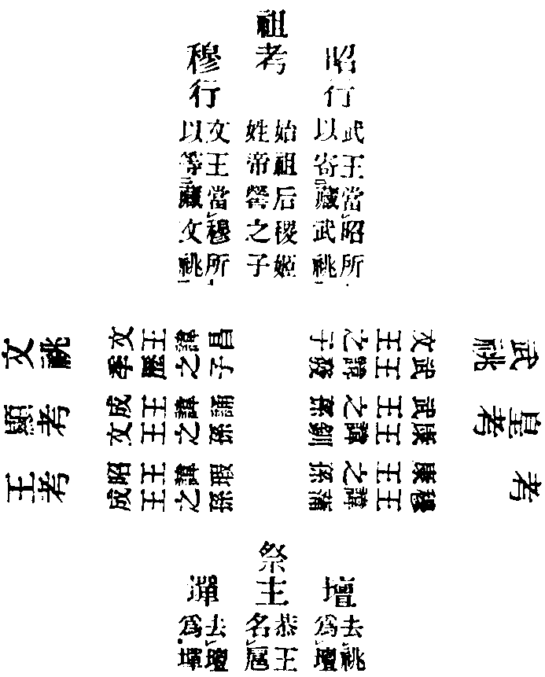

# 盂兰盆经疏钞餘义



> **藏经**：卍新纂大日本续藏经（新纂卍续藏）　**册次** 第 21 册（X21）　**编号** No. 376（X0376）　**部类** 经疏部　**卷次** 1 卷　**篇幅** 18,754 字

> **卷／品**：0 卷 · 2 品



---



## 目录



  - [注并序](#注并序)

  - [节序](#节序)



---



兰盆疏钞餘义(并序)



门人霅谿普静寺赐紫　日新　随听次录



餘之为义，大抵明乎疏钞之援引，音义之异同，诱诸来裔，识其指归也。尝考昔人以会粹略随难解(普宁律师《会粹记》，明义大师《随难解》)，用名义广拾遗图(净觉大师述《名义》，金山阇梨《拾遗图》)，交互其说，不可悉数。然其间义有可取者亦取之，而但直节其辞意耳。虽章句不完，亦前载之。餘故总命题曰《兰盆疏钞餘义》焉。时熙宁元年岁次戊申六月望日启讲，七月十有二日彻廗，因而再刊，又为之序云。



------



### 注并序



叙述钞家之得失，及《摭华》之兴起也。若然，则序文一道，亦分两节：先序钞得失，从初文至「难能」是也；后序钞兴起，从斯疏下至序终。



钱塘



即古之餘杭郡，至唐改为杭州。《钱塘记》云：「昔郡功曹华德信立此塘，以防海水。始开，募有能致土石一斛与一千，旬日之间，来者云集。塘未成，谲不复取，皆弃土而去，塘以遂成焉。」



知圆



字无外，号中庸子，俗姓徐氏，钱塘人。受业於本州净住院，学台教於奉先源清法师。撰疏十本，以通十经。著《闲居编》六十卷。其讲道训人，备如集贤。吴遵路撰行状碑云。



晋水



即泉郡水名。以泉江之水接于温江，有似篆书晋字之形，故县名晋江，水名晋水，具如《闽王传》云。



净源



字伯长，号潜叟，族扬氏，泉南人。辟帝心观门三车，立贤首华梵七祖。制义学文薮，笺经注论，具如《出家禀学传》，唯此略传，日新出之。



删科重刊



有二意：一、删削科文，重刊印板；二、刊正钞文，归敬三宝等文。



记钞



记即钞也，如《演义钞》解《华严疏》，《笔削记》释《起信疏》。亦犹孔颕达之有《正义》，以解五经之注文，非谓记广钞略耳。



既渎且壅



既已渎乱，且兼壅滞。



曹



辈也。



无所错手足



错，置也。《论语》云：「刑罚不中，则无所错手足。」今谓钞文有烦略之失，则学者虽手披玩习，而行之不远，故云无所错手足矣。



为难能也



《论语》：「子游谓吾友张也，为难能也。」包氏注曰：「言子张容仪难及也。」



传奥法师



姓韩氏，并州祈县人。先业儒，夙甞预乡荐，遇定惠禅师上足潜辉阇梨，剃发受道。然其内外典籍，皆有章句，备如本传云。



法师



愽通教法，轨物为师。出《婆婆论》。



庸



常也。



驯



巡，音顺也。



不拨荒芜



拨，度也。不度荒唐蓁芜耳。



辄事笔削



辄，专也。是者笔而存之，非者削而去之。



播迁其文



播迁，删去也。文烦则删之，对上削字。



弥缝其阙



弥缝，补缉也，阙略则补之，对上笔字。



传诸童蒙



诸之童幼蒙昧也。《周易》云：「童蒙求我。」



颇



甚也。



采摭英华



刘勰云：「捃摭英华。」班固云：「英华外发。」



庶



近也。



中庸之义



言不烦不略也。



才识不敏



才藻识智，不敏疾也。虽言才识，学在其中。



短於自见



短浅之能，仍出自见。



冀



望也。



后之病今



后人病《摭华》之是非。



亦犹今之视昔



亦如无外视奥师之得失。上之二句，语势出《史记》。彼文云：「今之病秦，亦犹秦之视昔。」



皇宋



皇，大也。宋，古商丘也。周武王胜纣，封商之后，以微子受封於此，以为宋国。太祖皇帝受周之封，由此飞龙，故以受封兴王之地，为有天下之号。亦犹唐高祖受隋之命封唐国，升帝，因号大唐国也。



三叶



太祖、太宗、真宗，如玉叶联芳也。



圣驾



真宗法驾。



祀汾阴



汉武祀后土，始立祀汾阴，在水之南，曰阴。



之明年



当辛亥年。



岁次



岁星也，每年行一次。



六释



唐三藏云：「持业、依主与有财，相违、邻近并带数，此六名为离合释，取合应知离不成。」此法相之学，慎勿臆说。



依主受称



经胜疏劣，如臣依君，故云依主。称，去声。



文心雕龙



刘勰撰。十卷。言为文用心也。大学谓之雕龙，小学谓之雕虫。



疏者，布也



彼明臣下上天子书曰疏。



撮题近意



额中曰题。撮取经文中远之旨，以疏近意通之。扬雄曰：「圣人之言远如天，贤者之言近如地。」



汉灵帝



后汉第十一主，讳宏。



应劭注汉



《汉书》，班固所撰，应劭等集解，颜师古又注之也。



故庐子国



故，旧也。子，爵号。



其事例然



以南充郡例庐江郡，以充国例。庐国，古之国即今之州，古之附庸即今之县也。



名讳



讳，避也。生有名，死避之。



建中



德宗年号。



会昌



武宗年号。



僧腊



儒礼取一岁之终为腊，释教但一夏之终为腊。



追谥



隔朝曰追谥，易名也；谥，示也。亦生平善恶之行。



平居



平昔所居。



终南圭峰



如《助修记》辨之。



作者曰圣等



文出《乐记》。《摭华》依刘勰引文耳。



若圣下



文出《论语》。



窃比於我老彭



包曰：「老彭，殷贤大夫，好述古事。我若老彭，但述之耳。」



录疏注经



昔吾禀以清凉本疏笺于《华严》，今又录圭峰疏笺注于此经者，盖遵一家注辞，皆附于经论观法之下。夫然，则不独使其学者临文到旨，抑亦安置教藏，伦例有绪与。



白虎通



后汉孝章帝於白虎殿会群儒讲论五经同异所作也。班固，字子坚，奉诏纂其事奏，凡十卷。



太初



元气始萌。



太始



形气始端。



太素



质之始也。广明有五，略辨则三，或谓《摭华》误者，浅识狂言，何足信哉。



清浊既分



徐整曰：「阳清为天，阴浊为地。」



精出曜布



日月为太阳太阴之精，曜谓星曜，即五星、二十八宿等。



度物施生



度，待洛切。施，去声。谓品度万物，施与生长。



适今



适犹近也。



天之经



经，常也。天有常明。



地之义



义，利也。地有常利。



援神契



宋均注：援引神明契合之事。



有情则识神无始



言赖耶识中已具孝矣。



器世则成坏相摩



摩，灭也。器界成而复坏，故云相摩。



怀任交易



言地能怀藏任持，万物交更迁易也。



祭义



《礼记》篇名。记其祭祀荐羞之义。



曾子



姓曾，名参，字子舆。



无朝夕



犹云无始终也。



所出不同



始混沌出，援神契，塞天地，出祭义。



共成一义



竖深之义。



孝弟



悌音。



天子



爵称也。王者，父天母之子也。



诸侯



侯，君也，谓列国之君。



卿大夫



卿，章也。明善理大，扶进人也。章九卿二十七大夫，出王制。今合辨之，以孝行同故。



士



事也。任事之称。



庶人



庶众，谓天下众人也。



而患不及者，未之有也



《孝经疏》云：「或有目患不能及於孝者，未之有也。」



天龙负图



河图曰：「舜以大尉即位，与三公临观于河，黄龙五釆负图出舜前。」



地龟出书



宋书云：「天锡禹书，神龟出洛，有数九法，即洪范九畴是也。」



天孽消灭



孽，灾也。《淮南子》云：「尧射十日而去九留一。」《尚书》：「惟德动於天，故以祸为福。」



景云出游



《唐书》曰：「睿宗即位日，景云现。」景，瑞也。又德宗时，泽州刺史李德上庆云图。



泽林茂



如察顺卢感不生连理。



浮珍舒



如郭巨埋子全母，天赐黄金也。



恠草秀



刘[君*殳]祖母冬思堇，[君*殳]哭动，感堇满地。《尔雅》云：「苦堇，即蔡也。」



水出神鱼



王祥母思鱼，祥卧氷上，水开，感双鲤跃出。



幽显



显，明也。《礼》云：「明则有礼乐，幽则有鬼神。」



二仪



仪，像也。分天地之形像。



因心之孝



《孝经．序》云：「因心之孝已萌。」



资敬之道



《孝经》云：「资於事父以事君，而敬同。」



儒



《文选》云：「愽通经史谓之儒。」



五常



仁、义、礼、智、信为万世常行之道。



本与



平呼，语绝之辞。



形质由父母而生



〈祭义〉云：「身也者，父母遗体也。」



三学



此约大乘戒定慧三。



祭统



亦《礼记》篇名。统犹本也，以其记祭祀斋戒之本。



释名



汉愽土刘熈撰。



周书谥法



周公作，训成王也。善行则善谥，如云翼善传圣曰尧；恶行则恶谥，亦如残义损善曰纣。



尔雅



尔，近；雅，正也。近正之言，故曰尔雅。



昊天



夏天也。郭氏云：「阳气皓肝曰昊。春曰苍天，秋曰旻天，冬曰上天。」



郑氏笺



《毛诗正义》云：「东汉郑玄取毛氏诂训所不尽及同异者，续之为注解，谓之笺。笺，荐成毛意。」



罪衅



或云：「过显曰罪，隐曰衅也。」



童穉



牛无角曰童，禾晚生曰穉，人幼小以之。



丧亡



息浪切也。



上延考妣



延，犹及也。父亡，答书云上延先考。母亡，延先妣。



凄怆



谓凄然感怆。霜露降，万物凋。言父母同万物之殒。感时念亲。



濡



沾，润也。小雨曰濡。



𪫟惕



惊惧貌。雨露濡生万物，孝子欲父母同万物乘春而生，故云如将见之。



------



### 节序



八节如下，序谓四时。



家语



十卷，当时门弟子所集，王肃注之。



孔子



子，慈也，以慈爱洽人。姓孔，名丘，字仲尼。哀公二十一年生，襄公十一年卒，寿七十三。



适齐



适，往也。



中路



去声，中。



谓仆



御车者即颜[利-禾+免]。



拥镰带索



拥，持也。镰，刈禾刀。带索刈之。



哭而不衰



亦作缞。以六寸之布，广四寸，帖於心前。衰之言悲，权也。



吾丘吾子



上吾自称，犹云我也。姓虞，名丘，字吾子。



后还



旋音。



齐君



即齐景公，有马千驷，是谓骄奢耳。



小子识之



识音志。令小子记其言也。



十有三



十中有三，辞归养亲。



檀弓



姓檀名弓，由善於礼，故以名篇。



东西南北之人



郑笺注云：「言君无常，以君子有四方志耳。」



不登垄



言慎敬也。



茔域



墓，地也，即墓之限域。



负士为坟



如孝子颜乌，东阳人。父亡，负土为坟。感郡乌，邮土助之。乌口中血出，遂名其县为义乌耳。



植栢成列



《通俗》云：「罔象好食亡者肝脑，墓傍植栢树，墓前立石虎，以驱罔象也。」



孝德传



梁元帝撰，凡三十卷。



庐于坟次



庐，捿寄也。坟之次舍。



三十年为世



古者三十娶妻，而子孙可继家业。



礿



薄也。春物薄少。



禘



第，音谛也。谛审其物，可祭先祖。



甞



新也，甞新糓也。



烝



众也。冬物众多。



包冬夏



例烝甞包礿禘也。



损益



损则祭杀牲命，益乃设供㧞苦。



七贤



一、五停心，二、别相念，三、总相念，四、煖，五、顶，六、忍，七、世第一。



七圣



一、随信行，二、随法行，三、信解，四、见得，五、身证阿那含，六、时解脱罗汉，七、不时解脱罗汉。



三贤



十住初贤，十行中贤，十向上贤。



十圣



初欢喜地，二离垢，三发光，四𦦨慧，五难胜，六现前，七远行，八不动，九善慧，十法云。



鲁哀公



名蒋，定公之子。



测物之性情



知子路之好勇，测颜回之不愚。



纪



大网之绳曰纲，小网之绳曰纪。



望



表望。



帝王



五帝三王。



以之安危



有贤者，天下安。无其人，宗庿危。



测众生之根性



接上根以六度，测中下以谛缘。



佛土



通而言之，则大圣所化之境也。



三世诸佛



对上五帝三王。



以之扬化



有师范则三藏教法与，无其人则五分法身丧。



微功致巨益



一日之微功，致生天之巨益。



少善破大恶



盆供之少善，破剧苦之大恶。



但三尘



色、香、触。



名实区别



实，体也。四名四体，如土田分隔，区以别矣。



三尊



三宝皆尊皆重。



唐



尧帝姓伊祁，名放勋，始封於唐地。



虞



舜帝姓姚，名重华，始封於虞地。



夏



禹王姓姒，名文命，始封於夏，今银夏州是也。



商



姓子，名履，始封於商丘。或云殷、汤，皆国号也。



周



姓姬名昌，始封於岐周之地。



李巡



注《尔雅》。



示不相袭



袭，承也。言二帝三王各立其名，不相承顺也。



孙炎



有《尔雅义疏》十卷。



更始



更，平声，改也。



兼，讲



《论语．序》云：「兼讲齐说。」



广雅



张揖撰，凡四卷。



大诘



陈大道，告天下。



思齐



《语》云：「见贤思齐。」



碑铭



铭，名也。述其功业，使可称名而期於不朽，故刻诸碑石也。



文宗



唐第十五帝，名印，穆宗之子。



庆成节



降诞之辰，犹今之乾元节。



知命



五十知天命。



耳顺



六十而耳顺。



耆、艾、耊，老也



上三字皆训老也。耊，迭音，䥫也。老，人身黑如铁。



古疏虽多



纪国寺慧净三藏亦有疏文，今也则亡。



舛的



舛，讹也。如下疏云：「三藏错会」，故有异释是也。的，当也。疏又引三藏云：「物华四事，盆美八珍也。」



叶机符理



下叶机宜，上符义理。



玄风



玄籍教风。



敬服尤深



肃，敬。服，从。尤，甚也。



含文嘉



《礼记》纬书名也。



三仞



七尺曰仞。



半之



一仞半。



遭母忧



遭犹丁也。



刻像图形



刻檀雕像，图𦘕形容。



贝多



西竺以贝多叶傍行而写。



黄卷



朱士衡烧经，尽成黄卷赤轴。



教理行果



下钞具释。



八辈



四果四向。



五位



资粮、加行、见道、修道、无学。



五教



一、小乘教；二、大乘始教；三、终教；四、顿教；五、圆教。



唯归佛宝者



此一句刊牒《摭华》，彼以法是佛言，僧是佛子，故但归佛宝耳。



同遵古训



《孝衡钞》并旧钞诸文，皆例归三宝。



稽首



贯於下，谓法、僧二宝。



冥加



蒙於上，亦佛法二宝。



注云



即孔安国作传以注之。



问讯



言也。郭璞云：「相问讯。」



长跪



律钞以尼弱故长跪，僧彊故互跪。



属



祝音。



举竖而包横



举三界之竖，包大千之横。



悲智兼运



悲故不住涅槃，智故不住生死。



三无数劫



梵云阿僧祇劫腊波，此云无数时分。



十种通号



一、如来，二、应供，三、正徧知，四、明行足，五、善逝，六、世间解，七、无上士调御丈夫，八、天人师，九、佛，十、世尊。



五分律



即弥沙塞部五段之文。



立五分法身



转五阴成五分法身，转色阴成戒身，受成定，想成慧，行成解脱，识成解脱知见。



睒



闪音。



射杀等



以睒子著鹿皮衣，入山取水，麋鹿相随。值王出猎，引弓射鹿，误中睒子，故云射杀。乃至父母祷愿，帝释与药，睒活如。具如经云。射，音石。



杂宝藏经



下卷引之。



兜率



此云知足。



阎浮



具云阎浮提，此翻胜金洲。



三十四心



八忍、八智、九无间、九解脱。



万舞



武王以万兵伐纣，周公亦以万人为舞而祭武王。



孝子不匮，永锡尔类



匮，竭也。笺云：「孝子之心，非有竭极之时，长以与汝之族类。」



自浅阶深



自酬恩反妄之浅阶，密意归真之深。



诱掖



诱引掖持也。毛苌云：「故作诸以诱掖其君。」



生前色养



养亲色难。



没后荐追



荐拔追思。



今试论之



试，用也。未敢正说，且试傍论。



居则致其敬



平居必尽其敬。



养则致其乐



就养能致其欢。



病则致其忧



色不满容，行不正履。



丧则致其哀



擗踊哭泣，尽其哀情。



祭则致其严



斋戒沐浴，明发不昧。



居上不骄



当庄敬以临下。



为下不乱



当恭谨以奉上。



仕丑不争



丑，众也。争，竞也。当知顺以从众。



则亡



危亡。



则刑



刑罸及身。



则兵



丘刃相加。



三者不除



骄乱争。



三牲



牛、羊、豕。



佐成



佐，助也。疏者，经之助也。



明之曰述



反用，述者曰明。



无烦异解



无外以前云释迦尊是归本师，今云众圣乃十方佛，故云异解。



分段苦



分限之年，形段之身。



变易苦



变麤身为细质，对上形段之身；易短劫为长龄，对上分限之年。



汉制



叔孙通定之。



皇帝



因秦始皇称之。



嫡



正也。



世子



可以继世。



金轮王



《俱舍》云：「金银铜铁轮，一二三四洲。」



娇昙弥



此云众主，亦名摩诃波阇波提，此飜大爱道。不云摩耶者，以佛生七日，摩耶命终故。



迦毗罗



此云妙德。



公明仪



姓公名明仪，曾子门人。



夫子



有德行之称也，即公明仪召师为夫子也。



稍



小也。



心感则孝，心衰则止



心若思感，则孝存焉；心若衰灭，则孝止息。



淮南子



即淮南王刘安，汉之宗裔，好著书，因叛戮于市。



叔重



许慎字也。



十大弟子



次文略飜华梵，缘起如例。



迦叶头陀



迦叶飜饮光，头陀云斗薮。



阿难



此云欢喜。



富楼那弥多罗尼



此云满慈子。



迦旃延



此云扇。



阿陀律



此云无灭。



鹙子



其母眼如鹙鹭。



优波离



此云近执。



罗睺罗



此云障日。



善现



梵云须菩提。



目连



如下所明。



来蒙



未来童蒙。



左传



左丘明作传解《春秋》。



颕考叔



如下卷钞。



钞斥



此并斥指。



不能观机



如教浣衣之子作数息观，锻金之子作不净观。



既昧经部



昧人天教。



又枉圣人



言小圣无悲心。



不可不慎



慎言则少过也。



分地



王制曰：「天子之田方千里，公侯百里，伯七十里，子男五十里。」



九州



一、冀州，二、兖，三、青，四、徐，五、扬，六、荆，七、豫，八、梁，九、雍。



都



犹㹅也，国君聚人而㹅会也。



邑



防邑也。邑人之聚会。



王畿



祁音，方千里以象曰。



亲疏多少



近者为亲，远者为疏。七庿曰多，五三等渐少。



封土



封，聚也。



除地



除，扫也。



示将去然



先在𫮃者，迁入石函为鬼，故云去也。然，语助耳。



应迁



应，平声，当也。



享甞乃止



享献秋祭曰甞。秋物备矣，故特举之。



昭行



昭，明也。父有文明之德，以治天下。晋景公讳昭，改呼为韶。



寄藏武祧



自后稷已下，文王当穆，武王当昭，故昭行寄武，穆行寄文。



穆行



穆，敬也，子肃敬於父。



寄藏文祧



寄藏，谓四时不祭也。



禘祫



禘，大也，祫也。三年一禘，五年一祫。禘以夏祭，祫以冬祭。



去祖为坛



次文云：显考、祖考无庿，故为二坛以祭之。



适士



的音，王之上士。



官师



一官之长。



庶人无庙



祭之於寝。



上士



今之正卿。



中士



今之朝官。



下士



今之少官。



府史之属



主天子库藏曰府，主天子图籍曰史。属，徒也。



《尚书》云：「七世之庙，可以观德。」今直书名图，庶易详覧焉。







有志於《摭华钞》者，未始不广引夏、殷、周，以至于有唐，立庙之多少，历代之差当，是皆亡本逐末，叛释泥儒耳。试为陈之：夫钞者，疏之助也。迹疏以通经，由经以明孝，此其大槩也。今诸家殊不究疏之之要辞，经之之孝道，但渔猎钞文，穿凿群籍，立庙有多少，历代有差当，岂非亡本逐末，叛释泥儒乎？然《摭华》引《礼记》祭法，其中注文，皆郑氏之微言，向出名图，兼示昭行寄藏武，穆行寄藏文耳。然而子庙既向於父，则祖与孙同列矣。而言迁庙者，盖四亲之名虽迁，而昭穆之行不移，此通制也。若谓互而迁之，无乃乖於昭穆，失於寄藏者乎？且立庿之宏规，实儒家之大务，而空门末学，率易辨之，亦犹握管窥天，持螺酌海，又安能知其高阔深广哉。



喾



哭音。



钊



招音。



扈



户音。



五教



义、慈、友、恭、孝。



孝弟



去呼。善事父母曰孝，善事兄姉曰弟。



踵



足后。



肖



似也。不似其先。



得中



得其中庸。



子思



名伋。给音。



伯鱼



孔鲤字也。



跂



企音，望也。



杖而后起



父亡竹杖，母亡桐杖。



阳货



即阳虎也。



疏：虽论礼坏乐崩



宰我虽说礼坏乐崩。



终诃衣锦食稻



仲尼终责衣锦食稻。



衣



意音。



食



嗣音。



宰我



姓宰名予，字子我。



礼必坏



礼坏无以捡人迹也。



乐必崩



乐崩无以和人心也。



钻燧改火



春取杨柳之火，夏取枣杏，秋取柞楢，冬取槐檀。柞，侧嫁切。楢，子由切。



食旨



旨，美也。



蔓延



上万音，延，去声。若萝蔓延而不绝也。



布濩



下护音，长多貌，出《文选》注文。



通丧



孔曰：「自天子达於庶人。」



始从鹿苑



亦名施鹿林，文出《智度论》。



终至鶴林



佛临涅槃，四双八树皆悉变白，如白鶴然。



肇启五乘



释上鹿苑，诱五乘之之权也。



卒圆三点



释上鶴林归三点之实也。三点喻三德，法身断德，般若智德，解脱恩德。亦如梵书伊字，二点在上，一点在下。首罗三日，则一在上，二在下。



梵音广略



广则四字，略唯三字。



左右



犹云楚夏也。



晋译华严



即觉贤三藏译成六十卷。



二障麤细



烦恼障麤，所知障细。



非三五等时



此辨逐机顿教，非三五渐收。



三时



武丘岌法师谓初见有得道，次见空得道，后双照空有。



五时



道场惠观师谓：一、有相教，二、无相教，三、抑扬教，四、同归教，五、常住教。



不徇



随也。



经诠理智



此标次文说《华严》也。清凉疏云：「理开体用，号大方广；知分因果，名佛华严。」



律诠德行



此标次文说《梵网》也。贤首疏以摄律仪戒，摄善法戒，摄众生戒，皆用三众净戒释十重四十八轻。



悟通解悟证悟



地前能取未亡，解悟也。登地理智一如，证悟也。此释经诠理智。



行通悟后悟前



始修随相行，悟前也；终证离相行，悟后也。此约三聚戒，释律诠德行。



摩竭提



云无毒害。



阿兰若法



云最静法。



七处



人间三处：菩提场、普光明殿、逝多林。天上四所：忉利、夜摩、兜率、他化自在。



九会



以普光明重说两会，添七成九。



五周



周徧也。即五周因果：一、所信因果，二、差别因果，三、平等因果，四、成行因果，五、证入因果。



六位



十信、三贤、十地、等觉，即六位圆因也。



但略标名



释疏不引《华严》。



餘生



餘诸众生。



称性之戒



彼经云：「非色非心，非有非无，非因果法，诸佛之本源耳。」



顿制



十重四十八经。



十支



小乘但七，身三、口四。今约大乘加意三。



初义



即孝为至极之道等。



跨



犹云过也。



乐正子春



正，掌也，即掌乐之官名。子春，姓未详。



子春曰：善句跬



丘弭切。三尺曰跬，六尺曰步。



衾



被也。



战战至薄冰



战战恐惧，兢兢戒慎矣。小子者，弟子也。忧陷。



而今而后，吾知免夫



句。



小子



郑曰：「乃今日后，我自知免於患难矣。小子者，弟子也。呼之，欲使听，诫其言。」



矜



惊音。



断



短音。



文选



梁昭明太子撰。



瓯骆



瓯，地名。骆，姓也。



泰誓



《尚书》篇名。泰，大也。大会以誓众。



上帝



上天大帝。



下是



释「降时」二字也。



正色



青黄赤白黑等。



间色



红绿紫碧。



域中



儒教中也。《四十二章经．序》云：「域内治平耳，谓之外教也。」



为省招害之徒



言作过招祸之者也。



太伯



周太王之长子。



断发文身



以让位之德，亦不可用也。



叹为至德



《论语》云：「泰伯其谓至德也已矣。」



夷、齐饿死



白夷、叔齐，孤竹君之二子，饿死于首阳山之下。首，去声。



称曰贤人



子贡曰：「伯夷、叔齐何人也？」仲尼曰：「古之贤人也。」



排斥



排摈斥逐。



几谏



上平声，微也。



波罗门



此云净志。



七多罗树



似此方椶榈，高长六七尺。



娑罗



此云坚固。



王充



僧述无鬼论，为圭峰取破。



人死精亡而形存



且证留形二字，其实识神不亡，而身形不存。如下破之文。



有子



姓名若，字有子。



中都



仲尼曾为中都宰，自宰为司空，由司空为司𡨥。



衣衾而举之



大小敛时之也。衾，单被也。用之举尸入棺，并覆尸上。



卜其宅兆



龟曰卜，选以定吉凶，苟不预卜，地下或值伏石涌泉，则不安其亲也。



措



置也。



韩康伯



名伯，字康伯，师王弼，注《易．系辞》。



西域记



唐三藏撰，十卷。



四分



《业疏．序》云：「据说之章段也。」



一一堕



搥胷并泣皆犯，故云一一。《梵网》波逸提，义飜为堕，堕在烧暑覆障地狱。



吉罗



具云突吉罗，《善见》飜云恶作。



散齐七日以定之



定其志意，此犹居本处也。



致斋三日以斋之



出本处，往庿侧，今宿斋厅是也。



致斋於内下



此则致斋於庿内，散斋於庿外也。



见其所为斋者



郑玄云：「思之孰也。」为，去声。



设供如今经



言忌辰设供，如兰盆荐亲。



疏：资其业报



助其善业乐报。



禘礿阳义



礿祭之月，当三阳生寅位，以一阳生於子位，是十一月至正月，即三阳也。禘祭之月，当六阳生於巳位，即四月也。



甞烝阴义



甞祭之月，当三阴生申位，以一阴生於午位，是五月至七月即三阴也。烝祭之月，六阴生於亥位，即十月也。



夏者尊卑著



春生万物，至夏大小分矣，可以祭先祖。



卒哭



百日。



祥日



小祥朞年，大祥三年。



布施二田



三宝，敬田；贫病，悲田。



姬周



姬姓，周代。



夷狄



东夷北狄。



图难於易



佛教报应难弘，礼法祭祀易举。



陟遐自迩



遐远，佛教也。迩近，礼法也。



先遣二圣



老子，摩诃迦叶。仲尼，光净童子。



支那



亦名震旦，此云思惟，以情虑多端故。



列子



姓列，名御𭁵，宋国人。著书八篇，庄子师之。



商太宰嚭



商姓，太宰官也，名嚭。



博识彊记



明五常，述六经，生民已来，未有如夫子者也。彊，巨良切。



三王



夏、殷、周。



善用智勇



洪水滔天，夏禹治之，善用智也。殷伐夏桀，周伐殷纣，皆其勇也。



五帝



少昊、颛顼、高辛、唐尧、虞舜。



善用仁信



五帝心虽无为，而迹陟有为，以德教化於民，善用仁信也。



三皇



伏羲、神农、黄帝。



善用时



三皇心既无为，而迹亦无为，以道化於民，故云善用时。《老子》云：「动善智」，此其证也。



骇



惊也。



匿



隐也。



𲁮



过也。



子贡



字也，姓端木，名赐。



告朔



告，音谷。朔，稣也，魄死而复苏。



饩



戏音。腥羊曰饩。



朝享



上直遥切。



东汉



后汉光武，都洛邑，为东。前汉高祖，都长安，为西。



之初



即第二主明帝，名庄。永平年，夜梦金人翔于殿庭。



佛法肇至



腾兰赍《四十二章经》并白氎像等。



真宗



即佛教。



逮疏主之世



逮，及也。谓德宗之代。



疏：莫大於施生



施，平声。先儒云：「施生而不为，故能常生。」



乾卦



乾，健也。本以象天，天体乾用也。



帝释



具云释迦因陀罗，此云能天帝。



四等



慈悲善舍，化生平等故。



梵王



色界初天王。



洁静精微



《礼记经解》云：「洁静精微，易教也。」



至命之书



《易》云：「穷理𦘕性，以至于命。」



春畋不围泽



《曲礼》云：「国君春畋不围泽。」郑注云：「生乳之时，重伤其类。」畋，猎也。



大夫不揜群



言卿大夫行猎，不尽群而多取也。



士不取麛卵



麛，迷音，鹿子也。卵，鸟子也。



钓而不纲



垂一钓取之，不以大绳横列水内，悬多钩，取多鱼也。



弋不射宿



以线系箭射之曰弋。然仲尼不射宿禽，恐伤众类。射，石音。弋，亦音。



孟子



名轲，字子舆。师子思，治《中庸》之书。



衅钟之牛



衅与衅同。新铸钟，杀牲以血涂其衅郄，因以祭之。



用杀止杀



用少杀，止多杀。



楞伽



此云种种现。



八佾



《论语》篇名。佾，逸音，列也。天子八佾舞於庭。



月令



秦相吕不韦造。



中气日在低



中气时，太阳躔氐宿度。



昏须女中



谓黄昏二刻半，女星现南方也。



斗建戌位



北斗柄指於戌位，即九月也。



社



社以勾龙配享，其实土神也。《礼记．祭法》曰：「共工氏之覇九州，其子曰后土，能平九州，故祀为社也。不言土地而言社者，先王配之以嘉名也。」



稷



稷者，五糓之㹅名也。立坛祭之，报先农也。其神以后稷为主。《礼记．祭法》云：「厉山氏有天下也，其子曰农，能植百谷。夏之衰，周弃继之，故祀以为稷也。」



飤



嗣音。



牺牲



纯色牛羊豕曰牺，涤牢中养曰牲。耳角齐者曰纯色，即童子牛也。



诔



力𫐄切，累也。言人死后，累其德行。



达士徇名



此一句是诔辞，曹子建作。



乡



音向。



孔氏传



孔安国注《尚书》，盖言传通其义也。



㵎



山夹水㵎。



谿



水注川曰谿。



沼



小池。



沚



小渚。



苹



大者曰苹，小者曰萍。



蘩



蒿也。



蕴藻



聚藻也。如海藻之类。



筐



区方切。



筥



九吕切。



𨪆



牺音，即三足鼎。



潢汗



停蓄之水也。上黄音，下鸟音。



行潦



流水也。上平声，下老音。



东邻



纣居卫国朝歌之地，故曰东。



西邻



文王在岐山之阳，故曰西伯。



王弼



字辅嗣，官至尚书。年二十四，受飨。



内外障



内障炬火针咽，外障见大力鬼等。



子游



字也，姓言，名偃。



一曰



即何晏子平叔注辞。



食而不爱，豕交之



人之交接，但食而不爱，若养豕也。食，嗣音。



爱而不敬，兽畜之



如人畜兽，但爱而不能敬也。



七多



《孝衡》云：「其树高四十九尺，以七尺为一仞，七仞为一多罗，七多罗计三百四十三尺也。」



僧俗之仪



应云出世之仪。



曲礼下



《礼记．内则篇》叙孝行，大同。



东观汉记



后汉刘珍等撰。观，去声。汉时於宫前造东西两观，今之史馆是也。



僧祇



具云摩诃僧祇，此飜大众部。



增一



即《阿含经》。



太子父母等



太子即释迦，生身父母即净饭、摩耶，罗睺罗贼即调达也。



篡



初患切。夺也。



文常



即前汉第三主。



文王世子



古无定制，继世之子，即周文王也。



不脱冠带而养



言常待左右也。



亦一饭



欲知气力针药所胜也。



间



去声。



唐传



澄照大师撰。



高齐



南齐，姓高。



微行



即担舁也。



衣著食饮



衣、食，皆去声。



女身经理



凡母身有患，皆纪经历治理。



谅阴



谅与亮，皆信也。信任冢宰曰谅，不言国政曰阴。



说命



悦音，名也，姓傅，高宗命之为相。



见齿



上胡旬切。



丧，与其易也宁戚



易，以致切。包咸云：「丧，失於和，不如戚也。」



清卓



清尚高卓。



白㲲



应法师《经音》云：「天竺贵布也。」



难陀



此云喜，佛亲弟。



罗云



佛嫡子也。飜梵如前。



丧足



丧车之后。



六反震动



应云六种震动。《大疏》云：「震即是声，动即是形。声兼吼、击，形兼起、踊，故有六种。此六各三，成十八相。」次下列经，疏注之。



经云：动、徧动、普徧动



疏云：「摇飏不安为动。」



起、徧起、普徧起



自下渐高，为起。



踊、徧踊、普徧踊



忽然腾举为踊。



震、徧震、普徧震



隐隐出声为震。



吼、徧吼、普徧吼



雄声郁遏为吼。



击、徧击、普徧击



砰礚发响为击。广释十八相，具如《华严大疏》。



不载



上声。记也。



舁



以诸切。对举曰舁。



礼不足



殡葬之礼。



西晋



武帝司马氏，都洛阳，为西晋。至愍帝渡江，都金陵，为东晋。



委官



委弃其官，与新令尹。



星驰



礼，唯父母丧，见星而行，见星而舍，日行百里，如星之奔驰。



豫章



洪州。



太守



今之郡侯，守也。始皇罢削，列郡三十有六，凡郡一守焉。



难传



「传」字解疏「弘」字。



善恶报应



过去善恶为因，今世苦乐为报。



前驱



犹云先锋也。



人死神灭



如王充云：「人死精亡而形存，精亡则神灭也。」



诬



枉也。



蔑弃祖祢



上灭音，没也。祢，奴礼切。父也。新死不切言之，故变父为祢。



既情且状，其无形乎



此牒上《周易》之文，反诘儒者。情状既有，则神明不灭，故云其无形乎。下三句反诘，倣此消文。



三后



太王、王季、文王。



王配于京



武王又能配行其道於京。郑玄云：「镐京在丰水之东也。」



升灵上旻



旻，天也，反诘三后在天也。



大禹所祇



大禹，即牒上夏王也。所祗，即反诘敬神也。



请代武王



出《尚书．金縢篇》。武王有疾，周公作请命之书，以代武王。



姬旦祷亲



周公名旦，祷亲则反牒武王，故云可虗罔乎。



背，叛



隐，匿也。



五经



上文但引《诗》、《书》、《礼》、《易》四经，而该摄《春秋》云五经。



非直诬佛，亦侮圣也



不但诬毁於佛教，亦乃侮慢周孔圣典也。先儒云：「侮圣言而不习。」



餘趣



通六趣。



已迁他蕴



谓中阴身，别迁他趣五蕴耳。



陶



遥音。



士五刑有服



士，理官也。言刑之轻重，各使服从。



劓



鱼器切。



剕



扶沸切。



大辟



大罪。



革与服，改制度



改革车舆服饰制度。



刖



月音。



决关梁



决，开也。谓开其关而撤其梁。



逾



越也。



阉人



古者阉官守门，即今之黄门也。



𭁵



自内而取曰𡨥。



贼



自外而取曰贼。



刧



用兵而取曰刧。



掠



音谅。巡行而取曰掠。



夺



欺弱而取曰夺。



攘



以手御物曰攘。《语》云：「其父攘羊。」



矫



诈也。诈称上命取之。



虐



杀也。行杀盗物。



周穆王



周第六王，讳昭。



享



当也。



司𡨥



掌刑典之官。



今训夏赎刑



使训畅夏禹赎刑之法。



三十国春秋



拣鲁国春秋，列晋宋等国。肃方等撰。



池阳



姓池，名阳。



舍



舍音。



破羯磨转法轮僧



羯磨，此云辨事破义，如《杂心论》广明。



七遮



即七逆：一、出佛身血，二、杀父，三、害母，四、杀和尚，五、杀阿阇梨，六、破羯磨转法轮僧，七、杀圣人。



妻



砌音。



禅



去声，让也。



郭巨



《孝德传》曰：「郭巨家贫，养老母。有一子三岁，母常减食与之。巨谓妻曰：『贫乏不能供给，共汝埋之。子可再有，母岂再得？』遂掘𡊫二尺餘，忽见黄金一釜，釜上云：『天赐孝子郭巨，官不得夺，人不得取。』」



董永



青州千桑县人。父亡无以葬，乃以身质钱一万。永谓主曰：「若无钱还，当以为奴。」葬讫将之，中路逢女，求为永妇，乃为织绢还钱。主毕，女即去，曰：「吾天女也，见君至孝，天使为君偿债也。」



廪



仓有屋曰廪。



周官



《周礼》建官有一百二十。



五糓



有云百糓，杨泉《物理论》云：「粱者黍稷之总名，稻者溉种之总名，菽者众豆之总名，三糓各二十种为六十，蔬果之实助糓各二十，凡为百糓。」



义必互通



如於贫病下，悲心通敬孝二心也。承顺三宝下，敬心通孝悲二心也。父母不敬下，孝心通敬悲二心也。母音无。



福田者，衣士释



田是能生故劣，福是所生故胜，前劣后胜，故名依士。



裁省



裁量省察。



疏：法有大小，教有权实



小乘法，权教也。大乘法，实教也。贤首亦判《般若心经》为实教也。



经藏亦诠餘二



如《楞严》七处徵心，论藏也；自行离魔，律藏也。



下之二藏，比例可知



律藏亦有经论，论藏亦有经律。



婆沙



此云广解，或飜种种说。



疏：论则推徵解释



宗、释二论，皆有推徵解释。



从容判经



苁，音言。此经摄於化制，故云从容也。



以分制化



论为能解，经律所解。解经属化，解律属制。



凭心灵觉



归佛。



凭佛所说



归法。



凭心正伴



归僧。



昙无德



此云法密，亦云法藏。



萨婆多



此云一切有也。



径挺



即长小貌。



六天



四王、忉利、夜摩、兜率、化乐、他化。



八定



空处、识处、无有处、非非想处，加四禅成八也。



埤仓



上卑音。张揖撰，文有三卷。



泛



通也。



父有争子



有谏争，孝子也。



故当不义



当为也矣。



扶持之



虑有举动之失，故扶而持之也。



子则然，无常人



但是父子皆须如然，非常定在一人也。如父有三子，不可分日限而就养也。



可以语其得失



如晏婴适齐，齐问楚国政，婴以过失语之。



不可侵官



各有司职。



方丧，资於事，父不听



平声。



子夏



字也，姓卜，名商。



世传



非经史所载也。



昆子



其人生来不顺，父临终令葬水中，欲其须葬於山，后乃依之。



声罪



扬声陈首，罪名。



王祥



字休祺，临浙人。承事继母。



卖身



卖，犹质也。



从晋



上，去声。



盾三谏灵公



灵公无道，树楼台，弹人民。



公怒，欲段之



公作夹幕，藏五百甲兵，欲害之。



盾走



句。



出乘车



辄为五百甲兵之一，故扶轮以报之。



无扶轮之说



不须和会。



佛说盂兰盆经



从宽至狭，三对在焉。经为能诠，上皆所诠。佛为能说，余皆所说。盆为能教，盂兰所救。



晋武帝



西晋武帝，讳炎，字世安，即文帝之元子。



惠帝



即武帝第二子，讳衷，字正度。



译经图纪



释靖迈撰。



略举汲灌



即题云《灌腊经》。



以省其餘



省，亦略也。其餘即香、油、锭、烛等。



腊除



《吕氏春秋》云：「前岁百击皷驱疲疠之鬼，谓之逐除。」



倒悬



孟子：「犹解倒悬。」赵岐注：「喻困苦也。」



义净三藏



《大宋高僧传》云：「释义净，字文明，姓张氏，范阳人也。翻传经论，与奘师杭衡。比其著述，净多文性。」又按唐中宗皇帝述圣教序云：「法师义净，业该经史，学洞古今。」以是推之，则圭峰始自释题，终於解经，多引其疏词者，良有以也。



孔安国



名也，字子国，孔子十一世孙也。



冕服彩章



冠冕服饰，五彩十二章，具如《周礼》。



有夏昏德



夏桀昏乱，不恤下民。



窘



逼急之甚。



六籍



解疏「典诰」二字，籍，部也。《周易》、《尚书》、《毛诗》、《春秋》、《周礼》文，河间王作《乐记》，是为六经也。



弥天



盛德茂业，如《令摸钞》。



习凿齿



姓习，名凿齿，字彦戚。



疏：非信不阶



升也，入也。《智度论》云：信为能入也。



恶口车匿



是净饭王之奴，虽投佛出家，而习气不除。



在某处



处有净土秽国，秽中又有诸国，故通云某处。



与某众



如《圆觉》十万菩萨，《法华》万二千人俱，故通标某众也。



老子



姓李，名耳，字阳，谥曰聃。



诸方时分，延促不定



《圆觉大钞》云：「诸方者，竖谓上下，横谓四方。言延促者，人间五十年，四天王天一昼夜等。言不定，有二意：一则指上延促不定，二谓四洲昼夜不同，故云不定。谓北洲夜半，南洲日午，东洲日没，西洲日出。」



游化住止



游化则舍卫，住止则祇园。



阿含



此云净教。



觉了真妄性相之者



《大钞》云：「觉妄法本空，照真性本净，故云觉了真妄。又觉性中本无诸妄为觉性，照性上恒沙功德本来具足为觉相。」



始本合



始觉智合本觉理也。



等觉照寂



等觉菩萨由照而至寂，妙觉大圣从寂而发照，亦犹贤人自明而诚，圣人自诚而明。



疏：具足欲尘



佳丽女色。



财宝



珍奇宝物。



多闻



愽通内外典籍。



解脱



五通仙人，此则国丰四德，亦名丰德城。



鳏



应法师云：「人不𥧌目，常鳏鳏然，如鱼目之不闭。」



无告



告之言诉也，言此四是无告诉者。



君臣下



《白虎通》曰：「君者，群下之所归也。臣者，坚也，励志自坚也。父，矩也，以法度教子也。子，孳也，孳孳无已也。兄，况也，况父法也。弟，悌也，心顺行笃也。」



园圃



《仓颉篇》云：「种木曰园，种菜曰圃。」



腾兰



二名，未详所飜。按靖迈《译经图纪》云：「迦叶摩腾，中印度人，婆罗门种，幼而敏悟，兼有风姿，愽学多闻，特明经律，每有新义，出於神表。竺法兰者，中印度人，禅思毗尼，莫不穷玅，诵经百餘万言，学徒千餘，居不求安，常怀弘利，戒范严峻，众莫能窥。」



法水初流



赍白㲲𦘕像，《四十二章经》，初流通此土。



鸿胪



鸿，大也。胪，音闾。陈，序也。言大陈序所须，以礼外国之宾。



四夷



东夷、而戎、南蛮、北狄通言夷，易也，言礼法简易也。



邸，舍



暂至曰邸。



毗昙



法也。论名。



别馆



白马等寺。



三漏



烦恼并无明，如小乘诸论。



疏：乳哺，如济食等



青提乳哺目连，如赵盾济食灵輙，皆恩之实事。



度脱如扶轮



目连得神通，度脱青提，如灵輙为甲士，扶赵盾轮，皆报之实事。



齐斩之异



齐，资音。斋者，《礼记外传》云：「斋之言齐也，如针缕缉其裳下之缝，使齐平也。斩者，翦而不缉。」



除彻



十三月，除而彻去之。



高宗



唐第三主，讳活，太宗之子也。



天后



则天也。以未登九五，故曰天后。讳𧸵，音照。



上表



标也。标陈己情，进於上也。



垂拱



则天年号。



玄宗



唐第六主，讳隆基，睿宗之子。



左补阙



太祖皇帝改为左正言。



五礼吉礼



致敬神也。



凶礼



为之棺椁。



宾礼



朝聘。



军礼



战戎。



嘉礼



嫁聚。



启寤



启，开。窹与悟，音义同。



北远



隋朝慧远法师，制《涅槃经疏》。



从母立姓



如鹙子与慈氏。



耐



音柰。



亦不能报



《毗柰耶》云：「若父母无信，令起信心；若悭者，令行惠施；若无智，令发智慧。子能如是，方曰报恩。」



十三卷



或可。第十三王。从文王至幽王，正当其数。



幽王



讳涅，宣王之子。



宋书



刘义撰，后编入《南史》。



固穷



君子固亦有穷时，但不如小人穷则滥，溢为非。



箪食



上音丹，竹器也。下音嗣。



瓢饮



即匏片持水耳。



亚圣



亚，次孔圣。



浮



捊音。



疏：朋友



同门曰朋，同志曰友。



纵广



韩子云：「南北曰纵，东西曰广。」



刀涂道



有云鬼折草为刀，更相杀害，详之。



尸子



姓尸，名佼，音绞，鲁人，著书二十篇。



瑜伽



此云相应。上释三果，多依《行愿钞》引《瑜伽》解之。



孝衡



兰盆钞名，东京遇荣大师撰，亦二卷。



三时无悔



初杀、正杀、已杀。



八戒



五戒外，加：六、不坐高广床；七、不著华鬘缨络，并香油涂身熏衣；八、不自歌舞，不自辄往视听。



不善反此



杀二亲为上品，蚊蚋为下品，餘人餘畜为中品。



为染污依



即我爱、我痴、我见、我慢四惑。故三界轮外，𦘕王表慢，𦘕女表爱，𦘕婆罗门表见，𦘕猴表痴。乃执第八相分为内我，与第六为根，云染依。



疏：此洲



南瞻部洲。



一切经音义



应法师撰，凡二十五卷。



楚辞注



王逸注之。



通俗文



释通方俗之言。



苦乐并受



净住子云：王或卧䥫床等苦。



楚炙贤良



炙，只音。《尚书》云：「焚炙忠良。」



自恶



音污，憎也。



藩决不羸



藩，篱也。羸，力追切，绊也。易云：「羝羊触藩，羸其角。今羸篱穿，决非绊之也。」



付法藏传



吉迦夜与竺昙耀译。



倮



胡瓦切，露身也。



吾息



子也。



鸣稚



地音，击木作声，谓之信皷。



以福故宫殿七宝



指前二鬼。



堂阁严饰



指后众僧。



以罪故而受鬼身



通指上二。



膺



当也。



弗慎厥德，下



孔注云：「不慎其德，以速灭败，虽欲改悔，其可追及乎？」



厌课者多



厌，塞也。课，责也。当二亲忌日，无心修崇，但厌塞人之课责，故为之耳。《孝衡》云：「内无实德，外衒虗名，故云厌课。」



元启



孙悟之子。



㳂袭



㳂流承袭。



拊心



女弱，故拊擗其心。



跳身



男彊，故跳踊其身。



元嘉



宋文帝。年号。



起居注



史臣记天子之事也。



春秋分



春分、秋分，即八节之二也。节谓分、至、启、闭八节。春、秋有分，冬、夏有至，启谓立春、立夏，闭谓立秋、立冬，是为八。



权器



权，秤锤也。秤带其器，以承龙口中水也。锤真伪功。



节气加减，刻漏规式



刻漏更点，起自轩辕，故《周礼》云「挈壶氏掌之」是也。近世释瑞新作壶更刻漏，其文简而理诣，故士大夫多取之。然〈起居注〉以春秋二分明五十五刻，此乃一家之说。今依本朝定景福殿秤漏，春秋二分各五十刻，匪唯学者之易晓，亦古今之通规欤。比见讲学多昧於此，因而录之，庶备详览，勿谓钞简，贵引文繁云耳。



(昼刻)  

(夜刻)



四十刻  

六十刻  

(小雪后十二日，连大雪及冬至并小寒后三日)



四十一刻  

五十九刻  

(小寒后四日至大寒后二日，小雪前一日至后十一日)



四十二刻  

五十八刻  

(大寒后三日至十二日，立冬后四日至十三日)



四十三刻  

五十七刻  

(立春前二日至后四日，立冬前四日至后三日)



四十四刻  

五十六刻  

(立春后五日至后十二日，霜降后四日后十日)



四十五刻  

五十五刻  

(雨水前二日至后三日，霜降前二日至后三日)



四十六刻  

五十四刻  

(雨水后四日至后九日，寒露后六日至十二日)



四十七刻  

五十三刻  

(雨水后十日至启蛰节日，寒露前一日至后五日)



四十八刻  

五十二刻  

(启蛰后一日至后六日，秋分后九日至后十三日)



四十九刻  

五十一刻  

(启蛰后七日至后十二日，秋分后四日至后八日)



五十刻  

五十刻  

(春分前二日至后三日，秋分前二日至后三日)



五十一刻  

四十九刻  

(春分后四日至后八日，白露后七日至后十二日)



五十二刻  

四十八刻  

(春分后九日至后十三日，白露后一日至后六日)



五十三刻  

四十七刻  

(清明前一日至后五日，处暑后十日至白露节日)



五十四刻  

四十六刻  

(清明后六日至后十一日，处暑后五日至后九日)



五十五刻  

四十五刻  

(谷雨前三日至后三日，立秋后十二日至处暑后四日)



五十六刻  

四十四刻  

(糓雨后四日至后十日，立秋后五日至后十一日)



五十七刻  

四十三刻  

(糓雨后十一日至立夏后三日，大暑十二日至立秋后四日)



五十八刻  

四十二刻  

(立夏后四日至后十三日，大暑后二日至后十一日)



五十九刻  

四十一刻  

(小满前一日至后十一日，小暑后四日至大暑后一日)



六十刻  

四十刻  

(芒种前三日，连夏至及小暑后三日同)



惄



奴力切。思也。



馈



匮音。



胜也



上平声。



餘三



即神境、天耳、他心。但观其相曰通，知其因缘曰明。此三不能缘三世，故不得称明。委辨如《令摸钞》。



种现相资



由种子故生起现行，由现行故熏成种子。



根本烦恼



有六，谓贪、瞋、痴、慢、疑、恶见，今贪属一数也。



随烦恼



有二十：忿、恨、恼、覆、诳、谄、憍、害、嫉、悭、无慙、无愧、不信、懈怠、放逸、惛沉、掉举、失念、不正知、散乱。



不行惠施



释悭。



侵夺他财



释贪。



七支



识、名色、六入、触、受、生、老死。



贪无是过



无伤慈过。



鬼无分别烦恼



无分别之悭惑，有人中之习气。



穿凿



孔融曰：「妄作文章，穿凿以成。」



第六天



即他化自在天。



四王东方提头赖咤，此云持国，管二部



乾闼婆、毗舍阇。



南方毗楼勒叉，此云增长，主管二部



鸠槃荼、薜茘多，魇鬼。



西方毗楼愽叉，此云广目，管二部



龙王、富单那。



北方毗沙门，此云多闻，管二部



夜叉、罗刹。



谢安



字万石，官至大傅。出《晋书》。



义少



齐沙弥道慧，能讲涅槃法，安能述佛性？永问：「慧年几？」答云：「十九。」永叹曰：「昔日诸糓年十二善书学，时人号为才童；今日二道士可谓义少。」



断金



亦如《魏志》云：「张歆与管宁为友，二人锄园，见金一挺，宁遂挥锄与歆，回於本处。寻有釆薪人，见变作蛇，因而斫之为二段。□□复来见之(云云)。」



其臭如兰



古人云：「兰生深林，不以无人而不芳。以其有十步之香，譬君子美德矣。」



四人和合成众



约僧体言之，《业疏》云：「三人已下，辨法未尽；四人已上，作法成济耳。」



春冬过少



不言秋者，以西天但分三际耳。



四月十六日，是前安居



唯结一日。



五月十六日，是后安居



亦结一日。



但结三月



五月十六日、六月十六日、七月十六日。



开后一月



从七月十六至八月十五。名迦提月。赏前安居之劳也。迦提月即赏劳月也。



始从十六至后十六



四月十六至五月十六。



急施衣次第增等文



如律钞所明，既非本宗，不可曲辨。



增三中三日



十四、十五、十六。



彝章



彝法章明，即制教也。



礼因人情下



以三藏中有律教，例六经之有礼法焉。



瑕疵



玉病曰瑕，人病曰疵。



摩得勒伽



此云本母。



不孤独



自恣忏罪，得入清众。



十二分教



如《华严》、《圆觉》二疏广辨。



浮囊



西域渡海人，以鸟翎毛为袋，或用大牛皮吹气内中而渡之耳。



篇聚



五篇七聚，广略释义如律钞。



喻犯四重



婬、杀、盗、妄。



喻犯十三



僧残也。《毗尼母》云：「如人为他所斫残，有咽哽。」



喻犯偷兰



具云偷兰遮，善见飜为大罪。



喻犯二提



谓三十舍堕、九十单提也。



喻犯吉罗



具云突吉罗，义飜应当学。



为篇阙提舍



具云提舍尼，义飜向彼悔。



为聚不开第五



不开吉罗。



亦阙提舍



篇中既阙，聚中亦然。



六聚之罪



《南山钞》文，但张六聚，以正结罪科，止树六法耳。



伏首



兽音，自言其罪曰首。



遮法



遮举也。依当篇举法治之。



至高祖



曾孙、孙、子、考、祖、曾祖、高祖，是谓七世。



方言



扬雄撰，郭璞注。解异方之语也。



镫



灯音。



糩



桧音。



香油涂身



有说：「西域地多砂砾及以毒虫，故用油涂身并足。」



旃檀



此云与乐。



郁金



亦名郁金草。生伽毗国，似麦门冬，九月华开，状若芙蓉，其色紫碧，香闻数十步，华而不实，但取其根，能治热疾。今郁金绝多，即不如伽毗之珍也。



太甲



殷第四帝名。



烱



逈音。



大小仍异



大乘三学与小教经论律不同。



柰



状似李，出西京。



芥



其味香美者，赵国有之。



尔雅下



壻之父为姻，妇之父为婚。钞多母字。



疏：财贿



呼罪功赠也。



毕钵罗窟



即七叶严。



宛



鸳音。



奔共



恭音。



亟



器音，数也。



缮甲兵



缮修甲铠。



具卒乘



卒，首也。乘，绳证切。



掩不备



掩，以兵而取也。备，防也。



启之



夫人内应，将启宫门。



公开其期曰可矣



庄公闻太叔与母之期，言可伐京矣。



帅



所类切。将帅也。



伐京



有钟皷曰伐，无钟皷曰侵。



公子吕



名吕，字子封，即庄公之子。



汲郡



今之卫州。



食舍



舍音。



以遗



遗犹赐也。



何患



忧也。



若阙



橛，音掘也。



隧



遂音。



延道



延，长也。



经：宰相



宰执山河相，助天子。



百官



即百辟也。《诗》云：「率兹百辟。」



万民



通士农工商四民。



庶人



众人也。《书》云：「格尔众庶。」



周官



周家设官分职。



太师



天子所师。



太傅



傅相天子。



太保



保安天下。



皆仍之



仍，因也。



俱舍



此云藏。



人、旁生具四



人具四，如《刊定记》。旁生即畜生，如化生金翅鸟，能食四生龙。



地狱与诸天，中有唯化生



上三类皆化生中有，即中阴身。



通胎化二



亦如《刊定》。



春秋运斗枢



《春秋别解》之名。



谯子法训



晋谯周撰。



替



废也。



数



上声。



鸮



干娇切。



喙



许秽切，觜也。



刘子



即刘□。



东京赋



张衡作。



作持



念念追思，年年□□。名之为作，作而无违。莹於戒德，称之曰持。



止犯



不思劬劳，不救存没，故名为止。止而有违，戒黜七遮，乃名为犯。



士女



即优婆塞、优婆夷也。



今受神方



结前目连闻教。



兼覩灵验



结前设供获益。



天悬象



象谓日月星也。



父受气



传体相续。



扬子法言



杨雄，字子云，法《论语》立言。



反魂起尸



喻脱鬼身，生於善道。



兰盆疏钞餘义(终)



享保元丙申稔仲冬上旬以宋刻古本校正讫



日本国南京沙门　秀庆　识

