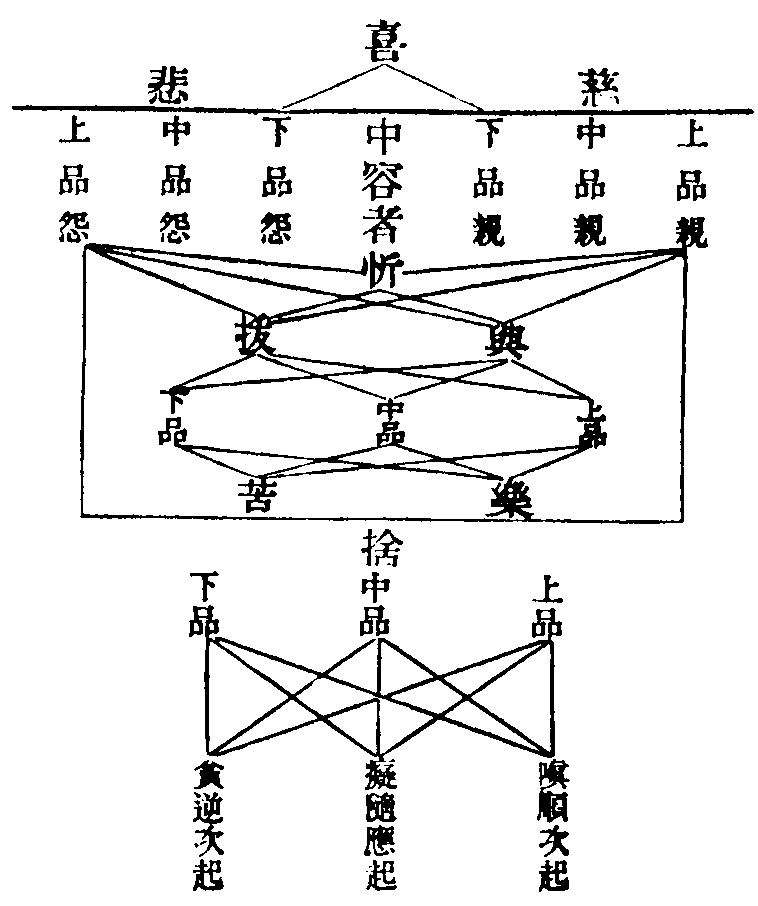
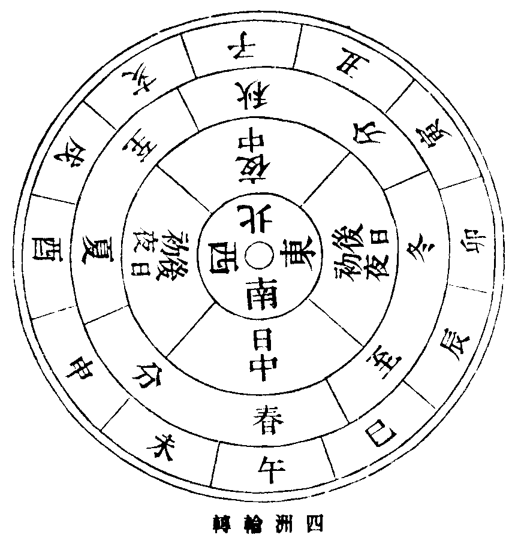

# 弥勒上生经瑞应钞



> **藏经**：卍新纂大日本续藏经（新纂卍续藏）　**册次** 第 21 册（X21）　**编号** No. 394（X0394）　**部类** 经疏部　**卷次** 2 卷　**篇幅** 69,485 字

> **卷／品**：0 卷 · 0 品



---



上生经瑞应钞卷上



真定府龙兴寺比丘僧　守千　集



夫其科者，本要别其义类，须是识其阶降，譬如排其皈从，切要知其生所。而其名者，元在简於他滥，当可了其增添，犹若续其枝叶，且与见其连隔。如今此中只於疏题除其卷目，有其四阶：一者、能释所释对，初十一字是其所释，未有疏时已有此名，故为其一。疏之一字是其能释，疏是疏条解释义故，造疏之后加成其名。如是不可先以经字合疏字了，然后合於观等五字，故作释时通连上字，依主释也。於所释中复有第二、能诠所诠对，初之十字是其所诠，经之一字是其能诠，虽其经体一文二义，而於要者正在听闻。又其相对解释之家多云能诠，略其所诠，亦不相违。此字正是所说所闻，於其名中滥於众经，又要宗趣，故添所诠共为一名，亦依主释。於所诠中复有第三、能观所观对，观之一字泛虽通所，今此题中只要能观，其次九字是所观也。此经虽亦说其弥勒上生之事及天宫等，然本只为劝其九品行人忻生，故合释时，以能所观倒堕依主。复於所观九字之中，有其第四、能生所生对，初之六字是其能生，次之三字是其所生。或以器界名为所生，如到家中，家名所到。然其天者，光洁自在，神用名天。知足者天，正在有情。此以器界而得名者，全取他名，有财释也。或旧天人名知足大，一天总名。今此天主生彼众中，别到总中，名为生彼，亦如处所名所生义。此对立能所之称，今此题中正辨能生，令人忻恋菩萨故也。由是亦作倒堕依主。上解是约从外向内，若约从前向后解者，即可先作能所观对，次能所生，方能所诠，后能所释。又或於彼能生之中立为一对，举人彰用对，弥勒菩萨举其人也，上生之言是彰其用，以其弥勒即是菩萨，弥勒菩萨即是上生，持业释也。望下兜率天之三字者，倒堕依主，兜率天之弥勒菩萨上生故也。餘问：如是离合两重倒堕，餘皆隔之，只有其观，云何可应经之所诠？答：经诠具备，说正并兼，离合拣滥，隔兼存正，观倒如此，不相违也。问：经中具有九品之行，今此题中何处见有？答：在观字中。问：系念、思惟，一义可尔。修功德等，云何名观？答：修餘行时亦恒观故，所有诸行并名观，如《唯识》言。故下疏云：以观为首，并名为观。又如信、戒现观之名，作隣近释。隣近亦有全取他名。然此正要九品之行，其行名正，正观察为助，不同现观信、戒为助。助得正名，名为现观。何以故？彼说现观有其六种，故以现观而为其正。此说造因招感得生，须九品行正为招感，不可只以观察之行而能招彼殊胜身器。问：既於观字见其生因，云何不说行人能、所，但说菩萨能、所生耶？答：经意是令观於菩萨，忻同生彼而造其因，菩萨所生便是行人之所生故，更不别说。其造因者，即是行者能生之身。既非别类，於所观中无由别说。如是题义，於经所诠无不具足，不相违也。上来且略，随其自情释疏题已，所有离、合有异旧解，於来鉴者宜详韵焉。其餘参差，至文当辨。



又支述作之者，临时为文，各有广略，展缩不定，量其机器及自胷怀。然须达其宗趣，事在合宜，所患太过而以哉。太展即忘本，太缩即难解。如此经中所说之义，无非性相及以因果。展转推寻，义门无量。假使尽其寿命，亦不能穷极。如是宁及本为生天者哉？且如三境，何须论其所观何者？诸如是等，但知行行，管取得生，诸尔而以。若随解释，展转无穷，恐失修习生天之业。故但随疏，略释大纲，作九品之由，渐定得生之要者矣。诸来勿责。问：经置外题，不假开卷，令人速辨，理在不疑。诸经题上，多有此状。又四笔相叉，不知何者？答：此是当於三个梵字，陀罗喃也，此云持转。师子觉云：「即是持义，依经修习，任持善根，不堕恶道。」天亲解云：「即是转义，依经修习，转凡成圣，转小成大，乃至成佛。」共为拣异俗书故也。出律文。问：经论疏钞四等之名，所为之文，有规格乎？答：有。经即随根就义，直以长行偈颂，更无引他解他文义。论乃便以论量性相，或叙经教而以释之。多分不引他文解义，但有自解文义了已，引他为证。



疏是疏条为义，多分引文解义，然具次为门。抄乃漏略不备之义，多分临时随释，而不及具备，故云漏略不备之称。漏即脱也，心力不及，故有所漏，此为劳也，即谦也。或劳谦别力，不及故劳也，有力故谦也。略者少略，劳谦亦尔，共为不备。或随自力，或先已释，或其易解，并可略之。又随但义，但只消解，不必头尾标结具足。於此疏抄所立之名，有是疏而自谦为抄，有是抄而他奖为疏。如略纂等，自呼为抄，他奖为疏。对法疏等，本分是疏，自谦为抄。问：讲说解释，名义何殊？答：讲即论量，说乃宣吐，字从於言，发之於口。解者是其免离之义，又分也，开也。释者是其除脱之义，又去也，远也。此之二名，字不从言，发於三业，如离怨等，亦名解释。然於此中，非关怨等，只恶解释先所不了诸有疑滞，及以诘难文义者也。所不了等，犹如怨等，得此言教而解释之。上法题已。



人名之中，先举所依。京者，大也。此有四，今取长安旧西京也，亦是数名。彼中居家人及京数，故以为名，有财释也。《风俗通》云：「京非人力所成，天地性也」者，叹胜之词，非关字义。大慈恩寺者，即是长安十大寺中之一寺也，高宗大帝为报慈母养育之恩之所建也。寺者，司也，至也，从九寺中之鸿胪寺而为名焉。沙门息恶，有其四种，具如餘辨。撰亦集也。问：说、作、述、撰，四名何异？答：说即口谈，造即起本，并非先有，名说造也。先有名述，通本无本。撰即集，集旧成本，名之为集。今世所传，撰胜於集，但在人情，非关字义。问：有题言述，人下言撰，人法相对，何见不同？答：形先为述，示今为撰。若论，新旧皆有也。问：如今疏文，云何旧有？答：皆出他典，或闻他说，名为旧有，非关此本。问：如《唯识疏》，经论相对，本释相对，名为述造。及其论疏，何旧何新？答：经谈初证，叹胜唯新。论约从经，自早唯旧。以论对经，彰叙经故，名之为述。虽不全文，义必尔也。然不如疏，引文解义，或叙他义，为自释文，却名为造。本释相对，如对疏也。又其释论，必牒本论，是叙本论之意故也。问：撰之一字，为能为所？答：初作三段，唯目能撰，人法分故。两段科者，可作所撰，显法是谁人所？故归撰已，可为法题，而作持业。若取能撰，只相违释。本抄之科，只为三段。准善师等，可作两段。今别删补，合为两段。恐未知者，令知有尔，非只为令异旧故也。其餘文义，诸皆解已。虽有二，褒贬恐繁，皆止。



疏：原夫者，发语之端，入文之势。若依字义，原者始也。夫是语词，穷其经旨，始自真如，展转流之，由此名为等流正法。自受用身证於法身，法身净已，智於如上现起化身，说此经故，故便示如包罗通遍。



疏：性质杳冥等者，今或性者，诸法体性；质者，体也。真如是诸法之体，故名为性质。此体深远，幽微难及，名为杳冥。所以超於蹄迹，言不及也，教如迹故；越於物象，非世间物，喻所喻故。虽然如此，然乃包含诸法，诸法之总主也。上约本来法性，下就当为觉性。此非唯是出缠，前亦非唯在缠，但以超言非境而为对也。上即超於言象，岂出缠者不如此也？下是耳目非境，岂在缠者视听之也？上即摄末归本，下即以本末，如是宁由在缠出？若以觉字为出缠者，岂非本来觉性者也？直成佛时为觉性乎？但云出缠号大法身，不约出缠方为觉性。诸后思之。



疏：方智云於縠月等者，此下四句，餘莫能知。初之二句，菩萨犹迷真，第十地亦未明证。先喻，后法。方者，比也。其第十地名法云地，智如云故。此云之智名方智云。或可解云：方者，大也。大法之智如似云，故名智云。以此菩萨观於真如，似隔罗縠而观於月，未明故也。有佛地障，故是犹迷。问：何故此地智如其云？有三义：一者、含其众水，二者、能蔽虗空，三者、充满虗空。智亦三义：一者、智能含藏总持等水；二者、智能隐覆如空麤重，二障广大如虗空也；三者、智能充满如空法身，智上功德如水遍故。



疏：假慧刃於藂筠等者，此之二句，声闻不测，亦有法喻，举其利根，亦未知证。假者，藉也，或假设也。言慧刃者，慧如刃故，是利根人，有束或超。劈竹断者，一竹可尔，於其多竹，不能顿尔。藂即多也，筠即是竹，今取多竹，不能一刃而劈之尔。声闻之人，但证生空，不能证於法空理故，此是不测，不顿断也。对上縠月，见而不明，今此藂筠，劈而非顿。揆者，度也，与察大同。神之与灵，皆训妙也。理即真理，机者要也，并目真如，大义可知。



疏：至道圆而粹容显等者，此下二句，二身齐证：初之一句得自受用身，后之一句证得法身。皆由解脱至极道圆，而获得故。粹者，纯也。容即身仪，故此自其自受用身。实际真识，并是真如。净即出缠，故是法身。彰即明也。显智已证，净即离障。由智证明，故得离障，称法身也。



疏：然后者，证实身已，然后随机现其权身。



疏：俯提十地等者。初彰随机变现，后明变现仪范。初有四句：二句他报，二句化身。他报应於十地。俯者，下也。佛居其上，俯而接之，现其佛身。疎谓分疎，可了之义。自受法身，人所不了，故云疎。海目，此且举目如四大海，更有眉如五须弥等，为文难具。言宝方者，显是净土唯实所成，他报唯现居净土故。下辨化身。控，亦提也。挺者，出也。为接三乘，现出化身，化身通被三乘众故。化身如山，魔不动故；又如须弥，最尊高故。多居秽土，名为垢域；现丘陵等，名之为秽，非关有漏。



疏：若鸿鍾等者，上法释，已下四句喻。虽有两事，并通他、化。能现之身，如鍾，如月；所现之身，如声，如影。其如鍾者，能现之身内离所执，名之为空；如鍾内不虗，不能发声。又其实身慈悲之体，本欲利他，即如其鍾外受扣、击，名之为受；本未受扣，亦未发声。扣、击即是机欲缘也。其如月者，能现之身内离二障，名之为证；如月不澄，即无其光。又其实身发利他用，即如其月外发光辉，即现其形；不发外辉，影亦不现。今复略云虗非执。证即离障，受即待机，辉即发用。上辨能现、所被别者，扣、击、器清，皆是机故。扣、击即是根熟、启请、待度等缘，器、清即是众生无有不信等障。根熟无障，方乃现也。鸿者，大也。皎魄，月也。循者，顺也。肆者，恣也，纵放之义。今取实身纵恣，现於权身者也。或可二喻他、化有别。他报无有阴生之相，如直鍾处出於声也；化身降生，母等如器。虽器喻机，机有母等，故可别也。



疏：故有者，乘前标后。由前应机，其二身他、化不同，故有仪轨，二身亦异。若依前解，远承法说；若依后解，亦近承喻。



疏：绍隆报佛等下，示仪范。先示，后结。示中有二，由彼二身各有初、后之二相故。文有两节：於他报中，初即受职成佛，后即趍座说法，无有处天及下生故；於化身中，初即处天，后即降生。初之四句辨其初相。二身之文，各有二句。绍即继也，隆者盛也。前佛成处，名之为隆；继绍彼隆，名为绍隆。言甄台者，甄叔迦宝为台座故。其受职时，在此座上，名之为於。纂亦继也，业即基业，大同绍隆。贻者遗也。离本而现，却留麤身，令机得遇，名之为遗。遗身在紫绀摩尼殿、兜率天也。贻字，有本作移，详之。



疏：抚根熟而趍座等者，此下二句辨其后相，一身一句。抚者，恤也。趍者，赴也。他受用身不从天下，直趍其座，成佛说法。化身翻此。降即下生，迹即纵迹，处胎等相皆踪迹故。



疏：斯乃者，斯犹此也，指上仪状。乃是语词，指已方结，结文亦别。然须影显三际之言，亦通化身；一生补处，亦通他报。宏者，大也。灵者，妙也。无文说於化身灌顶，故受职言目於他报。直顺此经一生补处，故后但结化身者也。此但结至故有下文，云仪范故。不结已前，随机变现。详之可知。或可言之在近，势连远起。问：一生补处，他报何有？答：准法苑章，亦义准有。如彼具明，不烦示之。问：尔化身何处之身名为一生？又所补处为天？为人？答：准法苑章，补阙佛处即在人处，非关兜率。其一生者，非是指其成佛之身更有一生方补处故。於此义中，或约大生，即指菩萨欲往兜率，在佛前身为名一生，更有人、天一往来故。两本、两中共为一生。或约小生，即指天上菩萨之身，唯有下生一中本故。中本别言，或四，或二。今约一期，合之为一，名为一生。问：如是皆是菩萨之身，如何顺此佛身耶？答：此对他报，并名化身。化身亦有因之与果，相从随举，不须具言。体例皆尔，不相违也。



疏：今此经者等者，经体虽二下，叹便亦兼其行、果，从经出故。故有四喻，如次应知。或於义中亦摄行、果，抄断非胜，今唯取此。教如一雨，能普洒故。理若其河，三兽度故；六行似舟，运越河故；其果如车，引出宅故。果中有二：一者、天果，二者、涅槃。车虽通餘，今且喻果，但云引故。其河对兽，要其济义；度时有济，直喻此经。其河对舟，要其溺义；以舟越之，喻经所拔。轸是车后之横木也。今举要车。问：六行如舟，如何合数？答：随数言之，六为六亇，非必一舟要其六事。不尔，唯有上上生故。或船底、船相、船舍、槹棹、坠石、稍公为六，六度、六事且具举之，亦无妨碍。



疏：虽复探幽晓秘等者，此上四喻叹经功能，此下之文潜通妨难。於中有二：初通前唯赞此经，妨后转通；但益一时，妨初近三行。於中有二：初正通，后释成。外人问云：前来四喻，诸经皆具，何唯牒此而赞之耶？或外问云：且如《华严》、《涅槃》等经，研核性、相，广谈因、果，此经之中皆无所有，如何以喻斯偏赞耶？疏两句为夺虽者，文含得、失，即纵夺也。探者，取也。线经华理，其《涅槃》等别经名异。大义意云：探幽深之性、相，晓秘密之果、因，实在其餘《涅槃》等经。若据拔此末世没溺之有情，顺生天之机器者，唯在於此经尔。是以偏赞而以哉。筌者，目教，取鱼之器而为喻故。叶即贝叶，上书其经，故与前线、华随㸦举示。



疏：所以金光夕烛等者。此下释成。何以得知？先释拯溺，一行餘也。下经自叙放光现华。放光除暗，表断黑因；华示六行，表当有果。显依此经，易而成之。其果可准，故偏赞之，慈氏威力不退转故。外即初夜。烛者，照也。旌者，表也。景者，明也。徒者，徒众。芳谓芬芳，开扸之义。蘤即华也。前即面前。纷即乱也。亏犹虗也。后即当义。实即果实。



疏：妙祥之俦波委等者，下释有机，菩萨、声闻二句文也。委者，赴也。善唯识云：累也，累累而来。今或委托，如波迅广，倚仗之也。举下众集，如波如云，故是符顺至如此也。



疏：虽则禀训一时等者，下是第二、转通但益一时妨。由上但云妙祥之俦、鹙子之辈。外人问云：如是所益，近而非多，何假如是赞之者乎？又或问云：所益若此，云何下言未来世等？疏答意云：初禀虽狭，传之即广，非唯一时如是赞也。禀教之机，但列一时。经为津梁，实至千祀，为津桥梁。祀即年也，且举其千，实至万餘，意取下言未来世也。夏名为岁，星行一次云，问呼为祀，取四时一终；周名曰年，取禾一熟；唐、虞曰载，取物终更始义。或祀传差，宜从纪字，以十二年名为一纪，正像末三一万二千，是千纪也。今至末法，以二千年餘，有许多盛行大利，何但千祀？



疏：若夫天宫、圣境等者，此下并是释题之文，题中有其兜率言故，又其指文云题衡故。此先别赞兜率天已，然后具次解释题文。至兜率处，但翻便止，由前已略赞之故也。天宫、觉菀，并通内、外。宫、菀并是菩萨为主，故彰圣觉而为名也。言因严者，因华果实，故因名严。神者，如也。属京之地，名为京畿。此例知尔。叶者，合也。菩萨合其无边之德，号之为德。此德游履於薗菀，故名为德履。或菀目外，但是菩萨之所游故；宫即目内，正所居故。



疏：匪心枢而揽观等者，上略赞胜，下彰难尽。初之一句，心缘莫穷；次之一句，语赞无尽。语随心，故枢；其心如此，便名为枢。斯大意云：如枢之心，既不能观之得尽，故语至极，亦不能赞扬得尽者也。光亦是赞，此即约胜我此缘，说不能尽尔。作如此语，非关自相，离言故也。



疏：教府自陈等者，承上自己心言不尽，指如教藏自陈赞扬，於此释题上息尔也。教或此经，或通餘经。府即藏故。衡即秤衡，称量轻重，正符於此赞扬胜劣。故此序文、赞文名衡，当释题故，名题衡也。



疏：六事齐修等者，二句举体，二句归名。六事如经二因之言，有为行、愿。有云：中、下，此等多说以观为正，行为助因。今恐招感正要六事，所言二者是愿及观，以此二种为六事行之前导也。摄引不令六事之行归於餘处，如是愿、观名之为助。其六事行为正因感，以正从助而得名者。如七作意修定之者，须加行定，是其正要，作意为助。然从作意以为名者，修习之时，彼用胜故。又如忏悔，虽体是悔，然云惭、愧。又彼损力，益能转体，正唯是慧。亦云由习胜解，惭、愧损本识中二障云云，并皆不曾言其正体，但从隣近胜者为言，正同此中言其观也。其观之言，摄六事隣近得名。然行为正，观为助引，於修行时不敢离故。离观修行，便名为邪，故其正行从助得名。问：中、下修者，如何不说？答：此且从胜，实皆名观。又其中、下，所列诸行亦有六事，此中皆摄，并名观也。问：如是三品，有何差别？又直与下疏文相违，九品之中不皆具故。答：下疏约正为头，修习如是六行、三业、十事，以分三品。若要得生，须是诸行互相助成。又其三三细分九品，内一、二等如何无助孤示得生？其彼果报相非轻故，无因、果生，非道理故。且示一相，有无戒者得生彼乎？故乃分品约头、约正。若其相皆有六事，招果内、外，无非思业得生於彼，阙行不可。於此义中，应极思择，至下更辨。



疏：母志悲缠蠢类等者，三因得名，如餘具辨。缠者，绕也，不离之义。蠢类即是下劣之虫，以例於餘。尚以悲心不离於此，何况於餘？故是至慈。怀生即是有情异名，怀含情识或烦恼故。



疏：道圆上果等者，下解菩萨，二句辨位，二句器名。实已成佛，示迹为因，故为菩萨。言祈觉者，得菩萨名；言运生者，得萨埵名。此即且依弘誓语也。假即非实，结归示现。



疏：光洁自在神用名天等者，三义名天，如文易见。此多目情，有辨器界。菩萨生彼，约到彼处，约到众中，并名生故。



疏：此由补处天宫等者，此下总释立题之意。先举所观，后举能观。大意令人观之修行，求生瞻奉，必获愿也。言补处者，此是菩萨当於题中弥勒菩萨。言天宫者，当於题中兜率天也。合下端居利化之语，即见上生二字之义。此总意云：此由一生补处菩萨於兜率天宫之中端居利化诸有情也。此为所观，令人修习，祈观得生，无失悮也。



疏：经者摄也等者，列其四义，次第解已，结归二义。契理、契根，名之为经。摄常及法，即利物也，乃是契根；贯即诠真，是其契理。有处说云：摄则集斯妙义，贯又御彼庸。与此相翻，随释无违。二皆可对情及理故。言樊笼者，云樊训笼也，云樊是深密罥碍之义，烦恼若此。有作烦字，言百灵神圣也。无改曰常。言千叶者，金枝、玉叶，是王者也。上皆举胜以例於餘。



疏：第一、佛成权实者，佛之身说，并名为佛，无不摄尽。问：何故「成」字安之在下？常及圣教言成佛故。答：是两门故，故安於下。下文先辨佛之权、实，后方辨於成权、实故。佛即直辨三身之体，成即辨其从因至果。其《佛地经》是先辨其五法、三身，次后例其十地分证，故附於彼，如是为文。若不尔者，倒其「成」字，有何义意？不为文章，非语顺故。故就义门，恐同常言，唯为一义，置之於下，遂令览者起异论端。至下当知。



疏：权谓随机接物等者，此下释权实总义。事理未尽，名之为权；称於理事，名之为实。抄分两对，不依次第。随机名权，迬真名实，是《胜鬘经》；接物名权，究理名实，是《法华经》。今或解云：只依次第，配其二经。随机究理，是《法华经》；接物迬真，是《胜鬘经》。其《法华经》二权一实，随机说有三乘究竟，二乘实未得究竟，故究、不究竟皆为究竟。事理未尽，故是其权；穷理唯有一乘究竟，故是其实。此《法华》也。其《胜鬘》说四实一权，为接二乘归於大乘，说唯有一，无有二乘。既实有三，事理未尽，故是权也；称实有四，故四是实。此言一乘是其权者，乃是《胜鬘》指於《法华》所说一乘名之为权，非自《胜鬘》所说一乘亦名为权。《胜鬘》自说真如名一，此之一乘出生四乘及摄四乘，皆尽理故，不同《法华》说一无二，故彼是权，其《胜鬘经》说一乘亦是实也。此上约说辨其权实。约身辨者，《法华经》意，随机变现，非实修成，名之为权；究理修得，名之为实。即自受用，名之为实，彼未说有自性身故。《胜鬘》之意，指於《法华》接物别说自受用身，亦名为权；不归法身，别说之故。为接物故，尚拟二佛是不尽理，名之为权；依自所说摄相归性，只立法身，名之为实。一人只成一个佛，故是尽理也。善师解云：「随机本为接物，究理便是迬真，各唯一义，似於标释，非两对也。」今作两对，配於二经，次第亦好。名义虽有，可互属之，随义就意，亦无失也。



疏：佛之身说者，说通所说，故不言教；所说二乘亦是权故。问：《法华》亦说定姓，二乘既实有尔，不归大乘，如何说三？不亦名实，而名权耶？答：皆说究竟，实不究竟，故亦是权。《胜》不曾说为究竟，但说有尔，故是其实。



疏：即《涅槃经》半满教也者，此约未会二乘归一。大乘为满，说二空故；二乘名半，唯生空故。若会之时，不分半、满，皆为一故。



疏：若如来随彼意欲等者，指《法华经》说。为实者，为方便说。方便即是权巧说之，未尽理也。



疏：即说唯有等者，此是疏之释《胜》意。



疏：谓大乘、独觉等者，下引《胜鬘》所说四乘是实者也。言无闻者，无闻，慧也。无三乘，故非法器。言成熟者，令彼成熟，是化度也。以人善而化度之。



疏：若以色见我等者，此初一颂遣如色等见於佛也。我即是佛自性法身，仍须摄相归性之门，并自受用。两句示情，一句遣之。生即众生断道，彼如色等求见佛者，如是众生是众生，是游履於邪断道也。故不见末句为结。彼论释云：「如所不应见不可见颂上三句，如所不应见其不可见是末结句。色等名所，若如於彼，不应见也。」



疏：彼如来妙体等者，此第二颂上之三句法身体妙，不应见也。亦须相通自受用末之一句，麤识不知，故不可见，识显麤故。导师之言是变化身，此是道师之法身也。显不应见，彼论释云：如彼不应见及不见因缘。因缘即是所以之义，即当末句，以识麤故。上之一句释前三句。彼目妙体既是法身，故彼体性不应见也。



疏：彼论释云等者，此颂非是释次前经，是承前经断说得疑。既非见等，如何名佛？如何有说经自断云无有定法名阿耨等？此是释彼於此颂中亦自受用，摄相归性，总名法身，故但应化，非真佛也。应机现佛，名之为应；现趣类身，名之为化。有云：合言并自受用，非真佛者。非文意也。应云但说法身实处摄自受用，说自受用名为权处，是约离本别说之也。上句遣身，次句遣说，亦是示现非实说故。又恐疑云：既云应化，非说法者，莫其应化全不说法？故次经云：如来所说法不取不可说非法非非法。今此颂云说法不二，取二即是其法也。下句又释能说无实，所说离言，故上说云非说法者。



疏：以法身为实等者，《金刚经》中摄相归性，其自受用亦名法身。《金光明经》其义正同。下言二身但是应化，无自受用。



疏：此以受用为实等者，《法华》未说自性法身，说自受用名之为实，实修成故。所言化者，即通他报，非实修成，变现起故。



疏：有二四句者，其初四句不论随类，约是佛相，名之为佛，方乃於中辨其四句。小化无受法乐之义，不得名报。第二四句既辨随类，名之为佛，是佛相者，便名为报。故小化身亦入俱句。或初四句约受法乐，似自受用，方名为报，不通小化，於唯化中影略随类。第二四句但是佛相，便名为报，即通小化。其自受用及随类化、他受用身、自性法身，如次四句，两下皆同。唯小化身，二有别也。又法苑章，应、化相对而为四句，其他受用不名为化。为此相违，各随一义，亦无过失。彼约应现佛身之者，名之为应；现五趣身，名之为化。故丈六身，六应亦化，先现为人，后成佛故。今此但约变现所起，名之为化，故他受用亦得名化，不相违也。



疏：一者、法身称实等者。问：须要摄相归性之者，其自受用已在实门。下言餘二报、化之二，报通自报，是不相违。一、自受用，自相对故。又不合前《金刚经》说自受用身名为权故。答：摄归性者，对别说者，亦成实、权。一人唯成一个佛故，名之为实。离法身外，说自受用，隐於法身，故是权迹。设别说二，亦是一人成二佛故，亦是权迹。问：若尔，分三身者，法身亦权，何故法身一向名实？答：本中分末，隐本一故；摄末归本，无遗一故。问：前难虽遣，后难如何？与其《金刚》正相违故。答：如《胜鬘经》指於《法华》一乘为权。此亦如是，是约《金刚》指《法华》者，别自受用，名之为权，《法华》未现自性身故；《金刚》摄已，不别说故。有作是说：有生灭者，名之为权；无生灭者，名为实。故自受用，名之为权。今谓不尔。若只性、相为实、权者，恐非此中实、权大旨。故此标中但云称实，释中但云诸法体实，并无唯无生灭言。言事相权迹者，唯说事相为佛之者，是权宜也。为彼未了本法性故，权且说之。



疏：二者、法身等者，约为二身，与前不同。亦是实行，修成名实。问：《法华》既未说於法身，如何此中二身为实？答：亦兼餘教，又可显之。又彼密说法身为实，如说世间相常住等。



疏：唯佛与佛等者，上列二身；下立十义，结归总名：二句，一句，一句，二句，二句；次下五义，各唯一句。所有二身，十义既同，是故同名实身者也。言是身之本者，为化本。言俱离差别者，不同他、化，各有等降。言功德、智慧等者，此自受用，同於法身。法身不言，或功德言，可目法身。言不可以色、形等者，约无形量，二身为同，无头、足等别处形量。言都无分限者，前无边者，约别法用，此约总身；或前约穷际不尽，此约遍於十方。言起尽者，「无」字贯下，此约麤相，他、化二现麤生、灭故。



疏：他受用身等者，翻前所说，一一应知。



疏：故《佛地论》云等者，上辨佛权、实，下辨成权、实。总门名为佛成权、实，不顺常云成佛之名，意在於此。若顺常言，必不推寻有两般也。若不尔者，倒之何益？非为句顺，易呼吸故；「成」字在上，即易呼故。故意是令生异论端。佛及成中各有权、实，单言其佛，直论其佛，不论修因。若其成，是有能成修因者也，即是为文先果、后因。又此成中亦连其果，虽单言成，意成佛也。此指佛地身之文，结证於前，便生於后。下於此二辨其成故。诸无此义，应思细用。此下并说修、成相故。然说法身不可言成者，其体初有生，故名成，即不可也。泛成、就成，即亦通尔。问：此经一卷，论有七卷，但说真如及其四智，无此权、实二身之文。如何证前？如何生后？答：此非引文，是约义言。彼说五法，即证二实。又於平等及成事中说现受用及变化身，故二是权，此证前也。彼经至后又说十地得无生忍，分证一味，即是能成，此生后也。彼论文第七卷中亦有实色、化色之语，化即权故，化当身故，影法身也。不尔，云何於此引之？初言其故，必是连前；次下牒此而以解之，故知此文更是起后。下文大分是彼论文第七中义，五法、三身即当佛故。经说十地，即当成实；论说现、化次第应机，即是成权。请细勘之！



疏：然此实身等者，於辨成中，先实，后权；於此实中，又先举其所成之体四句文也。此通二身，是与向下成权之文正相翻，勘之自见。虽举身上，要无方处，与权相翻，对举之也。其自性身依法性土，虽体无二，而属佛法，相、性异故，亦名身、土。本真法界既无方处，立为身、土，亦无分限，以义遍体，名遍法界。或此法界是目虗空，自报可知，并非唯东，或唯西故，名无方处。权身不尔。



疏：法身本有等者，此下别解。二身既别，二义有异，皆先示之，然后辨成。此之二句，法身本有，又复共同。



疏：凡由忘覆等者，将拟解成，先举不成。未发心前，无期限故，一向不成。所言藏者，含藏为义。虽不名佛，含藏佛义，名之为藏。如来之藏，依主释也。



疏：由近善友等者，下解成位，仍连将成修因者也。有处说其烦恼为藏，此中不用《胜鬘》，只依真如之上分两位故。



疏：但可说证等者，恐外疑云：既言法身本来是有，如何至果方得成耶？疏二句答：显证名成，非生成成，故不相违。外疑云：无漏皆证，十地已然，何唯佛果名为法身？又三句答：虽证未圆，不名法身。十地之中，圣道不圆，未具足有诸功德故。



疏：自受用身等者，四句之文，形前法身而标举之。两义不同，修成非本，人别非一。既标举已，然后方辨修成次第。



疏：从凡夫位等者，下有三位，未成、将成、已成别故。亦先辨其未成之位，未发心也。



疏：由近善友等者，下至菩萨坐中成正觉已来，皆是将成之文者也。发心已后，未成佛前，有期限位，皆是将成正觉之位，非唯隣近名将成也。此近三行而为总举，此初一行以义释之。以下，引证。金刚已来，皆令种增；既未成佛，皆名为藏。十地皆以佛为善友，听佛法故。



疏：阿梨耶识等者，阿赖耶识毕竟不实，亦可断故，名之为空。此能摄藏无漏种子。无漏种子从果为名，名为如来。如来之藏空，即如来藏。又《胜鬘》中亦以烦恼毕竟可断䨱藏法身，名空如来藏。作释虽同以前所解，然非此中正所用也。此中藏识名之为藏，不取烦恼，教文时意亦不相违。



疏：具足熏习等者，下不空藏即以无漏种子为体，因、果相对。因为果藏，大同前来在缠真如。故下对辨二经之名。然此是约发心已去方得藏名，故云具足熏习种子。具七最胜熏习之者，或具足有大乘心者，皆得其名，直通金刚。不同前来取未发心已后十地之中未名法身，名为藏不？答：分名法身。《法苑》亦说十地之中立三身故，亦可分得在缠之名。前唯说凡名之为藏，又此漏种子同故。



疏：发心修行等者。上依总解，此下约位。仍先指广，然后略辨。如《心经疏》引《瑜伽论》具广明之，不能多引。



疏：在地前位等者，下正依位。於地前中，先辨正修；由此之下，是其华报。有身有土，如文可知。



疏：至初地已上等者。於地上中亦辨华报先后，立阎浮六天初禅邪见，但并后三，名之为十。十地菩萨，如次，可知。



疏：然未无漏等者，两句二义不全无漏。设无漏者，亦未圆满，不同佛位。两句释成不同所以，实身正是第八变故。彼未无漏，此亦应尔。又其五、八未成无漏，故未圆满。问：百四十种因已得几？答：唯此相好在因分得，餘但佛位，方乃得之。



疏：生他受用等者，此下辨土。悲、智两增，皆生他报；有悲增者，随类土故。如梵网经於第二地说千叶等。准前显后，明有大、小；或显身有其大、小，非证随类。



疏：金刚道后等者。金刚心中更无华报，唯有通前之实报也。此下亦是将成之位。虽说权得无漏相好，是明此位不远而得，非显已得之位次也。直至下。引瑜伽了已。次下文云金刚心位，身犹有漏云云，方是已成之位。已成之文却举前因，连前辨后，文例极多。此中却是形后辨前，如唯识颂舍二麤重，故便证得转依，仍是辨其十地位故。



疏：然诸菩萨等者，已上总辨修习与成，此下别辨变易位处。先明得舍，是约於位；后明居处，是约其天。先得位中，智增、悲增，二类可知。言如入灭定等者，入灭定处，必伏烦恼；不受分段，须资变易。故示灭定，以明变易。



疏：其变易身等者，下辨再资。因位不舍，即须再资。



疏：乃至金刚转位方尽者，此方辨舍。转若起义，正舍名舍；或此转言，是目转舍。同金刚舍，可通已舍。



疏：由此七地等者，下辨居处。唯明悲增，准智增故。又此唯明直往之者，其渐悟者，处不定故；唯广果者，处最胜故；非净居者，声闻处故。



疏：资此下地等者，此上辨生，此下辨资，亦有初资及以再资。所言下者，对大自在，或对净居。



疏：将至金刚等者，下辨后往成佛之处，非是辨舍，前已辨故。又引证，皆唯处所，不曾言舍。金刚位前已至於彼，名之为将。



疏：出过三界者，随其无漏，助因说故。又约最胜，或约从佛。



疏：现报利益等者，不论远修，但对金刚不死成佛，名为现报；虽舍有漏，不名死故。摩醯首罗智处生身，其业必是地前所造。望此天身，既经生死为后报，其果亦胜；又依成佛，名为利益。问：如资加位，入见不死，入变易后往彼者，应亦现报？答：其直往者，必生广果方资变易，故无现报。此解不然。其渐悟者，应有此尔。应作是说：此业既是感总之业，必无现报。问：应有顺生？答：此非约於四业中者，但约对於造业之身便受果者，名为现报；其隔生者，皆名后报。即顺生业，亦名后报。此解为正。言智处者，成佛之处，独得其名，是智之处；摩醯首罗，即是智处。其第十地，舍此处生智处生。



疏：金刚心位等者，下辨已成。虽举金刚，但欲对辨佛位故也。



疏：此所修生等者，此下大文结归权、实。法、报二身称实智境，故名实也。如者，合义，即是智境冥合之义。或，犹似也。皆无二取，名之两如。



疏：彼二权身等者，下辨成权。亦先对举他、化二身，形前实身。彼无方处，此即有也。虽举差别随宜与现，意要方处，或兼形前二身别文。舍此权身，下无结文。此标举文，义足见故，云随宜故。



疏：只如他受用身等者，此下辨成。只，犹且也。如是，指词，未论化身，名之为只。又於化报且明身土，更有诸相在后辨故。又皆尚略，故名为只。初三行餘是其化报，举其菩萨见化为理，以显他报身土大小。言百佛者，是目大化。一大化佛王一大千，一大千中百亿小化。此理之下，是释文也。所言百亿是其小化，指前未言其一大化、百亿小化，明前一佛是一大，此一大化百亿小化，其百大化有其百个百亿小化，如是共为一化报座，应初地也。



疏：此受用佛等者，此下是辨化身之文。前虽已有二化之言，欲显受用，此下方正总、别辨之。此总文也。於中，先土，后见。於见之中，言此前者，是其加行，略无百亿资粮之言。次「然有」下，或上二句都连下，标二化别辨；「由此」下，释。机有胜、劣，故云阶降；佛见大、小，是由此也。此虽言身，文连前意，意亦显土。或自为彼所现之下，便是身量。疏主为文，往往逆次，土中报、化，身中化、报，此判极妙。



疏：初地所见等者，约座辨佛。



疏：初地菩萨等者，菩萨之身与佛量等，名为相称；或现师资等其半者，名为相称。不尔，即非不同。地前亦有不能等其半者，即不相称，故云多也。



疏：初地已往等者，外人便问：云何地前身不等佛？或有与佛不能相称，等半之者；入地决定，与佛相称，或名相称，等其半者。疏答意云：已得无漏功德定故，不同地前；未得无漏，阶降颇多，或有极劣，不能相称，或不等半。



疏：分段、变易等者，外又问云：菩萨亦有分段、变易，云何皆能或等佛半？其分段者，应须小故。疏答意云：麤、细虽别，其量亦同。先其小者，无漏资故。此言大者，或等佛半，便名为大，形今人趣之身量故。佛身极大，故等半者，由资而大。



疏：於十王位等者，此第二解亦复不定，与地前同。言或受、不受者，内既有受，身量同彼，所随类故。此即尚有不能等其佛身半者，佛极大故。初地所见他受用佛身，长六十万亿那由他由旬，故如是文。问：前念加行等于大半，云何后念便增尔多？答：初得无漏资故如此，如前已解。



疏：正智证如等者，便明缘智。



疏：如十百明门等者，依《瑜伽论》四十七说：一一刹顷证百三摩地，以净天眼见百佛国；二、见百如来；三、动百世界，身亦能往，放大光明等；四、化为百类，普令他见；五、成就百类所化有情；六、若欲留命，得百劫住世；七、见前、后际百劫中事；八、智见能入百法明门；九、能化自百身；十、能现百菩萨眷属。初三摩地，势贯於下。



疏：若至二地，得千法门者，过前倍。问：已后诸地，皆十倍耶？答：准《十地论》，不唯十倍。彼十二卷后十卷，后十卷中别设十地，一地一卷。於初地中一念证得百三摩地，诸如是等；二地，千；三地，百千；四地，亿；五地，千亿；六地，百千亿；七地，百千亿那由他；八地，三千大千世界微尘数；九地，阿僧祇百千佛国微尘数；十地，十不可说百千亿那由他世界微尘数。准此所说，三地、四地、六地，并是百倍；五地，千倍；七地，那由他倍。其那由他，亿亿为之。八、九、十地，形以前地不见、所倍不同，所以后当具述。若皆十倍，其数极少；至第十地，只得万亿。已上之亿，皆约千万，即是俱胝。俱胝俱胝是那由他。小乘多以十万为亿，名为落叉。



疏：其佛处座，大、小相称者，其量非等，多等其半。菩萨身量亦等佛半，名为亦尔。或身不必等其座半，但小於座，随应相称。菩萨与佛，身难等半，相称亦尔，非以半半名为亦尔。云如化弟子等者，报佛亦有。上实菩萨同化菩萨，其化菩萨等半相称。此虽由业，如由佛心，显定然也。不尔，何须指如此例？



疏：我今卢舍那等者，此下引证。又其逆次，此第二地，两句他报，两句大化，四句小化。



疏：亦如阿弥陀佛等者，却证初地。



疏：《法华》亦云等者，此下二文不见何地即为总，冬殊亦是化菩萨故。未见化作何地菩萨，故亦是总。或其多分悦初说，故引在初已。又此二文证他受用之随类，故其量大小、处所不定。文殊是在华严会，故是随类也。问：二地已下，何无别释化身之文？答：数虽渐多，其量等初，故不别之，但於其中有因之者。



疏：故华严会等者，但取不见，明是他报，不要引出见者为证。引出见者，但是文殊，非是佛故。问：文殊等觉，何在初地？答：现者不遮。又但随类与以为证，不证何地之随类也。



疏：后得所观等者，此附金刚权、实之义。依别后得，双运相从，入於见实。问：此与前云正智证如云云何别，岂不相重？答：前约见、不见，此约见权、实。问：后得岂不见自受用？答：此且约唯权、唯后得。本唯缘实尽理，后得通缘权、实。如是双运，随义别说。



疏：若第十地等者，上辨初二，下直超辨前十地也。文可详之。



疏：然此等土者等，下辨诸相。先报，后化。报中三节，此辨女等之恶趣。等生者，等无根等，即是八难。下引证中，先证女人、无根二乘，后证畜生。餘者例准。此中大意，要无处胎童子等相。



疏：《皷音王经》等说等者，此下会违。外人问云：既无女人，何有父母？「既无」下，会此中虽有父母之言，但为会於女人而来，非正是辨无父母，故下更略辨无父母。



疏：有解等者，前解弥陀唯是报土，此师是解阿弥陀佛通其报、化。虽弥陀土有其女人，然亦报土无其女人，不相违也。但弥陀土通报、化别，下引释迦亦有报、化，如弥陀故。然於报土无化父母。



疏：然《华严经》云等者，却成前解於报土中有化父、母，不须弥陀通报、化说。或其有解说阿弥陀通其报、化，此又证成报土之中有化父、母。二义相合，弥陀通化释迦，弥陀报、化，皆有化父、母也。此中意云：摩耶是母，又说含容，必是化为菩萨来集，即报土。



疏：《观音授记经》云等者，下引此经是辨先有处天之相，故引末云不说先住何方云云。於此经中只有说云：处座成佛，观音、势至二人皆尔。



疏：所以者何等者，下释不现处天所以。此处为菩萨，此处便成佛，故先处知足天来为大菩萨，不须先令久希望故。欲令之下，对举弥勒是为小器，久令忻乐，方令得见，故先处天，然后下生。



疏：其他受用等者，下乘前经辨无父母，三句牒示。直坐台座，不说餘事，明无父母。举此事已，两句对结。



疏：且如化身等者，上报，下化，略辨四相。文中先举彼机国土，以为不同报土所以，故云且也。



疏：将成佛时等者，辨生知足，不生餘天。如文可知。所云将者，形在释迦会下已前，已前非将。又在兜率，亦得名将，对正成也。



疏：只如释迦等者，下生相也。欲辨下生，先示在天。云只者，且指此二，不论餘故。下云三际，故无只字。



疏：三际成佛等者，降魔相也。其道树等，因便故云，或兼对之。座唯金刚报佛七宝。言降魔不同者，先、后不同，如餘处辨；或四、二等魔军不同，指如彼文。



疏：金刚座道等者，成道相也，示现亦作如是相故。此非说实，文隔越故。问：理虽可尔，文上如何见是示相，不是实证？答云：利生故，明是示相。



疏：今《上生经》等者，已前泛辨，下入此经。既云其成，故非大文。此中先遮法身二报，此遮法身之理。但可证者，真如理也。连下见意。「亦非」之下，别遮二报。「即」字之下，遮已归本。



疏：虽标化佛等者，恐外问云：云何说权，不说其实？宁得成於实利益耶？疏下通此。见权显实，相相似故，如见水月，了天月故。



疏：自受用身等者，此下释成。先说权、实故未之相以为道理。以实现权，权似於实；权不离实，故可显之。



疏：虽复等者下，转通妨外。又问云：以权显实，权身既多，实身应二句为夺，意不越前。今再牒之，欲申下文，大意可知。



疏：如月出云际等者，初之四句喻；「虽复」下，当前三行；「器成」之下，喻。「见者」下，大意有二：其初意者，以实现权，如月现影，覩知月见似真如，可影显也；其后意者，喻其化身虽千百亿，实身唯一。顺翻，可知。



疏：真权两体等者，此合喻也，合归权实。「故知」之下，勿此相连，是却结此唯是权也。



疏：故《钵经》云等者，此以二文合证弥勒是权、实。此即先示文殊不知，后证文殊不久成佛故。今弥勒是佛，示现已是佛，故文殊不知。若实菩萨如是状量，文殊必知。问：文殊既是常喜国佛，弥勒是佛，文殊亦知，何云不知？答：是当作佛，非是已成。此中举者，意显隣近成佛之者，此所不知，必已是佛；既已是佛，今之得见，故是化也。有说：此证文殊为化，非此所用；或以文殊不知之理，文殊是化。弥勒亦尔，以化对化，实对实故。



疏：然诸菩萨等者，成权、实中，此生数成，是辨成佛所有生数。



疏：一生所系者，更有一生为所系故，离即成佛。弥勒在於释迦会时，更有往来一大生也。从天下时，彼身不死，直至成佛，为名最后。又只此身临欲成佛，坐菩萨座，名坐道场；成道之处，名为道场。



疏：成佛由因，故三皆尽者，此辨癈立，谈成佛身。远者不论，故更无有。



疏：唯化佛等者，此文连下。



疏：如第七地等者，不同前来更一往来名为一生。此但於一变易身上约位说三。或此所云唯此一身是前所隔一往来身，唯有此后一往来身即受变易，此以前身乃名一生所系身也。且如七地在於人中更有一生，方生四译，受於变易。此前人身得一生名，其最后身但指八地约变易也。理实七地末后分段为变易者，亦名最后。



疏：为一生所系等者，此身之第二本有，是此一生所系身也。然无文说，彼在何处？



疏：若说天中等者，明不约此。



疏：故有三也者，所隔有三，约前人身望后成佛，除成佛身有三小生，其成佛身不能隔系，所以不说。



疏：一、除灾生等者。於此文中，初现有情，后现无情；於有情中畜、人、天三，复於人中医、巧、王三。寻文易见。



疏：二、随类生等者，於中亦三：初标所生，次辨所为，后更示。



疏：四、增上生者，前第二中但说畜等，故别开。此合之，皆可为随类也。



疏：具后四生者，示同天故，形色高故，是天王故，亦最胜故，唯非为除灾患生也。前於第五，且最后身理实天身，亦后此名一大生故。下第二解，但具中三，不约大生，故除第五；彼望成佛，未最胜故。



疏：若下此洲等者，上解天身，此解下身，唯最胜也。问：下宁无彼大势等生？答：但承前增，不遮更有。



疏：姿容挺特者，奇异之貌。挺拔已出，最奇特也。矜，居陵、巨巾二切，怜也。



疏：此即儿志者，下再解中，准亦性行，或下再解，是亦通尔。



疏：舅生师弟者，师资俱利，故业成。舅即为师，外生弟子。



疏：而为四问者，与问佛云：我师波罗利，而具几相耶？下三皆是问波罗利所具者也。



疏：佛因便化者，通化十六。应起下云：「俱从坐起，至方便说法。」却从次云：「餘十五人得法眼净。」又起下云：「并成应果，唯有慈氏不预彼流。」即是慈氏欲求成佛，不证声闻无学果也，非是不预出家之流。



疏：手自绩者。绩，子狄切，缉也。



疏：无敢取者者，自知不任。



疏：慈氏将穿珠师等者。由被妇责，切心悔恼，故令知同果，又欲令彼妇亦信顺。



疏：佛因无灭者，即阿那律，佛因此说自於先劫供辟支佛所获福利，便说未来弥勒之果。慈氏於是发誓愿云：自为彼佛，皆为於穿珠师也。



疏：寂灭道场者，理名寂灭，证理之处名为道场。



疏：慈心三昧经者，四无量中，从胜就初，而以为名，实诠四种。四於有情，各有三品。略为图曰：







疏：不能屈伏者，以彼不能令佛屈伏，遂自伏也。



疏：若有畜生类等者，初颂归依佛，三句归依法，二句归依僧，后三句结劝。



疏：遶仙七迊者，往往为七，顺七佛故，身、语七故，七觉华故。



疏：仙人告之等者。问：仙人至慈，如何赞受？答：白仙之时，但云供养，不云投火。其[虍-七+(土/用)]力等，亦名舍身，故仙赞叹。次云舍身，亦未云死，故仙不止。或以下言不是对仙。



疏：悲不能对等者。即不能言，书以辞之；又欲问囊，并经亦书。



疏：宁当杀身破眼目等者，两句自情，二颂凭佛：初颂凭戒，后颂利、害。



疏：地六震动者，此有二种：一、约六万；二、约六事，谓动、涌、振、击、吼、𪹼。此后五种，从初名动；又皆不安，总名为动。



疏：贤劫千佛所得道者是者，非是千佛，但贤劫千佛之所得道之者，是彼众生得闻法者。



疏：此说初时等者，此下却解无从母名。相师立名亦是指儿，但是见母因子而慈，知子性慈而立慈名，非是从母而为名也。故后却会归本梵语，无是那字，前从母中改为尼故。此云初者，《贤愚经》中有两节故，此是初时。所云近者，对於《仙人经》中所说，此题相承是一人也。



疏：若依此性者，性行之性拣从母名，当尔从於性行为名。今此却从彼名为姓。



疏：婆罗门种姓有众多者，此是通妨。外人问云：前云生在婆罗门家，何故却云姓慈氏耶？此答意云：彼是总姓，婆罗门内姓有多故。传婆罗门有十八姓，此即一也。



疏：有云慈氏等者，此师意说古昔是名，今亦非姓，只是名也。云阿逸多者，此云无能胜。



疏：乔答摩是皇者，问：姓望何别？答：远姓可称，名之为望，不经改者，只为姓也。



疏：劫有多种等者，或小、中、大，成、住、坏、空，火、水、风等，皆如劫章颂内说之。



疏：《观药王》等者，三千诸佛出於三劫，先总明之，仍先叙彼往昔之因。「其初」之下，方乃别辨。



疏：第三、毗舍浮佛者，准此七中，初之一佛非庄严劫，毗婆尸佛是相好劫之第一劫。尸弃、毗舍同在相好第三十劫，相去远故。毗舍浮佛既庄严劫，故毗婆尸非此劫也。九十一劫是其贤劫，过拘留孙、拘那含及迦叶佛也。共过六佛，并其能遇释迦为七。常说七佛，是约释迦相好劫中能、所共也。此上之劫是约火灾。准此，庄严望於贤劫，隔六十劫，或增减劫，相去六十。庄严、贤劫，大劫相隣，后解为胜。



疏：其三千佛等者，问：何故三千同时发心成佛，不在一劫之中？此疏答之，大义意云：发心虽同，修有三等。其三各各同修胜业，俱同证果，故在三劫。问：三千应各合身、合土，此云同修及俱证故。答：同在一劫作如此语，非是同在一时机也。若不尔者，释迦、弥勒及楼至佛如何可说合身、合土？尚有说云九百九十四佛身、土合者，非也。



疏：《无垢称经》等者，此上总辨三劫，此下别辨贤劫。此引《无垢》，总辨上祖。其宝盖王供养药王，经於五劫。此王千子内有一名月盖王子，此亦供养药王，五劫相次成佛。



疏：《五浊经》云等者，於贤劫中下，辨佛出分为三世，过去四佛并释迦也。下但列三，今犹是其释迦法故。经约佛身，释迦过去；疏意约法，文属现在。又欲与其弥勒相对，故不同也。三中，初二名字不同，劫数亦异，翻译之失不可和会。劫章颂云：六万四万时二万拘留那含迦叶兴。此云迦诺迦村陀者，拘留孙也。迦诺迦牟尼者，拘那含牟尼也。



疏：《贤劫经》云等者下，叙释迦不绩前经，别叙贤劫，意在与其弥勒相合，故现在二佛相对。此云人寿，是迦叶佛末法之中与释迦佛百岁出世，并第九劫是一增减。



疏：覩史天寿等，此下所叙，数有不同，译人悮也。



疏：人寿转等者，此下欲辨弥勒出世，接《贤劫经》辨劫引之，非是因辨劫之义也。说释迦佛正法之时，人寿不减，译人悮也。云三、二十岁者。十字三用，不尔相违。疎即稀也。



疏：子年倍父者，准《纂》十岁生十五字。过半为倍。



疏：从增六万等者，此上总辨增、减，此下方辨佛出。是说弥勒出於增劫，应攘佉王在增劫故，故为悮也。下引论文，对破於此，必是减劫，非增劫故。



疏：八万四千岁初减方出者，问：次下便云八万岁时，云何此云八万四千？答：其初减际，八万四千与以立之，仍云初减，非是只在八万四千。自彼减至八万岁时，犹名初也，三分之中在前分故。



疏：人寿八万岁方始下生者，连上百岁，似在一减。然云百岁，是第九减。减已，复增；增已，第十减，至八万，弥勒方出，非一减劫。问：如是攘佉寿命几何？与弥勒佛与得相见？答：四十餘万。问：八万四千最居其上，云何得有许多寿耶？答：大分应时八万四千。此福极过，越之无失，如彭、老等过五倍故。



疏：兴一大塔者，约时。已《下生经》云八万四千，约后时也。或翻此说，释迦法灭亦如是故。



疏：《贤劫经》云等者，上辨中间相对；二佛下，辨已后未来诸佛。亦先总辨。此经是牒第三迦叶至除后一，共有九百九十九佛，同在一劫。其楼至佛别在一劫，亦与《瑜伽》文不同也。彼第九劫有四佛出，第十弥勒，第十五劫九百九十四佛同出，楼至出在第二十劫。又此似约火灾为劫，楼至别出更为差也。



疏：后有一佛等者，此下但是因便搂引，非是正辨。



疏：《楼炭经》中等者，此下别辨楼至独出。先指此文。



疏：《金刚力士经》等者，下亦是辨楼至独出，如文可知。



疏：岌然者，鱼及切，山高貌，山地动也。或取忽为微动之义。



疏：胡卢支佛等者，非释上名，此是别名，此从小字与为名也。



疏：於是诸兄等者，释成父王之所偏惜，所以餘兄顺其父王愿护惜之，先成佛已变金刚也。



疏：依小乘说等者，已上总是辨佛出世，此下别辨现释迦等所逢之佛。先依小乘，文有两节：初说释迦逢於定光，次说二佛同遇底沙，并说先、后之因由也。问：何知后节亦小乘说？答：此说弥勒不肯舍身，故非大乘之所说也。不肯舍身，不成佛故。



疏：然释迦佛等者下，依大乘辨所逢佛。云九十一劫中者，增减劫也。百劫相好超了九劫，故九十一。此即总举於此之中逢其六佛。初之一佛庄严劫前不知何劫，第二、第三在庄严劫。鞞湿婆者，即毗舍浮，即是第三。问：前庄严劫何无尸弃？答：但末后非是无也。问：应并毗婆尸佛在内。答：毗婆尸佛在第一劫，相去远故。问：百劫相好何非火劫？第九十一当贤劫故，於贤劫中方分增减、第九等故。答：非也。但旨遇佛，非是当於大劫分济。



疏：有云住劫中等者，於贤劫中细辨之也。於初五佛有其两师：其第一师，五佛各在一增减劫；其第二师，初之四佛在一增减。唯弥勒别后师，同於《瑜伽》所说。



疏：四佛已出讫者，已说出讫。此欲生下，结七佛也。云并前七佛等者，庄严劫二，并已前一，合贤劫四，共为七也。因辨所逢，便结其七，令知因意，非是特辨。



疏：弥勒当贤劫中等者，此是正要，合在别辨贤劫之中，大文科出。



疏：第四、往生难易者，自来皆依十难、七易，如是道、俗相传颇盛。盖由立者自於未萌，又其远者在於原首，所以传之。又传继与苗胤，无能改也。如云众生，如云涅槃，如云盂兰，如云沙门，诸如是等，其传无量，不可须改，不可定依。故今依理，附其文意，特与改之，应为十二。旧科引教三段为三，如何此三不别为止？如是却除旧科结文，今旧九难作十二也。不尔，如何结文别为其一，或但为十？其预流难及罗汉难并入《观经》，共为第三。彼是附前《观经》成立之文。若不尔者，云何不云中间二果？故为十难，与旧少别。其易但二，谓处及人，具如科列。所以然者，其於众生，皆约下凡；其所生处，凡、圣有异；其於座处，下凡望之，因、果俱难。其因难者，即十六观及八法也。其约果难，除此及初。其初即约因果俱难，总谈三人，不修因故，处不任故。约果难中，有约其境，有约其人。约境有二，即后二也。见佛毫相，少因招胜，胜是境故。约人有三，即二、三并是人胜，不可得故。其别时意及秘密意皆通於上，故成十难。其彼结文不可别开。於其易中，下凡对於兜率天宫以约其处，非是极胜，佛非悬隔，悉皆翻上十难尽也。其处非胜，少因能感，翻其一也。即其末后又翻八法及十六观，是不须故。其佛小化，下凡得见，翻后第二。又其小化得被一切，如是下凡及女人等正可得生，翻其初三及其第五。彼圣人故，总此翻其第七、第八。此无别文，会释之故。如是总义，难之由难即多，易与由易即少，故难与易数不同也。



疏：且如西方等者，此第一也。二论共说无三类故，是其难也。



疏：又阿弥陀等者，此第二也。文虽两节，但是顺翻故。只为一少善，如何便为不退大菩萨也？阿鞞䟦致，此云不退。



疏：又《观经》云等者，此第三也。大意九品皆非下凡，第九不远发大心故。如何下凡容易得生？以其无姓，定不生也。云十小劫者，经云十八小劫，未委何差？云六大劫者，经无大字，准下十二是其大劫，故此加之，或经传脱。问：如何中三皆望小果，下三劫是望大乘耶？若其回心，极悬远故。又其下上直得初地，虽多九劫，宁一僧祇？答：此非正释，待后看详。



疏：又言等者，或此次下两段之文虽在九品，复约别义以开之也，即十二难。若不尔者，下十六观摄其九品，此中不应其九品也。问：其上三品何不别为？答：在第二难以言之也。或下二段与上《观经》并之为一，先引经已，然复成立。先约得果非由少善，通第四果，有等言故；复约时限，亦非少善得经多劫，其前菩萨既与前同，更不成之。此解为妙。若不尔者，岂其两果别为二难？第二、第三应更为两。如是十难，大数同旧，小改之也。



疏：又云等者，此第四也。其前九品为三大品，是当后三。今复具列前十三者，一、日；二、水；三、地；四、树；五、池；六、总；七、华座；八、佛像；九、徧观，徧观阿弥陀及毫相等；十、观音菩萨；十一、势至菩萨；十二、普观，普观生相；十三、杂观，杂观弥陁随大、小处；九、但观一大阿弥陀。



疏：若由少善等者，此第五也。少善是福，圣道是慧，自不相应，故不应尔。此中有二：初、令同小说假部师，故知非也。长字传差，合是坏字。「观无相」下，是其第二、建教所说。若福得道，大乘观位便徒施设。观无相者，真如观也，等三性等。次句约位，或连为一，不约福故。



疏：又《无垢称经》云等者，此第六也。此之八法，下凡难具，故是难生。云疮疣者，疮，疮痍也；疣，内结也。此喻烦烦。下陷者，谓之疮；凸出者，谓之疣。於此八中，利他有四：慈、悲、喜、舍。其心平等，自、他无异。见他好事，心无憎嫉，是无罣碍生喜也；舍，舍烦恼，通自、他故。虽权於化，而心敬彼。后四自利，离其四失：於教疑谤，於利妬恃，於戒犯讥，放逸懒堕。



疏：又对法等者，此七也。文既会之，故非便生。有四意趣：一、平等意趣，说毗婆尸，即释迦等，除有不敬；二、别时意趣，如此文是，令下求上；三、别义意趣，说逢多佛，方解此义，意说其证，以解影证；四、有情意乐意趣，除贪、赞施，随有情也。



疏：譬如一钱等者，此买卖也。云一得千，非只一贩。



疏：又云对治秘密有八等者，此第八也。有四秘密，今当第四：一、令入秘密，二、相秘密，三、转变秘密，四、对治秘密。既云秘密，故非定生，是其难也。此之二文虽是会违，今是引凭，是显难义。问：意趣、秘密有何差别？并密意故。答：《摄论》解云：「谓佛世尊先缘此事得为他说，是名意趣；由此决定令圣教，故名秘密。是二差别。」释曰：谈心、谈教，二有别也。问：若尔，何故增、减不同？答：心通病多，故开、合异。初即第一，三当第二，二是第三，餘皆第四。或顺，或违，皆为随彼有情说故。其第一者，约行、位同；其第二者，总相有、无，未与开说，即不解也；其第三者，总相言生，令彼趣入，不云只愿，愿与修因，即可生也；其第四者，赞餘毁此；第五者，赞佛土胜，令不爱此；其第六者，令不慢佛。问：此上二种，何名秘？答：似生贪爱及自持故。其第七者，约忏悔已，或有餘善。第八，可知。



疏：又佛毫相等者，此第九也。如文可知。



疏：又弥陀、弥勒等者，下是第十、先辨二土，彼胜此劣。其念名者，灭罪翻之，以劣招胜，显难生也。问：彼经自云八十亿罪，何云少於一千二百？答：疏依正本，无其亿字。



疏：但以弥勒等者，此下曲解多少所以。有其二解：初、约其境，慈悲浅深，念者灭罪有其多少；二、约自心，厌有胜劣，故其灭罪有多少也。问：云何佛有慈悲不等？答：谈因有尔，悲增，智增；果中似然，其实齐等。或约乐相。



疏：虽知佛力等者，纵夺结成。恐外疑云：念名得生，经所自说。云何以此为不许耶？此释意云：教非一准，故心生惑。乐云自惑，显难也。非直不许，如前会。



疏：且知足天宫等者，下一行文是其初易。约在当界，处非极胜，又非慧果，以其少善，易可生也。既是化身，是第二易。小化被於一切下凡，下凡得生，机、感相符，是易见也。结句通上二处用之。以其难者，若因若果，随一便难；以其易者，彼此相符，必二双全，故与下文不为别义。但是立此二义易已，结入此经九品之行，定得生彼，不为难也。结已引证少善得生，亦非别义。



疏：四众行六事法者，三品也。八部闻名欢喜是其中品，下是下品。云十善者，非不杀等，但是下经之所说者，称名等十。又解：「造诸恶业忏悔」六字是其下品；「归依」两字下品，即后第四段中；修十善行是第五段；观行之中回愿生彼，亦在第五，是教愿文。勘之自见。此判为正。如何此中说为七易？



疏：《成佛经》中等者，此是大卷《成佛经》中，大抄具列。



疏：或有释云等者，此下破异，有其二种：此即第一、执为有退，叙己总非。



疏：此经亦云等者，大意此经亦说不退，故外为非。此下示经说不退处。且上品中诸有之下三句之文是修因时，即其经云：「应当系念，念佛形像，称弥勒名，敬与念之。」故有初句。次下之文是生彼已，礼已，谛观眉间云云。问：经中何有一句之语？答：总相云说，不云多故。似使一句亦可尔也。又下品中亦说闻法，下品即已亦说归依，得不退也。「生彼」二字接下为读。



疏：无量劫罪等。此文连下，立理遣疑。其外所疑，为有天女欲境故也。此释大意，必先无罪有福可生。虽有天女云云尔也，若其有罪，境虗有尔；今既无罪，於化女中必无尔也。又纵女实，彼自说法与治之故。又佛加被，必不退转。



疏：岂由欲界等者，结责所疑。外疑只是为欲故，此下约位而以类之。今於此中非唯约位，下品生者亦说不退，发心不退，不退堕也。此中所言，多分约此。



疏：且如等者。引其已生，劝疑者也。



疏：并有上生等者，此等岂可是下品生？如何说言下品接引？中、上不然，故知三品皆有见相，至下更会。



疏：西方胜处等者，此下第二、是破越分乐胜者也。此先叙之。



疏：但以经论等者，责乐胜者非上士也。何非上士？次下释成。文有两意：进趣迟故，又自利故。



疏：有十胜事者，六度为六，七、救难，八、以大乘法教化小乘，九、并济无德，十、四摄摄生。



疏：处秽方等者，第二、意约二利也。



疏：愿於盲暗等者，因责於他而自发愿，或亦劝化。



疏：但以业行残缺等者，此为结责。诸乐念名而生彼者，怠於众行，故今责而令自省察。问：如於兜率，果亦不轻，岂只念名而得生耶？答：若依自说，亦有秘密别时意趣；据其尽理，亦要众行。至下当述。问：若尔，如何见其难、易？答：终成阶降，如上应知。



疏：依《上生》下文等者，旧为十一，今为七段，此即第一藏乘所摄。文上虽无问答之言，亦是问答。此先为问，此是立义为问故也。《唯识》上、下此例颇多。其问意者，见《上生经》下文之中。其彼请者，是小乘也。此中兼问二藏所摄，其三藏摄不假论之。



疏：今依《上生》等者。此下答也。先答其乘；「即二藏」下，答其藏也。此答乘中，先依正答，后叙古释。此正答也。其陀罗尼及首楞严是於大乘，非小乘故；其凭所说，准於机故。



疏：由是古德等者，此下叙两师。言由是者，由有如是问，答所疑故。古解者，有其两端：一、当问者，一、当答者。然其问者不说在於《阿含》依出，故如是文。



疏：有云等者，上叙、下断。断亦有二：初依正断；后「古人」下，不正之断。初虽正，亦是古义，故言有云。此中先依《智度论》中规则，为定上生，亦列菩萨众故。



疏：《下生经》虽略等者，此下例证，是一宗故。



疏：其优彼离等者，遮责前义及其问者，彼直以此为凭故。「如《金刚》」下，复返例责。不准列众及起问者与为定，则正凭所说之法门故。此大义云：列菩萨者，定是大乘；有列小众，亦是大乘。何以故？有为化小归大乘故，无有化大归小乘也。



疏：此《上生经》等者，此下复举译人类证，此人多译大乘经故。此之三经以是相须同类译故，是故为证。若不尔者，题下明标译人之名。何须改门别料拣之？诸处皆无如此门故。



疏：《下生经》中等者，前望以此二经为类，今亦指其译人转成。恐不信彼是大乘，故此之二人亦多译於大乘经也。



疏：古人解云等者，此是前师及其问者不信举例，并彼亦为小乘经也。彼例既非，故不为正。此师小卷定是《阿含》，大者两解：前解别说虽非《阿含》，望别处说，其义亦一；后解只是一经别译，却是《阿含》。故谓断者，举例非也。下叙三藏，自识梵本元唯小卷，无三分也。大卷但是译人添出，明前古人於此二本尚生疑惑，故所判乘不为定也。



疏：答《佛藏经》云等者，先答发心，后答成佛。



疏：先四十劫者，《唯识疏》约增、减劫，超者同故。此就数整，但言四十；下约有零，言四十餘，亦不得至四十一也。下释迦超，但以四次超劫，亦是就整，理亦有餘。不尔，如何释迦得先？问：设尔，亦是一时成佛，如何释迦先成佛耶？答：於四十劫四次超之，於每超中应皆有餘，故以释迦先半增、减也。



疏：但以舍身等者下，答成佛有四次超，初二舍身，后二苦行。



疏：号曰弗沙者，即底沙也。此时在於相好劫前，彼时逢此弗沙佛也。更有三劫，方至相好。然所修行是相好业，於前预修相好之业，至相好劫，合一百劫，只修九十一劫便成。若不尔者，毗婆尸佛在相好初，不说彼时有超行故，故前预修相好业也。不可弗沙在相好初，是即不能超九劫故，但超六劫，又违文故。



疏：过九十一劫有毗婆尸佛者，毗婆尸时，更过九十一劫成佛。文言似倒，应断读之。故相好劫中过著九十一增减劫，彼时初有毗婆尸佛。「其」字下释，是此意也。



疏：雪山菩萨等者，此下三文，并在弗沙佛之已前。四次所超，皆增减劫。准此，百劫亦增减也。



疏：菩萨地言等者，此结问也。除阿僧祇，餘皆许超。其类既多，故今为问。又其所超既非僧祇，是在何位？以其问者有此两意：其第一意越过时超两字，其第二意只末二句。下答直意，答其位次九劫定在相好劫超。其相好业合一百劫，只九十一。言餘说超者等者，餘之三次。说经已前，不指何位。此答后问。言僧祇内者，前三僧祇不满数也。此即且随经言满已修相好等，理实百劫亦僧祇内，通论皆唯三僧祇也。问：何故《纂》说其所超者但在初劫？答：各是一说，不可和会。上答后意。答初意者，所超九劫定是增减；已前超者，准亦尔也，其一百劫是增减故。



疏：不言他方等者，上答问已，此遣餘疑，大意可知。



疏：问：十王果报等者，此有二意：一生所系，当第十地，合第四译。今在知足，一不可也。又占五地所居之天，故徵五地居上，何天不可？一天有二主，故是二问也。下答之中，次第而答。答初问者，以慈悲故，舍胜就劣，不相违也。五地尅果，位居之下，答第二问。既其不定，修知足业，避之他往，随处化生，亦无妨也。知足空时，还来居彼。



疏：但说菩萨等者。此会十王之教文也。但约合受，不定须尔，故不相违。



疏：增八万岁时出世者，对百名增，非增减增，又从百减劫增，再减至八万岁，文略尔也。



疏：答：释迦愿於等者，初约佛心，后约机乐。



疏：如闻俱胝耳者，是比丘名，华梵交讹，梵云室缕多颕设底俱胝，华言闻二百亿。言乐妙乐具故者，上乐欲也，又爱乐也；下欢乐也，又安乐也。此是释迦佛之弟子，举此为例，弥勒弟子皆如此也，故八万岁而出於世。问：释迦云何有此弟子？答：以少故也。又此约初后亦苦行，其弥勒者，始终乐乐，不乐其苦。



疏：问：《长阿含经》云等者，相连似在一增减中，如是即违说毗婆尸在相好初。次复更经九十一劫，释迦方成，故前三佛非与释迦同一增减，极隔越故。下答之中举《五浊经》，欲顺所问，只有四佛同在一劫。彼有两说：一说八劫无佛出世，即第九劫；一说五劫无佛出世，即第六劫。虽有两说，并只四佛同一劫也。彼经传差，未可会同，举此经已，方会前引。虽数隣排一增减，不相违也。其毗婆尸在庄严前，其次二佛庄严劫中如次八、七、六万之时，非贤劫也。问：次二在於庄严何时？答：贤劫第九逆排已前，有九十劫是毗婆尸，毗婆尸后又三十劫是次二佛，如是相去有六十劫。经贤劫中，住内八劫，二十成劫，判庄严劫二十空劫。又经庄严十二坏劫，足成六十，即庄严劫坏劫之中第九坏劫，应是坏劫亦有佛出。或不论空，即是第九住劫中也。若不尔者，其毗婆尸只有庄严成劫之中，或成劫中亦诤佛出，或并他报正可得尔，或前三佛并在庄严，亦无过失。又其岁数多有不同，得见大纲，此小参差，难为和会，随转翻译，不可见故，又不必在一大千中。问：何不论其火灾劫耶？答：其所超者，《唯识》说是增减劫故，又即是其百劫内故，不可两等。细思！细思！问：如是皆唯是其化相，非是实说超劫等耶？答：以化显实，化中如此，实者亦然。



经：如是我闻者，切见今时讲说之宗，皆以先读文，后科判，然后却来唱经解之，盖自燕台为其首也。彼科於其依文正释，便判为二：初科后子文中方举经故。今问：此则有何所以，不与疏文次第入耶？疏何不亦先科判已，方举经耶？如是既与疏文不次，便是不合疏文之意。今观疏主，诸疏上下有其两意：其初意者，只於文前先科判已而举文者，此文有二：有至末后最细唱者，方举其文；或有不及最后判处而举文者。其后意者，先举文已，然后科判，须先后麤，至细科之，至其所举，次之方云此即初也。其先科者，无如此语，先无其文，无所指故。问：有何所以作此两意？答：一者、先见其义而属其文，即先科也；二者、先得其文而寻其义，即后科也。如是疏主既有两意，只合随疏次第读之，其次序也。今先举然后科判，是其后意，不可先读文后科判，倒来唱经，甚颠倒也。已於新科改随疏讫，诸来见者，勿责之也。



疏：赞曰者，此总义者，发语之端、入之势。其字义者，赞，佐助也。疏助於经，令人得解发扬故也。



疏：说经因起分者。是说经之因起分也。依主为名，后之二名是相违释，寻文自知。



疏：诸经通有故者，纵五门中有不具者，译人不同。



疏：此经别有故者。纵有有者，如《法华经》，约一切经不皆有故。疏委证此经，叙其五门，见其委实是佛说也。



疏：今随义增等者，外有问云：前辨发起结集，后亦令信佛说，何以别作如是判耶？疏答：大意且约随增，实互通也。证任对其集者为增，多不信故，不信佛少；发起对於佛说为胜，发正体故，集者为影。其初正对集者，其后正对佛说。初中虽有身光化佛，是亦对佛，以其少故，又展转故。若通对二说，证及起即互通也。



疏：若依古师，通序有六者，如是我闻为二成就：「如是」两字，信成就；「我闻」两字，闻成就。并后四种以成六也。今此合之，故但为五。四字为二，正同鱼同，故今不开，但有五种。



疏：阿难请其四事等者，此释难也。外应问云：其有经中但唯一序，此中别序何非正宗？疏答大意：此文但是引生正宗，未是正说，故但序分。盖以此经利益至重，恐不信故，更以舌相，遂致别序，不可餘无而废之也。其《法华经》准此亦有。利者，益也。引起正宗，名益正宗。



疏：依四义转者，转者起义，依此四义，起此言也。



疏：一、依譬喻转者，於如字中有其两义：一者、指词，连其是字，指所集者；二者、似义，其所集者，似佛所说。於此义中，其第一解以「如是」字连所闻字，下所集者名为所闻；於「闻」字下用其似义，似佛所说。其第二解以「如是」字别为指词，指下所集，不指所闻；於「是」字下用其似义，似其所闻，佛所说也。前解所闻，目其能似；后解所闻，目其所似。是二解别，非是两解，能、所体性有差别也。



疏：二、依教诲转者，泛教诲中有如是言，故作此义。於此言中应云：汝应如是於我所闻。此总义也。令后自读我之所闻，第一解也；令於所闻，即今谛听，是第二解。初解总相，接上见意。



疏：三、依问、答转者，答词有言如是之语，故作此义。



疏：四、依许可转者，许可两字，各有二义：前解容许应可与说，许可与说，似前答词。然前答闻，此答请说。后解即是任许称可，是令他信，似前教诲。然前非是教诲令信，或即自信。欲令他信，全与前别，不及令他。



疏：众有三疑者。入定观见，或此有尔。问：如何除之？答：既云如是，是我所闻，必非佛说，三皆除也。问：宁除第三？答：若已成佛，便不彰闻。问：若尔，除疑皆在闻字？答：先如是言，不能除之。不知所闻是其何故连其如是，知下所说但是闻也。如《唯识》言，识非遍计，字义在唯。



疏：感应之端者，逆次标也。如彼是故，次云应感。如者，顺义，故是其应。是者，无非，故是有感。详疏，自见。端者，由也。今取首义，是经首故。



疏：但为显如者，真如名，或如道理。



疏：宝公者，志公上字。问：诸句法中，何此独五？答：此加重遮。问：三疑、三宝，皆为三解。云何五谤合为一耶？答：疑非定三，或随约一。宝如亦尔，故为三解。今此离谤，必全离之，故只为一。问：岂疑离一而可得耶？宝如唯一，亦为未可。答：师解意别。疑只约疑而以为解，故可随一；谤约离中而为解，故不可别为，互有病故，答宝准此。问：如何离耶？答：如是之言，称理为义。又从佛闻，故离之也。问：离他来谤？自起谤？答：自言既宝，离虗谤故。离自起谤，名为离谤。或如除疑，或谤自离，故须全之。他疑不定，故为三解。



疏：即为我闻等者，为者，与也。为与我闻作其所呼，不言如是所闻者何？又如常言发语之端。辙者，轨辙。



疏：梁武帝云等者，如者，斯也。是者，是佛所说故也。皆与前别。



疏：一、就佛以明等者，三解如字，皆不异义。其不异处有其三也。初、后别者，初即诸佛不要僧相，第三唯约释迦僧相。又其法中可约常义。是字三者，初是佛说，次是正理，后是无非。言如如者，上如不异，下如目理，理通道理。



疏：又如是者等者，上释文义有十五解，下明立意有十一解。《玄赞》与此次第不同，彼先立意，仍但为十，后十五故。此中总、别共十一者，别中但信，总中并顺，别为一解，共为十一。若只总、别，不可为数。



疏：《智度论》云等者，彼解首尾有此二义。於此文中，先配其文，并有奉行；后释其义，唯明信顺。前中三节：初配文，次属用，后转释。



疏：信为入法等者，此下转释。基者，址也。玄者，远也。奉与行之至成佛故。术即法义。



疏：信则所言之理顺等者，下方归此，但取首称有信有顺。於疏文中，初略，后广。



疏：趣圣道之初因者，初入劫时四十心初，下句即是将入圣时加行位中根力尔也。其四十心，如餘处说。此上第一约位两：初即摄《玄赞》初之二义，彼第二云入谛理之基术。今此次下，第二、第三约学佛法。第二即是能学之首，《玄赞》排此在第四也。第三即是所学之初，舍是布施，即当《玄赞》之第五也。第二与下第九别者，此约为首，下只独一。又此与下后三别者，此约飡法，下约作用。行船、采宝、著甲，手故。行卖曰商，坐卖曰贾。其第四者，九善即合因之与果。初但约因，此当《玄赞》之第六也。上四皆是约为初义，后六皆约紧用之义。今此第五摄彼后三，彼开依俗为后二故。今作引例，故合为一。且此去浊，其浊不去，净无以生。俗中亦是信为急用：兵、食，信三，去其丘、食，不可弃信；自古皆有死，人无信不立。苟，犹且也。小绪曰沚，水中少陆地可止者名沚。□即草也。苹即大萍。蘩即白蒿。蕴藻，菜似蓬蒿。羞即进也。大义意云：且有信者，如是水中，如是之菜，可进於主侯也。引此二书，是例成於紧用尔也。六、依《俱舍》，两手之一，阙一不可，故亦为紧。七、约出恶入善亦尔。后三皆手，如文可知。十中五义喻其手也。此中第一摄彼初二，此中第五摄彼后三，彼中无此后三义也。或彼第七摄此后三，彼引《智度》采宝之喻，同此第九；出淤埿中，运其出具，即此第八；荡其淤埿，即此第十。故列少异，亦无增减。



疏：除二乘倒者，出见道已，执全无我，不肯修故，却於真如设真我也。



疏：无我之大我者，大者，总也。於无我上假立总我，又显自在，名之为大。



疏：一、言说易故者，易了故也。无所表者，不令他了。第四、但令自他有别，言无我闻，无如此也。



疏：宗虽显真者，正宗分也。下序，序分。正宗是显生天之妙因，序中乃彰称我之麤言。何为如此？次下释之。



疏：多闻闻持者，初闻名闻；闻已不忘，名为闻持；数习令聚，名为积集。



疏：三、我者亲义者，此非训释，但是义释。问：如何我中见其亲义？答：我即自身，凡自身作，即是亲也。问：称其别名，岂非自亲？答：有名同故。自阿难闻，即是亲闻；言他阿难、传阿难闻，即是传闻。所言或者，即不定也。问：何故不言我阿难闻，或更翻言阿难我闻？答：不假如此，故但言我。言我必是指自一身，以自称故，更加别名，重而无用。



疏：今癈耳别等者。此便释妨。既耳是闻，何故称我？以此释之。外又问云：岂无心等，独耳能闻？「虽」字下，答。



疏：若但闻声等者，下第二解，亦通意识。此为标也，以耳不能缘名等故。



疏：耳名闻者等者。却会餘处，但言耳也。因闻之下。会已释通。



疏：若缘名、义等者，下欲释妨，先牒结之。三句牒前所申之理，一句结成。结已，通妨。外应问云：既是耳意，何故言我？「癈」字下，答。外又问云：闻所成言，岂唯此二？「以」字下，答。更先纵词，便释之云：言此二者，以二为门。若论熏习，在於总聚，诸心、心所在是由也。诸心、心所因闻所成，总名闻也。次下总结，名我闻也。或由此故，名我闻也。



疏：庆喜於时等者，若作闻词，「虽」字无用，合作「既」字；若作纵词，「何故」之下三句无用，应解疏意。因纵便徵，故如是文。此文唯就此界为问。问：此界何有见、觉、知三？答：眼见佛说，意亦此觉；餘识现量，证知佛说。如是於其所悟之理不为前导。理既对言，由闻其名以为先故，而解悟之。由此初答，云要先闻，证即达解，不须无漏；深但对浅，不须真理。



疏：要先闻熏者，闻等熏习无果，生非道理。



疏：据实于时等者，上已答此，唯言其闻；此下，劝令分别见等。将欲劝，先牒亦有。牒中有二：初、牒前来。所纵之者，是此土也。前言庆喜，此牒之故。「以诸餘」下，便牒餘土。如是既通见、觉、知三，於根、识中应生分别。何者见佛所说？何者觉佛所说？何者知佛所说？劝已不解，如《了义灯》，有大乘义，具如彼辨。



疏：问：为佛说法等者，问中有二，谓说及闻。



疏：由佛慈悲等者，上答不说，下答我闻。先显其体及名佛说；「由耳」之下，正解我闻。此上义辨，此属其文。故无性云等者，与龙军师是一宗故，故前云等。此标宗也。长行名直，偈颂非。



疏：若尔，云何菩萨能说者，此问意者，佛既不曾说《摄大乘》，菩萨不闻，云何菩萨后便能说？无因由故。下答大意：由佛悲愿为增上缘，令菩萨解，是故菩萨后便能说《摄大乘》也。如从梦觉而能说之，非其天等曾与说也，但由天等为增上缘，令梦解故。



疏：不说一字者，后师会云：离古佛者不说一字，又真如上不说一字，又无实说，又化非说。



疏：闻者识心等者，上答说法，下答我闻。



疏：世亲说言等者，《二十唯识》释论文也。相续目身，佛与众生更互名餘，以佛悲度众生根乐，互为其缘，互令其识决定生也。



疏：我所说法等者，前师会云：约为缘者，佛说如此，亦约为缘。



疏：应知说此等者，已上别解如是我闻。此下，总释两文大意。先叙佛致。致此之意。「结集」之下，是明集者承禀之意。不尔，文重。增者，添也；减者，那也；异者，改也。皆是过失。



疏：谓如是法等者，上标，下释。先顺，后翻。



疏：显示闻者者，佛指集者名为闻者。「堪」下。传也。下言闻者，是结集家教后闻者。



疏：非如愚夫等者，於佛会下亦有尔闻，不如阿难有堪能故，彼不能离三过失故。



疏：此就刹那者，刹那之言，生灭之义，非目一念。



疏：论有二解者，显通三世诸论解也。有三三世，今合神通入唯识中。其道理者，约因、果说，唯识约变，故入唯识。



疏：有酬前引后之义者，问：此举二能，云何次下於二所上立过、未耶？答：以能从所，故如是文。以所酬者是过去故，能酬应尔。



疏：实唯现在等者下，释过、未。先纵，后夺。



疏：唯意所缘者，百法三科，於百法中且约有漏，唯意识摄，或法同分，或唯后义。



疏：此中不定等者，既其不定，故此不取。



疏：但是听者等者，将解餘非，再示其正。



疏：由能说者等者，既在一念，故非相续。



疏：或说者时少等者，既有多时，故非一念。或此双遮。次「由於」下，出理，可知。



疏：四时、六时者，四中摄八。春、秋有分，冬、夏有至，昼、夜有六，即摄十二。或此昼三、夜三为六，与彼影显。



疏：答：昼夜时分等者。且举昼夜以准於餘，皆不定也。且如四时，四洲不定：春、夏、秋、冬、南、西、北、东。言南春时，餘洲非故；南洲夏等，如次准轮。其八时者，南、西、北、东，於八时中隔一次轮。其十二者，南、西、北、东，每洲隔二，如次轮之。其六时者，东、西、南、北，初、后相对，日中、夜半相对亦尔。后日、初夜，两隣未移，右为日中，左为半夜；后夜、初日，不移亦尔，右却夜半，左却日中。如是四洲，轮次皆尔。是即合於《瑜伽论》文：「恒於二洲而作光明，於二洲而作於暗。於四洲中，随一日中，於一日出，於一半夜，於一日没，无无中者。若无日中，但有出、没，故为非也。」如是八等，随指於一，餘洲不定，故不言之，但言一时。







问：何故放光即言初夜？答：光时一方，故时言定。集经初普，故不可也。问：放光何不言十二者？答：如下有表。



疏：答：虽随化相等者，前时约机，其时不定；此即约佛，报、化不同；今指化佛成道时故。其前第一双约机、佛，二皆不定。



疏：答：说处标净、秽等者，净、秽虽殊，所指处定。如云陵鹫，报、化双彰。其成道时，自报定先，他报不定，不能同指。



上生经瑞应钞卷上



上生经瑞应钞卷下



真定府龙兴寺比丘僧　守千　集



疏：有慧之主者，因正梵文，先释体义；然后翻译，明非强加；自觉之下，方别解觉。



疏：具一切智等者。如次知法，知种姓也。或前本智，如遍一切，名为一切。



疏：如睡、梦、觉等者，上自、他觉，下觉行，共为三觉圆明之义。



疏：法相、理中觉等者，上句除障，此句悟理。法相，事也。理即真如。次下四对，前三可知，其第四者即是本后。或又解云：如其所有，知之不增；尽其所有，知之不减。



疏：标薄伽梵者，此云具德。其德有六，如云：瑜伽相应有五，西方外道皆盗此名，加佛陀字，令别於彼。今但所加。



疏：应化非真佛等者下，辨法身实，是知体说法故也。此依金光实身名法，通自受用。



疏：弥勒八相等者，此下例成。前来佛成权、实门中曾说弥勒以化影餘，例今亦尔。虽标其化影，显通餘。



疏：丰德人閙等者。丰德城，　彰此不堪。



疏：地唯塽垲者。塽，疎两切，净也。垲，口亥切，高也。



疏：化身在此等者。前来说佛既有三身，此说居处亦复如是。



疏：事中有二者，事相中也。报化双彰理者，道理尽理，通有三身，所居如身故也。



疏：因深果远者，难了知也。问：如一乘等，岂非深远？答：此约弥勒示凡夫身，一生成佛人难了知故，故优波离疑而申请。餘皆不尔。问：善财、龙女更是难知，何故不先放光说耶？答：彼非正宗，此正宗故。言无由闻、见者，今不闻、说，将来不见；或皆自今。



疏：又无明、昏、夜等者。约此正说，修在五浊为要，见於弥勒故也。不同餘经，亦示化劫。



疏：威仪者，行、住、坐、卧。进即是行，止即除三。或此进、止约其作业、动运、受用、施设、作为，引此证於无泛定也。经中事、相不越两意：一、为应机利物，二、为随应表法。此证利物，后证表法，照须达舍是利物也。餘皆可思。或只表法，亦名佛事。



疏：二月十五日等者。春阳之月，多著常乐，於此入灭而破之。问：正三亦春，何唯举二？答：此取中央，初入后出，执不□故。



疏：涅槃晨朝者，此约六时初日分也。涅槃为先之所趣故，妙法喻於白莲华故，般若即是中道智故。如次，可知。



疏：出於五浊等者，先解夜，后解初。今佛之下，是总解也。浊者，不清，所恶秽也。命劫减劫减促，烦恼见增，众生恶多，皆可恶故。言未度者，释迦未度。



疏：涅槃从面门等者，面门即口，表语决定，白准前说。般若从於足、脇而攻，乃至遍身，以表次第断二障故，末后遍尽，故如是表。或表说法无乱遍知。



疏：涅槃四色者，表四涅槃，或表四德：常、乐、我、净。



疏：破七随眠者，六烦恼中开贪为二：欲贪、有贪。为欲界贪缘外境故，上二界贪但缘有故。



疏：表佛法身等者。总相无异，处处皆有，表佛法身；即依於此，分於多段，表化身也。



疏：舍卫、丰德等者。已上约其为，此下约其所表。



疏：诸佛神变等者。化上化化，名难思议，亦表弥勒难思议也。或为通妨：云何化光复化佛耶？以此通之。



疏：等授记故者。皆即同义，故表等记。



疏：最初成佛者。者字宜移至字之下，写者差也。



疏：梵萨缚遏剌他悉陀者。此应连下太子之言，是欲举初悉达太子逾城出家，对修行等，皆名为初。中间之文，是子文也。徇者，求也。曹者，类也。



疏：因即勤求者。因卫太子亦求出要。遁者，逃也。垂者，将也。捐者，弃也。迬者，摄也。授字传著，合为受字。猖者，狂也。蹶者，颠也。惨，士感切，痛也，毒也。



疏：五人遥见等者。远未见光。



疏：今与其徒者。二百五十。问：经中俱字，因与谁俱？答：与其徒俱。问：如何文上得见来至如来会耶？答：皆起用下，覩佛光等。



疏：皆得阿若多义等者。虽得其义，名字不正。



疏：杜多者。此云洗除，食四，衣三，住处有五。



疏：尊者是彼之种等者，上辨仙姓，有标有示；下结得名。



疏：最后者。第九十一。



疏：第七、梵天者。少净天也。或准梵王劝令往生，即梵众天，合欲天数排为第七。箪，都寒切，箪笥，少箧也。婢，疋𫐱切，娶也。



疏：然后灭身者。亦是示迹。



疏：还为尊者等者。是舍利子为目连说。先有约云：先甞甘露，必同其味。



疏：补护法衣者，是袈裟也，应是大衣。



疏：不如智慧之力矣者。但由不知其舍利子亦有神通，故作此语。佛亦且隐舍利子之神通故也。非舍利子无有神通，唯智能尔。



疏：长爪梵志者，即彼舅氏摩诃俱瑟耻罗，此云大膝。言餘法者，对前马胜之所说者。



疏：未生怨王者，即阿阇世王。



疏：或大者，众义者。此上两义，名之为大。次下皆目佛之子故。姨母为主，以是姨母之孙故也。或佛有财，得大生名。



疏：菩提觉义等者。二俱目境。作相违已，然后有财，是取人也。誓求菩提，度萨埵故，名弘誓语。其第二解，萨埵直目能求之人，故依士释。第三能求，目人功力虽亦依士，人、法别前。其第四解，可作持业，体、用别故；或作相违，智、悲别故；或本、后别，本智远，亦利有情故。其持业者，亦可通尔。



疏：是北方常喜世界等者。已成佛故，或尒将来。言已成者，已成因也。



疏：神用无比者，此解妙字。



疏：此二因缘者。二菩萨也。下辨二别，引经证异。



疏：答声闻等疑等者。下为二义或四义也。



疏：一切大众等者。上句等字已等八部，此句连上以为总文，更意该餘人类等也。又，　二句通前诸众覩光而集，文多以少，从多相科也。



疏：田父者。蟾蜍别名，即虾䗫也。



疏：如是等辈等者。此下属解众集之文。通上诸处，如前已解。



疏：由佛智、悲等者。外人问云：其傍生等，云何来集？下答，可知。但由下，结。动即有情，植即木植，无情也。问：云何无情亦获利益？答：由佛出世，慈悲、福德，风雨调顺，故皆沾益。



疏：将说深经等者。於示相中授凡夫身，经一生已，便成佛故；亦教下凡，生内院已，便不退故。餘经皆无，名之为深。恐不信故，先出舌光，表无虗妄，令生信也。餘经虽各互无，所宗皆无，此中因、果疾尔。其善财等虽颇类此，然非正宗，故非等。准此名深。



疏：舌广薄相。此第二十六。䊩，乳表切，米汁也。𬖣，堂练切。



疏：破诸众生等者。上解千字所表，下解光字所表。



疏：第二、有多化佛者。问：上两句经岂不漏科？答：亦表佛故。所表名佛，同入科名。



疏：皆说清净者。此句连下菩萨之名，又转显下陀罗尼也。直至法字，目其所说，对佛故也。若对其言法，目所诠之陀罗尼。



疏：约教法，中间四字是　陀罗尼上之德。



疏：此三解中等者。科简三解，不同所以。



疏：超分别心，言说道故者。非泛离言，名为超等。此约胜故，不能尔也。



疏：识达简择等者。上体，下义。於义之中约法、约名，如文可知。



疏：四别者等者，此初。复次不必约於教、理、行、果。初二但是约有、空别。有依圆故，可以生喜；无遍计故，是由慧也。故慧之空倒堕依士。於此二境而总持故，名陀罗尼。性者，因义。解脱目果，如次易知。下第二解，初二同前，后二为别。自利、利他、辨才解脱，皆且约果。其第三解，并约因位。别配可知。其第四解，初之二种当於教、理，以名有、空。忍名无碍，能了达故，性无罣碍；呪名解脱，能解自、他之缚结故，复名无相。即呪便离诸分别故，难思议故，名离分别。



疏：如《幽赞》中等者。唯指总持，彼有略说，赞字传差。



疏：欲明授记不虗等者。对举前唱，方解此文。恐外问释迦既自陈说，何故先示化佛，次下通之？



疏：佛以法义等者。方解此唱至亿字已后之两句，解总名也。



疏：因行久圆等者。问：何故应时得尔多耶？下先立理，四句文也。释迦下，辨。由此下，结。



疏：此明请记者。前立无语为听授记。不尔，何故？况佛自了。



疏：表结使俱已者。於住立中有二解：初合一意，共表半满无作故也。以此连前，约其三德：戒德、智德、断德，不开恩德。复解两字，即为二意，两个或字次第是也。初解住字，约其住定；连前次第，是其三学。下总解中只有三学，无其三德。后或字下，是解立字，起立而表欲上生也。问：与经从座而起何别？答：彼约从座，此约来至佛前住立。从座起者，不必在於佛前住故。



疏：已出生死者。初从座起，三学如前，当生即是后解立字，当果即是总所为也，正为记当得成佛故。



疏：虽此轨仪等者。恐外问云：此中但是示其威仪，如何有此所表事相？疏举可知。后之两句是引证文，《无垢称》有此说故。



疏：一生补处等者。恐外问云：佛既慈悲，大众已集，何须待请方说耶？下答此意：四句立理，四句翻释，后之四句连前而结。言示相者，指示内宫、外院之相。言严因者，严即果相。



疏：从座起者等者。上解亦字，下解餘表。波离自表，当得菩提。



疏：为显成佛等者。上辨相状，下辨所表，或直因业。



疏：举昔生今问者，此之一唱，皆是举昔。以此生起今之问也，生下经文。



疏：前言世尊等者。两唱世尊，所目有异。前即波离呼世尊也，此即谈往世尊说记。世、出世下，方解字义。据理，合言世、出世尊现示在世，略云世。



疏：控御身语等业者。提控制御，不令泛坠。



疏：近执明究律藏等者。下明偏此发问所以。



疏：往昔佛在等者。下举昔说，总结大意。抄以次字属於上句；隣次於我，属下甚好。



疏：显今徵问者。显即举也。此唱上三句举今，后唱上五句举今，各后二句徵其后也。言处即目界、地等处，国土即目净、秽土也。常说界等，不言国土；说净、秽文，无总处语，故如是科。问：处言脱总，示指何失？况其极乐名界、名土？答：且随多即，不尔，重。



疏：波离下器等者。下辨不了起问之因。揣，初委切，度也。



疏：小宗说於等者。下解举今两行文也。见道十六，修道二九，故三十四。如餘广说。



经：成佛无疑者。仰推强信，认自不了，故无疑心。



疏：受姨母之妙服等者，上解出家无定，下解□断贪痴。



疏：理深难测者。自不了也，非是敢疑。问：何故前言未遣心疑？答：不了名疑。或可疑者，疑其无定，不断贪等，非疑成佛。不曾为解彼得定等、贪等有无，於彼生疑。问：既疑定等，何问生所？答：此疑意云：如是散乱贪痴之人生何国土，能修断等而得成佛？不生胜处，不成佛故；具贪等者，难生胜处。故如是问，终不疑当成佛事也。



疏：但以菩萨等。下辨波离之所不了疑之因，以显不契问者情也。知此不可更起问也。由此菩萨元来问者。



疏：波离不知等者。此下总结，亦有二文无定有，或真者实义。



疏：然且成佛之先等者。上约波离，是真不可为；此问下，约波离，亦是示现。此先立理四句文也。次下，结会。既必同知，故是示现；以彼不同，计执者故。狭恐是狭，带也，兼也。相中带尔，故是示现。或只为狭，不现实智，偏於示相，名为狭也。



经：如来、应、正遍知者。自称三号，明无虗妄。



疏：如过去佛等者。如者，同义。



疏：应受世间等者。餘虽受供，是未应也。烦恼尽者，可同此类。



疏：正知、遍知者。作二义也。所择可知。



疏：如次配之等者。此配三号。涅槃名断，因断证故；来至涅槃，故是断德。应有三义：其受供养即是恩德，以佛、如来不假食故；其餘二应是相须也。知、智，可知。为此三德偏举三号，不须摄尽。



疏：诸法莫先者。莫犹无也，先者上也。



疏：理事遍知等者。理遍为正，事遍为等，合为正等，故但三义：或正，当也；其等，齐也；其皆遍知，方正名等；因之等觉，未正等也。第三、正觉即是择邪。此上一解同於《幽赞》，胜空所解；下第二解同《幽赞》，如应所解，不知《幽赞》何为别叙？



疏：或智断德等者。下为四义。前言诸法，不望其人；此言二德，总择一切，不言恩德，其於应中亦通餘故。其断小乘，不断习故；等觉亦尔。其餘随应，有所不尽。上正对邪，下正正当。等约二空，正当约满。



疏：佛自称三德等者。显无虗妄，令生信也。



疏：初、答生处等者：经中总相。言兜率天，天即趣故。兜率，欲界。下经叙其严饰宝等，故是净、秽。有作是说：此对报土，名之为秽；对餘天等，名之为净。今恐天宫只是净土，有小化身来於人间，亦现秽土。其丘坑等，名之为秽；众宝等成，名为净故。



经：尔时兜率天上等者。问：当佛记时，彼诸天子在佛会不？有说在会，各各长跪发誓愿故；有说在天下，经自云已略说故。今取后解，但於天上发愿故也。下牢度神亦於天上礼十方佛，以不言对释迦佛故，并是天上预知尔也。



疏：夫诸天等者。此为问辞四句文也。举劣况胜，何须他作？



疏：欲显福异餘天等者。下答，有二：初显果胜，后显因胜。其显果者，以外显内。外用他造，明内果胜；不尔，即须自用力故。如是故令他重内身，譬如王等。其显因者，显其宿因。宿因不胜，如何无功而他来成？亦如王等。故此不可直为三段。



疏：预知欲生者。天上预知；若在佛会，即现见知。问：此诸天神先居何处？答：旧本宫殿，先不先故，而居於彼，后方愿造内、外院也。



疏：一、诸天植因发愿者。植言种植，总该一切。下子分中行因、植因。行即先行布施者也，植即现今种植故也，即现天冠变宝宫故。如现种田，多便见苗，偏以植名。文中植字是木植也，非此所用，传者差矣。应用植字，乃种稙也。又骨殖字亦为种殖，即移裁也。若从於稙，即初种也。



疏：修行之所因者。愿之行也。此段之中但有其行，后段是愿。此言所因，因者，为也。其为有二，即下所列，即於天上行布施时，为满檀度，便为供养。有此二意：一、自初发心须修此故，二、亦为供养补处菩萨。下稙因中有此二不？



疏：故应稙因者，是恐无福供养故也，不唯宫院。



疏：因者檀度等者。此言因者，非其为义，是形下愿。亲者名因，疏者名缘，更兼此唱。以天福力，由此三故，成天宫等。



疏：因缘之果等者。此下果起。言冀在良田者，田即是因，有财得名，其因元从福田得故。此上辨相，此下辨表。先解表五；修餘之下，解其表亿。十度各有自作、教他、赞叹、随喜，少分、多分、全分，少时、多时、满时，如是成百。百互相助，即成其万。资者，藉也。问：五上添万，如何成亿？答：但表多故。言其亿者，亦且举故。有经本中更有万字，五百万亿更难积数。准下宫成五百万亿，此中必定无其万字。不可一子只造一宫，一造其万，方知胜故。有解：万行各感一千，以显一因感多果故。今谓此数尚犹未足，如是但积成五亿故。应以万行遍十业道，以为十万。又此一行招其一万，如是积成百亿之数，历前信等五百亿也。又或十业亦成万行，成前万行历於十地，其数足成。



疏：或是菩萨等者。此上皆是约其实盛，此下二句是约化作，准字之下是其详断。其报土中，佛虽非实，其土亦说实盛。前解为胜。



经：发是愿言者。问：此句云何不在后唱举？连前标后，令文相接，故标於后，文布在前。疏主为文如此者多。



疏：栴檀者等者。疏解取珠色栴檀珠，得此名也。下解表无别栴檀。



疏：神珠施者等者。此下解表。其珠圆满，能如意故，以表其果。顶、冠表贵。问：神珠为是冠上珠耶？为别珠耶？答：据经、疏意，身所著珠，顶所戴冠，二物各别，脱字两用。



疏：恒无间故者。直身而住，不动摇故，是无间义。



疏；上明修行等者。法前生下，合其四唱，共成三轮。问：如何已前唯是身业？答：其施多用，身运故也。以少从多，非无其语。由身业因，得神变轮；由语诚谛，得记心轮；由意清净，得教诫轮。广如章辨。



疏：慈氏广以智、悲等者。先解大心。二句立理，一句结成。情怀结心，广大结大。下解众生，解已会多，依今合云有情故也。



经：此人来世等者。问：来世在天，何言成佛？答：不言已成，尚言不久当成故也。问：疏中何故言其未来？添今来字，义岂仍同？答：来是后来，对现更来，即是将来。此即便是未至现在，名为未来，字多义同。



疏：我於彼佛等者。上解上半所为之人，下解下半正为发愿。於中二解：初解宝字，只目天冠，与前不同，故须会之；后解宝字，别目神珠，与前无异。可爱之下二句之文，解经庄严国界一句，是下生时之国界也。



疏：供具者等者。下文宫等，应皆得名供具者也。言四事者，衣服、饮食、卧具、医药。什物之中，应有宫等。什者，难也，聚也。受用之物，皆名什物。



疏：变宝冠等者。下解所表。



疏：所愿同故者。明须要尔，又可准尔。



疏：或宝谓如意珠等者。宝冠二字，各目一事，故先所遗。



疏：何故行因等者。各各脱身栴檀摩尼。



经：如是诸天子等者。行中已该云五百亿及各各故，其次愿中只云我今，故恐疑莫唯一天，故重显之也。问：五百亿言必贯於下，何须疑耶？答：文相隔故，集者恐尔非佛已。问：合并稙因，亦恐疑耶？答：是相连文，云长跪等，已在其限。疏且约彼为标愿，故只言愿也。



疏：结集之家者。准此已前，皆是佛语，唯此集者，恐疑加也。



疏：五百万亿者。以一天子化作万宫，故五百万；其一天子各修万行，故化万宫。积成万行，如前已说。



疏：既有十地等者。此下总解有十所以。以有三因下，引证。文唯有中一初十地，后约十力，疏主理加。言凡夫者，有漏兼总，唯凡夫故。又此且约劣者言之，又本为接下凡生故。



疏：宫有十重者。以宫为首，有十重。如前所列，非宫独十。又宫内、外有其十重。重者，重数，非如恒重。



疏：宫谓法菀等者。此下正解第一重也。宫即宫、菀，以由菩萨於中说法，加以法字，非於字有法字也。又宫谓菀，亦是属释隣近之名。菀即园故，宫谓室故。如解寻云：寻谓寻伺，为择寻谓寻思者也。此中为择宫、商等宫，故如是文，非字及义，宫得名菀。



疏：初地真智等者。真如名宫，初得偏配，且约地释；餘十善力，略不配对，如抄具明。



疏：内修五根等者。此下明表与能造者所表皆同，以其一因得多果故。疏结句中略其万字，其意且只表其五也。又已如前积至天子，以其天子有五百亿，每个造万，成五百万。今此且举五根之数，其餘之数，今准积之，结略万字，亦不相违。



疏：有七重垣者。问：疏科园字云何相当？答：有经本中是此园字。问：下重广中是此垣字，亦成相违。答：园菀即总，垣墙即别。外遶为垣，内捍为壁。今此总说，宜此园字。或据所表二字，皆得表戒防非，不用内物，可此垣字。园字又总，故皆可用。问：其宝如何表发光耶？答：□上有光，如慧光故。



疏：此各七者者。於前宫因增此七也。



疏：三地能照等者。此解亦约名法光故。慧光能照三乘为三，教、理、行、果四法为四，共为七支，支分义也。问：既取其光，何异第四？答：此兼教等，为宝故别。下第二解，是约十度三地行忍。其忍有三，开第三忍为五故七。



疏：如幽赞者。赞字传差，上卷《幽赞》，辨别五想。



疏：四地修得等者。慧焰为光，其四谛智出世间故，正似莲华出淤埿也。初、二、三化相同世间，故不类此。间：百行、五明，餘地何无？答：由修精进，偏说百助，是精进胜，独又百也。定莹净故，偏说五明。有作是说：双运为明，兼世工故。问：既由精进，云何只百？其五地等皆言其五，初地加万，其第十地又只言百？答：初地非多，餘於一一而渐增故；二、三增七；至第四地顿增百亿，由精进也，此地明门是其亿故；次后餘地增五百亿，还由五根；至第十地是增百亿之无数也，无数即是阿僧祇故。其增既多，不相违也。问：以何表之？答：十度圆满，相助成百；遍前万行，成其百万；三无数满，故各无数。《璎珞》等也。问：其二、三地单七易知，如何以后皆增百亿？答：本分之行，皆有百亿。如招天子，更助已修，故如是也。其二、三地合而招之。



疏：思风动树者。行支招故。此及七地不说表五，应同前也。下准此知。问：既五表同，如何见增？答：转转修故，正是五上渐渐增义。



疏：八地相土等者。由在故，择胜者现。



疏：近阎浮树等者。此中化者，似彼故也。此亦可表始第三劫近菩萨也。



疏：出生善根者。女能生子，故为此也。



疏：此上十严等者。下总科释，先依随文；十地配者下，例十善及十力、智。其等，等取十度等也。



经：时乐音中等者。下重显中逆次为之，势相接也。疏主如此，多分逆次，盖倣经也。《华严》列众敬德，亦是逆次。



疏：第二、重显前严者。十中显四。其音乐，前只总言，此中广出所说法音。其树，前中但言七宝，此下广出所生之果。果上色等，或色，前中唯云叶有，此下广出果上者故。又前但云有五百亿，此又举胜摄众色故。前解为胜。其光广出，右旋出音，垣广高厚。问：宝全可尔，其宫亦有大、小几宝，何故不广？莲华及女，为问亦尔。答：彼无别表，故不重显。此有别表，如下疏辨。



疏：不退有五者。十信第六，十住第七，初地、八地如次前四，第五即是二乘无学。下指此经，随应皆通，然多约初。



疏：法轮之行等者。此下有二教、行五体。此初，约於教、行相对。既有之字，取行非轮；法轮非行，故唯目教。



疏：正法轮者等者。此下翻释，兼遣外疑。恐疑何知不取正轮？其释意者，正轮连行，必相即故。既有之字，故轮非正。言摧灭等者，三义解轮，明正在行；不言运轮，教上显故。摧灭在於王首行轮。



疏：说彼五位等者。又成要行，转成可知。



疏：一、自性等者。八圣道支、五蕴功德教，及三慧、四谛理等，二转依果，如次为五。



疏：即摄初三者。行因、因行，非境。果故下，第二、解行目、行相，故通五体。问：虽子分二，并以法轮即是其行，岂不违经？答：此以之字作语助词，不同前解约其隔法。既是两解，故不相违。又此泛属，非是经上法轮之体，经上法轮但属教故。问：经上此是为所演说，云何有教？答：说亦说教，如言彼曾作此说。问：此何表？答：表生彼已，决定不退。问：准下疏说，此是一乘进行发心，何故前言通五不退及三乘耶？答：应是两经，五不退中无发心故。若并发心，有六不退。



经：其树生果等者。树上生果故是广树，虽添果色及以颇梨摄叶所有五百亿色，然非广出叶上之色，故但属树。此即众色，表诸乘也。一切皆入颇梨果色，即表皆入一乘之果。



疏：谓红、赤色等者。问：既言根本，何不取白？答：是果色故，白不为上。此约摄入，红、赤为本，摄彼白等作红、赤故。白摄红、赤，自亦变故，不同《法华》约可变为根本。显字之下，是明所表。问：何用二色？答：会二乘故，定、不定故，不同《法华》但要现一。



疏：右旋婉转者者。此即是其围遶之相，故表不离。其智如宝，宝上有光，光不离宝。疏以智慧、光明相连，智慧连上所不离也，光明连下及以慈悲，皆不离智，皆随光明而右旋故。此由四地精进尔也，故云行该。疏未无其不离言者，以连光明，义准知故。乍似慈悲为所不离，不顺经文；或所流出，不要婉转。此及智慧为所不离，智慧有光，便名光明；不尔，未无不离言故。所言右者，用之先故，又其便故，如次慧、悲。



疏：大慈、大悲等者。问：此说大慈无嗔不害为体，大悲无嗔无痴为性。有处大慈无嗔无痴为体，大悲不容为性。又有说慈无痴为体，悲用无嗔。岂不相违？答：应是二法皆用无痴，不害、无嗔亦随举用。准《涅槃经》第十五中有数复次但言无嗔，故不相违，拔苦与乐遍三法故。问：如何说言为显慈、悲二相别故，立彼无嗔、不害二耶？答：彼约无量，此约大故。问：何故不同？答：其四无量是假慈悲，不用明解，设之无失。此大慈悲是实慈悲，须明解故。不尔，悮说成过失。问：如何假、实？答：假但作想，实者实利。故实利者，悮而成失。问：何不是慧？答：慧但别境，非善位故，胜引可尔。问：四无量中，二法各一，与乐拔苦。其大慈悲岂不亦尔？答：无量相狭，各用一法；大者相广，不害、无嗔各有二用，非大慈悲二用互通。问：在於何位？答：辨《涅槃经》第十五说无量乃至凡夫、二乘。大者唯在初地已上，名一子地，胜实利故。问：《纂》第十一，唯第十地及以佛地，其义云何？答：各就一胜，并不相违。《纂》依《瑜伽》第四十四，说具四义，方得大名：一、缘甚深难了苦境，二、长时积习，三、猛利作意，四、最极清净。具此四义，方得大名，故不相违。经中但约实、假而说。《纂》前自云：「随所来处，一门中增。」问：彼位无量，与大何别？答：乃至佛位亦有假想，不同实利，故二差别。问：云何如来但有假想？答：观有未堪实利者故。希利假想，非不能实；餘有假想，是未能实。



疏一、有情缘等者。从浅入深，从劣归胜，而为二解：初约二无，后约二有。於约无中，初二遣我，一实一假。云假有情，是遣实我。第三、遣法。其约有中，初二依他，后一圆成。既不遣执，言有情中以总摄别，法便目教。第三、不见一切依他利有情时，即便能泯一切有相。问：岂唯本智作慈悲耶？答：疎缘无相。问：尔利於谁？答：利而不见，名为大利。



疏：弥勒慈尊等者。此下入经，便为所表。



疏：垣谓垣墙者，恐[((冰-水+臨)-品+口)/皿]总园，故先辨体，方明高厚，是所广出。



疏：此四严中等者。初、既说行，故是进行；第二、生果是进已，亦名进行。初、约所说，二、约喻上见其进行。又初发心与前随文说五不退及以三乘有少不同，或亦无异。发心之言不唯初发，未至果位金刚已前，皆得此名，如《瑜伽论》次第。《瑜伽通》辨前六之次第，故立六名，云发无上正等菩提心，六已前通说一切行故。今此亦尔，其五不退，皆得名也，皆非果故。又前所言通三乘者，谈其始也。此约欲令入一乘，故因即有三，果即唯一，正相契合。问：第二、证果，如何有色？答：要摄众色，入果色故，皆是其果。问：第三、破胜，宁见慈、悲？答：慈、悲为破



疏：造宫之中者。守护宫故，皆入此科。因守护故，两树说法，又亦入之。



疏：显内具五力等者。五力，五戒。而二解不拘凡、圣，多分约凡，但力稍狭。内即四魔、十恶相对，外即非人、水、火等别。横灾，即约水、火等也。五百亿等，皆准天子，可以知之。



疏：信、戒、闻、舍者。闻唯闻慧。下慧思修，亦不为重。舍即舍施，或是行舍。由平等故，偏立为财。前解为正。是圣之因，亦得圣名。经自然有风者，菩萨大悲，不假击劝，名为自然。问：八地假劝，应非自然？答：彼非自然。此表慈氏已过，彼已成佛故。掁者，触也。名、训双举。



疏：所执法体等者。此我别者，此体、彼义，空宽，我狭。又空遍计，於依他上无有实我。今是后义。



疏：由此能令等者。即此所说而得此名，取所说理，不用法体。



经：牢度䟦提者。此云善贤。言即从座起者，有说天上亦无坐故，预知慈氏而欲生故，但见外宫遂从座起发愿补内，此礼十方求持，故非释迦前。



疏：慈氏内院等者。科名依下愿文而立，狭故通妨。堂既从彼而立其名，餘者隣近而得名也。又如识言。



疏：欲解广大者。举体释义，为未来世诸有情故。又自求佛，并名为大。此且一解。更有一解，信胜解也。



疏：虽知凡、圣同感，内院方成者。欲合大神纵、夺，而辨此为纵也。下夺唯，约无漏如神妙字释神。菩萨为大。所言一者，是一乘也。此言菩萨，非唯慈氏。慈氏为主，餘感之。



疏：亦是凡夫等者。此却通凡。既发大心，亦大亦一，又一目首，犹如一滴积成大海，是故如神。



经：自然出珠者。表化任运。



疏：宣妙义舍者。妙，善。义，法。舍，即堂也。



疏：表亲尊重者，额即表尊，於此出故。又表其亲。神亲慈氏，珠表贵重。



疏：内院宫宇等者。通释偏言法堂，所以其栖止房在法堂。比如《十地经》。



经：如紫绀摩尼等者。如如意珠表里映彻，透其内外，劣色不现：或映珠色但现光耀，名为映彻。



疏：作宫中有八者。宫上之事并名为宫，於子分中其珠现宫，又合之也。餘者因此展转而现，故珠不作大文别科。



疏：如紫青色等者。不要色似，但要明净透彻，相似额珠，即碧红色故。



疏：持戒坚牢者。七支各感七重故尔。



经：一一栏楯者。即钩栏也。纵曰栏，横曰楯。先言所成，后言能成。梵摩尼者，净如意也。此所表者，七支戒上万亿遮戒，纵横无犯，净如意也。



经：九亿天子等者。表其九定，根本、未至共为九故。取其定戒，上地无女，故以子表亿数，准其百行为之。道戒慈悲通利五趣，五百亿女性慈，故细数唯说。



经：一一天子等者，天子如定能运神通遂化莲华，圣财所助故成七宝，出埿莲华莹净光明，现诸乐器如化佛等，说法之具皆由定起，后说法时却由智悲，故女执之喜而歌舞说诸法也。皷者击也，不假击发，慈悲深故。自然准此，不作是说。何故天子化华乐器，天女执之而歌说也？无量诸众只表其多，又无尽故不以名数。



疏：未离苦者等者。悲慈喜舍如次配之，於彼断修而生喜也。舍贪嗔痴早成佛也。或泛苦乐断得四。



疏：亦云知苦等者。问：如何闻此亦发大心？答：菩萨通故。



疏：此由圣行等者。问：前说其宫四十九重，七支戒成，云何与此悉皆不同？答：且各随义，皆未为尽。或前约表，此约感得。问：圣道、解脱及以八戒，如何行相次第感之？答：且约增相，实通感之。问：其增者何？答：一一皆有相似行相。如抄略明，恐繁且止。问：八戒云何却列为九？答：欲合二教：有教不说非时食故，即用前八，即报恩等；有开时食，却合香鬘、歌舞、作唱，取前八者，将食助之。故如是列。



疏：圣、凡众行等者。此下所说，以智为正。问：戒、思招感，何非正耶？答：据胜体中，唯智为正。其有漏者，思为尅性，戒等为助；其无漏者，悉名为智。别分同前，或别有漏尅体取智。



疏：不尔等者。若不由智，何异餘耶？



经：有五百亿宝珠而用合成者，不唯瑠璃以为崖岸，更有如是宝珠共成，此即表於涅槃之上五分法身为五百亿，因之万行转至果位果行相资，且次一信即成万万是其九亿，又以利人示行摄一倍增之即为百亿，五分百为五百亿，在涅槃上故云合成。仍只名为瑠璃渠者，以从胜故、彼色映故，如云木塔非不用餘。



经：八色具足。八色之渠，皆具八水。准此，渠色各各别也，非一八色。故疏解云：即前八色，皆悉具足。



经：其水上涌等者。六句经文三节相为一义者，渠在门外，渠内生华，水在渠中，华根而入，华心而出，游於殿内梁栋之间。经文承上已言其水，先举所游，举已却辨渠中生华，华出此水。故下疏云：八色之水从华而出。问：游已何去？答：经上不说。有作是说：化缘终毕，却去於渠，从华心入华根。而今恐但为器甘露等，或但自息。问：所表者何？答：渠表涅槃具八不故，众宝合成；具三事故，有八味水：常、乐、我、净及四涅槃之功德。故《涅槃经》第三末说：「於大涅槃有其八味：一、常，二、恒，三、安，四、清凉，五、不老，六、不死，七、无垢，八、快乐。」以此初解前。前言八色即常、乐等，非常、乐等，如是八中皆有八味，如是皆在四谛教外，名为门外。於此渠中出生四智，犹如四华，亦诠不及，是在门外。於四智中出生大悲，为化生故，却游门内，缘於三界之梁、栋也。[尸@干]极为栋，取梁极处，表至有顶，皆所化也。又横榎曰梁，竖柱彻脊者名之为栋，表於三界横、竖皆遍。如是悲、智共如华流，以次变化如天女也。以慈悲故，但如其女。所化真相严不足，云似菩萨；执持机器有五趣，故云五百亿；随机说法无亏名满，变化亦现。二利具足，利他为先，故为其右；尚在无为，名如住空；实出三界，云从水出；正为大乘，故云尔也。佩者，带也。复者，更也。於右肩上已有璎珞，故云复也。以显利他必自利故，自利满已更利他故。



疏：水色交映者。圂而难辨，名为交映。



疏：三心受故者。七防三世，成二十一；合此三心，成二十四。有说：三品名为三心，於胜思中更分三品。有说：加行、根本、后起。



疏：从八色水而出等者。展转从也，非今在水。



疏：不可凡心等者。难详断也。



经：自然得此天女侍御者。不假顾等，名为自然。世所偏爱，故独举女，非不得餘。但爱侍举，不爱餘事，又显得此慈悲故也。



疏：清净法界等者。以化从本座为所依，为表法界座量故。四其由旬者，一十六里，每德之中合四德故，明互容也。



疏：三乘妙行者。表其众色。



疏：四、百宝严饰者。经云：所成。成莲华也。不同第二。



疏：五、放光明等者。经云百亿。百行助智，每一成亿。又由五通以成万行，而为杂华，成五百亿。所言帐者，即表定也，以离八风吹尘坌故。



经：时十方面者。表遍为也。言百千者，即是十万。十方各尔，积成百万，当中界梵王来也。以表所利，进退得所，以得其中。其小梵数，应等於此，而不言之。下言百千十万贯至亦准此说。取彼界内无数有情，若男若女，各修众行，欲证真如，名布座上。其众行中，五根出生，而为其女，以信为手，执净慧拂，去尘蝇故。而居定内，帐如定故。问：如何大小？答：总持在於三地已得，四辨九地而方得故。铃声说法，总持摄录，故如是表。



经：持宫四角等者。持者任也，又护持也。宫角安柱令不损故，名之为持。表四念住护一切行而不损失，护持诸行诸行还来助其念住，故却楼宝珠庄严其行重重。又如意故，或只护戒、楼阁戒也，戒如珠圆得如意故。言百千者，摄善法戒有百行故，律仪十善助之成千，又以十度相助成百，故云百千。如是悉皆如意成就摩尼交络，如是皆以慈悲为本，以表天女悲用教手乃至说法，故曰所表次第如是。



经：有百万亿无量宝色者，自成宫下，其色之数计如此也。言无量者，亦是数名，有百万今无量宝色。此表十地所见之佛。此尚大数，以其十地见十不可说百千万亿那由他微尘数故。女数同此，或色亦同。准疏解意，但取色同慈悲如女，无慈悲者不成佛故。



疏：亦有未生等者。有两类人，此亦有在释迦会下而发愿者。



经：时兜率天宫有五大神者。问：此牢度为在彼天？为佛会时？答：亦在彼天。此标句言时兜率故。牢度大神造宫已时，在彼天上有五大神。问：当佛说时是已造宫，造宫了时弥勒未生，於后更有十二年故。又前牢度造座之时弥勒未生，云何梵王及天女等侍立帐内？答：此四百年当彼一昼一夜，今十二年可近等彼十二时中之时内三分之一。假使彼中预待半日，何不可耶？不可菩萨先生於彼方严饰故。



疏：内修五蕴者。问：餘处言五，多以根等而为表示。今何约蕴？答：此表有情故，以蕴表蕴聚义故。以此五蕴以配五神下。



疏：解脱知见者。此中解脱却目真如，依主释也。此见即知，表亲证故。



经：身雨七宝者。七宝珠也，次下便牒为宝珠故。言散宫墙内者，显戒不离涅槃宫也。又显持戒只为涅槃，异诸世间，故言宫内。上自利德、下表利他，由具戒故说法悦人，又慈悲故不待外缘不皷自鸣。



疏：起四无量云者。华如云故，名华为云，经云华故。



疏：无量众德等者。百行相助以为百百，皆具十度以助定蕴，积成百千。定居其上，如盖、幢、幡。定引通摄引有情，名为导引。



经：名曰香音者。其音破臰，便名为香。言作百宝色者，慧成百行。



疏：七漏者。漏者，失也。失诸功德，名之为漏。其念即取念恶境者，思推准此。根即眼等，取染境故。恶除见外，餘诸烦恼。亲近，约亲恶友之者。如是慧蕴，皆除之也。



经：自然住在等者。心既决定，任运而住真如之上。



疏：离邪解忧苦者。既正决定，何忧苦哉？



疏：饶益者等者。训下二句利生之文。



疏：求大菩提，教之行者者。经中音字，即是教也。诠菩提故，名菩提音。下者是求菩提音者，此者是其所饶益也。劝助亦尔。



经：身诸毛孔者。本智如身，有生、灭故；又实不故，犹如毛孔。水为智用，於智之上有五忍故。疏言众德如此，出生有情善根有所不同，有二十五。颂曰：四洲四恶趣，梵王六欲天，无相与净居，四空并四禅。释曰：开修罗趣、梵王、无想，其五净居却只为一，成二十五。问：无想、北洲云何善根？答：谈佛悲心。又有解云：无想初得亦有心故，北洲傍生亦少有善。问：如何归念？答：虽言出有，但要善根是所归念。此是出生他音声，故名归念也。又自出生，随其所应，所有善根必自归念，由大神也。地狱之中续善根故。



疏：智顺正理，如正音声者。其正音声是顺正理，以由正智顺正理，故感此音。下所出音，是此得名。问：第五从所出为名，餘何不尔？答曰：不然。应作是说：皆从所出而以为名。第一、出宝，更由高显，加以幢名；第二、出华，加以德称；第三、出香，是喻其音；第四、出於如意神珠，既其如意，故具喜、乐；第五、文中只出音声，亦加正字。正者，圣也，出世间故。故皆相似。但以前三从首出者，第五在末，第四是初，义音取也。



疏：出世间声者。此解正字。天魔之后，是天魔王之皇后也。彼音虽胜，然是世间，故此胜彼。



疏：或五大神等者。此下总解。前来随文是约五蕴，下约五戒及约五通，故致或言配释行相，恐繁且止。所云凡者，是通凡也，不云唯尔。所言感者，但是引义，非如思业。虽言福处，是结由因，名为结因。



疏：二种相资等者。二种相资，共成其数，非是相资各成五也。



疏：下明内身等者。此虽配经，未是此唱，亦属泛解。此即指下九品行者，非指弥勒。其离系果复非约於九品之因，是约生彼修不退因，得离系果。其等流者，是假等流，通凡及圣九品及餘，故置等字。其士用果通人及法，法即前来九品等因，人即大神造宫等也。



疏：此中总说等者。下正人经。先显文略，有其二相：一者但总、略标，不别列释，十善即是三乘十故；二者但总说生，不别显示何业招何事相多故，是故下云不能穷尽。



疏：然诸善法等者。此下释妨。外人问云：常说十善，摄善尽不？初二句答。外又问云：十善业道，宁有所择？次下文答。大意答云：业道即狭，要招总故；泛言即宽，是善皆摄。此言重者，择不定业及唯加行，不至根本，不招总故。或可但择不定业者。



经：若我住世等者。唯此叹词及前结文，并科云答。已前并是佛说天上，非是集者见而集也。故牢度等并在天上，佛说之也。又变彼时，不必即是说时变也。



疏：日月岁数者。《瑜伽》有十，此但例三；应刹那等，此不约也。



疏：三劫行因等者，一生补处，有实有权，故文二节各两句也。下说求生，实约下凡。



疏：即是凡、圣等者。此下牒之，归其略说。二因即前三劫十善，或因凡、圣。内、外即是内宫、外院。有说两品即是凡、圣。有作是说即是内、外。或可合三以为二品，如上、下乘及十力、中根、上、下力。



经：当作是观者。久在於此，义标於下。疏主科文多分如此，欲令文势相拘引也。不尔，何缘於示人中置观言也？下说戒等，皆名观故。或此标能作，故科为人；下属所作，故科为行。



疏：略有三种人者。据下所解，但约大乘；据实，第三亦通二乘；及以人、天，下说通为三乘等故。



疏：一者、菩萨行法等者。问：不厌及乐，二何别耶？若但遮表，亦是文繁。答：生死境宽，度一切故；天宫境狭，自托胜故。又是利他、自利别故。於乐天中，疏为三义，皆约自利。第三故字是转相成，故但三义。



疏：三者等者。此中疏且约菩萨解。前约大器，可生净土，而不生彼，欲利有情；后约量小，不能生彼，且生兜率，亦是大乘之人。如此。或疏后节是通小乘，或其前节亦通小乘，小乘亦救苦有情故。然彼不名利他行者，受佛教勅，恐犯戒故；既自恐犯，故非利他。前解为正。端者，度也。



疏：其观者何者。此生下文，乘前问起。



疏：二、持八戒者。经云八斋。斋者，净义。八并名斋，戒之异名。故今云戒，教名不同。八戒之名，如前已列。



疏：三、持具足戒等者。出家五众成道器故，不许分受，名为具足；在家二众许分受持。然其分者，若开三种，不名律仪，但名处中。虽皆在彼二众戒摄，约相从也。又约不开处中者也。问：《四分律》中唯说比丘及比丘尼受具足戒，此通五众，岂不相违？答：此约随应一众之戒，必具足受，名为具足，故通五众；彼约通论具戒支条，已上更无名为具足，故唯二众。各据一义，亦不相违。



疏：不求断结者等者。疏且从劣之所未作，以类於胜而作，六行伏断而解理实，此亦未求无漏断道故也。此约但且求见慈氏，其断道等在别愿也。



疏：广劝生中者。下内果中九品行是。



疏：虽修此因等者。外应问云：据前牒云：作是观者，应持五戒、八斋云云。如是戒等，即名为观。观是思推，岂不相违？疏一句从四句为夺，必假尔也。外又问云：若尔，云何经文牒观为行，行实非观后五句？答：准此文意，行名为观。从前导说，修行之时，一一思推，愿生兜率，行实非观。然待於观，皆得观名。多见此文，观为首言，说观为正，戒等为助，遂只端坐思惟生也。今谓此人大有错悮。且如说言：诸入法者，以信为首。其为正行，不知何耶？不可不取智、戒、思等。又其凡夫，招彼内、外所有果报，莫不由行及以戒等，但由思惟，便可得耶？又其圣者，亦不只由假思惟尔。故解此言：观为首者，是其前导。如信为首，修一切行；行为正因，由观导引，名之为观。又如忏悔，说为惭、愧。亦如损力益能转中，亦说由习胜解、惭、愧。其修定者，名为作意，皆是约其前导而说，非是正体。若据胜体，即可尔也。其尅正者，是要诸行，量其凡、圣所得果报，其体是何？以辨诸行何者为正？何者为助？问：如其信、戒，名为现观。论自说言：助现观故，名为现观。此何不许？答：彼约入见，以观为正；此约招果，其观不尔。问：求西方者，有十六观，观水、树等。此何不许？答：彼亦是助。助、正合说，有其十六，以彼后三是三、六故。又彼兼约引定而说，此不论定，故不同也。今勒已后求内院者，勿只端想而望生彼，应须修行，随修想之。若不尔者，今此疏云一一思惟，一一之言目於何耶？又其内果劝修中云：如是等人，乃至应当系念，念佛形像。如是岂不指大行耶？又灭罪中，彼经亦云：当作是观，系念思惟，念兜率陀天，持佛禁戒。皆是系念。行行名观，无孤观也。若其懒堕，不修众行，但思惟者，唯感梦尔，必难得生。应思欲生而持戒等、而不犯等，恐其犯等不得生故，故而专谨也。如此即是。不尔，亦他。他犹别也。不正名邪，非必邪见。下疏且约下凡劣支求西方者，名之为他。其实他言不唯尔也。



疏：病重行阙者。疏主不责无诸烦恼、行不阙者，求生西方。今此但云病重行阙，病重即是烦恼具缚，行阙即是未有六度、四寻思等一切之行，名之为阙。应劝今时求西方者，应自揣然，勿赖经中下下生者有破戒等，遂恣其情，待念十声，灭罪得生，恐悮尔也。有罪忽赦，世有希奇；望赦作罪，国法不许。遍观今之求西方人，多如望赦与作罪者，不了经意，是约先修其行已成，悮有所失，临终翻遇，遂有尔也。又不尔者，即令临终结少远因，亦胜不续善根之者，别时意趣是在於此。如说发心即便成佛，又如一称南无佛等，及如戒品已具足等，如是之例，其来多矣。



疏：一、问此没者。上之六字是总文也。五字此没，末句生彼。



经：却后十二年者。问：却，犹返也，退回为义，如云却步、却欲等事。今此向前有十二年，何故不云更后十二，云却等耶？答：次置后字，正是却义。佛意是约渐向於衰，是背行故，名为却后。又今记已，未便得生，却后云云，故云却也。问：前经已记，此人从今十二年后，云何更问，佛不置之而又答耶？表超缘起，两下同故答。悲利后来，问答无失。又解：此问但言其时，正问月日。佛答之中，兼言其年，不言其年，直言月日，其孤滥也。又解：却字是从前记十二年已，彼处不曾言其日月，却於彼上言月日也。问：波离但问没时，云何并答家等？答：显佛慈悲，问少答多。



疏：於六时中等者。上破常，下破乐。示现入灭，令知世间无常、无乐，说佛涅槃即常、乐也。西方一年分为六时：暄暖时、种作时、求雨时、物熟时、寒冻时、大雪时。如次自正，各居两月。



疏：我、净亦尔者者。示佛死、灭既无常、乐，即知世间亦无我、净，亦显涅槃真我、净也。



疏：言二月者等者。下有六喻：初一是总；次一在前，破乐之中有乐、不乐而相对故；后四皆在破常中也。自性、自报，《金光明经》皆名法身。下种曰种，喻於顿悟。移栽曰殖，初种曰稙。今取移栽，喻二回心。孚者，生也；乳者，养也。故喻生善。



疏：师子孔言等者。迦叶菩萨牒佛昔言四月八日而以为问，非彼问者自称师子。四月八日生，表化四生，离八难生；二月八日出家，表化善、恶，离於八苦；正月八日成道，表其独尊，修八解脱；二月八日转法轮，表化凡、圣，修八圣道；又表出家本为法轮，同月、日也。生时、成道及转法轮、入於涅槃，皆树下者，表皆为阴有情故也。



疏：入大涅槃者。从涅槃处展转流来，今却隐迹归本涅槃，名之为入。故以示死名为入也。虽现其死，实不曾灭，亦非从灭而还生故，名无亏盈。有作是说：无亏而盈，非是无盈。今应只取本无其缺，亦无自缺始满盈，亦名无盈。如无自然生，亦无自然灭。



疏：二、令见道、非道者。道喻其因，邪、正喻果，故二不同。又解：非道即名为邪，约隅方邪。下言邪、正，侧邪不平，法中自见。言𣠵蒸者，盛热气也。



疏：八、开敷众生种善根心者。优钵罗华，是青莲华，无艶色故，喻诸善心；赤是艶色，喻其五欲。



疏：义理既同等者。上引释迦以合慈氏。



疏：不复更生於阎浮提者。两句合读。垓是数名，十万为亿，十亿名兆，十兆名京，十京名垓。



疏：此缘尽故，彼不尽故者。阎浮名此，十方名彼。或约释迦、弥勒相对，不及前解。



疏：右脇枕手者。左脇婬卧，右脇吉祥。仰为天卧，合为鬼卧。表吉祥故，右脇卧灭。枕右手者，化缘尽故。面背於东而向於西，首背於南而向於北。东生万物，南荣盛故，表其缘尽，背此二也。西主秋收，北冬最末，向此二也。



疏：欲卧必坐者。将来下生，成佛子已，入灭为卧。



疏：如入灭定者者。状似灭定，实是死故。次下疏文不解相、状，便解所表。所言入者，即证入义，表今人身未证涅槃。何以故？方欲上生，后下生时方示证故。或所言入，亦是死入，以其释迦已成佛者，入而不来，即是实入。今既未尔，故是似入。何以故？方欲上生，后补处时成佛了已，后入圆寂，同释迦故。



疏：终后生相者。命终之后，天中有身，是初生相，名为生相。问：此文是答此没之文，云何中间说其中有？自科中有是生相故。答：此中经意，本有名生天之中有；既未本有，都是没时之事相故。问：何不排在？答：生彼中有乃至起答皆是没相。以其中有起时，在於舍利之前，故排在此。故此科云终后生相。没后之事，本有之前，并名没也。又虽属天，起在人间，并在於此。百千无表，但状似尔。或表菩萨近中千佛，千千为中，今百千故。不表近小及大千者，表得中故。



疏：痴常想故者。由痴执常。问：如何破耶？答：中有渐住，故非常也。美色为艶，赤盛为赫。



疏：舍利者，稻谷也者。问：其弥勒者，云何得名？答：相类得名，同不坏故。又此且约释迦义翻，准《珠林》中正翻骨身，或云骨体，《玄赞》正云设利罗䭾，都翻为体界。界者，分义。恐滥餘名，只存梵语。



疏：且居兜率等者。表次一身未分故也。言一佛者，同一小化之佛境也。此疏不解中间一句，同中有经有首楞严三昧等者，舍利光中现此十字之梵书也。



疏：大乘之中等者。光中不现小乘字义。首楞严者，此云究竟，或云坚固，正云首楞伽。祛摩，此云空蕴，从定为名，小乘中无，故此标云大乘之中。据经，只说现梵书字是西方也。下疏却举此方字者，以显当时若此土人亦在彼者，光中亦见此土字义。焕者，显也。烂者，明也。



疏：但瞩其文等者。恐外问云：光中云何得见其义？以此通之，字明显，并义了故，亦名炳然，非直其眼见於义也。



经：寻即为起等者。不移其时，名之为寻，非寻伺寻。



疏：身虽入灭等者。令人供养，故是法利。舍利名法，或此是表以云法故，教法名法。前表定、慧，此表法利。问：前现其字，何不表法？此但起塔，法、何相关？答：更云义故，是表所诠。令人供养，是利无餘，以后在世唯有法故。其实智、定，世不见故。



疏：於彼台中者。此座在於台上故也。殿内台上有此无畏坐者之座。问：准此，合是殿内有台，台上安座，云何经文七宝台内摩尼殿上？答：大抄说云：台是基堦。云何疏云：於彼台中，法王位极，得无畏故。今应解云：依此次第，合云摩尼殿上七宝台内师子座上。此经是依西方次第，先能后所，故如是也。不可台内置其殿故，合云堦上於其台中置座故。复於座上更有莲华，下疏自解：师子座上更有莲华，并殿四重是其坐处。然其莲华在於后段生相之中，此前略却莲华上也。又前段中却言化生，并是欲令文句引也。今又解云：前言生处，生及处也，处中略华；此言生相，亦生及相。前言生者，是后四生；此言生者，是约初起。前文可知。此经初句於莲华上是辨初起。不尔，能於是其何也？不举莲华而於何也？由要莲华辨於初起不举座等，故於前段便不言华。此言相者，相有二种：一者、四仪，二者、色相。如文可知。



疏：结跏趺坐者。结即蟠结。以趺加髀，名为跏趺。准此疏解，即於跏趺分为二种：降伏、吉祥，更无三种。或有三种，单言降伏，单言吉祥，即不交结，但直相押，分其左、右。於交结中亦有左、右、上、下相押，即结跏趺降伏之坐及结跏趺吉祥坐也。今取结跏吉祥坐尔，以其右者，用之先故。其右在上，即欲作也；其右在下，即令不作。於恶令止，是其降伏，故左押右；众善令行，是作吉祥，故右押左。今是令生兜率故也，故取吉祥。



疏：德高无比者。此是总表身量极过彼天众，故表德极高，无可比也。十六由旬，共计二百五十六里。彼众身量，依《瑜伽纂》，计成一里四十五步。问：云何下生，乃释迦等但过其半？答：人器小故，过半得所；天慢多故，极过方押。



疏：能越六道等者。此是别表。问：何不直表一事十六，乃以两下表十六耶？答：亦是一事，显超世间、出世间故。二乘在於六道所摄，相貌不超六趣类故；菩萨相貌有同佛者，不预世间，而别说超，故云十六。



疏：寿量随天等者。问：何不翻之？答：寿未见故，难制他慢。问：相好云何亦入身量？答：多属身故，别言冠髻是庄严也。又其形量正亦相好。



疏：释迦毗楞伽者。此下并是冠上庄严。下疏能字、种种现字，如次释此二字、三字、如意珠字、释摩尼字。



疏：状如延珪者。此方之宝，但取状同，非是翻译。若翻於彼，应为鹦鹉，取譬赤似鹦鹉觜。天子所执，谓之延珪，延年故也。又云圆珪，形状圆也。恐悮，更问。



疏：异圣神变者。经者字上，是异圣也。奇异、别异，并可得之。复字之下，是其神变。下於异圣，但所表；於神变中，别而指之。神变表者，显此菩萨端居兜率，能恒诸方，现神变也。又於色中现佛等者，显随事相，要伴侣也。於真常中，而不假故。十善、百福，互资为万；十度亦尔。两万相资，成其万万，即是百亿；复历十地，即成百亿。一招一万，故色尔亿。此为自利，於利他中，以难招故，减其一折，只得百千。又其百千，只是十万，非百千亿。劫有无量之百千数，亦过上亿，是由利他胜尔也。



经：作百宝色者。百福所招，表令他作，亦同自百。三十二者，於修六度有总有别：总即等觉，或目地前只为其六；别即分十，於分十中，前六各三，后四各二，共三十二。招及所表，自、他同前。又三十七菩提分法，五根、五力，名别体同，招、感无别，合之为五，只三十二。又有说言：於四生中修八圣道，或离八难，感三十二。其八十者，以八道支助十度故。又《涅槃经》二十四说：世有众生事八十神，菩萨修於八十种好。其相准思。更餘所表，下疏自陈。



疏：极端严故者。此句是意，非是其表。龙树偈云：「秽器盛美食，飡者情不忻；丑人说妙法，听者情不懽。」故於诸根不具之中而立为戒。非师端严，要戒资慢。问：既其端严，何不招染？答：却有一好第四十四，容仪无染，能令见者无染故也。问：其四清净、十力、四无畏、三念住、三不护、大悲、无忘失法，永断习气一切种妙智，亦在一百四十数内，何故不说？答：但说因中已具之者，后二十八唯方具。



疏：面为尊上者。此是一表，表此相胜。下第二表，表中可知。上辨现处，下辨状相，亦有二表，如文可知。



疏：辉焕众景者。景者，明也。因其日等，此过彼也，故名辉焕。



疏：相中最胜等者。下释此。先偏举之，意有二对，即为二意：初自，后他。餘相，下圣亦容有故。问：诸说下地亦分获得三十二相，何独择此？答：彼是举总说分得，故阙此无失。



疏：三十二相者，相即福相，不关著好；好即美好，不关表福。故二差别，两有同处，亦不相违。



疏：无不等触者。问：於下好中第六十八，其足离地四指之量而现印纹，如何此相乃云等触？答：今地现故，名之为触，势分至故。此要平故，随地高下，等无不现。或随意中，要触等触。问：下第十五，七处充满，亦有两足，与此可别。答：下只要满，此要随地，地或高下，蹈之令平。问：莫足随地。答：只令地平，或但势等。疏双脚肚为腨。若此膊字，即腹肚也。翳泥耶者，云金色鹿，取其相似。



疏：端皆上靡者。端者，顶也；靡者，无也。上无顶现，皆右旋也。又《切韵》云：靡曼，美色。发顶引曼，色复美也。即其绀青，是为美色。



疏：颈及双肩者。颈即项颈，俗云项窠；肩即俗云穷坑者也。佛者皆满。



疏：膊腋者。其肩髆字，从骨从尃。此膊，《玉篇》云：衣磔也。此应通用肩下时上。



疏：容仪洪满者。次二总身。此约面大而端直。餘有偏者，或下三相，皆取总身。此第十八约大而直，次第十九约长而阔，次第二十但约周圆。诺瞿陀者，云孤生柳，体圆好也。



疏：威容广大者。有威势也。非是威仪，与十八别。



疏：常光面各一寻等者。不作神变，恒常身光於四面中各有一寻。寻即八尺，《切韵》六尺，有云一丈。



疏：四牙鲜白锋利者，齿即前齿，或即目总。此义，即目后大牙也。四下，各四。此举鲜白，正要锋利。鲜即是净，白亦前有。



疏：喉脉直故等者。辨得上味之所以也。有云：喉边气脉，名为喉脉。



疏：犹如天皷者。即春电也。言婉约者，婉者，美也。约者，省也。如频伽音，迦陵频伽，妙音鸟也。



疏：如天帝弓者。有云天帝释弓，有云䗖𬟽，即俗呼为绛。



疏：乌瑟腻沙者。云金顶骨，无能见者。



疏：指爪等者。此有八义。言如华赤铜者，出肉者自，在肉者红，如红莲华及赤铜色。



疏：手足指等者。此中有七。



疏：齐等无差者。两手大、小，量等无差。或等如前，其指随应大、小无差，合大即大，合小即小。两手相望，其足准此。非手望足，说等无差。



疏：圆满如意者。圆满不阙，如如意宝，要者而得。第下共六。



疏：筋脉蟠结者。得上味相，喉脉即直。今是筋脉如龙蟠结，不息而隐。



疏：直进庠序者。不曲步也，亦大体也。



疏：威容齐肃者。势而不乱，自静令地。又肃者，恭也。在上威而恭之，在下畏而爱之。



疏：不过不减者。步无大小，以定故也。



疏：进止仪雅者。若进若止，皆仪闲雅。



疏：举身随转者。举者，遍也，无唯顶转。又举者，动也，身动随转。



疏：交结无隟者。於相交处，内结外满。准《涅槃经》第十一云：「凡人骨节，节不相到；人中力士，节顶相到；钵揵提身，诸节相连；那罗延身，节头相拘；十住菩萨即第十地，诸节骨解，槃龙相结。」拘即管也，结即相系。佛者亦尔，有本拘字是其钩字。



疏：隐处者。大遗处也。有四种好威势，即是雄而畏人。



疏：敦肃无畏者。敦重恭肃，恒无畏怖。



疏：无欠者。若方若正，皆足无缺，人亦不见，即不现也。



疏：脐深等者。连深六义，连厚四义。



疏：疣赘等过者。出皮上张，高如地丘，名疣。即此剩肉，名之为赘。



疏：手掌平满者。或七处充满，不关其平。



疏：舌相等者。舌好。



疏：齿方等者。此有三好，牙有四好。言渐次者，后渐利前。



疏：眼睫等者。此有三好。



疏：双眉长而等者。此有五好。



疏：双眉绮靡者。靡者，美也。此有三好。



疏：耳厚等者。此有四好。



疏：两耳等者。此有三好。



疏：无舍无染者。爱而不染，故云爱敬。



疏：额广等者。此中有四。



疏：首发修长等者。修即长，不白即青，共有三好。



疏：首发香洁等者。此有六好。



疏：齐整无乱，亦不交杂者。总不齐整为乱，一、二互结为交。



疏：那罗延者。此云人种神，其身坚固而有大力。



疏：颜貌舒泰等者。泰，通也。舒展无滞，名为舒泰。出众显焕，名为光显。



疏：含笑先言者。此是两义。面恒含笑，无其怒色；见人先言，而问讯等。



疏：唯向不背者。四方人来，皆见面向。



疏：如来达那者。《经音义》云：末达那，或摩陀那，此云醉果。此果食之，能令人醉。其状圆妙，似舍佛首。周如此果，上如天盖、天伞盖也。



疏：身毛绀青等者。青中辉光，带红赤色，绮饰间之。



疏：随众大小者。人多小也。又机大小，言无少剩，而皆应理。下言高下，随一人量，令意和悦。下七十二，约所乐义。下关声体。



疏：其足去地者。去者，离也。《般若经》中有其三义，释不至地：一、有虫故；二、有生草；三、现神通，如四指量，表离四生；而现印纹，表设法轮。此是如来鲜足故也。经说三缘：一、使人少欲，二、欲现轮文，三、人见欢喜。



疏：逶迤者。羸少之义。或憍慢相。



疏：常少不老者。释迦恒如二十五岁。



疏：好巡旧处者。老人不好延旧作，多皆弃之。



疏：俱有吉祥喜旋者。不关万字，亦非千轮别有旋纹。人见生喜，名为喜旋。《纂》第十一、五十七论。此诸相、好四根依处，所谓：身、男、舌、眼并舌胜义，而为别性得上味者，是胜义故；说法音声亦根依摄，是内声故。问：勘其相中无其耳、鼻，好中具有。今此《纂》文具辨相、好，何不言二？答：鼻修直等，但是外表，但身根依，非是耳、鼻根依所摄。根依是与胜义同处。或是言总，但相非好。好通五依，开界为六。问：阴藏身根，何无胜义？答：但取相、状，不要取境。问：其毛、爪等，何唯根依？答：得名实是外类，又名内类。今约内类，皆名根依。此约二十二根中辨，故开界根。



疏：善现！如来、应、正等觉等者。下至故字，结前生下。於所生中，先光，后声。於光、声中，各有谈自功能、所现，其量极大；然后辨此，随机摄之，其量减也。言任运能照三千大千世界者，此亦且随示现化身，作如是说。其下作意，亦是化相。问：既随化相，小化只合照四天下，云何任运照大千界？答：或大化身，或他报佛，或是小化，机即不可，光远无失。



疏：善现！如是功德等者。此又显胜。举因叹果，因已曾得，佛又进得，是故胜也。初地已上，分明之也。



疏：如是，善现等者。此下又总结归般若。於般若中修其二，谁之所感得，故是般若希奇法也。



疏：三十二相由行修等者。已上是解别相之文，此下是解通相之文。於经中，相、好皆有五百亿色，八万四千光明、艶云。然今疏文於相之中说其宝色，於好之中说光、艶云，是相显略，可准知也。又於经中言其宝色，疏结之中乃言光明，应其宝色便是光色。问：此与毫相有何差别？又其毫相，三十二内，前已言百，后又言五？答：毫相偏胜，别出众光，众光出色有五百亿。更有相中直有色者，同有五百，故是不同。然此宝色亦可名光，但非重现。与前别色十善相助，即成其百；合自作等，便成其千；千度亦两千相助，即成百万；於十地中各修百万，即是千万以成一亿；至等觉位亦修百万，以此百万皆资已前十地修者成百万亿。如是复约五修修之，即是五百万亿因也。又於此中，由离憍慢，而偏毫相盛百宝色；於所离中，慢助餘本，相资成十，亦自作等有一百故。



疏：诸波罗蜜门也者。文上易见。更有唯约法门积者，如说十善，十善互成，已是其百；说自作等，亦是一千；自利、利他，即成二千，并总一百、二千一百。如是度於欲界之者，六道、四生、上界八定，开初未至及中间禅，以成具十；於出世中，四向、四果、独觉、因界、十地菩萨，如是合成八万四千。虽非教文，於理可取。又有唯依烦恼说者，於十根本互助成百，并前、后分，即成三百；以其中分助於前、后，前分、后分各成一千，如是共成二千一百。四类有情更加四大、六衰，积成其数，或於二千一百之上已起、未起四千二百，又以二千随烦恼助，如是亦成八万四千。更有餘义，如《法苑抄》。



疏：光曜者。初下兜率，光照百亿四大洲等。



疏：表菩萨众者。慈氏大众，众有三乘、二乘。约出烦恼於泥，名为生死。前说坐华，是表菩萨出於二乘所知於泥。又约下因，亦不相违。



疏：昼三、夜三等者。两句辨相。下文为表此非，令作六遍别时意，是遍於六时，六时不住。今修行者勿只应却六遍便息，须於昼、夜不住故也。极劳暂止。



疏：令生五根等者。此是所表。准此，前云九亿天子，何无所表？故万万行经於十地，又五根等得此弟子。



疏：以起睡相者。更有说云：华开华合，鸟兽鸣静，以分昼夜。有《婆沙》说：鸟兽卵生，死有遗尸，命终不久，暴风飘举，远移他处。《正法念经》说是化作。断随异部。旁释象等，不知死处。



疏：佛即不然者。似睡亦无。此即慈氏顾呼为佛，於六时中恒不住故。归经恒字，准此六时，非只六遍。



疏：当此间一百四十四亿岁者。十万为亿，得如此数。下计五千七百六十亿者，亦是十万亿算也。



疏：今以理推等者。此下会释，而为两释：初约大万，以百为一，而数之故。如数僧祇风劫为一，故有此会。以百为一，十万为亿，正同单一千万为亿。言即相当矣者，大数相当，六字尚差，如下改加。后解之中，准此会之。



疏：以理推排，以千万为亿计之等者。问：既有此理，何须作於前解和会？答：下万字上添其六字，尚少百字，就移六字在万字上，但於亿上六为七，字数即具，故贵要改。移字数少，故先为前解。又下却依前加改字，然经本意是其后解。西方多以千万为亿，其菩萨戒说千百亿，释迦之言是约千万为亿者故，即俱胝也。其小乘说多依十万，即洛叉也。



疏：应万字上安者。此却依於前解移字。若依后解，千万为亿，即万字上合加百字。又可准故，略不言，便少一亿五万；若依后解，便少一亿五百万也。



疏：此以万万为一亿故者。此却依前以百为一，百万为亿，计数如此。若只单一，万万为亿，正合此经。疏先是约以万为一，故尔举之，以显后约单一为一，万万为亿而计者也。言增、减虽殊等者，计亿为殊，不索加、移，与论算法数正同也。



疏：其六千万者等者。此下欲改千为百字，直显相违，不须言改，人自知尔。问：如何相违？答：以见下位同上是亿，大上位故。上位只是五十六亿，下位计成六十亿故。又同是亿，何不通云一百一十六亿岁耶？故其千字是其百字。若云上亿是万万者，万万为亿，未成五十，只是五故。但五十七千万岁，不至五十七万万故。若云千万而为亿者，下位六亿亦合足於上位计故。疏主但约百万为亿计而破者，以前不曾约万万故，万万又却破上位故，所以但约百万为亿。言义不相违者，极相违故，翻调之词。如此下位同是其亿，大於上位不相违耶？是改两字尚极相违，是极相违故如是文。或此义字无是岂字。上随疏文，辨经所要。若依《瑜伽》立法，通计六天一报等於人间之岁数者，其四天王当於人间九百万岁，千万为亿，未及一亿。如次向上四因积之，正合其数。且九百万四因积之，四九三十六百万岁，即是三千六百万岁。千万为亿，计成三亿六百万岁，是忉利天所寿之岁。又以四因，其焰摩天十四亿四百万岁。又以四因，是兜率天五十七亿六百万岁。此是慈氏住天寿量，故疏加了七字，移下六字，尚略一今百字。又以四因，是化乐天二百三十亿四百万岁。又以四因，是他化天九百二十一亿六百万岁。如是次第，当於初六地狱之中，一尽一夜。此约佛说，佛出世时，人所寿岁，如是增之。若此於今，或至人寿十岁之时，时日俱减，其数更多。若比减劫初之人寿，时日俱长，无如此数。故以其后二个地狱，论劫非岁。第七地狱半增减劫，其时已过。第六地狱不尔，直与《瑜伽》相违，说下渐渐寿量过故，身量亦然。问：慈氏生天，经此人间，自百岁时，减至十岁，有七千年。却从十岁，子年倍父，增至八万四千岁时。其虽不定，岁数不多。又自八万四千岁时，减至八万，只减四千。百年减一百个，四千即四十万。如是慈氏在天寿量，所经人间岁数定者，只四十万零有七千。并其增劫，数虽未定，数不过减。减劫通计，未及一亿，如何得有许多岁数？答：已如前解。住天岁数，等百岁时，五十七亿六百万岁。劫中经者，增至八万四千岁时，其时月日极长故也。曾且百年减一为法，亦以百日减其一日。其劫初时，一日之时，此百岁时，二年有餘。日日如此，故实排计，无许多也。但以折为百岁之时，五十七亿六百万岁。问：其他化天，足满寿量，为第六狱一昼一夜。其第六狱，满足寿量一万六千，第七地狱半增减劫，如何可折许多岁数？答：於增劫中，亦同岁增，大约如此。后细更算，未暇计之。第七地狱，寿量时分，必过第六。



疏：菩萨在天等者。恐外救云：少一十亿五百万岁，亦无过失，不尽天寿而下生故。以此破之，无中夭故。



疏：下生人间者。有本云：生在人间，意连上用。今依此本，此句连下，标在人间。大卷经当至人寿六万岁时，天上寿尽，下生人间。弥勒亦同人寿六万，不同释迦百岁之时但寿八十。言人间长寿者，时宜现故者。长寿之人宜见弥勒，随彼时宜而现之也。此经所说，岁太少也。《处胎经》说八万四千，又劫太多，故一齐斥，不须和会。



经：佛告优波离等者。经文略不结於下生，正说上生，便说下故。



经：佛灭度后者。佛在之时，必乐佛故，令现修故，末劝求生。



疏：劝生於彼等者。前外果中，先示生人无此希愿，此中却无示生彼人，二文相影。



疏：虽有五段等。此下别为三段科释。



疏：初中有六等者。於前五段、三段科中，皆於初中分为六段。



疏：一、精进者，遍䇿法故。经句是总，疏文随牒正要。修诸功德一句，是一行也。此言功德，是其果称。今所修者，其因行。因得果名，有财释也。非功德言，因形像也。所言修者，齐施衣等，并得其名，一切皆名修功德也。故此言诸。疏言悲、敬，於二田中所作之业，仍有等字。恩入敬中，三田摄尽，故是宽通。由此总配，以为布施。初标总称，而得别名。



疏：三、扫塔涂地者。且举涂扫，其盖造等，并在其内。故疏中云：整理制多，仍加等字。此扫塔等，入於忍度，令他欢喜，无嗔而忍，自得忍福。如其酤酒是绮语业，其饮酒者作绮语故，酤者令尔得绮语业。出《宝积经》。



疏：四、香、华供养者。香、华为别，供养为总，故疏解为四事什物。四事，即是衣服、饮食、卧具、汤药；什物，即是餘受用物，乃至房舍，并得其名。什者，杂也。事相有多，行为精进。



疏：五、凡夫行众三昧等者。初解凡夫通、散等持，并修上定，即通六行总相念等，故闻、思下有其等字。圣修无漏，名为正受。正者，圣也，是无漏故。圣有漏定，从在於前，或在於后。其第二解圣修同前凡夫，除其修上定者，但教闻、思、修念住等，三昧、等持名字通故。



疏：六、读诵经典等者。经但读诵，疏便加出演说等也。於教修习十法行者，皆在此中，故是慧度。



疏：且举六事等者。且举其胜，或约易行，大槩为易，而为上首云云。疏已加出，内细有多。



疏：若具修六等者。问：分品之法，疏文自陈。其若无戒，可得生乎？其修五中，五互除一，内有一人无戒者也。经说：若人不受戒者，疥癞、野犴尚不能得，何况具足功德之身？答：诸师各解，未见明文。今为一意释此所由。其此分六，是约主行。随其为主，有六、五等，乃至唯以初行为主，其餘诸行而来助之。如是亦只名修一行，以主、伴行共招彼天，可以得生。若不尔者，必无生理，以彼果报事非轻故。据上所说，内院、外宫只如眼见，亦非一因所可得之，云何一因而得受用？问：少因多果，岂非佛说？答：随其所应，一类之中因少果多，实可得尔，非以一因招多类故。如其无戒，唯布施者招尊贵乎？如是彼天莫非尊贵衣食侍御，诸如是等一切具足，如何一事能招之耶？故於其中可分主伴，至受用时亦分宾主胜劣系属，诸如是等约因而说。如是中下三大品中，准此所说。又以九品圂而论之，相亦如是。如是九品互为主伴，随应具足，或少有阙亦不得尔。据上疏云：其中一一具摄众行，即是伴内具中下已，勿只专於一事而以，恐相悮诸。又有专以观想之者，甚虗设也。据下经文，一一皆是修习行时而观引之，间而无失。云何更有说观为正？以谓为首便名正因，众善皆以为信首故。岂诸果报皆以其信而为正因？故应以观如愿等说，导引之首名之为首，非是正因。诸求生者修而观之，当也，是也。勿空观之，悮也，虗也。



经：如是等人等者。此句须是指上修习六行之人，令当志心，乃至系念，云何空观㪷[打-丁+梁]等耶？



经：念佛形相者。预指弥勒，今当称之。此亦修时随力总相想像形容，不须度量尺寸具足。若须具足，唯一顶冠，想之多岁亦不能成，何况身长十六由旬、三十二相、八十随好，如是端然穷世不尽，如何进修招感者耶？故此是令随力系念，勿便异缘，以其所行不狂浪也。行者须思，勿虗用功。故疏中云：虽复修行，仍须正念。意亦因行而引念想，非只端然而已者哉。



疏：非餘时犯等者。两句遮非，三句正释。受已持犯，经中似举一念持者，力亦可招；非唯一念，后便犯者，而得生也。亦无期愿一念受者，但假举也。此经且举上、下之一，其餘下品并餘二品，显而示之。



经：譬如壮士者。有力屈伸，其时速故。顷即时尅，屈伸即是曲展之义。有力壮士曲展手臂，如是顷时即往生也。



疏：既生彼天等者。表清净也。



经：广修福业者。前劝修中假举一念令易从也，此赞叹中言其广修令欢喜也。假使一念亦名为广，心愿大故；一念为愿，生多广故。



经：即得超越九十亿劫生死之罪者。行之初首，以胜摄劣，以具九品之势力故，遂越九十亿劫之罪。问：唯见其九，如何十亿？答：此为万万，行之本故。灭罪如是，万万如前。问：此何为劫？又其罪者为三涂耶？有而超耶？无者如何？又先有罪过九十亿，应不生取，其相如何？答：今解此言：生死之罪不必三涂，一切有漏皆为生死。自从发心直至成佛，所经往返，令经多少。此言超者，如释迦佛逢弗沙等，如是名超。合经生死成佛来，由见弥勒减尔许时。此言劫者，多约增、减，是此不见弥勒菩萨超了九十亿劫生死。下所言超，皆准此释。问：疏中自解地狱之罪，云何乃言一切生死？答：疏举苦者，令人怖之，希彼灭此。理实一切皆为所超。若不尔者，岂所超者无鬼、畜欤？或只约超三涂之罪，后更详之。



疏：餘处罪劫，年岁为之者。炎热地狱，亦半中劫，不及劫故，相从言年。



疏：末劫凡夫等者。问：时皆下凡，云何能尔超生死耶？疏二句纵末七字结，中有两夺：一、约行胜，二、约境强。於初夺中二句为标。言净方者，即是兜率。次下二句出理释成。夙者，早也，敬也。今取敬训年。运者，命也。殚者，尽也。此句自庆，下句正成此义。意云：自敬运命，而不殚故，得在上品。超下，结云：岂不能超生死之罪？如云：天无绝人之路，而得成於上、下之行，故能超於九十亿劫生死罪也。下第二、夺用文，可思。问：此能灭罪，何不在於第五大段？又此而彼，门义何殊？答：此是便言，皆不相违。又况此是生已时利。



经：不退转於无上道心者。且言大位实通三乘。



疏：随其位次者。约五不退，随其位次，於已发中令坚名成。



疏：三业俱净等者。此说中、上及以上上，言俱济故。



疏：随修六法者。上三品中之中、下也；少净三业者，中三品之中、下也。随、少之言，各显非准，是其上品通随及少。不言准尔，故各通二。不言下者，有不定故，至下当知。又显上品必有中品，故如是言。下品事相，品中已具。



疏：心祈不二者。不二，即如显大乘者。



疏：父子之道尚感天然者。天然，性也。不由教劝，天然相随，况於此事定随下生，何以感哉？是影不假出理辨，因自决然也。



疏：六事行满等者，上上、中上初会闻法，应过餘品，不知如何。今恐上品必具三业，唯是上品初会闻法。



经：於诸佛前等者。通上贤劫，疏文自指。



疏：小乘中说等者。此下所引，多、少不同，但要例证二劫值佛。既非行、位劫中相当，更不会释多、少之理。今略会之：其教不同，积数有异；随机就意，不同无失。其小乘者，随化就现，不可和会。



疏：行四依中者。於大乘中有法四依，即是依法，不依人等；有行四依，即此所列於小乘中有行、有其依行者，一、依常食，二、粪扫衣，三、冢间住，四、腐烂药。其人四者，方便初果中二无学，如此为四。今此大乘不彰人四，但名行也。所言依者，自依，令他悉获利益。



疏：授记有四者。第四十六〈功德品〉中，彼文有六：一、记种姓；二、初发心；三、密授记，谓不在座；四、现前记，谓在座者；五、有定限；六、无定限。但言四者，以彼后二但约时限，不异前故；或四传差。



疏：即是第二、中品行生者。上约五段科指，此约三段科指。



疏：八部闻名等者。其彼龙等约资旧业。今详经文及以疏解，亦有别时意趣之理。此经说言如前无异，如何龙等得同前耶？又但约生言无异者，龙等如何得生内院？若但泛生而作此言，约资旧业虽可得尔，亦是但同餘业报天，不因慈氏亦有生者，何关此说？



疏：先不犯戒者。有戒不犯，不同下品，经无此言。准理如此，不言犯戒是不犯也。下句即是不曾受戒，不造恶者。或可上句有戒无犯，下句纵犯，非不律仪，即连次下罪轻微者。恶即十恶，后解为胜。先不受戒，必不能生知足天也。



疏：闻名心喜者。即是经云闻已欢喜，当其意业。恭敬偏约语业，礼拜即是身业，可知。



疏：天赞罪除等者。即是经云如前无异，自天赞等已下皆同。於灭罪中，须思多少。



疏：具三业者等者。分品招果，如前已解，主、伴无疑。不尔，云何只喜便生？若兼少许，即成相滥，故以主、伴无相滥失。



疏：此明不愿生等者。此意愿生，但闻其名，亦得生也。或可愿生，但闻其名，在下下中，不定生者，故此是翻不愿生者。



疏：及二界中间者。非围四洲两山之间，日在上故，是围三千之三围山。



疏：若黑果处等者。约处，但无日、月光明，名之为黑，故无鬼、畜。约果，即有二义名黑：一、无慧光，二、无佛光。问：《瑜伽》自有黑、黑业名，云何此中名边非黑？答：后约非善，善名白故；此约不明，不明名黑。边邪之行，有邪慧故，不与黑名。



疏：即诸边境者。约地分也。如经即土名为中国，已外名边。言行边者，行不居中，便名为边。不论何地，如於印土，不遮亦有行边之者。



疏：蔑戾车者。乐垢秽也，冢墓等家。言达絮者，此云行恶，即婬女家及酤酒家。旃陀罗者，严炽上屠。疏前不堕三恶者，理实亦有两铁山间。言八难者，三恶为三：四、佛前佛后，五、诸根不具，六、邪见，七、边地，八、寿天。世智北洲即是第六，不起圣道方便名难。



疏：恶者，不善也者。随彼恶者，自有轨式，是此中意。餘解如章。言即不律仪者，此属之也。此却遮诠，非正律仪，名不律仪。



疏：养鸡者。此方亦有，如猪养者。如养猫儿，不在此限。



疏：缚象者。捉缚象者，故下会在猎师之中。不知对法等字，等何对法？《杂心》有屠羊，无养羊；有养鸡、猪，无杀鸡、猪。准疏所解，屠、养互举，但是二文牛、犬不同，《杂心》更无谗搆好损。言伺猎者，伺，惟也。如下窠弓，亦通诸猎，对法不开。



疏：捉雉之属者。在猎师中。



疏：对法宽故者。全多乐损，虽无猎师，已有少分；若通而论，互有宽、狭。



疏：犯戒恶行者。犯十重者，其中皆有为活命故。大意作恶为活命者，方为不律；所餘作恶，但在处中。於不律中分轻、重者，依《梵网经》，有轻有重，其养猪等是轻垢故。若依餘教，皆可名重；若论性遮，即唯性罪，四十八轻有性罪故。诸说轻垢皆遮罪者，有相滥失，不了彼经不约性遮以分轻、重，餘经不妨有约性遮分轻、重故。轻、重犹如长、短之名，临时相对，不同性遮。性遮即定性遮，约於招感立名。佛制、不制，皆招恶趣，即名性罪；不由佛制，本性是罪，名性罪故。佛不制时，不招恶道；因佛制已，犯招恶道；因遮成罪，名为遮罪。有作是说：为遮性罪，名遮罪者，非也。此是立遮所以中一。更有为护他心立等，如《瑜伽论》。问：如饮酒等，性耶？遮耶？答：是遮罪摄。问：三十六失岂因佛遮？答：论制、不制，约招恶道，非病、疾等。故欲受戒，亦说先忏轻垢之罪。不尔，轻罪无戒无犯，佛源不为制未受戒而建立故。



疏：三业归依等者。此下出理，势连前经。三业归依是中品行，即归依时心意欢喜，即其经云闻已欢喜，别言之也。上能敬，举相殷重；此下所敬，威力而加。故但闻名，而不堕於黑暗等也。言四等者，四无量也，以平等故。



疏：眷属成就者。得其善者，名为成就；得其恶者，便得名为非眷属也，如云非人。



疏：三、不谤三宝者。所离之二，皆是难故。



疏：不但中品等者。此下总略。文中有二：初之四句，先约品辨。不但中品不愿生者，闻名有益，离恶生善，是利益也。上、下二品，随应亦尔。欲明之下，辨其中品偏说之意。偏说不愿闻名、利益，是有表也。欲表不愿生兜率者而闻其名，亦可改劣而为胜故，八部之体改易显故。或可不例愿、不愿生，只要无恶、有善同也。言四生者，此总举也。八部随应改恶为胜。



疏：即是第三下品行生也者。第二番科。



疏：灭罪有二等者。如次是经犯戒众恶，中品无重，有犯轻者，此并犯重。



疏：五体投地者。五皆至地。此经大意：先忏罪已，然后修行。经名称者，准疏所解，称字是念，不连名投。



经：造立形像者。有以前来修诸功德为造形像，岂不下品重上品耶？



疏：设不作罪，忏悔、愿生者。於此、彼中有不作罪、无罪而忏，愿生更胜；或亦不必因怖而修，心多胜故。问：中品何别？答：十事有别：闻名、称念，争其欢喜；前来礼拜，势连恭敬。前中且别恭敬配语，其势不亦连礼拜呼。餘事又胜，自可此之。问：此中初、后二有何别？答：初约有赞，名之为称；后约专注，名系念也。勿后唯意，有口字故。



经：来迎此人者。今详《唯识论》文上下及诸经文，所有总文多在头尾。且如此经覩佛光明皆悉云集，岂不遍前阿若等耶？不尔，彼彼应不见光：既见，云何偏不言耶？故彼在末，文贯於上。今此亦尔，遍前九品佛皆来迎，云何更为三品别说？应云来迎，三品无别，说之在末，但有胜劣不须问答。《法华》集众末后亦有两句总文，皆悉云集瞻仰尊颜，莫其前众不瞻仰耶？又前但有列众之言，并不曾有聚集之语。又前疏文说古法师上生之者皆有云迹，彼岂皆是下品耶？须思须思。



疏：犯戒造恶等者。两句之文，是牒初段；闻名修行，牒第二段；命字之下，方释此唱。



疏：灭其罪暗者。问：前既已忏，云何又灭？答：令远无失。况复念念心差已上，更净为妙。



疏：一、忏悔、造像等。前有十事，并前忏悔，共有十一。今束为五，谓：忏悔等十中第一，闻名即忏，忏悔便是闻名者，故勿入供养；造像即是十中第二，供养即是中间六种。后二可知。如是皆具，即为上品。阙后一者，即为中品。多说后四随阙一种，皆入中品。今只随文，於下下中有其二类：一者、得生，二者、不定。但阙后二，即亦定生；餘不定生，随文方指。问：何故中品合之为一？答：同供养故。又意欲令皆修习故，乃至随喜随分须具，以彼果报皆具有故。乃至若无随喜之者，彼处境界无分得见，如何可生？



疏：虽归忏悔等者。二句之文举具初一。或但初唱忏悔之者。归言归依於慈氏也。次下两句是皆不具。合为五中后四义者，或第十中称名亦无，只有大段闻名忏悔。次下约已忏归罪灭而科释之。五个或字却开十中第一称名，阙四之者，未后却是十中初故。如是合为五义之中具足前三，下下定生随具其一，不具四者是不定生。此中说前大段中不忏悔者，犯恶不忏，定不生故。问：如是已忏，会阙之者及阙四者是不定生，已如文辨。其阙三者，行相云何？又其中品，前来已说，但阙后一。於五类中阙餘一者，是何品耶？又其下下但阙后二，餘阙二者，是何品？答：准此文意，若於造像及以供养更随阙一，亦入不定。中品必要具前四也。於第四中更要常恒下下生者，约具前三。设具餘四，或具餘三，皆非本品。问：云何不说餘具三者及具二者？答：於或字中皆以显之。恐文繁故，多说阙一，皆为中品；餘阙二等，皆为下品。其阙二者，亦是定生；阙三已上，不定生也。今只随文具上品者，於后二中更要恒也。中品第四要恒亦尔。其不恒者，即入不具不定生中。



经：未举头顷者。前初二中礼已谛观方为说法，今下品者恐不信故疾为说法，疏中自具，由此不待旧天子也。



经：於未来世等者。不定何劫故佛数多，其彼二劫应不决定。



疏：上来三类等者。结前生下，显下经文结劝之词。亦通有於生外院者，以不曾云生内院故。言除第九品者，唯除第九品中有此，名除第九。问：前不愿生，犹通上、下，如何无有生外院者？答：愿者无故。此是愿中有生外院。言任运后时，还成不退者，即后经云：「当知是人於无上道得不退转，不假餘缘，名为任运。」次下即连后成佛时得授记等。



疏：真报之佛未逢者。凡阶未至。



疏：慧瞩智光者。并如此世，非眼不见。智光即教，或如说言，以无漏轮转在身中，证见彼智，名之为瞩。凡夫不尔。



疏：修十善行者。即下勤行。念名恭敬下，子第二、闻名起敬。等字，等及礼拜、投诚，及后大段不愿生者。此牒大段，欲分科也。



经：念兜率陀天等者。此一唱经，前后句连，前段标劝系念思惟，此段正念兜率陀天而修戒行，遂总念行发愿回向，连后段也。如是相合，总名正观。



疏：俱於持戒，不论餘业者。解初二句，竖故，胜故；次近一行，解次一句。言一日者，是八戒也。前言一念，即假举少；后近一行，解后二句。初句言念，轻、重俱遍；后句说行，据重名道。成业道者，必须重也。



经：作是观者等者。此段之文势连於前，其前之文亦贯於后。其千二百、五十、百亿劫不同者，其一人者有十二支，其一莲华有十二叶，故其灭罪一千二百。一掌五指，故表五十。每一十也，三业圆备，数满为百，又见一人。



疏：列八想於有苦者，而与拔等。於见莲华，列其四想。谓於好法思供养等，合成十二，表千二百；合掌、恭敬、发善为二，身防三支为三，共五，故为五千。其礼拜者，三业、十善互资成百。问：如是虽见所表大数千、十及亿三不同者，其义何耶？又下疏言轻、重不同，如何可见不等所以，只其千二、只五、只百可尔。答：礼拜、投诚，其重易知。於念名中见一天、人及一莲华，与但闻名不见境者，故重、轻别。其千、十、亿数不同者，且先说十。由彼菩萨慈、悲代机，忍之成佛，於释迦后，其机已是释迦所化，凡愚一蕴便能灭其一十劫罪。今此念名最遍，故遂能灭罪五十劫也。又由宿愿已多成故，既见其境，境有人、法，生起众想，想有十二，於十二想一一有敬及有悲，故成二十四。如是一一皆敬，但闻弥勒名念。灭罪之力各有五十，故千二百以为限也。其礼拜者，三业发善，善有十业，合自作等以为百行，相资成千。十度准此，千千相资，成其百万。防恶之因亦有如是，即二百万。各更利他慈、悲、喜、舍及以昼夜六时行之，是二千万。此为二亿。此之二亿各遍慈氏五蕴功德，每蕴灭其十劫生死，故总含灭一百亿劫生死罪也。问：下凡礼拜，如何有得如是功力？所积皆是上位行故。答：约为当因，彼皆由此而方得故，今便能有如此势力，如初发起大菩提心，便能灭罪为父母等。



疏：灭八十劫罪者。今现行本有其亿字，应是后来传者加出。



疏：昼夜相续者。此即别前一念顷也，故灭罪多。



疏：第一、见毫光者。此是前来上品生者，生至兜率，彼中便兼说灭罪故。既九十亿与此不同，故此排列。



疏：问：何故见身毫相者。此即第一前上品者亲见毫相，灭罪但得九十亿劫；次前第四是前第三礼拜、投诚，却是人中遥礼之者，灭罪却多一十亿故。故如此问。遥念之言，即诠礼、念隣近为名。



疏：答：见佛身相等者。此有三解：初、约发心难、易。难者，力大，在於人中，此已生上，是在先也。二、约厌心浅、深。深者，力胜。三、约时分长、短。长者，用多。



疏：问：闻名归念者。此牒第二，或并初一。



疏：少礼，少念，一、暂归闻等。礼即第三，念即第一，归闻第二。下翻文中听闻第二，敬礼第三，朝朝供养是翻第一，但注想也。



疏：前三品修等者。此下是约三段科者而科释之，故指灭罪以为第三。



疏：即是总说等者。结归上排大段文也。



经：设不生天者。内有两类：一者、不愿；二、虽发愿，业不成就。疏上自具。



疏：其前乐生等者。恐外问云：乐而业满，皆至龙华，有何差别？此下辨之，亦有等殊。前者得道，此但发心，故不同也。问：其前三品，生无凡夫？答：得道有期，名为得道；非皆已得，名为道；或得不退，便名为得道。



疏：汝生安乐国等者。汝即弥勒，我即释迦。八万岁时，名为安乐。初之一段对辨二国：初半约其进趣辨之，后半约其传法难、易。乐处传法，实为易也。次下显其三会所度以度法。



疏：六事中一者。上中之下尚但一分，彼威仪中不唯五戒。



疏：礼二足者者。释迦、慈氏名之为二，表舍慢以二为首，舍诸烦恼。



疏：圣随愿往者。此下是辨不须说者，亦随愿生。此有七地及初、二果，或其七地亦有神通。其不还者，不生欲界，但以神通。



疏：汝等者。现佛前者。及字之下，是佛灭后。



疏：下品行者者。疏主举劣以况胜也。经中具通。



疏：为度末代等者。二句释成郑重之意。末代难劝，故须再三。



经：亦记未来等者。上是弥勒，下是众生。其佛前者，约其当果皆名未来。



疏：叹凡圣者。叹佛说也，即经两节言故。承前说者，此却说是求生之者，经上但有众生言故，承上慈氏。或前理准，圣亦求感。



经：唯然者。顺而悦预，名为随喜。承禀所教，名为敬诺。先示承禀，然后发问。唯字上声以合然，然字便是敬诺，然是应然。



疏：此答受持者。其仪轨者，第一、勿忘，第二、即为未来众生而得生天，第三、即令众生成佛。如是三心，则为受持之仪轨也。示菩提相，欲令求成，故是一意，或别为一。



疏：超骧者。超即骧腾。



疏：便断佛种者。不令生现，名之为断。或此种言但是因义，不续名断。



经：此经名等者。有三名也。初从所说弥勒为名，后从进劝大心为名，唯其第二正从生天而为名，故乃偏立之。



疏：得未曾有者。上之而说，先未闻故。今既得闻，得此未曾有闻之事。



疏：季俗之末者。季者，小也。生在小俗，尚居其末，又其时末，名之为季。末中之末，是其大意，皆是自谦，例劝於人。允者，信也。



疏：事事不染等者。不应染，故名不染。而强生染，名为而染。又其境体而非是染，而心染也。



> 我以清净心，略释瑞应疏。愿所获功德，  

> 慈氏来救度。



上生经瑞应钞卷下(终)

