# 大日经义释



> **藏经**：卍新纂大日本续藏经（新纂卍续藏）　**册次** 第 23 册（X23）　**编号** X0438　**部类** 经疏部　**卷次** 14 卷　**篇幅** 396,775 字

> **作者（译者）**：沙门　一行　述记、沙门　一行阿阇梨　记

> **卷／品**：17 卷 · 63 品



---



## 目录



  - [No. 438-A 毗卢遮那成佛神变加持经义释序](#no-438-a-毗卢遮那成佛神变加持经义释序)

  - [卷第一序](#卷第一序)

  - [入真言门住心品第一](#入真言门住心品第一)

  - [卷第三入漫荼罗具缘真言品第二](#卷第三入漫荼罗具缘真言品第二)

  - [卷第七息障品第三](#卷第七息障品第三)

  - [普通真言藏品第四](#普通真言藏品第四)

  - [卷第八世间成就品第五](#卷第八世间成就品第五)

  - [悉地出现品第六](#悉地出现品第六)

  - [成就悉地品第七](#成就悉地品第七)

  - [转字轮漫荼罗行品第八](#转字轮漫荼罗行品第八)

  - [密印品第九](#密印品第九)

  - [卷第十一字轮品第十](#卷第十一字轮品第十)

  - [秘密漫荼罗品第十一](#秘密漫荼罗品第十一)

  - [入秘密漫荼罗法品第十二](#入秘密漫荼罗法品第十二)

  - [住秘密漫荼罗位品第十三](#住秘密漫荼罗位品第十三)

  - [秘密八印品第十四](#秘密八印品第十四)

  - [持明禁戒品第十五](#持明禁戒品第十五)

  - [阿阇梨真实智品第十六](#阿阇梨真实智品第十六)

  - [布字品第十七](#布字品第十七)

  - [卷第十三受方便学处品第十八](#卷第十三受方便学处品第十八)

  - [说百字生品第十九](#说百字生品第十九)

  - [百字果相应品第二十](#百字果相应品第二十)

  - [百字位成品第二十一](#百字位成品第二十一)

  - [百字成就持诵品第二十二](#百字成就持诵品第二十二)

  - [卷第十四百字真言法品第二十三](#卷第十四百字真言法品第二十三)

  - [说菩提性品第二十四](#说菩提性品第二十四)

  - [三三昧耶品第二十五](#三三昧耶品第二十五)

  - [说如来品第二十六](#说如来品第二十六)

  - [世出世护摩法品第二十七](#世出世护摩法品第二十七)

  - [说本尊三昧品第二十八](#说本尊三昧品第二十八)

  - [说无相三昧品第二十九](#说无相三昧品第二十九)

  - [世出世持诵品第三十](#世出世持诵品第三十)

  - [嘱累品第三十一](#嘱累品第三十一)

- [毗卢遮那成佛神变加持经义释卷第一](#毗卢遮那成佛神变加持经义释卷第一)

  - [入真言门住心品第一](#入真言门住心品第一-1)

- [毗卢遮那成佛神变加持经义释卷第二](#毗卢遮那成佛神变加持经义释卷第二)

- [毗卢遮那成佛神变加持经义释卷第三](#毗卢遮那成佛神变加持经义释卷第三)

  - [入漫荼罗具缘真言品第二](#入漫荼罗具缘真言品第二)

- [毗卢遮那成佛神变加持经义释卷第四](#毗卢遮那成佛神变加持经义释卷第四)

- [毗卢遮那成佛神变加持经义释卷第五](#毗卢遮那成佛神变加持经义释卷第五)

- [毗卢遮那成佛神变加持经义释卷第六](#毗卢遮那成佛神变加持经义释卷第六)

- [毗卢遮那成佛神变加持经义释卷第七](#毗卢遮那成佛神变加持经义释卷第七)

  - [息障品第三](#息障品第三)

  - [普通真言藏品第四](#普通真言藏品第四-1)

- [毗卢遮那成佛神变加持经义释卷第八](#毗卢遮那成佛神变加持经义释卷第八)

  - [世间成就品第五](#世间成就品第五)

  - [悉地出现品第六](#悉地出现品第六-1)

- [毗卢遮那成佛神变加持经义释卷第九](#毗卢遮那成佛神变加持经义释卷第九)

  - [成就悉地品第七](#成就悉地品第七-1)

  - [转字轮漫荼罗行品第八](#转字轮漫荼罗行品第八-1)

- [毗卢遮那成佛神变加持经义释卷第十](#毗卢遮那成佛神变加持经义释卷第十)

- [毗卢遮那成佛神变加持经义释卷第十一](#毗卢遮那成佛神变加持经义释卷第十一)

  - [字轮品第十](#字轮品第十)

  - [秘密漫荼罗品第十一](#秘密漫荼罗品第十一-1)

- [毗卢遮那成佛神变加持经义释卷第十二](#毗卢遮那成佛神变加持经义释卷第十二)

  - [入秘密漫荼罗法品第十二](#入秘密漫荼罗法品第十二-1)

  - [次住秘密漫荼罗品第十三](#次住秘密漫荼罗品第十三)

  - [次秘密八印品第十四](#次秘密八印品第十四)

  - [次持明禁戒品第十五](#次持明禁戒品第十五)

  - [次阿阇棃真实智品第十六](#次阿阇棃真实智品第十六)

  - [次布字品第十七](#次布字品第十七)

- [毗卢遮那成佛神变加持经义释卷第十三](#毗卢遮那成佛神变加持经义释卷第十三)

  - [受方便学处品第十八](#受方便学处品第十八)

  - [次说释百字生品第十九](#次说释百字生品第十九)

  - [次百字果相应品第二十](#次百字果相应品第二十)

  - [次真言百字位成品第二十一](#次真言百字位成品第二十一)

  - [次百字成就持诵品第二十二](#次百字成就持诵品第二十二)

- [毗卢遮那成佛神变加持经义释卷第十四](#毗卢遮那成佛神变加持经义释卷第十四)

  - [百字真言法品第二十三](#百字真言法品第二十三)

  - [次菩提性品第二十四](#次菩提性品第二十四)

  - [次三三昧耶行品第二十五](#次三三昧耶行品第二十五)

  - [说如来品第二十六](#说如来品第二十六-1)

  - [次世出世护摩法品第二十七](#次世出世护摩法品第二十七)

  - [次说本尊三昧品第二十八](#次说本尊三昧品第二十八)

  - [次无相三昧品第二十九](#次无相三昧品第二十九)

  - [世出世间持诵品第三十](#世出世间持诵品第三十)

  - [嘱累品第三十一](#嘱累品第三十一-1)

- [大毗卢遮那经义记卷第二](#大毗卢遮那经义记卷第二)

- [大毗卢遮那成佛经疏卷第一](#大毗卢遮那成佛经疏卷第一)

- [毗卢遮那成佛经义释卷第一](#毗卢遮那成佛经义释卷第一)



---



### No. 438-A 毗卢遮那成佛神变加持经义释序



释　温古



持明藏，宗分条流，传译久矣。世之学者，多存有相，罕契中道，其瑜伽行法，隐而未明。夫法流不通，弘道者之忧也。此毗卢遮那经，迺秘藏圆宗，深入实相，为众教之源尔。厥有中天竺三藏，字输婆迦罗僧诃，唐号善无畏，业该八藏，名冠五天，传受此经，寔为宗匠。顷有诏迎之，常为扈从。禅师一行命世之生也，明鉴纵达，智周变通，今上屈之，久宴中掖，具如国史所载。闻三藏蕴法宝之囊，思起予之请，承诏与三藏译出此经，仍为笔受。译语比丘宝月，练诸教相，善解方言，非禅师不能扣其幽关，非三藏莫能𫾻其至赜。此中具明三椉学处，及最上椉持明行法，欲令学者知世间相，性自无生，故因寄有为，广示无相，一一推核，㠯尽法界缘起耳。当知无量事迹，所有文言，结会指归，无非秘密之藏者也。分为三十一品，尚虑持诵者守文失意。禅师又请三藏解释其义，随而录之，无言不穷，无法不尽。举浅秘两释，会众经微言，支分有疑，重经搜决，事法图位，具列其后。次文删补，目为义释，勒成十四卷。以梵文有一二重缺，纤芥䊸回。开元十五秊，禅师没化都，释门威仪智俨法师与禅师同受业於无畏，又闲梵语。禅师且死之日，属仗法师求诸梵本，再请三藏详之。法师閟其文墨，访本未获之顷，而三藏弃世，咨询无所。痛哉！禅师临终，叹此经幽宗未及宣衍，有所遗恨，良时难会。信矣！夫经中文有隐伏，前后相明，事理互陈，是佛方便。若不师授，未寻义释，而能游入其门者，未之有矣。温古尝接诸贤，末肆预闻此经，至於绝待玅行，非敢窥测。不揆愚昧，注心归仰，辄㠯疎拙之思，叙其本末焉。



重刻毗卢遮那成佛神变加持经义释　凡例



现行本文字差脱颇多，不便看读，今据古藏本挍讐订正。但其原本有疑误者，书疑误恐剩，若其形误无疑者，辄改正焉。  

标书一本者，即异本也。其书三本，则有七卷，若十卷，若十四卷者，并备校阅也。书山本，则传教大师勘定本是也。智证大师将来十卷者，则直书智证本疏，则弘法大师将来二十卷者也。  

真言并梵名等副梵字者，诸本竝隔字书之，恐后人所加，非疏者意。而今悉准原本，或傍书对注，或隔字书之。  

经疏烂脱，原出于圣意，葢为防慢法者，今不敢改一字。然先哲口授，所传非一，原本附之，今竝除去，读者宜禀师家提命也。



慈勇　钦识



毗卢遮那成佛神变加持经义释目次



------



### 卷第一序



凡例



------



### 入真言门住心品第一



卷第二入真言门住心品之餘



------



### 卷第三入漫荼罗具缘真言品第二



卷第四入漫荼罗具缘真言品之二



卷第五入漫荼罗具缘真言品之三



卷第六入漫荼罗具缘真言品之四



------



### 卷第七息障品第三



### 普通真言藏品第四



### 卷第八世间成就品第五



### 悉地出现品第六



卷第九悉地出现品之餘



------



### 成就悉地品第七



### 转字轮漫荼罗行品第八



卷第十转字转漫荼罗行品之餘



------



### 密印品第九



### 卷第十一字轮品第十



### 秘密漫荼罗品第十一



卷第十二秘密漫荼罗品之餘



------



### 入秘密漫荼罗法品第十二



### 住秘密漫荼罗位品第十三



### 秘密八印品第十四



### 持明禁戒品第十五



### 阿阇梨真实智品第十六



### 布字品第十七



### 卷第十三受方便学处品第十八



### 说百字生品第十九



### 百字果相应品第二十



### 百字位成品第二十一



### 百字成就持诵品第二十二



### 卷第十四百字真言法品第二十三



### 说菩提性品第二十四



### 三三昧耶品第二十五



### 说如来品第二十六



### 世出世护摩法品第二十七



### 说本尊三昧品第二十八



### 说无相三昧品第二十九



### 世出世持诵品第三十



### 嘱累品第三十一



缘起  

䟦



毗卢遮那成佛神变加持经义释目次(终)



No. 438



------



## 毗卢遮那成佛神变加持经义释卷第一



**译者**：沙门　一行　述记



### 入真言门住心品第一



大毗卢遮那成佛神变加持经者，梵音毗卢遮那，此翻是日之别名，即除暗遍明之义。然世间日，则有方分，若照其外，不能及内，明在一边，不至一边，又唯在昼，光不烛夜。如来智慧日光，则不如是，遍一切处，作大照明，无有内外、方所、昼夜之别。复次，日行阎浮提，一切卉木丛林，如其性分，各得增长，世间众务，因之得成。如来日光，遍照法界，复能平等开发无量众生种种善根，乃至世出世间殊胜事业，莫不由之而得成办。又如重阴昏蔽，日轮隐没，亦非坏灭，猛风吹云，日光显照，亦非始生。佛心之日，亦复如是，虽为无明烦恼戏论重云之所覆障，而无所减，究竟诸法实相证时，圆明无际，而无所增。以如是等种种因缘，世间之日，不可为喻，但取其少分相似，故加以大，名曰摩诃毗卢遮那也。成佛者，是具足梵音，应云成三菩提，是正觉正知义。谓以如实智，知过去、未来、现在，众生数、非众生数，有常、无常等，一切诸法，皆了了觉知，故名为觉。而佛即是觉者，故就省文，但云成佛。神变加持者，旧译或云神力加持，或云佛所护念。然此自证三菩提，出过一切心地，现觉诸法本初不生是处，言语究竟，心行亦寂。若离如来威神之力，则虽十地菩萨，尚非其境界，况餘生死中人？尔时，世尊往昔大悲愿力故，而作是念：若我但住如是境界，则诸有情不能以是蒙益。是故住自在神力加持三昧，普为一切众生示种种诸趣门、所喜见身，说种种性欲、所宜闻法，随种种心行，开观照门。然此应化，非从毗卢遮那身，或从语，或从意生，於一切时处、起灭边际，俱不可得。譬如幻师，以呪术力加持药草，能现种种未曾有事，五情所对，悦可众心；若舍加持，然后隐没。如来金刚之幻，亦复如是，缘谢则灭，机兴则生，即事而真，无有终尽，故曰神力加持经。若据梵本，应具题云大广博经因陀罗王。因陀罗者，帝释也。言此经是一切如来秘要之藏，於大乘众教，威德特尊，犹如千目为释天之主。今恐经题太广，故不具存也。



入真言门住心品者，梵本具有二题：初云修真言行品，次云入真言门住心品。窃谓入住之义已兼修行，故离烦文但著其一。真言梵曰漫怛罗，即是真语如语不妄不异之音。龙树释论谓之密号，旧译云呪，非正翻也。此品统论经之大意，所谓众生自心即是一切智智，如实了知名为一切智者，是故此教诸菩萨直以真语为门，自心发菩提即心具万行，见心正等觉、证心大涅槃、发起心方便、严净心佛国，从因至果皆以无所住而住其心，故曰入真言门住心品也。入真言门略有三事：一者身密门，二者语密门，三者心密门。是事下当广说。行者以此三方便自净三业，即为如来三密所加持，乃至能於此生满足地波罗蜜，不复经历劫数备修诸对治行。故大品经云：或有菩萨初发心时即上菩萨位得不退转，或有初发心时即得无上菩提便转法轮。龙树以为如人远行，乘羊去者久久乃到，乘马则差速。若乘神通人於发意顷便至所诣，不得言发意间云何得到？神通相尔，不应生疑。则此经深旨也。



经云如是我闻：一时薄伽梵住如来加持法界宫者，经初五义如智度论中广明，然此经梵本阙无通序。阿阇梨云：毗卢遮那大本有十万偈，以浩广难持故，传法圣者采其宗要凡三千餘颂，虽真言行法文义略周，以非大经正本故不题通序。今以例加之，於义无伤也。薄伽梵者，论师所解具有六义，今此宗中薄伽是能破义，如人执持利器多所摧伏，其本未有此名，世议观其事迹故号为能破者。世尊亦尔，以大智明破一切识心无明烦恼，此等本自无生亦无相貌，然慧曰出时暗惑自除，是故义名为破。释论亦云：婆伽名破，婆名能，能破婬怒痴故名婆伽婆。二乘虽破三毒亦不了了尽，如盛香器餘气故在，又如草木薪火以力薄故灰炭不尽，如来如劫烧火一切都尽无烟无炭，故名婆伽婆。复次帝释声论谓女人为婆伽，是欲求因缘能息烦恼义，又是所从生义。金刚顶宗即翻此义云：女人者即是般若佛母，无碍知见人皆悉从是生。其有志求因缘得与相应，烦恼戏论皆悉永息，非如世间欲热虽小止息而实更增也。以密教不可直宣故，多有如是隐语，学者当触类思之。又薄伽梵者即带有声，如人多有资财名持资财者，以有金故名持金者，以如来具殊胜德名持众德者。释论亦云：婆伽言德，婆者言有，是名有德婆伽。名曰名声，婆者言有，是名有名声。一切世间无有德名声如佛者，则其义也。经中多译为世尊，是叹德之总称。西方语法言及尊者，不敢直斥其名，必先叹其功德，如云大智舍利弗、神通目犍连、头陀大迦叶、持律优波离等，故此经中例云薄伽梵毗卢遮那。今顺此方文势，或以世尊居下也。



经云薄伽梵住如来加持者，薄伽梵即此毗卢遮那本地法身。次云如来是佛加持身，其所住处名佛受用身，即以此身为佛加持住处。如来心王如诸佛住而住其中，既从遍一切处加持力生，即与无相法身无二无别，而以自在神力令一切众生见身密之色、闻语密之声、悟意密之法，随其性分种种不同，即此所住名加持处也。次又释叹加持住处，故云广大金刚法界宫。大谓无边际故，广谓不可数量故。金刚喻过一切语言心行适无所依，不示诸法无初中后，不尽不坏离诸过罪，不可变易不可破坏，故名金刚。如世间金刚宝有三事最胜：一者不可坏故，二者宝中之上故，三者战具中胜故。此与释论三种金刚三昧中喻意大同。法界者，广大金刚智体也。此智体者，所谓如来实相智身，以加持故即是真实功德所庄严处，妙住之境心王所都，故曰宫也。此宫是古佛成菩提处，所谓摩醯首罗天宫。释论云第四禅五种那含住处名净居天，过是以往有十住菩萨住处亦名净居天，曰大自在天王是也。今此宗明义，以自在加持神心所宅，故名自在天宫也。随如来有应之处无非此宫，不独在三界之表也。



一切持金刚者皆悉集会，次明妙眷属也。如来在此宫中为独处郎，有眷属乎？故云此中乃有无边眷属常所集会，所谓执金刚等也。梵云伐折罗陀罗，此伐折罗即是金刚杵，陀罗是执持义，故旧译云执金刚神。今谓持金刚兼得浅深二释，於义为胜，故随文便，互存其辞。若世谛常途所表，则云生身佛常有五百执金刚神翊从侍卫。然此宗密意，其伐折罗是如来金刚智印，如是智印其数无量，能持此者亦复无边。所以然者，心王所住之处，必有尘沙心数以为眷属。今者心王毗卢遮那成自然觉，尔时一切心数无不入即金刚界中，成如来内证功德差别智印。如是智印，唯佛与佛乃能持之。约菩提义，即有无量无边金刚印；约佛陀义，即有无量无边持金刚者。由此众德悉皆一相一味到於实际，故名集会。若少分未等，一法未满，即不名一切集会也。然以自在神力所加持故，即从心王毗卢遮那现加持尊特之身，尔时无量法门眷属一一皆现执金刚身，显发如来威猛大势。譬如帝释手执金刚破修罗军，今此诸执金刚亦复如是，各从一门持大空之战具，能坏除众生无明坚执一切烦恼，故以相况也。



如来信解游戏神变，生大楼阁宝王，高无中边，诸大妙宝王，种种间饰。菩萨身为师子座者，大众已集，应有说法处故，次明所住楼阁及师子座也。信解者，始从真正发心，乃至成佛，於是中间，通名信解地，梵云微吃哩抳多，是踊跃义，游戏义，神变义。谓从初发心以来，深种善根，起种种愿行，庄严佛土，成熟众生，恒殊胜进，不休息故，即是超升腾跃义。如人掉动鼓舞，能以善巧三业，普悦众心，故此腾跃，即名游戏。如是游戏，即是菩萨自在神通，言毗卢遮那本行菩萨道时，以一体速疾力三昧，供养无量善知识，遍行无量诸度门，自利利他，法皆具足，能得如是如来智宝之所集成，秘密庄严法界楼观，於一切实报所生，最为第一，犹如真陀摩尼，为诸宝之王，故曰游戏神变，生大楼阁宝王也。其高无穷，当知广亦无际，以边不可得故，亦复无中，此是遍一切处身之所住处，当知如是楼观，亦遍一切处也。



次明楼观庄严之相，犹如有人以种种杂色金刚严饰金刚，然其体性无有差别。今亦如是，还以如来种种功德宝王间饰楼阁宝王。何以故？更无有法出过如是宝性故。然此第一寂灭之相，以如来加持神力，令应度者随诸法门表像，若可见闻触知，即以此为门而入法界，如善财入弥勒宫殿因缘，此中应广明。菩萨之身为师子座者，上说金刚法界宫即是如来身，次云大楼阁宝王亦即是如来身，今云师子座当知亦尔。所以云菩萨身者，谓本行菩萨道时，次第修行地波罗蜜乃至第十一地，当知后地即以前地为基，故云以菩萨身为师子座。释论云：譬如师子於众兽中独步无畏，佛亦如是，於九十六种外道中一切降伏无畏，故名人中师子，其所坐处若床若地皆名师子座。今此宗明义，言师子者，即是勇健菩提心，从初发意以来得精进大势无有怯弱，犹如师子随所执搏必获无遗，即是自在度人无空过义也。若浅略释者，言诸菩萨深心敬法，乃至以身荷载佛师子座，故曰菩萨之身为师子座也。



其金刚名曰虗空无垢执金刚，乃至金刚手秘密主。如是上首十佛刹微尘数等持金刚众俱，及普贤菩萨、慈氏菩萨、妙吉祥菩萨、除一切盖障菩萨等诸大菩萨，前后围绕而演法者，次列同闻众也。问曰：佛所说经，何故先明住处眷属耶？答曰：譬如国王若有政令，必先出居外朝制断刑赏。时史著记云：某时王在某处与某甲大臣等集议，有如是教命，欲令境内信伏行之不疑故。法王亦尔，将说大法，必於大眷属菩萨众中令作证明。以是因缘闻者生信，由信心故能入如是法中，修行得证倍复生信，故先列处及众也。虗空无垢执金刚者，即是菩提心体，离一切执诤戏论。如净虗空无有障翳，无垢无染亦无分别。如此之心即是金刚智印，能持此印名虗空无垢执金刚也。次虗空游步执金刚者，游步是不住义、胜进义、神变义。以净菩提心於一切法都无所住，而常进修万行起大神通，故曰虗空游步。复次虗空无垢执金刚者，即阿字门平等种子修无住行，譬如种殖方便根芽渐生，故次明发行金刚印也。第三虗空生执金刚者，如萌芽已生，四大时节为缘，虗空不碍念念滋长。菩提心亦复如是，以无所得为方便、万行为缘，得真实生。真实生者，所谓大空生，故名虗空生。第四被杂色衣执金刚者，如萌芽增长，茎叶华实渐次滋繁。菩提心树王万德开敷亦复如是，故云具种种色。复次，以种种法界色染此无垢菩提心，成大悲漫荼罗，故名被杂色衣。第五、善行步执金刚者，此善字，梵云毗质多罗，有端严义、种子义，譬如已得果实，复还为种子也。善行步者，即是诸佛威仪，谓善知时宜、可度、不可度等种种通塞，以身、口、意方便俯应群机，曲中规矩，皆成佛事，故以为名也。第六、住一切法平等执金刚者，谓住一切佛平等性也，谓因果、自他、有为、无为等一切诸法，入此如实智中，究竟平等，同一实际，能持此智，故以为名也。然上来五句亦皆是如来真实功德，无深浅之殊，为欲分别，令易解故，作次第说耳。第七、哀愍无量众生界执金刚者，此哀愍亦名救度，谓已住平等法性，自然於一切众生发同体悲愍之心，诸众生界无量故，如是大悲亦无限量，此是如来一德，故能持者，因以为名。第八、那罗延力执金刚者，已发哀愍之心，若具大势，则能救护，故次明也。经中挍量六十象力不如一香象力，乃至末后那罗延力最胜，佛生身一一毛孔皆等那罗延力，故以喻法界身那罗延力。第九、大那罗延力执金刚者，谓持秘密神通力也。如一阐提必死之疾，二乘实际作证已死之人，诸佛医王明见如来性故，则能必定师子吼，於救疗因缘心不怯弱，诸菩萨尚不能尔，故复明不共一切摩诃那罗延力。第十妙执金刚者，妙名更无等比、更无过上义，犹如醍醐融妙已极不可复增，常不变易无间无杂。如来亦尔，一切功德悉皆无比无上，诸有所作亦唯为此一事因缘，故名妙执金刚。第十一胜迅执金刚者，胜谓大空，大空即是遍一切处，故能起速疾神通也。住此乘者初发心时即成正觉，不动生死而至涅槃，故名胜迅。第十二无垢执金刚者，即是离一切障菩提心也。譬如真金刚体性纯净，若种种鍊冶众宝磨莹倍复光明，则知初质尚与微垢共住。能持此毕竟净金刚印，因以为名。第十三刃迅执金刚者，此刃字梵文是忿中之忿、利中之利，义翻犹如刀刃也。持此金刚利智，一切难断处悉断、难伏处悉伏，故以为名。第十四如来甲执金刚者，如来甲所谓大慈，由此严身故摄护众生施作佛事，不为一切烦恼所伤，无能降伏俎坏之者，故以为名。第十五如来句生执金刚者，句名住处即大空也。诸佛自证功德从如来性生，此加持身从如来自证功德生，以不离阿字门故名如来句生。第十六住无戏论执金刚者，所谓住大空慧也。谓观缘起实相无生无灭、不断不常，亦非去来一异，是处诸戏论息犹如涅槃，持如是智印故得名也。第十七如来十力生执金刚者，谓佛方便智如是妙权从何处生？谓从如来十智力生，持如是印故得名也。第十八无垢眼执金刚者，即如来五眼，以菩提心毕竟净故，以一切种智观一切法，了了见闻觉知无所罣碍，能持如是金刚印，故以为名。第十九金刚手秘密主者，梵云播尼，即是手掌。掌持金刚与手执义同，故经中二名互出也。西方谓野叉为秘密，以其身口意速疾隐秘难可了知，故旧翻或云密迹。若浅略明义，秘密主即是夜叉王也。执金刚杵常侍卫佛，故曰金刚手。然是中深义，言夜叉者，即是如来身语意密，唯佛与佛乃能知之。乃至弥勒菩萨等，於如是秘密神通力所不及，秘中最秘，所谓心密之主，故曰秘密主。能持此印，故云执金刚也。如是上首十佛刹微尘数等持金刚众俱者，若具存梵本，於列名下一一皆有多声，应云虗空无垢等、虗空游步等，乃至秘密主等。所以然者，此等上首执金刚，一一皆有无量眷属，部类大本当具存耳。然统其纲要则枝末随之，於宗通之用不足为阙。所云十佛刹微尘数者，如来差别智印其数无量，非算数譬喻之所能知。且以如来十种智力，各对一佛刹微尘以表众会之数。世界海、世界性及一佛刹义，如释论中广明。然此毗卢遮那内证之德以加持故，从一一智印各现执金刚身，形色性类皆有表像，各随本缘性欲引摄众生。若诸行人慇懃修习，能令三业同於本尊，从此一门得入法界，即是普入一切法界门也。



次列菩萨众，以四圣者而为上首。前明诸执金刚一向是如来智印，今此菩萨义兼定慧，又兼慈悲，故别受名也。亦是毗卢遮那内证功德，如执金刚有十佛刹微尘众，当知是诸菩萨法门相对，亦有十佛刹微尘众，以加持故。然各从於法界一门，现为一善知识身也。又般若释论生身，佛成道时，阿难、密迹力士等，是名内眷属。舍利弗、目连等诸圣人，及弥勒、文殊诸阿毗䟦致、一生补处菩萨等，是名大眷属。今谓佛加持身亦复如是，诸执金刚各持如来密印，名内眷属。诸菩萨大悲方便，普门摄受无量众生，辅佐法王行如来事，名大眷属。故大品云：欲为诸佛内眷属，欲得大眷属者，当学般若波罗蜜也。普贤菩萨者，普是遍一切处义，贤是最妙善义。谓菩提心所起愿行，及身口意悉皆平等，遍一切处纯一妙善，备具众德，故以为名。慈氏菩萨者，谓佛四无量心，今以慈为称首。此慈从如来种性中生，能令一切世间不断佛种，故曰慈氏。上云普贤，是自证之德，本愿已满，欲化众生令得此道，故次明之也。妙吉祥菩萨者，妙谓佛无上慧，犹如醍醐纯净第一。室利翻为吉祥，即是具众德义，或云妙德，亦云妙音也。即言以大慈悲力故，演妙法音令一切闻，故次弥勒明之。除一切盖障菩萨者，障谓众生种种心垢，能翳如来净眼不得开明，若以无分别法灭诸戏论，如云雾消除日轮显照，故曰除盖障。如来诸有所说，悉皆为此一事因缘，故次妙音明之。复次行人虽学般若波罗蜜，若无禅定，犹如盲者虽遇日光无所能为，故次文殊妙慧明除盖障三昧也。此四菩萨即是佛身四德，有所偏阙即不能成无上菩提，是故列为上首，以统尘沙众德。诸大菩萨者，具出梵文，应云摩诃菩提萨埵。释论云：菩提名诸佛道，萨埵名众生，或名勇心。是人尽欲得诸佛功德，其心不可断不可破，如金刚山，是名萨埵。复次此人心能为大事，不退不转大勇心故，多众生中起大慈悲，成立大乘能行大道，得最大处故必能说法，破一切众生大邪见、大爱、大我心等诸烦恼，故名为摩诃萨埵。阿阇梨云：据正义当云菩提索哆。此索哆者，是忍乐修行坚持不舍义也。然声明有如是法，若论文字其义虽正，音韵或不流便者，得取便安之，故世论师谓为萨埵。欲传习者随顺其辞。



就瑜伽宗，萨埵略有三种：一者愚童萨埵，谓六道凡夫不知实谛因果，心行邪道修习苦因，恋著三界坚执不执不舍，故以为名。二者有识萨埵，即二乘也。才觉知生死过患，自求出离得至涅槃，染著化城兴灭度想，於如来功德未生愿乐之心，故以为名。三者菩提萨埵，无上菩提出过一切臆度戏论种种过失，是一向纯善白净微妙不可譬类义，即是众生本性不思议心也。能忍如是成道事，愿乐修行坚固不动，故名菩提索哆。於如是人中功业最大，堪能转授一切众生，故名摩诃萨埵。此等大众前后围绕，大日世尊以无量身口意业供养恭敬为听法故，故次明群机嘉会之时所同闻法，即经所谓越三时如来之日加持，故身语意三平等句法门也。然此经流布阎浮提略有十万偈，若十佛刹微尘大众各各广演身口意差别法门则无限量，此说法时分复当云何？故结集者云：尔时住於佛日，而衍说法也。如世间时分，则有过去未来现在，长短劫量，种种不同。且约日行四天下，一周昼夜，各有初中后分，乃至三十时等，刹那不住，代谢相推。以净眼观之，三际之相，了不可得，无终无始，亦无去来。此实相之日，圆明常住，湛若虗空，无有时分修短之异。然以佛神力故，故令瑜伽行者，於无量劫，谓如食顷，或演食顷，为无量劫。延促自在，咸适众机，无定相可得，故云如来日也。如此时中，佛说何法？即是身语意平等句法门。言如来种种三业，皆至第一实际妙极之境。身等於语，语等於心，犹如大海，遍一切处，同一咸味，故云平等也。句者，梵云钵昙，正翻为足。声论是进行义，住处义。如人进步，举足下足，其迹所住处，谓之钵昙。言辞句逗，义亦如是，故同一名耳。



今就此宗，谓修如是道迹，次第进修，得住三平等处，故名为句。即以平等身口意秘密加持为所入门，谓以身等之密印、语等之真言、心等之妙观为方便故，逮见加持受用身。如是加持受用身，即是毗卢遮那遍一切身。遍一切身者，即是行者平等智身。是故住此乘者，以不行而行，以不到而到，名为平等句。一切众生皆入其中，而实无能入者，无所入处，故名平等法门。则此经之大意也。



时彼菩萨，普贤为上首，诸执金刚秘密主为上首，毗卢遮那如来加持故，奋迅示现身无尽庄严藏。乃至有情类业寿种除，复有芽种生起者，谓将说此平等法门故，先以自在加持感动大众，悉现普门境界秘密庄严不可思议未曾有事，因彼疑问而演说之，则闻者信乐倍增，深入悟义。如法华序分从地涌出品因缘，此中当广说之。复次，普贤秘密主等上首诸仁者，即是毗卢遮那差别智身，於如是境界又久通达。然此诸解脱门所现诸善知识，各引无量当机众，同入法界漫荼罗，为饶益此初入法门实行诸菩萨故，如来加持奋迅示现身大神通力也。如师子王将欲震吼，必先奋迅其身，呈现威神材力，然后发声。如来亦尔，将欲必定师子吼宣说一切智门故，先奋迅示现无量庄严藏。所谓庄严者，谓从一平等身普现一切威仪，如是威仪无非密印；从一平等语普现一切音声，如是音声无非真言；从一平等心普现一切本尊，如是本尊无非三昧。然此一一三昧差别之相，皆无边际，不可度量，故名无尽庄严如来秘密慧也。经云：除盖障菩萨，於法会中，欲知佛身量故，令大目连寻之，上至梵宫，犹覩如来。若对目前，佛身威仪，说法音声，与本无异。乃至尽其神力，往诣佗方佛土，亦不异梵宫。尔时除葢障菩萨，及以目连，不能测故，即自往观，察过十方，各如恒河沙世界，皆见如来，不起于座，而演说法。乃至周极十方，尽其神通势力，亦复如是。然后还归，方见除疑天女，去佛不远，入於三昧，便作是念：我闻此天女，通达无量三昧门，我当观之，今住何定也。又尽心力观之，不测其心所行之处，聚集无量天鼓，一一皆如须弥山王，以神力同时发声，欲令出定，而不能得。乃至佛言：我未发菩提心时，是天女已能住此三昧，即是无边际义也。如是毗卢遮那，普於十方一切世界，一一皆现佛加持身。是一一身，各有十佛刹微尘等菩萨金刚大众。此诸大众，诸根相好，亦复无边，如胡麻中油，遍满法界，於中无空隙处。又如国王，有大库藏，若须示人，则自在开发，而陈布之，故曰庄严藏也。复次，此诸大众，但以佛威神力故，得见如是不思议境界。如来若舍加持，即不现前，非其自心限量之所能及。如行者内修般舟三昧，外蒙神力护持，能以父母生身，见十方佛。如清夜无云，仰观众星，听闻法音，了了无碍。然此境界，由行者心净故生耶？由佛加被故生耶？若由内心，即是从自性生；若由佛力，即是从佗性生。悉皆不异外道论义。以自佗无故，和合亦无。又复非无因缘而得成就。何以故？内因外缘，随有所阙，即不现前故。当知如是庄严相，显时无所从来，隐时亦无所去，毕竟平等，不出於如。故经云：非从毗卢遮那佛身，或语或意，生一切处，起灭边际不可得。而毗卢遮那，一切身业，一切语业，一切意业，一切处，一切时，於有情界，宣说真言道句法。此转释佛庄严藏所以无尽无边际者，以不异如来遍一切处常住不灭之身也。虽常无起灭，而能以一切三业，普於十方三世一切时处，说最实道，教化群生，轨匠其心，令至佛道。



经云：又现执金刚、普贤、莲华手菩萨等像貌，普於十方宣说真言道清净句法，所谓初发心乃至十地，次第此生满足缘业生，增长有情类业寿种，除复有芽种生起者。又广前相言，非但示现佛身充满十方一切世界，所现金刚菩萨等身亦复遍一切处也。如十佛刹微尘数诸执金刚菩萨等身口心印差别不同，如是一一本尊像类眷属皆如毗卢遮那，充满十方一切世界，如因陀罗网互不相妨。今略举三圣者以为称首也。执金刚对金刚智慧门降伏方便，普贤对如如法身门寂灾方便，观音对莲华三昧门增益方便，举此三点则无量不思议妙用皆已摄在其中，故特言之。所云等者，乃至诸天八部五通神仙，如外现曼荼罗之所表示，例可知也。如是等种种因缘无数方便，普门应现教化群生，虽浅深不同麤妙互异，然究其实事无非秘密加持，各能开示如来清净知见。若离如是实相印，餘皆爱见所生，与天魔外道作诸营侣，岂得名为清净句耶？次又释言：所谓清净句者，即是顿觉成佛神通乘也。如餘乘菩萨志求无上菩提，种种勤苦不惜身命，经无数阿僧祇劫，或有成佛或不成佛者。今此真言门，菩萨若能不亏法则方便修行，乃至於此生中逮见无尽庄严加持境界，非但现前而已。若欲超升佛地，即同大日如来亦可致也。复次行者初发心时得入阿字门，即从如来金刚性生芽。当知此芽一生，运运增进，更无退义，乃至成菩提，无行可增，然后停息，故云次第此生满足。此中次第者，梵音有不住义、精进义、遍行义。谓初发心，欲入菩萨位故，於此真言法要，方便修行，得至初地。尔时，以无所住，进心不息，为满第二地故，复依真言法要，方便修行，得入三摩地。如是次第，乃至满足十地，唯以一行一道，而成正觉。若於异方便门，开显密意，亦皆不离如是宝乘也。缘业生者，谓诸有情，痴爱因缘，造身口意种种虗妄不清净业，乘如是业，生六趣身，增长轮回，备受诸苦。今修平等三业清净慧门，一切蕴阿赖耶业寿种子，皆悉焚灭，得至虗空无垢大菩提心。一切如来平等种子，从悲藏中，生法性芽，乃至茎叶华果，遍满法界，成万德开敷菩提树王。然以四不生义观之，都无所趣，亦无起处，当知此生，即是大空生也。故云有情类业寿种除，复有芽种生起。复次，如来所现十佛刹微尘数等诸善知识，及法界门，假令次第观听，则无量无边阿僧祇劫，不可周遍。以佛日加持故，於会坐之顷，皆悉现前，即是将说此经，示不可思议神通瑞相也。如文殊师利，覩见白毫所照万八千土诸菩萨种种因缘，皆是行菩萨道，即知诸佛将欲开权显实，说法华经。当知金刚手等，亦复如是，普见加持世界，唯说平等法门，即知如来将演遍一切乘，自心成佛之教。故下文所问，乘此而生也。



尔时执金刚秘密主於彼众会中坐，白佛言：世尊！云何如来、应供、正遍知得一切智智？乃至如是智慧以何为因？云何为根？云何究竟者，如来自证之智，设以神力加持亦不可示人。前云奋迅示现无尽庄严藏者，皆外用之迹耳。智者见其条末则谕其宗本，如观象迹超绝众群，其所蹂践倍复深广，虽不覩其形，当知此象身力必大。又如迅靁澍雨，能令鸟兽震死、百川奔涌、怀山襄陵，虽不测其本，当知此龙威势必大。今诸大众亦复如是，以覩如来无尽身口意，能一时普应法界众生，妙合根宜曲成佛事，则知如来智力必於一念普鉴群机，本末因缘究竟无碍。照俗之权尚尔，其契实智之境当复云何？若法不然，则有微迹可寻，我已尽覩，然不知是法从何得之？故执金刚手因众会疑心而问佛言：云何如来、应供、正遍知得此一切智智也？梵本云怛佗揭多者，怛佗是如义，揭多是来义、知解义、说义、去义。如诸佛乘如实道来成正觉，今佛名如是来，故名如来。一切诸佛如法相知解，知已亦如诸法实相为众生说，今佛亦如是，故名如实知者。名如实说者，一切诸佛得如是安乐性直至涅槃中，今佛亦如是去，故名如去。释论具含有四义，然古译多云如来，有部戒本云如去，阿阇梨意存如去如说，今且顺古题也。梵本云阿罗诃者，阿罗是烦恼，诃是害义、除义，释论谓之杀贼。佛以忍进铠甲，乘持戒之马，定弓慧箭，外破魔王军，内灭烦恼贼，故以为名。又阿名为不，罗诃名生，谓佛心种子后世田中不生无明，㲉皮脱故。复次，阿罗诃是应受供养义，以有如是功德故，应受天人最上供养，故以为名也。梵云三藐三佛陀者，三藐名正，三名遍，佛陀名知，故曰正遍知也。释论云：若有人言：何以故但佛如实说如来如去故，应受最上供养耶？以佛得正遍智慧故。正名诸法不动不坏相，遍名不为一法二法故，以悉知一切法无餘，是名三藐三佛陀。然此宗中佛陀名觉，是开敷义，谓由自然智慧遍觉一切法，如盛开敷莲华无有点污，亦能开敷一切众生，故名佛也。梵云萨婆若那，若那即是一切智智。释论云：萨婆若多者，即一切智。一切谓名色等无量二法门各摄一切法，如是无量三、四、五、六等乃至阿僧祇法门各摄一切法，是一切法中一相、异相、漏相、非漏相、作相、非作相等一切法，各各相、各各力、各各因缘、各各果报、各各性、各各得、各各失一切智慧力故，一切世、一切种相尽遍知，是名萨婆若。今谓一切智智，即是智中之智也。非但以一切种遍知一切法，亦知是法究竟实际，常不坏相，不增不减，犹如金刚。如是自证之境，说者无言，观者无见，不同手中庵摩勒果可转授佗人也。若可以言语授人者，释迦菩萨蒙定光授决之时，即应成佛。何以故？具修方便，要待无师自觉，方名佛耶？又如目覩世人为刀杖所伤，虽复信其受苦，无可疑惑，然种种令说，终不证知，若自身触受，乃得明了耳。问意言：云何令我等逮得如是自觉之慧？云何得此慧已，能为无量众生广演分布，随种种趣、种种性欲、种种方便道，宣说一切智智？所谓安立无量乘，示现无量身，各各同彼言音，住彼威仪，而此一切智道犹同一味，所谓如来解脱味，此妙方便复云何而得也？此中种种趣者，梵云娜衍，亦名为道，下云大乘道等，义同也。毗婆沙说有五道，摩诃衍人多说六道，如是广衍，乃至此世界中已有三十六俱胝众生趣，何况十方一切世界耶？性欲者，欲名信、慧、憙、好、乐，如孙陀罗难陀好五欲，提婆达多好名闻等，乃至诸得道人亦各有所好，大迦叶好头陀，舍利弗好智慧，离婆罗多好坐禅，优婆离好知毗尼，阿难好多闻等，当广说之。性名积习相，从性生欲，随性作行，或时从欲为性，习欲成性。性名染心为事，欲名随缘起是事。释论中具明种种方便道者，龙树云：般若与方便等，本体是一，而所用有异。譬如金师以巧方便故，以金作种种异物，虽皆是金，而各异名。今毗卢遮那亦复如是，能以遍一切处真金智体造种种乘。复次，此中问意，即是发起大悲胎藏曼荼罗也。於萨婆若平等心地畫作诸佛、菩萨乃至二乘、八部等四重法界圆坛，此一一本尊身、语、心印，皆是一种差别乘。且如有人志求五通智道，即从大悲胎藏现韦陀梵志形，为说瞿昙仙等真言行法，行者精勤，不久成此仙身，更转方便，即成毗卢遮那身也。如是或现佛身，说种种乘，乃至现非人身，说种种乘，随类形声，悉是真言密印，或久或近，无非毒鼓因缘。故经云：皆同一味，所谓如来解脱味也。所以然者，一切众生色心实相，从本际已来，常是毗卢遮那平等智身，非是得菩提时强空诸法，使成法界也。佛从平等心地开发无尽庄严藏大漫荼罗已，还用开发众生平等心地无尽庄严藏大漫荼罗，妙感妙应皆不出阿字门，当知感应因缘所生方便亦复不出阿字门。譬如大海中波涛相激，迭为能所，然亦皆同一味，所谓咸味也。



复次，执金刚承佛神力，为欲发起大悲胎藏秘密方便故，复说五种譬喻，所谓虗空、地、水、火、风也。初句云：譬如虗空界，离一切分别、无分别、无无分别。如是一切智智，离一切分别、无分别、无无分别者，如毗婆沙义，虗空无过无德。今如来智身离一切过，万德成就，云何得相喻耶？但取其少分相似以况大空耳。此中相况有三义：一者虗空毕竟净故，二者无边际故，三者无分别故。一切智心性亦如是，故以世间易解空譬难解空也。初云离一切分别，梵云劫波。次云无分别者，梵云劫波夜帝。所以重言，是分别之上更生分别义。例如寻伺，略观时名寻，谛察名伺。又如眼识生时有麤分别，次意识生是细分别。旧译或以劫波为妄执喻，意云犹如虗空，以无妄执分别故，无分别亦无也。又如虗空离种种显形色相，无所造作而能含容万像，一切草木因之生长，有情事业依之得成。佛智虗空亦复如是，虽离一切相，常无起作，而无量度门种种妙业皆得成办，故以为喻也。第二句云：譬如大地，一切众生依。如是一切智智，天、人、阿修罗依者，如世间百糓、众药、卉木、丛林，随其性分无量差别，皆从大地而生根芽，乃至茎叶华果次第成就，为一切众生作依止处养育之不？亦作是念：我今荷负一切世间，不念恩德，无有劳劵，增之不喜，减之不忧，深广难测，不可倾动。一切智地亦复如是，大悲曼荼罗一切种子之所出生，即此诸乘无量事业所依止处，於生死涅槃其心平等，世间八风不能动摇。以如是等少分相似，故为喻也。第三句云：譬如火界烧一切薪无有厌足，如是一切智智烧一切无智薪无有厌足。譬如火种，假使积薪充满世界，皆如须弥山王，次第焚之无有怯弱。不作是念：我当烧尔所薪，不烧尔所薪。炽然不息，胜进无厌，要所焚尽已，然后随灭。如来智火亦复如是，烧一切戏论烦恼薪，乃至缘待皆尽，即此慧光亦无所依。复次，如世间之火，贵贱所同用，能於暗夜而作照明，迷惑颠坠者咸得正路，又悉能成就一切诸物。如是一切智火，圣者异生平等有之，於无始大夜之中，令诸行人见如实道，次第成就一切佛法，故以为喻。第四句云：譬如风界除一切尘，如是一切智智除去一切诸烦恼尘者，如大风起时，烟云尘雾一切消除，大虗澂廓，三辰炳现，蔚蒸热恼众生皆得清凉，能使卉木丛林开荣增长，亦能摧坏一切物类。又如风性遍无所依，自在旋转，无能罣碍。如来慧风亦复如是，涤除一切障葢烦恼游尘，令证涅槃清凉法性。又复能令一切世出世间善法增长，摧坏无明大树拔其根本，而此无障碍力都无所依，故以为喻也。第五句云：譬如水界，一切众生依之欢乐。如是一切智智为诸天世人利乐者，如水大德从高赴下多所饶益，能润草木而生华果。又复本性清洁无垢无浊，悉能满足饥渴众生，洗诸滓秽蠲除热恼，澂深难入不可测量，於坑埳之处性皆平等。如来智水亦复如是，从真法界流趣世间，润诸等持生助道法，成大果实利益群生。体无烦恼故清洁，能离诸惑故无垢，一相非异故无浊，诸有得之思愿尽息，获清凉定洗除尘劳，湛寂难思证平等性，故以为喻也。复次，金刚手！说此五喻即是发起下文五字义也。阿字门为地，嚩字门为水，啰字门为火，诃字门为风，佉字门为空。又如世间种子，地水火风为缘，虗空不碍然后得生，随阙一缘终不增长一切智性。如来种子亦复如是，即用一切智门五义自为众缘，能至菩提常住妙果，所谓不可思议不生不灭之因缘也。金刚手！覩如来独一法界加持之相，心所惟忖必知将说如是法门，故先喻其功德，发起大会生解之机，然后问佛：如是智慧以何为因？云何为根？云何为究竟耶？



从此以后，如来智印定其心，广分别说。例如弥勒菩萨覩佛神通之瑞，即时愤愤悱悱，心有所疑，为说道场所得法，为授菩提记。文殊发挥名体，指云妙法莲华。然后如来印以实相，乘机演说，令动执之徒得离疑网。譬如春阳之始，萌种甲坼，靁风鼓动，时雨润洒，得离莩壳，由然出生。若无机之人，则虽遇际会，不能发起深益也。



毗卢遮那佛告持金刚秘密主言：善哉，善哉！执金刚！善哉，金刚手！汝问吾如是义。汝当谛听，极善作意，吾今说之。乃至诸法无相谓虗空相者，以执金刚手秘密之主，预测如来加持深意，又能发起时众作生解因缘，仰测圣心不失机会，故重言：善哉，善哉！我观一切天、人、沙门、婆罗门，乃至浅行诸菩萨，无能於世尊前发如是问者。所以者何？以此三句中，悉摄一切佛法秘密神力甚深之事，故复叹言：善哉，金刚手！汝能问吾如是义也。以如来善哉言音所加持故。尔时金刚手无量功德倍复增明，於所受法终无漏失。次即诫言：汝当谛听，极善作意，吾今说之。亦为未来弟子明此嘱耳，深心受法之仪式也。故释论云：若人心善直信，是人可听法；若无是相，则不能解。如说偈云：听者端视如渴饮，一心入於语义中，踊跃闻法心悲喜，如是之人应为说。及无尽意经用心听法有二十功德，当广说之。



经云：佛告金刚手：菩提心为因，大悲为根，方便为究竟者，犹如世间种子，藉四大众缘得生根，如是次第，乃至果实成就，名为究竟。然以中智观之，毕竟不生不灭，非不生非不灭，是故因果义成。若法不然，有生灭断常之相，则堕於戏论，皆悉可破，因果义不成也。今行者观心实相，亦复如是，出过一切戏论，如净虗空，於内证所行，得深信力，萨婆若心，坚固不动，离业受生，成真性生，万行功德，从此增长，故曰菩提心。为后二句因，若望生死中所殖善根，则名为果，以覩佛法前相故。譬如有人，闻善知识言：汝今宅中，自有无尽宝藏，应自勤方便而开发之，可使周给一国，常足无匮乏。彼既闻已，即生谛相信，如说而行，乃至施功不已，渐见前相。尔时於宝藏功德，应离心疑，堪能发起殊胜加行。故菩提心，即是白净信心义也。释论亦云：佛法大海，信为能入，如梵天王请转法轮时，佛说偈言：我今开甘露味门，若有信者得欢喜。此偈中不言施、戒、多闻、忍、进、禅、慧人，能得欢喜，独说信人，佛意如是。我第一甚深法，微妙无量无数，不可思议，不动不倚不著，无所得法，非一切智人，则不能解。故以信力为初，非由慧等，而能初入佛法。为令如是净心，坚牢增长。



经中次说大悲为根，根是能执持义，犹如树根执持茎叶华果使不倾拔也。梵音谓悲为迦卢拏，迦是芸义，卢拏是剪除义，慈如广植嘉苗，悲如芸除草秽，故此中云悲即兼明大慈也。且如行者修供养时，若奉一华或涂香等，即以遍一切处净菩提心兴供养云，普作佛事发起悲愿回向群生，拔一切苦施无量乐，由自善根及与如来加持法界力故，所为妙业皆得成就，普於一切智地乃至无餘有情界皆悉生根也。随行者以无疑心所修万行，即由大悲地界所执持故，大悲火界所温育故，大悲水界所滋润故，大悲风界所开发生故，大悲虗空不碍障故，尔时无量度门任运开发，由如芽根茎枝叶次第庄严，即是於一切心法具足因缘义也。方便为究竟者，谓万行圆极无可复增，应物之权究竟尽能事，是醍醐妙果三密之原也。又净菩提心者，犹如真金本性明洁离诸过患，大悲如习学工巧，以诸药物种种练冶，乃至镜彻柔耎屈申自在，方便如巧艺成就，有所造作随意皆成，规制中权出过众伎，故其得意之妙难以授人也。如摩诃般若所明六度十八空三昧道品总持门等，皆入大悲句中，即彼万行所成一切智智之果说名方便，由内具方便故。方便之业即是利佗，是以梵音邬波娜亦名发起，如从种子生果，果还成种故以为名也。



经云：秘密主！云何菩提？谓如实知自心，即是开示如来功德宝所也。如人虽闻宝藏，发意懃求，若不知所在，无由进趣。故复指言：如上所明第一甚深微妙之法，乃至非一切智人则不能解者，此法从何处得邪？即是行者自心耳。若能如实观察，了了证知，是名成菩提。其实不由佗悟，不从佗得。问曰：若即心是道者，何故众生轮回生死，不得成佛？答曰：以不如实知故。所谓愚童凡夫若闻是法，少有能信；识性二乘虽自观察，未如实知。若如实自知，即是初发心时便成正觉。譬如长者家穷子，若自识父时，岂复是客作贱人耶？尔时，行者正知心实相故，见一切法悉皆甚深微妙，无量无数，不可思议，不动、不倚、不著，都无所得，毕竟如菩提相。故复经云：秘密主！是阿耨多罗三藐三菩提，乃至彼法少分，无有可得。无上正遍知义，前已说之。此中言小分者，梵云阿耨，即是七微合成，於从缘生色为最微小，故以为喻。言彼法者，离此无相菩提心外，更无一法也。



经中次说因缘云：何以故？虗空相是菩提，无知解者亦无开晓。何以故？菩提无相故者，譬如虗空遍一切处毕竟净故，离一切相无动无分别，不可变易不可破坏。以如是等少分似相故，以喻无相菩提心。然此中复有无量无边秘密甚深之事，实非世间虗空所能遍喻，冀诸学者得意忘筌耳。又如虗空远离戯论分别故，无知解相无开晓相。诸佛自证三菩提当知亦尔，唯是心自证心、心自觉心。是中无知解法无知解者，非始开晓亦无开晓之者。若分别小分能所犹如微尘，即取法相非法相，不离我人众生寿命，岂得名为金刚慧耶？



复次，经中自转释言：何以故？菩提无相故。如释论云：佛智慧清净故，出诸观上，不观诸法常相、无常相，有边相、无边相，有去相、无去相，有相、无相，有漏相、无漏相，有为相、无为相，生灭相、不生灭相，空相、不空相，常清净无量如虗空，是故佛智无碍。若观生灭者，不得观不生灭；观不生灭者，不得观生灭。若生灭实者，不生灭不实；若不生灭实，生灭不实。如是等诸观皆尔。以如是净菩提心，出过诸观，离众相故，於一切法得无罣碍。譬如虗空之相亦无相故，万像皆悉依空，空无所依。如是万法皆依净心，净心适无所依，即此诸法亦复如是。菩提相，所谓净虗空相。故经复云：秘密主！诸法无相，谓虗空相也。



尔时金刚手复白佛言：世尊！谁寻求一切智？谁为菩提成正觉者？谁发起彼一切智智？佛言：秘密主！自心寻求菩提及一切智。何以故？本性清净故，乃至无量功德皆悉成就。时执金刚闻佛所说义，萨婆若慧唯是自心，乃至无有少法出此心者，为未来众生断疑惑故，而问佛言：菩提心名为一向志求一切智智，若一切智智即菩提心者，是中谁为能求？谁为所求？谁为可觉？谁为觉者？又复离心之外都无一法，谁能发起此心令至妙果？若法无有因缘而得成者，一切众生亦应不假方便自然成佛故。佛答言：秘密主！自心寻求菩提及一切智。何以故？本性清净故。虽众生自心实相即是菩提，有佛无佛常自严净，然不如实自知故即是无明，无明颠倒取相故生爱等诸烦恼，因烦恼故起种种业、入种种道、获种种身、受种种苦乐故。如蚕出丝无所因，自从己出而自缠裹受烧煑苦。譬如人间净水随天鬼之心，或以为宝或以为火，自心见苦乐由之。当知离心之外无有法也。若瑜伽行人正观三法实相，即是见心实相，心实相者即是无相菩提，亦名一切智智。虽复离诸因缘，亦非无因而得成就也。



复次，世尊欲令众生如实知自心故，更以方便分别演说。所以然者，若但言自心不生不灭，以无所因故，义则难解。故先示其著处，言心不在内，六处不在外，及两中间，心不可得。如摩诃般若，以无量门入诸法实相。今欲举其宗要，但观内外十二处，即摄一切法也。行者以无始来，多於内法取著心相，故先於内六处，以即离相在等方便，一一谛观，心不可得，无生无相，无有处所。而作是念：此心或在外耶？复於外六处，如实观之，心亦无生无相，无有处所。犹恐错误，更合观之，於两中间，亦不可得。即悟此心实性，本自无生无灭，毕竟常净。戯论云披，譬如珠力故水凊，水凊故珠现，定不从餘处来也。



经云：秘密主！如来、应、正等觉非青、非黄、非赤、非白、非红、非紫、非水精色、非长、非短、非圆、非方、非明、非暗、非男、非女、非不男女者，前约一切非法明心实相，今复约真我明心实相。此宗辨义，即以心为如来、应、正等觉，所谓内心之大我也。如有一类外道不了自心故，而作是言：我观真我，其色正青，餘人所不能见。或言正黄、正赤，或言鲜白，或言如燕支色，今义云红紫也。或言：我见真我，其相极短，乃至如男子相等。唯此是实，餘皆妄语。然此等众相悉从缘生，无有自性，云何得名真实我耶？对如是种种执故，佛说如来、应、正等觉非青色等。所以者何？是青相毕竟不生故，则为非青；青实相不坏故，而亦非非青。当知如来、应、正等觉无一定相可说，亦不离如是诸相也。如有外道阿阇梨於黑月夜引诸弟子至大象前，而告之言：我於今者示汝真我。时彼众人或以目覩，或以身触。其视形者则言：我今已识真我，其色甚白，杭然高大。其触牙者则言：真我如戈。触耳者则言：如箕。触足者则言：如柱。触尾者则言：如索。各随所遇，情计不同。虽复更相是非，终不能识其真体。若瑜伽行者开发心明道时，照见心王如来，如大明中目覩众色，则不生如是诤论也。



次云：秘密主！心非欲界同性，非色界同性，非无色界同性，非天、龙、夜叉乃至人、非人趣同性者，亦是对诸妄执显示自心无变易故，说言此心不与三界同性也。有诸外道计我性即同欲界，或同色界、无色界，乃至谓非想处即是涅槃，或言梵王、毗纽天等生一切法。然此三界皆悉从众缘生，求其自性都不可得，况令心性同於彼性耶？



次广分别无量诸众生趣，一一言之皆不与彼同性。譬如虗空中雨八功德水，一味醇净，随所受之器种种差别故，或辛、或酸、或温、或浊，然八功德性不与彼同。温解浊息时，清凉如故，未曾变异。又如真陀摩尼自无定相，遇物同其色，然其宝性不与彼同。若同性者，是色随缘生灭时，宝性亦应生灭也。



复次，世尊将欲开示大悲胎藏出生曼荼罗故，先正开示心实相门。何以故？如行者本尊三昧中说，有显形男女等相，及普门示现六趣之身。恐诸行人不了心因缘生故，於宝王真性而生戏论。故佛说言：如来非青非黄，乃至此心不与三界六趣同性。若能如是观察，则不障菩提心也。



经又云：秘密主！心不住眼界，不住耳、鼻、舌、身、意界，非见非显现者，前说不心在三处已摄一切法，为未悟者复一一历法分别。若心不与诸趣同性，为住眼界法邪？乃至住意界邪？若心住眼界者，眼从众缘生故，性相自空，无有住处，况复心之实相住在眼中？如眼界乃至阴、入诸法，皆应广说。复次，前已破种种外道，今说不住诸法，为破边见声闻故。如犊子阿毗昙中说：譬如四大和合有眼法，如是五众和合有人法，是人法在不可说藏中说。一切有道人言：神人！一切法门中求不可得，如兔角、龟毛常无，而阴、界、入实有自性。以如是戏论法故，不识其心。若能观心不住诸法，则心无行处，戏论皆尽也。非见非显现者，如有人言：一切众生本有佛知见性，但无明翳瞙除时，自能见理。或有人言：如是常理非可造作，但阴葢云雾除时，日轮自见。皆以世谛言之耳。若净菩提心是可见可现之法，即为有相。凡有相者皆虗妄，云何能见无上菩提？



又经中自说因缘。何以故？虗空相心离诸妄执亦无分别。犹如虗空毕竟净故，一切色像无能染污之者；心性亦尔，一切分别无能染污者。若无分别，即是离一切相也。



经云：所以者何？性同虗空即同於心，性同於心即同菩提。如是，秘密主！心、虗空、界、菩提，三种无二。此等大悲为根本，方便波罗蜜满足者，如上种种入清净门，皆为发明自心求菩提义。今复结言：虗空无垢即是心，心即是菩提，本同一相而有三名耳。即此一法界心，虽因缘毕竟不生，而不坏因缘实相。以不生故，则无能所之异；以不坏故，亦得大悲为根本，方便波罗蜜满足，即是究竟不思议中道义也。



经云：秘密主！我说诸法如是，令彼诸菩萨众菩提心清净，知识其心者，佛已开示净菩提心，略明三句大宗竟。即统论一部，始终无量方便，皆为令诸菩萨菩提心清净，知识其心。如此经者，当知一切修多罗，意皆在此。如释迦如来所说法者，当知十方三世一切如来，种种因缘，随宜演说，无非为此三句法门，究竟同归，本无异辙。故云：我说诸法如是，乃至知识其心也。



经云：秘密主！云何知自心？谓若分段，或显色、或形色、或境界，若色、若受想行识，若我、若我所，若能执、若所执，若清净、若界、若处，乃至一切分段中求不可得者，世尊前已广说净菩提心如实相，以众生未能得，是意悬悟，复作方便说此顿觉成佛入心实相门，亦为决了十方三世一切佛法故。如一切经中，或说诸蕴和合中我不可得，或说诸法从缘生都无自性，皆是渐次开实相门。彼言诸法实相者，即是此经心之实相，心实相者即是菩提，更无别理也。但为薄福众生而不能自信作佛，自信作佛者甚为难得，故世尊且令净诸垢障将护其心，要其令时义契合，然后为说即心之印。今经则不如是，直约诸法令识其心，所以为秘要之藏也。初句云谓若分段者，是总举从缘生法，以法待因缘成，必有差别相故。行者当如是观察，今此分段中，何者是心？乃至分析推求，都不可得，即知此心出过众相，离诸因缘。以知心性常如是故，尔时一切诸法，自然不异於心也。显色谓青黄等，形色谓方圆等，境界谓六情，所对即六尘也。为令人易解故，复历法观察，今此显形众色中，何者是心？色本非情，无觉知相，况於是中，有心可得？如显形者，当知一切色尘亦如是。如色尘者，乃至声、香、味、触、法亦如是。行者於外尘中，心不可得，复观内身五蕴，亦如聚沫、泡、炎、芭蕉、幻、化，自求性实，尚无所有，况於其中，而得有心？如是从麤至细，去广就略，乃至现在一念识，亦无住时。又复从众缘生故，即空、即假、即中，远离一切戏论，至於本不生际。本不生际者，即是自性清净心。自性清净心，即是阿字门。以心入阿字门故，当知一切法，悉入阿字门也。已说观诸法实相。



次明观於我相，故言若我、若我所、若能执、若所执、若清净。如上於诸阴中种种方便观心而不可得，何况我、人、寿者等法。从本以来但有假名，而於其中有心可得清净者，即外道所计最极清净处以为涅槃也。如长叉梵志不受一切法而受是见，今亦如是，取著观空起智慧而生是清净想，即於如是想中正观自心无有生处，得入真净菩提心也。已上广对五阴。



次复说十八界、十二处，乃至一切分段中求不可得。阴、界、入义，阿毗昙中广明。此三法已，摄一切法。复云乃至一切分段中求不可得者，即是摩诃般若等中历法广明者是也。如於阴、界、入分析求心，心不可得。当知六度万行，乃至一切总持三昧门中，种种求心亦不可得。以心不可得故，是心常乐我净、非常乐我净等相，亦复不可得也。复次，如声闻人初观阴、界、入时，即阴求我，离阴求我，皆不可得，相在亦不可得。尔时於八直道中，远尘离垢，正法眼生。真言门菩萨亦如是，初观阴、界、入时，即阴求心，离阴求心，皆不可得，相在亦不可得。故即时悬悟自心本不生际，於如来知见大菩提道中，远尘离垢，得法眼净。若不作如是方便，先从著处观之，而但言是心遍一切处，毕竟无相，则一切众生无由悟入。当知此观最为秘要法门也。如餘远离方便诸菩萨，渐次修习戒、定、智慧，於无量劫以种种门观人、法二空，犹未能远离心之影像。今真言行者於初发心时，直观自心实相，了知本不生故，即时人、法戏论净若虗空，成自然觉，不由佗悟。当知此观复名顿悟法门也。



经云：秘密主！此菩萨净菩提心门，名初法明道。菩萨住此不久，便得除一切葢障三昧者，入佛智慧，有无量方便门。今此宗直以净菩提心为门，若入此门，即是初入一切如来境界。譬如弥勒开楼阁门内，善财童子是中具见无量不思议事，难以言宣，但入者自知耳。法明者，以觉心本不生际，其心净住，生大慧光明，普照无量法性，见诸佛所行之道，故云法明道也。菩萨住此道时，妄想因缘，所有烦恼业苦，皆悉清净除灭。譬如有人，暗中为利宝所伤，谓为蛇毒，以作毒想故，其心执著，便成毒气，遍入支体，垂欲命终。时有良医诊之，晓其本末，即时引至伤处，以明灯照之，犹见所伤之宝，有血涂相，其人了知非毒，毒气亦除，分别玩好之具，而生喜乐。行人亦复如是，因净菩提心，照明诸法故，少用功力，得除葢障三昧，见八万四千烦恼实相，成八万四千宝聚门。故经次云：菩萨住此修学，不久勤苦，便得除一切葢障三昧。若得此者，即与诸佛菩萨同等住。是中障有五种：一者烦恼障，谓根本烦恼，乃至八万四千上中下品障葢净心，及由宿世偏习故，妨碍道机，不入佛法。二者业障，谓过去及现在世，造诸重罪，乃至谤方等经，是人虽有得道因缘，以先业障未除故，种种留难，不入佛法。三者生障，谓是人若得胜上无难生处，必当悟道，然乘先业，更受无暇之身，即以报生为障，不入佛法。四者法障，谓此人已得无障生处，又有悟道之机，以先世曾有障法等缘故，不逢善友不得听闻正法。五者所知障，谓此人乃至已遇善知识得闻正法，然有种种因缘两不和合，妨修般若波罗蜜，如大品魔事品中广明，亦是先世或曾差佗道机故喜生此障也。行者已得净除五障三昧，尔时於自心中常见十方一切诸佛，妙相湛然如覩明镜，乃至於诸威仪去来睡寤，皆不离如是佛会因缘。时诸圣者常以胜妙方便启悟其心，梵音慰谕为决疑网，行者随门随悟，悟已网障随除，不久成就一切佛法，故云若得此三昧者，即与诸佛菩萨同等住。当知行人则是位同大觉也。以其自觉心故便得佛名，然非究竟妙觉大牟尼位，犹如净月虽体无增减，然亦明渐渐增，乃至第十五日方能动大海潮也。又行者犹与如来共同等住，即能以方便力起五神通，不动本心游诸佛刹，现种种身语意，兴种种供养，云以无尽大愿广修诸度。复由意根净故，次得解无量语言音诸陀罗尼，且如一世间中三十六俱胝趣，随彼上中下性种类，若干方俗言辞各各差别，皆晓其旨趣，应以随类之音如一世界者，一切世界亦如是也。梵本噜多是大声，啰尾多是小声，涅瞿衫者是长声，又兼多声，所以具足言之，欲显总持境界无所不了，对此方文字难以具翻也。以得陀罗尼故，能知一切众生心行，谓如是众生瞋行偏多而贪性薄，或如是众生贪行偏多而瞋性薄，乃至通塞之相无量差别，如释论道种智中广明。是菩萨非但意根能得知，乃至视听嗅触亦皆互用无碍。又能观彼根缘为除葢障，以种种方便成就众生，庄严佛刹行如来事。当知真言门，行者乃至一生可得成办也。复次如上所说诸功德，一切众生皆悉如其本性等共有之，但以无明障葢不自了知，未能起发如是秘密神通之力。今此真言门，修行诸菩萨以见法明道故，即生获除一切葢障三昧。得此三昧故，即能与诸佛菩萨同住发五神通。以五神通故，获一切众生语言陀罗尼。获此陀罗尼故，能知一切众生心行而作佛事。以能广作佛事不断如来种故，则於一切时一切处常为十方诸佛之所护持，犹如婴童始生父母，爱心偏重常不舍离。当知如是诸句皆悉次第相释也。复次行者以内具如上功德、外为诸佛护持，是故处於生死而无染著，犹如莲华出水不为淤泥之所染污，常以四摄方便拔苦众生，乃至无量无边阿僧祇劫常在无间狱中，身心精进炽然不息，无有退没不辞劳倦。何以故？净菩提心其性法尔如金刚故。如是极坚固性即是不从师得，住无为戒无垢无浊不可破伤。戒者梵云尸罗，是清冷义也。譬如水性常冷，虽遇薪火因缘则能灼烂诸物，然其自性终不可迁，若除薪息火自然清冷。如本真言，行者亦如是，获除葢障三昧时，心之本性即是尸罗，非造作法不由佗得，故言住无为戒也。如声闻净戒，要由白四羯磨众缘具足方始得生，又须方便守护如防利刺，一期寿尽戒亦随亡之。此戒则不如是，世世生处恒与俱生，不假受持常无失犯。又由住斯戒故实智增明，逮见不思议中道甚深缘起，制止八颠远离二边。故经次云：远离邪见通达正见。迦叶亦云：自此以前我等皆名邪见人也。是中慧不正故说名邪见，由凡夫二乘不能决择正知自心实相，於谛实之理乃至空谓不空、不空谓空，不见古佛所行大菩提路。今此菩萨以照见心明道故，即时无碍智生，於一切法皆悉现前通达无有错谬，犹如明目者於日光中覩见种种诸色，虽无量天魔皆悉化作佛身，各说相似波罗蜜，终不能动其少分疑网之心。故经次云：复次秘密主！住此除一切葢障菩萨信解力故，不久勤修满足一切佛法。以如是正见犹若金刚，即是最上坚信解力，依此进修如实巧度，故得诸佛力无所畏解脱三昧，及餘无量佛法皆悉成就也。龙树以为如冶人以种种方便消融鑛石然后成金，若神通者能使土木之类即成金体，故云不久勤修便得满足。以是菩萨初发心时即名佛故，真实功德不可度量，假使如来於无量无边阿僧祇劫分别演说犹不能尽。故佛言：取要言之，是善男子善女人无量功德皆成就也。



卍云：珍本。奥云：



此本於山中失却，而从　嵯峨殿上寻觅给⺩。



元庆八午四月十一日於木丘记⺩



御使前相模样橘，朝臣好树　⺩记。



------



## 毗卢遮那成佛神变加持经义释卷第二



**译者**：沙门　一行　述记



入真言门住心品第一之餘。



尔时执金刚秘密主复以偈问佛，乃至不知诸空非，彼能知涅槃，是故应了知，空离於断常者，如上佛说经之大旨，心实相门略以周备。时金刚手为令未来众生具足方便无复餘疑，故以偈问佛，请世尊广演其义。是中略有九句：初句云何世尊说，此心菩提生者，即是菩提心生也。如华严经广说叹发菩提心功德，今此中直问心密印云何了知此心菩提种子发生，若已发生其性云何。第二句复以云何相知发菩提心者，相谓性成於内，必有相彰於外，如般若中广明阿毗拔致相貌，今此中亦问菩提心生时有何相貌也。经云愿识心心胜，自然智生说者，是如实叹佛功德，请敷演前二句义。初云识心是心自觉之智，次又言心即是心之实相，意明境智俱妙无二无别，故重言之。自然智即是如来常智，唯是心自证心，不从佗悟。言佛既於识心人中最为第一，必能知此菩提发生及其微相，唯愿说之也。第三句云大勤勇几何，次第心续生者，大勤勇即是佛之异名也。叹德而复发，问有几心次第而得是心也。第四第五句云心诸相与时，愿佛广开演者，问此诸心差别之相及相续胜进，凡经几时而得究竟净菩提心也。第六句云功德聚亦然者，言是心微妙功德，亦愿世尊广开演之，故云亦然也。第七句云及彼行修行者，次问当以何行云何修行而能获得无上悉地，亦可分为二句也。第八句第九句云心心有殊异，唯大牟尼说者，谓众生异熟识心与瑜伽行者殊异之心，亦愿世尊分别广说。牟尼者是寂嘿义，言佛身语心皆究竟寂灭过语言地，以对二乘小寂不可为譬，故云大牟尼也。阿阇梨言：如是九句或可分为十句，从此以后迄至经终，皆是如来酬九问之意广分别说。然佛观当时众会务令得意求宗，或后问先答文无定准，或转生疑问以尽支流，如下文入大悲藏曼荼罗等即是答修行句，百字果等即是答殊异心及功德句，其餘随有相应处皆以类观之，义可知也。



次如来答金刚手偈中善哉善哉佛真子，广大心利益者，以从如来种性生，从佛身语心生，故曰真子。如前大日世尊现广大加持境界，今秘密主亦欲普为如是无量应度众生，速成大行，裂大疑网，同获三平等句无尽庄严。故佛叹言：善哉佛子！汝今能以广大心为利益无量众生故，发如是问也。次云胜上大乘句，心续生之相，诸佛大秘密，外道不能识者，略有七义，故名大乘。一者以法大故，谓诸佛广大甚深秘密之藏，毗卢遮那遍一切处，大人所乘。二者发心大故，谓一向志求平等大慧，起无尽悲愿，誓当普授法界众生。三者信解大故，谓初见心明道时，具足无量功德，能遍至恒沙佛刹，以大事因缘成就众生。四者以性大故，谓自性清净心金刚宝藏无有缺减，一切众生等共有之。五者依止大故，谓如是妙乘即法界众生大依止处，犹如百川同趣大海，卉木依地而生。六者以时大故，谓寿量长远出过三时，师子奋迅秘密神通之用未曾休息。七者以智大故，谓诸法无边故等虗空心，自然妙慧亦复无边，穷实相源底，譬如函葢相称。以如是七因缘故，於诸大乘法门犹如醍醐淳味第一，故云最胜大乘也。乘名进趣，句名止息之处，故云大乘句也。心续生之相者，虽此心毕竟常净，犹如虗空离一切相，而亦从因缘起有心相生，犹如大海波浪，非是常有，亦非常无。若常有者，不应风飙止息，则澄然而静。若常无者，不应风飙才起，鼓怒相续。当知是心从缘起故，即是不生而生，生而不生，无相常相，相常无相，甚深微妙，难可了知。诸佛秘密之印，不妄宣示。是故凡夫、二乘、两种外道，非但不识无生灭心，亦复不识生灭心。故云：诸佛大秘密，外道不能识。我今悉开示，一心应谛听也。次偈云：越百六十心，生广大功德，其性常坚固，知彼菩提生者，是略答初问。云何即知菩提心生？今佛告言：越百六十相续心，即是净菩提心。如有人问：云何知此乳中醍醐生？答言：若乳酪生熟酥麤浊变异之相，悉已融妙，无复滓秽，当知即是醍醐生也。行者最初开发金刚宝藏时，见是心性如净虗空，超诸数量。尔时离因业生，佛树芽生。此芽生时，已遍法界，何况枝叶华果？故云：生广大功德。以过心行戏论故，不可破，不可转，犹若阎浮檀金，无能说其过恶。故云：其性常坚固。若知自心有如是印，当知是菩提生也。次有一偈半，略答菩提心相貌。以世间更无有法可以表示净菩提心相者，唯除太虗空，喻少分相似。故云：无量如虗空。譬如虗空，不为烟云尘雾之所染污，其性常住，离诸因缘。假使八方大风吹尽世界，亦不能令其动。自本初以来，常自寂灭无相，非适今也。心相亦尔，从无始以来，本自不生，以本不生故，无有一法能令染污动摇，常住不变，永寂无相，故云不染污常住，诸法不能动，本来寂灭无相。尔时行人为此寂光所照，无量知见自然开发，如莲华敷，故云无量智成就。此智成就，即是毗卢遮那心佛现前，故云正等觉显现，梵本云三藐三佛陀现也。佛已略说如是心实相印，若行者与此相应，当知已具坚固信力。然此信力，本从真言门供养仪轨行法，如说修行，得至净菩提心，故云供养行修行，从是初发心也。此中供养有二种：一者外供养，二者内供养，下文当广说耳。或有说言：但观心性无相无为，不应种种纷动行菩萨道。此说非也。如以四种不生观鑛中金性，虽复在因在果，常自无减无增，若不以方便消融滓秽，则此不生金无由可得。行人亦复如是，若不以三种秘密方便供养行门，消融百六十心鑛石之垢，何以得此净菩提心？龙树阿阇梨中道正观，正以从缘起故，无生义成，而汝谓龟毛兔角为不生，是故堕在失处。又如世人覩真金百鍊不移，以为妙性穷极，若五通仙人以诸药物种种鍊冶，能化土石之类尽为金宝，其有服食之者，住寿长远，神变无方。当知真金性中自有如是力用，但世人无秘密方便，故不能得耳。净菩提心亦如是，若以大悲万行种种鍊冶，得成神变，加持不思议业，故不应未得，谓得保初心为极果也。



经云：秘密主！无始生死愚童凡夫，执著我名我有，分别无量我分。秘密主！若彼不观我之自性，则我我所生者。以下答心相续义也。欲明净心最初生起之由，故先说愚童凡夫违理之心。无始生死者，智度云：世间若众生若法，皆无有始。经中佛言：无明覆爱所系，往来生死始不可得。乃至菩萨观无始亦空，而不堕有始见中。愚童义如先说。凡夫者，正译应云异生。谓由无明故，随业受报不得自在，堕於种种趣中，色心像类各各差别，故曰异生也。其所计我，但有言语而无实事，故云执著我名。言我有者，即是我所。如是我我所执，如十六知见等，随事差别无量不同，故名为分。次释虗妄分别所由，故云：秘密主！若彼不观我之自性，则我我所生也。若彼观察诸蕴皆悉从众缘生，是中何者是我？我住何所？为即蕴异蕴相在耶？若能如是谛求，当得正眼。然彼不自观察，但展转相承，自久远以来祖习此见，谓我在身中能有所作，及长养成就诸根，唯此究竟道，餘皆妄语。以是故名为愚童也。



经云：复计有时者，谓计一切天地好丑，皆以时为因。如彼偈言：时来众生熟，时至则催促，时能觉悟人，是故时为因。更有人言：虽一切人物非时所作，然时是不变因，是实有法，细故不可见。以华实等果故，可知有时。何以故？见果知有因故，此时法不坏故。常亦以不观时自性故，而生如是妄计也。经云：地等变化者，谓地水火风，虗空各各有，执为真实者。或云：地为万物因，以一切众生万物依地得生故。以不观地之自性，但从众缘和合有故，而生是见。以为供养地者，当得解脱。次有计水能生万物，火风亦尔。或计万物从空而生，谓空是真解脱因，宜应供养承事。皆应广说。



经云瑜伽我者，谓学定者，计此内心相应之理，以为真我，常住不动，真性湛然，唯此是究竟道，离於因果，不观心自性故。如是见生，以为真我，但住此理，即名解脱也。经云建立净，不建立无净者，是中有二种计：前句谓有建立一切法者，依此修行，谓之为净；次句谓此建立非究竟法，若无建立，所谓无为，乃名真我，亦离前句所修之净，故云无净也。由不观我之自性，有如是见生，广说如上。经云若自在天，若流出及时者，谓一类外道，计自在天是常，是自在者，能生万物。如十二门中难云：若众生是自在子者，唯应以乐遮苦，不应与苦，应但供养自在，则灭苦得乐。而实不尔，但自行苦乐因缘，而自受报，非自在天作。又若自在作众生者，谁复作此自在？若自在自作则不然，如物不自作，若更有作者，则不名自在，如彼论广说也。计流出者，兴建立大同，建立如从心出一切法，此中流出，如从手功出一切法，譬如陶师子埏埴无间，生种种差别形相。次云时者，与前时外道宗计小异，皆自在天种类也。经云尊贵者，此是那罗延天外道，计此天湛然常住不动，而有辅相，造成万物，譬如人主无为而治，有司受命行之，以能造之主，更无所尊贵者，故名尊贵。又此宗计尊贵者，遍一切地水火风空处。昔有论师欲伏彼宗计故，往诣天祠，於彼天像身上坐而饮食。西方以饮食之残为极不净，皆共忿怒。论师言：如所宗，岂非遍一切处地水火风空界相？答言：如是。论师言：彼即地水火风，我亦如是。以之相入，何所不可而忿怒邪？彼众默然，不能加报。亦由不观我之自性，故生如是妄计也。经云自然者，谓一类外道计一切法皆自然而有，无造作之者。如莲华者生而鲜洁，谁之所染？如棘刺端利，谁所削成？故知诸法皆自尔也。有师难云：今目观人造舟船室宅之类，皆从众缘而有，非自然成。云何自尔邪？若谓虽有而未明了，故须人功发之，是亦不然。既须人功发之，即是从缘，非自然有也。经云内我者，有计身中离心之外别有我性，能运动此身作诸事业。难者云：若如是者，我即无常。何以故？若法是因及从因生，皆无常故。若我无常，则罪福果报皆悉断灭。如是等种种论义，至挍量中广明。经云人量者，谓计神我之量等於人身，身小亦小、身大亦大。智度云：有计神大小，随人身死坏时，神亦前出。即与此同。然彼宗以我为常住自在之法，今既随身大小，即是无常，故知不然也。经云：遍严者，谓计此神我能造诸法。然世间尊胜遍严之事，是我所为，与自在天计小异。如中论破自在云：自在天何为不尽作乐人、尽作苦人，而有苦者、乐者？当知从爱憎生，故不自在。今遍严者，既能造诸福乐，而不能以乐遮苦，何名遍常自在耶？经云：若寿者，谓有外道计一切法，乃至四大草木等，皆有寿命也。如草木伐已续生，当知有命。又彼夜则卷合，当知亦有情识，以睡眠故。难者云：若见斩刈还生，以为有命，则人断一支，不复增长，岂无命邪？如合昏木有眠，则水流昼夜不息，岂是常觉？皆由不观我之自性，故生种种妄见也。经云：补特伽罗，谓彼宗计有数取趣者，皆是一我，但随事异名耳。若有从今世趣於后世，是则识神为常。识神若常，云何有死生？死名此处没，生名彼处出，故不得言神常。若无常，则无有我。如佛法中，犊子道人及说一切有者，此两部计有三世法。若定有过去、未来、现在，则同有数取趣者，失佛三种法印。西方诸菩萨作种种量，破彼宗计也。经云：若识者，谓有一类执此识遍一切处，乃至地、水、火、风、虗空界，识皆遍满其中。此亦不然。若识遍，常应独能见闻觉知。而今要由根尘和合，方有识生，则汝识神为无所用。又若识神遍五道中，云何复有死生邪？故知不尔也。经云：阿赖邪者，是执持含藏义，亦是室义。此宗说有阿赖邪，能持此身，有所造作，含藏万像，摄之则无所有，舒之则满世间，不同佛法中第八识义也。然世尊密意，说如来藏为阿赖邪。若时佛法中人，不观自心实相，分别执著，亦同我见也。经云：知者见者，谓有外道，计身中有知者，能知苦乐等事。复有计能见者，即是真我。智度云：目覩色，名曰见者。五识知，名为知者。皆是我计，随事异名也。难者云：汝言能见是我，而彼能闻能触知者，为是我不？若皆是者，六根境界，互不相知，一不可作六，六不可作一。若有非我者，是亦同疑。故知根尘和合，有所知见，无别我也。经云：能执所执，谓有外道，言身中离识心，别有能执者，即是真我，能运动身口，作诸事业。或有说言，能执者，但是识心，其所执境界，乃名真我，此我遍一切处。然内外身受心法性，皆从缘生，无有此自性。是中所执能执，尚不可得，何况我邪？亦由不观我之自性，故作是说也。经云内知外知者，亦是知者别名，分为二计：有计内知为我，谓身中别有内证者，即是真我；或以外知为我，谓能知外尘境界者，即是真我也。经云社怛梵者，谓与知者外道宗计大同，但部党别异，故特出之耳。经云若摩奴阇者，智度翻为人，即是人执也。具译当言人生，此是自在天外道部类，计人即从人生，故以人为名。唐三藏云意生，非也。末那是意，今云末奴，声转义别误耳。经云摩纳婆者，是毗纽天外道部类，正翻应云胜我，言我於身心中最为胜妙也。彼常於心中观我，可一寸许。智度亦云：有计神在心中，微细如芥子清净，名为净色，或如豆麦，乃至一寸。初受身时，最在前受，譬如像骨；及其成身，如像己庄。唐三藏翻为儒童，非也。儒童，梵云摩拏婆，此中云纳，义别误耳(此二名是菩提阇梨解)。经云常定生，彼外道计我是常住，不可破坏，自然常生，无有更生，故以为名也。经云声非声者，声即是声，论外道若声显者，计声体本有，待缘显之，体性常住；若声生者，计声本生，待缘生之，生已常住。彼中复自分异计，如餘处广释。非声者，与前计有异，彼计声是遍常，此宗悉拨为无，堕在无善恶法，亦无声字处，以此为实也。



经云：秘密主！如是等我分，自昔以来，分别相应。希求顺理解脱者，经中略举三十许事，若随类差别，则有无量无边。如人坐得四禅，即计此法为真实常理，或生是念：我是得禅者。如是等皆是我分相应，例可知也。皆由不观我实相故，但从久远以来，相承祖习此见，各各自谓有大师薄伽梵一切知见者，以善修瑜伽故，现觉此法，而为世间说之，唯此是究竟道，更无餘道。如劫初时，独有一天，先生梵界，而作是念：若更有众生，来与我共住，岂不善哉？时有上界天，命终来生此中。先生者，即谓之言：由我念力故，汝得生此，汝即我所生也。彼亦作是念：是尊能生我等。便相随顺，计为最初有我者，从是以来，谓是梵天王，能造世间。如是展转，生於异见，不可胜记。希求顺理解脱者，顺理，梵音瑜祇，即是古昔修瑜伽行者，谓彼得真解脱，是万物之宗，今顺彼行，希求解脱，故云然也。已上皆是破坏内外因果违理之心，次明最初顺理之心，即是世间八心也。



经云：秘密主！愚童凡夫类，犹如羝羊，或时有一法相生，所谓持斋。彼思惟此少分，发起欢喜，数数修习。秘密主！是初种子善业发生。羝羊是畜生中，性最下劣，但念水草及婬欲事，餘无所知。故顺西方语法，以喻不知善恶因果愚童凡夫也。世间从久远来，展转相承，有善法之名。然以违理之心，种种推求，而不能得。后时忽然自有念生：我今节食持斋，即是善法。然由未是佛法中八关戒也。彼由节食自诫故，即觉缘务减少，令我饮食易足，不生驰求劳苦。尔时即生少分不著之心，其心欢喜，而得安稳。由见此利益故，数数有修习之，即是最初微识善恶因果，故名种子心也。



经云：复以此为因，於六斋日，施与父母男女亲戚，是第二芽种者。此六斋日，即是智度论中，上代五通仙人，劝令此日断食，既顺善法，又免鬼神灾横，如彼广说也。由见止息贪求，内获利益，故欲修习此法，令得增长，故於持斋之日，舍己财物，而与六亲，自念我无守护之忧，而令佗人爱敬，获孝义之誉。以见此因果故，转生欢喜，生欢喜故，善心稍增，由如从种子生芽也。



经云：复以此施授，与非亲识者，是第三疱种。谓欲成此守斋善法，修习无贪慧舍之心，由数习故，善心渐次增长，复能施与非亲识人。见此平等施心功德利益故，尔时善萌倍复增广，犹如芽茎滋盛未生叶时，故名疱种也。



经云：复以此施与器量高德者，是第四叶种。谓已能习行惠舍，藉此为因，渐能甄择所施之境。如是之人德行高胜，我今宜应亲近而供养之。即是慧性渐开，遇善知识之由渐也。



经云：复以此施，欢喜授与伎乐人等，及献尊宿。是第五、敷华者，谓慧性渐开，复甄别所施之境，见其利佗之益，以伎乐人能化大众，令其欢喜，故赏其功。凡如此类众多，是以云等也。尊宿耆旧多所见闻，及学行高尚，世所师范，以其多所导利故，推诚欢喜而施与之，亦令我施时心倍欢喜故，即是华种也。



经云：复以此施发亲爱心而供养之，是第六成果者，谓所习醇熟，非直欢喜而已，复能以亲爱心施与尊行之人。又因前施因缘，得闻法利，知彼内怀胜德，谓能出离欲等，狎习亲附而供养之，望初种子，即是成果心也。



复次秘密主！彼护戒生天是第七受用种子者，谓已能斋施见其利益，即知三业不善皆是衰恼因缘，我当舍之护戒而住。由护戒故，现世获诸善利有大名闻，身心安乐倍复增广，贤善命终而得生天。譬如种果已成受用其实，故曰受用种子也。又如从一种子而成百千果实，是一一果实复生若干，展转滋育不可胜数。今此受用果心复成，后心种子亦复如是，故曰受用种子也。



经云：秘密主！以此心生死流转，於善友所闻如是言，此是天大天与一切乐者，若虔诚供养，一切所愿皆满，所谓自在天等。乃至彼闻如是，心怀庆悦，慇重恭敬，随顺修行。秘密主！是名愚童异生生死流转无畏依。第八婴童心，已知尊行之人宜应亲近供养，又见持戒能生善利，即是渐识因果。今复闻善知识言，有大天能与一切乐，若虔诚供养，所愿皆满，即能起归依心也。虽未闻佛法，然知此诸天因修善行得此善报，又渐解甄别胜田，复闻佛法殊胜妙，必能归依信受，故为世间最上心也。问曰：前说自在天等皆是邪计，今复云归依此等是世间胜心，与前有何异邪？答曰：前是不识因果之心，但计诸法是自在天等所造。今由善根熟故，於生死流转中求无畏依，欲効彼因冀成胜果，故不同前计也。商羯罗，是摩醯首罗别名也。黑天，梵音噜捺罗，是自在天眷属。龙尊，是诸大龙。俱吠啰，皆世所宗奉大天也。梵天后，是世间所奉尊神。然佛法中，梵王离欲无有妃后，从波头摩以下，所谓得叉迦罗龙、和修吉龙、商佉龙、羯句擿劒龙、大莲华龙、俱里劒龙、摩诃泮尼龙、阿地提婆龙、萨陀龙、难陀等龙，皆是世间所奉尊神也。天仙，谓诸五通神仙，其数无量，故不列名。围陀，是梵王所演四种明论。大围陀论师，是受持彼经能授教者，以能开示出欲之行，故应归依也。於彼部类之中，梵王犹如佛，四围陀典犹如十二部经，传此法者犹如和合僧时，彼闻如是等世间三宝，欢喜归依随顺修行，是第八生死凡夫无畏依也。



经云秘密主！复次殊胜行随彼所说中，殊胜住求解脱慧生等者，谓即此第八无畏依中复有殊胜心也。既闻如上所说，世间诸薄伽梵宜应供养归依，复遂生心：此诸三宝何者为胜？我当择其善者随顺修行。由前善根力故，随彼所说法中得殊胜住者，有求解脱智生。然以未知缘起法故，所有观空智慧不离断常，故曰常无常空，但随顺如是说而勤修学。此中复有二种：若求解脱智生名殊胜心，已於空法作证名决定心。若离分说之，并前凡有十心也。世尊欲明出世间观空智慧，故次说言：秘密主！非彼知解空非空义了知断常，虽作非有非无平等观绝诸戏论，然亦不能双离是见，由彼未解正因缘故。然佛法中以知因缘有故则离无见，以观自性空故不生有见，若离有无见者即不堕断常。若不达如是空义，虽复不著有无离言绝相，终是以分别想作此无分别心。犹如长爪梵志观诸法实相，不受一切法而作是见。夫真空离於分别，云何分别空耶？若不解空义者，虽复一心精进勤求解脱，非彼能知涅槃。是故佛言：汝欲求涅槃者，应了知缘起之空离於断常也。由彼初种子心减损少分贪垢，即顺少分净心，从此以后斋施渐增，即是净心势力渐得萌动。由此熏习，则能甄择所归依处，有求解脱慧生。若不遇善缘，还从断常空退入邪见，然其八心种子终不败亡。若闻佛法，但於断常空合观缘起空，即入正道。若是未生种子，无机之人虽种种为说，终不能信解也。又如行者於第八心求生死无畏依时，若遇善知识为说三宝真归依处，由彼渐识现世因果故即能信受。复置是事，如彼修斋时，是人若遇善知识告言：汝观何利故为此斋施？彼即答言：我观贪求保护因缘有种种忧苦，少欲行施得欢喜安乐住故。善知识告言：善哉，善男子！如佛所说：众生以悭贪故，现世有种种忧苦，命终以此因缘堕恶道中。以心离悭贪垢故，现世安稳有大名称，命终生天后得涅槃。是故汝今更应以胜上心受八斋法。彼闻已便信受，如说修行。若无机之人，但说世间苦乐皆是自在天造或地等变化，以时为因，则闻如是八斋少分安净尚不能信，况餘深事耶？问曰：如是八心最初种子复以何为因？答曰：由世间自久远以来有善恶之名，种子从是生也。如劫初众生贪食地味，尔时即以多食者为不善、少食者为善。或有见多食因缘起诸过患，便作是念：我今少食此味，常自诫节，不亦善乎？然此众生亦未识因果后世之报，但展转相承，谓仁义惭愧等以为善法。有能如是行者，世间共称誉之。又如小劫终竟时，众生忽尔发心知世间恶法过患，更相劝导共行善事，尔时亦无善知识劝导使然，当知皆是自心实相熏习因缘力也。如最初种子离微尘许心垢时，即显如微尘许净心势力，虽云善种子生，其实相即是不生生，以是坚固性故，在众生识心终不败亡，未至自心实际大金刚轮中间更无住处，虽果复成种展转滋长，然亦不出阿字门，故云最上大乘句心续生之相。诸佛大秘密外道不能知，法华药草喻品意亦在於此也。复次行者归依三宝随顺如来律仪，於一日中受八斋法，由圣戒所防护故寂静安乐，以安乐故则信贤圣所行数数修习，是名最初种子。为令此善增长而修诸善，乃至由戒醇净决定生天后至涅槃，是名受用种子。复由亲近善知识故，闻正法利不起异归依心，是生死流转凡夫第八真实无畏依。又於此中殊胜住，有求解脱慧生，思惟观察生决定想，从此即发声闻菩提初种子心，皆应准例前文广分别说，乃至三乘一一地皆具十心，迄第十地亦具种子芽疱叶华果等，有求佛地智生，观毕竟空得到金刚际也。



尔时金刚手复请佛言：唯愿世尊说彼心。如是说已，佛告金刚手秘密主言：秘密主！谛听心相，谓贪心、无贪心、瞋心、慈心、痴心、智心，乃至云何受生心？谓诸有修习行业，彼生心如是同性。此答前问中诸心相句也。初列六十心名，次释其相。秘密主！彼云何贪心？谓随顺染法者，染谓染著前境，即是染污净心。若随顺修行此法，名有贪心。以心法微细难识，但观彼所为事业，必有相彰于外。譬如览烟之状貌，则火性可以比知。故诸句多以顺修明义，以可例然也。此等皆是未得出世心以来，与善种杂起之心。若行者善识真伪，犹如农夫务除秽草，以辅嘉苗，则净心势力渐渐增长。勿谓是因缘事相，轻忽至言，使心没其中，不得自觉知也。第二、云何无贪心？谓随顺无染法者，谓与前心相违，乃至所应进求善处，亦复不生愿乐。是故不染善法，俱障善萌，与无染污心，名同事异，最须观察也。是故行者，但观贪心实相，自然贪不染心，不应起如是无慧不贪之行也。第三、云何瞋心？谓随顺怒法者，怒谓瞋心发动，事彰於外。以心法难识，故以顺修怒法释之。若数起如是不寂静相，即知是瞋心相也。但於此众缘中，观察瞋心，自无所住，则此障不生。第四、云何慈心？谓随顺修行慈法者，此慈亦是与瞋相违，爱见心垢之慈，非善种所生也。上慈字据内心，下慈字是外相。所为事业既觉知已，但治妨道之失，转转修慈无量心，即是对治也。第五、云何痴心？谓顺修不观法者，谓不观前言善恶是非，遇便信受。凡所为事业，不能先以慧心甄别寿量是非，如是等多诸误失，皆是痴心相也。第六、云何智心？谓顺修殊胜增上法者，谓是人於种种所说中，皆以智简择此胜此劣，此应受此不应受，取其胜上者而后行之，即是无痴相也。然过人之法，非智力筹量所能及之，唯信者能入耳也。是故观察世智辨聪难，是彼对治。第七、云何决定心？谓尊教命如说奉行。第八、云何疑心？谓常收持不定等事者，今先释疑心，令决定心相易解明了故。谓此人随有所闻，便生不决定心。如受戒时，便自生疑心：我今定得戒？为不得戒耶？或疑师疑法，诸事例尔。如人道行，以疑惑故，不能前进。智度偈云：乃至譬如观岐路，好利者应逐。是彼对治。又决定心者，谓随闻善友等如法教命，便即不生疑虑，至心奉行。然亦当以慧观察，生正决定心，离邪决定心也。第九、云何暗心？谓於无疑虑法生疑虑解者，谓如四谛不净无常等，世间智者不应生疑。然彼闻之，心怀犹豫，如夜见株杌，生种种忆度之心。若见有如是相者，当知暗心使然也。第十、云何明心？谓於不疑虑法无疑虑修行者，谓於决定法印非可疑虑之法，彼随所听闻，即能悬信，当知是明心也。然是中若过若不及，即是障道之心，更处中之慧，是彼对治。第十一、云何积聚心？谓无量为一为性者，谓此人随於一事生信解已，更闻种种殊异法，皆合集为一。如人学得一三昧已，见餘经教无量法门差别胜事，皆谓说此定心，离此之外，更无餘法，故名积聚心也。第十二、云何鬪心？谓互相是非为性者，谓闻佗所说言教，常好辨论是非，谓是义应尔，是事不然。假使所言合理，亦以种种方便，伺求其长短，欲令堕在失处。设佗来问，亦复求其长短，言此问乖僻，我不应答。有如是相现，当知是鬪心也。第十三、云何诤心？谓於自己而生是非者，谓内怀是非之心，如自思惟一义竟，輙复自设异端，推求其失。虽善心諮受於人，既领受已，还自思惟，推求得失，谓此事合尔，此不合尔。多有如是相现，当知是诤心也。第十四、云何无诤心？谓是非俱舍者，准梵本转声，於六十心下，皆合有为性之字，例可知也。谓其心不怀向背，虽先所宗习，作如是见解者，更闻异言，以违合理，即受行之。或先以为是，闻佗以为不善，即能改之。情无所执，是非俱舍。有如是相，当知是无诤心也。觉知无记无诤之心，修诸法实相无诤之心，是彼对治也。第十五、云何天心？谓心思随念成就者，如诸天以先世果报故，若有所须，不加功力，随心而生，数起如是愿乐，当知是天心。亦由曾生上界，故有此习也。如真言：行人不期远大之果，但为自心所牵，能障净菩提心。当自觉知，勿贪世间悉地，是彼对治。第十六、云何阿修罗心？谓乐处生死者。阿名为非，修罗名天，以其果报似天，而行业住处不同，故以为名也。此知有解脱之利，但深乐生死果报快乐，不能进趣。若行人有此相貌，当知名修罗心。亦由先世曾生此趣，故有此习也。观察无常、苦、空等，是彼对治。第十七、云何龙心？谓思念广大资财者。谓数作是念：我当以何方便，获如是广大资财、胜妙珍宝？有此多贪无厌之想，是龙趣之心也。亦本从龙趣中来，故生此习。喜令行人愿求世间悉地，障出世净心。思惟少欲、知足、无常等，是彼对治。第十八、云何人心？谓思念利佗者。谓好追求思念：某甲於我有恩，我当以如是方便，令得大利。某甲曾於我所有不饶益，今当报之。及种种理人利物之计，皆是人心也。当念自观心行，早求法利，不应纷纭思虑佗缘，是彼对治。第十九、云何女心？谓随顺欲法者。亦是人趣心，但以多欲心为异耳。如经说言：女人多欲，百倍於男子。常念所经乐事，或想佗容色姿态等，能令行者障蔽净心。亦是多生曾作女人，犹有本习也。是中以不净念处等，观身实相，是彼对治行。第二十、云何自在心？谓思惟欲我一切如意者。自在即外道所事天神也。彼宗计自在天能随念造诸众生及苦乐等事。修此法者亦常系念，愿得如其本尊。若真言行人数念如是悉地，愿我随念成就，当知是自在心，亦先习使然也。当观诸法皆悉属众因缘，无有自在，是所对治。第二十一、云何商人心？谓顺修初收聚后分析法者。如世商人先务储聚货物，然后思惟分析之，此物当某处用，彼物当某处用，可得大利。若行人先务内外学问令周备已，方复筹量此是世典，当如是处用，此二乘法用应接某人，此大乘资粮是某缘所要，此名商人心，亦由先习使然也。修捷疾智，是彼对治。谓随闻何法，即应观彼因缘事用，岂待多闻蓄聚方求用处耶？第二十二、云何农夫心？谓随顺初广闻而后求法者。如学稼者询问老农，云何知地良美，云何耕植耘耨，云何候时，云何苅藏，如是一一知已，方就功力。此心亦尔，先务諮承智者广闻道品，然后行之，皆宿习使然也。以利智为所对治，如闻诸蕴无常，即知界入缘起等，其相例尔。又如毒箭入体，岂得俟三农月广问而后拔之耶？第二十三、云何河心？谓顺修依因二边法者。此心性双依二边，或时修常，或时修断，或复邪正兼信。如河水双依两岸，其所漂流之物亦不定系一边。此中对治，谓行人专心一境，则能有所至到。若心不定守，能令事业俱办，无此理也。第二十四、云何陂池心？谓随顺渴无厌足法者，譬如陂池，若众水流入，终无厌足。此心亦尔，若名利眷属等事来集其身，终无厌足。乃至於所学法亦尔，如已得乳糜，不务速食，更复渴望餘味。是中少欲知足，以为对治。第二十五、云何井心？谓如是思惟深复甚深者，谓如俯闚井水，浅深之量难知。此心性亦如是，凡所思惟，好尚深䆳，所有善不善事，皆欲令人不能测量，共住同事，亦不识其心行，当知是井心也。缘起法门及善人相，皆显了易知，是彼对治。第二十六、云何守护心？谓唯此心是实，餘心不实者，如世人为护己身财物等故，乃至周墙重阁，种种防守，不令为佗所伤。此心亦尔，常守护身心，乃至如龟藏六，不令外境所伤。谓唯此行为实，诸餘有作之务，皆为不实。学声闻者，多生此心也。以兼护佗人为所对治，又有人自保所解，不欲令佗种种异论所伤，谓餘见解悉皆不实，亦是也。第二十七、云何悭心？谓随顺为己，不与佗法者，谓此人诸有所作，皆悉为自身故，财物伎艺，乃至善法，皆好秘惜，不以惠人。有此相者，知是悭心也。以念施及无常等为所对治，常念财物伎能，设无常时，无有随我去者。然今此身，念念不可自保，云何惜此邪？第二十八、云何猫狸心？谓顺修徐进法者，如猫狸伺捕禽鸟，屏息静住，不务速进，望至度内，然后取之。此人亦尔，遇闻种种法要，但作心领受记持，而不进行，冀待良缘会合，则当勇健励行之。又如猫狸蒙种种慈育，亦不识恩分，若人但受佗慈惠善言，而不念报，亦猫心也。以不待时处，如闻輙行，常念恩德，为所对治。第二十九、云何狗心？谓得少分以为喜足者。如狗以薄福因缘，所期下劣故，遇得少分麤鄙之食，便生喜足。若稍过於此者，则非本所望。此心亦尔，闻少分善法，便以为行不可尽，不复更求胜事，此声闻种习所生也。以增上意乐，为所对治，乃至心如大海，少亦不拒，多亦不溢。第三十、云何迦楼罗心？谓随顺朋党羽翼法者。此鸟常恃两翅挟辅其身，所往随意，以成大势，假少一羽，则无所能为。此心亦尔，常念多得朋党，与辅翼相资，以成事业。又因佗所作，而后发心，不能独进。如见人行善，便念：彼尚能行，我何不为？当念勇健菩提心，如师子王，不赖助伴，为所对治。第三十一、云何鼠心？谓思惟断诸系缚者。如鼠见佗箱箧绳系等輙好，非理损坏，亦不作念：由断此故，令我得如是利。但尔，无趣为之。此心亦尔，所有系属及与成事，好为间隙，而沮败之。第三十二、云何歌咏心？梵本缺文不释。阿阇梨言：此喻传法音也。如世人度曲於佗，得善巧已，复为佗人奏之，出种种美妙之音，闻者欢喜。此心欲从佗听闻正法，我当转为众生，以种种文句庄严分别演说，令此妙音处处闻知也。是声闻宿习，亦能障净心也。当念我当得内证自然之慧，然后普现色身而演说之。是彼对治。第三十三、云何舞心？谓修行如是法，我当上升种种神变者。如世人支分散动，说名为舞。神变亦尔，现种种未曾有事，令前人心净悦眼，多是五通餘习者。若偏尚如是悉地方便愿求，亦障净心也。当念除葢障三昧，心无散动，神通不起，灭定而作加持神变，勿贪世间小验。是所对治。第三十四、云何击皷心？谓随顺是法，我当击法皷者。皷能警诫众生，令得觉悟。若行人但作如是念：众生长夜昏寐，我当习种种无碍辩才，击大法皷而警悟之。亦能妨碍净心也。当念早证无量语言陀罗尼，以天皷妙音普告一切众生，勿以世间小利妨大事因缘。是彼对治。第三十五、云何室宅心？谓顺修自护身法者。如人造立舍宅，庇卫其身，得免寒热风雨、盗贼恶虫等种种不饶益事。此心亦尔，我当持戒修善，以自防护今世后世，远离恶道众苦，多是声闻习也。当念救护一切众生，非独一身。是所对治。第三十六、云何师子心？谓修行一切无怯弱法者。如师子王於诸兽中，随所至处皆胜，无有怯弱。此心亦尔，於一切事中皆欲令胜，一切人心不怯弱，自谓无有难事，莫能与我角其优劣者。若自觉知已，当发释迦师子心，当令一切众生遍胜无有优劣。是所对治。第三十七：云何鸺鹠心？谓常暗夜思念者。此鸟於大明中无所能为，夜则六情爽利。若行者昼日虽有所闻诵习，昏愦不得其善巧，至暗夜思忆所为之事，重复筹量便得明了，乃至修禅观等亦以暗处为胜。若觉知己，当念等於明暗，令所作意无昼夜之别。是所对治。第三十八：云何乌心？谓一切处惊怖思念者。如乌鸟，若人善心附近惠养，或时伺求其便，俱生猜畏之心，一切时性常如是。此心亦尔，虽善友欲为饶益及陷误之者，一槩猜阻而怀疑惧，乃至持戒修善时，亦於生死怀惊怖心。若觉知已，当修安定无畏心。是彼对治。第三十九：云何罗刹心？谓於善中发起不善者。如人见为善事皆作不善意，解佛说造诸塔庙得无量福，而彼反作是言：由此故横损无量小虫烦扰施主，将何所益当受苦报？如是等不善心生起也。是中但以观功德利益，不念彼短。为所对治。第四十：云何刺心？谓一切处发起恶作为性者。犹如棘丛於一切处多所损妨，令近者不安。此人心亦尔，若行善事如大施等，既作已便生追悔之心，若作恶事竟复自思惟亦怀慙惧，是故常怀恶作动虑不安。此中对治若有违犯，速务忏除勿生掉悔，所为善事应自思惟生庆幸心。第四十一：云何窟心？谓顺修为入窟法者。谓诸龙阿修罗等，皆在地下或海底深窟中，多有神仙诸药，能得长寿自在。行者或念彼中多有美女，端正同於诸天，可无夭逝之忧，五欲自恣。或念留住彼中，可得劫寿，见未来诸佛。皆是窟心也。当念如法修行，可於此生见法明道，乃至成佛。不应枉路稽留，念此世仙之法。是彼对治。第四十二：云何风心？谓遍一切处发起为性者。风性散乱，由不住故。此人心亦尔，於一切处遍种善根。谓於世间外道种种天尊及三乘诸行中，皆令有分，而作是念：如多种子，於一切处遍之，会有成者。当知是风心也。当念石田不毛，虗费种子。当求良美福田膏腴之处，专意耕耨，所获必多。是彼对治。第四十三：云何水心？谓顺修洗濯一切不善法者。如水性清洁，虽暂为诸垢所污，澂之则净，又能洗除垢秽。此人心亦尔，常欲发露垢恶，忏洗三业众罪，以见此垢此净。我如是行，则能障碍净心。但当观心实相，了从本来垢法不生，自能除一切葢障。是彼治行也。第四十四：云何火心？谓炽盛炎热为性者。如火性赫奕躁疾。此人心亦尔，若造善时，於须臾间能成无量功德，造恶亦少时成极重业。此中治行，应思惟猛暴之心，多所败伤，以柔和慈善之水，方便令灭，而炽然善事，务令恒久。是彼对治。第四十五：云何泥心？梵本缺文不释。阿阇梨言：此是一向无明心也。乃至目前近事，不能分别记忆。故律云：犹如泥团，又如泥泞，以淖弱故，难事越度。要令有所由藉，谓假桥梁等，方能越之。若觉有此心，必须归冯善友，令方便开发，乃能渐去无知，还生慧性也。第四十六：云何显色心？谓类彼为性者。譬如青黄赤白等染色，若素丝入之，便与同色。此人心亦如是，见闻善法，亦随彼行，见闻恶事，亦依随修学，乃至无记亦尔，对种种境界，随事而迁。行人自觉知已，当念专求自证之法，不由佗悟，不为佗缘所转。是彼对治。第四十七：云何版心？谓顺修随量法，舍弃餘善故者。如版在水中，随其分量，受载诸物，过限则不能胜，终亦倾弃之。此人心亦尔，简择善法，随己力分，行一事已，便作是语：我承上以来，唯行此法，不知其佗。乃至习行八斋，即不舍离，更不慕行餘善，以发广大心，学菩提行。是所对治。第四十八：云何迷心？谓所执异，所思异者。如人迷故，意欲向东，而更向西。此人心亦如是，意欲学不净观，而反取净相，自谓我今修不净观。若修无常无我时，反行常我倒中，谓我今修无常无我，由心散乱，故使然也。常念专一其心，宷谛安详，无倒观察。是彼对治。第四十九：云何服毒药心？谓顺修无生分法者。毒谓龙蛇药草诸恶毒也。如人中毒闷绝，转趣死地，无有生分。此人心亦尔，不生善心，亦不生恶心，乃至一切心不能生起，但任运而行，渐入无因无果中，故名无生分法也。行人自觉知已，应发起大悲众善，离断灭空，即是所治甘露妙药。第五十：云何羂索心？谓一切处住於我缚为性者。如人为羂索所缚，乃至手足支分不得动转。此心者如是，堕於断见我缚之中，此见能缚行者心，乃至於一切处常为所抅，不能自出，最是重障也。既觉知已，应速以缘起正慧刀决除障葢，是所对治。第五十一：云何械心？谓二足止住为性者。在手曰杻，在足曰械。如人为械所持，故二足停住，不得前进。此心亦尔，常好端坐，寂然住立，而修定心，及观察法义，为此所拘，故名为械心。此中治行，当於一切时处思惟修习，使静乱无间，是所对治。第五十二：云何云心？谓常作降雨思念者。如西方夏三月中，霖雨特甚，以常滞淫昏垫故，时俗忧乐思虑之心，蔚翳滋多，故云作降雨时思念也。觉知已，则当行舍心，离於世间忧喜，随顺法喜，是所对治。第五十三：云何田心？谓常如是修事自身者。如人有良美之田，常修治耕垦，芸除荒秽，种种方便，令得清净。此人亦尔，常好修事其身，以香华滋味等灌涂奉养，务令光洁严好。觉知已，常念回此功力，修事其心，以如是诸供养具，播植福田，资成胜果，是彼对治。第五十四，云何盐心？谓所思念，彼复增加思念者，如盐性咸，凡有所入处，皆增盐味。此人心亦如是，於所思事，复加思念，如忆想欲色之时，适生此意，还复自推求，是心由谁而生，作何相貌，观此未决，复念此推求之虑，有何因缘，如是则无穷尽也。觉知已，当一向安心谛理，务使穿彻。又心性离念，非忆度能知，不於分别之上，更增心数也。第五十五，云何鬀刀心？谓唯如是依止鬀除法者，鬀除须发，是离俗出家相，谓此人心，但作是念：我已鬀除俗相，令恶法不得复滋，更何所求？当知此心最恶，以自作分除故，能鬀除所有善根，令不得生。当念一切贤圣所应断者，所谓无明住地，三毒之根，若能鬀此，令妄想不生，乃名真出家也。第五十六，云何弥卢等心？谓常思惟心，高举为性者，如须弥山，高绝众峰，无能出其上者。此人心亦尔，常以高举为性，乃至师僧父母等所应尊敬处，皆不能下意，犹如高幢，不可屈挠之，若欲挠之，要必当折，终不能改。其常操以忍辱谦卑，於一切众生，作大师想，为所对治。第五十七，云何海等心？谓常如是受用自身而住者，譬如大海，百川归之，吞纳无限。此心亦尔，於一切胜事，皆归之於己，谓嫌餘人，无有比者。常自恃如是众多所长，自受用此而住，前心务高，此心务广，故云与海等同也。行者觉知已，当念三贤十圣等无量大功德海，展转深广，自尅心行，曾未得其尘渧，不应起大慢之心也。第五十八：云何穴等心？谓先决定彼，后变改为性者。譬如完坚之器，后若遇缘穿穴，无所堪任。此心亦尔，初时多所受持，后稍穿漏也。或初发心受戒时，具足无缺，不久渐生漏法，同於已败之器，法水不停。凡如是例，皆名穴心也。故行者当令所为之事，皆有终始。又知性多变改，最能障碍坚固菩提心，是彼对治。第五十九：云何受生心？谓诸有修习行业，彼生心如是同性者。如人由白黑业，受善恶报，由所作种种杂故，受彼彼无量差别身。此心亦尔，所修诸行，欲回向受生，当知得果亦兼恶善也。故行者当念甄择善恶，除去不善，纯修白法。就此善中，又复以慧更去麤鑛，如是次第，乃至得成纯一清净醍醐妙果，是所治也。第六十心，梵本缺文。阿阇梨云：少一猿猴心也。猿猴之性，身心散乱，常不𫏐住。行人亦尔，其性躁动不安，故多所攀缘，犹如猿猴放一捉一。大略言之，众生尽尔，今就偏盛而言也。此中亦不随动散之相，系缘一境，是所对治。犹如猿猴，若系之於柱，则不复肆情掉掷跃腾，是所治也。然此六十心，或时行者本性偏多，或由行道用心发动先习，或一时杂起，或次第而生，当於一切时留心观察，自然得顺净菩提心。若阿阇梨为弟子平治心地时，亦当一一简去也。



经云：秘密主！一二三四五再数，凡百六十心，越世间三妄执，出世间心生。乃至四分之一度於信解者，亦是答诸心相及心殊异也。由有无明故，生五根本烦恼心，谓贪、瞋、痴、慢、疑。所以不说五见者，以属见烦恼多在六十心中也。此五根本烦恼，初再数为十，第二再数成二十，第三再数成四十，第四再数成八十，第五再数成一百六十，故云一二三四五再数成百六十心也。以众生烦恼心常依二法，不得中道，故随事异名，輙分为二。就此二中，复更展转细分之，其名相具如十万偈中说。若更约上中下九品等，乃至成八万尘劳，广则无量。譬如从一种子生五根本，於一根本皆破为二枝，至第五破则成百六十小枝，从此复更离分，则条叶不可胜计。又如劫初时，人皆化生，以念为食，身光自然，安乐无碍。然以不知心实相故，稍贪著地肥，由食味多小，色貌随异，是非胜负之心犹此而生。以有憍慢心故，福利衰减，地肥隐没，乃至地肤林藤亦复不现。次食自然粳米，始有男女之殊，婬盗杀妄等种种非法次第而起，是事阿含中广明。从是以来，有种种族姓、种种方俗，起种种业烦恼网，成种种众生趣，造种种五阴之身，自非一切智人，则不能究其条绪。阿阇梨所以为此喻者，欲表一无明心，随诸事离分，即成阿僧祇妄执也。越世间三妄执，出世间心生者，若以净菩提心为出世间心，即是超越三劫瑜祇行。梵云劫跛，有二义：一者时分，二者妄执。若依常途解释，度三阿僧祇劫，得成正觉。若秘密释，超一劫瑜祇行，即已度百六十心等一重麤妄执，名一阿僧祇劫。超二劫瑜祇行，又度一百六十心等一重细妄执，名二阿僧祇劫。真言门行者，复越一劫，更度百六十心等一重极细妄执，得至佛慧初心，故云三阿僧祇劫成佛也。若一生度此三妄执，即一生成佛，何论时分耶？然就第一重内，最初解了唯蕴无我时，即名出世间心生也。度世间六十心，离我倒所生三毒根本，名越三毒妄执也。复次有三妄执，所谓根、境、界、淹留、修行。根谓六根，境谓六尘，界谓六识界。以内外十二入界，即是根境，故合言之。此是三果学人所留滞处，故云淹留修行也。复次有三妄执，所谓业、烦恼、株杌，及无明种子，即是无学圣人所断最难断处，凡有三种三妄执也。学摩诃衍人，初得出世初心，与小乘见道适齐，然不堕声闻正位。所以尔者，由彼从初发心，即知心性但为我倒所覆，未能现前。尔时谛观阴界入等，悉从缘生，无常变异，是中何者是神我耶？作如是推求，即了神本不生，度无量见网，净菩提心，少分增明。由得菩提心势力，所以不堕二乘地也。然彼行者，有法执当心。若修禅定道品种种诸度时，虽不於中起诸我倒，而心住於禅慧等法，稽留淹滞，不能速至菩提。以非如实巧度，故名淹留修行也。然亦稍离下地三妄执，能拔业烦恼根本无明种子，生十二因缘。知如是甚深之法，有佛无佛，性相常尔。如前所说，建立净不建立无净等，种种宗计，皆不相应。乃至长叉梵尼诸大论师等，自以智慧利根，推求诸法实相，皆亦不能图度。此十二因缘义，如稻芉等经广明。言湛寂者，寂是不生义。谓五根本烦恼，及百六十随烦恼等，皆毕竟不生，故名为寂。湛者是甚深义。譬如清潭万仞，澂恬镜彻，临视之者，不测浅深。故说三兽渡河，各随足迹之所至。独有大香象王，能渐次深入，到其源底耳。此中有三乘之人，同以无言说道，得诸法实相。然声闻入法性最浅，故厌怖生死，自谓已得涅槃，生灭度想。辟支佛所入有差稍深，故於生死不甚忩遽，然不能以方便力，发起大悲。菩萨悟如是法时，即知是心垢渐除，所以净心渐现。尔时便得菩提心势力，能以不住道，学种种度门。故同共一法中，而升沉有异也。



经云一切外道所不能知者，此宗中说有两种外道也。外外道犹如覩见清潭，逆生怖畏，不敢习近；内外道虽能游泳其中，适热除垢，得清凉乐，然不觉是中有无量宝玉，一则不入不识，二则入而不识，故云一切外道不能知也。先佛宣说离一切过者，言十方三世诸佛唯有此一门，诱进群迷，出於火宅，是处无复障碍，戏论不行，故种种因量诸师无能出其过恶者。然未度法障，未名真净菩提心，如莲华虽已离浊泥，尚未出水，故经云彼出世间心住蕴中也。以行者於瑜伽中湛寂之心虽已明显，然涉事时，根、尘、识等犹尚当心，由厌怖有为故，著无为法。然以菩提心势力，自然不由佗教，有如是慧，随生能於蕴等发起其心，修离著方便，於五种譬喻观察无性空。初句观察聚沫者，如水上浮沫，虽可目覩有种种形，推求性实，了不可得。色阴亦尔，若麤若细，无不从众缘生，缘生无性，即是色本不生也。次句浮泡者，如夏时暴雨，水上浮泡亦但属众缘，四句观之，都无起灭。受阴亦尔，诸苦乐等皆从情尘和合生，从缘无性，即是受本不生也。次句阳炎者，如春月地气日光，望之如水。迷渴者生企求心，奔趣徒勤，去之弥远。众生亦尔，不知缘起性空，有法想生。若悟实相，即想本不生也。次芭蕉者，如人求芭蕉中坚实，乃至分分破析，至於隣虗，亦不可得。行阴亦尔，一微尘涉於动境，无不从众缘生。缘生无性，即是行本不生也。次幻事者，如世间呪术药力，蔽惑人心，现种种未曾有事。识阴亦尔，从一念无明幻心，幻出三界。究其源本，都无生灭去来。当知从众缘生，无自性故，亦识本不生也。声闻经中，虽说此五喻，而意明无我。今此中五喻，意明诸蕴性空。如观五阴者，当知十二入、十八界、六入、十二因缘等，皆应广分别说，如大般若中所明。行者如是观察时，从无性门，达诸法即空，得离一重法倒，了知心性。如是不为蕴界处能执所执之所动摇，故名证寂然界。证此寂然界时，渐过二乘境界。如莲华虽未开敷，而稍出清流之上。行者亦尔，不复心没蕴中，故名出世间心。若据正译，当言上世间心也。秘密主！彼离违顺八心相续业烦恼网者，如前所说种子根疱等，及归依三宝，为人天乘行斋施善法，皆名顺世八心。若三乘初发道意，迄至拔业烦恼根本无明种子，生十二因缘，名违世八心。或可就见道修道等诸位分之，各自有八心也。大乘行者，了达诸蕴性空，故於一切法中，都无所取，亦无所舍，双离违顺八心我蕴两倒二种业烦恼网，是名超越一劫瑜祇行。瑜伽译为相应，若以女声呼之，则曰瑜祇。所谓相应者，即是观行应理之行人也。依常途解释者，是菩萨从发心以来，经一大阿僧祇劫，方证如是寂然界。今秘密宗，但度此一重妄执，即是超一阿僧祇劫。行者未过此劫，与辟支佛位齐时，名为极无言说处。尔时心滞无为法相，若失方便，多堕二乘地，证小涅槃。然以菩提心势力，还能发起悲愿。从此以后，三乘径路始分。然所观人法俱空，与成实诸宗，未甚悬绝。由约偏真之理，作此平等观耳。故以三乘上中下出世间心，合论一僧祇劫，至第二僧祇劫，乃与二乘异也。



经云：复次，秘密主！大乘行发无缘乘心，法无我性。何以故？如彼往昔如是修行者，观察蕴阿赖耶，知自性如幻、阳炎、影、响、旋火轮、乾闼婆城者，即是明第二重观法无我性也。梵音莽钵罗是无义，亦是佗义。所谓佗缘乘者，谓发平等大誓，为法界众生行菩萨道，乃至诸一阐提及二乘未入正位者，亦当以种种方便析伏摄受，普令同入是乘。约此无缘大悲，故名佗缘乘。又无缘乘者，至此僧祇始能观察阿陀那深细之识，解了三界唯心，心外更无一法而可得者，乘此无缘心而行大菩提道，故名无缘乘也。此无缘乘心即是法无我性，以行者初劫修观行时，心没蕴中，故以五种无性空门观法无我。然望缘生中道，由属对治悉檀，若失般若方便，即堕於断灭，名恶取空者，滥方广道人。今大乘不可得空相，空相亦不可得，虽观诸法无所有，然亦於诸法无所空，故须离有离无道观法无我性。为欲净除智障故，随顺古昔诸菩萨修学观蕴阿赖耶，即楞伽解深密等八识、三性、三无性，皆是此意。经言知自性者，即是知三界唯心也。如幻、阳炎、影、响、旋火轮、乾闼婆城六喻，皆是双办有无明蕴阿赖耶别缘起义，与前劫上五喻观无性空意复有殊矣。阿赖耶，义云含藏，正翻为室，谓诸蕴於此中生，於此中灭，即是诸蕴巢窟，故以为名。然阿赖耶有三种义：一者分别义，二者因缘义，三者真实义。如大乘庄严论求真实偈中，以离二及迷依，无说无戏论故，应知三性俱真实。所云离二者，谓分别性真实，由能取所取毕竟无故。迷依者，谓依佗性真实，由此起诸分别故。无说无戏论者，谓真实性真实，由自性无戏论故。次说求真实譬喻。偈云：如彼起幻师，譬说虗妄分别。如彼诸幻事，譬说二种迷。释曰：如幻师依呪术力，变木石等以为迷因。如是虗妄分别依佗性亦尔，起种种分别为颠倒因。又如幻师像金等种种相貌显现，如是所起分别性亦尔，能取所取故，二迷恒时显现。次偈云：如彼无体故，得入第一义。如彼可得故，通达世谛实。此中意言，如彼幻者，幻事无有实体，此譬依佗分别二相亦无实体。由此道理，即得通达第一义谛。又如幻者，幻事体亦不可得，此譬虗妄分别亦尔。由此道理，即得通达世谛之实。又偈云：彼事无体故，即得真实境。如是转依故，即得真实义。释云：若人了彼幻事无体，即得平等实境。若诸菩萨了彼二迷无体，得转依时，即得真实性义也。又偈云：是事彼处有，彼有体亦无。有体无有故，是故说是幻。此偈明幻事有而非有。何以故？有谓幻像事，彼处显现故。非有谓彼实体不可得故。如是有体与无体无二。由此义故，说彼是幻。又偈云：无体非无体，非无体即体，无体体无二，是故说是幻。此偈明幻事非有而有。何以故？非有谓彼幻事无体，由无实体故。而有谓幻事非无体，由像显现故。如是无体与有体无二。由此义故，说彼是幻。此幻即譬诸蕴。是故当知，虗妄分别有而非有。何以故？彼二影显现，而实体不可得故。故说色等有体即是无体。复次，虗妄分别非有而有。何以故？彼二都无实体，然有影显现故。故说色等无体与有体无二。由此有无不二，能遮建立诽谤，及趣小乘寂灭。所以然者，由於无体知无体故，不应安立。由於有体知世谛故，不应诽谤。又以彼二无别故，不应厌体入小涅槃。彼偈又云：幻像及取幻，迷故说有二，如是无彼二，而有二可得。骨像及取骨，观故亦说二，无二而说二，可得亦如是。前偈意云：迷人於幻像及取幻，以迷故说有能取、所取二事。彼二虽无，而二可得，由迷显现故。后偈意云：观行人亦尔，於骨像及取骨，由观故说有能观、所观二事。彼二虽无，而二亦可得，由观显现故。问曰：如是观已，以何法为能治？何法为所治？故彼复说二。偈云：应知所治体，谓彼法迷相，如是体无体，有非有如幻。应知能治体，念处等诸法，如是体无相，如幻亦如是。前偈意云：何所治体即是迷法相？迷法相者，谓如是如是体故。然如是体可说为有，由虗妄分别故亦说非有，由能取所取二体与非体无别故。如是有亦如幻、无亦如幻，故说此相如幻。后偈意云：能治体即是诸法，谓佛所说念处等如是如是体故，彼体亦皆如幻。何以故？如诸凡夫所取，如是如是有体故；如诸佛所说，如是如是无体故。如是体无相，而佛世尊示现入胎出生、逾城出家、成等正觉，如是无相而影显现，是故如幻。问曰：若诸法同如幻者，以何义故，一为能治、一为所治？彼偈答言：譬如强幻王，令餘幻王即退；如是清净法，能令染法尽。由此义故，菩萨虽修众行而无所得也。彼论明观察蕴阿赖耶，了知自性如幻，最与此经符会，故具出之。当知阳炎、影、响、旋火轮、乾城，亦应如是广说。前劫五喻，有泡沫、芭蕉。此中所以不论者，此三事由带折法明无性空。然此中幻炎等喻，意明唯识无境体法难解之空，即是麤相转融，故不论也。行者解诸蕴唯心，即是知法自性。未了如是如是自性时，畏堕有所得故，不能尽理观有；畏堕断灭故，不能尽理观空。非但见有不明，亦复见空未尽。今以如幻等门照有空不二，而人法二空之相亦不当心，乃名真入法空、悟唯识性故。



经云：秘密主，彼如是舍无我，心主自在觉，自心本不生。心主即心王也。以不滞有无，心无罣碍，所为妙业，随意能成，故云心王自在。心王自在明，即是净菩提心。更作一转开明，倍胜於前劫也。以心王犹如池水，性本清净。心数净除，犹如客尘清净。是故证此性清净时，即能自觉心本不生。何以故？以心前后际俱不可得故。譬如大海波浪，以从缘起故，即是先无后无。而水性不尔，波浪从缘起时，水性非是先无。波浪因缘尽时，水性非是后无。心王亦复如是，无前后际。以前后际断故，虽复遇境界风从缘起灭，而心性常无生灭。觉此心本不生，即是渐入阿字门。尔时复离百六十心等尘沙诸烦恼一重微细妄执，名第二阿僧祇劫。故经云：知自心性是超越二劫瑜祇行也。此中无为生死缘因生坏等义，如胜鬘宝性佛性论中广明。今且明宗义，故不详说。然上来原始要终，自发一毫之善，以至於超度人法有无二障。虽宗极炳著，转妙转深。由是对治心外之垢，尚未开此心中种种秘密不思议事。从此以后，方乃说之。若不作如此对辩，则常情各玩先习，不能觉其微妙也。



经云：复次秘密主！真言门修行菩萨行诸菩萨，无量无数百千俱胝那庾多劫，积集无量功德智慧具修诸行，无量智慧方便皆悉成就者，即是欲明超第三劫之心，欲令见闻者信乐尊重故，先叹其功德耳。如餘教中菩萨行於方便，对治道次第渐除心垢，经无量阿僧祇劫，或有得至菩提或不至者。今此教诸菩萨则不如是，直以真言为乘，超入净菩提心门。若见此心明道时，诸菩萨无数劫中所修福慧自然具足。譬如世人以舟车䟦涉，经险难恶道得达五百由旬，更有一人直乘神通飞空而度，其所经过及至到之处，虽则无异而所乘法有殊。又世尊所以先广说如上诸心相者，为教真言门诸观行人，若行至如是境界时，则须明识，不得未到谓到而於中路稽留也。复次如轮王太子初诞育时，众相备足无所缺减，虽未能遍习众艺统御四洲，然已能任持七宝，成就绍王之家业。何以故？以即是轮王具体故。真言行者初入净菩提心亦复如是，虽未於无数阿僧祇劫具修普贤众行，满足大悲方便，然此等如来功德皆已成就。何以故？即是毗卢遮那具体法身故。是以经云：无量无数劫乃至智慧方便皆悉成就也。又如王子始生，又以龙神兆庶之所宗归。初发净菩提心亦复如是，已为天人世间迷失正道者作大归依。若常途诸论所明，证此心时即名为佛。是故舍利弗等一切声闻缘觉尽其智力不能测量。经云：所谓出过一切声闻辟支佛地也。行者得此心时，即知释迦牟尼净土不毁，见佛寿量长远，本地之身与上行等从地涌出。诸菩萨同会一处修对治道者，虽迹隣补处，然不识一人，是故此事名为秘密。又此菩萨能於毕竟净心中普集会十方法界诸佛菩萨，亦自能普诣十方供养诸善知识询求正法，唯独自明了，诸天世人莫能知者，由此因缘复名秘密。前二劫中虽云度二乘地，虽须菩提等由能承佛威神衍说人法俱空，而於此秘密一乘心生惊疑不知所趣，乃名直过声闻辟支佛地也。时大威德诸天不见菩萨心所依处，咸生敬信。故释提桓因作如是愿言：今此上人不久成佛，若彼成佛时，我当奉吉祥草。四天王亦生此念言：若此菩萨成佛时，我当献钵。梵天王亦作此念：若此菩萨成佛时，我当请转法轮。故云亲近敬礼也。已叹入真言门功德竟。然行者复以何法入此门耶？故经次云：所谓空性，空性即是自心等虗空性。上文无量如虗空，乃至正等觉显现，即喻此心也。前劫悟万法唯心，心外无法。今观此心即心，则是如来自然智，亦是毗卢遮那遍一切身。以心如是故，诸法亦如是。根尘皆入阿字门，故曰离於根境。影像不出，常寂灭光，故曰无相。以心实相智，觉心之实相境智，皆是般若波罗蜜，故曰无境界。以此中十智喻，望前十喻，复成戏论，故曰越诸戏论。第三重微细百六十心，烦恼业寿种除，复有佛树牙生，故曰等虗空。无边一切佛法，依此相续生。既不坏因缘，即入法界。亦不动法界，即是缘起。当知因缘生灭，即是法界生灭。法界不生灭，即是因缘不生灭。故曰离有为无为界。若如来出世，若不出世，诸法法尔如是住，故曰离诸造作。如般若中，一切法趣眼，是趣不过。犹如百川赴海，更无去处。是故当知，眼即是第一实际。第一实际中，眼尚不可得，何况趣不趣耶？耳鼻舌身意亦如是，故曰离眼耳鼻舌身意。行者得如是微细慧时，观一切染净诸法，乃至少分，犹如隣虗，无不从缘生者。若从缘生，即无自性。若无自性，即是本不生。本不生，即是心之实际。心实际，亦复不可得。故曰：极无自性心生也。此心望前二劫，由如莲华盛敷。若望后二心，即是果复成种。故曰：如是初心，佛说成佛因。故於业烦恼解脱，而业烦恼具依。此中云佛说者，世尊以十方三世佛为证。言以此一事因缘，为众生开净知见，其道玄同也。行者解脱一切业烦恼时，即知一切业烦恼，无非佛事。本自无有缚，今何有脱邪？如良医变毒为药，用除众疾。又如虗空出过众相，而万像具依。若住此不思议解脱时，即是真阿罗汉。不著於有为无为，一切世间，应受广大供养。故经云：世间宗奉，常应供养也。复次，阿阇梨欲明此应供义故，统论三劫始终，作宝珠譬喻。犹如有如意宝，在石朴之中。以世人不识故，弃在衢路之间，与瓦砾无异。然别宝者，见有微相，才彰於外，即便识之。先用利䥫，镌去钝石。既近宝玉，其石渐耎。复以诸药食之，使矿秽消化，而复不伤其质。尔时麤垢已除，尚有细垢。既洗以灰水，磨以净㲲，种种方便，而莹发之。既得光显，置之高幢，能随一切所求，普雨众物。尔时世人生奇特想，尊重是宝，由如大天，以能充满所希愿故。然此宝玉，於一时间，普应众心，随其所得，各各差别。然此众物，为於宝中先有邪？先无邪？若先有者，即此小珠，何能顿藏众物？若先无物者，又何能顿雨众物？即此世间宝性，已有不可思议，何况众生菩提心宝邪？是故诸善知识，才见众生世间八心适萌动时，即便识是真宝，知有可凿之理。如彼相者，以曾多识名宝，是以遇便识之。诸佛菩萨亦尔，久已证知，亲从一毫之善，自致大菩提道。是故鉴彼情机，即大欢喜，方便诱进，令受三归，如前已分别说。譬如收彼顽石，置於家中。次以三种三心，拔业烦恼根无明种子，如以利䥫开凿，去其麤矿。次观无缘乘法无我性，如渐至耎处，以药物消化而不伤之。次生极无自性心，如灰水莹拭，使极光净。尔时生於佛家，名置在高幢，雨种种宝。以此因缘故，堪受世间广大供养也。若行者直从真言门，得见心宝，如仙人善呪术，以神力取之，虽巧拙难易不同，而获宝终无有异路。故此经从浅至深，广明心相，皆为开示菩提心本末因缘。若但依常途法相，则不得言诸佛大秘密，我今悉开衍也。



经云：秘密主！信解行地，观察三心无量波罗蜜多，慧观四摄法，信解地无对无量不思议，建立十心无边智生者，此经宗从净菩提心以上十住地，皆是信解中行，唯如来名究竟一切智地。如华严中，初地菩萨能信如来本行所入，信成就诸波罗蜜，信入诸胜地，信成就力，信具足无所畏，信生长不可坏不共佛法，信不思议佛法，信出生无中边佛境界，信随入如来无量境界，信成就果。於如是诸事中，其心毕竟不可破坏，不复随佗缘转，故名信解行地，亦名到於修行地也。观察三心，即是因、根、究竟心。若通论信解地，则是初地菩萨得此虗空无垢菩提心时，自然於十无尽界生十大愿，乃至满足百万阿僧祇大愿，此即是菩提心为因。从二地以去，增修大悲万行，即是无尽大愿。於十方界生根，乃至渐次增长，至第八地以去，皆名方便地。佛性论云：八地以上，境界皆同，但约方便为阶降耳。若观一一地，亦自有三心。如以众多十因缘得入初地，名为因。既彼安住已，以种种大悲万行净治是地，名为根。说净治地果相及方便业，名究竟。餘皆准此。此经无量波罗蜜多四摄法，即是治地也。行者从此无有待对，出过心量。不可思议地有十心无边智生，即是初地果相也。华严云：发十大愿已，则得利益心、柔輭心、随顺心、寂静心、调伏心、寂灭心、谦下心、润泽心、不动心、不浊心。次又成就十种净诸地法，所谓信、慈、悲、喜、舍，无有疲厌，知诸经论，善解世法慙愧及坚固力，供养诸佛，依教修行。复次，住是地已，善知诸地障，善知地成坏，善知地相果，善知地得修，善知地法清净，善知地地转行，善知地地处非处，善知地地殊胜智，善知地地不退转，善知净治一切菩萨地乃至转入如来地。如是等有众多十心，若广分别，即有百万阿僧祇度门，故曰无边智生也。更就前三心作十心说之。若通论信解地，则初地为种子，二地为芽，三地为疱，四地为叶，五地为华，六地为果，七地为受用种子，八地为无畏依，所谓果中之果，九地为有进求佛地慧生，是最胜心，十地此心决定。此二心无别境界，还是於第八心中约方便转胜开出之耳。若一一地中亦自具此十心，且如住初地时，成就净治诸地法及知诸地相，即是先解一地竟，藉此为因，智慧增长，更解二地。以上十心类例推之，可知华严有众多十法门，亦当准此次第广分别说。然此经宗从初地得，即入金刚宝藏，故华严十地经一一名言依阿阇棃所传，皆须作二种释：一者浅略释，二者深秘释。若不达如是秘号，但依文说之，则因缘事相往往涉於十住品。若解金刚顶十六大菩萨生，自当证知也。经云我一切诸有所说皆依此而得者，如上一切智地无尽庄严境界，及餘无量修多罗佛所称叹一切行果，无不因此而得之。是故餘经如是广叹娑罗树王茎叶华果。今此经中唯明此树王种子及生育因缘，若离此因缘能成彼果者，无有是处。所以称大日经王者，非为此乎？经复举益劝修云：是故智者当思惟，此一切智信解地。复越一劫升住此地，即是初入此信解地。是复越百六十心一重细惑，名度三大僧祇劫也。行者初观空性时，觉一切法皆入心之实际，下不见众生可度，上不见诸佛可求，尔时万行休息，谓为究竟。若住此者，即退不堕二乘地，进不得上菩萨地，名为法爱生，亦名无记心。然以菩提心势力及如来加持力，复能发起悲愿，尔时十方诸佛同时现前而劝喻之。以蒙佛教授故，转生极无自性心，乃至心之实际亦不可得。虽解脱一切业烦恼，而业烦恼具存，至此不思议地，乃名真离二乘地也。就前三句义中，更开佛地为上上方便心，至此第四心时，名究竟一切智地。故曰此四分之一度於信解也。



经云：尔时执金刚秘密主白佛言：世尊！愿救世者演说心相菩萨有几种得无畏处，乃至当得一切法自性平等无畏者，犹是答前心相句。以金刚手既闻此教，诸菩萨直乘真言门上菩萨地，故问世尊：此菩萨行道时有几种得无畏处？佛还复约前三劫作差降对明也。梵音阿湿嚩娑，正译当言苏息。如人为强力者所持，扼喉闭气垂将闷绝，忽蒙放舍还得复苏。众生亦如是，为妄想业烦恼所缠触缘皆闭，至此六处如得再生，故名苏息处。亦如度险恶道时，其心泰然无所畏惧，故名无畏处也。佛言：秘密主！彼愚童凡夫修诸善法害不善法，当得善无畏者，善义通於浅深。今此中意明十善业道，如世人以十不善道因缘漂沉恶趣无有穷已，后得顺世八心渐受三归戒，於无量世生人天中，后至涅槃以免离三途极苦，名最初苏息处也。若真言行者初入三昧耶，依三密供养佛修行，位与此齐等也。经云：若如实知我当得身无畏者，如修身观时，见此身三十六物之所集成，五种不净恶露充满，终不为此而生贪爱。次复观受心法，得离不观我性四种颠倒於身之扼缚，得苏息处。若真言行者本尊三昧众相现前时，位与此齐也。



经云：若於取蕴所集我身，舍自色像，观当得无我无畏者，谓观唯蕴无我时，於阴界入中种种分折，推求我不可得。舍此自色像者，譬如因树则有树影现，若无树者，影由何生？今五蕴尚从缘生，都无自性，何况此积集中而有我耶？如上所说，乃至证湛寂之心，离一切过，是於我之扼缚得苏息处。若真言行者，於瑜伽境界一切分段中，能观心不可得，不生爱慢，位与此齐也。



经云：若害蕴住法攀缘，当得法无畏者，谓行者心住蕴中，欲令发起离著，尔时约幻炎等喻，观察诸蕴即空，得离违顺八心，证寂然界，能离蕴之扼缚，於法得苏息处。法谓十缘生句也。若真言行者现觉瑜伽境界，皆如镜像水月，无性无生，时位与此齐也。



经云：若害法住无缘，当得法无我。无畏者，即是无缘乘心观察法无我性，於心外有无影像智都无所得，心王自在，觉本不生，得离法之扼缚，於法无我得苏息处。若真言行者於瑜伽道中心得自在，用时位与此齐也。



经云：若复一切蕴界处，能执所执我寿命等，及法无缘空，自性无性，此空智生，当得一切法自性平等。无畏者，谓观自心毕竟空性时，我之与蕴法及无缘，皆同一性，所谓自性无性，此空智生，即是极无自性心生也。於业烦恼等，都无所缚，亦无所脱，故云得一切法自性平等。尔时於有为无为界，二种扼缚，得苏息处，即是真言行者虗空无垢菩提心也。然此心在缠出缠，皆毕竟无相，以如来五眼谛观，尚不能得其像貌，况餘生灭中人。今所以广明三劫六无畏处众多心相者，皆是拟议外迹，以明修证之深浅耳。上已明见烟之相，可以皆比知火性，但知心垢尽处，戏论不行，即是第六无畏依，更欲如何表示耶？



经云：秘密主！若真言门修菩萨行，诸菩萨深修观察十缘生句，当於真言行通达作证，乃至如实遍知一切心相者，是略答前问中修行句也。如下文万行方便中，无不藉此十缘生句净除心垢，是故当知最为旨要。真言行者，特宜留意思之。然统论此品中十缘生句，略有三种：一者、以心没蕴中，欲对治实法故，观此十缘生句，如前所说，即空之幻是也。二者、以心没法中，欲对治境界攀缘故，观此十缘生句，如前所说，蕴阿赖耶，即心之幻是也。三者、以心没心实际中，欲离有为无为界故，观此十缘生句，如前所说，解脱一切业烦恼，而业烦恼具依，即不思议之幻也。摩诃般若中十喻，亦具含三意。今此中云深修观察者，即是意明第三重。且如行者於瑜伽中，以自心为感，佛心为应，感应因缘，即时毗卢遮那现所喜见身，说所宜闻法，然我心亦毕竟净，佛心亦毕竟净。若望我心为自，即佛心为佗，今此境界为从自生耶？佗生耶？共生无因生耶？以中论种种门观之，生不可得，而形声宛然，即是法界论幻，即幻论法界，即法界幻论遍一切处，即遍一切处论幻，故名不可思议幻也。复次，言深修者，谓得净心已去，从大悲生根，乃至方便究竟，其间一一缘起，皆当以十喻观之。由所证转深，故言深观察也。且如四谛义，直示娑婆世界已有无量无边差别名，又况无尽法界中，逗机方便，何可穷尽？今行者於一念净心中，通达如是尘沙四谛，空则毕竟不生，有则尽其性相，中则举体皆常，以三法无定相，故名为不思议幻也。如四谛者，餘一切法门例耳。是故唯有如来，乃能穷此十喻，达其源底。此经所以次无垢菩提心即明十喻者，包括始终，综该诸地也。既触缘成观，不可缕说，今且依释论，明其大归耳。



经云：云何为十？谓如幻、阳炎、梦、影、乾闼婆城、响、水月、浮泡、虗空华、旋火轮。乃至云何为幻？谓如呪术药力，能造所造种种色像，惑自眼故，见希有事，展转相生，往来十方。然彼非去非不去。何以故？本性净故。如是真言幻持诵成就，能生一切者，佛说药力不思议。如人以药力故，升空隐形，履水蹈火。此事非诸论师等，能建立因量，出其所由。亦非可生疑，谓定应尔，或不应尔。过如是筹度境界，唯亲行此药，执持行用者，乃证知耳。又如药术因缘，示现能造所造种种色像，虽於众缘中，一一谛求，都无生处，而亦五情所对，明了现前。虽展转相生，往来十方，然亦非去非不去，是事亦非筹度思量之境。释论云：佛问德女：譬如幻师，幻作种种事。於汝意云何？是幻所作内有不？答言：不也。又问：外有不？内外有不？从前世至今世，从今世至后世不？幻所作有生者灭者不？实有一法是幻所作不？皆答言：不也。佛言：汝颇见闻幻所作伎乐不？答言：我亦见亦闻。佛言：若幻空欺诳无实，云何从幻能作伎乐？女言：大德！是幻相法尔耳，虽无根本而可闻见。佛言：无明亦如是，虽非内有乃至无生灭者，而无明因缘诸行生，若无明尽行亦尽，乃至广说。今此真言门喻持诵者，亦复如是，如下文广说。依三密修行，得成一切奇特不思议事，虽一一缘中谛求，毕竟离於四句，法尔如是不异净心，而自在神变宛然不谬。此事亦非诸大论师等聪辨利根者所能测量，独有方便具足得成悉地者自证知耳。



经云：复次秘密主，阳𦦨性空，彼依世人妄想成立，有所谈议。如是真言相，唯是假名者，释论云：以日光风动尘故，旷野中动。如野马，无智人初见之，谓之为水。众生亦尔，结使烦恼，日光热等，动诸行尘，邪忆念风，於生死旷野中转。无智慧者，谓一相为男，一相为女。复次若远见之，谓以为水，近则无水相。如是远圣法者，不知无我及诸法空，於阴界入性空法中，生人想等。若近圣法，则知诸法实相，是时虗诳种种妄想尽除。此经意云：如世人远望之者，徒见此炎之相，强立假名，求其实事，都不可得。故云妄想成立，有所谈议。如真言行者，於瑜伽中，见种种殊特境界，乃至诸佛海会，无尽庄严。尔时应作此阳𦦨观，了知唯是假名，离於慢著，转近心地，则悟加持神变种种因缘，但是法界炎耳。故云如是真言相，唯是假名。



经云：复次秘密主！如梦中所见昼日牟呼栗多刹那岁时等，住种种异类受诸苦乐，觉已都无所见。如是梦真言行应知亦尔者，释论云：如梦中都无实事谓之有实，觉已知无而还自笑。人亦如是，结使眠中实无而生著，得道觉时乃知无觉亦复自笑。又如以眠力故，无法而见法，无喜事而喜，无瞋事而瞋，无怖事而怖。众生亦尔，无明眠力故，不应瞋喜忧怖而生瞋喜忧怖等故。今复明此梦事不思议边，如梦中自见住寿一日二日乃至无量岁，有种种国土及众生族类，或升天宫或在地狱受诸苦乐，觉时但一念间耳。於觉心眠法因缘中四句求之了不可得，而梦事照然忆持不谬，以一念为千万岁，以一心为无量境。此事非世间智者忆度思量能尽其源底，亦非可疑之事，独梦者亲证知耳。今此真言行者瑜伽之梦亦复如是，或须臾间备见无量加持境界，或不起于座而经多劫，或遍游诸佛国土亲近供养利益众生。此事於诸众因缘中观察都无所起，不出一念净心，然亦分别不谬。此事谁能思议出其所以然？实独证知者自知耳。行者得如是境界，但当以梦喻观之，心不疑怪亦不生著，即以普现色身之梦作无尽庄严，故云深修十句也。



经云：复次，秘密主！以影喻解了真言能发悉地，如面缘於镜而现面像。彼真言悉地当如是知者，此中言影，即是释论镜中像喻。彼论云：如镜中像，非镜作，非面作，非执镜者作，非自然作，亦非无因缘作。何以非镜作？若面未到镜，则无像故。何以非面作？无镜则无像故。何以非执镜者作？无镜无面则无像故。何以非自然作？若未有镜，未有面，则无像。像待镜，镜待面，然后有故。亦非无因者，若无因缘，应常有。若常有者，除镜除面，亦应自出。以是故，非无因缘。当知诸法亦复如是，以我不可得故，一切因缘生法不自在故。诸法属因缘故，非自作。若自无，佗亦无故，非佗作。若佗作，则失罪福力。亦非共作，以有二过故。亦非无因，如先世业因，今世善恶行缘，从是得苦乐。一切诸法必有因缘，以愚痴故不知耳。如少儿见镜中像，心乐爱著，失已破镜求索，智人笑之；失乐更求之，亦复如是，亦为得道圣人所笑。今此真言门中，以如来三密净身为镜，自身三密行为镜，中像因缘有悉地生，犹如面像。若行者悉地成就时，乃至起五神通，住寿长远，面见十方国土，游诸佛刹，皆以此喻观察是事，从自生耶？佗生耶？若谓佗三密加持能授是果，则众生未修行时，佛之大悲平等，何故不令成就？若谓自如说行能得是果，何用观三密净镜之身求加被耶？若共生则有二过。何以故？若谓我心为因，待彼众缘方得成就者，即此因中先有悉地果耶？若先无耶？若先有之，众缘则无所用；若先无之，众缘复何所用？然是悉地成就，亦复非无因缘。故智论镜像偈云：非有亦非无，亦复非有无，此语亦不受，如是名中道。不应如彼小儿妄生取著也。作如是观故，行者心无所得，不生戏论，故曰应如是知。



经云：复次，秘密主！以乾闼婆城譬解了成就悉地宫者，释论云：日初出时，见城门、楼橹、宫殿、行人出入，日转高转灭。此城但可眼见，而无实有。有人初未曾见，意谓实乐，疾行趣之，近而逾失，日高遂灭。饥渴闷极，覩热气如野马，谓之为水。复往趣之，乃至求之，疲极而无所见。思惟自悟，渴愿心息。行者亦尔，以智慧知无我、无实法者，是时颠倒愿息。声闻经中无此乾闼婆城喻。又以城喻身，说此众缘实有，但城假名，为破吾我故。菩萨利根，深入诸法空中，故以乾闼婆城为喻也。此中言悉地宫，有上、中、下。上谓密严佛国，出过三界，非二乘所得见闻；中谓十方严净土；下谓诸天、修罗宫等。若行者成三品持明仙时，安住如是悉地宫中，当以此喻观察。如海气、日光因缘，邑居严丽，层台、人物粲然可观。不应同彼愚夫，妄生贪著，求其实事。以此因缘，於种种胜妙五尘中，净心无所罣碍也。



经云：复次秘密主！以响喻解了真言声。如缘声有响，彼真言者当如是解者，释论云：若深山峡谷中、若深绝㵎中、若空大舍中，以语言声相击故，从声有声名为响，无智人谓为有实。智者心念：是声无人作，但以声转故，更有响声诳人耳根。人欲语时，亦咽口中有风名忧陀那，还入至脐，触脐响出。响出时，触顶及龂、齿、唇、舌、咽、胷七处而退，是名语言。愚人不解而生三毒，智者了知心无所著，但随诸法实相真言。行者若於瑜伽中闻八风种种违顺之音，或诸圣者以无量法音现前教授，或由舌根净故能以一音遍诸世界。遇此诸境界时，亦当以响喻观察。此但从三密众缘而有是事，非生非灭、非有非无，是故於中不应妄生戏论，尔时自入音声慧法门也。



经云：复次秘密主，如因月出故，照於净水而现月影像。如是真言水月，喻彼持明者当如是说者，释论云：月在虗空中行，而影现於水。实法性月轮在如如法性实际虗空中，而凡夫心水有我我所相现。又如小儿见水中月欢喜欲取，大人见之则笑。无智者亦尔，身见故见有吾我，无实智故见种种法，见已欢喜欲取诸相，得道圣人笑之。复次譬水中见月影，搅水则不见。无明心静水中见吾我憍慢诸结使影，实智慧杖搅心水则不见。以是故说诸菩萨知法如水中月。持明行者亦如是，由三密方便自心澄净故，诸佛密严海会悉於中现，或自以如意珠身於一切众生心水中现。尔时应谛想观，今此密严之相从我净心生耶？从佛净身生耶？自佗实相尚自毕竟不生，何况相违因缘而有所生？又如一切江河井池大小诸器，月亦不来，水亦不去，而净月能以一轮普入众水之中。我今亦复如是，众生心亦不来，自心亦复不去，而见闻蒙益皆实不虗，当以慧杖搅之使知无实，不得如彼婴童欲作方便取之以为玩好之具也。既能自静其意，复当如如不动，为人演说之。故曰持明者当如是说。



经云：复次秘密主，如天降雨生泡，彼真言悉地种种变化，当知亦尔者，声闻经以受譬浮泡，般若中以泡为喻，虽无实性，而因缘犹是实生，故十句中有如化，而不明泡喻。今此经譬意亦复殊也。如夏时雨水，自雨水中，随渧之大小，生种种浮泡，形类各异。然水性一味，自为因缘，四句推求，无别所生之法。是故此泡举体从缘，泡起即是水起，泡灭即是水灭，故以此喻即心之变化也。如行者即以自心作佛，还蒙心佛示悟，方便转入无量法门，及以心为漫荼罗。此境与心为缘，能作种种不思议变化，是故行者以浮泡喻观之，了知不离自心，故不生著也。释论又云：修定者有十四变化，天龙鬼神亦能化作。如化生先无定物，但以心生便有，心灭则灭。又是法无初无中无后，生是无所从来，灭亦无所至，当知诸法亦如是。复次如变化相，清净如虗空，无所染著，不为罪福所污。诸法亦尔，法性如如实际，自然常净。譬如阎浮提四大河，一一河有五百小河以为眷属，此水种种不净，入大海中，皆悉清净，与泡喻意同也。



经云：复次，秘密主！如空中无众生、无寿命，彼作者不可得，以心迷乱故，而生如是种种妄见者。释论云：如虗空者，谓但有名而无实法。虗空非可见法，远视故，眼光转见缥色。诸法亦如是，空无所有，人远无漏实智慧故，弃实相，见彼我、男女、屋舍、城郭等种种杂物心著。如小儿仰观青天，谓有实色，有人飞上极远而无所见。又如虗空性常清净，人谓阴𪾼为不净。诸法亦如是，性常清净，婬欲、瞋恚等𪾼故，人谓不净。此经云：心迷乱者，如人以疾病、非人等种种因缘，其心迷乱，妄见净虗空中有种种人物形相，或可怖畏，或可贪著。若得本心时，则知如此事，生时不染虗空，灭时亦非还净，本来不碍虗空，亦不异於空。行者修观行时，若有种种魔事、种种业烦恼境，皆当安心。此喻如净虗空，虽於无量劫中处於地狱，尔时意无罣碍。如得神通者，於空一显色中自在飞行，不为人法妄想之所尘污也。



经云：复次秘密主！譬如火烬，若人执持在手而以旋转，空中有轮像生者，如人持火烬空中旋转作种种相，或方或圆三角半月，大小长短随意所为。愚小观之以为实事而生贪著，然实都无法生，但手中速疾力能运一火成无量相尔。真言行者若於瑜伽中随心所运无不成就，乃至於一阿字门旋转无碍成无量法门。尔时当造斯观，但由净菩提心一体速疾力巧用使然，不应於中作种种见，计为胜妙而生戏论也。释论无火轮喻，别有影喻云：如影可见而不可捉，诸法亦如是，眼识等见闻觉知实不可得。又如影映光则现，不映则无，诸结使烦恼遮正见光则有我相法相。又影人去则去、人动则动、人住则住，善恶业影亦复如是，后世去时亦去、今世住时亦住，报不断故、罪福熟时则出。然是影非有物，但是诳眼法，如旋火烬疾转成轮亦非实有，喻意大同也。



秘密主！应如是了知大乘句、心句、无等等句、必定句、正等觉句、渐次大乘生句者，梵音谓句为钵昙，义如前释。此十喻皆是摩诃衍人甚深缘起，非声闻缘觉安足之处也，故名大乘句。心之实性更无一法可以显示之者，亦不可授人，但如是深观察时，障葢云披自当证知耳，故名心句。如来智慧於一切法中无可譬类亦无过上，故名无等。而心之实相与之函盖相称间无异际，故云无等等。若以十缘生了知心处则安住其中，故曰无等等句。诸佛以此十缘生义，必定师子吼说如来性心实相印。若有能信解者，假使十方世界一切诸魔皆化身作佛说相似般若，亦不能变易其心使法相不如是，故曰必定句。以此中道正观离有为无为界，极无自性心生，即是心佛显现，故曰正等觉句。以深修观察故，如入大海，渐次转深，乃至毗卢遮那，以上上智观，方能尽其源底，故曰渐次大乘生句。当知如是六句，次第相释，次第相生也。毗卢遮那，即以此十缘生句。不思议法界，作无尽庄严藏，从十世界微尘数诸佛法界门，常出根力觉道禅定解脱诸宝，遍施众生，犹尚不匮，故曰具足法财。一切如来智业，由此具足，故曰出生种种工巧大智。若於一念心中，明见十缘生义，则上穷无尽法界，下极无尽众生界，其中一切心相，皆能了了觉知，以皆从缘起，即空即假即中，故曰如实遍知一切心相。阿阇棃言，行者初修观行境界现前时，由内因外缘力故，自然有缘起智生，不同常途习定功力，苦至而后通彻也。梵本中云，自此以后，次说真言者，持诵次第，如法悉地，如法果生，此是传法者所记，故不於经中具出。其大意言，已说净菩提心诸心相竟，从此以下，明进修方便，及悉地果生也。



------



## 毗卢遮那成佛神变加持经义释卷第三



**译者**：沙门　一行　述记



### 入漫荼罗具缘真言品第二



入漫荼罗具缘真言品者，上品已约种种心相对辨一切智心竟，然此妙果以何方便而能得至耶？故此品次明入漫荼罗行法，其众缘支分及所要真言，皆於此中广明。譬如已知乳酪有醍醐性，即教令具诸器物，方便攒摇，以从缘起故，当知不异十缘生句也。复次，声闻经中以毗尼为秘藏，要择人简众，方乃授之，若未发律仪，不令听闻修习。摩诃衍中亦以持明为秘藏，未入漫荼罗者，不令读诵受持，还同盗听布萨，反招重罪。所以然者，如世人慈育稚子，虽复情无所恡，而不授与干将、莫耶，以不知运用方便故，必伤其体。今此法门亦复如是，即心成佛，旨趣难知，恐未来众生轻慢法故，不能諮访善知识，未蒙三密加持，而自师心执文，輙自修学，久用功力，无所能成，反谤此经，谓非佛说。又此经文有浅略、深秘二释，就深秘释中复有浅深。輙尔披玩者，以不解密号故，谓是因缘事相，心生慢易，自言：我行真道，何用呪术事耶？以如是等因缘，感匮法业，於无量劫堕恶趣中。所以修学真言者，要令先入漫荼罗也。漫荼罗名义，下当更释。



经云：尔时执金刚秘密主白佛言：希有世尊！说此诸佛自证三菩提不思议法界超越心地，乃至一切支分皆悉出现如来之身，为彼从初发心乃至十地诸众生故，遍至十方还来佛身本位。本位中住者，即金刚手承佛神力领解上文，先叹世尊甚为奇特，由具大方便故，乃能说此诸佛自证三菩提，所谓自心自觉不可思议法界，出过一切心地的无所依也。如世间人举趾动足皆依於地，菩萨亦如是，依心进行故名此心为地，以心尚有所依故未名正遍知，如来已度此微细戏论进趣都息，故名超越心地也。虽究竟寂灭不可言宣，而能以种种方便道为众生类如本性信解而演说法，即是领解一切智心无尽庄严之迹也。不思议法界即喻莲华台，种种方便道即喻莲华叶，此领解中文虽简略，而提举宗通妙旨无所不周。次即请佛唯愿世尊，次说修真言行大悲胎藏生大漫荼罗王也。今且约胎藏而为喻，行者初发一切智心，如父母和合因缘识种子初托胎中，尔时渐次增长，为行业巧风之所匠成，乃至始诞育时，诸根百体皆悉备足，始於父母种姓中生，犹如依真言门学大悲万行，净心显现。又此婴童渐具人法，习诸伎艺，伎艺已通，施行事业，如於净心中发起方便，修治自佗，随缘利物，济度众生，故名大悲胎藏生也。复次，初入净菩提心门，见法明道，如识种子。歌罗罗时，前七地以来，为大悲万行之所含养，如在胎藏。无功用以去，渐学如来方便，如婴童已生。习诸伎艺，至如来一切智地，如伎艺已成。施于从政，故名大悲胎藏生。又是一重秘密漫荼罗也。今以莲华喻此漫荼罗义，如莲种在坚𣪊之中，枝条华叶之性已宛然具足，犹若世间种子心。从此渐次增长，乃至初生华疱时，莲台果实隐於叶藏之内，如出世间心尚在蕴中。又由此叶藏所包，不为风寒众缘之所伤坏，净色鬓蕊日夜滋荣，犹如大悲胎藏。既成就已，於日光中显照开敷，如方便满足。今此中妙法莲华漫荼罗义，毗卢遮那本地常心即是华藏具体，四佛四菩萨醍醐果德如众实俱成，十世界微尘数金刚密慧差别智印犹如𩯭蕊，十世界微尘数大悲万行波罗蜜门犹如华藏，三乘六道无量应身犹如根茎条叶发晖相间，以如是众德轮圆周备，故名漫荼罗也。然以如来加持故，从佛菩提自证之德现八叶中胎藏身，从金刚密印现第一重金刚手等诸内眷属，从大悲万行现第二重摩诃萨埵诸大眷属，从普门方便现第三重一切众生喜见随类之身。若以轮王灌顶方之，则第三重如万国君长，第二重如朝廷百楑，第一重如宗枝内弼，中胎如垂拱之君，故华台常智为大漫荼罗王也。若自本垂迹，则从中胎一一门各流出第一重种种门，从第一重一一门各流出第二重种种门，从第二重一一门各流出第三重种种门。若行因至果，则第三重之所引摄成就能通第二重，第二重之所引摄成就能通第一重，第一重之所引摄成就能见中胎藏。由此言之，则诸众生类本性信解虽复无量无边，而此漫荼罗法门所为义利亦复罄无不尽，故云为满足彼诸未来世无量众生为救护安乐故也。



经云：尔时薄伽梵毗卢遮那於大众会中遍观察已，告执金刚秘密主言：谛听，金刚手！今说修行漫荼罗行，满足一切智智法门者，此中大会即是法界，漫荼罗所摄，应度众生。今佛欲说深密之行，为令不差道机，故以慧眼遍观察之。即此慧眼所加持故，先世善萌无不开发，犹如良田已布善种，即堪受时雨之施也。此修行梵音娜耶，即是乘义、道义。谓从一念善根乃至成佛，於是中间一一诸地所乘之法、所行之道，通名娜耶。漫荼罗中诸善知识，如造乘治道及将导者众生乘而行之，名修漫荼罗行。此行梵音折利耶也。且如下文云：先为弟子择治平地。若论外事，自如常释。若为我倒凡夫，择得一念守斋种子心，治令平正，亦名治地。乃至为一生补处菩萨，择去心中无明父母极细之垢，亦名治地。由此言之，则经文一一言之下，治地之义凡有几重？例如十缘生句，皆渐次转深，不可穷尽也。执金刚作如是劝请佛，佛还以此印印之，而后演说，故云满足一切智智法门。若此地不满，则不能普为一切众生作救护安乐也。



经云：尔时，毗卢遮那世尊本昔誓愿成就无尽法界，度脱无餘众生界故，一切如来同共集会，渐次证入大悲藏，发生三摩地者，以如来本行菩萨道时，立如是誓愿：以我当成就一切诸佛法界，悉皆度脱无餘众生界。今所愿已满，而应度众生不尽，以众生无尽，即是法界亦无尽也。界有三种，所谓法界、心界、众生界。离法界无别众生界，众生界即是法界；离心界无别法界，法界即是心界。当知此三种，无二无别。为欲转释法界义故，此次言无餘众生界。以众生界未得一切解脱，即是法界未得遍满成就故，如来勤修事业，无有休息也。即以此本愿因缘故，一切如来同共集会。如僧中有大事因缘，若结界说戒之类，则众僧集会，同共印持，以一戒一见故，不应别众也。今将说满足一切智智法门，亦是诸佛大事因缘，以同一本誓，同一法界故，皆悉集会，共以神力加持也。渐次证入者，如初无畏时，以声字观修漫荼罗行；第二无畏，於有相观中修漫荼罗行；第三无畏，於唯蕴无我心中修漫荼罗行；第四无畏，於法缘心中修漫荼罗行；第五无畏，於无缘心中修漫荼罗行；第六无畏，於平等心中修漫荼罗行；离垢地以去，各於自地观心中修漫荼罗行。略以行位分之，以作十六重，深浅不同。此一一位自有菩提种子心，有大悲胎藏增长因缘，有慧方便业受用之果。如前所说，从一一门各流出种种门等，其中从因向果，则三密方便展转不同，究极至心王大海，方一味无别耳。今此十方诸佛本行菩萨道时，各乘一法门至于一切智地，以将说普门众行发起因缘，同共入此大悲胎藏三昧，从本所修行道渐次证入，一一观之。如菩萨修行禅时，於九次第定中，逆顺出入，定散超间，奋迅游戏，无不自在。是诸如来渐次证入大悲藏，发生三摩地，亦复如是。或观无尽法界，以一切心为一心，以一切门为一门；或观无餘众生界，以一心为一切心，以一门为一切门。若以此十六重玄义，即横竖统摄十二部经，则旋转无尽也。



经云：世尊！一切支分皆悉出现如来之身者，前现庄严藏时，普门一一身各遍十方，随缘应物。今欲说漫荼罗图位，故还约佛身上中下体，以部类分之。自脐以下，现生身释迦，示同人法，及三乘六趣种种类形，色像威仪，言音坛座，各各殊异，及其眷属，展转不同，普於八方，如漫荼罗本位，次第而住。自脐以上至咽，出现无量十住诸菩萨，各持三密之身，与无量眷属，普於八方，如漫荼罗本位，次第而住。然此中自有二重：从心以下，是持大悲万行十佛刹微尘诸大眷属；从心以上，是持金刚密慧十佛刹微尘诸内眷属，通名大心众也。从咽以上，至如来顶相，出现四智四三昧果德佛身，即此八身，於一切世界中，徒众刹土，名号身业，诸受用事，皆悉不同，亦於八方，如漫荼罗本位，次第而住。



经云：为彼从初发心，乃至十地诸众生故，遍至十方，还来佛身本位中住，而还入者。释曰：菩萨者，谓初发净菩提心时，见此漫荼罗已，遍法界，升第二住，又逾广逾深，作十转开明，乃至第十一地，而后所见圆极。如是安布分位已，即皆遍至十方，於自法界门，施作真言事业，示现进修，次第教授众生，此相现前，了了无碍。下文所说，但开出此心，作名字流通耳。又今普现随类身，而言悉现如来身者，明本迹俱不思议，加持不二，岂欲令独一法界，作种种形耶？行者如是解时，观毗卢遮那与鬼、畜等，其心平等，无胜劣之想，輙从一门而入，皆见心王。是故作佛事已，还来入佛身本位，本位中住，而复还入，意明一切方便，毕竟同归也。



经云：时薄伽梵复告执金刚秘密主言：谛听，金刚手！漫荼罗位初阿阇梨者，从此以后迄灌顶教诫竟，金刚手问：得几所福德聚？而白佛言：从今以后我当供养是善男子善女人。何以故？彼善男子善女人同见佛世尊故。此明入漫荼罗众多支分。又自大力明妃迄第二品末，明缘坛行事所要真言也。就众多支分中，最初明阿阇梨支分。所以然者，佛说此经要从师受，不得輙尔修行。若无明师，则所传无寄故也。然以解二种义故得阿阇棃名，所谓浅略深奥分。若观前人未有深解之机，则顺常途随文为释。若已成就利根智慧，则当演畅深密而教授之。今还以此二分释阿阇棃义。若於此漫荼罗种种支分，及一切诸尊真言手印观行悉地皆悉通达，得传教灌顶，是名阿阇棃。若度违顺八心证寂然界，是名阿阇棃。若己心王自在，觉自心本不生，名阿阇棃。若生极无自性心，得入如上漫荼罗海会，名阿阇棃。从此复有十重深行，乃至於解三密人中最为上首，如金刚萨埵，是名阿阇棃。复次毗卢遮那，是名阿阇棃。是故作最初阿阇棃事业时，即须观照自身，即同於金刚萨埵毗卢遮那，以身语意密印而作加持，乃名善住师位。不尔，无所能成也。自餘深行者，可以意得。次明阿阇梨众德。应发菩提心者，谓生决定誓愿，一向志求一切智智，必当普度法界众生。此心犹如幢簱，是众行导首。犹如种子，是万德根本。若不发此心，亦如未托歌罗罗，则大悲胎藏何所养育。自不能建立善根，况复为人师耶。当约一一地作深密释，乃至毗卢遮那，始名无尽法界究竟发心耳。妙慧慈悲者，般若有二种，有与六波罗蜜和合般若，有实相般若。此中意明初句，此慧犹如巧风，能轨匠歌罗罗心，使百体成就。行者犹有慧故，则能善知通塞，判决是非。於漫荼罗一切事业中，动合规矩，心无疑滞，乃堪作阿阇棃。以要言之，若同毗卢遮那智业圆满，是名深行阿阇棃也。慈悲，谓怜愍之心彻於骨髓，诸有所作，皆为建立众生，必使成就无尽法界之乐，度脱无餘众生界之苦。若无此心，则如胎藏不成，又安能有所含养？乃至毗卢遮那以本愿故，住於加持世界，普现悲生漫荼罗，是名深秘阿阇棃。兼综众艺，谓妙善世间种种伎艺也。谓声论、因论、十八明处、六十四能、算数、方药、观相、工巧之类也。缘漫荼罗所要，皆不假於人，则造次施为，无阙乏之过，然后堪作阿阇棃。复次，行如是法中，尽与实相不相违背，名为妙善众艺。复次，於一切总持、三昧门、道品、诸度、四辩、四摄、力、无畏等，皆得善巧，则能随意造作秘密漫荼罗，名为妙善众艺也。善巧修行般若波罗蜜者，即是深修观察十缘生句，见甚深中道，照不可得空，是事如摩诃般若中广说。若行者於文字及观心中，善得通达，离於见著，乃应为人作世间阿阇棃也。



复次，初劫智慧犹与二乘共行，亦非甚深般若；第二劫智慧尚与二乘共闻，亦非甚深般若；第三劫等虗空心无边智慧，一切二乘不能思议，乃名甚深般若，堪作秘密行阿阇棃也。就秘密中又渐次转深，乃至佛为十地说般若，则九地非其境界，唯大毗卢遮那得名究竟阿阇棃也。通达三乘者，谓於大小乘三藏教中善其文义，能难能答，堪可匠成三学，拔除弟子恶邪，乃应作阿阇棃。若不尔者，或为佗论议师辈之所摧屈，则於传法无力，生佗不信也。又此经宗横统一切佛教，如说唯蕴无我出世间心住蕴中，即摄诸部中小乘三藏；如说观蕴阿赖耶觉自心本不生，即摄诸经八识三无性义；如说极无自性心十缘生句，即摄华严般若种种不思议境界皆入其中；如说如实知自心名一切种智，则佛性一乘如来秘藏皆入其中，於种种圣言无不统其精要。若能持是心印，得广开一切法门，名通达三乘也。



复次，真言门乘三密印至佛三平等地，名为通达三乘，浅深重数如前说也。善解真言实义者，如真言门有种种真言、种种身印、种种本尊，乃至具缘供物，一一支分声字形色诸相不同，随事分别识其性类，知如是法寂灾处用、如是法增益处用、如是法降伏处用，如持明藏、苏悉地等广分别说，此是通达真言实义。所以然者，一一真言皆如来妙极之语也。如真言中有ci质tta多字，浅释只名为心，若作深秘释，质谓遮字，带三昧声也。遮是无迁变义，无迁变即是佛性，佛性亦名般若波罗蜜，亦名首棱严三昧，是故定慧具足多字，是一切法如如解脱不可得义。若如是说，心乃名妙极之语也。



复次如身印，左手是三昧义，右手是般若义，十指是十波罗蜜满足义，亦是一切智五轮譬喻义。如本尊形，女是禅定，男是智慧，黄色是金刚身，白色是大悲，赤色是大慧，青色是大空，黑色是大力，乃至一切缘中皆有第一实际义，岂可如文生解耶？若通达如是实义，乃应作阿阇棃，亦约三劫十地以明深行也。知众生心者，以阿阇棃善知三部上中下用种种性类差别及住瑜伽故，以加持方便能了知众生心行也。如有来求法者，师应谓言：汝且随所安，我当思惟。即时持彼名字入於静室，如法持诵观彼因缘，以本尊加被故当见相貌。若是外道欲来盗法，或伺求其便而来诈亲，尔时本尊或现外道等形，审观像类自然可识，应方便遣谕言：善男子！夫求法者应先断除一切恶见巧伪之心。又诸菩萨为度众生故，能作种种难行苦行，汝今岂能为此难行事耶？且随本缘而作利益。若境界中见本尊在漫荼罗，将引弟子为其灌顶，或持以付之，如是等种种善相则应摄授。



复次若本尊舍本色像而作赤色，是人性多瞋恚，黑色多痴，黄色多贪，白色多善，缥色多无记，及於漫荼罗中观察华所至处上中下类种种徵相，亦可知彼心机是器非器也。然於如是相中不应取著，亦以十缘生句而观察之，於如是事一一明了堪住师位也。复次深秘释者，知众生心即是如实知自心，以能知自心故即能明识佗心，如家有宝藏即善鉴佗宝，乃至诸根性欲本末因缘心所动作戏论，无不了了通达，是名深行阿阇棃也。信诸佛菩萨者，阿阇棃言一切善法以信为首，当最初说之，今顺梵文语便兼以通於后位，故作不次说耳。谓此宗初入法门时，意尤浅近难识。且三乘实相，无不离於文字。而真言者，要须口诵梵文，心亦观之。或屈申支节，犹如戏弄。或修三昧，乃观女人之像。或忿怒等形。或以水灌顶。或造作火坛。若欲以心识筹量，则加持之迹，又不可见。自非具深信者，安得不疑惑耶。又此行者，於众缘事相，皆以谛信行之。若勤苦多时，未蒙现益。尔时即自思惟，由我功行未至，或由我三毒垢染，惑障重故，如浣衣钻火。但勿中途休废，自当纯净，目覩光明耳。复当思惟幻喻，如药物和合，而得升空住寿，亦非利根智慧所能思议。但令妙解其术，无不成者。以此深心净信，离疑惑故，渐得法验现前。复由法验现前故，信解转增，不可沮坏。若不如是者，则同无手之人。虽至大宝藏中，空无所得。况在阿阇棃位乎。



复次，众生一念心中有如来寿量长远之身，寂光海会乃至不退诸菩萨亦复不能知。当知此法倍复难信，故法华中补处三请、如来四诫，然后演说。今此经具有修入方便，乃至一生可成。若能谛受不疑，到於信地，或度於信解，乃名深行阿阇棃也。得传教灌顶等善解漫荼罗画者，灌顶有二种，谓於弟子法中得灌顶已，渐次进修，乃至成就阿阇棃众德。尔时，阿阇梨欢喜，更为造漫荼罗，作传教灌顶，如法慰喻言：佛子！汝已於秘密藏中随顺修学，具足明了，堪能教授於佗。汝今已得善利，乃至诸贤圣众亦皆称叹。今已作灌顶竟，汝当以真净心传持流布，使如来秘密藏久久不灭。如是随其所应种种慰喻已，即应为人作漫荼罗阿阇棃也。



复次行者於瑜伽中阿阇棃众德成就，尔时深行阿阇棃为作心漫荼罗。尔时弟子了了明见，蒙大毗卢遮那以大慈悲水作心灌顶。是事下当更说。乃至地波罗蜜满足时，十方诸佛现前灌顶授佛职位，皆名得传教灌顶也。已得传教灌顶，不应作最后断种人，应绍先师事业度诸弟子。即此最初方便，须解漫荼罗图像，故次明之。谓此中一一方位相貌，调布众色缋畫庄严，皆应自善其事不看佗面，乃堪作阿阇棃也。



复次，能於净菩提心，以慧方便，畫作无尽庄严大漫荼罗王，乃名深行阿阇棃。其性调柔，离於我执者，此我执，梵本作灌顶，字阿阇棃。相传云：此字义不相应，当云离於我执也。其性调柔，即是安住传教威仪，住忍辱地，柔和善顺，而不卒暴。虽种族色相，多闻智慧，无不出群绝众，亦不生高慢之心。能慈心下济，诱诲新学，乃至卑小姓等，亦不怀下劣之想，嫉妒之心。但一心以法自调，依法而住。如是调柔，即是离於我执，是转相释也。



复次，调柔者，如百练纯腊，以调柔故，随工巧之手，无所不为。今行者净治此心，一切麤矿尽故，随巧慧之手，无所不为，故能住忍辱地，随缘应物。又诸佛、菩萨法门中入道，犹如上族；诸天、龙、鬼法门中入道，犹如下族；即以此身作大日如来尊特相海，犹如色貌第一；望不能作者，犹如垢衣蕞染。於一心中悉闻诸佛说法，分别不谬，名为多闻；望六根暗塞者，名为少闻；无量智慧自然开敷，名为智慧；无明三毒，名为愚痴。以如是诸法毕竟等故，不应心有高下，故名调柔。唯佛一人，乃名一切调柔善住阿阇棃法也。於真言行善得决定者，谓於造立漫荼罗种种方便中，心得决定，离诸疑网，所谓如是护身，如是结界，如是迎请，如是净诸供具而以奉献，以如是真言手印加持，乃至持诵进修，及成悉地时，亦有无量次第。是法备在下文及供养次第中，不能缕说。若行事时，及与佗决择违妨，方复踌躇观察，或取本寻捡，不名善作阿阇棃也。



复次，阿阇棃！以於瑜伽得决定故，随有所作，皆与三昧相应。如献华时，即与华三昧相应，此中本尊明了现前。若奉香灯、涂香、阏伽水等时，亦与香三昧乃至香水三昧相应，一一本尊亦随事现前。如是一一缘中，皆是入法界门，皆见善知识，旋转运用时，皆与理相应，即不复临事稽留，方始作观。当知是人堪作秘密阿阇棃也。究习瑜伽者，谓善修相应法也。谓於三部真言上中下成就等事，一一通达，皆与正理相应，名善修瑜伽。又於息灾法中，即能以此方便增益降伏；或增益法中，即能以此方便降伏息灾；於降伏法中，即能以此方便息灾增益。随彼彼相应之法，皆善分别之，名善修瑜伽。又於漫荼罗中，种种本尊三昧，形色字印，性类威仪，及供养成就时，运心观照方便，皆已相应修习。此中障碍及悉地相，亦善觉知，乃可传法也。



复次，大悲胎藏发生三昧中，有种种法界门，种种善知识，如善财童子次第询求。或於如是法门已善修行，而於餘门未能究习。若入普门世界时，则能於一念中具足相应，是名深行阿阇棃也。住勇健菩提心者，勇健是雄猛无怯弱义。所以须此心者，以真言行者未见真谛以来，当有违顺境界，或现种种可畏形色，或作异声乃至震动大地，或有大力毗那野迦现作留难。尔时安心不动，无有退屈，依於法教而净除之。犹行者见此净菩提心有大义利故，自然出生入死，无怖畏想，彼魔事不能留碍也。又未见菩提心时，於瑜伽中当有种种相现，所谓地、水、火、风、虗空、青、黄、赤、白、黑等诸异相貌。尔时心未明了故，不能甄辨，亦不应生退转之意，但作是念：此事非无因缘，若我见谛时，於菩提心明了无碍，自当解耳。又当以十缘生句观之，心不取舍，但当勇进行菩萨道。既证菩提心已，即知往昔某时有如是相，复於某时更有如是事相，皆为如是因缘，无不鉴其先兆，识其本末也。



复次，行者照见心明道时，即於无尽大愿得坚固力，乃至毗卢遮那金翅鸟王，俯观法界大海如视明镜，奋止观翅搏天人龙，乃是勇健菩提心也。秘密主！如是法则阿阇棃诸佛菩萨之所称叹者，以众德兼备故，即能流通密教不断佛种，是名佛之真子，从真言行生，常为众圣之所称叹也。若弟子修瑜伽行，则能见此上人天龙八部恭敬供养，或见十方诸佛称其名号劝发大众，如释迦牟尼说萨波仑求法因缘也。



经云：复次秘密主！彼阿阇棃，若见众生堪为法器，远离诸垢，有大信解，勤勇深信，常念利佗者，即是阿阇棃支分中明摄受弟子仪式也。此中众生有二种：或已发菩提心，往诣善知识所，求请真言行法；或未发菩提心，而师自鉴别之，知彼堪为法器，能持是法；或於瑜伽中见彼根缘；或诸佛菩萨之所嘱累，令为灌顶而教授之；或亲见众圣为其作灌顶法，然后付嘱令其教授。有如是相，乃可传法也。如贫里秽食，不可置於宝器；轮王妙药，不可使薄福之人輙尔服之，以不消故，或能断命。故须函葢相称，即授受皆得其宜。又如弊衣，垢腻滋甚，则不可顿加染色，先当教令澣濯，然后可以施彩绘之功。众生亦尔，若先习垢染，则不染法界之色，故须远离诸垢也。有大信解者，此信解梵音阿毗目讫底，谓明见是理，心无疑虑，如凿井已渐至泥，虽未见水，必知在近，故名信解也。下云深信者，此信梵音舍攞駄，是依事依人之信，如闻长者之言，或出常情之表，但以是人未甞欺诳故，即便谛受依行，亦名为信，与上文信诸佛菩萨义同。梵语本是两名，唐音无以甄别，故同名言信耳。若人闻说如上不思议法界，以宿殖善本神情明利故，即能忍受其言，知众生心中决有此理，名为信解。又先世已曾亲近善知识故，於三宝缘深，虽不可比量筹度处，即能悬信，故曰深信。勤勇是精进别名，释论云：譬如穿井以见湿泥，转加精勤必望得水，又如钻火已得见烟，倍复力励必望得火，故次信解而明勤勇也。所以然者，今此自然智慧要因瑜伽，而此瑜伽必须大精进力，故释论云：禅定智慧不可以福愿求，亦非麤观能得，要须身心精勤急著不懈，尔乃成办也。如佛所说，血肉脂髓皆使竭尽，但令皮骨筋在不舍精进，如是乃得定慧，得是二事则众事皆办，故须具精进性者方可传授也。



复次，精进是一切善法之根本，能发动先世福德，如雨润种，能令必生。若无勤勇之心，则虽有宿殖之业，无由发起，乃至今世利乐尚不可得，何况菩提道耶？是故由发行因缘，便得深信；以深信故，即能志求胜法，荷负众生，须养以大悲胎藏，令得增广。故云有常念利佗之性者，方可传授也。



复次，阿阇棃於瑜伽中见闻诸佛菩萨称其名具如斯德，或见在众圣前至诚勤恳希求道要，经历多时初不懈退，乃行利佗之事救摄众生，本尊哀愍遣令教授，诸如是例可以意知。又深行阿阇棃六根净故，见彼无量劫来障道成道因缘无有错谬，又於普门漫荼罗根缘相摄之处亦悉知之，乃名善观弟子也。



经云：若弟子具如是相貌者，阿阇棃应自往劝发。如是告言者，此有二义：一则除弟子疑心故，但恐无智疑悔，则为永失，是以不妄与人。必是可传，自当求而授与，不俟来请也。二为除阿阇棃恡法心故，乃至无间火聚中，有可流通，亦当往赴。况遇良缘，求而不惠耶？



次有五偈明劝发方便，初偈云佛子此大乘，真言行道法，我今正开演，为彼大乘器者，意言汝佛子当知，今此大乘真言行所乘之道法则仪轨，以汝是大乘器量故堪能信受，我今当正说之也。



次偈：过去等正觉，及与未来世，现在诸世尊，住饶益众生。如是诸贤者，解真言妙法，勤勇获种智，坐无相菩提者，是开十方三世诸佛一切方便门，唯以一道成佛，更无餘道也，以佛佛同道故。今还引诸佛证明是事，如法华中广说。又言住饶益者，谓多所饶益，安乐众生，即是如来住处也。诸贤者，即是如来，由普贤愿行悉已圆极，故以为称。皆由解此真言妙法，得大勤勇，成一切智，就偈颂者省文，故云种智也。坐於诸法寂灭，即是菩提，非已成、今成、当成，无法可观，不从佗得，当有何相耶？此菩提不可说，以示人故。



次偈更以外迹明之。偈云：真言势无比，能摧彼大力，极忿怒魔军，释师子救世者。意言虽无定相而具一切威力，能伏诸魔制诸外道，开甘露门转大法轮，一切人天见如是迹，故号为释迦师子。救世间者，如见煗知火，故当信受也。



次偈云是故汝佛子，应以如是慧，方便作成就，当获萨婆若者，是劝发行人，令求彼果。汝今幸自有心，何不证之？但当以此妙慧而作成就，不久自当成一切智也。上文金刚手直问毗卢遮那云何得一切智智，佛亦直答如实知自心，是名一切智智。今此中教授，义亦同然，直举无相菩提，便即劝令修证，更无行位差别可以错於其间。虽前品广明诸相，作种种名字庄严，至论心处，意皆如是也。



经偈云：行者悲念心，发起令增广，彼坚住受教，当为择平地者，言阿阇棃已得弟子，次明治地支分也。此中行者字，梵本云真言者，以偈中不可六字故，取意删之。下文类有此例，不复烦说。谓真言者，数数以如是善法发起其心，令彼意乐渐得增广，故彼坚住受教不复移转，方为作漫荼罗。或於瑜伽中见彼根缘已固，然后择地也。金刚顶大本及苏悉地等经广说地相，然其大意者，今此世界自不如餘净域坦然平正，但随下文所说诸胜处中，择取平正端严可造圆坛之处，輙使动作施为无所妨碍，便可充事也。



复次，今造诸坛，何处皆得如毗卢遮那遍一切处平正心地，方作大悲漫荼罗？但随所说胜处中有少分平正可净治处，便於此中开出万德漫荼罗，浅深重数准前广释也。偈云：山林多华果，悦意诸清泉，诸佛所称叹，应作圆坛事业者，诸胜处中最以山林为上，虽重岩众峰端严幽寂，若无华果流泉人所不乐，则众缘多阙亦不堪住，故须有种种名华甘实，兼有清净泉池情所爱悦之处，则是佛所称叹，可作漫荼罗事业也。或行者於三昧中见如是胜处，若闻圣尊之所称说，令於彼处作之，下文例尔也。



复次，山者，梵云娜伽，是不动义，谓阿阇棃。瑜伽中观此行人住於四姓法中，所行善事坚心不动，谓敬事师长、孝养父母等，随有八心华果开萌，可出生净法处，便可建立漫荼罗也。



复次，净菩提心安住谛理坚固不动，八方大风不能震摇，大悲方便华果处处弥布，常流净法利乐众生，最是佛所称叹好作漫荼罗处也。



次偈云或在河流处，鹅鴈等庄严，彼应作慧解，悲生漫荼罗者，若不得名山，即泉水为其次，谓诸河流常无断绝之处，妙音好鸟翔集游泳，端严清洁远离嚣烦，即可作坛也。鴈非正翻，梵本云娑(引)罗娑(上)鸟，状如鸳鸯而大，声甚清雅，此方所无，故会意言耳。虽世谛漫荼罗，亦须慧解持真言人乃能建立，故云应以慧解作，悲生漫荼罗。



复次，水是流不住义，其心不滞，常能胜进，名之为水。福河不断，名之为水。以先能安心谛理，人自不可多得。但使从本净流出已，正趣是中者，即可运无碍慧，为建立悲，生漫荼罗也。妙音众鸟庄严，是能宣畅法音之义，亦是常念利佗，故众生所归，咸得欢乐，即叹其恩德，有大名称也。



偈云：正觉缘导师，圣者声闻众，曾游此地分，佛常所称誉者。若此山泉福地，众圣所曾游履，自属上条。今此中意言，虽非如上胜处，而是诸佛缘觉及声闻弟子等得道涅槃之处，或久住其中，又其次也。如西方八塔及三乘圣众遗迹甚多，皆是大威德诸天常所护持瞻礼，犹如般若经所在之处，诸小鬼辈不敢停留，故法验易成也。佛所称誉，谓犹如仙人住山，世尊记说，於中易可得道之类是也。



复次，若人已发菩提心，即是诸佛生地；亦是得道、转法轮、般涅槃处；亦是久住其中，以四威仪广利众生之处；虽未闻秘藏，但得三乘共行处；亦名吉祥，谓观察性空、无相、无作，无有我、人、众生、寿者，此是二乘成道、入涅槃处；亦是种种本生经菩萨弃舍身命学波罗蜜处，皆可就中作漫荼罗。



复次，自谓已得涅槃，生灭度想，是声闻、辟支佛所游地分。若不得一向求菩提人，即应平治。此中畫作悲生漫荼罗也。



偈云：及餘诸方所，僧坊阿练若。除者圣迹之外，但随方国土诸梵行者所居僧坊，梵音毗诃罗，译为住处，即是长福住处也。白衣为长福故，为诸比丘造房，令持戒禅慧者，得庇御风寒暑湿种种不饶益事，安心行道，令檀越受用施福，日夜常流，无有断绝，故名住处也。阿练若，名为意乐处，谓空寂行者所乐之处，或独一无侣，或二三人，於寺外造限量小房，或施主为造，或但居树下空地，皆是也。复次，若离菩提心，而修一切善法，所谓广行檀施，受无量律仪，修种种禅定，受持十二部分教，思惟义理，慈悲精进，化度众生，以众行无将导故，皆名无圣迹僧坊。然亦凡圣同居，是生福之处，亦其次也。除共二乘般若，自餘声闻缘觉一切法门，以远离大悲，自求出要，皆名无圣迹阿兰若处。亦可即就其中，择治平地，画作漫荼罗也。



偈云华房高楼阁，胜妙诸池苑者，若不得如上福地，不可便停，应择取俗间胜处。若端严清净，便可作法。房是上古以来，众生以慙愧故，不欲令襞幔彰著，亦可以庇卫其身，自护护佗。楼阁是西方重屋上高显平露处。池谓清净池沼，多有水生诸华，人与非人咸所爱乐。苑谓园林，多名香耎草，芳木郁盛，肃然幽静，可屏喧烦，皆又其亚也。



复次，若见行人，虽未入餘方便道中，然其体性，具足慙愧，常能自护，亦能护佗。或其心明白多知，少诸障碍，乃至犯罪，亦能发露，向人求自清净，无所隐秘，亦可传授也。又池是渴水无厌义，谓此人虽未得深法味，而能虗心听受，渴仰无厌。园是多人游观处，谓此人性多悲愍，好行慈济，咸所归仰，赖其荫庇。此皆大乘种性，亦可匠成也。



偈云：制底火神祠，牛栏河潬中，诸天庙空室，仙人得道处者，虽非圣迹及僧所居，但随於地分有起制底之处，於其四傍便可造漫荼罗。火神是净行梵志火祠之所，尤为清洁，故可立坛。牛栏者，西方聚落牧牛共在一处，去村或十里五里，既积多时，牛蓾𡲘遍地重积，梵俗亦以为净。虽然须牛移去，若牧牛见在亦不中作也。河潬正翻当云攒流处，谓有两水或多水於此处会合，此侧及中间频经泛涨荡涤无诸秽恶。天庙是宗事世天者斋祈之室，亦多清闲，然有诸外道邪见不信，则不应於此处作也。空室谓世人所造居室，后时舍之而去，以无诸愦杂故堪作法。仙人得道处是世间求五通者久所栖止得成就处，必无餘好处，亦可於中造漫荼罗也。



复次，制底是建立高胜义，谓此人常能建立白法，志不屈挠，虽未现修圣教，当知先世树福，内有善根，故名为塔。又火能焚灭荒秽，谓此人身口意虽未能清升出离，然内有慧性，好行净业，有过能改，故名火祠。牛是行义，栏是闲防义，谓此人质性调柔，易可驯御，兼於五情耆欲，能自制止，不至放逸，故名牛栏。攒流，谓於三乘中，其心犹豫，不知定趣何道。阿阇棃亦当以法劝谕，言此诸方便，皆是佛教，但随汝㝡欣乐处，一向学之，所到会同，不应疑虑也。若是邪正难信，则当断其迷津，示其正路。以能兼信故，即是先世曾经法水荡涤其心，亦名河潬也。天祠，谓不求三乘，而志愿天乐，为欲授受，令离三恶，生正见天中，故须摄受，是名天祠。空室，谓此人虽在尘俗，而性好虗寂，厌世俗嚣烦，是善根将熟之相。如女人胎渐成就，则欲意自轻，故堪教化。若志求无色天道，亦名空室也。仙人得道处，谓但发心求五通，持明仙道，或愿长寿，成就世间种种悉地，亦可随彼情机而诱接之也。



复次，有诸异学深乐围陀火祠之法，愿生梵世，闻佛秘藏中亦有火天真言行法，旨趣甚深故，即从此门而入正法。复有奉事自在毗纽天、那罗延、日月尊等种种世天，若闻佛秘藏中亦有彼等诸天真言行法，乃至毗卢遮那大我之身，即便信受而入正法。或有志愿生三界诸天者，闻佛秘藏中具有诸天乘真言行法，能令於无量世生彼天中不复退堕，终成第一义天，由此深心愿乐得入正法。或有宗习世间五通仙法者，闻佛秘藏中具有迦叶瞿昙大仙等种种真言，能令获得不思议神通，乃至如毗卢遮那住寿长远，彼便踊跃志求得入正法。以如是等种种门故，佛说火神诸处皆可造漫荼罗也。



偈云：如上文所说，或所意乐处，利益弟子故，当畫漫荼罗者，乃至求诸胜地皆不能得，不可令此密教遂无所传，但随阿阇棃心所好乐，谓有利益之地即可造漫荼罗也。若深释者，但观彼有少分善根正希愿者，皆可择其心地治令平正，为造大悲漫荼罗也。又此众生乃至好乐遮文荼拏吉儞者，世间小术亦於此门而摄受之，能得见此本尊时，自然得见无量圣众也。问曰：上明择弟子中要具众德堪为法器方乃教授，而今择地义中乃至一毫微善无不传者，何耶？答曰：是中有二种弟子，若求传法弟子堪绍阿阇棃位者，则苟非其人道不虗行；若结缘弟子，则举手低头之善无所不摄也。又深行阿阇棃以明见根缘故，或有人过去道机已熟堪为法器，而於现世之中没在泥滓裁餘毫发善根，故阿阇棃即择此中少分平地开出秘密藏漫荼罗，何必待安心谛理之人方作佛事？故与前说不相违也。



经云：秘密主！彼简择地，除去砾石、碎瓦、破器、髑髅、毛发、糠糟、灰炭、刺骨、朽木等，及虫蚁、蜣蜋、毒螫之类者，次明治地支分。谓於前所择地中，简取置坛之处，掘深一肘以来，於其土中一一精择，有诸不任用物及虫等，皆当去之。若有此者，能生众难，於法有障也。其石及沙砾少可择者，当选去之。若沙石众多，此处丛积，彼处复有不可简治令净者，当舍弃更求餘处也。然大石平整，有圣教说，可於上立漫荼罗，但土中杂者，应除去耳。西方俗法，多於瓦器中食，食竟輙便弃之，谓为秽触，不复受用。如是比及餘种种破坏器物，并髑髅、杂骨、种种叉发、皮毛、糠糟、秽草，及诸灰炭、刺橛、朽木，以要言之，如是等种种不任用物，非本净土者，皆择出之。若多不可择，亦应舍弃，更求餘处，故云等也。虫蚁，梵音吃㗚弭，此语通含絓。舍是微细小虫，皆摄也。蜣蜋，是其大者。更有蚯蚓等，义可准知。毒虫，谓蛇、蝎、蜈蚣、蚰蜒之类，皆应作方便駈遣令去。若多不可除，即是有妨难处，应可弃之。



经云：离如是诸过者，此例众多，得意者自当临事甄别。谓地或倾侧，或高下不平，或色味不应圣教。其色中以黄白为胜，若纯黑则不堪。取而甞之，味甜及淡则善，辛苦咸涩等则不任用。或掘之更填坑内，旧土不得满即不堪，若更填盈出即好。又就一处所中，南方则为下地，但可作阿毗遮鲁迦耳。



复次，阿阇棃既知弟子心地堪可於中建立大悲漫荼罗，即当住於深定审谛分别观之，以慧甄择去无所堪任杂秽诸垢，然后治令坚实为作庄严，不然则宿业餘气能生障碍也。砾石，如不信正法坚执我分拨无因果等见，以难可雕镌相浸润故，终不能生善苗，加功陶冶亦无所出，细执甚多互不相受，故譬沙砾也。碎瓦破器，如造五逆、犯四重禁、谤方等经等，以心器败坏故无所堪任，设加法味亦不停住，为诸善众之所弃捐，先当以慧方便手，方为择去如是诸障也。髑髅，如破坏菩提心障，昔时曾具人法，於众支分中㝡为上首，由命根绝故百体隳败无所能为，缘此恶习设令重发菩提心还复成障，自喜令退屈故，尤宜洗除使尽餘气。毛发，谓六十心等，与善种八心共体而生，及已觉察则宜除剪，未得出世间心以来，杂起纷乱难可条绪，故名毛发。糠糟，如无明妄想心，以取著戯论故，但得名相皮，失实相米，故以为譬。灰炭，谓乐小法，起二乘心，若善根为此所焚，则归於灰断，不生大悲条叶华果，故以为譬。刺骨，谓曾於众生作种种不饶益行，犯种种杂碎律仪，此是过去生死宿对残障，故名为骨。朽木，谓不欲懈怠之类，不堪树艺匠成。又梵文兼有株杌义，谓久远以来，於诸烦恼有所偏习，餘枿深固，难可拔除，以如是诸过去业，含藏在心地之中故。一心行道时，魔事易兴，故须豫加简择，若多不可简择，则应弃舍此地，别就餘机也。虫蚁蜣蜋毒螫之类，喻种种现行烦恼，蝼蚁喻痴，蜣蜋喻贪，毒虫喻瞋，此类甚多，譬种种随烦恼，诸微小者，譬无量恶觉观。此辈皆有如来性，尤宜将护，勿使绝其命根，但方便駈遣，使勿妨行道，不秽污漫荼罗而已。若欲使极净道场者，百六十种上中下微垢，皆应择使无餘，乃至灌顶地中，絓非净土者，悉宜简去，方名究竟净也。



经云：遇良日晨，定日时分，宿直诸执，皆悉相应。於食前时值吉祥相者，因择地事，便明择时支分也。凡所为法事，皆须与时义契合。今将择治此地，故於吉日警发地神，餘法事例可知耳。良日晨者，谓作法当用白分月，就中一日、三日、五日、七日、十三日皆为吉祥，堪作漫荼罗。又月八日、十四日、十五日㝡胜，至此日常念诵，亦应加功也。定日者，西方历法通计小月合当何日，若小月合在白分内者，其月十五日即属黑分，不堪用也。又历法通计日月平行度作平朔，皆合一小一大。缘日月於平行中又更有迟疾，或时过於平行，或时不及平行，所以定朔或进退一日，定望或在十四日，或在十六日。大抵月望正圆满时名为白分，十五日月正半如弦时亦为八日，但以此准约者，即得定日也。时分者，西方历法昼夜各有三十时，一一时别有名号。如昼日即量景长短计之，某时作事则吉，某时作则凶，某时中则平，各各皆有像类。言宿直者，谓二十七宿也。分周天作十二房，犹如此间十二次，每次有九足周天，凡一百八足，每宿均得四足，即是月行一日程经二十七日，即月行一周天也。依历算之，月所在之宿即是此宿直日。宿有上中下，性刚柔躁静不同，所作法事亦宜相顺也。诸执者，执有九种，即是日月火水木金土七曜，及与罗睺计都合为九执。罗睺是交会蚀神，计都正翻为簱，簱星谓彗星也。除此二执之外，其餘七曜相次直日，其性类亦有善恶，如梵历中说。食前时者，昼夜各有三时，食前可作息灾，暮间可作增益，夜可作降伏事也。入漫茶罗灌顶与息灾相应，故云食前。遇善境界者，谓作法时或地上或空中，有色声等种种异相。地上谓或遇见童女执持五种牛味缾或香水缾，或所持物与轮印等同类，或是世中所尊上物，及器盛白粳米等洁净盈满，或所被服端严鲜丽，或说种种吉祥相应之音，皆是成就相也。空中谓忽覩庆云瑞气氤氲五色，或有彩虹鲜明闲错非时而现，或作火色飞动如护摩成就之形，或於日傍有五彩现，或作人形貌如住禅寂，或於空中有好音声，谓白鶴孔雀鸳鸯鸿鴈之类，清彻和雅人所乐闻，如是等亦皆成就相也。所以须顺世谛者，以胜义漫荼罗微妙寂灭，醇信白心人尚难信受，况怀疑虑乎？以所度之人曾习围陀祠典伎艺明处，若见造漫荼罗时分舛谬，虑恐致不吉祥，便生疑怪言：我闻总持智慧者无所不达，而今观之尚不能择得好星善时，况餘深事乎？由此疑师疑法故，失坚信力反招重罪，故须顺彼情机也。



复次，如是执曜即是漫荼罗中一种善知识门。彼诸本尊即能顺世间事业而作加持方便，以阿阇棃善择吉祥时故，与彼真言本誓法尔相关，为作加持得离诸障也。



复次，种种世谛门，皆是法界幖帜。所谓良日晨者，意在菩提心嘉会之晨也。深行阿阇棃住瑜伽中，观察所欲度者，本初种善根时，为久为近？因缘属谁？从何事起？如行者初发心时，或因见佛说法，或覩神变，或见种种可悲苦事，或於菩萨、餘声闻、缘觉而发道心，或以华香等供养如上福田，心得欢喜，便即发愿，希求佛果。由彼先因现缘相感发故，种种机悟不同，或如是时中菩提心有寂静力，或如是时有增进力，或如是时有威猛力，顺种种悉檀方便而建立之，则功不唐捐，不生障碍也。定日者，日喻本尊身，月喻修习瑜伽行人。以行者定心之月，或时增明，或时微昧，或发行太速，或发行太迟，或过於中道，或不及中道，致使机悟之时，亦有盈缩。如修照常理，可至某缘某时中，宜应建立。然有缘境迁移，或未到时处而熟，或过此时处乃熟，如是变通，皆应善知，故云良日也。时分者，就行者一一地中，自有十心，此一一心，各有因、根、果，合为三十心。於此三十牟呼㗚多中，应宷细甄择，何时堪折伏烦恼，何时可增益功德，何时当顺中道寂心而住，是名解时中细微之相也。宿直者，是行人瑜伽行之月所涉缘境，於一切缘境中皆见心性，如列宿大小像类，虽复差别，无不圆明也。如月行经二十七宿，以所经之宿好恶不同，故令世间侯月之占亦复随异。如箕星好风，月行入箕则风起；毕星好雨，月行入毕则雨降。菩提心亦尔，遇缘对境势力不同，令折伏摄受及寂行所施方便随转。若阿阇棃能深察根缘，晓知是事，名为善观宿直也。九执者，梵音𨰿㗚何，是执持义。阿阇棃应观彼心力之手堪持何事，则所传密印不至唐捐。如诸佛金刚慧印，唯有金刚心菩萨乃能执之。若授与下地人，则名执曜，不相应也。就九执中，日喻本净，菩提心即是毗卢遮那自体。月喻菩提之行，白月十五日众行圆满喻成菩提，黑月十五日众行皆尽喻般涅槃，中间与时升降喻方便力，当知已摄百字明门也。土曜持中胎藏，水持右方莲华眷属，金持左方金刚眷属，木持上方如来果德，火持下方大力诸明王。复次如是五执，即持五色苏多罗。土为信，木为进，金为念，水为定，火为慧。其餘二执，罗睺主为覆障，彗星主见不祥，故不直日也。初日分如净心显现，中日分如发起众行，后日分如万德已圆功用渐息。初夜分如自证之地住大涅槃，后夜分如念本誓愿起加持力，周则复始巡转无穷。日体是一，而四洲时分各异。今此漫荼罗，意欲开发菩提心日，故取食前时也。遇善境界者，是心无相无境界，非是有为无为。以佛五眼谛观，亦不能见其相貌。然亦有种种善根发相，可得了知。若是见谛，阿阇棃自当现前通达。若未见谛，当於三昧中察其境界。或见彼修行六度时，种种六獘不能留难。或为众圣之所称叹，乃至授菩提记。或如前种种印相，於三昧中现，炳著奇特有异於常。以因果类之，可以意得。乃至普门相摄处，皆亦可知也。



经云：先当为一切如来作礼，以如是偈警发地神者，阿阇棃将欲警发地神，先运心思惟毗卢遮那无尽庄严身周遍法界，十方三世一切如来亦复如是，一一无尽庄严身周遍法界，从十住地乃至初地诸菩萨分证庄严身无量无边，满於法界无有间隙，如胡麻中油。当观此身遍至一切众圣前，以清净三业至诚作礼。由此因缘获无量福，便当以无倒心施彼弟子，愿无障难，速成无上菩提。次当说偈警发地神也。如释迦牟尼佛初坐道场时谓魔王言：汝由先世作一无尽施故，今得自在天主之身。然我从无量劫来修如是大施不可胜数，乃至身肉手足亦无所恡，云何与我挍其优劣耶？魔言：我所作福汝已为证，汝之福业谁当证明？若无证者即堕负处也。菩萨尔时申右手指地说真实言：我本於此地上行菩萨道，种种难行苦行地神证知。当知此指即是身密印也。尔时无量地神从地踊出，现其半身而作证明，魔王军众由是退散。今阿阇棃欲令弟子不久绍如来位故，亦以此印警发地神。时彼地神生大欢喜而作是念：今此佛子乃能建立大事因缘，为将护我等令无损恼故而见警觉。我应方便守护，亦令离诸魔业。以此众缘力故，即令此地同於金刚也。所说阿利沙偈名为自然成就真言，若作法时当诵梵本，今具录之也。七、遍诵，右手五轮按地。



tvaṃ怛文(二合)(汝也)de睇vi微(天也)(有女声)sa沙(引)kṣi吃屣(二合)(护也)bhū睹捕ta哆si赐(亲也，於也)，译云汝天亲护者(於字入下句)　sa萨rva麼(一切也)bu勃ddha䭾na曩(佛也)(有多声)ta哆yi以nāṃ难(引)(度世也，即有导师义)，译云於诸佛导师　ca淅rya唎耶(二合)(行也)na娜ya也(修行也)vi尾śe世ṣe铩ṣu数(殊胜也)，译云修行殊胜行　bhu部mi弭(净地也)pa播ra啰mi蜜tā哆(到彼岸也)su素ca者(等也)，译云净地波罗蜜(义含等字)　ma麼(引)ra啰(天魔也)sai赛(去声)nyaṃ秆(军众也)ya野thā佗(如也)bha毫śaṃ𨰿难(二合)(上)(奴痕反)(破也)，译云如破魔军众　śā赦kya吃也(二合)(释迦也)siṃ僧(悉孕切)ha系na娜(师子也)tā哆yi以nā那(救世也)，译云释师子救世　ta怛(引)thā佗(引)haṃ㾗(如我也)mā麼ra啰(魔也)ja惹ya延(降也)kṛ吃㗚(二合)tva埵(伏也)，译云我亦降伏魔　ma漫thdā荼laṃ蓝le隶(漫荼罗也)li履khya佉(引)(畫也)mya藐(蜜也反)haṃ痕(我也)，译云我畫漫荼罗。



偈意先告地神云，汝天女亲守护此大地者，已曾供养亲近一切诸佛导师，修殊胜行，净治诸地，净满诸度，及餘种种功德，如摩诃般若中历法广明，是以云等。今译偈五字为句，不可具存，然地波罗蜜中，亦已含此众德也。次偈陈所以警发之意，说诚实言，如世尊昔在菩提漫荼罗，降伏天魔军众时，汝於大会中现作证明，由是世尊号为释迦师子，能独步无畏，救护世间，我今亦欲随佛所行，绍如来事，是故畫此漫荼罗也。我虽未得一切同於如来，然以毗卢遮那三密所加持故，亦能现作佛身，普集一切漫荼罗大会，是故汝今亦当现作证明，使诸魔军众不能俎坏也。



复次，地神是女，天女是三摩地义，即是大日世尊护持一切众生心地三昧也。如实相世尊昔在菩提漫荼罗，降伏无明住地魔王及与尘沙大众时，以般若波罗蜜手遍舒五轮，按一切众生心地。时汝三昧现作证明，是故无量应度众生，四种魔军由此退散，是故号为寂业师子，能以自在神通救世间者。我今亦欲平治弟子心地，畫作大悲漫荼罗，汝亦当为作证明，令伏四魔军众也。



复次，以字门释此阿利沙具无量义，然要其宗极正在佗字之中。梵音怛多是如义，多字长引中即带阿声，以一切法本不生故。如於实相不增不减，即以此义警发一切地神也。彼诵偈时，应长跪两膝著地，申智慧手舒其五轮，平掌按地方诵此阿利沙偈，如是七度印之加持七遍，此即是名真言印相应也。阿阇棃言：欲作此法时，先以三昧耶法界金刚自性加持自身，皆如供养法中所说。用啰字门自净心地及此道场地已，於瑜伽中先起半月风轮以诃字加持之，次起水轮以嚩字加持之，次起金刚地轮以阿字加持之，一缘谛观相应明了，善调心及气息，一气诵阿字门相续不间，力极息还又复诵之，或一息或三息，乃至令有所觉触也。以如是一缘方便故即入三昧，逮见秘密庄严佛菩萨大会，或自见内外地中诸过咎也。



经云：以涂香华等供养者，非但警发而已，又当以种种香华灯明等供养十方诸佛及地神也。然此地中有三种，谓以啰字门净除自心地、弟子心地及道场地，皆以阿字门持之使成金刚。若就秘密释中明供养义，亦复如是。若阿阇棃以净菩提心种种功德回向一切智智，即是供养自法界中一切诸佛及持地者。以此功德回施弟子资助成佛因缘，即是供养弟子心法界中一切诸佛及持地者。若用庄严此金刚道场，即是以法供养十方世界中诸佛。供养已，复应归命一切如来。例解可知也。



经云然后治地，如其次第，当具众德者，谓凡欲造漫荼罗，先须作如是法，方乃掘地择治。亦兼三种地义，浅秘两释，乃至如经所说，次第具诸支分，故云当具众德也。时金刚手为欲发明如来深密之旨，断除未来弟子疑惑心故，头面礼世尊足，而说偈言：佛法离诸相，乃至不顺法。然道者，谓我亲从佛闻诸法实相，远离一切诸相，法佛所住，住於法位。若如来出世、若不出世，常自寂灭，不可思议，非思量分别之所能及，亦非因量譬喻所能表示。若法相常尔，则非诸佛所能造作，何况有为诸相能集成乎？何故天中之天大精进者，今乃说此择地造坛等有为事相，及与真言次第行法，令修学者办种种香华供物，口随觉观言说，身学手印威仪，心缘本尊色皃形位？既是有为有相，岂能正顺无为无相法尔之道乎？唯愿世尊开发是中深趣，除世间如言妄执及疑谤之情也。



尔时薄伽梵以下，世尊偈答。初云善听法之相者，以诸法实义相甚深难见，是故诫令善听也。夫法常无性，从众缘生，即是无相之相，越诸戏论。汝欲更於何处求觅无相无为之法耶？故次句云：法离於分别，及一切妄想，若了知法相，如是则照见。心之实相，从本初以来，常自不生。尔时一切身口意业，皆如虗空，不可穷尽。故云：我成最正觉，究竟如虗空也。然一切愚童凡夫，以不如实知故，邪倒妄执种种境界，所谓时方诸相貌等，常为爱水所润，无明所覆。若我舍於方便，直为众生说如是自证之法，彼等云何悟解而能进趣耶？故偈次明设教之意云：为度彼等故，随顺方便说也。佛意言：我以甚深法相，不可直宣说，故以方便力，寄此漫荼罗，具缘支分，令初业者，措心有地，所作不空。即以此蒙佛加持，兼得观察十缘生句，故能不动实相，游戏神通，普观一切善知识，庄严一切诸佛土。不欲令诸行人，放舍诸行，住於无相。又不令执著诸行，住於有相。故云：虽说时方所作业，而实无时方，无作无造者，彼一切诸法，唯住於实相也。若一切有为之法，皆悉住於实相，岂得如彼痴人，或欲逃避虗空，或欲贪著虗空乎？复次，阿阇棃！於此中广说法华经三车譬喻。如彼长者诸子，幼小无知，虽种种善言劝诫，欲令出於火难，终不能得。时长者观彼深心所著，唯在嬉戏，即以方便而告之言：今此门外，别有三种妙车，汝等当往取之，可自娱乐。时彼诸子，以闻游戏之名，适其愿故，情皆觔锐，奔竞而出。及其等获宝乘，庄严第一，乃非彼等宿心所图。今此漫荼罗法门，亦复如是。如来以世间因缘事相拟议，况喻不思议法界，以俯逮群机。若可承擥，便能普门信解，勇进修行。及以蒙三密加持，自见心明道时，乃知种种名言，皆是如来密号，亦非常情之所图也。如言三月持诵，乃是性净圆明中三转方便，岂可但作九旬解耶？又如东方宝幢佛，乃是初发净菩提心义，岂得但作四方解耶？以此例之，则诸餘法门，皆可意领。故云而实无时方，乃至唯住於实相也。



复次世尊大悲无限，哀愍诸未来世障重根钝众生不能顿入法界，故於此深秘藏中以旋转总持兼存浅略方便，设於事相之中思惟修习，亦成世间悉地功不唐捐，三密冥资终成佛果。故次偈云：复次秘密主，於当来世时，劣慧诸众生，以痴爱自蔽，唯依於有相，恒乐诸断常，时方所作业，善不善诸相，盲冥乐求果，不知解此道，为度彼等故，随顺说是法也。是故传法之人当善识根缘，又知法门分剂，应病授药勿使过差机。若著相之人而輙尔为说甚深空义，则令怖畏疑惑增其不信。若利根深智而輙授以浅略法门，则以为不顺无为正道而生轻慢，既於佗无益，又自犯三昧耶。故应先住瑜伽观彼本末因缘，善了知已，当观此问答中施权显实之意，散入一切诸方便门而教授之，则能多所饶益，故不生障难也。



经云：秘密主！如是所说处所中，随在一地治令坚固，取未至地瞿摩夷及瞿摸怛啰和合涂之，次以香水真言洒净者，如教所说，凡造漫荼罗，於七日内须毕於最初日阿阇棃，当住大日如来自性，然后警发地神严身方便，皆如供养次第中说。警发已，即用不动尊真言加护之，然后掘地如法择治。彼应先掘中心一肘量，择毕还复填之。若盈满有餘为上地，如旧为中，不满者为下地。如是次第除诸过已，细治所掘之土，稍稍填之，润以牛液，筑令坚固平正，犹如手掌。次用瞿摩夷、瞿摸怛啰和合涂之。若浅略释者，此是牛粪及液，为顺彼方俗法以为清净故，就秘密释之。瞿是行义，以入阿字门故，则是诸法无行。摩是我义，夷则乘义。何故诸法无行？以一切法我不可得故。若无有我，则无所乘及与乘者，尔乃名为大乘也。瞿摸义同前释。怛啰是如如离尘垢义，即是心之实相。若行者能如是净治心地，则能毕竟清净离诸障碍也。凡择地平治了知其方分，即穿漫荼罗中心深一肘许，用成办诸事真言加持五宝、五谷、五药，安置其中去垢辟除等，皆如供养法中说。若深秘释者，即是安立菩提心中五智之宝，能起五种善萌，灭除五种过患，故云五谷五药也。如是安置了，更复净涂使极平正，应取欲灌顶缾贮以净水，勿令大满插诸华果中，置五宝谷药於埋宝处置之。自第三日置缾以后，当日日三时诵办事真言一百八遍加持此缾，然后作餘事业也。至第四日暮，次用香水真言加持香水，或一百八遍乃至千遍，然后洒净。彼真言曰：



na　maḥ　sa　ma　nta　bu　ddhā　nāṃ　a　pra　ti　sa　me　ga　ga　na　sa　me　sa　ma　nta　nu　ga　te　pra　kṛ　ti　vi　śu　ddhe　dha　rma　dhā　tu　vi　śo　thā　ni　svā　hā



初句普归命诸佛，如毗卢遮那三身遍一切处，十方三世一切如来亦复如是。今皆以普遍心一切归命已，复说此真言，欲令此诸世尊不越本誓，故同共加持而作证明也。下一切真言例尔，不复广释。第二句中以最初阿字门为真言之体，所谓种子字也。餘诸字门皆为庄严此字故，以此字门即是菩提心本源。今所造大悲藏生漫荼罗王，先用香水洒净，皆为治如是心地，令离诸垢秽故。若论外境，亦是所持金刚心地，是故餘字皆为成此字门也。阿字是一切法本不生义。次云钵啰者，跛是第一义谛，啰名为尘，以一切字皆入阿字门故，即是尘垢本来不生，尘垢本来不生即是第一义谛，第一义谛所谓净菩提心也。次有底字，正体是多字门，以带三昧声故转为底。底是心义，亦是如如义，如於自心如实之相，即是净菩提心。净菩提心於一切法都无染著，即名莲华三昧。住是三昧者，乃至诸法空相亦不可得，所谓为诸佛大空故。次明娑字、麼字门，以定慧均等具三昧声，故云三迷也。此中但约字门解释，如诸大乘经论约四悉檀、四不生等，以种种因缘譬喻广演阿字门，则有无量句义。又以一切语言中皆带阿声，故一一字门皆具一切字门。若得意者，当自在旋转说之，以下不可具论也。



复次，真言中有字义、有句义。字义已如前说。若句义者，此阿钵啰底三迷是无等无对义，谓此心地漫荼罗王出过一切语言譬喻，乃至无有一法可为伦匹，故云无等。何故如此？以具含如上字门所说义故。第三句义云虗空等，言此心地毕竟净、无分别、无边际，等同虗空也。



复次，伽字门是行义，那是大空於法自在义。以伽字入阿字门故，一切法本初以来都无所行。如来於此法中到於实际，又复更无所行。以不行行故，即是住於大空於法自在。以我心地与此大空毕竟等故，当知弟子心地及道场地亦复如是，故云等虗空也。第四句义云等随者，以金刚地等虗空故，即能等遍一切众生界，普现随类之身，故堪画作漫荼罗也。



复次娑是漏义，麼是我义意义，此等(为未决浅漏两义，故两存其字也)诸众生界本不生故皆悉如如，是故法界众生界毕竟平等。努者大空三昧，如来住此大空三昧，无行无到亦无去来，而能如其心量随缘应现，故云等随也。第五句义云本性净者，还转释阿字净菩提心门及香水义。如来以等至法界之香，与大悲三昧水和合，能普洒一切众生心地除其垢秽。何故如是？由彼本性净故。如水性本净故能净诸垢秽，如来香水亦如是，由本净故能净以一切众生心故。次明第六句义云净除法界也。犹如香水洒地为除秽故，如来亦尔，以性净之戒香和合性净之悲水，遍洒法界众生性净之心地，为令一切戏论皆净除故，亦当以诸字门而广演之。以一切如来同说如是大誓故，名为真言也。



复次，法界者即是众生界，众生界者即是心界，心界者即是本性净，本性净者即是遍至一切等同虗空，等同虗空者即是无等等同阿字门。如虗空无边故，当知阿字门亦无边；如虗空无染无变无动故，当知阿字门亦无染无变无动。如虗空离一切相而含万像，离一切作而世间事业因之得成；阿字门亦复如是，无相无作而具足无尽庄严，成就普门不思议业。如是当以种种门自在说之。然复有无量无边未曾有法，非彼虗空所能譬喻。是故阿字门为真言种子，过於譬类也。



末句云莎诃，是警觉义。以一切如来本行菩萨道时，同见如是义故，必定师子吼，发诚实言：我要当以此阿字门，遍净无尽众生界。若我此誓不虗者，其有一切众生，诵我诚言，不亏法则，当如其所愿，皆充满之。我今以随如来三昧耶教，说此真言，唯愿不违本誓故，令我道场具足严净。故云莎诃也。以下诸真言云莎诃者，其义大同。凡内五宝时，即应如前敬礼十方诸佛，而请白言：我明日当作请法。从此第三日以去，渐当准定漫荼罗大小方位，或四肘，或十二肘等，乃至诸圣天位处，皆用白檀点记之。若阿阇棃不能具记持者，乃至畫其形像，或书字记之，使一一分明。及香水洒净竟，当用白檀涂作圆坛剂，十二指量。最初置中胎藏大日世尊之位，次於东方大勤勇处置一切如来位，东南维真陀摩尼处置一切菩萨位，次於东北维虗空眼处置佛母位，次於大日右边置莲华手位，次於大日左边置金刚手位，次於西南隅置圣者不动位，西北维置降三世位。正西是通门处，即阿阇棃所住修供养瑜伽处也。



经云：初第一我身，即毗卢遮那位，以五佛等当共置一坛。第二诸救世者，即是诸佛菩萨，今分为二位。第三同彼等，即是佛母也。如来名为无等，而般若波罗蜜与无等等，故云彼同等也。第四第五是莲华金刚。部主云：第六不动尊，则降三世可知。此皆是成办诸事持明，当知举此六位，则摄一切诸尊也。如是作竟，当布列香华供具，准同供养次第仪式，然后观作宝莲华台，宝王宫殿於中敷座，上置白莲华台，以阿字门转作大日。如来身如阎浮檀，紫磨金色如菩萨像，首戴发髻犹如冠形，通身放种种色光，被绡縠衣，此是首陀会天成最正觉之幖帜也。彼界诸圣天众衣服轻妙，乃至无有铢两，本质严净，不复假以外饰，故世尊俯同其像也。若作深秘释者，如来妙严之相法尔无减，非造作所成，故不以外宝为饰。乃至十住诸菩萨，由因承佛神力得见加持身，其於常寂之体如在罗縠，故以为况也。阎浮檀金亦是自然性净，色又最深，明佛金刚智体最为深妙，通身放种种光，即是普门开示大慧明也。次於四方八叶之上观四方佛，东方观宝幢如来，如朝日初现赤白相辉之色，宝幢是发菩提心义也。譬如军将统御大众，要得幢簱，然后部分齐一，能破敌国成大功名。如来万行亦复如是，以一切智愿为幢簱，於菩提树下降伏四魔军众，故以为名也。色如朝日，亦彼相应义也。南方观娑罗树王华开敷佛身相，金色普放光明，如住离垢三昧之标相，始自菩提心种子长养大悲万行，今成遍觉万德开敷，故以为名。离垢即大空义也。证此大空时，犹如真金百练垢秽都尽，故佛身相亦然。此是世间上妙之金，若比阎浮檀金则色浅而稍浊，不得如彼自然镜彻清明，以华叶上佛从心量因缘生，故有差降也。次於北方观不动佛，作离热清凉住於寂定之相，此是如来涅槃智，是故义云不动，非其本名也。本名当云皷音，如来如天皷都无形相，亦且无住处，而能演说法音警悟众生。大般涅槃亦复如是，非如二乘永寂都无妙用，故以为喻也。次於西方观无量寿佛，此是如来方便智，以众生界无尽故，诸佛大悲方便亦无终尽，故名无量寿。梵音尔𩕳名为仁者，又以降四魔故名为胜者，故偈具翻其义谓之仁胜者。此二佛亦作真金色，稍闭目下视作寂灭三昧之形，诸佛例如是也。华台四维有四菩萨，如下文说之。其一切如来位，但观一佛在金坛中，即同一切佛身，餘各依经中像位，皆应转字成身，使一一明了也。凡漫荼罗转字之法，一一诸尊皆用本种子字，或以诸部通用字，如三部阿娑嚩等。若恐浅行阿阇棃不能如是速疾旋转者，但观阿字门生无量光，光所至处即现彼尊身也。至法事夜亦皆倣此。凡修观行时，先当以五字持身，如供养法中说，即观自心作八叶莲华。阿阇棃言：凡人汗栗駄心者，此是古译梵语讹也，正梵音云纥哩(二合)乃耶，此云心。状如莲华含而未敷之像，有筋脉约之以成八分，男子上向女人下向。先观此莲华令其开敷，为八叶白莲华座。此台上当观阿字作金刚色，首中置百光遍照王，而以无垢眼观之。以此自加持故，即成毗卢遮那身也。以此方便观毗卢遮那身，今与我身无二无别，而在二明王中间，名为住於佛室也。至畫漫荼罗竟，时阿阇棃移座位中出坛门外，当於此佛室之位置意所乐尊，或置般若经以金宝盘盛严饰供养，或置所持数珠若金刚杵金刚铎等。又凡欲择治地时，当自观心莲华上如意宝珠内外明彻，彼谛观察时所有善恶之相悉於中现，阿阇棃即当以慧方便而择治之，令得坚固平正。观弟子心亦如是，此中深秘之趣可以意得耳。行者住於佛室，如上观诸圣尊竟，当转阿为嚩，以金刚萨埵加持自身，奉涂香华等如法供养，皆如供养次第法中广说。然后兴大悲心，至诚慇重诵请白阿利沙偈，如经文也。今存梵语如左：



sa三maṃ漫vā嚩(引)ha诃raṃ兰(存念也)tu覩me迷(我也)sa萨rva啰鞞(二合)(一切也)ji尔nā曩(引)(仁者也，即诸佛)kā迦ru𠰷ṇa拏tma怛莽(二合)ka迦(引)(入声)(悲者)bhu部me迷pa钵ri𭌆gra蘖罗(二合)haḥ郝(请受持也)kā迦(引)ryaḥ利也(二合)(作也)sa娑pū补trai怛[口*隸](二合)(并佛子也)śvo湿务(二合)di儞nā那tya底(丁结切)ye曳(平)(明日也)。



此偈意言，诸佛悲愍者，唯愿存念我等，我今请白，当作受持地法，并诸佛子，明日当共降临，为作证明。梵音於存念声中，即有请赴之意也。



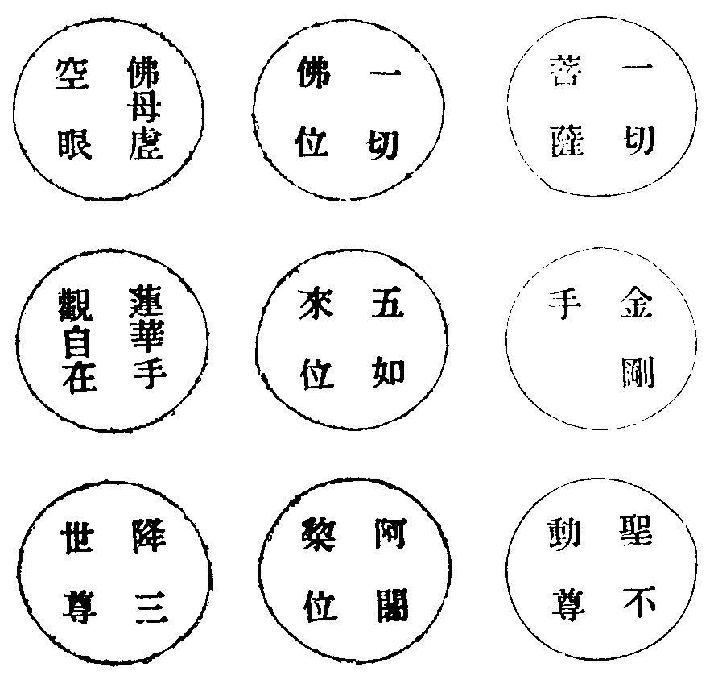



此是白檀漫荼罗位。



------



## 毗卢遮那成佛神变加持经义释卷第四



**译者**：沙门　一行　述记



入漫荼罗具缘真言品第二之二。



至第五日暮，复当次第具诸法则，好自严身观八漫荼罗位，奉请结护等一一周备竟，当诵不动明王或降三世尊与密印相应，满一百八遍加持此地。阿阇棃言：从第三日以去，每日三时念诵，每时皆诵不动真言一百八遍用加持地，非独此一夜也。又从初日至三日以来，若有留难即当收摄停止。若已涂白檀位竟，设有种种魔事两不和合，要当勤加方便必使得成。餘如瞿醯中说。其第五夜诵不动真言竟，次当以大日如来身诵持地真言及作三昧印。诵此真言曰：



na　maḥ　sa　ma　nta　bu　ddhā　nāṃ　sa　rva　ta　thā　ga　tā　dhi　ṣṭa　na　dhi　ṣṭi　te　a　ca　le　vi　ma　le　sma　ra　ṇe　pra　kṛ　ti　pa　ri　śu　ddho　svā　hā



初句归命一切诸佛，第二、第三句义云：以一切如来加持而加持之。此意云：如彼金刚道场，一切如来神力共所加持，今令此地亦复如是也。



复次我已平治弟子净心地竟，此是心王如来图畫大悲藏漫荼罗处。我今说诚实言，以一切如来神力而加护之，使得坚固不动也。第四句云阿者丽，是不动义。第五句云微麼丽，是无垢义。此意言以一切如来神力加持之，令得安固不动。非但不动而已，又令离一切垢也。正以第四句初阿字为真言体，如来以何法加持，能令毕竟不倾动耶？谓即以此a阿字门故，有如是力用也。第六句是忆念持义，犹如比丘作羯磨法，令众僧一心和合同共受持。今此真言亦尔，用a阿字加持竟，请一切如来忆念本誓故，同共受持也。第七句是本性净义，此即转释前句。何故诸佛同心念持？由本性净故。若法入a阿字门，即是从本以来无动无垢。十方三世诸佛由此义故，皆同一戒一见，所以同共加持也。末句云莎诃者，如僧羯磨竟，更加忍可印成句。若我所发诚言必定无谬，唯愿诸佛不越三昧耶故，令所作圆满也。此中所有字义，亦当广分别说。时彼阿阇棃当往东方一切如来坛位之外，东向诵持真言，或三遍或七遍，能多益善。次往南方，次往西方，次往北方，皆背白檀座位而诵持之，如是一周竟。次往虗空眼位，面向东北，亦背坛位诵之。次往东南，次往西南，次往西北，又一周竟。更当至诚作礼种种供养，就阿阇棃座位面东而坐，诵本受持真言，住於本尊三昧，皆如供养次第中说。若又更次第持白檀位诸尊真言，并结彼印阿阇棃言，先持部主大日真言一百八遍，所餘八位观彼真言大小持之。若更能诵者，兼持第二院四菩萨、第三院释迦等上首诸尊，乃至都诵诸位亦得也。其白檀位但涂泥乾香水洒竟即得作之，亦不尅在第四日。自置了后皆须依此持诵，至法事夜亦准此可知也。其受持地夜，阿阇棃如法持诵竟，乃至以金刚讽咏遍叹诸佛菩萨。宴坐疲极，即於此置坛处如法护身东面而卧，当於所度弟子极生大悲怜愍之心。若gu瞿hya醯taṃ坛tra坦啰受持地竟，又有结sū苏tra多罗受持弟子名号法也。彼安寝时当思惟心，莲华台中ma麼字门，一切诸法我不可得故，即是无障碍菩提心也，亦是如意宝珠。又云：此如意珠只是阿字门耳。彼阿阇棃当於梦中或见无量诸佛及菩萨大名称者，示现作诸事业，谓随种种应度众生三轮化导，或亲自安布建立悲生漫荼罗，或以微妙音声安慰劝嘱言：汝今愍念众生故，造作此漫荼罗。善哉摩诃萨埵！汝之所畫甚为微妙。如是种种境界，阿阇棃当以慧心善决择之。当知众圣已共加持是地，可随意作法也。若有障碍者，应作相应护摩方便净除，当发大勤勇心，要令所作成就。



复次，若见谛阿阇棃，则於莲华三昧净菩提心如意珠中，自然明见有障无障因缘，了了无碍。心佛现前嘱授，为决所疑。如其觉知魔事，当以大智慧、大方便，旋转作护摩法要，令所持心不动不退，堪建立法界漫荼罗，然后休息也。



复次，阿阇棃自初惊发地神以来，便不应舍离如是道场之地，恒於是中加持念诵，宷谛观察，随有未平正处，輙修治之。又思惟众缘支分，皆令素具，勿得临事阙乏，而生疑惑也。自受持地竟，即应规畫界域，布定方位，至灌顶夜，方造诸尊。若不能速成者，持地以后，渐次修之，亦无咎也。



经云复次於餘日，摄受应度人以下，迄授与香水令饮，彼心清净，故明摄受建立护持弟子支分。受持地之明夜当作弟子法，故云餘日也。因此广辨弟子应度之相。偈云若弟子信心者，谓阿阇梨观彼现在根性，或久远因缘，於此不思议缘起三种秘密诸方便中，直信不疑，无有能怖畏，乃堪摄受。餘如师德中说。偈云生种姓清净者，谓於婆罗门等四种大姓家生。若是旋陀罗等，以家法相承，习行不清净事故，性多弊恶。若为作传法灌顶，使流通大法，则生佗轻慢，或成匮法因缘。犹如比丘受具，亦简去毁辱众僧极卑下姓也。若但结缘受法，则非所论。



复次，若久远以来，曾有发菩提心因缘，即是如来种姓中生，最为胜族也。偈云：恭敬於三宝者，谓於佛法众僧，起淳厚谦下之心，常好亲近供养，尊重赞叹。当知是人，有先世行道因缘，乃至如常不轻菩萨。是名深敬一切众生，信佛法僧宝也。深慧以严身者，如是等虗空无边佛法，非劣慧者心器所堪。故知智性深利，以自庄严者，乃可为说也。堪忍无懈倦者，此是有所堪能，无所屈退之义。梵音与忍辱不同。谓求法因缘，虽种种艰苦之事，皆悉能作。假令一度不成，复更发进修之，如誓抒大海，尽而后已。若人志性如是，则可传法也。尸罗净无缺者，谓於在家出家律仪，乃至於本姓受诸禁戒，随所奉持，则深心防护，无有毁缺。若具如是性者，虽未入三昧耶平等大誓，亦当敬顺不违，故堪传法也。忍辱不悭恡者，此中分为二句。忍辱，谓於内外违顺境界，八种大风，其心安忍，无所倾动。如智度尸罗波罗蜜中广说。当知是人，必不犯持明重禁，作不利众生行，故堪为传法也。不悭恡者，谓於所有财法，常念惠佗。设来求者，心无鄙恡。如智度檀波罗蜜中广说。当知是人，必不犯持明重禁，悭恡正法，故堪传授也。勇健坚行愿者，亦分为二句。勇健，即是阿阇棃德中勇健。菩提心种性，於行道时，虽遇种种可畏色声，心不怯弱，乃至出生入死，无怖畏想，正顺菩提萨埵大人所行，故应传授也。坚行愿者，此是要心之愿，梵音与求愿之义意不同。如自立志，令每日三时念诵，则终竟一期，虽过种种异缘，初不间绝。如是事有始终，若行菩萨道时，亦不亏本誓，故堪传法也。然所说弟子十德，若兼备者，当知是人甚为希有。假使偏有所长，堪可匠成者，即应摄授耳。又如声闻受具时，观察种种遮难，所谓太少太老，色貌瑕玼，诸病患等，恐白衣嫌诃，故輙简去之。今此摩诃衍，则不如是，但令道机可济，虽有诸餘过失，皆无所观也。偈中云或十或八七，或五二一四者，是一期道场，作阿阇棃灌顶之限数。此中约超数取之，谓从一至二，从二超至四，从四至五，从五超至七，从七至八，从八超至十人。是故一漫荼罗中，不得同时为三人六人九人灌顶。葢如来密意，阿阇棃不释所由。又同大方等陀罗尼经，不得过十人已上也。过此以外，恐阿阇棃心量有所不周，当待后缘，别为作法。又此十人以下者，谓俱时发心，各舍内外所有，供养三宝，同共成办漫荼罗，故得同时作法。若人因遇道场，便云法缘难值，乞兼为济度者，未合为作阿阇棃灌顶也。若但求结缘，於一门本尊法中，受真言印者，则不依如是剂限。阿阇棃亦当发起大悲，随有能起少分善心者，皆为发生，立菩提种子。故云或复数过此也。



经云：尔时金刚手秘密主复白佛言：世尊！当云何名此漫荼罗？漫荼罗者，其义云何？此因如来简人限众，为晓诸未悟者转生疑问也。金刚手本请世尊称此加持境界，演说大悲藏，生大漫荼罗王，则是平等大悲，无复限量。而今世尊所说，虽有德可传者，犹不过十人，似是随转一门，非其具体，故问当何名此漫荼罗也。又漫荼罗是轮圆之义，今既限局名数，似於理未圆，故复问此中漫荼罗者，为是何义？凡有二问。世尊答中，初答名，次答义。就答名中，还复申明本旨云：夫漫荼罗者，是发生义，今即名为发生诸佛漫荼罗也。下菩提心种子，於是一切智心地中，润以大悲水，照以大慧日，皷以大方便风，不碍以大空空，能令不思议法性芽次第滋长，乃至弥满法界，成佛树王故，故以发生为称。夫雷雨作解，随甲坼者先萌，不可以卉木滋荣，性分不等，遂令平分之施，亦成限量也。次答义中，梵音漫荼罗，是攒摇乳酪成苏之义。漫荼罗是苏中极精醇者，浮聚在上之义，犹彼精醇，不复变易，复名为坚净妙之味，共相和合，餘物所不能杂，故有聚集义。是故佛言：极无比味，无过上味，是故说为漫荼罗也。以三种秘密方便，攒摇众生佛性之乳，乃至经历五味，成妙觉醍醐，醇净融妙，不可复增，一切金刚智印，同共集会，於真常不变甘露味中，最为第一，是为漫荼罗义也。



经云：又秘密主以下，广演漫荼罗义释除疑妨，复分为三：初明法界圆坛普门无限，次明限人简众所由，末句劝嘱阿阇棃令兴平等悲愿。就初文中哀愍无边众生界是大悲藏生漫荼罗广义者，若行人自见中胎藏时，即知一切众生悉有成佛因缘，故其所起大悲漫荼罗亦周法界。且如十世界微尘数诸执金刚菩萨众等，随以一门作漫荼罗主，餘为眷属，则成一种漫荼罗。如是旋转无穷，已非筭数譬喻之所能及，何况是中各以无量门庄严种种方便引摄众生，又可胜纪乎？若行者於此一字法门中，摄广为略、衍略为广，出生法财遍施一切常无断尽，乃名善解漫荼罗广义也。



次云秘密主！如来於无量劫积集阿耨多罗三藐三菩提之所加持，是故具无量德，当如是知者，此释广义所由也。如华严入法界诸善知识，各各於一门中所通达法深广无际，然亦互不相知。如来昔行菩萨道时，普门亲近如是等佛刹微尘数诸善知识，於彼一一功德藏皆到极无等比无过上味，以如是内证之德无量无边故，其所加持现作法门眷属亦复无量无边。彼真言门行者，当通泰其心作如是解也。已知内德无限，次明本地漫荼罗度人无限。何以故？以副本悲愿故。故经文次云秘密主！非为一众生故如来成等正觉，亦非二非三，为怜愍无餘记及有餘记诸众生界故如来成等正觉，以大悲愿力於无量众生界如其本性而演说法。此中发菩提心义，如入法界品及智度摩诃萨论议中广说也。无餘记者，如佛现前授决，某甲众生於某劫中作佛号某如来，有如是国土眷属等，以了了说故名无餘记也。有餘记者，如告众生言，汝於未来某佛时当毕是罪，某甲如来为汝授记之类是也。



复次，如世尊说：若我在世或灭度后，诸有闻法华经一句一偈，我皆为授无上菩提记，是名无餘记。若言一切众生悉有佛性，彼生善根相续不断，当至无上菩提，是名有餘记也。我本为此等众生来成正觉，况今所愿已满，开众生自心之宝，如其本性而给与之，当有何限耶？且据恶世弘经浅行之一迹，故云一期法事剂至十人耳。从此以下，第二句，即释此限人简众所由。



经云：秘密三无大乘宿习，未曾思惟真言乘行，彼不能少分见闻欢喜信受。又金刚萨埵！若彼有情昔於大乘真言乘道无量门进趣已曾修行，为彼等故限此造立名数者，此意云：若诸众生未曾於过去无量佛所久种善根，於此秘密乘已曾修习，则造次闻之不能信受。若传法人徒以善心差机为说，或当增其诽谤断彼善根。故法华云：无智疑悔则为永失也。十方世界诸众生，少有志求声闻者，求缘觉者转复少，求大乘者甚希有。求大乘者犹为易得，信此法者最为难故。以普眼观之，堪受是法者犹须弥大海之尘渧耳。既将护彼意时乃说之，安得不略制造立名数乎？所云无量门进趣者，即是兼释漫荼罗名义。夫漫荼罗者名为聚集，今以如来真实功德集在一处，乃至十方世界微尘数差别智印轮圆辐凑翼补大日心王，使一切众生普门进趣，是故说为漫荼罗也。所云略此造立名数者，如以阿字五轮统如来无边内德，以字轮百明摄如来普眼法门，此则名之略也。以刹尘方便开八叶之坛，以无极大悲制十人之限，此则数之略也。然志学者随於一法明门而得悟入，即是普入一切诸总持门。如从一门见王，即是遍入千门万户。若不能如说而行，则虽以种种文辞广为开示无所益也。故第三句次明限略名数，自不碍於广。是以经云：彼阿阇棃亦当以大悲心立如是誓愿，为度无餘众生界故，应当摄受无量众生作菩提种子因缘。谓造立此漫荼罗，是随有见闻触知，下至举手低头一念随喜，皆必定成於阿耨多罗三藐三菩提。故阿阇棃虽不得差机误授为作具支灌顶，然系珠毒皷之缘岂当已乎？故当运大悲心务令广洽也。



复次如人家有秘宝，恐为盗贼所闚故掩以弊衣。今此漫荼罗法门亦复如是，以秘密之藏不可直宣说故，回转密意覆以有相方便。今言限以十人者，乃是世谛漫荼罗耳。然阿阇棃自当平治心地，畫作大悲漫荼罗，普限度人多多益善，勿得如言而解也。偈云持真言行者，明弟子支分中护持建立方便。至第六夜，师及弟子皆澡浴清净著新洁衣，賷持供养物诣如前所造白檀漫荼罗处，当如法加持自身道场及诸弟子。其护弟子方便，如下文入灌顶时所说。阿阇棃如次第法则具修供养观，白檀位诸尊与密印相应，持彼真言gu瞿hya醯经云：手按中胎漫荼罗诵真言一遍，如是一诵一按乃至七遍，餘位亦尔也。次当为诸弟子随顺说法开导其心，教彼三归依忏悔先罪。既忏悔已，身心清净犹如明珠，堪能真正发心，是故次令发菩提心，皆如供养法中所说。次当授与涂香华等，教令运心供养诸尊，然后为受三世无障碍智戒。此受菩萨戒法别有行仪也。菩萨所以发心摄受方便学处，皆为成就如来清净智慧，於一念中了达三世诸法无罣碍故。其有住斯戒者，乃至初见心明道时，即有如是不思议势分，以此戒亲能发生佛慧。又对二乘律仪有限量故，以三世无障碍智为名也。



次当授与齿木，令诸弟子嚼之，因即观彼人成器及非器相。所以为此法者，亦是顺彼方俗谛，因用秘密方便而作加持也。印度国人，凡请僧食，乃至世人相命，皆先遣其齿木，以种种香华严饰而授与之，当知明日请彼饮食也。所以如是者，为明爱敬之心，恐彼先有痰𤸌宿食因缘，若受我供，或令发动不安，故先以善意将护而警发之，令彼先净身器，或服诃棃勒等，则明日随意饮啖，无所触犯，身心安乐也。今阿阇棃亦尔，授弟子杨枝时，即当寄此方便，为说深法。我方当授汝佛性醍醐，极无过上味已，教汝发菩提心，净除三业宿障，以三世无碍智调伏之。牙噬诸烦恼竟，今复以此秘密加持，涤除身心过患。汝又当净其口过，在所游方，勿妄宣传，明日当贻汝不死甘露，皆令充足也。彼当取优昙钵罗，或阿说佗木，端直嫞好者，不麤不细，剂十二指量。凡一切量法，皆用大母指上节侧而相捻，是其正数也。此二木是过去佛菩提树。若无者，当求有乳之木，谓桑谷等，记木上下之别，皆以枝末为上，根柢为下，以香水灌洗，又复涂香而熏之，於其下末，以白线缠华，用为庄严，亦作标志，令上下易知。故当以手按诵不动真言加之，或百遍或千遍，素令严备。既受戒已，师当取一齿木奉献诸尊，餘者分授弟子，令出坛外向东或向北，如法蹲踞嚼之。嚼已，令向所面之方而正掷之，而验其相。若嚼处向外者，是人悉地不成；向身者，悉地成就。若远掷却来近身，是不久成就之相。若首直竖向上，成就更速；首向下者，是人当入修罗龙宫。若掷在空中，当知此人先已成就也。又向北方，东方为上成就，西方为中成就，南方为下成就。虽如是，若人先向东掷，而嚼处向东，即是背身，亦不得成就。餘方准此可知。餘如瞿醯经中说也。次当作金刚线法。凡作线，当择上好劫贝缕，香水洗之极令清净，令洁净童女子右縒合之。合五色缕，当用五如来真言各持一色，然后以成办诸事真言总加持之。造漫荼罗线亦尔。五如来色者，谓大日佛加持白色，宝幢持赤色，华开敷持黄色，无量寿持绿色，皷音佛持黑色。阿阇棃先自取线三结作金刚结，用系左臂护持自身，次一一为诸弟子系臂。如是摄受弟子，则入漫荼罗，是离诸障难也。其金刚结法不可缕说，当从阿阇棃面受之。



复次，五色𫄧者，即是如来五智，亦是信、进、念、定、慧五法。以此五法，贯摄一切教门，是故名为修多罗，古译谓之𫄧经也。若见谛阿阇棃，能以如来五色智，加持弟子菩提心中五种善根，贯摄万行，系持瑜伽之臂，使经历生死，常不失坏。若能如是摄取弟子，乃名善作金刚结也。阿阇棃言：此夜作弟子法时，其所供养，当减第七夜之半。又当观彼情机，赞扬密教，发生乐欲，坚固其心，并为分别十种方便学处。然此三世无碍智戒，凡结缘者，皆令预闻。其四种根本三昧耶一偈，则当耳语诫之，具支灌顶者，乃应闻耳。其所教诫二偈，亦是阿利沙能具诵。梵本益善，列之于左：



a　dya　yu　ṣmā　bhi　ra　tu　lā　lā　bhā　la　ddhā　ma　hā　tma　bhiḥ　ye　na　sa　rva　ji　dai　yu　yaṃ　sa　pu　trai　ri　ha　śa　sa　te　sa　rvai　pa　ri　gṛ　hī　tā　sthaḥ　jā　ya　mā　nā　ma　ho　da　yā　te　na　yu　yaṃ　ma　hā　yā　te　śvo　jā　tā　he　bha　vi　ṣya　tha



偈意云：汝从今以去，便为已获无等之利，位同於大我。大我，谓诸如来成就八自在我，於法自在者，及诸菩萨摩诃萨埵也。次云一切诸如来，并此教中摩诃萨众，一切皆已摄受於汝。此教，谓此大乘秘教中十佛刹土金刚菩萨等也。次云成办於大事者，即是能成大事，成办大事因缘，所谓开示悟入如来知见，故经中会意言之。次云汝等於明日，当得大乘生，谓入大悲漫荼罗，得灌顶已，生於一切如来种姓之中也。



复次离缘业生得大空生，故云大乘生也。时阿阇棃如是教诫印持竟，还令次第於漫荼罗外东向而坐。阿阇棃复当供养，以至诚心迎请诸尊言：我於明日为哀愍弟子供养诸圣尊故，建立大悲胎藏漫荼罗，随力供养。唯愿慈悲忆念，当於明日悉皆降集漫荼罗而作加持。大意如此，餘如瞿醯中说。彼至诚三请已，宣说金刚句偈称叹诸尊，然后如法发遣。



复为弟子广说法要，教令系念思惟，藉吉祥草，面向东而寐。彼於梦中，若获种种境界，晨起皆当白师，则知行人悉地，成不咸之相也。若见谛阿阇棃，自当住深瑜伽，明见弟子本末根缘，无有错谬。设不作如是事相，及随顺世谛行之，一切无咎。若未见谛师，则当谨依法则，勿令亏失也。



经云：梦中见僧住处者，谓所见清净微妙，种种严饰，身入其中，礼跪旋遶，遇诸庆善之事。园林者，谓所见滋荣殊特，华果繁盛，或亲自采掇，或升践树杪，履空而行。堂宇，谓种种华房绮疏，殊异严好，而在於中，自在受用，身心适悦。楼观，谓层台显敞，远觌四方，见种种胜境，神情熈畅。凡如是比，皆为吉祥。是中法门所表，亦如择地中说。若与此相违，如见塔寺焚摧荒秽之类，即非善梦也。幢，谓旗帜宝幢，峻高端丽，而现其前，或用麾导，众人莫不从命，建立大菩提心，轨成万行之像。葢，谓孔雀尾等，五色闲错，或在空中，而荫其上，或人授与之，执以游行，是悲愿普覆之像。摩尼珠，亦谓圆明照彻，或能出生众物，给施众人，此是净心觉宝，四摄利佗之像。刀，谓莹饰鉴彻，精刚锐利，或人授与，或自执持，是慧性成就之像。悦意华，谓种种水陆生华，随其性类，有上中下，如色以鲜白为上，味以甘醇为上，皆善萌开发之兆，当以意分别之。女人是三昧像，男子是智慧像，亦取端正威德，人所爱敬之类。密亲，谓父母等。善友，谓传法上人，善知识等。或见牸牛群牧，乳味丰盈，或人搆之，或自饮吮，皆是大悲漫荼罗醍醐上味之像。或见经夹，净白无垢，整齐严饰，字色分明，记说种种殊胜之事，则为善相。若卷帙垢坏，字义残缺之类，当知不善。或见诸佛亲为摩顶，现前记莂，以微妙音而慰喻之。或见声闻、辟支佛等，乃至住虗空中，示现无量神变。皆当随事甄择，识其所为因缘诸果。谓世所希有珍奇妙果，或有人授与，或从空下等，皆悉地之像，或渡河池大海，乃至自梦饮之，须臾皆尽，皆为吉祥。若漂流湮溺，无所拯援之类，当知不善。或闻空中有种种好声，歌咏法音，奏诸伎乐，或称扬三宝功德，心所乐闻，或言吉祥，或言应当与汝意乐之果，如是等皆为善梦。当以上中下类而分别之。如寺宇等，则有依地在空之别。其所见人，亦有男女圣凡之异。是故经云：宜应谛分别之。若与如前善相相违，或梦其身为狂象等所逐，恐怖危急，或乘驼驴，或见可恶弊恶之人，服饰弊坏，或自见身转卧青泥粪秽之中，或诸不净从空而堕，皆是相违相也。若是深行阿阇棃，自当於瑜伽中，知彼所梦之事，及所为因缘。弟子晨起白师时，当随机劝发，断彼疑网也。若观彼人无有成办之理，则不应具足传法与之。恐彼久无功効，或生疑谤故也。或如瞿醯所说，为作寂灾护摩，得离诸障，然后召入。若见种种殊胜境界，应以法言慰喻，令得欢喜。所云善住戒者，梵云谓之苏嚩啰多，是弟子之美偁，如言佛子之类也。经中说偈，亦是阿利沙兼诵。梵本弥善，亦具存之于左。



e　ṣa　ma　rga　va　ra　śrī　māṃ　ma　hā　yā　na　ma　ho　da　ya　ye　na　mu　yaṃ　gaṃ　mi　ṣya　to　bha　vi　ṣya　thā　ta　thā　ga　ta　svā　yaṃ　bhu　vo　ma　hā　nā　ga　sa　rva　lo　ka　sya　ce　ti　ya　a　sti　na　sti　vya　ti　krā　ta　mā　hā　śa　mi　va　ni　ma　laṃ　gaṃ　bhi　raṃ　sa　rva　dha　rme　bhi　ra　pra　ti　hvaṃ　◇　ma　nā　la　yaṃ　sa　rva　pra　paṃ　ca　ra　hi　taṃ　pra　paṃ　cai　ra　pra　paṃ　ci　taṃ　sa　rva　kṛ　yā　bhi　ra　tu　laṃ　sa　tya　dva　ya　saṃ　ma　śra　yaṃ　ī　daṃ　ta　dya　na　va　raṃ　śre　ṣṭaṃ　ra　bhi　ṣya　tha　na　ye　sha　tā



凡梵本说偈了，皆加助句声，云伊𫪭也。



初半偈称叹秘密乘道殊胜愿者，所谓一切智愿也。若入此净菩提门，则照见心法明道，所谓古佛大菩提道，故云此殊胜愿道也。大心义如前摩诃萨埵中说，过去未来现在诸大心众，无不乘是宝乘直至道场，故云大心摩诃衍也。次一偈赞叹行人发菩提心功德，即以一切如来必定法印，为授与大菩提记，故云汝今能志求，当成就如来，自然智大龙，世间敬如塔也。自然智是如来自觉自证之智，昔所未闻未知之法，自然了了现前无所罣碍，故以为名。摩诃那伽是如来别号，以况不可思议无方大用也。制底翻为福聚，谓诸佛一切功德聚在其中，是故世人为求福故悉皆供养恭敬，汝今发菩提心，亦能摄受一切如来无量福聚，是故世间应当敬如塔想也。次有一偈半显示净菩提心如实相印，即是开佛知见使得清净也。有无悉超越者，即是从众缘生不可思议中道，出过断常非有非无，一切心量所不行处，故名无垢同虗空金刚智印也。诸法甚深奥者，以心性甚深故，当知阴界入等乃至一切种智皆亦甚深，以一切法不出心实相故，如是实相唯佛与佛乃能知之，非思量分别之所能及，故云甚深奥也。世智不能了者，言此心性非一切世间聪慧利根者所能思议，假令长爪梵志等诸大论师，以种种因喻庄严比况量度，终自非其境界苦，思惟推求徒令发狂，独有信力坚固者，依此秘密方便乃能入之耳。无含藏者，所云难可了知者，正在如是无含藏处，以如实知蕴阿赖耶本不生故，无所执受亦无含藏。尔时一切心意识妄想戏论皆悉清净，法界圆照如秋月在於空，故次句云离一切妄想也。梵本云离一切戏论妄想，今以偈中语略省，又意义无异故不具存。次句云戏论本无故者，若具存梵本，应言戏论无戏论故，以一切戏论皆悉从众缘生无有自性，无有自性故即是本来不生，是以释前句云即此戏论自无戏论也。今以会意言之，故曰本无。次有二句，明此净菩提心究竟方便，以出过一切妄业，即能成就如来智业，普门导利无非大事因缘，是故一切所作皆无伦匹，是故云一切业无比也。次转释前句，统论权实之大纲，故云常依於二谛，即是论云诸佛说法常依二谛也。然此经宗作种种具支方便皆随世谛，由此因缘得一切智智即是真谛，是故世谛为因、真谛为果，因如四味皆悉无常，果如醍醐是则为常。然以十缘生句观之，世谛实相即是第一义谛，是故权实相即俱不可思议也。此二句文虽简略，能令行者於一切如来方便无复餘疑，故当触类而长，使贯通一部文义耳。已略开示大菩提道竟，又结观印持，故云是乘殊胜愿汝得住斯道，亦是重明授记之意也。



尔时住无戏论执金刚白佛言：愿说三世无碍智戒，若菩萨住此者，令诸佛菩萨皆欢喜故者，上文但说受三世无障碍戒，未显其相，是住无戏论金刚重开发问也。



复次，世尊所以待问方说，亦为法门眷属相发明故。今此净戒，正以住无戏论金刚智印为体，所以特告此尊，欲令人法相应，流传有寄也。阿阇棃言：此戒相亦是加持句。若传授时，先当诵持梵本，然后以方言释之，弥善也。今具列于左：



śṛ　ṇu　ku　la　pū　tra　ta　saṃ　va　raṃ　ye　tra　ku　la　pū　tra　kā　ya　vā　ṅma　na　sā　mai　ka　tra　ni　kṣe　po　na　raṃ　bhaḥ　a　kri　ya　sa　rva　dha　rma　ṇa　ka　ta　ma　śca　saḥ　ya　ā　tmā　bhā　va　pa　ri　tyā　go　bu　ddhā　bo　dhi　sa　tve　bhyaḥ　tka　sma　ddhe　to　◇　hi　ā　tma　bhā　vaṃ　pa　ri　tya　ja　ti　te　na　va　stu　tri　tri　yaṃ　pa　ri　tya　ktaṃ　bha　va　ti　ka　ta　ma　śca　ta　dva　stu　tri　yaṃ　ya　du　ta　kā　ya　va　ṅma　naḥ　i　ti　ta　sma　nta　rhe　ku　la　pū　tra　kā　ya　vā　ṅma　naḥ　saṃ　va　ra　saṃ　vṛ　te　na　bo　dhi　sa　tve　na　bha　vi　ta　vyaṃ　ta　ka　sma　ddhe　to　rnta　ka　ya　vā　ṅma　na　saṃ　pa　ri　tya　jya　śi　kṣā　gra　ha　ṇa　ku　vaṃ　ti　bo　dhi　sa　tvā　ma　ha　ṣtva　i　ti



初句言佛子谛听者，梵云ku矩la罗，是族义部义pū补tra怛罗，是男子义。若世谛释，於四姓中生皆名大族，故名族姓子也。今得生如来家，於诸族中最为殊胜，故名族姓子。阿阇棃言：宜会意云佛子，於义为当也。



经云：若族姓子！住是戒者，当以身语意合而为一。者，此戒梵云saṃ三va缚ra啰是共缘共成。此戒之义，所谓慧方便等之所集成。若śa尸la罗者，但是清净义也。又三缚啰是平等义。佛言：以身口意合为一者，即是住三平等法门，是故得名三世无障碍智戒也。如佛为诸声闻略说教诫，则云：此三业道净，是大僊人道。从十二秊后稍演其义，成种种律仪。今此持明略戒义亦如是，若行人三业方便悉皆正顺三平等处，当知即具一切诸佛律仪也。



复次，裂诸想网是三嚩啰，义谓戏论。诸见之网经纬相成，重复交络故名为网。今行者观身口意业自无别体，统末归本唯是一心，而此心实相常是平等法界，是故住此戒。是种种身口意业皆同一相，无量见网皆悉净除，是故得名住无戏论金刚印也。



经云：不作一切诸法者，种种五阴依烦恼，烦恼依於业，是种种业皆由身口意生。如约身口意分为十种善恶业道，究其条绪即是无量无边。是故三业凡所修行即有进趣之行，失进趣者即为倒想，由倒想故有无量想生，为此诸想所碍，不得佛无碍智。今行者深观十缘生句，了知三业毕竟不生，法性自尔常无动作，是名为住无为戒也。如是净戒尚非如来所作，况住斯戒而造作诸法耶？



经云：云何为戒？所谓观察舍於自身，奉献诸佛菩萨。何以故？若舍自身，即为舍彼三事。何等为三？谓身、口、意。次明持无作戒，具足慧方便也。行者观身实际中，身不可得，即是如来解脱。是故罄舍此身，用施一切如来。从此以后，动止施为，凡有所作，皆为如来解脱，非为己身也。虽种种炽然万行，庄严佛土，成就众生，法性自尔，非所造作也。其能如是奉修者，是名无边福聚，是名无尽福河。随造涓滴善根，以投法界海中故，乃至极众生界，亦无穷竭。阿阇棃言：梵本论中有偈云：若有解脱人，持此解脱法，供养解脱者，此福最为胜。若真言行人，不晓如是净戒，则虽口诵真言，身持密印，心住本尊三昧，具修次第仪式，供养诸尊，犹名造作诸法，未离我人之网，云何得名菩提萨埵耶？故经次云：是故族姓子，以受身、语、意戒，得名菩萨。所以者何？离彼身、语、意故。菩萨摩诃萨，应如是学。此中应学，旧译名为式叉迦罗尼。犹如第五篇戒，总摄毗尼犍度威仪行法。大乘学者亦如是，当持此戒方便，普入一切真言行中。苟戒有亏，而得成菩萨行，无有是处也。



经云：次於明日以金刚萨埵加持自身，为世尊毗卢遮那作礼者，即是受戒之明日，谓第七日暮满也。造漫荼罗诸作务时，皆当用金刚萨埵加持自身，谓观自身即是执金刚也。是中方便如下品经文及供养次第中说。若见谛阿阇棃，则是住於金刚萨埵心，所谓无等等菩提心也。以此秘密加持故，诸有所作无能俎坏之者。次当如前运心为大日如来作礼，然后持诵降三世真言加持净缾，此亦是成办诸事真言也。先当取如法净缾，汲清洁之水如法灌漉，中置五宝五谷，又取种种香水众妙华果枝插中，种种庄严用鲜净帛系颈，皆应依供养次第辟除去垢，净以法界心字，然后加持也。大氐凡真言遍数无有定限，应以字计之，如苏悉地中说。又彼中随作三部漫荼罗，各用部心或部母真言加持。今此经中通用办事真言加持，其真言又兼广略，故不具言遍数，当以意裁之。若极大者诵至百遍，次者五百遍，小者令至于千遍也。既加持竟，当置在白檀先所规畫坛门之外。欲入漫荼罗者，当先以此洒之，令彼宿障净除，方得见漫荼罗也。又於别器调和香水，以郁金、龙脑、旃檀等种种妙香，亦以真言加持授与，令饮少许，此名金刚水。以秘密加持故，乃至地狱重障皆悉除灭，内外俱净，堪为法器也。阿阇棃言：此即名为誓水，亦顺世谛，犹如盟誓之法，令於一切众圣前歃此香水，自誓其心，要令不退大菩提愿也。



复次，以无碍戒香和合嚩字门清白心水，诸有饮触之者，皆必定成於无上菩提。如此清净其心，则堪入秘密漫荼罗也。



尔时执金刚秘密主以偈问佛以下，明造立漫荼罗支分。偈中先赞叹佛唯愿一切智诸说法中最第一者，说彼时分也。此时分即是初畫漫荼罗迄事竟以来时分限剂。次云大众於何时，普集现灵瑞者，谓大悲胎藏中一切普门随类身於何时普集道场，现前神力加持示现威验也。若弟子诸根净利应度机深，或於此时即亲覩无边圣众如灵山会坐者，同见三变净土分身诸佛无有异也。当知尔时即是漫荼罗阿阇棃传持诚谛之语行如来事时，故云殷勤持真言也。说此偈已，尔时世尊告持金刚慧者言：常当於此夜，而作漫荼罗。谓於此第七夜中使法事都毕也。是中从日没后至明日明相出以来，总名为夜。初入夜分即当图画诸位，安置诸供养具，皆明相未出已前使发遣竟。若违此法则生障碍，乃至令所依住处亦不吉祥也。然深秘密释中正以道机嘉会为时，或以加持方便促百劫为一夜，或演一夜为百劫，修短在缘无有定限也。若浅行阿阇棃则须具依法则，於昼日分即当规畫界域，以白檀等草定诸尊形位分段，至明日将夕豫备香华灯烛等皆令素办。瞿醯云：於漫荼罗北面一处，以白色规畫办事真言，辟除诸难置诸供具也。阿阇棃言：若不能於一夜中遍畫诸尊者，从第五日受持地以后渐次作之，於理无妨。又别有尊形印字三种方便，如下文所说也。



经云：传法阿阇棃已知时分，即明造立轨仪。至日入时，阿阇棃及助伴弟子各如法澡浴已，著新净衣，兴大悲心，赍持供物，往诣漫荼罗所。先应一一具法加持，如供养次第中说。



次当如法护持自身，呼所度弟子为彼作护，洒以香水，皆令一处次第而坐。然后阿阇棃至道场门前，普遍运心，稽首顶礼十方一切诸佛，亦如上说。然后持五色线，向漫荼罗位住立而顶戴之。次观自身作毗卢遮那，经所谓大毗卢遮那而自作加持也。所以然者，以大日如来是此大悲胎藏阿阇棃。是故行者若行阿阇棃事时，即应以自身作毗卢遮那。若作缘漫茶罗诸作务时，即以自作身金刚萨埵。其加持方便，如下文及供养法中说也。



复次，行者应知护方八位，凡所造作漫荼罗随此而转。东方ī因dra陀罗，南方yaṃ𦦨mā摩ra罗，西方va缚ru噜ṇa拏，北方vai毗śra沙vaṇa门，东北e伊śa舍ṇi尼，东南为ho护ma摩，西南方dṛ涅哩tyā底，西北为vā嚩yu庾。其上方诸尊多依帝释之左，下方诸尊多依龙尊之右，上谓空居，下谓地居也。又环中胎藏三重界域，皆以豫为标志，使方隅均等，图位素定，要令大日之位当五种宝聚之心。至此图众相时，阿阇棃先至ī因dra陀罗方如法作礼，次住火方北向而立，助伴弟子在e伊śa舍ṇi尼对持修多罗。准定外界，弟子次当右遶至tai涅ri哩tyā底，师亦右遶西向而对持之。阿阇棃次复右遶至嚩庾方，弟子亦右回北向而对持之。弟子复右遶至e伊śa舍ṇi尼，师亦右回东向而对持之。凡一周竟，皆令当脐在虗空中均等平正。已至第二周，亦如前右转次第絣之，以为界道。次复准定四维，阿阇棃复当右遶至tai涅ri哩tyā底，而弟子先在伊舍尼方右转相向持之。弟子次复右遶至va嚩yu庾方，师即右转至ho护ma摩方，弟子亦右回相向持之，皆令当脐而在空中。准定其位，弟子次复右遶至tai涅ri哩tyā底，师即右转至e伊śa舍ṇi尼，相对絣之。弟子次复右遶至护摩方，师即右转至va嚩yu庾方，亦相对絣之。阿阇棃言：其正四方十字界道，经虽不言，理必有之，亦须右旋相对絣定也。如是已定外界及八方相竟，次当入中。先定中胎外界，亦如前旋转絣作四方相。其八方相已定，更不复作也。初定第一重外界，次定第二重外界，亦同中胎法，则其广狭之量皆当展转相半。假令中胎藏纵广八尺，第一重当广四尺，第二重当广二尺，第三重当广一尺。阿阇棃言：本法如此，若恐大小相悬不相称者，稍以意均调之，於理无失也。如是分竟，复於一重。一重分为三分：其最向里一分是行来周道，故云佛子所行道；次一分是安置诸供养物处；次外一分是安置诸尊座位。故此二分皆是圣天之位处也。次於此外复作周帀界缘，於此虗空位之中当运心观察，随其方面分位相应诸尊皆都请供养。所以尔者，为阿阇棃临事有所妄误，安置诸尊或不周悉，其应请召而无位次者，皆当运心於此中供养也。分此三分位法，先於第一重外界之里随取少分用作界缘，其阔狭之量当以意裁之，趣得稍通座位也。於此界缘之内作三分均分之，当先定诸尊座位内界分了，次定行道供养中间界分。如是第一重竟，次於第二重，亦从外向里，渐次分之。次分第三重亦如是。如上文所说，从大日如来脐以下光明，是此第三重位。自脐以上至咽所出光明，为第二重位。自咽以上乃至顶相之光明，为第一重位。其中胎藏，即是毗卢遮那自心八叶华也。所共建立漫荼罗金刚弟子，须善通达真言法要，亚近於师，则能更相佐助，无所遗失。若不得如是人，但取已曾如法灌顶者，临事指授行之也。又无此人者，当置橛为之。先於火方师位下橛，次伊舍尼方亦置之。引线已，即师先心记火方橛，此是师位。然后从伊舍尼引线至涅哩底方。餘准此行之可知也。阿阇棃又云：欲共引线，要须取所欲灌顶弟子耳。先以加持香水洒之，与共行事。所畫坛位等，且以物覆之，勿令见也。方等有四门者，谓三重院皆设四门，使中正均等。开西向一门，以通入出。餘门以线界横断之。瞿醯云：凡诸方开门，皆随彼方隅广狭，准为九分。取中一分为门，其餘八分，则於门之左右，各得四分。所出入门，稍令阔作。自餘诸门，以白色末作畫闭之。阿阇棃言：用金刚线作界横断竟，犹如金刚，不可越之，越者犯三昧耶。又经文通门西向，若有因缘，向餘方开之，於理无咎也。餘如下文所说。诚心以慇重，运布众圣尊者，谓图畫时先住瑜伽，观此漫荼罗大会，一一形色相貌威仪性类座位诸印，皆悉现前具足明了，然后以无量殷勤恭敬心而彩畫之，乃至大小疏密之度，亦令均停相称，故云如是造众相，均调善分别也。内心妙白莲者，此是众生本心妙法，芬陀利华秘密幖帜，华台八叶圆满均等，如正开敷之形，此莲华台是实相自然智慧，莲华叶是大悲方便也。正以此藏为大悲胎藏漫荼罗之体，其餘三重是从此自证功德，流出诸善知识入法界门耳。正方四叶是如来四智，隅角四叶是如来四行，约此现为八种善知识，各持金刚慧印，故云遍出诸叶间也。如是十六法，一一皆等法界，乃至无有少分不平等处，故其标相亦与冥符，略摄如来万德以为十六指，申而长之则无量无边，故此漫荼罗极小之量剂，十六指大则无限也。䰅蕊是一切三昧门、陀罗尼门、六度、十八空等，如大般若之所说，从此一一䰅蕊以加持神力故，现出三重漫荼罗中一种庄严眷属也。此是如来秘传之法，不可形於翰墨，故寄在图像以示行人，若得深意者，自当默而识之矣。从此实相华台中，则表大日如来加持之相，其义已如前释，所餘秘密八印下品及图说之。



次於东方内院，当大日如来之上，畫作一切遍知印，作三角形，其锐下向，纯白色光焰围之，在白莲华上，即是十方三世一切如来大勤觔印也，亦名诸佛心印也。三角是降伏除魔障义，谓佛坐道树，以威猛大势，降伏四魔，得成正觉。鲜白是大慈悲色也。如来师子奋迅大精进力，正为是事因缘，乃至放大悲光，常遍法界，故云普周遍也。



次於大勤勇北至於北维置虗空眼，即是毗卢遮那佛母。佛母义，如般若经佛母品中广说。真金是如如实相之体，毕竟净句是彼教门之外饰，故曰缟素以为衣。一切戏论灭时，心日光明无所不照，故曰遍照犹日光。恬泊一心人乃能见此，故其幖帜犹如天女住於正受之像也。



次复於大勤勇南至於南维，作一切诸佛菩萨真陀摩尼印。此是净菩提心无边行愿之所集成，常能普雨世出世间一切财宝。诸救世者，皆从性净莲华台中现如是宝，故云住於白莲上阿阇棃。言此是通一切印，亦可於诸方面皆置之。若诸佛菩萨经中不言所持印相者，亦执此无价宝珠皆得也。大凡此第一重，上方是佛身众德庄严，下方是佛持明使者，皆名如来部门。右方是如来大悲三昧，能滋荣万善，故名莲华部。左方是如来大慧力用，能摧破三障，故名金刚部也。是故入阿字门，一切诸法不生，是法身义。入婆字门，一切诸法无染著，是莲华义。入嚩字门，一切诸法离言说，是金刚义。如下字轮品中，以此三字统摄百明，意在此也。经云：大日右方置大精进观自在者，即是莲华部主。谓如来究竟观察十缘生句，得成此普眼莲华，故名观自在。约如来之行，故名菩萨顶。现无量寿者，明此行之极果，即是如来普门方便智也。此像及菩萨身，皆作住现法乐熈悦微笑之容。观自在身，色如净月，或如商佉，即是上妙螺贝，或如军那华。其华出西方，亦甚鲜白。当总此三譬，言其光鲜润，彻白中之上也。



次於观音右边，畫多罗菩萨。凡诸圣者，皆面向大日。今言观音右边，即是座西。佗皆倣此。此亦是观自在三昧，故作女人像。多(〔引〕)罗是眼义，青莲华是净无垢义。以如是普眼，摄受群生，既不前时，亦不后时，故作中秊女人状，不太老，不太少也。青是降伏色，白是大悲色。其妙在二用之中，故令二色和合。以是义故，不青不白也。其像合掌，掌中持此青莲，手面皆向观音，如微笑形。通身圆光，如净金色。被服白衣，首有发髻，作天髻形，不同大日发冠也。观音左边，置圣者毗俱胝。其身四手，右边一手垂数珠鬘，一手作施愿印。左边一手持莲华，一手执军持。面有三目，如摩醯首罗像。首戴发冠，如毗卢遮那发髻冠形。所云持者，如言地持万物，即是载承之义也。其身洁白，圆光围之。光中具有黄赤白三色，不纯白、纯赤、纯黄，故云无主。凡黄为增益色，白者寂灾色，赤者降伏色。以此三昧光中，兼具三力，是故用为幖帜也。



次近毗俱胝左边，畫得大势尊，如世国王大臣，威势自在，名为大势。言此圣者，以至得如是大悲自在之位，故以为名。所以持未敷莲华者，如毗卢遮那实智华台，既成果已，复持如是种子，普散一切众生心水中，更生未敷莲华。此尊迹同是处，亦能普护一切众生潜萌之善，使不败伤，念念增长，即是莲华部持明王也。



次於明王左边，畫明妃耶输陀罗，译云持名称者。身真金色，以诸璎珞庄严，令极端严，如天女之像。右手持鲜白妙华枝，果叶相间，长条茂好。其华或有初疱，或有欲开，或有正开敷者，若五若十乃至数十。左手持钵胤遇华，亦是西方胜上之华。以得大势明王主安立一切众生菩提种子，而此明妃主含藏出生此中种种功德，故其被服幖帜，皆与此义相应也。多罗之右，置pa半ṇḍa拏ra啰vā嚩si悉nī宁，译云白处。以此尊常在白莲华中，故以为名。亦戴天发髻冠，袭纯素衣，左手持开敷莲华，从最白净处出生普眼，故此三昧名为莲华部母也。



次於观自在下，置ha何ya耶grī揭唎va婆，译云马头，其身非黄非赤，如日初出之色，以白莲华为璎珞等庄严其身，光焰咸猛赫奕如鬘，指甲长利双牙上出，首发如师子，项毛作极吼怒之状，此是莲华部忿怒持明王也。犹如转轮王宝马巡履四洲，於一切时一切处去心不息，诸菩萨大精进力亦复如是。所以得如是威猛之势，於生死重障中不顾身命多所摧伏者，正为白净大悲心故，故用白莲璎珞而自严身也。已如法建立观音诸眷属竟。



次於大日如来左方安置金刚部主，所谓执金刚能满一切愿者，其色如pa钵yaṃ胤śu遇华，是淡黄色也。或如绿宝，是绿靺羯宝，犹如虗空显色也。以净法界色与金刚智体和合，是故其身黄白。如是智身犹若虗空不可破坏，一切无能降伏之者，故用虗空显色以为幖帜。此意言若法乃至少分犹如极微是可得者，则为无常变易诸行所随，是故毕竟空智於坚固性中最为第一，所持密印即是五股金刚也。五如来智皆兼权实二用，而以金刚慧手执持其中，故云右执拔折罗。此印当以光鬘普遍围遶，故云周环起光焰也。首戴三峰宝冠，形若山字峰间，如仰偃初月之形，以种种微妙杂宝一切璎珞庄严其体。此意言paṃ般jñā若pā波ra罗mi密ta多，至果地心中转，名一切种智，故云首戴众宝冠。以此妙慧广历一切诸法，自在旋转出生无量法界庄严，故云间错互严饰，广多数无量也。



次於金刚部主之右，置mā忙ma莽he鸡，所谓金刚部母，亦持金刚智杵，以诸璎珞严身，此是出生金刚智力王三昧，所谓金刚三昧也。



次於部母之右，置大力金刚针su素cī支，译云金刚针，持一股拔折罗以为幖帜。此拔折罗是一相一缘坚利之慧，用此贯彻诸法，无所不通，故名金刚针也。其下有二使者，皆女人形，䠒跪微笑而瞻仰之。其状卑而充满，浅黄色，以金刚为幖，是彼摧坏重障三昧也。



次於执金刚之左，置va金jra刚śa商ṅka竭ra罗，译云金刚锁。其印执持，连锁两头皆作拔折罗形。锁下亦有二女使者，与va金jra刚sacī针使者无异。以此智印摄持一切刚强难化众生，使不退於无上菩提，故以为名也。



次於执金刚下，置忿怒持，明降伏三世一切大作障者，号月黡尊，面有三目，四牙出现，如夏水雨时云色，作大笑之形，以金刚宝为璎珞，此是持金刚者以无量门大势威猛摄护众生三昧也。以无量眷属而自围绕，皆悉卑而充满，作忿怒形，乃至一身具百千手，操持种种器械，竖立森然，若不可尽畫者，要作一二使者，乃至五六皆应住莲华上，意明此莲华心中法尔成就一切勇健大精进力，不从餘处来也。已建立金刚萨埵诸眷属竟。



次往西方畫如来持明使者及诸执金刚众，有种种形色性类，种种密印幖帜，皆於图中出之。是一一尊大慧光明悉遍法界，所现身口意密亦遍法界，故云普放圆满光，为诸众生故也。



於此下位，依涅哩底方，畫不动明王如来使者，作童子形，右持大慧刀印，左持羂索，顶有莎髻，屈发垂在左肩，细闭左目，以下齿啮右边上唇，其左边下唇稍翻外出，额有皱文，犹如水波状，坐於石上，其身卑而充满肥盛，作奋怒之势，极忿之形，是其密印幖帜相也。此尊於大日华台久已成佛，以三昧耶本誓愿故，示现初发大心诸相不备之形，为如来僮仆给使，执作诸务。所以持利刀羂索者，承如来忿怒之命，尽欲杀害一切众生也。羂索是菩提心中四摄方便，以此执系不降伏者，以利慧刀断其业寿无穷之命，令得大空生也。若业寿种除，则戏论语风亦皆息灭，是故缄闭其口，以一目视之，意明如来以等目所观一切众生无可宥者，故此尊凡有所为事业，唯为此一事因缘也。镇其重障盘石，使不复动，成净菩提心妙高山王，故云安住在盘石也。



复次，於下方西北隅际，作降三世忿怒持明王尊，首戴宝冠，持五股金刚印，瞻仰毗卢遮那，如请受教勅之状。偈云不顾自身命者，谓应图作至极忿怒奋迅不顾命之容，谓欲摄召法界众生，皆使顺从法王威命，此亦是成办诸事真言也。为此五如来智大自在力之所涤除摧灭者，皆悉至於果地庄严，非唯无所障碍，偏证但空而已。是故持五股印，首戴宝冠，而在风轮之中，即法华经诸有所作，皆为开佛知见，使得清净之意也。已安立第一漫荼罗上首竟。



次往第二院，畫śā释kyā迦mu牟ni尼阿阇棃，言此中第二是隐密语耳。若从中向外，当以释迦牟尼眷属为第三院。今则以毗卢遮那法门眷属为第一，释迦牟尼生身眷属为第二，诸菩萨在悲智之间上求下化故为第三。所以如此互文者，此是如来秘藏，为防诸慢法人不从师受者变乱经文，故须口传相付也。於东方初门中，先置释迦牟尼身，真金色并具光辉三十二相，所被袈裟作乾陀色，坐白莲华作说法之状，谓以左手执袈裟角，如今之阿育王像，右手竖指以空水轮相持，是其幖帜也。此白莲华即是中胎净法界藏，世尊为令此教广流布故，以此生身幖帜而演说之，然与本法界身无二无别，故云住彼而说法也。



次於世尊北边，安置佛眼，亦是释迦牟尼佛母，此方译为能寂母也。当作世间乐见端严无比之身，通身皆有圆光，喜悦微笑，此是如来出生随类形三昧，此三昧正以大慈普眼为体，观察应度众生而导利之，慈眼之光，无所不遍，故云遍体圆净光也。



次於佛母之北畫如来白毫相印，住莲华中作商佉色，身有圆光，手执莲华如半敷之像，内有如意宝珠。此是如来无边福业之所集成，如观佛三昧等经广说，故能满足一切众生愿也。



次於释师子之南，置如来五顶：第一白伞佛顶；第二誓耶佛顶，此译为胜顶；第三微誓耶，此用多声呼也，译为最胜佛顶；第四谛殊啰施，译云火聚佛顶，经云众德者，正译当云大分，是具大德之义也；第五微吉罗拏，译云舍除佛顶，是弃舍一切烦恼义，亦是摧碎义也。此是释迦如来五智之顶，於一切功德中，犹如轮王具大威势力，其状皆作转轮圣王形，谓顶有肉髻形，其上复有发髻，即是重髻也。餘相貌皆如菩萨，令极端严欢喜，所持密印如图也。



次於东方最近北边，布列五净居众：第一自在天子，第二普华天子，第三光鬘天子，第四意生天子，第五名称远闻天子。当次第列之。其印相具如图说。阿阇棃言：此是五那含天子耳。过此已上，有菩萨受佛职位处，亦名净居天，多是一生补处菩萨，是第二院所摄，非此中所明也。此天次南毫相之右，复畫三佛顶：第一名广大佛顶，第二名极广大佛顶，第三名无边音声佛顶。其形相皆同五顶，是如来三部众德之顶也。其五种如来顶，具有五种色：所谓真金色，郁金色，浅黄色，极白色，浅白色。是中真金、郁金二色相似，然真金光净，郁金色稍重也。三佛顶则有三色：谓白色，黄色，赤色。此是兼具寂灾、增益、降伏色也。此八种佛顶，皆周身有光，光极广厚，以诸璎珞严身。由如来本誓愿力故，悉能满足一切愿也。东南隅布列诸火天众，住火焰中。额及两臂，各有三灰畫，即婆罗门用三指取灰，自涂身像也。一切深赤色，当心有三角印，在𦦨火圆中。左手持数珠，右手持澡缾，此是普门之一身。为引摄火祠韦陀梵志，方便开示佛围陀法，故示此大慧火坛净修梵行之幖帜也。



次於右方东，大日之南，作vai焰va摩sva法taṃ王，手执daṃ檀ṇḍa拏印，犹如棓形，上有人首，作极忿怒之状，以水牛为座，身作黑玄色。阿阇棃言：少时甞因重病，困绝神识，往诣冥司，覩此法王与后同共语言，貌甚慈忍。然此daṃ檀ṇḍa拏印，以忿怒形，捡初生来所犯，口出火光，至为严切，及验出家以后功业，便尔寂然，不复有言yaṃ𦦨ma摩王及后，寻即降阶，善言称叹，殷勤致敬，求受归戒，因放却还。比至苏后，其两臂绳所系持处，犹有疮㾗，旬月方愈也。阎摩之西，作𦦨摩后，及死后，亦是𦦨摩后也。东边作黑夜神，及七mā摩tṛ怛里，译云七母，皆女鬼也，其形悉皆黑色。



次於西南隅畫tai涅ri哩tyā底鬼王，执刀作可怖畏形，是护方罗刹王va嚩ru噜ṇa拏，是西方护方龙王，持羂索为印也。



於东方五顶之南，当畫因陀罗释天之主，坐须弥山，天众围遶，首戴宝冠，身被种种璎珞，持伐折罗及餘诸眷属，谓舍脂夫人及六欲天等，具如图中所示也。



释天眷属之南，置日天众在八马车辂中，并二妃在其左右，所谓ja誓ya耶vi微ja逝ya耶，译云胜无胜也。日天眷属布诸执曜aṃ盎ga誐ra罗ka伽在西śu输kra伽罗在东bu勃dha陀在南vṛ勿落ha贺sva萨钵ti底在北śa设nai儞śca设遮在东南ra罗hu睺在西南kaṃ釰pa波在西北he计tu都在东北。又於南纬之南，置ni涅rgha伽ta多，谓天狗也。又於北纬之北，置u嗢ka迦pa跛ta多，谓流火也。



释天眷属之北近净居天，置大梵王，戴发髻冠，坐七鹅车中，四面四手，一手持莲华，一手持数珠，一手执军持，一手作唵字印，此是左手也。当稍屈头指，直申餘指，侧手按之而语，是名净行者吉祥印。所餘四禅诸天皆列其左，无热等五净居天列在其右，毗尼所谓观净居天被服仪式制齐整，著三衣内衣戒是也。



次西方近门置pṛ地ṣibī神众。次北置sa萨ra啰sva萨伐tī底，译云妙音乐天，或云辩才天。次北并置其妃。又次置vi微◇瑟纽，旧译谓之毗纽，此是na那ra罗yaṃ延ṇa天也。并置śaṃ商ka羯ra罗天，此是ma摩he醯śva首ra罗，於一世界中有大势力，非三千世界主也。经中下文更有ru噜drā㮈罗，即是śaṃ商ka羯ra罗，忿怒身从事立名。又置ska塞健nda那天，即是童子天。皆於其侧置妃阿阇棃，言此是天众，当於释梵王左右序列之耳。最西北隅置护方风天眷属。西门之南与日天相对，应置月天，乘白鹅车辂，於其左右置二十七宿、十二宫神等以为眷属。



次於北门西，当置vai毗śra沙maṇa门王。於其左右，置夜叉八大将：一名摩尼䟦陀罗，译曰宝贤；二名布噜那䟦陀罗，译曰满贤；三名半只迦，旧曰散支；四名娑多祁哩；五名醯麼嚩多，即是住雪山者；六名毗洒迦七名阿咤嚩迦；八名半遮罗，及ha诃rī栗tī底。母吉祥天女，旧译云功德天女，经文阙之。阿阇棃，言此天女随毗沙门在北方，若本位亦可置在西方也。凡此等诸大天神，皆是众所知识。世间众生，各随性欲因缘，宗奉供养。毗卢遮那，为欲普门摄众生故，遍一切处，示同彼身。即以世间共识之幖帜，为出世间秘密之幖帜。犹如帝释之像，安住妙高山王。如来因陀罗三昧，亦复不移此处，开出净菩提心妙高山王。自餘法门，例皆如是，不可详说。但行者随彼一一乘中功行成就，自当开解耳。



又释迦牟尼座下应作忿怒持明，右边号无能胜，左边号无能胜，明妃并白色，持刀印观佛而坐。其间所云地神者，即前所说西门中地神，当捧持宝缾虔恭长跪，其缾中置种种水陆诸华，餘如图说。并於通门第二重心厢曲之中置二龙王，右曰难陀，左曰䟦难陀，首上皆有七龙头，右手持刀，左手持羂索，乘云而住。此皆漫荼罗中所要，故云持真言。行者当以不迷惑心依次作之也。



经云：所餘释种尊真言与印坛所说，一切法师应具开示者，如释迦部中佛钵、锡杖、印等，其类甚多，经不具出。但随此方空缺处，采择餘经所说，逐便安置之。设令缺之，亦无过咎。但经中所出上首诸尊等，必应一一如法畫之，不得遗谬。其莲华部、金刚部等诸方，亦例此可知也。



经中次说第二院菩萨眷属，当释迦之内正东门中，畫文殊师利，身郁金色，顶有五髻，作童子形，左持nī泥lo卢pa钵la罗，是细叶青莲华，华上有金刚印，熈怡微笑，坐白莲华台，此其秘密幖帜也。阿阇棃言：郁金即是阎浮金色，用表金刚深慧。首有五髻者，为表如来五智久已成就，以本愿力因缘故，示作童真法王子形。青莲是不染著诸法三昧，以心无所住故，即见实相金刚智印，能以常寂之光遍照法界。所以坐白莲者，意明不异中胎藏也。



文殊北边当畫光网童子菩萨，身真金色，执持宝网，以种种璎珞庄严，坐宝莲华中。文殊师利持无相妙慧，而光网持万德庄严，如智度所说，以盐调和诸食，倍增其味，而不可空噉故。行人失般若方便，单修空慧，即堕断灭中；纯修福德，即堕有所得中。所以观佛长子者，意在此也。



次作文殊五使者，一名ke髻śī设nī尼、二名u优pa婆ke髻śī设nī尼、三名ci质trā多罗、四名地慧、五名请召。於妙吉祥左右次第列之，葢各持文殊一智也。髻设尼是发端严义，邬波是其亚者，文殊以五髻徵表五智，故此使者亦以美发为名。质多罗是杂色义。其五使者下各作一奉教者，皆跪向使者，如承受宣告之形，悉是文殊三昧，故经云侍卫无胜智也。



次於第二重大日如来左方，畫除葢障菩萨。西方俗法，东向而治，故以东为初方，南为右方，西为后方，北为胜方。今此漫荼罗坛门向西，故当大日左方也。图中除葢障菩萨，左手持莲华，华上有摩尼宝珠，右手作施无畏手。此菩萨及诸眷属，皆是大慈悲拔苦除障门，正以此菩提心中如意宝珠，施一切众生无畏，满其所愿也。



经云舍於二分位，当畫八菩萨者，谓除葢障之侧当作二使者，然后如其次第置八菩萨。凡列诸眷属，皆令最初者在右，第二者在左，第三复在右，第四复在左，如是一左一右次第置之。今於此八菩萨中，先以除疑怪在除葢障之右，施一切无畏在左；次复以除一切恶趣在除疑怪之右，以救意慧在施无畏之左；次复以悲念菩萨在除恶趣之右，慈起菩萨在救意慧之左；次复以除一切热恼在悲念之右，不可思议慧在慈起之左。诸餘布位，佗皆倣此也。



次於北方畫地藏菩萨，於种种间饰杂宝庄严地上，以金、银、颇胝、水精四宝为莲华座，亦令穷极巧丽。其菩萨在华座上，光𦦨周遍其身，如在胎藏，故云处於𦦨胎也。此圣者主持宝王心地中性起功德无边宝藏，故其幖帜，以一切珍奇杂宝绮错庄严也。其餘眷属菩萨，义亦同之。



当於地藏之右，置宝处菩萨；地藏之左，置宝掌菩萨；次於宝处之右，置持地菩萨；宝掌之左，置宝印手菩萨；持地之右，又置坚固意菩萨。如是上首诸尊，又各各於其左右，畫诸眷属，以自围遶也。



次於西方畫虗空藏菩萨，被鲜白衣，左手持莲华，华上有大刀印，刀上遍生𦦨光，及诸眷属皆坐正莲华上。此菩萨持如来等虗空慧。所以持大刀者，利慧之幖帜也。被服白衣，明白净无垢，是其教门外饰也。譬如虗空无所分别，亦无积集，而世间万像依之以生。今此法门亦尔，於毕竟空中出生不思议自在之用，无有穷尽，如大集虗空藏经中广明，故名虗空藏也。此中法门眷属，所谓虗空无垢菩萨、虗空慧菩萨、清净慧菩萨、行慧菩萨、安慧菩萨，亦如前次第左右列之。所以皆云等者，明此上首诸尊，复各有无边眷属也。其形相皆如图说。



此偈末云：略说大悲藏漫荼罗位竟。此二句是传度者以义结之，非经中本文也。如上所说，菩提心为因，大悲为根，方便为究竟者，即是心实相华台，大悲胎藏开敷，以大悲方便现作三重普门眷属，以是义故，名为大悲胎藏漫荼罗也。如於一世界中普现六趣随类之身，於一切世界中亦复如是，於彼彼众同分中最为上首，其所说法亦於彼法之中微妙第一，复由此义普能摄受无尽众生，故毗卢遮那名为法界王也。今此上首诸尊同共集会，印持如是法故，彼一切同类众生各各生希有心，言我之所尊无与等者，亦复在此众中，当知此法甚为希有，以生希有心故，随於一法界门而种善根，乃至长夜兴不善根，欲破坏正法者，既至道场，见彼所宗奉大天，又蒙不思议法食之施，恶心即灭，弃舍魔事，或生一念随喜之心，以生一念净心故，便可於中开出大悲胎藏漫荼罗也。



复次，此漫荼罗种种法门，虽同一法界，然其功用浅深，各有差别。如一地所生，一雨所润。然诸药草木，性分不同。若医王观之，则知如是如是药草，於某病中，非对治所宜。然於某病，则势力殊胜。若於此等普门方便中，一一分别不谬，乃堪作大阿阇棃也。十万偈大本中，彼诸圣尊，各自宣说自所通达法界门，种种异方便法。今此略本，但举其普通趣道之要耳。若行者如法修行，不亏法则，蒙不思议加被时，自当曲示方便，无所不通也。阿阇棃言，凡行者不住瑜伽，不合为人建立漫荼罗也。初欲畫时，先用字门，转作诸尊座位，形色性类，一一相应。即观如是大悲藏，即是我身，方起手畫之。若是深行阿阇棃，则於一切时，常不离如是佛会也。畫了作法事时，如法次第，起金刚地。观此宝王宫殿，在须弥山顶，所有庄严，皆如下品中说。如是明了已，方可请召也。



阿阇梨所传漫荼罗图位，具列如左：



上方(从南向北)  

右方(从上向下)  

左方(从下向上)  

下方(从北向南)



○如来如意宝  

△能授一切尊(满一切愿也)  

□妙金刚  





降三世尊



□如来甲胄  

□莲华部母奉教者



○如来羂索  

□莲华部奉教者  

□青金刚



□如来怖魔  

□莲华三股戟  

□金刚莲  

□金刚铎



○如来脐  

□莲华戟



□如来马藏  

□莲华尊  

□寂静金刚



○如来唇  

□金刚莲  

□大迅利金刚  

□金刚羂索



□如来十力  

□莲华轮



○如来牙  

□莲华刀  

□金刚牙  

□金刚刀



□如来大护  

□莲华德菩萨  

□那弭荼金刚(因自立名又云短也)



△无所畏大护者(○○)  

□大水吉祥  

□赤体金刚



○如来无所畏(〔别所也〕)  

□大吉祥



□佛奉教者



□如来铃铎  

□僧吉祥(○○)



○如来商佉  

□佛吉祥  

□越无量虗空



□如来三昧耶金刚  

□金色菩萨  

△月黡尊(○○)



○如来正勤  

□名称慧菩萨



□如来三昧耶  

□白色菩萨



□难降伏大护者(女像)(○○)



○如来舌  

△坏诸怖畏大护者(○○)  

□金刚部生



□如来毫相  

□大势至菩萨



○一切如来座  

□毗俱胝菩萨(○○)  

□金刚连锁(○○)  

□不可越护门者(○○)



□如来大勤勇  

□观世音菩萨  

□执金刚



□如来眼  

□多利尊(○○)



○如来心  

□观音母  

□金刚母(○○)



□如来铄底  

□大白菩萨



○无堪忍(如来无堪忍)  

□资财主菩萨  

□金刚针



□水自在尊  

□遍观菩萨



□如来法  

□法德菩萨  

□金刚钩  

□相向守护门者(○○)



□如来念处  

□吉祥菩萨  

△金刚无胜大护者(○○)  

△如来使者



□如来刀  

□带塔德菩萨



□如来轮  

□宝德菩萨  

△军荼利金刚(○○)  

□金刚拳



○如来莲华  

□鹿皮衣形



□如来顶  

□莲华军持  

△大力金刚(○○)  

□无戏论金刚



○如来结界  

□莲华鬘



□如来施愿  

□莲华斧  

□虗空无垢金刚  

□金刚斧



○如来平等说  

□莲华索



□如来口  

□莲华铎  

□素啰多金刚(妙住)



□如来腰  

□莲华螺  

□大身金刚  

□金刚轮



□如来𦦨光  

□莲华使者  

□大胜金刚  

□金刚棓



○如来钩  

(□莲华部〔女〕使者△马头观世音)  

□广眼金刚



□虗空眼  

□莲华棓  

□拔折罗金刚  





圣不动尊



右第一重竟



(东)□无垢光童子(○○)  

(北)□贤劫菩萨(○○)  

(南)□大慧菩萨  

(西)□贤劫菩萨



□光网童子(○○)



□寂慧菩萨  

○金光菩萨



□男奉教者(○○○○)  

△行慧菩萨(○○)  

△无垢慧菩萨(○○)  

○金色菩萨



△宝德菩萨



□男守卫者(○○○○)  

○胜妙大菩萨(○○)  

○无尽意菩萨(○○)  

□贤德菩萨



□男使者(○○○○)



□女使者(○○○○)  

□宝严菩萨(○○)  

□不思议慧菩萨(○○)  

(□华幢菩萨△计都菩萨)



△六面尊



△大慈起菩萨(○○)  

□无垢光菩萨



△宝印手菩萨(○○)



△降阎摩尊



○无像菩萨(○○)



○救意慧菩萨(○○)



□地慧童子(○○)



△清净慧菩萨(○○)



○宝掌菩萨(○○)



□优波计设尼(○○)



□施一切无畏菩萨(○○)  

□虗空慧菩萨(○○)







文殊师利  

□地藏菩萨(○○)  

△除一切葢障菩萨(○○)  

○虗空藏菩萨(○○)



□计设尼(○○)



□虗空无垢菩萨(○○)



□质多罗(○○)  

○宝作菩萨(○○)  

□除疑怪菩萨(○○)  

□法慧菩萨(○○)



□请召者(○○)  

○除一切恶趣菩萨(○○)  

□慧步菩萨(○○)



△持地菩萨



□女使者(○○○○)



△悲念菩萨(○○亦名大悲经)  

□剌泥弭菩萨(无墙也)



□男使者(○○○○)  

□贤意菩萨(○○)  

△泥弭菩萨(墙也)



□女守卫者(○○○○)  

○宝冠菩萨(○○)  

□除一切热恼菩萨(○○)  

○宝幢菩萨



□女奉教者(○○○○)  

△发心即转法轮菩萨(○○)  

○海慧菩萨(○○)  

(□金光菩萨△光明菩萨)



□宝冠童子(○○)



□善住意菩萨(○○)  

△妙慧菩萨(○○)  

○妙幢菩萨



□月光童子



□无边幢菩萨



□善财童子  

□贤劫菩萨  

□贤劫菩萨(○○○○)  

□贤网菩萨



右第二重竟



(东)△火天护方神  

(北)□伊舍那护方神  

(南)△涅哩底护方神  

(西)



风天护方神(○○○○)



△火天  

□鸠槃荼众眷属  

△女罗刹  





风神后



△火天后  

□阿名揭拏(羊耳)



△波私瑟咤大仙  

□阿湿嚩揭拏(马耳)  

△罗刹众  

△迦楼罗女(○○○○)



△竭伽大仙  

□戍婆揭拏(箕耳)  

□贤劫菩萨  

△迦楼罗(○○○○)



△末建荼大仙  

□杂宝藏神(○○○○)  

○童男菩萨



△瞿昙大仙  

(△荼吉尼○○○○△荼迦○○○○)  

○比丘众  

(△非人眷属△一切人眷属)



△迦叶大仙  

□童男菩萨  

○日光菩萨



△诸执曜神等  

□比丘众  

○西南方日轮遍照胜德佛  

(□童男菩萨□比丘众)



△毗逝耶后  

□离尘勇猛菩萨



△日天子  

□东北方定胜手德佛  

○菩萨众  

□宝胜菩萨



△逝耶后  

□菩萨众  

○比丘众  

□西北方一宝葢佛



□那罗延并眷属  

□比丘众  

○童女菩萨  

□比丘尼众



□魔天佗化自在天  

□童女菩萨  

△苾陵蚁㗚知  

□童女众



□化乐天  

□女部多(○○○○)



□兜率陀天  

□部多药叉类(○○○○)  

△诸毗那夜伽  

□贤劫菩萨



□焰摩天  

□住雪山药叉将(○○)  

△摩诃迦罗黑神  

○小讫㗚瑟拏二龙王



□东方提头赖咤天王(并健闼婆众)  

□沙多祁㗚药叉将(○○○○○○)



(○讫栗瑟拏二龙王○优波路系多二龙王)



□舍支夫人(○○)  

□半遮罗药叉将(○○)  

△毗卢遮那十眷属(○○○○○○○○○○)  

○路系多二龙王



□帝释三十三天  

□毗洒迦夜叉将(○○○○○○)



○优婆臂多二龙王



□童子菩萨  

□疴咤嚩迦药叉将(○○)  

△毗舍支十眷属(○○○○○○○○○○)  

○臂多三龙王



□比丘众  

□毗沙门子药叉将(○○)



○优波束讫劳三龙王



□欢喜菩萨



○束讫劳二龙王



□上方欢喜德菩萨  

□摩尼拔陀罗神(○○)



○沙伽罗龙王



□菩萨众  

□护方神后(○○○○)  

△寒冷地狱  

○阿那婆达多龙王



□童女菩萨  

□俱吠啰护方神毗沙门(○○○○)  

△热恼地狱  

○得叉迦罗龙王



□吉祥功德天



○摩迦斯龙王



□阿难陀  

□满贤药叉将(○○)  

□毗楼博叉天王(○○)  

○矩利迦龙王



□须菩提  

□诃栗底母(男五女五)



○羯句咤迦龙王



□舍利子



△阎摩物㗚底后  

○和修吉龙王



□大目连  

□散支大将(○○)  

△阎摩后  

○阿难陀龙王



□大迦叶  

□童男菩萨  

△阎摩但荼  

(○大莲华龙王○波头摩龙王)



□无量音声佛顶  

□比丘众  

△阎摩罗法王  

○商佉龙王



□广大佛顶  

□胜授菩萨  

△质呾罗笈多讯狱者  

(○缚噜拏后○缚噜拏龙王)



□火聚佛顶  

□北方胜德佛  

△夜黑天  

□毗楼勒叉护方天王(○○)



□胜佛顶  

□菩萨众



□辩才天(○○)



□如来锡杖  

□比丘众  

□童男菩萨  

○优波逊那守门者(○○)



○如来钵  

□童女菩萨  

□比丘众  

通门



○如来牙  

□贤劫菩萨  

□离忧菩萨  

○逊那守门者(○○)



□豪相  

□主田农神  

□南方无忧德佛  

○地神(○○)



△无能胜尊  

□主象马廐神  

□菩萨众  

○龙王并后眷属(○○○○○)



□释迦牟尼佛



□比丘众  

○童男菩萨



△无能胜妃  

□主王库藏神



□童女菩萨  

○比丘众



○佛母  

□主外道福处神



□别异地狱  

○行慧菩萨



○如来铄底印  

□主岩穴神  

□贤劫菩萨  

○西方宝焰佛



□童男菩萨  

□主伏藏神  

△遮闷挐  

(○菩萨众○比丘众)



□比丘僧  

□主碛神  

△娇吠唎  

○童女菩萨



□普光菩萨  

□主尸林神  

△吠瑟拏味  

□主互相侵神



□东方宝性佛  

□主陂池神



○主日历神



□菩萨众  

□主龙泉神  

△娇唎  

○主时分神



□比丘僧  

□主井神  

△燕㮈唎  

○主叶作神



□童女菩萨  

□主空中宫苑神  

△咾捺唎  

○主宿神



□佛袈裟  

□主宫室神  

△末啰弭  

○主宿对神



□佛军持  

□主海神  

□紧那罗妃(○○)  

○主夜神



□白伞佛顶  

□主室宅神  

□紧那罗(○○)  

(○主年神○主月神)



□主巷曲神  

○童男菩萨  

(○主日神)



□最胜佛顶(○○)  

□主坊神  

○比丘众  

○主六时神



□摧碎佛顶(○○)  

□主街陌神  

○莲华手菩萨  

○主直神



□主河神  

○东南莲华胜德佛  

(○主二十八宿神○主十二宫神)



□最高佛顶  

□主道神  

○菩萨众  

○日月后名赤色



□辟支佛  

□主旷野神  

□比丘众  

○月后名月神



□主郊野神  

○童女菩萨  

○月天子



□大梵并明妃眷属  

□主店肆神  

△暮诃曩  

○月后名月相



□四禅天  

□主城神  

△阙名火神  

○童男菩萨



□无色天



□净居自在天子  

□主村神  

△劫微  

○比丘众



□普华天子  

□主洲神  

△芒囊娑  

○莲华胜菩萨



□光鬘天子  





主岛神  

△讫洒也  

○下方莲华德佛



□主山神  

△社咤啰  

○菩萨众



□意生天子  

□主悉地物神  

△句路诞曩  

○比丘众



□名称远闻天子  

□主悉地神  

△没栗拏  

(○童女菩萨○贤劫菩萨)



□大自在妃并眷属  

□主仙药神  

△露系多  

□阿修罗女眷属(□□□□)



□大自在天并眷属  

□主药计神  

△芒噜多  

□阿修罗眷属(□□□□)



□摩醯首罗子及妃



□主药神  

△捺罗迦



□持明妃  

□悉地持明妃(□□□□)  

△娑摩醯捺  

○摩睺罗伽女(○○○○)



□持明仙  

□悉地持明仙(□□□□)  

△诸大仙等  

○摩睺罗伽



右第三重竟



阿阇梨言：第一院东方如来钩乃至如来甲等，皆是毗卢遮那三昧，一一作天女形，如漫荼罗方圆以辨其色，坐白莲华台上，手中复持莲华，华上各以物像用为标帜，如钩轮、刀槊、商佉、铃铎、羂索、甲胄等，皆依本相畫之。顶相、豪相、口舌牙、唇牙等，例推可解。如来脐於莲上图作连环圆好之相，如来腰亦颇旋曲如数珠鬘形，如来藏如轮王马宝藏相不现之形，如来施愿当作与愿手，如来法及辩说等，或时持经藏、或作说法手，念处、十力等皆是止观相应法，作寂然三昧之容，三昧耶当作佛顶相，如来顶相具摄一切功德。凡手中无物可为幖帜者，皆应置之。若漫荼罗不作尊形但是秘密印者，於金刚座上作莲华台，台上如前畫作幖帜。其作字漫荼罗者，经中有种子字，当如法置之。如经不载，当取梵名中最初字为种子，或可通用阿字也。北面莲华部诸尊，若经中不说形相者，通作红莲华色，或净白色，如金色尊等，则依名辨之。所持印相，亦如佛部中说。然用莲华为幖帜，如莲华轮像，当以四莲华叶，如十字之形，用为轮辐，辐外作刃环围之。莲华刀，当於莲华上置刀，刀锋上又用莲华以为幖帜相，金刚杵戟等皆亦如是。莲华羂索，以莲华为两茸，铎则以莲华为系，鬘则贯穿莲华以庄严身，或於所持华上置之。戴塔吉祥，於顶髻上置窣堵波，或在所持华上。莲华尊，即於华上重置莲华。宝德尊，莲华上有宝，能授一切愿明王，能满一切希愿，其状一如观世音。手持莲华，华上或置如意宝，随息灾增益降伏，事在彼相应坛中。大吉祥，二手各持莲华。水吉祥，或莲中出水，或手垂出水。被鹿皮尊，当以鹿皮严身，如梵天像。其契印漫荼罗，例同前说，通用娑字为种子也。



南面金刚部诸尊，亦可依经初所列名者，皆具置之。随作方圆、三角、半月等坛，身色亦尔。或持一股拔折罗，或持三股、五股、上下二锋等种种金刚标相，如经中所说，随意置之。其刀、斧、钩、针等，皆以金刚为幖帜。刀即刃锋柄饰，皆作金刚杵端铦锐之形。羂索连锁两端，皆如三股拔折罗像。轮以十字金刚为辐辋，利刃环遶围之。铎以一股金刚为上系，十字金刚为舌。餘皆例推可解。契印漫荼罗，亦於金刚座上置白莲华，华上各表其物。若作字印漫荼罗，执金刚所统眷属，通用嚩字为种子，餘金刚通用𤙖字为种子也。第二院诸菩萨众，若经中具载形相者，一一如本教畫之。无文者，通用真陀摩尼印。当持莲华，华上置如意宝，周帀焰鬘围之。或随彼名中义趣，以表其相。如宝冠菩萨，即於华上置宝冠。宝网菩萨，则於华上置宝。宝掌，则於掌中持宝。发心转法轮菩萨，即手中持轮。所有诸阙位处，皆置贤劫菩萨。其使者、奉教等，皆作卑下之容。其使者操持刀棓，状如夹门守御。奉教者，或捧持畫印，或瞻仰所尊。若受指麾教勅守护者，则如守门通信，有所諮白，各随其类也。降阎摩尊，是文殊眷属，具大威势，其身六面六臂六足，水牛为座，面有三目，色如玄云，作极忿怒之状。六面尊形相大同，然有四臂六足，或二手二足，当捡文殊梵本具足图之。凡此等诸尊，若餘经中具说形相者，亦可依彼图畫入漫荼罗中。其有此诸尊，毗卢遮那经不载真言手印，别出餘经者，当依彼经授与真言手印，令依此经供养次第法行之也。若第三院十方佛等，各依常相图之。若作契印，当以如来顶相，种字则以阿字。若声闻、缘觉，一同比丘仪式。是中缘觉小差别者，谓或有肉髻等大人相。若契印，当用钵、袈裟、锡杖等。其种子字，如经中真言所说。东方日天之前，或置摩利支天女，如陀罗尼集中出之。北方夜叉八大将，图中阙少者，其形大抵相似，皆被甲胄，持gā伽dha䭾印，身相圆满端正，以彼趣此，所求无乏，常快乐自恣故也。羊耳、马耳、象耳等，皆是鸠槃荼眷属，其形不同夜叉，皆露身垂毛，作非人之像，耳同畜兽。图云持明仙者，是餘药力等所成悉地。持明仙者，皆是专依呪术得悉地人。直云诸仙者，皆是围陀事火之类，勤修苦行，成五通神仙。又有夜叉持明，是彼类中福德最胜，天趣之所摄者，与世仙人又殊也。其山海、河池、林树、糓药、城邑、道路等神，各以本名为幖帜相。山神坐山、河神坐河，其树药等或手执持、或依其上，当以义类推之。华严中更有足行神、身众神，是护诸跛行之类及护身神，亦可依次列之。西方非人趣者，当知毗卢遮那普门身中絓是杂类，鬼神、傍生等图中无别名相者，多在其中所摄最多也。路系多是赤色，辟多是黄色kṛ讫栗ṣṇa瑟拏是黑色，其青色亦是中摄。若依此方明义，则当各别出之。讫唠是白色，皆是一类龙王，各依本色畫之。若加u邬pa波字者，其色稍浅。逊那、邬波逊那亦是护门大龙王，皆右手持刀、左持羂索。主秊月时分神等，皆作天女形，执持华枝等以为标相。若主善事者，其华亦令色相圆备。若主恶事者，则持萎萃华果等。其主六时神，亦可持六枝之华，作随时荣落之像以表其事。主昼夜者，亦可以华敷华合明之。他皆倣此。南方苾陵吃㗚，知是ma摩he醯śu首ra罗子，身极枯疲，以常降伏怨歒。假使骨肉消尽，要令得胜，故为此形。私谓即是智度所云：常修苦行，割肉祀火，感生诸恶神者，所以位在南方。其十二火天经中略说形像，有一神阙名者，但依诸火天总相之形，餘如图中所示也。



------



## 毗卢遮那成佛神变加持经义释卷第五



**译者**：沙门　一行　述记



入漫荼罗具缘真言品第二之三。



经云：尔时执金刚秘密主於一切众会中谛观大日如来，目不𫏐瞬者，时佛如所示现普门漫荼罗演说诸尊图位竟，秘密主以普眼观此一一诸尊，皆不见根本，亦无住处，悉是莲华台藏实相之身出生，种种方便不可穷尽。尔时深自庆幸，发希有心，倍於此法生难遭想。将欲更问深义，故先说偈也。初偈意言一切智者出兴世间，如彼灵瑞华，时时乃一现耳。佛优昙华虽则难遇，然此真言法要倍复过之。何以故？此是如来秘密藏，长夜守护，不妄授人。苟无顿悟之机，则不入其手也。世尊在世，犹多怨嫉，况末代乎？



复次，经自释难现因缘。若众生一见此漫荼罗者，无始以来恶业重障摧灭无餘，必定得於大菩提记，故非钝根薄福之人所能遭遇也。一见尚难，何况次第修行？当知是人转复希有，常为普门海会之所称叹，名闻十方。又同大日如来有种种名号，故曰无量称也。



经云行此无上句者，即是修行无上菩提句。此阿字门为一切真言之王，犹如世尊为诸法之王，故曰真言。救世者，次二句明救世之业所为，能令行人成金刚性，止断诸恶趣，一切苦不生也。经云若修如是行，妙慧深不动者，若具存真本，应言慧极深不动。如大海之心，以极深广故，又极远离二边故，乃至大风起时不能摇动。若行者入此真言大海心时亦复如是，以妙慧甚深无量，又极远离二边故，一切诸法不能动摇。如娑竭罗龙王降雨六天时，於自宫中三业都无动作。若解如是义者，则知漫荼罗种种方便皆悉住於实际也。



经云：时普集会一切大众及诸持金刚者，以一音声赞叹金刚手言者，彼诸大众闻佛广演漫荼罗图位竟，欲问此中法界幖帜及金刚事业，敬重世尊故未敢发言。以金刚手能观察众心乘机说偈，必知欲决疑网普利无量众生，是故称赞证明劝令发问。又十佛刹微尘众等，以一心一味令一人赞诵此法音，非谓人人俱时别说也。



偈云：善哉善哉大勤勇，汝已修行真言行，能问一切真言义，我等咸有意思惟者。真言行即是三平等法门，汝於持三密人中最为上首，故能问世尊普门深义。如仁者所欲问佛，我等亦皆有是思惟，今悉同心思欲，当速陈说也。



次云一切现为汝证验，依住真言之行力者，亦言我等初发心时，由住此无上句故，乃至能於金刚慧海甚深不动，是故必定师子吼於汝前所说偈，现作证明。我等诸有所作，皆由住真言行，依真言势力而得成就。若汝諮问如来秘密方便者，诸有求大乘人，当於真言行法皆得通达。以通达故，不久勤修，亦与我等无异。以见如是利义故，以一音声同心劝助也。



尔时秘密主蒙大众劝发已，即说伽他广问：世尊初一偈问彩色义有四句：第一句问云何是彩色义？第二句问当以何色？第三句问云何安置此色先於何处内耶外耶？第四句问布色时以何色为先？此是造漫荼罗时一种支分也。



次偈问诸门标相，有三句：第一句问门旗形量，第二句问门厢形量，第三句问建立诸门法度形量。如是种种秘密幖帜，阿阇棃皆应善通达之，又是一种支分也。



次有二偈，大约凡八问。第一句问云何奉食及华香等。第二句问宝缾法，则当知一切诸供养具皆在其中，阿阇棃当随事相应辨其性类，又是一种支分也。第三句问云何引召弟子入漫荼罗。第四句问云何作灌顶法。第五句问云何𠋆奉所尊。然此中复有二种，若初心行人依世谛漫荼罗，云何召入灌顶奉献阿阇棃？若已修习瑜伽作秘密灌顶，云何召入灌顶奉献阿阇棃？正作法时，所有加持教授方便皆此中摄，又是一种支分也。第六句问护摩处所，亦有浅密二释，及息灾增益降伏等诸异方便。第七句问真言部类字义句义等。第八句问三昧门浅深差别之相。凡阿阇棃未善通达如是法者，不应建立漫荼罗，又成三种支分也。如是问竟，大寂法王告执金刚言：汝当一心谛听。



次说偈言最胜真言道出生大乘果者，大乘果即是佛无上慧，要由如是方便然后得生。由汝善言能请问我，故今普为诸摩诃萨开示演说也。初一偈答色义云染彼众生界以法界之味古佛所宣说是名为色义者，犹如世间染色，能染净叠使同一味，故以味解色。如云袈裟味者，即是染作袈裟色也。今此漫荼罗色义亦然，以法界不思议色染众生心，同一净菩提味。复次如世间染色衣，先以灰水净洗则易受染色，今以啰字门焚烧弟子心垢使成灰烬，然后以va嚩字门大慈大悲水洗净之，使纯一清白离诸戏论，然后染作法界漫荼罗，令种种普门身皆同实相色也。



次有两偈，通答三问。问中云当以何色，今此答中具用青、黄、赤、白、黑五色也。偈云先安布内色，非安布外色者，是答云何布色，何处先起，何处后起也。洁白以为初，赤色为第二，如是黄及青，渐次而彰著，一切内深玄，是谓色先后者，是答是色谁为最初也。白是毗卢遮那净法界色，则一切众生本源，故最为初。赤是宝幢如来色，既发菩提心，於心明道中降伏魔怨，灭除葢障故。第二黄是娑罗树王色，以成正觉时万德开敷，皆到金刚实际故。第三青是无量寿色，既到金刚实际故，即以加持方便，普现大悲漫荼罗，如净虗空中具含万像故。第四黑是鼓音如来色，所以垂普门之迹，皆为显本。本者，即如来自证之地，住大涅槃。若舍加持神力，则一切心量众生非其境界，是故其色幽玄而最居后也。



复次如世间净帛先受染色，故最初。黑是染色之极，以最深故不可复加，是以居后。漫荼罗色义亦然。白是越百六十心垢义，此名信色，故最初。赤者大勤勇义，是精进色，故第二。黄谓一念相应时定慧均等七觉开敷，是名念色，故第三。青者大空三昧义，是名定色，故第四。黑者谓大涅槃义，即是如来究竟之慧，是名慧色，故第五。或有说言白色最初、黄为第二、赤为第三、青为第四、黑为第五者，此约受染浅深有容有上之义。又白是信义，最初。黄者犹如金刚不可爼坏，即是进义，故第二。赤谓心障净除光明显照，即是念义，故第三。餘如上释，法门所表各殊也。



复次，白是寂灾色，如来部义，故最初；黄是增益色，莲华部义，故第二；赤是降伏色，金刚部义，故第三；青是成办诸事，亦出生随类之形，故第四；黑是摄召义，即诸奉教忿怒等所为众务，故第五也。复次，如世间彩畫，不过五色，然更相涉入，有种种浅深不同，巧慧者善分布之，出生万像，无有穷尽。法界不思议色，亦复如是，统而言之，不过五字门，然亦更相发挥，成种种差别智印耶。如来以普门善巧，图作悲生漫荼罗，乃至出生世界微尘数随类之形，犹不穷尽。若瑜伽行人，善得此中意者，当触类而长，自在施为。寂灭真如中，当在何次？如偈中所说，且举一途法门，提其纲领耳。



经云：先安布内色非安布外色者，凡图畫法当先建立内心秘密莲华藏竟，次造第一重伊字三点诸内眷属，次造第二重四菩萨等诸大眷属，及以第三重一切世天眷属。又诸界道中央及第一重当具五色，先以白色为周界竟，次於其外布赤色界，次外又布黄色，次外又布青色，最外布黑色。其第二重亦依如上次第布白赤黄三色，第三重周界但布纯白一色，皆极令均调正直，渐次右旋布之。其行道及供养处外缘等，随作一纯色界。瞿醯云：但用白色也。所以先自白色从中向外者，明此菩提心五种根力渐次增广，乃至住於大般涅槃，则遍一切处无所不在，故黑色最居外也。若从浅至深自迹归本，则世尊俯同六趣为初门眷属，开发净菩提心。若众生入此明门超百六十心时，则已出过世间上菩萨位，故第三漫荼罗唯以白色为界也。第二漫荼罗於白心之上更加赤色黄色者，赤是勤勇菩提心中进修万行，黄是如来念处万德开敷，尔时即入重玄门居寂光土，乃至迹居补处犹固不识一人，故第二重但以三色为界也。第一重漫荼罗於三色之上更加青色黑色者，青是大空三昧，所谓如来身口意密无尽加持，故作大虗空色；黑谓如来寿量常住之身，如是妙身毕竟无像，故作深玄色。此二句是如来秘密藏，非普为一切众生，故名内眷属也。又入此深玄色时，即是如来自证中胎华藏，尔时见五智色皆同一法界色，何有浅深之殊？而诸众生有渐入者、有超升者、有顿入者，然其所趣毕竟同归，故云一切内深玄也。



经云：建立门幖帜，量同中胎藏，厢卫亦如是。华台十六节者，漫荼罗夹门皆竖幢旗，以为标志，谓之门标。二标相距尺量，令与中胎正等，上置横棔，其广亦然。幢竿上皆置偃月，月下置旗帜，像取缯帛，裁令正方，可隅角破之，以为两帜，各附幢竿之外，上锐下垂也。四维际亦置幢竿偃月，其幖帜两向置之，於大勤勇门偃月上各置如意宝，金刚手门偃月上各置拔折罗，莲华手门偃月上各置商佉，其四维上亦皆置宝也。夹门厢卫处如亚字形，而於中间通道，每於曲际皆置金刚橛，橛首如一股拔折罗形，其下铦锐，一厢六橛，两边总十二橛，四门并四角总五十八枚，三重例尔，并备五色线，皆以不动真言，或降三世真言，加持一百八遍，或一千八十遍。阿阇棃正作法夜，既画漫荼罗竟，先观中胎及第一院，知无阙少，即下金刚橛。金刚橛以金刚线周帀围之，至通门处则止，不须横断。三重皆如是置之。若不能尔者，其第三院必应具依此法，勿得阙少。至通门处，当举线随门标屈曲而上，使不阂头。既结界竟，当依门出入，不得輙越餘处。每出入时，仍须诵不动真言。若是瑜伽阿阇棃，亦可周帀以线围断。若须出入时，想举此线而於下过，过已则还如故。或去门远，急须出入者，当观自身作毗卢遮那，以无罣碍身，勿生越线之想，随意出入，无咎也。六橛间回屈处，皆令尺量均停，仍须通行道往来。界院最外门，厢卫两边，亦与中胎正等，故云厢卫亦如是也。华台是灌顶处。莲华坛规制大同中胎，八叶之藏，极小者剂十六指，餘义下当更说之。但开一门，其门令向大坛也。



偈云：应知彼初门，与内坛齐等。谓第一重门相当，准约九分令广狭正齐，使门之中道正当华藏之心，所餘第二第三门亦以此为率分之，自然渐次增广各得其所。於第二重门厢曲中置二龙王兄弟，难陀在南，拔难陀在北，其餘众宝庄严大同。入秘密漫荼罗位品。阿阇棃言：若作深密释者，四面方相正直均等是四念处义，四门是四静虑，亦是四摄法门，标是四梵住，厢曲是四正勤，四维是四真谛，金刚线即是修多罗，以此连持三十七品作法门分齐也。所以外门标相长短广狭之量皆与中胎正等者，明如来一一法门皆与法界相称，乃至无有毫牦增减，又令所行中道正当莲华台实相之心，其普门之迹远而逾广，故云智者於外院渐次而增加也。



偈云：略说三摩地，一心住於缘。从此以下答漫荼罗中三昧支分，若未修瑜伽者不得作阿阇棃，以阙支分故法事不成也。经中初略释三昧名义，次深广说之。初略释者，谓心系缘一境而不驰散，是等持义，故偈云略说三摩地，一心住於缘也。且就有相瑜伽，自有上中下三种，上谓观毗卢遮那等诸如来身，中谓观文殊师利等诸菩萨身，下谓观因陀罗等随类之身，一一如漫荼罗所示色像威仪秘密幖帜或印或字，但一心住缘不复驰散，即是彼尊三昧门。以要言之，如漫荼罗海会佛刹微尘数一一善知识，皆是一种入法界三昧门。若总观如是普门大众，一心住缘而不驰散，即是普眼三昧门，亦名普门世界三昧门。如一门及一切门者，或但入正遍知部三昧门，或但入莲华部三昧门，或但入金刚部三昧门，或以文殊眷属普皆集会为一三昧门，餘三菩萨亦尔，随行人心量大小种种不同也。行者修习瑜伽，或观本尊，或观秘密印，或观真言时，有种种境界现前，不与本观相同，皆是邪观也。如於定中，或见日月众星光明粲丽，或见大莲华王遍满空中，或见宝树楼阁殊胜庄严，犹如天宫及诸净刹，或复豁然不复有身心相，或见诸佛菩萨无量大众，或闻种种异声，或见悬崖巉绝至无间狱，以不依本所缘故，皆不应取。但如常一心作意，虽得与定境相应，应须深修观察十缘生句，不应味著也。若见异境以为殊妙而取著之，名为我慢定，亦名悭执定。但与正观相应时，自然得见俱胝佛刹，此中佛谓百千，众刹谓净处也。如是相应时，即知承前以来种种事相，非无因缘，以如是如是因缘故，有如是如是事相，不由他悟而无所罣碍也。



复次深秘释者，谓於一一善知识法门身真实相中，心住於缘不生妄想戏论，是等持义。如入阿字门一念法界，是毗卢遮那三昧。於法莲华印一心不乱，是观自在三昧。於金刚慧印一心不乱，是秘密主三昧。乃至梵释诸尊各於一法界门而得自在。若於彼解脱身一缘不乱，名彼净天眼三昧。若於大悲藏云海中一心不乱，名普眼三昧，亦名普现色身三昧。若使如来於无量阿僧祇劫演说，是中广义犹不穷尽。今欲以两偈摄之使究尽无餘，故云广义复殊异，大众生谛听也。此中复有二：初明如来三昧印，次明三昧道中差别印。



偈云佛说一切空者，即是入阿字门，乃至无有少法而可得者，亦无定相可名三昧，住如是一心法界，名为正觉之等持也。所以然者，若出此心性外，有境界可缘，即非常住之境，境为四相所迁时，住缘之心亦复随境界流，云何名为定耶？是故正觉三昧，觉诸法本不生故，唯是心自证心，心自知心，从久远已来，常如实际，无有变易，即以如是心，自住如是缘，故得名为等持也。此正是毗卢遮那本尊所现无尽庄严藏，亦不离如是本尊，若他观者，皆名邪观，故次说必定，印言三昧唯证心，非从异缘得。若据梵本质言之，当言彼更无异得，意言更不从餘处得之也。次云彼如是境界，一切如来定者，如大般涅槃经明，一切有心者，悉有佛性，此佛性即名首楞严定，亦名金刚三昧，亦名般若波罗蜜，佛佛道同，更无异路。若行人初发心时，能如是正观心性者，亦即名为入如来定。岂烦渐超四处，方至究竟乎？复次，瑜伽行人，若蒙诸佛威神加被故，乃至於三昧中，具见十佛刹土微尘众等无量圣尊，三种密印，互不相杂。或复一心不乱，转成自身。虽则奇特难思，尚以有相有缘，故名为世间三昧。若此三昧现前时，行者观察十缘生句，净除一切妄想戏论，与空寂相应。即悟如是漫荼罗海会，皆悉从众缘生。如镜像、水月、乾闼婆城等，都无性相，是名出世间三昧。然尚以空病未空，故未得名为大空。及坐道场，自证心性时，即知如是等加持境界，皆是心之实际。尔时心不住相，亦不依空，而照见空与不空，毕竟无相，而具一切相，故名大空三昧。住此三昧者，即是住於佛无碍慧。佛说是人，一切智智，究竟圆满。所以经云：故说为大空，圆满萨婆若也。



经第二卷初云：尔时毗卢遮那世尊与一切诸佛同共集会，各各宣说一切声闻、缘觉、菩萨三昧道者，如来已说究竟三空三昧印，为令普门进趣者无留难故，复说三昧道中差别印。三重漫荼罗所示种种类形，皆是如来一种法门身，是故悉名为佛。此等一切诸佛，各於本所流通法门，自说彼三昧道。若现世天身者，则说彼天三昧道；若现声闻身者，则说声闻三昧道；若现辟支佛身者，则说辟支佛三昧道；若现菩萨身者，则说菩萨三昧道；若现持金刚身者，则说金刚三昧道。当知此中偈颂，如是无量刹尘，非世间结集经卷所能具载。然诸行人若深入瑜伽境界时，自当了了听闻，如正说时无异，以此故名为佛加持日也。



经云时佛入於一切如来一体速疾力三昧者，谓入此三昧时，则证知一切如来皆同一法界智体，於一念中能次第观察无量世界海微尘数等诸三昧门，知如是如是若干众生於彼彼三昧门中应得入道，知彼善知识已为若干众生作种种因缘，未为若干众生作种子因缘，或有众生入如是法门可得超升成佛，入餘法门久远稽留不得成佛，如是等种种根性不同，进趣方便皆亦随异，乃至游戏其中，次第修习出入超世间，於一一门各得能成就无量众生，故名一体速疾力三昧也。尔时世尊遍观察已，了知种种三昧道同归一体皆是佛乘，复为执金刚说一切三昧道中成菩提印。初有二偈明成佛之外迹，谓我初坐道场，以此一体速疾力三昧降伏天魔军众，然是中更有难降伏处，所谓烦恼等魔无有形相方所，亦无足迹难可觉知，於一念中亦皆殄灭，故云降伏於四魔也。以大勤勇声者，谓佛以诚实言告彼魔波旬：我於无量无数劫为调伏众生故，弃舍身命不可称数，而今悉已成就有入道之机，故我将证菩提，为彼等众生开发净眼，汝之势力何能留碍耶？适发此声时，一切众生怖畏悉除，天魔迷闷躃地寻皆退散。若有众生受持如是三角印者，乃至能除无间狱中无量怖畏，何况天魔鬼神等怖耶？故云：以大勤勇声，除众生怖畏。尔时地神欢喜，展转称说，乃至声及净居。尔时大梵天王等八部众生，徒见此伏魔之外迹，是故有名称生，号为大勤勇者。然我实成佛处，则非彼等所能测量也。故次有二偈，明菩提实义。我觉本不生者，谓觉了自心从本以来本不生，即是成佛，而实无觉无成也。一切众生不解如是常寂灭相，忆想分别，妄念有生死，轮回六趣，不能自出。今虽闻正法音，还於种种有为事迹中，推求挍计，冀望成佛，何有得理耶？出过语言道者，从此以下，皆是转释a阿字门。觉本不生，即是佛佛自证之法，非思量分别之所能及，亦不可传授与人智度，谓之言语尽竟不行处也。诸过得解脱者，一切妄想分别，名之为过，即是生灭、断常、去来、一异等种种戏论。以不知诸法实相故，悉皆可破可转。若了诸法本无生际，即於如是一切过失，皆得解脱。是故金刚之身，远离百非也。远离於因缘者，若法界体有生灭之相，则有因有缘，可得宣说。而今法从缘生，则无自性。若无自性，则是本来不生。因缘和合时，亦无所起。因缘离散时，亦无有尽。是故如净虗空，常不变易。大经亦云：唯有如来，离诸因缘也。知空等虗空者，本来不生，即是毕竟空义。以自性净，无际无分别故，同於大虗。是故以世间易解空，譬不思议空也。如实相智生者，心之实相，即是毗卢遮那，遍一切处。佛坐道场，如法相解时，种种不如实见，悉灭无餘。是故萨婆若慧，与虗空等也。已离一切暗者，於一切法相，不如实知，即是无明。是故觉本不生时，即生遍法界明。以一切种，观一切法，无不见闻触知也。第一实无垢者，此最实事，更无过上，名为第一实际。所谓自性清净心，以离一切暗故，佛之知见，无复垢污。皆转释本不生义也。次有二句结云：诸趣唯想名，佛相亦复然者，言六趣众生，与毗卢遮那，本无二体。但随众生种种妄想，立种种名耳。佛亦如是，一切世间，徒见我降魔成道，方便度人之迹，随彼心相，而称说之。或云大沙门，或云大勤勇。乃至华严所说，於一切世界中，有无量异名。非谓自证法中，如其所说，而可表示也。次一偈，复释通世谛，明起教所由。故云：此第一实际，以加持力故，为度诸世间，而以文字说。谓以佛眼观之，如是种种名言，亦复不出第一实际。而诸众生，入道因缘，种种不同。若应以文字语言得度者，则如来不动实际，以自在神力，加持彼彼声字，而演说之。若众生如法修行者，得与三密相应时，则知世谛，不异第一义谛也。



经云：尔时执金刚具德者，得未曾有开敷眼，顶礼一切智而说偈言者，具德谓具足一切如来秘密庄严之德，如莲华增长具足时，蒙日光所照，自然开敷，端严可爱。执金刚亦尔，心莲华眼遇菩提印光，朗然开敷，万德皆备，美畅於内，彰於外容，亦有青莲目开敷之相。而说伽陀，领解前旨也。初云诸佛甚希有，权智不思议者，具存梵本，应云一切诸佛希有智，方便不思议。智谓领解前偈中觉本不生，方便谓领解前偈中加持神力。复次智谓心莲华台具足，方便谓叶蕊开敷，二种具不可思议，故云希有也。次云离一切戏论，法佛自然智，是广叹不思议智。而为世间说，满足众希愿，是广叹不思议方便。若法依师而得，从於众因缘生，即是戏论生灭相，非法性佛自然之慧。若是自然之慧，则非修学可阶，亦不可授人。如内证天甘露味，假令种种方便为未甞者说之，终不能解。然佛大方便力，以无相法身作种种名相加持，令诸众生以因果法证得非因非果法，是故权实二慧俱不可思议也。次云真言相如是，常依於二谛者，是结成不思议二智，领解上文施设二谛之意。以知名相即实际，故能以实际加持而作名相。以知浅略即是深秘，故能以深秘为浅略。随众生所成义利，皆实不虗。若能解此世谛时，自当通达第一义谛。故云诸佛说法常依二谛也。次有一偈，明信解佛菩提印，得无量福聚。故云若有诸众生，知此法教者，世人应供养，犹如敬制底。制底是生身舍利所依，是故诸天世人祈福祐者，皆悉供养。若行人信受如是义者，即法身舍利所依，堪受一切世间供养恭敬也。



复次梵音制底与质多体同，此中秘密谓心为佛塔也。如第三漫荼罗，以自心为基次第增加，乃至中胎涅槃色最居其上，故此制底甚高也。又从中胎八叶次第增加，乃至第三随类普门身无处不遍，故此制底极广。莲华台达磨駄都，所谓法身舍利也。若众生解此心菩提印者，即同毗卢遮那，故云世间应供养，犹如敬制底也。



经云时执金刚说此偈已，谛观毗卢遮那，目不暂瞬，默然而住者，时执金刚已闻毕竟三昧印，欲问三昧道中差别印。若以语言白佛，恐乖至理，是以默然。观佛一心而住，即是甚深发问也。



复次，执金刚默然而住者，欲表如来照机义故。如常教所传云：佛於昼夜三时，观可化众生而度脱之。此随声闻心量，自作如是说耳。若佛眼观而后见，不观则无所见；观时则智慧生，不观则智慧不生。是则生灭明暗之境，不得名为平等大慧也。以如来无相无分别慧，法尔无碍，常照法界根缘，如大海潮，终不过限。是故，金刚手！适有可传之机，如来即为演说，不待问而后答也。



复次，金刚手！了知世谛即是第一义谛，所行处不异毕竟处也，是故默然无言。如来了知第一义即是世谛，毕竟处不异所行处，是故广分别说。为令众生通达二谛相故，更相发明，而实同归一致也。



就如来答中略有四句，第一句云：复次秘密主！一生补处菩萨住佛地三昧道，离於造作知世间相，住於业地坚住佛地者，此是最上灌顶位，故先明之。如餘经所明，此是一生所系，菩萨从此上生兜率天宫，次绍佛位，故名一生补处也。今此经宗言一生者，谓从一而生也。初得净菩提心时，从一实之地发生无量无边三昧总持门，如是一一地中次第增长当知亦尔，迄至第十地满足，未至第十一地，尔时从一实境界具足发生一切庄严，唯少如来一位未得证智，更有一转法性生即补佛处，故名一生补处。此是究竟发菩提心，於一切三昧道中最为牢强，精进进入佛道，故云住佛地三昧道也。离诸造作者，作谓修治地业，乃至庄严佛土成就众生，以有智分别心犹是世间之相，今此菩萨正行大空三昧，远离从缘生法微细戏论，故云离作也。知世间相，谓如实知世间实际毕竟不异，涅槃际而能不动，实际悉见世间本起因缘，是故住此三昧道中，念念进趣如来地。住於业地，梵音质言之当云作地，即是学如来金刚事业皆得善巧，璎珞亦云入重玄门学佛威仪也。坚住佛地，即是於如来地坚固不动名之为住，与前住字义殊，如人渴乏求水已经历多时，忽得覩见清凉池中门更无障碍，但一心进趣无复异缘，是名补处三昧道，已到清凉池希愿尽息亦为佛地，故虽同名大空定，而义有差别也。



经云：秘密主！八地自在菩萨三昧道，不得一切诸法离於有生，知一切如幻，是故世称观自在者。如上已说十地道，若次第而进当说佛地，若渐下者当说第九地。何故说第八地耶？以一切菩萨初度第七地时，上不见诸佛可求、下不见众生可度，谓是住大涅槃於万行休息。尔时十方诸佛以此三昧道发起其心，得度菩提心难地，是故别说。从此进入九地中无别患难，故不须别说行处印也。从初发意以来深观十缘生句，入此地时得度性空彼岸，故云不得一切诸法离於有生。复以善巧方便於如如不动中起十缘生无边大用，以如幻三昧遍至十方佛刹，亲近种种善知识，普学无量度人门，随诸众生应以何等像类言音而得度者，即皆现之而为说法。是故世间见如是事迹故，号为观自在者，是初入莲华三昧之异名也。此中自在，梵本正翻是富贵义。如人得大势位具足财宝，随心所欲自然成就。此菩萨亦尔，假令十方世界一切有情，希求世出世间种种资具，随其性欲种种不同，能以如幻三昧一时给与，各得满其所愿。然未能绝起用之迹，使诸有所作皆如金刚，故分为二印耳。复次此中应说初法明门三昧道，於上品中已说，故不重言。又如上所说一生补处及八地三昧，是约教道法门作如此说耳。然秘密乘人於世谛中即能通达第一义谛者，从初发心时即具行大空三昧。其谓不然，则於一生之中不能顿满诸地也。



经云：复次秘密主！声闻众住有缘地，识生灭除二边，极观察智，得不随顺修行因，是名声闻三昧。道者，如阿毗昙明九想、八念、背舍、胜处、一切入三三昧等，皆名住有缘地。依此等三昧为方便故，令其心恬然而静，得正观察。觉世间出世间法，皆悉有因有缘。世间以集为因，以苦为果。出世间以道为因，以灭为果。如阿含中广明。毗尼中举要言之，所谓诸法从缘起，如来说是因。彼法因缘尽，是大沙门说也。以知因缘生灭故，灭有无见，远离断常二边，得真谛智生，故名极观察智。以能极观察故，不倒不谬，故名为谛也。从无明至老死，此有故彼有，此生故彼生，乃至轮回无际。若随此无明而转，名之为顺。既见四真谛已，背生死流，随行圣道，乃至能自说记：我生已尽，梵行已立，所作已办，不受后有。是名不随顺。如是种种不随顺行，要以三昧为因，故曰得不随顺修行因。声闻三昧，虽复诸部异说，种种不同，但令有如是法印者，即名正行。若无如是印者，是名邪行也。



经云：秘密主！缘觉观察因果，住无言说法，不转无言说，於一切法证极灭语言三昧，是名缘觉三昧。道者，因果即是十二因缘法。如声闻极观察智，解了唯蕴无我，以厌怖心重故，疾断烦恼，自证涅槃，不能分折推求十二因缘实相。辟支佛智慧深利故，能以总别之相，深观察之，见一切集法，皆是灭法，此与声闻异也。阿含云：十二因缘法，有佛无佛，法位常住。龙树亦云：此中法位，即是如之别名，此是一切世间最难解处。故世尊始成道时，不乐说法，意在於此。辟支佛所入渐深，故云住无言说法。言不转者，谓住此第一义时，无有声字，故不可转以授人也。世尊得无碍知见，於法自在，能於无言说法中，为作名字，转入众生。辟支佛智慧有碍，是故不能演说也。



复次，辟支佛观一切集法皆悉如涅槃相，於种种有为境界中皆亦戏论风息，不知所云，故名证极灭语言三昧。修瑜伽者与此相应，是名缘觉三昧也。此二种三昧皆是菩提心难处，然但是所行道中一种心相，非谓不思议心性可有如是三乘之定相。是故行人以此法印自印知已，便当直过无碍；若不善识知，则为所留碍也。



经云：秘密主！世间因果及业，若生若灭，系属佗主，空三昧生，是名世间三昧道者，谓一切世间三昧。以要言之，至於究竟之处，皆灭坏因果，及从因办果时所有作业，谓此三事若生若灭，皆系属於佗，佗谓神我也。所以然者，若行人不解正因缘义而修证诸禅，必当计著自心以为内我，彼见世间万法因心而有，则谓由神我生。设令不依内我，必依外我，即是自在梵天等也。若深求此中至赜，自然拨除因业，唯我性独存，乃至无一法入心而证空定，最为世间究竟之理。是故垂尽三有，还堕三途，虽於禅定之中发种种世间胜智，具五神通，研其宗趣，终归是处。故以斯一印，统收一切世间三昧道，若行者入此心时，当自觉知也。经中佛说摄偈，就五种三昧道中，大分为二，谓佛、菩萨、缘觉、声闻四种，皆名出世间三昧。若诸天等所说真言法教，皆属世间三昧。出世间三昧皆有实益，故云摧害於诸过。世间三昧但有权益，故云为利众生故也。如餘经所说，求小乘人当於世间法教深生厌离，求大乘人又於声闻法教深生怖畏，此皆为未知秘密藏者作此方便说耳。就此经宗，则五种三昧皆是开心实相门。如行者初住有相瑜伽，则是世间三昧。但於此中了知唯蕴无我，即是声闻三昧。若以十缘生句观诸蕴无性无生，即是菩萨三昧。餘如住心品中广明，不同餘教。以心性之旨未明，故五乘殊辙，不相融会也。若更作深秘释者，如三重漫荼罗中，五位三昧皆是毗卢遮那秘密加持，其与相应者，皆可一生成佛，何有深浅之殊？今偈中所说，就彼等自所流传法教而言耳。



经云：复次世尊告执金刚秘密主言：秘密主！汝当谛听。诸真言相者，是明漫荼罗具缘中真言支分也。大判真言略有五种，谓如来说、或菩萨金刚说、或二乘说、或诸天说、或地居天说，谓龙、鸟、修罗之类。又前三种通名圣者真言，第四名诸天众真言，第五名地居者真言，亦可通名诸神真言也。如圣者真言亦说阿字或啰字等，彼诸世天乃至地居鬼神等亦复说之。彼相有何殊异者，阿阇棃言：若佛菩萨所说，则於一字之中具无量义。且略言之，阿字自有三义，谓不生义、空义、有义。如梵本阿字有本初声，若有本初则是因缘之法，故名为有。又阿者是无生义，若法擥因缘成则自无有性，是故为空。又不生者即是一实境界，一实境界即是中道。故龙树云：因缘生法亦空亦假亦中。又大论明萨婆若有三种名：一切智与二乘共，道种智与菩萨共，一切种智是佛不共法。此三智其实一心中得为分别，令人易解，故作三种名，即此a阿字义也。又如啰字亦有三义：一者、尘义；二者、以入阿字门故，即是无尘义。又有波罗蜜义，以究竟到彼岸故，即是本初不生，当知亦具三点，三点即摄一切法。如阿字、啰字等者，餘诸字义皆然。又一切语言中带阿声者，皆阿字门所摄；若带啰声者，皆啰字门所摄。餘字亦尔。与大论语等字等中释义亦同，下文不复广释也。若诸菩萨真言有阿字者，当知各於自所通达法界门中具一切义，非於普门法界中具一切义。若二乘真言有阿字者，当知只约尽、无生智、寂灭、涅槃明不生义。若梵天所说真言有阿字者，是约出离五欲觉观不生明义。若帝释护世真言有阿字者，是约十不善道及灾横不生明义。餘皆以类可知也。如上所说，皆是随佗意语明浅略义耳。若就随自意语明深密义，随入一门皆具一切法界门，乃至诸世天等悉是毗卢遮那，何有浅深之别？若行者能於无差别中解差别义，差别中解无差别义，当知是人通达二谛义，亦识真言相也。



复次，经中自说诸真言相，初偈云正等觉真言，言名成立相，如因陀罗宗，诸义利成就者，此明如来真言通相也。今且约最初三昧耶真言说之。言谓一一字皆是一种入法界门，如言阿三迷者，阿字是无生门，娑是无谛门，迷是大空门也。名谓以此字门共成一名，阿名为无，三迷名为等，若更合之即是无等也。成立谓藉此众名始终共成一义，如初句云无等，次句云三等，次句云三昧耶，共相成立即是无等三平等三昧耶。



复次如以多名共成一句，所谓诸行无常等，乃至综此多句共为一偈，然后义圆，即是诸行无常是生灭法，生灭灭已寂灭为乐等，皆是真言所成立相。餘皆倣此。如因陀罗宗者，因陀罗是天帝释异名，帝释自造声论，能於一言具含众义，故引以为证也。世间智慧犹尚如此，何况如来於法自在耶？诸义利成就者，谓如来真言於一一言皆具能成就一切义利，一一名中亦具能成就一切义利，一一成立相中亦能具能成就一切义利。且举三昧耶真言最初阿字，以本不生义故，即有息灾用。以本不生故，一切功德具足无缺，即有增益用。以本不生故，无量过失殄灭无餘，即有降伏用。更无一法出此本不生者，即有摄召用。如是本不生中无所不有功，即能成办一切诸事。如阿字者，餘一一字亦如是。如一一字者，一一名句及成立相皆亦如是。是故当知，即此真言中具足一切功用也。已说真言通相竟。



次明真言别相，故云：有增加法句，本名行相应。谓凡作真言事业，当观此真言中本所立名及所为意趣，辨其部类差别，随性相所应而行用之。若真言中名义与所用或不相应，则当依法增加语句。如真言中法界、法性、大空、不思议界种种差别名言，与如来自证真体相应者，当知是佛部真言。设令是餘部者，亦可作佛部用。若有大悲、普眼、无染著等相应名义，当知是莲华部用。若有金刚、不坏、无戏论等相应名义，当知是金刚部用。如是等义，无量无边瑜伽者，当以意推之，不可详载也。



复次，经中自说名行相应之用，谓若诸真言中，有此唵oṃ𤙖hūṃ癹pha磔ṭ迦ka颉唎gṛ嫓pi等字，当知是佛顶名号也。若有揭㗚(gṛ)佷拏(hṇa)(是执取义)、佉(kha)陀(da)耶(ya)(是食义)、畔(bhaṃ)阇(ja)(是破坏义)、诃(ha)那(da)(是顶义)、摩(ma)罗(ra)也(ya)(是杀义)、钵(pha)咤(ṭa)也(ya)(是扑义)，如是等类，当知是忿怒等。诸奉教者，真言可作降伏摄召用。如说啖食义者，啖食谓令诸忿怒等，吞灭一切毗那也迦之类。果如所言，诸佛则有杀众生罪。今此宗明义，所谓毗那也迦，即是一切能为障者，此障皆从妄想心生。若能啖食如是重障，使心目开明，当知是名真忿怒者。以此佉字门，啖食一切众生障，则是如来所使，行如来事。餘以类推之，可解也。



复次，若真言中有nama纳麼(是归命义)svāhā娑嚩诃(是摄取义)等字，当知是修三摩地寂静相应真言也。或有śanta扇多(是寂义)viśuddhā微戍陀(是清净义)等字，当知是成满一切诸愿真言。又此扇多是息灾义，佛部相应。餘如苏悉地等详说也。如上所说，皆是诸佛菩萨真言相。



次云若声闻所说一一句安布者，以声闻因他得解入法性未深，不能於一言中具含众德，如说诸行无常一四句偈，要令次第安布文义无缺乃成真言，不得以字门明义及增加名句。辟支佛虽无言说，亦能以神通力现出真言，诸有受持之者皆获义利。是中稍少有差别者，谓辟支佛与声闻漏尽则同，而三昧有浅深之异，能以神通利物令其所愿皆得成就，除四大弟子之外餘声闻力所不能。又其真言唯说十二因缘寂灭之理，故云谓三昧分异净除於业生也。经中自次说真言如实相，故云复次秘密主！此真言相非一切诸佛所作，不令他作亦不随喜。何以故？以是诸法法如是故。若诸如来出现、若诸如来不出现，诸法法尔如是住。谓诸真言法尔故者，以如来身语意毕竟等故。此真言相声字皆常，常故不流无有变易，法尔如是非造作所成，若可造成即是生法，法若有生则可破坏，四相迁流无常无我，何得名为真实语耶？是故佛不自作不令他作，设令有能作之亦不随喜。是故此真言相，若佛出兴于世若不出世、若已说若未说若现说，法住法位性相常住，是故名必定印，众圣道同。即此大悲漫荼罗一切真言，一一真言之相皆法尔如是，故重言之也。若如是者，则是诸真言相毕竟寂灭不可授与人。何故？有时出兴有时隐没故。



经复释所由云：秘密主！成等正觉，一切知者、一切见者出兴于世，而自此法说种种道，随种种乐欲乃至种种诸趣音声，而以加持说真言道。此真言如来自证法体，非佛自作，非餘天人所作，法尔常住，而以加持神力出兴于世，利益众生。今此真言门秘密身口意，即是法佛平等身口意，然亦以加持力故，出现于世，利益众生也。如来无碍知见，在一切众生相续中法尔成就，无有缺减，以於此真言体相不如实觉故，名为生死中人。若能自知自见时，即名一切知者、一切见者。是故如是知见，非佛自所造作，亦非他所传授也。佛坐道场证如是法已，了知一切世界从本以来常是法界，即时生大悲心：云何众生去佛道甚近，不能自觉？故以此因缘，如来出兴于世，还用如是不思议法界分作种种道，开示种种乘，随种种乐欲心机，以种种文句方言自在加持，说真言道。虽从机感因缘而生，不动实际；虽善巧方便，无所不为，然非佛所作；虽普门异说，而但以佛之知见示悟众生。若行者於此真言十喻中妄见有为生灭，更增心垢，则非如来之本意也。



复次世尊！以未来世众生钝根故迷於二谛，不知即俗而真，是故殷勤指事言。秘密主！云何如来真言道？谓加持此书写文字。以世间文字语言不异真言实义，是故如来即以真言实义而加持之。若出法性外别有世间文字者，即是妄心谬见，都无实体可求，而佛以神力加持之，是则堕於颠倒非真言也。已知所加持处，如来以何法加持耶？故佛次言：秘密主！如来无量百千俱胝那庾多劫，积集修行真实谛语，四圣谛、四念处、四神足、十如来力、六波罗蜜、七菩提宝、四梵住、十八佛不共法。秘密主！以要言之，诸如来一切智智、一切如来自福智力、自愿智力、一切法界加持力，随顺众生如其种类开示真言。教法者，谓以如来无量阿僧祇劫所集功德，而作遍一切处普门加持，是故随一一言名成立中，皆如因陀罗宗，一切义利无不成就。又此一一功德即同真言之相，法性自尔非造作所成。今且约阿字一言以辨其义，如行者自证心时，了知世出世间因果本不生故，无苦集灭道而有一实真谛，见此谛已必定师子吼广为众生说之，是名积集修行真实谛语。又知八倒本不生故成如来念处，知四如意足本不生故成法性神通，知是处非处智等本不生故成佛自然智力，知六蔽本不生故到於六度彼岸，知七菩提分本不生故成七种无师觉宝，知四梵住本不生故成无缘慈悲喜舍，知十八种法本不生故是故出过心量不与一切众生共，乃至种种法门当自在说之。



复次，如此经初品中义，若了知唯蕴无我，乃至证寂然界时，当约我、人、众生、寿者本不生故，明种种法门，以立五喻。观察性空时，当约诸蕴本不生故，明种种法门。观察蕴阿赖耶，乃至觉心前后际不可得时，当约心之影像本不生故，明种种法门。极无自性心生时，当约净菩提心本不生故，明种种法门。乃至入如来地，当约大悲、胎藏、漫荼罗究竟不生义，明种种法门。如阿字不生门者，及迦字无作门等，皆应广说。如一一字者，乃至一一名、一一成立，皆应广说。



复次世尊於法自在，或以一字摄菩提心等种种一法门，或以二字摄止观等种种二法门，或以三字摄三空等种种三法门，或以四字摄念处等种种四法门，或以五字摄根力等种种五法门，或以六字摄六度等种种六法门，或以七字摄七菩提宝等种种七法门，或以八字摄八真道等种种八法门，或以九字摄九定等种种九法门，或以十字摄十力等种种十法门，乃至以无量字摄无量法门，诸名句等亦复如是。若就真言通相，如行者持一阿字门时，随彼性欲机缘，或悟四念处，或悟四神通等，各各不同。然随解了一法门时，即具诸餘法门种种法宝，不求自至。若就别相，如以四字摄四念处门，若如法修行时，虽自昔来未曾正观身受心法，自然悟念处门而入法界。诸法门常途名义，如智度等广说也。



复次，如来以种种法门不可遍举，故复举要言之。初云一切智智者，即是总举十方三世如来一切金刚智印，以此同共加持，则无所不周。又一切如来本行菩萨道时，所集无边福聚，发生无尽大愿，至萨婆若中究竟圆满，是故皆得智名言。以如是福愿智力，及一切法界本性加持力，随顺世间，如其种类而作加持，是故於一切众生种种身语意，皆可开示真言教法。



经云秘密主！云何真言法教者，即谓a阿字门等是真言教相。虽相不异体、体不异相，相非造作修成不可示人，而能不离解脱相现作声字，一一声字即是入法界门，故得名为真言法教也。至论真言法教，应遍一切随方诸趣名言，但以如来出世之迹始于天竺传法者，且约梵文作一途明义耳。



经云：谓a阿字门，一切诸法本不生故者a阿字是一切法教之本。凡最初开口之音皆有阿声，若离阿声则无一切言音说，故为一切众声之母。凡三界语言皆依於名，而名依於字，故悉昙a阿字亦为众字之母。当知阿字门真实义亦复如是，遍於一切法义之中也。所以者何？以一切法无不从众缘生，从缘生者悉皆有始有本。今观此能生之缘，亦复从众因缘生，展转从缘，谁为其本？如是观察时，则知本不生际是万法之本。犹如闻一切语言时，即是闻阿声。如是见一切法生时，即是见本不生际。若见本不生际者，即是如实知自心。如实知自心，即是一切智智。故毗卢遮那唯以此一字为真言也。而世间凡夫不观诸法本源故，妄谓有生，所以随生死流不能自出。如彼无智畫师，自运众彩作可畏夜叉之形，成已还自观之，心生怖畏顿躃于地。众生亦复如是，自运诸法本源畫作三界，而还自没其中，自心炽然备受诸苦。如来有智畫师，既了知已，即能自在成立大悲漫荼罗。由是而言，所谓甚深秘藏者，众生自秘之耳，非佛有隐也。



ka迦字门云一切诸法离作业故者，梵音迦哩耶，是作业义。如诸外道计有作者、使作者等，诸部论师亦说有作、有作者、有所用作法，三事和合故有果报。若因般若方便谓有决定，即堕无因；若堕无因，一切法则无因果。能生法名因，所生法名果，是二法无故，作及作者、无所用作法，罪福果报及涅槃道一切皆无。



复次，作、作者，相因待生。若定有作法，则当定有作者，是皆不异外道论议，如中论观作、作者品中广说。今正观察作、作者等，皆悉从众缘生，即入本不生际。本不生际者，有佛、无佛，法尔如是，谁造作之乎？是故若见迦字，则知一切诸法皆是造作所成，名为字相。若是作法者，当知毕竟无作，名为真实义也。



kha佉字门一切诸法等虗空不可得故者，梵音佉字是虗空等义，世间悉共许虗空是无生无作法。若一切法本不生离诸作，是毕竟如虗空相，今此空相亦复不可得也。何以故？如世间无色处名虗空相，色是作法无常。若色未生，未生则无灭，尔时无虗空相。因色故有无色处，无色处名空，中论观六种品中广说。此中义亦如是，若色本来不生，何者名为无色处？无色处不可说，则无虗空定相。



复次，诸法如虗空相，是为不诳相。如涅槃经说：五阴灭，更不生餘五阴。是涅槃义。若五阴本来不生，今何所灭而名涅槃耶？是故如虗空相亦不可得，是佉字门真实义。



ga哦字门一切诸法一切行不可得故者，梵云哦哆也(二合)，是名为行。行者，谓去来进退不住之义。今从阿字门展转释之，以诸法本不生故无作，无作故则无所待对，可说为空。空者即是不行处，不行处尚不可得，况行处耶？中论观去来品明行止义，以相续故名行，如从谷子生牙茎叶，及无明缘诸行等。以断故名止，如谷子灭故牙茎灭，无明灭故诸行等灭。若法已行则无行，已行故未行亦无行，未有行法故行时亦无行，不离已行未行故。以如是等种种门观察毕竟无行，无行故则无所止，以无行无所止故，则是无有往来诸趣者，亦无住涅槃者。



复次，若人不动本处，即是所诣处者，当知是人无行无到，故云一切行不可得也。



gha伽字门一切诸法一合相不可得故者，梵云伽那，是密合义。如众微相合成一细尘，诸蕴相合成一身等。中论？观合品诸论师言：以见、可见、见者三事故而有所见，当知有合。闻、可闻、闻者乃至染、可染、染者等诸烦恼亦然。答者云：凡物皆以异故有合，而今一切法异相不可得，是故无合。如彼广说，以字门展转相释故。且以行义明之，凡有所行，当知必有行、可行、行者三事相合。今一切法本不生故，则无所行。若无所行，云何行、可行、行者得合耶？



复次，若诸法各各异相，终无合时；若至本不生际，则无异相，亦不可合。是故一切法毕竟无合也。



ca遮字门，一切诸法离一切迁变故。梵云遮庾(二合)底，即是迁变义。又梵音遮唎耶，是诸行义。如见遮字时，即知诸行迁变不住。中论观行品云：诸行名五阴，以从诸行生故。是五阴皆虗妄，无有定相。如婴儿时色，乃至老年时色，中间念念不住，分别决定性不可得。性名决定有，不可变异，如真金不变。今诸法虽生，不住自性。是故当知无性，如彼广说。若无性者，即是本初不生。本不生者，即是如来之身。常恒安住，无有变易。故云离迁变也。



复次，若一切法是和合所成，则有迁变；今诸法无生、无作乃至无所行故，则无和合；无和合故，则离一切迁变。凡诸字门，皆当逆顺旋转相释，使无罣碍；今且约次第相承耳。



cha车字门。一切诸法影像不可得者，梵音车(上)野是影义。如人影像皆依自身，如是三界万法唯是识心因缘变似众境。是事如密严经广说，乃至修瑜伽者有种种不思议事，或能面见十方诸佛普现色身，亦皆是心之影像。以心本不生故，当知影像亦无所生。无所生故，乃至心无迁变。无迁变故，影像亦无迁变。所以然者，如影自无定性，行止随身。心影亦尔，以心动作戏论无一念住时故，世间万法亦复为之流转。若了心如实相时，影亦如实相，故不可得也。



ja惹字门一切诸法生不可得故者，梵云惹哆也，是生义。如泥、团、轮、绳、陶师等和合故，有缾生；缕、绳、机、杼、织师等和合故，有叠生；持地、筑基、梁、椽、泥、草、人功等和合故，有舍生；酪、酪器、钻、人功等和合故，有酥生；种子、地、水、火、风、虗空、时节等和合故，有芽生。内法因缘亦如是，无明、行等各各生，因而复生。是故若见惹字门，即知一切诸法无不从缘生。如说偈言：众因缘生法，是即无自性，若无自性者，云何有是法？是故生不可得也。外道论师说：种种邪因缘，或无因缘生一切法。佛法中人亦有失般若方便故，取著因缘生灭相，如中论广破。



复次a阿字门，是诸法本性不生惹字门。以十喻观，生虽从缘有而不可得，若生毕竟不可得，则不异无生际。又十喻是心之影像，影像不出法界，故生亦不出无生际也。



jha社字门，一切诸法战敌不可得故者，梵云社麼攞，是战敌义。若见社字，则知一切法皆有战敌。如世间善不善法，逆生死流、顺生死流法，布施、悭贪、持戒、破戒，乃至智慧、无明等，更相待对，胜负无常。乃至如来出世，以一切智力破四魔军众，亦名为战。然一切法中我义不成，故智慧、烦恼竟为属谁？而言毗婆舍那能破烦恼耶？若言明生时暗灭故名为破者，为已生故破？未生故破耶？已生则无暗，更何所破？未生则自无有体，又何能破？若生时名为半已生，半生生故，明暗毕竟不相及。又一切法本不生，乃至无影像故，便同一相，不出於如。云何佛界如与魔界如战？故佛坐道场时，但了知诸法如无对，而世间谈议自立战胜之名耳。



ṭa咤字门。一切诸法慢不可得故者，梵音咤迦啰，是慢义。谓见彼法卑下、此法高胜，如三界六趣种种优劣不同，所起慢心无量差别。略说有七种相，如毗昙中广明。乃至求三乘人犹有上地下地不平等见，今观诸法无生乃至无待对故，则知阿耨多罗三藐三菩提於法平等无有高下。是故如来亦名一切金刚菩萨，亦名四果圣人，亦名凡夫外道，亦名种种恶趣众生，亦名五逆邪见人。大悲漫荼罗正表此义也。



ṭha咤字门一切诸法长养不可得故者，梵音毗咤钵那，是长养义。如世间种子为因，五大时节为缘，渐次滋长得成果实。内法亦尔，於业田中下识种子，无明所覆、爱水所润而得滋长，如稻芉经中广明。故今此经违世顺世八心相续增长，亦各有因缘，乃至净菩提心以五字门为缘生大悲根，佛娑罗树增长弥布满於法界。然一切法即由此五字门本不生、离言说、自性净、无因缘、如虗空相，故长养不可得。



复次，从a阿ka迦字以来，展转相释，乃至诸法毕竟平等，无有高下。以无高下故，当知无有增长也。



ḍa拏字门，一切诸法怨对不可得故者，梵音云拏麼啰，是怨对义。如世间仇讐，更相报复，故名为对。又前云战敌，是彼此相加。此中怨对，是避仇之义。梵音各自不同。毗尼中佛说：以怨报怨，怨终不绝。唯有无怨，怨乃息耳。又女人是梵行者怨。无量义经亦说：生死怨敌，自然散坏，证无生忍，半佛国宝。是故行者见ḍa拏字门，则知一切法悉有怨对，名为了知字相。又以诸法本不生，乃至长养不可得故。当知怨对亦复本来不生，乃至无有长养。是故如来毕竟无有怨对，名为字门真实义也。



ḍha荼字门，一切诸法执持不可得故。梵音汤迦，是执持义。以荼字上安点，是故转声云汤，其体则同。又云蘖哩诃者，亦是此别名。经云鬼魅所著，或云非人所持。智度云著衰，皆是蘖哩诃鬼所作。以著人不相舍离，故以为名。其日月五星等，亦以终始相随，故梵语名蘖哩诃，翻为九执正相会一处。天竺历名正著时，此执持义与陀罗不同也。见此ḍha荼字门，即知一切众生从无始以来为四魔所著不能舍离，是名字相。今以阿字等种种门，展转观一切诸法皆不可得故。当知一切法无有怨对，以怨对本不生故，终不以平等法界执著平等法界，故云一切法执持不可得也ta多字门，一切诸法如如不可得故者，梵云哆佗多，是如如义。语势中兼有得声，证得如如，即是解脱义。如谓诸法实相，种种不如实见，戏论皆灭，常如本性，不可破坏。若见ta多字门，即知一切诸法皆是如如相，名为字相。然有一类外道，计有如如之性，若知见此者，名为解脱。虽作此说，只是於我见上转作异名。龙树以为声闻经中言法住者，亦是诸法如义，以所入未深故，而生灭度之想，谓证涅槃。然生死涅槃是相待法，若知生死从本际以来，常自如涅槃相，复待谁故说为涅槃？是故一切法毕竟非实非虗，非如非异。中论亦云：涅槃之实际，及与世间际，如是二际者，无毫厘无别。以无差别故，一切法差怨对；无怨对故，无执持；无执持故，亦无如如解脱也。



tha佗字门一切诸法住处不可得故者，梵云萨佗娜，是住处义，亦是位义。如人从此住处升上某处，其所依处所说名为位。诸贤圣地位亦如是，约诸行道人心迹所依所止息处故，说种种名。若见tha佗字时，即知一切诸法无不待缘成故，当知悉有所依住处，是为字相。然诸法本来不生，乃至如如解脱亦不可得，则无去无来、无行无住。如是寂灭相中，当有何次位耶？



复次，入ta多字门时，了知诸法皆如故，不住生死中；即此如如亦不可得故，不住涅槃中。尔时，行处尽息，诸位皆尽，遍一切处，的无所依，是名以不住法住於如来大住也。



da娜字门，一切诸法施不可得故者，梵云檀那，是舍施义。若见da娜字，即知一切诸法皆是可舍相。所以者何？以一切法离合在缘，无有坚住。若於中执著生爱，必为所焚。乃至十地诸菩萨，於自地所生净妙功德，未到舍彼岸故，犹有不思议退失，不名第一安乐处。今观诸法不生故，施者、施处及所施物，皆悉本来不生，乃至一切法无住处。无住处故，即此三事亦无住处。是故佛坐道场，都无所得亦无所舍，於虗空藏中无所蕴积，而普门流出遍施群生，是名见檀实相，亦名具足檀波罗蜜。又如来秘密之藏，皆是法然所得，所谓不可授人。若施佗时，还就众生心室中开出之耳。是故经云：一切诸法施不可得，名为字门真实义。



dha䭾字门一切诸法法界不可得故者，梵云达磨䭾，都名为法界。界是体义、分义，佛之舍利亦名如来䭾，都言是如来身分也。若见dha䭾字门，即知一切诸法悉皆有体，谓以法界为体。所以者何？若离诸法实相，则一切法体义不成故。夫法界者即是心界，以心界本不生故，当知法界亦本不生；乃至心界无得无舍故，当知法界亦复无得无舍。尚无法可舍，况可得乎？若法界是可得相者，即是从众因缘生。若从众因缘生，当知自无本体，何况为诸法体？故法界者，唯是自证常心，无别法也。



复次，如来大施者，所谓大悲漫荼罗；法界者，即是普门实相。如是实相，不可以加持神力示人，是故无法可得。



pa跛字门，一切诸法第一义谛不可得故者，梵云跛罗麼佗，翻为第一义，或云胜义萨底也，此翻为谛。谛义相於娑字门说之，今此跛字门正明第一义相。龙树云：第一义名诸法实相，不破不坏故。



复次，诸法中第一名为涅槃。如阿毗昙云：云何无上法？谓智缘尽。智缘尽即是涅槃。若见pa跛字，即知一切法不离第一义，第一义不离诸法实相，是为字相。若知字门真实义者，第一义亦不可得。何以故？无爱无著故。智度论又云：以众生著涅槃音声而作戏论，若有若无，以破著故，说涅槃空，是名第一义空。不破圣人心中所得，以圣人於一切法中不取相故。



复次，一切法皆入平等法界，则无高下，岂欲令无生法中有胜劣相耶？是故第一义不可得也。



pha颇字门。一切诸法不坚如聚沫故者，梵云沫奴，译云聚沫。如大水中波涛鼓怒相激而成聚沫，有种种相生乃至固结相持，遂有坚固用。然从麤至细一一观察只是缘，复从缘不可撮摩都无性实，至其本际则举体是水都无所生。今世间种种五阴亦复如是，今摄末归本、去丈就尺观之，乃至如丝忽之际介然微动，皆是展转从缘。若是从众缘生则无自性，若无自性当知是生即不生，至於本不生际但是心性海耳，而随六趣妄情遂有世界之目。夫心性海者即是法界，法界者即是胜义涅槃。若能如是见时，虽复洪波震荡作种种普现色身，亦不坏澄清之性也。



ba麼字门。一切诸法缚不可得故者，梵云满䭾，此翻为缚。如人为缧绁所抅，不可得动转，是缚义。若以方便解是结时，则名解脱。若离身、若离绳，无别缚解法。如天帝释以微细缚缚阿修罗王，置忉利天上，起念欲还时，五缚已在其身。若息念时，缚自除解。若波旬羂网，复过於此百千倍数，何况业烦恼缚、无为缚、意生缚等耶？以要言之，若离诸因缘，不堕诸法数者，乃谓无缚，是为字义。中论云：若离五阴别有众生者，则应以五阴缚众生，而实离五阴无众生。若离五阴别有烦恼者，则应以烦恼缚五阴，而实离五阴无别烦恼。以如是等种种因缘，当知无缚。无缚则无解，无缚解故，涅槃即生死，生死即涅槃。如观缚解品中广说。



复次，若诸法本来不生，乃至如聚沫者，是中谁为能解？谁为所缚？是故诸缚不可得也。



bha婆字门一切诸法一切有不可得故者，梵云婆啰嚩，此翻为有，有谓三有乃至二十五有等。若见bha婆字，即知一切诸法皆悉有因有缘，众缘和合故说名为有无决定性。所以者何？若云定有有相，则终无无相，是则为常。如说三世者，未来中有法相，是法来至现在转入过去，不舍本相则堕常见。若说定有无，是无必先有今无，是则为断灭见。因是二见故远离佛法，如中论破有无中广明。今观诸有从缘即是本不生义，以本不生故无作无行乃至无缚无脱，是故bha婆字门以从缘有故具足一切字门，若具足一切字门即是三昧王，三昧能破二十五有。释迦牟尼！由此义故名为破有法王也。



ya野字门一切诸法乘不可得故者，梵云衍那，此翻为乘，亦名为道。如人乘驭舟车，则能任重致远有所至到。若见ya野字门，则知一切众生以种种因缘趣向生死果报及趣涅槃者各有所乘，亦知无量诸乘悉是佛乘，名为字相。今观诸法本不生故，即是无行无住不动不退，是中谁为乘者？当乘何法耶？



复次，是乘从三有中出，至萨婆若中住；若见三有实相，即是萨婆若。五百由旬无非宝所者，欲行何道？往诣何处乎？是故一切乘不可得，乃名摩诃衍道。



ra啰字门，一切诸法离一切尘染故者，梵云啰逝，是尘染义。尘是妄情所行处，故说眼等六情行色等六尘。若见ra啰字门，则知一切可见闻触知法皆是尘相，犹如净衣为尘垢所染，亦如游尘纷动使太虗昏浊日月不明，是为字相。中论以种种门谛求，若见法无有见者，若无见者谁能用见法分别外色见、可见、见法？法法无故，识、触、受、爱四法皆无；以无爱故，十二因缘等分亦无。是故眼见色时即是涅槃相，餘尘例尔。



复次以a阿字门展转观察诸尘，以其本不生故、无造作故，乃至无所乘法及乘者故，当知所可见闻触知法悉是净法界，岂以净法界染污如来六根耶？鸯掘摩罗经以佛常眼具足无减明见常色，乃至意法亦如是，是啰字门真实义也。



la逻字门，一切诸法一切相不可得故者，梵云逻吃洒，此翻为相。有人言：性相无有差别，如说火性即是热相。或言：少有差别，性言其体，相言可识。如释子受持禁戒是其性，鬀发割截染衣是其相。若见la逻字门，即知一切法皆悉有相。相复二种：一者总相，谓无常、苦、空、无我相；别谓诸法虽无常无我，而有各各相别，如地坚、水湿、火热、风动等。舍为施相，不悔不恼为持戒相，心不变异为忍相，发勤为精进相，摄心为禅相，无所住著为慧相，能成事为方便相，识作生死为世间相，无识为涅槃相等。今观有为无为法体性皆空，此相与谁为相耶？如中论三相品及十二门中广说。



复次，净法界中百六十心等种种诸相本不生，则无造作；无造作故，乃至毕竟无尘；无尘故，离一切相；以离一切相故，名为诸佛自证三菩提也。



va嚩字门一切诸法语言道断故者，梵云嚩劫跛，名为语言。若见va嚩字时，即知一切诸法不离语言地，以是诸法无不有因有缘故。若法本来不生，则是离诸因缘，是故语言道断。



复次，若法是造作相则可宣说，无造作则语言道断。若虗空相是有相则可宣说，以诸法如虗空相亦复无相，是故语言道断。若法有行、有迁变、有影像则可宣说，若无行、无迁变、无影像则语言道断。乃至诸法若是有相者则可宣说，今一切法离一切相故，不可表示、不可授人，是故语言道断。



复次，无相亦无定相，当知一切法即相、即无相、即非相非无相，如彼三目不可思议，是故语言道断。餘法门例此可知也。



śa奢字门一切诸法本性寂故者，梵云扇底，此翻为寂。如世间凡夫获少分恬怕之心止息諠动，亦名为寂。乃至二乘人等永断诸行轮回得涅槃证，亦名为寂。然非本性常寂。所以然者，诸法从本来常自寂灭相，三界六道何者非是涅槃？无漏智生时复与凡夫何异？而今独於其中作灭度想，岂非颠倒耶？又若诸法本性寂者，於四十二地中何者非是如来地？何者非是凡夫地？若弥勒菩萨以本性寂故得一生记者，一切众生皆亦应得记。若一切众生於本性寂中不妨修学凡夫事者，弥勒菩萨亦应修学凡夫事。而今作差别想，岂非戏论耶？若入śa奢字门时，则知是法平等无有高下，常无所动而无所不为，故云解脱之中多所容受。大般涅槃能建大义，皆以此也。



ṣa沙字门一切诸法性钝故者，若梵本存质，当云性同於顽。顽谓犹如木石，无所识知，无触受之义。所云同者，是兴喻之言，非一向即同於彼也。又大品云：般若无知，自性钝故。即与此字门义合。故饰文者，存古译之辞耳。夫自性钝者，即是极无分别心，不愚不慧，无识无智，无妄无觉，乃至一切诸法不能动摇，但是一纯固金刚地耳。所以然者，如世间人以取舍不忘故，尚智慧而弃愚痴，尊涅槃而贱生死。而今一槩本不生，乃至一槩本性寂，则谁利谁钝耶？如彼金刚利刃，以对不坚物故，以偏用一边故，则名为利。若令所向之处悉是金刚，举体皆圆，不可偏用，则利相同归於钝矣。



sa沙字门。一切诸法一切谛不可得故者，梵云萨跢也，此翻为谛。谛谓如诸法真相而知，不倒不谬。如说日可令冷、月可令热，佛说苦谛不可令异，集真是因更无异因，因灭则果灭，灭苦之道即是真道更无餘道。



复次涅槃云：解苦无苦，是故无苦而有真谛，餘三亦尔。乃至分别四谛有无量相及一实谛，如圣行品中说之，是为字门之相。然一切法本不生，乃至毕竟无相故，语言断故，本性寂故，自性钝故，当知无见无断无证无修。如是见断证修，悉是不思议法界，亦空亦假亦中，不实不妄，无定相可示，故云谛不可得。中论四谛品中亦广辨其义也。



ha诃字门一切诸法因不可得故者，梵云系怛嚩，即是因义。因有六种，及因缘义中因有二十五种，如阿毗昙广说。若见诃字门，即知一切诸法无不从因缘生，是名为字相。以诸法展转待因成故，当知最后无依，故说无住为诸法本。所以然者，如中论以种种门观诸法因缘悉不生故，当知万法唯心，心之实相即是一切种智，一切种智即是诸佛法界，法界即是诸法之体，不得为因也。以是言之，因亦是法界，缘亦是法界，因缘所生法亦是法界。前说阿字门从本归末毕竟到如是处，今亦诃字门亦从本归末毕竟到如是处a阿字从本不生生一切法，今亦以无因待为诸法因，终始同归，则中间旨趣皆可知矣。



复次此中旋陀罗尼字轮相者，谓以一字释一切字义、以一切字释一字义、以一字义成立一切字义、以一切字义成立一字义、以一字义破一切字义、以一切字义破一字义。如是一字一切字逆顺旋转，例此可知。云何以一字释一切字？如释迦字时，但以种种因缘观本不生，即见无所作义。乃至释ha诃字时，亦以种种因缘观本不生，即见无因义。云何以一切字释一字？如释a阿字门时，以种种因缘观无造作，即见本不生义。乃至以种种因缘观诸法无因，即见本不生义。餘字例尔，当广说之。云何一切字成立一字？谓一切法本不生，以无作故。如虗空无相故、无行故、无合故，乃至无因故。云何一字成立一切字？谓一切法无作，以其本不生故。乃至一切法无因，以其本不生故。云何以一切字破一字？如人执诸法有本有生，应破彼言：若诸法离於造作，而云有生者，是义不然。乃至若诸法因不可得，而云有生者，是义不然。云何一字破一切字？如人执有造作，应破彼言：若诸法本不生，义已成立，而云有作，是义不然。乃至执有因者，亦破彼言：若诸法本不生，义已成立，而云有因，是义不然。云何逆顺旋转？所谓若法本来不生，则无造作；若无造作，则如虗空无相；若如虗空无相，即无有行；若无所行，则无有合；若无有合，则无迁变。乃至若无因者，当知法本不生，是名为顺。若法无因，则谛不可得；若谛不可得，则自性钝；若自性钝者，当知本性寂；若本性寂者，当知无相。乃至若本不生者，当知无因。如是以种种门，自在旋转说之。



复次，今言一切法者，是总相耳。若依摩诃般若，从色乃至一切种智，一一别异说之，义则无量。又一一门当约真言住心品中浅深之相次第分别，以字门转故，义亦有不同。以是义故，能出生百千万亿旋陀罗尼也。



复次如来一切言说无非真言，故当以如是字义普入一切修多罗。是故智度论云：菩萨若一切语中闻阿字，即时随义知，所谓一切法从初来不生相(阿提秦言初，阿耨波陀秦言不生)。若闻啰字，即随义知一切法离垢相(罗〔字〕秦言垢)。若闻跛字，即时知一切法入第一义中(波罗末陀秦言第一义)。若闻遮字，即时知一切行皆非行(遮利夜秦言行)。若闻那字，即知一切法不得不失、不来不去(那字秦言不)。如彼论四念处品中广说。



复次一切名言中，有a阿声者悉入阿字门，有ka迦声者悉入迦字门，乃至有ha诃声者悉入诃字门。是故一字门中具无量义，非从ha诃字门中但有无因义也。餘字门当知例尔。且如娑哆也是谛义，是故经云：娑字门一切诸法谛不可得。又娑哆是著义，是故供养法中云：娑字门一切诸法无染著。又如婆缚是有义，是故经云：婆字门一切诸法有不可得。又婆嚩娜是观义，是故供养法中云：婆字门一切法离诸法观。餘皆效此。所以大品经及华严经入法界品皆说四十二字门，涅槃文字品、文殊所问经、大集陀罗尼自在王品各释悉昙字母，与此经所说其义或异或同。若得此意，则诸经冷然悬会无所违妨也。



复次，一一字门皆言不可得者，为明中道义故。今且寄车字以说之。如观镜中面像，以本质为因，净镜为缘，有影像现，是为所生之法。妍蚩之相现前不谬，故名为有。以种种方便推求都不可得，是名为空。此有此空皆不出镜体，体即一，为名中。三相不同而同，不异而异，是故世间论者不能思议。今真言门亦尔，以观心为因，三密为缘，普门海会现前不谬，故名为有。以种种门推求都不可得，是名为空。此有此空皆不出法界，故说为中。三谛不同而同，不异而异，一切方便乘人不能思议。餘法门例皆如此，不可遍举也。



经云：秘密主！仰娘拏曩莽，於一切三昧自在，速能成办诸事，所为义利皆悉成就者，於ka迦ca遮ṭa咤ta多pa跛五类声中，复各有五字。其第一至第四字皆是慧门，已如前说。其第五字皆是证门，今合说之。梵书以此五字皆同圆点，且如ka迦kha佉ga伽gha哦四字增加至第十一声，皆於首上安点。若欲除去此点，而於次后字上累加ṅa仰字，其前字即与有点不殊。又凡诸梵字，十二声中第一是本体，故名为空；第二字是行；第三以去以诸畫增加者，皆名三昧；第十一其上安点是证；第十二傍置二点是般涅槃。若此ṅa仰字能遍智慧三昧声故，当知即是大空义。是故别说，不与前字合论也。如涅槃经此五字亦具明字义，今毗卢遮那宗寄此五字以明大空。大空是证处，无法可说，故但以圆点表之。又此圆点虽自体无门，而遍一切法门，如虗空远离众相而含万像。是故一切字门若加空点者，具自在之用，悉能成办诸事也。且如a阿字门，无生妙慧一切众生等共有之，但以不自证知故。如贫女家宝藏不能得其势力，发行时如方便开发，入证时如宝藏现前，尔时随意受用，所求必获。故云加此大空点者，诸有义利皆得成就也。



次世尊说偈中真言三昧门，圆满一切愿者，具存梵本，应於真言之下更加道字。如行人一缘住於阿字，即名阿字三昧，此三昧即是开心明道门。餘一切字亦如是。一切愿者，梵云萨嚩奢，是心所祈愿之愿。谓诸众生修此三昧门者，一切志求皆得圆满。此愿圆满时，即是如来不思议果也。常住之果，无师之慧，犹能给与众生，何况世间悉地之愿耶？



复次如来一一三昧门声字实相，有佛无佛法如是故，即是常故不流，即是如来本地法身。为欲以此法身遍施众生故，以自在神力加持如是法尔声字，故此声字即是诸佛加持身。加持身普作随类之身无所不在，当知加持声字亦复如是。是故行者但一心谛缘观此声字，自当见佛加持身。若见加持身，即见本地法身。若见本地法身时，即是行者自身。故此一一字门即是如来不思议果，不从别处来也。具足众胜愿真言决定义者，具存梵本，当云具一切所有胜愿真言决定真实义。此中胜愿梵云嚩𠰷，是具足种种功德，所谓三昧、总持、力、无畏等，所愿已满所求悉备之义。义与前愿字梵音各殊。所云决定者，且如a阿字门，若声若字举体不生，声字之义全举体不生。若证时还只证此不生，中间更无间杂亦无异路。若见此真实义时，假使十方诸佛同时现前，说种种相似波罗蜜，欲令改易其心，然亦不生疑惑，故云决定也。复次具足众胜愿者，是如来十世界微尘数内证功德，以决定故一一皆成金刚印。从此自证身复起加持身，故云超越於三世。无垢同虗空者，即是净治无垢不思议心地也。以大悲方便，於此地上畫作普门漫荼罗，故经次云：住不思议心，起作诸事业。梵本具云心地，以偈中五字成句，不可累书。然地即是心体，故但云住不思议心也。真言三昧门中，虽有如是不思议果德，堪能周给一国，等赐众生。若诸众生不能生难遭想，供养修行，譬如王膳盈前，无心饮噉，则诸佛其若之何？故经次云：若到修行地，授不思议果。此修行地即是净菩提心初法明门，例如声闻见谛以后，复入修道位也。此菩萨於百字明门中，各见莲华胎藏漫荼罗世界海，其庄严相皆悉不同。先从kha佉字门大空轮中，以ha诃字门起大风轮；次於其上，以嚩字门起香水海；次於其上，以a阿字门起金刚地金刚轮山。餘如华严经说。於此百莲华藏，一一世界菩提漫荼罗，各有十世界诸菩萨金刚等以为眷属。此瑜伽者，能不起于座，悉至如是诸佛会中，亦能次第询求诸善知识，故云初地菩萨化归百佛国也。非徒见之而已，亦能以此百莲华藏转作自身，至初地芽茎华疱等十心满时，一明门中开出十解脱门，成千世界，皆是随分蒙授不思议果。至十一地时，於虗空云海明门中，一一皆见莲华藏世界，性相形类展转不同，用作自身佗身自在无碍，是名不思议果满也。次有二句偈劝信印成，故云：是第一真实，诸佛所开示。此中开示即是佛之知见，与法华义同。次半偈云：若知此法教，当得诸悉地。是引诸佛道，同劝信世谛。若真言行者明解此法教中次第方便，以必定信如说修行，当得成就一切悉地。若谓此说不然，是十方三世佛有违负本誓欺诳众生辠也。次一偈劝信真谛，然此悉昙字母幼童牧童皆亦诵持，至於护摩供养等韦陀世仙亦皆共作，而今此真言门所以独成秘密者，以真实义所加持耳。若但口诵真言而不思惟其义，只可成世间义利，岂得成金刚体性法乎？故偈云：最胜真实声，真言真言相。行者谛思惟，得成不坏句。此声即是真言门语密之体，如a阿声中第一真实义，所谓本不生也。初云真言，梵本以多声呼之，即是总指百字门世谛字轮之相也。次云真言相者，是此真言实相由谛思惟故，一一皆入莲华台句，是迹息之处也。



经云：尔时执金刚秘密主白佛言：希有世尊！佛说不思议真言相道法者，如声闻法，解脱之中无有文字，而维摩诘不离文字说解脱相，故名不思议解脱相。今此字轮亦尔，即以无相法身作种种声字，以种种声字作无相法身，故名不思议真言相也。不共一切声闻缘觉，亦非世尊普为一切众生者，此经是法王秘宝，不妄示卑贱之人。如释迦出世四十餘年，因舍利弗等慇懃三请，方为略说妙法莲华义。今此本地之身，又是妙法莲华最深秘密处。故寿量品云：常在灵鹫山，及餘诸住处，乃至我净土不毁，而众见烧尽。即此宗瑜伽之意耳。又因补处菩萨慇懃三请，方为说之。苟无顿悟之机，则不入其手，故不普为一切众生。亦是领前偈中到修行地方授不思议果。次又云：领解劝信、印成二偈。故云：若信此真言道者，诸功德法皆当说满足。若满足时，即是具足众胜愿也。已上广说真言支分竟。



执金刚复承蹑上文请佛，次说入漫荼罗所须次第。世尊说偈中，先答奉食香华等，及与众宝缾二句，总名供养支分也。就诸供养具中，先明献华。凡所奉献，各随诸尊性类，及漫荼罗方位等，一一善分别之。当令色香味触，适悦人心。其水陆不祥诸华，但可作折伏用耳。白黄赤三色中，如来部类当用白色，莲华眷属以黄色，金刚眷属以赤色。



复次，当如漫荼罗方位，圆坛者以白，方坛者以黄，三角坛者以赤。



复次诸佛白用，诸菩萨以黄，诸世天以赤，其餘香等亦当准傍此意，兼采苏悉地瞿醯等文用之，不可备载也。钵头摩是红莲华，凡青黄赤白莲等水生诸华，皆可通献诸尊也。龙华奔那伽者，此奔那伽是龙树华，弥勒世尊於此树下成佛，其直云龙华者，是龙中所尚之华，西方颇有其种，其计萨啰华、末棃华、得蘖啰华、瞻卜华、无忧华、底罗劒华、钵咤罗华、娑罗树华，皆是天竺所有，此方不可具识。经云是等鲜妙华者，梵本兼有或声，谓此等诸华皆可通用，故举以为例。然或餘方所有彼方所无，但使人心所好世间以为吉祥者，皆可供养，当一一存意善分别之。采集以为鬘者，谓错杂庄严或缀或结，以行人殷净淳厚心故，则令诸尊欢喜护念也。



次明涂香。其旃檀、青木、郁金，皆此方所有。苜蓿香者，梵名萨跛㗚，今迦颇类。今时妒路婆艸，是迦颇类。今西方苜蓿香，与此间苜蓿香稍异也。及餘妙涂香者，如沈水、甘松、丁香、桂心、西方豆蔻、香附子等，如苏悉地瞿醯中说。又云：其涂香中，勿用众生身分及与紫鑛并虫食等，当取净好者以水研之。若献佛，当用新好郁金或黑沈香和以龙脑，莲华眷属当以白檀，金刚眷属亦当以白檀，自餘诸尊随意而合用之，随所合香皆置龙脑也。



次明焚香当用沈水香、甘松香、嚩蓝香、龙脑香、白檀香。西方名为麼啰庾，是山名，即智度论所云除摩棃山更无出旃檀处是也。白胶香是娑罗树汁。室利嚩塞迦香者，似此方熏陆香。室利是具德吉祥义，言此香乃至天神皆悉爱乐，故以为称也。及餘焚香类芬馥世称美者，亦如上说。瞿醯云：烧香用白檀沈水相和供养佛部，其树汁香供养莲华部，黑沈及安悉供养金刚部，或依彼法作普通和香以献诸尊。应当随法教者，谓以真言密印去垢加持等，如供养次第中说。自餘涂香及华等，例此可知。



次云依教法献诸食者，如经大本中诸食供等，各有修治方便，至於深密之意，一一与法门相应。此方既不具传，但依苏悉地等如法造作，结护加持，即名依教也。乳糜者，西方粥有多种，或以乌麻汁，或以诸豆并诸药味，如十诵药法等文广明，然最以乳糜为上。凡献食时，当更加以酥沙糖等，令色味兼具而先奉之也。又西方饭有多种，亦以酪饭为上。献此食时，应配以沙糖盐姜诸味。又当奉羮，依彼方造食之法，或随国俗所用也。欢喜丸，应以酥煑诸饼，糅以众味及三种辛药等，令种种庄严。漫荼迦，是此方薄饼。其百叶饼，是西天竺食法，以糖蜜诸味和面酢油煑之，至为甘美。沙糖饼者，此沙糖名为蹇荼，状如益州所出者，而色甚白，触之便碎。用此和水，先以面作饼，数渍其中，然后食之。净妙，谓务令精洁，使色香兼备也。布利迦，译云著𩟺饼，以种种上味和合为𩟺作之。间穴饼，有二种，或刺为孔穴，或状如乱丝，重重间穴，加以众味也。末涂失啰饼，亦著[飢-几+監]，兼糖蜜涂之。嫓诺迦饼，用起面作之，著以𩟺，酥油煑，状如水上浮泡，甚可爱也。无忧，是卷缘沙糖饼。播钵咤食，是不起面𩛞𩜶。如是诸肴饼者，亦谓随诸方国所有上味及珍妙果，随意献之也。其白糖、白石蜜、沙糖、酥蜜，又各别置之。种种浆饮者，西方浆法甚多，皆杂以香药，美而愈疾。及蒲桃等诸非时浆，如毗尼所说。其食乳酪，亦用毕拨或龙脑等，如医明食法为之。大氐西方造食及饮啖，先后次第，多依药术，有养性防疾之功，故多尽其天年，尟夭折之患也。凡置食处，当以涂香周遍涂之。置食埦内，遍布莲荷叶或芭蕉叶等，令使周帀。若无，应用新净白叠或净布，极以净水浣濯，以香遍涂布。食时，上首诸尊当增加之，谓中胎、胎藏、毗卢遮那，第二院观音、金刚手，次院文殊等四菩萨，外院释迦牟尼及所奉本尊等。假令餘位置一分者，上首诸尊当置二分。或餘位置二分者，上首诸尊置三分。瞿醯云：漫荼罗主当数倍加之。虽有此阶降不同，然上自诸佛，下至世间鬼神，应等心供养，务令丰厚均等也。乃至不办者，但当供养部主，或置食内院，运心供养一切诸尊。所奉香华等，例此可知也。



次说奉献灯明者，香油之类甚多，谓薝卜香油、苏摩那华油等。凡作香油等法，当取新华如作鬘法穿之，悬置日中承以油器，以物取油於华上灌之，令还堕油已，又复取油灌之，如是周而复始，从日出至日入乃停。明日又取新华作之如前，令此油香气与此华香气均等，然后止也。其献食及灯明等诸器，以众宝为上。若不能办，用银铜等乃至新净瓦器亦得充事也。四方缯幡葢者，若有财力，当於一一尊所各别置之，亦以杂宝为上。若不能办，当用杂彩乃至绘畫，畫时当用净物，不得用胶等也。若不能广造者，下至四方各置一葢，门标铃铎等皆随力分作种种庄严，兼准约入秘密漫荼罗位品中所示之相。



经云：或以心供养，一切皆作之者，如世尊说：诸供养中，心最为上。如前一一供物，皆当运心遍及法界，以真言秘印持之。如供养次第中广说。或观大宝树王，遍覆一切世界，如华严菩提树王之相，具足庄严。随一一所须受用之具，悉於中出，无有穷尽。遍至一切贤圣前，广大供养，并普济一切众生。如是运心已，当用虗空藏转明妃加持，自然随意成就也。



次说吉祥缾法。当用金银等宝，乃至无者，应以瓷或净瓦为之，极令圆满端正，又不泄漏。如毗尼中方便灌漉净水，盛满其中，内五宝、五谷、五药，於瞿醯中说之。然此五药皆出五天，此方不能遍有也。又取如前所说诸涂香、抹香和水，兼置龙脑、牛黄於缾中，插以宝华，或随方土所有名华，取其华果条叶茂好圆具者，使间错垂布，令极端严，以彩缯缠颈，并系华鬘，涂以众香，结护作净方便，亦如供养次第中说。於中胎藏当安五瓶，最中大日缾安在华台，餘置外华蕊中。凡献中胎食时，四佛、四菩萨各随本座在华台内，奉毗卢遮那者置华台前也。若有力者，於一一尊所皆置一缾；如不能尔，随内外方於上首诸尊处置之。其四门处各置二缾，四角各置一缾，通门外别有一缾，用降三世真言印加持之，拟出入时洒身自护，及召弟子入时亦用洒之，护摩处又别置一缾，大略可百餘缾也。



经云六缾者，最少之限当於中胎四方各置其一，门外一缾必定不得阙之。若用十八缾者，中胎置一缾，第二院大勤勇处莲华金刚部主及门凡四缾，第二院四大菩萨谓文殊等各置一缾，外院四门四角及门外者用之适足。所欲受灌顶者若多，各随人数令造一缾，不得阙少也。如香水缾者，诸阏伽器亦然，当用金银白瑠璃等为椀，乃至商佉熟铜石木，或以树叶新瓦盛众香水置诸名华，如前所置缾处亦一一置之。又当於诸尊处各奉净衣如前所说，上首诸尊亦准献食法倍增，故云各奉兼服。若不能办者，但於上首诸尊处置之，或以箱箧随其所有置在中胎院内，运心供养一切诸尊。凡献中胎供养具，当置胎中外一重空界中。若献无名诸尊，当置三重界缘之内。又供养时先当奉阏伽水，次献涂香，次献华烧香饮食，后献灯明，经文先后不次也。



复次，若深秘释者，涂香是净义。如世间涂香，能净垢秽，息除热恼。今行者以等虗空阏伽，洗涤菩提心中百六十种戏论之垢，以住无为戒涂之，生死热恼除灭，得清凉性，故曰涂香。所谓华者，是从慈悲生义。即此净心种子，於大悲胎藏中，万行开敷，庄严佛菩提树，故说为华。烧香是遍至法界义。如天树王开敷时，香气逆风顺风，自然遍布。菩提香亦尔，随一一功德，即为慧火所焚，解脱风所吹，随悲愿力，自在而转，普熏一切，故曰烧香。饮食是无上甘露，不生不死之味。若服此味，果德成就，更无过上味时，即名入证，故说为食。所谓灯者，是如来光明破暗之义。言至果地时，心障都尽，传无尽慧，遍照众生，故说为灯。若竖说者，一一地中，皆具如是五义。若横说者，一一门中，皆具如是五义。例如上文所明，诸食虽异，适口则一。然随调膳人，身手有种种滋味不同。餘香华等，当知例尔。若行者善能以五字门，作金刚舞戏，普应众生。譬如和五味，布五彩，韵五音，调五药。虽性分不过五种，而千变万化，巧转不穷。当知是人，则解涂香三昧义也。亦解华三昧，烧香三昧，饮食三昧，灯明三昧义。亦解此五种陀罗尼义。以如是种种法门，供具供养心王如来，能令诸尊欢喜，所求必获。若以此中意趣，及观世谛香华等，自然知彼色香性分所应用处，无量方便，触物而生也。



------



## 毗卢遮那成佛神变加持经义释卷第六



**译者**：沙门　一行　述记



入漫荼罗具缘真言品第二之四。



经云如是修供养，次引应度者以下，明正作法时加持教授分及护摩分。就加持教授中，凡答金刚手三问，所谓云何引弟子？云何令灌顶？云何供养师？问此三句讫已，方问护摩处。今此答中先说引弟子了，即明护摩方答所餘二句。然护摩通一切法事中，非但加持弟子而已，故宜别作一种支分也。於前卷中已明第七夜正作法时畫漫荼罗位，中间别明所要支分，是以文势间断。今更承蹑前文作次第说之。阿阇棃既畫漫荼罗竟，周遍观察知已圆备，方出外如法洒净，如前运心普礼一切如来，忏悔归依自净三业，然后依供养法结三昧耶明等以护其身。其诸供物亦以无动真言去垢辟除清净，如法素具而豫备之。又当被服金刚甲等，使一一如法。阿阇棃言：作如来身时用如来甲，作金刚身时用金刚甲，当转换用之。又准苏悉地等，以如来肉髻圆光诸相而自严身尤善，或可通用成办诸事真言作之。如是作已，然后向漫荼罗位随其所应而坐，住於瑜伽。先用ra啰字门遍净其心。



次复净道场地，悉除众患，相同虗空。然后以ha诃字起大风轮，於风轮上以va嚩字起香水海，即以a阿字门起金刚地妙高山王。当知此漫荼罗即在其上，如供养次第法中，方便观作种种庄严，以虗空藏持之。次於一一漫荼罗诸尊位上，各观本种子字，从此诸字皆转作本尊身。若彼阿阇棃观道未融，恐延时节者，但於中胎莲华台上而观a阿字，字门出无量光，遍照诸尊座位，尔时诸尊即现。尔时复以方便转观，如是诸尊与我身无二无别，即是诸尊即在自身中。阿阇棃言：若行者未住瑜伽，云何能造如是坛法？乃至初建立时已，观在身中，然后图画。若深行阿阇棃，则常与如是大悲胎藏圣众共俱，亦证知即是我心同彼十缘生句，毕竟不可得也。即观本尊已，次更运心作种种宝乘，以不动真言印加持，以此奉迎众圣及净治道路。次作请召瞿醯云：当各各以本真言奉请，或以漫荼罗主真言都请诸尊，或依本教所说，当随意广略，兼用召请真言印也。又此经宗即於本座受请，还以不来相而来至此道场，不同麤方便中有此彼之相。大众集已，当用无动明遣除障者，即示三种三昧耶而作加持。次当奉阏伽水及与敷座，而作是言：善来世尊！善来世尊！以本愿力而来降赴，愿垂加持受斯所请及与微供，大慈悲故唯垂纳受。时阿阇棃欲作金刚事故，更以无动慧刀自除身障，转作金刚萨埵降伏魔业，仍以慧刀结诸方界，复以如来大界真言印重结周界，以四大护各护一方，又持无堪忍大护皆普护之。阿阇棃言：凡造漫荼罗，从初以来即用不动尊，或以降三世尊护持。是地中间每持诵持，即如法结界了还解之。至作法夜，更剂金刚线内具足结界。其灌顶护摩坛处，当於漫荼罗外更以线为周域，令与内界相通，并置所出入门。若漫荼罗外界普以金刚线围断者，至护摩供养时，亦当运心於通门之所，举上金刚线令通诸尊来往。又结界时，但当於本座处如常作法。若欲行遶一帀而结周界者，亦皆成就。若结界了，忽尔妄念故界破，或种种魔事起，即当念持无堪忍大护。若欲令一切时无障者，其周界及供物等皆先用大护护之，后时障起又当更用也。次当作礼奉阏伽水，以大慧刀遍洒诸供养具，净以不思议法界心。若献涂香时，即当住涂香三昧，以涂香真言持之。次第供养时，又一一加以彼本尊真言，或通或别，或以自所持者。其餘供物例尔。复当作心供养法持，以虗空藏明及以金刚阿利沙吟讽赞叹。次又出外施旷野神食。据图，於东门外施毗那野迦；南门外施蘖㗚何，是魅鬼著人者；西门外施蘖啰，是行疾疫者；北门外施荼吉儞。於门之左右各置四位。然瞿醯云：絓是罗刹、毗舍遮部多诸食噉血肉者，种种非人类，或居地者，或居树林者，及以心所念著，各随本方召集而遍施之。一切缘漫荼罗供养之食，悉皆取之，和合一处。并及诸香华等，亦皆别出其分，共置一处。阿阇棃当起大悲无限法施之心，於瑜伽中观作种种受用之具，亦以虗空藏转明加持而用散施。此诸鬼神受食，不作漫荼罗障也。当从东方为首，次往南西北方。如是一周竟，又施东北方。次往东南方、西南方、西北方。又一周竟，复至坛东，施上方鬼神食。次往坛西，施下方鬼神食。大凡三遍下食。於诸法事中，此法尤难。当尔时，或自现种种极可畏形，或闻大声、雷震、野干吼等。如是种种异相，阿阇棃当好自安心。又欲施时，先更防护其身，使一一如法。若彼食尽更求者，应复施之，务使丰厚，令其欢喜。若物少者，但随所有而已。凡坛中献物，亦当以平等之心，不得有所遗阙。瞿醯云：若行食时，错误阙少，即应补之，仍乞欢喜。所行食类，若不遍者，应以餘物充数也。施诸方食都竟，洗手洒净，於门前烧香供养。次入於内，奉献阏伽，烧香运心，奉献衣服，以为𠋆施。然后住瑜伽座，以五轮字持身首，置百光遍照王，以无垢眼观自心华台本不生字，方作普门持诵。先於毗卢遮那心月中炳现真言，而后持诵，并示密印。周遍中胎藏已，次及第二院诸尊，乃至终竟，或一一现前观之而作持诵，或自身作彼本尊，於其心月现真言字而作持诵，乃至顿作漫荼罗身而作持诵。随行者观心势力，若不能尔者，当以一心诵部主真言百遍，随所餘上首诸尊，各诵七遍，并作彼印也。具如供养次第中说。阿阇棃如是作法毕已，复以诚心顶礼诸尊，然后召诸弟子，一一令入，以香水洒净，授彼涂香，令用涂手。次授净华，略为宣说住心品中菩提心实义，令知自归依处，作真正发心，至诚慇重忆念一切诸佛。所以然者，以行者能发佛心，即是佛子，当受法王子灌顶之位，生如来种性中，故当动止云为，不忘诸佛。今此经中，每将说一切真言，輙云普归命一切诸佛，即是此意也。



言净佛者，声闻法中阿罗汉亦名为佛，诸餘大乘未了义经亦有成佛义，然不得名为遍净。今正明本心常佛，故以净字甄之。梵本正翻佛家，当云佛部，是种族部类之义也。时阿阇棃观弟子身作五轮，以五字持之，兼於心华台中置阿字等，使即同大日之体，以入佛三昧耶印印其顶上，次以法界生印印心，又作转法轮印印䐡，轮上各三诵彼真言，次即转彼心中a阿字门为va嚩字门，以金刚萨埵印印诸支分，所谓五处。所以如此，为欲成彼金刚事业也。时阿阇棃亦当更以三昧耶等而自护持。



次取新净白叠或餘缯帛，先以不动真言如法作净，复用本部真言王三转加之。如作大日漫荼罗，即用毗卢遮那真言，莲华手、金刚手亦当准说。用此净帛周覆弟子面门，当深起慈悲护念之心，耳语告彼三昧耶戒，勿令诸餘未入坛者闻声。此一偈当於转字轮漫荼罗行品中说之。



又观彼顶上有一啰字，字上安点，故云严以大空点(此是字也)(𫬠)。此字四边遍有光焰，犹如华鬘连环不断。字中又遍流出白光，如净满月之晖。以此净法界心所加持故，能除内外诸障。



次引至第一重门逊那、优波逊那二龙王守卫之处，令正当门厢不得前却。师当为彼结作三昧耶印三遍，诵彼真言置华印上，令弟子以志诚心向道场散之。随华所堕之处，当知即是行人往昔因缘法门，善知识即依此方便门进趣修行也。瞿醯云：将入坛时，阿阇棃应作是言：我某甲如法作此漫荼罗，将弟子入，随其福德种性及与成就所堪法器，唯愿於此漫荼罗中示现其相。既散华已，次应开面令瞻覩道场，以欢喜心而告之曰：汝今观此妙漫荼罗深生敬信，汝已生诸佛家，诸明尊等同共加护，一切吉祥及与悉地皆悉现前，是故坚持三昧耶戒，於真言法教应勤修习。次令弟子以香华等普供养漫荼罗圣众，即於道场授与本真言印，令坐一处诵之。



次引餘人入凡阿阇棃，当观华所至处，辨其性类。若堕佛首上，当成就佛顶及毫相等。堕面上，应成就佛眼。在身中分，当知成就诸心。若堕下分，成就诸使者等。又随佛身上中下分，知上中下成就。莲华、金刚手亦然。自餘诸尊，但知上中下之相。若华堕去彼尊远者，久远方乃成就。若堕诸供养院，随所属之尊授彼真言。若堕两尊之间，当观其近远。若华先堕内院，即移出外院者，彼人信心不具，若强持诵，得下成就。堕诸界道及行道院者，彼人无决定心，不获成就。若彼欲更掷者，应为作护摩，然后掷之。餘如彼说也。



次当为诸弟子作寂然护摩，是扇底迦法，亦可翻为息灾也。此是一种支分。今如来答中，约行事次第故，说加持教授支分未竟，即於此中间说护摩，或可与灌顶等法合为一种支分耳。



经云作寂然护摩，护摩依法住者，上言护摩，谓应作此护摩之法。次云护摩者，是诫作法之人，若护摩时当依法住，故重言之。此中以瑜伽法加持自身，乃至奉请结界等，皆依念诵时方便，故云当依法住。初自中胎藏，至第二之外，於漫荼罗中，作无疑虑心者，上文密语，以释迦眷属院为第二大坛之外，令与中胎藏相当。阿阇棃又在其外，面向漫荼罗，於此二位之中而置火坛。梵文故为密语云：阿阇棃漫荼罗中作护摩坛。若不从师受者，多失其旨，或於漫荼罗院中而造作之也。今以灌顶坛又须正对中胎，可移此坛令稍近南，乃至西南角以来，皆是三位相望，於理无失。不疑虑心，即是息灾之意，应一缘不乱作之。若行者住奢字门，而观诸法常寂，自然疑悔永尽，障葢净除，即是寂然护摩之本意也。作漫荼罗法，取自身肘量，纵广一肘，其深半之，周帀安缘，广四指节，高下亦如是。凡护摩坛，方圆三角，随事业而转，但此中作法，当用方坛耳。瞿摩夷瞿谟怛啰，涂洒以香水，中表金刚印者，谓於𬬻内当畫作拔折罗。所以然者，护摩是如来慧火，能烧业因缘，生一切灾横，廓然荡尽，无复遗餘。方坛名大因陀罗，是心王之义，明此慧火之印，穷彼源底，从金刚性生，是故同於金刚，不可破坏。至下世、出世护摩品中，世尊自广说因缘。若真言行者但作世谛护摩，不解此中密意，则与韦陀火祀岂不相滥耶？故译者兼智之名，庶令浅深二释，义用兼举。



经云：师位之右方，护摩具支分者，假令大漫荼罗门向西开火坛，当在大坛西。阿阇棃又在火坛之西，东面而坐。诸护摩所用具缘支分，当在师位之南也。护摩薪当用乳木，谓桑谷之类。或用牛膝茎截之剂，十二指量，皆须湿润。新采者取其条理端直，当观上下，一向置之。以香水洒净，令其根本向身。若欲然时，当於乳酪苏蜜之中，揾其两头，掷置𬬻内。或以沈水香，量长四节，麤如拇指，揾苏合香，作一百八遍，用之尤善。其应缘漫荼罗中所献诸食，及香华等，各各取之，用办事真言，如法洒净，置於座右。其阏伽器，当置左边。所献诸食，当用酥酪等调和，共置一器。及诸五谷，亦以苏油等润之，和合一处，置於别器，皆令素办。若作深秘释者，此护摩支分，是众因缘义。由此因缘，能生三有灾患。今还以此为慧火之资，供养一切普门身，增益不思议势力。经云：烦恼为薪，智慧为火。以是因缘，成涅槃饭。令诸弟子，悉皆甘嗜。即是义也。又为弟子作法时，於阿阇棃北边，藉以生茅，使蹲踞而坐。阿阇棃亦当坐於茅座，不得加以床褥之类也。然受用生茅，略有三义：一者其性洁净，离诸乐触，可以蠲除行者昏怠恣慢之心。二者此是吉祥草，世尊以为敷坐，而证菩提，是故能除一切罪障。三者以此吉祥茅表慧性也。此草两边多有利刺，若坐卧执持无方便者，乃为所伤。若顺手将护之，则不能为害。一切诸法亦如是。若顺谛理观之，一切尘劳皆有性净之用。若失方便，则能损坏智身。故以为法门表像也。若於大石上作漫荼罗，或重阁上不可穿掘作𬬻者，当用彩色画之，极令分明严丽，便可充用。是名略作护摩处。若室中造漫荼罗隘迮者，当出外於望见道场处如法作之。𬬻之四面皆当周帀，布以生茅，皆令右旋，次比相厌而出其头。餘如护摩品中所说。又当周帀广厚，勿令露地，遍以香水洒之。当用成办诸事，加持以上文所说洒地真言也。此中护摩行法，凡阿阇棃，初於漫荼罗中供养持诵竟，次当出外而作火法。东向在吉祥茅坐，先取乳木乾薪置於𬬻中，用苏洒上然之，后置湿薪，用办事真言去垢辟除。并洒净已，当住瑜伽，以火天种子转作火尊，在三角漫荼罗中。如下品中所示十二火尊，随取其一，事业相应者。既相应已，当观火尊之身与己身无二无别。如火尊者，当知火漫荼罗亦然。当观三处皆同一相，然后以火天真言而奉请之。苏悉地云：欲奉请时，先作是言：我今奉请火天之首，天中之仙，梵行所宗敬者。唯愿降临此处，受纳护摩。



次说火天真言曰：



南麼三曼多勃䭾喃(〔一〕)，阿揭娜曳(〔二〕)，莎诃



初句归命诸佛，义如前说。第二句阿揭娜曳，是火义也。此中以最初阿字为种子，以一切诸法本不生故，即同金刚智体。伽是行义，以诸法本不生故，虽具足万行而无所行，是故名为无师自觉。若是无师自觉，即是同於大空遍一切，遍一切处故，与娜字同体也。以诸法无行故，遍一切处故，於三界不动不出而至萨婆若，是故无乘及乘者，尔乃为大乘。所以也字加三昧声，意明此乘定慧均等也。诸佛行菩萨道时，皆以如是慧火焚烧一切心垢炽然正法光明，是故如实说之即成真言也。若召请时，当增加伊系伊系字，至发遣时加揭车揭车字，其印相如下品中说。既请召已，先以阏伽水三度洒净，三献嗽口之水，取诸五谷苏酪等物。以上所说真言，三遍护摩供养火天。凡护摩时，皆先以大杓盛满净苏焚之，次则焚柴，次护摩饭，次及诸谷或以乳粥，次又以莲华等随意烧之，其中间所施皆以小杓，所以经云应当持满器而以供养之也。供养已，重洒香水及倾阏伽。如人食已，用水澡漱口，更以香华等供养，当运心引送火天置於本座。次当奉请诸尊，先取一华以成办真言去垢作净部主真言加持，两手合捧，心生口言：唯愿诸尊加持此处，受我微供。即当隔𬬻掷向漫荼罗，随其远近。欲掷时，先观此华遍至一切诸尊座位，作彼随类相应座，复用成办诸事於𬬻内去垢作净，方请诸尊。或以彼尊真言一一别请，或随一部眷属乃至用真言王一时都请。又此火𬬻既同大界，请时但观诸尊不动本座而来降临，事了时亦以无去相而还本处。每为一尊护摩，取香水洒𬬻及澡漱水，以下文寂灾真言七遍供养。如是一一竟，更作护摩一百八遍，还以满器焚酥一遍。乃至不能尔者，当总供养一百八遍或一千八十遍，念言：随此所有，唯愿诸尊同受供养也。



次当遍乞欢喜，如法供养，方便忏悔回向，并作金刚讽咏，其所焚香无令断绝。又奉阏伽，然后顶礼诸尊，召诸弟子，如上文所说作散华等法，乃至告语都竟，方引一一弟子於护摩处，於阿阇棃左边，以恭敬心蹲踞而住。师以左手执弟子右手大指，而诵寂灾真言，每一诵之一施火食，如此至二十一遍，诸弟子一一如是作之。瞿醯云：复以香涂手按其胸上，随意持诵而发遣去也。今释此寂灾真言。



曩莫三曼多，没䭾喃，阿摩诃奢底，揭多舍底，迦罗钵啰(二合)舍麼达麼，儞㗚(二合)若多，阿婆(上)皤，娑嚩(二合)婆(去)嚩达摩，娑曼多，钵婆罗钵多，娑嚩贺。



此真言以初āḥ阿(去)(急呼之)为体。阿是诸法本不生义，即是金刚智火之体。加三昧点，是本不生行。金刚慧火三昧傍有二点，是涅槃义。言入此阿字门，慧行具足，故能焚除一切障葢，得大寂涅槃也。所以为寂灾真言，正在此义。复次，作法时当观此字，周帀光鬘从火而出，具备三色：本体黄白色，其三昧畫作赤色，如阎浮金；傍二点黑色，如劫灾火。以本性白净故，有息灾用。兼黄色是增益用，赤色是降伏焚烧用，黑色摧伏大障并摄召用。又此字体是方便门，当知即同大空之色，具种种事业也。



复次，於下文十二火中，阿字智慧火；加三昧畫，是行满火；具摄召义，是风𤍜火；具降伏义，是卢醯多火；黄赤和合，是没栗拏火；兼赤黑色，是忿怒火；兼备众色，是阇咤罗火。以要言之，悉备十二种用，当广演之耳。



次下诸句皆转相释。初句摩诃扇底是大寂义，蘖多是逝义，言如来以此一字义故，去至本性常寂大涅槃中也。阿字体是本寂，以具三昧畫故善逝，具净除点故涅槃，不动是处即行即到，同於大空无所不遍，故云大寂。次句扇底揭啰是作寂义，言此字门方便满足故，常遍十方三世，遍作普门事业成就众生，皆令去至大寂之中，故云作寂也。次云钵啰睒摩达磨𭉴若多者，钵啰是最胜义，睒摩是证此寂，重释前句，以作寂故即是寂中之寂。所以者何？以寂毕竟不可得故常作，作毕竟不可得故常寂，一切世间不能思议，故云最胜也。达麼是法，𭉴若多是生。从何而生？谓即从此不思议寂业中生也。以动寂毕竟等故，从本不生句中具生根茎枝叶华果，成菩提树王，犹如火界能烧能养，金刚智火亦尔，用净除点烧、三昧点养也。次云阿婆嚩萨嚩婆嚩，又是转释前句，故云无自性一切自性，以本性寂而从缘起故无自性，从缘起者皆本性寂，是故为一切法自性，以此义故妄想不生而大空生也。次云达磨三曼多钵罗钵多，又转释前句，以此义故如来於一切法平等，谓成无上菩提。钵啰钵多即是获得义，以无所得故得此平等句也。餘如上释。



凡护摩时，当有种种相现，或时烧火不然，然或速灭不甚炽盛，或烟起无𦦨，或烟甚浊，或出声犹如驴畜等音人不乐闻，或言不成就等，当知障碍不成之相。或烟𦦨中作宝缾宝网师子车乘等种种妙形，或声如钟铃螺呗等音乐之响，或出吉祥成就之音，当知是无碍悉地之相。乃至善作护摩者，当於是中曲蒙指授，了了具知通塞之相也。凡护摩各随所应事业，或以寂静，或以欢喜，或以威猛之心，所被衣服有白黄赤，当北向东向南向而坐。其漫荼罗亦有圆方三角之异，色亦可知。其护摩薪，息灾用树最上枝，增益用树中枝。若析伏事，应以树根。若息灾事，应以苏乳、大麦蜜及乳粥、茅草之芽、军那华、白檀香、无忧木。若增益事，应以乳粥、酪饭、蜜乳酪粥、胡麻、天木、回香、天门冬、龙华、诸谷等。若析伏事，应以赤白芥子或芥子油、毒药、骨发、诸荆棘等有刺之木。虽经不具说，当以类推之。又随焚苏遍数，胡麻亦然。餘则随意多少，最初最后皆应满𣏐苏护摩。诸餘法事例尔。凡息灾护摩，先须作降伏法。若所用真言中有降伏义者，直尔依本而诵。若无其义，则当依法增加，用芥子等降伏相应物一七遍或二七遍护摩。次观增益相应句义及其供物，又作一二七遍，方乃具足作寂灾法。如作增益护摩，先须作降伏法，方乃具足作增益法。其降伏护摩一法直成，不须设前方便。当知此漫荼罗具有三种法事也。瞿醯云：灌顶了后，复当依法护摩。先用漫荼罗主真言焚苏百遍，次以寂静真言用苏蜜酪和饭百遍，次用胡麻百遍，方乃广示漫荼罗。至事毕将散时，师当自洒其身，更奉阏伽，次第供养一一诸尊。次以漫荼罗主护摩百八遍，次以寂静真言百遍，次以部心作二十一遍，次以一一诸尊真言用牛苏各护摩七遍，然后以本持真言随意护摩，方作解界发遣等法。或复依前作总相方便亦得。今此经中阿娑嚩三字，如字轮品所说，即是三部心真言也。若是餘时三种法事，但於坛中持诵毕已，即当出作护摩。若作成就护摩，则须五处相直：第一本尊，第二火𬬻，第三所成就物，第四苏器，第五阿阇棃座位。其所成就物，先以净叶承覆，每一取苏等，皆以𣏐加於叶上，方廼焚之。若成就有情，当於置物之处，图畫其像，餘如上说。若为人护摩，则一一称名，方投火中。若无漫荼罗，但作护摩法者，当遶𬬻作一重漫荼罗，置诸尊座位，欲请诸尊供养，广略随意耳。苏悉地云：护摩了已，皆当用本持真言，加持净水，以手巡遶，散洒𬬻中三度。复请火天，重受餘供，乃至想还本座。所残谷苏蜜酪等，总和一处，用火天真言，三转持之，而作护摩。重作护身护方等印，乃至解界，方可发遣也。又瞿醯云：第六夜作弟子法竟，为除障故，先作降伏护摩。次为自增益故，以部心真言护摩，然后以寂静真言，作息灾护摩。至临作法事时，若数有不善相者，当以部母真言，作息灾护摩，樊苏及薪各百遍。於作法之明日，为满所阙乏故，更作息灾护摩一百八遍。然此火法，亦是支分中难事，以将除灾障，增益正法威势。是故诸为障难者，皆於此中伺求其便。若不一一明了，当自伤损，不可率情妄作也。



经云：行者护摩竟，应教令𠋆施以下，是答秘密主问中云何供养师句，犹属加持教授支分也。所以自教弟子令其𠋆施者，非为贪著是物而求索之，为发生彼善根，成就灌顶功德故。若弟子能以内外所有种种资财，为求大事因缘，无所悭惜，至诚殷重，奉报传法之人，则能摧坏无量宿障。又自见檀那利益，深生庆幸之心：我今舍此世间所爱之财，五家所共，多诸过患，用货无上法宝正法之财，遍施众生，常无穷尽。以是思惟已，其心欢喜。欢喜故，则离疑悔。离疑悔故，便得内寂安乐而住。然后以法水灌之，则能永离尘垢也。若无物者，乃至舍身而供养师，谓以此身奉事供给阿阇棃，不惮疲苦，常不舍离，諮求正法，乃至不惜躯命，为求道故。尔时阿阇棃感其殷重，生悲念心，诲以深秘方便，乃至自所受持真言，功行垂满，於道场中作法，回用施之，少用功力，得大成就。此是诸施中上也。瞿醯云：弟子当於护摩处，以至诚心顶礼阿阇棃，先当奉献衣裁二匹，然后舍施餘财。又彼云：是灌顶了，广示曼荼罗相，教真言印，方乃奉施。与此经不同，任随所用耳。



经云：已为作加护，应召而告言者，谓从初召入以来，皆是加持方便，今为起发其心故，又复教授而告之言。今此胜福田，一切佛所说，为欲广饶益，一切诸有情者，谓世尊见众生等从无始以来，恒常匮乏内外资财，诸有所为不得自在，以是因缘堕无暇处，不能疾至无上菩提，是故同以加持神力，说此无上福田也。以此大悲藏中，一切普门大海无不毕集，今於此中广种无限善根故，即从今生以后尽未来际，常作如意珠身、虗空藏身，能满自佗一切希愿，故云广饶益一切众生也。



复次已施第一义僧及传法人竟，复教令供养世谛和合僧。若施和合僧时，十方一切凡圣众僧皆悉有分，是故此福如虗空云海不可思议，当获於大果者是究竟利。若於此中树福，如食金刚毕竟不消，要至金刚地际然后止住。故生公云：一豪之善皆趣佛果也。次明世间希愿，故复说世间义利，所谓无尽大资财，世说常随生。此是世界悉檀，故云世说。如薄拘罗以一诃棃勒施僧故，九十一劫以来常无疾患终不横死。阿那律以一食施辟支佛故，亦於无量劫来常与宝藏俱生，如本生经中广说，故云常随生也。



复次，有部毗尼中说：大迦叶、舍利弗、目连、须菩提四大弟子，犹如贤缾。若人净心供养恭敬，希求世间现报，无不如愿，何况施一切僧者。当知十方世界，诸如是等具德之人，皆在其中。乃至无学圣人，欲延寿住世，犹藉僧力。是故汝今为欲求成就悉地果故，当令所修檀施，具足无缺。复当以欢喜心，供养世谛现前僧。以十方僧不可尽集故，但於界内，随现前集会者施之，即是施一切僧也。



经云：尔时毗卢遮那世尊复告执金刚秘密主以下，明灌顶法亦属加持教授分。然此灌顶亦通诸餘法事，或可别为一种支分也。阿阇棃作第二漫荼罗，当与中漫荼罗相对，去大漫荼罗二肘。第二是次小之义，即是相待言之也。凡火𬬻应当中胎，若处所不便，得渐移近南，乃至对西南角，此是灌顶坛。又在火坛之北，亦令四方均等，唯置一门，门向坛开也。其坛四角外畫四执金刚，火方置住无戏论，涅哩底方置虗空无垢，风方置无垢眼，伊舍尼方置被杂色衣。坛中作八叶大莲华王，䰅蕊具足。於四叶中置四伴侣菩萨，帝释方曰总持自在王菩萨，𦦨摩方曰念持菩萨，那伽方曰利益心菩萨，夜叉方曰悲者菩萨。其四隅之叶置四奉教者，火方名著杂色衣，涅哩底方名满愿，风方名无碍，伊舍尼方名解脱。



经云：中央示法界，不可思议色者，即是此㘕字作纯白色，所谓不思议法界之幖帜也。



复次，深秘释者，方坛即是大因陀罗心王金刚界体。住无戏论，即是本原性净三世无障碍智戒。由此戒也，故一切戏论皆息。戏论息故，得成无师大慧。尘翳都尽，如净虗空，故名虗空无垢。如虗空中无垢障时，极目十方，无所不覩。般若亦尔，由离一切相故，於一切种无不见闻觉知，故名无垢眼。如明眼人，则能自在作诸事业。今以无障碍悲，普观一切根缘已，即当普现色身而导利之，故名著杂色衣。若此四种金刚慧印，於一心中具足无缺，即能镇此心地，堪持灌顶慧身。犹若菩提树下，从金刚地际以来，皆悉坚实。是故如来成道时，不倾不陷也。四伴侣者，谓心所有法，是心王伴侣。言此净法界心王，成就四法，能行四种如来事，则堪灌顶受法王位。初云陀罗尼自在王者，即是通达阿字门。见此真言王时，於一切陀罗尼门皆得自在，故以为名。又以总持自在故，成如来念觉如意珠王，能持十方佛国如彼龙宫秘宝，能持大海不令泛溢，亦能持之令无秏竭，故曰念持。已得如是念宝，便忆本愿普雨法财，充满法界遍施众生，故名利益心。已出无尽资财作无限大施，而诸下劣众生无心受用不肯求之，为此兴大悲心，以种种方便调诸穷子，故曰悲者。言四奉教者，即是从此四门析伏摄受行如来事。当知著杂色衣即是陀罗尼自在王所为事业，满愿是念持如意宝王所为事业，无所罣碍是大悲法施所为事业，解脱是大悲方便拔苦众生所为事业，故名四奉教者。



复次云四宝所成缾者，即是毗卢遮那四德之宝，置在中胎四角。如上所说，以不动明王作加持已，复用四菩萨真言各持一缾。普贤是无尽愿行宝，慈氏是无尽饶益众生宝，除葢障是无尽净知见宝，除恶趣是无尽大悲方便宝。复次普贤是遍法界净菩提心，慈氏是此净心於胎藏中发生根芽茎叶，除葢障是此净觉树王妙严华果显现开敷，除恶趣是收此果实复种一切众生田中。如是旋转相生无有穷尽，故以此四宝之缾盛满种种宝药诸谷所渍性净之水，用灌莲华台中不思议法界心，是故得名法王之子。当知一种宝缾还与一菩萨、一金刚、一使者机感相应，以方便法门对之则可知也。凡欲灌顶时，用办事真言加持座物安置莲华台上。阿阇棃复为弟子如法护身，先以不动明王用除诸障，次用三种三昧耶加持三处。金刚萨埵加持支分已，令依吉祥坐法而坐。其中所有涂香、华灯、阏伽水等，先以如法加持一如上法。阿阇棃先当奉彼香水，次用涂香遍涂其身，以华鬘冠饰其身以为璎珞，次奉焚香熏之，诸灯明布列其前，并献诸食。凡此供物总有十三座，谓四金刚、四菩萨、四使者并及弟子。其弟子供物最令丰厚，犹如供养本尊也。亦可於大漫荼罗中置位供养，至灌顶时但当持彼名号请加持弟子。其四菩萨於第一院各於一方置之，使者在如来下挟门左右。又备新净白伞，上悬华鬘及白缯，亦先用不动去垢除障，以大日如来真言持之，阿阇棃自执用覆其上。复令餘人执净牦牛拂及扇香𬬻，皆以办事真言加持。又於箱中置衣并吉祥之物，即是金篦、明镜、轮宝、商佉之类，并持四宝之缾而以供养，并奏摄意音乐。此曲具在瑜伽大本中。若献涂香时即有献涂香曲，华灯、饮食等皆亦如是。一一歌咏皆是真言，一一舞戏无非密印，乃至无人解者，阿阇棃当自奏之。若不能尔，不名兼综众艺也。言摄意者，如世人见美妙色声，身心为之醉，情有所注不复异缘。今此金刚伎乐能感人心亦复如是。如马鸣菩萨自奏赖咤和罗曲，五百王子闻之同时舍家入道，即此义也。瞿醯中但云：若得办者应作音乐。



经云吉祥伽陀等广多美妙言者，此颂凡有三种：一名吉庆，二名吉祥，三名极吉祥，皆是阿利沙伽陀。用此庆慰其心，仍有加持之用，阿阇棃当自说之。次於下文且出吉庆一种，於此方所用已粗周备耳。说此偈时，当自持白拂而拂其身。赞诵毕竟，阿阇棃复当顶礼漫荼罗一切诸尊。为灌顶故，至诚启白，即持宝缾徐遶漫荼罗三帀已，复更如法加持。至弟子所，先用啰字为火焚烧其身，悉成灰已，方用四缾次第灌之。灌已，观此灰中作嚩字门，其色纯白。从此出生五字，所谓a阿vaṃ鑁raṃ囕hūṃ吽khaṃ欠，持其五轮。次观aṃ暗字在其顶上转，成中胎藏。又从此字生三重光𦦨：一重遍遶咽上，随所照及之处，诸尊随现，即成第一重漫荼罗；次一重光遍遶心上，诸尊随现，成第二重漫荼罗；次一重光遍遶脐上，诸尊随现，成第三重漫荼罗。尔时弟子都成漫荼罗身。若更深释，即是普门法界身。次当引至一处，阿阇棃亲为著衣，首冠白缯，以香涂身，饰以华鬘，焚香灯明，如法供养，并络膊系金刚线及臂钏指环。其制作法，如悉地供养中说。又阿阇棃先用啰字加持金錍，瞒字加持明镜，法轮法螺真言加持轮及商佉。复当於弟子前以金錍莹拭其目而为说偈，当观啰字门净其目中垢障。次又现前示彼明镜而为说偈，当观瞒字门净其心中垢障。次持法轮置彼二足之间，并授商佉於其右手而为说偈，各用彼真言加持之。所以然者，若行人能以净眼现前自观心镜，即是成大菩提。成大菩提已，当转法轮。转法轮者，非独为若干数量众生而作限剂，乃当觉悟一切众生，是故吹大法螺。凡秘密宗中皆托因缘事相以喻深旨，故作如此传授也。阿阇棃次当持伞用覆其上，引令旋遶漫荼罗三帀，先遶第一行道院，次遶第二行道院，后遶第三行道院。如是行道时，阿阇棃当诵吉祥、极吉祥等偈，或可诵吉庆梵文。既周毕已，复至西门二龙厢卫处，令其殷勤礼拜。其伞当随身上下而以荫之，即当为说三昧耶偈，所谓秘密藏中四种重禁，此等皆是阿利沙偈，下当释之。瞿醯云：弟子至西门礼拜已，阿阇棃当白诸尊云：我某甲已与某甲灌顶竟，今付属诸尊令持明藏。作是语已，应当放伞令其起立，对漫荼罗前为说三昧耶戒：汝今已成就漫荼罗持明阿阇棃竟，诸佛菩萨及真言主一切天神已共知。汝若见众生堪为法器，怜愍彼故，当为建立漫荼罗而教授之。然此经中自有传法螺偈也。如西方世人受灌顶法时，取四大海水及境内一切河水，具置宝药谷等作境内地图，令此童子踞师子座，以种种珍宝庄严，所统眷属随其大小列次陪奉，韦陀梵志师坐於象宝以临其后，持此宝水以注象牙令堕其顶上，而后唱言令以告众人，又叹说古先哲王治人济代之法。如是随顺行者，当得寿命长远本枝繁盛，克绍转轮之业。若不作如是事者，则当自退其位殒身绝嗣。如是一一而教诲之。今此法王子灌顶则不如是，陈列密严佛土法界大图，坐於妙法莲华自在神通师子之坐，以本性清净智慧慈悲水具含万德而灌其心。尔时诸菩萨众下至八部众生，莫不欢喜赞叹而生敬仰。时阿阇棃以法王遗训而教诲之，从此以后常得生如来家定绍佛位。若不如是对明，则不知正法尊重也。



吉庆阿利沙偈(出嚩驲啰阿避庾经中，译云金刚起经也)。



落吃涩弭(三合)(吉相也)达啰(持也)建者曩(金也)钵喇麼(二合)(山也)哆(引)婆(光也)悉达怛履(三合)路迦(三世也)曩(去)佗(导也)悉怛𭌆(三合)(三也)莽罗(垢也)钵罗(二合)系(〔胡〕异反)拏(除也)没度(佛也)微没诞(引)(开敷也)畒阇(水生也)钵怛啰(二合)(〔叶〕也)泥(去)怛𠰷(二合)(眼也)怛懵蘖㘕(是彼庆也)系多羯㘕(饶益也)钵啰(二合)佗(上)门(最初也)钵啰(二合)社难(引)(诸众生也一偈)



谛怒(轻)波儞瑟咤(二合)(彼所宣说也)钵啰(二合)嚩啰(胜法也)悉怛嚩(三合)釰粃也(二合)(不动也)契(弃夜反)多(宣说也)悉怛𭌆(三合)路计(三世也)捺啰(人也)泥(去)嚩(天也)布尔也(二合)(应供养也)达啰暮(二合)(法也)瞻莽(殊胜也)扇底(寂也)羯啰(能作也)钵罗(二合)社难(诸众生也)路计(世间也)儞尾(二合)𫪭(〔去〕)延(第二也)输(上)婆(善也)懵蘖㘕儋(嘉庆也)(二偈)



曳(〔入〕)萨达喇摩(二合)(正法也)欲吃多(二合)(相应也)室噜(二合)底(闻也)懵蘖逻(引)(嘉庆也)迟耶(二合)(富也)僧衢(众也)涅㗚(二合)(人也)泥(去)嚩(引)(天也)素啰(非天也)诺吃屣(二合)腻也(应供者)𭋴唎(二合)(愧也)室唎(吉祥也)麌儜(引)(功德也)迟耶(二合)(富也)钵啰(二合)嚩㘕(殊胜也)𪩘儜难(引)(众也)路计(世间也)怛哩(二合)𫪭延(第三也)输(上)婆(善也)懵蘗㘕儋(嘉庆也)(三偈)



曳(入)懵蘖㘕(如彼庆也)覩史多泥(去)嚩(古云兜率天也)微莽(去)曩(宫也)蘖喇婆(二合)(藏也)那赐(亦如也)伱何(引)(此也)嚩多啰(下也)覩若蘖都(〔於〕众生也)系多(去)也(利益也)塞(去)印捺𪢐(二合)(与帝释也)素𪢐(天也)钵𭌆勿㗚(二合)怛写(围遶者)怛佗蘖多写(如来也)怛懵蘖㘕(彼庆也)波嚩覩(得也)扇𫪭(寂也)羯㘕(作也)哆嚩(引)伱也(二合)(〔汝〕今日也)(四偈)



曳(入)懵蘖㘕(如彼庆也)补啰(宫城也)嚩(入)犂(胜也)迦粃啰(古云迦毗罗)诃嚩(平)(二合)曳遮(名也)伱吠(无害反，天也)麼诃(大也)怛麼毗(德也)啰避瑟株(咤矩反)(二合)哆(叹也)缚(无汗反)伱怛写(敬礼也)阿(引)赐(引)(亦如也)娜震𫪭也(二合)(不思议也)俱舍逻写(善者)怛佗蘖多写(如来也)怛懵蘖㘕(彼庆也)婆缚覩(得也)扇底羯㘕(寂作也)怛嚩(引)伱也(二合)(汝今日也)(五偈)



曳(入)懵蘖㘕(如彼庆也)枳娑椤瑜(华枝条也)入嚩(二合)攞(光也)补涩波(华也)娜提(严饰也)㘕迷遮(悦乐也)啉弭尼(园名)嚩(去)宁(园也)麼护(无量也)泥(去)缚(天也)乳瑟𪘨(二合)(居也)曩(去)佗写(导师也)然莽伱(诞生也)嚩部嚩(时也)婆嚩(无偘反)多迦写(有尽者)怛懵蘖㘕(彼庆也)婆嚩覩(得也)扇𫪭迦㘕(寂作也)怛嚩(引)伱也(二合)(汝今日也)(六偈)



曳(入)懵蘖㘕(如彼庆)尾尾䭾(种种也)耨(入)佉(苦也)囊设曩耶(除灭也)睹瑟窒也(三合)(喜悦也)怛布嚩(无偘反)囊(苦行处也)莽避(趣也)没啰(二合)若覩(往也)喇䭾(二合)若覩(往也)喇䭾(〔二合〕)啰怛𠼐(二合)(中夜也)阿(引)赐(亦如也)素𪢐(天众也)播唎勿㗚(二合)怛写(围遶者)纳莽(礼也)塞吃㗚(三合)怛写(作者)怛懵蘖蓝(彼庆也)婆嚩覩(得也)扇𫪭迦蓝(寂作也)怛嚩(引)伱也(二合)(汝今日也)(七偈)



曳(入)懵蘖㘕(如彼庆也)部若伽(龙也)啰阇(王也)纳莽塞吃㗚(三合)怛写(作礼者也)捺你夜(二合)(河也)萨跢(二合)𪘨(岸也)钵𭌆勿㗚(二合)怛写(围遶者)系者洒半𫪭也(二合)(鸟行列也)扇𫪭㗚佗(二合)(寂义也)莽捺部(二合)单(奇也)莽部(得也)嗢婆嚩(有也)苏捺曩写(断除也)怛懵蘖㘕(彼庆也)婆嚩覩(得也)扇𫪭迦㘕(寂作也)怛嚩(引)伱也(二合)(汝今日也)(八偈)



曳(入)懵蘖㘕(如彼庆也)薄伽伐覩(世尊也)窣噜(二合)莽(树也)啰阇(王也)慕[口*(鯬-魚+木)](根下也)昧𫪭唎(二合)(慈也)沫丽曩(力也)微尔帝(降伏彼也)莫胡(无量也)忙(引)啰(魔也)博吃𫇴(党也)囊囊(种种也)钵啰迦罗(异类也)莽婆(上)嚩(有也)娜部(二合)尾(遍人间也)瞻(去)昧囇者(至天也)怛懵蘖㘕(彼庆也)婆嚩覩(得也)扇𫪭迦㘕(寂作也)怛嚩(引)你也(二合)(汝今日也)(九偈)



曳(入)懵蘖㘕(如彼庆也)钵啰(二合)嚩娜覩嚩啰(上妙也)达啰(二合)莽(法也)斫吃囇(轮也)嚩啰(引)捺斯(古曰波罗奈)悉体(二合)多(住也)嚩多(於也)苏蘖怛写(善逝者)舍窣覩(导师也)遏谛(入)部儋(希奇也)部费(人间也)嚩簿(时也)婆嚩多迦写(有尽者)怛懵蘖㘕(彼庆也)婆嚩覩(得也)扇𫪭迦㘕(寂作也)怛嚩(引)你也(二合)(汝今日也)(十偈)



曳(入)懵蘖㘕(如彼庆也)系多羯磨㘕(作利益也)钵啰门(第一也)跛尾怛㘕(二合)(吉义也)本眤也(二合)(福也)吃𭌆(二合)耶(利也)迦啰儜(饶益也)忙哩也(二合)(圣也)若囊(众也)毗乳瑟珍(称赞叹也)吃㗚瑳(入)曩(二合)(温也)若伽(引)娜(说也)薄伽梵(引)(世尊也)牟尼铄(引)吃也(二合)僧(思孕反)诃(师子也)怛懵蘖㘕(彼庆也)婆嚩覩(得也)扇𫪭迦㘕(寂作也)怛嚩(引)你也(二合)(汝今日也)(十一偈)。



> 持吉祥众德，具相金山光，三世之导师。  

> 除灭於三垢，开敷正觉眼，犹如水生叶。  

> 是饶益众生，最初之善庆。



右先明一切吉庆所以得生，皆由如来出世故。梵云落吃涩弭(三合)，翻为吉祥相，或云具相，亦是嘉庆义、吉庆义、喜慰义、威德义、好相貌义，当知此名摄一切功德故。会意言之，次句云开敷，亦是觉悟义。水生是莲华异名，以具如是义故，如来出世多所饶益，故云最初善庆。或云吉庆，或云嘉庆，或云喜庆，大体同耳。



> 及彼所宣说，第一无动法，开示於三界。  

> 人天应供养，殊胜法能令，诸众生永寂。  

> 是则为世间，第二之善庆。



右世尊一切所说，究竟皆至第一实际，故曰无动法。梵云契(弃夜反)，多是宣说义，亦是开示义。此中三界者，梵本正云三世，意通过现未至及三有也。以能普示世间第一实际故，一切人天皆应供养是法，为报大恩故。梵云扇𫪭羯啰，译云作寂。此作是能作能令能得之义。此法能令众生悟一切法本性常寂，内外诸障毕竟不生，故云永寂。以下例然。以如来出世则能宣说此法，故云第二善庆也。



> 正妙法相应，获得多闻庆。人天修罗等，  

> 应供福田僧，富吉祥惭愧，功德殊胜众，  

> 是则为世间，第三之善庆。



右梵云萨达喇摩，译云正法，或云妙法，为满句故，今具存之。此中相应，梵云欲吃多，是应合如是之义，即是契合冥符之义，与瑜伽稍别也。次句由多闻此法，行与理契，是为大庆，故曰多闻庆。据正译当云富闻，今顺旧译耳。又此应供，梵名与阿罗诃不同，此应供是诸天人等为求福故应当供养之义也。第二偈初云富，与前富闻义同，亦是具备无乏之义，谓富吉祥、富惭愧、富功德也。末句云众，但是众多之称，梵名与僧伽不同，僧伽兼有和合义，由正法藏出兴於世，则有修行果向之人，故云第三善庆也。



> 如在兜率陀，天宫藏时庆，及与从天降。  

> 利益诸群生，帝释天神众，翊从如去者。  

> 汝今得同彼，作寂之嘉庆。



右此藏字，梵音云蘖喇婆，是中心之藏、中胎藏之藏，与比咤迦、俱舍等其义各殊也。如菩萨在天宫中及从天降时，於诸世间有无量无边吉庆之事，如华严等经广说。修罗即是诸天众，为欲简异诸天故名为阿修罗，立世等论谓之非天。又怛佗揭多译为如来，又云如去，谓从如实道去至涅槃中不复更生，故以为名。用释从天下时於义为便，故互文耳。若兜率天有补处菩萨，则世间佛种不断。若人於秘密藏中受灌顶位者，乃至於一生中或成正觉，故云同彼庆也。



> 如在迦毗罗，胜宫城庆时，诸大威德天，  

> 称叹而作礼，犹若不思议，如实善来者。  

> 汝今得同彼，作寂之嘉庆。



梵本如彼庆中即含时义，以下例然。此是菩萨处胎时，一切世间有无量吉庆之事，亦如华严入法界离世间品中广说，乃至十方无边大菩萨众同集腹中，为听法故，是故不可思议。对前偈如去之义，今以来成正觉释之，亦於义势为便也。如菩萨虽在胎中，一切大威德诸天无不称扬作礼，汝今亦於虗空眼佛母藏中而托圣胎，是故八部龙神共所宗敬，故云得同彼庆也。



> 如在华园庆，光华遍庄严，悦乐林微尼，  

> 无量天众居。导师初诞生，有尽后边身。  

> 汝今得同彼，作寂之嘉庆。



梵云枳娑攞瑜，是林树上兼带条叶之华。次云补涩波，正目华体，如华鬘散华之类，皆用此名。故上句以华园甄别之。菩萨初诞生时，於一切世间亦有无量吉祥瑞应之庆，乃至无量诸天众等为供养故，皆集林微尼园。又有无量不思议解脱菩萨，亦如阴云笼月，同时下生。汝今亦於秘密胎藏中初得诞生，一切法门眷属皆已萌动，若能勇进修行者，亦是生死后边身，故云得同彼庆也。



> 如灭除在家，种种苦时庆，中夜心欢喜。  

> 往诣苦行处，亦如诸天众，敬礼围遶者。  

> 汝今得同彼，作寂之嘉庆。



此是菩萨初出家时，梵本但云灭除种种苦，即含在家之义，所谓舍离在家种种恩爱系缚之苦也。苦行处，梵云正翻，当云修身处。如菩萨初始逾城往趣修身处时，一切世间有无量无边吉庆之事，亦如华严等广说。尔时净居天众乃至诸护世者，皆大欢喜，知正觉优昙华不久开敷，悉皆顶礼围遶，或亲承马足而奉送之。汝今亦於秘密藏中，初与无明父母别，往诣初法明道修身之处，当知净居天等亦皆欢喜敬礼，知其不久同於世尊，故云得如彼庆也。



> 又如彼龙王，恭敬礼时庆，河濵众飞鸟，  

> 环遶而行列，逮希有寂义，将摧诸有者。  

> 汝今得同彼，作寂之嘉庆。



此是菩萨已到苦行源底，知无义利，受牧牛女人乳糜已，於河中澡浴，相好圆满。尔时去佛道渐近，有无量青雀之瑞，如本行经中广明。此鸟正名搡沙，形似青雀而小者，方俗间所谓仙人鸟也。菩萨澡浴已，思惟诸法本寂心明，见大菩提路，生奇特心，自知必能以大势力摧坏诸有。是时复有无量无边吉庆之事兴于世间。汝今亦於秘密藏中，弃舍九十五种外道中种种疲劳形神无有义利之苦行，啖阿字门一味乳糜，增益常命色力，以净法水灌浴其身，明识心王大道将诣毗卢遮那坐道场处，故云得同彼庆也。



> 犹如婆伽婆，树王下时庆，以慈心力故，  

> 破无量魔军，种种随类形，遍天人世间。  

> 汝今得同彼，作寂之嘉庆。



世尊坐道场树下降伏天魔成正觉时，一切世间出世间有种种庆善之事，如天树王上春之月具足开敷。本行菩萨道时，所有希愿已得如意，即便普现色身遍於世界开化众生。又此中言魔军者，梵本正音博吃𫇴，是羽翼党援之义，今依古译会意言耳。汝今发菩提心，当知已得安坐佛觉娑罗树王根本之下，以如来加持神力遍伏魔军。若从此坚固不动逮见心明道时，即是初发心中便成正觉，以除葢障三昧普现漫荼罗身，故云得同彼庆也。



> 如善逝导师，住於波罗奈，初转最无上，  

> 法轮时喜庆，奇特未曾有，世间时分尽。  

> 汝今得同彼，作寂之嘉庆。



世尊以十义故转正法轮，是华严等经广说。梵云钵啰嚩娜覩嚩啰，是上妙义殊胜义，即是世间第一更无过上，故云最无上。复次世尊诸有所说皆为大事因缘，故云最无上。一切世间初未曾闻亦不能转，故曰奇特未曾有。梵本正云奇希，今会意言耳。自度诸有亦令无量众生住最后边身，乃至意生麤重之有亦令永尽。汝今亦尔，若於此生逮得除葢障三昧语言陀罗尼起自在神通时，亦能如毗卢遮那而转法轮，故云得同彼庆也。



> 如彼为利益，第一吉义庆，福利所饶益，  

> 称赞诸圣众，遍说具德尊。牟尼释师子，  

> 汝今得同彼，作寂之嘉庆。



梵本云系多，翻云利益。次云吃𭌆耶，此翻为利。迦罗儜，翻为饶益。本名各异，传度者无以别之。譬如初载首肇，基祖元胎，虽复同归於始，然亦有小殊也。初句言为利益，亦是能令利益之义，结成叹佛偈。次句云第一吉义，结成叹法偈。次二句明供养修行所成胜果，总结叹僧偈。次二句结成，总结释迦牟尼本行中七偈。以要言之，如是等一切功德，汝今已具得之也。世尊般涅槃时，与成正觉时，无二无别。若就世谛，则云三界空虗，众生福尽，是故晦而不言。然此中结会三宝及如来本行，即是大涅槃义也。此十一偈中，具无量义，当广说诸修多罗，分别说之。恐妨说漫荼罗义，故略明训诂而已。



金筹偈(梵本)。



阿壤(引)曩(无智也)钵咤㘕(膜也)嚩瑳(佛子也)阿跛你啴(都根反)(决除也)尒乃(平声)(仁者也)萨哆(二合)嚩(为汝也)曳舍逻枳(去声)(善用筹也)昧(无害也)你也(二合)啰逝窣覩(医王也)曳(入)佗路羯写(如世间也)昧(无害反)补啰(引声)(犹如也)



> 佛子佛为汝，决除无智瞙，犹如世医王，  

> 善用於金筹。



西方治眼法，以金为箸，两头圆滑中细，犹如杵形，可长四五寸许。用时以两头涂药，各用一头内一眼中涂之。涅槃金篦，亦此类也。一切众生心目，本有佛知见性，但以无智瞙翳故，诸法实相不得明了现前。若令拙医救之，非徒无効而已，或更增其翳瞙，或伤损目瞳。如来方便具足，善用金筹者，则不如是。如郢匠运斧，尽力除垢，然於不可伤处，则不令伤。若毫发之间，盈缩失度，则为断空所翳，不成无碍知见也。又此病目中见色之性，世间若有医王，若无医王，法尔成就。但遇可治际会，则便开明，非筹药之功，今始创造也。法华有盲人譬喻，此中当广说之。一切诸佛种种异方便门，究其旨归，悉皆意在於此耳。



明镜偈(梵本)。



钵啰(二合)𫪭嚩(微挽反)(像也)麼莽耶(形也)达摩(法也)阿车(引)(澄也)输(上)䭾(清净也)阿囊尾罗(不浊也)阿蘖啰(二合)系耶(二合)曩(无执也)毗逻必夜(二合)室者(二合)(离言说也)系覩(因也)羯麼(业也)三母嗢婆(二合)嚩(引)(发起也一偈)翳文(如是也)壤怛嚩(引)(二合)(知也)伊瞒(引)(此也)达摩(法也)𭉴娑嚩(二合)婆(去)嚩(引)(无自性也)曩囊微嚂(不浊也)矩噜(为也)萨怛嚩(引)(有情也)喇佗(利也)莽赌㘕(无比也)勃䭾喃(诸佛也)若多(生也)悉怛嚩(三合)(汝也)胃啰娑(心也)



> 诸法无形像，清澄无垢浊，无执离言说，  

> 但从因业起，如是知此法，自性无染污。  

> 为世无比利，汝从佛心生。



梵本初句但云形像，然与无相法文势相连，意明法无形像也。心性本净，犹如明镜，澄然清净，无有秽浊，而能普现众像。当知此像不从镜中生，不从外质生，不共生，亦非无因缘有，种种戏论皆不相应，亦复不可执取，但属众因缘耳。缘合不生，缘离不灭，即是无常无断，无去无来，当知即像是镜，即镜是像。若能如是解时，即见诸法实相，知心自性本无染污也。以此如镜之心，鉴如心之镜，故说心自见心，心自知心。智之与镜，无二无别，所以决去其眼瞙，正为观如此法界，故次明之。若与此相应时，即於普门漫荼罗得除葢障三昧，能为一切众生作无比利，或云对，或无云，无称谓，不可称量也。以能自生心佛家故，是名佛心之子，从心佛生，故曰汝从佛心生。



法轮法螺偈(梵本)。



阿捺也(二合)(今日也)钵啰(二合)勃哩(二合)𫪭(已后也)路羯写(世间也)𫪭〔已没后也〕斫羯𪢠(二合)(轮也)沫(无割反)喇哆(二合)也(转也)哆(引)演难(引)(救世者也)阿(引)布𪢐延(吹也)三曼多讷嚩(无害反)(二合)(普遍也)达麼(法也)商(去)佉(螺也)莽(无也)努哆嚂(上也)(一偈)曩(无也)谛怛啰(二合)建吃洒(二合)(彼虑也)[尸@(兆-((冰-水)*(厂-一))+(彳-〡))]末𫪭𪢐嚩(二合)(异慧也)𭉴𪢐[尸@(兆-((冰-水)*(厂-一))+(彳-〡))](二合)商计曩(无疑也)制哆娑(引)(心也)钵啰(二合)迦(引)奢也(开〔示〕也)娑嚩(二合)路计悉泯(二合)(世人也)瞒怛啰(二合)(真言也)遮唎耶(二合)(行也)曩演(道也)钵㘕(胜也)(二偈)翳梵(如是也)吃嘌(二合)哆茸(作愿也)勃䭾喃(诸佛也)邬跛迦(引)𭌆(恩德也)𫪭拟(疑异反)也细(唱也〔善〕说也)谛遮(彼也)嚩驲啰(二合)䭾啰(执金刚也)萨喇鞞(二合)(一切也)落吃铲(二合)𫪭(护也)怛嚩(汝也)萨婆奢(皆常当也)(三偈)



> 汝自於今日，转於救世轮，其声普周遍，  

> 吹无上法螺，勿生於异慧，以无疑虑心，  

> 开示於世间，胜道真言行，常作如是愿，  

> 宣唱佛恩德，一切持金刚，皆当护念汝。



犹如字轮，旋转相成，共成一体。如字轮者，印轮、身轮亦然。是故解圆镜漫荼罗义时，即解秘密藏中转法轮义。转此法轮时，以一音声普遍十方世界，惊悟众生，故曰吹大法螺也。梵音於普遍字中，即有声义，有吹发义，又有令彼普遍闻义。异慧分别妄想之慧，无疑虑心，即是疑悔永尽，住於实智。以住实智故，即能必定师子吼，开示人天无上真言行道法。汝若能发如是愿，於一切处、一切时，为报正法大恩，宣布佛之恩德，即是如来所使，行如来事。是故一切持金刚，皆护念汝也。



复次，汝之心王於初法明道中成佛转法轮时，已有无量无边金刚智印周轮翼辅共护持之，何况毗卢遮那究竟心王成佛时所有威势！故当为此法故发大精进也。



三昧耶偈(梵本)。



阿你也(二合)钵啰(二合)勃哩(二合)𫪭(从今已后)谛嚩瑳(作佛子也)阿粃贰尾哆(不惜命也)迦啰儜多(半声)(故也)阿钵𭌆(不应也)𫪭夜(二全)缚系(舍也)萨达谟(正法也)菩提质哆(菩提心也)沫怛钵啰(舍离也)(一偈)莽(去)瑳(上)𭌆延(悭也)萨嚩达谜数(上声)(於一切法也)萨怛嚩(二合)(诸众生也)曩忙(勿也不〔也〕)系旦者也多(半声)(利益行也)医帝(此也)三昧耶系(戒也)三勃台(佛也)啰(引)契也(二合)(引)哆(引)(说也)萨怛嚩(汝也)苏没啰(二合)哆(善住戒者二偈)曳佗(犹如也)娑嚩(二合)(自身也)贰尾单(命也)𡀩吃铲(平)(二合)(护也)怛佗𡀩吃铲(引)(二合)(护也)伊迷(如是也)怛嚩(二合)怛嚩(〔二合〕)也(汝也)钵罗(二合)抳钵你(二今稽首於也)虞𠰷(引)(导也)始央(二合)(弟子也，汝也)室者啰䋈瑜薄吉𫪭(恭敬也)嚩瑳啰(二合)(䖍诚也)(三偈)阿骠(毗庚反)闭耶(依教奉行也)萨怛(二合)多(诸有也)萨喇瞒(二合)(所作也)𭉴室旨(二合)帝(无也)囊(引)怛啰(疑虑也)怛莽(二合)娜(引)(心也半偈)



> 佛子汝从今，不惜身命故，不应舍正法。  

> 舍离菩提心，悭恡一切法，不利众生行，  

> 佛说三昧耶：汝善住戒者，如护自身命，  

> 护戒亦如是，应至诚恭敬，稽首圣尊足。  

> 所作随教行，勿生疑虑心。



前云耳语告一偈者，犹如僧祇家授六念，萨婆多授五时法。以此验知，曾受具戒以不？今此四戒，如受具戒竟已，略示戒相，当知即是秘密藏中四波罗夷也。如人为佗断头，命根不续，则一切支分无所能为，不久皆当散坏。今此四戒，是真言乘命根，亦是正法命根。若破坏者，於秘密藏中，犹如死尸，虽具修种种功德行，不久败坏也。第一戒不应舍正法者，为一切如来正教，皆当摄受修行，受持读诵，如大海吞纳百川，无厌足心。若於诸乘了不了义，随一法门，勿生弃舍之心。声闻乘中，若对堪作法人，心生口言，随舍一法，亦成舍戒。虽於具足毗尼，不堕众数，然非犯戒之罪。今此秘密大乘，毕竟无有舍义故，则成重罪也。又此一切法门，皆是大悲世尊，於无量阿僧祇劫之所积集，为欲普门饶益一切众生故，而演说之，犹如字轮，不可弃一。如声闻乘人，随舍一事，犹因和合义断，丧失律仪，何况摩诃衍耶？第二戒不应舍离菩提心者，此菩提心，於菩萨万行，犹如大将幢旗。若大将丧失幢旗时，即是三军败绩，堕佗胜处，故犯波罗夷也。有人虽爱重三乘法藏，心不弃舍，然作是念：无上大乘，种种难行苦行，非我所堪，且当於小乘中而取灭度。或云：我当广植善根，供养三宝，长受人天福报。无上菩提，是普贤文殊诸大人等之所行处，今我何能得之？如是等种种因缘，退菩提愿，即是自断命根，犯波罗夷罪。又此菩提心，毕竟无有可退义故。不同声闻法中，乃至放舍三归，退为白衣外道者，佛亦慈愍听许也。第三戒，於一切法不应悭恡者，有人虽不舍正法，不离菩提心，然於正法悭恡，不肯观机惠施，亦犯波罗夷罪。所以然者，因如来出世，然后有如是正法，乃至一句一偈，无非世尊丧舍身命，为其僮仆，然后得之。是一切众生父母遗财，非独为一众生故，而今窃为己有。故此秘密藏中，同於盗三宝物也。略说法有四种，谓三椉及秘密。椉虽不应恡惜，然应审观众生，量其根器，而后与之。若輙尔谈说深秘之事，令生疑谤，断彼善根，则於第四戒中，得波罗夷罪。其直尔恡财，不肯惠施者，於十种方便戒中结犯，下品说之。第四戒，勿於一切众生作不饶益行者，此是四摄相违法。四摄是菩萨具戒中四依。若受戒时，先当问此遮难。若能奉行者，方为授之。不能奉行，则非摩诃萨埵，不得为受。所以然者，菩萨发一切智心，本为普摄一切众生，为作三椉入道因缘故。而今反作四摄相违法，起众生障道因缘。一切众生，亦同字轮之体，不得相离故。随损一一众生善根，或於彼舍饶益行，皆犯波罗夷罪。例如声闻法中，随舍七众一人，即是不和合义，断失具足律仪也。若但随烦恼之心，造婬盗杀妄等，而未损彼三椉善缘，犹如声闻法中偷兰遮罪，是方便学处中摄也。次下阿阇棃教诫之语。



佛说三昧耶者，梵本兼有此字，言十方三世佛共说此三昧耶，同行一如实道更无异路，今漫荼罗中一切集会现为证验也。梵云苏没啰多，翻为善住戒者，以其善住三昧耶故，亦名善住戒者，即是异门说佛子之名，如护汝父母生身所有躯命，今爱此法身慧命亦当如是也。汝今已受具戒竟，当至诚於彼诸尊作礼而退，自今已后凡有所作，当依真言法教如说行之，同彼新受戒者，一切事业先当问师，勿得率心专擅令生恶邪疑悔也。



复次，阿阇棃说：持明藏中二部戒本，一一皆是真言，可以成办诸事，如来以此加持诸弟子故。今此中诸偈亦尔，作法时当诵梵本，兼以字门而广释之。



尔时金刚手白佛言：乃至同见佛世尊故。是因受具已竟，明真言门中无作功德也。如声闻法中，若受具足戒竟，如婬盗杀妄等一一学处，各於三千大千世界一一众生处，皆得无作功德，福河流注迄至命终。乃至不饮酒戒，於一切众生咽咽中，皆生无作功德也。坏生堀地戒，於一切草木自金刚际以来一一微尘，各生无作功德。以此因缘故，虽具诸结使凡夫，得与无学圣人同在应供之数共秉圣事。今此秘密藏中，以初戒於故，十方三世一切正法藏中，皆生无作功德。由第二戒故，於十方三世一切菩萨行中，皆生无作功德法。由第三戒故，於十方三世一切度人门，皆生无作功德。由第四戒故，於十方三世一切众生及四摄事中，皆生无作功德。非独以一期为限量，三千为境界也。又声闻一切律仪因缘造作生，终至无餘涅槃归於灰断。今此菩萨律仪，本从一切智生，终趣萨婆若海，本末究竟等皆如金刚。又如声闻法中，虽有具足烦恼学无学等阶次不同，然所发无作律仪，则无优劣之异。今此菩萨律仪亦复如是，虽复最初发心乃至四十二地阶次不同，然一时普遍法界发起无作善根，则与如来更无增减之异。



复次如初发心时，一切功德即与如来等。从此以后经无量阿僧祇劫，於一念中恒殊进，转深转广不可思议。以此义故，名为秘密藏中无作功德也。是以经云：金刚手问：此善男子善女人入此大悲藏漫荼罗，获几所福德聚？佛言：从初发心乃至成如来所有福德聚，是善男子善女人福德聚与彼正等也。此福非一切众生思量分别之所能及，唯有诸佛乃能知之。今但示其入处，欲令领会圆意，故云以此法门当如是知也。譬如轮王太子适在胎藏之中，已能持四天下使福德无减，八部群神皆宗敬之，何况绍灌顶位时所为利益。故佛言：由彼所有福德聚与如来等故，当知即是从佛口生佛心之子，其所在方即为有佛施作佛事。犹如声闻经中佛说：随舍利弗之所游行，於彼方面我则无事也。一切众生所以供养亲近如来者，以能出生无尽福慧故。而今此善男子善女人所有福德聚与如来正等，是故世尊以大悲故嘱累一切众生：若乐欲供养佛者，当供养此善男子善女人。若欲见佛者，即当观彼也。初入世谛漫荼罗时，所有福德聚，与如来等。初入瑜伽深秘密漫荼罗时，所有福德聚，又复与如来等，乃至广说。随入一一地位漫荼罗时，所生福德聚，皆悉与如来等。是中亦有差别，亦无差别。以见如是金刚界故，名为金刚手。以见如是法界故，名为普贤。故此上首圣尊，与一切金刚菩萨众，皆共同声说言：我等从今已后，应当恭敬供养是善男善女人。何以故？同见佛世尊故。犹如轮王辅佐，以明识轮王种姓故。见出兴世间，多诸义利，欲令七宝常不隐没故。皆以至诚礼敬胎中太子，而卫护之，非以矫饰之辞也。瞿醯云：阿阇棃，如上所说，作护摩已，用净水洒诸弟子顶上，广示漫荼罗位，教彼大印及明王真言，令坐一处持诵之。次教以香华供养本尊及餘诸尊竟，次第而坐。师自诵般若经，令彼听之。次为都说三昧耶戒：汝等从今日常於三宝及诸菩萨诸真言尊重恭敬供养，於摩诃衍经恒生信解，凡见一切受三昧耶者当生爱乐，於尊者处所恒起恭敬，不应於诸尊所而怀嫌恨，及与信学外道经书，凡来求者随力施与，於诸有情恒起慈悲，於诸功德勤心修习，常乐大乘，於真言行勿得懈废，所有秘密之法无三昧耶者不应为说。大略如此，餘如供养法初品中广明。如是教授已，各各示彼本尊真言印所属之部，并为解说本漫荼罗，然后作最后护摩。护摩竟，更如法护身施诸方食，施毕洗手洒净与诸弟子，以香华等次第供养一切诸尊，诚心顶礼并乞欢喜。复执阏伽各各以本真言如法发遣，或依本教或以漫荼罗主真言一时发遣，准同请法。诸供养食当施贫人，不应与狗乌等食啖，所有财物阿阇棃应取随意受用，若不能用当施三宝，伞拂等施佛，涂香烧香等施法，衣缾器等施佛及四方僧，若无僧当与七众人，其弟子乃至少分不得用之，若用犯三摩耶，如彼广说也。



尔时毗卢遮那复观一切众会，告执金刚秘密主等以下，明漫荼罗法事时所要真言支分，阿阇棃宜应解了，故次说之也。将显示如来语密之藏故，复普观大众而加持之。如生身佛将发诚实言时，或示广长舌相遍覆其面，而告应度者言：汝经书中颇见有如是相人而出虗妄语不？若摩诃衍中或示舌相遍覆三千世界，今者世尊将说如来平等语故，明此语轮横竖皆遍一切法界，故曰广长语轮相。此相字梵本正云漫荼罗，前已开示普门身漫荼罗，今复显示普门语漫荼罗。如如意珠寂然无心亦无定相，而能普应一切皆令称悦其心，故名巧色摩尼。从巧色摩尼身出巧色摩尼语，示巧色摩尼心，普雨法财，满法界众生种种希愿，如是应物之迹常遍十方三世，以无量门植众德本，无穷已时住不可害行，即是於一切事业中皆悉不可留难不可破坏之义，故名三世无比力真言句。此是总说诸真言所出生处也。至下文所明大力大护等，即是从如意珠轮所出称机之用。尔时一切大众自知心器纯净，又蒙如来不思议加持故堪受大法，即时以无量门各共同声请佛言：世尊！今正是时。善逝！今正是时。据梵本，前时名迦罗，是长时之时，如一岁有三分等。后时名三摩耶，是时中小时，如昼夜六时之中复更有小分等。如有人言：今正是东作之时，遇获膏雨，宜趣时下种，勿使失其机会。故重言之也。尔时世尊既受请已，将说大力大护明妃故，住於满一切愿出广长舌相遍覆一切佛刹清净法幢高峰观三昧。此中言出者，梵本正翻当云发生，旧译或云奋迅。出此广长舌相，即是如来奋迅示现大神通力，故会意言之也。此三昧於如来广长舌相遍满一切佛刹巧色摩尼普门大用中最为上首，犹如大将之幢，故云清净法幢也。梵云䭾嚩若，此翻为幢；梵云计都，此翻为旗，其相稍异。幢但以种种杂彩幖帜庄严计都，相亦大同，而更加旒旗密号，如兵家畫作龟龙鸟兽等种种类形，以为三军节度，有处亦翻为幢，故合言之。若具存梵本，当云清净法幢旗也。如大将於高峰之上建立幢旗，备见山川倚伏歒人情状，指麾百万之众，动止齐一，离合从心，以战必胜，以攻必取。若拙将暗於事势，又失幢旗，则人各异心，败不旋踵矣。如是净菩提心为万行幢旗，亦复如是。住中道第一义谛山上，安固不动，以健行三昧普观十方，悉见无量度门材性优劣所应用处，及与诸地通塞障道因缘故，能持无量功德，普护一切众生，凡有所为不可爼坏也。尔时世尊作如是念：我从初发意以来，常以此勇健菩提心，护持正法及与众生，於种种难行苦行事中，犹如金刚无有退转，正为成就如是三昧，普护十方诸佛刹故。今我所愿皆已满足，作所应作正是其时。即时发遍一切如来法界，哀愍无餘众生界音声，说此持明法句。若我所言诚实不虗者，其有持诵修习，令其势力与我无异，故名大力大护也。阿阇棃言明，是大慧光明义。妃者，梵云啰逝，即是王字，作女声呼之，故传度者义说为妃。妃是三昧义，所谓大悲胎藏三昧也。此三昧是一切佛子之母，此佛子者即是清净法幢菩提心。如彼胎藏，始从歌罗罗时含藏覆护，令不为众缘所伤，渐次增长，乃至诞育之后，犹固勤心守护而乳养之。是故说，母恩德最深，难可报德也。从此三昧起者，入住出时皆是不思议法界，非如世间禅定动寂相碍，有退失间隙时也。



南摩萨嚩怛佗(引)蘖帝弊(毗也切)(下同)(一)，萨嚩佩野微蘖帝弊(二)，毗湿嚩(二合)目契弊(三)，萨嚩佗(引)唅(四)，罗乞叉(二合)摩诃(引)沫丽(五)，萨嚩怛佗(引)蘖多(六)，奔眤也(二合)你(入声)阇(引)帝(七)，吽吽(八)，怛啰(二合)咤怛啰(三合)咤(九)，阿钵啰(二合)𫪭(丁以反)诃谛(十)，莎诃



初句归命一切诸如来，次句能除一切诸障恐怖等，是叹如来一切大力大护之德。又次句叹无量法门，毗湿嚩亦是巧义，所谓无量巧度门，即是法幢高峰观三昧普门业用。今欲说此明妃，故先归敬一切如来如是功德也。次云萨嚩佗，是总指诸佛如是功德，欲令同入一字门故。次有唅欠两字，正是真言之体，亦名种子。以下诸句，皆转释此二字门。诃字是因义，所谓大椉因者，即是菩提心。以一切因本不生故，乃至离因缘故，名为净菩提心。净菩提心是成佛真因，正法幢旗之种子。上加空点，是入证义，所以转声云唅也。佉是大空，上加空点，转声为欠，即是证此大空，名为般若佛母，正是明妃之义。於此虗空中，含养真因种子，即大护义也。



复次，佉字门犹如虗空，毕竟清净，无所不有，即是高峰观所知境界。诃字是菩提幢种，亦是自在力。以此二字相应故，犹如大将，能破怨歒。又诃字门是菩提心宝，与佉字门虗空和合故，得成巧色摩尼，能满一切希愿。今此真言中阙此欠字，下文具有也。次句云啰乞义，即拥护义。如人恐怖厄难，若恃怙有力大人，或得高城深池之固，则泰然无虑。彼诸怨歒，虽以种种方便，无若之何。行人亦尔，依倚菩提心王，以般若胎藏为城郭，犹如虗空，不可破坏，即是转释前义也。次句摩诃，沫丽翻云大力。诃字，菩提心中具足一切如来力。今与佉字合故，离诸系缚，无复罣碍，如虗空中风，自在旋转，故名大力也。又有七句释此大力所由，故云从一切如来功德生。言此大坚固力，本从诸佛金刚种性生。又於无量劫以来，常以此诃字真因，具修佉字万德，一一皆如金刚，不可破坏。今众德已满，诸力悉备，复当以此法幢高峰观三昧，大摧法界怨歒，普护众生。次即发诚实语，所谓吽字也。吽是恐怖彼声，所以重言之者，一摧外障，一摧内障。



复次外是烦恼障，内是智障。若释字门，如来以何法恐怖诸障耶？谓即以此诃字门也。下有三昧畫即是具修万行，上大空点即是已成万德，诃字即是法幢旗三昧，空点合故即是高峰观三昧。诃字是一切如来种子者，上点是明妃之母，下畫是胎分日增。如是义故，适发声时魔军败散也。次云怛啰咤，是叱呵摄伏之义，如师子奋怒大吼时众兽无不摄伏。亦重言者，是对根本烦恼随烦恼，乃至对界内烦恼界外烦恼也。末句云阿钵啰𫪭诃谛，是无对无比力义，结持上文，以此因缘故名为大力大护明妃也。莎诃是惊觉诸佛令作证明，亦是忆念持义，如前已释。



经云：时一切如来及佛弟子众说此明已，即时普遍佛刹六种震动者，谓大日如来发此普遍法界声时，一切诸佛菩萨以无二境界故，皆悉同声而共说之，令此所加持句威势具足。又以如来诚谛言故，即时十方佛刹六种震动，以明佛之本誓真实不虗也。六种震动义，餘经具说其相。今此宗秘密释中六种，谓贪、瞋、痴、见、慢、疑六根本烦恼。一切众生心地常为此重垢所持不能自起，今以世尊至诚之所感动，悉皆甲坼开散佛种萌生，故云六种震动也。尔时一切菩萨见此浅略深秘二种地动因缘，无不心目开敷得未曾有，以微妙偈称叹大日世尊。而经云於诸佛前者，谓佛说此明时，十方世界诸菩萨等各见彼佛亦皆说之，是故同一音声俱时领解，即此文证成大护之威力也。



领解偈中诸佛甚奇特者，具存梵本，应言奇哉！一切诸佛说此大力护，即是一一世界诸菩萨，皆悉同时领解十方一切诸佛所说真言也。以十方诸佛共护持故，犹如金刚城重固高不可升，又环以汤池深不可越，是故一切诸障不能侵陵也。由彼护心住者，为诸行人能以此真言密印守护身心而住，是故所有为障者，诸毗那也迦恶形罗刹等自然退散也。又此住字，若依梵音亦在，名为镇在其心。若作深释者，言此净菩提心人，以此明妃实义护心而住，是故三种重障诸恶罗刹等皆悉驰散，不能伤彼善根。下至生心忆念时，亦有如是力势，故末句更结成也。



经云：时薄伽梵广大法界加持，即於是时住法界胎藏三昧，从此定起，说入佛三昧。耶持明者，梵音毗富罗，是广大义，谓深广无际，不可测量。如是诸法自体，名为毗富罗法界。诸佛实相、真言实相、众生实相，皆是毗富罗法界。以此更相加持故，名为法界加持。



复次，如男女交会因缘种子，托於胎藏而不坏失，即是相加持义。如是诸佛国王明妃为夫人，和合共生毗富罗种子，为大悲胎藏所持无有失坏，故名法界加持也。世尊普遍加持一切众生皆作平等种子竟，即时入於遍法界胎藏三昧。观此一一种子，皆是莲华台上毗卢遮那普门眷属无尽庄严，亦与大悲漫荼罗等无有异。而诸众生未能自证知，故名在圣胎俱舍。若出藏时，即是如来解脱也。世尊如是现观察已，即时从三昧起，说入佛三昧耶、持明三昧耶，是平等义、是本誓义、是除障义、是惊觉义。言平等者，谓如来现证此三昧时，见一切众生种种身语意皆悉与如来等，禅定智慧与实相身亦毕竟等，初发心时与地波罗蜜满时亦毕竟等。是故出诚谛言以告众生：若我所言必定不虗者，令一切众生发此诚谛言时，亦蒙三密加持无尽庄严与如来等。以是因缘故，能作金刚事业，故名三昧耶也。言本誓者，如来见证此三昧时，见一切众生悉有成佛义故，即时立大誓愿：我今要从普门，以无量方便令一切众生皆至无上菩提剂，众生界未尽以来，我之事业终不休息。若有众生随我本誓发此诚实言时，亦令彼所有事业皆悉成金刚性，故名三昧耶也。言除障者，如来见一切众生悉有如来法身，但由一念无明故，常在目前而不觉知，是故发诚实言：我今要当设种种方便，普为一切众生决除眼瞙。若我誓愿必当成就者，令诸众生随我方便说此诚实言时，乃至於一生中获无垢眼，障葢都尽，故名三昧耶也。言警觉义者，如来以一切众生皆在无明睡故，於如是功德不自觉知故，以诚言感动，令得醒悟，亦以此惊觉诸菩萨等，令起深禅定窟，学师子频申。若有真言行人说此三昧耶者，我等诸佛亦当忆持本誓，不得违越，犹如国王自制法已，还自敬顺行之，故名三昧耶也。持明者，梵云陀罗尼，谓总持一切明门明行，乃至尽此三昧耶誓愿以来，终不漏失，故名入佛三昧耶持明也。



南麼三曼哆母䭾喃(一)，阿三迷(二)，呾哩(二合)三迷(三)，三麼曳(四)，莎诃初句归命一切诸佛，如上释。次句云无等，次云三等，连下句言之，即是无等三平等三昧耶句也。



复次，阿是诸法本不生义，即是法界体性。娑是谛义，迷是三昧义，麼是自证大空亦是我义。世尊证此三昧时，谛观一一众生心中普门漫荼罗皆等於我，是故更无可待对、无可譬类，名为无等也。三等为三世等、三因等、三业道等、三椉等，即是转释前句所以无等之意。呾𭌆谓心如实相，一切尘垢本来不生，三世如来种种方便悉皆为此大事因缘故，即是除障之义也。结云三昧耶者，即是必定师子吼说诸法平等义故，立大誓愿当令一切得如我故，欲普为众生开净知见故，以此惊觉众生及诸佛故，是故此三昧耶名为一切如来金刚誓戒。若不先念持者，不得作一切真言法事也。世尊以遍满一切佛刹身语心轮说此三昧耶已，一切诸佛子众无不闻之。既闻是已，於一切真言法中不敢违越。所以然者，若菩萨於众生诸法中作种种不平等见，则越三昧耶法；若於此平等誓中作种种限量之心，亦越三昧耶法；诸有所作随顺世间名利不为大事因缘，亦越三昧耶法；放逸懈怠不能敬觉其心，亦越三昧耶法。以越三昧耶，是故有种种障生，自损损他无有义利。是故诸菩萨等奉持此三昧耶，如护身命不敢违越也。



经云：时薄伽梵复说法界生真言者，世尊前入法界胎藏三昧时，见一切众生悉有菩提种子，等同诸佛，故说入佛三昧耶持明。以此持明得入佛平等戒，即是托圣胎义也。尔时世尊复以普眼谛观，见一切众生皆悉圣胎具足，生在佛家。尔时无尽庄严亦复与如来等。从此三昧起已，即说法界生真言。又以普眼谛观，见此一一众生金刚事业具足成就。尔时无尽庄严亦复与如来等。从此三昧起已，即说金刚萨埵真言。故此三种皆名三昧耶也。



复次，由入佛三昧耶故，於胎藏中不令夭折；由法界生故，初出胎时离诸障碍；由金刚萨埵故，能转家业备诸伎艺。又以入佛三昧耶加持秘密中胎藏，以法界生加持金刚菩萨二重眷属，以金刚萨埵加持种种随类之形。入佛三昧耶如莲华藏，法界生如莲华敷，金刚萨埵如莲华实，成就复还为种，故此三种皆名三昧耶也。



南麼三曼多勃䭾喃(一)，达摩䭾睹(二)，萨嚩(二合)婆嚩句痕



达麼䭾覩是法界义。萨嚩婆嚩是自性，亦名本性。句痕是我义，其句义云：我即法界自性也。以必定师子吼言：我及一切众生皆是法界自性，是平等义。我当设种种方便，令一切众生皆悉证知，是本誓义。以知我即法界自性故，能除一切分别开净知见，是除障义。诸佛唯愿忆持本誓愿故，令我此身即同毗卢遮那法界自性，是惊觉义。当以字门广释之。



南麼三。漫多伐折啰。赧伐折罗。呾麼句痕。



初句将说金刚萨埵真言故，归命一切金刚，即是从无量门持如来金刚智者，皆令忆持护念也。次句伐折啰呾麼句痕，谓我身即同金刚也。金刚即是法界自性，以成就大坚固力不可爼坏故，异门说为金刚。如来以普眼观一切众生，金刚智体与我无异，是平等义。以众生不自觉知故，从无量金刚智门作种种金刚事业，要摧如是大障令至实际，是本誓义。如是实际名为无垢眼金刚，即是除障义。以此师子吼声震动十方佛刹，即是惊觉义，故名三昧耶也。



复次，真言行者以初三昧耶故，得同如来秘密身口意平等之身；以第二三昧耶故，得同如来加持法界宫尊特之身；以第三三昧耶故，令此身土皆如金刚，与无量持金刚众而自围绕。佛说初三昧耶为自受用故，第二三昧耶为成就法性身诸菩萨故，第三三昧耶为折伏摄受随类众生故。佛说初三昧耶为建立大悲胎藏漫荼罗故，第二三昧耶为作毗卢遮那阿阇棃事业故，第三三昧耶为执金刚弟子事业故，初三昧耶为加持如来眷属故，第二三昧耶为加持莲华眷属故，第三三昧耶为加持金刚眷属故，是故佛说三三昧耶也。



次说金刚铠真言者，为庄严金刚萨埵身故。行人已发金刚誓愿，欲为一切众生摧灭诸障故，以牢强精进，被服金刚甲胄。且如六波罗蜜，一一如实相，皆如金刚，不可破坏。又一度皆具五度，是故周体密致，无有间隙。如六度者，三十七品、十八空、百八三昧、五百陀罗尼等，皆当广说。以被如是金刚甲胄故，流转六道，出生入死，一切烦恼业苦，所不能伤。若就浅略释者，由行人以此真言自加持故，一切诸天龙等，皆见同於金刚萨埵身，遍体皆被金刚甲胄，坚密无际，光如猛𦦨。是故一切为障者，皆不能伤也。



南麼三曼多。伐折啰赧。伐折罗迦。嚩遮吽。



伐折啰是金刚，迦缚遮名甲，如来以金刚眼普观众生，无不被此金刚甲胄，是故以诚实言而演说之也。以最初嚩字为真言体，嚩是诸法离言说义，若是戏论言说所行处，悉皆可破可转无有坚固，是故以嚩字为体。次字皆转释之，何故诸法离言说？以生不可得故。何故生不可得？以自性清净故。自性清净即是金刚萨埵身也。次明甲义，若法是造作所成，当知但有假名从缘迁变，尚不能自固其性，况能蔽捍六尘利箭耶？今观此金刚体无尽庄严，皆悉离诸造作，是故坚固不坏，百非所不能干，是故名为金刚甲胄。末后吽字即是无所畏声，亦是自在力义，亦是欢喜义，以定慧具足证此诃字门时，自知必能摧坏诸障普护众生，是故大欢喜也。



次说如来眼真言者，如金翅鸟王威力具足羽翮完坚，又得极明利眼，於虗空中俯观大海如视镜像，则能随意自在搏获诸龙。当知真言行人亦复如是，以此如来净眼自加持故，漫荼罗海会常现其前，备见一切根缘及遮通法，由此金刚事业随意皆成，故次说真言。



南麼三曼多。勃䭾喃。怛佗揭多。斫吃刍尾也。嚩路迦也。莎诃。



句义中，怛佗揭多斫吃刍是如来眼。次云尾也，嚩路迦也，是观义，言以如来眼观也。用最初多字为体，多是诸法如如义，以一切法本不生故，即此如如亦不可得。是故如来观一切法毕竟非如非异，虽不可见而亦明见。如诸佛者，诸众生眼亦然。若行者说此真实语时，则蒙不思议佛眼加持，渐得眼清净也。



次有涂香等六种真言，皆入漫荼罗修供养时所要，故於此品中说也。



南麼三曼多。勃陀喃。微输䭾健。杜纳婆嚩。莎诃。



右句义中，微输(上)䭾是净义，健杜是香，纳婆嚩是发生义，所谓净香发生也。以句初微字为体，於嚩字加伊字之画，是故转声为微。嚩字是金刚义，离言说义，三昧是住义。如是定慧均等，即是住无戏论执金刚三世无障碍智戒。如是戒香，其性本寂，无去无来，而常遍满法界，故名净涂香也。一切众生虽复等共有之，然以未发心故，此香未发。我今已用此戒香遍涂法身，故能净香普熏一切也。



南麼三曼多勃䭾喃(一)，摩诃(引)妹呾𭌆也(三合)(二)，毗庾(二合)弩蘖帝(三)，莎诃



右句义中，摩诃昧呾𭌆也是大慈义，毗庾娜蘖帝是生义，所谓大慈生也。以妹字为真言体，即莽字加三昧畫，是故转声呼之。莽是心义，我义亦名大空，言此心莲华为妄我所缠不得增长，今自证知心实相故，从慈悲藏中八叶䰅蕊次第开敷，故曰从大慈生也。复次净菩提心树王种子，从慈悲地中滋长茂盛开万德华，以方便故成实，故曰从大慈生也。当以字门广释之。



南麼三曼多勃䭾喃(一)，达摩䭾睹弩蘖帝(二)，莎诃



右句义中，达摩䭾覩是法界义，弩蘖帝是随至义，亦是遍至义，亦是逝义，进不住义，译云遍至法界也。以句初达字为体，以众生界本不生故，乃至法界定相亦不可得。如是法界深广无际不可度量，而瑜伽行人恒殊胜进不休息故，身语心业悉遍如是法界，下至一华供养佛时亦遍如是法界，即是烧香义也。



南麼三曼多勃䭾喃(一)，阿啰啰(二)，迦罗罗沫隣捺娜弭沫隣捺泥(三)，摩诃(引)沫履(四)，莎诃



右初句云阿啰啰，是不可乐闻声、不善声义。如人高声喧聒，令听闻者心不寂静。次云迦啰啰，是止前不善高声，是恬漠寂泊之义。此中正以法喜禅悦为食义，是故寄此言之也。若就字轮之相，阿是本初义。以有此本初，则有二种尘垢，谓烦恼障、智障也。由此二种尘垢故，则有戏论喧聒。有戏论喧聒故，则有戏论喧聒之声。今以诸法本不生故，二种尘垢亦本不生，即是开甘露门成涅槃饭，故名阿啰啰。



复次，若人勤修万行，望得如是法味，有以造作故，二障还生，非是常、命、色、力、真甘露味。今以诸法无造作故，内证之味不从佗得，如食乳糜，更无所须，故云止前不善声也。沫隣捺娜弭者，凡西方享祭之食，上献诸佛，下及神鬼，通名沫[口*(鯬-魚+木)]。其句义云：我以饮食奉献也。次云沫隣捺泥者，此意言受我所献食已，当还与我妙食，如世间人以肴膳奉施福田，为令今世后世饮食无乏故，今以无尽法食加持世间之供，奉施诸尊，还当满我所愿，令常充足不死不生之味也。次云摩诃沫履者，即是於诸食中倍加广大丰美。以此料简上句云：我今所献及与所祈，皆在极无比味，无过上味，不求有量之食也。



南麼三曼多勃䭾喃(一)，怛佗(引)揭多喇旨(二合)萨叵(二合)(二)，啰儜嚩婆(去声)娑娜(三)，伽伽猱陀哩耶(二合)(四)，莎诃



右句义中，怛佗揭多是如来，喇旨是𦦨明。次云：萨叵啰儜是普遍，阿嚩婆娑娜是诸暗，伽伽猱陀哩耶是无限量等虗空。意言如来𦦨光普遍诸暗，等同虗空，无有限量也。此真言以初句多字为体。如於心之实相，即是毗卢遮那大智光明，普照世间，无所不遍。言诸暗者，即是无明。以无明本不生故，体即是明。是故如来光明普遍诸暗。言等虗空者，以无明等虗空无量故，如来智光亦等虗空无量。乃至老死如虗空无量故，如来智光亦如虗空无量。如十二因缘者，一切诸法亦如是说。如是决定义故，名为灯明真言。以此加持灯明而供养佛，即是诸供中最也。



南麼三曼多勃多。南伽伽那。娑摩阿娑摩。莎诃。



右句义中，伽伽那是虗空义，娑摩是等，阿娑摩是无等义，所谓等虗空无等也。如来法身本性净故，无分别故，无边际故，等同虗空。然复有无量无边不思议功德，非彼虗空所能譬喻，故云无等也。



复次，阿娑摩是不等义。不等者，所谓二乘。今既等同虗空，又等此无等，故云等虗空无等也。以最初伽字为真言体，众生界中来去相亦不可得，法界中来去相亦不可得，以如来如去不可得故，名为大空。以此大空性净之水，用浴无垢之身，是为阏伽真实义也。次下有四真言，亦是漫荼罗阿阇棃庄严之相，故於此品中说。



初，如来顶相真言。



南麼三曼多勃陀。南伽伽那。阿难多。萨发啰儜。毗输䭾达摩。𭉴阇多。莎诃。



右句义中，伽伽那阿难多是虗空，无量萨发啰儜是普遍，毗输䭾是清净，达摩𭉴阇多是法界生义。此言如来顶相犹如虗空，出过数量普遍清净。当知如是顶相从法界胎藏生，非从世间父母胎藏生也。此真言亦以伽字为体，言如来顶髻相无去来相同於大空，而一切众生以去来相观之，是故周行十方不能见其边际。若行者以必定心自知我之顶相亦复如是，如是名为佛顶真言也。阿阇棃自作毗卢遮那时，当解髻而更结之。若出家人应以右手为拳置於顶上，然后说此真言以加持之，则一切诸天神等皆不能见其顶相也。



次如来甲真言：



南麼三曼多。勃陀喃。伐折啰。入嚩罗微。萨普啰吽。



右句义中，伐折啰入嚩罗是金刚光微萨，普啰是普遍义，言此金刚智光普遍一切，能除生死暗障，无能映夺之者，则是如来甲义也。此真言以最后吽字为体，具足三解脱门，谓上有曩字空点，是大空义，即是空解脱门；本体是诃字，离因缘故，即是无相解脱门；下有邬字三昧畫，以本不生故，即是无作解脱门。如是三门，一切诸障所不能入，以此慧光遍严身故，名为如来甲也。捡密印品中梵本，似有残缺，疑此是金刚萨埵圆光真言，更当访餘梵本。



次如来圆光真言：



南麼三曼多。勃陀喃。入嚩啰麼。履你怛佗。蘖多㗚旨。莎诃。



右句义中，入嚩罗是𦦨光义，摩履你是鬘义。以𦦨为鬘，轮环不绝，故名如来圆光也。次句云怛佗蘖多㗚旨，是如来光明义。此是明白之光，梵音与𦦨鬘之光，其名不同，正用此㗚旨字为真言体也。上有啰声，是尘垢义。下体遮字，是迁变义。以入阿字门故，即是本无尘垢，亦不迁变，即是如来常寂之光。又带伊字三昧声，言此常寂之光，定慧具足，是故寂而常照，照而常寂。阿阇棃以此加持身故，一切诸天神等，见如来𦦨鬘遍被其体，威猛难覩，犹如日轮。是故诸为障者，不得其便也。



如来舌真言：



南麼三曼陀勃多喃，摩诃摩诃，怛佗蘖多尔，诃嚩(二合)萨底也(二合)达摩，钵啰底瑟耻(二合)多，莎诃



右句义中，摩诃阿摩诃，是大无大义。怛佗蘖多尔诃嚩，是如来舌义。此舌广长之相，遍覆一切佛刹，故名为大。此大更无过上故，无可对待故，大相亦不可得，故名为无大。次云萨底也(二合)是谛，达摩是法，钵啰𫪭瑟耻多是成就，译云成就实谛法也。如来无量劫来，常修真实谛语故，得此平等语轮，成就实谛之法。所发诚言，必定无异，故以最后多字为真言体，明如来所有语言，常如实相，无诳无异也。阿阇棃以此加持身故，转说法教，皆如金刚，乃至能以一音遍诸佛刹。凡此诸真言等，皆当以字门广释之。



------



## 毗卢遮那成佛神变加持经义释卷第七



**译者**：沙门　一行　述记



### 息障品第三



息障品者，谓净除内外诸障种种魔事也。佛已答金刚手所问缘漫荼罗众支分竟，金刚手更复諮问三事：初问安立大悲胎藏时，云何净除一切诸障者，及令诸修行人不为毗那也迦等之所恼害；第二问云何持诵真言；第三问云何成果。今此品中正答初问，餘二句於后品中答也。就答第一问中，初有二偈明真实义；常当意思惟，不动摩诃萨以下，明秘密方便。所谓真实义者，言凡夫地中无量重障，乃至十地菩萨诸微细障，虽从缘差别种种不同，然举要言之，无不由自心起。今观心之实相本不生故，当知一切诸障亦本不生，乃至心实相因不可得故，当知一切诸障亦复因不可得。作如是观时，无非大日如来金刚眷属，实不曾罣碍行人也。



复次随顺昔悭恡者，此因障起因缘。若行者於过去世现在世，悭恡财宝不以惠人，或为诸修道人作种种留难，则令魔事得便诸障难生。今为净除起障因故，受持三世无障碍智戒，舍身口意奉献如来，诸有所作随此而转，即是真正菩提心。念此菩提心时，一切起障之因自然静息也。若作深秘释者，此三世无障碍智戒，即是住无戏论金刚印。才念此金刚印时，百非众过殄灭无餘，故云善除妄分别，从心思所生，忆念菩提心，行者离诸过也ū嗢bha婆va嚩，梵音正翻为有，亦带生声，故随文便以心思有为心思所生。次明秘密方便中，常当意思惟，不动摩诃萨，而结彼密印。能除诸障碍者，不动明王是毗卢遮那成办诸事智，为欲普护一切菩提心，遍摧一切大障故，以毕竟无相之身示作如来使形，以奉如来教敕故，无能爼坏之者。是故行者常当系念思惟，若有种种诸难起时，但持彼真言密印自然退散。复次言不动明王者，即是净菩提心大日如来心王。彼真言所谓悍hāṃ字门，如来自在力风与大空三昧和合也。彼密印相所谓如来大智慧刀也。以此三事因缘，能於种种法界门遍摧一切诸障，是即普通对治门也。



经云：秘密主！复听系除散乱风。已下更明别别对治法。若就世谛，以阿阇棃或於露地建立悲生漫荼罗，恐大风为障，故说净除之法。当观a阿字门，遍於自体支分，普作金刚不坏色，此是加持我身。而梵本云作无我者，我是字轮之相，以入a阿字门相，我体本来不生，即是真实相。所以互文言之，欲具含浅深二释也。如是自加持已，复於漫荼罗隅角风方地上，观作诃ha字门深玄之色，以白檀涂香图畫於上，作七图点漫荼罗，其量各如弹丸，用瓦瓯葢之。器上观作暗字，以此字门转作金刚山王，弹合三千大千世界一切须弥卢山，合为一体以加其上，不动持明王安住其上，当数数作意观之。所以然者，风是觉观戏论，能牵坏众生心地大悲漫荼罗故。先用金刚不动智加持自体，以住无戏论涂香，於觉观风上作七觉大空漫荼罗。阖以新瓦器者，龙树云：禅定坏器，未得智慧火烧时，遇缘辄坏不可持久，既烧之后则令心器完坚，名曰dha陀ra罗ṇi尼。故须以此dha陀ra罗ṇi尼器盖之也aṃ暗字是a阿字上更加空点，以大空遍一切处故。金刚不坏智亦复遍一切处，以此为金刚座而用镇之，是故戏论皆灭也。



经云：大有情谛听，行者防𫘝雨。已下明对治暴流𫘝水之障。当思惟ra啰字门，色赤如火，遍於身内。猛𦦨从体中出，周帀其外，犹如鬘形。即观其身，作大力不动明王，执持慧刀，威猛奋怒。相其所起方面，畫作云龙，以大慧刀印而断坏之，彼障即时消散。所以然者，如世人於空露地畫作漫荼罗时，若遇恶龙降雨，即便毁坏。行者於心地中畫作大悲漫荼罗，亦复如是。若为三毒恶龙降暴雨，流𫘝水，令不思议染色湮灭漂沦，故用无垢智身作不动明王，威猛大势，以大慧刀印断坏荫云，则随所向方，无不清廓也kīlakaṃ枳(引)罗劒是金刚橛，首如一股金刚，而下体铦锐，犹如橛形。若更细小，即名金刚针，其相各异。阿阇棃建立漫荼罗时，或以勇健菩提心，依金刚橛方便以息风雨，当用佉陀罗木。若无者，当用苦练木乃至镔铁为之，用成办诸事。金刚萨埵加持，当观自身，即同一切金刚。以钉障起方面，则令道场地分一切皆同金刚，是故诸障无能娆害。



经云：复次今当说已下，更明息一切障方便。谓真言者，当观威猛大势不动明王，住本漫荼罗位中，即是三角漫荼罗，周帀炽𦦨，其中微黑者是也。此有二种：或观圣不动尊住本位中，以三昧足蹈彼顶上；或观自身即是不动尊，亦住本位中，以三昧足加彼顶上，临以忿怒之威，随彼彼诸为障者，即当退散。若固尔不从教命，不速去者，必当自断其命。是持真言者，当生慈心，勿令彼命根断绝也。所以然者，如是净菩提心不动明王，杀害诸众生业烦恼寿命时，即须生彼法性真常之命。故龙树以为，若诸佛令修行者，必定堕於灰断涅槃者，便有杀众生罪。故不应如文坚住，而失如来密意。瑜伽金刚顶经说：世尊初成正觉，於金刚界漫荼罗，摄召三千世界普门大众。时有maheśura摩醯首罗天王，即是三千大千世界主，住於诸世界最中色欲二界之间者。以慢心故，不肎从命，而作是言：我是三界之主，更有何等世尊而召我耶？复作是念：彼持呪者，怖诸触秽。我今化作种种不净之物，围遶宫城之表，而住其中。彼之法术，何所能为？不动明王承佛教敕，见彼作如是事，即命受触金刚旧译所谓不净金刚。令彼取之。尔时受触金刚须臾吞灭如是诸秽，时至佛所。时摩醯首罗犹作是言：尔等皆药叉之类，而我为诸天主，何能受汝教命耶？寻即迯归乃至七返。於是不动明王白佛言：世尊！此有情故犯三世诸佛三昧耶法，当以何法治之？佛言：可断其命。时不动明王以左足蹈彼顶上宝冠半月中，右足蹈彼妃首冠半月中。尔时摩醯首罗寻即命绝，即於闷绝之中证无量甚深三昧，得无生记，於灰欲世界成正等觉，号为月胜如来。然此皆是密语，所谓吞灭一切秽者，即是堪忍五浊烦恼垢污，不为彼等所染而能悉噉食之。言足蹈者，足名钵昙，即是金刚句义。断彼命者，即是一百六十心等悉皆永寂无生，是故现授大菩提记。时彼一切天神未入秘藏者皆生怖畏言：如是最大天王主，以不顺诸佛三昧耶故自取命绝，我等云何不复敬畏？即时往诣漫荼罗大会，随彼相应法门而入真言行法。不动明王复白佛言：世尊！此大自在天当更云何？佛言：汝可起之。不动明王即说法界生真言。摩醯首罗得苏息到无畏处，心大欢喜而白佛言：世尊！是事甚希有也。佛初召我名时，我即问佛：此诸夜叉是何等类？佛言：是诸佛之主。我不解故而作是念：若如来是一切中尊，云何更有主耶？而今乃自证知，由此大力菩提心王故，令我现前授记作佛法王，所说诚不虗也。然此中深释者，三千大千世界主即是无始无明，於一切生死中而得自在，唯此菩提心明王能制伏之，乃至杀彼无常之身令得常命，餘以类推之可解也rajika啰尔迦，此云芥子，其味辛辣，是降伏相应性类。彼微妙是诸毒药，当作障碍者形像而用涂之。以如是治故，彼六情根犹如火烧即时退散。此是真言幻相法尔，劝诸行人勿生疑惑心也。此中密意者，辛毒之药即是无常、苦、空、无我等苦切对治，譬如病气深入必瞑眩治之，乃可尽其源本。乃至帝释、梵王等自在安乐为世界之尊，如来以此法治之，即悟心身炽然犹如火宅，厌怖生死正顺涅槃，何况诸餘有情耶？



经云：尔时金刚手白佛言：世尊！如我解佛所说义已下，是领解佛说偈中住本漫荼罗位句。故云：我亦如是，知诸圣尊住本漫荼罗位，令有威神。由彼如是住故，如来教敕无能隐蔽也。本尊之位略有四种：阿字地轮，黄色而方；嚩字水轮，色白而圆；啰字火轮，色赤三角形；贺字风轮，色黑半月形；更有佉字虗空轮，无有定相，具种种色，皆是如来秘密方便。若图畫观想本尊，随相应事而住此位中者，皆令威神显著，诸障尽息，令如来正三昧耶种种教勅，一切无能隐蔽之者。上文但举不动尊一法，令秘密主触类申而长之，遍於一切法中，以故名为善知三密也。次即引佛为证。故云：何以故？世尊！即一切诸真言三昧耶，所谓住於自种性故。譬如转轮圣王，若住於自种性中，遵修上代转治世之法，无所增减，则四域之内自然恭顺其命。世尊亦尔，以常安住如来种性之中，无所违越故，一切诸真言主无不法而行之，以为性平等戒而不敢犯。复次，如刹利、婆罗门等四姓，若住於自种性中，奉其家法，则为世人称誉，事有成功。今此本漫荼罗亦尔，平等无动，是金刚地性、本无生性；寂静圆满，是大悲水性、离言说性；锋锐照明，是大慧火性、离尘垢性；卷舒成坏，是自在风性、离因缘性；无相之像，是不可得空、大空本性。如是本性，三世诸佛尚不能作之，何况诸为障者而能蔽之？是故真言门修菩萨行诸菩萨，亦当绍如来种性放効诸尊，住本漫荼罗位作诸事业也。如欲作寂灾事业，即当自作本尊身而住圆漫荼罗；若作增益事业，即住方漫荼罗；若作降伏事业，即住三角漫荼罗；欲作摄召事业，即住半月漫荼罗；若欲出生种种庄严，即住杂色漫荼罗。能令行者威验即同本尊，一切为障者无能映夺也。已上是金刚手所说。是故世尊印可言：如是秘密主！如汝所说。又秘密主！若说诸色，彼诸圣尊之漫荼罗位，诸尊形相当知亦尔。是则先佛所说者，佛又推广其义。如经所说：诸尊若云黄色者，此是金刚色身也，当在因陀罗方轮中；若白色者，此是清净慈悲色，当在圆坛中；若赤色者，此是威猛除障色，当在三角中；若黑色者，此是劫火大风色，当在半月中；若青色者，此是虗空不坏不可降伏色，多是忿怒持明王等，或在三角或在半月中。如色及漫荼罗者，当知形相亦尔。若黄色者，当作胜进法喜之容；若白色者，当作慈悲寂定之容；若赤色者，当作威猛精进之容；若黑色者，当作大力奋迅之容；若青色者，当作不可爼坏之容；若黄白色者，则兼增益威猛之容。如是以类推之，乃至种种间杂者，亦当随事甄明知其性分。乃至十方三世诸佛，一切秘密藏之中设不说者，亦当通用此意以起相应之事业。故引先佛为证，明法尔道同，非我出兴于世独作如是说也。



次复拂疑敦信，兼明障起所由。谓不入如是秘藏，略由二事：一者信根不具，二者慧根不具。以无信故，不能受行；以无慧故，更增疑网。故云：秘密主！於未来世，劣慧无信众生，闻如是说，不能信受；以无慧故，而增疑惑也。然秘密方便，旨趣难知。如世间幻术灵药，履水升空等，不可以因量谈议，悬判是非。唯是亲经试验者，乃证知耳。如人手执仙方，不肯諮禀明师，未曾和合服用，而反诽谤曾登天者，以为是虗诞之言。是故经云：彼唯如闻坚住，而不修行，自损损佗，无有义利。由是而言，则知障由心造，何关外物耶？



复次，世尊说从众因缘生法，远离八不，常如实相。然不坏如是因缘故，虽寂灭无相，不妨种种不思议事。彼劣慧众生，以不解十缘生句故，不知二谛中密号故，而作是说：世尊常说诸法空无所得，云何有如是有为有相之言？当知是外道法，非诸佛说。故经云：彼无智人，当作如是信解也。佛为重明此义，复说偈言：一切智世尊，诸法得自在，如其所通达，方便度众生者，言佛世尊於一切法平等觉故，能以涅槃为生死，生死为涅槃；烦恼为菩提，菩提为烦恼。如是种种法相，自在旋转，故名於法得自在者。此中通达梵本，兼有己声，谓具足方便无所不达之义。哀愍一切众生，不能直入法界故，以甚深秘藏，回作浅略名言，俯逮众生。古先一切智人，皆作如是演说，充足种种求义利者，非我独作如是说也。彼诸愚夫，以不知诸法实相故，自作增减见。然我所说诸法，本不生起，常如大空。是故诸真言者，常当以此决定无疑虑心，作诸事业，自然功不唐捐，无有罣碍也。



------



### 普通真言藏品第四



次说普通真言藏品者，世尊已答执金刚息障方便竟，将说持诵真言成就悉地之相，故先演说所持真言。然此经大本，一一善知识三密门中，各有种种异方便真言，数如恒沙不可备载。今传法圣者，为欲摄广为略，故取其宗通要旨义兼用者，举为一品，名曰普通真言藏品也。经云：秘密主普贤等，各各言音请白世尊，乐欲於此大悲藏生大漫荼罗王，如所通达法界清净门，衍说真言法句。上文毗卢遮那，已於遍一切处法界门，如所通达宣说大力大护三三昧耶等普通真言法句。是以诸执金刚菩萨众等，各於一法界门得自在者，为欲庄严大悲胎藏漫荼罗，悉皆白佛，欲於自所通达法藏中，演说真言法句。如是一一真言法句，当知即是一种宝乘也。尔时世尊，欲令如是宝乘，一一通至佛地无罣碍，更以无坏法尔加持，而告之言：善男子！当说如所通达法界，净除众生界真实语句，以蒙加持教命故。今此诸善知识，有所宣说，皆同大日如来。此中无坏者，或可译为无尽，或云无害，或云不动。然阿阇棃以不坏为正义，如人论议，堕在负处，不可复救。更有一人，能出离彼过，令敌论者不能制伏，梵语谓之无坏。如来神力，法尔如是，非作非坏。诸真言相，亦皆法尔如是，非作非坏。还用自相加持，故曰无坏法尔加持。言净除者，谓除种种识心戏论之垢。戏论垢除时，众生界即是法界，其实无所除也。



经云：时普贤菩萨，即时住於佛境界庄严三昧，说无碍力真言者，此佛境界，即是诸佛自证不思议平等之心地庄严也。谓大悲胎藏漫荼罗，从普现色身，遍满虗空法界，一时行菩萨道，庄严种种佛刹，成就一切众生，随起一种善根，皆具万德，故名为普贤菩萨。此即是大日之圆因，而佛是圆因之果也。今所说真言，正明此义也。



na曩ma莫sa三ma满tta多bu没ddhā䭾nāṃ南(引)sa三ma满tā多(引)ḍa努ga蘖tā多(引)vi尾ra啰ja惹dhā达rma麼ni儞(宁逸反)rja惹ta多ma摩hā贺(引)ma摩hā贺svā娑嚩(二合)hā贺(引)



初句归命，次句三满，多是等义。努蘖多是进义，或名为去，或名为往为逝，与上引声相连，亦有无进义等，谓身语意毕竟平等也。以如是平等妙因遍一切处，行菩萨道去成正觉，故云等逝。如是去者，当知无去无来相，故云无进也。第三句尾啰惹，是离尘垢义dhā达rma麼ni涅rja惹ta多是法生义。以不如实自知三业等故，即有六十心等种种尘垢。今知如是尘垢毕竟等故，一切障葢自然净除，即是大日如来圆因，一切如来功德法尔无缺。是故离一切障时，名为佛境界庄严种子。从此种子遍於一切处，发生茎叶华果，成无碍力大药树王，故云法生也。如莲荷生大池中，渐次滋蔓还能遍满大池。今此种子亦是本从平等法界中出生，还复遍满平等法界，故次句云ma摩hā诃ma摩hā诃，所谓大中之大也。



复次，前云摩诃所出生处大，后云摩诃所成就处大；前是因大，后是果大；前是智愿大，后是行大。又中间兼有引声，即是大无大义。以大中之大无可待对，故大相亦不可得。如瑜伽者，观心圆明遍一切处时，圆明相亦不可得，故名大无大。



复次麼，是大空义，诃是因义。因是净菩提心，即是大空。大空即是佛境界庄严三昧，亦名萨波若慧。所以重言之者，言此心恒殊胜进，念念增广，是故大而又大也。又初心不异后心，初入法界时大空，还是究竟法界时大空。是故果即是因，因又非因。又诃字亦是喜义，谓菩萨初得大空生，而生诸佛家，发起十无尽愿心，大欢喜故。故此真言，正以诃字为体。若行者思惟观照，入诃字门时，即得同於普贤菩萨，能住佛境界庄严三昧也。今但略明句义，一一当以字门广释之。已下例尔。



经云：时弥勒菩萨住发生普遍大慈三昧说自心真言者，如前普贤菩萨住遍一切如来境界出生无尽庄严，今亦如是，还遍一切如来境界而起大慈，随种种众生性欲施与正法之乐。虽云於一法门而得自在，其实具足一切法界门，如其自所通达演说心要，故曰真言心也ajitaṃjaya阿尔单惹野，译云无能胜，即是瑜伽宗中弥勒菩萨异名也。就彼经义，以於种种金刚事业无不究其微玅，故曰无能胜者。今此真言以a阿字为体，以知一切诸法本来不生，但从缘起故，虽复生死流转不出於如，乘此如如遍一切众生趣中成正等觉，是故名曰无能胜者。次句转释无能胜因缘sarvasatva萨婆萨埵是一切众生aśaya阿舍耶是心性，弩竭多是至义、知义、逝义，了知一切众生心性而随顺之也。谓明见一切根缘，又知种种工伎，故能普遍诸趣，如其性欲而充满之，所以名为普遍大慈三昧。又弥勒正音云mai昧trī底哩(二合)(引)ye曳，此云慈氏，此名号即是真言。以最初mai昧字ma麼为种子，麼是心意，亦是大空。又加三昧声言，自证此心即是大空三昧，具含万像故，则能遍发大慈。若有众生能修此字门者，即同慈氏菩萨也。阿阇棃言若就本名，以底哩(二合)(引)trī字为种子，所谓如实相无垢翳慈也。



经云：尔时虗空藏菩萨，入清净境界三昧，说自心真言者，谓入此三昧时，即知诸佛境界，毕竟清净，犹如虗空。是故普门漫荼罗，皆悉离一切相，唯是心佛自证，不可示人而已。自在神力，出纳取与，周给众生，不可穷尽。又如虗空，正以无所有故，无所不有也a阿(去)(引)ka迦(引)śa舍是虗空sa三(去)matā麼多是等ḍagatā奴蘖多是了知，亦是进逝。谓知心同虗空故，一切诸法，皆悉等同虗空。尔时以不住法，具修万行，用无所得为方便故，亦复等同虗空。故此真言，正以最初长ā阿字为体。长ā阿是发行之义，言以虗空无垢菩提心，虗空游步而修万行，於大空中，具生种种茎叶华果也。故次句转释之vicitraṃ微唧怛囕(二合)(引)是种种奇妙显色之义vara嚩啰是衣dhara达啰是被著之义。著杂色衣，即是万德庄严法身，亦是画作大悲漫荼罗庄严净地，亦是大空镜中普现万像之义也。



经云：尔时除葢障菩萨入悲力三昧者，如普遍大慈从一切法界门出生种种利乐，当知悲力亦尔，以一切法界门净诸葢障拔苦众生。又如阳春之月震雷奋动时，蛰者皆坼，故名悲力也。此真言以初āḥ阿字引声急呼者为体，梵音是摄伏声，即是大悲雷震也a阿字是一切众生本心也，具足一切智性，但以不如实自知故，名为种种葢障。傍有二点，是净除义也。所谓除葢障者，只是开此a阿字门，使佛眼清净耳āḥ阿字引声中带三昧义，行与涅槃点合故，即是具足方便义也。言此心障葢除时，万行方便皆悉具足，即是莲华台藏开敷义也。是故亦用此字为如来座。真言次云satvahita萨怛缚呬多是有情利益bhyugata毗庾蘖多是发起义亦是生义，明所以拔除葢障之意，正为发生万行功德利益众生，如莲实得离坚㲉渐出淤泥，鲜荣滋茂尘水不染，能令受用之者身心快乐故。次句即明利益之果。梵云traṃ怛㘕者，体是多声，是众生识心。又有如如义，即心如实相。所以与ra啰字相连者，言心之实相自性常净无有尘垢也。上有圆点，即是同於大空。住在生死时亦如是，入涅槃时亦如是，故重言之。住二边时亦如是，行中道时亦如是，故重言之。未究竟出缠时亦如是，已究竟出缠时亦如是，故重言之。当自在分别说。次更有trāṃtrāṃ怛㘕怛㘕字者，是遣教道之迹，直明证处。言此中心如如相亦不可得，独一不思议法界耳。餘义重言者同前。



经云：尔时观自在菩萨入於普观三昧，说自心及眷属真言者，此即是普眼三昧。如上所说，大悲胎藏漫荼罗有无量法门，就一一门复有无量根缘、无量方便，犹如虗空大海不可度量。又随入一法门，即具一切法界门。如是不同而同、不异而异，唯佛智慧乃能知之。入此三昧时，即能於念念中以普眼遍观具足明了，故名普观三昧。时观自在菩萨从此三昧中以平等真语说普眼之心及得大势等法门眷属，以同是莲华部故也。初云萨嚩怛佗蘖多即是一切如来，嚩卢(引)枳多是观，言同彼十方三世诸佛所观，故曰一切如来观，亦名平等观，金刚顶宗名为金刚眼也。次句云karuṇa羯噜拏是悲maya摩野是体，言此普眼正以大悲为体，故名悲体。如铸真金为人，以其自体纯是金故名为金人，今此悲体亦尔，是故观自在名为悲者。复次常寂法身以定慧为二手，亦以悲智为二手，是故秘密主持金刚慧印，观自在持莲华印。若望三谛则是从空入假智，若对三点则是如来解脱德，故有观自在悲者之名。持明藏中约此三目义用分为三部，观自在即是莲华部主也。次句云rarara啰啰啰者，正明此莲华三昧离尘垢义，以啰字门本不生故，乃至因不可得故。如来悲眼常无垢翳，以对三毒垢故、三道垢故、凡夫声闻缘觉垢故、凡夫二乘菩萨垢故，三转言之。乃至三眼三智所对治垢本来不生，乃至因不可得，故转言之。次云吽者，是能恐怖彼义，以自心离三垢故，即知一切众生心亦离三垢。大悲熏心而作是念：云何众生不能须臾观察而自了知？是故发师子吼声，欲以观自在力令一切众生离此本无之垢也。复次吽字本体是贺字门，贺是因义，即是莲华台藏下有ū隖声，是万行䰅蕊上有大空点，故具足开敷。只以此诚谛之言恐怖诸障，是莲华部中忿怒义也。次云jaḥ若者，是生义，傍有二点，谓净除三垢之生，令莲华种性生。此真言正明增益功德义，即以此字为真言体，或可以最初娑字为体，是无染著之义也。又此得大势真言，是莲华眷属。重言jaṃ髯字，本体是ja惹字门，即是生义。所治烦恼障生、所知障生，今以二障生义皆悉本来不生，乃至因不可得故，二障不生，得真实大空生，是故加以圆点。次有saḥ索字，为真言体，是不动义。若法有有，无论动与不动，皆是败坏不安之相。今以生不可得故，於sa娑字侧更加二点，令此莲华三昧同於涅槃第一坚固不可动转，此即是如来势位。今此真言王持未开敷莲令不退失，要当同得如是大位，故名得大势也。右多罗菩萨真言，亦是莲华眷属karuṇa迦噜拏，所谓悲者dbhave纳婆吠，是生从於悲者而生，即是从观自在眼中生也。次云tare多丽，是眼义也，亦是度义。今此真言以ta多字为体，多是诸法如义。以一切法本不生，乃至因不可得故，当知无有实相。以无相故，如亦不可得，即是如。於诸法实相傍有三昧畫，即是万行皆如也ra啰是六尘义，以诸法非如非异故，六尘皆如实相，即是本性无尘，名为如实知见净无垢眼。



复次，六根、六尘名为生死大海，一切众生悉皆没溺其中，不得边际。今见六尘如实相故，到佛眼彼岸，故名为度。重言tariṇi跢哩抳者，译云极度。自得度已，又能普度一切众生，自得普眼无尘，亦令一切众生普眼无尘。抳是ṇi多声，如大本有五百多罗尊，皆从观自在眼生，瑜伽密语以为阿弥陀佛姉妹。



右毗俱胝是观音眷属，如持明藏中说：一时执金刚於佛会中出现无量威猛眷属，一切大众皆生恐怖。时观自在於额上皱中现此菩萨，如今人忿时额上有波浪皱文，梵语谓之毗俱胝，故以为名也bhikuṭi毗俱胝出现时，诸执金刚皆大恐怖，入金刚藏身中。彼寻以忿怒形进至金刚藏前，金刚藏亦复恐怖，入如来座下而作是言：愿佛护我。佛谓毗俱胝言：姉妹汝住。彼即住立而白佛言：唯佛所教敕，我当承行。於是诸执金刚怖畏亦除，皆大欢喜言：此大悲者而能现此威猛大势，甚希有也。所以然者，执金刚眷属用毕竟空智摧灭人法惑颠倒无复遗餘，乘此威猛之势并欲损坏大悲功德，是故观自在者为护莲华藏故，以毗俱胝三昧伏而折之。然此大悲忿怒齐至中道并当止息，故佛告言：姉妹汝住也。初云sarvabhaya萨婆，陪也，译云一切恐怖。次云trasani怛啰散儞，又是恐怖。末云吽者，亦是恐怖声。凡有三重恐怖义。如世间一切众生，於生死险道大恐怖中不觉不知，乃更竖我慢幢而自恃怙，故以最初毕竟空句怖之。尔时诸戏论灭，得入金刚实性，乃至下不见众生可化，上不见诸佛可求，谓证涅槃而自恃怙，见如来种种无尽庄严，亦复谓是虗妄而欲灭之，故调以大悲三昧使其柔伏。尔时金刚实性已如百练纯蜡，随意所为而复调之，不止则伤平等大慧，故复以如来威势而制止之。故有三种恐怖义sphaṭaya萨破咤也，译云残害。即是转释此hūṃ吽字，令三种垢慢究竟无餘也。此真言以ta怛字为体，即是如於中道不得令增，又不得令减，所餘字门皆当转释之。且如次下ra啰字是垢义，初以有相为垢，次以无相为垢，第三以有无均等时不舍为垢。以如於中道故，即能离此三垢，佗皆効此。



右白处尊真言，此是莲华部母。白是本净菩提心莲华种子所含藏处，万德庄严从此出生，故以为名。初云怛佗蘖多尾洒野，是如来境界，以最初多字为真言体，如於心实相即是本净菩提心。次句云saṃbhave三婆吠，是从生义，谓从彼如来境界生也。末句云钵纳摩(二合)是莲华mariti麼哩𩕳是鬘，鬘谓结集众华以为严饰，即莲华部众多眷属之义。此又转释前句，谁从如来境界生耶？谓莲华鬘从彼而生，故为莲华部母。又此白处是本净菩提心三昧，故作女天形。若本净之慧，即是大日如来也。



右马头尊真言，是莲华部忿怒明王。如观自在菩萨，於一切法界门，以普眼遍观而得自在。今马头尊，还以此观自在力，从一切法界门，大摧三障，拔苦众生。马头即是大精进之义也。最初hūṃ吽字，义同前释khāda佉那，是啖食之义；bhaṃja畔惹，是破坏之义；spha飒颇ṭa咤ya野，是破碎令尽义也。皆转释吽字，谓以此莲华忿怒，啖食三垢，破坏三障，令摧碎无餘也。若从一法界门，则摧障不尽。今从一切法界门，是故殄灭无遗。然此真言，正以佉(引)字为体。佉(引)是不可得空，长声呼之，即是三昧。万行皆用不可得空为方便故，犹如虗空，不可破坏。除诸法实相之外，一切皆啖食之。次云娜者，是施义。言所以駈除垢障之意，正欲以如是除垢障，遍施众生也。餘字门，当广分别说。



经云：时地藏菩萨住金刚不可坏行境界三昧者，犹如金刚地轮，以极坚固不可坏故，能住持万物，使不倾动。又如大地，出生种种珍宝伏藏，无有穷尽，含藏一切种子，令不朽败，渐次滋荣。今此三昧亦如是，能持法界众生善根种子，经无量亿劫，终不败亡，出生实性功德，无有穷尽。又如金刚，以是地之实性，是故不可破伤。今此坚固菩提心，亦是第一实际，乃至常在无间地狱，为一切众生备受众苦，亦不为烦恼所伤，故以为喻也。初云贺字是因义，如世间种子，虽有上中下性，无不因地而生。一切众生万善种子，虽三椉种种差别，无不因此金刚地生。故三转言之，即是三椉因义也。



复次如世间种子，虽复从缘增长有种种类形，至论地界无生无灭。今此三乘种子亦复如是，以所生法不可得故，当知因即非因，至论实体但一金刚界耳。次云sutaḍa苏多努者，是善子义，以此坚固菩提心荷负世间不可倾动，是则能绍如来大悲家业，故以为名。复次种性真正故名为善子，观一切众生一毫之善皆从宝王如来种性生，此是地藏菩萨最真实语，正以贺字为此真言体也。



经云：文殊师利！住佛加持神力三昧者，加持义已於第一品中释。此菩萨通达如来甚深般若，唯是佛佛自证，不可授与人。若离加持方便，则一切有心量者所不能及。是故以婴儿行反示童子之身，演说人法无我，蠲除戏论之法。此是有迹之处，非是究竟不行处。然以秘密加持故，令修道者藉此言诠，得悟文表之旨。若不开如是方便，则众生处处生著，不知佛慧之深也。复次，如上所说诸三昧，一一皆遍一切法界门。今此加持三昧亦复如是，虽则无尽庄严遍满法界，犹是如来反示童真之迹，俯逮群生，欲令寄此舟航，存乎舍筏，不可执行处为证处，持瓦砾为明珠也。初云hehe系，系是呼召义ku俱mā麼ra罗ka迦，是童子vimukti尾目讫底pa钵tha佗sthi悉体(二合)ta多，是住解脱道者smarasmara娑麼罗，娑麼罗是忆念忆念pratijñāṃ钵啰底枳娘，是先所立愿。此意言：唯愿童真法王子住於解脱道者，忆念本誓故，以普门自在加持，令我速悟如来自然智慧也。解脱为诸佛解脱大般涅槃，此解脱道即是二种无我，观佛子所行之道。故此真言正以第四mā麼(引)字为体，即是我义。以一切法本不生故，我亦本来不生，更欲对谁说为无我？故不观我与无我，具见空与不空，是名大我，亦名大空。皆以加持方便故，作如是说。究竟解脱时，实亦不如所说也。



经云尔时金刚手住大金刚无胜三昧，说自心及眷属真言曰者，智度云：梵音摩贺，释有三义，所谓大、多、胜。以此秘密之主所持金刚慧印，高广皆遍法界无有中边，故名为大。具有世界微尘普门眷属，故名为多。於一切金刚义中最为第一，故名为胜。能於一切法界门显示生死过患，然此智体无能说其过者，故名无胜。能於一切法界门大破四魔军众绝其种类，然此智体更无有法能破坏之者，故名无胜。若唯有一门之用，则不名为大。复次如是大慧！一切众生等共有之，今以三昧具足，故名为无胜。故还住此三昧而说真言也。



初句普遍归命一切诸金刚。次句云战拏caṇḍa译云极恶，所谓暴恶，乃至悉能啖食法界众生及诸贤圣无复遗餘。次云mahāroṣa摩贺𠰷洒ṇa拏，又是大忿怒义，乃至如劫烧灾火，既已焚烧万物，又复灭其灰烬也。复次caṃ战是一切法离迁变义ḍa拏是一切法离怨对义，是故金刚智体无能胜者ma麼是四魔义、我慢义、心意义，皆无自性，藉众缘生故，即是本来不生故，永离尘染，自性钝故，犹如大空，故曰mahāroṣaṇa摩贺𠰷洒拏。此又转释不可破坏之义也。复次金刚智体离一切迁变，以无怨对故、无我无意故、离尘染故、无知故、同於大空故。广说之句末，𤙖字是真言，体贺是因义。若法待因而成，即是迁变法，未离怨对，悉皆可破可转。今此因本不生故，其性常恒不可破坏，具坚固力，犹若风轮下有ū邬声，即是无胜三昧上有空点故，遍一切处，是故名大金刚。所谓金刚部中忿怒之义，能於菩提树下大怖四魔也。



右māmakī莽莫鸡真言。莽是母义，莫鸡是多义，即十世界微尘诸执金刚之母，一切如来智印皆从彼生，故名多母也。以最初tri底哩字为真言体ta多字是心如实相自性清净，一切尘垢本来不生。上有ī伊声是三昧义，此中慧性即是vi毗ro卢ca遮na那，金刚种子还从此三昧生。若就句义traṭ怛啰咤是破坏义，咤字半体不成，兼有死义。前杀四住地人，后杀无明住地人，非但杀一切凡夫，亦杀害一切贤圣，故重言之也jayaṃti若衍底，译云胜生，亦名甘露生。此是一切无能胜者之母，故名胜生。此生即是不死句，故名甘露之义也。



右金刚锁真言，以最初baṃ麼字为体，是缚义。此缚本体不生故，犹如金刚。与傍na曩字相连，是大空义。言此金刚之缚，由大空故所为必成，以此普缚众生无能解者，故名金刚锁也。句义云baddha满駄，是结护义。与大空合故，遍一切处皆以金刚锁而固结之，乃至有一毫可缚之机终不纵舍。次云moṭa暮咤，是坚牢之义。又转释前句，非同世间之缚，以无常迁变易可分散也。皆再言之，其义同前。次句云vajrādbhave缚日𠰷纳婆吠，此云金刚生sarvatrāpratihate萨缚怛罗钵罗底贺帝，所谓一切无能害者。转释固结坚牢之义，言此锁从金刚实性生，同体密致无有间隙，亦无形像可执、无微迹可寻见，故毕竟不可坏也。



又金刚部忿怒明王月黡尊真言，以最初hrīṃ纥哩淫字为真言体。贺是净菩提心，与风轮合，故成自在力。与啰字共体，又加傍点，故本性无尘，而能涤除一切垢障。上有三昧声，故定慧均等，威势具足。於一字中，具有菩提涅槃万行方便，故此明王部类最多，乃至具百千手操持器械也。纥哩是摄召义，又召请义，谓摄召四魔境界所有人民。次以吽字大勤勇声而恐怖之，为遍成就一切金刚事业，以无量门具足一切佛法，故次云拨。咤是叱呵义，既发大勤勇声，尚有刚强众生极难调者，未肎顺命，故复以大忿怒声而折伏之也。



又金刚针真言亦是金刚眷属，此智印幖帜状如一股嚩日罗而极铦锐，是一向专精颖利之慧，从一切法界门贯穿诸法，无不直达至於实际，故以为名也。以最初娑字为真言体，以所为诚谛故则能深入法性，若处处生著之人何由致之？是故智者闻说sucī素旨之名，即时随义能解婆字门成立。於中sarvadharmma萨嚩达麼是一切诸法nivaidhani你吠駄𩕳是穿义。次云vajrasucī缚日罗素旨是金刚针varade缚啰祢是胜愿，谓以胜愿金刚针穿一切诸法也。如渴乏之人一向求水无复异念，故能不计功力穿彻高原。当知此金刚针正是菩提心义用，是故所往必通无所罣碍也。



又一切执金刚真言，即是上文所列虗空无垢等十世界微尘数持如来差别智印者，同入大金刚无胜三昧，於自心中出不思议光，光中现此真言满月之字，字中发大音声，一切大众咸普闻之。如执金刚者，餘一切尊说真言时当知亦尔也。以最初吽字为真言体，其中贺字是金刚慧身，下有ū邬声谓万行，以此慧身具足万行，故有种种差别印名。又邬字声亦是三昧义，由有种种行，故有种种金刚无胜三昧门。上加大空者，明此一一三昧门皆悉遍一切处也。三是众多义，明一切执金刚秘密门虽复转差别，至於此字之义无不道同，是故三转言之。拨咤是叱呵义也。又转释前句，言此种种智门皆为普应众生大摧二种生死故。更复转释，所以断其二种业烦恼命，为得二种大空生故，所以重言jaṃ髯字也。



又一切诸奉教者真言，如世间尊贵者，侍从仆伇之人，随教敕指麾执作众务，故或名奉教者，或名使者，或名守卫者等，皆从事区别受命，亦是金刚手住大金刚无胜三昧而演说之，三部使者皆通用也。以最初he系字为真言体，本音是ha贺字门，即菩提心金刚种姓，亦是风轮所为事业，以加e翳字声故，即金刚万行三昧。重言系系者，谓行人极行定中之定也。若释句义，系系是呼召声。次云kiṃcirāyasi紧唧啰野徙，译云何不速，此是约敕之义，如人处分仆使，故先呼名而诫语之：汝何不速为此事而久稽留？欲使趣时之急，令不失机会也。次云gṛhṇa纥哩恨拏，是执持义也，令以金刚自在力，速往执持一切众生。重言之者，是守护之义，既持护之，又当谨固持之，勿令纵逸，还为诸为障者之所逼夺也gādagāda佉那佉那，是食噉义，又转释前句，既执持之，又当噉食，又极噉令尽，勿使尚有遗噍类也。



复次对有为无为二重三障四魔故，呼召执持噉食，皆再言之paripuraya钵利补啰也，是充满义svapratijñāṃ娑嚩钵罗底枳娘，是本所立愿。汝本立忿怒之愿，欲悉食一切众生，可以肥功德之身，满此大贪之志，故当速作也。复次如大长者告语领理家事者，令开府藏出种种珍宝，给与求乞之人，咸使虗往实归无所匮乏，故云充满本所立愿也。



经云：时释迦牟尼佛入於宝处三昧，说自心及眷属真言者，由此三昧故，如来出现于世。以如来出现故，则有无量无边五乘法宝悉皆出现。犹如轮王正位时，世间种种伏藏自然开发。又如诸宝山无所不有，随诸众生有信手者，则能自恣取之。法华经化城喻品，此中当广说也sarvakleśa萨嚩吉礼舍是一切烦恼nisudana𩕳素娜曩是摧伏sarvadharmma萨嚩达麼是一切法vaśidaprāpta嚩始多钵罗钵多是得自在。此意言摧伏一切烦恼，於一切法而得自在也。以初娑字为真言体。娑名为漏，亦名为坚。言一切有漏有为之法无力无坚，而为诸众生谓有性实坚著不舍，是故此法无常败坏时，即便没在爱苦大海。今入阿字门故，则知诸漏本来不生，况有坚固住者。故能以此法王三昧遍破二十五有，普闭一切诸恶趣门，转无量尘劳尽成宝处，故名为破有法王於法自在也。末句云gaganasamasama誐誐曩三麼(引)。三麼者，译云等虗空。无等者，言此三昧非但於一三千界而得自在，乃於无尽诸众生界而得自在，是故广博无际等同虗空。又如虗空虽无所不遍，而具含万像种种不同，故言无等。



复次如宝性是一而力用不同，有辟邪除毒者、有愈疾者、有持财者、有能成就种种幻术者、有能普雨众物乃至可共语使令者、有能示众生宿命行业乃至贤圣大会悉於中现者，故云等不等也。



又毫相真言是如来无量功德之所集成，即宝处三昧中一种满愿如意珠也。初云varate嚩罗祢，译云与愿。次云varaprate嚩罗钵罗帝，是得愿。如人自得财宝乃能周给济人，我今本所希愿今悉满足，今当施与一切众生种种诸愿也。以最后hūṃ吽字为真言体ha贺是因义、欢喜义，因是一切智愿，欢喜是初得此愿到修行地，是故加三昧万行之声。上加大空点者，言以万行方便鍊冶如是愿宝，鉴彻空明威力具足，故能出一切财宝遍施众生，以此勇施之音折伏贫穷下劣者令心通泰，是毫相法门中hūṃ吽字义也。又一切佛顶真言，顶是第一尊胜义，即是如来十八不共法异名，即是宝处三昧中最难至处，如轮王髻中秘宝，非凡下之人皆得覩之也。以最初vaṃ𮢥字为真言体，嚩是心智不行处、语言不及处，又加大空即是遍一切处无有边际，以三乘万行究竟所归会处，是故三转言之。又於三部最无上故，於三谛中最真实际故，在三德顶故，所以三转言之。次云hūṃ吽字，是威猛大势之声，一切贤圣所不能伏者悉伏，一切圣贤所不能断处悉断，故於诸真言主犹若轮王，悉能益其威势治其过失，还约二种生死，故二转言之也。次云phaṭ拨咤转，释如来忿怒之义，以二重吽字故，摧灭二种烦恼无复遗餘，令二边重障毕竟清净，乃至十方诸佛八种佛顶，以妙极於此故皆悉同归，故云一切诸佛顶。



又无能胜真言，是释迦眷属中忿怒明王也。无能胜是不可破坏义，谓於一切世界种种随类法门中，遍摧诸障调伏众生，故以最初dhriṃ地𠻱字为真言体dha駄是法界之义ra啰是垢障尘染义，与三昧大空合，故转声为dhri地哩也。啰字是火轮，即焚烧降伏之用，以法界故无所不遍，以大空故有无量门，以三昧故具万行方便，以二转言之，故能除二重大障，是故广大威猛无能制伏也。次云riṃriṃ𠻱𠻱者，以世界之障净除，则亦无可待对说为法界，乃名一真法界，是故除去dha駄字，但存ra啰字门。啰是本净法界，以加三昧声故有解脱义，加大空点故有不思议义，对前无量除障门，皆是不思议解脱门也。



复次啰字是慧即佛智，此中三昧即佛眼，对眼故名见，对智故名知，以大空故毕竟净，如前二字。所以普门调伏众生者，正为今此二字佛之知见毕竟清净者。次云jriṃ日𠻱者，正体ja惹字是生义也。初句二字灭除一切过患，令至第二句平等法界，今此末句二字复从平等法界发生一切功德，故此中以啰字为净菩提心种子，以三昧畫为大悲胎藏，以大空点为普门无尽庄严，以ja惹字故芽茎叶华果次第开敷，即是大空生也。



复次，以初二字故，具一切降伏用；以次二字故，具一切寂灾用；以后二字故，具一切增益用。各有二啰字：一对三种权用，一对三种实用。就一一啰字中，以本净故，白色具寂灾用；以智体故，黄色具增益用；以火轮故，赤色具降伏用。此是具德忿怒，是故能伏一切，无有能胜之者也。



又无能胜明妃，亦是宝处三昧中说。但明王是慧，明妃是定，定慧合故，出生一切无胜子，故以为名也aparajite阿跛啰(〔引〕)尔帝，是无能胜jayaṃti惹衍底，亦是胜之别名，即是战胜之胜，能降伏之义tanite怛腻帝，是摧伏胜境之义。如来以此实语，现为证验。我已藉此三昧势力，大破二种四魔竟。汝诸佛子，若能如是行之，必当复法王之业，勿怀疑悔也。以第二pa跛字为真言体，亦名胜义谛，亦名第一义谛。以於一切功用，皆至妙极之境故，普胜一切众生。即此胜相，亦复本无生故，尚不可得，况有法能胜之者，故名第一也。



又地神真言，地为万物所依住处，皆悉依之而得生长。如来心地亦如是，为一切众生所依处，善种由之而得滋长，故名持本三昧，亦名普载三昧也pṛ跛哩ṣi体(町以反)vyai吠(微贝反)(引)，即地神名也。以第三ṣi体字为真言体，正音是tha佗字门。谓一切法皆有所依住处，故如来藏犹如大地。今以诸法本不生故，一切法所依住处皆不可得也。上加ī伊字，三昧声也。次有va嚩字，加以e翳声。翳是三昧，亦是指物之声，谓指真言之体。此处出过语言之地，不可示之，唯观行者内证之境也ye曳是乘义，如世间车乘，要因於地而得前进。如来已出过一切心地，不复依止进行，是故离一切乘也。



右毗纽天真言，即是世间所奉那罗延王，有众多别名也。今正音云viṣṇave尾瑟拏吠。此是毗纽，以最初vi尾字为真言体va嚩字加以伊声，所谓金刚大力三昧。又以离言说故，名毕竟空ṣṇḍa瑟拏是进义、生义。如此天乘迦楼罗鸟而行空中，自在无碍。释迦那罗延亦复如是，椉大势威猛金翅鸟王，飞行毕竟空中，截生死流转，取所应度者，故彼名号即是真实言。



又rudra噜捺啰真言，即是世间所奉摩醯首罗天，亦有众多异名也。噜捺罗即是一种自在天乘，以最初噜字为真言体，以本无尘垢三昧故，其心於一切法得自在，法尔如是，天然成就，故名摩醯首罗天dra捺罗是授与之义，若以字门相释，即是净法界椉也，以一切世间无非净法界故。当知如是宝车，其数无量，故能随意取与，遍施众生也。



又风神真言vāyavai嚩(〔引〕)野吠，即是风之正音，以初嚩字为真言体va缚是缚义，以入阿字门故，本来无缚，无缚故即真解脱。真解脱者，即是如来也，是乘义也，又是一种风天乘也。末后吠字是无言三昧，亦是毕竟空义。言此解脱风乘，於毕竟空中旋转无碍，是故往返神速，能普度群生也。



又美音天真言，亦名大辩天，亦名辩才天，是诸天中歌咏美妙者，犹如毗首羯磨工於伎巧之类，非乾闼婆也sārasvatyai萨罗、娑嚩底曳，是彼名号，正音即为真言，又是一种妙音天乘也。以初娑字为真言体，是坚固义。如马鸣自奏𪢐咤和罗乐，五百王子思惟世间过患，同时出家。今此真言亦尔，能以金刚讽诵，令一切众生咸悟三界无常，无有坚住，勤修坚法，成坚固身。又法华云：言辞柔輭，悦可众心，随顺说诸法，皆令得欢喜。亦是此法门意也。



又niriti涅哩底真言，是罗刹王也。正音rakṣasadhipatāye啰乞洒娑地钵多曳，是言即是真言。啰乞洒娑是能啗义，以初字为种子，是垢障义。如罗刹常啗众生，无有厌足；如来亦尔，常食一切垢障众生，无有厌足也dha駄是法界义，加ī伊字，故转为dhi地声跛多(〔引〕)名住，以住法界三昧故，名为妙住。如是妙住时，见一切垢障众生，悉入法界藏中，即能啗入腹之义。若乘如是乘者，迅速无比，名为罗刹乘也。



又yaṃma𦦨摩，真言vaivasvātāya吠(无葢反)嚩娑嚩哆也，是本名，即为真言。毗嚩娑是坚固住义，以初字为真言体，是无缚义。所谓坚住无缚三昧，亦是以理除众缚，不以非法也sa娑是谛义，以离言说戏论，常如法相故，判决是非，无有错谬，是故名为法王也。亦是乘义，乘此如如去，至法王位，是名焰摩乘也。



又死王真言是yaṃma焰摩明王，主夺一切众生命根，是故从无明行业生者，无能出其境界。是故经云：无上诸世尊，缘觉声闻众，尚舍无常身，何况诸凡夫。明此死王威势最大也mṛtyave没㗚底野吠即是死义，以最初字为真言体ma麼是我义，一切众生不观诸法念念无常故，则生二种我相，故系属死王，不得自在。是故如来以无常句而警悟之，一切众生则知诸法无我。若无我者，谁属死王？谁受诸苦耶？次云tya底野是乘，如是以乘二我如实相故，能断一切众生业寿之命，而不为二死所拘，是名死王乘也。



又黑夜神真言，是焰摩侍后kāla迦罗名黑trīye怛哩曳名夜。此黑夜名，即为真言。黑夜晦冥，是一切鬼物魑魅所行之处。诸生灵等，多怀恐怖衰恼之时，独此神於黑夜中，威势自在，亦能理其眷属，不令非法损恼世间。如是无明黑夜，亦是三界凡夫，怖畏不安稳，常有种种烦恼鬼魅，自恣游行。今黑夜真言，即安住其中，得不思议解脱。故用最初迦(〔引〕)字，为真言体。言一切众生，以无明故，造虗妄业，迷失正路，堕在生死稠林。今观此业，本不生故，无相无垢。是故黑夜如，不异大明如。若舍暗求明，明复成障。住此无障三昧，於黑夜中，成最正觉，名为黑夜乘也。



又七母真言是焰摩部，主诸鬼魅之类，凡有七姉妹也。一名camuṇḍā左闷拏，二名kau矫吠哩，三名吠瑟拏微，四名kaumāri娇麼哩，五名īndri印捺哩，六名raudri唠捺哩，七名brahyā末罗啰呬弭，此七名皆是真言。今云莽怛哩毗药，则七母通用也ma莽是母义，句中兼有等声，是众多非一之义。以母类众多，又为众鬼之母，故以为名。亦以mā麼字为真言体，是无我义、大空义。犹如虗空，以无相故，不碍众生。大空亦尔，不碍一切烦恼，故能出生种种病行，以利众生，故名鬼母乘也。



右释提桓因真言。释迦是百福义，以於因中作百无遮大施大会故得成此果，故以为名。今云释迦罗也，是正音也。以初释字为真言体śa舍是本性寂义，又śa奢ma摩tha佗亦是止义。次转释云：以诸业垢本不生故。复次从本性心地起诸作事及种种净妙六尘，即是净佛国土庄严法身之义。从一字中即具百字功德，故名百福轮宝乘。此百福轮宝乘名为帝释乘也。



右varuṇa嚩噜拏龙王真言。此是大海中龙也，诸龙王亦可通用之amāṃ阿半是水义pata跛多是主义ye曳，助声。以於一切智水法门而得自在，是故名为水主。以初阿字为真言体，以此水本来不生，常不动故。又如māṃ半(〔引〕)字，无有此岸彼岸，无所不遍，无所不有，同於大空，故名为如来大智慧海。心主自在龙王常住其中，出生神变，加持普门法雨，润及一切。末句以ye曳字故，名为水主乘也。



又梵天真言初句云钵啰惹，译云一切生。次云pata跛，多是主义ye曳是助声，所谓一切众生主也。如劫初时梵宫寂莫无人，梵天适生念时，有命尽天来降，又皆不见梵王终始故，便作是念：我等从梵王生，以能生一切有情故，名一切生主。而实众生前际无始，非是梵王所生。如来亦复如是，以世间一毫之善乃至诸智子等，皆从佛心生故，又不见如来终始故，名为世间之父。而实众生佛性前际无始，非是如来所生也。以最初pra钵罗字为真言体pa跛是最胜义ra啰是净法界，不为尘垢所染，即是莲华胎藏。一切佛子皆如是最胜胎藏生，是故名胜子。末句加ye曳字故，名为梵王乘也。



又日天子真言大日之义，如初品中已说adityā阿(去)(引)儞底野，野是彼名。是故世间日常利众生者，以初阿(引)字为真言体。此字引声呼之，是宝佛日本初不生之行，亦名日出三昧，亦名破暗三昧。次云di儞者，即转释菩提心义。自开如是慧日，誓当转授一切普利群生。乘此如实相，去毗卢遮那大日之位，名为日天乘也。



又月天真言是瑜伽净月之义caṃndrāya战捺啰野即是月名，一切世间能息除热恼施清凉乐，故谓之甘露。造历者传云：此甘露有十六分，乃至以十五分遍施众生，以所餘一分还生。今以最初战字为真言体caṃ战是不死义，一切甘露味中无过净月三昧，其服之者则离诸迁变不死不生。次云da娜者，即是施众生义，啰是无尘，又为净月之用，以加ye曳声故，所谓月天乘。



又诸龙真言是一切龙通用megha谜伽即云义śatī扇儞是啗食义，曳是助声，西方谓龙为啗云也。云是诸荫障葢之义，能令众生昏蛰，慧日不明，龙能须臾尽之，使大虗澄廓，万像明现。



复次，如诸龙王非但除一切云，亦能兴一切云。今此菩提心龙王不思议妙用亦尔，能起无尽庄严云遍覆法界，如娑竭罗不动本处降雨六天。故此真言以最初me谜字为体，以知诸法无我故，得八自在我三昧。次云gha伽者，是一合义śaṃ扇是寂义tī儞是大空。以种种荫云密合之相皆本寂，故无葢障，同於大空本净中还起佛化之云，同体密合遍於法界，以加ye曳声故，名为诸龙乘也。



又护门二龙王真言nando难奴欢喜义，跛字连上转声云upa邬跛是近义亚义upanando邬波难陀即第二龙名也。如大龙王普雨世间作一切众生利益，自观势力而生庆喜，即是如来喜法门。云二龙者，一是慧力，次小者是三昧力。复次初是佛地力，次小者是近佛地力。初是究竟地力，次小者是初发心力。以秘藏之中初心势力不异后心，然亦小者有差别，故云次小也。以初na娜字为真言体，又加空点转声而难重。言大空者，即是空之大空。又对福智权实等种种二法门皆同大空，故成不思议势力。以此遍施众生，即是大云普雨之义，故加䭾字。末后有yo瑜声，故名为二龙王乘也。已上皆是释迦眷属宝处三昧中一种法界门，所餘未尽者下当更说也。



经云：尔时毗卢遮那世尊，乐欲说自教迹不空悉地一切佛菩萨母虗空眼明妃者，如前诸大尊等，各於自所通达法界门，说自心及眷属真言，皆欲如其性类，引摄无量众生，令於彼彼法门得自在故。今毗卢遮那，又欲令彼一切诸法界门进趣修习者，乃至一毫之善功不唐捐故，诸有所作无不成就，如般若经初品所开示故，从一一门皆生如来普门大智身故。复说心王自证之教，所谓摩诃般若一切佛菩萨母明妃，如大品佛母品中演说其义。以如来加持之教本来不生故，无有足迹可寻，是故不空教迹遍一切处。若有迹可寻，是则生灭行处，非自教之迹也。又此真言，以初ga誐字为体。誐是行义，是去来义。以一切法本不生故，乃至因不可得故，则是一切法都无所行。所谓不行色，不行受想行识，不行色常色无常，不行色苦色乐。如是我与无我、净与不净、空与不空、有相无相、有作无作、有为无为、寂静不寂静等，皆应广说。乃至一切种智亦如是。复次不行亦不行。何以故？以一切法非是本有今无故，不诳相涅槃亦不可得，故曰gagana伽伽那，是大空义。转释二字，以二边不行故，名为大空也。此中句义，誐誐曩译为虗空vara缚啰是胜愿lakṣa◇落乞洒妳是相胜愿。如虗空相，即是净菩提心。心毕竟净故，无边际故，离分别故，故以大虗空喻之。然是中复有无量功德，虗空不能喻也。以如是观心实相故，名曰虗空眼。即於如是虗空眼中，莲华胎藏开敷，心佛现前，是故名莲华母、诸佛母。次句云gaganasame誐誐曩三谜者，前句已说心相，今更明心体包含广大，等同虗空。次云sarvano萨嚩都，译云一切处udgatā嗢蘖多，译云更无比。言此等空智，愿於一切法界门，皆至妙极之境，是故无可为譬，无能及者。唯佛与佛，乃能知之。亦兼母子两义也。次云abhisara阿避娑(〔引〕)啰，是坚固不可坏义。言此智本从金刚宝性生，故不可破坏。又为虗空佛母之所含养，故不可破坏。次云sabhave三婆吠者，是从生义。如人胎分成就时，出离胎藏。如来亦尔，净菩提心究竟圆满时，出过一切诸观，自然智生。如是生时，即是从大空生，故云从不可坏生也jvālanā入嚩罗曩，是光焰照明义。如大威德天生时，自然有光照诸世界。如来亦尔，适从佛母降生时，大日威光遍照法界。尔时毗卢遮那所愿已满，而作是念：我今普门具体，皆从虗空眼生，是故此恩难可酬报。由此发诚实言，归命般若波罗蜜。云namāamugha曩谟阿目伽(引)nāṃ南(引)，即是归命不空者。此义无所不遍，故用多声呼之。所以然者，如世人虽复智能备足，势位自在，而常供养其母。如来亦复如是，虽为法王，尊无与等，然常尊重般若波罗蜜，依之而住。梵网以孝顺父母为心地戒，义在於斯也。



经云：复次薄伽梵为息一切障故，住於火生三昧。说此大摧障圣者不动主真言者，如莲华眷属以马头为忿怒明王，金刚眷属以月黡为忿怒明王，释迦眷属以无能胜为忿怒明王。今毗卢遮那自教迹中，以圣不动降三世为忿怒明王，以毗卢遮那普遍一切法门故。当知不动尊普门成办诸事，大摧一切障也ra啰字门，是毗卢遮那大忿怒火，能烧一切世界，使灰烬无遗。今不动尊从此火中生，犹如军咤利尊从执金刚火中生，是故如来住於火生三昧。略说此中障有二种：若从种种外事因缘故者，皆名外障；从种种内事因缘生者，皆名内障。乃至此中多不和合微细之相，如般若魔事品中广明。复次从四住地因缘生者，如为外障；从无始无明住地生者，名为内障。此不动真言皆能坏之。故此明王具大威势，普能守护一切真言行人，使菩提心不复动转，令彼所为善业随意皆成。又如世人为佛使者，一切众生无能伤害而阴蔽之。今此明王以承佛法威命行如来事故，乃至莲华、金刚手等皆悉不能制之，何况波旬之类。是故行者当念阎浮提三障重故，常应系念修行也。又初句云caṃṇḍamahāroṣaṇa战拏摩贺(〔引〕)噜(〔引〕)洒拏。释名与金刚手真言大同而义小异。且如左字，前约金刚智门明不迁变，今约莲华台上常智之身明不迁变。又ḍa拏字门，一生补处菩萨尚有一死，是则未离怨对；如来智身本不生故，则无有死，是永离怨对。是故不动明王能杀灌顶菩萨麤重之身，断其变易之命，况餘三界众生，即是暴恶之中又极暴恶之义ma摩是我义hā贺是因义，乃至诸菩萨等尚有微细生故，犹属众缘，无常无我，不得自在。今如来常智离诸因缘，得成八自在我，无能害力，故此贺(〔引〕)字名为风轮，亦名羂索印。次有ra啰字，加三昧声，正是火生三昧之体，与风轮和合，猛威炽然，即如来大忿怒义。次有ṣa洒字，以本性钝故，即是大慧刀印也。以ra啰字门，一切诸障即是净法界故，幻相本来不生则无法可破，实相本来不生毕竟不可破，故此慧刀都无所破也。次有ḍa拏字，是大空三昧，言此暴恶炽然之势，从无量门皆悉遍一切处也。次云sphaṭaya萨颇咤野，是破坏义，转释前句，明忿怒之功也sa娑是坚固义，谓一切众生各各於所得法坚著不舍，生不可破坏想，今入pha颇字门，见一切法展转从众缘生，犹如聚沫易可摧伏，是故次明咤字，是卑慢义，如师子王欲与野干共战，自恃材力故，以为不足可敌，是故说此为金刚慢，加野字故，名为忿怒乘也。次有hūṃ吽字，即是发诚实言，作师子吼声，贺是如来自在力义，与三昧大空合故，具足普门之万行，无所不遍，此是中胎吽字义也。次句云traṭ呾啰咤，是坚固义，明所以大摧诸障之意，正为护持佛国，普令道种坚固，无动无退故。此中字义，谓观诸法如实相，即是净法界，有佛无佛法尔如是，离诸造作，是故须弥座王不可倾动，为此羂索所持者，不可复解也。末句hāṃ憾(〔引〕)maṃ𤚥(〔引〕)二字，是真言体，谓普门成办诸事，虽种种方便不同，究竟同证八自在我，其归一揆，当历法广分别之。



经云：复次说降三世真言者，亦是成办诸事忿怒明王。此中与不动尊少有差别者，不动尊是大慧火刀，正以降伏为用；降三世是大慧风刀，正以摄召为用。前真言从ra啰字生，为烧一切无智薪故；此真言从ha贺字生，为除一切烦恼尘故。复次如世间内外种子，以火界所持故，不腐不败乃至成就；以风界所持故，增长滋荣与时开发。是故降三世真言，能折伏一切刚强难化众生，咸使心意柔輭发生万行，此其差别也。所谓三世者，世名贪欲、瞋恚、愚痴，由此得有诸世间故，亦是世间所执性故。复次於过去世已植如是三毒根，令随行业因缘生，复於后世田中下如是种子，是故名为三世。又三世者名为三界，如来以加持神力故，於首陀会天初成正觉，以真言威力来下四禅中。尔时色像光明所知见法及诸眷属，悉皆类彼诸天，而复出过於彼百千万倍，不可为喻。诸四禅天喜惧交至，怪未曾有，而作是念：今此处为世界中尊，而又有过我境界，不识其所从来，是何谓也？即共集会而问佛言：大天随行何法，威德如是？尔时世尊随彼所宜闻法，以三轮教化而开导之。既降伏已，然后次第来下遍於三界，为欲调伏阎浮提众生故，以补处身从兜率天下而转法轮，乃至於舍卫城现大神变，制诸外道及旷野鬼神、诃利帝母等种种难化众生，如金刚顶中广说，故曰降三世也。初云ha贺者，正是风轮自在之用，以一切众生无不待因成故，随业流转，於三世中不得自在，唯有毗卢遮那至第一无生际故，离一切因，是故自在神力旋转无碍，普遍一切时处，开发无量众生也。三重言之，以对三世义故，又对愚童、有识、觉、心三种众生故，永拔三道大树，开三德华故。又ha贺是喜义，如入楞伽所说，亦是如来大喜笑声，欲授一切众生奇特记故，变革威仪常度也。次云vismaye微萨麼臾者，即是奇哉怪哉之义，如佛常教五停心等各有对治门，今此真言则以大三毒力攘夺世间三毒，所谓以贪调贪、以瞋调瞋、以废调痴，故云奇怪。复次如二乘已死之疾，种种良药不能疗治，今还以三种毒药救之令起，故云奇怪。复次金刚种子本性不生，而今方便种植，具生种种根茎华叶，故云奇怪。以末句加曳字故，名为大摧乘也。次句云sarvatathagatā萨嚩怛佗(〔引〕)蘖多(〔引〕)viṣaya尾洒野是如来境界saṃbhava三婆嚩是生转，释前句如是自在之用从何处生，谓从如来境界生也。此中vi尾字是一切法语言道断处，即是如来自心自证之法ṣa洒是钝义，谓布施际不异悭贪际，乃至智慧际不异愚痴际，是故无有定相可说，亦无所乘，是如来境界义。以从如是境界生故，虽在诸有之中，而烦恼不污、业不能缚，犹如大风触物无碍，故名三婆缚。次云trailokya怛𪢐(二合)(引)路(引)枳也(二合)，译云三世vijaya尾惹野降伏义，又释前句。以是义故，能普胜三世而降伏之也。此真言以trai怛𪢐字为体，此翻为三世。三毒如实相，即是净法界。加三昧声，是万行方便义。譬如善调御师，只调恶马难调之性，作良马调柔之用。是故未调伏时，材力雄骏奔纵逸群者；既调之后，则堪一日千里。但观种性何如耳，岂易体而治之哉？佛调御亦尔，能调刚强生死作普门法界用，亦调刚强涅槃作普门世界用，是故如来三业三毒普胜世间。次云hūṃ吽者，即此大调御士威猛之声也。末云jaḥ弱字，是呼召惊觉之声，亦是生义。言一切众生与我无异，皆从如来境界生也。降三世风种种所为事业，正为开敷增长佛菩提树，是故加净除点，革彼刚强凝污之性，咸使滋荣。若行者以诚谛言，发此声时，能遍入一切众生心，令得醒悟也。



又声闻真言是释迦眷属，亦於宝处三昧中说之，似传写者出文不次耳。初云hetu系都是因pratyaya钵啰底也野是缘vigata尾誐多是离karmma羯麼是业nirjata涅惹多是生。意明自所证法离诸因缘，以离因缘故则能永害业生，故加hūṃ吽声也。六因四缘义，此中应广说。毗尼中偈云：诸法从缘起，如来说是因，彼法因缘尽，是大沙门说。此偈摄三藏义，亦摄此真言义，故天竺相传谓之法身舍利也。最初字门贺是因义，所谓诸苦所因贪欲为本，以加三昧万行声故，即是种种灭苦道。灭此因故无所依止，名为涅槃tu都字是诸法如如义，声闻法中以四圣谛为四真如，亦以十二因缘为住，为住者即如也。次云pra钵罗(二合)者，以六情不著六尘故，灭尽诸爱无复巢窟，是一切世间甚深难解处也。故智度以圣人心中所得涅槃为第一义也tya底也(二合)是乘如义，谓灭苦之道去至涅槃中，故名乘如。次有尾字，是灭语言三昧。故舍利弗云：解脱之中无有言说，吾今於此不知所云gata誐多是无去来义，乘此去者不复来至六道中karmma羯麼是无作无我义ni涅(宁逸反)是大空义，声闻经中以法空为大空，故云谁老死，是老死亦皆邪见ja惹是无生义，所谓能自说我生已尽乃至不复更生，以之故复加ta多字也。末句hūṃ吽字，以离一切因故心得自在，下有三昧声故成俱解脱，上有大空故得四无碍辩成无碍解脱，是名大力声闻。故能以此师子吼声威伏三障，随佛转法轮也。复次入阿字门故，一切众生本来离一切因，以知诸法常寂灭故化城亦灭。如是无疑悔时，是名决了声闻法，谓能以此hūṃ吽声普令一切闻故。



又缘觉真言亦是释迦眷属vaḥ嚩是语言道断义。以辟支佛智慧深利，见一切集法皆是灭法也，故名为证寂然界。住此三昧时，观诸法如涅槃相无可宣说，名为极灭语言三昧。以此因缘不乐说法，欲满众生愿故，但以神力加此一字以为真言也。复次文字性离即解脱相，故此va嚩字门即是诸佛金刚语，能以无言之声普遍世界。若知如来常不说法者，乃名具足多闻，是名决定缘觉乘也。又此是声闻缘觉入法界乘，故用字门明义。若是二乘圣者自所宣说真言，即但明句义无字义也。



又一切诸佛菩萨心真言，即是ci真nta多摩尼，普通一切佛菩萨用。初云sarvabuddhābodhisatva萨嚩母駄冐(引)地萨怛缚hṛdaya纥哩乃耶(引)，译云一切佛菩萨心。以此净菩提心宝王，十方三世证者无不道同故。又此hṛdaya纥哩乃耶是枢极之心，非唧多心也。次句云nyāvecani宁夜吠舍𩕳，是入义。入一切佛菩萨心，即是入於普门法界。故此真言正以nya宁夜字为体。此字与前字长畫中a阿声相连a阿是心之实相ni宁字即同圆点，是入证义，亦是大空义。心自证时同於大空，是故离一切相而具一切无尽庄严相。以加ya也字故，名为普门乘也。次句namaḥsarvavide娜莫萨缚尾祢者，是毗卢遮那发诚谛言，普遍归命如是菩提心宝。犹如轮王宝马，虽复周行遍四天下，去心不息。如来亦尔，虽万行已满，恭养一切善知识心，故不休息。复次，世尊自念往行菩萨道时，常蒙如是诸佛恩故。如诸菩萨初住地时、无生忍时、受灌顶时、上如来地时，皆赖十方诸佛加持建立。如法华方便品中称南无诸佛，亦是此意也sarvavide萨缚尾祢，译云与一切愿。以一切智愿自满足故，能施一切众生种种希愿，悉皆以此因缘得满大菩提愿。是故卢遮那佛欲从普门普雨众宝故，先敬礼如是真多摩尼也。复次sa娑字是坚固义，无所著义rva啰嚩是法界心，离苦无缚义vi尾是大慈悲水，加三昧声，离语言故，即无缘三昧de祢是授与义，一切众生所愿常自满足，我独能施之。如是无舍之施，周给一国，犹固不尽也。



又一切诸世天心真言，亦是释迦眷属，今不次耳。初句云lā路(引)kā迦(引)lā路(引)kā迦ka羯ra啰ya野者，路(引)、迦(引)译为世间。次lokā路迦字，以与a阿声相连，故名为阿。路(引)迦是明义ka羯ra啰ya野是作义。作世间明者，谓以此明普明照世间，除其暗冥也。所以然者，世间即是暗冥之义，以暗冥本不生故，即是大日光明，故以最初lā路字为真言体la攞是相义，此相本来无相，名为实相，故佛能以实相身普现种种世间之身也。次云：一切(sarva)天(deva)龙(naga)药(ya)叉(kṣa)乾ga闼ndha婆rva阿a修su罗ra迦ga楼ru罗ra紧kiṃ那na罗ra摩ma睺ho罗ra伽ga儞di者di儞字是等义，谓此八部之外更有无量无边种种族类诸趣，皆举此无相之明一以贯之。次云hṛdayā纥哩(二合)乃耶，即是心义，又带多声nyākarṣaya宁夜迦羯哩洒野是摄义，谓以如是一点摄一切诸世间枢极之心也。末句云vicitragati尾唧怛啰蘖底，是种种行，亦是巧色义，西方谓锦绣为唧怛罗，此锦绣之行名一切众生所喜见身，亦名一切众生语言陀罗尼，亦名百千万亿旋陀罗尼，种种巧明处皆从无相日中旋出，还至极妙之境，故名普照世间乘也。



又一切诸佛真言，在东方大勤勇位，十方佛等皆通用之。初云sarvathā萨嚩佗，译云总摄一切vimati尾麼底，译云无慧。以无慧故，则有种种疑悔，故此字正译为疑vikiraṇa尾枳啰拏，是除弃之义。如世人谓蠲除粪秽，亦用此名。即是菩提树下廓然大悟时，於一切种一切知见中，疑悔永尽，实相智生。此实相身，即是毗卢遮那法界身故。次句云dharmadhatunijata达磨駄(〔引〕)覩涅(宁逸反)惹(〔引〕)多，译云法界生也。此中ni涅(同前反)字，名为大空三昧ja惹是生义，上带ra啰声，下有多声ra啰是净法界心，亦是如来三角大智火ta多字，是如来实相故。此智生时，即是从大空生。末句云saṃsaṃha参参贺，此三字皆是种子，为真言体sa娑字，正是莲华心。以一切法谛不可得故，名为如实知见。以一切法无所著故，名为佛无漏智。无流故常，常故不可破坏，名为第一实际。以加大空点故，遍一切处，如莲华敷故。此经宗以成菩提智为华，开敷佛也。以对妙因妙果故，对权实二用故，对自证加持本迹义故，对自觉觉佗义故。所以再言之，贺字是如来自在力。正以如是自在力故，从此二重莲华奋迅，示现无尽庄严藏，以大悲漫荼罗广义，普摄众生也。



又dudharṣa讷达啰洒真言，是法佛奉教者，常守护漫荼罗内门，住於右边。译云难执持，亦云难降伏，以毗卢遮那大空无碍力故，一切无能执持制伏之者。又译云不可越，亦云不可观视，以常奉宣如来三昧耶教，是故威势尊严，无敢过越。又彼光晖晖猛盛，如集百千日轮，一切婴童之目，不能谛视。欲具如是众义，故存其梵名。初句云dudharṣa讷駄啰洒，即彼正音mahāroṣaṇa摩贺(〔引〕)𠰷洒拏，是大忿怒义，如前释khadaya佉(〔引〕)娜野，是食啗义，正以kha佉字为真言体。以诸法如虗空，亦不可得，故名为不可得空。一切众生，以不解此空故，常纵诸四魔等，肆意陵暴法界宫城。今还用此空力，駈除吞灭，无复遗餘。又能自在摄召一切众生，令入此难解难入法门，普见心佛。次云da娜字者，非但招入而已，亦能以无量门开出如来秘宝而能施之，是则法身奉教者所为事业。次有ya野字门，是无乘义，以无所乘故於一念中周施往反普遍十方，若心有所依待则能尔也。次云sarvaṃtathāgatajñā萨𮢥怛佗蘖多枳攘ku矩ru噜者，此枳攘字引声故，合云ajṇa阿枳碾，是教勅义，所谓一切如来教勅。矩噜是作义，又转释前句，乃至十方三世一切如来教勅皆能随教而作也。又是奉宣法王教勅之意，令一切如说而行不得违越也a阿bhi毗mu目kha佉，真言译云相对，亦是法佛奉教者与dudharṣa讷达啰洒相对，常在门之左边故以为名。最初he系声，即呼召义。次云mahāpra摩贺钵啰ca赞ṇḍa拏，译云极大暴恶，以对前真言故，亦是极忿怒义。次云abhimukha阿毗目佉，又转释此义，以初a阿字故能杀二十五有我倒众生，以后佉字故复杀二十五有无我倒众生。



复次，有我是二种生死集相，无我是二种生死灭相，以无迁变、无待对故，以一切悉能害之，故名极暴恶也。次云grahṇa仡哩恨拏，是摄取义khadaya佉(引)娜野，是啗食义。亦已佉字为真言体，明如来所以呼召之意，令彼摄取二种为障者而啗食之也。又此尊威力悉与前尊同等，俱同不可得空为种子，为相甄辨，故以相对为名耳。复次，此不可得空义，普护一切法界门，是故此尊亦名极暴恶毗卢遮那，亦名极㬥恶宝幢佛，亦名极㬥恶华开敷佛，亦名极㬥恶皷音佛，亦名极㬥恶无量寿佛，亦名极㬥恶大勤勇者，亦名极㬥恶虗空眼，亦名极㬥恶真多摩尼，亦名极㬥恶观自在，亦名极㬥恶金刚手。餘皆以类言之。如是一一门皆遍一切门，展转相对，非如非异，故名不可思议法界宫门也。次句云kicirayasi紧唧啰野徙，译云何不速，前已释之。次云samayamanusmara三摩耶麼弩娑麼(二合)啰者，译云忆念三昧耶，亦与前义相对。前真言随所教勅应作，故此中互文令忆念三昧耶也。



又结大界真言，亦是毗卢遮那住於清净法幢高峰观三昧中说。譬如良将统御三军，随彼材力所堪各尽其用，是故尽地而守无能犯之。若入此三昧者，亦能部分一切法门，使如提纲振领毛目尽举。当知二明王、二奉教、四大护等，皆是此中折冲御侮之用，是以城池严固无敢干之。若真言行人用此结周界者，乃至诸圣尊等以不越三昧耶故，犹尚不能坏之。持律比丘如法结界作诸羯磨，假使界外众僧尽集，更无有方便令坏其法事也。初云sarvatranugate萨嚩怛罗弩蘖帝，译云随一切遍，谓周遍十方一切处所。次云bandhayasimaṃ满駄野徙𤚥，译云结界，此意云遍一切方所结界也mahāsamaya摩贺三摩野nirjate涅惹帝，译云从大三昧耶生。譬如众僧如法结界，随彼久近齐未舍已来界法常生。当知大三昧耶即是一切诸佛金刚羯磨，是故如法结已金刚界生smaraṇai娑麼啰嬭者，译云忆持念。如羯磨唱相时，先诫众僧令一心和合同共忆持。今亦如是，普告微尘大众，令忆念本誓同共加持也。



复次深秘释者，即是共结行人心地中大界，从此以后悉成金刚法界宫，诸魔群道不复得入，一切玅业随意皆成，如此界本来不生，故毕竟不可舍也apratihate阿钵啰底贺帝，是无能害义、无能坏义、无罣碍义dhakā䭾迦是威光义，重言之者，谓极威光乃至如劫火猛焰无能逼近，此是法界法尔，非造作所成也。次云cara左啰是行义，重言之者，所谓极行，以极行故周流速疾无处不遍。又左者名无灭，啰者名无障，言此界非唯坚固不可破坏，又有猛盛威光循环四布不可隐灭也。次句云重言bandha满䭾极结义daśanika娜舍儞迦即是十方义，以ba满字本无缚故，如是界体同於大空，无缚之结终不可解，故名极结。复次於一微尘中结界亦遍十方，故名极结也。次句云sarvatathāgata萨嚩怛佗(〔引〕)蘖多(〔引〕)nujñāte弩枳娘帝，译云如来教pra钵啰(二合)vara嚩啰，译云所证dharmma达麼名法laddha腊䭾名获，亦是证得之义vijaya尾惹野，此翻为胜，亦名无能胜。以如是结界故，於一切诸佛三昧耶教，逮得如来自所证法，一切诸障无能俎败其功，故云无能胜也。次云bhagavati婆誐嚩底，是德号总名，即本真言主。次云vikurivikule尾矩哩尾矩黎者，皆是除义。初言尾矩哩，是劝令净除。次云尾矩黎，是已净除。又初除谓净诸垢，次除复净诸相。次句云le黎ra噜puri补哩，是宫义、处所义。言此所结界内，即是一切世尊离垢无相之宫。所以结界之意在於界故，以黎字为真言体la攞字加三昧声，万行悉皆无相，即是诸佛自证心证之宫。一切有心量者非其境界，故复结云vikule尾矩黎，意明毕竟净也。



自此已下明种子真言。



又菩提心真言a阿字门是心实相，心一切法本来不生故，此心即是本智当日，故为毗卢遮那法门也。



又菩提行真言正体ā阿(引)字，是净菩提心加三昧声，所谓万行。此万行以实相日为幢旗，故名宝幢如来也。



又成菩提真言aṃ阿字是菩提心种子，以加大空点遍一切处，万德开敷，故名娑罗树王华开敷佛也。



又涅槃真言aḥ傍有二点，是净除义。众生自心妄想戏论净时，即是涅槃。虽适无所依，而出生一切声字，故名鼓音声如来也ha右降三世不动尊真言，皆以自在风为体hāḥ长声呼之，具足万行。加涅槃点，为明如来解脱力故hāṃ加成佛点，为明如来大慧力故。智断相资，犹如二翼，皆能成办诸事。



又除葢障真言āḥ阿字是一切众生佛知见性，加三昧畫即此心地中万善之萌。今以悲力三昧决其翳，瞙破其㲉，故名除葢障也。



又观自在真言saḥ娑字，是心莲华普眼。以此遍观一切世界，即是自在加持。蒙此加持者，亦复胎藏开敷，诸漏淤泥所不能染，故加涅槃点也。



又金刚手真言vaḥ嚩字是金刚慧印，以诸法语言道断故，不可坏不可转，种种戏论皆灭，法如涅槃。欲以此慧净除一切众生故，加涅槃点也。



又妙吉祥真言maṃ麼是心义，名为大空。只以大空之心，自证心之大空，是故更加圆点。此中无德不备，故名妙吉祥也。



又虗空眼真言gaṃ以伽字门於法无所行，故名为行如实道。三世诸佛皆从此道来成正觉，是故ga伽字名之为来。上加空点，即是成菩提句也。餘如前释。



又法界真言raṃ以啰字为心，诸尘垢本来不生，故毕竟常净。上加圆点，言此中缘生幻相，无所不遍，无所不有也。



又大勒勇真言khaṃ佉字名为空空。如涅槃经说：乃至十地菩萨非其境界，我坐道场知空等虗空。故过语言道离诸因缘，然诸世间徒见降魔之迹大。此勒勇之号也。



又水自在尊真言，亦持法身一德，以於心水法门而得自在，故以为名jaṃ惹是不生生义，如大云普雨，遍生万物，虽一味平等，然亦随分受润，种种不同，是故加大空点，此点亦是自在义也。



又多罗尊真言taṃ多是诸法如义，亦是眼义。观诸法如实相无所不遍，是以加大空点。由此点故，於眼法门而得自在，能不以二相见诸佛国也。



又毗俱胝真言bhṛ婆是有义，加三昧声名有自在三昧，诸有本自不生则无可舍，故以大悲方便安住其中，但调矿秽之病而不舍法，若除病者即是损减阿字门也。



又得大势真言saṃ与观自在相成，前字加涅槃点，为令出离诸垢果实成就故；此字加大空点，为令滋生无碍华蕊开敷故。餘如前释。



又白处尊真言paṃ跛者，名为第一义，所谓涅槃。以第一义不可得故，发起大悲万行，不证实际，一切莲华眷属皆从此生，能以涅槃作种种自在用故，加大空点也。



又hayagrīva贺野仡哩嚩，真言haṃ此对莲华三昧中普门自在之用，与不动真言其义小殊，故但以短声呼之也。



又yaśedharā耶输陀罗真言yaṃ是莲华部明妃，於庄严宝乘法门而得自在，故用ya也。字为种子，以加大空点故，遍一切处周给群生，是名普观乘，亦名普门乘也。



又宝掌菩萨真言saṃ梵本名ratnapāṇi啰怛曩跛抳，与下文地藏眷属中宝手菩萨意同，图中无别位次，疑有复重错误，当访餘本勘之。



又光网菩萨真言jaṃ是文殊眷属，梵音jalinī惹履抳，此翻为网，故用初字jaṃ为种子，以此光网生不可得，故名常寂光。此光非色非心，而具种种不思议色，一一皆遍法界同於大空，於此光网度人门而得自在，故加圆点也。



又释迦牟尼真言bhaḥ婆是有义，以法王三昧普现二十五有随类之身，皆为净调诸有令入秘藏，故加傍点也。



又三佛顶通用之hūṃ吽字义，如前说ṭrūṃ咤是慢义。如来无量劫来净除憍慢垢故，证知法界平等无高下故，得此无见顶相。上加圆点，即是犹如虗空无边际义也。亦是万德之顶，具足法王威势自在用，所以皆加大空也。



右白伞佛顶。白是大慈悲义，入laṃ攞字门，一切法相不可得故，毕竟常净。此则如来众相之顶，以白净大慈悲遍覆法界，故加大空点也。



左胜佛顶，入śa舍字门，一切诸法本性寂故。此是大寂之顶，故名为胜。大空义如前释。



又最胜佛顶sī娑是法莲华义，加三昧声故䰅蕊具足，此是如来寿量秘密神通之顶，故名最胜也。



又火聚佛顶trīṃ怛罗，是如如无垢义，亦是火轮义。此即如来定慧光明之顶，能除暗障，故以为名也。



又除障佛顶hrūṃ贺，名离诸因缘，亦名自在力。此是如来力无所畏神通之顶，能柔伏一切众生业垢皆令清净，是故加啰字门。大空义如前释。



又世明妃真言taṃhaṃpaṃbhaṃyaṃ是一切世天种子，以如来如即是世间如故，以於因缘得自在故，胜义涅槃不可得故，二十五有本不生故，一切诸乘於三界中不动不出生故，是故住於宝处三昧，作种种随类之身。若加空点，是无所不遍义，种种色所为利益皆成就义也。一切世天随取一字以为种子。



又无能胜真言hūṃ吽字，是释迦如来奋怒师子吼声，其义如前释。



又地神真言，梵音谓地神为pṛ跛哩ṇi体(町以反)vī尾，故以最后vī字为种子，即是金刚三昧义，能持此道场地令如金刚也。



又kogninī计舍抳真言，以一切法离诸作故，名为吉祥妙业三昧la罗字是无相慧身，从此慧身现加持三昧之用，故加ī伊字声也。



又upakogninī邬波髻舍抳真言：以一切法施不可得故，名妙吉祥施愿三昧。无相加持三昧如前释。



右citrā唧怛啰童子真言。是玅吉祥大空三昧，以具万德庄严，能成一切义利，故名为citra唧怛罗。餘如前释。



又财慧童子真言：以一切法离因缘故，名玅吉祥自在神力三昧。餘如前释。阿阇棃言：文殊眷属五尊各有一承教者，皆用第二li里字为种子，以使者义同故也。第五请召童子真言：梵本缺文，梵音ākarṣaṇī阿(去)迦罗洒抳，此请召名即是真言。以义推之，当用最初阿子与li里字相配为种子也。



又除疑怪真言，自此以下是除障义。悲力三昧中眷属释句义中hasanaṃ贺娑难是喜义，谓以悲力拔除一切众生恶邪疑悔之网，皆使住实智中，以最初见法故踊跃欢喜也。当以字门广释之，此是小心真言也。用最初ha字为种子，或随义便趣用一字。



又施一切众生无畏真言释句义中rāsanaṃ啰(引)娑难是味义，谓以悲力三昧开甘露门，拔除生死暗夜种子，怖畏众生令见正道，得至自归依处。最后naṃ难字，即字真甘露味也。



右除一切恶趣真言释句义中dhvaṃsanaṃ特懵娑难是碎义，谓以悲力三昧坏灭一切众生恶趣之障也dha䭾是法界义，即众生本心，此心为业累所缚，密致坚固不能自出，今观法界本来无缚，故自然出於累外，是故加以大空也。



又救意慧真言vihasanaṃ尾贺娑难总义云：以种种善巧方便令得安乐，即释悲力三昧中哀愍救护之意。若无慧方便者尚不能自解，况解一切众生？是故以哀愍心遍学种种权巧，名为救意慧也。



又大慈生真言ṭhaṃ𡛥字是长养义，以入阿字门故，则是一切智地种种善萌在三障坚㲉中，为渴爱日光之所焚灼不得滋长。今从大悲力三昧中兴大慈云普降法雨，令随性分咸得滋长，故名大慈生。



又大悲缠真言，譬如大树为蔓艸所缠，交固盘结不相舍离。净菩提心亦尔，为悲力所缠故处三界狱中，如己舍宅无求出意，故以为名yaṃ焰是种种椉，当引法华火宅事明之，但以假名字引导诸众生，故种种椉不可得也。



又除一切热恼真言ī伊字，名为极无生三昧，所谓一切智水清净法性池，一切圣人娑啰娑鸟乐游集处。今以悲力三昧，引导生死旷野热恼众生同入其中，故以为名也。



又不思议慧真言ū邬字，亦是极无生三昧，但法门少有差别耳。以知诸法毕竟等故，能以种种烦恼恶业为如来事，於无间狱中受三禅乐，故名不思议解脱门。若入如是解脱门，则能久处生死常无厌倦也。



又宝处真言：自此已下是地藏菩萨金刚不可坏行境界三昧中法门眷属，梵云ratnākaraḥ啰怛曩(二合)迦罗(急呼)，翻为宝作，或云宝生，以宝处为正也śākyamuti释迦牟尼三昧是众宝生现世间处，今此菩萨名是众宝所滋生处，如世间地若有宝性之处常生众宝，今以宝性心地常出一切众生万善之宝，故以daṃ娜字为真言，以施义同於大空，故遍一切处无所不出也。



又宝手真言，如如意珠在手，能随一切求者而给与之，此是地藏三昧中满愿法门也ṣaṃ洒是诸法性钝义，犹如圆珠，无心无意，无所分别，而能回顺众生，各得其宜。若有机思於其间，则终日疲劳，而所应不周矣。大空义如上说。



又持地真言，犹如大地住持万物，金刚不坏境界，亦复如是。是万善生根处，种种事业所安立处，能令一毫之善，经无量劫，终不败亡ṅaṃ仰是大空义，上加圆点，又是大空，以心自证心，故名大空三昧。此大空中，无所不有，即是地持万物义也。又此一真言，梵本无菩萨名，然捡上下诸品，地藏眷属，唯有五菩萨，不应有此真言，似复重也。



右宝印手真言phaṃ颇是诸法如聚沫义？如世间泡沫唯是水性，自为因缘都无自体。诸功德宝亦复如是，唯是心水波动自为因缘，毕竟不出阿字门。以能照知宝性自在用之，故名宝印手也。



右坚固意真言，以净菩提心印其性常坚固故，正是金刚不可坏行境界之体ṇa拏字加大空点，即是心自证心。此中所为义利皆悉成就，即是建立众生於实际也。



又虗空无垢真言：自此已下，是虗空藏清净境界三昧中法门眷属ha贺是因义，亦是净菩提心。以一切因不可得故，如净虗空远离诸相。又加大空点故，遍一切处自在旋转，如风行空中无所罣碍也。



又虗空慧真言raṃ啰字门，一切诸垢本不生故，名为自然净慧光。又加三昧大空点故，如秋天万像澄霁，纤尘不动时，满月照空，无所不遍，故以为名也。



又清净慧真言：入gataṃ蘖多字门，於一切法无所行，而诸法如实相也。以加大空点故，亦复不行不分别，以此妙慧心无所著遍净普门漫荼罗故，以为名也。



又行慧真言dhī駄字门是法界义，以此入法界心，犹如善财童子亲近一切善知识，具修一切菩萨行，是故加三昧声即万行义也raṃ啰字即是净法界智，以加大空点故，於一念中具普贤道，故以为名也。



又安慧真言，安是不动不退无所畏义，以此虗空无垢慧心具足一切力故，独步无畏作师子吼声故，以普门灭一切众生戏论故，以hūṃ𤙖字为体也。



又诸奉教者真言dhi地(引)字是净法界义，加万行三昧声śrī室哩是吉祥具德义haṃ唅字义与成办诸事大同braṃ没蓝是遍一切处无缚无垢义，当广释之。一切使者奉教，随取其一以为种子，或随义用相应。



又菩萨所说真言，以业性本寂故，一切法离怨对故，如如不可得故，法界无尘故，无所乘故，离诸作故。如上所说十佛刹土微尘菩萨众等，随取一字以为真言，或随义用相应也。



又净居天真言，当於上文宝处三昧中说之，经本不次耳。释句义中maḍarama满怒罗麼译云悦意dharmma达麼是法sabhava三婆嚩是生言。此诸天从清净法化生，非同世天从业苦因缘生。西方语法一切端严微玅适悦人心者，通名maḍarama满拏罗摩也。复次以净法界宫是净居义，从莲华胎藏生，故名悦意法生。次句vibhavakana尾婆嚩迦曩，此翻为说，回文当在句初，以自从法化生，能为世间说此方便也。次云saṃsaṃ参，参为此真言体sa娑是莲华义，亦是生义，加点故庄严具足，即是大悲胎藏，以对二重净居义，故重云之也。



又诸rakṣasa罗刹心真言，随彼趣言音说之。阿阇棃不释句义，就字门有二重，加rā罗(引)字。啖食二重，业垢入净法界腹中，是罗(引)刹义，用初字为真言体也。



又ḍakanī拏枳抳真言，此是yakṣa药叉趣摄。世间所传云：属摩诃迦罗人，有受其呪术者，为彼所加持故，好食人心。故法华云：若吉蔗，若人吉蔗是也。凡人身或有黄药，如牛黄之类，若彼遇而食之，便得最上成就，能於一日中周行四域，随意所为。然彼法亦不得无故杀人，要知彼命期欲尽，於六月内方得取之。以幻术潜盗其心，更用餘物代之，彼虽失其常性，犹固未死，要至命期尽时乃散坏耳vairucana毗卢遮那以降三世法门，化作大黑神，具大威力，以灰涂身，於旷野中作法，悉召ḍakanī拏枳抳辈而呵责之：以汝常杀人故，今当食汝。以方便示为彼众而吞之。彼等怖畏，咸归命佛，然后舍之，制令不杀。彼白佛言：我若不食肉者，如何自济？佛言：听汝食死人心。彼白佛言人欲死时，诸大yakṣa药叉等竞来争取，云何可得？佛言：听於六月内以呪法加持之，至命尽时听汝取食。为调彼众令入佛慧故，说此真言也ha贺是因义，以一切法皆因心有故。今以ra啰字门食之，名为啗食人心。更加傍点故，永尽心垢，住大涅槃。



又药叉女真言句义云：持药叉女明者，以女声呼之，故云tṛ駄哩。以一切乘本不生故，不动本处即至道场，是故此乘法性自尔，离诸造作本性常寂，名为药叉义乘。此乘者隐秘不可为喻，故名为药叉乘。駄哩是净法界三昧，能灭种种心垢，故啗食世间。所餘药叉真言，非持明者印品中说之。



右piśaca毗舍遮真言pici比旨是其本名，随彼趣言音故讹略耳。毗舍遮是极苦楚义，以是饿鬼趣故，常为饥渴热恼之所逼切，因以为名。若就字门比旨，是第一义谛离迁变义，对二种死故重言之。加三昧声言，谓以大悲力故不舍苦恼众生，即於其入住不思议解脱，是毗舍(引)遮真实语也。右bhūta部多真言，亦是药叉之类也，即随彼趣言音以为真言ga伽去义，以无所去去至三德涅槃秘密藏中成自在义。重言之者，究极义也，当以字门广释之。阿阇棃言，凡真言不言种子字者，於初中后随取一字，或随义便取之皆得也。



又asura阿修罗真言，修罗名天，以带a阿声故名为非天，故名阿修罗。略说天有四种，所谓生天、世天、净天、第一义天，入阿字门皆悉不可得故。又成就最大身故，是毗卢遮那阿修(引)罗义，亦随彼趣言音以为真言，当以字门广释。



又mahāraga摩睺罗伽真言，亦随彼趣言音，不释句义，字门可解也。凡释八部诸真言，於一一字中，当引世间净眼品彼趣中十自在门，广分别说，佗皆倣此。



又诸kiṃnara紧那罗真言hasanaṃ贺散难是欢喜义，次句是令佗欢喜义。如来以金刚伎乐普悦一切众生，皆令深乐法音踊跃欢喜，乃至大迦叶等坚住实际者犹能起之，况餘生死中人，是名法界藏中紧那罗善知识也。字义如前释。



又一切人真言，如来为彼常乐生人中者，说此人趣乘。若众生诵习之者，永离恶道种种不闲处，亦离上界诸天多诸放逸长寿难处，即於人趣法门得自在故，成大悲胎藏漫荼罗也。



复次，如来生身一切皆示同人法，是故此趣乘於秘密藏中能建大义，阿(引)、阇(引)、棃(引)，欲令种种性欲众生随类得解，故不解句义。当观所应度者，以八万四千相应法藏广演字门，故一一字各为种子。如前一切真言所明句义，且约一徒法门尔。然实一一字中具无量义，不可详言。得意者当触类申而长之，自在旋转，普入一切修(引)多罗中。若剂所闻，坚住不进，则不名无尽法门也。复次，此无尽法门非思量分别之所能解，但行者如教修行，逮得见心明道时，自然如善财童子於一心中普见世界微尘数诸善知识，总持一切三密法藏，无所不通耳。



经云：秘密主！如是等一切真言，我已宣说。是中一切真言之心，汝当谛听。所谓阿字门，念此一切诸真言心最为无上，是一切真言住处，当於此真言而得决定者。如此经文，本十世界微尘数金刚菩萨众等，及无量无边随类之身，於一一门各有根本真言、心真言、随心真言等，犹如普眼法门不可胜载。如来以普门身各各差别说已，还复摄入a阿字门。若不如是，则诸众生夫入秘藏者，不知此真言心广博无边、深入无际也。如从毗卢遮那一念无相心中，普现一切善知识，一一善知识各持一法界门、三密法藏。今观此一一门皆悉本不生故，毕竟不出如来一念无相心中。以是义故，当知此心最为无上，是一切真言本住之处。如十方世界皆住虗空，而虗空的无所依。若悟阿字门是一切诸真言心者，则悟一切字门皆是一切真言心、皆是一切真言住处，皆悉最为无上也。为欲分别令易解故，行者当以此阿字门遍释如上诸真言义。以阿字门不障诸法，从缘生故。若从缘生，即是本不生义故。当知大日真言与一切真言，亦有差别、亦无差别，非实、非虗，非如、非异，於一心中明了无碍。如是见时，即是自见心明道，即於此真言而得决定也。



------



## 毗卢遮那成佛神变加持经义释卷第八



**译者**：沙门　一行　述记



### 世间成就品第五



经本是第三卷初世间成就品者，秘密主前问：云何持真言？云何彼成果？世尊因此广说所持真言。自此以下正明受持真言次第仪轨及作成就法也。如来以甚深秘密藏不可以言说示人，故假藉世间有为事相，以况喻法界藏中甚深缘起。若有众生通达此中世谛者，自然以加持力超悟第一义谛，悟第一义谛时则於世间实相倍复明了，故名世间成就品也。复次行者初依有相瑜伽世间成就故，渐净六根面见十方诸佛，乘此加持玅用游戏神变广利众生，然犹乐世间悉地。今观如是悉地但从众缘生故，无有生灭断常去来一异，皆如梦幻泡影镜像水月乾闼婆城。尔时诸戏论灭故，即是除一切葢障三昧，故不应离此别求出世间成就也。佛说偈中如真言教法成就於彼果者，凡作成就先当具诸支分，作前方便供养承事法，其次第仪轨与持明藏常途所说大同。但此中一切众缘皆成法界幖帜，所为事业尽带瑜伽，故苏悉地等诸经要用此宗决之方见深意，此则与常途异耳。传法圣者出此三千偈经，为存略故，於此品中若诸阿阇棃等共所通解者不复具出，但举经中摄颂云：如真言法教成就於彼果。自此已下心想念诵法，餘经所秘，今则具言之也。阿阇棃於u乌dyā仗na曩国撰出毗卢遮那供养次第法，正是此品所要，文多不可备载，当别释之。然彼中略有五分：第一、先当具持三昧耶学处。第二、次应增益守护清净行，所谓每日三时，如瑜伽法敬礼十方诸佛，说悔众罪，归依三宝，舍身奉施，发菩提心，随喜劝请，乃至回向修习三三昧耶、金刚甲胄、净法界心、如来大护等净除魔事之法。第三、次修供养仪式，所谓先以ra啰字门自净心地及此秽土，次当起大风轮及香水海，以a阿字门作金刚地，具足严净大宝庄严，然后以种子真言转作大日牟尼等刹尘大众，如法请召示三昧耶，奉阏伽水献莲华座。次以不动慧刀净除内障，金刚萨埵加持自身，降伏魔已结作周界。更复奉阏伽水，以法界心慧刀所净供物如法供养，以虗空藏明转持大供庄严云，以金刚语讽咏如来真实功德，观佛化云遍一切处导利群生。如是具法供养已，第四、当起利益无尽众生心如法持诵，即此品中当字字相应。已下具说方便，今随文释之。凡行者欲修观时，先当住瑜伽座，以a阿va嚩ra啰ha贺kha佉五字加持自体，如悉地出现品及供养次第法中所说。所以然者，诸佛无上菩提虽复寂灭无相，然要当以金刚身坐金刚地方可入证，自餘虗幻身土力所不堪。瑜伽行人亦复如是，欲入微细瑜伽观如来无边境界故，要当以此方便自护身心。又当以无垢眼观心，莲华台上a阿字门，顶上置aṃ暗字，百光遍照王。以此自加持故，即同灌顶牟尼之位，堪作金刚羯磨。犹如具戒比丘，迺应和合僧中同秉法事也。复云：行者先当一心修习心持诵法，使分明谛了任运纯熟。欲於现法之中作成就故，当依数时相现等方便，以自期致心如法作。先持诵能证知障葢消灭，方作具支念诵。又自证知悉地前相，然后应起成就漫荼罗。今此经文从字字相应迄至彼等净除已，皆是泛明修习持诵法，迄至作成就法事时，还同此法持真言也。凡修习心意念诵者，先依前法转种子字作本尊身，如彼色相威仪寂心法喜威猛等，皆如身密之印不得差谬，然亦随事而转。如作息灾持诵，即观本尊如白玉色，住於寂默之容。若作增益持诵，即观本尊作真金色，住於法喜之容。若作降伏时诵，即观本尊作烈火日晖色，或如绿宝玄云色，住於威猛之容。今此所论即是常念诵时，当一一如漫荼罗本相也。当於此尊心上而观圆明，如净满月轮空明莹彻，於中现种子，或从南谟乃至娑嚩贺字次第而现，以一心住於缘中，故名为字字相应。或此字合而成句，一时炳现犹如轮像，或如鬘形明白无垢循环右布，亦一心住缘中，故名为句句相应也。行者初修习时，恐心散乱，当但观种子，久后纯熟，当稍加之。见此一一真言字，如淳净乳，如贯明珠，遍有光鬘，次第流注，入行者口中，或从顶入。阿阇梨言：亦可随其面门起，从一处流入，然以灌顶为善也。如是流入时，当观遍布身分，充盈浃洽，恬怡内畅，如甘露灌洒，能令无始时来，身心垢障，渐次消除。如观字者，或观契印，或观本尊，流入行者身中，当知亦尔。或见此真言轮已，当即调知气息，令唇齿相著，而心诵之，以舌不至腭，但於口中微动，而不出声，故瑜伽宗名为离声金刚语也。持满一落叉者，谓以金刚语持之，令满十万遍。然一是众数之母，自餘一切法数，皆在其中。若满一落叉，未有证验，又当更作一落叉，要令成就。一月二月等义，皆如此也。若深秘释者，落叉是见义，谓境界现前，以心目观之，一缘不乱，故名一见。如是住一缘时，假令种种难起，或化可畏形像，诸散心人覩之，能令狂乱，或发大声，假使山王，亦可破碎，尔时心不惊怖，亦不动转，故名善住一见也。复次，非但见之而已，亦复闻之，如下句说。故庐山远公念佛三昧序云：玄音之叩心听，即同此义。非但闻之而已，亦复触之，所谓先时多病，今悉除愈，先时火大增盛者，今得清凉，先时水大增盛者，今得温养，乃至入口时，如甘露味。又於缘中，自然得悟十缘生句，即是证知义也。



经云初字菩提心，第二名为声者，言最初观圆明中字，此字喻如菩提心，以真言妙用因此生故。第二从此字出真言声，犹如从菩提心起大悲万行。若闻真言声时，即随其义，犹如藉大悲万行得悟菩提也。



复次，梵音a阿kṣa乞洒ra啰，此翻为字，以一切法本不生故，即是菩提心义也。乞洒是法尔如是，非一切如来所作，非作故性寂。啰者，言此心本净故、无尘故，名净菩提心。从此净菩提心出如来无边语轮相，故云第二名为声。此是深秘释也。行者初修习时，既见圆明中字，次从字句出真言声，譬如和风谐韵铃铎，亦如叩击钟磬。初字既出声已，运运渐微，次字续即发声，如是循环无有闲绝，流入身中冷然猗乐不可为喻，如清飚扇物昏葢消除。善住义亦如前说。



经云句想为本尊而於本处作者，句是住处义，即真言声中实义所归趣处，犹如百川赴海，亦如大悲万行皆趣涅槃，故名为句。句即为本尊身者，如如来一一相好皆具无量福德，集此相好乃成佛身。此中义亦如是，一一真言声具无量义，集此众义成真言身。且如法界生真言云：达磨、駄暏、娑嚩婆(引)、嚩、句、憾dharmadhātusvabhāvakāhaṃ此十字各是一真言门，一一门自具众义。今合此字以为众名，初达磨是法，次駄暏是界，次娑嚩婆(引)、嚩是自义，次句憾是我。又以众名共成一句，云我即法界自性，故此句义共明一法界身，故云句想为本尊也。若就学观说者，谓人先见一一真言字形色炳著，次从诸字发声，今又总此声字转成本尊三昧耶身，在圆明中深䆳而住。当知此尊即具三密：以众字形色故，具足身密；以众字音声故，具足语密；以众字义趣故，具足意密；以三事等故，当知行者一缘不乱，善住三密观中。次即观此尊身不作内外之想，尔时见本尊身即是自身，此是第二转。於一相心中善住一落叉法，於诸持诵门中最为胜上，故云当知第二句即诸佛胜句也。犹入此胜句故，於普门漫荼罗种种身土，随所欲见者即随意转成，若欲闻彼真言声亦随念而出，若心有所未悟欲諮问者，本尊即随所问而为说之，故能随意所期作诸成就。而今世间执苏悉地等经不知秘决，故如文而住诵十万遍，即望悉地在身何时可获耶？



复次，经中更说胜妙方便，故云：行者观住彼，极圆净月轮，於中谛诚想，诸字如次第，中置字句等，而想净其命。命者所谓风，念随出入息，彼等净除已，作先持诵法。谓行者如前一缘一相，观圆明中本尊，转作自身已，尔时行者但见自身在此净月轮中，一如本尊无异，亦於心上具有圆明。明中以诚谛心而观诸字，若单字者，令字字连环相接，犹如贯珠；若置句者，亦次第右旋，莹然明彻。又一一字周帀，皆有𦦨鬘，净妙无比。其圆明外，亦有光明，如秋夜无云，凉月显照。然彼用此真言为出入息，息若出时，此字随出；息若入时，字亦随入。转调转寂，息遍於身，尔时不见别有喘息，但以真言为出入息。以此方便故，则能灭除种种觉观戏论，渐净六根。又如是观时，亦随义用差别，如欲内寂其心，即白色；欲增功德，即当黄色；欲调伏内障，即当赤色。白是本净义，黄是金刚不坏义，亦是智光明义也。如世人业寿之身，以息风连持，故命根不断，亦因此息风，运动身口，作诸事业。行者亦尔，以此秘密加持，净除其命，使无始已来业寿之垢，一切消除，成本不生真言之命。以此持功德身，令不失坏，方可运动三密，作诸成就也。若指事而言，今此命者，即是息风。如此息风，令心散动，如风中灯，照用不圆。今作此随息方便，静散乱风，乃至绵绵渐微，出入息断。尔时圆明慧心，如密室中灯，恬然直上，魔事不入，照用无偏。若能如是者，方可於此生中，现求悉地，而作先承事法。故云善住真言者，次一月念诵也。若行者初习持诵时，亦可外观本尊心上圆明，字句明现，亦如前说，然后随息出入。若息入时，此字从本尊心上，入自身中；若息出时，复随息而出，至本尊心上。如是次第循环，念念无间，其后不见别有出入息，但随於字，渐更深玅，无声无字，但当任运出入。尔时本尊身不异自身，自身不异本尊也。



复次行者初习观时，虽暂得相应，犹如电光儵见儵灭，纵使明白不应味著而起贡高，设令隐灭亦勿追念而自忧悔，但一心如说行之，施功不已久久自当纯熟，乃至真言声字本尊合为一体，息风净除之后观此圆明，欲大便大、欲小便小，所欲观者皆现、所欲作者皆成。譬如巧工得百练腊，变转无碍随意施为，是名初种子心。行者先作字声本尊观，如是合之方成种子。如人初托歌罗罗时，命识煗合方成种子。又如已得谷种植之良田，方便养育必得成果。行人亦复如是，已得初种子心，次作一月先承事法，即是种植方便也。



经云：行者前方便，一一句通达，诸佛大名称，说此先受持者。前方便正是先持诵法，当依virucana毗卢遮那供养次第法，具足修之。所云一一句通达者，即彼供养法中，一一瑜伽道，皆使明了现前。如初始庄严道场时，从风轮际，迄至金刚地上，种种庄严，如彼文所说，无不成就。次用种子作本尊时，即见尘沙菩萨众等，皆悉坐莲华台，布列圆光之内。行者为习成就漫荼罗故，当如大悲胎藏图位而布列之，一一观彼身相，并所持印，见真言字，亦闻其声。至供养时，即观此一华，作种种华云，普遍十方世界，作诸佛事，供养一切贤圣。行者於圆明中，悉具见之。诸餘供物，当知亦尔。如观化佛云时，即见自身漫荼罗中，一一诸尊，各放无量光明，光中有无量佛，坐莲华台，往至十方，以一切众生所喜见身，随众生性欲，而导利之，亦於圆明中，具足明见。次应如法持诵，持诵毕已，当如法供养次第。第五分中，出道场时，行者更以诸餘善品，调伏其心，於一一时中，不亏法则，具如彼说也。当知十方诸佛为令持真言者，已得调牛良田纯熟耕垦，於现世田中布悉地种，堪任降大悲雨，广植供养善根，故说此一月先受持法也。复次，今说深心持诵法。谓行者如前观真言字，或观契印，或观本尊命风静息恬然安住时，但当以慧照之而观其义。如住a阿字门时，当以四不生等句而观本不生义；若住金刚印时，别观金刚般若义；若住莲华印时，别观莲华三昧义。佗皆倣此。今借涅槃经春池譬喻明之。如学mahayaṃna摩诃衍人，皆知此心识中有实相宝，但以无善巧故，各以有所得心竞持瓦砾，谓是真瑠璃珠，欢喜持归，还为智人所笑。今以真言方便一缘善住时，还由净菩提心力，三障消除，宝性明现。然此只是观心，未是证心也。当尔之时，不可搅令波荡，又不可恐纷动故而不取之，但当一心方便安详入水，如龙树阿阇棃所说中道正观，及此真言住心品中十缘生句，徐运慧手，一一披拆磔之，令至宝际，要令明珠在掌，方是见心明道人也。尔时行者若入a阿字门，即得本不生宝，乃至入ha贺字门时，即得离因缘宝。献涂香时，即得无障碍戒宝。献华时，即得大慈生宝。献烧香时，即得遍至法界宝。献灯明时，即得转无明宝。如是入无量门，皆当广说。由於一一支分皆见深意，故名为一一句通达也。若行者修此世间成就前方便时，虽未能顿入法性，亦当以无所得为方便，随分修行。若无般若波罗蜜气分，则是三障中人顶行眷属，云何能获初悉地果？故大品云：欲以一食供养十方各如恒河沙等诸佛及僧，当学般若波罗蜜。欲以一衣华香璎珞末香涂香烧香灯烛幢幡葢等，供养诸佛及僧，当学般若波罗蜜。即此意也。复次行者初一月将满时，於此心供养中当有证验。设令天时大旱，或有种种灾患，行者随用一华或涂香等，供养十方诸佛，回此功德愿令降雨，即随其心甘泽普洽。若愿所餘灾患得消除者，亦随其意寻皆息灭。当知净心种子力用渐彰，如根芽渐生，宜应方便长养，故更作两月供养法也。



经云：次当随所有，奉涂香华等，为成正觉故，回向自菩提。如是於两月，真言当无畏者，谓於供养法中，一一支分悉通达已，当随其所有，於日日之时，办涂香华、烧香、灯明、饮食等，以普遍心供养三宝，发大悲愿，广及众生。由自功德力，与如来加持力，及以法界力和合故，令此功德云海，等同虗空，不可穷尽。随行人心力势分，所作皆成，即以如实功德，回向大菩提。心愿成就悉地，以福德圆满故，诸障消除。是故作成就时，无能蔽之者。犹如枝条华叶，具已滋荣，从此无间，必成果实。故云：如是於两月，真言当无畏。次作成就法者，正是守护增益此功德华，令不夭伤，普成熟耳。



复次深秘释者，月喻菩提心。行者入初住地时，此心极圆净，故名第一月。从此已后，用月喻之心，起大悲万行，供养三宝，广植善根，乃至入无动地，名为一月供养。从无动地已后，复以月喻之心，起无量方便智业，正顺回向如来悉地，迄至金刚地，名为二月供养。二月满已，即於菩提漫荼罗作大成就。若细分别者，就一一地，复有因根果三心，例如初品中释。今此品所明，虽是世间成就，然甚深方便隐在其中。若求出世成就时，还拟议此法，以成秘密之分。故持明藏法，犹若因陀罗宗，能满世间出世间种种希愿也。



复次如上所说次第念诵法，则为世间大成就故。若行者具依此法得成就时，即得六根清净，或悟旋陀罗尼总持不忘，即以此身游诸佛刹住寿无量，供养亲近诸善知识广利众生，或以手挥空出种种珍宝给与诸匮乏者，然尚是生身未得法性身，故名为世间成就。此中作成就法，后品当更详说也。然此法如如意珠，亦能曲顺世间下劣希愿。若诸行者欲作世间上中下品成就事者，当参用苏悉地等诸经，仍依此品修习心持诵法，但能外观使得明了，便可依法作诸成就，不必转为自身。故供养法中偈云：智者如先所开示，现前而观本所尊，於其心月圆明中，悉皆照见真言字。即应次第而受持，乃至令心净无垢，数乃时分相现等，依随经教已满足。志求有相之义利，真言悉地随意成，是名世间具相行，四支禅门复殊异也。若深行阿阇棃，自当於瑜伽中具识成就证验。今为浅行作者，略明祈请之法。行者满二月已，当於黑白月、八日、十四日、十五日、日月蚀日等，或但於白分之内澡浴清净著新洁衣，诵śāṃtika扇底迦真言而作祈请，至於暮间广设供养并作护摩，用童女所合缕线持作七结，每结一诵真言，如是都了复诵真言七遍，系左臂上思惟本尊右脇而卧，当於梦中见自部主或真言主，或见明王，或见三宝菩萨众等，或见自身诵持真言作诸事业，或著白衣，或佗来供养，或登山峰，或见乘象，或渡大河，或升果树，或乘师子牛鹿马等，或乘飞鹅孔雀等一切飞禽，或见美女佩带璎珞手持华缾，或於梦中受得象马车乘诸宝物等，或梦得华果苏乳酪稻华等，或得数珠，或见澡浴清净熏馥庄严，当知皆是悉地之相，如苏悉地说。又玅膊童子经云：若行者成就转近，当於持诵事业极生爱乐，心不攀缘杂染之境，亦无饥渴热恼等苦，於诸违法外相之境心不动摇，蚊虻毒虫不敢逼近，毗舍遮等诸鬼不敢践履其影，所出言教皆悉信受，转加聪明善缀文章，诸书算伎艺自然巧玅，心乐善法勤勇修行，身无疾患垢污。若人见之及与闻名生敬念心，或见伏藏於虗空中闻诸天语，复见其形及乾闼婆药叉之类。若见此等胜相，便可作成就法也。又行者欲作成就时，当如苏悉地方便作光显增威等法灌沐本尊，预办具缘支分，自作除一切障大灌顶漫荼罗如法供养，然后起首作成就法。当如初品方便择治净地作漫荼罗方正四门，其量八肘或七肘或五肘，唯开西门。於西面四肘之外作灌顶漫荼罗等，中胎量唯开东门，其伴侣菩萨等准同前说。於大漫荼罗四角外更置三股va缚jra日罗(二合)，中胎八叶华上及餘三重各置诸尊秘密印相。又於中胎佛位之前，置本尊印并置一缾。所餘灌顶四缾，在四隅际门外别置一缾，以降三世加持。自餘供养仪轨，皆如第二品中说。既供养已，应作三种hā护ma摩。为欲遣除vinayaka毗那夜迦故，应用成办诸事真言作阿毗遮噜迦abhicaruka事。为自利益故，应以当部之心作补瑟徵迦puṣṭika事。为息诸灾难故，以当部母作扇底迦śāṃtika事。如vairocana毗卢遮那眷属，即以虗空眼真言，或依第二品中寂灾真言，如护摩法苏等诸物，以三事真言各供养百遍，或增加其数。次为诸真言主等各供养七遍，其上首诸尊亦当加之。或用寂灾真言通供养百遍，乃至不办者应作七遍或三遍已，然后灌顶。其中胎宝缾亦如前。每日以不动尊加持竟，在华台上者，又用正等觉心加持。在四隅者，四菩萨加持。本尊前者，用彼真言持之，当令助伴次第为其灌顶，或请阿阇棃令作灌顶。若依苏悉地法，先用军咤利缾，第四用所持真言缾，其餘二缾随意取用，如彼具说也。将灌顶时，行者安住莲华台上，观ra啰字门自焚其身悉为灰炉已，既灌洒竟，还用va嚩字门生之。以秘密瑜伽观自身作大悲漫荼罗竟，应以牛黄、涂香、𡼡香、芥子、线钏、衣服等以自庄严。复当敬礼诸尊旋绕供养，为息障故更作护摩然后发遣。以此因缘故，诸尊欢喜令悉地速成也。



经云：山峰或牛栏，及诸河潬等，四衢道一室，神室大天室者是。略辨作成就处所。苏悉地云：若上成就於池边作，下成就随处而作，或与真言相应之处当就彼作，不依此处成就稍迟。於有舍利制底中作，一切内法真言皆得成就，然佛生处等八大塔中最为胜上。若於菩提道场作法者，一切魔事不能留碍。凡猛利成就於冢间作，或於空室中，或於一神独居之庙，或迥独树下，或於河边作之。若欲成就药叉法者，林间作之。欲成就龙王法，於泉边作之。欲成就使者法，当於人民集会之处作之。若欲成就入穴法者，於窟中作之。此中深秘释者，欲作上成就时，非但选择名山超出諠卑之境多有清泉华果处，亦当安住如是菩提心山超出觉观戏论多生总持功德处，以内外支分相应故，能以不思议法力转成世间悉地之果。若不得如是高山，次择平地，则以牛栏为胜，以离聚落愦閙又洁净故。牛是修观行者调柔通达之心，以生正法根身，堪能续出五种醇味栏，以无戏论戒，命风静息，於功德田中而牧养之，比六根清净高山，又为其次也。河潬，是自为洲渚之义。阿含以四念处观为自洲不异洲，自归不异归。今此宗於本处作本尊身，亦是修身观义。言行者虽未得一切调柔，但能造斯观者，亦能涤除业垢之命，断隔毗那夜迦往来行处，故为次也。四衢道者，是所欲趣向皆通达义。言行者虽未能自身作本尊像，但能以声字本尊融为一相，正住三密观中，不为四边执诤之所障碍者，自然随所趣向，所作皆通，故可成就如来使者之用。次云一室者，虽未能浑合三密，但能坚住一见，善护其心，不为八法、风雨、恶觉、蚊虻之所娆乱者，亦可随其力分，作小成就。又云神室、大天室者，神谓本尊，大天即是诸佛。此中室者，名大慈悲。言行者虽於一见之中，未能不动不转，但能修本尊观，明白现前，诸有所作，以大慈悲为本，依数时相现等方便，以如来神力庇卫其身，有为事相，无亏法则，亦堪作小成就及降伏等。自此以降，则虽精进勤苦，至终恐无成也。



经云：彼漫荼罗处，悉如金刚宫，是处而结护，行者作成就者。此中正作法时，具支方便，至下品当更说之。又云：即以中夜分，或於日出时，智者应当知者，有如是相现hūṃ吽字或鼓音，若复地震动，及闻虗空中，有悦意言辞，应知如是相，悉地物如意者。凡悉地成时，有三种相：若初夜成者为下，夜半为中，剂明相动至日将出已来成者为上。妙膊童子经云：此中有三种相，所谓增长、气、烟、光现。次第得获三种成就：若得气出者，当得世人爱敬等益；烟出，得转形悉地；光出，成持明仙洁净微细之身。若作心成就者，或画像动，或见严身璎珞华鬘等动，或从空降种种天华，或微风细雨，或觉地动，或闻空中无形之声，作如是言：汝所求愿，今当说之。或见灯焰增长，其色润泽，曜如金光；或复油尽，光转增盛；或身毛遍竖，心大欢喜；或闻空中天乐、诸天璎珞之声；或於空中见本尊身眷属围绕，即应奉持阏伽五宝华香之水，赞叹供养，恭敬瑚跪，自观功力，而求诸愿。既得愿已，欢喜礼拜，更献阏伽，应对彼尊诵所受真言，然后如法发遣。彼中具说方便也。若深释者，初夜是如前觉观，乃至具成就时，以心犹住於相，义名为初夜。中夜是六根渐净，不生法爱时，例如小乘已过顶法，尔时罪福正等，从此已后，转近真明，是故义名中夜。夜分已过，剂於日出，喻见心明道时，尔时所成就法，名为上成就也。



复次下成就相，自如常途所论。若依净六根中释者，即是於瑜伽中见无量持金刚慧者，以加持大师子吼说此hūṃ吽声，或诸如来以大法鼓音满其所愿，或於定中见十方庄严世界普皆六种震动，於虗空中说此梵音慰喻之声，而实来无所从、去无所至，如般若萨埵波崘品中所说。当知是诸行人世间大成就相也。



复次行者自见心明道时，现觉hūṃ吽字门故，得闻大日如来语密记声，动彼金刚心地生万善牙，发起大悲万行，遍发如是阿僧祇大愿。时十方诸佛皆悉现前，共以梵音慰喻，当知是诸行人出世初成就相也。尔时世尊欲结会此中大成就义故，更说偈言：



> 诸佛两足尊，宣说於彼果，住是真言行。  

> 必定当成佛。应一切种类，常念持真言，  

> 古佛大仙说，故应当忆念。



此中一切种类者，即是开方便门示真实相。以一一真言门悉具净菩提三句义故，当知十方三世诸佛种种方便究竟归会皆趣其中，是故於一切种类中尽应照见真言实义。



次复敦信，勿令失堕於心也。



------



### 悉地出现品第六



悉地出现品者，如前品所明，虽能满足众生微小希愿，然彼调心方便供养修行，本为成办世、出世间大成就事。若求大成就者，不於一切种类中皆见真言实义，到悉地修不得成故。次明悉地出现品，正明如是悉地皆从法界神力中流出也。谓行者观此成就之果，为从调心供养诸善根力生耶？从如来加持力生耶？从法界力生耶？若由自善根力，即是从自性生；若由佛加持力，即是从佗性生；若和合有，即是共性生，亦非无因缘有。若谓悉地从法界力生者，法界平等则无生相；若出平等法界而有悉地生者，则堕邪见戏论中，生义不成。若谓都无悉地，则为诽谤如来秘密之藏。当知如是悉地即於众缘起时本不生故，法尔如是，非是行人所作，亦非佛作，作不可得故，乃至离诸因缘故，即是心之实相，即是悉地实相。以实相度诸魔事故，作成就时无能障蔽之者，随此如意宝中所欲皆悉现前，故名悉地出现品也。



尔时世尊以普遍加持眼复观诸大众会，知已坚牢深净堪持大法，为满一切愿故，复说三世无量门决定智圆满法句。所以然者，世尊已广开示三密漫荼罗，又说入无量门进趣方便竟，欲令此中普皆成就悉地果故，更说一切法界门决定智印。此决定印是真言实相也，谓以无碍净慧於一念中了三世法，知彼皆从缘起无有自性，以无性故不出净菩提心，是故等同虗空深广无尽离诸分别，如毗卢遮那法界门乃至最下世天法界门，一一成就之相悉皆如是。此是究竟实际万法所归会处，故名圆满法句也。



偈初云虗空无垢无自性者，正说心之实相，心实相即是一切法中决定智印也。以无边际无垢无分别故，少分喻如虗空，而实等虗空心亦复不守自性故，非彼所能譬喻。如是义故，虽复等同虗空无相，而具种种不思议权巧，曲顺根缘而导利之。然此权巧但从机应因缘而生，是故法尔空寂，常无自性。以法常无性故，即是本初不生，本初不生即是入阿字门，入阿字门即是毗卢遮那本地身也。如自观心实相，诸法亦然，是故一切诸法皆悉甚深难见，唯佛与佛乃能证之。故法华云：诸佛两足尊，知法常无性，佛种从缘起，是故说一乘。统论彼经深趣，在斯一偈也。若行者见一切从缘起法皆是毗卢遮那法界身，尔时十方通同为一佛国，是名毕竟净菩提心。以此毕竟净菩提心，随无尽法界、无餘众生界机应因缘，一时普现色身，行菩萨道，於念念中供养无量善知识，悟入无量诸度门，如是於无量阿僧祗劫中恒殊胜进，严净一切佛刹，成就一切众生，所作佛事未曾休息，是名普贤行愿。具此普贤道时，能随一切众生心所思念，满其种种希愿，乃至施与无上菩提愿，是名一切菩萨真多摩尼。当知诸进趣门虽复无量，至论宗极悉皆为此一事因缘，三世如来更无异术，故此伽陀名为三世无量门满足法句也。



复次，有人生疑：云何实际心中能作如是种种有为事？故偈中更说譬喻云：如世间一切诸趣及彼依报住处，皆悉依空而住，因空得成。而虗空的无所依，亦无念著起作之行。今此清净法身亦复如是，虽常寂然不示诸法法相，而遍无餘世界，无所不为。以从慈善根力因缘生，不由惑业，故云清净生也。如如来不思议境界经云：普贤菩萨告德藏菩萨言：世尊始从然灯佛所得受记已，即便入於如来不思议境界三昧，常无功用，自然应现无量佛事。谓於虗空一毛端处，有一切佛刹微尘数等诸佛世界，於中或现生兜率天；或从彼没，下生入胎；或现适生，游行七步，自言我今即为生死边际；或现在王宫，出家苦行；或现降魔，成等正觉，转玅法轮；或现住世经无量劫，或复示入涅槃；或一切劫为一刹那，或一刹那为一切劫，劫与刹那无增无减；乃至一切众生未尽解脱刹那，一时普於此诸世界常作如是种种佛事，未曾休息而无功用。如彼虗空一毛端处，无量刹中念念普现诸佛种种威仪法则；乃至遍空毛端量处亦复如是，常作佛事利益众生，穷未来际初不休息，而佛刹不减，微尘不增。何以故？一切诸法如幻焰故。如彼广说，故云无餘清净生也。



次云普胜生严修此故者，胜是尊先之义，如世人谓旧德可师轨者为先生，即是先觉。是法而从胎藏生者，梵云vibhuḥ避部，是具足种种财宝以自庄严。古普胜人皆因修此真言行故，令世间佛种相传不断，以至于今。若离如是法句，更有如来行者，无有是处。故云非佗句有难可得，以能出生一切如来行故。随是法句出现之处，即为有佛出现世间，普作照明，犹如大日。故云作世照明。如世尊入此法明门者，常遍虗空法界，行普贤道，无终尽时。故云说极清净修行法，深广无尽离分别也。



复次，此阿利沙伽陀即是如来神力加持句，修诸供养时以梵音赞叹弥善，今具存之。



ga　ga　na　ma　ra　niḥ　svā　bhā　va　ka　vi　śva　jñā　na　vi　ci　tra　da　ya　kā　śū　nya　he　sva　bha　va　taḥ　sa　da　pra　tya　yā　dhī　na　gaṃ　bhī　ra　du　rdṛ　śā



saṃ　ta　taṃ　tu　vi　śe　ṣa　ga　si　nāṃ　pha　la　ma　graṃ　da　da　te　vi　ciṃ　ti　taṃ　ye　tha　sa　rva　ga　tī　na　ā　la　yo　ga　ga　no　bhau　ti　a　saṃ　ga　go　ca　raḥ



ta　tha　e　ṣa　vi　śu　ddhi　dha　rma　tā　tri　bhā　vā　śe　ṣa　vi　śu　ddha　saṃ　bhā　vā　ca　ra　te　tri　yā　gra　jo　vi　bhuḥ　bha　va　te　sa　rva　ji　nai　ka　go　ca　ra



na　pa　raṃ　pa　da　ma　sti　du　rla　bhaṃ　sa　ka　lā　lo　kā　ka　raṃ　ye　thā　ji　nai　ka　ṣi　tā　su　vī　śu　ddhi　dha　rma　ta　ca　ra　tā　tra　vi　ka　lpa　va　ji　tā



vi　pu　le　dha　rma　gaṃ　bhī　ra　ma　vya　yeḥ



右梵本於四偈外更有此一句助声，今为文便故通入四偈中也。尔时大日世尊说此普门决定智印，印诸种子亦印万行根牙及悉地果竟，即告诸大众会言：汝等各从一门，皆随自所通达而现法界神力悉地流出句。若诸众生随於何等法门见此法者，欢喜踊跃得安乐住故。此中神力亦是动用神变之义，亦是增广义，谓从一得多乃至无量也。流出亦含多义，或名为得、或名为门，然以流出为正也。时执金刚等皆悉顶礼世尊而说是言：如是法主依所教敕，以蒙大师命故，一心敬顺不敢有违。而后乘问复请佛言：唯愿世尊哀愍我等，示现悉地流出句。何以故？於尊者薄伽梵前而自宣示所通达法，非是所宜。善哉世尊！唯愿利益安乐未来众生故。此中凡有三意：一为自修惭愧谦退之行，示诸行人尊师敬道仪法故。二为诸圣者等各於一法界门究了通达，而令法句圆满，於一门中各具一切门，自惟心量不能及故，不敢於世尊前说所证法。三、为先请世尊演说普门成就法已，然后诸菩萨等各从一门而演说之。则条派可观，法门有序。今此三千偈为本存略，故书不尽言。若行者瑜伽成就时，自当具足闻见也。佛赞金刚手言：善哉，善哉！善男子！如来所说法毗奈耶，称赞一法，所谓有羞者。佛观诸大士等，虽则智慧方便无量无边，自知如十四日月，小分未圆满故，不敢於如来前有所陈说，是即善人之相，故叹言善哉也。梵本羞字与惭愧各殊，今言有羞，则兼备惭愧二法。当知此二白法，即是万善之因，故世尊推广其义，所谓以有羞故，速生二事：一者不作所不应作者，二者则为时俗称誉，名为有羞耻人。今诸佛子以具惭愧心故，则自观察如来种姓，不越正三昧耶，故为十方圣众常所称叹也。



复次，以有羞故，速生二事，得与佛、菩萨同处。以要言之，一切功德未满者，能令满足，得与大悲漫荼罗大众常会一处也。



复次以有羞故更生二法，谓住尸罗、生於人天。尸罗是清凉义，如苦热郁烝者得入八功德池，遇毒病者涂以海岸栴檀、灌以甘露，尔时内外清凉、身心安乐，故名尸罗。行人亦复如是，以有羞故得入大般涅槃第一清净处，还以方便生人天中，何况世间善趣也。此中当以三四五六等乃至无量法门广叹有羞义，以大宗可领，不复备举三隅。世尊如是赞叹已，又复诫令善听，然后演说悉地流出相应句。如生身佛放光明时，光有出处，所谓白毫顶相乃至足下腰下相，一一相中普皆流出。毗卢遮那亦尔，从大悲胎藏漫荼罗身，一一身法尔真言相，能令悉地功德普流出，瑜伽行者方便具足时得与相应，故曰相应句也。



从此已下广明悉地支分，最初明作成就人，以是悉地正因故。若行者道种未具法器不完，则三密之果无由出现。就此支分中更复分为多句：第一见漫荼罗者，如前得具满法事，同於受大戒人，从此已后乃令修学诸真言行也。第二尊所印可者，谓行者既得灌顶，更於餘日广供养阿阇棃諮受真言法要，当以吉祥宝缾次第传度，如苏悉地经受真言法品中广明，但此经宗更加深秘瑜伽义耳。若不师师相受，但执文忆度辄尔行之，例如戒律，如无师檀出家者，非但无福反成障道，虽精进苦到悉地不成也。第三成就真语者，谓所持真言非但而已，又亲蒙本尊印验字句周圆，兼作增威等法势力成就，则易获加被无有疑心，如苏悉地满足真言法及增威品说也。第四发菩提心，第五深信，第六慈悲，第七无有悭恡，皆如第二品中释。此对秘密乘中四重，第四句对不离菩提心戒，第五句对不舍正法戒，第六句对不於众生作不饶益行戒，第七句对不於正法悭恡戒。若随犯一一禁者，诸善功德终不得生，令此四心与彼极相违故，必能成就悉地果也。第八住於调伏，梵云难多，即是已调柔义，谓以十种方便学处，种种调御六情根故，一切三业任运调柔，如驯牛良马，堪可随意服乘，有所至到也。第九、能善分别从缘生法者，谓能深修观察十缘生句，了知真言行门一切所作皆如幻化，乃至乾闼婆城，以无生无性毕竟不可得故，即是空义；不遮彼彼因缘合时，有如是如是幻相故，即是假义；穷照实际，不出於心故，即是中义。行者如是见时，种种戏论灭故，内外魔事无如之何，方可作大成就也。第十、受持禁戒者，此是真言行门别律仪法，如苏悉地持明戒品及毗卢遮那供养法中广明，能以无疑虑心敬顺奉持，不越三昧耶教，则诸障不起，悉地速成也。第十一、善住众学者，是真言门所应学事，如前入漫荼罗品中众多支分、供养法中众多支分，今此作成就时众多支分等，乃至缘漫荼罗工巧伎艺明处，皆悉懃心諮受，如说而行，临事无疑，不看佗面，譬如比丘法中已离依止，名为住位人也。第十二、具巧方便者，谓於真言事业曲尽能事，善得变通，譬如规矩绳墨，众匠所同，而运思精微者，独得其玅。是故虽犯大罪，若於有巧方便者，则易消除。虽植微善，若有巧方便者，则令无尽。如彼回声入角，飚火焚薪。若不达如是权用，则功力徒勤，犹多滞碍也。第十三勇健义，如第二品阿阇棃德中说。以作大成就时，当有种种难起。要令心不退没，又不惊怖者，然后可成也。第十四知时非时者，谓於种种事业，能用悉檀方便。既不先时，又不后时。善趣机会，动而有获。如坐禅读诵，营事化人。乃至行四威仪，饮食睡眠等，各有时非时相。如真言行者，若昼日尸卧，通夜不寝之类，皆不与时义会也。第十五好行惠施者，以乐修福事，常念利佗。故能於恩德悲愍二种田中，广植善根。以此回向悉地，则所祈易果。若兼济义阙，徒为宿障所缠。则满愿之宝，去之弥远矣。第十六心无怖畏者，此义与前勇健，少有差别。如在尊严威德众中，能以法自安，威仪不异。种种难问，无怯愞心。设令有所未悟，亦善諮决所疑，终不娆乱。故外典谓之有守之人。以具斯德故，虽诸圣众现前时，秉持法事，心不迷谬也。第十七勤修真言行法者，谓於秘密乘中，所为事业，终不中路懈废。更俟后缘，则令当得者不得，已得者退失。多起障道，使习与性成。故此一缘，例如精进波罗蜜，能成五度。是以毗尼中说，以一心精进故，得阿耨多罗三藐三菩提，何况所餘善法。当引智度广说之。第十八通达真言实义者，谓如前所说，一一名言成立中，明识字轮之相，达其深意，能於众缘支分浅秘二释，自在旋转，曲赴众机。譬如有智大臣，於先陀婆一名之下，得其四用，悦可王意，赏禄倍增。故能以法界胎藏，作诸成就也。第十九常乐坐禅者，如前品修习瑜伽，种种调心方便，是名悉地种子，妙果亲因。要令深心一缘，念念无闲，方能有所触证，自见成功。若不能尔，徒欲顺𪾼目之求，於空中种树，虽千万亿劫，尚无得义，何况此身，能致大成就耶？第二十乐作成就者，此是菩萨大贪。以此贪欲因缘，染著种种法界不思议色。犹如世人，以染著六尘，不能自舍，故成种种业受之身。故瑜伽宗受灌顶时，阿阇棃立要誓言：汝从今已后，慎勿断贪欲。以不断贪欲故，则不断世间佛种也。譬如巧说王膳，乐学仙方，具晓烹任之宜，兼传飞练之决，而不设方便，无心服食，谁能强之乎？若具此二十德者，乃名作成就人支分也。



世尊欲慰喻作成就人，令深信乐不思议法性故，复告金刚手言：秘密主！譬如欲界有自在悦满意明呪，乃至一切欲处天子，於此迷醉者，谓佗化自在天王，自以神通福智之力，成此明呪，能一时普应六天四域众生，各各如其像类，悉令悦满心愿。又为欲界一切天子女，化作有情无情种种五尘境界，皆悉端严微玅，移夺人心，令彼深生味著，为之迷醉，如现香华伎乐饮食衣服等，皆可现前受用。若化女色等，亦与彼更相娱乐，有类生灵，故云受用遍受用，非但应佗而已，亦复自受用之。彼具贪欲愚痴神变尚尔，何况大圣真言，而不能普现色身，行如来事耶？



复次，如摩醯首罗天王，更有明呪名胜意生，能一时普现三千大千世界，作一切众生利益，乃至化作种种净玅资具，悦可净居诸圣天尊，令其受用遍受用，而亦自受用之。彼为大千世界主，犹固神力若是，何况遍一切处法界之主，而不能普现色身行如来事也？且置是事，如世间造幻术者，尚能以其呪力加持药艸，示现种种园林人物。又如阿修罗王，犹是四恶趣摄，能以自真言力化为天帝释身，坐於善法堂上，令三十三天众皆生疑惑，何况如来穷尽诸法幻际，而不能以法性身作自在神变化耶？又置是事，如七母鬼等，亦以少分自在力结作明呪，能作众生疾疫灾疠，亦能息之。又现见世间持迦楼罗鸟呪等，能摄除众毒变革寒热，禁伏炽火使成清凉，何况如来於一切心自在中最为第一，而不能发诚谛言灭除种种灾患耶？所以世尊广说诸譬喻者，为彼作成就人未获悉地已来，当生种种疑网。或自以心力推畫如是之事，为定有耶？为定无耶？或由未达不思议缘起故，取著真如实际而生是见。夫清净法身无为无相，而今作种种相，将非虗妄耶？是以世尊为令普断疑网故，更复结会诸句，显明中道，言：善男子！当信如是流出句真言威德。此真言威德非从真言中出，亦不入众生，不於持诵者处而有可得。若行者以此四不生句谛观察时，若有、若无、若亦有无、若非有无等种种戏论灭故，即见本不生句。若见本不生句时，则知诸法法相有佛无佛，法尔如是住。故云：善男子！真言加持力故，法尔而生，无所过越。佛更自说因缘，以三时不越故，谓於去、来、现在一切诸世界中法尔。众生有机，则法身有应；机应相关，则有种种如来事业生。如大海潮，久来常尔，终不过限。



次复转相释云：何故如是？以不思议缘生理故。譬如明月在空器水澄净，又无烟云诸障隔碍，其间法尔影生来不可拒，及其一缘互阙则去不可追逮，复思量分别徒成戏论。故行者作成就时，但当自捡身心，务使因缘备具。至若有无成坏，何足致疑耶？



复次，敦劝言：是故，善男子！当通达不思议法性常不断绝真言道。以行者随顺通达不思议法性时，则知诸法如幻际不异寂灭际，诸法寂灭际不异如幻际，已见无二际故，则解如来无边感应。若解如来感应，则能以金刚儛戏普现色身，使世间佛种常无断绝，故云不断真言道也。



经云：尔时世尊复住三世无碍力，依如来加持不思议力，依庄严清净藏三昧者，自此已下明所持真言支分。如上诸菩萨等各住三昧说自心真言，今毗卢遮那亦欲宣说自心真言，故先入三昧也。如世间众生种种身口意业皆依於心，毗卢遮那亦尔，一切三世无碍智力、一切神变加持不思议力，皆依庄严清净藏。一切众生虽本有莲华胎藏，以无碍智力未圆满故，未得毕竟清净；以加持神力未圆满故，未得毕竟庄严。又一切众生虽本有三世无碍智力、神变加持不思议力，但以莲华胎藏未得庄严清净故，照用皆不现前。唯有如来具足成就故，能住此三昧也。



复次今说三昧，当知与智慧俱。然以莲华胎藏清净庄严智慧，即是如来常慧，无有入住出相，亦无可表，故说如来住於庄严清净藏三昧。而实如来定慧无有二相，为顺常途教门分别，令人易解，故言佛住於三昧也。梵音saṃmapatya三摩(引)钵底，正是三昧入证之时，即从定中为说佛心真言故，出无尽界无量语表。若对毗昙明义，即是诸佛常声语表之业。又以十方诸佛共所印成，此印即是表标义也。次云依法界力、无等力、正等觉信解力，以一音声四处流出者，又转释如是音声非无因缘，要具三力然后生起。一者不思议法界力，二谓无等三昧耶力。法尔应度机生，则加持应生大誓海潮，终不过限。此是无等三昧耶力，故名无等力。若在行人，则名诸佛加持力。谓正等觉信解力，是如来本行菩萨道时所集善根。若在行人，则名自功德力。如持诵人，以三事和合正回向故，所愿皆得成就。是故如来亦以三力和合故而出音声，以从众缘起故，当知此声本不生也。言一音四处者，如一阿字，或加下畫，或安上点，或置傍点，则成四用。又阿声是一，或短声呼，或长声呼，或含声呼，或呵声呼，则成四名。复次佛心是一，或约本不生理，或约本不生行，或约本不生菩提，或约本不生涅槃，则成四义。四相虽复不同，而体未曾异也。如来为表斯义故，从圆明心中现四字门，於此一体四门，以一音声四处流出，譬如无热池中四河流出，展转无尽满於大海，故云普遍一切法界，与虗空等无所不至。以此声字之相表示佛心，即彼真言实义也。初句归命一切诸如来，次句微湿嚩(二合)，古译谓之毗首，是种种义亦是巧义，目佉是门，所谓种种巧度门也。次云萨嚩佗(去)(引)，是总摄一切法门，谓十方三世一切诸佛，各以无量无边巧度门，种种因缘譬喻言辞演说诸法。今则统而论之，原其旨趣不出四字门，所谓a阿ā阿(引)(去)aṃ暗aḥ恶也。以a阿字门故，一切众生本有佛知见性，如来以种种因缘为彼净除眼瞙使开明，故法华第一句云开佛知见使得清净，即是净菩提心也。既得净菩提心，当广示法界藏中种种不思议境界，令普见一切善知识，遍学一切诸度门，故法华第二句云示佛知见，即长ā阿(引)字大悲万行义也。已具大悲万行，次以娑罗树王华开敷智成大菩提，故法华第三句云悟佛知见，即是aṃ暗字义也。既成佛已，即以加持方便普门垂迹导利众生，若众生了知常住时，如来众迹都尽，以无迹故名为入般涅槃，故法华第四句云入佛知见，即是aḥ恶字门也。字轮对如来方便智，更有第五长声āḥ恶(引)字门，以无别体故此中不说。若欲指文辨相，即是归命句中种种如来巧度门，以此五字统收一切佛法无有遗餘，故名为正等觉心也。



复次，今且约一途修行次第故，作浅深差别说。而实五字各是一切如来智，各各统收一切佛法。是故下文修观时，随举一心，即见一切如来心。以旋转无碍故，名为正等觉心也。世尊为显如是义故，演说此真言时，一一声字，悉皆普遍法界。於此四字，各出一切字门。如是一一字门，展转复生一切字门。从字发声，当知亦尔。此声从字生故，以字为门。故云即时一切法界诸声门，从正等觉标帜之音，而互出声也。虽互出言音，展转差别，然核其本体，不出阿声。是故诸菩萨等，闻此标帜之音，即时随义，知如来心展转出生一切法门，亦知一切法门毕竟不出如来心。是故得未曾有，开敷净眼，发微玅言音，而说偈言：奇哉真言行，能具广大智。此广大梵音，名vipula毗富攞。以真言声，普遍一切法界，与虗空等，无所不至。当知佛心亦然。故云广大智。若此智展转流布，犹如标帜之音，互出声时，即是成正觉句。故曰若遍布此者，成佛两足尊。次一偈，以见如是利故，普令劝勉修行。若净心离我缚时，当得如是自在用也。



经云：尔时薄伽梵，复说此法句，於正等觉心，而作成就者。已下明先持诵供养支分。初偈先明持诵处所，於供养法中广说观菩提心，即是次下品中以无垢眼观自心处八叶莲华阿字门，使圆镜现前光明清净，然后依随经教修种种瑜伽。当知此心遍布流出，行者初习观时当有种种相貌，但应修常而住勿作异缘，久久施功不已自然明白，一切疑网渐次消除，故云乃至初安住，不生疑虑意也。此中修习瑜伽略说有二种地：一者非三摩(引)呬多地，二者三摩呬多地。其等引名相当约瑜伽师地论广分别之，今经所明但以秘密观为异耳。所谓非三摩呬多地者，如行者初见心莲华内a阿字时，其心任运安住，从此字门光明四照，以是心镜净光明故，随行者所观之境皆现其中。次当依所图畫三昧耶秘密之身，善取本尊威仪色像而谛观之，初时闭目住缘方得明了，其后开目普皆显现分明。若欲受持正等觉心真言者，当於前说四字中，随取一字，置在本尊心圆明上，而受持之。故云：随取彼一心，以心置於心。梵本此二心字，皆是纥哩，乃野心，非唧多心也。行者初学观时，若心未得调柔者，当用前品中方便，观此心字，作净乳流注，及与声轮。又转声字，作本尊像，皆如上说。以此三密加持，净除无始已来三业重障，乃至转寂转深，命风静息。尔时心不外缘，恬安淡怕，明镜不动，大海无波，自证极清净句，离诸垢𪾼。虽瑜伽境界，炳著现前，如彼高堂悬鉴，无所分别。以此如镜之心，观此圆明本尊心上，复有圆明种子，倍复明净，又甚微小。故云：不分别如镜，现前甚微细也。所以然者，为表心种子故。如以阿字门，观一切法，展转皆从众缘生。是故核其本际，毕竟无依无相。以了本际常故，如是知世间万法，毕竟不出阿字门。今观圆明种子，亦复如是。以见初起时极微细故，则知但从心生，毕竟无住无本。以知无住无本故，后虽修习增广，乃至弥纶法界，则知不异初起时。是故学此观者，要从微小，渐至光大。



复次所以从小至大摄大归小者，欲令行者心自在故。由彼心力卷舒无碍，渐能以一微尘包含无量法界，以无量法界内一微尘中。若深秘释者，此是般若经中诸佛微细慧，以出过一切心量不可示人，然亦自在心加持无所不见，是故义云微细，非细小之谓也。



复次，行者以常修习相应故，不思议法界幖帜转更现前，能观自身即是本尊身，观本尊身即是自身，如是不二而二，二而不二。若观本尊心佛为自身时，即见自身在本尊心圆明中，於自心上亦有微细圆明种子，能令渐次增广，卷舒自在。若观自心中佛为本尊时，即见如来在行者心圆明中，於佛心上亦有微细圆明种子，能令渐次增广，卷舒自在。皆无障碍，互不相妨，故云乃至本所尊，自身像皆现也。剂此已前，名为影像成就，犹属未等引地。次从第二正等觉以下，方入等引地，能於观行心中见佛真实加持身。故法华明深信解相，则为见佛常在耆阇崛山。普贤观云：十方诸佛色身不灭，我浊恶眼障故不见。今此经宗以行者净心为因，如来净心为缘，从於心因缘生，故名自见心佛。如是见时，不离本不生句，故名真实加持身。不同散心人等心外见佛，又不同初学观人但得影像成就也。



偈云於镜漫荼罗者，谓如先观自身作本尊三昧耶身竟，又观心处圆明清净微玅，喻如圆镜，镜中有八叶大莲华王，鲜白严好𩯭蕊具足，如前於华台上有种子字，转此种子色声义趣，即见大日如来真实加持身，如在甚深窟中住於三昧，首戴发冠，通身普放无量光明，相好庄严不可穷尽。尔时行者以蒙法光所照，心转开明，自然悟解十缘生句，了知如是妙色不异於空，虽复本性常空不异於色，色相既尔心义亦然，以色心皆入阿字门故，则知心性本寂犹如虗空，离一切执诤戏论过诸魔事，是名无相成就初种子心，亦名秘密观门三摩(引)呬多地。对法华经即六根清净位人，约涅槃经即是池珠影现时也。从此以后渐运巧方便安徐入水，是观色像身时转解法门身。当知正觉句者，即对此经初品明菩提心相正等觉显现之义，以明珠在掌故名为显现，非但遥观见之也。镜漫荼罗是净菩提心诸法不能动义，大莲华王座是玅法胎藏不染污常住义，深䆳而住即是深入无际义，总持发髻冠即是万德圆满义。若就浅略明义，但云持髻冠，此持字即具陀罗尼声，谓上穷万德之顶毕竟同归，譬如揽结众髻戴之在首，故译者欲兼浅秘二释，故具云总持也。次云围绕无量光，即是初品偈中无量智成就义。故涅槃经云：夫光明者，名为智慧，如瑠璃光。菩萨事中广说。次云离妄执分别，是初品偈中越百六十心义。本寂如虗空，是初品偈中本来寂无相义。以上文菩提心印捡之，节节相对。故知此中第二深秘释，正以净菩提心为悉地种子也。若用此品第二正觉句，望前品所明第二诸佛胜句也，已是一重深秘。更约觉观分证言之，又是一重深秘。入一一地，各有初种子心及三月持诵义。转复深秘，随行者心量浅深，皆可作诸成就。故此不空悉地，其义无边也。次云摄意者，从一至一，十亦是一。若至一百、一千、一万等，亦皆是一。一以遍多时故，乃至多时能自见也。梵云三摩(引)呬多，是等引义，亦是摄心一境之义，即一心义也。次第二月者，涂香等奉作饶益众生诸种种类。如前世间行中，亦有涂香等供养。此中复说者，意与前殊异也。此中已得等引，其心清净调柔，随事能成。随奉一香，即能如实遍满法界，普遍一切众生界，作种种利益，随事皆成。如华严经回向中广说其相。如香华者，随有一切所作，亦复如是，无不成就大作佛事也。又佗月者，此中有两月行，即到初地也。(更问)舍离利养者，以文解之，即是舍於八法违顺之事，为妨道故。若作秘意，是此菩萨大种善根，此报无尽，现得无量法门功德之宝，不应於中而生取著。若生法爱，则不速入正位，故须舍此利养也。彼时行者复更如理思惟，即菩提心而发悲愿，称理而起，故言如理思惟也。此中思惟意者，谓如是应理思惟而得自在，谓行者住瑜伽得成就也。谓我当自在安乐一切众生，得一切无障，即是发决定悲愿。云何众生同有如是觉性，而不自了受大苦恼耶？即生大勇猛心，要当以无数方便而成就之，必定皆令到一切智地，除彼一切垢障，使无有餘也。或复发愿，愿以如来称赞悉地乐欲当成者，谓如来无量知见，究竟成就巧度妙权，若不得此，云何能以一大事因缘而出于世？如是诸佛所称叹微玅方便，我当速成也。乐欲即是志愿也。或时一切众生诸愿满足无障，葢应理而生攀缘者，如是瑜伽无有障碍，以如是攀缘而念诵也。谓以我功德拔一切苦等，以大悲心满一切众生之所希愿，拔除彼大苦而与现乐，亦能成就。何以故？以行者自心无垢障故，即有大势力，能又为众生随分除障，由彼我无障因缘，即能随事成就也。此即普贤行愿也。此相云何？谓生如是大悲之愿，傍生界中互相啗食之苦皆令永除，饿鬼趣中乏少饮食常令充满，地狱趣中无量极苦皆令除灭。以我功德故者，以我所生无量胜福，佗月舍利养，谓第三月於内外无所贪著名舍利养，然外事论不求不受施也。舍此利养而施众生，由真言行故皆得成就也。及此餘门思惟频频悲发者，此等悲愿有无量种不可具言，初一月二月持诵亦复如是发愿，但初二月但以信解心作然未好成，第三月所愿皆成故回向自佗也。行者若得意时随事而作，如是频以大悲之水而洗其心，渐令此菩提心有大势力，迄至第十一地以来渐渐力用增，皆由此也。初一月菩提心，次月观佛形像名正觉句，第三住真言离一切相名三月，亦名三落叉也。次又广大加持三种句想念，谓如来加持神力由三句得成，今欲行如来事故思想念此三句也。一者以我功德力故，二者周遍法界故，三者如来神力故，此三句和合而广大加持力生。如是念已应诵念此句，此是一切真言心也。取三句功德，随取华等以心念加之，如华即以华真言，如香即以香真言加之，乃至一切处拔苦与乐献佛等皆成也。若不用本真言加之，用后明妃亦成。以我功德力於此众生界周遍，如来加持力等法界及诸义利，思念欲饶益一切诸众生，彼一切如理当得缘念，由住理故随所缘念而成也。乃至除苦苦即除等，以我功德力故，以如来加持力故，以法界平等力故，以此三缘合故，则能成就不思议业也。如此作者当知应理，故言当得如理也。



------



## 毗卢遮那成佛神变加持经义释卷第九



**译者**：沙门　一行　述记



悉地出现品第六之餘。



尔时，如来复说虗空等力虗空藏转明妃真言曰：者，犹如虗空不可破坏，一切无能胜者，故名虗空等力。又藏者，如人有大宝藏，随所欲者自在取之，不受贫乏。如来虗空大之藏亦复如是，一切利乐众生事皆从中出，无量法宝自在而取无穷竭，故名虗空藏也。转明者，转是能生之义，能生此藏，能生一切佛事也。如前所发悲愿，谓如以一华供养时，运心遍一切佛及凡圣皆献已，即回向一切智智：诸受我施者，愿以此力令我得如上愿。如是愿已，以此真言加之，无不成也。



namaḥ　sarva　tathāgatebhyā　viśvāmukhebhyaḥ　sa　rva　thā　khaṃ　u　dga　te　spha　ra　hī　maṃ　ga　ga　na　kaṃ　svā　hā



此即虗空藏、虗空等力之义。於一切法空中而生此物，普遍一切虗空也。诵持此者，随以一华奉献，令遍法界。上献一切圣贤，下施一切有情已，於中发如上大愿。以此真言加之，皆得成就。如从藏中自取宝物，无不随心也。诵此三遍，随所思念，彼亦成也。(凡所献华等，以三种力回向，而以此明加之，一切随意〔成〕也。谓以一华献一切佛等，自在成也。)次满月作成就者，先供养承事已，得成就之相。然后於白月十五日，作持诵法，即是满月也。随上中下事，作成就法。上事山峰，中事牛栏，下事寒林。其河滩等，通上中下成也。或随意所乐处作之，於山峰等处，造漫荼罗。初第一重周帀畫金刚。此坛三重作，皆以金刚为界。其方神诸佛菩萨等，在后有说处，此中未分别也。此中布列诸尊，总同前位，但以金刚相连结为异耳。所畫金刚，周帀为界。畫此皆令清净，令无过。作之无过，谓圆整端妙也。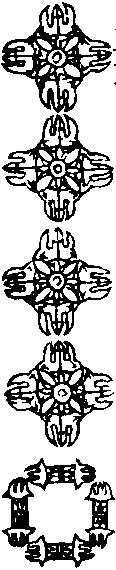



其金刚相，周帀如此，悉皆黄色，即是金刚色也。此有三事，同於金刚：色同於金刚，体同金刚，名同金刚也，净同金刚，即是净妙同金刚也。以此三事，同於金刚，无有能破坏者，无能胜者，无能降伏者。若作此金刚界已，令诸为障者，悉皆迷惑，无敢娆者。既得离障，则所成药物，易得成办也。云四方角者，此有二义：谓坛正四方作，又金刚印亦四方作，亦正当四方面也。云金刚结者，如上周帀安金刚，皆股股相连，即是金刚结义也。安一门并缘(缘即是如上所说，开一路空处为外缘也)相应者，谓此门随事相应也。上成就门向东，中成就向北及西，下成就令门向南也。其界金刚相连，亦是金刚义。二守门者，为作成就之物最须守护，以此守门为要，即是上所说威光难视及相向守门者也。皆竖指为印(印在下说)，二俱赤白，作极忿怒之形。角置gu输ra罗并焰，即是独股金刚，但有角处皆置之也(有焰)。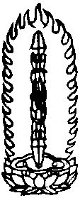



中金刚安同喜座四方处相对者，於漫荼罗最中置十字羯磨金刚。



令正四方(正当四方面也)，於彼上作大莲八叶并蕊(在金刚上作也)，此即同於金刚之座，故言金刚同也。结金刚印，即是结金刚手五股印，故云金刚智者金刚印也。当稽首一切诸佛，数数彼处作护药物作净者，彼礼佛时，如上所说广大悲愿，数数自誓运心弘普，誓不为己，乃为一切众生故成此药物，愿加持力令速成就，以此成故能利一切众生也。其护药物具有多法，广本有之。凡取药时须解法用，市求自采亦有方轨，乃至作护作净皆有次第法用及光显等，此中未具，当宜更问也(或苏悉地等可通用也)。作净已，彼持诵时亦有初中上成相。若得无障成就者，上成有三相，谓初夜煗生，中夜烟起，五更焰出。中成有二相，谓除焰出。下成有一相，谓但煗生。转谓从少得多，从烟得焰等也。既得成已，或食或持，能得自在，游诸佛刹，从一至一，住寿无量劫数，威光自在，於生死自在。以於生死自在故，即是真佛子也。(世界上行，即是履世界行也。)物成已，以金刚印护自身，护本尊。护物方取之为五分：师(一)，及先成就仙(二)，助伴(三)，己身(四)，及佛也(五)。佛物随彼所生，於三宝处用。先成就仙物，若有仙来取，当与之。不来取，分为二分：一与伴，一自取。师物，若师在佗方，当为掌之，待来与之。若师不在，缘彼所生，为作功德也。刀等不可分，亦标心为剂也。从初至末，皆用金刚自护护物，乃至了也。於一切世界，能普现色身，作大佛事。其供养药，亦有方法，谓献诸佛。(〔经云：转供养者，得成就已，持至十方，随意数献十方佛也。〕)及与阿阇棃助伴，各有分数方法。(当更〔问之。〕)若得如此成就者，是名有分别成就也。以药物等事，犹是事相之法，故名有分别成就也。因此有分别，而得无分别成就也。此约分别为因也。依此有分别，而得无分别果者，无为无相不思议无漏之果，虽非因成，而以有分别为因，能成此无漏无为之果也。



经云：秘密主！一切世界现在等如来、应、正等觉方便波罗蜜多，通达彼如是一切分别本性空，知方便波罗蜜多力，无为以有为作眷属，相应众生等现法界。遍者，谓无为之果，而以有为方便，能成此事不可思议。现在、未来、过去三世佛，皆以通达方便波罗蜜故，而说此法门也。举三世佛，欲明同以此文入也。虽复设此有为方便，然即了此分别之法本性常空。如是因缘起法，离於生灭、断常、一异、去来，但如幻化，不异中道。若舍离此，而求无分别体，不可得也。以无为之性，即不异有为。了达如是甚深缘起法故，能以此有为，即成无为之果也。是故一切三世如来，以方便力故，虽证法界，而能从此无为无作本体之果，而以有为作诸眷属。如大日如来，於自证之德，以加持力故(而於无为以有为为表者，本性无所为，因有所为而能成无为也。展转相应者，未持诵时，性本不净，由持诵得清净。今为度众生故，复现不清净身。此不净身，复为佗作〔净〕绿，名展转相应也。还从无为生，有为为表也)，现十世界微尘金刚菩萨，一一以真言门引摄众生，皆令得至无为之果是也。以此方便，遍於法界，普应一切众生，令得义利也。见法安乐住，欢喜心长寿，得五欲戏喜笑，受斯佛世尊供养，作此一切世人不信，毁生句得如上事。此义利见如来菩萨真言行道次第欢喜心说者，谓诸如来以方便故，从无为界以加持力，不舍众生随应示现，或令见法住安乐行、或发欢喜心(即法喜初地也)、或得长寿无数劫恒覩佛兴世、或得净妙五欲以自娱乐，又能供养一切如来，此事无方便者不能信也。彼作是念：真言之体即同法界，无为无作云何能成是事？若生是事即是有相分别，云何应理耶？是故生毁也。然此中佛有秘密之意，无方便故不能解了。此中以心自在说为长寿，如此寿量即是如来法寿之命。五欲者，谓四无量及菩提心。一切圣人以此现法而自娱乐供养如来，即是真法供养法身佛也。若行者依佛方便甚深缘生得世法成就，即於此中观本性空，即是无为成就。如是不思议法，凡夫自不能信了。然诸佛如来及菩萨等见此义利故，说此真言行次第之道，不可谤为无也。何以故？如餘菩萨为求无上道故，难行苦行如救头然，经无量劫尚不能得如此成就。了此真言行者，若具方便一生可成就也。以知甚深缘起十喻义故，以真言等虽作种种成就，而无取著不异於如，是故微妙速疾也。



次明所成药物，谓如上先一月一洛叉，次二月持诵已作漫荼罗，於中置此所成物而作念诵，更三洛叉方成也。此漫荼罗神位等，即与大悲胎藏同，故此中不说之。但以所欲成物置中，以大日如来置方隅。(更问)幢以竹为茎，缠以净叠，更县垂一丈以来如幡状，上作层形，其上安拔折罗也。刀以镔作骨柄。伞有上中下成，谓金、银、孔雀也。舃履以皮作，先种种熏洗极净无气，更以药持之，乃至火不能烧，又极香方中用也。如意取净好宝置之幢上。眼药用安膳那作，此安膳那有二种：一极轻，逆水而上。(更问)牛黄者，更有无量药，谓空青、朱沙、雄雌黄等，皆方可成就。又金刚杵等无量物亦可成。大本具说方轨，苏悉地亦有次第也。如履舃得成，即可乘之游佛刹。无碍眼药成，即见十方佛刹。餘可解。又有畫作鸟兽种种形，随取其一作法成，即堪乘御往十方佛刹自在也。或以法加童男女，亦令彼成就以为供侍，即游十方刹也。西方有一人成，引五百人升空而去不知所之，此法成即是持明仙也。此物随心所欲作之，彼持诵时亦得境界令作如是如是物也。或可运心作，无物而作亦得成矣。



经云：一切世人所不能信，彼人得之，谓作成就人也。不能可信，希奇之事，皆能得之也。故云善男女方便，具欲求之物，但以自心自在，唯如是得成就也。彼自心自在，唯如是成就者，谓随意所欲，唯心所转即成也。唯谓用自心，不藉餘缘，唯亦是𫏐义，言才心念即成也。



秘密主！因果欲乐，依秘密主，非彼愚夫之所知者。若人於此真言行中，作如是念：我今行如是因，当得如是之果。当知此非正说也，唯是愚夫虗妄计耳。何以故？有诸外道，说一切法从我而生(〔若如是自在，喜故即与，不喜故不与等。如是等人，不能解此道也〕)，则是万物皆从因生。若从因生，此因即有自性。若有自性，即堕常见。常见常法，云何能生？若因灭果生，即断灭法，云何能生？意云：因者因空，因既空，何有果也？如中论智度中广破。当知此因，以智观察，尚不得其原。此因无依，无依即是本来不生。本来不生之因，何能生果？故知彼果，本来不生也。因非实有，因既非真实，终不能生实果，当知果本不生也。又复是因，本性空寂，当知果相，亦复如是。若於如是缘起法中，而言有因有果，即是遍计所执，堕於断常一异，不入中道。是故证知，如是真言，永离因业之相，即是法界、不思议界也。又因是有所作法，因既有作，作当知果亦有所作，既有所作，何能成真？实当知果离於因业，以此因果等相妄想故有，正观察之，本无所住，无所住故，果体不生，即同无为也。是故行者若作是念：我诵真言，修真言行，当得成果。徒自欺耳。此真言者，虽从缘起，而实无作，从本以来，法界无生无灭，非净非染，法体如是，云何得成耶？当知真言行者，但以方便自净其心，若三业清净，当於是中自得明了而自觉悟也。譬如有人梦中修行种种六度而净佛国，觉已则无成果之相，但是一念无明心中有因果万行耳。又如暗室之中而有宝藏，若以方便然大明灯，虽因缘生灭推不可得，本同於空，然亦明法任运而起，以明因缘则见宝藏，非此宝藏因方便生也。修真言行者，本为除遣惑业，当体悟法界无生灭净染，离诸分别，知此真言之体即是法界之体也。若了知真言之体即同法界，等於大空，自然能得无相三昧也。由无相三昧故，悉地现前，当生如是信解也。



次金刚手复问佛：唯愿复说正等觉句、悉地成就句。即是如上所说，一字能生四字，乃至遍满法界，此即是佛心句。今问此中成就之法也。诸见此法善男子、善女人等，欢喜心安乐受而住者，此即是随於此中而修学者，若得成就，名见法也。成就者，谓即以此生而得见谛也。彼见法者，闻佛说此成就之法，必当深得法喜，住安乐行，现法乐住，故请问也。经云：不害法界。意言非此法界中有所妨碍也。乃至受种种世乐，而世乐即是法界，终不因此而妨损法界也。非法界不害。何以故？世尊！法界、不思议界，一切如来、应、正等觉说：是故，世尊！法界不可破坏。修行真言行菩萨得是者，然此四字究竟成就，与法界无所妨害也。此四字句皆是佛心，岂以佛心而妨法界耶？住此成就者及法界，无二无别，无相妨碍。此悉地，彼法界，都无所妨。何以故？法界不思议故。是故无量佛得道成就而法界不增，无量众生灭度法界不减。若众生胜进亦非加益，若破烦恼亦无所损，即不思议界性同金刚不可破坏。若有妨碍则有彼此，有彼此则可破坏，今即无妨碍故不可破坏也。此不坏亦是不可分析之义，谓种种门种种世出世事同一法界，不可分析令成别体也。若能如是通达，即是得见法成就也。时佛赞叹金刚手：善哉善哉，汝复善哉者，叹彼能问如是大事因缘，故重叹也。汝哀愍未来修真言行者，故发如此之问。汝今谛听，吾为汝说也。谛听谛听，善思念之，吾为汝说如是者，此意言汝谛听，善思念之，吾为汝说如是事也。次言如是世尊者，金刚手！愿欲乐闻也。佛言：秘密主a阿字作成就者，即是於正等觉句中作成就法也。僧住处者，谓寺、或山房、或窟、或室。内者，随意所乐欲处，及秘释如上已出之。



经云：以a阿字遍布一切支分。持三洛叉诵者，以心布此a阿字，从顶及眼耳等，乃至遍於内外身分。又诵此a阿字，三洛叉即成就也。又秘说云：本尊种子及圆明，名为三也。字在圆明中，圆明在本尊心上。观一成时，三皆自成一。缘於此三境，故名三洛叉。洛叉是见义也。诵此三洛叉已，至白月十五日，名为满月。依文诵三洛叉竟，取白月十五日作成就漫荼罗也。作此法时，尽其所有供养三宝。作成就时，亦诵此字(秘说如前可知)。作此法时，普贤、文殊或餘诸金刚。此言应者，不可定准，随有一尊来为成就也。然见时亦有上中下相，若亲见分明与对目无异为上成，若但闻声现前示教利喜为中，若梦见等为下。又见时有明昧等殊，即知有障无障等也(秘说可以意得耳)。如是本尊等现前加被时，即应作礼奉献阏伽。此即香华之水，加以五宝谷等，如上说之也。行者尔时即得不忘菩提心三昧，以得三昧故，其心及身皆得轻安(轻安谓垢障除也)。又即以此轻安布想念诵，得身心清净，如六根品中所说万像皆见，能知佛心等也。以身心清净，即故得随生，谓意生之身随念而生也。随生，谓因念诵随生身心清净也。行者若欲耳根净者，想布a阿字，於其耳根而复念诵，即得耳根清净，闻持不忘，能闻十方佛说法，乃至天等之声，亦如法华说也。若欲住寿长久者，想a阿字同於出入息(谓以此字作出入息，令出入分明不断也)。如是想念，日日三时思惟，即得常寿也。秘说者，字及句并本尊为三时也。若欲摄一切毒，想a阿字，或自或佗想在身。若如自作者，想此a阿字，於有毒之处，渐遍身分而駈下之，毒渐渐下，字亦逐之，逐出尽即除也。毒有二种：一、药物之毒；二、有情毒，谓龙蛇等毒也。若秘说者，毒谓三毒，若三毒盛时欲除，亦如前作法逐之令尽也。若欲令人爱念及彼归依者，想a阿字作其自身，想ha诃字作彼身自身，想持商佉，又想以莲华即彼持之，互相观看，心中诵此a阿字，设彼忿怒高慢，亦即爱心顺伏也。秘说者，若欲摄伏其心，想自作a阿字，想心作ha诃字，心有莲华，手有商佉，而令相顺，即能摄伏也。一切难伏者，亦可伏之，谓上烦恼也。



佛又告金刚手：诸如来有意生名业作戏行舞等者，从佛心业而生，作种种戏行，现种种戏论之相，即是普现色身，随类作六道之形等也。舞谓种种神变幻化之事也，随事示现，其类众多，不可备言也。四界摄持，谓地水火风界，虽现此身内外依正，然此唯从佛心生，随心而有，体同於空，不可取也。以心王安住，等同虗空，虗空常不动，而含容一切也。见谓世间果，非见谓菩提等果，此类无量，故云广大也。又见谓种种舞戏之相，非见谓涅槃之果，亦见三乘修行种种法门，随彼所愿而令满足，即是能现种种可见不可见事也。乃至愿求禅定智慧法门众宝，亦随类示现而赐与之，犹如如意宝王，随众心所求，一切施与也samāhita三摩呬多，是等引义(等引，神通等令起，非等至也)。



时毗卢遮那佛观一切大众会，观已，告金刚手秘密主言(已如上解)：金刚手！行舞一切作，成坏果广大，亲一切与者，舞是戏论也。普现色身，随类曲成，作种种应，此非真实，但如幻耳，是故名为如来之儛。犹如舞者，能悦可众人之心，虽种种意解不同，皆令心悦。佛亦如是，然非四界之色所作，随佛心意而生，从心而生，从心而灭，虽非常法，而能随缘生灭，此兴废随缘，故云生灭之果，即谓成坏也。此亦遍於界法，广大无边，故云广大也。作已还灭，故云成坏。广大成坏，此成坏即是变转义也。然此缘起，即是如来妙应，从佛法界机感而生，虽生不生，虽灭不灭，即同於幻，不异法界故也。犹所作不实，故名为舞，三世诸佛皆作此舞也。亲一切与者，我亲於先佛授得此法，今复亲授於汝，故言一切亲与也。亲谓亲能现前授与一切所愿之果，此义正也。先作自实相者，如上所观种子真言及本尊，由观见本尊，见已即转自身而作本尊，展转相即，不相妨碍，即是见於金刚之界、菩提之心，故名先作真实相也。如是次第住者，谓住前所观者，心得善住也。先已自见实相已，a阿字经云：如是先正思念。谓如上文所说思惟法而念也。a阿字自已作，并点作广一切黄极悦意四角金刚栏标中，思念持诵诸佛一切处光。此等一切佛自实相说者，谓观阿字令作深黄色，其色相端正严好，令人悦意在於自己之心。



经云并点广者，即是字上加点义，增加即是广也。又此字外作四角金刚标栏，此栏同三股金刚更互相叉而作之，於中置字。见此阿字已，即转此字作毗卢遮那本尊之形，即是自身现同本尊之像，其像一依本印而作也。此佛通身有光，此即菩提心中所见实相之佛，犹如净瑠璃中内见真金像，非同餘心数中妄想也。当知如是见者，即是见心实相之佛。作此成就者，若无疑虑，即能普为一切众生作大饶益。



经云：具广大希有者，犹如幻人，具有种种异事也。犹如诸大菩萨，随心所欲，利众生事，如幻水月，而应万类，皆得成也。此即是如来如幻三昧之句。若能如是作者，无始以来，恶业及三有逼迫之果，乃至无间之重业，现身即灭，何况餘业。当以要言之，三有众苦，果报皆灭也。何以故？犹持诵者，以得住於sa三ma摩hi呬ta多地故。若观如是实相心者(〔经云：若观於彼心，无上菩提心。谓观行者自心中无上菩提心也〕)，即是无上大菩提心。若住斯观，即能净身口意业。由能净业故，净与非净，业果离也。意言有如是业，生净不净，皆不能污也。



经云：当业，谓当生此净心之业也。此果皆不能污。何以故？以常与理相应故。譬如莲华，虽生於淤泥之中，而不为彼之所染污。如是行者，即同诸佛。何以故？以能生一切诸如来故也。此即是仁中之尊也。(〔意云：才观住菩提心，已得如是果，况身现证而成佛乎？〕)时毗卢遮那如来，又复住於降伏四魔金刚戏三昧。住四魔降伏，作六趣解脱，一切智智满足。金刚字句说者，住此三昧，能降伏四魔，能除六趣烦恼业苦，而与解脱之乐，亦能满足一切凡圣所有希愿也。佛住此定，而说金刚句真言āḥ阿vī尾(去)(引)ra啰hūṃ吽(引)khaṃ欠。此五字，即是降四魔真言句也āḥ阿字是行，所谓本不生行也。傍加二点，是净除义，以此义能降伏四魔，除一切苦也vī味是缚义，加上三昧长畫，是无缚三昧，即不思议解脱也ra啰是净六根义，由六根净，故无尘也hūṃ吽(引)义，上已说khaṃ佉义，上亦有解处。又hūṃ吽(引)有三义，即如来三解脱也。修行除障，而得三解脱，从三解脱，而住大空khaṃ欠者，大空也。佛说此真言时，金刚手及普贤等，得未曾有开敷眼(如上说)：稽首一切一切智。如是说言(一切一切智〔即诸法一切智者〕，所谓诸如来也)，一切财富，此梵音意云无所不足，即是府库义也。言以此五字为大圣府库，能满一切愿也。一切财富，一切诸佛菩萨救世者，此一切佛菩萨救世者，缘觉声闻害者(〔此叹声闻之德，谓害随眠者也。又梵解云su苏ra罗yaḥ药，此云是害烦恼者也〕)，行地遍种种神通者，财富即是如来法宝，以给一切众生，由尚不匮如是无穷大智宝藏，故名富财者也。由法财富能施一切，而说此真言之门，上从诸佛下及声闻，无不依於此句而能施作种种神变利益一切也。故云随其行地而现种种神通力也。行地谓凡所行处，如彼偈云寻地山林遍无等也。彼得无上智，佛智无上智者，非但得神通而已，亦由此句一切圣贤得成智慧，乃至同成一切智智也。二乘智对世间亦名无上，今更明佛无上智，故重言之也。赞已，复请佛说此五字次第广法，及布想心等种种类者，所不言处皆请此中说也。布字想字上中下成，色用差别种种方便，皆请佛广为宣说也。种种门中成就进趣顺行此法，名为教也。自说此教者，请佛亲演说也。若佛广说此法，诸行大乘无上真言行者当得见法，若已见者亦皆欢喜。见法谓证得也。当住者，谓自见已复授诸众生也。由见此事，自佗俱获无上法利，故请佛广说。本经有三千五百偈，说此五字义也sa三mā摩(引)he醯ta多，正译是住心一境之义。佛欲说金刚之句，普令大众住心一境而听也。欲作此金刚真言成就之法，先令作金刚座。如佛初欲成道时，在於金刚道场，除此座已，更无餘座堪能胜致此也。于时大金刚为地际(〔从地尽地际也〕)，此地际加持下身，为欲说a阿字(〔意云此字最胜也〕)。第一加持者，为欲说此法故，先以加持自身也。下身，谓自脐已下，想皆作纯金刚也。此有内外，内谓如上所说，外谓想自身坐处在於方金刚坛中，其坛已如上说。方，标栏者也。名大因陀罗者，此是金刚中之极刚者，能破金刚，而金刚不能破彼。又是极黄色，如紫磨金色。此座想a阿字为之，名金刚轮也。於此座中思惟一切，即是瑜伽之座，此是修行应理者之座处也。思惟一切，谓一切事皆此中思惟作之也。事众多，故云一切。右初释阿字为座竟。次说长声之ā阿字，此字是第一命根也。以能活诸字，故云命也。若无ā阿字，诸字即不生，此是能摄召句。若想此字能摄召一切内外之法，摄召长声即是行。若触a阿字，即引一切佛行，故云摄召，是摄令属己自在受用义也。此a阿字门，能摄召一切如来功德，令归自身，亦能满足一切之愿故也。次说aṃ暗字。若想此字，能摄一切毒及病等诸障也。内外诸障，皆能摄而去之。内障，谓种种障道之法，但有现前，皆能摄除。外障，谓一切外物为障，亦悉能摄也。又除诸毒诸病，病有种种，皆能除之也。又能摄者，乃至失心，即能摄之，令得本心。又以此字，能摄心一境，速与三昧相应也。若想此字，得如上功德，故云能摄授诸果。一切能与者，与即是满其所愿，授悉地果也。若持诵者，一月中结金刚慧印，而诵aṃ暗字。於一月中，日别三时作之，一切无智城破也。一切众生，无明之所缨遶，四合坚固，犹如牢城，不可破坏。以此aṃ字门，而能摧坏也。不动坚固者，谓天、人、阿修罗等，所不能坏也。凡一切增益事，若欲作时，皆坐此座。增益亦名圆满，谓能满一切所愿也。若秘释者，一月是一见也。若得见法，入於初地，任运增益一切三昧陀罗尼等，及至诸地位也。若欲作增益法时，持诵者於此金刚坛中，想佛住於三昧，身真金色，周帀光𦦨，有威光义。云有威光者，即是兼明本尊义也。梵音如此，周帀𦦨光，以发为冠，此是大因陀罗也。此大金刚之坚，即是佛智之义。能破一切，无能除者。想此佛在方金刚坛中，随意作一切成就物也。



经云常安者，谓此等一切事，当於此轮中作也。成就金刚法，五股纯金作之，置於坛中，而复依法求上中下成就，亦如上说，谓皆持诵此阿字也。若欲成就佛顶者，以真金为佛顶而加法，若得成者，即同大日如来之身。或可不须别物，但以自在想作佛身而加持之，若成即同佛身也。若作金刚成就持之，即同金刚手菩萨也。若欲成就莲华者，以金作八叶莲华，於中持诵，若成即同观自在菩萨也。刀劒者，作亦有法，若成持之，即同文殊童子也。鹅者，作法若成乘之，即以此身成梵天身也。若成就外财之中，或成就黄白，所谓金银也。或成就地(地谓伏藏也)，或如意珠等，但与增益相应者，皆用此法作之，具有上中下法也。大因陀罗观者，谓於金轮中观想也。



复次，凡摄持法，如前云摄风等，作七点等法犹未能尽，此中具足明之。凡一切为障害道者，皆用此法摄令不动也。一切一境者，令一切住心而听也。作此法，先想八峰须弥山王，八峰谓四面周帀。作此山峰，於八峰上想莲华，华上有三股金刚，其股向上。经云：置彼顶，是杵上头也。此上想作阿字光焰周帀遶之。如是想已，一切障皆令摄除也。如是摄彼，令住一境而不得动，非是不动尊，是定住义，自在随意，修道无碍也。又成就药法，凡如是等欲成就时，具有次第法用，今此中但略明大宗耳。作药加法一百遍，凡言百者，皆加八遍，为一百八遍也。诵已自饮，或以与人，能除一切病患，乃至先业之病亦能除之。凡增益事，与金刚黄色相应也。



次明va嚩字门，即是上vi尾字。先明其缚，复兼三昧之畫也。其想法，想此va字纯作白色，犹如雪山及牛乳等，鲜明皎洁。先从脐以上想作白莲华，极白鲜明。想va嚩字纯白色，在於白华之上。成就已，即回此va字以作本尊也。此是息灾之中最为第一也。其佛本尊亦作寂然之像，极寂之义，住於寂定，纯白无比，同於秋夜月光也。彼漫荼罗当九重圆作，犹如九重月轮作之，如霏微白云雾状而住其中。作此法成，一切烦恼热等皆能止息。凡一切息灾相应，皆此中作也。牛乳犹珠鬘同者，想此字中如上牛乳，流水连渧不绝，犹如白珠而下，灌注其心，或自或佗。若想此灌之时，一切内外热恼无不除也。或想如月，或如水精净月之光，普皆流注。凡有一切热恼之患，以此注之，皆除一切。扇底迦法与白色相应，此中作也。前阿字是金刚漫荼罗，此嚩字名为风水漫荼罗也。□(金刚也，地也，〔黄〕)○(悲也，水也，白〔也〕)△(慧也，火也，赤〔也〕)。



(神通也，风也，黑〔也〕)，空无定形，而现种种也。从月轮雾聚漫荼罗中出，如乳流注，能除一切热恼。谓内外障，即是热鄣，此悉能除也。免离，谓脱此苦患也。如是系缘一境，成就苏乳并珠鬘，及藕丝水精，或水或酪，如是等物，其数众多，随心所欲作者，但与寂灾相应，皆得成就。或求长寿，久住无量。或现种种身，端妙奇特之相。或云最上者，是爱敬中最上也，令人所爱敬。或求闻持，或求聪明，或求智慧，及息诸病，如是等皆得成也。若此缚字上，安点vaṃ𮢥字，亦能摄除病患等事，内外诸毒，皆速除灭。此是息灾吉祥maṃ漫ḍa荼la罗也。摄除有无量事，故云等也。



次说ra啰字。除障漫荼罗，於除障中，最为第一真实之法。此raṃ啰字，是赤中之赤，火中之火，烧中之烧，由能烧灭种种烦恼业苦，乃至现作五无间罪。若修此字门，亦能净除，无有遗餘。既除罪已，则生诸善功德也。此字门所作，与不动明王相应。然不动明王，自能作三品一切事也。其法先如上住心一境，观作极赤三角maṃ漫ḍa荼la罗，极令悦意。此悦意言，谓令鲜明玅整也。又悦意是当心作之，此秘语也。周帀作於燄鬘，如烈火光𦦨之状中，观ra罗字。此字已成，以转作不动明王，作寂然之像，非瞋非笑，其形寂然也。又云先想不动明王，於其心上作三角，中有ra啰字。字成，回作不动明王也。除障故罪灭，寂然故息灾，即是罪灭福生之义也。此成就是物者，谓指此三角坛也gra𨰿啰诃，是执日之眷属。凡有八曜，皆名为执也。凡日等诸执，及火天等，同在东南隅，作法大同。谓须火用作之，或转火令冷等，皆此中作。然云秘意，是作自智火也。日亦是慧日也。摄取者，摄取恶法难调之人，皆令柔顺调伏也。(义准〔二〕十八宿及十二房等，与月水同位也。)此中摄伏恶人者，谓能摄伏烦恼，而得自在也。及发怨者，能令自佗俱得成也。(谓发彼怨等也。)消枯众支者，能令彼身枯竭，无所堪能也。一切身分三毒为本体，令彼消竭无餘也。若外相而言消涸，即是竭龙池等也。彼一切作者，一切降伏相应事，皆此中作也。然皆与慈悲相应，为令彼等降伏善调，得作佛道因缘故ha诃字第一真实等者，此是风漫荼罗也。风性能增益万物。风生者，谓应是作风用之事，皆此坛中出生也，亦是生此诸事也。万物或能消秏无变化方，此字事用亦尔也。谓因业等生种子，增长滋茂之事，皆得自在。若上安点，即能坏彼一切因业等事也。其法先想本尊，於其额上连两眉，作半月形。



於中安haṃ字，先想向外作，即回作自身也。其半月有大威德光之像，黑𦦨遍出於外，作风吹动之幖帜。恶，谓其像作极忿怒形色也。云此但是风轮之尊，非降三世也。其像亦作深青色(即黑类也)。若作此成就，能为一切众生作种种义利。次成就，谓下所列物於风中作也。即此现身皆得成也。谓升虗空神足变化，及天眼天耳没隐其身。开，谓开阿修罗宫等也。下云念者，只是用心作也。此五字皆是心作成就坛也。亦可以事法作坛，而观心与相应也。如以事相作坛而修神足，亦於彼中坐作之。若藕等，亦置於坛中作也。想白乳流满中，昔佛坐道树下，从此ha字门而降伏天魔无量军众。持诵者若能如法习行，不久即同如来现身，能降伏彼军也。大名称，即彼降魔者也。



次即因诃字门转明kha佉字ha诃字即因义也，有因即有随业受果之相。然此第一义中ha诃字门本自不生，以不生故因不可得。此因尚自本来不生，况於其中而有业果耶？如是观时，因业与果三事寂然皆不可得。若能如是观者，即同如来坐於道树而降伏魔。以此因等不可得故，即是其相犹如虗空空而复空。故大德世尊说彼色者，谓说虗空色也。故於上加点，即入khaṃ欠字门也。此khaṃ欠字门说尊者，名为尊也，谓尊中之尊即大空也。若欲成就一切器物皆得成就，其名种种无量不可具言。其漫荼罗无方圆半月等相，当知虗空无相，而此坛作种种色也，能容现种种色相也。刀印共作，谓兼以刀印护之而作成就也。刀用镔铁作索，用线或藕丝作轮，或以金或以镔作。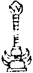



(利处在下，名那罗遮也)此等器甚多，不可具载，别有图。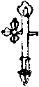



(此名没蘗蓝)如上诸器随作一事，用此khaṃ欠字成就之。若得上中下成就，随事而用，乃至得成，持之以游诸佛国土，名持明仙也。



次更细说五字之义，若住此理，随事相应，即能成办一切事也。是故佛观大众，告金刚手言：是真言门，菩萨修菩萨行。阿字自本色，内外一切舍，得一切句义者，谓与阿字本体本色而相应也。体本不生，同於金刚实相之身，若与此相应，即能舍一切法，麤妙等同，犹如瓦金齐观，犹善住平等观故，一切三毒罪业悉离。若如是者，当得净心，得此净者，即同诸佛牟尼之尊，普能利益一切众生，出过百非，离诸过患也。



次明va嚩字门，若能与此相应解诸法则(即是真言次第法则也)，即能为一切众生作大利益之事也。先当如上观此va字，白如雪乳流注其心，若流注充满其身，内外皆净一切见者，即同佛身也。又从其身而流注出，遍於一切众生身中极令净满，又更流注满於大地，当知此即於秘密释中是大慈悲水也。观於世间极苦恼者而利益之，能令或饮或触能除众患，必定於无上菩提能令此水现同甘露，或显或秘，於二释中皆有世出世利用也。无疑，谓当生决定信不疑也。



次明啰字门raṃ(加点也)亦如前观之，出寂然光明如火轮，周帀有光遍於内外，皆作此色向外流出，乃至照於佗身亦令如此，渐次转广遍於法界，能除一切众生种种恶事，随所欲乐而满足之也，亦能作诸神变也。次行者从脐以上安ra啰字，次於脐中安va嚩字，俱现神变，从啰生火、从嚩生水，而除寒热等患，乃至八大热地狱能以嚩字而作清凉而息灭之，八寒地狱能以啰字作温煖而息灭之也。次又下安ra啰字，於标幢上而安ha诃字，能除自佗一切罪苦也。又如上作大金刚轮，此是刚中之刚者也，於彼金刚大因陀罗轮中双作a阿va嚩二字，而自龙方(西南也、西方也)即能摄伏一切也。风能遍一切处或开或坏，开谓开修罗宫及一切质碍之物，坏谓摧而折毁之，种种杂色内外业因所成而皆能开坏也。色漫荼罗中，谓依本色，即是前所说风坛也。心摩触者，谓想此字在圆明中，而当其心中能令心得清净，即法华所谓意根净也。於经行中而念诵之，观此字而作轻举之想，即能举身升虗空现种种神足，或坐而想阿字在於耳根之中，以此字出入闻声即得天耳也。或云随用一字皆得，或可此文是ha诃字用也(更问)。



意生身者，此是举要言之，随意所欲皆成。如得意生身者，随念至十方也。当知如来有如是自在方便，能令无相离相门中，而普现色身，成办一切佛事。才持诵时，能坏一切生死种子，成就菩提之种子。转者，即是转诵之转也。行者若能如是修行，诸佛常当现其人前，如影随身，而满其愿。行者既得满所愿已，即能不舍一切众生，亦复常现其前，而满其愿，令得法喜也。故云同於影像，於一切处，随顺一切众生。所以尔者，此由如来住於三平等地，无有分别戏论，越度一切心境界相。时方作业，一切亦离。时，谓生灭於三世之时。方，谓方所。作，谓众业。虽现万像，而无所现，同於十喻，法与非法，皆远离故。由得如是无尽庄严藏故，能普应一切众生。是故行者，当勤求是真言之行，无上悉地。所谓如来一切智智，当知诸成就中，最在其上，无与等比也。此一切智，由於真言行生，故当勤学。



------



### 成就悉地品第七



时执金刚吉祥希有华开敷眼者，金刚喻如来秘密慧也。金刚无有法能破坏者，而能悉破坏万物。此智慧亦尔，不为一切之所破坏，而能摧坏一切。能坏难坏者，所谓三毒根本也。复次此菩萨身即是金刚之体，而十方一切佛同以如来金刚智印授其手中，故名持金刚也。吉祥者，叹金刚手菩萨之德，众善功德具足无缺，即是吉祥义也。时彼菩萨闻如上说诸佛甚深希有奇特之法，发希有心其眼开敷，一心观佛而不暂舍，方发问也。



复次，如世莲华渐渐增长，若不蒙日月光明及时节等，则不能敷荣。菩萨亦尔，虽有秘密菩提心、如来功德实相之藏，若不蒙诸佛平等大慧烈日之光，则不开敷。今此菩萨得是妙法莲华台真实知见故，复欲问佛，广传此心地之法，度与一切众生，咸令亦得如此开敷也。



复次，如上所说，即是阿字门。如来金刚性功德藏，具足无缺，常住妙理之门也。转金刚杵者，亦有微旨，谓欲转此无碍密慧，入一切众生心也。所以者何？如是自证寂灭之法，微妙清净，为无有上，而众生不自觉知。为此因缘故，於无量诸佛秘宝藏中，而受无量恐怖苦恼。为是事故，生大悲心。次欲请佛转此智，令一切皆得开敷心眼故也。火光微发者，火喻般若波罗蜜，四边不可触，以不可执著故。又体性无垢，能烧一切烦恼虗妄之垢，如劫火无复遗餘也。遍照佛刹者，以此慧光，普照无量法界，一切有缘应度者，无不普现其前。以所喜见之身，称机说法，咸令得入如是阿字之门，诸佛刹则无餘世界也。(私谓：此世界者，即〔此〕净心之土，常不毁坏金刚之国土也。)发美妙音，赞法自在牟尼者，谓发微妙之音，而问如来也。赞法自在者，如世间长者，具足於财，无所乏短，故能随意所为，皆得成办。如来亦复如是，为诸法之王，一切法财，无不具足，故能办大事，不可思议，一切皆办也。牟尼者，寂默义也。常寂之士，微玅寂绝，幽深玄远，不可以言说之。如是法界，寂然大灭度法，唯佛一人，究竟清净，故名牟尼也。真言诸行，说彼行不可得者，谓平等三业真言之行，由此如来之行得成无上大果报者，此诸行愿世尊为我等说也。问意言：此真言及行，佛说行能成办一切如来功德广大甚深之事。以要言之，无量无边未曾有法皆得成就。然一切法无不入於阿字之门，若入阿字者，即是从本以来本无诸法，以一切法本不生故。若法本不生者，即此真言尚不可得，何况是中发起众行耶？此即无生无起无法可得而具一切功德，即是不可思议佛之境界，唯佛与佛乃能知之。佛佛自证，若闻见证之者，则能以无量方便示悟众生。若心不自证，则无由能筹量如是事而为人说。如是不思议不生不灭，云何修行？又此行者从何所来？去至何所？意问：无生之行如何发趣也？所以然者，若生灭法可说有成就破坏之相，今此法则无如是等相，云何而得成就也？此义亦甚深也。真言本寂，云何发行？愿佛为我宣说。一切为我说者，意言：总为我演说之，谓说此希有无上之法也。如是甚深法性，犹如大海万流之所归趣也。此万法归趣，正顺於大般涅槃，即是发行义也。如世间大河种种色味入於大海之中，皆同一色一味，无有差别不可变易。如来大海亦复如是，一切万法万行入中，皆同一不思议解脱之味，无有差别也(如是说竟)。



次如来答云：心处大众生漫荼罗皆作是说者，说心处亦可名为心位，即指此众生自心之处，即一切佛大悲胎藏漫荼罗也。所以者何？一切众生即是华台之藏，然以四种烦恼常俱生故，为彼自覆蔽故，不能明了而自觉知。若能自觉心处者，即知此心自性常净，如是净无垢处，即是诸佛大圆实相之地也。是故佛答意言：若欲知真言行及果，当於心处求之。诸有所分别悉皆从意生等者，皆如是说者，十方三世佛皆如是说，一道无异，非独我如是说也。真言诸心处彼识知果受者，果谓诸佛无上菩提之果，受谓证得也。佛意言：若能入此阿字门者，即能识於心处，若知是处，即得真言之果也。佛意又言：诸法尽由心有，如人眼见色者，但眼根与色对，不能了知青黄赤白等。次眼识即生不定之虑，此青黄耶？次意识即分别分折，言此是青黄赤白等种种众相，当知但由心分别而有也。(更问)决定悦心之处者(此心梵云cinta质多，是虑知心也。又次hṛdaya汗栗䭾者，是处中之心也)。如二乘入道，亦先须问得决定心，此决定心即三昧也。犹具定心故，心得悦乐，即是内心自证现法之乐也。犹有定故，即生实知见。然三乘各有定，深浅不同。今此中意言：若能证此心处心中之心(即此是hṛdaya汗栗太心也)，即是如来大决定心(谓三昧也)。此决定心即犹有此定故，得入阿字门。入阿字门故，即能了知真言行之与果也。若了知彼行及果，即是授得无上大果也。佛意言：犹心住定故，得究竟一乘如实之见，即能自知。是事不然，虽问无益故。



此以下正明习定初门也。如上执金刚所问，此真言从何所来、去至何所、云何得果者，今者佛意答言：夫真言者从自心发，乃至欲识真言行及果报者亦从心而现，出此心外无别法也。所以者何？此漫荼罗名之为净，以一切众生自心本来清净，而以无明覆蔽不能了知，若净此心即是漫荼罗，更不从餘处来也。行及果报皆亦如是，以一切万法乃至形显等色万类差别，莫不从心分别而有。今此阿字门亦不从外来，但从心生无别来处也。所以者何？以有方便修定故其心渐净，以心净故阿字现中。此阿字者即是一切诸佛之心，从心轮净故能现阿字，由入阿字门故即是成大果报，故知此果报亦从心得。其实无人能授与者，由自觉了而得之也。当引央掘不盗戒义。然此心源微妙寂绝，无名无相不可示现，以何方便而能得现耶？今诸佛为化真言行菩萨故，直从凡夫心处之心而作方便，亦不作餘对治行等也。此心之处即是凡夫肉心，最在於中是汗栗駄心也。将学入观者，亦於是处思惟莲华之形。所以者何？以一切众生此心即是莲华三昧之因，以未能令开莲华故，为诸烦恼等之所缠绕，所以不能自了其心如实之相也。是故先当观此心处，以作八叶莲华，观令开敷诸蕊具足。於此台上思想阿字而在其中，从此字出无量光，其光四散而合为鬘，犹如华鬘。所以谓之鬘者，谓多华贯穿相续不断，由合多为一故名为鬘。此亦如是，合无量光以为一光之鬘也。何故须观八叶之华不多不少耶？此有二义：一者一切凡夫心处，虽未能自了其心，然亦自然而有八瓣如合莲华形。今但观照此心令其开敷，即是三昧实而且便也。然其理者，若观此八叶之华，即得与理相应。此八叶者，即是四方四隅也。四方即是如来四智，初a阿字门即是菩提之心，次aṃ字即是成无上菩提，次ā字是行菩提之行，次aḥ字即是大涅槃，其餘四隅之叶即是四摄法也(更问其相)。先从阿字门发菩提心(即是真言来处)，次知彼果(更问次第之意)，此是字轮五阿字义，欲成大果报故而修如来之行，以修行故而得证大涅槃，证大涅槃故能见心性，即知此心法界之体本来常寂灭相，故末后aḥ字门也。所以云𩯭蕊具足者，亦有其意，谓此莲华三昧之心若开敷时，无量法门无不具足，谓六度、十八空、三十七品、禅定解脱、百八三昧门、五百陀罗尼门，如是等无量无边无不具足也。当知一切法门皆是从心而有也。



於坐上者，谓於彼莲台之上，观於阿字，故名坐上也。周遍普众生照明故者，观此华鬘之光，若现前时，即从此心生寂照之光，普照一切众生之类。一切众生亦有如是之性，但由无明覆故，不识自心之性，故不得如是自在之用。若自了心源之时，亦能如是普现色身，十方教化，如佛无异也。云众生者，谓彼以无明故，乘业而生，即受四生之报，以乘业而生，故名众生也。今欲教彼众生，令尽识心之实相，开彼华台，令得佛之知见，如俗言心开意解，此言有理也。以心开故，即入阿字门也。又言坐上者，亦含多意，或言华坐，或言自身坐时，或是成就大漫荼罗者。漫荼罗中，作此观行，入阿字门，即能见光明普照，普现色身，而作种种佛事也。然行者初学观时，心未纯熟，未得现前，当先畫作妙莲，如上所说，极令微妙，兼置阿字，常现前观之，当於圆明中畫也。此圆明，犹如圆净之镜，其中极深，阿字圆光，於中显现，久久即能现前彻见。既於外处见已，回观自心，於圆明中，而观阿字。如阿字者，当知ma麼等诸字，例可解也。(更问)行者内观，具足纯熟，见阿字时，其光从心四散，普遍十方一切佛刹。此光从顶至足，周旋环绕行者之身，不可以喻言也。问曰：何用观莲华，不观餘华耶？答：此亦有意。如世莲华，出於淤泥之中，生处虽恶，而莲华体性清净，妙色无比，不为诸垢所染。凡夫亦复如是，虽种种不净，三毒过患，无量无边，亦如此莲华三昧，甚深果实，皆从其中生，即是如来平等大慧之光也。



千电集会者，如世间一电之光，尚不可谛观，以映夺人目故，况无量电光聚集耶？此释光鬘四散，威猛炽盛之意也。然此光从心遍照之时，即能普遍一切世界。一切众生应度之者，皆现其前。以其所喜，见身赴机，演说妙法，令其得度，皆实不虗矣。如世间明镜，於中现种种形色，然有所不照，不能普现。净心之镜，则不如是。十方无碍，圆现法界，但借以为譬，然实不可为比也。行者见圆明阿字时，能遍诸方而行佛事，然亦寂然无所动作。犹如水月，随器不同，一时顿现。然以智慧观之，若水性不明，月亦不现。水虽澄净，而无月者，亦不能现。无有去来，而现前明白，但缘合有耳。复次，如月出时，虽能成就四天下万物之类，皆令得益，然亦不作是念：我能普照万物而生长之。行者观於自心，亦复如是，同彼水月而现众像也。



从此品以前说真言之果，从此品以后次第明修行入证之方便，从此为首也。此中复有坐起威仪众多秘法，下别出之。此经圣者所秘，故不明白次第说也。如上观八叶及阿字门，先用净除自心华台得现，今欲令彼长养滋茂成大果报，更明方便观aṃ暗字门也。前入阿字门，虽云了知心性，然尚未得究竟现前，是故更入aṃ暗字门，此是三昧将用成就菩提心也。如世莲华依水而长，若无水者不久枯朽，行者菩提之心亦复如是，若无三昧之水灌注其心，即亦不得滋荣开割也。此暗字当观在顶上骨缝四会中，方令字正面著之，立头在后，更有秘密观法又别也。观字点为行者头，餘为身分四支也。(问，水从阿字〔下以〕流入别字不？)以行者未识自心故，方便令识先观莲华，又以定水涤净其心，令此阿字明白彻见之时，诸根诸垢皆渐清净，由六根纯净无垢故，心性无垢，犹如水清净月之光，当知此即名见。见者即是成就，成就者即是体同法界，当知此法界本来寂然，一切众生世界之所依持，犹如有情依世界，乃至地轮依水，水依风，风依空，空为一切依止而无所依也。法界亦尔，以众生无明垢故，不能自了，今以六根净故，即明见也。未见时更有方便，亦在别品中。又非直观此二字，行者自观时，更以诸字令普遍支分明，作是时事事明了，即成持明人也。以能自在用此诸字门故，成持明仙。又此中云见者，非是有得见也，以无垢故即能见，见即是法界体也。如镜净故，万像自现，而不作如是分别，我能见彼，彼是所见，亦不分别去来之相，但缘合见耳。一切众生皆亦同此法界之体，若如是见之时，即是悉地之相，能普现色身，示无尽庄严藏也。行者由心净故，非但具足妙天之乐，亦得大涅槃微妙之乐，亦见如来句句是诸佛之坐处也(谓佛住处也)。如上见时，犹未名究竟成就之见也。



更有方便，谓观ra啰字门。行者於两眼上置此二字，光明如灯赤𦦨光辉。行者当坐时少屈其颈，以此无垢光眼而内观照其心，犹此ra啰字故能见心性也。低咽当不令太曲又不太直，此有二义：一即调身不生病苦，以坐太曲太直则四大不调和故。二者谓净眼根速达心源故。此ra啰字门者，即净知见之明灯，由此智目观心莲台之实相，故速得成。又坐时舌亦不得著上腭及太垂，著下当处中也。如是净眼观於自心，亦无能所等相，但因缘具故得如是见也。以上佛告金刚手：去来之相此行从心而生，心为照明能见如来之道，行即是道也。道者即是行及果报也。非但我如是说，三世如来所说亦复无异也。如上所说真言方便，乃至观此心处无垢清净，犹如圆镜常现在前，当知此即是先佛共所宣说真实之心也。如是心性常恒安住，无有变易，不可破坏，即是诸佛大涅槃，故名真实也。以啰字门等净此心故，生真实智光，以此心智慧光故，即见古佛所行道，所谓秘藏真言门也。行者见此真言道之时，识亦发光，识谓六识也。如小乘中说，心意识但是名之差别，大乘即有别相，谓六识身但是三缘和合，而不能决定了知诸法，能分别者是心也。以心净故，六识亦皆光明辉发，犹如大宝珠体性常净，而为尘垢所染，若人莹冶渐去麤垢，乃至转明即能无碍，雨降诸宝光色无比。众生六识亦尔，以心源净故，六识亦皆纯净，所谓六自在王性清净也。



彼持真言：行者如是见心性时，即是见於正觉两足之尊，永离邪倒，名之为正，以此正知见现觉诸法也。人天二足中尊，名两足尊(更勘经释)。所以者何？若离此心性，更於诸处见於如来，无有是处也。行者见此心佛之时，即名悉地第一成就，所谓得第一常身也。悉地有众多种，或世间、或出世间，无量差别。今此成就者，即是出世间第一成就，所谓成就第一常身，此常身即是诸佛金刚不坏身也。见此心时，即是见如来句，知一切法皆如十喻，不生不灭，性常不生，得此真实之智，见於实相也。虽如是说，然行者犹未即能究竟明了见於心性，更有方便，所谓转啰字为览字也。前於目中作啰字而观於心，今更转此啰字令作览字，还如前小低其咽，令不太曲太直，舌亦高下得所，而观於心中a阿字也。此览字是相义，上有点，是大空三昧，所谓第一无相。无相之法，诸相本空也。以一切相者，皆是不坚固法，以此相当体不生故同於大空，即是坚固实相之法也。如是思惟一切空句与理相应，即是不死句，不死句即是诸佛常住之身也。由此览字方便，离一切相即是常身，常身即是一切法空不死句也。若欲广大智五通或持明悉地等长寿童子未得持诵者，乃至是不随顺广大智身，即是如来身也。谓一切三椉功德下至五神通长寿等事，离此囕字无相之门无有得义。所以者何？若人心著於相缚则生葢缠，随业而转不得自在，乃至世间悉地尚不可得，何况五通等耶？五通等尚无得理，何况如来平等智身耶？是故佛说三乘世出世间一切功德利益，皆从无相法中而得成办。如神通有多种，若行者以心离相无著故，乃至能得二乘五通，若更深修乃至能得菩萨五通，此五通即是登地位菩萨自在之用，比於二乘之通，如用日光等彼萤火也。



持明者，谓持诵人得妙成就悉地之果，即能遍游一切佛土，供养诸佛，成就众生也。若不观此离一切相本来空寂法门，此仙亦不可得，此即是入菩萨地也。长寿，谓於寿自在，常住世间，利益众生，亲近诸佛。童子，谓寿无量岁，常如十六童子，容色鲜少，亦是持明仙也。经意言：若不随顺如是离一切相法门，此仙尚不可致，何况究竟法身不思议业也。真言智，发起真实智，是极上一切诸佛财富者，以入囕字门故，离一切诸相，即见如来，即是平等大慧真实之智。如是真言之智，於一切法中最在其上，一切诸佛以此为资财，资财是受用义。如是智宝之财，其数无量，自在受用，成办佛事，普施众生，即是法华大长者义也。菩萨救世者，乃至二椉游涉土地，住诸佛刹，有所宣说示现，亦皆由此法门，乃至由此行故，得成无上道也。故经云：离一切相，则名诸佛也。(〔悉地是真言妙果，为此果故而修因行，故此中成就者，是作业成就也。〕)



------



### 转字轮漫荼罗行品第八



如上金刚手问佛真言去来之相及行果，佛已答竟。如来复观察大众，以大慈悲修习眼观察众生界者，大众即是十方佛土微尘数金刚等会也。如来以无量劫来久修大慈悲之眼而观世界，亦有意趣，所谓复将演说微妙方便，令一切世间皆蒙大益也。如是观已入甘露生三昧者，如世人饮毒即时夭命，或有遇天甘露而得饮之，即时不老不死，一切诸患疾苦无不除愈，身心清凉快乐得未曾有。今此三昧亦复如是，若得闻思修行者，即得出世间第一之乐，寿量常住，成如来现法之乐也。从此定起复说一切三世无碍力明妃。三世无碍力者，三世无有能破坏者，此明力如是也。除一切无明烦恼之暗，故名为明。然明及真言义有差别，若心口出者名真言，从一切身分任运生者名之为明也。由增长义故女声呼之，如王以尊位故其妃亦复尊重，故云明妃也。如上金刚手卷初问佛，佛从初至竟皆答此问，中间佗语间断，今佛复腾前意而答也。如上囕字门义已略说竟。今佛为修真言行者，欲令众缘具足速得无上道故，复从甘露生三昧起说此明妃也。



ga　ga　na　sa　me　a　pra　ti　sa　me　sa　rva　ta　thā　ga　ta　sa　ma　tā　ḍa　ga　te　ga　ga　na　sa　me　va　ra　la　kṣa　ṇai



伽伽那三迷者，伽伽，行义。重言行者，明即此行，即无所有，即行无行也。先指，次破也。谓此无相无碍之法，等同於虗空，无量无碍，无所不遍。然复有异义。所以者何？若一切法直尔如空者，即是无过患，无功德。今此中虽无相无碍，犹如虗空，而具一切如来真实功德，无所不备。故次明第二句义也。虽举此空为况，然有无量无边离相之德，非虗空所能喻也。此功德者，即是等於如来，是一切如来所至之处也。(第〔二〕句也。更问。)次复言伽伽那三迷者，虽具万德，而无所表示，同於大空，故重言也。(更问句义。)此中云无碍力者，无碍是不可坏义，亦是无相义。以无碍无相故，不可破坏也。佛於三昧中，现此明妃也。口说名真言陀罗尼，(男声也。)身现名明妃。以此善男子，明妃如来身，无二境界。由是力故，佛菩萨大名称，得无碍法，能除灭苦者。言此明妃者，即同如来之身。若不悟此理，无由成佛。若证无相无碍之理，即是於法而得自在，成菩提也。如是无相，即是如来甚深境界，唯佛与佛乃能知之，故言是佛境界也。十方三世佛及菩萨，由入此门故，遍於法界，普门示现，而成就众生，无有穷尽。以是故，得大名称，闻於十方，故云大名称也。得无碍法者，以无障无相无罣碍故，能除一切众生身意之苦，真实不虗，皆令究竟至於无上大菩提乐也。不了真谛故，名之无明。由无明故，即有诸行，而生种种诸苦。虽菩萨入於地位，然犹未了如来甚深秘密之境，即是微细无明，亦复是苦。今佛为彼等故，咸令究竟佛之境界，故云除一切苦也。除无明苦，即是与其不思议解脱诸佛无量无边功德现法之乐也。妃者，如世女人，能生男女，令种胤不绝。此明能生一切如来所有功德，故义云妃也。行者，修真言行时，虽如上有种种方便，然须持此明妃。若不尔者，众德不具也。



时毗卢遮那世尊寻念诸佛，我始初不生金刚执力，故告上首。执金刚言者，如来从甘露生三昧起已，寻念我本初不生，一切佛本来不生故，由与诸佛无二体故。如是取本不生阿字，加持自身及执金刚而告之也，以不生力加持之也，一切皆入a阿字门，即是无二之体也。如是思念已，方告上首诸金刚也。上首者，非但秘密主而已，十佛刹土诸执金刚皆是上首也。谛听！善男子！字轮转名漫荼罗行品广真言门。修行菩萨作佛事能住彼前者，轮谓a阿字门，此一字中入一切字，一切字中入此一字，於一切法旋转无碍也。如世人之轮，不转则已，转则无有穷尽，寻其首尾亦不可了知，故名轮也。又如世间之轮，若旋转时，能断一切艸木之类。随彼根茎枝叶，遇此轮者，无不摧破。何以故？以边刃利故。此a阿字轮，亦复如是。能破一切无明烦恼，随彼所向，无不摧灭也。漫荼罗，是清净义。下更释之。品广者，此中之义，能遍一切处。品者，只是一分之名也。广义如轮，无有断尽。然此一分之经，亦不离此轮，故以为名也。诸品皆云广者，凖此(即是言略故一分，义〔广〕故无尽〔也〕)。本不生者，即是阿字轮。入此轮，即是与诸佛同体无二也。佛为成就修真言行菩萨故，欲说此阿字轮，而先叹其功德。若得此轮，能令诸菩萨普门示现。以一切众生所喜见身，普住其前，而化度之。以大因缘，而作佛事。故云住彼前也。



尔时执金刚顶礼佛，金刚旋下相应下。金刚莲坐下已叹佛者，此菩萨以金刚杵上而有莲华台，以此为坐也。金刚即是诸佛智印，此佛智印大漫荼罗之台，故有所表也。如掷金刚在虗空中回转而下於地，此菩萨亦尔，闻佛更说a阿字轮故欢喜踊跃，即时此台於金刚上旋转无量，从坐而下为佛作礼。当下时与掷杵空中回旋而下相似，故云与彼相应也。此亦表佛智无碍也，为闻法恭敬故下地致敬也。归命菩提心者，即是归命一切众生心也(如上云此心是菩提心)。归命菩提心发生者，又复顶礼能发生此心者(即是净菩提心入明门者也)。稽首行体地波罗蜜者，次归命真言行体，行体即是地及波罗蜜也。敬礼先造作者，以一切众生虽有此菩提之心，而不能自了故。归命古昔发心成果转示众生者，念大恩故，又更礼拜也。重言归命顶礼者，此义大同小异。重言者，恭敬甚深故尔也。如此叹佛已复请者，如世人养蚕，为利故而善育之。此亦如是，为请佛更说深义，自利利佗，故先叹佛也。空证即是证於无相无碍平等之法也。白佛言：世尊！唯愿法王演说。又可言之，唯愿法王世尊演说，哀愍我及一切众生故，愿哀愍我及护念我及为利众生故。法王者，於法自在故名为王。为法王哀愍我故、护念我故、为利众生故，如说修真言行者令得圆满故，愿佛更说阿字轮也。圆满者，随彼上中下行，各随性分而得蒙益，皆当成就妙果。



次佛告秘密主言：我本初说诸佛最胜世所依名。称号者，将说秘藏，先自叹德，以此法难信故。如将说法华，亦自叹也。本初即是寿量义(更问)。世所依者，如一切草木皆依於地而得增长。又如商人依於导师，入海者依於舩师，病苦者归依大医。此有多门，皆当广说。今佛亦尔，为一切依也。然更有深意，虽云自叹，即是说法意也。如梵音云：我者於中即有a阿声(案本)，即本不生义也。此常住不生之体，即是一切之所依止也。称号者，我现觉此不生故，一切世人称号为佛，非平等法界有如是名也。说法无等比者，此无比中，诸外道所说皆是有上之法，故云有比。凡一切不了内证秘密法者，皆是外道也。由佛说此无可等比况喻之法，故说法亦无比也。又此中我字、麼字(又麼声〔即〕是不生义也，亦是叹中即说法更问)，本寂无有上者，此本字中即有a阿声，即显不生义。以不生义故，即是本来寂。然此法第一微妙，更无过上也。能寂诸根故，六根常净，诸恶永灭，故云寂也。此a阿字，即是一切佛心也。今佛偈中说此a阿字者，即是说自证法中。以一切语言中虽有所说，然此内证之境终不可了知。由自证法不可说故，佛虽自叹美，即是称叹此阿字也。以此字本初以来是世所依，今说此自证之法，非彼二乘外道之境，於彼法中无可喻况之者，故云无比也。如饮水者，冷热自知，尚不可为不饮人说，况如来境界耶(当引深密)？然佛以加持力故，说此不可说示之法，令金刚藏等皆得知之，此事即为希有也(云本寂者，当知此本来寂灭之法，一切二乘外道中所无，非彼心境所及也)。



由加持故，执金刚并诸菩萨佛菩提座胜愿能现。谓佛说此偈已，以佛神力加之，尔时诸金刚菩萨即能现菩提座也。此座者，但以世间言说，但是座处耳。然西方名此座为满荼。满荼者，是坚固义，是不动义，是更无等比义，是遍周法界义。今现此菩提座，亦如酪中现苏，诸味共在一处而不相离(更问)，加持故能现也。此座即是如来功德之所庄严，无量大愿之所成就，即同佛身普现一切众生界中而作佛事，故云胜愿也。佛虗空如无，戏论行无二，亦与理相应，相成就是业者。即此座者，犹如虗空离一切分别戏论。虽诸菩萨如是修行种种方便，然亦无二无别，不离如是妙理，故云理相应也。如行行者，彼得果亦如是，即同彼座无二无别。成就者，谓修行者之所成果也。



于时佛诸支分身悉皆出现。是字於一切世间出世间声闻缘觉静虑及观悉地成就勤修者，谓遍佛身分皆现此a阿字真言。此a阿字门，即是世出世间二乘定观等之慧命也(摄心不散名定。次当观照，如行者初摄心时，〔观〕圆明等是观也，以下义势当相连也)。如寿一切字，此字诸寿同种子、同命、同依处、同救世、同现者，如上世出世间一切所作妙业a阿字即为彼命。如人若无命根，一切作事皆悉弃废。此一切世出世间功德定慧等亦尔，若离a阿字门，即不得增益成就，如彼死人无所能为。复次a阿字是开口声也，若无阿声即不能开口，不开口者一切字皆无，是故阿字为一切字之种子。当知一切万行亦如是，以阿字门而为种子，若离a阿字世不成也。同依处者，如众生等若无大地则无住处。此a阿字门亦如是，若离a阿字即无所依处也。救世同者，当知阿字即是一切世间之大救护也。末后云现者，如上佛为大众现金刚座故，此一切胜义皆显现也。次即说此真言门，谓南莫三曼多佛陀(引)、南(引)(敬礼普遍佛等也)a(此正是阿字真言〔门〕)。善男子！此真言者，十方诸佛心以法身同所加持。诸有修行之者，以此真言故，即能作诸佛事，乃至普现色身，为一切众生界开示佛之智慧。如佛能作是事，此a阿字亦能如是作之，当此彼体即同一切佛身也a阿字门一切法转者，由转此a阿字，即成种种功德也。从此a阿字门修行转也。(更问)是故，秘密主！真言门菩萨等欲见诸佛者(谓欲见一切佛〔清〕净法身也)、欲供养者(谓游一切佛刹供养承事闻法修行也)、欲证发菩提心者(谓证菩提令心净也)、欲与诸菩萨同会者(谓与那罗延菩萨等共一处受现法乐也)、欲利众生者(谓如毗卢遮那常为一切众生作大佛事种种成〔就〕)、欲求悉地者(此中最上成就，所谓佛身尚可疾得，况餘成就耶)、欲求一切智智者(然此阿字门，一切义利无不成办。以要言之，欲求一切智智亦决定当得也)，此诸佛心勤而修之者。佛言：如上所列之事，汝欲求者更无佗术，但当勤修此a阿字之门也。



------



## 毗卢遮那成佛神变加持经义释卷第十



**译者**：沙门　一行　述记



转字轮漫荼罗行品第八之餘。



尔时，毗卢遮那佛复次决定说此大悲胎藏生漫荼罗王敷置诸本尊位定三昧神通真言行不思议法。说者，如前已广说。敷置漫荼罗位，今何以更说？此有多义，欲更开发一类众生故，令前已听闻者倍得明了故。前虽说诸位地，然尚未普周遍，今更说令无所阙乏故。又前但说其名，犹多未显形状，今更说令具足故。何故不并说之，而更分拆於此处说耶？此亦有意，乃至深乐法者犹不顿为说之，欲令发起珍重之心，渐渐开导也。



复次若但以图畫尊容用为真实者，如彼畫师等亦可成就阿阇棃功德。然不但以图畫故而得成彼真言之行，当须一一与三昧神通相应，方名不思议行。今佛欲开显之，故云三昧等说法也，谓与三昧神通相应而敷之也。彼ā阿cā阇ryā棃一切智门，阿字住取线礼一切佛者，如次上已说。心中作阿字及眼作啰字等，前品已具说。今欲作坛，先须住此三昧令与理相应，以相应之智而运布规墨也。凡合绳当令得所，不得太慢。若不调者，令师及弟子多病为障所娆。若用时断绝，亦令师致损耗也。



次当知方所者，所以先须宷定方面者，若弟子临时错误，或谓东为西等，即为障者之所得便也。次礼一切佛者，即是礼於阿字真言之体也。此处拼坛，准经疑疏说，左宜审问。师礼已，在坛巽地北向，弟子艮方南向，引绳相对。次师引绳转向乾维东向，弟子回身西向。次弟子右回至坤维北向，师回身南向。次师又右回还至巽地西向，弟子回身东向，即四方位定也。弟子次更至乾维向巽，与师相对，即定乾巽隅竟云云。(更问)凡定四方，必须如前审谛，不得移易。若定四隅及中心十字界者，但令逐便右转，不令妨碍即得也。如是作已，阿(引)阇(引)棃复於瑜伽中转心中阿字而作嚩字，如前布置啰字等，方便不异於前，但改心中阿字，即成金刚萨埵身也。亦须观想己身，即同彼身执持如来智印也。虽改阿为嚩，然亦不相离。何以故？由不生故，即是本来无有系缚，体一门异也。如上引绳犹未至地，拼之即作此观，即与弟子更入中胎之中，还如上引绳，准前次第，於中胎定方所也。



如上无二相应形、如来形、空性形者，转相释也。叹此无二形即是如来形，如来形者即是性空形也。如上所说，前引线当心，师及弟子相对引定，四方及四角十字道，但以绳印持而未下也(先已作标，相在四角，置了方作也)。当如此定时，须如上想於阿字而遍其身(皆如上说也)。然大日如来入大悲胎藏生三昧，此大悲胎藏三昧岂与前品大悲胎藏漫荼罗有异耶？正为前坛诸方未满，色像亦复未具，故更说也。



次定方竟，师想嚩字如上说，遍於身分，想自身同执金刚之形入於中胎，如前引线定方所遍，即下方絣之(更问：先定了方下〔絣〕耶？为直尔下〔絣〕)。假令中胎方六尺者，量半为三尺，即是胎分第一院广狭量也。分此三尺以为四重(即有三线道也)：第一为行道，第二为置供物处，第三重是诸尊坐处，第四是外缘(其三重皆等，外缘狭也)。计此三尺内，均调令得所也。当供养时，师当运心，一切应来会此。然无图位座者，皆於此外缘中供养也。次析第二院三尺取半，为一尺五寸，第三院量亦於中均布四道，如上也。次更析一尺五寸取半，当七尺五分，为外院量也。亦於此七寸半内，均置四道，令得所也。第一院胎外门口，即与行道处相连，当取少许用立门位，餘通行处门(此门位)。其三重外门，若有宽地任意大作，多侵地无妨也。前漫荼罗中云：第二院置释迦，第三文殊师利菩萨。此文互也。由先定中胎竟，直向第三院定之，故云第二，非是第二第三重也。今此中自有诚文，文殊在第二重，释迦在第三重也。想阿字定外院，次想嚩字而作中胎，次第作之。第二院想文殊，或想瞒maṃ字(亦如前遍身分等)。次第三院当想释迦，或想作婆bha字也(重声婆字也)。次金刚有情金刚执我加持者，彼印或嚩字，或於内入中胎。漫荼罗置之者，谓师先定线道竟，欲入中胎时，即自加持作金刚手也。然师以用a字作己身，即同毗卢遮那之佛，不应自有所作务，故转作执金刚菩萨之身。以a阿字本不生，与va字不相离，故得转用也。如是第二漫荼罗亦本寂，我加持力故无二。相应形、佛形、空性形者。



次复叹嚩字之德，以阿字义入中故，亦复本寂也，即是本不生义也。无二相应者，嚩即阿字，无二无二分，理常相应也。以本寂之故，如来之形亦空无自性也。次二分天位，舍外漫荼罗，三分远界道，弃舍东向线。申等者，谓每一院皆有三重，舍第一重第二重，於第三院安神位也。次舍第二院，於第三院下色也。(〔义犹未了，更问。经中从定线位讫竟至定色以来，解未明了，未记，更问之。〕)



经云：复次毗卢遮那！我加持彼印广法界，寻念彩色下者，谓下彩色时，阿阇棃当想毗卢遮那如来或彼印，此印即是广大法界之印也(〔尔时当想自身即是大日如来〕)。如是想已，先下白色。尔时阿阇棃自想其身即是法界，法界之体明白无染也。如是想念时，非直我身如是，一切有情亦复如是。净除同如来，亦一切过离者，自身等如来，谓白色也。白是法界体，离一切过也。然所云一切有情皆同妙法界者，当以何法得之？然此非无方便也。谓入啰字门，入此字时，即能令己身及弟子乃至一切众生，究竟皆等如来法界身，永离诸过也。故次云想啰字，其字色白如车𤦲(或云如商佉，即是宝〔具〕也，其色洁白第一。〔师云：此中即有阿字，有〔嚩〕字也。故啰字白色，想字焰光寂然，光出如乳，以之净之，成无垢色，离一切过也〕)，及kuṃ君de祢华(是西方华也，亦鲜白无比)，或如皓月之状，其字之焰亦白，寂然恬寂而曜光明。如是想时，又诵啰字至百遍或千遍，方下色也(阿利荼〔也〕)。凡加持色法，先於色中想啰字，字成已，即转为佛也。此有二种a阿ri利pha荼。谓定手当胸上为拳，而申风指，直竖右臂如击物，直申举之，其左脚向前，右脚相去三尺以来，长引即是也。白、朱、黄、青皆用之，当想佛形而作此印也。凡作印有二种威仪，若立作印，皆须作威仪也。四佛皆作寂然之形，用此印也。



第二下赤色应记之者，言阿阇棃当审谛也。



次下赤色时，当想ma麼字，或作啰字、阿字。此字照明，如日初出之色，或赤或黄，此即赤黄杂也。此光明照赫奕，此字即是宝幢佛种子字也，此是无能降伏最胜无比之佛也。兼想自身，即同此佛。餘方便准前。赤色啰字，安点加之，不合是阿字也，义合用啰字加点耳。



次下黄色时，当想迦字作真金色，其焰亦然，是金色牟尼佛也(〔牟尼是佛都号也〕)。迦是作义、业义，以无作故，永离诸过。住此三昧，害诸毒光明一切遍也。当入定依教者(用意谛观，不散乱意也)。



次下青色时，当想ma麼字(〔彼上思惟麼字，谓於青色上想之也〕)，即是度生死义释迦牟尼也。此佛坐於大菩提座，一切佛用此ma字，除众生恐怖也，而降诸魔军众也。其字如虹之外轮，有青莲之色，其光亦尔也。餘方便如前。西方名虹为帝释宫也。



次下黑色想ha诃字，如劫灾大火之时，以火极盛故作紫黑之光，此字光亦复如是也。此是阿閦如来，其佛以大慈悲为护一切伏诸障故，作毗俱胝怒形，兼作印拟於作障之者(〔此俱胝皱眉如前说也〕)。此尊名钵罗底(丁也反)哩荼，梵字也。此印举左手、申左脚、屈右脚也。此是降伏通用印也。作金刚忿怒形，不须作佛形也。此二尊是通一切用身印也。餘方便如前。



尔时，毗卢遮那佛从三昧起，住於无量胜三昧，当於定中一切遍无能害力明妃。一切如来境界生说者，如来前者住於甘露生三昧，而说如上法门已了，为欲满足修真言行菩萨诸方便令具足故，复从定起，更入无量胜三昧。无量胜，即是无能害力义也。由住无量胜三昧故，感发生起此明妃也。此明妃名一切如来境界生，即是佛之境界也。诸真言行菩萨由此明故，即同如来境界，亦生如是不思议境界也。由入佛境界故，所作功德亦复同於如来也。遍一切无能害力者，即是无障碍义也。非直遍於如来境界，亦遍一切声闻、缘觉境界，乃至最初发心之者，但能修此明妃之行，亦即入於如来境界也。



na南maḥ谟sarva萨缚ta怛tha佗ga竭ta多者，归命一切如来等也。从诸如来生，是故非一。以非一故，故云等也sarva萨嚩mu目khe佉bhyaḥ弊也(二合)者，一切诸佛以为首望也(更问之)a阿sa娑me弭(无等。以从一切如来境界生，故无等也)。又秘释，此中阿字，即是佛本身。三迷是等，等同诸佛，即是等於阿字体也pra跛啰me弭(译为第一也。以无等故，即是第一，更无过上也)。秘释者，此pa钵字，即是第一义谛。由上阿字同一切如来体故，即是第一义谛与如来等也a阿ca遮le棃(不动也。由阿字故，即同〔第一义谛〕。第一义者，即是言语道断，心行寂灭，故不可破，不可转也)ga伽ga伽ne祢(空也。由不动故，等同虗空，性净广大，不可分别限量也)sma萨麼(二合)ra啰ṇe祢者(寻念也。谓寻念於阿字之义，即是於恒恒时，於常常时，思念此义，亦无间〔绝〕之义也)sarva萨嚩tra怛啰(二合)(引)ḍa奴ga揭te底(遍，至也。由常思念如是义故，能遍至一切处。非直遍至一切佛，亦遍一切声闻、缘觉，乃至〔发〕心等处)svā娑嚩(二合)(引)ha诃(引)(娑嚩（二合），自也。诃是本也。更问。)警觉诸佛，令忆本誓愿也。如来昔立如是决定大愿：修此真言行者，皆当加持建立，令速满所愿。我今如是修行故，警发诸佛常念本所立誓愿也。



次调彩色法。佛般若波罗蜜多作礼，诵此明妃八遍。诵之者，谓调彩色，将图如来本真之像，先当读诵大般若经，恭敬供养，即是作礼义也。凡调色时，须如是作也。又想彼色中字类(谓字作罗等)，诵此ra字，或百遍，或千遍也。又诵明妃八遍也。师调色已(〔从坐起，遶已入中，於弟子想念大慈悲力，师即自作金刚及字印也〕)，已从定起，遶漫荼罗，发大慈悲心。即以此大慈悲力，加彼弟子已，阿阇棃作成事金刚萨埵，加持嚩字，施愿金刚等菩萨之者。此阿阇棃，以如来加持及阿字故，即是毗卢遮那如来。以如来自作成事所不应故，更以嚩字加持，作金刚萨埵身，而畫诸像也(〔缚字并施愿吉祥金刚者，是文殊也。种子是麼字，即空点也。用施嚩为𮢥字耳〕)。当作时，想同己身，如上说之。又诵此嚩字百遍，或千遍等也。畫大悲藏，生大漫荼罗内。漫荼罗安祥者，师如是自加持已，安详而起，入於中胎，徐徐运布众彩，而作毗卢遮那之像也。其像本形，坐於白莲华座上，以发为冠，不加彩饰，用极细绢为下帬，更用极细罗縠，轻细於下服者，用为上服，令肉色相映内现也。身作阎浮金色，色之深金，极光莹者是也。其佛像身，皆生光𦦨，相合为鬘，连环不断，而遍身也。所以漫荼罗中，须造此佛形者，为欲令彼弟子，速生胜愿，及以加持之力，成满一切智身，故先须造立也。



复次，造坛有上中下法。若弟子财力丰赡堪能广办者，师即当作畫色像之坛，为示本尊身印之相故。若力能办而作字坛，即犯於秘法隐覆之罪。若观弟子心极殷重，乃至不惜身命，尚能舍身而奉於师，何况当有所恡？然资力不办者，听作字漫荼罗。即於此置佛之处，但书作a字，即是如来之体也。置阿字竟，中胎之外院直东作aṃ字，又於东北自在方置ga字，此ga伽即是虗空眼也，是一切佛及菩萨之母也。次火方，一切佛菩萨ci真nta陀ma摩ṇi尼宝印，或置ka迦字也。次北方，观自在及弥勒、贤劫、一生补处菩萨以为眷属，置su苏。次或置sa娑。次南方，金刚手等，或作形，或但作印(印谓三股拔折罗)，或作va嚩字也。又此中置字，与前坛方位或不同。问之，复彼分位三弃舍。一切执金刚诸印畫，或彼字者多三弃舍，亦如前释不异。字印作hūṃ吽(引)字。次罗刹方(西南也)，毗卢遮那下畫不动尊石上坐，手执刀及羂索，遍身焰鬘期刻。彼一切作障者，或但作印於上(印谓羂索及刀也)，或作haṃ憾(引)字耳。次於风方(西北也)，作三世胜害。一切作障者，头上光焰貌作大忿怒，如阎摩罗形黑色，於恐怖可畏之中又极令人恐怖，当如是作极可畏形也。其手中转拔折罗(是三股金刚印也，此是定)，或但作字，谓hā(长诃字)。



次於四方畫作四大结护：东方作无畏结护(是名也)，身金色，白衣，面少瞋状，手持棓，若但置印者(但畫棓印也)，或但置字(嚩字也)。北方作坏诸怖大护，白色，右手持刀，著白衣并𦦨光，若作印者但畫刀形，若字者作pa跛字，或傍加二点。西方难降伏大护，无有能制伏者，故以为名也。身作无优华色(如此间深紫蜀葵华色也)，衣亦赤，然少浅於身色。其面微笑，在圆光中立，作观大会众之状，谓西方众会也。印但畫刀，若字作saḥ索字。南方金刚无胜大护，犹若金刚更无有胜，故以为名也。复次，金刚是天帝释别名，然此大护势力又过於彼，故名也。其身黑色，忿怒形，皱眉，衣亦黑，然稍浅於身面之色也。头上但作发髻，自身𦦨光也。手持棓，若但畫印，亦但置棓也。字作kṣaṃ乞、钐(二合)，字为种子也。上来四大护，皆次并置眷属，眷属即使者也。皆坐白莲华上，持真言者当如是而敷置之也。



次出外向第三院，畫牟尼王释迦种姓，著袈裟衣，具足三十二相，是一切众生施无畏者(以教法利益一切，皆令得无畏故也)。其印当置钵袈裟等(等谓锡杖之类)。若字者，作bha婆字。此最为胜者，谓秘密胜上义也。次外漫荼罗法界自性加持菩提心发趣者，作法界自性观也。法界即是如来之身，观自身即同一切佛法界身也。以此加持住菩提心也(此发趣是向义、至义、修行义，更问此一段也)。彼三分舍三作礼佛毗卢遮那，寻念如前。调色者，谓置释迦已。



次第二院，当礼毗卢遮那，如前调色中方便而畫也(更问)。东方作施愿金刚童子形(即文殊师利别名也)，左手执青莲华，华上置金刚，以一切璎珞严身上，妙细绢以为下帬，极微细縠以为上服。又令细於下帬，身色映现也。身作郁金色，头上有五髻子也。彼印但畫青莲华，华上置金刚杵也。若作字者，谓maṃ满字，或加归命，即是真言也。文殊右边(即北边也)置光网菩萨，一切身分圆满，左手执宝网，右手执钩。若但置印者，或畫印，或畫钩也。种子字者jaṃ染字也(但置此即得也)。南方畫除一切葢障菩萨，金色发冠(云无璎珞)，左手执真陀摩尼宝珠在莲华上也。若但作印者，置莲华上有摩尼珠。或但置字者，谓aḥ恶(引)字也。北方作地藏菩萨，色如pri钵yaṃ孕gu瞿华色。西方有此华，如此间粟谷之色，华房亦如谷穗甚香也。此菩萨手执莲华，以诸璎珞庄严其身。若但作印者，但置莲华也。若置字者，作ī伊字也。西方虗空藏菩萨等，亦以诸璎珞庄严其身。身作白色，著白衣(其白衣色映身作肉红，与身色少异也)。身有光焰，执大刀。彼印者，但畫大刀也。若但置字者，作i伊(引)字也。然此坛中所少，位次尚多。即云造了者，亦是上下互现也。造了时，阿阇棃先在门外坐，住法界(〔梵本云：次持诵者住法界，我即法界性，住菩提心也〕)，兼菩提心。此菩提心，即是法界性也。向东方而作金刚印(坛门向西开，故师面向东也)。造坛了，当坛面向东坐，想同於佛，佛即是法界体也。既同诸佛，然后作度人事业也。作事金刚，谓作诸事金刚，即是三股拔折罗也(〔凡言作金刚者，字、身、印皆具作之，作佛亦尔。恐烦，不广一一言也〕)。



次供养作慇懃者，更诫行人，应诫慎作之，勿忘次第也(〔梵本云：当结金刚印，次作金刚事业，慇懃而供养，现一切佛救世者三昧耶〕)。又现印三昧耶等者，三昧耶印众多，故云等也。供养及作事等，皆作三昧耶诵三遍，作事多用处，故云等也。由作此法，即以此随所作心，能遍一切方所，惊觉一切如来，由佛本愿故，即皆惊觉而作加持也。先念遍一切方所，谓漫荼罗中，随方面一切诸尊，运心普遍，若深行者，即是漫荼罗诸尊悉地，方示三昧耶也。请诸尊法，用二种使者，成办诸事，真言即得也。若具捷疾慧，一一用本真言印，别请亦得。次外唤弟子，令彼护净者，弟子先在门外唤之，令近门向坛立，又当先教彼如法洁净也。此即请本尊了，次结界，乃至发遣，皆在供养法中，准用即得也。既结护已，为授三归，此三归谓印法也。初印护身，次法轮印护诸身分，次更有一印，下当说之。初印印顶，次印印支分(次印更问)，次印上云金刚有情也。由此三印故，即是住菩提心也。作法界法轮印时，彼当一心作自体者，谓行者运心作此法界时，即观自身同於法界也。结印时，同彼印自体也。上法界自性印结之彼法轮，次结更问。先想弟子髻中有阿字，然后以法界生印印之，以印案之。次诵真言三遍或七遍也。次当以衣帛覆其面，师当发大悲心而愍念之，为令彼永度生死开佛知见故。其弟子尔时亦当自发殊胜无上愿也。不空手！作菩提圆满故，谓彼弟子欲令无上菩提速圆满故，随上中下力分，尽其所有供养诸佛本尊等，或持宝华等而献之也。时师欲令弟子结护故，耳语教之。所谓令住菩提之心，别有说处也。彼既发菩提心，一心诚仰而住，师自作印向其顶上著之，更问何印，然后令掷华，当记彼华堕在何尊之处。然就一处本尊之身，又有上中下左右之殊，随彼所堕之处，而授彼相应印真言也。弟子法教如是作，三昧耶故一切与(更问)。



尔时执金刚具德又复问此佛灌顶法，愿佛自说者，请佛自说也。时佛住法界性中，告金刚手：谛听一心，我说此法，令修行者於此法中自在能得，所谓令得胜上教法也(〔此自在者，亦是速得义，又是摄持义，与上所云多财名自在义不同也〕)。我说一切诸法教，所谓最上自在摄持者，谓心有愿求，悉能摄取自在满愿，如於一国自在，所为必成也。阿阇棃如来本形意加持作彼印者，随彼上中下法，或作如来形，或莲华金刚部等，随彼所主之坛而作彼形，而为灌顶也。如来本形加持，谓阿阇棃以如来性加持自身，如来性即本形也。或用彼印，谓以印加持想自身，以a阿字遍支分，此a阿字即是法界之体性也。由此庄严故，即同佛身，方唤弟子也。若是得定阿阇棃，或已得法验者，所作任运能成。若不能如是者，当用印及想而作也。次引弟子将向大华王漫荼罗(谓坛外先作灌顶坛处也)四宝，作大菩萨加持大缾者，是中胎四大菩萨所加持缾也，以菩萨宝而用庄严也。次当作生一切支分印，而於弟子顶上灌之。凡灌顶时，作此印结已，取缾为灌也。若不以此印者，则法式不具，令彼弟子不能住菩提心，则有退转，与空洒香水无殊也。又复未灌顶前，於弟子顶十字缝上想作aṃ字，其心中极想作阿字，又想啰字在於胸上，亦可但想阿字遍一切处用也。金色光发冠坐白莲华者，谓想彼弟子心中白莲华开敷圆满，毗卢遮那如来坐於其上，然后灌之。经云：仁者！即是毗卢遮那如来也。若以此法而灌顶者，即是同於十方诸佛灌顶，以法水而受法王位也。不尔者，徒自劳形灌之而已，无所能为也。



经卷第三竟。



密印品第九　经卷第四。



尔时，毗卢遮那佛观察诸大众会者，佛已略说灌顶仪法了，将欲更有所说故，佛复观察十佛土微尘等大会，非无因缘，谓将说如来身密之印也。次即告金刚手：有印名为如来庄严具同法界趣标帜。同者，言一切佛以此为庄严故，得成如来法界之身。若有众生行此法者，以印加持故，亦同如来法界身也。又此印者，即是法界之标帜，以此印故，标示法界之体，即名法界幢也。诸佛由此严身故，於一切大会中建此无上大菩提标帜，能令八部等众恶邪者远而去之，善根性者亲近奉教修行也。汝可谛听，极善作意，吾今将宣说之也。世尊！今正是时。世尊！今正是时者，愿佛此两语有意也。初说迦罗之时，意言今此四众无有支叶，纯是贞实，堪受大法，如来应机而说，正是其时也。次三摩耶之时，即时分之时，今正是说法时也。



尔时世尊住於身无害身力三昧者，佛为满斯愿故，复入三昧。此即如来无碍之身，自在之力，故无能害也。住此三昧而发三明真言，其明名为无害无等力也。由此三昧耶故，诸学者得听闻，得入正法。若不作者，即不合入坛，亦不合听秘教也。若修此明，即能得身净语净，所愿满足，会於三身，故名为三明也(〔三力者，谓三世力，或是三平等力也。无等力者，即此三力也〕)。其明次当说之耳。



南麼三曼多佛陀(引)南(引)(归命一切佛)a阿saṃ娑me迷(无等也)tri怛哩saṃ三me迷(三等也)sa三ma摩ye曳(即三昧耶也)svā娑嚩(二合)(引)hā诃(引)(惊〔觉〕发也)



阿娑迷者，此中即以阿字为首，即同诸佛法身无相离相，当知此法身即是无与等比也。三等者，谓诸佛三身，谓法报化合为一身，教化众生也。亦体同阿字之门无相离相，故言等也。三摩耶者，是不可越义，是无等三世诸如来之所同说也。佛住三昧，说此明无害无等力，由此明故能入三昧耶。此三昧耶即是誓愿，犹如於敕，是三世佛本所要誓也。此法门难信难入难得听闻，由法不具故也。以是故三世佛同说此真言，如此三昧耶真言加持故，得入听闻修行此法也。如尊之教不可违越，若不闻者即不得入亦不得听闻也。娑嚩(二合)(引)诃(引)是惊发义，以此真言惊发诸佛，说此明时诸佛即惊发而起加持行人也。此明力故能满诸地，能令修者得现三法，谓成就有三法，谓本尊之身真言及印等，此三法具即得成就也。



次说手印之相不越三法道界者，此界是结大界之界，非駄都也。於界道当中而行，故名不越耳。今此中先说十二种合掌名相。凡诸印法，此十二种极致敬要，宜明记之。第一合掌，合掌中心坚相著，十指头相离少许开之，此名宁(上)尾拏(上)合掌(此名坚实心合掌也)。第二次以十指爪相当齐等，以指头相合，掌中心小不相著，名三补咤合掌(此名虗心合掌)。第三又次以十指头相合，指亦齐等，然掌内空，令稍穹隆，名屈满啰合掌(此云如未开莲也)。第四次以二地指、二空指相著，餘指稍令开张，名仆拏(奴〔开〕反)合掌(此名初〔割〕之莲也)。第五次又以两掌仰而相竝，令俱向上，正相竝铺之，名嗢哆那(上)惹合掌(此云显露也)。第六次又竝仰两掌与前相似，而令诸指相就，稍屈合之，如人掬水之状(勿令太屈也)，此名阿陀啰合掌(此云持水也)。第七次又令十指头相叉，皆以右手指加於左手指上，如金刚合掌也(此云归命合掌，〔梵名钵罗（二合）拏（上）摩合掌〕)。第八次又以右手加左反掌，以十指头相绞，亦以右手指加於左手指上，名微钵哩哆合掌(此云反叉合掌也)。第九次又以右手仰在左手上，以左手覆在右手下，稍似坐禅人手相加之形，此梵名毗钵哩曳萨哆合掌(此云反背互相著合掌)。第十次但仰二手掌，合二手中指头相接而仰之，梵名啼(上)哩曳(入)合掌(此名横柱指合掌)。第十一次又俱覆二掌，亦以二手中指相接，梵名阿䭾啰合掌(此云覆手向下合掌)。第十二次又双覆两手，以二大指竝而相接，十指头向外，亦同名也，又梵名阿䭾囕(此〔亦〕云覆手合掌也)。今此三摩耶印，先合三补咤掌(先〔竖〕二手相远，渐近令相著，〔又合〕掌内稍空者是也)，以二空指竝而直竖之，勿令太低，勿太傍侧，正令二空指向上也。此经中二手皆立定慧秘名，十指皆称五轮密号(其五指中，小指名地，无名指为水，中指为火，头指为风，大指为空。左手为定，右手为〔慧〕。亦可左手小指为檀度，以次向上数之，头指为定。右手小指为慧度，以次向上数之，头指为智度〔若依瑜伽，定慧二手与此不殊。十指以十波罗蜜为号，从定小指起檀，从右小指起慧。次第上即檀、戒、忍、进、禅、慧、方、愿、力、智，此即十指之名。又指为度，此上意者所立。此名非阿阇棃亲授者，不可以解，故言密也〕)。此三昧耶印，若初修行作诸善品之时，若不先作者，不合作诸法也。非直作此，亦须诵前三昧耶真言作法。结此三昧耶印置顶上，诵前三昧耶真言一遍，置印於右肩，次置左肩，次置心上，次置喉上。每置时，各诵真言一遍。凡诵五遍，而印五处，便成大护。今更略说真言及印。然此真言有何功德耶？以此真言故，能除宿障，以净自身。既身净已，外障亦净。以外障净故，诸障皆不得入，此即为大护也。由此不思议加护故，福任运增长，罪障自然除灭，诸佛惊觉，满其所愿也。



又次法界生真言曰：



南莫三漫多佛陀(引)南(引)dharmmā达磨dhatu䭾都(法界也)sva萨嚩bha婆(引)va嚩(〔性〕也)ku俱(引)haṃ唅(我也)。



达磨䭾都是法界也。法界者，即是佛身。下句云我者，言我即是法界也。又此行者虽未能即体真性，但作此印而诵真言，亦即体同法界也。其印以屈二空指内掌中，以左右手地水火三指厌二空而作拳，竖二风指令直(两手各别作拳而竖风指竝也)，先竖二风指令当胸，即向里而转，即於顶上作，以风指头拄，令两头指从顶两边各近左右颊颈，而向里稍下曳之至心，即散手也。谓初竖指稍令指头向下，指背向里近头颈颊，渐渐指头近下也。凡诵真言作印，喻如耕牛，二牛同进不得前后也。次更作转法轮印者，先作反背手合掌，以二地指反相勾(令右加左上也)，餘水火风三指以次亦反相勾讫，末后𫄫二空指，令至掌向内相拄也。此是转法轮印。由作此印故，令彼身心俱净，能现见十方佛转法轮也。



真言曰：



南莫三漫多佛陀喃(引)va伐jra析啰(引)(金刚)tma怛摩(二合)ko俱haṃ唅。



此真言上已释之(更勘)。



次作刀印者，刀喻利智，以能除断为义，谓除恶见山峰也。如大山之峰撩乱甚多，烦恼亦尔。今作此刀印，由此印故能断害身见及俱生见也。其作契印法，先当归命合掌(如上说也)，即屈二风指令指头相对，以二空指竝而压捻之，令如大刀之形即是也。



其真言曰：



南莫三曼多佛陀(引)，喃(引)(如上)ma摩ha诃kha竭rga伽(刀)vi尾ra罗ja惹(无垢)dha达rma磨(法)saṃ珊dra捺啰śa奢(现)ka迦sa娑ha诃ja惹(俱生)sa萨tka得迦(二合)(身见)ya野tṛ捺哩(二合)ṣṭi瑟耻(二合)cche制(咤曳切)da诺(入)ka迦(截断)ta怛thā佗(引)ga蘖tā多(如来)dhi地mu目kti吃底(丁以切)(二合)(信解)ni你(入)rja佐ta多vi尾ra啰(引)ga誐(无贪)dha达rma磨(法)ni你(入)rja惹ta多(生)hūṃ吽。



大力无垢法现，俱生身见截，断如来信解，生无贪法生。此真言梵音，诵之在经本中。此已注义竟，如上说也。此真言以初麼字为心，是我义。又是五空点字，即是遍一切处义也。今此中意，正欲害此我见也。当知此刀，即是诸佛如来大智，能断绝诸见故，以刀截烦恼根，即得无垢法现也。谓身见俱生之类，即是垢也。今断是垢竟，即休息邪？然未休息，更有胜法。谓除是垢已，当生如来信解(此义如最初解)。如来信解，谓是何法？谓无贪等善根也。由此故，次生hūṃ字。是中ha诃字为因，为除是因故，傍有长ā阿(引)之点，即是一切法本不生故也。下有ū邬(引)字为三昧，上有点为大空。诵此者，能令行者满三种身。以此hūṃ字中有三义，即是法身现也。三藏云：西方尤秘印法，作时又极恭敬，要在尊室之中，及空净清洁之处，当澡浴严身。若不能一一浴者，必须洗净嗽盥，以涂香涂手，方得作也。又作时须正威仪，跏趺等坐，不尔得罪，令法又不得速成耳。



次作吉祥śaṃ商kha佉印，先作空中合掌(如上说)，屈二空指，以二风指压之，令如商佉形。作印已，即近口吹之，如吹螺之法也。此是满一切愿吉祥法螺印。由作此故，即得满一切善愿，宣说大法，能令十方普得闻知，此即是寂静涅槃印也。



其真言归命同前。



萨嚩哆(引)(遍一切也)，暗。



此是真言之心，一切法本来不生，上又有点，即是大空遍一切处也。此是大寂涅槃之体性，如万法寂然遍一切处也。



次金刚不坏坐印法，亦名莲华坐印。先以二空指、二地指皆相竝，餘舒散如微开剖之莲，即前薄疙难合掌也。经云：令如铎形也。次即改以地及空指相捻，中间六指竝如旧舒散，其中火、风指各自相合，水指独单立即是也。此是莲华之座印，亦名金刚座也。犹坐此座故能生诸佛，诸佛皆由此坐，即名吉祥座也，故名金刚不坏座也。



真言，归命如前。



ā阿(去)(引)



此是真言之心也。此长āḥ阿字为行，傍二点为三昧，为令此法坚固故，故复有点也。然作拳法有其四种，诸结印时皆悉引用。第一如常作拳法，大指竖之，此是一也。次以空指在於掌中而拳之，名金刚如来拳，第二也。次叉手而合作拳，令十指出现於外，此名指在外拳，第三也(并右指加左上)。次以十指相叉，皆令十指头在於掌内，此名内缚拳，第四也(亦右指加左上)。



次作金刚印。二手相竝，皆屈水指向掌内，以二风指捻火指背而不相合，此即金刚印也(二空指亦并而竖合，如五股形竖也)。由此金刚印能坏无智之宫，一切不能坏也。



其真言归命如前。



namaḥsamantavajraṇaṃhūṃ



真言体但有普遍归命持金刚者，吽(引)字(义如上准说之)。



次佛顶印，先作指向内拳，即申二中指令相竝，次以二风指加於中指之背，中节而屈，二空指竝竖，微屈头捻水上即是也(其指向内拳，即是指头向内也)。此大印名佛顶，结此印时即同仁者，仁者谓一切如来也，谓作此印即同诸佛身也。吽(引)吽(引)此是真言，亦是具三解脱义也。初为因，后为果，因是如来之行，果即成佛也(合加顶上更问)。



次如来毫相印，以智手为拳，直竖大指置於眉间即是也。作此印即同如来毫相具足也。



其真言归命如前(更问行也、因也、生也)，以此不生之行净一切因也ja(阇谓生不可得也)。



次作如来钵印，左手持两衣角(其法取袈裟近手尖角及搭肩之角，绕肘回入手中，令二角如双耳也)，仍以二手相重，令以右加左上，如坐禅手引上，令当脐稍屈，如重手承钵之形即是也。作此印即同如来持恒沙诸佛标帜之仪，亦能令一切非器众生皆堪为法器也。其真言归命如前。婆是有义，即三有也。以本不生故，即离三有，三有本来不可得也。除此三有而得如来真实之有，谓诸佛法身也。



次作施无畏手印，左手如前持衣，二角舒而当脐，右手指向上而向外舒之，如招物之像(如前瑜伽中释迦印即是也)。若作此印，能除一切众生种种怖畏忧患即时皆息，亦除彼未来种种大可怖畏也。



其真言归命如前：萨嚩佗(遍也)誓那誓那(胜也)婆也那奢那(上声，是除恐怖也)。



遍是普义，即是遍一切处也。於一切处方便之中而最为胜，皆胜彼也。初离异生烦恼，次离二乘烦恼，故重言之，即是胜中又胜也。如来以此之故，能遍一切处，普除一切怖恼也。



次如来满愿手印，左手亦准前持衣角展之如前，右手向外舒而下垂五指，如瑜伽中宝生佛印也。作此印时，即以如来力故，一切佛满其所愿皆得成就也。



其真言归命如前。



嚩啰䭾(与也)嚩析啰(金刚也)怛麼(二合)迦(我也，亦身也)



意云：愿诸佛与我金刚身也，亦是授我大智之身也。此即是满其所愿耳。



次怖一切为障者印，以右手为拳(握大指也)，而舒风指直竖之，当以此印跓於眉间(〔以指头当眉间也。云等引者，谓作𧿥俱知形，其面如忿怒，而心住一境不动也〕)。此一切佛大印，能现如来威猛大势之力，恐怖一切为障难者，令其降伏，亦能与一切众生所愿行者。结此印时，为障者莫不四向驰散，乃至大力天魔军众，亦自然退散。如来菩提道场，以此印能伏诸魔也。



真言，归命如前。



摩诃嚩棃(大力)伐底捺奢嚩棃(十力也)䭾婆(二合)吠(得也)摩诃弥底𭌆也(大慈也)毗庾(二合)娜蘖(二合)帝(发也)



此真言诸佛大力也。此大力是何等力耶？即是如来十力，以一切力中最在大也。如来云何得此十力？谓从大慈而得此十力，故言此十力从大慈发生也。



次佛眼印，慧手以空指厌风、地二指(其指屈之，空指捻其甲上也)，而申水、火二指，用右手作之。作已，用此二指拄於其眼，先加右眼，次加左眼。以此秘密方便，能净眼根，成就佛眼，得见如来深密境界也。



其真言归命如前。



伽伽那(空也)嚩啰(愿也)罗刹拏(愿相也)迦𠰷拏(悲也)摩也(体也)怛佗揭多(如来也)作屈数(二合)(眼也)



夫虗空虽无相无碍，而不能成办大事。今此如来之空，虽无所依，而成一切胜上之事。过彼虗空，不可为匹也。大悲体者，即是如来之眼。此眼从大悲生，能生大悲也。(更问)



次如来羂索印，先作十指向内之拳，即舒二风指，指端相拄屈而相接圆环之状，其二空指亦以右厌左双内掌中即是也。此印能缚一切为恶者，亦能坏彼令其除息诸恶也。



其真言归命如前。



系系(此中有诃声，即是因也，兼有三昧义。此系是呼召声也，谓呼此成佛之因也。此因以本不生故，离因果相，令此因净而复净也。)摩诃钵奢(即大索也。即此离相之因，是名大索也。)钵罗娑卢(普也。)䭾哩耶(如空也。言此大索广普如空，无所不遍也。)萨埵䭾都(言此索普广作何事耶？谓於有情界中而摄持之，除其痴故也。)费慕诃迦(痴也。除破痴也。)怛佗揭多(如来。)提穆讫底(二合。)涅惹多(信解〔生〕也。亦是发诸佛本愿也。诸佛行菩萨道时，立大要誓，尽度一切众生。今以此因，要当成果。若住解脱之乐，不忆本事，即违本愿，此亦名痴。今此〔令〕除此痴，〔使〕究於佛果，恒作佛事也。)



又此索者，从何而生？谓从如来信解中生。信解义，如经卷初已说。如来以此信解之力，普门示现种种类形，或作大忿怒事，或为持明之仙，具大力势，折伏摄受无量众生，咸令获於如来妙果，即是大索广普周有情界义也。



次作如来钩印，先以左手空指厌餘四指之头，令如环状；次以右手三指内於环中，右手大指加左大指之外，而屈入掌中；捻右手三指，亦令如环状；舒右手风指，而稍屈第三节，令如钩形即是也。此说与经不同，今疑疏主误说也。据经云：此如来钩印，以定、慧二手内叉合为拳，直竖慧风轮，稍屈令如钩形即是。梵经亦如是说，与疏不同。此宜再问。取定作此钩印，能召十方一切诸佛、菩萨，皆令集会道场，亦能满足十地之位，况餘八部之类未生善心者，而不来至耶？



āḥ恶(引)(入)(行也)。萨嚩trā怛逻(二合)(〔一切所害〕)。钵啰底诃帝(一切所害也)。怛佗揭多(引)(如来句加三昧声)。俱舍(钩也)bo菩dhi提ca拶rya哩也(二合)(菩提行也)pa跛ri哩pu布罗迦(满足也)。



此中行者，谓由此行能招诸佛大功德海也。如世间钩则有处所分齐，不能遍一切处而作钩召。今如来钩则不如是，普及一切无所不加，乃至能招大菩提果。以要言之，悉满一切如来功德，普召一切众生亦令得此道也。故次句云遍一切害(害即是钩取残之也)。遍害一切不调伏者，皆令於菩提之行而趣妙果而得满足也。



次如来心印作前钩印，更竖慧火轮，亦屈如钩定手，风火二轮双屈入掌即是也。法皆准前，唯加舒火指，此所舒二指皆屈第三节是也。



真言，归命如前。



枳让(上)怒(智也)纳婆嚩(生也)。



即是诸佛之智，此智不从佗得，还从佛心生也。



次如来脐印，亦准於前，加舒水指(图不同更勘)。凡舒三指，亦屈第三节也，慧手也。今此印亦与经差互不同。疏主言：舒三轮经唯申慧水，餘竝内叉。梵经亦同此说，宜再审之。



真言，归命如上。



阿没㗚(二合)都纳婆(二合)嚩(甘露生也)。



甘露者，智之别名，能除身心热恼，得而服之，不老不死，可以喻於如来之智也。今以此智除一切众生热恼，令得常寿之身，此甘露味亦从佛心生也。



次如来腰印，亦准前如来钩作之，内风指而舒慧水指为异耳。此水指直申，不须屈第三节也(〔是右手。此印经疏及图互皆差别。经言直舒水轮，餘亦竖之。疏说餘竝内叉，唯中慧水图即二水合竖，餘皆内缚。今此三本不同，宜问传大法人，方知定趣水指也〕)。



真言，归命如前。



怛揭佗多(如来也)钵罗苏婆嚩(生也)。



当知此智印，即是从如来生也。凡印真言，皆自呼其义耳。一一略具，佗皆倣此。



次如来藏印，先作三补咤合掌(空心也)，水风二指皆屈入掌中(令指相对当)，其二手火指直申而令指头相合，二空指竝而厌於二风指，二手地指亦舒，勿令指头相到而稍屈之，皆令曲即是也。此印亦经疏有异，经云屈二风指入於内，二空押之，二火申合，二地二水皆令少屈是也。图与经同。



raṃraṃraḥraḥ



啰是无垢义，上点即大空三昧也，第一字除凡夫二乘障，第二字住於如来甘露之空也。次二字傍加二点，是净除义，第一字除凡夫垢，第二字除二乘垢也。



次结大界印。准前如来钩印法，但二手各举水指，令直竖即是也(更问之，不分明)。若依此疏说，作印不成。经、图二本，亦皆差别。经即屈二风轮，二空押之，二火直申相合，二地、二水皆令散竖。图即风、火依经，二空竝举，不押风轮，二地、二水指头皆竖合。此之三说，未知孰是。此中大界义者，谓从初发大菩提心，乃至成佛，於其中间不令间断，不没生死，不退菩提，即是大界义也。



真言，归命如前。



le隶(离相三昧)lla噜(重攞字，作二乘相也)pū补(〔第一义也〕，第一义不可得也)ri哩(离垢也)bai微(离缚也)ku矩(音作也)le隶(离相也)



此七皆是三昧，如来以此诸三昧而为庄严，更无过上，此是诸佛大界也。



次作大护印，准前如来藏印，申二水指，令指头相拄如峰，其二火指头亦相拄而稍屈，微如连环之状。又开二空指，相去二寸已下即是也(〔此印经与疏及图互皆不同。经云：屈二风甲相对，二空竝押，屈二火头相拄令圆，二地二水皆散舒是也。图与经大同，唯析开二空轮散竖有异也〕)。



真言曰：



萨嚩佗怛揭帝𮏡(归命一切如来等也)萨嚩婆也微(上)蘖帝𮏡(能除一切怖障等也，亦是叹佛归命也)毗湿嚩目契𮏡(种种门也，亦是巧妙之义，诸佛巧现种种功德门也)萨罗嚩(二合)佗(遍也，谓一切时、一切处、一切方所也)唅欠(诃是因义，欠是空义也。点又是空，以此空净一切因。又复空者，此空亦空也)啰乞叉(拥护也，非但护於二乘，亦护一切诸佛。诸佛由此故，不舍有情，常作佛事，无有休息，不住寂灭也)麼诃麼[口*隸](大〔力〕也，即是如来十种智力也)萨嚩怛佗揭多(如来也)奔眤也(二合)宁啰社(引)帝(生也，言此力〔从〕如来功德生也)hūṃ吽(引)hūṃ𤙖(引)(第一、恐怖除其障也。第二、为令〔满〕佛〔之〕三德故重言，谓极怖之也)怛啰咤怛啰咤(摄伏也，摄伏内外障。又为成佛法身故重言之)阿钵啰(二合)帝诃帝(是无害也，无障义也)



此名无堪忍大护。由彼威光猛盛，如初生小儿不堪视烈日之光；此亦如是，一切不能堪忍而敢映夺之者，故名无能堪忍大护。以此护真言行者也。



次如来普光印，二空指竝而屈入掌中，二风指直竖(各不相著皆直竖之)，二火指头相合，稍阔其节如劒锋形，餘指同前即是也(〔此印与经不同，二手火风空等大同，地水二轮经文有异，经二水搩竖头相离，二地合竖是也，图与经同〕)。



真言曰：归命如前。



阇嚩啰(阇，生也。嚩，缚也。罗，相也。〔光也〕侧有阿点，与〔不生〕义同，无相不生也〔云光〕也)麼履你(麼是我也，有长阿声。履是相也，你是想义，即观也，离有观无观也)怛多揭多啰(上此是如来光也，如来光以无相无观〔等〕中生〔之也〕)



次如来甲印，作三补咤合掌，以二风指傍置中指背上而竝列之是也。



其真言曰：



南诃三曼多勃駄喃钵啰(二合)旃茶嚩折啰(二合)(金刚也)入嚩(二合)啰微湿(二合)普(上)啰吽(〔已上真言勘得新著〕)。



是其三义，如上餘问。和上！如一生补处菩萨，要被此无上菩提甲，坐金刚座，降一切魔军，成正觉。以此故，真言行者要被此甲作佛事也。此如来甲真言及如来舌印，先译诸汉经及疏中阙，后无畏三藏和上於梵本及图中勘得也。



次如来舌印，以作三补咤合掌，二水二风轮屈入掌中，甲相背开掌，以二空各附二风侧，是如来舌印。如前甲印，空指押水指头，餘依旧舌印(阙之勘本)。



如来舌真言曰：归命如前。



怛他揭多(来如)誓诃嚩(二合)(舌也)萨𭘬(谛也)达磨(法也)补啰帝瑟耻多(住也)。



如来者，即是如实也。犹如来舌常作如语、不诳语、不异语，以如是真实故常住也。



次如来语门印(语门谓口也)，亦准前印，先作三补咤合掌，即以水指、风指头聚合於掌内，以二空指竝压之，其二地指、二火指竝直，而头相竝尖如峰形即是也(〔图与疏异，图言亦作三补咤，手稍开掌，二风微屈，头相拄，二空各附二风下即是也〕)。真言归命如前。



摩诃嚩迦怛啰(三合)(此是语也)微湿嚩枳若那(种种巧智也)摩诃䭾耶(大广也)



谓此语从如来无量门巧慧而生，此智广大无量也。



次如来牙印，作三补咤合掌，屈二风指入於掌内，令指节背相竝是也。



真言，归命如前。



怛佗揭多能(去)瑟咤啰(三合)(如来牙也)啰萨啰娑(味也。昧中之味，故重言之，即如来法味也)揭啰(此字与前句相连，前句末有阿声，与此相连也。是胜上之义，即胜上之味也)三钵啰博迦(得也)萨嚩(一切)怛他揭多(如来)毗奢(上)也(境界)三婆嚩(生也。谓此胜上之味，从如来境界生也)



次如来四辩说印，作三补咤合掌，以二风指勾曲当二火指背上，头勿相著即是也。如来由此印故，处众无畏，为人演说正法，乃至於一字中含无穷义，此辩才不可穷尽也。



真言，归命如前。



阿轸𭘬(二合)(不思议也)阿娜步(二合)多(奇特)曷鲁婆(语之分段也。此亦奇特也)嚩迦三曼哆(普至也。佛以一音演说法，普至一切众生之前。其所至处，各各自谓佛同我音，为我说法也)钵啰(二合)跛多(二合)毗输(上)陀(清净也)萨缚(二合)啰(言音也。由所发言音，离一切语业麤恶等过也。微妙清净，令人乐闻，故云清净言音)。



次如来十力印，屈地指、空指在掌中，令头聚合相拄，餘指作三补咤，合掌是也。



真言，归命如前。



达啰吽(吽是三德也maṃ麼是空也，点是三昧也jaṃ阇是生义也。又招，召也。更问，〔谓招〕此印能持如来十力也。此三字合在句后，如梵本中也)䭾(入)舍嚩兰伽(轻十力身分也。其兰字以上是十力，即此兰字有长阿声，与伽相连，是身分也)。



陀罗，持也。即是由此智印之力，能持如来十力支分也。



次如来念处印，作三补咤合掌(此〔合掌〕皆如未割之莲极空中合掌也。更捡前文，勿令错也)，以二空二风并二地轮聚相捻即是也。其捻法，当令四个指甲相到耳，当令六指头相到。疏本只言四指，不言二地。



真言，归命如前。



怛他揭多悉密㗚(三合)底(丁以反)(念也，如来念也)萨埵系多(众生利益也)弊庚(二合)䭾揭(二合)多(生也，起也)伽伽那三麼(虗空等生也)阿三麼(无等也)



言此念与虗空等，不可限量。然又虗空不得为比，故复云无等也。所以然者，虗空无所有性，不能为一切众生作大利益。然此如来念处，能为法界有情大作佛事，故不可为喻也。



次一切法平等开悟印，作三补咤合掌，以二水二空指聚而相捻即是也。三补咤合掌，以二地二水屈入掌，以二空捻之，二风加火上即是，与疏不同。问传法者。



真言，归命如前。



萨嚩达磨三曼多(一切法平等也)。钵罗补多(至也，得也，〔得至〕一切法平等也)。怛佗揭多(如来也，正义谓〔如〕去也)。奴揭多(随也，如也，谓随〔如〕来也，同彼得如是开悟也)。



次如意摩尼普贤印。所以名普贤者，以此菩萨所有三业普皆贤善，诸佛菩萨之所敬叹故也。其印作三补咤，以二风指转加二火指之背后，当节令圆是也。餘如常。(〔疏说有乖，疑错更勘。〕)。



真言，归命如前。



三曼多，奴揭多(平等至也)，吠啰阇(无垢也，无尘也)，达摩涅阇多(法生也，言此无垢从法而生也)，摩诃摩诃(此义重言，犹如言天中之天也。诸菩萨等供养於佛，佛转供养普贤，犹普贤身与三世佛等，故此〔即〕大中之大，供养中供养也，故重言也)。



次慈氏菩萨印，作三补咤，合掌而屈二风指，令指头至火指根，下二空指竝而压之，餘如常。此印如窣覩波形者，以持一切如来法身塔故，犹如观音持佛身也。



真言，归命如前。



阿誓担(古云阿逸多，此呼其名也。其义谓无胜也。一切爱见烦恼乃至二乘等，无有胜之也)。社耶(得胜也。於无胜中而得其胜也)。萨嚩萨埵(一切众生也)。阿世耶(性也)。奴揭多(知也，〔起〕也。起即是知义也。谓知一切众生性也)。



mai每字(阿阇棃云：此是弥勒种子字也。)



次虗空藏印。虗心合掌，以二空指并屈入於掌中是也。虗心合掌，以二风加二火，背二空入掌是也。与疏不同，疑更勘。



真言，归命如前。



阿迦奢(空也)三曼多(等也，等於虗空也)奴揭多(得也。前云知义〔超〕义，此中云至得义，亦相会也)髀质哆㘕(二合)麼嚩(二合)(此嚩即是点，以加多啰二合字之上，即为多蓝也)啰(髀质多是种种义，麼嚩啰是衣义)䭾啰(著也，谓著种种衣也。如虗空无色而能现种种形，此菩萨亦尔，犹如虗空而能满种种愿，利益众生也)。



次除葢障菩萨印，三补咤合掌，以地水指皆屈入掌中，餘如常(其地水指合)。三补咤合掌，以地水空等轮皆屈入掌中，风火合竖是也。疏本不同(甲相拄是也)。



真言，归命如前。



阿萨埵系多(阿是能除义，系多是利益义，谓利益众生也)骠也(二合)嗢(此嗢字已入前句长声)揭(二合)多(是除义，亦是开发其善性令显现也)traṃ怛囕(二合)traṃ怛囕(二合)raṃ囕raṃ囕(如上所谓除者，除其何事？谓除四垢也：爱见垢一也，声闻垢二也，缘觉垢三也，菩萨垢四也。〔除众生垢〕故入声闻位，除声闻垢故入缘觉位，乃至除菩萨垢故入清净位也)。



次观音印，初作开剖莲，合掌，以二空指、二地指聚而相捻，餘六指散竖之，其火、风指皆竝竖，头散向外，二水指独立即是也。



真言



萨嚩怛多揭多(一切如来)阿嚩卢羯多(观也，谓如来之观也)迦卢拏(悲也)末耶(体也，言以大悲为体也。身心内外，纯以大悲为身也)啰啰啰(三垢也)hūṃ吽jaṃ阇(此吽字，谓行、解脱、大悲、空为三也。阇是生义，谓从缘生法也)



此中如来观者，言此菩萨虽未成佛，而现等同於佛，由见蕴性故得观名也。唯以空悲为体，此悲空从离三毒得无贪等善根而生，成三解脱也。故有三啰字也。



次大势至印，作三补咤，合掌屈十指相拄，令周圆如未剖之莲也。此未开莲即是如来宝箧，犹开敷已而却合故也。



真言。



jaṃjaṃsaḥ(瞻字是生也，娑是等智也。更问：离世间生，又超菩萨生，住平等智中也。)



次多罗菩萨印，先作指向内相叉为拳，合掌即竖，二风指头相合如针锋，二空指竝竖，厌之即是也。



真言曰：



多[口*隸](呼彼也)多利尼(上声，渡也。犹如渡人於大河，置於彼岸上也)迦𠰷拏(悲也)嗢纳婆嚩(此嗢字，是拏字餘声也。此句，生也。由此菩萨从悲而生，亦渡众生到於悲处也)



次毗俱胝印，如前印，向内作拳合掌，其二风指亦竝竖之，但参差相厌，令右指厌左即是也。其形势大同多罗，但参差指为殊耳。



真言曰：



萨嚩婆也(一切恐怖也)。怛啰萨你(亦是恐怖也。於一切恐怖之中，又以恐怖而恐怖之，令彼退散也。如是不调伏者，又以刚强威势而降伏之，令不得为非也)。吽(三义如上)。泮咤也(是散坏义，令彼诸怖退散也)。



此真言毗俱胝持诵母者，於诸持诵之中犹如於母，功能最尊也。



次白处尊菩萨印，双屈二水指入掌，其二空指亦竝而屈之令相到，餘作三补咤合掌。



真言



怛佗揭多肥洒耶(如来境界也)。三婆嚩(生也，言从如来境界生也)。钵昙摩(二合)。摩哩尼(鬘也，严身具也。此即能生诸佛之功德以为庄严，庄严法身也)。



次马头印，作三补咤，屈二风指合甲，去空指根下挟一麦许不相著，其二空指竝竖，稍仰其甲头是也。



真言



佉䭾耶(啖也，言啖食诸障也)、畔阇(打碎也)、萨破咤也(谓打击此障令四散也)。



次地藏菩萨印，作向内相叉，作拳合掌，申地水指令头相合(如峰刃也)，二空指直竝而竖之。



真言



诃诃诃(离三因也。谓声闻、缘觉、菩萨〔之〕因也。凡此〔中〕诸真言，皆自说本尊之德行，此总持地藏菩萨之德也。)苏哆奴(妙身也。由身极清净，故名妙身。妙身，即法身也。)



瑜伽者住(谓行者作如是印也)。



次圣者文殊印，先作三补咤，以二火指反厌二水指之背，二风指屈之，与空指头相捻即是也。



真言



系系(此中诃声因也，谓离二因，即是超度二椉境界也，亦是呼召之声也)俱麼啰(童子也，破坏彼诸魔，亦名俱麼罗也)毗目底(解脱也)钵他悉地多(道也，言住何处，谓住解脱之道也)萨末啰萨末啰(念〔念〕也)钵啰底惹(而战反，昔所愿也，〔今〕念昔所愿也。尊者所愿，悉度一切众生，令如我无异，是故今当忆昔誓故也)。



次光网菩萨印，以左手作拳而申风指，稍屈第三节令如钩形，空指竖压火指即是也。



系系俱末罗(释如前)摩耶揭多(摩耶，幻也。揭多，知也。知一切法如幻也)萨嚩婆嚩(性也)悉体多(住也。了知诸法皆如幻故，即住诸法实性本性中也)。



次无垢光印，舒左手一切指皆令稍屈，第三节即是也(空指亦竖，并〔小〕〔指〕似屈而已)真言。



系(呼也)、俱摩罗(如前)、肥质多罗(种种也)、揭底(行也，谓种种行也)、俱摩罗(谓本誓愿，当普门示现，垂种种形，以种种行而利一切，或现童子身、或现壮年身、或现老年身也)、摩奴萨末啰(忆昔所愿也。圣者昔於佛前立愿，此〔愿〕当忆念之也)。



次计室尼印，先以右手作拳，而申火风指令竝合直竖，其空指亦竖而相竝也。



真言



系系(如前)俱摩棃鸡(童子作女声呼也，亦是文殊三昧也)枳娘难(奴汗反)(与愿也)萨末啰(忆昔也)补啰底枳娘(本愿也。此意言尊者於文殊处所得胜愿，本所〔六百妙〕愿，今亦授与我也)。



次邬波继室尼印，先右手作拳，而申直火指，其大指亦竖之(如常大指向外之拳，但申中指耳)。



真言



频(去呼也)䭾耶(穿也)枳娘难(智也。前句末有阿声相连，即是无智。言以妙慧穿此无智，达於实相也)系(呼也)俱摩哩鸡(童女也。亦是三昧，以女声而呼〔名〕也)



次地慧幢印，先以左手作拳(亦是大指在外之拳)，而申地水二指即是也。



系(呼也)萨末啰(忆念也)枳娘难(智也，言当忆此智也)计都(幢也，由此妙慧幢故能摧诸魔，今〔当〕忆〔念〕而令我亦尔也)。



次召请印，右手作拳。以上来五菩萨皆文殊使者也(亦是大指在外者)，而屈风指令圆屈如钩，与空指头少许不相到即是也。



真言



阿迦哩囇(二合)耶(招召也，召请也，摄召也，皆是钩来至此之义)萨𮢥(上)俱𠰷(一切作也，一切〔取〕与等皆是也。谓如尊者文殊所指授之事，皆当作之也)俱麼萨罗写(指此圣者身〔也〕)。



次诸奉教者(亦是文殊奉教者，与使者少异也)，先作向内相叉，合掌拳而申，二风指头相合而屈，第三节二空指亦竖竝也。



真言。



āḥ阿(行也。傍有点，谓示忿怒形也)微三昧耶你曳(满愿也。希有之事无所不成也。能令一切希有奇特之事皆得满足也。曳声即指此尊者也)。



次憍都褐罗菩萨(此译为除疑也，或除垢也。如大众人有所疑恠之事不能决了，此菩萨即往其所而断其疑网，以能为不请之友，常断一切众生疑惑，故以为名也)，其印作向内相，叉拳合掌，申二火指头相合，屈第三节即是也(二空指如常在外竖也)。



肥末底(无慧也，谓所不了知也)掣(去)䭾迦(截断也，截断无知令智慧生也。〔亦〕是断坏之义也，亦是决〔断〕也，犹如能断金刚般若之义也)。



施无畏菩萨印，作施无畏手(如喻伽中释迦印也)，申臂向上令高即是也。此印示行五法也。地为信，水为进，火为念，风为定，空为慧，诸佛菩萨以身口说法，今此即是表此五根力也。



真言



阿婆演䭾䭾。



即是无畏施也。以何法施无所畏耶？谓住阿字门离一切生，尊者所愿已遂，我等未得，愿施我及一切众生也。即以前印回掌五轮，下埀相竝，即是与疏不同。



次除恶趣菩萨印即是。如前舒手令掌向上，而向上举之即是。



真言



阿骠(婆庾反)䭾啰拏(举也)萨埵䭾都(众生界也。此义者，〔以〕一切众生无始以来，以无明故，常在三恶〔趣〕。今圣者已得如是五力，愿举之令得清升也。所以者何？尊者已自能拔出，亦当举一切众生界也)。



次救护慧菩萨印，如前舒手置心前，当以掌向身而掩自心也，大指稍竖向上耳。



真言



系(离因也，又呼召警发之义也)摩诃摩诃(大中之大也，尊中之尊也)萨末啰〔念也〕钵啰底枳娘(本愿也。本〔愿〕除一切苦，〔以除苦〕故名为救护。今呼彼名，令忆本所愿而救护一切也)。



次大慈生菩萨印，如前无畏施手，而以空风相捻，如人持华之状，餘三指竖而向上即是也。



真言



萨嚩(〔自〕也)制都(心也)特揭(二合)多(生也。言此慈从自心生，不从佗得，故名大慈。谓从自性清净心生，不从大种心生，故名自心生也)。



次悲念菩萨印，如前舒手覆掌掩心，而屈中指当心而拄之是也。



真言



迦卢拏(悲也)末卢(二合)(界也，更问)尼(上)多(念也。此意言〔尊者〕本愿除一切苦也，今当忆念也)。



然此菩萨名悲念者，意犹未尽。其意者，言此菩萨系属於悲也。如人被他执持故，不得自在；此菩萨身心系属於悲，为悲所持故，不得自在也。又如人役属於人王，不得自在也；此菩萨亦尔，常为悲所牵，不得自在也。由此义故，当念本愿，救一切众生耳。



次除一切热恼菩萨印，作与愿手即是也。谓舒右手仰掌垂下之，如喻伽中宝生佛印也。



真言



系(如上)缚啰䭾(与愿也。以离因之法，而得满一切众生愿也)嚩啰钵啰钵多(二合)(先得也。若先不得所愿，云何能授与人耶？犹先得所愿，皆自满足。故今忆本所愿，而与一切众生，令除一切热恼也。所以者何？尊者本立誓愿，志求佛道，今已得之。故当忆本所愿，度一切众生，皆令入佛道也)。



次不思议慧菩萨印，以施无畏手，空风相捻，如执珠之状也(其手当侧之，如拟人势，〔令〕指捻珠，珠向上也，掌向外也，又中指稍相离而向内，餘二指并竖之)。



萨嚩阿奢(一切愿也)跛棃补罗(满也，谓令满一切众生种种胜愿，如如意珠也)。



次地藏菩萨印，先作指向内相叉拳，申二火指竖之，令指头一寸许不相到即是也(二空并竖，〔餘〕如常也)。计都是簱，此印如旗也。



真言



诃诃诃(离三因如上也)吠萨末曳(希有也。一切有情常有〔我〕想，种种苦恼，〔才〕念之，我想即除，〔此方为〕希有也。亦是希奇义也)。



次宝处菩萨印，右手作拳(大指在外者)即舒，地水火指竝竖之即是也。此印又与经图各异，经即但言舒三轮亦无割折，图即地空屈入而水火风轮竝舒，当须审之。



真言



系(如上)摩诃摩诃(大中大也)。



所以名宝处者，如宝生於海，从彼处生，故名宝处也。如宝在海，从彼而有，故得名也。



次宝手菩萨印，右手作拳，以空指压诸指，而直申水指竖之即是也。



真言



啰怛奴(二合)(宝也)嗢婆嚩(出也，宝从手出也。言此圣者从宝而生。从何宝生耶？谓从菩提心宝而生也)。



次持地菩萨印，作二手背反相叉，合掌(右仰左覆，指头相压)，即以大小指相𫄙也(谓左手大小指向上，而以右手大小指向下相勾压即是也)。



真言



陀罗尼(地也，以地能持一切物，故以为名也)、陀罗(持也，持诸佛地荷负众生，故以〔为名〕，亦令众生皆得此地也)。



次宝印手菩萨印，先作向外相叉拳，申二火指令头相拄，大小指皆竝竖之，其二风指当中指背而勾屈之，勿令著中指背，状如五股金刚即是也。有少异，二水向内未定，宷之。



真言



啰怛那(二合)(宝也)涅誓多(生也，从诸如来宝而生也)。



次坚固意菩萨印，如前五股之状，令诸指头并相著即是也。



真言



嚩折啰，三婆嚩(从金刚生也。从於金刚不可坏智印而生，故以为名也)。



次虗空无垢菩萨印，作三补咤，以空风指头相捻令合聚即是也(与如来刀印同)。



真言



伽伽那(引)(虗空)　此曩长声，是阿字声也。　阿难多(无量也)娱折啰(行也。无量行同虗空，故名也)



次虗空慧印，如前转法轮印同也。



真言



斫羯啰(轮也)伐底(转也)。



言圣者，先以得是法轮，愿为一切众生故，转此法轮也。



次清净慧菩萨印，作三补咤，双屈二空入掌，以二风屈压其背上(其风指环屈令甲相向即是也)。



真言



达摩(法)，三婆嚩(生也)。



言此菩萨得法自在，同佛境界，从法而生，故名法生也。谓从自性清净之法而生也。



次行慧菩萨印，同观音莲华印即是也(空地相捻，六指开张如上也)。



真言



钵昙摩(二合)(莲华也)阿赖耶(藏也，〔藏〕即菩提心也，从彼胎藏而生也)。



次安住慧菩萨(〔或云金刚住慧，或云住慧，更审〕)，作向内相，叉拳合掌，申二风指，竖之头边少许，勿相著即是也(二空并竖之)。此印与多罗菩萨相似，但少开耳(〔与图异，更勘文殊印〕)真言。



枳娘拏(智也)纳婆嚩(生也，从智而生也)



疏言此中有金刚住第一菩萨真言，重也，不用之。疏无安住慧真言印等。



次执金刚。



次安住慧菩萨印，如前五股金刚即是也。



真言



嚩日啰(二合)(金刚也)迦罗



如前作五股印，其二风指去火指上节一麦许即是也。



真言



室战荼(战字有遮声，是生死义，谓离生死也。上有点是大空，言此生死同於大空也。荼是战敌义，犹离生死等於大空，是以无能对敌之者也。句义，战荼是暴恶也)。摩诃卢瑟拏(大忿怒也。如上所说，无能敌者，所以为大忿怒也)hūṃ吽(同前，但三解脱。以如上之法恐怖众生，令离生死，得三解脱也)。



次摩摩鸡菩萨印，如前五股金刚，其二空指、二地指皆入掌中，亦右厌左，如向内叉合掌无异，但火风指如金刚而已(金刚母也)。



怛㗚(二合)咤怛㗚咤(此中多声，即是平等同於如如理，是三昧也。咤是离我慢也。住此如如，所有我慢自然无也。再言之者，最极之义也)，社也底(胜也。谓以如如无我之法，降伏一切障难，令恐怖而伏之，即是战胜义也)。



次金刚商羯罗，是金刚连锁也(大智之〔锁〕也)。如前作转法轮印，先以地水火风指相勾，即向下旋转，向里转之，当於胸前令二空指向外，其二空亦令右厌左相勾也。



真言



吽(三解脱如前说)、畔陀畔陀(缚也，谓离二种缚，即是烦恼所知缚也)、母咤也母咤也(如壮士捉缚无力人，戾断其头，令身〔分〕破坏，〔令〕碎二障亦复如是，是故以为义)、伐折噜(金刚也)、纳婆吠(生也，从於〔大〕智而生也)、萨嚩怛罗(一切处也)、钵罗底呵低(无有能害也)。



次金刚忿怒月黡印，此金刚在佛额毫相而生，故以为名。毫相明净犹如满月，故号月黡也。如前五股金刚印，屈二风如勾而捻二空，令少屈不相捻著即是也(与图异也，与经同。图上即前印举二风轮如钩，与二空少许不相捻是也)。



真言。



hrīḥ颉利(二合)(离因无垢傍有点，极忿怒义也)吽(三解脱也)泮咤(极令除故)。



次金刚针印，作向内相叉，拳竖二风，指头相著，令如针状即是也。



真言曰：



萨嚩达磨(一切法也)涅鞞(上)达㚷(穿也，以金刚慧针贯达一切法也)伐折啰素脂(金刚针也。以何物穿之？谓以金刚智针也)嚩啰提(与愿也，犹先愿力故。今已得此愿，亦当令一切众生皆达诸法源也)。



次金刚槌菩萨印法，作向内相叉拳，二空并竖之为拳，竝二肘相近，稍高竖之，以象槌形也。举向右边，如欲瞋打状。



真言



萨普咤也(散也，以金刚慧槌击三毒缚，令分散破坏也)，三婆(上)吠(生也，谁能作此事？谓从金刚生者乃能作也)。



次难胜金刚印，右手作拳，竖风指而当心上，左手作拳(皆大指在外)，此与图不同。图上定拳，空轮在内也。直舒臂，令拳稍高，与头齐也。以一切魔不能娆乱胜之，故得名也。



真言



讷达罗沙(〔二合〕)(难降伏也)摩诃卢瑟拏(大忿怒也。以何法而伏众魔？由有大忿怒也)佉驼耶(食也。食一切烦恼等障结)萨缚怛佗揭多阿曳然(一切如来教也)俱卢(奉也。谓奉一切如来教，当随教敕而作也)



次相向金刚，犹与难胜相对狭门，故得名也(其印如前，唯翻右为左耳)。



系(如上)、阿毗目佉(相向也)、摩诃钵啰战荼(极大暴恶也)、佉䭾耶(食也)、紧紫罗曳细(何不急速也)、三昧耶(本誓也)、摩奴萨末罗(忆念也，本於一切如来前立三摩耶誓，啖一切烦恼，今何不忆〔本〕所愿急速作也)。



次如前佛钵印，即是释迦佛钵印也。



真言



萨缚吉隶铄(一切烦恼也)涅苏那曩(掘也。如利镢掘地，直下令彻底也)萨嚩达磨(一切法)嚩失多(自在也)钵嚩钵多(得也。谓於诸法而得自在也)伽伽那三铭(虗空等也。以於诸法得自在故，等於虗空，以此法而掘烦恼也)



次如前毫相印，即释迦毫相印也。次以右手五指聚捻之，置於顶上，此即一切佛顶印也。



真言。



vaṃvaṃ(𮢥音缚也二缚谓烦恼所知之缚，悉令如空也)。吽吽吽(离三因，得三空，证三昧也)。



次不动尊印，左手作拳，舒风指、火指，以空指压地、水指甲上为刀鞘，其右手亦如是作之为刀，内刀鞘中，即不动尊印也。其鞘手仰，刀手覆也(〔真言如前品，已后诸尊真言并准前品〕)。降三世印，如五股金刚即是也(更问)。



次佛眼印，作三补咤，双屈地水入掌，竖二火令合如针，二风指转捻二火指第三节上如眼形，二空指竝竖稍屈，令当二中指下押慧水侧，使指头如竖眼之形，即是三眼也。其地水指如向内合掌之法如前，名为佛母印，此中名佛顶印，亦名佛菩萨母印。



次白伞佛顶印，散舒左手，令五指头相去各寸许以为伞，右手作拳而竖风指为柄，以柄拄左掌心是也(凡言作拳者，皆大指在外，他皆倣此)。真言如前品说。



次作胜佛顶印，如前如来刀印即是也。谓作三补咤，火指竖合，风空相捻即是也。



次最胜佛顶印，如前转法轮印是也。



次除业佛顶印，如前钩印，二手作者即是也。谓作向内相叉合掌，而屈右手风指令如钩形，二空亦右绞厌左(今单手即右手为拳，竖风指稍屈上节是也)，如前文殊会请召印是也。



次火聚佛顶印，同前佛顶印也。



次广生佛顶印，如前五股金刚印也。



次发生佛顶作莲华印(即前观音印也)，无量声佛顶作商佉印，如前说(谓三补咤双屈二空，以二风并厌之)。



次毫相印，以右手为拳，便以空指於眉间拄之，名真陀摩尼，即是毫相印也。



佛眼印，如前佛母印作之。是中少异者，谓开风指，去火指，背一麦许不相著，如似五股之形即是也。



次无能胜明王印，右手当心如执莲华印(风、空指头相捻，火指垂屈掌中，地、水正竖即是也)，如前大悲生印少异，直舒左手，五指向上而向外托之(指头舒散也)，其手稍令高於头即是也(其立如前钵栗底（丁也反）哩也)。



次无能胜明妃印，作内相叉为拳，其二空指相竝而与拳极相离，开而屈之其节如似钩，此名为口状也，即是无能胜明妃印也。



次舒右手而托右颊，稍侧头，就手少许相著，即是净居天印(此是思惟手也，一名自在天)。



次同前，舒右掌，其中指稍亚头向里，令与水风轮参差，稍作列形也，即普华天子印也(手当心前侧之)。



次亦如前，舒右掌而亚屈空指，令指头当掌，即光鬘天子印也。



次亦如前舒掌，而以空风相捻，如持华形，即满意天子印也(餘三指相竝合)。以上竝净居天子耳。次两手各以空水头相捻，以相捻之端，双掩两耳，遍音声天子印也(以火风指头掩耳也。此合在地天前，谓其声令众普知也。亦是净居天也。并净居天印，合为五天也〔亦云独慧手作之宷勘〕)。



次地天印，先合掌，其十指头竝屈而相捻令圆，屈之空其掌内，形如缾子即是也。



次如前作施无畏状，而亚屈空指，令当掌中，即是召请火天印也。



作施无畏手，以空捻地，指第二节，即一切仙印也(从此下第二也，此是普一切仙也)。



先大指捻小指第二节，其三指竖竝也。如其次第，先开头指，次开中，次开水，次与地少相离，次即都散五指，此是五大仙也，依经次第也。



次阎罗印，作三补咤：二风、二地屈入掌，令头聚合，以二空捻二风背节(当第二、第三间也)，其空指头稍屈，令当火指是也(是坛荼印)。



次右手舒指覆掌，令如铎形，向下垂之，阎罗妃印也。



次以定手屈地水指入掌，火风相竝而申之，其空指微屈，头博风指根下文，如寻常作拳也。黑夜天印(阎〔王〕后也)。



次如前印，但屈头指，以大指头捻头指第二节间，噜捺罗后印也(自在天后印也，更问)。



次以左手犹如执莲华形，梵天后印也(谓舒掌以空风指捻其中指，屈当掌内，图中亦直申也)。问曰：梵天无欲及女人等身，云何言后耶？此是梵王明妃，明妃是三昧义印，故义云妃也。



次左手舒掌，而屈地、水二指入掌中，回风指捻著火指之背，空指亦稍勾，屈博风指下，是娇末离砾底印也(砾底是器物印，如图)。此是大自在之子，名羯底迦，此娇末离是其妃名也。



次以左手申地水火三指，令外各舒散，以风捻空，此是那罗延后印也(持华印掩胷也，令此印向外托也)。



次以左手作拳，直申空指向上，是阎摩王七母等印也(七母皆通用之)。



次舒左手而令曲，如承髑髅之状，当胸前仰之，是遮文荼印也。



左手以空捻地水甲上，而申火风竝竖之，即涅哩底刀印也。



次以左手单舒散之，如前转法轮印，但单手不相勾绞为异耳。此是那罗延印。



以定手散竖四轮，唯屈空轮於掌中，横著掌是。



次舒散十指覆之，以二空指相绞，即一切龙印也。



次同。即以右加左上，是难陀龙王印。回左加右上，是小难陀龙也。



如前九头龙印，平覆二掌，各直申四指分为羽，二空指绞如觜，是金翅鸟王印，一名迦娄罗王，亦令怖手仰也(凡地居印多分单手作)。



次舒竖左手，令指头不相著，极搩散如戟叉形，即以空地相捻捻小指甲也，是商羯罗三戟印也(骨璅天也)。



如前印而竝合三指，即是乌忙那印，别本名弩摩(引)耶印，是商羯罗之后(二印相似，前者头指少屈，此直竖而散也)。



左手作半莲华印，一如作观音印法，但一手作之耳。此是梵天印，别本云以空捻地文是。



次日天车辂印显露，合掌，乃屈二风指头，捻火指第三节背上，令与其二水指头相对也。其二水指亦在中指之背也。别本仰定慧手竝之，以空各捻二水，下文以风各缴火背即是，与疏不同，审勘之。



其月天印如梵王印无异，但想有白月轮为异耳。



次合掌，屈风地入掌，聚合其火水指，令圆屈如弓，此是日后社耶毗杜耶印。



次风天印如前者，谓申左手侧掌屈地水指是也。此是风幢印。此印经图及疏互皆不同，经即言如前幢印是也。向前亦无幢印，图上即以慧手作之，仍屈火风入掌，餘三皆竖。今且竝总书之，未知孰是也。



先仰左手当脐，如承把琵琶状，右手风空相捻，餘三散申之，向身运动，如弹弦之状，是妙音天印(此即摄乾闼婆等)。此是天后，亦是乾闼婆类。



次如前羂索印，是诸龙印(谓作内相叉拳而申风指〔勾〕屈相捻是也)。



但以左手作之，即是缚噜拏龙王印(〔此印经上无〕)。



次以左手如音乐天印图中，右手屈风指加火指背甲上，餘皆散舒之，而覆掌临左手之上，阿修罗印也。别本屈风轮加空轮面上，餘皆散舒。



其真言曰：



伽啰逻演(伽，行也，以行不可得故。啰者，是无垢故。逻者，离相故。演者，无所得故。上有点大空也)。



乾闼婆作内掌拳，竝舒水指头相到也。本部三昧耶，若事业印即单作，谓大指加三指甲上而直申水指，是乾闼婆印。



真言曰：



肥输(入)䭾(清净也)萨嚩(二合)啰(音也)嚩醯你(平声，出也)(义言出清净音也，皆世间三昧耶也)。



次以左手作拳，屈风如钩，与空指头少许不相著，一切夜叉印也(亦可合作也)。别本云：定慧内相叉如钩，二地二水皆合竖，是一切药叉印。此是依经。



真言曰：



药乞叉(〔药〕是椉也，句义是啗食义也)湿嚩啰(自在也，於食一切烦恼而得自在，故以为名也)。



次以左手空指捻地指甲头而申水火，以风指捻大指节上，一切夜叉女印也(亦可合作)。药叉女印，若依经，即空地相捻，餘三皆合竖是也。若依图，定慧内叉为拳，餘搩竖，二火轮头相去半寸，是一切药叉女印。



真言曰：



药乞叉(食也)尾儞䭾哩(大也，反明也。句云：药叉，持明也。尾是缚义，谓噉食此烦恼缚也)。



次左手以空指捻三指甲，即竖申中指，一切毗舍遮印也(亦可但如作拳形而申中指即是也。〔依经，二手内叉合〔竖〕火轮是也。图与经同〕)。



真言曰：



毗舍遮揭底(揭底，趣也，第一义趣不可得故)。



次亦准前而稍屈中指，毗舍支女印也(〔唐梵二经同图，即定慧内相叉，以竖二风微屈，令头不相著即是也〕)。



真言曰：



pi毗只pi毗只(〔跛〕是第一义，遮是离生死义，以知第一义故，离於生死。重呼者，言极离生死也。)



次二手合掌，二空指亦竝与极搩之，令与餘指相离，仡栗何印也(此别是一趣，非人非鬼也。能恐怖人非人所持者，是〔也〕此非此也。〔是〕曜若近宿，即合〔取〕九执为定也)。



揭栗系(行也，垢也，因也)湿嚩哩也(自在也)钵啰补多(得也)乳底(明也，诸曜故为明也)麼也(是性义也，於明性中而得自在也。呼彼名，言於此中而得自在也)。



次先作三补咤，其二火指、二空指皆相交，右厌左，是一切宿印也。



真言



那乞叉哆啰(二合)(诸宿)涅那(二合)(谓声)达儞曳(食也，谓食诸声也)。



那是空义，乞叉曳是尽义，谓一切除尽也(哆啰如前是垢等义，准言之谓食诸〔障〕垢也)。即以此清净之声普令流布，所谓无垢声也。凡如上所说真言，皆以美音称彼实德，发觉彼而令欢喜也。



次作三补咤，双屈二水指入掌。餘如一切宿印，即是罗刹娑印也。凡上来所说地居天类之印，经言双手作或一手作者皆得也。若持诵作务等因缘，不暇两手作者，但左手作即成耳(上来经中云左手图〔中〕两手者，当由此耳)。



真言曰：



罗刹娑(啰是无垢也，傍有点是阿声，即是行也，乞叉是履空也)，地跛多曳(王也，指其德也，令彼闻已欢喜满众生愿也)。



次舒左手覆掩口，以舌触掌，即荼吉尼印也。



hrīḥhaḥ



上字离因无垢，上有三昧，傍点是示忿也。诃是因义，有点亦忿也。此等为首者，如上所说诸印，乃至荼吉尼为后。若广穷部类眷属，则种类无边，如大本经十万偈中所辩。今此品所说，乃是略举其上首，如提纲举目，众网目皆举耳。



秘密主！如是等佛信解生菩萨标者，如来已证平等法界，以本所愿大悲力故，以神力加持而现此方便身密之门，为令一切众生皆得信解，同入一切智地，是故如是等印当知从佛信解生也。当知如是印等是诸菩萨之标帜也。谓以此方便示如来内证之德，故云标也。如印众多乃至身分举动止住皆是印者，若阿阇棃明解瑜伽，深达秘密之趣，能净菩提之心，以心净通达秘密法故，凡有所作皆为利益调伏众生，随所施为无不随顺佛之威仪，是故一切身所有举动云为无不是印也。何但身业而已，乃至一切所有语言亦复皆是真言也。



以是故，秘密主！真言门修行菩萨已发菩提心，当住佛地漫荼罗。若异作者，即为谤佛。及菩萨等同越三昧耶罪，决定堕恶趣者，谓今末世诸真言行菩萨已发大心者，当住於佛地，然后造立漫荼罗。若不如此而擅作者，即为谤佛也。是故上来所说，阿阇棃当了知彼印真言等法，一一不违轨则。又当久修瑜伽之行，净身口意业，体解平等三业法门之行。由此瑜伽及真言并身印等所加持故，即是同於诸佛菩萨等身，同於佛位。以此相应三昧，事理不相违，而建立圆坛，乃至方所色像等，一一称理，又不错失。善知次第，当知必定获大利不虗也。若不尔者，即得越三昧耶罪。三昧耶者，即是自誓也。一切如来所立誓愿，为欲普为一切众生开佛知见，令悉如我，以方便故而立此法。是故犹如世间大王之教敕，不可过越。若越者，必获重责也。是故当与菩提心相应，住於佛地而作之。若不顺教者，徒费功夫，虗弃光景，终无所成，徒招罪咎，无所益也。是故行者当审求经法，又访明师，勿为自误。已广说印品竟。



------



## 毗卢遮那成佛神变加持经义释卷第十一



**译者**：沙门　一行　述记



### 字轮品第十



佛复告金刚手者，前者金刚手所问，佛已次第答之。前文有所未周者，今更为说，故告令谛听也。有法门名遍一切处，彼菩萨字位住处，住此字一切所作诸事皆得成就者，即此字轮法门，是遍一切处法门也。菩萨若住此字轮法门者，始从初发妙菩提心乃至成佛，於是中间所有一切自利利佗种种事业，由入此法门故，一切皆得成就无有罣碍也。又上来所说阿阇棃住於佛地者，义由未了，谓此中字门即是也。最初阿字即是菩提之心，若观此字而与相应，即是同於毗卢遮那法身之体也。谓观此阿字之轮，是犹如孔雀尾轮光明围绕，行者而住其中，即是住於佛位也。(更问)此字轮当作三重，於中而置阿字，餘字眷属在外也。又此阿字有五种aāaṃaḥāḥ又每字轮初先有三重归命三宝真言之心，谓阿(a)字、娑(上)(sa)字、嚩字，即是显三部义也。阿(a)字是如来部，娑(sa)字是莲华部，嚩字是金刚部，每三部随五字轮而转，随义相应也。前言漫荼罗，今云轮者，即是漫荼罗义。前者坛法中心是大日如来，即同此中阿字。北边置莲华及诸眷属皆在一处，即是此中之娑字。南边置执金刚及诸眷属，即是此中之嚩字也。今从阿字而更生四字，即是大悲胎藏之叶也。从一字转生多字，故名为轮也。行者已发第一阿字，即是菩提心体。次有kakhagaghaṅa迦、佉、誐、伽、仰等五音，皆取四字(各除第五声)。次又取也(ya)啰(ra)乃至乞洒(〔二合〕)(kṣa)，皆是男声，悉入阿字轮也。行者已发菩提心，当进修如来之行，故次明阿(去声)(ā)字轮是行也。其三部者，谓āsāvā三字是也。次迦kā字，乃至乞叉kṣā亦皆傍角加点，用为ā阿(〔去引〕)字轮也。既已具足如来之行，则成菩提，故次明aṃ暗字轮也aṃsaṃvaṃ此三部也。此阿上有点，是大空义。由此菩提之心，离一切诸相，即名诸佛，是成菩提也。此kaṃ迦字，乃至kṣaṃ乞洒，皆上加一点，为暗字轮也。已成菩提，当至何所？谓大涅槃，故次而明aḥ恶字轮也aḥsaḥvaḥ三部也。如迦乃至乞叉，皆傍加二点，即涅槃轮也。其āḥ恶(引)字，一字是方便轮，所以此中无也。此是释迦佛轮也(羯磨部遍入一切轮，故无别坛。瑜伽云尔)。凡字轮大为三分：初阿字，即为一分；次迦字，乃至二十字，为第二分也；次也字，乃至诃字，为第三分。除去乞叉字，由此字已重故也(谓有迦娑二声，故重也)。以上皆是智慧字也。次有i伊(上)ī伊(〔去〕)u邬(上)ū乌e翳ai爱o恶au奥八字，加此八字，即成就三昧，皆是三昧声也。亦随五轮而转，其义可知。次有ṅaḥ誐(鱼可反)ñaḥ若(而可反)ṇaḥ咤naḥ囊(上)maḥ莫(慕可反)，此字遍一切处，谓遍於定慧中也。然此五字亦随五轮而转，谓加傍畫，加上圆点，或加傍二点等，此五皆成五字也。所谓字轮者，从此轮转而生诸字也。轮是生义，如从阿字一字即转生四字，谓a阿是菩提心ā阿(长)(引)是行aṃ暗是成菩提aḥ恶是大寂涅槃āḥ恶(引)是方便。如阿字者，当知迦字亦有五字kakākaṃkaḥkāḥ乃至佉(kha)等凡二十字，当知亦尔。次有十二字，谓i伊(上)ī伊u邬u乌ṛ噜ñā留ḷ卢ḹ留e翳(去)ai爱o乌au奥十二字，即同字上之畫，谓三昧也ṅa仰ña壤ṇa拏na曩ma莽亦各五字，即同上头之点也。其也(ya)啰(ra)等八字，即同字傍之点，是除义也。当知此字轮即遍一切真言之中。若见a阿字，当知说菩提心义。若见长ā阿字，当知显如来行。若见aṃ暗字，当知显三菩提。若见aḥ恶字，当知显大涅槃。若见长āḥ恶字，当知显方便力也。若见迦等二十字，亦随义类而演说之，当知此诸字等皆是慧也。若见啰等八字，当知即同傍点，亦是随类相应也(谓啰字是无垢等也)。若见伊等，当知即显三昧也。若见仰等五字，当知即显大空之点也。大空离一切诸相，即是成佛义也。若行者如是了达，即能入一切陀罗尼义，旋转无碍，故名为字轮也。



如是秘密，主字道门，善法真言，道住次第，诸佛神力，加持三藐，三佛陀道，善菩萨行。儛者，经云如是，即指上字轮也。如上来所说定慧空等，即是佛道之门，能成正觉之道也。若了知字义，即能住於真言之道，其中次第法则，证入之相，阶位差别，亦悉晓知，明达通塞，无有疑滞也。然此悉昙字母，乃至世间童子亦常修习，何能顿辨如是事耶？然此诸字，皆是如来以加持神力，从如来内证体性而流出之，故能有是不思议业用。若人明解此中意趣方便，即是通达三菩提道也。若能通者，谓达一切众生诸根性欲，当知以何法而得入道？当从何门而得晓悟？如是等无量无边，皆能了知，而随众生授与妙法，皆令得至如来之地也。儛者，如世儛儿，於大众中显种种身业屈申俯仰，又出种种微妙巧便之音曲，随众生之所欲乐，令彼大众或令欢喜，或令悲思，或令恐怖，以一身口所出方便，令诸众生所益不同，由彼善知去就，能顺众生心故。菩萨亦尔，现种种威仪，无不成印，出种种妙法，皆是真言，圆应无方，皆得大利，故名菩萨儛也。



三世如来皆作此说。已说今说当说者，如是字门真言净道，十方三世诸佛道，同皆如是普现色身，以种种门开示佛道，同彼儛伎曲顺人情也。无彼我者，我以佛眼遍观三世一切佛刹，同说此门，一切佛与我无异，一切佛与彼诸如来亦复如是，无有异说，故云无彼我也。此即一切佛教，应当如是修之。若异此者，方便即不具也。以是故者，是如来结成彼义而告金刚手。若告金刚手，当知即是告一切大会也。谓彼真言行菩萨，若欲逮得古佛之法者，应当修学如是遍一切处法门，勤心听闻思惟修习。由此之故，或能一生之中，得同一切如来种种儛戏歌咏而悦众生也。初中后相加者，谓阿等五字为初，迦等二十字为中，啰等八字皆是傍点，伊等十二字皆是上画，仰等五字皆是上点。此诸字皆是助成字义，故名后别也。凡ka迦ca遮ṭa咤ta多pa波等，皆属阿字门。阿字是菩提心。此中初、中、后相加者，如阿字单是菩提心，若傍角加畫，即是行阿(〔去引〕)，此是菩提心并也。行若上加点者，暗即是菩提心，并大空，离一切相，成菩提也。若阿字傍加二点，即是菩提心，并除一切障，得涅槃也。佗皆倣此。而转相加，或但一义，或二义，或三义，可知也。或有阿字上虽无点，而其次有字，是重字，有其仰、壤、拏、曩、莽等声，以此连前，即是暗字也。所以尔者，此仰等是点，用加於前，即阿字成暗音也。或阿字无点，其次有重字，有也。如ka迦kha佉ga伽gha伽，重加四字，用仰字为点ca遮cha车ja阇jha社字，用ña壤字为点也。佗倣此。啰等声以配於前，即成恶字。所以然者，也啰等皆是傍二点，令以连前阿字，即成恶声也。(更宷问)夫法体无言，离诸分别戏论，然一切如来以自在加持神力故，成此字轮，故能作如来事，利益群品也。迦遮咤哆跛三昧品，证菩提心行，佛授与并涅槃。此等说字等相加，有真言教，初、中、后俱。(此是经文，已释文竟)



如是知随意，持诵者决意，一一句用之，知觉识授与句，无上殊胜者。如是知者，知即是一切智智名之差别。若行者如是了知字轮之义，即能随彼所欲皆得成就。以要言之，所谓一切皆随意成者，谓成如来一切智智也。若成此者，即是同於法王，於一切法中而得自在，亦得随本所愿，为一切众生开净知见，令得佛慧也。何人得此利益？谓如理具缘善持诵者，故次云持诵者也。又谁得此决定意耶？谓有智慧之人，善觉了识知字轮义故，随於阿等诸字，一一字门随所修行，决定皆成菩提之果，勿生疑惑也。此中觉知何法？谓如阿字是菩提心加点，即是菩提行加於大空，即是成佛也。若菩提心清净，除一切葢障，即是大般涅槃，更无佗义也。如是等一一通达了知，即是受得无上殊胜之句，无上句即是成菩提也。此无上菩提之心，即是诸佛自然之智，实无有能授与之者。但行者方便具足，善知字轮之义，自然得之，即是授与无上菩提也。



如是一轮，轮转字轮，知持诵者，常明世间。如世尊毗卢遮那转轮者，如世间之轮，若旋运之时，不可知是终始之际，无有边际，不可穷尽。当知此一一字轮亦复如是，从阿字旋转出生诸字，此字轮即遍一切真言名字之中，回转总持，无有边际，不可尽原，遍一切处，即是百千万亿旋转陀罗尼也。行者若能如是了知字轮之义，则能以此常明而照世间常住之明，即是大日如来之体，同彼毗卢遮那而转法轮也。此中常明即是大慧日也。此日即是菩提心阿字之体，无生无作，无有变易，非由造成如是常住实相之慧，故名常明也。若行者勤功久修，无有懈退者，决定得之也。然如上来所说漫荼罗方轨法用，散华灌顶，乃至及或授以明镜，如以金錍决其眼瞙，如是等皆为创发菩提心者以方便加持次第法用，成彼坚固之心，作入佛法之阶渐。然此中秘旨在於字轮也。所以者何？若行者为人作阿阇棃，欲造立漫荼罗者，先须住於世尊之位，谓以此诸字门而合集成身，即是同於佛也。谓瑜伽阿阇棃观行成就，随心所作，任运皆成，观此字轮遍布身分，犹明见故，即同於佛，与佛同位也。然布字时当分为四分，即是四重漫荼罗也。头为初分，是阿字菩提心位，从迦(ka)佉(kha)伽(ga)殑(gha)仰(ṅa)等，乃至奢(ṣa)娑(sa)诃(ha)，凡是第一声者，皆属菩提之心也。当从行者眉间白毫相处而观，迦字从佉以下，当右旋逐日而转，以次一帀布之，令环转相接。次从咽以下，为第二分，属长ā阿字门，亦当中与白毫上下相直，右行布之，一帀相接，此是菩提行也。次从心以下，为第三分，属暗字，亦从心上布於aṃ暗字，以次右旋一帀相接。次从脐以下，属恶字门，是大涅槃，亦从中而置aḥ恶字，以次右旋一帀令遍也。头为上分，咽心为中分，脐为后分(私谓发菩提心为初，行果为中，大寂为后也)。其第五āḥ恶(引)字，遍一切处，随意所作皆得也。此在身外，如佛身光，随意而用，不在身内布字之位也ka迦字亦尔，与a阿同也。师既如是成身已，其漫荼罗亦如是布之，亦当想弟子令如是作之，三事皆成，是名秘密漫荼罗也。若不了达此中意趣，虽依前事法而作，不名善作，虗费功夫，亦无所成也。又此布字之法，是秘密漫荼罗，自非久习真明之行堪传授者，方以意相传，不可以文载也。故师以口相授，经所不说，但云如毗卢遮那轮转也。



复次，行者须知诸字之色，谓初阿字及迦等二十五字，及也啰乃至诃字，皆属於阿，作其黄色，所谓金刚色也。第二阿(去)(引)字，转作黄白色，所谓寂静色也。阿字体黄，三昧为白，二色合故黄白也。第三加点者，亦作黄白色，暗字也。阿字黄，大空白，故黄白也。恶(aḥ)字第四，次恶(aḥ)字轮，作黄黑色。阿字黄二点，涅槃色黑，故黄黑也。亦可二点是降伏义，犹如涅槃坏灭摧破一切障法，此亦如是，故二点作黑也āḥ恶(引)字第五āḥ恶(引)字者，阿字体黄，上角点即白，傍即黑，当知即有种种杂色也。凡布漫荼罗，亦为三重：第一重迦字，乃至诃，周帀内重，名为金刚轮也。此金刚轮持一切法，犹如世中金刚之轮持於世界也。即是行者最初菩提心轮，谓欲坚固菩提心故，先作内重也。次第二轮，谓此是长ā阿(引)及aṃ暗二轮，同是中分。若用ā字为轮，即不须置aṃ字轮；若用aṃ字为轮，即不须用ā字轮也(私谓ā是行是因aṃ是证是果也)。次第三轮，用aḥ恶字轮，亦从中如上布之，令环合也。其伊等十二字，在外散布，犹如光焰也。此即是三转法轮之义也。如是布已，持诵者即成持明之身，犹如大日如来神力加持，等无有异。此轮亦名因缘轮也。师及弟子并漫荼罗轮，皆作如是秘密之轮。又此诸字，即是真言之轮，故凡有四种轮也。又字轮者，梵音云a恶kṣa刹ra啰轮a恶kṣa刹ra啰是不动义。不动者，所谓是阿字菩提心也。如毗卢遮那住於菩提心体性，种种示现普门利益，种种变现无量无边。虽如是垂迹无穷无尽，然实常住不动，亦无起灭之相。犹如车轮，虽复运转无穷，而枢中未甞动摇。由不动故，能制群动而无穷极也。此阿字亦复如是，以无生故，即无动无退而生一切字，轮转无穷，是故名不动轮也。若行者能了达如是不动之轮而布诸明，以其字体自然身有所表无非密印，口有所说皆是真言。凡有见闻触知之者，皆必定於无上菩提所成福利真实不虗也。若能如是，即同毗卢遮那而作佛事，常照世间也。凡行者持诵时，当观字轮或为句轮。所谓句轮者，观本尊心，心上有圆明而布真言之字，轮转相接令明了现前。持诵时观此字犹如白乳，次第流注入行者口，或注其顶相续不绝，遍满其身乃至遍於支分。其圆明中字常明了，如常流水而无有尽。如是持诵疲极已，即但住於寂心，谓观种子字也。其观法如上已具说之。若得见种子字已，即从种子字中而现本尊也。如是成已，即能遍布字轮转而成持明之体，方堪作诸事业也。如阿字是不动义，是金刚体。凡欲令事坚固不动，或令若自若佗道心不动等，皆用阿字加之。餘一切字亦随事相应用之也。



------



### 秘密漫荼罗品第十一



尔时毗卢遮那世尊，复次入一切法界如来眼界，观法界藏奋迅如来平等庄严藏三摩地证(现证也)，法界无尽庄严现故。以是真言行门无餘，众生界度本愿满足故者，上来已说字轮品竟，由秘密故，凡有所说皆是如来加持神力，若离如来加持神力则不可表示，故名神力加持字轮品也(餘一切品皆如是释之)。已说此字轮品了，次欲成就此字轮故，复入三昧。此中经所云者，是出三昧名也。一切法界者，即是无相法界，以佛眼等视如是法界也。又秘释者，如上字轮即是诸佛法界，以佛眼观此法界，当知此佛眼即是如来加持之力，若离加持则不可说也。法界藏者，此藏梵音云俱舍，是鞘义也。犹如世间之刀在於鞘中，此藏亦尔，故以义翻也。故此中云法界藏者，即是如来所出之处，谓一切如来处在其中也。奋迅是流出义、是流溢义，如师子王在深窟中安住不动，有时出穴频申奋动，即是其身本不动，今则离其常处而动故也。佛亦如是，安住如来甚深密藏之中，若非如来加持神力，则微妙寂绝不可得示，今乃示现无尽身口意种种形声遍满法界，即是诸佛奋迅也。示现如来平等庄严藏者，此是胎藏之藏也。入此法中，十方三世一切如来身口意皆悉平等，平等佛佛道同，故名等也。严谓庄严其身也。即以无量佛道之门，而用庄严法身以度众生也。即以平等法界庄严法身，故名严也。犹如世间众军之处，有大幢相名之为严。此三昧亦尔，由此三昧能表示如来秘密之事，故以为名也。此中藏者，梵音名ga揭rha诃，即是流出无尽庄严，奋迅示现不可穷竭，犹如大宝之藏。此平等法界藏，即是如来藏义也。以法界庄严不可穷尽，犹如字轮旋转不可穷尽，故名无尽庄严也。如来何故处此三昧？然亦非无因缘，正谓开示如来甚深秘要之事也。故次经云：以是真言门，度无餘众生界，满足本愿故。佛本行菩萨道时立大誓愿，悉令一切众生同入如来法界之藏。今者所愿满足大悲，故奋迅示现而度众生。如法界庄严藏不可穷尽，众生界亦尔不可穷尽。今欲普以真言行门平等利益，咸令开净知见究竟无餘，即是所愿而得满足，故云满本愿也。



复次前法未具，犹未具故修真言行者，不得速成无上道。今更决择悉令显现，故入此定也。次在定者，谓佛住于三昧而现希有之事，普利群生也。於此定中现何等希有之事？谓无餘众生界声门等，如其意业生成就受诸果报，色显形音道果随心说，种种各各一切众生喜，令一切毛孔等法界增身出者，此声梵音亦是吼也。犹如大龙出现雷音震吼，一切皆悉闻之无所不遍。如来吼亦如是，遍於无餘有情之界，此界无量声亦普闻，非如世龙则有限量也。众生界中上中下品，随以何业而得果报，故云业生成熟也。犹如世人受得食而未啖，犹固未名为受，若领受吃已，乃名受彼食供也。今异熟受报亦尔，若称先因而受彼果，形显色等差别万殊，音说不同，意乐信解各复殊异，佛以一平等妙音普称彼心，如其志意随彼语言而示悟之，发彼思觉方便开诱咸得欢喜，即是三昧中未曾有瑞相也。此中说种种者，如声论中义，假令三音和合，共表一义，若义未圆，则更加字令满；若四音共表一义，令用三音，其义已周，则除一字，如是随宜加减之。今此中亦如是，但以一阿字门具一切义，於事无不周圆，故名为说，非同说法之说也。梵音有异，更问之。法界增身出者，平等法界究竟寂灭，无有出入之相，以如来神力加持故，而出无尽色身，谓从佛一一毛孔中现如前吼声，又出种种形，故云法界增身也。其实从缘而起，无生无性，如是实相即同法界之体，何有增加生灭耶？虽缘起法体常如相，然以如来加持力故，从一一毛孔各现吼声，或以软言，或以麤语，或深或浅，称彼心机，如大海潮，不过常限。其身亦尔，或大或小，或忿怒形，或以行六度，或以威伏，差别万差，所度有情无有错谬也。前示字轮，今从法界轮中而现形声也。



出已虗空等同世界中一音声法界表如来生偈说者，如虗空无有边际，此声亦尔，等同於虗空。表谓表示也，即是如来语表之业，谓表现一切众生，皆令解悟平等法界也。以此妙音而表示法界，故云法界表也。一音即是阿字之门，轮转无穷，等虗空满法界也。三世诸佛皆从如是妙偈中生，故名如来生也。今佛从此一音之门而说妙偈，普令无餘世界平等闻知，随类得解，故以为名也。如上所说字轮，欲表如来功德也。故佛於一一毛孔出妙音声，遍於法界，说是字轮甚深之义，所谓能生诸佛之偈也。若有众生了知如是字轮之义，即成菩提，故云一切诸佛从是生也。然诸佛法身离於生灭，若於如来有生，即是著相。夫著相者，尚不能出离生死，况能成大菩提？今言生者，是真实离相之生也。以清净法身虽离一切相，然佛以加持力故，用此字轮开示如来秘密内证之德。由佛自在神力所加持故，因此有相方便能生无相之相也。犹彼未觉了时，因此字轮以为方便，渐能了达观察阿字之门。以入阿字门故，即能究竟自在法身也。



偈云：能生随类形，诸法之法相者，谓入阿字门故，即是平等法身。由此无相法身故，即能随缘感应，普现色身。随彼种种类形，以所喜见之身，而为开示如来智慧也。



偈云：诸佛声闻及诸缘觉救世，菩萨勇进，如佛亦然者，由此无生无相之身故，一切诸佛皆从是生。非直诸佛从此而生，一切声闻缘觉菩萨种种行位，乃至一生补处之位，皆由此阿字之理而生也。非直生一切圣贤之果，乃至一切有情世间及器世间，种种差别次第增长，皆亦由此阿字义而生也。故此中生者，略有三种：上品生者，谓生如来真净法身常住之果体，次生诸佛菩萨二乘，随在何地而除彼障。下品生者，即有情及器世间，皆亦从此法门而得成立也。



生住等法诸所生常者，然此中所说，不同外道断常之见。诸法虽从因生，而生因无相；虽从缘生，而此缘无相；虽从缘起，而法本不生；虽从缘起灭，而无生住之相，是故为常。非同外道之见，故说生灭断常也。



偈云：具智方便，兼离不慧疑者，了达阿字之轮义，诸法毕竟空无所有，寂灭无相之体，从本不生，是为慧也。真言、身印、瑜伽等，能令行人成大利益，入於佛慧，是方便也。若依方便而无慧，但有智慧而无方便，终不能成不可思议自在之用。要用方便及智慧具足，方得入於字轮之秘藏也。离不慧疑者，若离如是二法，当知是人为不慧人。由不慧故，当处处生疑，不能进趣也。又行者若智慧、方便兼具，自然离於无慧，不生邪疑也。



偈云观此道，诸佛所说者，非但我如是说，以一切等正觉皆如是说，无有差别也。由十方三世佛同於此道，孱然无差，一相一味，无异路也。



尔时，法界生如来身，一切法界自身表化云，遍满毗卢遮那心自在，诸毛孔中佛生展转者，此中法界生身，即是毗卢遮那法身也。以从法界真实而生，故名为法界生也。一切法界自身表者，表谓能令一切悉知见也。谓於一切法界中，自身表化云皆遍满也。谓如来身表普现色身，如彼大云遍于法界，云是遍满义也。言此化身之云遍满法界，遍於十方世界，不可限量也。此中心自在者，以义翻也。正义云：心才，谓才敛念之顷，不用功力，即能如是广大弥满也。此即显於心得自在也。诸毛孔中佛生展转加持者，犹如来才入三昧，即时顿现如是奇希之事，即是如来加持神力也。展转者，互相涉入也。从佛身毛孔流出诸佛，复从彼佛身而流出如来本尊身，展转相入，一一身皆现如上神力，化而复化，无有穷尽也。此等义当更详之。展转加持者，谓以佛自在神力之所加持，此即是如上所说法界性字轮之所加持也。从佛自身一一毛孔出种种身，云随其上中下分，谓头为内胎，心已上为第一院，脐以上为第二院，脐以下为第三院，即配前圆坛四位，随彼左右前后上中下分而现本尊之身，各依本位而出，於世界中施作佛事，从一一身展转出作诸佛事，故云展转也。时执金刚亦知佛意，今佛世尊现於未曾有事，非无因缘，必将更说深秘之法，谓如上所说，有所未了遗阙者，必将说之，诚心希仰而住故。



佛即更告言：秘密主！有造漫荼罗圣尊位分并种子作标记，谛听善哉，极善作意思念，吾为汝说者。时佛为执金刚等现如上分位已，时诸尊等既作种种佛事，还从本位而入毗卢遮那如来之身，亦如出时位次无异，故彼经云复入法界宫也。尊分位种子者，如上诸尊皆是如来内证之德，各从一一而表如来所显法界甚深之趣。今若有阿阇棃欲作坛，是先须住於瑜伽，如彼从佛身出一一位次，如其形色观已，於彼心上作圆明，於圆明中而观彼种子，如是一一安置方成作法。若不如是者，终不能加持建立彼诸法弟子，亦不得阿阇棃名也。如前所言烦恼种子断已，次生法界性种子，即是一切有情平等种子也。此平等法界性种子，即是如来一切智地之所生长，如世间种种艸木种种，随其性分各各差别，皆依大地而得生长，根茎枝叶种种不同，增长大小性分各异，然皆是大地之性从地而生，虽种种差别毕竟皆归於地，但因缘合故而有生长，然实无有自性，无生无起也。若众生既蒙安立如是种子，即是同於如来之位，由此种子从法界性生，能生法界，故名法界生种子。法界生者，即是如来自性身也。标帜者，如世间种子各各差别，若见小艸种子，有智观之虽未成长，然已知彼性分大小所极之势也。若见众生行如是如是因位种子，亦皆如是，然今种子乃是法界性之种子，当知彼性必定能生如来平等智身，是故名为标帜也。又此漫荼罗一一分位各有种子，用标记彼差别法界之门，当知一一入於阿字，见於内证之标，即知如来内证之德，故名标记也。随彼四重分位从佛出者，即是佛之标帜，或从菩萨分位而出，或从二乘分位而出，或从天龙八部分位而出，当知阶降差别各各差次不同也。时佛告秘密主：已



金刚手白佛言：愿乐欲闻者，欲为普利益一切众生故，流传演布，普为未来一切众生，亦为利益诸大众会故，请佛演说也。上来虽说漫荼罗法，尚未说色及种子秘要之藏，故一心听，愿佛演说也。



次佛告意者，凡阿阇棃欲建立大悲胎藏建立弟子时，当先住於瑜伽而观自身。从脐以下当作金刚轮，其色黄而坚。次从脐以上至心当作水轮，其色白。次从心以上至咽当作火轮，其色赤。次从咽以上至顶当作风轮，其色黑。复次地轮正方，水轮圆，火轮三角，风轮半月。轮形最上，虗空作一点，具种种色，在於顶十字缝上置也。



此是轮形正与身分相称也。此五位者，即是前说五字。方中置a阿字，圆中置vaṃ𮢥字，三角中置raṃ囕字，半月中置haṃ憾字，点中置khaṃ欠字。当更捡前卷中也。师既自观其身次第，如是方色加持自身，并观置种子字已，次观坛地，即翻倒置之。最上作金刚轮，金刚轮下作水轮，水轮下作火轮，火轮下作风轮，风轮下即空轮也。所以者何？以一切世界皆是五轮之所依持。世界成时，先从空中而起风轮，风上起火，火上起水，水上起地，即是漫荼罗安立次第也。坏时地种先坏，乃至但有空在，即是师自加持次第也。(更问)今行人修道，亦与此相类。最初发信心，次菩提心，次乃至大空也。(更问)其阿阇棃，既如是加持已，即当安置诸尊。如其位次，一一以瑜伽观之。如其方色形相，於其心上，置於圆明。圆明中有种子字，一一令明了无障。能如是作者，即是法界胎藏漫荼罗分位。能令一切如来，同共加持。一切尊等，皆悉集会。共加行人，建立弟子，毕竟不退於菩提。不然，虗费功力，而无益也。又此瑜伽之座，其黄金刚方轮，即是金刚之座也。方是息灾，圆是增益，三角是降伏，半月是摄召，点是成办一切事。此虗空轮，但用心念作之，不以形相故也。世界坏时，亦先从风轮坏地，而生於火。火竟次风。(更问)如是作五轮，当知上下皆有虗空轮也。以从空轮，而生於风火水地。又从地轮，渐上乃至於空。故上下有空也。作漫荼罗时，师应自观其身及地。又观所度弟子，亦当如是而安立之，准於师法。若不如是，不名如法也。



时，金刚手入毗卢遮那如来身、语、意地界，升法界平等观者，由此菩萨能知如来身、口、意密，故名秘密主也。如来意密之法，唯佛与佛乃能究了。如意者，当知身、口亦如是。今此菩萨亦能知之，当知是位同大觉，为欲度众生故，示为菩萨而相起发也。此中身密者，即是诸印，如四重大漫荼罗，一一本尊各有身印。若观此身印，即知此尊所表秘密之德，随类上、中、下差别，有无量种也。语密者，即是诸尊所有真言，闻此真言，即知此尊内证之德也。意密者，即是本尊瑜伽之观也，亦随四重方位，各各不同，与此相应，即入如来意密之藏也。此中身、语、意密，上从佛、菩萨位及二乘、诸天八部无量差别，广而论之，乃至十世界微尘数各各不同，略而言之，如此经中所表之位，皆表如来身、语、意秘密之德。若能如实了知，即同於秘密主也。今秘密主菩萨住於法界平等观，为念未来众生，普令一切裂大疑网故，即於佛前而说大真言王，如文可知也。



真言曰：



南谟三曼多佛陀(引)喃(引)(归命普遍诸佛也)a阿sa娑mā摩(引)pta补多(无尽)dha达rma磨dhā駄tu都(法界)ga竭ti帝ga竭tā多nāṃ南(超越〔也〕。无尽法界超越者，即是叹於如来秘密身语意之德也)sa萨rva嚩thā佗(引)(谓於一切十方三世一〔切〕所，超越无尽法界，而能普门利益一切也)aṃ暗khaṃ欠aṃ暗aḥ恶。



此四字即是如上四轮也。第一字为地金刚轮，第二字为水轮，第三火轮，第四风轮也a阿，此字本体是金刚界体。次水轮者ā长声是行，行即白色，故名为水轮也。别本文互，故记之。火轮上有点，即空轮以为庄严也。



次水轮者khaṃ佉是空义，亦有长声是行，有点为空，即大空也。次aṃ暗字为火者，梵音a阿gnaṃ竭喃是火也aḥ是涅槃性，黑即风也。此已下文合在水用已下haṃhaḥ风raṃraḥ火vaṃvaḥ水saṃsaḥ地。如上阿字有四字，谓长声有上点及傍二点，短声故亦有上点及傍点二字为四。今此娑等当知亦尔，皆有四字。今但举其短声，合有长声二字在於短声之前，准上而说也。



复次，虗空无色，而能含受一切色像。今此kha佉字，有行有点，即是具一切色像。夫大空者，亦如虗空具一切色像也。此空即是成办一切事，是故khaṃ欠字得作水用(〔更问，餘皆倣此。此，是也〕)。又总而论之a阿字是佛部sa娑字是莲华部va嚩字是金刚部，风、火、遍三部用也(更问)。如莲华部中，自有地、水、火、风。若息灾，即须金刚方轮；若增益，即须水轮；降伏，即须火轮等，随类用之。当知此a阿sa娑ha诃ra啰va嚩五门，即同上之五字轮，随一轮中自有四轮也。如金刚部嚩字有四轮，随作息灾、增益、降伏，各随类用也。若读餘真言，随其部类有此等字者，即知彼所应用处，各有所应，最为宗辖也(〔此段未明了，更问之〕)。



更有三道真言：



hūṃ吽(引)raṃ囕raḥ𡀩(此身真言也)hraḥ纥，𡀩(二合)haḥ郝(此语真言也)raṃ蓝raḥ𡀩(此意真言也)。



此三道真言，即摄如来身语意平等法门。然此三真言，若著莎诃字亦得，若不著亦得。行者得意时，自著方便也。又复此真言，由最胜故，号之为王。如上说，虽各有四字，然此中相含，但名为十二字真言王也。此中四种轮，合随彼地水火风轮，而加持阿阇棃身，即得自在之用。其身语意真言，亦合加持自身身语意业也。此事未明了，更问之。(〔又云：前是布字法，今此中用别计合是。〕随五种事相应字，即摄彼中之用，更问之。)



时金刚手如是说大真言王竟，时一切如来十方世界住，舒右手摩执金刚菩萨顶，称叹言：善哉，善哉！善男子！佛子！汝毗卢遮那身、语、意地越遍一切真言道平等住，为欲作诸菩萨照明故，说此真言王者，今此中摩顶，非是十方佛舒手就此土摩其顶也。然此秘密主当於佛前说此真言王时，即以真言王故，普於十方一切世界一一如来前，以平等遍满声一时而说，是故一切如来各各申手而摩其顶也。越者，超入之义也。如毗卢遮那於阿迦尼咤天坐於道场，以此真言王故，得身、语、意毕竟平等自在之用。汝今亦得超入如是身、口、意平等之地，等於毗卢遮那，即是一切如来叹其实德也。言汝已得如是平等之地，为欲普门利益一切众生故，为欲照明修真言行菩萨除其暗冥，是故说此真言王也。此真言王能裂一切法界疑网，疑即是暗，能断一切疑惑，即是为作照明也。何以故？毗卢遮那世尊应正等觉，坐菩提座，观十二字真言，四魔降伏，此法界现生，三处出罪。魔降者，谓大日如来坐道场时，平等观於法界，而说此十二句真言王，即以此力，能降四魔，除其罪垢也。然四种魔中，三魔无色，是佛於阿迦尼咤天时，已降伏之，唯天魔有相，为欲令世界中知自在力故，复於此土而现伏天魔也。三处者，谓如上所说，佛身上分，出一切诸如来，中分从心至脐，出一切菩萨，下分从脐至足，出一切八部天神等，皆从如来平等三业普门，示现大漫荼罗胎藏庄严之位，即是本尊真言及印也。当知佛从於内证之德，现如是事时，即时普伏四魔，无有遗餘。阿阇棃欲造漫荼罗时，亦须想於自身，一同毗卢遮那，即得自在之力，亦同彼佛能伏四魔也。



次，世尊！身、语、意平等，德量同虗空，得如是身、语、意，获如是智，一切法得自在者，谓佛坐於金刚道场，才念此三道真言，谓如所说身、语、意三真言也。当如是念时，即得身、语、意平等之地。身及语、意皆是法界之体，无有边际，犹如虗空，即以如是之力而伏四魔也。前所云三道者，有一释云：此三道真言，身、语、意自在平等之力，即是从佛身出也。由此身、语、意三道真言故，如来得超入三平等地，随上、中、下类，普门示现种种本尊之身、种种真言、种种印法，等同虗空，无有分限，普周法界而度群生，究竟皆令同得超入如是三平等地也。身具无量功德，犹如虗空，不可知其限量，语、意亦尔。由观此真言故，得如是功德，同於如来也。由三业无尽故，若应以身度人，即普现种种色身；若应以语度人，即普门示现种种语言，随宜导示，令得入於佛之知见；若应以意度人亦如是，种种感通不可穷尽也。非直身、语、意无有限量，具足一切功德犹如虗空，当知智慧亦复如是，无有限量，犹如虗空也。若得如是无碍妙智，即是於一切法中而得自在，同於世尊也。所云自在者，谓於一切不得自在中而得自在也。一切众生之类，由未究竟清净法界故，皆为业烦恼之所樊笼，系属生死，不能得自在之力。今如来於彼生死大海之中，以种种法门宣示如来深密之法要，为一大事因缘故，种种方便而成就之，皆令到於一切智地，即是於一切法中得自在义也。以证如是法，於法自在，以自在故，即能无碍演说，曲成众机也。如来所以得如是自在之用，皆由观此十二字轮法门。当知此十二字法门，即是法界之体性也。时十方佛见金刚手说此真言，同於古佛之道，我等一切如来亦由观此十二字门而成究极妙身，未来诸世尊亦复当如是，是故大欢喜而为摩菩萨顶而告之言：一切诸佛以於法自在故，为一大事因缘故，以身语意平等而说此法门，汝今亦复能说之。即是亦证此法同於如来也。然金刚藏虽未即究竟一切种智同於妙觉世尊，但以十方诸佛神力共所加故，亦於此会中亦如如来所证相同等。若离神力加持，即亦未得究竟与如来等也。



汝善男子！毗卢遮那身、语、意平等，证一切佛。如是知者，知是觉之别名，由知诸如来普门无尽之行，证於如来三种平等，谓知如来身密之藏，亦知语、意微密之藏也。若证知此法者，即是同於如来也。如是叹印竟，今复更请如来。所以者何？如是深密之藏，唯佛与佛乃能究了，故一切菩萨莫有能发问者。今十方佛同以神力加金刚手，为利益一切众生，故今乘诸佛神力而问大日如来也。此中问何事耶？为先所说之事，所有深密之义尚未周备，故今更问其枢要也。一切智成者，即是大日如来薄伽梵义，如六义中说，前已解也。毗卢遮那者，如日出于世间，能除暗冥，能成就一切众生所有事业，大地所生之类无不蒙益。此实相自然大慧之日亦复如是，若有众生了知自证，如猛风吹云，日月出现；亦有如是功力，普於法界之中而作大利，如日光显而照世间也。主者，以於诸法得自在，故名为主也。今诸佛令金刚手问此大日如来真言行句秘密之事也。殊胜说自教则广者，由於一字法门达一切法，证得十方三世如来平等身、语、意不可究尽，故名为胜也。教则者，即是法则之别名，法是轨则之义也。



以是我往昔发菩提无上菩提，宣说我一切法涅槃至现在世界诸佛世尊证知者。言我等往昔行菩萨道时，亦由如是真言门故，成自然智慧，复为一切众生如是演说，咸令得至大涅槃也。我今此语缘起甚深，一切有心者尚不能发问，何况能信解？唯有十方一切如来同至此法，可以为证，终不虗也。汝今已得我等所行之迹，故宜更问如来也。



时执金刚具德者，犹手所持如来智印，是具足一切诸佛种种功德，皆同一味，所谓如来解脱之味，以彼智印同於如来，故言具德者也。时彼菩萨由诸如来共所加持，心大欢喜，即得深知如来之语，亦知如来之心，先所不逮而未能问者，今皆自在能问如来，无有疑难也。今欲问如来，先叹法界之德，而说偈言(〔此偈非文，有经意〕)：



> 是法无尽相，亦无有自性，尽为有始终。  

> 生灭起尽法，平等法界性，本无有尽相。  

> 无动无变易，亦无有住处。彼阿赖耶藏，  

> 即有盛受义，平等法无受，故无有住处。  

> 一切法无性，常自寂灭相，入此不思议。  

> 即同诸佛位，甚深寂灭法，非名言可喻。  

> 佛佛所同证，故言同正觉。若非毕竟空，  

> 则无有三乘，无三乘圣众，此堕所灭见。  

> 证此毕竟空，不能利一切。如来大悲者，  

> 甚深方便智，於无相法中，方便而显示。  

> 能满一切愿，方便力如是，此法无人授。  

> 亦不由佗悟，於道场自觉，证实无师智。



复次，若言法界无尽无始终者，即是於断灭不能为众生作诸利益。何以故？已於生死作分限故。然是尘劳之俦，是如来种，若一切无生，无生亦无住处，何能普应世间作诸佛事耶？然诸菩萨有二事故，不堕断灭中，谓大悲及方便。由有此故，能自开发也。此中云开发者，谓菩提心自然开发也。若以言说表示，因佗教语而能得如是自然无师之慧者，无有是处。所以者何？但因行者如实自觉，如实自观无尽法界，故得如是实相之慧，非由佗悟也。经意云：法相如是，故云如是相也。既得如是实相之法，即以此法大悲、方便而为众生开示显说，然实不由佗悟，不从佗传得也。如有盲人问佗：乳色何似？乃至闻乳色如雪，便生冷想；闻色如鶴，便生动想；闻色如贝，便生坚想。乃至以种种喻方便表示，终不能解，徒增心数妄计而已。何以故？由彼自无明目故。第一义谛亦尔，若不能如实自了知，设佗种种开导，终无得理。若人自不开发如是内证之法，而为人说，欲令佗悟，亦无有是处。何以故？如有无足之人，呼召众人，作如是言：我当负汝而登妙高山上。当知此人必为智者之所嗤笑。何以故？若自无足者，尚不能自登如是妙高山王少分高处，云何能负一切而登彼顶耶？又如有人自未能渡大海波浪，而谓佗言：我当渡汝，令达彼岸。当知亦如是，无有得理也。行人亦如是，若自未觉无师之慧，而欲令佗闻法得悟，必无此理也。



时金刚手秘密主以此偈叹如来已，次复说优陀那偈而以问佛。乌陀那是总摄义也，以一偈之义而摄无尽法界离相之法、无量法义，故言摄也。叹说偈已，念彼未来世众生修真言行者，於此大悲藏生漫荼罗有所阙故，不得疾成无上菩提，故次第问佛秘要方便也。断一切疑者，若不能普断众生种种疑网，则不名一切智人，以於一切法中自离疑网方能断佗也。今佛既自断一切疑网，是故我今请问愿为断疑也。离热恼者，言以永断三毒根也。今为一切众生故请问导师，以於一切法中而能引导令至佛慧，故名大导师也。



次即以偈颂次第问佛。今次列之，未结偈句也。漫荼罗何者先作(谓漫荼罗有多种事，当先作何者也。谓先作何事)？阿阇棃有几种(亦说之也)？弟子复有几种(大牟尼亦说)？云何知地势(谓好地、恶地，上、中、下成就所用等也)？云何简择地？既择已云何作净(准有三问)？作净已云何安住(虽作净了，恐〔复〕为障者所恼，故问云何而得安住也)？准有三问(更问)：云何为弟子作净？愿佛说(前问有几种弟子，今既得弟子已，问先为作何事也)？净已之相复云何(此中间师问、地问、弟子三事，为三句问也)？结护洒持等有多义。问用何护地？作护复云何(亦问师自作护，及护地、护弟子，有三问)？加持地复云何？结护洒持等有多义(亦问三事)？云何初作用(谓治地护净竟，缘坛所应作事。此中所作事有二种：外所作事，谓缘造坛众事；内所作事，谓师自观其身，如大日如来等种种瑜伽之法也。〔用何真言等法也？为先作护？为先净除？即问前事先后也。此二事是作用也〕)？线有几种量？地复云何(谓用线〔量〕，用线作界分也)？供养复有几？云何华香等(此中更有涂香灯等，及宝网宝楼树等，种种献供之物，皆准例而作。所以言等，等者〔多〕声也)？问：献香华为何方法？华合奉献谁(谓华有若干所，应献之尊亦有差别也)？献佛用何华？菩萨天等用何也？香等亦然(准华而说)？奉献华时复云何(以何法而献？谓须有真言加持等也)？以何法用献也？香等亦然(准华而说)？云何献食等(食〔中〕有上中下差别也)？护摩云何作(〔问献佛及护摩有何次第？列法则即是次第，此是名通也〕)？云何奉诸尊座(〔佛菩萨八部等座，合坐何物？云何献也？法教、法则、方法、次第、轨则皆得〕)？显形色等(显谓诸尊青黄赤白等，形谓坐立大小之事，色相貌也，谓喜笑忿怒寂住之类〔此三问也，愿次第说，不与法则同也〕)？诸尊印及以自座(谓自常念诵之座也，谓茅席〔等〕，愿导师说也)？印复从何处生？说此印复作何用(如世作印为王等，令佗信用不疑真伪故，今如来印复云何耶)？其印名号复云何？何故名为印？灌顶有几种(欲得知解也)？三昧耶有几种？持诵者剂几时？持诵者勤修真言行，得成菩萨道(一切智者愿说也)？几时应见谛(谓於真言门得如实知见也，义合问〔时〕也)？悉地有几种(欲得解)？几时悉地生，及说悉地时？云何升得步虗空？云何身秘密？云何不舍此身而得成天仙？身成就已，种种变化云何生(谓一切事随念皆得成，从何处得生此耶？从自心耶？从佗耶？种种诸变化谁〔生〕？彼复从何生也)？日、月、火、方、执、曜、时、分等诸不祥云何除(日月为变成火灾，或方所有怪宿，是二十八宿星，〔谓〕众星也。别及生死受苦，彼起者云何悉令除灭也？不有是除义)？云何行者常与诸佛同会一处？护摩有几种(此中问护摩时须用几种火也？欲得知也)？火中增威复有几(是增益法也。〔增〕威，如华等一切处用也)？尊异类诸尊性(谓佛、菩萨、八部、形及性类，〔须识本性忿、怒、寂、喜等，愿导师说也〕)？无餘世界及与出世间，果量有几？其数如何(出世谓佛、菩萨，世间谓八部等。得成就时、量及果及数皆云何？有六问也)？问：世间、出世三昧云何也？谓有殊胜定，并前为八。作业成就在何处(〔问成就受果在何方所，其未成者亦如是问〕)？不成就复云何时能离业生果？在何得解脱？



时金刚藏乘十方佛威神，说偈问佛：故彼真言行菩萨道，有所阙少，法要方便未周备故。时一切智毗卢遮那世尊离众恼者，闻彼所问秘要之事，而叹之言：善哉！善哉！勤勇大心(〔是一切时中大也，大心、大愿、大行等〕)。秘密曼荼罗，配尊位决者(谓决定安列〔诸〕圣者坐位等也)。秘密者，即是如来秘奥之藏。久默斯要，如优昙华时乃说之。苟非其人，则不虗授，不同显露常教也。漫荼罗是具种种德义，即是如来秘密之德，如莲华开敷而自庄严。配尊位决，决是决择义也。如是莲华秘密之藏，分别种种分位所应作事，皆决择之也(决，谓决定说也)。大悲根原(从大悲根本生)，发大乘无上，诸佛最秘者，谓此漫荼罗，即是无上大乘根原也。谓此菩提之心，以大悲而为根本，亦如胎藏，故言根本也。谓大乘者，谓真言行菩萨，由具足方便故，行大直道，一向无留难，得至於真实。犹如乘调良之乘，行大直道，至於大城。此即是诸佛最上秘要之法。若广说者，尽未来劫亦不可尽。今但以方便而略说之。今於一言，亦具一切义味，故名略说也(诸佛密事，汝能问之，我当略说〔也〕)。



时佛已先叹法，许为略说，次即就彼所问次第答之也。佛告金刚手：谛听大力！漫荼罗十二支句生。明王大力(漫荼罗初业先答也)先当作之者，此即如上所说十二支句生，从十二支持句生此大力明王十二句法界体，彼应最初作明王也。由此明王悉摄一切世间出世间，所有真言悉於中摄尽故(初作坛应先住彼明王三昧，王者只是大日也，此谓心中置十二字中最初字以持身也)。欲作漫荼罗要须先诵也，谓将造漫荼罗时要须先诵，然后即住瑜伽，瑜伽即是此明王应理之行也。既住瑜伽当正观察，今此所作宜以何事？谓随五部如上所说五字差别之用，或方或圆三角半月等类，於上中下坛宜作何用？弟子根性云何？如是等种种皆知方可作也。然此事中於真言王中分别种种差别之事犹未明了，更问之：复次先知即有二种：一者由是见谛之师能於如是真言王中见一切根缘通达无障碍，若未见谛师即须依教及於师所所传旨趣而观察之，亦其次也。既观察知已，随所应作事而为作之，故先须此真言王也。以本三昧持身已，先知识瑜伽道，然后随意作诸事也。然以秘释之，此十二真言王，即是金刚三昧也。必菩萨坐道场，入於金刚界故，则蒙十方诸佛同时灌顶，所共加持，得入佛位。入佛位者，即是成就大悲藏，生大漫荼罗究竟义也。金刚手！由入此真言王故，亦於此经中，得蒙十方佛同所加持。今更决择大悲之藏，若不如是，何能得诸佛灌顶，同如来法王之位耶？然造漫荼罗法，先须阿阇棃，故次答也。应知师有二种：凡师位者，须具解真言及印本尊之相，於中一一了达无疑，了知上中下法差别之相。然彼复二种(〔二分者〕，分为二也)：一者、解深秘，二者、通显略。所谓深者，能了知深广也。谓得真言行中三昧之行，善知理趣，广解大乘，堪受付属。此中堪付属者，谓善知时宜，了解根性。堪受者，则为不请之友，令其不失大事因缘。未堪者，则当将护其意，更於餘深法中示教利喜。由此名为堪委付也。当知此即佛长子，由见谛故(见法，谓见现世果报也)，故不取诸法相，离於心量分别之境，故名离也(谓离现世利慧等求佛道也)。当知此师，即是蒙十方佛现前，各申右手而摩其顶，以法灌顶而付法藏也。第二师者，但得世间成就之益(即现法中利也，〔广〕句中加有缘念〔也〕)，为彼而造坛也。然亦具解造漫荼罗等种种方便，无有错谬。蒙师灌顶，得阿阇棃位，亦名佛所印可也。由彼於漫荼罗中，亲对诸尊而受灌顶师位，故名印可也。灌顶已下，是重说深行师也。当知此中蒙佛灌顶者，为深秘之师。蒙世间人师之所授者，为显略阿阇棃也。金刚藏所问，皆是缘漫荼罗所须，佛亦次第以偈答之。此偈今未断句，后当饰文也。



佛答师已，次答弟子之相。所以然者，虽但有师而无弟子，则阙传法之缘，令佛种不得相续故。次分别弟子之相，有其四种也：一者持念诵弟子，二者非时，三者时非时俱，四者时非时俱非。此谓四也。所谓时者，如弟子等求阿阇棃而请真言行法，师若是见谛者，自当照彼境缘，知其堪任某事，授其行法令作念诵，限若干时当得成就，更作成就方便。若世间师者，虽不见鉴前机，但依教而作，令弟子念诵，祈境界交感之相，师亦自念诵。若相应者，弟子得境界许受法时，师亦自当知之。既得相应，授其法行，亦令如上念诵，此亦具有方轨也。(更问)非时者，亦如前法令修真言之行，当於其时而得成就也。然时法验不成，须作加行，故名非时也。时非时俱者，虽如上受师言教，然未得如法依行，未至成就之时，此不在时亦不在非时，如在学地，故名俱句也。俱非者，但发心归依，然都未有次第，师虽已摄取之，然待时待缘有所未具，未得与彼真言法要，故名俱非也。



复次具足诸相者，相有二种：一者外相，谓支分等无有阙减，如前当广说之。二内相者，谓具菩提心堪为法器等，具有惭愧，闻师所教一一能如法修行，如佛教敕不敢违逆，如是等是内相也(佛敕者，当知即是师教，以师顺佛教作〔故〕)。此四人皆在修学之地未满足也。既有弟子最初知地相心地教，此教当次说也。所谓心地应造漫荼罗，造漫荼罗先须择地，故次明择地也。所谓地者，即是菩提之心，先净此心即是先净其地也。作净已先说，谓八叶等如前作之也。如前所说净菩提心方便，谓观八叶莲华，於华台上而观阿字，乃至当顶而置暗字，眼亦安啰字而观其心，其咽勿令太低太直之类，此等皆是净其心地之方便也。既净心地次安囕字，於其两目而以观之，即是择得心地而更除遣诸秽也。此方便前已具说，当如前作之耳。



若离过心地得无畏者，以能净菩提心，心离於相，是则能离诸过。谓离烦恼、随烦恼等见爱之惑，故名离诸过。已离如是烦恼、险畏、恶道种种不安稳故，而得安稳之性，故言无畏也(〔当得清净时，离一切过也〕)。当得一切净者，由离诸过，心无所畏，故能究竟净菩提心也。若已至如是处，当坚住其中。谓已得离一切过，不为杂染分别所污，当守之不动，勿令退失，必定能至无上菩提也。但见如是净菩提心，究竟无餘，即是成一切智智也。坚固住於净地，即得见三菩提。知，谓如是知也。如是知，即见佛也。异此非能净地。若分别住非净地者(〔若异於此者，非能净其地〕)，言阿阇棃，若不如是，而自净其大悲胎藏漫荼罗地，则非名净择其地也。以不能离於妄想分别故，恒时诸过之中，未能得免怖畏衰恼，云何得名善净漫荼罗地耶？是故经云：若持诵者，住在分别之中，则非净地也(〔行者住分别，若作净地者，非净秘密主，离菩提心。故二种师，皆须住菩提心也。〔法〕师虽治，地亦未成，仍须少时住菩提心，离此不成也〕)。如前造坛中说，齐一肘以来，穿去恶土，择去沙砾、毛发、瓦石之类，若细微之恶，无由能一一遍简。又复一肘之内虽净，然过一肘，设有种种秽物，是亦不能择之，云何令此漫荼罗而得究竟清净？是故当知，若能净此菩提之心，舍离一切分别戏论之粪，而净其自觉之地，当知乃名善修其地也。若人师如文取解，但依前言，次第法用，随事而作，当知此人在愚夫地，不能了达秘密之用也。当知作如是解，即非一切智人之所说也。所以然者，若不能净此心地，由有分别妄想，则未能舍离苦因，是故非是等正觉者之所说也。内外由心，心净故地净，是故应舍分别，净除一切地缘地事。总答了。既净菩提心竟，当以大悲胎藏而长养之。所说诸坛，我次第广说(此次第谓依法也)。彼不依先所应作事，愚痴故不解，但问果上中下，不知住心地也。若不住心，而求出世间无上之佛，无有是处，亦非名为一切智也，乃至不能舍是等分别之苦因也。为净菩提心，为者，是所作事也。劝弟子如是发心，是住菩提心也。恐其退没故，须结护故。



经次云：以不动尊而守护，即是不动明王也。当取不动真言之心，当护弟子，谓不动也，即是憾字门也。诃字是因义，言此净菩提心，先住菩提心，师弟子俱住之，然后以此二尊护之也，即是一切智智之因也。傍有长阿是行，上有圆点是证，是大空义。以此妙因而起正行，行等於空，用此三法而护其心，令其毕竟不可移夺也。若不用不动护者，用三世明王亦得。世谓三毒，犹彼降伏三毒，而於世间得大自在，故名三世胜也。此亦有方便更问。若弟子能成此事者，非痴所摄。痴是执著也，有执则不能住，离痴即是不动也。有所执，有所得，皆是痴也，谓不为妄执之所动也。必定成於无上菩提，清净无垢，同於虗空，无能动摇，广大无际，而能含容一切色像。当知一切智心，亦复如是也。



次又加持地者，谓阿字门，当用阿字而加持之，此是诸佛之教也。一切如来昔因此门而成正觉，以此护心，或加aṃ暗於顶，及加raṃ囕於眼等，是坚固菩提心，是故得成自在之业。若异於此者，不得心自在也，故云非餘。非餘者，言一切如来成佛无有异路，唯此一门也。初加持地依於佛教，佛谓阿字也。第二心自在，谓安点也。此点即是三昧定慧等，故一切自在也，更不应异此教也。初依佛发心即阿字，后即成佛等，於佛即暗字也。菩提心依佛而起，是故一切分别除，虽未成佛，即是无缘之种子也。前已问答加持地了，既加持地，次须用𫄧而定漫荼罗位。𫄧者，梵音名su苏(去)traṃ怛囕，是连持义，连持众德令其不散，故名𫄧也。线说有四种，白黄赤黑等，更加一种，谓虗空色也。念此念，谓应念持也。虗空能含一切色像，即是具一切色。若但依显色，即是浅青之色，如草木叶色也。白是信义，黄是精进，赤是念，黑是定，定色同於涅槃色也。慧者即是大空，大空具一切相而无有相，故为一切色也。凡合线时，若一一依法者，当别造漫荼罗，安置宝缾、香华、涂香、灯等及诸饮食，作种种供养(更问方法)，然后令童女合之。当先为受八戒，著新净衣，香水澡浴，使内外清净，坐於坛中而合之。合线之法，先预作细丝，令极均调，大小缓急皆令得所，又不得中间断续连接之也。又合时以帛掩口也。每一色丝来去𫌇牒，使成九丝，然后合为一缕(其丝但有一头而屈𫌇之，中间不得接)。一缕一色，凡五色合为一绳也。若合绳缓急麤细不调，又不尽心作之，则生障法，损师亦损弟子，或令其发狂乱等，不可不慎也。私谓童女是三昧也，由三昧极均等调停，得成五力五根，由此根力即能连持众行也(更问)。虗空中等持者，别本虗空等持。等是普遍也，持谓应如是作也，作谓知大小也，先定空也，等位均等也。第二、以线置漫荼罗地。此有二种：若是深行阿阇棃，欲作坛时，既净菩提心之地竟，於瑜伽中为度弟子故，正观胎藏大漫荼罗加持之位。作谓知大小也，先定之也，一切分位宛然明了，如对目前空中等持。等是普遍也，作谓应如是作也，等谓均等也。第二、以线置漫荼罗地。然为度人顺世谛故，以此方位加於坛地，然后於上用五色线等而定方位也。若是浅行阿阇棃者，亦须先用此线而定方位竟，当一一用心而布置之，亦令所有方位如对目前，或可别用纸笔钞之，临时案用，不得临事疑误也。此云空中等者，即是如上所说，先共弟子对引其线而定方位，且勿令著地，先於空中对引，各令当心，如其次第，令得周帀。若未有具法弟子，未堪共造坛者，亦可置橛於弟子处而作也。既如是定竟，即运心布定位次，然后得絣绳畫之。若瑜伽阿阇棃者，亦於此中而作方位，见诸佛、菩萨、天神等宛然位定，方顺世间法，亦絣线案位，案其形色而表出之，当知此为最上之位也。



一切诸佛子，诸智者(一切诸〔佛〕智者〔诸佛子，叹菩萨具智慧也〕)，莲华悦意胜吉祥。世称者，谓世所叹以为吉祥也。此次答座位表像也。如世人以莲华为吉祥清净，能悦可众心。今秘藏中，亦以大悲胎藏妙法莲华，为最深秘吉祥，一切加持法门之身，坐此华台也。然世间莲，亦有无量差降，所谓大小开合，色相浅深，各各不同。如是心地华台，亦有权实开合等异也。故名云智者当知也。若是佛位，当作八叶芬陀利华(白莲华)，其华令开敷四布。若是菩萨，亦作此华坐，而令华半敷，勿令极开也(〔其华或白或黄，或作宝莲华皆得，但赤色者，是世间华在下也〕)。若缘觉声闻，当坐於华叶之上，或坐俱勿头华叶(〔浅识传谓〔世〕所传以为一边之智〕)，此是青莲华也。此但是青色之莲，然更别有青莲华种，非此类也。坐莲荷，青莲叶也，从莲所生叶也。若净居诸天，乃至初禅梵天等(〔世间立号为梵天〕)，皆坐赤莲华中，其色纯赤(世称为坐王)。若欲界天及地居等，各随其位而用表之。如帝释像，即畫须弥山王，山神坐山上，水神坐水上，树神坐树，城神坐城。如是甚多，可以意得耳(〔以下诸天，但分地为坐，谓欲界等天，或坐草，或乾叶等也。念〔为〕思念，〔忆持不忘也〕)。三藏说：西方莲华有多种：一者钵头摩(〔复有二种：一者赤色，即今此问莲华也；二者白色，今此间有白莲是也，非芬陀利也〕)、优钵罗(亦有赤白二色，又有不赤不白者，形似泥卢钵罗华也)、俱勿头(有赤及青二种，又云俱勿头是莲华青色者)、泥卢钵罗(〔此奉从牛粪种生，极香，是文殊所执者，目如青莲华，亦是此也。更有苏健地迦华，亦相似而小华〕)、分荼利迦(〔华可有百叶许，叶叶相承，圆整可爱。最外叶极白，渐向内色渐微黄，乃至最在内者，与蕊色相近也。此华又极香也。昔琉璃王害释女大迦叶於阿耨达池，取此华裹八功德水洒之，诸女身心得安乐，命终生天。因女投华於池，遂成种，至今犹有之。华太可径一尺餘，尤可爱也。此法华所引申者是，是漫荼罗八叶者也〕)。



次答供养义。然此中答，或不依问次，然皆依所问义，於理不失也。当知供养，略有四种：一是供养香华(〔及涂香灯等，乃至饮食，此是世间供养也，但以物献也〕)，二者合掌(谓礼敬也，此是印也)，三慈悲，四运心。谓想香华满法界，运心已，即用合掌印也。并合掌慈悲三事，皆运心也。然经中不言香华等，於义必当有之也。华手发生(此是却牒合掌印也，此华〔从〕手发生也)，奉一切佛，结一切支分印，观菩提心者，华手发生，谓作印。作印已，即运心供养也。此一切支分生印者，前已有真言，而云未有印也，当捡之。如是以印加持已，当念菩提心，想见此华从手出也，以此为供养也。各各一切诸佛，生此运心也。及彼所生子等，殷勤以是无过华美香，光显法界，为树王供养。(注)想树遍法界，生华供养也。以真言加持，胜妙复多大云，法界中生。从彼雨华诸佛前等者，谓从诸佛菩萨，乃至二乘八部，各各依本真言及印，用加持所供养物，而供养之也。行者供养香华时，当以真言及印加持，如供养华，即用华真言等也。心若不住，定何由得？然云三昧自在转也。然后运心，此华香美无诸过恶，愿生胜妙，其多犹如大云从法界中生也。从彼而雨华(从法界生也)，常生种种光明遍诸佛前。又以此华等遍周法界为一大树，如天意树无异，雨种种华云香幡葢等及饮食物，无量无边不可穷尽，普遍一切如来之前，种种供养令一一周遍。如是运心即以真言加持之，谓一一尊所供养各以本真言及印加持也。次卑於此者，谓八部等亦各随其本类用真言及印也。然此诸尊又卑此诸天神，今次说诸天或经中有真言，如本瑜伽谓各各相应，谓与本尊相应也。如忿怒用赤等，如华者涂香等，亦如理相应想念也。然此诸尊或经中有真言及印，或有阙无者，别有一普通吉祥之印，当以空水二指头相捻，餘三指皆舒散之，用此印加持诸物，及其坛中一切供养之具，悉用加之皆得成也。设本尊自有本印，临时忘者，亦用普通印加之亦得也。其香华等真言，即是以前品中香华灯等真言各随类用也。如般若经所说：若欲以一华普供养一切诸佛者，当修是般若波罗蜜。即是此中但运心以一华香以加持及三昧故，即普能供养一切贤圣，遍於法界，令此善根不可穷尽是也。若不作普通吉祥印者，更有金刚拳印，或莲华印(〔及观音印，但以右手作也。〔唯〕地居天合左手作，然恐左手有所执作等，右手作用加〔物〕亦得也〕)。然供养时，先用印加已，即当捧之，标心奉献，方置诸尊之所。若是涂香者，或用涂彼尊身香，亦随所应庄严处置之，或但置其前也。其捧华等时，亦有高下之别。若是佛，当高齐其身头顶，菩萨在心已下，二乘在脐已上，佛菩萨持在心，世天当脐，此定也。净居等天在脐下，结印已，引向空中献佛也。已次而下，乃至地居等，令转下也。如上有四等诸尊从佛身出，今献华高下亦准前，齐下以配当漫荼罗位也。然有二种师，若瑜伽成者，但用三昧心自在故，已得通达真言门故，随心所作便成，不必待於事法亦得成也。若第二世间师，必须依於事法，用真言及印加持之，乃可成也。



次答护摩义。应知护摩有二种：一内、二外。所谓内外界，界即别注也。护摩是烧义也。由内护摩能烧除诸业，以一切众生皆从业生，由生转业轮回无已，以业除故生亦得除，即是得解脱也。若能烧业者，名曰内护摩也。从於何处得解脱耶？谓从烦恼业苦而得解脱也。既离世间即生种子，所谓白净菩提心也。如世间之火，若烧物已但成灰烬。今则不尔，既烧一切烦恼，如劫烧火无有遗餘，而亦即从此中得有牙生，所谓菩提牙也。此中能烧即是智也。如前所说，观於囕字周帀火鬘，今想此周遍其身，其身又持刀及索，以此啰字门故得尽诸业净除诸障，诸业障净已得生白净种子。是故次观菩提之心，当知约菩提心得生种子也。如此观时，当想嚩字遍於一切身分，於毛孔中流出白色甘露，周遍十方以洒一切众生之身，以此因缘能令种子渐次滋长，故名内护摩也。



次释外护摩者，有其三种：一本尊，二真言，三印(〔麤，本尊也。为供养故置之，随所宗之门而置之，或可是漫荼罗位也。更问麤炉，置火处也，此即真言也。火中有麤印也，即是阿阇棃座处也。自身即是印〕)。当作外护摩时，今此三位正相当也。此三亦是净三业义。三位，谓身、𬬻、本尊。三位各有三，谓本尊、真言、印也。净三业，成三事也，谓息灾等也。注：净三业者，本尊是意业，真言是口业，师身之印是身业。由此因缘，能净三业，成三事，谓息灾、增益、降伏也。三业道者，道是会义，言与理同，同故会也。汝等所行是菩萨道，即是三道同归一致也。又三事观字各异，若作息灾观，囕字当上加点而作白色，增益想啰字黄，降伏想raṃ字或黑或赤。如字者，本尊及自身色亦如是，三事相应即成也。就中复有上中下差别，谓息灾为上，增益为中，降伏为下也。如是作者，名外护摩。当知此内外护摩皆名殊胜，若不与此相应，徒作无益也。由作外护摩故，能令引入内护摩中。然内外之理本无差别，为求世间成就者，作此分别，令作外护摩耳。若异此者，谓不依所说方轨，当知此人无所知解，唐捐其功，无有果报也。由离於真言之智，随己无明之心而妄作之，终不能得世出世间悉地之果，故云不得果也。



次答色及形类。然大略有三部：毗卢遮那是佛部，即是如来法界之身，一向白色；次观世音，即是阿弥陀佛也，其身黄色；次金刚藏，即是释迦牟尼，其身赤黄色(即杂色也)。



佛说诸真言及诸佛所说者，上言佛，是举佛部；下言诸作，是佛所说。真言，谓毗卢遮那所说也。如来部中诸真言部，谓从佛所生乃至诸神佛所许可，皆是佛部也。下云诸佛者，直是诸佛所说，不通菩萨以下也。此二种皆具二种色，谓白、黄也。此但云应当知，以白、黄和合也，谓不太黄、不太白也。杂色，谓具五色也。



次第应当知，金刚手杂类，观自在诸真言。自事分者，谓随事分别而用之也。佛部一向是息灾用，其色当白；自事业分，观音纯白，然其部中则随事业变转也。莲华部一向是增益用，其色黄；金刚部一向是降伏用，其色杂。杂色，谓具五色也。亦随一部中自有三事分别，如佛部中自有息灾、增益、降伏也。若息灾，即依本法而作白色；若佛部作增益时，但依此法而作黄色；若佛部中降伏者，但依此法转作杂色即是也。如佛部者，当知莲华部、金刚部类可解也。自事分者，谓随色类而分其事也。观自在诸真言者，此中诸声即是举莲华以例佛及金刚部也。



次说漫荼罗形，计合息灾在前。今随声便事，便增益在前也。诸增益事，漫荼罗方□，而中黄色息灾坛圆○，而中白色降伏坛三角△，其中黑色摄召坛半月。



其中杂色摄召，谓杂取物呼召等也。经云四方普者，是举一例诸也。如中坛方者，乃至外院皆方。若中圆者，乃至外院次第皆圆。坛中方谓方，则普皆方。若圆，亦如是次第也。三角等亦然。护摩作𬬻亦尔。若坛方，火坛亦方也。餘皆例知耳。



次明色类，谓形像也。应以相皃为正义也，亦可谓色像也。偈云：色像初应知，初谓我今说也。然诸尊色类种种不同，大而言之略有二种，谓男及女。男是智慧故名为首，女是三昧为次之也。或一切处随显形色者，如此经中或复餘经尊形，或随一切处显形色，谓应物示形不定，故名不思议也。各各不同，然以类判之，若言作白色即是息灾用，黄色即增益，餘可解也。见彼男女之殊及色貌，即知所用处矣。不思议智生者，如本尊合作白色，然须作增益事，随行者心观作黄色，即有增益之用随心而转，然所作事皆实不虗，由不思议智故得然也。今谓法界之色，於一色中即是一切色，能观之智亦与境相摄，故得如是自在而用也。为除无智故，有种种智生，虽知无量智，其实是一智。前云智是一切智也，以一智现一切智也。



前问本尊形量大小，今次答之。然佛普门示现，皆为应赴群机。机既万差，当知垂应亦大小无定也。至论一一本尊之形，莫不量同法界，无有边际及与始终。由智有浅深，量有大小，故所见身各各差别。是故当知所观本尊随行者心，大小无有定量也(当明密迹经三密事)。所云证智者，即是佛也。以无尽之智而证无尽之境，如函大葢亦大也。



前问尊形量中，兼问坐及印，今亦答之。身既无有定量，当知座及印亦如是(乃至心能广座，亦称彼量也。印亦如是，其次第谓随其大小也，〔令〕尊与座相称)。



次答：此印从何生者(〔又次第者，从佛至天亦是〕)？佛言：如佛所生处，印亦如是，从於彼生也。所以者何？一切如来皆从佛性种子菩提心生，当知一切印亦从菩提心生也。印从法界生而印弟子，如王以印印之，一切信受。今以一切法界生印印之，即法印也，即是大人相印也。



次答此印作何用者，以此法界生印印於弟子也。印是不可违越义，由自及佗皆不违越故，谓始从菩提心乃至究极佛慧，於是中间不退不转，是故世间号之为菩提萨埵。由此印故，住菩提心，更不退转，故名不违越也。当知此印即是印生死门，开法界路。略而言之，此印量同法界，由以此法界之印印之，即令彼人以有法界之标帜，同法界普门之身，故名印於弟子也。以法界印为略，谓以一法印之也。若广不可称数，此即大人之标相也。



前问灌顶有几种，今次答之。佛子善听者，准梵本正语，当具言慇懃谛听。何以上来诸问不言善听，至此方说耶？然餘法若不善听，致有忘失，其过犹小；若灌顶不成，则不合闻真言及印等，是皆不得作，此过尤大，故殷勤诫之也。譬如世间刹利之种，谓欲绍其继嗣，令王种不断子故，为其嫡子而作灌顶。取四大河水，以四宝缾盛之，种种严饰；又严饰子身，众物咸备；又饰大象，於象背上持缾，令太子坐於坛中，所统毕集，於象牙上泻水，令流注太子之顶。灌此水已，大声三唱：汝等当知，太子已受位竟，自今已后所有教敕皆当奉行。今如来法王亦复如是，为令佛种不断故，以甘露法水而灌佛子之顶，令佛种永不断故，为顺世法故，有此方便印持之法。从此以后，一切圣众咸所敬仰，亦知是人毕竟不退於无上菩提，定绍法王之位，诸有所作真言、身印、瑜伽等业，皆不敢违越也。然灌顶有三种：一者、但以印法作之，离诸作业，此是入秘密漫荼罗。谓有弟子诚心殷重，深乐真言之行，志求大乘，然资力乏少，若令一一具求众事，反当於道有碍。如是之人，师当深起慈心，观彼心行而摄引之。然但得为此一人而作之，不得多为人作。何以故？恐彼资力能办者生怠慢心，而不尽心植众德本故。作时随力令办少供供养三宝，此第一最胜。谓本尊身语意三合为一，三俱净故，以此印印之，此最胜也。师秘受其真言，手印之类也(初但以手印，二具足法事，三在三昧灌顶也)。二者以作事业而灌顶者，即是师及弟子皆先作事业也。谓先令弟子七日以来诚心礼悔之类也。师亦於七日以来为其持诵秘求感应，及令办诸供物香华之类，缘坛所须一一令作。然此之灌顶与前者不殊，但以有资力故，令尽其所有力，於诸佛海会之中而作无尽供养。由此因缘，福施之果不可穷尽，故须灌顶劝彼令具作也。三者但以心而作灌顶，如是灌顶不择时不择方(谓向东设位或向南等皆得也)。由此弟子已修真言之行，於秘密藏中有所堪任，令师心悦，此又最胜也。师弟俱得瑜伽，以心灌顶，犹如摩顶授记也。又能尽心承奉其师，於种种善事无有违越，以是因缘令尊欢喜，故为作心想灌顶也。其灌顶法，瑜伽阿阇棃先入净室而住三昧，如前所说，以身四分作四重漫荼罗位，亦如毗卢遮那所现之方位，一一无异。如是作已，以秘密加持故，令彼弟子先在门外而待命者，自然而得金刚手威神加持，引之令入，亦自然而解作印等，一一如法。既入室已，以金刚手所加持故，现覩漫荼罗诸尊之位，宛然现前，一一本尊之形及印字等，亦悉明了。尔时行者复以加持力故，手中自然蒙授妙华，而以供养大众，随所堕本尊之处，其尊即起，以妙音声而安慰之，为作摄授。尔时本尊即取一一大会诸尊处甘露三昧之水，而为彼弟子现前灌顶。尔时阿阇棃但坐一处而入三昧，寂然不动，而能成就如是胜事也。令尊欢喜相应，谓承事本尊，本尊欢喜，以行者现前而为灌顶，以遍数及行具作故也。承事念诵，令尊欢喜，现前说法，如所说作之也。准前例之，如弟子能事师令欢喜，师为灌顶教授也。



次答三昧耶有几种者，今世尊答略有五种也。三昧耶者，如有人於众多国王大臣所尊重集会之处，而自发言作大要誓：我今如是之事永当不作，如是之事依行之。以自对可信之人而发诚言，若有所违即得重罪。是故三昧耶者，即是不可违越义也。略而言之，即是戒义也。此中五种者，第一但得遥见漫荼罗，谓如造漫荼罗时，谓见具足漫荼罗也。忽有诸人善心随喜，欲求礼拜供养。尔时阿阇棃听令引入於坛外，遥令礼拜，以华香等遥散道场而作供养。以得见如是法会故，无量辠业皆得灭除。然未合授彼真言及印，是第一也。第二见漫荼罗坐位，谓引彼入於坛中礼拜供养，投华散於本位。师告彼：汝华堕某尊位上。为说本尊名号，并得入坛门内，悉见诸位也。此人说名为第二三昧耶也。若请真言及印，亦得随所应者授之。第三见漫荼罗及印位并作诸事者，谓阿阇棃从首至末为此人而作漫荼罗，乃至诸尊及印等一一告示。又授真言手印，一一行法皆教授之，此是第三也。第四者已能依随行法修真言门，所有法则一一通解，具知缘坛所须方便众艺，堪在师位悦可师意。师即为作传教漫荼罗，告言：汝自今以后亦如我无异。造漫荼罗度诸弟子，令法久住佛种不断故。此第四也。第五即是秘密三昧耶，如教所说印坛配位皆见，若不经入此坛，秘密智不生也。是故当於秘密坛中如法作灌顶，是名第五智者应知也。若异此者，不名三昧耶也，即前所说第三灌顶时所入也。若异此五事，不名善作三昧耶。然秘密漫荼罗复自有五种：第一谓於师所授得真言印法，依教修行与瑜伽相应，得於定中见诸尊大会，然未蒙引入(此例如第一人)。次第二人已蒙引入秘密坛中，得巡礼供养，而未蒙圣尊现为灌顶等。第三既蒙引入大圣众中，从初至末一一秘密之行，皆蒙圣者方便告示，如第三人也。第四者已善修行秘要之道，现蒙诸尊为作秘密传教三昧耶，即为如来所使行如来事也。第五已具前事，又见己身於大会中自作阿阇棃师，即是入地人也。此人才入三昧，即见一切佛会乃至十世界微尘大会悉能集之，而於其中同彼尊位也。若观察於意，善住(告金刚也)觉其心，不得於三处。真言者得菩萨名，谓以义得名也。由自有觉不著三处，谓自身所观法及成时。若著此三不名觉心，以於此三无所得名菩萨也。前说菩萨义依法相说，今此以义得名也。



金刚手前问剂几时得菩萨名者，今次答之。若观意、心、觉、善住三处不得持诵者，说名观。谓始从师处受瑜伽法，略有三事，谓心观本尊、口有真言、身有法印，汝当如是观之。既受法已，如闻修行，得了了明彻，犹如镜中而覩面像，是为观也。觉者，觉了自心境界真实之法也。善住者，即指金刚手佛说法次号名而告之也。或可同彼修行之人，犹觉了自心故，得无所住而住，故名善住也。既得如是与法相应，得见本尊无量境界广博严净不可思议。行者尔时以无所得而为方便，以智慧观察如是之法从内生耶？从外来耶？从内外合生耶？行者於自身心即名为内，本尊境界是所对境名之为外，是二合缘名为中间。如是观察，了知此法种种不思议境不从内出、不从外来，亦非内外和合、中间而有，当知本来清净，毕竟无所得、无所生也(外境、内身以心观〔察〕为中间)。此三事悉除，即是本来清净，一相平等也。所以者何？以行者内心、外境及心缘和合正观察时，此三事和合即有不思议观境现前，以三事和合从缘起故，当知即是无生、无性、不可得也。复次，行者身有秘印、口有真言、心有本尊境界之观，以三事毕竟无生故，即是三轮清净，一相平等也。由行者离於三执、净於三轮而离四相，剂此以来即得菩萨名也(四相谓我、人、众生、寿者，如金刚经中分别也)。



------



## 毗卢遮那成佛神变加持经义释卷第十二



**译者**：沙门　一行　述记



秘密漫荼罗品第十一之餘。



然行者作如是无生无性观时，心无所得，不著内外之相，即是诸法毕竟皆空，都不可得。然则从发心来，修行种种福业，及利众生所修万行，云何於此毕竟空中，而不堕於断灭也？然行者由有方便力故，不堕如是过失也。所以者何？如行者初观时，种种有相之境，即从缘起法，以从缘起故，不自生，不佗生，不共生，不无因，是故常无生。若无生者，此因缘法，即缘同於法性，湛然清净，具足一切不思议性起功德，随缘赴机，犹如镜像水月，有而不有，不有而有，虽从缘生，而不堕二边。是故虽毕竟空，而能成就种种功德，普利一切众生，大悲化物，不堕实际。故经云：以方便力，而为众生作菩提之种。无缘观行智，当知仁者，此仁者即是成菩提也。无缘观即是中道不思议观也。佛已离一切执，为度人故，种此栽种之种也。已成佛时，得无缘觉观行，於本寂法中，起方便利佗，以方便利众生。以何方便？若住本寂，即违本誓，故以方便为众生种菩提也。此因是之利益，别名为度人，故回无缘作有缘之义也。仁者即佛，名越众生，谓过人也。仁者是寂根得胜也。



前问云何名见谛，今次答言本寂法无自性，彼诸安住於本寂法中弥卢等心名见谛者，彼诸道修行人也，知法本寂无性故，不动如须弥，是名见谛也。如上所云，先从师所授得真言观行方便，得与三昧相应明了现前，次即如实正观三事皆无生无性，了不可得，如由是因缘，即能现觉一切法从本以来常寂灭相。此中云彼诸法者，即是指前所观照之境，即於此中而了知本寂，住於自证之理也。已得安住如是法体实智慧中，疑悔永尽，犹如须弥山王无有动摇也。须弥卢即是不动摇义也。犹安住此名，齐此以来名为见谛也。以此实如空者，真实即如空，犹如空也。无自性名实，实者即如空也。实者非妄语也。次云以是所见犹如佛(见〔谛〕即同佛也)，先佛亦如是见也，我亦如是见，故云及也。次云以是实及空非妄语，并所见如佛如是见先佛者，是释见谛义也。夫见住者，即是安住实智慧中，故名实也。犹觉了无性空本性净故，当知诸法皆空，空谓离虗妄分别而住谛理，俱是为实也。见此理者，即是见於古佛所见之道，解与诸佛意县同。往昔如来亦从此路去成正觉，既得如是自然之智，复当转授众生，今我所得亦与此无异，故名为实。实者即是无虗诳义也。前问诸得菩提心，彼悉地更无过上者，从此之外更有五种悉地。



云何名悉地？复有几种？今先答果。夫言成就悉地者，谓住菩提心也。此菩提心即是第十一地，成最正觉，是名悉地。诸悉地中最在其上，故经云：彼悉地更无过上也。次答入修行，是信行地也。次升於地位，世间五神通，佛及缘觉等。次答悉地有几种者，谓此无上悉地以前，略有五种悉地：一者信，二者入地，三者五通，四者二椉，五者成佛。此是五种悉地。初住信者，谓随分能净诸根，深信如来秘藏决定不疑，信佛有如是如是方便，若依行者必成菩提，此是地前信行也。次入地者，谓入初欢喜地也。准望声闻法中，犹如见谛人也。第三五通者，谓了知世间五通之境，犹如幻梦水月镜像不可取著，尔时得度五通仙人之地，名第三也。尔问二椉者，谓观察二椉境界，心得无著不堕实际，第时得度二乘境界，尔时到第八地也。从第九地修菩提行道，转转胜进成如来位也。然诸经论师大略皆作如是说尔。若秘藏中，义复有异，谓初欢喜地，自有十心，从初心至第四心，得度五通境界，从第五至第八心，得度声闻缘觉境界，从第九心，一向行菩提道，至第十心，名为成佛。佛者觉也，谓觉自心性净，本来常寂灭相也。然此十心中，从第一至第八，名为见道，从第九至第十，名为观道。见谓见於谛理，约此进修，观谓一向观於如来不思议界秘密功德，如是秘密之境，非所见法，出过心量，故别名观道也。觉者是观知义，已度二乘境界，了知二乘心与菩萨异也。若入第二地时，亦至第四心度五通，第八心度二乘，第十心成佛。准此有信及入位，名与初地十心不异，但此十心，转复光显离垢也。乃至第十地，亦有十心，即是凡有百心，一一转胜，可准知也。如华严经真金之喻，可准知耳。此初地十心满，即能分身百佛土等，如彼具说。但百心成佛，是宝炬陀罗尼经所说，甚深微细，此经未度东国也。修业不息，令心心净也。



次答修行事业不息，乃至心心续净，谓不歇功用也。如是成熟(谓〔不〕熟令成熟，当得於悉地也)，亦可云彼当成悉地。次答悉地何时生者，经云：世世生生乃至业，不能除果令成熟。彼时悉地成，一时须业生。令在身得持诵者，悉地从意出(此经文也)。此世世生生，是义语也。梵云saṃ散tā跢nā那，是识也，谓内心中也。犹如世间众生造种种业，乘此业故而受果报，或一生或百千万等生，此业不失，熟即受报。今答此悉地生亦如是。如行人随上中下期愿，依真言法要而修，得成悉地。由此悉地在身故，乃至世世生生，常在行人身中。犹如业果，虽复从众缘生，常自空寂，不有不无，而亦不败不亡。从此悉地成，世世受果，无失败也。乘悉地之业，而受彼果，名为生悉地家。既生悉地家已，乃至成佛已来，终不失坏，故云业不能除也。经云熟者，熟即是果也。令成熟者，是受用果义也。一时之间，谓一时之顷，即是行者初依法持诵，既得境界，许其作成就法，即於此一夜之中，而得悉地生。由一时间作，而於长时，寄在身中，长不失坏。犹如置毒乳中，乃至醍醐，悉能杀人也。如人造天业，随业受果，既得天报，随念即得，不加功力，随念而成。此悉地亦尔，於一切生，常得随意而生，故言随意生也。於彼时间，彼持诵者，从所修善净业生时，次持诵者，得悉地从意生。净业与所生心，俱等无分别也。业生心等，於彼一时间，悉地成也。



次答云何升空界者，言行者乘悉地之力，游步空界，自在无碍。犹如於幻法中得无畏者，无所畏，谓於幻法方轨法则，悉能了知，无疑难故，所欲皆成也。如彼幻师，化作种种境界，能随人所欲，而为示现。然彼幻师，实无动摇，无有变易，但以真言药物因缘，惑众人心故耳。今此悉地亦尔，不舍此身，而步虗空界，游诸刹土，种种自在。然亦未曾动摇，但是真言幻所作故，得如是耳。此幻师真言，名帝释网。犹彼网於一切事，显示相现，有种种相，而实无有一一实事，故名帝释网。此即是彼幻人世间真言，借以为喻，喻出世真言之幻也。(又云：网是不断绝义。若网人，则令人蒙昧，不能自出。此真言网诸人心，亦彼蒙昧，妄有所见，故〔名〕也。)



次答如乾闼婆城身之秘密者，彼所有住人，非身复非识也。次答云何身秘密者，言此悉地之人，不舍此身，不舍此识，而能秘密其身。犹如乾城，於中见种种宫殿人民众物之相，彼虽似有而实非有，亦不有而有，或时可见，或时而无，此行人秘密其身亦如是。亦如乾闼婆城，但从众缘而生，其实非实，或隐或显，由真言观行众因缘故，而令此身随缘生灭，亦如是也。又如於睡梦或经文：复次如人梦中上三十三天，受天种种妙乐，犹人於梦中而游诸天宫，不舍於此身，亦不至於彼去过于一劫，及其梦觉，乃少时顷耳。彼人不舍此身，不往彼天，但犹眠法之心，有此不思议事，不可以心识而能测其所以。今成就悉地者，游诸世界亦如是，但以瑜伽梦因缘，得有斯事，成种种事，宛然不无，然亦知彼皆如十喻，不生取著也。身净故有悉地，犹如虹霓，真言同如意珠，悉地犹如虹，真言如如意珠，功德业是悉地也。虹在天，不知从何有，而能见众色，真言如如意珠，随身语意种种生也。随念出诸资具，虽生而无分别，无分别而生也。又如彩虹在天，五色绚明，宛然可观，今观是事，为从空有耶？从地气生耶？若从空生，空本无法，云何而得有如是色？若从地生，是亦不可而有此事悦可人心。当观知彼法，不自生，不佗生，不共，不无因，但众缘合耳。今悉地之身亦如是，以真言持诵功德力故，而有如是不思议种种神变之用，亦如彼虹也。复更释疑。如有人言：此真言事相之法，云何能成无相见谛真实之法？然此真实之相，实不离於因缘，即观此缘生实相，即入不思议境界也。如如意珠在於幢头，能满一切人愿，随心所欲，可彼所求，称心而至。今观是彼从珠得生耶？从人人心生耶？若从珠出，何一切时不出，要待人心希愿方出耶？若从人心出，则人心得，何不自求而待珠耶？当知不从珠出，不从人心出，不共，不无因缘，但和合有耳。然今悉地不思议神变亦如是，但犹真言观本尊及身印等缘而成悉地，由真言故口业净，观本尊故意业净，印故身业净，三业事平等故，自然而有不思议业，然亦不可分别无思无为也。若尔，既同如意，当知是有相法耶？为除彼见，更说太虗空喻。犹如虗空无相无分别，然而一切有情种种作业，去来进止皆因於空而得成就，种种万物一切色相亦因於空而得显现，而虗空性常无分别，无有生起之相。真言亦如是，本性常净同於虗空，一切有为所不能染，而亦能成种种作业，普门变化不可思议。



云何是有相耶？当知世间种种有相之法，取是形相，名之为相。由此分别而为立名，名之为名。如是名相之法，皆同十喻。但从因缘故有，因颠倒生故说无。其实无生无性，即同法界如如性也。若能如是观者，即是与一切如来同会一处。是人虽未即能究竟佛慧，然其所解与诸佛同。由与法相应，解同诸佛故，即是与诸佛同会一处也。譬如虗空方(〔明十方空也〕)，离诸有为行，真言者不染，一切分别行。如是遍观察，解了唯是想，真言者观时，诸佛同随喜。



护摩有二种者，前虽略说护摩之相，今更分别内外护摩也。如两足尊所说护摩有二种者，外护摩谓作法除烦恼随烦恼等障，内护摩谓诸佛两足尊说息诸境界十二因缘生等也。然外护摩与内护摩而作方便，即是彼因也。有难者言：今作此护摩之施而求彼果，即是有所希望，何成称理者？答：我今无所希求。问曰：若尔，何不随檀那常法遍施一切贫苦之人，而虗作此焚烧令尽，有何义也？答：然，凡夫之人若有所施而有受者，即有希愿之心，或求反报、或希施果，以此因缘不能对治希求之心，以不能治故即不能绝贪爱之源，以是因缘不能与内护摩而作因缘。今烧此施，正为绝彼过失而作对治，作无著慧因而为内护摩方便，故如此而作也。由持此供物而奉本尊，即知希求之心亦如此物无异一切，如薪尽火灭无可取者亦无方所，故能内护摩为因缘也(〔作增益上中下有增〔减〕，如献华时先除垢秽已即更增益威光然后供养，如华既尔护摩亦然〕)。深行阿阇棃即作内护摩，若浅行人即作外法而究竟为内法因也(〔复次诸尊〔之别相本性须自〕证知，谓佛菩萨二乘天神上中下观其形察其色等即可知也〕)。



复次，修行真言复有种种差别，今料简之。若世间人依彼自部之尊而修真言之行，谓如大自在天等，有无量种类，各各不同，不可具载。经但举其一隅，以大自在为端也。然彼等作法供养之时，各各望得成就自部本尊之果，随彼性位差别不同，各怀希愿求成彼果。心有限量，果等亦然，不同如来所说护摩修行之法也。



> 世间真言等，说量世间法，世知识诸天，  

> 自在福德者，彼所说真言，及与大力印，  

> 悉皆现世果，是故说为量。有少殊异者，  

> 谓是生灭法，无有坚住谓，当来世无也。



说量者，佛说彼是有限量法，如是说也。以世人但求顺彼本天神等果报而欲求证，故佛亦作出世护摩之法而对治之，故有真言行护摩之法也。然彼世人之尊，若於彼本法之中极究竟者，但得与彼本尊为类，不得过上。彼真言及印亦尔，但随彼尊植福深浅势力所堪，而说真言手印及本尊等，随彼势力，但得成彼本尊之果，又但能成现世之果，获世间成就，终不能成出世间果也。若修如来真言印等，则不如是究竟，由此悉地因缘，永不退转，终成妙觉。又复世世生生，永不穷竭失坏，此其异也。如牛蹄之涔，设令停水，随彼势力所极，即自涸竭。若人以此水置於大海之中，即无竭尽之理。何以故？以与一切水性和合一味，故不可尽也。修如来真言行者亦如是，乃至成佛以来，世世受此悉地之果，终不可尽，终乘此力而得菩提。何以故？已与一切如来大海同一味故也。



出世诸真言，　本初作不生(无作也)。  

诸业生悉断，　离身口意过，　而成佛独觉。(论云犀角，或云麟角。)  

及佛声闻众，　菩萨等真言。  

我今说其量，　超越於三时，　从缘而生起(亦可〔云〕〔用〕皆字)。  

可见非见果，　从身语意生。  

世间所称说，　果能经一劫。　等正觉所说，  

真言逾劫数。



出世间真言本始不作生者，然彼世间之尊自在天等所说真言，皆是有作之法，从彼尊生。出世真言则不如是，非是如来自作，亦非古昔诸佛所作。是故当知，此真言印等，从本际以来，法性自尔，非有生作也。问：若言无作无生者，今现见诸行人，为求悉地之果，而勤方便得成彼果。既有生有果，则有所作，云何不生耶？答：是义不然。夫真言之性，及以手印持诵之者，体同虗空。所生之果，亦复如是。由从真言、手印、本尊三事平等因缘，能净身口意地之障。既净三障，从此而生不思议果。是故此不思议果，其量不可得。如彼真言印等量同虗空，当知此果亦如是同虗空也。乃至声闻、缘觉及菩萨等所有真言，亦同彼量，皆越三时。三时，谓无过去、未来、现在也。以离三时故，乘此悉地之果，永无失坏，究竟成於无上菩提也。果缘起生者，谓缘真言、手印、本尊等众缘具故，而得成就。是故此量，即是平等中道之实相也。此果有二种：一、是可见法，谓现在世而得成就；二者、非可见法，谓当来果报永无尽故，世世受果，展转胜进，以至成佛。然非表业，非色非心法，不有不失，而不败亡也。然由身口意业净因缘，而得生此无生无性也。(上有多种答，更捡本问对之。)



次答果数寿量几时者，然世间之尊，所有真言，势力极上，不过一劫，佛所说者，则逾劫数，谓逾一劫，复逾一劫，如此无量，乃至成佛也。是故世人所获悉地，寿量及果，则有数限，不逾一劫，今则不失，寿量无尽，过於一切劫数之量也。若事中释者，但随力能过若干劫，或过无量劫，寿量不尽，亦是过彼世天也。故云越劫者，是通含不定之语也。尅实而谈，是无量寿，出过劫数，受报亦无限量也。



> 诸佛之大仙。佛子众三昧，清净离诸想，  

> 有想为世间。



次答三昧者，略有多种：若诸佛及佛子二乘，名离想三昧；若是世间瑜伽，名有相三昧。此中三摩(引)是等义，地是慧义，以慧观照，如前三事皆空，以三事体空平等，离一切相，三事平等，合而为一，是名三摩地也。然佛与菩萨三昧，皆离相清净，以此三昧，正观三事皆等，更无分别，离诸相故，本性纯白，离诸染污，故名清净也。若有相者，谓世间一切三昧，谓随其果修行，望果修因，有所希望，极至四禅八定，更不得过，故非清净也。声闻缘觉，虽得清净，然未能一切清净，以於烦恼所知二障，尚未遍知，故未纯净也。世三昧又有二种：一者断见，二者常见。若断见者，一向无分别；常见者，有少分别也。



> 从业得果者，有成就熟时，若得悉地者，  

> 於业自在得(〔回〕〔转〕，须受亦得，不受亦得也)，心无自性故。  

> 心性离因果，解脱於业生。



生等诸虗空，成就及熟时，业得果若悉，地得当业回。心之无性故，果因不离业，生能解脱生。如虗空者，谓世间有相三昧，犹有业望报而修，故名成熟。得是成熟，名悉地也。若以此世间之定，而回向心之无自性，体既无相等虗空，虗空无际，故功德亦广也。回此心之无自性者，心名ci质tta多。质多者，犹如众彩庄严积聚，名为质多。犹众缘所成故，即是无有自性，此即是因也。本因既无自性，当知所生之果亦无自性。所以者何？若因有生者，果可有生。今既因尚待缘而成，无生无性，当知果生不可得也。以因果皆如是，故得解脱诸业也。或有说言：若如此者，便是无因无果，堕断灭见者。此亦不然，但离业生之性。既离业生之性，即有法性之生，等於虗空。虗空无边故，当知所成功德利益众生，事亦无边无尽，故非断也。



右已略说偈答金刚手问了，更以长行说之。云复次者，由前已说之事有所不尽，更续明之，故云复次也。谛听者，以此法转深秘旨要故，重诫令谛听也。此中略说五事，谓印、色、尊位，及住并三昧。印谓手印、契印也，改为形相也。色谓本尊形相分段差别(〔置者，谓方圆半月三角之类也〕)。尊位谓漫荼罗中所住方位，各各有处所也(布置圣者位次)。住谓本尊之像，非直畫之而已，由真言印等所引故，来至本坐加威而住也(〔现威验也〕)。三昧谓随上中下分寂忿悦等仪相也。请本尊如法为印及形相，配置尊位，威验现前，住於三昧所趣所住处为也。言所住处名为趣，谓三昧趣也。要具明此五缘方便。所云五趣者，趣是别别之义，由此五缘差别，故云五也。由具此五故，世间及出世间所有漫荼罗皆能解了也。然此五事，乃是古昔诸佛成最正觉法界虗空之行，先佛成三菩提(诸〔佛〕也)法界虗空行，由体同法界成如来行故也。如是诸佛为度无餘界有情本愿故，为利益安乐修真言门诸菩萨故，而演说之，故令慇懃谛受也。



如是，世尊！金刚手世尊！唯然，愿闻者，是金刚手等十世界大众，及普贤等十世界大众，蒙佛告敕，皆同声白言：唯然，世尊！愿乐欲闻。故佛更说秘密漫荼罗法也。佛言：有正等觉漫荼罗、最密、中密、无上大悲藏生等名。若无量世、出世漫荼罗同者，即是如来最上正觉究极之说也。然此大悲藏生，前已说竟，何故更说？有何差别耶？然虽前说者，是为秘密，更有秘中之秘，密中之密。若不得此法者，设通达前法，亦不得成，故为最秘要也。若解此者，一切世、出世间诸漫荼罗，皆同用之，无所不入也。(〔已下经疏等，为说秘密，稍难分辨耳。〕)其作法者，先作四方漫荼罗，其界唯用羯磨金刚智印，周帀相连，以为其道，唯安一门。其中又作十字金刚印，亦如前作之，但以十字为异耳。其十字金刚印上，画作莲华，仰而半敷，令此十字，如华之茎也。其华上安八叶之华，即如前五佛四菩萨方位也。当以心想，而置九点，即是台及八叶中，各想一点也。此点即是大空之证，此成正觉义也。於此八叶及中，当作方圆漫荼罗，而畫本尊之像，佛方坛，菩萨圆也。此但是行人自为己作，不合示人。若作法时，自在坛门而坐，自作灌顶等法，然后得作一切法也。此事尤秘，但心存之，不可形於翰墨也。又其台上，当想如上十二字真言王，令其字一一分明，置於坛上也。(〔更问连环置耶？以何为次第〕耶？又云〔华中安子〕者，〔谓〕畫莲子，或十或过，减亦无在。)



经云：流出者，谓人了解此秘密法，一切世出世坛皆於中流出，随义相应可解也。略有四种造秘密之法，谓事业(即是从初至末缘坛种种事业所应作者也)、形(谓本尊形显分段也)、悉地(即所成果)、安置位(即置本尊方位也)。了解此四法，即通一切流出之法也。更问：从此流出诸坛，皆依本教所说也？



佛子者，告彼也，谓金刚也。又四菩萨者，普贤巽、文殊坤、慈氏乾、观音艮，是其位也。前缘起列众中，或以除葢障替观音，或以除一切恶趣替文殊，其义各异，课用一事，亦得以此中用观音为正也。已上毗卢遮那漫荼罗竟。次初明诸佛漫荼罗，即佛部正觉者最初说也。



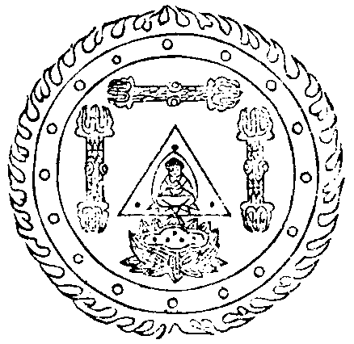



凡作餘佛坛，如作弥陀坛，即移弥陀入中，其大日佛移就弥陀位。若是二乘诸天等，即不令坐八叶华，当去之，但於方坛中坐其本座。



八叶上佛菩萨，各移稍近外各位方所也。其大日佛，当与宝幢竝在一处，左右无在也。然亦须在中胎院内耳。如以阎摩入中者，其外院本位，但表地印而供养之也。此作扇底迦等，增益亦同之。用线法，当中置橛旋绕之，亦置空中及下𫄧二种也。又云：师在中持𫄧，弟子绕之半月，如字作也。作此佛部漫荼罗，作圆漫荼罗，其圆如月，中白如贝色。此圆中先作白莲华，华上畫三角，此三角中作赤色，其中畫佛像(作何佛，更问)。绕三角以金刚围之，如图也。绕三角置点，点标也(更问)。其外轮作光，如却敌形也。圆外周帀安点(今疑此点一一皆是本尊之位，更问或可置字)。光普皆流出者，谓想光从佛身中流出，渐次流布在三角外也(〔真言主谓本尊也，遍身有光流出〕)。前大坛中亦有三角印，与此用处不同。前者但是印，此中置佛，或置印作法，圆具於彼也(〔世出世同畫者，此同亦可名有也。言世出世有无量漫荼罗，欲说令善听也。移在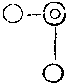



上，当知此是最初悲生坛〕)。次莲华部(此语属上件)，此但是秘密漫荼罗也。若作扇底迦等，方圆赤白及天等，各依本也。虽作圆漫荼罗，然本尊等座，有方有圆，各依旧也。作方漫荼罗，内畫商佉，商佉上有莲华，莲华上有金刚，金刚上又有莲华，华上置观音菩萨，或可安印，或安字也。诸印上皆安种子字，谓商佉、金刚及华上也。其次院安大势至等处，周遍作光，勿生疑虑也。以本种子巧，皆安置之，而作种子也。空处当置七白吉祥，一一皆有二使者，此经但略而言之，自别有观音部，法中具载，当别详捡也(更问)。明妃资财主，是能自在施与求者也。及大势至等，如法作之也。作得自在之尊，持标相印也。当殊妙作之，如马头在三角坛中畫之，如法作之，住三角中。其餘诸尊，亦各有形色等别，及方圆半月三角等，皆如广本也。前所云须通五事，谓形色印本尊及位，即此事也(〔如畫〔彼〕尊，合作何色，及形像等，各各有印〕)。前者大悲藏生，是都会坛，今此中随三部，各各别有也。如此中莲华部坛中，胎是吉祥坛，以观音为主，胎外留空地，空地外即是第二坐位，悉置观音部诸尊，餘尽如作大坛法。其空处亦置十方佛，其第三坐位亦置八部众等，准前可解也。三角中犹如日出之晖，谓日初出赤黄色也。在明王侧者，在大势至侧也。若作马头漫荼罗者，当在三角中置之。在外三重漫荼罗，亦皆随之作三角也。作此时ha何ya耶grī疙哩va嚩在中，即移观音替居势至之处，餘眷属皆围遶之。餘皆回互，可以意得耳。次作第二漫荼罗者，谓从莲华部数之，莲华为初，即金刚为第二部也。我正宣说之，谓善说也。非前非后，依次而说也。其漫荼罗，四方作普，以金刚围之。以三股者，作界缘相接围之。围中黄色，中安莲华。华上有缾，缾白如月色。或用金刚围之，或用餘物围之(谓随彼尊之印，展转为中心，亦〔以〕其印围之)。彼缾上有大风，谓半月形。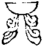



此中如黑云状(如雨时云，叆叇垂黑)。其下状如幡形，如大风吹，形势流动。彼半月如大猛火𦦨，作三角形。其三角亦以金刚围之。三角中赤，如日初出色。其中置莲，莲极赤，如灾劫大火焰色(谓殷深赤，或可赤黑)。莲上畫金刚(谓或畫本尊形，或畫五股印，或字也)。其金刚流出种种焰光。若畫形者，心上安种子字，谓吽(引)字也。若畫印者，印上置字也。想hūṃ吽字，诵而加持之也。此是汝漫荼罗者，佛亲对金刚手说之，故告云：是汝漫荼罗也。古昔诸佛皆说，我今亦如是说也。诸明王各依本坐类形色者，谓金刚母及金刚针锁之类，众多金刚眷属，各依本尊形色差别，或畫形，或作印，或置种子字也。各依其法次第相应，谓成就妙悉地故。案此中金刚手为中胎，诸部类为第二院也。此皆说中胎也，转作无量坛也。先说者安右，后言者安左，随所开门以辨左右也。复次，我前说众多金刚之别名也。自在，谓於金刚得自在也。复次，此说我金刚执自在者，如前大悲藏大会中，毗卢遮那之下，不动降三世中间，畫诸金刚者，皆未列名，今方列之，故云复次也。谓虗空无垢金刚、金刚轮、金刚牙su苏ra喇ta多金刚(妙，住也，谓共住安隐也)、名称金刚、大分(谓大者之分，即是大心众生之体分也)、金刚利(谓极〔迅〕锐之〔称〕)，此坛总以印为之。寂然金刚(寂静义，如涅槃义也)、大金刚(名也)、青金刚、莲华金刚、广眼金刚、执妙金刚、金刚金刚(直以金刚单为名)、住无戏论金刚、虗空无边游步金刚(以上列名也，各在一处，在大坛中安之)。如是等坛，方圆等依前，顺其色形，亦准此也，依名作次也，周而复始也。白黄赤黑等，随文次第，最在前者白，次黄，次赤，次黑，次者又白，如是次第也。及餘谓所不说者，准此例解也。随其本类形色而作之也。此金刚有十佛刹尘数，前列众与此中互有出没，或此有彼中无可知。又此等金刚所持之印，或三股，或一股(即针也〔此准前次第，初作三股，周而复始也〕)，或两头，此两头即五股也。此印用周帀作四镰，状如四金刚，其中有一状如五股而不开也。或鬘者，或持金刚鬘也。此等金刚各以其本名为真言，即此名中最上字为种子吽，随别字及通用，各於心上置之也。其手印通用上五股金刚印也。不动尊漫荼罗风火俱者，风谓半月，火谓三角，谓於半月坛中畫三角，三角中作不动尊也。在dṛ泥哩tī底方者，故毗卢遮那之西南方作也。其心上当置种子字，其三角当以刀围之，若不畫尊形，但畫刀或索亦得也。或三世胜异者，异谓在於风方，以此为殊，餘同不动也。三处以金刚围也，在半月中以本金刚围之(谓所执印在半月中)。三处者，谓或作形，或印，或字也。然此不动尊漫荼罗，若别作者，不动在中，毗卢在中院东方，餘金刚眷属周帀围遶也。



次说佛母漫荼罗。前布置漫荼罗形，先应知此谓金色。前但列名，未说尊形及印，今列之也。先作漫荼罗金刚色，四方以金刚为界围之，此最上者尊形。自上者，谓自此当说之，谓此佛母漫荼罗於诸坛最为上胜也。次於漫荼罗中作莲华，黄色有焰，莲上作佛顶印。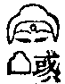



其印如佛顶髻形，令顶高隆，傍畫两眼形也。若作佛母形者，当如女天之像，心置种子字，或可但畫印(即佛顶髻也)，或但作字耳。若佛顶为中胎，诸佛眼等为眷属围绕也。佛恒自身火焰中住，种子布之，谓此印於光焰中住，中置种子即是也。舍三分位，谓舍三座位而置佛眼。普布种子，谓於坛中遍布之也。前说菩萨部中未说者，今更说之。凡是诸菩萨应须作漫荼罗者，皆同此义也。其漫荼罗当作圆明之像，令极白净，於中作十字嚩日罗(〔二合〕)台，台各置标，大ci真陀ma末ṇi尼，如承珠标，其头皆置如意珠，珠有光焰也。其本尊菩萨於十字中心置之，诸餘菩萨在次院中次第而布，更外置八部也。极白是寂静色，当极令明净寂然而住，此等菩萨皆能施一切愿也。寂是息灾义也。



次作释师子漫荼罗(即释迦也，谛听佛子也)，当作金刚四方令普(此金刚是如上所说五轮〔中〕。金刚轮，方坛也。普者，正四方之称也)。其坛黄色，极令鲜好，於中畫金刚杵(三股)，杵上安莲华，莲华黄色，华上置钵，钵边通有焰光。若作佛形者，当畫释迦佛持钵，又以金刚围之，右边置袈裟(即僧伽梨)，左边置锡杖也。



次五佛顶。其白繖葢佛顶，以繖为印(〔畫之〕置座，座上置印，且依本部，如佛部一切方也。或依事，谓息灾圆等也)。胜佛顶以刀围，普光皆流出，犹如烧铁焰(谓赤焰光也)。最胜佛顶以轮为印。除障佛顶以钩为印(摧碎佛顶)。火聚佛顶畫佛髻形(大士者，号会通金刚也)。会通大佛顶以金刚为印ā阿bhyu毗dga揭ta多佛顶(发生佛顶也，是最胜尊，一切超尊，以莲为印)。无量音佛顶以珂贝(谓商佉也)。色类应观(谓如前说〔观色类，谓白黄赤等色也〕)。佛毫相用如意珠为印，此名漫荼罗。此印法等，灌顶成就物等用也。其息灾等，则随形色转变，非此所用也。成就皆以本尊在中。佛眼当作佛顶髻形，两边置眼。其佛顶黄色，以金刚围之。无能胜明妃持莲华印(谓空风指捻华，餘指申之，捻华指向心前持也)。若诸尊有印者，依文置之。若无文，取本部主印置之，准种子字中也。无能胜王作口印，在黑莲之上，谓畫作忿怒口，其口双牙上出者是也。此等诸佛位，若以释迦为中，则佛顶等列居次院。若随一一本尊中，取一为漫荼罗主，即移释迦在外。餘皆可例解耳。



次说净居天印。经云：净境界行者，谓以禅定为味，以净为行耳。其印今次列之：思惟手(谓稍届地水，指向掌，餘三指散舒，如三奇杖梢，侧头屈手向里，以头指指颊)，善手妙好义也(谓手施无畏，皆用左手，右亦得)，笑手(谓回思惟手当心前，令三奇向上)，华手(以风空捻华而申三指，其三指或仰掌舒之，或竖舒〔皆〕得)，虗空于(谓侧右手散指而在空中)。此等天或作笑，或作思惟，或与愿等，皆得(〔彼畫法则谓依此法畫之〕)。



次地神印，作宝缾，圆白之中，其瓶插诸宝谷华果等严之，以金刚围之。次请召火天印，当侧申右手，其风指第三节稍屈，又屈空指上节向掌中。若先直而屈，是请召也。若先屈而还展，是发遣也。以诸大仙而围遶之，谓ka迦gye叶gau瞿tma昙仙等，皆次第畫之，竝在火院之中。火院即是三角坛，其中色赤，名赤院也。其印如前五通仙人说。四ve韦da陀印是也。此是梵行者秘记。若诵韦陀者，见此手印，知是何论何部等也gau瞿tma昙仙(虗空中行，欲有二渧污下污地，地生甘蔗，日炙生二子，为释王者是也)ma末rkka建ḍa拏(坐禅蚁作封遍身，恐伤蚁，复入定者是也)ga竭rgya伽仙(山名，约处得名也)va缚si私ṣṭa仙(即旧云婆薮仙人者是也)aṃ㼜ge竭ra啰私(是身汗液义也。此仙不从胎生，从汗液而生，故得名也)。南方yaṃ阎ma摩王，当作风坛，坛中畫daṃ但ṇḍa荼印。



(〔若印等，此坛一角向身，一角向外也〕〔或随隐便安置〕)王右边畫死，后以铃为印。若畫身，即持之。



左边画黑暗，后以幢为印。







此幢也(梵云计都，亦旗也)。大自在忿怒，作śu输la罗印。



此输罗也。大自在子之后，作śa铄kti底印。



此铄底也。大梵天王明妃，作莲印，谓未开莲也。



nā那ra罗yaṃ延na那，作轮印。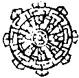



七母等同用mu没dga蘖ra啰印。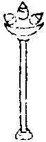



(此是也)ko俱vai吠ryā离也。修顶骨印(在毗沙门，此颅方也，骨也)。



以笑手状持之(谓屈水地指掌中，散舒餘三指，如笑手状，以持顶骨，如持钵状)。七母等眷属，谓乌鹫狐及bhā婆sai栖鸟(似鵄鵶，小黄土色，觜亦黄，是鹯类也。此鸟有秘身法)。此等竝在风轮中，围遶七母(凡阎摩王部类，皆在风轮中也)。若持华得此鸟等，亦得持七母真言也。此等各别自有持诵法，今入此漫荼罗会故耳(〔以为庄严〕)ni泥ri哩te底方作大刀印na那ra罗yaṃ延ṇa那天亦名viṣṇa作轮印(如上)ku俱mā摩ra啰一名skanda作śa铄kti底印(〔大自在之子〕)na难nta陀龙兄弟作云印(云中有电，复有水形，俱在坛门边也)śaṃ商ka羯la罗王作三戟叉印。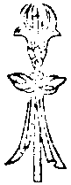



商羯罗后作pa钵ṅṅi致印。



月天作白缾，并有莲印。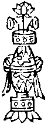



日天作车辂印，在金轮中(即是正方坛也)ja社ya耶vi毗ja社ya耶作弓印(亦在〔金〕方轮立中也，弓傍须有箭也)。风天作风幢印。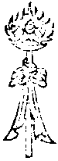



妙音天作琵琶印。



va嚩ru噜ṇa拏龙作羂索印(如前)。作圆漫荼罗，取本种子字围之(谓字当〔心〕以印围之)。大我即告执金刚也。右此等略标印说记，若广作者，具如法中，谓彼各自在真言别行法也。上释迦部类了。



以下明菩萨漫荼罗(此是大坛第二重诸菩萨位也)。



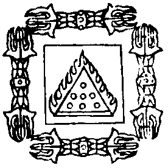



。



maṃ文ju殊漫荼罗正方，以金刚围之，如前作。此中又作三角火出，即是三角也。三角中作青莲华，取真言字，即种子字也。诵之想遍其中，於中安之(非但於中安之，亦四边安之也)。其三角内傍界道边，周帀作小青莲，以围遶大青莲华印也。所以作印，为识此尊法门义趣等故，各随形色等观之，而识秘意也。如法取种子字，而种子之字(〔即是安置此字作种子也〕)，彼中作是印。如次作此勤勇者，即是maṃ满ju殊也。谓作莲种子等，如法次第作也。随形色观之，而识秘意也。光网童子作钩印，宝冠童子(持宝为印)，无垢光童子(持未开华青莲华为印也)，所说使者，即此是文殊部中所持使者。持诵者，如所相应而知彼印。以法相应作者，谓以下女童子智者，即同文殊也，亦可名具德也ke计śi设nya尼(大刀为印)，小计设尼(输罗为印)，杂色使者(以杖为印)，地慧以幢为印，招召使者(以钩为印，以上并女童使者也)，诸奉教使者，普皆作小刀印(如经及图〔此刀作锯齿形〔也〕，云小刀，非正翻也〕)。右如上所作，皆於方坛中作印，以青莲围之也。以上是东方文殊部类眷属也。若文殊为中胎，餘菩萨为第二重，八部为第三重，佗放此。



南方除葢障菩萨，以如意珠为印，亦作四方金刚轮，中又作三角坛(即名火轮也〔所说相，当以如意珠畫大精进者种子，所谓如意宝也〕)。三角中畫如意珠，以眷属围遶也。以下菩萨皆是此中眷属耳，应当以眷属围遶。当知彼印相，今广说眷属也。於彼中当作印，畫之如次第，即是如法也。彼文有此字，指之如左：除疑怪菩萨(即kau娇tu都也)，其印金刚，印曰(音越)：缾中作缾，缾上插一股金刚，半在缾中也。无畏施菩萨，作无畏手(如瑜伽中释迦印)。除恶趣菩萨，畫作发举手(谓舒手仰掌，从下向上举之)。救意慧菩萨，作悲手置心上(谓以水空相捻当心，餘〔皆〕令申散也，其捻指向心)。大慈悲起菩萨，作执华印(空风相捻如执华形，餘指申散而竖之)。悲念菩萨(屈火指向心前，餘指皆申散之，智者即噵此菩萨名也)。除热恼菩萨，作与愿手印(舒指仰掌，向下流注甘露水。指等者，谓诸指也)。不思议具慧者菩萨，作思惟手(与如意轮菩萨手同，亦如前净居天印也)，具不思议慧。右皆作方坛置莲华上也(谓畫此手等也)。此皆除葢障眷属，餘义如文殊中说之。



北方地藏菩萨印(大因陀罗轮也)，於金刚轮中作宝庄严地(〔所谓在中先置座也〕)，地上畫莲华具种种色，华上作幢，幢头安宝，不畫形但畫幢也。若作此印者极上色者，此是形相也。此说名最上形，是叹也。若作此印，於诸印中最为胜上殊妙也。彼中畫印慇懃作之也。此菩萨有无量眷属，今略说彼上首者如左：宝作菩萨印，三股金刚在於宝珠之上也(〔但於宝地之上作印也。若畫形者亦坐莲〕，如地藏法也)。宝掌菩萨作一股金刚，安此金刚在宝上也。持地菩萨作两头金刚，安於宝上是也(於一股中有五股形，如前印也)。宝印手菩萨印，作五股金刚置宝上(即是五佛金刚也)。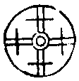



坚意菩萨作十字金刚(即羯磨金刚也)。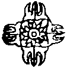







亦置宝上。右一切皆彼漫荼罗中安置者。



皆於方轮中作宝地，地上置宝，宝上有印也。



西方虗空藏菩萨，即是文殊会中西方部主也。作圆坛极令明净鲜白，坐白莲上，手持刀。若不畫菩萨形者，但畫刀，其刀极利如霜(〔如是谓如是坚利也〕)。又坚固以种子字而围绕之也。智者以自种子而种子之，即是安本种子也。亦本围之，还以轮围之也。此本即是字也。



次列眷属上菩首萨，彼印形如教，谓皆依教如法作也。虗空无垢菩萨印，作轮(即四股刀轮也)置风坛中，轮亦自围之也。虗空慧菩萨印，於风坛中置商佉(即半月坛也)。清净慧菩萨，畫白莲印在风坛中。行慧菩萨印，於风轮中置商佉，商佉中插青莲。住慧菩萨印，於风轮中畫青莲华，华上置金刚也。凡於此大悲藏大坛中文殊一会，凡四菩萨，随以一菩萨为主，置於中坛。餘者各於第二院案方而列，第三院置八部也。若是大悲中第二院者，假令以观音为部主，其金刚部及佛顶等，竝依方位而列为第二院。其第三院置八部，不须置文殊会菩萨也。若释迦会者，即如上说(更问之)。此说是定义也(此事更问审也△)。



------



### 入秘密漫荼罗法品第十二



入秘密漫荼罗品者，谓诸佛身语意秘密之藏，唯执金刚秘密主乃能知之，故佛复告之也。然此执金刚即是毗卢遮那之所化身，谓欲发明此深密之法故也。此法无人能发问者，唯佛佛相问乃可知耳。如金刚顶经分别积品中，佛入三摩地已，从佛身中出字形、印形、本尊之身，各从方方出施作佛事，所谓是大因缘开佛知见。如是作已，复入如来之身。尔时空中出问法之声，问佛一百八号，云何名佛？云何名正遍知等？乃至问十六大菩萨及真言印等，如彼广说。



尔时佛自叹言：善哉，善哉！能问斯事，乃至随问而答。尔时大众得未曾有，而作是念：今从佛身而问於佛，犹如幻事无作无生者而成佛事，今此执金刚亦复如是，从佛金刚慧印而生，复持如来金刚慧印而生，复能有所问而佛答之，恐人不信，若自问自说则不足尊重，故以佛身而问佛身也。又所以名执金刚者，犹能持如来身密、口密、心密，故名持金刚智印也。



尔时世尊又复宣说入秘密漫荼罗法者，上已答金刚手秘密漫荼罗，而未明入秘密之法，故次宣说也。持诵者遍学秘密漫荼罗，智者真言者应遍学(谓一切处须解也)，智者秘密坛(〔即智是通达也〕)无所疑滞，故名智者。智者尽烧一切罪，弟子法如是。持诵者，即是成就之人，谓阿阇棃也。应遍学者，然唯佛与佛乃能遍知遍学一切诸法，能具此德乃可为师耳。今末代此人难得，云何得有传法师耶？然阿阇棃虽未得如佛应遍了知，然於此经宗旨次第法用一一明了，及随顺此经所谓诸法缘漫荼罗所要者，应善知之，应修瑜伽之行，晓了众生种种根性利钝有遮无遮，及本尊真言身印之类，乃可传法为弟子作入秘密漫荼罗法也。所以然者，今此诸佛法要甚深难解，共所守护不妄宣传，久默斯要不輙尔宣说。若末代人师不能了知魔事及入道方便次第，而妄教人即令差机误佗，故须遍学也。所云智者，即是此遍学之人也。能知应与不应与、应入不应入，如是种种故名智也。若不闲方便徒有所说，而不能令佗建立无上善根，速入一切如来之位，更招极大障法自损损佗，云何名智人耶？弟子法如是者，谓如法入坛作法也。



烧弟子罪者，犹彼从无始来具有无量无边深厚之障，若不为除则身器不净，犹有障故不合为说。一切如来具足之道，犹声闻人有十三难等，不合为受戒也。烧彼寿命令不复生烧除灰烬者，今岂以世间之火而焚彼身，令命根不续为灰烬耶？今自有妙方便大慧之火，而焚彼业烦恼身使不复生也。一切众生皆以业烦恼蕴积相续而得生长，轮回无绝故名为寿，今即焚之令尽无餘也。业烦恼为薪，方便智为火，以此因缘而得无餘，此薪既尽能治之法亦遣也。所谓烧者即是字义，当以阿字为弟子身，使以阿字遍作其身也。



次以ra啰字加其上。啰字者，即是大慧火。即以此慧火之字，焚彼菩提性真金之卝，令垢秽无餘，故以啰字而焚阿字也。然既焚竟，岂如二乘断灭灰烬而不复生耶？不如是也。诸垢之薪已尽，更有妙生，所谓净菩提心真实生也。此生即是清净之性如来种子也。师以何方便令此灰烬复生玅牙也？烧尽同於灰，彼等复更生也。以字烧字者，谓想阿(a)字同方坛，弟子在中而以啰(ra)字烧之，以烧故同为一体也。身同阿(a)字，而以啰(ra)字烧，一切烦恼罪除，乃至身相亦除，体同金轮也。谓va嚩字门也。当於心上观圆明，於圆明中而安嚩(va)字，从此嚩(va)字而生水轮，犹如白乳而以注之，以此方便复生净菩提心佛种子也。生此清净之身，内外无垢，如百鍊之金而加莹饰，随用成器也。当知火动之时，即与风俱。风轮者，即是ha诃字义也。又嚩字上加点，此点即是大空khaṃ欠字门也。微妙法水，从空而注，以净其心器，当知即具地水火风空五字之义也。然此皆是如来秘密之义，非徒如文而已，当善思之。行者既得如是遍净无垢，成寿命还活，悉皆无垢也。意生之身，复为欲令坚固如是意生身故，更有方便。由置十二字，复同十二支缘，谓十二支句也。此即是前说十二字真言王，当用布满其身也。初有四字布於上分，谓从顶至额也。一字顶上虗空字也，二字在耳，一字在项也。如本自性配，先从眼起好也。次有四字在中分，谓二肩上及心上咽上也。次有四字在下，谓脐上腰上，一字在腿上，一字在足下。然髀足皆有二，今但於一足置之，即管两足也。当知此十二处，即摄餘一一身分，如二耳字，即摄二目等也。如上所说之字，当取上真言王，从初字次第而下布之耳。



然作此方便有三等：一者师自布之，二者用作漫荼罗(更问布字云何起)，三者加弟子身。此是yo瑜ga伽秘密加持也。如是作已，即能成於法器，故云作彼器也。如是作已，即是成就sa三ma昧ya耶。所谓三昧耶者，是等义，谓我等於佛，佛等於我，无二无二分，究竟皆等也。阿阇棃者，即等於佛，佛即等於弟子。此弟子非但等於十方三世一切如来，亦等一切诸菩萨，亦等一切声闻缘觉，亦等一切世间天仙之众。若如是等於一切，即是vai毗ro卢ca遮na那佛身也。故云诸世间等同顺，亦是法华皆与实相不相违背义也。应作如是解，等同诸佛也。此解三昧耶。



秘密漫荼罗中，入一切法教中，自在诸漫荼罗，如是等我亦然。解此三昧耶秘密漫荼罗，入诸教中诸坛得自在，虽不入亦得自在摄取也，如我等持诵者也(谓我与彼行者不异合为一，是名三昧耶也)。持诵者不异三昧耶名说者，解是解了之义、解知之义，若解此入秘密漫荼罗方便，即是遍入一切漫荼罗也。此弟子以同遍入一切漫荼罗故，即得自在修行一切法门，无有留难也。佛以诸法究竟等释三昧耶名，故云三昧耶名说也。



如经初具有入大悲胎藏漫荼罗等诸法，乃以此法为要用之法，不於前说，乃在此说之。若不解此，上来所作漫荼罗终不得成也。所以回互前后，不相承蹑者，岂佛有所恡惜耶？但为欲令入正法者，应须依师而学。犹如佛於声闻经中，呵贼住人云：得具满和上阿阇棃，如法受戒，快修梵行。何故如盗住也？今末代学人亦尔，不务近善知识，諮承法要，而自师心欲望成就如来自在之业，直尔披文，便欲作之，望得成就，无有得理也。非但自损，又欲求名利故，而妄作人师。自既违法，而欲建立佗无上善根，何有此理？由此无有効故，更招谤法破法之缘，成无间之业。何有无间业人，而能自利利佗，俱成妙果耶？是故行者务求明师，一一諮禀微旨，晓了明白，先自成立堪能建立佗人无上善根。犹如声闻法中，五法成就，自成五分法身，亦能成佗五分法身，得离依止，得在师位，尔时乃可传法利人。其或不然，慎勿妄操利器，自伤其手也。故经云：差机说法，为人天冤。今不善遍学持明瑜伽之藏，而欲随佗本缘而授其法，亦犹是也。入漫荼罗时，有三昧耶偈，可有十四五偈，即是与弟子受菩萨具戒，及教授教诫要誓之言，此土未传耳。



------



### 次住秘密漫荼罗品第十三



前品说入秘密漫荼罗方便，所谓三种加持也。谓以真言加师之身及所入之坛，并加弟子令住坚固，然后得安住於秘密藏中，故次说住证之品也。



尔时，大毗卢遮那世尊彼时等至三摩地，证未来众生观念，从定住者。毗卢遮那义，上已释之，今更释。所谓毗卢遮那者，日也。如世间之日，能除一切暗冥，而生长一切万物，成一切众生事业。今法身如来亦复如是，故以为喻也。然世间之日则有方分，若照外不能照内，明在一边则不及一边，唯能照於昼日而光不及夜。今如来日则不如是，遍照内外，无有方分昼夜之别，圆明常住。一切众生若得此日出时，则能生长一切如来善根，行如来事。世间之日不可为喻，但得其少分，故加以摩诃之名也。佛所以入此三昧者，佛住毕竟无相寂灭之法，以大悲故住於三昧，令一切大会及无量众生得见此大悲胎藏漫荼罗庄严大会微妙之法，即是於无相中而见有相。虽复有相，而从因缘生，即不生义，同於性净之法。而诸众生各随本缘，见种种色，闻种种声，获种种法，各随心器如法修行。有如是大因缘故，又为满足金刚手所问之法，令明白无餘故，而入三昧也。等至者，三昧名也。上云尔时，而此复云彼时如来入于三昧者，对前因缘，次复有此事，故分别之，而云彼时也。(更问)等至者，犹过去一切诸如来，皆乘此道，至成正觉。如过去者，未来现在一切如来，亦复如是。皆从此道，乘此方便，而成正觉，故云等至也。如三世佛，至成正觉，我亦如是。如我今乘此道，而至道场，一切佛亦如是。佛佛皆等，本末究竟悉等，故云等至也。又复如前所示大漫荼罗方位之相，如佛所入三昧而示现者，若阿阇棃住於定中，而度弟子，亦当布此方位之相，与彼无异。一一皆是入法界诸善知识，普门行法。若师作此观，以加弟子，亦令得见如是大会也。今内心所观，与外事所布，内外平等，无有差别，故名等至三昧也。佛入此三昧故，令金刚手等诸大菩萨，皆得满足所问之疑。佛於三昧中所现之事，即是示其方位法用，故入此三昧也。彼佛入三昧时，彼佛土等(〔等者，如等同也〕)平正。所谓地平者，以三昧而言，即是得见净国庄严，其地平正，无有瓦石诸山，及沙砾等也。然此即是净菩提心之义，以信力故，平其心地，除去所有阿赖耶之所含藏沙砾株杌等类，唯除毕竟平等净菩提心体性之地。若能平净此地，即可成就大悲胎藏佛会庄严也。



五宝间错者，谓金银等五宝。五宝，色也，五色之宝而间错其地也。五色者，即是白、黄、赤、绿、黑次第也，间错是界也。白是信，黄是进，赤是念，绿是定，黑是慧也。上释云：初白、次赤、次黄。今以此释为定，前释非也。从此下一一庄严皆有义释，今此中未解别处一一对其法门也。非但五宝间错其地而已，庄严门标又有门标，即是大悲胎藏之门标，令知所入之门方位之相也。此标即是如上所图者，然有畫作及立作者，畫作如所畫图，其立作标者亦依此相而作也。其门有柱，柱上横木，标知是门也。四方之门即是四念住，标是四梵住也ni涅yu庾ha呵是门to都ra啰ṇa亦是旗也。是标杂色者，非但五方之色，更有种种杂色，此杂色幡其相广长而在门标之上。大宝葢者，葢在上都覆之如坛方也。葢者，此葢之量遍覆诸佛刹，故云大也。此标上又悬白拂宝铎以为庄严，前是彩幡，今是宝铎及幡，并悬宝幢幡而间错之也。并种种杂彩名衣，县垂周布好彩之束，节段束之，是杂彩也。私谓即是如可著杂色衣之义也。从第一无相之法而出生如是大悲藏生之相，普现色身种种方便说无量法，是杂色义也。杂色幡以来皆在门标也。建谓立幡於标也。八方隅建大摩尼幢，幢以摩尼作也。幢者，谓於柱上始有层台之柱也。四方及四隅，各建摩尼妙宝如意之幢也。此外复有八功德水，净妙浴池，湛然清净。复於池中有无量水，生禽鸟嬉戏自在，出种种微音，悦可一切。又生种种时华，时谓六时之华，各适时而现也。非但名华，又有种种宝珠罗列也。八方分分布之(分即方也)，五宝璎珞绳系也。此八柱之上，周帀宝绳而相连系也。此中云璎者，梵音与前所云璎珞有别。



谓垂如仰半月形，而垂下宝璎，周帀相接也。其地细滑，如绵绵衣，乐受极触。乐者，如西方有纯绵之衣，如此地绵巾之类，极柔滑，按之则没，举身复平如旧，其触极细，最生乐受也。又有无量乐器，弥满空中，在於空中，不鼓自鸣，其声深妙，令人乐闻，欢喜快乐也。於此布列庄严之地，复生无量随诸菩萨福德所感意生之坐及宫殿，从如来信解生。其座罗列，亦作三重，如上大悲藏生漫荼罗布列次第也。各随菩萨净妙功德五尘乐具而生，有种种差别。举要言之，则有十世界微尘数等，各各不同，而布列其位也。此等皆在八宝幢柱之内，竝从如来信解力生。以如来本愿力故，於等至三昧中，普门示现也。



法界标标之者，既从法界生，即是法界标帜也。此中有性义，梵文语含标，即是性也。法界体性，本来常净，第一无相，还用法界而庄严之。中有大莲华王，此华即同法界，遍一切处，自性清净也。当知彼中如来止住者，华既量同法界，当知佛身亦复如是，此即中胎八叶之华也。生大莲华，如来住彼法界第一，随意信解，众生喜悦。第一是第一法界身，随诸众生信解，令得欢喜。此第一是极微细意，最难见之性，故极微细也。此第一者，义译当云性也。随意者，佛本愿力，为度一切众生故，普门示现，各各随彼所喜见身，称机导利，令得欢喜也。彼如来诸支分无碍力，从十力信解，生无量色形庄严之身者，如来支分有无碍力，名无坏力。以一切世间天仙，及二乘菩萨等力，尚犹有碍，由有碍故，更有胜上力者，则能坏之。今佛力无碍不可坏，犹如金刚，故云无碍力也。此无碍力从何生？当知从如来十种智力生也。从佛身支分上中下，分为三分，流出种种类形，乃至一一毛孔，皆悉流出种类若干，形色各异，或方或圆，三角半月，或青黄赤白黑，寂心欢喜忿怒等形，其数无量，即是诸本尊等，皆当坐於意生所感之座也。



今此十力复从何生？谓从如来无量阿僧祇劫以来，修行六度、十度乃至百千万不可说不可说阿僧祇诸度万行，即此诸行功德资长法身而出现也，以功德所资长身出现也。彼出现已，於诸法界大会之中，诸谓十方也，非但示形而已。复出种种妙音，演布不思议常寂秘密之法真言之行，普令一切皆得闻知也。此所生菩萨各说种种妙偈而叹於佛，有音声表作如此说，谓偈也，犹如下方踊出之会。然大日如来犹住三昧，此是三昧所现华台中，毗卢遮那世尊於身分中示现此身。



从此法界性莲华中佛出种种形之时，又从佛身出种种声而演妙法。经云音表者，即语表也。音演偈略有二偈：初偈云：



> 奇哉一切佛，方便不思议，於无藏性慧，  

> 以慧含为藏。



此偈叹佛之意，见上示现不思议事，故叹佛之功德甚为奇特也。叹一毗卢遮那，即是叹一切如来，故云一切佛也。当知如来所现奇特之相，即是如来大慧及方便中生此不思议业也。云何不思议耶？谓住无藏性而能作有藏也。藏者，梵云a阿la赖ya耶，此翻为藏，或云宫室宅舍之义。如世间舍宅，一切众生各随己分安住其中，既有此窟宅，即有善恶含藏不能自出，如来已离如是阿赖耶窟宅，故云无藏性也。佛虽无一切藏，然以慧方便而有藏生，谓於无相法中而示种种相，无妄想法中而出种种音说，即以此藏令一切至於无藏也。次偈若识无得者，诸法无住相，彼无得而获，得诸佛导师。此意言法性无得不可思议，无得是空义，若得此者即佛也。若有所得即是有妄有藏，非是如来无师之慧，若可识即是心所行处，非究竟胜义也。所以叹佛不思议者，乃於此无得不可识法而能得之，所谓上来境界无相而相，令一切众生以无所得而得也。谁得此法？谓诸佛导师也。复次偈云奇哉者，梵音奇哉，即於初首而有阿声，此偈已表法竟也。此即是本不生义，能生一切诸法，谓如来身所示种种形声，皆从阿字而生也。时出此种种形竟，还入佛身，彼身又复还入如来不思议法身，各随所出之处而入，故经云：又复入如来，彼法身不思议。此不思议梵云a阿ciṃ真ti底亦有阿声，意明从阿而出，又从阿而入也。此两头上下指两阿字，明一切法出入即同法界之体也。



彼佛告执金刚秘密主者，言彼佛即毗卢遮那也。当更问彼佛者，为是三昧中所现者耶？为是本如来耶？当是本如来也。从此以下，佛从等至三昧起已，而告金刚手也。佛所以住三昧而现如前种种希有之相，谓地平如掌，乃至布列诸尊及八叶华等方位者，欲示执金刚等内心瑜伽之境，以外况内而表於义也。是故今从定起，复说内心漫荼罗入秘藏之法，而示执金刚手也。善男子谛听(内心也)！心中漫荼罗，彼秘密主身地即是法界自性，以真言印加持而加持之，本性清净，缘以本性清净故也。如前以大日自加持，次即以羯磨金刚萨埵作加持而作事业也。如大本中有二十种劝令谛听之相，佛为执金刚除一切尘垢，及修行真言行诸菩萨等，法要未具，不得疾成无上菩提。今复次说满足前义，令法要圆满，若不知解此，则前法皆未周悉，以此因缘劝令谛听也。如是二十种因缘当广说。前所呈示是三昧力故，呈示外境，今则内以观之，以於行者自心之中而具佛会大海，十方通同为一佛土，唯自明了佗所不见，故名秘密漫荼罗也。犹如作外漫荼罗，先须治地平去沙砾株杌等事(〔我人众生寿者〕)，次当平治令悉坚牢平正，方可於中而建立之。今此亦尔，欲於内心建大漫荼罗者，亦先须平地去株杌等过。此云身地者，此语即含地水火风也。



云何治耶？谓先当建立瑜伽之座。瑜伽座者，即是所持真言之字以加持之。取彼所持真言最初之字以加持最初之字，即是真言心也。其字当去点等，但取本体，以本体即是a阿字，阿字是金刚地也。所以然者，犹如释迦初成正觉时，入金刚三昧而成正觉，除金刚地更无能胜者。今此亦如是，为欲建立内心毗卢遮那大漫荼罗会故，若不先建立金刚心地，则不能安立也a阿字是金刚轮，为欲升金刚座故，先观a阿字为始，还以金刚而持金刚也。观此字当作方形，然此字形体亦方也。观此字正方而作金刚之色，遍满行者内身，犹如身之地大无所不遍也。



次作水三昧者，谓观va缚字，处在圆明，其色正白，亦遍满其身，然此字形亦圆也。前观阿字已遍一身，今复遍身，犹如水大遍洽一身，与彼地大不相妨也。次观ra啰字，作三角赤色，此字即作三角形也。啰字亦遍一切处，犹如身中火大也。次观ha诃字，作侧半月之形，其色黑，彼字在中，色又深黑，亦遍於身，犹如身中风大。地水火风是外境，从外内照，即是阿嚩啰诃字以加其身也。此阿者，即是法界之性，以一切法本不生故，即同法界也。以阿字故，餘水火风当知亦是法界清净之性，从因缘起而本不生。以此一一真言之字，加持而加持，而当知此字本性清净也。缘者，谓因此得生也(恐是〔故〕字义)。



业金刚有情加护离一切尘有情寿者ma满nu奴、所生ma末na那、仙生、作者等。株杌过患者，金刚有二种：一者智金刚；二者业金刚。此梵云金刚羯磨，谓所作事业也。以此金刚业而加持故，得净除其地也。离一切尘者，尘谓过患等也。欲平其地，先当除去沙砾株杌等，所谓一切垢见也。



次略说其相，谓有情寿者等见，及满奴所生者，是一类外道见。满奴是我，言一切依我而生也。末那仙生者，言一切从彼生也，亦是一类外道见也。此等即是垢障不平之性，今亦以金刚智作业，除彼不平之过，去彼株杌，方净治此心地，而建秘密大漫荼罗也。四角四门，西向门常开出入，门傍安缘周帀者，如前所示外相中门标之类，及周帀八方大宝柱，柱上悬宝璎白拂等种种庄严，今内心瑜伽亦与彼无异也。



然彼一一皆是内心法门，应更问其名义耳。於中有从意，生大莲华王，八叶有茎蕊，周遍妙彩畫。於中如来，一切人中尊，高身语意，身心地登升心地，得至殊胜悦意果。授者，谓在此内心大平地庄严中，有大莲华王座也。如上所现大华王，其体净妙，量同法界，今此内心所观，犹如於彼，故名为大华王也。其华有茎有蕊，诸色间错，妙彩畫作，皆谓内心观作，如彼畫工运布众色，作诸色像，虽众缘合，无有自性，而相皃宛然也。此上有一切人中尊，即是毗卢遮那也。此是行者自性无师智大毗卢遮那佛，非从外来也。身语意，超身语意心地登升者，超身语意心地，得至心地，获悦意殊胜果，超染污心地，得至净心果地也。如一切世人未得身口意三平等故，不能入此心地法门，如来悉离三业众过，得三平等，至於一切诸佛心地，谓得净菩提心毗卢遮那如来悦意心地，故於一切中尊也。复次，一切众生同有此性，如来秘藏具足无缺，而不能自信，不自了知，如来明了自证，而为一切普开觉之，亦令同得此法，故名一切众生中尊也。悦意果，谓最后果，当知得是心地者，即是毗卢遮那如来也。授与，谓有人传授，复自观察修行而得斯果，犹如人与，其实自悟，不从佗得也。



如上毗卢遮那，在华台上。以次八叶，东方观宝星佛，亦名宝幢佛。南方开敷华王佛，因陀罗亦是王义，若重言王不便，故存梵音也。北方鼓音佛(前置阿閦，今改为此名也)，西方阿弥陀。其四隅之叶，东南普贤，东北观自在，西南文殊，西北弥勒也。其华诸蕊中，置佛母诸波罗密三昧等，佛母即虗空眼等也。此华蕊下面，置诸持明忿怒等，皆在叶下。其华茎，即以执金刚秘密主持之，以为其茎也。无边大海众，即金刚也。亦有种种供具华香之类，今略说之，下文更有安布方便也。其华茎下，观为大海水，为成三昧耶故，须办华等。为欲与一切入坛故，心念华而令入也。海岸之外，地居天众，各依方观布之。



意灯华已下偈也(〔意生，谓从心生华等〕)。畫之殷勤者，谓彼持诵者，布於身心，犹如於畫也。此心漫荼罗之上，有佛在中，故曰大我。大我者，佛之别名也。自作，谓自内观作之，谛了分明也。然此秘密漫荼罗，若师观弟子深是法器，诚心愿求，而力不能具众缘，如上广作者，师得为作此法度之。自餘当须众缘，不得同此也。然若弟子已得瑜伽，师欲令入秘密佛会，亦作此也。啰字净除者(〔先已作阿字及啰字净除了，今如前法净弟子也〕)，即是如前方便，观於啰字之火，而烧除彼障法积业，令悉净已，方复以甘露法水而灌洒之，得於死灰之中而生道芽，故次授彼aṃ暗字也。师当住瑜伽之座，观此a阿字加点，置弟子顶上十字缝中，当知此上有点，即是甘露法水用灌其顶也。寻念如来者，谓师将度弟子入秘密藏，故寻念三世佛所行方便，欲令同证同护持之也。师既自住瑜伽之座，以其身心而作佛海之会，唯独明了，餘人所不见也。次授弟子华，令投师身上，供养内心之佛而观本缘，随彼本缘而观其法器。若本尊摄受华中，於彼师皆覩之不谬，而弟子未得瑜伽者，但见在其身上耳。其华投处，大略心为八叶之位，从脐至心为金刚台，脐为大海，从脐以下是地，居诸尊位也。此表何义？谓从诸佛大悲海而生金刚智，从金刚智出生一切佛会也。於一切漫荼罗中，此最为上，无与比也。(〔自见已，向彼说之，谓师心中所见堕处也。〕)上文说持诵者，观其内身肉心，八分作八叶，作开敷及啰字置目等。若行人不如是修行成就，而能作此秘密度人，无有得理也。要当先自成就，堪住瑜伽师位，又为阿阇棃所许，方能辨此也。今此所作，虽是度人方便，然行者於自持诵观照之时，亦当如法习之，用此灌顶之法而自灌洒，为除一切障，速入佛会故也。前品名入秘密，今复云入者，此入是证入之入，犹如人已入室宅，一一明了，细分别之，出入自在，家内所有，悉皆知之，不同初入门人也。



------



### 次秘密八印品第十四



尔时毗卢遮那世尊观察大众会，告金刚手言：秘密主！有秘密八印甚深极秘密者，如来前品之中说入住秘密漫荼罗法竟。时诸大会复作此念：如是秘密甚深难解之法，更有何方便具足之相，速令真言行者得成就耶？时彼如来知众所念：此秘密中为更有甚秘密耶？为剂此耶？以不能测故，无能发问者。故佛不待彼问，但无问而自说也。所谓有神验者，若行者或内或外敷列彼本尊等漫荼罗座位之时，以此八印及真言本尊之所加持故，於本尊位中安置甚有神验。同同谓等同本尊威神也。彼诸尊等自然降赴道场，满彼正行之愿，事竟乃去也。此是不思议感应之法，犹如水火镜中日月应之尚不可思惟，况如来不思议法界之感应也。此是阿阇棃所行之印，不得輙尔而习。假令已入漫荼罗者，尚不得於前輙尔而作，况餘人耶？非直以有本尊真言亦有标帜，以本尊真言趣为标帜。趣谓如六趣等，此是真言趣。周谓周具义也。非直真言兼漫荼罗如本尊相应者，如本尊有如是德，我亦有之，故为具也。此如是一事以上，同彼尊也。谓形色坐立，喜尔自身住本尊形，当如是知。知已，如本尊住而得悉地也。若行者依此八印真言及漫荼罗相应而配住位，若能知此，将近悉地，不久而得。如本尊住者，前虽配秘密漫荼罗，若请本尊，须作此法方得也。若不作此，则未圆也。此经皆前后相成，共为一事，绮互其文，行者甚须相照览，乃可行也。若行者持诵之时，亦须作此，谓请本尊及所欲愿等，则得速自建立也。其第一印者，作三补咤虗心合掌，其二地指及二风指直而开张，餘如旧即是也。此是毗卢遮那如来威德生印，从此中有如来大威德生，此是一切智智之明也。其漫荼罗作三角形，於其四边又有四三角围遶之，故曰周也。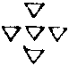



其中当观毗卢遮那世尊而在其中也。其三角漫荼罗，当观八叶华，华台上作三角漫荼罗也。即是前瑜伽座作此三角，其尖向下，其色赤也。前云三角尖向上，今向下者，义用殊也。想佛在此中而作威光印也。



其真言曰：



raṃ囕raḥ𡀩。



第二、如前作印，而双屈二风指，以捻二空指头，令皆如ṭha𡛥(上)字之形，此是金刚不坏印。金刚者是如来智，此智非从缘生，不可破坏，故名金刚不坏也。其漫荼罗形圆如su苏(上)字(〔是〔娑〕字第五声〕)，以金刚围之(当是金刚有〔光〕焰也)，其金刚亦在漫荼罗四边，如上也。所谓嚩字者，此漫荼罗正圆而白耳，亦在华台之上，其中有大日，如来以下皆放此也。然此八印，持诵者随取其一，随事类念诵，随事用之也。



其真言：



vaṃ𮢥(无敢反)vaḥ嚩(无缚反)。



第三印，如前作印，三补咤合掌，其二水二火指开张，其地风等指先已开张，作初剖莲华形，此如来藏印亦名莲华藏印也。漫荼罗，如前作圆月轮，但以四莲围之为异耳，中亦观大日如来。



其真言：



saṃ糁(引)saḥ索。



第四印如前第三印，其二地指相竝双屈入掌，此是佛妙音庄严印，亦是万德庄严印也，亦云内外庄严印也。如世人种种室宅衣服车乘等众宝之具，无所不有以庄严之，则名万德皆具。今此若内若外，如来众德庄严皆具也。漫荼罗半月形而侧以点围之，餘如前思之也。



真言。



haṃ憾haḥ郝。



第五、如前作三补咤，合掌而稍开曲，其掌二空指开张(〔稍向里曲开掌心，如掬水像也〕)，名从佛支分生印，谓从如来一切支分而生也。其漫荼罗如缾形者，意取缾腹即是形圆也。以四金刚围之，餘如前。



其真言：



aṃ暗aḥ恶。



第六印，如前二火，指稍圆屈，俱屈入掌钩曲，背相合也，而头相拄，此中指也，餘依旧即是也(谓如第〔五〕也，此是法住印也)。其漫荼罗如虹形，有诸色间错，犹如虹之晕色也。其形如霞虹，其下平，上有金刚之幡也。从上来诸漫荼罗，有莲、有金刚、有点等，今此漫荼罗，一一皆取以庄严围之，相间错也(更间)。



其真言曰：



bu　ddha　dha　ra　ṇi　smṛ　ti　va　ra　dhā　na　ka　ri　dhā　ra　dhā　ra　dhā　ra　ya　dhā　ra　ya　sa　rvaṃ　bha　ga　va　ti　ā　kā　ra　va　ti　sa　ma　ye　svā　hā



第七印如前。三补咤，以二手、二地、二空各相捻在掌内，而开火指，其水、风头相合也。漫荼罗，虗空形(方形作之)，杂色间错，此是虗空色。如空中含一切色，像如来大空智含一切法也。其两边各一点挟之。



真言曰：



ā　ve　da　vi　de　svā　hā



第八印合掌(掌心相到)已，先左转(转时右手覆而左仰，相合如旧)，次右转(转时左覆右仰，仍合不散)即是也。此是如来迅疾持印，谓如来秘密神通之力加持迅疾之义也。漫荼罗同前虗空，但改作青色，以众多白点围遶之。



真言曰：



ma　hā　yo　ga　yo　gi　ni　yo　ge　śva　ri　khaṃ　ja　rī　ke　svā　hā



复次，第一、东方宝幢佛，第二、南方开敷华王，第三、西方阿弥陀，第四、北方鼓音佛，第五、东南普贤菩萨，第六、西南文殊师利菩萨，第七、西北弥勒菩萨，第八、东北观自在菩萨。当知此八印，一一皆是毗卢遮那印。如东方印，则宝幢佛印亦是大日如来印。佗倣此也(〔依次〕配四印)。



经中次诫阿阇棃应授法、不应授法，若未灌顶，一切不得示也。次若调柔人(〔谓柔和善顺而不卒慕等〕)，次勤精进。又有坚固胜愿者，谓能发勤精进，自能发无量大愿弘誓者。次恭敬师长(〔谓阿阇棃〕)，谓如法华身为床座等。又念恩德者(〔念报佛恩〕)、清净者(〔内外俱净也〕)、自身舍者(〔若求法不惜身命，如雪山大士等〕)，虽是入漫荼罗，要有如是等德，乃可为说，不得輙尔示人也。所以者何？此如来秘藏之要，在所游方，不得妄宣传也。此是佛教阿阇棃耳。若弟子之位未得许可等，固不在言限，何可妄说，令他轻谤，自招无间大狱之辠耶？



------



### 次持明禁戒品第十五



时金刚手为彼修真言行诸菩萨等，当有持明禁戒之法，犹未说其因缘，是以次复以偈问佛，故言讽诵也。然戒西国音有二种：一者śī尸la罗(此是修行戒也，谓净身故须行之)，二者mṝ没栗ta多śī尸la罗者(〔戒〕有二，谓本性戒及制戒也。〔谓〕性戒谓净诸根，今没栗多谓成就故制之，如后服风等〔也〕，如律因〔事〕制〔事〕也。今译中或云禁戒，或云制戒，皆是没栗多也)，尸罗是长时所持之戒，没栗多是有时愿之戒也。谓行者持诵时，或要心一月二月(六月者，举数也。初六月不成，更六月作，展转乃至得成〔乃〕止。如说三月，亦例可解也。先时持诵经六月，若无相更经六月，若有相已方作成就也。若秘释者，六月谓净六根故也。云三月者，〔净〕身口意也)，乃至秊岁等，此事了时此禁亦罢，故异名也。今此问中具问二义也。先问云何明制戒，即上二种云何发起。次问云何修行，谓知是法已，随所住处(〔随所在方云何修行得无著〕〔也〕)而修行之也。此中问意者，诸法寂灭无相，无有能修所修之相，若有所持即是有著，今云何於修行之中而即无著，得成大果故也。



次问修行有时节不？如世间戒等则有时限，乃至声闻受具则齐一形，今此明有限齐不也。然问意者，此戒既是从缘而得即有始终，然寂灭法无有始终之别，云何相应？设令有起，以何为限量也？



次，云何持戒者增长威德？几时得威德？依何故得知威德现？谓今依止何处，云何修行，以何法而令此威德增长，同於如来一切威德成就也。又问持此戒时(〔问何时得离此等也〕)，云何时方作业，法非法等当於何时而得离也。然，佛戒者，即是如来自然之慧，非时非方，离法非法及诸作业。今问何时而得离此诸事，入於一相也。时，谓一月、一秊、一日、一时等限。方，谓所住之处，何处可修，宜在何处也。云何速得成(〔谓如上事〕)，愿佛说其量。谓速疾事量也。既问终始。



次问其量，问此离相之戒其量几何而可得也。金刚手言：我已於过去先佛所以了知此法，今为修真言行者，令彼未来世中速得成就如来戒故而发此问，非为有所佗求及名利等。今我诚言此心何人证知耶？唯以如来为证，而我深心唯佛自了知也。既以两足尊为证，因请人中尊为我说也。此为未来众生故证者，仁中尊，此即指佛也。如法相而证，故云如所证也。此已上凡有五颂是问也。



时大日如来闻彼发问诸佛持明戒故，叹言：善哉，善哉！大勇猛！今佛以彼为一切众生故问，是以还为一切众生故而叹之也。勇者，谓能除自他一切障故。又勤精进无有休息，处生死中而无厌倦，能除一切无明之怨，以此众多义故名大勇猛也。由行大愿、求大法、起大行、成大事，所谓普令一切众生入佛知见，故名大士也。此有情者，梵正音su索kta哆是著义，从世间人深著身心不能暂离也。今菩提索多亦尔，著此大菩提行，乃至无有一念休息放舍之心，故名索多也。又名萨埵，是有情义，以於有情之中能修无上道，荷负一切诸餘众生，即是众生中之无上，故名大有情也。众生是随所执著义，今能自出复令佗出，故名大有情也。如以能持如来秘密，故名金刚手。又名大福德者，是佛叹金刚手，称其异名，叹其有大福德。大福德者，即是修集如来功德也。



此以下佛亦以偈答耳。言所制戒殊胜先佛宣说者，佛又引佛为证，此戒过去古佛所说，我今亦如是说也。究竟之法古佛道同，故引此证明无二道也。明制戒发起制戒正觉住者，由持此戒故，发起真言之行而得悉地也。即以住此持明戒故，即同正觉。正觉是佛之别名，以行如来所行之道故，即同於佛。以此修行道故，令世人易得悉地之果。此答云何住戒也。佛意言，如佛所住之戒，行人亦当如是而住，即是三平等故，福智增长故，悉地易成也。自真实等起无疑虑者，当修禁戒得若常等引者，自真实谓自持真言手印想於本尊，以专念故能见本尊。本尊者即是真实之理也，非但见本尊而已。又如实观我之身即同本尊，故名真实也。此有三平等之方便，身即印也，语即真言也，心即本尊也。此三事观其真实究竟皆等，我此三平等与一切如来三平等无异，是故真实也。行者修行时，佛海大会以决定信得入，若有疑虑则真言之行终不能成，故重加诫劝令不生疑也。以无疑故而得等引。等引者，梵云sa三ma摩hi呬ta多，即以三平等法引摄一切功德，摄在自身故言等也。举此三平等即是普摄一切功德，照此三事究竟皆等摄入自身，名为等引。又定慧等合为一，名为等引。能住如此真实乃至等引，即是住佛戒也。菩提心法修学业果，若一相合和作业离戒，佛所得智不异戒。一切法得自在者，菩提心即是如来正因(谓心王也)，法谓心法，即是一切地波罗蜜自在力等。以要言之，一切功德法，皆是此法，皆是佛之眷属，亦是菩提心之眷属，如华台之有叶蕊也。此之妙果，即同於佛。所谓业者，一向是善业(私谓即如来玅业也)，以此修行，等同於佛。从初发心，乃至戒及业等，皆同於佛。佛离一切相，而住净戒，所谓离诸相，一相一味。若能如是离一切相，而住於戒，此戒即是佛戒也。其所作业，即是佛业也。其所得果，即佛果也。以其一相无相，离作业故。若行者分别此是戒，此是持者，此是所持之法，以此不真实故，有所得故，即非持佛戒也。又此戒者，即是如来无师之慧也。由住如来智智故，即於一切诸法，而得自在。以於法自在故，照了一切众生真实之性，亦能如实而利益之，令一切皆等於我也。由住此戒，摄一切法，名自在。自在者，即是摄取之义，谓自得法，又能利佗也。故次经云：有情义中通达是也。义者，谓善利也，即所谓义利也。常无所著，修行速等瓦砾诸宝者，谓自得一切法自在，亦利众生，离於是法非法等种种差别之见，心无所住也。由无所住故，等於麤恶，及珍妙之宝，心无增减也。尔时行者，观五逆阐提，与如来功德，等无有异，不生增减，何况餘耶？若至观於一切烦恼恶业，与如来功德，不生取舍，况瓦砾之与金宝耶？



次答：持戒量既有始者，何时当终？故佛答言：乃至落叉见诵真言数，常应时月禁而竟者，如浅略有持真言戒，剂尔所时或剂尔所数，谓一遍十遍乃至落叉等，或一夜一月乃至秊岁，故今此中佛言当至落叉乃终竟也。落叉者，若浅略说是十万遍，今此不尔，落叉是见也。若见实之时，此真言行即得终竟，不然无有中息之义，非如世持诵者剂尔所，尔所即求其浅末之効也。然此中持诵，应如上先作三平等之方便，谓真言、身印及观本尊。见本尊时，其心相应而住，无有能动乱之者。又观所持真言，从本尊心中流注而入其口，犹如华鬘无有间绝，即以如是佛之功德自满其身，亦不从身更流出也。然将成满时渐有相现，或如本部中所说成就之相，或自身有种种疾苦而得瘳愈，或诸小虫之类不止其身悦白清净无诸垢秽，或先钝根劣慧而今逮得不忘总持，随於一字，能演多义，乃至合偈讽诵，心无所碍，此是前相也。故佛言：若见时乃竟。落叉是见义，亦是成就义也。行者心住三昧，得见本尊，寂止正定，假使妙高山王崩坏震荡，尚不能间动其心；或种种异相，如菩提场中可畏魔事，亦能安心而不生怖；乃至魔宫美妙彩女，亦不能倾易其志，令生杂念。何以故？以住实戒之所持故，当知尔时去见道不远也。或时一切所食之味，乃至苦涩皆如甘露，以此缘故，其身适悦，麤弊五欲之味不能移之，是贪息相也。其瞋息相者，行人六根渐净故，犹如行大旷野盛热之时，日光沙砾郁蒸之中，忽遇清泉而自灌洗，尔时诸忿害等所不能娆也。复次，等金石者，即是三平等也。月时数者，皆是持诵之限也。又落叉是垛义，如射中齐也，如首楞严经、文殊经习射之义。若见谛任运相应，是落叉义也。



复次，如上所云，一相一味真实之见，难信难解。如来复以异方便世间持诵之法助显之，故次说六月持诵法。然此皆是秘意，究竟与前不异也。其第一月，当观金刚，是方漫荼罗黄色也。观其自身而坐此中，即以自身而作a阿字。其阿字正方黄色，当令内身充满无缺，举体皆是此字也。当结五股金刚印，不须持数珠(其印作虗心合掌，双届二水，以右加左相〔钩〕，掌中二火头〔相拄而尖，二风勾屈於中指背，二空二地各竝竖，以印当心，即是如上金刚手印也〕)。当於一月中，但服乳，不食餘物。但观所持真言，从脐而出，从鼻而入，如调喘息无异。尔时但观以此真言而为喘息也，其色亦黄。若观真言，即以一一句为一息。若观种子字，但无闲作息也。虽云一月，然一十、一百乃至一落义月等，要以见谛为限。复次，一者，即是一相一味之义也。见此名满一月。



次第二月住於水轮，其轮圆而色白，想身在中，如上方便手作莲华印，谓二地二空聚为台，餘三指开敷，令火风稍相竝，即前观音印也。观其身作va嚩字色白，以白真言为出入息(问：为观嚩字耶？为本所持种子作白色耶)。於二月中(是月结莲华即)，但服水而已，餘皆不食。所谓服水者，但以此真言出入息白乳之字为食也。行者若相应时，自得法味持身，不复有佗食想，但以法喜之味而充满身耳。严备，谓於中坐也。尔时但观此字，不观本尊像也。



第三月在火轮中，谓三角赤漫荼罗(〔住胜上火轮也〕)，观在其中，以ra啰字为身也。作慧刀印，谓三补咤，合掌，屈二风，捻二空也。其出入息赤色。三月义如前(〔谓三月三十日、三千日等，以见为限〕)。此第三月中，不求一切食(〔谓不得乞食等〕)。若有施来者，得随意食之。无人不与则不食，但以啰字为食耳。以此方便，烧一切罪障，令无有餘也。以此义故，一切暗尽明成明，谓佛慧明也(〔备，谓备具用此印也〕)。



第四月在风轮中，是侧半月也(与上同)，其色黑，用ha诃字为身，出入息如上说。此一月中但饮风而住，不食一切食也。此饮风亦是以诃字出入息为食，非如外道饮气而生也。当作转法轮印，此印即是定慧手反相叉前所作者也(〔此难作〔也〕〕)。第五月(〔从金轮至同等诸佛〕〔也〕)，处金刚水轮中，谓作方黄漫荼罗，内有圆白漫荼罗，身坐其中，脐以下黄中，以上白中也(不作印)，用a阿va嚩二字(〔餘如上〕)。此一月中得不得皆不食，谓断一切食，但以二真言出入息为食也。自五月以来，修无著离我之行，同於一相寂灭，即同於佛也。



次第，六月处风火轮，除一切障，亦是风轮。中有火轮，准上可知。下是风，脐以上是火。用ha诃ra啰二字为食，得与不得，亦一切不食也(〔迄舍利养〕)。



次佛说其功德行者，以此方便行故，一切梵释龙鬼八部，远而敬礼，共所守护，来至其前，作奉教命，乃至药叉神等，亦来问其所欲，而奉给之，诸持明仙，住其左右，一切恶鬼罗刹七母等，为人害者，亦远而敬礼，见其身如大劫之火，威光猛盛，随一切善愿，自在成就，诸为障者，皆不得便，犹如大吉祥金刚观音文殊等，无有异也。



------



### 次阿阇棃真实智品第十六



上虽广说阿阇棃弟子之相，及方便作漫荼罗度弟子等。尔时执金刚次复请问大日世尊诸漫荼罗真言之心，然是中阿阇棃真实之相犹未广说。今者金刚手为满足其义味故，次复问云：何是一切真言之心？为持何法、以何方便而得阿阇棃名？又诵持何等心真言而得阿阇棃名也？次佛以金刚手能建立一切众生善根，满彼真言行故，而发此问，悦可其心故叹也。彼知众心所欲闻法而问之，故令欢喜也vi尾bhuḥ扶是佛之别义，亦是法王义，谓声便故用此音说也。又此中真言心者，此心梵音hṛ汗栗da䭾之心，即是真实心也。从前品来皆是偈问偈答，此品亦是偈也。



次答言：秘密中最智真言智者，谓智中之智无上无过也。今我将说此法，汝宜一心谛听也。



次云：佛子！谛听！善哉！善哉！大有情！佛叹金刚手，令彼大众生，欢喜如是说。言谓随问答，秘中之最秘智，一切从真言所生智，此最为大。一切心真言，以所谓阿字门谛听。所谓一切心者，即a阿字也。以一切言音，皆从此字为首。若无此阿声(〔心真言〔心〕所谓阿字门〕)，则离言语，无有可说。当知但开口出声，即a阿声也。上文ṅa俄ña若ṇa拏na那ma摩(竝上声)，虽云离阿声，然阿有内外。若外声虽无，然不得离阿字内声。内声即谓喉中阿声也。当知此阿，即是一切法本不生义。若能如是照了本体不生，离因果者，即得常住不生也。此心真实，即是无量义处，遍生一切世出世间之法，离一切戏论，诸戏论永息，而巧妙智生。此智即是奢摩佗、毗钵舍那之智。从此智有无量慧方便生，以离分别戏论故，遍一切处也。巧妙智者，即是一切智智之别名也。何等秘密主，一切真言心者(〔秘密主，云何阿字是一切真言心也〕)？佛又自徵问而答也。然此阿字，即同种子(〔佛两足尊说阿字名种子〕)。如世间一种子，能生多果，一一复生百千万数，乃至展转无量，不可说也。然见子识果，因既如此，当知果必如之。今此阿字亦如是，从此根本无师自然之智，一切智业，从之而生。布诸支分者，支分即是自心也。由此心即摄一切身分，离心无身，离身无心，亦同於阿字，故互文也。若布此者，即同诸佛，谓从子有果，即是佛能正遍知，故名为正觉。由识此字之理性故，得如来名。此字之理性者即是此心本不生之义是故一切如是谓皆同阿字也谓阿字皆是诸真言也及安住支分谓虽加诸字亦有阿字在中也又遍住於支分阿字为心如人有心遍支分分转之心皆受苦乐阿字亦遍一切支分也即是此心本不生之义。



前之有佛两足尊说，是故一切。此诸一切支分，安住支分布，如相应依法，一切遍授者，次劝行者当布支分中，谓布在心上也。梵云a阿ga伽raṃ罗，是身支分也。阿字遍一切字，若无阿则字不成，要有阿字。若字无头即不成字，阿为头也。遍谓遍一切一切有事，理谓言说理、证真言理皆遍，故重云一切也。此阿者，如人身支分及内心，此阿字一切遍也。若布一切字无阿，即支分不具，是身支分也。依法如理是布一切处，授谓遍布也。虽未能遍布一切诸字，以此阿字为初首，即是遍布一切字也。然约此阿字能说一切世间语言，复因此语言得解一切出世之理也。所以者何？要因此阿字生一切世间语言，然此语言不离阿字，以不离阿字故即是不离，於法体不生。是故因阿字门是有世间一切法，因世间一切法得悟阿字门也。又以此心即是遍於一切身分，是故随布在於身之支分，即是遍一切身分也。依法如理，遍布诸支分也。是故遍一切字，亦遍一切身之内外也。故令遍应理，是相和合义。犹阿字遍一切字，即是和合也。即ri哩pi比字加於阿字也。然迦字等，若口中无阿声，即不成字。当知此字本无言说、无名字，因阿字而得有也。如人无头，即一切支分皆死。此迦字等亦如是，若不以阿字为头，即不成声，亦不名字也。故阿字为命也。哩比得伊(上)伊(引)等三昧声，亦因阿字发起也。假令迦字若无阿字，但於喉中作短裓声，不噵迦字不成也。以加阿字即成迦故，当知阿字不生。迦是无作，其义即是相应和合成也。佗皆放此。



经文是故能遍诸身，能生种种，是vi毗śva湿嚩，谓巧也，能生种种不思议法也，遍一切身分也。然字者，梵有二音：一名a阿kṣa刹ra罗，是根本字也；二者ri哩pi比bhi鞞是增加字也。根本者，即是本字，如阿字最初二音是根本也。次从伊(上)、伊(引)(去)乃至污奥，凡十二字，是从生增加之字，皆是女声，其根本字是男声也。男声是慧义，女声是定义也。其根本字遍一切处，次诸增加字亦各各遍一切处，根本、增加不相异也。皆以根本字体有本而加点畫，是故根本、增加不一不异。犹如器中盛水，因器持水，水不得离器。此亦如是，更相依持，能遍内外也。相应梵音◇瑜gi祇，即阿字义，相应即是瑜祇之义也。非但阿字遍一切处，从迦佉等乃至娑诃亦遍一切处。何以故？此等皆是根本音，其根本音即同阿字。如迦字等各各有从生增加之字，如迦字中即有ki计kī鸡ku矩kū俱ke鸡kai葢ko俱kau矫，皆是女声也。然迦字体上加於畫，则成增加之字，体是慧而加是定，定慧相依持合而为一，其体不失止观双行，亦遍一切地也。增加遍於根本，根本遍於增加，滋生遍於种子，种子亦遍於滋生也。又此阿等是字，从字有声，如从一阿字，凡一切语声中有阿声者，不得离此字也。从字表而得有声生，以有声故生於支分，能表一切世出世间之法。若但有其字，不能诠表於理，要因音声语言得有所表，谓赤白青黄、东西南北、大小方圆、上下尊卑等一切事类，方可领解也。然从阿生一切语言之声，当知此声表种种差别，既从本不生义而生，见彼生表之时，即解本不生也。是故声出之时，理性即显本不生，与一切从缘生法互相能生、互相表解也。然此阿字非直遍於身分，然一切非身亦皆遍满，是故从此阿字之心生种种功德也。今欲叹说此布字法门，为令行者即於自身而具生一切如来种种功德，犹如下种子已，无量果实展转相生，故复劝行人明听谛受也。



经云：佛子谛听者(〔此佛子应谛听，我今说此布字心经文也。布谓字也，心谓内心也〕)。佛子！梵音名su苏ra啰ta多是著义也。著於微妙之法，故名苏啰哆也。复次苏啰哆者，是共住安乐义，谓共妙理而住，受於现法之乐也。复次乐著妙事业，故名苏啰哆也。又以弃邪趣正义故名苏啰哆也又是遍欲求义故名苏啰哆也。



次佛答中，心心作，餘诸支分布，如是一切皆作。以心布於心，餘者布支分，如是一切作，即同我自身。作谓置地也，谓如是作之也。我佛自住瑜伽座者，以一心而布於心，故名心心也。如常说心心者，谓意及末那。今此中义有异，谓以阿字而布於行者之心，阿是一切法心而布於心，故名心心也。犹此是最初，故先布於心。心是一切支分之主，阿字亦尔，是一切真言之主。既布此竟，其餘诸字则布於一切支分，如下品说也。然此布阿字法，即前文所说，先观其心，八叶开敷，置阿字於其上，此阿字即有圆明之照也。将行者染欲之心与真实慧心而相和合，即同於真而共一味也。如是观者，即是如来，故云彼若如是作者，即是我也。我者，佛自指也。又复大我者，即是如来，故云即是我也。即是我者，即是阿阇棃也。非但以此瑜伽故得是阿阇棃，亦以此故得成弟子也。住瑜伽座者(〔谓大因陀罗坐〕)，谓四方金刚轮坐也。住於阿字之上，以此为座，与此真理相应，名瑜伽座。坐此瑜伽金刚座者，即是如来也。寻念如来者，谓观於佛，即是其身也。解此广大智，解即知也。若能依教而知者，正觉大德尊说彼为阿阇棃也。解此故，即是如来。如来即是彼，谓得如是名号也。若具斯法，则得广大智成就心，以能成就广大智故，得阿阇棃名也。若是阿阇棃者，当知即是名佛，当知即是菩萨，当知即是梵天，当知即是毗纽天(〔自在天别名，正云毗瑟纽〕)，当知即是日天，当知即是风天、月天、梵天，即是帝释大梵，当知即是黑夜大，即是阎魔罗，即是地天，即是玅音天，即是常浴及常梵行者。地谓能持世间所有一切及根茎等种种苗稼，我亦能持一切众生根本等而无分别也。妙音是天名也，即金光明大辩才天女，大辩谓后天也。我出音胜百千梵声，故得名也。梵谓涅槃，先大梵是解脱，此中梵是梵志者，谓未证也。梵行谓修梵行者(〔是常澡浴外道之本尊〕)bra钵罗hma摩是解脱义，即梵天也。亦即是比丘，亦即是漏尽者，即是玅吉祥，即是持秘密者，即是一切智者、一切见者，即是一切法自在王，即是住菩提心者，即是智性，即是一切法中不著，即是一切遍皆说，即是持吉祥，即是真言王，即是持金刚。以要言之，一切大漫荼罗之所布列者，及如来一百八号等，无不即是也。何以故？以此阿字法体常遍一切处故。若能如是相应，即同毗卢遮那遍一切处也。故佛於经中作如此说也。具大涅槃名为梵尾是空，瑟纽是定，是定是佛四神足也。自在谓於法得自在，如薄伽六义也。能除一切众生幽暗，谓大智日也va缚ru噜ṇa拏是水龙，由主水故，即是具大悲水，能遍洒一切也。如月长养世间一切物，佛亦能长一切众生菩提心也。帝释因百施得成也。百度开四城门，广施也。释是百迦落，是勇施也。佛具无量百施，故名帝释也。造立世界主，谓五大天世。外道谓造立世界主，亦是vi毗śu首ka羯rma磨。我亦生於一切心，心主故得名也。迦罗时，三时即是我也。谓阎摩者，谓将有所去，谓善到、恶到也。将至杀害处，名阎摩杀我。将至善处，而杀害彼烦恼也。谓三椉车麼，即我也。我所立时，过三时皆是我，悉是作心也。对彼时，外道也。浴是天名，谓净身、口、意，最是第一浴也。说谓外道，其名称谓我即是也。即是比丘，即是漏尽者，即是吉祥者，谓功德天，我亦具一切法德也。诸持秘密，谓持三密也。一切智亦外道，有此称名，我即如实是也。由自证故，非但有空名也。一切见亦是天名也。一切法自在，亦是世传有此天也，我即如实是也。财富者亦天名，谓自在须与即与，佛即是也。若住菩提心，及以声智性，不著一切法，说名遍一切处，谓一切种智之别名，即是具一切智也。菩提心即是定，从字有声出，以智分别之，即是智也。即是持诵者，真言从我生故，我即是持诵者。亦是持真言者，由从我生故，我持之。由真言字从我生，我即持故。即是具大吉祥者，亦即真言王，谓阿也。即是执金刚，谓持此密慧也。次所有字轮，若在於支分，心位、心住，随便安置也。住於位，位即所住也。上来说心竟。



次布身分，谓於眉间当置hūṃ吽字，此是一切执金刚所住处也。次於心上四寸许观置sa娑字，即是一切莲华部所住处也。我心住，一切遍自在，我皆遍种种，有情非有情。阿字第一命者，谓即以阿字为心故，遍於一切自在而成。言此阿字不异我，我不异阿字也。乃悉遍於一切情非情法，此诸法即以阿字而为第一命也。犹如人有出入息，以此为命，息绝即命不续。此阿亦尔，一切有情以为命也。次va嚩字，说名水(谓想嚩即同水也)。次想ra啰字，即同火也。次想hūṃ吽字，即一切忿怒持明也。又想kha佉字，即同空也(当有诃字即是风，今阙之更问)。所以作此观者，欲布一切字於是身分，即是一切如来法界之法，万德皆备。犹如坐道场时，非金刚坐则不能胜。今亦如是，欲备一切如来功德，先须用此地水火风四轮及空，然后作具法也。以能如是了达其义，即是真实阿阇棃也。



第一，真实若解者，得阿阇棃名。坛中名字虽殊，皆是诸佛功德，为度彼故说也。是故诸佛说，一切皆应知，常作勤修者，能得不死句。由阿阇棃以阿字加其身故，即是漫荼罗一切大会天等也。了达其义，即是真实阿阇棃也。次劝常当如是修行，即得不死句。不死句是常住义，常住即佛也。



------



### 次布字品第十七



即义与上相连也。亦明古佛道同引，一切佛同说。



ka迦字(咽下)kha佉(上腭)ga誐(颈)gha重伽(颊也。谓从顶十字直下至喉，此中间)ca遮(舌根)cha车(舌中)ja惹(舌端头)jha重嵯(是舌出生处)ṭa咤(胫足两胫也)ṭha𡛥(腿)ḍa拏(腰。谓绕腰带周匝处也)ḍha荼(二臋坐处)ta哆(大便处)tha佗(安腹)da娜(安肱二手也)dha駄(脇肋)pa跛(背也。令遍之)pha颇(胸也)ba麼(二肘已上臂膊下)bha重婆(二肘已下至腕)ya也(阴藏二眦)ra啰(二眼)la椤(遍额)i伊(上)ī伊(目精或目角也。此二字先配右，后配左。凡一切配有左右者，皆先右后左)u邬ū乌(两唇先上次下)e翳ai爱(二耳先右后左)o恶au奥(二颊也。先右次左)aṃ暗字(是成佛句也。在顶十字缝)aḥ恶(是涅槃义，无所不遍，配支分)。



若能如是作，即是佛，即是一切智，即是资财(具一切法财〔者〕)，即是佛真子一切智智也。



------



## 毗卢遮那成佛神变加持经义释卷第十三



**译者**：沙门　一行　述记



### 受方便学处品第十八



金刚手於经首已，问佛菩萨戒义。佛前说入漫荼罗时，为弟子授戒时，即合说此戒法要。先受此戒已，住斯学处，然后合闻如来秘密之行。此戒未造漫荼罗前，即合为说也。佛前说入漫荼罗时，为正说入漫荼罗方便。未及说之，故金刚手腾前事复问。故经云：尔时金刚手秘密主白佛言：愿世尊说诸菩萨大有情等句，是具迹义。住处义，即学处也。修学句，具方便智慧，谓众德归趣此人，备具此戒也。谓诸方便等，得在於身也。普来义也，慧方便等，普趣其身，此正译也。离谓二意疑虑者，如在岐路，不能进也。恶意无疑虑，於生死流转不坏，此以上皆经文也。谓菩萨住此学处故，能令具於大悲，离於恶意，即是疑惑也。即以此戒故，於生死流转中而不可坏，不坏即是常住，无能害也。问意言：云何於生死流转中而得此戒，常不毁坏，不可破坏也？



时毗卢遮那世尊处一切，以佛眼观一切法界，告执金刚秘密主言：谛听，金刚手也！法界佛眼观。金刚秘密主告言：谛听者，佛以大士请说一切菩萨根本之行，将答故，先以如来眼遍观大会。大会者，即是遍观法界也。此中云诸法界者，谓观佛界、法界、众生界，观此三法界故，名诸法界也。观法界即是一切如来境界，众生界者即是一切众生应度因缘，皆是法界也。既遍观已，知有堪任闻此深行之戒者，故答金刚手也。



次告言：谛听！金刚手！今说善巧修行道。若菩萨摩诃萨住於此者，即於大乘而得通达修行道。善巧说！若於此住菩萨大有情而得通达大乘者，此修行道即是菩萨戒也。三世诸佛皆由此道至菩提，故名修行道也。由住此诸佛修行道故，诸菩萨即能通达大乘也。何以故？今此戒即是一切众生自性本源之戒，若住此性净金刚戒，自然於一切法而得通达也。持不杀生戒所不应为，谓应持不杀生命戒也，谓加诸生命字不得断命戒也。



次佛告其戒相，谓不杀生命，不与取，欲邪行，诳语，恶口，两舌，妄语，绮语，及贪瞋邪见等，即是菩萨戒也。此中不杀生者，谓於一切有命之类，乃至不生一念杀心，以无杀心故，名不杀戒，餘皆放此而说也。初授此戒时，阿阇梨先当授与三归。此中三归者，即是常住秘密之三宝，非法僧别住，同於有餘不了义经，如涅槃鸯掘等中，应引广说也。又如上文中，师为授三归法也。既授三归了，阿阇棃次当劝发其心，令生决定大誓，受此十无尽藏，还三遍授之，受已令彼自表白，我某甲今依十方诸佛及阿阇棃边，得受此戒竟，今日今时，我某甲得名为菩萨也。此戒无有时节，乃至尽形受之，尽未来际，无有舍义也。若如上所说戒，於一月一秊等入道场时，谓行此方便，事了即休等，则有时限，然深义说之，亦至见真方息也。



菩萨戒略有二种：一、在家；二、出家。此二众中复有二种戒：一、自性修行戒；二、是制戒。今此十戒是菩萨修行戒也。以是善性故，一切菩萨法应行之，即涅槃所谓性自能持戒，云自性戒也。所以须持者，以生谤故，须将护彼意。又随顺彼意故，又须持也。所以然者，一切世间诸天轮王亦有十善法，一切外道亦有十善戒，一切二乘亦有十善戒。若菩萨不如是持者，彼等即生轻慢诽毁之心：我等皆有如是善法。今此人自云：大士行尊妙行而无净戒。当知所学非真也。以生彼等疑惑不善心故，即为前人作无义利非善知识，以是故须持此戒也。二、佛所制戒者，即是自具方便也。如声闻法中为欲修梵行故，佛为设此方便以防护之，以是故速得成果。今大乘中亦有制戒，所谓具方便智善巧也。以有善巧方便故，令此十善成不共戒，不与声闻外道等共，故经云善巧修行也。此经十万偈，大本具有授此戒等方便，今不得此土。然金刚顶中自有授法，与彼不殊，当出取之耳。如声闻有四重禁戒，於此中乃是偷兰遮，非重禁也。所以者何？此十善戒为随顺将护二乘外道故，以善巧方便而具持之。然菩萨自有根本重禁，此中所谓杀盗婬妄，但是偷兰遮，乃非彼菩萨极重也。如前三世无障碍戒，於中先令不舍三宝，又令不舍菩提之心，此即菩萨真四重禁也。若菩萨生如是心，舍离於佛，即名破於重禁。所以然者，如来即是一切善法所从生处，菩萨以自归依佛故，方有一切地波罗蜜等万行成就，犹因种子方得生果。若舍阿字本自然之智，则一切善不得生，故舍佛即是断一切菩萨之命，而绝其成佛之根。若行婬盗杀妄，但於道有碍，非是绝成佛之根本，故但成偷兰也。以佛不可舍故，法僧亦尔。如声闻经尚云：舍一卷经戒，舍七众人中一人。即和合义断，不成具戒，况一切菩萨同乘一道而至道场，佛佛无异无别。是故当知，随有所舍，即断一切法命也。菩提心亦尔，是一切诸行之本，若离菩提心，则无一切菩萨法，故舍之亦犯重也。如声闻经，犯重已，即非沙门，非释子，不入众数。今此中若舍佛法僧，菩提心即不入众数，同彼二乘毁四重也。然行者自知犯戒，更自洗浣其心而重受之，即还得戒，不同二乘戒折石断头，无再得义也。



复次，菩萨自有十重戒，如前不杀等，不在其数也，乃是偷兰也。云何十耶？其四如前所说，更有六重，并为十也。第五、重禁者，谓不谤一切三乘经法。若谤者，即是谤佛、法、僧，谤大菩提心，故犯重也。以秘密藏中一切方便，皆是佛之方便，是故毁一一法，即是谤一切法也。乃至世间治生、产业、艺术等事，随有正理相顺，是佛所说者，亦不得谤，何况三乘法邪？第六、不应於一切法生於悭恡。若犯，亦毁重也。以菩萨集一切法，本为一切众生，若有所秘惜，即是舍菩提，故犯重也。第七、不得邪见，谓谤无因果、无佛、无见道人等诸邪见，皆是也。若生邪见，自然舍佛、法、僧及菩提，故犯重戒，而声闻但得偷兰。是故当知名方便不具足，但是随一途说也。第八、於发大心人，从前劝发其心，不令退息，若见其懈退而不劝发，或退止其心，令离无上菩提之道，即是违逆一切如来所应作事，故犯重也。第九、於小乘人前，不观彼根而为说大法，或於大心人前，不观彼根而说小行，犯重禁，此即是方便不具。以违逆如来方便故，差机说法，为人天怨，故犯重也。第十、菩萨常当行施，然不得施与他人害物之具，谓施酒及施毒药、刀杖之类，一切不饶益损佗之具，即犯重也。以菩萨常行利佗行，今则相背，故犯重也。当知前不杀等，是将顺佗人意。又初入法者所持之戒，今次说十事，是乃一切菩萨正行之戒也。若菩萨以正顺后十戒故，复便行前十事中而不为犯也。



次佛言如是修学句，若菩萨随所修学，即与诸佛菩萨同行，当如是学。声闻以近彼佛戒等名近同，今与佛同等也。修学句，菩萨随所修学诸佛世尊及菩萨同事应当学者，此身三、口四、意地之三，即是一切菩萨。修学句，是一切菩萨学处也。此即是一切菩萨随顺众生戒，随顺即是同事也。又一切佛菩萨皆如是行，以一切菩萨法尔常行故，令我亦如是行，即是与一切佛菩萨同事业也。(更问)此本性戒自然合行，故涅槃云：性自能持戒也。



次金刚手问意。尔时执金刚秘密主白佛言：世尊！於声闻乘亦说此十善业道。世尊！於世间人民及诸外道，亦於此十善业道常愿修学。常愿谓要心常持，即受戒之别号也。转具者，谓具此转皆具行也。世尊！彼有何差别？云何种种殊异也？声闻缘觉亦有十善戒，亦谓息世讥嫌及性善故持之。一切外道世天亦有十善戒。今复说菩萨戒者，但十善即是。然则有何差别耶？故佛次为分别之。



叹言：善哉善哉！秘密主！又复善哉！汝能问如来如是义，应当谛听今当分别者，分别有无量，今合为一，合说此法门也。能问如来如是之义事，次答也。谛听当分别道一道说法门者，谓一切法不出阿字门，即是一道也。道者，谓乘此法而有所至到之义也。一道者，即是一切无碍人共出生死直至道场之道也。而言一者，此即如如之道独一法界，故言一也。於此一道中而分别种种差别，犹如无量岐路皆至宝所殊街同归也。又如以一阿字门分别一切字，当知虽有差别不异阿字门。今此十善亦尔，随上中下智所观自成种种，非一切众生本原戒而有差别也。然佛为破大众所疑，答金刚手所问，故亦於一道中而分别答其差别相耳。此分别意云何？佛亦同一如我所说，声闻学处离慧方便，教令成就开发边智，非等行十善业道，不无其异也。故次言若声闻我学说彼方便，离教令成就边智，智发十善业道等行者，此答其与大乘别也。彼声闻十善但是教令成就，犹如国王有所约敕，自今若行如是事者，当与如是等罪。彼人以畏罪故，顺而不逆不敢违越。声闻亦尔，以佛所制威德波罗提木叉教令尊重，法王所制故不敢毁犯，非是具足方便自性能持。又但为自尽诸漏，非为晋顺一切众生，是以但是一边之智，非中道实相之戒，是其差别也。



彼诸世间复离执著我故，佗因所转者，次明与外道异也。彼宗所计我神等而生一切，今我亦尔耳，乃自非我，是大我所生尔。若是我所生者，善恶因果皆因彼出，今此身心即自无我，持戒之果为谁而修？谁受其报耶？当知因果义不成故，犹如无种子之华果及石女儿，能以空华为鬘，无有是处也。此石女儿喻，捡佛性论具说云云。复有著於断常而行十善法，若常则无果报，今持十善依何而住？若断者，亦无果报，亦何依耶？故十善名同，如虫食木，偶得成字，不可比也。



次明大乘十善差别之相。若菩萨戒者，以方便智摄一切法平等入，当勤修习。言此戒入一切平等法，离於自他而普净自佗，自开一切如来知见，亦令一切等同於我。以入一切平等法界而修此戒，故与一切不共也。



佛次更欲广说菩萨十善戒相，令真言行菩萨无有疑惑故，以大慈大悲眼观察众生界，告金刚手言：此梵音眼而有二名，今具存之。以慈目悲眼故，重说二名也。



先说不杀相，谓尽形寿，乃至舍一切刀杖等杀法、杀缘、杀因、杀业等，凡与害命相应者，皆远离之。观一切众生而去瞋怒之心，悉同於己，乃至有形之类，永无害意。然不但以不杀成持戒也，当须有方便慧，谓观此人必造五无间谤法等缘，当增重障，无由出离。以大悲心筹量，若害之能利多人，或令彼有出离因缘，宁自入恶道，须将护彼，以大悲心而加害之。此即方便，非彼二乘共也。次盗亦尔，於一切乃至艸木，不与不取，亦不为彼一切作匮乏因缘，故观彼聚积无厌，由此自损，成大障业，乃至方便取之，为修种种功德，然后告之，令彼随喜等。如是种种方便，但随顺深行十戒行之，以大菩提心而为导首，一切无犯。此是持犯之相也。前已略说杀戒。



次更具说。经云：秘密主！菩萨尽形持不杀戒，乃至非怨害心者，当舍刀杖，离杀害意，护佗之命，如护己命。餘谓有异方便也，谓餘方便也。随诸众生类中、随其事业中，为免彼故，云随彼业而作之，慇勤修之，令彼免执，应离怨害意也。形类是众义，如彼类造极恶事、极重业，欲免彼故，假令行刀杖等无过也。声闻戒亦有对小罪除大罪，以轻易重故。今亦尔，如救水中女人等可知也。菩萨戒可知，尽形持不杀命戒，当舍刀杖杀害，如己同佗，我生命护之。餘类众生如类物，脱自形类作而受报，应离怨意者，此第一戒相也。尽形者，非但一期而已。若菩萨从初发心及成菩提，一切有命之类尚不生一念害心，况起身口耶？其所有随缘杀，具如杀戒中种种广说之。相亦尔，乃至一念不畜，况施行方便耶？然恼害心略有九种，谓憎我身及恶我善友、好我之怨，过去未来现在为九也。又有一类於非情生瞋，如迦叶佛时有一比丘经行，为株杌所倒，大怒，引镢掘之，为刃所伤，自致殒命，即於须臾受毒蟒身。时彼弟子同学等，欲焚其身。时后身毒蛇，在彼焚处遇佛，以因生恶心，欲害世尊。时佛教诫彼，尔前身以忿非情故，自致此报，今又甚彼，将更受恶身也。其后不久，有童子等，以彼害人，即共杀之，而焚其身也。彼又以见害忿怒，及欲害佛因缘，入大地狱，即於焚故，身未了时，后报二身，同时被见烧，当知此是於非情处生瞋所致报也。又如律中，比丘经行，坏伊兰叶，颊额血流，怒言：佛何故乃制此戒，有何义利耶？因掣异方，谓观众生受大苦蟒，欲害五百商人，为护佗故，以大慈悲害蛇命，蛇免罪生天，商客患免也。断之，如有部大律说也。非情处尚然耳，况有情处耶？菩萨观此事故，自不生心，亦劝佗离也。餘如前说金枪缘广说。又师子救贾客害蛇因缘，在宝藏经、大方便经等。



复次，菩萨持不与取戒，所摄受用物触取不起心，况复餘物不与取。诸餘有情见悭恡恡不施，施与无福，作随类形众生烦害己，彼离施为彼与时，如是持不取戒(前对不杀广〔说〕，今此戒亦然)。若佗所摄受用物不起触取之心，况复餘物不与而取，有餘方便(虽不言方便，义必有之)。见诸有情而极悭恡积聚而不施与，不造作福，随众生像类害彼悭故取，离於自他，为彼行施得妙色等(谓劝发他施也)。



若时菩萨发起贪心而取之，秘密主！菩萨有退菩提过分，於无为法毗尼有过也。施妙色等得菩萨贪心发起取者，第二戒也。一切佗所摄物义，如毗尼广说，乃至不生一念取触之心，乃至菩提欲心尚不生，况作方便取触耶？然菩萨有方便触取，谓见有众生不信因果不行惠舍，於所有物封著不能自割，又生此心：何处有施福耶？以如是故，种种方便引化皆不能得。尔时菩萨以方便盗取其物，亦不生入己之心，但为彼人故作种种福事，因方便招召令观见之，使其发希有心：此大士乃能於物不恡而以与人，我自观已则不逮也。如是渐次，菩萨又方便说施物之利，有如是如是种种果报，彼心作渐信伏，亦於是物自不能舍。菩萨后时观彼心渐通泰，而告之言：我昔来所用施物乃汝物也，以汝不能自用施，犹如收糓而不更种必致穷乏，先福已尽更无所望，故为汝用之，今先施福皆是汝有。如是先佛说，凡施当获妙色、力、安、无碍辩等种种大利，勿谓无福也。以此因缘，令彼出恶道、饿鬼之难，成菩提因。当知菩萨以具慧方便故，能作斯事，二乘、外道所无有也。随类者，谓有如是一类众生，宜以此化也。又次随类者，非但此一方便，更有无量妙方便。以要言之，以令彼开佛知见而为导首，非为餘事。此相甚多，不可具说，当随此况之。举一例诸，则可类解也。菩萨害其悭者，害是对治义，如言永害随眠。今亦如是，害彼悭结也。然此菩萨实不生贪物自取之心，若取者，即是害菩提支分也。由此贪心故，害於成正觉之缘，令支分不具，故云害也。亦即是越菩萨毗奈耶也。艸系比丘云：佛所制戒，我不敢越之也。有为戒者，此是修行方便，故云有为戒也。然无为戒者，即是本性戒，非是修成。对此有所行之方便，故言有为。然深观即同无为戒也，以不离阿字门故。



次不净行戒云：菩萨持不邪行戒(此中有重犯，云皆是持不犯，意不异故。不〔注〕)佗所摄自妻自种族护，自贪不发，况复非道。菩萨持不邪行戒，若佗所摄自妻自种族标相(谓〔尼〕等，即是自种标相也)，不发自贪(谓心中事)，况复非道。二身和合，有异方便色类事，准上也。及二形相向餘色类事，此第三戒也。佗所摄，谓佗所有妇女姉妹之类，如律十种护等也。然菩萨有二种，若出家者，一切欲心尚不得生，何论佗护及非时等。然亦谓解相，故律具言也。若在家菩萨，於自妻非时等，即名为邪行，如智度於尸波罗蜜中具说也。又非时非处者，如近塔对尊明现之处皆是也。以明中即是对天神等，故亦制也。自种族者，谓同姓不婚等也。又族者梵音，亦是标帜义。如西方法，若女人衒卖女色，自官许已，有人与彼若干物，随尔所时，即是彼所摄也。然彼有人时，即於门置标，令佗人知。异人见之，即知彼已有所属。若固尔干犯，即同邪行也。自贪不发，谓尚不应与贪染之念相应，况非道行婬及正境等，而和合分剂耶。然有异方便，为成彼大菩提因，则有犯义，不同声闻也。如大本菩萨戒说，有菩萨从生已来，修童真行，尚未面覩女色，况起染心，常於山林修道。后秊十八，因入村乞食，有童女见其端严美妙，便生欲心著，告言：我於仁者深生欲心，仁者行妙行，正为利一切耳。若我愿不遂，恐致绝命，即违仁者本愿，而害众生也。彼菩萨种种呵欲过失，彼终不舍，以不获所愿，因即闷绝。时彼亲属念言：必是夜叉也，形貌异人，我女见而躃地，将不夺彼精气耶？共持刀杖执缚，将欲加害。女少苏已见之，即具告父母因缘，彼言：是女之过，非童子咎。即便舍之，女人又追随不止。比丘念言：若彼不得所求，必自丧命，而入恶道。遂从彼愿，多时和合，伺彼欲少息时，以法劝导，而说法利。彼女以深爱敬故，即顺其意，共修梵行，成大法利。然此菩萨，但以大悲方便，能有下劣，忍於斯事，而非欲贪所牵，而作非法。若不由大悲，但以欲邪行心而作，即是犯戒也。此是具智方便故尔。随类者，即是指前，义同盗戒，故不广说，例可知也。如经说：群贼捉得紧那罗女施菩萨，菩萨受之，因此得财，无量时行施。又如美发菩萨乞食，女人见闷绝，为护女故(上疑〔云〕药叉云云，因此念菩提心，不舍众生故)。恐离菩提心，因受为妻，久后劝导，同发道心，眷属亦发心生天(善巧方便，灭罪行也)。



次持不妄语戒。



尽形存活，因妄语持，不妄语戒，当尽形寿(〔回文向上〕)。设为活命因故，不应妄语，即成欺诳佛菩提。秘密主！是名菩萨住最上大乘。若妄语者，越失佛菩提。是故秘密主！此法门应如是知，舍妄语业所不应为，是名欺诳诸佛菩提。秘密主！菩萨最上大椉，不舍实语，此第四戒也。活命因缘者，即是种种名利事等，或因饮食、衣服、囚禁、苦厄如是等。如作妄语，即身命存；不作，即有待之形将不存立，故名活命缘也。菩萨有如是因缘，尔时尚不生一念欺诳佗心，况起方便耶？然略说有八非圣语、八贤圣语，谓不见言见，不闻触知而言闻触知；见言不见，及闻触知而言不闻不触不知，是八非圣语也。反此即名八贤圣语，谓见言见，餘三亦尔；不见言不见，餘三亦尔，如毗尼说也。五分大妄语戒，有若菩萨如是犯者，即是谤佛菩提。何以故？菩提者，即是一向实义，而今此乃妄诳之因，正与彼相背，故名破菩提也。



复次，如来无量劫修谛诚故，所可言说，人皆信受，乃至说不可思议法，非彼心量所行，难信难解，以佛无量劫诚实语故，人皆信之。今菩萨而诳众生，即是生彼诳法因缘，亦是破菩提也。是故菩萨住此最上大乘地真言之行，不得生一念诳佗之心，及彼种种缘，具如律说。若违犯，即是越佛菩提也。此意亦合有随类方便语，文无略也。如菩萨戒大本中说：有一女人，杀害父母，作五无间业已，自念：我此恶业，决定入无闲狱，极恶已成，更有何等善法来近我耶？以此因缘故，更不改过修善，但静坐而住，拱手待罪。菩萨种种劝之，令忏悔修善，乃至告语：大乘法中，有方便可灭此罪，终不信受。菩萨生大悲心，又化作妇人，投彼止宿，因自说：我亦作如是业。彼妇人自念：餘人亦有作此事耶？我今得伴，可共同止。如是多时，彼化人渐以方便，欲共改悔行善，而不从彼说，谓言：汝必欲作，便可作之，然我自念，终无益也。彼化人即於彼同住中，示行善事，渐获法利，具大神通，而示见之。告言：我今行善，先罪已灭，今得此法。若法不成，何由能获如是事耶？彼生希有心：彼我同犯，彼尚能除，我何不作？因与同行菩萨方便化之，罪垢得除，渐入佛法。此即是菩萨慧方便故，能如是持戒，非二乘世人共也。又僧伽咤经说：有一丈夫，其妻艶丽婉美，尤相爱重。后时命过，情不能舍，恒负之而行，乃至枯朽，而不肯弃。菩萨化之不得，因示化作一妇人，亦负一夫云：此人我所爱念，而命终尽，情不能割，故恒负之。彼丈夫念言：此即我伴，与我同事。因共止住。后时菩萨伺彼方便，即弃彼二尸於恒河中。时妇人及彼觅尸，欻皆不得，便叹怨云：我等负之，乃至枯朽。今见异伴，遂相与结爱，而伴弃我等。当知其情不可保也。鬼尚如此，况生存乎？彼见此事，恋心顿息，即发心厌欲修道。菩萨有此慧方便故诳语，非是恶心而作也。



次麤语戒。



菩萨䎡细心，信受摄众生。复次，秘密主！持不麤恶骂戒，应当以柔䎡心，摄受诸众生等，随彼像类语言(〔𢌞文向上〕，谓随顺言也)。秘密主！菩萨初行，所谓义利众生(此行最〔先〕也)。或餘菩萨住恶趣，因众生而作麤语等，随类形语言。何以故？此是菩萨初行，为众生故。或菩萨恶趣，因众生住麤恶语。此第五戒也。麤恶者，谓有所言说，能令彼心不顺，令生不善之心。或高声现相，所谓麤犷等，皆是如毗尼说相也。菩萨常当柔和善顺，而不卒暴，所可宣说，悦可前心，以此因缘，能渐摄彼，令入佛道。而今作违恼之因，即是乖背四摄方便，故犯罪也。然亦有方便而作麤语，如菩萨戒大本，有一人常行麤语，以为常性，一切无能化者。菩萨化作一人，所行崄暴躁恶，更过於彼无量倍数。彼见已欢喜，此人所行，皆胜於我，我常自谓无与等者，而今彼所作事，堪为我师，因请言为汝弟子，同事已久。菩萨渐示厌离，稍稍叹柔顺行，呵麤暴事，后自改已，劝彼令改，而犹未从。菩萨后时，以示舍恶行故，稍自修道，得大法利，现示神通。彼发希有心，此人所行，先过於我，尚能自改，而获此法，我何不为？又以彼为师，而入法利，即是菩萨以慧方便，而示诳恶也。



次不两舌戒。



复次，秘密主！菩萨应持不两舌戒，离离闲语，离恼害语，若犯非名。菩萨不生离闲众生心，或餘异方便，见有众生随所见处而生执著，随彼像类作离闲语，令彼住一道故，所谓住一切智道者。菩萨无离闲语，无恼乱，非菩萨行，诸众生不生离舍。或有情随所见处而著众生，见彼随类作离闲语，如令众生住一道，谓一切智道住。此第六戒也。两舌之相，如毗尼中具说，乃至野干师子因缘云云。然菩萨尚修无恼害行，随上中下类皆令欢喜和合，不作彼别异因缘。然见有种种异见众生，各著所宗不能自出，以此因缘方受大苦。菩萨尔时为引彼令舍恶知识故，而作离闲之语。如过去有外道师，领徒千人说邪道法，菩萨观彼有堪化因缘，入彼法中而作弟子，不久学法皆尽其奥，慧悟绝伦。彼师叹尚：此人传我法已毕。乃分徒众五百人令彼领之。尔时菩萨渐以方便，入彼见中而稍化之，经久知彼於己深生信伏，渐乐深法。尔时五百弟子，见心渐正而成慧性。时彼师闻其法异，来观闻之，彼因种种开示，师亦悟解，即令五百人皆师菩萨而受新法，於是千人皆入正法。如是之类，即是方便破彼和合也。菩萨行门甚广，不可具说，举一可知。



秘密主！菩萨持不绮语戒，随彼形类有所言说时，方利益彼方。有此语当说，违者不应说，随彼方相应和合也。出其义利，谓令彼有义利也。出谓作也，谓行此义利随方随时作也。令一切众生得欢喜心净其耳道，谓耳根净也。何以故？菩萨有殊异语，谓差别种种随佗意语也。有餘异方便以戏笑为先，欲令众生欢喜住佛法中，为众生故虽出无利语，处生死中利益众生。具谓种种备具也，处生死流转而无所著也。此第七戒也。



绮语，谓世间谈说无利益事。如毗尼中说种种王论、贼论、治生、入海、女人治身等，或城邑国土是非评论世间事。以要言之，一切顺世间法，无出离因缘皆是也。然菩萨应当时方利和合语。所谓时者，虽欲开导於彼，然彼都未有信入之机，诚谛未发，輙尔说之，令彼不信，慢毁谤己，亦无有化事，即是非时也。反此名为时语。或大众閙乱多人之处，其心不静，而妄有所说，不入其心，因失道缘，亦非时也。方，谓非处也。谓彼正造恶时，即於彼所作之处而为说法，以彼方著所行之事，反生背忤之心，因生彼不善之心。反此名随方语也。利者，谓一向无诸不利，今修善顺彼情机而出言也。若菩萨如是行者，能令有情欢喜信伏，自益益佗也。以彼闻已得利，己亦不唐捐其功故也。然菩萨有殊异(谓异方便也，谓异於前也)，谓笑为初首，如戏笑者，乃至歌舞伎乐艺术诸论，即是前所说种种世间事也。菩萨为令彼欢喜，既得欢喜故，善顺因惬其情，方便化导，令其安住佛慧。虽了知无益，心不生著，然观时观方义利故，而有作之。虽作无利，然以无利，而除彼无利之事也。以彼先时造恶，恶与道反，直尔舍置方便，而急持之，反更惊拒，故方便同事，彼后得令入佛道。故此无利，即是有利之因，如大良医，能变毒为药也。若如是作者，乃是菩萨出流转生死之因，不应同彼声闻无方便慧者，一向拘局，唯遮诸过，无开通之道行，是故不慧满足也。自出流转，亦令佗出，故名离流转也。如华严说善见女人即是也。为欲引摄众生故，生婬女家，於五百婬女，而为上首，妙丽绝伦，具诸女德，六十四能，一切妙巧方便，皆悉具足，善摄人心。而此女人，先以方便力故，同彼邪行因缘，令彼极生爱念，有所言语，人无违者，观彼情机，随缘开导，令见欲之实性，即从此门，而入佛慧。时彼诸人，以信爱彼故，即能谛受其言，以是因缘，所利无量，虽在非利之中，而能成此大利，即是菩萨具慧方便持戒也。经中此类甚广云云。(菩提三藏云：漫怛罗是密语也。西方若二人别语，更有异人来，即相简别。或有人见彼别语云：勿往干佗密语。此名漫怛罗也。)



复次，秘密主！菩萨应持不贪戒，或於彼受用佗物之中不起染思。何以故？菩萨应无著心。菩萨心若有是心者，彼於一切智无力，无力谓退息也。由著斯法，於一切智无力而住一边，即不具足义也。又秘密主！菩萨应发欢喜，应起如是心，此亦同也。我所应作令自然而生，善哉极善数数欢喜，不令彼诸众生损失资财，此是第八戒也。前者已明身口戒已了，次明一向心戒也。此是从心所起之贪也。若菩萨见佗有种种胜事，谓色力财富之辈有无量门，菩萨不生思念：彼人有如是事而我无之。以是因缘而生企羡，有所欲愿贪著贪求之心，皆在此戒摄也。由念此故，又当生於受恼之因，故不为也。菩萨不应如是。若无力者，譬如有人具无量方便伎能，有时病患则无所能为。菩萨亦尔，若以贪爱而病其心，令菩提心无量力势，皆无堪能之力也。一切智者，即是万德皆备无所缺减之义。由起此心，令此万德无缺之体支分不具，是故於一切智门即是无力也。然菩萨见佗有种种胜己之事，当自庆悦而作是念：我本立大誓愿，为一切众生故行菩萨道，皆使万德兼具。若此等有所乏者，我尚欲不惜身命难行苦行而利乐之，而今自能成办，即是我之大利，诚可欢喜也。菩萨以此自慰其心，我所应作自然而至，故欢喜也。我为众生故，尚欲以无数方便精进，求贤瓶劫树自然之用，破彼穷匮之业，何况彼能自致而更损之以自利己？以此语心不复生著，即持戒之相也。如长阿含中说，过去𤘽留孙佛时，波罗奈国王名思利(或云思益)，以常思利益一切，故以为名也。时有五百大臣而白王言：今者国土极为丰乐，人心盈满无思难之心，恐不可以应敌，王宜以事授之以习劳苦，则堪犯难庇卫王土也。时思益王仁甚慈忍，而作是念：我云何以非时之事而加於人乎？乖我本心无此理也。时群臣知王正意，遂不复言。帝释知之而作是念：此王所行乃菩萨道，未知坚固以不？我可试之。因告隣国王长手令其伐彼。此长手王所王化名五支城，以其统摄之境但有五城，是小国也。彼闻帝释所言而作是念：我闻妇人之仁思不及远，今此王所为过於仁爱犹妇人耳，今我兼而有之。寻兴四兵往伐其国。诸大臣白思益王言：先已忠谏而不见纳，今人不习武又无其备难，出不悟虞将若之何？王即思惟而答之言：彼所欲者国土人民及府库珍，我不与争则又於人无害，卿等勿忧也。寻即挺身而出，往深山中而修梵行。时长手王无血刃之功而有其国，经历多时购求思益王而不能致。时南方有梵行婆罗门，以先业故极为匮乏，无以奉养父母师长，闻思益王好行惠施，故往投之求自资给。行往彼国至山林间，过到故王修道之所。时思益王先意问讯召令安处，给其食物寒温得所，今何所往耶？彼梵行者具答所由。时故王闻已愍然不悦：我常在国势力自在，能随意给人，今罄身失国，何能满彼也？思惟是已因告婆罗门：思益王者即我是身尔，今已失国故在於此。婆罗门闷绝良久而苏，念言：我薄福故远求冀有所得，而复邂逅岂非命耶？时王慰喻言：尔勿大忧，我有方便可致耳。彼王以我是怨敌故常见购求，若人获彼首者重加赏赐，汝今以我首往，必大见酬赐也。彼答言：我净行者云何杀人？甚不可也。王答言：若尔者，但以绳系我而往，於理无失。时彼即系至王门。尔时旧臣等见已，皆共嫌责婆罗门：尔净行者而不应募，害此贤王以求自利，深非道也。破净法矣，何道之有？彼即具言：非我之咎，是此大王行菩萨道使我为之耳。诸臣寻入白王，王卒闻大惊，以为来夺其国，及闻说始末心生愧伏：如是行菩萨道者，而我夺其国，何以长久而王天下？因告思益王：可复本位，自在行施利安万人，我当反於旧国，各复其所无相侵害。尔时二国交好，无复怨敌之患。如是等本生经当广说之，此即不贪因缘也。



次持不瞋戒。



秘密主！菩萨应持不瞋戒，遍一切常当安忍，不著喜於怨及亲，其心平等而转。何以故？非菩提而怀恶意。所以者何？以菩萨本性净故。秘密主！菩萨应持不瞋戒，此第九戒也。瞋谓於一切众生上起於恼害心，不饶益行从心而起。所以持此戒者，若菩萨有人来种种加害，乃至断截支分，尚不生害彼之心，而况轻於此耶？若不尔者，非菩萨也，应遍一切处而行大忍。若佗种种加害之时，应自念：我先世无明因缘生此有患之身，又无量世来常恼佗故，今则业熟而受斯报，何预前人而怨咎之？如是种种正观。又念此身从缘而生，无有自性、无有我人，谁害谁受？以此观於实相，而不生害彼之心。此瞋忿之念，即是众恶之具也。以能如是欢喜故，心常欢悦善寂慈忍，不著我人诸法而常平等。此平等者，即是怨亲不二、有益无益称机之类，一切平等心不增减，而不生心造诸恶具，常行饶益利佗之行，等观世间犹如一子。何以故？此菩萨正观实相，照了此心本性清净故。如经说：过去南方有王名曰师子，城名丰乐，正法理国不害於人。然以王国法故，出城狡猎示现威武，虽无害人之意，为护国土安万人故，欲令隣国怀德畏威也。时王狡猎，见有奔鹿而自驰逐，绝山履崄要令及之，以无害心故。但既及，但鞕其角寻即舍之。何以故？欲示武艺威万人故。既入深山无人之地，侍从不逮乏息山中。有母师子，见王形貌异人而生欲心，因来逼之示现欲相，王畏彼故寻即和合。时劫初兽等亦解人言，然女物之性若有慧者，受胎之时则能了知，因告王言：我已怀王之胤，后若有诞生当云何也？王以手所持印留遗之言：若生子，可系此置我门侧。后既生儿，体貌类人而甚猛勇，以兼兽性故也。其母如先约，夜逾城门置王门侧而去。明旦阍人见之尤生怪心：云何似人而复少异？我当白王也。王默念之不以告人，因敕命为己子，字曰师子善奴。王后厌於国政，因使摄国。以本性故好食鲜肉，一时急求厨膳，膳夫求肉未至，遇有新死小儿，即以为食进之，如贤愚经智度广说，乃至日日令求人肉。已食小儿数逾五百，城中共相告语：必有夜叉入国，凡诸小儿当谨护之。日未及暮皆持入室，守护甚严。膳人求之不得，又往大臣等家取之，又失五百。后一时持死小儿而臂有钏，诸人见识之，因执缚诣执事者所。此人盗小儿，当知前后所失必是此人也。因彼首伏，乃云：王之咎，非我过也。群臣以白父王：今此太子犹有猛兽之性，不可为主，愿王自理国。王言：我已灌顶而授彼位，云何夺之？不从所请。群臣遂谋欲害之，彼因持利刀，遁入山中。初时取死尸焚食之，后渐食人，乃至执王子五百，常求肉饲之，渐取而食。时国人立其弟为王，名为善奴，慈人惠利，正法化理。后有四梵行者，求上善法。王念言：此人利我不少，当何报之？未及与彼，而出羽猎。群臣谏言：兽王近在山中，或能为害，王勿出也。王念言：我欲利一切，不爱其身，今若取我而食，乃吾本愿满也。遂出至林中。彼兄兽王，闻弟出故，即来取之。以猛健故，诸彩女等，皆悉散走，为其所执，乃至悲泣等云云。如智论说未报梵行者之意，与共约而放之。王言：汝火未尽，当必还到。(以彼先焚薪，待烟尽，方烧人而食也。)彼念：以何法故，乃能不惜身命，而来赴斯？因问之，彼即叹不杀等行，如法广说。彼虽猛恶，而有慧性，闻即醒解，得未曾有。念言：彼即我师，欲求何愿？王言：汝今在林野中，犹如猛兽，何能满我愿耶？答言：我以念师恩故，要有所要报，必可说之。王言：若求愿者，我之本怀，唯在不杀，所愿在此耳。彼即许之，誓不害命也。又放五百王子，而修善法，与王同归。王知彼已行善行，还立为王，使正法化世，而自出家。当知菩萨於如是怖畏之中，尚不生瞋，而彼作利益之行，况餘事耶？如是等本生经中，当广说之耳。



第十，邪见戒。



复次秘密主！菩萨当舍离邪见住於正见，观当来世而生怖畏，无害无曲无谄其心端直，於佛法僧其心决定，决定谓归命三宝也。是故秘密主！邪见最为极大过失，能断菩萨一切善根、一切诸不善法之母。如悉昙字母能生诸字，邪见亦尔，能生一切不善也。是故秘密主！下至戏笑因缘，亦当不起邪见之心，此第十戒相也。经云持邪见戒者，邪见是不善之本，谓害此邪见而持於戒，故云持邪见戒也。承上九戒，亦例此可知。应言持不杀戒，乃云持杀戒者，亦准此说也。邪见谓各各於其本法之中，见理不正顺於邪道者皆是也。此是害三世善之根本，谓由过去行业而有今世五阴依正之果，复由今世行业而有未来果报。由先了此因缘法故，得入无常无我等门，从此无常无我之智，得入法空如实相。当知离此世间因果外，别无正见正慧也。若谓无果无因，即坏三宝四谛法，以坏三宝四谛法故，无四沙门果等一切圣法及世善法。今尽拨无此事，即是外道宗计也。当住正见，谓即翻前非决定正信因果谛实之法也。谛者即是如来真实句，若谤此即是害一切善也。无害之害者，害谓烦恼支分，由此故能见障一切善，故名害也。次转释之。云何无害？谓无曲也，曲即邪见也。犹如蛇未入竹筒所行屈曲，见心亦尔，若未入诸法实相道中，则曲而不正也。次又转释：云何无曲？谓同於幻等。观此心实相，从缘而生，犹如於幻。以达实故，离於戏论。离戏论者，即是无幻也。若如此者，即是住於端直之心，於三宝境界，心常决定也。以入实相端直道故，即是於三宝中，常得决定之性也。是故劝诸菩萨，离此诸过之根本，所谓能害一切善法之根本也。以是故，菩萨持戒，当离此过恶也。转谓徙恶为善。如经说：若无明转，即变为明。今邪见亦如是，举体即是慧性。若转令端直，即是正见。不同声闻厌诸烦恼，别求圣法也。不善亦尔，转此善性而为不善，如结水为氷，无别性也。母等者，母是能生之义。言因邪见，能生一切不善之法，犹如於母也。以是义故，菩萨乃至戏笑观看，亦不生邪见。举要言之，不生一念犯此邪见戒之心，况复多耶？如声闻经中，戏笑语等，不名犯於学处。此则不尔，乃至於戏笑等中，作邪见等事，亦不可也，而况故思之业耶？然菩萨有慧方便故，亦能即於诸见不动，而修三十七品，即於邪相而入正相。何以故？以众生无始以来，多习此法，卒难为正。如彼良医，先同其事业，后夺彼权，如涅槃等说也。又如菩萨藏本生中说：乃往过去，有城名波罗奈，王名梵施。然此乃久劫之事，而今城名，即是彼先地也。当知彼世界中，数数还於旧地而得，而得本名也。然近曰波罗奈王，亦名梵施，数数与古同名也。时彼王大臣婆罗门，生一子。其子生时，空中四方云色，青黄赤白，各随一方，彩绚弥布，乃至遍阎浮提，而降微雨。凡婆罗门法，若生子时，必请天仙圣智之人，先令观相，而为制名。时大臣求得一仙，令观其子。仙问：是子生时，有何瑞相，当依此制名？父以前事对之。仙人曰：我韦陀典中说，若人生时，有此相者，必通四韦陀典，流演法泽，布於四方，因名为庆云。然大臣种族，习四韦陀典，是摩纳婆宗，故依本宗，号摩纳婆也。此童子秊渐成立，传习其业，凡四明宗旨，无不洞晓，而作是念：不唯解故，而获义利，当思择行之。寻究此文上下宗旨，当依何法而得出离也。所以者何？以此童子，宿殖德本，久资慧性，故虽生异见之宗，而能自生此觉悟之心也。然一一寻究经宗，但生梵天，而无出世之道，而白父言：今所习中，未有出世之道，更有何法而为增上耶？父言：我自祖宗相承，唯此法最妙，又是梵王所说，但可遵行，何能更求胜法耶？子复念言：今所学未竟，云何懈怠，必当更求胜慧。我闻雪山之中，有大仙人，於四韦陀外，别有决择深义，名计磔婆(此名问答随〔心〕也)。即以此教，故号此仙为计磔婆仙。我今当往问彼父言：此仙所住崄绝，非人迹所至，云何能至耶？时子去心不息，寻即诣彼。时诸天神，以此童子，必能利益众人，因共加持，遂达仙所。彼仙见此容皃，特有过人之表，先意问讯，廷彼坐已。时彼仙人，有五千仙人，而为上首，常演深法，即问童子：何由至此？童子具述前事，因白大仙言：我於人间学此四典，恐有僻解不合本旨，请先敷述，唯大仙印许。时即广陈所解，大仙叹言：此童子慧悟过人，我之所解所不能及。然童子所云出世间道者，我亲从梵王闻之，有大仙当出于世，号一切智者，见者唯斯人能演斯法，非我等志中所及也。又随所解分别之旨，具教授之。时童子以先世善根本，闻一切智者名，得未曾有，深荷师恩，念欲报之。然梵志报师之法，须鹿皮之衣，以黄为梵𫄧，及五百金钱，念欲报之。闻南方有王当立，欲示威德，受灌顶位，广施梵行者，欲於彼求之。然彼梵志等，令王备羊马人各千，杀以示威，用为灌顶，冀获名称远闻。童子后至，时王闻彼名称而大欢喜：我将立而感此贤人大吉祥也。即引为上宾，令共定仪法。童子召诸婆罗门，一一究问：今此杀生之祠，出何文据？研核苦至，彼并理屈，因告王言：此灌顶法，非真道也。王可於一日中，於四城门办具一切供具，随来求者，悉以惠之，其福无量，名亦远布。王亦先有善根，闻即悟解，敬从其教，厚为之礼。童子但取五百金钱，及鹿皮𫄧直而去。中路至宝生城(此城近健䭾罗界也)，王名胜(以军战必胜，故立名也)，以然灯佛初出于世，严饰城邑方迎之，洁清衢路，种种布华香，特异常日。童子见已，问人：何故如此？为以我至故耶？为有他缘乎(时童子名称远布，所在厚接敬之，故自疑也)？城中人报云：有佛出世，名曰然灯，王欲迎耳。童子闻佛名，豁然大喜：今此名号，出过已典，将非大仙所说者耶？因用所得之物，求觅供物，欲往献佛。时天魔以彼心大故，恐引无量众生，出过已界，蔽一切人，无有可买之物。时有女人，以先福业，与童子久远因缘，故魔不能蔽。童子从求买华，答曰：我欲献佛，设令一华，以百金钱，亦所不卖。童子言：汝已定卖。即以百钱而买一华，乃至五茎，用五百金钱。女人即要言：我不与汝，汝若世世能为我夫者，乃可得耳。童子深念：女人妨菩萨道，我宁不买此华？寻欲置去。女言：我要世世助成真道，终不相碍。云云。如经律说也。及持华至佛所，散以供养，於空中为葢，随佛入城。童子得未曾有，佛为说法，深得法利。又於道路泥处，欲布鹿皮衣，令佛蹈过。魔王五度掷去之，而告言：童子！汝所行真，一切世间，汝最为上，云何自弃真道，学沙门邪道之法乎？彼终不以介意为念，前有狭道，而泥污佛，必由中过。因俟至时，布衣及发以掩之，令佛蹈过。次弟子欲随佛过，佛言：止止！此大心者，汝等蹈之，坏汝大福。佛因按顶而授其记。当於尔时，即见十方各如恒沙佛国，皆按其顶，而为授记，即登菩萨第九地。时无量百千天人众，以此大士因缘，皆舍邪见，而入正道。此即示菩萨慧方便故，先示入於邪道，尽彼宗旨，方复回心，故能引彼无量同类，故名慧方便具足也。当更捡经具足



尔时执金刚秘密主白佛言：世尊！愿世尊说彼十善道戒断极根。断者，谓如断艸虽断更生，若断多罗即不更生，名极断。此说戒功力也。云何菩萨王位自在处於宫殿，父母亲戚围绕，受天妙乐而不生过？如是说已，佛告执金刚秘密主言：善哉，善哉！秘密主！应当谛听，极善作意。吾当演说菩萨毗奈耶决定善巧。秘密主！应知彼二种菩萨。云何为二？所谓在家、出家。秘密主！彼居家菩萨受五戒句，王位自在种种方便道，随彼时方自在摄受(随方时自在作之，如示邪见、治大邪等)，求一切智，所谓具足方便示现舞伎天祠主等种种艺处，随彼彼方便以四摄法摄取众生，令彼志求无上菩提。彼持不杀生命戒、不与取、妄语、欲邪行、邪见等，是名在家五戒句。菩萨受持如所说善戒，应善修学、应具信心，随顺往昔诸佛学处，谓随昔诸佛而学也。由住有为具慧方便，能得如来无上吉祥无为戒蕰，学者思学故得也。已说十戒相竟。



金刚手白佛：愿说十善业道戒极根断，云何菩萨王位自在，宫室男女亲属父母围遶，受天妙乐而不生过？此中问意，更有何法能害此戒之根，令善法不生？极者，即是具害一切善也。问意言：云何处世法中而不为所污耶？然菩萨为众生故常须在世间，必须有戒方便令不害其善也。佛叹已令谛听，即说言：菩萨调伏决定、善巧决定，谓一切恶自害，一切善皆由彼生，即是自性之善也。菩萨有二种：在家、出家。若居家者，受五戒句如前。王位自在，不妨行菩萨道，以此五事也。种种方便道时，方摄自在一切智求，谓方便具足舞伎天祠等种种艺处，示现随彼方便众生。四摄法摄取者，经文也。时谓观时非时，不待不失如海潮也。方谓随方处应以何法而入道，顺世界悉檀也。以方便慧具足故，种种自在施为而摄众生，置於一切智地，不同彼无方便之五戒，但自拘局志求自护也。以观利益摄一切故入种种道，乃至彼我入天祠示同学，彼所学渐以正见引之，以如是等方便无边故所利无限，即以四摄之法引入佛道。四摄，如宝云菩萨藏等中具说也。若在家菩萨如是持五戒，谓不杀盗婬妄邪见，於此五中以方便持之，其餘一切无碍，务令引入佛道而已。以此五戒为首，而能成一切智地如来之位，故云得无漏戒性成也。由住此具慧方便，是为学处也。此本性万德皆具足戒，即是无为戒也。更重释之与前不异，重叙以前未明也。上云菩萨有二种，谓在家、出家，此五戒句即在家菩萨所持，以在世间有种种事务，由持此五戒句及此五戒句能具慧方便故，诸烦恼恶业不能害之，由此因缘得成佛也。故经云：如是善戒善修学具信，此劝持也。劝持意者，佛引古佛为证，过去诸佛由持此五戒故处於世间，同众生种种事业而摄取之，不妨自行故得成佛，万德圆具无漏自性之戒亦由此生也。方便智具者，此方便即是身印、口真言、心观本尊三昧，以此为方便。又有妙慧，即观此三事从缘而生入於实相，是故万行顿具而得成佛也。如声闻经：俗人所以持五戒者，为防护身口令入见谛故。今此中亦尔，以此五戒句为方便而防护之，令得成真言之行而见谛也。非直在家菩萨然，此五句诸出家者皆共行也。复有四根本重禁修真言行者，乃至失命因亦不应犯。云何为四？一、谓谤诸法，二、舍离菩提心，三、悭悋法，四、恼害众生。何以故？此四是性染，非持菩萨戒也。



以下偈文。非持菩萨戒，此性是染，以上经文也。真言行菩萨，有此四重禁，即同声闻四根本罪也。若犯此者，即断根本善业，一切功德皆不得生，如声闻经中断多罗树等喻也。然大乘中无永断义，更受自新，即是生也。若犯此者，即非菩萨，犹如声闻犯重，非比丘也。所以然者，由此四事，於菩萨法中，是能性染，能障一切功德，令不得生故，乃至失命因缘，亦不毁犯也。次佛又引证，谓过去未来现在一切佛，皆由具慧方便，修行此戒，而得修学无上菩提。得大悉地者，即是妙行之果，谓成菩提也。无有漏者，性戒也。方便离智学处，亦说声闻。大勇士入彼者，经文也。意言佛为声闻，亦说具戒及四重等，然以摄彼一类小根性故，权作此说，非为究竟，是故此戒离於方便，方便及智，皆不具足也。若能趣大乘学妙戒，乃能具菩萨戒耳。大勇士者，指金刚手而告之言也。佛以下劣有情，无大乘志愿，欲摄入长者之家，不令久在贫里，唐自疲苦，而无所得，故以此法而摄入之，非佛本出世之意也。故此戒者，非是佛慧无漏不思议之戒，若入佛无漏智，即自证知耳(〔已上受方便学处品了〕)。



------



### 次说释百字生品第十九



尔时，毗卢遮那佛观察诸大众会，说不空教，随乐欲成就，於一切真言自在，真言之王，真言导师，具大威德，安住三三昧耶，圆满三法(此安〔住位〕如在车上坐，或卧或立乘之也)，以美妙言告大力金刚手言：勤勇士！一心谛听诸真言。真言导师即时住於智生三昧，随乐欲一切真言自在，真言导师大威德，说三三昧耶圆满，告言以上经文也。上来虽说真言种种方便，然犹未具，故更说之。所以更观大会，照彼心机，然此众中普皆贞实，堪为法器，乃复为说也。复次，为以不思议神力加持於彼，令得法力，堪任闻此妙法，故观察之也。诸真言，如上已广说耳。此是一字真言之心，於一切真言最为上首，当知此即不空教真言也。不空者，随一切众生有所见闻触知无空过者，皆必定於无上菩提，故名不空也。复次，随彼善愿皆能满足，乃至众生大菩提愿亦能满足，如大宝王在高幢上充足一切，故名不空也。一切真言自在者，犹如如来为诸法之王，於法自在，今此真言亦如是，於一切真言而得自在也。以此因缘，复名真言之王，复名真言导师。如多人入海，依於导师，乃至有所进达，得大宝聚，还归受用，此真言王亦复如是，为一切真言导师也。导师即是救世者，言此真言即同於佛也。又复具大威德，如来自在秘密神通之力皆由此生，若行者能如法行，即亦同此真言而得如此也。三三昧耶坐者，谓身、口、意三三昧耶也。口真言，身法印，心本尊也。座义更问之，今谓即金刚坐也。圆满三法者，谓教、理、行、果也。教即上来所说，今於教下满此三法，究竟无餘也。佛出妙音告金刚手：我今说此法，汝大力勤勇士一心谛听也。前说真言品即合说之，何故不说，至此方说耶？为迷彼寻经文人也？佛具大悲，何不即说而迷惑众生耶？答曰：非有恡也，但谓世间有诸论师，自以利根分别智力，说诸法相通达文字，以慢心故不依於师，輙尔寻经即欲自行。然此法微妙，若不依於明导终不能成，又恐妄行自损损佗，故隐互其文，令彼自以智力不得达解，即舍高慢而依於师，以此因缘不生破法因缘，故须如此也。佛将说此真言，导师即住巧智生三昧，谓此三昧能生如来普门善巧智，故以为名也。百光遍照真言者，谓从此一字而百法光明遍流而出也。然此字若翻为遍，亦不正当其理；若翻为放光，放光义亦未尽，大都是遍出之意也，百威德之光从此而出也。此真言先归命一切佛乃说也。



经云：金刚手！此真言真言救世者，大威德佛自，即是一切法自在牟尼。佛告金刚手：此一切真言真言救世者，成就大威德，即是正等觉法自在牟尼(谓於一切法自在也)。破诸无智暗，如日轮普现，即为我自体，大牟尼加持。应现作神变(本文云变化作变化也)，随所欲利众生(随其所欲而利饶益之)，已上不用也。利益诸众生，乃至令一切随思愿生起，谓随彼心所思愿即令得生也。悉能为作此，神变无上句。是故一切种类中(谓於一切所欲中谓诸欲中)，谓於一切事中不如求此正觉句也。应故当一切种，清净身离诸障，应理常勤修，求正等觉句。清净身离障，谓行者自净其身，令离一切障而修行之也。一切种，谓於一切方便色类中修也。一切无智暗，破日轮现同见，自是我加持大牟尼，现作变化众生利益，乃至是众生等思起令发生，常为作此变化最上句。是故一切种种方便，欲勤修应理，当作清净我者，以上经文也。此真言即是一切法自在牟尼，此即毗卢遮那之别名也。此真言慧方便之光，能破一切无智暗，犹如大日出时，众冥自灭，普谓一切众生，顿除一切无明之暗也。当知此字，即我所加持，即同於我，与我无异，我即佛自称也。我以此真言门故，随类普现色身，遍法界一切众生之类，随彼种种喜见之身，能一时普现其身，称其心欲，而为示现，非但现身而已。然彼心愿思念，无量不同，乃至一须臾间，有无量乐欲，皆能满足，故云思发智也。又复起彼入道之机，故云发智也。住位，住此最上句也。故此种种方便句，应勤修学也。若修者，即得清净我，此中清净我者，即是毗卢遮那也。然此字轮，最中置此真言王，次外一轮，有十二字，谓从伊至奥，凡十二三昧声也。次外轮布於百字，先从ka字等二十五，次kā等二十五，次kaṃ等二十五，次kaḥ等二十五，以此中俄(上)若(上)拏那麼五字，是大空之点，遍一切处，故同布列也(又别时释云：此五字〔在别〕外十二字，同圆布之。更问)。若作五重布者，此ka等二十五字为第一轮kā等为第二轮kaṃ等为第三轮kaḥ等为第四轮，亦得也(更问之意未尽)。其布字次第，逐日右转也(〔已上百字品了〕。〔次品说此真言王之果也〕)。



------



### 次百字果相应品第二十



秘密主！若得入正觉大悲灌顶地，自见住於三三昧耶句。秘密主！若入此世尊大智灌顶陀罗尼形示现佛事，尔时佛世尊随住一切众生前而作佛事，宣说三三昧耶句。尔时毗卢遮那告金刚手秘密主言：若佛世尊入大智灌顶地得三三昧耶，令身口意平等为一也，住立我见。当此秘密主佛入大智灌顶陀罗尼形佛事示现者，以上经文也。大智灌顶地即是如来第十一地也。由住第十一地入大智灌顶，乃能作如来事，故翻此大智地为陀罗尼身而作佛事也。由此故能为一切众生而作佛事也。陀罗尼形者，谓总成向来真言轮而以为身，即成普门身也。由住此总持身故，於一切众生前示所喜见身，说所称机之法无有差谬，同入佛智也。



尔时，世尊随一切众生诸佛事三三昧耶句，宣说随住：秘密主！观我语字轮神化广长无量世界遍清净门，如是性一切众生欢喜令法界随类表示门，亦如今者释迦牟尼世尊殊异虗空界流遍世界勤作佛事。秘密主！非有情性能知佛是语轮相流出，正以觉妙音庄严璎珞生佛影像，随众生性欲令发欢喜作现生者。以上经文，佛如上说已，次告金刚手：汝可观我语轮，谓即观佛陀罗尼身字轮境界也。佛以神力加持大会，非但令秘密主观我语轮境界广长遍至无量世界清净门，如一切众生本性表示随类法界门令发欢喜，亦如今者释迦牟尼世尊流遍无尽虗空界於诸刹土勤作佛事大会。非但令金刚手得观此事，一切大会亦得同观此不思议神妙之境也。所以者何？此大智之身常住寂灭，离诸因缘，非有心之境，离佛神力所加持，则一切菩萨非其境界也。佛既示已，告言：汝等且可观我字轮境界广长无量也。长谓人所不及也。私谓此即高也。其广横遍於一切众生界，其高竖穷佛界，故云广长也。如是广长之身普应一切，从何得乎？乃从此一字真言王而现此事也。以一真言身示一切身，以一真言字音而出妙声普周法界，以一真言本尊之心普示一切智慧之境也。释迦牟尼者，即是此不空见之身，普入世间而作佛事，故此所示即是牟尼身也。佛令作佛事，即此释迦从毗卢遮那字轮而出，然无二无别，皆遍一切处。以此aṃ字同於大空本不生故，当知百字之身亦如是也。殊异者，谓如来三三昧耶之身流遍世间，乃至十方虗空悉遍，无有虗空而不遍者。当知虗空不可量身亦如是，广长无际而作佛事也。



秘密主！非诸有情能知世尊是语轮相流出，亦捡华严心我妙音生诸佛等正觉。妙音庄严璎珞，从胎藏生佛之影像(形相也)。庄严，谓以语言庄严其相也。从心胎藏生佛形也，广长无际而作佛事也。非众生知者，即此佛之字轮上非菩萨之境，若离神力则不能观，而况众生知其所生之处及所往所住之境乎？诸言音中佛为最上，种种庄严六十种等，以要言之以无相庄严也。从心现生佛随类身，由住此玅音三昧故普现其前，随其本性令得欢喜信解也。此后微妙音庄严胎藏者，从一字而生名胎藏也。从此一字为胎，随彼生者以为影像，如一镜圆净而对众色，色既不来镜亦不往，然而因缘和合影像炳然，不生不灭、不一不异、不来不去、不常不断，即同彼体不可思议。如来影像亦复如是，无思无为而应一切，皆随彼心令得欢喜，而为现生作佛事也。即以一佛言音能生一切佛事，如六根净品尚能以一妙音满三千界，况如来究极圆净之六根耶？



尔时，世尊於无量世界海门(亦是口义)中法界成菩提，殷勤劝发，成就菩提，出生普贤行愿。於此玅华布地胎藏庄严世界种性海中受生，以种种性清净门，净除佛刹菩提场，现佛事中而住者，以上经文也。由此大智灌顶无量世界海门。门者，所从入处之义也。无量世界海口，即指众流所趣所入之门也。由知此无量世界海门故，勤修菩提。而此菩提者，非是一菩提，乃至遍法界之菩提也。以众生无量故，法界无量。今乃普令皆成菩提，已经异同入法界，乃是大菩提之行耳。尔时，世尊於无量世界海门法界，殷勤劝发，成就菩提，满足普贤菩萨行愿(普贤，即如来功德也)，出生普贤菩萨行愿。以此加持故，现相如后也。於此妙华布地胎藏世界，言於此者，即此者索诃世界也。於种性海受生(〔种性，谓受生处。海，谓〔无〕断广多也〕)，以种种性清净门，净除佛刹，现菩提塲，而作佛事(〔谓加持作佛事，无不遍也〕)。



复次，菩提如上无异，同入法界，此乃是大菩提之行耳。若如是发行，即是普贤之行；如是起愿，即是普贤之愿。菩萨为此事，由是初发心也。华地者，如净治平地，帚洒清净，散布种种色香味触可爱之华，周帀端严，而坐其上。今此大悲胎藏之心地，亦如此也。胎是初起处，即是如来所起处，以从如来性生。如来性生，即是从是aṃ字生也。如是发心，即是初地位也。海，谓如来种性之海也。从此实性，而生如来一切功德也。胎，谓从此以为根本。由住普贤行如来，从如来性海之胎藏，渐渐具足一切如来六根之分也。此普门身，随众生种种心行差别，性欲各异，即以清净妙门，而净其心，无得究了。如是净其心，即是庄严一切佛土也。行者如是住初菩萨地时，即能以a阿字门，普现世界，现如来身，坐于道场，而净法界轮。即能遍知一切句，谓成佛也。亦能随所欲乐，而满其愿，不空过也。故次经云：复次，志求三菩提正遍知句，知心无量故，知身无量。求者，乐心无量；知身无量，证身无量；知智无量，证智无量。次复，乐求者，还修菩萨道也，即是佛事也。众生见彼道故，即劝发以学道也。



复次，乐欲勤求正遍知句者，知心无量即是知身无量，知身无量即成智无量，知智无量知众生无量证，众生无量知虗空无量证而得此。秘密主！心无量、四无量而得正等觉，即知众生无量，知众生无量即得知虗空界无量。秘密主！以心无量而得四种无量(谓除心，餘身、智、众生、虗空也)，得已成最正觉，具十种力降伏四魔师子吼云云。成十力四魔降伏无畏师子吼，此一切勇士智句，最上学处百门，於诸佛心说以上经文也。此意言，由入此大智灌顶门，住菩萨种性故，即知心无量；以知心无量故，即知一切身无量；以知身无量故，即知智无量；以知智无量故，即知虗空无量也。所以者何？一切法由心而有，了达此即法无量，即知身无量也。称缘示现之身，乃赴机度门之智，应彼而起亦复无量，一一等同虗空也。以身、智、众生、虗空无量，故名为四无量也。由此无量即从心生，故名四无量心也。若得此四无量心，即是成正觉，即是具十力降四魔，即能无畏师子吼。如是等事，皆由住此四无量心，住於最上一切法句而得成就，故名aṃ字悉地之果也。此百门非但我自说，一切佛亦同是说也。此谓指上十力等功德，勇士谓秘密主也。如是勤勇士最上觉者句，於百门学处诸佛所说心(意云，所以成佛，由学此百门心也)。右百字果受用品，谓随彼彼门有相应者受用也。



------



### 次真言百字位成品第二十一



尔时金刚手秘密主白佛言：希有世尊！以下偈说真言救世者(谓上百门王也)，谓能生诸真言也。真言救世者，真言诸真言生知云何？谁於何处大牟尼？诸真言谁生？云何谁说？此一切大勇士说与愿者，说以上经文也。时秘密主闻佛所说，得未曾有，白言：希有世尊！说此真言救世者，即是佛也。如佛於一切众生有大归依救护之处，此真言亦尔，於一切真言中同於救世者，为彼诸真言救护之处也。如佛是一切归趣之处，此真言亦尔，为一切真言归趣之处也。是大圣者闻佛说，即以一字能生无量真言身口意差别，随众生性示种种身、说种种法、现种种神变，因问此真言云何生？又谁证知生在何处？问此三事也(更问未审)。大牟尼，叹也。云何知？一、知者谁；二、於何处，谓从何得也；三、谁生诸真言也；四、前问谁得知此，后问生者是谁。大勇士，是佛也。此一切愿说中上者，说之也，愿说中上也。愿一切智与愿者，说此即叹佛之德，能与一切愿而满足之，故名与愿者，因请佛说也。佛大法自在牟尼，满如是说已。世尊大法自在牟尼，普皆遍法界。毗卢遮那佛，一切智告言：善哉摩诃萨，具德金刚手，吾当一切说(谓为汝一切说之也)，秘密最希有，诸佛之秘要，诸外道不能知。诸大乘灌顶，悲生漫荼罗(从此生坛灌顶也)，调柔具善行，常悲利佗者，有缘观菩提，彼常不能见(不可得〔见〕也)，普遍皆世间。悉遍者，时佛为欲说此真言心法，即以神力加持，遍周法界，悉有此言音，而告金刚手也。一切智毗卢遮那，善哉善哉。大众生，金刚手大德，说吾一切秘密第一希有，诸佛之最秘，一切外道以上经文也。



佛叹金刚手，善哉善哉，执金刚大德，大德具万德也。此法乃是一切如来秘密中之秘密，於诸秘藏，最在其上，共所守护，不妄与人，第一希有难得之法也。今此诸法之秘，一切外道所不能知，然外道有二种，一者世间种种外道，二谓佛法内有诸外道也。以虽入佛法中，而未能知如来秘密，犹是邪见，心行理外，故亦名外也。此法乃二种外道所不能知，此佛法中外道，即二乘人也。佛既不妄与人，久默斯要，待机而与，今何人合闻此法耶？故次言若人於大乘中，得入大悲生灌顶之法者，乃合闻之，不然不得也。



次又简之，虽引入灌顶，然须观之，若其人性调柔质直具诸善行，如是之人乃可引入灌顶之法也。又有常悲者，乃合引入漫荼罗也。常悲者，谓如有人於此时中有悲此时中无，或此方有此方中无，或亲处有而怨处无。今则不尔，於一切时处常有悲心，又复广普平等，如是之人乃令引入灌顶，既得灌顶方令闻此，非如常流布之经也。此法华偈中亦当说，简人可引之耳。复次有缘观者，亦不令得闻此法也。佛法离一切相离一切缘，若有相有缘即不离断常见，故不得闻此法也。今言无缘者，岂是拨一切法都无所有耶？非如是也。佛法虽离缘相，而以方便具足一切善功德神力不思议种种境界，即相无相即无相而具一切相，即缘无缘即无缘具一切缘，非谓但空直无所有而已也。具大意者，谓具菩萨大行大愿发於大心，如是之人乃可为说也。



前问从何生者，今答从佛心生也。导师即是佛也。若随导师随所住处，此真言即随彼生，谓从一切支分生也。彼有能知是内心之大我者，谓叹此心也。随其自心位乃至诸众生亦然者，导师所住处，八叶从意生，莲华极端严，圆满月轮中，无垢同於镜，於彼常安住。真言救世尊，金色具光炎，害毒住三昧，如日难可观。诸众生亦然者，此华台从心意生也，即是观於自心八叶莲华。此华不从餘处生，即从意生，意即是华，无二无别也。此华台圆明如月，清净无垢，同於圆镜，以世间更无物可以为喻，唯有圆镜可以喻况，令彼得意忘言，然实过於彼百千万倍，不可为喻也。今此圆中有真言救世者，具大功德真金色，具有炎光住三昧，寂然而住此当观。此一字真言王，从此真言王即观本尊或大毗卢遮那，如上瑜伽法中说耳。说未分明，当更问之。然上文彼具可引捡也。害谓一切烦恼悉已除害，其威光如和合百千万日威光猛盛，犹七日童子不能仰观烈日而观其明，今此光亦尔也。彼一切众生观於日轮而不能见其本质，今此佛光亦如此也。经云：恒常於内外，普周遍加持，以如是慧眼，而了知於意。明镜作心镜亦得也。真言者，慧眼而观是圆镜故。当见自形色(〔自见身形也〕)，寂然正觉相，生身生影像，身身所生缘，上身有为有漏，下身无为也。意从意所生，心生心生净意也。常出生清净，种种自作业(染污阿赖耶之业能生净业也)，不净业除，净业当现，净业现已生光，如电普照也。



次於彼光现，圆照如电𦦨。亦不取电义也，但取种种杂色光圆满也，圆满杂色光照也。真言者，能作一切诸佛事，普遍内外。当镜意知者，镜即是圆明中华台，当知此镜即是意，当知此镜即是自心也。以何方便而得观知耶？谓即如上方便，於二目置啰字，以此慧眼而观实相圆镜之心，故得明了现前也。谁能观之？谓真言行人也。此行人即以啰字之眼，妙慧光明而观华台之镜。初作意外观，宛然炳著於此圆明中如来，乃至音声色像，皆悉无边。既如是明了，即引之而为内身。谓前来所观毗卢遮那之身，寂然正受，威光无际之观为己身。即令己身同於彼尊，於圆明之中寂然而住，同於彼佛也。以离一切相而现示相，名真实相也。所以然者，此莲从意而生。谓先以啰字置眼而观於心，华台之镜即是外见，即以外见而成内见，即自了其心也。故经云：慧眼如是观，慧眼持诵者。镜观见自形色，寂然佛相，身身生缘，意心生出，常净种种自业。次光彼电𦦨，彼谓持真言者，作一切诸佛事。见若净，我亦说作一切事。意思以上经文也。所云生者，谓身语意生。先观圆明佛像金色等，当知从意而生。即引外向内，如身同佛身印，语同佛真言言音，心同佛心生，皆从意生也。即以生此生，而能净一切业。故云：常净种种自作业，谓离一切业也。若离一切业，即名诸佛也。若如是觉知，即能以圆光遍照。遍照者，即是作佛事也。随身口意，遍照庄严，常作一切佛事，即同毗卢遮那也。谁能作此佛事耶？所谓持真言者也。此皆佛答金刚手真言所生处也。谓此真言，即从行者身口意而生。若如是知，即是内外清净，而作佛事也。经云：自业者，即是佛事也。谓普现色身，或示处处行菩萨道，八相成佛，诸本生事等，无量无边。以要言之，皆是如来自业也。若能如是知，是成佛也。持真言者，由住前观，次第方便。此真言行，是身有缘起，更无殊胜起，更无殊胜异於佛也。故经云：见者成清净，闻说亦复然。见闻触知者，皆悉得清净。此中能字，是含多义也。如意所思念，能作一切事，次光彼电炎。彼谓持真言者，作一切诸佛事。若净，我亦说作一切事。意思亦然。



秘密主！真言门，菩萨行，菩萨如是身中生，缘起无有佛殊胜是也。以上经文也，师说未分明，可更问之(且可思其义，次第配也)。像也。缘起者，谓观心八叶之华，华上圆明，同於净镜之类。初时未即明了，以啰字慧眼方便故，渐自明了。乃至於圆镜中，又见自身，即同一切佛等。如是法生，即是从因缘起。若从缘起者，观此不生门，即入法界体性也。以慧眼为因，净镜为所缘，无量自业等佛事，从缘而生。然实不自生，不佗生，不共，不无因，如中论等中所说也。此法殊胜，更无过上也。皆说离一切相，无对无缘。而今作此观等，岂不相违耶？如从阿字生一切字，生一切字时，即离本不生义。此亦如是，佛以方便力故，故无相寂灭法中，而作此瑜伽之行。无相之中，而说诸相。即此诸相，即是无相也。所谓相者，即是从缘所生之法。然实不自生，不佗生，离於八不，即是第一无相。不离於相，而说别有无相也。若作此说，即同外人之断空矣。然有难云：今此观本尊身语意等种种境界，即是相。相者，是世间法。今说真言成佛之行，而乃更明世间三昧有相之法，何也？故佛次引喻明之也。



又，秘密主！真言门修菩萨行，从身所生影像者，谓身影像起也。身谓垢身，影谓净身也。此所起莫过於佛也。



如眼耳鼻舌身意等取，如是彼自性空，唯有名字所执，同於虗空无所执著，从因业生等於影像者即是相，相者即是世间法。今佛说真言成佛之行，而乃更明世间三昧有相之法，何也？故佛次引喻明之。



如眼耳鼻舌身等，四大种摄取，彼自性空，唯有名字所执，同於虗空无执著。从因业生等於影像者，即是相，相者即是世。业生等影，经文意也。因如镜，业如身，如对镜而影现也。如行者先观外缘心之明镜，然引入己身，若自佗平等无二，即是瑜伽成也。自身为因，所缘是缘，因缘合故，有影像生。若了此因缘，即成等正觉也。谁成正觉？谓真言行人也。此意者，如世间五根等，从四大因缘生，业等生，虽有相有缘，然自性空，即同第一无相之法。今此瑜伽亦尔，虽为有相，而从缘生，缘生实相，即是阿字法界之体，何得难言是有相也？若了如是义，即成正觉也。故经云：如眼耳鼻舌身意等，四大种摄取，彼自持集聚，脚取正觉。彼互相缘起，不间断也中，相续若缘生，彼即影像生。是故诸本神尊即我，我即神本尊，互相发起。由互相生故，从身生身尊身，身生像天形，谓生净生身，以上经文也。我之所起，因於圆镜，见明镜时，自身影像现，由先未见圆明故，能净如来成正觉。彼互相缘起，如镜中生像，像互相生，因缘不断。中自垢身生净身，彼互相生，不间断也。间断中相续，即是无间断也。若从缘生彼，即如影像生，此明不离因缘也。是故诸尊即是我，我即是本尊，互相发起。由互相生故，从身生身(〔谓生净身〕)。如是尊形像生身，所生於身，谓垢身生净身，净身即是佛。本尊之形，当如是解也。己身心，己身心净已，又即同彼互相缘起，无有间断，故云缘生即是影像生也。以内外相因，更相影发，展转相见故，诸尊即是我，我即是诸尊，佛即是我，我即是佛也。身生形相生者，谓从自身生也。观己，秘密主！法缘通达慧，通达慧缘法，彼等互相作业，不住性空。云何，秘密主！意意生身，影像能生？秘密主！通达是证果义，至於所至处也。此通达当言证也。秘密主！观此如前说镜喻，心中明镜现像影时，无有分别，但从缘起。今观此法，为从镜生耶？从面生耶？如是求之，皆无实处。若从镜有，无面亦应常有；若从面有，无镜亦令常对，然俱不可得。故知但从缘有，而实常空，此是法也。因观此法，得成证慧。然此慧戏论永绝，不可显示谈说。若不说，不度人，复违本愿。更从智还生法缘，从佛因见法成佛，成佛已，复说法也。亦可此从缘生，复成法也。



譬如白黄赤等作意者，作时染著意生，彼同类如是身转。以上经文也。意言：秘密主！观法法性空寂之相，因缘此相，以慧而能通达也。法是离诸相，法法即是缘，由观此入法性而通达法也。若通达法，即是达缘，达缘即是达法，互相发起也。因知法空寂，即是达法也。由有分别起，知法是空，已知缘，缘依法，法依缘，互相缘起，是名诸法性空也。若法如是性空，云何从意生起？愿经文彼等互相不住性空。



秘密主！云何意能生影像？秘密主！譬如若白若黄若赤作意者，此引喻也。如人初见白时未明了，次即生心分别：此是缘耶？此上无问也。金刚手！非为不知为众生故而发疑问。若如是者，彼从意、意从心生，谁能得知耶？佛即说：喻由如白。何以故？以异青黄等故心生。此解即是从心生心。世间尚尔，当知从净心生，净心亦然也。染著意生者，如见白时心作白解，由此白故令心亦白也。如比丘观白者见一切亦白，见青者一切亦青也。作时为於白上作白，意成就也。识心从白心生不从外起，如人观白时即见一切白也。如月灯三昧说：如女人好自庄严照镜，自见还自生爱著。若智者观此从何生何处来，一一观之不可得也。由此言之，从心生像还自生染，若了知此但从缘生即无染著，以此证於自是自心而生於心也。彼同类如是身遍，谓即是童女自见其身也。若染即是生死，若解但从缘生无有自性即是涅槃，故云同类身遍也。从内观意中下是偈。秘密主！又如内观意中漫荼罗以疗热病，彼众生热病即除，谓一刹那顷即是也。刹那提婆无疑，不同此天字也。非意异曼、非曼异意。何以故？彼曼一相故。作意者，观青黄赤白等，如修可十遍处等，想青色时一切皆青，此青但由心生也。以久久用作意，意能生之，此色随心而现，心既能缘能生彼类也。染是执取义，当知从心意生与彼同类，心既如是身语亦然也。是故当知意中漫荼罗作三角形等。



次又引喻。又如意中起立漫荼罗作三角等，如上说。且如除热方便作圆漫荼罗白色，中有vaṃ字或种子字，而上安点等餘类，此可解也。此点即除热恼为甘露味，由作此法从心作之而能除热，乃至刹那之顷彼病即除，彼从心起也。当知彼心不异於漫荼罗，漫荼罗不异於心，以一相故也。言此漫荼罗与心无二无别，今此法亦如是可解也。



次佛引喻，如幻者化为男女等，即此秘密主。又如诸幻者变化作男子，而彼男子又复作化。秘密主！何者为胜？金刚手答言：世尊！此二人者无相异也。何以故？世尊！不实生故，二男子本性空故，等同於幻。如是秘密主！事谓悉地等事，等谓多也。意中所生事皆从意生，此二性空无所分别，谓无二无别也。从意及意所生，彼二俱空无二无别也。化人又复作化，如是二幻何者居尊？何优何劣？何长何短？何好何丑耶？经云谁胜者，即是问此二幻何者尊胜也。答言：此二无异。何以故？以皆从不实生故，二俱本性空故。夫幻而作幻、而作幻者，有何殊异耶？佛因言：汝且观此法，如从心生圆镜等，心即是镜、镜即是心，无二无别，不可论其差别之相也。若染心者即是世间，若染离心即是出世间心也。



右此百字位成品，说未分明，当更问之。然其大意，以先修瑜伽故成，乃至极大世间。然不以此慧方便，观空实相，洗涤其心，即犹是世间之法。故须作此观行，令入漫荼罗实相，成大空之坛，无所不有，而毕竟清净。此其大略也。



------



### 次百字成就持诵品第二十二



经云：谛听秘密主！真言救世者，身身不异，谓身不异彼身，所谓处於心是。而同彼真言之身，前是有生之意，后是净意也，能令意净除也。普皆有光，彼处流出，从净心中流出之彼，即指前意也。光与瑜伽相应而生，由与瑜伽相应，从彼心而生是光也。愚夫常所不能知，谓愚夫所不能知，於此道不能了达也。乃至身所生，分分不异於身，从身所生身也，有无量多种也。身既无量，如是真言言说有无量。如如意宝，谓吉祥如意珠也，随所欲利而得成就。如是世间照世者，身一切利成。秘密主！云何无分别法界一切所作随转？秘密主！又如虗空界云云。



佛告秘密主：谛听！真言救世身，身不异意生，意善令净除。彼处流出，普皆有光，相应支分处，愚夫所不知。此道乃至身所生分，无量多种经文也，犹持真言故。此言有异从意生，意能善净除。彼所流出，即以此身不异彼身。从自身生，即是从意生。由净除诸垢故，一切事成也。由有是德，随诸支分流出光明而作佛事。如斯等事，凡愚所不能知。由不知此道故，得愚夫之名。此道者，即真言行也。以成真言得悉地故，从於此身更有身生，谓欲色界等其类众多，皆从一真言而出无量身口意。如上所说，从佛上中下分生无量门身。此行人亦如是，能随身分上中下，或现四佛四菩萨乃至诸八部等，犹如大悲藏中所说，其数无量也。又疑难云：上说真言无相无缘，同於大虗不可分别，云何而有此种种事耶？今喻如如意珠满一切愿，乃至三事亦能净也。若人欲其身净珠力故，令其身如瑠璃；若欲语意净，亦随意随分而得。世法尚尔，何况如来大宝耶？是故无分别法界，如大龙在宫不动兴心念，而业力等降雨差别之味也。以是义故，於无相空中而现无量身口意普门之事，即身可得，不须疑也。又喻如虗空，非众生数而众生所依，非寿者、非摩纳婆、作者、受者等，一切妄想皆除，悉离分别，无去无来，然不异众生界。一切众生依正作业皆由此成，滋益众生成种种事。不可以虗空能成一切事故，便谓虗空有为有相也。今此大空漫荼罗亦如是，毕竟清净，无所不有，常住寂然，而不空成就。故经劝信云：当如是知，勿生疑惑也。尔时世尊，又复无尽众生界净除句、三昧流出句、不可思议句、转佗门句宣说：若本生无所有，随顺世法当空，云何知生修行者？若自性如是，觉不可得，当虗空等心生、菩提生，当发悲生一切世间，随顺以上经文也。住无尽众生界净除，谓本立誓愿，欲净除无尽世界一切众生也。以众生有垢故，不能自度。今欲为彼普开如来知见，便得清净，令彼身口意地，皆得净无垢秽也。当知此净除无尽众生句，即是三昧流出句；三昧流出句，即是不思议句；不思议句，即是转佗门句。转佗有垢为自性净，转佗无明为如来明，故名转佗门句。佗，谓众生也。以转秽为净，而说是法门也。本生无所有者，若本无所有，随顺世间生，云何当了知空(谓当云何知诸法空也)？生此瑜伽者，偈中自有问也。是承佛神力，有此问也。若言本无所有，随顺世间者，彼修行者，云何当令修行者生此空？谓净空也。若言无有者，云何生此净空也？若本无所有者，此生随於本无，即是本不生也。云何瑜伽者？云何识於空？此空即是真言之性也。云何生瑜伽者也？若自性如是，觉名不可得(谓观名字不可得也)，正合为观，观与觉同也。



当等空心生，所谓菩提心生。此引上明十喻也。以觉本不生，无相不可得故，得此等空之心，清净无分别等。如上非但空而已，即有智生，谓菩提也。应发起慈悲，随顺诸世间，住於唯想行，即名为诸佛。本来生无所有者，谓如来了达诸法本自不生，本无所有，谓随顺世法度众生故有，有谓普门示现种种方便利众生事，从机感因缘故有，而本无所有。众生之性无所有，由修行故，知此众生之性本来空寂，由觉知是性空故，唯有名字而不可得也。谓空性唯有名字，毕竟求不可得，此即是不可得空，非如劣慧者执是空性以为实有也。观众生同诸虗空，虗空本性离於观照，离一切妄念戏论，如是了知虗空，即知真实之理，不应取是空法也。此虗空以不可得故，非是都无所有，而实有其自性。所谓空自性者，即不空也。当知此不空者，即是虗空等心。虗空等心者，即是净菩提心。从此净菩提心，而生大悲心也。所以然者，行人了是菩提心已，而作是念：一切众生皆悉如是，具有无量如来宝藏。而不自觉知，以是因缘，唐受疲苦而无利益。菩萨以此因缘故，而起大悲心也。由不了此心，即生死浩然轮回无已，了知即是涅槃。菩萨以一切众生皆有可觉之性，而不能自悟，为是事故而生大悲，将设方便而加救护也。即以此大悲，为除无尽众生垢故，随顺世间而设方便。以无尽众生界种类若干，性欲根缘展转差别，菩萨顺彼而化导之，故云随顺世间也。



当知从想造立生，所谓空从於相中建立之。住於唯心已，还得此唯心，建立一切法，观此为空空。意谓空空之号，从观而有，亦但有名，空从心生也。如下数之法，转从一二三之分异(言有此一二等别异也)，此声分去声也。勤勇空亦然，乃至增长随次第。即此阿字等想，言唯想义如上，此阿字即是想也。自然智是佛，谓佛所加持也。若造立想空不空，观察下数之法，转彼从一二三为始分异，如是彼空勇士，乃至增长随其次第。阿字，此首字相，应知加持自然智经文也。前说得虗空心，即是菩提心生。菩提者，觉也。此心即言是空耶？而实具足恒沙功德。虽具如来无量功德，而无相无名，不可显示也。如法相家说十二种空，大般若说十八种空等，皆为明此义也。若但空都无所有性者，云何成就如是不思议神变德而度众生？当知此空是自证之理也。想既空无所有，名亦如是，是处不可示，言辞相寂灭。若以如是自证之法，为凡愚说之，终不可得也。当知此但有空名，於十八空中最在其上，即是诸佛大空，而实不空也。此中算数喻者，犹如世间人下算之法，最初畫置一字以为其本(西方筭皆〔於土中〕，畫之未已，复畫〔之耳〕)，乃至亿载阿僧祇等，皆从是生。然最初未下算时，本无是数。从此空地本无算数之中，而下一算，若二若三，乃至无量，乃算毕已，除去众位，还空如本。然所挍计之数下算者，心自证知，宛然不失。虽从本无中立数，今已如本而无有之。然数法持在於心，而无所失，即是不有而有，有而不有也。今此阿字门亦如是，从本来不生中，为随顺世间故，随次出身。无量法门，虽出如是无量方便，然亦不异於阿字本性不生之义，犹如彼数不离於一也。以初算法从一起故，一切数法皆不离於一，乃至一万，即是万一不得相离，餘一切数可解也。今一切法不得离於阿字，亦由是也。然有论师，又复引喻，犹如虫行，有无量虫，相随不断，而成道径，或有种种方圆屈曲等相。若离而异之，各各自是一虫，无复曲直长短等相也。今此法亦尔，於究竟自证不思议空法之中，而具一切功德。然从缘生，无有本性，不离於一，本不生理也。此阿字为首相应加持自然智者，由自然智加持此字门故，生无量语，语有无量声，声有无量理，即同彼数之一一遍一切。大空亦尔，具一切法，遍一切法。此阿字亦然，一切真言门，皆从阿字而有，犹如万像从空而有，非直生一切字，即此所生之字，一一门中，即显不生之理也。



次云：秘密主！观此空中流散假立阿字之所加持成就三昧道。秘密主！如是阿字，住於种种间布图位，乃至有形无形、有相无相，一切从阿字也。置位，谓种种庄严也。观者，谓令秘密主观此也。谓住种种形像庄严，而分别其位也。此诸法本不生故，显示自形，自形即是阿字也。於自形中，显示本不生也。观此阿字，如是秘密主！种种图位间布我观，住不生诸法自形，显示经文也。观此阿字，於空中流出世间万像，一切世间皆从此生，然本不生也。阿字假立加持三昧成就，证三昧、具般若、成万行，皆由此阿字。由此阿字得福慧圆满，皆从此阿字门也。此阿字能生种种之色，谓青、黄、赤、白、黑，乃至杂间有无量种，及种种形，谓三角、方圆、半月之类，及本尊等无量不同。若识此中真实之义，无不举体入於阿字之门，同於毗卢遮那也。上来所说阿字门，即是显示自身之我，即我自身本不生亦无灭，不生不灭者，即是如来之身，当如是观察也，故云阿字以自形显示其德也。次或无所得义，从嚩字形显示不可得义，此嚩字以证本不生也，嚩字形现也，即是下文言语道断之义是也。此明何义？佛言：阿字具有一切功德，或直从阿字门，以本不生而显说之，或从异门显之，即是嚩等诸字门也。其义虽异，门亦有殊，然所示我之自身本不生义，无有异也。若法有一是生，即是可说之相，非言语道断之法，以va缚字，言语断心行灭故，入阿字门，以阿字故，即知此缚不可说示也。以下皆是异门之相，或一切法中造作离故，迦字形现，此即明一阿字门，然欲明一切法本来无作故，现此迦字，然此ka迦字，即明阿字义也。如迦字若上不置横畫，即不成迦声，所以不成者，以迦中阙阿声也。此迦字上头即有阿形，当知百字皆尔，下例可解。若无阿声在中，即不开口，亦自无有声也。



或一切法虗空等故，佉kha字形现。或一切行不可得伽ga字形现。或一合相不可得，重迦gha字形现。(阿赖耶含一切染净种子，是含藏义。)或诸法离生灭故，遮ca字形现。(遮正翻，即是死灭之义也。)或诸法无影像故，车cha字形现。(如世间法，因日树等和合，即有影生也。)或一切法离生故，惹ja字形现。或一切法离战敌故，重阇jha字形现。(此是有此有彼义，有此彼即有战敌也。)或一切法离我慢，咤ṭa字形现。(咤是我慢自高义，对此即有𢍉下。若有慢有𢍉下，即有生〔灭〕，不与阿字相应，以阿声在中故，即明无𢍉无慢之义也。)或一切法离养育故，佗ṭha字形现。(是滋养成立义，如调和水土等而养林木等，即得滋养，然一切法入阿字也。)或一切法离怨对故，拏ḍa字形现。(怨谓一切向自身，於一切处作恶，恶即对非恶处为二也。)或一切法离灾变故，拏ḍha字形现。(是灾变义，谓世间蝗虫水火之异，及盗贼侵伐来等是也。)或诸法如如离故，多ta字形现。(若观有如如，即有所观，有所观故，即有生有灭，即不与阿字相应，故如如亦须离也。)或诸法离住处故，佗tha字形现。(若有是处有非处，即有是非心生，不与阿字相应也。)或一切法离，佗陀da字形现。(若有此彼所施之物等，不与道相应也，如般若说也。)或一切法界不可得，䭾dha字形现(界，谓各持本位也。诸法界，形像万端。界者，众像在中之意也。此界不可得也)。或一切法胜义谛不可得故，波pa字形现(第一义谛亦不可得也)。或一切法同沫不坚，颇pha字形现(沫，是不坚义。犹离不坚，即阿字之德也)。或一切法离缚故，缚va字形现(若见有缚解，即有执心故也。入阿字，即无缚无脱，以不生故)。或一切法观无所得，婆bha字形现(观，即观照也。以观照成，即有受生处。若了本无，即无生无观也)。此中释婆字，不合释此麼字也。此是空义，别释之文误也。或诸乘不可得，一切法也ya字形现(乘，谓三乘。凡乘船车之类，有所至到，皆此义也。若有所乘，即有所得也)。或一切法尘离，啰ra字形现(啰，是染义。染污，谓令清净色染污，此即是尘染也。诸法离一切垢〔故〕)。或一切法无相，逻la字形现(若有相者，即对无相，与阿字不相应)。或一切法离寂故，奢śa字形现(奢，是寂然义。若有寂然，即有散乱。无寂无乱，法体如是)。或本性愚夫一切法，沙ṣa字形现(沙，是愚夫〔无〕识义。愚、智为二，不与本体相应也)。或谛不可得，娑sa字形现(此谛，是真实之义。谛、非谛为二，是世间法也)。此是现字形也。现字者(一切法门功德，皆在此中也)。或一切法离因，诃ha字形现(诃，是因义。若有因，即有果，即是生灭法也。入不生门，无因无果。佗倣此烟)。



秘密主！随入此等一一三昧门。秘密主！观是乃至三十二大人相等，皆从此中生。阿字乃至诃字等，於一切法自在而转，此等随现三藐三佛陀随形好成就，及此等三藐三佛陀随形好。秘密主！一一三昧门随入见。秘密主！乃至三十二大人相等，皆此中生经文也。即此一一字有三十二三昧门，此三十二门互相入故，能成三十二相也。谓上迦字等二十字也，啰等八字及此四字并为三十二也，一一字中三昧皆具三十二相也。



次俄若拏那麼五字，一切法中自在而转，此等正等觉成随形好，成就随现经文也。此五字遍於定慧中，亦能成三昧，亦能成智慧，能遍成如来八十随形好也。是故修真言行者，当识此等字义。若真言中有此等字者，随义相应，即知意明如此事也。以明如此义故，即知此真言有如是功德力用等也。此中有一偈，从秘密主真言门菩萨乃至百字生三昧耶，此是别处文，不和入此本文，误也。不解此诸佛广作我亦得成一切佛人中尊者，如上三十二相、八十种好等一切成佛之因，一切功德皆由此广衍而得成就，一切佛由此行得成天人中尊，若行者如是行者，亦得成人中尊也。右百字成就持诵品竟。



------



## 毗卢遮那成佛神变加持经义释卷第十四



**译者**：沙门　一行　述记



### 百字真言法品第二十三



> 阿字第一句，明法普周遍，以字而围遶。  

> 彼尊无有相，远离於见相，无相诸圣尊，  

> 而现相中来。



复次秘密主！於此三昧门句以空加持，於一切法自在得成正觉，是故此字即同本尊阿字。第一句明法普皆围遶无相，彼尊现离相无尊相中而来者，佛为欲满彼修真言行者令圆满故，复说此三昧句也。空者谓a阿字也a阿字即本不生不可得空也。由此毕竟不可得之空，具足众德普摄一切佛法也。此摄於梵音是摄取之摄，如摄取诸物令在己身之义也。由以此空加持力故，能摄一切法成佛也。此中自在者，梵音与观自在之自在有异，此是摄取义，谓能摄取一切法也。如王者於其境内随意摄取皆得自在，如来法王於一切法自在亦如是也。是故此字最为尊者，言此字即是尊，即为天为神。天者众中之首，此字亦如是，於一切法中最为其尊。犹如世间地居天中，帝释为第一；诸世仙圣中，梵天为第一；诸圣智中，佛为第一。此a阿字，於一切真言门中最为第一也。由此一字成无量功德，故无上也。明即真言之别号也。明法普皆自围遶者，谓从一字亦无量字，生无量明，周帀围遶，如前所说字轮也。虽有如是围遶，而体即空，寂灭无相。於无相中见相，即是相中而离於相。又於无相之中而现有去来等事，普应世间，当知皆是真言不思议加持之力也。以a阿字加持自身故，即同於此空。於此字中而成就一切佛法，犹如世间万物因空得成，而空本体无相，於无相中而现种种形声也。尊是义，字是相，即与前品义同也。



> 声从於字出，字生於真言，真言成立果。  

> 诸救世尊说，当知声性空，即空所造作。  

> 一切众生类，如言而妄执，非空亦非声，  

> 为修行者说。



声字出字真言生，真言生果成就。一切救世者，声空知即空，所作世间一切随类如言而妄执，非彼空非及声二修行，故说即声通达入即三昧证。依法置相应字，照明阿字句，多种真言想经文也。依於a阿字，阿字即同虗空，当知本来离相，离相而有来去之相。从阿字而有声生，阿字既本空，所生之声亦本空也。所以者何？此声者约缘而有，谓依喉舌腭等众缘相待触而有众声生，但属众缘无有自性，而此能生众缘亦复从缘，当知即是本不生也。约字有真言生，真言生即有果成就，如是即救世者所说也。若识此声即与空等，从空而有声，表於字空声相依。若能知此者，所作世间事业其相万端，皆不出阿字门也。以随顺世间故，有分别而起。不了者，依此而生种种忆想执取之心。然而实虗空及声，二俱离故。即此偈，互相释也。即入声解脱(〔谓於声得自在，即证於三昧了知也〕)，即是真言行者所说也。若了知者，即声表於空，空示於缘，互相释也。此合移入二俱空中也。即声即空，即此理，即具万德。以识空声等故，即入真性之理。入真性，即是住三昧也。与此三昧相应，即是法也(更问)。虽本不生，而生一切法。即百字轮，青黄等种种色，方圆三角等种种形，乃至无量不可说等差别之相，依此而照明也。自佗皆空，从空立理，皆是加持用也。进入者，通达也。由住斯理，即是住三昧也。



依法置相应，此相应作和合亦得也。置与布同也。以此字为照明，照明谓成其德也。一从a阿字等类意，例一切字也。多种真言想，想谓有所分别义，例此於一字明解一切真言义也。想改为分别。种种真言名，谓由一字中现无量义、现无量说，於一切众生之类中各现无量言语，皆从此一字生也。於此中立众多真言名也。证此理者，依法置相应字，即是上来一字中置无量字，形色各异，如百字轮等皆依此而现，应如是照知而观察之。当知此阿字有无量义、无量种种差别，真言亦如是也。此字义乃是自本来今佛佛道同有此真理之字义也。乃此成自然慧之妙门真言等行，非世间人所立也。即此如来自然智门，非是始起，亦非如来为一类众生故创立，乃佛佛道同法位常住，虽从本自成，亦要因缘方便乃得明白显现也。此中但明一字，然百字法门皆可知，故言百字门，谓举一字则百字可知也。法谓众多义，非达磨之法也。谓百字之轨仪也。於百字中生种种德名法也。



------



### 次菩提性品第二十四



即腾百字法品中义而说喻也。犹如虗空方，一切无所依(犹如虗空一切方遍依常，如是一切法真言救〔世〕，常遍於一切法而无所依也)。犹如虗空物(谓烟云等)，虽见无所依(谓空等中虽见一切日月烟云等，然空无所依也，物等不依彼空也)；真言救世亦然，非彼之所依。如教说虗空(世所极成也)，远离於三世；真言救世者，亦离於三时。依真言救世者，同虗空三世等离经文也。犹如虗空遍一切方所，一切万有皆依之而得成立，然虗空无所依。如是一切真言皆依於此真言救世者，而此真言本不生体，都无所依，同彼虗空遍一切处也。此见是现见、现量见，烟等不染，空亦然也。唯住於名趣，远离作者等，虗空但假名(〔谓有种种假名也。谓世人说为虗空，但是假名也〕)，导师所宣说。又如世间观於虗空，谓有所见，而实虗空离一切观，不与眼对也。又约虗空具一切相，而非此空具一切相，空亦不入彼相中，自佗俱离。当知此真言救世者亦如是，与虗空无异也。虽无所不有，而毕竟清净，体同虗空。虽同虗空，毕竟清净，无法可得，而无所不有，无所不成也。又如虗空离於三时，即过去、未来、现在也。真言亦尔，随世间故，说有三世，谓当修、已修、正修，当证、已证、现证之类。而实真言之体，出过於三世，等同於虗空，况随顺世人说三世耶？救世者，谓约空见种种法，此法既从本不生而生，当知此体亦同根本也。



唯名行位作者等，离虗空假名字等，宣说道非名依所有。如虗空，真言亦然。真言自在，此假字见经文也。唯住於名行，此行亦可为趣。谓有名趣，谓唯名之趣，亦名是趣也。唯立於名趣(〔今谓即是言路之义也〕)，虗空假名等(〔此等是顺世间故立此名也〕)，假施设也。前偈云：空但有名。后偈意云：此名亦同於空，不可得也。如虗空唯有名字，而不可得离於作者。如世间人以分别戯论故，取是空相以为实有，而生种种妄计。或言虗空是常；或言众色所围，此孔穴中是虗空相；或言此空依作者处而生。此等诸见无量无边，如经论广说。以要言之，皆不离断常二见。乃至二十小乘师，亦立空法以为实有。以是因缘，有无量过失。



名亦无所有，等同於虗空。真言主亦然，现住於假名(谓现量假立也)，非净秽受生，或果亦不生(〔此或是多种义也，诸果亦不生也〕)。若无如是等，种种世分别，於彼常勤修，求一切智句(〔谓志求此也〕)。



今此中云虗空者，即是不可得。空即是大空，空亦复空，但有名字，而实体即不空，离空与不空之相也。导师以方便故，假以言说，以开悟众生。然亦空，名字亦不可得。若有名可存，即是有相。有相即心生灭，不入实智，云何得名阿字自然之慧、实相之智耶？如空无所依，当知真言亦如是，毕竟无所依。佛以方便，欲令众生普门入於佛慧，从空立假，令依此假而志求於理。空既本体无生，从空所依之假，从何而有？当如是生於实见也。如是知见，即是菩提之性。菩提性者，不离真言耳。此真言之义，即是菩提。离此之外，别有菩提，无有是处也。



非火水风地，非日月等执，非昼夜，非生老死，非损伤，非kṣa刹na那mu牟hu呼rttā栗多，非秊岁等，非成坏劫数，非染非净，受生果或亦不生，若一切无畏。如是等分别种种世所，於彼勤修，常作一切智句，乐欲经文也。言真言之性，非地水火风等，如虗空遍地水火风，此四依空成一切事，而空无依。此真言中，地水火风等不思议用，依a阿字门，而此a阿字，非地水火风之句也。非日非月，即九执等曜，皆世人所立，非真实也。今此菩提之性，无明无明等差别，云何得有昼夜之异耶？离於因缘，实相常住，即是大日如来之体，云何不离生死耶？害是损伤义，亦是衰秏义也。而此真言之性，常恒无变，离诸衰恼变秏之事，无有时分劫数成坏之相。当知如是正观真言之性，不依於妄执也。乃至劫初时不成，劫尽时不坏，其本无始，其末无终，故离劫数时分等也。以无所不有故非净，毕竟空故非非净。一切众生以此阿字而具一切垢秽之法，如来即以此a阿字而成一切功德，故非净非非净也。若言从观而生，以有所观有所成故，随行受生，真言皆离此也。乃至从净观功德，从无量功德而受意生之身，亦复皆空，故无受生之果也。以此等皆是有所得法，而真言之性自然实智，於一切法都无所得。当知如上种种分别，非真实见，其数无量。以要言之，真言之性皆离如是世间分别之见也。若了知此而如是修真言之行，即是一切智句也。乐欲者，随意即成也。句是住处义，一切智之住处即是佛住也。当知菩提性等於虗空，虗空等於菩提性。菩提性者，即是阿字门一切智句也。



------



### 次三三昧耶行品第二十五



尔时执金刚秘密主白佛言：世尊说言三三昧耶，云何说此法为三三昧耶？如是说已，佛告执金刚秘密主言：善哉，善哉！秘密主！汝问吾如是义。秘密主！汝当谛听，极善作意，吾当演说。金刚手言：如是，世尊！愿乐欲闻。时金刚手问此三三昧耶法。言此者，前已说之而不周备，腾上而问，故言此也。问意言：此三三昧耶者，何法是三三昧耶？佛以此问是大事因缘，故加叹已而诫令谛受，乃至唯然受教，如文可解也。此三三昧耶，大本中广释可有一千二百偈，今此中举其大宗，餘义不出此门也。佛言：有三种法相续(〔相续是其相生也〕)，除其为障与无障相应，言障除即是无障相应生也，名三三昧耶(由与瑜伽相应无障即三三昧耶也)。云何彼法相续？次佛答中，初三法者，相续、不间断是三昧耶义。然梵音相续与障义同，亦可具含二旨也。以相续若有间断，即非三昧耶，此即障生，故兼二义也。所谓无间相续者，即是言行相应、心口相应，一发心已身口所行不相违越，口有所誓心行亦如是修之，名三昧耶也。



经云：初心不观自性(〔本性也，初也〕)，从此发慧如实智生(〔谓了实相，了是智也〕)，离无尽分别网，是名第二心菩提相无分别三菩提句。秘密主！彼如实见已，观无尽众生界，悲自在，转无缘，观菩提心生，所谓离一切戏论，安置众生皆住无相菩提(〔谓此大悲愿也〕)，是名三三昧耶句。此三中，最初但能发心誓欲成佛，然未能正观如来功德，不能了知以何法而得成佛，未能具有观照之慧，但有求佛之心，而未能了达自己身之本性有何功德，但有此慧性能於生死中最初发心而求佛果，此是初三昧耶也。从此心后得如实智生，谓能以慧决择了知此是功德、此非功德等，是处非处邪正之相，以得如实智故，能离无尽分别妄见之网，善灭诸戏论，安住真实相中，然此实智即是菩提心也。三昧耶是等义，此心等发名三昧耶也。初心虽未具实智，然亦誓成佛度人，即是等心，故亦得三昧耶名也。从此第二心相续无间无障故，次即於此真实句中了真假已，於一切无尽众生而起大悲心，是第三三昧耶也。以一切众生皆同此性而不能自了，而受生死轮回无际，我今已自觉了，当普开佛之慧光令悉如我，即大悲也。由见实故非实自除，非从外有法来入身也，除妄时实相自现也。上说此经有三句义，菩提心为种子，即初句也。大悲为根，即第二也。前以大悲为根，今乃居第三何耶？此中以照了为根，以能照了是非故方能生悲，义相成也。第三方便为究竟，此云大悲，亦相成也。由兴大悲故施方便而摄一切，此三事从初至后相续不间，名三三昧耶也。以住真了妄为彼众生故而兴大悲，除一切众生戏论，从此以后即以方便而作佛事也。戏论者，如世戏人以散乱心动作种种身口，但悦前人而无实义，今妄见者所作亦同於彼，故名戏论也。菩提众生住者，为令众生住於斯法如我无异，即是安住诸子秘密藏中之义也。



复次，秘密主！云何三三昧耶？最初名佛心，初心等正觉，第二名为法，彼续次生心，所谓名为僧。此三三昧耶，导师如是说，住於此三等，修行菩提行。次种种导首(〔谓广流布种种道门〕)，为利诸众生，当得成菩提，三身自在转，引摄诸众生。次三三昧耶，初以大悲方便成佛，次从佛有法，次从法有僧，此三即一体，其实无二性。以是等故，名三昧耶也(〔前别时解云sa娑是佛ma麼是法ya〔也〕是僧义也〕)。



复次三三昧耶者，谓住此三昧耶即成菩提，住菩提为众生故现种种色、说种种道，当知即以此心能摄三身，是三昧耶义也。如上说三宝，是三三昧耶也。三昧耶是等义，即此三宝等故名三三昧耶。从此三三昧耶次具三身，亦名三三昧耶也。住三身故有利益之事。利益何等？即是利益众生也。住三身中示现种种道，亦摄得众生，摄是自在摄取义也。



秘密主！佛正教表示作一身加持，所谓初变化身者，教即十二分教也。此中种种方便，秘密主！三藐三佛陀安立教故，以一身加持，所谓初变化身。复次秘密主！次於一身示现三种，所谓佛、法、僧。复次秘密主！从此成立说三种乘，当广作佛事、现般涅槃、成就众生、利益众生，皆一身所持，所谓变化身也。由住三昧耶故，有如斯利益也。



次於一身中示三身，谓佛、法、僧也。即是一体三宝，当知皆是从一身之中起也。此中三三昧耶，皆相承次，因前生后也。次承上复有所生，谓示说三乘，广作佛事，导利众生，所作办已，入於涅槃，涅槃之后，复成就无量众生也。谓一类众生，佛在时未能发心，因佛灭度，或於遗法之中乃成就，皆是也。



秘密主！观彼解了三三昧耶诸真言门，修菩提行诸菩萨等，於真言法则而作成就，彼不著一切妄执无能为障碍者，对此有异名为餘。不欲懈堕无利谈话，不信心广积集资财，复应不作二事，谓饮诸酒及卧床上。秘密主！观彼三昧耶知诸真言门，菩萨修行真言法持诵，彼不著一切妄执住无为障者，经文也。



佛告金刚手：观彼上来所说，皆由住三三昧耶。由住此三昧耶，如法持诵，心心不间，所谓不著一切妄执也。由妄执故，诸障得生。若住此三平等者，即不著一切妄执。即此三平等者，即是菩提，诸障何由得生耶？此即是离一切障之大宗也。复有餘障生之由，谓不欲(〔即於此真言行中，以有障故，歘尔无由乐欲是也。或由不欲心生故，障得入之也。不欲即是不愿求等也〕)懈怠(〔以不勤进故，如钻火未热数息，即障入之也〕)。又无益谈论，於真言行不念诵，不勤修行，以此虗度时日亦尔，障得其便也。又不信(〔由不信故，障得便也〕)。又广聚资财，以求时纷动，守护勤劳，失时受苦。以如是等种种因缘，令行者为障所得便也。以上皆是障生之缘，复有二种：谓不得饮酒，酒是生障之缘，此第一也；以饮酒故，诸不善得生故也。又不卧床上，此第二也；以安寝床上，生种种欲心放逸之想，故不得也。当敷艸藉，西方持诵者，多用吉祥茅为藉也。此有多利益：一者、以如来成道时所坐故，一切世间以为吉祥，故持诵者藉之，障不生也。又诸毒虫等，若敷此者，皆不得至其所也。又性甚香洁也，以此艸极利，触身易破，如两刃刀形也。行人持诵餘暇而休息时，寝此艸藉，若放逸自纵，即为所伤，故不得纵慢也。又佛所以自藉此艸者，除世间憍慢心故。为太子时，种种逸乐，坐卧宝床，宝机承足等，若出家犹习之，即与本在家无异。以能舍如是事而坐艸藉，一切人天皆生敬心，亦效除慢心入正法，佛尚如此，况我等耶？行者观如是功德，故修行此也。



------



### 说如来品第二十六



尔时执金刚秘密主白世尊言：



> 云何为如来？云何人中尊？云何名菩萨？  

> 云何说佛名，导师大牟尼？我於此有疑。  

> 愿断我所疑。菩萨大名称，弃舍疑虑心，  

> 当修行大乘，行王无有上。



尔时，毗卢遮那世尊观察诸大众会，告执金刚秘密主言：善哉，善哉！金刚手！汝能问吾如是义，汝当谛听，极善作意，吾今演说摩诃衍道。颂曰：



> 菩提虗空相，离一切分别，乐求彼菩提。  

> 名菩提萨埵，成就十地等，自在善通达。  

> 诸法空如幻，知此一切同(〔谓知此一切皆同也〕)。  

> 知诸世间趣，故说为佛陀。法如虗空相，  

> 无二唯一相，正觉十力具，是名三菩提。  

> 唯慧害彼者(〔唯作以亦得，谓以慧害烦恼也〕)，自性无言说。  

> 自证之智慧，故说为如来。



此下依梵本经文大乘道：虗空相菩提，一切分别离。若彼菩提，乐求菩萨名。此答菩萨名也。虗空无有相，菩提亦如是。犹如虗空无相无分别，又虗空无相而众德所依，万像依之而立。菩提亦如是，毕竟无相无分别，而具一切功德也。於如是实相欲求证达，是名菩萨。



次释佛义。此下梵本经文。十地得成自在，善通达，知法空如幻，此一切同趣行，知一切世间，於佛得名。此答佛义也。谓满足十地自在通达，於一一地中皆善通达而得自在，了知诸法同於空幻，又知众生深心所行、心所趣向。以有斯德故，一切世间号之为佛。佛之名觉字，因斯而起也。此下梵经文。虗空相法无二，唯一相十力，佛是名正觉，亦号释迦佛义也。前但云知法空如幻，今云虗空之法一切无相，即以此中了达故，以十力遍知一切法无所不知。如菩萨藏经中说，十力甚广也。此菩提如虗空无二相，於一相中心无所住，以此故得佛十力。由正住此十力，名正等觉也。佛与正觉，名号殊而体一也。善调身口意，摄伏自在故，能降诸魔。非但降於外魔，内障亦遍降伏之。世出世中以为尊故，复号人中尊。此义经中阙文不释，餘处如是解也。



已下梵经文。慧害唯无言说，自性自证智，说此是如来，此答如来名也。此慧能害无明，故云慧害。虽不云无明，然所害者即是无明，其义自显也。此自证境界出过语言道，以知自证非可宣说而授与人，住如此智故得如来名也。又如佛之理自然而证，名为如来。又如诸佛所行之道自然证处，我亦如是而去，故名如去也。大本中具答此各有百餘偈，传法者但略其宗要，各一偈答之，其大意亦具也。



------



### 次世出世护摩法品第二十七



外典净行ve围dha陀论中有火祠之法，然大乘真言门亦有火法。所以尔者，为摄伏一类故，以佛ve围dha陀而摄伏之。然其义趣犹如天地不可相竝，今欲分其邪正之相，令行者无复餘疑，故传法人於此品中广出缘起也。佛欲除彼未来世中诸净行者我慢心故，自说本生作梵王时，演外典ve围dha陀之法，令彼邪宗心伏，然后说此真言门正行也。



复次秘密主！往昔一时我为菩萨，修菩萨行住於梵天，行菩萨行即是梵住此梵天也。时梵天问言：大梵！欲知火有几种？时我如是说言：谓对彼作如是说也，彼火名我慢自然。次梵天子所生火，名以pa簸va嚩kā句，是世间最初之火。谓我先世行菩萨道时示作梵王，尔时有诸梵行学者而来问我：火祠之法有几种火？我具说之。今成正觉，乃证前说为非、今说为正。是故行者当从今正行之火法，不应用先虗妄不正之法也。



以下次分别邪宗火祠之法，皆是围陀典中所说也。先说火神之本，最初是大梵王，以彼有如是计一切皆从我生，有如是我慢故，又计自然常故，得我慢名及自然之号，即大梵王也。次梵天子名，梵天子即是大梵王，意念欲有众生，而彼应念而生大梵天王，以为己所生子。所生子者，此是梵天子，是彼天火天最初也(〔自然生者〕)。



次梵天子所生pā簸va嚩ko句(〔此是世间火天名也〕)，从此以下次第相生，皆是彼法中火神也，但供养而无用处也。



梵饭子(是火天名，即梵子之子也)pi毕ta怛ra罗(又其子也)ve吠śva税na囊raḥ啰(又其子也)ha诃va嚩no奴(其子名也)ha合vya毗vā嚩ha诃naḥ囊(又其子也)pā簸śa说saṃ三bhya鼻to覩(又其子也)a阿tha闼rva末ṇa拏(又子其也)pra钵ṣi佗ta多(又其子也)pu补ṣka色迦(二合)ro路dhau陶(又其子也)，已上皆供养者也。置胎时用者(是净行者初娶妇置胎时〔用〕，〔ma忙ru路to多火〔也〕，用此火神名marutā呪加之也。火神名在经中，此不出也。下同〕)。



欲后浴时者(〔彼受胎六月，夫为其浴，仍结〔髻〕为相，以此火神名真言也，名va嚩ha诃dā那na囊火〕)，浴妻之时，用maṃ𥌋ga蘖lā卢火。生子之后者(〔生子七日后浴妻，又母解发，用此火神也，名pa钵ga伽lbha补火〕)。



立名时者(〔其子既生，请仙人作法，立名之时用也。名pā簸ṭi体vo无火〕)。



食时用此火者(谓子〔能〕食时，父母先以此火神呪加持苏等，然后噉之，围陀一一有方用也，名śu戍ci指火)。



为子作髻时(谓子渐长，鬀胎毛〔髻〕时，留ṣa朱ḍa荼之髻，用此火神也，名ṣa杀bhi毗火)。



受禁戒时(是童子渐长，与持本族戒时也。有文阇艸，似此间佛〔前〕竹治之，作绳三股线，系身络背，持曲〔枝〕，即古云〔三歧枝〕也。名sa三mu谟dbha婆vaḥ缚火。〔军持披鹿皮衣，其服戒也。持戒十二年，常乞食，持赤铜钵。乞食时，作此言：有〔者施〕。住少时，不得即去。归至火炉，分食为三分。浴已，取一分食供养火神。取灰印三处，参父母师已，以一分食与。其随彼食与不食，任意也。然后自食一分。於十二年中，勤苦学韦陀法。十二年满，方出梵种，为娶妻也。名sa三mu谟dbha婆vaḥ缚火〕)。



禁满施牛时(谓戒满十二年已，须报师恩，以物报偿，并母牛及犊子施师。师受已，又令彼婚，故说娶妻因缘。告言：过去劫初，梵王下世间，修牛形而行婬欲，因生种类，由此有婆罗门种。今此母牛生子，即是其遗法，尔宜効之。继存梵种，乃至广说。尔时用此火加护，彼皆火神名〔也〕su素rya里耶火)。



子婚时(然，彼婚法，娶妻时诵火神梵天本呪，大意言：梵天本意〔云云〕，我今继行梵天牛行。今此产门即同梵口而生四姓，乃行〔牛〕行也。名yo瑜ja〔者〕kaḥ迦火。)



造作时者(〔即以下供养等诸业，初受此法时，火神名别。以后造作，又随事别有火神呪等也u邬pa波na那yai易kaḥ迦火〕)。



供养天神者(〔彼法供养时，取铜作椀，有两柄，即华、果、叶及米等诸食盛满之。其法云：一切天神皆供养也。〔供养〕如家中井灶、门户、堂屋之类，一一皆遍，每处持〔一〕撮食与之，而诵其神之呪，乃至门户施竟，餘食置屋上，以与先祖等及饿鬼也。名pā簸va嚩ko句火也〕)。



次造房(用梵火造立房等，亦须以法加之，便成净法，不然不净也，名pra钵罗hma罗，火梵也)。



行惠施时(即施其类也。此净行者不与三姓〔语〕物，〔彼〕亦不与之，但於自类而行施也。施时称此火神名，以呪加之。本意云：此物从梵天得，今还施其〔梵〕，汝亦是梵天也。下句亦云svā莎hā诃名śaṃ扇tto〔都〕)。



缚羊之所用时者(〔谓戒已满，梵种已出，四姓已具，得杀羊而〔食〕也。彼法云：梵天生四种故娶妻，四姓之女各各生子。即是梵天生四种也。然，所生子自有优劣。其杀羊时，首陀所生之子侍之，刹利所生之子杀之，毗舍所生子割之，婆罗门姓所生子食之。当其时，亦以真言加之。此即婆薮仙〔人〕遗法也。名a阿va缚ha诃nī〔宁〕〕。)



触秽时者(〔谓失净法，如沙门犯戒也。谓有时放逸，不觉人截割其发，或络身绳断，或三奇杖折，或食时为首陀触等，欲忏悔自罸，集三二百同姓者，大众中自悔。尔时诸净行者同声言：日月诸天证知此人，从今已去复清净如本也。时忏悔者，〔因大〕供养彼等，尔时用此火天神呪加法也。名vi微ve吠ci至火〕)。



熟食时者(〔彼法凡欲作食〔时〕，先取生〔米〕物等，以此火天名呪加之，成净方熟之。若误不作，则失法，不成净食也。名sa娑ha诃sa娑火〕)。



拜日月者(〔彼行法〔者〕，日未出时，合掌东方望日，日出即拜谒诵呪，以此火神法作之。至日欲没〔又〕向西送之如上法，每日如此。又有都集处，多人同作也。〔日用ha合vi微je誓ya耶。火归已，至月出时，又於家，又迎候礼敬，所用神呪亦别也。月用ni你dhi地〕火也〕)满烧(〔此是施火食法，取食盛满，於一器𬬻中烧之也。〔名a阿mṛ密栗ta多火〕〕)。



息灾(凡灾事令息，用此火神呪，名da那ru噜ṇa拏火)。



增益(用息灾等神呪，言此威猛如劫灾之火，〔其〕势猛盛，即火神真言名也。〔名kṛ讫栗tā旦ntā多火〕)。



除障(〔即降伏也，即用忿怒火〔神〕名也kro忿dhā怒火〕)。



摄召(谓凡所求事欲成，及令人喜见等也。用迦kāma摩no奴火)。



烧林木(〔彼法不得焚林木等，然有时稠林枯萃，欲烧之令更新茂，义用此法也。使者火〕)。



煖腹(谓贪已〔令〕身中火，煖腹中食令消化，其食无病等用也。其真言意云：以持我身，若从我身出，即我子也，名ja社ṭha咤ro路火)。



授诸火食等用(更问用bha薄kṣa叉火)。



次海中火，名va嚩ḍa拏vā婆mu目kha佉。劫坏时火yu瑜gā乾nta多火。但举其名，无用处也(净行有在家、〔出〕家。若出家者，从童真行，即入山〔求〕道，乃至得五通，无此娶妻等法也)。



右以上皆梵行事。火者邪护摩之法，佛为显正故腾出已方辨真法也。秘密主！我於其时不知彼诸火性作诸护摩，亦非护摩行。以下又偈也。



> 又非得业果，为汝诸仁者，已略说诸火。  

> 修行吠陀者，梵行所传读，此四十四种，  

> 我尔时所说(十二火次说也)，我复成菩提。  

> 说十二种火。彼火复云何？智火最为初。  

> 名大因陀罗。



佛意言：我尔时为大梵王，以诸梵众来问，我依韦陀典而演说之，令彼依此修行，获得世五通等事。然我尔时未了火之自性及其业用，以不知故，当知尔时所作之事，不名善作，亦不得名为护摩，非行非业，亦不得其果。及我成菩提时，方了火之自性，及彼方便作因果等。所谓火之自性者，即是如来一切智光也。佛所以如此说者，欲伏诸外道，分别邪正，令彼知有真护摩故。以诸净行等，於所宗ve韦dha陀之典，自谓秘密，而生慢心。今佛自说ve韦dha陀原本，而於其中，更显正理真护摩法。此佛ve韦dha陀，当知最为第一秘密之藏，彼闻已生希有心，即生信解也。我昔未成正觉，无所晓知，略说如上四十四种火法，广则无量，如彼ve韦dha陀典中具明。今成正觉，复说真慧之火十二种法，所谓能成大事，除尽一切垢障之暗，而成大事，不同往昔邪道非法之行也。



第一。名为智火方名称，色黄端严增威力，与火光焰三昧住，知智满足。此中智火者，即是菩提心之慧光也。形方色黄，即是表金刚座也。端严者，是内庄严，言此智火本尊之形，具一切佛功德故也。增威是外事，谓十力等用也。此智火者，其性如是，内外功德庄严圆满，能与十力，故名增威也。由识此火故，烧无始以来无明薪积，无复遗餘。如劫烧时，火灰烬皆尽，荡然无垢，一切如来功德自然成就也。然此火神即名为智，其相端严，作金刚色，以圆光𦦨鬘而自围遶，处此光中，寂然正受三昧。由住此三昧故，智性满足。此智光者，即是vai毗ro卢ca遮na那之别名也。即以此尊而表此智。若初观，即观此火神能成一切事。若深了其性，即如上说也。此中方坛者，梵名ma摩hā诃ī因ndra陀罗，是帝释尊之别名，又则金刚轮别名也。智是内证，其外发之表作金刚杵形，此方座形与相似也。然但观四角之坛，中有本尊即是也。



(此杵头有四角形也)上云增威者，若作形像所表而论，即是体皃圆满丰备之言也。然据理之言，即心法门也。然火有二法，若但修瑜伽者，唯观此尊形表之相，而诵智火真言(其名即是也)，即名内心火法。若顺摄世间故而作坛者，当作方𬬻而周帀有光焰，自身亦著黄衣，想𬬻火中有此本神，住三昧如上，然后所作事成，不然不成也。此法与息灾相应，是坚固法也。此配初菩提心，即a阿字门也。由此因缘，智具足也。



第二火者，名为行满，即案名表义，其梵音亦即真言也。初发菩提心，次修於行，其行满者，即名为佛也(〔私谓此即大悲为根，次菩提心种子阿也〕)。其形如秋夜月，光晖照朗，四面周帀，身服白衣，具种种德(〔谓身端严肥满可喜也〕)。其右手持数珠，左手令持军持也。此像住於月轮中也。如上所说，即是心性圆明清净之义。以此妙行之火，焚於垢心戏论秽恶之薪也。若作观时，亦即观此为本尊形也。上文云：皆体如来内证之德，彰於外故，以法门表示故也。若外作者，为圆𬬻，以白檀末涂以白华等为供养，自亦著白衣，此是息灾法也。灾有无量，谓外世间如水火虫霜降等种种灾秏，及内身一切病恼之类，其相万端，自身佗身皆能净除之也。又无始以来有疑心，谓於深法而生犹豫，不能决定信，此即障也。此火能净除此障，亦是息灾义也。此息灾护摩亦有二种，但瑜伽相应念诵，或外护摩而作火法也。然若能办供者，须兼事常作善；若不办者，但心作即得。有物可为而不作之，但以心作，亦不如法也。



第三火尊，名为风燥。从风所生，是为风子形。燥，黑也。此谓内色黑而外加燥形，如上涂灰等也。此尊处风轮中，即半月形也。亦作端坐三昧之形，谓行人初发菩提心，虽欲进行，而无始已来妄惑烦恼根本未除，数来牵破观心而加暗蔽，须作此法。风是不住义。又如世间风能坏重云，此不住之火亦如是，能散坏诸障也。此尊坐风坛中，手执帛去头三五寸，两头执之如天衣形，其色青也(此是表风义也，更问)。此是a阿bhi毗ca遮ru噜ka迦法，亦有内外二法。



第四赤如日晖，住三角中，右手执刀端坐，刀表利慧断结也。如日晖光是也，如世日初出时色也。如世日初出时，夜除昼现，暗尽明现，故取此色也。火神！如是形色光焰亦然，身相端严圆满如前作，住於三昧，作微怒形也。



第五mṛ没栗ḍa拏，是火和合义也。此尊作淡黄色，谓黄兼有火色也。和合者，是兼二法也。其像左边作怒状，右边作凞怡微笑形，各半身也(〔此微笑是不瞋不大喜寂住也〕)。身上有毛，谓髭𩯭发之类稍多，然不可过差多置，令不端严也。其项长而有大威光，其身色一边赤一边黄也(怒边当赤也)。其坐亦右方(半金刚坐也)，左三角(半火坐也)。左持刀，右持va跋jra折啰，有内外二法，例前也。此和合者，能遍一切，招召息灾俱成也。内用即智光，烦恼即灭无生也。若外作时，香华身服亦须二种，念诵时亦作此形，如本尊也。仍一目怒，一目寂然，灾除愿满，一时得成。以此等遍之理故，得有如是之用，不同偏方之教也。



第六火神名为忿怒，即以此名义为真言等，如上也。其身烟色者，谓非甚黑非甚白，闭其一目(如不动尊也)，其发散上如蓬头之状，作大吼形，谓如开口大呼吼状也。口有四牙俱出，二上二下，此亦摄二事，一火一风也。



第七名温腹。如上世间火中，谓是身内之火，能消化食物资身也。此正法中义则不尔，腹内之火，即是内证之智也。迅疾，谓其形更加忿怒，又甚於前也。极忿，谓作此aḥ恶字也。有种种色，谓形具五色也。义准前。



第八名费秏，是除遣义也，谓一切业垢等事令无餘也。此尊能除身中一切障，即vi毗nā那ya也ka迦之类，皆令消秏也。其色如聚集众多电光难可瞻覩之状，此是金刚轮同类也。



第九名意生，谓从意所生之法，随意成也。种种形皆能作所念，皆能成就巧宜，谓vi毗śu首ka羯rma磨也。即是随类现身，普门成就之义。自在之慧，随作皆成，有大力也。



第十、受食火，名kra却vyā微dā谓火施时受饮食之义也。受食者，谓施火食时受而食之。(更问)其尊作持oṃ唵字印者，是梵志仪法也。净行者，凡有所言语，皆侧右手作印形而举案之，以oṃ唵字声而作相故也。



第十一火本文缺少。



第十二、火名悉成，谓能悉成一切，即是所作已办，处寂灭道场而伏魔义也。又如有一类众生，一向为恶不可止遏，纵加劝导更增其恶，若纵之又趣恶道，以方便故而伏其身，令其迷闷都无所知，以此因缘善恶俱不能造，次即渐引导之令入正法也。如金刚顶，又金刚手，降伏大自在天义，说如上也。此皆住方便道所为也。秘密主！此等火色所持，随自己色(谓火神〔色〕)药物等同彼，谓随彼色类也。又偈云：



而作外护摩，　随意成悉地。　内复秘密主(谓次明内法也)，  

一性而具三，　三处合为一，  

瑜祇内护摩，　大慈大悲心，　是为息灾法。  

彼兼具於喜，　是为增益法。　忿怒从胎藏，  

而作众事业。　又彼秘密主，　如其所说处(谓随类用)，  

随彼相应事，　随信解焚烧。



自己色及药物，彼同外护摩，作此悉地。随意者，言此十二种形色及所持物等，须识其性。前内外合论，今说外也。三和合，为火不异神，神不异自身也。彼同，是自佗俱同也。内作者，本尊即火，火即自身也。今谓理释者，本尊即是毗卢遮那，此毗卢遮那不异自然之慧火，此火不异於我身也。即以一自性三和合，名内护摩也。和合，谓本尊即火，火即同於自己三事等也。上文如意悉地者，随世上中下事，随意即成也。若不了此火法，无由得成也。内法亦相况耳。若了此慧火者，随出世上中下成就，随心即成也。复次，三和合者，谓身、口、意也。身印、口真言、心本尊，此三事和合毕竟等故，是名三和合也。若能观本尊，则自身渐净，净即同於本尊。若见一性，即三事俱净也。平等皆是



次明内护摩法。即以此三事等中，若作息灾，即用大慈大悲。此三平等大慈大悲和合时，一切息灾尊为第一也。若作增益，即以悲及大喜和合也。若忿怒者，火为胎作事，胎即心也。谓有因缘须作忿怒之事降伏於人，即从其内心中而起於忿。此忿非如世间之忿怒也。谓从大悲心中照了忿之实性，而以方便起之，以降伏恶法也。如是等但内作护摩，即能办诸事也。故凡护摩义者，谓以慧火烧烦恼薪令尽无餘之义也。然今此中略说所用火神及内外之相，当知诸餘法教之中皆有火法等。随应作何事者，皆准此法住於三昧，随彼相应而施作之即成也。若不如此，但焚薪木虗尽供养，毕竟滥於外法，又不能成也。又经所言物者，谓所缘火法薪苏食物众具也。



尔时执金刚手白佛言：世尊！云何世尊(问世尊云何也)？云何火𬬻三摩地？云何散洒？云何顺敷茅艸？谓愿佛说也。金刚手又问佛：上来数闻此火法，然犹未决当於何处置火、何处安𬬻等，更有何法也？谓散洒、敷茅及以物等，皆问佛也。



佛告执金刚手秘密主言：秘密主！彼火𬬻如其肘量，普皆四方，其缘四指，金刚围之。以下亦偈。佛答之谓意：彼火𬬻如肘，量普遍四指，缘金刚围之。谓随所住处，穿深一肘，方亦如是。口上安缘，高阔皆四指(用大指节量也更审)，缘以金刚围之(〔四面各一相接，如上八印等中说也〕)。普者，谓深及方令等也。如方𬬻者，三角半月圆等可知也。藉以青生茅，遶𬬻而右旋，勿以末加本，应以本加末(谓勿以梢押根，〔当〕以根押〔梢头〕也)。次第而右洒，茅须青湿。右遶敷之者，谓布茅缘上之法也。当令根首相押，首是上梢之苗也。假令布东方时，茅根在北，苗在南，仍以苗押次南者之根，不得以根押苗也。次第右绕敷之至南方，即须根在东方，苗头向西，乃至北方，次第准之也。洒水，谓阏伽水也。阏伽别有方法，如悉地中说耳。然此洒水有二法：若以茅作小束，置於阏伽椀中而洒之，洒时顺洒、右旋洒也。若直用手洒亦得，然须顺洒也。此又二种：若初净火时，须右旋顺洒；若净了供养之时，当直洒之，不须旋转也，如悉地中辨之。然未洒时须请火尊，有真言及印，上品已说，乃是此中所用也。洒了献华，次第供养诸物，尔时当观本尊形在此𬬻中，取上真言遍洒也。满施者，即是用杓投物之火中也。杓有二种：初大方杓名满施，当满盛投火中；次小杓即相续取内火中，然亦须满盛也。别有法，亦如悉地中说。今略指息灾、增益、折伏三事，当知一切事准此而作也。法教当如是，奉涂香华灯，当献於火天，没栗(二合)荼火，以一华供养，安置於座处。安置已，真言者复洒之也，智者以本真言而作满施。次息灾护摩，或问增益法，如是世护摩，说名为外事。



复次，内护摩灭除於业生，谓业生灭也。了知自末那，谓意也。远离色声等眼耳鼻舌身语意业。复次，内护摩业生灭了知彼意者，欲识意当离於境，既离境当知亦离根也(谓其语在舌摄)。身语意等悉从心起生，依於心王而起也。眼等分别生，及境界色等，由慧未生时，依心王有妄也。欲息此者，用风燥火灭之，谓以智风火烧也。烧除妄执，令得净菩提心也。闭口有净语也。此名内护摩，为诸菩萨说也。以慧是火，由风而生，慧是止净心。为观此已上明世间之事，今此说内护摩出世之事，谓以智火除业生等也。从业受生，从生复造业，轮转无已。今言护摩者，正是净除此业，令得清净法生也。业生既除，然后用意生，意即心王之异名。此从心生法，离色声香味触，离眼耳鼻舌身意，此等皆约心为主。约此心王而住而生分别，当以慧净此心王，即一切法净也。然慧未生时，为障法所动，当准上文取风燥而烧灭之，须用上文深意也。由慧未生即有分别，以分别故有根境等垢障，今用风燥之火而净除之，此火即是菩提心也。约此菩提心火而烧妄想等事，悉令净除，是名内护摩义也。如是知者，乃可名菩萨也。所云世出世者，即是事理两法也。事即方便所加之火，出世即是慧性之火也。若世间火天作梵天形，今内法火神作三摩地形，寂然住三昧也。



------



### 次说本尊三昧品第二十八



尔时执金刚秘密主白佛言：世尊！愿说诸尊令威验现前、令尊现形诸真言门。修菩萨行诸菩萨犹作其形，令行者观缘尊形，即本尊形同於自身，无有疑惑而得悉地。如是说已，佛告执金刚秘密主：善哉善哉云云。佛言：秘密主！诸尊有三种形，谓字、印、形貌。彼字有二种，谓声及菩提心。印亦二种，谓有相、无相，正是色义，谓有像、无像也。尊形亦二种，谓净、非净。彼证净形，形谓身也、体也。离一切相非净有相之身，即有显形众色。彼二种尊形成二种事，有相故成就有相悉地，非相故随生非相悉地，上亦例著之。次引佛为证有相，欲持成有相，佛常如是说也。若心住非相，即成非相也。佛语先标之也。是故一切种当住於非相，言事随心故，随心故宜求出世也。观本尊形已，为无疑悉地，得此以上金刚手问也。本尊者，梵音sa娑dhi地de提va嚩tā多。若但云de提va嚩tā多者，直云所尊之义也。本尊亦云自尊，谓自所持之尊也。然彼行者，犹身印真言及观本尊，此三事和合故，本尊即自降临道场而来加被也。然此行者初行之时，尚是凡夫自无德力，何能即感佛菩萨等随言而应耶？但由彼佛菩萨等先立诚言大誓愿故，若有众生依我此法而修行之不亏法则者，我必冥应，或虽不来而遥加护之。若行人法则如法而不应赴，即是违本所愿，故不得不应也。亦如方珠向月而水降，圆镜向日而火生，因缘相应而无思念，此法亦可为喻，非是诸佛有心行而同凡夫之赴应也。若心不相应事缘有阙，则本尊不加护念，故无应验，非佛菩萨等之过也。然行者以此事故，当须正观本尊清净之身，若见已即以其身而为己身，如是无疑虑者，所求悉地无不成果也。经云缘观者，即是行者各各约其本尊作如是观也。无疑者，由与彼尊相应故，无复疑难之心也，是故所修必成。已上问竟。



佛言：善哉，善哉！秘密主！汝能问吾如是之事，是故金刚手极善作意，我今说之，乃至愿乐欲闻。以金刚手善能次第问疑，为劝未来真言行诸菩萨故，又复慰谕诫劝也。



次佛言：秘密主！本尊形有三事，谓字、印、形也。形即尊形也。彼字二种声菩提心者，谓行者最初修行字，略有二种观於字义：一但观菩提心，此菩提心即是字也，谓a阿ka迦ca遮ṭa咤ta多pa婆ya野等，但举其首，然诸字皆是也。以为初首，故云菩提心也。或观字轮，谓以所持真言为轮形入身，如上持诵品说，或观种子字皆是也。或不观字但念於声，谓上观此声如铃铎声等次第不绝，及以此声调出入息，如上说皆是也。已说字竟。



印形亦有二种，谓有形、无形也。形即是青、黄、赤、白等色，方、圆、三角等形，屈、申、坐、立及所住处之类也。印谓所执印，即刀棓、羂索、金刚杵之类也。初心别缘而观，谓先观畫尊等，约此而观，名为有形。后渐纯熟，又以加持力故，自然而现，与心相应。尔时，此本尊但从心现，不约外缘，故云无形也。私谓：或可初得世三昧，见其本尊如是形、如是色、如是住处坐立、如是漫荼罗中持如是印等，犹是有相，故名有形。后持真言，宛然直见，如镜像等，不相而相，故名无形也。



次本尊形有二种，谓清净、非净。谓彼行者初因有相引入无相，先观圆明佛菩萨印身，初作不见约畫像等而观，渐约法力所加渐得明了，尚有所障闭目则见、开目则不见。次渐开目闭目皆得明见，渐渐不加作意亦见，乃至触身亦复有碍，犹如目对世人等也。次约此有相渐引入於清净处，以有相故名为非净。由此sa三ma摩hi呬ta多所等引故，住清净处寂然无相名为净也。净者是果、非净是因，非净谓形色印像之类也。由此非净引而成净，由无常之因而至常果也。私谓此三事各有二种，即行次第也。观持真言观於字，次观声渐细，次观形尊又细，次不约缘而观又细，次观就无缘又有杂不净及纯净也。或可横说之，此三事出各有世出世方便，故皆有二也。



经云：彼二种者，谓上来三事各有二种也。彼二种中即有二种事成就：有想故有相，非相故非相，悉地随生等云云。谓若以有相事观见者，事相有相有得成就；若无相者，亦得无相悉地成就也。又云：此三事二种中，随以一事即致成就，然皆有世、出世成就及事成、理成也。故前三种中各有二种成就二事。



经云有相，有相欲成，若住非相，则非相成就，是故成种种事，当住非相。此劝令离一切相，住於非相也。结劝也。以住非相，理成就故，一切不思议神变不加心相，自然而成妙业。非如世间成就，在於生灭心行之中，而力有限，又非究竟，故劝求其胜者也。私谓：然大般若等中，具说洗涤观心之事，然须有本也。今行人先约别缘起观，乃至具见十方佛会诸世界等种种境界，以为悉地，而后於般若洗涤净除，即成不思议大用，顿入佛果。若不知行行次第，但观彼文，不入深智，多错会经意，直尔入空，失圆顿道也。故此一两品，最须谛观其意耳。



------



### 次无相三昧品第二十九



复次大日世尊告执金刚秘密主言：秘密主！彼真言门修菩萨行诸菩萨，乐欲成就无相三昧，当如是思惟：相从何生？为自身耶？自心意耶？彼身因业而生等艸木瓦石，谓自性如是也。谓业生之身，自性如是也。顽同木石，业生谓从心起。此观是有相，有相为外，外所有身语等，如是观之也。顽同草木性，离於分别作，谓业由心生也。从因业生是内也，外谓土木造立是外也。



佛告金刚手秘密主：彼非想三昧成就，愿欲真言门菩萨行。修行诸菩萨如是思惟：从何相生自身自心意者？即是修瑜伽者已能观於本尊等，乃至现得种种奇妙之境。然犹是世三昧摄，未得三平等慧。今更开示入三平等观也。若此观明白了身口意实相，即入净菩提心初法明门上菩萨地也(〔此是私释，然大意如此也〕)。先明身实相观者，谓经云：彼身业生艸木塼瓦等性，如是作离顽如外作，或业生如形像见等经文也。上来言当住非想等，今此品中若修真言行者，若欲得此非想三昧成就者，当造斯观也。



经云自身自心意者，谓从心有思生，心是清净心，意是分别也(更问)。然此身同木石，其性顽愚者，言此四大若离於心，即同木石也。如大般若观身念处中说，如明目人自观仓囷之中种种米麦等。此身亦如是，身念处观开时，自见三十六物各各异相，尔时身相即除。如开仓见米麦时，仓囷名除也。乃至一一皆缘生，次第深说也。



次又明以身同於像也。如作像者，以土木杂物和合为像，或佛或天，或餘父母形等，以不善观故，随生所尊所爱之想。然一一细观，但众缘合会，都无自性。今我身亦尔，诸界假合，自不了故，而生身见。若细观时，都无自性，但从心有，如幻梦等境，从缘而生，实不可得也。又此身者，以因心故，状若六情有知，然实不尔。如人心不观察，则有所住，则虽日月之明，或有所不见，雷霆之响，或时不闻。又如过去一心禅观比丘，乃至从道行，有大军过，而不见之。当知若离於心，则此身虽具眼耳等根，犹如木石无知也。又如像喻，若此木石等像，或谓火所烧，水所坏，刀所伤，金刚等所碎；或忿怒麤语加之，不能动其少许心想，令生不喜；或种种供养，被以妙衣，献以名馔，涂以妙香，炫以妙色，乃至人天上供之具，丰盈於前，亦不生喜。当知彼像本性自空，是我心分别故，而生增减，或毁或供，俱颠倒不实耳。如外观像者，须以此观而观自身，尔时不见身相，离於分别。如是观察其身，见身实相，即证无想三昧也。故凡观察时，先须约相有相之缘，渐次深入，自然即相无相，即缘无缘。若不得此方便，但直尔观空，而不知以何因缘故空，著是空法，多生异见，故修行次第，须有指适也。



何以故？愚童凡夫，於自性空形像，自我分生，谓从自身生我分别也。颠倒不实，起诸分别，或供养，或除供养等，或毁骂，皆除舍之也。然观身时，合有语观，以摄入身观，故不别说。今略显之，即是智度论意也。今此语从何有耶？谓从喉咽唇舌脐等众缘，心动风界，互相触故，得有此声，犹空谷响，都无自性。凡夫不了，故闻好生欣，闻逆情生怒耳。今如是见声实相，即知此声不生不灭，同於实相，是入音声平等慧性也。次即观心，以法无形相，观可觉知。先从麤观，了此身平等，语平等，自知深入，易可观察也。



复次，秘密主！心性离一切相，思惟性空，当思惟此也。秘密主！心於三时求不可得，离彼三世，彼性如是，当思念之而离於相。



复次秘密主！行人尔时既观外相，次了内心亦空。此心离一切相，於三世中求皆不可得。如虗空离三世，心亦如是，出过三世生住灭法也。



复次秘密主！有心想者，谓愚童凡夫之所分别，谓约心取相不能了知，不实妄起有如是说。彼不如实知，谓由有是妄执不能如实知也。如是思念，谓思凡夫起是思惟也。如是谓凡夫有此分别也。已上属心句也。



秘密主！以此真言门，修菩提行诸菩萨(〔说相显无相也〕)，谓当了知有相而起无相也。谓菩萨如是思惟，证得无相三昧，由得住於无相三昧故。秘密主！彼人当得由除妄故，真言实相实体现前，行住坐卧常现前也。如来所说真言，彼常亲对而住。由识真言之体，如前十喻，即是悉地相也。然凡愚以不了心实性故，谓为我心、我愚、我智、我顺、我违，自生种种缚著之想。以心虗妄故，所有身口亦皆虗妄也。彼不知何事耶？谓不见真实。由不见真实故，由如婴童无所晓解。若见心实相时，自然离如是一切戏论分别也。以不知心实相故，而生妄执，名为凡愚。若了知者，即诸佛也。



次经云：秘密主！真言行菩萨证得无相定，如无相定住，得如来说真言亲对，而彼常住。此经文引不具，当捡经细观也。此意言：此真言行菩萨如是离相修行之时，名住无想定也。由住此无想三昧故，如来所说一切真言皆现前而证，故名亲对也。如是证理之时，即名常住。常住者，即同佛住也。今此品合次六十心说之，说义次第於彼先言不便，故以此中结会而说也。私谓：上来经文大意不过三行，谓口真言、身法印、意观佛也。然此三事皆缘生法，缘合而有，都无自性，不生不灭，即是阿字之门、法界之性。凡夫不知，云何得入？故佛先说此三真言门，渐得三昧，乃至亲覩本尊，见种种神变之境。由是心有所著，不得三平等住。今说入三平等法门，若行者於瑜伽心中而复能如是观察，离於身口意分别戏论，即得现前而证。真言实相同於佛住，自体常住同於如来也(无相三昧品了)。



------



### 世出世间持诵品第三十



上来一部经意，只为修真言行诸菩萨等，明持诵入道之法，而今此品专得其名，当知统说一部之要旨也。



复次秘密主！今说秘密念诵法，亦令一一诵诸真言，佛菩萨等别别说。谓随彼之中取一一，谓各各也。於诸真言中随取一一各别而作心念诵，第二作出入息念诵，此二法最第一相应也。常如是作此二法，是名第一念诵也，勿异此也。若异此者，於念诵有所阙支分，由不具故也。然以内外相应分之有四，我先已说也，今已下更说之。彼世间者有所攀缘，谓三种中但观字印身，观之识其本性，知印即字、字即身，无碍而心湛然，是念诵也。若以字作出入息，字即真言之体，以此出入息资身，名出入息也。然此二中由出入息有少所缘故，当知意念诵最为上也。字印尊无所分别，作出入息亦得也。经初金刚手已曾问佛持诵之法，上来亦有略答之处，然未具足。今为决择故，更具分别其宗要之行也。其秘密者，上来诸品所明非不秘密，然此中宗要乃秘密中之秘密也。一一念诵，或作意念诵，或作出入息念诵，此明差别行法不同也。一一念诵者，谓专心口诵真言，口中声出时，一一声字皆悉谛了，不间断攀缘也。作意者，即直是心持，作心想念诵不出声也。出入息念诵，如上所说服风等是也。二相应者，谓於三念诵中，其作意及出入息，此最相应最为第一也。常勿异者，谓常当依此而作，勿异缘异想也。若不尔者，徒用功无益也。持真言者阙支而用者，谓字有点而不导，或字阙，或应长声而短声呼之，如是类甚众，皆名阙支念诵也。右此内外相应，合有四种念诵也(即四色是也)。言世间有缘相续，所谓字句。句是举足行步，谓观此字，如一一步字，即是种子字也。前已出世念诵，身字印合为一，随用一即得。今世间念诵，即分异之，或观字，或观尊，或观印也。谓句及本尊，就世间中，念诵出入息，最为上也。前出入息，变字为出入息。今世间念诵，见出入息中有字，了了分明，是有分别也。前出世间，不作如是分别也。於真言中，分别为二，即方有相，一体无分别，是无相也，皆是有缘也。次明世间持诵者，彼有缘相续字句，此中或取一字缘之，或取句等，想在本尊心上，如前具明，是外念诵也。取一字者，即是种子字，或真言初首之字。若真言小者，或具想其句，如上说，如连环等，在本尊心上。圆明之中，此二种，或字或句，随息出入，不绝不间歇。诵时才令自耳闻息，出时字出，入时字入，令随息出入也。今谓天台云：诵经是圆寂数息，是此意也。今以此字一缘，与息出入，自然念念相续，心不散乱，恬然易入三昧也。此为世间念诵，最为上也。又经明此义，如观镜像，分明而见。今观字、见字、观印、观尊，即见之，此是有相也。若行者见此真实，即不住有相，然犹未入无相。若观菩提心，是一向无相也。此心即是佛，佛即是自身，自身成佛，一相无异相，故名无相也。随谓或来或去，随心也。



世间念诵，以出入息为上也。当知出世间意念诵，远离於诸字，字与本尊作一合相。不坏，谓不分为二，取为分别也。一合相，谓合为一，令不取著，不坏此相也。不坏意色相，谓色相像与心不相异，故云不坏也。勿异於法则，谓教法如是也。住是法则，诵三落叉，如前说。我所说多种念诵，谓遍数、时节、现相、增益等。三落叉是数，数是世间也。出世落叉是见三相，谓字、印、本尊，随取其一一合相是也。字、印、尊等，身、语、心等，名见也。乃至能令持诵者净，令一切罪除；若不净，更一月等，如前也。然今所说念诵数，谓牒上文也，不应异此法则也。又上明尊神者，言此字句念诵之法，诸尊皆尔。上从佛部，下至八部，凡有念诵，皆当如是作之。其出入息念诵，亦随本尊法，一一有此行法也。出世间者，当知是意念诵之法，离於文字也。岂拨离前来真言字等，方名离文字耶？不如是也。谓能达字之本性，即是圆明常住，本来不生。不生者，即心是也。心之体性，圆明清净，具足众德，而无分别，当观如是之字也。此字者，还即是前来本尊真言之字及句耳。但了知此字从心而生，心既圆明湛寂，从心所生之字，其性亦尔。所云离字声等者，谓离分别缘念之心，及声想等也。然持诵时，有诵有观，或可兼行，或但修观照也。诵谓如上缘於声字，或出入息等，照谓观此字之体性也。然初观时，带於有相，若观种子一字，其圆明初即小作，若具观句等，即大作。圆明状如连环等，以心观照，令宛然分明，后即从此而观其性也。本尊作一相不坏取，意不坏形，勿异法则者，真言本尊，即是初观圆明之字也。今既已观圆明之字，



次即观本尊，如上已说。一相者，即身口意也。观本尊心上作此圆明即是心，其身印等即是身，其真言字等即是语。今已明见本尊，而观本尊三事一相平等如於实相。又观本尊三平等一相即同於我，我之三相亦复一相平等不异於尊。此圆明之性不异菩提心，菩提心不异本尊自佗平等也。又所观字虽不同，然皆是三昧门。若解一字之性相，即解一切字之性相。若解一切字之性相，即悟一字之性相。字即本尊，本尊即心，心即法界体性也。是故此a阿字即是不思议字。如阿者，一切亦尔也。如字者，印等亦如是也。於此不思议三相，谓字真言相、身印相、本尊心相，不遣不立、不增不益、不损不减，当作一切平等观，而达一切法、成一切智。当依此法，则勿异此而作也。此即是三落叉义也。落叉梵音是相义，亦是见义也。我於种种经教中，凡有持诵相应处，多言诵一落叉或三落叉等，或言为除罪障故诵一落叉，极重障者不过三落叉，便得罪业清净。然此义有餘，今当决之。所谓落叉者，是相也。若得三相，当是罪得除也。先明身相，谓身体先时麤重，今则轻安。乃至或行百里千里，迅疾而往，不觉劳倦，速疾异当。先时静坐系缘，多为小虫蚊虻等所恼，今悉不生，无复腻垢可恶之相。广如大品中所说，此是身相也。语相者，随有所诵，暂发声时，本尊即至。又如大品所说，口发诚言，非人不娆於佗之类，皆是语业净相也。意亦有殊异相，谓发生无量慧解，如经一月四月，分别不尽等。或先时贪耆，如是如是食味，或不得者，身即不安。今时寂然，不复思念，乃至多日不食，恬然得喜悦之味，无餘食想，身亦不困。或先多种种烦恼，今皆静息，皆是意净相也。由具此三净相，故名三落叉。若不尔者，徒自劳形，虗数遍数，难得成就，无所益也。既得此三相，当更增修胜行也。或时诸天八部，飞行空中，不敢履践其影。或来敬礼问讯天诸童子，以为给使，问其所须。如此是谁得知耶？但持诵者，自知而已。此亦罪除净相也。



然上来明离一切相，今说三相，与此云何相应耶？今答：此三相以阿字故，此三即一相，亦非一亦非异。如天台所解，与此略同。谓一相一切相，非一非一切，即相即无相，即非相非无相，皆是此意也。如是三相平等，住於实相，是三落叉义也。身实相是一落叉，除一切身垢；语实相是二落义，除一切语垢；意实相是第三落叉，除一切心垢。三垢除已，三功德生，即是分证如来功德也。又落叉是垛义，是标义。如文殊经中明学射，初虽远垛，后渐近之，乃至任运中的。首楞严三昧亦尔。以是因缘，名落叉也。



复次，身印、口真言、意本尊，即是三行；差别不同，即是三相。即此三相，入阿字门故，离於三相，一相平等。如是照见，是三落叉义。落叉者，见也，故云勿异。勿异者，不得佗观也。复次，前三句义，谓菩提心为种子(即因也)，大悲为根，方便为究竟。从首至终，皆明此三事，或自显此三德，或为成佗三行。言三落叉者，即与此相应也。谓行者最初，先须有菩提心，此是一切佛法因也。若不发心，则离於妙因，何有进行耶？虽已有心，若望路不进，有愿无行，何能成就大悲胎藏，生功德身乎？或虽能进行，以离方便故，而有疑心；因疑心故，一切不成，亦不得入实相也。是故佛令诸行人，必须依师而学，不得自专。以自利根、分别力故，輙寻经文，便自行之，随闻便用，不入漫荼罗，不受三平等戒，不能具解方轨。以不知故，虽发心修行，勇猛精进，然以方便差失故，所为不成；以不成故，而生疑心；以疑心故，谤毁如来深密之藏，即是五无间因，趣五无间道。以是因缘，须具三句义，不得阙少是三落叉义也。以此事故，次后品付嘱中，复明择弟子相，文相承蹑耳。



------



### 嘱累品第三十一



次是劝嘱品，经虽不言，其义如是也。次佛告大会，即是经文之初十世界尘数金刚菩萨等也。今说经欲了，故加付嘱也。汝等应当住不放逸者，即是承蹑前文，此大乘密教当如法相承，若传受失宜，即是专擅自恣而越法则，故云住不放逸也。复次，如上三句义自利利佗之行，汝等当住阿字义秘密教中而作佛事，若不随此，即是住於放逸也。以差机而授，或伤彼善根，故经云：有智若闻，即能信解；无智疑悔，即为永失。若菩萨不深观众生本末、因缘、种相、体性，而卒尔传法，即是为人天怨，是为大放逸行也。故次云於此法门，若不知彼根，不得授与佗者，根即信等五根利钝之相也。除我弟子者，谓已依我教而住，心相体信，方堪授之。若餘世间外道之类，未入正法，信心未固，当且於餘深法中示教利喜，不得輙尔为说也。若菩萨照机识因，自由己智力，今为末代传法人等，更明外迹可传之相也。前经初已明择弟子相，今又说之，然皆略举宗旨，大本中具明也。良晨生者，大本中具明如是宿次，如是执曜时节而生，则有如是根性，如是相貌，宜即与如是如是教法，其言甚广。又一一皆有浅略深秘两说，今此中但举其纲目耳。求胜上事，即是发菩提心，唯求如来具足之行，凡所施为，非求餘事，所行广普尊妙也。微细慧者，谓闻一字一句，即能自以智力，广解无量义趣，广演无僻之类也。思念恩德者，乃至从师闻一句之义，乃至成佛，犹不忘报之，当知知恩报恩也。渴仰者，谓心殷勤希求胜法，犹如萨陀波伦之类，乃可为说也。欢喜住者，谓闻妙法，心喜踊跃，遍於身心也。不求彼法者，乃至不受餘经一字之类也。



次又辨其外相，略说其色，谓青白也，即是非白，又非大黑，是吉祥色也。大本广明，今但举一隅耳。头广，谓如罗云，顶如伞盖之类，然不太广，又不令小，要在丰纤得中而相具也。高项，谓颈不太长，又不短缩，以要言之，修直得中，而不过甚也。额广而严，亦谓极理太广，又须具足端严之相也。鼻修直者，谓非太隆高，非太卑平，当如金铜之类也。略说身心堪为道器之相，如是之人，乃堪传习也。彼具相者，子谓佛子，如是人等，应当与之慇勤摄受教之也。瑜伽论十地中说也。佛又劝嘱，必是堪继传者，当勤教授之，勿令失时也。时金刚手等具大德者(〔即是上来会众等〕)，时彼听众闻说是者，於诸本尊所说之法，我顶戴受持得已，谓如受王教，奉行流布，当作供养。时众重起礼佛，为法久住故，请佛加持也。闻佛所说，顶受奉持，为一切智作礼，而请如来加护。所以者何？佛已付嘱如是秘藏，以荷重任，行如来事，其軄不轻。然此妙法，如来在世，犹多怨嫉，何况末代恶世之中。然我等已发诚愿，要此令如是之经，广行流布。是故请佛，以自在神力，加护我等，令所愿得成也。法眼道，久住世，遍一切者，即是弘经之愿，以佛加持，令此法眼，久行於世也。此是开佛知见之大直道，一切诸佛所行之路，故云法眼道也。当令此道，久住於世，穷众生际，又横遍世界，无不流通也。即是上行等云，随佛有迹之处，我皆誓传此法门，弘经之意也。时佛受彼请故，即以真言，而加持此法，如经中说也。(〔未说句义，更问〕)时诸上首菩萨，闻佛说已，顶戴受持已，广说摩诃毗卢遮那成菩提加持神变经竟。



大日经抄记。



问：前三句：一者、菩提心为种子；二者、大悲为根；三者、方便为后。今就大悲藏漫荼罗说之，为以中胎为菩提心，次八叶为大悲，外三院为方便也？答云：此有二种：若有修行者，因中说之；有如来，果地说之也。且如最外院八部等世天，即是前八心中，从初解守斋已去，乃至受用果等也。然有善根开发，与正道相应，即是大悲胎藏华台之因也。如来以方便力而引导之，乃至今成就世间八心以来，是外院之位，渐渐向里也。及二乘亦在此内。次又知有胜法无上心，稍进引入第二、第三，皆是大悲句也。次成佛果，入中胎，即是方便句也。然此八叶及中胎五佛、四菩萨，岂异身乎？即一毗卢遮那耳。为欲分别如来内证之德，表示于外，故於一法界中，作八叶分别说耳。且如四菩萨东南普贤者，何也？普贤是菩提心也。若无此妙因，终不能至无上大果，故最初得名。次文殊师利者，大智慧也。先发净菩提心，如普贤观经，次第乃至毗卢遮那，遍一切处，常、乐、我、净波罗蜜等之所摄成，皆是净菩提心也。次即说第一义空，我心自空，善恶无主，观心无心，法不住法等，即妙慧也。以此第一义空之妙慧，净彼遍一切处净菩提心，平等慧利刃，断无始无明根，即入菩萨正位，故虽有菩提心，而无慧行，即不可成果，故次明文殊也。次西北方弥勒，即是大慈大悲，俱是第二句中义也。以此大悲藏，增长成就妙菩提树枝条华叶，故次说弥勒也。若慧而无悲，则方便不具，则不得成菩提，不能具六度摄众生也。次东北方观音，即是证也。证谓行愿成满，得入此华台三昧也。若就未成果时观之，此则差次浅深，今以佛成平等慧观，从因至果，但是如来一身一智行耳，是故八叶皆是大日如来一体也。若如来但住自证之法，则不能度人，何以故？此处微妙寂绝，出过心量，说何示人耶？故渐次流出，入第一院，次至第二院，次至第三院，虽作如此流出，亦不离普门之身，其八部之众，皆是普现色身之境界也。若就情机而说，则三坛从深至浅，乃至世天真言义浅，但是应身道方便，未究竟也。若开实性，即世天真言，与大日如来何相异耶？从如来则从深至浅，从内渐外，而成三重坛，从众生则从浅至深，从外渐内，而成三重坛也。



又如字义，即是此之次第也。初a阿字，在东方，如梵音阿字，有初首之义，以顺世间法，诸方中东为上，故喻菩提心，最是万行之初也，其名曰宝幢佛。次即此ā阿字，是行也，若但有菩提心，而不具修万行，终不成果，与前四菩萨义不殊，其佛即是华开敷也。次即aṃ暗字，三菩提也，以万行故，成正等觉，其佛名阿弥陀，即西方也。次即是大涅槃，其字曰aḥ恶，是正等觉之果，果故说也。次即入中āḥ字，是方便也，此是毗卢遮那佛本地之身，华台之体，超八叶，绝方所，非有心之境界，唯佛与佛乃能知之，为念本誓，开示大悲藏，普引众生入佛慧故，复以加持神力，普现身口意，遍满生死中，当知此即是方便也。若离方便，如来本地尚不可说，何况以示人耶？不可为诸上首之菩萨说，何况流入生死中耶？以此方便，同於大空而现众像，当知一切大会漫荼罗，皆是一身，无别身也，即是普门身，即是法界身，即是金刚界身也。又菩提黄色，是金刚性。次行赤色，是火义，即同文殊之义，万行以妙慧为导，不得离慧而有作也。次成菩提白色，即是圆明究极之义，又是水义，如我昔所愿，今者已满足，化一切众生，皆令入佛道。为是事故，是起大悲故也。次即是大涅槃，迹极返本，众生有缘之薪尽，则如来方便之火息，故涅槃也。佛日已隐於涅槃山，故色黑也。中心空具一切色，即是加持世界漫荼罗普门之会，毕竟清净，无所不有也。其百字轮所以从外向内，亦是此义也。如中胎者，一切本尊亦如此说。如金刚手种子va字，即成五事va是菩提心vā是行vaṃ是三菩提vaḥ是涅槃◇是方便。所以云方便为后，是此义也。如莲华尊亦有五事sa是菩提心sā是行saṃ是成菩提saḥ是涅槃sāḥ是方便。如文殊以ma字为种子，亦有五义ma菩提心mā行maṃ成菩提maḥ涅槃māḥ方便。餘一切尊种子字，皆亦如是广说。以是义故，金刚手者，即是大日如来；观世音者，亦是大日如来；文殊师利者，亦是大日如来；乃至鬼神八部，一一亦有此义，亦即是成大日如来。体虽是一，而义各异。所以瑜伽中云：毗卢遮那言：我即是文殊、观音等，我即是天，即是人，即是鬼神，即是龙鸟。如是等无不即是者，由此义也。又云：此大悲藏本尊位次等，及形色各殊。为未深入瑜伽者，初学之时，不得正观本尊，故佛以方便示此，令心有所缘耳。及观成时，以法力所加故，自然恒与佛会相应。设不作念，犹自明了，况加观耶？如是时，自然真见漫荼罗也。此地者，即是净菩提心。是上所表，皆是大日如来法身妙庄严之相也。又观音、文殊、普贤、弥勒，已在八叶中，即大日如来大法身也。为度人故，渐出于外。故次图中，复有文殊、观音等，以类可解也。又云：如八叶中，普贤是菩提心，文殊是慧，弥勒是悲。此菩提心即是大日如来，不离大日如来有菩提心也。大慧即是大日如来，不离此大日如来别有慧也。悲即是大日如来，不离於大日如来别有悲也。当知准此说之，万德皆尔。犹如天台、法身、般若、解脱义，若但法身，不得名法身之类，与此相合也。



问：百字轮外内一一作如是次第，即是漫荼罗引入渐至於中之义耶？答：此谓於因果也。若修行者，初发菩提心，次进行，次成正觉，次住涅槃，次起方便，即作如是次第也。若自果地而说者，即以迦字最在内，次行，次菩提，次涅槃，次方便，最在外也。其ka字同於a体，即为法体之果，不作菩提心因地之说也。从法身起，应次流向外以度众生，犹如漫荼罗自中胎出，至於八部世天之位。又从外引入佛果，犹如漫荼罗从外乃至八心之初，至成菩提方便等也。云仰壤拏那麼等字，亦随出入义，或在百字内，或在百字外也。更问：



又问：就行者心中观行，作漫荼罗大悲藏义，即以中胎为菩提心也。渐次向外，乃至世间天位为方便耶？若凡进行者，有次第也。先依法持诵，作真言、手印等，观於圆明。或但观字，或但观印，随作一事成时，三事成也。初观圆明，亦不能即见。由手印、真言及念本尊故，三业渐净。以障净故，即渐见圆明。若见圆明时，或於其中有本种子字，宛然明著，如其形色也。如是见时，自心乱想息除，湛寂心常一，不为外缘所动也。既如是见，犹是外缘。次当引外向内，作如是观察：此圆明者，即从我心而出。当知内亦复如是。夫圆明清净，即心之体性，无别法也。犹勤方便观察内心故，即见此圆明种子字，唯是自心，不复外缘。乃至若外圆中明见本尊等，如上方便。今内观时，即是自身作毗卢遮那等本尊也。既如是与瑜伽理相应，即是随分成就也。以瑜伽相应所观，随意即成。观此心八叶，如上方便。即於此心华台上，为漫荼罗中胎。其外八叶，亦随佛位列布也。(〔又云：此八叶，即是大悲藏第二重也〕)。尔时行者观心八叶作中胎，观其身即是漫荼罗。从心以上为第一院，从心以下至脐第二院，从脐以下为第三世间天院。诸尊形色相好各各差别，宛然其自身中而现，对之犹如亲入佛会也。然未见谛人犹未能如毗卢遮那作种种神变等，但是观心成就耳。然有一事真实不虗，所谓我即是也。我即是者，决定谛信我即法界，我即毗卢遮那，我即是普门诸身，此事不谬。如上真言加持义中，我即法界是也。又云：法身而有自在神变加持，此不足疑也。如瑜伽金刚顶中引数百喻，大本广说其意。如帝释在天宫中，其地一切皆瑠璃宝，内外清净。一一天众自居其宫室内，而见帝释常在其宫，宛然相对。何以故？以此地等一切皆妙宝所成，递相晖映，更相引发，彼不来，此不去，亦不相和合而缘具故。如此而实无生无所有，不可不信也。又如诸天在欢喜园放逸太甚，尔时以其宿业力故，从树叶於中有法教之音，诃彼天人令住正行。尔时天等即暂止放逸，心念善行。然一一树等中求不可得，亦不从天身中生，不自不佗而成此事。又如与修罗战时，天鼓出声安慰天众，令发勇健之想，令修罗怖畏退散。而实此鼓无形无住处，但以诸天功德众缘所成，皆不可思议，况法身耶？又如大梵天王在本宫中，一切天众念欲得见者，无不皆现其前。以诸天等皆知彼清净行，又端严相好第一故，烦恼贪欲等心为息，生无量善愿，随分进修净行。然梵王於本宫中不动不摇，亦不作意：我当普应於彼。而各各皆现其前，皆作是念：独为我现，为我说法。是等世间以少福愿，尚有如是不思议用，何况如来法身，而不能成就如是自在神力加持神变耶？然常途说法，或云法身净寂如虗空，无所动作，都不说具足如是力用。以为凡起神变，皆是有为之心、三昧之力，而不言法体如是，此其未了也。



问：漫荼罗第一院东方，唯有三角虗空眼及如意宝三事，餘空缺云何？答：如真言及手印中，如如来毫相、如来舌、如来牙、如来齿、如来脐、如来甲等，皆在此重也，当次列之。其佛顶在第三院，此中无也。



问：宝幢佛是何义？答：此是菩提心也。如世军中有幢，是众中之首，军之标帜咸所瞻望，进止之节莫不随之，犹如一切万行皆为此菩提心也。以之为标为主，故得名也。次宝幢即云华开敷佛，何耶？答：此是行义，十度万行资菩提心，次第敷荣，牙、茎、叶、华滋荣可爱，故得名也。次华开敷云阿弥陀，何也？此是受用佛，即是成大果实，受用其果，无量不思议现法之乐皆得名也。次鼓音佛者，方便也。既得大果，岂自受用而已？乃为一切众生演之，种种方便成所作智，犹如天鼓之音，无思而成事业，故得名也。又前云北方阿閦者，经误也。此是瑜伽义，与此不相应，以鼓音佛为定也。



No. 438-B 重刻毗卢遮那成佛神变加持经义释䟦



毗卢遮那经义释十四卷者，慈觉大师所将来，而传播人间，业已经八百餘载。现行印本，差脱颇多，错谬不尠，读者病焉。同空阿遮棃锐志校正，广徵善本，欲据㠯挍雠改刻，公诸海内。因集众本㠯对，挍择其善者，而从之缮写收藏。及未竣其功，寂临终属(余)曰：吾耄及，且病不可起。易箦之后，子其善继吾志，觅得善本，重加订正，使之飜刻发行，吾无复遗憾。(余)蹶然目诺。顾(余)不佞，不堪其任，且雕刻欠资，因循历秊，而忆空师所诿，中心藏之也久矣。遂欲获善本，目重挍正，旁搜泛索而不获。乃拈空师原本，夹复挍雠，再使人改写焉。尔后会获古藏异本，题其后云：以长宴本写，以谷本挍焉。而标书唐院本，乃众本中最佳者也。因重挍正，改削更新，目授剞劂，今兹刻成。(余)㠯不负空师之言，为[夭/(甲-田+口)]粗记颠末，目附卷尾云尔。



宝历六秊丙子冬十月天台遮那业末资苾刍大为(慈勇)曼提撰



与二十卷、十四卷前本处处对勘，未免得失，而彼拙此巧。贞观四年九月二十八日，比丘圆⺩於近江三井寺记。



贞观七年三月十三日，於染殿北院起，读百字生品已下释文，二十七日了之。⺩记。



> 此义释一十卷，於青龙寺灌顶阿阇梨前，长生殿持念大德全大师座下，固请得来，览者知元由。



大中十年四月八日，　日本国比叡山延历寺沙门圆⺩记。



凡於行左注著字及卜者，要知不同，不得专用之也。



又背后书，亦准前商量之。七月、八月间更一勘。



又到本国，更一度勘，未免稍异，而同本　⺩记。



又多两重怗文，当知初依梵文，后释唐语，若能案文，并无不同。



> 又承和未来十四卷，是未再治经文之前本，今此本再治经之后本，览者知之。⺩记。



No. 438-C 大毗卢遮那成道经义释目录缘起



录之来由者，如余所闻件义释，从大唐来我国，且五本焉，今见有四。谓西大寺得清大德(或书德字)请来本一十一卷(大历七年到唐，未委归年也)，次高雄寺(法名神护)空海和尚本二十卷(贞元二十一年到唐，大同元年归朝)，次当寺慈觉大师本一十四卷(开成三年到唐，承和十四年归朝)，余赍来本一十卷(大中七年到唐，天安二年归朝)，都卢对勘，大同小异，不免巧拙也。又闻平城山阶寺(法名兴福)有一本，此玄昉师入唐将来，昔我比叡祖大师借看昉本，不堪可写，登时还却写西大本，自充披览。大师缘彼本二卷已下，元欠内题，重复缮写，准外题加添之，兼录经品，示于当卷所释起尽，故入藏有前后两本也。其高雄本，以世多行，更不入藏。今记数本，题为令后代会事之由，及名是非。非者，此疏也。是者，义释也。斤疏体者，初以笔语谈於大宗，撮略释题，后更开章，分科解释。诸家章疏，大纲如此，而今不尔，所以题疏与尾不合，披而可辨。其义释者，直尔释文，无有拆开章段等事，以为秘教，不同常途，对众讲演，只会文意，潜通佛意。而我辈未谙，凡有解释，混言为疏，学之未遇师匠耳。古今□本，题额各异，不此将传，诸德之望，随得入手，有何是非？□□之家，非无改润，染毫云疏，断笔称释，若会斯趣，讵偏执之？余失本慨叹，早不亲抄，近偶还得，书其首目，竝近头边，两二行文，犹备失漏，览者详察，取舍□宜云尔。



元庆八年岁次甲辰五月二十六癸酉(据三代实录，当作乙酉)，延历寺前入唐寻教释圆珍，在总持衙□□坊准据开元释教广品历章记录。



第一延历寺藏本一部十四卷



一(上)梵本毗卢遮那成佛经抄记



------



## 大毗卢遮那经义记卷第二



第二同藏本一部十四卷(新写)



大毗卢遮那成佛神变加持经义记第一之(上)



(山家勘定本)已上十四卷者，更写西大寺本云：三卷已下题目，竝指示当卷所释本文，虽非别本，题目历历，仍为一本，来哲知之。



第三高雄寺衙院北本一部二十卷



------



## 大毗卢遮那成佛经疏卷第一



**译者**：沙门　一行阿阇梨　记



已上二十卷者，高雄寺空海和尚从西京所传本也，须改疏字作义释耳。



第四总持院藏本一部十四卷



毗卢遮那成佛神变加持经义释序(释温古)



毗卢遮那成佛神变加持经义释第一



沙门　一行　述记



已上一十四卷，此总持院本，即是慈觉大师从长安所传也。此本有序，异於三本，是可仰重欤？



第五圆珍随身本一部十卷(序在别)



------



## 毗卢遮那成佛经义释卷第一



**译者**：沙门　一行　述记

