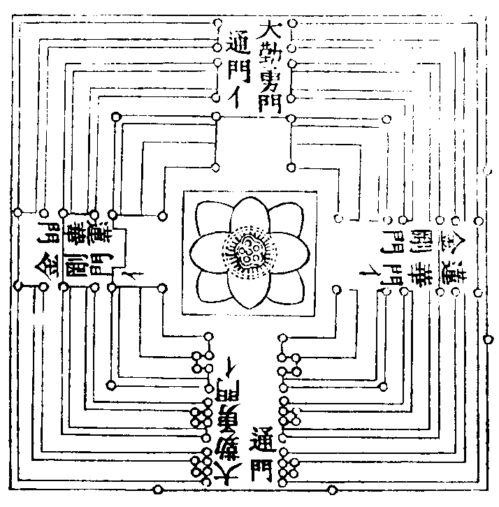

# 大日经义释演密钞



> **藏经**：卍新纂大日本续藏经（新纂卍续藏）　**册次** 第 23 册（X23）　**编号** X0439　**部类** 经疏部　**卷次** 10 卷　**篇幅** 237,254 字

> **卷／品**：10 卷 · 0 品



---



## 目录



- [大毗卢遮那成佛神变加持经义释演密钞卷第一](#大毗卢遮那成佛神变加持经义释演密钞卷第一)

- [大毗卢遮那成佛神变加持经义释演密钞卷第二](#大毗卢遮那成佛神变加持经义释演密钞卷第二)

- [大毗卢遮那成佛神变加持经义释演密钞卷第三](#大毗卢遮那成佛神变加持经义释演密钞卷第三)

- [大毗卢遮那成佛神变加持经义释演密钞卷第四](#大毗卢遮那成佛神变加持经义释演密钞卷第四)

- [大毗卢遮那成佛神变加持经义释演密钞卷第五](#大毗卢遮那成佛神变加持经义释演密钞卷第五)

- [大毗卢遮那成佛神变加持经义释演密钞卷第六](#大毗卢遮那成佛神变加持经义释演密钞卷第六)

- [大毗卢遮那成佛神变加持经义释演密钞卷第七](#大毗卢遮那成佛神变加持经义释演密钞卷第七)

- [大毗卢遮那成佛神变加持经义释演密钞卷第八](#大毗卢遮那成佛神变加持经义释演密钞卷第八)

- [大毗卢遮那成佛神变加持经义释演密钞卷第九](#大毗卢遮那成佛神变加持经义释演密钞卷第九)

- [大卢毗遮那成佛神变加持经义释演密钞卷第十](#大卢毗遮那成佛神变加持经义释演密钞卷第十)



---



No. 439-A 大毗卢遮那成佛神变加持经义释演密钞引文



朝议大夫行起居即充乾文阁待制史馆修撰



骑都尉赐紫金鱼袋臣　赵孝严奉勅撰



大哉！如来之教也，有显有密。所谓显者，五性三乘是也；所谓密者，总持秘藏是也。若夫圆修万行，具证十身，顿了一法界心，直超三无数劫，此乃神变加持之力，不可思议也。故毗卢遮那佛亲为口说，金刚秘密主次传心印，玄之又玄，秘之甚秘。粤从唐代，有三藏善无畏者，自中天来，持以梵本，与禅师一行受诏同译。其理甚深，尚难趣入，乃请无畏再为敷说，一行遂增润其文，号曰义释，斯则启明门之关键也。暨我大辽国，有三藏摩尼者，从西竺至，躬慕圣化，志弘呪典，然广传授，未遑论撰，历岁既久，逮今方兴。伏惟天佑皇帝睿智如神，聪谋出俗，以至公治国，赏罚无私，以大信临人，恩威有济。阅儒籍，则畅礼乐诗书之旨；研释典，则该性相权实之宗。至教之三十二乘，早赜妙义；杂华之一百千颂，亲制雄词。修观行以精融，入顿乘而䆳悟。肇居储邸，已学梵文，有若生知，殊非性习。通声字之根柢，洞趣证之源流，欲使玄风，兼扶盛世。时有总秘大师赐紫沙门觉菀，幼攻蚁术，长号鹏耆，学赡群经，业专密部。禀摩尼之善诱，穷瑜伽之奥诠，名冠宗师，诏开讲会。最上乘之至理，由此发扬，因集科文五卷，通行于世。师自是谈演之暇，乘精运思，复撰成钞十卷。文无不周，义无不摄，镜先制之幽隐，烛后学之昏疑。意者近报国恩，远弘佛道，亦既进奏，亟命雕锼，申谕微臣，得述前引。道安天阔，信侧管以徒为；澄观月高，惭隔縠而莫覩。强摅鄙素，聊赞玄言。



No. 439



------



## 大毗卢遮那成佛神变加持经义释演密钞卷第一



燕京圆福寺崇禄大夫检挍太保行崇



禄卿总秘大师赐紫沙门　觉苑　撰



恭闻皇觉垂形，俨十身於藏刹；微言著范，轶五驾於殊途。或有众生覩佛威仪而得度者，或有众生闻佛音声而得度者，谅根器以成差，遂影响而亦异。然利有攸往，功不唐捐。若夫理包性相，义贯浅深，为八藏之泉源，作一乘之钤键，独标圆密，逈出餘宗者，则大毗卢遮那成佛神变加持经其大矣哉！斯经迺总持之润府，法界之灵宫，金刚手方可探其𧷤，莲华眼始能窥其奥。顿超位地，譬之以神通；速离缠疴，喻之以呪术。加以入金刚界，启菩提心，升金刚座，绍菩提种。护摩设祭，大自在事，火异其宗；浇顶施仪，色究竟受，軄方其躅。不入曼荼罗，不依阿阇梨，则不得入其手。自无畏三藏翻译之后，禅师一行义释已还，緜历岁时，声光沦坠，非遘昌期，孰能极此？今我天佑皇帝睿文冠古，英武超今，十善治民，五常训物。博综儒经，有诗赋碑记之制，锦烂华明，允彰乎教化；尤精释典，有赞序疏章之作，山辉川媚，聿在乎修行。于兹䆳旨，夙促宸怀，爰命𤨏才，俾宣秘呪。因咸雍初，提总中京大夫庆寺，属以时缘，再兴未肆。迺有副留守守卫尉卿陇西牛铉、守司空悟玄通圆大师弼公，洎僧首紫褐师德百有餘人，同致书曰：伏闻毗卢大教，旨趣宏深。疏诠妙𧷤，早已著其菁华；钞解至玄，尚未辟於阃域。傥纳勤诚，愿闻可尔。甞其虽从削简，未暇操䉉，越大康三年，忽降纶旨，令进神变经疏钞科，则密教司南时至矣。於是敬酬圣泽，兼副舆情，强摭群诠，谬成斯解，目之曰演密钞。会於前冬，诏赴行在，面奉进呈，勅令雕印。坠典斯兴，仁王之力也。觉苑智亏宿种，见匪生知，徒然爝火之明，曷益曦轮之照？庶俾来者，共践玄涯尔。



将释此疏，大分为二：第一、文前聊简，第二、依文正释。初文分六：一、起教因缘，二、藏教收摄，三、说经会处，四、辨教浅深，五、明经宗趣，六、翻译传通。



且第一、起教因缘，分二：初、酬昔愿；后、顺当根。初中分二：初、明自证；后、释辨加持。且初文者，我毗卢遮那世尊过去世时，於自觉地最初一念发菩提心，依三密方便修三十七菩提分法，诸度空等波罗密门，超三妄执；超三执已，即证本地法界之身；证此身已，常处法界金刚宫殿，以十佛刹微尘数等上首执金刚众而为内眷属，以普贤、文殊等十佛刹微尘数上首诸菩萨众为大眷属。故智度云：欲为诸佛内眷属，欲得大眷属等，即与如是金刚菩萨无量眷属，常受无尽秘密甚深不可思议广大法乐。



后辨加持分二：初明体，后辨相。初明体者，即以悲智而为体故。遮那世尊自受如是广大法乐，由初本愿誓度无边诸众生故，激起大悲作是思惟：一切众生皆有如是法界宫殿、二种眷属、种种法乐，与我无异，但以无明所覆不自觉知，由不觉故轮回三有，唐受辛勤备历诸苦。若我自住如是不可思议微妙境界，则诸有情不蒙利益，是故住於自在神力加持三昧也。



后辨相者，於是世尊作是思惟已，於三昧中现起不思议神变加持之相。经云：毗卢遮那如来加持故，奋迅示现身无尽庄严藏，奋迅示现语意平等无尽庄严藏，乃至又现文殊执金刚莲华手菩萨等种种相皃，普於十方宣说真言道句法。上来总是酬昔愿。



后顺当根，分二：初金刚启问，后世尊垂答。初分为二：初示疑相，后伸疑问。初金刚手菩萨覩佛所现加持之相，仰测如来实相之智，犹如弥勒覩佛毫光神通之相，作是思惟：今佛放光，为欲说此？为当授记？今亦如是，金刚覩见庄严之相皆是外迹，智者见其条末则可喻其根本。如世大龙驱雷驾电降澍大雨，令鸟兽振吼百川奔勇，虽不覩其形，当知此龙威势必大。今佛现瑞一时普应法界而作加持亦复如是，虽不能覩佛身相大小色像威仪，然可比知如来智力必大。照俗之权尚尔，契实之境当复云何？后伸疑问者，金刚手菩萨由观如来加持庄严相已，复谛思惟：此加持相乃从如来一切智智为众生故之所现起，又复如来一切智智依何而得？於是乘彼众心，并欲自决所疑而伸请问。经云：尔时执金刚秘密主於众会中白佛言：世尊！云何如来、应供、正遍知得一切智智？乃至如是智慧云何为因？云何为根？云何究竟？意云：如来不共一切智智之果从何而得？为以何法而为其因？为以何法而为其根？为以何法为究竟耶？



后如来垂答，於是世尊普观众会，顺彼疑问，次第宣答。经云：毗卢遮那告金刚手言：菩提心为因，大悲为根，方便为究竟。此经七卷三十一品，从始迄终，皆是显斯三句之义，当知即是阿阿暗恶四字之义。总也，是第一起教因缘。



第二、藏教收摄，分二：初藏收，后教摄。初、如来所说一大时教，分成三藏：一、修多罗藏，即是契经；二、毗奈耶藏，即是调伏；三、阿毗达磨藏，即是对法。又於修多罗中分出陀罗尼门，别为一藏。又此通大、小乘，开为八藏。今遮那神变经即当第八总持藏摄。问：既属第八总持藏摄，何故经题之中不立总持，而言经耶？答：经含总、别，今就总故，虽标总称，即受别名。故先哲云：三乘之外，别有持明。即斯是也。



后辨教摄者，古来分教总有多岐，且依清凉，教类有五：一、小乘教，但说我空，纵少说法空，亦未明显。但依六识、三毒建立染、净根本，未尽法源，故多诤论。二、始教，亦名分教。此既未尽大乘法理，故立为初；有不成佛，故名为分。三、终教，定性二乘、无性阐提，悉当成佛，方尽大乘至极之说，故名为终。又亦名宝教，以称实理，故名理为实。上之二教，并依地位渐次修成，故总名渐。四、顿教，但一念不生，即名为佛；不依地位渐次而说，故立为顿。又不同前渐次修行，不同后之圆融具德，顿诠此理，故名为顿。五、圆教，明一位即一切位，一切位即一位。十信满心，即摄五位成正觉等。依普贤法界，帝网重重，主、伴具足，故名圆教。广如彼疏。今神变经典与此大同，但显密为异耳。是故此经，五教之中圆教所摄。故下序云：此经迺秘藏圆宗，深入实相，为众教之源尔。又疏云：此经横统一切佛教。如说唯蕴无我，出世间心住蕴中，即摄诸部小乘三藏。如说蕴阿赖耶觉，自心本不生，即摄诸经八识、三无性义，即胜鬘、法华等经，瑜伽、唯识等论。如说极无自性心、十缘生句，即摄华严、般若种种不思议境界，皆入其中。如说如实知自心名一切种智，则佛性一乘秘密藏，皆入其中。又如释字轮旋陀罗尼义，以一字摄一切字，一切字全是一字。初、后相摄，横、竖该罗，一切法门不离一字，即同华严四十二字。初一阿字具漫荼等，亦是四十二位，举一全收。疏文上、下，判为圆、顿不思议神通之乘。又如金刚顶瑜伽指归中说：五部随一一部具三十七尊，乃至一尊成三十七尊，互相摄入。如帝释网珠，光明交映，展转无限。若真言行者善达此理，即同遍照如来一一身分、一一毛孔、一一相、一一随形好、一一福德智慧资粮住於果位，演说瑜伽不共佛法，乃至顿能利乐一切有情。上来总是第二藏教所摄。



第三、说经会处。依不空三藏所译都部陀罗尼录云：毗卢遮那成道经，大本十万颂，可有三百卷。唐国所译，略本七卷。缘此经来未尽，处会难明，且引当宗金刚顶瑜伽比拟显示。瑜伽指归云：金刚顶瑜伽有十万偈，十八会说。第一会名如来真实摄教王，有四大品：一名金刚界，二名降三世，三名遍调伏，四名一切义成就，表四智印。一一品中各说六漫荼罗，不能具引。第二会名一切如来秘密主瑜伽，於色究竟天说具四大品，广说微细实相理，及说降魔醯首罗天等。第三会名一切教集瑜伽，於法界宫殿说一百二十种护摩炉，一一炉所求各异。第四会名降三世金刚瑜伽，於须弥顶说金刚藏等八大菩萨，一一菩萨说四漫荼罗，谓大漫荼罗、三昧耶漫荼罗、法漫荼罗、羯磨漫荼罗，乃至秘密禁戒、秘密修行法。第五会名世间出世间金刚瑜伽，於波罗奈国空界中略说五佛漫荼罗，及诸菩萨、诸外金刚部漫荼罗等求悉地法。第六会名大安乐不空三昧耶真实瑜伽，於他化自在天宫说普贤菩萨漫荼罗等，乃至引入弟子授理趣般若波罗密法。第七会名普贤瑜伽，於普贤菩萨宫殿中说普贤等至、金刚拳菩萨及外金刚部等，及说修行之人无时无方不依世间禁戒，以菩提心为先，无为戒为本。第八会名胜初瑜伽，於普贤宫殿说普贤等，至外金刚部稍广，於第七会大略是同。第九会名一切佛集会荼吉尼戒网瑜伽，於真言宫殿说立自身为本尊，呵自身外立形像，并说瑜伽法具九味，所谓华丽(金刚萨埵)、勇健(毗卢遮那)、大悲(持金刚)、喜笑(观自在)、嗔怒(金刚光)、恐怖(降三世)、厌患(释迦牟尼)、奇特(金刚笑)、寂静(瑜伽中毗卢遮那)，乃至说五部中歌赞舞仪。第十会名大三昧耶瑜伽，於法界宫殿说普贤菩萨至金刚拳十六大菩萨，各各说四漫荼罗，乃至偈云：愚童覆无智，不知此理趣，餘处而求佛，不悟此处有。十方世界中，餘处不可得，心自为等觉，餘处不说佛。第十一会名大乘现证瑜伽，於阿迦尼咤天说毗卢遮那佛至毗首羯磨菩萨及八大供养、四摄等。第十二会名三昧最胜瑜伽，於空界菩提场说毗卢遮那八菩萨等，乃至说自身本尊瑜伽，广说阿字门，通达染净无碍。第十三会名大三昧耶真实瑜伽，於金刚界道场说十方一切佛异口同音请金刚萨埵说三昧耶真实教法，彼受请已，说普贤菩萨十七字真言，乃至通求世出世悉地等。第十四会名如来三昧耶真实瑜伽(与上同处)，此经中说普贤菩萨十六大菩萨四摄成一身，广说五部互圆融，如来部即金刚部，乃至法界即真如，般若即实际等。第十五会名秘密集会瑜伽，於秘密处说，所谓喻师婆伽处说，号般若波罗密宫。此中说教法坛印真言住禁戒，似如世间贪染相应语。会中除盖障菩萨从座而起，白言：世尊大人，不应出麤言杂染相应语。佛言：汝等清净相应语有何相状？我之此语加持文字，化缘方便引入佛道，亦无相状，成大利益，不应生疑等。第十六会名无二平等瑜伽，於法界宫说生死涅槃、世出世间、自他无二、动心举目、声香味触、杂染思虑同真如法界，皆成一切佛身。第十七会名如虗空瑜伽，住实际宫殿说毗卢遮那、普贤、外金刚部，一一说四印漫荼罗，修行者与此一一尊相应，皆量同虗空法身等。第十八会名金刚宝冠瑜伽，於第四静虑天，金刚萨埵菩萨请佛为大梵天娑诃世界主说五部漫荼罗，引入弟子仪具三十七，乃至为弟子受学心念诵，於月轮上右旋布列真言字，於一一字实相相应周而复始，不假持珠遍数以为剂限，但证理门心不散动，住本尊瑜伽为限等。已上一十八会有一十四处，谓法界宫有三会，普贤宫有二会，金刚界、道场二会，俱十四处。此经义当第十六会法界宫处说也。所以知者，故此经云：住如来加持广大金刚法界宫。又云：演说身语意平等句法门。即与彼同。如是会处一该一切，於中法门亦复如是，总是第三说经会处。



第四、辨教浅深。且经开顿渐、义分浅深，随根器则有差、归法界则无二。此经乃被上下根通显密说，显谓五性一乘该诸经论，密谓字轮观行陀罗尼门。略举一二以彰教之深胜，且彰自教，如不空羂索、苏悉地等说。修造漫荼罗，须用瞿摩夷、瞿模怛罗，此即牛粪及液。瞿摩，牛也；阿夷，粪也；乌怛啰，液也。西竺之法，凡乳牛更不使用，但取孳养牧於山泽水草自恣，多食香草不食糓料，其粪香洁，彼方共许为净。用戒坛地易施彩绘，餘牛不堪。此但浅释，若深释者gu瞿是行义，以入a阿字门故，则是诸法无行mā摩是我义yi夷是乘义。何故诸法无行？以一切法我不可得故。若无有我，则无所乘及与乘者，故名瞿摩夷gumotra瞿模怛罗(二合)，此云牛液瞿摸，如前释tra怛罗是如如离尘垢义，体即心之实相。若修真言者，修造内心大悲漫荼罗，能以如是如如离尘之粪液净治心地，令毕竟清净，畫作法界圆坛，即是此中用瞿摩夷义。又如言三月持诵，乃是清净圆明中阿阿暗三转方便，岂可作九旬解耶？若对他教者，如梵云劫跛，餘教共译为时分。若度三阿僧祇时分，即名成佛，此中义别。梵语劫跛，译为妄执。妄执有三，谓麤、细、极细。此三妄执，依五根本烦恼，初分成十枝，第二再分成二十种，乃至第五分成一百六十随烦恼数。若依於此经，发菩提心，修密言行，初心聚沫、浮泡、阳𦦨、芭蕉、幻事等五种譬喻，观无性空，离百六十心一重麤妄执，即超一阿僧祇劫。复以幻、阳𦦨、影、响、旋火轮、乾闼婆城六喻，观不可得空，复越百六十心等一重细妄执，即超二阿僧祇劫。复以幻、阳𦦨、梦、影、乾城、响、水月、浮泡、虗空华、旋火轮等十喻，观不思议空，越百六十心一重极细妄执，即超三僧祇劫。行者若一生度此三妄执，即一生成佛，何论时分耶？又如婬、盗、煞、妄，诸教共说为波罗夷，若有犯者，故结为重。今此教中，乃是偷兰。何以故？不碍菩提心故，非菩萨极重。此中四重者，先令不舍三宝，又令不舍菩提心，此即菩萨真四重也。若菩萨生如是心，舍离於佛，即名破於重禁。所以然者，如来即是一切善法所从生处，菩萨以自归依佛故，方有一切地波罗密等万行成就，犹因阿字种子，方得生暗字之果。若舍阿字自然之智，则一切善法不得生故，舍佛即是断一切菩萨之命，而绝其成佛之根。若行婬、盗、煞、妄，但於道有碍，非断佛种故，但成偷兰。偷兰遮者，或云大罪，或云麤恶，以佛不可舍故。法、僧亦尔。菩提心亦然，是一切诸行之本，若离此心，则无一切菩萨法故，舍之则犯波罗夷罪。今此宗中复以此重而为方便，成就四种三昧耶戒，所谓不应舍正法，舍离菩提心，悭恡一切法，不利众生行。此戒受时，即以密印种子而加持之，由此得智水灌顶，见身即同大日如来转於法轮。是知此教对餘显说为深胜尔。总是第四、辨教浅深。



第五、明经宗趣者，语之所上曰宗，宗之所归曰趣。此经即以秘密不思议法界缘起观行为宗。若以秘密不思议法界缘起为宗，即以观行为趣；或以观行为宗，即以秘密不思议法界缘起为趣。是宗之趣，或宗即趣，可以意得。由是疏文上下，或归於不思议法界缘起，或归於甚深秘密观行，其文非一，不烦具出。



第六、翻译传通。分二：初明翻译，后辨传通。且初唐玄宗开元中，沙门输波迦罗，中印度人，释迦之苗𧜟。风仪爽俊，聪叡超群。解究五明，行该三学。总持禅观，妙达其源。艺术异能，无不谙晓。发迹中天，来游东夏。途至北印，声达帝京。今上发使迎接。开元四年景辰，大賷梵本，来达长安。初於兴福寺安置，后勅住西明。至五年丁巳，於菩提院译虗空藏、求闻、持法等，并令进内。又曩时沙门无行，西游天竺，学毕言归。回至北天，不幸而卒。所将梵本，有𠡠迎归西京华严寺收掌。无畏与沙门一行，於彼拣得数本梵经，并总持妙门，先未曾译。至十二年，随驾入洛，於大福光寺译大毗卢遮那经。沙门宝月译语，沙门一行笔受。承旨兼删缀词理，文质相丰，妙谐深趣。



后辨传通，以斯经乃总持之渊府，秘藏之玄关，因寄有为，广示无相。禅师尚虑学者守文失意，搜阅大小相应之教，举显密二释，会性相微言，勒成十四卷，目之曰义释。未及宣演，玄宗幸蜀，禅师没化，斯文寻坠。洎我大辽兴宗御宇，志弘藏教，欲及迩遐，𠡠尽雕锼，须人详勘。觉苑持承纶旨，忝预校场，因采群诠，访获斯本。今上继统，清宁五年，勅镂板流行。上来六段不同，总是第一文前，聊拣已竟。



第二依文正释，大分为二：初明疏序，后释疏文。序复分三：初题名，次作者，后正文。且序题中复分为三：初经题，次经号，后序字。



且经题者，即大毗卢遮那成佛神变加持经十二字。就此分二：初离释，后合释。离释分二：初翻名，后释义。且翻名者，梵云摩诃、毗卢遮那、悉提、三菩提、微吃哩𩕳多、地瑟姹曩、素怛囕。摩诃云大，毗卢遮那云遍照，悉提云成，三菩提云正觉，微吃哩𩕳多云神变，地瑟姹曩云加持，素怛囕云经，总云大遍照成正觉神变加持经。后释义者，复分为二：初约三大释，后约三身释。且三大者，大之一字是体大，谓一真法界横遍十方竖穷三际，莫寻其始宁见中边，非生非灭无去无来，此即名为体大。毗卢遮那四字即相大，谓光明遍照即日之别名，除暗遍明义故，具常乐我净恒沙性功德故，即相大也。成佛神变加持即用大，谓以圆满觉体尽诸障故，起三种神变加被住持护念众生故，以神境神变加持故令增威，以记说神变加持故令益智，以教授神变加持故令益辨，即三密方便总摄三类变化十重他报，用周法界应物现形，导万种情根归一乘智火，即用大也。故起信云：一者体大，谓一切法真如平等不增减故；二者相大，谓如来藏具足无量性功德故；三者用大，能生世出世间善因果故。又大毗卢遮那俱属体大，成佛二字即相大，神变加持用大也。又或大之一字是总，毗卢神变等是别，体相用三而皆大故。二约三身义释者，大毗卢遮那即法身，成佛即报身，神变加持为应、化身。又或大属法身，毗卢遮那成佛俱是报身，神变加持即应、化身。或可大之一字即通三身，所谓大法身、大报身、大化身也。若真应无碍，即卢遮那是毗卢故，全毗卢之体是释迦故。名号品云：或名毗卢遮那，或名释迦牟尼。三大、三身，或同或异，如理思之。经者，能诠声、名、句、文四法为体。依瑜伽论，兼所诠义五法为体。若释义者，即贯常摄法四义为名。或依杂心，说经有五义：涌泉、出生、显示、绳墨、结鬘。涌泉则澍而无竭，出生则展转滋多，显示则彰事理，绳墨则楷定正邪。结鬘同线，线能贯华，结成鬘故。后合释者，大之一字即是体大，毗卢遮那即是相大，成佛神变加持即是用大。谓成佛二字，自利果圆；神变加持，利他妙用也。神是其智，变即是境，是变之神，从境得名。或神即变，当体立号，神变上即有加持用，故神变即加持。又神变即能发三种，神变加持乃所发三种表业，是神变之加持。望成佛二字，即是所起，从能起以彰名，是成佛之神变加持，此则用大。若三大差别相望，是大之毗卢遮那，是大毗卢遮那之成佛神变加持，作依主释。若三大不相离者，大毗卢遮那即成佛神变加持，作持业释。经之一字是能诠，大毗卢等是所诠，能、所相望，依主为名。或经是通名，大毗卢等是别号，以别拣通，亦依主释。若广释经题，如下疏明。上来总是释经题竟。



次疏号者，即义释二字。义谓义理，即经旨趣；释谓解释，即疏文言。谓以疏主制十四卷之雄文，释一七轴之奥义，是义之释，名为义释。或以义释二字俱属疏文，采众典之妙义，释一经之微言，义即释故。望上经题作释，是大毗卢遮那成佛神变加持经之义释，依主为名。上来总是疏号已竟。



后序字者，序谓由序起疏之端由。或序者，说也，宣一部之大旨。故尔雅云：东西墙谓之序。即屏墙也，表一宅之庠序也。若转训时，序者，绪也。如蠒得绪，序尽蠒之丝；若疏得序，序尽疏之意，故称为序。疏为所序，序是能序，能所相望，依主为名，故云大毗卢遮那成佛神变加持经义释序。前文有三，总是释序题竟。



次明作者。释者，沙门之通称。温古，即序主之别讳。温者，寻也。古者，故也。法师憙温寻故事，建立新规，故以称焉。论语云：子曰：温故而知新，可以为师。注曰：温，寻也。寻绎故者又知新，可以为师，故曰温古。撰者，述也。特谦立名，故曰释沙门温古撰。



后正文者，　序　持明藏者，秘藏之都称也。谓此经大本有十万颂，正诠一切总持明呪，别为一藏，故曰特明藏也。



言持者，梵语陀罗尼，此云总持。总持通四：一、法总持，持能诠教；二、义总持，持所诠义；三、呪总持，谓是真言；四、忍总持，能於前三决定忍可。今言总持者，四总持中此属第三，虽属第三，能摄餘故，餘三不能摄於此故。问曰：诸教说总持，皆以念、慧为体，何言呪总持谓是真言？答云：总持之体有通有别，通则目於念、慧。若法、义、呪、忍俱以念、慧而为体，故是法之总持、义之总持等。从所说、所解等而立其名，有法、义等别。若论别体，呪总持谓是真言也。若尔，既是真言，云何能摄餘三耶？释曰：非此真言，唯目能诠具教、理、行、果四法而为体。由具教故，能摄法总持；具理故，能摄义总持；具行故，能摄忍总持。餘之三种总持不能摄此，各取法、义、忍而为体故，故不相违。又以第三此宗所尚，就宗明义，故能摄餘。是以序云：无量事迹所有文言结会指归，无非秘密之藏。故下疏云：犹如揽结众发，戴之在首。揽结众发者，总摄诸教也；戴之在首者，表出众乘之上也至乃如地载万物等，故名为持。又持谓加持，梵语地瑟姹曩，此云加持，通三密也。或云忆念，唯意密故。故下疏云：诸佛如来自证三菩提，出过一切心地，现觉诸法本初不生。是处言语尽竟，心行亦寂。若离如来威神之力，则十地菩萨尚非其境界，况生死中人乎！由是世尊往昔悲愿而作是念：若我但住如是境界，则诸有情不能以是蒙益。是故住此自在神力加持三昧，普为一切众生示种种诸趣所喜见身，说种种性欲所宜闻法，随种种心行开观照门。譬如幻师以呪术力加持药草，能现种种未曾有事，五情所对，悦可众心。又下疏云：入真言门略有三事：一者、身密门，二、语密门，三者、意密门。行者以此三方便自净三业，即为如来三密之所加持，乃至能於此生满足地波罗蜜，不复经历劫数，备修诸对治行。故大品云：或有菩萨初发心时，即上菩萨位，得不退转；或有初发心时，即得无上菩提，便转法轮。龙树以谓如远行，乘羊去者久久乃到，马则差速。若乘神通人於发意顷便至所诣，不得言发意间云何得到。神通相尔，不应生疑。则此经深旨也。



明者，明呪真言之别称，梵语尾伱也(二合)。此译云明，破暗为义。梵语漫怛啰，此云真言，或名神呪。谓此真言能破众生烦恼暗障，义翻为明，呪即明故。故下疏云：由不了真谛，名为无明。由无明故，而有诸行，生种种苦。虽菩萨入於地位，然犹未了如来甚深秘密之境，即是微细无明，亦复是苦。佛为彼等说此明呪，究竟令知佛之境界，除无明苦，获涅槃乐。般若心云：是大明呪，能除一切苦，真实不空。即斯义也。又名谓诠显，通四法故；声、名、句、文，能显义故，即总持教。犹暗夜金玉，藉灯炬以显彰；人颜妍媸，由镜鉴以区别。华严经云：譬如暗中宝，无灯不可见；佛法无人说，虽慧莫能了。又清凉云：至圣垂诰镜，一心之玄极等。法喻配合，易可知矣。又三密中属者，通途教体，多语密也；别释明者，据身密也。故下疏云：从如来身口出者，名为真言；从如来身分任运生者，名之为明。问曰：前以明字属教，即声等四法。今言从身生者名明，何有声耶？答：如下疏云：从身发吼等声说，亦有声也，仍以身密而为体故。或依身立名句等，如下布字法，於身分上显三重字轮，即三转法轮义也。前据多分，依声立教，不遮亦依色、香、味等假立三故。如楞伽经云：大慧！见此世界蚊、虻、虫、蚁，是等众生无有言说，而各办事等。但由显理生解，即是教体，岂要唯局言声者哉？如丝竹传心，目击存道等类，故曰明也。亦持亦明，持即是明，或是持之明，作释随应，故名持明。



藏者，能摄义故。天亲论云：何缘名藏？由能摄故，谓摄一切所应知义。此义意言，由能诠教，能摄一切所应知义，令不失故，立以藏名。梵云赖耶，即巢室之藏也，安住此中，不为频那夜迦风雨之所侵故。或云俱舍，即鞘室之藏，诸佛依此而安住故。或云𮓌啰贺，即胎藏之藏，诸佛从此而出生故。或云𮓌啰婆，即府库之藏，今且取府库名之为藏。由如世间国大库藏，即能蕴摄种种杂宝，出内取与，赈济无穷。持明藏亦尔，蕴摄诸佛秘密法义，利乐无尽，故以为明。藏有其四，拣餘三故。持明之藏，或持明即藏，作释可知，故曰持明藏也。



言宗分条流至久矣者，彰其本末也。宗者本也，分谓支分，条乃枝条，流即流派。谓此明藏大本十万颂，以其太广博，传法圣者撮其宗要，凡三千颂(此即宗也)。有多支分，所谓阿阇梨支分、弟子支分、择地支分、造立曼荼罗支分，乃至灌顶护摩等支分(即其分也)。又於彼支分中，展转蔓延，枝派无尽。夫法门浩广，窂究津涯，故有随宜化诱，应物施缘，多於大部之中，略出别行，欲令披枝叶穷其根抵，寻波澜究其源穴也，名曰条流。今此中条流之经，自后汉明帝已来，宣传翻译，代有其人。北凉沙门法众译大方等陀罗尼经，元魏沙门佛陀扇多译金刚上味陀罗尼等经，周沙门阇那耶舍译佛顶呪等经，东晋沙门帛尸密多罗译孔雀王等陀罗尼经，宋沙门昙摩密多译虗空藏等经，大唐沙门玄奘译不空羂索等经，菩提流支译不空神变等经，乃至金刚智不空等，大弘斯典，具如开元释教录所载，故曰宗分至久矣也。



序　世之学者至中道者，谓古来传译条流之经虽盛行於世，然世间修学之者不见巨本，不偶明师，但多存心於有为事相，少能契会於无为中道。故清凉云：有作之修，多劫终成败坏；无心体极，一念便契佛家。下疏云：如餘菩萨为求无上道故，虽难行苦行，终不能得瑜伽。行者若具方便，一生可就，以知甚深缘起中道法门故。真言：又如云落叉，此名为亿，即十万数，亦名为见。见谓真言。行者作成就时，境界现前，即以心目观之，一缘不乱，即是瑜伽落叉之义。而今世间执苏悉地等经，不知秘决，如文而住，但诵十万遍，欲希悉地，何时可获耶？或可言有相者，行者不了多分执一切法有，故名有相；不遮少分著空，亦不契中道。又或执空仍有边相，俱名有相，不合中道。故云世之学者等。



序。　其瑜伽行法等者，梵语瑜伽，此云相应，即此相应具通显秘。且显教者而有四种，如瑜伽疏云：一、境喻伽，有总有别。初总者，释论解云：谓一切境无颠倒性、不相违性、能随顺性、趣究竟性。此之四境，如次与彼理、教、行、果有相应义。后别者，楞伽经云：若观真义，除去分别，远离瑕秽，无有能取，亦无所取，尔时在定当见瑜伽。如是等法，一一皆具无倒等四相应义故，名曰瑜伽。二、行瑜伽者，复有总、别。言总行者，谓一切行更相顺故，称正理故，顺正教故，趣正果故，说为瑜伽。其别行者，月灯经中修三十七品菩提分法说为瑜伽，此於一切顺果行中最为胜故。慧到彼岸经中说：般若波罗密多名胜瑜伽，导大乘行此殊胜故。三、果瑜伽者，亦分总、别。初总者，谓一切果更相顺故，合正理故，顺正教故，称正因故，名曰瑜伽。后别者，然诸经论就相随根种种异说，大义经中说：如来地无分别智及以大悲名曰瑜伽，自利、利他常无尽故。四、教瑜伽者，即说境、行、果三之教，名教瑜伽，称正理故，顺正行故，引正果故，故皆瑜伽。有义，五法名曰瑜伽，前四同前。五者、利生、药、病相应，名曰瑜伽。若密宗所明瑜伽行者，正是法界字门观行也。若以阿字本不生义观，即属理法界观，遍一切处，与理相应。故下疏云：但此中一切众缘皆成法界标帜，所为事业尽带瑜伽，义当阿字遍一切字。凡开口、动舌，皆带阿音。若随事法界别观下，疏以字门作三重、四重曼荼罗异故，或以阿缚罗诃佉五字而配五轮，次不差故。疏云：凡行者欲修观时，先当住瑜伽座，以阿缚罗诃佉五字加持自体，如悉地出现品及供养次第法中说。所以然者，诸佛无上菩提虽复寂寂无相，然要当以金刚身坐金刚地，方可入证。自餘虗幻身、土，力所不堪等(云云)。其中字字三密各别观时，上、下非一，乃至五部色相各异，皆属事观。若作事、理无碍观时，随一一事，下即归理。故下疏如以梦、幻等五、六、十喻观一切法，皆顺空理。复次行者初依有相瑜伽，世间成就，故渐净六根，面见十方诸佛，乘此加持妙用，游戯神变，广利众生，然犹属世间悉地。今观如是悉地，但从众缘生，故无有生灭、断常、去来、一异，皆如梦、幻、泡、影、镜像、水月、乾闼婆城，即缘生无性，举体即空，事即理也。凡一切字，皆揽阿字之所成故。若无开口之音，何有随宜之说？譬千里之程，由初步而即登；九仞之山，亏一籄而不立。即理成事也。若事事无碍法界观者下，疏复次所以从小至大，摄大归小者，欲令行人心自在故。由彼心力卷舒无碍，渐能以一微尘包含无量世界。此无量世界内一微尘中又云：复次行者以常修习相应，故不思议法界标帜转更现前，能观自身即是本尊身，观本尊身即是自身，如是不二而二，二而不二。若观本尊心佛为自身时，即见自身在本尊心圆明中，於自心上亦有微细圆明种子，能令渐次增广，卷舒自在。若观自心中佛为本尊时，即见如来在行者心圆明中，於佛心上亦有微细圆明种子，渐能增广，卷舒自在。皆无障碍，互不相妨。故经云：乃至本所尊，自身像皆现也。即因果交彻，生佛互收。上来四法界观义，粗略释之，於文焕矣。今言瑜伽即当秘密，又复秘密之中复有秘密耳。行谓观行，隐谓秘隐，谓持明藏，或宗分，或条流，虽传译久矣，然世修学之者，但守文失意，多存有相，窂契中道。盖此秘密瑜伽观行之法秘隐，未得显明。且如苏悉地等经说：弟子将灌顶，为息障故，作息灾护摩之法。凡作火供，须与息灾事理相应，所谓火炉、薪木、形色、憙怒、时分、真言、密印、本尊等，所有支具及所求果，皆须相应。然此但是浅略有相方便，未能正契深密无为中道。何以故？瑜伽行法秘隐而未显明故。若作深秘瑜伽释者，此护摩支分是众因缘义，世间因缘能生三有灾患，今还以此为慧火之资，供养一切普门身，增益不思议势力。经云：烦恼为薪，智慧为火，以是因缘，成涅槃饭，令诸弟子悉皆甘嗜。即是护摩瑜伽之义。故苏悉地等诸经，要用此宗决之，方见深意耳。故云其瑜伽行法隐而未明。



序。　夫法流不通等者，夫即语辞，法即教法，瑜伽教法也。水行曰流，教法如流，故曰法流。言不通者，拥滞不行也。言弘道等者，弘谓弘扬，道即教道，者即假者，忧谓忧伤。诸瑜伽法流拥滞，未得通行，即弘扬教道之菩萨能不忧伤者哉？故论语云：子曰：吾衰也久矣，不复梦见周公。注曰：孔子衰老，不复梦见周公。明盛之时，梦见周公，欲行其道。今借而用之，孔子则忧治国之至道不行，菩萨则伤利物之法流斯拥。治国之至道不行，人罹非法；利物之法流斯拥，行乖中道。又起信钞云：诸佛教法欲破灭时，传法菩萨当不惜身命，发不退心，即造章疏，讲宜经论，奖劝后学，使灯灯相续，是护教也。且佛垂正教，本在流通，令诸众生出於生死。今乃隐废，即是灭义，不必同始皇之煨烬矣。又孔子云：德之不修，学之不讲，闻义不能从，见善不能改，此四者是吾之忧也。故曰弘道者等。



序　廼秘藏圆宗等者，此经乃是毗卢遮那如来亲演，执金刚莲华手同禀，非普为一切，故称秘藏。故下疏云：秘密者，即是如来秘奥之藏。久默斯要，如优昙华时乃说之。苟非其人，则不虗授，不同显露常教，故曰秘藏。问：华严、法华、涅槃经等，佛亦亲宣，名为秘藏。华严疏云：大华严经者，诸佛之秘藏。彼又释云：谓此华严圆经即是一乘秘密之藏，三世诸佛悉并宣说等，岂非秘藏耶？答：华严等经虽彰秘密，教属显故。大乘四藏之中即属第一修多罗故。今时此经称秘藏者，不属显故。八藏之中即是第八陀罗尼藏故。又此中称秘密者，不同餘故。何所以耶？谓此经以三密为宗。故下疏云：如来身、语、意密，唯佛与佛乃能究了。言身密者，即是诸印。如四重漫荼罗，一一本尊各有身印。若观此者，即知此尊所表秘密之德。语密者，即是诸尊所有真言。若闻此者，即知此尊内证之德。意密者，即是本尊瑜伽之观。乃至与此相应，即入如来意密之藏。又下秘密漫荼罗品中偈云：最初正觉等，敷罪漫荼罗，密中之秘密，大悲胎藏生。疏释云：然此大悲藏生，前已说竟，何故更说有何差别耶？然前所说虽为秘密，更有秘中之秘、密中之密。若不得此法者，设通达前法，亦不成故。是以最为秘要。若解此者，一切世间、出世间诸漫荼罗皆同用之，无所不入。所以此经独称秘藏，盖由此也。秘中秘义，至文当悉。



言圆宗者，圆谓圆满，由含总故；宗谓宗主，由尊尚故。此经总能含摄一切大、小、性、相诸法。故下疏云：以此经者，横统一切佛教。如说唯蕴无我、出世间，心住蕴中，即摄诸部小乘三藏；如说观蕴阿赖耶觉，自心本不生，即摄诸经八识、三无性义；如说极无自心，十缘生句，即摄华严、般若种种不思议之境界，皆入其中；如说如实知自心，名一切种智，则佛性、一乘、如来秘密藏，皆入其中。如是於种种圣言，无不统其精要，故曰圆宗。问：何以得知？答：为此经也。语其广包，具无量乘；论其深胜，直归一乘，同华严故。故下经云：云何如来、应供、正遍知得一切智智？彼得一切智智，为无量众生广演分布，随种种趣、种种性欲、种种方便道，宣说一切智智，或声闻乘道，或缘觉乘道，或大乘道，或五通智道，或愿生天，或生人中，及天、龙、夜叉乃至人、非人等身，各各同彼言音，住种种威仪等。疏释云：复次此中问意，即是发起大悲胎藏漫荼罗也。於萨婆若平等心地畫作诸佛、菩萨乃至二乘、八邪等四重法界圆坛。此一一本尊身、语、心印，皆是一种差别乘也。即名广包，具无量乘。故又经云：而此一切智智道一味，所谓如来解脱味。疏释云：且如有人志求五通智道，即於大悲胎藏现韦陀梵志形，为说瞿昙仙等真言行法。行者精勤，不久成此仙身。更转方便，即成毗卢遮那身也。如是或现佛身，说种种乘，乃至现非人身，说种种乘。随类形声，悉是真言密印。或久或近，无非毒皷因缘。即名深胜，直归一乘。且如此宗，正显密义。旋陀罗尼一字即摄一切字，一切字全是一字。初、后相摄，举一全收。横、竖该罗一切法门，不离一字，全同华严四十二字。初阿具，后荼等，亦是四十二位，举一全收。正当此经所尚之理。故疏上、下判为秘密圆顿不思议成佛神通乘也。如下疏云：私谓：然大般若等中具说洗涤观心之事，然须有本。今行人先约别缘起观，乃至具见十方佛会诸世界等种种境界，而后约般若洗涤净除，即成不思议大用，顿入佛果。若不知行行次第，但观彼文，不入深故，多错会经意，直尔入空，失圆顿道也。斯乃即当华严十宗之内圆融具德宗，但显密有殊矣。



言深入实相者，深者形浅，入者达解，实者拣权，相者体相。如下疏云：真言行菩萨以阿字门观阴、界、入时，即阴求心，离阴求心，皆不可得，相在亦不可得，即时悬悟自心本不生际，於如来知见大菩提道中远尘离垢，得法眼净。当知此观最为秘要法门。又如餘远离方便诸菩萨，渐次修习戒、定、智慧，於无量劫以种种门观人、法二空，犹未能远离心之影像。今真言行者初发心时，直观自心实相，了知本不生故，即时人、法戏论净若虗空，成自然觉，不由他悟。当知此观复名顿悟法门也。若入此门，即是初入一切如来境界。譬如弥勒开楼阁门内，善财童子是中具见无量不思议事，非以言宣，但人者自知耳。故云深入实相。



言为众教之源尔者，为者，作也。众教者，表非一故。水本曰源，意云：此神变经与一切教而为根源，且千流万派起自昆仑积石之山，十二分经出乎总持秘密之藏。详此序意而有二种：一、开渐本，即此文是；二、摄末本，如下序云：此中具明三乘学处，乃至当知无量事迹。所有文言结会指归，无非秘密之藏。又下疏云：且以阿字或加下畫，或安上点，或置傍点，则成四用。何者？如佛心是一，约本不生理名a阿(上)，约本不生行名a阿(长)，约本不生菩提名aṃ暗，约本不生涅槃名aḥ恶，则成四义。四相虽复不同，而体未曾有异。一切言教皆出於阿字，譬如无热恼池，四河流出，展转无尽，普遍大地。又约字轮对如来方便智，更有第五长āḥ恶字门，此是开渐本。然此五字即是真言，名一切如来正等觉心，能统收一切佛法，无有遗餘。今且约一途修行次第，故作浅深差别说之。而实五字各是一如来智，各各统收一切佛法及无量言教，尽入於阿之一字。有若众流入海，同归一味，此是摄末本，所谓无不从此法界流，无不还归此法界。若尔，何故判宗教处言开渐本，辨所诠处言摄末本？释曰：各据义别，或互影显，故不相违。



序　厥有中天竺者，厥犹其也。中天竺者，西城之名，或云印度。印度有五，此当中也。三藏者，谓此师解三藏法，翻译三藏，全取他名，有财建号。言字输波迦等者，字即名字。输波迦罗，善也。僧诃，无畏也。此出经句，至下当知。



序。　业该八藏等者，业谓学业，该谓该通，八藏即经、律、论、陀罗尼、大小乘异。藏有其八，滞带为名。名冠五天者，名谓声名，冠谓冠束，谓我三藏业该八藏，故得芳名冠束於五天竺国，即是独步於五天矣。言传授此经等者，传谓翻传，授谓付授，嘱授即翻译付授此经也。寔犹实也。为，作也。宗，主也。匠即师匠，盖取巧义，即作者也。谓我三藏翻传嘱授此经，实为宗主师匠而已。如庄子送葬，过惠子墓，顾谓从者曰：郢人垩(白土)漫其鼻端若蝇翼，使匠石斵(削也)之(郢者，古之善涂塈作泥者，施广领大袖以作涂，而领袖不污。小有飞泥悮著其鼻端，因令匠石运斤而斵之)，匠石运斧成风，听而断之(瞋目恣手)，尽垩而鼻不伤，郢人立不失容耳。若使拙而断之，非徒无効而已，或更致其傍损。今我三藏，性爱恬简，静虑澄神，时开禅观，奖劝后学，人或疑问，剖析无滞(此出大录)。又於真言事业，曲尽能事，善得变通。譬如规矩绳墨，众匠所同，而运思精微，独得其妙。由是玄宗诏译此经，可谓文质相半，妙谐深趣。若使暗於斯理，肤受之辈，而翻译者或错用梵言，失於秘密圆顿之旨，故云传授此经等。言顷有诏至扈从者，顷者，时也。诏谓诏命，迎谓迎接，扈谓陪扈，从谓随从。开元四年，三藏至北印度境，声誉已达京师，玄宗发使迎接，於福先寺安置。至开元十二年，有诏并一行随驾入洛，故云顷有诏等。



序　禅师一行等者，禅师者，即是禅宗之师匠也。禅有南宗、北宗，未审是何宗之师？谓即北宗之师也。准禅门师资承袭图所示，第五祖弘忍大师门下有二弟子：一是慧能，即南宗也；一是神秀，即北宗也。北宗弟子名曰普寂，即疏主之师也。图云：忍生十子，能和尚直入其嫡，於中秀弟子普寂化缘转盛，为二京法主、三帝门师。(今引此者，要知疏主之所宗也。)



一行者，疏主之讳。夫圣人作则，必不徒然。唯一为行，故曰一行。如大宝积经：善住意天子复白文殊师利言：大士！所言禅行比丘，何等是耶？文殊师利言：天子！若彼比丘於一切法但取一行极相顺者，所谓无生，是为禅行(云云)。今之疏主取何一行是为禅行？且以阿字而显示之。阿字者，诠一切法本不生义，即是无生。故经云：阿字门，一切法本不生故。释曰：以一切法无不从众缘生。从缘生者，悉皆有始有本。今观此能生之缘，亦复从众缘生。展转从缘，谁为其本？如是观察时，则知本不生际是万法之本。如闻一切语言时，即是闻阿字声。如是见一切法生，即是见本不生际。若见本不生际，即是如实知自心。若如实知自心，即是一切智智。故如来部唯用此阿字而为真言。今疏主但取此一字而为其行，即是一行三昧，故曰一行。命世之生也者，谓应天命而生世也。外典云：一千年有圣人生，五百年贤人出。盖与此经出，与时运符会，故曰命世而生也。又开元中，有道士刑和璞甞谓尹愔曰：一行，圣人乎？汉之洛下闳造历，一千年后八百岁当差一日，云则有圣人定之。今期年毕矣，而一行造大衍历，正其差失。即洛下闳之言信矣，非圣人而何？斯亦足为良证也。



序。　明鉴纵达等者，上句定也，下句慧也。上句者，谓寂光鉴照，无不恣修而通达也。纵者，出自论语：大宰问於子贡曰：夫子圣者欤？何其多能也？子贡曰：固天纵之将圣，又多能也。比况可知。下句者，智谓智解，周谓周悉，变谓权巧，通即晓畅。谓我疏主，不但明鉴纵达，亦乃智解周悉。至於世间权巧之事，靡不晓畅。如明皇杂录云：初沙门一行，幼时家贫，隣有王姥，前后济之，约数十万。一行常思报之。至开元中，一行承玄宗敬遇，言无不可。未几，会王姥儿犯杀人，狱未具，姥诣一行求救。一行曰：姥要金帛，当十倍酬之。君上执法，难以情求，如何？王姥戟手大骂曰：何用识此僧？一行从而谢之，终不顾顾。行心计浑天寺中工伇数百，乃命空其室内，徙一大瓮於中央，密选常住二奴，授以布曩，谓曰：某方某角有废园，汝中潜伺，从午至昏，当有物入来。其数七者，可尽掩之。失一则杖汝。如言而往。至酉后，果有群豕至，悉获而归。一行大喜，令寘瓮中，䨱以木盖，封以六一泥，朱题梵字，其徒莫测。诘朝，中使叩门，急召至便殿。玄宗迎问曰：大史奏昨夜北斗不见，是何祥也？师有以攘之乎？一行曰：后魏时失荧惑，至今帝车不见。古所无者，天将大惊於陛下也。夫疋妇疋夫，不得其所，则陨霜亦旱。威德所感，乃能退舍。感之切者，其在葬枯出系乎？释门以瞋心坏一切善，慈心降一切魔。如臣曲见，莫若赦天下。玄宗从之。又其夕，大史奏北斗一星见，凡七日而复，故云智周变通。言今上屈之等者，上即主上，即玄宗皇帝。屈谓抑请宴安也，息也，正取宴坐中掖内𨓍也，即玄宗抑请久常宴坐於内𨓍也。当睿宗即位，𠡠东都留守韦安右以礼徵之，一行固辞以疾，不命应。遂往荆州当阳山，依沙门悟真以习梵律。至开元五年，玄宗令其族叔礼部朗中洽，赍𠡠书就荆州强起之，故曰今上屈之。一行至京，置於光大殿。帝就之，访以安国抚民之道，言皆切直，元有所隐。玄宗初见，谓曰：卿何能？对曰：唯善记览。帝因诏掖𨓍取宫人籍以示之。周览既毕，覆其本，记念精熟，如素所习读。数幅之后，帝不觉降御榻，为之作礼，呼为圣人，故曰久宴中掖。序　闻三藏等者，闻谓听审，三藏即译主，蕴者藏也，法宝者持明教也，囊者宝器，思者思念，起谓发起，予者我也，请者求也。谓禅师审闻无畏三藏来从天竺，蕴藏持明法宝在心器之中，欲将此法流通震旦，即自思念：发起我教者，唯一行乎？欲令一行请求，可与同共翻译此经也。起予之言，盖出论语。子曰：起予者商也，(商者卜商，姓卜名商，字子夏。)始可与言诗矣。(包曰：孔子言：子夏能发明我意，可共言诗矣。)今三藏思念，言一行能发明我意，可共译经矣。言奉诏等者，奉即禀奉诏谓诏命，与者共也，即是禀奉玄宗诏命，共三藏翻译出此神变经也。仍为笔授者，仍者复也，笔谓笔削，授谓付授。录中或用此受字，即禀受也。又录云：沙门一行笔受承旨，兼删缀词理，文质相半，妙谐深趣，故曰奉诏等。言译语比丘等者，谓以梵本译作唐言。宝月者，法师之讳也。练诸教相者，练谓练核，练核诸教性之与相也。善解方言者，善，能也。此解字通上去二音，解(上)谓解释，善能解释华言，符合梵语。又解(去)谓达解，善能达解东西两方之言音，故能译语耳。



序　非禅师不能等者，非者，不也。禅师者，谓能以诸禅那之要轨匠众人，故曰禅师。扣，系也。幽，深也。关，键也。谓此经乃秘藏圆宗，深入实相，若不是禅师明鉴纵达，智周通变，又复命世而生，则不能扣击其幽深关键。言非三藏等者莫能者，不可也。𫾻，谓宣𫾻。至，极也。𧷤，深也。谓以此经理归一字，事入千歧，秘中之秘，密中之密，不是三藏学该八藏，名冠五天，则不可宣𫾻其至极深𧷤者矣。



序。　此中具明等者，此中者，指此经中也。具谓具足，明谓显明。三乘者，二乘及菩萨为三运载名乘。学处者，修学之所也。谓此经中具足显明二乘及菩萨乘修学之处故。问：此经既是秘密之藏，不妄与人，何故具明三乘学处？菩萨则可，若明二乘学处，岂非妄授耶？答：此经不同常教，上从诸佛菩萨，下至世天龙鬼，入此漫荼罗者，无非大日如来之体，如大悲胎藏漫荼罗第三院中，皆是释迦眷属。彼中说声闻、缘觉真言，虽明谛缘之理，然归阿字门，以入阿字门故，一切众生本来离一切因缘，以知诸法常寂灭故，化城亦灭，如是无疑悔时，是名决了声闻法。又能以吽字声令一切普闻，即是此中声闻之义，故云具明等。及最上乘者，及者，兼也。不但具明三乘修学之处，兼亦明说无上一乘，正所宗故。又及者，拣别。拣别三乘外有最上持明法故，故古人云：三乘之外别有持明。最上乘者，谓於诸乘最为上故。又或云金刚乘、无上乘、一乘，故陀罗尼序云：金刚一乘甚深微细。持明等如上，故云及最上等。



序。　欲令学者等者，从欲令至无相已上显终教之意，从一一下彰圆宗之理。知世间相性自无生故者，相即事有为也，性即理无为也。自无生故者，即表理体本不生故。因寄有为广示无相者，即事不碍理。一一推核以尽法界之缘起者，即无障碍法界大缘起也。如下字轮品三十四字更互助成即为轮体，若随阙一字即不成故。即是法界缘起，随阙一法缘不成故。且如暗字为菩提果轮时，即釰欠等餘字助成。若以阿(平)字为行轮时，即迦遮等餘字助成。若随阙一字皆不成故。乃至阿字菩提心轮、恶字涅槃轮等亦复如是。如世间事轮籍毂辐辋等众缘得成，阙一不可。然此缘起具总具别、有同有异、亦成亦坏，即世亲六相圆融之义具矣。故云以尽法界之缘起尔。



序：　当知无量等者，当知此中无量事相之迹，收结、通会、指决所归之趣，无非此秘密之藏者欤。又此指字，应作此旨字。旨谓宗旨，归谓归趣。意云：若能一一推核究尽法界缘起尔。是故真言行者，应当了知无量事相教迹，所有文字、语言、总持、收结、通会、宗旨、归趣，无不是甚深秘密持明之藏者也。



序　尚虑等者，尚者加也，转训为复。虑谓忧虑，持谓受持，诵谓讽诵，守者执也，失谓亡失，意谓意趣。意云：虽将无量事迹所有文字语言，收结通会宗旨归趣，无非秘密之藏，尚复忧虑受持讽诵之者，但执守能诠之文言，亡失所诠之意旨。如下疏云：且如东方宝幢佛，乃是初发净菩提心义，岂得但作四方解耶？以此例之，诸餘法门皆可意领，故云尚虑等。



序。　禅师又请等者，尚虑持诵者守文失意，又请三藏解释。禅师随其解释，寻记录之，无有真言，不穷其趣；无有密法，不尽其义。又控举浅略、深秘两释，融会众多经中微妙言教，皆同一味。故下疏云：如一切经中，或说诸蕴和合，我不可得；或说诸法从缘生，都无自性。皆是渐次开实相门。彼言诸法实相者，即是此中心之实相；心实相者，即是菩提。更无别理。下文出所以但为薄福之人而能自信作佛者，甚为难得，故世尊且令净诸垢障(不堪受是法，随宜方便说也)，将护其心，要待时义契合，然后为说，即心之印(正是其时也)。又下归宗今经，则不如是，直约诸法，令识其心(即上引二乘真言是)，所以此经名为秘密之藏也。支分有疑等者，谓疑护摩之法，为是灌顶支分中摄，为是引入弟子支分中收？彼中疏释。然护摩法通一切法事中，非但加持弟子而已，故宜别作一种支分，故别开出护摩支分。今略示一隅，餘文可悉。



序。　都释门威仪等者，威仪者，释门主者之称，如今都僧录也。即今道门犹存此职。智严者，师讳也。按开元录云：沙门释智严，于阗国王之质子，姓郁持，名乐(音洛)。幼至大唐，早居荣禄，授左领军卫大将军、上柱国，封金满郡公。而立性淳质，实信居怀，请舍宅置寺。神龙二年十一月二十四日墨制云：人之情也，莫不贪惜禄位；卿之愿也，乃欲弃俗出家。袭兰若之踪，起禅那之行。忽省来奏，嗟赏兼怀，特遂所祈，或成高志。以景龙元年十一月五日和帝生日，舍家剃落，法号智严。仍请住终南山至相寺，精苦居怀，幽栖积念。加以经明唐梵，智照幽微，宝积真诠，如来秘偈，莫不屡承纶旨，久预翻译，频奉丝言，兼令证译。开元九年，於石鼈练若及奉恩寺译决定业障经等四部，并文质相兼，得其深趣，具如录中所载。葢法师有此学业，所以禅师见嘱伏之。



序　良时难会，信矣者，谓良时难会之叹，今可信矣。此出论语翔而后集，曰：山梁雌雉，时哉！时哉！注云：回翔审视，而后下止。谓回旋翔，审察观瞻，然后下止，即是翔止得所也。意显山梁雌雉得其时，而人不得其时也。按唐录，开元十五年，安禄山背乱，自范阳起兵，直抵汴洛。当时玄宗大驾幸蜀，此时天子蒙尘，万姓岂得安处？其时禅师造却此释，未遑宣演，值此时乱，辞师息化，故有此叹矣。



序：　夫经中文有隐伏等者，谓漫荼罗中圣贤之位，以第三院说作第二，其第二院却为第三，其理难明故云隐伏。又前入漫荼罗具缘真言品，正明引入弟子灌顶，即是预说下文世间成就品灌顶之事。世间成就品所说，即是显明前品灌顶，故云前后相明。又谈阿字本不生处，显其不变即理法界。或说阿字能生诸字，显於随缘成事法界，故云事理互陈。皆是如来善巧方便，欲令行人从师禀授，故曰夫经中等。



序。　温古者，师讳也。师学该显密，职在翻译。准开元录，金刚智三藏於资圣寺译瑜伽念诵法七俱胝等经四部，法师笔授。若非深达秘旨，焉能措笔於是哉？言甞接诸贤等者，即序主陈制序之意也。谓予已甞攀接诸多翻译之英贤，末后席肆预先闻此经是至极绝待不可比对秘妙之法门。按开元录，沙门金刚智译金刚顶瑜伽念诵法四卷七俱胝陀罗尼经时，嵩岳沙门温古笔授，具如彼说。序主宿登翻译之场，必是曾与诸贤商推斯经深秘之事，故云甞接等。言非敢窥测者，陈谦敬也。谓此绝待秘妙之法门，理等天高，言方海濬。理等天高，岂得以管见窥？言方海濬，焉能以蠡情测？但专注一心，归依敬仰耳。



序　輙以等者，序主云：我於如是绝待微妙之法门，不敢窥测其高深，但輙然以疎谬鄙拙之情思，叙述乎根本枝末者焉。



------



## 大毗卢遮那成佛神变加持经义释演密钞卷第二



燕京圆福寺崇禄大夫检校太保行崇禄卿



总秘大师　赐紫沙门　觉苑　撰



后正释疏文，分为三段：初解题名，次旌作者，后释本文。初文分二：初疏题如前；后指卷次者，即卷第一三字。卷即纸卷四尘，为性，是体，是实；第者，次居不乱；一者，数之首唱，是义，是假。义不离体，假不离实。第一即卷，名卷第一。又卷即所依色、香、味、触四尘，疏即能依声、名、句、文四法，是卷第一之大毗卢遮那成佛神变加持经义释名。大毗卢遮那成佛神变加持经义释卷第一。



次旌作者，即沙门、一行、述记。此中分三：初沙门二字，标释子之通名；次一行二字，彰疏主之别讳；后述记二字，显述作之谦称。且初言沙门者，是略梵语。具足应云沙迦懑曩，翻就此方，即云息恶，谓息尘垢之恶故。总有四种：一、胜道沙门，二、说道沙门，三、活道沙门，四、坏道沙门。今此疏主若居凡地，即属中二；若在圣位，通前三种也。



次释别讳者，如前已明。



后显述作之谦称者，述谓叙述，记谓记录，以我疏主叙述记录诸教及三藏所说文之与义，成斯疏矣，非自作也，故云沙门一行述记。



后释本文者。



【疏】梵音毗卢等者，此名义双标也。毗云遍卢，遮那云光明照，为顺此方，云光明遍照。故华严疏云：身智能所，合为一身，圆明独朗，具德无边，故立斯号。言是日之别名者，如此方呼日为灵曜，或云朱明、大明、阳乌等。今亦如是，或云普光、普明、大光明等，皆日之别名也。言即除暗等者，谓以身智二光，除灭无明暗障，照见心法明道，觉自心本不生，其心常住，生大慧光明，普照无量法性，见诸佛所行之道，故云除暗等也。



【疏】然世间至而无所增等者，总有三喻。初云然世间日则有方分者，方谓方所，分谓分限，谓有内外昼夜等方所分限故。



【疏】复次，日行等者，第二、喻也。日行者，日之行度也。阎浮提者，正云阎浮那提，即是林名，谓此南州，从林立名，呼云南瞻部州。今就省略，但云阎浮提也。



【疏】又如重阴等者，第三喻也。究竟诸法实相者，且佛心之日，久离戏论，一切众生为无明烦恼所覆障故，见有生灭、断常、去来、一异之相。若知诸法本来平等，远离八不，唯是一法界体时，即是究竟诸法之实相也。此之三喻，前一是相大，次一是用大，后一是体大。又初是报身，次是化身，后是法身。思之！



【疏】以如是等者，释通妨难也。如有难云：且世间之日，则有方分、昼夜、照不照殊、生灭等异；遮那之日，既无方分、昼夜等殊、坏灭、始生等异，如何得将以为喻耶？故通释云：以如是等种种因缘，而实世间之日，不可为喻纵也。夺云：但取其少分相似，不全取以为喻，故加以大，名曰摩诃毗卢遮那。故有经云：帝释千目之身，方於如来，犹如聚墨。又此摩诃，应流至於下云摩诃成佛、摩诃神变加持等。



【疏】成佛者者，成谓成就，佛谓觉者，即是成就正觉之者也。准梵文释时，若言菩提，但得名觉；若言佛，䭾也，即云觉者。今但略故，谓以一切如来从凡夫地始发觉心，或渐或顿，修种种德，断种种障，功德满时，即於一念不起而证菩提，名为成佛。又成佛之说，随教不同，且依显教，总有六种：一、藏教说一生成佛，谓小乘说菩萨三劫练修仍是凡夫，菩提树下三十四心方成正觉，谓资粮位断下八地俱生分别尽，依第四禅起四善根，入见道八忍、八智，前十五心见道，第十六心修道，四断忍中一分断有顶四谛，下一地分别不出第十六心，起九无间、九解脱，断证有顶九品俱生，以此十八足前十六，故三十四心：一、坐成佛。二、三祇成佛，唯识论云：谓具大乘二种性者(本智为二)，备历三祇，具经五位，方始成佛。三、相尽成佛，终教义也，但以染相尽时，即说成佛。四、初住成佛，亦终教义，即起信论说：初发心位，则得少分见於法身，随其愿力，能现八相，广利众生。此约悲、智无二，事、理双修，观行成佛。故华严云：若诸菩萨能与如是观行相应，於诸法中不生二解，一切佛法疾得现前。初发心时，即得阿耨多罗三藐三菩提，知一切法即心自性，成就慧身，不由他悟。五、一念成佛，顿教义也。谓无始妄认众生一念悟时，全体是佛。此门大意，无佛可成，无妄可遣。入其门者，岂不佛乎？六、本来成佛，圆教义也。故华严云：菩萨应知自心念念常有佛成正觉。如自心，一切众生心亦尔。又云：如来成正觉时，普见一切众生成正觉，乃至普见一切众生入涅槃，皆同一性，所谓无性等。然上六说成佛之义，如起信钞。后依此宗成佛，而有二种：初显，后密。且显说者，如下文云：越百六十心，三重妄执，成等正觉。或约百心成等正觉，所谓欢喜地，自有十心。故华严经云：谓利益心、柔软心、随顺心、寂静心、调伏心、寂灭心、谦下心、润泽心、不动心、不浊心。从初心至第四心，得度五通境界(即配四地)；从第五心至第八心，得度二乘境界(即配八地)；从第九心一向行菩萨道，至第十心，名为成佛。佛者，觉也，谓觉自心性净，本来常寂灭相。然此十心，从第一至第八，名为见道；从第九至第十，名为观道(此与常教异也)。见，谓见於谛理，约此进修；观，谓一向观於如来不思议境界秘密功德。如是秘密之境，非所见法，出过心量，故别名观道也。觉者，是觉知义。谓已度二乘境界，了知二乘心与菩萨心异。若入二地时，如前初地，亦至第四心度五通，第八心度二乘，第十心成佛。准此，有信及入位，与初地十心不异。但此十心，转复光显离垢也。乃至第十地，亦有十心。即凡有一百心，一一转胜。如华严真金之喻，可准知耳。此初地十心满，即能分身百佛土等，如彼具说。但百心成佛，是宝炬陀罗尼经所说。此经未到东土(阿阇梨亲传)。已上是依显明。今依密释者，且以四字略示一隅，即是正等觉心真言句也。谓十方三世一切诸佛，各以无量无边巧度门，种种因缘、譬喻、言词，演说诸法。统而论之，原其旨趣，不出四字门故。所谓阿(上)、阿(引)，暗恶也。以阿字门故，一切众生，本有佛知见性。众生不自觉知，如来以种种因缘，为彼净除眼翳，使得开明。即法华第一句云：开佛知见，使得清净。即是此中净菩提心也。既净菩提心，当广示法界藏中不思议境界。如善财童子，入弥勒阁，普见一切善知识，遍学一切诸度门。故法华第二句云：示佛知见。即长阿字，大悲万行义也。已具大悲万行，次以娑罗树王华开敷智成大菩提，故法华第三句云悟佛知见，即暗字门也。既成佛已，即以加持方便普门垂迹导利众生，了知常住之时如来众迹都尽，以无迹故名般涅槃，故法华第四句云入佛知见，即是恶字门也。若依字轮对如来方便智，更有第五长声恶字门，以无别体故此中不说。又此五字统收一切佛法无有遗餘，故名为正等觉心。又今且约一途修行次第作浅深差别说，其实此五字各成一切如来智(即五方佛)，各各统收一切佛法，是故下文修观行时随学一心即见一切如来心，即是华严如来成正觉时普见一切众生皆成正觉也。如是一心见一切心旋转无碍，故名正等觉心也。言具足梵音等者，成字是唐言三菩提，此云正觉亦名正知，准华严经无有最字，故彼疏云成最正觉亦能觉智，开悟称觉、离倒为正、获得名成，此当相解。若拣别者，凡夫倒惑、佛觉重昏，二乘虽觉不名为正，但知法有未知法空，但悟我空未知我有，有厌生死、空沉涅槃，颠倒未除岂得称正？菩萨虽正，有上有修不得称最，设位极称最亦未名成佛独能，故云成三菩提。



【疏】神变加持者，神是智之妙用，变是智之所了。又神即神通，变即变化，俱属智也。瑜伽云：一、能变通，谓改转故；二、能化通，谓化现故。能转所餘有自性物，令成餘物，名为能变；随欲为作诸未有事，故名能化。今此中言变不言化者，变广而化狭。变具十八，化唯三种。变十八者：一、震动，二、炽然，三、流布，四、示现，五、转变，六、往来，七、卷，八、舒，九、众像入身，十、同类往趣，十一、显，十二、隐，十三、所作自在，十四、制他神通，十五、能施辩才，十六、能施忆念，十七、能施安乐，十八、放大光明。如下疏云：然以佛神力故，令瑜伽行者於无量劫，谓如食顷或演食顷为无量劫，延促自在，咸适众根，无定相可得，即是第一能变通。化三者：一、化为身，二、化为境，三、化为语。化为身者，化自、他身为他自身，或一或多，如是等类。化为境者，化似众宝、饮食、资具等。化为语者，妙音、广音系属自、他。又下疏云：谓将说此平等法门故，先以自在神力感动大众，悉现普门境界秘密庄严不可思议未曾有事，因彼疑问而演说之。所谓庄严藏者，谓从一平等身普现一切威仪，如是威仪无非密印；从一平等悟普现一切音声，如是音声无非真言；从一平等心普现一切本尊，如是本尊皆是三昧。然此三业差别之相皆无边际，不可度量。如是毗卢遮那普於十方世界一一皆现佛加持身，是一一身各有十佛刹微尘等菩萨、金刚大众，此诸人众诸根相好亦复无边，如胡麻中油，遍满法界，无空隟处。如是庄严相，显时无所从来，隐时亦无所去，毕竟平等，不出於如，即是第二、能化通也。上是神变。言加持者，加谓加被，持谓任持。佛以如上神力加被、任持现前大众，得见如是不思议庄严境界。如来若舍加持之时，则不复现神变之加持，故云神变加持也。



【疏】然此自证等者，然者，然前起后之词。言自证者，但是佛佛自证，不从他得也。故下疏云：如是自证之境，说者无言，观者无见，不同手中庵摩勒果可转授他人。若可以言语授人者，释迦菩萨蒙定光授决之时，即应成佛，何故具修方便，要待无师自觉，方名佛耶？一切心地者，有心量之地也。



【疏】加持三昧者，三昧是定，亦名为誓，即是住於自在神力加持之定也。



【疏】因陀罗者，帝释也者，梵语因陀罗，此云尊。帝释者，帝之一字，即是因陀罗，梵语讹也。正云印涅哩(二合)，略云帝，盖声势相近。今时帝王，顺天立号，犹得梵名耳。释者具足，应云释迦啰主也，即三十三天之主也。今言帝释者，即尊主也。皆就略音，故曰帝释。言犹如千日者，谓天帝威德光明，类乎千日，如经云帝释所有光明，犹如千日等，为释天之主也。



【疏】次云入真言门住心品者，释此品题，分为二段：初别明真言，后总释品目。且初文者，曲论真言体相不同。一者、真言通体，即唯阿字，通与一切真言教法而为体故。不唯真言，至如万类名言，皆有此能诠音声，下文备显。凡开口之处，尽带阿音，如书一字入一切字中。但初下笔，若点若𦘕，便当阿字轮表体，便是法界本不生性，即与诸法而为实体。由此梵王世界坏时，吞噉众字，於口角边，唯留阿、沤二字。阿表於无，沤表於有，即当佛法中真空妙有法界体也。虽成诸字，而不坏其本体，如水全波，而不失湿之自性。常是随缘，常是不变。二者、真言别体，即三十四字，各各随其功义，与彼真言而为体性。且如五方真言体者，东方以吽字为体，南方以怛啰(二合)字为体，西方用迄嘌(二合)字为体，北方用恶字为体，中方用𮢥字为体。若论三部真言，如来部以阿字为体，莲华部用娑字为体，金刚部用嚩字为体。如下普通真言藏品中，明法界漫荼罗圣众，随一一真言，各有字门而为体故，总是辨真言体。次明真言相者，或彰句义，或辨二合。加圆点以表果满，置傍𦘕而显因修。声分男、女，字具界、缘。既生、不生而无杂，乃性、非性而有殊。具说其相，临文可知。问：既以阿字为真言体，遍在随方教法皆有真言，何故但论天竺之音乃曰真言？答：但如来现出世之迹始自天竺传法者，且约梵文作一途明义尔。如下疏有此答。问曰：既约梵文一途明者，岂西方梵文俱是真言耶？答曰：虽梵文是同，而显、密有异。若作真言说处，则为密教；若作显言说处，则是显教。且如此方言音亦有显言，亦有呪语，如急急如律令等语，呪火不烧，呪𤷡令停，盖作呪用，不同显言。不可一切言音都属呪语，都属显言。既尔，且如此经亦有显言，应属显教。释曰：密宗一一文言无非字门秘密加持而为体性。虽有显言，从宗、体俱属秘藏，如法华？陀罗尼品。若随显教宗尚，俱属显教；若随密宗所尚，俱属密摄。或说真言，或称神呪，或号陀罗尼，但名、义有殊，皆属密藏。次总释品目者，入者，达解。达解真言之道理故，以智为体。真言者，真谓真实，离妄倒故；言谓言音，悟众生故。以教为体，言是其体，真是其用。谓此言音之上，有彼离妄离倒之义用。举体就用，言即真故；摄用归体，真即言故。名曰真言门者，无拥义，为出入之通由，即是其用。谓彼真言体有，彼无拥用。举体就用，真言即门；摄用归体，门即真言，名真言门。又真言门为所入，入为能入，能入从所入以得名。是真言门之入，名入真言门，依主释也。住心者，住谓安住，令菩提等愿不动故；心者灵明，是知见之真实相故。又住是三昧，於三昧中即见自心，即疏云自心发菩提等。住是能住，心是所住，能所相望，作依主释。又上入真言门是因，住心是果，因果相望，亦依主释。品者，类也，别也，即诸品之通名。入真言门住心，乃此品之别号。以通从别，以别简通，是入真言门住心之品，名入真言门住心品。或以此品即当经之序品，如华严世主妙严品，故疏云此品统论经之大意也。言说窃谓等者，窃者，私也，即疏主自谓也。如有难云：此品梵本既有二题，必应义理各殊。今略去修行，但存住心，岂不违於梵本，乖於修行耶？答云：窃谓入住之义，已兼修行，故离繁文，但著其一，於理无爽。



【疏】自心发等者，自心者，即本心也。以一切众生虽知自心本有佛知见性，若不练修，终难得显。是以诸佛如来以神力加持，说此三密方便为所入门，令修行之者措心有地，依教懃行，安心彼中而修趣之，然后克证，不从他得。若离自心执有，发修见证，终无得理。譬如磨塼取鉴，钻氷求火，徒受疲劳耳。又此中有六个心字：前二是因，后四是果。又前一是菩提心，第二是大悲，后四是方便。又中间二心是自利，后二是利他，前二通二利。言从因至果等者，谓从初发菩提，乃至严净佛国，从因至果，皆不离自心。因亦是自心，果亦是自心，心即菩提，故云皆以等。天台云新佛成旧佛，旧佛成新佛是也。又下疏云：行者欲知真言行及果者，当於心处求之。意云：入此真言门者，即能识於自心之处。若知是处，即得真言之果也。又此果字，有本是无字，即皆以无所住而住其心。谓行者入真言门，修三密时，贪著其事，则不离我、人、寿者之相，不得名住。何以故？有所住故。若观如是三密之相，虽从缘生，不异於如，即是不住而住，住而不住。初发心时，便成正觉，不由他悟，故云皆以无所住而住其心也。经如是我闻等者，如来说经有五种成就：一、信成就，二、时成就，三、教主成就，四、处成就，五、众成就。言如是我闻者，信成就也。一时者，时成就也。薄伽梵者，教主成就也。住如来加持法界宫，乃至大宝王楼阁等，处成就也。次云其金刚名曰虗空无垢等，众成就也。准智论，又说六成就，开信与闻而为二故。世亲菩萨般若灯论亦有六义，如彼颂云：前三明弟子后三证师说一切修多罗其事皆如是。言如是者，结集者指斥之词也。谓指此经，如我所传，是佛所说，故称如是。注无量义经云：至人说法，但为显如，唯如为是，故云如是。言我闻者，结集者言：若从他传闻，不必如是。我亲承金口而闻，而非谬矣。又佛临般涅槃时，侍者请曰一切经首当置何言佛勅阿难当置如是我闻故大术经阿难请问四事一佛灭度后诸比丘等以谁为师二依何处住三恶性比丘如何调伏四一切经首当置何言佛告阿难：我灭度后，以波罗提木叉为汝大师，依四念处住恶性比丘梵坛治之。梵法默然，不应打骂，但默摈故。一切经首当置如是我闻等。言一时者，一者，简数之语；时者，一期之号。时无别体，依法假立。今言一时，谓即简去四时、八时、十二时等，但取说听，会遇无差，生灭不二，故名一时。又如来说经，时有无量，不能遍举，一言略周，故云一时。言薄伽梵者，翻就此方，或名能破，或云持众德，或名有德，或名世尊。谓佛地论有二义释：初成德义，后破魔义。初成德者，薄伽梵声依六义转：一、自在义，永不系属诸烦恼故；二、炽盛义，炎猛智火所烧鍊故；三、端严义，三十二相所庄严故；四、名称义，一切殊胜功德圆满无不知故；五、吉祥义，一切世间亲近供养咸称赞故；六、尊贵义，具一切德，常起方便利益安乐一切有情无懈癈故。初一断德，次一智德，后四恩德，如次应知。后破魔者，谓能破坏四魔怨故，如下具明。言住如来加持者，住谓居住，即是出现之义。如来者，上言薄伽梵，即是毗卢遮那本地法身；今言如来，是佛加持身，即是应身，谓从加持而现起故，加持之身名加持身。



【疏】今此宗等者，谓此秘密宗中也。对彼称此，谓彼显宗之中具足六义，都名一薄伽梵，更无别义。今此宗中，以字义释之，复有多名，故云今此。言其本末有等者，谓人体上本无能破之名，但由执持利器世间之人，观其事相之迹，强以之号能破者。易云：以物得通谓之曰道，以微妙不测谓之曰神，以应根变化谓之曰易。总而言之，皆虗无之谓也。圣人以事名之，随其义理以立其号矣，故云其本等。



【疏】二乘虽破等者，此通妨也。谓有难云：谓佛如来具大智慧，能破无明烦恼，称薄伽梵。二乘之人亦能有之，何不名为薄伽梵耶？答：二乘虽破三毒，但破我执，法执仍存，虽除种子，未尽习气，如盛香器，餘气现在，故曰亦不了了等。



【疏】欲求等者，求者希求，欲即是求。作持业释，如对法第十六卷，即欲界五趣一切种类，皆欲求故，由欲求力，不脱欲界，招欲界苦等。此中义别，谓善法欲也。



【疏】即是般若佛母者，般若即佛母故。故大品云：欲为诸佛内眷属，欲得大眷属，当学般若波罗蜜。欲过声闻、辟支佛地，住阿毗跋致地，当学般若波罗蜜等。若得与此相应，烦恼戏论皆悉永息。非如世间五欲热恼，虽小止息，而实更增。如担重易肩，何曾有乐？又涅槃经云：若常愁苦，愁遂增长。如人憙眠，眠即资多。躭婬嗜酒，亦复如是等。是为此中女人义也。言以密教不可直宣等者，不可直说是般若佛母，故言女人。此宗多有如是隐密之语，修学之者，应当触处类例而思之耳。



【疏】一切世间至如佛者，一切世间者，即三世间，谓众生世间、器世间、智证觉世间，俱名一切。今但约众生名为一切，谓众生世间种种差别，无量无边，名为一切。名声者，名谓名号，即十号等；声谓音声，即说法等。如法华经神力品云：尔时世尊於文殊师利菩萨及比丘、比丘尼八部众前，现大神力，出广长舌，上至梵世，一切毛孔放於无数光明，遍照十方世界，普皆见此娑婆世界无量无边众宝树下师子座上诸佛，及见释迦共多宝如来在宝塔中坐师子座。见是事已，得未曾有。即时诸天於虗空中高声唱言：过此无量无边百千万亿阿僧祇世界，有国名娑婆，是中有佛名释迦牟尼，今为诸菩萨说大乘经等。如是名声，一切世间无有等者，或名谓名称，声谓声誉，即是名称普闻无量世界之谓，故云一切世间等。



【疏】本地法身者，即实相法身也。一真实相为万化之本，犹如於地为万物之依，故曰本地。言法身者，谓此实相能轨持万化，即此轨持假名为身。法即身故，本地即法身，并持业释。又法身有五。清凉云：一、法性生身，言其生，则本之法性故；二、功德法身，推其因，则功德所成故；三、变化法身，就其应，则无感不形故；四、实相法身，语其妙，则无相无为故；五、虗空法身，称其大，则弥纶虗空故。於此五中，今当第四实相法身。以别拣通，即本地之法身。言次云如来是佛加持身者，即应身他受用也。次疏释成，其所住处名佛受用身。言如来心王等者，如来是所住，心王为能住。如一切诸佛说法仪式，皆住於应身，即本地身为教主也。约别就胜，唯是真身。故经云应化非真佛亦非说法者，推功归本，言法身说。又下说法处即如来身，师子座亦尔。依、正尚犹无碍，岂佛身真、应而局定耶？亦得名如来身说、国土身说、菩萨身说等。今但说真、应二身，如般若论说有二佛：一、真佛，即法身；二、非真佛，即应、化身。又华严云诸佛真身本无二应物分形满世间，又云佛以法为身清净如虗空所现众色形令入此法中等。然诸经论或说三、五、九、十身等，统而明之，一法身也。



【疏】既从遍一切处等者，即法界处也，即从法界加持力生。故下经云：时薄伽梵广大法界加持。疏释云：毗富罗是广大义，谓深广无际，不可测量，如是诸法自体，名为毗富罗法界。诸佛实相、真言实相、众生实相，皆是毗富罗法界。以此更相加持故，故名法界加持也。生者，出现义。又此应身既从本地加持功德力生，即与本地无相法身无二无别。清凉云：如冥室㬢光，随孔而照，光虽万殊，而本是一。故曰既从遍等。



【疏】离诸过罪者，离四句、百非也。四句者，谓有、无、亦有亦无、非有非无，清凉云四句之火莫焚是也。百非者，然众生迷执虽多，不出一、异、有、无四句。约此以明百非，谓一、亦一、非一非非一、异、亦异、非异非非异，有、无亦然，共成十六；三世各十六，成四十八；断、常二见各四十八，成九十六。并本四句，都成一百，皆违正理，故云非也。



【疏】此与释论三种金刚三昧等者：一、金刚三昧，得此三昧者，能贯穿一切诸法，亦无不见，是三昧能通达诸三昧，是名金刚三昧；二、金刚轮三昧，得此三昧者，即能持诸三昧，是名金刚轮三昧(轮者，摄持义故)；三、如金刚三昧，得此三昧者，能破一切烦恼结使，无有遗餘，譬如天帝释手执金刚，破修罗军，是名如金刚三昧。故云释论等。



【疏】所谓如来实相智身者，此之法界，全是如来实相之身。既是如来实相之身，何有处耶？由加持故，即是真实功德庄严之处也，亦是华严十身中之智身也。



【疏】故曰宫也者，释名曰：宫，穹也，言屋见於垣上，穹崇然也(即高显皃)。易曰：上古穴居而野处，后代圣人易之以宫室，上栋下宇，以待风雨，盖取诸大壮，此其始也。若以心王所都，即佛身名宫；若以摩醯首罗住处，即是器界。今为如来有应之处，无不是此宫，即属应身，是加持住处，随世为名，故曰宫也。



【疏】五种那含住处者，那含者，即不还也。此有五种：一、中般那含，谓处中有而般涅槃者；二、生般那含，谓处生有及本有中而般涅槃者；三、行般那含，谓加行精进而般涅槃者；四、无行般那含，谓有速疾道，不假加行而般涅槃者；五、上流般那含，谓从下向上而般涅槃。此般涅槃，谓得果义，谓阿那含而得阿罗汉，名般涅槃。广如义林。言住处者，是五种那含所依住处，谓无烦、无热、善现、善见、色究竟。言净居者，谓离欲诸圣，以圣道水濯烦恼垢，故名为净；净身所居，故名净居。或此天中无异生杂，纯圣所止，故名净居。何因得生？为谓声闻杂修静虑，新造引业，故能生於五净居天。俱舍二十四云：应知此中无漏势力，熏修有漏，令感净居，故名杂修。初、后刹那无漏，中间刹那有漏，以初、后心资於中间有漏定心，令感净居，名为引果。若大乘说，与彼全殊，谓初、后有漏，中间无漏。无漏定力，展转资昔，感生业种，令势殊胜，生五净居。以初念有漏而为加行，复除定障；次念无漏为无间道，正除定障；后念有漏为解脱道，故熏修满。若以有漏为中、无漏为初、后者，岂以无漏与彼有漏为加行耶？故异小乘也。



【疏】兼得浅深等者，浅谓执持，执持金刚杵也；深谓任持，任持金刚印也。



【疏】约菩提等者，虽法与人能有异，然恐难解，今以漫荼罗释之。漫荼罗者，圣贤集会之处也。谓於漫荼罗中，若但置印，名法漫荼罗，即是约菩提义，即有无量无边金刚智印故。若於彼中置一切圣贤，一一圣贤复各持其印，依位而住，即是约佛陀义，有无量无边持金刚者。



【疏】然以自在神力等者，谓如是智德，唯佛与佛乃能持之。若诸佛但住如是境界，则众生不能以是蒙益，是故然以自在神力等。



【疏】持大空之战具者，楞伽云：大慧！何者第一义圣智大空？谓自身内证圣智法空，离诸邪见熏习之过，是名第一义圣智大空。大空即智也。今此诸执金刚，各从一门内自证智，遍一切处，破诸众生无明障染，义名战具大空。智即战具，名大空战具，作持业释。



【疏】言之者，乃语助词也。或执金刚者，各随一门法界幖帜，谓是杵等，是大空之战具，可作依主。



【经】游戏神变者，谓以如来本行菩萨道时，以一体速疾力三昧，行种种诸度门，自利利他，现诸神变，游履快乐，即是踊跃超升义。或将菩萨身作佛身等，或以涅槃现生死。华严经云：谓以众生身作刹身，而亦不坏众生身，是菩萨游戏；以刹身作众生身，而亦不坏刹身，是菩萨游戏。或以涅槃示生等，皆不坏其相。乃至於定出入，自在无碍，眼根门中入正定，耳根门中从定出，六根六境，逆顺超越，自在无碍，是类皆游戏也。



【疏】信解者，即信谓印忍信向，解谓解行。一切众生，从无始来，未闻出世三宝，但归依世间外道天神。后遇善知识，为说佛法殊妙，则能印顺忍可，名之为信。后发菩提心，乃至成佛，中间起种种行愿，名之为解。下文广释。言始从真正发心者，离妄称真，远邪为正。妄谓分别，邪即二边。若有是相，不名真正，如常发菩提心已。然为显示真正之相，云今所发觉心，远离诸性，相乃至空，性圆寂故等。若与此相应，即是真正发心。傥朱其旨，非真正也。此等行相，下疏备陈，宜细体焉。



【疏】如善财等者，华严经云：尔时善财童子恭敬右遶弥勒菩萨摩诃萨已，而白之言：唯愿大圣开楼阁门，令我得入。时弥勒菩萨前诣楼阁，弹指出声，其门即开，命善财入。善财心喜，入已还闭。见其楼阁广愽无量，同於虗空，阿僧祇宝以为其地，阿僧祇宫殿、阿僧祇门闼、阿僧祇牕牖。乃至善财童子於一处中见一切处，一切诸处悉如是见。乃至尔时弥勒即摄神力，入楼阁中，弹指作声，告善财言：善男子！缘起法性如是。此是菩萨知诸法智因缘聚集所现之相。如是自性，如幻、如梦、如影、如像等。疏主！今取此文意者，若真言行者见、闻、触、知此境界时，即同善财入弥勒阁中，於一处中见一切处，一切处中悉如是见。即观十缘生句，与华严宗不相异也。



【疏】上说金刚等者，上以金刚法界属如来智身宫，即如来应身。次明楼阁宝王亦是如来身者，即国土身。今云师子座，即菩萨身。如理应思。



【疏】於九十六种者，谓西方外道有九十五种，若兼佛法，成九十六。谓佛法中，有人虽披至典，不达圣旨，心行理外，亦名外道一乘；不希大果，亦名外道他教。广序不繁具引。



【疏】问曰：佛所说经等者，此问意云：佛所说经，即应直宣正宗，何须先住处及眷属耶？答曰：譬如国王，乃至下文易见。今又通云：谓佛设教，必不徒然。若不先明住处，眷属何存？若不次辨眷属，当根则阙。故五种成就，阙一不可，是故次第须如是也。



【疏】如净虗空等者，如净虗空体，离一切障翳垢染，无能取也；及离一切分别，无所取也。若於虗空体上见有障染，名为执诤；若於虗空上分别是净是垢，即名戏论。虗空不尔，故能远离也。净菩提亦复如是，法合易知。



【疏】次虗空游步等者，即是前游戏神变义。彼中疏释云：梵云微吃哩抳多，是踊跃游戏神变义。谓初发心已来，深种善根，起种种愿行，庄严佛土，成熟众生，恒殊胜进，不休息故，即是超升腾跃义。如是游戏，即是菩萨自在神通等，正与此同。



【疏】复次，虗空等者，谓此无垢执金刚即是菩提心，阿字门平等种子亦即是菩提心。此菩提心即是三句义中第一、菩提心为因句。言修无住行者，即是游步金刚长阿字之行。此行即是三句义中第二、大悲为根句。虽有菩提心愿，若不起行，愿必虗故，所谓菩萨发大心，决定修诸行。言譬如等，譬如世间虽有种子，不以播殖方便，根芽无由生起；虽有菩提因种，若不以大悲万行播殖方便，终不生根。言故次明等者，结成所以也。



【疏】如萌芽等者，谓由大悲为根，萌芽已生，四大时节为缘(此上属大悲句)。又以虗空不碍，令此萌芽念念滋长(此属虗空生句)。言菩提心亦如是等者，为如萌芽已生，虽有水土等缘，若不得空，有增上碍，不能滋长；若得於空，无增上碍，乃能滋长。净菩提芽亦复如是，虽有万行为缘，若有所得，不能滋长。今此万行皆无所得，名为大空。善巧方便，令菩提芽高出无极，名真实生，亦名大空生。大空之生，故以为名也。言所谓大空者，即不可得空暗字门生。此空即是三句义中第三方便，为究竟句也。



【疏】如萌芽增等者，谓此萌芽念念增长，然后茎叶华实渐次滋繁，华果殊芳，故名杂也。



【疏】复次以种种法界等者，谓种种法界色，即是萌、芽、茎、叶、华、实。染谓庄严之染，非垢染也。言成大悲漫荼罗者，漫荼罗，圣贤集会之处，万德交归之所。故下经云：尔时金刚手白佛言：世尊！云何名此漫荼罗？(从因为名。)佛言：此名发生诸佛漫荼罗。(诸佛无不从此生故。)疏释云：下菩提心种子於一切智心地中润以大悲水，照以大慧日，皷以大方便风，不碍以大空空，能令不思议法性芽次第滋长，乃至弥满法界，成菩提树王。故以发生为称，名发生诸佛漫荼罗也。



【疏】曲中者，曲谓委曲，中(去)谓不失。诸佛威仪，无不委曲成就於物，虽成於物而未曾失於规矩，方圆任器也。或以曲谓随他意言，中谓顺自意语，皆成佛事也。



【疏】然上来等者，通疑、妨也。问：若一切诸法入此如实智时，究竟平等，同一实际者，何故说有因果、自他、有为、无为等深浅之异耶？答：为欲分别令易解故。



【疏】发同体悲愍等者，谓直取一切众生身，与己身无异，故名同体。起信钞云：直见众生如父母，亦未若见同己身。拔苦之心，可谓深矣。言众生等者，若无同体方便者，尚不能自救，况救一切众生耶？言此是如来一德者，谓佛具有四德：一、行愿德，二、慈悲德，三、无上慧德，四、三昧德。今当四中第二德，故名如来之一德也。



【疏】如一阐提等者，言一阐提者，是乐欲义。乐生死故，而断善根，无成佛之寿命，故名必死。二乘已死者，谓二乘之人，於空作证，入於灰断，故名已死。如是必死、已死二种之人，虽世有良医，见之拱手。诸佛医王则不如是，明见一切众生皆有如来知见性故，必定师子吼。师子吼者，涅槃经云：决定说也。决定宣说一切众生皆有佛性也。



【疏】为此一事因缘等者，即一大事因缘也。清凉云：无二无三故名一，佛因佛果故称大，因果干能令物解脱并称为事，如来因此故出现尔。大事，即因缘也。又正因佛性为因，缘因佛性为缘，了因所了为因，生因所生为缘，皆为成於佛果大事大事之因缘也。如来为此大事之因缘故，出现於世，故云唯等。



【疏】譬如真金，体性纯净者，顿悟也。谓顿悟菩提之心，本离诸障，即南宗云明镜本清净也。言若种种炼冶者，渐修也。谓初质尚与微垢共住，要假炼冶磨拂，方得明净，即北宗云时时劬拂拭也。若得此意者，则南北二宗不相仇讐矣。又前离一切障等者，此中有四：初、法；次、喻；三、指义；四、结名。今初为始，后大心众金刚道功德之相，以次段刃迅之称，是究竟智也。今约因中，具有麤、细、极细三重妄执，障翳菩提。即以地前秘密方便，越初一重麤妄执，名离一切障，出世间心、生见心、明道时，净菩提心始得显现。如是练修至八地时，越第二劫一重细妄执，名离一切障，其菩提心逾胜逾增，更益方便。乃至金刚道中，越第三劫极细妄执，名离一切障，其菩提心与如来等。此位但有四分之一，佛地之障存焉。次喻。譬如真金体性纯净者，出鑛之金也。种种练冶众宝磨莹者，迤逦融明倍增光彩也。三、指义。初质尚与微垢共任者，对彰法喻也。谓金才出鑛则喻见、道见、未曾见，谓之初质。鑛妄已除细者尚在，名为微垢。种种练冶得至八地，细妄虽断极细者俱，众练磨莹复倍於前，至金刚定越极细妄执，唯佛地障解脱道断，故此乃四分之一最后微垢也。是则三劫有物质之实，二位遣微垢之妄，故曰初质尚与微垢共住。能持已下，第四、结名，可知。又解：言初质者，谓本觉体根本名初，微垢即微细无明也。



根本净觉自体无染，与细障俱也。问曰：本觉之体既在缠位，应与麤惑共住，何言微垢耶？答：根本无明与本觉齐，觉与不觉相对立故，最相近故。麤惑枝末与始觉相当，由是本觉断时先断细者，始觉断时先断於麤，义相可解。



【疏】一切难断处等者，此所断法有多不同，即变易、生死二障习气根本无明，即是第三重妄执等，名难断处。唯佛可除，乃至十地满心未能断故，唯佛智能断，名为难断。又下疏云：一生补处菩萨尚有一死，未离怨对。如来智身本不生故，则无有死，是永离怨对。是故不动明王能煞灌顶菩萨麤重之身，断其变易之命，况餘三界众生极暴恶者！言难伏处悉灭者，总以三毒为难伏法，所谓众生以贪、瞋、痴三为根本故，乃至如来为欲调伏阎浮提众生故，以补处身从兜率天下而转法轮，乃至於舍卫国现大神变，制诸外道及旷野鬼神、诃栗底母种种难化众生。世尊初成正觉，於金刚界漫荼罗摄召三千世界普门大众。时有摩醯首罗天王，即是三千大千世界主，住於世界最中，以慢心故，不肯从命，而作是言：我是三界之主，更有何等世尊而召我耶？於时不动明王白佛言：世尊！此有情故，犯三世诸佛三昧耶法，当以何法治之？佛言：可断其命。时不动明王即以左足蹋彼顶上宝冠半月中，右足蹋彼妃首冠半月中。尔时摩醯首罗寻即命绝，即於闷绝之中证无量甚深三昧，得无生记。乃至深释者，三千大千世界主即是无始无明，於一切生死中而得自在，唯此菩提心王能制伏之，乃至煞彼无常之身命，令得常命等。如下疏引，故云难伏处等。



【疏】如来甲所谓大慈等者，谓即诸佛之慈，非因位之慈。如释迦如来菩提场中将成道，是时天魔领诸魔属，欲坏菩萨，不得成道，菩萨尔时被大慈甲魔不能为害。言不为一切烦恼断伤者，降烦恼魔也。故下疏云：是中更有难降伏处，所谓诸烦恼等魔(此等字者，等取蕴死也)，无有形相方所，亦无足迹，难可觉知，於一念中亦皆殄灭，故云不为一切等。



【疏】所谓住大空慧者，即无分别之慧也。安住此空慧，即是住无戏论。言是处等者，是处即指缘起实相处，谓於是处不观生灭、断常、去来、一异，名戏论息，即同於涅槃。若真言行者住此空时，应深观察，若失般若方便，多堕二乘地，证小涅槃。故下疏云：此名极无言说处。尔时心住无为法相，若失方便，则堕二乘。然以菩提心势力，还能发起悲愿，不堕二乘也。



【疏】如是妙权等者，妙是妙权，即是佛加持智。此方便智从如来十力生，即十力是能生，方便是所生。故智论云：以是处、不是处智力，分别筹量众生是可度、是不可度。即智力是能生，分别等下是所生。下准此知。以业报智力，分别筹量是人业障、是人报障、是人无障；以禅定、解脱、三昧智力，分别筹量是人著味、是人不著味；以上下根智力，分别筹量众生智力多少；以种种欲智力，分别筹量众生所乐；以种种性智力，分别筹量众生深心所趣；以一切至处智力，分别筹量众生解脱门；以宿命智力，分别筹量众生先所从来；以生死智力，分别筹量众生生处好丑；以漏尽智力，分别筹量众生得涅槃。佛用是十种力度脱众生，审谛不错，名十力生。



【疏】皆有多声等者，多声者，应云：梵语誐誐曩尾罗惹南，誐誐曩尾讫哩柅多南，乃至野又钵底南。南者多声，即是等义。众义如云：佛䭾南，达磨南，僧伽南。问：又云佛䭾耶等，与此南字，一耶？异耶？答：野是假者，即目觉者，义无相滥。



【疏】然统其纲要等者，谓大本有十佛刹微数尘等。今此统其大领所要用者，上首一十九数枝未眷属，皆悉随之。於此持明宗中通途用者，不以为阙少耳。又解：宗通之用者，然此经宗有通该法界之用，若人若法，皆无尽故。今言十九，既局数数，岂不违於宗通之用耶？答：若准梵本，皆带多声，即是等言。今置等言局，过斯遣矣。又此所列一十九众，皆是如来内德所现，为影响众。其当根众，何者是耶？故下疏云：然此诸解脱门所现善知识，各引无量当根，同入法界漫荼罗。即此所引为当根众也。



【疏】世界海等者，上显如来差别智印，其数无量。且以如来十力，各对一佛刹微尘，表众会之数，未知诸佛所化分剂，由是疏指释论显之。彼论五十五云：复次三千大千国土，名一世界，一时起，一时灭。如是等十方如恒河沙等世界，是一佛世界；如是一佛世界数如恒河沙等世界，是一佛世界海；如是佛世界海数如十方恒河沙世界，是佛世界种；如是世界种十方无量，是名一佛世界。於一切世界中取如是分，是名一佛所度之分也。



【疏】形色性类，皆有表像者，形谓凞怡忿怒，色谓青黄赤白，盖分性类差别，故表息增降敬。餘法门例尔。



【疏】能令三业同於本尊等者，谓行人三业即是本尊三业，本尊三业即是行人三业。如是本末平等无二，自然从此一门得入法界，即是普入一切法界门。如从一门见王，即是遍入千门万户；行人随从一门，即须直入，但恐门首稽留，或外事所牵，终不得见如来法王也。



【疏】复次，行人等者，谓修行之人，虽学於慧，若无禅定，但名狂慧。犹如将灯安向风中，闪烁不定，照用不得分明；若置室内，停停不动，照用即得分明。故次文殊妙慧明除盖障三昧也。



【疏】佛身四德者：一、行愿弥纶；二、佛宗不断；三、大悲演法；四、深定除障。如是次第而配属之。



【疏】大邪见、大爱等者，涅槃云：一切烦恼，邪见摄尽，谓破坏三宝，焚烧善根。戒经十种谤，三宝为最重，故邪见称大。若据发润生死，流转无明，爱、取为大；若据远随现行，障无学道，我爱、慢为大；餘可名轻。若烦恼当体相望，则十大烦恼为重，随惑为轻等。今此智人，必能说法破坏，故名摩诃萨。



【疏】此索哆等者，前云萨埵，直呼於人；今云索哆，乃属人之功业，即是忍乐修行，坚持不舍。言声明有如是法者，即八转声法也。谓前云萨埵，直目众生之体，即体声也；今云索哆，直属众生之业，即业声也。如言薄伽梵、薄伽伐帝，言薄伽梵，即体声也；言薄伽伐帝，即转声中业声也。圣教多译为萨埵者，盖相传习学之者，随顺其言辞耳。



【疏】一者、愚童者，愚谓愚痴，童谓𪧀童，取未会分别也。下经云：愚童凡夫类，犹如羝羊。疏释云：羝羊是畜生中，性最下劣，但念水草及婬欲事，餘无所知。故顺西方语法，以喻不知善恶因果，愚童凡夫也。法华经第一：入生死险道，相续苦不断，深著於五欲，如牦牛爱尾等(云云)。



【疏】二者，有识者，谓有所识知者也。对前愚童，故称有识也。



【疏】出过一切等者，一切之言，摄尽内外。有诸外道计我自性，即同欲界，或同色、无色界，乃至谓非想处即是涅槃，或言梵王、毗纽天等生一切法。又如犊子阿毗昙中说：譬如四大和合故有眼法，五众和合则有人法，是人法在不可说藏中。又说一切有道人言：神人，一切法门中求不可得，如龟毛、兔角常无，而阴、界、入实有自性。以如是等戏论法故，盖由不识其心。今此菩提出过如是臆度戏论种种过失，一向纯净，即是众生本心。了知此者，名之为菩提萨埵也。



【疏】即经所谓越三时至法门也者。言越三时者，越谓超越，三时即是过、现、未来三时分也，谓超越彼三世之时分故。且世间时分，则有过去、未来、现在，刹那不住，修短之异。此遮那实相之日，圆明常住，湛若虗空，无有如是差别之相。又释论云：诸佛有无碍解脱，菩萨有不可思议三昧，能令多时作少时，少时作多时。又如说法华经六十小劫，谓如食顷(云云)。此说经之时分，复当云何？故天台云：夫心冥至道，则浑一古今。法界无生，本亡时分，况无涯之说，念劫圆融哉！故今以无时之时，名越三时矣。



【疏】三、十时等者，智论云：日名从旦至旦，初分、中分、后分，夜亦三分，一日一夜有三十时。春、秋分时，十五时属昼，十五时属夜，餘时增减。五月昼十八时，夜十二时，十一月翻。此言十五时属昼，三分中各五时也。



【疏】如法华序分等者，故法华经序品云：尔时佛放眉间白毫相光，照东方万八千世界，靡不周遍。乃至雨曼荼罗、曼殊沙华、栴檀香风，悦可众心。以是因缘，地皆严净，而此世界六种震动。乃至文殊当知，四众龙神瞻察：仁者为说何等？尔时文殊师利语弥勒菩萨摩诃萨及诸大士：善男子等，如我惟忖，今佛世尊欲说大法。又云：我见灯明佛，本光瑞如此。以是知今佛欲说法华经。言从地涌出品者，经云：尔时他方国土诸来菩萨而白佛言：愿於娑婆世界护持此经。佛言：不须汝等，我娑婆世界自有六万恒河沙等菩萨，各引尔所眷属护持此经。言讫，有无量千万亿菩萨同时涌出。乃至我於伽耶城，菩提树下坐，得成最正觉，转无上法轮。尔乃教化之，令初发道心，今皆住不退，悉当得成佛。因此弥勒及诸菩萨坏疑云：父少而子老，举世所不信。如来为破此疑，方说三身寿量。今此亦尔，现普门不思议境界，感动大众。因彼疑问，说此平等句法门也。



【疏】内修般舟三昧者，般舟，此云佛立。摩诃止观云：般舟三昧，翻为佛立三昧。佛立有三义：一、佛威力，二、三昧力，三、行者本功德力。能於定中见十方现在佛在其前立，如明眼人晴夜观星，见十方佛亦如是多，故名佛立三昧。



【疏】和合亦无者，谓行者於般舟三昧中，见此不思议加持境界时，作四不生句观之：如是境界之相，由自心净故生耶？若由自心生者，即不异外道。计一切法从自性生，或计从他生，谓计梵王能生等，亦不异外道。行者如是观自他都无所得，乃合观之：如是境界为共生耶？若共生者，则有二过。何以故？若谓内心为自待佛加被而得生者，即此自心中先有佛耶？为先无耶？若先有之，佛之加被则无所用；若先无之，佛之加被复何所用？故共亦不生也。



【疏】轨匠其心者，轨者，法也；匠者，工也；匠之作不失於法也。如美玉蕰在石璞之中，不得良工琢磨，则不成至宝。众生菩提心宝在烦恼石中，若遇如来说法方便，轨而匠之，则成法器也。



【疏】因陀罗等者，因陀罗者，即帝释也。如天帝释殿，以珠网覆上，一明珠内，万像俱现，珠珠皆尔。此珠明彻，互相现影，而无穷尽。今此亦尔，一尘刹内，万像俱现，刹刹皆尔。此刹体空，更相现像，像复现像，而无穷尽，故云因陀罗等。



【疏】今略举三圣等者，谓有难云：上举四菩萨为上首，表佛四德有所偏阙，则不成无上菩提。今又举三圣，有何所以耶？故疏通释云：上举四菩萨，前已备彰。今标三圣，即表三部，谓漫荼罗庄严之藏所具圣众，虽差别无量，三圣摄尽，所以偏举也。谓执金刚是金刚部，赤色有降伏；普贤是如来部，白色有寂灾；观自在是莲华部，黄色有增益。言举此三点者，即此三圣亦是摩诃般若解脱法身，谓执金刚般若德，普贤法身德，观音是解脱德。又释三点者，即梵书伊字。常途释云：如摩醯首罗，面上三目。今又显之，出梵书伊字ī也。湛三点者，此之谓也。



【疏】如外覩漫荼罗等者，形内称外，谓大悲胎藏漫荼罗，而分三重，从内向外，此当第三，故以名焉。



【疏】若离如是实相等者，谓第三重漫荼罗所现庄严眷属，多是诸天、魔、梵八部之众，及鬼子母、鸠槃荼等。虽现如是种种相状，然皆即是实相之印。行者观行，与此相应，以此为门，皆见中台大日之尊。若不知如是秘号，皆随爱见所生，与天魔外道作诸尘劳伴侣耳。



【疏】复次，行者初发等者，谓从初发菩提心时，便得入於阿字之门，即是从如来金刚性生。金刚性，谓如实智坚固性也。言当知之，芽者，菩提芽也。此芽生已，中间运运者，地地增进，乃至成菩提树王，更无行可增等。



【疏】唯以一行一道者，谓从初发心入菩萨位，乃至满足十地，但以一真言之行、一真言之道而成正觉。



【疏】若於异方便门等者，谓入佛方便有无量门，门虽无量，若开显密意，则皆不离此一实乘矣。



【疏】得至虗空无垢等者，犹如虗空毕竟清净，不为一切尘垢所染；心亦尔，不为蕰、处、界等诸垢所染，故以为名。至下第六、无畏处广明。



【疏】然以四不生义观之者，谓一切法不自生，不他生，不共生，不无因生，如下文说。



【疏】将欲开权显实，说法华经者，古有多义，且依清凉。故华严钞云：谓有问言：若会三归一者，为会昔三而为一耶？为会昔三归今一耶？答：具斯二义：初则会取昔三，为今之一；后则癈昔之三，立今一故。取则昔小皆取，废则昔大亦废。然开、废等言，有局、有通。局者，约教，则废三立一，三教者虗设故；约理，则开三显一，开无三理，一极自彰故；约行，则会三为一，三乘之行皆佛因故；约果，则会三归一，三乘之因同归一果故。通者，唯废一种，则约於教；开、会等言，并通三种。言约开三显一，则三者、一者，约理，则昔说三种，閇於一实；今云无三，则一理自现，故云开方便门，示真实相。约行，则昔说三乘行，别方便门，闭於一实；今会为一，则方便门开，一实显矣，故云汝等所行是菩萨道。约果者，昔说三果不同，是方便门，闭於一实；今云三果虗设，唯有极果无上菩提，故云心生大欢喜，自知当作佛，则实相显矣。更有多义不烦具引，故云开权显实说法华经也。又慈恩一乘章云：虽依诸教总会此四，然法华中显会教理，密会行果。会教理者，经云：诸佛智慧及智慧门一雨普润，会教也；牛车宝所，会理也。此以所诠名之为理，非要真如。欲显所得甚深难解，有所言说意趣难知，道场所得法无能发问者，我意难可测亦无能问者。亦显法华开方便门示真实相，即是法华开敷秀出。密亦通会行果二种，乘此宝乘直至道场，即会行故；中设化城为至宝所，即会果故。此则正显昔权今实故也。言将演遍一切乘者，谓次下文所说种种法门，各是一种运生之义。又一一门皆遍一切处，名遍一切乘也。言自心成佛之教者，即是所说平等句法门也。若有行者住於此乘，初发心时便成正觉，不由他悟，故曰自心成佛之教也。是故如来所现十佛刹微尘数等诸善知识及法界门，为表之也。



【疏】智者见其至宗本者。智者，执金刚秘密主也。秘密主覩佛示现无尽庄严之迹，则喻晓如来自证之智。如观树之枝叶，可以知其根本；又如观水之流派，可以究其源穴。



【疏】其所蹂践者，蹴蹋也。龙象蹴蹋，非驴所堪。象迹喻经云：如观象迹，即见象身，若究真诠，必达真理也。又解：既云象迹超绝群托，蹂践复明更方深秘。观迹可见其大，蹂践亦知其力，故曰身力必大也。



【疏】怀山襄陵者，此出尚书。帝曰：咨！四岳(四岳，即义和之四子，分掌四岳之诸侯，故以称焉)，汤汤洪水方割(汤汤，流貌。洪，大；割，害也。言大水方方为害)，荡荡怀山襄陵，浩浩滔天(荡荡，言水奔𭓧有所涤除。怀，包；襄，上也。包山上陆，浩浩盛大若漫天)。又准尚书正义，帝曰：咨，咨嗟也，嗟水灾之大也。呼掌四岳之官，而告之须人之意(欲人治水)。汝四岳等，今汤汤流行之水，所在方方为害人，其势奔𭓧，荡荡然涤除在地之物，包裹高山，乘上丘陵，浩浩盛大，势若漫天。在下之人，其皆咨嗟，其病大水矣。今但取大水之皃。



【疏】曲成佛事者，曲谓委曲，成谓成就，即是委曲成就所作佛事。佛事，即化物之事也。此出周易系辞云：范围天地之化而不过，曲成万物而不遗。(注曰：范围，谓摸范天地而周备其理也。曲成者，乘变以应物，不系一方也，则万物宜得所矣。此彰易道乘变无方，以况智德物无滞，故曰曲成等。)言本末因缘等者，本者，如来三业也；末者，所现之相也。即本之末，即末之本，自在难思，故曰本末因缘，究竟无碍。言照俗之权等者，照俗之权，即后得达俗智之方便也；契实之境，即根本证如智实相也。意云：如来所现加持之迹，尚如是尔，自证真实之境，当复云何？



【疏】若法不然等者，法谓如来自证之智，然即如是之词，微谓微浅，寻谓寻求。今此意云：如来自证甚深之智，设以神力加持，亦不可示人。若不如是耳，则有微浅之迹，可以寻求。言我以等者，谓我於加持之迹，虽已尽观，纵也夺云然，不知此如来自证之法，从何得之，即正是发起疑问之意也。



【疏】阿阇梨意存等者，谓一切众生皆有安乐性，欲令去至涅槃安乐处故，所以但存如去。又去是自利，说是利他，故存如说。古云：如来者，到已还乘如实道，来成正觉，故名如来也。



【疏】阿罗等者，谓罗字是尘义，尘即烦恼故。诃是风轮，即降伏义，降伏即害也，谓是应以永害烦恼贼故。言释论谓之煞贼者，彼结颂云：佛以忍辱铠，精进为刚甲，持戒为大马，禅定为良弓，智慧为好箭，外破魔王军，内灭烦恼贼，是名阿罗诃。



【疏】三十六俱胝者，起信疏云：问：六道如环巡历，行相如何？答：三界、五趣，共三十五处，所谓三涂、四洲、六欲天。此界十三处，并色界十八天处，无色四天处，如是三十五处，生死轮转。今开修罗，即三十六俱胝，梵语此当百亿。趣者，类也，三十六俱胝趣类也。



【疏】性名积习等者，由本性故，能积薰习之相，渐生欲乐，顺性起业，即当本性住也。性先有欲，得因缘而生，譬如先有疮，得触因缘，然后血出。或时从欲为性者，由欲数数希望不舍，遂成其性，即习所成也。谓若人今世、后世常习是欲，则成为性。然性与欲而有差别，用性作业，必当受报；若用欲作业，不必受报。何以故？性在内，欲在外；性重，欲轻；性难除，欲易舍。性名染下，辨性不同，谓性有净染利钝。今明染心，事谓事业，即染心为业。欲名随缘起者，通染净缘，谓恶欲众生随邪师教，常入恶故钝；善欲众生随善友等乐道，修助道法故利。或可言染心者，非惟不善有覆名染，但约躭著其事名善，具通三性。性欲之义，如释论明。



【疏】且如有人等者，谓如有人志心悕求五通智道。五通者，神境、天耳、天眼、他心、宿住也。言现韦陀者，韦陀此云明，即是外道四明也，谓声、因、医、内等。梵志者，梵者净也，谓以净行为志，名为梵志。形即身形，谓从漫荼罗第四重内，现此梵志之身，为说瞿昙仙等真言。瞿昙，梵语具足，应云乔答摩，此云日炙种。准五分律云：始从贤劫立共许王，自后诸王此王为首，乃至最后大茅草王，缘无子息。王作是念：上世已来皆是仙种，我若不习，应断仙宗。作是念已，国付大臣，便自退身，入山修道。后经时岁，得五通仙，年既将深，头皆自白。有诸弟子取果汲薪，去后多时，被兽娆触，弟子来见，以笼盛之，后更取汲，挂在树上。有诸猎者遥瞻覩之，谓是白鹭，以箭射之，仙人中箭，命乃随终，有两滴血堕在地上，生二甘蔗。因日炙开，一生童男，一生童女，男名善生，女名善贤，人贵其种，共标刹帝利名。从是以后，望在乔答摩，即五通仙法。



【疏】无非毒皷因缘者，即涅槃经如来性品云：譬如有人，以杂毒药用涂大鼓，於众人中击之发声，虽无心欲闻，闻之皆死，唯除一人不横死者。皷合涅槃，死喻灭惑，不横死者喻一阐提。此况漫荼罗所现之身，所说之乘，虽四重差别无量，若随门趣入者，无不能灭惑，无不能至涅槃，故以相况耳。



【疏】譬如虗空界者，界即体性义。言离一切分别者，夫虗空体离於分别，而众生分别虗空是青、是黄，乃至高、下、长、阔等，是有分别，乃有病斯起，此则麤分别。於此分别境上更增分别，谓有质碍、无质碍等，此则细分别。言离一切分别者，遣麤分别也；言无分别者，遣细分别也。如上麤、细二种分别虽遣，然能遣空病复增，如鸟履沙，未亡其迹，故双遣云无无分别。上无是能无，下无是所遣，即前麤、细二种能遣之空，皆不当情，则遣之又遣，以至於无遣，当句迹绝。是则言语道断，心行处灭，如鸟履空。故华严出现品云：了知诸法性寂灭，如鸟飞空无有迹。故云譬如虗空等。



【疏】所以重言等者，劫跛已下，应长势读之，应云劫跛、劫跛、夜帝。劫跛者，分别也。夜帝之言，即是更义，谓分别之上，更生分别也。此则於麤分别上，更生细分别，是以疏引例云如寻、伺等。



【疏】世间八风等者，八风者，谓是利、誉、衰、毁、称、谤、苦、乐。不动者，利、誉、称、乐干之不喜，衰、毁、谤、苦逼之不忧，故曰八风等。



【疏】乃至缘缚皆尽者，此言缘缚，而有二种：一者、能缘缚，即所缘境为能缘心缚，如阿赖耶名，由能执故；二、所缘缚，能缘王所，为境所拘，名所缘缚。又准义灯，缚义多种：或说相应缚，能缘王所，与惑俱时，不得自在，为相应法之所缚故。相应即缚，持业为名。或说相缚，心为相所拘，名为相缚。但有漏相，皆名相缚，通於八识。或说麤重缚，总摄诸文，麤重有四：一者、现行，通有漏诸心、心所；二者、二障；三者、二障种子；四者、二障习气。俱名麤重。疏不备举，故云乃至缘缚等。



------



## 大毗卢遮那成佛神变加持经义释演密钞卷第三



燕京圆福寺崇禄大夫捡校太保行崇



禄卿总秘大师赐紫沙门　觉菀　撰



【疏】例如弥勒菩萨等者，即法华序品之意。彼云：尔时弥勒菩萨欲自决疑，又观四众比丘、比丘尼、优婆塞、优婆夷，及诸天、龙、鬼、神等众会之心，而问文殊师利：以何因缘而有此瑞神通之相，放大光明，照於东方万八千土，悉见彼佛国界庄严？乃至偈云：佛坐道场，所得妙法，为欲说此，为当受记？最后文殊答云：我见灯明佛，本光瑞如此，以是知今佛，欲说法华经。若例此者，谓如来将演此平等句法门，先现瑞相，因彼金刚手疑问而演说之，配合易知。言愤愤悱悱者，子曰：不愤不启，不悱不发，举一隅不以三隅反，则不复也。(郑曰：孔子与人言，必待其人心惯愤，口悱悱，乃后启发为说之，如此则识思之深也。说则举一隅以语之，其人不思其类，则不复重教也。)言文殊发挥者，发谓发明，挥谓挥扬，即文殊发挥，为遣弥勒之疑。言令动执等者，动者，随也，徒众也。随执之徒众，即如来演说，为破二乘之执人。彼徒经云：我本著邪见，为诸梵志师，世尊知我心，拔邪说涅槃，我悉除邪见，於空法得证。尔时心自谓，得至於灭度，而今乃自觉，非是实灭度。乃至云：其心安如海，我闻疑网断。言譬如春阳等者，礼记月令云：孟春之月，天气下降，地气上腾，天地和同，草木萌动。季春之月，生气渐盛，阳气发泄，勾者毕出，萌者尽达。(注云：屈而生者曰勾，芒而直者曰萌。)又易曰：天地解而雷雨作，雷雨作而百果草木皆甲坼。言雷风鼓动等者，雷风者，雷者，阴阳相激出声之谓也。糓梁传云：阴阳相薄，感而为雷。风者，气也。庄子云：大块噫(依界反)气，其名曰风。(注曰：言天地噫气，则万窍怒号而为风。)又雷即风也。杨泉物理论曰：积风成雷。鼓动等者，易曰：雷以鼓之，风以动之，雨以润之。得离莩壳者，莩者，苞中白皮。壳即甲也。油然者，生长之皃。孟子曰：油然作云，霈然作雨。谓由雷风鼓动，时雨润洒，遂令萌芽离於莩皮，甲壳油然出生增长也。此上皆喻动执之徒得离疑网。言若无机之人等者，无机即阐提五千之辈，虽遇灵山法华际会，由无佛种性故，而不能发起深固大菩提愿二利之益。故涅槃经云：无种性人无种性故，虽复勤行精进，终不能得无上菩提。譬如地中宿无根种，虽遇春阳雷雨作解，终无勾萌甲坼之理。故曰：若无机之人等。



【疏】汝当谛听，极善作意者，深心曰谛，属耳曰听，聆音察理，名善作意。



【疏】用心听法，有二十种功德者，疏指无尽意经，未见其文。如智度论云：有人若闻若受阿字印教时，当得二十种功德。何等二十？初、得强识念者，谓菩萨得是陀罗尼，常观诸字相，修习忆念故。得惭愧者，谓集诸善法，厌诸恶法，生大惭愧心故。得坚固者，谓集诸福德智慧故，心得坚固，犹如金刚，乃至阿鼻地狱事，尚不退於无上菩提，何况餘苦耶？得经旨趣者，谓知佛五种方便说法：一者、知作种种门说法，二者、知为何事故说，三者、知以方便故说，四者、知示理趣故说，五者、知以大悲心故说。得智慧者，谓菩萨因是陀罗尼，分别破散诸字、言语、名义，悉皆空故，得毕竟空，即是般若波罗蜜智慧。得乐说者，谓既得如是毕竟清净无碍智慧，以本愿大悲心广度众生，故得乐说。易得陀罗尼者，谓譬如折竹，初节既破，餘者皆易。菩萨亦尔，得是文字陀罗尼，诸陀罗尼自然而得。得无疑悔心者，谓入诸法实相中，虽未得一切智慧，於一切深法中无疑无悔故。得闻善不喜，闻恶不怒者，谓各各分别诸字，无赞叹，无毁呰故。得不高不下住心者，谓憎爱断故。得善巧知众生语者，谓得解一切众生语言三昧故。得巧分别蕴、处、界、十二支、四缘、四谛等法，行相颇多，不及繁引。得巧分别众生诸根利钝者，谓一切根有同钝、同利，有一切根、不同根、不同利，乃至是人欲缚而得解，是人欲解而得缚。譬如鸯群梨摩罗欲杀母害佛而得解脱，如一比丘得四禅增上慢故还入地狱，知是人必堕恶道。是人难出易出疾出久久出，一切众生上下根相皆悉遍知。得巧知他心者，谓能知一切有情心行差别故。得巧分别日月岁节者，谓日名从旦至旦，初分中分后分、夜亦三分，一日一夜有三十时等。得巧分别天耳通者，谓能闻若远若近一切声等。得巧分别宿命通者，谓宿命有三种：有通、有明、有力。凡夫人但得通，声闻人亦通亦明，佛全具此三。所以者何？凡夫人但知宿命所经，不知业因缘相续，以是故有通无明。声闻人知集谛故，了了知业因缘相续生，以是故声闻亦有其明。问曰：通明之义如是，云何名力耶？答曰：佛用是明知己身及众生无量无边世中宿命因缘，所更种种之中事悉能遍知，是名为力也。得巧分别生死通者，谓佛用天眼见众生生死之处，凡夫人用是天眼极多者见四天下，声闻人极多傍见小千世界，乃至佛入餘三昧天眼不灭，是故遍知一切众生生死所趣。得巧说是处非处者，谓修善行生人天，若造恶业生三涂等，因果相当名是处，因果不相应名非处。又善名为是处，不善等名非处，故得巧知。往来坐起威仪者，谓出入去来坐卧行住常念一心，举足下足安隐庠序，一心视地而行等，是名闻法所获二十种功德也。



【疏】得深信力者，谓深心净信。此信有力，得离疑惑。故下疏云：且三乘实相，无不离於文字。而真言者，要须口诵梵文，心亦观之。或屈申支节，犹如戏弄；或修三昧，乃观女人之像；或忿怒等形；或以水灌顶；或造作火坛。若欲以心识筹量，则加持之迹，又不可见。自非具净信者，安得不疑惑耶？即当思惟幻喻，如药物和合，而得升空住寿，亦非利根智慧所能思议。但能妙解其术，无不成者，以此深心离疑故。又若人闻是经，以宿殖善本，神情明利，知众生心中决有此理，虽不可比量筹度处，即能信解，故曰深信。此信有力，故曰信力。言离业受生等者，谓以无明故，造作诸业，乘业受生。谓离如是业受生故，而得真实菩提性生，故曰离业受等。



【疏】即是白净信心者，即前深信离疑垢故。故下疏云：譬如弊衣，垢腻滋甚，则不可顿加染色，先当教令澣濯，然后可以施彩绘之功。众生亦尔，若先习垢深(疑也)，则不染诸法界之色；若以信水澣令噄白，则堪受染。又根力虽五，信为其初；色类有五，白当其首。故曰白净信心也。



【疏】方便为究竟等者，一言方便而有二种：一、自利；二、利他。谓万行圆极，不可复增，自利也；应物之权，究尽能事，利他也。言醍醐妙果，三密之源者，醍醐即果德之称，从喻为名也。醍醐於五味之中极最精者，出乎乳中，以乳为本。谓诸如来因位身中，本有大净心之乳，依大悲万行，以三密方便，次第钻摇，经历众味，至於妙觉，醍醐不可变异之相，自利果满也。依此而起利他，加持三密之身，故曰醍醐妙果，三密之源也。故下疏云如从种子生果，果还成种，即其义也。



【疏】规制中权者，规，矩也，作也。中(去声)者，不失之义。权，宜也。谓如巧艺成就，有所造作，随意皆成，所有规矩制作，不失於权宜尔。言得意之妙等者，得意者，庄子云：言者所以在意，得意而亡言，吾安得夫亡言之人而与之言哉！夫言以利人，顺天下之望，虽终日常说，即是亡言。故知亡言非杜口而不言，但在乎得意，可谓妙矣。今借用之，谓阿字菩提，有类真金；阿(长)字大悲，如习艺者；暗字方便，如权巧之果。譬如有真金，随诸工巧，方便之意相皆成，所有规矩制作，尽乎秘密，中道深权，出过众乘之浅巧。故其即心得意之妙，不从於他，又岂同手中庵摩勒果转以授人！古人云，法向师边得，能从意上生，即不可授人之义也。



【疏】三昧、道、品等者，谓三三昧乃至百八三昧。道即八正道，品即三十七品也。



【疏】故复指言如上等者，前标要令生信，此间要如实知，谓此甚深微妙之法，非一切智人则不能解。此法从何处得耶？即是行者自心耳。今疏复指意要信、智具足，宝藏疾得现前，谓信故不谤，为无智故如实了知。又若无信，则高推望境，非己智分；若无智，则起增上慢，谓己均佛。为此事故，两处安之也。



【疏】梵云阿耨等者，阿耨之言，或云阿拏，此云极微。言即是七微合成者，谓四方、上、下及於中间，各一极微，名为七微。谓七极微互相触著，不相离散，名为合成。言彼法等者，即彼从缘生也，最微小法也。谓阿耨多罗三藐三菩提，但是自心，若离自心之外，更无有似彼七微合成微小之法而可得者也。



【疏】经中自说因缘云者，因缘者，所以义也。谓次前经说阿耨菩提心外，更无一法也。次徵释所以，云何以故？虗空无相是菩提等，此则经中喻显所以也。



【疏】譬如虗空等者，疏释喻也。遍一切处者，谓无边际故。毕竟故者，一切色像无能染污故。离一切相者，离明暗、方圆、去来、一异等故。无动者，假使旋岚等风不能动故。无分别者，无知解相，无开晓相故。不可变易者，不随昼夜四时有迁改故。不可破坏者，世界坏时，虗空在故。以如是等者，谓无相菩提心中，有无量无边秘密等事，非世间虗空之所能喻，但取其离相、不动等少分相似，故以为喻耳。



【疏】唯是心自证心等者，谓诸佛自证三菩提，在一切众生相续中，法尔成就，无有缺减，要由自证自觉，非他传授。若从他言语而受得者，释迦佛蒙定光授决，即应成佛，何故具修万行，要待无师自觉，方名佛耶？譬如目覩世人为刀杖所伤，虽信其受苦不疑，然种种令说，终不证知，苦自触受，乃明了耳。



【疏】若分别少分等者，若於诸佛自证三菩提虗空之上，分别少分能、所者，即是取著法、非法等，岂得名为金刚慧耶？金刚慧者，即般若也。言不离我、人等者，执取自体为我，计我展转趣於餘趣为人，计我盛衰苦乐种种变异相续为众生，计我一报命根不断而住为寿者。故金刚经云：须菩提！可以身相见如来不？乃至云：若心取相，若取法相，若取非法相，即著我、人、众生、寿者。汝等比丘，知我说法如筏喻者，法尚应舍，何况非法等？故下转释云：何以故？菩提无相故。



【疏】虽复离诸至成就者。谓如来常说一切智智离诸因缘，今言若瑜伽行者正观三法心虗空菩提与实相等，岂非因缘耶？然前说离诸因缘，即是离执取心外妄想之因缘，而非无法界无分别之因缘，故云虽复离等。



【疏】开发心明道者，开谓开显，发谓发生，心即自心，明即光明，道即游履之处。下疏云：以觉心本不生际，其心净住，生大慧光明，普照无量法性，见诸佛所行之道，故云开发等。



【疏】谓非想处即是涅槃者，谓一类外道，得彼非想非非想处定，计此最极清净处以为涅槃也。



【疏】如犊子阿毗昙者，犊子即附佛法外道也。此外道以聪明读佛经书而生一见，附佛法起，故得此名。犊子读舍利弗毗昙，自制别义，言我在餘师四句外不可说藏中收。云何为四句？外道计色即是我，离色有我，色中有我，我中有色，四阴亦如是，合二十身见。今犊子计我异於六师，乃是非即非离我，复非佛法，诸论皆推不受，便是附佛法邪人也。此师立五法藏，谓三世无为及不可说藏也。



【疏】非见非显现者，心体向外，名能见相；变似外境，名能现相。反此，名非见非显现也。



【疏】如长爪至是见者。言长爪者，非本名也。本即摩诃俱瑟耻罗，此云大膝，膝盖大故，是舍利子外舅。以舍利子在母腹时，俱瑟耻罗论义常不如姉，遂往南天竺，誓愿不剪爪甲，不洗身垢。学得十八围陀论已，顶戴火盆，铁鍱鍱腹，归来拟摄外甥以为弟子。其姉告曰：汝外甥已与佛为弟子。遂来求佛论义。世尊问曰：汝宗若何？答：我不受一切法为宗。世尊返问：汝还不受一切法不？梵志而语佛言：瞿昙！我一切法不受。佛问长爪：汝一切法不受，是见受不？佛所质义，汝已饮邪见毒，今出是毒气，言一切法不受，是见汝受不？尔时长爪如好马，见鞭影即觉，便著正道。长爪得佛语，鞭影入心，即弃贡高，惭愧低头，如是思惟：佛置我两处负门中，若我说是见我受，是负处门麤故，众人所共知，云何自言一切法不受，今受是见？此现前妄语，是麤负处门，多人所知。第二负处门细，我欲受之，以少人知故。作是念已，答佛言：瞿昙！一切法不受，是见受不受。佛语梵志：汝不受一切法，是见亦不受，则无所受，与众人无异，何用自高而生憍慢？长爪不能得答，自知堕负处，即於佛一切智中起恭敬信心，自思惟：我堕负处，世尊不彰我负，不言是非，乃至出家作沙门，得阿罗汉等。出智度论。



【疏】犹未能远离心之影像者，谓餘远离方便菩萨，以种种门观人、法二空，修对治之道，渐除心垢，设经多劫，未得远离心之影像。今此真言行者，直以真言为乘，超入净菩提心门，直观心之实相，了知本不生故，即是见於初法，明道心之影像净若虗空。故下疏云：譬如世人以舟车䟦涉，经险难恶道，更有一人直乘神通，飞空而度。其所经过及所至到之处，虽则无异，而所乘法有殊耳。



【疏】少用功力者，少者不假多时，多行行，多对治。即上云：如餘远离方便诸菩萨，渐次修习戒、定、智慧，於无量劫，以种种门，观人、法二空，犹未能远离心之影像。又如餘菩萨，志求无上菩提，种种勤苦，不惜身命，经无数阿僧祇劫，或有成者，或不成者。今此真言门，菩萨若能不亏法则，方便修行，乃至於此生中，逮见无尽庄严加持境界，非但现前而已。若欲超升佛地，同大日如来，亦可致也。故云少用功力。



【疏】谓根本烦恼，乃至八万等者，根本即贪、瞋、痴、慢、疑，此五是一切烦恼之根本。故下疏云：以众生烦恼心，常依二法，不得中道，故随事异名，輙分为二。就此二中，复更展转细分，约上、中、下九品等，乃至成八万尘劳，广则无量。言八万四千者，如俱舍云：如实行对治，所治贪等八万行，别能对治道，其数亦然。谓贪、瞋等十种烦恼，一一皆以九为方便，足成一百。前分一百，后分一百，合成三百。置本一百，就前分一百，一一皆以九为方便，合成一千。后分亦然，复成一千。兼本一百，成二千一百。已起、未起，各有二千一百，足满四千二百。约彼多贪、多瞋、多痴、著我、思觉五人，一一皆有四千二百，成二万一千。对治三毒等分四人，一一皆有二万一千，遂成八万四千。今真言行者，由得除盖障三昧，见此八万四千烦恼真实相，成八万四千功德宝聚矣。



【疏】然非究竟等者，皆通妨也。谓有妨云：既言自觉心故，便名为佛。佛者，觉满义。既称觉满，何不作诸神变，普现庄严耶？通释云：然非究竟妙觉，如初日至十四日，月光垂圆，暗垂尽，未能动大海潮。从此一转，入於妙觉，智光圆满，不复可增，如十五日月，方能动大海潮。不应未得谓得，执初心为究竟，故云然非究竟等。



【疏】制止八到者，行者得住无为戒故，逮见不思议中道甚深缘起，即能制止八到。八者，外道谓世间为常、乐、我、净，为四；二乘谓永寂为涅槃，则无常、乐、我、净，复为四倒。若谓二乘无常、乐、我、净之四德，此约与之；若夺二乘，既不如实，以其漫该，如虫食木，偶得成字故。况不了生死实相即是涅槃，安能离於八倒哉！



【疏】迦叶亦云至邪见人者，此涅槃经，佛告迦叶：善男子，谓四倒者，於非苦中生於苦想，苦生乐想，无常常想，常无常想，无我我想，我无我想，净不净想，不净净想，是名颠倒。乃至迦叶菩萨白佛言：世尊，我从今日始得正见。世尊，自是之前，我等悉名邪见之人也。



【疏】虽无量天魔等者。问：无量天魔皆悉化作佛身，各说相似波罗蜜。智度论云：一切菩萨皆愿欲得萨婆若，魔来欲坏，作是言：是萨婆若空无所有，但诸师诳汝耳。如虗空无所有，无色、无形、不可知，萨婆若亦如是，是故说与虗空等。诸法者，六波罗蜜等趣萨婆若，是法亦空，萨婆若亦空，无所有相，是中无得萨婆若者。汝唐受辛苦，乃至汝今疾悔，舍是邪心等。天魔既作是说，云何不能动其疑网耶？故今通曰：谓此菩萨照见心明道故，於一切法皆悉现前通达，无有错谬，故魔不能动。故云虽无量天魔等。



【疏】信解力者，谓行者明见此中事理，必无疑虑。犹如鉴井，已见湿埿，虽未得水，知水必近，故曰信解。转加精进，故名为力也。



【疏】略有七义，故名大乘者，此与瑜伽、杂集等说，或同或异，随教施设，不须和会也。



【疏】最初开发金刚宝藏等者，谓金刚手问佛：如是智慧，以何为因？云何为根？云何为究竟？世尊答云：菩提心为因，大悲为根，方便为究竟。世尊虽如是遂金刚手所问，略已答竟，然未开示其相。次又徵释云：秘密主！云何菩提，徵也。谓如实知自心，释也。犹如贫女，虽闻家中亲有宝藏，若不开示，无由发取，故最初开发显示。自此已后，方能发起殊胜加行，名为最初。言离因业生等者，一切众生由无明等为因，造种种业，受种种生。今离是生，而佛树芽生，即是大空生也。



【疏】八方大风者，按易纬曰：东北方条风，东方明风，东南方清明风，南方景风，西南方凉风，西方飕风，西北方不周风，北方广莫风。是为八方风也。



【疏】寂光者，寂谓心之实相，本自不生，永寂无相；光者，即此心相，灵知不昧。又寂是三昧，光是大慧，行者得除一切盖障三昧，生大慧光明，即能普照无量法性，故曰寂光也。



【疏】所有说言等者，此下十三行疏，是形一类执禅者，依本智性，无作无修，镜本自明，不拂不莹，即禅门泯绝，无寄宗说。凡圣等法，皆如梦幻，都无所有，本来空寂，非今始无，即此达无之智，亦不可得。平等法界，无佛无众生，法界亦是假名，心既不有，谁言法界无修不修，无佛不佛？设有一法胜过涅槃，我亦说为如梦幻，无法可拘，无佛可作，凡有所作，皆是迷妄。如此了达本来无事，心无所寄，方免颠倒，始名解脱。石头、牛头，皆示此理，便令心行与此相应，不令滞情於一法上，日久功至，尘习自亡，则於怨亲苦乐，一切无碍。因此便有一类道士、儒生、闲僧，泛参禅理者，皆说此言，便为臻极。不知至理亡机，但是守默痴禅，今所破者，即其人也。



【疏】愚童义，如先说者，上疏云：谓六道凡夫，不知实谛因果，心行邪道，修习苦因，恋著三界，坚执不舍，故以为名。



【疏】如十六知见等者，谓外道虽有九十五种，大意莫过十六异论。故显扬颂曰：执因中有果显了有去来。我常宿作因自在等害法。边无边矫乱计无因断空。最胜净吉祥由十六异论次第列者：一、因中有果，宗雨众外道；二、从缘显了，宗僧伽论师；三、去来实有，宗胜论；四、计我实有，宗兽主等；五、诸法皆常，宗伊师迦；六、诸因宿作，宗离系子；七、自在等因，宗不平等因者；八、害为正法，宗诤竟劫起，诸婆罗门为欲食肉，妄起此计；九、边无边等，宗得世间静虑边无边外道；十、不死矫乱，宗矫乱外道；十一、诸法无因，宗无因外道；十二、七事断灭，宗断灭外道；十三、因果皆空，宗邪见外道；十四、妄计最胜，宗计婆罗门是最胜种者；十五、妄计清净，宗现法涅槃者；十六、妄计吉祥，宗历算外道。如是十六种，各各自谓大师、薄伽梵、一切知者、一切见者，故名如十六知见等。



【疏】此是那罗延等者，此有多说，谓围陀论师计那罗延天能生四姓，计梵天能生万物。提婆云：从那罗延天脐中生大莲华，莲华上有梵天。祖翁谓此梵天为万物之祖，从梵天口、臂、䏶、脚生四姓等。又云：那罗延天能生梵王，梵王为万物之祖。复有安荼论师计本际等，不烦具引。今此尊贵者，即是那罗延天，湛然常住，如彼人君无为而治，辅相造成万化，如有司受令行之。更有所尊贵者，即指那罗延天也。



【疏】失佛三种法印者，义林第一云：诸行无常，涅槃寂静，诸法无我，若加有漏皆苦，成四法印。今谓波宗计神我三世法为常，则失如来诸行无常、诸法无我等法印也。



【疏】复有计能见者即是真我等者，谓有外道计能见者而为真我，是一是常；复有外道而於六根随事异名，皆生我计。故今难云：汝言能见我，而彼能闻等五为是我不？设尔，何失？二俱有过。其过者何？若言餘五各是我者，我则有六，乖是一义。汝执见者是一我故，此见不可闻、觉、知故。既此六根互不相知，是故汝执一见为我，不可作六也。若言餘五同是一我者，我则虽一，乖六根故，以眼见、耳闻各别用故。既此六根互不相知，是故六根不可作一也。若言有非我者，故疏难云：是亦同疑。且徵例云：餘五根等既是非我，其能见我应亦非我。为立量云：汝言能见是有法，应是非我。故宗因云：六根之中随一摄故，同喻如五根等。反难可知。故彼所立是不极成。



【疏】经云若摩奴阇等者，问：有唐三藏，既成译悮，何故今时摩奴阇不云人执，摩纳婆不云胜我，还置意生儒童，有何异耶？答：为顺古译，不欲违之。其间是非，从疏取舍耳。



【疏】此六齐日等者，准智度论云：此六齐日，恶鬼害人，恼乱一切。若所在丘聚、群国、县邑，有持齐受戒行善人者，以此因缘，恶鬼远去，住处安隐。以是故，六日持齐受戒，得福增多。问曰：何以故诸恶鬼辈，以此六日恼害於人？答曰：天地本起经说：劫初成时，有异梵天王子，诸鬼神父，修梵志行，满天上十二岁。於此六日，割肉出血，以著火中。以是故，诸恶鬼神於此六日，輙有势力。问曰：诸鬼神父，何以於此六日，割身肉血，以著火中？答曰：诸神中，摩醯首罗神最大第一。诸神皆有日分，摩醯首罗天一月有四日分：八日、二十三日、十四日、二十九日；餘神一月有二日分：月一日、十六日，月二日、十七日、十五日、三十日，属一切神。摩醯首罗为诸神主，又复得日多故，数其四日为齐二日。是一切诸神日，亦数以为斋，是故诸鬼神於此六齐日，輙有势力。复次，诸鬼神父，於此六日，割肉出血，以著火中。过十二岁已，天王来下，语其子言：汝求何愿？答曰：我求有子。天王言：仙人供养法，以烧香、甘果、诸清净事，汝云何肉血以著火中？如罪恶法，汝破善法，乐为恶事，令汝生恶子，噉肉饮血。当说是时，火中有八大鬼出，身黑如墨，发黄眼赤，有火光明，一切鬼神皆从此八鬼生。以是故，於此六日，割肉出血，以著火中，而得势力。如佛法中，日无好恶，随世恶日因缘故，教持斋受戒也。



【疏】而与六亲者：一、父之亲，内族也；二、母之亲，外族也；三、身之亲，兄弟等也；四、妻之亲，妻之眷属也；五、男之亲，男兄弟也；六、男妻之亲，是他内外族也。又菩萨戒抄云：兄弟姉妹妻子也。



【疏】无畏依者，言无畏者，畏是怖畏，谓凡夫从无始来，以十不善感生恶趣，是最怖畏处；后遇善友，得闻世间三宝，欢喜归依，修行十善，渐近涅槃，更不复怖畏三涂之苦，名为无畏。言依者，依谓依止，即十善道，是诸凡夫所依止处，无畏之依，名无畏依。



【疏】随彼所说中至解脱慧生者，即於第八生死无畏依中开出也。谓此愚童凡夫，於彼前来善友所说，此是天大天与一切乐者，遂於四类天等世间三宝，随於何类之中，随顺修行，由此生起希求出离解脱之慧。此心殊妙，胜过已前，依之不动，故曰随彼所说至解脱慧生也。



【疏】然以未知等者，此然字义含纵、夺。纵云：虽於随彼说法中得殊胜住，有求解脱慧生。夺云：然以未知乃至不离断常，谓佛法中以知因缘有故，则离无见；以观因缘自性空故，不生有见。谓彼未知此因缘有无故，虽有观空智慧，故不离於断常。又此言智慧，但是不正分别，非是真实智慧。故智度论云：问云：外道禅定智慧云何？答曰：外道以我心逐禅故，多爱见慢故，不舍一切法，故无有实智慧。问曰：汝言外道观空，观空则舍一切法，云何言不舍一切法，故无有实智慧？答曰：外道虽观空而取空相，虽知诸法空而不自知我空，爱著观空智慧，故不离常也。



【疏】非彼能知涅槃者，谓外道不了因缘空义，设尔一心精进，勤求解脱，核其果证，只到非想非非想定，更无归处。以彼计此为涅槃故，非彼能知佛法大涅槃也。



【疏】然其八正心等者，谓虽从初种子心，乃至第八婴童心中，生起希求解脱之慧，若不遇善缘，还从断、常、空退入邪见。然其八种正心种子，熏在藏识，终不能令破败消亡。若闻佛法为缘，即入八正心种子之道。又释：八正心种子者，即正见、正思惟等八圣道支也。在於众生本觉地中，未遇善友，因缘发起，终不败亡。以是坚固性故，故曰然其八正心等。



【疏】若无机之人等者，谓未至生八心种子。无信根之人，但说世间苦乐，乃至以时为因。设为说八齐少分安静，尚不能信，何况佛法甚深之事耶！



【疏】自心实相熏习者，自心者，本觉真心。此心实相，能熏众生无明染心，还成净用。起信论云：无明染法，实无净业，但以真如而熏习故，则有净用。彼疏云：净熏染者，此是生灭门中本觉真如，故有熏义；真如门中，则无此义。由此本觉内熏不觉，令成厌求，返流顺真，故云用也。故涅槃经云：阐提之人，未来佛性力故，还生善根。彼言佛性力者，即此本觉内熏力耳。此中明义，谓由世间自久远已来，有善法之名，即是不空本觉，熏令众生节食自诫，生起种子、芽等八心，及殊胜决定等心，厌生死苦，求涅槃乐，故名自心实相熏习也。



【疏】最上大乘句等者，此结叹金刚手所问云何世尊说此心菩提生等十句大乘之法，於诸教中，犹如醍醐，醇味第一，故名最上大乘句。言心续生之相者，此心虽毕竟清净，犹如虗空，离一切相，然亦从因缘生起，而有生起之相，故曰心续生之相。言诸佛大秘密等者，诸佛如来秘密之藏，而有浅深、大小不同。今是秘中之秘，密中之密，故名为大。外道不能知者，外道，谓凡夫及与二乘。此二种外道，皆未识实相心故。且如来藏与生灭和合，成阿梨耶识。彼等非但不识无生灭心，亦复不识生灭之心，故名外道不能知。法华、药草等者，疏主指此意者，欲显权实之设，差别无量，核其定趣，终归一实。故彼经云：如来知是一相一味之法，所谓解脱相、离相、灭相、究竟涅槃常寂灭相，终归於空。以况此中虽开顺世、违世八心，乃至各各求於解脱，究其所归，不出阿字。又下疏云：乃至三乘，一一地皆具十心，迄至第十地，亦具种子、芽、疱、叶、华、果等。有求佛地智生，观毕竟空，得至金刚实际，故云法华、药草。喻品意在於此也。



【疏】观毕竟空者，谓於第十地中，次第至八心，得最后无畏。依时有求佛地智生，得此微细慧时毕竟空，得到等觉金刚际心。故下疏云：行者得如是微细慧时，观一切染净诸法，乃至少分，犹如隣虗，无不从缘生者。若从缘生，即无自性；若无自性，即是心本不生；心本不生，即心之实际；心之实际，亦复不可得，名为毕竟空。



【经】说彼心者，即指彼六十心也。谓上问云：心诸相与时，愿佛广开演故。



【疏】多以顺修明义者，此六十心，多分将以随顺修行之者，明其心性之义，或染污心，或清净心。问：云何是清净贪心？答：真言行者，但观贪心实相，自然贪不染心，即是清净贪心。如下经明十六大菩萨，第三名金刚贪染菩萨，即经云毗卢遮那佛内心证得金刚欲箭大悲三摩地智，从此智中流出金刚箭光明，遍照十方世界，射害一切众生，於无上菩提厌离心者，亦是此中贪义。



【疏】若行者善识真伪等者，谓观贪之实性，善能了知，或贪为真而不贪为伪，或不贪为真而贪为伪。犹如农夫，务除秽草以辅嘉苗，不可一向谓是因缘事相之迹，轻忽如来至实之言，令心没在於常教之中耳。



【疏】但观贪心实相等者，如经偈云：三界极重罪，不过於厌离，汝於贪欲处，莫生厌离心。不应如彼二乘厌离众生也。



【疏】但於此众缘中者，若行者觉知如是瞋心相起之时，但当於此众多缘生句中而观察之，则不为障也。



【疏】譬如观岐路等者，谓如人求利，须审观岐路利好处，应便驰逐；若疑惑不进，则有所失。此好字，上声读之，谓利有好弱，好利者逐之，弱利者弃之。故智度论云：如人在岐路，疑惑无所趣，诸法实相中，疑亦复如是。乃至在世虽有疑，当随妙善法，譬如观岐道，利好者应逐。



【疏】谓於决定法印等者，印谓三法印，或四法印。是决定法，若过若不及者，过则为增，不及为减，失於处中之慧也。



【疏】少欲知足者，行者一向愿求世间果报悉地，障於出世净菩提心，应当思惟减省诸欲，於资财悉地障道因缘，善知止足。故老子云：知足不辱。注云：知足之人，绝利去欲，不辱於身。又古人云：达人知止足，遗荣忽如无，抽簪解朝衣，散发归海隅。世俗尚尔，况行者乎！



【疏】修此法者等者，此法即真言，者即行人。亦者，相似如前。外道所事，名为自在；行者所事，即是本尊。以此类彼，故曰亦常。若真言、行人数数系念如是本尊及悉地事，当知亦是自在之心。应当观察悉地之法悉属因缘，远离自心本尊之相，则无有自在也。



【疏】如龟藏六者，谓此心守护身心六根等，如龟藏护四足头尾六事，不令他损。故涅槃经云：龟有头尾四足，名为六处，若侵恼则藏入壳中。众生六根驰流外境，尘贼来侵，自守根门，如龟藏六也。



【疏】此人亦尔，遇闻种种法等者。问：此人闻种种法要，领受不忘，冀望时处因缘和合，则勤而行之，即为是也，何乃为非？岂不佛说因缘啐啄，俗云待时而动乎？答：诚如所难，此取意别。为以时不待人，虽当有资粮，或无常倐至，不得受用。又如身被毒箭，宜当速拔，若问日时通否，遂令毒气深入，或致殒毙。今取此意，故不相违也。



【疏】所有系属等者，谓行者见他因缘相系眷属，及他人成办之事，憘好离间，当知鼠心使然也。此中不说对治。若对治者，行人或见眷属不和，宜劝令和；见他成办种种善事，递相赞成，是所对治。下准此释。



【疏】当念我当得内证等者，此则对治一类，唯攻言说，不修理观之者也。声闻宿习者，以不修自然佛慧故。若行者直以净菩提心为门，住此门故，觉心本不生际，其心净住，生大慧光明，普照无量法性，故曰我当内证自然之慧。当念得此慧已，然后普现色身等，是彼对治也。又下疏云除一切盖障三昧，若得此者，则与诸佛菩萨同等住，当发五神通，获无量语言陀罗尼，乃至满足一切佛法等，即是行者所得之法也。



【疏】无畏辨戈者，无畏，四无所畏也。此有二种：一、佛四无畏，二、菩萨四无畏。今取菩萨：一、闻持无畏，於闻持中得自在故；二、解说无畏；三、处众无畏；四、答难无畏。言辨才者，七辨才也：一、据辨，须言即言，无謇吃故；二、迅辨，悬河𣶏泠，不迟疏故；三、应辨，应时应根，不增减故；四、无疎谬辨，凡说契理，不邪错故；五、无断尽辨，相续连环，无终竭故；六、凡所演说，丰义味辨，一一言句，多事理故；七、一切世间最上妙辨，具足甚深，如雷等故。菩萨虽具种种无畏辨才，能击法皷，不应滞著，妨大事因缘也。



【疏】当念救护等者，谓当安住慈悲，救护一切故。法华经如来室者，大慈悲是也。



【疏】云何罗刹心者，梵语罗刹，此云破坏，谓此心好破坏一切功德，故名为罗刹心。颇见今时寡闻之人，随闻一事，便拨餘非，或顺自悭心，如斯等辈，世多有之。此来佛说盖寺造像，得种种功德，而返非之，是则谤於如来所说。哀哉！不晓如来之意，或悭心使然，自不作功德，教人不作功德，自坏坏他，岂不同於罗刹娑耶？贤此文者，深宜自诚。



【疏】此中治法等者，谓对治上来追悔惭惧，若作恶事，速务悔除，所为善事，生庆辛心，勿生掉悔。掉谓掉举，令心於境不寂静为性，能障行舍奢摩他为业。悔为恶作，恶所作业，追悔为性，障止为业，尤宜觉察，则不障净心矣。言速务忏除者，如人身中有刾，若不速拔，为害斯甚，故以为喻也。



【疏】石田不毛者，谓不生草木，不可耕耨之地也。



【疏】但当观心实相等者，谓行者常欲发露忏洗六尘三业垢恶众罪，以见此垢此净故，则障净心，是故应当观察心之实相，以为对治。此亦有显、密。显者，如中论以种种门推求，且如眼见色法，若见法无有见者，若无见者，谁能用见法分别外色见？可见无故，分别亦无，是故眼见色时，即是实相。若以字门密释者，啰者，尘垢义，尘是妄情所行处，故说眼等六情，行色等六尘。行者若见此字门时，则知一切见、闻、触、知法，皆是尘相，犹如游尘纷动，使太虗昏浊，日月不明，是为字相。若以阿字门本不生观之，当知所见、闻、触、知之法，悉是净法界，岂更以净法界染污净法界耶？如上即是显、密二种观，观心实相，对治心障也。



【疏】当一向安心等者，谓此人心，於所思事，复加思念，乃至观此未决，复念此推求之虑，有何因缘，如是则无穷已。是故当念一向安心，於四谛之理，务令贯穿穷彻，所谓生灭无生，无量无作，从浅之深，以尽因果。离此之上，更生推求，则但增心数，徒令发狂，终无其理，故云当一向安心等。



【疏】无明住地三毒之根者，谓三毒从无明住地生增长，名三毒根。若无明住地坏时，彼亦随坏。如世间树，根若坏时，枝叶宁存？唯识疏云：烦恼有二种，谓住地烦恼及起烦恼。住地有四，谓见一处住地、欲爱住地、色爱住地、有爱住地。起烦恼者，胜鬘经说：无明住地名起烦恼，谓刹那刹那与心相应，是故无明名起烦恼。又云：世尊！於起烦恼刹那心相应等，乃至若复过於恒沙如来菩萨智所应断法，一切皆是无明住地所持建立。如诸种子，皆依地生，建立增长。若地坏者，彼亦随坏。若无明住地断，诸所应断，皆亦随断等。故云无明住地三毒之根。若能剃此，是真出家。疏不可屈挠(奴教切)者，挠字切，韵注云：曲木也。即是不可拗屈，令其曲直也。



【疏】平治心地等者，谓阿阇梨为弟子作漫荼罗，择地之时，地中一切恶物，一一择去，要令平净，乃至地中毛发，若不择去，不名净地。言毛发者，谓是六十心等，与善种八心间杂而生，未得出世间心已来，杂起纷乱，难可条结，宜觉察已而拣去之，乃名净地也。



【疏】所以不说五见等者，此通妨也。谓有妨云：根本烦恼有六，有何所以但言由有无明故生五？根本烦恼不说生五见，岂五见不从无明生耶？故今通云所以不说五见者，多在六十心中也。



【疏】若以净菩提心等者，若者，不定之意。此有二义：谓若以净菩提心为出世间心，即是超越三劫瑜祇之行，则出世间心生；出世间心生，即是净菩提心生，此心出於一切世间故。若以佛慧初心为出世间心，即是三阿僧祇劫成佛，亦名出世间心生。今言三僧祇劫，即三种妄执行者，若一生越此三妄执，即一生成佛，何见有时分耶？故云若以等。



【疏】即已度百六十心至一重极细妄执者，谓行者初观聚沫、浮泡、阳𦦨、芭蕉、幻事五种譬喻，从无性门达诸法即空，得离一重法倒，是名越一重麤妄执。行者复观幻事、阳𦦨、影、响、火轮、乾城六种譬喻，解诸蕰唯心，照有空不二，而人法二空之相亦不当心，是越一重细妄执。复次，行者观幻、𦦨、梦、影、城、响、月、泡、华、轮等十喻，虽解脱一切业烦恼网，而业烦恼具存至此不思议地，是越百六十心等极细妄执也。若一生度此等者，此宗明义，但除妄执，名为瑜祇。若一生度此三重妄执，名一生成佛。又就第一重内，复有三种三妄执，谓行者初得出世心时，此当信位，尔时谛观阴、界、入等，悉从缘生，无常变易，是中都无有我。如此推求，度无量见网，即除我倒下贪、瞋、痴三妄执也。问：言十信位断我执者，准起信文，三贤离执取计，名即断我执，云何今说十信乃除？答：教门施设，义有异故。又此所断，据一分麤者，三贤位满，断细一分。何以故？如后三妄执云：拔业烦恼根本无明种子。烦恼言宽，岂无我执？故通细者。又解：出世间心生，即当三贤位，始离我执，则同餘教也。然修禅定、道品等时，亦有法执，即三贤位作观对治，寻思名义。染已得上定时，躭味寂然，淹留不进，谓根、境、界三所生过患，正障行人胜进之智。然以坚固菩提心势力，能於蕰等发起其心，修不住道，以五种喻观五阴空，乃至通达诸法即空之理。若拔业、烦恼、根本、无明、种子，三障尽时，名证寂然界，即初劫满也。能离三种三执，乃名第一阿僧祇劫。今此初劫，文意兼得藏、通二教之意。何以故？有析法成空之义故，有三兽度河之理故。由是疏云：故以三乘上、中、下心合论：一、阿僧祇劫通我、法二执，是所断障；后二劫中，唯断法执。问曰：前分障时，贪、瞋、痴、慢、疑五种分析，成百六十心，通三劫所治。若准相教，疑唯分别，何故乃通后二劫除？答：彼据烦恼障头数，作如是说。今约所知障，故通俱生。如言法贪、法慢、法疑等，故不相违。但诸烦恼勒为三重：麤、细、极细。麤通我、法，细与极细唯约法执。又言妄执不同相教，彼执、障有殊。何以故？如前五识，虽有二障，无执俱故。此宗但是染法，皆名妄执，违背真理，强分别故。若就第二阿僧祇劫，乃当别教分齐，谓发平等大誓，为法界众生行菩萨道，乃至诸一阐提及二乘入正位者，亦当以种种方便折伏其心，普令同入。是乘前劫虽悟即空之理，仍於不可得空中道佛性未能游入，故以幻、焰、影、响、旋轮、乾城六喻拂前空、相，双辨有、无，故名中道，即从初地至八地也。广明此劫之义，如胜鬘经、宝性、佛性论说。若就第三劫，以十喻观不思议空，故疏云：前劫虽宗极炳著，转妙转深，犹是对治心外之垢，尚未开此心中秘密不思议事，即当圆顿分齐也。已下疏文明华严初发心时便成正觉，复说十心、十法门义。又此经云：秘密主！真言门修行菩萨行诸菩萨无量无数百千俱胝那庾多劫积集无量功德、智慧，俱修诸行，无量智慧、方便悉皆成就。疏：释云：如餘菩萨行於方便，对治次第渐除心垢，经无量阿僧祇劫，或有得至菩提，或不至者。今此教诸菩萨则不如是，直以真言为乘，超入净菩提心门。若见此心明道时，诸菩萨无数劫中所修福慧自然具足，即极无自性心生也。故华严经云：餘诸菩萨经无量阿僧祇劫，乃能满足行愿，乃能化诸众生。今长者子於一生内便能净佛刹，便能化众生，即善财一生圆旷劫之果。但与此宗显密是异，圆义无殊，幸留鉴尔！又前三劫：初约藏、通，次约别教，后约圆、顿。疏意欲显浅、深异故。若依三乘，通教修时，唯当初劫；若依别教趣证，则当二劫；若依圆、顿，方得三劫。前前者浅，后后者深；前前不具后后，后后可具前前。不尔，岂此圆、顿只有第三劫行耶？问：第三劫满，得成佛不？答：若越三妄执，即得成佛。故疏云：后越一重极细妄执，得至佛慧也。然依清凉，即以中论一偈配属诸教，或一一教中各成三观，或一偈四句即配四教，或离、合逐义配於四教。今则亦尔，谓：初劫，则因缘所生法，我说即是空；后二劫，则亦为是假名，亦是中道义。又可初劫因缘所生法带折法，故非即空；第二劫我说即是空，亦为是假名，不著空相故；第三劫亦是中道义，即不思议空也。上来三劫行位，粗略而言，至文具矣。



【疏】然就第一重至越三妄执者，然第一重内复有三种三妄执。今初、出世心生，即离初三妄执，谓世间众生从无始不了我之自性，唯依诸蕰执有实我，由执我故，起种种惑，造种种业，受种种报，成三毒根。今瑜伽行者从初发心，依真言门了知心相，於诸蕰中即离相在，内外观之皆不可得，即离我倒所生三毒根本，是越世间三妄执也。言即是无学至最难断处者，即非想地第九品烦恼最极微细，名为难断处也。



【疏】学摩诃衍人至小乘见道等者，谓学大乘之人，初得出世初心，即是越我，倒麤妄执，名出世初心。此与小乘见道预流果适齐，谓上之疏云：如声闻人，初观阴、界、入时，即阴求我，离阴求我，皆不可得，相在亦不可得，尔时於八直道中，远尘离垢，真法眼生。真言门菩萨亦复如是，初观阴、界、入时，即阴求心，离阴求心，皆不可得，相在亦不可得，即时悬悟自心本不生际，於如来知见大菩提道中，远尘离垢，得法眼净。故云与小乘见道适齐。今言适齐者，但相似名齐也。



【疏】然彼行者有法执等者，止观云：法爱难断，若有稽留，此非小事。譬如同帆，一去一停，停即住著。又虽不著沙，亦不著岸，风息故住。不著沙喻无内障，不著岸喻无外障，而生法爱，无住风息。不进不退，不进不上菩萨位，不退不堕二乘地，名为顶堕。谓煖法由退五根，若立上忍发真，则不论退。顶法若生爱心，应入不入，既不入位，又不堕二乘。大论云：三三昧是似道位，未发真时，喜有法爱，名为顶堕。今人行道，万不至此，至此善自防护。此位无内外障，唯有法爱。又智度论云：问曰：云何顶堕？答曰：如须菩提语舍利弗：若菩萨无方便心行六波罗蜜，入空、无相、无作中，不能上菩萨位，亦不堕声闻、辟支佛地，爱著诸功德，乃至是菩萨顶堕。何等是住顶？如上所说，诸法爱断，於爱断法亦复不取，如住顶义中说。故曰然彼行者等。



【疏】然亦稍离下地等者，此同二乘无学也。谓行者虽有法执当心，非是如实巧度，然亦稍离下之八地三妄执故，复能拔第九地我执家业及烦恼根本无明种子所生十二因缘大树。又解：然亦稍离下地三妄执者，此同不还果也。能拔业烦恼等者，此同无学果也。行者能知如是甚深实相之法，有佛无佛，性相常耳。证此理时，退非二乘折法，进非别圆，乃是三兽渡河共空意也。次云如稻芉等经者，彼经云：尔时尊者舍利弗问弥勒言：今日世尊覩见稻芉而作是说：汝等比丘见十二因缘即是见法，即是见佛。皆以何义作如是说？云何是十二因缘？云何见因缘即是见法？云何见法即是见佛？尔时弥勒语舍利弗言：世尊常说见十二因缘即是见法，见法即是见佛。十二因缘者，无明缘行乃至忧悲苦恼。(已上答问云何是十二因缘)又云：能以四缘增长十二因缘。何等为四？无明、爱、业、识。识为种体，业为四体。无明、爱是烦恼体，能生长识。业为田，爱为润渍，无明盖覆，植识种子。众缘和合，故生色芽，无主、无我、无造、无寿者，犹如虗空、如幻，从众因缘和合而生。(已上是答云何见法)又云：如是十二因缘如多罗树，剪灭其首，更不得生，我见则除。乃至舍利弗！若有众生能忍是法，此多陀阿伽度、阿罗诃、三藐三佛䭾，必为授阿耨多罗三藐三菩提记。(已上即答见佛)故云如稻芋经。



【疏】言湛寂等者，湛即是喻，寂即是法，湛寂即是三乘所得但空之理。证此空故，五根本烦恼等皆毕竟不生，故名为寂。又此空理湛然甚深，如万仞之清潭(仞，七尺也)，不测於浅深，建立宗等种种诸计，非其境界，故不能窥度也。



【疏】此中有三乘等者，此第一劫中，说有三乘。三乘之人，同以空为门，入诸法真实之性。二乘之人，自为已得涅槃，生灭度想，沉也；菩萨能以不住道，发起大悲，升也。譬如同帆，一去一停，故升、沉有异也。



【疏】两种外道者，外道有多，略为二种：一者、离佛法外外道；二者、附佛法外道，名内外道。外外道者，本源有三：一、迦毗罗，此翻为黄头，计因中有果；二、沤楼僧伽，此云鸺鹠，计因中无果；三、勒沙婆，此云苦行，计因中亦有果亦无果等。二、内外道者，起自犊子部，如前已说。



【疏】唯有此一门等者，过去诸佛无不说此一门，即一种权教三乘也。故法华云：寻念过去佛，所行方便力，我今所得道，亦应说三乘等。又一谓实教大乘，门谓权教三乘。故法华云：开方便门，示真实相也。种种因量等者，外道、小乘，部类不一，名为种种。其中善解因明比量之师，以因喻次第，於此理上欲出其过，终不能得。又上疏云：如前所说建立等宗，乃至长爪梵志、诸大论师等，自以智慧利根，推求诸法实相，皆不能图度，故曰种种因量等。



【疏】如夏时暴雨等者，谓当夏时，自雨水中，随渧大小，种种浮泡，形类各异。然水性一味，自为因缘，泡起即是水起，泡灭即是水灭。举体从缘四句求之，无别所生之法。此譬受诸苦乐等，皆从情尘和合故生，苦生即是情生，苦灭即是情灭。四句推之，亦无别法，即是受阴本不生也。



【疏】一、微涉於动境等者，谓从根本无明一念熏真界时，即涉动也，展转能生诸杂染法，沦没生死，则无穷已。故晋远法师云：一毫涉动境，成此颓山势。即其义矣。然此诸法，皆是缘生，既从众缘，则无自性，举体皆空，即是行本不生也。



【疏】如世间呪术等者，谓世间以呪术药力因缘，现种种未曾有事，所谓升空、隐形、履水、蹈火。虽五情所对，明了现前，然众缘中，一一谛求，都无生处。识阴亦尔，从无明因缘生，无明尽时，行、识等尽，当知蕴性即空也。



【疏】初、出三界等者，非出过也。但以无明幻起於识等，在於三界，究其识体，亦本不生也。



【疏】或可就见道等者，上疏云乃至三乘，一一地皆具十心，迄至第十地，亦具种子、芽、疱等，有求佛地智生等，故云或可等也。



【疏】经一大阿僧祇劫等者，历度曰经，僧祇云无数，劫云时分，即是经历一大无数劫时分也。如瑜伽四十八说：有二无数大劫：一者、日、夜、月等算数时无量故，说名无数大劫；二、如前说，超过一切算数，名无数大劫。若说前劫，即经无量无数方证菩提；若说后劫，但三无数方证菩提，不过此量。如璎珞经下卷说：八百里石净居天衣拂尽，名一大僧祇劫。此时分名劫也。



【疏】极无言说处者，我蕴俱离，故称为极；语路攸绝，名无言处也。



【疏】发无缘乘心等者，此心有二：一、约真心；二、约事心。今初，理运弥载，真心名乘。谓诸行者解了三界唯心，心之外更无一法，故名无缘。无即一心，则是能遣；缘为万法，乃目所无。既了缘本不生，是诸法无我性，法无我性为斯乘体。发谓发起，即无发之发。以诸行者乘此真心，直至道场，故曰发无缘乘心也。二、事心者，万行济物，事心名乘。谓诸行者观於六道，随缘普利，而无自他能所之相，名为无缘。无即净心，离怨亲故；缘乃群生，有高下故。既念平等一缘，普令同修万行，是则六度万行为斯乘体。发谓兴起，进策之义。以诸行者乘此无缘乘心，上菩提道，故曰发无缘乘心也。言如彼往昔者，即过去古昔修行者也。言蕰阿赖耶者，蕰谓诸蕰，阿赖耶此云巢室，即蕰之住处也。观此蕰处，知一切法本自如幻、阳𦦨等，更无一法而可得者。言即是明第二重等者，谓初劫中观察沫、泡、𦦨、芭蕉、幻等五喻，从无性门达诸法即空，离一重法倒，虽不复心没蕰中，然带拆法，故以三乘合论一阿僧祇劫。今第二劫，以幻、阳𦦨、影、响、旋火轮、乾闼婆城六喻，正观不可得空，兼以体法空，观赖耶法无我性，故云第三重也。



【疏】梵音莽钵罗者，莽，此云无；钵罗，云他。今欲明无缘他缘异，故以梵音甄之也。



【疏】始能观察阿陀那深细之识者，始谓方始、初始，谓至此第二劫方始能观，前未能故。又举始摄於末，故名为始能。言阿陀那者，执持义，即第八识之别名。唯识论云：或名阿陀那，执持种子及诸色根，令不坏故。论又引解深密经颂说：阿陀那识甚深细，一切种子如瀑流，我於凡愚不开演，恐彼分别执为我。次第解云：以能执持诸法种子，及能执受色根依处，亦能执取结生相续，故说此识名阿陀那，谓具此持、受、取三种义故。无性有情不能穷底，故说甚深；趣寂种性不能通达，故为甚细。是一切法真实种子，经击便生，转识波浪恒无间断，犹如瀑流。凡即无性，愚即趣寂。恐彼於此起分别执，堕诸恶趣，障生圣道，故我世尊不为开演，唯第八识有如是相。下引入楞伽等，不能广示(此通一切位也)，故云观察阿陀那深细之识也。又或名无垢识，最极清净，诸无漏法所依止故。此名唯在如来地有，菩萨、二乘及异生位，持有漏种可受熏习，未得善净故。如契经说：如来无垢识，是净无漏界，解脱一切障，圆镜智相应。释阿赖耶名，过失重故，最初舍故。异熟识体，菩萨将得菩提时舍，声闻、独觉入无餘依涅槃时舍。无垢识体，无有舍时，利乐有情无尽时故等。今无缘乘心亦应观此，故住心品中云：皆以果所住，而住其心故。亦令观



【疏】犹属对治悉坛等者，犹者，尚也。即四悉坛中，尚属对治，非第一义也。悉坛者，此云义宗，而有四种，谓佛以四法各立义宗，谓：一、世间悉坛；二、各各为人悉坛；三、对治悉坛；四、第一义谛悉坛。初、世间者，是众生五蕰、十二处、十八界差别义也。总合成人，名和合也。犹如世间车，轮、毂、辐、辋等，和合名车。二、各各为人者，佛观人心，随三乘根，说三乘法，令得增长，名各各为人。或宜闻有，或宜闻空，为说有空。又世尊为浣衣子说修不净观，为锻金子说修数息观等。三、对治者，除恶义也。为多贪者令修不净观，散乱者令修数息观等。四、第一义谛者，一切法皆从缘生，缘生即无自性，即毕竟空。毕竟空者，第一义也。今此中意，行者於前劫中修观行时，心没蕰中，故以五喻无性空门观法无我。若望缘生中道，犹属对治悉坛耳。言若失般若等者，谓前劫修观行时，心没蕴中，以无性空门观法无我。若失般若无所得方便，即堕断灭。滥方广道人。方广道人者，即清辨论师等也。唯识云：清辨计言：若论世俗，心境俱有；若依胜义，心境俱空。失於中道，名恶取空。滥方广道人，即滥同彼人也。又摩诃止观云：方广道人自以聪明读佛十喻，自作义云：不生不灭，如幻如化，空幻为体。龙树斥云：非佛法方广，亦是邪人法也。今滥同彼，故云滥方广等。言今大乘等者，对前三乘但空，故云今大乘不可得空，空亦不可得，名不可得空。言故须等者，若不离有无之道，即是戏论，不能得法无我性也。



【疏】智障故者，摩诃止观引达磨郁多罗释：烦恼是惑心，故烦恼是障，智是明解。云何说智为障？智有二种：一、证智，二、识智。识智分别，体违想顺，想顺故说为智，体达故说为障也。智即是障，名为智障。又止观云：若以智所知碍名智障者，以无明故，於智有碍。正以无明为智障体。入大乘论云：出世间无明是智障，世间无明贤圣已远离故。无明即是智之惑，故是智之障，故名智障也。



【疏】言知自性等者，谓了知八识三性皆如幻等，唯是自心。故华严觉林菩萨云：若人欲了知，三世一切佛，应观法界性，一切唯心造。正与此同。



【疏】与前劫五喻等者，谓前劫中有通教菩通，从无性门达诸法即空，此则体法空。今则不尔，了法缘生故幻有，知缘无性故真空，此则自性不可得空，故云与前无性空意复有殊矣。



【疏】然阿赖耶有三等者，即是遍计所执性、依他起性、圆成实性，皆不离心故。此二俱是真实，而有二义：一者、三性各别论真实，二者、三性无碍论真实。且初义者，遍计性真实是分别故，依他性真实是因缘故，圆成性真实是真实故。下疏云：如彼可得故，通达世谛实。第二、无碍义者，遍计、依他皆以圆成而为体故。下之疏云：如彼无体故，得入第一义。又华严抄云：情有即理无，缘生即无性。皆是真实也。



【疏】迷依者者，谓依他性与迷分别为所依故，故名迷依，由此能起诸分别故。



【疏】又如幻者幻事体亦不可得者，此中剩个不字，应云如幻者幻事体亦可得故。由此亦有可得道理，即得通达世谛之实故。缘此一段疏文，是释上偈云如彼可得故，通达世谛实句，以此对之可显。



【疏】能遮建立等者，由此有而非有，非有而有，有无不二，故能遮彼二及小乘故。言建立者，应言建立、不建立。前叙外计处云：建立净，不建立无净。计建立者，建立一切依此修行，谓之为净。不建立者，谓此建立非究竟法。若无建立，所谓无为，乃名真我；谓一向都拨为无，即名诽谤。故云能遮等。



【疏】知世谛空者，剩此空字，以世谛有故，不应诽谤也。



【疏】舍无我心主等者，舍者，离义。无我者，谓前劫离我倒时，有法执当心，故以五喻达诸法即空，遣彼法倒。虽遣其有，仍滞空相。今第二劫，以六喻对治前劫即空，既有去空亡，方顺不可得空。故疏云：虽观诸法无所有，然亦於法无所空，故须离有离无，观法无我性。既能双离有无之相，即得心主自在。由是圣教说相为缚，令心不得自在。今得离时，故云心主自在。如人被缧绁所拘，得解脱时，方名自在也。



【疏】即知释迦至不识一人者，以行者直以真言为乘，超入净菩提心，得见心明道故。得此心时，即知释迦净土不毁等。此一段，疏全引法华经，欲显此劫真实，超越二乘之地，证不退地，兼彰经之秘密，故引彼经。谓彼经中云：他方国土诸来菩萨作礼白佛：愿听我等於佛灭后，护持此法华经！佛即止言：不须汝等！我娑婆世界自有六万恒沙菩萨，一一菩萨各有六万恒沙菩萨眷属，我灭度后，能护是经。佛说是已，娑婆世界三千大千国土，地皆震裂，踊出诸菩萨。乃至弥勒菩萨知八千恒沙菩萨心之所念，并欲自决所疑，以偈问佛，乃至我於此众中，乃不识一人，愿佛决众疑！佛说偈答言：是诸大菩萨，悉是我所化。尔时弥勒菩萨复生疑问：如来为太子，出於释宫，成佛已来，始过四十餘年，云何於此少时大作佛事？由是世尊为说寿量之事，断除弥勒及众疑网，言自我得佛来，所经诸劫数，无量百千万，亿载阿僧祇，常在灵鹫山，我净土不毁等。今疏主借法华经意，显此经是神通之乘，秘密之藏。谓行者直以真言为乘，超入净心，见法明道时，此即知娑婆世界全是金刚法界之宫，释迦加持之身全是遮那本地之身。又与踊出等菩萨同会一处，虽迹隣补处，不识一人初发心时便得如是功德，即是超过彼地。岂非神通之乘，秘密之藏者也？故上疏云：此菩提心门名初发明道。入此门者，即是初入一切如来境界。故经云：菩萨住此修行不久，得一切除盖障三昧。若得此者，则与诸佛、菩萨同等住。又能以方便不动本心，游诸佛刹，兴种种供养云，乃至云满足一切佛法。



【疏】然须菩提等者，须菩提是广慧。声闻等者，等舍利弗、目连等。谓须菩提於般若会中，犹能承佛威神，说人法俱空，若离加持，则不能为。谓行者於前劫中，虽过愚法，未能出此广慧入等。至此劫中，须菩提等，而於此秘密一乘，不知所趣，故此行者，乃名真过二乘地也。



【疏】故释提桓因至亲近敬礼者。准此经文，但言释提桓因亲近供养，何故疏言帝释奉草，四王献钵，梵王请转法轮？今经略故，故智度论云：佛至树下时，释提桓因奉上好草，执金刚菩萨、常执金刚卫护菩萨、梵天王请转法轮。如是等各有常法，是以疏主引来释此，故云释提桓因等。



【疏】所谓空性等者，言空性者，性即实性，即是诸法之实性故。犹如虗空，出过众相，与万像为依，故曰空性。经中以九事显之易见。



【疏】上文等者，谓上经文。答：复以何因缘，知发菩提心？问：经云：无量如虗空，不染污常住，诸法不能动，本来寂无相，无量智成就，正等觉显现。今指彼文，盖喻此心也。



------



## 大毗卢遮那成佛神变加持经义释演密钞卷第四



燕京圆福寺崇禄大夫检校太保行崇



禄卿总秘大师赐紫沙门　觉苑　撰



【疏】以此中十喻等者，初劫、第二劫，十种譬喻乃成戏论。今此中十喻，复为对治前劫心没实际，欲令离有为、无为界故，观此十喻亦成戏论。今时等虗空性俱不可得，故云越诸戏论。言诸法法尔如是住者，一切诸法住在阿字本不生中，若佛出世，若不出世，其性常住，离於造作，故曰诸法法尔等。言一切法趣眼等者，一切法者，般若中从色等历法是也。趣即归趣，谓一切法皆归趣於眼处，即法界也。是趣不过者，无有出过是处者也。大品云：云何菩萨摩诃萨为世间趣故，发阿耨菩提心？须菩提！菩萨摩诃萨得阿耨多罗三藐三菩提时，为众生说色趣空，说受、想、行、识趣空，乃至说一切种智趣空等。何以故？是色空相，非趣非不趣。乃至云：一切法趣空，是趣不过。何以故？空中趣非趣不可得故。又论问曰：般若波罗蜜非趣非不趣，须菩提何以故问行般若者趣至何处？佛何以答言趣萨婆若？答曰：外道言：诸法从因趣果，从先世入今世，从今世趣后世。破是常颠倒，故言无趣不趣。此中须菩提以著心问，佛以无著心答等。



【疏】此心望前三劫等者，三字悮书，谓此心属第三劫故。言犹如莲华者，谓初劫中，初离我倒，如莲华虽离浊泥，犹未出水。次以五种譬喻，从无性门达诸法即空，得离一重法倒，渐过二乘境界，如莲华虽未开敷，稍出清流之上。今第三劫，极无自性心生时，如莲华盛敷，故云望前二劫等。言若望后二心等者，此心属八心中，第五华种心，第六成果心。后二心者，第七名受用种子，第八𪧀童心也。望此二心，名果复成种，复能与彼后心而为种故。又於业、烦恼解脱，即是如莲开敷；而业、烦恼具依，即是果复成种也。又解：此心即是三心中菩提心。望前来三劫论时，当第三劫，如莲华盛敷；望后二心，即根与究竟。此菩提心却为因，故云如是初心，佛说成佛因也。



【疏】知一切业烦恼等者，据事则凡情谓之尘劳，圣智达为功德；约理则本离尘染，然与一切烦恼为依，故以变毒、虗空二喻而相况尔。



【疏】一切世间应受广大供养者，谓阿罗汉是应义，应受世间广大供养故。又智度论云：何故诸天世间欢喜供养是菩萨？谓以此菩萨故，减损阿修罗种，增益诸天众等，所以诸天世间欢喜供养也。



【疏】此经宗从净菩提等者，即下文虗空无垢菩提心也。谓虗空体离一切垢障，菩提心亦尔。故上第一疏曰：犹如虗空毕竟净故，一切色像无能染污；心性亦尔，一切分别无能染污。故以为名。言已上十住地者，初总释名。住谓依持，地谓住生。依持住生，名为住地。仁王经曰：入理般若名为住，住生德行名为地。彼疏释云：入者，证也。般若者，无分别智，证实相理，俱名般若。住者，不动名住，依持义也。住生德行名为地者，智冥真理，即能生显为、无为德。有为功德因此而生，无为功德因此而显，互相显发住、生之义，故名为地。住与地别，住地有十，名十住地。后别解义，具如华严释。又当瑜伽十三住中之十住也。彼云：第一、种性住，即本性住。种性未入僧祇，谓诸菩萨性自仁贤，性自成就菩萨功德。由性仁贤，逼遣方便，令於善转，非由思择有所制约、有所防护。住此住中，住持一切佛法种子，即当此经愚童凡夫顺世八心也。二、胜解行住，谓从发深固大菩提心，乃至未入初地所有一切诸菩萨行，资粮、加行二种善根为此住体，即当此经从初发道意，迄至拔业烦恼根本，生十二因缘，乃至双离违、顺八心，我蕴二种业烦恼网，皆是此住也。三、极欢喜住，亦名净胜意乐住，谓自了知我今亲证大菩提故，自胜意乐已得清净故，即是此经初欢喜地。四、增上戒住，由意乐净，性、遮二戒得具足故，即是第二离垢地。五、增上心住，由内心净，能发无边妙慧光故，即是第三发光地。六、觉分相应增上慧住，三十七菩提分法实智光𦦨，烧烦恼薪，能成正法，发慧照明故，即是第四𦦨慧地。七、诸谛相应增上慧住，於诸圣谛决定妙智极难可胜故，即是第五难胜地。八、缘起流转止息相应增上慧住，无明缘行名流，行支得生名转。言止息者，即是还灭观也。於缘起法无著现前故，即是第六现前地。九、无相有功用住，即是七地有加行、有功用、无相住也。十、无相无功用住，於此八地舍先所有加行、有功用道，其心胜进；无加行、无功用，任运而转故。十一、无碍解住，九地菩萨得四无碍解，能说正法，为大法师故。十二、最上成满菩萨住，即第十地诸菩萨道皆得清净，菩提资粮极善圆满故。十三、最极如来住，因满果圆，即果位也，即是此经如来究竟一切智地也。言信解中行者，信谓忍可乐欲，解谓了悟证达。各有浅深：浅即地前，深即地上。此是地上，行即进修。故下第三疏曰：复当思惟幻喻，如药物和合而得升空住寿，亦非利根智慧所能思议。但令妙解其术，无不成者。以此深心净信，离疑惑故，渐得法验现前。复由法验现前，故信解转增，不可俎坏。又释论云：譬如穿井，已见湿泥，转加精进，必望得水。又如钻火，已得见烟，倍复励力，必望得火。故曰信解中行也。



【疏】生十大愿等者，如华严经云：菩萨住此欢喜地，能成就如是大誓愿，如是大勇猛，如是大作用，所谓生广大清净决定解，以一切供养之具，恭敬供养一切诸佛，令无有餘，广大如法界，究竟如虗空，尽未来际一切劫数，无有休息。又发大愿：愿受一切佛法轮，愿摄一切佛菩提，愿护一切佛教，愿持一切诸佛法等。又发大愿：愿一切世界，佛兴於世，从兜率天宫殁、入胎、住胎、初生、出家、成道、说法、示现涅槃，皆悉往诣，亲近供养，为众上首，受行正法，於一切处，一时而转。又发大愿：愿一切菩萨行，广大无量，不坏不杂，摄诸波罗蜜，净持诸地，总相、别相、同相、异相、成相、坏相，所有菩萨行，皆如实说，教化一切，令其受行，心得增长。又发大愿：愿一切众生界，有色、无色，有想、无想、非有想、非无想，卵生、胎生、湿生、化生，三界所系，入於六趣一切生处，名色所摄，如是等类，我皆教化，令入佛法，令永断一切世间趣，令安住一切智智道。又发大愿：愿一切世界广大无量，麤细、乱住、倒住、正住，若入、若行、若去，如帝网差别，十方无量种种不同，智皆明了，现前知见。又发大愿：愿一切国土入一国土，一国土入一切国土，无量佛土普皆清净，光明众具以为庄严，离一切烦恼，成就清净道，无量智慧众生充满其中，普入广大诸佛境界，随众生心而为示现，皆令欢喜。又发大愿：愿与一切菩萨同一志行，无有怨嫉，集诸善根；一切菩萨平等一缘，常共集会，不相舍离；随意能现种种佛身，任其自心能知一切如来境界威力智慧；得不退如意神通，游行一切世界，现形一切众会，普入一切生处，成就不思议大乘，修菩萨行。又发大愿：愿乘不退轮，行菩萨行，身、语、意业悉不唐捐；若暂见者，则必定佛法；暂闻意声，则得实智慧；才生净信，则永断烦恼；得如大药王树身，得如如意宝身，修行一切菩萨行。又发大愿：愿於一切世界成阿耨多罗三藐三菩提，不离一毛端处；於一切毛端处，皆悉示现初生、出家、诣道场、成正觉、转法轮、入涅槃、得佛境界大智慧力，於念念中随一切众生心示现成佛令得寂灭，以一三菩提知一切法界即涅槃相，以一音说法令一切众生心皆欢喜，示入大涅槃而不断菩萨行，示大智慧地安立一切法，以法智通、神足通、幻通自在变化充满一切法界。已上诸愿，皆亦有广大如法界、究竟如虗空、尽未来际一切劫数无有休息等言。佛子！菩萨住欢喜地，发如是大誓愿、如是大勇猛、如是大作用，以此十愿门为首，满足百万阿僧祇大愿。佛子！此大愿以十尽句而得成就。何等为十？所谓：众生界尽、世界尽、虗空界尽、法界尽、涅槃界尽、佛出现界尽、如来智界尽、心所缘界尽、佛智所入境界界尽、世间转法转智转界尽。若众生界尽，我愿乃尽；若世界乃至世间转法转智转界尽，我愿乃尽。而众生界不可尽，乃至世间转法转智转界不可尽故，我此大愿善根无有穷尽。



【疏】於十界生根者，谓於前十无尽界中所修悲愿，能引起后地方便，名之为根。



【疏】八地已上者，谓后三地境界皆同，以无相为境故。言但约方便等者，对治惑障，有阶差故。佛性论云：无相无功用道者，即八地已上。无相者，即真如境。乃至云：言究竟者，八地已上，见境皆同，更无别境所未见者，故名究竟，但方便犹有浅深耳。



【疏】所谓信等者，信解行地菩萨，已能发起十种大愿，又已得十种心，次又成就十种净治诸地法，谓即能信如来本行所入，乃至信成就果，即信也；菩萨乃至见诸众生不免诸苦，即生大悲，此乃悲也；是诸众生我应救护，令住毕竟佛道之乐，慈也；菩萨随顺如是大慈悲法，於一切物无所贪惜，学行大施、喜、舍也；是菩萨以大悲心、大施心救一切众生，心无疲懈，即无有疲厌也；菩萨生无疲倦功德，於诸经尽能自开解，即知诸经论也；由是功德，善能筹量应作、不应作，於上、中、下众生随宜利益功德，即善解世法也；由是功德，则知时、知量，惭、愧庄严，修治自利、利他之道功德，即惭、愧也；如是功德，精勤修行，心不懈退，是精进不退功德，即得堪受力，即坚固力也；得堪受力已，勤行供养一切诸佛，即是第十供养诸佛也。言复次，住是等者，谓此地菩萨已具十种净诸地法，更於诸佛菩萨善知识所諮受请问成就是地之法故华严经云诸佛子是菩萨於初地中行果相貌从诸佛菩萨善知识所諮受请问成地之法无有厌倦，乃至十地亦如是諮受无有厌倦。所谓善知诸地障者，入初地时由观解故知障有十，障十地故知智有十，治十障故立十地别。善知地成坏者，揽行成位能集诸行即成相也，解位无体住自行故即坏相也。善知地相果者，谓方便智带相观终故名相果。善知地得修者，谓得入时即根本智，显是证修非缘修故。善知地法清净者，谓胜进位后得智信等，净地之法离障清净故。善知地地转行者，依前起后地背相舍故。善知地地处非处者，二执名非处，二空为住处，亦是相应不相应也。善知地地殊胜智者，以后胜前增长善巧名殊胜智。善知地地不退转者，谓具方便不退转故。善知净治一切菩萨地乃至入如来地者，能治障尽得解脱故等。



【疏】更约前三心作十心等者，谓前菩提、大悲、方便等三心，及种子、芽、疱等十心，於众多十法门次第说之，则展转无尽也。



【疏】若解金刚顶，十六大菩萨生等者，谓金刚瑜伽顶经中说十六大菩萨出生之事。若解了彼中十六之义，即知此中浅略、深秘二种成佛之旨。此有二译：一名金刚顶瑜伽中念诵法，四卷，金刚智译；一名略述金刚顶瑜伽分别圣位修证法门，一卷，乃不空所译。此之二译，虽文势稍异，而修证无殊。今依修证法门，略示方隅。彼云：尔时，金刚界毗卢遮那佛，在色界顶阿迦尼咤天宫初受用身，成等正觉，证自受用四智，外令十地满足菩萨他受用故，从四智中流出四佛，各住本方。毗卢遮那佛内心证得金刚萨埵勇猛菩提心三摩地智，自受用故，从此三摩地智流出五峰金刚(五智，杵也)光明，遍照十方世界，令一切众生顿证普贤行；还来收一聚，为令一切菩萨受用故，成金刚萨埵菩萨形，住阿閦如来前月轮。毗卢遮那内心证得金刚钩四摄三摩地智，自受用故，从此地智流出金刚钩光明，遍照十方世界，以四摄摄一切众生，安於无上菩提；还来收一聚，为令一切菩萨受用三摩地智故，成金刚王菩萨形，住阿閦佛右边月轮。毗卢遮那佛内心证得金刚箭大悲三摩地智，从此智中流出金刚箭光明，遍照十方世界，射害一切众生，於无上菩提厌离心者，住阿閦如来左月轮。毗卢遮那内心证得金刚善哉欢喜王踊跃三摩地智，从此智中流出金刚善哉印时，一切众生忧戚，於普贤行生下劣意者，令得身心踊跃，乃至住於阿閦如来后月轮。已上四菩萨属东方。毗卢遮那佛内心证得金刚宝灌顶三摩地智，自受用故，从此智中流出金刚宝光明，灌洒一切众生顶，获得不退转軄位，乃至住宝生如来前月轮。毗卢遮那佛内心证得金刚威光三摩地智，从是智中流出金刚日光，破一切众生无明愚暗，发大智光，乃至住宝生右月轮。毗卢遮那内心证得金刚宝幢三摩地智，从此流出金刚幢光明，满一切众生意愿，乃至住宝生左月轮。毗卢遮那内心证得金刚笑印授记三摩地智，流出金刚笑印光明，照不定性众生，授与平等无上菩提记，乃至住宝生后月轮。已上四菩萨属南方。毗卢遮那内心证得金刚清净无染三摩地智，流出金刚法光明，净除一切众生五欲，身心清净犹如莲华不染尘垢，乃至住观自在王如来前月轮。毗卢遮那内心证得金刚利釰般若波罗蜜三摩地智，流出金刚釰光明，能断除一切众生结使离诸苦恼，乃至住观自在右边月轮。毗卢遮那内心证得金刚因转法轮三摩地智，流出金刚轮光明，能除一切众生恶业种子，乃至住观自在左边月轮。毗卢遮那内心证得金刚密语离言说三摩地智，流出金刚舌相光明，能除一切众生恶业，令得四无碍解乐说辨才，乃至住观自在后边月轮。上四菩萨属西方。毗卢遮那内心证得金刚业虗空库三摩地智，流出金刚业光明，令一切众生於一切如来诸菩萨所成广大供养，乃至住不空成就如来前月轮。毗卢遮那内心证得金刚护大慈庄严甲胄三摩地智，流出金刚甲胄光明，能除暴恶众生恚怒速获慈心，乃至住不空如来右月轮。毗卢遮那内心证得金刚药叉方便恐怖三摩地智，流出金刚牙光明，降伏刚强难化众生安置菩提道中，乃至住不空如来左月轮。毗卢遮那内心证得金刚奉印威灵感应三摩地智，流出金刚奉光明，令除一切众生业障，获世出世间悉地圆满，乃至住不空后月轮。上四菩萨属北方。如是十六大菩萨，前四是菩提心，后十二是大悲。又十二中，前四福德，中四智慧，后四精进。虽具福智二种资粮，若不精进，不得超速。譬如钻火数息，终无果证。故瑜伽礼忏云：菩提心金刚萨埵菩萨等，福德聚金刚宝菩萨等，智慧护金刚法菩萨等，大精进金刚业菩萨等。若修真言行者，上此十六位时，以十缘生句方便，证得暗字大空三昧，即是解了金刚顶十六大菩萨生，成等正觉。又此十六大菩萨生，若一一从菩萨说时，有其十六行者，未度此时，未得成佛。若能一生度此，即是一生成佛。都名一生，则无十六之异。故云十六大菩萨生也。又以此十六菩萨，皆从普贤萨埵心生。故念诵法云：尔时金刚界如来，以持一切如来身以为同体。一切如来普贤摩诃菩提萨埵三摩耶所生，名摄一切萨埵，名金刚加持三摩地。入已，此一切如来大乘阿毗三摩耶(此云等现)心，名一切如来心，从自心而出。即说呪曰：嚩[日/囉]萨埵等。下十五菩萨出生，大意同此。已上义当深秘之释。若浅略释者，如有偈言：



> 弟子坚固菩提心，从师受得灌顶位，  

> 妙修定慧恒观察，深入业用善巧门(普贤菩萨)。  

> 导诸有情胜菩提(金刚萨埵菩萨)，以四摄法而摄取(金刚王菩萨)。  

> 无厌大悲未曾舍(金刚爱菩萨)，见行少善便称美(金刚善哉菩萨)。  

> 无尽檀施等虗空(金刚宝菩萨)，以能慧光破愚冥(金刚光菩萨)，  

> 有所乐求恒不逆(金刚幢菩萨)，发言先笑令心喜(金刚笑菩萨)，  

> 能於妙法无染中(金刚法菩萨)，善用般若断诸使(金刚利菩萨)，  

> 无上法轮恒不退(金刚目菩萨)，四辨演说无所畏(金刚语菩萨)，  

> 诸佛众生事业中(金刚业菩萨)，恒住坚誓慈悲甲(金刚护菩萨)，  

> 摧破魔罗胜军众(金刚牙菩萨)，坚持诸佛所秘门(金刚拳菩萨)。



又金刚顶瑜伽修习毗卢三摩地法云：若有众生遇此教，昼夜四时精进修，现世证居欢喜地，后十六生成正觉。即此是也。



【疏】是故餘经等者，谓餘经多分广叹娑罗树王(娑罗，坚固也)茎、叶、华、果，即枝末法轮，岂知根种若何？今此经则不如是，唯明彼树王种子及生育因缘，谓种子、芽、疱等八心长养因缘，即根本法轮也。



【疏】复越一劫，升住此地者，此地即指一切智地也。下疏云：就前三句中，更开佛地为上上方便心，至此心时，名度於信解地。由前三劫信解行地，复越一劫，升住佛地。此言一劫，非更一阿僧祗劫时分，但越佛地一障，便名一劫，为此宗以妄执为一阿僧祇故。前疏云：若一生度此三妄执，则一生成佛，何论时分？前言三劫，不说四者，令佛地一障在十地故。又解言：复越一劫者，即是越此第三一劫，升住佛地，故曰复越一劫也。



【疏】初、观空性时等者，谓观此毕竟空性时，觉知一切诸法，皆入心之实际。言心实际者，即是入无相海，身心寂灭也。



【疏】十方诸佛同时现前而劝喻之者，十方诸佛皆悉现前，申其七劝。依华严经明七劝者：一者、应趣果德劝，经云：善哉！善哉！善男子！此忍第一顺诸佛之法。然善男子！我等所有十力、无畏、十八不共诸佛之法，汝今未得，勿复放舍。於此忍门劝进求故。二者、愍念众生劝，经云：又善男子！汝虽得寂灭解脱，然诸凡夫未能证得，乃至汝当悲念如是众生。劝令化故。三者、令忆本誓劝，经云：又善男子！汝当忆念本所誓愿，普大饶益一切众生，皆令得入不可思议智慧之门。劝满本愿故。四者、呵同二乘劝，经云：又善男子！此诸法性，若佛出世，若不出世，常住不异。诸佛不以得此法故名为如来，一切二乘亦能得此无分别法。劝双修故。五者、指事令成劝，经云：又善男子！汝观我等身相无量，智慧无量，国土无量，方便光明、清净音声亦无有量，汝今宜应成就此法。劝修成故。六者、勿生止足劝，经云：又善男子！汝今适得此一法明。善男子！如来法明无量入、无量作、无量转，乃至百千万亿那由他不可得知，汝应修行成就此法。劝令遍修故。十地论云：无量入者，法门无差别故；无量作者，作事差别故；无量转者，依上上不断差别故。七者、悉应通达劝。经云：又善男子！汝观十方无量国土、无量众生、无量法门种种差别，悉应如实通达其事，劝遍知故。说七劝已，彼经结云：若诸佛不与此起智门者，彼时即入究竟涅槃，弃舍一切利益众生业等。言转生极无自性心者，前劫发无缘乘心，以六种譬喻作唯识观，了知三性杂染等法皆无自性。故唯识云：初即相无性，次无自然性，后由远离前，所执我法性。虽作此观，未得称极。今以十缘生句观自心毕竟空性，我之与蕰法及无缘皆同一性，所谓无性，名极无自性。此空智生，名极无自性心生也。言虽解脱一切业烦恼者，行者得此心时，即名之为明，明来暗谢故。即是无明灭则行灭，乃至生灭则老死灭等，名为业烦恼解脱。言而业烦恼具存者，净名经云：不断无明，而具明脱之智。又云：众生未成佛，以菩提为烦恼；菩萨成佛时，以烦恼为菩提故。故华严疏显三毒相普有正法。彼有五义：一、当相即空，空故是道，非谓此三即是佛法。诸部般若，其文非一。二、约幻用摄生，亦非即是。如净名云：行於非道，先以欲勾牵，后令入佛道等。三、在惑用心，如俗流辈。此在观心为道，亦非即道。四、留惑润生，长菩萨道，亦非即是。如净名云：不入生死大海，则不能得一切智宝等。五、当相即道，不同前四不思议故。今第五义正与此同。故无行经云：婬欲即是道，恚痴亦复然，如是三法中，具一切佛法。即斯义矣。又如虗空出过众相，而万像具依。故下经云：虗空无垢无自性，能授种种诸巧智，由本自性常空故，缘起甚深难可见，於长恒时殊胜进，随念施与无上果等。若真言行者，以阿字门见一切从缘生法，皆是毗卢遮那法界身，同於虗空，尔时十方通同为一佛国，是名毕竟净菩提心。以此毕竟净菩提心，随无尽法界、无餘众生界感应因缘，一时普现色身，行菩萨道，於念念中供养无量善知识，悟入无量诸度门。如是於无量阿僧祇劫中恒殊胜进，严净一切佛刹，成就一切众生，所作佛事未曾休息，是名普贤行愿也。又有人疑云：云何实相心中能作如是不思议有为事耶？故下经云：譬如一切起宫室，虽依虗空无著行，此清净法亦如是，三有无餘清净生等。谓如世间一切诸趣及彼依报住处，皆悉依空而住，因空得成，而虗空适无所依，亦无念著起作之行。今此清净法身亦复如是，虽常寂然不示诸法之相，而遍无餘世界，无所不为，以从慈善根力因缘生，不由惑业因缘，故云清净生。



【疏】佛还约前三劫，作差降对明者，谓佛说此六无畏，意明从浅至深，从凡向圣，堦降位次，悟证不同也。第一、善无畏，即当愚童凡天，修十善道，常生人天，得免三涂剧苦逼恼，名最初稣息处，即当十信已前。第二、身无畏，谓观身三十六物之所集成，作五种不净观，次观受、心、法，得离四种颠倒，於身扼缚得稣息处，即当十信位也。第三、无我无畏，谓观五蕰、十二处、十八界，悉从缘生，都无自性，何处有我？是於我之扼缚得稣息处，即当十信、十行位也。第四、法无畏，谓行者心住法中，约幻𦦨等五喻，达诸法即空，证寂然界，即离蕰之扼缚得稣息处，即当十回向、四加行位也。第五、法无我无畏，谓行者发无缘乘心，观法无我性，心得自在，於法无我得稣息处，即当初地至八地已前位也。第六、一切法自性平等无畏，谓观实际空性时，於有为、无为界二种扼缚得稣息处，即当八地已去位也。故曰佛还约前三劫，作差别对明，或开住行，即以信位初，当善无畏也。



【疏】见此身三十六物等者，谓修四念住观时，先作身念住观，见三十六物之所集成，脱体不净，终不於身而起贪爱。三十六者，涅槃经圣行品云：善男子！菩萨摩诃萨圣行者，观察是身，从头至足，其中唯有发毛爪齿、不净垢秽、皮肉筋骨、脾肾心肺、肝胆腹胃生熟二脏大小便利涕唾目泪、肪膏脑膜、骨髓脓血、脑胲诸脉是故颂云发毛爪齿及尘垢皮肉筋骨兼脾肾心肺肝胆并腹胃生熟二脏大小便洟泪肪膏脑膜骨髓脓血脑胲诸脉是名三十六物，行者应当速求厌离。菩萨如是专念观时，谁有是我？我为属谁？住在何处？谁属於我？复作是念：骨是我耶？离骨是乎？菩萨尔时除去皮肉，唯观白骨。复作是念：骨色相异，所谓青、黄、白、鸽色。如是骨相，亦复非我。何以故？我者，亦非青、黄、白色及以鸽色。菩萨系心作是观时，即得断除一切色欲等。言五种不净者：一、种子不净，谓揽父母精血业因识种，以成身分故；二、住处不净，於父母胎中，生脏之下，熟脏之上故。三、自体不净，三十六物，以成身故。四、自相不净，亦名外相不净，九孔常流，眼出眵泪，耳出结聍，鼻中流洟，口出涎唾，大小便道，常出不净。五、究竟不净，气绝已后，䏺胀烂臰。如是不净，甚成可恶。此上是身念处观。次受心法，即是受心法念处观也。应视受是苦，观心无常，观法无我。如是观时，离我性四倒，谓观身不净，得离净倒，乃至观法无我，得离我倒。故下结云：於身之扼缚，得稣息处也。又准起信疏曰：一、无常观，修习观者，当观一切世间有为之法，无得少停须臾变坏。二、苦观，观一切有漏逼迫心行，念念生灭，以是故苦。三、无我观，应观过去所念诸法，恍惚如梦(无体难追)；应观现在所念诸法，犹如电光(刹那不住)；应观未来所念诸法，犹如於云，欻尔而起(本无积聚，但缘集故有，不从十方来)。四、不净观，应观世间一切有身，悉皆不净，种种秽污，无一可乐。如是观时，即得远离，不於我等四种法性，而成颠倒等。



【疏】若於取蕰所集等者，蕰者，积聚而为体故；取，谓执取，凡夫执取以为我故；身者，依止，我所依故。言舍自色像观者，自色，蕰也；像，即我也；双离称舍。谓自五蕰尚自从因缘生，都无自性，何况我也！证此寂然，名稣息处。



【疏】一切分段中等者，一分一段，名为分段。所谓从缘生法，待因缘成，必有分段差别之相，上疏云即是摩诃般若中历法广明者是也。如於阴、界、入分析求心不可得，当知六度万行，乃至一切总持三昧门中，种种求心亦不可得等。由此观故，所有一切我、爱、慢等，皆永不生，故云一切分段中等也。



【疏】以如来五眼等者，虗空无垢菩提心，毕竟无相，离诸根境，越诸戏论。以如来五眼尚不观其相皃，故原晓云：非象表也。五目不能覩其容，况餘生灭中人！今所以明三劫六无畏者，若不作如此对辨，恐常情各玩先习，不能觉其微妙，但拟度外事之形迹，以显修证之浅深也。



【经】深修观察者，对前二劫，故名为深。谓第一劫中，行者心没蕰中，欲对治执有实法故，观此十缘生句，如前所说，即空之幻，是名为浅。第二劫中，对治境界攀缘，观此十缘生句，如前所说，蕰阿赖耶，即心之幻，亦名为浅。今第三劫中，欲离有为、无为界，说不思议幻，故名深观也。又深修者，下疏云：谓得净心已去，乃至由所证转深，故名深也。



【疏】即幻论遍一切等者，如来金刚三业之幻，即是遍一切法界圆坛。谓彼法界大漫荼罗中，一一本尊，皆是法界幖帜，一遍一切，名遍一切处。遍一切处论幻者，谓遍一切处法界漫荼罗，即是如来三密之幻，皆本不生。四句求之，俱不可得，即不思议之幻也。



【疏】且如四谛等者，且者，不尽之辞；如，即指斥之语也。法数诚多，但举四谛；世界无量，直示娑婆，盖取一隅耳。故华严四圣谛品云：尔时文殊师利菩萨摩诃萨告诸菩萨言：诸佛子！苦圣谛，此娑婆世界中，或名：罪，或名：逼迫，或名：变异，或名：攀缘等。诸佛子！苦集圣谛，此娑婆世界中，或名：系缚，或名：灭坏，或名：爱著，或名：妄觉念等。诸佛子！苦灭圣谛，此娑婆世界，或名：无诤，或名：离尘，或名：寂静等。诸佛子！苦灭道圣谛，此娑婆世界中，或名：一乘，或名：趣寂等。诸佛子！此娑婆世界说四圣谛，有如是等四百亿十千名，随众生心，悉令调伏。诸佛子！此娑婆世界所言苦圣谛者，彼密训世界中，或名：萦求根，或名：不出离，乃至十方无量世界，各有无量名，不可备举，如彼广说，故云且如等。



【疏】如幻阳𦦨等者，幻者，化也，无而忽有之谓也。先无形质，假因缘有，名为幻化。又幻者，诈，或以不实事惑人眼目，故曰幻也。言梦者，寐中神游也。凡人寝寐，神识不定。说文云：寐而有觉。周礼：梦有六种，见其凶吉：一曰正梦，平安自梦；二曰愕梦，惊愕而梦；三曰思梦，由觉时思念而梦；四曰寤梦，觉时所道而梦；五曰喜梦，喜悦而梦；六曰惧梦，恐惧而梦。故言乾闼婆城者，疏解如文。又准义景钞云：梵语乾闼婆，此云寻香。乾闼名香，婆名为寻。西土乐人，寻香求乞，造作戏城，从人为名，名寻香城等。



【疏】四句求之了不可得者，谓以自、他、共、无因四句寻求，此梦事终不可得。如庄周梦化为蝴蝶四句求时，此梦中之蝶，为从自生耶？若无梦，蝶自不能生故。若自不生，从他梦生耶？若无蝶，他梦不能生故。若他不生，为共生耶？共亦不生。何以故？无眠法故。若无眠，则蝶梦亦无，是则因缘之梦都不可得也。



【疏】有十四变化者，故智度论第十七云：诸法如化者，十四变化心：初禅二，欲界初禅；二禅三，欲界初禅、二禅；三禅四，欲界初禅、二禅、三禅；四禅五，欲界初禅、二禅、三禅、四禅。是十四变化心，作八种变化：一者、能作小乃至微尘；二者、能作大乃至满虗空；三者、能作轻乃至如鸿毛；四者、能作自在，能以大为小，以长为短，如是种种；五者、能有主力(有大力人无所下故，故言有主力)；六者、能远到；七者、能动地；八者、随意所欲尽能得，一身能作多，多身能作一，石壁皆过，履氷蹈虗，手扪日月，能转四大，地作水，水作地，火作风，风作火，石作金，金作石等。



【疏】城郭者，释名云：城，盛也，盛受国都也。郭，廓也，廓落在城外也。又郭，谓郛也。左氏传曰：郑人入其郛。杜预曰：郛，郭也。又按淮南子，鮌(音县)作城。吴越春秋曰：鮌筑城以卫君(即堭城也)，造墎以守民。此城郭之始也。



【疏】故曰无等者，上一等字是所等，下一等字是能等。谓如来智慧，一切法中，无可譬喻，亦无过上，故名无等，即所等也。心之实相，与彼智慧，犹如函盖，是无等之等，故曰无等等。



【疏】一切诸魔皆化身作佛等者，智度论云：复有魔作比丘被服，来语菩萨：汝先从小师闻修六波罗蜜法，皆是虗妄；所集随喜心功德，亦是虗妄。汝先所闻，皆是虗诳，文饰不真，非佛口说。今我为汝真示佛法。乃至魔作佛身来，所说异於法相者，亦不信受。譬如狗著师子皮，诸兽见之虽怖，闻声则知是狗，何况变作餘身等，能令行者变易其心哉！



【疏】自然有缘起智生者，即法界不思议秘密缘起之智生也。谓行者以内自观行力为因，外感佛神通加持力为缘，由斯二力故，自然而有秘密法界缘起智生，即能得见不思议加持境界，是故不同寻常耳。



【经】入漫荼罗具缘真言品第二之一者。如上已明入真言门中住心之事，但是入漫荼罗真言行者所住境界。若有众生欲入此门，应须先入大悲胎藏漫荼罗，从真言传，教阿阇梨发菩提心及受三昧耶？或蒙师许可，方乃得入。若不入漫荼罗，专坛自恣，设尔精进，非徒终无果利，亦招越法重罪。何以故？且如显教，大乘小乘无不诠说轻重戒法，然须师受，何况金刚一乘，诸佛自誓，輙便行之，招越法愆。故次住心，即说此品。今此品题具浅深二义。且浅释者，入者，趣向、游履、引入之义，谓阿阇梨见有众生堪为法器，有大信解，方便劝诲，引入大悲漫荼罗中。漫荼罗者，此云道场，是与弟子发心得道之处，谓之道场。即漫荼罗是所入，入为能入，是入之漫荼罗作依主释。又入此漫荼罗，要具多缘，即是须得具多支分，谓择地、治地、择时、定日、筑坛、𦘕像、结界等，然后引入，复为请召供养，方始次第受发心法，大体同常，乃至为作护摩灌顶等，俱属入漫荼罗所具支分。大略言之，广如经说。即入漫荼罗是总，具缘是别，别从总以立名，作依主释。又此一一缘皆有真言，具缘之真言亦依主释。上来浅释深释者，入谓体达悟证之义，漫荼罗是一切众生本觉自心，即此心漫荼罗中，各各常有无量诸佛、菩萨、缘觉、声闻、天龙八部、无量眷属之所集会，但以无始无明之所覆閇，不自知见。譬如贫家宝藏常在自家，由处地下不知不觉，知识告语方始知觉。众生自心漫荼宝藏亦复如是，虽有不觉，诸佛知识方便示语即得知之，名之为入。漫荼罗即本觉之体，入是始觉之智，具缘等言乃功德之相，如择地者择去心地诸烦恼故。餘皆密释，例此可知，故曰入漫荼罗具缘真言也。品第二之一者。此品文势长远，为隔次卷故置一之言，品次如常。



【疏】已知乳、酪有醍醐性者，即喻众生心中皆有佛性，乳中醍醐假因缘成。众生佛性亦复如是，若离於乳有醍醐者，无有是处。涅槃经曰：如因乳生酪，因酪得生酥，因生酥得熟酥，因熟酥得醍醐。乃至云：雪山有草，名曰肥腻，牛若食者，即成醍醐。佛性亦尔，善男子！众生薄福，不见是草。佛性亦尔，烦恼覆故，众生不见等。今既已知，则令具诸器物，方便攒摇，醍醐可得，法合易解。



【疏】如世人慈育等者，犹如世间之人，慈心抚育稚小之子，其子凡有所希，父母抚爱之情，无所恡惜。若索干将镆鎁，必不与之。何以故？以不知运用方便，必伤其体故。言干将镆鎁者，即釰名也，如大阿秋水龙泉之类。按吴越春秋云：干将，吴人(吴时之人)，与沤冶子同师。阖闾使造釰二牧，一曰干将，二曰镆鎁。镆鎁者，干将之妻名。干将作釰，金䥫之精，未肯镕流，干将夫妻乃断发剪指，指投之𬬻中，金䥫乃濡，遂以成釰。阳曰干将而作龟文，阴曰镆鎁而作漫理。干将匿其阳而出其阴，献之阖闾，故曰干将等。法合易解。



【疏】如来已度此微细等者，谓如来已得越度第三重极细妄执至佛地，故曰如来已度等。



【疏】此领解中文等者，疏主指此金刚领解，文唯二行，虽则拣省少略，而提控摽举一部宗要，通途微妙，旨趣无不周足耳。



【疏】如父母和合至托胎中者。此中云父母者，漫荼罗诸佛为父，明妃真言为母，众生菩提心识种子托生故。下疏云：如男女交会因缘，识种子托於胎藏。如是诸佛国王明妃为夫人，和会毗富罗种子，於大悲胎藏法界漫荼罗中初生，故曰如父母和合等。



【疏】无明父母等者，谓一念无明，一切烦恼无不从生，故十二因缘贯之在首。补处菩萨但有微细无明，除此垢时，餘障必尽，故曰父母。又有偈云：煞害於父母，王及二多闻，极烦恼所恼，得最上菩提。今取上一句，准慈恩法苑释云：以爱为母，以业为父。今补处菩萨永断贪爱及业，俱生无明种子，更无后有之生，故云无明父母极细之垢。



【疏】离法界无别等者，应云：离法界无别众生界，众生界即法界故；离心界无别法界，法界即是心界故。疏中言略尔。



【疏】如初无畏时，以声字等者，谓第一无畏以声字观者，真言行人依三密供养修行，观真言之声及真言之字而作修行。如下世间成就品中经云：如真言教法，成就於彼果，当字字相应，句句亦如是。初字菩提心，第二名为声，句想为本尊，而於自处作等。第二无畏有相观者，谓四念处观，即真言行者本尊三昧，众相现前故。第三无畏唯蕰无我心者，观阴、界、入，分析求之，了不可得，即真言行者观瑜伽境，心不可得也。第四无畏法缘心者，观诸蕰法如幻𦦨等，即真言行者观瑜伽境界如镜像等。第五无畏无缘心者，观法无我性，心外都无，即真言行者於瑜伽道，心自在故。第六无畏平等心者，观心空性，法及无缘皆一性故，真言行者即是虗空无垢菩提心也。



【疏】离垢地已去，各於自地观心中修漫荼罗者，以初地菩萨入三世平等，与第六平等无畏无异故。取二地已去，乃至佛地，足前六种无畏，故成十六重玄义也。今第七重玄，依离垢地正直、柔輭、堪能等十种深心为门而入，修漫荼罗行。他皆倣此。第八重玄，即以发光地清净、安住、厌舍等十种深心为门而入。第九重玄，即以焰慧地观察众生界、法界、世界等十法明门为门而入。第十重玄，依难胜地过去、未来、现在等十种清净心为门修行。第十一重玄，依现前地一切法无相、无体、无生一平等法为门修行。第十二重玄，依远行地虽修三空而慈悲不舍众生等十种方便慧起殊胜道为门修行。第十三重玄，依不动地无生法忍为门修行。第十四重玄，依善慧地净诸陀罗尼三昧为门修行。第十五重玄，依法云地菩萨离垢等百万三昧乃至最后受一切智胜軄位三昧为门修行。第十六重玄，依如来地十地之行相次第现前，总此因相而为其门，修漫荼行，究竟归於一切智智、福智大海。华严经云：十方国土碎为尘，可於一念知其数，毫末度空可知量，亿劫说此不可尽。问：十六行位历然可观，重玄之义行相云何？答：有二门：初、当位因果，后、异位因果。今初，如第一重玄，以声字观修漫荼行。声字为门，即当其因；观行圆明，即当其根；增长不已，入法界坛，即当究竟。一位既尔，餘位皆然。故次疏云：此一一位自有菩提种子心，有大悲胎藏增长因缘，有慧方便业受用之果。即一一位各具此三句义也。后异位因果者，谓三劫瑜祇六种无畏，三贤十地始本智明，初后更收，圣凡互即。况行者用心自在，了本不生，神解虗中，奋迅游戏，以十种缘生句不可思议幻作镕融，以见心成正觉、证心大涅槃为悟入故。十六行位境智皆然，岂非重玄耶？故金刚顶瑜伽十六大菩萨生，即斯义矣。又解：谓渐次证入而有二种：初约六无畏，从因至果以为渐次；后约十地，从因至果以为渐次。二门并彰，总有十六，非次第修行经十六位也。



【疏】如菩萨修禅时，於九次第定等者，谓前所明渐次证入观行之事，恐人难解，故以此况之。九次第定者，即四禅、四无色及灭尽定。为从下至上，次第修得，胜劣异故，名九次第定。故大般若云：善男子！菩萨摩诃萨九次第定，若顺若逆，入出自在，乃至从离生喜乐地，复入第二静虑；从定生喜乐地，复入第三禅；从离喜妙乐地，入第四禅；从舍念清净地，乃至入非想非非想定；从非想非非想定起，复入灭尽定；从灭尽定出，还入非想非非想定；从非想非非想定起，入无所有处定；乃至从第二禅起，入初静虑。是为菩萨摩诃萨师子频伸三摩地。



【疏】或观无尽法界等者，由定自在，缘境度生，旋转无尽。且略作句，而有十六。约无尽法界，而有八句：以一切心为一心，一心为一切心，一心为一心，一切心为一切心。门亦有四：一切门为一门，一门为一切门，一门为一门，一切门为一切门。约无餘众生界，亦有八句：以一心为一切心，一切心为一心，一心为一心，一切心为一切心。门亦有四：以一门为一切门，一切门为一门，一门为一门，一切门为一切门。且作十六者，为顺十六重玄义故。理应更有二二相合等，心门相望，逆顺超间，旋转无尽，如理应思。



【疏】若以此十六等者，十六如上，谓以十六重深玄之义理，横竖统摄十二部经。次第别收曰横统，上下总融曰竖摄。又法门相当曰横统，一收一切曰竖摄。十二部者，所谓：一、契经，二、应颂，三、记别，四、讽诵，五、自说，六、缘起，七、譬喻，八、本事，九、本生，十、方广，十一、希法，十二、论议。一、契经者，对法第十一，谓以长行缀缉略说所应说义，即诸经中，长行略说所应说法，名为契经。瑜伽、显扬不说长行，但总相云：佛於彼彼方所，为彼彼有情，依彼彼行，宣说无量蕴相应语，乃至结集者，以妙名等，次第安布真善妙义，名为契经。二、应颂者，对法等论同说，即诸经内，或中或后，以颂重颂前长行义。又云：不了义经，应更颂释。长行虽说，义犹未尽，须更颂之。即为二义，故说应颂：一者、为益利根后来；二者、为显前不了义，令听法者解明净故。三、记别者，谓世尊记诸弟子未来生事，记因果也。又诸论云：了义经说，名为记别，记别开示深密意故。餘处所言不了义经名记别者，谓以少言略记别故，名不了义，不据分明说深义故。又总以三义名为记别：一、记弟子生死因果，二、分明说记深密之义，三、记菩萨当成佛事等。四、讽诵者，显扬等云：谓诸经中非长行重说，或以二句三句四五六句等说，并为讽诵。涅槃经言：除修多罗及诸戒律，其餘有说四句之偈：诸恶莫作，众善奉行，自净其意，是诸佛教。是名伽陀经。五自说者，瑜伽等云：谓於是中不显请者，为令当来正法久住，不请而说，名为自说。涅槃经说：如佛晡时入於禅定，乃至明旦从禅定起，无问自说。是名优陀那等。六缘起者，一因请而说，二因犯制戒，三因事说法。对法等言因缘者，谓因请而说。又有因缘制立学处。涅槃经言：如诸经偈所因根本，如舍卫国有一丈夫，罗网捕鸟，得已还放。世尊知其本末因缘，而说偈言：莫轻小罪，以为无殃，水滴虽微，渐盈大器。是名尼陀那经。七譬喻者，涅槃经云：如戒律中所说譬喻。是名阿波陀那经。对法等言：谓诸经中有此况说，为令本义得明净故。二十五云：谓於是中有譬喻说。对法唯言经中譬喻，涅槃但说律中譬喻，瑜伽总说经律论譬喻，并此所摄。八本事者，谓除本生，宣说前际诸所有事；除佛本生，餘说一切前际之事。是名伊帝目多伽。九本生者，谓说世尊往世於某方所有生死身，所行菩萨行，所有难行，是名本生。对法八十一云：所谓宣说诸菩萨行本相应事。涅槃言：如佛世尊本为菩萨作鹿作罴乃至作金翅等所可受身，是名阇陀伽经。十、方广者，说菩萨道不共佛法二空之理，包福慧满，名为方广。唯在大乘，不通小教。涅槃名毗佛略经。对法亦名广破无比一切有情利益安乐所依处故，宣说广大甚深法故，名为方广。十一、希法，谓诸经中宣说诸佛及诸弟子所有共不共德及餘最胜殊特惊异甚深之法，是名希法。涅槃言：菩萨初生即行七步，放大光明遍照十方，乃至如佛初生入天庙时，令彼天像起下礼敬，名未曾有。此说佛等殊特之事，名为希法。十二、论议者，谓诸经典循环研核摩呾理迦。涅槃经说：如佛世尊说诸经，若依论议分别广说，辨其相貌，是名优波提舍经。谓若以此中十六重玄之义理，横统竖摄十二部经，则旋转无尽。又上疏曰：如此经者，当知一切修多罗意皆在此。如释迦如来所说法者，当知十方三世一切如来种种因缘随宜演说，无非为此三句法门究竟同归，本无异辙。故曰：以此十六等



【疏】六体者，谓齐已下(一)，齐已上(二)，心已下(三)，心已上(四)，咽以上(五)，顶，即六体也。



【疏】自齐已下等者，从如来齐轮已下，示现生於释宫之身，出胎、襁褓、童子、纳娶、耶输、出家、苦行、树下、成道，一切示现，同於世人之法。示现如是之身，及三乘六趣，种种形类，种种色像(青、黄、赤、白、男、女、大、小)，各各言音坛座(金刚、莲华、方、圆、三角、半目等)，眷属三转不同，如下备载，皆依大悲胎藏漫荼罗第三院中次第而住。



【疏】四智、四三昧者，有说四智是四波罗蜜菩萨，四三昧是四方如来三昧之身。今此中四智即四如来，四三昧即四菩萨，谓表所居八叶莲华。四方四叶，即是宝幢、开敷华、无量寿、天皷音四如来；四隅四叶，即是普贤、文殊、慈氏、观音四菩萨。如是东南、西南、西北、东北，次第而住。



【疏】於自法界门等者，对上三重漫荼罗中，所现三乘六趣，乃至四智果德佛身，各各形像，乃至坛座，各各无不成法界门。随彼各各法界门，施作真言事业，对他法界门，故称自也。若深释时，如是种种法界门，皆从遮那法界自心流出，故称自法界。言下文所说等者，谓向下经文，虽说四重漫荼本尊真言，手印无量，差别不同，然究其根本，但从心王开出，为逗根故，作种种名言字句流通耳。



【疏】下不令普现随类等者，谓有疑云：经言皆悉出现如来之身，疏中却约如来六体现出种种三乘、六趣、色像、威仪等诸法界门，岂不违经？故疏自通云经中不令普现随类，而但言悉现如来身者，牒彼疑难也。故下文云：经中意明本迹俱是法界不可思议加持之德，毕竟不二故。岂欲令独一法界如来之身，作三乘、六道种种形像耶？譬如真金匠成众像，其金体岂是种种耶？故次疏云：毗卢与鬼、畜等，平等无二。是故从一为门，即见心王尔。



【疏】是故作佛事等者，上来为彼从初发心乃至十地诸众生故，遍至十方而作佛事。今既作佛事已，还却收归佛身本位(三重各各本位)中住，住已而复还入，还复入於一切支分中，即表法界无二，无不从於法界流，无不还归於法界也。



【疏】若无明师，则所传无寄者，谓此经是诸佛如来秘要之藏，不得輙尔披玩，须从师受。如欲度崄难恶道，须依导师；若无引导之师，则无所达。今此亦尔，欲发菩提心，修真言秘要之行，须依明解之师，所传有寄。寄者，凭也，托也。若无明师，则所传无可凭托，故须明师也。



【疏】得传教灌顶者，灌顶之言，有二种别：一、传教灌顶；二、结缘灌顶。结缘者，准下疏明。若人因遇道场，便云法缘难值，乞兼为济者，为作灌顶。得灌顶已，於一切真言门本尊法中，求受真言印法，随分修行，故名结缘。二者、传教灌顶。从初发心，求阿阇梨，为欲绍袭阿阇梨位故。师许可已，为造立漫荼罗，具足仪轨，而与灌顶。得灌顶已，堪绍师位，故名得传教灌顶，名阿阇梨也。言若度违顺八心，证寂然界者，即初劫中所说种子、根、疱等，及归依三宝等，名顺世八心。若三乘初发道意，迄至拔业烦恼根本无明种子，名违世八心。以五种譬喻，从无性门达诸法即空，不为蕰、界、处、能执、所执之所动摇，证寂然界，名阿阇梨。言若以心王自在等者，此是第二劫中真言。行者观如幻等六种喻，得心王自在，超度人、法有、无二障，觉自心本不生。故上疏曰：谓以如幻等门照有、空不二，而人、法二空之相亦不当心，乃名真入法空，悟唯识性，不滞有为、无为，心无罣碍等，名阿阇梨。言若生极无相自性心者，即是第三劫中真言。行者观察自心毕竟不生，我之与蕰皆同一性，此空智生，名极无相自性心生。故上疏曰：行者得此心时，观一切染、净诸法无不从缘生者。若从缘生，即无自性；若无自性，即是心之本不生；心本不生，即心之实际；心之实际亦复不可得。故曰：极无自性心生，是名阿阇梨。如是次第，从下至上，皆得名为阿阇梨也。



【疏】从此复有十重等者，十重深行，即十地也。言於解三密至上首者，谓得传教灌顶阿阇梨，从师次第受得秘密之法，於修行三密传教人中最为上首。此人以众德兼备故，能流通密教，不断佛种，是名佛之真子，常为众圣之所称叹，故名上首。言如金刚萨埵者，是人於大悲胎藏漫荼罗中，发菩提心，受三昧耶，诸佛印可，位同普贤金刚萨埵，以冠十六菩萨之首，故云如金刚萨埵。言毗卢等者，此阿阇梨行阿阇梨事时，凡所加持，先观自身作毗卢遮那。何以故？若不自得令他得者，无有是处。言作最初至同於萨埵者，前虽想身同於遮那，但取加持，至临事时，即观自身复为金刚萨埵，遮那不应自作事故。故下疏云：次观自身毗卢遮那。所以然者，以大日如来是此大悲胎藏阿阇梨故。是故行者若行阿阇梨事时，即应以自身而作本尊；若作漫荼罗诸作务时，即以自身作金刚萨埵也。



【疏】若同毗卢遮那智业圆满者，智即是观自身为大日身，业即观自身同於萨埵。若如是者，乃名深行阿阇梨也。



【疏】兼综众艺等者，不但发菩提心妙慧慈悲，抑亦博综世间种种伎艺等。



【疏】谓声论等者，声论，声明也；因论，因明也。十八明处、六十四能者，总标也。算数、方药、观相、工巧等者，略指也。故华严经第五地云：菩萨为利益众生故，世间技艺靡不该习。所谓文字、算数，声明也；图书、印玺、地、水、火、风种种诸论，咸所通达，因明也；又善方药，治诸病，癫狂、蛊毒悉能除断，医方明也；文笔、赞咏、歌舞、妓乐，悉善其事；国城、村邑、宫宅、园苑、泉流、陂池、草树、华药，凡所布列，咸得其宜；金、银、摩尼、真珠、瑠璃、珊瑚等藏，悉知其处，出以示人；日月、星宿、鸟鸣、地震、夜梦吉凶、身相休咎，咸善观察，一无错谬，工巧明也；持戒、入禅、神通、无量、四无色等餘一切世间之事，但於众生不为损恼利益，故咸悉开示，渐令安住无上佛法等，内明也。言缘漫荼罗所要等者，即众多支分。且如第六疏云：奏摄意乐，乐谓献涂香时，即有献涂香曲，花灯、饮食等，皆亦如是。一一歌咏，皆是真言；一一舞献，无非密印。乃至无人解者，阿阇梨当自奏之。若不能尔，不得名为麤综众艺也。



【疏】於一切总持者，谓法总持等，如前已明。言三昧门者，谓以三昧而为门故，或三或四，乃至百八三昧等。言道品者，道即入圣道，品即三十七品故。诸度者，六度、十度等故。四辩者，一、迅辩，悬河𣶏泠故；二、捷辩，随难随答故；三、应辩，应根巧说故；四、无碍辩，四无碍解故。四摄者，布施、爱语、利行、同事，菩萨以此四法摄众生故。力者，十力也。智度论云：一者、是处不是处智力，分别筹量众生是可度、是不可度；二、业报智力，分别筹量是人业障、是人报、是人无障；三、禅定解脱三昧智力，分别筹量是人着味、是人不着味；四、上下根智力，分别筹量众生智力多少；五、种种欲智力，分别筹量众生所乐；六、种种性智力，分别筹量众生深心所趣；七、一切至处道智力，分别筹量众生解脱门；八、宿命智力，分别筹量众生先所从来；九、生死智力，分别众生生处好丑；十、漏尽智力，分别筹量众生得涅槃。佛用是十种力度脱众生，审谛不错，皆得具足。以是故，佛虽有无量力，但说此十力。言无畏者，一、一切智无畏，佛於大众中而自唱言：我具一切智。心无怯惧故。二、漏尽无畏，佛自说言：一切烦恼种现俱尽故。三、障道无畏，佛自说言：我识知一切贪欲能障圣道故。以无怯惧。四、出苦道无畏，佛言：我知无漏圣道能出生死苦。名出苦道无畏。说此四法，心无怯惧，名四无畏。今此经复有六无畏，如前已明。言等者，等彼十八不共等故。



【疏】即是深修观察等者，此即正明甚深般若也。何以知之？以第三劫观十缘生故。亦可具三种般若，谓观察十缘生句，即是观照般若；见甚深中道，即实相般若；诠说言教，皆文字般若也。言照不可得空者，今以前劫为所观故。



【疏】复次，初劫智慧等者，谓此菩萨於初劫中，与通教声闻共行；至於二劫，犹与广慧之人共闻。以须菩提於般若会中，犹能承佛威神，说人、法俱空；若离佛之威神，则不能也，是故皆非甚深。今此劫中无边智慧，所对二乘皆不知故，名曰甚深也。



【疏】堪可匠成者，匠谓师匠，成即成就，由通达三乘故，堪能为人师匠，成就弟子三学等故。又匠是工匠，如世工匠，能匠成诸器；阿阇梨法匠，能匠成三乘三学法器。又匠，将也，即将作少府，秦官，掌理宫室也。今言匠者，盖从彼为称也。



【疏】即摄诸经八识等者，即解深密等经、唯识等论也。言无性义者，如唯识论云：谓依初遍计所执立相无性，由此体相毕竟非有，如空华故。依次依他立生无性，此如幻事托众缘生，无如妄执自然性故，假说无性，非性全无。依后圆成实立胜义无性，谓即胜义，由远离前遍计所执我法性故，假说无性，非性全无等。言佛性一乘等者，涅槃、胜鬘、如来藏等经也。问：今第三义已该圆宗，第四立如实知自心，别收秘藏，岂华严、般若劣於如来秘藏耶？答：此乃宗果是同，但显密为异。前约教相圆极，摄诸了义；后约威灵呪验，属以秘宗，复何疑哉？



【疏】随事分别识其性类者，若真言中有那那(兴也)、乌乳(威德)字者，当知是增益相应性类。若真言中有麼啰野、钵咤野等者，当知是降伏性类。若真言中有扇多、微戍陀等者，当知是息灾性类。若本尊作熈怡相及黄色者，是息灾性类。若作喜怒相及黄白色，是增益性类。若作忿怒相及青黑等色，当知是降伏性类。供物颜色聒淡辛酸等，以类准知。



【疏】右手是三昧等者，兴善印关云：左羽右羽右左手，左止右观亦复然。言十指等者，兴善云：右羽慧方愿力智，左手檀戒忍进禅，左小为头终右指，十波罗蜜对相连。言亦是一切智五轮譬喻义者，如来一切智难可识知，以五轮譬之。五轮者，地、水、火、风、虗空也。故兴善云：五轮左小为头数，便是地、水、火、风、空。又如上经云：譬如大地，一切众生依。如是一切智智，天、人、阿修罗等依。譬如火界，烧一切薪无厌足。如是一切智智，烧一切无智薪无厌足等。今此亦尔。言一切缘中皆有第一实际者，如上所说，一切因缘事相之中，皆以四句观之，毕竟不生，名为皆有第一实际也。



【疏】及於漫荼罗中，观至器、非器者，阿阇梨引弟子入漫荼罗，抛华之时，观所掷华，所至之处，随上、中、下类，可能知彼是器、非器。如掷华时，华堕在佛首，当知彼人於佛顶真言中易得成就；若堕佛身中分，当知於佛心真言中易得成就；若堕佛身下分，於使者真言中求悉地时易得成就，於餘真言中成就较难。又是器、非器者，华所至处表器，餘不至处表非器。如世供器，随色受名，谓若盛香者，名为香器，非华、果等；若盛华者，於华名器，於香、食等名为非器；若华至佛顶，於佛顶名器，於佛心等名为非器；或可至尊上是器，全不至者名非器。



【疏】信诸佛菩萨者者，谓阿阇梨。应当信知众生一念心中，皆有诸佛寿量之身，乃至不退诸菩萨等，以无明所覆，未得显现。但当於此三密加持，谛信勤行，乃名深行阿阇梨也。



【疏】寂光、海会等者，寂光，土也；海会，众也。即是能寂光明土中尘沙之众，此通真应。故普贤菩萨行法经云：释迦牟尼毗卢遮那遍一切处，其佛住处名常寂光，常波罗蜜所摄成处，我波罗蜜所安立处，净波罗蜜灭有相处，乐波罗蜜不作身心相处等。又第二疏云：行者得此心时，即知释迦牟尼净土不毁，见佛寿量长远，本地之身与上行等从地踊出诸菩萨同会一处，修对治道。虽位隣补处，不识一人。如是甚深之境，乃至不退菩萨尚不能知，岂况下凡？是故难信。言补处、三请等者，补处即弥勒菩萨也。三请者，法华？寿量品云：弥勒菩萨因见从地踊出诸大菩萨，又闻世尊言是我化，遂说偈言：佛昔从释种，出家近伽耶，坐於菩提树，尔来尚未久。乃至云：云何於少时，教化令发心？愿佛为未来，演说令开解。如是说已，尔时佛告诸菩萨及一切大众：诸善男子！汝等当信解如来诚谛之语。如是三说已，弥勒合掌白佛言：世尊！唯愿说之，我等当信受佛语。如是三白已，此即三请也。复言：唯愿说之，我等当信受佛语。尔时世尊知诸菩萨三请不止。既云三请不止，次垂诫云：而告之言：汝等谛听！足前三说，故云四诫。问：此岂不违法华疏云如来三𠡠，补处四请耶？答：彼言三𠡠者，但取三告，名为三𠡠。弥勒四请者，谓经云如是三白已，复言唯愿说之，即四请也。各据一义，故不相违。



【疏】到於住地等者，住地即十住，此十住地通名信解行地。或度於信解者，即至佛地也。谓於前三句义中，开出佛地为上上方便心，至此第四心时，名究竟一切智地，故经云四分之一度於信解也。



【疏】乃至诸贤圣众亦称叹者，是人得传教灌顶已，得诸贤圣之所称叹。故下经云：当知彼善男子、善女人，从如来口生佛心之子，在所游方，即为有佛，施作佛事。是故，秘密主！若乐欲供养佛者，当供养此善男子、善女人。若欲见佛，即当观彼时金刚手、普贤等上首诸菩萨，同声说言：我等从今已后，当恭敬供养是善男子、善女人。何以故？同见佛世尊故。



【疏】为作心漫荼罗等者，谓内心瑜伽与彼外坛无异也。然彼皆是内心法门，一切众生同有此性，而不能自信，不自了知。如来明了自证，而为一切众生普开觉之，亦令同得。今深行阿阇梨为作此心漫荼罗。漫荼罗行相，如住秘密漫荼罗品具明。言慈悲水作心灌顶者，又彼品疏云：师当住瑜伽之座，观於阿字加点，置弟子顶十字缝中。当知此上有点，即是甘露法水用灌其顶。此与佛初受軄，皆传教灌顶也。



【疏】不应作最后等者，即是阿阇梨教诫受法之者：自今已后，当如所得，广作利他，勤而行之。勿得作最后断种人，即是教令应绍继先师所作事业也。故智度论佛属累阿难云：我灭度后，好守护般若，乃至当教化弟子，弟子复教餘人，展转相教，譬如一灯复燃餘灯，莫作最后断种人。彼自释云：如世人有子，若不绍继，则名断种，最为可耻。佛以此喻告阿难：汝莫於汝身上令般若断绝。今亦如是，师诫弟子：莫於汝身上令此道不行。故曰不应等。



【疏】以如是诸法毕竟等者，应以字门显之。且如ṣa洒字门，诠一切法性钝义。夫自性钝者，即是无分别心，不愚不慧，无妄无觉，乃至一切诸法不能动摇。所以然者，如世间人以取舍不亡故，尚智慧而弃愚痴，尊涅槃而贱生死。而今观洒字门，心无分别，则心无高下，故名调柔也。



【疏】随有所作，皆与三昧相应者，谓若本尊作慈悲之容，或身白色，应供白华，名三昧相应；若献黄赤，名不相应香等类。此言一一缘至入法界门者，若作如是三昧等，应当一一四句求之，皆不可得，名入法界门也。



【疏】谓於三部等者，三部者，佛部、莲华部、金刚部。且如於佛部真言作成就时，取彼所成之物，或安膳那，或雄黄、朱砂之类，而置本尊坛中，依法作之。悉地成时，前上、中、下三相不同。上成有三相，谓初夜煖生，中夜烟起，五更𦦨出；中成有二相，谓除𦦨；下成有一相，谓但煖生等。真言行者，须善通达。言皆与正理相应者，谓虽作种种成就，而不取著，不异於如故。言又於息灾法中等者，即下云若入普门世界，能以一念中具足相应也。



------



## 大毗卢遮那成佛神变加持经义释演密钞卷第五



燕京圆福寺崇禄大夫检校大保行崇



禄卿总秘大师赐紫沙门　觉苑　撰



【疏】尔时安心不动等者，行者此相现时，即当安心罗字门中。罗字门者，一切诸法离尘染故。谓上境界皆是六尘之相，但是妄情所行之处。复以阿字而转观察，以其情尘本不生故。当知所可见、闻、触、知之境，悉是法界，岂以法界而与法界作留难耶？如是观时，即能安心不动。言依於法教而净除之者，即指上方便也。又或但观la罗字而净除之，谓此罗字即是尘义，便当如上所现之境。若上置点，即成览字laṃ此点即是大空之义。谓虗空无相，难可表示，而以圆点识之，即观罗字同於大空，一切障染自然净除也。



【疏】金翅鸟王等者，如华严经云：譬如金翅鸟王，以左右两翅皷扬海水，使其两辟，观诸龙众命将尽者而搏取之。如来出现亦复如是，大止妙观而为两翅，鼓扬众生大爱海水，使其两辟，观诸众生根熟之者而度脱之。由勇健心，故能尔也。



【疏】萨陀波崘求法因缘者，智度论云：时昙无竭菩萨在众香城，萨陀波崘从远方来，不惜身命，为欲闻法。尔时昙无竭菩萨说法日没，起入宫中。萨陀波崘菩萨作是念：我为法故来，不应坐卧，当以二事：若行，若立，以待法师从宫中出说法。时昙无竭菩萨七岁一心入无量三昧，及行般若波罗蜜方便力。萨陀波崘七岁经行、立、住，不坐不卧，无有睡眠，无欲恚恼，心不著味，但念：昙无竭菩萨何时当从三昧起，出而说法？萨陀波崘菩萨过七岁已，作是念：我当为昙无竭菩萨敷说法座，昙无竭当座上说法。我当洒扫清净，散种种华，敷七宝床，求水洒地。恶魔隐蔽而不能得，作是念：我当刻身出血洒地，令无尘坌。乃至帝释知其心念，即以三千硕天曼陀华与萨陀波崘。萨陀波崘受华，以半散地，留半待昙无竭座上说法时供养。尔时昙无竭从三昧起，为说般若波罗蜜。萨陀波崘见昙无竭，心净悦乐。乃至闻法，得无量三昧(云云)。如是种种因缘，终不退於菩提之心。又彼经云：是时十方诸佛安慰萨陀波崘菩萨言：善哉，善哉！善男子！我等本行菩萨道时，求般若波罗蜜，得是诸三昧，亦如汝今所得。乃至於是佛法，倍应恭敬，生清净心。於善知识中，应生如佛想。何以故？为善知识守护故，疾得阿耨多罗三藐三菩提。是时萨陀波崘菩萨白十方诸佛言：何等是我善知识，所应亲近供养者？十方诸佛告萨陀波崘言：善男子！昙无竭菩萨世世教化，成就汝阿耨多罗三藐三菩提，是汝善知识。汝供养昙无竭菩萨，若一劫、二劫、三劫，乃至过百千劫，顶戴恭敬，以一切乐具，三千世界中所有妙色声香味触，尽以供养，未能报须臾之恩。今入漫荼罗弟子，亦见十方诸佛安慰称赞阿阇梨，劝发其心也。



【疏】禅定、智慧，不可以福愿求等者，欲成佛道，凡有二门：一者、禅定，二者、智慧。今欲出生大悲漫荼罗故，要因禅定。其禅定门，必须大精进力。何以故？欲界乱心，不能得见诸法实相，譬如风中燃灯，不能静鉴，灯在密室，必得寂明，是故须禅定。又虽须禅定，亦非麤观而可能得，要因瑜伽。又虽具瑜伽，若无精进，亦难证得，如钻火数息，烟尚不出，何况得火？必须励强不息，可辨其事。今欲获禅慧，必须精进，故下疏云如佛所说，血肉竭尽，不舍精进，故曰禅定等。



【疏】如佛所说至皆辨者(全是智论)。彼论又云：菩萨种种因缘呵懈怠心，令乐著精进。懈怠黑云，䨱诸明慧，吞灭功德，增长不善，初虽小乐，后则大苦。譬如毒食，初虽香美，久则煞人等。真言行者应修精进，舍诸懈怠，悉地易获也。



【疏】六根净故等者，谓此功德通於凡、圣二位。故法华论云：凡夫人以经力故，得胜根用。又经云：以父母所生肉眼，见於三千大千世界等。若论圣人，六根净故而得互用，谓一根中悉能具足见色、闻声、知香、了味、觉触等也。有解：分得互用通地前。今深行阇梨，或自功德力证，或由法威德力，故曰六根净等。



【疏】除阿阇梨恡法心者，此不恡法心，乃是真言行者所持之戒。若是餘经律论说煞、盗、染、妄为四波罗夷，今持明藏中判属偷兰，此则於道有碍，不断慧命。故今以舍一切正法(一)、舍离菩提心(二)、悭恡一切法(三)、作不利众生行(四)，四此犯者，即得波罗夷罪。此恡法心，即犯第三重禁。故下疏云：有人虽不舍正法，不离菩提心，然於正法悭恡，不肯观根惠施，亦犯波罗夷。所以然者，因如来出世，方有正法，乃至一句一偈，无非世尊丧舍身命，为其童仆，然后得之。是一切众生父母遗财，而今窃为己有。故此秘密藏中，同於盗三宝物也。



【疏】如法华中广说者，此偈即是开十方三世诸佛方便之门，以佛佛道同，更无餘道，故引三世为证。疏主欲显此中开权显实之义，故指法华广说。彼经方便品云：



佛告舍利弗：诸佛如来但教化菩萨，诸有所作常为一事，唯以佛之知见示悟众生，无有餘法若二若三。舍利弗！过去诸佛以无量无数方便、种种因缘、譬喻言词，而为众生演说诸法，是法皆为一佛乘故。是诸众生从佛闻法，究竟皆得一切种智，乃至未来现在亦复如是。彼中文广，故不繁引。



【疏】坐於诸法寂灭等者，寂灭即无相义，但心自证，不从他得，故无诸相。坐谓安处，即是处於寂灭道场，故法华云诸法空为座是也。



【疏】虽前品广明等者，此通妨难，谓此中更无行位差别可错其间，何以前文广三劫、十地、六无畏等种种差别诸相耶？故今疏云：虽前品广明诸相，但为庄严，至论心处，意皆如是，何有异哉？



【疏】住於四性等者，西印有四大姓：一、刹利姓；二、波罗门姓；三、薜舍；四、戍达要非旃陀罗等。言随顺有事八心者，即前种子、茅疱等顺世八心也。



【疏】八方大风者，谓称、讥、毁、誉、利、衰、苦、乐，如前已明。又方者，处也，即称、誉等八处之境。犹如八方之风，能损众生善根华果，而不能吹动净菩提心坚固山王。所以者何？安住甚深之谛理故，故云八方大风等。



【疏】水是流不住等者，即喻行者勇猛精进，及福德不断之义。言以先能安心谛理人者，此举见谛之者，难得其人，故次云自不可多得。既尔，如何可作耶？次又云但使从本净流出等。言本净者，即菩提心处，依之胜进，故云流出。依斯心水，建立悲生漫荼罗也。此通能悟，不须见谛。又此选地中，从初山林多华果，暨至仙人得道处，一一处中，皆存法喻浅深二释，思之。



【疏】除共二乘等者，除是甄拣之义，谓共般若通教二乘及广慧者，同得巧度一切智故，说法利生悲相应故。除此之餘，俱名不共。此则藏教愚法二乘，远离大悲，自专出离，皆此取之，而为无圣迹处，故云除共二乘等。



【疏】遮文荼等者，此是夜叉趣摄，能以呪术𥜒祷，害於世人。世人亦有行此法者，法华经云若吉遮，若人吉遮，即其是也。



【疏】朽木谓不欲等者，谓於善等法中，都无欣乐，设起欣乐，懈堕不勤，为过斯甚，难可近成，故喻朽木。言不欲者，欲者於所乐境，希望为性，勤依为业，而今返此，故以为名。言懈怠者，於善恶品修断事中，懒堕为性，能障精进，增染为业。以此二法，久远已来，於诸烦恼有所偏习，难可弃除，是故不堪树立众艺，轨匠成就，於三学设尔，摄入漫荼。以如是过习，含藏在心地之中，故虽一心行道，魔事易兴，要须简去也。



【疏】乃至灌顶地中等者，即菩萨第十地因满之位，断业相细惑，况彼蛙虫之类。上疏云补处菩萨择去心中无明父母极细之垢，义与此同。若准相教，於此位中断俱生烦恼种子，乃见净心之地，故名蛙等。



【疏】言宿直等者，宿谓二十八宿，即东方角、亢、氐、房、心、尾、箕，北方斗、牛、女、虗、危、室、壁，西方奎、娄、胃、昂、毕、觜、参，南方井、鬼、柳、星、张、翼、轸。此等诸宿，各随所直之日，或善或恶，及所好不同，故须依息增降，敬相应择定。今言二十七者，月行二十七日，经一周天，历二十七宿，满一百八足故也。言作十二房者，或可言宫，则十二宫分也。言每次有九足者，足即度也。



【疏】五种牛味者，乳、酪、生酥、熟酥、醍醐也，或是乳、酪、酥、粪液也。



【疏】皆是法界幖帜者，切韵：幖者，头上帜也。帜即旗帜，头上置帜，要识其主也。谓军旅既行，旗为前导，则识其主也。法界幖帜亦复如是，诸佛如来於一切大会漫荼罗中，建此无上菩提幖帜，能令八部等类善根性者，观此种种像类，则知法界之主，亲近修行，故曰皆是法界幖帜也。



【疏】顺种种悉檀者，今疏意在菩提心嘉会之辰者，即顺第一义谛悉檀也。或因见佛说法，或覩神变，或於菩萨、餘声闻、缘觉而发道心者，即顺为人悉檀也。或以华香等供养如上福田，心得欢喜，便即发愿希求佛果者，即顺世界悉檀也。或如是时中，菩提心有寂静力，乃至有威猛力者，即顺对治悉檀也。佛以此四方便建立菩提，若能顺趣，则功不唐捐，亦不生障碍也。



【疏】中间与时升降等者，谓前菩提心即阿a字，菩提行即长阿ā字，成菩提即暗aṃ字，般涅槃即恶aḥ字。於此中间，利他方便，胜劣不同，皆是长恶āḥ字。依此方便办事之时，而有升降不同。或有依诸佛为门而趣求者，名之为升；或依菩萨诸天为门而趣求者，名之为降。虽作此说，而实不二也。或自果之因，俱名中间。言与时者，与即共义，谓月行躔次，以日为时。月随时，则有晦明迟速之异；人历劫，则有巧拙进怠之殊。既其升降成差，乃况行位不等。此约趣果方便之力也。言当知已摄等者，谓此五字，即是五轮百字之主，故能摄也。



【疏】初日分等者，初日即是阿字菩提心，后日分即是暗字成菩提。问：前说阿字，次说长阿字，第三说暗字，此中何故不说长阿之行，直说暗字成菩提耶？答：前约从因得果，是故别开；今约因行合论，故但为二：或但存阿，或但留暗，随应俱得。下有证处。



【疏】阿利沙偈者，梵语阿利沙，秦言古圣主，即自利利他殊胜功德古仙圣道也。一切诸佛无不依此而住。又云：阿利沙第一、最上、极高、不退、不却、不没，具足功德，无所减少，是名阿利沙住处。智论第五十三云：复次，须菩提！菩萨摩诃衍所谓四无所畏。何等四？佛作诚言：我是一切正智人。若有沙门、婆罗门、若天、若魔、若梵、若复餘众，如实难言：是法不知，乃至不见是微畏相。以是故，我得安稳，得无所畏，安住圣主处。又第二十八论：问曰：何故佛至诚言安立阿利沙住处？答曰：自功德具足，亦令众生得安乐利益。若佛自得安乐住处，不能利益众生，不名阿利沙住处。乃至一切疑悔邪见能除却故，一切甚深问难悉能解释故，名安立阿利沙住处。如是等因缘功德力故，至诚言我安立阿利沙住处，众中师子吼(云云)。今行者欲於此地为弟子故，建漫荼罗，如释迦圣主住处，我欲安住。是故警觉地神，亦是作诚实言安立古圣主住处。是故此偈名为阿利沙也。



【疏】汝天女者，谓地神是，即金光明经善女天也。



【疏】号为寂业师子者，偈中云释师子救世具足，应云释迦师子救世。偈以五字成句，故略去迦字，但存释字。此释迦言，寻常翻译，或但云能，或云能人。今云寂业者，盖依字门而立其名。谓前梵本偈中云赦吃也(二合)者，赦即是奢字门，奢者一切法寂义也。吃也者，上吃字是迦字门，为连合也。字取声便故，遂作吃音。迦者诠一切法造作义，造作即业也。由此故云寂业师子也。



【疏】然要其宗极等者。要者，取也。谓以字门解释此偈，取其宗本至极，正在我字之中。问：既取正在我字，不知何者是其我字？答：即偈末痕字是也。问：既取偈末痕字是我字，何故不释痕字，却释怛文字耶？答：盖密意耳。其密者何？疏主为显以末收本，故标正在我字之言，复彰依本起末，是故先明怛文之字。问：怛文之字，已如疏辨。未审痕字，其义云何？答haṃ痕者，我义。若深释时，体是ha贺字。贺者，诠於因义。谓此偈正为警觉地神，要护是地，离於魔障，即是因缘事相之法，阿利沙离因缘故。又於haṃ贺字之上，安置一点，此点表大空义，即是因缘本来不生，远离众相。若证此大空，即知我已是空，地神亦空，魔军亦空。既三事俱空，何得以痕字本不生我警发di怛文字本不生地神降伏naṃ年字本不生魔军耶？又此我字，或恐悮书，应是多字。多字之义，疏文自见，故曰然要其宗极等。



【疏】先已三昧至供养等者。谓译主阿阇梨教诲真言。行者若欲作此净地法时，先当以三昧耶真言、法界真言、金刚自性真言，加持自己之身。要须依法，则能远离诸障，方可建立大悲漫荼罗。言皆如供养法中所说者，即指此经第七卷也。



【疏】用罗字门等者，行者如前想加持已，然后想ra罗字门，即尘垢义。又於罗字安点，即成囕raṃ字。由观囕字故，自净内心之地，即证大空，离诸垢障。故供养仪偈云：罗字色解白，空点以严之，如彼髻明珠，置之於顶上等。此中文略。行者如是作已，又於观行心中，先起风轮，形如半月，以ha诃字门加持(阿字悮书)，想贺字在半月风轮中。故供养云：最初中下位，思惟彼风轮，诃字所安住，黑光焰流布。次想水轮，以缚字加持，谓想缚字在圆轮中。次想金刚地轮，以阿字置方轮中。如是次第而加持之，即是世界初成之相。须得一缘不乱，审谛观想，心境相应，明了不谬耳。



【疏】以净菩提心种种功德等者。前浅释中，阿阇梨以涂香、华等而为供养；今深释时，阿阇梨即以净菩提心所生种种功德，回向一切智智而为供养。此以净菩提心种种功德，回向一切智智等一十五字，三度用之，行相可知也。



【疏】即是一八不定之相等者，此则双嘱诸法与实相也。一则法常无性，八即从众缘生，以诸有为法既无自性，即一实理也。以诸法既从缘生，乃有生灭、断常、去来、一异，即有为也。一不定，一能成八故；八不定，八即是一故。既其一八不定，即能越诸戏论也。



【疏】若一切等者，此则反成。若作十缘生句中虗空句观时，一切有为之法皆如虗空，诸法实相亦如虗空。既有为实相皆如虗空，岂得逃避此处虗空，贪求彼处虗空耶？



【疏】如言三月等者，即是行者观自心上而作圆明，於圆明中想作三重，於三重上旋环布置三十四字，即是三转法轮之义，岂可唯作九旬之解耶？



【疏】又自犯三昧耶者，阿阇梨三昧耶戒中，第三戒不得悭恡一切法。虽不得悭恡，而不得差根授道。如经云：差根授道，为人天冤。法华经云：钝根小智人，著相憍慢者，不能信是法。当来世恶人，闻佛说一乘，迷惑不信受，破法堕恶道。是故自损损他，故犯第四三昧耶戒。



【疏】严身方便等者，谓阿阇梨造漫荼罗时，多为频那也迦等之所侵难，遂以金刚甲胄庄严自身等，令魔不敢近故也。是法如供养中说，临时取来。



【疏】加持五宝等者，五宝谓金、银、真珠、螺贝、赤珠。有说上三同下二，是水晶玉。五谷者，谓稻谷、大麦、小麦、小荳、胡麻。五药谓乹朽迦哩药、勿哩何底药、娑诃药、娑诃提婆药、税多拟里迦药，即是茯苓、朱砂、雄黄、仁参、赤箭。有说是荜𦭞、赤箭、人参、茯苓、茴香也。经南无三曼多至莎诃者，此一密言，除归命外，都成六句：第一、无胜，或云无等等三昧句，谓此漫荼罗王出过一切语言譬喻，无有一法可为伦疋，故名无等等。梵语三迷，此译云等，上带阿声，即云无等。第二、虗空平等句，谓此心地毕竟清净，等同虗空，故以为名。第三、平等随现句，谓此心地等虗空故，能遍一切众生界，平等普现随类之身，故以为名。第四、本性清净句，今以香水洒地，为除秽故，谓以性净之戒香，和合性净之悲水，遍洒法界众生性净之心地，故以为名。第五、法界极净句，谓法界即是阿字，本不生故，犹如虗空，性离尘染，故名极净句也。第六、警觉自誓句，谓一切如来以此密言作师子吼，警觉一切同入此中，故名警觉。又一切如来本行菩萨道时，见是义故，作师子吼，发此诚言：其有众生诵我诚言，不亏法则，则当如其所愿，皆充满之。今阿阇梨已随如来三昧耶教，诵此密言，唯愿如来不违本誓，令我道场具足严净，故以为名。



【疏】彼真言曰等者，彼者，指经也。问：经文译梵从唐，何故此中皆置梵字？答：疏文为取字门义故。以其梵字，字义句义，势变多瑞，若只从唐，失义味故，是以疏置梵字，指事而明也。



【疏】今皆以普遍心等者，即指能归之心，如所归之境也。然此遍义，就一如来不分而遍法界，亦遍尘道、客尘之处，及彼空尘所含重重帝网刹土，各别调伏无尽生界。复有分身而遍之者，如是一佛，一切诸佛亦如是遍。此则所归之境，其能归者，亦以一身遍於前境，或想多身如是而遍。普归命已，然后诵此真言，欲令此诸佛不越本誓故。不越本誓者，即此真言末句莎诃是也。



【疏】餘诸字门皆为等者，迦佉等三十二字门，对此阿字，故名为餘。皆为庄严等者，以此阿字，即是菩提心之本源。犹如种子，由依种子，则能生长大悲万行之华，及方便究竟之界。如是华果，皆属菩提心，故云皆为庄严此字故也。言今所造大悲等者，今所造立大悲漫荼罗之王，虽涉外事，皆为成此阿字菩提心地也。



【疏】於一切法都无染著等者，释真言三迷字也。三者，本体是沙字也。迷者，本体是麼字也。娑者，是诸法都无染著之义。此娑字无染之义，即名莲华三昧。莲华体性香洁，尘莫能染，住是三昧故。自然麼字，诸法空相亦不可得，即是诸佛大空之智。是故娑字是定，麼字是慧，定慧均等，故云三迷。此是依字门解释也。



【疏】此等注为未决等者，谓此娑字，有注为漏浅义，有注为等随义。若於等随义上已生决定，於浅漏义上而未决成。由未定故，不可去其浅漏，唯留等随，是故两存其字也。言良者，善也。谓两存其字，即为善矣。言皆悉如如者，释成多字义也。谓多者，诠一切法如如之义故。言伽者，大空三昧者，此伽字，即是真言句中揭字。此中释义，故异於经中也。又解：梵语三麼多奴揭帝，此云等随。谓阿字金刚地，普遍情根，故名为等。又阿字本尊身，应诸生类，故名曰随。依此等遍心地，畫作随类悲坛，故曰等随。复次已下，别明字义。谓娑是漏义、浅义，麼是我义、意义。二字通指，故曰此等。言未决者，以此二字各有两义，情难去取，是故双存娑麼之文。故注叹云：良，善也。所以称美者，以娑麼二字，连下多字如如义，俱名为等。



【疏】复次，法界等者，谓法界、众生界、心界，由入阿字门故而成相即。如是展转，心界即是第五本性净句，乃至即是第二句中最初阿字门，为真言之体。是故以诸餘字门，严成阿字菩提心本源也。



【疏】决於东方大勤勇等者，勤勇，印名，即作三角形，上阔下尖，即是十方三世一切如来大勤勇印也。亦名诸佛心印处，谓住处。彼位是大勤勇住处，下处字皆同。言东南等者，真陀摩尼亦是印名，谓大日东南维，是置真陀摩尼宝处。言东北等者，大日东北是虗空眼印处，置佛母位。次文易知，备如下说。疏转作大日如来身者，行者於白檀中，心先观作宝莲华台、宝王宫殿。宝王，谓真陀摩尼也。又於殿中敷置宝座，座上置白莲台，然后於白莲台上观想阿字，转此阿字为大日之身，故云转作等。



【疏】而以无垢眼观之者，非用肉眼而能得见，应以法眼而观察之。谓想罗字安二眼中，名无垢眼。何以知然？谓罗字者，诠一切法离尘义故。念诵仪云：罗字名无垢，应观为两日。故云以无垢等。言此中深秘之趣，可以意得者，谓此经甚深秘密理趣，但以方隅示之，难以累书；学者以意类例释之，易可知耳。且如先治地中说，地中瓦砾、荆棘、髑髅等非情之物，蜣蜋、蜈蚣等有情之物，其间深密之趣，但是百六十心垢污杂净心。行者建立内心大悲漫荼罗，净治心地之时，须得择去，故云深秘等。



【疏】当转阿为va缚等者，行者前观华台上阿字作金刚色，於首中置百光遍照王(即大日如来也)，今将以涂香华等如法供养，须转阿字大日之身，而作缚字萨埵之身，然后奉供等。



【疏】餘如瞿醯等者，梵语瞿醯，此云念诵，即持念诵仪也。此未见本。



【疏】此意云等者，今此三句，真言之意。如彼已下，引古成今。谓如彼时，释迦牟尼坐於金刚道场，得一切如来所共加持，魔不能干。今此亦尔，故云此意云等。



【疏】第二院四菩萨者，第二院中，东方妙吉祥菩萨，南方除一切盖障菩萨，西方虗空藏菩萨，北方地藏菩萨，具如下经文。



【疏】三、轮化导者，轮有三故：化谓教化，导谓示导。佛以三轮，教化示导诸众生故。一、神变轮：神体是智，修所成果，威用难测，名之为神；能变现故，名之为变。有摧伏、镇遏二利用，名之为轮。神即是变，神变即轮，并持业释。又云：神是能变，变是所变，变之神故，依主释也。即此释体，有摧伏义，名之为轮，神变即轮。或云：所变之境，有不测义，名之为神；是所变故，复名为变。神所变，名为神变。所言轮者，是能变智，从境为名，神变之轮也。二、记心轮：心是他心，即所记也。记谓识别，乃是自心，即能记也，心之记故。能记之智，有摧伏义，名之为轮，记心即轮。虽亦能记他心所等，心是主故，俱名记心也。三、教诫轮：教谓教授，令人修善；诫谓识勗，令人断恶。两义各异，合立一名，相违释也。又一言之中，便具二义，亦教亦诫，同依释也。前解意者，对二人说：谓有一人，未修诸善，不作诸恶。未修善故，教授令修；不作恶故，无可诫勗。此即名为教而非诫。复有一人，善恶俱作。已作善故，不须教授；已作恶故，要须诫勗。此即名为诫而非教。所以说言教诫两异，合立一名。后解意者，对一人说：如有一人，未修其善，复作诸恶，故须双说。轮有二义：一、即教诫上有摧伏义，名之为轮，教诫即轮；二、发语智有摧伏义，名之为轮，教诫之轮也。



问曰：三轮当六通中何通耶？



答：神变轮者即神境通，记心轮者即他心通，教诫轮者即当漏尽通。既尔，前解轮义或是语体，何当漏尽？岂彼语体名为通耶？释云：是通发故、是通之境，故亦为名。今说三轮者，摧未信者令生净信，已信者令修行，已修行者令得果故。谓於诸法无所罣碍，犹如日轮普照一切三乘根器，随其所宜演说正法无所执著。此说圆满普照无限，由神变故能现种种神通境界，令他於己生极尊重；由记说故能观有情心行差别；由教诫故如所悟入为说正法，於所修行能正教诫。又为三轮正是净於三密方便，由神变故净於身密，由记心故净於意密，由教诫故净於语密。或可随一轮能净於三密等，谓阿阇梨安寝之时，先思惟华台，复又思惟阿字之门，即於梦中见无量诸佛菩萨示作佛事，随种种应度众生，即以三轮教化示导。又十轮经说：如转轮王所有轮宝，王将游适前导而行，能摧不宾镇已伏故。三轮亦尔，未信等者令生信故，先已信者令决定故。



【疏】则於莲华三昧者，上疏云：谓菩提心於一切法都无染著，即名莲华三昧也。



【疏】直信等者，谓其心质直，信向不疑。言无有能怖畏者，兼具智也。虽有直信，不生疑谤，智若不具，闻说三种秘密方便，不肯进修；或虽进修，遇诸相违境界及长远之时，而生怖畏。无如是怖畏相者，即堪摄受耳。



【疏】深慧以严身等者，无边诸佛之法，犹如虗空，非二乘浅劣之器，乃能堪任；要具大乘深胜之慧，用自庄严，则能受持。如法华经云：无智人中，莫说此经。若有利根，智慧明了，多闻强识，求佛道者，如是之人，乃可为说。



【疏】如智度尸波罗蜜等者，疏释此句经文，分作两节。下节释不悭，即持智度檀波罗蜜，可相扶顺。今此正释忍辱，何故却指智度尸波罗蜜中广说，岂得相成耶？盖取一度，即具餘度，故不相违。又由具忍辱波罗蜜故，即能持是不悭恡戒。又智论云：持戒生忍，为持心故；持戒无忍，堕三恶趣。又忍为大力，能牢固戒，令不动摇。又戒无量也，云何具持？唯当忍辱，众戒自得。又忍为戒杖，扶人至道故(云云)。已上义引尸罗中文。既尔，持戒生六度，岂不生檀耶？不悭之义，亦应指尸罗。答：互显其义，理应指彼也。其忍有二门，应如彼论。



【疏】此是要之愿等者，此要字去声，形与名要。言义意不同者，谓要之愿，梵语萨罗缚(二合)(引)奢；与之愿，梵语嚩𠰷。要者，心之所祈也；与者，随他愿能满故。如下疏云：如来十世界，微尘数内证功德，一一皆成金刚印。此则自利果德，要之愿满也。从此自证身，复起加持身，此则利他行德，与之愿彰也。故此类行相有异。



【疏】夫雷雨等者，易曰：天地解而雷雨作，雷雨作而百果草木皆甲坼。解者，散也。二月天地阴气解散之时，雷雨作。作，施也。言先萌者，万物须雷而解，资雨而润。雷雨虽即是一，而甲坼者萌有先后。不可以卉木药草性分有殊，遂令一味之雨而成差别；不可以众生性类不同，遂令大悲藏漫荼罗发生亦成限量耶！法合易知。



【疏】以三种秘密方便等者，谓以身、语、意三种器具方便，攒击抨摇众生身中佛性之乳，经历资、加、见、修、无学五味，而成妙觉醍醐。若深释者，即以三者，即以三密方便，攒摇众生身中菩提之乳，经历阿、阿、暗、恶、恶五字之味，而成一切如来妙觉醍醐，是故名为漫荼罗之义也。



【疏】且十世界微尘数者，十数表圆，以彰无尽。以法界难思，不可备举，故置且言。今此圆坛，总该五部，约於名相，略述三种所为：形色、手印及种智字。今初，如一悲生漫荼罗中，胎大日如来、八叶、须蘃三院，三部圣贤通该法界，五部皆尽，数广难名。且将十世界微尘以数之，一一遍历，如一菩萨为其中尊，大日如来却在上方位中，餘诸眷属互为主伴，如是乃有十世界微尘悲生漫荼罗。此则平漫，乃至同类、异类世界尘道、客尘之处，及彼尘中所含重重无尽刹尘，世界圣贤亦具有主伴。如形色漫荼既尔，手印、种智漫荼亦然，历历星布，互不相妨，自在圆明，重重无尽，如帝网境。故瑜伽指归云：金刚顶经都十万颂，具五部四种漫荼罗，四印具三十七尊，一一部具三十七，乃至一尊成三十七，亦具四漫荼罗，四印互相涉入，如帝释网珠，光明交暎，展转无限等。问：此是法界圆妙都会漫荼罗，如何阙於因主果伴之义耶？答：若以果为伴者，乖仪戒故，不成檀法故。既尔，何故如来自说十方诸佛礼初发心菩萨足，岂果相不得为伴耶？答：意趣别故，非坛位故，施设不同，不可一准也。又如华严说法仪中，阙於因主果伴，岂不圆耶？若约缘起，主伴更互，亦通



【疏】如华严入法界等者，故彼经云：尔时善财童子蒙文殊教已，次遇德云比丘，乃至云：善男子！我唯得此忆念一切诸佛境界智慧光明法门，岂能了知诸大菩萨无边智海清净行门？所谓智光普照念佛门等。次至海云比丘，言：我唯知此普眼法门，如诸菩萨深入一切菩萨行海、一切众生言词海，而我云何能知能说彼功德行？次下善知识，例如是说，但各各於一法界门而言通达，於餘法门各不能知。今此如来昔行菩萨道时，普门亲近诸善知识，亦复如是。故勤行者，当如是知也。



【疏】阿德藏者，即阿耨多罗等无量功德之藏也。谓经云：如来於无量劫，积集阿耨多罗三藐三菩提之所加持，是故具无量德。如是一一功德，皆到极无等比等，故云阿德藏也。又阿字含藏，如来内证之德，名阿德藏。



【疏】此中发菩提心义，如入法界等者，彼云：譬如迦陵频伽鸟，在卵㲉中，有大势力，一切诸鸟所不能及。菩萨摩诃萨亦复如是，於生死㲉发菩提心，所有大悲功德势力，声闻、缘觉无能及者。又如金翅鸟王子，初始生时，目则明利，飞则劲捷，一切诸鸟虽久成长，无能及者。菩萨亦尔，发菩提心，为佛王子，智慧清净，大悲勇猛，一切二乘虽百千劫久修道行所不能及。乃至云：譬如有人，善入大海，一切水强，无能为害；假使入於摩竭鱼口，亦不为彼之所吞噬。菩萨亦尔，发菩提心，入生死海，诸业烦恼不能为害；假使入於二乘实际中，亦不为其之所留难等。



【疏】无餘等者，此约善根成熟之记，餘即未尽之义，今尽言之，名为无餘。如佛现前，记彼某时某处证觉，号某如来，名无餘记。言有餘者，如来有所未尽之意，如言：汝於未来，其佛为汝授记。不尽其意，名有餘记。



【疏】复次等者，此约闻经胜利之记。谓今世、后世闻法华经者，当得作佛，如佛自意而尽言之，名无餘记；若言众生悉有佛性，应尽与记，为激发一类断善之人，但记善根相续之者，名有餘记。又解：前段约佛明义，谓今佛与记，不假餘佛，名无餘起；若言未来餘佛与汝授记，名有餘记。后段约法明义，谓今世、后世闻法华经而与授记，非闻餘经，名无餘记；若於后时因闻餘经而得授记，名有餘记。如法华云当於如来餘深法中示教利喜，即其义也。



【疏】且据恶世弘经等者，如有难云：经中自说，非为一众生故，如来成正等觉；亦非二非多，为怜愍无餘记及有餘记诸众生故，如来成等正觉。今复限立人数，岂不相违耶？故通释云：且据浊恶世中弘宣此经，方便浅行一途事相之迹，故云一期法事剂至十人耳。



【疏】所云无量门等者。所云者，标指经中真言乘道无量门等，兼复释成漫荼罗之名义也。



【疏】夫漫荼罗等者，漫荼罗是蕴聚积集诸佛如来真实功德之处，故以为名。言轮圆辐辏者，以喻显法。轮即车轮，圆谓圆满，毂、辐、辋等相圆满故。辐辏者，归会也，谓众辐归会於毂也。老子云：三十辐共一毂，当其无，有车之用。注云：古者用三十辐，法月数也。共一毂者，中有空故，众辐共辏之。此况治身者除情去欲，使五藏空虗，神乃归之；治国者寡能总众，扶弱持强也。今借喻此漫荼罗三重法界门，罔不归辏於大日心王，使三乘五性一切众生，普门进趣，皆辏中胎大空之处，故曰轮圆辐辏也。



【疏】然志学等者，谓此行人於漫荼罗中随得一法，即是普入一切诸总持门。既尔，岂不违上文引入法界品善知识各各於一法门通达无际，然亦互不相知？答：前约渐修，此约顿悟。又前是行布，此文圆证。亦可前一一德藏皆到，极无等比，无过上味，互不相知，即各遍法界。今此文如从一门见王，即是遍入千门万户，同遍法界。又前约异门，故互不相知；此约当门，得互相见，故不相违也。



【疏】阿阇梨虽不得等者，纵夺释成具支、结缘、灌顶之意。若作具支，不得差根误授；若论结缘，不遮运心广给。故先纵云：阿阇梨虽不得差根误授，为作具支灌顶。譬如珍妙饮食，不可置之秽器；轮王妙乐，不可授薄福之人。故疏夺云：然系珠毒皷之缘，岂当已乎？岂者，不可也。已者，休也。不可休置矣。言系珠者，法华经云：譬如有人至亲友家，醉酒而卧，乃至以无价宝珠系其衣里。是人醉卧，都不觉知，醒后必当获益也。涅槃毒皷之缘，如前已引。



【疏】又对二乘等者，彰戒之胜能也。故第一疏云：如声闻净戒，要白四羯磨，众缘具足，方始得生。又须方便守护，如防利刻，一期寿尽，戒亦随亡。此戒不尔，世世生处，恒与俱生，不抅限量也。



【疏】服汝不死甘露者，谓天之甘露，人若饮者，即得不死。甘露，俗典谓之美露也。盖神灵之精，仁瑞之泽，其凝如脂，其甘如饴，一名甘露，一名天酒。礼斗威仪曰：人君乘土而王，其政太平，则甘露降。又鹖冠子曰：圣人之德，天及太清，地及太宁，人神及万灵，则甘露降矣。此则喻也。法上言时，即法药也。谓真言灌顶已，获得如来五种之智，永不退转，名为不死。又或以一切如来金刚智水加持灌顶，法华经云如甘露见灌，即其是也。



【疏】优昙等者，优昙钵罗，合昏树也。阿说他木，栌木也。常途言兜罗树者，即孤生栌也。言桑谷者，此之二木，如前已辨。



【疏】十种方便学处者，即不煞、盗等菩萨十无尽戒，此中是方便学处摄。言三世无碍者，三世诸佛皆由此道故，得至菩提，故以为名。凡结缘者，许令预闻。言其种四根本者，此言似倒，即四种重戒。谓彼偈云：佛子汝从今，不惜身命故，常不应舍法(一)，舍离菩提心(二)，悭恡一切法(三)，不利众生行(四)。言及三昧耶一偈者，偈云：佛说三昧耶，汝善住戒者，如护自身命，护戒亦如是。此偈唯具支灌顶，乃可得闻，仍耳语诫之，不令傍人闻也。



【疏】大我谓诸如来等者，涅槃经第二十三卷云：涅槃无我，大自在故，名为大我。云何名为大自在耶？有八自在，则名为我。何等为八？一者、能示一身以为多身等，名为大我；二者、示一尘身满於三千大千世界等故，名为大我；三者、能以满此三千大千世界之身轻举飞空等故，名为大我；四者、以自在故而得自在，乃至常住一土而令他土一切悉见等故，名为大我；五者、根自在故，如来一根亦能见色、闻声等故，名为大我；六者、自在故得一切法，如来之心亦无得想等故，名为大我；七者、说自在故，如来说一偈之义，经无量劫，义亦无尽等故，名为大我；八者、如来遍满一切诸处犹如虗空，虗空之性不可得见等故，名为大我。如是大我名大涅槃。



【疏】成办大事等者，即法华经云：诸佛如来，唯以一大事因缘故，出现於世。言会意言之者，为法华开示悟入佛之知见，名一大事因缘。今会彼意，故言成办於大事耳。



【疏】离缘业生等者，谓离因缘造作而生，除二乘、菩萨，餘诸众生皆不离此。又二乘虽观是空，但证生空，未得法空，虽得名为离缘业生，然犹未得名大空生。菩萨具证二空，名大空生，故曰离缘业生等。



【疏】宣说金刚句等者，谓阿阇梨以种种之香、华、灯、涂等供养已，复以金刚偈赞称叹诸尊。金刚句偈者，准经第七卷供养仪式云：又以持金刚，殊胜之讽咏，供养佛菩萨，当得速成就。即说执金刚阿利沙偈曰：无等无所动，平等坚固法，悲愍流转者，攘夺众苦患，乃至不染一切趣，三界无所依。此赞有一十颂，名金刚讽咏。言后如法发遣者，彼云：次当启白圣众，说是偈言：现前诸如来，救世诸菩萨，不断大乘教，到殊胜位者。唯愿圣天众，决定证知我，各当随所安，后复垂哀赴。



【疏】幢谓旗帜等者，释名曰：幢者，童也(童，独也)，其貌童童然，即军中独出之谓也。旗者，期也，言与众期於下也。今言簱帜者，谓加簱帜而严饰之。故下第五疏云：幢竿上皆置偃月，月下置簱帜，像取绘帛，裁令正方，可隅角破之，以为两帜，各附幢竿之外，上锐下垂，上置如意宝，故曰宝幢。言麾导众人者，麾者，招也，导即引也，谓招麾引导众军，无不从命故也。



【疏】或如瞿醯等者，或者不定。准金刚顶念诵法，说弟子梦中境界颠倒，应取牛五种味相，和净洒已，加金刚密语二十一遍，与之令服，乃至云令其圆满寂灾等，即可召入也。



【疏】大心义如前等者，即指初卷疏中，彼云此人心能为大事，乃至必能说法，破一切众生大邪见、大爱、大我心等诸烦恼，故名为大心也。



【疏】尔时一切等者，谓如实知蕰阿赖耶本不生故，於一切法无所执受，亦无含藏。尔时一切心分别、意思量、识了别等，如是妄想皆悉不行，故名清净，即离一切妄想也。



【疏】此二句久离简略者，简，谓简当、简要；略，谓少略。久离二字，应是文离，字形相近，旧本多带草书，恐抄写者悮耳。



【疏】亦是重明授记之意者，前偈云：汝今能志求，当成就如来。已是授得大菩提记。今此又云：是乘殊胜愿，汝当住斯道。故云亦是重明授记之意也。



【疏】如佛为诸声闻等者，即十二年中，为无事僧略说其戒，引文不足。若具引者，戒经云：善护於口言，自净其志意，身莫作诸恶，此三业道净，能得如是行，是大仙人道。乃至十二年后所制广戒，皆为净除三业过患。今此梵律亦尔，乃至尘沙戒善，皆为净其三业，成就三密也。



【疏】经纬相成者，竖曰经，横曰纬。相，具也。如世罗锦，经纬横竖，共相织络而得成就；见网亦尔，戏论诸见，重䨱交络，共相织成，故曰经纬相成也。又此相字去声读之，相者，助也，如经纶天地，相国助民，故云相成也。如常言经相，即其是也。



【疏】如第五篇戒等者，谓篇类有五：一、波罗夷，小乘云不可忏，大乘云他胜处；二、僧伽婆尸沙，此云众残；三、波逸提，此云堕；四、提舍尼，此云可呵；五、突吉罗，此云恶作。今当第五突吉罗也。毗尼云调伏，犍度云藏。此毗尼藏一切威仪行法，苟有所亏，皆於第五突吉罗篇中而结於犯，是故犯法摄在此篇也。法合易知。



【疏】所谓无等等菩提心者，谓阿阇梨观自身是执金刚，由作金刚萨埵加行故，自心即同金刚萨埵心，金刚萨埵心即是无等等菩提心。言无等等者，谓凡夫、二乘不能等故，名为无等；今阿阇梨心而与彼等，故名无等等。又上疏云：一切法中，无可譬喻，名为无等。亦无过上，名无等等。故云所谓无等等菩提心也。



【疏】皆应依供养次第等者，谓此经一部七卷，第七卷是六卷中行事供养之法，故疏不解，今指彼中也。言辟除去垢者，去垢当用无动明王真言，辟除亦尔。故彼颂云：次应供养华香等，去垢示以无动尊，辟除作净皆如是，加持以本真言王。言净以法界心字者，如上作真言净已，犹未得名真净，更以法界心字净之，即名毕竟清净之瓶。彼偈云：罗字色鲜白，空点以严之，如彼髻明珠，置之於顶上。彼真言曰：



南麼三曼多没䭾喃囕raṃ



真言同法界，无量众罪除，一切触秽处，当加此字门等。



【疏】今此经中通用等者，一切所要，通用办事真言而加持，谓是降三世真言也。言又兼广略者，广者六句，略者一句也。



【疏】和合嚩字门等者，谓此va嚩字，即当五轮中第二水轮，故此取之。



【疏】三、变净土者，即灵山说法华经时，十方诸佛蒙光所照，各告众菩萨：我今应往娑婆世界释迦如来所，并供养多宝佛塔。时娑婆世界即变清净瑠璃为地等。又释迦牟尼虽变此土，恐十方所来诸佛难所容受，欲容受所分身诸佛故，八方各更变二百万亿那由他国，皆令清净，无有三恶道及阿修罗等。时释迦牟尼佛为诸佛当来坐故，复於八方各更变二百万亿那由他国，亦如前无诸三恶道等，故名三变也。



【经】东方以为首至终竟於北方者，师在东南西北而立，资於东北西南而立，以线当脐，对持右旋，约量一周讫。复云：第二、安立界至复周於胜方，即是絣量外界。师资旋转次第如前，但经中右后二字，准西方俗法，面东而治，东为初方，南为右方，西为后方，北为胜方也。经云阿阇梨次回者，师先在西北方，今结角约量故，从此右旋至西南方，故经云依於涅哩底。其资先在东北，但回面与师相向故。言受学对持者，持讫，资还右旋至西北方，故言转依於风方也。其师先在西南，从此右旋至东南方，故云而居於火方。次絣量经云复修如是法，其资先在南北，从此右旋至西南，师先在东南，从此右旋至东北，故经云弟子在西南，师居伊舍尼。其资从西南右旋至东南，师从东北右旋至西北，故云学者依火方，师位於风方也。此则四周四角界道已竟。



【疏】当五种宝聚之心者，即漫荼罗中心也。谓初治地了后，知其方分，即穿漫荼罗中心，深一肘许，用办事真言，加持五宝，安置其中也。



【疏】从大日如来等者，前外漫荼罗，今是内心漫荼罗。凡作外法，亦观内心，即是此经、瑜伽之意也。学者思之！



【疏】阿阇梨越之越者，此越之越三字应剩也。



【疏】通门西向，各有因缘者，谓此漫荼罗西向，各是一种发菩提心因缘之都会也。意令行者面东而入，东方亦名初方，表初发菩提心，故云通门西向等。或为息灾、增益、敬爱、降伏四种因缘，随方开门，可以意得。



【疏】如是十六法等者，谓四智、四行、八种善知识，并各持金刚慧印，故成十六法也。其八种金刚慧印，至下秘密八印品中，正说其相。



【疏】须蘃是一切等者，谓莲华叶间一切须蘃，即是一切三昧等，即表如来内证功德，摄在莲华叶间，三重身印，无不从此流出故也。三昧陀罗尼门，名数无量。言十八空者：一、内空，谓眼、耳、鼻、舌、身、意，由此六处，悉从缘生，而不牢固，无实我法，故名为空也。外空者，谓色、声、香、味、触、法，从种种因缘生，无有坚实，由因缘灭故，色等亦灭，故名为空。内外空者，谓内六根处、外六尘处，皆从缘生，因缘无故，内外法空，无有自性，故名为空。又云：此等诸法，为诸众生迷惑颠倒，著内六情故，行者破是颠倒，名为内空。外空、内外空，亦复如是。空空者，先以法空破内外法，复以此空破前空故。犹如服药能破病，病已得破，药亦应出；若药不出，则复是病。以空灭诸烦恼病，恐空复为患，是故以空舍空，是名空空。大空者，谓即东、西、南、北、四维、上、下，十方相空，是为大空。问曰：十方空，何名为大空？答云：东方无边，故名为大；亦遍一切色有，故名为大等。第一义空者，谓诸法中第一，即是涅槃。又第一义，名诸法实相，不破不坏故，是诸法实相亦空故。有为空、无为空者，有为空，谓三界、五阴、十二处、十八界等，有二因故空：一者、无我、无我所及常相、不变异相，不可得故空；二者、有为法因缘和合生，无自性故空。无为空，谓不藉因缘生故，不生、不住、不异、不灭，犹如虗空，故名为空。毕竟空者，谓破於诸法，更无有遗餘不空之法，是名毕竟空。譬如漏尽阿罗汉，名毕竟清净。於十方三世中，无有一法定实可得，故名毕竟空；若少有遗餘，不名毕竟空。无始空者，谓世间若众生、若法，皆无有始。如今生从前世因缘有，前世复从前有，如是展转，无有众生之始；法亦如是。问曰：无始是实，不应破。何以故？若众生及法有始者，即堕边见，亦堕无因；今以空破於无始，则还堕始见。答曰：今以无始空破无始见，又不堕有始见。譬如救人於火，不应著深水中；今破是无始，亦不应著有始中，是则行中道。今以无始破有始，无始即复为患；复以无始空破是无始，是名无始空。散空者，散谓别离相。犹如世间之车，以辐、辋、辕、毂，众合为车；若离散时，不名为车。五阴亦尔，和合因缘，故名为人；若别离，则人不可得。若尔，应只破於人，不破於色。答曰：色等亦破。何以故？和合微尘，藉诸因缘，假名为色。若离散时，则无有色。问曰：色蕰可尔，餘四蕰如何名散？答曰：四蕰亦是假名，生、老、住、无常观故，散而为空。性空者，谓诸法性常空故。性空有二：一者、总性，谓无常、苦、空、无我，无生、无灭，无去、无来等；二、别性，谓如火热性、水湿性、心为识性等。如是诸性皆空，性不可得故，是名性空。自相空者，谓一切诸法有二相：一、总相，如无常等；二、别相，如地坚为相、火热为相等。问曰：无已说性，今说其相，性、相何异？答曰：有云：其实无异。有云：性、相小异。性言其体，相言可识。如释子受持禁戒是其性，剃发、染衣等是其相。若尔，何不但说相空，而说自相空耶？释曰：若说相空，不说法体空；若说自相空，即法体亦空。就相而说，故名自相空。一切法空者，所谓五蕴、十二处、十八界法，色、无色法，有漏、无漏法，有为、无为法，内、外、有、无法等，随门摄一切法，是法皆空。问曰：前说性空、相空等，已空尽一切诸法。今更说一切法空，何异於前？答曰：望义有别，故与前殊。今谓诸法无定相可得，故名为空。如金、银、铜等，与火缘合故，即舍其自相，遂变为水相。如水得寒成氷，转为地相等。如慧为知相，入诸法实相，则无所觉知，自舍知相。以如是等种种无有定相，若有定相，可使不空。既诸法无有定相，是故说一切法空。不可得空者，谓诸法实无不可得故。如佛自言：我从初发心乃至成佛及十方佛，於诸法求实不可得。是名不可得空。复次行者得此空故，於三毒五盖诸缠乃至十恶结等都不可得故，名为不可得空。由行者行此行故，得戒定慧、四果、七觉、八圣乃至十地诸功德法。问曰：上言一切诸法不可得故，今何言得耶？答曰：是法虽得，皆助不可得空故，亦名不可得空。圣人虽得诸功德入涅槃等，不以为得，凡夫以为得故。如师子有所作，不自以为奇，餘众生见以为希有等。无法空、有法空、无法有法空者，谓无法名法已灭，是灭无故，名无法空。有法空者，诸法因缘和合生故，有法实性无故，名有法空。无法有法空者，取无法有法相不可得，是为无法有法空。又云：过去未来法空，是名无法空。现在及无为法空，是名有法空。若过去未来法及现在无为法，是二俱空故，名为无法有法空。又云：谓无为法无生住灭，是名有法空。如是等空，名为无法有法空也(云云)。



【疏】如来师子奋迅至因缘者。谓如来坐於道场菩提树下，以大威猛降伏四魔，成等正觉，但为开示悟入佛之知见。佛知见者，即一切遍知印也，故云如来师子奋迅等。



【疏】佛母义，如般若经佛母品者，彼品云：须菩提白佛言：如世尊所说，般若波罗蜜能生诸佛，能示世间相。世尊！般若波罗蜜云何能生诸佛？云何能示世间相？云何诸佛从般若波罗蜜生？云何诸佛说世间相？佛告须菩提：是深般若波罗蜜中，生佛十力乃至十八不共法、一切种智。须菩提！得是诸法故，名为佛等。又论第七云：佛告须菩提：般若波罗蜜是诸佛母，依止是法住。乃至何以故？是般若出生一切诸佛等故。



【疏】毕竟净句至以为衣者。谓此尊以毕竟净真言句而为外饰。饰者，庄严也。真言句者，下普通真言藏品严字是也。严者，本体是仰ṅa字。仰者，大空义，即是真金如如实相之体。又於此ṅa仰字之上，加以空点aṃ　转声为严字。此之空点，远离众相，纯一鲜白，约彼教门外饰，故曰缟索以为衣也。



【疏】如下字轮等者，即下字轮品作五种轮，该摄一切字。谓第一轮是菩提心轮，於其轮中右旋布置短声迦佉等一切字母，於轮中心置短声阿(上)娑(上)嚩(上)三字；乃至第五方便轮中，如前布置长声脚却虗等一切字母，而於中心置长声恶素嚩三字。以此五种三字，统摄五种字轮，白净分明，使无差互，故云如下字轮等。



【疏】其被服幖帜等者，被服谓璎珞严身，幖帜谓天女之状等，皆表孕育种种功德。是故与此明王安立菩提种子，明妃含藏出生之义，皆相应也。



【疏】从此最白净等者，谓此白净处三昧，名为莲华部，从此出生普眼故。普眼者，一切观音也，谓观音发心因，观音即期是也。



【疏】皆兼权实二用者，谓如金刚，其性坚利，坚即物不能坏，实也；利则能摧他物，权也；即自利利他，根本后得之妙用，故云兼权实二用也。



【疏】此是出生金刚等者，谓前部主是慧，此三昧是定，慧依此生，故称母也。



【疏】乃至一身具百千手等者，即千手眼、四十二臂、十六臂，乃至八臂、青颈等是。此等皆是金刚部眷属也。



【疏】尽欲煞害一切众生者，一切众生皆依无明，但害无明，轮回自息。故起信云：无明住地，诸染根本，是生灭因；外妄境界，动起识浪，是生灭缘。依是二义以显因缘，诸识生灭相集而生，故名众生。今此明王承如来命，持以慧力，断彼因缘，故曰尽欲煞害一切众生也。



【疏】羂索是菩提心中等者，四摄是法，羂索是喻。诸佛菩萨以四摄法摄取众生，无空过者；世间羂索索取诸兽，少有所失，故以为喻。又此羂索复名不空。世间羂索索取兽时，或中、不中；四摄羂索摄取众生，无不中者。故不空羂索经序云：掷羂取兽，或时索空。兹教动摇，罔由不中，故云不空羂索。



【疏】是故持五股等者，谓此五股金刚之印，表五如来之智；宝冠，表万德庄严。前以羂索已彰不空，今此亦尔。是故疏云：为此五智之所涤灭，皆至果地万德庄严。非唯偏证三乘通教但空而已，抑亦表於佛性中道之理也。



【疏】此中第二是隐密等者，谓释迦眷属为第三院者，即在第三外院也。今言第二者，谓第一先安置中胎第一院已，第二次於外第三院安置释迦眷属，名为第二，非第二院也。诸菩萨在悲智之间，上求下化者，表在三院之间，即第二院也。今言释迦第二，菩萨第三，即是从果至因说之也。若约上求下化，安置次第，即名第二，故云隐密语耳。下有说处。



【疏】此白莲华等者，白莲座即是第一院中胎法界莲华之藏也。谓彼偈云：内心妙白莲，胎藏正均等。为显真应无碍，权实不二，故云此白莲华即是中胎净法界藏也。



【疏】如观佛三昧等经广说者，彼经说观佛毫相，谓初生童子、出家、苦行、降魔，毫相不同，今辨成佛毫相。彼经云：佛告父王：云何名菩萨降魔时白毫相光？时魔波旬遥以天眼观阎浮提，见释师子弃国如唾，坐道树下，身骨枯槁，形体羸瘠，唯有金色，其眼陷黑，如井底星，骨节相柱，失蟠笼文。波旬喜曰：瞿昙体羸，餘命无几，宜往败之。瞋目大怒，兴种种兵，欲坏菩萨。菩萨以白毫光拟令魔眷属身心安乐，譬如比丘入第三禅。魔乃还宫，白毫随从，直至六天。於其中间，无数天子、天女见白毛孔通中皆空，团圆可爱，如梵王幢。其空间有百千万恒河沙微尘诸宝莲华，一一莲华无量无边诸妙白色以为其台，台上有化菩萨放白毫光，亦复如是。乃至佛灭度后，诸四部众若能暂时舍离散乱，系心正观菩萨降魔白毫相者，灭无量劫黑业恶障，能於现世见佛影像。又尔时道场地化似金刚，满八十里，其色正白，不可具见。此相现时，菩萨眉间白毫相光端洁正直，矗然东向，长一丈五尺，有十楞现等。又佛告父王及勅阿难：谛听，谛听，善思念之！传语后世诸弟子等：若我灭后，诸比丘等若问是事：此白毫相菩萨本昔修何行得？汝当答言：佛白毫相从无量劫舍心不悭，乃至从三十七助菩提法、十力、无畏等诸妙功德得此白毫。若我灭后，佛诸弟子舍离诸恶，去愦閙相，乐少语法，不务多事，昼夜六时能一时中分为少分，少分之中能须臾间念佛白毫，令心了了，无谬乱想，注意不息。念白毫者，若见相好，若不得见，如是等人除却九十六亿那由他恒河沙微尘数劫生死之罪等。彼中广说。疏主指此经意者，此佛毫相即漫荼罗法界门故。若入此门，得见中胎藏者，即是入一切法界门。如从一门见王，即是遍入千门万户。又彼经十卷，次第观佛三十二相并餘随好，皆是漫荼罗中所出秘要法界门真言者，宜闻之耳。



【疏】其五种如来等者，五种色中但列四者，略也。兼下三佛顶中赤色，如第十二疏五佛顶中具赤色也。



【疏】捡劾生来等者，捡劾(胡得切)，即推穷罪人也。



【疏】毗尼所谓观净居等者，此明五净居所被之服也。谓今制比丘所著三衣内衣者，三世诸佛结戒有同不同，於五篇戒中不必尽同，此著泥洹僧袈裟，三世诸佛一切尽同。故萨波多毗尼中，众学初因六群比丘参差著泥洹僧。问曰：五篇戒中，佛何以正制著泥洹僧，著三衣，观去、来、现佛及净居天耶？答曰：佛结五篇戒，皆应观三世诸佛及净居天，乃至此戒於餘篇是轻者，将来弟子不生重心，是故如来以佛眼观去、来、诸佛及净居天而结也，使来世众生不生慢罪。今此所引，正要净居所著之服，故曰毗尼所谓等。



【疏】凡此等诸大天神等者，通释妨难也。谓此第二院漫荼罗，是释迦眷属。且释迦如来成道最初，降去诸魔及诸外道、诸恶鬼神，何故今时漫荼中列为眷属耶？疏自通释，可知。



【疏】能以常寂之光者，常寂者，无相也。此菩萨左持青莲华，青莲表离染，左持表定，故名不染诸法三昧。又於此三昧，心无所住，故於莲华之上，复出金刚智印，是故三昧常寂也，智印常照也。寂而常照，故曰能以常寂之光遍照法界也。



【疏】所以观佛长子等者，释经句而观佛长子也。文殊师利，若约果明，即是佛母；今依因说，名佛长子。此光网童子，持万德庄严，表於福德；在文殊之左，面向文殊，表福智相严。故云所以观佛长子者，意在此也。



【疏】阿阇梨所传等者，上来显示，但示其纲领，恐临事之者必难措手，是以出此图位耳。此第一院法界诸尊，从上第二十一行如来大勤勇为中心，但著左右上下，与前所列相应用之。今但列名，所有尊形、色相、手印等，向下密印品及转字轮漫荼罗行品、真言藏品更互显示。何以故？盖密意耳。又第二院第十一行文殊师利为中心，第三院第四十一行释迦牟尼位为中心。又第一院四角畫是如来大勤勇者，悮尔，应作▽三角畫之。准上第二十二纸，畫一切遍智印，作三角形，其锐下向，即是十方三世一切如来大勤勇印也。又如来眼，准上疏云於大勤勇北至北维置虗空眼，即是遮那佛母也。末行有如来眼者，应重错也。



【疏】所有诸尊住处等者，图中但标贤劫菩萨之位，此亦泛言皆置贤劫菩萨，不彰名数。今依金刚顶瑜伽念诵法云：应布彩色，畫贤劫等菩萨。或抄彼等十六名字：第一畫弥勒，次畫不空见，次畫能舍一切恶趣，次畫摧一切黑暗忧恼，次香象，次勇猛，次虗空藏，次智幢，次无量光，次月光，次贤护，次光网，次金刚藏，次无尽意，次辨积，次普贤，是名贤劫十六大菩萨。问：此十六何故名为贤劫菩萨？谓此属贤劫中，次释迦牟尼相续成佛，故以为名。所有位处，如图



【疏】六、面尊形相等者，准曼殊室利阎曼德迦忿怒经云：应当建三角坛，於中畫大威德明王，身作玄云色，遍身生火焰，执持诸色器仗。身安三字，谓顶安唵字，口安恶字，心安吽字。成就尊身已，於其像下置诸舍覩噜，并安名字。又畫彼像，黑色，六足，六首，六臂，所以净六趣，满六度，成六通也。又一译云：大乘方广曼殊室利华严本教阎曼德迦忿怒仪轨品第三十，彼颂云：阎曼德迦像，六面六手足，黑色肚如狼，持髑髅鬘怒，虎皮以为裙，持种种器仗，眼赤暴怒形，三目为幖帜，竖发炽火焰，夏雨玄云色，其状如劫烧，应畫乘水牛等。



【疏】若作契印等者，此名如来顶印。密印品云以定慧手，五轮内向为拳，建立火轮，以二风轮置傍，屈二虗空相并是也。向下诸印，并如密印品中所说。



【疏】然此真言法要倍复过者，谓前世尊示现普门漫荼罗时，金刚手一一谛观，皆不见其根本，亦无住处，悉是华台实相之身。尔时深自庆幸，生难遭想，如灵瑞华，此复过之。由是疏主引法华经，释成倍复难遇之所。以言此是如来秘藏，长夜守护至况末代乎者，如法华经云：此经是诸佛秘要之藏，不可分布，妄授与人。乃至如来现在犹多怨嫉(五千之辈，增上慢人)，况灭度后乎？



【疏】故非钝根薄福等者，即法华经薄德少福人，众苦所逼迫，钝根小智人，著相憍慢者，如是人等，非能遭遇。法华尚尔，况此经乎！



【疏】如娑竭罗龙王等者，譬如娑竭罗龙王，竖遍六天，横亘四域，兴种种云，震种种雷，耀种种电，降种种雨，而於一切施设不同，龙於本宫不动不摇。真言行者亦复如是，於漫荼罗中作种种密印，诵种种真言，观种种本尊，虽从三密因缘施设不同，而以四不生句观之，不异实际，不生不灭，故曰如娑竭罗等。



【疏】赤是宝幢等者，谓赤色即是宝幢如来之色，宝幢是庄严菩提心义。何以故？既发菩提心，於法明道中降伏魔怨，除一切盖障故。赤色是降伏色，属於东方也。言黄是娑罗树王色者，谓以菩提心种子，长养大悲万行，成等正觉之时，万德开敷，名为华开敷王。佛言皆到金刚实际者，娑罗此云坚固，又无行可增，故曰皆到金刚实际。此属南方，是增益色也。言青是无量寿色等者，谓以皆到金刚实际，以众生无尽故，如来大悲方便，现此漫荼罗，亦无终尽，故名无量寿。又此是一切如来受用之身，华既开敷，必得成果，佛佛受用其果，果即是不思议现法之乐，故名受用身。又复以此果而为其种，展转令他受用无量，名无量寿。如净虗空者，释成青色也。具含万像者，不思议法乐也。此属西方，青是敬爱色，一切皆忻往故。言黑是皷音等者，谓如末尼天皷，都无形相，亦无住处，而能演说法音，警悟众生，故以为名。又既得大果，岂唯自受用之，乃为一切而演说也。犹如天皷，无思成事，故次无量寿，以明上来次第亦如是。言所以乘普门等者，皆释黑色之所以也。此属北方，黑者是摄召色，无不召摄至涅槃故也。



【疏】七觉者，即七觉分：一、念觉分，由系念故，令诸善法皆不妄失故；二、择法觉分，觉自相故；三、精进觉分，由此势力能到、所到故；四、喜觉分，由心勇悦，身调适故；五、除觉分，由轻安故，能除麤、重；六、定觉分，由依止定，得转依故；七、舍觉分，由行舍平等故，能除贪、忧等。释名出体等，如餘处说。



【疏】巧慧等者，谓有巧便之慧，能以息灾作增益、降伏、敬爱，乃至能以敬爱作息灾、增益、降伏等相，入无碍而无尽等。



【疏】寂灭真言等者，寂灭者，一切诸法本来不生之义。本不生义者，阿字之体也，此阿字通与一切真言而为体故。既触处皆是阿字，故云寂灭真言中等。



【疏】第一重ī伊等者，谓三重漫荼罗，於第一重安置诸内眷属，以此伊字三点成故。中间一点即大日如来部眷属，右边一点即观自在莲华部眷属，左边一点即执金刚金刚部眷属，此三点皆是莲华台上遮那如来内德。言次造第二重四菩萨等者，四谓文殊、除盖障、地藏、虗空藏四菩萨，此是大眷属。故大品云：欲为诸佛内眷属，欲为诸佛大眷属。即斯是也。言次及第三重等者，即释迦眷属也。



【疏】五种根力者，即信、精进、念、定、慧也。信者，谓於实德能深忍乐欲，心净为性；餘四，即於兹所得，策勤而行，明记不忘，专缘一境，拣择是非。此五通能生起世间法而为增上，故名为根。又此五法增长名力，所谓魔、梵、惑等不能屈伏故，又能损减不信等障故。如智论云：能破烦恼，得无生忍，名为力也。



------



## 大毗卢遮那成佛神变加持经义释演密钞卷第六



燕京圆福寺崇禄大夫检校大保行崇



禄卿总秘大师赐紫沙门　觉苑　撰



【疏】尔时即入重玄等者，谓此第二院，唯是诸菩萨大悲上求下化之位。若以赤色勤勇心中进修万行，至第八地，住於法爱，贪著寂灭，尔时十方诸佛以七事劝，从此发起离著之心，得度菩提心难处，即是第一重玄门。又以黄色入如来念处，万德开敷，是第二重玄门。菩萨入此第二重漫荼罗时，以赤、黄二色为门，故曰入重玄门。故璎珞经云：以一切菩萨初度第七地时，上不见诸佛可求，下不见众生可度，为是住大涅槃，於万行休息，尔时十方诸佛以观自在三昧道发起其心，得度菩提心难处。从此三昧门中，念念进趣佛地，故云入重玄门也。言居寂光上者，谓第三重漫荼罗，释迦为主，名释迦漫荼罗。释迦，此云能寂，其漫荼罗唯以白色为界，色即光也。今第二重漫荼罗在第三院，能寂白光之上，故名居寂光上。言乃至至不识一人者，谓此第二院，皆是位极诸大菩萨，其数无量，已近中台三点眷属，犹如灵山从地踊出诸大菩萨，是故至如弥勒等，迹居补处，尚居因故，而於彼中不识一人矣。



【疏】而诸众生等者，如来大悲漫荼罗，虽三重五色差别不同，究竟即是华台之义。若诸行者证知之时，无有浅深之异，然随众生趣入不同：有渐入者，亦如彼乘羊；有超升者，喻如乘马；有顿入者，犹得神通。虽所乘不同，而所至是一故也。



【疏】夹门厢卫者，夹，持也；厢，门东西曲也；卫，护也；即是持门左右置护卫处。如世帝王宫门，左右皆置护卫，以备不虞。今兹亦尔，三重漫荼罗，皆四面开门，通门左右，皆置护卫，以防魔事故也。餘门皆以金刚线而閇断之。其通门南颊，厢曲置优波逊那守门者，北颊置逊那守门者，北颊置逊那守门者。第二院，南颊难陀龙王，北颊拔难陀龙王。近中一院，南颊不可越护门者，北颊相向守门者。自餘名位，如疏於此排列，故以图示之。







言一厢六橛至二十八枚者，谓通门屈曲，状如凸(徒没切)字，餘门直开，是故置橛成二十八。恐人难解，以图示之，圆环而为橛也。



【疏】若作深密释等者，若依浅释，其漫荼罗四面方相，离於斜曲及不均等，乃得离过。若深释时，四方即四念住，能离四倒。今四调直，定慧均平，则能持后法。言四门是四静虑等者，门是入出之通。由行者入初禅时，即得出忧；入第二禅，即出於苦；入第三禅，即出喜；入第四禅，即出於乐。言亦是四摄法者，门谓无拥义，四摄摄物，无滞碍故。言门幖是四梵住者，幖谓标帜显现之义，能令行者识知部类出入之处，无错谬故。若深释时，四门幖即四梵住，所谓慈、悲、喜、舍，内心漫荼罗门之幖帜也。东门以慈为幖，南门以悲为幖，西门以喜为幖，北门以舍为幖。犹如今之城门，以牌书名而幖识之，如安东、朱萑等。夫欲趣中台，由门得入，若不覩其门幖，则疑惑莫进。行者於此梵住门幖之下，随以一门而入，则见自心漫荼罗中台毗卢遮那矣。言厢曲是正勤者，若浅释时，每於曲际皆置金刚之橛并五色线而为护卫，一切频那夜迦等不敢逼近而作障难。五色者，白、黄、赤、黑、青，次第即是信、进、念、定、慧、根、力、法门也。线者，连持义，连持众德使不断故。若深释时，谓於心漫荼罗四静虑门左右厢曲，若不以四正勤而守护之，心为懈怠频那夜迦之所侵害。四正勤者，勤遮二恶，勤生二善。断已生恶法，犹如除毒蛇；断未生恶法，如预防流水。增长已生善，如溉甘果栽；未生善为生，如钻木出火。正勤有四，带数立名。言四维是四真谛者，维，隅也，浅释如上。若深释者，谓内心漫荼罗四隅即是无明幽暗之处，若不以苦、集、灭、道四谛之理而守护之，则为生、住、异、灭四种频那夜迦之所浸扰，故云四维等。



【疏】其普门之迹，远而逾广者，竖极三际曰远，横遍十方曰广，中间逾字，两度用之。逾者，超也，越也，谓超乎三际，越彼十方，故曰远而逾广。



【疏】岂烦渐超四处者，即十住、十行、十回向、十地也。



【疏】以大勤勇声者，如来师子奋迅大精进力，名大勤勇。从此勤勇，以威猛大势发诚实言，故云大勤勇声。



【疏】受持如是三角印者，一切遍知印也，作三角形，名三角印。三角是降伏义，其锐下向，若有受持之者，能除无间中无量怖畏等。



【疏】谓心与佛塔者，若秘释制底之义，即心及佛塔也。谓心及塔，皆有所依之用，俱得制底之名。若心名制底，即为法身舍利所依；若塔名制底，即为生身舍利所依，故云心与佛塔也。梵语塔婆，或云偷婆，皆讹略也。正云窣堵波，此云高显。若层级高耸，名窣堵波；若横铺壮丽，名为制底，皆为所依，故云谓心与佛塔也。



【疏】如大海等者，如世间大海，潮必应时。即十地经说：海有十德：一、次第渐深；二、不停死尸；乃至第九，潮不过限；十、普受大雨。此当第九德也。又如经说：海中有珠，名为月爱。至十五夜月圆满时，珠力功德能令海潮未尝过限。如来大海亦复如是，众生信心珠、月因缘，有感斯应，尝不过限。



【疏】此是一生所系者，上生疏云：然诸菩萨有三种生：一者、一生所系，二者、最后之身，三者、坐道场身。今当第一，故云一生所系菩萨也。又瑜伽云：一生所系者，谓此生无间，当证无上正等菩提。又维摩诘谓弥勒言：世尊授仁者记，一生当得阿耨菩提等。今此宗中言一生者，依真如法性，有十转开明，并佛地为十一转，俱名法性生。今当第十地菩萨转法性生，至如来地，是故疏云更有一转法性生，即补佛处等。既尔，法性无殊，云何而有十一差别？答：智证有异，就障分故。金光明经亦说十一，彼疏引摄大乘论，显证十种平等法性，随地各证，乃至佛地圆满成就，为转依果。问：金光明等既说法性，亦成十一，何独今说异於餘宗？答：彼约阶差，故不名一生也；随用有异，故无相滥也。又解：更有一转法性生者，谓从大悲婀字之性，转生大空究竟暗字，即补佛处也。



【疏】梵音质言之等者，谓经云住於业地。业者，梵音羯磨，即质言之也。若巧说时，应云迦啰䭾啰尼，此云作地。作地者，即是学如来金刚事业等，故曰梵音质言之。言作地者，即第十地也。



问：此是金刚心，即等觉位，在十地外，何故复言第十地耶？



答：虽越十地，仍在地摄故。又对法第十一说：四善根初劫满已修，犹在初劫摄；十地满已修，何妨十地收？又璎珞经说：三大劫满已修相好，仍在劫中收。今十地满已修，应於十地摄也。不尔，既非十地又非佛果，在何位耶？第十地收，其理无违。言重玄门者，谓寂灭三昧，即无相三昧也。於八地中已入玄门，今十地满隣於佛地，寂灭三昧门再得趣证，故曰入重玄门也。



【疏】坚住佛地者，前住业地，即当身住，今言住者，但约心住，谓专缘佛地，无动散故。次云与前住字义有殊也。言补处三昧道者，补处是所趣，三昧为能趣，补处之三昧道。又解：坚住佛地者，谓前业地中，专希佛果，更无异缘，名之为住。犹彼渴乏，须水之念，凝注一心，是名补处三昧道也。今此坚住，乃最后心，希望都息，名之为住。犹如渴者，已到清流，既上攀求，安心不动。故此两处住字，相望有殊也。



【疏】然未能绝起用等者。



问曰：八地菩萨名无功用住，亦纯无相观，云何未绝起用之迹？



答：仍对上位，名有用迹。所以知者，故结云分为二印耳，即八地与补处为二印也。又解：分二印者，谓初入此八地，上不见诸佛可求，下不见众生可度，沈空多时，名无相三昧印。诸佛劝起，以如幻三昧起种种利益众生之事，名为有相三昧印。故为二印也。



【疏】此中应说初法明门等者，通释妨难也。谓此十地之中，初地得初法明道，故上品云：此菩萨菩提心门，名初法明道。谓以觉心本不生际，其心净住，生大慧光明，见诸佛所行之道，故以为名。此当阿字菩提心句也。从次第二地至八地已来，名之为大悲为根，即阿(去)字句。从八地已去，至补处方便为究竟，即暗字大空句。其菩提心句，在初品已明。



【经】声闻众住有缘地者，声闻之人，於三昧中，观世、出世间法，皆有因缘，名住有缘地，简异世间故。世间三昧，系属他主，他主即是神我，至论究竟，皆是灭坏因果也。言识生灭者，谓四谛法，有其四种：一、生灭，二、无生，三、无量，四、无作。於四种中，以人、法心浅故，但识生灭，未识於餘，故云识生灭也。言除二边者，谓除世间所执断、常二边故也。谓世间外道，虽有观空智慧，以未知缘起法故，不离断、常。然佛法中，以知因缘有故，则离无见；以观因缘自性空故，不生有见。今声闻众，除彼世间二见，故曰除二边也。



【疏】如阿毗昙等者，阿毗昙，此云对法，即对法论也。言九想者，谓不净观也。一、胀想，二、坏想，三、血涂想，四、浓烂想，五、青瘀想，六、噉想，七、散想，八、骨想，九、烧想。此是观身作不净想，如是皆为对治人执，亦是发起禅定之想。言八念者，念佛、念法、念僧、念戒、念舍、念天、念出入息、念死，具如智度论所明。言背舍者，即八背舍。背谓厌背，舍谓离著。摩诃止观云：厌下地及自地，净洁五欲。舍是著心，故名背舍。一、内有色外观色者，不破不坏内色，谓内观白骨皮肉，名内有色；而外观死尸等，如前九想，名外观色。是名内有色外观色，如止观中具明。二、内无色观外色背舍，折骨四微，知从心生，心如幻化，骨人自灭，名内无色外观色。如前已明，名内无等。三、净背舍，身作证，谓初禅、二禅非遍身乐，四禅无乐。言净者，谛观白骨，无复筋血，如珂如贝，故云净背舍。四、空背舍，谓呵色缘空，更无别法，但入空定。若凡夫多染，保著空定；圣人深心，直去不回，故名背舍。第五、若缘空多则散，舍空缘识，名识所背舍。又识生灭，无常虗诳，无复所缘，但有能缘，故云第六、无所有处背舍。又识处如㿈，无所有处如疮，舍识无识，即是第七、非想非非想背舍。又此无想，犹有细烦恼，今舍能缘非想之受、想，亦无复能灭之受、想。由定法持身，泯然无想，如氷鱼、蛰虫，故名第八灭受、想背舍。若要具悉，如止观修证中说。言胜处者，八胜处也。谓能观之心胜於所观境界，故名胜处。又名八胜知见，谓此心胜色，不谓色所缚，心能转色，故言胜知。又净、不净等，皆於己心自在观解成就，故名胜见。若胜处成时，身尚不惜，况财物、他身耶？仁王疏云：一、内有色想观外色少，二、内有色想观外色多，三、内无色想观外色少，四、内无色想观外色多。又内无色想观外青、黄、赤、白，足前成八等。言一切入者，即十一切处也。谓周遍观察地、水、火、风、青、黄、赤、白及以空、识二无边处，於一切处周遍观察，无有间隟，名十一切处。又以青遍一切时，黄来入青亦遍一切处，青、黄本相不失，相入又不相滥，餘色相入亦尔，是名一切入等。言三三昧等者，三昧名等，等有三故。仁王疏云：知法实相，谓毕竟空，名空三昧；知法实相无相，不受不著，名无相三昧；知法空已，不观诸法若空、不空，若有、若无，名无作三昧。故下疏云此三即一体其实无二性以是等故名三昧耶也。下言等者，若上等时，等於九想乃至三三昧；若下等时，等彼三空、三解脱等故。



【疏】世间以集为因，以苦为果者，为无明、行、爱、取、有，此五和集以为因故，而招识、名色、六入、触、受、生、老死之苦果，故言出世间。以道等者，道是对治无明、老死等方便，即出苦之圣道也。以此为因故，无明乃至老死即得尽灭，灭即是果，故云出世间等。



【疏】诸法从缘起等者，诸法即十二因缘，谓苦是识、名色等五，及生、老死等七支；集是无明、行、爱、取、有等五支；道是对治因缘方便；灭是无明灭，乃至老死灭故。言从缘起者，此等诸法无不从缘生起，谓无明缘行，行缘识，乃至有缘生等。又缘谓因缘，即是无明，诸法无不从是生故。又一切诸法皆以无明而为本故，故云诸法从缘起。言如来说是因者，对果名因，谓对老死等俱得名因，一一次第而为因故，推功归本，皆以无明而为因故。言彼法因缘尽者，谓彼因缘所生之法，以道谛对治尽时，即是灭义。言是大沙门说者，结成佛说也。如是法印，唯佛法有，故曰是大沙门说也。又诸法从缘生者，苦谛也；如来说是因者，集谛也；彼法因缘尽者，后二谛也。此之法印，如来亲说，故云诸法等。又下疏云：此偈摄三藏义，故天竺相传，谓之法身舍利也。



【疏】此是一切世间最难解等者，法华经云是法不可示，言词相寂灭，诸餘众生类，无有能得解等。由是世尊初成道时，但自受法乐，三七日后，以方便力，方乃起说，故云此是一切世间等。



【疏】如三重漫荼罗中五位三昧者，五位者，第一重有三，谓中台、鬓、蘃、八叶也，并第二、第三院，名为五位。或取如来、菩萨、金刚、二乘、诸天，如下真言支分中之所显示。



【疏】萨婆若有三种名等者，即天台四教中，后三教各有八事：一、教，二、理，三、智，四、断，五、行，六、位，七、因，八、果。此萨婆若，即当第三智字也。且通教智者，谓同得巧度一切智也；别教智者，道种智也；圆教智者，一切种智也。言此三种智至即是阿字义者，释成不二也。



【疏】与大论语等、字等等者，谓如上真言声字摄餘诸字，与大论亦同。彼论云：复次，菩萨摩诃萨之行者，所谓字等、语等、诸字入门。何等为字等、语等、诸字入门？阿字门，一切法初不生故；啰字门，一切法离垢故；波字门，一切法第一义故；遮字门，一切法终不可得故；那字门，一切诸法离名、性、相，不得不失故；乃至荼字门，入诸法边境处不可得故，不终不生故。彼论释曰：字等、语等者，是陀罗尼於诸字平等，无有憎爱。又此诸字因缘未会时，亦无终归，亦无现在，亦无所有，但住吾我心中，忆想分别觉观心说，是散乱心语，不见实事，如风动水，则无所见。等者，与毕竟空、涅槃同等。菩萨以此陀罗尼，於一切诸法通达无碍，是名字等、语等。



【疏】名，谓以此字门。等者，谓名诠自性。然有一字为名者，如阿之言无；二字为名者，三迷云等；多字为名者，阿三迷乃云无等也。疏中欲显多字为名，故曰共成一名也。



【疏】如初句云等者，谓阿三迷云无等。此之三句，各是集法满足句。如说不生亦不灭等随句，义虽未圆，亦名为句，以法满足故也。



【疏】多名共成一句等者，谓诸行无常等四句成偈，即是显义周圆句也。



问：真言之体必是依声，何故此中但言名句耶？



答：此辨真言通相，就能诠显自性差别，故说名等。若望所依，亦不离声。故十地论：说者、听者俱以二事而得究竟：一者、善声，二者、善字。成唯识云：由此法、词二无碍解，境有差别。法缘名等，词缘於声，岂无声耶？又为此宗依字发声，如行者於心圆明中观字，从字发声，方显义故。由是直取字等，不言其声，览者可悉。



【疏】以此佉字门等者，如金刚顶经说：受触金刚，吞灭种种诸秽。即斯义也。然此密意，所谓吞灭一切众生五浊烦恼垢污，故云以此佉字等。



【疏】又其真言唯说十二等者，其真言即缚字也。此缚字诠一切诸法语言道断义。若法本来不生，则离诸因缘，是故语言道断。故下疏云：以辟支佛智慧深利，见一切集法皆是灭法，故名证寂然界。住此三昧时，能观诸法如涅槃相，无可宣说，名极灭语言三昧。以此因缘，不乐说法，欲满众生愿故，但以神力加此一字，以为真言。净除於业生者，谓能净除因缘造作之生，令得大空智生，故曰净除於业生也。



【疏】法住、法位等者，真如住在诸法之中，名为法住。法有染净，离染得净，分位显之，故名法位。此约理事差别，或真如法即所住，即法位，唯约理明。言性相常住者，谓真言如实体性，真言如实行相，有佛无佛而常有故。亦可性是常住，相是无常。既尔，云何言性相常尔？答：性相无二故。又性常是常，相常是无常，不由如来出世故。问：常住音声可尔，无常音声言说，岂非如来说耶？释曰：法本无常，但由佛显故。



【疏】随一一真言等者，谓如来以普门加持，现出普门之身，随一一身皆有真言，故名一一真言。名成立中者，谓一一真言，或广或略，於其中间，或将一字义成立一切字义。如以迦字成立一切字者，迦是无作义。若以此字成立一切字时者，一切字皆成无作。具如下疏。言皆如因陀罗宗者，谓天帝释自造声论，彼中有如是义故。又或如天帝释殿上网，互相涉入，重重无尽，故言皆如因陀罗宗也。



【疏】无苦、集等者，谓入阿字本不生门故，即了苦、集、灭、道本来不生，而但有真谛。如水结成氷，氷即是水，无别水也。但以众生迷於苦、集，失法性水，若入阿字门，了达苦、集本来不生，即会法性，而但有真谛，故云无苦、集等。



【疏】又知八倒等者，一切众生由迷倒故，计一切法是净、是乐、是常、是我。今观念处是不净、是苦、是无常、是无我。如是念处除四倒已，若执不舍，复成四倒。今入阿字门故，了知念处本来不生，但是法界，成真实念处，故云又知八倒等。言知四如意等者，四如意者，欲、勤、心观也，一切神通由此发故。仁王疏云：欲、勤、心观，以定为体性。又宝积经云：菩萨摩诃萨依静虑波罗蜜多故，获是欲三摩地断行成就，修如意足，如是勤心观三摩地断行成就。菩萨摩诃萨依如是等欲、勤、心观，助发定法，极善修治，极善成立，自在转故，能善修习四如意足。成就四种如意足已，随其愿欲，证得现前，能示非一种种神变。菩萨摩诃萨虽现无量神通变化，皆为度脱诸众生故等。言本不生者，谓如是神足，以阿字门四句求之，皆无所得，即知本来不生，全是法界，故得成就法界神通尔。言知是处、非处等者，知是处、非处，即佛十力、第一力也。若出体时，尅性以慧为性；若取相应，即兼心等四蕴为性；若取眷属，五蕴为性。即定共、道共、无漏色等，助成慧体故。谓知诸法因果相当，名为是处；因果相违，名为非处。宝积经云：言是处者，有所摄受。谓离杀者，能感长寿；离不与取，能感大富；离邪欲者，感贞良妻。如是说者，斯有是处。言非处者，无所摄受，返上可知。言知自心等者，谓一切众生本有佛知见性，由不如实知故，名为无明，失佛如来种种智力。若如实自知时，即名之为明。等者，等取大悲及方便故。言本不生者，谓众生等虽知佛有如是智力，但是信知，不能成於诸佛如来自然智力。若了阿字本不生故，即是如实而知自心，初发心时便成正觉，不由他悟故。言六蔽本不生等者，乖违理性，障蔽真言，即是六度所治贪等六种烦恼。但从妄起，推入阿字，达本无生，离彼中流，故升彼岸也。言知十八种法者，即是不共餘乘所有法也。大宝积经云：第一、诸业无有误失不共佛法，所谓如来身业毕竟无误失故。若往来坐卧，威仪端严，身光极照，触彼众生，令与乐受，身无过相。如来语业无有误失，为实语、如义语等，如是一切语言无有过相。如来之心无有误失，不舍甚深定法，於一切法无碍智见任运而转，是名诸业无失。第二、言无卒暴不共佛法，谓如来一切言音本无卒暴。何以故？久已永离爱恚诤讼等故。第三念无忘失不共佛法，谓如来正念无忘失故。何以故？盖住於静虑解脱三摩地等不废忘故。观有情心行，如其所应宣说妙法，於诸义法训词辩才无碍解中无忘失等。第四无不定心不共佛法，谓如来若行若住若坐若卧若食若语若默，常处深定无出离时。何以故？由如来证得甚深三摩地无障碍静虑等，永离散乱之心故。第五无诸异想不共佛法，谓如来无诸异想，乃至於持戒者其心无爱，於犯戒者其心无恚等，故名如来无种种想。第六无拣择舍不共佛法，谓如来已修圣道而证此舍，非未修道而有证故。如来舍者能转梵轮，悲愍众生无高不远离二边，超过一切思量拣择等。第七志欲无减不共佛法，所谓如来善法志欲无减、大慈志欲无减、大悲志欲无减、说法志欲无减等。第八正勤无减不共佛法，所谓不舍所化众生正勤，乃至不缘食饮相续说法中无暂废等。第九念无退减不共佛法，谓如来证得菩提，无间观察一切众生去来诸心，相续知已，如来於中毕竟了知无有忘失等。第十三摩地无有退减不共佛法，所谓佛三摩地乃至若生死际平等即涅槃际平等，以如来证入如是平等性故，於三摩地而无退减等。第十一智慧无减不共佛法，所谓如来具悟入一句百千大劫说无尽智，於一切处无障碍智等。第十二解脱无减不共佛法，谓薄伽梵远离一切执著二边故得解脱，如是解脱前际无缚、后际无转，不住现在故等。第十三身业智导不共佛法，所谓如来一切身业智为前导随智而转等。第十四语业智导不共佛法，所谓如来一切语业智为前导随智而转等。第十五意业智导不共佛法，谓如来一切意业智为前导随智而转等。第十六过去无碍智不共佛法，谓如来以无碍智能知如是无量无边过去世中所有诸佛国土若成若坏等。第十七未来无碍智不共佛法，所谓未来世中所有如来或当出现或当灭度等，彼一切相如来於此悉能了知等。第十八现在无碍智不共佛法，谓如来於现在世十方一切诸佛土中，所有诸佛、诸菩萨众、诸声闻众、诸独觉众，若干差别悉能了知等。是名十八不共佛法。复以此法入阿字本不生故，则不共之义尤异餘宗也。



【经】谓阿字门等者。凡开口最初，皆有阿声。即此阿声，为一切众声之母，能生一切真言之声，故名为母。又此阿声，生十四音，成十二章。疏中不显，故须区别。依涅槃经本母抄，略示方隅，分之为三：初、释章题，二、释章数，三、释音数。且初题云悉昙章，梵语悉昙，此云成就。准声明中，即是男声。八转中，属於业声。业谓造作，以此为本，而能成办诸章文字及名句等，故云成就。又古译为吉法，应云悉达磨。悉是娑字，从女声呼，诠妙善等义。达磨是法，故云吉法。上皆不正具足，应云悉昙啰窣堵，此云成就。吉祥章第二、释章数者。此悉昙章句，总而言之，不出四十五字。所为和会音，有十二字，除助巧等。毗声，有二十五字。超声，有八字。此等诸字，展转能生一切声字。由是分十二章，一切言音，收摄皆尽。谓先以短声阿字，流入短声迦、佉、誐、伽、仰、遮、车、若、社、壤、咤、咤、拏、荼、拏、多、他、那、䭾、曩、波、颇、磨、婆、莾、野、啰、罗、嚩、撦、洒、娑、诃等三十三字中，历呼一周，即为第一章。抄文伤略，应更将长声阿字，似前短声阿字，流入长声迦字，乃至末后长声诃等三十三字，更以伊字流入枳、嵠、儗、岐、嶷、止、齿、耳、誓、仍(上)、徵、痴、𠰒、迟、抳、底、体、你、提、𩕳、比、庀、未、婢、铭、伊、哩、里、尾、屣、始、枲、呬等三十三字，乃至从恶字流入脚、却、[虍-七+(一/(匚@一)/(乳-孚))]、[酉*(虍-七+(一/(匚@一)/(乳-孚)))]、[虍-七+(一/(匚@一)/(乳-孚))]、酌、绰、弱、杓、若、卓、逴、桡、浊、搦、跢、托、恼、度、诺、博、泺、毛(上)、薄、莫、药、洛、洛、缚、灼、朔、索、郝等三十三字，如上历遍方成第一章体，乃为尽理。不尔，则音义不足矣。次明第二章。上第一章若以阿阿等单单为头，历下诸字遍而为一章。今第二总以十二音历下诸字为第二章，谓先以阿、阿、伊、缢至暗、恶声历下三十三字，一一相梯循历俱遍，如迦、迦、枳、鸡、矩、俱、计、盖、句、娇、劒、脚等。一周竟，次以佉字为头，如上轮次而作一周，谓佉、佉、企、溪乃至欠、却。如是三十三字循历周遍即为第二章。若和会者，阿、阿即迦、迦，伊、缢即枳、鸡，乃至暗、恶即劒、脚等。次明第三章。即复呼章，谓以迦字次第历配下三十三字，如迦佉(短二合)、迦佉(长二合)、吉企(二合)、吉溪(下同)、屈龉、屈驱、枳契、枳恺、屈去、屈𧽂、讫欠、讫却。次历誐伽仰乃至诃字遍，为第三章。次以此下誐字却从迦字历配，如誐迦、誐迦、誐枳、誐鸡至誐劒、誐脚，如是三十三字配历遍，为第四章。次以齿音五字，最后若字从迦字历直至诃字，为第五章。如是取舌上音第五字、舌头音第五字、唇音第五字一一为头，历配迦字至诃字一周竟，为第六、第七、第八章。又以超声野啰攞嚩四字一一为头，如前历配作四周竟，即是第九至第十二章。大般涅槃由此立十二章。今抄释此章，虽支体钩鏁上下分明，似有未周。且如毗声二十五音，先取迦字次第合配佉字直至诃字，又於五类音中各取一字合配迦字直至诃字，而为六章。足前单呼二章，共为八章。次於超声八字以野字从迦字合配，次以啰啰嚩三字如前合配，都成十二。下有舍洒娑诃四字不取为头，合配诸字。若俱取之，章数则成十六，是故不取。若不取者，则有取音不尽之失。今为改之，谓以a阿ā阿ī伊i缢u坞ū乌e翳ai蔼o污au奥aṃ暗aḥ恶十二之音。如是依平、上、去、入位次调停，令其不差，名和会音。和谐、会通、毗超等音，不杂乱故，成十二章。先短声阿字流入短声迦佉誐伽仰，乃至娑诃，即成第一短声阿字等章。次以长声阿字流至长声迦佉誐伽昂，乃至次第直至娑诃，即成第二长声阿字等章。又以伊字流至枳、企、儗、祇、倪，乃至洗、呬，为第三伊字等章。又从缢字流入鸡、溪、倪、祇、霓，乃至斯、奚，为第四缢字等章。又以坞字流入短声，举龉语瞿、虞，乃至苏、虎，为第五坞字等章。又以乌字乃至脚字，随音流入，次第如前，即成乌字乃至脚字等，名十二章。以此确定十二章数。然后更以二二合、三四五合等，一音为主，餘音为伴，则有无量音声之章，如天帝网，不相妨碍。若如此者，则无取字不周之失，览者知焉。后释音数者，分二：初总、后别。且初悉昙之字，不但开之为一十二章，亦总能收摄一切音类，谓阿、阿乃至暗、恶，如此方十六声以为定矣。



问：如上阿阿二字乃至暗恶，即有一十二字，何故经言十四音耶？



答：谓此十二字后有助巧、声、哩狸、里狸四个字故。若尔，更添四字应成十六。然此四字不得为母，但为助巧，随於弹舌直呼之中各取二来，故成十四。如以迦字合哩狸时，梵书即是krikrī此但西方凡俗通用之字，若声明中梵书即是kṛkṝ又如以迦字合里狸时，梵书即是kliklī若助巧者，梵书即是kḷkḹ若知四字收摄之处，本体即是啰罗二字，故不俱取。有取十二音中后之二音为助巧音，非也。后别释者，谓此一十四音，字轮品中但列其音未显其义，令观行者支分不具，今别释之。且第一短声阿a字者有三义：一约不破坏者，谓一体三宝体性坚固犹如金刚，以不坏故无有尽灭故，无尽灭故即是真常，真常即是大般涅槃。二约不流者，如来九孔无漏失故。九孔者，二眼、二耳、二鼻语门、二隐窍也，即五根无失。如来法身五根名言尚不可得，况有流耶？真常之体即是涅槃。三约依功德者，非谓积功累德，但是本有性净之功德故，此即所显真常涅槃。由此三义故名为阿。次明第二长声ā阿字门，即是本不生之行也。梵语阿字诠阿阇梨义。阿阇梨有四义：一者依教授义，令生善故，即亲教者。二者依制度义，阿毗昙也，显诸大乘戒威仪故。三者依圣人义，梵语阿哩也(二合)，此云远恶义，翻为圣人，总目十地诸圣人故。四者依教诲义，即教示诲导止恶修善故。由此四义故名为阿。第三伊字门者，约声明中是女声也，谓伊字所显即佛法也。佛法有二：一证法、二教法。证法有二：一所证，谓涅槃真理；二能证，即正体智。教法亦有二：一者通，即总举三乘；二者别，即大般涅槃。依是教法净修梵行，正智圆满证大涅槃。今伊字中诠显此法，故曰伊者即是佛法也。第四缢字门者，缢者自在义。依二种释：初总明自在，后别明护法。且初言自在者，借喻以显。以自在天外宗所计，能生一切即自在天，为世间之父母，故名为世尊。如理趣经说：外道微未底闻佛说诸法无生本来清净，即作是言：此义不然，自在天常而是一切万物父母，能生诸法、能作能造安立世间。於是如来以种种道理诘难於彼，而理不通因得正见。今诸佛妙法若对自在天时，尘沙陪数岂可为喻？以自在天世人知故，故引为喻。上来总明自在，下别明护法者，一约大梵、二约护世、三约能说、四就所为、五就所断。且初言自在者，名为大梵，即大梵天王也。然色界四禅总名梵世，初禅第三亦名大梵，今此所引即第四禅梵王。此梵天王以缢字为种子，谓所流之法名曰自在，若受持者即名护法，此外道所计也。若佛法中大梵无过，真常佛性自然皎洁，况之如天自在无碍。有若於王、若受持者，则名护法。护法有二：一、自受持，依之修证；二、令他受持，同适真趣，任持弘护，令不断绝，是真护法。是故缢字名曰自在。二、又自在者，名为护世，即四天王也，以此四王能护世故。言四王者，东方名为持国，是乾闼婆主；南方名为增长，是鸠盘荼主；西方名为丑目，或名广目，是诸龙主；北方名为多闻，是药叉主。此四天王及诸眷属常护世间，皆能拥护如来之法，亦能为他敷扬宣说。又四护世者，表四无碍解，亦是四无量、四摄法等。由依此等，即能自护及能护他，故曰依护世也。三、约能说者，又缢者是能自在说也，即证大涅槃得真解脱，名为自在。大解脱中有八自在，为令众生得是自在故，施设一乘令勤修习，故言能自在说也。四、约所为者，谓此缢字诠於所为，能自在故，谓修集方等经典也。方等是经典之所诠，乐修方等，常习是经典，依是经典悟方等理。如是修悟本为何耶？为欲证得大般涅槃大自在故，故曰就所为故。五、就所断者，谓此缢字诠於所断，能自在故。所断法者，谓嫉妬缠是自在障，故须断之。即随喜功德是能持之妙药，诸有情类自无始来业垢深重，见他得利或他胜己，心生热恼，常欲摧彼令不如意，由是系缚长沦三界不得自在，诸善功德悉被秽之。若欲出离得自在者，必须断之。若除断已，一切诸善皆得圆满，故能宣扬大般涅槃法，故曰就所断也。是故缢者名为自在。次明第五坞字门者，坞字诠一切法譬喻不可得故。若有譬喻不为胜上，即大涅槃於诸方等最上教中更出过故，亦云上上，故云譬喻不可得故。第六乌字门，诠无慧念义。良以无义正念於一切法妄计有我，故使世间多多有情於秘密藏而生谤毁。秘密所谓涅槃真我，一切有情迷之妄计，犹如王子失宝刀喻，宝刀王子持去贫者讇言，真乘菩萨诠之群生妄计。由是别开方便破彼执情，显示诸法实无有我，除彼无慧念，故云乌者诠无慧念也。第七翳字门，诠一切法求不可得义。谓佛性涅槃远离性相，心言罔及非可求故。金刚般若云：若以色见我，以音声求我，是人行邪道，不能见如来。故曰翳者诠一切法求不可得也。第八蔼字门，蔼者二义：一者诠一切法自在不可得义。言自在法对待立之，对抅缚故说名自在。今佛如来得真解脱，是真自在。言不可得者，谓真常理中，缚、解二名皆不可得，即是蔼字如实之义。二、蔼者，是威仪胜声。如来威仪进止，无非利益一切众生，故曰蔼者是威仪胜声等。第九、污字门，诠烦恼义。烦谓烦扰，恼谓恼害。由此或能烦扰行人，恼害功德，即是根随俱生分别。分别麤浅，入见即除；俱生细故，佛果方尽。又呼此字时，有执取声。执取是漏，漏者名之为流。如来不流，不流者即不动，不动即无生。佛体真常，本无生灭；无生无灭，名大涅槃。故此污字，诠一切法烦恼不可得也。第十、奥字门者，诠大乘义。大乘义者，即是真常；是真常者，即是究竟。今究竟义，但是所诠。大乘有二：一者、通取一切大乘，於前九部中得为究竟，故谓我此九部法，入大乘为本；二者、明此涅槃所显圆极，以为究竟。又外道经书，对於内教，得名为诸，所显法近，皆非究竟。今大乘经所显之义，称理尽性，皆名究竟，故曰奥者诠大乘义等。第十一、暗字门者，能遮不净物义。谓金银宝物，正是所遮。世间贫者，乃曰沙门，观念修行，用祛贪爱。由金宝等是世所珍，凡情覩之，皆生爱著，由是牵生诸有漏业，故名不净。诸佛弟子，皆应舍之。舍有二种：一、以自所有，施於三宝；二、於他处有，不起贪爱。若不舍者，终日防护，疑阻他人，於己修行全成无暇。故趣道之流必须弃舍。又不但能舍一切宝等诸不净物，然实事舍一切烦恼。故成就品云：又於他月悉舍内、外所有。即此义矣。由是此字亦能显大菩提果义也。故曰暗者，诠能遮不净物义。第十二、恶字门者，诠一切法远离不可得义。谓始觉智生，即无不觉。尔时始觉即是本觉，始、本不二，名究竟觉。是故证涅槃时，无明转为明，无明即明，故无所离。菩萨入涅槃时，见一切众生本来寂灭，以证诸法无所离故，故名入证大般涅槃。故曰恶字，诠一切法远离不可得义也。又文殊问经字母品云：阿(上)字是无常声，阿(去)(引)字是远离我声，伊(上)字是诸根广博声，伊(去)(引)字是世间灾害声，坞(上)字是多种逼迫声，污(引)字是损减世间多有情声，𠴊字是直软相续有情声，𠴊(引)(去)字是断染游戏声，力字是生法相续声，𡃖(引)字是三有染相续声，曀字是起所求声，爱(引)字是威仪胜声，污字是取声，奥(引)字是化生之声，暗字是无我所声，恶字是沈没声。然上略明十二字义，正此所要。故疏序云：此中有一、二重缺者，莫由此乎！



【疏】如诸外道计等者，谓有外道诸论师等，离因计有作等和合，故有果报。若行者三密之中见有作等，则有同外道。且作乃作者相因待生，则无决定之相；若执为决定，则不异外道。故中论破云汝谓作者有作，即为无因，无因故不能生果等。



【疏】中论观六种等者，六种即是地、水、火、风、空、识也。今正取空。如彼论偈云：有相无相中，相则无所住，离有相无相，餘处亦如是。此显有无二相皆无所住。空既如是，餘五亦然。又偈云：是故知虗空，非有亦非无，非相非可相，餘五同虗空等。今佉字门，於一切法有相无相皆无所住，如虗空等故，故云中论观六种等。



【疏】复次，若人不动本处等者，彼论：问曰：汝虽种种门破去去者、住住者，而眼见有去住？答曰：肉眼所见，不可信也。是故疏云：若人不动本处，即是所诣处也。



【疏】而言毗婆舍那等者，毗婆舍那，此云胜观，未审属何胜观能破烦恼耶？若属观品，观品是慧，慧是能歒，烦恼是所歒，此正辨战歒之体。总此问意云：然一切法中，如诸论所破，我义皆不得成，故智慧烦恼，毕竟属於谁人？今时而言毗婆舍那能破烦恼耶？



【疏】明暗毕竟不相及者，谓相违法，理必不俱，云何能破？此文正难不可说断。若论断义，性相不同，故华严十地品云：非初非中后。此约性也，三际求之，不可说断，则无断也。十地论云：譬如灯焰，前中后取故。此约相也，三时齐取，可说断。斯则经论相反，意旨相成。何者？以论假三时，乃知无性，方合经意。以非初非中后，即是无性，是则性相无碍，无断之断也。



【疏】又一切法本不生者，此下约顿，一向全真，更无断义。立战歒者，就世间谈论也。



【疏】所起慢心等者，谓咤字门。一切诸法，慢不可得，入此门者，不见彼此胜劣之相，若起高下不平等见，名之为慢。唯识论云：云何名慢？恃己於他高举为性，能障不慢，生苦为业。谓若有慢，於有德处，心不谦下，由此生死转转无穷。此慢差别而有七种：一、慢，於他劣朋友等而生高举名慢；二、过慢，为於等中谓自胜他；三、慢过慢，於他胜中谓己胜故；四、我慢，於五蕰中执我、我所故；五、增上慢，於一切殊胜功德未得谓得故；六、卑慢，於他胜中自不如他，却於他慢，如奴欺阿郎；七、邪慢，於无得中生其高举，或於增上法而起邪见等故。此咤字门能对治也。



【疏】今观诸法无生等者，谓欲对治如是七种慢故，而观诸法本来不生。言乃至者，复观诸法本无造作，如虗空性，远离去来一合之相，诸行迁流，心之影像，因缘所生，如是等法皆不可得，则知阿耨菩提於法平等，无有高下也。



【疏】由此五字门等者，一、本不生，即阿字也；二、离言说，即嚩字也；三、自性清净，即啰字也；四、无因缘，即诃字也；五、如虗空相，即佉字也。何以故？由此五字门，长养不可得。谓此五字门，即是地、水、火、风及虗空故。地能持种，水以润之，火以温之，风以皷之；虗空不碍，从种滋长，乃至华果，名为长养。由本不生故，长养亦不可得也。



【疏】无量义经等者，今疏指彼经释成女人是梵行者怨。彼经云：譬如健人为王除怨，怨既灭已，王大欢喜，赏赐半国之封，悉以与之。持经之人亦复如是，於诸行人最为勇健，六度法宝不求自至，生死怨歒自然散坏，证无生忍，半佛国宝封赏安乐。言半佛国宝者，即属菩萨七地位也。又彼经云：若善男子、善女人发菩提心，与大悲意，欲度一切苦恼众生，虽未修行六波罗蜜，六波罗蜜自然在前，即於是身得无生法忍，生死烦恼一时断坏。旨第七地大菩萨位，是为半佛国宝也。



【疏】娜字门等者，梵语正云难(上)那，此名施也。又不空羂索经云：解一切法离名字相不可得故。梵语娜麼，此译云名。娜具多义，各随义辨，不相违也。



【疏】如人为缧绁者，论语孔注云：缧，黑索；绁，挛也。所以拘罪人也。今借喻之。言若息念时等者，谓阿修罗被天帝缚，念欲还宫，缚不得脱；若息鬪心之时，其缚自然除矣。是知缚解但在自心，非由他也。言何况业烦恼等者，业烦恼缚，谓凡夫等；无为缚，谓二乘也；意生缚，谓菩萨也。



【疏】婆字等者，谓此字门诠一切法有不可得。又准不空羂索云：解一切破坏性不可得故。梵语般若，此云破坏。言破坏者，即是有不可得，但以性字义有别也。谓此有不可得，复不可得，故云解一切法破坏性不可得。若差别者，此中以阿字门遮一切有，名一切法有不可得。彼中并能遮阿字，俱皆不存，故彼云解一切法破坏性不可得也。



【疏】有谓三有等者，言三有，即欲、色、无色也。乃至者，超越九有，谓六欲天及人为一，四禅、四空处共成九也。言二十五有者，谓四州、四恶趣、大梵、六欲天、无想、五净居、四禅、四空等也。



【疏】即是三昧王等者，谓婆字门，诠一切法有不可得故。又以从因缘有故，具足一切字门故。即是三昧者，由胜诸三昧故，名三昧王。能破二十五有者，准涅槃经说：菩萨住无畏地，得二十五三昧，坏二十五有。所谓得无垢三昧，能坏地狱有；得无退三昧，能坏畜生有；乃至得我三昧，能坏非想非非想处有。是名菩萨得二十五三昧，断二十五有。如是三昧，名诸三昧王。入此三昧王时，若欲吹坏须弥山王，随意即得等。今此婆字三昧，复为二十五三昧之王，独能破坏二十五有。是以疏云：今观诸有，从缘即是本不生义，乃至能破二十五有也。



【疏】由此义故，名为破有法王者，谓由此一切法有不可得，及无作、无行等义故，即是三昧王三昧。释迦如来住此三昧，而现出世加持之迹，能破二十五有。众生覩此，号为破有法王。然实阿字门中，二十五有本来不生，更何所破？又一切法皆入阿字，体即法界。若一切法体即法界本来不生，二十五有亦即法界本来不生，释迦牟尼亦即法界本来不生。既一切法皆是法界本来不生，即同虗空，何有虗空能破虗空？何有虗空被虗空破者？若如此解时，即是解婆字门一切法有不可得，及解羂索经中一切法破坏性不可得义也。若如是者，此与羂索为一为异？究竟无异。此中阿字即是彼中性字，彼中性字即是此中阿字。阿者，诠一切法本不生义，本即性也。思之！



【疏】中论以种种门等者，即彼论说二十餘门，谓观因缘、观六情、观五阴，乃至观四谛、观十二因缘为门，名种种门。言识、触、受、爱四法皆无等者，谓眼见色时，即有识生，次起於觉触，触有澁滑，受遂领纳於可意境，生於爱染。今见可见法无故，识等四法皆无，是故十二因缘分亦无也。又一切有情，非如木石，无所识知，无所触受，但随境分生诸识等，成十二因缘真言。行者以三密方便，得见不思议境界时，虽有所识知、所触受，由以啰字净故，而不生爱执。以无爱故，十二因缘亦无也。



【疏】如中论三相等者，彼论说：有为法有三相，谓生、住、灭相；无为亦三，谓不生、不住、不灭。今观有为、无为法体，体性皆空，与谁为相耶？及十二门广说三相，不劳繁引。



【疏】如彼三昧者，若近指者，嚩字门名为语言道断三昧；若远指时，即三昧王三昧，故不思议也。



【疏】如说日可令冷等者，谓娑字谛不可得。谛者，实也。如诸法真实相知，离於颠倒，如日可令冷，月可令热。世尊，诚谛之说，终无差异。故药师云：日月轮可令堕落，妙高山王可使倾动。诸佛所言，无有异也。



【疏】亦空亦假亦中者，谓娑字门中，远离二谛、四谛等相，本来平等，亦空亦假亦中，虽三而一，虽一而三，不相妨碍，但随根施设，强立三名。入此字门，即知一切法即空即假即中，无一二三而一二三，无一二三是遮一二三，而一二三是照一二三。若无遮无照，即是娑字门，谛不可得。



【疏】因有六种等者，此诃字门，诠一切法因不可得，谓六因、五因等。六因者，俱舍颂云：能作及俱有，同类与相应，遍行并异熟，许因唯六种。五种者：一、生因，即是业烦恼等，及外草木子，是名生因。二、和合因，如善与善心和合，不善、无记亦尔。三、住因，如下有柱，屋则不坏，内有四大无量烦恼，众生得住。四、增长因，由衣服、饮食等故，令众生增长。如外种子，火所不烧，鸟所不食，则得增长。如诸沙门、婆罗门等，依因和尚、善知识等，而得增长等。五、远因，譬如因呪，毒不能中，依凭国王，无有盗贼。如水钻人为酥远因，父母精血为众生远因等。



【疏】当知最后无依等者，谓前诸字皆依后字，展转待因成故。当知此最后诃字则无所依，还以阿字无住之体而为其本，过此无字可说，是故更无所依也。言故说无住为诸法本者，谓到此无言说诃字处，则无所住，即此无住名大涅槃，涅槃以无住而为本故。



【疏】但以种种因缘等者，如以迦字无作，乃至诃字无因等义，观本不生；或以幻、焰、水、月、乾城等，观本不生，名为种种因缘也。



【疏】云何一切字，成立一字等者，一切字者，即五个故字也。此五故字：一是迦字，无作；二是佉字，虗空无相；三是誐字，无行；四是伽字，无合。此取毗声五类音中第一牙音，例下四类及超声八字，但取最后一字，故称乃至。五是诃字，无因。即以此等诸字成立，本不生阿字，故云云何一切等。



【疏】云何逆顺旋转等者，以阿成迦字，乃至成诃字，名为顺成；还以诃字展转反成阿字，名为逆成。逆顺既尔，释破例然。



问：今言相成，行相云何？



答：为此诸字各具有空、中三种之义。今疏显示以中成中，如以阿字本不生义成迦字本无作义，乃至诃字本无因义，或以诃字本无因等义还成阿字本不生义。准此，理应更有以中成有、以中成空、以有成有、以有成空、以有成中，或以空成空、以空成有、以空成中之义。更有交络、超间、相成，更互释破无尽之义，如理思之。



【疏】如是以八种之门等者，即释、立、破为六，加逆、顺成八种，故於前六门中具含六相，但疏秘密。如初一字释一切时，即是同相，义相顺故，成立相易知，破义是坏相。次疏指餘三相也。为一切法者，即是总相，依般若从色乃至一切种智，一一别异说之，即别相、异相也。前后互举，六相备焉。



【疏】心门转故者，心即菩提等心，门即无拥之义。谓前以八种之门旋转说之，依摩诃般若别异说之，则义有无量。今约真言住心品次第分别，谓以蕰、处、界等对治我、法二执，开示心之实相，名开心实相门。更约违世、顺世等八心次第说之，名心门转。又约百六十心麤细极细历三劫说之，皆有浅深显密之相。复从菩提心门转入大悲心门，从大悲心门转入方便心门等，如住心品广说。



【疏】如彼论四念处品广说者，彼说四十二字，此当初五，乃至末后第四十二之荼字，即知一切法必不可得。波荼，秦言必也，故云必不可得也。



【疏】如观镜等者，如人临镜，则面像现。此由因缘和合故有，谓以质因镜缘而影法生。若是推研色尘之相，现前不谬，即是假名。又此研字，应从於女美恶之相，现前不谬，义似惬当。种种推求，此法非从镜有。何以故？质未到镜，则无像故。又非面作。何以故？未有镜，则无像故。又非执镜者作。何以故？无镜无面故。如是推寻求觅，都不可得，即是其空。又非无因缘而得显现，故名为假。假不异空，空不异假，即是其中。故中论云：因缘所生法，我说即是空，亦为是假名，亦是中道义。是故三相不同而同，不异而异，此两句名具。遮、表不同者，三相有别。以遮同而同者，表一体故；不异者，遮三体故；而异者，表三相故。是名法界不思议中道缘生，非是世间论师等所能思议耳。



【疏】如涅槃经等者，涅槃经云：俄者，一切诸行破坏相故。若者，是智慧义(若，南智也)。拏者，非是圣义，喻如外道。那者，三宝安住，无有倾动，喻如门阃。摩者，是诸菩萨严峻制度，所谓大乘大般涅槃，是名为摩。已上四字，皆有结句。又准文殊问字母品：仰者，是五趣清净声；[口*欀]者，是制伏他广声；拏者，是除诸烦恼声；曩者，是遍知名色声；莽者，是息憍慢声。此与涅槃，各据义别，不可一准。



【疏】即是常故不流者，一一三昧门等，皆是加持之相。核其至极，但是寂静涅槃之相，法尔已来，恒常如是，即是常故不流。此常不流句，是涅槃经。涅槃真常故，不可迁流。若有流动，即有出生；今既不流，即是无生；以无生故，即无尽灭；无生无灭，即是本来坚固之体；坚固之体，即是法身；此法身者，即是涅槃。虽常处生死，教化众生，而不舍涅槃之性。故肇公云旋风偃岳而常静，江河竟注而不流等。言即是诸佛加持身者，身者，积聚。谓此声字，一一皆是入佛三昧之门，而能圆满一切自他之愿，诸功德法所积聚处，故名为身。又从佛加持现起，即是诸佛加持身也。



【疏】具足众胜愿者，前云圆满一切愿，梵云萨嚩奢，即所希求之愿。今梵云嚩𠰷，即是能与之愿，谓自愿已满，转受於他，即与前愿字义不同也。



【疏】假使十方等者，即十方诸魔化作佛身，说相似法等，令转易其心，仍不疑惑等。



【疏】若谓此说不然等者，谓具足众圣愿，真言决定义，住不思议果，即是世间难解难信之法。故佛说偈，引诸佛道，同劝信印成。若真言行者，从师禀受，如说修行，悉地无疑。若为如说修行，不获如是悉地者，即十方三世诸佛，有违负本誓，欺诳众生。本誓者，三昧耶戒也。谓三昧耶第四戒，誓於一切众生，不应作一切不利益行。诸佛大悲，欲令众生同证此果。若诸众生依法修行，必定获得如是如是不思议果。若谓不然，即不得名为真言矣。故但有智信受，无智疑悔。譬如手执仙方，不从明师禀受，又不知修炼之决，不肯服食，却谤白日上升者，以为虗诞，令成不可，故须深信尔。又违大誓者，凡一切真言终句，有莎诃者，即大誓也。梵语娑嚩(二合)诃，此云本誓，谓诸佛如来同一大誓故。



【疏】韦陀世仙者，韦陀，云明外道四韦陀也。世仙，即是成就世间长年隐形自在之者，号持明仙等也。



【疏】一一皆入等者，谓真言声字，三重漫荼罗中，其相甚多，故云一一。如是一一真言，由行者如理谛观，无不入於莲华台藏。阿字之句，此句是一切真言之本，谓三重漫荼罗真言，自迹皈本，究竟寂灭之理，是止息教迹处也。



【疏】今此字轮亦尔等者，如上於佛身上布作三重字轮漫荼罗法，由如来身与字轮相作，故名不思议也。



【疏】采集以为鬘者，谓采集众华而为饰好，梵云摩罗，此译为鬘。按西土结鬘师，多用苏摩那华，行列结之，以为循贯，无问男女贵贱，皆此庄严，或首或身，以为饰好等。



【疏】紫矿并虫食等者。紫矿是树汁，作法乾之，名之为矿，即波罗奢树汁，其色甚赤，用染皮氎。又凡诸香物，若有虫食者，皆不得用为涂香。又智论说涂香有二种：一者、栴檀木等，摩以涂身；二者、种种杂香，㨶以为末，用涂其身，及熏衣服，并涂地壁也。



【疏】薰陆者，出於西方，即树胶。夏天日炙，镕滴沙中，在地有香，谓之薰陆。



【疏】三种辛药者，谓姜、胡椒、荜茇也。



【疏】然后依供养法等者，供养仪式品摄颂云：如是正业净其身，住定观本真言主，以真言印而召请，先当示现三昧耶。真言相应除障者，兼以不动慧刀印，稽首奉献阏伽水，行者复献金刚座。次应供养华香等，去垢亦以无动尊等。此是摄颂，总摄一品之事，向下次第而别显之，文广如彼。又准金刚瑜伽念诵法云：复结金刚缚契，竖忍、愿二度为针，置於心上，即诵密语曰：三摩耶萨埵。此即是发悟一切诸佛及诸弟子等密语，乃至作三界威力契，诵不动明王。其密言如经。彼印真言，若有诸魔作障碍者，皆悉远离。又以印触诸香、灯、饮食等，随触得清净等，行者临时取以用之。



【疏】先用ra啰字等者，啰字诠一切法垢不可得。故供养品云：现前观啰字，具点广严饰，谓净光焰鬘，赫如朝日晖。念声真实义，能除一切障，解脱三毒垢，诸法亦复然。先自净心地，复净道场地，悉除众过患，其相如虗空。如金刚所持，此地亦如是等。



【疏】或依本教所说等者，或者不定，或依何等本教所说，随行者意，或广或略，兼用召请真言及印。且准阿弥陀如来念诵观行仪轨所说，行者每於定中，见极乐世界七宝为地，水、鸟、树林皆演法音，无量庄严。如经所说，无量寿如来在大菩萨众会，闻说无量契经，行者即结宝车辂印，想印成七宝车辂，想此宝辂往彼极乐世界，请无量寿如来并诸大菩萨眷属，乘此车辂，不散此印，便请来至道场，住虗空中。又结迎请圣众印及真言奉请，故无量寿如来赴此三摩地所成净土道场，受行者供养，速得上上悉地等，如彼广说。是名依本教请也。言即示三种三昧耶等者，一、佛部三昧耶，二、莲华部三昧耶，三、金刚部三昧耶。且佛部者，二手虗心合掌，开二头指微屈，各附中指上节，又开二大指，各捻二头指，下第一文是也。次莲华部者，二手虗心合掌，二大指、二小指各头相著，餘六指微屈，如开敷莲华叶形是也。后金刚部者，二手左覆右仰，合背相著，以右大指叉左小指，以左大指叉右小指，中间六指博著手腕，如三股杵形是也。言及与敷座等者，准前莲华三昧印，稍屈指令圆满，即是结此印已，想从印流出无量金刚莲华遍漫荼罗中，一一诸佛菩萨、金刚众圣，各各得此金刚莲华为座等。



【疏】净以不思议法界心者，即啰字置空点想在顶上，作心沐浴是也。



【疏】然后住瑜伽座者，即前五轮所成最上金刚地方轮是也。言一心诵部主真言者，部主有三：如来部，以大日为主；莲华部，以大精进观世自在菩萨为主，或以马头为主；金刚部，以执金刚秘密主为主也。



【疏】略为宣说等者，彼经云：菩提心者，谓如实知自心，乃至云心、虗空、菩提，三种无二故。经意欲令弟子发起断乐心故，欲令识知自心相故，欲令远离邪妄念故。弟子若解了时，即是知自皈依所能作真正发心等也。



【疏】今正明本心常佛等者，且成佛义，如前已辨。今就自宗本心常佛者，故上经偈云：我觉本不生(阿字，本初不生义)，出过语言道(缚字，语言道断义)。诸过得解脱(麼字，解脱系缚义)，远离於因缘(诃字，害烦恼离欲义)。知空等虗空(法字，出一切佉等虗空义)，如实相智生(跛字，无能胜义)。已离一切暗(伽字，是稠林暗冥义)，第一实无垢(罗字，净法界心义)。又上八字，更互相释。且以下七释成上一者，先徵云何我觉是阿字，本初不生耶？次第释，谓语言道断故，乃至是净法界心故。又经云：云何菩提？谓如实知自心等。华严经云：菩萨应知自心念念常有佛成正觉。如自心，一切众生亦复如是。涅槃论云：身外有佛亦非密，身内有佛亦非密，非有非无亦非密，众生是佛故微密。言故以净字甄之者，世间最净，无如虗空。故上经云：越百六十心，生广大功德，其性常坚固，无量如虗空。不染污常住，本来寂无相，无量智成就，正等觉显现。故云今正明本心常佛也。



【疏】所谓五所者，即五支分，谓四支及顶也。



【疏】故译者兼智至兼举者，谓浅释时是金刚杵，若深释时是金刚慧，故得义用兼举也。故下护摩品偈云复次秘密主，我於往昔时，不知诸火性，作诸护摩事。我今成菩提，演说十二火，智火最为初，名大因陀罗等。



【疏】当用乳木等者，乳木，谓木中有乳汁者，名为乳木。若用无乳木为此木者，火天不飨，不获吉祥。言谓桑糓之类者，谷是楮也，楮之有实，谓之为糓。此之二木，有乳有糓，护摩用之，表获吉祥。非此之类，是中不取，故云当用乳木等。



【疏】藉以生茅等者，且茅之为物薄，而用可大。今阿阇梨方以智火烧弟子心垢，受法王子灌顶，若不诫慎，或为魔得便。故今以生茅为座，表慎之至也。此之表像，俗谛亦有。周易云：初六，藉用白茅，无咎。象曰：藉用白茅，柔在下也。子曰：苟错诸地(错谓错杂，即严饰也)而可矣，藉之用白茅，何咎之有？慎之至也。夫茅之为物薄，而用可重，故阿阇梨君子不得不依。与疏三义，第三相当。行者由是因故，当得四王奉座。经云：四天王言：此上人将来成正觉时，我等献草。即斯是也。



【疏】第二句，阿揭娜曳者，此翻对与梵本不同也。今此四字，上下二字正应梵本，中间二字与梵本及字门不相契会。谓梵本二字，即是二合仡誐曩(二合)也，今译为揭娜。揭字通朅、竭二音，与誐字声形不同。声形既然不同，名义亦乃有异。若显示者，梵本誐曩，誐诠行义，曩诠大空。若揭娜者，朅字当字门khā佉字，诠一切法如虗空不可得义；又竭字当字门gha伽字，诠一切法一合不可得义。为此乖讹，所以疏主留置梵本在先，一则顺於古译，二乃要从师授。已下例然。



【疏】或本伽是行义等者，伽字正音誐字，此已下释成誐字无行也。从若是无师自觉已下，释成曩字大空也。从故与娜等七字，释成誐曩二合之意也。从以诸法无行已下，释成曳字义也。言尔乃为大乘者，大字应是火字，谓此真言即是火天乘故也。



【疏】重释前句者，谓以此钵啰至若多九字二句，释前扇底羯啰作寂之义也。且以钵啰[目*焱]摩最胜义释者，谓以扇底一寂毕竟不可得故，羯啰常作之；又以羯啰常作毕竟不可得故，扇底常寂。由此寂而常作，作而常寂故，一切世间不能思议故，故云钵啰[目*焱]摩最胜也。又以达磨[嗨-每+(臼/工)]若多法生义释者，如文易知。



【疏】以动寂毕竟等者，动，作也；寂，静也。此二毕竟无二，故从本不生a阿(上)字菩提心句中，具生ā阿(长)字大悲根茎枝叶。从此以无所得为方便，故能证aṃ暗字大空之华果。言犹如火界能烧能养者，能烧者，谓以啰字二点之火毕竟净除，而证aḥ恶字大般涅槃能养者，即以ā字三昧之水而溉灌之，即成恶āḥ字利他方便。如是从因至果，都合为一菩提树王也。下释宝缾，与此大同。



【疏】凡息灾护摩，先须作降伏等者，谓若不先作降伏，必为频那野迦等之所留难故也。言则当依法增加者，谓於息灾真言之末，莎诃之上，加揭㗚佷拏或佉陀耶钵咤也等句，便成降伏相应之用尔。



【疏】先用漫荼罗主真言者，此漫荼罗，即护所也，谓是圣贤受是供养大会之所也。故下疏云：若无漫荼罗，当遶炉作一重漫荼罗，置诸尊座位也。言主者，即火天也，此中以火天而为主故。言真言者，即前火天真言是也。



【疏】第三、所成就物者，谓是真言门中求悉地事所成就物。准下经，谓是计覩(幢)、朅伽(刀)、伞、盖、履、屣、真陀摩尼宝、安膳那药(眼药)等。



【疏】如食金刚等者，华严经云：如人食少金刚，终竟不销，要穿其身，出在於外。何以故？金刚不与肉身杂秽而同住故。於如来所种少分善根亦复如是，要穿一切有为诸行身过，到於无为究竟智所。何以故？此少善根不与有为诸行烦恼而共住故。为证，可知。



【疏】复次，普贤是遍法界至后段名法王之子者，此亦是前八心之义也。谓普贤至菩提心，是最初种子心；又慈氏至茎叶，谓从此发生根芽，是第二心，茎字当第三疱种心，叶字是第四叶种心；又除盖障至开敷，是第五华种心及第六成果心；又除恶趣至穷尽，是第七受用种子果复成种心；又是故以此至名法王之子，是第八无畏依婴童心也。



【疏】次用三种三昧耶等者，如下说：一、入佛三昧耶持明；二、法界生真言；三、金刚萨埵真言。何以知耶？彼处结云：故此三种，皆名三昧耶也。由初三昧加持故，在於胎藏，不令夭折；由次三昧加持故，初出胎时，离诸障㝵；由后三昧加持故，能传家业，备诸伎艺。



【疏】一一歌咏至密印者。谓此宗中，一一名言，皆有浅深二释。若浅释时，一一歌咏，一一舞戏，皆是供献呗德节则之。谓后汉书诏云：歌所以咏德，舞所以象功。毛诗云：情动於中，而形於言。言之不足，故嗟叹之；嗟叹之不足，故咏歌之；咏歌之不足，不知手之舞之，足之蹈之。盖情动之极也。法华经云：歌呗颂佛德。又马鸣菩萨自奏赖咤和罗曲，五百王子闻之，同时舍家入道。前法华即是赞德，后马鸣即是说法。此中即当密呪及印，如常供养。用四歌舞，各有真言及印法故。真言，语业；密印，身业。二、初作意，乃当意业，即是三密加持之义也。故曰一一歌咏等。



【疏】吉庆阿利沙偈者，阿利沙名，如前释。行者授灌顶时，一切世间有无量吉庆之事，即同释迦牟尼所有之庆也。由此诸天咸共赞叹，有十一偈：前三偈皈依三宝，次七偈八相成道。然於八中而今涅槃，如下疏指彼一偈，总结三归。



------



## 大毗卢遮那成佛神变加持经义释演密钞卷第七



燕京圆福寺崇禄大夫检校太保行崇



禄卿总秘大师赐紫沙门　觉苑　撰



【疏】一切吉庆所以得生等者，谓如来出现於世，世间一切吉庆之事所以得生。此明叹佛之意。意云：今时漫荼罗中有受灌顶位者，能於一生中或成正觉。由是人故，一切世间吉庆之事所以得生。故下疏云：若兜率天有补处菩萨，则世间佛种不断。若人於秘密藏中得灌顶者，义亦同彼。



【疏】是应合如是等者，偈中相应字，泛指契合义，恐滥瑜伽相应义，是故疏文甄别。梵云欲吃，多冥符义。若云瑜伽，或云喻誐，即教理等相应义，次句多闻相应是也。



【疏】梵名与僧伽不同等者，谓上梵文之中，末句云𪩘儜难，但只是众多之称，不兼和合之义，故与僧伽不同也。



【疏】有无量无边viṭakākusa等者，今此梵字，应在前文此比咤迦俱舍之上安之。梵语比咤迦俱舍，此译为藏，即是鞘韫椟之藏，为要拣异中心之藏故。言如华严等经广说者，谓菩萨在天宫中及下降时，於诸世间各有无量无边吉庆之事。疏不备彰，但指经说。如华严经说：菩萨住兜率天，有十种所作业，下生亦十。且住天者，经云：佛子！菩萨摩诃萨住兜率天，有十种所作事业。所谓：为欲界诸天子说厌离法，言：一切自在，皆是无常；一切快乐，悉当衰谢。劝彼诸天发菩提心。是为第一所作业。次第二、为色界诸天说出诸禅、解脱、三昧，乃至菩萨摩诃萨住兜率天，出无量无边如幻如影法门，周遍十方一切世界，示现种种色、种种相、种种形体、种种威仪，乃至种种言说，随众生心，皆令欢喜。是为第十所作业。又云：佛子！菩萨摩诃萨於兜率天将下生时，现十种事。何等为十？所谓：菩萨从於足下放大光明，名：安乐庄严，普照三千大千世界一切恶趣诸难众生。触斯光者，莫不皆得离苦安乐。得安乐已，悉知将有奇特大人出兴于世。是为第一所示现事等。



【疏】法门眷属，皆已萌动等者，谓此得灌顶者，於秘藏胎中，初得诞生，即是生在佛家，名真佛子，而於漫荼罗一切法门眷属，皆已萌动。言萌动者，谓是八心之中，第二芽种心也。言若能勇进等者，若能於真言行中，勇猛精进，次第度叶、华、果等七心，至生死后边，即是生死无畏，依第八婴童心也。



【疏】转正法轮，如华严等者，彼经云：佛子！如来、应、正等觉转大法轮，有十种事。何等为十？一者、具足清净四无畏智；二者、出生四辩，随顺音声；三者、善能开阐四真谛相；四者、随顺诸佛无碍解脱；五者、能令众生心皆净信；六者、所有言说皆不唐捐，能拔众生诸苦毒箭；七者、大悲愿力之所加持；八者、随出音声，普遍十方一切世界；九者、於阿僧祇劫说法不断；十者、随所说法，皆能生起根、力、觉、道、禅定、解脱、三昧等法。佛子！诸佛如来转於法轮，有如是等无量种事(云云)。如上诸相，皆有十种事，不能繁引。



【疏】意生麤重之有等者，随大悲愿意之所成故，不随业生，故名意生身。而有三种不同：一者、得三昧乐三摩拔提意生身，谓三昧、三摩等，俱是梵语，如次唐言正定、等至。由得此定，起意生身，从定立名，即当初地至五地也。二者、如实觉知诸法实相意生身，谓菩萨得无生忍，如实觉知诸法实相，由能觉慧起此身故，即当六、七、八地也。三者、种类、俱生、无作行意生身，谓现身不一，名为种类；一时能现，名为俱生；任运而能，名无作行。是种类、俱生、无作行之意生身，即当九、十地。若迂会菩离，虽地前亦得受变易，今据胜处，不言地前。或名不思议变易生死，菩萨以无漏有分别业，因所知障，缘助势力，所感殊胜细异熟果，由悲愿力，改转身命，无定齐限。此望分段，转净妙，转微细，转光洁，无定限故，名变易。无漏定愿，正所资感，妙用难测，非凡夫、二乘言议思度，名不思议，不思议即变易生死。或无漏定愿，妙用难测，名不思议，不思议之变易生死。或名变化身，变谓改旧，化谓新起，变化即身，持业释也。如唯识中具明。言麤重者，谓是惑障，能障果故。如无上依经第一经云：阿难！一切阿罗汉、辟支佛、大地菩萨，为四种障，不得如来法身四德。一者生缘惑，谓无明住地能生诸行，如无明生业。二者生因惑，谓无明住地所生诸行，如无明所生诸业。三者有有，谓缘无明住地，因无明住地所起无漏行，起三种意生身，如四取为缘，三有漏业为因，起三种有。四者无有，缘三种意生身，不可觉知，微细随灭，如缘三有中生念念老死等。无明住地，一切烦恼是其依处，未断除故。诸菩萨等，未能究竟灭尽等，名之为有。今真言行者，以净菩提心为门，三密为行，得除一切盖障三昧。得此三昧时，则与诸佛同等住，即是位同大觉，便得名佛。离於三种意生身，即同毗卢遮那而转法轮也。



【疏】本名各异等者，谓偈中初句、第三句，皆有一利字。若准梵本，上句利者，谓系多迦㘕。系多云利益，迦蓝云作，即是偈中为字。意云：如彼诸佛出世，作利益众生之事，故云如彼为利益。第三赞僧偈句中，梵语吃𭌆耶，此云福利；迦啰儜，此云饶益。谓以自所得福利，饶益众生。既本各各异，是故传教度他之者，宜甄别之。



【疏】世尊般涅槃时等者，谓有疑云：诸经皆说如来现迹初生至於涅槃有八种相，何故今时唯明七种，不说第八涅槃相耶？今通释云：然实世尊八相，初后无二无别，但随世谛之说，则云三界空虗等是涅槃之相。今就第一义谛，则无涅槃之相，是故晦而不言。不云此中结会三宝等者，即是显彰大涅槃义，非是不说也。



【疏】涅槃金錍亦此类者，涅槃意显涅槃佛性，如来未说，无量菩萨虽具足行诸波罗蜜乃至十住，犹未能见。如来既说，即便少见，即是喻以金錍决其眼瞙。故彼经云：佛言：善男子！如百盲人，为治眼故，造诣良医。是时良医即以金錍决其眼瞙。法配可见。



【疏】若令拙医救之等者。一切众生心目，本有佛知见性，由无明覆故，不得现前。若遇如来方便医师，善用真言金筹决之，则得明了，知见无碍。若令二乘等无方便拙医决之，非徒无効，或增其灰，断等翳瞙，却索回心，或经八万劫，或六万、四万、二万劫，再求救疗，不如从初令决之，免致迟回而已。



【疏】转於救世轮者，救世是人，轮是其法，转诸佛之法轮。如起信言救世大悲者，人名救世。下文言如来所使，行如来事，或救世，即法轮。法华经云：以佛教门，出三界苦，名救世轮。



【疏】解圆镜漫荼罗义时等者，谓此转法轮，非同显教。若不解此中圆镜漫荼罗秘密之义，失於如来深秘之意。圆镜漫荼罗者，百字位成品偈云：彼有能知此，内心之大我，随其自心位，导师所住处。八叶从意生，莲华极严丽，圆满月轮中，无垢犹净镜。於彼常安住，真言救世者。乃至云常出生清净种种自作业真言者能作一切诸佛事等言常出生清净种种自作业者谓身语意生也。先观圆明中佛像金色等，当知从意而生，是故身同佛身，语同佛音，心同佛心，故云常出生等。又自业者，即佛事也，谓普现色身，或示上行。菩萨八相成道，正与此同。诸本生事等，无量无边，以要言之，皆是如来自业也。若如是觉知，能以圆光遍照，随身、口、意，常作一切佛事，即同毗卢遮那转法轮也。



【疏】於初发明道字成佛等者，即举因况果，劝修持也。前在因说成，即十信顿悟，初了诸法，智明道起，生佛无二，功行平等，八相成道。故前十一偈中，八相作寂，嘉庆是也。若十住者，见性而成，圆观现前时。此成佛亦有二：一、当位，以初摄后，如摄信满而成；二、果位，以初摄后，如摄究竟而成。位位皆尔，正明理行圆融，兼有行证相似，如清凉疏。



【疏】萨婆多授五时法等者，如有部受戒，总有五时：一、谓冬时，有四月，从九月十六日至正月十五日；二、谓春时，亦有四月，从正月十六日至五月十五日；三、谓雨时，但有一月，从五月十六日至六月十五日；四、谓终时，唯一日一夜，谓六月十六日昼夜；五、长时，从六月十七日至九月十五日。此乃独於教中，比丘如是次第明有密意。若依方俗，但有三时，向西方者，必须闲此五时。然彼那烂陀寺多是长时，明相才出，受其具戒，意取同夏之中多为最大，即当此土六月十七日明相才出，由不得后夏故；若六月十六日夜将尽而受戒，即同夏之中最小，由其得后夏故。



【疏】四、波罗夷等者。波罗夷，此云他胜处，对自名他。胜者，夺也。处体即戒，谓菩萨本行持戒即是，犯戒即非，今即犯於戒处，即是过非，映夺持戒处，故名他胜处。又此言处者，即无间地狱，是犯戒人令住处故，此处所堪可嫌厌，最极[苟*苟]故。梵语捺落迦，此云不可乐，返显他处，如人、天等，即皆殊胜，从他胜以立名。他胜之处，波罗夷有四，带数立名。



【疏】三军败绩者，三军者，谓上中下三也。败绩，退败功业也。故下疏云，如大将於高峰之上，建立幢旗，则能指麾百万，动止齐一；若拙将暗於事势，又失幢旗，则人各异心，败不旋踵矣。故云三军败绩。



【疏】又此菩提心等者，因上言如是等种种因缘退菩提愿等，而有难云：岂菩提心同彼声闻重戒，可有退舍耶？故今通云：此菩提心毕竟无有可退义故，乃是金刚坚固之性，非造作所成，岂有退义？上言种种因缘退菩提愿者，但退其用，不失戒体，若重受时，还得如本。故疏主云：然一行者自知犯戒，更自洗浣其心而重受之，即还得戒，不同二乘戒，如折石断头，无再得义。故云又此菩提心等。



【疏】此是四摄相违法者，菩萨行法，普为摄益一切众生，今行不饶益，正违第四戒，即是四摄相违法。菩萨具戒中四依等者，即是布施、爱语等四摄也。又如律中说：此有人四依、法四依、行四依。且人者，三贤为初依，懽喜至七地为第二，八、九为第三，十地为第四。法、行四依，如彼广说。



【疏】亦同字轮之体者，且如字轮揽众缘成，如以长声阿字为因，以长声迦佉字乃至娑诃字为缘，若阙一缘，不成轮体。菩萨亦尔，令揽一切众生而为其体，若於一众生作不饶益，损彼善根，即是於一切众生作不饶益，失同体大悲，故犯波罗夷罪也。



【疏】偷兰遮罪者，或云大罪，或云麤恶，此兼轻重，今取轻故，如行事钞明。



【疏】令生恶邪疑悔者，为不从师，遂令自心恶邪频那野迦得便，而於真言乘行生疑悔也。



【疏】兼以字门而广释之者，且依下三昧真言释者。三字本体是娑字，娑是谛义，麼是自证大空，亦是我义。若娑麼连合者，即是等义。世尊证此三昧时，谛观一一众生心中普门漫荼罗，皆等於我，故名等义。餘皆例此。



【疏】初、入世谛等者，谓行者依真言门入世谛漫荼罗时，乃至随入一一地位漫荼罗时，所生福德聚，皆悉与如来等者，谓此漫荼罗虽浅深不同，毕竟不异中胎藏故，已得生於如来家故。是人所有三密，即是如来三密，由如来加持，行如来事。犹如轮王太子在胎中时，童子之时已是轮王之具体故。是故入世谛乃至一一地位所有福德聚，与如来等，无有异也。言是中亦有差别等者，谓以见如是金刚界故，名为金刚手；以见如是法界故，名为普贤，是谓亦有差别。若见金刚界、法界无二相时，即是毗卢遮那，名亦无差别。若如是解时，世谛不异第一义谛，何有福聚不与如来等也？又不坏住地相故，而有差别；一一位中皆圆融故，而无差别。故前疏云：欲令领会圆意，故云以此法门当如是知。



【疏】七宝者，仁王疏云：所谓轮宝、象宝、马宝、珠宝、女宝、主藏臣宝、主兵臣宝。马等五宝，有情所摄；珠、轮二宝，乃是非情。又正法念经而有七宝，所谓劒宝、皮宝、床宝、林宝、殿宝、衣宝、履宝。此等诸宝，皆由修习无嗔善根之所招感等。



【疏】汝经书中等者，指外道也。此因老婢施如来潘淀，如来受已，祝愿九十一劫不堕地狱，往来人天。傍有外道而诘佛言：瞿昙！今时何故为此少许所弃，作此妄语耶？如来尔时出其舌相，䨱其面门，乃至三十三天，而语彼言：汝经书中颇见有如是相人而出妄语不等。



【疏】如一岁有三分者，谓西土一年有三时：从正月十六日至五月十五日为热时，从五月十六日至九月十五日为雨时，从九月十六日至正月十五日为寒时也。



【疏】三军节度者，三军者，军众也，万二千五百人为军。大国三军，次国二军，小国一军，都名六军。言节度者，三军望此幢旗，或进或止，而不失於节，则轨度也。



【疏】以战必胜，以攻必取者，汉高祖曰：连百万之众，攻必取，战必胜，吾不如韩信。



【疏】总指诸佛等者，此指字，应是摄字。谓萨嚩名一切，亦名总，即是总摄。梵语萨嚩他，此云摄，或云一切摄故。



【疏】亦是自在力者，此诃字，五轮之中是风轮，於摧坏中最得自在，故以为名。



【疏】诃字具一切等者，谓ha诃字是因义，即当菩提种子。与上空智点haṃ含字合，即是种子。托於明妃母胎下，加畫作hūṃ吽字，即是大悲胎分日增。具如是三种之义，故发声魔散也。



【疏】界内烦恼等者，界谓三界。谓烦恼障惑，三界内分段生死，名为界内；若所知障惑，三界外变易生死，名为界外也。具如无上依经。



【疏】六种震动者，如华严云：所谓震、动、踊、运、吼、击。初渐振为震，渐大为动，上下为踊，往来为运，大声为吼，相皷为击。大般若云：所谓动、踊、震、击、吼、𪹼。动即摇动，踊即出没，震即隐隐，击即扣击，吼即发响，𪹼即声惊等。



【疏】即寄此文等者，寄，托也。此文者，即下领解之偈文也。谓毗卢遮那从清净法幢高峰观三昧起，说此大力大护明妃。说已，普遍佛刹，六种震动。时会诸菩萨，并十方世界诸菩萨等，覩如是不思议神变，闻此明妃真言之句，无不心开意解，如莲华敷。寄外发之语言，表示内心之领解，同一音声而说伽陀，复能证成此明妃大护威神之力也。



【疏】犹如金城等者，金城汤池在并州。昔齐显祖甞登童子佛寺，望并州城，曰：此何城？或曰：此是金城汤池，天府之国也。又楚屈原对桓公曰：君若以力，楚国方城以为城，汉水以为池，虽君之众，无所用也。今十方诸佛，同以真言之力，共护持故，诸为障者，自然退散矣。



【疏】诸佛国王等者，即上诸佛、真言、众生三实相也。和会，即是更相加持也。天人，即是凡夫未立圣胎之众生也。今众生与佛感应因缘，时义契合，佛现加持，说此真言，众生信入，即是初於大悲胎藏而托圣胎，共生毗富罗法界。种子，即当地前三十心也。故仁王云：伏忍圣胎三十人，十住十行十回向。又为大悲胎藏之所摄持，修习加行，无有退失。以如是等种种因缘，故疏复结云故名法界加持也。



【疏】谓如来现证等者，即初证得之时，简异宣说之时。言见一切等，即观见三乘五性一切众生心中本有普门漫荼罗，中、台二院宛然具足。其普门漫荼罗中种种身、语、意业，即是如来身、语、意业，故云与如来等。又不但三业与如来等，三目亦等。三目者，即是伊字，伊字即是摩诃般若解脱法身，如次即是智慧禅定实相身也。又三世平等，故名初发心时与地波罗蜜满时亦毕竟等。今举初、后，摄於中间，故云初发心等。何以故？生、佛毕竟无二相故，生死、涅槃体无异故，出过三时绝形待故，是故平等。



【疏】呾𭌆谓心等者，若句、义、时，呾𭌆名三；若字、义、时，呾字是如如义，故云心如实相。𭌆是尘垢义，谓呾字下有阿声，故云一切尘垢本来不生。言三世等者，谓三世诸佛出现於世，以种种方便随宜说法，皆为众生以罗字门开示悟入，呾字门中佛知见故，名一大事因缘。言即是等者，此呾𭌆字，即是此中除障之义也。



【疏】身、语、心轮者，谓世尊三业，犹如车轮，心为毂，语为辐，身为网，三法和合，成一轮故。如是之轮，有能运载摧坏之功，故以为喻。又轮者，转也。佛之三业，各能转入众生心故，即是三转法轮之义也。



> 【疏】当以字门广释之者，此六行半，疏有四个我字，且就痕字释之。谓我及一切至平等义者，即ha诃(上)字菩提心义。又我当护种种至本誓义者，即haṃ㾗字大空义。又我即法界至除障义者，即haḥ郝字涅槃义。又令我此身主警觉义者，即hāḥ长郝字方便义。中间不言hā长诃之行者，行证合故，故云当以字门释之也。



【疏】故异门者，此言金刚者，非是金刚中最坚利者，谓即法界自性有不可殂坏义用，犹如金刚。约此义门，说为金刚。若法自性本来清净，二乘浊埿不能染污，约此义故，名为莲华，故云异门等。



【疏】金刚甲胄者，甲者，兵器也，所以护身如龟甲也。胄，兜鍪也。



【疏】百八三昧者，谓首楞严三昧、宝印手三昧、师子游戏三昧，乃至离著如虗空不染三昧等，是名百八三昧。智度论：问曰：如佛说涅槃一道，所谓空、无相、无作。舍利弗何以更问：有餘之三昧，令菩萨疾得佛不？答曰：未近涅槃时，多有餘道；近涅槃时，唯有一道。空、无相、无作诸餘三昧，皆入此三解脱门。譬如大城，多有诸门，皆得入城。何等是餘三昧？谓首楞严三昧及诸三昧等。摩诃衍品中当说：若菩萨能行百八三昧等诸陀罗尼门，十方诸佛皆与授记等。



【疏】次字皆转释之等者，谓嚩折罗三字转相释之。何故va嚩字诸法离言说？以cā惹字生不可得故。何故惹字生不可得？以ra罗字自性清净故。三事和合为萨埵身也。



【疏】若法是造作等者，释成甲义，即迦、嚩、左三字也。若法是造作所成，即迦字也。当知但有假名，即嚩字也。从缘迁变，即左字也。



【经】如来眼又观真言者，此一真言有二名也：一名、如来眼，二名、如来观。



【疏】加伊字等者，谓嚩字上傍加伊声之畫，名伊字之畫，如是加时，嚩字即成尾音。言嚩字是金刚义者，谓嚩日啰名金刚故，虽独一音，义如是故。言三昧是住义者，三昧即是伊字之畫，谓嚩字本体是慧，加傍畫是三昧，如是定慧相合，名为均等离於戏论。行者住此，即是住无戏论三世无碍智戒。言如是戒香者，此戒因何名为涂香？谓以定慧二法均等和合，置於阿字法界性净水中，遍涂法身，普熏一切，是故此戒名涂香也。



【疏】当以字门广释者，谓此ma莽字之体，即是净菩提心，犹如树王之种子，故经云菩提心为因。又莽字傍加三昧畫故，即是大悲之行，犹如种子於慈悲地中生根，故经云大悲为根。乃至渐次滋长，成开敷万德之华，此以无所得为方便，於莽字之上加以空点，即是方便为究竟句。若更傍加二点，即是涅槃。又释：如有偈云：初心一念知作佛(顿悟也)，果德终须万行华(渐修也)。若尔者，云何南方如来名娑罗树王华开敷佛耶？然华有二：一者、万行华，二者、万德华，即如来是。万德华果亦有二：一、庄严果，二、子实果，即南方佛是。庄严果即maṃ瞒字也，天皷音如来是。子实果即māḥ长莫字也。故云当以字门广说之也。



【疏】是随至义者，谓一切众生有发起始觉菩提心处，无不随至，即是dha达字。菩提心为因，亦是遍至义者，谓大悲心於众生界悉遍至故，即是dhā駄字。大悲为根，亦是逝义者，十地行满，妙往菩提之彼岸故，即是dhaṃ昙字。方便为究竟，言进不住义者，谓得果不舍因门而起化用，亦属方便为究竟摄，但利他为异尔，即是dhaḥ箨字门也。



【疏】若就字轮之相等者，此释阿啰啰、迦啰啰二门也。阿字有二义：一、本初有义，谓诸众生无始无明，本初具有烦恼、所知二障，烦恼为尘，所知为垢也，由是乃成戏论喧声。第二、本不生义，此乃顿悟二障不生，了真本有，如开门见像，甘露未甞也。复次下，迦字二义：初、有造作义，勤修万行，中无懈息，如渴思甘露，既有希望，障习不无，有相还拘。故华严疏云：有作之修，终成败坏也。二、无作义，由前功行励强不息，以有所得，未契真极，此心无间，无作功全，内证如如，岂能宣示？故清凉云：无心体极，便契佛家。即其义也。



【疏】如食乳糜，更无所须者，乳糜是一切食中极无比味，无过上味。如人贪求美味，若得乳糜，则更何所须？以喻行者欣求胜果，若得涅槃，更何所欣？又释迦菩萨修苦行时，日食麻麦，即是此中阿啰啰义；暨浴泥连，食牧牛女乳糜，即是此中迦啰啰义。故云如食乳糜等。



【疏】来去亦不可得者，谓此伽字，正音誐字，誐字通於去来之义。梵语誐蹉，此方云去，若言誐多，即名为来，故名来去。



【疏】以去来相观之等者。如来顶髻，犹如虗空，不可以去来之相而观覩之。经云：除盖障菩萨，於大会中，欲知佛身量故，令舍利弗寻之，上至梵宫，犹见如来。若对目前说法，音声与本无异，乃至往诣他方佛土，亦不异梵宫。尔时除盖障自往观察，过十方恒沙世界，皆见如来不起于座而演说法等。除盖障菩萨等，以有去来相观之，尚不见其身相边际，何况如来之顶相耶？



【疏】本体曩等者，此吽字本体是诃字，诃字体上加空点，空点即是曩字之门，下有邬字三昧之畫。所谓曩字空点，诃字本体下有邬字，三字合成一吽字也。今言本体曩字空是诃字者，只合言本体是诃字，全剩中间曩字空三字也。览者应悉。



【经】息障品者，息谓止除，障谓障碍，息除内外二种之障碍故，能所相望作依主释。又前已说入漫荼罗支分及真言等，谓行者安立此漫荼时，或有毗那野迦等作诸障碍，须假真言方便息灭，故有此品。



【疏】言凡夫地等者，即指信位已前，一切凡夫所有重障，其数无量。言乃至者，超越十信已去，十地已还，资加位中所有诸障也。言十地菩萨诸微细障者，谓随十地而有十重障故。一、异生性障，谓二障中分别起者，依彼种立异生性故。及彼恶趣业果俱障初地，乃至第十於诸法中未得自在障，俱名微细。如唯识中具明。又金光明经云：善男子！执著有相我法无明，怖畏生死恶趣无明，此二无明障於初地。乃至於大神通未得自在法变现无明，微细秘密未能悟解事业无明，此二无明障於十地等。言虽从缘等者，谓如上诸障，以从六尘境界邪师教等外缘生故，或内因、外缘俱名缘故。相宗内种为因，性宗以无明薰发为因等。虽从众缘种种不同，然举要言之，无不皆由自心生起。故起信论说三界虗伪，唯心所作等。



【疏】今观心等者，谓除盖障故，观阿字等也。此阿字门诠一切法本不生义，谓观心之实相本不生故，当知一切诸障亦本不生。言乃至者，谓超越中间迦佉等门，唯举最后诃字之门，故云乃至。言心之实相至因不可得等者，诃字门也。诃字诠一切法因不可得，梵云系多，此译为因，以一切法无不属因。今观此因自体本来不生，尚不可得，况一切法属於因耶？作如是等观时，一切诸障无不皆是大日如来内心华台金刚眷属，岂有大日金刚眷属而罣碍真言行人者也？



【疏】常当意思惟等者，行者於漫荼罗，凡有障起，应当计念思惟。不动菩萨，即不动尊明王，或名使者，或名圣者。今但彰名，不显其相，上已说故。其王本形，如上第四卷疏，尽漫荼罗处显示讫，应依彼相常思惟之。言而结彼密印者，其密印相，下第十疏密印品中而显之耳。其王真言，此下之疏，普通真言藏品委细分别，何不此间说耶？此但说息障方便，其真言密，即随品说故。



【疏】复次，言不动等者，今此息障方便，要以三事因缘具足，方能遍除一切诸障。言三事者，谓心想明王身相，口诵悍字真言，手作大慧刀印，名为三事因缘也。



【疏】所以㸦文等者，唐梵㸦焕其文也。谓今经云阿字为我体，即观阿字遍於自体(自身也)，支分普作金刚不坏色(皆作纯黄色也)。如是阿字自体，即为我字之自体，更不入字门观之(浅也)。若依梵本，应云阿字无我体，即是梵本云已下之疏文。若从今作为字，即是其浅；若依梵本作无字，乃是深也。故云所以㸦文等。



【疏】如是自加持已等者，此处疏文略示而已。下第九，疏云：凡摄持法，如前作七点等法，犹未能尽。此中具足明之，至文当悉。言风方者，西北隅也。



【疏】佉陀罗木者，谓紫橿木也。



【疏】法界真言者，即嚂字也。言得稣息等者，摩醯首罗为不动明王，以真言钵昙足而加持之，寻即闷绝。既蒙放舍，而得稣息，其心泰然，无所畏惧，名到无畏处。故第二疏云：梵云阿湿嚩娑，译为稣息。如人为强力者所持，扼喉闭气，垂将命绝，忽蒙放舍，还得复稣。众生亦尔，为妄业烦恼所缠，髑缘否闭，至此得稣，名稣息处。亦如度险难恶道，名无畏处也。



【疏】餘以类推之者，谓四住地烦恼及惑、业、苦等枝末，皆是此第五无明住地之餘而除灭之，故云以类推之。



【疏】此是真言幻相等者，谓有疑云：夫闻佛法深妙，何故作此呪术？岂非涉於世间事耶？答：今此真言不思议幻，法尔如是，寄诸有为，显示无相，非同世间麤浅呪术。若解十缘生句，自释此疑也。



【疏】必瞑眩治之者，如药治疾，要令人瞑眩，疾乃瘳愈。故尚书云：若药弗瞑眩，厥疾弗瘳。如服药必瞑眩极，其病乃除，欲其出切言以自警。此因殷高宗梦得贤相，其名曰说，群臣之内，既无其人，使百官以所梦之形象，经营求之於野外，得於傅氏之岩，遂命为相。命之曰：朝夕纳诲，以辅台德(言当纳谏诲直辞，以辅我德也)。若金，用汝作砺；若济巨川，用汝作舟揖；若岁大旱，用汝为霖雨；若药不瞑眩，厥疾不瘳。又正义曰：若服药不使人瞑眩愤乱，则其疾不得瘳愈。今此中者，谓先作为障者之身形，或以木作，或以土作，以白芥子为末，和以毒药，涂其身形，彼为障者，自然身心瞑眩，即时退散也。



【疏】今此本漫荼罗亦尔等者，谓犹如刹利等，各住自姓，则世人称誉，事有成功。今此亦尔，真言行者，了知漫荼四种之性，随本所尊，各住本性，则诸为障者，不能留难。若以漫荼字门而显示者：一、金刚地性，方漫荼也；本无生性，阿字门也。二、大悲水性，圆漫荼也；离言说性，嚩字门也。三、大慧火性，三角坛也；离尘垢性，啰字门也。四、自在风性，半月坛也；离因缘性，诃字门也。五、无相之像，方圆不定，漫荼罗也；大空本性，佉字门也。如次亦是黄白赤黑增息降敬之法门也。虗空杂色义，如上说也。



【疏】或在三角至半月中者。前说三角是啰字火坛，半月是诃字风坛，今何故言在三角或半月耶？此虗空轮无定相故，故言或在三角等。何不言方圆中，但言在三角等耶？谓三角是火，半月是风，火风二性体虗疎故，空则入中，地水二性体坚密故，空难入中，是故唯在三角半月中。又三角半月正是降伏事故，所以在此二轮中也。



【疏】如人手执等者，如世人虽获仙方，未得火法，不亲明师和合炼服，而反谤为虗诞。岂不知淮南王药就，俱家上升；鸡犬䑛鼎，皆得升空耶？是知如来秘藏，信智具足者，乃得入之耳。



【经】普通真言藏者。此品真言，普遍通该一切方便真言，故名普通。又亦能蕰摄一切真言等，故名为藏。普通即真言，普通真言即藏，名普通真言藏。又大日世尊於前品中，已於遍一切处法界门，宣说大刀、大护等普通真言，但属如来部。更有金刚莲华部等真言，欲令随部上首金刚菩萨，各於自所通达一切法界门而宣说之。如是一一真言法句，各是一种真言宝乘。若真言行者随通达一法界门，即是普遍通达一切法界门；随通达一乘，即是普遍通达一切宝乘。即普通是行者之智，真言藏是普遍通达一切宝乘；即普通是行者之智，真言藏是所达之法。能所相望，依主立名。又金刚手前问佛三事：第一、问：真言行者造立大悲胎藏漫荼罗时，以何方便不为毗那野迦等之所恼害？第二、问：云何持真言？第三、问：云何成果？佛於前息障品中，已答第一问竟。今将答第二问及第三问，缘此经大本三密门中种种真言，数如恒沙，不可备载。传法圣者，为欲摄广为略，采撮通用者，令修行之人易见，故此品来。



【疏】如人论义等者，转释无坏之义也。如唯识疏：往昔时，东天竺有僧，共数论师学徒论义，彼立二十五谛，说大地等常今无，念念生灭广叙彼。此僧难言：今必有灭，以后劫坏等有灭故，准前有灭。外道难言：后必不灭，今无灭故，如今时山等。彼僧于时竟不能答。王既信受僧伽，外道遂辱此僧，令乘驴等。然彼外道为王重已，造七十行颂，王赐千金以显之。故今金七十论，即其由致也。世亲菩萨乃造第一义谛论，亦名胜义七十论，以对彼论而破彼言：彼非能破宗、因、喻过，我僧无故。又汝所立因，有随一过，谁言今无灭故，后亦无灭？我僧但言：大地等法，前必有转变灭，后有此故，如灯𦦨等。汝不解量，乃非我僧。其时国王遂将世亲论遍诸方域，宣令流布，无人当者，遂起昔时王及外道并证义者骸骨，或缚草为人，拟彼时众而加挞之等，故云无坏。此即论出离也。



【疏】此即是大日圆因之果者，谓此菩萨从初发心行大日之圆因，乃至究竟成大日之圆果，今得果不舍因门，故称菩萨。



【疏】麼是大空义等者，此麼字谓唇音跛字，下第五莽字，或呼为麼，更无别体。此诠大空之义，与大空点无殊，即梵书ma麼字也。言诃是因义者，此诃字诠诸法属因，即梵书ha诃字也。言是净菩提心者，谓以菩提心为因也。言即是大空者，由与麼字相连成句故也。谓非是有相之因，则是大空之因故。言即是佛境界庄严三昧者，即梵书hi呬(上)字，谓加三昧畫故。此是大悲为根，由以麼字贯之，非是有相庄严三昧，即是佛境界庄严三昧。言亦名萨婆若慧者，即梵书hā长声诃字，此属慧故。由麼字贯之，即成一切智等。若真言行者入此诃字门时，即得同於普贤菩萨，亦能住佛境界庄严三昧也。



【疏】以初阿字引声急呼者，即āḥ恶字也。谓呼恶字时，先从去声阿字起，唯急即是也。



【疏】有㘕㘕字等者，㘕是法界心，谓心如实相毕竟清净，唯以虗空可以显示，故有㘕raṃ字。此字正体是罗字。啰者，麼义。若入阿字本不生门，即是麼本不生，麼本不生即是心之实相，心之实相体同虗空，故加空点成於㘕字，是故此字名法界心。言是遣教道之迹者，梵语钵昙，亦名为句，言辞句逗也。谓前真言诸句，次第显示除障真实之义，究竟至於生死涅槃平等之处，无不即如。然是心之行处有迹可寻，未名除一切盖障。今此二字真明证处，初一㘕字即是虗空法界远离众相，即教道之迹都遣，遣之又遣，故重言之。是故独一不思议法界真实离一切盖障，故云㘕㘕。



【疏】以啰字门本不生故者，此啰字应是阿字，谓由阿字本不生故，次啰字离尘故，后诃字因不可得故。如是次第，经中应云阿啰啰啰𤙖，以乃至之言超却中间二个啰字离尘之义。故下疏云：以对三毒垢故，三道垢故，乃至三转言之。若不是有三个啰字，不应言三转言等。如上除盖障真言有二个怛㘕字，故疏释谓住生死、涅槃二边中道等，故重言之耳。是知经中阙阿啰二字也。



【疏】三道垢故者，即无明、业、苦也。又见、修、无学三道所治之障，又是身、语、意三业道也。三眼者，慧眼、法眼、佛眼。三智者，即俗智、真智、中道智。所对治者，行相可知也。又准天台止观霍，又明三眼、三智之义。如来虽有五眼，当知佛眼圆照无遗，如众流入海，失本名字，非无四用。谓佛智照空，如二乘所见，名一切智；佛智照假，如菩萨所见，名道种智；佛智照空、假、中，皆见实见，名一切种智。是知三智一心中得。故知一心三止所成三眼，见不思议三谛，此见从止得，故受眼称；一心三观所成三智，知不思议三境，此智从观得，故受智名。境之与谛，左右异尔；见之与知，眼智殊称。不应别说等。



【疏】瑜伽密语等者，真言相应秘密之称也。此尊从观自在眼生，即观音为母，观音发心，因观音者，即此是也。言阿弥陀姉妹者，谓弥陀是姉，多罗是妹，妹即是其亚者，将来补阿弥陀处，号普光功德山王，即是此多罗尊也。常途不晓真言密号，无所拣辨，虽世多称念观音，然不知所念之处，盖懵於斯旨也。



【疏】如世间一切等者，此一段文而有三节，谓从如世间至而欲灭之等文，乃是萨婆陪也一切恐怖句；又从故调之以大悲下，是怛罗(二合)(引)散伱恐怖句；从故复以如来下，是𤙖字恐怖句。如是三种恐怖，即是空、假、中三义。如次对治三劫三妄执，亦是菩提心、大悲、方便、阿(上)、阿(引)、暗三字之义也。



【疏】此真言以怛字为体等者，此怛字诠如如不可得义，即是如於中道，故离增减。今为前以萨字毕竟空调生死我慢时，即毕竟空为增，生死我慢为减；次以怛字大悲之假调伏毕竟空时，即假是增而空是减；复以𤙖字如来威势中道止大悲假时，即中是增而假是减。既见增减之异，但是对治方便，未契如如不思议之中道。今入如如中道怛字观时，故无增减之异，即是三智一心中得，亦是龙树即空、即假、即中之义也。



【疏】若从一法界门等者，谓此观音眷属，其数无量，今但举其宗要，开六种门，故云一切。



【疏】此菩萨通达等者，谓此文殊师利菩萨以般若为至，欲以般若授与一切众生，住於加持之身，现作婴童之相，如世婴童未有分别。以表此深慧离於人法戏论，所以现婴童相也。



【疏】麼是四魔等者，此一麼字，略具三义：一、四魔义者，梵语魔罗，此云煞，或云破坏，谓能煞坏功德法故；二、我慢义者，梵语麼麼，此云我慢；三、心意义者，梵语麼那，此翻为意。言此无自性，藉众生故等者，谓如上战字离迁变，拏字离怨对，麼字离四魔等，皆无自性，藉众生故(生字悮凄)，即是众缘，缘是因缘，即诃字也。又诃下有引声，即是本来不生，由本不生故，能令路字离尘，瑟字自性钝，𧹞字如大空，故曰战拏麼诃路瑟𧹞也。



【疏】前煞四住等者，四住地者，谓见一处住地、欲爱住地、色爱住地、有爱住地，即烦恼障也。后煞无明住地人者，即所知障也。亦煞一切贤圣故者，即灭地前地上一切烦恼也。



【疏】故有甘露义者，天中甘露有十六分，以十五分施众生已，从餘一分还生如故，故称不死，即胜生也。



【疏】与傍曩字相连等者，此满陀字，梵书有二种形：若直书时vaṃdhā作此字样；若巧书时baddhā此是满陀。次下陀字，即是与傍曩字相连也。



【疏】皆再言之，其义同前者，前缚四住地人，后缚无明住地人等，故云同前。



【疏】与风轮合等者，风轮，半月坛也dha与啰字共体者hra诃啰二字共为一体也。傍加点至除一切障者hraḥ诃啰傍加二点也。上有等者hrīḥ上有三昧声也。



【疏】婆字门成立相中等者，此婆字梵语，正云sarva萨嚩，婆字讹也，谓嚩字门诠离言说义。今不取字门解释真言，但取成立相中义，即与萨字连带和合，则能成立得一切之言，一切之名。若兼下句达摩二字，都成立作一切法名，即是上云言名成立相也。



【疏】满月之字者，谓此huṃ𤙖字，未加空点初ha诃字时，犹如初月菩提心也；加u邬畫成虎声时，犹如半月大悲根也；若上加空点成huṃ𤙖字时，犹如满月方便为究竟也，故名满月之字。



【疏】为得二种大空生者，谓菩提、涅槃也。故唯识云：由断续生烦恼障故，证真解脱；由断碍解所知障故，得大菩提。由能空义边，俱得名空，此空智生，名大空生。



【疏】欲使起时等者，谓感应因缘嘉会之时也。譬如春种秋收，须依时速作，若不尔者，则失嘉会之时矣。



【疏】法华经化城喻等者。如来出现，有五乘法宝，随根异化，各见真实，於一乘道，随宜说三，具种种宝，究竟咸归一宝所故。如彼经云如来方便深入众生之性，知其志乐小法，深著五欲，为定等故，说於涅槃，乃至前入化城，生已度想，生安隐想，即二乘宝也。又经云汝等去来，宝处在近，向者大城，我所化作，乃至云汝所得非灭，为佛一切智，当发大精进，汝证一切智，十力等佛法，具三十二相等，即大乘宝也。今宝处三昧亦尔，具种种宝，随彼信根，各得取用。又若约教行，言种种宝；若理果，唯一乘宝，正符疏意。



【疏】折伏贫穷等者，即法华穷子喻意也。彼经云：尔时穷子，佣赁展转，遇到父舍，住立门侧，乃至即坏恐怖，悔求至此。又云：时富长者，於师子座，见子便识，乃至告言：咄！善男子，汝常此作，勿复餘去。父乃至知子意渐已通泰，成就大志等。此乃折伏小乘下劣之心，令趣大果也。



【疏】迦啰、啰名等者，梵语迦罗，此翻云黑；梵语啰怛唎，翻为夜。此中名字，合於啰字上置之，书写悮也。



【疏】今观此业等者，业即迦字。今观此迦字本不生故，则无罗字之相，亦无啰字之垢。若作如是观者，则成有相无相，有垢无垢，相形待法。是故黑夜如不实，大明如实(如实，怛字也)，则有舍暗求明之义。若如是者，则明复成障(障，唎字也)。今若住此法界无障三昧，於黑夜中成最正觉，即是生死涅槃本平等也。



【疏】今云忙怛𭌆等者，忙即母也；怛𭌆，七也；弊者，等也，多也。总云七母等，即是七母通用之真言也。



【疏】从本性心地等者，释此铄、吃、啰也三字之义也。谓从铄字本性寂心地上，起吃字一切作业，及啰字种种净妙六尘(谓舍无常色，获得常色，受、想、行、识亦复如是)，即是净佛国土等。言从一字中即具等者，上依字义释铄、吃、啰也义，今依句义释之。谓从一铄音中即具有百字功德者，梵声中铄字，此译云百；梵音吃啰，此云福德。以此百福德，即是也字之乘，故疏结云名帝释乘也。



【疏】又如半字等者，此半字本体是pa跛字。跛是第一义谛上加空点paṃ当第十一音，即半字也。谓跛字第一义谛中无有此，彼岸殊故，无所不通，乃同於半字大空。由是义故，名为如来大智慧海。是故钵多心主龙王常在其中等下有曳字，即是乘义，故疏结云本主乘也。



【疏】钵啰阇，译云一切生等者，此钵啰，疏主义，译为一切，谓一切世间计无不从彼生故。若敌对译时，或云胜，或云他，谓一切世间中为尊为主，故名为胜。又西方外道计梵王能生一切，即是他我，故名为他，是故亦得名为胜生主。他生主下有曳字，如上通目助声，即乘义也。



【疏】世间谓日为常等者，梵云阿你底也(二合)，此译云常。下之耶字，即属假者，故云谓日为常，利众生者也。



【疏】是宝佛者，宝字应是实字。淮南子云：日者，实也，常充实故；月者，阙也，有亏缺故。故下疏云：乘此如实相，生毗卢遮那大日之位。言转授一切者，儞字本体是娜字，娜是施义，女声呼之。言乘此等者，乘此怛夜字如实之相，则生大日之位等。



【疏】是瑜伽净月之义者，谓即是真言行者修习瑜伽相应之义也。如第三疏择时支分中说，谓以行者定心之月，或时增明，或时微昧，乃至或未到时处而熟，或过此时处而熟，如是变通，皆应善知，勿使差悮，故曰瑜伽净月之义也。



【疏】即是空空之大空等者，谓娜是施义，上加空点，即空其施相。今重言难字，即空空之大空也。



【疏】如般若经初品等者，谓遮那如来欲令彼上来一切法界门中修趣之者，乃至一毫之善功不唐捐故，诸有所作无所不成就故，是故一切佛菩萨母等真言。此言母等，即表能出生义，能出生一切佛菩萨故。今云母等，即兴喻也，即喻般若出生一切法界门故。故般若经初分学观品云：复次舍利子！诸菩萨摩诃萨安住般若波罗蜜多，以无所得而为方便，应圆满四念住、四正断、四神足、五根、五力、七等觉支、八圣道支，是三十七菩提分法不可得故。诸菩萨摩诃萨安住般若波罗蜜多，以无所得而为方便，应圆满空解脱门、无相解脱门、无愿解脱门不可得故，乃至如来十力、十八不共法、慈悲喜舍及餘无量无边佛法，如是诸法不可得故。如上略指一切诸法，无不皆从般若波罗蜜生，故说般若名为佛母。又云妃者，母之异名，是其亚者，犹如一灯能燃百千灯故，即前母次为妃也。谓自诸得已，展转教於多众生故，即灯灯不绝，义名为妃，故云如般若等。



【疏】不行亦行等者，如上以一切法本不生，乃至因不可得，是则都无所行。若於都无所行亦不可得，即真实行也，故曰伽伽。上一伽字都无所行，下一伽字无所之行，故曰不行亦行也。



【疏】故用多声呼之者，谓此真言句云那谟阿目佉难等六字，上之五字，初二字是归命，次三字是不空。难字即是众多义，犹如寻常云那谟没䭾南、达磨南、僧伽南，即是归命三宝众等。言如世人等者，般若佛母品云譬如女人生育诸子，其母得病，诸子各各勤求医疗，作是念言：云何我母当得无病，长寿安乐，身无众苦，心离愁忧？诸子尔时各作方便，求安乐具覆护母身，勿为蚊虻、蛇蝎、寒热、饥渴等触之所侵恼，又以种种上妙乐具恭敬供养，而作是言：我母慈悲，生育我等，教示种种世间事务，我等岂得不报母恩？如来、应、正等觉亦复如是，常以佛眼观视护念甚深般若波罗蜜多。何以故？甚深般若波罗蜜多能生一切诸佛功德，能示世间诸法实相。由此因缘，我等诸佛常以佛眼观视护念甚深般若波罗蜜多，为报彼恩，不应暂舍等，证此可知。



【疏】若从种种外事因缘等者，外事谓诸支分中，或不如法，则障得生，如风雨等；内谓诸瑜伽中，不称真实，则障得生，如行者定心之月，或时增明，或时微昧，乃至邪忆念风等，名为内障。言两不和合等者，若菩萨有此障，乃是魔事，为於善事功德令不成就，非凡夫、二乘所觉，名为微细。如般若魔事品云：复次，善现！能听法者具念慧力，乐听、乐闻、书写、受持、读诵、习修甚深般若波罗蜜多；能说法者欲往他方，不获教授，当知是为菩萨魔事。复次，善现！能说法者乐说、乐施甚深般若波罗蜜多，方便劝励书写、受持、读诵、修习；能听法者欲往他方，不获听受，当知是为菩萨魔事。乃至复次，善现！能说法者具大恶欲，爱重名利、衣服、饮食、卧具、医药及餘资财，供养恭敬，心无厌足；能听法者少欲喜足，修远离行，勇猛正勤，具念定慧，厌怖利养、恭敬、名誉等，故曰两不和合等。



【疏】故此慧力都无所破者，结归钝性也。如上之疏云：如彼金刚利刃，以对不坚物故，偏用一边，则名为利。若令所向之处悉是金刚，举体皆圆，不可偏用，则利相同归於钝矣。



【疏】此是中胎。𤙖字义者，此不动明王是毗卢遮那成办诸事智，为欲普护一切菩提心故，以毕竟无相之身示作如来使者之形，行如来事故。此明王即是净菩提心大日心王，故此𤙖字非是金刚菩萨释迦部等之𤙖字也。



【疏】谓普门成办等者，谓以悍字，如来自在风力，普门成办诸事。虽种种不同，然究竟同证漫字，八自在我，其归一揆耳。



【疏】及旷野鬼神等者，此明王现作大黑天身，於旷野中降诸鬼神。诃栗底母者，诃栗底鬼子母是七姉妹，与诸鬼而为母故。下第八、疏广明。



【疏】又对愚童等者，即三种萨埵也。一者、愚童萨埵，六道凡夫，不知实谛因果，心行邪道，恋著三界，故以为名。二者、有识萨埵，即二乘也，适觉生死，自求出要，得至涅槃，保著化城，於如来功德未生愿乐之心，故以为名。三者、觉心萨埵，无上菩提，出过一切臆度戏论，白净第一，即是众生不思议心，愿乐修行，坚固不动，故以为名也。言永拔三道等者，三道为无明、业、苦也。此三能生十二因缘大树，翻成大菩提树，故开三德华也。



【疏】如入楞伽所说等者，彼经为欲发起楞伽王问二种法故，如来现笑。彼经云：尔时世尊普观众会，以慧眼观，非肉眼观，如师子王奋迅回眄，欣然微笑。於其眉间、䏶、脇、腰、颈及以肩、臂德字之中，一一毛孔皆放妙色光明。时虗空中梵、释、四天遥见如来坐如须弥楞伽山顶，欣然大笑。尔时诸菩萨及诸天众咸作是念：如来於法自在，何因缘故欣然大笑？乃至时夜叉王更著种种宝冠、璎珞以严其身，而作是言：如来常说法尚应舍，何况非法等。世尊为此故现大笑，则同此中大喜笑声也。



【疏】五停心者，由诸有情性类有五，谓贪、嗔、痴、慢及寻思，停止其心，当病设药，随应治断，名五停心。若别显时：一者、勤修不净观，如理作意，知实不净，深可厌逆。寻思内身种种不净，外诸死尸，或男或女，亲、怨、中庸，少、中、老年，取彼相已，若死尸青瘀，脓烂虫蛆，胮胀烂坏，种种胜解，狐狼等食，支节分散，是名寻思修不净观，能为贪欲厌离对治故。二者、勤修慈悲观，由欲利益安乐意乐，於诸有情作意与乐，发起胜解，是慈愍相。复应思择亲品、怨品、中庸品，当应与乐等，是名寻思修慈愍观，能离嗔恚故。三者、勤修缘起观，能正了知十二有支，如是一切缘生诸行，无不皆是本无今有，有已散灭，是故前后皆是无常，皆有生、老、病、死法故，其性是苦，不自在故，是名寻思缘起观，能离愚痴。四者、勤修界差别观，谓正寻思地等六界，坚、湿、煖、动、虗空了别。此一切相，以要言之，皆是无常、苦、空、无我。由界差别所合成身，发起憍慢，便为慢倒。如是六界为所依故，筋、骨、血、肉众缘和合，围遶虗空，假名为身。若於如是界差别观，善修善习，善多修习，是名寻思界差别观，能离憍慢故。五者、勤修阿那波那观，能正了知於入出息所缘境界，系心了达，无忘明记。若风入内，名为入息；若风出外，名为出息。此入出息及所依正，皆是无常，此中都无持息入者。持息出者，从因缘生，假设言论。若於如是入出息念，善多修习，能离寻思故等，如瑜伽三十中广明。言以贪调贪等者，即三诃字真言也。谓如来於一类刚强难化众生，心不舍弃，名之为贪，即第一诃字也。又隐自万德庄严之相，现彼种种可畏之形，名之为嗔，即第二诃字也。不见如是二处之相，名之为痴，即第三诃字也。以此三毒调彼三毒，名以贪调贪等也。又此明王手执於钩，钩召一切天魔诸障，悉不令逃，名之为贪。既召至已，或以劒逼，或以刀愶，名之为嗔。不见如是逼愶之相，名之为痴。如来以此三字为一真言之句，如将三种毒药和合一处，对治一切众生三毒二乘已死之疾，救之不死起，可谓奇特。恠哉！能降三世之义也。



【疏】此真言以怛丽字为体等者，体者，持义，摄持餘句归一体故。谓上三世三毒诃字之义，摄持归此怛字如实相故，即是罗字自性净法界。又於净法界啰字上加囇字三昧声时，即是大悲万行方便之义。下准此释之。



【疏】岂易体治之者，易为改易。如世间良马，虽有追风之性，若未调习，不胜辔勒，及见鞭影，即得正路，呼为龙马，非调马而仆龙也，故云岂易体等。



【疏】佛调等者，如来调御之师亦复如是，善巧调伏三界坚著生死众生，不舍生死而作普门法界调柔之用；亦能调伏坚著涅槃之者，不舍涅槃而作普门示现世界之用。但调如是刚强之性，非生死外别有法界，亦非涅槃外别有生死世界差别之用。故下之疏云：所谓涅槃，以第一义不可得故，发起大悲万行，不证实际，能以涅槃作种种自在之用。如华严疏云：良以众生包性德而为体，依智海以为源，但相变体殊，情生智隔。今令知心合体，达本亡情耳。又譬如□玉成器，器自玉成，非离玉外别有其器也。



【疏】六因、四缘等者，如俱舍论云：一、能作因，谓有为法除其所作自体之外，餘一切法皆不为障，俱得名为能作因也。二、俱有因，即俱时而有，名俱有因，谓四大相望，能相、所相相望等故，名俱有因。三、同类因，谓善五蕰与善五蕰相望、染污与染污相望、无记与无记相望为因，名为同类因。四、相应因，心、心所法要须同依，方名相应，谓同依、同所缘、同行、相同时、同事五义，五义具足，名相应因。五、遍行因，谓苦谛有七：五见、疑及无明；集谛有四：邪见、见取、疑、无明。此十一使遍与五部染法为因，名为遍行，遍行即因也。第六、异熟因，谓有漏善及不善法异类而熟，名异熟因，其无记及无漏不招异熟故。言四缘者，一、因缘，谓因即缘故，名曰因缘。二、等无间缘，谓前后心及心所体各一故，名等中间；无有餘心间隔，名为无开，即等无间之缘。三、所缘缘，谓所缘境为缘，能牵生心、心所法，所缘即缘。第四、增上缘，增上即缘故，如彼广明。



【疏】成无碍解脱者，谓有三种解脱，即慧解脱、俱解脱、无碍解脱。以此吽字本体是诃字，诃者，诠一切法因不可得义，以离一切因故，心得自在。自在者，解脱也。下有二味、声，故成俱解脱，即是仁王经云心善解脱、慧善解脱也。上有大空点，表所证也。得四无碍辨时，成无碍解脱。又毗昙云：烦恼障解脱、定障解脱、一切障解脱。慧解脱人得初，共解脱人得第二，大力声闻得第三，故名无碍解脱也。



【疏】名为证寂然界者，即涅槃之异名，谓住此三昧时，观诸法毕竟如涅槃相故。故上疏云：於种种有为境界中，皆戏论风息，不知所去，故名证寂然界。亦名证极灭语言三昧也。



【疏】若是二乘一坐等者，百法钞云：独觉善根人，於一坐之中，始从不净观，乃至超八十一品无间解脱道，得於尽智、无生智，故名为一坐。若此二乘自所说真言，但得句义。何以故？既唯自利，无深秘故，阙於字门义也。



【疏】是枢极之心者，枢，本也；极，中也；乃目肉团之心，非质多。心质多者，名为缘虑心也。



【疏】啰婆是法界心等者，若依梵本sarva萨啰嚩(二合)诠一切义，经云sabha萨婆者，讹略也。下皆准此。



【疏】在东方大勤勇位者，此即近中胎第一院之东方也。何以得知？故第四疏云：次於东方内院，当大日如来之上，畫作一切遍知印，作三角形，其锐下向，在白莲华上，即是十方三世一切如来大勤勇印也，亦名诸佛心印。



【疏】娑字正是心莲华等者，谓此娑字本体诠於谛义。梵音娑，底也(二合)，此方云谛。若言娑罗，即诠坚净之义。此心莲华，包含子实，不为外境所伤，名之为坚。又体性鲜洁，离诸尘染，名之为净。是以此字当莲华部心也。



【疏】餘皆以类言之者，上云毗卢遮那亦名极暴恶，乃至观世音、金刚手亦名极暴恶，谓从毗卢至真陀摩尼属如来部，观世音属莲华部，金刚手属金刚部。今但举三部之中随部上首，其诸眷属不及遍历，故云餘皆以类言之也。



【疏】尽地而守者，尽界地而牢守也。孙子曰：善攻者，敌不知所守。今此中善守者，歒不知所攻，则无能侵犯之。



【疏】提纲振领等者，提其纲而网目自张，振其领而衣毛斯举，谓此高峰观三昧，能部类分剂一切三昧之门，故以此为况耳。言二、明王者，降三世及不动尊也。二、奉教者，讷啰䭾𭌆沙并阿毗目佉也。四、大护者，东方无畏，北方坏诸魔，西方难降，南方无胜。言折冲御侮等者，即边师戎守之类也。俗书云：国家宅於中土，守在海外，加以城池严固，何敢干之？今漫荼罗国家宅於中坛，守在八方之外，加以城界严固，何有魔事而能干近者欤？又有用此武字，薰览吴地记曰：海渚有吴王阖闾，与越结怨相伐，筑城名曰南武城，以御越，故曰御武也。



【疏】自此已下，明种子真言者。上来已具说真言体相，何故更别说之？然以真言行者，置坛作观，但存种子，是故别说。



【疏】皆以自在风为体者，此二圣者，皆用上声诃字为真言体(诃上字)，即是大风轮故。文虽不言，义必有之。何以故？下有三昧涅槃成佛点故。又何故皆以诃字为体？为是降伏半月风轮相故。前降三世真言初有诃字，不动尊真言后有悍字门故。



【疏】阿字是一切众生等者，此言阿者，谓经中去声阿字之体，非是直指经中去声之阿字也。何以故？是一切众生佛知见性故。加三昧畫，方是经中阿字，谓即是此心地中万善之萌故。此中凡明字门，须知次第，不失真言大意耳。



【疏】此中缘生幻相等者，谓如上除盖障至虗空眼所显理智因果，及已下诸尊真言，皆法界中缘生。既属缘生，即同幻相。此缘生幻相，无所不遍，无所不有，即是法界不思议缘生之幻㘕字门也。



【疏】乃至十地菩萨等者，此勤勇佉字之门，非是初地、二地乃至十地菩萨之境界。第四疏云：即是十方三世一切如来大勤勇印，亦名诸佛心印，是故十地等非其境界。言我坐道场等者，正释大勤勇是威猛降伏之义。如释迦如来以知空等虗空故，以三角印坐於道场，师子奋迅大精进力降伏四魔。然诸世间岂知内证空等虗空，徒见外示降魔之迹，於此外迹之上，立此勤勇之名也。



【疏】能不以二相见诸佛国者，见法性土也。又此菩萨亦号为明妃，从补阿弥陀处为名，故云见诸佛国也。



【疏】能以涅槃等者，谓此半字真言，本体是跛字，跛字直诠涅槃第一义谛，非恶字声。涅槃之义，欲以此法遍一切处，周给众生，故加空点，空遍一切故，故云能以涅槃等。



【疏】二十五有本不生故者，此有字即当梵音𠴞字，本体是婆字，即上释迦真言中释婆是有义，现二十五有等。又此上第二含字，於因缘得自在故，故知此含字重错，应是𠴞字也。



【疏】即是金刚三昧者，梵云嚩日啰(二合)，此名金刚。嚩字是金刚义，今加女声，故名金刚三昧义也。



【疏】最后难字者，此难字体是娜字，正诠施义，谓能开甘露门，普施一切，上加大空点，即是真实甘露味也。



【疏】䭾是法界义等者，梵音駄都，此云法界，此法界即是一切众生本觉菩提之心。由下hvaṃ懵字相合，懵字诠於缚义，梵语满䭾，此译云缚。此缚密致坚固，即是婆字门。今观䭾字，法界体上本来无缚字缚故(但因缘故有)，自然出於缧绁之外，是以加於难字大空也。



【疏】以种种善巧等者，此中毗字，梵声中诠种种义。巧义诃娑难，是安乐义。一切凡夫、二乘，无般若种种善巧方便故，自不能得安乐，况安乐一切众生耶？



【疏】伊字名为极无生等者，谓此伊字是阿字三昧，声形分三点，如首罗三目，表涅槃三事，名之为极无生三昧。此三昧即是涅槃清凉之池，故云所谓一切智水清凉法性池。一切十地圣人大悲说法，其音深妙，令众乐闻，如娑啰娑妙音之鸟，乐游集处。今此菩萨以伊字悲力三昧，引接示导生死旷野三毒热恼众生，同共入此清凉池中，释热除垢，故以为名。



【疏】但法门小有差别耳等者，前伊真言诠涅槃义，此邬真言诠烦恼义，虽同无生而有差别耳。又此邬字诠一切瀑流不可得故，若入此字门者，则能以种种烦恼恶业为如来事等。



【疏】我是大空等者，此我字是迦声，下第五字诠大空义，非目假者。又此我字与经中𪡋(语检切)字等弟不相梯，谓此我字属第一等声，若类至第十一音，合当颔(五感反)字。今经中𪡋字既属第三等声，疏应用第三等誐字，即声势等弟相梯，虽不乖理，然於韵有差。下准此知。



【疏】又加三昧大空点者，此riṃ[口*憐]字，具因、根、究、竟三义。此riṃ字亦呼为𠻱，亦呼啉，亦呼𠻱，音势虽殊，义理无异，所以翻译随语，势不定也。



【疏】具足一切力故等者，谓初虗空无垢心中，具虗空慧、清净慧、行慧并各眷属，名一切力故，能独步无畏故。此菩萨亦名慧步，所以能作师子吼等。



【疏】如如不可得故者，此如如字，即是释怛字之义。详此疏文，经中於拏字下，啰字之上，应有一怛字。何以故？谓从上文以业性本寂故，即是释经中吃沙字；一切法离怨对，即释拏字；如如不可得，即释怛字；法界无尘，是释啰字；无所乘故，释阎字；离诸作故，释劒也。由此，故知经中阙一怛字。不尔，疏文何有此释耶？若翻对释之者，梵音吃沙(二合)拏，讹云刹那，即时之极速义。怛啰，此释云眼，或译为渡。阎字，一切乘本空义；劒字，一切造作亦本来空。若真言行者，依此真言，无乘之乘，无作之作，瑜伽相应，则能速渡生死河流，得至中胎彼岸，故名吃沙拏怛啰。阎劒，即是菩萨所说真言也。



【疏】诸罗刹心等者，罗刹是憘啖食众生血肉者。疏用初字为真言体者，即吃字也。吃字正体是加字。迦者，作义，欲令随名而作也。



【疏】有二重等者，谓就真言字门，有二重加罗之字：上重男声，下重女声。一、噉凡夫垢，二、噉二乘垢。又初噉烦恼垢，二、噉所知垢。是故重言等。



【疏】故今以啰字门等者，谓此啰字加三昧畫，呼为唎字。又此唎字上与诃字相合故，即是心垢不相离义。今以唎字三昧而噉食之，噉犹未尽，故更加傍二点，令永尽无餘，即是此中hrīḥ迄唎(二合)字义也。



【疏】以一切乘本不生等者，此药吃叉(二合)字，疏有句义、字义二释。句义是不动。字义释者，药字本体是野字，野是乘义。吃叉(二合)云动，为药字之下有恶声故，即云不动乘，此是句义。是故已下，明字义。谓由乘此乘故，不动本处，即至道场。是故此药字之乘，法性自尔，离诸吃字造作，即证洒字本性常寂，故云夜叉义。若作持明之义，谓明体上有总持，用持业为名。若真言行者，乘此乘时，隐密速疾，不可为喻，故名夜叉持明也。



【疏】即於其入住等者，谓此真言，上之二字，义当於入，下之二字，即当於住，是故重言。



【疏】天有四种等者：一、生天，生彼处故；二、世天，世人得彼定故；三、净天，谓菩萨；四、第一义天，即佛也。



【疏】字门可解者，意合准例释之。𮓌是不行，啰是垢染，蓝是相义。重言之者，为对凡夫及二乘等。



【疏】一一字中，当引世间净眼品等者，晋译华严经云：善海摩醯首罗天，於法界虗空寂静方便光明法门而得自在；大自在称光明天，於一切法普游法门而得自在；功德净眼天，於一切法不生不灭方便法门而得自在；大慧光天，於一切法方便智海游光法门而得自在；静光音天，於一切禅无量喜乐普起法门而得自在；施善眼天，於转痴畏游静法门而得自在；不思议天，於无量境界入不起法门而得自在；乐大乘天，於一切法不来不去无所依法门而得自在；普杂香天，於佛境界寂静法门而得自在；乐称光天，於无量境界法门而得自在。更有多种十自在门，如彼广明。



【疏】是故此趣等者，谓此人趣之乘，即是一切诸乘之本。何以故？以如来生身一切，示同人法故。所谓始自王宫诞迹，终乎双树涅槃，八相虽应於诸根，四仪但遵於人法。是故入此乘者，能建大义。大义者，谓於秘密藏中，依大悲胎藏漫荼罗，发大心，修大行，归大处，即是菩提心为因，大悲为根，方便究竟。又是建立阿阿暗恶等秘密甚深之大义也。



【经】世间成就品者，世者迁流，念念生灭，笼鏁有情，不得出离，名为世间。成就者，获得义，此言含总。谓今此中真言，行者所希之事，或求世间，或出世间。今明有相世间成就，是世间之成就，故曰世间成就。其来意者，上来金刚手问佛三事：一、问云何净除诸为障者；二、问云何持诵真言；三、问云何成果。世尊次第答初问及第二问中所持真言，未明持诵之事，故此品来。



【疏】尽带瑜伽者，带者，兼也；瑜伽者，相应也。此中相应者，谓是真言秘密相应，与常途有异。如作护摩，但住事相之火，非为秘密；若解智光，则曰相应。又如言洛叉，浅释名亿，深释名见。是故凡厥成就，皆兼浅密，故云尽带瑜伽。又一切众生缘等两句，触物皆真；所为事业下两句，造解成观。



【疏】阿阇梨等者，阿阇梨，即指无畏三藏於乌仗那国，或云于阗国。言撰者，集也。谓於大品中，拣取此品所有津要，独成一卷，分为五品，即此经第七卷是也。



【疏】当以金刚身等者，此中应作四句：一、有是金刚身而非金刚地；二、有是金刚地而非金刚身；三、俱是；四、俱非。此取第三，故云当以金刚等。



【疏】当於此尊等者，若作遮那持诵，当於此尊心上观圆明中现种子字，即是阿a字；若作释迦持诵，於圆明中转作婆bha字；若作文殊持诵，常观瞒字以为种子等。



【疏】亦一心住缘中者，谓观真言之句，或大或小，一时炳现，如轮鬘形，循环右布，或诵百遍、千万亿遍，须得一心住於所缘字句之中。若有异缘，不得名为一心住。既不名为一心，亦不得名相应，故云亦一心住等。



【疏】刹是法尔如是等者，梵云阿刹啰，此翻为字。以字已下，次第释之。先释阿字者，阿者，因由义，因一切法本不生故，即是菩提心义。又刹者，是展转释，成菩提心本不生义。此刹字是略梵语，应云迦沙，寻常云乞叉字，即是法尔如是义，谓法尔已来常如是故。由此迦字诠无作义，沙字诠性寂义，所谓无作性寂，故云法尔如是。啰字等易显。



【疏】冷然猗乐者，冷，清也。猗(于奇切)，轻安之义。谓行者持诵之时，从字出声，或时微举，譬如和风(春风也)谐(调)韵(音)，铃铎发响，商徵分明；或时高宣，如叩击钟磬，摇飏迆逦，乃至无有间绝。想其声字流入身中，清冷然以得轻安而已，不可以世乐而相比喻。如清飚等者，飚，风也。又如清风扇物，所有昏盖(五盖)即得消灭。行者尔时虽得如是冷然猗乐，昏盖消除，但观十缘生句，不生动转之心，名为善住矣。



【疏】当知此尊即具三密者，或从字发声为语密，转成本尊为身密，圆明深䆳为意密。故上疏云：当於本尊心上而观圆明，如净满月，空明圆微，而於中现种子字故。疏此是第二转者，前转声字以为本尊之身，今观本尊即是自身，故名第二。言於一相心中者，虽观本尊即是自身，然不见自、他之相，故名於一相心中等。



------



## 大毗卢遮那成佛神变加持经义释演密钞卷第八



燕京圆福寺崇禄大夫检校太保行崇



禄卿总秘大师赐紫沙门　觉菀　撰



【疏】犹入此胜句等者，即是次第以见、闻、触、知四义释落叉也。



【疏】如住阿字等者，谓住三部字门及印等也。今言阿字门者，即如来部也。何以得知？次有金刚莲华印故，应云如住如来印时。虽不言之义，应必有影互说故。如上入漫荼罗品真言支分中，时薄伽梵从法界胎藏三昧起，说入佛三昧耶真言，真言如彼。其真言最初句云阿三迷，其阿字即是此中阿字门，其印名为三昧耶印(印在密印品)。言若住金刚印时等者(印如上指)，其真言即是嚩字门，嚩是金刚之慧，即金刚部无胜三昧也，以诸法语言道断故，乃至种种戏论皆灭等。言若住莲华印时者(印同上指)，真言即是娑字门，此娑字门是莲华部普眼三昧，遍观一切世界自在加持，蒙此加持者，亦复胎藏开敷，诸漏淤泥所不能染等。言他皆倣此者，谓漫荼罗一切三昧真言密印，随彼一一门中皆作此观也。



【疏】如龙树等者，即彼菩萨中论偈云：因缘所生法，我说即是空，亦为是假名，亦名中道义。谓不可揽令彼荡者，即空观也；又不可至不取，即假观也；但当一心等，即中道观也。言及此真言住心等者，即此住心品中十缘生句，不异龙树中道正观。见徐运瑟手者，即表假智也。谓此宝珠初有微垢，未得显现，即以假智之手，次第披分开磔，令至中道，故得实相明珠在於心手，方可名为见心明道之中耳。



【疏】献涂香等者，谓真言行者已得明珠在掌，即是宝手三昧。得此三昧，若献涂香供养之时，即得无障碍戒宝，即前三世无碍智戒也。谓此涂香真言有尾轮䭾句，即以尾字为真言体。嚩是金刚义，离言说义。嚩字加三昧畫是尾字，尾是三昧。如是定、慧均等，即是住无戏论执金刚三世无碍智戒也。言献华至慈生宝者，谓献华供养时，彼真言中有妹呾𭌆也句，此云慈也，即以妹字为真言体。妹即莽字，加三昧畫，故转声呼之。莽是心义、我义，亦是大空。谓此净菩提心树王种子，从慈悲地中滋长茂盛，开万德华。此万德华从大悲生，故曰得大慈生宝。言献烧香至法界宝者，谓献烧香时，彼真言初有达磨句，即以达字为真言体。达是法界义，以众生界本不生故，乃至法界定相亦不可得故。而瑜伽行者献烧香时，身、语、心业悉遍如是法界，故名得烧香宝。言献灯明至灯明宝者，灯谓破音，如来智灯能破一切无明之暗，而转为明。真言行者如是献时，即诸供养中第一供养，故名得灯明宝。如第六疏末广明。



【疏】虽未能顿入法性等者，谓此是於一月中渐修加行之时，虽未能顿入中道法性，须要以无所得而为方便。如行者初习观行，或暂得相应现前，纵使明白，当於尔时，即以般若无所得而为方便，不应味著而生贡高；设令隐灭，亦以无所得而为方便，则不追念而生忧悔。若无般若气分，则是报、业、烦恼三障中人，未能顿入中道法性，但是顿悟修行之眷属，非是顿行之者，云何能获初悉地果？初悉地，即世间成就也。



【疏】随行人心力势分等者，谓由三句和合故，而广大加持力生，则能成就真言不思议业耳。



【疏】真言当无畏者，无畏，谓六无畏之第一善无畏也。故第二疏云：若真言行者，初入三昧耶，依三密供养修行，位与此齐。即是此也。



【疏】犹若因陀罗宗等者。因陀罗，即天帝释也。帝释造声明论，能於一字之中具诸义利，故能满诸希愿也。又因陀罗，彰重重无尽之理也。



【疏】然尚是生身等者。此行者虽获如是六根清净庄严功德，尚是父母生身，未得法性。生身，即法华经父母所生清净肉眼等。



【疏】四支禅门复殊异者，四支禅那但是发禅之相，堕於界系，岂同此中十缘生句，观一切法皆是自心实相？若於如是实相心中作世间成就，尚能即以此身游诸仙刹，住寿无量，乃至广利众生等，岂可同乎四支禅那耶？四支者，谓觉、观、喜、乐，即是白骨观中所得现法也。修禅定者，观身为白骨时，见骨起四种色，谓青、黄、白、鸽，青色、青光乃至鸽色。鸽光状如流水，光笼骨人，以青光力暎蔽十方，悉见青色，乃至鸽色亦复如是。如是久远，不假功力，光应自发。若不发者，当摄心谛观眉间，放之使发，状如竹孔吐烟，初乃微小，后则散大，四色宛转，从眉间出，遍照十方，豁尔大明。如是初色发时，名之为觉；分别四色，名之为观。昔虽知肉内有骨，不知骨中有色，昔所未见，喜、庆、悲、惭，名为喜支。此色发时，深有乐法，心地恬愉，名为乐支等，如智度广明。



【疏】见自部主等者，如行者於莲华部，依多罗尊求成就时，而於梦中见观自在，是名见自部主。真言主者，即多罗是。或见明王者，即是马头明王也。金刚如来部亦尔。



【疏】当知苏悉地等者，且光显者，彼经云：复次，如法灌顶毕已，应作护摩，每日三时，用酥密及酪，乃至诵百八遍。如斯光显成就之物，乃至佛部。光显真言曰：



唵，帝誓帝，若娑尾(二合)宁(上)悉焍，娑(去)大也，𤙖，泮咤(二合)



莲华部光显真言曰：



唵，你(去)比也(二合)你比也(二合)你(去)钵也，莽诃(去)室哩曳，莎诃



金刚部光显真言曰：



唵，入嚩(二合)罗，入嚩(二合)罗也满度，莎诃



乃至欲作成就法时，先应初夜具作光显之法，然后成就。言增威者，彼经云：为欲增加威力故应作护摩，乃至或於山间常服五净不食餘飡，取本部华满十万枚，各一真言奉献本尊等，亦复能令增加威力等。



【疏】应以当部之心等者，心即心真言也。佛部心真言者，谓尔囊尔迦是也。莲华部心真言者，谓阿路力迦是也。金刚部心真言者，谓嚩日啰(二合)时嘞(二合)迦是也。言以当部母者，谓佛部以佛眼为母，莲华部以白衣为母，金刚部以忙莽鸡为母，亦各有真言，如普通真言品广说。



【疏】阿含以四念等者，尔雅云：水中可居者曰洲。今深秘释中，即以自心为洲，於此洲上，𦘕作法界大悲漫荼罗，即依自心为自洲，不依河潭，名不异洲。自皈亦尔。阿含经中，以四念处观为自洲，异此名异洲。彼经云：阿难！当知如来不久亦当过去。是故阿难！当作自洲而自依(莫依他人)，当作法洲而法依(四念住观等)，当作不异洲不异依。阿难白佛：云何自洲以自依？云何法洲以法依？云何不异洲不异依？佛告阿难：若比丘身身观念处，精勤方便，正智正念，谓伏世间贪爱。如是外身、内外身，受、心、法法观念处，亦如是说。阿难！是名自洲以自依等。



【疏】不为四边等者，行者能以声字本尊融为一相，住此观中，有无俱非，四边执诤戏论皆得远离，是处无复障碍，随所趣向，无不通达，即是成就如来使者之用者。



【疏】如般若萨陀波仑品者，彼经云：诸佛教化安慰萨陀波仑菩萨，令欢喜已，忽然不现。是时萨陀波仑菩萨从三昧起，不复见佛，作是念：是诸佛从何处来？去至何所？不见诸佛故，复大惆帐不乐：谁断我疑？乃至尔时昙无竭菩萨语萨陀波仑菩萨言：善男子！诸佛无所从来，去无所至。何以故？诸法如不动相，诸法如即是佛。善男子！无生法无来无去，无生法即是佛；无灭法无来无去，无灭法即是佛。乃至善男子！若有人分别诸佛有来有去，当知是人皆是愚夫。何以故？善男子！诸佛不可以色身见，诸佛法身无去无来等。



【疏】复次，行者自见心等者，前依六根清净释成就义。谓彼真言行者已得清净六根故，於瑜伽境界中见无量持金刚慧者。金刚慧者，即是金刚部中无量执金刚众，亦是大慧之门。若行者坚住此中，名为法爱，为令舍彼法爱入於大悲故。



【疏】云：复次，行者自见心明道时，谓行者现觉𤙖字门故，即是闻大日如来语密授记之声，由此声故，而能振动彼金刚大慧心地。故第二疏云：行者已得除一切盖障三昧，尔时於自心中常见十方一切诸佛，乃至常以胜妙方便启悟其心，梵音慰喻，为决疑网，行者随闻随悟，不久成就一切佛法等。



【经】悉地出现品者，悉地是所成之果，出现即是果法出生显现，悉地即出现持业为名。以金刚手第三问：云何成彼果？谓果有二种：一、世间果，二、出世果。世尊於前品中已答世间果，未答出世果，次下二品方乃答之。又欲明真言修证方便，先明悉地之行皆从法界流出，故有悉地出现品来。



【疏】於一切种类等者，谓真言行者作成就时，成就有多种类。下经云：如是计都朅伽、伞盖、履屣，乃至卢遮那等。又偈云：金刚莲华力，素鹅及金地，真陀摩尼宝，是等众器物，观大因陀罗，而作诸悉地等。谓於如是诸悉地事，从於一一种类之中，若不见真言实义，则悉地不得成就。真言实义者，即阿阿暗恶及阿味啰𤙖欠之真实义也。如下备显，故曰於一切等。



【疏】当知如是悉地等者，谓由阿字本不生故，法尔如是。又由迦字离造作故，非行人等作。乃至者，超越中问佉字虗空等取，最后诃字离诸因缘故，即心之实相，即是悉地之实相等，故云当知等。言即心之实相等者，如上以四不生句及三力种种观之，都不出於心之实相。谓此一法界，心离因缘，毕竟不生，而不坏因缘实相。是故此悉地出现之义，即是究竟不思议中道之缘起尔。



【疏】以实相度诸魔事等者，谓由真言行者，於一切种类中，皆见真言实义，是故度诸魔事，乃至随其所欲，皆悉现前也。



【疏】决定智印者，谓此实相之心，同於虗空，离诸垢障，亦无自性，无能出其过者，故名决定也。



【疏】至论宗极等者，如略指示，即上疏云：以法常无性故，即是本初不生；本初不生，即是入阿字门；入阿字门，即是毗卢遮那本地法身。如是字门本地法身，唯佛与佛乃能证之。是故统论法华深趣，不出于兹。



【疏】谓於虗空一毛端处等者，正明依正无碍，兼有分圆无碍。一毛端，正也；佛刹微尘等，依也。此中文略，应有六句：若将一毛端现佛八相，正内现正；若一微尘现诸刹，即依内现依；一毛端现刹，正内现依；刹中有佛，依内现正；一毛端中有刹及佛，是正中现依正；一微尘中有佛及刹，依内现正依。如华严？现相品云：如来一一毛孔中，一一刹尘诸佛坐，菩萨众会共围遶，演说普贤之胜行。即正内现正。第六经云：佛刹微尘数，如是诸国土，能令一念中，一一尘中现。乃至六句，彼文悉具，理应更有依正现正、正依现依。若分圆者，毛孔是正中分，全身是正中圆，微尘为依中分，世界为依中圆，如理应思。又解：谓於虗空一毛端处言，但指外容一毛端空处，非是佛身中分，但显所依器界广狭无碍。如次段疏云而佛刹不减，微尘不增等。



【疏】梵本於四句偈等者，谓今指梵本四句一偈之下，更有一句助声，如此方文字之末，或置已矣等。言今为文便故，通入四偈之中。谓凡一偈之终，多置引声，即助声也。若别置时，即是伊底二字也。如第四疏说三世无碍智戒偈末伊底字，注云：是助句声。又如彼中慰喻弟子阿利沙偈末云伊底，疏云：凡梵本说偈了，皆加助句声，云edhi伊底。皆是此也。



【疏】各於一法界门等者。此诸菩萨，不但自修谦退之行，然於诸佛所得法界门中，如隔縠等。且如八地自在菩萨三昧道，不得一切诸法，离於有生，知一切如幻，是故世称观自在者。又如补处菩萨，住佛地三昧道，此是究竟发菩提心，於一切三昧道中，最为牢强精进，进入佛道。唯少如来一位，未得证智，更有一转法性生，即补佛处自知。如十四日夜月，少分未圆，故不敢於如来前有所宣说，是有羞也。故曰各於一法界门等。



【疏】今此三千偈至闻见者，此悉地流出句。今三千偈为存略故，但说阿、阿(去)、暗、恶四字，名正等觉心。又说降伏四魔、解脱六趣、满足一切智智金刚字句，所谓阿(去急呼)、味、啰、𤙖、欠五字。此等九字，则能成就世、出世种种悉地。若真言行者瑜伽成就、六根清净时，自当具足闻见。



【疏】梵本羞字等者，谓惭、愧二法是别，羞是其总。故唯识言：云何为惭？依自法力，崇重贤善为性。云何为愧？依世间力，轻拒暴恶为性。乃至云羞耻过罪，是二通相。由此梵名与惭、愧异也。



【疏】以有羞故速生等者，此中二事而有三重：一者、则自观察如来种性，不越正三昧耶故；二者、为十方圣众常所称叹故。复次，有二事：从一切德未满者能令满足为一，得与大悲等下为二。复次，有二，谓住尸罗：一、生於人天；二、由此二法生种种功德等。



【疏】道种未具，法器未完者，道，谓八圣道；种，谓菩提心。谓菩提心为八圣道种故，即菩提心为因也。法器者，即大悲为根，方便为究竟。若此三心之器未得完具，三密醍醐无由显现，故曰道种等。



【疏】如苏悉地满足真言法者，若行(者)作成就真言法时，或心境不相，应当依苏悉地经作满足法。彼经云：复次，持诵之人，於其梦中见真言主身，诸支分加者，应知真言字加；支分减少，应知字少。委是相已，作满足法。或见真言与受持者异，心便生疑，应作满足法。先以纸叶、牛黄稀写所错真言，如法供养，乃至次礼诸佛，作如是启：唯愿诸佛及诸圣众而加助卫护。启已，於茅草上，头面东卧。於其梦中，本尊示相，牛黄所写纸叶之上，有加有减，本尊还以牛黄写之，题注满足，乃至加减点畫，亦皆楷定。若真言不错，但云不错，或於梦中指授满足。作此法时，为除魔故，作法卫护等。



【疏】如苏悉地持明戒等者，此第十句。持真言者，须得受持持明禁戒，别律仪法，随事别制。若不依持，为障得便，悉地难克。故苏悉地经说：若有智者，持诸真言，先断於瞋，乃至邪神不应生忿。如有偈云：如世导师契经说，能损大利莫过瞋，一念须臾悉焚灭，俱胝旷劫所修善。是故应离於瞋。又於阿阇梨所，不得生於憍慢之心，口不谈说种种是非，不见师短。又复不得以自所持真言缚他明王，及生损害，并苦治罸。亦复不应作降怨法。不应跳蓦一切有情两足、多足之类药草，根、茎、枝、叶及以子实，皆不应蓦。不得歌咏、调戏、种种严身、骂詈语等。不食五辛、萝卜、麻油、米粉、豆饼、供养残食、众生残食等。不得乘骑一切车乘及以鞍乘。不於锤、铜器中食。不卧大小床榻。不覆面卧。不得仰卧。须得如师子王右脇而卧。不应再食。不应断食。须得三时澡净。其澡浴水土，须以真言加持。真言如彼，取要言之。若行用时，捡而取之。毗卢供养，大意不相远耳。



【疏】能用悉檀方便等者，谓於种种真言事业之中，应以世界乃至第一义谛不失根会，名之为知时；应以世界而作事业，而用各各为人乃至第一义谛而作之者，则名非时，故云能用悉檀等。



【疏】则能以金刚舞戏者，即喻神变之相也。如下疏云：舞者，如世舞人，於大众中显示种种身业，屈伸俯仰，又出种种巧妙之音，令彼大众或生欢喜，或起悲思，或令恐怖，以一身口所出方便，令诸众生所益不同。菩萨亦尔，现种种威仪，无非密印，出种种妙音，皆是真言，圆应无方，故名金刚舞戏也。



经三世无碍力等者，如来清净智慧於一念中了达三世诸法无所罣碍，即此无碍由自在故名之为力，故云三世无碍力也。言依庄严等者，此三昧正是将说真言所依之处，如初品中谓以如来清净三业而自庄严，犹如国王有大库藏，若须示人则自在开发而陈布之，故曰庄严清净藏也。三昧如下释。



【疏】一切众生虽本等者，释通疑难也。谓有难云：一切众生本来具有莲华胎藏，与佛无异，何故如来乃能依此三昧，众生不能耶？



释曰：一切众生虽本有莲华胎藏等，本觉具足也。下夺云以无碍智力未圆满故，始觉未清净也。言又一切等者，虽无碍事智，众生亦本来具，然以惑障覆故，莲华胎藏未清净，所以照用不现前也。



【疏】梵音三摩钵底等者，三摩云等，钵底云至。义景云：至是能至，体即定数；等是所至，即安和性。是等之至，从制伏沇掉，名之为等。此等却能引生在定分位，此在定位定数，从前加行，因以得名。是等之引，名为等引。若此中言等引者，偈云：於镜漫荼罗，大莲华王座，深䆳住三昧，离妄执分别，乃至一月修等引，持满一落叉等。谓行者如前观自身作本尊三昧耶身，又观心处圆明清净，犹如圆镜，镜中有八叶大莲华王，鬘蘃具足，於华台上有种子之字。又转此种子色声义趣，即见大日如来真实加持身相好庄严。尔时行者以蒙法光所照，心转开明，自然悟解十缘生故，了知如是妙色不异於空。虽复本性常空，不异於色，色相既尔，心义亦然。以色心皆入阿字门故，则知心性本寂，犹如虗空，是名无相成就，亦名秘密观门三摩呬多地也。



问：此三摩呬多诸教所说俱属上定，真言行人现居欲界，云何成就耶？



答：今此经乃是秘密不思议加持神通之乘，依之修行，初发心时，便成正觉，便转法轮等，况等引乎？但等引地，名字即同，义用有异，如声是一，随器成异，若吹入笙箫，不出坐席，如回入笛中，则闻诸四远。今此契入圆明字轮观时，即名等引，不拘界系也。



【疏】其等引名相等者，彼论云：一、谓四静虑，二、谓八解脱，三、谓三三摩地等，四、谓五现见三摩钵底等。此等名为等引地也。非於欲界心一境性，由此定等无悔、欢喜、安乐所引，非为欲界於法全无审正观察等。若辨相者，一、所缘相，谓所知事分体别相；二、因缘相，谓定资粮；三、应远离相，谓沉、掉等；四、应修习相，谓对治。如是应远离相，随其所应，当知即是应习相(云云)果立名。又等至者，此中等字，即加行位定数一法。至是所至，在定分位，即此所至分位之中定数一法，从能至说名等至也。



【疏】若对毗昙等者，谓以语言表宣所欲，造作胜义，是名语表业。如是表业，即是佛之常声。言又以十方等者，释成语表之义。十方诸佛同共印可，成就语言标表之义，即语是能表，义是所表。能表即阿(短)、阿(长)、暗、恶四字，所表即菩提、行、果、涅槃。然此所明，与毗昙浅深逈异，而语表是同，故云若毗昙等。



【疏】若欲指文等者，即皈命句中句末𭍇字，指文也。种种如来巧度门，辨相也。谓此𭍇即与毗字同义。毗者，种种义，巧义也。



【疏】此中修习等者，此中者，指此悉地品中名为此中。今为此品正说二种悉地之事，故指此品。其实通指此经，故云此中。言非三摩呬多地者，非者，不也。三摩呬多，释云等引。等引是定义，定是所依，名之为地，总就此方，名不定地。故瑜伽论云：或有由自性故，名不定地，谓五识身；或有阙轻安故，名不定地，谓在欲界诸心、心所法；或有散乱故，名不定地，谓始业者。彼中多义释不定义。此中意者，谓行者初见心莲华中阿字等时，任运安住，乃至若观本尊心佛为自身时，即见自身在本尊心圆明中，於自心上亦有微细圆明种子，能令渐次增广，卷舒自在等。虽得如是境界现前，但未离心之影像，故云非等引地。等引地者，行者身、心所有轻安平等之性，由彼定力之所引生，是等之引，从果立名，故名等引。或可等所引故，谓在定位，身、心平等，由前加行入定之时，定数势力



【疏】渐次增广，卷舒自在者，即广狭自在无碍义也。



【疏】约涅槃经等者，如彼经云：譬如春时，有诸人等在大池浴，乘船游戏，失瑠璃宝，没深水中。是时诸人悉共入水，求觅是宝，竞捉瓦石、草木、砂砾，各各自谓得瑠璃宝，欢喜持出，乃知非真。是时宝珠犹在水中，以珠力故，水皆澄清。於是大众乃见宝珠固在水下，犹如仰观虗空月形。是时众中有一智人，以方便力安深入水，则便得珠。汝等比丘不应如是修习无常、苦、空、无我想、不净想等以为实义，如彼诸人各以瓦砾而为宝珠。汝当善学方便，在在处处常修我想、常乐净想。复应当知先所修习四法相貌，悉是颠倒。欲得真实修诸想者，如彼智人巧出宝珠，所谓我想、常乐净想。彼经喻意，为令诸比丘等舍离四种颠倒之想。此中疏主欲令修行诸菩萨等以三密方便取自心宝，故借彼喻也。



【疏】如华严回向等者，彼云：菩萨摩诃萨常以种种名华布施，所谓微妙香华、种种色华、无量奇妙华等，供养一切现在诸佛，及佛灭后所有塔庙，或供说法之人、比丘僧宝、一切菩萨，乃至及餘一切贫穷、孤露。布施之时，以诸善根如是回向，所谓：愿一切众生皆得诸佛三昧之华，悉能开敷一切诸法；愿一切众生皆得如佛，见者欢喜，心无厌足；愿一切众生所见顺惬，心无动乱；愿一切众生具行广大清净之业；乃至愿一切众生入大宝洲，见善知识，具足成就一切善根。是为菩萨摩诃萨布施华时善根回向，为令众生皆得清净无碍智故。香灯等供，如彼广说。



【疏】又他月等者，此与经文似不相符。经云：第二正觉句，於镜漫荼罗，一月修等引，持满一落叉，是为最初月，持真言法则。次於第二月，奉涂香华等，而以作饶益，种种众生类。又复於他月，舍弃诸利养等。准此经文，指第三月名为他月，即初、次、他如是次第。今疏云：此中有两月行，即到初地也。更问者，盖有深旨也。两月谓是他月，满月名为两月。行者於第三月正作成就，於此月中，前半月舍诸利养，至十五日为满月。此月是入证之时，对此称他，恐人难解，故令更问。又此有密释，即是令舍法爱也。此行者大种善根，不应於中而生取著。若生法爱，则为稽留，不速入正位，令於他月而除舍之。谓行者从初发起大菩提心，欲趣十地，从师受得真言法则，依於三月而作持诵。次第配者，初十住心即当初月，次十行位当第二月，十回向位是第三月。於斯位中分四加行：前煖、顶位，属於他月；忍、世第一，属於满月。於顶位中舍於法爱，名舍利养。然后满月中得悉地已，则到初地。故曰此中有两月等。若地上论三月者，谓初地名初一月，即是菩提心。此心若无大悲方便，不得增发，犹如池莲不得日光，终不开敷。故上疏云：月喻菩提心。行者入初住地时，此心极圆净，故名第一月。从此已后，用月喻之心起大悲万行，供养三宝，广植善根，乃至入不动地，名为一月。从无动地已后，复以月喻之心起无量方便智业，正顺回向如来悉地，名为他月；至金刚道，名为满月，次到如来地也。若依一一地，亦具三月，如第二疏。准傍三心说之，理亦无爽。



【疏】以文解之，即是舍於八法等者，谓利、衰、毁、誉、称、傍、苦、乐，或违世、顺世八心，此等应舍。若深释者，离法爱也。若生法爱，则稽留行人，不速入正位。故智度论云：菩萨摩诃萨不以方便行六波罗蜜，入空、无相、无作三昧，不堕声闻、辟支佛地，亦不入菩萨位，是名菩萨摩诃萨法生等。法生，即法爱生也。谓由行六度、三三昧故，不堕二乘；由不以方便故，不入菩萨位。言不以方便者，不以无所得为方便，则为六度、三昧等之所留碍也。



【疏】注云然外事等者，不求者，不起希求之想。世人多求世利，奉养泡身，为妨道故，须当舍离。不受者，设有施来者，亦不受之。言舍此利养等者，非为受已而施众生，谓以舍利养之功德，回向三处众生。是三处中，一处名施众生也。



【疏】此是一切真言心者，谓献华即以华真言，香以香真言等。今三力与香华等真言为心，故云是一切真言心也。



【疏】凡圣皆等献者。



问：佛及圣人可以言献，云何凡夫亦言献耶？又下文中云：上献一切圣众，下施一切有情。如人以物度与尊上故得称献，若与下类故名为施。何故此言凡圣皆献耶？



答：行者以华供养之时，运自一心，普周法界，名之为遍观一切凡夫，不见凡夫之相，即同诸佛，是故凡字於圣字上置之，盖有以也。又一言其凡夫，而内外不同，谓就内凡，则言上献，若约外凡，则言下施，故不相违也。



【疏】於一切法空等者，大空也，谓即欠字，是一切智所证理故。言遍一切虗空者，即是遍伽伽那之十方虗空也，故云於一切等。



【疏】净同金刚等者，谓色体名无不净妙，故云净同金刚也。又解：言名同金刚也者，结上二事也。下言净同金刚，即第三事也。故疏於此下，结云以此三事同於金刚等。



【疏】或可苏悉地等者，彼云：所成就物，每日三时以香薰之，以香水洒，以真言加备。又以眼观视其物，以吉祥环安置於指，挥按其物，以牛黄水或白芥子洒散其上，加诸供具，奉献彼物。若白月成者取十五日，若黑月成者取十四日，皆用部母真言。复重加诸香、华鬘等物供养，以香涂手，安置茅环，按所成物，毕夜持诵，於夜三时诵百八遍，如斯光显，速得成就等。又说取物之法，於黑、白、二月八日、十四日、十五日、日、月蚀时、地动时、日，於其午前而取其物。於念诵时得境界已，然后应当而取诸物。或澡浴清净，不食持齐，求善境界而取诸物。所说须物，随於方处所有是物者，而就货买，不酬价直而取诸物。所取诸物，各依本性上、中、下品，取上好者，如法得已，应加精勇作成就法等。



【疏】皆用金刚自护等者，以此段初金刚慧印而护之也。



【疏】彼如来是一等者，谓一切世界现在如来，通达方便波罗蜜故，知法是一，离於生灭、断常、一异、去来。若分别生灭、断常等，亦本性是空，但为度脱众生故，以方便波罗多之力，而於无为果体之上，而以有为为眷属。此眷属字，经是表字，言别义同。



【疏】见法安乐等者，见谓证得，法谓正等觉心悉地之法。行者以此悉地之法而自娱乐，故名见法安乐。住发欢喜心者，即是行者初证欢喜地也。故唯识云：初获圣性，乃至生大喜故等。又下疏云：见法，谓证得也。住者，谓自见已，复授诸众生等。由见此事，自他俱获无上法利故等。



【疏】以大日如来置方隅更问者，谓此所成就物通於三部：若佛部成就物，大日如来祇在本位；若所成就物属金刚部或莲华部，其大日如来即移置方隅。何以故？以彼所成之物随部而为主故。苏悉地云：若欲成就酥等诸物，作漫荼罗，其量四时四面安置诸印，乃至外院置八方大神，次於中胎置所持部主印。所成就物随於本法所说置於其中，安其部主中胎上，其物东西置本所持印及护摩𬬻等。今疏云更问者，谓已作漫荼罗，大日如来已在中胎，所成就物属於餘部，即合移大日置於方隅，故令更问。



【疏】如舃得成者，舃，履也。崔豹古今注曰：木置履下，乾𣈏不畏泥湿，故曰舃也。



经愿啰阇等者，梵云啰阇，此名王也。等者，等於臣庶也。



【疏】遍於内外身分者，内谓身内，外谓身外。身内者，即下经云复次於嚩字，行者依瑜伽，解作业仪式，利益众生故，心水湛盈满，洁白犹雪乳，悉遍诸毛孔，流注极清净，从此内充溢，遍满於大地等。身外者，经云上身啰字门，嚩字脐轮中，乃至啰字为下身，诃字为幖帜等。故云遍於内外身分也。



【疏】观一成时等者，谓此本尊种子圆明，即三而一，即一而三，不相妨碍，是故一成三皆成就，即得名为三落叉也。



【疏】此定应者等者，此即指属定，即普贤等所证之定。应即应现，者即假者。谓行者瑜伽相应之时，此普贤、金刚等，以定果之身，必垂应赴。虽垂应赴，或一或总，不可定准。若总现前，当知成就。若随一尊应时，则未为成就也。又解：末字应是亦字，随一现时，亦得成就也。



【疏】秘说可以意得者，若秘说时，普贤等即真言字句也。行者瑜伽中，观此真言之句，须得齐现。若随有所阙，未为成就，则知有障；若总现前，分明显着，则知成就，亦知无障，故云秘说等。又或一字现时，亦得成就，如种智字等。



【疏】谓意生之身者，谓随心意而生，非同变易意生之身也。



【疏】谓上烦恼等者，谓诸微细烦恼，名上烦恼。故起信钞云：胜品名上，以恒行故；凌上名上恼，十地上人故；对於下乘，非烦恼故。此是最难伏处，今以阿诃之字而能伏之，或上所说三毒烦恼也。



【疏】亲一切与等者，经云一切亲证者，约自利果圆也。疏云亲与者，利他行德也。经疏影互，上下数有。



【疏】阿字经云如先等者，此阿字经中所无，今疏置之者，意云如先正思念，谓如上文所说，思惟阿字，依法而念诵也。



【疏】此即菩提心等者，谓行者转此阿字作本尊之形，此即行者菩提心中所见实相之佛。实相之佛者，即是法界不思议缘起之佛，不同其餘妄想心数中之所见者，故云此即菩提心等。



【疏】阿是行等者，此阿字，经中注云去急呼，将欲次第显之，先彰其具体，所谓去声急呼之a阿字也。言所谓本不生行也者，即去声a阿字也。言傍二点是净除义者，即前去声阿字傍置二点，即涅槃点也。言以此义至一切苦者，谓以此去声三昧能降伏四魔，以傍涅槃点除一切苦，即是去声急呼阿字之义也。言又有三义至大空也者，谓味是解脱义，啰是大智义，𤙖是法身义，如是三脱，不纵不横，无先无后，即归欠字大空也。



【疏】如佛初欲成道等者，按西域记：菩提树垣正中金刚座，昔贤劫初成，与大地俱起，据三千大千世界之中，下极金轮，上侵地际，金刚所成，周百餘步。贤劫千佛坐之而入金刚定，故曰金刚座。为证圣道所，亦曰道场。大地震动，独无倾摇，是故如来将证正觉，历此四隅，地皆倾动，后至此处，安静不倾。若不以金刚为座，则无地堪发金刚之定。今欲降魔成道，必居於此，故贤劫千佛皆就此焉。今即同彼，故曰如佛初欲成道等。



【疏】空无定形等者，此中所出四角者，即阿字地轮；圆环者，即嚩字水轮；三角者，即啰字火轮；半月者，即诃字风轮。更有第五欠字虗空轮，为无决定之形而现种种。种种者，四轮不一，曰种种也。



【疏】赤中之赤等者，世间之火，炽焰极赤，此又过之，乃至烧中之烧义同，故云赤中之赤等。又释：世间之火，若烧物已，但为灰烬。此啰字智火，烧烦恼已，则能随生诸善功德，由是故云烧中之烧等。



【疏】谓须火用作之等者，谓此啰字，必须作火用，即是作护摩之用，即作摄伏事也。外则摄伏恶人，内则摄伏烦恼，於此事中得自在故，故云谓须火用作之也。言及发怨等者，谓他人於自发起怨者，作此火用之时，能令自他俱得成益。自益，谓不为他所恼害；他益，谓令彼善调，得作佛道因缘故也。



【疏】空而复空者，上之空字，即是诃字之空。谓诃是因义，由有因故，即能造业招果，以入阿字门，故因业果三事皆寂，犹如虗空。又此诃字转入佉字，佉字本体是空义故，或但拂前空相，故云空而复空也。



【疏】亦能作诸神变者，谓以囕字置於足间，则能游步虗空；置於眼耳等门中，随义作诸义利名，亦能作诸神变也。



【疏】又下安啰字等者，谓如前先於脐已上安置啰字，於啰字上安於幖幢，幖幢之上而安诃字，如是次第，故云又下安啰字等。



【疏】而面龙方者，行者非直而向於西南方也。其西南方正属啰刹方，非是龙方，以龙方者即属西方。谓此西方收於二位，一是地天位，一诸龙位。为地天正在西门，其龙位今於地天之南安置，行者面向彼方作法，非直指西南也。



【疏】种种杂色者，即经云各各众事业也。此是风轮中所作种种事业，非是欠字空轮中所具众色，名为种种杂色也。



【经】成就悉地品者，成就者，获得之称；悉地者，成就为义。未审成就与悉地，为一为异？若是异者，何故前来翻译悉地而作成就？若是一者，不应双置。然此一题，义包因果。上成就字，乃是行者能成就因；下悉地言，即是真言所成就果。故经偈云：摩诃萨意处，说名漫荼罗，诸真言心位，了知得成果。此一偈上二句，释成悉地二字。摩诃萨者，即告金刚手也。意处，即心处也。离此心外，更无一法而可得者，为令人易解故。诸佛如来强以名言分别说之，名漫荼罗，即是众生自心之漫荼罗也。但以无明所覆，不自识知下之二句，释成成就二字。谓上意处漫荼之果，依何方便而能证得？若行者依真言为门，即能了知真言心位不异漫荼。意处即是始觉，契同本觉，名为得果。即上二字是能成，下是所成。是成就之悉地，作依主释。又因果不二，成就即悉地，作持业释。谓前出现品，如来答金刚手第三问：云何成果？虽说世出世种种之果，皆从字门出现，未说即心成就方便。今具说之，故此品来。



【疏】然以四种等者，谓一切众生，虽自心即是华台之藏，须蘃众叶，宛然具足，然以四种烦恼常俱生故。一者、我痴，谓即无明，愚於我相，迷无我理，故名我痴。二者、我见，谓我执，於非我法，妄计於我，故名我见。三者、我慢，谓倨傲，持所执我，令心高举，故名我慢。四者、我爱，谓我贪，於所执我，深生躭著，故名我爱。此四常起扰浊内心，令外转识恒成杂染，有情由此生死流转，不能出离，故名烦恼等。如唯识具明。



【疏】如二乘入道等者，如二乘人初入道时，师问遮难，则知彼人有决定入道之心也。今此决定心即是三昧，三昧云誓也。由此平等誓故，则是具定心。此决定心是质多心、虑知心也、后汗栗駄心处中之心也。若能证此心中之心，即是如来之决定心。注云：谓三昧也。是故经云：决定心欢喜，说名内心处。明此但是一心也。



【疏】是事不然。虽问无益等者，谓此一乘无上之果，要由自证，若不自证，虽问终无所益。如人闻说天甘露味，若不亲甞，纵种种方便说之，终无所益。又如盲人问他：乳色何似？他人答言：其色如贝、粖、雪、鸖等。虽闻此说，终不能了乳之之真色。是诸盲人各各作解，竞执贝、粖、雪、鸖而起四诤，良由不亲证故，虽问无益也。



【疏】当引央掘不盗戒义者，谓如上说，诸佛无上菩提之果，即是众生自心，离此心外，无法可得，但要自觉，其实无人能授与者，故引彼经而释成之。梵语央掘魔罗，此云指鬘，谓以众多人指而为鬘故。如彼经云：尔时世尊告央掘魔罗：汝今当受不与取戒。央掘魔罗以偈答言：我今亦不能，受持不盗戒，常受不与取，劫盗他财物。不与者菩提，无有受与者，不与而自取，故我不与取等。若如是说者，是为真实持不与取戒也。



【疏】亦不作餘对治等者，只如此经初品之中，世尊欲令行者如实知自心故，说虗空譬喻，令於蕰、处等种种观察，次第对治心外之垢皆如虗空，渐次得见心法明道。今则不尔，令诸行者直观心处而得之耳，故云亦不作餘等。言此心之处等者，此心指肉团心处，梵语汗栗䭾，正云迄栗(二合)那，此译为肉团。行者若观自心即佛之时，初观内心作大圆明，圆明内中有种子字，转此种子为本尊身，本尊心上复有圆明等。若以阿字本不生句观之，则无内外能所之异，本尊心即是自心，自心即是本尊心，如是不二而二，二而不二，故云此心之处即是凡夫内心等也。



【疏】其餘四隅之叶等者。四隅是四方之餘，此曰隅。四叶即配四摄。准上所说，东南隅叶是普贤菩萨，谓此菩萨即名贤缾，能出种种行愿之宝，普施众生，即是布施。其西南隅是文殊菩萨，此菩萨达一切法本来平等，佛及众生皆同一相，名为同事。其东北观音菩萨，此菩萨凡称念皈投者，无不随心而作利乐，名为利行。其西北隅是慈氏菩萨，此菩萨以慈爱为本，能以耎语摄化众生，名为爱语。故云餘四隅等。言次知彼果更问等者。



问：向来次第，无不从阿字本不生菩提心故，而次明长阿字之行，次明暗字大空，后明恶字涅槃，如次即是菩提心为因，大悲为根，方便为究竟。今此中从阿字本不生，便明暗字大空方便，方辨长阿字大悲万行，岂不违於前文，兼失发心修行证理因果次第耶？



答：字轮之义，势变多端，前从本不生，次行后大空者，是约证悟，所谓发心、修行、证果，次第如是。今约解悟，所谓发心、悟理、修行、证大涅槃，如是次第，故不相违也。



【疏】今欲教彼众生等者，谓一切众生诸识心所，皆以无明为本源也。若变无明为明，何有识心可得？故起信云：破和合识相，灭相续心相，显现法身，智纯净故。故云今欲等。



【疏】此经圣者所秘等者，谓此经是秘密真言之藏，传法圣者如佛密意而传通之。故释序云：夫经中文有隐伏，前后相明，事理互陈，是佛方便。由如是故，传法圣者岂得不秘之乎？



【疏】此唵字，当观在顶者。



问：经句云：标以大空点，而思惟暗字。何故疏违经文，作唵字释之耶？



答：经意直显凡有菩提之心，必证菩提之果，所以超去中间，但标暗字。



疏释经文，必不浪加。谓虽已发菩提之心，须藉大悲三昧方便，然后得至菩提之果。犹如莲华，若不得池水滋发，终不开敷心。莲华亦尔。经意存略，但置暗言；疏文备彰，故标唵字，无相违矣。



【疏】问：水从阿字等者，为前疏异经文暗字作唵字释记，今还问之。若依菩提心大悲方便，是以作如是释，毕竟还许从阿字菩提心水直流至暗字方便已不？答：亦有之。如前所明，发菩提心，成菩提已，还起大悲。此约解证差别，作此问尔。



【疏】以无垢眼等者，此无垢眼，即是啰字之眼。谓以啰字想置眼中，名无垢眼，非肉眼也。又此啰字，上安空点，名法界心，故云一切皆法界体也。



【疏】亦见如来句等者，谓欠字门也。欠是虗空义，诸佛皆以诸法空而为座故也。



【疏】所谓六自在王性清净者，谓众生六识，犹如宝珠，体性常净，而为尘垢所染，若莹去其垢，即得明净。一切众生心源清净之时，六识亦皆纯净，即是六自在王如来也。故佛名经有六佛，所谓眼陀罗尼自在王佛，耳陀罗尼自在王佛，乃至意陀罗尼自在王佛，即斯义也。



【疏】此逻字是相等者，梵语逻乞洒。此释云：相上有点者，谓la逻字上置大空点也，谓laṃ览字也。言三空者，即空、空空、大空也。谓第一无相之法，诸相本空，即初一空也。又一切相当体不生，即空空也。又由诸相本空，当体不生故，即是大空。故云此逻字等。



【经】转字轮漫荼罗行品者，转谓旋转，即旋陀罗尼。谓行者若见阿字，当知说菩提心义；乃至若见长恶字，当知显方便之力；若见迦佉乃至娑诃等二十八字，当知皆是慧门；若见伊等，当知即是三昧门；若见仰等五字，当知即显大空之点，是成佛义。若行者了达是义，则能入一切陀罗尼义，名之为转。字即文字，即此字门安布，旋转无碍，犹如於轮，名为字轮。轮是其体，转是其用，摄用举体，皆持业释，故名转字轮漫荼罗。名义如上已释。漫荼罗是通名，以别拣通。转字轮之漫荼罗，作依主释；行者造作，亦通多义。转字轮漫荼罗之行，亦依主释，故名转字轮漫荼罗行。如上金刚手初问佛，佛从初至竟，皆答此问。中间他语间断，今佛腾前意而答之，故此品来。



【疏】如来现法之乐者，即如来力、无畏、不共法等大涅槃之乐也。即前经云逮见如来句，乃至佛无过上智等。



【疏】然明及真言等者，谓有疑云：何故此中有处云说此真言，有处云说此明妃？为真言与明，一耶？异耶？由此疑故，是以今云然明及真言，义有差别。若从如来心口出於言说者，名之为真言；若从如来一切身分任运生者，名之为明。若尔，何故经言从三昧起，说此明妃，岂非口说耶？释曰：虽从身现，即是说故，此即名为身说。如楞伽经云：或有佛刹瞻视显法，或有扬眉，或有动睛等，令诸菩萨得无生法忍。亦身说也。又欲显法离於言故，故说身现，名之曰明；欲显无言不碍於言，故从口演，名曰真言。是故明与真言，体无异也。



【疏】由增长义故，女声呼之者，谓此明妃能增益生长行者功德法故，女声呼之，梵云尾你也(二合)。此是男声，梵云尾你，即是女声，俱译云明。由随增长义故，加以妃言也。



【疏】阿钵啰底，三、迷问之者，令问此真言句义并字义。若句义者，如第三疏中释为无等无对之义，谓此明妃出过一切语言譬喻，无有一法可为伦疋，故云无等。若字义者，阿是一切法本不生义，跛是第一义谛义，啰是尘义。以一切法皆入阿字门故，即是第一义谛中尘本不生。底者，正体，是多字门，带三昧呼，即是心义。亦如如义，谓如於自心如实之相，即是菩提心。此心无比无对，名之为无等。即是阿钵啰底真言之句，故令问之。疏明妃！如来身无二境界者，明妃，即上真言句也。无二境界者，明妃！如来无二相故。谓如来者，即是等空三昧，即是无胜三昧，即是同至所住，即是胜愿。聚此多法，名之为身，故云明妃！如来身等。又此明妃从如来身任运现起，即如来身为能现，妃为所现。此之境界，毕竟无二。若不悟此理，无由成佛。何以故？见二境界故。



【疏】如掷金刚等者，谓表如来金刚之智，从於法界虗空之中而作加持，转此诸佛秘密智印，入於一切众生心地，故曰如掷金刚等。



【疏】本初即是至更问者。此本初一字，应是阿字。阿者，即本初义，如上第五。疏云：如梵本阿字，有本初声，本是一切诸字之本母故，初者在一切诸字之首故，由此出生一切诸法，亦即寿量义也。故云本初即是寿量更问也。



【疏】虽云自叹等者，谓梵音云我者，即牒梵音我字也。我字梵音麼麼，即此麼字带阿声呼，即是我本不生，以不生故，即是本来常寂灭相，故云虽云自叹，即说法也。



【疏】然佛以加持力等者，释通妨难也。谓有难云：上云今说自证之法，如饮水者，冷热自知，云何金刚手等皆知之耶？故此通云然佛以加持力等。



【疏】亦如酪中现酥等者，谓於酪中现知生酥、熟酥、醍醐诸味，共住一处而不相离。佛座亦尔，一言满荼，即於其中现知坚固不动、无等无比之义共在其中。虽具种种之义周遍法界，然以大愿为体，故经云：能见胜愿佛菩提座。



【疏】不离如是妙理等者，即指此座犹如虗空，离一切分别戏论。若直就字门，即阿字也。虽诸菩萨如是修行种种方便，然亦无二无别，不离如是本不生微妙之理，即阿字也。如是解时，故云与理相应也。



【疏】一切世间、出世间功德等者，若离阿字本不生句，一切世间、出世间，若定若慧，不得增益。若就字门谈者，定即亿伊等三昧，慧即长声阿字。若离阿字本不生，即长阿之慧，亿伊等定不得增益成就也。



【疏】一一、与三昧神通相应者，三昧，定也；神通，慧也。三法相顺，则与理相应；若随有所阙，则不相应。谓此真言之行，名瑜伽行。瑜伽译云相应，即定慧相应，复兼秘密，则名不思议行也。故下疏云：先须住此三昧，以相应之智而运布规量。故云与三昧神通相应也。



【疏】次礼一切佛等者，谓阿字真言之体，即是诸佛之体。何以故？今此阿字，即能作诸佛事，乃至普现色身等，故云礼一切佛者，即是礼於阿字之体也。



【疏】即定乾巽隅竟，更问者，谓师在巽隅，弟子至乾隅，即是定东南西北隅竟，更应艮坤相对。此中无之，故令更问，不是令后人更问也。谓当期善无畏阿阇梨为禅师显示，至此有所未尽，或令例准，或有别意。禅师嘱付智严法师，问於无畏三藏，故云更问也。



【疏】即是本来无有系缚者，梵云缚䭾，或云满駄，此译为缚。言体一门异者，若从体说，谓一切法本来不生，即无缚解，故云体一；若从门说，阿与缚殊。又此阿、缚二字，由不相离故体一，由不生无缚故门异，故云即本来等。



【疏】如上引绳等者，谓如絣之三字，语句不全，应云如絣之势。以如上师资相对，引绳犹未至坛地，但作絣地之势，具未絣之，故云如上等。



【疏】如上无二相应等者，此明入第一院漫荼罗事也。谓上经云：本寂无有。上又云：世尊！犹如虗空，无戏论，无二行，瑜伽相事业成就。上疏释云：此本寂言而有阿声，即显本不生义。以本不生故，名为本寂。谓本不生，犹如虗空，离诸分别戏论。虽诸菩萨种种修行，然亦无二无别，不离如是妙理故。又云：本不生者，即阿字轮。入此轮时，与佛同体。无二故，即是空性之体。何以故？性空即佛故。故华严经云：法性本空寂，无取亦无见，性空即是佛，不可得思量。即此是也。



【疏】想文殊或想字者，字即满字也，如真言藏品。



【疏】以阿字本不生至转用也者。问：为以阿字本不生至得转用者，阿字只与嚩字不相离故，还许迦等诸字与阿字亦不相离以不？若许亦不相离者，何故但取嚩字得转用耶？答：其实阿字与迦等诸字亦不相离，以行者为作金刚事故，转遮那之体为萨埵之身，但与嚩字相应，故得转用也。



【疏】以阿字义入等者，谓嚩字诠语言义，由阿字入中故，即一切语言本来不生，本来不生即语言道断，名为本寂也。



【疏】次舍第二院等者，谓最初於第一院下色了，超过第二院；先於第三院下色了，然后於第二院下色。其中密意，上数说故。



【疏】广大法界等者，念诵中说偈云：般若三昧手，俱作金刚拳，二空在其掌，风幢皆正直。如是名法界清净之秘印也。



【疏】不合是阿字等者，谓经云：思惟字明照，本无大空点。今疏言不合是阿字者，恐人於经句本无字上解作阿字，谓阿字者本生故。为遮此解，故云不合。若尔，经言本无，是义云何？言本无者，谓本空点，本来无相。经就五字成句，故云本无大空点也。言义合用啰字加点者，即囕字也。若义合用囕字，即违经云本无大空点。如何和会？若会释者，言本无者，谓此啰字本来无垢，名为本无。言大空点者，即是合加大空点也。以五字成句故，又兼密意，故不相违。



【疏】次下黄色等者，谓下黄色时，令想迦字作真金色。何所以耶？谓此迦字即属金义，梵语迦诺迦，此译为金，所以令当想迦字作真金色也。言是金色牟尼佛也者，梵语迦诺迦牟尼，此云金寂，即是七佛中第五俱那含牟尼如来。俱那含不正也，故云是金色牟尼佛等。



【疏】当想麼字等者，此字即是度生死义。谓世间生死烦扰众生不令寂静，释迦已能越度，故称能寂。若要显示此字义者，转此麼字即为牟字，梵云牟尼，此译为寂。言此佛坐於大菩提座者，即以此字为菩提座也。谓此麼字是大空义，佛以诸法空为座故。言一切佛用此字等者，梵语麼麼，此名为我。一切众生以有我故，恒被生死之所恐怖。譬如无智𦘕师，以种种三界之色𦘕作生死可畏夜叉，自生怖畏。今亦如是，是故如来以无我之大我能除灭之。故上经云：我昔坐道场降伏於四魔以大勤勇声除众生怖畏。疏：释云：佛初坐道场降魔军众时，以诚实言告彼波旬：我於无量劫为调伏众生故，弃舍身命不可称数，而今悉已成就，有入道之宜。故我将证菩提，为彼等众生开发净眼。汝之势力何能留碍耶？适发此声时，一切众生怖畏悉除，天魔迷闷躃地，寻皆退散。此中大勤勇声者，即我字是也。故云一切佛用此字也。言西方名虹帝释宫者，虹即虹蜺，亦名䗖𬟽，其形圆满，五色绚明，如帝释之宫殿。又应用此弓字，谓虹状如弓，故西方之人呼为印涅哩駄努，即帝释弓。此释为正也。



【疏】此是阿閦如来者，谓此诃字加三昧大空，即是吽字，此吽字是阿閦如来真言种子也。



【疏】一切诸佛等者，此一句六字，应贯续上句，俱属呪前所皈，所以令更问也。何以知然？谓下有弊也(二合)字故，即云归命一切如来等、一切门等，故属所皈。入此门者，即入一切诸佛境界，故云一切诸佛以为首望。若行者初入此门时，即有成佛之望，故以为名也。



【疏】娑嚩诃至更问者。若以字义释时，娑嚩是自，亦是本义，诃是誓义，注中写悮也。若以句义释时，娑嚩诃是自誓，亦是警觉等。



【疏】复彼分位三弃舍者，谓此南方属阎摩方，中置金刚手，又於金刚手左右留三分位，是金刚使者之位。於此三分位下，𦘕金刚部一切眷属，故名三分位弃舍。



【疏】然此坛中等者，此中於第三院𦘕了释迦，并无眷属。言上下互现者，上即入漫荼罗品，下即此品。或彼中阙者，此中有之，故云互现也。



【疏】初印护身等者，初印即法界印也。言次更有一印者，即金刚萨埵印也，如密印品。



【疏】彼法轮次结等者，此中与漫荼罗具缘品大体是同。彼处经云：结法界生印，及与法轮印，金刚有情等，而作於加护。彼疏释云：法界生印印心，法轮印印脐，轮上金刚萨埵印印诸支分。所谓五处，即是心、额、喉、顶、左右肩上也。所以云更问。



【疏】不空手等者，谓手有华也。如金刚顶瑜伽念诵法第四卷，即教弟子竖忍，愿二度为针，以白华鬘挂其针上，应是此耳。



【疏】耳语教之等者，即耳语为说三昧耶偈。此或若具支灌顶者得受，结缘灌顶者不合闻之，故耳语告之。别有说处者，即前漫荼具缘品授法轮、法螺已，正是说处；或指金刚顶念诵法名，别有说处也。



【疏】更问何印者，即三昧耶印也。何以知之？谓第二经云：次应当自结，诸佛三昧耶，三转加净衣等。又即此经云：耳语而告彼，无上正等戒，次当为彼结，正等三昧印，授彼开敷华，令发菩提意等。故此三昧耶，名为一切如来金刚誓戒。此真言之印，在密印品耳。若预知者，结金刚缚，以智定度，捻檀慧度，中间以进力度，少曲相柱是也。



【疏】一切与更问者，谓如上师为弟子作三昧印等，令掷华於坛中，随华所堕之尊，或金刚部尊，或莲华部尊，随何部尊，有种种真言印法，名为一切，非为诸部之一切也。若作传教灌顶者，即是诸部一切，故云更问。



【疏】次当作生一切支分印者，此印金刚萨埵印，故第六疏云金刚萨埵加持支分已，令依吉祥坐法而坐其中是也。又秘密八印品说：二手作未开敷莲华，合掌建立二空轮而稍屈之，是名如来一切支分生印。



【疏】於弟子顶等者，此中应云：十字缝上想作暗字，其心中极想作阿字。传写者悮，对经可悉。经密印品者，密谓秘密，印谓幖帜，顺世立称，故名印也。说文曰：印者，执政者所持信也。今此是执真言者所持之信也。又如世人王秉历代之命宝，八表钦而畏之；如来法王严法界之幖帜，八部信而从之。又简彼显故，谓显教中，或说一法界印，或说三法印、四法等。密宗乃是手印，即谓之幖帜，是密之印，故云密印。此经以三密为宗，行者虽口诵真言，心想本尊，若不持密印，则三密不具。如世鼎之三足，阙一不可；又如伊字三点，阙一不成。又此密印，乃是法界漫荼之幖帜，若随有所阙，则法界不具，故此品来。



【疏】初、说迦罗等者，此约法华明迦罗、三摩耶二种之时也。方便品云：尔时佛告舍利弗：我今此众，无复枝叶，纯有贞实。舍利弗！如是增上慢人，退亦佳矣。汝今善听，当为汝说。舍利弗言：唯然，世尊！愿乐欲闻。等，皆名迦罗之时也。此约感应嘉会之时。又云：诸佛世尊，唯以一大事因缘故，出现於世。乃至诸佛世尊，欲令众生开佛知见，使得清净故，出现於世。等，即三摩耶时也。此约正说经之时分也。



【疏】次说手印等者，此上七字，是标说手印之相。言不越三法已下九字，乃是经家结释三昧真言功德，何以复於此印相中用之，岂不相参耶？故会释之者，非但三昧耶真言功德不越三法，道界圆满地波罗蜜，欲令身印皆具如是功德，又显三密不相离故，故无相参之失。



【疏】此行者虽未能等者，谓此真言行者，未能证一切法体即是真如之性。纵也夺云：但能作此法界之印，诵此法界之真言，亦即体同法界之性。何以故？离此手印真言，无别法界等也。



【疏】呾摩(二合)俱含者，呾摩，体也，身也；俱含，我也，谓我身即金刚也。



【疏】能断害身见等者，谓此慧刀之印，行者作之，能断身见及俱生见垢。此言及俱生见，即是边见，非后三见。何以故？故唯识云：十烦恼中，六通俱生及分别起，任运思察，俱得生故。疑后三见唯分别起，要由恶友或邪教力，自审思察，方得生故。此中经有诸见及身见言。真言之中，但标身见者，既断其根，枝叶随亡矣。



【疏】以初梵字为心等者，梵字应是摩字，谓此真言虽总分七句，别具多言，然以摩字而为其心，餘为身分，此摩字诠於我义。又是五空点字，谓此字又是迦、遮、咤、多、波五类声中第五、仰、禳、拏、曩、莽五空点之第五点也，故云又是五空点。



【疏】下瑜伽座二十三行者，勘数今经至住瑜伽座二十一行也。



【疏】亦能令一切非器众生等者，经第二品辨弟子之德，彼中经云若见众生堪为法器，远离诸垢，勤勇深信，常念利他等，谓具如是相者，堪任真言道法，名为法器；无是相者，名为非器也。今此释迦牟尼钵印，若依法作之者，即同如来持恒沙佛幖帜，亦能令非器众生当获得如是功德，故云能令一切等也。



【疏】持衣二角者，即表不舍异生及二乘，令出离故也。故下疏云初离异生烦恼，次离二乘烦恼，即其是也。



【疏】阇嚩罗者，注中但释字义，不明句义。此三字上之二字，是二合字，应云阇嚩(二合)罗，此译为焰。次句云摩履伱，此译为鬘，谓如身光之焰，连环不断，犹如鬘形。下云怛他揭多㗚旨(二合)，此云如来光，谓如来之光，其焰如鬘，故以为名。



【疏】其真言阙，更勘本者，此真言在第二卷经第十纸中，谓：南麼三曼多勃䭾喃(一)，伐折啰(二合)入嚩(二合)罗(二)，微萨普(二合)啰吽(三)。此文在第六疏四十三纸释之。



【疏】如来舌印阙之勘本者，经中漏脱，访之未获。



【疏】钵啰(二合)帝慧耻多者，又可译为成就义。第六疏：如来无量劫来，常修真实谛语，故得此平等语轮，成就实谛之法。所发诚言，必定无异，故亦名成就也。



【疏】曷鲁波等者，此注上三字，梵音不正也。正梵音云遏噜波，此译云语。注云语之分段也者，对下嚩迦，故称分段。梵云嚩迦，此译为语。若嚩迦为语，即属语体；噜波称语，即是语表分段之色，故云语之分段。又梵云噜波，亦名为色。此是一切如来辨说，所谓奇特矣。



【疏】𤙖是三德等者，此hūṃ𤙖字由菩提心大悲方便合成，故云三德。麼空也者，此麼字书悮，应是参字，谓此参字由加空点故，即是大空之三昧也。言更问者，此𤙖、参[肆-聿+?]三字，凭经合在於真言诸句之末，阿阇梨於句首者不知何耶？故令更问。言駄(入)舍嚩兰等者，此一句真言而有五字，兰字已上駄(入)舍云十，嚩兰云力，伽之一字义当身分。若准具足梵语，应云鸯伽，此云身分，译者就便但於兰字下留引声便当鸯字，诸如此类体而用之。



【疏】悉密嘌底(丁以反)者，此底字准切韵在荠字韵收，今言丁以者，以字在止字韵收，意令将此荠韵底(都礼反)字於止字韵中呼之，是故切云丁以。



问：设不作丁，以之切，只於荠韵呼之，有何不得？



答：为顺梵音，要亲的故。诸如此类，准此应悉。



【经】阿(去)然者，此译为教，疏中脱少。疏言：谓如尊者文殊所指授之事，而当作也。指授之事，即是教也。但有注释，而脱其经句也。



【疏】犹如观音等者，此举况也。谓犹如观音菩萨将绍阿弥陀佛位，是以顶上持带阿弥陀佛；以此慈氏菩萨将补释迦之处，所以手持窣覩波印以标表之。



问：观音顶置佛身，表绍佛位。此尊手作塔印，何关佛处耶？



答：观音持佛，佛现在故。此尊持塔，师灭度故。又八菩萨漫荼经说：慈氏菩萨顶带如来窣覩波故，亦名带塔之尊。故云犹如观音等。



【疏】此是弥勒种子字者，即指知字为此真言之种子也。言弥勒种子者，谓此菩萨能知一切众生之性，即以大慈随性与乐，故以为名。



【疏】前云知义等者，前释奴揭多云知义起义，今释为得者，知谓证知，证知众生之性故；得谓证得，证得等空之藏故。证义是同，故云亦相会也。言髀质多蓝麼嚩(二合)等者，此二合字，经中於怛㘕下置之，疏中抄写者悮耳。又麼嚩者，经中只一个嚩字，其梵书作此◇嚩字。此字体虽是摩、嚩二合所成，却为怛㘕tra字上不加大空之点，但得名为怛啰。若加空点，便名怛㘕traṃ於下嚩字上更不须置麼字。若於怛啰字上不著空点，遂於下缚字之上置以麼音，即合怛啰字，有点不殊。后人懵於斯旨，回换字音，不知梵音体义如此，故疏又云：此嚩即是点，以加多罗tu字之上，即为多㘕tuṃ也。其麼嚩字，唯梵书虽双置之，不是二合，唯一嚩音，至下字轮品广明。



【疏】骠也(二合)嗢揭(二合)多者，此与经不同也。经用弊字，切云毗喻，今用骠也，故不同也。有何所以经疏不同？谓经就省声作毗庾音，却不合於下𮓌多(上)更加嗢字，疏显具呼於骠也(二合)。下合加嗢字，如上数指。



【疏】多唎尼等者，多唎即菩萨之名，此译云渡。上句云多隶，即呼彼也。下云多唎尼者，上二字与前句同，下之尼字，经中是抳字，俱是等义，亦是多义。今取等义，谓令菩萨平等渡故。上句多[口*(上/矢)*(入/米)]，即是自渡，既自渡已，须渡一切，故加等言。若但自渡，不渡於他，不名等度也。



【疏】萨嚩波也等者，此真言除泮咤也。上之三句皆是恐怖，谓如世间一切众生，於生死中险道大恐怖中，竖我慢幢不自觉知，即以此初毕竟空句怖之。尔时我慢自息，得入金刚实性，下不见众生可度，上不见诸佛可求，谓证涅槃，而以大悲三昧使其念起，而复调之不止，则伤平等大慧，故复以第三如来𤙖字威力而制止之，故有三种恐怖义也。



【疏】佉䭾耶等者，此真言初云噉，次云打碎，后云打击，表何义耶？谓初噉食三垢，次破坏三障，后更加打击，要令摧碎无有遗餘，即是三句之义也。



【疏】系系俱麼罗等者，凡随何等真言，要解梵言，须知大意。大意者，如此一真言意者，从系系至悉体多，即是呼名叹德。上五字呼名，下八字叹德，总云汝童子是住於解脱道者。又从此已下诸句，即是令忆本愿。此童子昔发所愿，悉渡一切众生，皆令住於解脱，如我无异。汝今所愿已满，应以普门自在加持，令我与汝无异。此即真言之大意也。



【疏】摩奴萨末啰者，注云忆昔所愿，即与前文殊真言中有异。彼中云钵啰底若，即昔愿也，此云摩奴有别。梵云摩奴，或云摩那，此译为意。今注为昔愿者，是义翻也，即是令此尊者忆昔意愿，义与前殊也。



【疏】若那(奴污)者，准经，此若那上更有娜耶二字。娜耶，与也；若那，智也，即是与其智愿。今疏脱略耳。



【疏】萨傍(上)俱𠰷者，经中云萨𮢥(引)矩噜，此中云萨傍(上)者，傍字即当婆字加点，不违於经。注中上字，抄写者悮，应置去字，即是经是引字故。引是长声，长声通於平、去，即当阿声。今上字即当短声，即无阿声之义也。



【疏】微三昧耶你曳者，经作微娑麼(二合)也，疏文似悮。微娑麼(二合)也，伱即满愿也。曳属假者，亦是乘义，即是满愿乘也。下皆倣此。



【疏】阿婆演䭾䭾者，经中云阿佩延娜娜。



问：疏解经文，何故不扶？



答：此亦有意，谓一切言音不出字母。古来翻译字母之字，於迦、遮、咤、多、波五类声中，声势不定。只如多字五声，有云多他娜䭾曩，有云多他䭾惮曩。所以翻译陀罗尼者，用字不定。疏主当其欲以此事於阿阇梨处决之，未及和会，禅师弃世。今经疏不同，盖由此也。



【疏】住阿字门离一切生者，离一切生即无畏也。



【疏】阿骠(婆臾)等者，此阿骠二字，即云无明已下，注中显之。



【疏】谓从自性清净心等者，谓此制都之心，梵音正云制多为带，下邬呼云制都，即虑知心也。此慈从自性虑知心生，不从大种肉团心生，故以为名。



【疏】末卢(二合)等者，末丽，忆也；邬尼多，念也。今云末卢者，将丽字邬字相连呼之，故但置卢字，此西方语法耳。



【疏】所以名宝处等者，又释：准第八疏，如世间地界，若有宝性之处，常生众宝，即真言初一大字。今此菩萨宝性心地中，常出一切众生万善之宝，当第二大字，即是大中之大，故以为名。



【疏】宝手菩萨者，此是地藏三昧中满愿法门也。又此菩萨以如意珠在手，能随一切求者而给与之，故以为名。



【疏】宝印手者，此菩萨以阿字门照知宝性，自在用之，故以为名。



【疏】无量行同等者，谓一切万行本不生故，同於虗空无相，故以为名。



【疏】言圣者等者，谓此圣者，即是虗空藏眷属，当转法轮之慧，故云虗空慧也。



【疏】此中多声等者，指此真言句中，上之怛字，带平声呼，名为多声。多字下㗚字，疏主不解字义者，但言哩是三昧，不从罗字之门也。谓此㗚字，即是和会音中第七音乙哩字，此但是助巧之音，故不解字门，但云哩是三昧也。此怛㗚(二合)字，依梵书辨之者，若依字门，即用此tri怛哩(二合)字；若取助声，即用此tla怛哩(二合)字。今疏意取助巧之字，下准此知。



【疏】是金刚连鏁也者，此菩萨以大智之鏁，普缚一切众生，无能解者。又遍一切处，乃至有一毫可缚之根而固结之，终不纵舍，故以为名。此中诸尊名义，已於普通真言藏品说之，今但明印。若欲具悉见之，当捡彼品，不烦具指。经以智慧至自在天印者，此天也。



【疏】中云净居天印经以智慧手虗空至音声天印者，此天下疏於火天下出之不次也。



【经】是𦦨摩怛荼印者，怛字是但字，书悮。但荼，捧也。



【疏】离三因得三空者，三因者，离三毒因也。谓此真言是威猛大势之声，降伏三毒之因，而得我法俱空之慧。以此三空俱为一大空，是最究竟、最无上处，故名为顶。普通真言藏品中疏云：以三乘万行究竟所归会处，故称为顶。依字门释者，本体是贺字，贺是因义。入阿字门，即是因本不生hū下有三昧畫，故名因本不生三昧。又上加空点hūṃ故，都无前相，即证大空。三字次第，即曰三空也。



【疏】砾底印等者，此砾字悮书，经是烁字，梵云烁讫底，此译为槊也。



【疏】社耶毗社耶印者，此云胜无胜。此社字，惹音呼之；毗字，尾音呼之。谓此曰天，光曜炽然，名之为胜；世间诸光，无相映夺，名为无胜。但取此印功德，义用为名，勿如言作解耳。



【疏】演者无不得等者，此中无字悮书，应是乘字，谓此印即是无行无垢离相之乘。演曩云乘，故上加空点，即乘不可得也。



【疏】但明字义。若辨句者，伽啰云海，罗演云宫室，或云巢窟，或云藏。今取宫义，盖取彼依处以表法也。世间修罗处於生死海宫而得自在，遮那修罗处於法界大海漫荼宫中而得自在，故以为名。



【疏】极离生死者，谓离分段、变易二种生死，故名极离也。



【疏】湿那者，经是你字。准疏注解，谓声者，湿字为正，梵语正音湿嚩那(二合)，此云声也。



【疏】谓无垢声也者，应用哆罗(二合)字释之。哆是如如义，啰是离垢义，或但以啰字门释之亦得。又或以最初那字释之，那是空义，空离一切垢，故后释为优。



------



## 大毗卢遮那成佛神变加持经义释演密钞卷第九



燕京圆福寺宗禄大夫检校太保行崇



禄卿总秘大师赐紫沙门　觉苑　撰



【疏】离因无垢等者，谓此荼吉尼是夜叉趣摄，能以自呪术盗取人心食之。今以字门秘释之，诃是因义，以一切法皆因心有，故以罗字门食之，名为噉食人心之义。此颉𭌆，梵书之字hrīḥ上有三昧畫，傍加净除点，即是噉食心垢，令尽无餘，住大涅槃。𭌆字下有曳声，曳是乘义，此即名为荼吉尼乘也。



【疏】从佛信解生者。问：前云初地乃至十地，名信解地，度於信解，方成如来，何故此云从佛信解生耶？答：前据因称，此言果德，以前经云如来信解游戏神通，岂因相耶？又信解者，谓如来昔因信解愿力故，今至果位，酬因起用也。



【疏】当住佛地等者，谓行者住於佛地，造立漫荼罗，作诸事业，必定获大利益。若异此而作者，则越三昧耶，当获重责也。言佛地者，行者三业皆悉平等，同於如来，名住佛地。又与菩提心不相违背，普为一切开佛知见，令悉如我，名住佛地。又行者善能安住字轮法门者，名住佛地。故下疏云上来所说阿阇梨住於佛地者，此中字门即是也。



【经】字轮品者，即是遍一切处法门也。故疏云：此字轮以阿字为心，如人有心，总能摄持一切支分。以此阿字为一切真言之心，亦是一切诸法之心，故此别为一品。若行者了此，即能如佛转於法轮，故名字轮。且字者，切韵训之为饰。饰即文饰，饰即字也。又字谓文字。说文云：盖依类象形谓之文，形声相益谓之字。故涅槃本母云：有十四音，名为字义。音谓音声，字即文字。音是声上屈曲之用，依是音声，方显其字故。故诗序云：声成文谓之音。是即文依字起，字依音起，音自声起。凭是音声文字，乃至名句教法，皆由是生，故曰字也。又梵语恶刹啰，若准句义，此译云字；若依字义，即云无异流转。恶名为无，刹名为异，亦名流转，即表不动无改转之义也。又本母序云：种种异论呪术文字，皆是佛说，非外道等说者，盖觉祖直示其本源，彰无异流转之深义也。缅寻西域、东夏，文字初始。天竺则计梵王始生，震旦则说苍颉所造。此皆本中之末，而彰末中之本也。尔后住劫增减，习俗流传。或帝释初略於声明，或庖檥首制於书契，以代结绳，用彰兴废。为轨为则，诠俗诠真，其唯随方流传文字欤！



问：梵王始生，苍颉所造，为一为异？



答：莫以萤火，等彼曦旸。勿以牛涔，方乎瀛渤。言梵王始生者，盖顺世之语也。谓西土世间，计万物皆是梵王所生，故随俗名生。其实悉昙文字，无有迁流。但世界成时，梵王传下，名之为生，非如苍颉因事创制。古者子生六岁，而教数与方名。十岁入小学，学六甲书计之事，则文字之谓也。故从家从子，呼之为字。如止戈为武，人言为信等，即会意而生也。若以梵王初演，苍颉所造，不得同时而语哉！言轮者，切韵云：车轮也。周礼曰：轸之方以象地，盖之圆以象天，轮辐三十以象日月。又轮者，转义。如世之轮，不转则已，转则无穷。寻其首尾，亦不可得。又如世间之轮，若旋转时，能断一切草木之类，随彼根茎枝叶，遇此轮者，无不摧坏。何以故？以边刃利故。此字轮亦尔，能破一切无明烦恼，随彼所向，无不摧灭，故以为名。又准下疏云：梵语恶刹罗。恶刹罗是不动义。不动者，所谓菩提心也。如毗卢遮那住於菩提心体性，种种示现，普门利益。虽垂迹无穷，然实常住不动，亦无起灭之相。犹如车轮，虽复运转无穷，而枢中未甞动摇。由不动故，能制群动，而无穷极。此阿字亦复如是。以无生故，即无动无退，而生一切字，轮转无穷。是故名为不动轮也。故法藏云：虽复繁兴皷跃，未始动於心源；静谧虗凝，未甞乖於业果。即斯义也。若合释者，字是其体，轮是其用。摄用归体，举体就用。或字如轮故，皆持业释。故曰字轮品也。其来意者，上来所说阿阇梨住於佛地之义，即此字门是也。谓向说漫荼罗方轨法用，散华灌顶，授以明镜，加以金錍，决其眼膜等，皆为创发菩提心者，以方便加持，作入佛法之阶渐。其中秘旨，在斯字轮。所以者何？若行者为人作阿阇梨，欲造立漫荼罗时，先须住於世尊之位。谓以诸字门，合集成身，同於如来，方堪与人建漫荼罗等。故此品来



【疏】名遍一切处者，遍谓周遍，一切处者，即一切真言之处也。下疏云：从阿字旋转，出生诸字，此字如轮，即遍一切真言名字之中，回转总持，无有边际，乃至即是百千万亿旋陀罗尼。



【疏】又此阿字有五种者，谓aāaṃaḥāḥ阿(短)、阿(长)、暗、恶、恶(长)也。



【疏】又每字轮初先有三重等者，阿等五字各为一轮，每轮中心先置三部真言之心。今以梵字显示五轮之相，俾观行者易解之耳。



【疏】然此诸字等者，此释妨难也。谓有难云：然此悉昙字母，乃至世间童子亦能修习，云何顿能成办如是世、出世间不思议事耶？故为释云：然此诸字，岂同世间随俗之字？此是如来神力加持，从内证体性而流出之。如来若舍加持之力，则十地菩萨尚非其境界，况世间幼童等乃能思议？以加持故，能有如是不思议业用，何所疑哉？



【疏】舞者，如世舞儿等者。俗书云：舞者，乐之容也，有俯仰张翕行缀短长之制。礼记云：理人劳者，其舞行缀远；治人逸者，其舞行缀短。故观其舞，知其德也。今此亦尔，真言菩萨现种种威仪，无非密印，出种种音，皆是真言，故亦观其舞而知其德也。又吕氏春秋曰：陶唐氏之始，阴多滞伏，人气壅阏，教为作舞而宣导之。今亦如是，二乘趣寂，八地沉空，佛气壅阏，觉之起舞，令宣导之，故云舞也。今是菩萨神通之舞，非如声闻习气之舞，故经云菩萨行舞也。



【疏】菩萨亦尔者，由菩萨等得普现一切色身三昧，自然圆应无方，故曰菩萨舞也。金刚舞菩萨，亦此是也。



【经】初、中、后相加者，若准疏释，阿(短)、阿(长)等五字为初；迦、佉、誐、伽、仰等五类声，共二十五字，随类各除后之一字，即有二十字为中；以野、啰等八字，并五类声中，除出仰、欀、拏、曩、莽五字，及伊、缢、哩、狸等十二字，共二十五字，名之为后。是名初、中、后也。言相加者，以后之二十五字，助成前初、中二类之字，名为后加，谓以后字加於前故。非是初、中及后更互相加，名为相加。若以更互名相加者，即以阿、阿、伊、缢等十四音为初，次俱取迦、佉等五类二十五字为中，复将野、啰等八字为后。且先初加者，以阿(长)、伊、缢等音，加於中、后音上，即成迦(长)、枳、维等音，名为初加；次仰、壤、拏、曩、莽等，遍置初、后诸音之上，即成大空之点，名为中加；后以野、啰等傍点，遍置初、中音上，即成涅槃之点，故名后加。谓先以初、阿、伊、缢等加於中、后，次仰、壤等加於初、后，后以野、啰等加於初、中，即是更互相加之义也。览者详之。兼下疏云：更审问者，莫由此乎？



【疏】他皆倣此等者，谓如阿字菩提心至涅槃者，如是迦佉誐乃至娑诃等亦然，故云倣此等。



【疏】或有阿字，上虽无点等者，谓a阿字加点aṃ即呼为暗字。若不加点，而次字有仰等重声之字，以此重字连前阿字，则成暗音。如云鸯古洒，即梵书依常声写，与巧声写用字不同。若依常写，即此aṃkusa是也。若作巧书，用此akusa异之。谓次古字之上，置重声大空仰字，由与暗声相连成句。暗字虽不置点，而与有点无殊。餘皆准此。故云或有阿字等。



【疏】然一切如来等者，遮外难也。恐有难云：夫法体无言，离诸分别及与戏论，云何成此字轮？岂顺法然之道乎？故然一切如来等遮也。



【疏】善觉了识知等者，觉，犹悟解也；识知，谓契证也。由真言者，觉了字轮之义故，即能契证菩提之句矣。



【疏】迦字亦尔，与同者，上来依阿字无生门，於身外上、中、后分布之，如是依迦字无作门，布之亦尔。言与同也者，结指加字与阿字行相同也。



【疏】凡布漫荼，亦为三重者，疏文具显，取易解故，以图示之。



【疏】此即是三转法轮之义者，谓此字轮虽有五种，不出此三，故云三转。如次即是示相、劝修、作证三转法轮之义也。如法华疏：三转有二：一、自，二、佗。为佗转者，此苦圣谛，名示相转；此应遍知，名劝修转；此已遍知，名作证转；乃至此是道谛，此应修，此已修等，名为三转。十二行相，如彼广明。如上所引，即为他转。今此中者，即通自、佗。且自转者，疏云：凡布漫荼罗，亦为三重已下，乃至次第三轮，至如光𦦨等，名为自转。若为佗者，即疏云：若成此者，即是同於法王，於一切法中而得自在，随本所愿，为一切众生开净知见，令得佛慧，是利他也。又三转者，谓初阿等，为第一菩提心轮，名为示相转；次长阿等，为大悲万行第二轮，名劝修转；次暗等，为所证第三轮，名作证转。其恶等涅槃，属所证故。又言三转者，即字、印、身。如经第二漫荼罗具缘品中教授弟子偈云：汝自於今日，转於救世轮，其声普周遍，吹无上法螺。释云：犹如字轮，旋转相成，共为一体。如字轮者，印轮、身轮亦然。是故解圆镜漫荼罗义时，即知秘密藏中转法轮义。故百字位成品中说：转此法轮时，以一音声普遍十方世界，警悟众生，故曰吹大法螺等。即是此中转法轮之义也。



【疏】此轮亦名因缘轮者，且依和会音十二字说之，所谓阿(短)缘阿(长)，阿(长)缘伊，乃至暗缘恶。又阿(短)灭则阿灭，阿灭则伊灭，乃至暗灭则恶灭，即是无明缘行，乃至无明灭则行灭等。又智度论云：十二因缘，初二过去世摄，后二未来世摄，中八现在世摄。如次即是阿(短)、阿二字，菩提心为因，是过去摄；暗、恶二字，方便为究竟，未来摄；伊、缢、邬、乌、医、蔼、污、奥八字，是大悲为根，现在摄。若依五轮说者，且如第一阿字轮，以从阿迦佉乃至娑诃，如上说之，是第一阿字因缘轮。如是阿、暗、恶等，准知即有五种因缘轮，故曰此轮亦名因缘轮也。



【疏】如毗卢至无量无边者。如毗卢已下，即阿第一重菩提心轮；种种已下，即第二重长阿字等菩提行等轮；种种变现已下，即第五长恶方便轮也。



【疏】谓观种子也者，行者如上持诵，随於三部真言，或大或小，作观持诵，疲极之时，应当舍於声句，但观种子之字。此言种子，即通一切字门，皆以本不生观之，即是住於寂心之义也。



【经】秘密漫荼罗品者，秘谓深秘，密谓隐密，形显受名，即属字轮。漫荼罗义，如前释。前之二品，虽明住於佛位之义，未说漫荼罗色及种子，今於此漫荼罗而显示之。是秘密之漫荼罗，依主立名，前为他语间断，未及演说，今次第说之，故此品来。



【疏】作法未具，犹未见等者，谓如上诸有所说，皆为令行者趣於佛位。然以造作漫荼种种秘密之法，犹未具足；由未具足故，行者不能见於如来深密之藏；由未见於如来秘密藏故，不得速成无上之道。是故下文委细显示漫荼罗秘密标帜，令真言者依彼为门，即见法界之宫，故云今更决择，悉令显现等。



【疏】假令三音等者，如言无自性。若言娑嚩(二合)婆缚，但得云自性；若於娑缚(二合)婆嚩之上加一阿音，方云无自性。若言达麼婆嚩，婆嚩即不须加阿音，以於麼字下有虗声故。其娑嚩，娑嚩即得名为无自性；若於麼字下更置阿字，则除去之。如是随宜加减之，故云假令三音等。



【疏】非同说法之说者，此中有二种：一、标说，二、音说。此以字门为标，由覩标帜之轮，随於何等字门之下，皆见如来内证之德，非以音说为说，故云非同说法等。



【疏】前示字轮等者，谓前品但唯显示字轮之体，岂知彼轮即是法界之标帜？此中显之，故云前示字轮等。



【疏】离不慧疑者，若依疏解，不慧与疑，二法条别。梵音毗末底，此方云疑；若云那末底，即名不慧。今真言行者若具智慧方便时，即得离於不慧疑也。



【疏】潺然无差等者，潺然者，水流皃。其色潺然，虽千流万流，究竟潮宗，一相一味，无其异路，亦犹千迳九迳，王城不二矣。



【疏】此等义当更详之者，此等主伴重重，互相交辙等义，更请三藏详之也。又或此中但约佛身作如是释，义应更有手印真言，皆应广说，故令更详耳。



【疏】标帜者，即彰表之义也，谓彰表如来内证之德也。　下疏云：此中身密者，即是诸印。若观此身印，即知此尊所表秘密之德，乃至语、意亦尔，皆表如来内证之德，故云幖帜也。今亦如是，若见众生行如是如是之因，当知彼性必定能生如来平等法身，故名幖帜也。



【疏】标记彼差别等者，此中帜字，亦音为志。志者，记也，由标见故，即记识诸尊之内德，故称标记也。



【疏】当更捡前卷中者，谓此中佉字，前悉地出现品是诃字，即此上文风轮半月即诃字轮也。应疑佉字是诃字，故令更检也。



【疏】世界坏等者，谓若依阿嚩罗诃佉上下修观，作成坏之相，或佉字空在上在下，即上下有空也。今令更问者，谓俱从所证门观时，即地水火风空五轮皆有空义，谓是暗𰾭囕唅欠，由皆置空点故，所以上下通贯皆有空也，故云更问。



【疏】暗此字本体等者，本体即是短声a阿字，为金刚界体，即地轮也；若有长声ā阿字，为行，即火轮也；上有点aṃ即暗字，为空轮。次水轮者，谓(短声)kha佉字，是空义；亦有长声khā佉，是行；上有点khaṃ欠，为大空，即白色者水义，故名为水轮，即结也。



【疏】是故欠字得作水用，更问者，谓此欠字本体是佉字，佉是虗空义，上加点khaṃ即是空理，即此空理名为大空。大空遍一切处，能成办一切事，故得作水用。不但作水用，乃至地等俱得用之，故云更问也。



【疏】当知此阿娑呵等者，阿娑二字，已如上明。第三呵字者，即hāṃhauhahaḥ　颔、耗、憨(上)、鹳也。第四ra啰字，第五va嚩字，各四如上，故曰当知等。



【疏】此一段未明了，更问之者，谓随其部类，有此阿娑呵等字，即应知彼息增降敬所用处，最为宗主枢辖。然未明了，谓更有阿(上)阿(长)暗恶、娑(短)娑三索等，亦具地、水、火、风、息增降敬、方、圆、三角、半月、黄、白、赤、黑等相，先以说之。此避繁文，故云未明等。



【疏】然此三真言等者，此身、语、意三道真言，若俱作一事用时，即於最后著娑嚩(二合)诃句；若随三事别别用时，即随一一下皆置娑嚩诃亦得也。



【疏】此事未明了，更问等者，谓此中但说加持阿阇梨，还许同前加持弟子坛场以不？言又云等者，前品是安布字轮之法，此中用别者，计约应合，即是随彼中五种字轮之事，与彼相应，即是彼品中之义用也。



【疏】然四种魔中三魔等者，梵语魔罗，此名扰乱。或名障碍，或名杀者，谓扰乱行人身心，能杀行人慧命，障碍善法，破坏胜事，故以为名。魔有四故，其烦恼等三，即佛於色究竟天已降伏之。谓一切众生由未究竟清净法界故，皆为此四之所焚笼，不得自在。如来於色究竟天成道之时，即能舍无常色，获得常色；舍无常受，获得常受等，名为降魔。又起信钞云：一者、烦恼魔，即以烦恼所知若种若现，随其所应习气等法而为其体。二者、色等积聚，名为蕰魔，分段、变易二种五蕰而为其体。三者、二蕰后无将死、正死已灭之相，名为死魔。四者、神用光洁自在，名天他化天上。魔及眷属并不思议解脱菩萨之所化者，名为天魔。今此中但明於阎浮菩提树下成正觉时，令一切世间但见降伏天魔，故云然四种魔等。



【疏】焚笼者，火笼也。西京杂记曰：天子以象牙为火笼，谓之焚笼也。一切众生，恒处三界，为业烦恼之所烧逼，不得出离，如笼飞禽，故云焚笼也。



【经】时执金刚具德等者。此菩萨手执智印者，印即幖也。表此菩萨内心证得一切如来种种智德，内外双彰，故云执金刚具德也。



【疏】今欲问如来，先叹等者，谓今时执金刚将欲问佛大悲漫荼罗支，分断诸疑，故先说偈，叹佛智慧方便之德。偈有二颂：前一颂叹佛之智慧，后一颂叹佛之方便。今疏牒偈解释，亦结为颂句：前之五颂释经初一偈，后之四颂及平文释经后一偈。初中又二：上三行释经上半颂，下二行释经下半颂。疏云而说偈言者，正标经文，非疏自举耳。



【疏】是法无尽相至尽相者，此一行半颂释经。初半偈上八字，上二句牒经，下四句正释也。



【疏】无动无变至住处者，此一行半，释经偈无住二字。谓平等法界，常住一相，无动无变，非诸有为安立之处，故无住也。言彼阿赖耶等者，梵语阿赖耶，即译为藏，谓第八识具能所执三藏之义，又译为巢室。此等皆有盛受清净杂染种子情非情义，即名有住。平等法界，则无如是盛受之义，故名无住。



【疏】甚深等者，甚深即不可思议也。如是甚深寂灭解脱，非诸诤论安立之处，乃是佛佛自证之法。若能了知是相，即得同於正觉之尊。



【疏】若法毕竟等者，此有四颂：初一颂半乘前生起；后二颂半正释偈文，兼彰真言不共之德。



【疏】以於生死作分限故者，谓二乘之人，但离一分分段生死，虽证我空，未知法空，有厌生死，空沉涅槃，故云生死分限。



【疏】云何作净，唯有三问者，谓问云何知地势，云何拣择，云何作净。此准上，一问漫荼罗，二问阿阇梨，三问弟子，故云唯有三问也。言唯有三问，云何为弟子者，亦准前地问云何知弟子之相，云何拣择弟子，云何为作净等，故云唯有三问等。下准此知。言亦问师自护至三问者，谓一问师自护；二问护地，他字悮书也；三问护弟子，弟子即他也。言加持地至亦问三事者，即此中一问用何真言等法，二问为先作护，三问为先作净也。言云何步虗空至身密者，即悉地出现品，以诃字而能游步，大空位而成身秘密。凡此所问，捡彼品当见之耳。



【疏】大悲根源至本生者，谓从大悲胎藏而生，故以为名。



【疏】先知即有二种等者，此先知二字，应分二处。且先者，乃是经中云最先作也，谓此十二支句，大力明王彼真言者，最初作之也。次知者，即经云解了瑜伽道也，谓既住瑜伽，当正观察，今此所作，宜以何事等。



【疏】广解大乘者，即师德中通达三乘也。谓於大小乘中，善其文义，能难能答，堪可匠成三学。若不尔者，或为他论议师辈之所摧屈，则於传法无力，生他不信也。



【疏】令其不失大事因缘者，谓阿阇梨或於境界见受法者本生之事，今因缘合会，令不失其时，故为不请之友，即善知时宜也。



【疏】痴句中加有缘念等者，谓於缘漫荼之事，执有所观及有所得，即为痴也。言然亦具解至阇梨位者，谓於漫荼罗一一方位相皃，缋𦘕庄严，皆应自善其事，又蒙师许可，如是师者，堪作世间成就之益也。



【疏】亦名佛所印可等者。如上师德中，蒙深行阿阇梨为作心漫荼罗，得毗卢遮那，以慈悲之水作心灌顶，即是十方诸佛现前灌顶，受佛职位。又蒙阿阇梨诲喻言：佛子！汝已於秘密藏中随顺修学，堪能教授於他，汝当以真净心传持流布，使如来秘藏久久不灭。如是慰喻已，即应为人作漫荼罗阿阇梨，故名佛所印可等。



【疏】此亦具有方轨也。更问者，第二，漫荼罗品摄授弟子处广明。



【疏】乃至当顶而置字等者，即悉地品，谓顶上置暗字，眼置罗字也。



【疏】若离过心地等者，即离烦恼、见、爱等过也。若弟子心地有烦恼等障垢之过，则不堪建立漫荼罗也，须得净除。故上经云：彼拣择地，除去砾石、碎瓦、破器、髑髅、毛发等，乃至虫、蚁、毒螫之类。疏释之云：砾石，如不信正法，坚执我分，拨无因果等见。碎瓦、破器，是造五逆、四重等，以心器败故，无所堪任等。毛发，是六十心等，与善种八心共体而生。乃至蝼蚁是痴，𧏙蜋是贪，毒虫是瞋等。如是诸烦恼，若不择去，名有过心地，为诸见、爱、频那夜迦之所侵害，故不得安稳。若除去者，名无畏处，即六无畏也。



【疏】戏论之粪者，谓阿阇梨择地不净菩提之心地，但除外地之粪秽，即未离戏论耳。又法华经长者右手执持除粪之器，亦此义也。



【疏】若人师，如文取解等者。言若人师者，即上第二师也。偈云：第二求现法，深著痴攀缘，世间漫荼罗，一切为斯作。



【疏】而求世间无上之佛者，谓真言者。若不能住於心地，则著於相缚，随业而转，不得自在，乃至世间悉地尚不可得，何况五通等耶！五通等尚无得理，况乎如来无上第一之悉地耶！若异此而得者，无有是处也。



【疏】不动真言之心者，即悍漫字是也，如普通真言藏品。



【疏】此亦有方便者，作降三世，如前所说，观半月、风轮、黑色等方便也。



【疏】不应异此教心者，一切如来皆由阿字故而成等正觉，谓以此护心，或加於顶等，乃至得成如来自在之业，是故不应异此教而别求心也。



【疏】由三昧至更问者。谓深释中，女是三昧，若三昧均调，则得离障。言更问者，不但得成根力，亦成五智。故第四疏云：童女合线之时，当用五如来真言，各加持一色，然后以成办诸事。真言总加持之，谓大日加持白色，乃至皷音佛加持黑色，即表五智也。



【疏】荷，青莲叶也者，青莲之叶名之为荷。尔雅释莲华，所谓其茎茄，其叶[蕸-(巨-匚)+几]，[蕸-(巨-匚)+几]即荷也。又不令坐於华台者，未有菩提之种故也。又一言青莲而有二别：一者梵语骨没多，讹云𤘽勿头，译为青莲；又梵语嗢咄钵(二合)啰，或云优昙钵罗，亦是青莲。此别有种，此瑞应之莲，非同前者也。



【疏】但分地为坐者，此等天神，不须次第分擘尊位，但随方位空地之处，分作地位，以为其座耳。



【疏】此一切支分至检之者。秘密八印品，谓以定慧手作未开敷华，合掌建立二虗空轮而稍屈之，是如来一切支分生印也。



【疏】更有金刚拳等者，金刚拳，以大指入掌中作拳是也。或莲华印至右手作也者，谓大指、名指相持，餘三指散舒是也。



【疏】护摩是烧等者，护摩译云烧，亦名火烧。除诸业者，以一切众生皆从业而生，复由此生展转造业，感招异熟苦，轮回无已。又此业依无明起，由无明故，不觉造业。疏虽不言，理必有之。除三垢故，得三解脱。故下句结云：谓烦恼业苦而得解脱也。又第一疏云：谓诸有情痴爱因缘，造身、口、意种种虗妄不清净业。乘如是业，生六道身，增长轮廻，备受诸苦。若修平等三业慧门，一切蕴阿赖耶业寿种子皆悉焚灭，得至虗空无垢菩提心。一切如来平等种子，从悲藏中生法性芽，乃至茎、叶、华、菓遍满法界，成万德开敷菩提树王等。乃是此中内护摩之意也。



【疏】注更问真言也者，此中谓本尊为供养故，置之𬬻，是置火之处。印，身印。今令更问真言者，不是问所用之真言，令问经中所言真言，为目何耶？若依三业，即属陀罗尼；若目三位，即是真言之者。为经一言真言，义通二处，今要行者，故令更问。



【疏】令此三位正相当等者，三位者：一、本尊，即漫荼罗也；二、火𬬻，谓三角等印也；三、真言，即行者也。谓𬬻本尊之西，行者又在𬬻西，皆面向坛中本尊，故云三位相当也。言此三亦三者，又此三位亦配三业，故云亦三。



【疏】由离於真言至不得果者。真言行者，不依上来内外二种护摩法轨而妄作之，但随自己无明之心，不从明师，非但不得世出世间内外二种悉地，亦在费檀越资财，招越法罪，当堕三涂。冀诸知识体而行之，慎勿妄执利刀，返伤其手耳。



【疏】佛部是一向等者，谓佛部不通菩萨已下者，但具白、黄二色，今随其息灾事分，当作白色。餘部准此。



【疏】今随声便等者，谓此增益之法，若唯为与弟子发心灌顶，合先作息灾。今且随声便者，随方圆声便故。如人常言：先方后圆，名为声便。言事便者，谓先佛部，次莲华、金刚之事，名为事便。故云随声便，所以增益在前也。



【疏】为除无智故等者，诸佛如来为除一切众生无明故，有种种智，生种种智，即是漫荼罗诸幖帜也。此智虽知有无量相，然实即是遮那一智。以一智现一切智者，谓以一切智示现一切种智也。



【疏】当明密迹经等者，言密迹经者，即大宝积密迹金刚力士会也。尔时寂意菩萨问密迹言：如来有几秘要，一切声闻、缘觉所不能及？密迹力士谓寂意言：如来秘要有其三事：一者、身密，二者、口密，三者、意密。云何身密？如来於斯无所思想，亦不惟念，普现一切威仪礼节。或有诸天人民自憙经行，见覩如来经行之时，念言：世尊为上。斯等逮见如来身密。佛之所念亦不思望，一切众生覩见如来妙德威仪。若诸天人憙坐，见如来坐，或憙卧，或憙听经，或憙寂静，乃至憙见佛身种种色像，悉欲察知本末言行，亦复如是。如来、至真各於众生现如来像，四威仪中礼节言行。犹如清净明镜，随其色皃以往照之，明镜照形亦无想念。如来如是，虽以法济一切众生，无有想念，乃至云是为如来身行秘要。其口、意二密，可以义准，不繁具引。



【疏】此即大人之标相者，即遮那大人所具，谓如来顶、发、眼、舌，乃至阴藏等，如常三十二相等是也。



【疏】自然而得金刚平等者，谓由阿阇梨想身作金刚萨埵故，即令弟子自然而得金刚加持引入等。



【疏】即前所说第三灌顶等者，谓前说三种灌顶：一、法印，二、事业，三、心想。今当心想，故云第三灌顶等。



【疏】即是入地人也等者，即是初入信解行地，得除一切盖障三昧。故第一经云：此菩萨菩提心门，名初法明道。菩萨住此不久，便得一切盖障三昧。若得此者，则与诸佛菩萨同等住。即是此也。



【疏】种种世栽种等者，谓如世间栽种之法，须求种子，植之在地，溉灌不已，即得华果。今亦如是，以菩提心种子，置於众生心地之中，溉以三昧之水，则华实即在，故云种种世栽等。



【疏】此因之利益等者，因之一字，若属於经，乃当善本二字。今疏释菩提之种，谓此菩提因种，即是利益之别名耳。



【疏】仁者即佛等者，此释仁中胜也。仁即是佛，佛者觉也。凡夫无觉，二乘有觉，不能觉他，佛过於彼，称之为胜，故云仁胜。言仁者是寂根复胜者，由具二义，名为仁者。经云：得无缘观行，谓之为仁；方便利众生，谓之为胜。若但住无缘，只得名仁，不得名胜；若兼方便，得名仁胜。故云仁者即佛等。



【疏】唯望声闻等者，此言唯望声闻者，见谛名同，断障别故。谓声闻之人，唯断烦恼；菩萨之人，双离二障。故唯识云二乘见道现在前时，唯断一种，名为圣性；菩萨见道现在前时，具断二种，名得圣性故也。又唯者，单独义，非望缘觉。何以故？以缘觉乘别无戒律，不分阶位故。故清凉疏云：又由缘觉多不藉教，出无佛世，佛在世时，摄属声闻。故云唯望声闻也。



【疏】尔时得度五通等者，即当第四地也。谓初、二、三地相同世间，此地超彼故。谓初地行施，二地行戒，三地行忍，相同世间。世间有情多作此三福业事故，未能修证菩提分法。今四地修得菩提心分法，即观世间五通境界如幻梦等不生取著，得度彼地则获出世五通。故宝集经云：所谓天眼作证智通、天耳作证智通、他心智作证智通、宿住忆念作证智通、如意足差别作证智通，乃至复次舍利子！菩萨摩诃萨修行静虑波罗蜜多故，所获天眼诸出离道之所发生，以是天眼极善明了彻视显现故。复次舍利子！菩萨摩诃萨修行静虑波罗蜜多故，天耳通智清净明达，十方世界圣及非圣之所有音声皆悉听闻，复能分别无有错谬。虽闻听已，於圣音声不起欣爱，於非圣声不生嫌嫉。舍利子！菩萨摩诃萨以是清净他心智通明了所及，尽於十方诸世界中所有含识无量心相，菩萨悉能如实了知。若诸众生前际心相、后际心相、现在心相，菩萨於中皆能晓了。舍利子！菩萨摩诃萨以真如是宿住随念之智力故，尽於十方遍周世界所有众生，非一种种诸宿住事悉能随念。如是一生、十生、百生、千生、若百千生、非一百、非一千生、非一百千生，如是次第皆能了知。复次舍利子！云何菩萨摩诃萨如意足作证智神通？何等复名如意足通智业圆满？舍利子！菩萨摩诃萨依静虑波罗蜜多故，获是欲三摩地断行成就修如意足，如是勤心观三摩地断行成就修如意足。乃至菩萨摩诃萨随彼所应，即便显示如是神通无量变化，或现色相或现威力等，是名菩萨出世五通也。



【疏】得度二乘等者，即当第七地也。谓四、五、六地，作谛现观，等同二乘故。今於此地至无相功用后边，出过世间二乘道故等。言尔时到第八地者，谓七地时，能於空中少用功力，起有胜行，出过二乘等，名为远行。又由第七地於无相中有加行故，未能任运现土故空；第八地能无漏道任运起故，此地名为不动，一切烦恼永不行故，法驶流中任运转故，刹那刹那转增进故，是名到第八地也。



【疏】谓欢喜地自有十心等者，谓种子、牙疱等十心，又是华严经初地柔软等十心，乃至十地各有十心，如前已释。



【疏】如华严真金之喻等者，彼经云：譬如金师，鍊冶真金作庄严具，餘所有金皆不能及。菩萨摩诃萨亦复如是，住於此地所有善根，下地善根所不能及等。



【疏】此生生世世者，经但修业无间，乃至於一时顷等。今此即是译主以义译之，令人易解故也。



【疏】即於此一夜等者，谓真言之者，於作法夜间求得境界，於此夜中而分三时。如加持药物，於初夜中，或中夜间，或后夜间，有三种相现，所谓煖相、烟相、光相，如次即分上、中、下三品，以此验知悉地生起之相。此悉地之相，从行者持诵作意而生，故曰行意生也。



【疏】但以真言、药物、因缘等者，谓佛说药力不可思议。如人以药力故，升空自在，隐形不现，履水不没，踏火不烧。此是非诸论师等能立因量，出其所由；亦不可生疑为定应尔，为不应尔，出过如是筹量境界。唯亲服此药者，乃证知耳。真言之药亦复如是，悉地成时，不舍此身而步虗空，游诸刹土，但是真言幻所作故；亦非世间因量诸师出其所以，但悉地者自证知耳。



【疏】但从众缘而生等者，此城由海气、日光等众缘而生，毕竟非实，不应於彼而起执著。真言悉地亦尔，由三业因缘而生，应以此喻而观察之，勿得取著。以此因缘故，於种种胜妙五尘境界，其心清净，无所罣碍。



【疏】然此真实之法等者。然实真言实相心法，本来法界体上，具有如是不思议之德业，但因缘未具则隐，因缘和合则显，毕竟清净，不可思议。不应难言：此真言事相之法，云何能成无相真实之法？



【疏】是人虽未即能究竟等者，谓真言者，如是观时，心无罣碍。如得神通者，於空色中自在飞行，不为人、法妄想之所染污，即是入佛行处。虽未即能究竟佛之智慧，然亦所解与诸佛同。若是行、证同诸佛时，方得名为究竟佛慧。犹如初生净月，虽体无增减，然亦其明渐增，待至十五日，方名圆满，能动海潮。入此门者，不得、未得，谓得执行处为证处耳。



【疏】解了唯是想等者，谓真言行者悉地成时，不应取著作此虗空譬喻，当观悉地之相皆如虗空，体离分别男相、女相，显形色等。如是观时，意无罣碍，如得神通之者，於空一显色中自在飞行，不为人法妄想之所尘污，故云解了等。



【疏】内护摩谓息诸境等者，内者内心，护摩名火，即智火也。言息诸境界者，息者止息，以慧未生时，即有诸根境界之垢，坌污净心，慧火生时，境界垢息，故云息诸境界。言十二缘生者，上息字流至此处，谓息十二缘生也。缘生者，由无明造作诸业，业因缘故，生诸苦果，如是从业受生，从生复造业，轮转不息。今内护摩正为息除，此缘业生，业生焚已，得清净法生，故云息十二缘生。言等者，等取六蔽一切根境诸法也。



【疏】由持此供物等者，释成问答之意也。从此至为因缘也二行半，除注未释，总是明因由。次从深行阿阇梨至内法因也，是辨浅深。复却从前段为因缘也下，注云作增益至护摩亦然，是增益威德。复从向下，注云诸尊之别相至即可知也等，是观察诸尊。如是随科释之，使无差也。



【疏】作增益上中下至护摩亦然者，此之注文，应俱於下行注文上置之，抄写者悮耳。若俱不作注读，更妙。言有增减者，此减字是威字，上下数有耳。



【疏】牛蹄之涔者，牛迹之停水谓之涔也。俗云：譬犹蹄涔，不容尺鲤；亦犹覆杯水於坳堂，斯须则竭。若人以此水置於大海，则无竭尽之理，即是微滴入於天池，齐无终始也。



【疏】悉地(即所成果)等者，谓此悉地之语，即是成果之义。所成之果，谓安膳那、刀、伞之类。此等果法，应当置在漫荼中位，下具显之。言即通一切流出等者，此是根本漫荼，若於此中随行者所求悉地，别各建立漫荼之时，随部相应作之，名为流出也。



【疏】初正觉者等者，谓取从遮那本地漫荼流出，最初成等正觉之者，即阿閦等四如来也。如阿閦者，瑜伽礼忏云：阿閦如来舍身请求加护，从初觉心乃至菩提，愿如来与金刚萨埵而加持之，令我坚固不退。言舍身求加者，即当此中初受三世无障碍智戒，舍身奉献一切诸佛，请求加护，令菩提心坚固不退，乃是最初发起始觉菩提心时，故名最初说也。



【疏】左右无差者，谓大日在中台时，其宝幢佛当大日之左，不空佛居大日之右，今移大日就宝幢位时，亦令左右无差失也。言此作扇底迦等者，此诸佛漫荼，谓作方形白色，观於阿字等也。



【疏】疑此点一一等者，指上轮心想九点也。乃於华台及八叶中，各安一点，即表大空成正觉义。谓以果收因，四隅菩萨，俱置空点，故令更问也。若欲置字者，中台四方，即是阿、阿、暗、恶、恶。四隅，普贤三字，文殊瞒字，观音娑字，慈氏昧字也。



【疏】若作马头漫荼等者，谓此马头是莲华眷属，前以观音为主，其漫荼罗大作圆形。今以马头为主，置何耶在中？何耶是略梵语，正云贺演屹哩(二合)嚩，此云马头。谓却移观音居势至坐处，其势至却在前马头位处。其漫荼罗作三角者，即降伏坛也。餘眷属皆围遶者，一依前观音坛置之，临时廻互，可以意得。移势至在马头位处，其势至眷属等亦随移动，观音眷属亦尔。



【疏】若作佛母形者者，此佛母非离前佛顶印别有佛母。佛母即佛顶，但母是形，顶是印，故下次云可但𦘕印，即顶髻也。又漫荼具缘品云：次於其北维，导师诸佛母。彼疏释云：至於北维，置虗空眼，即是毗卢遮那佛母也。



【疏】其本尊菩萨等者，本尊即菩萨也，此菩萨即真陀末尼也。菩萨是身形，末尼是印标也。



【疏】𦘕但荼印等者，即𦘕捧印也。以定惠手相合，其二风轮、二地轮入於掌中，餘皆向上是也。



【疏】轮罗印者，戟也。铄底者，利也。没𮓌罗者，槌也。



【疏】钵致印者，索也。此等诸印，在密印品广说其相。



【疏】为识此尊法门等者，初依正方，漫荼方是金刚。方坛中又作三角火坛者，三角火坛即表智也。此智从金刚性生，故在方坛之上也。三角中作青莲华者，青是降伏义。周帀又作小青莲围之者，表降伏根随等烦恼，又除根本枝末无明，故云为识此尊等。



【疏】他倣此者，若除盖障，菩萨为中胎主，餘眷属为第二重，八部为第三重。



【疏】越中作缾等者，谓於缾中置独股金刚，其金刚半出缾中，名为越中。



【疏】智者印道等者，此智者之言，经中所无，今疏作此释者，应梵本中具足。



【疏】此说名最上等者，谓此漫荼正与增益相应，本尊作欢喜之容，此增益法中最上，故此说名最上等。



【经】两首金刚者，谓上下二峰，皆同前印，名为两首。



【疏】一股中有五股者，谓一智中含五智也。



【疏】文殊一会等者，此即大悲胎藏大漫荼中文殊及眷属也。若别作文殊漫荼罗者，即文殊为主，餘四为伴。又四中随一为主，餘为伴亦然。为主者在中院，餘四在第二院，第三院置八部也。言若是大悲中等者，又谓以第一院中三部，明主伴之义也。



【经】入秘密漫荼罗法品者。入，谓达解。秘密漫荼罗，如上已释。法者，轨持。谓阿阇梨达解此漫荼秘密轨持之义，则能遍於一切坛法而得自在。故下经云：解此三昧耶，秘密漫荼罗，入诸法教中，诸坛得自在。又谓阿阇梨引受法弟子越入此漫荼罗，以字门教法烧除彼业寿之命，令得金刚法性芽生。具此二义，故云入秘密漫荼罗法也。作释可知。又上品佛已答金刚手问秘密漫荼竟，而未明入秘密之法。今腾前说，故此品来。



【疏】问佛一百八号等者，谓金刚手等十六菩萨，共有一百八种之名，结归果体，但名如来之一百八名。金刚顶大教王经云：金刚勇大心，金刚诸如来，普贤金刚初，我礼金刚手。金刚王妙觉，金刚钩如来，不空王金刚，我礼金刚召。金刚染大乐，金刚箭能伏，魔欲大金刚，我礼金刚弓。金刚善萨埵，金刚戏大适，欢喜王金刚，我礼金刚喜。金刚宝金刚，金刚空大宝，空藏金刚丰，我礼金刚藏。金刚威大𦦨，金刚日佛光，金刚光大威，我礼金刚光。金刚幢善利，金刚幡妙喜，宝幢大金刚，我礼金刚利。金刚[竺-二+友]大[竺-二+友]，金刚[竺-二+友]大奇，爱喜金刚胜，我礼金刚爱。金刚法善利，金刚莲妙净，世贵金刚眼，我礼金刚眼。金刚利大乘，金刚劒大器，妙吉金刚染，我礼金刚惠。金刚因大场，金刚轮理趣，能转金刚起，我礼金刚场。金刚说妙明，金刚诵妙成，无言金刚成，我礼金刚语。金刚业教令，金刚广不空，业金刚遍行，我礼金刚巧。金刚护大勇，金刚甲大坚，难歒妙精进，我礼金刚勤。金刚尽方便，金刚牙大怖，摧魔金刚[岆-大+友]，我礼金刚忿。金刚令威严，金刚能缚解，金刚拳胜誓，我礼金刚拳。若有持此名，百八寂静赞，金刚名灌顶，彼亦获如是。等经优陀那曰者，或云邬陀喃，此云标相，亦名为说，义当无问自说也。



【疏】身同阿字等者，此阿字即是法界，本具染净二种体相。谓以啰字法界之火，烧去法界之染相，显彼法界之净体，而同金刚之轮不破坏，故云身同阿字等。



【疏】又嚩字上加点等者，此嚩字应是佉字，於上加点，即是大空欠平声字门也，次第如是。言微妙法水等者，谓前嚩字之法水，灌注弟子心圆明时，若不得欠字之空，即有隔碍。由欠字虗空不碍故，即嚩字之水，得流至弟子心圆明上，令心器清净，堪任净法耳。



【疏】初有四字布於上分等者，谓以十二支句真言之王，用布弟子遍身支分，令成法器坚完也。初一暗字置顶上，次以欠暗二字置二耳上，以恶字置於顶上。言先从眼起也者，若次第时，即以欠暗先置眼上，今置耳上者，互相摄也。言次有四字在中分者，谓以糁索置二肩上，含字心上，鶴字咽上也。言次有四字在下者，谓䐡上㘕字，腰上𡀩字，腿上𮢥字，足下嚩字等也。



【疏】更问布字云何起者，此中更问者，有深意也，非是有疑耳。谓漫荼上布此十二字时，中院当上分，第二院当中分，第三院当下分。又若依本起末，则收中及外；若摄末归本，则自迹之本。故令更问，此即瑜伽秘密之加持也。



【疏】所以回互前后等者，谓有疑云：如经初漫荼具缘品，已有趣入之法轨，今此复明要用之说，则与前说文势隔阔，义味玄殊，何不相续说之，令人易见，而作此绮互，不相承蹑，莫佛有恡惜耶？故下为释云但为欲令入正法者，应须依师而学等。



【经】入秘密漫荼罗位者。上品说阿阇梨达解秘密漫荼行法，与此中而为方便，由达解故，方能正入。今此入字，疏是住字，入、住言别义同。又亦是影牙，若约阇梨，即当证入、证住；若依弟子，即当安住、趣入之义。漫荼罗义如前。位者，位处。上之入字，即是能入，位是所入。此之位处，乃是意生八叶大莲华王，东方宝幢如来，乃至东北方观自在菩萨，及下方持明忿怒等一切诸位。此等诸位，是所入阿阇梨之智而为能入，故云入秘密漫荼罗位品也。作释，思之。又前品已具明方便，今说其果亦腾前起，故此品来。



【疏】有如是大因缘者，大日世尊住於毕竟无相寂灭之法，为以大悲故，於无相中而见有相。譬如秋月丽天，无思无为，而众生心器清净，感应因缘，现诸影像，即是此中大因缘义也。



【疏】上云尔时等，上云者，指上秘密漫荼罗品也。谓从彼品至下八印品，俱是广前字轮品中秘密之义。依彼初起之时，名为彼时，疏凭梵本作此说耳。故次下经云时彼如来一切支分无障碍力，乃至生无量形色庄严之相等，以此证之。今经云尔时，即当疏指彼时，故云更问。



【疏】秘谓即是至杂色衣者。犹如四人各著一色之衣，而有一人具足四色，为一上服。今此所彰，即是著杂色衣。金刚义，当长恶字也，谓具菩提心、大悲、方便、涅槃义故，故以为名也。



【疏】八功德水者，如常，即：一、甘；二、冷；三、耎；四、轻；五、清净；六、不臭；七、饮时不损喉；八、饮已不伤腹也。



【疏】六时之华者，西域一年六时各两月，谓十一月后半，正月前半，名为春时；二、从此后至三月前半，名为热时；三、从此后至五月前半，名为雨时；四、从此后至七月前半，名为秋时；五、从此后至九月前半，名为雪时；六、从此后至十一月前半，名为寒时。又诸说或不同，此依清凉钞，谓彼土时华，适时而发，故曰六时之华也。



【疏】从如来信解生者，谓从如来因中信解而生，举果徵因，故云如来信解。故下疏云：今此十力，复从何生？谓如来无量阿僧祇劫已来，修行六度、十度，乃至阿僧祇诸度功德，资长法身而出现等，故云从如来信等。又如来信解力，亦通果中之德，此所现起十世界微尘数差别之相，皆是果中信解功德力生也。



【疏】若重言王等者，若依梵本，谓鸡苏啰惹，此云华开敷王；若云鸡苏啰印捺啰(二合)，亦是华开敷王，为前句中并有二啰字故。



【疏】云若重言王，则音势不便，故存梵音。梵音因陀罗，正译为主，或云尊，所以释提桓因译为天主也。



【疏】无边大海众即金刚者，谓一切地居天等，其数无量，环遶之者，皆属金刚部收，故云即金刚也。



【疏】心念华而令入者，谓引弟子入坛，令其专注在菩提心。华是标义，表此华等从意而生，故云意生香华等。



【疏】自见已，向彼说之者，谓弟子掷华在师身上，师自见华之所堕之位，即告弟子：汝所投华，在某佛、某菩萨、金刚等。弟子知已，然后随本尊为作灌顶等。是故经末云：此最上坛故，应与三昧耶。



【经】秘密八印品者。秘密者，前虽已说密印品，岂非秘密？今复说此八种印名为秘密，与前所说有何差别？前彰秘密，但是泛明，此云秘密，即是密中之密，秘密即八印也。又谓此是阿阇梨自心秘密漫荼所须之法，是入秘密漫荼罗之八印，依主为名。又如来前已广说漫荼秘密入住之法，时诸大会复作是念：更有何法速令真言行者得成就耶？如来副彼心念而为说之，故此品来。



【疏】改为具也者，改者，转也。谓上漫荼标帜所彰之德，一切众生等共有之，如是之德，无量无边，即是具种种德义。今译主但以具字显之，故云改为具也。



【疏】其漫荼罗作三角形等者，令如印而作也。谓印以虗心合掌，竖地风四轮，餘轮合而依旧。此印以空轮望餘四轮，即当三角之一角也，名三角印。今漫荼罗形亦同彼，其中间三角即当水火空轮，四边四个三角即当地风四指，想佛在中而具威光。言故日月也者，此义语也，即是经云而具光明耳。



【疏】嚩字即无缚者，真言五字为句，上一是勃字，正音为没，本体是麼字，梵语满䭾，此译云缚。此中云嚩，是无缚音带讹也。



【疏】此ga伽字加三昧等者，谓此ga伽字加三昧𦘕，乃是gi祇字，却是释成下句瑜祇字义，不应此句中置之。



【经】持明禁戒品者。持明，如解序中已释之。言禁戒者，禁谓禁制，令不纵恣；戒即戒慎，令不造非。戒者，梵语尸罗，此云清凉。如人身体壮热，涂以栴檀，即得清凉。尸罗亦尔，一切众生法身，为烦恼壮热之所恼害，若涂以尸罗、栴檀，即获清凉。此是本性所具之戒，性自须持。今持明戒，梵语没哩多，此译云制。为持明者，方便制之。是持明之禁戒，拣非持明，依主为名。问：既属持明藏中所持之戒，何不於前受三昧耶戒处说之？彼亦是持明藏所持戒故。答：彼三昧耶戒，是发心时所得之戒。今是成悉地时，六月之内所持之戒，因事制之，是故别说。行者由此能令悉地易得现前，故次秘密漫荼品说之也。



【疏】如复服风等也者，风是诃字，此字四大中属风。大行者第四月中，但以诃字作出入息。若息出时，当观此字随息而出；若息入时，当观此字随息而入，名之为服风等。



【疏】六月者，举数也者，此戒剂限六月为期，於此六月内，随月不同。谓真言行者，初一月调出入息，乃至第六月随愿得果，若得果已，戒当堕谢，故名之为没栗多戒。



【疏】梵正音索哆，是著义者，寻常译为萨埵。萨埵有三，如前已辨。正云菩提索哆，亦是忍乐修行，坚持不舍之义。为於世谛传通，语不流便，故世论师谓为萨埵。而传习者随顺其辞，但云萨埵，故曰梵正音索哆也。



【疏】如佛所住等者，谓若行者如佛所住，而其中即是三业，皆等於如来，名为三平等。由住是三平等故，福德增长；由福德增长故，遂令悉地之果易得成就也。



【疏】自在力等者，自在，谓十自在也。准摄论及华严经：一、寿自在，无边劫住故；二者、心自在，出无数定，入深智故；三、庄严自在，能严一切刹故，摄论名为众具自在；四、业自在，随时受报故；五、生自在，於一切刹示现生故；六、解脱自在，见一切界诸佛满故，摄论名为胜解自在；七、欲自在，随时刹土成菩提故；八、神力自在，示现一切神变故；九、法自在，示现无量无边法门故；十、知自在，於念念中示现觉悟如来十力、无所畏故。是名自在力者。十力等者，等取四无碍解，乃至十八不共法等。



【疏】乃至合偈等者，此行者由得总持，随於一字能演成多义，复以多义合成偈颂，心无所碍，即近悉地之前相也。



【疏】如首楞等者，彼说如人习射，渐习渐亲，习之熟已，则箭箭在的。行者亦尔，於六月中，逾观逾明，设遇违顺境界，不能倾易其心，名之为垛义也。



【疏】问：为观字耶等者，谓若观字时，即观嚩字而作白色，或观本自所持等真言中，取一字为种子，为出入息亦得也。



【疏】但以啰字为食者，即是以禅悦为味也。谓以啰字之慧火，除烦恼之暗，资智慧之明，故云但以啰字为食也。



【疏】当作转轮印等者，今疏但指前所作者。此前所作言，通经及疏。若准疏说，先作反背手合掌，以二地指反相勾，令右加左上，餘水、火、风三指亦返相勾，末后捩二空指，令至掌内相拄是也。若准此说，诚实难作。若依经说，谓以定慧手，五轮皆等，迭翻相钩，二虗空轮首俱相向是也。对疏所说，却不难作。颂曰：是名为胜愿，吉祥法轮印，世依救世者，悉皆转此轮。



【经】阿阇梨真实智品等者，梵语阿阇梨，此云轨范师。谓能以如来秘藏，轨匠於人，故以为名。言真实智者，真实者，即阿嚩啰诃佉五字等真言也。谓彼声字，体离妄倒，名为真实智者。达解智是能解，真实是所解，是真实之智。又真实智是所得所证之法，阿阇梨是能得能证之人，亦依主释，故曰阿阇梨真实智品。又上来虽已广说阿阇梨方便作漫荼罗之相，是中复有阿阇梨真实之德，犹未广说。今执金刚复请说之，故此品来。



【疏】上文俄若拏那摩等者，释妨难也。谓因上言一切言音皆以阿字为首等，遂有疑妨。若一切言音无此阿声，则无有可说者，即如俄若拏那摩五字，即当大空之点，又是离阿之音，何关阿字，而言一切言音皆从此字为首等耶？今释先纵上文俄若拏那摩，虽云离阿声夺云，然阿有内外二种之声，其俄等五字，於阿字外声虽无，而不得离於喉中内声之阿字也。



【疏】即是无量义处等者，谓此阿字是一切真言之心，如人有心，则诸支分有所能为。又此亦同法华无量义处三昧，能遍出生一切世、出世种种诸法，故以为名。



【疏】离一切戏论等者，谓此阿字，是一切法本不生义，名之为心真言。此心真言，即是能遍生世、出世间一切之法。虽生诸法，即是不生而生，离诸戏论。戏论，即造作也。由戏论息故，而巧妙智生。巧妙智者，一切智智之别名，即如来成所作智也，故曰离一切戏论等。



【疏】布诸支分等者，此中大旨，若著身辨，即心及支分；若局字谈，阿字是心，众字即是支分。有心定有支分，有阿字定有一切字。是故梵云：阿伽罗是身支分，质多是心即理。此等字是支分，阿字是心。是故有身支分定有心有理，此等众字定有阿字，不得相离也。言牙文者，下品说从咽下腭上乃至顶上，即是支分。今云即是自心，心是主故，心咽下等皆布之。上下互显，故曰互文。



【疏】佛谓从子有果者，暗用字门释佛与正觉也。即初阿字菩提心而为种子，从此种子，即得暗子菩提之果。得果不舍因门，即有长声恶字正觉之方便也。



【疏】谓言说理证真等者，行者遍此二法之中也，谓如理而作，如理而证言，故重言一切。一切者，上即上半偈中一切字也，下即下半偈中遍授字也，乃是依法如理布一切处耳。



【疏】即哩比字等者，此即哩比，此云增加，即当伊伊乃至污奥等，皆是从阿字增加之，故云即哩比字等。



【疏】假令迦字等者，谓有难云：若凡开口皆带阿声，即一切言音由阿字得成者，且如言迦字时，但於喉中作短裓声，未成迦字，何有阿字？通释云：假令迦字作喉中短裓声，不道迦字，即迦字体不得成，须要加阿字，迦字方得成就。又假令喉中短声裓字，亦不离喉中短声阿字，故知一切字因阿字发起也。



【疏】当知阿字不生等者，谓迦是作义，由加阿声，即异无作，则其义相应等。言他倣此者，如野是乘义，若加阿声，即名无乘；乃至诃因义，若加阿声，即是无因。是故阿字无生，诃字无因，其义即是相应和合成也。



【疏】然一切非身亦皆遍等者，不但遍布於行者身诸支分，亦遍於漫荼罗，故云非身。又遍漫荼罗诸支分中，故云非身。



【疏】即同於涅槃等者，谓行者即多染欲心与真实慧心，即同乳酪等五种之味而相合聚，故同涅槃共一味也。



【疏】寻念如来等者。行者既自安住阿字金刚相应之座，寻当观念三世诸佛与己身无二，唯独自明了耳。



【疏】如来一百八号者，谓阿阇梨，不但即是佛、菩萨、持金刚等，亦是遮那如来一百八种名号。一百八名号者，上已引之。



【疏】尾是空等者，释经中毗纽天也。上疏牒经处已，训为毗瑟纽。今此释彼毗字，正是尾字。尾字本体是嚩字，是言说离义，离言说即名毕竟空。言瑟纽者，又是空，谓此天乘迦娄罗鸟，行於空中，自在无碍。由此义故，复名为定，即是空定。此上依第七疏，云定是佛四神足者，彼疏又云：释迦那罗延亦复如是，乘大势金翅鸟王，飞行毕竟空中，截生死流转，取应度之者，故以为名。今此中言是佛四神足者，即彼义也。四神足者，神谓神变，足者是定，神所依故。故对法云：由成满三摩地力，发起种种神变事故。四者是因，从因受称，由神足因，而有四种。又大钞云：谓由此四，方能修定。故对法云：欲三摩地者，谓由慇重、猛利、乐欲、恭敬方便，得三摩地。勤三摩地者，谓由无间方便，触心一境性，即常精进，无时暂间。心三摩地者，谓先修定，触心一境性，由於前生数修定力，令彼种子功能增长，由种子力，心任运於三摩地，随顺转变，由此速证心一境性，即劣定名心也。观三摩地者，谓由闻他教法，内自拣择，触心一境性，即闻、思、慧也。



问：神足唯定，何故言四？



答：足因有四，故言四也。斯乃从果名神，从因名四，当体名足，故云四神足也。



【疏】造立世界主等者，即释经中世界主三字也。谓世界成时，依於空轮而起风轮，如是火、水、地轮，次第造立，各有其主，即是地、水、火、风、空五大也。此五各随所主而得自在，故名为天。五大之天，名五大天也。



【疏】迦罗时等者，释黑夜也。梵语迦罗，此译云时，即三时等。言即是我也者，外道所计也。若准普通真言藏品中释者，具足梵音云迦罗啰底哩(二合)，迦罗云黑，啰底哩云夜，即黑夜神也，乃是更互显示耳。又底哩名三，即夜三时也。言谓阎摩者也，此阎摩，梵语名平等，亦名煞者，今俱取之，即平等煞也。今此中阎摩，普能煞害众生烦恼，故名平等煞者。



【疏】谓道其名者，即说道其阿阇梨名也，谓阿阇梨亦即是如来也。



【疏】即是比丘等者，皆是漫荼罗中所具者也。



【疏】亦外道有此等者，此一切智，外道亦各谓是一切智者。今即是者，如实是也，非如外道等，但有空名耳。



【疏】财富者，即毗沙门天也，正梵语吠室啰末拏。吠，此云多；室啰末拏，此云闻，多闻天王也。谓此天王具多财物，故以为名。



【疏】处谓一切种智等者，处者，即遍也。经云遍一切，乃一切种智之别名也。由住阿字菩提心之定，故从阿字而出阿声，由声起智而分别之，谓阿者本不生，由本不生即遍一切，故此遍一切名一切智也。



【疏】乃悉遍一切情等者，情谓漫荼诸位，非情谓门、界、幢、标也。



【疏】当有诃字等者，此中吽字即是也。谓前来说诃字是风，恐人生疑，故令更问。又云即是，即指吽字也。



【经】布字品者，布谓安布，字即字门。谓此从迦佉乃至暗恶等，一一皆是入法界门，字即门故，故曰字门。又字是所布，布是能布，作依主释。行者将一一字，从咽下腭上，乃至顶十字处，分明安布，心常现前。如是行者，即得名为成等正觉，乃至名为一切智者，故曰布字品也。



【疏】资财具一切法财者，若能如是依法布之者，即是资财。谓如来法财，以给一切众生而无匮乏，故以为名。



【经】受方便学处品者，真言行者，从师禀受，具足方便修学之处，即十种修行句也。受者，禀受，从师禀受故。方便者，权巧也，谓以巧权而修行故，故曰方便。言学处者，学谓修学，处谓处所，即目於十种戒法。此十戒法，乃是行者所学之处，故名学处，俱目於戒。方便是行者巧智，由此巧智，受此学处，即成不共，不与二乘外道等共故。方便属能学巧智，学处目所学戒善。所学戒善，从能学巧智以立名，是方便之学处。又受谓能受，戒是所受，所从能以立号，是受之方便学处。佛前说入漫荼罗为弟子授戒时，即合说此戒，为未及说之。今腾前起，故此品来。



【疏】金刚手於经首已问等者，金刚手菩萨於入漫荼罗具缘品中，已问真言行菩萨所住之戒。言经首者，即是经中最初发问住戒之相，非是经之前首，故曰经首。



【疏】无疑虑等者，谓如人在於分岐之路，则疑惑莫进。菩萨未住此戒时，於诸所行，疑惑不决，由住此故，於所修行，心得决定，故曰无疑虑也。



【疏】以如来眼观者，谓五眼之中，用佛眼观，故曰如来眼等。



【疏】今此戒即是等者，即梵网经序是一切众生戒本源自性清净，亦是涅槃经所谓性自能持戒也。故梵网石壁疏云：本源自性清净者，戒性为虗空故。彼自引下文释云：有缘非无因，既属因缘，即是空义。滹水钞释云：一切众生自性戒，此是相，相即有为也。本源清净者，谓即真如，真如即性，是无为也。意说此一切众生所持自性，戒家所依，真如从本已来自性清净，与诸染法不相应故，复与诸法为所依故，名曰本源等。若此中释者，一切众生自性本源者，即本觉菩提心，体离一切杂染戏论，一切有为、无为万善功德无不从生，故以为名。若秘释者，即是阿字，法界本不生之体也。此字能生一切诸法，若舍阿字自然之智，则一切善法不得生故。又如虗空本性清净，远离一切执诤戯论，故曰今此戒即是等。



【疏】如涅槃鸯掘等者，今令引鸯掘魔罗者，欲释成方便之意也。彼经云：尔时世尊说偈告鸯掘言：汝来鸯掘魔，出家受三归。时鸯掘魔以偈答言：此乘是大乘，说名无碍智，一乘一归依，佛第一义依。佛法是一义，如来妙法身，僧者说如来，如来即是僧。法及比丘僧，二是方便依，如来非方便，是第一义依。是故我今日，归依於如来，於诸归依中，如来真实依。如欲食兴渠，应当取真实，舍真求虗伪，自他无利益，如是愚痴人，千医莫能救。如是舍一依，修习方便依，是前群痴众，千佛不能救。乃至佛告鸯掘：汝当受持不煞生戒。鸯掘魔罗以偈答言：我今定不能，受持不煞戒，我当常受持，断绝众生命。所言众生者，无量诸烦恼，若能常害彼，是名持煞戒等。



【疏】如声闻有四重禁等者，此偷兰遮，译为大罪，或云麤恶，即七聚中第三聚摄，体兼轻重。今煞、盗等亦尔。如煞，若於三昧耶戒中作第四於一切众生作不利益戒说，即属於重；若於此中作方便戒说，则属於轻，但是偷兰，非极重也。



【疏】若舍阿字等者，阿字是菩提心，由菩提心故，则有阿字大悲地波罗蜜等成佛之根。若舍之者，则绝成佛之根，一切万善而不得生，故曰若舍阿字等。



【疏】第六、不应於等者，此与前三昧四重戒中第三悭法，名同、为一、为异耶？名虽是同，宽狭逈异。彼中虽於一切法不得悭恡，然须观察不得差机，即宽於此也。



【经】吾今演说差别道等者。谓佛为金刚手，分别演说二乘乃至世人等差别之道，及此中独一法界如如之道，故云吾今演说等。



【疏】犹如无种子等者，破外道不平等见也。谓外道计神我而生一切，以不知佛法正因缘故，是不平等见。犹世华果不从种子而有，则无事处。石女儿者，如人谓石女生两儿，一白一黑，石女本自无儿，更分白黑，即自语相违。又如有人言：我今能以空华而结为鬘。斯亦妄语。是故若离正因说有果者，无有是处也。



【疏】复有著於断常等者，即断常二见也。皆以未知缘起法故，有如是计也。然佛法中，以知因缘有故，则离无见；以观自性空故，不生有见。若了如是有无之义，而不堕於断常，则因果义成就也。



【疏】如虫食木等者，谓外道等十善之名，滥同佛法，如虫食木，偶然成字，彼虫何曾分别是字非字？如彼外道，但从久远相承，遵行是法，而不知世出世异，故不可为比也。



【疏】以入一切平等者，此菩萨以入阿字一切平等本不生法界中，而修行此一道法门故，则与显露常教不得共也。



【疏】梵音眼有二名等者，一云宁怛啰，即当慈目；二云斫屈所，即当悲眼。更互亦得，故曰梵音等。



【疏】先说不煞相。等者，谓乃至舍一切刀杖等。等，即等自他赞喜等。言煞法者，梵网疏云：法谓轨则，如沉舟、减灶等。缘谓外境，有其总、别：别即穷困、軄伇、风俗、娱乐等；总即弧矢、劒戟，乃至鹰、犬、手、足等。因即内心，通於三毒：为利屠害等，贪为因；以怨报怨等，嗔为因；不识罪福，或戏或好等，痴为因。但除贪、嗔外，所行之煞，皆痴为因也。业者，谓煞事，即正作也。或以此为业，荣身益家。上通下局，细思可知。然前三具足，方成此业，阙则不成故也。言乃至有形者，摄一切故。不同小乘，害畜唯轻，害人为重。佛性平等，无非父母，故云有形。言永无害意者，深防意地也。



【疏】亦当为彼至因缘者。此菩萨方便持戒，虽经中所制，乃至一切，下至草线，不得专取，然当为彼一切悭鄙之者，而作乏匮因缘。乏，谓阙乏；匮者，閇也。若不修施业，则阙乏閇匮当果之种，恐成如是匮乏因缘。是以菩萨悲愍彼等，方便盗取，破彼匮乏因缘，如下广释。



【疏】然恼害心略有九种等者，明起煞缘也。谓於一人上，说为九种恼害之心：一、我身者，为他於己而起种种恼害之缘，而生嗔恨，遂行煞业。二者、及恶我善友，恶(安固反)谓嫌恶，谓我之善友，汝却嫌恶而起嗔害。三者、我之怨家，汝却与好面嗔害。此之三缘，通於三世而成九种，故云然恼害心略有九种。



【疏】然深观即同元为戒者，菩萨方便持戒，但为成就菩提之因，而无能所之取，即是无为戒也。若此中义，以阿字本不生句观之，即是秘密不思议缘起之无为戒也。



【疏】如智度论尸波罗蜜中者，彼论云：若自有妻，受戒有娠，乳儿非道，如是犯者，名为邪婬。



问曰：人守人瞋、法守破法，应名邪婬。人自有妻，何以为邪？



答曰：既听受一日戒堕於法中，本虽是妇今不自在，过受戒时则非法守。有娠妇人以其身重，厌本所习又为伤娠，乳儿时婬其母乳则竭，又以心著婬欲不复护儿，非道之处则非女根，女心不乐强以非理，故名邪婬等。



【疏】然亦有方便而作麤语者。如无畏三藏初自天竺至，玄宗谓三藏曰：师不远而来，故倦矣，欲於何方休息耶？三藏进曰：臣在西天时，常闻大唐西明寺宣律师，持律第一，愿往依止。玄宗可之。宣律禁戒坚苦，梵修精洁，三藏饮酒食肉，言行麤易，往往乘醉喧竞，秽污茵席，宣律不能甘之。忽中夜，宣律扪虱，将投于地，三藏半醉，进声呼曰：律师！律师！扑死佛子耶！宣律方知其异人也，整衣作礼而师事焉。此其方便也(四十一)。



------



## 大卢毗遮那成佛神变加持经义释演密钞卷第十



燕京圆福寺崇禄大夫捡校太保行崇



禄卿总秘大师赐紫沙门　觉苑　撰



【疏】乃至野干师子因缘者，如四分律云：佛告诸比丘：当听！古昔有两恶兽为伴，一名善牙师子，二名善搏虎，昼夜伺捕众鹿。时有一野干，逐彼二兽后，食其残宍，以自全命。时彼野干窃自生念：我今不能久与相逐，当以何方便，鬪乱彼二兽，令不复相随？时野干即往善牙师子所，如是语善牙：善搏虎有如是语言：我生处胜，种姓胜，形色胜汝，力势胜汝。何以故？我日日得好美食，善牙师子逐我后，食我残宍，以自全命。即说偈言：形色及所生，大力而复胜，善牙不能善，善搏如是说。善牙问野干言：汝以何事得知？答言：汝等二兽，共集一处，相见自知。尔时野干窃语善牙已，便往语善搏虎言：汝知不？善牙有如是语：而我今日种姓生处，悉皆胜汝，力势亦胜。何以故？我常食好宍，善搏虎食我残宍而自活命。尔时，即说偈言：形色及所生，大力而复胜，善搏不能善，善牙如是说。善搏问言：汝以何事得知？答言：汝等二兽共集一处，相见自知。后二兽共集一处，瞋眼相视，善牙师子便作是念：我不应不问。便先下手打彼。尔时，善牙师子向善搏虎而说偈言：形色及所生，大力而复胜，善牙不如我，善搏说是耶？彼自念言：必是野干鬪乱我等。善搏虎说偈答善牙师子言：善搏不说是，形色及所生，大力而复胜，善牙不能善。若受无利言，信他彼此语，亲厚自破坏，便成於怨家。若以知真实，当灭除瞋恼，今所至诚说，令身得利益。今当善降伏，除灭恶知识，可煞此野干，鬪乱我等者。即打野干煞。尔时，佛告诸比丘：此二兽为彼所破，共集一处，相见不悦，况复於人，为人所破，心能不恼等？



【疏】欲无别语等者，此中别字，抄写悮可，应是利字，故下疏云虽作无利，然以无利而除彼无利之事，亦如下华严说善见童女即是也。



【疏】此即不贪因缘也者，结成不贪戒也。



问：前煞盗等皆明方便，此何不尔？



答：贪宽故。如不煞中有异方便，如大蟒欲伤五百商人，菩萨为护他故，以大慈悲害之，令蛇免罪生天，𧷮人悉免蛇患，岂不是於大慈悲而生贪耶？略示一隅，瞋亦可悉耳。



【疏】此间有两行至不诠者，则指经瞋戒未，梵本有两行，为重剩故，不诠说也。



【疏】应遍一切处等者，谓遍情、非情处，名一切处。非情处者，如上不煞戒中引迦叶佛时，比丘为株杌所倒，生瞋，受蟒身等是也。



【疏】以此观於实相等者，谓观一切顺违、染净、怨亲等法，皆是实相。此中云观实相者，即观十缘生句也。行者凡遇一切境界，皆作此句观之。且如此中观虗空句时，谓观空中本无我、人、众生、寿命，以心迷乱故，而生我、人等种种妄见。故第二疏云：如人以疾病及非人等种种因缘，其心迷乱，妄见净虗空中有种种人物形相，或可怖畏，或可贪著。若得本心时，则知如此事生时不染虗空，灭时亦非还净，毕竟本来不碍空，亦不异於空。今此菩萨若他种种加害之时，但如此观之，既皆是虗空，则不生瞋彼之心。故云以此观於实相等也。



【疏】是随烦恼等者。此随烦恼，即指害、曲、谄也。谓邪见由此为因，方得有故。此一行非是经句，应是注辞，随抄写者。便下，如悉昙等。非经句者，皆合作注写之。故下又云中有重，故不诠也。



【疏】逐上九戒等者。上九种戒，皆有持戒之语。若倒此者，应於煞害生命、不与取、欲邪行，乃至瞋恚等上，皆置应当舍离之言。谓应当舍离煞害生命，乃至应当舍离瞋恚，故云逐上等。言应言持不煞等者。若言持不煞戒，是随顺持；若言持煞戒，是方便持也。



【疏】无四沙门果等者，即无须陀洹、斯陀含、阿那含、阿罗汉之四果。言等者，等彼一乘菩萨故也。



【疏】转为彼恶等者，此之转字，乘前二个转字而起，谓邪见相是害、是曲、是谄，今持戒力转害、曲、谄为无害、曲、谄，故云转也。



【疏】如彼良医等者，如涅槃经云：善男子，如有国王，遇病崩亡，储君稚小，未任绍继。有旃陀罗，丰饶财宝，巨富无量，多有眷属。自以强力，伺圀虗弱，箕居王位。治化未久，圀人、居士、婆罗门等，亡唯逃走，远投他圀。虽有在者，乃至不欲眼见是王。或有长者、婆罗门等，不离本土。譬如诸树，随其生处，即是中死。旃陀罗王知其圀人逃叛者众，寻即还遣诸旃陀逻守逻诸道。复於七日，击皷唱令：诸婆罗门，有能为我作灌顶师者，当以半圀而为爵赏。诸婆罗门闻是语已，悉无来者，各作是言：何处当有婆罗门种，作如是事？旃陀罗王复作是言：婆罗门中，若无一人为师者，我要当令诸婆罗门与旃陀罗共住食宿，同其事业。若有能来灌我顶者，分半圀之封。此言不虚，呪术所致。三十三天上妙甘露不死之药，亦当共分而服食之。尔时有一婆罗门子，年在弱冠，修治净行，长发为相，善知呪术，往至王所，白言：大王之所勅使，我悉能为。尔时大王心生欢喜，受此童子作灌顶师。诸婆罗门闻是事已，皆生瞋恚，责此童子：汝婆罗门云何乃作旃陀罗师？尔时，其王即分半圀与是童子，因共治圀，经历多时。尔时，童子语其王言：我舍家法来作王师，然教大王微密呪术，而今大王犹不见亲。时王答言：我今云何不亲汝耶？童子答言：先王所有不死之药犹未共食。王言：善哉，善哉！大师！我实不知。师若须者，唯愿持去。是时，童子闻是语已，即取归家，请诸大臣而共食之。诸臣食已，即共白王：快哉！大师！有是甘露不死之药。王既知已，语其师言：云何大师独与诸臣服食甘露而不见分？尔时，童子更以其餘杂毒之药与王令服。王既服已，须臾药发，闷乱躃地，无所觉知，犹如死人。尔时，童子立本储君，还以为王，作如是言：师子御座，法不应令旃陀罗升。我从昔来未曾闻见旃陀罗种而为王也。若旃陀罗治圀、治民，无有是处。汝今应还绍继先王，正法治圀。尔时，童子经治是已，复以解药与旃陀罗，令其醒悟。既醒悟已，驱令出圀。是时，童子虽为是事，犹故不失婆罗门法。其餘居士、婆罗门等闻其所作，叹未曾有，赞言：善哉，善哉！仁者善能驱遣旃陀罗王。善男子！我涅槃后，护持正法诸菩萨等亦复如是，以方便力与彼破戒假名受畜一切不净物僧同其事业。尔时，菩萨若见有人虽多犯戒，能治毁禁诸恶比丘，即往其所，恭敬礼拜，四事供养，经书、什物悉以奉上。如其自无，要当方便从诸檀越求觅而与。为是事故，应畜八种不净之物。何以故？是人为治诸恶比丘，如彼童子驱旃陀罗。尔时，菩萨虽复恭敬礼拜是人受畜八种不净之物，悉无有罪。何以故？以是菩萨为欲摈治诸恶比丘，令清净僧安稳住，流布方等大乘经典，利益一切诸天、人故。善男子！以是因缘，我於经中说是二偈，令诸菩萨皆共赞叹护法之人，如彼居士、婆罗门等称赞童子：善哉，善哉！护法菩萨正应如是。若有人见护法之人与破戒者同其事业，说有罪者，当知其人自受其殃，是护法者实无有罪等。



【疏】此中欠十行等者，此中者，即指此品下七行经文。十是七字，谓此七行经说四重戒，即是漫荼罗品中三昧耶戒。言欠者，梵本中有，应翻译时，为似重故削去，故名为欠。今添入者，文有少异尔。彼中第一戒云不应舍正法，此中云谤诸法。又下二行半异於彼中，即其异也。



【经】说百字生品等者。说谓宣说，即能说也。百字者，字有百故，带数为名。生者，出生，流出义也。谓此百字，从法界生。法界即暗字，百字是所生，法界是能生，亦可百字相生。又说是能诠，百字生是所诠，作依主释。自此已下，来意如科，不欲繁指。



【疏】座义更问之者，谓此座义即是阿字真言，即此阿字是金刚座。经虽不言，於义合有。以此暗字真言，行者观此三昧句本来不生，安住此中，是故阿字名之为座。故悉地出现品云：大金刚地际，时加持下身，为说此法故，而现菩提座。最胜阿字同，大因陀罗轮，中思惟一切，说名瑜伽座等。即是说此阿字而为座也。又或可即以暗字名之为座，谓此暗字即是大空，故法华诸法空为座，如前已引，故曰座义更问之也。又此三三昧是万法依处，故曰座义更问。



【疏】圆满三法等者，谓由安住此座故，即能成满理、行、果三种之法。谓阿阿，暗也；菩提心，理也；大悲，行也；方便，果也。



【疏】若翻为放光等者，此暗字，若以义翻为放光者，如下疏云此真言慧光，能破一切无智之暗，犹如大日出时，众暗自除，普为一切众生顿除一切无明之暗。虽作此翻，但得理之一分，故亦未尽。若翻为遍出者，即行、果俱得，下疏云我以此真言门故，随类普现色身，遍法界一切众生之类，随彼种种喜见之身，能一时普现其身，称其心欲而为示现等。以是故云大都是遍出之意也。



【疏】一切种类中者，此句经中无，应即是下，故当一切种句，应俱作注用之，览者详焉。



【疏】然此字轮最中等者，此字轮而有三分，谓於内心置暗字真言之王为第一分，次於暗字之外置迦(上)迦劒脚等百字四轮为第二分，次於四轮之外置伊(上)伊等一十二字为第三分，与上字轮品大体是同。今此中言次外一轮有十二字者，含密意示，谓於第一分置暗字已，次外第三分置十二字，然后於第二分置百字，次第如是，非指第二分为外一轮。如尽大悲漫荼分为三院，先於中胎置本尊为第一院，次外置诸菩萨眷属为第二院，次最外置释迦眷属为第三院。若作五轮，随一轮中有二十五字，五轮总有一百二十五字，即不应品题虽标五轮，但彰其四，含密意故。其密意者，虽列四轮，然五轮义足，谓第一短声阿字轮，名菩提心轮；第二长阿字轮，名大悲行轮；第三暗字轮，名为大空轮；第四恶字轮，既证大空，万行休息，返本还源，名涅槃轮；更有第五长恶字轮，谓已证涅槃，众生缘感现起加持方便，名方便轮。然此五轮，第二大悲是行是因，第三大空是证是果。因果互取，故但说四。虽说於四，五轮不阙，故成百字。如字轮品中明之。又解：若依疏指别师所释，取四轮中俄若拏那麼等二十字在外，伊等十二字同圆布之，不须因果互取，则五轮备矣。故曰若作五轮至更问等。今以图寄示之，令易见故。三院经言：第一𦘕本尊，第二𦘕释迦。非是第二院中𦘕释迦，盖密意也。言布於百字者，谓第一轮取kakhagaghaṅa迦佉誐伽仰cachajajhaña者、𭫠惹阇壤ṭaṭhaḍaḍhaṇa咤侘拏荼脓tathadadhana哆他娜䭾曩paphababhama波颇麼婆莽，此五类二十五字皆是短声。短声者，谓带上入，故云短声，为第一菩提心轮。次取前五类字，各加傍𦘕，谓kāṅāṭātāpā迦遮咤多波等长声字，为第二大悲轮。长谓带平去声也。次取前五类字，各上置空点，谓kaṃcaṃṭaṃtaṃpaṃ甘占𧮪檐𠰢(平)，为第三方便轮。次取kaḥcaḥṭaḥtaḥpaḥ脚斫啅哆博等，皆是短声急呼，为第四涅槃轮。即是百字真言轮也。



【疏】若作五重布至更问等者。今疏标作五重，释为四轮，令更问之者，谓此字轮品章百字。



【经】百字果相应品者，百字如上释。果者，所获悉地，果有多种，悉地该𦘕，对因称果，是百字之果故。相应如上释，以定慧为体，谓此定慧能与百字果而相应故，是百字果之相应故。俱依主释。



【疏】尔时毗卢等者，此牒经也。经中但尽四行，疏依梵本而别出之，未及询练三藏。弃世上下，多有此例。



【疏】不空见之身者，释迦出世，三乘五性，无不蒙益，即同利见大人，故以为名也。



【疏】殊异者者，此殊异字，经句所无。疏牒经处有之，谓虗空遍一切处，如来二三昧耶亦遍一切处。今但取此少分相似，故以为喻。然如来三三昧耶身，有无量不思议事，非世间虗空之所能喻，故云殊异处虗空界也。



【疏】检华严心义者，彼经觉林菩萨偈云：若人欲了知，三世一切佛，应观法界性，一切唯心造。乃至譬如工𦘕师，分布诸彩色，虗妄取异色，大种无差别。又云：心如工𦘕师，能𦘕诸世间，五蕰悉从生，无法而不造。如心佛亦尔，如佛众生然，应知佛与心，体性皆无量等。疏主令检华严，盖为众生不了自心，若了知之，即名如来也。



【疏】尚非菩萨之境等者，如来语言庄严，若舍加持之力，十地菩萨尚非其境界，况生死中人，岂得闻乎？故如来密印慧经云：除盖障菩萨於法会中，欲知佛身量故，令大目连寻之。目连上至梵宫，犹覩如来，若对目前佛身威仪，说法音声，与本无异。乃至尽其神力，往诣他方佛土，亦不异梵宫。尔时除盖障菩萨以目连不能测故，自往观察，过十方各如恒沙世界，皆见如来不起於座而演说法，乃至周极十方，尽其势力，亦复如是等。故此庄严之相，从佛心真言胎藏生，非众能知，故云尚非菩萨境等。



【疏】种种庄严六十种等者，种种庄严者，华严不思议品云：如来具足六十种音声，一一音有五百分，一一分有无量百千清净之音以为严好。言六十种者，华严第十回向品云：佛子！菩萨摩诃萨复以此法施所生善根如是回向，所谓：令一切众生得净妙音，得柔輭音，得天皷音等。言者，等六十四种音声，如华严疏云：复有处说六十四音，以声有八转，谓体、业、具、为、从、属、依、呼。是八转声各有八德，所谓：调和声、柔輭声、谛了声、易解声、无错谬声、无雌小声、广大声、深远声。八八则有六十四种，故云种种庄严等。



【疏】如六根净品等者，虽标六根，但取舌德。言尚能以等者，即法华经舌根偈文也。



【疏】非是二菩提等者，法界无量，菩提等遍。如漫荼罗三重，上从中胎遮那，下至外院非人等类，各各随类有无量眷属，菩提俱遍。何以故？皆法界故，故曰非是一等。



【疏】八色修菩萨道等者，八色，即八相也。谓入此大智灌顶门，住佛种性之者，得四种无量。由得四无量故，即能称缘示现，赴根设利，亦复无量，所谓成等正觉、十力降魔、作师子吼等。修菩萨道，示现八相，作诸佛事，故下疏云或示其上行菩萨道，八相成佛本生事等，无量无边，故曰八色等。



【疏】即知心无量等者，真言行者，由依百字轮入灌顶门，生在佛家，即是住菩萨种性之中，是故即知心无量等。谓知暗字是一切真言之心，名知心无量；由知暗字心无量故，即知阿(上)迦等身亦无量；由知阿迦(上)等身无量故，即知长阿迦等智无量(长阿，慧也)；由知长阿等智无量故，即知暗字虗空无量(谓加空点)。下明所以，可知。



【疏】即是成正觉等者，行者若得四无量心时，即是成正觉暗字转也，即是具十力长阿字轮也，降四魔恶字轮也，即能无畏师子吼乃长恶字方便轮也。此中隐互释之，细寻可悉。



【经】百字位成品者，百字如上释，位者住处，即字轮也。此之字轮，或作三重，或五重等，俱名为位。百字之位，百字即位，依主持业，二释皆得。成谓成就行者，依此观行而能成就彼位，即能成从所成位以得名。是百字位之成，依主释也。



【经】尔时，薄伽梵等者。此有十三行偈，次第答所问。前四偈半，是答谁能知问；从被能有知此等三偈半，是答生问；从常恒於内外等五偈，是答处问也。



【疏】此华台等者，行者於瑜伽中，观於自心，同八叶莲华。此华圆满，光明清净，世间无物可以类此，唯有圆镜少分相似，故取为喻。谓如明镜涵光，於中虽能出现种种形色，然有所不照，亦不能普现。净心之镜，则不如是，圆现法界，普照十方。世间之镜，岂得为喻？但欲令行者得意忘言耳，故曰此华台等。



【疏】如上瑜伽法中等者，如上者，指上相应等类而更释之。此文是答真言生处，生处即是心位，为欲令人易解，故说喻如圆镜。於此圆镜中，观一字真言之王，若得相应，即见本尊。本尊有多佛、菩萨、二乘、八部等色像，亦别喜、怒、怡、笑、青、黄、男、女、手印等，故令检问。如成就悉地品偈云：摩诃萨意处，说名漫荼罗，诸真言心位，了知得成果。诸有所分别，悉皆从意生，分辨白黄赤，是等从心起。真言住斯位，能授广大果(即是现於本尊)，念彼莲华处，八叶蘂敷，华台阿字门，光晖普周遍。深居圆镜中，应现诸方所，乃至知心性如是，得住真言行。此中大意，为令行者了知自心即是真言住处，离此心处，别更无法。此心即是汗栗䭾心，知此心故，即得一字真言之体。由得真言体故，即见自身本尊差别之相。如是差别之相，不出一字真言之体。其由江河竞注而昆源湛湛，嵩华争高而地载平平，故曰如上等。



【疏】以离一切相等者，离相之观，随教差别，而有多门。今此之中，亦须体解，若得意时，省切易就。如行者心圆明中，见本尊时，勿生法爱，当作影喻观之，即十缘生句中，第四镜像，第七水月喻也。若於字门中观时，当观瑳字。瑳者，一切法如影像，不可得义。其实一一字门，皆能对治，但以瑳字影像，言象显故，且举之耳。



【疏】师说未分明等者，今指无畏三藏解说未得分明，此更访获梵本已来，且可具依其所标牒之义，次第属配放像，别解释之。谓此中若依经合於秘密主已下牒之，今却从前偈末后二行牒者，盖取义便要作引，生下文之势，亦不乖理也，所以令更问之。



【疏】若别作此说等者，谓上从缘所生之法，即是第一无相，亦不离於诸相，却非不即是第一无相、不离於相之法，而强以名言诠说，谓别有无相之法。若作此强以名言诠说别有无相者，即同外道计断空矣。



【疏】因如镜等者，因是菩提心，即如镜也。业是大悲行，即如身也。是二和合，则影像现，即大空也。如行者等者，谓真言行者，以如来三业为镜，自身三业为面，如是自他和合，故有悉地像现。又以自业为镜，佛业为面，自他更互平等，平等悉地影生。如是皆以四不生句观镜像喻，谓自不生，他不生，共亦不生，不无因缘而得生起，即是此中镜喻矣。



【疏】展转相见者，此相见者，相字通平去声，见字通显现读。谓若内外相因，更相分敷，佛即是我，我即是佛，於是中间而无障碍，名为相见。若行者三昧中谛了分明而无错谬，名为相现也。



【经】观是法缘等者。转释上文互相缘起无间断义。缘者，藉待。谓影像法与通达慧，更相藉待而有作业。如是作业因缘性空，故曰观是法缘等。



【疏】因观此法等者，因由观此镜像之法，但从缘有，俱不可得，而实常空，能观之慧，岂可常有？是故绝诸戏论，离於言说，故曰因观等。言若不说等者，释成上无间断义。谓成佛已说法，由观法成佛，乃至此慧从缘法生，复还成法，故曰若不说等。



【疏】法是离诸相等者，释法缘通达慧句也。由此离相之法，引生通达法性之慧，由通达慧，即能见法，是故互相发起耳。



【疏】因知法空寂等者，释成通达慧缘法句也。谓由有分别之慧，能达空寂之法，空寂之法，由慧得显，由此互相缘起，即是诸法性空之义，故曰因知法性空等。



【疏】如人眼初见白时等者，此喻释意能生意也。言初见者，即率尔遇境，谓初得总相，未能分别是白是黄，次乃至心生分别此是白色异於青等。如此解时，令心於白而生染著，是名心生。若了知此但从缘生，即得离染，离染之心由本净意生，即是意能生意，故曰如人眼初见等。



【疏】作时为於等者，作时即作观之时，即四运第三也。四运者，谓未作、欲作、作时、作已。此当第三观白色之心，不从外来，非从内出，但从缘有，即达性空，非同维摩见色与盲等，知法与痴等也。



【疏】不用此无字也者，经云：如内观意中，漫荼罗疗治热病，即时除愈，无有疑惑。今云不用此无字者，疏引梵文释之。梵音刹那提婆尾末底，译云即时无疑。谓於提婆下有引声，义当无字；既婆下引声，即当无字，更不须别置无字。若别置时，即是重也。是故疏云刹那提婆无疑，令用提婆下引声无字，不别用此无字也。



【疏】若法如是等者，因上经云观是法缘通达慧，乃至无住性空，今从彼意起也。应云：若观是法缘慧，乃至递为作业，无住性空者，云何於此性空之中，从意生起影像耶？又下，展转问起。此中意从心生之事，谁人能得了知耶？



【疏】佛既说喻等者，此答前问也。从此至下第五行，至身语亦然也，是答云何从意生起影像问。又从次又引喻下，至亦如是可解七行，是答谁能得知问也。



【疏】且如除热方便等者，如欲除灭热病之时，作圆漫荼罗，其色正白，中置vaṃ鑁字。谓圆坛白色鑁字，皆取於水，为除热故。言或种子字而上安点者，或字不定。种子字者，即va嚩字也。谓或置嚩字，或上安点，随应俱得。言餘类此可解者，谓方坛黄色，当置阿字，或置暗字，皆属地故，作增益故。若三角坛赤色，而置ra啰字，或置raṃ囕字，皆属火故，作敬爱故。若半月坛中置贺ha字，或置haṃ含字，皆表风故，作降伏故。故曰类此。



【疏】然其大意等者，此百字住处成就之法。此中大意作成就者，须得先依前品证得相应，方能入此漫荼罗实相成就大空之坛。由成此故，如上方圆、三角、半月、黄、白、赤、黑等，无所不有也。言然不以此慧方便者，此百字位成品。由真言行者，於上来字轮品等中，已先修习秘密瑜伽行故，得成此果。此果广大，无所不遍。已上纵也。夺云：然不以此中镜像、虗空、幻化等喻而为方便，观空实相，洗涤其心，令尽分别之垢，犹是世间之法，则不能成入漫荼罗实相大空之坛，故曰无所不有等。



【经】百字成就持诵品者。百字成就，如上已明，但示有其相。今此正说瑜伽行者，於漫荼中，正作加持念诵之法。上四字是所成就百字之法，下二字是能成就持诵之人。人从法以得名，故曰百字成就持诵等。



【经】真言救世者等者，此明经正说持诵者相应之相也。真言即百字也，此真言即同於救世之尊，故云真言救世者。身身者，前一是真言，谓此真言积聚多法而成，故名为身。下之身字，即持诵假者，此二是一，无其别异之体分故。又此二身，各有上、中、下分，各生无量身分，俱是一体，故云身身无异分。言意从意生等者，前是有分别意，后是无分别意，有分别意从无分别意生，故云意从意生。令善净除者，由意净故，能善净除一切障垢，由无垢故，普皆有光。普谓支分，或目真言，或属行者，皆有支分故。於如是支分，流出光明，而作诸佛事，故曰令善净除等。



【疏】又喻如虗空非众生等者，空中无众生、无寿命、摩纳婆等，但众生心迷乱故，而生如是种种妄见。非众生数者，虗空非可见法，如人以病疾或非人等种种因缘，其心迷乱，妄见空中有种种人物形相，或生怖畏，或生贪著。虗空本来清净，远离是相，然与此为依。言非寿者者，又如虗空亦非寿命之者，谓有外道计一切法乃至四大草木等皆有寿命，如草木伐已续生，当知有命。难者云：若见斩刈还生以为有命，则人断一支不复增长，岂无命耶？当知虗空非寿者耳。言摩纳婆者，此云胜我。智度云：有计神我在身，心中微细，由如芥子清净，名为净色。初受身时，最在前受，故名胜我。言作者者，是谓有一类外道，计自在天是常，能生万物。难者云：若众生是自在子者，若自在天作众生者，谁复作此自在？若自在自作，是则不然。如物不自作，若更有作者，则不名自在。如十二门论广说。又胜数外道，计我同虗空，能造业受报。唯识论说：诸所执我，略有三种：一者执我体常周遍，量同虗空，随处造业受苦乐故；二者执我其体虽常，而量不定，随身大小有卷舒故；二者执我体常至细，如一极微，替转身中作事业故。此作者、受者，即初计也。等者，等取下二轮，破初执云：初且非理。所以者何？执我常遍，量同虗空，应不随身受苦乐等。又常遍故，应无动转，如何随身能作诸业？故知虗空非作、受者等。言一切妄想者，总结如上所计，皆是虗妄情想，作如是见。今无分别法界虗空，一切妄想所不能染，虽远离一切分别，无有去来，然亦不异众生界。一切众生依止作业，皆由此法界而得成就，不可能成事故，便云有为有相也。故曰喻如虗空等。



【疏】非但空而已者，此等空之心，是不可得空，非都无所有而实有其自性。所谓空自性者，即不空矣。即此十喻所明，缘起甚深，中道不思议，毕竟不可得空，非但空而已也。



【疏】空空性者，即空不空也。上一空即是但空，次言空性即不空之性而不可得也。谓以不可得故，名之为空，非是如上都无所有而实有其自性，自性者即不空矣。



【经】阿嚩者，此标示异门之相也。阿是本不生下，置嚩字者，欲以嚩字证本不生义。谓嚩者，诠语言义。由以阿字而加持故，即嚩字语言本来不生。由不生故，即言语道断。言语道断故，心行亦寂。是为三密加持之德。阿是本不生体，即当身密。嚩是言语道断，即当语密。心行灭故，即是意密。



问：谓显异门证阿字者，何不取毗声迦佉等字，越此二十五字，於下超声中取此嚩字耶？



答：此以真言为宗，以嚩字门证而相顺故。又下数者，欲示离繁超中间故，故标此也。



【疏】空空之号，从观而有等者，谓空空性唯有名字，毕竟求不可得，是名空空。言从心者，从菩提心而生也。故经云：当等空心生，所谓菩提心。故曰空空等。



【疏】此声分去声者，声即言也。分字去声呼之，谓一之分异於二三乃至十百千之分，故名分异也。



【疏】二即此阿字等者，此之二字，非一二之字，乃是上□次第重言之二也。应云增长如次第，次第即此阿字等。想等者，言唯想义也。即是以下，释上。谓从一增至二，从二增至三，乃至转展增至百千，方是为次第。如是次第，即是阿字等。想等想者，即唯想也。谓唯想阿字，由阿字故，则有迦遮咤等，增一而分异也。迦遮咤等，从阿而起，犹如一二三等，依空而立，故曰即此阿等。



【疏】十六种空等者，如大般若经、显扬论、瑜伽论、辨中边论说，谓内空、外空、内外空、大空、空空、胜义空、有为空、无为空、毕竟空、无际空、无散空、本性空、相空、一切法空、无性空、无性自性空也。



【疏】乃至有形、无形等者，布列图位，事类颇多，不可备举，故置乃至。言有形等者，谓如虗空，本无烟、云、尘、雾、青、白、黄、赤等种种形色，以众生疾病，或非人所持，心生迷乱，由此因缘，遂见如上种种形色。得本心时，毕竟求不可得，故名有形、无形。言有相、无相者，犹如虗空，远离男相、女相等，由众疾病等，同前说之，名有相、无相。阿字亦复如是。且如一切字上，皆带阿字之畫，名之有形；毕竟不离阿字本不生体，名之无形。又一切字，随具造作、迁变、我慢、如如、第一义谛，乃至因缘等相，名之有相；由阿字故，亦复毕竟本来不生，名之无相。若广释时，内外漫荼罗三位圣贤，种种差别形相，展转出生，更互出入，无量无边，皆从阿字本不生中而流出之。



【疏】阿字假立等者，谓於阿字本不生体上，生起定慧，因缘和合，名为假立。言加持者，由如是因缘，令真言门持诵之者，速得同於毗卢遮那也，故曰阿字假立等。



【疏】如迦字，若上置横畫等者，应云如迦字。若不上置横畫，即不成迦声，以迦中阙阿声故。此恐难显，更以梵字释之。谓迦字上横畫，即是阿声一(阿声也)(迦字也)。若不以上横畫安置在下字之上，下字不成迦字。何以故？阙阿声故。此疏若字下少一不字，故云如迦字等。



【疏】或一切行不可得等者，此行字平声读之，即行止义，谓梵云誐底也(二合)，即是行也。或一切法离战敌等者，此、彼二法即是相形，名为战敌。如善、不善，善名为此，不善名彼。又逆生死流、顺生死流，布施、悭贪乃至智慧、无明等相形之法，名为战敌。或一切法离我慢故等者，梵语咤迦啰，此译云慢。慢谓自高者，既有自高，必有他下，此是不平等见。如三界、六趣种种优劣差别无量，乃至求三乘人犹有上地、下地不平等见。若观阿字诸法无生，则无待对，则知阿耨多罗三藐三菩提於法平等，无有高、下。是故如来亦名一切金刚菩萨，亦名四果圣人，亦名凡夫、外道、种种恶趣众生等。大悲漫荼正表此义也。或一切法离怨离对等者，此与阇字门战敌义为一为异，皆有彼、此相形待故。然梵语各别，义亦随异。前战敌，梵云社麼攞；此中怨对，梵云拏摩啰。前是战敌，彼此相加；此是怨对，谓避仇讐，故不相滥。如第五。疏或一切法离灾变等者，梵语荼迦，此云灾变，或云执持。灾谓水、火、虫、盗等，变谓星辰失度等。漫荼，具缘品中译作执持，谓鬼魅所著，或非人所持等。或诸法如如离等者，谓若见有能观、所观，是相待法。今多字诠如如义，谓涅槃如、生死如，二如毕竟无二，即无待对。若入阿字门，如如本来不生，故名之离也。故曰诸法如如等。或诸法离处等者，梵语萨他(二合)娜，此云住处，即是非住处。若见本不生际，即住处不可得，故曰诸法离处等。或一切法一切施等者，难娜云施。言不与道相应者，道谓字门，不与阿字门道相应。言如般若说者，般若以无所得为方便故。或一切法界等者，梵语䭾覩，此译为界，界即体也。谓一切本不生故，即无体可得。又界者分义，即此众像在中之意。谓漫荼中一切众像各持本位，无相杂乱故也。或一切法胜义谛等者，此谛字剩。梵语跛啰麼他，此云胜义。梵语萨底也(二合)，即云谛也。此当娑字，是故剩也。漫荼具缘品亦指。或一切法观无所得等者，观何无所得耶？为观施无所得、戒无所得乃至智无所得耶？无所属目，应置有言，谓观有无所得故，此中脱落。梵语婆啰嚩，此译为有，有即三有等。漫荼品云：一切法有不可得故。又经中於观字上有诸字，一切法诸观不可得故。诸观即是有法，此中少诸义亦不足故。言此中释va字等者，谓今释此ma麼字是离缚义ma麼是空义。梵语manta满䭾，此译云缚。若将空义ma麼字释於缚义，即文误也。言此是现字形也等者，释上来诸字。现谓显现，随一一法皆有字现，即字是能诠能现，法是所诠所现也。



【疏】皆从此中生等者，此中者，指上阿嚩至婆诃二十九字，并阿字中长阿及暗恶，共三十二字也。言於一切至转者，谓仰壤拏曩莽字，体是大空，故能於一切法自在而转。一切法者，迦等字也。自在者，无碍也。转者，旋也。谓仰等五字，於迦等诸法，旋转无碍，如世虗空，无所不遍。言此等随现者，由仰等空句，自在旋转，随迦等显现之处，而能成就正等正觉庄严相好。言及此等等者，及者，兼并义。不但遍三十二字处，成就如来庄严相好，兼复此等一一字，复各为门，各能随现成就正等正觉。随形母等，互相涉入，展转无碍，故置及言也。



【疏】谓上迦等等者，谓迦、遮、咤、多、波五类声，各有四字，即迦、佉、誐、伽等为二十字。也者，非语词也字，即是也啰等字门之也字。用此野字，即佳aāaṃaḥ此四等者，此四字是菩提心、大悲、方便、涅槃。言并为者，并前迦等二十八字为三十二也。又一一字中各有三昧，一一三昧各各皆具三十二相，即相相无尽，是名如来万德庄严耳。



【疏】此五字遍於定慧等者，谓前阿阿暗恶，前一是慧，餘三是定。例下迦佉乃至娑诃，定慧亦尔。仰等五字皆遍彼中，故云遍於定慧中。言亦能成三昧者，遍餘三字也。亦能成智慧者，遍於初字也。此义难明，略以字形而显示之。且将智慧声中劒字显者，如迦字明之ka迦者作义，若加仰字空点kaṃ乃成劒字，即彰作义是空，佉等例尔，是各遍於智慧之中。又ki枳字是迦字之三昧，若於kaṃ枳上安置空点，乃成颈字，即此三昧亦属大空。如枳字者，济底比乃至𠰘等亦尔，是各遍於三昧之中。上以义当空点释之。更以仰等本体辨者，如梵语paṇca半左是五，若於跛字上不置空点，却於左字置jhla壤字，即与跛字上加空点无殊，梵法如是故。又如梵语suha僧贺是师子，若於僧字上不加空点，却於贺字上安置ga仰字，即与僧上置点无异，餘皆例尔，故云此五字遍於定慧中也。言能遍成如来八十随形好者，如以ga仰字加於牙音迦等四字，谓迦(短)、迦(长)、枳、鸡，上二是慧，下二是定。又加佉誐伽各有四字，共成一十六音。如牙音者，齿音十六、舌音十六、喉音十六、唇音十六，如是总有八十，故成如来八十随形好。其实亦遍野等八字，今但举初摄於后故，故曰遍成如来等。



【疏】此中梵本等者，指梵本一偈，为是别处经文，故不存也。言所解此诸佛广行等者，即是牒释前文随入此等一一三昧门等一段经文也。



【疏】问：百字轮外等者，前字轮说轮外安置伊(上)伊污奥等十二字，或更将仰穰等五字，俱於外轮而安布之。今此中间，更有何字安於迦(上)迦劒脚四轮之内？盖依因果异门出入次第而问也。



【疏】答此须论因果也者，答上所问迦等内外次第之义，此中须依因果而分内外，说之如下。



【疏】若修行者初发等者，谓上迦(短)迦(长)劒脚等字。若约修瑜伽行者，从初发心次第进趣修行，乃至方便究竟。如是次第，即是从因至果，由中及外之义也。



【疏】若自果地而说等者，谓已得究竟而不舍因门。如是次第说者，亦即以迦字在内，次将野等七字，次仰等五字，最在外布置之。其嚩字同於阿字之体，谓此嚩字是超声八字中第四字，从彼取来置住字轮中心。何所以耶？谓从果起应说法利他故，嚩诠言说故，即次第说迦(长)劒脚(长)行证涅槃方便故也。更以轮显示之。



【疏】又从外引入等者，上约从果至因，自内向外；今约从因至果，自外入中。轮形返上可知。言更问者，前字轮品仰壤等五字，在百字内，今此中在最外，盖随门异说。若究竟而论，出入自在，临时取意置之，恐执一处，故令更问。



【疏】又问就行者心中等者，上来所示，但是所观，今问能观，谓所观次第既尔，故能观观行次第亦然，故下答云凡进行有次第也。



【疏】观於圆明等者，上来但说字轮，更有印轮、身轮，形各别故。若相融时，即三而一，即一而三，随作一事，三事皆成也。



【疏】即从我心而出等者，谓即是从我唧多虑知之心而生出之。当知处中之心，亦复如是，即内外相应之义也。



【疏】又云法身而有自在等者，此劝信也。为常途说法，或云法身寂如虗空，无所动作，都未说具足如是之德，以为凡起神变，皆是有为用者，此其不了也。故下引四种之事以况之，故不足疑哉。



【疏】问：漫荼罗第一院等者，指转字轮漫荼也，彼中作如是说尔。



【疏】答：如真言及手印等者，指普通真言藏品及密印品。言如来甲等者，等取如来，索如来舌、牙、唇、铎、商佉、槊、刀、轮等，方四十事，皆在第四疏漫荼图位中，是故答云如真言等。



【疏】问宝幢佛是何义者，此已下有四问，此初问也。答四亦尔。总意即是菩提心为因，大悲为根，方便为究竟，次第即是阿、阿、暗、恶、恶(长)五字之义。又是八心之义，谓宝幢是种字心，开敷华是根、疱、芽、叶、华之五心，阿弥陀是成果自受用心，皷音即当果复成种之心也。



【经】百字真言法品者，百字者，即前阿迦等也。真言者，百字随一，一字皆是真言。今以阿字为真言之王，故曰真言。若总取百字为真言体，百字即真言，故持业立名。若唯取阿字为真言体，即百字是总，阿字是分别。别从总以得名，是百字之真言，依主立号。法者，众多之义，即目百字所生之德，名之为法。百字真言之法或法，是用百字即法。望前阿字为真言时，真言之百字法，故曰百字真言法也。



【疏】尊是义等者，尊即第一义。犹如世间，地居天中，帝释为第一；诸世仙中，梵天为第一；诸圣智中，佛为第一。此等第一之义，从阿字生，谓字上本具如是第一德相。譬如万物依空得成，空本无相，於无相中而现种种之形。是故义依相转，尊由字立耳。言与前品义同者，前品即阿阇梨实智品也。彼经云：阿字名种子，安布诸支分，乃至一切如是作。是即为如来、菩萨及梵天、毗纽、摩醯修罗、日月天、水天、帝释、世间主等。故云与前品义同。



【经】声从於字出等者，且初偈即言声从字出者，由人心缘於字，欲令他闻，依喉、舌、腭等众缘相触而有声出。言字生於真言者，即前声上屈曲差别言音而成真言，推功归本，由字而生。故诗序云：声成文，文即彰表。即同真言也。又依字则有真言出生，复依真言则有悉地果法。如是真言出生果法，即救世者宣说。救世即佛也。佛是救护世间之者，如叹佛偈云：等空不动智，救世大悲尊。故曰真言成立果，诸救世尊说也。言当知声性至行者说者，上说真言之果，从声建立，恐执之不舍，故说对治方便。如外道执声实有而是常住，令观空性。若真言行者识声及果同於空性，即真言事业其相万端，核其自性，皆不出於阿字本不生句。若知不出本不生句，即声及空俱皆远离。如是之相，即救世尊为修真言行者宣说。言入於声解脱即证三摩地者，行者了知阿字门故，於一切音声而得自在，即是证得解一切众生语言三昧。言依法布相应至真言想者，正说行者观行相应悉地之果。若依上字轮安布与心相应之时，即能於一字之中分别无量义，一切众生中各现无量言说等。



【疏】依於阿字等者，谓依阿字故，即有迦、佉等诸字。字字即同虗空者，重言字字一是阿字，一是迦等。如是本末能所生字，本既即同虗空，末亦随之。虽皆离相，於无相中，还有去来、一异、因果等相，故云依於阿等。



【疏】而此能生众缘等者，谓此声依喉舌腭齿等缘，相待击撽而生故。既从缘生，则无自性。如是展转推寻，能生声等喉舌唇腭等为从谁生，乃从四大因缘而得生起，亦无自性。如是又复推寻四大从谁而生，展转推穷，至於本不生际。本不生际，即阿字也。



【疏】偈互相释者，二行半偈：初一颂彰因果次第，即是假义；次之半颂明前假相，举体即空；次之半颂於此假空诸众生类，不了真实，如言妄执故；后半颂空假双拂，泯归中道。又此三语，皆假、皆空、皆中，所以更互相释，故曰偈互相释也。



【疏】与此三昧等者，准下疏释，法是众德义，非达磨义，谓依阿字众相应德而布置之。众德即百字轮差别之相，谓青、黄、黑、白等种种色，方、圆、三角、半月等种种形。依此布之，名为依法，或依轨持，故云更问。



【疏】自他皆空等者，即能生为自，所生为他，如是能所俱不可得，名之为空。从此不可得空，即见阿字本不生理，名之为从空立理也。由解斯理，即是住於三昧，是故此空此理，皆是加持之用也。



【疏】证此理者等者，引上文释成也，即上云即证三摩地等三句颂文。谓证得此字轮三摩地之人，能随一字之中置无量字，随无量字形色各异，如是相应而观照之，则举一字而百字可知。是故经云故阿字等类，无量真言想也。



【疏】有此真现之字义等者，此百字真言之门，而有真实、显现二种字义。真实字义者，即是如来自然智门，法尔成就，非是始生，亦非如来为一类众生而创立之，乃是佛佛道同，法位常住，故名真实字义。显现字义者，虽从法尔已来，本自成就，非如世间妄计而有，要由因缘、般若、方便而得显现，故云有此真现之字义也。



【疏】此中但明一字等者，谓有难云：此上五品，皆云百字。且如上说百字生品，其中但以暗之一字以为真言，如何得名说百字耶？以通释云此中但明一字等。【经】说菩提性品者，说谓宣演，腾前起故。菩提性者，即真言之果，体离造作分别之相。菩提即性，故名菩提性。前品已说真言无相，令更以虗空为喻说之，是菩提性之说，故曰说菩提性等。



【疏】即腾百字等者，腾者，说文云：传也。又：传者，转也，从百字，真言展转说也。故曰即腾百字等。



【经】譬如十方虗空等者，谓真言菩提之性，唯有虗空少分相似，故取为喻。谓十方虗空之相，为万法之所依，而虗空体无所依。真言亦尔，为众法所依，而真言体无所依。言救世者，谓此真言出世间尊故。言又於空中等者，又者，复也，复说喻也。又如虗空之中，有多物像，虽可现见，而无所依之处。谓虗空不作是念：我与彼等而为所依。彼诸色像亦不作是念：我依於空。何以故？性自尔故，故无所依。



【经】唯住於名趣至现见离言说者。此中初一偈，出虗空之体但是名等，为顺世间趣假施设故，其虗空体不可得也。次之一偈，释成假名同於空故。谓世间名字，随应假立，求其实义，即同虗空，俱不可得。真言亦尔，体离言说，毕竟无得。但为诸佛以方便力，令诸众生普入佛慧，从空立假，从假立空，众生依此而生实见。如是实见，即是菩提之性。离此实见外，别有菩提，无有是处。



【疏】前偈云空但有名等者，前偈者，初偈中第三句也；后偈者，次偈第二句也。



【疏】离於因缘等者，如是阿字真言之体，无明无暗，无昼夜差别之异，即是离因缘；离於如是因缘，即是实相常住；如是实相常住，即是大日如来之体；如是大日之体，即是菩提之性；如是菩提之性，云何不能离於生死耶？是能离於下文生死等也。



【经】三三昧耶品者，三者，数名。三昧耶是等持，等持有三，故带数立称，故曰三三昧耶品。此亦腾前说也。



【疏】佛以此问是大事因缘者，即同法华经开示悟入佛知见也。



【经】有三种法至相续生者。此总标也。如是三种之法，若不相续，则有障生，不得相应，不得名为三昧耶句。若是相续，即得无障㝵，即此相续无㝵，是为相应。具此三法，即得名为三昧耶句，故曰有三种等。



【经】初心不观自性等者，即第一三昧耶句。此但发心求佛，而未具观照之慧，即a阿字也。言从此发慧至正觉句者，即第二三昧耶句也。由依最初菩提心故，即有如实智生，而能决断拣择是处非处等，一乘是处，二乘非处。由能决了是非境故，则能远离无尽分别之网，即长声ā阿字也。如前阿字，心傍加长声畫故，即是智生。又秘密主至悲自在转者，是第三三昧耶句。谓从此了真假已，於一切众生发起大悲之心，作是思惟：一切众生皆同此性，云何不自了知唐受生死？今我已自觉了，应当普为众生开佛知见，皆使与我无异。即īī伊(上)伊至◇◇污奥等三昧行句。如上次第，即大愿、大智、大悲三心也。



【疏】由见实故非实等者，行者第三三昧耶中，了知诸法真实之相，离於虗妄，唯是阿字，本不生体，即於一切众生而起大悲之心。以一切众生皆同此性，而不自了知唐受生死，轮回无际，欲为彼等开佛知见，与我无异，即於真实相中发起大悲。如是行者，若於尔时见有真实之相，乃非真实自证之际；若除妄见，实相自现，非从外有法来入身中也。此三昧耶义，非同上来因观有相而入无相，直观法界平等平等无缘之大悲也。



【疏】上说此经有等者，此释疑也。上来所说此经，从始暨终，明皆为显三句之义，谓菩提心为因，大悲为根，方便为究竟。云何此中却以智当第二为根，大悲第三耶？故下，释。前来但说菩提心为因，不分心智前后二别，今此义分心智成三三昧耶？是故先以实智照了是非，然后生起大悲，即智为其根，大悲却为第三。如是次第，义相成顺，故不相违。



【疏】即是安住诸子等者，即是者，指法辞也。指此即是涅槃经中安住诸子秘密藏中之义也。涅槃经云：诸比丘！譬如大地诸仙药草，为众生用。我法亦尔，出生妙善甘露法味，而为众生种种烦恼病之良药。我今当令一切众生及以我子四部之众，悉皆安住秘密藏中，入於涅槃。何等名为秘密之藏？犹如伊字三点，若并不成伊，纵亦不成，如摩醯首罗面上三目，乃得成伊，三点若别，亦不得成。我亦如是，解脱之法亦非涅槃，如来之身亦非涅槃，摩诃般若亦非涅槃，三法各异亦非涅槃。我今安住如是三法，为众生故，名入涅槃，如世伊字。此经之意，欲令众生知三解脱一相无异，犹如伊字，安住其中，如我无异。此中亦尔，将三三昧配三解脱，故云即是安住诸子等。



【疏】前别时解等者(注也)，今注文辨上二行。疏谓初行，从佛有法，从法有僧，如是次第差别之相，娑麼也。体各别故，名为别相三宝。次第二行，此三即一体等，是一体三宝，即娑麼也。合成一义，但名为等，更无二相，故云前别等。



【疏】此中三三等者，谓初三三昧耶，从阿字菩提心至於恶字涅槃，展转相承，次第不差，即是阿、阿、暗、恶、恶五字之义也。言谓一类众生佛等者，此明最后方便，长恶字之义。谓一切众生发菩提心，因缘不同，而有四种。如瑜伽云：一者、若见诸佛及诸菩萨不可思议神变威力而能发心；二者、依於无上正等菩提微妙正法，闻已深信而能发心；二者、虽不见闻诸佛神变微妙正法，而见一切菩萨藏法将欲灭没，见是事已，便作是念：菩萨藏法能灭无量众生大苦，我应住持菩萨藏法而乃发心；四者、或一类众生，虽不见闻正法欲灭，而於末劫、末世、末时，见诸浊恶众生身心十随烦恼之所恼乱，谓多愚痴、多无忏悔、多诸悭嫉、多诸忧苦、多诸麤重、多诸烦恼、多诸恶行、多诸放逸、多诸懈怠、多诸不信，见是事已，便作是念：大浊恶世，於今正起诸随烦恼所恼乱时，能发下劣声闻、独觉菩提心者，尚难可得，况於无上正等菩提能发心者？我应发大菩提心，今此恶世无量有情，随学於我起菩提愿，由见末劫难得发心增上力故，於大菩提深生信解，因斯发起大菩提心等。



【疏】对此旨异名等者，此中说住三三昧耶，则不著一切妄执，即是离一切障之大宗。旨即宗也。若对望此宗之外，更有别异名句，是起障之由，谓不欲等，故曰对此旨异名等。



【疏】所谓不著一切妄执者，一切妄执，即是初住心品中麤、细、极细三妄执也。



【疏】谓不欲等者，欲者，乐欲希望为性，由具此故，即於真言悉地而能修趣。今既不生乐欲之心，即是障生之由也。无希望，名为不欲。懈怠者，以懒堕为性，虽有乐欲之心而不勤求，犹如钻火，未热数息。华严经云：如钻燧求火，未出而数息，火势随止灭，懈怠者亦然。不信者，唯识论云：於实德能不忍乐欲，心秽为性。前云不欲，今言不信，其相云何？由不欲故，不起悕望；由不信故，而生毁谤，行解异故。



【疏】不得饮酒等者，谓饮酒为障生之缘，故不得饮，生诸不善。即智论说有三十六失：一、恶颜色，二、少气力，三、现瞋怒，四、坏田业，五、致疾，六、阙习诵，七、恶名闻，八、智慧灭，九、悮贤良，十、堕恶趣，乃至三十六、后世多愚痴，故不得饮。



【疏】当敷草藉等者，此草藉，经中但言及寝床上，表诫慎之极也。人既不得寝於床上，必藉以吉祥茅，又是此中相应之事，故义加之。



【疏】说如来品等者，亦腾上菩提性品。谓彼品菩提性，但有言说，离一切相，犹如虗空，非地水火风，非日月众曜，非昼夜时分，年岁劫数等。乃至云：若无如是等，种种世间分别，於彼常勤修，求一切智句。金刚手闻佛作如是说，为未悟者断疑网故，说偈问佛：云何为如来？佛还依虗空，作假名说之，故曰说如来品。



【经】菩提虗空相等者，此有四行半颂，答金刚手四问：初一颂答云何名菩萨问，次一颂半答云何说名佛问，次有一颂答云何人中尊问，后一颂答云何为如来问。此答问不次第也。



【疏】此义经中阙文等者，此答金刚手问云何人中尊，经中阙少其文，疏主乃引餘经或论而答之耳，故曰此义经中阙文等。今详疏意，为经中问二颂半，前颂结云故名为正觉，次颂结云故号三菩提，俱是答问云何为正觉，却少答云何人中尊问。然其经文有似不阙，谓金刚既伸四问，如来必乘四答。窃谓次颂即是答云何人中尊问，谓第三句颂云成佛十智力故。何以知此句是答人中尊？谓如叹佛偈云十力世尊希甚有，又云正觉十力尊，既成正觉，须具十力，号为人中之尊。此理可通，又无阙文之失，更请详之。



【疏】虽不云无明等者，前疏中牒经云慧害於彼，何故今言无明耶？前顺梵本但言彼，今顺唐经云无明。梵本虽无，义必有之。上来多有如是体例，故云虽不云等。



【疏】此自证境等者，谓自证境界，即是法界。实际平等，出过语言之道，名之为如；住如斯理，名之为来。又如佛之理，如也；自然而证，来也，故曰如来。



【经】世出世护摩法品等者。上来入漫荼罗品，为弟子作灌顶时，已说护摩加持供养之法。又於秘密漫荼，问答内外浅深二种护摩之法。今别为一品说者，於漫荼罗众多支分中，别属一种支分。又为竺乾诸外道辈，皆执世间火法以为究竟，故我世尊愍彼事火之徒，及顺大本，别为一品，依於事理而广说之。护摩是总，世出世是别，总从别以彰名，是世出世之护摩作依主释。又法乃轨持，亦分总别，作释准知，故曰世出世护摩法品也。



【疏】外典净行等者，对佛法外所有教典，皆名外典。今取净行韦陀论中火祠之法，即是事火婆罗门法也。韦陀，正云吠陀，此方云明。外道明论而有四种，谓声明、因明、工巧明、医方呪术明。此火祠法，四明之中，何明所摄？然火祠法，呪术所摄。何以故？彼等亦有真言法故。彼之真言，何人所说？自在天等之所说故。故云外典净行等。



【疏】第一、名为智火等者，即释经云：智火最为初，名大因陀罗。此中方、名、称三字，是释名大因陀罗也。梵语因陀罗，或名尊主，或名字方。今取字方，即金刚地轮也，故云方、名、称也。



【疏】此杵头有四角形者，如寻常塑畫金刚神，手所执者，名降魔杵是也。



【疏】而诵智火真言等者，谓即以智火之名而作真言，所谓惹那阿屹曩(二合)曳是也。惹那，智也。阿屹曩，火也。



【疏】初、发菩提心等者，辨火之次第也。前是菩提心，即阿字也。此第二即大悲为根，长阿字也。此疏主之深意，应更例成。下十种火，即下伊(上)伊乃至暗恶十二字也。何以知然？谓第十二火名迷惑，即是所作已办处寂灭道塲，即恶字故。由是理趣，至论护摩旨归之处字轮是也。智者应思。



【疏】其色青也等者，谓此尊坐风坛中，手执白巾，如天衣形。既言互执白巾如天衣形，应云其色白也。而言青者，即与白巾不相扶顺，故令更问。今详此中，当阿毗遮噜迦法，即降伏法也。凡作降伏，不应用白色，应云手执青巾。又释：言其色青者，不是衣形作其青色，为此火尊作风燥形，故云其色青也。乃至更问。



【疏】此是金刚轮同类者，如漫荼罗第三院有金刚众印，所谓金刚钩、金刚索、金刚刀、金刚轮、金刚戟斧之类。是此轮类，故以为名。



【疏】受食火名等者，受谓受得，食谓火食。劫罗微云：时即受得火食之时也。言更问者，谓前四十四种火中，第四十二云：若授诸火时，所谓薄叉火。前用授与之字，今用领受字，则意有别。若依事相解时，谓以种种火食奈彼火天，用此授字。若依真实解时，谓是内证智火充满法身之义，用此受字。上下更互，故令更问。言作持巳者，此巳字无用，本是梵书oṃ字，故下行云以唵字声。此间巳字亦合是oṃ字，从初抄写者不识梵字，以巳字替却唵字故也。



【经】随其自形色者，如上火神各各形色，谓多发眇目乃至唵字，为[(留-田)-刀+ㄗ][(留-田)-刀+ㄗ]形也。黄赤黑白等色递相形待，对他称自，故曰随其自等。



【疏】一性而具三等者，谓随息灾增益性类，各具三事：一、火，二、火天，三、行者之身。此三虽各各性，而举一全收，故云一性等。言三处合为一者，即此三事，要合为一，谓火不异神，神不异身。若不和合为一，则不名为平等，不得名为相应。若失平等相应之义，而获悉地者，无有是处也。



【疏】上文如意等者，上外护摩所有火神形色，及药物、炉、薪等，须得识其性类。谓火神有喜、怒、白、赤等，药有辛、苦、甘、甜等，炉有方、圆、三角等，薪有香、臭、刾、滑等。随此性类，随此作息灾、增益、降伏上、中、下事业，则随意成就。若不得此火法，火法即护摩法，三种成就，无由得成。言内法亦相况耳者，今此作内慧火之法，比况外法而作之，亦得随意成就，故曰上文等。



【疏】非如世间等者，今此火名忿怒者，即是大悲心中现起忿怒之相，不同世间。常人所起世间忿怒，依对现前不饶益境愤发为性，即瞋一分而为其体。今从悲心照了忿之实性，即以悲为其体。如大悲漫荼罗从中胎流出外第三院，如来部以不动尊为忿怒，金刚部月黡尊为忿怒，莲华部毗俱胝为忿怒，以此等忿怒之火，降伏无始无明等魔，引入中胎，皆见遮那。如是解时，即是以忿怒火作降伏法，故曰非如世间等。



【疏】四面各一相接等者(注也)，於炉四面各畫一三钴金刚，其金刚钴峰相接。如八印等者，即秘密八印品及漫荼罗品也。



【疏】如悉地中说者。苏悉地经品第二十中。



【疏】没栗(二合)荼火者，此云和合，即十二火中第五火天名也。



【疏】当准上文。取风燥等者，上文忿怒火作，息灾事文也。



【经】说本尊三昧品者。说，谓演说。本尊，通目漫荼诸圣随行者本所宗主，故名为本尊。本尊有二：一者、净形，谓离相故；二者、非净，谓有相故。三昧亦有二种：一者、有想，能成有相悉地；二者、非想，能成无相悉地。今毗卢遮那腾金刚手向来所问而演说之，故曰说本尊三昧品等。



【疏】亦如方珠向月等者，此中方珠、圆镜，喻行者之信心；日、月，喻诸佛之誓愿。若行者信心不疑，如来誓愿必应。引此喻者，要人生信，兼明感应难思。问：世间方珠、圆镜，对於日、月，水出、火生，现见无疑。今覩真言之流，信心修持，罕获证验，其为於何耶？答：诸佛本誓，必不徒施，但以信行之者多，信真言之功德少。依真言之方便，虽有信心，心犹杂染。譬如虽有镜、珠，尘昏垢翳，纵曦朗魄辉，影不得入，火、水之应，终无得理。佛说因缘，如声起响，因缘既乖，悉地何有？况佛说真言，有二种成就：一者、世间，二者、出世。二种成就，皆有法轨。若求世间成就，准此经七卷说，略具五缘：一者、先当具持三昧耶学处，即是身三、语四、意三、浅略深秘十种之戒。二者、次应增益守护清净之行，即是常修五悔，每日三时如瑜伽法礼敬诸佛、说悔众罪、舍身奉施、发菩提心、随喜劝请，乃至回向修习三三昧耶、金刚甲胄、净法界心、如来大护、净除魔事之法。三者、修供养仪式，先观罗字门，自净心地及道场秽土，以五字起五轮等，然后召请结界(云云)。四者、起利益无尽众生之心，当住瑜伽座修持诵之法，转种子字作本尊身，乃至善住落叉等。第五、出道场时，更有众多行法，谓奉送解界，乃至诸餘善品调伏其心，於一一时中不亏法则，如彼广说。若於如上五种法轨一一不亏，乃得世间成就。苟有所阙，世间小分成就尚不能获，何况出世佛果大悉地耶？



问：现有行用真言之者，袪邪起病，句呼发遣，哑者得语，岂非真言威力乎？



答：大悲经云：此大悲心，呪於枯树，尚能生华果，况此事耶？但由去圣途远，人心浇伪，初闻真言功德，实生忻慕，讽玩曰久，心生邪僻，或求世利，或要人归，起种种思念，或欲知他之事，或欲令人病差，心既不正，鬼遂得便，人既得利，鬼多得敌。故摩诃止观云：鬼不能著人，由人心邪，鬼乃得便，乘人心念，遂与其力，便能知一人多人之事，能除一人多人之病，不晓之徒，谓之为圣。缘此之知，为圣知耶？为鬼等知耶？非是圣知，非真言知，乃是鬼知。其人自不觉了，亦自疑惑，或不疑惑，起於胜解。又谓他人不能生於见著，怀增上慢，若因续经教，或知识告语，此是不应，宜速舍弃，若不速弃，久久损人，牵入恶道。且斯经始终不出三心，谓菩提心、大悲心、方便心。满此三心，由诸三密，谓身密、语密、意密。此三秘密，即是契印、真言、本尊。如是契印，不得专作，真言不得輙诵，本尊不得擅观，须入坛场，从师禀受。若近春池，求如意珠，要具方便，乃擭的宝，勿竞执瓦砾，作真瑠璃，又勿輙操利刀，返伤其体，知之慎之。故须外依五法，内住三昧，若不如是，则方珠圆镜之缘，不相干耳。



【疏】私谓或可初得等者。前约依畫像观，名为有形；从心显现，名为无形。今时疏主特谓从心现者，名为有形；复以此形作镜像观之，四句不生，名为无相。此即是为深观缘生耳，故曰私谓等。



【疏】私谓此三非等者，疏主更依行之次第释之。如是次第，各有净、非净二种行相。谓经初观字声，有二种相；次观尊形，又二种相，谓渐细、又细；今次不约缘而观，又细。言又有杂、不净者，三事别观名杂，总观名不杂。言纯净者，若由非净引入於净，非是纯净；本来离染，名为纯净，故曰私谓等。



【疏】然须有本等者，即a阿字也。如上所明行之次第，先约别别缘起之观，具见漫荼罗境界，一一不谬。然后依般若，以无所得为方便，洗拂净除，即得成就法界不思议缘起大用。言若不知行之等者，若不先识知行之次第，但祇观彼般若之文，多分错会经意，直尔入空，不依本而入，名无直尔。本谓阿字，阿是本不生菩提心，大悲方便之所生处。次有长阿等行，由阿等行，方以无所得而为方便，证入大空暗字之点。若但从阿字菩提心，不假长阿等行之次第，直趣暗字大空之理，即是顿顿失於圆顿之道理也。以我禅师造此义释，弘阐秘藏，意为和会南北二宗，同入法界字门，舍染无染之异，离拂不拂之殊，表於三藏随录之外，特加珍释，故曰私谓。



【经】说无相三昧品者，亦腾上说也。真言行者，依上三昧观行，虽现得身、口、意奇妙无相境界，以未离心之戏论。今总结会，令入此中，观身、口、意真言实相，入初法明道，即是毕竟无相三昧，故曰说无相三昧品。



【疏】然犹是三昧等者，梵语三摩地，此云等持。体离沉掉曰等，专注一境曰持。通因及果，因通定散，果位唯定，皆唯有心。梵云三摩钵底，此名等至，是入证之义，通有无心，即是今此入三平等观也。



【疏】心是清净心等者，此心离一切相，於三昧求不可得，犹如虗空，离诸障染，名清净心。凡夫依自我分而生颠倒，起诸分别，即是意也。今无相三昧，从心生耶？从意生耶？不从心生，不从意出，亦不共生，三处求之，俱不可得，从於真言法界因缘而得生起。虽从法界因缘而得生起，犹如幻梦，实不可得，故曰心是清净等。



【疏】著是空法，多生异见等者。如上凡观察时，先从有相入於无相。若不从有相，直尔入空，即失大悲万行，依何方便而得入空？若著如是空法，多生异见，颇见今时僧俗之流，不能广披教藏，闻说顿宗，便拨次第，不依门庭，又顺懒恣染恚之心，展转学习，如犬橹吠？故我。



天祐皇帝圣哲在躬，睿摸出俗，穷性相二教，擅南北两宗，戒勗斯流，须示佳句曰：欲学禅宗先趣圆，亦非著有离空边，如今毁相废修行，不久三涂在目前。乐道之流，宜书诸绅，尔故曰著是空等。



【疏】今此品合次六十心说等者，一切过患，不出身心二相。若欲离此二见相，应须深修观察十缘生句，引入平等中道，於一切都无自性。故上疏云：一一皆缘生，次第除说之。



【疏】既云一一皆缘生，次第说之者，何不次六十心、十缘生句说之？已上妨难，下通释云说义次第等。



【经】世出世持诵品者，亦腾前说之也。谓前诸品，说真言悉地念诵之法，不过二种，即有相、无相。有相名世间，无相出世间。但是略说，仍未具足。今於斯品，具决择之，别为一品，故曰世出世等。



【疏】有所阙支分者，若异此作意心念诵及出入息念诵，则有阙少真言支分之过。如人一身有四支分，阙一不可；持诵亦尔，若异此者，即阙支分亦为不可，失成就故。又阙支分者，谓真言之体，依字及声而得建立，字具、字缘、字界、声分、长声、短声，谓字有点畫而不取，声有平侧而不依，等等取，不依句逗，皆名阙支念诵也。



【疏】以内外相应，分之有四者，出世为内，世间为外，各各相应，分成四别，谓内外各二，合为四种。外二种者，字、印、身、心。行者观此，识其本性，知印即字，字即身，而心湛然，都合为一，是念诵也。又此字者，即是真言之体，观此为出入息，以此资身，名出入息念诵。是为外二念诵，内准应知，故曰以内外相应等。



【疏】右此内外相应等者，右此者，对左称右，指前所牒经文，在解释之右也。言即四色是者，色谓色类，色类有四，故云即四色是也。



【疏】诵三落叉等者，此三落叉义，如前数说。随念诵有多种，所谓落叉者，遍数也，即三亿，名三落叉。又落叉是时分，即晨、午、昏等时，寒、热、雨等分，名三落叉。又落叉是现相，即煖、烟、光三种相现也。又落叉是增益等，谓煖相现即作息灾，烟相现即作降伏，光相现即作增益。此总名世间三落义义，故曰诵三落义等。



【疏】我於种种经教等者，谓我即佛自指也。我於种种经教者，即一大时教，名为种种。凡说落叉多，名为数。然此之数义，是有餘未尽之词也，是未尽理之说也。



【疏】三、功德生等者，行者见三实相时，除身、口、意之三垢，得佛身、口、意之三德，即分证如来之功德。



【疏】如文殊经中等者，今引此二经习射之法，释此垛义，辨真言观行渐次之义也。如习射者，初时注意在的，射未熟故，初须远垛，次渐近之，后能中的。如次亦是身实相、语实相、意实相三落义也。言如文殊经者，彼经云：佛告文殊师利：汝入不可思议定不？文殊师利白佛言：不也。世尊！若我入不可思议定者，我则成可思议。世尊！心无心，我云何当入不可思议定？复次，世尊！我初发菩萨意言：我当入不可思议定。世尊！我於今日无此意，当入不可思议定。世尊！如初学射，先作是意：我当射叶。射叶成已，复作是念：我当射皮。射皮成已，复作是念：我当射木。射木成已，复作是念：我当射铁。射铁成已，无复前意，随其前中，皆能彻过。我亦如是，首初发意，求入不可思议定。今无此意，我当入不可思议定。何以故？此定不可思议故。言首楞严三昧亦尔者，彼经云：坚意菩萨白佛言：世尊！菩萨欲学首楞严三昧，当云何学？佛告坚意：譬如学射，先射大准；射大准已，学射小准；射小准已，次学射的；学射的已，次学射枝；学射枝已，学射百毛；射百毛已，学射十毛；射十毛已，学射一毛；射一毛已，学射百分毛之一分。能射是已，名为善射，随意不空。是人若欲於夜暗中所闻音声，若人非人，不用心力，射之皆著。如是坚意！菩萨欲学首楞严三昧，先当学爱乐心；学爱乐心已，当学染心；学染心已，当学大慈；学大慈已，当学大悲；学大悲已，当学四圣梵行，所谓慈、悲、喜、舍；学四圣梵行已，当学报德最上五通，常自随身；学是通已，尔时便能成就六波罗蜜等。



【疏】虽发心修行等者，此同涅槃一阐提辈。梵语一阐提，此是乐欲义。乐生死，断善根，谓入漫荼罗，不受三昧耶，即是无种性人。故涅槃经云：无种性人，无种性故，虽复发心精进勇猛，终不得无上菩提。正与此同也。



【经】嘱累品者，说经将毕，付嘱有在之常式也。嘱谓付嘱。如世长者，有多资财，须付其子，委嘱丁宁，令无散失。如来长者，亦复如是，多有法财，须付诸弟子，委嘱丁宁，令无散失故，故名付嘱。累谓重累，不歇绝义，如言累世、累劫等。由付嘱故，累代相承，灯灯不绝也。则嘱据现在，累通未来，嘱与累别，相违立名。又付属当根，意在传灯，累即嘱也。又累者再三，表非轻授。佛虽付嘱，资或放逸，故须再三。由是即得一乘秘藏，久住世间，则无专擅、自恣、差根、授道、越法等放逸之失，故曰嘱累也。



【经】南麼三曼多至莎诃者。此陀罗尼名加持句。以金刚手等上首诸执金刚，普贤、慈氏等上首诸菩萨，蒙遮那如来嘱累非轻，即如来使，行如来事，荷负重任。虽怀庆悦，一心奉持，然此经是秘中之秘，密中之密。如来在日，犹多怨嫉，况末代乎？若不以如来神呪加被任持，犹恐力所不堪。遂恭敬合掌，作白请佛：愿说救世加持之句，令法眼道久住世间。尔时世尊酬金刚等请，即为说是呪也。



【疏】而越法则者，越者，违越。若传受失宜，专擅自恣，即是放逸，违越三世诸佛秘密法则，得越法罪。越法罪者，此中所谓犯三昧耶，四波罗夷中第三戒也。谓传法之人，当须善识根缘，又知法门分剂，应病授药，勿使差根。若有著相之人，为说甚深空义，增他不信；若利根深智，而輙授以浅略之门，生他轻慢。既於他无益，自成犯戒，故曰而越法则。



【疏】复次，如上三句义等者，如上来所说，菩提心为因，大悲为根，方便为究竟。三句之义，即是真言二利之行。佛诫弟子：汝等应当住於阿字。一切诸法本不生义，即是由阿字菩提心故。次有长阿等本不生行，后证暗字本不生理。住此三句秘密教中，而作诸自利、利他种种事业。若不随顺此教，直尔入空者，即是住於放逸之地。放逸者，纵荡也。唯识论云：於染净品不能防修，纵荡为性，障不放逸，增恶损善为业。若住此者，於秘密教中犯波罗夷罪也。故曰复次，於上等。



【疏】为人天怨者，若菩萨不深观众生本末因缘，差根说法，则为人天之怨。若阿阇梨住於放逸，传授失宜，师资俱当堕三恶趣，即恶是亲，永不得生人天善道。人天是怨，故曰为人天怨。



【疏】除我弟子等者，谓依我真言密教住心之者，又复其心久相体解，深信无疑，方堪授之。除去此外，若餘世间外道之类，未入此中，俱名外道。未入真言正法，信心未圆，如是等人，未能堪闻秘密之藏，且当於餘显教深法之中，示教利喜，以为方便，待侯生起信乐，方可为说三句之法。若未生信乐，不得輙然为说，此是嘱累之深意也，故曰除我弟子等。



【疏】更明外迹等者，上来已辨授法差别之相，但属内心，今更以外相之迹。



拣取之，亦是不令差根妄授住於放逸也。言外迹者，如观众生鸟兽之迹，即知飞走大小善恶忧劣之异。今观弟子等生时所遇宫宿日时及显形色之迹，即知其人善恶静懆宽猛愚智等种种差别之相，方可随宜授与真言行法。若不解如是与察，往往差根结过同前，故曰更明外迹等真言。阿阇梨须善解阴阳占相之述，若不习者不得名为兼综众艺，不得为人作阿阇梨。



问：有餘经教，菩萨不得学习阴阳历数、占察吉凶等。如来设教，岂不自相违返耶？



答：餘经言不得者，无故而习，及为利故、为妨道故，故言不得。此中不为求利，非无故习学，不妨道故、要利众生，故令兼综不相违也。



【疏】谓如罗云者，罗云即佛子罗睺罗，梵语相近也。此中辨相，大体与法华经不相异也。



【疏】法眼道者，开佛知见之大慧道也。若证我空，即当初果；若证法空，即初地也。又眼谓五眼：肉眼、天眼、法眼、智眼、佛眼，佛皆具此。今明此法眼，拣餘四故，即是诸佛所行之处，名之曰道。法眼即道，故依主持业，二释随应，故曰法眼道也。



【疏】未说句义更问者，盖斯呪也，句宣十一，功用百千，难容措笔，令更问耳。今承如来加持之力，援引上下相应句义，聊略指陈，或不允当，请为删焉。

