# 法华经三大部读教记



> **藏经**：卍新纂大日本续藏经（新纂卍续藏）　**册次** 第 28 册（X28）　**编号** No. 585-A（X0585）　**部类** 经疏部　**卷次** 20 卷　**篇幅** 185,240 字

> **卷／品**：22 卷 · 4 品



---



## 目录



  - [第一卷普门子序](#第一卷普门子序)

  - [玄文四序](#玄文四序)

- [第三卷十二](#第三卷十二)

- [第四卷十](#第四卷十)

- [读教记卷第一](#读教记卷第一)

  - [普门子序](#普门子序)

  - [玄文四序](#玄文四序-1)

- [读教记卷第二](#读教记卷第二)

- [读教记卷第三](#读教记卷第三)

- [读教记卷第四](#读教记卷第四)

- [读教记卷第五](#读教记卷第五)

- [读教记卷第六](#读教记卷第六)

- [读教记卷第七](#读教记卷第七)

- [读教记卷第八](#读教记卷第八)

- [读教记卷第九](#读教记卷第九)

- [读教记卷第十](#读教记卷第十)

- [读教记卷第十一](#读教记卷第十一)

- [读教记卷第十二](#读教记卷第十二)

- [读教记卷第十三](#读教记卷第十三)

- [读教记卷第十四](#读教记卷第十四)

- [读教记卷第十五](#读教记卷第十五)

- [读教记卷第十六](#读教记卷第十六)

- [读教记卷第十七](#读教记卷第十七)

- [读教记卷第十八](#读教记卷第十八)

- [读教记卷第十九](#读教记卷第十九)

- [读教记卷第二十](#读教记卷第二十)



---



记。读教自以记遗忘，非谓传乎人也。嘉定初，在佛陇，方草创，已有传之者矣。东山、南湖，传之者又多。晚在天竺，随讲修饰，於经疏重言诸师异同，则删去。学者有请锓木以正旧传，何如？曰：可传乎？



宝祐四年春甲子天台晦岩法照



No. 585  

法华三大部读教记



法华三大部读教记目录



妙玄时教说  

五章议  

经体论



------



### 第一卷普门子序



章疏题



------



### 玄文四序



玄句听次  

甘露门  

待绝二妙  

莲华三喻  

附法观  

法华教主  

华严三照  

梵王见净  

不定教



第二卷秘密教  

十二部经  

通别申论  

开权  

三经通别  

当分跨节  

三法通局



------



## 第三卷十二



七种二谛  

三法解源  

翻宗立识  

教证  

别教接俗  

减缘行  

起修  

遮照



------



## 第四卷十



支佛  

借别名通  

如佛  

六种性  

三种意生身  

三藏菩萨断惑



大师位次  

六重本迹  

本迹比决  

四佛迹因  

四佛成道  

寂光有相  

偏圆权实  

三不退



第六卷教体  

大小乘印  

二空  

别教纵横  

忏重  

三藏教名  

性相二宗  

乞乳



第七卷提谓经  

六因四缘  

楞伽制肉  

双游  

华严教主  

涅槃五味  

通别五时  

方等授记  

十行横学



文句第八卷释文句二字  

六难  

能开佛慧  

记释委释等科  

寄行约教  

观心引证  

三宝



第九卷结益  

三分  

所闻法体  

三疑  

结集法藏  

心王境观



第十卷声闻  

无生镜体  

半头天眼



第十一卷传衣  

别教房宿  

三种佛界  

三界天主  

无量义经  

四伏难  

方便品题  

五浊体相



第十二卷知法常无性  

佛种从缘起  

索车  

身子六心退  

四种缘集  

五人得菩提



第十三卷齐探  

上下五分结  

无住本  

性类二种



第十四卷舍利  

法华分身  

三变土田  

龙女成佛  

寿量四句  

品信开合  

六根盈缩  

文殊位次



止观止观悬叙纲领  

定境说  

不思议境



第十五卷祖承  

鶴林  

传观  

无情佛性  

置毒  

起教观



第十六卷灯炷  

六即  

四种三昧  

事理二观  

三止名  

含中  

别教闻中



第十七卷戒体  

别教修中  

所观阴境



第十八卷能观十乘  

三千  

三境  

生生  

三无为  

家家  

般般  

圆断  

得得



诸部第十九卷光明定题  

事理二定  

信相位次  

三种忏法  

观心观佛  

安养教主  

定散二善



第二十卷通相三观  

料拣三土即寂光  

四土净秽  

四外二境  

见见  

遣非  

习气  

随缘  

八相  

尘沙



法华三大部读教记目录(终)



玅玄(一)



时教图



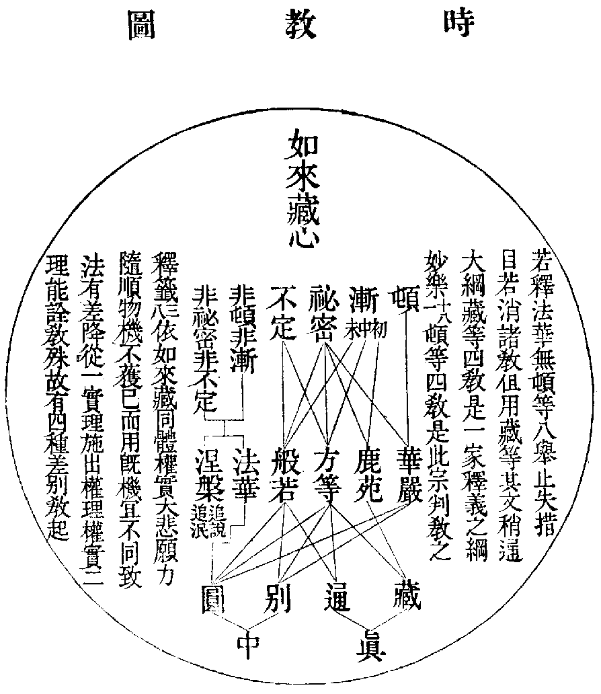



时教说



时教者，圣人之所以开后学也。众生无始背觉合尘，吾佛哀而拯之，甚闲而不乱，故寝大施小，弹斥淘汰，终归开显，而能事毕矣。夫逗机设教，莫越乎化仪；诠理化物，莫越乎化法；化法所诠，莫越乎真中二理；真中二理，莫越乎如来藏心。此理此心，一而二，二而一也。去佛既远，不有智者正出世之经，为人道立教，则光明种子或几乎息矣。舍时教无以传圣人心，学者当自时教始。



五章议



夫两种五章，皆果佛之法。约教，则约如来设教被机之相；约行，则约佛自行所得之法。不作此解，何分在缠能诠之名哉？然则明佛自行所得之法，意令学者闻名识体，依体明宗，宗成有用，起教分别，亦若是而已矣。是则初心之人，便得果佛五章，作自己受用，而佛世尊只先得我之五章者也。问签(五)(十六)言体、宗、用足者，境，体也；行，宗也；智，用也。又云：境即是体，是法身；智、行是宗，是用。何耶？曰：境、智、行三，对体、宗、用。则宗对般若是智妙，用对解脱是行妙，取三德义便故。若宗是因果，以对行妙，行始为因，行终为果，亦便也。用是智用，化物必智导含识，对智妙亦便。故知各从其义耳。问：凡释首题，须立五章，何故戒疏但三，涅槃二十五耶？曰：菩萨戒经既行部外，又非一经之总目，乃是什师诵出一品二卷中偏节戒法，一卷别行於世，称菩萨戒经。若一经之目，应云梵网；若一品之目，应云心地。经品之目，须论五章，戒本别行，节者私安，故不用也。若涅槃者，以顺经文说，三一圆融，一摄一切故也。如经云：解脱之法亦非涅槃，如来之身亦非涅槃，摩诃般若亦非涅槃。以此而知，只是依经文圆诠三德，故立二十五章。虽诸经义具，而无显文，故不立也。



经体论



法华经体唯一实相，葢大雄氏自行究尽化他开显之法，点世相为常住，即妄念以成真，不顺迷情，独取悟理，实一部之指归，众义之都会也。然一实相无空假中之异，故妙玄通释标体，则曰正指实相；别释显体，则曰即一实相印；推原经文，则曰诸法实相也。唯佛究尽，法体本融，依正色心，莫不全是。但此体上具德而有三名：当处绝待之谓中，当处立法之谓假，当处亡泯之谓空。故引寿量非如非异，双照如异，与二论四句，皆显三谛。经曰：如是相等，三转读之，即三谛也。记主云：当知如是相等，即是转释诸法实相。又此三谛，以圆融故，互具成九。故释签简曰：空假即中，中为经体；中即空假，亦指於中。夫即一而论三，圆具而成九，故虽作圆具九三说，只可作一实相著。是知三法乃是体上之具德，九法又是三法之圆融，皆转释一实相之义，且非正显经体，正显经体只一实相云尔。又应须知，就经体言，一切诸法，此体收尽，而此体外，更无一法，若有一法在此体外，名魔事也。妙经玄签经体之意，备求其说，惟四明尊者得之。言经体，则曰：心路绝处，如彼圆伊，当上一点，绝思绝议，非用非宗也。言体德，则曰：而其性融，一不定一，如伊一点，点不孤然，故直法身非法身，法身必具般若解脱也。言互具，则曰：彼之四句，不出三谛，以圆融故，三谛各三也。若全此一实相经体，而起经宗，或起经用，但名体、宗、用三，义成合矣。若全体礼、体底、体达，而起宗本、宗要、宗助，或起本用、当用、自在用，义成离矣。又何起修离合之辨哉？余故曰：经体明，即具法相论离合。



------



## 读教记卷第一



天台沙门　法照



------



### 普门子序



普门子序私科为三：初、四教下，叹教在人；二、惟三下，传弘著述；三、普下，谦己记时。著述又二：初、广叙传弘；二、间者下，的美。著述又二：初、著述之艰；二、且法下，签访之美。



章疏题



净名、玄一此经，理致深远，言旨渊玄。若但依文帖释，恐止事数而已。一教宗极，终自难量，犹须略忖幽微，显不思议旨趣。今辄於文前，撰五重玄义。



签(一)，(二)，玄悟法华圆意者，五义释经，统收五味，故名为玄。玅记(八)，(廿九)，略举经题，玄收一部。



玅宗(上)，(二)，五重玄义。本是经中所诠，观法大师预取解释经题。



别行玄记(上)。(一)言玄义者，能释之义门也。玄者，幽微难见之称。义者，深有所以也。斯葢大师以三昧力彻法性际，深见今品人法之意也。应知名等五义皆悉幽微，七方便人智莫能见。



光明句记(二)(二十)玄义者，文选云：睿哲玄览。注云：玄，通也。谓离文通示其义，故曰玄义。



玄之一字，四明玅宗。别行记约所释得名，与净名玄同。光明记约能释得名，与荆溪合。然准妙宗之文，则览所释为能释也。文句二字当亦然。故妙乐云：文谓文字，一部始终。句谓句逗，义通长短。则一部文字，始终句逗，指经明矣。光明记踵此说，但就能释而言，谦辞耳。问：诸部题名曰玄，义曰文，句曰疏者何？曰：精微云：疏是通名，玄句是别目。如妙玄文句等，从别单题。若净名玄疏，别行义疏等，乃通别双题。或单从通名，则观经疏等是也。



指归钞(一)(一)云：一家言教，解题与释文各部者，则名有玄义文句之异。其合为一部者，则总题曰疏，如净名疏、观经疏之例也(文)。涅槃称疏，此乃新意，非旧题名。问：法华疏题名文句，与教体三假，文身句身，同异云何？北峰师曰：体相是同，用与少异。同称文句，属三假中，二体相同也。故妙乐释文句二字，牒唯识文而例同之。用与异者，此是题名，彼是教体，一不同也。题属一经，彼通诸教，二不同也。题就色立，教体通声，三不同也。问：妙乐云：此亦不论色行等体。亦之一字，对何文下耶？曰：唯识云：文即是字，句诠差别。俱舍云：牟尼说法蕴，数有八十千。彼体语或名，是色行蕴摄。今题云文句，非但不可唯识一实三假，亦不同於俱舍摄色行体也。编次玄句疏于后。



解题  

法华玄义  

释文  

法华文句  

题文  

观经疏



光明玄义  

光明文句



观音玄义  

观音义疏  

三请观音疏



净名玄义  

净名疏



涅槃玄  

涅槃疏  

菩萨戒疏



光明记(一)(一)，文句者，文即经文，句谓章句，亦句逗也。即以章句节其经文，令其诠旨各有分齐。故荆溪云：以由释题大义委悉，故至经文但粗分章段。题云文句，良由於此。然立此二字，葢谦辞耳。若观释经，大义非少。



新记云：文句二字是经文经句，大师消文节句，揽所释为能释。



------



### 玄文四序



北峰曰：玄文四序：一、总序，既是章安私记缘起，理合居初。二、序，王大师将释五重玄义，先以一序序经，首题王起众文之始。三、私序，王大师虽序经始末，且从其义，章安从说，故复重释。四、玄文，本序、正序、玄文，此四序安布次第也。窃详章安总序与私序王，则大师说玄时未有也。大师将说五重玄义，先览五义，别为序王，以释经名，令知经名通冠本迹，次作本序、正序、玄文。章安私序，乃因大师序王，但序经题，义含五章，未明经文亦具五章，故重作私序而释成之。惟总序缘起，乃最后作也。问：别行经序，为是谈玄之序，为是别时讲经之序？若云经序，何云正序玄文？若云序玄，何云别行经序？曰：荆溪两云正序玄文，的是玄序，而名经序者，对玄文本序得名也。荆溪因见玄文自有本序，又见章安释云葢序王者，序经玄意，故科此别释经名为别行经序，行训作也。问：序王与本序，显释五章之名，荆溪何云似但释名而已？曰：记主见大师於经字前著荡化等语，故知似但释名尔，却科荡化为探取经旨。旧云别行与本序，则能释所释异，一章五章异，



玄句听次



玄序云：昔於建业，始听经文，次在江陵，奉蒙玄义。



玅乐(一)，江陵禀受玄旨，建业方听经文。



妙乐引证一徧记难，如玄序云云，语虽倒置，事则无殊，葢作文法也。近人以方训始，艸庵谓之文误者非。



甘露门



玄(一)(一)，知甘露门之在兹。



签(一)(三)，实相常住，如天甘露，是不死之药。今释玅法能通实相，故名为门。



句(一)(二)。今明娑婆国土音声佛事则甘露门开记(一)(九)。则甘露门开者，则言乃表，唯声益故。实相为甘露，诸教为其门，门无开闭，理非通塞。此土入者，不假餘尘，由之通理，故曰门开。



问：签文云玅法为能通门，玅乐何云诸教为其门耶？曰：玅乐因释此土声教入道，故云诸教为门。签文释经首题，故云妙法为门。要知开显诸教即玅法也。



待绝二玅



玄(一)(一)所言妙者，妙名不可思议也。



签(一)(三)。初、释妙者，但举一不思议，则已简於可思议也。彼止观为成观故，乃以相待为可思议麤，唯一绝待为不思议妙。今则不尔，圆中约时，待绝俱妙；餘味约部，或妙或麤。若前三教，时之与部一向为麤，至法华被开方称为妙。止观相待义似於别，故判为麤。今此妙名兼於本迹，彼文妙观独在於圆，虽异而同细寻可了，下文广释不俟多云。



辅行(三上)(二)今法华唯具二妙，所谓待绝。所言待者，唯有待麤成妙，更无待妙成麤。若以迹望本，亦可互形；若以部望部，一向唯妙。今约法华迹理，复置互形，所以玄文待绝，俱称为妙。故以部教相望，复有横竖。望前四时，名为竖待；圆望三教，名为横待。此文既依法华经意，而释名等，大槩准彼。相待是麤义，当待麤论妙；绝待是妙义，当开麤论妙。此二亦名废麤开麤，故法华中唯论二妙，更无非待非绝之名。彼为判教，故待之与绝，同称为妙。今此相待，则判为麤，唯明绝观。无部可待，则无竖待；无教可望，名无横待。故唯一绝，以为能诠。虽立相待，以显绝待，尚无於绝，何待之有？



玄(二)(十二)若破麤显妙，即用上相待妙。若开麤显妙，即用上绝待妙。



玄(二)(九)一相待，二绝待。此经唯论二妙，更无非绝非待之文。若更作者，绝何惑，显何理，故不更论也。



签(二)(卅一)既云此经，当知妙题兼此二义，故使今释诸妙以二冠初。故迹门十妙，一一妙中开多科目，无不二释。言更无非待非绝等者，理性实是非待非绝，祇向待绝约理论二，不同双非二边更有中道之理。恐有人疑应更别有双非绝待之理，故便释云文理俱无。此待绝理已破无明、已显中道，故知双非无复所显，故云破何惑等。



玄(二)(九)。今待麤妙者，待半字为麤，明满字为妙，亦是常无常、大小相待为麤妙也。净名云：说法不有亦不无，以因缘故诸法生。即是明满字也。始坐佛树力降魔，得甘露灭觉道成，即提昔之半待出於满也。般若云：於阎浮提见第二法轮转。亦是对鹿苑为第一，待般若为第二也。涅槃云：昔於波罗柰初转法轮，今於尸城复转法轮。众经皆共以鹿苑为半、为小、为麤，待此明满大妙，其义是同。今法华明昔於波罗柰转四谛法轮、五众之生灭，今复转最妙无上之法轮，此亦待鹿苑为麤，法华为妙。妙义皆同，待麤亦等，文义在此也(云云)。二、绝待明妙者，为四：一、随情三假法起，若入真谛，待对即绝。故身子云：吾闻解脱之中无有言说。此三藏经中绝待意也。二、若随理三假，一切世间皆如幻化，即事而真，无有一事而非真者，更待何物为不真耶？望彼三藏，绝还不绝，即事而真，乃是绝待。此通教绝待也。三、别教若起，望即真之绝，还是世谛。何者？非大涅槃，犹是生死世谛，绝还有待。若入别教中道，待则绝矣。四、圆教若起，说无分别法，即边而中，无非佛法，亡泯清净，岂更佛法待於佛法？如来法界故，出法界外，无复有法可相形比，待谁为麤？形谁得妙？无所可待，亦无所绝，不知何名，强言为绝。



签(二)(卅一)。初文意者，今家即以三教为满，故对三藏为半简之(云云)。所以重叙前诸经者，明今经相待不应对三教，文亦且同诸教所待，故亦指鹿苑而为所待。结中意者，一往以所待之麤，对圆为能待之妙(云云)。释绝待中为七(云云)。初文约教显圆。问：若明绝待，祇应但一，何故开四？以四相形，与待何别？答：若相待中展转明妙，前麤犹存。今论绝待，绝前诸麤无可形待。又所以渐明四种绝者，为知圆绝极妙无过，前三被绝，圆外无法。细消文意，各有深致(云云)。意但且论展转相望以明诸绝，显於圆教无复能绝(云云)。次岂更下，明绝待相状，明法界体一，无复形待。待谁为麤等者，明无能待。能即是妙，法外无法，待谁麤妙？无所可待等者，明无所绝。所即是麤，法外无法，故无所绝(云云)。不可以相待示，不可以绝待示，待绝俱绝，故名灭待。灭绝



玄(二)(十一)用是两妙，妙上三法。众生之法，亦具二妙，称之为妙。佛法心法，亦具二妙，称之为妙。



签(二)(卅四)次二妙，妙上三法者，欲明三妙在於法华方得称妙，故须二妙以妙三法。故诸味中虽有圆融，全无二妙。三被妙已，故三即妙。故上文云：此妙即法，此法即妙。故得三法皆具於十，成三十妙，良由於此。问：向释妙云：待绝俱绝，方名为绝。今何以言待绝二耶？答：前明绝待，故须俱绝。今述经意，故须双明。经意虽双，理无异趣。以此俱绝对前称待，所待未会，会方名绝。是故此部得二妙名。



签(六)(九)又若不论待无以明绝，若明待已即指所待，是於能绝亦绝方名为绝。



相待论判，绝待论开，即诸文判麤玅，开麤玅也。相待者，待麤而论妙，能待之义，在於法华。绝待者，绝相待之麤妙而论妙，亦绝能待之妙而论妙，亦在法华。旧谓相待是施权义，非也。



莲华三喻



玄(一)(一)，一、为莲故华，譬为实施权。文云：知第一寂灭，以方便力故，虽示种种道，其实为佛乘。二、华敷譬开权，莲现譬显实。文云：开方便门，示真实相。三、华落譬废权，莲成譬立实。文云：正直舍方便，但说无上道。



签(一)(四)。妙法不出权实，故莲以譬实，华以喻权(云云)。若非莲华，无以显於妙法故也(云云)。为莲故华者，约时且寄华严顿后而说，顿中之别，理实教权，且置未论。鹿苑施小，方等般若，已为开废，而作方便，如此说者，且在於小。若约教者，通前四时，三教皆权，二乘唯在，法华菩萨，处处得入。而今文引，且从引小，小难引故，故寄说之(云云)。次明开者，指实为权，权掩於实，名方便门闭。今指权为实，於权见实，名方便门开(云云)。第三废者，舍是废之别名，开已俱实，无权可论，义当於废，权转为实，所废体亡(云云)。若尔，开废何别？答：约法乃开时即废，约喻必义须先开。若尔，法喻差违，何成喻法？答：据理似与喻有违，据事似先开后废。如先示方便，即是真实，既识实已，永不用权。若约理者，开废俱时，开时已废故也。



玄(一)(四)为莲故华，华实具足，可喻即实而权。又华开莲现，可喻即权而实。又华落莲成，莲成亦落，可喻非权非实。



签(一)(十二)华实具足等者，为莲故华华掩於实，为实施权实在权内，体复不异，故云即实而权。机熟须开开彼能覆，情怖近果名之为覆，袥彼近谓名之为开，开何所开即彼能覆。又华落莲成等者，华落譬非权，莲落譬非实，开已即废时无异途，开教行人理同一理故，故实立已同冥三德，故知三德不当权实。



玄(七)(六)。复次，为十妙故，开出十麤，如为莲故，华意在於莲(云云)。又华开莲现，譬开十麤，显十妙，则无复十麤，唯一大事，不可思议境界，乃至利益。



玄(五)(十六)昔权蕴实，如华含莲。开权显实，如华开莲现。离此华已，无别更莲。离此麤已，无别更妙。何须破麤往妙，但开权位，即显妙位也。



玄(一)(十一)。问：华以喻权，权是小乘之法，则不应破於艸庵。艸庵既破，何得以华喻权？答：小乘是化佗之权，是故须破。今明自行之权，故以华喻耳。



签(一)(廿九)答：小乘是化佗乃至喻耳者，且约初说，小隔於大是故云破，以大破之故云须破。自行即是体内之权，故以华喻。然化佗之权，据佛本意并属自行。又初约施权故属化佗，今论开权故属自行，施开被缘其理不二。



北峰曰：莲华喻法，约佛意说，以喻一代施化之意。如来为实施权，意在於实，如为莲故华，华本含莲，正喻同体。但众生权中有实，华含於莲，是故开显令知。据众生不知，则不名莲华，正是开艸华为莲华。但今莲华喻佛施化之意，故不论艸华也。如玄(七)(廿六)：一华生必有於莲，为莲而华，莲不可见。此譬约实明权，意在於实，无能知者。文云：我意难可测，无能发问者。(文)既云意在於实，而众生不知，故须开也。又复须知，虽喻佛意，无非玅法。若从所喻，权法当体，但空但中，不能即实，亦可譬麤。故云：昔本隐实，如华含莲。又云：为十妙故，开出十麤，如为莲故华等。即此义也。详玄签意，小乘是化佗之权，正如前玄多华一果等。此约在昔，当分喻桃李艸华也。今明自行之权，故以莲华为喻。然化他之权，据佛本意，并属自行，此据佛意喻莲华也。又云：初约施权属化佗，今论开权属自行。此又约施权喻艸华，开权喻莲华。是则施权隔实如艸华，故须破；开权即实如莲华，故须显。今明开权即玅及以佛意，故以莲华为喻也。



附法观



玅玄(一)(三)，观心即闻即行，起精进心故。



签(一)，(九)。观心者，随闻一句摄事成理，不待观境方名修观。



玅玄(一)(十一)。六、明观心者(云云)。心如幻燄，但有名字，名之为心。适言其有，不见色质；适言其无，复起虑想。不可以有无思度故，故名心为妙。妙心可轨，称之为法。心法非因非果，能如理观，即辨因果，是名莲华。由一心成观，亦转教餘心，名之为经。



签(一)，(卅一)由一心等者，研一刹那既成观已，即以此观复观后心，后心成观所复成能，后后相续名教餘心。经是被下之教，故观下惑名经。



四、明十义书破立甚精，此乃玅玄一部观心式样，十不二门指要钞广此说耳。



法华教主



玅玄(一)(五)。今经体者，体化他之权实，即是自行之权实。如垢衣内身，实是长者。



签(一)(十四)，初文即是开丈六垢衣，垢衣正是示为小乘化他权实，今开即是同体权实璎珞长者。



此章安师私谓经体开权之文，四明玅宗立法华身是尊，特佛引为诚证，的示开权绝待妙故，决了声闻法是诸经之王，开麤即妙，妙外无麤，是故得云璎珞长者看解谤书，净觉神智皆不及也。



华严三照



玅玄(一)(六)，云何分别(云云)。



释签(一)，(十六)。初文五味者，还约华严日照三譬开为五味。问：应还取涅槃本文，何以却取华严文耶？非但数不相当，亦恐文意各别。答：涅槃五味转变而祇是一乳，华严三照不同而祇是一日。今演华严平地之譬，以对涅槃后之三味，数虽不等其义宛齐。又涅槃以牛譬佛，乳从牛出，譬佛初说大乳出已后，其味转变犹成分譬，故此下文义立五味皆从牛出。未若华严日譬於佛、光譬说教，日无缘慈非出而出，众机所扣非照而照，故使高山幽谷平地不同，同禀教光终归等照，故用两经二义相成。



别行疏(下)(十二)降神母胎，即示两相。



记(下)(十四)。问：华严顿后方施小化，譬如穷子急追不至徐语方来，前顿后渐其义善成，今那忽云降神母胎即示两相？答：诸文所论初顿次渐，葢是化仪施设之语，今此所说大小双应终归一乘，方尽鉴机始末之事，如方便品思无大机念欲息化，诸佛劝谕方施小乘，次文却云无量劫来赞涅槃法，生死永尽我常是说，是故思机然后施小，此等之说皆是仪式，不可据此以难今文，预鉴群机原始要终度物之意也。



句(六)(十九)今明胜应应菩萨，即卢舍那尊特身，大机所扣者也。劣应应小乘，丈六弊衣，小机所扣者也。



别行疏记(下)(十四)。彼经预叙一代始终，故立譬云：犹如日出，先照高山，次照幽谷，后照平地。今家义开平地为三，对於涅槃五种牛味。高山大机能感顿教，日光先照，即有次第及不次第见佛性也。若涅槃中譬从牛出乳次第五味，则对一代五时教味次第相生。



孤山论衡记云：华严有三照之说，涅槃有五味之谈。华严既居最初，涅槃仍居最后，乃始终之二义也。



疑者曰：华严预叙一代，则是预借法华，莫不以法华为所施耶？当知预叙之言，乃是约佛意判释，所以得云先照等也，不可以化仪为妨。



梵王见净



玅玄(一)(六)，见有净秽。



释签(一)(十七)。见净如梵王，见秽如身子，



净名经(上)(七)。尔时，螺髻梵王语舍利弗：勿作是念，谓此佛土以为不净。所以者何？我见释迦牟尼佛土清净，譬如自在天宫。舍利言：我见此土丘陵、坑坎、荆棘、沙砾、土石、诸山，秽恶充满。



净名疏(三)(十二)。埀裕记(四)(四)。有前四种罪障者，界内有为缘集障、界内尘沙障、界外尘沙障、界外无明障，而此四障障於四净，故知身子具四种障。身子虽除恶有为集，然由有於净有为集，不依佛慧，故使於垢不能见净，是故四净悉皆不见。



玅乐(二)(廿八)，别译阿含第六广明。诸梵来下，第八、第十一广明诸天赞佛。诸天若来，并同人形。第四云：梵王来礼佛，佛入火光三昧，不能得前，因往瞿伽离门唤之。瞿伽离问：谁唤？答：梵王。又问：佛记汝得阿那含耶？答：如是。又问：阿那含名为不来，汝何以来？梵王言：如是之人，不应与语。故知一同人法，还有违情。而诫伽离(云云)。既为一代请法轮主，请大则大，请小则小。



梵王为一代请法之主，故在大则大，在小则小，所以依佛慧见土清净也。



不定教



玄(一)(七)。虽高山顿说不动寂场，而游化鹿苑。虽说四谛生灭，而不妨不生不灭。虽为菩萨说佛境界，而有二乘智断。虽五人证果，不妨八万诸天获无生忍。当知即顿而渐，即渐而顿。大经云：或时说深，或时说浅。应问即遮，应遮即问。一时一说，一念之中，备有不定不同。旧义专判一部味，味中悉如此。此乃显露不定



签(一)，(廿一)。初文者，此指华严。不动不离而升而游者，此指顿后渐初，不动於顿而施渐化(云云)。虽转四谛，指鹿苑，此指虽施渐化而不起於顿。此二味既然，诸味准此。虽为菩萨，指方等、般若，彼二时中俱有小果，新得旧得如常所明。虽五人证界，不妨八万诸天获无生忍，此重指渐初，对般若说。前文约法，此中约人，得果不同，证法不定，应引大论显密法轮义释此中意。故大论六十五云：於阎浮提见第二法轮转。初转法轮，八万诸天得无生忍，陈如得初果；今转法轮，无量诸天得无生忍，今转似初转。问：初转少，今转多，云何以大喻小而言似耶？答：诸佛有二种法轮：一者、显，二者、密。初转，声闻见八万及一人，诸菩萨见无量阿僧祇人得二乘，无量阿僧祇人得无生忍，无量阿僧祇人发无上道心行六波罗蜜，阿僧祇人得初地乃至十地一生补处坐道场，是名为密。故知初见八万一人属显露摄。秘密者，如次明之(云云)。次引大经证中云：或时说深，或时说浅等，名不定者，以由彼此互相知故。若秘密者，即如下文互不相知，是故名密。不定与秘，并皆不出同听异闻，故名为即(云云)。问：此与方等恐畏欢喜等，为有何别？答：不定徧前四味。若直语方等，但弹斥而已。既以身土令物殊途，正当不定(云云)。言味味者，乳中则约圆别相对以辨不定。酪中教门虽无二别，乃与八万对辨不定。生熟二酥，三四对辨，其意可见。



按玄签，文有二义：自虽高下释相，是约部竖明；次味味下，结，是约教横辨。或问净名：佛以一音演说法，众生随类各得解。四教义引证显露定教，四教仪引明不定教。净名记云：佛以一音等是秘密义。如此不同者何？曰：经意多含徧证无碍，只一梵音演说，取共相见闻之义；证定教，取得益不同；证不定教，取如来神光遮覆，彼彼互不相知；明秘密。



------



## 读教记卷第二



天台沙门　法照



玅玄(二)



秘密教



玄(一)(七)。秘密不定，其义不然。如来於法，得最自在。若智若机，若时若处，三密四门，无妨无碍。此座说顿，十方说渐，说不定。顿座不闻十方，十方不闻顿座。或十方说顿，说不定。此座说渐，各各不相知闻。於此是显，於彼是密。或为一人说顿，或为多人说渐，说不定。或为一人说渐，为多人说顿。各各不相知，互为显密。或一座默，十方说。十方默，一座说。或俱默俱说，各各不相知，互为显密。



签(一)(廿二)若智若机等者，智谓大圣权谋，机谓不同次第、不择时处，身口意密随何四门无碍自在，适时称会皆无虗设。三正释相中且寄三法以出其相。何者？以此三法对秘密故，则化仪四教文义整足，任运摄得三藏等四。於中复二：先约三说相对，次约说默相对。初三说中二：先约十方相对，次或为下於一方中多人相对。一方既尔，十方亦然。二文各先正释，次各各下结。次约说默相对中亦应具有十方及人二义不同，无人相对者文略，而言俱默俱说者理合如之。前三法相对准此，亦应云俱顿俱渐俱不定，文无者亦略。既云俱默俱说互不相知名之为密，何妨俱顿互不相知？各各下亦结也。云互不相知者，前文但云於此於彼者亦应互说，举一以例验，知不定与秘密但有互知与互不知以辨两异。此中显露亦义通餘七，以秘密不出此七故也。故前文云显露渐顿及显露不定，故七竝是显露意也。



签(一)(十七)。问：华严、鹿苑，大小永隔。才说方等，则同座并闻者何？答：若以秘密横被，无时不徧。若约横论竖，则隐显在机。



签云五味则一道竖进，味味皆有半满相成者，彼南师偏用五味，北师偏用半满，今约五味半满相成而用，则华严唯满不半，乃至法华废半明满，非五味各有半满也。又云故至鹿苑方分显密者，此叙小始人天不历华严，故提谓犹属显露，至鹿苑方分显密。



文句(一)(五)，秘密者，隐而不传。



玅记(一)，(十七)。秘密不传者，降佛已还非所述故，尚非阿难能受，岂弘教者所量？又阿难非不传秘，赴机之密非所传耳，故秘密所用全是显教，是故传秘秪名传显。



玅玄(六)(十八)，秘密既隐，非世流布，此置而不论。签(七)(十)，秘在大圣赴机，今且置而不说。若欲说之，秖名口密赴四机缘。今其彼彼互不相知，即是其意。显秘虽异，教不出四，是故不论。



止观(一)(八)，教是圣人被下之言，圣能显秘两说。凡人宣述，秖可传显，不能传秘。听者因何作观？或得者六根净位，能以一玅音，徧满三千界，随意悉能至，则能传秘教。



辅行(一上)(卅三)正约化主论得不得，密属圣人圣能双益，今论凡师故阙於密，故修观者无密益义，故云听者因何作观。次或得下义立於得，位虽在凡凡师多种，五品已下犹名不得，六根净位虽无三轮口密之益，能传玅音徧大千界，不同佛化故云能传，禀教之人仍无密益。



玅玄(十)(十五)涅槃云：我初成佛，恒沙菩萨来问是义，如汝无异。诸大乘经如此意义类例，皆名顿教相也。



签(十)(十八)。初成道者且借秘密助入此中，明鹿苑初成亦有顿义，况诸经耶？



玄(十)(廿三)大经云：我坐道场菩提树下，初成正觉(云云)。此则通至於前。



止观(九)(廿八)又复我说初成道十方菩萨已问此义，即涅槃中约十二因缘有秘密教。



辅行(九下)(十四)又复下。引证秘密教(云云)。故知渐初已有菩萨密闻斯义。



涅槃疏(四)(十)旧解坐道场亦曾问者，或言是华严中问，翻经不尽，其文未来；或言是偏方不定教，文亦不来；或言是秘密教，非显露摄。义皆不然。今明道场乃是元初圆满始坐，非方便道场。第二卷云：我已久於无量劫来，久已成佛。亦如法华成佛已来甚大久远，昔诸菩萨曾问此义，如今不异。正对过去之问，非一化之始，不应据寂灭道场及偏方秘密。



涅槃经大师引用非一，或证顿，或证秘密，或证涅槃徧前也。



十二部经



玅玄(一)(十七)。复次，一一教中，各各有十二部经，亦用悉檀起之。若十因缘法所成众法，乐闻正因缘世界事，如来则为直说阴、界、入等假实之法，是名修多罗。或四、五、六、七、八、九言偈，重颂世界阴、入等事，是名祇夜。或直记众生未来事，乃至记鸽、雀成佛等，是名和伽罗那。或孤起偈，说世界阴、入等事，是名伽陀。或无人问，自说世界事，是名优陀那。或约世界不善事而结禁戒，是名尼陀那。或以譬喻说世界事，是名阿波陀那。或说本昔世界事，是名伊帝目多伽。或说本昔受生事，是名阇陀伽。或说世界广大事，是名毗佛略。或说世界未曾有事，是名阿浮陀达磨。或问难世界事，是名优波提舍。此是世界悉檀，为悦众生故，起十二部经。



玅玄(六)(十五)今依大智论标名者，一、修多罗，此云法本，亦云契经，亦线经。二、祇夜，此云重颂，以偈颂修多罗也。三、和伽罗那，此云授记。四、伽陀，此云不重颂，亦略言偈耳。四句为颂，如此间诗颂也。五、优陀那，此云无问自说。六、尼陀那，此云因缘。七、阿波陀那，此云譬喻。八、伊帝目多伽，此云如是语，亦云本事。九、阇陀伽，此云本生。十、毗佛略，此云方广。十一、阿浮陀达磨，此云未曾有。十二、优波提舍，此云论义。部者，部别，各有类从也。经者，外国云修多罗，此云线经。线能贯穿，经能经纬，言能持法，如线如经(云云)。二、明分法大小者，此经指九部为入大之本，则九部是小，三部是大，葢别语耳。通而为言，小亦有记莂六道因果。又阿含中亦授弥勒当作佛记，岂非授记？经亦有自唱善哉，无问而说。声闻经中以法空为大空，故成论中云：正欲明三藏中实义。实义者，空是阿毗昙所不申，而成论申於空，空即广经，当知小乘通具十二部也(云云)。有人言：大乘九部，除因缘、譬喻、论义。大乘人根利，不假此三，斯亦别论通语，大乘何得无此三经耶？有经言：小乘但让广经，一部有十，一部无方。广者，大乘说如来是常，一切众生皆有佛性，正理为方，包富为广。又理融无二，亦名为等。声闻中所无，但十一部耳。若言小乘定有九，不应复有十一部。既取十一，亦通有十二，为缘别说，或让三，或让一，以判大小乘(云云)。



签(七)(九)，将大小俱十二，望大小各九，各九是别，各十二是通。各九之中，缘、喻、事三局在於小，广、问、记三局在於大，餘之六部通於大小(云云)。又有说者，名十一部菩萨纯说。大乘方等第十九云：复有十一部经，除毗佛略，亦无如是甚深之义。次明通别意者，如上所说，一往赴机，据理应以通说为正。



修多罗名，名该三藏，如达磨郁多罗之论，本亦名修多罗故。又十二部中，非局一部，始终通名修多罗故。止观所引，若律若论，共成玅解，故指前六云修多罗。



通别申论



玅玄(一)(十九)，天亲用两番四悉檀造地论，通华严(云云)。签(二)(六)，地持释华严十地品，此下一代四时皆有论申，唯方等部未有别论，可以唯识通用申之，无性之文全同败种故也。



玄(四)(卅二)又十地论、摄大乘论、地持论、十住毗婆沙论、大智度论，并释菩萨地位，而多少出没不同(云云)。签(五)(廿二)十地论唯释华严十地品，摄大乘第七释第四。因果胜相中，亦但明欢喜等十地而已。地持中明种性等六住。



玄(十)(十九)。地论第七地云：一念心具十波罗蜜。签(十)(卅二)。地论等者(云云)。地持第七以十二住摄一切位。



此文在十地论第九卷第七远行地签中。云地持者，持字误。



净名玄(四)(十一)，应有别申大集方等及此经论，不来此士。



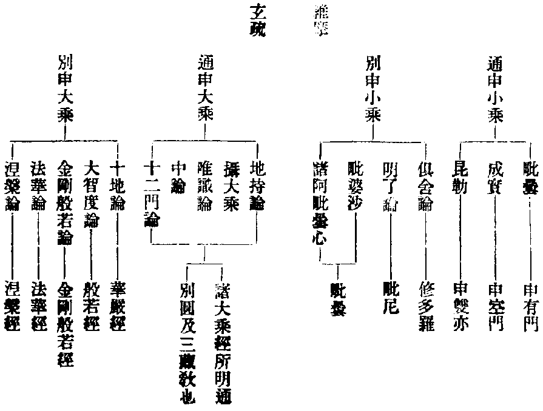



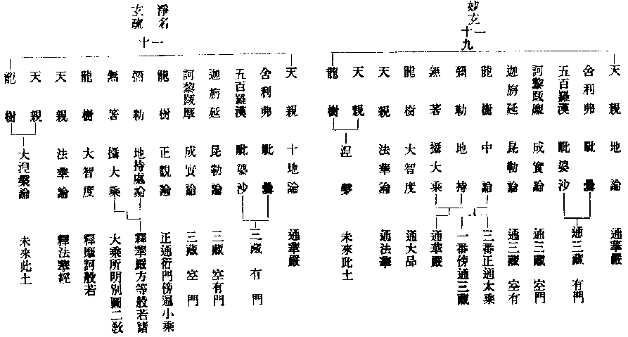



或问：净名玄云：如十地论别申华严经。别圆两教签云：十地论唯释华严十地品。签文又云：地持释华严十地品。何耶？一云：传写之误，应改持作论字。二云：文有兼正之殊。若从正说，地持论正是通申华严。今云地持释华严十地品者，此兼释十地品也。兼正不同，故得互举。予甞於嘉定壬午五月既望，亲捡大慈藏中地持与十地论，乃持字之误，当改为论。不然，则错认弥勒为天亲，甚相辽也。



开权



经(总诸佛章方便品)。舍利弗！诸佛随宜说法，意趣难解。所以者何？我以无量无数方便，种种因缘譬喻言辞，演说诸法。



疏：(四)、(九)、从随宜所说下，是开方便也(云云)。初、明佛道随三种机宜说方便，故言随宜。而佛意在实，物不能解，故言意趣难解也。



记(四)(卅二)。初明佛道至难知也者，施权意也。以诸教中无施名故。今欲明开，故先叙所开即所施。是故玄文云：为实施权，意在於实。开权显实，意在於权。当知以实为权，权名隐实。开权显实，实外无餘。潜之与显，利在物情。常住本源，未尝增减。故未开之前，非但不说显实之名，都无施权之语。故说宜权之言，即须显实故也。



句(四)(十六)。以无量无数方便者，明开权也。是法皆为一佛乘故，明显实也。



记(五)(八)。然三世章显实，皆云是法。及释迦章如此两字，并指权是实，故云显实。何者？在昔施权，尚无权名，何况有实？故今开权，权即是实，故云是法皆为佛乘。故知述其施权，意在开也。



经(方便品)。诸佛所得法，无量方便力，而为众生说(云云)。句(四)(廿二)。诸佛所得法者，修道得於诸权法也。记(五)(十四)。修道得於诸权法者，自行因满，所感权法，正当自行体内权也。即此法体，亦不可说。以方便故，为众生说，成化他权(云云)。故知立一开权之言，於今乃成二意：一者胜昔所施，二为显实之所。不指所开，无由说实。况指权是权，知非究竟。既显实已，权全是实。玄(一)(廿二)。九开权显实者，一切诸法，莫不皆玅。一色一香，无非中道。众生情隔於妙耳。大悲顺物，不与世诤。是故明诸权实不同(云云)。今开方便门，示真实相。唯以一大事因缘，但说无上道，开佛知见，悉使得入究竟实相。除灭化城，即是决麤。皆至宝所，即是入妙。



签(二)(九)，初通明诸法本实，次大悲下施权，三今开下显实。初文者，法既本妙麤由物情，故知但开其情理自复本(云云)。正开中又二：初约法通开明施化本意，次除灭下寄二乘难开以明开相。麤既即是玅，化城即是宝所故也。



玄(十)(廿六)次从二以开。二者，元本是如来藏，如来藏中备有半满不思议之二，众生不解，全生如乳，又开出带半之满。



签(十)(廿九)本是如来藏者，即是法华正体一实之理，故名为藏。实理之中备有同体权实之法，名为半满。众生不解，是故开出带半之满(云云)。此从不思议二开思议之二，今合思议之二归於不思议二，不思议二纯一醍醐。



句(三)，(廿二)。若依今经文，未曾向人说如此事。



记(四)(七)。言未曾说者，通论教等前并未开，别而论之教行理三前或已会，若开人者前教所无，故以前教所无而为品目，故知非同体方便无以施开等也(此明可开之理)。



句(六)，(十九)。记(七)，(十)。跨节为同，当分为异。是则同为同体，异为异体。异约施权，同约开显。秖一吏民，义当两属。(开已知同。)



止观(六)(廿八)。辅行(六下)(十三)。於实法界顶，开同体权髻，与实相明珠(从应而说)。



签(六)(末)开前诸麤应中，亦约教道须开，两教佛应。



北峰师曰：须知开权正为机情的开异体，若论佛意，无非同体。但今开显非为佛意，正为机情，良由如来藏中性具权实，权实同体，体元圆玅。但由机缘不解，是故如来方便顺机，为实施权，设教分齐。藏通则唯诠偏真，别教则次第断九，机缘执之，不能趣实，不能即实，名偏名麤，异体权也。至法华会机熟须开，指其所执是我方便，权说为实，而施权即是实，方知麤即是玅，异即是同，玄云元本是如来藏等也。



指南曰：正论异体，为所开也。须知秘密藏中，权实体一，众生不了，妄计遂生，贪著小乘，流浪五道，欲使复性，不免施权，调熟机缘，终令悟实。故玄文：一、明诸法本实，二、大悲施权，三、开权显实。究论开异体者，顺机曾施，故记主所谓：若不先异，何所论同？良有以也。



草录曰：考论法华正宗，既开权已自妙，为其佛已殷勤称叹方便三周正体(云云)，不知本经指上所说。此经开方便门，的指佛以方便力，示以三乘教，此本经略开之正文也。声闻言下，近谓情尽，功由於此。经题玅法，品目秘玅，权皆已玅，本无相违，才涉即实，已非开权。若分权实，异体论判(文)。意为佛叹权已而开，即开同体妙权，况佛方便力，岂异体耶？决疑开法体，辅正开体内权，今以四义评之：一、不识化意，若论佛意，本无同异，但由众生情隔於玅，今若开权，岂开佛意？二、不识自他，且今开权，为化他？为自行？若开化他，岂非异耶？故文句(三)(二十)，三教若通若别，当分皆是化他权实；圆教若通若别，当分皆是自行权实。化他之三，皆名为权，自行皆名为实(文)。此大师判权实文，当思之。三、不识今昔，所开属昔，名异体；今经能开，名同体。故玄云：开昔之异，显今之同。正开异成同，何将所执异体，作能开同体耶？四、不识机情，若开同者，机情在何处知同耶？若在无量义，何故到略开斥作方便，动执生疑？若在五佛知同者，正是开异成同，何得直云同体耶？



三经通别



玅玄(二)(廿四)妙法莲华，名异众典，别也；俱称为经，通也。立此二名，凡约三意：谓教、行、理。从缘故教别，从说故教通；从能契故行别，从所契故行通；理从名故别，名从理故通。



签(二)，(十一)。初文者，虽在今经，与他对辨，不无通别。若妙法莲华，名之与义，俱异他经。经之一字，名与他同，义与他异。今从名通，故云通耳。次立名意者，以何缘故，立此经名？名既该乎一部，一部意不逾三。故名既通别不同，三意亦随名通别。故释此三意，麤妙甄分，教行理殊，通别异辙(云云)。一代圣教，诸名之下，无不具此教行理三。无不以别而契於通，无不以通而应於别。故此三中，通摄佛法。故教则机应相对，行则因果相对，理则名实相对，亦是事理相对。若无此三双，通别虗设。



玄(二)(廿四)。今称妙法之经，即是教之通别。名赐诸子等一大车，乘是宝乘，直至道场，即行之通别。或言实相，或言佛知见，大乘家业，一地实事，宝所系珠，平等大慧等，即是理之通别。



签(二)(十二)今称等者，玅法是别，异餘经故。经即是通，通名经故。故知今经通别，始自如是，终乎而退，莫非佛说，俱是妙法。从始至终，咸别竝通。於此教通别中，诠於行理通别，故知本迹无非因果及名实故，不可徧引。故略示方隅，粗引譬喻，以示行之通别，及方便中实相等，为理通别。譬喻中者，诸子习因不同，即是行别。等赐大车，直至道场，即是行通。大车是所乘通理，道场是所契实相，乃至大慧之名，亦是名别。一一别名，咸从理立，即是理通。此是今经理之通别。



玅宗(上)(九)。他释经题，皆以经字为能诠教，餘字并是所诠之义。作此分之，甚违佛旨。且人、法、譬，皆是名字，岂非能诠？那得一向属所诠义？经字不可一向属教。如妙经云：法华经藏，深固幽远，无人能到。又云：为佛护念，植众德本，入正定聚，发救一切众生之心，成就四法，必得是经。疏释此四，是开、示、悟、入佛之知见，知见证理，名为得经。此二岂非以理为经？金光明云：十方诸佛，常念是经，岂令诸佛，但念於教？此例葢多，不能备引。故知诸师，以能诠、所诠，释众经题，失旨之甚。今家皆用通、别释题，方无所失(云云)。今解诸经，通、别二名，俱是能诠，俱是所诠。良以通、别，各自具於教、行、理故。勿谓二名，但在於教。须知通、别，自有教名、行名、理名。如一别题，佛说是教，观即是行，无量寿佛是理。岂非别教、别行、别理？以此三别，对於经字，即是通教、通行、通理(云云)。彼释签中乃以因果判行通别，须知其意，非谓至果其行方通。欲知意者，据各修因名为行别，约趣一果此别即通，斯乃别时论通、通时论别。岂唯行尔，教理亦然。如以机应对教通别，佛以一音演说法，众生随类各得解，各解则机别，一音则应通，各解不离一音，一音不妨各解。如金光明玄以能诠文字为教理，以能诠所以为教别，所以即是四悉檀也。一一悉檀皆用文字，一一文字不离悉檀。如以名实对理通别，多名不离一实，一实不妨多名。故三通别皆悉同时，悉类乐中管色之韵，约声则通、约曲则别，通别二用不相妨碍(又十一纸)。五时之内一一经题皆具通别，若不用此教行理判，徒分通别全无所以也。然无量行会一常乐，四教四门同诠一理，若专方等未堪此闻，乃是预取法华之意跨节而谈，於佛灭后解释诸经，不约法华宁穷一化(云云)？欲使行者即此一题就说解教，起能观行见真佛理。



释签大车是所乘下，通理二字宜削去。或问：诸文明人、理、教、行，今何缺一？曰：教、行、理三，消释经题，且论於法，不论於人。若以义求，教、行既以感应，因果相对，理亦应有。又问：诸文明教、理、智、断、行、位、因、果，今何缺五？曰：智、断、位、因、果，并行中摄，故不更明。又问：三经通、别、合五章否？曰：词异意同。何者？教即初、后二章，理即经、体，行即宗、用。行之进趣曰宗，行之伏断曰用。故大师云：显体是理，宗、用是行也。



当分跨节



玅玄(一)(廿四)。问：教主不同，设教亦异，云何而言金口梵声，名为教通？答：此有两义：一、当分，二、跨节。当分者，如三藏佛，赴种种缘，说种种教，缘异故教别，主一故教通。依此教行，有能契所契，种种名理，理无种种(云云)。此则身口行理，齐分而说，不得作餘解也。通别圆等教行理，当分亦尔，斯义易解，而理难融(云云)。二、跨节者，何处别有四教主，各各身，各各口，各各说，秖隐其无量功德庄严之身，现为丈六紫金辉(云云)。若开方便门，示真实相，即向身是圆常之身，向法是圆法，向行向理，皆即真实。如此通是一音之教，而大小差别，能契有长短，所契唯一，极种种名，名一究竟，唯一究竟，应於众名，作如此论。教行理通别者，相则难解，理则易明(云云)。



签(二)(十二)。问中所以但问教者，教行理三展转互通，教既居初但从教问，餘之二种凭教自显。初广略二解泛通诸教，是故通以一佛为通，今即离为四佛不同，佛佛自有诸门教别，故云教主不同设教亦异。云何下难者，以前通途难今四别。次答中意者，即具富分跨节两义，应知两义即与待绝二玅不殊。又前二释亦具二义。何者？若依施权即当分义，若据佛意即跨节义，虽具二义不谭其意，而以此意泛释，复未甄衡二途，其意似通而未灼然开显，以是义故，故须分於二义而答。当分通於一代，於今便成相待，跨节唯在今经，佛意非适今也(云云)。次秖隐下明当分意。立当分者，以施权竟权实相对，故有四主各各不同，故明意者无别当分，秖是隐实施权且云当分。初至金辉现当分身也(云云)。若开下正明跨节相(云云)。三结意中历三意结。初言通是一音之教而大小差别者，今此是法华跨节一音，不同小乘当分一音，具如止观第一记，故依婆沙但三藏佛一音耳。准例通别皆应有当分一音，前当分义中分四教主，各有所说所行理体，故义易解。理无种种，何故四教各有所诠？所诠异故理不应异，故云难融。跨节义中不分四教各别诠理，故云易明。诸经所说因果各别，今越彼别义唯论一理，故相难解。若二义相成则理相俱易，若二义隔越则二俱难明。是故二义相须，当分乃成今经相待义边，跨节乃成今经开权义边。又若方等般若及华严等当分义者，仍是施权。若来至法华当分义边成判权实，判已即废、废已即开，开废相即不可异时。签(六)(七十三)跨节则诸教法门皆从圆生，当分则各各自有无量法门生当教佛果。



文句(五)(三)，转佛心中化他之法，度入他心，名转法轮。



玅乐(五)(卅二)转佛等者，此有二义：若约跨节，通四如来，诸法具足，随扣而赴。凡有所说，无非化他，对自证说。若以圆自，对三教他，此即约法，亦名为他。今从当分，约渐初说。此佛内证，故云心中。证有权实，权法利物，故名为他。



问：跨节唯在今经，何故妙乐云若约跨节，通四如来？曰：法华之前，随机各说四教不同，今以开权言之，只一圆佛也。看通字故，四明别行。玄记下云：约跨节论，只一圆佛，被四种机，说四教法。



三法通局



妙玄(二)(一)，南岳师举三种，谓众生法、佛法、心法(云云)。今依三法，更广分别。若广众生法，一往通论诸因果及一切法。若广佛法，此则据果。若广心法，此则据因。



签(二)(二十)。次明大师依南岳意更广分别(云云)。言若广众生法一往通论诸因果及一切法等者，然众生义通故云通论，若其通论义非究竟故云一往。一往虽通二往则局，不通於佛及唯在因。佛法及心不云一往者，佛法定在於果、心法定在於因，故此三法得名各别。何者？如众生身中佛法心法犹通因果，况众生名通通凡通圣？若佛身中众生心法亦定在果，心法之中佛法众生法此二在因。若尔，何故经中三无差别？答：理体无差，差约事用。此义广明，具如止观十法成乘中说，即是心法及众生法。彼佛法界亦兼於果而不专於果，彼文寄果明理性故也。



指要(上)(五)应知心法就迷就事而辨。故释签云：众生法，一往通因果，二往唯局因。佛法定在果，心法定在因。若约迷悟分之，佛唯属悟，二皆在迷。复就迷中，众生属他，通一切故。心法属己，别指自心(云云)。三法各具事理，二造方无差别。



止观(五)(十)。辅行(五中)(一)。妙乐(四)(十五)。续遗记下(四)。



三法得名各别。众生、法二往则局，而不通於佛。此对佛辨。及唯在因。此对心辨。有云：乃唯在因。及字，刀笔之误。有云：众生、法及心、法皆在因，故云及。夫法界之性，无所而不徧，无所而不在。不在於佛，则在众生；不在众生，则在於心。是以得为三无差别，故言妙也。



------



## 读教记卷第三



天台沙门　法照



玅玄(三)



十二因缘



涅槃经(二十)(五)云：无明、有、爱，是二中间，即是中道。如是中道，能破一切生死。



玅玄(二)(十五)。十二因缘支，二是过去则止常，二是未来则止断，现在则显中道。推现三因则说未来二果，推现在五果则说过去二因。三世皆有十二支，为推因果故作如是说。



签(三)(三)。言中道者，离断常耳(云云)。次推三世中云三世皆有十二者，推因知果等，如今所说。三世俱名因果，而支数多少不同者，具如俱舍云：略果及略因，由中可比二。如止观第三记。现在既望过未成十二，当知过未亦自相望，各有过未故各十二，今且从现故但十二。



辅行(三下)(十四)。俱舍云：三烦恼二业，七事亦名果，略果及略因，由中可比二。从惑生惑业，从业生於事，从事事惑生，有支理唯此。初四句是以略摄广，故论云：应知缘起虽有十二，而二三为性。三谓惑、业、事，二谓因、果。就中又二：初两句正明相摄，下两句释妨。妨曰：何故过、未略而现在广？释曰：由中可以比知现在名中故也。次从惑生惑，谓爱生取；从惑生业，谓取生有及无明生行；从业生事，谓从行生识及有生生；从事事惑生者，谓从事生事，即识生名色乃至生受；从事生惑，谓受生爱。



光句(中)(二十五)。二乘虽复同观，观法有异。声闻观诸果，总作一苦谛观。观诸烦恼及业，总作一集谛观。又苦之与集，总是现在，所以名总相观。缘觉观苦为七，现在五，未来二。观集为五，过去二，现在三。别观三世，别开苦集，故言缘觉别相观也。



记(四)(十六)。初明声闻。若望因缘，乃以七支总为一苦，仍以五支总为一集。又复苦集不分过未，总是现在，以根钝故，法相总略。二明支。佛开声闻，总成别相。现在五者，谓识、名色、六入、触、受。未来二者，谓生、老死，别相苦也。过去二者，谓无明、行。现在三者，谓爱、取、有，别相集也。又开三世，不唯现在，故云略果及略因，由中可比二。是则三世皆有十二，以福资智，故能别观。



光句(中)(三十)三世者，过去二因破神常之见，现在五果破神我之见，现在三因未来二果破神断之见，常途所用。



记(四)(二十三)。初三世，过去破神常者，过去已灭故非常也。现在破神我者，五果皆五阴和合故无我也。未来破神断者，未来有果故非断灭。皆言神者，外执身神有断常等也。此三世义世共传之，故云常途所用。



十二因缘，不出三世，各有因果。虽辅行引俱舍文，有少不同，於义已具。故荆溪师云：因缘之义，佛法根本，背邪向正之始，入道修观之源。故习佛法者，不可全迷。



七种二谛



玅玄(二)(二十四)。所言七种二谛者，一者实有为俗，实有灭为真。二者幻有为俗，即幻有空为真。三者幻有为俗，即幻有空不空共为真。四者幻有为俗，幻有即空不空，一切法趣空不空为真。五者幻有，幻有即空，皆名为俗，不有不空为真。六者幻有，幻有即空，皆名为俗，不有不空，一切法趣不有不空为真。七者幻有，幻有即空，皆名为俗，一切法趣有趣空，趣不有不空为真。



释签(三)，(十七)，云云。



涅槃疏(九)(九)今明智者大师有七二谛，名虽不同，其义可会。一生灭，二无生，三襌俗复真，四襌俗襌中，五复俗襌中，六复俗复中，七圆二谛。若依法华玄文，名相稍别，义意必同，读者应知。



指归钞(十一)(二十)：别教中道，在偏空外，故受复真之名。圆教达边即中，故云襌也。若法华玄通教二接，并称复真，乃是一往细分，如今文也。



玅玄  

藏



生灭  

涅槃



通



无生



别接通  

签即是含中真谛  

襌俗复真



圆接通  

签亦是含中二谛  

襌俗襌中



别  

签复俗单中  

复俗襌中



圆接别  

签亦是复俗单中  

复俗复中



圆  

签复俗复中  

圆二谛



三法解源



玅玄(二)(二十四)幻有空不空二谛者，俗不异前真，则三种不同。一俗随三真，即成三种二谛。其相云何？如大品明非漏非无漏。初人谓非漏是非俗，非无漏是遣著。何者？行人缘无漏生著，如缘灭生，使破其著心，还入无漏，此是一番二谛也。次人闻非漏非无漏，谓非二边，别显中理。中理为真，又是一番二谛。又人闻非有漏非无漏，即知双非，正显中道。中道法界，力用广大，与虗空等。一切法趣非有漏非无漏，又是一番二谛也。大经云：声闻之人，但见於空，不见不空。智者见空，及与不空。即是此意。二乘谓著此空，破著空故，故言不空。空著若破，但是见空，不见不空也。利人谓不空是玅有，故言不空利。利人闻不空，谓是如来藏。一切法趣如来藏，还约空不空，即有三种二谛也。复次，约一切法趣非漏非无漏，显三种异者。初人闻一切法趣非漏非无漏者，谓诸法不离空，周行十方界，还是缾处。如又人闻趣，知此中理，须一切行来趣发之。又人闻一切趣，即非漏非无漏，具一切法也。是故说此一俗随三真转，或对单真，或对复真，或对不思议真。



签(三)(十九)。次释接义者，即含中入真也。於中为三：初以一法标，次俗不下略以三法示，三其相下辨相。通寄三法以辨其相。漏无漏本是通法，为成接义故立双非。空不空本是别法，一切法趣本是圆法。於一一法各有三人取解不同者，良由机发故所闻不同。又通教菩萨由根利钝发习不同，故钝同二乘，直至法华方乃被会。利者尔前接入中道，故使同观幻有之俗而契真各异，所以别圆机发对钝住空致成三别，是以释后二接须对通钝共成三人同闻异听，故约漏等以示解源。若得此意，於一切法无碍自在(云云)。初文者，三人俱作双非之名而取解不等。於中为三：初依教立，次初人下明行相，三何者下重释。非无漏是遣著者，无漏无著由行者著心缘之，今破其著心故名为非，故云非无漏也。如缘下引例释成，复宗真谛离著云非还归无漏，此初人意也，即通钝根。次人又人，即利根二人也。圆人亦云双非者，带通方便是故尔耳。次引大经空不空例漏无漏，可以意知。次言三人闻趣者，初人云诸法不离空义，当一切法趣空，故引例云如缾如等，如即空也。如缾是空，十方界空不异缾空，故十方空皆趣缾空，即通人也。次人闻趣，知此但中须修地前一切诸行来趣向后，以发初地中道之理，即别人也。第三人闻，即具一切名之为趣。次结中言或对者，三真是能对，一俗是所对。



天台大师玄文三法解源分科示意云：漏无漏本是通法，为成接义，故立双非。又正释科云：初依教立。是知双非乃大师立也。



翻宗立识



摄大乘论上(曰字函，陈译)。诸佛世尊有十胜相，所说无等，过於餘教。十胜相者：一、应知依止胜相；二、应知胜相；三、应知入胜相；四、入因果胜相；五、入因果修差别胜相；六、於修差别依戒学胜相；七、此中依心学胜相；八、此中依慧学胜相；九、学果寂灭胜相；十、智差别胜相。起信论疏(一)(末)。梁朝真谛三藏，就名翻为无没识。今时奘法师，就义翻为藏识。藏是摄藏义，无没是不失义，义一名异也。



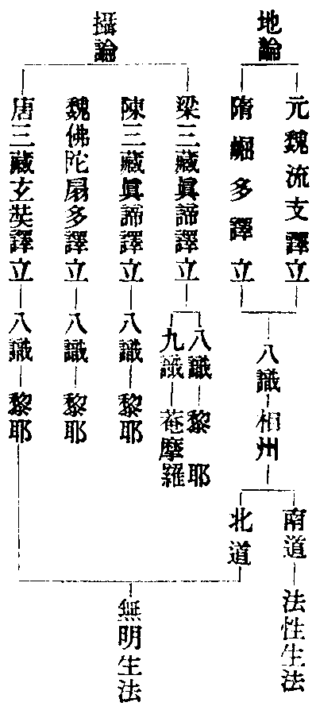



玅玄(二)(二十八)。摄大乘明十胜相义，咸谓深极，使地论翻宗。今试以十玅比之，彼有所漏，且用理玅比依止胜相，明不思议因缘四句破执，岂留黎耶庵摩罗为依止耶？



签(三)(二十七)。言依止者，谓所依也。真谛所译则依庵摩罗，后代诸译竝依黎耶，如其各计成自他性，一论二译尚生二计，况诸部耶？论师以黎耶依持破於地论，故云翻宗。翻者改也，令地论宗破归我摄宗。次明今家斥中为八(云云)。初如文。次文者，且以迹中十玅之初境玅少分，比彼十胜相之初相全分，於少分中尚有所漏，四句之中但得自他一句而已，故上斥云有所漏也。况破则俱破、立则俱立，不同彼论唯计一句，故今文云不思议因缘，岂同论文黎耶摩罗自他因缘耶？文虽双举计必偏执，如新旧两译，亦如地论南北二道还成性过各计不同，今不思议离四性计，岂同彼论各计不同耶？



玄(五)(二十八)。若地人明阿黎耶是真常净识，摄大乘人云是无记无明随眠之识，亦云无没识，九识乃名净识互诤(云云)。



四念处(三)(十)。观此无明，为从无明生？为从法性生？璎珞及地论皆解云：从法性生。摄论云：从无明生，依阿黎耶识起。此识是无记，如地有金土，依染如土，依净如金，故言依他也。黎耶识依业生，故言依他也。若他依者，六识所起善恶业，六识谢灭种子，依黎耶摄持得生，故名他依。彼论偈云：此识无始时，一切所依止，



玅玄(九)(十)，如地论有南北二道，加复摄大乘兴，各自谓真，互相排斥。



签(九)(十八)如地论有南北二道者，陈梁已前，弘地论师，二处不同。相州北道，计阿黎以为依持。相州南道，计於真如以为依持。此二论师，俱禀天亲，而所计各异，同於水火。加复摄大乘兴，亦计黎耶以助北道。又摄大乘前后二译，亦如地论，二计不同。旧译即立庵摩罗识，唐三藏译，但立第八。



文句(六)(三十)。玅乐(七)(二十)。北人者，诸文所指，多是相州北道地论师也。古弘地论，相州自分南北二道，所计不同。南计法性生一切法，北计黎耶生一切法。宗党既别，释义不同，岂地论令尔耶？



辅行(三上)(十)言三识者，真谛三藏云：阿陀那七识，此云执我识，此即惑性，体是缘因。阿赖耶八识，此名藏识，以能盛持种智不失，体是无没无明，无明之性，性是了因。庵摩罗九识，名清净识，即是正因。唐三藏不许此识云第九，乃是第八异名。故新译摄论不存第九，地论文中亦无第九，但以第八对於正因，第七对於了因，第六对於缘因。今依真谛，仍合六七共为缘因，以第六中是事善恶亦是惑性。



止观(五)(十四)。地人云：一切解惑，真妄依持法性。法性持真妄，真妄依法性也。摄大乘云：法性不为惑所染，不为真所净，故法性非依持。言依持者，阿黎耶是也。无没无明，盛持一切种子。



辅行(五中)(九)寄二论破者，论随教道顺物机缘，恐迷者执权即成性过，故寄破之令成圆极。言无没无明者，即阿黎耶识无始恒有，故云无没。没谓失没，恒不失故，不同俱生及现行等。



光明玄(八)云何三识？识名为觉了，是智慧之异名尔。庵摩罗识是第九不动识，若分别之即是佛识。阿黎耶识即是第八无没识，犹有随眠烦恼与无明合，别而分之是菩萨识。大论云：在菩萨心名为般若，即其义也。阿陀那识是第七分别识，诃恶生死欣羡涅槃，别而分之是二乘识。於佛即是方便智波浪，是凡夫第六识。



舍遗(上)(二十四)。释别名中存三梵语，逐一释义即是翻名。言第九等者，出梁摄论，真谛所译，故辅行云(云云)。若分别者，为易解故，以一念中所具之法教道权说，分对诸位且立远近，以第九识无染不动故当於佛。第八属菩萨者，以十地位六七二识以转成智，正以赖耶三分为境，虽是境界而即用此便为观智，如初心人亦用现前第六王数而为境观，故引大论在菩萨心名般若也。第七名阿陀那者，据真谛译，若新经论皆云第七名为末那，今依古译。言诃恶生死等者，以二乘人人执既亡见思所薰，第六事识转成无漏，既尘沙未破，正住第七法执之中，不了生死法空故有诃恶，不了涅槃法空故有忻羡。此识若於果佛位中，却复用之而为权智，以二乘法接引小根，著弊垢衣执除粪器，故知诸识破后自在为机载用也。波浪等者，第六识也。楞严云：陀那微细识，习气成暴流。而为波浪，乃当凡夫心心数法也。此约四人各对一识，若就渐断分别四相，麤必含细，凡夫具四、二乘具三，已破第六故；菩萨具二，六七已转故；佛唯有一，第八至果已转故也。



六七八九识。以真妄分之，九识唯真，八识通真妄，七六唯妄。因果言之，六七八属因，九识属果。三惑对之，六识见思，七识尘沙，八识无明，九识是真如。事业二识分之，六识是事，七八属业，九非二识。以三观对之，七空、八假、九中。以三因对之，九正、八了。六七为缘。辅行云：今依真谛，仍合六七为缘。梁摄既立第八阿黎耶生一切法，又立第九庵摩罗为真识。唐三藏译，但立第八，不立第九，乃云第九即第八之异名。若南北弘地论师，但立八识，南道计真，北道计妄。真者谓真如生法，妄者谓无明生法。问玄云：使地论翻宗为南地耶？北地耶？曰：南北俱翻，以由十胜相义深极故。若尔，何故签文谓之助北道耶？曰：此语其梁摄计八识生法，与北地师同。问：唐摄八识，真耶？妄耶？真则签云：后代诸译，竝依黎耶。妄则辅行明庵摩罗后云：唐三藏不许此识，但云第九，是第八异名。既云异名，莫不八识亦是真耶？曰：唐摄八识是妄。签云：真谛所译，则依庵摩罗。又云：唐三藏译，但立第八。又云：唐三藏不许此识，皆立识文也。若尔，何故签三云：如新旧两译，亦如地论，南北二道，还成性过，各计不同。签九云：前后二译，亦如地论，宗计不同。莫不唐摄，同於南地论师计真耶？曰：此亦立识文也。梁摄立第九识是真，唐摄既云第九，是第八异名，则知是妄。如此各计，同彼地师，非谓同彼各计八识为真妄生法也。问：依持依止，同异云何？曰：依止从所依说。签云：依止者，所依也。依持从能依能生说。止观(五)。依持者，黎耶是也。无没无明，盛持一切种子(云云)。



教证



玅玄(二)(二十九)地持明地相明义说相似法，地实明义说真实法。又教门方便即教道明义，说所证法即证道明义，今借用之。诸佛法久后要当说真实即地实义，道场所得法即证道明义，是故玅也。



签(三)(二十七)，初引文，次正明今意。初有两番意者，前文约行，次文约教。初言地持明地相等者，地相谓地前回向位中，道观双流地相现前，登地已去明真实法称为地实，初地即是初住故也。次文言又教门等者，依教道义以四悉檀说登地法名为教道，故知初地已上仍存教道，若说十地已证之法即证道也。凡释别义多用此意，具如止观第三记。次今意者，借於此文证权实部，法华已前如地相教道，至法华经犹如地实及以证道，说佛自证名为地实，约佛自行故云证道。



释签(三)(二十)今文别教为游戏神通者，以存教道，让证属圆故也。



辅行(五)(二十三)。前之两教教证俱权，圆教教证俱皆是实，此竝易明。但别教中教权证实意稍难晓，人多迷之，使此别教其义壅隔，是故今家借用地论教证二道以消别门。於中应须先知二意：一者约行，则地前为教、登地为证。何者？地前仰信登地现前，岂有亲证复存隔历？二者约说，为地前说始终属教。何者？如云真如为惑所覆，或将十度以对十地互不相收，或云须离二边修真如观，或云等觉入重玄门，或云五地习学世法，或云八地入无功用。等觉一位或有或无，断十二品称为玅觉，如是等例不可具述，悉是权施。为引下凡为入地方便，入地自证权门自开，故云初地即是初住入证道也。又云初地不知二地菩萨举足下足，若约理说，名字观行尚自知圆，岂有初地不知二地？若云下位不测於上，圆亦展转迭不相知，何但别人教门方便？今文非专判教优劣，但存次第及不次第，迷之尚宽。若读玄文，善须晓此教证二道，则别门可消。若依教修行弥须善识，是故今文时时略用。若不晓者，初心明理两说不同，若不识之措心无地。如云初心知理即是，或云理具万德待行，或云解圆行须渐次，或云理有不用诸法。如此说者，非别非圆非通非藏，教相不说指与何耶？



玅玄(三)(十一)。又别教四智三麤一玅，圆教四智悉皆称玅。何者？地人云：中道乃是果头，能显初心。学者仰信此理，如藕丝悬山，故说信行皆非圆意也。故十信智为麤，十住正修空傍修假中，十行正修假傍修中，十回向始正修中。此中但理不具诸法，是故皆麤。登地智破无明，见中道证，则为玅。



签(四)(八)。今依地人以存教道，十地犹麤，何况十信？若且从登地而为证道，故二麤二玅，玅觉果头本是实人，是故为玅。又亦可妙觉是权故为麤，十地是实故为玅，故云中道乃是果头，能显



四，教义(四)(二十四)。故十地论师作教道证道二道明义，或作地相地实二种明义，正是为修别教方便事相之文也。



义例(五)如教证二道，本在别教，今则通用，乃分两意，约证约说。



按玄文，教、证二道，盖借地持以显一实，而记主用是以消别门。粤有四种，谓约行教道、约行证道、约说教道、约说证道，对当地位，一如复宗。但两证属实，两教属权，复宗未闻也。辅行欲明教权证实，则初地已上仍存教道，已是别教，一教俱权，约说证道，不须复说。签文指云：如止观第三记。辅行指云：若读玄文，善须晓此教、证二道。盖彼此相显也。若别教四智三麤一玅之文，则玅觉智、十信智、三十心智俱为麤，登地智破无明而为玅。记主云：今依地人以存教道，十地犹麤。则初地已上是约说教道故麤，若约证道，则从登地证道为玅。又玅觉本是实人，亦得为玅，乃成二麤二玅矣。然十地之与玅觉，约教道说则为权，约证道则为实。北峰以约说证道只是权说，不通於实，欲附会释签四种作三种说，恐亦未详义例两意，非谓别教教证，乃是对藏、通教证俱权，圆教教证俱实说耳，故云准例用义。如教、证二道，本在别教，今则通用，乃分两意，约证约说，三麤一玅，文最难看。



别教接俗



释签类集引。



问：别教接俗不接真，何故签云复以圆中接於但中，及诸文皆明接但中耶？北峰曰：诸文从别教教道而说，故云但中，乃是如来为地前人。约教道说，中在果头。若约位行言之，地前空假皆名为俗，故云接俗不接真。



减缘行



玅玄(三)(八)，忍法观者(止)，是名上忍。



签(四)(三)，次释法忍者(止)，即初果也。



或问：中忍缩观既有二十四周减行、七周减缘四教义(二)，何云中忍十番缩观耶？曰：此缘行总说，即七周减缘，并苦谛下三行，共成十番也。又问：玅玄(八)(二十八)云三番缩观进成上忍者何？曰：以上下合为四谛而说，既留苦谛，但减集、道、灭三，故云三番也。有云三界，有云三忍者，非是。又问：释签前文并㭊玄皆云二行名中忍，后文何云一行名中忍？玅玄但作二心观，於一行名中忍，何耶？曰：二行言用观未减时，一行言用观已减时，已减二十四行，复起刹那心修观，则入上忍位矣。又问：中忍二刹那，诸文有云三刹那者何？曰：望世第一刹那，则上忍二，中忍三也。如㭊玄明之



起修(寿安法师云：修三性，三修性对论三；修九性，九修性对论九。六离四合，约名义偏强；若据法体，离合自在。)



玅玄(三)(二十四)。此之玅行，与前境智，一而论三，三而论一。签(四)(十八)。如此三德，在一心中。境即理性三德，智即三德之解，行即三德之观。始从观行，终至六根，无非玅法(云云)。一谓涅槃，三谓三德。境是法身，智是般若，行是解脱。当知只一涅槃而论此三。又境即理性三，智即名字三，行即观行相似三。当知九秖是三，三秖是一。一尚无一，岂有九三？



玅乐(五)，(二十三)。修性一合无复分张即是理性三因开发通名三性　句(三)，(三十)。



玅乐(十)(五)故知诸文约修以说，缘了各三。或但论理性，始终具三。如云三道、三德、三佛性等，具如修性不二门说。



签(四)(十八)一行一切行者，须约六即以明三德。今言行者，多在住前三法，玅显在於初住故也。



指要(末)一一具三，开合无碍。功成历位，虽有浅深。三九圆融，未始差别。



光记(二)(二十八)若境智行，对理性等，住前三即。此乃从强，约修别对。若论法体，真位无缺。



拾遗(下)(十九)。问：法身如何更冥法性？答：此文既云果上三身与法性冥，此乃修三冥於性三(云云)。修极三身与性冥故，故使三身各有三义。斯由性三互具成九，致令修三亦成九义。显无别修，故论二九。二无二体，只是一九。九只是三，三非定三。三只是一，举一不少，言九不多。修性圆玅，其义如是。



拾遗(上)(二十二)此三涅槃，约契理、应机二种修义，对於本净一性而说。当知一性对修故合，约性常开，全修在性，故性具三。若全性三，起契理修，乃成三智。若全性三，起应机修，乃成三脱(云云)。



玅宗(中)(九)应知体宗用三，别明三法。乃从一性，起於二修。体是法身，所显性也。宗是般若，能显智也。用是解脱，所起力也。



北峰曰：圆论修性，须约全修在性，故性中具三；全性起修，故修亦具三。既全性起，故修中缘了发性德行，为彰玅智玅行显发本性。但此三法，一必具三，三即是一，故须约离合圆融而说，方异别修。虽约互具离明，若克论法体，只是以玅行助智显发本性也。若玄签虽亦有当位高深，而文义多从十玅生起而说，则显离合唯局住前，是知净觉、孤山失究也。且四明记文自具二意，盖依荆溪签文而说，既云须约六即，又云多在住前，与四明二意一也。辅赞曰：今禀圆顿者，识本体礼具一切法，由解此法，解而行之，名曰起修，即是全体礼性起宗要修也。若指修即性，宗要即宗本，宗本即体底，体底即所穷，所穷即体礼也。若体礼性起自在用，指修即性名为本用，本用即体达，体达即所依，所依即体礼也。故知自行因果之修，化他能所之用，皆依迷中体礼全具而起，以即性故，名为宗本体底、本用体达，此二贵极，名为体礼也。今评曰：宗用即体，即受性名；体即宗用，亦受修名。此则可尔，若体三、宗三、用三，既从离说，须互论相即。若例於体，宗用即体，既宗名体底，义当宗本；用名体达，义当本用。若体即宗用，应云：体名宗本，义当体底；用名宗助，义当当用。体名本用，义当体达；宗名当用，义当宗助。如何直以体礼起宗，要自在用耶？若直以体礼起宗，要自在用，则但说合义，全非体三、宗三、用三、离义也。若从离论，从性起修，应从修性三法本位而说，如何从所即而说？若从所即，则三中只一中，三空只一空，三假只一假，其三法离合，从性起修何在耶？又复体礼是佛极证法身，何须更用起修？且不知起修自是扶行别论生起之义也。若然，论其失者有三：一、弃果从因失。今礼底达三，皆从果释，而弃佛祖果上之义，却从因中迷法起修耶？二、弃离从合失。体等各三，既是离义，如何弃离从合起修耶？三、弃本从即失。他既谓体中三法皆在迷在性，所以从性起修，则应从性中三法本位而起，乃是性中法身起修中法身，性中二修起修中二修，方合玅玄从性德之三法起名字之三法，因名字之三法修观行之三法(五)(二十二)，如何乃从性中二法即中即用中之一性起修？此则弃二法本位，从即中而起，故云体礼起宗要等。今问：修中般若之体，是了因否？若是，岂非从性般若起修，般若是全性起修耶？若不是，则修性体别，别修缘了，是知广智之说非也。



遮照



玅玄(四)(八)，道灭即苦集，苦集即道灭。若尔，则四非四。四既非四，无量亦非无量。无量既非无量，则假非假。假非假故，则空非空。何但即空非空，亦即假非假。双亡正入，即寂照双流。大品云：一切种智即寂灭相，种种行类相貌皆知，名一切种智。寂灭相即是双遮双亡，行类相貌皆知即是双流双照。无心亡照，任运寂知，故名不可思议，即无作四谛慧。



签，(五)(三)道灭下相即可知，迷解在人体恒相即。次释四者，体既相即虽复名四，体实非四，故言四非四也。圆融四谛秖是一实，於中二：初正明四谛体即，次四既非四无量下融通地前。初如文。次文者又二：先融，次结成三谛。初文者，收地前诸行无量亦非无量，何但无量亦非无量，则住中空亦非空。次何但下结成三谛，先结，次引证。初文者，揽前二谛非二谛故成中道，双亡双照即结成三谛也。双非即亡空亡假故名为寂，正入秖是入中故云为照，而亡而照故曰双流，不同通教但空偏假立双流名。与而言之，四教俱有双流之位，而行相各别。次引大品文者，先引，次寂灭下释经意。初文者，即是三智显前亡照。经文初总标一切种智即寂灭相，从种种下论文释也。名一切种智者结，次从寂灭相去今文释经意也。遮流约智用，亡照约智体，从无心下转释智体。智体成就不须作意，亡照而常、任运而寂，而知寂即是亡、知即是照，依次第义即在初地，不次第义应明六即。



签(四)(十三)。前约智体说，今约智用说，得此一番则识智体得名所从。



观经疏(四)此观成时，证一心三智，亦名一切种智寂灭相，种种行类相貌皆知也。寂灭相者，是双亡之力。种种相貌皆知者，双照之力也。



玅宗(上)(二十八)。不明智果观法无归，故示观成惑灭理显，豁然玅证三种智慧实在一心。或具论三智，或从胜说，只但名为一切种智。寂灭等者，论自解释一切种智双寂二边，无明之相双照二谛，种种行类始自初心圆修三观，玅观中道念念双亡，而即二边念念双照，一心三观法尔如然。今入分真本智显发，全由始行亡照之功。



不二门(五)故须初心而遮而照，照故三千恒具，遮故法尔空中，终日双亡，终日双照。



指要(下)遮照者，空中名遮，一相不立；假观名照，三千宛然。复令三观俱亡、三谛齐照，乃亡前遮照。照前遮照，故各名双；亡照同时，故云终日。此则同前，即空假中，无空假中也。



按罗什译摩诃般若经二十七卷九十品咸字函第二十三卷三慧品第七十，须菩提言：世尊！云何名为一切种智？佛言：一相故名一切种智，所谓一切法寂灭相。复次诸法行类相貌名字显示说，佛如实知，以是故名一切种智。大论八十四正字函引无一字差。今签云种种下论文释也者，论字误，盖经自释也。此约圣行竖论初地一切种智。大师释经意，智体智用相融相即，即用之体故曰亡照，即体之用故曰遮流，非谓体外别有用也。不可以前寂照双流及空假双流遮照等语为妨。签四(十)(三)。智体智用亦可例之，摩诃即大品，三慧即三智。



------



## 读教记卷第四



天台沙门　法照



玅玄(四)



十身舍那



华严经(廿八卷)，此菩萨知众生身、国土身、业报身、声闻身、独觉身、菩萨身、如来身、智身、法身、虗空身。此菩萨知众生心之所乐，能於众生身作自己身，亦作国土身，乃至虗空身。



签(五)(六)，八地说一切佛现身观莫舍忍门，劝观常住入无功用心，是菩萨现十种身(云云)，以此验知是别教地相，故至第八地始观十种身。　玄(四)(九)。



玅记(二)，(廿二)。云何七地等者，古人所判云七地恐起二乘心者，此似通位，是故难其不成别义，难圆亦尔。若言七地始入无功用道，此是别教，教道明义故不成。圆　句(二)，(十二)。



玅记(九)(廿五)问：华严十身，此但二三，身数既少，摄义不周，是则此经身义不足。答：义有通别，通义可尔，别则不然。彼通云身，故云十身卢舍那也。别释如来，故不应云业报国土佛等。若欲通收彼经十身，应开为四，则以化身收於业报，智即报身，虗空属法，餘皆应摄。　句(九)(十八)



十谏(一)，若不现大，便为尊特。是则别圆之人，见猿猴鹿马，无非他受用报，以皆中道感应故也。



解谤(九)若中道感应名尊特者，名多在佛(云云)。若现起九界差别之形，未必显立尊特之号。虽不立名，非无其义。如华严明十身舍那，其业报身岂不收於猿猴鹿马耶？既称舍那，即净满义。既净且满，宁非尊特？三身正义(二十)(四)甞捡华严新旧二本，皆说第八地菩萨现十种身，谓众生身(云云)。经中并无十身舍那之称。又於如来身上自具十身，谓菩提身(云云)。观师名此十身为法性身，是则如来自具者，方名十身舍那。玅乐所指，未详其意。



光明记(三)，(卅三)。



此八地菩萨分证十界之体，起十界之用，故经曰：此菩萨能以众生身作自己身。签曰：是菩萨现十种身。记曰：彼通云身，故云十身卢舍那也。然中道感应者，理具三千能感，理满三千能应，故知感应不出三千。三千诸法，法法即性，岂猿猴鹿马而不即耶？八地菩萨果虽未满，而能分起十身之应，别圆行人依业识修中者，方感此应也。或问：国土身既是依报，且别教不谭无情佛性，如何依报说法耶？曰：此约菩萨神力变现，现身利益，随机设化，固非无情说法也。



支佛(辟支迦罗，此云缘觉，亦名独觉。毕勤支底迦，此云各各独行。)



玅玄(四)(廿七)大论称独觉、因缘觉，若出无佛世，自然悟道，此即独觉。若出佛世，闻十二因缘法，禀此得道，故名因缘觉。独觉生无佛世，有小有大。若本在学人，今生佛后，七生既满，不受八生，自然成道，不名为佛，亦非罗汉，名小辟支迦罗。论其道力，不及舍利弗等大罗汉。二者、大辟支迦罗，二百劫中，作功德身，得三十二相分，或三十一、三十、二十九，乃至一相，福力增长，智慧利於，总相别相，能知能入，久修集定，常乐独处，故名大辟支迦罗也。若就因缘论小大者，亦应如是分别。此人根利，不须制果，能断正使，又加侵习。譬如身壮，直到所在，不中止息，故不制果。



文句(四)(七)。问：缘觉出无佛世，云何三周得有缘觉？答：释论云：缘觉、独觉。独觉出无佛世，缘觉愿生佛世。华严云：菩萨下，兜率放光照之，觉即舍身，不觉徙之。大经云：彗星。中论云：支佛出世，佛法已灭，此是独觉人也。愿生佛世者，先得初果，十四生未满，值佛即成罗汉，不值佛即成独觉。其既值佛，亦不舍寿，亦不被移，愿见佛故。二果、三果例然。又有部行缘觉，在无佛世，师徒训化也。此应有二种：佛去世后无文字，众生根钝故，支佛不说法，此非部行也。部行者，能说法也。又有变化缘觉，宜应见者，现缘觉身。今三周之座有缘觉者，其义可解。



玅乐(四)，(廿九)答中引经云徙之者。问：此佛亦有闻法缘觉，何不令其闻佛说法，如方等、般若中二乘之人耶？答：未断惑者，可令闻法；已断惑者，自谓独觉。以是应知，世无二佛。问：缘觉在小，住亦何妨？答：元为法灭，无师独悟。既有佛兴，复不禀教去，则不与禀教为妨。是故不同方等，元是禀教之人。问：徙向何处？答：向无佛兴处。纵在此界，亦是佛教所不及处。如有德王兴，岂彗星不没？若尔，其得神通，岂不知耶？答：为护物机，不护缘觉，知亦无爽。



别行疏(十一)：(十)、支佛侵习为浅处，通教正习尽为彼岸。



别行疏记(上)(十二)。支佛修行，不立分果。深观缘起，久种三多。福慧既隆，预侵二习。虽未发真四流动，名得浅处。顿证极果，名到彼岸。通教正尽得浅，习尽到岸。



三、多谓供佛、事善友、佛所闻法也。若同性经列支佛十地者(集解中引)，葢从因行其位浅深，从果则顿证支佛。又仁王经列独觉众经，又云五百独觉从佛闻法者，便是缘觉也。对声闻信行边说云独觉耳。玅乐云：支佛是法行人者，一往且对声闻禀教，所以支佛自思为法。然支佛必自证(六)(廿八)。然四明记，文有二节：初、对消疏文；二、虽未下，文外示义也。



借别名通



玅玄(四)(三十)二、用别名。名者，即是取别教之名，准望通教菩萨位也。别名者，即是十信、三十心、十地之名也。铁轮位於通义，即是乾慧地，伏忍也。三十心即望性地，柔顺忍也。八、人地。见地即是初懽喜地，得无生法忍也。故大品云：须陀洹若智若断，皆是菩萨无生忍也。薄地向果。向即是离垢地，果即是明地也。故大品云：斯陀含智断，是菩萨无生法忍也。离欲地向果。向即燄地，果即难胜地。故大品云：阿那含智断，是菩萨无生法忍也。已办地向果。向是现前地，果是远行地。大品云：阿罗汉智断，是菩萨无生法忍。辟支佛地即是第八不动地，侵习气也。大品云：辟支佛地智断，是菩萨无生法忍。菩萨地即是善慧地。十地当知如佛地，佛地如前说。



签(五)(廿一)，次简名别义通，及为菩萨立忍名等，具如止观第六说。



玅玄小树位二初明三乘共十地  

二简名别义通二初就三乘共位中菩萨别立忍名而义通  

二用别教名名别义通



止观(六)(六)今言经借别义显通耳。别见义长，论三地四地；通见义短，不出入观。然名可借别，义必依通。若作不出入观释者，若言三地者，据断见初；言四地者，据断见后，皆不出入观。例如第十六心，或言是见道，或言是思道。



辅行(六上)(七)。今言下，略示。别见下，略释。然名下，判断。例如下，引例。此十六心同是一位，尚判两道，何妨断见二地不同？问：当通教中判断见位自分二地，何须破他自立借别，立断见位还同通教？答：祇缘同通，故得名通。通虽二地，断时仍促；三乘共故，虽促复长，是故须分三地、四地。或时借别，别见更长，仍有二意：若约理说，通至佛地；若约教道，云三、四地。虽二意各别，见义并长。以别长故，故借教道用判两地断见无爽。若依通义，云不出观；若依别义，但云地地皆能破见，以此为异。以别长故，故后两番通用四地皆断见位。人多不见，谓通义足，何须借别？此是大师通申经论。有此判者，属借别名，名通位也。何者？若定属通，不应地前而立伏位；若定属别，不应行向属四善根，乃至四地共断见惑亦复如是。故立此式示后学者，使古今异说泠然可见。



止观破思假明位二二初正释四初藏  

二通  

三别名名通家共位有三初破立  

二先借别教始终名通  

次单借别十地名通十地



四借别名名通家菩萨位　此单约菩萨



二兼申别圆



止观(连)言借别名名通位者，外凡三贤是乾慧地，而名为十信。内凡四善根是性地，而名为十住、十行、十回向。八人见地是须陀洹，而名为初欢喜地也。薄地是斯陀含，斯陀含有向有果，立向为离垢地，立果为明地。离欲地是阿那含，阿那含有向有果，立向为炎地，立果为难胜地。已办地是阿罗汉，阿罗汉有向有果，立向为现前地，立果为远行地。辟支佛位立为不动地，菩萨地立为善慧地。或以菩萨地后心为法云地，或以佛地为法云地。大品云：十地菩萨为如佛。得作此释也。



辅行(连)言借别下，正明借位。先借别教，始终名通。通教地前无位可论，故借别教内外凡位，但名通教初地、二地。通教地后亦无复位，故但以别教法云、佛地以名通教，九地、十地从容不定。故有或言：大品既云十地如佛，当如即是别名名通。



止观(连)若借此别名判三人通位者，则初地断见惑，二地断欲界一两品思，三地断六品思，四地断七八品思，五地断九品思，六地断七十一品思，七地断七十二品思，八地已上侵习断无知等，例前可知(云云)。辅行(六上)(八)若借下，次单借别。十地名通十地，则彼此地前通为伏惑，通虽无位即未断惑，不入地故。



止观(连)四、借别名名通家菩萨位者，乾慧是外凡，性地是内凡，八人为初地，十五心为二地，十六心为三地，此三地皆不出观而断见惑。又四忍为初地，四智为二地，四比忍为三地，四比智为四地，此四地皆不出观而断见惑(云云)。薄即五地断六品思，离欲即六地断九品思，已办即七地断色无色思，尽支佛即八地乃至佛地断习，无知例前。



辅行(连)四、别名。名通菩萨位者，此单约菩萨故，修观断见不定(云云)。薄即去菩萨断思位。



四、教义(三)(十二)。二、简名别义通者，即为二意(云云)。



玅玄明通教位，既自就当教别立忍名，故又用别教名，准望通教菩萨位也。止观正为消通经论，傍为破斥古师，故三借也。故知二文义意各别，有以玄文用别教名，同乎止观第三借者，葢未深长思耳。何者？二文虽同为菩萨，而止观明菩萨断惑，玄文立菩萨忍名，故不可雷同也。或问：初别为菩萨立忍名，非借别者，何故在拣名别义通科中说？曰：既别为菩萨立忍，不通二乘，故云名别义通，非别教之别也。



如佛



玅玄(四)(三十)菩萨位者，九地、十地，是则十地菩萨当知为如佛。



签(五)(二十)。三、是则下，略释。十地犹受菩萨之名，复名为佛地者，以佛地边有菩萨地名，故知始终皆有菩萨位，故云别为菩萨。



玄(四)(卅一)，十地当知如佛地。



玄(二)(廿五)有菩萨初发心，即坐道场为如佛，



签(三)(二十)。若入圆教，借使住前，亦得通名坐道场也，即是相似观行为如佛。



止观(三)(廿四)，十地为如佛。



辅行(三上)(二十)言为如佛者，此亦二义：若别为菩萨立忍位者，则第十佛地边有菩萨位，故云如佛。若被接者，至此既破一品无明，亦能八相如彼八相，故云如佛。止观(六)(六)大品云：十地菩萨为如佛。



转行(六上)(八)大品既云十地如佛，当知即是别名名通。



如佛之文四焉：一、就通当教菩萨，别立忍名如佛。玄云：是则十地菩萨当知为如佛是也。二、用别教名，名别义通如佛。玄云：十地当知如佛地。止观云：大品十地菩萨为如佛是也。三、被接如佛。辅行云：如彼佛地，同得八相是也。四、发心如佛。玄云：菩萨初发心，即坐道场为如佛是也。然别立忍名如佛，与别名名通如佛，虽涉两文，义则一。



六种性



菩萨璎珞本业经(上贤圣学观品第三，念字函，姚秦竺佛念译)。佛子！六种性者，所谓：习种性、性种性、道种性、圣种性、等觉性、玅觉性(云云)。



菩萨地持经(初方便处种性品第一，维字函，北凉昙无谶译)。云何为性？略说有二种：一者、性种性；二者、习种性。是菩萨六入殊胜，展转相续，无始法尔，是名性种性；若从先来修善所得，是名习种性。



玅玄(四)(廿三)一、约璎珞明位数者，经有七位，谓十信、十住、十行、十回向、十地、等觉、玅觉地也。初十信心即是外凡，亦是别教乾慧地，亦名伏忍位也。十住即是习种性，此去尽三十心皆解行位，悉是别教内凡，亦是性地，亦名柔顺忍位。约别教义推，应如燸法也。十行即是性种性，别教义推，应如顶法。十回向道种性，别教义推，应如忍法、世第一法。问：今明别教，何用四善根名？答：别教十地既对四果，今以方便拟四善根，何咎？又通教通於通别真似两解，作此比决，於义分明也。十地即是圣种性，此皆入别教四果圣位，悉断无明别见思惑。等觉位即是等觉性，若望菩萨名等觉佛，若望佛地名金刚心菩萨，亦名无垢地菩萨也。妙觉地即是玅觉性，即是究竟佛菩提果、大涅槃之果果也。



签(五)(廿五)，如璎珞中明六种性，兼於住前信位为七。璎珞六位者，十住习种性、十行性种性、十向道种性、十地圣种性、等觉性、玅觉性，应往四教本中寻。



四念处(三)(二)。若璎珞明十信十住为习种性，十行为道种性，十回向为性种性，十地圣种性，等觉性，玅觉性，略则七位，广说五十二位也。



戒疏(上)(八)性习二性，若据位分，习种在前，性种在后。若据行论，性习同时，故前后不定。依体起用，先明性种，后明习种。寻用取体，先习后性，与教证二道相似。就位以论，教道在前，证道在后。据行论之，教证同时，前后不定。依体起用，先证后教。寻用取体，先教后证也。



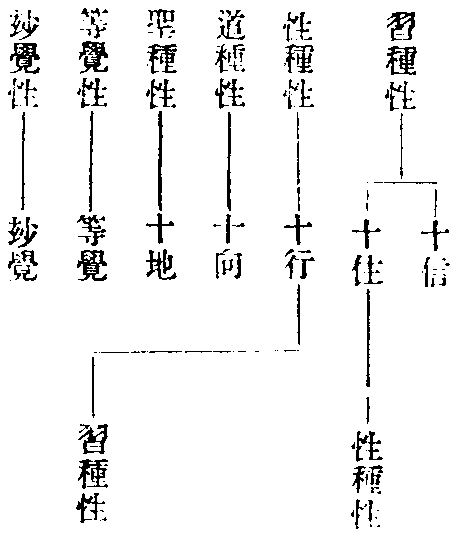



玅玄四念处、四教仪，戒疏并同。唯四教义以性对住，以习对行；四念处以道对行，以性对向；四教仪以地等玅，俱名圣种为异耳。或问：戒疏标六而释二者何？曰：性习之名，不可一槩。今试言之：标六则依璎珞，以六位不出地前修习故；释二乃据地持，以登地证性故。是知标六释二，一举而两得矣。以梵网结华严地持正宗之故，宜用彼结摄璎珞也。大师特会两处之文，而言位行体用前后者，葢有旨哉。鉴堂曰：六种约位，二种约行。性习即修性之义，故有同时也。但别人了真如为惑所覆，还用随染觉性，别修缘了，以明同时。此乃异体同时，非圆教同体同时。依体起用，从性起修也；寻用取体，以修显性也。教证约行亦尔。北峰谓：期心中道而修次第三观，即从体起用，前证后教义。若修三观显中道，即寻用取体，前教后证义。既云同时，非大异也。义例云：部内唯有一文说之者，指体相章得失科也，以圆对别相显故。



三种意生身



大乘入楞伽经(第四卷无常品，唐实叉难陀译，七卷成文四字函)。佛言：大慧！意成身有三种。何者为三？谓入三昧乐意成身、觉法自性意成身、种类俱生无作行意成身，诸修行者入初地已渐次证得。大慧！云何入三昧乐意成身？谓三、四、五地入於三昧，离种种心寂然不动，心海不起转识波浪，了境心现皆无所有，是名入三昧乐意成身。云何觉法意成身？谓八地中了法如幻皆无有相，心转所依住如幻定及餘三昧，能现无量自在神通，如华开敷速疾如意，如幻如梦如影如像，非造所造与造相似，一切色相具足庄严，普入佛刹了诸法性，是名觉法自性意成身。云何种类俱生无作行意成身？谓了达诸佛自证法相，是名种类俱生无作行意成身。大慧！三种身相当勤观察。



楞伽阿䟦多宝经(第三卷，宋元嘉年求那跋陀罗译，四卷成文身字函)。佛告大慧：有三种意生身。云何为三？所谓三昧乐正受意生身、觉法自性性意生身、种类俱生无作行意生身。修行者了知初地上增进相，得三种身(云云)(此下释义与前经同)。



胜鬘经(宋求那䟦陀罗译位字函)。有二种死。何等为二？谓分段死、不思议变易死。分段死者，谓虗伪众生。不思议变易死者，谓阿罗汉、辟支佛、大力菩萨意生身也。



玅玄(五)(一)，宝性论云：二乘於无漏界，生三种意阴。



签(五)(廿四)：言三种意阴者，二乘在彼中三之一，今通言之故云三种，非谓二乘尽具三也。言意阴者，由意生阴名为意阴，又作意生阴名为意阴，又意即是阴名为意阴。前之两释从因得名，后之一释从果得名。又虽名意阴亦可具五，何者？佛尚具足常色等五，况复因人？但小教中不云界外更有生处，然不了教尚云灭心，何况於色？



玄(六)(卅三)九番变易益者，此是方便有餘土人益也。前八番中凡有四处或九处，谓声闻缘觉、通教菩萨、别教三十心、圆教似解，止破见思未除无明，无明润无漏受方便生(云云)。胜鬘云：三人生变易土，谓大力罗汉辟支佛菩萨等。楞伽云：三种意生身者，一安乐法意生身，此欲拟二乘人入涅槃安乐意也。二三昧意生身，此拟通教出假化物用神通三昧意也。三自性意生身，此拟别教修中道自性意也。通言意者，安乐作空意，三昧作假意，自性作中意，别圆似解犹未发真皆名作意。



签(七)(廿三)前八番中四处或九处者，四处谓四教中各有断通惑者生於彼界。言九处者，三藏二人，通教三人，别教三人谓住、行、向，圆教一人谓净六根(云云)。胜鬘当知，菩萨义兼三教，楞伽三人义当四人，俱生彼土。



净名疏(一)：(八)一、质一见，谓罗汉、支佛三种意生。此五种人界内结尽，同生有餘，所见无异(云云)。二、有餘土往生者，三藏二乘、通教三乘、别教十行，圆信后心，长别三界，皆实往生。故胜鬘云：变易生死者，二乘及大力菩萨三种意生身所不能断，故生有餘，受法性身。问：何等是三种意生身？答：一、三昧正受意生身，恐是通教，同入真空寂定之乐。故涅槃云：声闻定力多故，不见佛性。二、觉法性意生身，恐是别教，菩萨虽证偏真，而觉知有中道法性。三、无作意生身，此恐是圆教，菩萨观於中道无作四谛，圆伏无明。皆言意者，未发真修，犹是作意；无明为缘，无漏业为因，即生彼土，受法性身。问：如楞伽明三种意生悉在十地，应生报土，那云有餘？答曰：约别十地判，三意生即生报土；约通十地判，正与向解三教菩萨界内惑尽，则同生有餘意同。



埀裕(一)(廿一)。今文既上云罗汉支佛，下云三种意生，即此三种并指通教菩萨也。故知二乘收乎两教，菩萨止在於通，共为三乘。三藏菩萨既同人天，非今所论也(云云)。别教十行等者，荆溪云：准理别教应云住向，今不云者，住以同於藏通五人，十向修中虽亦同生有餘之土，非为正意，故取尅体但云十行。而云圆信复云后心者，七信已上亦可得生，但是略耳(文)。故胜下引证(云云)。荆溪云：释三意生皆云恐者，尊重圣典兼示无执，三种阶降经文义含，为是何教三昧正受？若约通教，七地已上或至九地。言自性者，别住同通应取十行，圆教既云伏於无明，即知七信智(文云云)。问意者，楞伽意生既在十地合生实报，何故向解胜鬘但指通人及地住已前生方便土耶？



止观(三)(廿一)，三种意生身，亦是五种意生身。



辅行(三下)(十五)。楞伽：大慧问佛：何名意生？佛言：譬如意去，速疾无碍，名为意生。此即从譬，故彼生身。譬如意去，彼经两义而释通名。初云：如十万由旬外忆先所见，念念相续，疾至於彼。次云：如幻三昧力，忆本愿故，生诸圣中。初云忆处，次云忆愿，二义并是意忆生故，名为意生。今山门家作意生故，名为意生。经即云忆，忆即作意，是故义同。次第四卷释三别名，初无常品云：意生三种：一、入三昧(被接类节)。今家玄文判楞伽意生之位，以劣而摄於胜，故指二乘等以摄通、别。若对别位，未摄证道，是故但从地前判位。故知今判与经意同，经文未摄别位为异。言五种者，约开、合耳。名唯有三，义开成五：於三昧正受开出三藏二乘，於觉法中开出别教十行。若作七种，两教二乘名开为二，别教十住义仍同於通教入空，故下文云凡有多种。若论九人生方便土，则取圆教六根净位摄入三种意生身中，亦应可解。



别行义疏(下)(十一)。五种意生利钝之别，赴此根性故示二身，但说次第不次第两种大乘，故不须餘身餘法化也。



别行疏记(下)。(十二)方便两应，但说次第、不次第二种。大乘五种意生，其土禀教虽有利钝，既皆禀大学佛智慧，俱知佛身是大觉性。能修中观伏无明者，见相则胜；若在二观未伏无明，见相则劣。相虽胜劣，祗一尊特，故非合身。



三种意生，葢本楞伽。大师所用者，实宋译。荆溪以唐译会释之，其揆一也。然只一三种意生，而玅玄对前三教，净名疏对后三教，辅行对通十地及以别接。三文进否不同，何耶？曰：辅行别约经文而释，玅玄、净名疏通从文中意义而释。何者？辅行判三种约菩萨，是通当教及别接人。而斟酌经文，若云别、圆，何故在八地普入佛刹，出假利生？若云通教，何故有无作了佛别、圆之名？是故引经判为通教及以别接。后即自出意云：既云八地是觉法自性等，乃至云故知今判与经意同，经文未摄别位为异(文)。准此，则种类俱生，了佛证法，是别接通；七地属空，八地属假，正是通教也。玅玄以安乐法入空，是三藏；二三昧意能现神通出假，是通教；三自性意修中，是别教。此约名义通释。若安乐作空意，三昧作假意，自性作中意，是约观义通释。故荆溪云：玄文并云在前三教者，以通诸教释义故也。净名疏乃顺胜鬘经大力菩萨。彼既约菩萨断惑生方便，且三藏菩萨不断则不生。一往看净名疏，似指二乘及大力菩萨成三人，是三种意生。而下徵释。文中明判第二是别菩萨，第三是圆菩萨。准知第一亦别指通教菩萨，同二乘入真空寂定也。况玅玄引胜鬘云：三人生变易土，谓大力罗汉、辟支佛、菩萨等。签云：当知菩萨义兼三教(文)。但胜鬘中只有三种通名，故大师用楞伽三种别名释成之。以楞伽三种不的判是何教，故用对后三也。或疑：据何而明？曰：大师明引胜鬘三种，后即问云：何等是三意生？乃引楞伽三名对后释之。仍自问云：如楞伽明三种意生悉在十地等。是知若非释胜鬘意生，但用楞伽意生者，何特提云如楞伽耶？况又显云：三教菩萨界内惑尽。验知拣去三藏明矣。垂裕既云向解胜鬘但指通人及地住，岂非大师判胜鬘后三菩萨耶？名义师云：玄文顺教旨也，以作意名从偏立故。净名亦顺教旨，以界外土小未诠故。辅行葢顺本经故也。且二乘之人志存断惑，经何得云意忆生耶？曰：忆生之言亦是譬喻，况经正对菩萨说之，往收二乘其义无爽。又三四五地通惑未尽，何得论生？曰：自二地来既是破惑入三昧乐，至六七地必得往生，以后兼前故通言耳。



三藏菩萨断惑



玅玄(五)(十一)，三藏菩萨全不断惑(云云)。若毗昙、婆沙中明菩萨义，龙树往往破之。谓其失佛方便，是故须破；申佛方便，是故须立。此是龙树破立意。



四教义(三)(六)。问曰：声闻经何意不得论断结受生？答曰：三藏之教，正化小乘、傍化菩萨。若说菩萨结尽受生，二乘即疑：若结尽而得受生者，诸声闻人得罗汉果，将不更受生耶？是故不说菩萨断结受生也(云云)。问曰：智论何意从始至终一一弹破？答曰：龙树为欲申摩诃衍，明菩萨所行之道，以大破小皆可破也。若就小乘明三藏宗途，罗汉圣人之所撰集，何容顿乖僻也？大论(未捡)。复次声闻人言：菩萨不断结使，乃至坐道场然后断者，是为大错。



止观(三)(十六)三藏是方便之教，但明二谛。菩萨初心中心缘真，伏於四住，令烦恼脂消。三阿僧祇修六度行，使功德身肥。百劫种相好，获五神通，得法眼，照俗谛，分别根性，调熟众生，而作佛事。后心坐道场，三十四心断，见思惑尽。



辅行(三下)(一)初文是俗，从后心下即是真也。是故始终但有二谛(云云)。见无常空狼，令结使脂消，而功德身肥。



别行玄(下)(三)。但伏惑不断，如无脂肥羊，取世智为般若，即此意也。



止观(六)(廿四)，三藏菩萨虽复出假有漏神通，非真起应世智分别，非法眼明，虽利众生而非成就，虽作佛事非净佛土，止是少分教化，为益甚微。



辅行(三下)(四)大论云：下地诸惑因时未断，至树下时乃以九地九品思惑通名一九，故云三藏菩萨同凡夫(云云)。俱舍婆沙意云：下八地惑初修禅时先已断竟，唯非想地九品见思全在(云云)。此与俱舍不同，什公翻译及龙树意俱不应误。不同意者，今且以一意销通，令二论理齐。俱舍取修禅时已断惑竟不复更断，智论依餘部虽有漏断未名为断，至菩提树但断非想，八地俱得名为无漏，但是从部得名不同，故使二论用义不等。



文句(六)，(廿七)，阿含说五种佛子，四果及辟支佛，名佛真子，菩萨不断结，子义未成。



记(七)(十七)阿含至子义未成者，既阿含中亦明不断结惑菩萨，而大论斥权非谓全无。论云迦旃延造者，从所造论及所计者说，岂以会二还归阿含？法华准旧十二年前，一何可笑？



北峰曰：此文有三：初、既阿含下，牒经判论；二、论云下，约义释疑；三、岂以下，因便斥谬。初、既阿含中，佛亦明菩萨不断惑，何独迦旃延？而大论以大斥小，非谓全无不断惑菩萨也。非全无者，约实斥则无，约权立则有，权实相对，故曰非谓全无。二、既是佛说，大论何云迦旃延耶？释曰：论云迦旃延造者，从所造论及所计者说耳。两个所字，俱语词也。三、古师见经云汝等所行是菩萨道，谓但开二乘成菩萨，不分大小之殊。如此，则阿含既有菩萨，会二乘为菩萨，应还归阿含耶？是则法华依旧只在十二年前，不亦可笑乎？



------



## 读教记卷第五



天台沙门　法照



玅玄(五)



十种境界



玅玄(五)(四)，普贤观明无生忍前有十境界，即此位也。



签(五)(廿八)普贤观云：十境界等。又云：三昧力故，六根渐净。具如经说：六根净已，为诸如来摩头授记。授记即是入初住也。故知六根即是住前十信位也。



四教义(四)(二十)普贤观经，明修大乘人，未得无生忍前，有十种证相，此即是十信之位。



法华三昧仪(第五、证相)。上品慧根净相者，行者亦於行坐诵念之中，身心豁然清净，入深禅定，觉慧分明，心不动摇。於禅定中得见普贤菩萨、释迦多宝分身世尊及十方佛，得无阂大陀罗尼，获六根清净，普现色身，开佛知见，入菩萨位。广说如普贤观经中。



十种境界者，夷攷经文自分十段：一、见神力化事，结云：见是事已。二、见化事变现，结云：行者见是事已。三、见普贤说法，结云：深解义趣。四、见东方佛，结云：见一佛已。五、见十方佛，结云：见诸佛已。六、见十方佛土，结云：既见十方佛已。七、见佛与地，结云：见是地已。八、见座上世尊，结云：见诸佛已。九、见释迦分身，结云：净眼根已。十、见多宝佛塔，结云：见多宝佛塔已。过是则入无生忍位。玄文谓之境界，四教义三昧仪谓之证相，名异义同。慧觉谓：初普贤化乘白象变现境界，乃至第十见灵山席得中持门境界。智涌谓：初见普贤菩萨境界，乃至第十见南方旃檀德佛境界。艸庵谓：十方诸佛为一境界，释迦二、分身三、多宝四及六根清净为十。竹庵谓：十信心为境界。证悟云：初标。经云：乐见普贤菩萨色身者，一也；乐见多宝佛塔者，二也；乐见释迦，三也；及分身诸佛者，四也。乐得六根清净者，前别标四，后总标六，足成十也。於四别中结其一曰：是名始观普贤菩萨最初境界。复於六中结其一曰：是名眼根初境界相。四别中普贤既名境界，餘多宝等岂更异途？六中眼根复名境界，餘五可知。次释云：从不入三昧但诵持故，(止)诸佛如来真实法子，是普贤境界；次从汝行大乘，(止)坐狮子座，是释迦境界；次从净眼根已，(止)见多宝佛塔，是多宝境界。四分身境界者，应知普贤、多宝、释迦皆有分身佛，但作一种境界标之。若了一佛分身，亦了各各分身，故经文中标在三种之后。云及分身诸佛者，及字兼之，佛言巧矣。餘六境界，经文的然。祖源记云：一经前后二处摩头。荆溪指后为入住也。



大师位次



玅玄(五)(八)。若大乘忏悔，发初随喜圆信之心，获一旋陀罗尼已，不可向人说。虽种种分别，亦不可解。况后诸位二乘，尚不闻其名，岂凡人能说此语。有意大师自说己证也。



签(五)(廿一)一旋陀罗尼者，此经列三陀罗尼，下文释云：旋假入空名之为旋，旋空入假名百千万亿，中道实相名为法音。今举三中之初以劣况胜，故云一旋。约位竖明虽在六根七信已前，今通明之乃在初心。次文中言此语有意者，如智者大师初见南岳所证之法，即此初陀罗尼也。何由可向下类人说，令他解己所证法耶？此即章安述大师已证，可知。



玅玄(五)(八)十信之位，伏道转强，发得似解，破界内见思、界内界外无知尘沙。如经文云：得三陀罗尼，但名似道，未是真道。旋陀罗尼是旋假入真，百千旋陀罗尼是旋真入俗，法音方便正是伏道，未得入中(云云)。若入初住，得真法音陀罗尼，正破无明，始名断道。见佛性常住第一义理，名圆教无生忍。



签(六)(一)陀罗尼，此云总持。此三各能总持诸法，如云一空一切空等。假中亦然，故名为总。疏云：旋者，转也。转一切法，皆悉入空。言百千万亿者，以从数故，故名为假。中道法音，能作体内方便故也。此三祇是一心三观，持一切法，通名总持。此中即是相似三总持也(云云)。若入初住，得真法音者，谓破无明，证真法性。



止观(一)。(二)、安禅而化，位居五品。故经云：施四百万亿那由佗国人，一一皆与七宝。又化令得六通，不如初随喜人百千万倍，况五品耶(云云)。大经云：是初依菩萨辅行(一上)。(十四)、安禅而化至五品等者，此出临终行位也(云云)。吾不领众，必净六根以损己益佗，但位居五品(云云)。然大师生存常愿生兜率，临终乃云观音来迎。当知轨物随机、顺缘设化，不可一准。故经云去，引证大师五品功多(云云)。初品最小，其功尚多，况第五品耶？此证大师居第五品，其德深也(云云)。若准圆位，五品、六根并名初依，未断无明名具烦恼，亦得名为观行相似知秘密藏。



别传(三)思师叹曰：非尔弗证，非我莫识。所入定者，法华三昧前方便也。所发持者，初旋陀罗尼也(五品六根俱是圆方便位，品对六根故名前也)。



玅玄(七)(四)，能旋假入空，即是下中上药艸等益，亦是小树益。得百千旋陀罗尼，即大树益。得法音方便陀罗尼，是相似实益。若有须臾闻，即得究竟三菩提，即得真实益。



签(七)(廿七)言旋假入空即三艸等益者，五品为小艸，七信为中艸，上艸亦在五品位中，以同三藏未断惑故。八信已上为小树，十信伏无明为大树，初住已上即实事益，虽分七益位必在圆。



文句(十)，(卅三)。三昧与陀罗尼，体一而用异。寂用为三昧，持用名陀罗尼。又色身变现名三昧，音声辩说名陀罗尼。上品云：初得一切色身三昧，转身得一切语言陀罗尼。当知音声犹是色法，故言体一用异。又舌根清净名陀罗尼，餘根清净名三昧，都是六根清净法门耳。



玅乐(十)(卅五)上品云初得等者，上药王品云：过去名一切众生喜见菩萨，於日月净明德佛法中，得现一切色身三昧。后重生其国，於净德王家忽然化生，白其父言：我先已得解一切语言陀罗尼。既云转身得，一切语言即似转身方得。若云我先已得，即似指先所得色身三昧，即此三昧亦名语言陀罗尼，故云犹是色法。犹是之言，表与前同。故此语言与色身，但是身口之异，岂可现身不能说法？但从事别，其理必同。故作异名，消文最便。此则圆门三昧陀罗尼，必是体同名异。三昧从定，陀罗尼从慧，即不思议之定慧，故得互用。准下释中，三轮具足。又舌下，判三昧与陀罗尼，祇是真位六根耳。



文句(二)(十五)空观观心，但有名字，即闻持陀罗尼。假观观心，无量心、心、心数法皆是法门，即行持陀罗尼。中观观心，心即实相，即是义持陀罗尼。



法界次第(下)。一、闻持陀罗尼(亦曰名持)。二、分别陀罗尼(亦曰义持)。三、入音声陀罗尼(亦曰行持)。



净名疏(一)，(卅三)(云云)。



或云：大师正是五品，即十信故，得陀罗尼。此又妨别传。吾不领众，必净六根，以损己益佗，但位居五品之文。



或问：文句与法界次第对二持不同者何？曰：凡百对当随便取义，不可一准法界次第。取出假义，故以义持对假；是中道行，故以行持对中。文句取行持是行行边，故对假；义持是中道义，故对中。故知二文各有所以。签云：约位竖明，虽在六根、七信已前，今通明之，乃在初心。且初心横通，如何便证空持耶？曰：竖别约位也，横通约观也。断惑入位，与空相应，虽在七信，观心豁解，持因静发，不隔初心。



六重本迹



玅玄(七)，(七)。



理事  

(观一切法空如实相，但以因缘有，从颠倒生)  

(安乐行)  

迹



理教  

(是法不可示，言辞相寂灭，以方便力故，为五比丘说)  

(方便品)  

迹



教行  

(诸法从本来，常自寂灭相，佛子行道已来世得作佛)  

(方便品)  

迹



体用  

(吾从成佛已来甚大，久远若斯，但以方便教化众生)  

(寿量品)  

本



实权  

(是我方便，诸佛亦然)  

(药艸喻品)  

本



已今  

(诸佛法久后要当说真实)  

(方便品)  

本



释签(八)(一末)，第六、已今。已即是迹，即指迹门及诸迹教。今即是本，即指本门。本门已前皆名为已，踊出已后方名为今。故云已说事理乃至权实名之为迹，今说事理乃至权实皆名为本。故知若无迹中事理乃至权实，何能显於长远之本？又已今之言虽异前五，亦是一往指於寿量名为今本。若望初本，则应又简已今不同。法华已前诸经已今仍属於迹，今经所明乃是真明久远之本，即是已说已今为迹、今说已今为本方是实说。所以六门引证之文，前三引迹、后三引本者何？然前三复通，本之与迹俱有事理乃至教行体用等三，通中复别。既云本用本权非迹文能显，况以本门为今，灼然不可引迹。为是义故，三引迹文、三引本文。又前之三文既在於因，本因狭故但以迹，例本故但引迹门。



玅玄六重本迹，唯体用一重是引本文为证，餘五皆迹文也。而释签云前三引迹，后三引本者，斯葢记主点经玄意，实权已今即指迹文为本文耳，故云今说。已今为本，方是实说。然则前三不指迹为本，何也？曰：前三既通，但以迹例本。后三既是通中复别，故须指迹为本，可看。通别两字，此例甚多。如文句(一)(三)，明本迹一释。初引寿量，我成佛已来甚大久远。又方便品云：我本立誓愿，普令一切众，亦同得此道。又五百授记品云：内秘菩萨行，外现是声闻。玅乐(一)(十一)，初正引本文，次方便下引迹文，以迹中文密示本意故。若显露说，即迹中本迹。下文显已，通得引用。又玅乐(三)(卅九)，然此八中，前七迹门，第八本门。本虽未至，权实理徧。故下文云：是我方便，诸佛亦然。故方便之名通於本迹。此既玄释，不同消文。或云前三是从本垂迹之文，后三是发迹显本之文，故云三引迹文。或云玄谭大旨，不分本迹之殊。或云文在本门，但文暂偶，有同迹门文故。或云荆溪文误。或云前三是因为迹，后三是果为本。或云别含本意，故云三引本文。



本迹比决



玅玄(七)(九)。若娑婆为墨，东行千界方下一点，点不点等尽抹为尘，一尘一劫复过於是百千万亿那由佗劫。弥勒补处以出假种智，直数世界尚不能知，况数其尘宁当得尽？特是如来巧喻显其长远之相，况以世智巧历算数耶？文云：我以佛眼观彼久远，犹若今也，唯佛能知。如此久远皆是迹因，非本因也。



释签(八)(二)文中云娑婆为墨至宁当得尽者，此引迹门化城品文，不合引於弥勒等言。弥勒不知文在本门，或是借於本中之文来此况喻。假使迹中三千尘点，补处智力亦不能知。若定用迹文，则应除弥勒等二十五字，义理即顺。师云：恐别有意。然虽引弥勒语势稍殊，彼本门文但云我等住阿惟越致地，於是事中亦所不达。今此文中以出假智数世界不知，况其尘数？若取知尘，祇应合用出假智耳，是故应用前文说也。



大师引经毕，断云：唯佛能知如此久远。则自弥勒补处而下，皆不能知，乃约意说耳，非谓借用本迹文也。只因记主作本迹文看，神智又以本门弥勒不知尘点之界，望不下尘，犹是喻迹者，非是。



四佛迹因



玅玄(七)(十一)，或言昔为摩纳，值燃灯佛，五华奉散，布发掩泥，跃身虗空，得无生忍，佛与授记，号释迦文。大品亦云：华严城内得记，义与此同，并云断惑，故知通佛行因之相也。或言昔为宝海梵志，删提岚国宝藏佛所，行大精进，十方佛送华供养，既为宝藏佛父，又是弥陀之师，称其功德，不可思议，故知是别圆行因之相。



释签(八)(三)昔为摩纳者，具如瑞应然灯授记得无生忍，故知是通佛也。昔为宝海梵志，具如悲华第二云：有菩萨名寂意，问佛：其餘诸佛世界清净，今佛世尊何故处斯五浊而说三乘？佛言：净不净土皆本愿故。我於过去恒沙阿僧祇劫，此佛世界名删提岚，劫名善持，轮王名无诤念，王四天下。有一臣名曰宝海，是梵志种，善知占相，时生一子，三十二相八十种好，诸天常来供养，因为作字名曰宝藏，后出家成道亦名宝藏。转法轮度众生已，次游聚落为圣王说法已，王请安居，王之七宝亦自申供养，王有千子亦各三月供养，广如经说。乃至满二百五十年后，宝海来至佛所得记作佛，十方微尘世界众生，凡是宝海先所化者一时成道。宝海次劝轮王发心，次劝太子发心，次令诸天八部发心，乃至三千世界皆发菩提心。次於畜生地狱道中，一一众生前现一佛身令得离苦，七年之中人天八部无欲心者皆兴供养。又是弥陀之师者，彼授记品：彼佛先入三昧，现十方净土集诸菩萨，先授宝海记，次授弥陀记，次授轮王太子记云：汝观人天及三恶道，生大悲心断诸苦恼令住安乐，今当字汝为观世音等轮王太子。乃至一切诸天世人，莫不皆是梵志劝其发心，故皆是师。



瑞应经文，玄签取断惑边，证通菩萨也。而四教仪引布发掩泥，证三藏第二僧祇者，不取得忍故也。别圆因中，以父子言，则宝海为宝藏佛父；以师资言，则宝藏为宝海之师。授记品文先授宝海记，次授弥陀记，则宝藏是弥陀授记之师，宝海乃劝弥陀发心之师，非谓宝海授弥陀记也。签云宝海次授弥陀记，多宝海两字。余捡大慈与圣水古藏中瑞应、悲华二经，得其说云尔。



四佛成道



玅玄(七)(十二)：或言道树艸座，三十四心见思俱断(云云)，此即三藏佛果相也。或言道树天衣为座(云云)，此即通佛果成相也。或言寂灭道场，七宝华为座(云云)，此是别佛果成相也。或言道场以虗空为座(云云)，此即圆佛果成相也。



西域记(转字函第八卷)。菩提树垣正中有金刚座，昔贤劫初成，与大地俱起，据三千大千世界之中，下极金轮，上侵地际，金刚所成，周百餘步，贤劫千佛坐之而入金刚定，故曰金刚座焉(云云)。菩提树者，即毕钵罗之树也(云云)。



文句(一)(八)，单现尊特相，坐莲华台受佛职者，即别佛自觉觉佗。



玅乐(一)(廿四)，或云三世诸佛皆色究竟成无上道，并别佛相(云云)。



先达谓只一金刚宝座成道，四机所见不同，而说者昧於转法轮相，以难通佛何处成道。嗟夫！或问：别佛於究竟天成无上道，何耶？此葢教门权说耳。有云：此天在六欲、四禅、十天之顶，以表佛居十地之上。又以顺彼天形，顶冠成道。又以实报土相，别教所化，纯是菩萨，皆是宝冠，种种庄严。



寂光有相



玅玄(七)(十三)或言其佛住处，名常寂光者，即究竟土也。寂光理通，如镜如器。诸土别异，如像如饭。



释签(八)(五)言常寂光土者，又二：先标，次释。如本门中，地踊菩萨下方空中住，从地出已，亦诣虗空七宝玅塔，彼此虗空俱是寂光，寂光理通。如镜如器等者，譬如诸天共宝器食，如止观第三记。



释签(七)，(三十)。外谓托彼依正色心即空假中，即空假中玅故，色心体绝，唯一实性，无空假中，色心宛然，豁同真净，无复众生七方便异，不见国土净秽差品，而帝网依正终自炳然。



玅乐(十)(十一)唯圆即观，一念三千，三谛具足，是则一心一切心，一身一切身，一土一切土。一念俱观，若身心土，若空假中，更无前后。故观成时，一心见一切心，一身见一切身，一土见一切土，十方诸佛身中现故。故於自心常寂光中，徧见十方一切身土。



净名玄五(九)若思议解脱无有色心体，若不思议有色心体。



净名疏：(三)(十一)前三是权，后一是实。事、理惑除，正报即得佛果清净，依报即常寂光毕竟清净。



玅宗(上)(三)。问：下三净土既皆有相，则可论於金宝等事。寂光之净已全无相，如何可说金宝、华池及以琼树？答：经论中言寂光无相，乃是已尽染碍之相，非如太虗空无一物。良由三惑究竟清净，则依正色心究竟明显。故大经云：因灭是色，获得常色。受、想、行、识亦复如是。仁王称为法性五阴，亦是法华世间相常，大品色香无非中道。是则名为究竟乐邦、究竟金宝、究竟华池、究竟琼树。又复此就舍秽究尽、取净穷源，故苦域等判属三障，乐邦、金宝以为寂光。若就净秽平等而谭，则以究竟苦域、泥沙而为寂光。此之二说，但顺悉檀，无不圆极。问：佛无上报是即理之事，可论金等；究竟寂光是即事之理，岂有金等？若其同有，事理既混，如何分於二土义耶？答：佛无上报是究竟始觉，上品寂光是究竟本觉。始本既极，岂分二体？应知二土纵分事理，实非有无，岂真善玅有而非理耶？秘藏之理岂同小空？故此事理二名一体。以复本故，名无上报，事也；以复本故，名上寂光，理也。故玅乐云：修得四德，本有四德。二义齐等，方是遮那身土之相。况净名疏显将寂光为佛依报，故知定执报土有金宝等，寂光定无。斯乃迷名，全不知义矣。



玅宗(中)(七)，初、尅体立名。前三在事，故从居人修断因果而立土名。此土属理，故从本体三德为名。



观音疏记(下)。(十七)大乘法性，体本常住，即是一切色心之源。何者？小谓色心因见思有，故因缚断，其果永亡。大说色心因惑生灭，不因惑有，体是法性。见思若尽，无明全在，则当真谛法性色心方便生灭。无明分破，本性分显，义当中道法性色心实报生灭。无明究尽，则复本性常住色心，离生灭相，常寂光也。



法性之体，常住不变，寂而常照，名为寂光，是诸佛之住处，是众生之性本，是天下传佛法之宗极。天台所谭，玅在於此，故得玅宗断云：寂光有相。然此寂光，法性之体，体备依正色心，相相宛然，法法即性，岂同小乘真空法性？断空无体，冥寂而已。法智尊者玅悟寂光，具足诸相，故达一家所判法门，名义无间，高下己佗，无不理性本具。若谭一性，则曰性虽是一，而无定一之性，故使三千色心相相宛尔，岂非达本？谓一性具足自佗故。说二造，则曰理事二造各具三千，岂非达本？并由理具，方有事用故。说三身，则曰但无随情染碍之三，非无性具微玅身等，岂非达体？谓平等法身亦具三德故。说四土，则曰无明究尽，则复本性常住，色心常寂光也，岂非达依正二报在一念故？说五住，则曰五住正习同在一念，即惑为观，岂非达理毒性恶故？说六即，则曰应知圆家明理已具三千，岂非达毗卢身土不逾下凡之一念故？以此例之，一家教观，体用修性，种种名义，种种法门，无不通达也。且寘此事，然三乘偏教，尚有所证，岂圆人所证，破坏法体，而空寂无相耶？若言圆理无相智性，故异但空。今问此之智性，岂非但是觉知性耶？别教菩萨，何尝不达但中佛性有觉知耶？只由但中不具诸法，便异圆理矣。学者应知。玅宗文有二义：初明舍秽究尽，取净穷源，以苦域泥沙为三土，乐邦金宝为寂光，岂非离义？次约净秽平等，苦域泥沙全是寂光，岂非即义？此则若即若离，二者有相。今更细求，只於净秽平等即义之中，便有离义。以由圆人所见，三土染碍，全是寂光之相；偏人所见，染碍宛尔，岂非即中便有离义？或问：所说寂光有相，三谛之中，为是何谛？曰：寂光之体，实相玅理也。实相之理，三谛具足。又问：玅乐云：常寂光土，端丑斯亡。略记(上之上三)云：寂光无相，故三皆泯。又云：以寂光中，色质永寂。此文云何？曰：寂光法性玅体之相，正是真空冥寂之相；端丑斯亡之相，亡泯无相之相。如是之相，名寂光相，真善玅有微玅相也。杂编曰：辅行云：常寂光土，清净法身，无能庄严，无所庄严，为众生故，而取三土。故知寂光无染碍之相，亦无依正之相。评曰：此说寂光法身，皆是体性法门，法法称性，故无能严所严，非谓无相也。故知四明：一者深得文义，二者玅悟法体，三者通达义门。净觉反是。杂编又曰：玅乐明三身，说法不说法，云法定不说。报通二义，应化定说。若其相，即俱说俱不说。前所谓法身寂光定无相，应身诸土定有相等，葢准此也。评曰：文意因破华严新经译师法身说法，且说法自是被机应用，法身法体何得有说？故曰法定不说。今自明寂光性具之相，安可例此而欲使性具断无耶？杂编又曰：净名疏云：土有事理，事即应身之域，理即极智所照之境。而智理虗寂，本无境智之殊，岂有能所之别？但以随机应物，说有真应，故明事理也。评曰：此约平等性体，自行所证，本离言说，四土皆亡。但随机则说有四土，且非寂光定无，三土定有。如云智理虗寂，本无境智之殊，亡寂光也。岂有能所之别，亡三土也。



偏圆权实



玅玄(七)(二十)。问：中间有偏圆权实，而同称是权者，亦应同称为偏耶？答：通义则尔，别义不然。偏圆约法，法则已定，故偏非圆，圆非偏。权实约教，迹中施设，同皆是假，故就假论权耳。



释签(八)(十)问意者，本成已后中间垂迹，偏圆权实同称权者，以是迹故故皆是权，权即是偏，亦可悉皆称为偏耶？次答别义者，不例。法既已定，在本在迹、定偏定圆。教则不尔，在本则权实俱本，本故是实；在迹则权实俱迹，迹故名权。



文句(九)(四)亦不轻慢者，不倚圆篾偏重实轻权也。



玅乐(九)(十一)不倚圆者，佛尚以异方便及餘深法用助正道，后学顺教岂可固违？习实尚微而篾偏小，须顺佛旨将护物机。问：偏圆与权实何所？答：通则不别，别论小异。偏圆约教，权实约法。法即教下所诠，通於理智行等。



玅玄云：偏圆约法，权实约教。玅乐云：偏圆约教，权实约法。生起文势，各有所以。玅玄乃以偏圆、权实同称为权，对偏作并，故有通别之答，别义不例。何者？偏圆约法则定，权实约教则不尔，故知不可通称为偏也。文句既云不倚圆篾偏，又云重实轻权，故记主因此而问，亦有通别之答，别则小异。徧圆约能诠教，权实约所诠法，能所有殊，故云小异。故知二文义意永别。艸庵谓玅乐文误，当以玄文为正者，失矣。



三不退



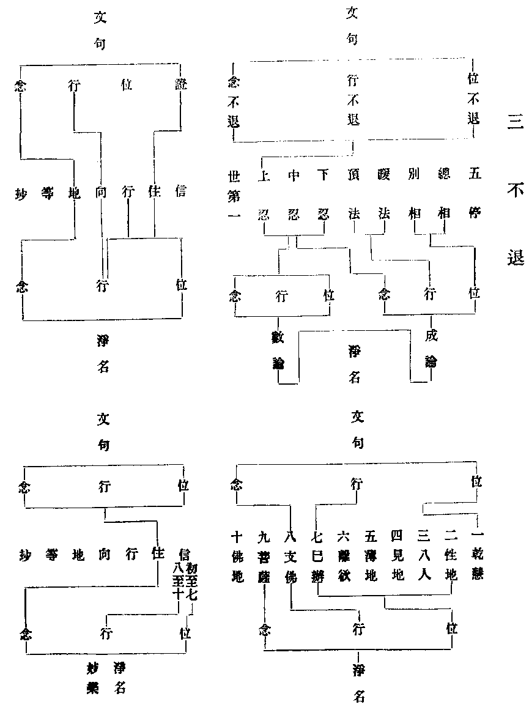



玅玄(七)，(廿二)。华严中明阿鞞䟦致，多明事数。



释签(八)(十二)言华严明阿鞞䟦致，多明事数者(云云)。又不退位高下不同，若是地前行不退位，但闻事数，知事即理，故开权显实，得入初地念不退位。能达此权即是实相，岂可离此别求实相？为对䟦致，故云初地。文句(二)(十二)不退转者，约位、行、念论。不退应四种分别：不生三恶道，位不退；不生边地，诸根完具，不受女身，即行不退；常识宿命，即念不退。具此名阿鞞䟦致地，三藏义也。若六心已前，轻毛菩萨信根未立，其位犹退；七心已上，从初地至六地不退，为凡夫、二乘，名位不退；虽正使已尽，而未能徧修万行，其行犹退；至七地，名行不退，而犹起二乘念，故有念退；至八地，道观双流，入法流水，名念不退。此名阿鞞䟦致地，此乃三乘共十地之义耳。地师云：十住是证不退，十行是位不退，十回向是行不退，十地是念不退。此是别教义，不会此经，今所不用。璎珞云：初地三观现前，心心寂灭，自然流入。此亦别教不退，今亦不用。若华严明初住得如来一身、无量身，具三不退，此圆教不退。此是一实事，今用此判位也。



玅乐(二)(廿一)。具此名䟦致者，阿者无也，䟦致者退也，第三祇时横得三不退故，离五障时三义俱得，即是第三僧祇通至百劫，通是三不退也，至此名为上忍故也。次通教位引六心者，通教地前无位可论，借别位名以通其位，即指别教七信已上入乾慧也，故云初地至六地方名位不退。或指地前假立七贤，即以忍位为第六心，依小乘位虽云忍位名位不退，望菩萨乘犹名为退，次别教中许地论师故不破(云云)。圆位具三不退者，若先以不次寄次第说者，则七信名位不退，八信已去名行不退，初住已去名念不退，今从初住已具三德名三不退，故云具也。般若是位，离二死故；解脱是行，诸行具故；法身名念，证实境故(云云)。



净名疏(五)(卅四)：但四教各三，即位、行、念。若三藏菩萨三不退者，三祇行行入煖、顶、忍，即是不退转地。若约数论，以忍法三品分三不退。若傍成论，约四念处为位不退，煖、顶为行不退，忍、法为念不退。若通教者，从性地乃至罗汉，六地齐功，皆位不退；辟支佛地，七地齐功，菩萨修方便，即行不退；八地菩萨道观双流，名念不退；若八地与辟支佛齐，九地始是念不退也。若别教者，十住是位不退，行、向是行不退，登地三观现前，即念不退。若圆教者，十信初心为位不退，中心已来为行不退，登初发心住，即念不退。复次十信相似三不退，初住分真三不退，前三权，后一实。



垂裕(七)(十三)荆溪云：入煖等者，应引俱舍煖必至涅槃，顶终不断善等。若通教明三不退中六地齐功等者，以与小共故得齐名。所言皆者，显乘显地性地已去皆不退也。十信初心等者，以十信位俱分初中二心之别，八信至十信以为中心。



玅宗(下)(廿二)。疏：牒阿耨不退，释云道种菩提等。以阿耨多罗三藐三菩提翻为无上正等觉，斯是行人心之本性所求之果。於此不退，其位有三：若破见、思，名位不退，则永不失超凡之位，习种性也；伏断尘沙，名行不退，则永不失菩萨之行，当性种性及道种性也；若破无明，名念不退，则永不失中道正念，圣种性也。



夫四教三不退，皆约菩萨言，而对当位次，葢随文用与尔。或问：空有二宗对位不同者何？曰：数论约三祇行成，横得三不退；成论约随功涉位，竖得三不退也。然则何故玅乐唯对上忍？曰：数论三忍分对三不退者，以由忍法皆三祇满位故也。若玅乐文，此取六度已满之位，故当上忍。又问：三藏七贤并未断惑，云何横竖得三不退？曰：此约利根进趣功能而说，若钝根人未免有退。又问：通三四地既断见惑，亦位不退，何故至六地方不退耶？曰：此约借别名通而说，若就当教而三四地亦不退也。别圆可知。



------



## 读教记卷第六



天台沙门　法照



玅玄(六)



教体



楞严经：此方真教体，清净在音闻。



俱舍论：牟尼说法蕴，数有八十千，彼体语或名，是色行蕴摄。



玅玄(八)(五)，一、用声为经。如佛在世，金口演说，但有声音诠辨，听者得道，故以声为经。大品云：从善知识所闻也。二、用色为经。若佛在世，可以声为经。今佛去世，纸墨传持，应用色为经。大品云：从经卷中闻。三、用法为经。内自思惟，心与法合，不由他教，亦非纸墨，但心晓悟，即法为经。故云：修我法者，证乃自知(云云)。此方用三尘而已。餘三识钝，鼻嗅纸墨，则无所知；身触经卷，亦不能解；舌噉文字，宁别是非？



释签(八)(二十二)然今古共以法为经者，文从强说，虽别立三法，然声色两种必假法通，若覩若闻不以意思，无能令教与心相应。



玅玄(八)(五)。若他土亦用六尘，亦偏用一尘。如净名曰：以一食施於一切，於食等者於法亦等，於法等者於食亦等。此则偏用舌根所对为经。或有国土以天衣触身即得道，此偏用触为经。或见佛光明得道，此偏用色为经。或寂灭无言观心得道，此偏用意为经。如众香土以香为佛事，此偏用香为经。他方六根识利，六尘得为经。此土三根识钝，鼻不及驴狗鹿等，云何於香味触等能得通达？问：根利故於尘是经，钝者尘则非经耶？答：六尘是法界体自是经，非根利取方乃是经。



签(八)(二十二)次他土中二：先总立。言亦六亦偏者，或一土具六，或一土偏一，或二三四，即如此土具足用三，复有增强若单双具。若尔，何妨此土根性不等？亦有因味及香触等，即如下文通释者是。



妙乐(一)(一)言文句者，文谓文字，一部始终，故云文即是字，为二所依。句谓句逗，义通长短，故云名诠自性，句诠差别。



玅乐(一)(二十)有人不许灭后色经，唯云名句属於行蕴。若其全不许见，经初尽合改闻。当知皆先眼耳所得，次方流入想行。若使一字一声，眼耳二识不俱，则名句文皆不成就。和合之言，不可欺也。



光明文句(上)(二)，品是类义，此中文句气类相从，节之为䟦渠。



光明记(一)(三)。此中文句，俱在经也。以能诠教，皆谓四法，谓声、名、句、文。此有二种：佛世、灭后。若约佛世，八音四辨，梵音声相，此一是实，名、句、文身但是声上屈曲建立；此三是假，声属色法，名、句、文身属第三聚不相应行。毗昙十四，成论十七，瑜伽二十四种，此则大小二宗所立有异。名、句、文者，唯识云：名诠自性，句诠差别，文即是字，为二所依。若约灭后，诸圣结集，彼土贝叶，此土黄卷，其中所载名、句、文者，皆依形显色法建立也。今略举此二，具足应四。



拾遗(上)(七)若从经卷，名虽因色，而其色经，本集声教，故从经卷，亦云闻名。



百法钞(未检补注引)：文者，文身。文无自性，依字假立。若无改转之义，斯乃但名为字。若一字已上，有所改转，诠得差别，即名为句(云云)。文体虽即是字，要与二为所依，有改转义，方号为文。若不与二为所依，又无改转之义，但名为字耳。



教体者，一实三假也。一实谓色，三假谓名、句、文身。此就灭后为言。若佛世及彼土此方，利钝互非，六尘皆具祖文，可覆其三假之相。今试明之：名诠自性者，万物各有其性，如眼、耳、地、水等也。句诠差别者，如眼诠佛眼、肉眼等也。文即是字者，一字、多字以成其文，非此无以诠表也。又谓之名身等者，以聚为义，如五阴聚集以成其身。而名有种种，句有种种，文有一多，皆是聚集之义故也。或问：记云：文谓文字，一部始终。且一部之文为眼所覩，此正属色，色即是实。此与文即是字，同异云何？曰：只一文字之言，通乎二向。若从体说，名为一实；若就体上论其功用，乃有改转。此字既得名之为文，然后复为名句作其所依，即属假也。又问：何分当体、所依？曰：一实三假当体也。所依者，有佛世、灭后不同。佛世以黄金口业为所依；灭后未结集时，以阿难想行为所依；结集之后，彼土贝多、此土黄卷为所依也。又问：教体与经体及所闻法体，同异云何？曰：教体属能诠，经体属所诠，法体兼能所也。又问：大小两宗竝是一实，三假和合得为教体。若尔，於声色可作此说，其香味触等但有一实，如何是三假相耶？曰：对根曰实，入识曰假。以入识分别故，六尘皆可三假说也。看翻译名义。



大小乘印



玅玄(八)(十二)释论云：诸小乘经，若有无常、无我、涅槃三印印之，即是佛说，修之得道；无三法印，即是魔说。大乘经但有一法印，谓诸法实相，名了义经，能得大道；若无实相印，是魔所说。故身子云：世尊说实道，波旬无此事。何故小三大一？小乘明生死与涅槃异，生死以无常为初印，无我为后印；二印印说生死，涅槃但用一寂灭印，是故须三。大乘生死即涅槃，涅槃即生死，不二不异。净名曰：一切众生常寂灭相，即大涅槃。又云：本自不生，今则无灭。本不生者，则非无常无我相；今则无灭者，则非小寂灭相，唯是一实相。实相故言常寂灭相，即大涅槃，但用一印也。此大小印，印半满经，外道不能杂，天魔不能破，如世文符，得印可信。当知诸经毕定须得实相之印，乃得名为了义大乘也。



释签(八)(廿六)若有无常至三法印者，大论第二十云：一切法无常，一切法无我，涅槃寂灭。问：寂灭中何以但说一不说多？答：初印中说五众，第二印中说一切皆无我，第三印是果，故名寂灭。若说无常，破外五欲之我所也。若说无我，破於内我，我我所破故是寂灭涅槃。行者观於无常便生厌离，既厌苦已存著能观，故有第二无我观也。推求能观至不可得，是一切法无所依止但归寂灭，以是义故说寂灭印也。问：摩诃衍中诸法不生一相无相，此中云何说一切法无我无常名为法印？二法云何而不相违？答：观无常即是观空因缘，犹如观色念念无常即知为空。过去色坏故不可见，故无色相；未来色不生无作无用不可见故，故无色相；现在无住故不可见不可分别，故无色相。无色相故是空无生灭，无生灭及以生灭其实是一，说有广略耳。问：摩诃衍中说一实相，声闻法中亦应说於一实相法。答：声闻法中三种法印，广说四种、略说一种。无常即是苦谛、集谛，无我即是道谛，寂灭涅槃即是灭谛。是故衍中唯说诸法不生不灭一相无相，无相即是寂灭涅槃。论云：衍中明法印者，是法华前共部所说。小乘法印数复不同，故须料简。若此经中独明实相为一法印，故须料简。



或问：大乘一印，小乘三印，以何义分？曰：小衍衍通三教，圆教为正，以实相印名，名通义别。今经一印，於此复别。有云：通约通别通圆，别约证道同圆。有云：小乘三藏诸经俱名小，诸大乘经通该三教俱名大，而取诸大乘经部中尊极，就圆而论，故说一印者非。



二空



玅玄(八)(二十三)。文句(八)(三十二)。玅乐(九)(五)。止观(五)(四十)。别行玄记(上)(十五)。如类集节。



一切诸法，不出名之与实。若直执名实之境，故名生法二有；若别执名实之境，属自生等，故名性相二有；若直破所执生法之境，名生法二空；若於生法之境，别破能执四性情计，名性相二空。举要言之，所执法体是同，能空观法是同，所显理性亦是同。但破直执生法之情，名生法空；破生法境上计四性等执，名性相空。然此异者，葢佛世宜闻生法空，作生法说，如光明等；宜闻性相空，作性相说，如涅槃等也。问：如来赴机，明两二空，名义不同。法智何云观性相二空，破生法二执，显真俗二谛，则成观性相而破生法耶？曰：一家观法，非法智不明，今委陈之。葢佛世随机各说，灭后入道备推也。何者？良由佛世根利，赴机宜乐，随说一种，即便悟入，不假备论。佛灭度后，机缘既钝，直闻生法，略闻性相，不能悟入。是故龙树造中观论，於生於法，广推性相，令悟空寂。如论云：佛灭度后，人根转钝，深著诸法，十二因缘，五阴入界，为决定相，闻大乘法，说毕竟空，生种种过。龙树为是造此中论，则阴界入是生法境，於此生法境上，推破性相也。大师得此意，故於玅玄生法文后，便引古师性相之说，及止观(五)(四十)，破见假推性、相空。后结云：此性、相中求阴、入、界不可得，即是法空；性、相中求我、人、知见不可得，名众生空。又破思假推性、相空。后亦结云：四句无欲，亦无於四。如此观时，即应得入，成生、法二空(六)(二)。以至文句释安乐行，名生、法空；玅乐，即以性、相而解。洎净名玄光明疏於生、法中并推性、相，光明记云：但於假、实、三毒、六缘委破四性，类示二空(四)(廿五)。是知四明得龙树、天台、荆溪诸文末代入道须推性、相而破生、法之意。故於别行玄记明判云：此由大乘观性、相二空，破生、法二执，显真、俗二谛，指如大本。即玅记(九)(五)释生、法空，引净名玄性、相为证也。问：性、相二空为局衍门？为通小教？若局衍门，何故辅行(三下)(十一)佛令须䟦闻常证果？即别、圆意，兼於藏、通，是故诸教皆离性、执。故此破性虽在衍门，是故四教亦可通用。辅行(二上)(二十三)但离性、相，成声闻通空等耶？若通小教，何云观所生心与前不别，能观、观智即空为异？何以即空四性推捡略记(中、下)(十五)？既俱无常，即破常倒，不假更用自、他等名。故四句推唯在衍门耶？曰：有通，有别。通则四教俱用，别则唯在衍门，以中论观法斥小故也。然虽三藏观性、相空，但只成析空观耳。自通已去，故曰能观观智，即空为异。例如中道实相之名，尚通於小，何隔性相二空之名耶？问：性相为局灭后？为通佛世？若通，何故玅乐(八)(二十七)然中论观法，被末代钝根，佛世当机，何劳设此耶？若局，而光明、法华、涅槃、大品皆有性相观文，何耶？曰：机有利钝，说有广略。中论广说，则局灭后，非谓略说亦局也。以由佛世机利，略说即悟故。辅行(五下)(十七)云：今依中论广观之法，正被末代之人。问：四句亦通相空耶？且相破能空，空但是一，云何有四？曰：性空之观唯一，以破四计，故成四句。相空亦一，随破四不，亦成四句也。须知用时，唯修一空，顿亡性相二四句计，但示性相前后说耳。故止观云：四句推性不见性，是世谛破性，亦名性空。四句推名不见名，是真谛破假，亦名相空。又云：四性捡不得，即是性空。四句推不得，即是相空。辅行解云：空非前后二谛同时，为破性相前后说耳。又云：言虽前后，意不异时。四明云：说时、说行时。斯之谓也。问：生法性相，既俱名空，合对真谛，何故玅乐云真谛即法空，俗谛即生空，净名玄世谛破性，真谛破相耶？曰：别圆明生法性相，俱通三谛。今从二谛法相言之，据俗谛法体，本无众生自他等执，故云俗谛即生空，世谛破性也。据真谛亡泯，本无五阴无性之执，故云真谛即法空，真谛破性也。又复应知，生空对性，法空对相，且从义便，直尔对之。若欲委明生法各有性相，如云性相中求我人知见不可得，即生空等也。若尔，则真谛即法空，了因也；俗谛即生空，缘因也。何故玅玄反云得人空成真谛智𦦨，得法空成俗谛智燄耶？别行玄云：观人空即是了因种，观法空是缘因种耶？曰：法相不同，随文对当，用与有异，不可一准。问：性相二空，散出经论。辅行判云：诸经论中，是例甚众。(三下)(十)何故玅乐若不了今家依於智论、中论等，准理准义，立此二空，诸无可准耶？又准理准义，二相云何？既等餘经论，何云诸无可准？曰：准理者，实相理也；准义者，修观义也。以经中只一无性之言，大师准此实相，必无四性无相性，故作二空释。又准修观义，才忘情计，必能所俱忘，故作二空释。而此释经，葢依二论也。故知经中一无性言等文，荆溪分明结示修性而为义理，请细详之。今家广明性相，专依龙树祖承性宗，乃对相宗以说，故云诸无可准，非用法相者之所逮也，非谓不准诸经论矣。问：性空自是空观，玅玄(七)(五)何对三观云即假故无自性，即空故无他性，即中故无共性，双照故无无因性耶？曰：此以圆融三观破徧执四性，葢对所破义，便亦是总用三观破四性也。问：推破性相，本是空观，玅宗何故於假观云诸法诸门破性破相，一一对治，无不谙练，是名识药耶？曰：自行化他不同，今明菩萨出假用法药治众生情执，故在假观也。问：净名疏云二乘断欲见谛，得入涅槃，此但空有我，不能空我所，何故辅行(六上)(十二)小乘空我所名法空，空於我人名众生空耶？曰：二乘自说具二空，以大斥小，则大空涅槃之法，小住涅槃，故未空法也。又文句(八)(三十二)生法二忍即生法二空者，自释住忍辱地名生忍，又复於法无所行名法忍，正以众生实法明之，不可以诸文约情无情为妨。问：生法之名，光明中以众生五阴而分，释签以见思两惑而分，玅乐以真俗而分，净名疏以生死涅槃而分，辅行以我我所而分，别行玄记以缘了二因而分，诸文不同者，何也？曰：一从所破，二从所显，皆是生法二空也。若光明、释签、净名、辅行，葢从所破说，若玅记、别行，乃从所显说，以此收之，罄无不尽。夫二空之说，莫非添削北峰讲下所闻，若广智而下诸师云云，辨是与非，予病未暇也。



别教纵横



玅玄(九)(四)，法身本有，般若修成，解脱始满。不但果德纵成，因亦局限。



释签(九)(十二)，三德纵横，如止观第三中。



文句(二)，(三十)。今明别家因时三法纵横，果时三法亦纵横。



玅乐(三)(四)。约别破中云纵横者，具如止观第三所引。



文句(九)(十九)若但性、德二如来者，是横；但修、得三如来者，是纵。先法、次报、后应，亦是纵。



玅乐(九)(二十七)言修纵性横者，非圆玅也。性德之名，名通别教。别教虽有性德之语，三皆在性，而不互融，故成别义。若三皆在修前后，而得道理成纵，具如止观第三及记。



止观(三)(五)。诸大乘师说法身是正体，有佛无佛，本自有之，非适今也。了因般若，无累解脱，此二当有。隔生跨世，弥亘净秽，此字义纵也。又言三德无前后，一体具足，以体从义，而有三异，葢乃体横而义纵耳。又言体义俱不殊，而有隐显之异，俱不异未免横，隐显异未免纵。



辅行(三上)(十一)法身是正体等者，法身本有是故居初，二德当有是故居次，於二德中般若必居无累之前，故成纵义(云云)。次师云三德无前后等者，初师体唯法身，此师体具三德，虽具三德义同初师，据体具边复不相冥，故成横义。以本有故名为体横，从修德边名为义纵。后师云体义俱不殊等者，体之与义俱从本有故云不殊，据行证得复似前后故云隐显。法身一德在缠为隐、出缠为显，餘之二德种子久居名之为隐，究竟果满名之为显。三德俱有此之二义，本有三法俱名为横，俱有隐显故俱名纵，以隐显故则有先后故成纵也。



光明记(一)(二十六)别教行智理三，次第资发，修时纵也。法报应三，果中齐显，证时横也。良由此教，本有法身，为惑所覆，故须别修缘了之功，相资显发。复由此教，性具三法，而不相收，致使功成，三身横显。



玅玄(五)(三十四)，虽三点上下而无纵，表里而无横，一不相混，三不相离。



释签(六)(二十)上下是纵义，虽一点在上，不同点水之纵。三德亦尔，虽法身本有，不同别教为惑所覆。表里是横义，虽二点居下，不同列火之横。三德亦尔，虽二德修成，不同别人理体具足而不相收。



玅宗(上)(二十一)。问：三德既是一本觉性，由证显发(止)，是故名为初发心住。



言纵横者，葢修纵而性横，不由即也。在因在果，皆有修性，是则因既修纵，果亦修纵，因既性横，果亦性横矣。且修纵性横，详玅宗意，只为别人不知本觉之性具染恶德，是故染恶非二佛性，别修缘了，显本法身，故成纵也。亦为不知本觉之性具染恶德，不能全性起染恶修，乃成理体，横具三法也。因果各纵横者，如光明记，智、行、理三，相资显发，此修因纵也。如玅玄，法身本有，般若修成，解脱始满，此果纵也。亦以此教性中三法互不相收，此因横也。法、报、应三，果上齐显，此证果横也。须知别教因之与果，所论三法，次第即纵义，各异即横义。故玅玄(五)(二十五)资成在前，观照居次，真性在后。此三竖别，纵非大乘；此三并异，横非大乘。然既性具三法，而文多云别修缘了，庄严本有，何谓也？曰：性具三法，横义也；别修缘了，庄严法身，纵义也。不可以纵难横，但诸教文，或果云纵，或因云横，或因果云纵，葢偏言之耳。有云修性各纵横者，非也。圆教反是。



忏重



玅玄(九)(十五)然小乘戒藏，不许忏重。修多罗藏，使犯重人念佛身。佛身者，念空也。



百录(一)(九)夫四重五逆，佛海死尸，依小乘经，如断多罗树，毕竟不生，无忏悔处。依大乘经，听许洗浣，如呪枯生果，如死者还生。虽有此法，要须志心。



治禅病经(宋沮渠京声译思字函)，犯突吉罗乃至波罗夷(云云)。心怀惭愧，忏悔诸罪，为僧执事，作诸苦役，扫厕担粪，经八百日(云云)。尔时，律师复应以律捡问此人，复教诵戒经八百遍，然后方与如净比丘得无有异。



禅门(二)(五)初、明作法。忏悔者，以作善事，反恶事故，故名忏悔。如毗尼中，一向用此法灭罪。何以故？如忏第二篇，乃至下三篇，并是作法。此事易知，义如律中广明。但未明忏悔四重法。别有最玅初教经，出忏悔四重法。彼经云：当请三十清净比丘僧，於大众中，犯罪比丘，当自发露，僧为作羯磨成就。又於三宝前，作诸行法，及诵戒千遍，即得清净。亦云：令取得相为证，而说灭罪清净。当知律中，虽不出经中有此羯磨明文，作法相貌，如彼经中广说。



业疏(四下)(二十六)：初、忏夷中。此根本罪，圣道之源。既以毁犯，一生绝分。道犹尚可，奈生报何？如僧祇中：舍此身已，来报即堕阿毗脂狱。如罪福经：随犯一重，则九百二十一亿六十千岁，与化乐天同寿受苦。若洗心归忏，佛教亦开。良由众生信法未久，怀毒著妄，不思来苦，故迷造重。后发胜心，悔过前失，亦令学戒，预入僧俦。诸律名为学悔沙弥也。



事钞(中四)(十六)。四分云：若比丘及尼犯波罗夷已，都无覆藏心，令如法忏悔。母论云：与白四悔法已(明得法)，名清净持戒(示复本)。但此一身不得超生离死(显无胜用)，然障不入地狱(明障来苦)。



问：小乘经藏为许忏重？不许忏重？许则有违百录之文，不则又违玅玄禅病及禅门引初教之文。於斯二者云何？曰：准诸文，小乘经藏许忏四重。若百录文者，以二义释之：一、通指律藏，名之为经。如辅行(五上)(一)云：修多罗之名，名该三藏。则百录通指律藏名经。止观云：若犯事中轻过，律中皆有忏法；若犯重罪，小乘无忏法。以此则知小无忏者，但是指律尔。二、大小抑扬，不妨指於小经。百录意云：小乘经藏虽有忏重，而观拙功微，重罪难灭。不若方等中道呪王灭罪速疾，专为四众除灭重罪，令人钦慕，勤修大乘。故抑小经无於忏悔，独扬大教有灭罪方。故云若依大乘，听许洗浣等也。又问：小乘律藏许忏重？不许？则玅玄禅门皆谓小无忏重。况辅行云：小无忏重之说，仍成重罪未亡。不则何故律中业疏、事钞皆有六聚五篇，第一、白四羯磨忏夷罪耶？曰：小乘诸律有忏夷罪，而今家诸文云无者，以由明忏正为修观入道，所以先忏障道重罪。而律藏虽云忏重，性罪不灭，仍障圣果，还同不忏。如四明记中说。又资持记(中四)(下六)：问：世中皆云小无忏重之文，今诸律中云何开忏？答：律开忏者，为同财法及障来报。若望体坏，无任僧用，不复本位，犹同不忏，故云无耳，非谓不许忏也(文)。是知律虽开忏，但同学悔沙弥既戒毁坏，不任僧用，故云无忏重耳。若尔，开忏何益？曰：资持记(同上)：问云：既不足数，开忏何为？答：若不求忏，财法两亡，僧须灭摈。由忏净故，得入僧中。但不足数，又复能除狱报九百二十一亿六十千岁地狱之苦，顿然清净，岂非益耶？有云：小乘经藏无忏重者，且约事说。玅玄诸文许有者，约理而论。有云：经藏许忏者，是方等中藏教小乘。若荆溪云小无者，自说鹿苑小乘也。有云：小乘无者，且约作法。若取相无生，则通取忏重，如光明疏记。今总问之：且初教经，三十僧中羯磨成就，复本清净，岂非事耶？岂非鹿苑藏耶？岂非作法耶？有云：化制不同。经是化教，故忏；律是制教，故不忏。今问：业疏、事钞引四分、僧祇，皆化教经耶？有云：荆溪自云小无忏重，南山自依成实，乃分通大乘，故诸律文明忏重也。今问：四分、成实纵是分通，僧祇、母论亦分通耶？



三藏教名



释签(十七)。他云：三藏通大小，何为但属小？今明如法华云：贪著小乘三藏学者。又大论中处处以三藏对衍而辨大小，故准此文以三藏为小。若通论者，小衍二门俱有三藏，自是通途，非别意也。若唯通途，如何消通？法华、大论具如四教本中广明。



大论(空字函百卷末)。复次，佛在世时无有三藏名，但有持修多罗比丘、持毗尼比丘、持摩多罗迦比丘。



四教义(一)(一)一、释三藏教名者，此教明因缘生灭四圣谛理，正教小乘，傍化菩萨。所言三藏教者，一修多罗藏、二毗尼藏、三阿毗昙藏。一修多罗藏者(云云)，然多翻云法本，出世善法，言教之本，故云法本，即是四阿含经也。二毗尼藏者，毗尼此翻为灭，佛说作无作戒，能灭身口之恶，是故云灭，即八十诵律也。三阿毗昙藏者，此翻云无比法，圣人智慧分别法义也，故云无比法。若佛自分别法义，若佛弟子分别法义，皆名阿毗昙也。然此三法，通名藏者，以含藏为义(云云)。阿含即是定藏，四阿含多明修行法也。毗尼即是戒藏，正明因事制戒，防止身口之恶法也。阿毗昙即是慧藏，分别无漏慧法，不可比也。此之三藏，的属小乘，故法华云：贪著小乘三藏学者。问曰：如此对当，义理可然，而名乖诠次？答曰：说时非行时，起教之次，阿含为先，修行之初，木叉为首(云云)。



翻译名义云：俱舍，或云比咤，或云摘迦，此翻为藏。问：法华既云三藏学者，大论何云佛在世时无三藏名？答：佛灭度后，阿难结集修多罗藏，优波离结集毗柰耶藏，迦叶结集阿毗昙藏，是则法华梵本恐无此名，多是译师加三藏名，显小乘教。余谓俱舍二字既翻为藏，则藏之一字是华言明矣。故知凡言修多罗藏等，乃灭后译师以华梵合标也。不然，岂可佛世有华言耶？大论所以云无者，此也。



性相二宗



玅玄(十)(三)，所谓南三北七。



签(十)(六)。南谓南朝，即京江之南。北谓北朝，河北也。自宋朝已来，三论相承，其师非一，并禀罗什。但年代淹久，文疏零落。至齐朝已来，玄纲殆绝。江南盛弘成实，河北偏尚毗昙(云云)。近代相传，以天台义指为南宗者，非也。自是山门一家相承。是故难则南北俱破，取则南北俱存(云云)。



玅玄(三)(二十)。如此破会深广，莫以中论相比。



签(四)(十五)如此破会，莫以中论相比者，依向所说，岂比中论？末代通经，虽兼别含通，岂能委明二十一种单复开合，适时破会，逗物之玅，结撮始终耶？问：一家所承，本宗龙树，今此何以反斥本宗？答：本承观法，不承论所破势。论意唯以四句观法，破大小执，令末代行者，归心有由。若部意所立，功归於此；若论破会者，未若法华。故权实本迹，遗偏废近，久远圣旨，於兹始存。故获陀罗尼，由三昧之力，师资之宗，宛如符契。



净名疏(六)(三十一)。问：龙树学者何以用天亲之义？答：是二大士岂不同入不二法门？今本为通佛教，随有所关即用，何得定执？若分别界外结惑生死及诸行名义，当细寻天亲。若观门遣荡，安心入道，何过龙树(云云)？若不取地摄相映望者，他或谓非义理，多端强说。



埀裕(八)(八)。荆溪云：此问意者，由用有后生死等言，是摄师义，是故且推以属天亲。玄义云：无著造摄大乘论，无著即天亲之兄，俱是五性宗。然法相之盛，在乎天亲，故云天亲义也(云云)。同入不二法门者，所证玅理，一体无殊，四悉随机，立宗两异。龙树承於文殊，明一切众生，悉有佛性，名一性宗。天亲承於弥勒，说三无二有，名五性宗。三无者，阐提及定性二乘，俱无佛性，不得作佛。二有者，不定及菩萨，俱有佛性，未来成佛。故西方此土，人到于今，有两宗之异(云云)。一家所用，龙树为宗，二宗擅美，共显佛经。若分别等者，世以天亲为法相宗，龙树为法性宗，其可知矣。龙树於佛灭后五百年出，天亲九百年出(云云)。地摄映望者，地持论是弥勒所造，亦天亲所宗也。



发轸钞(中)(二)性相二宗，原出西域那兰陀寺。有二大德，一名戒贤，一名智光，各化五百众。戒贤远承弥勒、无著，近踵法护、难陀，依深密等经，瑜伽等论。智光远承文殊、龙树，近禀青目、青辨，依般若等经，中观等论。



荆溪行业记(梁补阙)。佛灭度后十有三世，有龙树大士，始从文字，广第一义。嗣其法者，号法性宗。



或问：贤首禅宗并宗法性，与今何异？竹庵曰：天台法性为宗，谈具得旨。故四明尊者云：只一具字，弥显今宗也。荆溪云：固蔽理观深微，而以事相释义。言弘斯典者远矣者，乃斥慈恩法华玄赞也。又云：谈法界者，未穷斯玅，致使惑果事而迷因理者，斥贤首也。



乞乳



净名经(上)(十八)。阿难白佛言：世尊！我不堪任诣彼问疾。所以者何？忆念昔时，世尊身小有疾，当用牛乳。我即持钵，诣大婆罗门家门下立。



疏：(五)(二十五)弟子之仪，侍省供待，事不可亏，是故诣门而乞乳也。



疏：(一)(十六)大论云：阿难是佛得道，夜生涅槃。明佛成道后过十二年，方为给侍。



疏：(四)、(十一)、身子是左面侍者，以声闻众中名高德重，内外敬揖。



玅玄(十)(十八)然方等弹斥，教在三藏之后。被诃之时，应在十二年前。何以得知？皆追述昔诃，验是前事。



签(十)(二十二)得果之后即有弹诃，弹诃之时复云往昔，验知并在十二年前。



文句(二)(五)阿难四月八日佛成道日生，侍佛得二十五年，推此佛年五十五。阿难年二十五，佛时求侍。



善见毗婆沙律(伯字函第五卷)。问曰：是时，大德阿难侍佛否？答曰：侍。如来从菩提树下起，二十年中侍佛者皆不专一，或时大德那和、或大德那耆多、或大德弥耆那、或大德优伽婆、或大德沙伽多、或大德须那诃多，如是诸大德随意乐侍而来、不乐而去，或悉去时，大德阿难来侍。



乞乳缘。具如释签(十)(十)引乳光经(云云)。净名疏云：侍省供待。又云：过十二年方为给侍。二文言弟子服勤执礼如此，非般若别为侍者之比。或问：阿难七岁出家，还受具否？云：受。有违二十之律否？则央掘经列阿难於十大弟子之末，何也？净名第五疏：须陀那沙弥八岁论议而得受具，未妨阿难。



------



## 读教记卷第七



天台沙门　法照



玅玄(七)



提谓经



玅玄(十)(十)。复次，释论结集法藏，初从波罗柰至泥洹夕，凡所说小乘法，结为三法藏。从初生至双树，凡说大乘，结为摩诃衍藏。柰苑之前，不预小乘摄。何者？尔时未有僧宝，故不应用提谓为初教也。若言提谓是秘密教，一音异解者，不应在显露之初。



签(十)(十三)。第五结集难中二：初难不预五时，次何者下释不预所以。六难一音可见。



玄(十)(十五)若如提谓波利，闻五戒不起法忍，三百人得信忍，四天王得柔顺忍，皆服长乐之药，佩长生之符，住於戒中，见诸佛母，即是乳中杀人也。



签(十)(十九)，次正明不定，即今世发习且以提谓为首，提谓犹属显露未假秘密，故至鹿苑方分显秘。



玄(十)(二十二)秘密合者，初为提，谓说五戒法已，有密悟无生忍者。



四教义(一)(七)。问曰：提谓经说五戒明人天善，何意不开为五教义耶(云云)？答曰：三藏教明世间布施、持戒、禅定，即是人天之教，并是正因缘所生善法。此已为三藏所摄，故不须为五也。



光明文句(上)(十一)。提谓经云：五戒是佩长生之符，不死之印，即常德也。出入不乱，往还无间，即净德也。统御一身，即我德也。以立道根，即乐德也。此是五戒对四德。



记(一)，(三十)。以大乘人，了知五戒体是心性，若受若持，一一顺性，性具四德，故五无非常乐我净。



大师只云为三藏所摄，而神智以鹿苑收之，玄文柰苑之前不预小乘摄。又三百人得信忍，乃至乳中杀人等者，当知二文各有所以，初破北地师别立人天教，次明引明不定教也。释签云：若言下，难一音者，此点出大师纵破他师之文，非谓提谓无有密悟。



六因四缘



玅玄(十)(十)，成论亦明三因四缘，一切诸法皆为因缘所成。



释签(十)(十四)。言成论三因四缘者，三因谓生因、习因、依因。生因者，若法生时能与其因，如业为报因。习因者，如习贪欲贪欲增长。依因者，如心心数法依色香等。四缘者，因缘者，具足三因。次第缘者，心心数法次第而生。缘缘者，如识生眼识。增上缘者，诸餘缘也。若俱舍中因缘五因性，成论以所作因即是增上，故不别立。但立报因即生因是，自分因即习因是，共因即依因是。



止观(八)(廿四)云何名习因习果？阿毗昙人云：习因是自分因，习果是依果。



辅行(八下)(五)。言习因是自分因等者，新译经中名同类因，故俱舍云：能作及俱有同类与相应徧行并异熟许因唯六种。今且依大论，略出六因相，次消今文。论三十二云：言六因者，所作因、共因、自种因、徧因、相应因、报因。言四缘者，谓因缘、次第缘、缘缘、增上缘。新译次第缘名等无间缘，缘缘名所缘缘，餘二名同(云云)。所作因者，不碍於他。相应因者，心心数法同相同缘，以心心法共相应故，名相应因。心心数法以心相应为因，名相应因，如亲友知识和合成事。共因者，一切有为法各共生因，以共生故，更相佐助，如兄弟同生，互相成济。自种因者，过去善法与现在善法为因，现在善法与未来善法为因，恶无记法亦复如是，一切各各有自种因。徧因者，苦集谛下十一徧使，名为徧因。报因者，行善恶因，得善恶报，名为报因。言四缘者，如上五因，名为因缘。心心数法次第无间相续而起，名次第缘。心心数法托缘生故，名为缘缘。诸法生时，不生障碍，名增上缘。复次，心心数法从四缘生，无想灭定从三缘生，除於缘缘。诸餘心数不相应行及色从二缘生，除次第缘及缘缘。餘有为法劣故，无有从於一缘生者。报生。心心数法从五因生，除於徧因。无漏心心数法从三因生，谓相应、共及无障碍。成论但应三因、四缘，具如玄释签第十记。今业相发，属习、报两因。习因者，自种因，文兼释於习果、报因。因於前世前念善恶故，后世后念善恶得起，并名习因。既心心数法共相因依，亦得名为相应因也。不障碍故，亦得名为所作因也。俱有助作故，亦名共因。若蔽相起，亦名徧因。以此习因未能招报，不名报因。言报果者，亦但四因：所作、自种、共因、报因。当果相现，故云报果。据理实是报因而已，不与五部染法为通因故。非徧行因，非心心所，无相应因。若以习因对四缘中，得是因缘等三，不托缘而起，无所缘缘。习因起时，亦有增上及有无间相续之义，亦名次第报果，但在增上因缘。夫因缘之义，佛法根本，背邪向正之始，入道修观之源，故习佛法者不可全迷。



垂裕记(五)(廿五)。四缘、六因及以十二，并是生死，生死即三道(云云)。十二秪是四六而已，故知但是离合说耳。且如无明，即是行家之能通也，即同类因。行必四相，即俱有也。行中五部，亦同类也。无明行中，心心所法，共行共感，所作必同。行有必招识等异熟，此行必有徧行五部之惑。若四缘中，论云：增上即能作因缘。五因性比六因说，可知。



正理论：又六因中，徧行一因唯是染污，餘之五因通染、不染。又相应、徧行二因唯心，餘之四因通色、通心。又徧行、异熟二因通三界系，餘之四因通及不通系。徧行、异熟唯有漏，餘之四因通漏、无漏。又徧行、异熟二因唯是非学非无学，餘之四因行通三种(凡夫、学人、无学人)。又六因中，能作一因通四谛及非谛摄，徧行、异熟二因唯通苦、集，餘之三因通苦、集、道三谛摄。



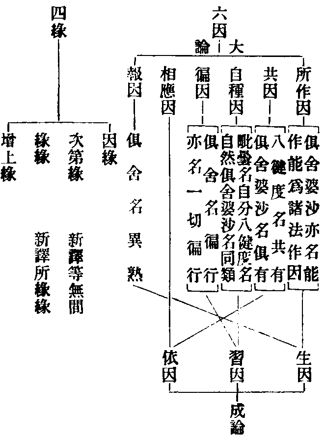



止观云：集谛下，十一徧使，名徧因者。补注(十四)(十五)云：苦下，五见及疑、无明。集下，邪见、见取、无明、疑。此之十一徧，为五部作因，名徧因也。五部染法者，四谛下，见惑为四，修惑为一，即五也。北峰曰：因缘者，亲生为因，疎助为缘。然约法显相，且以三道为言，则烦恼为因，业行为缘，因缘和合，则招苦报，报起惑业，循环无穷也。或问：成论三因，於六因中，如何会同？曰：生因既云：若法生时，义兼所作，亦可所作，即增上缘，非生因摄。习因既云：贪欲增长，贪欲是惑，即兼徧因。依因既云：心心数法，兼相应因。餘三签文自对也。或问：俱舍颂云：许因唯六种。释签却云：五因性者，何也？曰：六因四缘，大论所释，顺有宗义，故具明六。若成论但说三因，乃顺空宗义，所作即是增上缘故，故不别立，但云五也。前后存没，义恐如此。当知六四既以三道为当体，即以四大为所依也。



楞伽制肉



楞伽阿䟦多罗宝经四卷，(宋天竺三藏求那䟦陀罗译。)



入楞伽经十卷，(元魏三藏菩提流支译。)



大乘入楞伽经七卷，(大唐于阗三藏实叉难陀译)。断食肉品(四字函第六卷，唐译)。尔时，佛告大慧：一切诸肉有无量缘，菩萨於中当生慈愍，不应噉食(云云)。是故，菩萨不应食肉(云云)。若我听许声闻食肉，我则非是住慈心者、修观行者、行头陀者、趣大乘者，云何而劝诸善男子及善女人於诸众生生一子想，断一切肉？大慧！我於诸处说遮十种、许三种者，是渐禁断，令其修学。今此经中自死、他杀，凡是肉者一切悉断(偈云)。象脇与大云，涅槃央掘摩，及此楞伽经，我皆制断肉。



释签(十)，(十一)。寄此兼判楞伽成方等部。他云：楞伽非第三时七卷经文。第六卷中大慧问言：外道尚遮不许食肉，何况如来大悲含育而许自他令食肉耶？若大乘中梵网已制犹作此说，当知楞伽四含之后为渐制之始。下佛答中仍云：菩萨不应食肉。故知仍存小教中开。　玅玄(十)，(十一)。



记主研核制肉之文，判属方等。既对梵网已制而说，则曰仍云菩萨及以渐制，何但制菩萨也。北峰谓三乘俱制，葢有取焉。偈指涅槃者，此乃译师於灭后见涅槃亦制，故引成流类足偈文云。



双游



涅槃经(三)(三)长寿品：云何共圣行？娑罗迦隣提。释签(十)(十七)大经第八鸟喻品云：善男子！鸟有二种：一名迦隣提，二名鸳鸯。游止共俱，不相舍离。此品答前共圣行。



涅槃疏(二)(十一)若二鸟双游，明其二用。二鸟俱息，明其双寂。



原夫涅槃开演常宗，为显常即无常，无常即常，故取喻二鸟游息共俱，以答共圣行之问也。疏：(七)、(四)、此中备有凡、凡共行(圆教内凡、外凡共修圆行)，凡、圣共行(生、佛虽异，常、无常一)，非凡、非圣共行(理即之位，非内、外凡，非分极圣，即常、无常用未始暂缺也)。又云：取其雌、雄共俱，飞、息不离，以况一中无量，无量中一(一是常，无量无常也。显二用相即)，非一、非无量(双息)，而一、而无量(双飞)，呼为双流，乃名共行(文)。凡、圣共修，故称曰双，非约二用立共行名。又此二用，经意虽局菩萨所修法体，徧收一切依、正谏书。约二用分，割为难解，谤准本疏。三、翻释义。二用相即，显生身即尊特也。竹庵以事、理二造对於二用，又以一法为并息，二法为双游，未也。应先了理造三千之体非常、非无常，事造三千之用能常、能无常。二用既全体作，相即之义斯成。本疏稍难，今当略辨。分文为二：



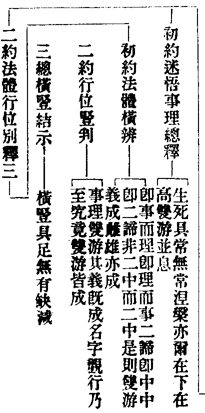



初云生死涅槃在下在高者，迷悟对分耳。众生迷故，有生死名为下；诸佛悟故，得涅槃名为高。以此经正谈三德，涅槃乃如来所证之果。然所证果本非别法，全指众生生死三道当体常寂，良以生佛各具三千，故常无常二用高下无亏。虽尔，各具迷悟乍分，互即互融，体用不二。双游者，全体起用，具常无常事造三千也。并息者，指用归体，非常非无常理造三千也。事理既即，游息亦俱，法法咸然，心心徧具，故在高在下，平等无差。次文即事而理、即理而事者，事即事造三千，理即理造三千。事造之中具於二用，用全体起，当处即理。理造之体，法法具足，互融互摄，不可思议。即此玅体起於二用，体既互摄，用岂相乖？故知二用克就事论，全由理圆，故二用即。然此事理本无二体，全是三谛，故有次番。二谛即中，中即二谛，三千诸法一一无非即三谛故。中边既即，三岂有三？三谛俱亡，虽亡而照，故有第三亡照释也。三谛俱亡，故非二中虽亡而照；三谛俱照，故而二中虽有三番，后二只是中边亡照。又复后二只是释成初番事理法体而已，故知欲显事中二用相即。若不约圆诠事理法体而辨，则相即之义无自而明矣。既约法体，故曰义成。雌雄亦成者，雄喻於实，即常用也；雌喻於权，无常用也。所喻二用既即，能喻双游可知，故云亦成。竖判者，初二句结前生后，其语犹略，应云约事理相即，明二用双游。其义既成名字等五，前约法体横判，虽曰法法全体，约行人修证，何妨在下在高？高下虽殊，而位位之中三千具足，故迷则俱迷，悟则俱悟，故曰名字已去，不唯显佛，九亦同彰，乃至果成，咸称常乐。二用相即，位位具足，故曰皆成。结中横竖只是六即：理同故，即法法实相，横义也；事异故，六修证迷悟，竖义也。即横论竖，一一具足；即竖论横，无有缺减；即横即竖，事理义圆矣。



华严教主



华严经云：摩耶夫人为卢舍那母(云云)。



梵网经云：尔时释迦从初现莲华藏世界东方来，入天宫中，说魔受化经已，下生阎浮提迦夷罗国。母名摩耶，父名白净，吾名悉达。七岁出家，三十成道，号为释迦牟尼。於寂灭道场，坐金刚华王座说法。



玅玄(十)(十七)，寂灭道场，始成正觉(云云)。此乃明释迦最初说顿也。



文句(九)，(十八)。梵网经结成华严教，华台为本，华叶为末，别为一缘，作如此说，而本末不得相离。



玅乐(九)(廿七)若华严中，十方台叶，互为主伴。此梵网经，唯一台叶。故天台戒疏判云：华台华叶，本迹之殊。所以华台华叶，本迹定者，被缘虽别，道理恒同。所结既同，能结岂别？



净名玄(一)，卢舍那佛说华严经(云云)。



玅宗(下)(七)、有须现者，即为现之，如梵网、华严及此经等，相多身大也。不须现者，即以力加，令於劣身不取分齐，见三十二相即无有边，以知丈六是法界故也。



解谤(廿)(三)汝执藏尘为尊特相，树下之身有此相否？故升须弥山顶品云：尔时如来威神力故，十方一切世界，一切四天下，阎浮提中，悉见如来坐於树下，各有菩萨承佛神力而演说法，靡不自谓常对於佛。尔时世尊不离一切菩提树下，而上升须弥，向帝释殿。岂非华严是千百亿应身所说？此身既被别圆之机，见是尊特，何须独指华台受职身耶？



娑婆世界，五时施化，说华严教，葢千百亿身中之一，乃现相之本也。解谤己辟净觉之失。后人不本经文有现起之相，尚执三双六只之义，以即劣尊，特而申明之，未详。鉴堂云：示现与现起，看经中有文无文，出解谤书。



涅槃五味



玅玄(十)(十五)今依大经二十七云：置毒乳中，乳即杀人。酪酥醍醐，亦能杀人。此谓过去佛所，尝闻大乘实相之教，譬之以毒。今值释迦声教，其毒即发，结惑人死。辅行(九下)(十四)尔时有菩萨，名无垢藏王，白佛言：如佛所说，诸佛菩萨，成就智慧功德，百千万亿，实不可说。我意犹谓不如此经，能生诸佛阿耨菩提。佛印可竟。佛言：譬如从牛出乳，譬从佛出十二部经。从乳出酪，譬从十二部经出修多罗。从酪出生酥，譬从修多罗出方等典。从生酥出熟酥，譬从方等出般若波罗蜜。从熟酥出醍醐，譬从般若波罗蜜出大涅槃。



玅玄(十)(廿四)。若华严为乳，三藏为酪，此则方便味浓，大乘味薄(云云)。此取相生次第为譬，不取浓淡浅深。签(十)(廿七)。不以味浓为乳，味淡为酪，故知自约次第相生为譬。



玅玄(十)(十八)渐机於顿教未转，全生如乳。三藏中转革凡成圣喻，变乳为酪，即是次第相生，为第二时教，不取浓淡优劣为喻也。



签(十)(廿二)次渐机下，释味名所以。言不取浓淡者，秪是小机於华严，如乳非酪浓於华严。



玄(十)(十七)又顿教最初始入内凡，仍呼为乳。呼为乳者，意不在淡，以初故本故。



义例(六)六者、名义通局。如置毒譬，经中唯譬五道不同，佛性不变。五味唯喻一代五时浓淡，浓淡虽殊，皆从牛出。今文从义，处处徧入，或定不定，或行或人，或教或位，或时或部，不可壅义而守其名。故用置毒，则有两种：醍醐杀人。若用五味，则有两种：乳不等。



别行疏记(下)(十五)。应知约教明五味者，不取浓淡，但语相生，以其顿乳即醍醐故。若约机者，有浓淡义。然就三乘极钝者说，为此一类，於彼华严全无显益。如鯹血乳，说三藏时，此机成酪，次第渐浓，至於极味。



四、教仪。问：将五味对五时教，其意如何？答：有二：一者、但取相生次第；二者、取其浓淡。



北峰师曰：原经意，由无垢藏王叹涅槃教胜，佛印可后，叙出五味。故知若非浓淡，叹教不成；若相生者，约义通也。玅玄约教相生次第，则不取浓淡；若约机行，不无其义。四明之说善矣。义例云：故用置毒，则有两种醍醐杀人；若用五味，则有两种乳不等。然置毒两种，非无乳等；五味两种，非无醍醐，葢互显也。若两个唯字，望下义通八种云。



通别五时



玅玄(十)(二十)，三、引信解品，四大声闻领教证次第者(云云)。



签(十)(廿二)言次第者，华严初云於菩提道场始成正觉，在初明矣。诸部小乘虽云初成，自是小机见为初耳。据信解品脱玅著麤，故知居次。大集云如来成道始十六年，故知方等在鹿苑后。仁王云如来成道二十九年已为我说摩诃般若，故知般若在方等后，亦知仁王在大品后。法华云四十餘年，大经云临灭度时，当知次第有所据也。



玄(十)(廿二)。夫五味半满，论别，别有齐限；论通，通於初后。若华严顿乳，别但在初，通则至后。故无量义云：次说般若，历劫修行。华严海空，法华会入佛慧。即是通至二经。又像法决疑经云：今日座中无央数众，各见不同(云云)。夫日初出，前照高山；日若垂没，亦应餘辉峻岭。故莲华藏海通至涅槃之后，况前教耶？若修多罗半酪之教，别论在第二时，通论亦至於后。何者？迦留陀夷於法华中面得授记，后入聚落被害，作结戒缘起。又如身子法华请主，后入灭，均提持三衣至佛问(云云)。当知三藏通至於后。若方等教半满相对，是生酥教，别论是第三时，通论亦至於后。何者？陀罗尼云(止)：法华后(如后授记中节)。般若带半论满，是熟苏教，别在第四时，通论亦至初后。何者？从得道夜至泥洹夜，常说般若(云云)。当知般若亦至后。若涅槃醍醐满教，别论在第五时，通论亦至於初。何者？释论云：从初发心，常观涅槃行道。前来诸教，岂无发心菩萨观涅槃耶(云云)？此则通至於前。若法华显露边论，不见在前；秘密边论，理无障碍。故身子云：我昔从佛闻如是法，见诸菩萨授记作佛。岂非证昔通记之文？



签(十)(廿六)，初明前四味通后，次若涅槃下明涅槃法华通至於前。初文自四(云云)。初文又二：初明通二经，次明通至涅槃。初文言二经者，谓般若、法华，以般若亦得名华严故，法华佛慧不殊初故。次通至涅槃为二：初正引经，次夫日下述意。初文者，彼经既有住世无量劫之言，又见报身莲华藏海说心地法门等，故知华严至涅槃后，以彼像法决疑结涅槃故(云云)。次文者，二人虽於法华得记，此后犹作三藏结戒之缘(云云)。文在涅槃，故知涅槃共结小藏(云云)。通记者，昔日授记佛意不壅，小乘情隔自无悕取，况约秘密已记二乘，据斯以论通至鹿苑。



玄(十)(十)如提，谓时无量人天得无生忍，成道六年已，说央掘摩罗涅槃云：我初成道，恒沙菩萨来问是义，如汝无异。当知鹿苑不应纯半。



签(十)(十三)次引诸文，皆是十二年前已有满教。净名疏(五)(三十)问：自净名弹诃之前，亦应有滞方便者。因诃转教，何不出之？答：未可定判，故不别出。



略记(下之上)。(一)问：自净名等者，亦应合有方等生酥通乳酪耶？若其有者，何不说之？答：文虽尔，应须具如法华玄文第十卷中。今若复欲论理有者，鹿苑理须密说弹斥。又华严中四，何须更论？亦是其例。既其一切俱通初后，岂可方等不通於初？准此，问前亦应问后，文无者略。若尔，一音之教非无小得，但失於钝，以历五时，故不全用玄文所引。



玄(十)(八)问：殃掘之经六年所说，列次第众委悉餘经，弹斥明常分明餘教，释梵四王及十弟子，乃至文殊皆被诃斥，同闻宛然应入次第。



签(十)(十二)言央掘列众者，彼经初云：尔时世尊与无量菩萨摩诃萨及四众，天龙八部，毗卢遮富单那等，日月天子及护世等，皆云无量。



不明别五时，则不见化仪次第；不明通五时，则不见随宜赴物。问：玅玄明般若、法华、涅槃皆有徧前，独方等不明者何？曰：玅玄云：方等弹诃教在三藏之后，被诃之时应在十二年前。有云：若约显露，如玄文则无；若约秘密，如净名疏则有也。有引殃掘经是如来成道六年所说，证方等显露徧前。有云：殃掘经六年说者，乃秘密说，非今结集者。若今结集者，文中即无六年之说，葢由天台见他文指出耳，却引玅玄如提谓等文为证。顷因此说，曾阅彼经，虽无六年之文，正是玄签第十所引者，葢在大藏。量字函四卷成文。宋天竺三藏求那䟦陀罗译。



方等授记



玅玄(十)(廿三)陀罗尼云：先於王舍城授声闻记，今复於舍卫国祇陀林中复授声闻记，昔於波罗柰授声闻记。身子云：世尊不虗所言真实，故能第二第三授我等记。故知方等至法华后。



签(十)(廿七)言至法华后者，即指王城授记，同於法华。舍卫国记，即指方等，在法华后。彼经下文云：舍利弗闻文殊得记，问文殊师利：於汝意云何？文殊语舍利弗：汝意云何？犹如枯树更生华不(云云)？燋种生芽不？舍利弗言：不也。文殊言：若不可得，云何问我得记生欢喜不？授记无形、无相、无我、无有言语、无去来今，犹如野马。如是观者，乃名得记。此文是文殊破舍利弗得记之相。



文句(四)(五)，七、得记不得记者(云云)。



大乘入楞伽经(第六卷变化品四字函)。尔时，大慧菩萨摩诃萨复白佛言：世尊！如来何故授阿罗汉阿耨多罗三藐三菩提记(云云)？佛言：谛听，当为汝说。大慧！我为无餘涅槃界故，密劝令彼修善萨行。此界他土有诸菩萨，心乐求於声闻涅槃，令舍是心进修大行，故作是说。又，变化佛与化声闻而授记别，非法性佛。大慧！授声闻记是秘密说。



辅行(六下)。(三)问：若言方等不记二乘，何故楞伽第二变化品中大慧问佛：如来何故授声闻记？佛言：三意故记：一、为入无餘界者，密劝修菩萨行故；二、为此界他土菩萨乐求声闻涅槃者，劝舍此心修大行故；三、变化佛授声闻记非法性佛，大慧授声闻记是秘密说。判曰：今闻法华是显露记，不同方等隐密与记。若据斯理，净名、大品皆应有之，何独楞伽？故方等云：第二、第三授我等记。初意自为已入灭者，次第二义但为斥於钝根菩萨对彼说记，何关二乘？第三、判非法性佛者，此是以实而隔於权，未若法华显久远本，我土不毁而众见烧，况法性之佛尚不记菩萨，何独声闻？故知三义并异法华。当知大慧发起密说，是故发问授记之事，故知彼经义属方等，与法华异，岂待固论？数数斥夺二乘等故。故法华中三周授记偏语声闻者，为显餘经所不说故，是故委授劫国之名。菩萨授记处处有文，故但通途云当作佛，乃至本门某生当得。法华称玅，斯言可凭。



玅乐(三)(廿六)。如华严法界，何所不含？隔彼声闻，使如聋痖。后分虽有，授记事乖。鹿苑初闻，一向唯小。方等尚昧，般若犹生。虽楞伽方等，有记小之言。楞伽乃密对菩萨，方等为斥夺声闻。故一代教文，彰灼唯此。



方等陀罗尼授记品(第二卷覆字函)。佛告五百大弟子众：汝等亦当各各作佛，俱同一号，号宝月王如来、无所著、至真、等正觉(云云)。



记主云：楞伽乃密对菩萨，方等为斥夺声闻。葢点云楞伽、方等陀罗尼二经之意也。楞伽密记小乘佛对菩萨说出方等陀罗尼经小之后，舍利弗与文殊问答之文，即斥夺也。



十行横学



玅玄(十)(廿四)，别教复有四(云云)。



释签(十)(廿七)别教复有四者，别教十住修生无生，十行修无量，十向修於无作，登地证无作，故云有四。又十行中习诸佛法，具足於一十六门，亦名为四。问：住已习八，何故行中更习十六？答：前是自行随用一门，后为化他，是故行中更习前八，是故十六俱须广习。



玄(四)，(八)。道灭即苦集，苦集即道灭。



签(五)(三)苦集即道灭者，发心之来，谁不为断烦恼生死，广集佛法，求无上道，但此教意，达道灭体於生死烦恼之中，故云众生心行中求，此则实知真断，玅修理证，故竖行住行，犹迷回向薄知，初地少证，即其意也。签(五)(一)今此四四谛，虽并在别教，既约生灭等四，竖判一教，别教菩萨，即此自行，而用化他，故十行中，横辨此四，全为利物，所以四相，各附彼教，而为相状。



辅行(六下)(一)应知此中若全不兼文之元意，如何次第出假之位，即能授他圆教四门。



辅行(六下)(四)圆教六根，名下根者，出假名同，功逾十向。此是相似圆融三谛，不同次第出假之位。



辅行(六下)(五)通别入空，但照六界。两教出假，长短不同。尚未能出佛法界假，岂能九界见即中耶(云云)。纵带此空，即十界假。既无法性，的非圆融。



北峰师曰：良以别教迷中重故，不能顿修中道之观，遂使如来说此一教，始终次第，边居中外，破九显一，机缘禀之，依教起行。於十行中，自既未能圆修，安能为他圆说？住行犹迷自行，化他皆须断九，考之文理，只是但中。故杂编云：十向圆修，可由实道；十行实无作，且顺权方。良以修中之位已深，出假之位尚浅。位深，故知昔日化他无非玅行；位浅，故知将来自行亦是但中。不应以实难权，以他妨自。



------



## 读教记卷第八



天台沙门　灋照



文句(一)



记释文句二字



私分为四初文谓下释名  

二此亦下述意  

三古之下辨异  

四今竝下结归



六难



玅经(一)，诸佛兴出世，悬远值遇难；正使出于世，说是灋复难。无量无数劫，闻是灋亦难；能听是法者，斯人亦复难。



文句(一)，佛出世难，佛说是难，传译此难，自开悟难，闻师讲难，一徧记难。



玅记(一)，题下注六难意者(云云)。



叹灋难逢，显须传授，故章安特注之。既帖顺经文，叹灋希有，宜在文句之下。既是私意，故不大书也。经中闻法能听者，盖闻浅听深也。此用文句之意，若记文中合一而用。有云闻是灭后，听是佛世，非也。或问：提婆达多品注意云何？曰：此乃章安开大师本迹一释为因缘，约教本迹三释注令易见。以由大师於未释题前先评此品，次方翻名释义，义含三释，故以注之。又问：四十二章经二十难中，触事无心难、对境不动难何异？曰：初是逆境，次是顺境。又问：生值佛世难与下九难中值诸佛难何异？曰：上是生值佛世难，下是生值佛世已得见佛难。又问：先说二十难，后说九难何异？曰：先是散说，后是迭论，故不同也。



能开佛慧



文句(一)，留赠后贤共期佛慧。



玅记(一)(二)。佛慧之言，须开三教果头之权实，发四味兼带之大小，则人理教行之有归，开示悟入之无异，方是今经之佛慧耳。问：诸经中圆，与此何别，而必须云开，方是佛慧？答：圆实不异，但未开显。初心之人，谓圆隔偏，须闻开显诸法实相。若已入实，但论增进。权人至此，一向须开。



窃详记中问：诸经中圆与此何别，而必须云开方是佛慧之文？此由上文开之一字，故以开显圆简未开显圆，非谓开圆不开圆也。



记释委释等文



私分为六初别解下叙总显  

二题下下示别文  

三故但下明相显  

四故知下斥古失  

五今问下诫弘经  

六然徧下结枢要



三一总别寄行约教



玅乐(一)(二)，别解题名玄七八卷，以初名中总三灋故，三法始末亘一部故。何者？一部之中莫过本迹，本地总别超过诸说，迹中三一功高一期，故一中之三永殊前教，即三之一不与他同，即迹而本寿量方谈，即本之迹具在今说。且如迹中体非因果，依之以辨因果，因果取体方有胜用，如是三法竝由开显，若不先了能开之玅，将何以明所开之麤？故对迹辨本理须分判，所以释题不可率尔。题下别释理非容易，以由释题大义委悉，故至经文但粗分章段，题云文句良由於此，故但分文句则大理不彰，唯谈玄旨则迷於起尽，若相带以说则彼此无归，故使消释凡至大义，竝指去文名体宗用，三一总别寄行约教，故知全迷玄文大旨而欲以文句消经，故蔽理观深微而但以事相释义，言弘斯典者远矣。



或问：三一即总别，重言者何？曰：此顺前文本迹也。又云：一部之中莫过本迹，本地总别超过诸说。迹中三一功高一期，至后云故使消释，凡至大义竝指玄文三一总别，故知三一结迹、总别结本也。言寄行约教者，盖寄行次第约所说教能诠名言而判释之，既云名体宗用，验是约行五章也。有云：寄约行释名章中明约教五章。有云：寄约行判教章中明约教五章。有云：此乃记主出玄文意，恐人疑别解中但明约行，因何不明约教？故云寄行约教，乃寄约行明约教五章耳。今皆不取。



观心引证



文句(一)(三)，譬喻品云：若人信汝所说，既为见我，亦见於汝，及比丘僧，并诸菩萨。当知随有所闻，谛心观察，於信心中，得见三宝。闻说是法宝，见我是佛宝，见汝等是僧宝。



玅乐(一)(十一)，观心中先引，次当知下结意。初文者，事论秖是信身子说义当见佛，汝所说者必从佛闻，能闻之人必是声闻菩萨故也，故闻汝说即是见佛等也。次结意者，所闻是法於能观心即名为佛，义当见佛心所即是弟子等也，即於己心识三宝一体其理宛足，具如闻说已下文是。



记(一)(十五)。又观心一文，除安乐行中修摄其心等，餘皆义立(云云)。又观心文，序及流通，准望正宗，理须义立。於正宗中，唯安乐行，理定须故，餘皆义立。



文句(一)(六)下文云：若人信汝所说，即得见我，亦见於汝，及比丘僧，并诸菩萨。即观行之明文也。



玅乐(一)(十九)，次下文云去，引譬喻品证成观相。



窃详观心之文，唯出安乐行，自餘诸品，皆是义立。譬喻品文，即观心义，故大师断云：即观行之明文也。是知得见三宝，功由观心，故引为证。



三宝



文句(一)(三)，随有所闻，谛心观察，於信心中，得见三宝(云云)。



玅记(一)(十一)，所闻是法，於能观心，即名为佛。义当见佛心所，即是弟子等也。即於己心识，三宝一体，其理宛足。



北峰师云：三归依法，祖师先达，竝令归依一体三宝。祖师语简，后人不晓，才闻一体，直归自心，词句用心，殊不相应。辨之分三：初辨讹，二正释，三料拣。初辨讹。归依一体三宝，若是但归自心，如何先唱词云：归依佛，两足尊；归依法，离欲尊；归依僧，众中尊。后结词云：惟愿三宝，哀怜摄受慈愍故。此则不识文也。所言一体三宝者，谓虽言三宝，其体是一，三不别体，故云一体三宝。如何才言一体，便指自心？果如此说，应须果佛无一体三宝，此不识名也。大师云：以实相慧，觉了诸法非空非有，名为佛宝。所觉法性之理，三谛具足，即是法宝。如此觉慧，与理事和合，名为僧宝。(别行玄文)四明云：三虽在果，而是一体。(拾遗记文)此等之文，正是的明一体三宝，何不审思？况指要显云：三宝是修德之极也。二正体。归依三宝者，须知有乎四种三宝：一住持三宝：泥木塑造，绢帛彩𦘕，即佛宝；纸墨书印，文字经卷，即法宝；剃发染衣，圆顶方袍，即僧宝。(然此净名疏记，名为相从。)二相从三宝：从佛说法，从法有僧，从是三宝，于今不绝，皆由归佛，禀法成僧，故曰相从。此乃小乘教中所明三宝。(光明玄记中卷之文，对藏通二教。)三别相三宝：卢舍那，即佛宝；所说无量四谛，为法宝；禀四十一位贤圣，为僧宝。此之三宝，佛是僧果，僧是佛因，法是因果。所修所证，三宝体别，故名别相。即是大乘权教所明三宝。(撮要引光明玄记中卷之文，对别教。)四、一体三宝。如来以称理智觉了诸法，名为佛宝；所觉诸法，即是法宝；此智与事理和合，名为僧宝。然此三宝，上极玅觉，如来究竟具足。故摩诃衍论云：等觉已上，有真实僧。又华严以统理大众为僧宝，岂非应佛？以应机统众之极故也。下至博地凡夫，亦复无不具。故华严经云：心佛及众生，是三无差别。虽通六即，且从真证，能垂应说。是故祖师多以四十一位贤圣为僧。此三宝一体，正是大乘圆顿所说。(撮要引别行玄下、光明玄记上。)今所归依，即是一体三宝。虽通因果，由菩萨佛已悟，众生心尚迷，今欲返迷归悟，求加被故，故以因心归佛果体。如戒本云：惟愿三宝，哀怜摄受。咸讲主云：三宝虽是一体之名，甚深归须从果。(行法疏下。)法智尊者云：华严三归，以体解大道为佛，深入经藏为法，统理大众为僧。三虽在果，而是一体。(拾遗中二。)又如荆溪尊者释法华忏中三归依云：一一各想二处三宝，与顶礼俱运。特令运想归依十方三宝，并法华经中三宝，故云二处三宝。是知归依一体三宝，须将因心扣於果佛。但须要知此一体三宝，居在何处？体是何法？忏主云：诸佛住处，名常寂光，徧在刹那，及一切法。则知大乘一体三宝，体徧一切处。色心诸法全体，即是一体三宝。马鸣所谓等虗空界，无所不徧。法界一相，即是如来常住法身。既知从体等虗空界无所不徧，则十方三宝全在刹那，三世如来不离心念。心佛不二，互徧重重。乃以法界依正三宝为所归依，亦是法界依正三宝为能归依。能所体一，待对斯忘。终日归依，终日无作。如是方名圆顿了义，归依三宝。若生佛条然，能所有隔，则是小乘，岂名圆顿？当须虔诚运想，三宝即在我心，志心归依，求成佛果。三、料拣。初、问：弘法传授，无过忏主、四明二祖师，多谓一体三宝归依自心。岂四明忏主亦不识语词，不识名义耶？答：此乃四明忏主得意果，具徧一切法。若指其要，即现前心是三宝体。所谓众生性德，即佛真体者也。(光明记三)二、问：上以三宝一体，名一体三宝，以破他人云不识名义，还亦可通迷悟因果一体，名一体三宝否？答：若得意，则生佛本来一体，有何不可？今但破其不识三宝一体，才言一体，便认作心，而亦不知因果一体也。三、问：忏主将佛四身为佛宝，八万法藏为法宝，三乘为僧宝，此出何文？为在何教？答：此义未见所出，或恐讹谬。既是忏主之文，未敢轻议。金园集中卷放生喜济法门四归依章总相云：在修在性，因果无殊。今论归依，但须从果。



------



## 读教记卷第九



天台沙门　法照



文句(二)



结益



文句(一)，今药王本事是佛唱，玅音观音等是经家，译人未闻。



记(一)(三)，如药王品云：佛告宿王华：若有人闻是药王菩萨本事品，能随喜赞善者等。又云：宿王华！以此药王菩萨本事品嘱累於汝。乃至云：若有女人持是品者，尽是女身，后不复受。玅音品末集经家云：说是玅音来往品时，四万二千天子得无生法忍。普门品末经家亦云：佛说是普门品时，八万四千众生皆发无等等阿耨菩提。乃至陀罗尼严王劝发品末皆然，故云等。译人未闻者，今经所无。若无集家之言，及无佛自唱语，似属译人。以梵文中诸品先足，当知竝是集者所置，信无译人明矣。故今经自餘诸品，多是结集者所置，以无闻品益故，故品后无结耳。



文句(十)(十九)，药王以苦行乘乘，玅音、观音以三昧乘乘，陀罗尼以总持乘乘，玅庄严以誓愿乘乘，普贤以神通乘乘。作此解者，於化他流通义便也。



记(十)。(三十一)药王至流通义便者。佛嘱累已，大事功毕，随物偏好，故乘乘不同。真如实相，是所乘之体；一乘因果，是所乘之事；苦行等，是乘乘之缘。随物机宜，故使弘者随缘不等，故所乘体皆玅法也。以依一实立因果，故乘於所乘；以利物故，故曰乘乘。



北峰师曰：按经二十八品，通有十二处结益。经益者六，品益者亦六。经益者，三周与夫分别、嘱累、劝发也。故玅记(十)(二十六)嘱累欢喜文云：三周之末各有欢喜。说寿量竟，分别功德品中闻佛寿无量，一切皆欢喜。今本迹俱毕，岂得不喜？又文句(十)(末)二闻经益，大众欢喜是也。品益者，药王而下六品也。句记如向引。盖所闻之法不同，故总别之益有异。何者？三周既所说不同，故作三番总结，文涉八品。涌出寿量远、本事异，故於分别功德品中又作一番总结，文涉三品。法师等五迹门流通岂全无益？以由先闻正宗，今闻流通方乃得悟。随喜等四亦非无益，复由先闻本迹正宗，至今流通方乃得悟。皆功非当品，所以竝入下嘱累中总结也。别序节节益异，表下正宗亦功非当品，故不别结。最后欢喜，事理俱圆，故通一经，更总结也。此六竝从大段，谓之经益。药王以下，弘经之人，随物偏好，乘乘不同，所闻各异，当品益殊，故须别结，谓之品益。若然，二十二品非无本迹大段结益，但功非当品，故云无闻品益耳。精微云：横来者，结品益。艸庵云：偏好者，结品益。虎溪云：逐段结，随品结，总相结，外有未结者，劝发品结之，皆未也。问：提婆达多品云：未来世中，若有男子女人，闻玅法华经提婆达多品，净心信敬等。又云：无量众生，闻法解悟。何谓无闻品益耶？曰：经自言：未来世中，与闻龙女南方说法得益，非闻当品得益也。看科经：一、昔日提婆达多通经，释迦成佛。二、今日文殊通经，龙女成佛。



三分



补注(四)(二)道安法师，常山扶柳人，姓卫，家世英儒。于时秦主命僧讲楞伽经，讲者平读其文，都无分节。秦主曰：朕闻佛法玄微，经文奥赜，宾主起复，师资答问，必有次序。如何直解，略无科判乎？诸僧无对，由是声流四方。安公其时在於襄阳，闻而叹曰：何以吾徒同受斯耻？遂将佛经文无丰约，皆判为三分。安公虽作三分判经，大众尚或未之信也。及夫西域亲光菩萨造佛地论，彼论释经，果分为三(云云)。此与序正流通而无异也。



佛地论(唐玄奘译卷声字函)。一、起教因缘分；二、圣教所说分；三、依教奉行分。



玅乐(一)(四)，古来讲者，多无分节。至安公来，经无大小，始分三段。



文句(一)(二)，天台智者分文为三：初品为序；方便品讫分别功德十九行偈，凡十五品半，名正；从偈后尽经，凡十一品半，名流通。又一时分为二：从序至安乐行十四品，约迹开权显实；从涌出讫经十四品，约本开权显实。本迹各序、正、流通：初品为序；方便讫授学无学人记品为正；法师讫安乐行为流通；涌出讫弥勒已问斯事，佛今答之，半品名序；从佛告阿逸多下讫分别功德品偈名为正；此后尽经为流通。今记从前三段消文也。问：一经云何二序？答：华严处处集众，阿含篇篇如是，大品前后付嘱，皆不乖一部，两序何妨？今不安五义者，本门非次首故也。迹门但单流通者，说法未竟也。



记(一)(七)今记等者，虽复两存且用初意，故云从前。问一经云何等者，问意既存两释，问后何妨？所以二释之中不专后释者，以本正前立流通故，且一往耳。答中云华严处处集众等者，处会具如释签所引，每一会处皆先序次正(云云)。迹门但单流通者，以迹望本、以本例迹，本门非首但安别序？迹门非后但单流通，故但有劝持无嘱累也。故从法师至安乐行凡有五品，明弘经福深以劝流通。若本门中先以灭后五品去三品半为劝持流通，从神力去凡有八品明嘱累流通。迹门之后经既未竟，非流通次未须付嘱。



句(一)(三)，且约三段示因缘相。



记(一)(十一)示相者，唯约今经示四种相，虽始自如是终乎而去皆用四意，但文势起尽用与不同，如释通序则句句须四，通贯正宗及流通故。若释正宗则本迹各三义通四种，若释流通还须具四通收正宗。又正宗中迹门既阙，久远本迹所以借用，体用本迹则四名不关。又序中约教须观文势，或须以五时分别则教在其中，或须以诸教分别则将时以判，正中约教则一向明开，本中约教则不从教判，但点远本远玅自彰。若解斯文则一部经心如观指掌，四意消息无劳再思，故今且寄三段大文通示其相，既了通已还将此意委悉别消。



记(一)，(十三)。此且通作一种三段，让下本迹，是故未分二种三段。



句(三)(七)，记(三)(十八)。问：至此尚破太早，何以通序、本迹释耶？答：通序通於本迹，别序唯在迹门。故释通序泛用本门，非通序中广开寿量。乃至别序虽有本迹之言，或时且用体用本迹(云云)。然通序冠首，乍可从容；别由藉异，无涉远本。



句(三)(二十四)。从此品下讫分别功德品十九行偈，或至偈后现在四信弟子文，尽名为正说分。若作两正说，从此下讫授学无学人记品，是迹门正说，今且逐近就迹门正说更为两(云云)。



句(八)(七)。前三周是迹门正说领解授记竟。此下五品是迹门流通。



句(九)(十)。此下是大段第二，开师门之近迹，显佛地之远本。其文为三：一、从此下至汝等自当因是得闻，序段也。二、从尔时释迦告弥勒下至分别功德品，弥勒说十九行偈，正说段也。三、从偈后下十一品半流通段句(十)(五)。今且依南方，从偈后凡十一品半分为二：一、从此下至不轻品，明弘经功德深劝流通。二、从神力品下八品，付嘱流通。



夫三分者一经之大节也，非总分则不见始终一贯，非别分则不见本迹两门，须总别互用之可也。讲者既明总别以分节目，才入序品宜先用总分开科，讲序品竟即收科云此是序分。其次讲方便品可舍总分而用别分开科，迹门序分却指总序，讲正宗流通竟即收科云此是迹门。其次本门讲至正宗竟即收科云此是正宗。其次流通乃悬指总流通也。讲分别功德品偈后可舍别分，复用总分开科当流通也。如此则本迹二门一经起尽，总别分节皎然在目，诸师虽说总别相须，莫不尽於正宗中开出本迹各三分云尔，则迹门序分与本门流通竝说正宗中开出，是皆不能舍总用别、舍别用总之过也。



所闻法体



句(一)(四末)。如是者，举所闻之法体。



记(一)(十五)。初云所闻之法体者，下文四释虽通指一部，别在正宗流通，亦可兼於别序，则怀疑问答及无量义通名闻故，雨华动地从所表说通皆表闻，故始末一经为所闻体(云云)。次第相生者，且约一往，若闻如是等及化主居初亦可通用。



逸堂曰：教、行、理三为当体体，佛世以如来黄金口业为所依体；灭后未结集时，以阿难想行为所依体；结集之后，彼土贝多、此土黄卷为所依体。今问：所闻法体与教体、经体、乘体、车体、行体、观体，同异云何？曰：所闻法体是总，诸体是别。何者？所闻法体既该教、行、理三，则为一切体也，以一切体不出教、行、理故。又复所闻法体既是教、行、理，则该能诠、所诠，教体但是能诠，经体但为所诠，乘体既是三轨，行体无非四行，车体正是真性，观体不出三谛，皆所诠也。或云：如来金口声教为当体体，中道实理为所依体。评曰：若但以教为当体体，何故玅乐云：所传所诠，皆所闻体？或云：教经以教为当体体，理为所依体；理经以理为当体体，教为所依体。评曰：但得所闻法体中当体体意，则不见所依体。或云：教、行、理三经俱为当体体，阿难想行为所依体。评曰：当体可尔，所依太局。或云：阿难想行为当体体，教、行、理三为所依体。评曰：但得能闻，不见所闻，何颠倒也？



三疑



大论(圣字函第二卷)。尔时，长老阿尼卢豆语阿难：汝守佛法藏人，不应如凡人自没忧海，一切有为法是无常相，汝莫愁忧。又佛手付汝法，汝今愁闷，失所爱事。汝当问佛：佛涅槃后，我曹云何行道？谁当作佛？恶口车匿云何共住？佛经初首作何等语(云云)？佛告阿难：若今现前、若我过去，得自依止、法依止，不餘依止(云云)。从今日，解脱戒经即是大师(云云)。车匿比丘！我涅槃后，如梵法治(云云)。我三阿僧祇劫所集法宝藏，是藏初应作是说：如是我闻(云云)。



撰集三藏经(兽字函)。诸王皆集，群臣兵众，阿难仪容，众覩咸欢。大众次坐，方十由延，阿难在中，如月满明。帝释在右，梵天在左，侍於阿难，如佛在时(云云)。阿难长笑，狮子振动，四顾众座，说闻如是。说一时已，地为震动，一亿天人，还得法眼。



大论(二)中夏安居，三月初十五日说戒时，集和合僧。大迦叶入禅定，以天眼观：今是众中，谁有烦恼未尽，应逐出者？唯有阿难一人不尽，餘九百九十九人，诸漏已尽，清净无垢。大迦叶从禅定起，众中手牵阿难出言：今清净众中，结集经藏，汝结未尽，不应住此。



付法藏因缘经(飞字函第二)。摩诃迦叶与诸罗汉於王舍城欲集世眼，阿难尔时犹在学地，以漏未尽，不预圣众。时有比丘名婆阇弗，即以偈颂而觉悟之(云云)。阿难闻已，竟夜经行，虽加勤苦，不得罗汉，身体疲懈，便欲眠息，头未至枕，得无著果，三明无碍，六通清彻，即便飞往宾钵罗窟，在门外立，而说偈言：多闻辨才，给侍正觉，瞿昙阿难，今在门外。尔时，迦叶说偈答曰：汝若尽众苦，弃舍烦恼檐，宜应现神力，令众咸证知。於是，阿难即以神通从石壁入，礼众僧足，随次而坐，受迦叶命，演集胜眼。



文句(一)(六)，阿难登高称我闻，遣众疑。阿难身与佛相似，短佛三指。众疑释尊重出，或他方佛来，或阿难成佛。若唱我闻，三疑即遣(云云)。



止观(十)(三)，结集法藏时，选取千人，悉用无疑解脱，徧解内外经书，拟降外敌。



阿难问佛：一切经首作何等语？粤有如是我闻之对，於是结集守之而弗违也。夫大雄氏立言之意，将结集时，苟於经首不作如是我闻之语，岂免众疑三佛？故阿难初登高座，一唱如是我闻，则三疑顿遣矣。或问：千人既经开显，如何尚受无疑罗汉之称？曰：佛法住持，且依小教，始从降生，终至入灭，举皆顺小云尔。又问：千人既是无疑解脱，何得有疑？曰：大论云：罗汉虽无四谛中疑，於一切法处处有疑。又问：小乘身灰智断，毕竟不生，何疑释尊重出？又小无他佛之谈，何疑他方佛来？又小无作佛之期，何疑阿难成佛？曰：由身灰智断，故疑释尊重出；由无他佛之谈，故疑他方佛来；由无作佛之期，故疑阿难成佛。草庵云：有三疑之义，无三疑之事。有云权疑，有云人天疑，皆未也。



结集法藏



报恩经(器字函第六卷)。又云：阿难从佛请愿：愿佛莫与我故衣，莫令人请我食，我为求法恭敬佛故，侍佛所须不为衣食。诸比丘晨暮二时得见世尊，莫令我尔欲见便见。又佛二十年中所说法尽为我说。



大论(圣字函第二卷)。尔时，诸天礼摩诃迦叶足，说偈言：耆年欲恚慢已除，其形譬如紫金柱，上下端严玅无比，目明清净如莲华。如是赞已，白大迦叶言：大德迦叶！仁者知不？佛法船欲破、法城欲颓、法海欲竭、法幢欲倒、法灯欲灭、说法人欲去、行道人渐少、恶人力转盛，当以大慈建立佛法(云云)。尔时，大迦叶作是语竟，住须弥山顶，挝铜楗椎(云云)。是楗椎音，大迦叶语声徧至三千大千世界，皆悉闻知(云云)。尔时，大迦叶选得千人，除去阿难，尽皆阿罗汉，得六神通(云云)。问曰：尔时，有如是等无数阿罗汉，何以止选取千人，不多取耶？答曰：频婆娑罗王得道，八万四千官属亦各得道。尔时，王教勅宫中常设饭食供养千人，阿阇世王不断是法。尔时，大迦叶思惟言：若我等常乞食者，当有外道强来难问，废阙法事。今王舍城常设饭食供给千人，是中可住结集经藏。以是故，选取千人，不得多取。



尔时，大迦叶与千人俱，到王舍城耆阇崛山中，告语：阿阇世王！给我等食，日日送来。今我等结集经藏，不得他行。



玅玄(十)(三十二)。诸集经者，以为菩萨所说为菩萨藏，以为声闻所说为声闻藏。龙树於大智论中亦云：大迦叶与阿难在香山撰集三藏为声闻藏，文殊与阿难集摩诃衍经为菩萨藏(云云)。然此二藏，随所为，随所说。声闻藏中有菩萨为影响，然非所为，不可从菩萨名作大乘经。菩萨藏中亦有声闻人，非正所为宗，不说声闻法，故不可名为小乘法。然拟人定法，各自不同，是以要而摄之，略唯二也。



文句(一)(七)，大论云：阿难集法时，自云：佛初转法轮，我尔时不见。如是展转闻，当知不悉闻也。旧解云：阿难得佛觉三昧力，自能闻。



玅乐(七)(二十一)。然结集之言，通有三处，谓一千、七百、五百。一千正当最初结集。七百即是灭后百年，因於䟦阇擅行十事，舍那迦那白於七百，七百乃往毗舍离国，重结毗尼，举䟦阇过。言五百者，四百年后，因迦昵咤王请僧供养，论道不同，因此五百往王舍城，更集三藏。今此从初，广如诸文，展转从他，自他别故，闻不闻异(云云)。言佛觉者，秪是佛加觉力，如佛



文句(一)(二十二)若别论集者，阿难诵出修多罗，优波离诵出毗尼，迦叶诵出阿毗昙，故言结集大也。



净名疏(一)(十六)展转闻者，舍利弗问：经云：阿难修不忘禅，得佛觉三昧，以三昧力自能闻也(云云)。复次大论明结集法藏，优波离等各登高座，皆称如是我闻，未必竝是阿难也。问：阿难但结集小乘，亦结集大乘耶？答：解者不同。有言：但结集小乘，诸大乘经是文殊、弥勒等所共结集。又言：阿难亦结集，共二乘说大乘经，故大品付嘱阿难。此经亦尔，其不共者，大菩萨结集也。又云：阿难亦结集，不共二乘人说，如正法念(云云)。岂不备持一佛之教？



付法藏经(飞子函一卷)。时，诸比丘问大迦叶：先集何法？迦叶答言：先修多罗。又问：使谁集修多罗？大迦叶言：阿难比丘(云云)。尔时，迦叶问诸比丘：阿难所言不错谬耶？皆曰：不异世尊所说。於是，迦叶命优波离集毗尼藏，迦叶自集阿毗昙藏。



华严合论，依菩萨处胎经及四分律，如来初入涅槃，始经七日，大迦叶共五百罗汉，结集三藏。又南山戒坛经中，自佛灭后，至於正像，结集之相，乃有多途，初五百人，次一千人，次七百人。然佗宗所引，虽以五百在初不同，当以荆溪之说为正。



心王境观



文句(一)(十一)。王即心王，舍即五阴舍，心王造此舍。若析五阴舍空，空为涅槃城，此观既浅，如见土木。若体五阴舍即空，空为涅槃城，即通教也。若观五阴舍，因灭是色，获得常色，受、想、行、识亦复如是。此之四德，常为诸佛之所游处。若观五阴即法性，法性无受、想、行、识，一切众生即是涅槃，不可复灭，毕竟空寂。舍如是涅槃，即是真如实体。



记(一)(二十七)。初、立观境。言心王造舍者，识阴为王造业，诸心必有心所，今欲消王，且以善恶心王以对无记之舍，故云王造。若析下四观，此示观解异於他经，应如止观十乘十境，下去皆尔。



句(二)(十)。十善数者，谓信、进、念、定、慧、喜、猗、舍、觉、戒(云云)。又取通大地十数，与心王俱起，入善入恶，徧通一切，谓想、欲、触、慧、念、思、解脱、忆、定、受也。



记(二)(十八)。以二十心所，共辅心王，而缘善境。如初起观，不离王数，通数犹通，通至善所。



句(五)(二十一)，心王心数，缘境速疾，名竞共驰走，徧历一切阴入界等。



记(六)(十七)心王等者，创心修观，莫不以第六王数为发观之始。纵使观境圆融不二，其如麤惑尚未先落，故皆仍属第六王数。乃至未净六根已来，未离王数，此是见思家之王数故也。



光明记(一)(十二)此之山城，是托事观也。如今王舍，借覆盖义，表於五阴；托自在义，表善恶王。故玅乐云：以善恶王对无记舍。应知无记徧该八识，善恶王唯第六识。以此第六通三性故，谓善性、恶性、无记性也。此无记性同餘四阴为所观境，取善恶性为能观观。初心修观，莫不用此第六心也。以由此心能起欣厌，分别名义，作善恶因故。所言善者，对恶得名，非究竟善。以此王数本由见爱熏习所成，圆名字人全未能伏，纵起善念，不离见爱。故十境心皆名魔障，不思议观方曰善净。若直以此心观实相理，如用藕丝悬须弥也，徒增分别，绝念无由。若体此心是性恶者，性恶融通，无法不趣，自然摄得七八九识同为玅观，故得名为境即是观。能所既泯，思议乃忘，圆玅之观，初心可修。故玅乐云：忽都未闻性恶之名，安能信有性德之行？须闻性恶者，以知性恶故，则修恶本虗。三观十乘，无惑可破，无理可显，修得功寂，是无作行，故以性德召此行也。此意若昧，徒说心王为能观观，终非圆观，岂前三教非善恶王为能观耶？



教行录(消伏三用)。若圆顿教，既诠性恶，则见思王数，乃即性之毒。毒既即性，故只以此毒为能消伏。既以毒为能消，则当处绝待，谁云能破所破，有何能缘所缘。毒害即中，诸法趣毒，遮照相即，言虑莫穷。故荆溪云，非但所观无明法性，体性不二，能观观智，即无明是。若非理毒，焉即能观。故一心三观，圆顿十乘，更非别修，皆理消伏也。



四、明取善恶性为能观。观，盖指修即性也。此乃帖释经文，不可以定境为妨。



------



## 读教记卷第十



天台沙门　法照



文句(三)



声闻



北峰师曰：决定上慢，退大应化，论中四也。今家五种：一、久习小，二、别异善根，三、住果，四、发轸学小，五、佛道。若荆溪云：元住小，即是发轸学小人也。且以论四而收摄之：久习小，即定性也；别异善根，即退大也；住果，兼於决定及退菩提也。其发轸元小，但因果似异，法譬乍分，竝属退大，以俱在上二周得。记签云：法譬二周得益之徒，莫非往日结缘之辈也。佛道，则大师准经义加。盖论明未开，今明开已，唯一耳。或问：元小若摄退大，记文何云此中具有退大应化及元住小？又云：亦可退大者利，元小者钝。既称为及，又分利钝，岂一类人耶？曰：寔如所问。窃详疏记之意，盖在大通王子结缘之后，得二种名：若结大后，受持大乘，中间始退，则名退大；若结大后，即便不受，而习小乘，则名元小。故三种逢值：第一类，中间成就，即不退也；第二类，即退大也；第三，即元小也。三类对分，各有利钝：一者、中间已悟，而位有初后。疏云：常遇大乘，中间成就，不至于今。记云：若为菩提者，须已入不退位，或是初心，不必尽退也。二者、利在中间，钝在今日。疏云：中间未尽，今闻大乘也。三者、利在今日，钝在灭后。疏云：中间未度，于今亦未尽也。故知元小是第三类中。今日入者，对上二类，中间闻大；此类不闻，初便学小，名元住小。既於法华入大，由昔有大种，属退大摄；灭后入者，是定性摄。若荆溪云：退大者利，元小者钝。正约根性利、钝点。疏：现文大师据下周现文所说之法，明退大事，名退大人；上二周现文所说之法，明禀小事，名元小人。故一往云：化城正意为退大取小人，上二正意为发轸学小人。若二往论根性，则第二类退大者利，通上二周；第三元小者钝，应在第三。此则三类对分利、钝矣。其上二傍为退大，下周傍为发轸者，同座闻法，正所为外，即名为傍，不须曲说。此傍正文，如说三周系珠法，说中道树系珠譬，说中二万亿佛所系珠，亦且据现文耳。又问：先达据引没苦所烧证元小，前路犹远证退大。谓元住小者，自鹿苑得名，何也？曰：记主顺文，一往对论，究其根性，应从昔得也。若其定性之人，虽彼此中间学小，彼於方等不受弹故，不到法华，所以别受定性之名。又问：若退大者利，上二得入，何不名元小？元小者钝，既在第三，何不名退大？曰：此约闻法得名。虽在上二周，乃略闻因缘；虽在第三，仍闻法譬。以法定名，三周不滥。



玅记(一)(二十八)，准佛地论，以八义故，先列声闻：一、为显亲闻，后不谤故；二、摄不定性，回心入大故；三、除尊贵慢，非究竟故；四、常随佛故；五、形仪同故；六、令内眷属舍欲故；七、令菩萨敬故；八、令众生信故。然论中八义，唯第二一半独属今经，以不定性此土得故，仍少一半；若定性者，彼土得故，未来得故。



玅记(一)，(二十九)。得授记已即同菩萨，安得复以声闻叹德？岂结集者谬抑德耶？故知在四味时随味而变，经家从本列在声闻，故依本叹。若不仍本，焉知声闻有权有实？实者得记知有所从，闻法华时大小别故。



记(三)(二十四)问：集经者在发本后，何故仍云声闻耶？答：此约文殊问答之时，犹是声闻。若尔，经首不应犹名声闻。答：从昔列之，具如序释。



文句(一)(十二)法华论四种声闻，今开住果者为两：析法住果是三藏声闻，体法住果是通教声闻。开应化者为两：登地应化别教声闻，登住应化圆教声闻。开佛道声闻亦为两：令他次第闻佛道是别教声闻，令他不次第闻佛道即圆声闻。



记(一)(三十)。法华论者，明被开者有权有实，未开具四开已唯一，今加佛道据新入者。论中四者，决定、增上、退大、应化。论自释云：后二与记前两不记，根钝未熟故。且约此会，即经中云生灭度想决定性也。若彼得闻论中未说，天亲岂可迷经文耶？经云而於彼土得闻是经，论且一往据现说耳。是故今师但除上慢，即五千起去者是。虽从座去，仍判於涅槃中。若四依边得闻，故上慢者亦非不闻，已闻略开及在后故，但不可云此会得记。种熟脱三始终无废，故准今文远近相望四种俱得。今云住果兼於决定及退菩提，住果变异故分二教，是故二种总立住果。又佛道者准经义立，若尔佛道应化各有别圆。问：应化与佛道何别？答：应化约垂迹全语旧圣，佛道约利他语新记者。又应化从身、佛道从说，佛道有令佗之言且云利他，应化有发起之义且云垂迹。既以声闻为名，在昔则无应化佛道之称，在今则无住果决定之名，增上慢中岂无应化？四摄同事安隔此耶？况复论中决定上慢同云未熟，不可上慢亦根败耶？他云未者不也，病人未死名为不死，下种未生名为不生，故上慢决定二俱可发，是决定义。又此中引论似本迹释，应化本也，餘三迹也，化为餘三无异途也。



辅行(五上)(十七)法华论有四种声闻，谓住果、应化、退菩提、增上慢。今云佛道，即是应化。言增上慢摄下八者，二乘正当住果故也。



玅玄(十)(二十二)若就显露，未入位声闻，亦随处得合。例如般若，三百比丘得记者是也。若住果声闻，决至法华，敦信令合。若住果不合，是增上慢。未入位五千，简众起去，到涅槃中，方复得合。



签(十)(二十五)。初论未入位随处得入者，意云：此等不专在法华，非谓全不至法华。次明住果不过法华。三未入位下，明法华中上慢之辈来至涅槃。次文中言敦信者，入位之人借使至法华不肯合者，正当敦逼之文。文云：若有实得阿罗汉不信此法者，无有是处。当知不合即是不信，不信故名不实得，故云不合成增上慢。上慢之人实不得入，得入之人非增上慢。第三文中言五千起去者，於涅槃会方得入玅。



句(一)(十二)，声闻义浩然，云何以证涅槃者判之(云云)。



记(一)(三十一)，声闻义。浩然者，责人非论。然用教者，云大乘声闻未为通晓，今云应化从本以说，据众全在小乘中也。言浩然者，藏通八门门门四种，门门各有佛道应化，迹在前教复同前数，据本复应地住地住及行向地，上慢所滥复同前数，佗无约教今昔本迹权实开合等释，但云住果及方便等，是故责云以证涅槃者。言云云者，具如向释。



或问：定性不至方等，此文何云藏通八门，门门四种，藏教置而不论？既云通教，岂非定性至方等耶？曰：所谓四种者，乃佛道应化上慢住果之四，定性不预焉。



句(一)(十四)，本是一万二千菩萨，迹为万二千声闻也。



记(一)(三十三)。问：凡言迹者皆先有本，岂万二千元皆是大权？若尔，则唯有能引而无所引。答：理实如然，但欲均用四义，故云皆有。然本不同，事须分别。若已入圆位，能引之人成於发起、影响二众，灼然本是菩萨，降斯已外曾发大心亦名菩萨。元住小者则是大经，未曾发心尚名菩萨。此中具有退大、应化及元住小，退大、住小得记之后竝堪为同闻。问：三周授记人数不多，其不在会令为转说，此等又非同闻众限，何故此中云万二千？答：三周之中正数虽少，如舍利弗得记之时，四众八部即其流也。故三周中亦有应化与实行者同时得记，故论中云退大、应化二种与记，即其意也。



止观(五)(六)大经云：云何未发心名为菩萨？前九境人，亦通称菩萨人也。通是二乘，则有四种声闻：增上慢声闻，摄得下八境人也；佛道声闻，摄菩萨人也。



此中具有退大应化，及元住小。且退大应化，约本而释，可以得名本是菩萨。元小之人，如何得名本是菩萨？所以记主特将大经未发心菩萨，而况出之。意云：大经未曾发心，尚名菩萨，岂元小人，不得名菩萨耶？辅行云：理性菩萨，盖指此为本耳。



玄(十)(三十二)声闻藏中，决定声闻者，久习别异善根，小心狭劣，成就小性，一向乐小。佛为说小，毕竟作证，不能趣大。言退菩提心声闻者，是人甞於先佛及诸菩萨所，发菩提心，但经生历死，忘失本念，遂生小心，志愿於小。佛为说小，终令趣大。然决定声闻，一向住小；退菩提心声闻，后能趣大。虽有去有住，而受小时一。故对此二人所说，为声闻藏。



或问：别异善根，文句断为退大，玅玄又云定性，何也？曰：善根义通，根性有异。玅玄约执小善根，故属定性；文句约退大善根不失，故属退大也。



句(四)(二)法华论有四种声闻：一、决定；二、上慢；三、退大；四、应化。前二未熟不与授记，后二与记。若依今经应有五：一、久习小，今世道熟闻小教证果，如论是决定声闻。二、本是菩萨积劫修道，中间疲厌生死退大取小，大品称为别异善根，佛且成其小道，为说小教齐教断结取果，是退大未久习小来近理应易悟，如论是退菩提声闻。三、以此二故诸佛菩萨内秘外现，成就引接令入大道，如论是应化声闻。四、若见权实两种能出生死忻乐涅槃，修戒定慧微有观慧，未入似位薄有所得谓是证果，此名未得谓得、未证谓证，如论即是增上慢声闻。五者、大乘声闻以佛道声令一切闻，若从决定退菩提两种即有声闻，若从大乘理无灰断，求住化城终归宝所，实者既尔则无有权，故无声闻。若增上慢者，既未入位则非实，又非应化则非权，若得此意有无泠然，何须苦诤？复次秪就大乘声闻复论有无，若权作应化，外现小迹内隐大德，则谓无大乘声闻；若从自行发迹显本，则言有大乘声闻。今开三显一，正意为决定退大声闻令成大乘声闻，自行既立即能化应声闻，若得此意则达有无也。



记(四)(二十二)从今开三下，定文正意须为二人，为退大者与论不别，今取决定意似少殊。论据在座得记，今据通途被开，其不在座展转为说，或在界外亦得闻之，或佛灭后敦逼令信。此经迹说直云与记，论云退大且依一途，如诸声闻於法华前谁知退大，方等等席咸称灭种。准今经意，既彼此闻经，必彼此与记，一开之后无所闲然。回与未回以分二义，当知论涉有餘之说，无以经意靁同。



句(四)(八)。未得，谓得名上慢，未得三果，未证无学(云云)。此众无复枝叶者，枝叶细末，不任器用，此等执方便之方便。



记(四)(三十一)。枝叶细末者，若实得果，如根本大材任为器用，但计枝叶谓为堪任，而轻根本谓等谓过，名增上慢。执方便之方便者，小乘四果已是方便，更於煗顶执为真极，应知上慢不全无法但以浅位自谓增上而慢他人名增上慢。



或问玅乐云五千上慢闻慧尚无思修安有何故今文又云应知上慢不全无法但以浅位自谓增上而慢他人曰无大有小本不相妨又问玅乐云执方便之方便者，小乘四果已是方便，更於煗顶执为真极，何故又云三失之人尚无煗法，况有四果？曰：上慢根性亦有优劣，是故煗法有得未得，不必一向。又问：上慢执小，何故止观云小乘执四禅为四果，大乘亦有魔来授记，异是增上慢人？曰：大小根性不同，慠慢之情是一，盖大小俱有小慢也。



句(四)(三)。若别惑轻，大根利，初闻即悟。若惑重根利，再闻方晓。若惑轻根钝，三闻乃决。第四句虽复三闻，不能得悟，止为结缘众耳。或可初两句根利，同为上根。或可中间两句，为中下根。



记(四)(二十三)根惑竝由过去熏习，致令悟有三周不同。所以三判者，初释收机令尽故，第四句摄结缘众。后两释不定者，三根已定但句法至四，将四判三故从容进退。



句(八)(三)醉有二义：一、重醉，都不觉知；二、轻醉，微觉寻忘，亦名不觉。虽有二义，终成系珠。



记(八)(十五)。以由结缘厚薄不同，遂名无明以为轻重，故云醉有二种。当知贫人本来先醉，如蒙肴膳受已而卧。三教助道犹如肴膳，更以异方便助显第一义也。肴膳食已便消，如方便教非究竟益。往在大通佛所未结大缘已前，历诸味中竝闻三教，及至法华虽闻圆顿，但成结缘如系珠也。



句(八)(四)系珠中三意，望三周者，始在佛树以大拟即是系珠，无机息化即是醉卧，寻施方便即是起行。譬喻中二万亿佛所即是系珠，遣傍人追闷绝不受即是醉卧，三车引得即是起行。因缘中大通智胜佛所即是系珠，中路懈退即是醉卧，接之以小即是起行。此等皆名领权也。



记(八)(十六)。三周皆有此意者，若以系珠望上二周，法说但在佛树者，初坐道树思用大时，以法说时未论往古，且据现文。若譬周中在二万亿佛，彼亦未论尘点界故。然上中二周岂亦不有於大通佛所曾系珠耶？如探领中尚领法身，岂止道树？且约现文耳。但由根利闻便信解，不假指昔，是故未论。故前文中以发轸学小为中间，故不唯在道树时也。



玅玄(一)(二)夫理绝偏圆，寄圆珠而谈理；极非远近，托宝所以论极。极会圆冥，事理俱寂而不寂者，良由耽无明酒，虽系珠而不觉；迷涅槃道，路弗远而言长。



签(一)(七)。法譬二周略而不叙，且寄宿世以为兴致。法譬二周得益之徒，莫非往日结缘之辈，以退大流转故惑寂理而耽无明酒，以失大悲心故迷玅因，谓生死旷远，世尊怜愍接其小机，小尚昧初故犹倒惑(云云)。衣珠本譬昔闻实相，实相若显名契寂理，此明中间已入实者。而不寂者去，明退大流转五趣，耽障中道微细无明故失於大志，复耽现行麤欲无明忘本所受。迷涅槃道去，明流转后欣乐小乘，如人迷故谓东为西，东西俱失。三德涅槃即理而具，谓理为远，背大取小则大小俱迷，谓大为远为迷大，谓小为极为迷小。



玄(一)(八)。此经明佛设教元始，巧为众生作顿渐不定显密种子，中间以顿渐五味调伏长养而成熟之。



签(一)(二十三)，次此经下正明今经意，且指迹中大通为首，虽寄渐及不定，不以餘教为种，故云巧为。结缘已后退大迷初，故复更於七教之中下调停种，复云巧为。所以中间得受七教长养调伏，因调而熟名为调熟，调实未熟因中说果，是故云也。



此文盖将初结缘与中间调停二种合说耳。记文自分两重巧为，若非荆溪释出，此文难见。



句(四)(六)。问：有一种根性非密非显二时不摄者，应是失时永不得悟耶？答：餘经或谓此为失时，今经不尔。此人虽於密显两时不悟，虽生灭度之想，而於彼土得闻是经，故无失时，乃是待彼土之时耳。问：五千起去应是失时？答：此等应以如来灭度后弘经人受益也。记(四)(二十六)。问：云非显非密者，谓决定性於前四时既无密益，不至法华复无显得，二处无益名失时不？答：餘经等者，谓前四时既云永灭，诸声闻等不知变易，故净名中迦叶自叙云：皆应号泣声震三千，於此大乘已如败种。准彼经判，败种岂生来至法华咸受佛记？若尔，佛於尔时何不即记，而使稽滞来至法华？显密不同如前已释。若将永灭权论用释开会实经，经既已生论何能灭？但以灭者於彼得闻，餘经不说况通经论，故失显密亦非失时。但弘教者曲将释此，是释者过非论咎也。五千起去等者，无四时之密益，失此会之显功，此化失时彼土非冀，故应失时。答云：灭后益者是也。问：经云佛灭度后实得罗汉容可得益，上慢不实应非此收。答：敦逼实者，诚如所言。既通许遇餘佛，亦何隔於上慢？如其不发，待后佛时。问：佛若大慈，何不令其无谤生信？答：是盲者过，非日月咎。法界众生未益者众，况此五千已蒙下种，灭后时远当当不遗。



句(四)(七)。初业为二：若久远为初业，曾闻於大，则不愚於法；若取中忘，今日学小，始修念处为初业者，是则不知。其义如此。若得此意，权为初业，是则能知；实是初业，则不能知。



记(四)(二十九)虽有二初大初为定，岂从中间取小情执小灭为规？故大教定成不须为诤。一义既尔，二十二双请为观之。若佛世尊俱留有妨之文，何成三达五眼？故依此判诤论自消，纵二十三内小部不同灼然易殄。次若得此意下，於念处中以分权实，故知但点二种初业其滞自消，何须复以一初作妨？况若闻法华无复疑悔，知与不知二门无壅，故权实二人知不知别。



句，(四)，(八)。问，五千在座，即不蒙益，去有何益。答，此非当机，是结缘人耳。



记(四)(三十二)答中非当机等者，若唯以五千而为结缘餘当机者，则五品已上竝属当机。然准望前文释四众中，当机乃在初住已上堪为影响，则六根五品竝为结缘。但是结缘义宽，欲收起去之类，纵以五品为当机者，此等亦得为结缘也。



句(七)(二十二)。法说有三：第一、明昔日共结缘；第二、明中间更相值遇；第三、明今还说法华(云云)。逢值有三种：若相逢遇，常受大乘，此辈中间皆已成就，不至于今；若相逢遇，遇其退大，仍接以小，此辈中间犹故未尽，今得还闻大乘之教；三、但论遇小，不论遇大，则中间未度，于今亦不尽，方始受大，乃至灭后得道者是。



记(八)(五)逢值有三种者，前二可知。第三既云但论遇小，中间之言自望元初结小缘者耳。第三类人未曾闻大便即流转，此人即以初闻小时为初结缘，复於中间唯习於小。今遇王子初且闻小，人见释迦一代教中一分声闻未发心者，便即判云永灭无发，是则不知如来长远之化。



句(七)(二十四)。若中间相逢，从我闻法，皆为三菩提者，不为此人设譬。若中间相逢，于今有住声闻地者，正为此人设第二譬也。



记(八)(六)若中间至第二譬也者，此两中间各有二意：若为菩提者，须已入不退位，或是初心不必尽退；若住声闻者，或是初小或是中途，二类俱须设化城譬。



句(七)(三十)。化城正意为退大取小人，傍为发轸学小人。上二周正意为发轸学小人，傍为退大人也。



记(八)(十三)化城正意为退大者，更与上周对论同异。故今文云：前路犹远，今欲退还。上两周未有此语，但云没苦及以所烧，此亦一往。亦可退大者利，通上二周；元小者钝，应在第三。



句(五)(十一)。若得大解自知得佛，何俟须记？记有四意：一昔未记二乘而今须记，二中下未悟以记勉励之，三今闻者结缘，四满其本愿，是故记也。



记(六)(三)。若得大解下，徵问。记有四意下，答须记意。此之四记具在三周，中周四中但除第二意中中字，故至下周但三无四。又此四中，初意具有下之三意。又初四对昔，二、三唯今。又初四唯自，二、三约他。又第三通当、现，初一唯现在，第二唯未来，第四唯过去。



辅行(六下)(四)故法华中三周授记偏语声闻者，为显餘经所不说故，是故委授劫国之名。菩萨授记处处有文，故但通途云当作佛，乃至本门某生当得，法华称玅斯言可凭。



文句(三)，(二十五)。现世虽见佛闻法，无四悉檀益。玅乐(三)，(三十六)。现世等者，现虽得闻，而不名慧。闻慧尚无，思修安有。此即通取六根五品，别则五千起去之流。



涅槃玄(二十)(九)，次从熟酥出醍醐，譬般若以后，付财定性，与记作佛，故云八千声闻，於法华得授记莂，见如来性，如秋收冬藏，更无所作，即究竟耳。



无生镜体



文句(一)(十七)三藏教者，盲譬无生智，镜譬无生境，阴入界也。头等六分，譬现在因也。像譬未来果也。若开眼取镜，形对像生，愚故不断绝。若闭眼如盲，则无所见。不见六分，是因不生。不见镜像，是果不生。



记(一)，(三十八)初三藏教人不了像虗，故用阿含盲为譬也。初总立譬境智，次头等下譬境因果。如六分和合成身，如和合成业。业托父母，如形对像生。像必不实，由谓实故令后阴起。盲如无生智，不见如不取。三若开眼下明生不生。於中初由取因故果生，次若闭眼下喻不取因故果不生。镜是助因得果，复由执心缘之，方助於因而生於果。



荆溪凡三科大师之文：一曰、总立譬境智，即盲譬下文也；二曰、譬境因果，即头等下文也；三曰、明生不生，即若开眼下文也。初文既云镜譬无生境，便释云阴、入、界也，则知大师以阴、入、界而为镜体审矣。故荆溪更不著语，但直科之。次文云：头等六分譬现在因也。记曰：如六分和合成身，此释头等六分能譬之句；如和合成业，此释现在因所譬之句。由现在业因而感托胎一分气息未来之果，故曰业托父母。仍以譬合法云业如形，托父母如像，故曰如形对像生。若第三文不言而喻，迷斯文者，以托父母为镜体，异论纷然，余不暇辨，请看记文三个如字法譬自见。



半头天眼



文句(一)(三十四)阿那律精进，七日七夜，眼睫不交，眠是眼食。既七日不眠，眼则丧睛。失肉眼已，佛令求天眼，系念在缘，四大净色，半头而发，彻障内外，明暗悉覩。对梵王曰：吾见释迦大千世界，如覩掌果。增一云：我佛法中，天眼彻视者，阿那律比丘第一。那律既失肉眼，佛与诸比丘，恒为裁缝。佛在舍卫拘萨罗窟，佛与八百比丘集，为阿那律作三衣，佛自为舒张，诸比丘裁者缝者，一日即成。



维摩经(上)(十五)。阿那律白佛言：世尊！我不堪任诣彼问疾。所以者何？忆念我昔於一处经行，时有梵王名曰严净(云云)，稽首作礼，问我言：几何？阿那律！天眼所见。我即答言：仁者！吾见此释迦牟尼佛土三千大千世界，如观掌中庵摩勒果。



净名疏(五)(十三)。刹利种白饭王子，或云阿泥卢豆，或阿㝹楼駄，如楚夏不同耳。此云如意，或云无贫(云云)。佛之从弟，初入道时多睡，为人所呵。因是不𥨊，遂致失明(云云)。当修天眼，用见世事。因是修禅，得四大净色，半头而见，观三千界犹如掌果。若三藏佛，全头天眼彻见无碍，虽不及佛，於声闻中最为第一(云云)。但世界之主，统御大千，报得天眼亦见大千(云云)。欲知优劣，故来请问(云云)。餘诸声闻所得天眼，无有能见大千界者。故大论云：大罗汉天眼唯见小千，大辟支佛见百佛世界，诸佛如来能见一切佛土。那律独见大千者，以其偏修作意数故。於诸声闻，天眼第一，一往与梵王所见似同(云云)。问：若尔，何异？答：梵王、报得，於自住处则见大千，餘方不见。那律以修根本等五种四禅、八色清净，发真天眼，随所至处，皆见三千，如观掌果。诸阿罗汉虽不见大千，随其所见，如影随形。又梵王是总相见，见不分明；那律是别相见，见则分明(云云)。又梵王天眼是通非明，罗汉天眼是通是明。净名疏(五)(十五)。何者？三藏析空，不见中道。入观即同无为无见，出观还同有为有见。



略记(中之下)。(十三)若约那律失眼出观，但同世人坏根者不见。



增一(如字函三十一卷)。尔时，阿那律缝故衣裳，是时眼遂败坏而得天眼，无有瑕秽。是时，尊者以凡常之法而缝衣裳，不得能使缕通针孔中。是时，阿那律便作是念：诸世间得道罗汉当与我贯针。



大经(体字函三十卷)，阿尼楼駄天眼见於三千大千世界所有，乃至中阴悉能明了无障碍故。



俱舍(守字函二十末)。论曰：眼中阴非彼境。释曰：生得天眼，不见中阴众生色。何以故？此色但是通慧眼所见，非生得天眼所见。



婆沙(未检)云：一切报得天眼，不见中阴有色。



净名疏(五)(十四)大论明报生天眼在肉眼中，天眼开辟，肉眼见色，故见大千。



法界次第(中)(七)云：修天眼者，若於深禅定中，发得色界四大清净造色，住眼根中。



大论(未检)。问：天眼形处小大？答：如童子量。



玅记(十)(十八)。初眼根中，未论修发真天眼等，直以肉眼能见大千，故云父母所生。若论其用，已过天眼。有漏天眼，下无见上。梵王所见，虽徧大千，至边乃为风轮所隔。



神悟曰：齐眉上半，如瑠璃明彻。今用之，以其合头等六分之言。又慈辩曰：盖非头上一半名半头，正是从头前后以分全半。以眼上名头，眼下名面。头之前半见色，后半不见，故云从头上半。或问：那律既得天眼，云何倩人缝衣？翻译名义，依净名记云：若约那律失眼出观，但同世人坏眼不见。又人云：依增一以凡常之法，故倩人缝也。若夫那律中阴见色，固不可以报得为妨。或谓慈辩得明前不明后之说，今试出之。此句盖论眼根功德耳。故知楞严前有前明后暗之言，后有明前不明后之句，异辞而同旨，岂天眼半头耶？



------



## 读教记卷第十一



天台沙门　灋照



文句(四)



传衣



文句(一)(二十一)，於䟦耆聚落，值佛奉宝衣，佛授粪埽大衣(云云)，故言受大(云云)。迦叶能荷负佛法，令得久住，至未来佛付法授衣竟，然后入灭，故言持法大。



西域记(唐玄奘三藏撰，凡十三卷；隋彦琮撰西域传，凡十卷。第九卷疑字函)。如来化缘将毕，垂将涅槃，告迦叶波曰(云云)。我今将欲入大涅槃，以诸法藏付嘱於汝，住持宣布，勿有失坠。姨母所献金缕袈裟，慈氏成佛，留以传付。



灵感要略(下)。世尊告文殊言：我初逾城出家，入山学道(云云)。树神现身，手执僧伽梨，告我言(云云)。悉达太子！汝今修行，定得正觉。过去迦叶佛涅槃时，将此布僧伽梨大衣，付嘱於我，令善守护。待至仁者出世，令我付悉达。



粪埽大衣，初付迦叶受也。金缕袈裟，乃后传持至慈氏也。或问：释迦佛既付衣与迦叶，传於弥勒，而迦叶佛付与树神传者，何耶？曰：恐是未转法轮前，未有僧宝，且现树神尔。有人据阿含云：迦叶从毕钵罗窟出，赴阇维所，佛从金棺为现双足，迦叶礼讫。是付衣之时者，非也。问：弥勒下生，身长千尺，如何分付丈六之衣？既云佛佛道同，何故有金缕布衣之别？只一迦叶，又付法，又结集法藏，又持律住持二十年，又守衣於鸡足山中，何其能执四事耶？



别教房宿



文句(一)(三十四)劫宾那，此翻房宿(音云云秀)。是比丘初出家，未见佛，始向佛所。夜值雨，寄宿陶师房中，以艸为座。晚又一比丘亦寄宿，随后而来。前比丘即推艸与之，在地而坐。中夜相问：欲何所之？答：覔佛。后比丘即为说法(云云)，豁然得道。后比丘即是佛也。共佛房宿(音夙)，得见法身。约教者，析破根尘之舍，同佛栖真谛之房，是三藏意；体达根尘，即共如来同宿真谛之房，是通教意；分别十法界根尘房舍，悉得见佛，是别教意；於一根尘房舍，即见一切房舍，见一切佛，即圆教意。记(二)(十)约教中皆云栖者，依如来所证处以释宿也，则当教明佛分齐不同。



吉。师曰：别佛既同宿俗谛，俗则不一，若能一一分别，则是一一见佛同宿，故云分别根尘悉得见佛，非谓根尘即是佛也。



北峰师曰：藏通云同宿，别圆云见佛，何耶？盖因缘释中有同宿义、见佛义，今从义便，故云耳。



三种佛界



文句(二)(二)，分别十法界五阴皆非已有别意。



记(二)(十一)凡别教中立佛界者，有其三意：一者以理性为佛界，二者以果头为佛界，三者以初地去分名佛界。今言十界皆非己者，指初地去分佛界耳。若指果头，应云九界非己有耳。



别教果头者，本有法身也。佛界法身既是本有，则知九界非己有矣。



北峰师曰：既以玅觉为果头，初地已去分名佛界，则知始从未曾闻教，至于信、住、行、向，通名理性佛界也。言理性者，即但中是。或问：三种佛界以三身收之，何如？曰：三皆法身也。有云：竖论理性属法，果头属报，分证属应。非也。



三界天主



玅玄(一)(九)，轮王於四域自在，释王於三十三天自在，大梵於三界自在。



文句(二)(二十)。然经标梵王，复举尸弃，似如两人。依释论，正以尸弃为王。今经举位显名，恐目一人耳。住禅中间，内有觉观，外有言说，得主领为王，单修禅为梵民，加四无量心为王也。



别行疏(下)。(十三)梵即色天主，名为尸弃，此云顶髻璎珞，明四禅皆有王。此言梵者，应是初禅顶，犹有觉、观、语、法，得为千界之主也。



玅记(二)(二十五)：梵即色主，亦三界主。魔为欲主。净名疏(二)(十三)：梵王是娑婆世界主，住初禅中间。毗昙云：二禅已上，无言语法，故不立王。璎珞禅禅，皆有梵王。今谓但加修无量心，报胜为王，无统御也。初禅有觉观言语，则有主领，故作世主。



净名疏(五)(十三)但世界之主，统御大千。



辅行(一上)(二十六)，大梵天王为三界主，餘皆属臣。



华严(育字函五十)云：譬如大云降注大雨，大千世界一切众生无能知数，若欲算计，徒令发狂。唯大千世界主摩醯首罗，以过去所修善根力故，乃至一滴无不明了。



涅槃疏(一)(二十四)：次大自在天，即摩醯首罗，居色界顶，主大千界，十地菩萨迹现其中。若法华中列世界主梵天王者，此意云何？若言娑婆世界主者，正是首罗。若言尸弃大梵等者，更举二禅等，收三、四禅梵王耳。又云：若言为世界主者，其实只领小千而已。经家美之，故言世界主。私谓：此是大千之中得为大千之主，降此不得。



瑞应经(辞字函卷上)。迦维罗卫者，三千日月、万二千天地之中央也。佛以威神至尊至重，不可生边地，地为倾斜，故处其中，周化十方。往古诸佛兴，皆出於此。



北峰师曰：涅槃疏正是顶师消经，从胜名主出，佗问答谬见不评耳。何以知然？疏中明叙，又云验是他说，照上云若字是佗人无疑。私谓二字，乃荆溪再治时云也。



无量义经



玅玄(六)(八)，无量义经明麤玅从一理出生无量，麤玅机应一理为玅，生出无量为麤，此则从玅出麤，隔而未合。今经无量还为一，此则开权显实，秪麤是玅(云云)。



玄(七)(二十五)。三、引经论者，法华论列十七名：一、无量义(云云)。



签(八)(十五)次引解中云餘名不解，今若欲略知法华论十七名中意者，第十六既名玅法莲华，当知诸名竝是法华之异名耳。又诸名者，但法无喻，唯今玅法法喻双举，故知亦可用於莲华喻十六名。如玅法者，本迹各三，无物以喻，故喻莲华。餘十六名亦含本迹，各有三义。迹中诸经不谈佛意，故名有量。今经本迹施开废三，佛旨无尽，故云无量。况成道后处处开废，名无量义。



文句(二)，(二十六)，说大乘经者(云云)。若法华论列十七种，皆法华之异名。无量义者，即法华之一名也。今申论意，佛直说此名而入此定，故得为序(云云)。今按彼经释无量义者，从一法生。其一法者，所谓无相。无相不相，名为实相。从此实相生无量法，所谓二法、三道、四果(云云)。此等诸法，名为无量。实相为义处，从一义处出无量法，得为无量法入一义处作序。譬如算师，从一算下诸算，除诸算归一算，由下故除，下为除序。从一派诸，收诸归一，开为合序，亦复如是。如此消释，不违彼经论，亦与此经合(云云)。



记(二)(四十一)。次若法华论下今文消论，既云法华是无量义异名，故知无量义亦是法华异名，则序中立名於理无咎。前说无量义经以为法华序竟，更依论意即是先说法华异名，还入法华之玅定。若尔，前已说竟，今何重说？答：前所说经灼然成序，重牒其名义兼於正，故使论引今为异名，名义两兼序正双得(云云)。今按下依经重释无量义名以证成序，先列经文以辨今意(云云)。初文先出能生，次所谓下所生(云云)。此等下更结所生以示能生，能生义处法华别名，所生无量为法华序，故序中一名义兼两向。然应知从一以出无量，虽举能出通皆属序；若无量入一，虽涉所生通皆属正，故义处一法亦成两向。出生之义处属序，收会之义处属正，即从一义处已下两句文是其两意，故佛入义处义兼二途。譬者，序如下从一出多，正如除从多归一，故知昔教赴机益物，如用钱市物，而皆未知其大数。从一下合喻。如此等者，结前能所以成两解，能生不违论、所生不违经，但依两解经论理存。消释既尔，得意者何？即所生为能生方是异名，能生家之所生此乃成序。若也专能，何殊生等及昔一圆？若专论所，何异注者及昔三教？是故各存还成双失，所以今家能所相从二义俱立。若专序者，则法华已前非但未论会多归一，亦未曾说从一出多，故无量义唯今经序。



句(二)(二十八)。教菩萨法者，无量义处用教菩萨也。义处即谛理也。下文普令一切众亦同得此道，又云若我遇众生尽教以佛道，即此意焉。



记(二)(一)教菩萨法明因人所依，此去仍带异名以释，故加之以处。处为能生之一法，一法秪是究竟相，故云谛理。谛理乃与法华不殊，故灯明佛叹法华经亦云：教菩萨法，佛所护念。故得引下普令等文以之为证，证义处也。所以经名在序，但云无量义耳。以兼正故，教菩萨法加於处也。取下三昧来通释之，使两处义齐，俱序竝正。嘉祥云：此有二义：一者实相名为无量，二者实相所生名为无量。今谓无量之名可名所生，实相之称应申能生，虽立能所俱名无量，则未可也。若对异名能生之法名为实相，斯则可矣。直尔释序，意都不然。经自释云：无量义者，从一法生。生即所生，一法能生即实相也。古来匠者如何得以能生释耶？故论云：此是如来欲说法时至成就。既云欲说，非即全同。若其全同，即是已说。故论存序，乃云欲说。意兼於正，则为异名。论具二途，今释准彼，亦顺下文三昧为叹。若所入三昧唯依所生，列名秪应但云无量。故知经名文在所生，意兼能出，所入三昧义必双含。所以前消论云：欲说此经，先入此定。今从经所表边，复以义处叹之，及引文证，全在此经。



句(二)(二十八)佛所护念者，无量义处是佛自所证得，是故如来之所护念。下文云：佛自住大乘也。虽欲开示众生根钝，久默斯要不务速说，故言护念。佛说经已入无量义处三昧者，慧定相成，非禅不智须先入定，非智不禅故先说法，即智而定、即定而智，先后出入无有隔碍。疑者云：若未说无量义可入斯定，说此经已何故入定？释言：先入此定后说此经可解。说此经竟而更入者，是为法华作序耳。何者？若不先开则后无所合，先入开定为合定作序，称为瑞相即此义焉。记(三)(一)佛护念者，果人所护既是能生，无量义处复是佛所证得，岂佛所证而非实相？故引自住而以为证。昔未说故名之为护，约法约机皆护念故。从虽欲下明护念意。佛意本欲唯说能生，故说无量义时机仍未发，隐而不说故云护念。故无量义下一护念言亦成两向，但彼经文虽云从一出多，未云从多归一，犹是覆相名为护念。若不尔者，则已说法华何名为序？以未说故，故云虽欲开示等也。以未说故护、未畅故念。言久默者，自昔至今斯要等意思之可知。若唯从所生非专佛护，在昔通说无时不然，故法华论云：莲华二义：一者出水，二者开敷。彼如出水，此若开敷，所以仍名为莲，故华但有未开当开之别(云云)。次立疑者，且依序问，凡诸化仪皆先定后说，此中何以先说后定？答中先顺问答佛之常仪。次申定意，欲明一定义分两途。次说此下述为序意，今时何故先说后定？常仪说已即应众散，更入此定肃其现众，众既不散得为今序。次何者下述为正意，以一定中义兼二意，意虽复二，时众但见无量义后即便入定，不知所入为是何定，不知定后为说何法，故结集者复符佛旨，述所说经但云无量，述所入定即加其处。若从义处以出无量显成序意，若收无量以入义处密成正宗，虽加义处众亦莫知。



句(六)(三十)又当说无量义时，大乘机发。何以知然？无量义中，明七种方便，无量渐顿，从一法生。既闻此说，思惟昔之三藏三乘，悉从一法生，如是三乘，亦应入一。如是思时，渐已通泰，大心即发，故言成就大志也。



记(七)(二十)。次约无量义者，去法华极近时极少也。既闻从一出多，义必收多归一，四味之终故云渐已，机无隔异故云通泰，发在须臾故名为即。



句(六)(三十一)，故无量义中先已收集。彼云：初说四谛十二缘生，次说方等十二部经，次说摩诃般若华严海空。此则普集诸经，融通渐顿，会入此典，故名会国王也。



记(七)(二十一)无量义中先已收集者，虽云从一出多，密疑多皆属一，故云收集。又乃由先说一出於多，方可定起收多归一，故知尔前当机益物，虽於一施三而三掩其一，欲说收入故预谭开。彼云下引彼无量义经示相。如何得知收集诸经？彼经既云诸经无量皆从一出，故指前经以为无量。



句(八)(十)。今初，言已者，大品已上渐顿诸说也。今者同一座席，谓无量义经也。当者谓涅槃也。大品等渐顿皆带方便，取信为易。今无量义一生无量，无量未还一，亦是易信。今法华论法一切差别融通归一，法论人则师弟本迹俱皆久远，二门悉与昔反，难信难解当锋难事，法华已说涅槃在后，则易可信也。



夫无量义经，的在所生而得为序，教未合故，机尚偏故，相犹覆故，是异体也。若从佛意所表兼正，自是能生一实，法华异名，非谓无量义经也。但看记文，开为合序，及解佛入义处，教菩萨法，佛所护念三文，未尝不以能所分之。能所既分，然后默意，乃即所生为能生，方是异名。能生家之所生，此乃成序。夫如是，则无量义时，机仍未发，异体审矣。



四伏难(言伏难者，文殊内心搆难，不肯时答。伏疑句云：弥勒联翩搆疑，文殊频烦为断。)



文句(三)(五)，佛子文殊！愿决众疑。初伏难：汝云众疑，众未曾疑。若疑应问：众既不疑，我何所决？



释云：四众欣仰瞻仁及我，世尊何故放斯光明？



二、伏难。众同有疑，不易可答，待佛出定，然后决疑。



释云：佛子时答决疑令喜，何所饶益演斯光明？



三伏难我及仁者，同居学地，欲测佛意，微共筹量，独令我答，於理不可。



释云：佛坐道场所得玅法，为欲说此？为当授记？



四、伏难：若如汝说，即是释疑，何烦我答？



释云：示诸佛土众宝严净及见诸佛，此非小缘。



文句(三)(十四)，因文殊广引先佛曾说法华，故弥勒潜疑欲问。



一、伏疑诸佛赴缘，人时各异，古佛虽名法华，今佛何必如此？



断云：我见灯明佛，本光瑞如此，以是知今佛，欲说法华经。(此断其疑名之问。)



二、伏疑。自有名同义同，自有名同义异，此名何所显召？



断云：今相如本瑞，是诸佛方便，今佛放光明，助发实相义(此断其疑体之间)。



三、伏疑实相无相，何人会之？



断云：诸人今当知，合掌一心待，佛当雨法雨，充足求道者。(此断其疑宗之问。)



四、伏疑。佛雨法雨，止洽菩萨，亦润二乘。



断云：诸求三乘人，若有疑悔者，佛当为除断，令尽无有餘。(此断其疑用之问。)



签(一)(二十五)，弥勒初以伏疑潜难，文殊因以潜释。伏疑难云：四众欣仰瞻仁及我，世尊何故放斯光明？文殊释云：我见等也。



只著两个潜字，点出两重文外，巧思也。而言弥勒难、文殊释者，盖本发问序、答问序而言之耳。



方便品题



文句(三)(十四)。方者，法也；便者，用也。法有方圆，用有差会。三权是矩、是方，一实是规、是圆。若智诣於矩，则善用偏法逗会众生；若智诣於规，则善用圆法逗会众生。譬如偏举指以目偏处，是举偏法以目智，宜用法以释方、将用以释便；若总举指以目圆处，宜将秘以释方、玅以释便也。举偏法释方便，盖随众生欲，非佛本怀。如经：令离诸著，出三界苦，是故如来殷勤称叹方便。此义可释他经，非今品意。又方便者，门也。门名能通，通於所通。方便权略，皆是哢引，为真实作门、真实得显，功由方便，从能显得名，故以门释方便。如经：开方便门，示真实相。此义可释佗经，非今品意。又方者，秘也；便者，玅也。玅达於方，即是真秘。点内衣里无价之珠，与王顶上唯有一珠，无二、无别；指客作人是长者子，亦无二、无别。如斯之言，是秘、是玅。如经：唯我知是相，十方佛亦然，止止不须说，我法玅难思。故以秘释方、以玅释便，正是今品之意，故言方便品也。



玅记(三)(二十九)，正法华题称善权品，及至释文皆云善权方便，当知法护亦以善权而释方便，善是巧之异名耳(云云)。文自为三：初一从字训，后二从意义。又初二从昔教，后一属今经。虽有三释，竝以三教而为方便，但有能通、非能通，及以即、不即异，致成三释。然须略谭三种大旨，方可消文。然於三中，初约能用三教得名，法是所用，用是能用，虽法之与用俱通四教，但有方圆差会之殊，故方便之称从权立名，权不即实，故对昔辨成体外权，非今品意。文中举圆，即属真实相对来耳，故知在昔不应以秘玅释方便也，乃是秘而不说名为方便，况圆於昔乃是兼带之圆，是故偏圆咸非今意。次第二释，权属能通三教，亦得名为方便，然虽不即以能为圆，作远诠故，所诠之圆亦带能诠为方便故，故知竝非今品意也。前释不云三为能者，权实逗会，各致其极，故方法不同。至第三释，方乃三权，即是一实，指此即实之权，方名今经方便(云云)。若於如来方便本一，此意未宣，故属昔教。虽是体外方便，於理无非体内，而众生未知，准佛意说，故云称叹方便。以未开故，非今品意。次第二约能诠者，若理教相望，四教各论，无非能诠。今以三望一，三为一实作诠，故三名能诠。是则前之三教，教行人理，悉为能诠(云云)。第三释者，即今品意。但前二释，於昔但得名徧名门，秘而不说。今开其偏门，即圆所也，故云秘玅。显露彰灼，故云真秘(云云)。於昔成秘，彼秘被开，於今成玅。次玅达下，释功用者，达即是开用玅之便，以开秘方，玅外无法，故云即是



记(三)(三十二)若於尔前二味三教，利根菩萨有显露得，两教二乘唯秘密得，由得入故即称为门。



句(三)(二十二)前一番明如来能知方便、能用方便，此一番用行者能随顺方便(云云)。上两意用方便、从方便，此一意即方便、即真实，真实即圆因，圆因即自行之方便。



记(四)(五末)。前一番等者，初约方法中明如来能知能用方便，法是能知、用是能用，众生不知是佛方便，今竝开之令众生知。此一番明令众生从顺方便者，谓从门顺实故也，而亦不知方便即是所顺之实，今亦开之。又前之二章竝有机应二意，但前多从应说故且云如来，后多从机说故云行者，故慇懃称叹之言竝从佛得(云云)。言辨异者，虽同五味所对别故，虽诸味中有即不即，於佛常即众生自离。又凡五味释但得名判，若成今品复须更开，此虽准前三义释品，则前二义至第五味已成开竟，虽第三属开今复通前，前四亦云非今所用，於今亦成所待之麤圆及所入方是真实，后释虽复更对五时，但知醍醐无非秘玅，开之与判咸在其中。



句(八)(十四)。问：方便当体是门，为通实相故为门？私答：具二义(云云)。此二门各有开闭。昔不言三是方便，故其门掩；今说三是方便，故其门开。昔不说一是真实，实门掩；今说一是真实，故实门开。二者、此方便复通实相，故三乘方便为一乘门。



记(八)(二十三)。初云当体者，未有所通约体外说，且以当教可入称门。若云为实相门者，约能通至实相以说(云云)。此二门各有开闭者，能通当体法体不别，从今昔说故昔闭今开，实相亦尔(云云)。初当体中虽亦名门，於实犹闭故须明开，然但说三为方便，即须说一为真实相，对论之故耳。二者下，次释能通即为实作门。准佛本意俱是能通，据物机缘所解有二，诸钝菩萨亦有能知三教能通，但法华前机未会耳。故在昔俱闭於今竝开，故亦与实对辨，岂能通方便开实相犹闭，方便仍闭实相得开？



玅玄(九)(十一)，法华前教或门理已入玅者，更何所开？



净名疏(三)(十四)：一、略释名者，方是智所诣之偏法，便是善权巧用之能。巧用诸法，随机利物，故云方便。



略记(上之下)。(十四)略释方便者(云云)。法华疏中为显实故分为三释，谓法用及门并秘玅也。今此废二但取法用者，门论趣入、秘玅开权，今未开权故缺后释。不取门者，菩萨可入、二乘缺之，於菩萨中且约当分复置传入，故且不云据理亦合用门一义，以当分入与法用同，故且唯用法用一意。



北峰师曰：方便品中，文说真实，题标方便者，其旨有三：一彰开权即是真实，二对内证实智外用为权，三表权有显实之功。何者？法华之功，功在开权即实，故特标之，意彰显实不离於权。如疏云：玅达於方，即是真秘等，用证初义也。以由如来内证实体，故能外用自在无穷；以对内证实智，故所有化用皆名权也。如记(三)(三十七)云：内由三德三身具足，故使外用横竖显密。为成今经破立之意，以对昔故，须为四句。通论大纲，以对自证实智说之，是故须云第三半句，用证第二义也。其方便品中，虽有权有实，而实不自显，显实由权，权有显实之功，故用标品。如记(三)(三十八)云：故下十双，双双皆具权实之名，皆取即实而权为方便品(文)，用证第三义也。或问：三种方便，与莲华三喻，如何会通？曰：莲华三喻，既喻一代施化之意，即实而权，即权而实，正对秘玅方便。但今开显，不开佛意，不开秘玅，自开机情所执之法，正是开法用能通，以成秘玅也。须知从偏入圆，能通之机，在昔未有入者，有已入者。於已入中，有真似浅深不同。若已入真位，则不须开；若入似位，及未入者，此则须开。但入似位，须用闻开。故玅乐云：圆人初心，须闻开等。其未入者，一向须开也。



逸堂云：三种方便之相云何？曰：不知圆而修三，是法用；知圆而修三，舍三而入圆，是能通；即三而修圆，是秘玅也。又问：今经开三教，正是法用，与能通何异耶？曰：皆开三教也。若法用方便，人、理、教、行皆开；若能通者，人已入圆，但开三教，是彼能通之门耳。



五浊体相



经(五)长行释迦章。舍利弗！诸佛出於五浊恶世，所谓劫浊、烦恼浊、众生浊、见浊、命浊。



文句(四)(十七)。劫浊无别体，劫是长时，刹那是短时，但约四浊立此假名。文云劫浊乱时，即此义也。众生浊亦无别体，揽见慢果报上立此假名。文云众生垢重，即此义也。烦恼浊指五钝使为体，见浊指五利使为体，命浊指连持色心为体(云云)。相者，四浊增剧聚在此时，瞋恚增剧刀兵起，贪欲增剧饥饿起，愚痴增剧疾疫起，三灾起故烦恼倍降，诸见炽盛麤弊色心，恶名秽称摧年减寿，众浊交凑如水奔昏，风波鼓努鱼龙搅挠，无一憀赖时使之然。如劫初光音天堕地，地使有欲；如忉利天入麤澁园，园生鬪心，是名劫浊相。烦恼浊者，贪海纳流未曾饱足，瞋虺吸毒挠诸世间，痴暗顽嚚过於漆墨，慢高下视陵忽无度，疑网无信不可告实，是为烦恼浊相。见浊者，无人谓有人，有道谓无道，十六知见六十二等，犹如罗网又似稠林，缠缚屈曲不能得出，是见浊相。众生浊者，揽於色心立一宰主，譬如黐胶无物不著，流宕六道处处受生，如贫如短名长名富，是为众生浊相。命浊者，朝生暮殒昼出夕没，波转烟回瞬息不住，是命浊相(云云)。次第者，烦恼见为根本，从此二浊成於众生，从众生有连持命此四经时，谓为劫浊也。



文句(一)，(释阿㝹三十二楼駄)。劫初大水，风吹结搆以成世界，光音天命尽化生为人，身有光飞而行，欢喜为食，无男女尊卑众共生中，呼为众生自然地味，味如醍醐、色如生酥、甜如蜜，多食失光憔悴不能飞，少食者犹光泽便有胜负，遂相是非致失地味。食自然地皮转相轻慢，失皮食地肤转生诸恶，失肤食自然粇米，食米则男女根生，遂为夫妇羞，故造舍多储取米，后米生糠糩，刈已不生枯株，现更相盗夺，遂立一平能者为田主理诤讼，是为民主。



玅乐(五)(九)，释劫相云：四浊等者，空成坏三而无劫浊，於住劫中准悲华经，八万至三万亦未有浊，至二万岁为五浊始。



长阿含(履字函二十二卷)。世间人本寿八万岁(云云)，其后人寿稍减，当寿十岁。是时，女人生五月行嫁(云云)，五谷不生，唯有稊稗(云云)，绫、锦、缯、绢(云云)，皆无复有，唯有麤织艸衣(云云)，七宝珠玉自然没地。



弥勒成佛经(岂字函)。人寿八万四千岁，无有中夭，人身悉长一十六丈(云云)。女人年五百岁，尔乃行嫁(云云)。空中雨宝(云云)，众人见之，心不贪著，弃之於地，犹如瓦石、艸木、土块。时人见者，心相厌离，各各相谓而作是言：如佛所说：往昔众生为此宝故，共相残害。



文句(四)(二十六)受阴身经说：凡夫受身，初七日未转异，二七有生相如薄酪，三七如厚酪，四七如凝酪，五七如肉坯，六七如肉抟，七七於肉抟生五疱头手脚等，八七又五疱一头两膊两腕，九七续生二十四疱，四疱作眼耳鼻舌，二十疱为二十指，十七转现腹相，渐渐皮骨分解作诸异相，生七百筋七千脉，随所须相用一风染之，须白相白风染，乃至餘风亦如是。香风故安隐端正，臭风故不安隐则丑陋邪戾，后出胎食五糓则生八万户虫也(止观四引入胎经总有三十八个七日，俱舍论列五位，须者检之)。



嗟夫！五浊之人，既不知五浊之体，又不知五浊之相，欲其离五浊，难矣哉！



------



## 读教记卷第十二



天台沙门　法照



文句(五)



知法常无性



经一颂未来佛章。



文句(四)(二十九)知法常无性者，实相常住无自性，乃至无无因性，无性亦无性，是名无性。



记(五)(二十二)，一、实理上性相二空(云云)。



私科分五：初一、实理下，帖释本文；二、具如下，例明观体；三、若不了下，立宗斥非；四、故於下，的示观相；五、问世下，双明料拣。



佛种从缘起



文句佛种从缘起者，中道无性即是佛种(云云)。记(云云)。



记释佛种下，私科，分二：初、破古；二、於中下，正释。初破古，又二初破佛种二然应下破缘起初破佛种又二初破古二故於下，示义。二、破缘起，又二：初、示义；二、他云下，破古。二、正释，又二：初、立本无性即是佛种；二、迷此下，双明染净二种缘起，为三：初、标染净；二、染中下，释染净；三、若也下，重论染净。释中分二：初、释染缘起性种；二、解此下，释净缘起类种，又分为二：初、释净缘起；二、欲起下，释结净缘起归教。一、记释结果乘成相私科，分四：初、修性下，示性；二、具明下，指广；三、故知下，自他；四、如是下，依理。於中，自他又四：初、总标；二、先推下，别释；三、若推下，离计；四、以性下，结示。



索车



文句(四)(四)志求佛道者，即是索大非求小果也。索有三意：一、大机有感果之义，机中论索；二、情中密求，为得为不得即此意；三、发言索，即是殷懃三请也。昔教之中已有二求，但未发言，至於今日具此三索。问：昔出宅索三是机情索者，文云如先所许，此乃求三何关求一？答：出外不见必有异途，将昔许三以求异意耳，亦得是索一也。



记(五)(三十三)索有三意者，二索既云在机在情，机中但云有感果义，情中既云密求而已，故前二在昔发言唯今。昔言虽即通於四味，此指二酥并闻大时，是故得有二索之言。又二索言有通有别，通则俱通二味，机则冥在於内，情则内动於中，二味咸然故云通也。别则二索别对二味，在方等中闻不思议，虽斥为非冥有大利，被斥不谤义当於索，故知不谤理在有求。在熟酥时为大洮诱，虽无希取转教情亲，纵不彰言索义渐切，虽二不同机遥情近，得不得者为独菩萨亦利声闻，情中进退义当於索，是则情带於机稍切於昔，故至般若别受情名，至领解时以得显失，故云欲以问世尊，为失为不失。请索虽即唯在今教，及至启言机情必具，从强属口机情亦殊，在昔但潜伏居怀，於今乃助彰於口，三索咸扣於至圣，赴亦自分於显密，时熟既会内因具也，闻略说故外缘足也，因缘具故发言于兹。问：昔出宅等者，举譬品以显今，彼云诸子诣父愿赐我等三种宝车，今何得言机等索实？答意者，未出闻许，出已不见所许之车，唯见许人，是故从人索昔所许，所许不与必有异途，故索昔在今元求异意。今问：鹿苑出宅唯保小果，何曾索车？答：若在法说，至鹿苑时义当出宅，复经二味二索在怀，但譬短含长，义至法华之始，故譬中诸子诣父索车，索乃与之仍赐於大，故彼譬意兼含二酥。信解譬长方开体命，故譬品文义含三索。



记(五)(二十五)譬既三车一车今昔相对，法亦若权若实竝列偏圆。若不尔者，开何所开？本许三车索而不与，及至为说等赐大车，当知其车本无三一，为物方便权立三名，出宅废权破三唯一。



句(五)(十五)门又二：宅门、车门。宅者，生死也。门者，出要路也。此方便教之诠也。车者，大乘法也。门者，圆教之诠也。若宅门是车门，初三车救子，亦应即是等赐大车。若所出门非所入门，验车宅异也。



记(六)(八)。五、若宅下，设难。且以今昔相待为难。宅是所出，车是所入；宅门是所出之路，车门是所入之路。既二路不同，出入各异，是故宅门非车门也。故今难云：若车、宅门一，何故出宅仍未得车？若绝待者，今应徵云：若大车门非宅门者，索时亦应别有出路，何故还从所出索大？长者亦秪於此与大。又问：得宅门已，未得车门，住在何处？答：大小异途，是故云别。开小即大，同异如何？故今申之。斥则车、宅永殊，开则二门不异。宅与车一，二门何殊？是故三乘具有二义：承教出宅，不见小车，中间已经二味调熟，乃从父索先所许车。既索须与，开彼小门，无非大教。门下小理，终无别途，绝理无二，麤玅体一。



句(五)(二十二)。索是求请之别名。在意名求索，在口名请索，在身名乞索。如朦者求知，如饥者请食，如迷者问道。凡居不达之地，何有不索之理？由索故许与，许与故欢喜。今文具有请与欢喜。法说中千二百人，身子为首，殷懃三请。菩萨众中，弥勒为首。佛口所生子，大数有八万，合掌以敬心，欲闻具足道。譬说之初，身子为中根人请，又总为四众请，傍为下根请。文云：善哉世尊！愿为四众说其因缘(云云)。



记(六)(十八)索是求请至名求索者，引前三业，皆有索文(云云)。索义有三，及引文证，具腾始末。由索故许，由许故与，许与有文，何得无索？



句(五)(二十三)别駮其一云：齐三藏明菩萨不断惑，依法华有四句，谓障除大机动，障未除大机动，机动则知索。



记(六)(十八)言依法华有四句者，谓准今经须作四句摄机方尽。若无四句，恐人谓机发独在无障之人，故第二句即三藏菩萨。若独二乘，二乘何曾障未除耶？



句(五)(二十六)。然但乘通因果，三十七品断见思惑，皆是因乘；尽无生智，皆名果乘。要因因乘断除惑尽，方得果乘尽无生智，故言车在门外。但果正因傍，就果为言，车在门外。



句(五)(二十六)。今言情索者，昔日依教谓尽无生能入无餘，而於方等中见菩萨不思议，闻净名弹斥，若我所得是实大士不应折挫，若我非实佛不应说真，故云茫然不知所云。至大品中领知大法，闻此乐大心起，方欲进修大乘，而不能知得与不得，此等皆是情中已索大乘之义，故身子领解提昔疑情，见诸菩萨授记作佛不预斯事，呜呼自责，欲以问世尊为失为不失，即是指昔方等已有情索也。今加口索者，因闻方便品初偈略闻佛说竝是方便，即复执今方便疑昔未极，故云我今不知是义所趣，动宿疑情故发言三请，索求昔日所说之实，机在大乘情求昔实，又情求大乘口问昔实，六度通教例尔。



记(六)(二十三)。言昔日者，昔住小教，既其被斥，情有所望。准此判意，情通二味，因斥旧解情索理违，故今为立情索之义。若单论情，取意为语，以机生故，所以情动，故机情索通徧二酥，别分二味。索求至之实者，若是方便，昔实何在？机在天乘等者，释求实意。至口索时，大机已发，情求昔实，意在今真，此则机实而情假。又情下，重申。假以扣实，故情实而口假，故机情时未彰於口，口索之日必具机情。六度通教例尔者，向明两教二乘既然，故知两教菩萨亦尔。何者？昔五百八千俱被弹斥，般若洮汰，受益事同。既见身子腾疑，佛释理应沾已，默然在座，伫圣申通。



句(六)(二十七)。第四、领付家业譬。近领火宅等赐大车，远领法说中无上道。就此为二：初、领；后、付。又各为二，共领火宅等赐大车中四意(云云)。



记(七)(十八)。第四领付譬者，是第四五合为一段，则使鹿苑文后不入方等之文。大章虽尔，细开仍有免难等文，以应一代五时之说，今犹存开标领及付。领谓领业，指方等般若中。付即付财，在法华中。譬文开为等赐四章，即今文中初二后二者是，即免难索车等赐欢喜。以方等般若为索车者，彼二周文免难之后即云索车，但索车文促既不对二味，故以口索对之。今以二味为索，亦秖且对机情，索名虽同不无少别，况前索文义非局口，今言索者不局机情。



记(六)(二十一)问：车城俱方便，有无义必同。何故有无异，致令索不等？答：车由斥方便，失实故须索。城若非真实，亦同车处无。



玅玄(五)(二十四)。圆教三法者，以真性轨为乘体签(六)(十四)。然此四教各具三轨，非但深浅不同，亦乃乘体诚异，以诸乘体不同故也。所以藏别两教咸以智慧为体，通圆两教咸以真性为体者，良以体为所乘未可𫏐废，以藏别真性果满方成，傥指体在当以何为运？若用观照则从始至终，故通圆居因即事论悟，即事之性果位乃穷，是故两教真为乘体。



辅行(五中)(三)，十如秖是灋华实相，权实正体，亦是车体，亦宝所体。



义例。一、实相玅理以为车体，无漏玅观以为白牛，自餘诸法皆庄严具。



北峰师曰：文句云：要因因乘断除惑尽，方得果乘尽无生智。是知乘因乘出宅，则出宅之说不须疑也。文句云：因闻方便品初偈，故发言三请。记云：车由斥方便，失实故须索。是知失车须在法华略开之时。若二酥机情，则非显然失车，则失车之说不须疑也。文句云：机在大乘，情求昔实；情求大乘，口问昔实。是知机索唯大，情通大小，口索唯小。依虎溪说，则三索大小不须疑也。问：志求佛道等，是机情索大，如何作愿赐我等三种宝车，索小譬本？曰：譬本之文，义含三索，机情亦大。况索昔在今，元求异意，亦是索一。既情意求大，故不相违。若尔，则以机情为口索譬本，而口索无法本耶？曰：上根得入，由闻略开，机发三请，佛说令悟。中根譬说，机发索车，愿赐我等，正譬三请。所以大师正明口索，两处之文竝指三请。但偈颂譬本文略，直语机情扣佛，故云志求佛道者，皆来至我所，不言口索。所以大师据文直对，则法说无口索；据义委示，则法譬俱三。又问：藏别以观照为车体，以何为前导？通圆以真性为车体，以何为所依？曰：藏别只一观照，就慧体边为车体，就照达边是前导。通圆谈即，亦即所依为当体也。若玅玄四教之体皆云真性者，乃通示所依也。



逸堂曰：出宅是乘因车，若云车在门外须索者，乃是果车。若失车则有二义：密失在方等弹斥时，显失在方便品初。若三索大小，亦依虎溪也。问：若口索唯小者，且法说志求佛道者之文，何得为譬说？愿赐三种宝车譬本。曰：譬本正是方等般若大乘机动机情索。大祖师以三种宝车譬之者，如荆溪云：譬短含长。故法说文长，譬说文短。法说之文出宅之后，正是方等般若；譬说之文出宅，即是法华之初。以无文譬於方等般若，故以口索之文兼含譬之意，以所含机情以譬二味机情两索也，非是直将口索譬於机情之二也。记云譬品义含三索，即此意也。又问：口索是小，何故三请之文愿说第一法，又云欲闻具足道耶？曰：第一具足之名则通，今是小中第一具足法也。



鉴堂曰：出宅者，约法是乘观照，约喻是乘白牛。若但通途指因乘者，未知因乘是何法。或如古人以三十七品是因乘者，若为助道之乘则可，若为正乘，此认庄校为所乘。如文句所破，或谓望果而出，或谓乘教出者，皆非也。失车者，索虽通於三味，失车唯在法华。大小者，机情大，口索小。原夫小机徧历二酥，具开大法，调停淳熟，至今法华理优入实。而犹口请小者，盖由鹿苑证小，佛曾亲许，虽经弹斥，疑惑居怀。既未云权，执由未舍，才闻方便三乘，言下顿弃所欲。但昔是佛许，今亦佛斥，犹豫未决，故寄昔许以求今说。故知口虽索昔，正意在今，故云出外不见，必有异途，将昔许三以求异意。问：方便请大之文云何消耶？曰：先达重提佛语，还是索小。以方便品初佛叹如来方便波罗蜜皆已具足，又云佛所成就第一希有难解之法，又云要当说真实。由是身子三请重提佛语云：欲闻具足道，愿说第一法时，为如实说。虽提佛语小机，乃谓昔具足等也。或问：二乘在昔证果不证果？若证，那云出外不见？必有异途作此问者，可与一笑。愚意机情在大，口索在小，三味对论也。而文句机大口小，情通大小，自就法华中论，机情助彰於口，故云若尔机大口小，诸说同然。但有谓情索亦只在大者，盖误以般若之情为法华之情；有谓情通大小者，亦误以法华之情为般若之情，故未免偏失。若夫出宅因车观照之说，皆非也。荆溪自云：承教而出，何不依之？失车之处，皆指法华。文义既详，将於是乎取



身子六心退



本业璎珞经(念字函上卷)。诸善男子！若一劫乃至十劫，修行十信，得入十住。是人尔时从初一住至第六住中，若修第六般若波罗蜜，正观现前，复值诸佛、菩萨、善知识所护故，出到第七住，当住不退。自此七住以前，名为退分。佛子！若不退者，入第六般若修行，於空、无我、人主者，毕竟无生，必入定位。佛子！若不值善知识者，若一劫、二劫乃至十劫，退菩提心。如我初会众中有八万人退，如净目天子、法才王、舍利弗等欲入第七住，其中值恶因缘故，退入凡夫不善恶中，不名习种性人；退入外道，若一劫、若十劫乃至千劫，作大邪见及五逆，无恶不造，名为退相(辅行三下三十五略引)。



戒疏(上)(五)旧云：法才王子六心中退，即云十住第六心。难云：十住云性地，性以不改为义，云何退作二乘？其犹一。答：性是不作一阐提，不妨退大向小，终是难通。止观师说是十法信中六心退耳。比释论师及金刚般若论师，皆作此解，是信习十心中六心耳。七心已上，永离二乘。是时设为利弘经，不无轻漏，而度物心不失，恒有菩萨之名也。



四念处(三)，(七)。问：十住十信退不？答：经明六心退，七心不退。



玅乐(六)(十六)准璎珞意，身子於十住中第六心退，恐是尔前见思俱断，至六心时见犹未尽，六心尚退。



教行录(四)(二)，日本问云：近代疑者云：别教初住，界内见惑皆已断尽，岂第六住见犹未尽，退作凡夫逆罪人耶？法智答曰：若常程别教，皆云初住断见，更不起诸重过也。况见惑名数虽多，乃一位顿断，思惑乃经诸位方尽，此常所谈别教分齐也。今记主见云：身子六住尚退，复起重罪。遂以义求，恐有教门见思俱断，至六心时，思既未尽，见亦餘残，所以能牵恶道也。此是记主约义斟酌之词，不可将现行别教难也。若据起信，唯云不退，乃尅就圆人辨之。若论示迹，亦须示其阶位，约惑分齐，方有退义。



今疏云是信习十心中六心中者，正是六坚中信坚，六定中习相定，故云信习中六心退耳。



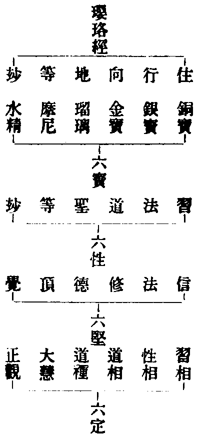



四种缘集



玅乐(六)(二十七)。自体者，实报土也。此是摄大乘师从因立名，谓有为缘集即同居因，无为缘集即方便因，自体缘集即实报因，亦云法界缘集。今疏：前二仍旧从果立名，后一依彼从因立称。



净名疏(二)：(三十一)：一、有为缘集，二、无为缘集。言有为者，即是界内染、净国土，迷真滞有，而起结业，禀分段生死，皆其类也。二、无为者，即是界外有餘果报，及开中、下寂光。此三土众生，迷中道佛性，滞无为缘集，起诸结业，受变易生死，皆是此类。约教辨者，藏、通有为缘集，谓生灭无生之类；别、圆无为缘集，即无量无作之类。故约四教，开两缘集、四种众生。问：所明三土，禀报不同，所居各异，云何悉同无为缘集？答：所迷理同，皆是无明；变易生死，故通为一类。



净名疏(三)(二十八)：一、此半品明折伏界内有为缘集，二、弟子一品即是折伏无为缘集，三、菩萨品即是折伏自体缘集。问：无为与自体，为同为异？答：诸说不同。今言名别体同。二乘迷自体，起无为著，著无为故，正受无为之名。菩萨亦迷自体，起无为集，而菩萨观破无为，但无为未尽，此惑附体，别受自体之名。



略记(中之上)。(二)今言二乘与诸菩萨同有内外无为缘集，既分出已即见见二。乘人顺从著於无为立名，菩萨不著，唯观自体及以法界，故别得名名为法界。法界非缘，以缘与彼法界体合，从所障说，故云自体法界缘集。以是应须竝置尘沙从无明立，以尘沙惑竝不牵於界内外生，故且置之不从其立。



垂𥙿记(三)(六)，一有为，二无为，三自体，四法界。此论师所立，今家但用二名。



三惑亦名缘集，盖诸缘积集之谓也。



涅槃五人得菩提



涅槃(壹字函十一卷，现病品，北凉昙无谶译。)迦叶！有五种人，於是大乘大涅槃典有病行处，非如来也。何等为五？一、断三结，得须陀洹果(云云)；是人未来过八万劫，便当得成阿耨菩提(云云)。迦叶！第二人者，断三结，薄贪、恚、痴，得斯陀含果(云云)；过六万劫，便当得成阿耨菩提(云云)。迦叶！第三人者，断五下结，得阿那含果(云云)；过四万劫，优当得成阿耨菩提。迦叶！第四人者，永断贪欲、瞋恚、愚痴，得阿罗汉果(云云)；是人过二万劫，当得成阿耨菩提。迦叶！五人者，永断贪欲、瞋恚、愚痴，得辟支道(云云)；过十千劫，当得成阿耨菩提。



辅行(七上)(五)次引大经以证权位经於劫数。大经前后总有四文，大同小异。第十云：经尔所劫当得菩提。第十九云：至菩提。第二十云：得菩提。第二十一云：住菩提。住者，秪是住於初住菩提住处，当谓经劫方得菩提。至之与得名异义同，至谓从於方便中来，得谓得於发心处所。言须陀洹等者，从本为名，绝七生已任运入般，生彼复经八万劫竟方发大心，一来六万、不还四万、无学二万、支佛一万，比说可知。从根利钝故便出界经劫长短，发心已后修中道观，断无明惑得见佛性，乃可名为过於五百。此语三藏入灭二乘，通教多分即生能发，如此论者无益初心。然向五人皆云发心若到若得，是故不与唯识义同。长时乃发教尚是权，况计永灭宁非方便？若执权论破佛实经，招过既深良恐未可。



句(六)(十六)五人断通惑者，同生其土，皆为菩萨。佛以胜应应之，纯以大乘家业，训令修学。



记(七)(六)。既云五人彼土生者皆为菩萨，故八六等至彼土时，不须小化渐趣圆实，岂仍滞偏习方便者多迷其教？止观第七判八六等教道须废，法华开显方堪此闻，菩萨机成所应何别？五人即是四果支佛，从本立名云须陀洹，乃至支佛断尽乃云断通惑者，或取三藏二乘及通三乘为断通惑者，此亦可尔。三藏五人自摄通五，通教菩萨先名菩萨，不可更云至彼皆是菩萨，当知全指两教二乘兼通菩萨。若以四人例通菩萨名皆为菩萨，有何不可？但彼对胜应其义不成，但两教二乘彼尚回心，通教菩萨岂应守旧？若准改观，通别菩萨竝须发心，故云训令修学。不云别者，以此五人证同故也。若也通论方便人数，则应云九，藏二、通三、别三、圆一，不得云五，今且对小故云五耳。句(七)(二十九)。大经云：须陀洹者八万劫到，到初发菩提心处也。此取钝根，任运用八万十千等至。若如三藏中，四果不经少时皆得入大，岂须八万之与十千耶(云云)？



记(八)，(十二)大经下正判但至初住也。此取钝根者，有二义：一者五中前三人钝，以住果故；二者五人大乘根钝，以教权故。故云若如三藏中至岂须八万与十千耶，验知八万等其教是权。未至界外者，尚於此生法华即发，岂定界外必尔许耶？云云者，释出教权须废所以，当知诸教长远之位多是教道，岂有出界闻胜应说，必须更经八六四二？



杂编疑者云：罗汉支佛出界可尔，前三果人通惑未尽，如何出界经劫发心？曰：涅槃此说须兼二义：一被钝根，待至界外方得见性；二被利根，意令弊远即生能发。何者？其利根者闻佛所说，若於现身止得初果，乃至但证缘觉不学大乘，未来须过八六等劫方至菩提，是则今世回心免斯历劫，故求宝所不住化城，逼发之言玅得经旨。



或问：文句只云五人断通惑者同生其土，记主何意便作四果支佛释耶？曰：既云纯以大乘家业训令修学，此即劝逼之言，正同大经劝发意也。以五人生方便唯出大经，故云耳。



------



## 读教记卷第十三



天台沙门　法照



文句(六)



齐探



玅经(二)，信解品。



文句(六)(十四)，譬为五：一从舍父逃逝下名父子相失譬，近领火宅总譬，远领方便略颂。二从穷子佣赁下名父子相见譬，近领火宅见火，远领方便我以佛眼观见。三从即遣傍人急追将还下名追诱譬，近领火宅舍几用车，远领方便寝大施小。四从过是已后心相体信下委知家业譬，此非领上近远，乃追取方等弹诃大品转教意耳。五从复经少时父知子意下名付家业譬，近领火宅赐一大车，远领法说正直舍方便。又合第四第五共为一领付譬，在下更明其意也。



记(七)。(三)近领火宅等者，闻譬解已必解於法，岂有悟后而更迷前？是故皆须法譬双领(云云)。譬文为五：始自相失即结缘已后，终至等赐即闻譬之时，若合四五秪成四段。



句(六)(十四)。非结缘已界，故言久住他国(云云)。初譬如有人领二十子，譬二乘人菩萨位行难知，且齐已领耳。记(七)(四)。非结缘已界等者，本结大缘寂光为土，期心所契法界为机，退大已来机土全失，今流五道望本为他，方便有餘尚非已界，况复五道流转者耶(云云)。初譬如至领耳者，第三经初述领不及，意在此也。十界七善进退等中菩萨最难，以兼三故故别语之，菩萨尚然佛果永绝。



句(六)(二十三)，将欲诱引下，是密遣二人诱引。此为二：一、齐教近领三车捄子，远领波罗柰施权。次从又以他日下，取意领法身地久照方便。非道树始知用小，早鉴众生致难，尊特亲狎垢衣，故追领往前以成今解。问：四大弟子何因能知法身久照？答：推近知远。若始道树知无大机，不应兜率降神、正慧托胎，乃至现有烦恼纳妃生子，三十四心后身断结，验知脱大小相海微玅璎珞，更著麤弊丈六垢衣，其已久矣。



记(七)(十四)。又以他日下取意领法身地者，言中且云在道树前，意则俱指渐顿教前，以云致难尊特，故知通至顿前。问四大弟子等者，答中意者，既闻譬已具领二周入大不虗，故自推云若始等也。纳法既重必有此知，约化仪说从容进退，故先齐后探耳。岂有自获小来方五十载，具覩菩萨难思境界，徧闻诸法一切融通非全不知，然未测本源省己绝分，今蒙法譬分染圆常，推知如来往日先照，故下佛叹甚为希有，故以二味所覩验先见非真(云云)。



记(七)(十二)即遣傍人等者，从此方领施顿渐化，故知尔前譬顿渐前若大若小。



句(六)(二十二)。初、将欲诱引者，既息大化不容孤弃，欲设方便故言将欲。密遣二人者，四大弟子齐已分领，不涉菩萨故言二人(云云)。齐此领法譬中意，其文竟。从又以他日下，第二、是取意领。灵智先照久设权谋崎岖随逐，非止树下始见因缘，已如上说。



记(七)(十五)齐此是领法譬至其文竟者，此是寝大施小二处，竝有前段文竟。自此文后法说但有开权，譬说唯有等赐，竝缺中间二味。若论探领法譬二处，虽无正文但指法譬，能见之眼即法身也。故齐教领且领渐初，以所禀小名为齐教，别有探领故云又以



句(六)(二十四)。将欲取意领法身之地，久知大小之机，一三施化，重述佛意，故标章称又也。他日者，二乘自谓方便为己，非二乘法为他，即拟法身也。日者，时也，亦智也。依法身之时，用智照机，故言他日。若从此义，实智照实为自，权智照方便为他；齐教领领化身用事为己日，非化身用事为佗日。若就如来自行权实之智，皆名为己；如来化佗权实之照，皆名为佗。如来自佗权实之照，照实为己，照权为佗。此之探领法身之时，用化佗之权智，照於权机，若有若无，照用权事，若可若否，皆是权智所照，故言佗日。若从此义，齐教领领化佗之权事，故二乘称己事；探领领自佗之权，此权非二乘事，故称为佗。虽有两意，佗日俱成。今依二乘所领，又逐佗日之文，以探领领法身中照机也。



记(七)(十六)。初文释佗，为二：先释，次判。先释者，约二乘人以小望大为佗。次判者，向约二乘虽以大为佗，未知此大元用何身，故今判之，即法身也。次释日者，於法身地以用权实，实自权佗，二乘法中无法身之智，故名为佗。若从下，判。若从法身用於权智，望二乘人亦名为佗，此佗须指佛之权智。次合字释者，於中三释，即依大经随他语等及化佗等三以为法式，仍对齐教探领二时。文为三：初释三相；次若从下，判今所属；三、今依下，用今意结。初又二：初约化佗，即指齐教；次约自行及以自佗，即指探领。言齐教者，即法、譬二文，但至鹿苑，依教所有，故云齐教。所言探者，谓过探也，探向道树寂场之前。初齐教者，既属初义，先约机说，是故齐教但领化身，即非化身时为他日。次从若就去，探领者，又为二：初正明二义；次此之下，结也。初文者，虽是法身，既以自行对佗，故以化佗权实俱佗，所以二乘昔亦不测其旨。此中自行之语似於自佗，以对自辨他俱有权实，故双言之。次自他中，自之与他各单语权实者，准理合双，此中语似自行，为对化佗成自佗也。所以自行亦指化他为佗，自佗亦指化佗为佗，故知探中皆指法身时权。二乘於彼虽禀小化同体之权，二乘不晓於佛，二自皆指同体法身时权，虽有两意，佗日皆成。次结中云若有若无等者，结於法身权智所照，若有机，若无机也。言可否者，明法身用智逗物，称机为可，不称机为否，时至为可，待时为否，虽有有无可否，皆是权智权机，得他日名。次判中云若从等者，判向齐探。探领自佗者，自是第二自行，佗是第三自佗，应重云自，方显第三义也。竝是对法身为佗，故非二乘事也。虽有两意者，齐探两中俱有佗义，故云俱成。齐中则以法身照机为佗，探中二义则以如来自行之中皆权为佗。佗即二乘所用，虽有二乘所用及非二乘所用，两意不同，皆得佗名。今依下，属对文意。今依二乘所领，即齐教探领也。又逐佗日者，探及齐教二处三佗，故二乘领已望佛，又领如来用他。言探领者，亦应云齐教，但是文略，是故二领皆指法身之取机也。但从义别，二佗不同。



句(六)(二十八)。又前诱引譬中有齐教领，始自道树终讫出宅。又有探领，始自法身终讫思尽。今领亦二，始探领慈悲四味调熟，终领付财究竟一味，远近始终合论五味。何者？即遣傍人等，即初味也(云云)。四大弟子深得佛意，探领一化五味之教，始终次第其文出此也。



记(七八)(十)。又前诱引譬至思尽中言诱引者，密遣二人也。言出宅等者，出宅与思尽两终义同，法身与道树远近不等。今领亦二者，今至领等赐中，总合前文两个始终为一始终，故云远近始终。是则齐教为近始，探领为远始，二终但共为一，望诱引等中终则极於等赐，故云始四味终付财。既以四味为始，验知探领至寂场前。次何者下释也。释出共为一始终相，即五味也。



句(六)(三十四)，初三行颂顾作譬，次四行半颂教作譬。



记(七)(二十三)雇作至教作譬者。雇作即上齐教，教作即上探领。齐教文意，自道树来，以取小机，义为雇作。探领文意，法身地时，无时不愍，何尝不教？岂待顾耶？故云教作。



句(七)。(一)师云：不应偏尔。经称善说如来真实功德，备述其领权领实，明文在此(云云)。今言都述其周徧领解，始天性结缘，中间追诱，终於付财，自微自著，无量无边诸恩德也(云云)。一、双述善哉，二、领所不及。双述者，一善哉述其两处领实，一善哉述其两处领权。善说如来真实功德者，真实是述实，功德是述权。又华严之拟宜，领实也。三藏之诱引，领权也。方等之体信，般若之领教，俱领权实也。法华之付财，专论实也(云云)。又从如来复有下，述其领所不及。云何不及？谓进退、横竖、亦横亦竖、非横非竖，皆不及也(云云)。不及之旨，非都顿夺，特以初心望后心，未穷极地，故云不尽耳。记(七)。(二十六)师云者，即指南岳。三乘虽复自领已界，既云善说，即是具领一代权实。今佛委悉述其所领(云云)。始天性等者，天性即指大通佛所(云云)。天性犹通，结缘从别(云云)。双述等者，两处谓方便、火宅也。以信解中双领两处，今亦双述二处所领。若不尔者，徒述何益？善说下，述其具领如来权实教法，止约因缘释也(云云)。又华严云去，徧述所领，即约教也(云云)。次不及下，明佛斥不及意。二乘初闻，始入初住，且自述己所入之法。佛欲委述所不领者，其法尚多，二乘若闻，亦成徧领，具如前说。



句(七)(十二)汝等迦叶下，复宗称述欲释疑。疑者闻佛无量功德，谓四弟子齐教领解，何必是实？故佛称述虽未及佛地，齐教不虗也。



记(七)(三十六)。次复宗释疑者。虽未之言许为俦类，得授记已，即分真佛。自鹿苑复具领权实，至醍醐时领业不虗。当知前叹释迦，本欲称叹迦叶所领。言释疑者，恐此时众闻佛述其领所不及，不晓佛旨，而谓迦叶所领不当，故述己权实，以叹迦叶能知如来随宜说法。虽自领己，实兼一切。问：何不释探疑耶？答：齐教显露，虗实易辨，故佛且结齐教述叹。若尔，探最可疑，何独齐教？答：虽难而易。时众闻说如来二智，知佛法身恒思大小，秪恐领教未必尽善，故佛以二教二智述其齐教，无差谬也。又齐教领尚自不虗，验知探领亦应非谬。



句(四)(三十三)，知佛在法身之地，以常寂佛眼，圆照群机。若根利浊轻，则以卢舍那像，说一乘法。若根钝浊重，则脱璎珞，以老比丘像，惊入火宅。方便开三，秪是于时鉴机。故言我以佛眼观见也。若观色法，应用天眼。若分别根机，应用法眼。云何言以佛眼见耶。佛眼圆通，举胜兼劣。又四眼入佛眼，皆名佛眼。



玅玄(一)(八)，大势威猛，三世益物，具如信解品中说。



签(一)(二十四)，故更引踊出助显迹文，故云大势威猛等也(云云)。次指信解者，即信解中云又以佗日於窻牖中，即指法身地鉴机久矣，故此一语即兼三世益物之相。又信解具领一代五味，则知三世五味竝然。



夫齐探之文不出二义：一则能领乃二乘之人，二则所领乃权实之法。何者？四大弟子既登初住领一实已，齐教之始复领化身之权事，而至鹿苑探领之始，复领法身之权过寂场前也。既分化身法身方便之别，遂成近始远始齐探之殊，故文句云：齐教领领化佗之权事，探领领自佗之权。夫齐领中言齐己界齐教者，己谓自己，界谓界分，教谓教法。盖四大弟子领齐己界之教，始道树终出宅也。故荆溪云：齐教领但领渐初，以所禀小名为齐教。又言齐教者，即法譬二文，但至鹿苑齐教所有。又云：齐教文意自道树来，以取小机名为雇作。又云：二乘虽领己界。此四文则齐领之说也。探领中言取意领法身地者，盖取自得之意探领佛意，始法身终思尽也。故荆溪云：言中且云在道树前，意则俱指渐顿教前。又云：故知探领至寂场前。又云：知佛法身恒思大小。此三文则探领之说也。夫领付科中，先牒前诱引文云：齐教始道树终出宅，探领始法身终思尽。次正释领付云：今领亦二者，谓齐探也。对诱引齐探故著亦字，故云：始探领慈悲四味调熟，终领付财究竟一味，远近始终合论五味。是知合前诱引两个始终，为一始终论五味矣。细看荆溪释云出宅等者，出宅与思尽两终义同，法身与道树远近不等。此一节记释牒前诱引文两始终也。从今领亦二下，自释领付中远近始终合论五味两句文耳，故云望诱引等中。又下文云：释出共为一始终相。然则领付何以不言齐而言探？曰：大师云：合论也。且何以知其合？曰：得其探领之意，则齐教在其中矣。夫领所不及之文虽是齐己，其如佛述成云：善说如来真实功德。佛结叹云：能知如来随宜说法。两文皆云如来。荆溪云：善说下，述其具领权实教法。又云：只恐齐教未必尽善，故佛以二教二智述其齐教。细看经疏与记，斯乃世尊述叹齐教示徧领意也。只看徧之一字，便与领所不及文别。然齐教中尚能徧领，况其探领者乎？北峰师叙难有四：一、问：疏明信解五段经文，且父子相失并父子相见，皆云近领、远领者，为齐？为探？若云探领，则疏判二诱科方明齐探。云齐之妨亦然，应二领外别有领耶？二、问：齐探经文有四：一、小拟宜，二、知先心，三、叹三车，四、适所愿。竝皆在小，何故疏释又字云法身之地久，知大小之机一三施化耶？三、问：探领法身为是何处法身？四、问：远近始终合论五味，为四大弟子经合耶？为天台疏合耶？释其一曰：今依虎溪云：齐领亦名齐教领，亦名教领。齐字谓齐己分，亦是齐己界，乃召能禀人也。教字谓所禀教语，所领法也。故知齐该己分、己界，不可分为二种矣。而所禀教者，鹿苑是禀教之始，法华是禀教之终。若鹿苑以前至大通来，虽未禀教得益，已成能禀根性，是故二十子中亦名齐领。但领根性，非领禀教，只可名齐领，不可名教领也。次探领者，探谓过探，即过探鹿苑寂场之前，法身地中悬鉴今日五时宜大宜小，非始道树三七思惟也。慎不可见过探之语，便认父子相失相见之文亦在其间，应知探领乃说齐领中意耳，所以谓之推近知远也。若以义定，泛论六义：一、日之己佗；二、身之法化；三、时之过现；四、土之内外；五、思机说法；六、始之近远。若局而别定，只是领法身名探领，领化身名齐领也。北峰疑曰：文句十三偈只是齐教荷恩，始天性结缘。记云：天性即指大通。佛所疏记天性结缘皆名齐教，安局鹿苑？曰：齐教之名须指禀教，故记云：且领渐。初以所禀教名为齐教，定局鹿苑也。且相失相见四大弟子，依法譬而领天性结缘之事，亦是齐教者，实以后显前也。释其二曰：虎溪云：以大小权实拣判，不出二义：一者、二领俱权竝小。文云：一、齐教近领三车捄子，远领波罗柰施权。次又以他日下，取意领法身地久照方便。此齐探俱权小也。二者、二领通大小权实。文云：四大弟子深得佛意，探领一化五时之教。玄文云：如是等意，皆法身地寂而常照，非始道树逗大逗小。佛智鉴机，其来久矣。此探领通大小。又云：华严拟宜，领实也；三藏之诱引，领权也。此齐领通大小权实也。应知二领俱权竝小者，顺密诱科始终俱短义；二领通大小权实者，顺领付科始终俱长义也。北峰曰：四大弟子陈领解时，具知法身久照大小，中间退大取小，今日寝大施小，法华会小归大，悉包并在胸次间，岂领小不领大，领权不领实耶？所以祖师或说但领小，或通领大小者，皆随科意不同耳。释其三曰：虎溪云：探领法身，以四土言之，既云久鉴大小，须指寂光法身明镜之体。北峰疑曰：此方未施化前，正是中止一城，方便土胜应，名为法身，有何不可？曰：须知如来三身四土，能依之身、所依之土，体常相即，未尝暂离。言法身则时时鉴机，言应身则时时利物。若论未施化前鉴机，即是法身居常寂光，所以大师释我以佛眼观见，作常寂法身鉴机而释。若论未施化前伺机，即中止方便是胜应身，所以大师释中止一城，作方便土而解。释其四曰：四大弟子领解鹿苑二诱，则委开齐探两个始终。至领付科，则不复出两方等、两般若、两法华，则合前二诱两个始终，共为一个五味。始终既齐探远近，两始终为一始终，乃称此是远近始终。疏记释云：共为一始终，相即五味也。是知领付科合，非疏文自合，乃四大弟子经文论合也。所以合者，四大弟子若不於二诱开两番领，则不显齐探两个五味；不於等赐合一番领，则不显两个五时，只一五时。北峰疑曰：密诱齐领，为该华严否？若该，则违文。大师自云始道树，不云寂场，又背义。既称二诱，安该华严追耶？若不该，亦违文。记主云即遣傍人等者，从此方领施顿渐化，故知尔前譬顿渐。前若大若小(文)，渐顿岂非该五时俱化身用事？若华严非化身，释迦但四时耶？亦背义。记主既云探领至寂场前，安得华严非齐领耶？曰：二诱正言鹿苑。从科意而言之，若从时节，亦该华严。良以道树同名场故，只是一处，从其大小而得二名。约小机所见，在此树下得道，经三七日，诣鹿苑说法；约大机所见，亦在此树下得道，证寂灭理，得名寂场，不用经三七便说大法。故云：大覩始终无改，小见三七停留。是知齐领始道树，且顺科意；约时节，即是寂场，该华严也。又疑：齐领则始终俱近，探领则始终俱长，何云二终义同？又二终但共为一，曰：齐领是今日五时，探领是法身地。能鉴法身虽远，所鉴今日五时非远也。精微谓齐领唯鹿苑，假名云付财二领，与二诱科二领不同。付财齐领，以今五时俱名为齐，与二诱唯鹿苑异。探指佗日悬鉴五时，与二诱科兼今日华严，亦属探异。艸庵云：齐领领今日事，探领领久照今日事。虽曰二领，皆领五时。逸堂曰：齐领者，即是四大弟子闻法譬，开显领解如来今日道树鉴机，应鹿苑小化。探领者，亦蒙开显后，探领如来法身地上，远鉴今日鹿苑施小，此乃领法身用事也。须知齐探既是诱引科中对於鹿苑，则不可领大，须二领皆小也。大师虽云一三施化，盖取能鉴佛意边说耳。领付科中，齐探俱通大小。於齐领中，须晓二义：一者、所领所说法；二者、所领所入法。所说法，则领大小一化权实之教。亦谓之齐领者，齐今日之义，以由对却顿渐之前鉴机，今日一化，皆名齐领。疏云：始四味，终付财。二者、所入法，则二乘领自己徧历诸味，所得亦通大小，但领我之所得，故云齐己界领，但不得云齐己教也。镜庵曰：通局者，推原得益因由，文则备在二诱；具领受化始末，义则徧通四科。然虽通四，探约佗日法身久鉴五时，齐约今日应身施化五时。



上下五分结



玅乐(七)(十七)。五上分者，谓掉举、慢、无明、色染、无色染。五下分者，谓身见、戒取、疑、贪、瞋。五上分中，色染、无色染一向唯上，掉、慢等三虽复通下，不能牵下，故云上分。言下分者，贪虽通上，不是唯上；瞋一唯下，不通於上；餘三徧摄一切见惑，虽复通上，而能牵下，故名为下。故俱舍由二不超欲，由三复还下，纵断贪等至无所有，由身见等还来欲界，广如俱舍。



签(五)(十八)俱舍云：由二不超欲，谓贪、瞋。由三复还下，谓身见、戒取、疑。



鉴堂曰：或问思惑牵生，见惑障理，何故纵断贪等至无所有，由身见等还来欲界，将非见惑亦牵生耶？曰：见惑本是障理，由未见理，纵能断思，未出有漏，故见惑亦牵生也。



无住本



维摩诘经(中)观众生品。



疏(八)(十八)。　垂裕(九)(二十四)。　玅玄(八)(七)。　签(八)(一)。　类集节玅经(三)。药艸喻品。如来说法，一相一味，所谓解脱相、离相、灭相，究竟至於一切种智。



句(七)(九)。所谓下。双释一相一味。众生心性，即是性德、解脱、远离、寂灭三种之相。如来一音说此三法，即是三味。此三相则以为境界缘生中道之行，终则得为一切智果，故言究竟至於一切种智也(云云)。解脱相者，无生死相。离相者，无涅槃相。灭相者，无相亦无相，唯有实相，故名一相。一相即无住，本立一切法。无住无相，即无差别也。立一切法，即有差别。差别如卉木，无差别如一地。地虽无差别，而能生桃梅卉木差别等异。桃梅卉木虽差，而同是一坚相。若知地具桃李，即识实中有权，解无差别即是差别。若知桃李坚相，即识权中有实，解差别即是无差别。



止观(八)(二十九)，辅行(八下)(九)。今明圆教地体生性一切具足，况复牙坚全是地坚，能生所生无非法界。



记(七)，(三十三)。所谓下双释者，初双标理教也。次众生下先释性对理德之相。初总举，解脱下列结，此性三德虽有三相秪是一相。如来下释一味，由佛说故此性可修，性本无名具足诸名，故无说而说，说即成教，依教修习方名修三(云云)。此三相下重指性三以为修境。缘生下重举修相故名为行，行即因也。终则下举果地三，三智满故从智为名，即是智三行三性三，开合多少准望可知(云云)。初释相中性德即是本有三道，解脱相者即於业道是解脱德，离相者即於烦恼是般若德，寂灭相者即於苦道是法身德，无生死等寄修以释。唯有下结，故云实相。一相下转释一相即无住本，立一切法理则性德，缘了事则修德三因，迷则三道流转，悟则果中胜用，如是四重竝由迷中实相而立。此无住本具如释签第七已释，故无明实相俱名无住。今以无相对於差别，专指实相名无住本，无住即本名无住本，随缘不变理在於斯。起信二门义准可识，染净二类具在十门。



光明玄(五)：初、从无住本立一切法(始三德，终三道)。若从无明为本立一切法者(始三道，终三德)。



记(上)(十六)。初、约施教逆推，理显由事；二、约立行顺修，即妄归真。此二生起：初、从法性无住本，立一切教法；二、从无明无住本，立一切行法(云云)。然若具论，从无住本立一切法，不出四重，如玅乐(云云)。今之初番，是彼第四果中胜用；今之后番，是彼第二修德三因。问：初番生起，始从秘藏，终至三道，合当迷故，三道流转，何以却对果中胜用立教法耶？答：今云秘密藏显由三宝等，岂可迷理而由三宝及诸三法耶？故知须作依理起教释之方允。



指要云：第一重，既以性德缘了为一切法，须以正因为无住本。餘之三重，既将逆顺二修为一切法，必以性德三因为无住本。



大乘直说真、妄体一。净名虽因穷妄，以无明为本，其实体全法性。是故祖师随文用与，或以法性，或以无明，义皆无在。须知无住本法，具论须四，克论唯二也。初重是理，餘三是事。理彰圆教性具诸法，事显圆教全性起修。故指要云应知若事若理，皆有此义等。然经中性、德一相，本具三相，谓解脱、离、灭，疏记委明。故知理中本、法、性、德、缘、了，即经疏性三；事中本、法、修、德三因，即经疏修三；迷则三道流转，即众生本有三道，全三德而是也；悟则果中胜用，即经疏果智之三也。然此三重立法，文中显云：重指性三以为修境，由佛说故，此三可修。岂非全性起修？性三为本，逆、顺二修皆所立也。亦合地具桃、李，则识实中有权，解无差即差(理中具缘、了)；若知桃、李坚相，即识权中有实，解差即无差(事中具正因)。经中一相，疏指为众生心性，而记文迷中实相，盖本於此。然此四句，但作修性迷、悟而说，不必如虎溪始天性结缘中退大流转，今悟大果以求生起也。或疑初重立法但举缘了，则有二修二因，次重何指三因与逆顺二修，又有果中胜用者？何逸堂曰：玅宗云：良由众生性具染恶，不可变异，其性圆明(文)。所以性中但举缘了者，即性善恶也。善缘了即是性具佛界，恶缘了即性具九界，只由性善性恶融通寂灭，其体不二，故但举缘了即具二种也。又复性中缘了既未起修，三法圆融皆得为本，是则修性对论，故本中既三，立法亦三，就性自论，立法唯二也。又修中善恶既异，故逆顺恒殊，果中胜用既全在因心，则知因不离果，所以修中具明三句也。若起信二门中，不变与体空，即无住本也；随缘与成事，即所立法也。其不二门法性无明共造，虽通真妄，亦与四句会同之染净二用，即事造三千，即玅乐下之三句，染用三道流转也，净用果中胜用，亦修德三因也。且从用说，故缺初句，应知四句亦通别教，但以初句三皆在性而不互融，乃至第四从本起用，只是相关不相即也。净名中既唯有第二重本法，通别无疑矣。



杂编云：无住差乎一性，立法谬於二修，本末相纷，源流一混。意谓本只一性，却以性德三因皆为无住，则差失一性矣。所立只是缘了，却以逆顺三皆为法，则谬乱二修矣。则缘了为修本，正因为立法，故有本末一混也。然记文明将三因三道为所立法，必以性三为本，何破四明？又引玄签无明法性和合生法者，且签中委释无住本义，竝无真妄和合之说，不知所据何文？又谓约性虽离，对彼须合，乃至记云事则修德三因者，对本兼举也，以例四佛立义。且性三为本，修三为末，出疏当文，何不寻之，而背文立义？又复三因既是兼举，三道亦是兼举，只有二道为所立法耶？又况引例不当，岂可以徧圆对论，以例圆中理事耶？



续遗(上)(十七)，都由三德秘密法性无坚住性。是故，大圣！以此法性无住为本。



指要(上)性虽是一，而无定一之性。



编云：有云：无住本者，谓性不定住也。真如非寂非照，而寂而照，是性不定住。无明体空，立一切法，亦是性不定住。此释无据，盖不看本疏。疏云：无明依法性，法性即无明，无二无别，岂得性还依性？当知无明无本。以此明之，无住是无依义也。今谓玅乐云：此无住本，具如释签第七已释，即无明、即法性等文是也。当据此文释无住本，岂非无明、法性俱无坚住性耶？俱无定一之性耶？欲成己义，却改名性不定住。纵兹巧说，於义何妨？疏文云：既无有本，不得自住，依佗而住。如何以无依释无住耶？



性类二种



文句(七)(十)种者，三道是三德种。净名云：一切烦恼之俦为如来种。此明由烦恼道即有般若也。又云：五无间皆生解脱相。此由不善即有善法解脱也。一切众生即涅槃相不可复灭，此即生死为法身也。此就相对论种。若就类论种，一切低头举手悉是解脱种，一切世智三乘解心即般若种，夫有心者皆当作佛即法身种。



玅乐(七)(三十四)。三道是三德种者，即性种也。有生性故，故名为种。生时此种纯变为修，修性一如，无复别体。言相对者，且从当体敌对相翻，即事理、因果、迷悟、缚脱等，始终理一，故名为性。波水之义，准望可知。波是水种，岂可不信？若就类者，类谓类例，即修德也。众生无始恒居三道，於中谁无一毫种类？夫有心者、法身种者，合彼性三为一法身，对修方合，约性恒开。此三从别，一一各异。问：若尔，般若、解脱有於种类及以对论，法身种类与对论种为同为异？答：理一义异。言理一者，秪缘理一，是故性修相对离合。言义异者，对生死边名为相对，理体本净名为种类。又闻能观智名为了种，闻所缘理名为正种，即是理净与事净为类。别行玄记(上)(十五)。问：文中缘了竝云种者，其义何耶？答：夫言种者，凡有二义：一、敌对论种，如三道是三德种；二、类例论种，如缘了是智断种，性德法身为修得法身种，此二皆取能生之义也。若以二空为种，即类例义；若以二执为种，即敌对义。今文既云观人法空即缘了种，是类非对；若就觉智观於二空为二因种，则取修二类於果二；若就性德本自二空为二因种，则取理净类於已净。故圆论性种有对有类，别无对种，学者审思。圆教反是，学者思之。



十义书(第二义)。又执心造诸如来是非染非净心者，此更不可。且如止观引彼经偈，本证阴心能造一切。此有二意：一明阴心本具如来性故(理造)，二明烦恼之俦是如来种(事造)，故云心造如来。若敻指真心能造如来，正当金錍旁遮偏指清净真如为佛性也。又只知类种，全不识敌对种也。



文句(四)(二十九)，中道无性即是佛种。



记(五)(二十三)。立本无性为本性德，故知今种即性家之种，是故还立无性为本。为欲更明性家缘起，以种言之，种者生义，即前十界，界如、理性、俱性、竝种，具如前释。



玅玄(九)(二十)若取性德为初因者，弹指散华是缘因种，随闻一句是了因种，凡有心者是正因种。此乃远论性德三因种子。



北峰师曰：众生三道体性，本来全是三德，迷故不知，枉受轮回，失佛神用。今示迷体全是佛性，令其改迷，发智修行，同佛受用。然性体虽尔，非闻教开解而不知，非加修圣行而不证。故金錍云：汝无始来，唯有烦恼、业、苦而已。即此全是理性三因。由未发心，未曾加行，故性缘了，同名正因。而兹性类佛菩提种，非圆顿教，莫能诠示。昔圆自玅，偏性尚迷；今既开权，偏圆俱得。是知以圆教解，了迷即玅，一毫一句，称性互融，法界徧含，何所不具？所谓三千果成，咸称常乐。若不圆修，何能顿证也？须知性以三道为能生，三德为所生；类以三因为能生，三身为所生。又复性种生时，纯变为修，与果上三佛同类。何者？能生之心，是修中正因，与果上法身同类；所发智是了因，与果般若同类；所修福是缘因，与果应身同类。修性一如，无复别体。既从圆诠，善恶皆成佛道，故於九界而分性类。三道恶法即性，名性种；三因善法即佛，名类种。用上九界中，取所作恶为性，所修善为类也。性以三道为当体即修恶，类以三因为当体即修善，竝属事造三千，故云变造三千即修善修恶也。烦恼之俦是如来种事造也。若玅乐四句中，性属三道流转，类属修得三因，若论所依即理造三千，迷中实相亦性德缘了也。然约修性乍分，若究三道得为佛种，正由性全是佛，三因竝全性起修，岂有两体之别？三千体一，事理不二也。若尔，三千属所显，修恶属所破，如何以修恶为事造耶？曰：但除其病，不除其法也。此乃就迷示性，故以三道为性种。若文句中直示性德，明佛用由性，故以中道无性为佛种。记云：性家之种还立无性为本。或疑文句中两释，初以中道为佛种，说教为缘起，次以正因为佛种，缘了为缘起，竝不涉二修者何？曰：既以中道无性为种，故藉师教与缘了而发起此佛种也。若尔，波水之喻应水为种耶？曰：中道正因其体全是众生，三道亦得波为水种。若如法身类种，理净与事净为类，岂可求其别体？亦是水为水种。若取修性之义，今中道之种能生即修，亦是水为波种，义无不可。或疑：玅玄云：我不敢轻於汝等，汝等皆当作佛。即是正因种(文)。且正因本具，何须论作？曰：须知本具，迷故不知。玅乐云：闻所缘理，名为正种；闻所说智，名为了种(文)。又疑：玅玄若取性德为种者，一句一偈为了因种，弹指散华为缘因种，夫有心者即正因种(文)。此以修德三因为性德种者何？曰：乃体性之性也。又疑：玅乐云：敌对相翻，指要谓不须断除及翻转者，何也？曰：初名转体不转，次名体俱不转也。又疑：经云：若人不信，毁谤此经，则断一切世间佛种(文)。以性类言之，何种耶？止庵曰：此正明类种。如句云：今经明小善成佛，此取缘因性为种。若不信小善成佛，则断一切世间佛种(六)(十一)。记释云：言断佛种者，正当缘、了二因。此经徧开六道，若谤此经，义当断也(六)(末)。或法身有对有类，



私谓：记文生时，此种纯变为修，修性一如等文。此乃释性种三道之修，非谓类种之修也。若就类者下，方释类种。



------



## 读教记卷第十四



天台沙门　法照



文句(七)



舍利



文句(八)(十二)。夫佛生处、得道、转法轮、入涅槃等处，法王所游皆应起塔。此经是法身生处、得道之场、法轮正体、大涅槃窟。此经所在须塔供养，不复安舍利者，释论云：碎骨是生身舍利，经卷是法身舍利。此经是法身舍利，不须更安生身舍利。生法二身各有全碎，皆可解(云云)。



记(八)(二十一)。生处，得道、转法轮、入涅槃等处，具如止观第七化身八相。此四相处尚应起塔，况复五师及此经所在？即是法身四处皆应起塔，况经著塔中？则为已有法身全身舍利，故引论证。生法二身各有全碎云云者，令释出四相生身全碎，如释迦多宝。法身二者，诸方便教法身碎也，法华一实法身全也。四教五时委简可见，故知诸经全碎相半，唯此法华法身全身，更无餘法皆入实故。



玅玄(七)(十七)，六年苦行，三十四心断结(云云)。以火阇毗，收取舍利者，此三藏佛涅槃相。



辅行(九下)(十五)方便土中通佛涅槃，不可亦同界内通佛灰身入灭，唯留舍利等。



大小两乘皆留舍利者，小为人天福田故，大表化化无穷故。若顺教旨空中，则大有小无，如章安说；若顺同居化仪，则小有大无，如玅玄；若就法性土，则大小俱无，如辅行。相传谓一生修行，其火烧不坏，击之则碎；二生修行，烧击不碎；三生非但不碎，亦有光明也。



法华分身



璎络本业经(上)。释迦文佛分身百亿，悉徧其中，为彼国说贤圣本业璎络之行(云云)。若近相见，皆来集此金刚寂灭道场树会。



戒坛经。佛告目连：汝往祗园戒坛，鸣钟召十方僧，如观音、普贤等集。我分身百亿释迦，各乘楼观，至戒坛所。



华严经(五)。往昔勤修多劫海，能转众生深重障，故能分身徧十方，悉现菩提树王下。



签(二)(十八)，首楞严下卷：坚首菩萨白佛言：世尊(云云)。阿难言：如我解佛所说，彼佛是释迦异名。佛告阿难：汝承佛力，乃知是事。乃至上方有土，名一灯明等，竝释迦分身。



文句(八)(二十)诸佛同与欲开塔，如僧中作法与欲意也。大集明若干佛与欲，华严亦说十方若干佛同说华严，大品亦云千佛同说般若，皆不云是释迦分身。准今经者，应是分身，彼带方便，故时中不显说耳。今经非但数多，亦直说是分身，咸来与欲也。



玅乐(八)(三十)。如僧中与欲者，不必全同僧中法事，故云如耳。多宝愿力须诸佛集，复令时会知分身多，故此诸佛为开塔集。集又不至，但遣侍者传问讯等状如与欲，故诸侍者但申问讯无说欲辞。大集若干诸佛与欲者，於欲色二界大空亭中，广集十方一切诸佛(云云)。今已开权，次欲显远使诸佛道同，故令诸佛与欲



释签(一)(二十三)，况同居分身寂光地踊，覩已咸信一道无偏，不同华严云是眷属，大集亦无分身之言，般若但云问者加说名字咸同，故知此经与餘经异。显密意别，思之可知。



按疏记言分身，但今昔多少，显密异耳。



逸堂曰：诸文竝不曾一槩断昔日无分身，但只可云对诸经拣。盖前人不晓，便谓在昔不说分身，乃问者之过。应知今经与诸经对辨有二义：一者名义，如华严、大集、般若但有分身之义，今经有义有名。二者多少，昔经纵说分身而数不多，今经数多。或云本迹异，迹中今成分身则通，本门久成分身则局。



三变土田(签七（十三）：三变土田者，土田梵云佛刹，物所生处名为土田，即生处所也。亦是一切诸法之生处。三变表三智，破三惑。)



玅经(四)，是宝塔品文句(八)(二十)。三变土净者，此正由三昧。三昧有三：初变娑婆是背舍，能变秽为净；次变二百那由佗是胜处，转变自在；后变二百那由佗是一切处，於境无碍。又初一变净表净除四住，次一变净表净除尘沙，后一变净表除无明(云云)。



记(八)(二十九)。三变净土由背舍等者。问：佛有楞严三昧之力，何以仍用小乘事禅，又表破三惑复非所治？答：是定圣行揽因成果，果地事用无爽於理，即楞严中具诸三昧，非昔因时见禅法界，岂背舍等变过三千？然化佛事宜附小名，故大论中亦是准小，故云欲得自在修胜处，欲得广普修一切处，若但小用唯於三千。又初一变下表破三惑者。既楞严中即理之事，不妨一一皆破三惑，况今三昧直论功用，破惑乃是所表而已，表前破已表后更破。



记(九)(十八)今云变者，秽为施权，变表显实。秽属五浊，元在小机，机会权开，变土为表(云云)。



记(八)(三十四)。问：三千之外各四百万亿无复大海，文殊何故仍云海来？答：事释未爽，况不思议。今三义通之：一者既移天人及变大海，从所移处来应无远弊。二者海众纵移而龙宫不动，龙谓不动而所居已变，从变而不变处来有何不可。三者无缘者被徙、有缘者今来，此不思议山海宛然令众不见，但是变见非谓改体。文殊既不起而往，其土亦即秽而净，故净名云：移置他土都不使人有往来想。此中乃使有往来想而本不移，故知应有机者而土变众移而尚来，其无缘者土复众来而不至。所以理虽无动、化事成规，故使所见不同、来往时异。菩萨化仪尚尔，岂佛设变同凡？



玅玄(七)(十四)复次，三、变土田者，或是变同居之秽，令见同居之净。或见方便有餘净，例如寿量云：若有深信解者，见佛常在耆阇崛山，共大菩萨、声闻、众僧者是也。或见实报净，例如见娑婆国土皆绀琉璃，纯诸菩萨，即其义也。或见寂光等也。法华三昧之力，使见不同耳。



释签(八)(五)。三变土田或见同居净乃至方便有餘者。三变之净，若据土相似同居净，据移天人置於他土，纯诸宝树宝狮子座，唯有诸佛及诸菩萨，则似方便有餘，故著或言。准文又应亦似实报无障碍土。



或问：净名丈室，容受三万二千狮子宝座，及一切大众。又华严中，无碍法界，於一毛端，现宝王刹。何法华开显，反不及二经，须用三番变净耶？曰：净名现座，大士空室，正彰弹斥故。华严法界，毛端现刹，乃果上无碍故。法华更变，机会权开，表破三惑故。应知净名华严，不变而变。法华开显，变而不变。随顺物宜，无优劣也。



龙女成佛



玅经(四)，提婆达多品。当时众会，皆见龙女，忽然之间，变成男子，具菩萨行，即往南方无垢世界，坐宝莲华，成等正觉，三十二相，八十种好，普为十方一切众生，演说玅法。



文句(八)，(二十七)。正示因圆果满。胎经云，魔梵释女，皆不舍身，不受身，悉於现身得成佛故。偈言，法性如大海，不说有是非。凡夫贤圣人，平等无高下。唯在心垢灭，取证如反掌(云云)。南方缘熟，冥以八相成道。此土缘薄，秪以龙女教化。此是权巧之力，得一身一切身，普现色身三昧也。



记(八)(三十四)。问：为不舍分段即成佛耶？若不即身成佛，此龙女成佛及胎经偈云何通耶？答：今龙女文从权而说，以证圆经成佛速疾，若实行不疾权行徒引，是则权实义等理不徒然，故胎经偈从实得说。若实得者，从六根净得无生忍，应物所好容起神变现身成佛，及证圆经既证无生，岂不能知本无舍受，何妨舍此往彼？餘教凡位至此会中，进断无明亦复如是。凡如此例，必须权实不二以释疑妨。言权巧者，不必一向唯作权释，只云龙女已得无生，则约体用而论权巧，非谓专约本迹而为权巧也。故权实二义经力俱成，佗人释此或云七地十地等者，不能显经力用故也。



教行录(答日本十问中)。



愚谓北峰承广智云：龙女是实人，在海已证无生。今作始证体用权实释，非同古人判是十地人，权示此说不可易矣。窃详圆果一科，经文自有现身成佛舍此往彼之义。大师标因圆果满文，初云现成明证，即是龙女现身成佛以证圆经，故引胎经偈现身成佛是同，未分权实之异。记主详考二文，虽皆现身成佛，而权实不同，故云今龙女文从权而说，故胎经偈从实得说。因修北峰科，令记文明白。记文初问下，约龙女及胎经现身成佛问；二、答下，约权实现成舍。此答有四：初、约权实义等消文；二、若实下，约实体权用答即舍；三、凡如下，嘱必须权实不二释妨；四、言权下，释欢喜文，断体用权实俱显经力。然言权下，虽是欢喜科文，而意与上连属也。次又二：初、明圆人当教；二、餘教下，例从偏入圆。初又二：初、以体用正释现身疑；二、既证下，以体用结释不舍疑。记云从六根清净得无生忍，即前文殊言龙女得不退转也。记云应物所好容起神变现身成佛，即今龙女因圆果满现身成佛也。看胎经证字、今经变字，则体用明矣。记云不必一向唯作权释，又云非谓专约本迹而为权巧，盖对斥古人通本迹义也。



寿量四句



文句(九)(十六)鹬蚌相扼，我乘其弊，应具四解。谓实有量而言无量，弥陀是也。实无量而言量，如此品及金光明是也。实无量而言无量，如涅槃云唯佛与佛其寿无量是也。实有量而言量，如八十唱灭是也。品文具有此义，岂可是一而非三耶。



记(九)(二十四)。品文具有此义者，即此品后文具三句义，还揽此三分为四句。是故应知今品题意，迹中指本、本具三身，故不偏执常与无常。今正应以本地之长用开迹短，晓长本已方达本理无复长短，故借迹中三身四句对本以释。当知本迹俱具四句，本四俱本、迹四俱迹。



句(九)(十八)。今正诠量本地三佛功德，故言如来寿量品(云云)。此品诠量通明三身，若从别意正在报身。何以故？义便文会。义便者，报身智慧上冥下契三身宛足，故云义便。文会者，我成佛已来甚大久远，故能三世利益众生，所成即法身、能成即报身，法报合故能益物，故言文会。以此推之，正意是论报身佛功德也。



记(九)(二十五)。今正下，结归品意，乃指今之本佛(云云)。问：法、报是本，应身属迹，何以乃言本地三佛？答：若其未开，法、报非迹；若显远已，本、迹各三(云云)。此品下，约身以文义判品，令知久成。又三：初、正出本、报；何以故下，释出所以。上冥法本，下契物机。三、以此下，结成本、报。记(九)(二十二)。弥勒问涌出菩萨从谁发心等者，意疑伽耶成来未久，如何所化身相难思？本既不疑长寿，何须以非长而长为答？但先以长为答，显所化多长寿之由。其唯法、报，是故今以三身释之。法华论意亦复如是。



鉴堂传觉庵之说寿量四句，收一代名言，今取之。余重讲如来寿量品，尝曰：如来十号，尽是假名；寿量三身，初非实法。虽非实法，三身炳然；虽是假名，十号宛尔。应知如来三世利益，竝是应身。故颂云：应身寿量还知否？尘劫分明在目前。处处同行复同住，相逢不必语生年。



品信开合



玅经(五)，分别功德品。



文句(十)(六)，一现在四信，二灭后五品。云何四信？略解三人，广说二人，观成一人，信通四人，故言四信也。四信者，一一念信解未能演说，二略解言趣，三广为佗说，四深信观成(云云)。初二品是闻慧位，广闻广说是思慧位，观行相成是修慧位，自浅之深成六根清净十信位也。



记(十)(九)。云何四信者，问意两兼：一问云何但立四数，二问云何四俱名信。略解去释也。四人通名为信，则二义俱成，摄五成四不须至五。又名从初得，故俱名信。略解三人者，去通从别则受别名，广及观成必有略故，故略通三人唯除初信，初无解故广说二人。除略解者，广局第三不通前二，观成一人复除广解不通餘三，除信一事餘不通四，唯信通四名为四信。若一念信解未有下三，乃是初信最局，略具初信、广具初二，观必具三故后渐宽，但后后者胜於前前，故成后局。



文句(十)(七)五品者，一直起随喜心，二加自受持读诵，三加劝佗受持读诵，四加兼行六度，五加正行六度。此五人者，通论皆自行化佗，下文云五十人展转相教也。既皆有自行通称弟子，皆有化佗通称法师也。别论二人但自行，三人具化佗作法师，往名在三不在五。自行既通，所以皆称弟子也(云云)。结此五品，前三人是闻慧位，兼行六度思慧位，正行六度是修慧位，都是十信位前耳。或云初随喜品是入信心位，分一品为两心，五品即十信心，即是铁轮六根清净位也(云云)。不久诣道树者，其位在铁轮，不久得入铜轮，能八相作佛也(云云)。此第五品与第四信齐，同是修慧位。若论入位，同是六根清净位也，而有现未佛世灭后之异耳。



记(十)(十二)第五品齐第四信者，以初二品当初信，解第三品当第二信，故二处判三慧，将二信及此三品共在闻慧位也。问：何故现在唯四信，灭后立五品？答：其义既齐四五无别，但是灭后加读诵位为第二品耳。记(十)(八)自非今家准法华文判，以法师功德六根互用为十信位而为内凡，於十信前以分别功德末如来灭后已下文立五品位为外凡，宁判十信断三界苦，仁王经意何由可消？



玅玄(五)(七)。此经分别功德品，明初心五品弟子之位，文甚分明。法师功德品，明六根清净相。



止观(七)(三十一)若尔，五品之位，在十信前。若依普贤观，即以五品为十信五心。但佛意难知，赴机异说，借此开解，何劳苦诤。



句(十)(十)前是相似功德，今是相似位初功德耳。记(十)(十六)前是相似功德等者，指分别功德品中云灭后五品，大师有时依普贤观判五品位在六根内，故云相似。若指四信，正当相似。



句(十)(十)。初品既尔，四品加然。相似既尔，分真倍然。



记(十)(十六)四品加然者，明发不定，始自随喜终至正行皆发六根，何必过五方入相似？言加然者，以初望后，初尚得入后四加前。相似既尔等者，以分真中根净倍前，以真望似故云倍也。



记(十)(十二)在三不在五者，师从利佗，故除初二。准法师品，读诵亦得通名法师，但此中文意且资理，是故尔耳。



句(十)，(十)。法师义如上说。



记(十)(十六)。问：此品既云是随喜果，法师之名何以指前？(意谓今品明法师自当十信，何以释名却指上品？莫也浅深不便。)答：弟子通初后，(言五品弟子皆通初后。)法师唯二三，义亦兼后二。(此指五品中第二三品兼於四五，得称法师。)或全未入品。何者？若以五品入六根中，五师但为六根因耳。(此说五师未入五品。言五品等者，此名五品合十信也。五师等者，言五师与五品有高下。)纵以五品在六根外，五师不云修於观行。(纵说五品在六根外，亦不与五师同，以五师不云修观，五品是修观行位。)但以诵说名通，且通第二三品，说复该於四五，故且一往似通。(言诵说名通者，如五师中有诵说之师，五品中有自诵之品，劝佗等三义当於说，故可会通。以五师中三师会五品中二三，以五师中第四会五品中四五，故以彼法师释此法师之名，亦且一往以诵说位会通之。)若具约位简之，一向未入凡位。(若约位简，则五师未入五品外凡位也。)以法师名，彼品释广，故须指彼以消今名。(据理不可以彼释此，只缘约诵说属对，一往义通，况复彼文释法师广故，故指於彼。)法师之称既通，不隔四信五品，故指彼文用申品目。



五师  

受持  

读  

诵  

解说  

书写



五品  

随喜  

读诵  

劝他  

兼行  

正行



品既合信，从品言之，五品即十信之五心耳。若一品为两心，五品即十信也。或问：品伏信断，义安可合？曰：品伏开也，品断合也，不可以开妨合。普贤观明无生忍前十种境界是相似位，於中有深信大乘、受持读诵等五品之义，故知五品合十信也。北峰师云：明断伏故位开，约赴机故文合，即伏即断，理亦无殊。



六根盈缩



玅经(六)，法师功德品。



文句(十)。(十一)今按：三业安乐行，即有十善。一善有十，即百善。一善中有十如，即千善。就化佗为二千，约如来室、如来衣、如来座，即成六千。五种法师悉具六根清净，一一根皆有一千功德也。复次，一心中具十法界，一一界皆有十如，即成一百。一根通取六尘，即有六百。约定、慧二庄严，即是一千二百。根根悉用定、慧庄严，等千二百也。若论六根清净，清净则不言功德若少、若多。若言庄严，能盈、能缩、能等。等庄严者，根根六千。若言千二，显其能盈。若言八百，显其能缩。若言清净，无盈、无缩、无等。六根互用，根自在故，不可思议。故记(十)。(七)此土三根强弱，引大论文，全不应此。此文眼、鼻、身八百，耳、舌、意一千二百。论中眼、耳、意三用强，故不相当(云云)。今依安乐行以明三业，正当法师依於弘经方轨，故令获得六根清净(云云)。准华严，六根各十，十义亦与此中文同，但真、似别耳。是则五、十俱通真、似。又五与十，但离、合异。



玅玄(六)(十)问：若以六根为六通者，云何功德有增减？答：大论四十云：鼻、舌、身同称觉，眼称见，耳称闻，意称知。三识所知为一？三识所知为别？而三识助道法多，故别说；三识不尔，故合说。又三识但知世间事，故合说；三识亦知世间，亦知出世间，故别说(云云)。若例此义，三根种种义强，故有千二百功德；三根力弱，故但八百功德者，盖一途别说，非经圆意。正法华功德，正等等千。今经显六根互用，将三根足二百，向三根而互用耳，自在无碍。能等，如正法华说；能缩，如身、眼、鼻之八百；能盈，如耳、舌、意千二百。经云：若能持是经，功德则无量，如虗空无边，其福不可限。互用之意彰矣！



签(七)(三)言三根增减者，此引大论四十文。云鼻舌身三者，但引彼论云有增减，若对六根与今不同。意云：论文许有增减，何妨今经眼鼻身三数劣餘三，是故引论以例今经。故云：若例此义，餘如所说。



楞严经(四)第二义者，汝等必欲发菩提心，於菩萨乘生大勇猛，决定弃捐诸有为相。应当审详烦恼根本，此无始来发业润生，谁作谁受？阿难，汝修菩提，若不审观烦恼根本，则不能知虗妄根尘何处颠倒。处尚不知，云何降伏取如来位？阿难，汝观世间解结之人，不见所结，云何知解？不闻虗空被汝隳裂。何以故？空无相形，无结解故。则汝现前眼、耳、鼻、舌及与身、心，六为贼媒，自劫家宝。由此无始众生世界生缠缚故，於器世间不能超越。阿难，云何名为众生世界？世为迁流，界为方位。汝今当知，东、西、南、北、东南、西南、东北、西北、上、下为界，过去、未来、现世为世。方位有十，流数有三。一切众生识妄相成，身中贸迁，世界相涉。而此界性，设虽十方定位可明，世间秪目东、西、南、北、上、下无位，中无定方，四数必明与世相涉。三四四三，宛转十二，流变三叠，一十百千，总括始终，六根之中，各各功德，有千二百。阿难，汝复於中，克定优劣，如眼观见，后暗前明，前方全明，后方全暗，左右傍观，三分之二，统论所作，功德不全，三分言功，一分无德，当知眼唯八百功德。如耳周听，十方无遗，动若迩遥，静无边际，当知耳根圆满一千二百功德。如鼻齅闻，通出入息，有出有入，而阙中交，验於鼻根，三分阙一，当知鼻唯八百功德。如舌宣扬，尽诸世间出世间智，言有方分，理无穷尽，当知舌根圆满一千二百功德。如身觉触，识於违顺，合时能觉，离中不知，离一合双，验於身根，三分阙一，当知身唯八百功德。如意默容，十方三世，一切世间出世间法，唯圣与凡，无不包容，尽其涯际，当知意根圆满一千二百功德。



如英法师云：楞严一经无逾解行，先依圆心明解脱竟，次示起行之门。欲使机缘悟入圆通，先令审观烦恼根本，作达理之处。然烦恼本不出根尘覩对，世界相涉，故曰则汝现前眼耳舌鼻及与身心六为贼媒，自劫家宝，由此无始众生世界生缠缚等。此由总示过患，殆至以世界历六根，别明行相数量多少，则曰世为迁流，界为方位，乃至四数必明与世相涉，三四四三，宛转十二，流变三叠，一十百千，总括始终。六根之中各各功德有千二百，是知此一节经文乃别明凡夫见闻觉知行相数量也。但经文幽隐，解者多说，或但筭数而法义无表，或专理趣而数目不明，翻令学者终日迟回。余谓流变三叠者，流变则是从小增多之谓也，三叠则是三番也。但此经乃房公润笔，措词文雅，故云叠也。上明五浊中，亦云五叠浑浊也。一十百千者，则出其三叠之数也。一十乃初叠，百则次叠，千则第三叠耳。才言一十，便该十二也。此乃总举其数，以一字贯三，谓一十、一百、一千，或谓之四数，恐未可也。且十二是初叠者，当知众生现行境界，一念心起，根尘才对，便落方世，以此方世三四相涉，故成十二也。此乃六根六尘所依之处也。若於此中便论优劣，则眼等三便只有八，以前明后暗、左右傍观等。其意等十二，反说可知。然既根尘相对，则必於中起贪、瞋、痴，身三口四，故曰身、口、意三作杀、盗、婬，自业所感，作其习因。今且以一尘起十恶示之，十恶业体既依尘起，还应不离方世十二。以此十恶徧造业故，则谓之业有十恶等；以此十恶在前念故，则谓过去有十恶等。宛转相涉，一中有十，是故成百二十，为次重增数，是第二叠也。其实只十恶，但随方世召之，成百二十。当知初叠之中唯论四方三世，故成十二。其如一方涉世，亦只一四方，但亘乎三世，以谓世世皆四方，故成十二。上来方世既尔，故今依方世造十恶，亦不出只一十恶，徧方世而成百二十也。例如今家只一千如，以对实法、国土、假名，故成三千也。若眼根等三只成八十，虽则十恶无亏，但所依方世元阙一分故耳。其次炽然作此十恶，必能互相庄严，於中趣一恶为所严，必以餘九为能严。且如欲杀者，宁不由有瞋、有痴、有盗、婬等所以行杀？是知九能庄严一也。餘九互严，准说可知。其实亦只一十恶，但由互严，故一中有十，则成百也。亦例今家只一十界，以谈互具，故成百界也。然既互严成百，应知此百恶体还亦不离前来方世十二，一中有百，故成千二百，为第三重增数，成第三叠也。眼等三根亦只成八百，例上可知。然此三叠，初则十恶所依之处；次则正论十恶所起，但徧十二，故成百二十也；三则明乎十恶互严，其实虽有三叠成千二百，不出十恶耳。是知经意大率欲明六根三业为烦恼本耳，但其根尘所造必依方世，仍须互严，故成三叠，增至千二百，以为极数耳。盖法理而然，岂复心多耶？然其根根各千二百者，此乃总括始终，以六根能分别识性相同为言也。盖眼等一期对境之时，虽则前明后暗，而有增减，其实能分别性还有顾视四方之德，既通四方，则成千二百也。身、鼻亦尔。故经曰：汝等见闻，元无异性，众尘隔越，无状易生，性中相知，用中相背。孤山释曰：元无异性者，了别之心唯一故。众尘隔越者，六尘不同故。然其六根所作十恶皆名功德者，盖由此十恶体全是性恶法门，故如来欲令机缘当处解脱，全体圆通，言中有响，则以功德明之。故下劝详择。经云：我今备显六湛圆明，本所功德数量如是，随汝详择，其可入者，吾当发明，令汝增进。又曰：生死结根，唯汝六根，更无他物；安乐玅常，亦是六根，更非佗物。三四四三，宛转十二者，以三世涉四方有一二，以四方涉三世亦十二也。



按经三四四三，宛转十二，流变三叠，一十百千者，谓以三世涉四方有十二，以四方涉三世亦十二，故曰宛转。盖一念才动，便落方世，成十二数，即此十二各变为十，成百二十，又即百二十各变为十，成千二百也。以世涉方，以方涉世，比说可知。是则变一为十是第一叠，变十为百是第二叠，变百为千是第三叠，故曰流变三叠，一十百千。然则一念之功未至三叠，而势不可已，既至乎三叠，又不可复增，虽无量世之不同，要且不出乎三，虽无边方之不等，岂逾於四耶？夫千二百之功而兆於一念，善若有力，恶亦有力，犹水能载舟，亦能覆舟也，可不谨欤？



北峰问曰：楞严与法华竝以眼、鼻、身具八百功德，耳、舌、意具千二百功德，根数既同，文意同否？答：有二不同：一、迷悟不同；二、数法不同。初义者，楞严明烦恼根本，乃就凡失迷，妄说六根业用优劣，劣故八百，优故千二百；法华明持经得悟，发相似圣，用六根互用功德，论能盈能缩，缩故八百，盈故千二百。次义者，楞严约三世四方十二之上各有十恶，成百二十；又约十恶互严，一一具十，成千二百；法华约一心具十法界，一一界皆有十如，即成一百；一根通取六尘，即有六百；约定、慧二庄严，即是一千二百；根根悉用定、慧庄严等，有千二百也。又问：谷响引晋本华严三十五云：菩萨有十种眼，谓肉眼、天眼、慧眼、法眼、佛眼、智眼、明眼、出生死眼、无碍眼、普眼，餘根亦然。与法华何异耶？答：法华六根各五，即是似位；华严六根各十，即是真位。位虽高下，法体是同，但离合异耳。谓法眼离智眼，慧眼离生死眼，佛眼离明眼、无碍眼、普眼也。



文殊位次



玅经(七)，玅音品。



文句(十)(二十二)问：若文殊位下，辞不应求见。若文殊位高，相来那忽不识？答：虽同一位，有始中终。止此一事不知，无忝高位。又众中见瑞不了，发起令知，故问佛耳。



记(十)(三十五)。若文殊位下等者，玅音辞彼佛时云：及见文殊，岂可远来求见下位？文殊位高见华应识，何以问佛以何因缘等？答中二义竝文殊位高，或同是补处，一位之中分始中终；或同是古佛则无高下，同位居始未谢不知。忝者辱也，岂一事不知成屈辱耶？又大众无敢问者，文殊虽高，为欲发起示为不知？



别行玄(上)(八)，下品不知上品，冥显两益，如文殊不知玅音。



记(上)(二十三)，上不测上，亦通圆人，故引玅德，不知玅音。



别行疏(下)。(十一)、真佛者，据玅觉法身究竟极地，毗卢遮那乃名真佛。真佛渊远，不可说示，云何能解？如妙音所作，文殊不知，况下地凡夫为示真身耶？



记(下)(十一)。问：妙音东来，先现八万四千众宝莲华，文殊见已而问於佛，据此亦是不识应相，那忽引证不知真身？答：斯乃见迹，不识其本，即是不知真身也。故下问云：是菩萨种何善本？修何功德？行何三昧？三昧即真法也。



按疏记二文，自言文殊亦是高位人，非谓文殊高於玅音也。



------



## 读教记卷第十五



天台沙门　法照



止观悬叙



提纲



圆顿止观吾祖说己心中所行法门，寂巨散於太虗，烁群昏而独耀，其救世明道之书乎？众生无始，背觉合尘，六趣相环，唯昏与散。佛世尊哀而极之，辟六妙门，随其悟入，则妙止妙观介乎其间矣。去佛逾远，空有并作，暗禅者多增上，慢文字者推功。圣人於是圆顿止观晦而不明，莫逃算数之讥，未尽即具之旨。唯吾智者顿悟法华，融万境於一心，荡神灵於幽极，不涉思惟，不容拟议，同声自尔相应，同气自尔相求。章安曰：止观明静，前代未闻者以此。止观，妙法也，无得而名焉。对散曰止，对昏曰观，方止方观，未甞昏未甞散也。因相待以成法，即绝待而照本，譬犹阿伽陀药，不得已而用之，病去药亡，医亦不立，又何止观明静云乎哉？夫止观者，高上者高上，卑劣者卑劣，包罗凡圣，盘礴古今，情尘净而日丽长空，智眼明而月沉寒水。吾佛以此传之迦叶，西天二十三传而之师子尊者，洎乎东传震旦，讫归于我天台，涌出自己光明，普照大千世界，非灵山再来，孰能与於此？然圣贤间出，以心传心，传者是谁？心是何物？噫！止观之道不可得而传耶？果不可传，何谓受莂於定光？止观可传也。如其可传，何谓我行无师保？传不传，余不得而知，诸人试定当看。



定境



定境用观一家要宗，必先详於解行之文，解行详则境观明矣。止观一部，其要在乎解之与行，解则圆解诸法本真，行则立行。定境用观第五文云：前六重依修多罗以开妙解，今依妙解以立妙行，此解行之分也。余尝断曰：开妙解於定境之前，用妙观於定境之后。故知定境用观尽在立行文中，与开解文了不相涉。荆溪义例十不二门，大槩同然，皆先开解而后立行也。立行有二：先定境，后用观。定境者何？立阴是也。若不立阴，妙观就何处用？妙境就何处显？故四明十义书云：定境修观，乃是止观一部纲格，进道要宗。辅行於阴入境，文分两段，谓先重明阴境，即於三科内唯取识心，去尺就寸文也；次明修观，即十法成乘文也。山外之失可知矣。近代有谓定境之后方用妙解，盖不究此解行之文。如其说，则定境在先，开解在后矣。又有谓先以不思议观观不思议境为初重能所，却合不思议境、不思议观而观於阴为次重能所，盖亦不究定境修观之文。如其说，则修观在前，定境在后矣。颠倒错谬，盖不足评。今所评者，拣境云尔。拣境者，阴妄心也。拣定现前一念妄阴，即就此阴观具三千，三千即一念，一念即三千，不纵不横，不前不后，如水之八德时，则阴境转为不思议境矣。不思议境，境即是观，两重能所，历历分明。若十境、十乘、色心开合、法尘四类、宗计异同，具在本文，兹得以略。止观曰：然界内外一切阴入皆由心造。佛告比丘：一法摄一切法，所谓心是。论云：一切世间中，但有名与色，若欲如实观，但当观名色。心是惑本，其义如是。若欲观察，如伐树得根，如灸病得穴。今当去丈就尺，去尺就寸，置色等四阴，但观识阴。识阴者，心是也。辅行科此今当去丈就尺等文，为尅示境体。释此文竟，乃料拣云：问：五识、五意识及第六识并能生於受等三心，何等识心及所生三心是今观境？答：五识、五意识定是今境，未属烦恼，在无记故。於第六中取能招报者，仍须发得，乃属烦恼境，餘之分别方属今境。然此料拣文，说者不一，有云界入无归，有云识名通漫，有云二宗王数同异，有云通将阴境对烦恼境拣，今皆不用。当知端坐观阴自有三节：一、尅示境体，即今拣境文是；二、历餘一心；三、例餘阴入，在下破徧文末。辅行既云尅示境体，四、明十义书指此为总无明心，可玩绎体之一字与总之一字。余尝曰：是相须拣，是体须观。记主以识体多含，故精拣至於无可拣，定境的切矣。此栋境文乃与历餘一心并烦恼境对辨，至下历餘一心文，却对此拣境与烦恼境辨也。今释料拣文。问：五识、五意识及第六识并能生於受等三心，何等识心及所生三心是今观境？观字平声。此约识相问也。答云：五识、五意识定是今境。既不复言所生三心，则约识体答也。未属烦恼，此是烦恼，非烦恼境也。在无记故，报阴无记也。此五识、五意识对现行烦恼拣示今境，尚未属现行烦恼，则不与发得隆重烦恼境辨矣。又云：於第六中取能招报者，仍须发得，乃属烦恼境；餘之分别，方属今境。此对烦恼境拣示今境。既取能招报须发得者为烦恼境，则能招报现行烦恼属历餘一心矣。然此一文自有二义，故四明指要钞云：辅行又拣能招报心及以发得属於下境。下境之言，以历餘一心与烦恼境并属於下也。近代诸师皆以在无记故一节文为通将阴境对烦恼境拣，以於第六中取能招报以下至餘之分别方属今境，为的示所观。今诘之问文是今观境，答文先以五识、五意识拣示今境，次於第六识拣示今境。凡问答中三言今境，的指心体，何上下之违戾耶？此拣境说也。其次用观



不思议境



世尊三昧安详起，师悟药王精进时。灵鹫山中人未散，不因南岳有谁知？好境界。此境非思量分别之所能解，吾祖智者不得已而强名之，则曰一观心是不思议境。秖此一言，阴心破矣；秖此一言，能所忘矣。忘能所故，从境受名。对所破阴，名为能观；对不思议观，名不思议境；破惑证中，名所显理。虽有三名，唯一实相。荆溪云：指的妙境，出自法华，所谓诸法实相，实相必诸法，诸法必十如，十如必十界，十界必身土。又依大经及以大论，立三世间，是为三千，是为三谛。修此观者，其相云何？秖一念心，具足十界、百界、千如。依报假名，亦复如是。故云：介尔有心，三千具足。如八相迁物，物在相前，亦不被迁；相在物前，亦不被迁。秖物论相迁，秖相迁论物。如如意珠，穰穰雨宝；如三毒心，心相徧布；如彼梦事，梦境宛然。则是一心一切心，一法一切法，一一尘中一切刹，一一刹中一切尘，一一身土莫不然，是故观者无差别。互即互具，互泯互融，如是观时，是名正观，是名观具。具即是假，假即空中。一空一切空，无假无中而不空，三千皆空也；一假一切假，无空无中而不假，三千皆假也；一中一切中，无空无假而不中，三千皆中也。辅行云：今欲修观，但观理具，俱破俱立，俱是法界。若夫三道三德，十种三法，乃至百千万亿三法，岂逾於此？彻因彻果，该自该他，摄正摄依，徧事徧理，是为不思议境。然曰观心者，无别有心，即是前定境所谓识阴者心是也之心，无别心也。此不思议境，是伐树之斧，灸病之火，舍檐之法，破贼之将。略则三观，广则十乘，只一十乘，三根统被。上根一观直入，体境含诸，十乘备矣。中根加行，鲠痛自他，或二或三，极至于七，历位安忍，离于法爱。下根障重，尤当进修。阴境既然，诸境例尔，五略十广，皆不思议。然此境相，语不顿舒，故有理性、修德、化他三境之别。要而言之，照一心理具之谓性，观理具无性之谓修，解无性而说之谓化他，自然之理也，非相生也，非相含也。故日用中，烧香礼拜，弹指散华，开讲坐禅，著衣吃饭，皆不思议境之全分。或谓性德境不通修，或谓修德境推四性属事，或谓性德境对理造，餘二对事造，备在章门，非此可既。诸人会麼？修具即性具，秋晓天台路。性具修亦忘，锦衣行故乡。



止观(一)



祖承



止观(一)(一)，行人若闻付法藏，则识宗元(云云)。付法藏人，始迦叶，终师子，二十三人。末田地与商那同时取之，则二十四人。诸师皆金口所记，并是圣人，能多利益(云云)。闻法之要，功德若此，佛为此益付法藏也。



辅行(一上)(五)若不先指如来大圣，无由列於二十三祖。若不列二十三祖，无由指於第十三师。若不指於第十三师，无由信於衡崖台岳(云云)。如来依理，随机立名。像末四依，弘宣佛化。受化禀教，须讨根源。若迷於根源，则增上滥乎真证。若香流失绪，则邪说混於大乘。由是而知台衡慧文，宗于龙树。二十三圣，继踵坚林。实有由也，良可信也。



辅行(一上)(十二)金口者，此是如来黄金色身口业所记。问曰：此诸尊者为何位行？答：准四依位，初依属凡不得名圣。传中既不的判其位，而云并是圣人，故多是第四依人，亦可通於第三第二(云云)。闻法既有如是深益，故佛付法令至后世展转闻之，致使龙树之后妙观斯在，良由於此。



付法藏因缘经(飞字函第六卷，后魏吉叉迦夜共昙曜译)。今略依经，示图止观。辅行所引同。



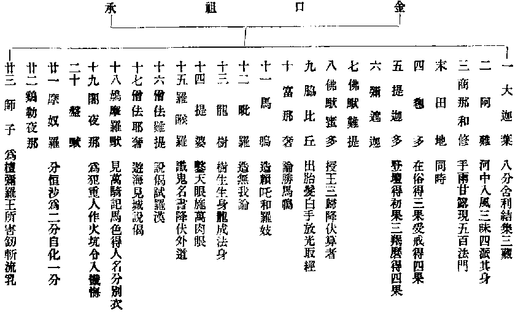



法藏经云：我灭度后，乃有二十四尊者出现於世，流传我法。



阿难所问经：我入涅槃，大迦叶当与分别，与比丘、比丘尼作大依止，如我无异。迦叶传阿难，阿难传末田地，田地传商那和修，修传优波毱多。



阿含经：我灭度后一百年间，长者末田提出兴于世。涅槃疏(五)：(十九)佛虽正人，其佛出后，故不作如来之像。四果非正人，谓四果是真福田，化道易行，宜作此像(云云)。今取一涂，即是四依，为四果像(云云)。旧明四依位不同(云云)。今约地前未断别惑是初依，地上断别惑作三依是别义；约十信是初依，三十心、十地断别惑作三依者是圆义。就圆义更作通、别：通者，四十心共作四依；别者，十信是初依，初住至六住是第二依，七住至九住是第三依，十住是第四依。



指归钞(七)(二十六)：以大斥小，故云非正。既在灭后(云云)，若作佛形，便滥佛出。



玅玄(十一)(五)，五品六根为初依，十住为二依，十行十向为三依，十地等觉为四依。



达摩多罗禅经(图字函，东晋佛陁䟦陁罗译。)佛灭度后，尊者大迦叶、尊者阿难、尊者末田地、尊者舍那婆斯、尊者优波崛、尊者婆须蜜、尊者僧伽罗叉、尊者达摩多罗乃至尊者不若蜜多罗，诸持法者以此慧灯次第传授。



疑者云：章安於止观中明祖承者何？曰：玄句释经，附经立观，取信彰明。若止观说己心所悟，传授机缘，预防暗证，离其邪说，故须明也。辅行之文甚显。又疑：今论祖承传圆顿大法，而毱多诸祖自证小果者，何也？曰：准荆溪料拣，意谓涅槃长寿品，迦叶菩萨问，佛以四依品答，明列四果以为四依。第四依人名阿罗汉，住第十地。经中四依既是佛后弘法之人，正是二十四祖，是故即用四依判位。乃知金口诸师皆破无明，大乘圆人云证四果，盖以四依为四果也。疏云：四依为四果像(五)(十九)。孤山云：列诸祖预承佛记，位在四依，内契大乘，外现小像。四果是真福田，故二十四祖多言证果也。又疑：禅宗更加婆舍斯多、不如蜜多、般若多罗、菩提达磨为二十八祖。而道原传灯录、智炬宝林传、嵩师正宗记共赞之。又有定祖图序云：原夫菩提达磨，实佛氏之二十八祖也。与夫大迦叶，乃释迦如来直下相承者也。吾佛以正法要为一大教之宗，以密传授为一大教之祖。乃至其始乱吾祖宗，荧惑天下学者，莫若乎付法藏传。正其宗祖，断万世之诤者，莫若乎禅经。禅经之出，乃先乎付法藏传。六十二载，始终备载，二十八祖已见於晋世矣。付法藏传乃真君废教之后，但谓二十四祖方见魏之时耳。又传灯诸祖之前，列七佛相承付法有偈，及释迦拈华，迦叶微笑等，其说与今相反云何？曰：明心彻悟，彼此有人。立祖判经，未敢闻命。圭峰有云：禅是佛心，教是佛口。心口之法，定相违耶？但宗承无识之辈，妄加四祖，反有破斥付法藏传以为谬妄(文)。由是而知二十八祖西天记之说，非圭峰制作明矣。今以四义评道原诸说：一、立祖无据。若付法藏传立二十四祖，乃西土圣贤所记。凡经三译，是今的据。禅宗二十八祖，有何凭据？若嵩师云：禅经始终备载二十八祖。今检禅经，只有九尊者耳，何故妄指数多？况名字多不全同，前后有异，如何影射？二、不究年代。或云达磨是西土人，到此亲说，安别求据？而又不本传灯宝林传，专据禅经，影带达摩多罗转作菩提达磨，谓是西土二十八祖，出於禅经。且禅经译在姚秦之世，当东晋隆安年中。中间涉宋与齐，至梁普通八年，达磨方到后魏孝文帝太和十九年十月五日归寂，通涉一百餘载。岂有魏末示灭，先载晋译？经中若云达磨寿长未入灭者，既未入灭，不应立为祖师。纵使寿长，不应近二百年也。三、谤七佛偈。经中多明七佛者，欲使取信易明，即非佛佛以法相付。若诸佛付法，各付机缘。况此七佛，乃空劫前三佛，成劫后四佛。时劫隔远，何甞相见付法耶？如释迦何甞亲见弥勒？设有授记之说，自受於然灯，且非受迦叶佛记。又况七佛付法之偈，出何经论耶？四、妄立拈华。且释迦拈华，迦叶微笑。付法偈颂，且无所出。既无所据，妄生疣赘耳。



涅槃(一)，(十七)、诸佛世界诸大菩萨悉来集会，及阎浮提一切大众亦悉来集，唯除尊者摩阿迦叶、诃难二众。涅槃疏(一)，(廿一)、拣出。二众者，有事，有显。事者，迦叶入灭定，定力所持，故不来；阿难为魔所罥，故不来。有所显者，迦叶为显不舍细戒，故迦叶最长子，方持佛法，佛若临灭，应赦细戒(云云)。又为外道所讥：师所制戒，灭后皆舍。迦叶若来，宁得执正此事？阿难为显最后佛称叹付嘱(云云)。问：佛令舍细戒，迦叶不许，师弟相拒，何也？答：不然。佛为利根，随有利益；迦叶为钝根，还令如故。故非违拒。



西域记(九疑字函)。当来慈氏世尊之兴世也，三会说法之后，餘有无量憍慢众生将登此山，至迦叶所，慈氏弹指，山峰自开。彼诸众生既见迦叶，便舍憍慢。时大迦叶授衣致辞，礼敬已毕，身升虗空，示诸神变，化火焚身，遂入寂灭。



涅槃经(三)(一)。若以法宝付嘱阿难及诸比丘，不得久住。何以故？一切声闻及大迦叶悉当无常，如彼老人受他寄物。是故应以无上佛法付诸菩萨，以诸菩萨善能问答，如是法宝则得久住。



涅槃疏(三)(二十二)佛酬其请新，故言所有正法悉付迦叶。如来缘谢故去，迦叶机兴故付。内同佛德，外委大臣，秉正法教。乃指圆伊而作依止，酬其所请。此中为学新伊者故，故言法付迦叶。下文为不学新伊者故，故言迦叶无常，不堪付嘱。各各为缘。



指归钞(五)(十二)各各为缘者，此赞后斥各为机缘。迦叶大行，始终无异。所以斥为无常者，此乃寄高训下，令舍偏入圆。



祖承付法，正在法华开显，迦叶领解时也。故迦叶叙云：今法王大宝自然而至，如佛子所应得者，皆已得之。具如药草喻品述成之文。涅槃第二卷云：我今所有无上正法，我悉已付摩诃大迦叶。可看已之一字，则知在法华明矣。或谓付法在涅槃者，迦叶既不曾在会，何所付耶？若尔，付法传云：化缘将毕，垂当灭度，告大弟子摩诃迦叶：如我今者将般涅槃，以此深法用嘱累汝，汝当於后敬顺我意，广宣流布，无令断绝。迦叶白言：善哉受教。何也？曰：此乃灭后作传者备叙法华中始末事耳。



止观(一)(二)，智者师事南岳(云云)，南岳事慧文禅师(云云)。文师用心，一依释论。论是龙树所说，付法藏中第十三师。智者观心论云：归命龙树师。验知龙树是高祖师也。辅行(一上)(十三)，金口祖承从前向后，今师祖承从后向前者，为指文师，以承龙树文便故也(云云)。言高祖者，若以智者所指，应以南岳为父师，慧文为祖师，龙树为曾祖师(云云)。是则章安望於龙树，方为高祖耳(云云)。今家亦以龙树为始，是故智者指为高祖。



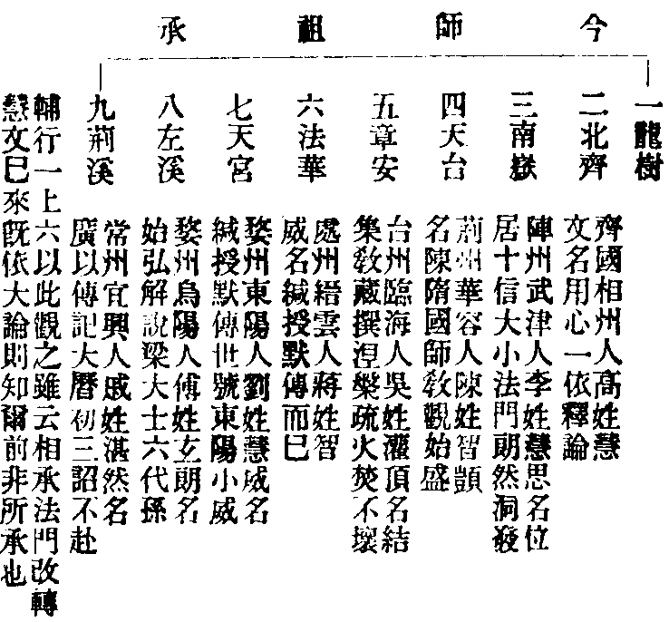



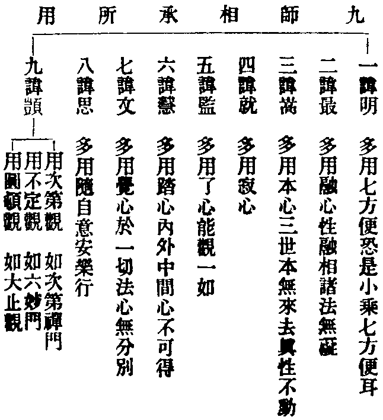



北峰师曰：吾佛出世，普化群生，随机饶益，宜大说大，宜小说小，循循善诱，调停成熟，咸得成佛，不令一人独得灭度。谓何禅宗只度一种大机，而小机不度？果如此，则佛说大小，经论何为？若佛为普度机缘，所以说大小法，则汝传弘佛法，但接大机，岂尽佛意？今天台示佛化意，前则随机普被，后则咸会佛乘，同安秘藏，无复小乘二三差别。如来化缘既息，法付诸祖。既经开显，咸悟大乘，并修圆顿。若无助道，正行难成。故须正助相扶，自他兼被，大小通传，无有剩法。所以大师云：始鹿苑，中鹫头，后鶴林，法付大。迦叶记主云：既成道已，说必托处。故略举此始中终三，以法验证，以处显法。即所传之法，正指於斯。又义例云：虽依法华，咸归一实。末代根钝，若无扶助，则正行倾覆。正助相添，方能远运。佛化尚以涅槃为寿，况末代修行，非助不前。故扶律谈常，以显实相(文)。又复佛世机缘，值圣犹尚住小，各执一门。况末代根性，宁唯一种。诸祖既知法华开显，世智偏行，无非佛因。故随机弘阐，宜大说大，宜小说小。随其修证，一一点示，无非实相。虽随根所用不同，既知实相悉是圆机，不名偏小。所以三种止观，或渐或顿，或不定。归戒禅定，无漏慈悲，应是定散偏小。不舍一法，皆是大乘，无非实相，尽成佛果。乃知教家收机备足。故梁氏论云，天台大师，赞龙树之遗编，从南岳之妙解。用三种止观，成一事因缘。括万法於一心，开十乘於八教。戒定慧之说，空假中之观，坦然明白，可举而行。於是教无遗法，法无弃人，人无废心，心无择行，行有所证，证有其宗。大师教门，所以为盛。自智者传法，五世至今。湛然大师，中兴其道。为予言之如此，故录之以系于篇(文)。自餘异论邪说，得以略之。



鶴林



辅行(一上)(八)鶴林者，在拘尸城阿夷罗䟦提河边，树有四双。复云双树，四方各双，故名为双。又云根分上合，故名为双。佛於中间而般涅槃，涅槃之时，其林变白，犹如白鶴，因名鶴林(云云)。



辅行(七上)(十一)。方面皆悉一枯一荣，荣喻於常等，枯喻无常等。如来於中北首而卧，入般涅槃，表非枯荣(云云)。入涅槃已，东西二双合为一树，南北二双亦合为一，二合皆悉垂覆如来，其树惨然，皆悉变白(云云)。言北首者，增一阿含云：表於佛法久住北天。长含第四云：佛告阿难：安我头南，首面向北，则使佛法久住北天。机见不同，不须和会(云云)。



辅行(七上)(十七)。尔时，师子吼菩萨白佛言：世尊！何等比丘能庄严娑罗双树？佛举六人及以如来。六人在因，如来居果，因果俱得庄严之名。因果始终，四德具足，所表义显，故云庄严。因六人者(云云)。师子吼言：如我解佛所说义者，阿难比丘即其人也。得净天眼，指阿那律。少欲知足，指大迦叶。无诤空行，指须菩提。善修神通，指目犍连。得大智慧，指舍利弗。於一一人，广如阿难。后举果人云(云云)。师子吼言：如我解佛所说义者，唯有如来乃能庄严娑罗双树(云云)。前之六人，虽曰多闻乃至大智，要必宣说一切众生悉有佛性，已於法华得闻记已，非不能说，但不及果人，故云如来最能庄严。



大经六人能说佛性，证大涅槃，为庄严故。记主曰：因、果、始、终，四德具足，所表义显，故云庄严。或曰：法华授记八部四众，因身子同解，即双树义显。问：身子不忍见佛涅槃，故先入灭，何故涅槃？疏：(十四)(二十二)引大经云：身子见佛涅槃不忧，常住不喜。须知附小与开显义异。



传观



止观(一)(三)，此之止观，天台智者说己心中所行法门。



辅行(一上)。(十二)言说己心中所行法者，即章安密从大师得所行之法也。故举所行以显所传。若传而不习，有言无行，将何以辨所传不空？故知所传即己所行，亦令后代行弗违言，所以一部并为行相(云云)。故应信此即是所传。故遗嘱云：止观不须传授，私记时为人说。私记，即指章安所记十卷是也。嘱意，正言面授，意多不周；私记，言旨全备。



止观(一)(三)天台传南岳三种止观：一、渐次，二、不定，三、圆顿。皆是大乘俱缘实相，同名止观。渐则初浅后深，如彼梯隥；不定前后更互，如金刚宝置之日中；圆顿初后不二，如通者腾空。为三根性说三法门，引三譬喻。辅行(一上)(十六)天台去，别释所传之法，即此所传是向所行(云云)。为三根等者，此三止观对根不同，事虽差殊，因缘顿理离圆教外无别根性。当知此三并依圆理分此三行，名三根性。是故渐次不同於别，或一日、一月、一生修之可获(云云)。故知此三知圆理同而行相少别。当知南岳唯授天台圆顿之理，约行须以渐不定助。问：南岳大师知四教否？答：南岳委知而不细判(云云)。又此四教非始南岳，慧文禅师既依大论，大论释经，经明三教，当知此教传来久矣。至天台来，分别始盛(云云)。是故三观总摄四教。又此三止观名字虽似八教中三，其相永别。彼八教中指华严为顿，鹿苑去为渐，不定寄在前四味中。



玅玄(十)(十六)。一、圆顿观，从初发心，即观实相(云云)。二、渐次观，从初发心，为圆极故，修阿那波那十二门禅(云云)。不定观者，从过去佛，深种善根，今修证十二门，豁然开悟，得无生忍(云云)。



释签(十)(二十)此三观中，顿观一种全同止观，渐及不定少分不同。渐初不云先修归戒(云云)，不定但寄渐次论发不定。若彼止观，但论从师所受修行不定，故彼文云：或渐或顿，或止或观。既云天台传於南岳，不可从师得於所发，是故不同。此约昔闻，今随修观所发不定(云云)。故彼三种，初皆知圆。



一家传心之要，非章安莫能叙出，非荆溪莫能发明，故举所行以显所传。或问：天台传南岳三种止观，的在何时？曰：智者初见南岳，便示普贤道场，为说四安乐行，岂非於大苏时授三种止观修行之法？若谓智者已证，悟了方授，则观法无用矣。然约理唯一，约行有三，以由南岳悟法华顿，理理虽一，种行相宜，以渐不定助，故成三种止观也。疑者云：渐次止观解顿行渐，与涅槃前三解圆行渐，同异云何？曰：教则部别不同，行乃因果俱异。何者？彼通三教，因人行之；今唯圆人所行，因异也。彼通证小果，如须䟦闻常证小；今唯证大，果异也。部别不同可知矣。若玅玄三名，具如释签；若化仪三名，固不须辨。孤山谓传教不传观，殊昧斯旨。辅行云：若不示人境，观不任依止。



无情佛性



止观(一)(四)，系缘法界，一念法界，一色一香，无非中道。



辅行(一上)。(二十)一色一香无非中道者，中道即法界，法界即止观，止观不二，境智冥一(云云)。自山家教门所明中道，唯有二义：一、离断常，属前二教；二者、佛性，属后二教。於佛性中，教分权实，故有即离。今从即义，故云色香无非中道。此色香等，世人咸谓以为无情，然亦共许色香中道，无情佛性，惑耳惊心。今且以十义评之，使於理不惑，餘则例知(云云)。



涅槃经(率字函三十七卷)。迦叶菩萨言：世尊！如佛所说：众生佛性，犹如虗空。云何名为犹如虗空耶？善男子！虗空之性，非过去、非未来、非现在。佛性亦尔(云云)，无有三世，犹如虗空。善男子！虗空无故，非内、非外；佛性常故，非内、非外。故说佛性犹如虗空。善男子！如世间中无罣碍处，名为虗空。如来得阿耨多罗三藐三菩提已，於一佛法无有罣碍，故言佛性犹如虗空。(疏科云：初、明佛性同虚空。)迦叶菩萨白佛言：世尊！如来、佛性、涅槃，非三世摄，而名为有。虗空亦非三世摄，何故不得名为有耶？佛言：善男子！为非涅槃，名为涅槃；为非如来，名为如来；为非佛性，名为佛性。云何名为非涅槃耶？所谓一切烦恼有为之法(云云)。非如来者，为一阐提至辟支佛(云云)。非佛性者，所谓一切墙壁、瓦石、无情之物(云云。疏科云：二、明佛性异虗空。)金錍(云云)。



凡诸释义，皆以立宗为正，破古为旁。辅行因释圆顿止观色香中道之文，故正明观道，旁破清凉。金錍亦然。故四明云：正为显圆，妄染即佛性。旁遮偏指，清净真如。然无情佛性，出自涅槃。如来被机，有权有实。佛性之旨，有进有否。实而言之，三佛皆徧，三因亦徧。从权而说，三佛皆局，三因亦局。若带权说实之文，则但说实教正徧。对实说权，则权教缘了不徧。是知涅槃只一佛性之言，在佛则为实教正因，在迦叶则为权教缘了。故章安科众生佛性犹如虗空，云佛性同虗空义。科如来佛性涅槃是有，云佛性异虗空义。清凉诸师，唯知如来法身体徧，而不知众生正因体徧。故使惑果事而迷因理，是为迷名而不知义也。



置毒



止观(一)(五)又云：置毒乳中，乳即杀人，乃至置毒醍醐，醍醐杀人，此证不定也。



辅行(一上)(二十七)，云云。



玅玄(五)(十八)行人心行，譬之如乳。实相智，譬之以毒。毒有殒命之能，此智有破无明之力。久远劫来，说实相毒，置於凡夫心乳。毒慧开发，不可为定。或於初味发，或於后味发，不得次第往判，故言置毒乳中。乃至醍醐，徧在五味中，悉有杀义。



辅行(三下)(三十一)大经二十七狮子吼难云：众生之身，六道差别，云何而言佛性是一？佛言：譬如有人，置毒乳中，乃至醍醐，皆悉有毒。乳不名酪，乃至醍醐，名字虽变，毒味不失。若服醍醐，亦能杀人，实不置毒於醍醐中。佛性亦尔，虽徧五道，受别异身，而是佛性，常一不变。



置毒，唯置凡夫心乳。若止观通五时置者，乃是以发验置。当知置毒之用，全约如来悬鉴。故释签(六)(十)若不探頥当时入位，随闻远近多少生熟行之浅深，故藉今生重闻方发(文)。岂非约佛意预鉴四教机缘，宜在将来何味中熟，故为随宜而强毒之。若论能鉴能置，通於五味。若论所置，唯在凡夫心乳，名为置毒。而今日重闻方发，既在醍醐，或在四味。却以今验昔，必能置之时在醍醐也。故云乃至置毒醍醐，亦能杀人等。或问：发毒唯破无明，何故通四教发耶？曰：能发虽通四教，破惑唯局别圆。



起教观



止观(一)(九)，云何裂大网？种种经论，开人眼目，而执此疑彼，是一非诸。闻雪谓冷，乃至闻鶴谓动。今融通经论，解结出笼。



辅行(一上)(三十五)云何裂大网至出笼者。裂谓裂破。既感果报，设教利人，破他疑网。虽本为开众生智眼，实机未显。如法华前，众生於教，权实空有，事理互迷。若为判已，开权显实，使权实不滥，令识教本意，破执教疑网，达一理无外，了法门大体，知众教有归(云云)。今融通等者。理本无说，说必被机。四悉四门，诸观诸谛，适时利物，未及通方便，各计一隅，情执未破。今为融会，重疑飒然，如系在笼，情无所适。解执滞结，开权教笼，如游太虗，纵旷无碍。



止观(二)(二十三)第四、为通裂大网诸经论故说是止观者，若人善用止观观心，则内慧明了通达渐顿诸教，如破微尘出大千经卷，恒沙佛法一心中晓。若欲外益众生逗机设教者，随人堪任称彼而说，乃至成佛化物之时，或为法王说渐顿法(云云)。此义至第九重当广说，摄法中亦略示。



辅行(二下)(三十二)四、明裂大网者，裂破执於权教疑网。初文通除自他疑网，故云通裂。乃至须晓渐顿诸教出自一心，若不善用不思议观观於一心不思议境，何由可裂执教大疑？若欲下，为利他，裂他疑网。今明果报，且语初住。以初得故，越却中间，故云乃至成佛，即指妙觉。初住已去，通能八相，裂大疑故，故云裂网(云云)。如此自他，皆由妙观契於妙境，是故能有如是妙用。



指要(上)通应二事，果后利他。既是净用，依正必融。纵是他机，亦同自体。此之妙事，在今染心。能如是观，妙用方显。



止观(三)(二十六)复次，心摄诸教略有两意：一者、一切众生心中具足一切法门，如来明审照其心法，按彼心说无量教法从心而出。二者、如来往昔曾作渐顿观心偏圆具足，依此心观为众生说，教化弟子令学如来破尘出卷仰写空经。故有一切经教悉为三止三观所摄也。



辅行(三下)(二十三)复次下，明用心摄诸教之意。文具二意，即是能化、所化之别：一、约所化，谓破众生心尘出一切法；二者、佛既先得，今教众生即是化他，能所相成义不可阙。



十不二门，则止观十乘(云云)。



指要钞(上)言起教一章(云云)。



文心解(三)。今谓不然。若自裂网，则通初心；若裂他网，须至果后。故辅行释化他不思议境云：初心依理生解，为他说者，与起教不同。此唯实报八相，被物发起，权实施开废等，何得云始行能裂他网乎？仰又起教之言，须起八教，徧逗群机，而反用自裂之文，作自行起教，不亦滥乎？又令修起教之观，成说法之用，不许但修十乘，果用自显者。且辅行云：若不善用不思议观，观不思议境，何由可裂？执教大疑，岂非但是修十乘耶？况今文云：理境乃至利益咸尔。故知起教更无异涂。若谓十乘不该果用，后之五妙更须别修，是则众宝之车成，坏驴之运



指要(下)从此门去纯谈化他，而化他法门虽即无量岂出三千，亦摄归刹那同为观体(云云)。故今文先明净用同在染心，理具情迷显发由观。



修起教观，自四明始。以止观五略十广，自行化他，皆是初心行者，修法玅玄观心之义亦然。故荆溪云：止观十乘，成今自行因果；起教一章，成今化他能所指要。释曰：彼文起教，虽即弗宣，而且不出裂网之意。此裂网文，泛论生起，虽在果后化他，细寻其意，多明初心自行。故文云：种种经论，开人眼目，执此疑彼，是一非诸。今融通经论，解结出笼，岂非始行能裂他网？又文云：若人善用止观观心，则内慧明了，通达渐顿诸教，岂非自行起教？此四明妙得文外之意也。輙出其意，名字位人，五品十信，望於初住，并属初心。故知南岳智者，四明融通经论，解结出笼，与夫通达渐顿诸教，凡讲说结缘，皆是因中修起教观之相也。裂网之文，生起与释，其义一致。但生起文中，有解结出笼之语，故法智云：岂非自行能裂他网？释文中，有通达渐顿诸教之语，故云：岂非自行起教？可看结字与教字，则知始行能裂他网，与自行起教义同，变文云尔。若望果后八相化他，则始行能裂他网，自行起教，并属初心自行。辅行下文，将化他境，对起教料拣，而有初心依理生解，与实报八相被物，其义不同，可以例知。但化他境，乃发圆解，为他四说，此起教观，乃是通达渐顿诸教，融通种种经论，义不同耳。故知因中，若不能修自行起教之观，果后焉能成就化他说法之用？净觉昧此，悲夫！



------



## 读教记卷第十六



天台沙门　法照



止观(二)



灯炷



摩诃般若经灯炷深奥品(海字函十九卷)。须菩提白佛言：菩萨用初心得菩提？用后心得菩提？是初心不至后心，后心不在初心，如是心、心数法不俱，云何善根增益？若善根不增，云何当得菩提？佛告须菩提：我当为说譬喻，智者得譬喻，则於义易解。须菩提！譬如然灯，为初燄焦炷？为用后燄焦炷？须菩提言：非初燄焦炷，亦非离初燄；非后燄焦炷，亦非离后燄。须菩提！於汝意云何？炷为焦否？世尊！炷实焦。佛告须菩提：菩萨如是，不用初心得菩提，亦不离初心得菩提；不用后心得菩提，亦不离后心得菩提而得菩提。须菩提！是中菩萨初从发意行般若波罗蜜，具足十地，得阿耨菩提。须菩提白佛言：何等是十地？佛言：具足乾慧地、性地、八人地、见地、薄地、离欲地、已作地、支佛地、菩萨地、佛地，具足是十地，得菩提。



大论(表字函七十五卷)，非初不离初，非后不离后，灯譬菩萨道，炷喻无明等烦恼，𦦨如初地相应智慧，乃至金刚三昧相应智慧。



辅行(一下)(卅三)。大品须菩提问佛：为用初心得菩提？为用后心得菩提？论七十五释云：须菩提何故作此问耶？答：须菩提闻上诸法不增不减，心自生疑：若法不增减，云何得菩提？唯佛能尔，何关菩萨？佛以深因缘答，谓不但初心，不离初心。所以者何？若但初心，菩萨初心，便应是佛。若无初心，云何得有第二三心？后以初为本，初以后为期。佛以现喻，喻此初后。譬如焦炷，非初不离初，非后不离后。灯喻菩提道，炷喻无明焰。如初地相应智慧，乃至金刚三昧相应智慧。焦无明惑，非初智不离初智，非后智不离后智。论通三教，故约断位。



四念处(二)(二)大论明灯炷云：乾慧为初𦦨，佛地为后𦦨。此即通家名乾慧。非断道而为初𦦨者，乃是论主申含容别。外人作此解，乃以相似灯炷为𦦨耳(云云)。复有人言：欢喜为初𦦨，佛地为后𦦨。此约别教断道为初𦦨。别家初地见常住理，断无明，见中道，名欢喜，是初𦦨。复有人言：初住为初𦦨，佛地为后𦦨，是圆教意。初住见中性圆，断一品无明，故初住为初𦦨。此是通教通别、通圆之义。



四教义(三)(七)。故大智度论？释灯炷品云：有人言：乾慧地初𦦨，佛地为后𦦨。有人言：欢喜地为初𦦨，佛地为后𦦨。有人言：初发心为𦦨，佛地为后𦦨。如此解释不同者，恐是诸大乘论师释满字教门，三教明位不同，各取此意，以释初后燄。



玅玄(四)(卅一)问：大论三处明初𦦨，约别、圆，皆取发真为初燄。通教何意取乾慧为初燄？答：别、圆各逗一种根性，故用发真为初𦦨。通教为逗多种根性，所谓别、圆入通，故含容取乾慧耳。若钝者，八人见地是初𦦨。利者，於乾慧即能断结，故是初𦦨。问：利人应无十地？答：备有。以根利故，故不制位。问：别、圆无利人耶？答：虽有利钝，以根性纯故。但作一说，宜如此也。



释签(五)(二十)大论三处明焦炷等者，谓乾慧地、初地、初住。大论四十八明四十二字门，即初住已上也。第四十九明菩萨初欢喜地乃至法云地，广明修治地业。续此文后即云：复次地有二种：一者但菩萨地；二者共菩萨地，所谓乾慧地乃至佛地。故知三教明矣。故知此中问意与止观稍自有殊，此以三教为问，见地焦炷置而不论，若得此意则止观宛然自别。次问利人应无十地者，问意：利人既於初地断见，应二地乃至四地断思，六七地成佛，是则无十地耶？答意者，教门具有，於利人不制，秖如超果得阿罗汉，可令餘三果亦无人耶？次问意者，别圆若有利人，应在地前住前焦炷耶？答意者，虽有利钝，断位必定。



止观(六)(七)。问：三乘共断，其义已显。用何为据，更独开菩萨地耶？答：大论判三处焦炷，则有三种菩萨断惑。乾慧是伏惑，尚得为初𦦨。今取八人真断为初𦦨，有何不可？



辅行(六上)(八)次问者。三乘共位，借义已成，别立菩萨，恐无诚证。次答意者。初引大论三处焦炷者，意引乾慧别在菩萨断惑之位。若共二乘，不名初𦦨，初𦦨即是断位故也。论别立菩萨，故以初地而为断位。故大论七十八灯炷品云：十地有二：一、菩萨初地为初𦦨；二、声闻见地为初𦦨；若独菩萨地，即欢喜地为初𦦨。论文既以菩萨初地而为初𦦨，故今取之，以为况释。於共伏道，尚得以为菩萨初𦦨，今但退取共断位者，为独菩萨初𦦨，有何不可？故知此文别判通教菩萨位也。下文自有独菩萨位，即别菩萨位也。所言三种菩萨者，即共地菩萨中根之人，亦同二乘三、四地断。



四念处云此是通教通别通圆义者，此与藉通开导不同。文中因小大半满分门，通是满字，摩诃衍门多所含容，故标列云：即开为三：一、通；二、别；三、圆。至引论三处焦炷各释结竟，乃总结大科云：此是通教通别通圆之义。若玅玄所谓别圆入通之文，答中标云：通教为逗多种根性。即释云：所谓别圆入通。则知此句自出通教根性多种耳。故含容取乾慧之句，方是定初地焦炷也，非谓乾慧初𦦨是别圆入通之人。



六即



止观(一)(廿四)若智信具足，闻一念即是，信故不谤，智故不惧，初后皆是。若无信，高推圣境，非己智分。若无智，起增上慢，谓已均佛，初后俱非。为此事故，须知六即(云云)。理即者，一念心即如来藏理，如故即空，藏故即假，理故即中。三智一心中，具不可思议。



辅行(一下)。(卅三)若智信下。释意也。信初心具，不谤言无；智极方满，不惧无分，则初后俱是。谓极在佛，凡夫永无，名为后非；谓凡有理，理即是佛，名为初非。离初后非，须知六即。初心虽即，但名为理，故离初非；极果虽遥，即故有分，故离后非。此六即义，起自一家，深符圆旨，永无众过。暗禅者多增上慢，文字者推功上人，并由不晓六而复即(云云)。初、释理即。约如来藏理释三谛者，一切众生具如来藏，三谛无缺。



玅宗(上)(十三)。六种即名，皆是事理体不二义。而事有逆顺，名字等五，是顺修事。唯理性一，纯逆修事。此逆顺事，与本觉理，体皆不二。其逆顺名，自何而立？以知不二，事皆合理，名之为顺。其不知者，事皆违理，故名为逆。名字等五，若浅若深，皆知皆顺。若初理即，唯迷唯逆。而迷逆事，与其觉理，未始暂乖，故名即佛。所以者何？良由众生，性具善恶，不可变异。其性圆明，名之为佛。性染性恶，全体起作。修善修恶，更无别体。全修是性，故得迷事，无非理佛。



指要(上)一家所判法门，名义无间，高下己他，无不理性本具，全性起修，分显究尽。故今十门，一一如是，皆为观体，其义更明(云云)。



杂编(一)(十一)引止观大意云：理同故即，事异故六。凡诸经中有即名者，如生死即涅槃之流，皆以六位甄之，使始终理同，而初后无滥。今谓理同者，三千空中之理，迷悟咸同也。事异者，三千即假之事，因果有异也。理虽具假，由未缘起，故对事边，同名空中。亦可得云：对事方合，据理常开。是则事为能即，理为所即。所即如空无高下，能即如飞者浅深。



涅槃疏：(一)，(十六)，一切众生皆有佛性而无见用，即无分佛；初地、初住能百界作佛，即少分佛；二住、二地是多分佛；妙觉是满分佛。以是义故，一一法门皆有权、实本迹，即此义也。问：蛣、𧏙、蝮、虿，义复云何？答：夫一善法即有四分，例一恶法亦应如是。未见明教，置而不论。且就权者言之，小菩萨所作是无分蝮、虿，初地、初住所作是少分，乃至十住、十地等所作是多分，如来所作是满分。



玅宗(上)(十三)。又复应知，六即之义，不专在佛。一切假实，三乘人天，下至蛣蜣，地狱色心，皆须六即，辨其初后。所谓理蛣蜣名字，乃至究竟蛣𧏙。今释教主，故就佛辨，以论十界，皆理性故，无非法界，一一不改。故名字去，不唯显佛，九亦同彰。至於果成，十皆究竟，故蛣𧏙等，皆名六即。



止观(五)(八)。问：十法界互相有，为因为果？答：俱相有，而果隔难显，因通易知(云云)。更引诸例，凡圣皆具五阴，不可言圣阴如凡阴。又佛具五眼，岂可以人天果报释佛眼？



辅行(五上)。(廿二)次问者，为是一一因心具十界因？为复一一界果具十界果？答中，初总答云：俱相有者，法尔而然。一念因心，道理具十，一界之果，岂当一界？然言一果具於十果，果既隔越，徧显似难。若知随起十中一心，一必通十，是则一果具十因，一因具十因，故曰因通，理则易知(云云)。更引下，略明果隔，示难显相。从事理说，即十界果各具十果，故云凡圣皆具五阴(云云)。言不可者，意说凡阴不同圣阴。又佛具下，举一佛果具於十界。然不可以圣阴同凡，自是佛果能具十界，终不可以佛地狱界以为凡夫地狱界也。佛果已满，从事而说，已具十界。初地初住，分具十界，乃至凡夫，但是理具。是则一一界果，各各具十，不相混滥，一往从易。且云因通，及以果隔。理而言之，一念因心，实具十界、百界因果(云云)。问：一心既具，但观於心，何须观具？答：一家观门，永异诸说，该摄一切十方三世，若凡若圣，一切因果者，良由观具。具即是假，假即空中。理性虽具，若不观之，但言观心，则不称理。小乘奚甞不观心耶？但迷一心具诸法耳。



玅记(十)(十一)。唯圆即观，一念三千，三谛具足。是则一心一切心，一身一切身，一土一切土，一念俱观。若身心土，若空假中，更无前后。故观成时，一心见一切心，一身见一切身，一土见一切土，十方诸佛身中现故。故於自心常寂光中，徧见十方一切身土。若唯观他遮那之土，必迷自境。若了心境，自即他故，他即自故。不了此境，自尚成他，况观心耶？观土既尔，身佛心然句(十)(七)。



解谤(十一)蛣𧏙名相至究竟者。此明理性具十界也。既皆性具，性必常住，十皆法界，法界无外，界界徧收，法法高广，博地但理，名字初闻，五品观成，六根似发，四十一位分真，体用不二，玅觉等性究竟，法应圆融，故蛣𧏙等若假若实，与佛假实，一一无非常乐我净，即无上众生，无上五阴，既皆四德，复称无上，岂一人一法非尊特耶？故三千果成，咸称常乐，名义彰灼，学者自迷。



杂编(一)(十二)夫六即之名，本为拣滥。虽一切法通於六位，若名有叨滥者，故须甄之；若名不叨滥，不必拣也(云云)。且蛣、𧏙、蝮、虿者，畜趣之微物也，俱是迷逆之号，故无叨滥之理，何必须用六即甄分？良为他人见涅槃疏中，明蛣、𧏙、蝮、虿有於四分，例彼四分，立此六即。而不知虫名虽等，分之与即，二义敻殊。何者？彼之四分，既名为作，葢约权造事用而言；此之六位，既名为即，须从实证理体而说。



圆谈法性，须具三千三谛之法，则十界实法，十界假名，始从理即，终至究竟，位位无减。既以三千该乎六即，岂非蛣𧏙假实通六即耶。故修观者，圆观诸法，即空假中，以至果成，一成，一切成，十界俱成，则不遗蛣𧏙矣。讲者谓至究竟位，但有十界之性，永无蛣𧏙之事。只缘不合作畜生界蛣𧏙说了，便有转报不转报之说。



四种三昧



文殊说般若经(翻字函第一卷)。文殊言：世尊！云何名一行三昧？佛言：法界一相，系缘法界，是名一行三昧。



文殊问经(墨字函下卷)。於九十日修无我想，不离思惟，除食及经行，大小便时悉不得起。



止观(二)(三)。一、常坐者，出文殊说。文殊问两般若，名为一行三昧(云云)。方法者，身论开遮，口论说默，意论止观(云云)。九十日为一期(云云)。但专系缘法界，一念法界(云云)。二、常行三昧(云云)。此法出般舟三昧经，翻为佛立。佛立三义：一、佛威力，二、三昧力，三、行者本功德力。能於定中见十方现在佛在其前立，如明眼人清夜观星(云云)。三、半行半坐(云云)。此出二经。方等云：旋百二十匝，却坐思惟。法华云：其人若行若立读诵是经，若坐思惟是经，我乘六牙白象现其人前(云云)。四、非行非坐三昧者，上一向用行坐，此既异上为成四句，故名非行非坐，实通行坐及一切事。而南岳师呼为随自意，意起即修三昧。大品称觉意三昧(云云)。就此为四：一、约诸经，二、约诸善，三、约诸恶，四、约诸无记。诸经行法上三不摄者，属随自意也。



辅行(二上)。(一)、言一行者，剪略身仪，不兼餘事，名为一行。非所缘理，得一行名。若所缘理名一行者，四行莫不皆缘实相(云云)。经部虽即义通三乘，今意在圆，不通通、别(云云)。以彼二经是般若部(云云)。由此观故，见色身佛，虽非本期，观力使尔(云云)。次释常行(云云)。部属方等，机通四人，二乘被斥，非文正意，故四教菩萨亦通行之。今意在圆，故意止观，寄色身佛以成三观(云云)。见相好身，身出光明，徧十方界，如融金聚，如须弥山，在大海中，日照发明(云云)。



光明记(四)(二)，今家依二经明常坐三昧，一文殊说般若，二文殊问菩提。



文殊问经(上)。般若波罗蜜品第六。尔时，文殊师利白佛言：世尊！般若波罗蜜，一切声闻、缘觉，从般若波罗蜜出不？一切佛、一切法，从般若波罗蜜出不？佛告文殊师利：如是，如是！(云云)。世间戒品第十。尔时，文殊师利白佛言：世尊！云何归依？佛告文殊师利：归依者，应如是言：大德！我某甲，乃至菩提，归依佛；乃至菩提，归依法；乃至菩提，归依僧。(云云)。次言：大德！我持菩萨戒，我某甲，乃至菩提，不杀生，离杀生想；乃至菩提，不盗，亦离盗想。(云云)。



止观(九)(一)，文殊问菩提经，禅定有三十六垢，垢即是障。



辅行(九上)(一)，文殊问经三十六垢未检。



文中两般若者，一文殊师利说摩诃般若波罗蜜多经(明行相)，二文殊师利问经(明要制)，是知行相要制两经相成也。然文殊问经虽无菩提之目，以文中有般若品，故大师云出两般若。又世间戒品云发誓至菩提等，故四明云文殊问菩提经。然四明亦本止观禅境中云文殊问菩提经。禅定有三十六垢，即文殊问经。若文殊问菩提经，无九十日与三十六垢文也。



事理二观



占察善恶业报经(墨字函下卷)。唯心识观者，所谓於一切时、一切处，随身、口、意所有作业，悉当观察，知唯是心(云云)。若学习真如实观者，思惟心姓无生、无灭，不住见、闻、觉、知，永离一切分别之想(云云)。广如类集观法中。



止观(二)(十一)。初明四运者，夫心识无形不可见，约四相分别，谓未念、欲念、念念已。未念名心未起，欲念名心欲起。念名正缘境住，念已名缘境谢。若能了达此四，即入一相无相。问：未念未起，已念已谢，此二皆无心。无心则无相，云何可观？答：未念虽未起，非毕竟无。如人未作作，后更作作。不可以未作作故，便言无人。若定无后，人谁作作(云云)？念已虽灭，亦可观察。如人作竟，不得言无。若定无人，前谁作作？念已心灭，亦复如是。



辅行(二下)。(一)、又观四运者，是随自意中从末从事而修观法，如常坐等。或唯观理，谓一切法无非法性。是故当知修三昧者，於此二途一不可废。故占察经观有二种：一者、唯识，谓一切唯心；二者、实观，谓观真如。唯识历事，真如观理。今文观於十界四运，义当占察一切唯心(云云)。故傅大士独自诗云：独自作，问我心中何所著？巡检四运并无生，千端万绪何能缚？当知无垢大士亦以四运而为心要。大士虽即不云十界，既云万绪，意亦兼诸(云云)。



义例(释疑例十三问)。夫观心法，有事有理(云云)(十九)。故东阳大士，位居等觉，尚以三观四运，而为心要。故独自诗云：独自精，其实离声名。三观一心融万品，荆棘丛林何处生？独自作，问我心中何所著(云云)？况复三观，本宗璎珞，补处大士，金口亲承。故知一家教门，远禀佛经，复与大士，宛如符契。



十义书。(一)止观四种三昧，不出二观，唯识历事，实相观理(云云)。(三)实相观理者，则於阴心，唯观理具三千实相也。唯识历事，专照起心，历於能造十界之心也(云云)。又须知事理不二之语，得意之者，随修一观，必含二义。如修理观者，虽云但观理具，须知全修在性，则善修实相观也。修事观者，虽观能造十界之心，须知全性成修，则善修唯识观也(云云)。(四)事理二造，既其不分，事理二观，因何而起。



指要(上)(三)实相观者，即於识心，体其本寂，三千宛然，即空假中。唯识观者，照於起心，变造十界，即空假中。故义例云：夫观心法，有理有事。从理则唯达法性，更不餘途。从事则专照起心，四性叵得。亦名本末相映，事理不二。又应知观於内心，二观既尔。观於外境，二观亦然。此皆止观及辅行文意，非从臆说。



显性录(一)。(十三)一者唯心识观，谓於外诸境界，知唯是心。二者真如实观，谓观心性无生无灭。真如观理，唯识历事，理事相即，二观互收。一实境界，即一心三千三谛也。真如观，即内心若净也。唯识观，即徧历诸法也。故真如观成，得心寂三昧。唯识观成，得色寂三昧。圆通记(上)。(三)须知观察知唯是心，则於色界及诸外境，不起分别。所以经云：色寂三昧，非谓外观，专观外色。真如实观，思惟心性不生不灭，以能超过无色四空，心及心所，二俱寂灭。是故经云：心寂三昧，非谓理观，专观内心。



杂编(一)若约起心论具，即是修具，乃是唯识观境。若约不起心论具，乃真如观境。辅行云：理具变为修具，一一修具，无非理具。



文心解(八)。三千色心，同居一念。念无念相，三谛现前。当知观外三千，亦见心性空中之理。观内心性，亦见三千即假之事。故义例云：本末相映，事理不二。辅行云：修三昧者，於此二途，一不可废(云云)。初阴入界，或唯观理。下之九境，随发而观，多是历事(云云)。义例云：修观次第，必先内心(云云)。以此净心，历一切法，任运㳷合。若尔，外观必须内心净后，方可修耶？此有二意：一者如义例所示，即不思议境后，历一切法是也。二者自有内心未净，复修外观，如破法徧末，历餘阴入是也。故文云：若总无明，心未必是，宜更历餘心等(云云)。



纂要(五)(四)：事理二观，其实通於四种三昧。何者？常坐十乘中第一理观，一念三千非一异等，岂可不是实相理观？次修德境四性推检，岂可不是唯识历事(云云)？第四三昧，辅行释历诸善中云：念念称理，无横计思，后方觉了。故引起信文，岂非理观唯达法性？更指何耶？



事理二观之名，出自荆溪，依占察经发明此义。义例问答，甚是分明，但说者多暗，须究问意。或云诸法即是法性，或云四运四性，推检则知。或云诸法即是法性，此问理也；或云四运四性推检，此问事也。答云：从理则唯达法性，更无餘途，此答理也；从事则专照起心，四性叵得，此答事也。不言四运，固可知矣。指要钞十义书准此。或问：不思议境推四性，何也？曰：此不思议四句，乃寄起明相，任运离四性计。若推四性，则堕事中矣。余尝断曰：不思议境，只可通贯事理，不可分对事理。



三止名



止观(三)(七)，一体真止，二方便随缘止，三息二边分别止(云云)。此三止名，虽未见经论，映望三观，随义立名。释论云：菩萨依随经教，为作名字，名为法施，立名无咎。若能寻经得名，即悬合此义也。详此三止，与前释名，名彷佛同，其相则异。



辅行(三上)(十六)此三止名等者，释疑。此是大师谦退之辞。次释论下证三止意。何但映望三观使名有凭，大论亦许随义立名。言依三观立三止者，大小乘经止观二名皆悉并立，况止观秪是定慧异名，既定慧之名处处并列，故今望观以立止名，所以璎珞三观义必兼止。



首楞严经(染字函第一卷)。恨无始来一向多闻，未全道力，殷勤启请十方如来得成菩提，玅奢摩他、三摩、禅那。



孤山云：涅槃明三：一、奢摩他，此云止；二、毗钵舍那，此云观；三、优毕叉，此云止、观等。今阿难虽专请於止，以即一而三，故此止即观，亦即平等，三一互融，是以称妙，妙故方曰楞严大定。今於此止，复有三名：奢摩他，即体真止，止即真谛；三摩提亦摩他，此云等持，即方便随缘止，止即俗谛；禅那，此云静虑，即息二边分别止，止於中观第一义谛。



霅川集解(一)(五)孤山专用天台三止，配今三名者，斯又得经之深也。何则？止属於定，观属於慧。阿难既以多闻少慧，自欲正以楞严大定为请，大定非三止而何？况三摩禅那，显是止名。则知天台三止，冥符圣言矣。止观(三)(五)而诸经赴缘，偏举一法，以示义端。如首楞严，偏举止边止，具一切法不减少(云云)。智度法华，偏举观边观，具一切法不减少



圆觉经(下)。此方便者，名奢摩他(云云)，名三摩钵提(云云)，名为禅那。



问：大经圆觉名字与楞严同，大师既见涅槃，何云映望而立？曰：孤山谓圆觉明三观，大经初止次观，三止观平等，而楞严唯明三止也。



含中



止观(三)(十八)通教，真谛发二眼二智，俗谛发一眼一智(云云)。若作别接通者，俗谛发一眼一智，真谛发一眼一智，开真出中发一眼一智。



辅行(三下)(八)通教中云真谛共发二眼二智者，含中故也。次接中云开真出中者，若已被接得入正道，乃成三谛也。



释签(三)(十九)次释接义者，即含中入真也。



先达云：含中时未论被接，被接时必藉含中，含中须就当教而说。何者？通教是摩诃衍门，谈幻有即空，是故如来於此体空，含中道佛性而说。利钝两机，解入有异。若钝根人闻此空法，唯证但空之理；利根之人闻此空法，即於此空能深观空，即见不空。故有但中、不但中别也。



别教闻中



止观(三)(廿九)别教止观，亦顿亦渐。何以故？初心知中，故名亦顿。涉方便入，故名亦渐。复次前三止观，教行证人，未被会时，尚不知圆，何况入圆。



辅行(三下)(廿九)解顿行渐。解但知於顿理而已，行必经历恒河沙劫数，故知此教初从方便。故方便之言兼具二义：一藉地前之方便，二闻但中之方便。别亦知中，今言不知者，前三不知圆理故也。



玅记(四)(末)。别人初心，何尝不达三谛之理(云云)。至十行位，分明见假。至回向位，观无一异。若入初地，方顺法流。



光明记(一)(八)。此教初心便闻但中，中虽不具九界依正，非无界佛玅色玅心。



金錍云：别人初心，教权理实。以教权故，所禀未周。



辅行(三下)(卅四)别带方便，虽初闻实，从教成权。妙宗(上)(廿六)别人初心，信今知觉，本是常住中道佛性，从教道故，名为但中。



北峰师曰：应知中道佛性是真实之理，非权理也。别人初心既闻中知中即是实理，但其根钝，迷中重故，未得即修，须藉方便次第而入。是故如来说此中理在於果上，出空假外，成乎但中，此由机钝教权故也。初心既闻此中，无更别闻，是则约所闻中理是实，从教门说之成权；约知中理是实，故亦顿；涉方便入中居边外，故亦渐。所以辅行释方便兼具二义：一、藉先修空假；二、藉闻中离边。约中离边，则当方便亦渐句收；约中实理，则当知中亦顿句收。故云教权故但，理实故中也。



------



## 读教记卷第十七



天台沙门　法照



止观(三)



戒体



业。疏：(三下)(三)若唯立作，但在一念，非通一形，何能防也(云云)。若但无作，不能自生，要由作发。以作防非，则短无作，起无所从。二法缘具，作愿方遂。所言作者，身、口方便造趣营为，名之为作。如陶家轮，动转之初(云云)。言无作者，身动灭已，与餘识俱，是法随生，故名无作。业。疏：(三下)(四)二、陈体状。体谓业体，正是戒法所依本也(云云)。经、论所谈善、恶业者，名也。今述作、无作者，业之体也。



业疏(三下)。(九)夫戒体者何耶？所谓纳圣法於心胷，即法是所纳之戒体，然后依体起用，防遏缘非。今论此法，三宗分别。



济缘记(三下)。(十四)。纳是能受心，圣法即所受戒。能所相冥，心法和合，而成於业。揽法为业，为道基本，故名戒体。戒充正报，心为总主，故云心胷。初受则心为能纳，法为所纳。受已则法为能依，心是所依。问：即法是体，法体何分？答：若望未受，但名为法，体是无情。若加期誓，要缘领纳，依心成业，此法有功，乃名为体。是故言法未必是体，言体其必是法。



夫戒体者，南山意谓以志诚心受圣戒法，感圣戒法纳入心中，即是戒体。既是志诚善心感圣戒法，通名称之，即圣法善业为戒体也。如定实法宗云：业即戒体。定假名宗云：业由心起，故胜前计。定圆宗云：成善种子。验知戒体即圣法善业也。



业。疏：(三下)(九)如萨婆多，二戒同色者，彼宗明法，各有系用。戒体所起，依身、口成。随具辨业，通判为色。业即戒体(云云)。如律明业，天眼所见善色、恶色(云云)。以斯文证，正明业体是色法也(云云)。然此色体与中阴同，微细难知；唯天眼见，见有相貌，善、恶历然。



此实法宗作、无作戒，并色为体。南山意谓：实法宗计同色为体者，有二焉：初、依身、口起，故属色。文云：戒体所起，依身、口成是也。二、天眼能见，故属色。文云：如律明业，天眼所见是也。是知起依身、口，故体非心；天眼见之，明知是色矣。或问：律家有宗，明色三种：一、可见有对色，二、不可见有对色，三、不可见无对色。於今作、无作色，何分对耶？曰：十二入中，色尘是可见有对色，法尘是不可见无对色，餘五根、五尘是不可见有对色。今作、无作戒体之色，身作戒色即可见有对，口作戒色即不可见有对，身、口二无作戒色即不可见无对色，在法入中所收也。故疏引心伽二论云：身作可见有对色，口作不可见有对色，身、口无作俱不可见无对色也。然疑无作戒色既属法尘，即对意根，云何无对？须知五根、五尘，相对俱色。今虽对意，而意非色，故云无对也。又问：作戒以色为体，还只取身、口动作之色耶？若然，何故济缘记云：准知作戒，必取发业，不唯身、口动作而已。(文)若取所发之业，自是无作耳。曰：只取身、口动作之色，是作戒体；所发之业，自是无作色。若济缘意者，葢明作戒须能发无作之业，乃名作戒；若不能发，徒然运用，二戒俱无也。彼宗非不明心，但心为远助之缘，非正业体。故云：由心善恶方便动现也，由心使身、口成业耳。



业，疏：(三下)(九)二、依成实，当宗四分作、无作位体别者，由此宗中分通大乘，业由心起，故胜前计分心成色。色是依报，心是正因，故明作戒，色、心为体。是则兼缘显正，相从明体。由作初起，必假色、心；无作后发，异於前缘。故强目之，非色、心耳。考其业体，本由心生，还熏本心，有能有用，心道冥昧，止可名通。故约色、心穷出体、性，各以五义求之不得。不知何目强号非二？



此假名宗。作戒以色心为体，无作以非色非心为体。南山意谓：空宗分通大乘，业由心起，故胜前计。但由作戒，色心正助，不相舍离，故相从明体，具於色心也。其次，非色非心，不出二意：一、所发翻作，故双非。以能发作戒，是於色心，而所发无作，但是色心之业，体异色心故也。二、心业冥昧，故双非。以约分通大乘而说，无作业体，本由心生，而心法冥昧，故约色心，穷之不得。试欲以此业法为色，色须形相方所等业，非此等之色。试欲以此业法为心，心须虑知明暗等业，非此之心。既而冥昧难名，故强名非色非心尔。竹庵断曰：推业本通大乘，考体对作戒，附小宗立名也。或问：空宗依成论玅玄(四)(六)，成论云：色是无教法，不至无色界(文)。无作、无教、无表，但是异名，岂非空宗以色为无作耶？曰：此由杂编之误。济缘记通云：此乃成论诸师牒难有宗之语。谓若以色为无教，则应不至无色界。无教既至彼天，则显非色明矣(文)。言牒难者，谓牒计作难也。



业。疏：(三下)(十)后约圆教明戒体者，戒是警意之缘也(云云)。欲了妄情，须知妄业，故作法受，还熏妄心，於本藏识，成善种子，此戒体也(云云)。今识前缘，终归大乘，故须域心於处也。故经云：十方佛土，唯有一乘，除佛方便，假名字说。既知此意，当护如命，如浮囊也。



此圆宗不分作无作，并以藏识善种为体。葢约法华开权显实，涅槃扶律谈常，以立圆宗。窃详南山之意，特以大乘引接小教，皆入佛乘也。或问：此与菩萨戒体同异云何？曰：既约开显，则业体是同，其持犯有异也。又问：只一戒体，空有两宗，所计各异，何耶？曰：济缘云：此由佛世机悟有殊，致使灭后分宗各计(文)。今以南山正义出之。良由有宗所悟，业依身口，故属於色。空宗所悟，业由色心，故无作翻作，属非色非心也。



禅门(二)(二)第二、明戒体之相者，若萨婆多人解无作是无表色，不可见、无对；若昙无德人明无作戒是第三聚，非色、非心法。诸部既异，虽不可偏执，约小乘教门，终是无作为戒体，其义不差。



止观(四)(二)。因此性戒，得有无作受得之戒。小乘明义，无作戒即是第三聚。大乘中法皷经，但明色心，无第三聚。心无尽故，戒亦无尽。若就律仪戒论，无作可解(云云)。



辅行(四上)(四)。问：今明衍门，何须小检而明十种得戒人耶？答：如涅槃中处处扶律，今此亦尔，小为方便。故知出家菩萨六和十利与声闻同，六度四弘异於小行。若在家菩萨三归五戒咸趣菩提，况复梵网八万威仪，七众并资、五道通被，岂容破戒称为佛乘？故以乘戒四句对简(云云)。无作一发无舍失缘，终讫一形相续恒起。如初受时作白已后入餘心者，尚名得戒。故成论云：若人入不善心、无记心、无心，亦名持戒(云云)。小乘下，约大小乘以辨三聚，明无作不同。小乘经论共立三聚，谓色、心、非色非心。言心无尽等者，意明心性以为戒体。若小乘戒体是第三聚者，且依经部。若有部中还用色为无作戒体。然大乘中虽以心性而为戒体，若发无作亦依身口作戒而发，虽依身口体必在心。若先小后大，一切转为无尽戒体。若先受大后方出家，欲在大比丘数而不失菩萨法者，则更受律仪。但於一切发得身口清净防非律仪，无作戒体不复发也。故涅槃中五篇七聚，并是出家菩萨律仪。又若先小后大，则开小夏以成大夏。若先受大后受律仪，在小则依小、在大则依大。理虽若是方土不同，此土僧徒不简大小。西方不尔，一向永隔。然四依出世必大小并弘，但随物机缘通局在彼。



辅行(九上)(十九)戒是有为色法，定是有为心法。命朽之时，形俱无作，戒体虽谢，无作戒业得得不灭，以随业道至未来故。



玅玄(十)(五)，小乘中云：法身尚其不灭，如均提沙弥忧恼，佛问：汝和尚戒身灭否？答言：不。



释签(十)(九)，彼小乘言不灭者，以无作之业至未来世名为不灭，非常住不灭。



今家所用小乘戒体，两宗所明，皆出圣师，不可偏取。通则只以无作为戒体，别则依有是色，依空双非，不可执诤，如禅门文也。



戒疏(上)(十一)初、戒体者，不起而已。起即性，无作假色(云云)。



璎珞经云：一切凡圣戒，皆以心为体。心无尽故，戒亦无尽。



禅门(二)大乘教门。戒从心起，即以善心为戒体，此义如璎珞说。



签(四)(廿六)。心非色故戒亦非色故，心无尽戒亦无尽故，使一切皆摩诃衍。



戒疏(上)(十三)大乘情期极果，凭师一受，远至菩提(云云)。方便求受，其体则兴。若舍菩提愿，若增上烦恼，犯十重，其体则废。若无此二缘，至佛乃废。



咸教主曰：夫言体者，当论二种：一者当体，二者所依。今明所发无作体者，乃是宗中所明因行。从因克果，有修有发，附事而明，故须具於当体而辨，未涉所依也。当知戒体，通色通心。葢由禀戒，从三业受，精持无犯，虔重恪诚，方乃发起无作戒体。此体发时，必有能发，必有所发。心为能发，色为所发。以由戒法禀受之时，心不散乱，身则翘勤，口则答对，并由精勤，方乃纳戒在心，方有无作体发。故知若无虔勤之念，不能纳戒在心。若从纳义，戒为能纳，心为所纳。若从发义，心为能发，戒为所发。所发之戒，即是一种圣法善业。此善业者，即无表色，天眼能见，与小乘戒业体无别。但由大乘圆实教中，诠量此体，与小乘异，乃通二向。从能发属心，从所发属色。止观辅行，以心为体，从能发而言。戒疏论文，以色为体，从所发而说。故知非心则无以发，非色则无以彰。是故诸文，或从心说，或从色说。有兹所以，文方不虗。此色此心，皆属当体，皆属於事。有兴有废，在教在权。并由三师，禀受作为，精持制止，而得此戒，即修治造作之玅行也。五章言之，乃属宗摄。辅行判之，并是明宗，深有所以。如此判已，戒之当体，义有定准，然后方可论其所依。所依者，即理性也。故此事行，大乘诠之，并由理具，方有事用。若无理体，而为所依，行未免邪，事皆成妄。是故圆事，乃即理之事。所修之行，乃全性起修。行从性起，方云诸行无作。事与理即，方云体内之权。行是妙行，权是妙权。此大乘戒，乃全理之事，全性之修，方为妙戒。是故特云不起而已。起即性无作假色者，性之一字，全提理性之所依。起字色字，乃语发戒之当体。当体有二，起字是能发之心，色字是所发之色。由依於性，而发此戒。故云起即性无作假色也。北峰曰：从悟理，约本实说，诸法唯心。从迷情，约教权说，故起业是色。杂编云：夫言体者，有当体，有所依。当体属色，所依属心。其熈钞，顶山不能备引。



问：今性无作假色，与律圆宗戒体同异耶？曰：律据藏识，含藏一切善恶因果染净种子，故以藏识善种子为体。今明性具诸法，故以性色为体。是则善种与性色本同。济缘：问云：假色与下细色何别？(约有宗心论假色并天台假色，以问空宗分通大乘细色也。)答：若彼心论，名体俱别。若对戒疏，名别体同。由心所造善恶业种微细难知，故名细色。问：四分既明善色恶色天眼所见，那得谈体却云非色？答：彼明细色，义通大乘。此谈非色，正符宗意。(文)



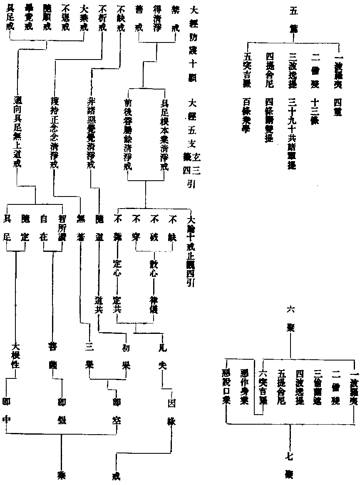



别教修中



止观(六)(卅二)初心尚未入十信至回向，若无回向，岂得修中，无修则无证。此中道观，於凡夫人望崖无益。



辅行(六下)(十八)。言修中者，亦寄次第实而言之。三观圆修，以二观心修於中道，是故至此即名圆修。故四念处云别向圆修，即此意也。



妙宗(上)(廿七)方便立已，圆观可修。於十向中，即以所显中道佛性，而为能观中道之观。谛观不二，惑智一如。三观圆修，是无作行。



妙玄(三)(十一)，十回向始正修中，此中但理不具诸法。



辅行(三上)(十六)十回向中，一一回向各各有十所缘境界。第十向中第十观者，名为无相第一义观，得入初地。



北峰师曰：原此教中诸大菩萨积劫练行，多门赴机，岂至回向犹观但理？今谓不出二义：一者但中，顺权教也；二者圆中，据实行也。有以教证二道说圆修者，误矣。或问：十向所修无作与圆无作同异云何？曰：妙玄云：或从教道，十向无作断苦集有道灭，圆教即苦集是道灭，故二无作即断不同。四教义云：非圆教之无作，即此义也。若尔，十向无作应断苦集耶？曰：从教则断，从行则不断也。



所观阴境



凡夫境界有根、尘、识。识谓五识、五意识、第六识。尘谓可见可对色、不可见可对色、不可见不可对色。根谓六根：浮尘外根、胜义内根。经论浩博，故此录示。



大品云：为过一切色相，灭有对色相，不念种种相，入无边空处。过一切色，灭可见有对色；灭有对色，灭不可见有对色；不念种种色相，灭不可见无对色。一切色法唯十一种，谓五根、尘、法、入少分。少分者，无表色也。



大论二十一四十一云：三种色者：一可见有对，二不可见有对，三不可见无对。



阿毗昙云：一、可见，谓色是。二、有对，有十，谓五根、尘。若云不可见有对，应但云五根、四尘。三、不可见无对，谓法入少分。



大经二十一云：眼见色坏名为过色，五根尘坏名过有对，於二种餘及无教坏名过异相。此之三色并在色界，欲入无色故灭此三。(已上四文并辅行六上四纸引。)



阿毗昙明三种色：一者可见有对色，即色尘一法，为眼所见，假极微所成，名为有对。二者不可见有对色，谓眼等五根，此胜义根也；声等四尘，此之九法，非眼所见，皆假极微所成。三者不可见无对色，即无表色。唯识宗明第八识变三种色：一唯麤非细，即山河大地等。二亦麤亦细，内身浮尘色，对山河等色即细，比内身中五根即麤。三唯细非麤，即内五根，此即大乘胜义五根，以能造八法不可见有对净色而为体性地。瑜伽论及五蕴论明三种色，谓显色、形色、表色。开显色为十三，谓青、黄、赤、白、光、影、明、暗、烟、云、尘、雾、空。一显色开形为十，谓长、短、方、圆、麤、细、高、下、若正、不正。开表为八，谓取、舍、屈、伸、行、住、坐、卧。俱舍出无表色者，谓无所表彰也。涅槃出无作色者，谓无所作为也。萨婆多出无教色者，谓无所教示也(翻译名义第三卷三十八显色篇引)。夫言根者，义有二种：一者、浮尘外根；二、胜义内根。言浮尘者，四大是能造、四微是所造，色、香、味、触四微和合乃得成根。故楞严云：我今观此浮根，四尘只在我面。资中师云：浮虗不实，昏翳真性，故曰浮尘。此浮尘外根也。言胜义者，即清净四大。洪敏师钞云：此胜义根虽用能造、所造八法为体，是不可见有对色能照境发识，乃圣人所知之境，其义深远，非同尘境麤浅，故名清净。此是染中说净，非无漏妙明之净。此胜义内根也。(翻译名义第六卷阴界入法篇第五十八引)。佛地论(声字函第六卷)。大圆镜智(八识)。平等性智(七识)。妙观察智(六识)。成所作智(五识)。现量境(定心离分别)。比量境(散心分别)。



毗婆沙论(道泰译。分字函第七卷)。云何智法？云何识法(云云)。识即智，智即识，惟长一字。何者？阇那，秦言智；毗阇那，秦言识。长一字者，所谓毗也。为断如是意，欲说差别义故，先说智，次说识。复有说者，此俱是根本法故。增长法中，识为根本；寂灭法中，智为根本。复有说者，俱是元首法故。如说：道品法中，谁为元首？所谓智也。生死法中，谁为元首？所谓识也。



瑜伽师地论(弥勒造，玄奘译。听字函第十五卷)。现量者，三种：一、非不现见；二、非已思应思；三、非错乱境界(释文不录)。问：如是现量，谁所有耶？答：略说四种所有：一、色根现量；二、意受现量；三、世间现量；四、清净现量。色根现量者，谓五色根所行境界，如先所说现量体相。意受现量者，谓诸意根所行境界，如先所说现量体相。世间现量者，谓即二种，总说为一世间现量。清净现量者，谓诸所有世间现量，亦得名为清净现量。或有清净现量非世间现量，谓出世智於所行境，有知为有、无知为无，有上知有上、无上知无上，如是等类名不共世间清净现量。比量者，谓与思择俱，已思、应思所有境界。此复五种：一、相比量；二、体比量；三、业比量；四、法比量；五、因果比量。相比量者，谓随所有相状，或由现在、或先所见推度境界。如见幢故，比知有车；由见烟故，比知有火。如是以王比国、以夫比妻、以角比牛(云云)。体比量者，谓现见彼自体性故，比类彼物不现见体；或现见彼一分自体，比类餘分。如以现在比过去(云云)。业比量者，谓已作用比业所依。如远见物无有动摇，鸟居其上，由是等事比知是杭；若有动摇等事，比知是人；若闻嘶声，比知是马(云云)。法比量者，谓以相隣相属之法，比餘相隣相属之法。如属无常，比知有苦(云云)。因果比量者，谓以因果展转相比。如见有行，比至餘方；见至餘方，比先有行；若见有人，食不平等。如是等类，当知总名因果比量。是名比量。



瑜伽师地论(福字函第六十三卷)。一、阿赖耶识；二、转识。阿赖耶是所依，转识是能依。此复七种，所谓眼识乃至意识。譬如水浪依止暴流，或如影像依止明镜。复次，诸识皆名心、意识，若就最胜阿赖耶识名心。何以故？由此识能聚集一切法种子故，於一切时缘执受境、缘不可知一类器。末那名意，於一切时执我、我所及我慢等思量为性；餘识名识，谓於境界了别为相。如是三种有心位中，心、意、意识於一切时俱有而转。若眼识等转识不起，彼若起时，应知彼增俱有而转。如是或时四识俱转，乃至或时八识俱转。又一意识於一切间分别一境、或二、或多、自境、他境，故说意识不可思议。复次，阿赖耶识无有烦恼而共相应，末那恒与四种任运烦恼相应，於一切时俱起不绝，谓我、我所行、萨迦耶见、我慢、我爱、不共无明。是诸烦恼与善、不善、无记识俱而不相违，其性唯是隐没无记任运而起。当知诸餘分别所起，随众缘力差别而转(云云)。



达磨杂集论(安慧菩萨糅，唐玄奘译，第二卷)。云何建立识蕴？谓心、意识差别。心者，谓蕴、界、处习气所熏一切种子阿赖耶识，亦名异熟识，亦名阿陀那识，以能种集诸习气故(云云)。意者，谓一切时缘阿赖识思度为性，与四烦恼相应，谓我见、我爱、我慢、无明(云云)。识者，谓六识身，眼识乃至意识了别为性。



摄大乘论释(世亲菩萨造，三藏玄奘译。孝字函第一卷)。三种自性：一、依他起自性；二、徧计所执自性；三、圆成实自性。论曰：由摄藏诸法，一切种子识，故名阿赖耶，胜者我开示。又曰：阿陀那识甚微细，一切种子如暴流，我於凡愚不开演，恐彼分别执为我。



此识亦名阿陀那识。何以故？由此识於身随逐执持故。亦名阿赖耶识。何以故？由此识於身摄受藏隐同安危义故。亦名为心。何以故？由此识色声香味触等积集滋长故。



佛性论(天亲造，陈真谛译。竭字函第三卷)。心者，即六识心。意者，阿陁那识。识者，阿梨耶识。



大乘唯识论(天亲造，陈三藏真谛译，力子函)，实无有外尘，似尘识生故，犹如翳眼人，见毛二月等。



大乘中立义，外尘实无所有。若尔，云何见有外尘？为证此义，故言似尘识生故。由识似尘现故，众生於无尘中见尘，为显此识故名斯。譬如眼有病及眼根乱，於无物中识似二月。



楞伽经唯识论(天竺三藏魏国照玄沙门统菩提流支译忠字函)。心意与识及了别等，如是四法，义一名异。此依相应心说，非依不相应心说。心有二种：一者相应心，所谓一切烦恼结使、受想行识与心相应。以是故言，心意与识及了别等，义一名异。不相应心者，所谓第一义谛常住不变自性清净心。



成唯识论(护法菩提造，唐三藏玄奘译则字函)。识所变相虽无量种，而能变识类别为三：一谓异熟，即第八识多异熟性故；二谓思量，即第七识恒审思量故；三谓了境，即前六识了境相麤故。



摄论释(严字函第一卷)。眼根缘外色尘，眼识得生，与眼识同一时共境，有分别意识起。若一眼识生，是时一分别意识生，与眼识共境。此眼识若共二识，或三、四、五共起，是时有一分别意识与五识共缘境生。



南岳止观(下)(十)。问曰：似识妄分别时，为是意识能总分别六尘、为六识各各自分别一尘？答：五识见尘时，各与意识俱时而起。如眼识见似色时，即有一意识俱时分别妄执也，餘识亦如是。是故意识总能分别妄执六尘，五识但能得五尘，不生分别妄执。问曰：妄执五尘为实者，为是五意识、为是第六意识？答曰：大乘不明五意识与第六别，但能分别者悉名意识。



辅行(七下)(廿九)唯识云：言唯识者，唯是一识，复分二种：一者、分别，二、无分别。分别识者，名为识识；无分别者，名似尘识。一切世间皆为似尘识之所成，三无性等。色、心之法，本来不二，彼既分於二识，例亦分於二色。问：色之与识，如何同异？答：若色、心相对，则有色、有心；论其体性，则离色无心，离心无色。若色、心相即，二则俱二，一则俱一。故圆说者，亦应得云唯色、唯声、唯香、唯味、唯触，何但独得云唯识耶？若合论者，无不皆悉具足法界。复次，若从末说，一切众生二种不同：上界多著识，下界多著色。若约识为唯识，揽外向内，令观内识皆是一识。识既空已，十界皆空。识若假者，十界皆假；识若中者，十界皆中。专於内心观一切法，观外十界即见内心。是故当知，若识、若色，皆是唯色；若识、若色，皆是唯识。虽说色、心，但有二名；论其法体，秪是法性。



辅行(五上)(廿四)又有宗五识及五意识并第六识，俱能引起受等三心。若依乘论，五识定无起三心义。虽此同异，今初且观诸识为境。问：识阴是王，有宗心王与数同起，如何别於心王修观？答：此但宗计，意则不然。直尔观心，义当观王。



止观(五)(九)。然界内外，一切阴入，皆由心起。佛告比丘：一法摄一切法，所谓心是。论云：一切世间中，但有名与色，若欲如实观，但当观名色。心是惑本，其义如是。若欲观察，须伐其根，如灸病得穴。今当去丈就尺，去尺就寸，置色等四阴，但观识阴。观阴者，心是也。



辅行(五上)(廿五)。然界内下，欲示识心而为观境。先且总揽心为起由，即前所引经论是也。佛告下，重引阿含、大论以证心造。若欲下，双举二譬：世、出世阴，如条、如病；一念识心，如根、如穴、如华。他治病，汤不过一种、两种，灸不过一穴、两穴。若尔，观心即足，何故第四破徧文末，更例观於餘阴、界、入？答：欲融诸法，示观境徧，是故下文例餘界、入。若示境体，观心即足，以心徧故，摄餘法故。又非但心摄一切，亦乃一切摄心，故四念处云：非但唯识，亦乃唯声，唯香、味等。今当下，从广之狭，正示境体。阴、入、界三，并可为境，宽漫难示，故促指的。略二就阴，如去丈就尺；略四从识，如去尺就寸。以由界、入所摄宽多，阴唯有为，有为之中，义兼心、色，故置色存心。心名复含心及心所，今且观心王置於心所，故初观识，餘下例之。问：五识、五意识及第六识，并能生於受等三心，何等识心及所生三心，是今观境？答：五识、五意识，定是今境，未属烦恼，在无记故。於第六中，取能招报者，仍须发得，乃属烦恼境。餘之分别，方属今境。此五识及五意识，虽在今境，仍在下文历缘对境中明。



十义书(二)且如止观，去於丈尺，唯取於寸，乃是於事造中，去其所造，取能造以为所观之境，故云伐树得根，灸病得穴。乃是去其千枝百脉，唯取一根一穴，立所观境，故云先重明境。故扶宗云：以一念识心为境也。



止观(六)(卅七)。历餘一心三观者，若总无明，心未必是，宜更历餘心，或欲心、瞋心、慢心，此等心起，即空、即假、即中，还如总中所说(云云)。前来所说，但观识阴，作如此说，餘四阴亦如是，十二入、十八界亦如是，是名观阴界入境破法徧竟。



辅行(六下)(廿四)。次历餘一心者，以向横竖不二，一心历於诸心，一切诸心无非无明，是故初且总观无明。总既非宜，开总出别，无明心中具诸心故。问：前文但云观於识阴，何故得有欲等心耶？答：一者诸心不出於识，二者为对便宜之人故须兼列。问：贪等即是烦恼所摄，何名观阴？答：虽是烦恼善恶阴摄，况此但观欲等心王。若尔，与烦恼境有何别耶？答：此是烦恼非烦恼境，彼由观发昔此过现习生，与下不同故合在此，其实烦恼非报阴也。虽即属阴，摄阴不尽，是故下文复例餘阴。所言历者，谓巡检也。以别望总故名为餘，不出无明故云一心。次前来下例餘阴入等者，问：应在第七卷末明十乘竟，例餘阴入皆修十乘，何故於此即例餘耶？答：以义便故。从初至此单约识心，从此已去乃至离爱，具约五阴方成法相。故通塞中既检校谛缘，谛缘必须具足五阴，道品念处不可独明一识阴故。正助秖是助於道品，下三秖是明於观阴次位等耳。故须於此例餘阴入，将餘阴入共为观境。问：历餘一心与四阴何别？答：有同有异，具如向简。又历餘一心，以心对心而论总别；若例餘阴，以阴对阴而论麤细。报非报异，法相别故，故须别明。虽复别明，应知同异。阴不出心、心不离阴，阴从能覆、心从能造，造亲覆疎并心为境。



止观(八)(一)，第二，观烦恼境者。上阴界入不悟，则非其宜。而观察不已，击动烦恼，贪瞋发作。是时应舍阴入，观於烦恼。前诃五欲，知其过罪弃。葢是舍平常阴入，观於果报，於中求解。今观发作隆盛，起重贪瞋。



辅行(八上)(一)、前观阴入，观於报阴，报阴无记，於彼阴上求於妙解，故彼阴境未名烦恼。又前别历一心文中，虽观贪瞋非今境意，但是现起善恶诸惑皆阴入摄，是以因阴所起烦恼皆名阴境。今境必须因观阴发，发重贪等，方名今境。从今观去，正举今境异阴葢等，故云起重贪瞋。



文句(五)(十七)逼身者，五识也。心者，意识心王也。身为八苦所逼，而心不厌恼也。



记(六)(十三)五识等者，逼近也。浊在五识名之为近，以切已故名为逼身。同时意识俱受苦境，非初刹那未分别时，又秖此五识体是异熟八苦故也。近岂过此？故此同时安能厌患？故此心王心所不能以此意识成观，唯能分别以成三受，三受义成故云切己。逼甚故切，故一一苦皆由五识以对於境。次至第六而重分别，复立苦因何能生厌？



辅行(五下)(十七)。俱舍云：由即六识身，无间灭为意。身者，体也。无间灭时，为意根体。尔时五识亦依无间灭意以为亲缘，用五色根以为疎缘，而生五识。五识无间分别生时，即名意识。



止观(四)(廿二)前诃五欲，乃是五根对现在五尘发五识。今弃五盖，即是五识转入意地，追缘过去，逆虑未来五尘等法，为心内大障。



辅行(四下)(十四)。前所诃欲对尘发识，非直五识得五欲名，必须同时意识缘现五尘，起五意识分别想著，起希须心故名为欲。今此五盖方云转入意地者，谓前五尘至入禅时，意地犹染能覆禅定，故名为葢。前欲一向对顺情尘，盖通违顺对定以说。



辅行(五上)(廿四)若依经部，大乘法相等，同时意识，缘现五尘，及落谢尘，法入所收，少分属色，少分属心。今且观心，心即识也。



色心、五阴、十二入、十八界，拣境从宽至狭，指五阴之识即色心之心，故云识阴者心是也。四明谓总无明心，荆溪谓尅示境体，境既定矣，故受之以用观，即提起心之一字，曰一观心是不思议境，而不曰一观识是不思议境者，葢有旨焉。浮尘外根不能对尘，如盲聩𪖵强痺是也。能对尘者，胜义根也，未发识故，故名内根。五识者，根尘相对所发之识也。五意识同时意识，虽二名不同，皆发识之后分别希须之识也。色心平等皆是法界，而言唯识者，识外无色，识法界故。若分别之言唯识者，一有分别识，此指心也；二无分别识，此指色也。只一识外既别无色，故知若识若色皆是唯识。例言唯色者，色外无识，色法界故。若分别之言唯色者，一无分别色，此指色也；二有分别色，此指心也。只一色外既别无识，故知若识若色皆是唯色。荆溪云：虽说色心但有二名，论其法体秖是法性，然心是法界能造诸法，而色是法界能造诸法，夫谁曰不然？



------



## 读教记卷第十八



天台沙门　法照



止观(四)



能观十乘



止观(五)，(九)，(止第七卷三十三纸)。



辅行(五)，(初)(中止第七卷下廿六纸)。



不思议境秖可通贯事理，不可分对事理，餘九亦然。夫得意者，观不思议境，任运离四性，计不如是，不足以为端坐修理观人也。然约性离计，乃寄起明相耳，非谓推四性也。才推四性，则是不得意者改观属事，故义例云：从事则专照起心，四性叵得。此对上理观言也。至於破法徧中，历餘一心，例餘阴入。若理观已成，则是观成历法，故十义书云：例餘阴入，合在十乘文末。但从初至此，单约识心，从此已去，备历五阴，以其文便在破徧示耳。历缘对境，不言可知。若不得意者，亦须改观，历餘一心，例餘阴入。故辅行云：前观总无明心，未必是宜更历餘心等。十义书以四义明之，自有内心修观，内外兼修，舍内观外，专修外观者。不然，修内心专观及外境事观，还用不思议境等十乘否？先达以事理二观皆推四性，及将不思议境分对事理，夫乃不可乎？



三千



玅经(方便品)。唯佛与佛，乃能究尽诸法实相，所谓如是相，如是性(止)，如是本末究竟等。



金錍(十七)虽则通依一切大部，指的玅境，出自法华(云云)，所谓诸法实相，如是相等。当知如是相等，即是转释诸法实相(云云)。实相必诸法，诸法必十如，十如必十界，十界必身土。又依大经及以大论，立三世界，故有三千。



止观(五)(十三)夫一心具十法界，一法界又具十法界、百法界，一界具三十种世间，百法界即具三千种世间。此三千在一念心，若无心而已。介尔有心，即具三千(云云)。



辅行(五中)。(七)、夫一心下，结成理境(云云)。故大师於觉意三昧(云云)，并未云一念三千具足(云云)。故至止观正明观法，并以三千而为指南，乃是终穷究竟极说。故序中云：说己心中所行法门，良有以也。



不二门(色心门，自他门)　别行玄记(下)，(下)　指要　杂编。



圆具三千，不变而变。四明等法界，照事即理。融净觉形对像生，理无事有。如经诸法实相，如是相等。止观不思议境，结成三谛。金錍指的玅境，出自法华。色心不二门亦然。故指要云：事异故六，理一故即。此宗学者，谁不言之？而的当者无几。应知圆家明理，已具三千，而皆性不可变。至若蛣𧏙究竟，一理一切理，一究竟一切究竟，不唯佛显，九亦同彰。固不可以下凡名实为妨。



三境



止观(五)，(十七)。辅行(五中一)，(止十二)。(文多不录，须者捡之。)



北峰师曰：观一念理具之谓性，照理具无性之谓修，解无性而说之谓化他。此说不可易矣。鉴堂曰：古人问性德境通修不通修，今反质云修德境通修否？葢修德境即性德境之修相也。神智以修德境对事观，失之甚矣。



生生



止观(五)(十三)。例如八相迁物，物在相前，物不被迁；相在物后，亦不被迁；前亦不可，后亦不可；秖物论相迁，秖相迁论物(云云)。



辅行(五中)(八)。八相迁物者，相为能迁，物为所迁。俱舍颂云：此谓生生等，於八一有能。谓本四相及随四相，名之为八。大相名本，小相名随。以此八故，令一切法成有为相。言生生者，所谓小生、生大、生等。等谓等於餘之三相，谓小住、住大、住小、异、异大、异小、灭、灭大、灭。於八一有能者，通无穷难，所谓小相於一有能、能相、大相。大相於八有能，谓一大相起时，必与三大相及四小相俱起，并一本法，故云於八。餘三大相，各亦如是。故此八相，望於本法，不前不后。



止观(五)(廿五)今解：生生故生者，即是大生生小生八相所迁有漏之法也。



辅行云：通无穷难者，此释出俱舍颂意。何者？颂云：此谓生生等，即小生生大生，乃至小灭灭大灭，如是则大小循环不休，堕无穷矣。所以特言於八一有能，则便通了无穷难也。此记主深得论意，故云耳。



三无为



俱舍论(真字函第一卷)。无漏谓道谛，及三种无为，谓虗空二灭，此中空无碍。择灭谓离系，随系事各别，毕竟碍当生，别得非择灭。



论释：无漏云何？谓道圣谛及三无为。何等为三？虗空、二灭。二灭者何？择、非择灭。此虗空等三种无为及道圣谛，名无漏法(云云)。三无为中，虗空但以无碍为性，由无障故，色於中行。择灭即以离系为性，诸有漏法远离系缚，证得解脱，名为择灭。择谓拣择，即慧差别，各别拣择四圣谛故。择力所得灭，名为择灭(云云)。云何随系事别？谓随系事量，离系事亦尔(云云)。永碍当生，得非择灭。谓能永碍未来法生，得灭异前，名非择灭。得不因择，但由阙缘。如眼与意专一色时，餘色、声、香、味、触等谢，缘彼境界五识身等，住未来世毕竟不生。由彼不能缘过去境，缘不具故，得非择灭。



辅行(五下)(十二)。三无为者，一虗空，二择灭，三非择灭。旧名数缘非数缘也。俱舍颂云：此中空无碍。谓太虗空无碍为性，非谓所见空一显色及窍隙等。颂云：择灭谓离系，随系事各别。随三界系，见见品品，皆名为系。所系不同，名为随事。离一系故，得一择灭。择力所得灭，名为择灭。择谓断智，推度令灭，故名择灭。非择灭者，颂云：毕竟碍当生，别得非择灭。此非择灭，二类不同。谓根尘阙缘，及所证位诸无知惑，不得续起，名碍当生。如缘一色时，於餘诸色，及餘四尘，得非择灭，为正缘色。碍餘色等，当不生故，名碍当生。



析玄(下)(廿七)。今此中约见道前凡夫断惑，不分理事，一时合断。问：此见道前凡夫位断惑，有何所证？答：於一一品惑解脱道中，皆证一分，非择灭无为。又(下)(卅三)。言此有八十九解脱道及灭者，即八十九品解脱道智是有为果，八十九品择灭理是无为果。谓见道有八解脱道及所证八品择灭理，修道有八十一品解脱道及八十一品择灭理，故有为无为各成八十九品也。



净名疏(九)(廿五)：但三无为：一、是涅槃，二、非涅槃。垂裕记(十)(十九)：一、是涅槃者，暹云：择灭无为也。二、非涅槃者，虗空及非择灭也。



然三种皆名无为者，葢表圣人证真空理，无生无灭，无所作为也。言虗空者，此方便贤位之人，观於空理为性，乃真空无碍也。择灭者，此约无漏智，断三界惑，证择灭理，乃见修四果圣位也。非择灭者，此约世智，用六行观，於见道前凡夫位中，不分事理，一时见思合断，证三四果也。言根尘阙缘者，良由此人以智断惑，於根尘中，只缘一根尘，其餘根尘，阙缘不起。如眼与意，专缘一色，不缘其餘声香味触。由阙缘故，别得非择灭之名也。当知虗空与非择灭，通於凡圣，择灭唯在圣果。何者？虗空既取无碍为性，非择灭乃约根尘阙缘，所以通凡圣也。择灭既是初果，圣人用智断惑，而证真理，唯局在圣。故净名疏云：一是涅槃者，局也；二非涅槃者，通也。有云以胜斥劣者，不攷疏意。或问：三无为既是所证真理，出世空法，如何判属法尘四类？曰：小不谈八识，即以法尘为所依，空法为当体，此小乘诠法分齐也。又问：俱舍云无为是非因果者何？曰：葢因果属事，今从理说，故云尔。又问：三种无为，为四谛皆有，为局一谛？曰：通则四谛皆有，以由伏惑是道谛，断惑是灭谛，所破惑体是苦集谛。别则唯在灭谛，以择力所得故也。



家家



止观(六)(五)成论明十六心正是初果位，异部明十六心是修道位。今且依修道断一品欲惑，次第至第五品尽，皆名斯陀含向。若超断至第五品，名家家。次断六品尽，名斯陀含果。超断至六品尽，名一往来。次断第七品至第八品，名阿那含向。超断至第八品，名一种子。次断第九品尽，名阿那含果。毕竟不复还来欲界。辅行(六上)(六)若释家家，应须先辨欲惑九品能润七生。断品多少，对果高下，谓上上能润二生，上中、上下、中上各润一生，中中、中下共润一生，下之三品共润一生。断多少者，俱舍云：断欲三四品，三二生家家，断五至二向，断六一来果。释曰：断上三品，则损四生，餘三生在，为六品润，名三生家家。进断中上，又损一生，并前损五，餘二生在，名二生家家。更断中中，未损一生，但名二向。更断中下，兼前中中，成损六生，餘下三品，但润一生，名为一来。问：何缘无断一品、二品及断五品，名家家耶？答：必无断二不至第三而命终者，亦无断五不至断六而命终者，谓由圣者起大加行，必无不断大品惑尽而命终者。言大品者，谓三品也。离三成九，故三名大。若断至二必至於三，是断初大品也。若断至五必至六者，是第二大品。又无一品能障於果，是故断五必至於六。此次断义与今文同。问：若无不断大品而命终者，何故断八不至於九而有命终？答：断九二义故异三品：一者得果，二者越界。第九一品以有障果及能越界，故断至八有命终者，六唯得果无越界义，是故断五必至於六。二三品中全无二义，断二必三於理不疑。今文中言超断者，即是下文小越之人，本在凡地未得色定，或修欲定欲惑未断，此人至十六心超断五品，名为家家。此之五品同四品故，随其本断品之多少，而得名为家家种子及以无学向果等名。然大师所用并准旧婆沙，若欲知者更捡彼文。又家家者有二不同，谓人及天。天谓欲天二三家生而证圆寂，人谓人处或三二家或三二洲而证圆寂。若天三生天三人二，若天二生天二人一，人生三二反此可知。故天家家先於人中得见道已，若超若次进断三四，后於天中三二处生，人中反此。天家家者於最后生天中，餘残结断名得圆寂。人中家家准此说之。



玅玄(四)(廿五)，从初果心后，更修十六谛观，七菩提行现前，即此世无漏断烦恼一品，无碍断欲界一品烦恼，乃至断五品，皆是於向，亦名胜进须陀洹，约此论家家也。



金刚论(上)。人天二别，极七反生。何故七生？餘七结故。七结者何？欲贪及瞋、色无色爱、掉、慢、无明。从此复断欲界修所断惑，乃至五品，名斯陀含。向是中依，说二种家：家



止观依婆沙超断论家家，荆溪引俱舍颂次断文释家家毕，断云：此次断义与今文同，则知俱舍次断家家与止观超断家家一也。此自言超次家家是同，非谓超断人与次断人同。有云俱舍颂超，有云超次兼颂，有云与止观次断同者，误矣。或问：妙玄一品五品云者，何也？曰：玄文葢约二果，向是论家家之位，进则成二果，退则在初果，非论家家位次也。又有引金刚论为妨，例此。又问：楞伽云：须陀洹有三种，下者极七，中者三五，上者即生而般涅槃。以此七生分於三根，於上超次如何收束？虎溪曰：此该次断中二种人，中下似次断中不加行人，上者似次断中加行人，经中兼含，不可定判也。



般般



俱舍颂曰：此中生有行，无行般涅槃，上流若杂修，能往色究竟。超半超徧没，餘能往有顶，行无色有四，住此般涅槃。　行无色有九，谓三各分三，业惑根有殊，故成三九别。



止观(六)(五)次断初禅初品，至非想第八品，凡七十一品，悉名阿罗汉向六种那含位在其中



辅行(六上)(六)六种那含位在其中者，大论三十三云：五那含者，谓中、生、行、不行、上流。复有六种五，如上加现。复有七种六，如上加无色。俱舍不立现般，但取色般，并五为六。颂曰：此中生有行无行般涅槃上流若杂修能往色究竟。超半超徧没餘能往有顶行无色有四住此般涅槃。释曰：不还有五：一中谓欲界没，於色中阴而般涅槃。二者生般，生色界已而般涅槃。三者有行，生色界已，长时修行方般涅槃，但有勤修无速进道。四者无行，生色界已，不经久修无功用行而般涅槃，勤修、速进二道俱无。五者上流，於色界中要转经於四禅天处方般涅槃。上流又二：一者有杂修，即乐慧是；二无杂修，即乐定是。有杂修者往色究竟，无杂修者往於有顶。颂中餘字是不杂修。又有三种：一全超者，谓在欲界，於四禅中已徧杂修，遇缘退失，从梵众没生色究竟，中间尽越，故名全超。二者半超，梵众没已，中间渐受十四天处，或超一二乃至十三，后乃方生色究竟天，皆名半超，非全超故。通受半名，全不能超，名为徧没。无杂修者，生无色界，唯不能生五净居天，从广果没生三无色，后生有顶方般涅槃。故此那含纵生无色，犹属色摄。若欲界没生无色天，即无色摄。复有九种，中、生、上流各三种故，如释签引。此六九中，未入般前或得名为罗汉向摄，在色界时或有勤修速进故也。



玅玄(四)(廿五)五种般者，中般、生般、行般、不行般、上流般也。七种者，开中般为三种也。八种般者，五如前，更有现般、无色般、不定般。



签(七)(十八)准俱舍论，总为九种，谓三各分三，谓中、生、上流也。有行、无行生色界已，方般涅槃，并生般摄。言中三者，谓速、非速、经久，如迸火星，以喻三义，思之可知。并於中阴论速、非速等。生有三者，一、生约速立，二、有行约非速立，三、无行约经久立。并生色界已，论速等也。上流三者，一、全超约速立，二、半超约非速立，三、徧没约经久立。从色初至色末，始终有此三人不同。如是三九，由业、惑、根异。言业异者，造顺现业成中般，造顺生业成生般，造顺后业成上流般。言惑三者，下品惑成中般，中品惑成生般，上品惑成上流般。言根别者，上根中般，中根生般，下根上流般。



或问：俱舍颂云：住此般涅槃。辅行何云不立现般？曰：此点止观对大论说也。止观云：六种那含位在其中？大论即第六是现般，俱舍则第六不立现般，但取无色般，并五为六。葢俱舍七种，则有现般也。辅行言但取色般，必脱无字，以五是色般故。若不定般，名出毗昙婆沙。言不定者，约期心说三果。圣人期心，欲界般涅槃，却在色界或无色界而般涅槃，名不定也。又疑：三果不还欲界，如何於三果上论欲界现般？曰：断欲惑已，其身已谢，则不还生。今虽断惑，其身未谢，不妨三果於欲界现身论涅槃也。签云：十六处於十八中，除大梵无想故也。



圆断



辅行(七上)(十二)。文似次第，意实圆融，故於前四，勤而观之。但麤惑浮疎，细惑沈隐，故分已生未生之相。先已三观，勤观已生，令速不生，又更勤令未生不生。是以麤惑任运先除，且得名为已生不生。入六根净，进修三观，复伏细惑，名为除断。麤惑先去，真谛先成。



止观(七)(卅二)，十信具足，名六根清净相似之位，四住已尽。



辅行(七下)(廿四)次明十信位者，五品已能圆伏五住，岂至此位别断见思？但是圆修，麤惑先断，犹如冶铁，麤垢先去。



玄签云云。



指要(下)(五)圆人始终用绝，待智顿亡。诸法理果尚亡，惑何次第？秖由此智功力微著，故成疎亲。由疎亲故，惑落前后，名迷厚薄。智疎惑厚，智亲惑薄，传传明之，此乃约智分惑也。既有厚薄之义，故强分三惑，义开六即，名其亡智浅深。若论亡智，了於即理，无一德可修，无一惑可破，强分厚薄浅深也。



圆人一心既具十界，当知三惑秖在一心，以由最初不了一法界故，名曰无明。如尘若沙，起见起爱，一体三惑，即十界因；断见思，即破六凡因；断尘沙，即破二乘因；断无明，即破菩萨因。以由三观圆修，三惑圆断，但麤惑断处，自受见思之名，观智浅深，可以意得，故曰譬如冶铁，麤垢先去，极其根本，惑智一如，不须断除及翻转也。



得得



止观(七)(十九)，辅行(七下)(二)。



净名疏(五)(卅六)若毗昙人，三世是有：过去虽去，善法不灭，得绳所系；未来虽未有，时至则起；现在善法成就在心，故皆是有。昙无德人，则二世无：过去实法善灭，故无；但有假名，得报不失；未来未有，故无；现在善法成就在心，故是有也。



小乘不明八识，故立得绳，任持三世。无作十二者，即三大三小，并初念三，以成九法。又於二念，自起作法及大小，得成十二也。验第三念中成三十六，则过去成三法，现在成共三十九。从此展转，得徧虗空。然无作之法，任运而起，如陶家轮，复有法俱得也。言但与形俱者，即是形俱无作。若尔，现报灭，未来报未起时得，得以何为形俱？曰：中阴，又如夺胎之类也。何云身死得谢？曰：且取现报以说。若未来续起，任持不断，始自无间，终至四果，皆有之不得。谓三藏四念处，观心无常中，是其阶位也。



------



## 读教记卷第十九



天台沙门　法照



诸部(上)



光明定题



光明玄(十)(五)。上来举譬多是义推，依文立名显然可解。何者义推疎远依文亲近？以己情推度是故言疎，彼义例此是故言远，用佛口说是故言亲，即此经文是故言近，岂可弃亲近而从疎远耶？



拾遗记(中)(七)。然而大师深知三字是法非譬，从兹自立附文、当体二种解释。其中附文含於二义：一、直名理，二、从事用。若当体释，唯从理立。今欲依文，先贬譬释，多是义推，不及依文，显然可解。



光明玄(十)(七)。问：旧云此经从譬得名，云何矫异而依文耶？答：非今就文而害於譬，若苟执譬复害於文，义有二途应须两存，故前云义推疎远、依文亲近，若钝根人以譬拟法，若利根人即法作譬，下文云如深法性安住其中，即於是典金光明中而得见我释迦牟尼，又空品云为钝根故起大悲心，钝人守指守株宁知兔月，利人圆解不须株指。



拾遗记(中)(十三)。今释经题，存於二意：一、顺佛语，故依文释；二、对古师，故作譬释。言对古者，因见三师不善用譬，所譬不周，乖违法性，故作譬释，具显法性深广之义而对形之。如此用譬，虽无经据，存之有益，是故二途不偏废一。汝专执譬，则弃亲逐疎；我今双存，则亲疎俱得。



依文立题，约义收机。先达云：究论单法为名，乃的依圣人称唱，虽通利钝取解，实不以被机定题。今取之。



事理二定



光明文句(上)(五)佛常在定，而群机扣佛，佛欲应之，故示轨仪。如来常寂，犹尚乐定，入游法性，出叙经王。



记(一)，(十五)。初入定者，大觉顿圆，照而常寂。今之入定，盖示轨仪，令人乐定。次叙述者，既入玅定，见法尊贵，即於此定，叙述经王。言叙出者，实未示於出定之相，葢寂不妨照，故云出耳。佛不出定，即说此经，意本彰於寂中有照也。



光明文句(下)(末)。问：佛何处入定，此云从三昧起？答：初将说经，佛游甚深法性。今说将竟，故从三昧起。此经首尾皆在法性中说，其文甚明。



记(六)，(卅二)。问：新经自云：尔时薄伽梵，於日晡时，从三昧起，观察大众，而说颂曰：金光明妙法，最胜诸经王。今之谶本，何故三番赞毕，方云从三昧起耶？苟译者所见不同，其如集经者，梵本编文，安次如何耶？答：梵本不同，岂须和会(云云)。



索隐记(一)有二义：一者梵本不同，岂须和会？以灭后结集有窟内窟外之殊。又诸部宗计取舍不同，故知诸经不无增损，是故梵本安可一槩？二者如华严分真菩萨此根入正受，彼根起出说妙觉极果，岂不能耶？



新经十卷，(义净译，场字函。)



所入之定为理事耶？若事者，首尾在法性中说。经云：游於无量甚深法性。若理者，理无动静出入之相，及以礼塔等事。曰：即理之事也，皆随物偏好耳。艸庵之说云：



信相位次



光明文句(上)。(二十)信相者，信家之相在似道中，别判三十心，圆判铁轮位。下文云：见有一人似婆罗门，以捊击皷。皷是法身，击是机动，似位机兴，知非真击。又真似之位，地地相随，无位不有，如普贤修，普贤行满，位隣尊极。此似则高信相称，似道者未敢判其高下也。记(二)。(廿二)初、约名释。信通真似，既言信相，信则非真，似真似信，是其真证前相故也。别教三贤是似信位，初地已上方得真信，圆教登住便得真信，即以十信名为似信(云云)。二、又真下，明似通上位二：初、明位位有似。已证名真，未证名似。普贤等觉望极名似，故立贤名。



光句(上)(卅)。踊跃者，登位也。欢喜者，信生也。别教释者，信相似位中疑惑去，登欢喜地中信生也。圆教释者，信相铁轮位中疑惑去，入住铜轮位中欢喜也。若作普贤似位释者，下地中疑惑去，十地顶深信坚固，犹若金刚隣真接极而生欢喜也。



记(三)(六)真信解发入欢喜位，别在初地圆在初住，并破无明名疑惑去，此皆内凡而释似位。十地顶者，若不立等觉即第十地，破上品无明之惑升於后心，此位名为众伏之顶。金刚喻定既为最后无明所动，故生欢喜及踊跃也。



光句(中)(六)，皷是法身，击是机智，婆罗门是净行，似是隣真。隣真之人，以似解之净智，和会法身，甘露相应，灭苦生乐。



按大师释信相位次，先示似位在别圆地住之前，次乃以似通上耳。故释欢喜踊跃之文，亦先以似位疑去而入地住也。或问：前释欢喜踊跃信相已入分真，今释似婆罗门信相却居似位者何？曰：此乃迷名而不知义，经文显云信相见有一人似婆罗门，若以婆罗门便是信相，不知是谁见有一人耶？不攷经文妄生戏论，或云前是实行后是权行，或云悔品似位是隣极之似，或云经家顺法譬次第故先寿后忏，或云今似婆罗门既在梦中见闻科内，则是室中怀疑之时，或云梦人击鼓事虽寿量之后，表机扣应理实决疑之前，作是说者可哀也哉。



三种忏法



光明文句(中)(四)、小乘作法者，如毗尼中，发露与学二十僧行摩那埵(此翻意喜，亦翻折伏贡高，亦名下意，即承事众僧也)，或半月作法，或对首作法，或责心，但令作法成就，不障僧事，即清净也。阿含中亦作相忏，犯欲人作毒蛇口想，此观成时，淫罪即灭。亦有观空忏，秖是真空。



记(三)(十四)。初、作法。毗尼，此云律。二十僧者，此约忏僧残罪也(云云)。小乘犯夷，亦有忏法，而疏文不引者，以忏已既为学悔，沙弥仍障圣果，故非此中复本清净义也。故荆溪云：小学悔已，障果仍成，重罪未忘。二、阿含下，取相。上明作法，但令三业顺於佛制，法成罪灭，尚是散心，灭罪犹浅。今论取相，属於定心，想成相起，灭罪则深。故蛇口想成，岂唯淫罪得除，亦乃欲心不起。三、亦有下，无生。言观空者，析法明空也。观造罪心，本无主宰，念念无常，无谁能作？无是业报？我见若亡，诸使永寂。此观若成，四趣则除，三界须出。小乘三忏，其相略然。



光明新记(四)(七)。如毗尼中发露与学者，即约事忏夷也。



神智谓约事忏夷以破四明，今云其妄也。何者？大师发露与学，但是犯后四篇，不覆而学悔耳。且四明全依禅门而说，彼既云义如律中广明，但未明忏悔四重法，岂非谓律中作法不忏夷耶？其小乘作法不忏夷者，且从戒藏而说。若论经藏，亦忏夷愆，故引初教为证也。大师明判小乘律无作法忏夷，而经中有文，神智何苦破之？或问：大师据经而照律师？资持记(中四)(下七)：问：有人准初教经，三十僧中忏重，得入僧数者。答：此引伪经，不足为据。又济缘记(四下)(廿二)：二十僧者，倍受加十僧位之极。有云：三十人忏重，出初教经。此乃伪典，不足承用(文)。二文却判为伪者何？曰：辅行(六下)(一)云：文义既正，或是失译。岂以时人未决，便推入伪？大师亲证，位在初依，不应错用(文)。记中小乘无生，既除四趣，出三界，则断惑证果明矣。有云：不能断惑证果，谓文句功能中，命伏为断尔。然诸文但明小律作法，不灭重罪，不可据此輙判小乘经藏三忏之功。请详妙玄光明疏记自见矣。又谓四明既断作法，不引忏夷，验下取相无生，灭罪断惑，亦但后四篇尔。今问：当文取相显云：犯欲作蛇口想，安得取相非忏重？妙玄显云：使犯重人念空，安得无生非忏重耶？



光句(中)(五)大乘中亦有作法。或八百日，虗空藏涂厕是也。或九十日，般舟是也。或四十九日，大悲忏是也。或二十一日，法华是也。或七日，方等是也。灰汤澡豆，净身辛酒，禁口忏愧，勤心旋诵，各有徧数等，皆作法忏摄也。取相忏者，如方等求十二梦王菩萨戒，见华光摩顶，虗空藏中唱声印臂，相起罪灭。虽不正明作法，兼得事用也。无生忏者，如普贤观云：端坐念实相，如日照霜露。观空缘理，无相最上。虽不正作事相，兼上两忏也。



记(三)(十四)。行者应知三种忏法，无生是主，二为助缘。故前疏云：灰汁皂荚，助於清水。若缺妙观，不名大乘，便同外道，无益苦行。须近善师，学忏悔处及忏悔法，方可行於道场事仪。故於诸事，皆用妙观，照而导之，使作法等，皆顺实理，悉为佛因。有谓道场所修行法，而为事治，须於十乘，先修六法，后方助开。而不思前六，在道场中用。如今明忏，具谈三种，岂舍事行(云云)。又须了知大乘三忏，后一虽可独修不进，则须假前二，前二不可暂离无生。得此意已，方可说行三种忏法。禅门(二)(六)。言观相者，但用心行道，功成相现。取此判之，便知罪灭不灭。非谓行道之时，心存事相，而生取著。若如此用心，必定多来魔事。问：摩罗亦能作此等相，云何可别？答曰：实是邪正难别，不可定取。若相现时，良师乃识。事须面决，非文可载。



辅行(二上)(五)魔既即印，印岂坏印？如大论云：有菩萨教人修空，断一切念，后时才起一念有心，便为魔动，即便忆念本所修空，魔为之灭。修空尚尔，况复观之？即法界印。



禅门(二)(六)今但举要明相，不出四种：一、梦中见相；二、行道时闻空中有声，或见异相及诸灵瑞；三、坐中覩见善恶、破惑、破戒等相；四、以内证种种法门，道心开发等为相。此随轻重判之，不可定说。



南岳四安乐行偈(辅行二；上十九引)。修习诸禅定，得诸佛三昧，六根性清净，菩萨学法华。具足二种行：一者、有相行；二者、无相行。无相安乐行：甚深妙禅定，观察六情根，有相安乐行，此依劝发品。散心诵法华，不入禅三昧，坐立行一心，念法华文字。行若成就者，即见普贤身，



三昧仪(第九、诵经方法)。若人本不习坐，但欲诵经忏悔，当於行坐之中久诵经，疲极可暂敛念，消息竟便即诵经，亦不乖行法，故云不入三昧。但诵持故，见上妙色。



光记(三)(十一)正助二忏。修逐根缘，自有一向修於正道，直登圆住。或内外凡，自有一向修於助道。如南岳立有相安乐行，不入三昧，但诵持故，亦能得见上妙色像。此二随根修入不同，若悟理时，必两舍也。自有正助相兼而修，或先正后助，或先助后正，或同时而修。今之所立，意在同修耳。若於三句都不摄者，则人身牛也。



大乘三忏虽散出诸经，举一必皆具足。如普贤观诵大乘经，作法也；得见普贤，取相也；观心无心，无生也。光明中七日七夜朝暮净心，作法也；见弥勒、文殊，取相也；五阴舍空，无生也。诸经皆然。有云大乘三忏备出，唯光明者，非也。上四十九日指大悲忏者，此指观音忏为大悲尔，若今大悲但三七日也。然於取相不可率尔，略引禅门辅行以示之。须知必先作意求灭罪愆，期见好相而修，修时不可悬望好相，恐招魔事故也。但只一心求灭罪障，而修作法，而修无生，功成罪除，其相自现也。窃观禅门谓行道之时心离相著，则似全不许修忏时心存事相。何故？四明云：口说六根罪时，心存三种忏法。方等专求梦王，阿含专想蛇口，普贤观为我现身，岂非作意求见事相耶？曰：上云不可率尔，正为此也。且以今人修行布施言之，或求佛果，或求世福，先亦须念为求佛果，为求世福。若行施时心心只在佛果世福，则反成乱想取著，又须离著忘情。犹如磨镜，垢尽明现，岂可磨时心心在明？虽非心心在明，终是求明磨镜，镜明之处方验尘销。今取相忏亦复如是，但阿含中蛇口想者，似如念念心观事相，然亦不可一途而判，有但勤修任相自现者，有专一相而相起取验者，机别教殊，岂可一准？



光句(中)。(五)作法忏成，违无作罪灭，而性罪不除。如犯杀生，作法忏成，违无作罪去，而偿命犹在，即其义也。取相忏能灭性罪，性罪去，违无作罪亦去。如伐树，枝叶萎，根本未去，续生如故也。观无生忏能灭无明，如覆大地，根枝叶等，悉皆无餘。



记(三)(十六)无作罪者，昔受佛戒，由作法发无作体，若毁犯得违逆罪。今由作法翻破此罪。言性罪者，即十恶也。不论受与不受，犯之性自是罪。如犯下论云：斩大艸，杀畜二罪同忏，二种违制之罪俱除，而杀畜偿命犹存。二、取相。由以定心想成胜相，熏修力强能转恶业，是故能灭性遮二罪(云云)。既对遮性辨於无明，故此无明通界内外，此即通小之相也。



止观(四)(二)性戒者，莫问受与不受，犯即是罪；受与不受，持即是善。若受戒，持生福，犯获罪；不受无福，不受犯无罪。如伐艸害畜罪，同对首忏，二罪俱灭。大论解云：违无作罪同灭耳，而偿命犹在。故知受持之戒，与性戒有异也。



辅行(四上)。(四)、性戒不受故无无作。若受戒下，明受得戒即有无作，故性罪之上加违无作，出家等戒无作别生。是故持则功等虗空，破乃随对一支一境，举持劝受加罪遮违，况犯已法除复本清净。故云：瞻卜华虽萎，犹胜於餘华；破戒诸比丘，犹胜诸外道。如伐艸下，略出遮性同异之相。如艸畜俱有违制之罪，非单提悔二遮俱灭，然於害畜仍有性愆，故引论解偿命犹在。问：性罪不灭何须忏耶？答：既违制已持心相续，纵果位广偿为利物因，岂同於违且沈三趣？



辅行(四上)(十五)。发菩提心者，若直尔灭罪，何必发心？如小乘中僧别两忏，则翻无始罪境不徧，如灭夷过。小教权文，皆由不发菩提心故。又小乘忏，但名抵债，不为护他，故无偿理。为翻此等发菩提心。(补注十三：三、西京楷师云：以无漏力，强排三涂之债，故云抵债也。)



光记(三)(七)。然菩萨行，为转先业，作利他缘，乃论无生等三种忏法。声闻自度，纵明忏悔，多在作法求免三涂。



此等作法，能免三涂。菩萨为转先业，作果上利缘。若论忏法之功，实除三障，不必偿也。问：大乘作法，但灭遮罪，不灭性罪耶？曰：诸文且从三忏，一往对论，未可为定。以由六番功能中，此且初番。总而言之，大乘三忏，皆能除三障也。



观心观佛



观经疏：(一)此经心观为宗，实相为体。所言佛说观无量寿佛者，佛是所观胜境，举正报以收依果，述化主以包徒众。观虽十六，言佛便周，故云佛说观无量寿佛。



妙宗(上)。(七)、心观者，经以观佛而为题目，疏今乃以心观为宗。此二无殊，方是今观。良以圆解全异小乘，小昧唯心，佛从外有，是故心、佛其体不同。大乘行人知我一心具诸佛性，托境修观，佛相乃彰。今观弥陀，依、正为缘，熏乎心性，心性所具；极乐依、正由熏发生，心具而生，岂离心性？全心是佛，全佛是心，终日观心，终日观佛。是故经目与疏立宗，语虽不同，其义无别。又应须了：若观佛者，必须照心；若专观心，未必托佛。如一行三昧直观一念，不托他佛而为所缘。若彼般舟及此观法，发轸即观，安养依、正而观，依、正不离心性，故曰心观。须知此观不专观心，内、外分之。此当外观，以由托彼依、正观故，是故经题称为观佛。若论难、易，今须从易。法华玄云：佛法太高，众生太广，初心为难；心、佛、众生三无差别，观心则易。今此观法非但观佛，乃据心观。就下显高，虽修佛观，不名为难。是知今经心观为宗，意在见佛。故得二说，义匪殊涂(云云)。纵观他境，亦须约心，此经正当约心观佛也。



妙宗(上)(二)若此观门及般舟三昧，托彼安养依正之境，用微妙观，专就弥陀显真佛体。虽托彼境，须知依正同居一心，心性徧周，无法不造，无法不具。若一毫法从心外生，则不名为大乘观也。行者应知，据乎心性，观彼依正，依正可彰。托彼依正，观於心性，心性易发。妙宗(中)(廿八)今之心观，非直於阴观本性佛，乃托他佛显乎本性。故先明应佛入我想心，次明佛身全是本觉。故应佛显，知本性明，托外义成，唯心观立。



辅行(二上)(十)所言佛者，皆具二意：一、自心三昧所见佛，二、西方从因感果佛。今具含二义，共为一境。为顺理故，从初义释。三昧既成，随念即见。见是心性，名心作佛。佛既心作，故见佛时名见自心。若见自心，即见佛心，以彼佛心是我心故。



北峰曰：窃详四明之文，粤有定境、用观二义。是以定境须观佛者，有三意焉：一者、俯顺物机，宜修外境，令心专注；二者、释迦偏赞彼佛，誓愿摄生故；三者、舍秽取净，易出娑婆。虽依法体在迷，定境属外。若约解悟修观，乃唯心观，称性观佛。故钞云：良由圆解全异小乘。(止)知我一心具诸佛性等。又云：若一毫法从心外生，则不名为大乘观也。(文)但唯心之言，善须得意，不可唯局方寸，则十方世界都是一个唯心法界之体。故钞云：托外义成，唯心观立。(文)又云：然是大乘知心作佛，佛即是心。若不然者，观外有佛，境不即心，何名圆宗绝待之观？(文)斯乃托境显性，想彼弥陀了境唯心，心外无佛，故云约心观佛。如斯释义，颇合诸文：一、合经题，又经文但观眉间白毫(云云)；二、合止观，常行三昧中云：念西方阿弥陀佛，去此十万亿佛刹，在宝地、宝池、宝树、宝堂，众菩萨中央坐，说经三月，常念佛(二)(四)；三、合辅行，科云：先念三十二相，以为观境(二上)(十纸)；四、合不二，门云：外谓托彼依、正色心。此之四文，皆定境义也。然约唯心观佛，准观经、止观、辅行等文。故融心解云：经云：诸佛法界身入众生心想中。是故心想佛时，是心即是三十二相，是心作佛，是心是佛。疏：作感应道交释，解入相应释。若无初释，则观非观佛；若无次释，则生、佛体殊；二、释相成，是今观法。(文次　义是约心，初义是观佛，故云约心观佛。)又止观云：我所念者，即见佛心。(文二)(四)辅行释云：此正明於境，以修三观中观。文云：我所念等诸句中所言佛者，皆具二意：一者、自心三昧所见佛，二者、西方从因感果佛。今具含二义，共为一境。为顺理故，从初义释。(二上)(十)言为顺理故，从初义释者，钞主的据此义及疏中二、释相成，是今观法。此皆用观义也。或问：今立弥陀为境，为真，为妄？曰：指要已释。如云：修观行者外境未忘已来，见有他佛。故起信论云：以依转识故，说为境界。则知过在於我，何关佛耶？(文)又十义书云：故应佛色、心既为行者所观，乃是感、应共造。故约感边，亦得是外阴入法也。(六)(四)问：约心观佛，为独观佛，为心、佛俱观？若独观佛，正同钞云观外有佛，境不即心，何名绝待观耶？若心、佛俱观，却见心、佛淆混。曰：定境专外，万法唯佛，只是观佛。今约用观，唯心法界，佛外无心；终日观佛，便是终日观心。故钞云：然是大乘知心作佛，佛即是心。既云唯心，全佛是心，佛外无心也。不同昔人佛为所观，心为能观也。问：钞云：须知依、正同居一心，及节节云心性等，莫同净觉揽彼依、正，归乎内心修观。曰：今约唯心体具，皆是能观妙观，复是所显法门。故彼依、正色、心全是我心，名为同居一念。并约修观、能观、所显说也。问：若观内境，名唯心观；若观外境，应名唯色观。今定境属外，观约唯心，未悉如何？曰：一、显大教唯心体具；二、顺经疏心观为宗。经云：是心作佛。疏云：心观为宗。钞：主约此，故立唯心观佛也。若尔，还可名为唯色观，得否？曰：圆观法界，有何不可？故钞云唯色、唯心也。问：妙宗云：内、外分之，此当外观。又云：难、易言之，此当观内。何谓也？曰：须知文有三节：初、须知下，定境专外；二、若论下，引三法并难；三、今此下，正定此经约心观佛。如此分之，其义自显。问：内心修观既论拣境，今外境修观还论拣境否？曰：经云：但观眉间白毫。钞云：的示观法相有八万，都想难成，故令但观眉间白毫相。此为要门也。(下云：)(四云：)随乎行者，或依或正，随观一境，即是拣境。今是观法之要，且取白毫以为的拣。问：十义书四义，今此观法何义可收？曰：义书：一、约内境修观，二、内、外兼修，三、舍内观外，四、初心便修外观。此之四义，并属定境。今此定境属外，正同彼第四义也。今论唯心观佛，自是修观，故有小异，宜须甄之。问：止观中明定境、修观有两重能、所。今此疏中释题直约境智修观，但明一重能、所，不说定境者何？曰：经中十六胜境以为定境，属於所观。今大师直约心观为宗，用唯心、三谛、三观以论修观，俱属能观。故钞释云：妙谛、妙观，悉是能观；阴等诸境，皆是所观。(上)(廿八)则十六境皆属阴摄。若得此定境用观之意，两重能、所，其义自明。



安养教主



止观(七)(廿七)，无量寿观云，阿弥陀佛八万四千相，一一相八万四千好。萨遮华严皆云，相为大相海，好为小相海。既言相海，岂局三十二耶。为缘不同，多少在彼。此真实之相，为别圆两道品所摄。



辅行(七下)(十五)无量寿观下，正明别圆法身现相(云云)。



解谤(二十)(八)，止观辅行显言，观无量寿八万相好，与华严经藏尘相好，同是别圆道品所成法身真相，对斥藏通，相非奇特，何得輙云定非圆别舍那之像耶。



观经疏(十)(七)，故文云：无量寿佛身量无边，非是凡夫心力所及，正可取如释迦毫相大小现观。若得三昧观心成就，方可称彼佛相而观也。



妙宗(下)(十一)。今经明说无量寿佛身量无边，与大论云色像无边，有何异耶？彼云无边，既称尊特，此何独非？况疏专引彼论此文，以证身量无边之义，验今佛身，的是尊特，不须疑也。



经说无边，疏判观心成就方可观之，若未成就则不可观，岂常身常相耶？



妙宗(下)(五)今经教相，唯在圆、顿。释能观观，是妙三观；释所观境，是妙三身。疏解今文云：观佛法身，约位乃当。圆教七信，正托法性无边色像，尊特观心，使其增长念佛三昧。据何等义，云是生身？



此文不出四义：一、圆教，二、观，三、法身，四、深位。既是圆教妙观，性具法身，七信深位方能观见，验非安养生身常所见相。若是彼土生身常相，凡小初心莫不皆见，何俟七信破见思耶？



妙宗(下)(十)若惯习小者及诸凡夫，依事识故，不於尊特而论明昧。良以此等虽因临终回向得生，佛顺本习，故且用小令其证果。既说无常苦空之法，须以生身相好应之。



解谤(二十)(五)以彼经说，阿弥陀佛有三十二相，在须摩提宝堂之内，为比丘说经。此经明说，若欲志心生西方者，当观丈六像在池水上。大本中说，安养国中佛所浴池，广八万四千里，小本莲华，大如车轮(云云)。解谤(三十)(二)诸经所谈往生之行(止)，故托安养三十二相(此以机教土相，验佛常身，正当丈六三十二也)。



由安养摄受惯习小人及凡夫众，顺习说小附识见相，须现丈六常所见身。



定散二善



佛说无量寿经卷上(有曹魏齐王代嘉平四年天竺沙门康僧凯译)。设我得佛，十方众生志心信乐，欲生我国，乃至十念。若不生者，不取正觉，唯除五逆、诽谤正法(此即法藏比丘四十八愿中第十八愿文)。



又下卷初云：乃至一念志心回向，愿生彼国，即得往生，住不退转，唯除五逆、诽谤正法。妙宗(中廿)(二引)。



佛说无量寿经下。愿生彼国，凡有三辈。其上辈者，舍家弃欲而作沙门，发菩提心，专念彼佛，修诸功德，愿生彼国(云云)。中辈者，十方世界诸天人民，虽不能作沙门，大修功德，发无上心，专念彼佛，奉行斋戒(云云)。下辈者，诸天人民，假使不能作诸功德，由发菩提心，十念乃至一念，念彼佛故，愿生彼国。



佛说观无量寿佛经云：下品下生者，或有众生，作不善业，五逆十恶，具诸不善。如此愚人，以恶业故，应堕恶道，经历多劫，受苦无穷。如此愚人，临命终时，遇善知识，种种安慰，为说妙法，教令念佛。此人苦逼，不遑念佛。善友告言：汝若不能念者，应称无量寿佛。如是志心，令声不绝，具足十念，称南无阿弥陀佛。称佛名故，於念念中，除八十亿劫生死之罪。命终之时，见金莲华，犹如日轮，住其人前。如一念顷，即得往生极乐世界。



观经疏(十八)：此下三观观往生人者，有二义：一、为令识三品往生，舍於中、下，修习上品；二、为令识位之上、中、下，即是大本中三品也(云云)。问：大本五逆、谤法不得生，此经逆罪得生？释有两义(云云)。二者、约行。行有定、散，观佛三昧名定，修餘善业说以为散。散善力微，不能除灭五逆，不得往生。大本就此，故言不生；此经明观，故说得生。



妙宗(下)(十六)。此中二义：初即杂观观劣应者，位在中下令识三品，进修胜观登於上品。次义即是前观胜应及修离想，了随机化在八九信。今令此人以妙三观分别九品，即大本三辈事理穷深登第十信。既云此下三观观往生人有二义，乃是修前观法行者观於九品往生之相，非是凡小求生之者。读今三辈经文既转行业(云云)。初对经双问。逆罪得生即下品下生文。二立义双释二(云云)。二者下约行有定散。大本就此者，指上散善力微也。此经明观者，即观佛三昧。问：若定力得生，下下品云：此人苦逼不遑念佛，善友告言：若不能念者，应称无量寿佛。如是至心令声不绝具足十念。此与大本散心十念理应无别。答：此虽造恶已曾修观，故使临终善友劝称十念定心则成，亦是法行乘急戒缓人也。修观故乘急，造恶故戒缓，由乘急故得值善友。纵现世不修三昧，亦是宿种今熟故得往生。所以华开见二大士说实相法，自非定善孰至此乎？故十疑论云：临终遇善知识十念成就者，并是宿善业强始遇知识等。当知作此解释，方合此中定善之义。若本不修三昧之者，则属前悔有轻义也。



疑者云：大师既会九品，即大本三辈。且上中二辈，属别圆内外凡位。若非定善，安能入位？然大本一向散善耶？彼经明其六度，且禅定般若，岂是散善？况观经三种净业，疏云：散善思惟，名为净业。岂非亦有散善耶？曰：大本三辈文中，皆名发菩提心，念佛得生，无五逆不生之文。若疏中对拣五逆不生者，正指前二之经文也。况定散名通，通於大本观经，与大乘诸经也。或约三学，或约六度，或约正助，而分定散。今经下品下生，专对大本。约信法拣逆不生，非约三辈对拣也。又疑：定业云何？曰：初中后三心无悔，畅其造罪之心，名为定业。例善业用心修观，三心无散，名为定善。又疑：兴起行经云：佛说酬十种宿业，一一结云：如来众恶皆尽，诸善普备，能度天龙鬼神，帝王人民，皆得无为。虽有如是功德，犹不免於宿债(文)。此应定业，不可忏耶？先德云：一者附小托缘，为利他因。二者寄果诫因，使凡夫不起谤逆也。若云可忏，光明十地菩萨，犹有虎狼之难，何耶？曰：此约单修无生理忏，不修助道。虽许一生超登十地，父母之身不转，故有此难。若其转报，受法性身，必无酬难也。



------



## 读教记卷第二十



天台沙门　法照



诸部(下)



通相三观



净名一经就正宗中托疾兴教有二：初、室外弹诃折伏，二、室内引接摄受。且折伏既通四教，摄受不应唯圆。虽不唯圆，经意在实，闻弹机转，所以须明通相也。慈室曰：葢由问疾品能生经文，空则但云我及涅槃是二皆空，假则但云以无所受而受诸受，中则但云如我病者非真非有，众生病亦非真非有，文犹总略。故疏云问疾下半品略明实疾者，是至四品所生经文，观众生品中正约观众生并起四无量心、六番穷源明三谛俱空，佛道品中约非道即佛道并烦恼即如来种资生眷属明三谛俱假，不二法门品、香积品明三谛俱中。所生既尔，以所从能，则显问疾中略明三观能生经旨，俱谈三谛俱空、俱假、俱中，岂非广略相显？正显上下能所摄受之法皆用於圆也。虽则用圆，但摄受必摄其室外所折伏之机，摄受是能成，折伏是所成，故以通教空观并观众生品成上国王长者断有为缘集，别教假观并佛道品成上弟子品断无为缘集，圆教中观并不二法门香积品成上菩萨品断自体缘集，以下成上，以能从所，人之与惑皆有三种，岂非折摄相应？意显於衍。如此则知，准下五品既从此生，乃约摄受，故不用次第；下之五品复能成上，乃从折伏，故不用一心。如是之机，谈如是之观，若不立通相从容之名，无以尽折摄上下之旨。故须以通相三观释之(云云)。虽则以摄从折，有归衍之义。今文既以室内所谈三观，正当以折从摄，须名圆门观法。葢由室外国王长者，已劝乐常乐之身，弟子菩萨亦用圆诃。故当摄受之际，不得不用圆门三观。故云若不尔者，国王长者亦乐佛身。诸大弟子用三教斥，菩萨亦用三教为诃。然则虽已摄受，理须用圆。但从折伏，机犹是衍。故云虽多用圆，义归於衍。若用通相，二意俱收。故云故须通相，别在其中。后之四句，复用结释。上意虽多用圆，乃结释准下五品。既从此生，义归於衍，乃结释下之五品。复能成上，故须通相，别在其中者，乃结释须以通相三观释之也(文)。具如彼章十义中明。问：上明通相，虽约成上生下，折摄相应，销经而立。且经必被机，未审何机用此观法？若谓别无通相之机，祖师不应云一观当名解心皆通，虗解疎通，未成实益通途，虗照三谛等也。曰：今论被机，须通二义：一、正被偏小，转入圆机；二、傍被偏圆，正接之机。初义者，须知室内摄受，正被室外弹诃之机。疏云：前已用四教，折伏凡夫、二乘、诸偏菩萨。今欢圆教三脱之果，接引摄受，令修三观之因，入不思议解脱(六)(廿七)。然此之机，既在室外被诃，必须转偏归圆也。既已转偏，则室内摄受而修圆观，但从偏入。望本圆人，其根小钝，所以三空但破见思，三假但破尘沙，三中但破无明耳。所谓带方便之圆，虗解疎通，未成实益等，正明此也。次义者，经意虽圆，由方等教中机杂未淳，所以只一通相。通被众机，随闻各解，故云虽属通相。复以教分，圆教永异，故云空观多属於通等(云云)。问：折摄相应，既通通别，何云通相的属於圆？曰：荆溪已释行相，无殊从教前后也。须知三空是凡夫转圆行相，三假是小乘转圆行相，三中是菩萨转圆行相。荆溪云：然此通相三观之圆，但前二观唯云空、假，未有一中、一切中故。故须更明圆教四门，以圆四门皆悉入中故也。问：成上生下，通为三乘，何故疏云今明三教，但慰喻菩萨，不取二乘？记云：此通相空，不关二乘，一切皆应云是菩萨。曰：二乘被折，转小为圆，则成菩萨也。问：上明通相，义归於衍，空对通教，何故疏云今但约别、圆以简三观(七)(十六)？曰：通无三观，故就后明。若从偏转圆，非无通教也。



料拣三土即寂光



问：大师自於三土即寂光，荆溪徵释，却指三外虗通为寂光，何耶？曰：三土即寂光，体即也；三外虗通名寂光，相异也。疏记并有二义。何者？万法是性，无不虗通；众生迷情，见实差别。然则生实别处，佛见虗通；佛真空处，生自差别。所以众生三土，佛常寂光，相自常分，体即俱偏。故疏云：若诸土不空，则寂光不徧；既徧一切，则三土皆空。(文)此文已明体即相异，而三外之空是寂光。恐人不了，故自问云：别有寂光土耶？答：不然。只分段变易，即常寂光。答意明体常即，而相须分。记云三土即是，何须别求体即也？又三尚徧有，三外虗通何得不有？相异也。是则徧一切处有三土，徧一切处有寂光，故云三尚徧有等。又以寂光徧处虗通，与太虗辨异。文云：若尔，虗通之有，为与大虗同耶？异耶？答：若同太虗，那徧三土。(文)以太虗是三土无物处虗寂光之虗，令三土法体是虗。故云：若同太虗，那徧三土。释虗字也。又云：若异太虗，岂得通三？以若异太虗，是实碍法，岂得徧入通於三土？释通字也。虗通寂光，正是灵知觉性。此性非三土内，不住诸法故；非三土外，不违诸法故。只一灵知，性不可得。故云：内外灵知，徧而非徧。若但推离内外四句，并滥通教显真。以通教多推四句，所以纵夺拣之。又栋虗通寂光，有相无相，须知寂光是法性体。天台云：大乘法性，有色心体。四明云：但离染碍，有清净相故。问：三土之外，何殊太虗？答：徧通理别。徧通者，寂光徧、太虗徧，皆性无碍周徧也。理别者，体外之顽空，岂同诸法之觉体？又徵：约理云徧，为复常徧？为或在无？答：法体恒徧，常在性无。谓理性、法体常徧，常在诸法。诸法是理，性不可得。故云：性无，是则吾人日用照常寂理。法体恒徧，常在性无，则心行处灭，言语道断。复以八句戒之：



四土净秽



问：钞中折观感秽，可在三藏体通衍门；次文唯圆名体，前三皆析，何耶？曰：前文通取生方便人，故定衍门感方便净；次文的约此经圆观，正符修观感土之义，故少不同。



问：钞中约别、圆分实、报、净、秽。净觉论云：正、应双取，偏则成非。其义然否？曰：霅川过论，不能繁叙，须详四明。约果论上用於教、道明次第因者，其意深也。良以感土合约果明。别人初心闻实报果，期心往生；若至果时，证道同圆。但有教无人，故对圆实证，名之为秽。正如实、报用别，教、道则有，故以教、道销今疏文。



问：寂光净、秽，刊正约分极释妙宗，文义难见。云何拣别？曰：有云：钞：文二节：初、拣诸文是分极义；(若就别人下，止而分净、秽。)次、正释今疏；(今论教道下，止名寂光净；别教教道断十二品名秽，初住至妙觉名寂光净。)四、明此释顺韦提希生，彼分破无明，感寂光净。若依孤山约分极分，则显当机入住但感寂光之秽，何名感四净土为宗耶？等觉百千万劫入重玄门，岂可位极方感其净？往生记亦作此看读。妙宗故约圆教真因极果分对净、秽，深不可也。今详妙宗亦约分极，则前说及神智，皆误看四明之文。疏：下文云：分得究竟上、下净、秽。(此以上品为上，中、下品为下。)钞云：分得下，明分满净、秽。(此约分极分。)据此义解，妙宗有三节：初、地住已上，对圆极果而分净、秽。文云：言分证究竟(止)而分净、秽(此正释今疏，非据他文)。二、拣别、圆极果，显别极果教、道犹秽。文云：今论教、道(止)名寂光净(别之究竟唯十二品，此教、道说寂光犹秽，唯圆能断四十二品惑尽，究竟寂光方净)。三、点始、终观体，明今疏文谈究竟意。文云：乃要了知(止)修心妙观也。问：据理只应用分极义，何须复拣二妙分净、秽耶？曰：究竟名通，理须重拣。显别妙觉止、齐二行，同是圆家分证之秽；复显圆极断惑方尽，堪作行者唯心观体。况前释实报既约渐、顿，今拣别、圆方尽。文旨若尔，韦提但感三土净耶？曰：经家自约圆位始、终，论感四净通被现、未，不可以当机为难也。



内外二境



别行玄(上)(十九)。此境复有二：所谓自、他。他者，谓众生、佛；自者，即心而具。华严云：心如工𦘕师(云云)。



四念处(四)(十)，而众生有两种：一、多著外色，少著内识；二、多著内识，少著外色。如上界多著内识，下二界著外色多、内识少。



不二门外，谓托彼依正色心(云云)。



指要(上)众生诸佛，及以依报，名为外境。自己心法，名为内境(云云)。既以内心为自，乃指依报及生佛色心为彼，此乃正立外境。



别行玄记(上)(卅七)。一家明观，不出二境。四念处，心对色阴，而分内外。此文，心对生佛，而分自他。十不二门，以心对彼，依正色心，而分内外。则依报生佛，及己色阴，皆名为外。荆溪特会两处之文，立外境也。



两处文者，即别行玄四念处。以别行外境只是生佛正报一法，而无生佛依报并生佛之心及自己色阴，应以不二门四法显之。四念处中，外境只是自己色阴一法，而无生佛依正生佛之心，亦以不二门四法显之。有此义故，故云特会也。非荆溪孰能会之？非法智孰能明之？若尔，则显大师立境不足。曰：随文便故。何者？且如念处，以色为外色言，岂不收於依报及自己色法耶？依必该正，正即生佛也。又如别行，生佛为外，正必该依，是故二文於义无缺。所以荆溪会同者，要显二文皆具四法以为外境也。或问：念处云：若圆说者，亦得唯色，乃至唯识。别行记何云唯心之说有实有权，唯色之言非权非实？(上)(卅七)曰：唯心通权，以别教中谈能造是佛性故。唯色唯实者，别教破九色不即性故。



正义(未捡)。观音玄义明境有二，所谓自他者，他谓众生佛，自者即心而具，彼之自他即今内外。前门但是自己色心不二，此门是以己摄他色心，故云依正色心。依报但色正兼色心，以色心只是依正，故云依正复举色心。



评曰：四念处别行玄，皆独以心为内，何得将自己色心俱为内耶？今分内外，且是阴境，何云内心摄外？依正既摄诸法为外境，则滥妙境矣！



文心解(内外门)。今详究文义，秖是前门总在一念为内，别分色心为外(云云)。一家教观，以事理为内外，其文非一(云云)。应知内外二境，即占察经中唯识、真如二种观境也。



评曰：天台以心为内，如何反以理为内？占察乃事理二观，何却云境则成，以境为观耶？总在一念别分色心，乃明一心具法，岂可将色心为外境耶？



见见



净名疏(三)(廿八)二、为发起弟子品者，若不现疾，无由顾命弟子参问。若其不命，岂敢輙述昔日所诃，普令二乘同闻往昔滞小被诃。其有乐小执小之徒，闻此折伏，慕仰大乘。近为入室，闻不思议，成生酥之由藉。远为大品法华，成熟酥醍醐之弄引。亦是生果报土之良缘。三、为发起菩萨品者，若不托疾，菩萨无由被命。岂得各述往昔被诃，普令三教菩萨，折其方便之滞，同欣圆顿之道，咸入不思议解脱净佛土之胜因。



垂裕(四)(廿四)乐小执小者，即是小乘。方便执小，即是小乘。见有果人慕仰大乘者，知有大乘，起见敬服，尔时必能发於大心。远为至良缘者，若无弹斥，不堪挑汰，况复二味为见醍醐？因得记舍生，必招果报。普令三教等者，荆溪云：虽有三教正意，以圆诃诸菩萨。菩萨不任大旨，见见同少。其藏通人，即以别折。其执方便者，於方等中，利者入实，钝者仍未。故知此中折三语通，或但入通入别而已。至法华会，方乃见见咸归。



以由二乘鹿苑见小果，至方等慕大，见有大乘，故云见见，即大小二见。若至法华，见见俱忘，钝根菩萨亦同二见也。



遣非



大经(第二卷十一纸)，解脱之法亦非涅槃，如来之身亦非涅槃，摩诃般若亦非涅槃，三法各异亦非涅槃。



涅槃玄(上)(六)。今作三番九义浅深别异各各不同者，虽复多含摄胜，未是今经正意。文云法身亦非，那可单作三身释大？文云解脱亦非，那可单作三脱释灭？文云般若亦非，那可单作三智释度？故知单释非今经意。意者，文云三法具足名大涅槃，三法即三智，三智即三点，三法即九法，九法即三法，三法即九法是不纵，九法即三法是不横，不并不别亦复如是。



广智释曰：此一节经文，遣两重非，亦乃各遣两重非，亦乃共遣两重非。共遣两重非者，法身亦非等，此显三即是九。三法各异，故亦非者，此显九即是三也。如一伊字，具足三点，三点互具成九，亦无九点之别名。九只是三，故一伊字，只有三点。一伊字者，譬一佛性也。具三点者，譬法身、般若、解脱也。言法身亦非者，天台释云：真法身非法身，法身必具般若、解脱。真般若非般若，般若必具法身、解脱。真解脱非解脱，解脱必具法身、般若。故云：法身亦非，般若亦非，解脱亦非。此乃共遣第一重非，显三即是九。次遣第二重非，显九即是三。恐逐名相者，错作头数解之，谓各有体。不知只一体性，人身即体也，心智即般若也，作务即解脱也，岂可作三人解之？故曰：三德只是一法。虽是一人，而有三德，不可谓是三人三体各别(云云)。此乃三德共名，遗两重非义也。言各遣两重非者，故章安云：点点是字，目目是面也。据法身当名，自立五章之义(云云)。所谓体者，有体礼、体底、体达。体礼即经体，体底即经宗，体达即经用。此三亦即一而三，即三而一，而三而一，非三非一。如此分别者，未免浅深各异，故亦非也(云云)。总既属修，有修有证。修则修义浅，性则性义深。体礼、体底、体达，亦即一而三，岂非九法遣第一重非？即三而一，岂非三法遣第二重非？此三俱属体属性，故名深。故三法各各论遣两重非者，未免浅深各异，故亦非也。广智释曰：体三即宗三，宗三即用三，故都遣两重非。涅槃各具五重，只一五重，雅合经文。遣两重非，显不思议一，名秘密藏，略明大旨耳。教相具五者，亦可例云分别二十七法，亦所诠即能诠。故只一不思议之三法，不可以头数分别。取性九修十八义，加释名之总二十七，兼教相之二十七。增法相头数者，一百二十之分别尔。疑者曰：共遣各遣两重非，依何义立？广智释曰：章安既云点点是字，故一字之体用者，须论即一而三，即三而一，非三非一，方全一伊字之体用。故一点具一伊字之体用，作般若之三释。引摩天三日为譬，立宗本、宗要、宗助之三名，与一伊字之无别。岂非一点全伊字之体用？般若例然，解脱例然。此乃别论一点遣两重非，方显今家即是圆体，名空假即中。全此圆体一性，洎宗用二假，故云中即空假。



习气



问：净名疏(一)(卅二)：圆教补处四十一品并尽，虽餘一品，有若微烟，乃可得名悉已清净(文)。玄疏(二)云：始从初住，终至法云，圆断诸见，犹有习在。止习气微薄，事等微烟。又净名疏(五)(卅五)：弥勒法身四十一品无明已尽，住等觉地，餘一品及习气在生阎浮寂灭道场，朗然大悟，一品无明及习气俱尽(文)。三文不同者何？曰：各有所以。且初文因释列众三万二千菩萨叹德中悉已清净，故以习气合正使而说，故云虽餘一品，有若微烟也。次文因释净无垢称之名，故以正使一品作习气说。若更有无明在，何得名为三惑已净以叹无垢耶？第三因释弥勒一生当得菩提，但取当生阎浮，故於正使外别有习气而说也。然此三文，初二葢顺经文帖释，故以习正合之。其实依后文，习气在正使外也。问：等觉入重玄，断正使耶？若然，四明何云断正使外更入重玄，断於习气，文甚分明耶？曰：诸文或单说断正使，或单说断习气，或合说无明及习俱尽，虽各顺文有此不同，升妙觉时正习俱尽也。若四明记文，一、为消正习皆尽，故约断习为入重玄；二、破孤山正习不分，故云也。问：前断习气唯在等觉，何故优婆塞经九地断见习、十地断爱习耶？净觉云：当知经在教道之说耳。今问：若顺别教教道者，何故净名中引证圆教，等觉云一家圆断义转分明耶？须知准十地论不开等觉，十地即等觉也。既是界外同体见思，若分二习之相，故约九地十地明之，其实在十地等觉论断也。问：藏通菩萨支佛断习可见，其两教声闻何处断习？若谓无习可断者，大经中我衣我钵、大论难陀欲习等，正是声闻见思之习，何谓无之？又复别教见思之习何处断耶？曰：声闻於鹿苑但断正使，虽历二酥皆未断习，至开显时但破无明通习任运而去，若别教者应十向后心方断也。



随缘



中道无性，故能全体起於三千；但理随缘，则以一真生於九界。原夫实相之体，如净明镜，十界依正差别之法，无不毕备，体性本然，一切皆妙，此所谓不变性也。此性虗通，不定于一，随染缘则三千皆染，全为九界无明迷事也；随净缘则三千皆净，全为佛界法性净用也。故天台大师曰：迷此理者，由无明为缘，则有众生起；解此理者，犹教行为缘，则有正觉起。而荆溪作染净二种随缘释之，此即圆理随缘之谓也。然不变随缘，藏师之言，荆溪借用以申圆义，曷为四明却立别教之理亦随缘耶？葢法智深得荆溪之意云尔。荆溪曰：别教亦得云从无住本立一切法，无明覆理，能覆所覆，俱名无住。又曰：真如在迷，能生九界。法智夷考文义，乃断之曰：既许所覆无住，别理安不随缘？又曰：若不随缘，焉能生九？今反之曰：若不生九，岂曰随缘？四明立别理随缘者，本乎此也。虽然，窃甞疑之，不变随缘，乃藏疏真如门相即之义，则与今家圆即若是其同欤？曰：不同也。夫圆理论相别者，全体是用，举用即体，事理不相妨，内外皆一致，又何体用、事理、内外相待於其间哉？若藏师二义相即者，直今家之别义耳。彼云：随缘即不变，不变即随缘。今家别理二义，奚甞不即？今试言之：夫别理随缘之所以者，由真如之理，非凝然不变，非顽骇之性，故能随九界缘，作差别法。虽复随缘，而始终不变。故知随缘不变之性，自能相即。要知其所以随缘者，实但中之德，岂不即耶？不然，不足以为但中也。若以理望随缘之事，则彼此角立，事理不融。此无他，为非体具随缘故也。故知藏疏虽论相即，皆指事中随缘之性，与不变之性，自论相即。以理对事，终成相离，必须破九显一。故曰：藏疏相即之义，直今家之别义耳。则知即名虽同，而於圆即之义，固不可同也。然而既曰随缘，乃引生法之文为证。何也？四明亦既言之矣。若不随缘，安能生九？以生法即是随缘义也。若得此意，则相宗凝然不变之执，藏通偏空之理，不待申而自明矣。



八相



起信论所谓从兜率天退，入胎、住胎、出胎、出家、成道、转法轮、入於涅槃(大乘)。



四教义(三)，一、从兜率天下。二、托胎。三、出生。四、出家。五、降魔。六、成道。七、转法轮。八、入涅槃(小乘)。



华严经(第五十八，新译)离世间品云：或见菩萨住兜率天(一)，或见入胎(二)，或初出(三)，或出家(四)，或成道(五)，或降魔(六)，或转法轮(七)，或入涅槃(八)。



妙乐(三)(十四)。四佛各有四降魔相(云云)。既降魔已，应转法轮。



玅宗(上)(廿二)佛应三土，且说同居。化有始终，须彰八相。大机所见，八相难思。若应小机，八种皆劣。



先达谓小无住胎，以不谈常住故。大无降魔，了魔即法界故。且了魔法界，唯圆可尔，如华严文。何当知经论随机开合，存没不同，非必然也。若开住胎，应合降魔在成道中。若开降魔，应合住胎在入胎内。以入胎必住胎也，成道必降魔也。虽止观引大经云，为声闻人说有调魔，为大乘者不说调魔(八卅三)。妙乐云，以能即魔为法界者(十)(十一)。此等非不降魔，但不作意云不调耳。但大与小异，如签云，皆云或者一一相中皆八相故。疑云，文句(八)(六)。明衣室座破四魔云，慈悲破天魔，柔和破阴魔，空破烦恼魔，死魔(文)。记云，并须约於界外圆释(八)(十七)。且界外岂有天魔耶？曰，恐指能破属界外教，非谓天魔通界外也。



尘沙



咸教主曰：须知尘沙无别惑体，全以见思药病方法名为尘沙。何以知之？故止观所示出假有三，谓知病、识药、授药方法。知病者，知一切众生见思之病、知见思根本、知见思因缘久近重数等。识药者，有世间药、有出世间药、有出世间上上药。授药方法者，须能观机随病与药，先须自能晓了药病，亦能了达授药方法，应病与之令他欣乐随服而治。若能了达知病等三，名破尘沙。此三不了名之为惑，以由见思有通有别，故尘沙惑有内有外。若能分别通见通思授药与治，破界内尘沙；若能分别别见别思授药与治，即破界外尘沙。故知尘沙无别惑体，即指善能分别见思药病等相名破尘沙。菩萨既以利物为先，所以习学恒沙佛法，广为众生分别药病。虽於界外无明未破，亦能学习四种四谛十六门假，至地住时破一品无明方名真益。夫如是则尘沙惑者，乃他人分上见思之病、见思因缘、见思久近、见思重数及治见思之药也。所以不能牵生者，我自见思先已断竟，但未能分别他人见思，如何牵我之生耶？故知自己分上所有惑者，唯见思无明二种能牵界内外生。欲亡此惑，修空修中断此二惑，即自行功满，故云自行唯在空中。然於菩萨軄在利他，始初发心，菩提为本，众生无边誓愿度脱，称此本故，故须为他分别见思种种重数，令一切人厌离生死，永出轮回。若也不能洞了此等见思法门，坐在尘沙，如何为物？故云尘沙障乎化导。识此惑体，唯四明一人而已，故曰见思重数如尘若沙也。如此解会，非但能识尘沙惑体，亦见四教所诠之理，终自行入道，故唯真中，从出假化物，故兼俗谛。即此自行而为化他，令他依此四教二理之所修习，是故俗谛徧在四教分界内外。在我名俗谛，以破尘沙；在他名空中，以破二惑。故知俗理在乎学习法门，为他分别，令他治病，破他生死。以他不知此等是病，故招无量生死，受无量果报。故四念处云：无量取相，感无量生死；无量尘沙，招无量果报；无量无明，受无量报身也。若文句云：若无四住分段不生，若无无知方便不生，若无无明实报不生者，以惑对土之义也(文)。其餘邪说，得以略之。



诸文撮略引之者，虽异本文，校讹欵内不出之。旧刻有脱误者，从书本改之。两本俱误，则不敢改易。有本文者，存校讹于冠头焉。



比睿山沙门亮典较阅

